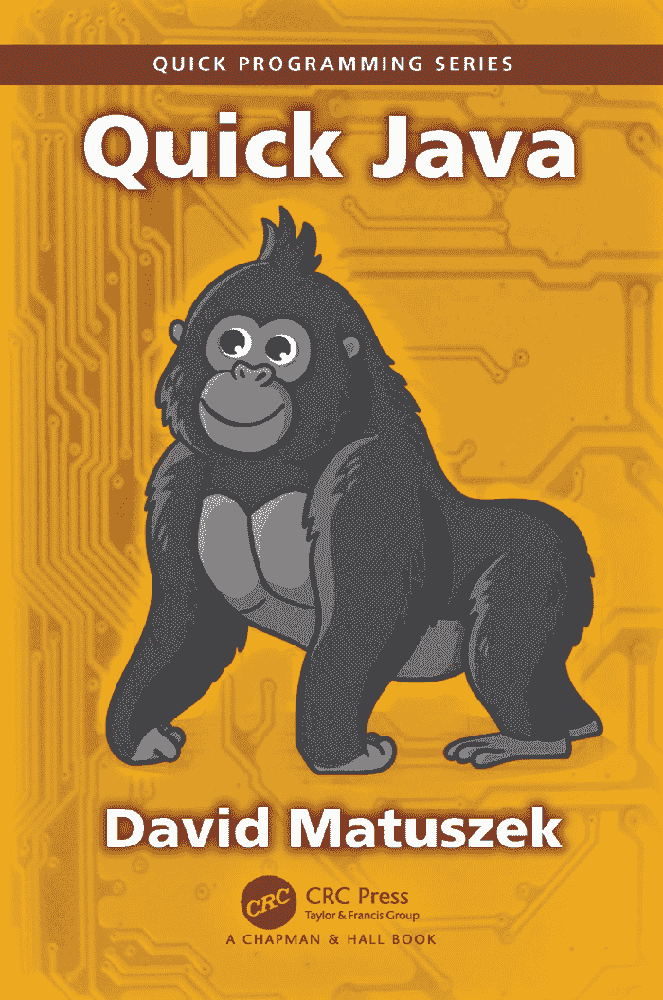
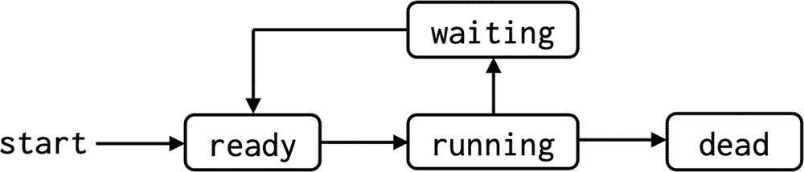

# Java 快速启动指南



使用 Minion 字体排版

MPS Limited, Dehradun

# 作者

致我所有过去、现在和未来的学生们：我是 David Matuszek，大多数学生称我为“Dave 博士”。我在 1963 年第一次打孔卡上写了我的第一个程序，并立刻迷上了其中。1970 年，我作为德克萨斯大学的研究生教了我的第一门计算机课。我最终在那里获得了博士学位，并从那时起一直从事教学。诚然，我在工业界度过了十多年，但即便如此，我仍曾在诺瓦纳大学担任兼职教师。我最终离开了工业界，在诺瓦纳大学全职任教了几年，然后搬到了宾夕法尼亚大学，在那里我指导了一个面向从其他学科进入计算机科学专业的计算机与信息技术硕士项目（MCIT）。在我的职业生涯中，我的主要兴趣是人工智能（AI）和编程语言。我还写过科幻小说——`Ice Jockey`、`All True Value` 和 `A Prophet in Paradise`，我预计我还会写更多。而且，嘿，如果你是我的老学生，请给我写封信。我很乐意在 `davidmatuszek@gmail.com` 收到你们的来。

# 前言

如果你是一个经验丰富的程序员，这本书将是引导你快速上手 Java 的指南。不仅是语言本身，还包括单元测试、图形用户界面、线程和函数式编程的基础知识。

[注：如果你是一个经验丰富的程序员，这本书将是引导你快速上手 Java 的指南。不仅是语言本身，还包括单元测试、图形用户界面、线程和函数式编程的基础知识。]

# 版本

这本书关于 Java 8 和 Java 17。为什么是这两个版本？Java 8 是最后一个可以商业免费使用的版本。由于这些原因，Java 8 之后的版本将会注明。Java 每六个月发布一个新版本，这并不需要担心，因为当你买这本书时，最新版本可能是 17。

如果你不确定使用的是哪个版本的 Java，可以从命令行执行：

```bash
java -version
```

或者在运行的 Java 程序中执行以下打印语句：

```java
System.out.println(System.getProperty("java.version"));
```

自 Java 9 起，你还可以从命令行运行 `jshell`。这个程序让你一次执行一条 Java 语句（如上面的打印语句）。这不是编写程序的方法，但对于尝试非常有用。如果你还没有下载 Java，它有两个主要变：JRE（运行时环境）用于运行程序，JDK（开发工具包）用于创建和运行程序（JDK 包含 JRE）。由于你阅读这本书，你几乎需要 JDK。你可以从 [`www.oracle.com/java/technologies/downloads/`](https://www.oracle.com/java/technologies/downloads/) 获取 Java SE（标准版）JDK。Java 9 及之后的版本对个人使用免费，但商业用户应向 Oracle 公司获取许可。

# 第一章 Java 闪电

DOI: [10.1201/9781003402947-1](https://doi.org/10.1201/9781003402947-1)

本书旨在让其他语言的经验程序员尽可能地开始 Java 编程。因此，本章内容非常密集并假设许多前提；你在第一次阅读时不需要理解或记住所有内容。后续章节将更慢、更详细地涵盖相同的材料。

> 注意：Java 是冗长的，代码行通常为 80 到 100 个字符。这些行被拆分成更多但更短的行，以提高可读性。

## 1.1 项目

一个程序，或项目（project），由一个或多个包（package）组成。包是一个包含 Java 文件的目录或文件夹。Java 文件包含类（class），通常每个文件一个类。类描述了一个新类型的对象（object），并将对象的字段（fields，即数据）和方法（methods）封装在一起。类有一个或多个构造函数（constructors）来创建该类型的新对象。

方法类似于函数，不同之处在于方法属于一个对象，并且（通常）与该对象的字段一起工作。方法可以包含变量的 `declarations`（声明），并包含可执行的语句。

总结一下，项目的组织方式如下：

- 文件的 `packages`（包，目录）
  - `classes`（类，通常每个一个）；每个类包含：
    - `fields`（数据）
    - 构造函数，包含声明和语句
    - 方法，包含声明和语句

除了上述内容，Java 9 及更高版本中的包可以被组织成更大的单元，称为 `modules`（模块）。这对于具有大量包的程序非常合适。JDK（Java 开发工具包）巨大，由数百个模块、数百个包和数千个类组成。与本书相关的单个模块是 `java.base`。

将在第 5.3.9 节中简要讨论模块。

## 1.2 初探：Circle 类

以下程序演示了 Java 程序的整体结构，并对 Java 程序的样貌提供了初步了解。

```java
package examples.shapes;

public class Circle {
private int radius;

public Circle(int r) {
    radius = r;
}

public double area() {
    return Math.PI * Math.pow(radius, 2);
}

}
```

包声明表示此代码位于名为 `shapes` 的文件夹（目录）中，该文件夹位于名为 `examples` 的文件夹（目录）中。如果需要任何 `import` 声明（这里），它们将紧随这一行。

代码定义了一个名为 `Circle` 的公共类。`public` 关键字意味着该类可以被程序中的任何代码使用。由于 `Circle` 是一个公共类，它必须位于名为 `Circle.java` 的文件中；这允许其他代码找到它。

`Circle` 类有一个名为 `radius` 的整数 `instance variable`（实例变量）。每个创建的新 `Circle` 对象将拥有自己的 `radius`，由于 `radius` 被标记为 `private`（私有的），它在类外部可见。

接下来是一个构造函数。它之所以被识别为构造函数，是因为它与其所在的类名完全相同（`Circle`）。它接受一个整数参数 `r`，将 `r` 的值保存在自己的实例变量 `radius` 中，并返回一个新创建的 `Circle` 对象。它没有使用 `return` 语句。

最后是一个不接受任何参数的方法 `area`。它计算并返回此圆的面积。

现在我们有了一个 `Circle` 类，让我们使用它吧。

```java
package examples.shapes;

public class CircleApp {
    public static void main(String[] args) {
        int size = 10;
        Circle c = new Circle(size);
        double area = c.area();
        System.out.printf(
            "The area of a circle " +
            "with radius %d is %7.2f",
            size, area);
    }
}
```

这个类 `CircleApp` 恰好与 `Circle` 类位于同一个目录下。

`CircleApp` 没有显式的构造函数（它有一个隐式的构造函数，但现在先忽略它）。它确实有一个 `main` 方法，这是程序的起点。由于复杂的原因，`main` 方法始终被定义为 `public static void main(String[] args)`——现在只需记住它；理解以后会来。

`main` 方法随后：

- 声明一个局部变量 `size` 为整数并赋值为 10。
- 声明另一个类型为 `Circle` 的局部变量 `c`，并使用关键字 `new` 调用 `Circle` 构造函数。它获取一个新创建的 `Circle` 对象并赋值给 `c`。
- 向 `c` 请求面积，并将结果赋值给 `double`（浮点）变量 `area`。
- 打印结果：

  半径为 10 的圆的面积为 314.16

## 1.3 数据

Java 中的每个数据值要么是 `primitive`（基本类型），要么是 `object`（对象）。八种基本类型中大部分是数值类型。对象由 `classes`（类）定义，每个类定义一种新类型的对象。

四种最重要的基本类型是：`int`（整数或全数）、`double`（包含小数点的数字）、`boolean`（true 和 false 值）和 `char`（单个字符）。

两种重要的对象类型是 `strings`（字符串）和 `arrays`（数组）。字符串是由 `String` 类定义的对象，而数组是使用更传统的语法定义的（但它们仍然是对象）。

基本类型和对象之间明显的区别是，基本类型具有 `operations`（操作）：如 `3 * n`、`big && round` 等，而对象具有 `methods`（方法）。（异常：`+` 运算符可以用于 `concatenate`（“连接”）字符串。）

> **术语：** 你不是在“调用”方法。相反，你是在“向对象发送消息”，其中“消息”由方法名及其参数组成。

向对象发送消息请使用像这样的 `dot notation`（点符号表示法）：`object.method(parameters)`。例如，`firstName.charAt(0)`。

字面量字符串包含在双引号中："Hello"。字符字面量写在单引号中：’a’。

所有变量在使用之前必须 `declared`（声明）；这指定了它们的类型。它们也可以被 `defined`（定义），或赋予一个初始值。

```java
int count; // declaration
count = 0; // definition
```

数组的元素必须是相同的类型。数组的类型位于，例如 `int[]`。

```java
int[] numbers = new int[100];
```

数组是基于索引的。`numbers` 数组的第一个元素是 `numbers[0]`，最后一个是 `numbers[99]`。长度由 `numbers.length` 提供。

## 1.4 运算符

Java 有常用的算术运算符：`+`（加）、``（减，或负号）、`*`（乘）、`/`（除）和 `%`（取模）。乘法运算符 `*`、`/` 和 `%` 的优先级高于加法运算符 `+` 和 ``。

没有幂运算符。幂通过调用 `Math` 模块中的 `pow` 方法来实现：`Math.pow(r, 2)`。

使用整数的算术表达式产生整数。如果表达式涉及 `double`，结果将是 `double`。

Java 有布尔运算符 `&&`（与）、`||`（或）和 `!`（非）。比较运算符 `<`、`<=`、`==`（等于）、`!=`（不等于）、`>` 和 `>=` 都产生布尔。布尔不是数字，你不能在期望布尔的地方使用数字。

更多关于运算符的详细信息请参见第 3.2.5 节。

## 1.5 程序结构

Java 程序由一个或多个 `classes` 组成。每个类通常位于一个独立的文件，以类名命名并带有 `.java` 扩展名。如果一个类名为 `Example`，它应该位于 `Example.java` 文件中。

Java 文件可以包含一个 `package` 声明，命名文件所在的文件夹，以及一些 `import` 声明，以便当前类访问其他包中的类。（同一包中的类不需要显式导入。）类的代码位于这些初始声明之后。

```java
package teamMaker;
import java.util.HashSet;
```

标记为 `public` 的类在程序的任何处都可用。

一个 `declaration` 包含一个类型、一个名称、一个可选的等号和一个值，并以分号结束。它可以被标记为 `public` 或 `private`，此外，它的前面可以有一个 `static` 单词。

```java
public static double Avogadro = 6.0221409e+23;
```

如果一个变量被标记为 `static`，则只有一个该变量，它属于类本身，并且该类的所有对象共享这一个变量。否则，它是一个 `instance variable`（也称为 `field`），每个对象都拥有该变量的独立拷贝。

`constructor` 用于创建类型为 `ClassName` 的新对象。

```java
ClassName(parameters) {
```

```text
declarations
```

```text
statements
```

```java
}
```

构造函数通过 `new ClassName(arguments)` 被调用。它*总是*返回一个新创建的对象；因此不需要 `return` 语句，如果使用，它必须是一个“裸”的 `return` 语句，不提供值。构造函数通常做的 own 不多是给新对象的实例变量赋值。

`method` 是一个可调的代码块。它类似于函数，不同在于它属于一个对象（或一个类）。方法的结构结构是：

```java
returnType methodName(parameters) {
```

```text
declarations
```

```text
statements
```

```java
}
```

`returnType` 可以是任何原始类型或对象类型，或者是关键字 `void`。如果 `returnType` 是 `void`，则在执行 `return;` 语句或到达方法末尾时方法将返回。但如果方法要返回一个值，它必须以 `return expression;` 语句结束，其中 `expression` 的结果是一个可以放入 `returnType` 类型变量的值。

要向对象发送消息（即调用它的其中一个方法），请使用语法 `object.methodName(arguments)`。该表达式的值将是方法返回的值（如果没有返回值，则为 null）。

## 1.6 Statements

最常用的语句是赋值语句、块（或复合语句）、`if` 语句、`while` 循环和 `for` 循环。除块之外的所有语句都必须以分号结束。可以使用 `println` 方法产生输出。

`block` 通过将语句封装在大括号 `{}` 中将任意数量的语句组合成单一的 `compound statement`。

`assignment statement` 给变量赋值。如果该变量之前没有声明过，则必须指定类型；该变量可以从声明处一直到最内层嵌套块的结束处。

`if statement` 测试布尔条件，如果条件为真，则执行该语句。它可能有一个 `else` 部分，当条件为假时，该部分将执行不同的语句。由于每个部分控制单个语句，因此该语句通常是一个块。

```java
if (2 + 2 == 4) {
```

```java
System.out.println("All is well.");
```

```java
} else {
```

```java
System.out.println("What??");
```

```java
}
```

`while` 循环评估一个布尔条件。如果条件为真，则执行语句（通常是一个块），然后返回测试。当测试结果为假时退出。

```java
int count = 10;
```

```java
while (count > 0) {
```

```java
System.out.println(count);
```

```java
count = count - 1;
```

```java
}
```

```java
System.out.println("Blast off!");
```

`for` 循环设置一个初始值，测试布尔条件，如果条件为真，则执行语句，执行更新，并返回测试。当测试返回假时退出。

```java
for (int i = 10; i > 0; i = i - 1) {
```

```java
System.out.println(i);
```

```java
}
```

```java
System.out.println("Blast off!");
```

> **Note：** 上述语句需要一个*boolean* 条件作为测试。你不能使用数值值作为测试。

C 语言语言族的主流惯例是将块的左大括号单独放在一行的开头。然而在 Java 中，这种风格一直是将左大括号放在一行的末尾，如上面的示例所示。“入乡随俗。”

Java 没有“print（打印）”语句，但 `print` 和 `println` `methods` 可以像语句一样使用。`System.out.println(arg)` 接收单个参数并将其发送到标准输出，后跟一个换行符 `'\n'`。`System.out.print(arg)` 执行相同的操作，但不带换行。

## 1.7 Program Execution

一个良好的 `IDE`（集成开发环境）的价值怎么强调都不为。NetBeans、Eclipse、IntelliJ IDEA 和 Xcode（仅限 Mac）都是优秀的。其中，IntelliJ IDEA 对初学者可能是最容易的。任何 IDE 都会提供运行你程序的简单方法。

程序将在 `public` 类的 `main` 方法开始执行。`main` 方法应该具有这个*精确*的头部：

```java
public static void main(String[] args) {
```

如果你没有使用 IDE，可以使用任何纯文本编辑器（*不是文字处理程序*）来创建程序。每个类应该单独占一行。

## 1.8 Hello World

为了尽快开始编程，你可以使用以下“Hello World”程序作为框架。


```
public class MyClass {
    String hello = "Hello World";
    public static void main(String[] args) {
        new MyClass().doSomething();
    }
    void doSomething() {
        System.out.println(hello);
    }
}
```

将 Java 认为为由“内部语言”和“外部语言”组成是很有用的。内部语言由数据、方法和语句组成，对于一个只有一个类的小型程序来说，这些已经足够了。同样复杂的外部语言则由用于组织大型程序的所有各种类型的类和接口组成。

在完成一些准备工作后，下一章将描述 Java 的内部语言（非常像 `C` 或 `C++`），接下来的章节将描述外部语言。

## 2.1 IDE

> **章节摘要：** 强烈建议使用 IDE。如果你还没有使用，IntelliJ IDEA 是最适合初学者的工具之一。

你仅需文本编辑器和命令行就可以创建并运行复杂的 Java 程序，但这种做法非常费力。

一个专业的`集成开发环境`（`IDE`）对开发程序具有不可比拟的帮助。一个非常基础的 IDE 集成了文本编辑器、编译器、调试器和代码执行器。专业级的 IDE 还会建议适用的方法、提供即时文档查询、为错误提供纠正、进行自动版本备份、协助重构代码以及许多其他服务。我曾听学生告诉我，他们能在我的课程中成功，仅仅是因为他们的 IDE 为他们写了程序。

对专业 IDE 的异议是它是一个巨大且复杂的程序，很难学习（例如类似于 `Microsoft Word`）。这无疑是事实。我的建议是获取一个良好的、功能齐全的 IDE，并像使用可以运行程序的文本编辑器一样使用它。没有必要立即学习它所有的功能。

最流行的 Java IDE 有 `Eclipse`、`NetBeans`、`IntelliJ IDEA` 以及仅限 Mac 的 `Xcode`。它们都是非常优秀的，并且拥有忠实的用户；而且都有免费版本。它们都可以（并且已经）被用于许多其他语言。其中，IntelliJ IDEA 不需要预先了解界面，只需在每一步引导初学者即可。

尽管如此，有时 IDE 仅仅会拒绝工作。这可能是由于升级导致文件版本不兼容，或其他类似的问题。（我在 `Eclipse` 上遇到过很多这类问题）。重新安装 IDE 可能有所帮助。探索所有设置也可能有帮助。当然，你可以切换到不同的 IDE。

还有一些简单的 IDE，通常是专门为学生编写的，例如 `BlueJ`、`JCreator` 和 `DrJava`。简单 IDE 的优点是它不那么令人畏畏。缺点是它对程序员的帮助较少。

俗话说，任何语言中最难写的程序都是“Hello World”；之后所有的程序都只是这一个延伸。同样，一旦你成功地使用专业 IDE 编写并执行了一个程序，剩下的都只是延伸了。

## 2.2 注释和标签

Java 中有三种注释。

*   以 `//` 开头并持续到行尾的注释。

    *   当置于代码行末尾时，它们对该行代码进行了某种说明。

    *   当单独放在一行中时，它们对随后的代码进行了某种说明。

    *   许多 IDE 会通过在每行开头添加 `//` 来注释掉整个代码块。

*   以 `/*` 开头并持续到 `*/` 的注释。

    *   这些用于无法在单行内显示的注释，并对随后的代码进行了某种说明。

    *   它们也可以用于在代码代码的中间插入注释。

*   以 `/**` 开头并持续到 `*/` 的注释。

    *   这些是`文档 (doc) 注释`。它们紧挨在类、方法、接口或变量的声明之前。

    *   Doc 注释通常在第一行之后的每行开头都写一个星号。

文档注释可以包含`标签`，如 `@param` 和 `@return`；其中许多描述可以在 第 5.2.1.2 节 Javadoc 中找到。

示例：

```java
/**
 * 返回两个数的和。
 * @param a 第一个数字。
 * @param b 第二个数字。不能为负数。
 * @return 两个数的和。
 * @throws AssertionError 如果 b 为负数。
 */
int add(int a, int b) {
    assert b >= 0; // 除非设置了 -ea，否则会被忽略
    while (b > 0) {
        // 将 1 从 b 移动到 a
        b -= 1;
        a += 1;
    }
    return a;
}
```

Javadoc 是一个从 doc 注释和标签中提取信息并生成非常专业文档的程序，通常但不一定是 HTML。非 doc 注释会被忽略。

# 第 3 章 Java 的“内部语言”

DOI: [10.1201/9781003402947-3](https://doi.org/10.1201/9781003402947-3)

一个 Java 程序由一个或多个类组成。本书使用“内部语言”是指指在单个顶层类内部发生的情况。对于简单的程序，一个类可能就是所有需要的。

## 3.1 变量和命名规范

`变量`是一个可以赋值的名称。变量在不同时间可以不同的值。

所有变量都必须声明。当一个变量被声明时，它会被赋予一个值（注：原文此处意为赋予类型，根据语境为类型）。所有变量都必须声明。当一个变量被声明时，它被赋予一个`类型`，告诉它可以拥有什么类型的值。它也可以被赋予一个初始值。`int` 变量只能有整数值，`String` 变量只能有字符串值，以此类推。Java 是区分大小大小的；即 `result`、`Result` 和 `RESULT` 是三个不同的名称。基本类型名称都是小写的，而对象类型名称如 `String` 是大写的。

`实例变量`是一个在类中声明的变量，但每个`实例`或对象都有一个独立的拷贝。`类变量`（或`静态变量`）使用 `static` 关键字在类中声明。它只有一个，而不是每个对象一个，它被认为归类本身所有。`局部变量`是在方法内部声明的变量。它仅在该方法内有效。`参数`也是方法的局部的。

`常量`是一个值不能改变的“变量”。通过添加 `final` 关键字来指示。

## 3.2 数据类型

有八种`原始`数据类型：`char`、`byte`、`short`、`int`、`long`、`float`、`double` 和 `boolean`。所有其他值（数组、字符串等）都属于某个类或对象类型。这种区别是非常重要的。

### 3.2.1 原始类型

这里有四个最重要且最常用的原始类型：

* `int` 是一个整数，或“整数字”。它可以存储足够用于大多数用途的数字（约正负二十亿）。为了让非常大的数字更具可读性，你可以在数字之间加上下划线。

* `double` 是一个 64 位的“实数”（浮点数）。它可以存储非常大或非常小的数字，精度约为 17 位数字。它可以使用科学计数法书写，其中用 `e` 或 `E` 表示指数：$6.0221409 \times 10^{(23)}$ 可以写成 `6.0221409e+23`。与整数一样，你也可以在数字之间加上下划线。

* `char` 是单个字符。常用字符可以直接通过包含在单引号中来表示，例如 `'a'`。某些字符需要用转义序列表示，例如用于换行的 `'\n'`。

* `boolean` 是一个单一的真或假值。

另外四种原始类型（`long`、`short`、`byte` 和 `float`）在大多数程序中并不使用，将在第 5.2.2.6 节中讨论。

### 3.2.2 数组

`array` 是相同类型的有序值序列。要访问数组中的单个值，使用语法 `arrayName[index]`。合法的索引范围从 0（数组中的第一个值）到 `arrayName.length - 1`（最后一个值）。

`declaring` 数组最简单的语法有两种：

```java
baseType[] arrayName;
```

或者：

```java
baseType arrayName[];
```

例如，

```java
int[] scores;
```

这声明了但没有定义 `scores` 变量。也就是说，它的类型已经被分配，但没有给它分配该类型的值。已声明但未定义的数组变量将具有特殊值 `null`，尝试使用它将导致错误。

要同时声明并定义 `scores`，你可以说：

```java
int[] scores = new int[35];
```

一旦定义了数组，你就不能更改它的大小。然而，数组的大小不是其类型的一部分，因此任何大小的 `int` 数组都可以赋值给 `scores`。稍后，你可能会将不同大小的不同数组赋值给 `scores`。你可以通过查询它的长度变量 `array.length` 来获取数组的大小。

按照上述方式创建的数组，其元素将分别设置为 0、`false` 或 `null`（对应数值数组、布尔数组或对象数组）。另一种方法是使用语法 `new type[] {value, ...}` 创建一个具有特定值的数组，例如：

```java
int[] ary = new int[] {3, 1, 4, 1, 6};
```

或者使用稍简单的：

```java
int[] ary2 = {3, 1, 4, 1, 6};
```

数组中的值本身也可以是数组。这有一种特殊的语法，如下例所示：

```java
double elevation[][]; // declaration
```

```java
elevation = new double[50][75]; // definition
```

```java
elevation[49][74] = 123.45;
```

`elevation` 数组可以被称为`二维数组`，但更准确的说法是一个其元素恰好是数组的一维数组。数组可以有三维、四维甚至更多维度。

多维数组中的第一个索引通常称为 `row`（行）数，第二个索引称为 `column`（列）数。上面的数组有 50 行（索引从 0 到 49）和 75 列（索引从 0 到 74）。

数组中的值必须都是相同类型，但数组的大小不是该类型的一部分。以下代码构造了一个“三角形”数组数组，其中每个子数组都比前一个数组大：

```java
int[] triangle = new int[10];

for (int i = 0; i < triangle.length; i++) {
    triangle[i] = new int[i + 1];
}
```

### 3.2.3 字符串

`string literal` 是包含在引号（双引号）中的零个或多个字符的序列。例如：

```java
"" // 一个空字符串
"hello" // 一个包含五个字符的字符串
```

某些字符无法直接输入字符或字符串常量中；例如字符串内部的双引号。这些字符可以通过通过 `escaping` 它们（在它们前面加一个反斜杠）来包含：

```java
"He said, \"Don't go.\""
```

重要的 `escape sequences` 有：

* `\n` 是“换行”字符，无论它在你的计算机系统上如何编码（在 Windows 上与 Unix 和 Macintosh 上不同）。

* `\t` 是制表符，表示任意数量的空白区域。

* `\"` 是双引号字符（在双引号字符串内部很有用）。

* `\'` 是单引号字符。

* `\\` 是反斜杠字符。

* `\uxxxx` 是写为恰好四个十六进制数字的 Unicode 字符。

此外，还有很少使用的 `\b`（退格）、`\r`（回车）和 `\f`（换页）。

### 3.2.4 异常

检出异常（checked exception）是程序要求处理的异常。例如，如果你尝试读取文件，Java 知道可能会发生很多问题，并要求你使用 `try-catch-finally`。基本上，这条语句的意思是：“我会尝试这样做，但如果失败了我会捕获异常。”

未检出异常（unchecked exception）是可能会发生但你不被要求去检查的异常。这些异常总是源于程序中的错误，例如超出数组边界或尝试使用 `null` 对象。解决方案是调试程序。

### 3.2.5 运算符与优先级

Java 具有通常的算术运算符以及通常的`优先级`先乘除后加减）。优先级最高的运算符先执行，除了少数例外，大多数运算符是`左结合`的——也就是说具有相等优先级的运算符从左到右执行。例如，`12 - 2 - 3 * 4 == 10 - 12 == -2`。

常见的运算符从高优先级到低优先级：

* 方法调用和数组索引

* 算术运算：

    1. 一元 `+` 和一元 `-`

    2. `*`（乘法）、`/`（除法）和 `%`（余数或取模）

    3. `+`（加法）和 `-`（减法）

* 布尔（逻辑）运算符：

    1. `!`（非）

    2. `&&`（与）

    3. `||`（或）

* 不等测试：

    1. `< <= >= >`（小于、小于等于、大于等于、大于）

* 等于测试：

    1. `==`（等于）和 `!=`（不等于）

* 赋值运算符：

    1. `=`（简单赋值）

    2. `+=`、`-=`、`*=`、`/=` 和 `%=`（`x op= y` 简自 `x = x op y`）。

一元运算符和赋值运算符是`右结合的`——具有相同优先级的运算符从右到左执行。例如，`a = b += c` 意味着 `a = (b += c)`。

和往常一样，可以使用括号显式地指定运算顺序。Java 中还有许多其他运算符，但由于极少有程序员知道完整的优先级表，最好使用括号来使运算顺序清晰可见。

不重要的运算符（`++`、`--`、`?::` 以及移位和位操作运算符）将在稍后讨论——分别参见 5.2.4.4 节 (`++` 和 `--`)、5.2.4.2 节 (`?:`) 以及 5.2.4.3 节（位和移位）。

当仅使用整数类型（包括 `char`）进行算术运算时，结果为 `int`。使用 `double` 与任何数值类型进行算术运算的结果都是 `double`。

布尔运算 `&&` 和 `||` 是`短路操作`：如果在求值左侧操作数后已知结果，则不再计算右侧操作数。因此，在表达式 `f(x) && g(x)` 中，如果 `f(x)` 为假，则结果必为假，因此不计算 `g(x)`。同样，在表达式 `f(x) || g(x)` 中，如果 `f(x)` 为真，则结果必为真，因此不计算 `g(x)`。

### 3.2.6 声明与转换

每个变量必须声明其类型以及可选的初始值。例如：

* `int count = 0, size;` 

* `double min, max, average;`

* `char c;`

如果 Java 认为你可能在给变量赋值之前就使用了它，它将会报错。如果 Java 没有捕获到这个错误，数值类型使用的值将为零，布尔类型将为 false。

`char` 变量可以存储约 65000 个 UTF-16 字符中的任何一个（参见 5.2.2.4 节）。字符内部存储为数字，并可以像整数一样用于算术运算。你可以用十六进制编写 UTF-16 字符，如 `'\uxxxx'`，其中 `xxxx` 是 `'\u0000'` 到 `'\uffff'` 之间的十六进制数。例如，`'\u0041'` 是 'A'，`'\u03A3'` 是 'Σ'。

在上述类型中，`double` 被认为比 `int` `宽`，而 `int` 比 `char` 宽。一种类型的值可以赋值给宽类型的变量。也就是说，`char` 值可以赋值给 `int` 变量或 `double` 变量，`int` 变量可以赋值给 `double` 变量。这被称为`向上转换`（upcasting）。

要进行相反操作，即将较宽的值赋值给较窄类型的变量，你必须将值`强制转换`（cast，或向下转换）到目标类型。通过在值之前紧跟目标类型的名称并加上括号来实现。例如：

```java
int i = 0;
```

```java
double d = 2.71828;
```

```java
i = (int)d;
```

```java
System.out.println(i); // 输出 2
```

在上面的示例中，小数部分丢失了。

强制转换影响紧随其后的值：`(int)2 * d` 仅将 `2` 转换为 `int`（它已经是 int 了）。要转换一个表达式，请在表达式周围加上括号：`(int)(2 * d)`。

另一个例子，考虑：

```java
char ch = (char)('a' + 1); // 结果为 'b'
```

这种强制转换是必要的，因为 `'a' + 1` 的结果类型是 `int`。

在转换到较窄类型时，程序员有责任确保值能够放入该较窄类型，否则结果将非常出乎意。例如，`byte` 只能存储 −128 到 127 之间的值，但强制转换 `(byte)1000` 是合法的且结果为 −24。

`boolean` *不是*数值类型，且不能转换为其他类型或从其他类型转换。

### 3.2.7 常量

在变量声明前加上 `final` 关键字会使其变为`常量`；其值不能被更改。例如：

```java
final int DAYS_IN_A_WEEK = 7;
```

Java 了一了一些内置常量，如 `Math.PI` 和 `Math.E`。

常量有助于避免使用“魔数”（代码中意义可能不完全明确的数字）。如果代码给一个变量加 29，就会产生问题：为什么要加 29？

然而，用常量的值来命名常量是愚蠢的，例如：

```java
final int TWELVE = 12;
```

因为这对于提高代码的清晰度没有任何帮助。

### 3.2.8 方法

方法类似于函数，不同在于它属于类。由于方法属于类，在 Java 中每个方法都必须声明。其语法如下：

```java
/**
 文档注释
 */
访问修符 返回类型 方法名(参数列表) {
    语句
}
```

一个方法包含：

1. 可选文档注释，说明方法的作用和使用方法。

2. 可选的访问修饰符。

3. 返回类型，如果不返回值则为 `void`。

4. 方法名。方法名应以小字母开头。

5. 参数列表。如果没有参数，括号仍然存在。


## 6. 方法体

方法体由大括号`{}`组成。

### 示例

```java
/**
 * 闰年是指被 4 整除但不被 100 整除的年份，
 * 除非也能被 400 整除。
 */
boolean isLeapYear(int year) {
    if (year % 4!= 0) return false;
    if (year % 100!= 0) return true;
    return year % 400 == 0;
}
```

在方法体内你可以声明带有或带有初始值的变量，例如`int count = 0;`。所有此类声明都是局部的，也就是说只能在方法内部可见和使用。变量声明通常放在方法开头。方法可以使用其参数的值、局部变量以及类定义的任何字段。关键字`this`指向“该”对象，即执行方法的对象。当局部变量或参数与字段同名时，`name`本身指向局部变量或参数，而`this.name`指向字段。

> 给 Python 程序员的提示：`this`类似于 Python 中的`self`。区别在于`this`是关键字而不是变量名，且该词通常可以省略。

如果方法被声明返回某种类型的值，则它必须使用具有正确类型的返回语句（或可以转换为正确类型的值）。在没有执行返回语句之前，它不能到达方法的结尾。

如果方法被声明为`void`（无返回值），则方法可以通过执行不带指定值的`return;`来结束，也可以通过到达方法结尾来结束。

> 注意：`void`不是一个值，所以`return void;`是不允许的。

为了编写一个完整的程序，至少有一个包含以下特殊方法的“启动”类：

```java
public static void main(String[] args) { }
```

### 3.2.9 方法调用方法

方法属于对象，因此要“调用”一个方法，从技术上讲是在“向对象发送消息”。操作方法是：命名对象，加一个点号，然后写出方法的名称，并在括号中提供正确数量和类型的`arguments`（参数）。每个参数都是一个表达式（可能是一个单一的值或变量）。

```java
obj.methodName(arguments)
```

每个参数必须对应一个参数，且该参数的类型必须是可以赋值给该参数的。被调用的方法返回一个结果，该结果可以在后续表达式中使用。当方法调用同一类中的另一个方法时（即对象在“自言自语”），`obj`可以是关键字`this`，也可以省略。例如，如果`isLeapYear`和`printLengthOfYear`在同一个类中，那么在`printLengthOfYear`中，你可以说`this.isLeapYear(year)`或者直接说`isLeapYear(year)`。

```java
public void printLengthOfYear(int year) {
    int days = 365;
    if (isLeapYear(year)) { // 省略了 "this."
        days = 366;
    }
    System.out.println(year + " has " + days + " days.");
}
```

### 3.2.10 重载

方法可以被重载（overloaded）。也就是说，一个类可以拥有两个或多个相同的方法，只要这些方法的参数数量（`number`）或类型（`types`）不同。例如，一个类可能有两个或多个名为`bump`的方法。

类型不需要完全匹配。如果没有精确匹配，但参数可以宽化（widened）为适当的类型，那么就可以使用该方法。例如，`bump(int n)`方法可以用`char`参数调用，但不能用`double`参数调用。

如果我们添加一个`bump(char n)`方法，那么带有`char`参数的`bump`消息将调用这个新方法，而不是期望`int`参数的方法。

构造方法和方法一样，也可以被重载。

Java 提供的许多方法都是重载的。例如，`System.out.print(arg)`有九个版本，`System.out.println(arg)`有十个版本。这些方法为`boolean`、`char`、`double`、`float`、`int`、`long`、`Object`、`String`和`char[]`各自提供了独立的版本。（没有为`byte`和`short`提供独立版本，因为它们可以被宽化并由`int`方法使用。）`println`还有一个额外的版本不接受参数，并打印空行。

### 3.2.11 作用域

每个变量都有一个作用域（`scope`），即变量可以使用程序部分。作用域取决于变量声明的位置。

#### 3.2.11.1 类中声明的变量

在类内部声明的变量在类的任何地方都是可用的。如果声明变量时赋予了初始值，则该值可以在后续的声明中使用。

```java
public class MyClass {
    int x = 5;
    int y = x + 1; // 在这里可以使用 x
    int z = w + 1; // 但这是非法的
    // 现在我们可以使用 x, y 和 z
    int w = 3;
    // 现在我们也可以使用 w
    …
}
```

这里有一种理解方式：当类第一次被使用时，Java 会按照它们出现的顺序执行所有的顶层声明（即那些不在方法中的声明）。之后，类中的方法就可以使用了。

> **异常：**类中的静态方法（如`main`方法）只能使用该类中的静态变量。

#### 3.2.11.2 方法中声明的变量

`block`（块）或`compound statement`（复合语句）是一组被大括号`{}`括起来的声明和/或语句。

一个`method`（方法）由一个头部（`header`）和一个正文（`body`）组成；主体是一个`block`。

```java
public double average(double x, double y) {
    double sum = x + y;
    return sum / 2;
}
```

参数（在本例中为`x`和`y`）可以在方法的任何地方使用，但在方法外部不可用。在体内声明的变量（在本例中为`sum`）遵循块的作用域规则（见节）。

参数和在体内声明的变量是局部变量（`local variables`）；它们在方法被调用（使用）时创建，在方法返回时丢弃。局部变量不会保留从一次方法调用到下一次调的值；每次调用都从头开始。

#### 3.2.11.3 块中声明的变量

在块中声明的变量从声明点到块的结束处都是可访问的（可以使用的）。例如：

```java
{
    x = 1; // 非法！
    int x; // "x" 的作用域从这里开始
    x = 2; // 合法
} // "x" 的作用域在此结束
x = 3; // 非法！
```

变量声明通常放在块的开头。

### 3.3 语句类型

Java 和 C++ 都大量借鉴了 C 语言，许多语句类型是相同的。一个显著的区别是在 Java 中，`if`、`while`或`for`语句的`condition`（条件）必须是一个结果产生布尔值的表达式，而不是其他类型。

以下语句在 C++ 中不存在，或与 C++ 有显著差异：

- `variable = expression;`
- `expression;`
- `{ statements }`
- `if (condition) { statements }`
- `if (condition) { statements } else { statements }`
- `while (condition) { statements }`
- `for (initialization; condition; update) { statements }`
- `for (variable: collection) { statements }`
- `do { statements } while (condition)`
- `switch (expression) { case value1: statements1 case value2: statements2 … default: statementsdef }`
- `label: statement;`
- `break;`
- `break label;`
- `continue;`
- `continue label;`
- `return value;`
- `return;`
- `;` // 空语句

Java 的格式是将控制语句的左大括号放在控制语句同一行，并将右大括号与控制语句对齐。即使块只包含语句，Java 程序员也鼓励使用大括号。

- `try { statements } catch (ExceptionType variable) { statements } finally { statements }`
- `throw Exception;`

### 3.3.1 C++ 中也有的语句

如果你来自 C++ 或其他 C 类型语言，你可能已经熟悉本节中的所有内容。它们都是普通的循环、条件语句、赋值、块等等。你可以直接跳到[3.3.2 节]，C++ 中不存在的语句。

#### 3.3.1.1 块

`compound statement`或`block`是被大括号`{}`括起来的若干（可能为零）声明和语句。

控制语句（如`if`语句和循环）控制单个语句的执行。如果你想控制多于一个语句，则必须将这些语句封装在大括号`{}`中，以使它们成为一个（单条）复合语句。

> **风格：**标准的 Java 风格是将左括号放在行末，而绝不将其单独放在一行。右括号的缩进量应与包含左括号的行保持相同。

类或方法的体体始终是一个块（`block`）。

良好的风格要求块内的语句相对于块的开始位置进行缩进。Java 的通常缩进是四个空格。

#### 3.3.1.2 赋值语句

`assignment statement`为变量分配值。例如，如果`x`的类型是`int`，那么：

```java
x = 5;
```

将`5`赋值给`x`。

变量的值可以改变，但其类型不可。例如，赋值语句：

```java
x = 10;
```

将新值`10`赋值给`x`。

对于每个算术运算符`op`，表达式：

```java
variable op= expression;
```

是：

```java
variable = variable op expression;
```

的简写。

例如，`x += 1;`将`1`加到`x`。

#### 3.3.1.3 方法调用与可变参数

方法调用可以作为语句，因为它们可以产生副作用。例如，如果`a`是一个数组，`a.sort()`会对该数组排序。

没有副作用的方法不应作为语句使用，因为它们没有执行任何操作。如果`str`是字符串`"Hello"`，表达式`str.toUpperCase()`返回字符串`"HELLO"`，这可以赋值给变量，但不会改变`str`的值。因此，将`str.toUpperCase()`作为语句不会产生任何效果。

你可以编写一个接受数量数量参数（即可变参数`varargs`）的方法。只需在最后一个参数的类型名后加上三个点。当调用该方法时，Java 会为你将所有这些值放入一个数组中。

```java
public double average(double… args) {
    double sum = 0;
    for (double arg: args) {
        sum += arg;
    }
    return sum / args.length;
}
```

调用`average(10.0, 20.0, 30, 41.0)`将返回`25.25`。

#### 3.3.1.4 if 语句

`if`语句测试条件。如果条件为真，则执行后续语句（通常是复合语句）。如果条件为假，则`if`语句不执行任何操作。语法如下：

```java
if (condition) {
    statements
}
```

例如，下面的`if`语句会在`x`变为负数时将其重置为零。

```java
if (x < 0) {
    x = 0;
}
```

`if`语句还可以有一个`else`分句。如果条件为真，则执行条件之后的语句。如果条件为假，则执行`else`关键字之后的语句。这两个语句通常都是复合语句。语法如下：

```java
if (condition) {
    some statements
} else {
    some other statements
}
```

例如：

```java
if (x % 2 == 0) {
    x = x / 2;
} else {
    x = 3 * x + 1
}
```

良好的风格是始终使用大括号，即使它们只包含单条语句。然而，如果任何一部分只包含一条（非复合）语句，则省略大括号是允许的。如果你这样做，将单条语句与`if`或`else`放在同一行。

```java
if (x % 2 == 0) x = x / 2;
else x = 3 * x + 1;
```

Java 与 Python 不同，没有单一关键字作为`else if`的缩写。

```java
if (x < 0) {
    System.out.println("x is negative");
} else if (x > 0) {
    System.out.println("x is positive");
} else {
    System.out.println("x is zero");
}
```

#### 3.3.1.5 while 循环

`while`循环是一种测试在顶部的循环。其语法如下：

```java
while (condition) {
    statements
}
```

首先测试`condition`；如果它为假，则不再进行任何操作，循环退出且从未执行`statements`。如果`condition`为真，则执行`statements`，然后再次执行整个循环（从测试开始）。

例如，非零数字的位数可以通过以下方式计算：

```java
int countDigits(int number) {
    int count = 0;
    while (number != 0) {
        number = number / 10;
        count += 1;
    }
    return count;
}
```

#### 3.3.1.6 do-while 循环

`do-while`循环是一种测试在底部而非顶部的循环。其语法如下：

```java
do {
    statements
} while (condition);
```

首先执行`statements`，然后测试`condition`；如果它为真，则再次执行整个循环。如果`condition`为假，循环退出。

例如，假设你想在 0 到 1000 之间选择一个能被 7 整除的随机数。在你选择它之前无法测试该数字，因此`do-while`是合适的。

```java
Random rand = new Random();
int x;
do {
    x = rand.nextInt(1000);
} while (x % 7 != 0);
```

与其他类型的控制语句不同，`do-while`中大括号是强制要求的，即使循环中只有一条语句。以下代码不起作用：

```java
do {
    int x = rand.nextInt(1000);
} while (x % 7 != 0); // error
```

#### 3.3.1.7 传统的 for 循环

`for`循环是一种测试在顶部的循环。其语法如下：

```java
for (initialization; condition; update) {
    statements
}
```

首先执行`initialization`且仅一次。之后，测试`condition`，如果为真，则执行`statements`并执行`update`；然后控制权返回到`condition`。换句话说，`for`循环的行为几乎与下面的`while`循环完全相同：

```java
initialization;
while (condition) {
    statements;
    update;
}
```

`initialization`通常是对预先声明的变量进行赋值，例如`i = 0`，或者是声明与赋值的结合，例如`int i = 0`。`update`通常是一个赋值语句，例如`i += 1`。

在`initialization`中声明的任何变量的作用域（即该变量可以使用范围）是整个`for`语句。

大括号表示一个`statements`块。如果只有一个语句，可以省略大括号；然而，始终包含大括号是一种良好的编程习惯。

例如，可以通过以下方式声明数组并写出其内容：

```java
int[] ary = {3, 1, 4, 1, 6};

for (int i = 0; i < ary.length; i += 1) {
    System.out.println(ary[i]);
}
```

同样合法但使用频率少得多的是，`initialization`和`update`都可以由两个或多个赋值语句组成。例如：

```java
for (int i = 1, j = 100; i < j; i = 2 * i, j -= 1) {
    System.out.println("i = " + i + ", j = " + j);
}
```

另外两种额外的语句类型`break`和`continue`也可以控制`for`循环的行为。这些语句在 3.3.1.11 和 3.3.1.12 节描述，可以与语句标签配合使用。

#### 3.3.1.8 For-each 循环


`for`-each 循环不涉及任何显式测试；它只是按顺序遍历数组的每一个元素。当不需要元素的索引位置时，这种方法更加简单方便。其语法如下：

```java
for (type variable: array) { statements }
```

与传统的 `for` 循环一样，如果 `variable` 之前已经声明，则必须省略 `type`。同样，与传统的 `for` 循环一样，`variable` 的作用域是整个 `for` 语句。例如，`String` 数组 `names` 中的每个元素都可以如下所示打印：

```java
for (String name: names) {
    System.out.println(name);
}
```

`for`-each 循环也可以用于可迭代对象（参见节 5.2.3.1）。

### 3.3.1.9 经典 `switch` 语句

正如 `if` 语句根据布尔值在两个代码块之间提供选择，`switch` 语句根据整数、字符、字符串或 `Enum` 值在多个代码块之间提供选择。

> **注意：** 本节描述的是“传统的” `switch` 语句，它适用于所有 Java 版本。对于 Java 14 及更高版本中可用的更新（且更好）的版本，请参见节 3.3.2.3。

其语法相当复杂：

```java
switch (expression) {
case constant1:
    statements1;
    break;
case constant2:
    statements2;
    break;
…
case constantN:
    statementsN;
    break;
default:
    statementsdef;
}
```

操作流程如下：求值 `expression`，然后按顺序与每个 `case constant` 进行比较。当找到与 `expression` 相等的 `constant` 时，从后续语句开始执行，直到遇到 `break` 或 `return`，或者直到整个 `switch` 语句的结束。

`expression` 的值必须是整数类型之一（包括 `char`）、字符串或 `Enum` 值（参见节 5.3.6）。`constants` 可以是整数、字符、字面量字符串或 `Enum` 值。

每个 `case` 末尾并不强制要求使用 `break` 语句，但强烈建议加上。如果没有 `break`，控制将“贯穿（fall through）”到下一组语句中。这通常不是你想要的结果。在极少数需要这种行为的情况下，你应该包含一个注释说明这种省略是有意的，否则你或其他人可能会在以后某个日期“纠正”这个表面上的问题。

如果需要对一个或多个常量执行相同的代码，而不是重复代码，则一个 `case constant:` 后面可以紧跟下一个，例如：

```java
case "yes":
case "Yes":
case "YES":
    some statements
```

在 Java 14 及以后，上述内容可以简化为：

```java
case "yes", "Yes", "YES": some statements.
```

`default` 情况是可选的，且应该放在最后；如果没有找到更早匹配的 `expression`，将执行它。如果没有找到匹配的 `expression` 且没有 `default` 情况，`switch` 语句将退出而不执行任何操作。

始终包含 `default` 情况是一个良好的习惯，即使你认为已经涵盖了所有可能性。`default` 情况可以是空的，也可以包含语句 `assert false;`；用此指示这段代码不应被触及。（断言语句在节 3.3.2.1 中介绍过。）

`statements` 可以是任意数量的零或多个语句的序列。

用于返回值的方法的循环。`expression` 的类型必须与方法预期返回的类型相同，或者比该类型窄。

例如，如果一个方法预期返回 `double` 类型的值，返回语句可以使用 `int` 类型的表达式；在方法返回时，结果将转换为 `double`。

### 3.3.1.14 空语句

尽管用途非常有限，但 Java 允许使用“空”语句，它由一个单独的分号组成。以下语句是等价的：

```java
for (n = 1; n < 1000; n = 2 * n) {}
```

以及：

```java
for (n = 1; n < 1000; n = 2 * n);
```

这两种语句的结果都会导致 `n` 被设置为 1024。

## 3.3.2 C++ 中不存在的语句

以下语句要么完全不存在于 C++ 中，要么与之差异巨大，因此需要额外的解释。

### 3.3.2.1 断言语句（Assert Statements）

`assert` 语句的特殊之处在于它通常“什么都不做”。相反，它是某种可执行文档的形式：你是在*断言*某些事是真实的。它有两种形式：

```java
assert booleanExpression;
```

```java
assert booleanExpression : expression;
```

执行过程如下：求值 `booleanExpression`，如果为真，控制直接传递到下一条语句。但如果为假，则会抛出一个 `AssertionError`。如果使用第二种形式，`expression` 的值（可以是任何类型）将包含在错误消息中。

默认情况下，断言被视为注释。若要使 `assert` 语句可执行，请使用 VM 标记 `-enableassertions` 或其缩写 `-ea`。

> **注意：** 从命令行运行时，`VM`（`Virtual Machine` 虚拟机）标记可以放在 `java` 单词之后。在 IDE 中运行时，标记将作为配置选项出现。

`assert` 语句的目的是声明一个你认为在程序该处始终为真的条件。它不应该被用于检查你认为可能发生的潜在错误情况；对于这种情况，你应该抛出异常（参见第 3.3.2.6 节）。

在编写代码时，养成在适当位置添加 `assert` 语句的习惯是一个好主意。

除非你有有用的内容要添加，否则使用第二种形式（带有 `expression`）意义不大。例如，如果你认为某个数组索引 `i` 始终在数组范围内，你可能会说：

```java
assert i >= 0 && i < myArray.length:
"Bad array index:" + i;
```

最后，可以使用惯用写法 `assert false;` 来表示你认为某些代码段（例如 `switch` 语句的 `default` 情况）永远无法被访问。然而，将此（或其他任何）语句放置在 Java 编译器知道无法到达的位置（例如紧跟在 `return` 语句之后）将是语法错误。

### 3.3.2.2 打印“语句”

有两种可以向用户打印消息的“语句”。它们是：

```java
System.out.println(value);
```

以及：

```java
System.out.print(value);
```

区别在于 `print` 仅打印 `value` 的字符串表示，而 `println` 打印该字符串后跟着一个换行符。也就是说，`print` 之后打印的下一个内容将在同一行，而 `println` 之后打印的下一个内容将另起新行。

尽管 `print` 和 `println` 的用法就像语句一样，但它们实际上是方法，具有在屏幕上显示某些内容的*副作用*。（没有副作用的方法调用也可以用作语句，但这通常没有意义，因为返回值会被忽略。）

如果 `value` 是一个对象类型，`print` 和 `println` 将调用其 `toString` 方法以获取对象的打印表示。这让你对对象如何被打印有了相当的控制权（参见第 4.4.1 节）。

在 `print` 或 `println` 调用的参数列表中直接构造字符串（使用 `+` 连接各个部分）通常很方便。任何“添加”到字符串中的内容都将被转换为字符串。

```java
System.out.println("The sum is" + sum);
```

> **技术说明：** `System` 是 `java.lang` 包中一个类的名，`out` 是 `System` 类中类型为 `PrintStream` 的对象。`PrintStream` 类有几个方法，包括 `print` 和 `println`。使用这些方法时不需要了解这一点。

打印到屏幕很容易，但从键盘获取输入需要使用 `Scanner` 对象，这在第 3.4.1.3 节中有所介绍。

### 3.3.2.3 `switch` 语句和表达式

Java 14 引入了显著改进的 `switch` 语句。（旧版本仍然可用）。新版本既可以当作语句，也可以用作返回值的*表达式*。其语法如下：

```java
switch (expression) {
case constants1 -> action1
case constants2 -> action2
…
case constantsN -> actionN
default -> actiondef
}
```

`expression` 产生整数、`String` 或 `Enum`。

`switch` 无论是作为语句还是表达式，都会求值 `expression`，选择匹配的项，并执行与常量相关的 `action`。`constants` 是逗号分隔的列表。

> **注意：** 与“经典” `switch` 语句不同，这里不会贯穿（fall through）到下一个操作。

当作为语句时，每个 `action` 是单条语句，可能是复合语句。`default` 情况是可选的；如果没有匹配的常量，则什么都不做。

当作为表达式时，每个 `action` 可以是：

* 任意类型的表达式，作为 `switch` 的值。
* 复合语句，包含 `yield`。`yield` 的作用类似于方法中的 `return` 语句。
* `throw` 语句。

作为表达式时，它*必须*返回值或抛出异常。在实践中，这意味着要么需要 `default` 情况，要么 `constants` 包含了 `Enum` 的所有可能值。

下面的无意义示例说明了 `switch` 作为表达式的用法。

```java
long nonsense = switch (i) {
case 1 -> 100000000000L;
case 2 -> 17 * x;
case 3, 4 -> 'a';
case 5 -> {
    System.out.println("Five!");
    yield 55;
}
case 6 -> throw new RuntimeException();
default -> -1;
};

System.out.println(nonsense);
```

### 3.3.2.4 `switch` 语句中的模式匹配

如上一节所述，Java 14 引入了 `switch` 语句的新形式，以及 `switch` *表达式*，使用箭头（`->`）代替冒号（`:`）。Java 17 使用模式匹配极大扩展了 `switch` 语句和表达式的功能。

> **警告：** 模式匹配是 Java 17 的一个*预览功能*。这意味着：（1）它在未来的 Java 版本中可能会更改或消失；（2）你可能需要设置 `enable-preview` 标记才能使用它。

尽管名字如此，但模式匹配与正则表达式无关。相反，切换是基于表达式的*类型*进行的，表达式的结果被赋值给新变量。

```java
switch (expression) {
case Type1 variable1 -> action1
case Type2 variable2 -> action2
…
case TypeN variableN -> actionN
default -> actiondef
}
```

`expression` 的值必须是 `case` `Types` 的超类型。当找到匹配的 `Type` 时，`expression` 的值将赋值给相应的 `variable`，并执行 `action`（表达式或语句）。

与早期版本的 `switch` 语句不同，任何对象类型都可以作为 `case` 类型，包括 `null`。然而，基本类型不能使用。

`guarded pattern`（守护模式）允许我们在选择类型后对值进行额外的测试。它的形式如下：

```java
case Type variable && guard -> action
```

其中 `guard` 是使用 `variable` 值的布尔表达式。如果布尔表达式很复杂，应该放在括号中。

这是一个使用 `switch` 表达式的示例：

```java
String s = switch (shape) {
case Rectangle r && r.width == r.height ->
    "It's a square";
case Rectangle r ->
    "It's a rectangle";
case Triangle t ->
    "It's a " + t.width + " by " + t.height + " triangle.";
default ->
    "It's a shape.";
};
System.out.println(s);
```

### 3.3.2.5 `try-catch-finally`

可能抛出受检异常的代码必须在声明抛出该异常的方法中，或者必须在 `try-catch-finally` 语句的 `try` 部分。语法如下：

```java
try {
    可能会抛出异常的代码
} catch (SomeExceptionType variable) {
    处理此类异常的代码
} catch (SomeOtherExceptionType variable) {
    处理此其他异常类型的代码
} finally {
    在离开前总是会执行的代码
}
```

可以根据需要编写任意数量的 `catch` 块来捕获不同类型的异常；`finally` 块通常是可选的。但如果存在 `catch` 块，则需要一个 `finally` 块。

首先，执行 `try` 块中的代码。如果它正常完成（没有异常或错误），则跳过 `catch` 块。但如果在执行 `try` 块期间发生异常或错误，执行将立即跳转到第一个可以处理该类型异常的 `catch` 块。

无论 `try` 块中的代码是否正常完成，`finally` 块（如果存在）**总是**执行。如果 `try` 块或其中一个 `catch` 块尝试通过其他方式退出（通过 `return`、`break` 或 `continue` 语句），`finally` 块会“横插进来”，并在退出语句发生之前执行。

### 3.3.2.6 `throw` 语句

当 Java 检测到发生错误时，它会创建一个 `Exception` 对象并将其抛出（`throws`）。你的代码也可以故意创建并抛出异常。通常情况下，你会在 `throw` 语句中创建一个新异常。

```java
throw new ExceptionType(message);
```

> **注意：** 这与 C++ 的不同在于，在 Java 中，只有 `Throwable` 类型（异常和错误）可以被抛出。

在本节中我们只考虑一个简单的示例。

假设如果变量 `b` 为负，意味着出了某些问题。你可能会写：

```java
if (b < 0) {
    throw new Exception("b is negative");
}
```

这段代码创建了一个非常通用的类型 `Exception` 对象（还有更多具体的异常类型），并立即抛出该 `Exception`。

某些异常类型是受检的（`checked`）。如果你执行可能抛出受检异常的代码，Java 强制要求你对其做某些处理；如果不这样做，将是语法错误。你可以做的一件事是将违规代码放在 `try-catch` 语句的 `try` 部分。

或者，你可以说你的方法（可能）抛出该异常。那么无论谁调用你的代码都必须处理该异常；这不再是你的责任了。

```java
int myMethod(int a, int b) throws Exception {
    if (b < 0) {
        throw new Exception("b is negative");
    }
    // 其他内容
}
```

现在，调用 `myMethod` 的代码必须在 `try-catch` 语句的 `try` 部分中调用它，或者该调用方法的头部必须包含 `throws` 部分。通过这种方式，异常在最终被处理之前，可能会向上传递多层方法调用。如果它一直上传到 `main` 方法且 `main` 方法没有处理它，程序将带错误终止。

> **注意：** 异常的一类特殊组，`RuntimeException` 及其子类，是未检的（`unchecked`）异常；也就是说，它们不需要被捕获或在方法头部中提到。未检异常通常是程序中错误的结果。

Java 中的异常是复杂且昂贵的，因此它们应该保留用于处理问题的情况；它们不应该作为“正常”控制流的一部分。

## 3.3.3 从文件读取

从文本文件读取或写入的基本方法是：（1）打开文件；（2）使用文件；（3）关闭文件。这些步骤每一步都可能引发必须处理的异常。

`FileReader` 类具有读取字符并返回它们的方法。这很不方便，因此读取文件的通常方法是在其周围封装一个 `BufferedReader`。`BufferedReader` 具有以下方法（以及其他）：

* `readLine()` 读取并返回一行（作为 `String`），或者如果到达文件末尾则返回 `null`。
* `read(charArray, index, n)` 从 `index` 开始向字符数组中填充 `n` 个字符。返回值为实际读取的字符数。


`close()` 关闭 `BufferedReader` 及其关联的 `FileReader`。关闭一个已关闭的读取器不会抛出异常。

`FileReader` 构造函数的 `file` 参数可以是 `File` 对象，也可以是表示文件路径的字符串。如果文件不存在，构造函数将抛出 `FileNotFoundException`。`BufferedReader` 的构造函数不会抛出 `IOException`，但对 `readLine`、`read` 或 `close` 的任何使用可能会如此。

```java
FileReader fr = new FileReader(file);
BufferedReader br = new BufferedReader(fr);
String line = br.readLine();
```

### 3.3.4 Try With Resources

try-resources 语句是 try-catch-finally 语句的扩展，提供了一种在使用后关闭资源更方便的方法。与其编写：

```java
try { … }
```

不如：

```java
try (resource declarations) { … }
```

可以有任意数量的可关闭资源声明，用分号隔开。例如：

```java
try (FileReader fr = new FileReader("/Users/dave/test.txt");
     BufferedReader br = new BufferedReader(fr)) {
    String line = br.readLine();
    System.out.println(line);
} catch (IOException e) { }
```

通过这种构造，无论是否发生异常，`FileReader` 和 `BufferedReader` 在使用后都会自动关闭。

如果这段代码出现在标记为抛出 `IOException` 的方法中，则 catch 子句是可选的。finally 子句是可选的，但通常不需要。

> **注意：** 上述路径之所以是这种形式是因为代码是在 Macintosh 上测试的。在 Windows 机器，路径通常以 `C:` 开头并使用双反斜杠而不是斜杠。

Java 9 引入了 try-resources 语句的更短版本，有时很有用。在这个版本中，如果资源之前已经定义并且最终的或“有效最终的”（effectively final），则只需命名它们。例如，如果 `BufferedReader br` 和 `FileReader fr` 已经定义并且是有效最终的，那么这种简单的形式就可以工作：

```java
try (br; fr) {
    line = br.readLine();
    System.out.println(line);
} catch (IOException e) { }
```

> **注意：** 如果变量使用 `final` 关键字声明，则它是 `final` 的。如果变量在声明后没有代码对其进行修改，则它是 `effectively final`（有效最终的）。

### 3.3.5 写入文件

要写入文本文件，你可以使用 `FileWriter`，它拥有 `write(string)` 方法和 `close()` 方法。下面的示例使用了 `try-with-resources` 语句来自动关闭文件。

```java
try (FileWriter fw = new FileWriter("/Users/dave/test2.txt")) {
    fw.write("Hello\n");
    fw.write("Goodbye");
} catch (IOException e) {}
```

上述代码段将在 `test2.txt` 文件不存在不存在时创建该文件，并将该文件的任何现有内容替换为 `Hello` 和 `Goodbye` 这两行。若要向现有文本文件的末尾添加内容，请使用 `FileWriter` 的 `append(string)` 方法。

## 3.4 类与对象

一个 Java 程序由数量相互作用的 `objects`（对象）组成，但所有可执行代码都在 `classes`（类）中。那么，类和对象之间是什么关系呢？

简单来说，每个类定义了一种类型，而对象是该类型的值。这里有一个类比：`class` 就像一个食谱，而 `objects` 是你按照食谱做出的东西。一旦你有了食谱（`class`），你就可以用它制作很多东西（`objects`）。类中的几乎所有内容都用于描述对象包含什么以及它可以做什么。

类包含字段（fields）、构造函数（constructors）和方法（methods）。

- `fields`（或实例变量）是属于对象的数据。
- `constructors`（构造函数）创建该类型的新对象。要调用构造函数，请使用 `new` 关键字。
- `methods`（方法）是操纵这些数据的代码。

构造函数的目的是创建一个处于有效状态的新对象。它通过接受值（作为参数）并将这些值保存在实例变量中来实现，并且通常不做其他操作。它可能会进行一些有限的计算以正确设置对象，但仅此而已。未来对该对象的任何操作都将通过方法完成。

### 3.4.1 一些常用的对象

每个 Java 程序必须至少有一个类，且该类必须有一个 `public static void main(String[] args)` 方法，这是程序开始执行的地方。在我们开始编写任何额外的类（我称之为 Java 的“外层语言”）之前，本节将介绍几个实用的预定义类。

Java 提供了大量的包（packages），其中包含了极大量已经编写并测试过的类。这太棒了，因为这意味着有很多优秀的代码准备好供你使用；但也意味着你需要学习如何熟悉这些包。本书将在这方面提供帮助。首先，你需要了解的两个主要的包：

- `java.lang` 包含了最基础的类，并自动导入到你编写的任何程序中。
- `java.util` 包含了你所需的大多数数据结构。

#### 3.4.1.1 String 对象

`string` 是一个零个或多个字符的序列。字符串不像大多数对象那样调用构造函数，而是通过在双引号内放入字符来创建的。除此之外，字符串是一个普通的对象。其数据是字符串中的字符，并且有几十种方法可以处理该字符串。

例如，假设你有：

```java
String language = "Java";
```

你可以使用 `length()` 方法获取此字符串的长度：

```java
int numChars = language.length();
```

向对象发送消息：命名对象，输入一个点（dot），然后说你想让对象执行什么种方法（method），以及该方法需要的参数（arguments，如果有的话）。

我觉得正式的术语很别扭，所以我喜欢说我们在与对象“交谈”。我们“告诉”它某些事，或者“问”它某些问题。在上面的例子中，我们说：“嘿，`language`，你的长度是多少？”同样，`language.charAt(0)` 说：“嘿，`language`，你的第一个字符是什么？”而 `language.toUpperCase()` 说：“嘿，`language`，给我一个你的全大写版本。”

与许多对象不同，字符串是 `immutable`（不可变的）的——它们不能被更改。像 `toUpperCase()` 这样的方法永远不会改变原始字符串；它们总是返回一个新的 `String` 对象。

#### 3.4.1.2 StringBuilder 对象

一种更典型的对象是 `StringBuilder`。字符串是不可变的，所以如果你对字符串进行了数千次修改，你实际上是创建了数千个新字符串。这可能是昂贵的。使用一个可变的（`mutable`，可修改）`StringBuilder` 对象更高效。

要创建一个新的 `StringBuilder` 对象（或任何其他类型的对象），请使用关键字 `new`、类名以及任何所需的参数。如下：

```java
StringBuilder builder = new StringBuilder("Java");
```

`StringBuilder` 有许多方法来更改字符串数据，所有这些方法都使用标准的点表示法。例如，要在末尾添加文本，你可以说：

```java
builder.append("Script");
```

以下是你可以使用的许多方法中的几个：

- `charAt(index)` — 返回指定 `index` 处的 `char`。
- `insert(index, string)` — 从 `index` 开始将 `string` 放入 `StringBuffer` 中。
- `replace(start, end, string)` — 将从 `start` 到 `end-1` 的字符替换为 `string`。
- `delete(start, end)` — 删除从 `start` 到不包括 `end` 的字符。

当你完成时，可以要求 `StringBuilder` 返回它的字符串版本。

```java
language = builder.toString(); // 现在是 "JavaScript"
```

与本书中描述的大多数类一样，`Scanner` 类拥有的方法比这里提到的多得多。例如，扫描器可以使用正则表达式来告诉它读取什么内容。

#### 3.4.1.4 控制台（Console）

`java.io.Console` 类提供了一种比 `Scanner` 类简单得多的读取用户输入的方法，但它有一个显著的缺点：它要求存在一个交互式的“控制台”。取决于 Java 程序的执行方式，控制台可能存在也可能不存在。在许多情况下，从命令行运行时可以使用 `Console`，但在 IDE 中运行时则不可以使用。

如果没有可用的控制台，构造函数调用 `new Console()` 将返回 `null`。否则，以下是新创建的控制台上可以进行的一些操作：

- `readLine()` 返回一行，格式为字符串。
- `readLine(formatString, value, … , value)` 格式化并显示一个作为提示符的字符串，然后读取并返回一行。
  - `格式字符串`在第 5.2.2.10 节中进行了描述。也可以使用不带插值 `values` 的纯字符串。
- `readPassword()` 返回一个字符数组（即 `char[]`）中的一行，且不显示输入的内容。
- `readPassword(formatString, value, … , value)` 格式化并显示一个作为提示符的字符串，然后读取并以字符数组的形式返回一个不显示的行。也可以使用纯字符串。
- `printf(formatString, value, …, value)` 格式化并显示一个字符串。
- `writer()` 返回一个与此控制台关联的 `PrintWriter`。
  - `Console` 对象本身不具备 `print` 和 `println` 方法，但这些消息可以发送到 `writer()` 返回的 `PrintWriter`。

#### 3.4.1.5 对象、泛型和栈

对象最通用的类型是 `Object`。如果你声明一个 `Object` 数组，你可以将任何类型的对象放入其中——字符串、栈、线程，等等。你也可以声明得更具体，声明一个（例如）`String` 数组，那么该数组只能包含字符串。

除了数组之外，Java 还有各种类型的集合（Collections）：`Stacks`、`Lists`、`HashMaps` 等。最初，任何类型的对象都可以被推入 `Collection`，没有办法变得更具体。当你从集合中获取一个值时，你得到的是一个 `Object`，必须将其强制转换（`cast`）为正确的类型。为了后兼容，这种风格仍然允许。

例如，Java 有一个 `Stack` 类型（在 `java.util` 包中），具有 `push` 和 `pop` 等操作。

```java
Stack stuff = new Stack();
```

```java
stuff.push("abracadabra");
```

```java
stuff.push(new File("abc.txt"));
```

```java
File foo = (File)stuff.pop();
```

```java
String spell = (String)stuff.pop();
```

在现代代码中，最好明确可以放入栈中的什么类型的值。这是通过使用类型参数（type parameters）或泛型（generics）实现的。类型参数被放在对象类型后的角括号中。

```java
Stack<String> words = new Stack<String>();
```

```java
words.push("abracadabra");
```

```java
words.push(new File("abc.txt")); // 非法
```

为了尽量减少冗余，定义中的类型参数（即 `new` 关键字之后）可以是一个空的“菱形”`<>`。

```java
Stack<String> words = new Stack<>();
```

> **注意：** 在我正在使用的 Java 版本中，显然甚至“菱形”也可以省略，但这不是 Java 的已公告特性。

作为一个额外的奖励，当你从泛型化的集合中检索一个对象时，不再需要将其强制转换为正确的类型。

```java
String word = words.pop();
```

泛型化的类型名称可以用任何可以使用“普通”类型名称的地方，例如在方法的声明中。例如：

```java
int find(String target,
```

```java
Stack<String> words) { … }
```

#### 3.4.1.6 映射（Maps）

`java.util` 包中最实用的对象之一是 `HashMap`。

`map` 是一个查找表或字典；它将键（keys）与值（values）关联起来。对于联系人列表，键可能是某人的名字，值则是该人的电话号码。

```java
HashMap<String, Integer> phones = new HashMap<>();
```

```java
phones.put("Joan", 555_1212);
```

> **注意：** 上述代码之所以有效，是因为尽管在需要对象的地方不能使用原始类型，Java 会将 `int` 值 `555_1212` “包装”成一个 `Integer` 对象。

`HashMap` 是一种特殊的 `Map`，支持极快的查找。任何对象类型都可以作为键。

> **注意：** 如果 `keys` 是具有自定义 `equals` 方法的用户自定义对象，那么这些对象必须也具有一个自定义的 `hashCode` 方法，以便为相同的对象产生相同的哈希码。

`HashMap` 上的一些重要操作包括：

- `map.put(key, value)` — 向 `map` 中添加 `key/value` 对。
- `map.putIfAbsent(key, value)` — 如果 `key` 不存在，则向 `map` 中添加 `key/value` 对。
- `map.get(key)` — 返回与 `key` 关联的值，如果 `key` 不在 `map` 中则返回 `null`。
- `map.getOrDefault(key, defaultValue)` — 返回与 `key` 关联的值，如果 `key` 不在 `map` 中则返回 `defaultValue`。
- `map.size()` — 返回 `map` 中 `key/value` 对的数量。
- `map.clear()` — 移除 `map` 中的所有内容。
- `map.remove(key)` — 从 `map` 中删除 `key` 及其关联的值。
- `map.keySet()` — 返回 `map` 中所有键的 `Set` 视图。

> **注意：** 视图类似于对象的窗口，随着对象的改变而改变。在上述情况下，`keySet()` 返回的 `Set` 可以像“普通”集合一样使用，但 `map` 内容的变化会改变它。

#### 3.4.1.7 Java API

Java API（应用程序接口）是一个巨大的资源，包含七千多个类，组织在两百个包中。能够找到并使用这个资源是非常重要的。

要找到文档，可以在网上搜索“java 17 api”或类似词汇。搜索结果中的顶部结果应该是 “[Overview (Java SE 17 & JDK 17)](https://docs.oracle.com/en/java/javase/17/api/)”。（如果你是为 Android 或类似平台编程，你需要 Java 8 文档。）该链接将带你进入一个模块列表页面；点击 [java.base](https://docs.oracle.com/en/java/javase/17/docs/api/java.base/module-summary.html)。页签此页面；这是一个很好的起点。如果你对 GUI 开发感兴趣，也请收藏 [java.desktop](https://docs.oracle.com/en/java/javase/17/docs/api/java.desktop/module-summary.html) 链接。


在 [java.base](https://docs.oracle.com/en/java/javase/17/docs/api/java.base/module-summary.html) 页面上，列表顶部的包之一是 [java.lang](https://docs.oracle.com/en/java/javase/17/docs/api/java.base/java/lang/package-summary.html)。这个包对于每个 Java 程序都是必不可少的，并且会自动导入到每个 Java 程序中。点击 [java.lang](https://docs.oracle.com/en/java/javase/17/docs/api/java.base/java/lang/package-summary.html) 进入列出该包中所有类的页面。

[java.lang](https://docs.oracle.com/en/java/javase/17/docs/api/java.base/java/lang/package-summary.html) 页面包含了对该包用途的简要描述，以及对某些类用途的非常简短的描述。之后是“相关包”列表，接着是类的选项卡式列表。为了方便说明，请从选项卡式列表中选择“所有类和接口”（可能已经已被选中）或“类”。

你将看到我们已经提到过的一些类，例如 [Character](https://docs.oracle.com/en/java/javase/17/docs/api/java.base/java/lang/Character.html) 和 [Exception](https://docs.oracle.com/en/java/javase/17/docs/api/java.base/java/lang/Exception.html)。向下滚动页面并点击 `String`。

在 `Class String` 正下方，你会看到它的父类是 [java.lang.Object](https://docs.oracle.com/en/java/javase/17/docs/api/java.base/java/lang/Object.html)（可点击），并且它实现了一些接口（也可点击）。从 `Object` 继承的方法将在此页面上进行描述（除非它们被重写了），但它们将列在更下方。接口的方法将在下方进行描述，以及所有其他方法。

接下来是字符串对象的简要说明、字段摘要、构造函数列表，以及下方的列表选项卡式列表，其中之一是“所有方法”。如果该选项卡未选中，请点击它。

我们将选取此页面上的一个方法进行检查。向下滚动到类似于表 3.1 的那行：

**表 3.1 Java API 中短的 `indexOf` 条目**

| 返回类型 | 方法 | 描述 |
| --- | --- | --- |
| `int` | `indexOf(String str)` | 返回指定的子字符串在此字符串中首次出现的索引。 |

这一行表示 `indexMethod` 接受一个 `String` 作为参数，并返回一个 `int` 结果。此之后是对该方法作用的简要描述——更详细的描述在页面下方。唯一*隐含*的（因为这是 `String` 类中的一个方法）是 `indexOf` 是你发送给 `String` 的消息：例如，`story.indexOf("Toby")` 在字符串 `story` 中搜索字符串 `"Toby"`。

在这一行中，`indexOf` 和 `String` 是加粗的，意味着它们是可点击的。通常，描述就是你所需要的，但你可以点击方法名跳转到详细描述处。

这些页面上会有很多你看不懂的内容。这没关系；重要的是熟悉探索文档，并使用你确实懂的部分。如果你经常处理字符串，那么浏览这些方法以寻找你可能用到的方法是值得的。

一个需要知道的重要词汇是“`deprecated`”（已弃用）。一个 `deprecated` 方法仍然有效，但已被某些更新、更好的东西所取代。如果可能，请不要使用已弃用的方法。通常有一个指向更更新、更佳版本的链接。

## 3.5 对象和类

类和对象的语法将在稍后讨论，但从一开始就了解一下这些东西是什么是有帮助的。

在面向对象编程之前，数据和函数分布在整个程序中，可能在某种程度上进行了分组，但没有正式的组织。面向对象编程提供了这种组织。

一个 `object`（对象）是一个“东西”。某些对象代表现实世界中的东西，例如 `Customer` 或 `Date`。大多数对象代表“计算机世界”中的东西，例如 `String` 或 `HashMap`。有些东西介于之间，例如 `Calendar`。每个对象都有一些数据，称为 `fields`（字段），描述这个特定的对象，它还有一些方法，定义了对象可以做什么。

`method`（方法）是属于对象的函数（在某些情况下属于类）。方法以各种方式操作对象的数据，例如更新数据或提供关于它的信息。最初，Java 没有真正的函数，只有方法。

一个 `class`（类）定义了对象的 `type`（类型）。它告诉每个对象包含哪些字段，以及哪些方法可以操作该对象。

例如，如果你正在编写维护在线商店的软件，你可能会：

- 一个 `Inventory` 对象，用于维护你出售的 `Item` 对象列表。
- 许多 `Item` 对象，每个都有价格、描述、`shippingWeight`、`numberOnHand` 等。
- 一个 `Order` 对象可能是 `Customer` 订购的 `Items` 列表。你可能有方法向此订单添加 `Item` 或从中移除 `Item`。
- 每个 `Customer` 对象可能有一个名称、一个 `currentOrder`（类型为 `Order`）、`amountOwed` 等。

每个类至少有一个 `constructor`（构造函数）用于创建该类型的新对象。要创建一个新的 `Item` 对象，你可能需要向构造函数提供物品描述、重量、价格以及关于物品的任何其他信息。

> **核心概念：**`面向对象编程`的核心在于创建一个协作的、活跃的“代理”（称为“对象”）社会，它们通过合作完成所需的任务。

在 Java 中，几乎所有内容，特别是所有执行代码，都在类中。

`interface`（接口）是类可以选择实现的方法列表。接口在第 4.1.3 节中进行了描述。

类的下一个是构造函数。它的名称与它所在的类相同，都是 `Password`，并且将返回一个 `Password` 对象。（构造函数不使用显式的返回语句。）

注意，构造函数可以访问*两个*不同的变量，它们都名为 `password`。其中一个是字段（或实例变量），另一个是参数。这看起来可能很奇怪，但这种做法非常常见，尤其是在构造函数中。为了区分它们，`password` 本身指代参数，而 `this.password` 指代实例变量。

接下来是一个名为 `matches` 的方法，它将返回一个布尔值（`true` 或 `false`）。由于字符串是对象，`matches` 方法必须使用 `equals` 来比较它们。

> **注意：**虽然使用 `==` 比较字符串*通常*有效，但在这里不起作用；请参见第 5.2.2.8 节以了解解释。你应该始终使用 `equals` 来比较字符串。

最后是一个 `reset` 方法，它接受两个字符串作为参数，并告知重置是否成功。它没有标记为 `public`、`protected` 或 `private`，因此它具有包访问权限（package access），可以被同一包中的任何类使用。

### 4.1.2 类头

类头可能简单到只有 `class` 后面跟着类名，也像下面这样复杂：

```java
access class ClassName extends SuperClass
```

```java
implements Interface1, … , InterfaceN
```

`access` 可以是 `public` 或省略：

- `public`：可以在项目的任何地方可见和使用。
- `package`：（默认值，无关键字）可以被同一包（目录）中的任何类可见和使用。此处不能使用 `package` 关键字，该关键字用于指定此类所在的目录。

还有两个额外的访问类型：

- `protected`：可以被同一目录下的任何类，以及该类的任何子类（无论它们位于何处）可见和使用。
- `private`：仅在当前类内部可见和使用，如果是在内部类，则由其外部类可见和使用。

字段和方法可以标记为上述访问类型中的任意一种，以 `package` 为默认值。方法的局部变量不能这样标记；它们只是局部的。

按照惯例，`ClassName` 应该大写字母开头。它定义了一个 `type`；从该类创建的每个对象都将是 `ClassName` 类型。

类按层次结构排列，`Object` 类位于层次结构的根部（顶部）。除了 `Object` 之外，每个类都 `extends` 另一个类，称为它的父类，并从该父类继承数据和方法。如果省略了父类，则假设为 `Object`。

简之，`inheritance`（继承）意味着如果类 `B` 扩展类 `A`，那么 `A` 中的所有数据和方法也是 `B` 的部分。`B` 可以通过定义额外的数据和方法来 `extend` 它从 `A` 接收的内容。将在第 4.2 节中详细检查。

该类还可以 `implement` 一些接口，在下一节中简要描述。

### 4.1.3 接口 I

`interface`（接口）是方法列表——仅有方法头，没有方法体。实现接口的类必须提供这些方法，具有相同的方法头但也要带有方法体。例如，`String` 类实现了 `CharSequence` 接口，该接口要求 `String` 类提供几个方法，其中包括 `charAt(index)`、`length()` 和 `isEmpty()`。

类可以扩展另一个类，从而继承其所有的字段和方法。同样，一个接口也可以扩展另一个接口，从而继承需要实现的额外方法。

接口的目的是提供一组供相似类使用的通用方法。例如，`StringBuilder`（参见第 3.4.1.2 节）、`length()` 和 `isEmpty()` 方法，以及许多 `String` 类不具备的其他方法。

接口的语法将在第 5.3.2 节中描述。

### 4.1.4 字段

类通常包含 `fields`（更准确地说是 `field declarations`，字段声明）。这是存储数据的地方。正是这些字段中的值使得一个对象不同于相同类型的对象。

字段声明看起来如下：

```java
static access type fieldName = expression;
```

如果存在 `static` 单词，那么被定义的变量只有一个副本，并且由该类的所有实例共享。否则，从该类创建的每个对象都拥有它们自己的 `fieldName` 变量副本。在前面提到的 `Password` 类中，该类型的每个对象都有它们自己的 `password` 字段。

> **术语：**对象是其类的 `instance`（实例），因此属于对象的字段也称为 `instance variable`（实例变量）。`static` 变量属于类本身，也被称为 `class variable`（类变量）。

`access` 可以省略（“package”访问），也可以是 `public`、`protected` 或 `private`。

大多数字段应该被标记为 `private`。任何非私有的字段都可以被其他类访问。在程序开发或稍后更新时，其他类可能会依赖于这些非私有变量，这种（可能的）依赖关系使得在不产生破坏某些代码的风险的情况下，更新或修改该类变得困难或不可能。相反，对字段的所有访问都应该受到控制。

### 4.1.5 构造函数 I

构造函数的目的是在有效状态创建一个对象。在构造函数中不应执行其他工作。

构造函数看起来非常像方法，但 `returnType` 和 `methodName` 被替换为 `ClassName`。语法是：

```java
/** documentation comment */
```

```java
access ClassName(parameterList) {
```

```java
declarations
```

```java
statements
```

```java
}
```

在构造函数中，关键字 `this` 指向正在构造的对象。

构造函数通常不声明任何局部变量；它只是使用它的参数为实例变量赋值。为了方便，参数通常与实例变量具有相同的名称，因此构造函数可能仅由一些如 `this.name = name;` 形式的赋值组成。

例如，你可能有一个如下所示的 `Customer` 类：

```java
public class Customer {
    String name;
    String address;
    double amountOwed = 0;

    /** 这里是构造函数 */
    Customer(String name, String address) {
        this.name = name;
        this.address = address;
    }
}
```

在这里，`this.name` 和 `this.address` 指代实例变量，而 `name` 和 `address` 指代参数。

构造函数使用关键字 `new` 来被调用。例如：

```java
Customer c = new Customer("Jane", "jane@aol");
```

新创建的对象作为构造函数调用的返回值返回。构造函数不需要返回语句。

方法类似于函数，不同在于它属于一个类。和函数一样，它接收参数并可能返回一个值。其语法如下：

```java
/** documentation comment */
```

```java
access returnType methodName(parameterList) {
```

```java
declarations
```

```java
statements
```

```java
}
```

在极少数例外，方法包含了程序所有的可执行代码。

可选的 `documentation comment`（文档注释）应该告诉用户该方法的作用以及如何使用它。它应该描述对参数值的任何限制，以及对返回值的预期结果。它不应该涉及方法的实现细节。文档（doc）注释还可能包含 `tags`（标签）以添加特定类型的信息：`@param` 标签描述参数，`@return` 描述结果，而 `@throws` 描述可能抛出的异常。额外的标签请见第 5.2.1.2 节。

`access`（访问修饰符）告知哪些其他类可以使用此方法。它可以是 `public`（公共）、“package”（包私有/默认）、`protected`（保护）或 `private`（私有）。

`returnType`（返回类型）告知方法返回什么类型的值。如果方法不返回值，则需要关键字 `void`。

按照惯例，`methodName`（方法名）应该以小写字母开头。方法可以被“重载”；即可以有多个同名方法，只要它们的参数数量或参数类型不同。Java 通过同时检查名称和参数（但不检查返回类型）来决定使用哪种方法。

`parameterList`（参数列表）中的每个元素必须是一个变量 `name`（名称），其前面带有它的 `type`（类型），例如 `String password`。基本数据类型是“按值传递”的：方法获得的是该值的独立副本。对象类型是“按引用传递”的：方法获得的是实际对象的 `reference`（引用），而不是对象的副本（参见第 4.1.8 节）。

如果方法不接受参数，括号也必须存在。

在方法体中，你可以对变量进行 `declarations`（声明），可以有初始值，也可以没有，例如：

```java
int count = 0;
```

与字段不同，变量不能拥有 `access` 访问修饰符；所有变量都是方法的 `local`（局部的），且在方法外部不可见无法使用。变量声明通常放在方法体的开头。

在方法内部，`statements`（语句）可以引用类的任何字段、任何参数以及任何局部声明。

### 4.1.7 示例：银行账户

以下（极其极度简化的）银行账户类示例演示了方法的用法以及访问变量的各种方式。

```java
public class Account {
    private int funds = 0;

    void deposit(int amount) {
        if (amount > 0) {
            funds += amount;
        }
    }

    void withdraw(int amount) throws Exception {
        if (funds >= amount) {
            funds -= amount;
        } else {
            throw new Exception("Insufficient funds");
        }
    }

    int getBalance() {
        return funds;
    }

    void transferFrom(Account other, int amount)
            throws Exception {
        other.withdraw(amount);
        deposit(amount);
    }

    public static void main(String[] args)
            throws Exception {
        Account john = new Account();
        Account mary = new Account();
        john.deposit(100);
        mary.transferFrom(john, 75);
        System.out.println(john.getBalance());
    }
}
```

正如正确做法所要求的，对字段 `funds` 的所有访问和修改都由同一类中的方法处理。当从另一个账户 `other` 取钱时，是通过请求另一个对象执行提款操作完成的。

下面这行代码给出了字段应该是私有的其中一个原因：

```java
john.funds = 1_000_000;
```

另一个原因是，如果私有 `funds` 变量发生了任何意外情况，错误一定在类内部的某处。如果 `funds` 不是私有的，错误可能出现在程序中可以访问该类的任何部分。


`withdraw`方法可能会抛出异常。`transferFrom`方法可以使用`try-catch`语句来处理异常，但由于它没有这样做，它必须向“向上”传递异常。`main`方法做了同样的事情，但从这里开始“向上”意味着传递操作系统，这将导致程序崩溃——这不是理想的行为。

还有其他可以且应该抛出异常的地方，例如在提取负数金额的资金时。

同样注意的是，`funds`变量将金额表示为`integer`（整数）金额（可能是分）。金额应该始终`精确`地表示，而不是估算地；使用`double`可能会导致法律问题。

这样的类通常不会包含`main`方法；我临时性地放了一个为了做一些非常简单的测试。要有更好的测试方法，请参见第 7.7 节。

### 4.1.8 引用

为了操作对象，理解`references`（引用）的概念至关重要。程序中的每个变量都有固定的、有限的内存来存储数据。`int`获得 4 字节（32 位），`double`获得 8 字节（64 位）。对象也是如此：对象类型（`String`、数组、`Customer`等）只获得 4 字节。相反，对象存储在一个名为堆的特定内存区域，它在那里占据所需的字节数。

> **注意：** 引用类似于其他语言中的`pointer`（指针）。

变量中实际存储的是指向该位置的`reference`。

当基本值从一个变量复制到另一个变量时，它是被复制的（参见图 4.1）。

```
基本类型的赋值复制了值
```

在赋值`b = a`后，变量`b`拥有该值的`copy`。当对象从一个变量复制到另一个变量时，再次复制的是一个简单值；但该值是对象的`reference`，而不是对象本身（参见图 4.2））。

```
对象的赋值复制了引用
```

在赋值`obj2 = obj1`后，两个变量都指向`same`（同一个）对象。任何引用都可以用于“对话”并修改该对象，对象中的数据将是相同的。

调用方法时发生相同的情况。如果将基本值作为参数传递，方法获得的是该值的`copy`，但如果将对象作为参数传递，方法获得的是该`reference`的副本。

很少需要复制对象，而且没有内置的、简单的方法来实现。如果必须进行复制，最好的方法可能是在类定义中添加一个拷贝构造函数。拷贝构造函数是一个接受与自身类型相同的对象作为参数的构造函数，将其所有数据值复制到新对象中。这必须小心进行，因为被复制对象的某些字段本身就是指向其他对象的引用。

### 4.1.9 构造函数 II

当对象被构造时，它实际上是分层构造的，`Object`是每个基础层。

如果你有一个`Customer`类，该类继承`Person`，而`Person`继承`Object`，那么当你创建一个新的`Customer`对象时，会发生什么：

- `Customer`的构造函数调用了`Person`的构造函数。
- `Person`的构造函数调用了`Object`的构造函数。
  - `Object`的构造函数创建并返回一个基础对象。
  - `Person`的构造函数添加了`Person`对象所需的数据和方法，并将其返回。
- `Customer`的构造函数添加了`Customer`对象所需的数据和方法，并将其返回。

结果是，`Customer`对象继承了来自`Person`的所有数据和方法，以及来自`Object`的所有数据和方法。它使用这些东西，就像它们是在`Customer`类中定义的一样一样。

任何构造函数中的第一个动作必须是调用其父类的构造函数。你可以像这样写一个显式调用：`super(parameters);`。这样的调用必须是构造函数中的第一行，因为在开始在其添加内容之前，必须先构建好基础。

如果你没有显式地调用父类的构造函数，Java 会为你提供一个隐式的（“不可见的”）调用。如果你能看到它，它看起来像这样：`super();`。

> **陷阱：** 且仅当在你没有为该类编写构造函数时，Java 才会提供一个无参数的不可见构造函数。其他代码可能依赖于这个不可见的构造函数。如果你之后编写了显式构造函数，不可见的构造函数将会消失，可能会导致之前运行的代码出现错误。

如果`Person`类有一个接收参数的显式构造函数，而你将`Customer`写为`Person`的子类，你必须编写一个带有适当参数调用`Person`构造函数的构造函数。

```java
public class Customer extends Person {
    private double amountOwed = 0;
    private String otherInfo;

    /** 这里是构造函数 */
    Customer(String name, String address, String otherInfo) {
        super(name, address); // 必须的
        this.otherInfo = otherInfo;
    }
}
```

在这个示例中，`Customer`对象拥有实例变量`name`和`address`，因为它们继承自`Person`类。这些变量不应该在`Customer`类中再次声明。

你可以为一个类拥有多个构造函数，通过参数的数量和/或类型来区分。每个构造函数都可以相互独立。然而，通常情况下，这些构造函数中的一个会执行大部分工作，而你希望其他构造函数调用它。你可以通过使用关键字`this`而不是`super`来实现这一点。

如果在构造函数中你将`this(parameters)`作为第一个动作，那么另一个构造函数将被调用，并且它负责调用父类的构造函数。构造函数可以这样进行“链式调用”，并且只有链中的最后一个构造函数会调用父类的构造函数。

### 4.1.10 静态（Static）

对象将关于某事的数据以及操作该事的方法封装在一起。但对象是由类定义的，而类可以有它自己的数据和方法。

> **术语：** `类变量`是属于类本身的变量（字段）。`类方法`是不与任何特定对象关联的方法。这些在声明中通过`static`单词来标出。

每个静态变量只有一个副本，由该类的所有对象共享。静态变量用于说明关于类的一些信息，或者对于类中的每个对象都相同的内容。

```java
access static type fieldName = expression;
```

```java
access static returnType methodName(parameterList) { … }
```

假设你有一个`Customer`类，每个`Customer`对象都持有关于该特定客户的信息。现在假设你想跟踪有多少个客户；即`Customer`对象被创建了多少次。你可以向类中添加一个`howMany`字段，但让每个`Customer`对象都拥有它自己的（可能不同的）`howMany`值是毫无意义的。解决方案是添加一个`howMany`字段，但将其设为静态的。

```java
public class Customer {
    private String name;
    private String address;
    private double amountOwed = 0;
    private static int howMany = 0;

    Customer(String name, String address) {
        this.name = name;
        this.address = address;
        howMany += 1;
    }
}
```

现在，由于`howMany`是一个类变量，我们不需要特定的对象来调用它；我们可以说`Customer.howMany`。

> **注意：** 我们不需要该类的对象来使用它的静态字段和方法，但如果我们有一个，我们也可以使用它。也就是说，如果`richGuy`是一个`Customer`对象，我们可以说`richGuy.howMany`并获得与`Customer.howMany`相同的结果，或者与`poorGuy.howMany`相同。这看起来可能很困惑，因为它是在向特定对象发送消息，但从对象的类中获取响应。

静态方法（类方法的另一种名称）工作方式相同；它们附加到类上，而不是特定的对象。我们可以直接向类“说话”（发送消息），或者间接地通过与该类的任何对象说话来交流。例如：

```java
static int getHowMany() {
    return howMany;
}
```

```java
…
int customers;

// 以下行都是等价的
customers = Customer.getHowMany();
customers = richGuy.getHowMany();
customers = poorGuy.getHowMany();
```

静态方法不属于任何特定对象（实例），因此它们不能使用实例变量或方法也应该设为静态。

```java
static double feetToMiles(double feet) {
    return feet / 5280.0;
}
```

### 4.1.11 逃离静态限制

Java 是面向对象的，而不是面向类的。也就是说，对象被频繁使用，而类几乎完全用于定义和创建对象。

然而，Java 程序始终从静态上下文开始，即`public static void main(String[] args)`方法。因为它是静态的，它不能使用实例变量。

如果你想做的事情足够简单，你可能只想写一个包含几个方法的类。在这种情况下，你可以将每个方法都设为静态的，但这很麻烦。或者，你可以创建一个你所在的类的对象，并对其调用一个非静态方法。这就是我们在书中非常早的时候做的。

```java
public class MyClass {
    public static void main(String[] args) {
        new MyClass().run();
    }

    void run() {
        System.out.println("Hello World");
    }
}
```

这个程序启动，正如每个 Java 程序一样，在静态方法`main`中。然后它创建一个新的`MyClass`对象并立即调用该对象的`run`方法。现在其他一切都可以从`run`方法开始，你不再被强制将所有内容都设为静态。

### 4.1.12 main 方法

我们现在可以解释极其复杂的`main`方法了。它看起来如下：

```java
public class MyClass {
    public static void main(String[] args) { … }
}
```

类的名称是`MyClass`，所以它必须位于一个名为`MyClass.java`的文件中。编译它会生成一个新文件`MyClass.class`，它是准备好执行的。从你喜欢的操作系统，你或你的 IDE 尝试执行此文件。如何做到？

- `public`：类和方法都必须是公共的，也就是说从任何地方可用。特别，它必须对你的操作系统可用。
- `static`：编译程序定义了类`MyClass`（以及程序中的任何其他类），但此时还没有对象，只有类。由于没有对象，因此也没有任何实例方法。但`main`方法是静态的，它属于类`MyClass`，而该类已经存在了。因此，操作系统可以向类`MyClass`发送`main`消息。
- `void`：`main`方法不返回结果。
- `main`：操作系统始终通过向程序发送`main(arguments)`消息来启动 Java 程序。具体来说，由于它正尝试在名为`MyClass.class`的文件（从`MyClass.java`编译而来）上运行程序，它向类`MyClass`发送`main`消息。
  - 多个类可以拥有`main`方法，因此一个程序中可能有多个可能的起始点。例如，你可能有一个程序同时用于消息的编码和解码，并在`Encoder`类和`Decoder`类中都拥有一个`main`方法。
- `(String[] args)`：`main`方法可以接收参数，这些参数可以来自命令行或 IDE。参数通过空格分隔，并以`strings`的形式出现。没有参数也可以的——Java 中零长度的数组是合法的。

作为你可以编写的最简单 Java 程序之一的示例，假设你在名为`myPackage`的文件夹中有一个名为`MyClass.java`的文件，内容如下：

```java
package myPackage;
```

```java
public class MyClass {
    public static void main(String[] args) {
        System.out.println(args[0] + args[1]);
    }
}
```

如果你位于包含`myPackage`文件夹的文件夹/目录下，可以使用以下命令编译此程序：

```bash
javac myPackage/MyClass.java
```

你可以通过以下命令运行它：

```bash
java myPackage/MyClass abc 123
```

结果将是：

```text
abc123
```

### 4.1.13 更完整的示例

以下是一个使用类和对象的完整示例，尽管它没什么意义）。

这段代码位于名为`Counter.java`的文件中，位于名为`tools`的文件夹（目录）中。文件夹和文件的名称必须与包和类的名称完全匹配。（你的 IDE 会为你处理这一点。）在该包/文件夹中可能且很可能存在其他类。

```java
package tools;

/**
 * 一个简单的计数器类
 */
public class Counter {
    private int count; // 字段

    /** 构造函数，用于创建一个带有初始值的 Counter 对象。
     */
    public Counter(int initial) {
        count = initial;
    }

    /** 计数器增加 n。 */
    public void bump(int n) {
        count += n;
    }

    /** 计数器增加 1。 */
    public void bump() {
        bump(1);
    }

    /** 返回计数器的值。 */
    public int getCount() {
        return count;
    }
}
```

该类描述了一个新类型，即`Counter`类型。

该类有一个字段`int count`。从该类创建的的每个对象都将拥有它们自己的`count`字段，因此你可以拥有多个计数器来跟踪不同的值。构造函数接受一个参数`initial`作为`count`的初始值。

该类有三个方法，两个命名为`bump`，一个命名为`getCount`。这些方法被声明为`public`，以便从包外部使用。`bump()`方法向`count`字段加`1`，而`bump(int n)`方法向`count`字段加`n`；它们都不返回任何值。`getCount`方法返回`count`的当前值。

为了完成这个示例，让我们写一个程序来测试我们的`Counter`类。

```java
package toolUser;

import tools.*;

public class CounterTest {
    public static void main(String[] args) {
        Counter c1 = new Counter(0);
        Counter c2 = new Counter(100);
        c1.bump(2);
        c1.bump(8);
        c2.bump(100);
        c2.bump();
        System.out.println(c1.getCount() + ", " + c2.getCount());
    }
}
```

该类位于一个独立的文件夹中，名为`toolUser`。第二行表示导入或使`tools`包中的所有内容可用。

包和导入语句位于文件的开头，在类定义之前。

下一行声明了一个类`CounterTest`，它是`public`的，以便不同包中的类使用。

`CounterTest`类包含一个`public static void main`方法，因此这是程序开始执行的地方。

接下来的行声明了类型为`Counter`的变量`c1`和`c2`，创建了具有不同初始值的新`Counter`对象，并将它们赋值给变量。

接下来的行使用`dot notation`向`c1`和`c2`对象发送了带有不同参数的多个`bump`消息。

最后，结果将是

### 4.2 继承

类形成了树形层次结构，以`Object`为根。除了`Object`之外，每个类都有一个超类。关键字`extends`表示超类。如果你不指定超类，则默认为`Object`。

```java
class Person {
}
```

```java
class Customer extends Person {
}
```


当你定义一个类时，它继承了超类可用的字段和方法。例如，如果你有一个拥有`name`字段的`Person`类，那么`Customer`也有`name`字段。如果`Person`有一个`visit`方法，那么`Customer`也有`visit`方法。通过声明具有相同名称和参数的方法可以重写（overridden）继承来的方法；详见第 4.4 节。

构造函数不被继承。

### 4.3 转换

回想数值值可以从一种类型强制转换（cast）到另一种类型。`int`值可以直接放入`double`变量，因为`double`在某种程度上比`int`“宽”。但要把`double`值放入`int`变量中，必须显式强制转换为`int`，即在变量前加上`(int)`；例如，`int pi = (int)Math.PI;`。

智能地，一种类型的对象可以放入不同类型的变量中，前提是其中一种类型是另一种类型的祖先（超类）。`向上转型`是转换为祖先类型，并且可以自动发生；`向下转型`是转换为后代类型，需要显式强制转换。例如，如果`BirthdayCake`继承`Cake`且`Cake`继承`Object`，那么以下赋值是可能的：

```java
BirthdayCake myCake = new BirthdayCake();
Cake cake = myCake;
Object obj = myCake;
myCake = (BirthdayCake)cake;
myCake = (BirthdayCake)obj;
cake = (Cake)obj;
```

向上转型的通常原因是是将对象放入更通用对象的集合中；例如，将`生日蛋糕`放入蛋糕数组中。`生日蛋糕`并没有丢失它的特殊特征（例如蜡烛），但从更通用的类型`Cake`变量无法访问这些特征。

在向下转型对象时，Java 会插入一个隐式检查，确认该对象确实是目标类型，如果不是，则抛出`ClassCastException`。当对象位于更具体的类型变量中，新增的特性（字段和方法）再次可用。

你可以使用`instanceof`运算符来测试对象是否属于给定的类型或超类型。

```java
myCake instanceof BirthdayCake // true
```

```
myCake instanceof Cake // true
```

```
myCake instanceof Object // true
```

`instanceof`测试可以用来检查一个变量是否可以强制转换为特定类型，但它不会执行强制转换。

```
if (obj instanceof BirthdayCake) {
```

```
BirthdayCake bc = (BirthdayCake) obj;
```

```
… 在此处使用 bc
```

```
}
```

从 Java 14 开始，这可以简写为：

```
if (obj instanceof BirthdayCake bc) {
```

```
… 在此处使用 bc
```

```
}
```

## 4.4 重写 (Overriding)

对象从其超类继承方法，`Object`是所有对象的根超类，因此每个对象都继承了`Object`类中定义的所有方法。

如果继承的方法不是所需的所需的，可以使用具有相同名称、相同参数个数和相同参数类型的不同方法对其进行**重写**（替换）。要做到这一点：

1.  在方法之前直接编写`@Override`注解。

    *   `annotation`（注解）是给编译器的指令。`@Override`注解要求编译器检查名称和参数列表是否与继承的方法匹配，因为如果不匹配，你只是在定义另一个方法，而不是在重写方法。

2.  编写一个与你想要重写的方法具有相同名称、相同参数个数以及相同类型（顺序相同）的方法。

    *   参数`names`不需要相同，且重写方法甚至可以有不同的返回类型。

3.  确保新方法的访问权限**至少与它所重写的方法一样**。（权限顺序为`private`、`package`、`protected`和`public`）。如果被继承的方法是`public`的，则任何重写它的方法也必须是`public`。

在定义自己的对象时，重写从`Object`继承的三个方法通常是一个好主意：

*   `toString()`返回此对象的`String`字符串表示。

*   `equals(obj)`测试此对象是否与对象`obj`相等。

*   `hashCode()`返回此对象的`int`类型的哈希码。

这些方法的继承版本几乎没有用处；它们的存在是为了可以被重写。通过在`Object`中定义它们，Java 可以确保每个对象都拥有这些方法的某个版本。

如果你的类重写了继承的方法，该继承方法仍然可用：只需在方法调用前加上`super`前缀即可。也就是说，`super.methodName(parameters)`将忽略本地方法`methodName`并使用继承的版本。

继承的字段可以通过声明一个同名的字段被**遮蔽**（shadowed，隐藏）。这通常是因为程序员没有意识到该字段已经存在；如果不需要被遮蔽的字段，这个错误就是无害的。当变量被遮蔽时，`super.fieldName`可以访问继承的字段。

### 4.4.1 重写 toString

每个对象都有一个从`Object`继承的`toString`方法。当将对象“相加”到字符串以及尝试打印对象时，它会被自动调用。你也可以直接调用它。

继承的`toString`方法非常没用。它的存在主要是作为一个占占位符，以便你用一个更有用的版本来重写它。

这里是`Counter`对象一个可能的`toString`方法：

```
@Override
public String toString() {
    return "My count is " + count;
}
```

继承的`toString`方法是`public`的，因此重写它的版本必须是`public`。

继承的`toString`不接受参数并返回`String`结果，因此重写它的版本也必须这样做。

如果这些方面的任何一个**不匹配**继承的`toString`方法，那么你可能拥有一个重载（overloads）但没有重写继承方法的有效方法。如果该方法标记了`@Override`注解，这种错误会被捕获。

虽然`toString`方法可以用于向用户展示信息，但其他方法通常为此目的编写的。`toString`的真正价值在于调试期间，此时它可以显示对象的实际内容。

### 4.4.2 重写 Equals

每个对象都从`Object`继承一个`equals`方法，但该方法实际测试的是**身份标识**（identity）。根据该方法，两个对象“相等”当且仅当它们是**同一个**对象，且占据内存中的**相同**位置。这也是`==`比较运算符应用于对象时所做的事情。

> **重要：** 对于对象而言，`==`始终是身份标识测试，而不是相等性测试。`equals`方法**也是**一个身份标识测试，除非它已经针对该特定类的对象被重写。

继续使用我们的`Counter`类作为示例，一个典型的`equals`方法看起来如下：

```
@Override
public boolean equals(Object obj) {
    if (obj == this) return true;
    if (! (obj instanceof Counter)) return false;
    Counter that = (Counter)obj;
    return this.count == that.count;
}
```

1.  首先，我们说正在重写某个方法，然后给它一个与我们尝试重写的方法完全相同的头部。

2.  编写与你想要重写的方法相同名称、相同参数个数和相同参数类型（顺序相同）的方法。（参数`names`不需要相同，且重写方法甚至可以有不同的返回类型。）

3.  确保新方法的访问权限**至少与它所重写的方法一样**。（权限顺序为`private`、`package`、`protected`和`public`）。如果被继承的方法是`public`的，则任何重写它的方法也必须是`public`。

（注：此处原文逻辑似乎存在部分乱码或重复，已根据逻辑进行了翻译处理）

1.  首先，我们说正在重写某个方法，然后给它一个与我们尝试重写的方法完全相同的头部。

2.  一个极其常见的错误是指定错误的类型。我们通常想要比较这个`Counter`和另一个`Counter`，所以`equals`的参数必须是`Object`。

3.  接下来我们看我们是否在比较`Counter`自身。`this`关键字指向当前执行方法的对象；也就是说，如果我们在测试`c1.equals(c2)`，`this`指向`c1`。

4.  由于该方法接受**任何**类型的对象作为参数，我们可能希望在调用 Octopus 时返回`false`。

5.  说`obj.count`是错误的，因为并不是所有对象都有`count`字段。我们必须将`obj`强制转换为`Counter`并保存到`Counter`类型的变量中以便使用。（我喜欢使用变量名，但其他名字也可以。）

6.  最后，我们有两个`Counter`对象可以比较。这种测试可能非常复杂，但对于我们简单的`Counter`对象，我们只需测试它们的`count`字段是否相等。

`equals`方法应该定义一个等价关系（equivalence relation）。也就是说，对于任何对象`obj[1]`和`obj[2]`，它应该具有以下属性：

*   自反性（Reflexive）：`obj[1].equals(obj[1])`始终为真。

*   对称性（Symmetric）：`obj[1].equals(obj[2])`的结果应与`obj[2].equals(obj[1])`相同。

*   传递性（Transitive）：如果`obj[1].equals(obj[2])`且`obj[2].equals(obj[3])`，那么`obj[1].equals(obj[3])`必须成立。

遗憾的是，对称性只能“部分”实现。如果`obj[1]`是一个对象而`obj[2]`是`null`，那么`obj[1].equals(obj[2])`应该返回`false`，但`obj[2].equals(obj[1])`会导致`NullPointerException`。可以通过让两者都产生`NullPointerException`来来实现对称性，但这似乎并不好用。

幸运的是，任何合理的`equals`定义都可能满足这些属性，只要它们在 Java 中是可以满足的。

### 4.4.3 重写 HashCode

Java 中有一条“规则”，如果你重写了`equals`，就也应该重写`hashCode`。

`hash code`是分配给对象的任意整数。它并没有比电话号码更特别的意义。哈希码被许多类使用，例如`HashSet`和`HashMap`。如果你从不使用这些类，并且从不把你的代码交给任何可能使用这些类的人，那么没有必要重写`hashCode`；但这样做既廉价又简单，所以你还是应该这样做。

需要记住的一点是，*相等的对象必须具有相同的 hash code*。如果你只使用对象的一部分来测试相等性，请使用这些相同的部分来创建 hash code。这对于像`HashMap`这样的类正常工作来说是绝对必要的。

*不是*，重复一遍，*不是*不相等的对象必须具有不同的 hash code。如果它们具有不同的 hash code 会更好，但如果没有，危害也算很小。如果你对每个对象都使用零作为 hash code，你的代码运行速度可能会慢一千倍，但它仍然可以工作。

我们定义了两个`Counter`对象，如果它们具有相同的`count`值则认为相等，因此`hashCode`方法几乎是不言而喻的。

```java
@Override
public int hashCode() {
    return count;
}
```

如果你有一个带有`name`字段的`Customer`类，并且如果两个客户的`name`字段匹配它们才能被视为相等，你可以使用`name`的 hash code 作为你的`customer`的 hash code。

```java
@Override
public int hashCode() {
    return name.hashCode();
}
```

如果你为`Customer`的`equals`方法还需要其他字段相等，那没关系；相等的客户仍然将获得相同的 hash code。如果你的三个或四个客户名字都“John Smith”，这在执行时间上不会产生实际影响。

# 第 5 章 高级 Java

DOI: [10.1201/9781003402947-5](https://doi.org/10.1201/9781003402947-5)

Java 是一门大型而复杂的语言。这一节之所以被称为“高级”，仅仅是因为你为了入门这门语言，并不真正需要知道这些材料中的大部分内容。事实上，这里描述的许多特性在 Java 的原始版本中甚至不存在；它们是后来添加的。

## 5.1 信息隐藏

*信息隐藏*（Information hiding）——为每部分代码提供其仅需要知道的信息访问——在编程中是非常重要的。

信息的隐藏并不是出于任何不良意图；这样做是为了限制人类需要处理的信息量。想象一下开车：如果你必须关注定时、齿轮比、悬挂系统等细节，那将困难得多。相反，你被赋予了易于访问驾驶所需的有用。

信息隐藏还减少了代码之间的依赖关系。如果一个对象的内部结构不可用，那么其他类就无法包含依赖于该结构的代码。

同样，每个类和每个方法都应该为使用它们的代码提供服务，同时隐藏其操作的细节。

### 5.1.1 私有化的原因

对象中的字段默认都具有包级访问权限（package access）；我认为这是 Java 的设计缺陷。字段默认应该是`private`的。由于它们并非如此，所以除非有理由让它更公开一些，否则程序员应该将每个字段标记为`private`。

以下是支持这一陈述的五个理由：

1. 确保对象的有效性（一致性）是每个类的责任，如果它的变量不是`private`的，它就无法完全控制。

2. 如果类中的`private`变量得到了错误值，那么该错误一定是由类内部的某些引起的，而不是类外部的某些东西。这简化了调试。

3. 如果对象的所有字段都是`private`的，那么对对象的所有操作都集中在该对象的方法中。

4. 如果对象的所有字段都是`private`的，那么就可以可以在不影响任何其他类的情况下更改该对象的内部表示。例如，平面上点的表示可以从直角坐标系改为极坐标系。如果其他对象已经在访问该对象的字段，那么这样做是不可能的。

5. 将字段设为`private`是信息隐藏的一种形式。它限制了但也简化了在其他类中对对象可以进行的操作。

例如，考虑一个带有实例变量`weight`（重量）的`Person`类。推测，`weight`永远不应该为负数。如果发生错误导致它变成负数，且变量是`private`的，那么我们知道错误一定发生在`Person`类内部，而不是其他任何地方。但如果`weight`不是`private`的，错误可能发生在任何地方（例如，在一个保证能帮助某每周减轻十磅的`Product`中）。

### 5.1.2 Getters 和 Setters

为了访问私有数据，通常采用 *getter* 和 *setter* 方法。这些方法具有标准化的形式：

```
access type getName() and
access void setName(arg)
```

`weight`变量的 getter 和 setter 方法可能如下：

```java
public int getWeight() {
    return weight;
}

public void setWeight(int weight) throws IllegalArgumentException {
    if (weight < 0) {
        throw new IllegalArgumentException();
    }
    this.weight = weight;
}
```

通常这些方法仅仅是根据给定的`Name`获取或设置值，并期望以后可能会被扩展。

使用 getters 和 setters 确实会带来轻微的性能损失。然而，它们让你自由修改和更新对象的结构，而不必担心其他类可能正在访问这些字段。例如，你的对象可以谎称为是磅，但实际上以千克存储重量。

```java
public double getPounds() {
    return kilograms / 2.2;
}
```

### 5.1.3 私有构造函数

如果你调用一个类的构造函数，你*将*得到该类的对象。此话如此。然而，在某些情况下，这并不是你希望发生的。

你可能有一个只包含静态方法和变量的类。在这种情况下，没有理由创建对象。但是如果你不提供构造函数，Java 会自动为你提供一个。在这种情况下，解决方案是提供一个`private`构造函数它不需要做什么，只需要存在即可。由于你提供了一个构造函数（尽管没有人可以使用它），Java 就不再提供构造函数，因此无法创建任何对象。

另一种情况是你只想创建一个唯一的对象。在这种情况下，一个`private`构造函数和一个用于调用它的`public`方法可能是一个很好的解决方案。


```java
public class OneScanner {
    static Scanner scanner = null;

    private OneScanner() { } //构造函数

    static Scanner instanceOf() {
        if (scanner == null) {
            scanner = new Scanner(System.in);
        }
        return scanner;
    }

    void close() {
        scanner.close();
        scanner = null;
    }
}

// 使用方法：
Scanner myScanner = OneScanner.instanceOf();
```

## 5.2 内部语言

### 5.2.1 通用

#### 5.2.1.1 排序

在类内部，变量和方法可以任何顺序声明，但通常使用的顺序如下：

* 静态变量
* 实例变量
* 静态方法
* 实例方法

然而，在块内部，变量仅从声明点到第一个右大括号有效。

```java
{
    x = 1; // 在此处不合法
    int x;
    x = 2; // 在此处合法
}
```

```
x = 3; // not legal here
```

类或接口周围的大括号并不构成一个块（block），但方法体*是*一个块，因此上述排序规则适用。

#### 5.2.1.2 Javadoc

> ***文档注释***（documentation comment）或***doc 注释***（doc comment）是一种可以被 `javadoc` 程序用于生成专业文档的注释。官方 Java 文档就是这样生成的。

写 doc 注释应该是*为了需要使用你代码的程序员考虑考虑*。那个程序员并不关心你的代码*是如何*运行的，只关心它*是否能*运行。实现细节应该放在内部注释中；它们不属于这里。

如果你的 `.java` 文件在一个名为（假设为）`myProgram` 的文件夹中，那么你可以简单地从命令行执行 `javadoc myProgram`。这将产生几个 HTML 页面，你可以在任何浏览器中查看。

文档注释必须以 `/**` 开始，以 `*/` 结束，并放置在类、接口、字段、构造函数或方法声明的*直接之前*。它由文本描述和一些可选的***标签***（tags）组成；可以使用哪些标签取决于被记录内容的类型。如果被记录的项目是泛型化的，可以使用标签指定类型变量。

针对**类**的文档注释应该提供关于它代表的种种对象的通用信息。

针对**接口**的文档注释应该说明它提供了哪些功能。

针对**字段**的文档注释应该描述该字段持有的数据。大多数字段应该是私有的（private）；`javadoc` 可以设置为包含或忽略关于私有字段和方法的信息。

针对**构造函数**的文档注释应该说明其参数是如何使用的。

针对**方法**的文档注释应该告诉用户该方法的作用什么以及如何使用它，而不是它是如何实现的。

doc 注释可能包含 `javadoc` 标签。以下是最常用的标签：

* `@author` ***作者名***（用于类和接口）
* `@version` ***日期或版本号***（用于类和接口）
* `@param` ***名称目的***（用于描述方法或构造函数的参数；每个参数使用一个标签）
* `@param` ***类型参数 目的***（用于泛型类、方法和构造函数的类型参数；每个类型参数使用一个标签）
* `@return` ***描述***（用于方法，告诉结果的预期值）
* `@throws` ***异常类型 描述***（用于方法或构造函数可能抛出的异常；每个异常类型使用一个标签）
* `@exception` 是 `@throws` 的同义词
* `@deprecated` ***文本***（应该说明为什么不再应该使用该类或方法，并建议一个替代方案）

良好的 IDE 可以为你生成骨架化的 doc 注释，所以你只需要填写细节即可。

方法的文档注释应该以动词短语开头，例如，“找到中位数”（Finds the median value.）。换句话说，写 doc 注释时就像以“此方法……”开头一样。

> **Python 程序员注意：** Java 与 Python 风格不同，Python 的风格是将 doc 注释写为命令性语句：“找到中位数”（Find the median value.）。

在引用当前对象时使用单词 `this`，例如，“返回此分数的分子。”

`@param` 和 `@return` 标签不需要提到参数或返回值的*类型*，因为 `javadoc` 会这样做。

如果为方法编写 doc 注释太困难，或者方法位于由注释分隔的不同章节中，这可能表明该方法试图做太多的事情。良好的 IDE 可以帮助你将方法拆分为独立的、命名良好的方法，每个方法都有单一目的。

类被组织在包（packages）中，每个公共类位于单独的文件。为了提供描述整个包的文档，你可以写一个特定名为 `package-info.java` 的文件。该文件通常由一个文档注释加上一行标识包及其位置的语句组成，如下：

```
documentation comment
```

```
package full.path.to.packageName;
```

#### 5.2.1.3 变量声明

在较新版本的 Java 中，在方法中声明的带有初始值的变量可以使用 `var` 而不是显式类型。也就是说，而不是：

```
int[] numbers = new int[100];
```

你可以说：

```
var numbers = new int[100];
```

这之所以可行是因为类型从初始值来看是显而易见的。

`var` 声明也可以用于两种类型的 for 循环以及 try-with-resources 语句。它不能用于类变量或实例变量（即在类内部声明但在方法外部声明的变量）。

尽管 `var` 显然是“variable”（变量）的缩写，但它可以与 `final` 结合来声明常量。

#### 5.2.1.4 命名空间

名称保留在***命名空间***（namespaces）中，一个命名空间中的名称与其他命名空间中的名称是独立的。因此，例如，变量可以与方法同名而不会引起任何冲突。Java 使用六种不同的命名空间：

* 包名
* 类型名
* 字段（变量）名
* 方法名
* 局部变量名（包括参数）
* 标签

在实例方法中，通过在字段名前加上关键字 `this` 可以区分字段名和局部变量名。其他名称根据它们在代码中的用法被分配到相应的命名空间；例如，方法名后面总是跟着括号。

### 5.2.2 数据

#### 5.2.2.1 包装类

Java 中的原始值不是对象，所以你无法对它们进行操作。为了弥补这一缺陷每个原始类型都有对应的***包装类***（wrapper class）。这些类是：`Boolean`、`Byte`、`Character`、`Double`、`Float`、`Integer`、`Long` 和 `Short`。它们都在 `java.lang` 中，该包会被自动导入。

包装和拆箱会自动发生。如果一个方法期望一个对象作为参数，但你传入的是原始值，原始值会被“包装”。同样，如果你对一个 `Integer` 对象加 1，该对象会被拆箱为 `int`。

> **陷阱：** 如果 `a` 和 `b` 是 `Integer` 值，测试 `a==b` 在小于 128 时测试相等性，对于较大的值则测试标识性（是否为同一个对象）。`equals(b)` 方法在所有情况下都测试相等性。

每个包装类都有一些静态常量和方法。由于它们是静态的，你通过类来使用它们，许多情况下提供原始值作为参数。例如，有一个特殊的 double 值名为 `NaN`（非数字），存储在静态常量 `Double.NaN` 中。如果你有一个 double 变量 `d` 并想知道它是否持有该值，可以询问 `Double.isNaN(d)`。

#### 5.2.2.2 整数

`int` 是一个 32 位整数，可以容纳负二亿到正二亿范围内的数字。如果你需要或想要精确的界限，可以通过 `Integer.MIN_VALUE` 和 `Integer.MAX_VALUE` 获得。

整数通常以**十进制**写入，使用可选符号和数字 0 到 9。

**八进制**数是任何首位数字为 0 的数字。它可能有一个可选符号和数字 0 到 7。例如，写为 `0123` 的数字等于十进制的 83。

**十六进制**数以可选符号和 `0x` 或 `0X` 开头，后面跟着数字 0 到 9 和 A 到 F（或 a 到 f）。

为了提高长数字（十进制、八进制或十六进制）的可读性，可以在数字中放入下划线，但仅限于数字之间：`1_000_000_000`。这些下划线会被忽略。

将 String 转换为 int：

* `Integer.parseInt(string)` — 字符串可以加或减号开头，但所有剩余字符必须是数字。特别是，不允许下划线。
* `Integer.parseInt(string, radix)` — 与上述相同，但字符串不需要表示十进制数。`radix` 可以是 2 到 36 之间的任何整数。

有多种方法可以将整数 `intValue` 转换为字符串（String）：

* 最简单的方法是向它“相加”一个空字符串：`intValue` + "".
* `Integer.toString(intValue)` — 返回十进制数字的字符串表示；负数将以减号开头。
* `Integer.toBinaryString(intValue)` — 返回一个无符号二进制数数的字符串表示。
* `Integer.toOctalString(intValue)` — 返回一个无符号八进制数的字符串表示。
* `Integer.toHexString(intValue)` — 返回一个无符号十六进制数的字符串表示。
* `Integer.toString(intValue, radix)` — 返回一个在给定 `radix` 下的数字字符串表示，如果 `intValue` 为负数，则带有负号。用作数字的字符是 `0123456789abcdefghijklmnopqrstuvwxyz`。

#### 5.2.2.3 Double（双精度浮点数）

double 是一个 64 位的“实”（浮点）数，带有一个可选的指数。与整数一样，double 值可以包含下划线，但仅限于数字之间。double 的包装类是 `Double`。

来自 `java.lang.Double` 类的一些实用静态值有：

* `Double.MIN_VALUE` — 可以表示为 double 的最小正数。
* `Double.MAX_VALUE` — 可以表示为 double 的最大数。
* `Double.MIN_EXPONENT` — 允许的最小（负）指数。
* `Double.MAX_EXPONENT` — 允许的最大指数。
* `Double.NEGATIVE_INFINITY` — 负数除以零的 Result。
* `Double.POSITIVE_INFINITY` — 正数除以零的 Result。
* `Double.NaN`（不是数字）—— 0 除以 0 的结果，或其他若干无意义的操作的结果。这是唯一不等于自身的值。要测试它，可以使用 `Double.isNaN(value)`。

方法 `Double.parseDouble(string)` 将将表示 double 数字的 `string` 转换为实际的 double。`string` 可能包含前导和尾部空白，但不包含下划线。

#### 5.2.2.4 字符与 Unicode

`字符编码`（character encoding）是字符与整数之间约定的映射：'A' 是 65，“B' 是 66，以此此类推。Java 内部使用 Unicode，特别是 UTF-16。Unicode 是复杂的，了解它的历史可能有所帮助。

最早的字符编码之一是 `ASCII`，“美国信息交换标准代码”。它每个字符使用一个字节。一个字节是 8 位，但 ASCII 只使用了其中 7 位，因为它基于七位电字机代码。7 位足以表示 128 个字符，这在当时看来是是足够的。

遗憾的是，这留下了一个空闲位，如果这个额外的位被设置为 1 而不是 0，就可以再添加 128 个字符：破折号、“智能引号”、法语字符等。因此，每个制造商都这样做，且方式各异，导致的结果是，例如 Windows 机器上的智能引号在 Macintosh 上会变成乱码，反之亦然。今天你仍然能偶尔看到乱码，那是人们在不经意间对非 ASCII 字符使用了某些特定平台的编码导致的。

今天，几乎所有内容都使用 `Unicode`，它对于世界上大多数语言都是足够的的。Unicode 包含了数学符号、箭头、交通标志、表情符号等。

当 Java 采用 Unicode 时，Unicode 每个字符使用两个字节（16 位）。ASCII 字符集是 Unicode 的子集——'A' 仍然是 65，以此此类推。这允许表示 65536 个字符，在加入中文、日语、阿拉伯语及少数其他语言之前这是足够的。

> **术语：** 在 Java 中，`代码点`（code point）是 Unicode 字符的数值编码，可以放入两个字节中；即 `'\u0000'` 到 `'\uuFFFF'`。`补充字符`（supplementary character）是指超过两个字节的字符。Java 可以以某种方式处理补充字符，但 `Character` 类中的大多数方法只能与代码点一起。

在内部，Java 在可能时使用单字节字符表示字符串，在必须时使用双字节字符，在别无其他选择时使用更多字节。幸运的是，它很好地向程序员隐藏了这种复杂性。以“代码点”作为参数的字符方法接收的是“普通”字符或小于 65536 的数字。

`char` 是基本类型，因此它不能像对象一样处理。为了弥补这一缺陷，`java.lang` 包包含一个 `Character` 类，带有许多静态方法。这些包括 `Character.isX(char)`，其中 `isX` 是 `isDigit`、`isLetter`、`isLetterOrDigit`、`isLowerCase`、`isUpperCase` 和 `isWhitespace` 之一。这些每个方法都可以接收一个字符或整数作为参数。

除了 `Character` 类中测试字符是否为数字或测试字符是否为某种语言的字母等静态方法外，还有两个比较有趣的：

* `Character.getName(n)` — 返回整数值为 `n` 的 Unicode 字符名称。例如，`Character.getName('é')` 返回字符串 "LATIN SMALL LETTER WITH ACUTE"。
* `Character.toPoint(n)` — 返回整数值为 `n` 的 Unicode 字符名称。（注：此处原文可能存在描述错误，逻辑上应为转换或其他方法，此处按字面翻译）。
* `Character.codePoint(char)` — 返回字符的代码点。例如，`Character.codePoint('é')` 返回 233。
* `Character.charPoint(int)` — 返回由代码点表示的字符。例如，`Character.charPoint(233)` 返回 'é'。
* `Character.isHighSurrogate(char)` — 如果字符是高代理，则返回 true。
* `Character.isLowSurrogate(char)` — 如果字符是低代理，则返回 true。
* `Character.isSupplementaryPoint(int codePoint)` — 如果代码点是补充代码点，返回 true。
* `Character.isSupplementaryChar(char)` — 如果字符是补充字符，返回 true。
* `Character.toHighSurrogate(int codePoint)` — 返回补充代码点的高代理。
* `Character.toLowSurrogate(int codePoint)` — 返回补充代码点的低代理。
* `Character.fromSurrogates(int highSurrogate, int lowSurrogate)` — 从代理对返回补充代码点。
* `Character.codePointAt(char[] value, int index)` — 返回指定索引的代码点。
* `Character.codePointCount(char[] value, int beginIndex, int endIndex)` — 返回指定范围的代码点数量。
* `Character.charCount(int codePoint)` — 表示该代码点所需的字符数。
* `Character.getChars(char[] value, int beginIndex, int endIndex, char[] dst)` — 将指定范围的字符拷贝到目标数组 `dst`。
* `Character.getUnicodeBlockName(int codePoint)` — 返回代码点的 Unicode 块名称。
* `Character.charValue(int codePoint)` — 返回代码点表示的字符。
* `Character.getType(int codePoint)` — 返回 Unicode 类型。
* `Character.getUnicodeName(int codePoint, int offset)` — 返回指定指定偏移的 Unicode 名称。
* `Character.getDirectionality(int codePoint)` — 返回代码点的 Unicode 方向性。
* `Character.getNumericValue(int codePoint)` — 返回代码点的数值。
* `Character.getDigitValue(int codePoint)` — 返回代码点的数字值。


* `Character.getDecimalValue(int codePoint)` — 返回代码点的十进制值。
* `Character.getUnicodeAlias(int codePoint)` — 返回代码点的 Unicode 别名。
* `Character.getScriptNumber(int codePoint)` — 返回代码点的 Unicode 数字。
* `Character.getEmojiProperties(int codePoint)` — 返回表情符号的属性。
* `Character.getEmojiPresentation(int codePoint)` — 返回表情符号的呈现。
* `Character.getEmojiWords(int codePoint)` — 返回表情符号的描述。
* `Character.getEmojiType(int codePoint)` — 返回表情符号类型。
* `Character.getEmojiVariation(int codePoint)` — 返回表情符号的变体。
* `Character.getEmojiModifier(int codePoint)` — 返回表情符号修饰符。
* `Character.getEmojiComponent(int codePoint)` — 返回表情符号组件。
* `Character.getEmojiSequence(int codePoint)` — 返回表情符号序列。
* `Character.getEmojiStatus(int codePoint)` — 返回表情符号状态。
* `Character.getEmojiData(int codePoint)` — 返回表情符号数据。
* `Character.getEmojiRange(int codePoint)` — 返回表情符号范围。
* `Character.getEmojiCategory(int codePoint)` — 返回表情符号类别。（注：原文此处本短得多）。
* `Character.getEmojiProperties(int codePoint)` — 返回表情符号的属性。
* `Character.getEmojiPresentation(int codePoint)` — 返回表情符号的呈现。
* `Character.getEmojiWords(int codePoint)` — 返回表情符号的描述。
* `Character.getEmojiVariation(int codePoint)` — 返回表情符号的变体。
* `Character.getEmojiModifier(int codePoint)` — 返回表情符号修饰符。
* `Character.getEmojiComponent(int codePoint)` — 返回表情符号组件。
* `Character.getEmojiSequence(int codePoint)` — 返回表情符号序列。
* `Character.getEmojiStatus(int codePoint)` — 返回表情符号状态。
* `Character.getEmojiData(int codePoint)` — 返回表情符号数据。
* `Character.getEmojiRange(int codePoint)` — 返回表情符号范围。
* `Character.getEmojiCategory(int codePoint)` — 返回表情符号类别。
* `Character.getEmojiProperties(int codePoint)` — 返回表情符号的属性。
* `Character.getEmojiPresentation(int codePoint)` — 返回表情符号的呈现。
* `Character.getEmojiWords(int codePoint)` — 返回表情符号的描述。
* `Character.getEmojiVariation(int codePoint)` — 返回表情符号的变体。
* `Character.getEmojiModifier(int codePoint)` — 返回表情符号修饰符。
* `Character.getEmojiComponent(int codePoint)` — 返回表情符号组件。
* `Character.getEmojiSequence(int codePoint)` — 返回表情符号序列。
* `Character.getEmojiStatus(int codePoint)` — 返回表情符号状态。
* `Character.getEmojiData(int codePoint)` — 返回表情符号数据。
* `Character.getEmojiRange(int codePoint)` — 返回表情符号范围。
* `Character.getEmojiCategory(int codePoint)` — 返回表情符号类别。

（注：原文文本中存在大量重复的幻觉描述和重复列表，译文已按要求翻译了所有内容）。

数组是对象，它们有一个 `length` 字段，但数组的大多数方法只是继承自 `Object` 的方法。然而，`java.util.Arrays` 类提供了许多实用的静态方法。

* `Arrays.toString(array)` — 返回 `array` 的字符串表示。该 `array` 可以是任何类型。
* `Arrays.deepToString(array)` — 返回 `array` 的字符串表示。该 `array` 必须是一个对象数组。对于多维数组，应使用此方法。
* `Arrays.sort(array)` — 按升序对 `array` 进行排序，并返回 `void`。该数组可以是 `boolean` 类型以外的任何原始类型，或者是任何实现了 `Comparable` 接口的对象类型。（Java 提供的大量对象都实现了 `Comparable`）。
* `Arrays.binarySearch(array, key)` — 在排序数组中搜索 `key` 并返回找到的索引。如果没有找到 `key`，该方法将返回负索引 `-p-1`，其中 `p` 是 `key` 如果在数组中应该所在的位置。数组可以是数值类型或任何实现了 `Comparable` 接口的对象类型，但不能是 `boolean` 数组。
* `Arrays.equal(array1, array2)` — 测试两个相同类型的数组是否相等。对象数组的比较是使用该对象的 `equals` 方法完成的。

如前所述，`interface`（接口）是一个类可以选择实现的方法列表。

`Comparable` 接口需要一个方法：`compareTo(Type obj)`，其中 `Type` 是实现该接口的类名。例如，如果 `Person` 类实现了 `Comparable` 接口，它就必须提供一个 `compareTo(Person obj)` 方法。该方法返回的结果根据该对象是小于、等于还是大于 `obj` 而返回负数、零或正数。

如果根据对象的某个数值属性（例如，人的年龄）进行比较，`compareTo` 方法可以简单返回 `this.age - obj.age`。

### 5.2.2.8 字符串（Strings）

字符串是对象。字符串大约有十五种构造函数，但创建字符串的常用方法是在双引号之间放置一些字符。一旦完成这一操作，你就可以像往常一样向字符串发送消息。

例如，如果 `s` 是一个字符串，你可以通过调用 `s.length()` 来询问它有多少个字符。你可以通过调用 `s.toUpperCase()` 来获取它的大写版本。你可以通过调用 `s.contains("Java")` 来询问它是否包含子字符串“Java”。以此类推。

记住字符串是不可变（`immutable`）对象是很有用的。没有任何可以发送给字符串的消息能够改变该字符串的字符。像 `toUpperCase` 这样的方法返回的是一个新的字符串，但保持原始字符串不变。

字符串有一个 `equals` 方法，在比较字符串时你可以并且也应该使用它。如果 `s` 和 `t` 是字符串，你可以调用 `s.equals(t)` 并得到你预期的结果。但有两个潜在的陷阱。

> **陷阱 #1。** 你不能向空对象（null object）发送消息。如果 `s` 是 `null`，`s.equals(t)` 将导致错误。（注：原文此处存在大量重复句式，翻译时已按逻辑精处理）。

## 2. `#` 替代格式（用于八进制和十六进制数）

## 3. `0` 用零填充而不是空格

## 4. `' '`（空格字符）在正数前添加前空格

## 5. `+` 正数前面带有一个加号

## 6. `,` 数字包含分组分隔符

## 7. `(` 负数被包含在括号中

以及一些可能的转换格式（必须存在其中之一）：

1. `%b` 布尔值
2. `%c` 字符
3. `%d` 整数
4. `%e` 科学计数法
5. `%f` 浮点数
6. `%s` 字符串
7. `%tc` 完整的日期和时间
8. `%n` 此平台上的换行符
9. `%%` 字符 `%`

`Formatter` 类的功能远不止于此。特别是为日期和时间指定了超过 30 种转换格式。

### 5.2.2.11 正则表达式

`regular expression` 了一种描述字符串的模式。例如，正则表达式 `c[aou]t` 描述“cat”、“cot”和“cut”三个单词。正则表达式可以用于测试、搜索和处理字符串。

正则表达式是高度标准化的，并适用于许多编程语言。如果你熟悉正则表达式，本节将告诉你如何在 Java 中使用它们；但如果不熟悉，你仍然对不包含标点符号的字符串使用以下方法。

Java 有一个 `java.util.regex.Pattern` 类，但 `String` 类中的几个方法可以接收一个格式正确的字符串（在下文中写为 `regex`），并将其视为正则表达式。这些方法是：

* `string.matches(regex)` — 测试此 `string` 是否匹配 `regex` 模式。
* `string.replaceFirst(regex, replacement)` — 返回一个字符串，其中第一个匹配 `regex` 的子字符串被 `replacement` 替换。
* `string.replaceAll(regex, replacement)` — 返回一个字符串，其中每个匹配 `regex` 的子字符串都被 `replacement` 替换。
* `string.split(regex)` — 由 `regex` 匹配的字符串作为分隔符；由此分割的子字符串以数组形式返回。
* `string.split(regex, limit)` — 返回一个包含不超过 `limit` 个匹配子字符串的数组。

你可以在不了解正则表达式语法的情况下使用这些方法。你只需要记住，许多标点符号在正则表达式中具有特殊含义，但字母、数字和空格没有。因此，任何仅由字母、数字和空格组成的 `regex` 都代表其本身。

遗憾的是，Java 字符串使用反斜杠来转义某些字符，例如用于换行的 `\n`，而正则表达式使用反斜杠用于某些 `character classes`，例如用于数字的 `\d`。这使得在 Java 中编写正则表达式有些困难。

要在 Java 字符串中插入反斜杠，你需要将其双倍：`\\`。因此，要在 Java 字符串中插入两个字符 `\d`，你必须输入三个字符 `\\d`。其他字符类也可以类似地处理。

### 5.2.3 集合

Java 提供了大量的 `collection types`，包括 `sets`、`lists`、`maps`、`stacks`、`queues` 和 `deques`。这些类型都实现了 `java.util.Collection` 接口。对于学习使用这些类型非常有帮助，因为这意味着它们具有许多相同的方法。

> **注意：** 虽然数组无疑是集合，但它们早于 `Collection` 接口，并且没有实现它。

只有对象而不是“基本数据类型”（数字、字符和布尔值）可以放入集合中。

使用这些集合比看起来要复杂一些。许多 `Collection` 类型（包括 `Set`、`List`、`Map`、`Queue` 和 `Deque`）本身是接口而不是类。这意味着你可以声明该类型的变量，但不能创建它；你只能创建实现类的对象。因此，你经常会看到这样的代码：

```
Set<Item> items = new HashSet<>();
```

上述代码声明 `items` 为一个 `Set`，具有所有的 `Set` 操作，但不包含任何 `HashSet` 特有的操作。如果在稍后的某个点需要另一种实现（例如 `TreeSet`），则可以更改实现，而不会对使用 `items` 变量的代码产生任何影响。

`Stack`、`Vector` 和 `PriorityQueue` 也实现了 `Collection` 接口，但它们是类，因此可以直接创建这些类型的对象。

这里是某些 `Collection` 类型的简要摘要，以及典型的实现类：

* `Set`, `HashSet` — 一个没有重复且没有特定顺序的值集合。
* `List`, `ArrayList` — 有序的值序列，可能包含重复。
* `Map`, `HashMap` — 键到值的映射。
* `Stack` — 后进先出的数据结构。
* `Queue`, `LinkedList` — 先进先出的数据结构。
* `PriorityQueue` — “最小”（优先级最高）的值先输出。
* `Deque`, `ArrayDeque` — 可以在两端插入和删除值。
* `Vector` — 可调整大小的、基于数组的值序列。

以下是 `Collection` 接口中列出的一些方法，因此适用于上述类型的所有对象：`add(object)`、`addAll(collection)`、`remove(object)`、`removeAll(collection)`、`clear()`、`contains(object)`、`equals(object)`、`size()` 和 `toArray()`。

#### 5.2.3.1 迭代器

`iterable object` 是任何可以遍历的对象。所有的集合类型都是可迭代的。这不包括数组。Java 有三种迭代器：

* `Enumeration` 已经过时，将在此讨论。请改用 `Iterator`。
* `Iterator` 是一个可以用于任何集合的接口。它提供了 `next()`、`hasNext()` 和 `remove()`。
* `ListIterator` 是用于各种类型列表的接口。它支持正向和反向遍历列表，以及添加、删除或修改。

方法 `c.iterator()` 将返回 `c` 的迭代器。方法 `c.hasNext()` 在 `c` 有剩余元素时返回 `true`，如果是，可以使用 `c.next()` 返回下一个值。

```
List list = new LinkedList();
list.add("one");
list.add("two");
list.add("three");
Iterator iter = list.iterator();
while (iter.hasNext()) {
    System.out.println(iter.next());
}
```

方法 `c.remove()` 将从集合中移除 `next()` 返回的上一个元素。并不是所有的类型都允许此操作。

### 5.2.4 其他运算符

除了 `instanceof` 运算符外，Java 的运算符都是一个、两个或三个非字母字符。

#### 5.2.4.1 instanceof

`instanceof` 运算符测试给定对象是否可以转换为给定类型，但实际执行转换的由程序员完成：

```
if (obj instanceof String) {
    String s = (String)obj;
    // ... 使用 s
}
```

从 Java 14 开始，这些现在可以组合使用：

```
if (obj instanceof String s) {
    // ... 使用 s
}
```

#### 5.2.4.2 三元运算符

Java 有一个 `ternary operator`，它类似于表达式的 if-then-else 而不是语句。也就是说，它可以作为表达式或作为表达式的一部分。

语法为：

```
booleanExpression ? valueIfTrue: valueIfFalse
```

例如：

```
larger = a > b ? a: b;
```

甚至

```
String s = "n is " + (n % 2 == 0 ? "even": "odd");
```

`valueIfTrue` 和 `valueIfFalse` 不需要是相同类型，但其中一种类型在上下文中必须是合法的。

三元表达式可以嵌套，但应该使用括号来使嵌套结构更具可读性。

### 5.2.4.3 位运算符与位移运算符

任何整数类型都可以被视为位序列。如果 `i` 和 `j` 是整数值，则提供了以下操作：

* `~i` — 反转 `i` 的每一个位，即将每个 0 变为 1，将每个 1 变为 0。在数值上，这等同于 `-i - 1`。
* `i & j` — 对对应的位进行“与（ands）”操作。仅当两个位都为 1 时，结果对应的位才为 1。
* `i | j` — 对对应的位进行“或（ors）”操作。仅当两个位都为 0 时，结果对应的位才为 0。
* `i ^ j` — 对对应的位进行“异或（exclusive ors）”操作。仅当两个位不同时，结果对应的位才为 1。
* `i << j` — 将 `i` 的位向左移动 `j` 位。在数值上，这等同于 `i * 2^(j)`。
* `i >> j` — 将 `i` 的位向右移动 `j` 位，最左侧的位（符号位）会被复制。在数值上，这等同于 `i / 2^(j)`。
* `i >>> j` — 将 `i` 的位向右移动 `j` 位，左侧补 0。


在执行上述操作之前，较短的整数类型会被转换为 32 位整数，因此结果始终是一个 `int` 类型的值。

### 5.2.4.4 递增与递减运算符

递增运算符 `++` 给变量加 1。它可以作为前缀运算符或后缀运算符使用，即可以作为 `++x` 或 `x++`。

递减运算符 `--` 从变量中减 1，同样也可以作为前缀或后缀运算符使用。

当作为独立语句使用，或作为 `for` 循环的递增（或递减）部分使用时，前缀和后缀版本的作用相同。但当作为表达式的一部分时，它们的行为有所不同。

前缀版本在表达式中使用变量*之前*对变量加或减 1。后缀版本在表达式中使用变量*之后*对变量加或减 1。这可能会变得非常混淆；以下语句

```
x = x++;
```

会使 `x` 保持不变。在没有充分理由，不要在表达式中使用这些运算符。

## 5.3 外部语言

在 Java 的早期版本中，只有一种类，即我们目前为止讨论的“顶层”类。现代 Java 拥有额外的类类型：枚举（enums）、记录（records）、最终类（final classes）、密封类（sealed classes）、抽象类（abstract classes）以及四种不同的内部类。此外，模块（modules）为类提供了比包（packages）更高级别的组织结构。

### 5.3.1 泛型类

泛型类（generic class）或参数化类（parameterized class）接受包含在尖括号 `< >` 中的一个或多个类型参数（type parameters）。在类内部，类型变量（type variable）几乎可以用在任何原本可以使用类型名称的地方。

在第 3.4.1.5 节中，我们讨论了泛型类 `Stack` 的用法。泛型类是在 Java 5 中引入的，许多现有类（`Stack`、`ArrayList`、`HashMap` 等）都被参数化。为了向后兼容，你可以创建并使用不带类型参数的参数化类对象，但编译器会产生警告信息。

要定义自己的泛型类，请以下语法：

```
class ClassName<TypeVariable, … , TypeVariable> { … }
```

类型变量就像普通变量，不同在于它持有的是类型而不是值。类型变量通常写为单个大写字母。在类定义中，类型变量几乎可以用在任何可以使用普通类型名称的地方。

这是一个泛型化类的示例：

```
import java.util.*;
```

```
public class Box<T> {
```

```
private List<T> contents;
```

```
public Box() {
```

```
contents = new ArrayList<T>();
```

```
}
```

```
public void add(T thing) {
```

```
contents.add(thing);
```

```
}
```

```
public T grab() {
```

```
if (contents.size() > 0) {
```

```
return contents.remove(0);
```

```
}
```

```
else return null;
```

```
}
```

```
}
```

现在你可以创建一个只能持有特定类型对象的 `Box`，例如 `String` 类型。

```
Box<String> box = new Box<String>();
```

你可以在几乎任何可以使用类型名称的地方使用类型变量（如上方的 `T`）。但有少数例外：

*   你不能声明类型类型的静态变量：`static T thing;`

*   你不能从静态方法中返回类型变量：`static T getValue() { return someT;}`

*   你可以声明但不能实例化类型变量数组：`T[] values = new T[]`

*   你可以声明但不能实例化类型变量数组：`Box<T> boxes = new Box<T>`

*   上述代码定义了 `String` 类型。如果需要更多，可以使用 `<T extends A>`，这限制了 `T` 必须是类 `A` 或 `A` 的子类。

*   另一种合法语法是 `<T extends B & C>`，其中 `A` 是类，`B` 和 `C` 是接口。

泛型在编译代码中不存在。如果你声明并使用 `Box<String>` 和另一个 `Box<Double>`，这些是独立的。

### 5.3.2 接口

接口（interface）是抽象方法的列表——这些方法只有头部没有方法体。实现接口的任何类必须提供完整的方法体。

接口像类一样定义了一个类型。该类型的变量可以持有实现该类型的任何类对象。例如

```
List<String> names = new ArrayList<String>();
```

在此示例中，`List` 是接口，因此你不能创建 `List` 对象；但 `ArrayList` 是实现 `List` 的类，因此你可以创建该类型的对象。现在你可以在 `names` 上使用 `List` 接口指定的方法（`add`、`remove`、`contains` 等）。如果你以后决定 `names` 应该是 `Stack`（一个实现 `List` 的类），你可以更改声明为

```
List<String> names = new Stack<String>();
```

代码不需要其他更改（可能需要导入的内容）。

> 注意：接口也可以包含非抽象的静态方法和默认方法。默认方法可以直接使用，也可以在实现类中重写。这些功能在书中未介绍。

在第 5.3.1 节中，我们定义了一个带有 `add` 和 `grab` 方法的 `Box` 类。我们可能以后会编写一个相关的 `Shelf` 类，它也有这两个方法，然后是一个同样方法的 `Cabinet` 类。每个类都可能以完全不同的方式存储其内容，可能使用列表或二维数组。这些类可能具有不同的数据和额外的方法。

我们可以编写一个泛型接口，称为 `Storage`，以指定这些类必须提供的方法。

```
interface Storage<T> {
```

```
public void add(T thing); // 无方法体
```

```
public T grab(); // 无方法体
```

```
}
```

现在这些每个类都可以实现这个新接口，拥有它们自己的 `add` 和 `grab` 方法版本。

```java
class Box<T> implements Storage<T> { … }
```

```java
class Shelf<T> implements Storage<T> { … }
```

```java
class Cabinet<T> implements Storage<T> { … }
```

这带给我们的能力是编写接受 `Storage` 参数参数的方法，并使用该参数的 `add` 和 `grab` 方法。接口名称 `Storage` 的用法就像它是父类名称一样。

```
void method rearrange(Storage<T> storage) {
    // 使用 add 和 grab 的代码
}
```

由于 `rearrange` 对任何实现 `Storage` 的类都有效，我们不需要为 `Box`、`Shelf` 和 `Cabinet` 这三个类分别编写 `rearrange` 方法。

定义接口的语法为：

```
accessType interface Name { … }
```

其中 `accessType` 必须是 `public` 或省略（即“包权限”）。

接口可以包含常量（`final` 变量）。接口内部声明的所有变量自动都是 `public`、`static` 且 `final`，并且必须赋值。可以使用 `public`、`static` 和 `final` 关键字，但它们是多余的。同样，接口中的方法也可以（冗余地）使用 `abstract` 修饰符进行声明。

在某些接口中（例如 `Collection` 接口），你会发现某些被列为“可选（optional）”的方法。这**并不**意味着实现类可以忽略这些方法。相反，这是一种建议，表示提供的方法可以直接抛出一个 `UnsupportedOperationException`。

### 5.3.3 抽象类

假设我们想写一个 `clear()` 方法来移除 `Box` 对象中的所有内容。我们可能会写：

```java
public void clear() {
    T thing;
    do {
        thing = grab();
    } while (thing != null);
}
```

这可以放在 `Box` 类中，但如果我们想对其他 `Storage` 类型使用它呢？如果我们把它放在 `Box` 类中，那么它只对 `Box` 对象有效。我们显然不想在所有可以使用该方法的类中都放置该方法的相同副本。

一种解决方案是将 `Storage` 接口更改为**抽象类**。

```java
abstract class Storage<T> {
    public abstract void add(T thing); // 无方法体
    public abstract T grab(); // 无方法体
    public void clear() {
        T thing;
        do {
            thing = grab();
        } while (thing != null);
    }
}
```

抽象类是一种可以包含抽象方法的类，每个抽象方法都必须用 `abstract` 关键字标记。抽象类是类（所有方法均完全定义）和接口（没有方法是完全定义的）之间的一种中间体。

通过这一更改，`Box`、`Shelf` 和 `Cabinet` 类不再实现接口 `Storage`，而是扩展抽象类 `Storage`。

```java
class Box<T> extends Storage<T> { … }
class Shelf<T> extends Storage<T> { … }
class Cabinet<T> extends Storage<T> { … }
```

由于抽象类是“不完整的”的（它们缺少一些方法实现），你无法直接从这些类创建对象。抽象类的存在是为了被子类化，子类可以提供缺失的方法定义。

为了防止类被直接实例化而仅通过子类实例化，即使一个类不包含任何抽象方法，也可以被声明为 `abstract`。

### 5.3.4 Final 类和密封类

正如之前提到的，变量可以是 `final` 的，这意味着它的值不能被改变。同样，**final 方法**不能在任何子类中被重写，而**final 类**不能被子类化。

```java
public final class Human {
    final String species = "Homo sapiens";
    final String getSpecies() {
        return species;
    }
    // 其他方法 …
}
```

接口*不能*是 `final` 的，因为接口的全部意图在于允许类去实现它。

从 Java 16 开始，类可以是**密封的（sealed）**，这意味着类定义精确地指定了它拥有哪些子类。（没有子类的类不能被视为密封的，但它可以是 `final` 的。）

```
public sealed class Thing
permits Animal, Vegetable, Mineral { … }
```

这三个子类必须与 `Thing` 类位于同一个包或模块中。为了方便起见，如果所有子类与密封类位于同一个文件中，则可以省略 `permits` 子句。

密封类的所有子类必须是 `final`、`sealed` 或 `non-sealed`。`final` 类不能有子类；`sealed` 类必须恰好拥有列出的子类；而 `non-sealed` 类可以或可以有子类。

```java
final class Animal extends Thing { … }
sealed class Vegetable extends Thing permits Carrot { … }
final class Carrot extends Vegetable { … }
non-sealed class Mineral extends Thing { … }
class Quartz extends Mineral { … }
```

接口也可以是密封的；`permits` 子句列出了允许实现接口的类。接口可以由类和记录（records）实现，也可以被其他类扩展。除了将 `class` 单词替换为 `interface` 单词外，语法和要求是相同的。

### 5.3.5 内部类

最初，所有类都是“顶层”类，即不是定义在另一个类内部。Java 从此后引入了四种内部类：成员类、静态成员类、局部类和匿名类。

#### 成员类

**成员类**是定义在另一个类内部的类。它可以访问外部类中的名称。

```java
public class OuterClass {
    int outerVariable;
    public OuterClass(int number) {
        outerVariable = number;
    }
    class MemberClass {
        int innerVariable = 20;
        int getSum(int parameter) {
            return outerVariable + innerVariable + parameter;
        }
    }
    public static void main(String[] args) {
        OuterClass outer = new OuterClass(100);
        OuterClass.MemberClass inner = outer.new MemberClass();
        System.out.println(inner.getSum(3));
        outer.run();
    }
    void run() {
        MemberClass localInner = new MemberClass();
        System.out.println(localInner.getSum(4));
    }
}
```

当 `main` 方法运行时，结果将是 123 和 124。

#### 静态成员类

**静态成员类**的定义方式与成员类相似，但带有 `static` 关键字。尽管它位于另一个类内部，但静态成员类实际上是一个“外部”类——它对包含类中的名称没有特殊的访问权限。

要在包含类外部引用静态内部类，请使用语法 `OuterClassName.InnerClassName`。

（此处原文已中断，未翻译后续内容）

当 `main` 方法运行时，结果将将会是 223 和 225。

### 5.3.5.3 局部内部类

`局部内部类`定义在方法内部，并适用通用的作用域规则。它只在相应方法内是可见的，因此访问限制（public, protected, package）并不适用。但是，由于从该类创建的对象（及其方法）在方法返回后可能仍然存在，因此局部内部类不允许使用方法的参数或非最终（non-final）局部变量。

```java
public class OuterClass {
int outerVariable = 10000;
static int staticOuterVariable = 2000;
public static void main(String[] args) {
OuterClass outer = new OuterClass();
System.out.println(outer.run());
}
Object run() {
int localVariable = 666;
final int finalLocalVariable = 300;
class LocalClass {
int innerVariable = 40;
int getSum(int parameter) {
// Cannot access localVariable here
return outerVariable +
staticOuterVariable +
finalLocalVariable +
innerVariable + parameter;
}
@Override
public String toString() {
return "I'm an instance of LocalClass";
}
}
LocalClass local = new LocalClass();
System.out.println(local.getSum(5));
return local;
}
}
```

当 `main` 方法运行时，结果将将会是 12345（从 `run` 方法打印）和 "I'm an instance of LocalClass"（从 `main` 方法打印）。

### 5.3.5.4 匿名内部类

`匿名内部类`是在单条语句内声明并用于创建恰好一个对象（通常作为方法的参数）的类。

匿名内部类可以扩展一个类：

```java
new SuperClass(parameters) { class body }
```

在这里，`SuperClass` 并不是定义的类名（该类没有名称），而是被扩展的类的名称。`parameters` 是传递给父类构造函数的参数。

或者，匿名内部类也可以实现一个接口：

```java
new Interface() { interface body }
```

内部类经常被用作事件监听器。下面的示例使用匿名内部类（`ActionListener`）作为按钮监听器。


```java
import java.awt.event.ActionEvent;
import java.awt.event.ActionListener;
import javax.swing.*;

public class OuterClass extends JFrame {
    public static void main(String[] args) {
        OuterClass outer = new OuterClass();
        JButton button = new JButton("Don't click me!");
        button.addActionListener(new ActionListener() {
            public void actionPerformed(ActionEvent event) {
                System.out.println("Ouch!");
            }
        });
        outer.add(button);
        outer.pack();
        outer.setVisible(true);
    }
}
```

由于匿名内部类发生在方法内部，它们会打断流并为方法增加几行代码。因此，匿名内部类内部的实际代码应该保持非常短。

## 5.3.6 枚举

枚举（`enum`）是类的一种。它有一个父类 `Enum`，并从该父类中继承了某些方法。枚举拥有“普通”类的所有特征（字段、构造函数、方法等），区别在于枚举具有一组固定且有限数量的类实例（对象），这些实例直接定义在类本身内部。换句话说，当你定义一个枚举时，也定义了它所有可能的值，并且你之后无法创建额外的值。

当你需要一个表示固定值集合中某一个值的变量时（例如，一年的月份），枚举是合适的。它们提供了类型安全：例如，你不能将一个 `Coin` 值赋值给 `Month` 变量。

枚举最简单的形式由常量列表组成，每个常量都是枚举的值之一。例如，

```java
enum Weekday { SUN, MON, TUE, WED, THU, FRI, SAT }
```

此示例定义了 `Weekday` 类型以及该类型的七个实例（值）。其中每一个都是一个唯一的常量。因为它们是唯一的，所以使用 `==` 以及 `equals` 方法来比较它们是安全的。

在 `Weekday` 示例中，每个实例（`SUN`、`MON` 等）都是通过（隐式）调用默认的 `Weekday` 构造函数创建的。与任何类一样，你可以编写自己的构造函数；但是，(1) 这些构造函数将是私有的，并且 (2) 你调用它们不是通过 `new`，而是通过给出实例名后跟参数列表。例如，

```java
public enum Coin {
    private final int value;
    Coin(int value) {
        this.value = value;
    }
    public int value() {
        return value;
    }
}
```

（注：提供的源文本为 `Coin` 枚举和 `Weekday` 示例提供了一些碎片代码块；我根据提供的文本片段重构了逻辑结构。）

## 5.3.7 Record

`record` 是类的一种，从第 14 版本开始可用。其目的是在一个功能齐全的类中封装少量数据。例如，

```java
record Range(int min, int max) { }
```

上面是一个完整的 `record` 声明；你不需要在大括号内放入任何内容（尽管如果你愿意可以）。对于此声明，编译器将生成：

- 两个名为 `min` 和 `max` 的私有 final `int` 字段，
- 一个以 `min` 和 `max` 为参数的构造函数，
- Getter 方法 `min()` 和 `max()`，
- `equals(Object)`、`hashCode()` 和 `toString()` 方法。

你可以使用通常语法将默认构造函数替换为你自己的。另一种选择是编写一个紧凑构造函数（compact constructor）：

```java
public Range {
    assert min <= max;
}
```

紧凑构造函数从 `record` 声明获取参数，并自动将它们保存为私有 final 字段。你可以重写任何或所有生成的方法，只要它们的签名相同。你还可以添加字段、初始化器和方法，但它们必须都是静态的。`Record` 可以是内部类或方法的局部类。

## 5.3.8 序列化

序列化对象是可以转换为字节序列的对象，通常是为了将其写入文件。为了再次读取它，必须进行反序列化。为了使一个对象是可序列化的：

- 它必须实现 `java.io.Serializable` 接口。这是一个标记接口（marker interface），它没有列出任何方法，因此实现它不需要定义任何方法。
- 对象的每个字段必须是可序列化的或 `transient` 的。
    - 字符串、数组和包装后的原始类型都是可序列化的，许多 Java 提供的对象（如 `HashMap`）也是。如果你不确定，请检查 Java 文档。
    - 如果对象的字段具有可访问的无参构造函数以便在反序列化时初始化其字段，则该字段被认为是可序列化的。

要防止某个字段被序列化，请将其标记为 `transient`。这对于防止敏感信息被存储或跨网络传输非常有用。它有时也用于值由其他字段派生的字段。在反序列化时，`transient` 字段会被赋予一个默认值。

以下是写入对象的基本方法：

```java
FileOutputStream file = new FileOutputStream(pathToFile);
```

```java
ObjectOutputStream stream = new ObjectOutputStream(file);
```

```java
stream.writeObject(object);
```

要读取序列化对象，必须存在与该对象完全相同的类。以下是读取对象的基本方法：

```java
FileInputStream file = new FileInputStream(pathToFile);
```

```java
ObjectInputStream stream = new ObjectInputStream(file);
```

```java
object = (type) stream.readObject();
```

这些方法可能会抛出 `IOException` 或 `ClassNotFoundException`，因此必须对它们进行处理，并且在使用后关闭 `stream` 和 `file`。

如果相关类的定义在序列化后发生变化，反序列化的结果可能是错误的。为了确保一致性，可序列化的类应该关联一个版本号（version number）。

```java
access static final long serialVersionUID = longValue;
```

## 5.3.9 模块

一个 `package`（包）是相关类的集合。然而，一个非常大的程序可能由数百个包组成。为了让一个包中的类对另一个包中的类可用，必须将其设为公共（`public`），这使其在处处可用。这通常不是想要的。

Java 9 引入了 `modules`（模块），它们对可见性提供了额外的限制。模块是一个包含任意数量包的目录，以及一个名为 `module-info.java` 的顶层文件。该文件包含以下文本：

```java
module moduleName {
    directives
}
```

其中 `moduleName` 必须是唯一的，不能包含下划线，通常与它所在的目录同名。

当包位于模块中时，关键字 `public` 使得该元素对同一模块中的其他包可见，而不是随处可见。

要从不同模块的包中使用某个模块中的包，第一个模块必须 `export`（导出）该包，第二个模块必须 `require`（需要）该包。例如，名为 `giveModule` 的目录可能包含包 `src/com/xyz/giver` 和 `src/com/xyz/secret`，以及此 `module-info.java` 文件：

```java
module giveModule {
    exports com.xyz.giver;
    exports com.xyz.secret to takeModule;
}
```

这指定 `giver` 包可以被任何需要它的地方使用，而只有 `takeModule` 模块可以需要 `secret` 包。

> 注意：Windows 使用反斜杠而非正斜线来指示目录结构，而 Java 使用点。

在这个示例中，包含 taker 包的目录也包含此 `module-info.java` 文件：

```java
module takeModule {
    requires transitive giveModule;
}
```

可选单词 `transitive`（传递性的）意味着任何需要 `takeModule` 的模块也将获得对 `giveModule` 的访问权限。

模块之间不能有循环依赖关系。如果模块 `A` 需要模块 `B`，则模块 `B` 就不能需要模块 `A`。

所有 Java 提供的包已组织成约 100 个模块，每个模块声明都会自动需要 `java.base`。`java.base` 模块由 32 个包组成，包括 `java.lang`、`java.util`、`java.io` 和 `java.math`。

## 5.3.10 构建工具

Java 程序在执行之前必须被 `compiled`（编译成字节码）。`javac` 命令将单个文件（必须具有 `.java` 扩展名）编译为具有 `.class` 扩展名的字节码文件。

然而，除了简单的程序外，所有程序由多个类组成，每个类位于一个独立的 `.java` 文件中。在它依赖的所有类被编译之前，该文件无法成功编译。此外，编译可能非常耗时，因此我们不想在每次进行微小更改时都编译所有内容。但如果更改并重新编译了一个 Java 文件，依赖它的文件也必须重新编译。重新编译这些文件可能会导致编译更多的文件。

`build tool`（构建工具）将文件依赖列表作为输入，并仅编译或重新编译那些需要的文件。`Ant`、`Maven` 和 `Gradle` 是流行的构建工具。如果你正在使用 IDE，这些工具中的一个或两个将是内置的，你可以让 IDE 完成工作。

# 第 6 章 函数式编程

DOI: [10.1201/9781003402947-6](https://doi.org/10.1201/9781003402947-6)

`functional programming`（函数式编程）的基本思想是函数是值，可以被视为值。函数可以存储在变量中，作为参数传递给方法，作为方法的返回值，组合成新函数，并部分或全部应用于参数。与之对应的是数据是 `immutable`（不可变的）的；应用于数据的数据会产生新数据，而不是更改现有数据。

有三个因素增加了 Java 函数式编程的复杂性。首先，Java 是围绕方法设计的，方法与类相关；函数是最近引入的。其次，基本数据类型的处理方式与对象不同，这导致了组合的复杂性。第三，数据结构是可变的，这与函数应用于数据的理念是不符的。

## 6.1 Lambda 表达式

从 Java 8 开始，你可以如下定义一个 `lambda expression`（Lambda 表达式），也称为 `function literal`（函数字面量）：

```java
(parameters) -> expression
```

或者

```java
(parameters) -> statement
```

- `parameters` 由一个类型（如 `int` 等）和一个名称组成，尽管在许多情况下可以省略类型。
- 如果只有一个参数且未指定类型，则可以省略括号。
- 如果没有参数，则空括号 `()` 是必须的。
- `statement` 可以是一个复合语句（在大括号内），并包含 `return` 语句。
- 函数不能在顶层定义；它们只能在方法（或函数）内部定义。

`method reference operator` `::` 是将方法封装在函数接口内部的方法，使其可以像函数一样使用。

本质上，`x :: m` 是 `x -> x.m(...)` 的缩写，其中 `m` 有未指定的参数。如果存在多个名为 `m` 的方法，将按照通常的方式通过类型和参数进行解析。

## 6.2 函数式接口

`functional interface`（函数式接口）是任何仅有一个抽象方法的接口，这被称为 `SAM`（单抽象方法）。例如，`Comparable` 接口声明了唯一的抽象方法 `compareTo(T)`，`Runnable` 接口声明了 `run()`，`ActionListener` 接口声明了 `actionPerformed(event)`。

函数字面量常用的用法是将它们作为参数传递给方法。然而，方法必须指定每个参数的类型。在函数字面量的情况下，类型始终是某种函数式接口的名称，但该名称显而易见。Java 提供了 43 种函数式接口类型，每种类型一个关联的 SAM。

为了一个更有趣的例子，我们将定义一个 `map` 方法，它将一个函数应用到整数数组的每个元素，并返回一个包含结果的整数数组。

```java
import java.util.function.IntUnaryOperator;
```

```java
import java.util.Arrays;
```

```java
public class FunctionTest {
    public static void main(String[] args) {
        FunctionTest test = new FunctionTest();
        int[] a = new int[] {1, 2, 3, 4, 5};
        Mapper map = new Mapper();
        int[] b = map.apply(a, x -> x * x);
        System.out.println(Arrays.toString(b));
    }
}
```

```java
@FunctionalInterface
interface ForEach {
    int[] apply(int[] a, IntUnaryOperator f);
}
```

```java
class Mapper implements ForEach {
    public int[] apply(int[] a, IntUnaryOperator f) {
        int[] b = new int[a.length];
        for (int i = 0; i < a.length; i += 1) {
            b[i] = f.applyAsInt(a[i]);
        }
        return b;
    }
}
```

在这个示例中，`ForEach` 是一个只有一个抽象方法（SAM）`apply` 的函数式接口。（`@FunctionalInterface` 注解是可选的，但推荐使用，因为它有助于 Java 检查错误。）`apply` 方法是公共且抽象的，但我们可以省略这些关键字，因为接口中的每个方法自动都是公共且抽象的。

`Mapper` 类实现了 `ForEach`，因此它必须提供一个 `apply` 方法。

主类创建了一个整数数组 `a` 和一个 `Mapper` 对象 `map`。然后它调用 `Mapper` 的 `apply` 方法，将数组 `a` 和函数 `x -> x * x` 作为参数传递。结果是一个新数组 `b`，然后将其打印出来。

## 6.3 隐式函数式接口

函数式接口不需要标记 `@FunctionalInterface`。任何仅有一个抽象方法的接口都是函数式接口。

这种方法的用途之一是编写图形用户界面。`ActionListener` 接口有一个 SAM `actionPerformed(ActionEvent e)`，它被许多用户界面元素使用，例如 `javax.swing.JButton`。将操作与按钮关联的传统方法如下：

```java
myButton.addActionListener(new ActionListener() {
    @Override
    public void actionPerformed(ActionEvent e) {
        doSomething();
    }
});
```

由于 `ActionListener` 是一个函数式接口，上面的代码可以简化为：

```java
myButton.addActionListener(e -> doSomething());
```

## 6.4 持久数据结构

**不可变数据结构**是指本身不能改变，但可以通过修改来产生新数据结构。例如，Java 中的字符串是不可变的。此外，如果新数据结构与原始数据结构共享部分或全部未修改的部分，则被称为**持久化的**（persistent）。

例如，如果一个持久化哈希表包含 100 个条目，其中一个被更改了，新的哈希表可能会与原始哈希表共享其他 99 个元素；但对程序来说，每个似乎都是独立的、独立的哈希表。

“纯”函数式编程大量使用持久化数据结构。Java 没有提供任何这种结构，因此限制了 Java 中函数式编程的价值。

# 第 7 章 单元测试

DOI: [10.1201/9781003402947-7](https://doi.org/10.1201/9781003402947-7)

## 7.1 哲学

测试是编程中不可或缺的一部分。你可以进行*临时测试*（ad hoc testing，即对你当时想到的任何内容进行测试），也可以构建一个**测试套件**（test suite）。

在这个示例中，`ForEach` 是一个只有一个抽象方法（SAM）`apply` 的函数式接口。（`@FunctionalInterface` 注解是可选的，但推荐使用，因为它有助于 Java 检查错误。）`apply` 方法是公共且抽象的，但我们可以省略这些关键字，因为接口中的每个方法自动都是公共且抽象的。


`Mapper` 类实现了 `ForEach`，因此它必须提供一个 `apply` 方法。

主类创建了一个整数数组 `a` 和一个 `Mapper` 对象 `map`。然后它调用 `Mapper` 的 `apply` 方法，将数组 `a` 和函数 `x -> x * x` 作为参数。结果是一个新数组 `b`，然后将其打印出来。

## 6.3 隐式函数式接口

函数式接口不需要标记 `@FunctionalInterface`。任何仅有一个抽象方法的接口都是函数式接口。

这种方法的用途之一是编写图形用户界面。`ActionListener` 接口有一个 SAM `actionPerformed(ActionEvent e)`，它被许多用户界面元素使用，例如 `javax.swing.JButton`。将操作与按钮关联的传统方法如下：

```
myButton.addActionListener(new ActionListener() {
    @Override
    public void actionPerformed(ActionEvent e) {
        doSomething();
    }
});
```

由于 `ActionListener` 是一个函数式接口，上面的代码可以简化为：

```
myButton.addActionListener(e -> doSomething());
```

## 6.4 持久数据结构

**不可变数据结构**是指本身不能改变，但可以通过修改来产生新数据结构结构。例如，Java 中的字符串是不可变的。此外，如果新数据结构与原始数据结构共享部分或全部未修改的部分，则被称为**持久化的**（persistent）。

例如，如果一个持久化哈希表包含 100 个条目，其中一个被更改了，新的哈希表可能会与原始哈希表共享其他 99 个元素；但对程序来说，每个似乎都是独立的、独立的哈希表。

“纯”函数式编程大量使用持久化数据结构。Java 没有提供任何这种结构，因此限制了 Java 中函数式编程的价值。

# 第 7 章 单元测试

DOI: [10.1201/9781003402947-7](https://doi.org/10.1201/9781003402947-7)

## 7.1 哲学

测试是编程中不可或缺的一部分。你可以进行*临时测试*（ad hoc testing，对你当时想到的任何内容进行测试），也可以构建一个**测试套件**（test suite）。

在这个示例中，`ForEach` 是一个只有一个抽象方法（SAM）`apply` 的函数式接口。（`@FunctionalInterface` 注解是可选的，但推荐使用，因为它有助于 Java 检查错误。）`apply` 方法是公共且抽象的，但我们可以省略这些关键字，因为接口中的每个方法自动都是公共且抽象的。

`Mapper` 类实现了 `ForEach`，因此它必须提供一个 `apply` 方法。

主类创建了一个整数数组 `a` 和一个 `Mapper` 对象 `map`。然后它调用 `Mapper` 的 `apply` 方法，将数组 `a` 和函数 `x -> x * x` 作为参数。结果是一个新数组 `b`，然后将其打印出来。

为了一个更有趣的例子，我们将定义一个 `map` 方法，它将一个函数应用到整数数组的每个元素，并返回一个包含结果的整数数组。

```java
import java.util.function.IntUnaryOperator;
```

```java
import java.util.Arrays;
```

```java
public class FunctionTest {
    public static void main(String[] args) {
        FunctionTest test = new FunctionTest();
        int[] a = new int[] {1, 2, 3, 4, 5};
        Mapper map = new Mapper();
        int[] b = map.apply(a, x -> x * x);
        System.out.println(Arrays.toString(b));
    }
}
```

```java
@FunctionalInterface
interface ForEach {
    int[] apply(int[] a, IntUnaryOperator f);
}
```

```java
class Mapper implements ForEach {
    public int[] apply(int[] a, IntUnaryOperator f) {
        int[] b = new int[a.length];
        for (int i = 0; i < a.length; i += 1) {
            b[i] = f.applyAsInt(a[i]);
        }
        return b;
    }
}
```

在这个示例中，`ForEach` 是一个只有一个抽象方法（SAM）`apply` 的函数式接口。（`@FunctionalInterface` 注解是可选的，但推荐使用，因为它有助于 Java 检查错误。）`apply` 方法是公共且抽象的，但我们可以省略这些关键字，因为接口中的每个方法自动都是公共且抽象的。

`Mapper` 类实现了 `ForEach`，因此它必须提供一个 `apply` 方法。

主类创建了一个整数数组 `a` 和一个 `Mapper` 对象 `map`。然后它调用 `Mapper` 的 `apply` 方法，将数组 `a` 和函数 `x -> x * x` 作为参数。结果是一个新数组 `b`，然后将其打印出来。

## 6.3 隐式函数式接口

函数式接口不需要标记 `@FunctionalInterface`。任何仅有一个抽象方法的接口都是函数式接口。

这种方法的用途之一是编写图形用户界面。`ActionListener` 接口有一个 SAM `actionPerformed(ActionEvent e)`，它被许多用户界面元素使用，例如 `javax.swing.JButton`。将操作与按钮关联的传统方法如下：

```
myButton.addActionListener(new ActionListener() {
    @Override
    public void actionPerformed(ActionEvent e) {
        doSomething();
    }
});
```

由于 `ActionListener` 是一个函数式接口，上面的代码可以简化为：

```
myButton.addActionListener(e -> doSomething());
```

## 6.4 持久数据结构

**不可变数据结构**是指本身不能改变，但可以通过修改来产生新数据结构结构。例如，Java 中的字符串是不可变的。此外，如果新数据结构与原始数据结构共享部分或全部未修改的部分，则被称为**持久化的**（persistent）。

例如，如果一个持久化哈希表包含 100 个条目，其中一个被更改了，新的哈希表可能会与原始哈希表共享其他 99 个元素；但对程序来说，每个似乎都是独立的、独立的哈希表。

“纯”函数式编程大量使用持久化数据结构。Java 没有提供任何这种结构，因此限制了 Java 中函数式编程的价值。

# 第 7 章 单元测试

DOI: [10.1201/9781003402947-7](https://doi.org/10.1201/9781003402947-7)

## 7.1 哲学

测试是编程中不可或缺的一部分。你可以进行*临时测试*（ad hoc testing，即对你当时想到的任何内容进行测试），也可以构建一个**测试套件**（test suite）。

在这个示例中，`ForEach` 是一个只有一个抽象方法（SAM）`apply` 的函数式接口。（`@FunctionalInterface` 注解是可选的，但推荐使用，因为它有助于 Java 检查错误。）`apply` 方法是公共且抽象的，但我们可以省略这些关键字，因为接口中的每个方法自动都是公共且抽象的。

`Mapper` 类实现了 `ForEach`，因此它必须提供一个 `apply` 方法。

主类创建了一个整数数组 `a` 和一个 `Mapper` 对象 `map`。然后它调用 `Mapper` 的 `apply` 方法，将数组 `a` 和函数 `x -> x * x` 作为参数。结果是一个新数组 `b`，然后将其打印出来。

# 4. 执行该类。该类没有定义 `main` 方法；该方法位于 JUnit 框架中。运行时，JUnit 将生成一个报告，显示 (1) 所有测试均通过，或 (2) 告知哪些测试失败了。

如果你正确地编写了测试，它们不会向你请求输入或在此中断测试的运行。

## 7.4 JUnit 5 断言

`unit test` 是对单个类的测试。它是一个普通的类，导入了测试框架并对其某些方法进行注解，以将其标记为特殊处理。首先，执行以下操作：

```
import org.junit.jupiter.api.*;
```

```
import static org.junit.jupiter.api.Assertions.*;
```

```
import static org.junit.jupiter.api.Assumptions.*;
```

第一个导入语句使得注解可用，第二个语句使得测试方法（如 `assertEquals`）可用，第三个语句使得假设（后文将描述）可用。

接下来，编写将由 JUnit 使用的方法。每个方法都应该是 `public void`，不应接受任何参数，并且应该具有以下注解之一：

* `@BeforeAll` 注解一个静态方法，该方法将在任何测试运行之前运行一次。这用于测试使用了昂贵资源的情况；例如，它可能会打开一个数据库。

* `@BeforeEach` 注解一个在每个测试之前运行的方法。它应该将任何全局变量重置为初始状态，以确保一个测试的执行不会影响其他测试的结果。

* `@Test` 将一个方法标记为测试方法。理想情况下，每个测试方法都测试被测类中的单个方法。有时对同一个方法会有多个测试，以测试不同类型的输入。有时，一个测试方法必须依赖某些方法的正确运行，以便测试其他方法。

* `@AfterEach` 注解一个在每个测试后运行的方法。这很少使用。

* `@AfterAll` 标记一个在所有测试运行后执行的静态方法。其目的是关闭由 `@BeforeAll` 打开的任何资源。

* `@DisplayName(string)` 可以放在测试类之前或单个测试之前，以便在报告结果时使用 `string` 代替类名或测试方法名。

测试方法（那些被 `@Test` 注解的方法）是普通代码，但它们包含一个或多个断言。在 `@Test` 方法中可使用的断言包括：

* `assertEquals(expected, actual)` 比较任何类型的值。对于对象，它使用它们的 `equals` 方法。

* `assertEquals(expected, actual, delta)` 比较浮点数，其中 `delta` 是两个数字之间仍可被视为相等的绝对差值。

* `assertArrayEquals(array1, array2)` 比较两个数组。对于对象数组，这将执行深度比较。对于浮点数数组，可能有一个额外的 `delta` 参数。

* `assertTrue(booleanExpression)` 和 `assertFalse(booleanExpression)`。

* `assertSame(object1, object2)` 和 `assertNotSame(object1, object2)` 是恒等性测试，即 `object1` 和 `object2` 是否指向同一个对象的引用。

* `assertNull(object)` 和 `assertNotNull(object)`。

* `assertTimeout(ms, function)` 如果 `function`（而非方法）耗时超过 `ms` 毫秒，则失败。

    * 示例：`assertTimeout(100, () -> slowMethod(x, y));`

* `fail(message)` 和 `fail(exception)`。

除了 `fail` 之外，所有这些测试都可以接受一个可选的最后一个参数 `message`。

> **注意：** `fail` 方法（是的，它会导致测试失败）对于编写使用复杂逻辑的测试非常有用。

测试方法可以包含任意数量的断言。然而如果其中一个失败，该方法中的其余断言将不会执行，因此最好不要过多。相反，应该编写额外的测试方法来测试方法的不同方面。

如果你有一个包含多个方法的类，大多数良好的 IDE 都会为你编写一个骨架测试类，你只需要添加断言即可。

测试类也可能包含未注解的方法。这些方法会被 JUnit 忽略，但可以被测试方法使用。

## 7.5 测试异常

如果一个方法可能会抛出异常，你应该测试它在需要时是否抛出了该异常。然而，编写测试的标准方法无效。

```
assertThrows(exception, methodCall); // 错误！
```

问题在于 `assertThrows` 的参数在方法被调用*之前*就会求值，因此如果 `methodCall` 抛出异常，`assertThrows` 将没有机会捕获并处理它。

解决这个问题有两种方法。在现代 Java 中，更方便的方法是让 `assertThrows` 的第二个参数成为一个调用方法的函数。如下：

```
assertThrows(exception, () -> methodCall);
```

这之所以有效，是因为函数被传递给了 `assertThrows`，然后它执行该函数以导致异常发生。例如：

```
assertThrows(ArithmeticException.class, () -> divide(0, 0));
```

> **注意：** `assertThrows` 的第一个参数必须是一个类，但像 `ArithmeticException` 这样的异常是*类型名称*而不是类。`.class` 后缀返回类本身。

如果你没有可用的函数，可以如下编写相同的测试：

```
try {
    divide(0, 0);
    fail();
} catch (ArithmeticException e) { }
```

## 7.6 假设

除了断言之外，JUnit 5 还提供了三种类型的`假设`。

* `assertTrue(booleanExpression)`：如果 `booleanExpression` 为假，则中止测试。

* `assertFalse(booleanExpression)`：如果 `booleanExpression` 为真，则中止测试。


`assumeTrue(booleanExpression)`：如果`booleanExpression`为假，则中止测试。

如果假设不满足，测试将中止而非失败。这对于在某些条件下才有意义的测试非常有用，例如特定的操作系统。

```java
assumeTrue(System.getProperty("os.name").contains("Mac"));
```

## 7.7 测试示例

以下代码测试了一个简单的类`Account`，它被用作示例。它有一个构造函数以及`deposit`、`withdraw`、`getBalance`方法（以及此处未测试的`transfer`方法）。

```java
package account;

import org.junit.jupiter.api.*;
import static org.junit.jupiter.api.Assertions.*;

public class AccountTest {
    Account account;

    @BeforeEach
    public void setup() {
        this.account = new Account();
    }

    @Test
    public void openAccount() {
        assertEquals(0, account.getBalance());
    }

    @Test
    public void testDeposit() {
        account.deposit(100);
        assertEquals(100, account.getBalance());
        account.deposit(70);
        assertEquals(170, account.getBalance());
    }

    @Test
    public testIllegalDeposit() {
        account.deposit(-10000);
        assertEquals(0, account.getBalance());
    }

    @Test
    public void goodWithdrawal() throws Exception {
        account.deposit(100);
        account.withdraw(35);
        assertEquals(65, account.getBalance());
    }

    @Test
    @DisplayName("Exception test, old style")
    public void badWithdrawal() {
        try {
            account.withdraw(35);
            fail("Did not throw exception");
        } catch (Exception e) { }
    }

    @Test
    @DisplayName("Exception test, new style")
    public void badWithdrawal2() {
        assertThrows(Exception.class, () -> account.withdraw(35));
    }
}
```

```java
assertThrows(Exception.class,
() -> account.withdraw(35));
}
```

理想情况下，`Account`中的每个方法都应该被单独测试。这并非总是可行的。在上面的代码中，在测试取款之前必须向`account`添加资金。

# 第 8 章 GUI 与对话框

DOI: [10.1201/9781003402947-8](https://doi.org/10.1201/9781003402947-8)

`图形用户界面`，或`GUI`（读作“gooey”），提供了简单文本输入和打印之外的交互交互功能。GUI 提供了熟悉的按钮、文本字段、菜单项等，这些在几乎所有面向用户的程序中都是通用的。

## 8.1 简史

GUI 从第一个 Java 实现开始就可用了。最初的 GUI 工具包是`AWT`，即`Abstract Window Toolkit`（抽象窗口工具包），它是特定平台的且非常原始。

后来出现了`Swing`，这是一个更优秀、与平台无关的工具包。它是构建在`AWT`“之上”的，`Swing`应用中仍然需要许多`AWT`包。

第三个工具包`JavaFX`出于 2008 年发布。它最初旨在替换`Swing`。虽然它仍然作为`OpenJFX`项目的一部分可用，但它已经从 Java 的标准发行中删除。由于由于原因，我们对 GUI 编程的描述使用了`Swing`。

## 8.2 对话框

`dialog`用于从用户获取简单响应。可以使用对话框而无需创建一个完整的 GUI。要确定对话框在屏幕上的位置，必须指定一个父组件（`parent`）；如果为 null，对话框将会在屏幕居显示。

`JOptionPane`对话框有四种：确认（Confirm）、输入（Input）、消息（Message）和选项（Option）。提供了额外的对话类型用于选择颜色（`import java.awt.Color`），或加载或保存文件（来自`java.io`的各种类）。你也可以创建自己的自定义对话框。

所有提供的对话框都是模态的（modal），这意味着用户在应用程序执行任何其他操作之前必须对它们做出响应。自定义对话框可以是模态的，也可以是非模态的。

### 8.2.1 消息对话框

`message dialog`（消息对话框）带有单个 OK 按钮的模态对话框。

要显示`JOptionPane`消息对话框，导入`javax.swing.JOptionPane`并执行以下操作：

```java
JOptionPane.showMessageDialog(parent, "This is a message dialog.");
```

### 8.2.2 确认对话框

`confirm dialog`（确认对话框）带有取消（Cancel）、否（No）和是（Yes）按钮的模态对话框。返回结果将是一个等于`YES_OPTION`、`NO_OPTION`或`CANCEL_OPTION`的整数。

要显示`JOptionPane`确认对话框，导入`javax.swing.JOptionPane`并执行以下操作：

```java
int yesNo = JOptionPane.showConfirmDialog(parent, "Do you really want to do that?");
if (yesNo == JOptionPane.YES_OPTION) {
    System.out.println("Action confirmed");
}
```

### 8.2.3 输入对话框

`input dialog`（输入对话框）为用户提供单行文本输入的地方并带有取消（Cancel）和 OK 按钮的模态对话框。

要显示`JOptionPane`输入对话框，导入`javax.swing.JOptionPane`并执行以下操作：

```java
String userName = JOptionPane.showInputDialog(parent, "What is your name?");
```

### 8.2.4 选项对话框

`option dialog`（选项对话框）显示多个按钮的模态对话框，每个按钮的标签取自字符串数组。点击按钮返回该数组的索引。

要显示`JOptionPane`选项对话框，导入`javax.swing.JOptionPane`并执行以下操作：

```java
Object[] options = new String[] { "Java", "Python", "C++" };
int option = JOptionPane.showOptionDialog(
    parent,
    "Choose an option:", // message
    "Option Dialog", // 
    JOptionPane.YES_NO_OPTION, // 类型
    JOptionPane.QUESTION_MESSAGE, // 类型
    null, // 图标
    options, // 字符串或组件数组
    options[0]); // 初始选择
);
```

选项类型可以是`DEFAULT_OPTION`、`YES_NO_OPTION`、`YES_NO_CANCEL_OPTION`或`OK_CANCEL_OPTION`之一。消息类型可以是`ERROR_MESSAGE`、`INFORMATION_MESSAGE`、`WARNING_MESSAGE`、`QUESTION_MESSAGE`或`PLAIN_MESSAGE`之一。

如果用户直接关闭对话框，则返回整数`JOptionPane.CLOSED_OPTION`。

### 8.2.5 颜色选择器对话框

要声明并使用`JColorChooser`，导入`java.awt.Color`和`javax.swing.JColorChooser`并执行以下操作：

```java
JColorChooser colorChooser = new JColorChooser();
Color chosenColor = colorChooser.showDialog(parent, "Choose a color:", Color.WHITE);
```

### 8.2.6 加文件对话框

`file chooser`是可以导航到特定文件的对话框，用于读取或写入。本节展示了从文本文件中读取内容的示例代码。

必要的导入：`javax.swing.JFileChooser`、`java.io.File`、`java.io.BufferedReader`、`java.io.FileReader`和`java.io.IOException`。

要显示`JFileChooser`加载对话框：

```java
JFileChooser chooser = new JFileChooser();
chooser.setDialogTitle("...");
```

要获取选择文件的读取器：

```java
BufferedReader br = null;
int result = chooser.showOpenDialog(parent);
if (result == JFileChooser.APPROVE_OPTION) {
    File file = chooser.getSelectedFile();
    try {
        String fileName = file.getCanonicalPath();
        FileReader fr = new FileReader(fileName);
        br = new BufferedReader(fr);
    } catch (IOException e) { }
}
```

要读取第一行：

```java
try {
    String line = br.readLine();
} catch (IOException e) { }
```

### 8.2.7 保存文件对话框

写入文件的代码与读取文件的代码类似。你需要使用`save dialog`而不是`open dialog`，使用`PrintWriter`而不是`BufferedReader`。

必要的导入：`javax.swing.JFileChooser`、`java.io.File`、`java.io.PrintWriter`、`java.io.FileOutputStream`和`java.io.IOException`。

要显示`JFileChooser`保存对话框：

```java
JFileChooser chooser = new JFileChooser();
chooser.setDialogTitle("Save as?");
```

要获取`JFileChooser`保存对话框中选择的文件：

```java
int result = chooser.showSaveDialog(parent);
PrintWriter pr = null;
if (result == JFileChooser.APPROVE_OPTION) {
    File file = chooser.getSelectedFile();
    String fileName;
    try {
        if (file != null) {
            fileName = file.getCanonicalPath();
            FileOutputStream stream = new FileOutputStream(fileName);
            pr = new PrintWriter(stream, true);
        }
    } catch (IOException e) { }
}
```

写入文件完成后：关闭`PrintWriter`。

### 8.2.8 自定义对话框

如果提供的对话框都不符合你的需求，你可以自己定义。你需要导入的内容取决于你使用的组件。

要创建一个`JDialog`自定义对话框：

```java
JFrame parent = null;
boolean isModal = true;
JDialog myDialog = new JDialog(parent, isModal);
```

像填充`JPanel`一样填充自定义对话框：

```java
myDialog.add(new JLabel(" Your text "), BorderLayout.CENTER);
JButton closeButton = new JButton("Close");
myDialog.add(closeButton, BorderLayout.SOUTH);
```

自定义对话框应该包含一些监听器：

```java
closeButton.addActionListener(new ActionListener() {
    public void actionPerformed(ActionEvent e) {
        myDialog.setVisible(false);
    }
});
```

显示自定义`JDialog`对话框：

```java
myDialog.pack();
```

```java
myDialog.setVisible(true);
```

# 第 9 章 如何构建 GUI 程序

DOI: [10.1201/9781003402947-9](https://doi.org/10.1201/9781003402947-9)

构建 GUI 程序的通用公式如下：

1. 导入必要的包。

2. 创建一个用于显示内容的窗口——通常是一个`JFrame`。可选地创建一些`JPanels`并其放入`JFrame`中。

3. 使用`setLayout(manager)`方法为每个`JFrame`和`JPanel`选择一个`layout manager`（布局管理器）。布局管理器负责将内容放置在窗口或面板的正确位置。

4. 创建一些`Components`（组件），例如按钮、面板等。

5. 请求布局管理器放置这些组件。

6. 编写一些`Listeners`（监听器）并将它们绑定到你的组件上。当用户与组件交互时，会发生一个或多个`Events`（事件），你的`Listener`就可以执行某些代码来处理该事件。

7. 显示窗口。

## 9.1 事件驱动程序

没有 GUI 的程序从头到尾都是完全受控制的。它可以使用一些对话框与用户交互，但程序始终处于控制状态。

GUI 程序则不同——它是`事件驱动`的。程序会进行一些初始化，创建 GUI，然后等待某些事情发生——鼠标点击、按键按下、定时器信号、文件传输完成等。每当这些情况中的一种发生时，就会创建一个`event`。每秒可能会产生几十甚至上百个事件，其中大多数被忽略了。程序为它关心的每个事件定义一个`listener`，对该事件做出响应，然后回到“监听”下一个感兴趣的事件。

## 9.2 事件分发线程

Java 程序运行在多个`threads`（并发执行的代码）中，而 Swing 不是`thread safe`线程安全的——它不会防止同时访问数据，这可能导致数据损坏。直接从主线程运行 Swing 程序可能会导致罕见但不可预测的错误。除非你正在进行并行编程，否则你真正只需要知道如何从特殊的`event dispatch thread`（事件分发线程）运行 Swing。方法如下：

```java
import javax.swing.SwingUtilities;
```

```java
import javax.swing.JFrame;
```

```java
public class MyGUI extends JFrame implements Runnable {
```

```java
public static void main(String[] args) {
```

```java
SwingUtilities.invokeLater(new MyGUI());
```

```java
}
```

```java
public void run() {
```

```java
// add components to this JFrame
```

```java
pack();
```

```java
setVisible(true);
```

```java
}
```

```java
}
```

`MyGUI`的名称可以更改，但`run`是`Runnable`接口要求的方法。


## 9.3 导入必要的包

Swing 组件位于`javax.swing.*`中，因此对于 Swing 应用，你始终需要导入它。

Swing 构建在 AWT 之上，并使用了许多 AWT 包，包括大多数布局管理器，因此你需要导入`java.awt.*`。

大多数监听器也来自 AWT，所以你还需要导入`java.awt.event.*`。

少数监听器（例如`DocumentListener`和`ListSelectionListener`）是 Swing 特有的，因此如果你使用它们，就需要导入`javax.swing.event.*`。

对于更复杂的 GUI，你可能需要导入额外的`java.awt.something`和`javax.swing.something`包。

> **注意：** `javax`中的`x`最初代表“experimental”（实验性），但一旦 Swing 被广泛使用，重命名该包就不再理想。

## 9.4 创建容器

`container`（容器）是一个可以包含可见组件的图形区域。`component`（组件）是可以添加到容器中的东西。

`Container`的两个重要子类是`JFrame`和`JPanel`。

对于应用程序来说，主（最外层）容器通常是`JFrame`：

```
JFrame frame = new JFrame(); // 或
```

```
JFrame frame = new JFrame("标题栏文字");
```

你可以在包含`public static void main`方法的类中创建`JFrame`，但通常让这个类继承`JFrame`会更方便。

`JPanel`既是容器（可以向其添加组件），又是组件（可以添加到容器中）。每个`JPanel`都有自己的布局管理器。除了最简单的窗口外，所有窗口都由一个包含几个`JPanels`的`JFrame`组成，每个`JPanel`包含一个或多个`widgets`（可见 GUI 组件）。

创建一个`JPanel`：

```
JPanel panel = new JPanel(); // 默认：流式布局
```

```
JPanel panel = new JPanel(layoutManager);
```

## 9.5 添加布局管理器

每个容器（`JFrame`或`JPanel`）都有一个关联的布局管理器。你可以使用默认布局管理器，也可以指定一个不同的。以下我们将详细介绍的布局管理器：

* `BorderLayout`（参见图 9.1）——这是`JFrame`的默认布局管理器。它提供了五个区域，你可以在其中放置最多五个组件；任何没有组件的区域将直接消失。

* `FlowLayout`（参见图 9.2）——这是`JPanel`的默认布局管理器。它从左到右、从上到排列组件。

* `GridLayout`（参见图 9.3）——它将组件放入网格中，所有区域的大小和形状相同。

由于只有少数其他的布局管理器，它们列举在此：

* `BoxLayout` —— 将组件放在单行或单列。

* `CardLayout` —— 使用`JComboBox`选择显示哪个`JPanel`。

* `GridBagLayout` —— 允许精确控制布局，但非常困难。

* `GroupLayout` —— 分别处理水平和垂直布局。

* `SpringLayout` —— 允许控制组件之间的关系。

要使用默认以外的布局管理器，调用`container.setLayout(layoutManager)`。例如

```
myPanel.setLayout(new GridLayout(rows,columns));
```

一旦确定了布局管理器，就可以添加组件。方法取决于类型：

* 对于流式布局，使用`container.add(component);`

* 对于网格布局，使用`container.add(component);`或`container.add(component,index);`，其中`index`是从 0 开始的整数。

* 对于边界布局，使用`container.add(component, BorderLayout.area);`，其中`area`是北、南、东、西或中心之一。边界区域只占据布局组件所需的空间，而中心区域获得所有剩余空间。

`JTabbedPane`（参见 9.8.4 节）不是布局管理器，但它是`CardLayout`的良好替代方案。

## 9.6 创建组件

`widget`（控件）是用于交互的 GUI 控制，例如按钮或文本区域。控件是组件，可以添加到`JPanel`或`JFrame`等容器中。

图 9.4 显示了一些常用的控件。

`active`（激活）控件是指每当使用时都会执行某些操作的控件。按钮和大多数菜单项都是激活的：点击激活控件会有立即效果。

`passive`（被动）控件是指接受信息但不会立即处理信息的控件；它只是保留信息直到程序请求它。文本字段、文本区域、复选框和单选框几乎总是被动的。某些控件（如组合框）可以是激活的也可以是被动的。

通过向控件添加监听器使其变为激活状态。

> **样式规则：** 当用户点击活动组件时，应该明显地看出已经发生了某些操作。这可以非常微妙；例如，许多编辑器在文件被修改时会在文件名旁边显示一个星号，并在文件保存时移除该星号。

`tooltip`（提示框）是当鼠标悬停在组件上时弹出的短文本消息，通常用于提供关于该组件用途的更多信息。提示框可以添加到几乎任何组件上。

```
widget.setToolTipText("Purpose of widget");
```

## 9.7 添加监听器

一旦 GUI 程序启动，在发生`event`（事件）之前，它通常不会做任何其他操作。如果该事件有一个`listener`（监听器），该监听器将执行一段代码块直到完成，然后在下一次事件发生之前，什么都不会再发生了。

许多事件是由内置监听器“自动”处理的。当你在文本字段获得焦点时输入字符，在底层的某处有一个监听器会通过在文本字段中绘制该字符来响应该事件。如果你点击按钮，由于某些内置监听器的作用，按钮会发生“按下”（改变外观）。然而，所有这些内置监听器所做的只是改变文本字段或按钮的外观。要让按钮执行某些有用操作，你必须向它添加一个监听器，在按钮被点击时执行某些代码。

通常情况下，你不应该向文本字段或复选框等被动组件添加监听器。相反，在你需要知道它们的值时，直接请求它们即可。

不同类型的组件有不同类型的监听器。`JButton`应该有一个`ActionListener`，而`JSlider`可能有一个`ChangeListener`。

某些监听器（如`ActionListener`）是`functional interfaces`（函数式接口）——它们精确定义了一个抽象方法。对于这些监听器，你只需提供一个函数，例如：

```
addActionListener(event -> code)
```

其他监听器不是函数接口，通常是因为它们指定了多个方法。对于这些监听器，你必须定义一个实现所有方法的类，并提供该类的实例——例如，参见第 9.8.16 节中`KeyListener`的实现。

你也可以为鼠标点击、鼠标移动和按键编写监听器，但除非你在进行一些特殊操作，否则并不需要它们。

## 9.8 示例代码

Swing 是复杂的。它有许多不同类型的组件，每个组件都必须有不同的处理方式。本节采用的方法是为一些更重要的组件提供完整的示例代码。在大多数情况下，代码可以通过少量的微调进行调整。

当使用组件导致事件发生时，我的示例代码会调用我为了测试目的而编写的`handleEvent`方法（未提供）。这应该被你处理事件的代码所替换。

### 9.8.1 JFrame 和 JPanel

创建 Swing GUI 最简单的方法是让你的主类扩展`JFrame`。

要扩展你的主类：

```
public class Examples extends JFrame {...}
```

或者，可以创建一个新的`JFrame`：

```
JFrame myFrame = new JFrame();
```

要指定当`JFrame`关闭时执行的标准操作：

```
setDefaultCloseOperation(JFrame.EXIT_ON_CLOSE);
```

或`HIDE_ON_CLOSE`、`DISPOSE_ON_CLOSE`或`DO_NOTHING_ON_CLOSE`。

要指定当`JFrame`关闭时执行的自定义操作：

```
addWindowListener(new Closer());
```

```
private class Closer extends WindowAdapter {
```

```
public void windowClosing(WindowEvent we) {
```

```
update(); // your method
```

```
}
```

```
}
```

为了创建一些放入`JFrame`的`JPanel`：

```
JPanel controlPanel = new JPanel();
```

```
JPanel outputPanel = new JPanel();
```

```
JPanel[] panels = new JPanel[numberOfPanels];
```

要更改`JFrame`的布局管理器：

```
setLayout(new BorderLayout());
```

向`JFrame`添加组件（例如，添加到 NORTH 区域）：

```
add(controlPanel, BorderLayout.NORTH);
```

最后一步通常是让`JFrame`调整大小、布局并显示：

```
pack();
```

```
setVisible(true);
```

上述代码假设它位于扩展`JFrame`的类中。或者，你可以创建一个`JFrame`并将其保存在变量中，然后向该变量发送消息。特别是消息`setDefaultCloseOperation`、`getContentPane`、`pack`和`setVisible`应该发送给`JFrame`。

> **技术说明：** 实际上是`JFrame`的“内容面板”（content pane）持有组件；`setLayout`和`add`方法会将这些调用传递给内容面板。非常旧的代码可能仍显式引用内容面板。

### 9.8.2 JEditorPane

`editor pane`（编辑器面板）是一种特殊的容器，支持编辑纯文本（text/plain）或超文本（text/html）。它实现了剪切、复制和粘贴的快捷键，但没有撤销/重做功能。

这种构造使用了相当复杂的嵌套。在下面的示例中，`JFrame`包含`JScrollPane`滚动条，滚动条包含`JPanel`内容，内容又包含`JEditorPane`编辑器。

声明并定义一个`JEditorPane`：

```
JEditorPane editor = new JEditorPane();
```

声明并定义一个作为`JScrollPane`视图的`JPanel`：

```
JPanel content = new JPanel();
```

```java
tabbedPane.setSelectedComponent(panel);
```

### 9.8.5 JButton

`button`（按钮）通常显示为一个带有圆角的矩形，其中包含文本。按钮应该始终被视为活动组件。

声明并定义一个`JButton`：

```java
private JButton myJButton =
```

```java
new JButton("This is a JButton");
```

将`JButton`添加到面板（panel）中：

```java
someJPanel.add(myJButton);
```

为`JButton`添加监听器：

```java
myJButton.addActionListener(event ->
```

```java
handleEvent("JButton"));
```

在本示例及随后的示例中，执行的操作是对对`handleEvent(string)`方法的调用。该方法调用只是一个占位符；它应该被替换为你自己的代码。

### 9.8.6 JTextField

`text field`（文本框）是一个可以输入单行文本的矩形。文本框可以包含任意数量的字符，尽管矩形可能太小而无法显示所有字符。

声明并定义一个`JTextField`：

```java
private JTextField myJTextField =
```

```java
new JTextField("Example JTextField";);
```

将`JTextField`添加到面板中：

```java
someJPanel.add(myJTextField);
```

为`JTextField`添加一个`JToolTip`（或任何其他`JComponent`）：

```java
myJTextField.setToolTipText("My tooltip");
```

设置`JTextField`的内容：

```java
myJTextField.setText("This is new text");
```

获取`JTextField`的内容：

```java
String myText = myJTextField.getText();
```

为`JTextField`添加监听器：

```java
myJTextField.addActionListener(event ->
```

```java
handleEvent("JTextField"));
```

通常将`JTextField`视为被动组件，并在需要该值时使用`getText()`会更好。

### 9.8.7 JTextArea

`text area`（文本区域）是一个可以输入多行文本的矩形。文本区域可以包含任意量的文本，尽管矩形可能太小而无法显示所有内容。`JTextArea`不会自动添加滚动条。

声明并定义一个`JTextArea`：

```java
private JTextArea myJTextArea =
```

```java
new JTextArea(rows, columns);
```

将`JTextArea`添加到面板中：

```java
someJPanel.add(myJTextArea);
```

设置`JTextArea`的内容：

```java
myJTextArea.setText(
```

```java
"New text for the JTextArea,\n" +
```

```java
"and it may contain newlines.");
```

向`JTextArea`的内容中添加：

```java
myJTextArea.append("Ehh...that's all, folks!");
```

获取`JTextArea`的内容：

```java
String myText = myJTextArea.getText();
```

为与`JTextArea`关联的`Document`添加监听器：

```java
myJTextArea.getDocument().addDocumentListener(
```

```java
new MyJTextAreaListener());
```

为`JTextArea`的`Document`提供监听器（作为内部类）：

```java
public class MyJTextAreaListener
```

```java
implements DocumentListener {
```

```java
public void insertUpdate(
```

```java
DocumentEvent arg0) {
```

```java
handleEvent("JTextArea");
```

```java
}
```

```java
public void removeUpdate(
```

```java
DocumentEvent arg0) {
```

```java
handleEvent("JTextArea");
```

```java
}
```

```java
public void changedUpdate(
```

```java
DocumentEvent arg0) {
```

```java
handleEvent("JTextArea");
```

```java
}
```

```java
}
```

注意：你不能为`JTextArea`本身附加监听器。此外，通常将`JTextArea`视为被动组件，并在需要该值时使用`getText()`会更好。

### 9.8.8 JCheckBox

`checkbox`（复选框）是一个带有关联标签的小方框。框要么被选中（内有标记），要么是空的。每个复选框代表一个单一的是否选择，且与任何其他复选框无关。

声明并定义一个`JCheckBox`：

```java
private JCheckBox myJCheckBox =
```

```java
new JCheckBox("This is a JCheckBox");
```

将`JCheckBox`添加到面板中：

```java
someJPanel.add(myJCheckBox);
```

判断一个`JCheckBox`是否被选中：

```java
boolean checked = myJCheckBox.isSelected();
```

为`JCheckBox`添加监听器：

```java
myJCheckBox.addItemListener(event ->
```

```java
handleEvent("JCheckBox"));
```


通常将复选框视为被动组件，并在需要该值时使用`isSelected()`会更好。

### 9.8.9 JRadioButton

`radio button`（单选按钮）是一个带有关联标签的小空圆。圆要么被选中（填充），要么是空的。单选按钮用于从几个备选项中选择一个。每个单选按钮属于一个`button group`（按钮组），因此选择组中的任何一个单选按钮都会取消所有其他按钮。

如果程序没有指定某个特定的单选按钮，则没有一个是被选中的。

声明并定义：

```java
private JRadioButton
```

```java
JRadioButton rb1 =
```

```java
new JRadioButton("Option 1");
```

```java
JRadioButton rb2 =
```

```java
new JRadioButton("Option 2");
```

```java
ButtonGroup group = new ButtonGroup();
```

```java
group.add(rb1);
```

```java
group.add(rb2);
```

```java
myJSlider.addChangeListener(event -> handleEvent("JSlider"));
```

`JSlider`可以被视为主动或被动组件。

### 9.8.13 JSpinner

`spinner`（见图 9.7）从给定的数字范围内选择一个数字。


[图 9.7 一个`JSpinner`..]

声明并定义一个数值`JSpinner`：

```java
int min = 10, max = 30, step = 2, initValue = 20;
SpinnerModel model = new SpinnerNumberModel(initValue, min, max, step);
private JSpinner myJSpinner = new JSpinner(model);
```

将`JSpinner`添加到面板（panel）：

```java
someJPanel.add(myJSpinner);
```

设置`JSpinner`的值：

```java
myJSpinner.setValue(20);
```

获取`JSpinner`的当前值：

```java
int value = (int)myJSpinner.getValue();
```

为`JSpinner`添加监听器：

```java
myJSpinner.addChangeListener(event -> handleEvent("JSpinner"));
```

通常将`JSpinner`视为被动组件更好，并在需要值时使用`getValue()`。注意，结果值必须强制转换为`int`。

### 9.8.14 JProgressBar

`progress bar`（进度条）是一个长条形矩形，随着操作的进行逐渐被“填充”。如果设置得当，它应该在操作结束的同时完成填充。

声明并定义一个数值`JProgressBar`：

```java
JProgressBar myProgressBar = new JProgressBar(min, max);
JProgressBar myProgressBar = new JProgressBar(); // 0 to 100
```

在进度条上覆盖显示百分比完成的消息：

```java
myProgressBar.setStringPainted(true);
```

将`JProgressBar`添加到面板（panel）：

```java
someJPanel.add(myProgressBar);
```

设置`JProgressBar`的值：

```java
myProgressBar.setValue(20);
```

获取`JProgressBar`的当前值：

```java
int value = myProgressBar.getValue();
```

### 9.8.15 Menus

应用程序的`menu bar`（菜单栏）包含`menus`（菜单），每个菜单包含`menu items`（菜单项，见图 9.8）。


[图 9.8 `JMenu`中的`JMenuItem`..]

声明并定义一个`JMenuBar`、一个`JMenu`和一个`JMenuItem`：

```java
JMenuBar myJMenuBar = new JMenuBar();
JMenu myJMenu = new JMenu("Menu");
JMenuItem myJMenuItem = new JMenuItem("Menu Item");
```

使用`JMenu`和`JMenuItem`设置`JMenuBar`：

```java
myJMenuBar.add(myJMenu);
myJMenu.add(myJMenuItem);
```

将`JMenuBar`（包含`JMenu`和`JMenuItem`）添加到窗口：

```java
this.setJMenuBar(myJMenuBar);
```

为`JMenuItem`添加监听器：

```java
myJMenuItem.addActionListener(event -> handleEvent("JMenuItem"));
```

### 9.8.16 Keyboard Input

对于在文本字段、文本区域、编辑器面板等处的输入，用户所有的按键都会自动处理；程序员不需要做任何事情。对于其他用途，你可能希望为你选择的`Container`添加一个`KeyListener`。

进行一些例行设置：

```java
JPanel panel = new JPanel();
panel.setPreferredSize(new Dimension(300, 200));
JLabel label = new JLabel("Type here");
panel.add(label);
add(panel, BorderLayout.CENTER); // to JFrame
```

定义一个`KeyListener`并将其附加到`JPanel`：

```java
KeyListener listener = new KeyListener() {
    @Override
    public void keyPressed(KeyEvent e) {
        System.out.println("Pressed " + e.getKeyCode());
    }
    @Override
    public void keyTyped(KeyEvent e) {
        System.out.println("Typed:" + e.getKeyChar());
    }
    @Override
    public void keyReleased(KeyEvent e) {
        System.out.println(" Released: " + e.getKeyCode());
    }
};
panel.setFocusable(true);
panel.addKeyListener(listener);
```

注意：

*   当输入字符时，事件处理程序`keyPressed`、`keyTyped`和`keyReleased`会按此顺序被调用。当输入其他按键（shift、option、上箭头等）时，仅会调用`keyPressed`和`keyReleased`。

已在不同细节程度的有用类有`StringBuilder`、`Scanner`、`Stack`和`HashMap`。本节描述了一些对于编写并发程序和制作动画重要的额外类和方法。

这些类中的每一个都比本节所描述的丰富得多。这里只描述了基础部分。

## 10.1 线程 (Threads)

`thread`（线程）是程序中的控制流。现代操作系统是多进程的（multiprocessing）：它们同时执行很多任务。这可以通过将不同的线程分配给不同的核心来实现，也可以通过中断一个线程并将执行权交给另一个线程来实现。即使是一个简单的 Java 程序也使用了多个线程，并隐藏了这些细节，以便你无需考虑它们。然而，你可以直接创建和操作线程。

`Thread`是一个表示控制流的对象。当你单步程序时，你正在遵循一个线程。线程和任何其他对象一样；你可以创建它们并向它们发送消息。每个程序都使用线程。

有两种方法可以创建另一个`Thread`并启动其运行：

*   编写一个继承`Thread`的类并重写`public void run()`方法。
    *   创建该类的对象。
    *   向该对象发送（继承自）`start()`消息。

*   编写一个实现`Runnable`的类并重写`public void run()`方法。
    *   创建该类的对象`obj`。
    *   创建一个新的`Thread(obj)`。
    *   向`Thread`发送`start()`消息。

`Thread`可以处于四种状态之一（参见图 10.1）：

*   `Ready`（就绪）：已准备好运行
*   `Running`（运行）：正在实际执行操作
*   `Waiting`（等待）或`blocked`（阻塞）：需要某些东西
*   `Dead`（死亡）：将永远不再做任何事情



图 10.1 线程的状态。

执行由 Java 调度器控制，但你可以请求它执行某些事情。调用`start()`就是这样一种请求。另一种是你可以请求当前`Thread`暂停给定的毫秒数。

```java
Thread.sleep(milliseconds);
```

此调用可能会抛出`InterruptedException`。

```java
try {Thread.sleep(1000);}
```

```java
catch (InterruptedException e) { }
```

> **警告：** Java 最早版本允许一个`Thread`通过`stop`、`suspend`和`resume`方法控制其他`Threads`。这立即被认为是一个坏主意，这些方法立即被废弃。永远不要使用它们！

使用废弃方法的简单替代方案是让一个线程设置一个可以被另一个线程读取的标记。

```java
boolean okToRun = true;
```

```java
secondThread.start();
```

```java
public void run() {
```

```java
while (firstThread.okToRun) {...}
```

```java
}
```

## 10.2 同步 (Synchronization)

许多情况下，让许多进程（线程）并行运行理想的。例如，在等待数据库访问或文件传输的过程中可以进行其他工作。

当一个值被一个线程更改同时被另一个线程访问，或者当两个线程都尝试更新同一个值时，可能会产生微妙的、不可重现的错误。为了避免这种情况，Java 引入了`synchronization`（同步）的概念，它简单意味着赋予一个线程对一个值或一组值的临时但排他的访问。

你可以对对象进行同步：

```java
synchronized (obj) { code }
```

在这里，`synchronized`被用作语句。在`code`完成之前，没有其他代码可以对`obj`进行同步。

> **注意 1：** 对你想要访问或修改的对象进行同步通常是有意义的，但这不是强制要求的。任何对象都可以用于同步，而`code`可能会访问或修改完全无关的值。

> **注意 2：** 对对象进行同步*仅*会阻止其他对*相同*对象进行同步的线程运行。未同步的代码，或对其他对象进行同步的代码不受影响。

你可以对方法进行同步：

```java
synchronized void methodName(arguments) { code }
```

在这种情况下，`synchronized`被用作方法修饰符；它对对象`this`进行同步。

对对象进行同步意味着线程获取了该对象的“锁”，在代码完成并释放锁之前，没有其他线程可以对其进行同步。在持有锁期间，线程还可以使用任何其他对相同对象进行同步的方法。同样，它无法受到未同步代码或对某些其他对象进行同步的代码保护。

多线程的意义在于允许不同的线程同时运行，只要它们没有尝试访问相同的对象。同步是昂销的，而且在追求效率的同时保持正确性是非常困难的。

## 10.3 定器 (Timers)

`javax.swing.Timer`用于调度代码的重复执行。构造函数接受两个参数：以毫秒为单位的`int time`，用于设置初始延迟和事件之间的时间；以及一个`ActionListener`（通常是匿名内部类），用于在`Timer`的每次“滴答”（tick）执行某些操作。

```java
Timer timer = new Timer(40, event -> doSomething());
```

有许多可以发送给`Timer`的消息，包括`stop()`、`start()`、`setDelay(ms)`和`restart()`。

## 10.4 属性变化 (Property Changes)

`java.beans.PropertyChangeSupport`对象是对象通知其他对象其已更新的一种方式。

> **术语：** `bean`是任何满足以下条件的 Java 类：(1) 有无参数构造函数，(2) 至少拥有具有 getter 和 setter 的某些“属性”（私有字段），并且 (3) 是可序列化的。说一个类是 bean 仅仅是说它具有这些特征。

基本操作如下：

1.  创建一个新的`PropertySupportObject(bean)`，其中`bean`是要被“观察”或“监听”的对象。

2.  每当`bean`完成一次更新时，它应该向`PropertySupportObject`发送消息`firePropertyChange(propertyName, oldValue, newValue)`。这可能最好在 bean 内部完成。
    *   `propertyName`是一个字符串，`oldValue`和`newValue`可以是整个`bean`对象的值，也可以是其某些部分的值。
    *   当`oldValue`和`newValue`不同时，此方法才会触发`PropertyChangeEvent`。

3.  要向 bean 添加监听器，向`PropertySupportObject`发送消息`addChangeListener(listener)`。可以添加任意数量的监听器。

4.  要监听 bean，类必须实现`PropertyChangeListener`并重写继承的`public void propertyChange(PropertyChangeEvent event)`方法。
    *   `event`参数具有可访问的字段`event.propertyName`、`event.oldValue`和`event.newValue`。后两个是 Object 类型，因此应强制转换为所需的类型。

为了使用上述类和方法，类并不需要所有的 bean 特征。

## 10.5 SwingWorker

`worker thread`（工作线程）提供了一种在后台线程运行长时间运行过程的方法，以便主线程可以继续工作。这在 GUI（图形用户界面）程序中特别重要，因为长时间运行的过程会导致 GUI 无响应。

`SwingWorker`类提供了一种创建工作线程的简单方法。涉及三个线程：

*   `current thread`创建并启动`SwingWorker`，然后继续运行不受中断。
*   `worker thread`执行长时间运行的代码。
*   `event dispatch`线程处理所有的 GUI 事件。

首先，创建一个类（例如`Worker`），它继承自`SwingWorker`，并带有两个类型参数`T`和`V`。其中`T`是工作线程计算出的值的类型，而`V`是可以发送到 GUI 的类型。

为了保持示例简洁，我们不使用 GUI。长时间运行的过程通常是某些文件或数据库操作，但在我们的示例中，我们将尝试寻找一个大整数的因数。

```java
import java.math.BigInteger;
```

```java
import javax.swing.SwingWorker;
```

```java
class Worker extends SwingWorker<BigInteger, Void> {
```

```java
private BigInteger big;
```

```java
Worker(BigInteger big) { // 构造函数
```

```java
this.big = big;
```

```java
}
```

```java
@Override
```

```java
public BigInteger doInBackground() {
```

```java
return findFactor(big);
```

```java
}
```

```java
// 这里是我们的长时间运行的过程
```

```java
BigInteger findFactor(BigInteger big) {
```


```java
if (big.mod(BigInteger.TWO).equals(BigInteger.ZERO)) {
    return BigInteger.TWO; // 2 是一个因数
}
```

```java
BigInteger divisor = new BigInteger("3");
while (big.divide(divisor).compareTo(divisor) >= 0) {
    if (big.mod(divisor).equals(BigInteger.ZERO)) {
        return divisor;
    }
    divisor = divisor.add(BigInteger.TWO);
}
return BigInteger.ZERO;
```

在类头中，`T`（要计算值的类型）是`BigInteger`，而`V`未被使用。

该类有一个构造函数，用于接收并存储它将要的数据——在这种情况下，是一个尝试进行因数分解的`BigInteger`。它有一个必要的方法`T doInBackground()`。

`doInBackground`方法可以包含长时间运行的代码，但我们将其放在一个独立的方法`findFactor`中，并在`doInBackground`中调用。`findFactor`方法尝试寻找并返回`BigInteger big`的一个因数，但如果`big`是质数，它将返回零。我们之前没有讨论过`BigInteger`类，但它的方法（`add`、`divide`等）大部分是自而易见的。

主类`FactorFinder`使用了`Worker`。

```java
import java.math.BigInteger;

public class FactorFinder {
    public static void main(String[] args) {
        new FactorFinder(args[0]);
    }

    public FactorFinder(String bignum) {
        BigInteger factor = BigInteger.ZERO;
        BigInteger big = new BigInteger(bignum);
        System.out.println("Trying to factor " + big);
        // 使用 SwingWorker
        Worker worker = new Worker(big);
        worker.execute();
        while (!worker.isDone()) {
            twiddleThumbs();
        }
        try { factor = worker.get(); }
        catch (Exception e) { }
        // 显示结果
        if (factor.equals(BigInteger.ZERO))
            System.out.println("\n" + big + " is prime");
        else
            System.out.println("\n" + big + " = " + factor + " x " + big.divide(factor));
    }

    public void twiddleThumbs() {
        try { Thread.sleep(1000); }
        catch(InterruptedException e) {}
        System.out.print('.');
    }
}
```

主方法从命令行（或 IDE 中的设置）获取一个`String`类型的数字。它根据该字符串创建一个`BigInteger`，使用此`BigInteger`创建一个`Worker`对象，并告诉`Worker`对象执行`execute()`。

> **注意：** 一个很好的测试数字是 "41758540882408627201。"

每隔秒，`twiddleThumbs`方法会询问工作对象是否完成`isDone()`，如果没有完成，就打印一个点。它的唯一目的是显示当前线程仍在不中断地运行。在 GUI 中，我们可能会更新进度条。

最终，`get()`方法会返回结果。如果在工作线程完成之前调用，当前线程将停止并等待它完成；这通常不是我们想要的。`get()`方法可能会抛出`InterruptedException`或`ExecutionException`，因此`get()`被放在`try-catch`语句中。

最后，打印结果。

## 10.6 弹的小球

动画通过连续显示一系列静态图像来实现，图像与图像之间有细微的变化。弹的小球是动画中的“你好世界”——一个在窗口内稳定移动的小盘，当它遇到窗口边缘时会“反弹”（改变方向）。

### 10.6.1 MVC

`MVC`（模型-视图-控制器）仅仅是一种组织代码的方式。在下文中我们只提到`Model`、`View`和`Controller`。

### 10.6.2 Controller

控制器的主要工作是设置 GUI，因此它继承自`JFrame`并添加了**运行**和**停止**按钮。它创建模型和视图。由于视图需要知道模型，但模型不需要视图，因此先创建模型。

```java
model = new Model();
view = new View(model);
```

### 10.6.3 Model

模型有四个基本变量：球的 x 和 y 位置，以及这些值从每一帧（静态图像）到下一帧的变化量。为了方便画球，x 和 y 坐标被给出包含球的正方形的左上角。为了给观众创建一个单一对象，x 和 y 被封装在`Point`对象中。

```java
private Point position = new Point(0, 0);
private int dx = 6; // x 的变化
private int dy = 4; // y 的变化
```

在每一步中，`x`位置移动`dx`，`y`位置移动`dy`。当球移动得太靠左或太靠右时，会发生“反弹”，这通过改变`dx`的符号位来实现。

```java
position.x += dx;
if (position.x < 0 || position.x >= xLimit) {
    dx = -dx;
}
```

更新`position.y`的代码几乎相同。

该模型表示一个在边界框内弹跳的球。边界框是否对应于窗口边缘与模型无关。在窗口之外绘制是完全允许的；在那里绘制的任何内容只是不可见。

为了让其他类能够获取新位置，模型拥有一个`PropertyChangeSupport`对象（命名为`pcs`）。它是公共的，这样视图类就可以访问它。

```java
public PropertyChangeSupport pcs;
```

每当模型完成一步时，它都会告诉`pcs`触发一个包含球位置新值的事件。

```java
this.pcs.firePropertyChange("position", null, position);
```

### 10.6.4 视图

视图类的任务仅仅是在每次接收到`PropertyChangeEvent`时清空窗口并在其中画一个球。这意味着它必须“监听”这些事件。为了做到这一点，它实现了`PropertyChangeListener`。

```java
public class View extends JPanel implements PropertyChangeListener {…}
```

它必须为事件提供一个监听器：

```java
@Override
public void propertyChange(PropertyChangeEvent event) {
    position = (Point) event.getNewValue();
    repaint();
}
```

但这还不够，还需要最后一步一步：`View`类现在是一个监听器了，但必须告诉之前使用的同一个`PropertyChangeSupport`对象它的存在。

```java
model.pcs.addPropertyChangeListener(this);
```

你可以将`View`理解为“订阅”了由`pcs`发出的系列事件。

# 附录 A：弹跳球代码

## 弹跳球：控制器

```java
/**
 * 这是一个基础“弹跳球”动画的示例，
 * 使用了模型-视图-控制器（MVC）设计模式
 * 以及 Timer 和 PropertyChangeSupport 类。
 */
import java.awt.BorderLayout;
import java.awt.event.ActionEvent;
import java.awt.event.ActionListener;
import java.awt.event.ComponentAdapter;
import java.awt.event.ComponentEvent;
import java.util.Timer;
import javax.swing.JButton;
import javax.swing.JFrame;
import javax.swing.JPanel;

/**
 * 控制器设置 GUI 并处理
 * 控件（在此例为按钮）。
 * @author David Matuszek
 */
public class Controller extends JFrame {
    JPanel buttonPanel = new JPanel();
    JButton runButton = new JButton("Run");
    JButton stopButton = new JButton("Stop");
    Timer timer;

    /**
     * 模型是执行所有计算
     * 的对象。它独立于
     * 控制器和视图对象。
     */
    Model model;

    /**
     * 视图对象显示
     * 模型中正在发生的情况。
     */
    View view;

    /**
     * 运行弹跳球。
     * @param args 忽略参数。
     */
    public static void main(String[] args) {
        Controller c = new Controller();
        c.init();
        c.display();
    }

    /**
     * 设置模型与视图
     * 之间的通信。
     */
    private void init() {
        model = new Model();
        view = new View(model);
    }

    /**
     * 显示 GUI。
     */
    private void display() {
        layOutComponents();
        attachListenersComponents();
        setSize(300, 300);
        setVisible(true);
        setDefaultCloseOperation(JFrame.EXIT_CLOSE);
    }

    /**
     * 在 GUI 中排列组件。
     */
    private void layOutComponents() {
        setLayout(new BorderLayout());
        add(BorderLayout.SOUTH, buttonPanel);
        buttonPanel.add(runButton);
        buttonPanel.add(stopButton);
        stopButton.setEnabled(false);
        add(BorderLayout.CENTER, view);
    }

    /**
     * 为组件挂载监听器
     * 并调度定时器。
     */
    private void attachListenersComponents() {
        // Run 按钮启动模型
        runButton.addActionListener(event -> {
            runButton.setEnabled(false);
            stopButton.setEnabled(true);
            model.start();
        });
        // Stop 按钮暂停模型
        stopButton.addActionListener(event -> {
            runButton.setEnabled(true);
            stopButton.setEnabled(false);
            model.pause();
        });
        // 当窗口调整大小时，
        // 给模型赋予新的限制
        addComponentListener(new ComponentAdapter() {
            @Override
            public void componentResized(ComponentEvent arg0) {
                model.setLimits(view.getWidth(), view.getHeight());
            }
        });
    }
}
```

## 弹跳球：模型


```java
import java.awt.event.ActionEvent;
import java.awt.event.ActionListener;
import java.awt.Point;
import javax.swing.Timer;
import java.beans.*;

/**
 * 这是用于弹跳球的模型类。
 * 它定义了一个 PropertyChangeSupport 对象。
 * @author David Matuszek
 */
public class Model {
    private Point position = new Point(0, 0);
    private int xLimit, yLimit;
    private int dx = 6;
    private int dy = 4;
    private Timer timer;
    public PropertyChangeSupport pcs;

    public Model() {
        pcs = new PropertyChangeSupport(this);
        position = new Point(0, 0);
        timer = new Timer(40, new ActionListener() {
            @Override
            public void actionPerformed(ActionEvent e) {
                makeOneStep();
            }
        });
        timer.stop();
    }

    /**
     * 设置球应该反弹
     * 跳的“墙”。
     * @param xLimit 右墙（像素）。
     * @param yLimit 地板（像素）。
     */
    public void setLimits(int xLimit, int yLimit) {
        this.xLimit = xLimit - 20;
        this.yLimit = yLimit - 20;
        position = new Point(Math.min(position.x, xLimit), Math.min(position.y, yLimit));
    }

    /**
     * @return 球的位置。
     */
    public Point getPosition() {
        return position;
    }

    /**
     * 让球开始移动。这通过
     * 启动定时器来实现，
     * 定期让球移动“一步”。
     */
    public void start() {
        timer.start();
    }

    /**
     * 让球停在原地。
     */
    public void pause() {
        timer.stop();
    }

    /**
     * 让球按照它移动的方向
     * 进一步。
     * 如果它撞到墙，它的运动方向
     * 就会改变。该方法
     * 然后触发 PropertyChange 事件。
     */
    public void makeOneStep() {
        // 执行工作
        position.x += dx;
        if (position.x < 0 || position.x >= xLimit) {
            dx = -dx;
            position.x += dx;
        }
        position.y += dy;
        if (position.y < 0 || position.y >= yLimit) {
            dy = -dy;
            position.y += dy;
        }
        this.pcs.firePropertyChange("position", null, position);
    }
}
```

## 跳动的球：视图

```java
import java.awt.Color;
import java.awt.Graphics;
import java.awt.Point;
import java.beans.*;
import javax.swing.JPanel;

/**
 * View 显示了 Model 中正在发生的内容。
 * 在此示例中，Model 只有一个
 * 一个跳动的球。
 * @author David Matuszek
 */
public class View extends JPanel
implements PropertyChangeListener {
    Point position = new Point(0, 0);

    /** 这是我们正在查看的内容。 */
    Model model;

    /**
     * 构造函数。为 PropertyChange 
     * 事件添加了监听器。
     * @param model 需要显示的运行
     * Model。
     */
    View(Model model) {
        this.model = model;
        model.pcs.addPropertyChangeListener(this);
    }

    /**
     * 显示 Model 中正在发生的内容。
     * 注意：此方法永远不应该被
     * 直接调用；请改用 repaint()。
     * @param g 用于绘图的 Graphics 对象。
     * @see javax.swing.JComponent#paint(
     * java.awt.Graphics)
     */
    @Override
    public void paint(Graphics g) {
        g.setColor(Color.WHITE);
        g.fillRect(0, 0, getWidth(), getHeight());
        g.setColor(Color.RED);
        position = model.getPosition();
        g.fillOval(position.x, position.y, 20, 20);
    }

    /**
     * 当接收到 PropertyChangeEvents 时
     * 重绘 JPanel。
     * @param evt 包含球的位置。
     */
    @Override
    public void propertyChange(PropertyChangeEvent evt) {
        position = (Point) evt.getNewValue();
        repaint();
    }
}
```

# 索引

- `!` (非) 6
- `&` (位与) 121
- `&&` (逻辑与) 6
- `++` (加 1) 121
- `--` (减 1) 121
- `::` (方法引用运算符) 142
- `<<` (左移) 121
- `>>` (符号填充右移) 121
- `>>>` (零填充右移) 121
- `^` (异或) 121
- `|` (位或) 121
- `||` (逻辑或) 6
- `~` (位取反) 121
- 抽象类 (abstract classes) 126
- 抽象方法 (abstract method) 124
- 访问修饰符 (access specifier) 27
- `AccountTest` 示例 153
- 激活组件 (active widget) 168
- 临时测试 (ad hoc testing) 147
- 注解 (annotation) 91
- JUnit 中的注解 150
- 匿名内部类 (anonymous inner classes) 132
- `Ant` 139
- API (应用程序编程接口) 64
- `applyAsInt` 143
- 参数 (arguments) 29
- 算术运算符 (arithmetic operators) 5
- `ArithmeticException` 23
- 数组 (array) 19
- `ArrayList` 类 118
- `Arrays` 类 110
- ASCII 107
- `assert` 断言语句 (assert statement) 32, 47
- 断言方法 (assertion methods) 149
- 赋值语句 (assignment statement) 8, 35
- 假设 (assumptions) 153
- AWT (抽象窗口工具包) 157
- 反斜杠，双写 (backslashes, doubling) 117
- 银行账户示例 (bank account) 77
- bean 193
- `BigInteger` 10
- 生日蛋糕类 (`BirthdayCake` class) 89
- 位运算符 (bit operators) 121
- 块 (block) 8, 31, 34
- `BlueJ` 14
- 方法体 (body of a method) 31
- 布尔 (boolean) 19
- 布尔值 (boolean values) 109
- `BorderLayout` 166
- 跳动的球示例 (Bouncing Ball example) 197
- 边界类型 (bounded type) 124
- `Box` 类 123
- 括号样式 (brace style) 35
- `break` 语句 (break statement) 34, 44
- `BufferedReader` 54
- 构建工具 (build tools) 138
- 按钮 (button) 174
- 按钮组 (button group) 178
- 字节类型 (byte numeric type) 19, 109
- 字节码 (byte code) 138
- C 和 C++ 语言 32
- 驼峰命名 (camelCase) 18
- 大写敏感名称 (case-sensitive names) 17
- 转换 (cast) 25
- 转换数字 (casting numbers) 110
- 转换对象 (casting objects) 89
- 字符类型 (char type) 19
- `Character` 类 108
- 正则表达式中的字符类 (character classes regular expression) 117
- 字符编码 (character encoding) 107
- 复选框 (checkbox) 177
- 检举异常 (checked exception) 23, 53
- 圆类 (`Circle`) 2
- `CircleApp` 类 3
- 类 (class) 1, 6, 67, 69
- 类头 (class header) 71
- 类方法 (class method) 82
- 类变量 (class variable) 18, 73, 82
- `ClassCastException` 90
- 编码点 (code point) 108
- 硬币示例 (Coin example) 134
- 集合 (Collection) 62
- 集合类型 (collection types) 117
- 颜色选择器对话框 (color chooser dialog) 160
- 列 (column) 21
- 组合框组件 (combo box widget) 180
- 注释 (comments) 14
- 紧凑构造函数 (compact constructor) 135
- `Comparable` 111
- 比较运算符 (comparison operators) 6
- 组件 (component) 165
- 复合语句 (compound statement) 31, 34
- 拼接 (concatenation) 4, 22
- 条件（测试) (condition test) 32
- 确认对话框 (confirm dialog) 158
- 控制台 (Console) 6
- 常量 (constant) 18, 26
- 接口中的常量 (constants interface) 117
- 构造函数 (constructor) 1, 7, 74, 80
- 不可见的 (invisible) 81
- 构造函数的语法 (syntax of) 74
- 容器 (container) 165
- `continue` 语句 (continue statement) 34, 39
- 控制器 (Controller Bouncing Ball) 198
- 拷贝构造函数 (copy constructor) 80
- 计数器类 (Counter class) 86
- 自定义对话框 (custom dialog) 162
- 十进制整数 (decimal integers) 105
- 声明 (declaration) 2, 5, 7
- 声明数组 (declare an array) 19
- 递减运算符 (decrement operator) 121
- 默认分支 (default case) 43
- 定义数组 (define an array) 20
- 变量定义 (definition of variable) 5
- 弃用方法 (deprecated method) 66
- `Deque` 接口 118
- 反序列化 (deserialization) 136
- 设计模式 (design pattern) 198
- 对话框 (dialogs) 157
- 菱形 (diamond) 63
- 骰子生成器示例 (DiceRoller example) 186
- 字典 (dictionary) 63
- `do-while` 循环 (do-while loop) 34, 39
- 文档（doc）注释 (documentation comments) 15, 76, 101
- 点表示法 (dot notation) 5, 29, 58
- `double` 数值类型 (double numeric type) 19
- `Double` 类 107
- 数字向下强制转换 25
- 对象向下强制转换 89
- `DrJava` 14
- `Eclipse` 9, 14
- 边界情况 148
- 编辑器面板 171
- 最终有效 (effectively final) 56
- 空语句 34, 46
- `enable-preview` 标记 51
- `enableassertions` 标记 47
- 枚举 (enum) 133
- 枚举 (Enumeration) 119
- `equals` 方法 91
- 等价关系 94
- 转义序列 21
- 静态转义 84
- 事件 (event) 164
- 事件分发线程 164, 194
- 事件驱动程序 163
- 异常 (Exceptions) 22
- 异常处理 52
- 可执行文档 47
- 幂运算 6
- 导出（一个包） 137
- 继承 (extends) 72
- `FactorFinder` 示例 195
- 字段 (field) 1, 7
- 字段声明 73
- 文件选择器 160
- `FileReader` 54–56
- `final` 变量 18, 26
- `final` 类 128
- `final` 方法 128
- `float`（数值类型） 19, 110
- `FlowLayout` 166
- `for` 循环 9, 34, 40
- `for-each` 循环 41
- `ForEach` 144
- 格式说明符 114
- `Formatter` 类 113
- 函数字面量 141
- 函数式接口 142, 169
- 函数式编程 141
- `FunctionalInterface` 注解 144
- 泛型类 62, 122
- `getter` 方法 98
- `Gradle` 139
- 图形用户界面 (GUI) 157
- `GridLayout` 166
- 保护模式 51
- GUI (图形用户界面) 157
- `handleEvent` 方法 170
- `hashCode` 方法 91, 94
- `HashMap` 类 62, 63, 118
- 头部 31
- 堆 (heap) 79
- `Hello World` 程序 10
- 十六进制数 106
- 层级结构 72, 88
- 超文本 171
- IDE (集成开发环境) 9, 13
- 身份 (identity) 93
- `if` 语句 8, 33, 36
- 立即父类 88
- 不变字符串 22, 59, 112
- 不变数据结构 144
- 递增运算符 121
- 无限循环 38
- 信息隐藏 97
- 继承 72, 88
- 内部类 129
- 内部语言 17
- 输入对话框 158
- 实例变量 3, 7, 17, 73
- `instanceof` 运算符 90, 120
- `int` (整数)类型 19, 105
- `IntelliJ IDEA` 9, 14
- `Interface` 67, 72, 124
- `IntUnaryOperator` 142
- `isLeapYear` 28
- 可迭代对象 119
- `iterator` 119
- `Java API` 64


- `java.base` 2, 65, 138
- `java.lang` 65, 105, 138
- `java.util` 6, 138
- `javac` 命令 10, 138
- `javadoc` 16, 101
- `javadoc` 标签 102
- JavaFX 157
- `JButton` 174
- `JCheckBox` 177
- `JComboBox` 180
- JCreator 14
- JDK (Java 开发包) xx
- `JEditorPane` 171
- `JFrame` 165, 170
- `JLabel` 179
- `JMenu` 183
- `JMenuBar` 183
- `JMenuItem` 183
- `JPanel` 165, 170
- `JProgressBar` 182
- `JRadioButton` 177
- JRE (Java 环境) xx
- `JScrollPane` 172
- `jshell` xix
- `JSlider` 180
- `JSpinner` 181
- `JTabbedPane` 173
- `JTextArea` 175
- `JTextField` 175
- `JUnit` 147, 149
- JUnit 测试 153
- 键盘输入 183
- 键 63
- Label 组件 179
- 标签语句 44
- `lambda` 表达式 141
- 布局管理器 163, 166
- 左关联性 23
- 字符串和数组长度 22
- ListList 62
- `List` 接口 118
- `listener` 164, 169
- `ListIterator` 接口 119
- 加载文件对话框 160
- 局部类 131
- 局部变量 18, 31
- long（数值类型） 109
- long 19
- LTS (长期支持) xix
- 魔法数字 26
- 主方法 84
- map 63
- `Map` 接口 118
- `map` 方法 143
- `Mapper` 类 144
- 标记接口 136
- Maven 139
- 成员类 129
- 菜单 183
- 消息对话框 158
- 方法 1, 7, 27, 67, 75
- 方法引用运算符 (`::`) 142
- 模态对话框 158
- Model（弹球模型） 199
- 模块 2, 122, 137
- 钱的表示 78
- 鼠标输入 185
- 多行字符串 112
- 多进程处理 189
- MVC (模型-视图-控制器) 198
- 命名空间 104
- NaN (不是数字) 107
- NetBeans 9, 14
- `new` 关键字 75
- 换行符，`'\n'` 9
- `非密封类` 128
- `NUL` 5
- `NullPointerException` 23, 94
- `Object` 1, 4, 66, 69
- `对象赋值` 79
- `面向对象编程` 67
- `八进制数` 106
- `运算符` 24
- `选项对话框` 159
- `Oracle` xx
- `外部语言` 69
- `方法重载` 30
- `重写` 90
- `重写 equals` 93
- `重写 hashCode` 94
- `重写 toString` 92
- `package`（访问类型） 71
- `package`（目录） 1, 137
- `package-info.java` 103
- `参数` 18
- `参数列表` 27
- `泛型类` 62, 122
- `被动组件` 168
- `Password 类` 70
- `Pattern 类` 116
- `模式匹配` 50
- `permits 子句` 128
- `持久化数据结构` 144
- `指针` 79
- `优先级` 23
- `预览特性` 51
- `基本类型` 4
- `print and println` 48
- `printf 方法` 115
- `printLengthOfYear` 29
- `PriorityQueue 类` 118
- `私性的原因` 98
- `private` 72
- `私有构造函数` 99
- `进度条` 182
- `项目` 1
- `属性变化` 192
- `protected` 72
- `public` 71
- `Queue 接口` 118
- `单选按钮` 177
- `读取文件` 54
- `食谱类比` 57
- `record` 135
- `引用` 78
- `反射性` 94
- `正则表达式` 116
- `require (一个包)` 137
- `return 语句` 7, 34, 46
- `返回类型` 7, 76
- `右结合` 24
- `行` 21
- `RuntimeException` 54
- `SAM (单抽象方法)` 142
- `save 对话框` 161
- `Scanner` 60
- `作用域` 30
- `滚动面板` 172
- `密封类` 128
- `发送消息` 7, 8
- `序列化` 136
- `serialVersionUID` 137
- `Set 接口` 118
- `setter 方法` 98
- `隐藏` 8, 92
- `移位运算符` 121
- `short (数值类型)` 19, 109
- `短路操作` 24
- `副作用` 48
- `滑块` 180
- `spinner` 181
- `Stack 类` 62, 118
- `Static` 7, 82
- `静态上下文` 84
- `静态成员类` 130
- `static 方法` 83
- `static 变量` 18
- `Storage 接口` 125
- `String` 58
- `字符串字面量` 21
- `String 类型` 111
- `StringBuilder` 59
- `super 方法` 80, 91
- `父类` 72, 88
- `补充字符` 108
- `Swing` 157
- `SwingWorker` 193
- `switch 表达式` 49
- `switch 语句`:
    - `经典` 32, 42
    - `new` 49
- `对称` 94
- `同步` 191
- `标签页` 173
- `标签` 102
- `与对象交互` 59
- `三元运算符` 120
- `Test 注解` 149
- `测试框架` 147
- `测试套件` 147
- `可测试方法` 148
- `异常测试` 152
- `文本区域` 175
- `文本块` 112
- `文本字段` 175
- `this 方法` 81
- `线程安全` 164
- `线程` 164, 189
- `线程状态` 190
- `throw 语句` 7, 33
- `Timers` 192
- `Token` 60
- `tooltip` 169
- `toString 方法` 91
- `transient` 136
- `transitive (模块)` 138
- `transitive (属性)` 94
- `三角形数组` 21
- `try-catch-finally` 33, 52
- `try-with-resources` 55
- `二维数组` 21
- `type` 19
- `type 参数` 62, 122
- `type 变量` 122, 123
- `unchecked 异常` 23, 54
- `Unicode` 108
- `单元测试` 150
- `强制转换数字` 25
- `强制转换对象` 89
- `UTF-16` 107
- `var 声明` 104
- `varargs` 36
- `variable` 17
- `Vector 类` 118
- `版本号` 137
- `View (弹球)` 200
- `View` 64
- `void` 7, 11
- `void 方法` 46
- `Weekday 示例` 133
- `while 循环` 8, 33, 38
- `whitespace` 60
- `widget` 165, 168
- `数字的宽度` 25
- `worker 线程` 193
- `wrapper 类` 105
- `写入文件` 56
- `Xcode` 9, 14
- `零基索引 (数组)` 5
