# JavaScript 面试问题：学习常见问题解答


最后一点

## 第 1 章 继承

### Q. 如何创建一个类？

**答案**

JavaScript 没有类定义。为了在 JavaScript 中模拟类，可以使用函数来声明。

**示例：**

让我们在 JavaScript 中创建一个学生类，接收 `name` 和 `roll` 两个参数作为属性。代码如下：

```javascript
function Student(name,roll){ 
    this.name = name;
    this.roll = roll; 
}
```

### Q. 如何创建一个对象？

**答案**

可以使用两种方式创建 JavaScript 对象：

**使用 `new` 关键字：**

为了从上面的学生类创建一个学生对象，我们可以使用 `new` 关键字调用 `Student` 函数。

```javascript
var student1 = new Student('sandeep',2)
```

**匿名对象：**

可以使用包含属性名和值对的大括号对来创建匿名对象。

```javascript
Var rose = {'color': 'red'}
```

### Q. 如何声明私有成员和公共成员？

私有成员使用 `var` 关键字和构造函数声明。

```javascript
function Student(name,roll){ 
    var id= ABCD123;
    this.name = name;
    this.roll = roll;
}
```

当创建一个 `Student` 对象时，可以使用点操作符访问 `name` 和 `roll` 属性，但 `id` 将无法访问，因为它表现得私有成员，并在调用时会返回 `undefined`。

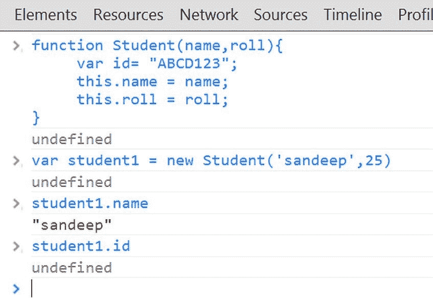

上面的 Chrome 控制台显示已创建一个 `student1` 对象。`name` 属性是可以访问的，因为在调用 `student1.name` 时显示了 `sandeep`。因此，`name` 是学生对象的公共属性。但 `id` 属性无法访问，在调用 `student1.id` 时返回 `undefined`。这表明 `id` 是 `student1` 对象中的私有属性。

### Q. 什么是原型属性 (prototype)？

通过使用 `Prototype`，我们可以向现有对象添加新成员。每个 JavaScript 对象内部都拥有这个属性。最初它是一个空对象。

**示例：**

```javascript
function Student(name,roll){
    this.name = name;
    this.roll = roll;
}

var student1 = new Student('sangeeta',30); 
Student.prototype.mark = 100; 
```

查看下方的 Chrome 控制台了解原型的使用。

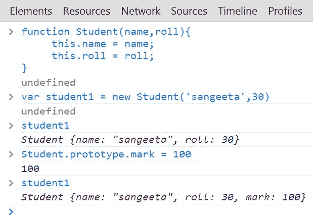

最初 `student1` 对象只有 `name` 和 `roll` 两个属性。通过原型，学生对象添加了一个新属性 `mark`，其值为 `100`。现在控制台显示 `mark` 属性也被添加到现有的 `student1` 对象中。

### Q. 什么是构造函数属性 (constructor)？

**答案**

对象的构造函数属性维持着其创建函数的引用。

**示例：**

让我们通过创建一个学生对象并调用它的构造函数属性来查看示例。

```javascript
function Student(name, mark){
    this.name=name;
    this.mark =mark;
}

var student1 = new Student('sandeep',123); 
console.log(student1.constructor);
```

查看以下截图，在 Chrome 控制台中查看上述代码。控制台日志正在打印由 `student1` 对象引用的函数。

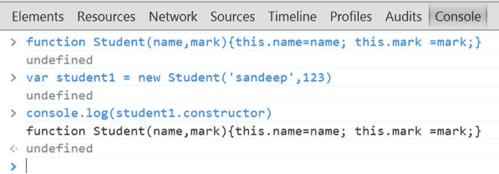

### Q. 如何调用其他类的方法？

**答案**

使用 `call()` 和 `apply()` 方法，我们可以将不同上下文的方法应用到当前上下文。这对于代码的可重用和上下文绑定非常有帮助。

`call()`：它用于在给定的 `this` 值下调用函数，并逐个提供参数。

`apply()`：它用于在给定的 `this` 值下调用函数，并以数组形式提供参数。

下面的代码有两个函数 `getTypeOfNumber()` 和 `getTypeOfAllNumber()`。这些函数的细节如下。`getTypeOfNumber`：此方法接收单个数字作为参数，并返回类型 `Even`（偶数）或 `Odd`（奇数）。

`getTypeOfAllNumber`：此方法接收数字数组作为参数，并返回一个包含 `Even` 或 `Odd` 的数组。

```javascript
var MyNumber = {
    getTypeOfNumber : function(number){
        var type = (number % 2 === 0) ? "Even" : "Odd"; 
        return type;
    },
    getTypeOfAllNumber : function (){
        var result = [],i=0;
        for (; i < arguments.length; i++){
            var type = MyNumber.getTypeOfNumber.call(null,arguments[i]);
            result.push(type)
        }
        return result;
    }
};

var typeOfNumber = MyNumber.getTypeOfNumber.call(null,21);
var typeOfAllNumber = MyNumber.getTypeOfAllNumber.apply(null,[2,4,5,7,8,21]);
```

（注：代码逻辑已格式化处理以便清晰）

### Q. 请用示例解释方法覆盖 (method overriding)

**答案**

我们可以通过再次声明定义来覆盖 JavaScript 的任何内置方法。现有的定义可以通过 `prototype` 属性访问并覆盖。考虑下面的示例，`split()` 是字符串对象的内置方法。它的默认行为是将指定的字符串拆分为数组，它是 `String` 类的成员函数。但我们使用其原型属性覆盖了它的定义。

下面的截图显示了 `split()` 方法的内置行为。它将字符串分成了元素数组。

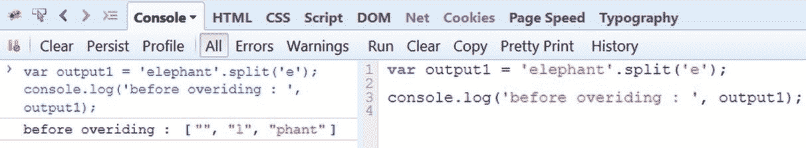

后续截图显示了 `split()` 方法的新覆盖定义。它现在返回 "I am overriden"。

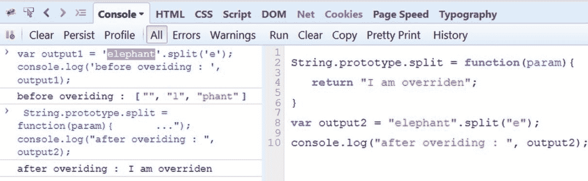

### Q. 如何继承一个类？

**答案**

在 JavaScript 中可以使用 `prototype` 属性实现继承。

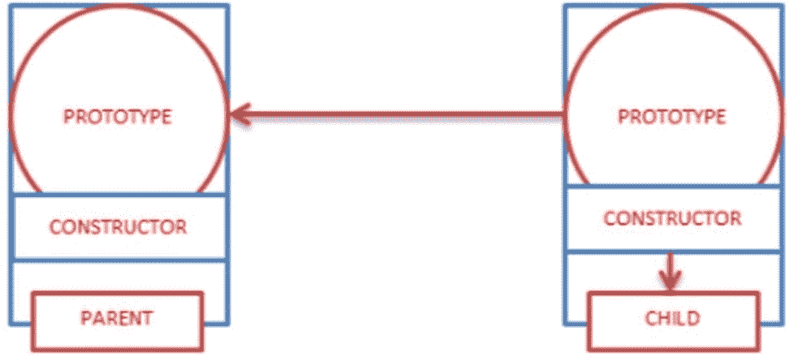

我们需要遵循两个步骤来创建继承。

**第 1 步：**

子类原型指向父类对象。

`<ChildClassName>.prototype = new <ParentClass>();`

**第 2 步：**

重置子类的原型构造函数指向自身。

`<ChildClassName>.prototype.constructor=<ChildClassName>`

**示例：**

下面的示例显示 `inputFields` 类是 `Student` 类的子类。因此 `ScienceStudent` 对象可以使用 `showMyType()` 方法。

```javascript
function Student(name){
    this.name=name;
}

Student.prototype.sayMyType = function(){
    console.log("I am student type")
}

function ScienceStudent(name){
}

inputFields.prototype = new Student();
inputFields.prototype.constructor = ScienceStudent;

var student2 = new ScienceStudent('sangeeta');
console.log(student2.sayMyType());
```

差异继承（Differential Inheritance）是一种常见的面向原型的模型，它使用的概念是大多数对象派生自其他更通用对象，仅在少数微小方面不同。每个对象都维护一个对其原型的引用以及一个包含不同属性的表。

### Q. `Object.create()` 方法的作用是什么？

**答案**

ECMAScript 5.1 在其规范中包含了该方法。该方法可以用于使用指定的原型对象和属性创建一个新对象。该方法的语法列如下。

`Object.create(proto[, propertiesObject])`

**示例：**

下面的代码包含一个 `Student` 类函数，它具有 `name` 属性，原型对象有一个方法 `getStudentName()`，该方法返回学生的姓名。通过使用 `Object.create()` 方法传递 `Student` 的原型对象并将 `name` 的值设为 `sandeep`，创建了一个新的 `student1` 对象。然后在 `student1` 对象上调用 `getStudentName()` 方法并在控制台中打印结果。

```javascript
function Student(name) {
  this.name = name;
}

Student.prototype = {
  getStudentName: function() {
    return "Name of Student is :" + this.name;
  }
};

var student1 = Object.create(Student.prototype);
student1.name = "Sandeep";

console.log(student1.getStudentName());
```

下面的截图显示了上述代码在开发者控制台中的输出。

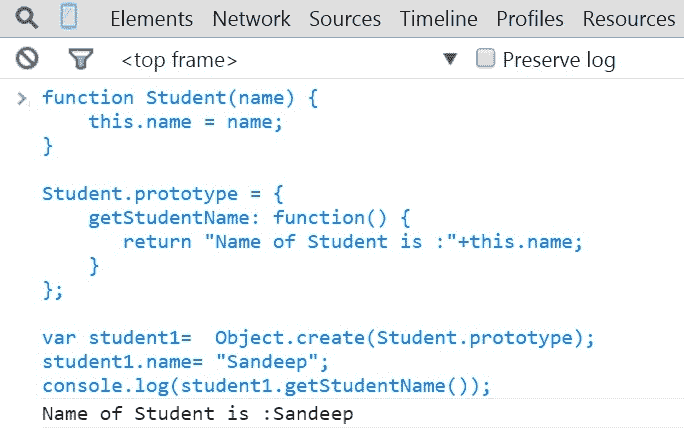

### Q. 如果浏览器中不存在 `Object.create()` 方法，如何为它编写一个 polyfill？

**答案**

ECMAScript 5.1 在其规范中包含了该方法。如果浏览器较旧，则不存在 `Object.create()` 方法。为了解决这个问题，我们需要编写一个 polyfill。下面的代码展示了 `Object.create()` 方法的 polyfill。

```javascript
//检查 Object 内部是否存在 create 方法
if (typeof Object.create != 'function') {
  //定义 create 方法
  Object.create = (function() {
    var Object = function() {};
    return function(prototype) {
      if (arguments.length > 1) {
        throw Error('Second argument not supported');
      }
      if (typeof prototype != 'object') {
        throw TypeError('Argument must be an object');
      }
      Object.prototype = prototype;
      var result = new Object();
      Object.prototype = null;
      return result;
    };
  })();
}
```

上述代码使用 `if` 条件通过将其类型与 `function` 来检查 `Object` 内部是否已存在 `create()` 方法。如果该条件成立，则意味着不存在 `create()` 方法。然后执行 polyfill 代码块并将空对象赋值给 `Object.create` 属性。

### Q. `Object.defineProperties()` 方法的目的是什么？

**答案**

ECMAScript 5.1 提供了 `Object.defineProperties()` 方法来为已定义的对象创建新属性。它提供了许多配置选项来初始化这些成员。下面的代码展示了该方法的用法。

```javascript
function Student(name) {
  this.name = name;
}

var student1 = Object.create(Student.prototype),
properties = {
  "subject": {
    value: "Computer",
    writable: true,
    enumerable: true
  },
  "marks": {
    value: 0,
    writable: false,
    enumerable: true
  }
};

Object.defineProperties(student1, properties);

student1.name = "Sandeep";
student1.subject = "Mathematics";
student1.marks = 75;

console.log(student1);
```

在上述代码中，使用 `Object.create()` 方法创建了一个 `student1` 对象。然后向该对象添加了一些如 `subject` 和 `marks` 的新属性。`enumerable` 决定了该属性是否可以作为属性被枚举。`writable` 属性决定了属性是否可修改。`value` 属性获取属性的默认值。下面的截图显示了上述代码在开发者控制台中的输出。

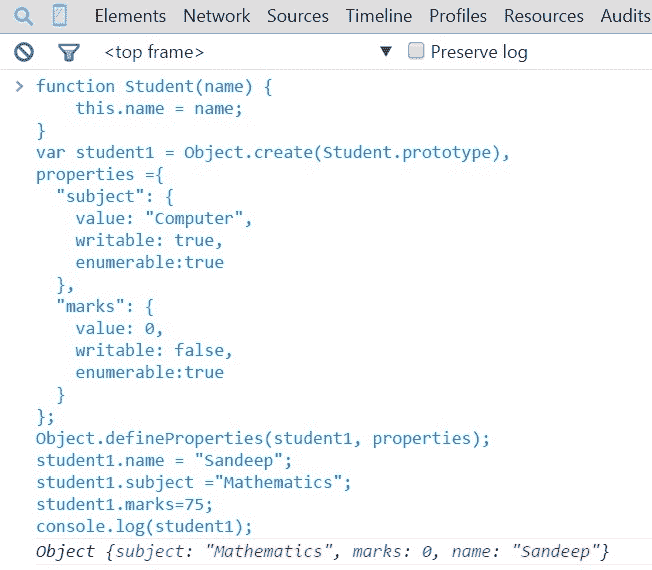

### Q. 如何在 JavaScript 中区分作用域（scope）和上下文（context）？

**答案**

作用域（scope）涉及变量的可见性，而上下文（context）指的是方法所属的对象，并且可以使用 `call` 或 `apply` 进行更改。

### Q. 变量可以赋值给空对象的两种方法是什么？

**答案**

在创建新的空对象时，你可以实例化 `Object()` 构造函数，或者简单地创建一个空对象字面量。在任何一种情况下，你都可以向新对象添加属性。创建空对象的语法列如下。

```javascript
var aEmptyObject = new Object();
var aEmptyObject = {};
```

## 第 2 章 关于事件的问题

### Q. 事件是如何工作的？

**答案**

事件传播遵循两个阶段：**捕获**（capturing）阶段和**冒泡**（bubbling）阶段。

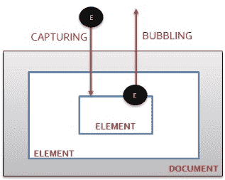

**捕获阶段：**

在此阶段，事件首先从 `DOCUMENT` **向下**传递到 `target` 元素，经过了所有内部元素。

**冒泡阶段：**

在此阶段，事件从 `target` 元素**向上**返回到 `DOCUMENT`，经过了所有外部包裹元素。

### Q. 如何将事件绑定到元素上？

**答案**

根据 DOM Level 2 事件规范，可以使用 `addEventListener()` 方法将事件绑定到元素上，该方法使用**三个**参数。

**语法：**

`<element>.addEventListener(eventname,eventcallback,booleanphase)`

**eventname:**

代表事件类型，如字符串 `click`、`mouseover`、`mouseout` 等。

**eventcallback:**

代表要处理的回调函数。

**booleanphase:**

这代表阶段。`false` 表示冒泡阶段，`true` 表示捕获阶段。

### Q. 在 IE9 版本之前如何绑定事件？

**答案**

在 IE 浏览器中，可以使用 `attachEvent()` 方法将事件绑定到元素。仅用于冒泡阶段。

**语法：**

`<element>.attachEvent(eventname,eventcallback)`

**示例：**

在文档上添加一个事件监听器，当事件发生时弹出提示框。

```javascript
document.addEventListener('click', function () {
  alert("Insider Event");
}, false);
```

### Q. 如何移除事件监听器？

**答案**

根据 DOM Level 2 事件规范，可以使用 `removeEventListener()` 方法移除事件监听器。对于 IE 浏览器，必须使用 `detachEvent()` 方法。

下面的截图显示在 IE 浏览器中从文档分离点击事件处理器。

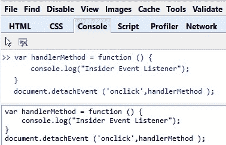

下面的截图显示在 Firefox 浏览器中从文档移除点击事件处理器。

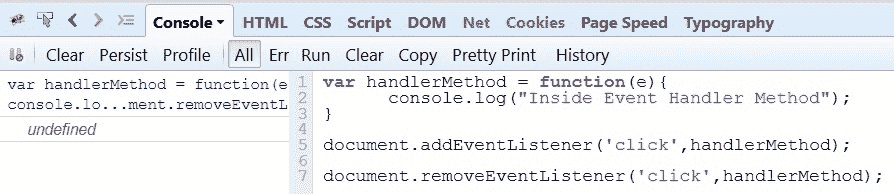

### Q. `setTimeout()` 和 `clearTimeout()` 函数是如何工作的？

**答案**


`setTimeout()` 方法在指定的毫秒数后**一次**调用函数或执行表达式。`clearTimeout()` 方法停止在 `setTimeout()` 方法中执行的函数执行。

**语法：**

`var timeOut = setTimeout(function,milliseconds,lang) clearTimeout(timeOut)`

下面的代码展示了这些超时方法的用法。

```javascript
var timeOutHandler= function(){
  console.log("inside Time Now ", new Date().getSeconds());
  clearTimeOut(timeOut);
}

console.log("Time Now ", new Date().getSeconds());
var timeOut = setTimeout(timeOutHandler,4000);
```

下面的截图显示在 4 秒后执行了 `timeOutHandler()` 方法。

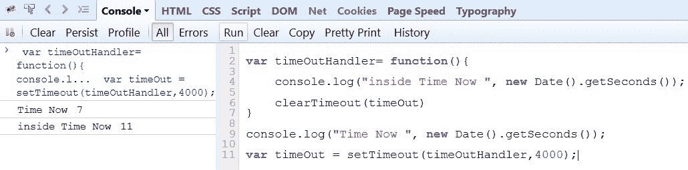

### Q. `setInterval()` 和 `clearInterval()` 函数是如何工作的？

**答案**

`setInterval()` 方法在指定的毫秒**间隔**内反复调用函数或执行表达式。`clearInterval()` 方法停止在 `setInterval()` 方法中设置的函数执行。

**语法：**

`var timeInterval = setInterval(function,milliseconds) clearInterval(timeInterval)`

下面的代码演示了这些间隔处理程序。

```javascript
var counter = 0,
timeIntervaltHandler= function(){
console.log("inside Time Now ", new Date().getSeconds()); counter++;

console.log("Handler Called count ",counter)

if(counter === 4) {
    clearInterval(timeInterval);
    console.log("Clearing the interval handler")
}
}
```

`console.log("Time Now ", new Date().getSeconds()); var timeInterval = setInterval(timeIntervaltHandler,2000);` 

下面的截图显示了处理器每 2 秒被调用 4 次。在第 4 次调用后 `clearInterval()` 移除了执行。

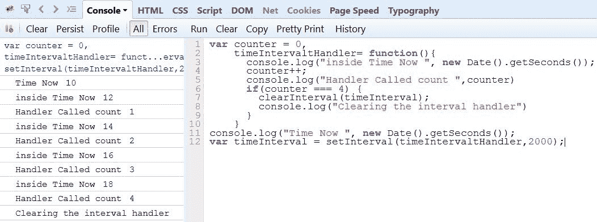

## 第 3 章 闭包

### Q. 什么是闭包？

**答案**

闭包是一个可以外部包装函数变量的内部函数。它具有三个作用域访问权限：

- **自身作用域 (Self-scope):** 它可以访问自身作用域内的属性。

- **包裹函数作用域 (Wrapped function’s scope):** 它可以访问其所在函数中的属性。

- **全局作用域 (Global Scope):** 它可以访问全局作用域（即 `window` 作用域）中的属性。

**示例：**

尽管 `prop1` 属于外部函数作用域，内部函数仍然可以访问 `prop1`。

```javascript
function myOuterFunction(){ var prop1 = 5;

  return function innerFunction(){
  return prop1;
  }
}
var res = myOuterFunction(); console.log(res.name);
console.log(res()); 
```

下面的截图显示了上述代码在控制台中的输出。

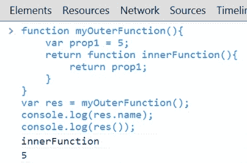

### Q. 请举例闭包概念的实际应用示例？

**答案**

在网页开发中，开发者更频繁地使用闭包。最常见的场景是我们需要某种工厂，返回一个带有不同值的函数对象，该对象可以被应用程序。

**示例：**

以下代码有一个名为 `backgroundColorFactory` 的背景颜色工厂，它返回一个带有输入颜色的函数。使用此工厂，我们创建了 `greenBackground` 和 `blueBackground` 函数对象并将其绑定到两个按钮上。当用户点击这些按钮时，`body` 的背景颜色将变为目标颜色。

```html
<!DOCTYPE html>
<html>
 <head>
<meta charset="utf-8">
<title>闭包实用示例</title>
</head>
<body>
<button id="greenButton">Green Background</button> <button id="blueButton">Blue Background</button> <script>
var backgroundColorFactory = function(color) { return function() {
document.body.style.background = color; };
};
var greenBackground = backgroundColorFactory('green'); var blueBackground = backgroundColorFactory('blue');
document.getElementById('greenButton').onclick = greenBackground;
document.getElementById('blueButton').onclick = blueBackground;
</script>
</body> 
</html>
```

上述代码的输出列在下面的截图中。

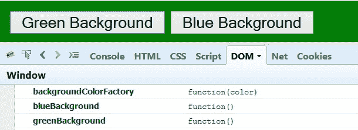

### Q. 如何使用闭包模拟私有数据？

**答案**

以下代码演示了私有变量 `_name` 的声明。这意味着我们可以使用 `new` 关键字通过 `Student` 构造函数为 `_name` 赋值。

```javascript
function Student(name) { var _name = name;

  this.getName = function() { return _name;
  };
}
var student1 = new Student("Sandeep"); student1 ._name = "John";
console.log(student1.getName());
```

上述代码的细节如下：

创建了一个 `Student` 对象 `student1`，其 `_name` 为 `Sandeep`。

给 `_name` 赋值了新名称值 `John`，但 `getName()` 方法在控制台中打印的是 `Sandeep`。这证明 `_name` 是私有的。

下面的截图显示了 Chrome 控制台中上一个代码的输出。

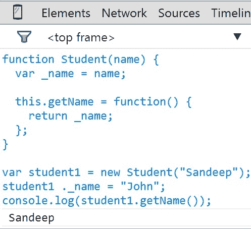

## 第 4 章 JSON 问题

### Q. 什么是 JSON？

**答案**

JSON 文本格式在语法上与创建 JavaScript 对象的代码相同。JSON 仅仅是 JS 对象字面量表示法的子集，但除了看起来相似，它们没有任何共同点。JSON 用作数据交换格式，类似于 XML。JSON 构建在两种结构之上：

1. 键值对集合。在各种语言中，它实现为对象、记录、结构体、字典、哈希表、键列表或关联数组。

2. 有序的值列表。在大多数语言中，它实现为数组、向量、列表或序列。

### Q. 为什么 Google 在他们的 JSON 响应前面加上 `while (1);`？

**答案**

这可以防止 JSON 劫持。这是为了确保其他网站无法进行恶意操作尝试窃取数据。通过替换数组构造函数，并通过 `<script>` 标签包含此 JSON URL，恶意的第三方网站可以从 JSON 响应中窃取数据。通过在开头放置 `while(1);`，脚本将会崩溃。相反，使用 `XHR` 和独立 JSON 解析器的同站请求可以轻松地忽略 `while(1);` 前缀。

### Q. 什么是 JSONP？

**答案**

JSONP 代表“带填充的 JSON”（JSON with Padding）。这意味着 JSON 数据被封装在一个函数调用中。在请求远程 JSON 数据时，网页上已经定义了一个回调（处理/填充）函数。

**示例：**

下面的 JavaScript 代码显示了针对远程 URL `//abcdurl` 的回调函数 `paddingFunction()`。

```javascript
function paddingFunction(data){
console.log("response data processing")
}
var script = document.createElement('script');
script.src = '//abcdurl?callback=paddingFunction'
document.getElementsByTagName('head')[0].appendChild(script);
```

### Q. 为什么使用 JSON 而不是 XML？

**答案**

- JSON 可以包含整数、字符串、列表、数组。

- 与 XML 相比，JSON 更小、更快、更轻量。

- JSON 更容易映射到面向系统中。

- JSON 和 XML 都使用 Unicode，因此支持国际化。

- JSON 是更好的数据交换格式。XML 是更好的文档交换格式。

- 由于浏览器缺少 JSON 解析器，JSON 更安全。如果数据是 XML，你可以编写 XSLT 模板并运行它输出到另一种格式：HTML、SVG、纯文本、逗号分隔，甚至是 JSON。在这里 XML 优于 JSON。

### Q. JSON 的 MIME 类型是什么？

**答案**

JSON 的 MIME 类型为 `application/json`。

### Q. JSON 支持哪些数据类型？

**答案**

JSON 支持的数据类型有数字、字符串、布尔、数组、对象、`null`。以下代码显示了一个包含不同类型的 JSON 对象：

```json
 { name:"Sandeep",
score:65,
isPassed: true,
subject: ["Computer", "Algebra"],
address: { city:"Bangalore", country:"India"}, email: null 
}
```

下面的截图显示了开发者工具控制台中上述 JSON 对象，所有属性以键值对列出。

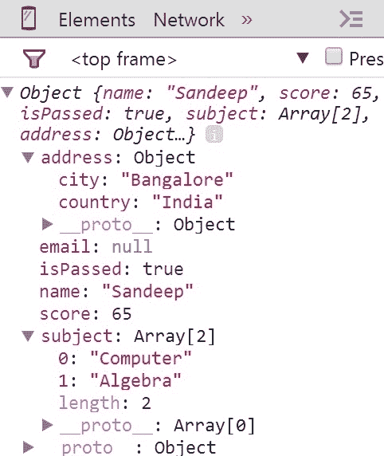

### Q. `JSON.stringify()` 方法的作用是什么？

**答案**

`JSON.stringify()` 将对象转换为 JSON 文本并将 JSON 文本存储在字符串中。下面的截图显示了 `stringify()` 方法的使用：

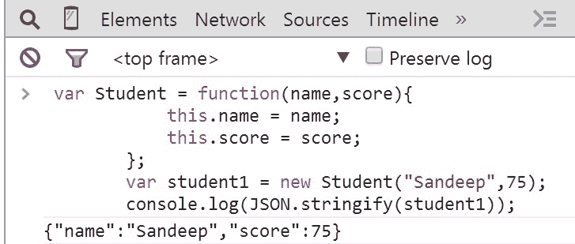

### Q. `JSON.parse()` 方法的作用是什么？

**答案**

`JSON.parse()` 方法将字符串解析为 JSON，并可以选择转换解析产生的值。下面的截图显示了使用 `JSON.parse()` 方法将 `student1` JSON 字符串转换为 JSON 对象。

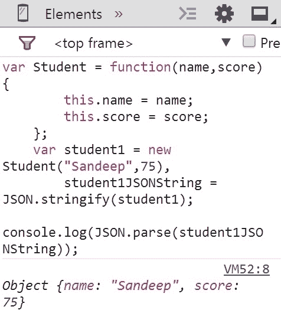

- **Text**: 它代表要解析为 JSON 的字符串。

- **Reviver (转换器)**: 它代表一个函数，规定了在返回之前如何对解析产生的原始值进行转换。

### Q. 如何将日期对象转换为 JSON？

**答案**

`toJSON()` 方法可以将日期对象转换为 JSON。下面的截图显示了在 Chrome 控制台中对日期对象使用 `toJSON()` 方法。

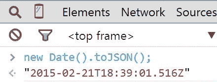

## 第 5 章 DOM 相关问题

### Q. 什么是 DOM？

**答案**

文档对象模型 (DOM) 是用于 HTML 和 XML 文档的编程 API。JavaScript 是最广泛用于访问 DOM API 属性和方法的语言。

### Q. DOM 中涉及哪些对象？

**答案**

根据 DOM Level 2 规范，它包含以下主要对象：

- `Attribute`: 代表一个元素属性。

- `Attributes`: 代表属性集合。

- `CDATASection`: 代表一个 XML CDATA 区。

- `Comment`: 代表一个 XML 注释。

- `Document`: 代表一个 XML 文档。

- `Element`: 代表一个 XML 元素节点。

- `Node`: 代表 XML 文档中的通用节点对象。

- `NodeList`: 代表节点对象的有序集合。

- `ProcessingInstruction`: 代表一个 XML 处理指令。

- `TextNode`: 代表一个 XML 文本节点。

### Q. DOM 中涉及哪些属性？

**答案**

根据 DOM Level 2 规范，它包含以下主要属性：

- `name`: 拥有 `Attribute` 的名称。

- `namespaceURI`: 代表节点的命名空间 URI。

- `nextSibling`: 包含文档源顺序中 `Node` 的下一个兄弟节点。

- `nodeName`: 代表节点的名称。

- `nodeType`: 代表节点的类型。

- `nodeValue`: 拥有节点的值。

- `ownerDocument`: 包含该 `Node` 的 `Document` 对象的引用。

- `ownerElement`: `Attribute` 所属的 `Element` 的引用。

- `parentNode`: 代表节点所属的父 `Node`。

- `prefix`: 代表节点的命名空间前缀。

- `previousSibling`: 包含文档源顺序中 `Node` 的上一个兄弟节点。

- `text`: 拥有该 `Node` 及其包含的任何元素节点所包含的所有文本节点的内容。

- `value`: 拥有 `Attribute` 的值。

- `attributes`: 代表 `Attribute` 对象的集合。

- `childNodes`: 代表节点对象的 `NodeList` 集合。

- `data`: 代表存储在 `TextNode`、`CDATASection` 或 `Comment` 中的文本。

- `documentElement`: 包含文档根元素节点。

- `firstChild`: 是文档源顺序中 `Node` 的第一个孩子。

- `lastChild`: 是文档源顺序中 `Node` 对象的最后一个孩子。

- `length`: 代表集合中元素的数量。

- `localName`: 拥有节点的本地名称。

### Q. 什么是 window load 事件？

**答案**

加载事件通常在对象完成后触发。Window load 事件在图像、脚本文件、CSS 文件和其他依赖项加载时触发。下面的截图显示了 load 事件的使用。

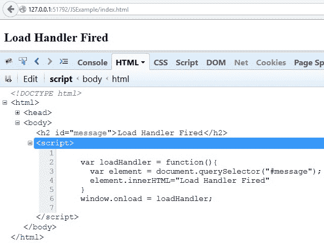

### Q. 什么是 DOM ready 事件？

**答案**

DOM ready 事件在元素加载到浏览器时触发。它不会等待图像和其他文件的加载。我们可以通过挂载回调方法来监听此事件。可以将方法添加到 `readyStateChange` 或 `DOMContentLoaded`。下面的代码展示了这些事件的使用。

```html
<!DOCTYPE html>
<html
<head>
<title>Window Ready Event Example</title>
<script>
var readyHandler = function(){
var element = document.querySelector("#message1"); element.innerHTML = "Ready Handler Fired : readystatechange <span style='color:blue','"+new Date()+"
</span>"
}
document.onreadystatechange = readyHandler; </script>
<script>
document.addEventListener("DOMContentLoaded",
function(event) {
var element = document.querySelector("#message2"); element.innerHTML = " Ready Handler Fired :
DOMContentLoaded <span style='color:red='"+new
Date()+"</span>";
});
</script>
</head>
<body>
<h2 id="message1">
</h2>
<h2 id="message2">
</h2>
</body>
</html> 
```

下面的截图显示了上述代码的输出。

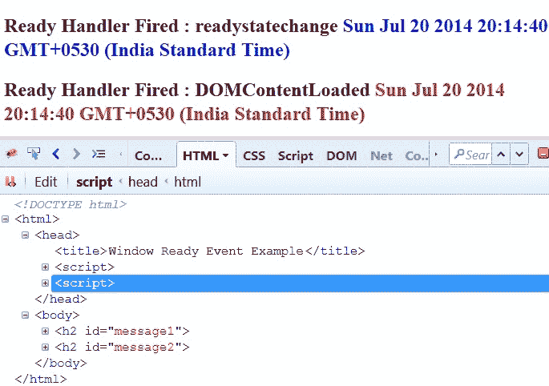

### Q. DOM 中的 query selector（查询选择器）是什么？

**答案**

DOM 提供了 `querySelector()` 和 `querySelectorAll()` 方法来选择 DOM 元素。`querySelector()` 方法返回一个在 DOM 中第一个匹配的元素。`querySelectorAll()` 方法返回一个匹配元素的节点列表。下面的代码演示了如何使用这些方法从 DOM 中选择元素。


```html
<!DOCTYPE html>
<html>
<head>
<title>Document Query Selector Example</title>
</head>
<body>
<h5 class="name">Sandeep Kumar Patel</h5>
<h4 class="country">India</h4>
<h4 class="country">UK</h4>
<h5 class="name">Surabhi Patel</h5>
<h4 class="country">US</h4>
<h4 id="my-score">520</h4>
<script>
var element = document.querySelector( "#my-score" ); element.style.color="red";
var elements = document.querySelectorAll("h4#my-score,
h5.name");
for (var item of elements) {
item.style.fontStyle = "Italic";
}
var aElement = document.querySelector( "h4.country, h4#my-score" );
aElement.style.background="orange";
</script>
</body>
</html> 
```

下面的截图显示了上述代码的输出。


### Q. DOM 的主要数据类型是什么？

### 回答

`Node` 接口是 DOM 的数据类型。它代表 DOM 树中的单项。`Document`、`Element`、`CharacterData`、`ProcessingInstruction`、`DocumentFragment`、`DocumentType`、`Notation`、`EntityReference` 都继承自 `Node`。

### Q. DOM 中的 document fragment（文档碎片）是什么？

### 回答

`DocumentFragment` 是 DOM 的轻量版本。它没有父类。开发者通常将其作为 DOM 元素的临时存储。下面的代码展示了创建文档碎片并添加 HTML 元素最后将其放入 body 的示例。

```html
<!DOCTYPE html>
<html>
<head>
<title>DocumentFragment Example</title>
</head>
<body>
<script>
var aFragment = document.createDocumentFragment(), aHTMLElement = document.createElement("h2"), aTEXTElement = document.createTextNode("SANDEEP");
aHTMLElement.appendChild(aTEXTElement);
aFragment.appendChild(aHTMLElement);
document.body.appendChild(aFragment);
</script>
</body>
</html>
```

下面的截图显示一个带有 SANDEEP 值的文本节点的 h2 元素被放置在文档碎片中。最后将文档碎片作为子元素添加到 body 元素中。

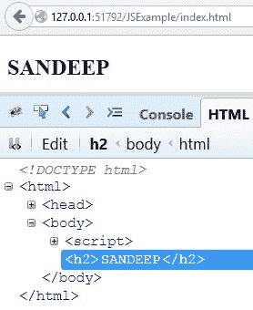

`"http://www.w3.org/TR/html4/loose.dtd"`

### **HTML 4.01 Frameset**: 此 DTD 等于 HTML 4.01 Transitional，但允许使用 frameset 内容。

```html
<!DOCTYPE HTML PUBLIC "-//W3C//DTD HTML 4.01 Frameset//EN" "http://www.w3.org/TR/html4/frameset.dtd">
```

### **XHTML 1.0 Strict**: 此 DTD 包含所有的 HTML 元素和属性，但**不包含**表现层或已弃的元素（如 `font`）。不允许使用 framesets。标记必须写成良好的 XML。

```html
<!DOCTYPE html PUBLIC "-//W3C//DTD XHTML 1.0 Strict//EN" "strict.dtd">
```

### **XHTML 1.0 Transitional**: 此 DTD 包含所有的 HTML 元素和属性，**包括**表现层和已弃的元素（如 `font`）。不允许使用 framesets。标记必须写成良好的 XML。

```html
<!DOCTYPE html PUBLIC "-//W3C//DTD XHTML 1.0 Transitional//EN" "transitional.dtd">
```

### **XHTML 1.0 Frameset**: 此 DTD 等于 XHTML 1.0 Transitional，但允许使用 frameset 内容。

```html
<!DOCTYPE html PUBLIC "-//W3C//DTD XHTML 1.0 Frameset//EN" "frameset.dtd">
```

### **XHTML 1.1**: 此 DTD 等于 XHTML 1.0 Strict，但允许你添加模块（例如为东亚语言提供注音支持）。

```html
<!DOCTYPE html PUBLIC "-//W3C//DTD XHTML 1.1//EN" "http://www.w3.org/TR/xhtml11/DTD/xhtml11.dtd">
```

## 第 6 章 Date 对象 (Date Object)

问：什么是 JavaScript Date 对象？

**答案**

JavaScript `Date` 对象返回该时刻的时间。它包含了自 1970 年 1 月 1 日 UTC 以来的毫秒数值。

问：创建 `Date` 对象的不同方法有哪些？或者 `Date` 对象不同的构造函数形式形式？

**答案**

JavaScript `Date` 对象有 4 个重载构造函数。这些构造函数列如下：

```
new Date()
new Date(milliseconds)
new Date(dateString)
new Date(year, month, day, hours, minutes, seconds, milliseconds)
```

问：如何在日期对象中获取 1970 年 1 月 1 日（即计算时间的起始日期）？

**答案**

1970 年 1 月 1 日是计算时间为经过的毫秒数的起始日。可以通过创建一个参数为 0 的新 JS 对象来计算。下面的截图演示了参数为 `0` 的日期对象。

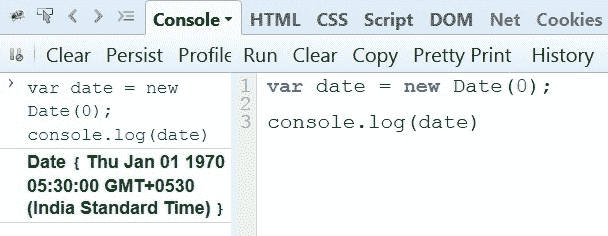

问：JavaScript 如何计算月份的？

**答案**

JavaScript 从 0 到 11 计算一年的十二个月份。0 代表 1 月，11 代表 12 月。下面的截图显示了今天日期（2014 年 7 月 23 日）的代码，`getMonth()` 返回 6。

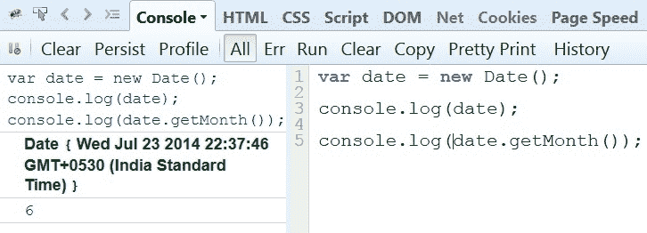

问：什么时候会发生 `RangeError` 无效日期异常？

**答案**

当使用无效的日期字符串创建日期对象，并对该无效日期应用 `toISOString()` 方法时，就会发生 `RangeError`。下面的截图显示了字符串 '2014-13-13$，它代表 YYYY-MM-DD 格式，但月份超出范围，产生了 `RangeError` 异常。

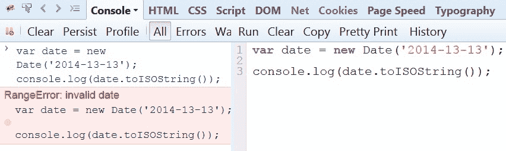

## 第 7 章 正则表达式 (Regular Expression)

问：JavaScript 中的正则表达式是什么？

**答案**

正则表达式用于字符串的模式匹配。JavaScript 中的正则表达式可以通过两种方式声明。这两种方法的语法列在下方：

```javascript
var aRegExpression = new RegExp(pattern,modifiers);
var aRegExpression = /pattern/modifiers;
```

这些语法的细节如下：

- `pattern`：表示搜索字符串。

- `modifiers`：表示应用于模式匹配的条件开关。

问：正则表达式有哪些方法？

**答案**

下面列出了 3 种不同的正则表达式方法：

- `exec()`：扫描匹配字符串并返回第一个匹配字符串。

- `test()`：扫描匹配字符串并返回布尔值 `false` 或 `true`。

- `toString()`：此方法返回正则表达式的字符串值。

问：切换符 `\w` 代表什么？

**答案**

`\w` 代表字母数字字符。下面的代码演示了 `\w` 关的使用。

```javascript
var regEx= /\wu/;
var out1 = regEx.exec("sandeep Ku Patel"), out2 = regEx.test("sandeep Ku Patel");
console.log(out1);
console.log(out2);
```

下面的截图显示了上述代码的输出，该模式匹配任何第二个字符为 `u` 的字母数字字符子串。

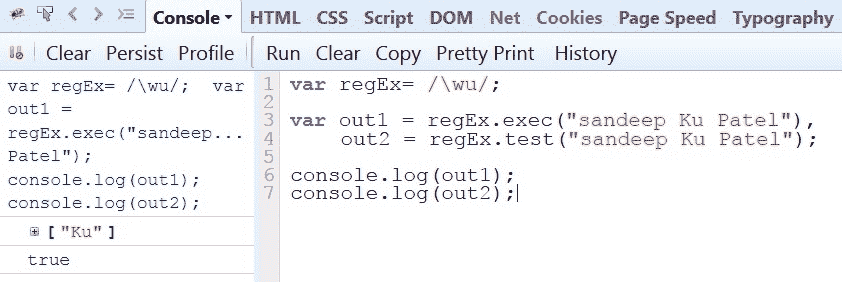

问：写一个正则表达式来反转姓和名？例如，将 Sandeep Patel 变为 Patel Sandeep。

**答案**

要反转姓和名，我们必须在输入字符串上对正则表达式使用 `replace()` 函数。下面的代码显示了反转姓和名的方法。

```javascript
var reverseFirstLastName = function(nameString){
var regex = /(\w+)\s(\w+)/,
resultString = 
```

较多数量的对象 (>10k)，或两者兼有。

具有良好的文本渲染能力。

由于基于 DOM 的渲染，具有更好的 SEO 和可访问性。

可以通过脚本和 CSS 修改。

当对象数量较少 (<10k)、面积较大或两者兼有时性能更好。

### Q. 什么是 canvas 2d context？它是如何创建的？

**答案**

使用 `getContext()` 方法并传入参数 `'2d'` 可以创建一个画布上下文。

该上下文方法是 `CanvasRenderingContext2D` 对象的一种。以下代码展示了简单的 2d 上下文创建并打印了对象的构造函数。

```html
<html
<body>
<canvas id="myCanvas"></canvas>
<script>
var canvas = document.getElementById("myCanvas"), context = canvas.getContext("2d");
console.log(context.constructor);
</script>
</body>
</html>
```

接下来的截屏显示了上下文对象的构造函数，它是原生对象 `CanvasRenderingContext2D`。 

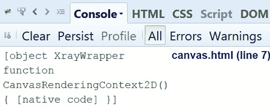

### Q. 如何在 Canvas 中加载图像？

**答案**

可以使用 `drawImage()` 方法加载图像。该方法绘制图像时需要多个输入参数。这些参数是定位和裁剪类型。我们将在后续的问题中讨论这些参数。以下代码展示了如何使用 `drawImage()` 方法从 URL 在画布内部加载 PNG 图像。

```html
<html
<body>
<canvas id="myCanvas"></canvas>
<script>
var canvas = document.getElementById("myCanvas"), context = canvas.getContext("2d"),
img = new Image();
img.src = "http://www.gravatar.com/avatar/4205261332ff131e971b48db31dcb528.png";
img.onload = function() {
context.drawImage(img, 10, 10);
};
</script>
</body>
</html>
```

下面的截屏显示了 Gravatar 图像被绘制在 HTML5 canvas 元素内部。该绘制是使用 2d context 完成的。

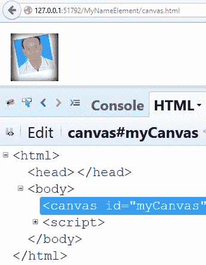

### Q. drawImage() 方法有哪些不同的重载签名？

**答案**

`drawImage()` 方法有 3 种不同的签名，列如下：

- `drawImage(img, x, y)` : 该方法将图像放置在画布的 `<x, y>` 坐标处。

- `drawImage(img, x, y, width, height)` : 该方法将图像放置在画布的 `<x, y>` 坐标处，具有指定的 `height`。

- `drawImage(img, sx, sy, swidth, sheight, x, y, width, height)` : 该方法根据起点 `<sx, sy>`、高度 `sheight` 和宽度 `swidth` 对图像进行裁剪，并将其放置在 `<x, y>` 坐标处，具有指定的 `height` 和 `width`。

## 第 9 章 Geo Location API

### Q. 什么是 Geo Location API？

**答案**

Geo Location API 向网络发布用户的地理位置。出于隐私考虑，它需要用户的许可。Geo location API 存在于 `navigator.geolocation` 对象中。

### Q. 如何判断浏览器是否支持 Geo Location API？

**答案**

判断浏览器是否支持 Geo Location API，需要检查 `navigator.geolocation` 对象。以下代码展示了该逻辑：

```javascript
function isGeoLocationSupported() {
    return !!(navigator.geolocation);
}
if (isGeoLocationSupported()) {
    console.log("Geo Location API is supported");
} else {
    console.log("Geo Location API is not supported");
}
```

接下来的截屏显示了检查的结果 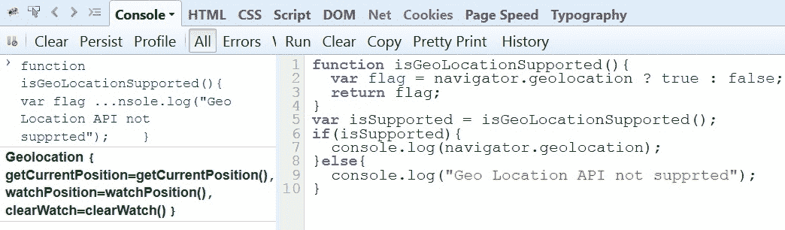

## 第 10 章 Web Workers

### Q. 什么是 Web Workers？

**答案**

Web Workers 是一种在后台运行脚本而不影响主线程性能的特性，允许进行大量计算。

### Q. 如何检测是否支持 Web Worker？

**答案**

我们可以通过验证 `Worker` 对象来检查是否支持 Web Workers：

```javascript
if (window.Worker) {
    console.log("Web Workers are supported");
} else {
    console.log("Web Workers are not supported");
}
```

### Q. 什么是专用 worker (dedicated worker)？

**答案**

专用 worker 是只能被一个脚本访问的 worker。它通过指定脚本文件创建。

```javascript
var worker = new Worker("worker.js");
```

### Q. 什么是共享 worker (shared worker)？

**答案**

共享 worker 可以被同源的不同窗口或 iframe 的多个脚本访问。

```javascript
var sharedWorker = new SharedWorker("worker.js");
```

### Q. 开发一个专用 worker 来显示时间？

**答案**

让我们在 `dateWorker.js` 中创建一个时间 worker，并每秒显示一次当前时间。

**dateWorker.js:**

```javascript
setInterval(function() {
    var time = new Date();
    self.postMessage({
        hour: time.getHours(),
        minute: time.getMinutes(),
        second: time.getSeconds()
    });
}, 1000);
```

**dateDemo.html:**


```html
<!DOCTYPE html>
<html lang="en">
<head>
    <meta charset="UTF-8">
    <title>Time Worker Demo</title>
</head>
<body>
<h1 id="resultContainer"></h1>
<button id="timeButton">Get Time</button>
<script>
var dateWorker = new Worker("dateWorker.js"),
resultContainer = document.getElementById("resultContainer"),
timeButton = document.getElementById("timeButton");

timeButton.addEventListener("click", function(){
    dateWorker.postMessage(null);
});

dateWorker.addEventListener("message", function(workerEvent){
    var responseData = workerEvent.data,
    hour = responseData.hour,
    minute = responseData.minute,
    second = responseData.second;
    resultContainer.innerText = "HOUR: " + hour + " MINUTE: " + minute + " SECOND: " + second;
});
</script>
</body>
</html>
```

上述代码的输出显示了从 worker 返回的小时、分钟和秒。

### Q. 开发一个专用 worker 来计算数字的平方？

**答案**

平方 worker 的定义在`doSquareWorker.js`中，它监听消息并生成数字的平方。

**doSquareWorker.js:**

```javascript
self.addEventListener("message", function(event){
    var inputData = event.data,
    inputNumber = parseInt(inputData.number,10),
    squareResult = Math.pow(inputNumber,2);
    self.postMessage({result:squareResult});
});
```

**squareWorkerDemo.html:**

```html
<!DOCTYPE html>
<html lang="en">
<head>
    <meta charset="UTF-8">
    <title>Square Worker</title>
</head>
<body>
    <input type="number" id="numInput">
    <button id="calcBtn">Calculate Square</button>
    <p id="result"></p>
    <script>
        var worker = new Worker("doSquareWorker.js");
        var numInput = document.getElementById("numInput");
        var calcBtn = document.getElementById("calcBtn");
        var result = document.getElementById("result");

        calcBtn.addEventListener("click", function(){
            worker.postMessage({number: numInput.value});
        });

        worker.addEventListener("message", function(e){
            result.innerText = "Square: " + e.data.result;
        });
    </script>
</body>
</html>
```

```html
<!DOCTYPE html>
<html lang="en">
<head>
    <meta charset="UTF-8">
    <title>Square Web Worker 示例</title>
</head>
<body>
<h1 id="resultContainer"></h1>
<input type="number" id="inputNumber" placeholder="输入数字" value="5">
<button id="squareButton">平方</button>
<script>
var squareWorker = new Worker("doSquareWorker.js"), resultContainer = document.getElementById("resultContainer"), squareButton = document.getElementById("squareButton"), inputNumber=document.getElementById("inputNumber");

squareButton.addEventListener("click",function(){ squareWorker.postMessage({number:inputNumber.value});
});

squareWorker.addEventListener("message",function(workerEvent){ var responseData = workerEvent.data,
squareResult= responseData.result;
resultContainer.innerText = squareResult;
});
</script>
</body>
</html>
```

下面截图中所示代码的输出通过 worker 响应消息显示了数字的平方。

### Q. 如何定义内联 web worker？演示一个用于两个数字相乘的内联 worker？

**答案**

内联 web worker 可以在 HTML 标记中使用`<script>`标签定义，`type`属性值为`javascript/worker`。**语法：**

```html
<script type="javascript/worker">
// 用于定义 worker 的 JavaScript 代码
</script>
```

**示例：**

`inlineWorkerDemo.html`文件包含了定义乘法 worker 的代码，它监听消息、计算乘法结果并发送响应。乘法 worker 的监听器提取结果并在浏览器中渲染。以下代码显示了`inlineWorkerDemo.html`文件的内容。

```html
<!DOCTYPE html>
<html>
<head lang="en">
<meta charset="UTF-8">
<title>内联 Web Worker 示例</title>
</head>
<body>
<h1 id="resultContainer"></h1>
<input type="number" id="number1" value="8" placeholder="输入第一个数字"> <input type="number" id="number2" value="10" placeholder="输入第二个数字">
<button id="multiplyButton">相乘</button>
<script id="multiplyWorker" type="javascript/worker">
self.addEventListener("message",function(event){
var requestData = event.data,
number1 = requestData.number1,
number2 = requestData.number2,
multiplyResult = number1 * number2;
self.postMessage({result:multiplyResult});
});
</script>
<script>
var textContent = document.querySelector('#multiplyWorker').textContent, workerBlob = new Blob([textContent]),
workerURL = window.URL.createObjectURL(workerBlob), multiplyWorker = new Worker(workerURL),
resultContainer = document.getElementById("resultContainer"), multiplyButton = document.getElementById("multiplyButton"), number1 = document.getElementById("number1"),
number2 = document.getElementById("number2");

multiplyButton.addEventListener("click", function () {
multiplyWorker.postMessage({
number1:parseInt(number1.value,10),
number2: parseInt(number2.value,10)
});
});

multiplyWorker.addEventListener("message", function (workerEvent) {
var responseData = workerEvent.data,
result = responseData.result;
resultContainer.innerText = "Result: " + result;
});
</script>
</body>
</html>
```

用户可以在文本框中输入两个数字并点击相乘按钮。乘法 worker 计算乘法结果，结果在浏览器中渲染。上述代码的输出如如下截图所示。

### Q. 如何在 web worker 中处理错误？

**答案**

我们可以在 web worker 中使用`throw`关键字抛出错误。可以将一个回调方法附加到`error`事件上，以处理生成的错误。`positiveNoSqaureWorkerDemo.html`文件包含一个只接受正数作为输入的 worker。如果传递了负数，它将抛出错误。该文件的代码内容如下。

```html
<!DOCTYPE html>
<html>
<head lang="en">
<meta charset="UTF-8">
<title>Web Worker 错误处理器示例</title>
</head>
<body>
<h1 id="resultContainer"></h1>
<input type="number" id="number1" value="-4" placeholder="输入数字"> <button id="squareResult">平方</button>
<script id="squareWorker" type="javascript/worker">
self.addEventListener("message",function(event){
var requestData = event.data,
number1 = requestData.number1,
squareResult = 0;
if(number1>0) {
squareResult = number1 * number1
self.postMessage({result:squareResult});
} else{
// 负数抛出错误
throw "It is a negative number.Please supply a positive number.";
}
});
</script>
<script>
var textContent = document.querySelector('#squareWorker').textContent,
workerBlob = new Blob([textContent]),
workerURL = window.URL.createObjectURL(workerBlob),
squareWorker = new Worker(workerURL),
resultContainer = document.getElementById("resultContainer"),
squareResult = document.getElementById("squareResult"),
number1 = document.getElementById("number1");

multiplyButton.addEventListener("click", function () {
multiplyWorker.postMessage({
number1:parseInt(number1.value,10),
number2: parseInt(number2.value,10)
});
});

multiplyWorker.addEventListener("message", function (workerEvent) {
var responseData = workerEvent.data,
result = responseData.result;
resultContainer.innerText = "Result: " + result;
});
</script>
</body>
</html>
```

上述代码的输出通过 worker 响应消息在浏览器中渲染。

### Q. 如何 web worker 中导入外部脚本？通过示例进行演示？

**答案**

在 web worker 中导入外部脚本需要使用`importScripts()`方法，并将文件名作为参数。为了演示导入功能，我们创建了三个文件`greatest-script.js`、`numberWorker.js`和`numberWorkerDemo.html`。截图显示了这些文件。

`greatest-script.js`是我们需要导入到 web worker 中的脚本。它包含一个找出两个数字中较大者的方法。以下是`greatest-script.js`文件的内容。

```javascript
var findestNumber = function(number1,number2){
return number1>number2 ? number1 : number2;
};
```

`numberWorker.js`文件包含了在 web worker 内部导入脚本的消息监听回调方法。以下是`numberWorker.js`文件的内容。

```javascript
self.addEventListener("message",function(event){
importScripts('greatest-script.js'); var requestData = event.data, 
number1 = requestData.number1,
number2 = requestData.number2,
greatestNumber = findNumber(number1,number2); self.postMessage({result:greatestNumber});
});
```

`numberWorkerDemo.html`文件包含了实例化 number worker 并监听响应消息的代码。以下是`numberWorkerDemo.html`文件的内容。


```html
<!DOCTYPE html>
<html>
<head lang="en">
<meta charset="UTF-8">
<title>Time Web Worker 示例</title>
</head>
<body>
<h1 id="resultContainer"></h1>
<input type="number" id="number1" value="7" placeholder="输入第一个数字"> <input type="number" id="number2" value="9" placeholder="输入第二个数字">
<button id="greatButton">寻找最大数字</button>
<script>
var numberWorker = new Worker("numberWorker.js"), resultContainer = document.getElementById("resultContainer"), greatButton = document.getElementById("greatButton"), number1 = document.getElementById("number1"), number2 = document.getElementById("number2");
greatButton.addEventListener("click", function () {
  numberWorker.postMessage({
    number1:parseInt(number1.value,10),
    number2: parseInt(number2.value,10)
  });
});
numberWorker.addEventListener("message", function (workerEvent) {
  var responseData = workerEvent.data,
  result = responseData.result;
  resultContainer.innerText = "Result: " + result;
});
</script>
</body>
</html>
```

```javascript
greatButton.addEventListener("click",function(){
  numberWorker.postMessage({
    number1:parseInt(number1.value,10),
    number2: parseInt(number2.value,10)
  });
});

numberWorker.addEventListener("message",function(workerEvent){ 
  var responseData = workerEvent.data;
  resultContainer.innerText = "Greatest Number: "+responseData.result;
});
```

这段代码的输出如如下截图所示，包含了所提供数字中的最大值。

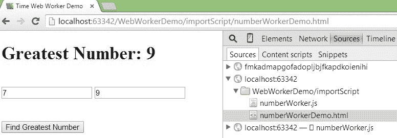

## Q. 创建一个共享 worker（shared worker）来计算字符串的长度？

**答案**

`calculateLengthWorker.js` 包含了监听消息和计算输入字符串长度的代码。共享 worker 通过监听 `connect` 事件来监听端口中的消息。`calculateLengthWorker.js` 文件的代码如下：

```javascript
self.addEventListener("connect", function (event) {
  var port = event.ports[0];
  port.addEventListener("message", function (event) {
    var requestData = event.data,
    inputString = requestData.string,
    stringLength = inputString.length;
    port.postMessage({result:stringLength});
  }, false);
  port.start(); 
}, false);
```

`lengthWorkerDemo.html` 文件包含了实例化共享 worker 并在浏览器中渲染响应的代码。`lengthWorkerDemo.html` 文件的代码内容如下：

```html
<!DOCTYPE html>
<html>
<head lang="en">
<meta charset="UTF-8">
<title>Shared Web Worker Demo</title> 
</head>
<body> 
<h1 id="resultContainer"></h1>
<input type="text" id="inputString" value="Hello" placeholder="Enter a string"> <button id="lengthButton">Get Length</button>
<script>
var lengthWorker = new SharedWorker("calculateLengthWorker.js"), 
    resultContainer = document.getElementById("resultContainer"), 
    lengthButton = document.getElementById("lengthButton"), 
    inputString = document.getElementById("inputString");

lengthButton.addEventListener("click", function () {
  resultContainer.innerText = "";
  lengthWorker.port.postMessage({
    string :inputString.value
  });
});

//start the worker
lengthWorker.port.start();

//Success Handler for the worker
lengthWorker.port.addEventListener("message", function (workerEvent) {
  var responseData = workerEvent.data,
  result = responseData.result;
  resultContainer.innerText = "Result: " + result;
});
</script>
</body>
</html> 
```

前述代码的输出如下截图所示，显示了输入字符串的长度。

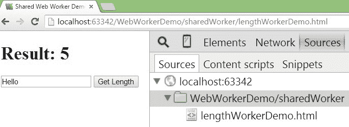

## 第 11 章 本地存储 (Local Storage)

### Q. 什么是本地存储？

**答案**

HTML5 提供了一项在终端用户浏览器中本地存储数据的功能。数据以键值对的形式在浏览器中。与 cookie 不同，它的平均空间为 5 MB。这种存储分为两种不同的类型：`sessionStorage` 和 `localStorage`。

`localStorage`：它存储不带过期日期的数据。`sessionStorage`：它存储带有过期日期的数据。

### Q. 哪一个是主要的存储接口？

**答案**

`window.Storage()` 是实现 `localStorage` 和 `sessionStorage` 的主接口。该接口的定义如下。

```javascript
interface Storage {
  readonly attribute unsigned long length;
  DOMString? key(unsigned long index);
  getter DOMString? getItem(DOMString key);
  setter creator void setItem(DOMString key, DOMString value);
  deleter void removeItem(DOMString key);
  void clear();
}
```

上述代码的细节如下：

`setItem(key,value)`：此方法使用键值对在存储中存储值。

`getItem(key)`：此方法使用键检索已存储的对象。

`removeItem(key)`：此方法根据键删除存储的项。

`clear()`：删除存储器中的所有项。`length`：此属性返回存储的长度，即存储器内部元素的数量。

`key(position)`：此方法返回给定数字位置的值对应的键。

### Q. 如何在本地存储中存储和检索对象？

**答案**

本地存储提供了 `setItem()` 和 `getItem()` 来从存储中存储和检索对象。`setItem(key, value)` 方法接受 2 个输入参数来存储对象。`getItem(key)` 方法使用键作为输入参数检索值。下面的代码显示在“myName”键中存储“Sandeep Kumar”字符串，然后检索该字符串并放入 HTML 元素中。

```html
<!DOCTYPE html>
<html>
<body>
<div id="resultContainer"></div> 
<script>
var container = document.getElementById("resultContainer");
localStorage.setItem("myName", "Sandeep Kumar"); 
container.innerHTML = localStorage.getItem("myName"); 
</script>
</body>
</html>
```

下面的截图显示了 Chrome 开发者工具的存储预览，它将上述对象作为键值对持有。

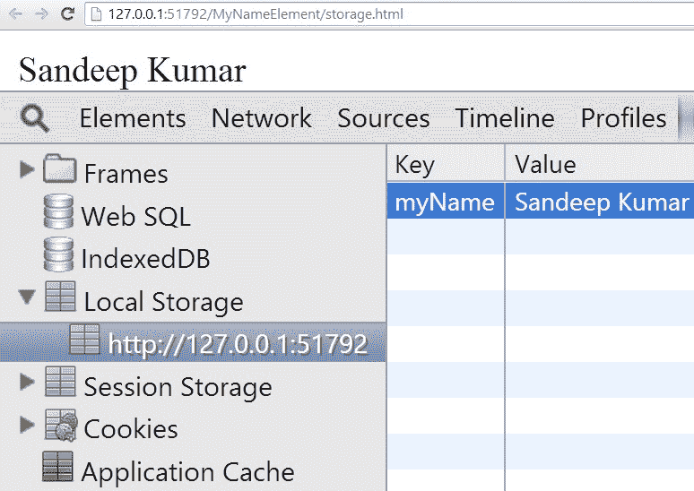

### Q. 如何为本地存储附加事件？

**答案**

当本地存储对象被修改时，会触发 `storage` 事件。可以使用 `addEventListener()` 在 `window` 对象上附加回调方法。

**注意**：在存储上调用 `setItem()`、`removeItem()` 和 `clear()` 时，会触发 `storage` 事件。下面的代码有一个监听存储的回调方法。

```html
<!DOCTYPE html>
<html>
<body>
<div id="resultContainer"></div>
<button onclick="update()">Click Me</button>
<script>
var container = document.getElementById("resultContainer"),
methodStorageEvent = function(event){ 
  container.innerHTML = "Event Fired"+localStorage.getItem("myName");
},
counter = 1,
update = function(){
  localStorage.setItem("myName", ++counter);
  container.innerHTML = localStorage.getItem("myName");
};
window.addEventListener("storage", methodStorageEvent, false)
</script>
</body>
</html>
```

下面的截图演示了如何触发存储事件，以及访问相同页面的其他标签如何接收存储事件并更新其内容。

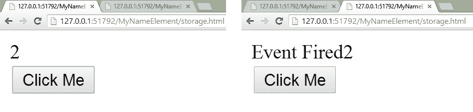

## 第 12 章 File API

### Q. 什么是 HTML5 File API？

**答案**

HTML5 提供了一种浏览器内部处理文件的新 API。此 API 提供了 `File`、`FileList` 和 `Blob` 数据类型来处理文件。它提供了 `FileReader` 接口来异步读取文件。

### Q. FileReader 为异步读取提供了哪些方法？

**答案**

`FileReader` 提供了 4 种不同的方法来处理加载的文件。这些异步方法列如下：

`readAsBinaryString(Blob | File)`：读取目标文件并将其保存为包含 0-255 整数的二进制字符串。

`readAsText(Blob | File, opt_encoding)`：读取目标文件并保存为 UTF-8 文本文件。`readAsDataURL(Blob | File)`：读取目标文件并返回包含 base64 ASCII 字符串的数据 URL。`readAsArrayBuffer(Blob | File)`：读取目标文件并将其保存到数组缓冲区。

### Q. JavaScript 中的 Blob 对象是什么？

**答案**

Blob 对象代表字节序列。Blob 对象的 IDL（接口定义语法）如下：

```javascript
interface Blob {
  readonly attribute unsigned long long size;
  readonly attribute DOMString type;
  Blob slice(optional [Clamp] long long start, optional [Clamp] long long end, optional DOMString contentType);
  void close();
};
```

该方法的详细说明和属性如下：

- `slice method`：`slice` 方法返回一个新的 `Blob` 对象，其字节范围从可选的 `start` 参数开始，但不包含可选的 `end` 参数，且其 `type` 属性的值为可选 `contentType` 参数的值。

- `close method`：`close` 方法必须永久地使原始 `Blob` 对象失效。这是一个不可逆的且非幂等的操作；一旦 `Blob` 失效，就无法再次使用；对已调用 `close` 方法的 `Blob` 对象上绑定的 `Blob URL` 进行解引用将导致网络错误。失效的 `Blob` 大小必须为 0。

- `size property`：它返回 `Blob` 对象以字节为单位的大小。

- `type property`：它返回 `Blob` 对象所持有的内容的类型。

### 如何创建 Blob 对象？

### 回答

可以使用 `new` 关键字配合 `Blob` 构造函数创建一个 blob 对象。`Blob` 构造函数接受以下参数：

- `Blob part sequence`：这可以是 `ArrayBuffer`、`ArrayBufferView`、`Blob` 和 `DOMString`。

- `Blob property bag`：接受一个参数，表示代表 `Blob` 媒体类型的小写 ASCII 编码字符串。

以下代码展示了使用 `new` 关键字创建 Blob 的示例：

```javascript
var a = new Blob();

var b = new Blob(["foobarbazetcetc" + "birdiebirdieboo"], {type: "text/plain;charset=UTF-8"});
```

### Blob 对象的可读状态有哪些？

### 回答

`Blob` 必须有一个可读状态，即 `OPENED` 或 `CLOSED` 之一。

引用字节序列（包括 0 字节）的 `Blob` 被认为处于 `OPENED` 可读状态。

如果调用了 `close` 方法，则认为 `Blob` 已关闭。已关闭的 `Blob` 被认为处于 `CLOSED` 可读状态。

### FileReader 的不同状态有哪些？

### 回答

`FileReader` 对象可以处于 3 状态之一。`readyState` 属性在获取时必须返回当前状态，该状态必须是以下值之一：

- `EMPTY`：`FileReader` 对象已构造，且没有待处理的读取。没有任何读取方法被调用。这是新创建的 `FileReader` 对象的默认状态，直到对其调用任一读取方法为止。

- `LOADING`：正在读取 `File` 或 `Blob`。正在处理其中一个读取方法，且读取过程中没有发生错误。

- `DONE`：整个 `File` 或 `Blob` 已读取到内存中，或者在读取期间发生了文件错误，或者使用 `abort()` 终止了读取。`FileReader` 不再读取 `File` 或 `Blob`。如果 `readyState` 设置为 `DONE`，意味着对此 `FileReader` 至少调用了一个读取方法。

## 第 13 章 Web RTC

### 什么是 Web RTC？

### 回答

Web RTC 为浏览器提供了无需安装任何额外插件即可进行实时通信的能力。它涉及浏览器之间通过原生能力进行音频、视频和其他类型的数据流。

### Web RTC 实现了哪些 API？

### 回答

Web RTC 实现三个不同的 API。这些接口列如下。

- `MediaStream`：这代表使用摄像头和麦克风的同步媒体流。

- `RTCPeerConnection`：此接口负责在实时通信期间对等浏览器之间建立稳定连接。

- `RTCDataChannel`：此接口负责对等浏览器之间其他类型的数据通信。例如使用浏览器的远程桌面共享。

### 什么是 MediaStream？

### 回答


`MediaStream` 基本上代表由摄像头和麦克风捕捉的流。每个 `MediaStream` 都有一个捕获流的输入。可以使用 `navigator.getUserMedia()` 方法访问此 `MediaStream`。

## `getUserMedia()` 方法的输入参数有哪些？

`getUserMedia()` 方法接受 3 个参数作为输入。这些参数如下：

- 类似于配置对象的约束对象（Constraint Object）。
- 成功回调方法。
- 错误回调方法。

## 什么是 `MediaStreamTracks`？

`getUserMedia()` 返回的 `MediaStream` 有两个实用的方法 `getAudioTracks()` 和 `getVideoTracks()`。这两个方法都返回一个 `MediaStreamTracks` 数组。

## Web RTC 通信使用了哪些协议？

Web RTC 使用 2 种不同的协议进行通信。这两种协议如下：

- `DTLS`：数据报传输层安全。
- `SRTP`：安全实时传输协议。

## 如何在 Chrome 浏览器中查看进行中的 Web RTC 会话统计？

通过在 Chrome 浏览器中使用 `chrome://webrtc-internals/` 可以查看正在进行的 Web RTC 会话的详细统计数据和图表。

## 通道的不同事件处理器有哪些？

通道有 4 种不同的事件处理器。这些事件处理器如下：

- `onopen`：在连接建立时执行。
- `onerror`：如果在创建连接时出错则执行。
- `onmessage`：当收到消息时，将执行此方法。
- `onclose`：如果对方关闭连接则执行。

## 什么是信令通道（signal channel）？

没有中间某种服务器，WebRTC 就无法建立连接。我们称之为信令通道。

## 什么是 ICE 技术？

交互式连接建立（ICE）是一种涉及网络地址转换器（NAT）的计算机网络技术，用于互联网协议（VoIP）、对等通信、视频和其他交互媒体。

## 什么是 ICE 候选（Candidate）？

通信双方必须交换关于连接的信息。这被称为 ICE 候选。

## Web 需要哪些服务器端功能？

Web RTC 需要以下服务器端功能来创建通信：

- 用户发现和通信。
- 信令。
- NAT/防火墙穿透。
- 在对等通信失败时的中继服务器。

## 什么是 STUN 协议？

STUN（NAT 遍历工具）是一套标准方法和网络协议，允许位于 NAT 后的终端主机发现自己的 IP 地址。

# 第 14 章 拖放 API

## 如何让浏览器中的内容可拖拽？

HTML5 提供了拖放功能。通过将元素的 `draggable` 属性设置为 `true` 可以使其元素变为可拖拽。查看下方带有两个按钮的代码。一个是可拽的，另一个只是普通按钮。

```html
<!DOCTYPE html>
<html>
<head>
<title>可拽元素</title>
</head>
<body>
<button draggable="true">可拽按钮</button>
<button>普通按钮</button>
</body>
</html>
```

下面的截图显示了这两个按钮。可拽按钮是可以移动的，而普通按钮固定在位置。

## 元素开始拖拽时发生了什么？

在开始拖拽时，有 3 个重要的关键点需要注意。这些关键点如下：

- `Drag Data`：它代表拖拽期间将传输的数据类型。
- `Drag Feedback`：这代表拖拽操作期间鼠标指针旁图像。
- `Drag Effect`：这代表发生在元素的拖拽类型。它可以是 3 种类型，列举如下：
  - `copy`：这种效果表示正在拖拽的数据从当前位置复制到落下位置。
  - `move`：这种效果表示正在拖拽的数据从原始位置移动到落下位置。
  - `link`：这种效果表示源位置和落下位置之间将创建某种形式的关系或连接。

## 哪些是拖放事件？

共有 7 种不同的拖放事件，可以通过编程方法附加回调方法。

`Dragstart`：当拖拽开始时，在元素上触发。`Dragenter`：在拖拽过程中，当鼠标进入元素时触发。

`Dragover`：在拖拽过程中，当鼠标在元素上方移动时触发此事件。

`Dragleave`：在拖拽过程中，当鼠标离开元素时触发此事件。

`Drop`：当拖拽操作结束时，在发生释放元素的元素上触发释放事件。

`Dragend`：拖拽操作完成后，无论成功与否，拖放源将接收到 `dragend` 事件。

## 什么是 `dataTransfer` 属性？

`dataTransfer` 对象持有在拖拽操作中发送的数据片段。`dataTransfer` 在 `dragstart` 事件中设置，并在 `drop` 事件中进行读取/处理。在 `dataTransfer` 对象中设置值的语法如下。

```
event.dataTransfer.setData(format, data)
```

上述语法将把对象的内容设置为作为参数传递的 MIME 类型（mime type）和数据负载（data payload）。

## 开发一个示例将元素从一个地方拖动到另一个地方？

为了演示拖放，我们创建了一个具有圆角框和红色背景的 `div` 元素。我们将拖动这个元素并将其放入容器中。以下代码展示了拖放示例。

```html
<!DOCTYPE HTML>
<html>
<head>
<style>
#ball{
width:50px;
height:50px;
background: red;
border-radius: 100%; 
}
#dropZone {
width:200px;
height:100px;
padding:10px;
border:1px solid #aaaaaa;
}
</style>
</head>
<body>
<div id="dropZone"
ondrop="drop(event)"
ondragover="allowDrop(event)">
</div>
<br>
<div id="ball"
draggable="true"
ondragstart="drag(event)"></div>
<script>
function allowDrop(ev) {
ev.preventDefault();
}
function drag(ev) {
ev.dataTransfer.setData("text", ev.target.id);
}
function drop(ev) {
ev.preventDefault();
var data = ev.dataTransfer.getData("text");
ev.target.appendChild(document.getElementById(data));
}
</script>
</body>
</html>
```

代码的输出如拖拽前的截图所示，此时两个元素都在它们的原始位置。

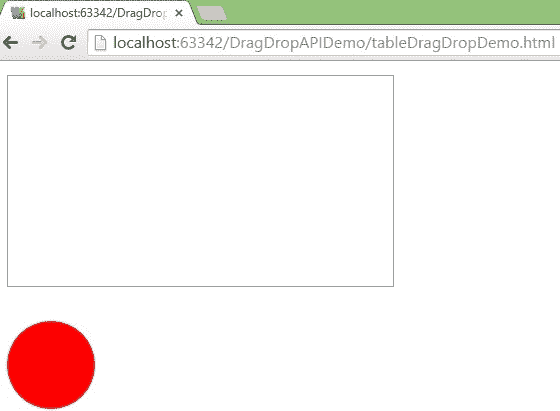

将可拖动元素拖放到容器后，代码的输出如下方的截图所示。

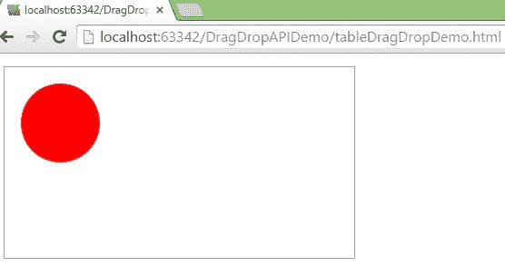

# 第 15 章 App Cache API

## 什么是 app cache（应用缓存）？在应用程序中使用 app cache API 有什么好处？

App cache API 是 `HTML5` 提供的一个新功能。该 API 让 Web 能够在没有互联网连接的情况下运行。该 API 最重要的优点列举如下：

- **速度**：像所有其他缓存一样，它提高了访问页面内容的速度。
- **离线浏览**：由于可以在没有互联网的情况下访问，它提高了应用程序的可用性。
- **减少负载**：由于内容和数据现在缓存在浏览器中，服务器的应用程序负载减轻了。
- **较少的网络调用**：由于大多数可重用内容存在 app cache 中，这减少了与服务器的网络调用次数。

## 如何在 html 文件中启用应用缓存？

要在 HTML 文件中启用应用缓存，我们需要在 `<HTML>` 元素中包含 `manifest` 属性，其中 `appcache` 文件的名称。在 HTML 文件中声明应用缓存的语法如下。

```html
<!DOCTYPE HTML>
<html manifest="filename.appcache"> </html>
```

## appcache 文件的媒体类型是什么？

清单文件需要具有 `text/cache-manifest` 媒体类型。

## manifest 文件有哪 3 个不同的部分？

清单文件有 3 个不同的部分。这 3 个部分如下。

- **CACHE MANIFEST**：在此标题下列出的文件在第一次下载后将被缓存。
- **NETWORK**：在此标题下列出的文件需要连接服务器，且永远不会被缓存。
- **FALLBACK**：在此标题下列出的文件指定了当页面无法访问时的备用页面。

## 什么是 NETWORK 部分？

`NETWORK` 是清单文件中的部分之一。在 `NETWORK` 部分中列出的文件名永远不会缓存在本地。以下代码显示了 `NETWORK` 示例。

```
NETWORK: login.html
```

## 什么是 FALLBACK 部分？

`FALLBACK` 是清单文件中的部分之一。在此部分中，我们可以指定应用程序离线时调用的 `file` 名称。以下代码显示了 `FALLBACK` 示例。

```
FALLBACK:
/html/ /offline.html
```

## 什么是 CACHE MANIFEST 部分？

`CACHE MANIFEST` 是清单文件中的部分之一。在此部分中提到的文件名被缓存在本地。以下代码显示了 `CACHE MANIFEST` 示例。

```
CACHE MANIFEST
/style.css
/favicon.gif
/app.js
```

## 如何查看缓存详情？

通过以下链接使用 `chrome://appcache-internals/` 查看缓存的大小和时间。

以下截图显示了缓存内部。


## 如何检测浏览器的支持？

通过检查 `window` 对象中是否存在 `applicationCache` 来检测支持情况。以下截图显示了控制台。


## 如何手动更新缓存？

我们可以通过强制刷新更新缓存。我们也可以调用 `swapCache()` 方法。

# 第 16 章 服务器发送（Server Sent Events）

## 什么是服务器发送（SSE）？

HTML5 提供了服务器发送功能，Web 页面从服务器获取更新。该功能的很好的示例是 Facebook 通知或 Google 更新。

## 服务器响应的内容类型是什么？

服务器响应的内容类型是 `text/event-stream`，对应 `Content-Type` 头部。

## 如何创建一个监听服务器更新的事件源？

可以通过实例化带有服务器路径的 `EventSource` 类来创建事件源。创建事件源的语法如下。

```javascript
var source = new EventSource("<URL>");
```

## EventSource 触发了哪些事件类型？

`EventSource` 触发 3 种事件。可以将回调方法附加到源以监听这些事件。这些事件类型如下：

- **onopen**：当服务器与浏览器连接时触发此事件。
- **onmessage**：当服务器向流产生新输出时触发此事件。
- **onerror**：当通过某种发生错误时触发此事件。

## 如何关闭事件流？

可以使用 `close()` 方法关闭事件流。

## 事件流的格式是什么？

事件流是简单的文本数据流，必须使用 UTF-8 编码。每条消息由一对换行符分隔。冒号本质上是注释，会被忽略。

# 第 17 章 杂记问题

## 什么是严格模式？

严格模式是新 ECMA 5 JavaScript 规范中的新指令。它用于安全的 JavaScript 代码。它通过将某些 JavaScript 静默错误转换为抛出错误来消除它们。编写严格模式的语法如下表达式：

```
"use strict"
```

以下代码显示了在函数内部使用严格模式。

```javascript
function sayHello(){
"use strict";
myName = "Sandeep"; 
}

sayHello();
```

下面的截图显示了在 `sayHello()` 方法中使用未声明变量时产生的错误。

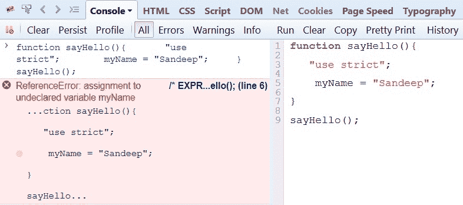

## 请列出严格模式下不允许的一些条件？

在下文中列出了 ECMA5 严格模式下不允许的条件列表：

- 不允许使用未声明的变量。不允许删除变量、函数或参数。
- 不允许重复定义属性。不允许参数名重名（重复参数名）。
- 不允许使用八进制数字字面量和转义字符。
- 不允许写入只读属性。不允许删除不可删除的属性。
- 字符串 `"eval"` 不能作为变量名。字符串 `"arguments"` 不能作为变量名。不允许使用 `with` 语句。
- 不允许使用未来保留的关键字。

## 0.1+0.2 在控制台中的输出是什么？为什么？

JavaScript 数学库遵循 IEEE 754 数标准进行数学运算。IEEE 754 标准使用 64 位表示浮点数。这导致在评估 `0.1 + 0.2` 表达式时产生问题。下面的截图显示了该表达式的 Firebug 控制台。

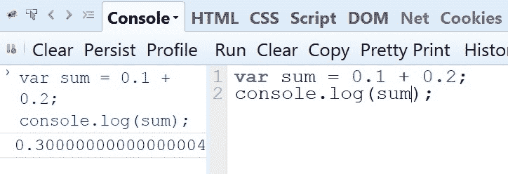

JavaScript 内部将 `0.1` 转换为 16 精度，变为 `0.1000000000000000`，然后加上 `0.2` 变为 `0.30000000000000004`。下面的截图显示了 JavaScript 代码中的这一演示。

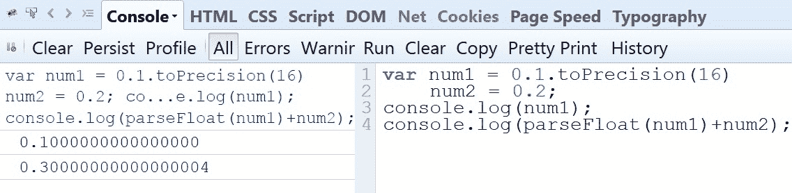

## 如何解决 0.1+0.2 = 0.30000000000000004 问题并产生 0.1+0.2 = 0.3？

这个问题可以通过对该表达式使用 `toFixed(1)` 方法来解决。`toFixed()` 方法将数字转换为指定的小数位数。下面的截图显示了如何使用 `toFixed()` 方法产生正确的输出 `0.3`。

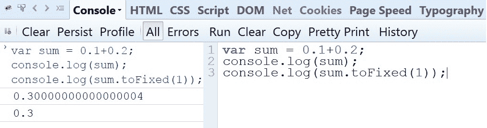

## 以下代码的输出是什么？为什么？

```javascript
(function(){

var a = b = 3;

})();

console.log(typeof a);

console.log(typeof b);
```

上述代码将在控制台中打印 `undefined` 和 `Number`。下面的截图显示了上述代码在 Firebug 控制台中的输出。

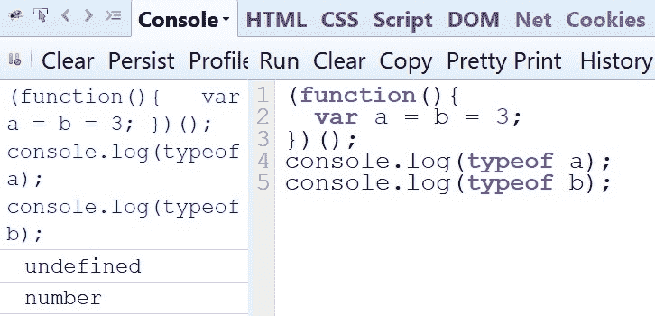

JavaScript 将上述代码处理如下图所示。从下面的代码可以清楚看出，变量 `a` 处于函数的局部作用域内，而 `b` 被视为 `this.b`。当前的引用 `this` 代表 `window` 对象。

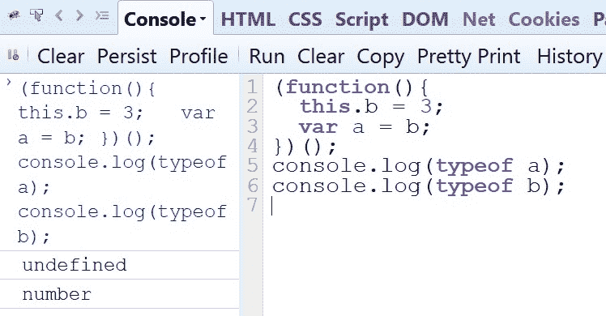

## 以下代码的输出是什么？为什么？`console.log(1+2+4);`

由于所有参数都是数字，上述代码的输出是 `7`。下面的截图显示了上述代码在 chrome 控制台中的输出。

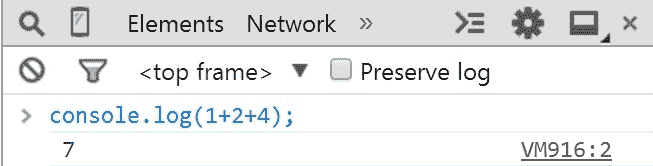

## 解释 JavaScript 中的提升（Hoisting）？

提升是 JavaScript 将声明移动到顶部的默认行为。换句话说，变量可以在声明之前被使用。让我们通过以下示例来理解提升。

**示例 1：**

以下代码包含一个 `display()` 方法，该方法会在控制台中打印 `a` 的值。

```javascript
function display(){ console.log(a);
}

display();
```

上述代码将产生引用错误（reference error），因为我们没有定义该变量。下面的截图显示了上述代码的输出。

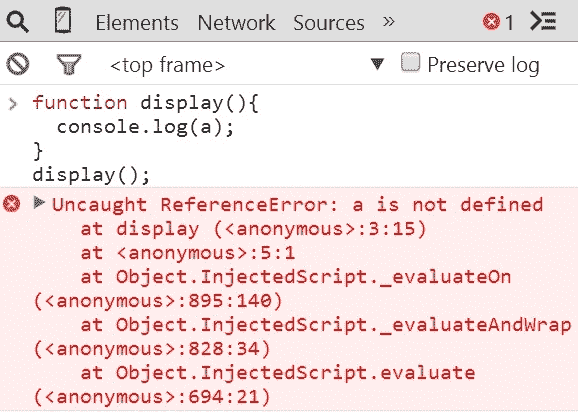

**示例 2：**

以下代码包含一个 `display()` 方法，该方法会在控制台中打印 `a` 的值。

```javascript
function display(){

var a;

console.log("Output: "+a); 
}

display();
```

上述代码的输出将 `undefined`，因为我们定义了变量但没有分配任何值。下面的截图显示了上述代码的输出。

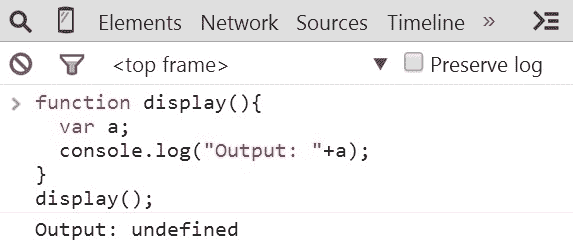

**示例 3：**

以下代码包含一个 `display()` 方法，该方法会在控制台中打印 `a` 的值。


```javascript
function display(){

console.log("Output: "+a);

var a; 
}

display();
```

上述代码的输出将`undefined`，因为我们定义了变量但没有分配任何值。示例 2 和示例 3 的输出相同。这意味着变量声明被移动到了顶部。下面的截图显示了上述代码的输出。

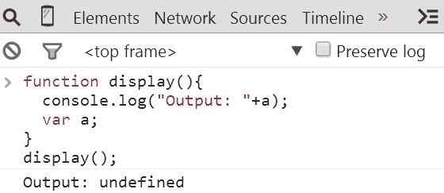

## 关于作者


`Sandeep Kumar Patel` 是一位高级 Web 开发人员，`www.tutorialsavvy.com` 的创始人，这是一个自 2012 年以来就广受欢迎的编程博客。他在面向对象的 JavaScript 和基于 JSON 的 Web 应用开发方面拥有五多年的经验。他通过了 GATE-2005 信息技术（IT）认证，并获得 VIT University, Vellore 的硕士学位。

你可以通过以下途径了解更多关于他的信息：

- LinkedIn 简介（`http://www.linkedin.com/in/techblogger`）。

- 他曾因发布 Web 技术文章获得 Dzone 最价值博客主（MVB）奖。他的文章可以在此处查看：`http://www.dzone.com/users/sandeepgiet`。

- 他因在 JCG 发表的技术文章获得了 Java Code Geek（JCG）勋章。他的文章可以在此处查看：`http://www.javacodegeeks.com/author/sandeep-kumar-patlet/`。

- Packt 出版社《Instant GSON》的作者，`http://www.packtpub.com/create-json-data-java-objectsimplement-with-gson-library/book`。

有问题或建议？可以通过邮件 `sandeeplattech@gmail.com` 联系我，或在以下社交网络上找到我：

- Facebook 页面：`http://www.facebook.com/SandeepTechTutorials`

- 教程博客：`http://www.tutorialsavvy.com`

## 最后的一件事...

当你翻页时，Kindle 会给你一个对这本书进行评分并在 Facebook 和 Twitter 上分享想法的机会。如果你认为这本书值得分享，请花几秒钟让你的朋友知道它。如果它对他们的职业生涯有所帮助，他们会永远感激你，我也一样。

祝好，

Sandeep Kumar Patel.
