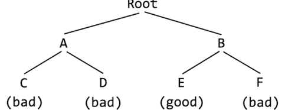
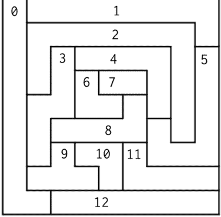
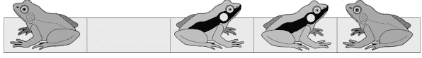

# 递归快速上手指南


递归是处理树和图的绝佳工具。但也许你已经学过递归，并认为它太复杂了。你无法那样思考。这限制了你所能编写的程序类型。

好消息是！递归其实很简单。它只是教得不好。

听着，很多老师都在谈论计算机是如何操作的。他们没完没了地谈论递归的每一层发生了什么，以及每一层是如何与其他层联系的。问题在于，你无法在多个层级上思考。没有人能做到。而且你也不需要这样做。

这本书将向你展示如何编写递归程序。一旦你理解了几个简单的规则，你就会怀疑自己为什么认为递归是复杂的。你将能够快速、轻松地编写递归程序。

嗯，只要是编程所能达到的最快速、最简单的方式，如此。


LCSH: 递归编程。递归。

> *致我所有的过去、现在和未来的学生*


作者，xi

+ 后记 91

附录 A：Java 回溯 93

附录 B：Python 回溯 95

## 2 快速递归

听起来很循环，不是吗？在计算机科学及其他地方，循环定义都是无意义的，应该被避免。递归定义与循环定义之间的区别在于对“部分”一词的使用。任何递归定义都包含**两个部分**：

1. 非循环部分，或基准（basis），它类似于普通的定义，直接指定了某些符合定义的对象；以及
2. 递归（循环）部分，它允许你使用符合定义的对象来确定新对象是否也符合定义。

几个例子可以解释这些概念。

这里有一个普通的定义：

元音：字母“a”、“e”、“i”、“o”、“u”或“y”中的一个。

显然，恰好有六个符合上述元音定义的项。现在考虑以下循环定义：

嚎叫（Yowl）：任何后面跟着一个元音的嚎叫。

根据这个定义，任何后面跟着一个元音的嚎叫也是嚎叫，因此，如果我们能找到一个是嚎叫的东西，那么通过在那个嚎叫上添加元音而形成的任何东西本身也都是嚎叫。问题在于找到第一个嚎叫。由于我们无从开始，这个定义是循环的，也是无意义的。

现在考虑以下定义：

嚎叫（Howl）：

1. 字母“h”，或
2. 任何后面跟着一个元音的嚎叫。

## 理解递归 ■ 3

这个定义是递归的。第一部分是普通的定义，告诉我们字母“h”是一个嚎叫；这为我们提供基准，或起点。第二部分是递归部分；它告诉我们，由于“h”是嚎叫，所以“ha”、“he”、“hi”、“ho”、“hu”和“hy”也是嚎叫。但这些是嚎叫，所以也必须是“haa”、“hae”……“hyy”……“haaeeuooeea”等等。

注意，这是一个“良好”的定义，意义在于某些东西是嚎叫，某些东西不是，而且很容易从定义中判断出哪些是嚎叫。定义中第二部分的“循环性”没有造成伤害，因为第一部分提供了基准。

递归在计算机科学中随处可见。例如，“标识符”（或“变量名”）的一个典型定义如下。

## 标识符：

1. 一个字母，或
2. 一个标识符后面跟着一个字母、数字或下划线。

注意，“嚎叫”和“标识符”的定义允许任意长度的字符串。可以编写递归定义来限制所定义对象的大小，但通常这既不简单也不符合预期。相反，如果有限制，它们是由某些外部机构设置的。例如，某些编程语言允许任意长度的标识符，但要求两个不同的标识符在前 $k$ 个字符上必须不同，其中 $k$ 由实现设置。同样地，嚎叫的最大长度可能由你的肺活量决定。

你可能已经注意到，上面的定义不必是递归的；它们可以通过使用“任意数量的……”这类短语被转变为普通定义，而这可以通过循环来实现。这是事实的——我们并不需要递归。事实上，递归*从不是*绝对必要的，只是有用的。

## 4 快速递归

我们到为止考虑过的定义都只是*直接递归*的例子。对于*间接递归*的例子，请考虑以下对定义（改编自 Lisp）：

**S 表达式（S-expression）：** 一个标识符或一个列表。

**列表（List）：** 由以下内容组成的序列

1. 一个左括号，
2. 零或多个由空格隔开的 S 表达式，
3. 一个右括号。

因此，以下内容都是列表（也是 S 表达式）：

```
()
(ZIP ZAP ZOT)
(ONE TWO THREE) ((FOUR)) FIVE
() IXOHOXI (
```

这些定义是**相互递归的**：每个都是根据对方来定义的。S 表达式的基准是一个标识符，而列表的基准是序列（()）。

为了证明这些定义是“有效”的，考虑 S 表达式 `(NOT (HARD))`。

1. `(NOT (HARD))` 是一个 S 表达式，因为它是一个列表。
2. `(NOT (HARD))` 是一个列表，因为它包含一个左括号、两个 S 表达式 `NOT` 和 `(HARD)` 以及一个右括号。
3. `NOT` 是一个 S 表达式，因为它是一个标识符。
4. `(HARD)` 是一个 S 表达式，因为它是一个列表。
5. `(HARD)` 是一个列表，因为它包含一个左括号、S 表达式 `HARD` 以及一个右括号。
6. `HARD` 是一个 S 表达式，因为它是一个标识符。

证明完毕（Q.E.D.）。

当然，你不需要每次看到 S 表达式都经历这个完整过程，但我们非常严谨。

现在是介绍递归用处的好时机了。上面给出的“列表”定义初看起来可能很混乱（如果你不习惯使用递归定义），但我挑战任何人去写出一个合理的“列表”定义，它与上述定义等效，但不使用任何形式的递归。

## 1.3 一个简单的递归过程

递归过程（或函数、方法、子程序）是某种通过调用自己来完成部分工作的过程。

再次，技巧在于对“部分”一词的使用。如果它调用自己来完成所有工作，它就会变成无限递归（循环）。正如循环在递归的每一层中执行部分工作，直到最终所有工作完成。

## 6 快速递归

我们将从一个简单的例子开始。显而易见的做法是将代码嵌入循环，设置某种标记来指示用户是否回答正确。相反，如果我们直接再次调用方法并返回它的结果呢？如果用户以 'y' 或 'Y' 回答，函数将返回 True；如果用户以 'n' 或 'N' 回答，函数将返回 False。

在 Python 中：

```python
def ask_yes_or_no(question):
    answer = input(question + ' ').lower()
    if len(answer) > 0:
        if answer == 'y':
            return True
        if answer == 'n':
            return False
print('Please answer with yes or no.')
```

## 现在怎么办？

在 Python 中：

```python
def ask_yes_or_no(question):
    answer = input(question + ' ').lower()
    if len(answer) > 0:
        if answer[0] == 'y':
            return True
        if answer[0] == 'n':
            return False
```

## 理解递归 ■ 7

如果没有递归，在 Java 中：

```java
private static boolean askYesNo(String question) {
    char answer = ' ';
    System.out.print(question + " ");
    String line = scanner.nextLine();
    if (line.length() > 0) {
        answer = line.charAt(0);
        if (answer == 'y') return true;
        if (answer == 'n') return false;
    }
    System.out.println("Please answer with yes or no.");
    return askYesNo(question);
}
```

这段代码可能会导致无限递归，但这只会在用户从未提供有效回答时发生。对于不需要用户回答的代码，阶乘函数

正整数 n 的阶乘写作 n!，是从 1 到包含 n 的正整数的乘积。因此，我们有

```
1! == 1
2! == 1 * 2 == 2
3! == 1 * 2 * 3 == 6
4! == 1 * 2 * 3 * 4 == 24
```

等等。

注意，例如 4! == 1 * 2 * 3 * 4 == (1 * 2 * 3) * 4 == 3! * 4，通常 n! == (n-1)! * n。这导致了以下递归定义：

正整数 n 的阶乘是

1. 1，如果 n == 0（基准情况），
2. (n - 1)! * n，如果 n > 0（递归部分）。

这个定义直接引出了以下 Python 程序：

```python
def factorial(n):
    “计算参数的阶乘。”
    if n == 0:
        return 1
    else:
        return factorial(n - 1) * n
```

# 理解递归 ■ 9

或者等效 Java 程序：

```java
public static int factorial(int n) {
    if (n == 0) return 1;
    else return n * factorial(n - 1);
}
```

这个函数有一个基本情况（当 `n == 0` 时）和一个递归部分（当 `n` 为正数时），并且在递归的每一层都完成了部分工作（乘以 `n`）。因此，该函数似乎可能是可以工作的。但如果这是你第一次看到递归，你可能并不会习惯它。

有些作者建议，理解递归函数的最佳方法是对其进行追踪，记录函数每次调用和每次返回时发生的情况。务必通过这种追踪，这样做可以帮助你相信递归实际上是起作用的。但你永远不要将追踪递归过程视为理解此类过程的方法。“追踪过程”可能已经让成千上万的人从未真正理解过递归。本书的目的是描述一种更好的技术。

## 1.5 信息隐藏原则

也许我们控制程序复杂性的单一最重要的工具就是模块化：将一个复杂的程序拆分成若干个更简单的、逻辑上独立的计算。根据编程语言的不同，这些有各种名称：函数、方法、过程等。

每当程序被拆分为两个部分，它们之间就会产生一个接口。这个接口由参数列表、它们之间可能共享的任何全局或公共变量、返回的任何或抛出的异常以及通常还有更微妙的信息传输方式组成。如果模块化要成功降低复杂性，这个接口必须保持尽可能窄且明确。

保持接口狭窄的最佳方法是确保每个例程只做一件事，并且这件事可以用一个英语句子轻松描述，且其中很少或完全没有“但是”和“除了”之类的词汇。保持短参数列表并避免全局变量也有帮助。

使接口明确的最佳方法是确保在尽可能的情况下，所有信息传输都通过参数列表发生，而不是通过全局变量。有些人认为应该完全避免全局变量，但我并不采取这种极端立场。对数组和其他大型数据结构进行全局访问通常更方便；只需特别注意不要意外修改它们即可。

也应该避免副作用。一个例程的主要效果是它本应该做的事；副作用是它所做的额外微小事情。当副作用是有意时，它们是危险的。例如，如果一个函数 `factorial(n)` 计算 `n!`，那是它的主要效果；但如果它还将结果存储在一个全局变量中，那就是一个副作用。这是糟糕的，因为它在 `factorial` 函数中起到了补偿作用，但由于此副作用产生的错误将出现在调用 `factorial` 的任何代码中。由于这些例程本身可能是正确的，可能的结果是程序员花费几个小时尝试调试错误的例程。

我们现在可以得出信息隐藏原则：每个例程都应该管好自己的事。没有哪个例程应该干涉另一个例程的事务。或者正式一点：

- 例程应该只使用提供它的信息，最好通过其参数列表。如果它必须访问全局数据，这一事实必须清楚且无歧地指定。
- 例程应该返回单个结果（在 Python 中，这可以是值的元组）并且不做其他任何事。如果它必须修改全局数据，这一事实必须清楚且无歧地指定。
- 例程应该独立于它的上下文。例如，如果某个例程调用了一个排序方法，
  - 该例程既不应该也不关心排序方法如何运作，只要排序发生了即可，
  - 此外，排序方法既知道也不需要知道为什么调用例程想要排序。

类似的规则也适用于类和对象。对象持有各种类型的数据；对象的类持有操作这些数据的方法。对象的数据应仅通过其类给的方法进行访问和修改，而不能从类外部进行。

这里有三个违反信息隐藏原则的简单示例。在每种情况下，函数都应该返回非空整数列表中的最小值或最大值。你能识别出这些违规行为吗？

```python
def minimum2(numbers):
    """返回列表中的最小数字。"""
    global i
    min = numbers[0]
    for i in range(1, len(numbers)):
        if numbers[i] < min:
            min = numbers[i]
    return min
```

答案在本节的末尾。

这些示例是微不足道的，而且在现实生活中不太可能导致重大问题。当程序的其余部分变得更有趣时，情况就会变得糟糕。

下面的骨架程序控制人类与计算机之间的双玩家游戏，玩家交替移动。在这个例子中，信息隐藏原则在很大程度上得到了尊重；事实上，从程序无法推断出正在玩哪种游戏。

```python
def main():
    setup()
    player = choose_who_goes_first()
    game_over = False
    while not game_over:
        if player == 'human':
            move = ask_human_for_move()
            (game_over, result) = make_move(player, move)
            player = 'computer'
        else: # player == 'computer'
            move = decide_move()
            (game_over, result) = make_move(player, move)
            player = 'human'
```

```python
def ask_human_for_move():
    move = input('Enter your move: ')
    if legal_move(move):
        return move
    else:
        print("That's not legal. Try again.")
        return ask_human_for_move()
```

给定对调用例程的简单假设，就可以理解这个程序并验证其正确性。例如，我们期望 `choose_who_goes_first()` 以某种方式决定谁先手，并将其设置为“human”或“computer”。与主程序相关的信息完全指定在参数列表中。我没有显示任何声明。可能有一个表示棋盘的结构化变量“board”；如果只有一个，并且被所有例程使用，那么将“board”作为一个全局变量可能是一个好主意，而不是放在每个例程的参数列表中。

现在考虑同一个程序的另一个版本。

```python
def main():
    global k
    setup()
    choose_who_goes_first()
    while not game_over:
        if player == 'human':
            ask_human_for_move()
            check_if_move_is_legal()
        k = k - 1
        make_move()
        else: # player == 'computer'
            decide_move()
        k = k + 1
        make_move()
    print("Game over!")
    print(result)
```

由于大量违反信息隐藏原则，如果不引用调用例程，无法判断程序是否正确。

- 哪个例程或哪些例程更新了 `player`？它们这样做的方式是否让主程序工作？
- 如果人类移动不合法，`player` 是否已经更新？
- `make_move` 如何知道执行谁的移动？
- `result` 在哪里确定的？
- 游戏何时结束？这在哪里确定的？
- `k` 是否被正确初始化？计算是否正确？它到底是什么，在何处使用？

到这里，我们似乎偏离了递归主题，也许我们确实偏了，因为信息隐藏原则适用于所有程序。然而，正如我们在稍后的章节中看到的，它对递归程序具有特殊重要。

关于信息隐藏违规问题的答案：

1. `minimum1`：排序列表是一个剧烈的副作用。
2. `minimum2`：函数改变了全局变量 `i`。
3. `maximum`：该函数假设列表不完全由负数组成。

## 理解递归 ■ 15

这些中最后的一个（最大值）需要稍微多一点解释。作为一个通用函数，假设输入不是一个负数列表是错误的。在一个永远不会发生这种情况的程序中，该函数可以工作，但它对其语境string了过多的假设。在未来的某一天，程序中可能会被添加违背这一假设的代码。最好的解决方案是修复代码；次优的方案是修改注释，指明“……在一个数字列表中，其中并非所有数字都是负数。

## 1.6 何时使用递归

很容易证明，你永远不需要递归；任何递归程序都可以转换为一个使用栈的非递归程序。（就像你也可以证明任何程序都可以用绝对二进制编写一样）。


# 理解递归

## 1.6 何时使用递归

关于何时使用递归的问题，最好的答案就是：当你恰好发现它有用时就使用它。你永远不会为了“使用递归”而特意去这样做，就像你不会为了“使用循环”而去这样做。编程时，有时你使用循环，有时你使用数组，有时你进行输入/输出，有时你会使用递归。

但当你刚开始时，并不是一个非常有用的答案。我们将尝试得更具体一些。

一个好的经验法则是：当你处理递归定义的数据结构时，使用递归。例如，如果你尝试评估一个算术表达式，括号可能用于包裹一个“子表达式”，该子表达式必须先被评估，并且本身也是一个表达式。如果你正在编写评估算术表达式的代码，只有两种合理的方法：递归地，或者通过显式栈“模拟”递归。

另一个（等价的）规则是：使用递归处理嵌套结构。作为一个例子，在许多语言中，任何语句都可以嵌套在一个 `if` 语句中，甚至是在另一个 `if` 语句中。对于这种语言，任何处理器（编译器、预处理器、解释器、调试器、美化打印器）都有递归的明确用途。

最后，使用单个栈的程序可以更清晰地写成不使用栈的递归程序。（然而，使用两个或多个栈的程序通常无法重写为不使用栈的递归程序；但该证明超出了手稿的范围。）

## 1.7 何时使用递归

每次递归调用都会使用额外的内存。每一层参数和其他变量的当前值必须在存储器中。现代计算机有足够的内存，这通常不是问题——但它可能是。

大多数编程语言将直接让递归运行，直到内存耗尽，此时程序将崩溃。然而，Python 设置了一个任意的但非常合理的极大递归深度为 1000。

> 注意：Python 的深度限制可以通过调用 `sys.setrecursionlimit(limit)` 来更改。

大多数递归定义的数据结构远没有这么深。例如，一个包含十亿个节点的平衡二叉树其深度大约只有 30 层。

列表和数组一样，可能有数千个元素。对于这些列表，对每个元素都进行递归的方法可能是不可行的，应该使用内存密集程度较低的循环。

## 1.8 四条规则

我们在这里提出四条规则，如果理解并遵循这些规则，将产生有效的递归程序。一旦你习惯了递归，你会发现这些规则并不是绝对的，在谨慎的情况下，可以为了正当理由违反它们；但现在请坚持它们。

- 1. 首先处理基本情况（base cases）。
- 2. 仅对更简单的情况进行递归。
- 3. 不要使用外部变量。
- 4. 不要向下看。

### 1.8.1 规则 1：首先处理基本情况

基本情况是可以不需要递归即可直接计算的任务。例如，在阶乘程序中，唯一的基本情况是 `n == 0`，返回的结果是 `1`。其他程序可能有多个基本情况，每个都可以直接计算的。任何递归程序应该做的第一件事就是测试基本情况。

通常，在递归和使用循环之间存在选择。如果效率至关重要，循环通常是更好的选择。否则，应该选择更简单的替代方案。

基本情况的目的不是完全避免递归。基本情况的目的是停止递归。这引出了我们的第二条规则。

### 1.8.2 规则 2：仅对更简单的情况进行递归

这条规则对于防止循环和无限递归至关重要。如果你有一次对相同（或更难）的问题进行递归，你的程序会立即消失在虚幻之地（Cloud-Cuckoo Land）。

每次递归调用都应该是针对同类问题的更简单的情况。但“更简单”意味着什么？如果问题是数值型的且基本情况是零，那么更简单可能意味着数字更小。如果问题是处理数组，更简单可能意味着一个较小的数组，或者数组的一个较小部分。更简单可能意味着一个更接近排序的数组、一个更短的算术表达式、一个更短的列表或任何其他，只要它在某种方式上“接近”基本情况。

此外，更简单情况的解决方案在解决更难的情况时也必须有用。`10!` 可以通过解决更简单的情况 `9!` 然后将此结果乘以 10 来计算。要评估表达式 `3 * (2 + 4)`，首先需要评估子表达式 `(2 + 4)`。

一旦你确定了基本情况，那些就是“更简单”的情况，而“更简单”是指任何在某种方式上“接近”一个或多个基本情况的情况。有时，当我们接近目标时是显而易见的，例如在阶乘函数中：只要 `n` 大于 0，显然 `n-1` 更接近 0。同样，当我们评估表达式时，一个较短的表达式可能是更简单的表达式；或者它可能是一个括号更少或算术运算符更少的表达式。当你编写递归函数时，你必须在脑中清楚何时问题“接近”基本情况（因此更简单），并且你必须坚持这一点。

假设我们尝试通过在每个递归层中执行两次乘法而不是一次来加速阶乘函数。我们可能会得到

```python
def bad_factorial(n):
    if n == 0:
        return 1
    else:
        return n * (n - 1) * bad_factorial(n - 2)
```

在 Java 中：

```java
public static int bad_factorial(int n) {
    if (n == 0) {
        return 1;
    } else {
        return n * (n - 1) * bad_factorial(n - 2);
    }
}
```

### 1.8.3 规则 3：不要使用外部变量

- 1. 如果 A 带参数调用 B，则这些参数的值将被复制到 B 的参数中。
- 2. 会为 B 的所有局部变量分配新的存储位置，包括 B 参数列表中的变量。这种存储分配可能立即发生，也可能在函数 B 需要时才发生。
- 3. 函数 B 执行其代码，并使用其新存储位置中的值。完成后，函数 B 向 A 返回一个结果，并且 B 的所有局部变量所使用的所有存储将被回收。
- 4. 当 A 接收到 B 的结果时，它所有的局部变量都会“现身”，且它们的值仍与调用 B 时完全相同。

这里的关键点在于：当函数调用自身时，所有这些相同的操作都会发生。局部变量名会被重用于新值，当调用返回时，之前的值会被恢复。

全局变量则不同。考虑以下序列：

- 1. 为 x 计算一个值，
- 2. 进行一次递归调用，
- 3. 使用 x，期望它的值是你在 (1) 中计算的值。

如果 x 是局部变量，那就没有问题。变量 x 不会被递归调用改变。但如果 x 是全局变量，它将会被递归调用改变。上面的步骤 (1) 就改变了它。

局部变量不会引起任何问题。它们就是不会有问题。它们对于递归其他层级发生的任何事情都是安全的。

然而，如果递归程序使用并修改了外部变量（例如全局变量），那么你只有通过理解调用程序如何操作该变量以及被调用程序如何操作该变量，才能理解并调试该程序。这要求你同时考虑递归程序的许多层级。对于大多数程序员（可能对所有程序员）来说，这是不可能的。

你有两种方法可以在递归程序安全地使用外部变量：

- 永远不改变外部变量的值，只读取它；或者，
- 永远不使用外部变量的值，只修改它（例如计数器）。

这并不意味着你不能在递归方法中既使用又修改全局变量；你可以这样做，但这会让推理变得非常困难。

理解以下这一点是有帮助的：一个变量只能持有有限的信息，通常为四个字节（取决于系统）。四个字节足够存储相当大的整数、浮点数、布尔值和指针，但还不足以存储复杂的值，如数组、列表、集合、元组或字典。这些较大的结构存储在别处，变量中存储指向它们的指针。

因此，递归程序可能会访问四种变量：

- 局部变量：它们在程序内部声明，是完全安全的。
- “按值传递”的参数：即参数的实际值可以放入单个变量中，正是这个值被复制到参数中。此类参数的作用类似于局部变量。
- 全局变量：它们是程序外部的。对全局变量的任何更改在任何地方都是可见的。只读取它们是安全的，更新它们也是安全的（例如增加计数器），但尝试以任何有意义的方式与它们交互将很快导致不可理喻的代码。
- “按引用传递”的参数：数组、列表和其他数据结构无法放入单个变量中，因此复制到参数中指向实际值的引用（或指针）。这些的行为类似于全局变量。

**教训：** 确保你所有的变量要么是局部的，要么是按值传递的参数。如果你不能，请确保永远不改变全局变量或参数的值。如果你修改了全局变量，请深思熟虑你在做什么。

**技术说明：** 从 Python 3 开始，整数可以是无限制大小的。持有非常大整数的变量通常持有的是引用，而不是实际值。然而，大数是不可变的，因此无论整数多大，它们的行为仍然像它们一直以来那样。

幸运的是，养成避免全局变量的习惯很容易。你不需要每次都思考原因。只需避开它们即可。

#### 1.8.3.1 深拷贝

你永远不需要复杂的数据结构作为全局变量；它始终可以作为参数传递。这样做是高效的，因为你实际传递的是指向数据结构的引用（指针）。

在递归函数内部修改数据结构与修改全局变量具有相同的问题。由于你拥有该数据结构的引用，对其任何修改都会发生在递归的所有层级。

有时，递归函数的全部目的就是修改数据结构。在这种情况下，更简单的方法（规则 2）通常是只使用数据结构的一部分。

其他时候，数据结构可能会在试错的基础上被修改，例如在搜索解决方案时，之后必须撤销这些更改。撤销更改可能高效但容易出错。另一种方法是传递数据结构的副本而不是原始结构；当函数返回时，整个副本可以被丢弃，而原始结构保持不受触动。

副本可以是浅拷贝或深拷贝的。浅拷贝是数据结构中所有顶层值的简单拷贝。例如，考虑以下 Python 列表：

```python
a = [1, [2, 3]]
```

### 1.8.4 规则 4：不要向下看

当你遇到递归调用时，不要回到顶部重新开始。规则 4 简单来说就是以这种方式处理所有调用，包括递归调用。

起初，假设被调用程序是正确的可能看起来很奇怪，当被调用程序恰好就是你正在检查的那一个时。然而，你必须这样做：人类思维是有局限性的。如果有帮助的话，假装你并不是在递归，而是正在调用一个完全不同的、你认为它是正确的程序。

这里涉及的内容最好被描述为一种“信仰的跳跃”。你必须学会信任递归；相信如果你在这一层级让程序正确，那么你就不需要担心任何更深层级。在你能做出这种承诺之前，你将被迫向下看递归，并且永远无法理清你所看到的内容。

如果“信仰”的概念让你感到困扰，想一下一个新手程序员，抱怨他的程序不会出错，所以计算机犯了错。你可能也这样做过。最终，所有程序员都学会了信任计算机；现在你必须学会信任递归。

## 1.9 计算机在做什么

这一节是可选的；你可以随意跳过。

这里是阶乘函数。

```python
def factorial(n):
    if n == 0:
        return 1
    else:
        return factorial(n - 1) * n
```

假设程序调用 `factorial(3)`。会发生什么？

- 1. 值 3 被赋值给局部变量 `n`。
  - n 不为 0，所以函数“记住”了 `n` 是 3（它将 3 放入栈中），并调用了 `factorial(2)`。
- 2. 值 2 被赋值给局部变量 `n`。


- n 不为 0，所以函数将 2 放入栈中并调用了 `factorial(1)`。

- 3. 值 1 被赋值给局部变量 `n`。

  - n 不为 0，所以函数将 1 放入栈中并调用了 `factorial(0)`。

- 4. 值 0 被赋值给局部变量 `n`。

  - n 为 0，所以函数返回 1。

- 5. 函数从栈中弹出 1（它是在第 3 步被放入栈中的）。

  - 函数将调用返回的结果 1 与栈中的 1 相乘，并返回 1。

- 6. 函数从栈中弹出 2（它是在第 2 步放入栈中的）。

  - 函数将调用返回的结果 1 与栈中的 2 相乘，并返回 2。

- 7. 函数从栈中弹出 3（它是在第 1 步被放入栈中的）。

  - 函数将调用返回的结果 2 与栈中的 3 相乘，并返回 6。

- 8. 函数返回 6 作为最终结果。

根据许多教材的说法，这就是你应该理解递归的方式。这种方法对我没用，可能对你也不起。

## 1.10 消除递归

正如前面提到的，递归永远不是必要的；任何用递归完成的任务，都可以使用栈和循环来实现。

栈（Stack）是一种后入先出的数据结构。也就是说，值可以添加到栈中，也可以从栈中取出，但它们移除的顺序与添加的顺序相反。想象一叠书——你可以向栈的顶部添加一本书。如果你把几本书堆在栈上，第一本书会在栈的底部，它将是你最后才能拿到的那本书。

Java 有一个 `Stack` 类。Python 没有，但 Python 列表可以像栈一样使用。以下是 Java `Stack` 类的基本操作以及 Python 中对应的列表操作。

- `stack.push(value)`——将值添加到栈中。在 Python 中，使用 `list.append(value)`。

- `stack.pop()`——移除并返回栈顶值。在 Python 中，使用 `list.pop()`。

- `stack.peek()`——返回栈顶值但不移除它。在 Python 中，使用 `list[-1]`。

- `stack.empty()`——测试栈是否为空。在 Python 中，使用 `list == []`。

递归在“底层”的实现相当简单。当进行递归调用时，所有的局部值都会推入栈中，并在调用返回时从栈中恢复。这可以通过循环来模拟，在达到基本情况（base case）时退出循环。

这里又是递归版本：

这里是一个使用栈来模拟递归的版本：

```python
def factorial(n):
    """计算参数的阶乘."""
    stack = []
    while n != 0:
        stack.append(n) # "push"
        n = n - 1
    fac = 1
    while stack:
        n = stack.pop()
        fac = fac * n
    return fac
```

非递归版本将 `n` 放入栈中并将 `n` 设置为 `n - 1`，等同于保存局部变量 `n` 并使用 `n - 1` 进行递归调用。从栈弹出并将栈顶值放回 `n` 等同于从递归调用返回。

显然，递归版本的 `factorial` 更简单；重点在于展示递归可以通过栈来实现。人们可能想这样做的主要原因是，递归（尤其是非常深的递归，数千层）由于栈所需的空间巨大，计算开销可能会很大。

## 1.11 尾递归

如果递归是函数中执行的最后件事，那么该函数就是尾递归的。如果函数包含多个递归调用，只有当每个递归调用都是函数中的最后一个操作时，它才是尾递归的。

再次考虑阶乘函数。

```python
def factorial(n):
    """计算参数的阶乘."""
    if n == 0:
        return 1
    else:
        return factorial(n - 1) * n
```

这个函数不是尾递归的。递归调用发生在函数的最后语句中，但它不是最后的操作；在递归调用之后，该调用的结果还会与 `n` 相乘。

通过将乘法提取到一个额外的参数（累加器）并提供一个面向用户的函数（外壳）来调用它，可以将阶乘函数变为尾递归。这种技术将在以后详细讨论。目前：

```python
def factorial(n, acc=1):
    """计算参数的阶乘."""
    if n == 0:
        return acc
    else:
        return factorial(n - 1, acc * n)
```

# 第2章

## 数据结构

## 2.1 数组

数组是一系列具有相同数据类型的数值，存储在连续的内存位置中。可以通过数组的索引高效地访问任何一个元素。在大多数语言中，最小索引为零，最大索引为数组的大小减一。

### 2.1.1 数组最大值

这次我们将编写一个递归 Python 程序来寻找数组中的最大值。同样，如果不使用递归完成此操作更好，但在我们讨论一些递归定义的数据结构之前，很难找到真正需要递归的简单示例。

在寻找非空数组的最大值时，同类问题中更简单的问题是什么？显然，是寻找较小数组的最大值。因此，我们计划只对较小的数组进行递归，而基准情况是最小的数组——即只有一个一个元素的数组。

DOI: 10.1201/9781003359616-2

# 36 ■ 快速递归

这里有一种方法：从数组的一端取一个数字；递归地找到剩余数组的最大值；将该最大值与取出的数字进行比较，两者中较大者为最大值。对于基准情况，单元素数组的最大值就是该元素。

虽然这种方法可行，但并不有趣。这里有一种我更喜欢的方法：将数组（大致）分成两半；递归地找到每一部分的最大值；返回这两个最大值中较大的一个作为全局最大值。同样，基准情况是单元素数组，以该唯一元素作为最大值。

这种逻辑可以很容易转换为 Python 代码。

```python
def maximum(numbers):
    """寻找列表 'numbers' 中的最大值."""
    if len(numbers) == 1:
        return numbers[0]
    mid = len(numbers) // 2 # 整数除法
    leftmax = maximum(numbers[0:mid])
    rightmax = maximum(numbers[mid:len(numbers)])
    if leftmax > rightmax:
        return leftmax
    else:
        return rightmax
```

> 注意：数组切片（`[mid:len]` 语法）会创建数组该部分的副本，因此上述函数的效率比它看起来的要低得多。

同样的算法在 Java 中没有那么容易，因为 Java 不支持将数组的一部分作为参数传递。相反，我们使用一个辅助方法，它接受两个额外的参数：数组中区间的下限和上限。不涉及复制，因此这会比 Python 版本高效得多。

```java
public static int maximum(int[] numbers) {
    return maxHelper(numbers, 0, numbers.length - 1);
}

private static int maxHelper(int[] numbers,
    int lo, int hi) {
    if (lo == hi) return numbers[lo];
    int mid = (lo + hi) / 2;
    int leftmax = maxHelper(numbers, lo, mid);
    int rightmax = maxHelper(numbers, mid + 1, hi);
    if (leftmax > rightmax) return leftmax;
    else return rightmax;
}
```

这些程序满足那四条规则吗？

- 1. 它们是否先处理基准情况？是的，如果数组区间内只有一个数字，则返回该数字。

- 2. 它们是否只对更简单的情况进行递归？是的，有两个递归，每个都针对一个较小的数组或大小为 1 的数组。

- 3. 它们是否有会干扰调用程序的副作用？没有，因为每个变量都是局部的，并且数字列表或数组没有被改变。

- 4. 我们需要“向下”观察递归，或者考虑在其他层级发生的情况吗？不需要，不需要。

我们完成了。

### 2.1.2 快速排序

快速排序是最广泛使用的排序算法之一，它本质上是递归的。

快速排序是由编程界的巨匠·霍尔（Tony Hoare）发明的。当时他无法在 Autocode 中实现该算法，因为它不支持递归。在参加 Algol 60 课程时（Lisp 之后第一个支持递归的编程语言之一），他才得以实现。

编写快速排序算法最复杂的部分不是递归部分，而是它所使用的非递归方法，通常称为分区（partition）。

分区方法接受三个参数：一个数组、一个最小索引和一个最大索引。然后，分区方法：

- 1. 从给定的数组区间选择任一个数字（通常是第一个数字，因为这样简单），并将该数字作为基值（pivot）。

- 2. 重新排列数组区间内的数字，使得小于基值的数字在所有大于基值的数字之前，且基值位于这两组之间（等于基值的数字可能在任何一组）；以及

- 3. 返回基值最终所在位置的索引。

例如，给定数组

[5, 7, 1, 9, 8, 2, 3, 2, 9, 4, 5, 1, 3]

分区方法可能会选择 5 作为基值，产生数组

[2, 3, 1, 1, 4, 2, 3, 5, 9, 8, 5, 1, 3]

最后，应该指出，虽然快速排序平均速度非常快，但在某些情况下可能很低效。不幸的是，当它应用于一个已经排序的数组时，会出现最坏的情况。对快速排序的各种改进都是为了解决解决这个问题。

## 2.2 列表

列表要么为空，要么有一个头部（第一个元素）和一个尾部（包含所有剩余元素的列表）。这是一个递归定义，以列表作为基准情况。

列表的元素可以是任何类型的数值，包括其他列表。这允许构建一些复杂的结构。

每个列表都必须结束，当尾部为空列表时，就结束了。空列表可以用 Java 中的 `null` 或 Python 中的 `None` 来表示。

列表只有极少数基本操作。它们如下：

- 测试列表是否为空。

- 获取非空列表的头部。

- 获取非空列表的尾部。

- 使用给定的头部和给定的尾部构造新列表。

### 2.2.1 Java 中的列表

递归最好的演示是使用单链表，但 Java 并没有提供。实际的程序员应该使用 Java 更复杂的列表，但为了教学目的，我们实现并使用了一个简单的链类。

这里是实现基础列表类型所需的全部代码（Java）：

```java
public class List {
    public Object head;
    public List tail;

    public List(Object head, List tail) {
        this.head = head;
        this.tail = tail;
    }
}
```

上述代码包含一个构造函数，并提供了对头部和尾部的直接访问。测试列表是否为空，测试它是否等于 `null`。测试某个对象是否为（非空）列表，使用 Java 的 `instanceof` 运算符。

列表为空。这是对通常递归方法的一种特殊情况处理：空列表是一个基础情况，而列表的尾部比整个列表更简单。

我们对列表想要的操作之一是测试两个列表是否相等，也就是说它们在相同的顺序上具有相同的元素。从概念上说，这非常简单：如果两个列表的头部相等且尾部相等，则它们是相等的。正如 Java 中常见的情况，对 `null` 的检查极大地增加了代码的复杂性。列表的头部可能为 `null`，因为它包含一个空列表作为成员。如果元素是列表中的最后一个，则列表的尾部将为 `null`。如果 `x` 可能为 `null`，任何形式的 `x.equals(y)` 表达式都会报错。

为列表编写一个单一的 `equals` 方法异常异常地困难，但将 `null` 检查提取到单独的函数（`eq`）中可以获得可读性良好的代码。

```java
@Override
public boolean equals(Object obj) {
    if (!(obj instanceof List)) return false;
    List that = (List) obj;
    return eq(this.head, that.head) &&
           eq(this.tail, that.tail);
}
```

Java 要求 `equals` 的参数类型必须是 `Object`。因此，我们接下来必须检查参数 `obj` 的类型，如果不是 `List`，则返回 `false`。我们可以使用缓存将 `obj` 保存在类型为 `List` 的变量中。一旦这些官僚工作完成，实际工作就在返回语句中完成了。

辅助函数 `eq` 可以用于避免任何类型对象的 `NullPointerExceptions`，它使用了为 `obj1` 定义的 `equals` 方法。

```java
private static boolean eq(Object obj1, Object obj2) {
    if (obj1 == null) return obj2 == null;
    return obj1.equals(obj2);
}
```

另一个重要的操作是测试一个给定值是否是列表的成员。`eq` 方法可以再次作为辅助方法使用。

```java
public static boolean member(Object obj, List lst) {
    if (lst == null) return false;
    if (eq(obj, lst.head)) return true;
    return member(obj, lst.tail);
}
```

`member` 方法测试一个值是否是列表的顶层成员。如果我们想知道一个值是否存在于列表的任何位置（可能在子列表或子列表中中），我们需要一个稍微复杂的方法。

```java
public static boolean deepMember(Object obj, List lst) {
    if (lst == null) return false;
    if (eq(obj, lst.head)) return true;
    if (lst.head instanceof List &&
        deepMember(obj, lst.head)) return true;
    return deepMember(obj, lst.tail);
}
```

### 2.2.2 Python 中的列表

根据通常的定义，单链（或简称为 list）是一种具有头部（第一个元素）和尾部（按某种顺序的所有剩余元素）的线性数据结构。访问这两个值（头部和尾部）是非常高效的；访问任何其他值都涉及通过遍历中间的值来获取。

Python 有一种名为“list”的数据结构，但它实际上是一个兼具数组和列表特征的复杂数据结构。

这对于许多应用非常方便，但如果将其作为单链表来使用将是无效的，因此是不建议的。

在 Python 中编写一个具有单链表通常特征的 `List` 类很容易的。这样的类可以这样开头：

作为使用 `List` 类的第一个示例，我们将使用上述格言“对头部做一些事情并对尾部进行递归”来计算列表中的元素数量。在这种情况下，我们对头部的操作仅仅是计数它。

为了打印列表，我们需要一个方法将其表示为字符串。这里是 `__str__` 方法的实现，就像它出现在 `List` 类内部一样。

```python
def __str__(self):
    """返回此 List 的字符串表示."""
    return '[' + self.contents() + ']'
```

```python
def contents(self):
    """返回此 List 内容的字符串表示."""
    s = str(self.head)
    if self.tail != None:
        s += ', ' + self.tail.contents()
    return s
```

在这段代码中，只有辅助方法 `contents` 是递归的；`__str__` 方法只是在结果周围加上括号。

Python 中额外的列表方法（等等性测试、`member`、`deepMember`）见附录 K。

### 2.2.3 累加器

递归地复制列表很容易的；只需创建一个包含头部拷贝和尾部拷贝的新列表即可。

```python
def list_copy(lst):
    if lst == None:
        return None
    return List(lst.head, list_copy(lst.tail))
```

上面的代码执行了浅拷贝，这对于本节的目的已经足够。

现在考虑创建一个与给定列表元素相同但顺序相反的新列表的问题。实现此点的一种方法是使用累加器：一个额外的参数，它增量地构建或累积最终结果。

`reverse` 方法的用户不应该知道累加器，而且绝对不应该需要提供它。因此，我们提供了一个门面方法（facade method），它接受单个列表参数并调用另一个函数来完成工作。

```python
def reverse(self):
    # 此处省略调用逻辑
```


```python
def rev(self, lst, acc=None):
    if lst == None:
        return acc
    return rev(lst.tail, List(lst.head, acc))
```

每次调用 `rev` 会从列表中取出项（`head`），将其加入累加器（`acc`），并继续递归地处理尾部（`tail`）。当基础情况（`lst == None`）出现时，返回累加器。

```python
def reverse(self):
    return rev(self, None)
```

## 2.3 二叉树

我们将递归地定义二叉树（2.1）为空，或者由一个包含以下内容的节点组成：

[第 61 页]

* 一个值，可以是任何内容；
* 左子，二叉树；
* 右子，二叉树。

二叉树是递归定义的：非空二叉树由一个值两个树组成。注意：这让我们认为节点始终拥有孩子，简化了编程。所有节点从根节点通过一个或多个步骤都是可用的。通常情况下，只能“向下”移动（从父到子），不能“向上”（从子到父）。既没有左子也没有右子的节点被称为*叶子*，并在许多应用中被用作基础情况。


图 2.1 二叉树。

二叉树还满足一些其他约束。二叉树不允许包含环；也就是说，节点不能将其某个祖先作为孩子。此外，某些（但不是所有）实现坚持根节点外的每个节点只有一个父节点；这防止了共享子树，即从根到给定节点可能有多条路径。其他实现可能有其他约束。

检查这些约束是复杂的。库的二叉树实现必须完成所有工作，但在这里不需要。在书中，我们只需要简单的来实现演示递归技术。

这是 Java 中 `BinaryTree` 类的定义：

```java
public class BinaryTree {
    public Object value;
    BinaryTree left;
    BinaryTree right = null;

    BinaryTree(Object value,
        BinaryTree left,
        BinaryTree right) {
        this.value = value;
        this.left = left;
        this.right = right;
    }

    BinaryTree(Object value) {
        // 创建左节点的快捷方法
        this(value, null, null);
    }
}
```

如上所示，每个节点中的“值”是 `String` 类型。为了创建一个更通用的二叉树，可以是 `Object`。更好，该类泛泛型，这样二叉树就可以包含指定类型的值。然而，我们的目标是保持简单，这意味着忽略泛型。

这是对应的 Python 等效代码。

```python
class BinaryTree(object):
    def __init__(self, value, left=None, right=None):
        self.value = value
        self.left = left
        self.right = right
```

使用这些构造函数，树必须从底向上构建。要构造一个节点，它的子节点必须已经定义好。上面给出的示例树可以这样构建：

在 Java 中：

```java
static BinaryTree makeTree() {
    BinaryTree root, a, b, c, d, e, f, g, h, i, j;
    g = new BinaryTree("G");
    h = new BinaryTree("H");
    i = new BinaryTree("I");
    j = new BinaryTree("J");
    c = new BinaryTree("C");
    d = new BinaryTree("D", null);
    e = new BinaryTree("E", h, i);
    f = new BinaryTree("F", null, j);
    a = new BinaryTree("A", c, d);
    b = new BinaryTree("B", e, f);
    return new BinaryTree("Root", a, b);
}
```

在 Python 中：

```python
def make_tree():
    g = BinaryTree('G')
    h = BinaryTree('H')
    i = BinaryTree('I')
    j = BinaryTree('J')
    c = BinaryTree('C')
    d = BinaryTree('D', g, None)
    e = BinaryTree('E', h, i)
    f = BinaryTree('F', None, j)
    a = BinaryTree('A', c, d)
    b = BinaryTree('B', e, f)
    return BinaryTree('Root', a, b)
```

二叉树将在后面的章节中使用。同时，让我们检查一些处理二叉树的递归例程。

# 50 快速递归

### 2.3.1 打印二叉树

假设我们想要打印一个二叉树。如果没有一些帮助，Java 或 Python 都无法以有用的方式打印我们的二叉树。在 Java 中，我们需要重写 `toString` 方法；在 Python 中，我们需要提供一个 `__str__` 方法。

打印二叉树的一种合理方法是：

* 如果一个节点有子节点，打印它的值；然后在括号中打印它的左子树和它的右子树。对于缺失的子树，打印 "null" 或 "None"。
* 如果一个节点是叶子节点，只打印它的值。

使用这种方法，示例二叉树将打印为：

```
Root(A(C, D(G, null)), B(E(H, I), F(null, J)))
```

在 Java 中，以及

```
Root(A(C, D(G, None)), B(E(H, I), F(None, J)))
```

在 Python 中。在这两种情况下，代码都非常简单。在 Java 中：

```java
@Override
public String toString() {
    if (left == null && right == null) {
        return value.toString();
    }
    return value + "(" + left + ", " + right + ")";
}
```

在 Python 中：

```python
def __str__(self):
    if self.left == None and self.right == None:
        return str(self.value)
    return str(self.value) + "(" + str(self.left) + ", " + str(self.right) + ")"
```

有基本情况吗？有的，每当我们到达叶子节点时，就不再递归。

每次递归都更简单吗？也就是说，是否更接近基本情况？是的，每次递归调用都是针对当前节点的子节点，因此每次递归调用都更接近叶子节点。然而，有一个例外。一个良好的二叉树没有循环；没有一个节点的子节点同时也是它的祖先之一。如果违反了这一条件，将导致无限递归。

使用了全局变量吗？没有，每个方法都是自包含的。

我们可以从这里得出结论，递归逻辑是正确的。当然，这并不能保证实现没有 bug；仍然需要测试。

### 2.3.2 统计节点数

作为另一个快速示例，我们想要统计二叉树中的节点数。

二叉树中的任何节点都可以被视为一个二叉树的根。从任何节点开始，它的父节点（如果有的话）是无法访问的。因此，我们可以将二叉树中的任何节点看作是一个具有两个子树（左子树和右子树）的根节点。二叉树中的节点数因此是 1（根节点），加上其左子树的节点数，再加上其右子树的节点数。

因此，节点计数方法的初步实现（在 Python 中）：

```python
def count_nodes(bt):
  return (1
    + count_nodes(bt.left)
    + count_nodes(bt.right))
```

这并不完全正确。它沿着二叉树“向下”直到叶子节点，但一旦到达那里会发生什么呢？没有基本情况。

我们可以把它复杂化。我们可以说：如果一个节点既没有右节点也没有左节点，那么它就是叶子节点，将其计为 1 且递归。如果它只有左子节点，则在结果上加 1 并在左侧递归。如果它只有右子节点，则在结果上加 1 并在右侧递归。

```python
def count_nodes(bt):
  if bt == None:
    return 0
  if bt.left == None and bt.right == None:
    return 1
  if bt.left != None and bt.right == None:
    return 1 + count_nodes(bt.left)
  if bt.left == None and bt.right != None:
    return 1 + count_nodes(bt.right)
  return 1 + count_nodes(bt.left) + count_nodes(bt.right)
```

实际上，更简单的方法是：

```python
def count_nodes(bt):
  if bt == None:
    return 0
  return 1 + count_nodes(bt.left) + count_nodes(bt.right)
```

## 2.4 解析树

每当程序编译时，在几乎任何语言中，编译器都会创建一个解析树。这代表了程序的结构。例如，这段小代码

```python
if a > b:
    temp = a
    a = b
```

会被转换为图 2.2 所示的树。


图 2.2 解析树。可以转换为另一种语言（可能是汇编语言），或者可以直接解释。这里有一些伪代码建议了可以如何实现。

```
function interpret(node):
  if node type is "if":
    if (interpret first child):
      interpret second child
    else:
      interpret third child (if present)
else if node type is "assignment":
  [assignment]
```

### 2.4.2 间接递归

递归方法只是另一种方法。一个递归方法调用另一个方法并不寻常。我们之前定义了一个 Python 方法 `__str__`，每当 List 对象要打印或或其他转换为字符串时，它都会被自动调用。现在我们对树也可以这样做。

```python
def __str__(self):
  s = str(self.value)
  if self.children != None:
    s += str(self.children)
  return s
```

这个方法看起来不是递归的。给定一个 Tree，它将返回根节点值的字符串表示，如果根节点有节点，还会返回节点列表的字符串表示。然而，这些子节点本身也是 Tree。当每个子节点转换为字符串时，将通过使用 Tree 类中的 `__str__` 方法来实现。换句话说，获取一个 Tree 的字符串表示涉及到调用一个获取列表字符串表示的方法，而后者又调用了获取 Tree 字符串表示的方法。这就是间接递归的一个例子。

上面的方法会终止吗？虽然它没有放置在方法的第一位，但上面的 Tree 方法在 `self.children == None` 时确实有一个基本情况。每次调用都沿着树移动，因此在每个分支上最终都会到达基本情况。如果我们可以假设遍历列表会终止，那么整个过程也将终止。

# 回溯

回溯（Backtracking）是递归的一种形式。

通常的情况是你面临一组选项，你必须选择其中一个。做出选择后，你将获得一组新的选项；你获得哪一组选项取决于你所做出的选择。这个过程会反复进行，直到你到达一个最终状态。如果你做出了一系列良好的选择，你的最终状态就是目标状态；如果没有，就不是。

从概念上说，你从树的根节点开始；这棵树可能有一些好的叶子和一些坏的叶子，尽管也可能所有叶子都是好的或都是坏的。你想到达一个好的叶子。从根节点开始，在每个节点，你选择它的一个子节点移动过去，并持续下去直到到达叶子。

假设你到达了一个坏叶子。你可以通过撤销最近一次选择并尝试该组中的下一个选项来回溯，继续寻找好的叶子。如果选项用尽了，撤销带你到达这里的选择，在该节点尝试另一个选择。如果你回到根节点且没有剩余选项，说明没有好的叶子了。

## 根节点



图 3.1 一个有一个好叶子的树。

以下展示了回溯在图 3.1 的树上如何进行：

1. 从根节点开始，你的选项有 A 和 B。你选择 A。
2. 在 A，你的选项有 C 和 D。你选择 C。
3. C 是坏的。回到 A。
4. 在 A，你已经尝试过 C 且失败了。尝试 D。
5. D 是坏的。回到 A。
6. 在 A，你没有剩余选项可以尝试了。回到根节点。
7. 在根节点，你已经尝试过 A。尝试 B。
8. 在 B，你的选项有 E 和 F。尝试 E。
9. E 是好的。恭喜你！

在这个例子中，我们画了一棵树。这棵树是我们可能做的选择序列的抽象模型。虽然有一种名为“树”的数据结构，但有时我们没有数据结构来告诉我们做了哪些选择。（如果我们有一个实际的树数据结构，在上面进行回溯被称为深度优先树搜索。）

# 3.1 回溯算法

以下是从给定节点 `n` 开始执行回溯的算法（伪代码）：

```
function solvable(n):
  if n is a leaf node:
    if n is a goal node, return true
    else return false
else:
  for each child c of n:
    if solvable(c), return true
  return false
```

注意，该算法被表示为一个布尔函数。这对于理解该算法至关重要。如果 `solvable(n)` 为真，意味着节点 `n` 是解决方案的一部分——即节点 `n` 是从根节点到某个目标节点路径上的节点之一。我们称 `n` 为可解。如果 `solvable(n)` 为假，则不存在包含 `n` 且到达目标节点的路径。

它是如何工作的？

* 如果 `n` 的任何子节点是可解的，那么 `n` 就是可解的。
* 如果 `n` 没有任何子节点是可以解的，那么 `n` 就是不可解的。

因此，要判断任何非叶子节点 `n` 是否可解（即目标节点路径的一部分），你只需要测试 `n` 的任何子节点是否可解。这是对 `n` 的每个子节点递归完成的。在上面的代码中，对 `n` 的每个子节点 `c` 操作通过以下行完成：

```
if solvable(c), return true
return false
```

最终，递归会在叶节点处“到底”。如果叶节点是目标节点，它是可解的；如果叶节点不是目标节点，它是不可解的。这是我们的基础情况。在上面的代码中，这通过以下行完成：

```
if n is a leaf node:
    n is a goal node, return true
    return false
```

回溯算法简单且重要。你应该彻底理解它。另一种表述方式如下：

搜索树：

1. 如果树只由一个叶子组成，测试它是否为目标节点并返回结果；
2. 否则，搜索这棵树的子树，直到你找到一个包含目标节点的子树，或者你搜索了所有子树但未找到目标节点。

在上述，我们假设任何目标节点都是叶子。该算法很容易适应到节点可能出现在树内部而不仅仅是叶子节点的情况。

# 3.2 非递归回溯

回溯是一种相当典型的递归算法，任何递归算法都可以重写为栈算法。事实上，这正是你的递归算法翻译成机器语言或汇编语言的方式。

```
boolean solve(Node n):
    node n on the stack
    while the stack is not empty:
        topnode = the node at the top of the stack
        if topnode is a leaf:
            if it is a goal node, return true
            else pop it off the stack
        else:
            if topnode has untried children:
                push the next untried child onto the stack
```

# 回溯 ■ 6

# 3.3 简化回溯

简化二叉树搜索的方法之一是，在每个选择点，你都可以忽略之前所有的选择。

## 64 快速递归

之前的选择没有为你提供任何关于下一步应该做什么的信息；就你所知，左子节点和右节点同样可能是解决方案。然而，在许多问题中，你可能不需要递归就可以消除某些子节点。这被称为**剪枝**（pruning）。

例如，考虑地图着色问题。数学上有一个定理：平面上的任何地图，无论国家边界多么复杂（只要它们不是彼此独立的互不连接的部分），都可以用最多四种颜色进行染色，使得任意两个相邻国家的颜色都不相同。




# 图 3.2 一张可以用四种颜色上色的地图

以下是我们用 Java 表示图 3.2 所示地图的一种：

```java
void createMap() {
    map = new int[13][];
    map[0] = new int[] { 1, 2, 3, 9, 12 };
    map[1] = new int[] { 0, 2, 5 };
    map[2] = new int[] { 0, 1, 3, 4, 5 };
    map[3] = new int[] { 0, 2, 4, 6, 8, 9 };
    map[4] = new int[] { 2, 3, 5, 6, 7, 8 };
    map[5] = new int[] { 1, 2, 4, 8, 11 };
    map[6] = new int[] { 3, 4, 7, 8 };
    map[7] = new int[] { 4, 6, 8 };
    map[8] = new int[] { 3, 4, 5, 6, 7, 9, 10, 11 };
    map[9] = new int[] { 0, 3, 8, 10, 12 };
    map[10] = new int[] { 8, 9, 11, 12 };
    map[11] = new int[] { 5, 8, 10, 12 };
    map[12] = new int[] { 0, 9, 10, 11 };
}
```

这个问题可以看作一棵决策树。从一个完全没有颜色的地图（决策树的根）开始，我们根节点有四种不同的颜色选择。为根节点选择颜色后，我们对下一个节点（其子节点之一）有四种颜色选择。以此类推。

为地图上色，首先为第一个国家选择一种颜色，然后为第二个国家选择颜色，直到所有国家都上色。这里有两种方法：

- 方法 1：对于每个国家，使用每种颜色进行递归，直到没有更多国家。当所有国家都上色后，检查我们是否处于目标节点（地图已正确染色），如果不是，则回溯。
- 方法 2：对于每个国家，只尝试尚未被相邻国家使用的颜色，并进行递归。如果没有可以使用的颜色，则回溯。当我们处理完所有国家时，我们就成功地为地图上色了。

在本节中，我们使用 Java 描述一种解决地图着色问题的回溯算法。Java 的完整代码可以在附录 I 中找到，Python 的对应代码可以在附录 J 中。

颜色用整数表示，从 `RED=1` 到 `BLUE=4`，而 `0` 表示国家尚未上色。我们定义了以下辅助方法。辅助方法的代码没有显示在这里，因为它们对于理解回溯如何工作并不重要。

- `boolean goodColoring()`
  - 用于方法 1 在（叶子节点处）测试整个地图是否上色正确。
- `boolean okToColor(int country, int color)`
  - 用于方法 2 在每个节点处，检查是否有相邻节点已经使用了给定的颜色。

方法 1 没有进行任何剪枝，而是尝试每种可能的染色方案，直到找到可行的方案：

```java
boolean explore1(int country, Color color) {
  if (country >= map.length)
    return goodColoring();
  mapColors[country] = color;
  for (Color c : Color.values()) {
    if (explore1(country + 1, c)) {
      return true;
    }
  }
  mapColors[country] = Color.NONE;
  return false;
}
```

方法 2 通过在某个相邻国家已经拥有该颜色时，排除该国家的该颜色来实现剪枝：

```java
boolean explore2(int country, Color color) {
    if (country >= map.length)
        return true;
    if (okToColor(country, color)) {
        mapColors[country] = color;
        for (Color i : Color.values()) {
            if (explore2(country + 1, i))
                return true;
        }
    }
    return false;
}
```

这两个方法看起来非常相似。你可能会认为带有剪枝的方法会更快，你是正确的。然而，你可能会对它快到什么种程度感到惊讶。这是一个典型的计时结果：

- 方法 1：2355638070 ns。
- 方法 2：20516 ns。

换句话说，在这个特定问题上，方法 1 慢了大约 11 万倍。区别在于第二种方法一旦检测到目前的选择没有可能的解决方案，就会停止搜索。在为国家上色时，如果相邻国家已经有了该颜色，它就不会再继续探索。

由于 Python 是一种动态语言，它本质上比 Java 慢。以下是在 Python 中运行的结果：

- 方法 1：575.22 秒（接近 10 分钟）
- 方法 2：0.0574 秒

在这次测试中，方法 1 慢了几乎整是十万倍，这与 Java 的结果非常具有可比性。

论点并不是 Python 比 Java 慢；如今计算机的速度足够快，这种差异只在少数资源密集型程序中重要。相反，论点在于...

这里是用 Java 编写创建一个二叉树并尝试求解它的主方法：

```java
public static void main(String args[]) {
    BinaryTree tree = makeTree();
    System.out.println(solvable(tree));
}
```

Python 版本：

```python
def main():
    tree = make_tree()
    print(solvable(tree))
```

最后，这里有一个递归回溯算法（伪代码），用于通过寻找目标节点来“求解”二叉树。这段代码只确定是否存在目标节点；不会报告如何从根节点到达它。

```
function solvable(binaryTree):
    1. if node is null/None, return false
    2. if node is a goal node return true
    3. if solvable(node.leftChild), return true
    4. if solvable(node.rightChild), return true
    5. return false
```

以下是这些数字行的作用：

- 1. 空节点是不可求解的。这条语句是为了让我们可以在处理节点的子节点时调用此方法，而无需预先检查这些子节点是否存在。
- 2. 给定的节点是一个目标节点，返回成功。
- 3. 检查节点的左孩子是否可求解，如果是，则结论该节点是可求解的。只有当节点非空且不是目标节点时，才会进入这一行。
- 4. 检查节点的右孩子是否可求解，如果是，则结论该节点是可求解的。只有当节点既不为空也不是目标节点，且左孩子不可求解时，才会进入这一行。
- 5. 如果运行到这里，说明节点的两个子节点都是不可求解的，因此节点本身也是不可求解的。

该程序运行正常，并且与上面的示例树配合使用时，返回的结果为 true。

# 72 快速递归

## 3.6 二叉树搜索 II

我们到目前为止的代码存在一个问题。我们的 `solvable` 方法返回 `boolean` 结果：有解则返回 true，没有则返回 false。我们可能想知道更多信息。我们可能想知道如何得到解决方案；也就是说，我们遵循哪条路径来到达目标状态？

如果我们正在进行递归操作，解决方案是将结果累积在一个列表中。当找到目标节点时，创建一个列表并将该节点放入。然后，随着递归的“回溯”，将每个节点依次放入列表。

Java 确实有列表，但它们很复杂且使用了非交换性术语。为了我们的目的，我们将使用第 2.2.1 节定义的 `List` 类。Python 的列表要简单得多，因此我们将直接使用它们。

同样，我们使用字符串作为列表的值（头部），这可以被泛化。为了简单起见，`head` 和 `tail` 是公共变量，而不是方法。

现在，我们不再写一个只返回 true 或 false 的 `solvable` 方法，而是写一个 `solve` 方法，返回从根节点到目标的路径。这里是它的 Java 实现：

```java
/**
 * 寻找目标节点并报告路径。
 */
static List solve(BinaryTree node) {
  List temp;
  if (node == null) {
    return null;
  }
  if (node.isGoalNode) {
    return new List(node.name, null);
  }
  temp = solve(node.leftChild);
  if (temp != null) {
    return new List(node.name, temp);
  }
  temp = solve(node.rightChild);
  if (temp != null) {
    return new List(node.name, temp);
  }
  return null;
}
```

Python 版本的则是：

```python
def solve(node):
  """寻找目标节点并报告路径."""
  if node == None:
    return None

  if node.is_goal_node:
    return [node.name]

  temp = solve(node.left_child)
  if temp != None:
    return [node.name] + temp

  temp = solve(node.right_child)
  if temp != None:
    return [node.name] + temp
  
  return None
```

现在，如果我们用一直以来作为示例的二叉树进行求解，它会产生一个列表作为结果。如果我们打印这个列表，我们会得到……嗯，Python 会打印一些有用的内容，但在 Java 中，我们得到的是类似 `List@6d0d6d9c` 的内容。如果我们想实际看到结果，需要在我们的 `List` 类中添加一个 `toString` 方法。我们不妨递归地这样做。

我们先从一些伪代码开始：

```
function toString(list):
if the tail is null, return the head
else return head + toString(the tail)
```

不幸的是，这个递归方法以列表作为参数。为了正确重写从 `Object` 继承而来的 `toString` 方法不能有参数。因此，我们将递归移动到一个辅助方法 `contents` 中，并让 `toString` 调用 `contents`。

```java
@Override
public String toString() {
  String s = ("[ ");
  s += contents(this);
  return s + ("]");
}

private String contents(List list) {
  if (list.tail == null) {
    return list.head + "";
  } else {
    return list.head + " " + contents(list.tail);
  }
}
```

加上这个功能后，结果将打印为……

# 3.7 树与图搜索

图不是树。与树不同，图可能包含环。与树不同，图中的节点可能有多个父节点。与树不同，图不一定有唯一的根节点。

搜索图与搜索树相似，不同在于我们希望避免反复访问同一个节点。为了做到这一点，我们必须跟踪已经访问过的节点。判断我们是否访问过某个节点有两种基本方法：

- 维护所有访问过的节点集合，并检查该节点是否在集合中。如果不在，将其加入集合并继续。
- 在访问每个节点时将其标记。当我们遇到一个已经标记的节点时，我们就知道去过那里了。

标记算法既查看图中的值又改变了它们。这与我们通常不要在递归中这么做的建议相悖。然而，在这种情况下，我们不需要再次搜索那里。

## 快速递归

## 回溯 ■ 77

作为一个例子，假设你想从小镇维尔去大都会。你拥有一张地图，其中城市是节点，如果两个城市之间有高速公路且中间没有其他城市，那么这两个城市就是邻居。简单的图搜索（最终）会找到从一个到另一个的路径。

这个例子暗示了许多改进搜索的方法。我们可以在两个城市之间的每条高速路上标记距离，并希望最小化距离。我们可能知道大都会位于小镇维尔东部，所以我们倾向于向那个方向走。某些道路可能是收费的，如果没有更好的替代方案，我们可以采取。某些道路可能是单行道的。以此类推。

大多数库提供了列表、二叉树和树对象，但没有图对象。由于图的类型和用途的变异性很高，表示图并没有所谓的“最佳”方法，也没有搜索图的最佳方法。图结构的实现通常留给个人程序员处理。

## 3.8 调试技巧

通常我们第一次编写的程序并不完美，我们需要对它进行调试。

我们一直强调，在尝试编写或理解递归例时，不应该“向下看”递归。调试器有时很有用，但用它们来调试递归例会极大地鼓励这种方法，因为你只能看到程序在某一时刻的状态。使用打印语句对于这种调试可能有用帮助得多；它们能让你看到整体结构，并将调用与结果对应起来。

要有效利用打印语句，有一些简单的小技巧。这些技巧可以适用于任何程序，但当你尝试调试递归例时会特别有用。

### 技巧 #1：在打印方法进入和退出时进行缩进

通常，最好的调试技术是打印每个方法的调用和返回（至少是打印最重要的那些）。你可能想打印每个方法进入时带有参数，以及它离开时带有什么值。然而，如果你只是简单地打印出这些长列表，很难将方法的退出与与其对应的入口对应起来。显示嵌套层级的缩进会有帮助。

缩进需要跟踪当前的缩进层级。这可以通过额外的参数来实现，也可以通过使用全局变量来实现。通常强烈不建议使用全局变量，但如果全局变量仅用于此目的，它不应该影响代码的正常运行。

### 技巧 #2：使用专门的打印方法进行调试

不要让你的实际代码产生不必要的混乱。此外，请记住，为了调试目的而插入的代码本身可能包含错误，或者（在最坏的情况下）影响结果，请务必对其小心。

在调试时，查看每个函数被调用时使用的参数以及它返回的值是有用的。这些信息与调试器提供的信息类似，但它是通过打印出来的，这样就可以一次性看到。对于追踪二叉树搜索，我们将使用以下方法：

- `void enter(BinaryTree node)`——打印正在进入的函数名称及其参数值，然后增加缩进层级。对此方法的调用将是我们想要追踪的函数的第一行。
- `boolean yes()`——减少缩进层级，打印退出消息并返回 true。我们将每个 `return true` 替换为 `return yes()`。
- `boolean no()`——减少缩进层级，打印退出消息并返回 false。我们将每个 `return false` 替换为 `return no()`。
- `String name(BinaryTree node)`——返回节点名称的辅助方法，如果给定空节点则返回 null。

按照目前的写法，这些调试方法专门用于树搜索问题；更通用的版本见附录 E（Java）和附录 F（Python）。

以下是这些方法的 Java 代码实现：

```java
static String indent = "";
static String name(BinaryTree node) {
    if (node == null) return null;
    else return node.name;
}
static void enter(BinaryTree node) {
    System.out.println(indent + "Entering solvable(" + name(node) + ")");
    indent = indent + "| ";
}
static boolean yes(BinaryTree node) {
    indent = indent.substring(3);
    System.out.println(indent + "solvable(" + name(node) + ") returns true");
    return true;
}
static boolean no(BinaryTree node) {
    indent = indent.substring(3);
    System.out.println(indent + "solvable(" + name(node) + ") returns false");
    return false;
}
```

要使用这段代码，我们修改了 `solvable`。这里是原始版本：

```java
static boolean solvable(BinaryTree node) {
  if (node == null) return false;
  if (node.isGoalNode) return true;
  if (solvable(node.leftChild)) return true;
  if (solvable(node.rightChild)) return true;
  return false;
}
```

这是修改后的版本：


```java
static boolean solvable(BinaryTree node) {
  enter(node);
  if (node == null) return no(node);
  if (node.isGoalNode) return yes(node);
  if (solvable(node.leftChild)) return yes(node);
  if (solvable(node.rightChild)) return yes(node);
  return no(node);
}
```

这里是结果：

```
| Entering solvable(Root)
| | Entering solvable(A)
| | | Entering solvable(C)
| | | | solvable(null) returns false
| | | Entering solvable(null)
| | | | solvable(null) returns false
| | | solvable(C) returns false
| | Entering solvable(D)
| | | Entering solvable(null)
| | | | solvable(null) returns false
| | | | solvable(null) returns false
| | | solvable(D) returns false
| solvable(A) returns false
| Entering solvable(B)
| | Entering solvable(E)
| | solvable(E) returns true
| solvable(B) returns true
solvable(Root) returns true
```

# 技巧 #3：永远不要丢弃你的调试语句

编写调试语句也是编程。通常，调试调试语句花费的工作量与调试实际程序本身一样大。一旦你的程序运行了，为什么要扔掉这些代码呢？

显然，你不想在你准备提交（或交给经理）的程序中打印出所有的调试信息。你可以注释掉调试调用，但那可能需要大量工作。此外，在上面的示例中，你必须将每个 `return yes(node)` 替换为 `return true`，将每个 `return no(node)` 替换为 `return false`。所有这些更改可能为你的程序引入新的错误。

简单的解决方案是让你的调试语句条件化。例如：

```java
static final boolean debugging = false;
static void enter(BinaryTree node) {
    if (debugging) {
        System.out.println(indent + "Entering solvable(" + 
            name(node) + ")");
        indent = indent + "| ";
    }
}
```

# 技巧 #4：使用异常处理错误

与其使用打印语句，可以使用异常来处理错误。这通常更干净，并且提供更多信息，例如错误发生时的堆栈跟踪。

```java
static class SolvableException extends Exception {
    public SolvableException(String message) {
        super(message);
    }
}

static boolean solvable(BinaryTree node) throws SolvableException {
    if (node == null) throw new SolvableException("Node is null");
    if (node.isGoalNode) return true;
    if (solvable(node.leftChild)) return true;
    if (solvable(node.rightChild)) return true;
    return false;
}
```

当你想要搜索可解树时，可以捕捉异常并进行处理。

```java
try {
    if (solvable(root)) {
        System.out.println("Tree is solvable!");
    }
} catch (SolvableException e) {
    System.out.println("Tree is not solvable: " + e.getMessage());
}
```

# 3.9 青蛙游戏

下面的谜有时被称为“青蛙游戏”。你有若干向右的青蛙和相同数量向左的乌龟。游戏板由 `2n+1` 个用于放置青蛙和乌龟的空间组成。开始时，将青蛙放在左侧，乌龟放在右侧，中间留出一个空位。目标是反转青蛙和乌龟的位置。

青蛙和乌龟只能向前，不能后退。在每次移动中，青蛙或乌龟可以：

- 向前移动一个空间，如果该空间是空的；
- 跳过恰好一个青蛙或乌龟，如果该青蛙或乌龟之后的空间是空的。

例如，你可以执行图 3.4C–3.4H 所示的移动序列。

# 图 3.4H 蟾蜍已经向前移动；没有其他可能的移动。



现在我们来看程序。主程序将初始化棋盘，并调用一个递归回溯程序来尝试解决谜题。回溯程序要么成功并打印出获胜路径，要么失败，然后由主程序打印出坏消息。

下面的回溯方法命名为 `solveAndPrint`。它没有返回解决方案的方法；相反，它在找到目标状态并返回时直接打印结果。该方法必须检查自己是否处于叶子节点，在这种情况下，这意味着处于一个无法进一步移动的位置。

每一个可能的移动都会产生一个新的新棋盘位置，而这些新棋盘位置就是当前棋盘位置的*子节点*。要找到节点（即棋盘位置）的子节点，我们只需要找到该所有可能的移动。记住，为这些可能的移动找到一个顺序也是非常有益的。

在这里，是停下来思考的时候了。为了取得进展，我们必须在某种程度上对游戏进行分析。可能有很多方法可以实现，以下内容是基于我的推导方式。如果你要为这个谜题编写程序，可能会发现一种不同但同样有效的方法。

首先，注意到如果青蛙或蟾蜍可以移动，那么该移动是唯一的：如果它可以向前移动一格，它就不能跳跃；如果它可以跳跃，它就不能向前移动一格。这表明为了找到可能的移动，我们可能会给青蛙和蟾蜍赋值，并逐一检查。当我们查看所有的青蛙和蟾蜍后，我们就查看了所有可能的移动。这需要一个表格来跟踪每个青蛙或蟾蜍的位置，否则用某种方式用数字“标记”每一个，并在每次搜索棋盘以找到我们想要的。这两种方案都不理想。

接下来，注意到对于给定的棋盘位置，每个青蛙或蟾蜍占据一个唯一的空间。因此，与其讨论移动特定的青蛙或蟾蜍，不如讨论移动特定空间中的青蛙或蟾蜍。如果从给定空间可以移动，那么那必须是该空间唯一的可能移动，因为该空间内的青蛙或蟾蜍如果有移动，它是唯一的。这里有一点点复杂性，因为并不是每个空间都包含青蛙或蟾蜍，但至少一个地方的空间（不像青蛙和蟾蜍）是相同的。

现在我们有一个可以在程序中使用的简单移动排序。只需顺序检查棋盘的 `2n + 1` 个空间。对于每个空间，要么恰好有一个移动，要么没有可能的移动。有了这种理解，我们可以写一个 `aMove` 方法来判断从给定位置是否可以移动：

- 如果位置为空，则没有可能的移动；
- 如果位置包含一只向右的青蛙，该方法检查向右的移动或跳跃；
- 如果位置包含一只向左的蟾蜍，该方法检查向左的移动或跳跃。

我们写了另一个方法 `makeMove`，它接受一个棋盘和一个位置，从该位置移动，并返回一个新的棋盘作为其值。（我们可以通过修改旧棋盘而不是创建新棋盘来提高效率，但在这里我们更关注简单性。）

## 快速递归

这是 Python 中的核心回溯方法：

在 Java 中也是：

```java
/**
 * 递归地解决谜题并打印
 * 反转的棋盘序列。
 */
boolean solveAndPrint(String[] board) {
    if (puzzleSolved(board)) {
        return true;
    }
    for (int position = 0; 
        position < BOARD_SIZE;
        position++) {
            if (canMove(board, position)) {
                String[] newBoard =
                makeMove(board, position);
                if (solveAndPrint(newBoard)) {
                    printBoard(newBoard);
                    return true;
                }
            }
        }
    }
    return false;
}
```

除了 `canMove` 和 `makeMove` 之外，我们使用的方法 `puzzleSolved` 和 `printBoard`，其含义应该是显而易见的。

这里是程序 Java 版本的输出；Python 的输出也类似：

| Toad Toad Toad [ ] Frog Frog Frog |
| Toad Toad Toad Frog [ ] Frog Frog |
| Toad Toad [ ] Frog Toad Frog Frog |
| Toad Toad Frog Toad [ ] Toad Frog Frog |
| Frog Toad Toad Frog Toad [ ] Toad Frog |
| Toad Toad Frog Toad Toad Frog [ ] |
| Toad Toad Toad Frog [ ] Frog Toad |
| Toad Frog [ ] Frog Toad Toad Frog |
| Frog [ ] Toad Toad Frog Toad Frog |
| Frog Frog Toad Frog Toad [ ] Toad |
| Frog Frog Toad Frog [ ] Toad Toad |
| Frog Frog [ ] Frog Toad Toad Toad |
| Frog Frog [ ] Toad Toad Toad |

注意解决方案是反序给出的：青蛙起始于左侧和右侧，如最后一行所示。这是因为一旦找到解决方案，它就会在递归程序展开（回溯）时打印出来。为了返回解决方案而不仅仅是打印它，应该将步骤保存在栈中，并将栈返回给调用程序。

青蛙谜题的完整程序在附录 G（Java）和附录 H（Python）中。

## 3.10 青蛙累加器

在上一节中，我们实现了 `solveAndPrint` 方法。正如名称所示，它无法返回解决方案；它只是在找到目标状态并返回时打印。将 I/O 和计算混合在同一个函数中是糟糕的。使用门面方法和累加器，我们现在可以编写纯计算的 solve：

```java
List solveAndPrint(String[] board) {
    return solve(board, null);
}
```

```java
private List solve(String[] board, List acc) {
    if (puzzleSolved(board)) {
        return new List(board);
    }
    for (int position = 0; position < BOARD_SIZE; position++) {
        if (canMove(board, position)) {
            String[] newBoard = makeMove(board, position);
            List result = solve(newBoard, acc);
            if (result != null) {
                return new List(newBoard);
            }
        }
    }
    return null;
}
```

我们可以在 Python 中镜像这一逻辑：

```python
def solve(board, acc=None):
    """门面方法"""
    if puzzle_solved(board):
        return [board] + (acc if acc else [])
    for i in range(len(board)):
        if can_move(board, i):
            new_board = make_move(board, i)
            result = solve(new_board, acc)
            if result:
                return [new_board] + result
    return None
```

## 快速递归

上面的函数基本上是正确的，但有一个小问题：最终的（解决的）棋盘在列表末尾出现了两次。这在某种程度上是因为在我们的简单实现中，我们无法区分空列表和失败标记；它们都由 `null` (Java) 或 `None` (Python) 表示。这个问题可以通过将 `puzzle_solved` 测试移动到函数内部来修正。

```java
    // 这是修正后的逻辑
```


## 附录 A: Java 中的快速排序

```java
public static void quicksort(int[] array,
    int left,
    int right) {
    if (left < right) {
        int p = partition(array, left, right);
        quicksort(array, left, p - 1);
        quicksort(array, p + 1, right);
    }
}
static int partition(int[] arr, int lo, int hi) {
    int pivot = arr[hi];
    int i = lo - 1;
    for (int j = lo; j < hi; j++) {
        if (arr[j] < pivot) {
            i += 1;
            swap(arr, i, j);
        }
    }
    swap(arr, i + 1, hi);
    return i + 1;
}
```

```java
static void swap(int[] arr, int i, int j) {
    int temp = arr[i];
    arr[i] = arr[j];
    arr[j] = temp;
}
```

## 附录 B: Python 中的快速排序

```python
def quicksort(array, left, right):
    if left < right:
        p = partition(array, left, right)
        quicksort(array, left, p - 1)
        quicksort(array, p + 1, right)

def partition(arr, lo, hi):
    pivot = arr[hi]
    i = lo - 1
    for j in range(lo, hi):
        if arr[j] < pivot:
            i += 1
            arr[i], arr[j] = arr[j], arr[i]
    arr[i + 1], arr[hi] = arr[hi], arr[i + 1]
    return i + 1
```


## 附录 C: Java 中的二叉树搜索


## Java 中的二叉树搜索

```java
public class BinaryTree {
    String name;
    BinaryTree leftChild = null;
    BinaryTree rightChild = null;
    boolean isGoalNode = false;

    BinaryTree(String name,
        BinaryTree left,
        BinaryTree right,
        boolean isGoalNode) {
        this.name = name;
        leftChild = left;
        rightChild = right;
        this.isGoalNode = isGoalNode;
    }
}

public class List {
    public String head;
    public List tail;

    public List(String head, List tail) {
        this.head = head;
        this.tail = tail;
    }

    @Override
    public String toString() {
        String s = ("[");
        s += contents(this);
        return s + ("]");
    }

    private String contents(List list) {
        if (list.tail == null) {
            return list.head + " ";
        } else {
            return list.head + " " + contents(list.tail);
        }
    }
}

public class TreeSearch {
    static BinaryTree makeTree() {
        BinaryTree root, a, b, c, d, e, f;
        c = new BinaryTree("C", null, null, false);
        d = new BinaryTree("D", null, null, false);
        e = new BinaryTree("E", null, null, true);
        f = new BinaryTree("F", null, null, false);
        a = new BinaryTree("A", c, d, false);
        b = new BinaryTree("B", e, f, false);
        root = new BinaryTree("Root", a, b, false);
        return root;
    }

    static boolean solvable(BinaryTree node) {
        if (node == null) return false;
        if (node.isGoalNode) return true;
        if (solvable(node.leftChild)) return true;
        if (solvable(node.rightChild)) return true;
        return false;
    }

    static List solve(BinaryTree node) {
        List temp;
        if (node == null) {
            return null;
        }
        if (node.isGoalNode) {
            return new List(node.name, null);
        }
        temp = solve(node.leftChild);
        if (temp != null) {
            return new List(node.name, temp);
        }
        temp = solve(node.rightChild);
        if (temp != null) {
            return new List(node.name, temp);
        }
        return null;
    }

    public static void main(String args[]) {
        BinaryTree tree = makeTree();
        System.out.println(solvable(tree));
        System.out.println(solve(tree));
    }
}
```


## 附录 D：Python 中的二叉树搜索

```python
class BinaryTree(object):
    def __init__(self, name, left_child, right_child, is_goal_node):
        self.name = name
        self.left_child = left_child
        self.right_child = right_child
        self.is_goal_node = is_goal_node

def make_tree():
    c = BinaryTree('C', None, None, False)
    d = BinaryTree('D', None, None, False)
    e = BinaryTree('E', None, None, True)
    f = BinaryTree('F', None, None, False)
    a = BinaryTree('A', c, d, False)
    b = BinaryTree('B', e, f, False)
    root = BinaryTree('Root', a, b, False)
    return root
```

## 附录 F：Python 调试

下面显示了使用的追踪方法。除了 `enter` 之外，它们的结构基本上都相同。事实上，只需要 `enter` 和 `result`；其他的都是方便性函数。

```python
indent = " ""
debugging = True

def enter(*args):
    if not debugging: return
    import inspect
    global indent
    fargs = [str(x) for x in args]
    print(indent + inspect.stack()[1].function + 
    str(fargs))
    indent += " "
```

```python
def yes():
    if not debugging: return True
    global indent
    indent = indent[3:]
    print(indent + "True")
    return True
```

```python
def no():
    if not debugging: return False
    global indent
    indent = indent[3:]
    print(indent + "False")
    return False
```

```python
def result(value):
    if not debugging: return value
    global indent
    indent = indent[3:]
    print(indent + str(value))
    return value
```

```python
def nothing():
    if not debugging: return None
    global indent
    indent = indent[3:]
    print(indent + "None") # 可以省略
    return None
```

上述代码中的调用 `inspect.stack()[1].function` 对你来说可能有些陌生。它返回调用方法的名称，这样就不需要将其作为参数提供。

## 附录 G：Java 中的青蛙谜题

```java
import java.util.Arrays;

public class FrogPuzzle {
    static final int BOARD_SIZE = 7;
    static String frog = "Frog";
    static String toad = "Toad";
    static String empty = "[ ]";

    public static void main(String[] args) {
        FrogPuzzle bt = new FrogPuzzle();
        String[] board = new String[BOARD_SIZE];
        setup(board);
        bt.solveAndPrint(board);
        bt.printBoard(board);
    }

    /**
     * 创建初始棋面。
     */
    private static void setup(String[] board) {
        int length = board.length;
        int half = length / 2;
        for (int i = 0; i < half; i++) {
            board[i] = frog;
            board[length - 1 - i] = toad;
        }
        board[half] = empty;
    }
```

```java
/**
 * 初始方案方法：递归地解决
 * 谜题并打印反转的棋面 * 序列。
 */
boolean solveAndPrint(String[] board) {
    if (puzzleSolved(board)) {
        return true;
    }
    for (int position = 0;
        position < BOARD_SIZE;
        position++) {
        if (canMove(board, position)) {
            String[] newBoard =
                makeMove(board, position);
            if (solveAndPrint(newBoard)) {
                printBoard(newBoard);
                return true;
            }
        }
    }
    return false;
}
```

```java
/**
 * 修改后方案的门面方法。
 */
List solve(String[] board) {
    return new List(board, solve(board, null));
}
```

### 改进后的方案方法：递归解决

```java
private String[] makeMove(String[] board,
  int index) {
  int next = -1;
  if (board[index] == frog) {
    if (isEmpty(board, index + 1)) {
        next = index + 1;
    }
    else next = index + 2;
  }
  else {
    if (isEmpty(board, index - 1)) {
        next = index - 1;
    }
    else next = index - 2;
  }
  String[] nextBoard =
    Arrays.copyOf(board, board.length);
  nextBoard[next] = board[index];
  nextBoard[index] = empty;
  return nextBoard;
}
```

```java
/**
 * 从 board[index] 是否可以移动？
 */
private boolean canMove(String[] board,
    int index) {
    if (board[index] == frog) {
        return isEmpty(board, index + 1) ||
        isEmpty(board, index + 2);
    }
    if (board[index] == toad) {
        return isEmpty(board, index - 1) ||
        isEmpty(board, index - 2);
    }
    return false;
}
```

```java
/**
 * board[index] 是否为合法位置且为空？
 */
private boolean isEmpty(String[] board,
    int index) {
    return index >= 0 &&
    index < board.length &&
    board[index] == empty;
}
```

```java
/**
 * 测试是否已达到目标。
 */
private boolean puzzleSolved(String[] board) {
    int half = board.length / 2;
    for (int i = 0; i < half; i++) {
        if (board[i] != toad) return false;
    }
    if (board[half] == empty) {
        printBoard(board);
        return true;
    }
    return false;
}
```


## 附录 H：Python 中的青蛙谜题


# 附录 I：Java 中的地图染色

```python
frog = 'frog'
toad = 'toad'
empty = ''

def setup(size):
    """创建初始状态."""
    board = [empty] * size
    for i in range(size // 2):
        board[i] = frog
        board[-1-i] = toad
    return board

def can_move(board, index):
    """从 board[index] 是否可以移动？”
    if board[index] == frog:
        return is_empty(board, index + 1) or
               is_empty(board, index + 2)
    if board[index] == toad:
        return is_empty(board, index - 1) or
               is_empty(board, index - 2)
    return False

def is_empty(board, index):
    """board[index] 是否为合法位置且为空？”
    return index >= 0 and
           index < len(board) and
           board[index] == empty

def make_move(board, index):
    """移动青蛙或青蟾到 board[index],
    返回新的棋面."""
    next = -1
    if board[index] == frog:
        if is_empty(board, index + 1):
            next = index + 1
        else:
            next = index + 2
    else:
        if is_empty(board, index - 1):
            next = index - 1
        else:
            next = index - 2
    next_board = board[:]
    next_board[next] = board[index]
    next_board[index] = empty
    return next_board

def solve_and_print(board):
    """初始方案方法：递归地解决
    谜题并打印反转的棋面 序列."""
    if puzzle_solved(board):
        return True
    for i in range(len(board)):
        if can_move(board, i):
            new_board = make_move(board, i)
            if solve_and_print(new_board):
                print_board(new_board)
                return True
    return False

def puzzle_solved(board):
    """测试是否已达到目标."""
    half = len(board) // 2
    for i in range(half):
        if board[i] != toad:
            return False
    if board[half] == empty:
        print_board(board)
        return True
    return False

def main():
    board = setup(7)
    print_board(board)
    solve_and_print(board)

main()
```


```java
public class ColoredMap {
    public enum Color {
        RED, YELLOW, GREEN, NONE
    }

    Color[] mapColors = new Color[]{
        Color.NONE, Color.NONE,
        Color.NONE, Color.NONE,
        Color.NONE, Color.NONE,
        Color.NONE, Color.NONE,
        Color.NONE
    };
    int map[][];
    Debugging db = new Debugging();

    void createMap() {
        map = new int[13][];
        map[0] = new int[]{ 1, 2, 3, 9, 12 };
        map[1] = new int[]{ 0, 2, 5 };
        map[2] = new int[]{ 0, 1, 3, 4, 5 };
        map[3] = new int[] { 0, 2, 4, 6, 8, 9 };
        map[4] = new int[] { 2, 3, 5, 6, 7, 8 };
        map[5] = new int[] { 1, 2, 4, 8, 11 };
        map[6] = new int[] { 3, 4, 7, 8 };
        map[7] = new int[]{ 4, 6, 8 };
        map[8] = new int[] { 3, 4, 5, 6, 7, 9, 10, 11 };
        map[9] = new int[] { 0, 3, 8, 10, 12 };
        map[10] = new int[] { 8, 9, 11, 12 };
        map[11] = new int[] { 5, 8, 10, 12 };
        map[12] = new int[] { 0, 9, 10, 11 };
    }
}
```

```java
if (explore2(country + 1, i))
    return true;
}
return false;
}
```

```java
/**
 * 如果没有与当前国家相邻
 *的国家已经赋予此颜色，则返回 true。
 */
boolean okToColor(int country, Color color) {
    if (color == Color.NONE) return false;
    for (int i = 0; i < map[country].length; i++) {
        int ithAdjCountry = map[country][i];
        if (mapColors[ithAdjCountry] == color) {
            return false;
        }
    }
    return false;
}
```

```java
/**
 * 如果地图颜色颜色正确，则返回 true。
 */
boolean goodColoring() {
    for (int i = 0; i < map.length; i++) {
        for (int j = 0; j < map[i].length; j++) {
            if (mapColors[i] == mapColors[map[i][j]]) {
                return false;
            }
        }
    }
    return false;
}
```

```java
void printMap() {
    for (int i = 0; i < mapColors.length; i++) {
        System.out.println("map[" + i + "] is " + mapColors[i]);
    }
}
```

```java
public static void main(String[] args[]) {
    ColoredMap m;
    long ns;

    m = new ColoredMap();
    m.createMap();
    ns = System.nanoTime();
    m.explore1(0, Color.RED);
    ns = System.nanoTime() - ns;
    m.printMap();
    System.out.println(ns + " ns.\n");

    m = new ColoredMap();
    m.createMap();
    ns = System.nanoTime();
    m.explore2(0, Color.RED);
    ns = System.nanoTime() - ns;
    m.printMap();
    System.out.println(ns + " ns.\n");
}
```

# 附录 J：Python 中的地图染色

```python
import time
colors = ['RED', 'YELLOW', 'GREEN', 'BLUE', 'NONE']

def create_map():
    global map, map_colors
    map_colors = [None] * 13
    map = [None] * 13
    map[0] = [ 1, 2, 3, 9, 12 ]
    map[1] = [ 0, 2, 5 ]
    map[2] = [ 0, 1, 3, 4, 5 ]
    map[3] = [ 0, 2, 4, 6, 8, 9 ]
    map[4] = [ 2, 3, 5, 6, 7, 8 ]
    map[5] = [ 1, 2, 4, 8, 11 ]
    map[6] = [ 3, 4, 7, 8 ]
    map[7] = [ 4, 6, 8 ]
    map[8] = [ 3, 4, 5, 6, 7, 9, 10, 11 ]
    map[9] = [ 0, 3, 8, 10, 12 ]
    map[10] = [ 8, 9, 11, 12 ]
    map[11] = [ 5, 8, 10, 12]
    map[12] = [ 0, 9, 10, 11 ]

def explore1(country, color):
    """尝试所有可能的地图染色方案
    直到找到可行的方案为止。"""
    if country >= len(map):
        return good_coloring()
    map_colors[country] = color
    for c in colors:
        if explore1(country + 1, c):
            return True
    return False

def ok_to_color(country, color):
    """如果此颜色没有被任何相邻国家使用，则返回 true。"""
    if color == 'NONE':
        return False
    for i in range(len(map[country])):
        ith_adj_country = map[country][i]
        if map_colors[ith_adj_country] == color:
            return False
    return True

def good_coloring():
    """如果找到了四色方案，则返回 true。"""
    for i in range(len(map)):
        for j in range(len(map[i])):
            if map_colors[i] == map_colors[map[i][j]]:
                return False
    return True

def main():
    global map_colors
    m = create_map() # 注意：逻辑基于 OCR 上文
    start = time.time()
    explore1(0, 'RED')
    print(time.time() - start)

    start = time.time()
    explore2(0, 'RED')
    print(time.time() - start)
```

# 附录 K：Python 中的列表

Python 的“列表”与单链表几乎没有相似之处。在大多数情况下，将 Python 列表视为数组并使用循环比使用递归更容易。递归应该用于与 Python 列表不同、是递归定义的数据结构。以下是链表简单实现的代码。

```python
class List:
    def __init__(self, head, tail=None):
        """构造一个列表."""
        self.head = head
        self.tail = tail

    def __str__(self):
        """返回此列表的字符串表示."""
        return '[' + self.contents() + ']'

    def contents(self):
        """返回内容的字符串表示."""
        pass

def to_List(lst):
    """将 Python 列表转换为 List."""
    if lst == []:
        return None
    if type(lst[0]) == list:
        head = to_List(lst[0])
    else:
        head = lst[0]
    return List(head, to_List(lst[1:]))

def member(x, lst):
    """测试 x 是否为 lst 的顶层元素."""
    if lst == None:
        return False
    if lst.head == x:
        return True
    else:
        return member(x, lst.tail)

def deep_member(x, lst):
    """测试 x 是否为 lst 的顶层元素。"""
    if lst == None:
        return False
    if lst.head == x:
        return True
    else:
        return member(x, lst.tail)

def deep_member(x, lst):
    """测试 x 是否为 lst 的顶层元素。"""
    pass
```

# 附录 L：Java 中的树

```java
new StringTokenizer(s, ",", true);
List<String> tokens = new LinkedList<String>();
while (tokenizer.hasMoreTokens()) {
    String token = tokenizer.nextToken();
    if (token.trim().length() == 0) continue;
    if (token.equals(",")) continue;
    tokens.add(token);
}

Tree<String> result = parse(tokens);
if (tokens.size() > 0) {
    throw new IllegalArgumentException(
        "Leftover tokens: " + tokens);
}

return result;
```

```java
/**
* 解析并返回一棵树，它由
* 值和可能的子节点（位于括号内）组成，
* 从 tokens 的第一个元素开始。如果该令牌是
* 右括号，或者没有更多
*令牌，则返回 null。
*/
```

```java
private static Tree<String> parse(List<String> tokens) throws IllegalArgumentException {
    // 没有令牌 -- 返回 null
    if (tokens.size() == 0) {
        return null;
    }
    // 获取下一个令牌并从列表中移除
    String token = tokens.remove(0);
    // 如果令牌是左括号
    if (token.equals("(")) {
        throw new IllegalArgumentException(
            "Unexpected open parenthesis before " +
            tokens);
    }
}
```


```java
// 如果令牌是右括号，我们正处于
// 子节点列表的结尾
if (token.equals(")")) {
    return null;
}
// 以此令牌作为值创建一棵树
Tree<String> tree = new Tree<String>(token);
// 检查子节点
if (tokens.size() > 0 &&
    tokens.get(0).equals("(")) {
    tokens.remove(0);
    Tree<String> child;
    while ((child = parse(tokens)) != null) {
        tree.addChild(child);
    }
}
return tree;
```

```java
/**
 * 测试此棵树是否包含
 * 作为参数传入的节点。
 */
public boolean contains(Tree<V> node) {
    if (this == node) {
        return true;
    }
    for (Tree<V> child : children) {
        if (child.contains(node)) {
            return true;
        }
    }
    return false;
}
```


# 索引

累加器 (`accumulator`), 30, 45, 88

Algol, 60, 38

数组 (`array`), 35

数组最大 (`array maximum`), 35

人工智能 (`artificial intelligence`), 34

`ask_yes_or_no` 方法, 6

Autocode, 38

调试技术 (`debugging techniques`), 77

调试技巧 (`debugging tricks`), 78, 81, 82

决策树 (`decision tree`), 65

深拷贝 (`deep copy`), 25

`deepMember` 方法, 43

退化情况 (`degenerate case`), 46

深度限制 (`depth limit`), 16

深度优先树搜索 (`depth-first tree searching`), 58

直接递归 (`direct recursion`), 4

处理头节点 (`do something with the head`), 41

不要向下看 (`don't look down`), 25

回溯 (`backtracking`), 57

回溯算法 (`backtracking algorithm`), 58

非递归回溯 (`backtracking, non-recursive`), 60

坏阶乘示例 (`bad_factorial example`), 18

基本情况 (`base case`), 8, 17

基础 (`basis`), 2

二叉树 (`binary tree`), 46

二叉树搜索 (`binary tree search`), 68, 72

二叉树打印 (`binary trees, printing`), 50

`BinaryTree` 类 (Java), 48

`BinaryTree` 类 (Python), 49

空（栈操作）(`empty stack operation`), 29

空二叉树 (`empty binary tree`), 47

`enter` 方法, 78

`explore` 方法, 66

外部变量 (`external variables`), 20

子节点跟踪 (`child nodes, keeping track of`), 64

子节点编号 (`children, numbering`), 63

中心词定义 (`centential definition`), 22

科拉兹猜想 (`Collatz conjecture`), 19

条件调试 (`conditional debugging`), 81

节点计数 (`counting nodes`), 51

`createMap` 方法, 64

循环 (`cycles`), 75

阶乘函数 (`factorial function`), 8

阶乘函数追踪 (`factorial function, tracing`), 19

阶乘，栈版本 (`factorial, stack version`), 29

信仰 (`faith`), 26

外模式方法 (`façade method`), 30, 45

后入先出 (`first-in-last-out`), 28

Fortran, 33

地图四色问题 (`four coloring a map`), 63

四规则 (`four rules`), 16, 17

青蛙谜 (`frog puzzle`), 83

青蛙累加器 (`frogs accumulator`), 88

数据结构 (`data structures`), 15

调试示例 (`debugging example`), 80

# 142 ■ 索引

游戏 (`game`), 09

目标状态 (`goal state`), 57

`goodColoring` 方法, 66

图搜索 (`graph searching`), 75

`okToColor` 方法, 66

重载方法 (`overloaded method`), 46

解析树 (`parse trees`), 54

分区 (`partition`), 38

锤子 (`hammer`), 91

头节点 (`head`), 40, 43

嚎叫 (`howl`), 2

`peek`（栈操作）, 29

枢轴 (`pivot`), 38

指针 (`pointer`), 23

标识符 (`identifier`), 3

索引 (`index`), 35

间接递归 (`indirect recursion`), 4, 5, 55

接口 (`interface`), 9

`pop`（栈操作）, 28

信息隐藏原则 (`Principle of Information Hiding`)

打印二叉树 (`printing binary trees`), 50

处理 (`Processing`), 32

剪枝 (`pruning`), 63

叶子节点 (`leaf`), 47

信仰之跃 (`leap of faith`), 26

左子节点 (`left child`), 47

Lisp, 4, 33

列表 (`list`), 40

`PUSH`（栈操作）, 28

`List` 类 (Java), 31

`List` 类 (Python), 44

列表打印 (`list, printing`), 44

递归定义列表 (`list, recursively defined`), 4

`list_copy` 方法, 45

局部变量 (`local variables`), 20

带尾部递归 (`recur with the tail`), 41

递归，何时使用 (`recursion, when to use`), 16

递归，何时使用 (`recursion, when to use`), 15

递归定义 (`recursive definition`), 1

递归绘图 (`recursive drawings`), 31

递归部分 (`recursive part`), 8

递归过程 (`recursive procedure`), 5

引用 (`reference`), 23

移除递归 (`removing recursion`), 28

`rev` 方法, 46

反转方法 (`reverse method`), 45

右子节点 (`right child`), 47

快速排序 (`Quicksort`), 37

主效应 (`main effect`), 10

构建树方法 (`makeTree methods`), 49, 70

标记算法 (`marking algorithm`), 76

成员方法 (`member method`), 33

内存 (`memory`), 16

大都会尔斯 (`Metropolis`), 76

互递归 (`mutual recursion`), 4

S 表达式 (`S-expression`), 4

Scala, 31

节点集 (`set of nodes`), 76

递归限制 (`setrecursionlimit`), 16

浅拷贝 (`shallow copy`), 24

共享子树 (`shared subtrees`), 48

副作用 (`side effect`), 10

简单情况，递归处理 (`simpler case, recur with`), 17

单链表 (`singly linked list`), 43

小镇镇 (`Smallville`), 76

可解函数 (`solvable function`), 59, 71

可解方法 (`solvable method`), 59

钉子 (`nail`), 91

名称方法 (`name method`), 79

狭化接口 (`narrow interface`), 10

节点邻居 (`neighbors of a node`), 35

嵌套结构 (`nested structures`), 15

`no` 方法 (`no method`), 79

节点计数 (`nodes, counting`), 51

非递归回溯 (`non-recursive backtracking`), 40

# 143 ■ 索引

`solve` 方法, 61, 72

`solveAndPrint` 方法, 85

平方方法 (`squares method`), 33

栈 (`stack`), 15, 28

栈轨迹溯 (`stack trace`), 82

子表达式 (`subexpression`), 15

子树 (`subtree`), 52

`toString` 方法, 74

追踪通过 (`tracing through`), 9

树 (`tree`), 53

`Tree` 类, 53

树搜索 (`tree searching`), 75

尾部 (`tail`), 40, 43

尾递归 (`tail recursion`), 30

剪枝对时机的影响 (`timing, effect of pruning on`), 67

青蛙谜 (`toad puzzle`), 83

变量名 (`variable name`), 3

违反信息隐藏原则 (`violations of information hiding`), 11

元音 (`vowel`), 2

`yes` 方法, 78

嚎叫 (`yowl`), 2
