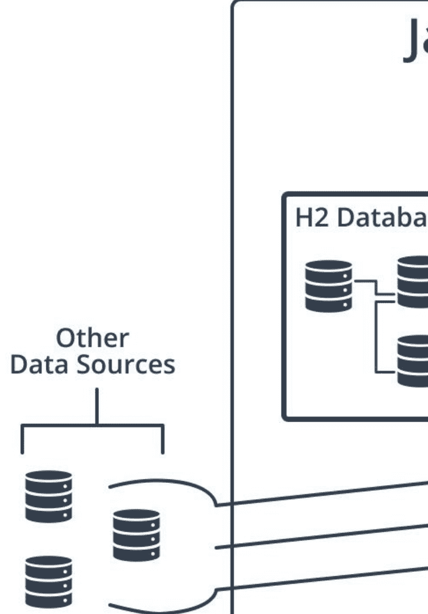
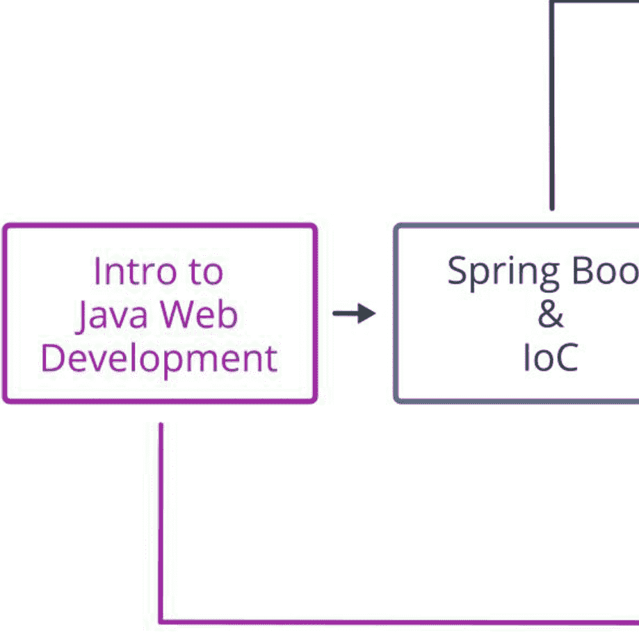
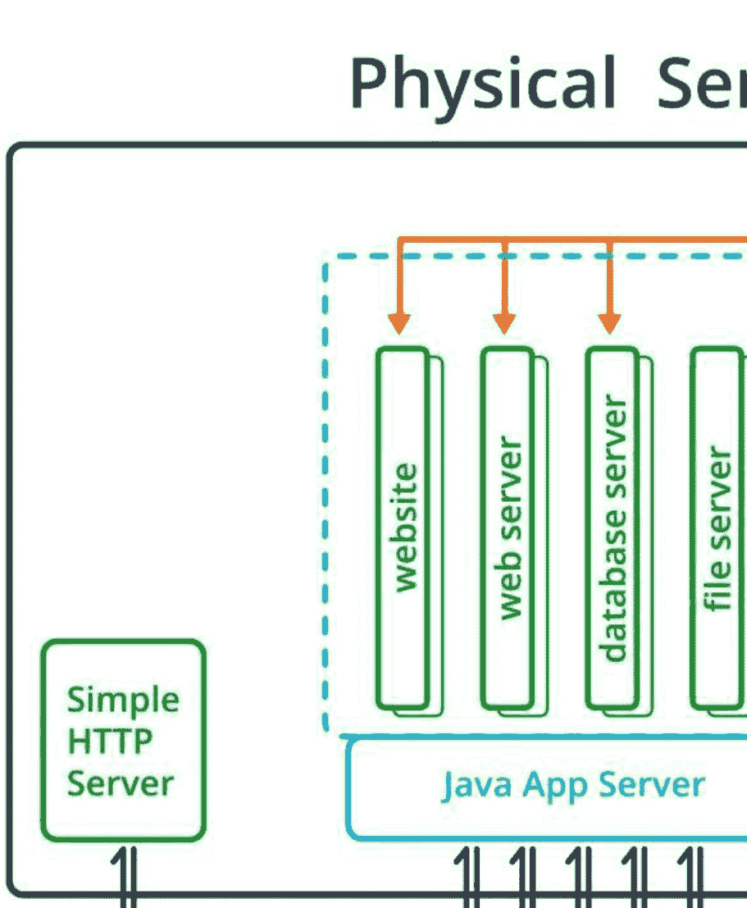
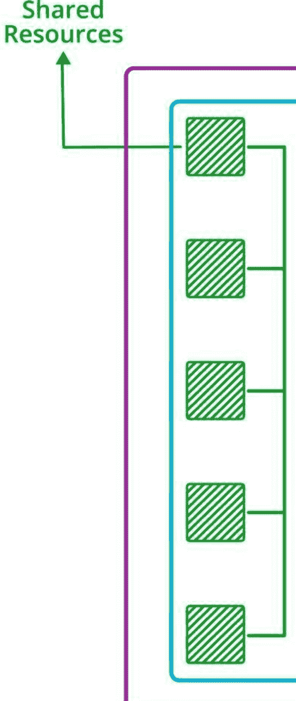
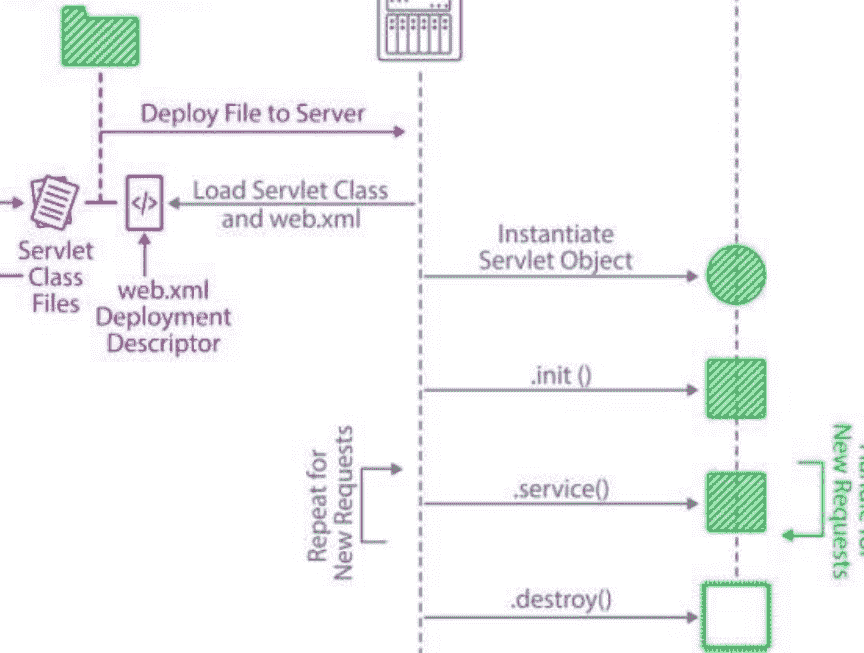
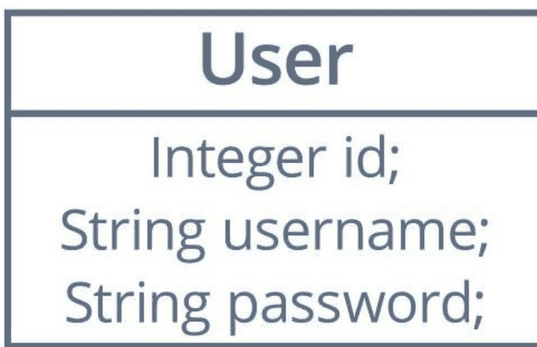
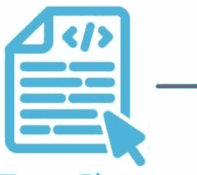
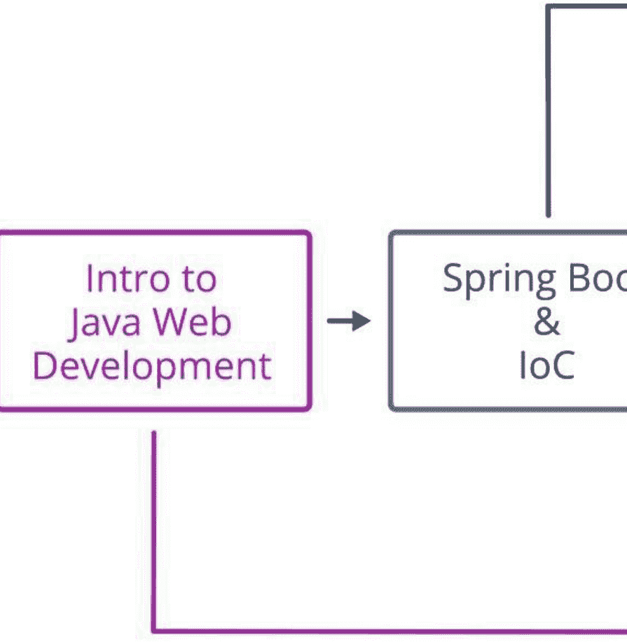
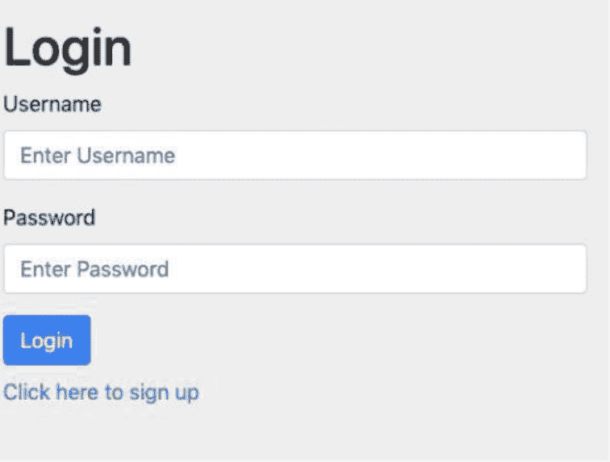

# Java Web 纳米学位课程 1 快速参考手册

## 第一课程 第一课 - JAVA 纳米学位导向

### 视频一：欢迎来到 Udacity！

我是 Sebastian，Udacity 的创始人。

我们的使命是通过技术教育助力职业发展。我们非常荣幸你选择我们来帮助你开启职业之旅。无论是开启新路径、对新领域充满好奇，还是在你的专业领域不断进步，我都想让你知道你来对地方了。我们在这里帮助你实现目标。

我迫不及待看到这段旅程将你带向何方！

### 视频二：UDACITY 体验

如果这是你的第一个纳米学位课程，欢迎你。如果你在我们这里参加过纳米学位课程，你已经对预期有所了解。Udacity 一直改进学生的学习体验。因此，你可以观看此视频了解变化，或者直接跳过。你也可以在资源选项卡中的常见问题（FAQ）中阅读内容。

让我们开始吧。

我们深信，你找不到比这里更好的学习地了。许多人付出了努力创建课程材料和平台功能，因为我们都希望你从学习之旅中获益最多。我们的承诺是为你提供资源和支持，进一步帮助你在纳米学位课程中取得成功。在学习课程期间，你可能会发现某些内容很难，并感到沮丧。如果发生这种情况，我们鼓励你利用社区渠道和导师来帮助澄清概念或分享你的疑问。我们的导师在这里为你提供帮助！你将获得建议和指导，确保你按计划完成项目。我们**想要**你成功并获得 Udacity 纳米学位证书。

我们非常重视你对未来职业的投资以及对我们的信任。我们会认真对待，并帮助你实现来到此地的任何目标。

### 视频三：成功视频（无文本）

## 第二部分

### 第 1 节：获取帮助

#### 获取帮助

在课程过程中遇到问题时，点击教室左侧栏上的“帮助”按钮。你会看到四个选项，每个选项对应一种支持类型：

- **技术导师帮助（Technical Mentor Help）：** 在我们的专家问答平台 Knowledge 上提供。你可以搜索与其类似的问题的答案，或发布与你的项目或课程相关的新问题。Udacity 的专家导师会回答所有新问题。

- **Udacity 支持社区：** 通过 [Udacity 支持社区](https) 获取同伴支持，并快速找到非技术问题的答案。从我们全球终身学习者社区获得同伴支持，他们通过分享经验和专业知识互相帮助。点击[此处](https) 发起讨论。

- **通用账户帮助：** 在这里你可以获取非技术问题的详细信息，如第三方工具、账单、截止日期等。你甚至可以通过在线聊天在此获得额外帮助。只需点击“账户帮助”（Account Help）或访问我们的[帮助中心](https)即可找到答案。

#### 视频：导师帮助（MENT HELP）

#### 导师帮助

**技术导师支持：** 通过我们的专家问答平台 Knowledge 提供。你可以搜索与其类似的问题的答案，或发布与你的项目或课程相关的新问题。**Udacity 的专家技术导师会回答所有新问题。**

#### 如何使用 Knowledge

为了确保你获得所需的优质及时支持，遵循以下 Knowledge 的最佳实践和指南将非常有帮助。

##### 搜索相关问题


##### 过滤项目相关问题

搜索相似的现有问题：由于我们的课程中有数万名学生，你的很多问题可能已经有人提过并回答了。要寻找可能提供即时支持的相似问题的现有答案，请使用屏幕左侧的过滤器选择你的课程和相关项目，或在页面顶部的搜索栏输入与你的问题相关的关键词。

**提出新问题：** 如果你想提一个新问题，请选择页面顶部的“咨询导师”（Ask a Mentor）。请记住，Knowledge 仅用于技术问题；对于其他类型的支持和反馈，请发送邮件至 `support@udacity.com`。

- 当你提一个新问题时，平台会立即将其分配给遍布全球的专家导师之一，以确保及时回复。请注意，当导师回答你的问题时，你将在名字旁边看到“Mentor”字样，以便将其支持与其他同学可能提供的区分开来。

#### 咨询技术导师

问题

字符限制：0/150

详情

请包含技术导师回答你的问题所需的所有信息，例如代码片段和 Github 链接。如果你遇到错误，请也包含错误消息的输出。

Github 或项目链接（可选）

https://

程序

项目

选择...

选择...

请先选择你的纳米学位。

提交问题（SUBMIT QUESTION）

如果你没有看到你的问题，只需创建一个新帖子。你可能会在 24 小时内获得答案，并将帮助可能遇到相同问题的未来学生。

#### 如何提一个好问题？

遵循这些提示的学生通常能获得最有力的初始支持，并避免与导师反复来回：

- **提具体的问题：** 如果你有属于一个通用主题的密切问题，可以一起提问。但考虑使用项目符号在帖子中单独列出每个问题。保持问题有序有助于导师为每个特定问题提供清晰的答案。如果你的问题关联较小，最好为每个问题提交新的独立问题。

- **提供细节和链接：** 解释你已经尝试过解决问题的方法（如果有的话），有助于导师在回答你的问题时知道从何处。同样，如果你的问题不是专门针对某个项目，而是针对练习、测验或课程，包含课程或测验名称、截图和教室链接会有帮助。

- 总的来说，提好问题的关键在于想象你自己正在尝试回答自己的问题。想象你是在没有任何先验知识的情况下来看它的。这个问题逻辑完全通吗？上下文是否存在缺失？

- **以清晰的问题标题开始：** 尝试用一句话总结你的整个问题。你甚至可以在发布问题前的最后写下标题。这将帮助你在问题本身中包含细节之前总结问题。

- **正确共享代码：** 使用“代码块”（Code Block）选项来正确格式化你的代码。如果你的问题涉及部分外部代码，请包含 Github 上文件的链接。

- 事实上，Github 允许你创建指向文件中特定行的链接。只需点击行号左侧，然后在侧边栏出现的省略号（...）中选择 `permalink`（永久链接）。将 `permalink` 直接粘贴到问题表单的 Github 框中。

- **排查错误：** 如果你的问题是关于错误消息或堆栈跟踪，请包含整个错误消息，可以通过使用“代码块”选项格式化错误消息，或者创建一个 Gist 或粘贴到 Pastebin 并包含其链接。

- **避免代码或错误消息的截图：** 不要使用代码或错误消息的截图。它们难以阅读，且文本无法复制进行调试。

- 如果你收到了有用的答案，请将其选为“采纳答案”（accepted answer）。对于同学的问题，如果你看到了其他有用的答案，请选择“赞同”（upvote）。相反，如果你认为某个答案没有很好地回答问题，请选择“踩”（downvote）。


#### 1 个答案


#### 获取额外支持

有时，学生希望获得不同导师的支持。由于每个人的学习方式不同，我们希望让像你这样的学习者这一过程变得简单。

如果你对答案不满意并希望有其他导师加入，请在 Knowledge 页面顶部选择相应选项。如果你直接在评论区回复而没有点击页面顶部的链接，你的问题将不会得到其他导师的回答。

#### Knowledge (知识库)

搜索您的问题...

> 一位技术导师回答了您的问题 - 来自其他导师的回答。

选择此选项以获取更多支持

#### 视频三：UDACITY 支持社区


#### 欢迎来到 Udacity 支持社区！

加入我们的全球终身学习者社区，我们通过分享经验和专业知识帮助彼此取得成功。通过 Udacity 支持社区快速获得同伴支持并为你的非技术问题找到答案。

#### 寻找你问题的答案

在 Udacity 支持社区中搜索常见问题的答案。

#### 接收同伴支持

通过发布问题和关注讨论向社区提问。

#### 分享你的专业知识

通过与其他学习者分享见解、经验和技巧获得认可。

#### 查看你的支持工单状态

在“我的个人资料”（My Profile）部分管理并简化你的支持工单、社区对话以及你关注的人的视图。

#### 已解决、有用和推荐的帖子

让其他学习者知道哪些帖子解决了你的问题，突出有用的回复，并通过推荐帖子更快地获得你想要的答案。

#### 在社区中建立你的声誉

探索并参与支持社区计划以获得积分、等级和勋章。在过程中享受乐趣并解锁奖励。

现在加入支持社区

## 第一课程 第一课：SPRING BOOT 简介

### 视频 1：认识你的导师

#### 认识你的导师：Peter Zastoupil

大家好！我叫 Peter Zastoupil。

我是一名企业软件开发人员，也是 Cook Systems 的老师，这是一家 IT 解决方案和培训公司。我的背景涉及许多语言和工具，但 Java 和 Spring 是我最核心的技能。我非常期待与你们分享这些技能！

### 视频 2：前提条件

为了充分利用本课程的价值，你应该已经熟悉 Java、SQL 和 IDE 的基础知识。

如果你想从 Java 开始，Udacity 提供了一门免费的 Java 编程基础课程，作为额外奖励，它还介绍了 `IntelliJ IDEA` 这一 IDE。另一个资源是 Oracle 的 Java 教程。这也是一个非常出色的参考，特别是如果你已经熟悉另一种语言，只是想知道 Java 有何不同之处。尽管如此，我们预计你在本课程中对 Java 非常熟悉，因此请自行承担风险继续，或者查看 Udacity 的《关系型数据库简介》，你将在那里学习如何设计和查询 SQL 数据库。

如果 `IntelliJ IDEA` 对你来说是新领域，你可以查看功能概览以了解可能性。请注意，我们将在课程中使用 `IntelliJ` 的开源社区版（Community Edition）。如果你想付费 Ultimate版（Ultimate Edition），它是免费的，但不是必须的。如果 IDE 对你来说很新，请查看 Udacity《Java 编程基础》的最后一节作为介绍。

### 视频 3：使用 Spring Boot 进行 Java Web 开发简介

Web 开发意味着构建 Web 应用程序，在标准的 Web 应用程序中有三个主要组件：

- 数据存储
- 应用逻辑
- 客户端访问

在课程结束时，你将学习如何使用 Java 和 Spring Boot 构建和管理这些每一个组件。

#### 数据存储

其中一些组件将负责与数据库交互。我们将使用一个名为 `H2` 的 SQL 数据库，它是由 Spring Boot 托管的内存 SQL 数据库。你将学习使用 `MyBatis`（一个用于数据库交互的 Java 库）来生成数据访问 Bean，这些 Bean 将被你应用程序逻辑中的其他服务使用，以满足客户端请求。

#### 应用逻辑

应用逻辑管理客户端访问和数据库交互。对于本课程，你将学习如何使用 Spring Boot 维护一个 Bean 集合，这些 Bean 是应用逻辑的小组件，它们可以相互作用以执行复杂任务。

#### 客户端访问

访问我们应用程序的客户端是浏览器，它将向我们的应用发送 HTTP 请求并通常期望返回 HTML。通过使用 Spring Boot 提供的 `Spring MVC` 和 `Spring Security` 库，你将学习创建名为控制器（controllers）的特殊 Bean，你可以配置它们来响应客户端请求并生成 HTML 响应。从客户端的角度来看，控制器是你的应用程序的入口点。



Web 应用程序架构：注意哪些 Spring 概念与哪些角色交织！

### 视频 4：为什么 Java Web 开发如此重要

学习 Web 开发是有价值的，因为我们每天使用的数字应用和服务就是这样被构建的。能够可视化 Web 应用程序的架构将使你成为更优秀的开发者，并在将应用想法变为现实时提供工具。

学习 Java 是有价值的，因为 Spring 是一个许多 Web 开发的框架，它是广泛使用的行业主流，拥有庞大的开发者社区。掌握 Spring Boot 使你成为一个优秀的开发者，并向你展示解决方案。无论你使用哪种语言，某些问题都会出现，学习识别这些常见问题将使你成为更优秀的开发者。

### 视频 5：利益相关者

#### 谁是利益相关者？

在专业的开发团队中，许多人参与了语言和框架的选择：

- 编写代码的开发者。
- 编写和运行测试的测试人员。
- 创建原型的设计人员。
- 选择最适合项目技术的项目架构师。
- 为开发人员编写技术规范的业务分析师。
- 规划工作的项目经理。

本课程适用于任何希望使用 Java 和 Spring 进行 Web 开发的人员。


#### 业务分析师


#### 技术要求

#### 选择 Java 对开发团队成员的影响

### 视频 6：Spring 与 Spring Boot

#### Spring

Spring 是包含许多有用 Web 开发库的框架。Spring 包含了必要的“组件”，例如数据库访问、安全、云部署、Web 服务等。

#### Spring Boot

Spring Boot 是 Spring 框架的一部分，有助于快速应用程序开发。Spring Boot 有助于开发独立和企业级 Web 应用。使用 Spring Boot 的优势在于开发者可以使用最少的配置开始使用 Spring 核心库。因此，Spring Boot 有助于加速应用程序开发。

#### Spring 与 Spring Boot

Spring 和 Spring Boot 框架都有助于构建微服务 Web 应用程序。在内部，Spring Boot 构建在 Spring 框架之上。通常情况下，Spring（核心模块）负责某些操作，如：

1. 反转控制 (IoC)
2. 依赖注入
3. 常用注解
4. 实现并为其他框架（如 `Thymeleaf`、`MyBatis`、`Spring MVC` 等）提供基础。

而 Spring Boot 带来了 Spring 的所有功能，以及一些额外优势，如：

1. 它可以自动配置 Spring 和第三方库
2. 它提供了必要的依赖以简化构建配置

通过这种方式，Spring Boot 有助于加速应用程序开发。选择 Spring 还是 Spring Boot 框架取决于软件需求。任何一个框架都可以用于构建微服务 Web 应用程序。然而，Spring Boot 有助于更快上手。

你不理解上述使用的任何术语，请**不要**担心，我们将在接下来的几节课程中学习并练习每一个。

在决定本课程中学习的主题是否适合你正在进行的项目时，请考虑你的环境、项目特性和测试目标。

如果你对 Java 比较熟悉并且你的环境支持它，那么它是任何规模项目的极佳编程语言。但如果你需要极高的性能，像 `C`、`C++`、`Rust` 或 `Go` 这样的裸机语言可能是更好的选择。

如果你的项目旨在连接不同客户端上的并发用户，你可能需要构建一个服务器，Spring Boot 可以为此提供帮助。如果你正准备创建一个带有动态数据的网站，Spring Boot 提供了 `Thymeleaf` 作为 HTML 模板引擎。如果你在数据库中存储和管理数据，Spring Boot 支持许多提供数据库访问的 Java 库，包括我们在本课程中介绍的 `MyBatis`。只要你需要服务器，Spring Boot 可能就是正确的选择。

如果你需要通过自动化 Web 浏览器来测试你的应用程序，`Selenium` 是行业标准。有许多语言的库可以使用 `Selenium`，Java 就是其中之一。`Selenium` 还与 Spring Boot 集成，使得测试服务器行为变得轻而易举。

#### 测验

以下哪一个项目不适合 Java 和 Spring Boot？

- 图形处理应用程序

### 视频 8：历史

#### 全栈开发与 Spring Boot 的历史

网络计算已经存在了近六十年。最初，特定的程序被设计用于相互通信，但多年来，针对不同的数据协议建立了多种标准。在这个时代，服务器/客户端二分法占据主导地位，针对文件共享和电子邮件交换等单个网络任务有专门的服务器和客户端程序。这种情况随着万维网、HTTP 和 HTML 的发展而改变了。随着网站变得日益复杂，Web 服务器越来越多地承担了用户浏览器与其他相关服务之间媒介的角色。这种 Web 职责的整合恰逢了 Java 的兴起和流行，随后官方的 Web Servlet 和应用容器规范也相继出炉，这些规范解决了构建复杂、功能丰富的 Web 服务器时的常见问题。

随着它的兴起，软件开发者开始在在线开源社区中见面并分享想法。这些小组开发了实用的工具和程序，包括 Spring，它的目标是基于 Java 的服务器架构，并提供无样板代码（boilerplate-free）的开发者体验。它已成为行业标准，以及支持大量强大工具和框架的伞形项目。

#### 测验

勾选所有直接导致 Spring 兴起的因素。

- 开源社区
- 应用容器

### 视频 9：课程大纲

#### 课程大纲



#### 本课程的结构与课程之间的依赖

#### 课程大纲

- Java 服务器架构基础、Java 中的依赖管理，以及 Spring 如何整合这两者。
- **Spring 核心原理。** 我们将涵盖依赖注入、Bean 配置、服务开发和服务器端配置。
- **Spring MVC 和 Thymeleaf**（一种 HTML 模板引擎）。我们将讨论 Controller、Thymeleaf 模板属性以及如何将两者连接到 MVC 模式。
- **将你的应用连接到数据库**并使用 **Spring Security** 保护它。我们将涵盖 ORM 的基础和 MyBatis（一种 Java 的 ORM 工具）。我们将使用数据库安全地存储用户凭据，并使用它们通过 Spring Security 验证用户身份。


- **使用 Selenium 进行测试和浏览器自动化。** 我们将涵盖如何使用 `JUnit` 设置和运行测试、`Web Driver` 如何工作，以及如何使用 `Selenium` 在浏览器中模拟用户操作。我们还将讨论页面对象（page objects），这是 `Selenium` 强大的抽象工具。

## 视频 10

### 工具、环境与依赖

为了获取本课程所需的工具：

- 下载 **JDK 15**。接受许可协议并运行下载的安装程序。
- 下载 **IntelliJ IDEA** 社区版。运行下载的安装程序。
- 确保你已安装了现代 Web 浏览器。我们推荐 Google Chrome。

### 工具、环境与依赖清单

当你为课程配置系统时，请勾选以下列表中的项目。

任务列表

## 视频 11

### 项目：SuperDuperDrive

| 文件 | 备注 | 凭据 |
|---|---|---|
| 上传新文件： | 选择文件 | 未选择文件 |
| 文件名 | Screen Shot 2020-02-28 at 1.16.42 PM.png | Screen Shot 2020-02-28 at 1.16.55 PM.png | |

#### 项目的最终产物

在课程的最后一个项目中，你将测试所有的技能，使用 `Spring Boot` 构建一个功能完整的 Web 应用程序。你将为一家云存储业务的新初公司 **SuperDuDrive** 开发一个个人存储应用，允许用户安全地存储文件、个人笔记和网站凭据。你将获得一些帮助，即公司技术主管提供的数据库模式和网站原型 HTML 文件。你将负责开发应用程序的注册、登录和数据存储功能，并编写测试以验证应用的功能完整性。

## 视频 12

### 回顾


- Java 开发简介
- Spring Boot & IoC

### 课程目标概述

在课程中，我们将：

- 使用 `Spring Boot` 构建应用程序。
- 通过 `Spring Boot` 理解什么是服务器。
- 使用 `MyBatis` 安全数据。
- 使用 `JUnit` 和 `Selenium` 测试我们的应用程序。

这些技能将使我们能够轻松构建安全、可维护且可靠的应用程序。

## 视频 13

### 课程基础

### Java 服务器


### 本节介绍 Java 开发

### 课程大纲

在本节中，你将接触：

- Java 服务器：介绍服务器端开发的基础以及服务器如何简化工作。
- Java Servlet：讨论服务器的核心功能 Servlet，以及它如何为开发者提供便利。
- Spring 应用程序：介绍 `Spring Framework`，这是一个基于服务器和 Servlet 的 Java 库和工具集合，为开发者提供了大量的便利。
- Spring Starter Packs：讨论通过 `Spring Boot` 生成器提供的各种“启动包”。
- Maven 和 POM 文件：介绍 `Maven`，一种 Java 依赖管理工具，允许开发者在项目中轻松使用强大的开源库。我们将讨论如何在 `Maven` 的 `pom.xml` 文件中声明依赖。

### 源代码

本课程（所有章节）的代码示例和练习解答可在 Github 仓库获取。我们建议你结合演示视频查看 `udacity-jwd-cl-snippets-master` 目录中的代码示例。

> **注意** - 在 Github 仓库中，章节和练习编号从 0 开始，就像索引一样。

### 如何下载 Git 仓库

如果你不熟悉 `Git`，请参考我们的免费课程《Git 版本控制》，并学习基础命令，如 `init`、`clone`、`add`、`commit` 和 `push`，这些是你以后可能需要的。

通常，下载（克隆）Github 仓库的步骤如下：

步骤 1. 下载并安装适用于你操作系统的 `Git`

步骤 2. 打开终端（macOS/Linux）或 `Git Bash`（Windows）。

步骤 3. 运行以下命令：

```bash
# 切换到你想下载仓库的目录
cd <path to a directory where you want to download the repository>
## 下载仓库
git clone https://github.com/udacity/nd035-cl-spring-boot-basics-examples.git
## 进入下载的仓库
cd nd035-cl-spring-boot-basics-examples
## 列出当前目录下的文件
ls
```

下载完成后，你可以将下载的仓库（或子文件夹）导入 `IntelliJ IDE` 以进行查看并运行应用程序代码。

> **注意** - Github 不支持从 Github 仓库中下载任何子文件夹，尽管有可行的变通方法。相反，Github 允许我们下载整个仓库。

### 建议

在 `IntelliJ IDE` 中，为本课程中要练习的每个新练习创建一个独立的项目。

### 使用 Java Web 编程



### Java 应用程序服务器如何将应用程序连接到网络

Web 服务器的主要作用是监听 `HTTP` 请求并使用应用程序逻辑处理它们，向客户端发送 `HTTP` 响应以指示操作结果。简单的 `HTTP` 服务器直接托管 `HTML` 文件目录，在响应对特定 `URL` 的请求时发送这些文件。这对于没有动态服务器账户的静态网站来说足够了，但现代 Web 应用支持账户、复杂交互和持久化数据。Java 应用程序服务器通过托管许多独立应用程序、并通过 `Servlet` 在通用接口上进行管理，使这些账户更易访问。这允许开发者专注于应用程序逻辑和功能，而 `HTTP` 请求处理和路由则由服务器处理。

`Spring` 提供了一组额外的库，这些库与 `servlet` 接口集成，为应用程序提供更多关注数据库访问、安全和 `HTML` 生成的实用程序，它是我们将用来构建 Web 应用程序的工具。

### 问题 1（共 2 个）

选择关于 Java 应用程序服务器及其在 Web 开发中地位的正确描述。

### 问题 2（共 2 个）

Spring 帮助我们管理哪些服务？

- 登录安全
- HTML 生成
- 数据库访问

### 关键术语

- **HTTP 请求/响应**：`HTTP`（或超文本传输协议）是用于网络上程序间通信的二进制数据格式。它可以被分解为两种基本消息类型：请求和响应。客户端向服务器发送请求，服务器响应请求的数据。在此处阅读更多关于该协议的信息。
- **GET 和 POST**：每个 `HTTP` 请求都有一个重要的标头，决定了它的方法。`GET` 和 `POST` 是最常用的两种；`GET` 表示向服务器请求数据，而 `POST` 表示向服务器“发布”新数据的请求——这通常

## 视频 3：使用 Java 进行 Web 开发

### 使用 Java 进行 Web 开发

在构建 Web 应用时，有很多非常有用的工具可以为你解决常见问题。你如何决定实现某个特定功能需要什么工具？

由于我们将使用 Java 和 `Spring Boot` 构建 Web 应用，第一步是研究 `Spring` 对该功能的支持和建议。`Spring` 网站包含了各种功能和库的文档及示例，是一个极佳的起点。一旦你决定了要使用的哪个库，下一步骤就是找到它的网站和文档。开源库拥有极其详尽的文档，涵盖了入门、使用示例和完整的参考内容。你可以利用这些资源来实现你的功能并在在此过程中调试问题。最后，如果你遇到了文档无法解决的问题，应该搜索 `Google` 以寻找他人遇到过的类似问题和解决方案。

### 测验题

将开发阶段与你在该阶段应该考虑的下一步骤进行匹配。

| 开发阶段 | 下一步骤 |
| :--- | :--- |
| 开始新功能 | 研究 Spring 是否支持以及如何支持该功能 |
| 第一次使用库 | 阅读该库的入门文档和使用示例 |
| 调试使用库的功能 | 审阅该库的参考文档并在网上搜索类似问题 |

## 视频 4：Java 应用程序服务器

### Java 应用程序服务器

Java 应用程序服务器是一种可插的架构，可以同时托管多个部署的应用程序。它为每个应用程序提供多线程、请求过滤和资源共享等工具。这些应用程序必须暴露端点，以处理服务器路由到它们的请求。



### Java 应用程序服务器的结构

### 关键术语

- **HTTP**：超文本传输协议。一种最初定义了互联网上请求和发送 `HTML` 机制的二进制协议。
- **Web 服务器**：监听并响应互联网上 `HTTP` 请求的程序。
- **应用程序服务器**：托管其他程序的程序，根据过滤器将请求转发到相应的应用程序。提供资源的共享访问和多线程支持。
- **可插架构**：可插架构指的是任何允许其部分被添加、替换和删除的软件。通常，通过为每个“可插”组件提供通用接口来实现的。有时架构甚至可以在运行时替换组件，例如应用程序服务器中的 `Servlet`。
- **线程/多线程**：这些术语源自并发编程——线程本质上是一条计算轨道，而多线程是并行运行多个线程。这变得有点复杂，因为你的 `CPU` 拥有有限的物理核心可以并行处理指令，而你拥有的线程数量可以超过计算机的核心数，但那是另一个的话题了！

### 进一步研究

- 用于 Java EE 容器/服务器的 Oracle 文档。

## 视频 5：服务器测试

### Java 应用程序服务器测验

### 问题 1（共 2 个）

当浏览器请求 Web 页面时，`HTTP` 的作用是什么？

- `HTTP` 是一种用于格式化 Web 请求的协议，以便你的应用程序服务器能够理解它们

### 问题 2（共 2 个）

选择 Java 应用程序服务器的正确益处。

- 它会自动处理多个客户端连接。
- 它可以配置为带有自定义逻辑转发。
- 它可以与每个应用程序共享重量级或通用组件。

## 视频 6

### Java Servlet

`Servlet` 类是你开发的程序与运行它们的应用程序服务器之间的主要连接。通过扩展 `Servlet`，你可以创建处理特定应用程序需求的端点，并通过向 `web.xml` 文件添加项来映射 `URL`。应用服务器使用此配置来实例化和管理你的 `servlet`。它通过三个标准方法与之交互：`init`、`service` 和 `destroy`：

- `service` 是处理请求的地方，服务器在请求路由到 `servlet` 时会调用此方法。
- `init` 是处理 `servlet` 初始化的地方，服务器在实例化 `servlet` 后会直接调用此方法。
- `destroy` 是处理 `servlet` 资源清理的地方，服务器在终止 `servlet` 实例之前直接调用。

### Java WAR 文件（应用程序代码）应用服务器 Servlet 对象



### Servlet 在应用程序服务器中的生命周期

### 关于 Java 文件的简单说明：

当你编译 Java 程序并将其打包以运行时，Java 编译器创建的是 Java 归档，或 `JAR` 文件。该文件包含一个压缩的文件层次结构，其中代表 Java 包的文件夹包含 Java `.class` 文件，这些是 `.java` 源代码文件的编译版本。它还可以包含任意资源文件，可以位于根目录或深嵌套在包层次结构中。这些文件通常包含与应用相关的元数据或位于 `JAR` 文件中，任何与 `JAR` 交互的程序都可以读取它们。

当你想要部署到应用服务器时，必须将其打包为 Web 应用程序，或 `WAR` 文件。`WAR` 文件与 `JAR` 文件几乎相同，但包含了特定 Web 应用程序的配置文件。当我们拷贝应用服务器的部署目录时，服务器会解压它，查找 `web.xml` 文件，并使用它查找应用程序所需的类和资源。这使用了高级 Java 特性，如反射和类加载，来程序化加载 Java 类定义并实例化它们，这是一个非常巧妙的技巧！它允许我们在任何时间在 Web 服务器中动态加载、启动、停止和替换任意数量的应用程序。


## 核心术语

- **端点 (Endpoints)**：端点是客户端访问服务器特定功能部分的地址。通常，这是一个 URL 路径，即位于域名（如 `.com` 或 `.org`）之后的 `/words/and/slashes`。

- **Servlet**：作为 Java 企业版（Java Enterprise Edition）规范的一部分定义的一个类。它为 Web 服务器请求处理提供了一个可实现的接口，定义了一个 `service` 方法，服务器会在实例化的 servlet 上调用该方法，以处理针对传入请求的 `ServletRequest` 和 `ServletResponse` 对象。servlet 还定义了生命周期方法，供服务器在初始化或销毁 servlet 时调用。

- **JAR**：Java 归档文件，以与代码包结构匹配的文件夹层次结构存储 `.class` 文件。包含一个可选的清单文件（manifest file）。

- **WAR**：JAR 的 Web 应用变体，可选包含 HTML 文件等网络资源，以及用于 servlet 注册/映射的 `web.xml` 等配置文件。

## 深入研究

- [Servlet API]官方文档
- [Java JAR API]官方文档
- [打包 WAR 文件]官方文档

视频系列：SERVLET 测试

## 问题 1，共 2 个

应用程序服务器与 Servlet 之间是什么关系？

> 应用程序服务器接收 HTTP 请求，解析信息，并决定由哪个 Servlet 接收请求对象。

## 问题 2，共 2 个

以下哪些陈述是正确的？

- 你的 Servlet 的 `init` 方法在实例化后仅被调用一次。
- 你的 Servlet 的 `service` 方法可以被调用多次。
- 应用程序服务器可以随时从 WAR 文件加载 Servlets。

## 视频 8：SPRING 应用程序

## Spring 应用

Spring 是一个应用程序框架，这意味着与其说在你的应用程序中选择何时调用它，不如由它决定何时调用你的应用程序代码。这种软件开发模式被称为控制反转（IoC），它非常强大，因为它允许开发者开发专门的应用程序组件，并使用 Spring 通过依赖注入（dependency injection）将它们连接起来。这对于整洁、分离的代码以及复用非常有益。在查看大量的 Spring 模块和集成了 Spring 的第三方工具时，这一点显而易见。

本课程重点关注以下几点：

- Spring MVC：一个用于 Spring 的通用 Web 控制器库，支持多种实用程序以简化 HTTP 请求的处理。
- Thymeleaf：一个第三方模板引擎，可以与 Spring MVC 集成，简化生成作为 HTTP 请求响应的 Web 页面。
- Spring Security：一个用于 Spring 的通用认证库，可以与许多不同的凭据源和身份验证协议集成，自动管理请求认证和安全上下文。
- MyBatis：一个第三方数据库访问库，提供了简单的 SQL/Java 映射工具，这些工具定义在 Spring 组件中。

## 告别样板代码：Spring Boot

Spring 增加了很多功能，但听起来仍然有很多配置。我们仍然需要将其部署到应用程序服务器，对吧？我们仍然需要创建一个让 Spring 运行的 servlet。这听起来，让所有这些模块和实用程序协同工作可能需要一些精力。

在过去，Spring 确实需要很多配置，但随着时间的推移，开发已转向“约定优于配置”（convention-over-configuration）的方法。Spring Boot 是一个提供点餐式（a-la-carte）Spring 体验的项目，并包含一个根据应用程序需求生成和下载启动项目的网页。如今大多数 Spring 应用程序还包含一个嵌入式应用程序服务器，并带有默认的、预配置的 servlet。运行启用 Spring 的代码作为服务器，你只需要运行一个主方法。

随着 Docker 等容器化架构的兴起，这种应用程序开发风格已变得像插件式应用程序服务器一样流行，在本课程中，我们将专门使用这种模式。然而，如果你想将 Spring Boot 应用部署到传统的应用程序服务器，有内置工具允许你将应用程序打包为标准的 WAR 文件。

## 核心术语

- **IoC**：控制反转（Inversion of Control），这是将库设计为应用程序运行器的实践。这允许开发者专注于特定的应用程序逻辑，并依赖 IoC 容器将应用程序组件相互连接，从而消除了大量样板代码并鼓励开发关注点的清晰分离。

## 深入研究

- 控制反转似乎有点难以概念？观看 Udacity 的这段视频，获取对基础极其简单的解释。
- Spring 框架官方网站。
- Martin Fowler 在该模式流行之初编写的关于控制反转的文章。

## 视频 9：SPRING 应用程序测试

## 问题 1，共 3 个

Spring 与 Java 应用程序服务器之间是什么关系？

## 问题 2，共 3 个

控制反转是 Spring 的主要功能之一。它允许 Spring 管理依赖项实例并在需要时提供它们。

我们可以说，Spring 注入依赖的能力就像应用程序服务器提供什么的能力？

## 问题 3，共 3 个

Spring 提供了许多额外功能，可以帮助我们接收请求并创建响应。Spring 可以帮助我们做哪些事情？

## 视频 10：SPRING 应用程序练习

## 练习：Spring 应用程序

对于这个练习，我们将下载一个 Spring 启动项目并在开发环境中打开它。这个项目非常小，但包含我们在下节课中探索的一些有用制品。

为了开始，我们将使用一个工具来生成启动项目。

访问网站：`start.spring.io`

该网站允许我们为 Spring 项目指定依赖项和元数据，并将整个项目生成为可下载的 zip 包。按照下方任务列表中的指令下载你的启动项目并打开 IntelliJ IDEA。

以下是在 `start.spring.io` 生成项目 zip 之前可以指定的参数列表：

## 通用配置

| 参数 | 值 |
| --- | --- |
| 项目（依赖管理系统） | Maven |
| 语言 | Java |
| Spring Boot 版本 | 选择稳定版本，2.3.0 或更高 |

## 项目元数据

虽然你可以选择你喜欢的值，但这里是你的第一个 Spring 应用的示例值：

| 参数 | 值 |
| --- | --- |
| Group | `com.udacity.jdnd` |
| Artifact | `coursel` |
| Name | `coursel` |
| Description | 输入你选择的描述，例如 My first project for Spring Boot |
| Package | `com.udacity.jdnd.coursel` |
| Packaging | Jar |

Java 版本：选择你系统中安装的 Java 版本。
选择 `Spring Web`。此依赖项用于使用 Spring MVC 构建 RESTful Web 应用。它使用 Apache Tomcat 作为默认容器。

## Spring 练习

## Spring 应用程序练习

## 任务列表

- Spring Web
- Spring Data
- Spring Dev Tools

## 答案：Spring 应用

## 练习：Spring 应用程序

对于这个练习，我们将下载一个 Spring 启动项目并在开发环境中打开它。这个项目非常小，但包含我们在下节课中探索的一些有用制品。

为了开始，我们将使用一个工具来生成启动项目。

访问网站：`start.spring.io`

该网站允许我们为 Spring 项目指定依赖项和元数据，并将整个项目生成为可下载的 zip 包。按照下方任务列表中的指令下载你的启动项目并打开 IntelliJ IDEA。

以下是在 `start.spring.io` 生成项目 zip 之前可以指定的参数列表：

## 通用配置

| 参数 | 值 |
| --- | --- |
| 项目（依赖管理系统） | Maven |
| 语言 | Java |
| Spring Boot 版本 | 选择稳定版本，2.3.0 或更高 |

## 项目元数据

| 参数 | 值 |
| --- | --- |
| Group | `com.udacity.jdnd` |
| Artifact | `coursel` |
| Name | `coursel` |
| Description | 输入你选择的描述，例如 My first project for Spring Boot |
| Package | `com.udacity.jdnd.coursel` |
| Packaging | Jar |

## Initializr 配置

一旦你生成了项目，使用 `File` 菜单并选择 `Open` 在 IntelliJ 中打开它。你可以打开目录，IntelliJ 将创建一个新项目并导入你的依赖项。

导航到包 `src/main/java/com.jdnd` 并找到 `CourseApplication.java` 类。这是启动 Spring 应用的主类。你可以只需右键点击它并选择“Run CourseApplication.java”来运行它。

## 视频 12：SPRING STARTER PACKS

## Spring Starter Packs

## Spring Starter Packs 设置

Spring 是一系列解决常见 Web 开发问题的开源库。我们如何获取这些库呢？在本课程中，我们将使用 Maven，这是一种依赖管理工具，允许我们通过名称和版本号定义对开源库的依赖。我们在项目的 `pom.xml` 文件中定义这些内容，Maven 会读取并下载所需的库。我们还可以让项目从某些基础项目继承依赖项，这是 Spring Boot 使用的一个功能，使设置新项目像切一样简单。我们将使用 Spring Initializr（一个在线项目生成器）为新项目选择特定的依赖项。这些包括：

- Spring Dev Tools：包括将更改的代码加载到运行应用程序中的实用程序。
- Spring MVC：用于开发服务端 Web 应用的 Web 层库。
- Spring Data：许多不同类型数据库访问的通用接口。
- 以及更多。一旦你选择了依赖项并选择了语言、构建工具和项目标识符，Spring Initializr 将生成一个 zip 文件，其中包含一个就绪的服务器，你所做的所有选择都会反映在它的 `pom.xml` 文件中。

- **依赖管理系统**：任何能够自动下载并链接外部包到软件开发项目中的工具。如今大多数语言要么提供官方的工具，要么有一个社区公认的标准。

## 额外资源

- 官方 Spring 项目生成器：Spring Initializr

## VIDEO 13: SPRING STARTER 测验

### 第 1 题，共 2 题

将 Spring Initializr 页面上的以下字段与其功能进行匹配：

| 字段 | 功能 |
| :--- | :--- |
| Artifact (制品) | 用于指定项目名称 |
| Language (语言) | 用于指定项目构物的类路径 |
| Packaging (打包方式) | 用于指定项目应作为独立应用程序运行还是部署到应用服务器 |
| Project (项目) | |
| Group (分组) | 用于指定为你的程序提供哪些外部库 |
| Dependencies (依赖项) | |

## Spring Starter Packs 测验

假设现在要创建一个具有基础用户界面的新项目，使用 Spring Initializr 并且你必须决定包含哪些需求。正如本课程之前提到的，假设我们至少包含 Spring MVC、Thymeleaf、Spring Security 和 Mybatis。请回答以下测验题。

### 第 2 题，共 2 题

对于一个想要使用这些工具支持 REST Web 服务并向 PostgreSQL 数据库写入数据的项目，你认为应该包含以下哪些依赖项？

点击 `start.spring.io` 页面上的“Add”按钮查看不同依赖项的描述。

正如说明所示，我们确实需要 Thymeleaf、Spring Security 和 MyBatis。Thymeleaf 需要 Web 才能运行，所以我们需要它。MyBatis 需要数据库驱动程序，列出的唯一一个是 PostgreSQL，因此也需要添加它。最后，Spring DevTools 为任何 Spring Boot 项目的开发提供了价值工具，也应该被包含进来。其他依赖项要么已被我们列出的依赖项涵盖，要么与我们的目标无关。JDBC 已通过 MyBatis 实现了数据库访问。Spring Integration 和 Spring Actuator 是协调多个服务器或服务的高级库，我们现在不需要它们。

## VIDEO 14: STARTER 练习

## 练习：Spring Starter Pack

我们创建了一个带有 Spring Web 依赖的新项目，但在开始使用它后，我们发现还需要添加 Thymeleaf 的依赖！在下方你将看到 Udacity 工作区中的 `pom.xml` 文件。

更新该文件以包含 Thymeleaf 依赖，以便你的项目可以导入所需的库。

如果你想在自己的机器上进行此练习

记住，当你进行本地开发时，可以使用 Spring Initializr 生成示例项目，然后使用 Explore 按钮查看 `pom.xml`。如果你想查看如何将另一个依赖项添加到你的项目中，这也会很有帮助。


```xml
<?xml version="1.0" encoding="UTF-8"?>
<project xmlns="http://maven.org/POM/4.0.0"
         xmlns:xsi="http://www.w3.org/2001/XMLSchema-instance"
         xsi:schemaLocation="http://maven.apache.org/POM/4.0.0 
         https://maven.apache.org/xsd/maven-4.0.0.xsd">
  <modelVersion>4.0.0</modelVersion>
  <parent>
    <groupId>org.springframework.boot</groupId>
    <artifactId>spring-boot-starter-parent</artifactId>
    <version>2.2.7.RELEASE</version>
    <relativePath><!-- lookup parent from repository --></relativePath>
  </parent>
  <groupId>com.example</groupId>
  <artifactId>demo</artifactId>
  <version>0.0.1-SNAPSHOT</version>
  <name>demo</name>
  <description>Demo project for Spring Boot</description>
  <properties>
    <java.version>14</java.version>
  </properties>
</project>
```

没有打开的终端 (No Open Terminals)
新建终端 (NEW TERMINAL)
菜单 (Menu)
展开 (Expand)

## VIDEO 15: SPRING STARTER 解决方案

## 解决方案：Spring Starter Pack

向项目中添加依赖项有两种方法：

1. 使用 Spring Initializr：你可以通过向 Spring Initializr 中的新项目添加新依赖项并点击 Explore 按钮浏览 pom 来查找新依赖的值。
2. 在 IntelliJ IDE 中手动添加：你也可以手动添加依赖元素，IntelliJ 会尝试查找并建议与你的输入匹配的制品。自动建议功能是代码补全。

```xml
<dependency>
    <groupId></groupId>
    <artifactId></artifactId>
    cas-server-support-thymeleaf
    spring-boot-starter-thymeleaf
</dependency>

<dependency>
    <groupId>org.thymeleaf</groupId>
    <artifactId>thymeleaf-expression-processor</artifactId>
    <artifactId>thymeleaf-extras-conditional-logic</artifactId>
    <artifactId>thymeleaf-extras-data-attributes</artifactId>
    <artifactId>thymeleaf-extras-java8time</artifactId>
    <artifactId>thymeleaf-extras-springsecurity</artifactId>
    <groupId>org.thymeleaf.extras</groupId>
    <artifactId>thymeleaf-extras-springsecurity-springsecurity4</artifactId>
    <artifactId>thymeleaf-extras-thymeleaf2</artifactId>
</dependency>
```

在向 `pom.xml` 添加依赖项时 IntelliJ 建议的制品

这是一个包含我们新依赖项的 `pom.xml` 示例：

```xml
<?xml version="1.0" encoding="UTF-8"?>
<project>
```


```xml
<project xmlns="http://maven.org/POM/4.0.0"
         xmlns:xsi="http://www.w3.org/2001/XMLSchema-instance"
         xsi:schemaLocation="http://maven.apache.org/POM/4.0.0 https://maven.apache.org/xsd/maven-4.0.0.xsd">

  <modelVersion>4.0.0</modelVersion>

  <parent>
    <groupId>org.springframework.boot</groupId>
    <artifactId>spring-boot-starter-parent</artifactId>
    <version>2.2.7.RELEASE</version>
    <relativePath/><!-- lookup parent from repository -->
  </parent>

  <groupId>com.example</groupId>
  <artifactId>course1</artifactId>
  <version>0.0.1-SNAPSHOT</version>
  <name>course1</name>
  <description>Super Cool Project</description>

  <properties>
    <java.version>14</java.version>
  </properties>

  <dependencies>
    <dependency>
      <groupId>org.springframework.boot</groupId>
      <artifactId>spring-boot-starter-thymeleaf</artifactId>
    </dependency>

    <dependency>
      <groupId>org.springframework.boot</groupId>
      <artifactId>spring-boot-starter-web</artifactId>
    </dependency>

    <dependency>
      <groupId>org.springframework.boot</groupId>
      <artifactId>spring-boot-starter-test</artifactId>
      <scope>test</scope>
      <exclusions>
        <exclusion>
          <groupId>org.junit.vintage</groupId>
          <artifactId>junit-vintage-engine</artifactId>
        </exclusion>
      </exclusions>
    </dependency>
  </dependencies>

  <build>
    <plugins>
      <plugin>
        <groupId>org.springframework.boot</groupId>
        <artifactId>spring-boot-maven-plugin</artifactId>
      </plugin>
    </plugins>
  </build>

</project>
```


## 特殊情况：无法使用 Spring Boot 时

### 第 1 题，共 2 题

考虑以下场景，并判断在每种情况下是否可以使用 Spring Boot。标记每个 Spring Boot 可行的场景。

### 第 2 题，共 2 题

Spring Boot 非常棒，但有时你必须手动配置 Spring 或在无法使用 Spring 的环境中工作。以下哪些场景可能导致不使用 Spring Boot 的配置？

- 有时在项目中无法使用 Spring Boot。这通常是因为已经实现了某种形式的 IoC，或者重写代码以使用 Spring Boot 需要花费大量时间。有时通过重构代码并添加 Spring Servlet 为项目添加 Spring 或 Spring Boot 是值得的。关于此更多信息可以在“额外研究”部分找到，但这并不是课程的重点——只需记住，在应用程序中使用 Spring 需要决策和一些设置，并不是所有应用程序都这样做！

## 额外研究

- 用于部署为 WAR 文件的 Spring Boot 官方文档

## 最后回顾

### 最后回顾练习

在课程的每节中，你将在同一个项目上构建，随着学习添加更多功能。在本节中，你需要设置该项目！创建一个包含本课程中使用依赖项的启动项目，并验证程序运行正常。

### 任务列表

### 最终回顾解决方案

如果你在完成此任务时遇到困难，请返回查看 Spring Starter Packs 的录屏视频，并确保你仔细阅读了指令。在生成项目时，检查 `POM` 文件并确保它列出了指令中正确的依赖项和元数据。你在这里可以将你的解决方案与我的方案进行对比。

## 术语表

- **HTTP 请求/响应**：HTTP（或超文本传输协议）是一种用于 Web 上的程序之间通信的二进制数据格式。它可以被分解为两种基本消息类型：请求和响应。客户端向服务器发送请求，服务器返回请求的内容。在此处阅读更多关于该协议的内容。
- **HTTP GET 和 POST**：每个 HTTP 都有一个重要的标头，决定了其方法。GET 和 POST 是最常用的方法，GET 请求从服务器获取数据；POST 请求请求向服务器“发布”新数据——这通常会在服务器数据上执行某些操作，例如搜索术语、发布更新或向服务器添加新数据。
- **HTTP**：文本传输协议。一种二进制协议，最初定义了在互联网上请求和发送 HTTP 的机制。
- **Web 服务器**：一种监听并响应互联网上 HTTP 请求的程序。
- **应用服务器**：一种处理其他应用程序的程序，将传入的请求转发给相应的应用程序进行过滤。提供对资源的共享访问和多线程支持。
- **可插拔架构**：可插拔架构指的是任何可以添加、替换和移除部分内容的软件。这通常通过“可插拔组件”的通用接口来实现。有时架构可以在运行时替换组件，如应用服务器中的 Servlets 所示。
- **线程/多线程**：这些术语源于并发，多线程是并行运行多个线程。这有点复杂，因为你的 CPU 具有有限的物理核心可以并行处理指令，而你可以拥有的线程数量可以超过你的计算机核心数，但那是另一个的话题了！
- **端点**：端点是客户端运行时访问服务器服务特定部分的地址，例如 URL 域名后续的 `/words/and/slashes`。
- **Servlet**：定义为 Java 企业版一部分的类。它为服务器请求处理提供了一个可实现的接口，定义了服务器在 servlet 实例上调用的方法，以处理传入请求的 `ServletRequest` 和 `ServletResponse` 对象。servlet 还定义了生命周期方法，供服务器在初始化或销毁 servlet 时调用。
- **JAR**：归档文件，在与包结构匹配的文件夹层次中存储编译后的 `.class` 文件。包含一个可选的清单文件。
- **WAR**：JAR 的 Web 应用程序变体，可选包含 Web 资源（如 HTML 文件）和用于 servlet 注册/映射的配置文件（如 `web.xml`）。
- **IoC**：控制反转，将库设计为应用程序运行器的实践。允许开发者专注于应用程序特定的逻辑，并依赖 IoC 容器将组件连接在一起，消除了大量的模板代码并鼓励关注点的清晰分离。
- **Maven**：一种用于 Java 的依赖管理系统和项目构建工具。提供了一种标准化方法来定义项目之间的依赖并将将其包含在项目构建路径中。
- **POM**：项目对象模型，Maven 用它表示项目的依赖和配置。通常指 Maven 项目中找到 `pom.xml` 配置文件。
- **依赖管理系统**：任何自动下载和链接外部包到软件开发项目中的工具。如今大多数语言要么内置了这种工具，要么有被社区接受的标准。

## 课程结论

### 关键术语

在本节中，我们学习了：

- **Web 服务器**：早期的服务器是单功能程序，可以托管文件、网页并将数据库暴露给外部连接。
- **Java 应用服务器**：为应用程序提供了用于接口的可插拔架构，授予对共享资源的访问和多线程请求处理的权限。
- **Spring 框架**：一个库家族，在应用服务器的抽象的基础上构建，以支持许多功能。
- **Spring Boot**：一套库，在应用服务器抽象的基础上构建，为应用程序提供接口，授予对共享资源的访问和多线程请求处理。
- **Spring Initializer**：一个官方项目生成器，用于配置 Spring，采用约定优于配置方法。

### 总结 —— Spring 依赖项

- **Spring Web**：一种使用 Tomcat 构建 RESTful 服务的依赖，它帮助我们配置 Spring 组件。
- **Thymeleaf**：一种服务器端模板引擎，通过 Spring 注入 HTML 页面。
- **Spring Security**：一种用于身份验证和访问控制的依赖，用于保护应用程序。
- **MyBatis**：一种持久化框架，通过 SQL 语句连接 Spring 对象。

下一节，我们将查看 Spring 如何运行以及我们如何通过它连接组件。

---

## Spring 基础课程三

## Spring Boot 基础


### Spring 的构建块

### 课程大纲

- **Spring IoC 配置**：我们讨论了 Spring 的核心机制——控制反转，以及如何配置它。
- **Spring 组件与服务**：我们引入了一种围绕定义的类和服务的心理模型，用于使用 Spring 进行开发。
- **全局配置**：我们学习如何配置 Spring 的某些全局属性。
- **基于 XML 的配置**：我们讨论了一种旧的 Spring 配置形式，使用 XML 文件定义依赖。

## Spring 框架


### 组件类文件与依赖配置

### Spring 的转换

图中显示 Spring 如何获取组件类文件和依赖配置并实例化相互引用的 Java 对象。

在我们将使用的所有工具中，Spring 是最重要的，因为它定义了我们的整个应用程序开发风格。Spring 是一个控制反转框架，这意味着为了使用它，我们需要将代码封装成独立的组件，并告诉 Spring 哪些组件需要。Spring 获取我们定义的组件类和定义的它们之间的依赖，并实例化相互引用的 Java 对象。这使我们无需手动编写所谓的“胶水代码”来实例化、连接和管理组件，而是允许我们专注于编写所谓的业务逻辑，即关注应用程序概念模型的代码。

### 关键术语

- **控制反转 (IoC)**：一种设计模式，其中开发者创建独立组件并使用框架连接它们，而不是自己编写集成代码。
- **业务逻辑**：与应用程序概念模型和功能专门相关的代码。与数据库访问、HTTP 请求解析等工具代码形成对比。
- **持久组件**：由 Spring 维护的 Java 对象；它们之所以是持久的，是因为它们会被一直创建并维护。
- **依赖注入**：实现 IoC 的机制。组件配置对其他组件的依赖，这些依赖在运行时注入。注入是字面的——组件的依赖通常表示为类上的注解字段，Spring 会在运行时填充这些字段。

### 练习

Spring 的哪些优点有助于实现结构化的软件开发？

鼓励开发单一功能的组件，通过组合它们来实现业务功能。

- 将资源注入到使用我们的类中。
- 通过 Java 类型、组件名称或配置属性匹配依赖请求与资源。

## 什么是 Spring

本节课程的代码片段可以在此处找到。

在设计 Spring 应用程序时，最需要记住的原则是**关注点分离**（separation of concerns）。这意味着对于你的应用程序必须解决的每一个问题，在组件中都有一个家，且这个家易于查找和灵活使用。通过构建小型但集中的组件来构建你的应用程序，你可以充分利用 Spring 消除样板代码的力量，当需要添加新功能时，你确切知道应该将它们放在哪里。在较大的团队中，这意味着更强的协调性，以及减少在寻找和消除冗余及冲突上花费的时间。

为了让你的组件之间能够有效通信，你需要一套数据类型系统在它们之间共享。这些是简单的类，设计用于存储结构化数据，此外几乎不做。它们作为应用程序数据的概念表示非常有用，例如用户个人资料或货运发票详情，这些数据可能被应用程序的组件使用和操作。

一个好的经验法则是判断哪些是组件。组件绝不应该使用 `new` 关键字进行手动实例化 - 组件由 Spring 管理，这意味着我们需要依赖依赖注入来获取组件引用。另一方面，数据类型并不比 Java 集合更特殊，我们可以随时随地使用 `new` 手动实例化它们。当然，我们也可以使用 Spring（及其相关库）为我们实例化它们，在接下来的课程中我们将看到这种情况。

### 核心术语

- **关注点分离 (Separation of Concerns)**：一种强调单一用途组件的代码组织哲学。在 Java 和 Spring 中，这意味着为了可维护性并减少代码复用，将所有与特定问题领域相关的方法保留在同一个类中。
- **数据类型 (Data Types)**：有时被称为 POJOs（简单旧 Java 对象），数据类型是应用程序设计中纯粹持有结构化应用程序数据的类，例如用户、个人资料或应用程序需要的任何其他内容。这些对象有助于我们维护良好的应用程序概念模型，并在执行期间频繁地创建和访问。
- **组件 (Components)**：组件是应用程序中由 Spring 管理的持久类实例。它们与其说像典型的对象，不如说像库，拥有必须调用才能执行特定操作的方法。组件只有在 Spring 配置为创建它们时才会被创建，通常在服务器启动时。

### 问题 1，共 2

考虑下面的代码示例。哪一个可能没有反映我们目前讨论的使用 Spring 的最佳实践？

### 问题 2，共 2

下面是一个场景列表。在某些情况下，你应该添加新的 Spring 组件，而在另一些情况下你应该使用现有的组件。请选择你应该添加新组件的场景。

## Spring Boot IoC 配置

在底层，Spring 本身就是一个 Java 应用程序 - 它以一种可预测的方式响应我们的配置。当 Spring 应用程序启动时，它会扫描代码库以寻找特殊标记的类和配置选项。它利用这些信息将你的应用程序组件实例化为对象，并将它们存储在名为应用上下文（application context）的特殊数据结构中。这个上下文非常类似于 Map，可以在运行时进行查询以找到所需的特定组件。在闭环系统中，Spring 实例化的组件将自动注入依赖。

你可以在此处找到课程示例代码

### 用于启动设置过程的注解

在 Spring 应用程序中，Spring 应用程序上下文的基础设置已经为你完成。以下注解是任何配置操作的起点：

- **@Configuration**：它告诉 Spring 被注解的类包含了 Spring 处理的组件定义。这些定义以标记了 `@Bean` 注解的方法的形式，其返回值作为组件包含在应用程序上下文中。这些方法还可以接收参数，这些参数充当方法返回组件的依赖。
- **@EnableAutoConfiguration**：它告诉 Spring 可以自动将依赖匹配到组件。通常意味着根据类型填充依赖，因此在上面的示例中，我们有一个 `compoundMessage` 方法，它隐式地依赖 `basicMessage` - 在构造 `compoundMessage` 时，Spring 只有 `basicMessage` 一个 Spring bean，所以它使用了它。
- **@SpringBootApplication**：在生成的项目中，你会得到一个带有 `@SpringBootApplication` 注解的主应用程序类。这个注解实际上等同于 Spring 的另外两个注解：`@EnableAutoConfiguration` 和 `@ComponentScan`。`@SpringBootApplication` 配置了 Spring 的组件扫描和自动配置。
- **@ComponentScan**：提供了另一层自动化 - 整个代码库的自动组件扫描。但那是下一个视频的话题！

### Spring 如何处理 IoC 配置

上图展示了 Spring 处理 IoC 配置的示例。
通用步骤如下：

- 首先初始化没有依赖的 bean，并将其放入应用上下文中。
- 由 Spring 实例化一个服务，从上下文中获取第一个 bean 作为依赖注入，随后 Spring 将该服务放入应用上下文。
- 最后，由 Spring 实例化另一个 bean，它获取之前的两个组件作为依赖注入，然后将新 bean 放入上下文中，应用程序完成完全初始化。

### 核心术语

- **配置文件**：用于配置 Spring 运行部分内容的文件。有些嵌入在 Java 类中（如我们刚刚讨论过的），有些则是我们稍后将讨论的 `.properties`、`.yaml` 和 `.xml` 文件。其中一些配置 IoC 上下文（如我们使用的那些），另一些配置 Spring 系统的抽象抽象。
- **组件注解**：用于标识供 Spring 管理的组件的注解。`@Bean` 和 `@Configuration` 是最近一个视频中的示例，在下一节中，我们还将讨论 `@Component` 和 `@Service`。
- **应用上下文**：Spring 的应用上下文只是一个持有所有应用程序组件实例的数据结构。可以通过查询它在运行时访问特定组件，且 Spring 利用它来解析依赖关系。
- **Bean**："Beans" 是 Spring 对通用组件的称呼，包括 Spring 存储在应用上下文中的任何值。bean 始终是一个对象或原始值。
- **闭源系统**：Spring 的应用上下文是一个闭源系统，这意味着它管理存储在其中的所有组件。无法手动实例化组件并保持与 Spring 的关联——它永远无法感知 Spring 应用上下文内部的组件，反之亦然。
- **@SpringBootApplication**：标注在 Spring Boot 项目主类上的注解。它是其他注解 `@Configuration`、`@EnableAutoConfiguration` 和 `@ComponentScan` 的伙伴。
- **@Configuration**：被标记了 `@Configuration` 注解的类会被 Spring 实例化并作为组件进行管理，但同时也作为一个工厂。该类中任何标记了 `@Bean` 注解的方法都将用于创建新的 bean 并将其添加到应用上下文。
- **@Bean**：配置类中标记了 `@Bean` 注解的方法将用于 Spring 生成一个与方法返回类型相同的 bean。这使得开发者可以手动配置 bean 并将其包含在应用上下文。
- **@EnableAutoConfiguration**：该类告诉 Spring 尝试根据优先级自动匹配 bean。这减少了显式标识单个 bean 作为依赖的样板代码需求。
- **@Primary**：此注解将被标记的 bean 标识为其类型的默认依赖。这用于解决当启用相同配置时，同类型多个 bean 定义产生的冲突。
- **@Qualifier**：此注解将被标记的 bean 或依赖声明标识为限定的 bean 或依赖。对于未限定依赖，会考虑未限定 bean；但对于限定依赖，则仅考虑匹配的 bean。你可以在此处阅读更多信息。

### 测验

关于 Spring 的 IoC 配置，以下哪些陈述是正确的：

- `@Qualifier` 注解帮助 Spring 在存在多个选项时确定使用哪个 bean。
- `@Configuration` 注解允许当前类扩展 Spring 的 `ApplicationContext`。

### 进一步研究

- Spring 官方 IoC 文档
- Spring 官方基于注解的配置文档

## 组件与服务

如果我们想将自定义类声明为 Spring 组件，最好的方法是使用 `@ComponentScan`。这个注解告诉 Spring 在你的代码库中搜索标记了 `@Component` 注解的类。这些类会被自动实例化为 Spring bean，因此如果你已经在类上使用了 `@Component`，就无需定义标记了 `@Bean` 注解的方法。存在 `@Component` 的其他变体用于标识每个组件要扮演的特定角色。我们将在后面的课程中看到这些的一些示例，但如果你想了解更多，请查看下方的链接。

需要注意的是，`@ComponentScan` 只标记所在的包，该包之外或其子包将被 Spring 排除。这里是 `@ComponentScan` 的 Spring 官方文档，以及解释不同类型化注解（如 `@Component`、`@Service`、`@Repository` 等）如何工作的 Spring 官方文档。


### 洋葱架构

上面展示了洋葱架构的基本结构。外部请求必须首先通过控制器或处理器层，其唯一目的是处理这些外部请求。随后使用洋葱的下一层来处理请求触发的操作。相反，服务使用彼此以及下一层（存储库/repositories 和数据访问）来持久化请求触发的操作结果。

### 核心术语

- **洋葱架构**：一种将应用程序分为嵌套层的架构模式。要让应用程序处理请求，必须首先通过外部接口和控制器的外层，然后通过服务和业务逻辑中间层，最后通过数据访问对象的持久化层。
- **应用组件**：在 Spring 中，指任何由 Spring 实例化并置于 Spring 应用上下文中的标记了 `@Component` 注解的类。从架构上说，它是应用程序的逻辑单元——一个解决应用程序关注的特定问题的单用途库或对象。
- **服务**：在 Spring 中，指任何标记了 `@Service` 注解的类，其处理方式与标记了 `@Component` 注解的类相同。两者语义上的区别在于：组件是最通用的 bean 类型，可以是任何种共享应用程序结构；而服务是库方法的特定集合，专门管理应用程序逻辑的一个方面。`UserService` 会暴露与用户相关的高级操作，`AuthenticationService` 会暴露洋葱架构的中间层，并包含应用程序的大部分业务逻辑。
- **存储库**：在 Spring 中，任何标记了 `@Repository` 注解的类都被视为与 `@Component` 标记的类，但与 `@Service` 类似，语义是不同的。在洋葱架构中，存储库是内层——每个存储库都应该像是一个指向特定存储或持久化数据的接口。例如，`UserRepository` 会暴露一个能够对用户表进行创建/读取/更新/删除和查询操作的接口。

### 问题 1，共 2 个

关于 Spring 组件，以下哪些陈述是正确的：

- `@ComponentScan` 只在与 `SpringBootApplication` 相同的包中查找 Component 类

### 问题 2，共 2 个

考虑一个存储用户和鞋子列表的程序。我们有以下组件：

- **UserService**：提供查找和修改用户的方法，包括设置用户当前的一双鞋。
- **ShoeService**：提供查找和修改鞋子库存的方法。
- **UserController**：为我们的网页提供 REST 端点，以请求用户信息并设置用户的鞋子。

哪些陈述可能是正确的？

- `UserService` bean 拥有对 `ShoeService` bean 的引用。
- `ShoeService` bean 没有对任何其他 bean 的引用。

## 练习：组件与服务

此练习为你向你展示了一个小型项目，其 Java 类之间相互依赖以完成某些工作。然而，没有任何类使用了我们在本节课中讨论的 Spring 注解！

### 待办事项

1. 你的任务是弄清楚哪些类需要各种组件注解。
2. 你还需要添加一个注解，以便 Spring 执行组件扫描，从而能够找到组件并为它们创建 Bean。
3. 所有你需要编辑的文件已经为你打开。记住，并不是所有类都需要注解，只有那些依赖于访问另一个对象的类才需要。无需自行创建的实例。不过，不要忘记，Spring 也需要创建类的实例来处理网络请求！

### 注意

注意 - 你无法在 Udacity 工作区中构建此项目。如果你下载了 `l12el` 文件夹，你可以在本地构建它。你可以通过右键点击或双指点击 `l12el` 文件夹并按“下载”来下载它。

你不需要提交你的最终解决方案。

- `home`
- `workspace`


```java
```


package com.udacity.jdnd.courseexercises;

import org.springframework.boot.SpringApplication;

public class CourseExercisesApplication {

    public static void main(String[] args) {
        SpringApplication.run(CourseExercisesApplication.class, args);
    }
}

## VIDEO 8: 解决方案：组件与服务

这个示例中有几个类，但只有其中一些需要注解。我们可以通过遵循依赖链来确定哪些类需要注解 - `FoodController` 引用 `FoodService`，`FoodService` 引用 `FoodRepository`，这意味着它们中的每一个类都需要某种形式的 `@Component`，即使是链顶端的 `FoodController` 也是如此——记住，为了让 Spring 填充依赖关系，相关的组件必须配置为 IoC（控制反转）。

我们还需要在主应用程序类上注解 `@SpringBootApplication`。记住，这是配置 Spring 组件扫描和自动配置的关键，如果没有它，我们上面使用的 `@Component` 注解将无法被 Spring 看到。

### CourseExercisesApplication.java

```java
/**
 * 此注解将等其他功能启用我们项目的
 * 组件扫描
 */
@SpringBootApplication
public class CourseExercisesApplication {
    public static void main(String[] args) {
        SpringApplication.run(CourseExercisesApplication.class, args);
    }
}
```

### FoodController.java

```java
/**
 * 用于接收请求的 Controller
 * 此类需要是一个 Spring 组件，以便 Spring 能够
 * 自动创建它的实例来接收网络请求。
 * @Controller 注解是 @Component 的变体，用于此目的。
 */
@Controller
@RequestMapping("/food")
public class FoodController {
    private FoodService foodService;

    public FoodController(FoodService foodService) {
        this.foodService = foodService;
    }

    @GetMapping
    public String getHomePage(FoodForm foodForm, Model model) {
        foodService.addFood(foodForm.getFoodName(),
                foodForm.getCalories(), foodForm.getMealTime());
        return "foodAdded";
    }
}
```

### FoodService.java

```java
/**
 * 执行食品业务逻辑操作的 Service
 * 此类需要是一个组件，因为我们的 Controller 有对它的
 * 引用，它不是自己创建的。将其标记为 @Service 让
 * Spring 知道让此 bean 的实例供其他类可用，虽然
 * @Component 也可以。
 */
@Service
class FoodService {
    private FoodRepository foodRepository;

    public FoodService(FoodRepository foodRepository) {
        this.foodRepository = foodRepository;
    }

    public Boolean isFoodAvailableAtMealTime(String foodName, MealTime mealTime) {
        return foodRepository.getFood(mealTime).stream()
                .filter(food -> food.getName().equals(foodName))
                .findFirst()
                .isPresent();
    }

    public void addFood(String foodName, Integer calories, MealTime mealTime) {
        foodRepository.addFood(mealTime, new FoodData(foodName, calories));
    }

    public FoodRepository getFoodRepository() {
        return foodRepository;
    }

    public void setFoodRepository(FoodRepository foodRepository) {
        this.foodRepository = foodRepository;
    }
}
```

### FoodRepository.java

```java
/**
 * 伪 仓库实现
 * 此类也需要是一个 Spring 组件，因为我们的
 * FoodService 依赖它。我们在这里使用
 * @Repository 注解来表示其功能，但对于
 * 此示例，@Component 的效果完全一样。很好。
 */
@Repository
class FoodRepository {
    private Map<MealTime, List<FoodData>> foodDatabase = new EnumMap<>(MealTime.class);

    public List<FoodData> getFood(MealTime mealTime) {
        return foodDatabase.getOrDefault(mealTime, new ArrayList<>());
    }

    public void addFood(MealTime mealTime, FoodData food) {
        foodDatabase.getOrDefault(mealTime, new ArrayList<>()).add(food);
    }
}
```

## VIDEO 9: 全局配置

你可以在此处找到讲座示例。

Spring Boot 也简化了新 Spring 应用程序的设置，有时你需要更改它的工作方式。这就是 `application.properties` 文件的作用！你可以在 Spring Boot 项目的 `src/main/resources` 文件夹中找到它，它允许你配置任何内容，从服务器主机名和端口到启动应用程序时在控制台中显示的 Spring Logo 的大小和颜色。

你可以在此处找到所有可用配置选项的参考文档。

### 术语

- **属性文件 (Properties File)**：带有 `.properties` 扩展名的文件，由换行符分隔的纯文本键值对组成。这种格式经常被 Java 库和框架使用，因为它提供了一种在纯文本文件中指定命名常量的简单方法。

### 测验题

Spring 属性通常很有描述性。看看你能否看出这些属性的用途：

提交以检查你的答案选项！

| 属性 | 功能 |
| :--- | :--- |
| `logging.level.org.springframework` | 设置指定包的日志级别 |
| `spring.datasource.url` | 指定主数据源的路径 |
| `server.address` | 指定此服务器的地址 |
| `spring.http.encoding.charset` | 指定 HTTP 请求和响应的字符编码 |
| `spring.json.date-format` | 指定转换 JSON 时使用的日期格式 |

## VIDEO 10: 练习：全局配置

对于示例，你将获得一个与你创建新项目时看到的相同的 `application.properties` 文件。这意味着它将完全空白！

更新 `application.properties` 文件以满足你描述的应用程序需求：

- 让服务器使用端口 8086 而不是默认端口
- 为 `com.udacity.jdnd.courseexercises` 设置日志级别为 DEBUG
- 为主数据源的用户名和密码设置你选择的值
- 启用 Thymeleaf 的模板缓存
- 通过 devtools 启用远程重启

记住，你可以在 Spring 通用应用程序属性文档中找到所有属性，但 IntelliJ 也会为你自动补全许多属性，因此在 IDE 中工作时，通常不需要引用即可添加属性。

请注意，你无法在 Udacity 工作区中构建此项目。如果你下载了 12e2 文件夹，你可以在本地构建它。你可以通过右键点击或双指点击 12e2 文件夹并按“下载”来下载。你不需要提交你的最终解决方案。

## VIDEO 11: 解决方案：全局配置

```properties
# application.properties
server.port=8086
logging.level.com.udacity.jndi.courseexercises=DEBUG
spring.datasource.username=superman
spring.datasource.password=FishTacos1234
spring.thymeleaf.cache=true
spring.devtools.remote.restart.enabled=true
```

希望你能够不费太大麻烦就找到所有这些！大多数情况下，你的属性将由你需要完成的特定目标驱动。你可能需要像在本次练习中那样准备好查找它们。

然而，Spring 的智能默认值意味着你的应用程序通常在属性文件中完全没有任何内容也能运行良好！这意味着我们通常可以依赖默认值，并在需要时准备好在文档中查找属性。

## VIDEO 12: 当你必须使用 XML 配置时

### 测验题

给定以下 Spring XML 配置，哪一个选项代表 Java 配置？

```xml
<beans>
  <bean
    id="indexService"
    class="com.udacity.example.IndexService" />
  <bean
    id="indexApp"
    class="com.udacity.example.IndexApp">
      <constructor-arg ref="indexService" />
  </bean>
</beans>
```

```java
// IndexService.java
public class IndexService {
  // ...
}

// IndexApp.java
@Component
public class IndexApp {
  private IndexService indexService;

  public IndexApp(IndexService indexService) {
    this.indexService = indexService;
  }
}
```


- 你可以在此处找到讲座中的 `beans.xml` 示例代码。

Spring 的注解配置非常方便，允许我们直接在 Java 代码中查看是如何配置 Spring 的。不过这是一个新的 API，Spring 的配置格式是通过 XML。

我们不会在课程中使用这种旧格式，但了解它很重要，因为 Spring 仍然支持它，并且许多旧项目仍在使用它。关键点是，Spring 的注解和 XML 配置系统都同样能够配置 Spring，因此如果你发现自己处于...

当你需要一种方法但只知道如何使用另一种方法时，你总能找到在它们之间进行转换的方法。

## 核心术语

- **Legacy (遗留)**：在编程语境下，legacy 通常指的是仍然运行或预期运行的旧代码，但这些代码正处于被新技术淘汰的边缘。遗留应用程序是指不再被活跃构建，而是处于维护模式的程序。
- **XML**：可扩展标记语言。正如其名所示，它是一种灵活的数据格式，允许扩展。许多应用程序和库使用 XML 作为一种存储内存外结构化应用程序数据的方式，它也是 Web 上流行的数据交换格式。

## 进一步研究

- 这里是关于注解配置的官方 Spring 文档，其中讨论了 XML 与注解的对比，并提供了许多关于两者如何相互关系的示例。

## VIDEO 13: 练习：最终复习

这是你之前在《Java Web 开发》课程中最终复习练习的延续。你将不会使用 Udacity 工作空间来完成此任务，而是在你的本地机器上构建它。

### 最终复习练习

- 从之前的最终复习练习开始。
- 创建一个带有数据的 bean。
- 创建一个使用该数据的服务 (`service`)。
- 在日志中测试该服务是否接收了 bean。

### 任务列表

-

## VIDEO 14: 解决方案：最终复习

我为这次最终复习的代码可以在此处找到。

## 术语表

- **Inversion of Control (IoC，控制反转)**：一种设计模式，其中开发者创建独立的应用程序组件并使用框架来连接它们，而不是自己编写集成代码。
- **Business Logic (业务逻辑)**：代码与应用程序的概念模型和功能集专门相关。与数据库、HTTP 请求解析等工具代码形成对比。
- **Persistent Components (持久化组件)**：Spring 随时间维护的 Java 对象；它们之所以是持久的，是因为它们在应用程序需要它们的时间内会一直被创建和维护。
- **Dependency Injection (依赖注入)**：实现 IoC 的机制。组件通过与其他组件一起进行配置，而这些组件在运行时被注入。注入是非常字面上的——组件的依赖通常表示为类中带注解的字段，Spring 将在运行时填充这些依赖。
- **Separation of Concerns (关注点分离)**：良好的组织强调单一用途组件。在 Java 和 Spring 中，这意味着为了可维护性和减少代码复用，将与特定领域相关的方法放在同一个类中。
- **Data Types (数据类型)**：组件代表 POJO（普通 Java 对象），而数据类型是应用程序中纯用于存储数据的类，如用户、配置文件或应用程序可能管理的任何其他内容。这些对象有助于我们维护应用程序良好的概念模型，并在执行过程中频繁地被创建和访问。
- **Components (组件)**：由 Spring 管理的实例。它们通常比典型的对象更复杂，具有必须调用以执行特定操作的方法。组件只有在 Spring 配置为创建它们时（在服务器启动时）才会被创建。
- **Configuration Files (配置文件)**：配置 Spring 运行某些部分的项目。有些嵌入到我们讨论过的 Java 类中，另一些是稍后将讨论的 `.properties`、`.yaml` 和 `.xml` 文件。其中一些配置了 IOC 上下文（我们讨论过的那些），另一些是 Spring 系统更抽象的部分。
- **Component Annotations (组件注解)**：用于标识 Spring 管理组件的组件注解。`@Bean` 和 `@Configuration` 是最新注解的示例，在下一节中我们还将讨论 `@Component` 和 `@Service`。
- **Application Context (应用上下文)**：Spring 的应用上下文是一个持有所有组件实例的大型数据结构。可以通过查询它在运行时访问指定的组件，它是 Spring 用来解析依赖的工具。
- **Beans (Bean)**：“Bean”是 Spring 对通用应用程序组件的称呼，包括 Spring 存储在应用上下文中的任何值。Bean 始终是一个对象或原始类型值。
- **Closed System (闭源系统)**：Spring 的应用上下文是一个闭源系统，意味着它管理内部所有的组件。无法手动实例化组件并将其与 Spring 链接——它永远不会感知到 Spring 的。
- **@SpringBootApplication**：配置 Spring 运行某些部分的注解。
- **@Configuration**：被 `@Configuration` 注解的类在 Spring 中被实例化，用于生成 Bean。
- **@Bean**：被 `@Bean` 注解的方法在配置类中，用于生成 Bean，它允许 Spring 存储在应用上下文中的 Bean。
- **@EnableAutoConfiguration (启用自动配置)**：被 `@EnableAutoConfiguration` 注解的类告诉 Spring 自动配置 Bean。
- **@Primary (主要的)**：此注解在存在多个 Bean 定义时区分出默认 Bean。
- **@Qualifier (限定的)**：此注解在存在多个 Bean 时区分特定的 Bean。
- **Architecture (架构)**：将应用程序分为若干层的架构模式。为了让请求被处理，它必须首先经过外部接口和控制器层，然后经过中间的服务层，最后通过持久化层。
- **@ApplicationComponent**：由 Spring 管理的 `@Component` 注解类。从架构上讲，它是应用程序的一个逻辑单元——一个针对特定问题的库或对象。
- **@Service**：在 Spring 中，任何被 `@Service` 注解的类处理方式都与 `@Component` 相同。它们的区别在于语义——组件是最通用的 Bean 类型，而服务是一种特定的注解结构。服务管理应用程序的一个逻辑方面。例如，`UserService` 为用户暴露层级操作，而 `AuthenticationService` 为注册和验证用户暴露操作。服务代表架构的中间层，并包含应用程序的大部分业务逻辑。
- **@Repository**：在 Spring 中，任何被 `@Repository` 注解的类处理方式都与 `@Component` 相同。在洋葱体架构中，仓库是内层——每个仓库都应该像一个访问特定存储或持久化数据的接口。例如，`UserRepository` 将暴露一个对数据库用户进行增删改查操作的接口。
- **Properties**：以行分隔的属性对的文件。这种格式被 Java 库和框架使用，并提供了在纯文本文件中指定命名常量的简单方法。

---

# 第四部分：Thymeleaf 和 MVC

## 视频 1: Spring MVC 和 Thymeleaf


### MVC 与你

### Spring MVC 和 Thymeleaf

### 课程大纲

- **MVC 与你**：我们将介绍模型-视图-控制器（MVC）模式，并讨论 Spring MVC 如何对其适配以用于 Web 端。
- **HTML 模板与 Thymeleaf**：我们将讲解 Thymeleaf HTML 模板的工作原理，以及我们如何使用 Spring 控制器向其填充数据。
- **连接控制器与模板**：我们将深入探讨控制器与模板之间的关系，查看如何将 Web 表单中的数据绑定到控制器方法。

## 视频 2：从后端开发网站

### Spring MVC 与客户端之间的关系

上面的图片显示了 Spring MVC 与客户端之间的关系。Spring MVC 使用 HTML 模板和应用程序数据来为客户端浏览器渲染视图。该视图向用户暴露了某些操作，当这些操作被触发时，会被发送到 Spring MVC，由 Spring MVC 处理这些操作并为客户端渲染新视图。

### 与简单的 Web 应用交互

在 Web 应用程序中，有两个组件：发送 HTTP 请求的客户端和负责响应的服务器。对于 Web 浏览器客户端，响应的内容需要是 HTML 格式，这是 Web 的文档语言。发送到客户端的 HTML 定义了用户看到的数据，以及用户可以执行的操作——如按钮、链接和输入表单等内容都是服务器负责生成的一部分。

如果我们必须手动完成从 HTML 生成 UI 的过程，那将非常枯燥。幸运的是，我们不必这么做——Thymeleaf 是一种 HTML 模板，与 Spring MVC 结合使用时，可以极大地简化工作。

### HTML 模板

HTML 模板本质上只是带有特殊标签和属性的 HTML 文件，这些文件可以像 Thymeleaf 这样的模板引擎与数据模型结合，从而生成功能完整的 HTML 文档。Spring MVC 提供了一种标准方法，在请求到达时选择模板并提供必要的数据模型，从而实现真正的动态用户体验。

> 数据模型定义了应用程序如何存储和检索（序列化和反序列化）从数据库到/或的 Java 对象。数据建模始于设计数据库表，这些表对应 MVC 中的 Java 类（“模型”类）。

你将在本课程中学习并练习 HTML 模板，并在“数据持久化”课程中学习数据模型。

### 关键术语

- **GET 请求**：针对特定 URL 获取数据的 HTTP 请求。这种请求不能包含任何额外数据。
- **POST 请求**：通常代表向服务器“提交”新数据的 HTTP 请求。这是一种常用的全能型方法，用于向服务器发送带有数据的请求。
- **动态的 (Dynamic)**：指响应外部刺激而发生变化的事物。在 HTML 模板中，模板的动态部分是指可以根据需要用数据替换或配置的部分。
- **静态的 (Static)**：指不改变的事物。在 HTML 模板中，模板的静态部分是无法更改的，无论模板使用什么数据，它们都保持一致。
- **MVC**：模型-视图-控制器，一种设计模式，它强调将应用程序组件分为这三类或三层，以便进行更有结构化的面向用户的应用程序开发。

### 测验题

思考模板如何允许我们用服务器数据填充可复用的 HTML 结构。这种方法与自己创建 HTML 结构相比，有哪些优势？

- 手动生成语法正确的 HTML 是一项苦力工作！
- 多个页面上的布局和视觉元素是相同的，模板允许我们复用它们。

### 外部资源

- 教程：30seconds 视频 13-02 中的 Thymeleaf + Spring

## 视频 3：服务器、模板与 MVC

有三种基本场景构成了绝大多数基于 Web 的用户交互流。

1. 第一种情况是用户从外部来源（如营销邮件或 Google 搜索）点击链接进入我们的应用程序。这种“冷启动”请求始终是 `GET` 请求，我们应用程序的责任是选择一个响应模板（适用于请求 URL）——你不会希望在用户请求 `/shopping-cart/` 时发送 `register.html` 并用相关的应用程序数据填充它。
2. 第二种场景是用户在我们的应用内进行导航，通过选择链接、按钮，或者执行我们需要在服务器上执行的某些操作（例如将商品添加到购物车）。这种情况与第一种非常相似，都涉及服务器选择响应模板并填充数据，但这种情况下，用户执行的操作完全取决于他们——因为他们是从我们设计的网页上发起的操作，只有我们在该设计中包含的操作是可用的。我们可以利用此在模板级别为请求添加额外数据，例如通过生成每个“加入购物车”按钮，在发送的请求中包含商品的标识符。
3. 最后一种场景是用户使用输入框向我们的应用提交完全自定义的数据。这与前两种情况类似，表单的精确形状由我们的模板设计决定，我们仍然需要选择一个模板来发送响应，以及填充该模板的数据。主要区别在于请求不再包含“安全”数据——当用户输入任何数据时，应用程序负责审查和验证这些数据，如果出现问题，则向用户显示错误。

这些场景看起来很简单，但它们是 Web 开发的基石。无论应用程序如何，Web 上的用户交互流都是由这些基石构建的。

### 问题 1/2

以下哪种工作流描述了服务器、控制器和 HTML 模板之间的交互？

- 服务器接收 HTTP 请求并调用控制器。
- 控制器填充模型对象并返回 String。
- 对应视图的模板由模型填充。

### 问题 2/2

关于服务器、模板和 MVC，以下哪些陈述是正确的？

- 控制器连接到模板。
- 数据可以编码到请求体中。

## 视频 4：MVC 与你

MVC 是模型-视图-控制器的缩写，它是一种常用的软件设计模式。它将应用程序组件的角色分为三层：

- **模型**：负责维护应用程序的状态；
- **视图**：负责向用户显示 UI；
- **控制器**：负责处理来自视图的操作，以更新模型，并将更新传回视图。

MVC 是一个抽象模式，每个库的实现方式不同。Spring MVC 以浏览器为平台，并组织了这些角色：

- **HTML 模板是视图**——每个代表一个特定的屏幕组件。
- **Spring Bean 是控制器**——具体来说，Spring MVC 提供了 `@Controller` 注解。Spring Bean 控制器可以定义处理特定请求的方法。这些方法负责选择生成的 HTML 模板，并填充模型对象。
- **模型对象是模型**——每个控制器方法都可以接收可选的 `Model` 参数，通过在其中定义数据，控制器可以读取提交的数据并填充模板。将 `Model` 类设为简单的数据传输对象：存储各种数据并可以在浏览器、模板引擎和控制器之间传递，以便在用户和应用程序之间传输数据。

### 让我们编码！

> 你可以在这里找到上述视频的演示代码。

为了启动 Spring MVC，我们需要两个主要元素：定义用户界面的 HTML 模板，以及一个提供该模板并填充数据的 Spring MVC `@Controller` Bean。

在我们的示例中，我们的“模板”实际上是一个显示问候的静态 HTML 页面。关于模板的要点是将其放在正确的文件夹中——项目根目录下的 `src/main/resources/templates`。当我们在控制器中选择模板时，通过指定要加载的模板名称来实现——示例中的 `home.html` 模板简单称为 `"home"`。只有当模板位于正确的文件夹时它才会有效，请务必检查！

设置基础控制器以提供此模板，我们创建了一个名为 `HomeController` 的新类并标记了 `@Controller`。正如你可能记得上一节记得，这会将类注册为 Spring Bean 并使其具备请求处理能力。这就是为什么我们不能使用 `@Component` - Spring MVC 只查找控制器，而不是所有的 Spring Bean。

为了实际上将控制器绑定到特定的请求 URL - 例如我们示例中的 `/home` - 我们在控制器中定义了一个方法并使用 `@RequestMapping` 对其进行了注解。我们还必须从该方法中返回一个字符串 - 这是我们想要渲染的模板名称。在 Web 开发的第一步中，我们只做这些工作 - 返回字符串 `"home"`，表示我们希望在用户请求 `/home` URL 时渲染 `home.html` 模板。

### 基础用户流程

你可以在[此处]找到上方视频的课程示例代码。

为了在模板中实际渲染动态数据，我们仍然需要从模板和控制器的两个方面来处理。

在模板中，我们需要向 HTML 添加 Thymeleaf 属性。在我们目前为止的示例中，我们向想要动态化的标题中添加了 `th:text` 属性，如下所示：

```html
<h1 th:text="${welcomeMessage}">Hello, homepage!</h1>
```

此属性将允许 Thymeleaf 将 `h1` 标签内部的文本（`Hello, pagehp!`）替换为通过评估 `th:` 属性中的表达式（`${welcomeMessage}`）生成的字符串。该表达式的语法非常简单：`${}` 表示一个要评估的表达式，通过在内部使用像 `welcomeMessage` 这样的名称，我们是在告诉 Thymeleaf 在为该模板提供的模型中查找相同名称的值。

然而，为了让其生效，我们需要向模型中添加一个名为 `welcomeMessage` 的属性，我们在控制器中这样操作：

```java
@RequestMapping("/home")
public String getHomePage(Model model) {
    model.addAttribute("welcomeMessage", "Hi Hello");
    return "home";
}
```


首先，我们需要向控制器中添加我们在上方看到的 `Model` 对象。这是一个特殊的类，Spring MVC 将使用 Thymeleaf 使用其渲染模板，我们可以在添加的值上设置各种属性。如你所见，我们正在向名为 "welcomeMessage" 的模型中添加一个为 "Hi Hello" 的值 - 这正是我们在模板中引用的名称！现在当我们渲染模板时，网页上将出现消息 Hi Hello 消息，而不是 Hello, homepage!。

太棒了！

我们将控制器中硬编码的 "Hi Hello" 字符串替换为任何 Java 值或表达式，它将在每次控制器方法被调用时被设置，这意味着每次有请求进入 `/home` 时。这意味着我们可以动态地设置它，甚至可以根据传入的请求。如果我们将其替换为 `Instant.now().toString()`，我们得到一个显示当前时间的欢迎消息，并且每次重新加载页面时都会更新。

## Spring MVC 架构

上面的图显示了 Spring MVC 的架构。浏览器表示视图（view），来自浏览器的请求是用户操作。当 Spring MVC 处理请求时，它会创建一个表示与视图相关的动态数据的 `Model` 对象，并传递给匹配请求的控制器。控制器更新模型并选择一个模板进行渲染。Spring 将模板和更新后的模型传递给 Thymeleaf，Thymeleaf 生成更新后的视图，然后 Spring 将发送到浏览器。

## 关键术语

- **MVC**：MVC 是 Model-View-Controller（模型-视图-控制器）的缩写，它是用户界面设计的一种常用软件模式
- **Model（模型）**：在 MVC 中，Model 负责维护应用程序的状态
- **View（视图）**：在 MVC 中，View 负责向用户显示 UI
- **Controller（控制器）**：在 MVC 中，Controller 负责处理用户操作（从视图发送以更新模型，并将数据传回给视图）
- **Template（模板）**：在软件开发中，模板用于许多不同的语境 - 通常，它们被用于定义特定格式的某些额外重复文本或代码，HTML 以及带有代码钩子（code hooks），这些钩子指示模板在渲染时应动态替换的部分。在我们的语境中，我们使用 Thymeleaf 的 HTML 模板，它们大部分看起来像普通的 HTML，带有一些额外的 Thymeleaf 特有属性。这些属性就是我们的代码钩子，允许我们定义 Thymeleaf 从我们的模板生成最终 HTML 时使用什么数据。

## 进一步研究

- 入门 - 使用 Spring MVC 提供 Web内容的教程 - 本教程将带你了解接下来课程中将学习的许多新概念。
- 不同 MVC 变体的高级概述

## 视频 5

### 问题 1（共 2 个）

考虑以下交互。它们都是有效的设计模式，但其中大多数并没有被 Spring 使用。哪一个最接近 Spring 处理 MVC 的方法？

- 所有用户操作和视图更新都以 HTTP 请求和响应对象的形式交换。控制器负责选择模板并填充模型数据。

### 问题 2（共 2 个）

MVC 及其模式遍布整个软件世界。考虑下面的场景，并勾选采用模型-视图-控制器设计的项。

- 浏览器与 Web 服务器通信，服务器更新数据库中的信息并向浏览器返回响应。
- 操作系统使用文件管理器向用户展示其文件内容。
- 移动游戏提供触屏界面以与游戏服务器通信，服务器在服务器内存中更新游戏状态。
- 一种允许用户通过自动菜单提交信用卡支付的电话系统。
- 服务员接受顾客订单并将其传给厨房，食物在厨房被准备好并送回顾客。

## 视频 6

## 模板 # 使用 Thymeleaf 的 HTML 模板

Spring MVC 数据流的本质 - 控制器必须为它想要渲染的模板提供数据 - 意味着通常在设计一个新的面向用户的功能时，从模板开始是很有意义的。

Thymeleaf 是我们在本节课程中使用的 HTML 模板引擎，这意味着它是一个可以获取模板、数据模型，并将它们结合以生成最终 HTML 文档的库。

Thymeleaf 将数据模型应用于模板的方式是基于我们在模板中添加的 Thymeleaf 属性，例如上一节 MVC 课程中的 `th:text`。这些属性可以具有复杂的表达式作为值，这些表达式由 Thymeleaf 处理：即所提供的数据模型上下文。在下一个视频中，我们将看看这些属性和表达式可以实现的一些效果！

## 更多问候！

[点击此处获取本节课程的完整课程示例代码]

除了设置文本值外，我们还可以使用 Thymeleaf 属性在模板中执行基本的控制流。模板中两种主要的控制流类型是迭代和条件渲染。

### 迭代

Thymeleaf 模板的工作方式与 Java 中的增强 for 循环非常相似。模板迭代中使用的主要属性是 `th:each`，它的用法如下所示：

```html
<h th:each="${greetings}" th:text="${msg}">Hello, homepage</h>
```

我们可以将属性 `th:each="${greetings}"` 读为“对于 greetings 中的每个 msg”，它本质上意味着“为 greetings 集合中的每个值重复渲染此元素，并对于任何需要关联值的表达式 msg，使用该元素 msg”。

在这个示例中，`h` 标签将被重复渲染，为 greetings 中的每个元素渲染一次，而由 `th:text="${msg}"` 渲染的文本将是正在渲染的 greetings 的当前元素。如果 greetings 包含字符串 "Hi" 和 "Hello"，最终渲染结果将是：

```html
<h1>Hi</h1>
<h1>Hello</h1>
```

### 条件渲染

Thymeleaf 中的条件渲染通常看起来像 Java 中的 `if` 语句（statement），或者偶尔像 `switch` 语句（switch statement）。我们在示例中检查的属性是 `th:unless`，如下所示：

```html
<h th:unless="${msg.contains('goodbye')}" th:text="${msg}">Hello, homepage</h>
```

在这种情况下，如果 msg 包含字符串 "goodbye"，则 `h` 标签将不会被渲染。这在选择是否渲染错误消息时特别有用。如果你需要相反的条件，例如在这种情况下只显示包含 "goodbye" 的消息，你可以简单地将 `th:unless` 替换为 `th:if`。

## Thymeleaf 如何渲染视图

上面的图表显示了 Thymeleaf 如何渲染视图。为了渲染视图，Thymeleaf 必须有一个模板和一个可使用的模型（model）。Thymeleaf 扫描模板以寻找动态数据表达式，并使用模型来解析表达式中的变量。某些动态数据表达式除了更常见的文本替换外，还会导致迭代或条件渲染。

## 关键术语

- **用户操作 (User Action)**：广义上，用户操作简单是指用户通过其交互的用户界面可以执行的某些特定操作。在 Web 应用程序中，我们通常将用户操作视为对网页的点击，这通常会产生向后端发送的 HTTP 请求。
- **原型/线框图 (Prototype/Wireframe)**：在 Web 应用程序的开发过程中，通常会为所有预期中看到的屏幕定义完整的 HTML 和 CSS。这些页面没有实际意义，通常被称为原型。线框图（Wireframes）是设计过程中更早阶段的版本，通常是显示原型应该是什么样的简单图像。

## 进阶阅读

- Thymeleaf 官方教程，它从第一性原理解释了整个框架。
- Thymeleaf 官方表达式语法教程 - 如果你对所有的 `{ $ }` 感到困惑，请阅读此内容。
- 官方 Spring 表达式语言（SpEL）文档 - 这将告诉你如何在 Thymeleaf 表达式括号内执行各种计算。

## 视频 7

### 第 1 题（共 2 题）

考虑一个简单的 HTML 代码段：

```html
<body>
  <p>欢迎来到未来！</p>
</body>
```

如果你的 Model 中有一个属性 `superGreatString`，你可以在 HTML 中添加哪个属性来用 `superGreatString` 的值替换页面上的文本？

- `<p th:text="${superGreatString}"></p>`

### 第 2 题（共 2 题）

考虑下面的 HTML 代码段。某些包含有效的 Thymeleaf 注解，而某些包含无效的注解。选择有效的代码段。

```html
<body>
  <tr th:each="cat : ${cats}">
    <td th:text="${cat.color}" />
    <td th:text="${cat.maxSpeedMph}" />
  </tr>
</body>
```

```html
<form action="#" th:action="@{/cat}" th:object="${cat}" method="POST">
  <label for="newText">猫咪名:</label>
  <input type="text" id="newCatName" name="newCatName" th:field="*{name}">
  <input type="submit"/>
</form>
```

**纠错 (Erratum)** - 对于第二个问题，上面显示的正确选项缺少/或位置错误的属性("")。然而，测验中显示的选项是正确的。

## 视频 8

## 练习：使用 Thymeleaf 的 HTML 模板

让我们从我们的新网页 `simple-home.html` 的一个简单示例开始。我们为页面有两个消息，我们想根据是第一次进入页面还是提交了表单来选择其中一个。

这里是我们页面的 `<body>` 文本：

```html
<body>
  <form action="#">
    <input type="submit" value="访问我"/>
  </form>
  <h1>你好，首页！</h1>
  <h1>欢迎回来！</h1>
</body>
```

假设我们的页面有一个 `firstVisit` 变量，当提交表单时，你的任务是完成以下步骤：

1. 当表单提交时，使用 Thymeleaf 属性将其指向 `simplehome`。
2. 确保表单使用 POST 请求。
3. 在 `firstVisit` 为真时显示第一个消息，在为假时显示第二个消息。

使用

```html
<!DOCTYPE html>
<html lang="en" xmlns:th="http://www.w3.org/1999/xhtml">
<head>
  <meta charset="UTF-8">
  <meta name="viewport" content="width=device-width, initial-scale=1.0">
  <title>SimplePage</title>
</head>
<body>
  <form action="#">
    <input type="submit" value="访问我"/>
  </form>
  <h1>你好，首页！</h1>
  <h1>欢迎回来！</h1>
</body>
</html>
```

## 视频 9

## 解决方案：使用 Thymeleaf 的 HTML 模板

我们有一个简单的示例，Thymeleaf 如下：

```html
<body>
  <form action="#" th:action="@{/cat}" th:object="${cat}" method="POST">
    <input type="submit" value="访问">
  <h1 th:if="${firstVisit}">你好，首页！</h1>
  <h1 th:unless="${firstVisit}">欢迎回来！</h1>
</body>
```

你可以看到以下步骤：

- 设置 `th:action` 指向 `/simplehome`。
- 设置表单方法为 POST。
- 使用 `th:if` 和 `th:unless` 根据 `firstVisit` 显示消息。

## 视频 10

## 将控制器连接到模板

Spring MVC 拼图的最后一块是处理用户提交数据的能力。如之前，这有两个主要部分：模板侧和控制器侧。

在模板侧，我们需要为想要捕捉的数据定义输入字段和 `<form>`。

在控制器侧，我们需要在数据提交后处理它。

## 用户输入

在视频中我们查看了如何处理用户提交的数据。这里是控制器方法：

```java
@GetMapping("/home")
public String getHomePage(@ModelAttribute("newMessage") MessageForm newMessage, Model model) {
    model.addAttribute("greetings", messageService.getMessages());
    return "home";
}

@PostMapping("/home")
public String addMessage(@ModelAttribute("newMessage") MessageForm messageForm, Model model) {
    messageList.addMessage(messageForm.getText());
    model.addAttribute("greetings", messageService.getMessages());
    messageForm.setText("");
    return "home";
}
```

我们需要关注的关键元素是这些方法的参数——`MessageForm` 类是一个设计用于处理表单数据的 POJO。

对于 GET 请求方法，我们声明了 `MessageForm` 参数以确保该对象存在并由 Spring 添加到模型中。这是必要的，因为 Thymeleaf 需要 `newMessage` 存在，即使该对象中还没有数据。

对于 POST 请求方法，我们声明了 `MessageForm` 参数，告诉 Spring 应该查找请求体中匹配的数据。Spring 将在调用我们的方法之前提取数据并放入 `MessageForm` 对象中，将其传递给我们以便我们根据需要使用这些数据。

在两种情况下，我们都使用 `@ModelAttribute` 注解该参数。这允许我们指定 Spring 在渲染模板之前将该对象添加到模型中。这意味着我们不需要手动添加！

## 关键术语

- **表单支持对象 (Form-Backing Object)**：这是 Spring MVC 和 Thymeleaf 使用的术语，表示表单中包含的对象。在 Spring 侧，这通常是相关控制器方法的额外参数；在 Thymeleaf 侧，这会在表单的 `th:object` 属性中引用。

## 探索

- 关于表单支持对象的 Spring MVC 官方文档。
- 关于编写表单和集成 Spring 的 Thymeleaf 官方文档。

## 视频 11

### 第 1 题（共 2 题）

将下面的每个功能与帮助执行该功能的属性或注解进行配对。

| 功能 | 属性或注解 |
| --- | --- |
| 识别获取用户数据的表单元素 | `@ModelAttribute` |
| 识别包含表单数据的对象 | `th:action` |
| 指定表单提交时调用哪个端点 | `th:field` |
| 指定特定控制器的路径 | `@RequestMapping` |

### 第 2 题，共 2 题

我们在课程早期看过的代码的修改版本。我们将更新 html 的主体，使用一个简单的表单，让你向某人发送一个击掌（high five）：

```html
<form action="#" th:action="@{'/home'}" th:object="${messageForm}" method="GET">
    <label for="highFiveText">向某人发送击掌： </label>
    <input type="text" id="highFiveText" name="highFiveText" th:field="*{text}">
    <input type="submit">
</form>
<h1 th:msg="${greetings}" th:text="${msg}" unless="${msg.contains(' Goodbye')}">Hello, homepage!</h1>
</body>
</html>
```

我们将在控制器中使用以下方法来处理表单加载和提交表单时的逻辑。假设存在 `MessageListService`，它的工作方式与视频中一样。它启动时没有消息，并可以添加新消息以维护目前为止添加的所有消息列表。

```java
@Controller
@RequestMapping("/home")
public class HomeController {
    private MessageListService messageListService;
```


## Spring MVC 控制器示例

```java
public HomeController(MessageListService messageListService) {
    this.messageListService = messageListService;
}

@GetMapping()
public String lowFive(MessageForm messageForm, Model model) {
    messageListService.addMessage("low five.");
    model.addAttribute("greetings", messageListService.getMessages());
    return "home";
}

@PostMapping()
public String highFive(MessageForm messageForm, Model model) {
    messageListService.addMessage("high five, " + messageForm.getText() + "!");
    model.addAttribute("greetings", messageListService.getMessages());
    return "home";
}
```

## 行为分析

当你访问第一个页面时会发生什么，当你输入名字“Terry”并点击按钮时会发生什么？

- 当你首次加载页面时，它会显示‘low five.’。当你点击按钮时，它会显示‘low five.’，然后在下方再次显示‘low five.’。

## 练习：将控制器连接到模板

这是另一个与上一个练习类似的短 HTML 代码段，但让我们让事情变得稍微复杂一点！这次，我们有两个字段，并希望将它们映射到消息中名为 `animalName` 和 `adjective` 的变量。

在第一个 `<h1>` 元素中，你应该列出我们返回的问候列表中的所有元素，就像我们之前学的那样，但这次我们想要显示如果列表大小为 5 或更少。一旦列表包含超过 5 个项目时，我们想要显示第二个 `<h1>` 元素。

```html
<body>
    <form action="#">
        <label for="animalText">输入动物： </label>
        <input type="text" id="animalText" name="animalText">
        <label for="adjective">输入形容词:</label>
        <input type="text" id="adjective" name="adjective">
        <input type="submit">
    </form>
    <h1>Hello, homepage!</h1>
    <h1>I think that's enough!</h1>
</body>
```

要完成此练习，你需要使用 Thymeleaf 完成四项任务：

1. 在表单中添加一个 action，使用 POST 请求重定向到 `/animal`，并将数据绑定到对象 `messageForm` 上。
2. 将输入文本绑定到两个字段：`animalName` 和 `adjective`。
3. 在第一个 `<li>` 元素中显示 `greetings` 列表的内容。你应该显示列表中的所有元素。
4. 使用条件逻辑仅在消息数量为 5 条或更少时才显示问候列表。否则，显示消息‘I think that's enough!’。

为了完成第四步，你可以使用 Thymeleaf 提供的 `#lists` 工具对象。

```html
<!doctype html>
<html lang="en" xmlns:th="http://www.thymeleaf.org">
<head>
    <meta charset="UTF-8">
    <meta name="viewport" content="width=device-width, user-scalable=no, initial-scale=1.0, maximum-scale=1.0, minimum-scale=1.0">
    <meta http-equiv="X-UA-Compatible" content="ie=edge">
    <title>Animal</title>
</head>
<body>
    <form action="#">
        <label for="animalText">输入动物： </label>
        <input type="text" id="animalText" name="animalText">
        <label for="adjective">输入形容词</label>
        <input type="text" id="adjective" name="adjective">
        <input type="submit">
    </form>
    <h1>Hello, homepage!</h1>
    <h1>I think that's enough!</h1>
</body>
</html>
```

## 解决方案：将控制器连接到模板

这是完成此任务的 `<body>` 部分，将控制器连接到模板：

```html
<body>
    <form action="#" th:action="@{'/home'}" th:object="${messageForm}" method="POST">
        <label for="animalText">输入动物： </label>
        <input type="text" id="animalText" name="animalText" th:field="*{animalName}">
        <label for="adjective">输入形容词</label>
        <input type="text" id="adjective" name="adjective" th:field="*{adjective}">
        <input type="submit">
    </form>
    <h1>Hello, homepage!</h1>
    <ul th:if="${lists.size(greetings) <= 5}">
        <li th:each="msg : ${greetings}" th:text="${msg}"></li>
    </ul>
    <h1 th:unless="${lists.size(greetings) > 5}">I think that's enough!</h1>
</body>
```

- 我们使用了 `th:action` 设置操作。
- 我们使用了 `th:object` 处理 `messageForm`。
- 我们使用了 `th:field` 处理输入。
- 我们使用了 `th:each` 处理列表。
- 我们使用了 `th:text` 处理消息。
- 我们使用了 `th:if` 处理条件。
- 我们使用了 `th:unless` 处理条件。

## 特殊输入（文件）

### 第 1 题，共 2 题

你被要求写一个接收文件上传的方法。哪个正确？

```java
@PostMapping
public String upload(@RequestParam MultipartFile file, Model model)
```

### 第 2 题，共 2 题

考虑以下语句。检查错误的：

- 没有有效的方法向 MVC 上传文件。
- 没有有效的方法向 MVC 发送 cookie。
- 没有有效的方法在 MVC 中提取头。
- 没有有效的方法在 MVC 中提取 URL 段。

有时我们构建应用程序，需要处理特殊数据。在示例中，我们查看了由 Spring 提供的处理文件上传。注意可能需要特殊数据的情况。

## 进一步研究

- Spring MultipartFile Java 文档
- Spring Boot 教程

## 练习：最终回顾

视频 15：

在最后的回顾中，我们将在上一个课程的基础上构建一个简单的聊天应用程序，用户可以提交他们的消息以及用户名，这些消息对任何导航到 `/chat` 的用户都是可见的。此外，用户可以选择消息模式：Say、Shout 或 Whisper。Say 应显示消息，而 Shout 应以大写形式显示，Whisper 应以小写形式显示。为了完成此任务，你需要采取以下步骤：

1. 禁用 Spring Security。遗憾的是，由于我们在第一个课程中在项目中加入了 Spring Security，默认情况下我们所有的页面都限制为登录用户。接下来我们将学习 Spring Security，所以现在让我们注释掉 `pom.xml` 文件中的依赖。这些是应该注释的依赖：

```xml
<dependency>
    <group>org.springframework.boot</groupId>
    <artifactId>spring-boot-starter-security</artifactId>
</dependency>
<dependency>
    <group>org.springframework.security</groupId>
    <artifactId>spring-security-test</artifactId>
    <scope>test</scope>
</dependency>
```

2. 为主应用程序界面添加 `chat.html` 模板。该模板应该包含两个部分：首先，一个允许用户提交用户名、他们想要发送到聊天的消息文本以及消息模式（Say、Shout 或 Whisper）。其次，一种显示目前为止已发送消息列表的方法。这里是表单的初始代码：

```html
<form>
    <label for="username">用户名：</label><input id="username" type="text">
    <label for="messageText">消息文本：</label><input id="messageText" type="text">
    <label for="messageType">消息类型：</label>
    <select id="messageType">
        <option selected>Say</option>
        <option>Shout</option>
        <option>Whisper</option>
    </select>
    <input type="submit">
</form>
```


## 3.

你必须添加 Thymeleaf 属性来与后端交互，你可能需要参考 Thymeleaf 文档来了解如何正确设置 `<select>` 标签。对于消息列表，可以随时回顾我们本课中的示例来获取灵感！不要忘记，你需要为每条消息显示消息文本和用户名。

## 4.

1. 添加一个 `ChatForm` 类来存储聊天数据。如果我们有一个表单，我们需要一个表单支持的对象。确保其字段与表单输入元素匹配！
2. 添加一个 `ChatMessage` 类来存储用于显示的消息信息。由于我们要为每条消息显示两部分数据（消息文本和发送者的用户名），我们应该创建一个类来同时持有这两条数据。
3. 更新 `MessageService` 类，将 `List<ChatMessage>` 作为历史记录存储。由于我们想要随时间跟踪许多消息，我们需要一个地方来存放它们！
4. 更新 `MessageService` 类，添加一个 `addMessage` 方法。该方法将由控制器调用，将提交的消息添加到由 `MessageService` 存储的消息列表中。
5. 添加一个 `ViewController` 来提供 `chat.html` 模板并处理新消息提交。没有控制器的 Spring MVC 应用是不可行的！当收到 `/chat` URL 的 GET 请求时，该控制器应该提供 `chat.html` 模板，并且它应该处理同一 URL 的 POST 请求作为新消息提交。
6. **[加成]** 添加一个单词列表。使用它在页面上条件地渲染消息——包含一个或多个单词的消息应该被显示。
7. **[额外加成]** 添加一些样式！遗憾的是，设计一个吸引人的网站不在本课程的范围范围内，但这并不意味着你不能亲力而为！尽管地使用你自己的样式，添加 CSS 和/或 JavaScript 文件让视觉效果更舒适。如果你对这类事情没有经验，但又想学习，Bootstrap 是一个很棒的起点！

## 最终练习

是时候构建我们的基础聊天应用了！根据下面的任务更新你的最终复习项目，并参考上面的指令获取高级目标和要包含在项目中的代码片段。

## 任务列表

视频 16:

## 答案：最终复习

你可以在这里找到完整的复习方案代码

## 词汇表

- **GET 请求**：针对特定 URL 获取数据的 HTTP 请求。它不包含任何额外数据。
- **POST 请求**：通常代表向服务器“发布”新数据的 HTTP 请求。这是一种常用的向服务器发送许多带有数据的请求的通用捕获方法。
- **动态**：动态的事意味着会响应外部刺激而发生变化。在 HTML 模板的情况下，模板的静态部分是那些可以根据需要替换或配置数据的部分。
- **静态**：静态的事意味着不会改变。在 HTML 模板的情况下，模板的静态部分是无法更改的，无论使用模板使用什么数据，它们都保持相同。
- **MVC-视图-控制器**：一种设计模式，强调将应用程序组件分为三类层，以进行更结构化的面向用户的应用程序开发。
- **模型**：在 MVC 中，模型负责维护应用程序的状态。
- **视图**：在 MVC 中，视图负责向用户显示界面（UI）。
- **控制器**：在 MVC 中，控制器负责处理用户操作（从视图发送）以更新模型，并将更新回传给视图。
- **模板**：在软件开发中，模板通常是特定格式（如 HTML）的重复或复用的文本或代码，带有代码上下文——总来说，它们被用于定义某些带有 `code hooks` 的重复内容，这些钩子指示了模板在渲染时应被动态替换的部分。在我们的语境中，我们主要使用 Thymeleaf 特有的属性。这些属性大多看起来像纯 HTML，但有几个 Thymeleaf 特有的属性，允许我们定义 Thymeleaf 在生成最终 HTML 模板时所使用的内容。
- **用户操作**：用户操作是用户通过其交互的用户界面可以执行的简单操作。在 Web 应用程序中，我们通常将用户操作视为对网页的点击，其结果是发送到后端的 HTTP 请求。
- **原型/线框**：在 Web 应用程序的开发过程中，通常首先定义用户预期看到的所有的的 HTML 和 CSS。这些页面没有实际功能，通常被称为原型。线框是设计过程中更早的阶段，通常是显示原型应该样子的简单图像。
- **表单绑定对象**：这是 Spring MVC 和 Thymeleaf 使用的术语，代表表单中包含的数据。在 Spring 端，这通常是相关控制器方法的额外参数；在 Thymeleaf 端，这在表单的 `th:object` 属性中引用。

视频 17:

## 课程总结

哇，干得好，坚持到了这里！通过学习 Spring MVC 和 Thymeleaf 如何工作，你已经迈出了 Java Web 开发世界的第一个可见步骤。你应该拥有了开发应用程序所需的所有工具。在下节课程中，我们将看看如何让应用程序变得持久且健壮——到时候见！

## 课程第五部分

视频 1:

## 数据持久化与安全


## 课程大纲

- **ORM 是常态**：我们介绍对象关系映射（ORM），这是一种利用 Java 类和 SQL 表之间相似性的软件模式。
- **MyBatis 映射**：我们介绍 MyBatis，这是一个与 Spring 集成良好的工具。
- **实用示例 - 用户凭据与身份验证**：作为使用 ORM 的动机示例，我们讨论如何使用 User 和 Spring Security 实现基础登录安全。

视频 2:

## ORM 与安全


## 我们应用程序不断增长的层

图显示了我们应用程序不断增长的层。通过添加 MyBatis，我们现在有了从 Java 世界到 SQL 世界的翻译。

## 为什么需要数据库？

在应用程序中添加数据库是外部化持久化问题的方法。在内存中存储数据时，我们需要处理：

- 存储空间
- 并发性
- 数据持久化

使用数据库允许我们将这些问题与应用程序的其他部分隔离，以便我们专注于应用程序的业务逻辑。

## 如何与数据库交互？

管理应用程序与数据库之间通信的方法有很多。在本课程中，我们将使用 MyBatis 库将 Java 对象转换为查询参数，并将 SQL 结果转换为 Java 对象。

我们将 MyBatis Mappers 创建为 Spring Bean，以便将它们注入到任何需要的 Bean 中。例如，如果我们考虑一个在线购物示例，我们可能有一个管理单个用户购物车凭据和个人信息的 `UserMapper`。我们可以将 `UserMapper` 注入到 `Checkout Service`，该 Service 也接收 `CartMapper` 以将用户购物车中的费用应用于用户的存储支付信息。

在课程稍后部分，我们将把 MyBatis Mapper 与 Spring Security 结合，以自动验证每个用户的会话。继续之前的示例，我们可以在某种身份 Service 中注入 `UserMapper`，以便登录时检查客户端凭据。

## 题

哪个陈述描述了使用对象关系映射（ORM）来保存持久化数据的优点？

- 它避免了我们编写引用对象中每个字段的查询。
- 它允许我们更方便地以 Java 对象的形式处理持久化数据。
- 延伸阅读

  - 简读由 Elizabeth O'Neil 编写名为《Object/relational mapping 2008: hibernate and the entity data model》的论文，以便对 ORM 有更深入的理解。
  - 如果不熟悉 JDBC，请参考此[官方 JDBC 简介](https://example.org)，并快速查看底层架构。不过，我们不会直接使用 JDBC。MyBatis 会自动生成 JDBC 请求。你很快就会学习并实现 MyBatis。

视频 3:

## ORM 与安全

## 哪些数据应该存储在数据库中？

- 跨多个用户会话共享的数据，例如产品库存
- 登录后仍保持可访问的持久化数据，例如用户配置或购物车

## 数据应该如何结构化？

- 直观地。大多数数据可以存储与代表它的 Java 数据对象相似的格式，属性与列名匹配。
- 差异。出于安全考虑，某些数据必须以后进行存储，例如加密密码。其他数据可能需要不同的格式以便高效存储，例如大文件。

## 思考安全性

要问的核心问题是：“用户访问哪些页面？”

- 用户特定数据
- 通用访问（未加密）数据
- 可能随领域而异

## 问题 1（共 2 个）

网页的以下部分需要用户登录才能查看？

- 完整库存
- 特定用户的购物车

## 问题 2（共 2 个）

有些数据属于数据库，但如果我们把所有内容都放在那里，我们的应用程序就会变慢，数据库也会变得非常巨大！想象你正在为一家在线零售店制作网页。以下哪些内容属于数据库？

视频 4:

## ORM 是常态

使用 ORM 的第一步是定义数据模型。考虑以下表之间的关系：

- **user** - 包含每个用户 ID、用户名和密码的表。
- **user_cart** - 我们假设任何用户最多只能有一个购物车。购物车将包含多个项目（库存）。此表存储用户 ID、库存 ID 以及用户想要购买的库存数量。在此表中，用户 ID 和库存 ID 分别是外键。共同来说，用户 ID 和库存 ID 的组合可以作为主键。
- **inventory** - 它存储库存的 ID、名称和单价。

我们可以通过下面的图片在 SQL 中表示它们的关系。

SQL 表之间的关系 - 显示 SQL 中 user、user_cart 和 inventory 表之间关系的图片

ORM 的一个主要特性是，这种关系应该自然地映射到 Java 类。我们可以使用简单的类图在 Java 中表示这些相同的数据。



与 SQL 表对应的类图 - 类图显示 SQL 图中的列变为 Java 对象 `User`、`CartItem` 和 `InventoryItem` 的字段

这些类属性的数据类型与 SQL 列的数据类型对应。某些 Java 类型可以映射到许多不同的 SQL 类型，某些 SQL 类型可以映射到多个 Java 类型，但在这种情况下类型映射是显而易见的。有关 MyBatis 类型映射的完整列表，请参考 MyBatis 3 TypeHandlers 列表。

一旦你定义了数据类型，MyBatis 就可以将 Java 对象映射到 SQL 语句。

```java
User {
  int id = 99;
  String name = "Peter";
}
```

## ORM 过程可视化

上面的图显示了 ORM 过程可视化，展示了 `createUser(user)` 如何转换为在表中插入行的 SQL，以及 `getByUsername(name)` 如何转换为返回结果并成为 Java 对象的 SQL。

## 关键术语

- **ORM**：对象关系映射。描述一组用于自动转换数据库表示和应用程序表示的技术的通用术语。
- **映射**：在 Java 类中的字段与 SQL 表中的列之间建立关系。
- **一对一**：两个对象之间的关系，关系的每侧有一个实体。
- **多对多**：两个对象之间的关系，每个实体的多个副本可以与其他实体的多个副本相关联。

## 测试题

考虑以下 Java 变量列表。它们可能对应哪些类型的列？

提交以检查你的答案！

| Java 变量 | SQL 列类型 |
| :--- | :--- |
| `String username;` | VARCHAR |
| `Integer numberOfCats` | INTEGER |
| `LocalDate birthDate` | DATE |
| `Double priceOfSalmon` | DECIMAL |
| `Boolean passedTheQuiz` | BOOL |

## 建议阅读

- Martin Fowler 写的书籍《Patterns of Enterprise Application Architecture》
- 对象关系阻抗

视频 5:

## 练习：ORM 是常态

场景

欢迎来到大企业！你被聘请为一家 Taco 送餐服务实现数据模型。美味！

下面的图描述了客户、Taco 和配送之间的关系。

- 每个客户可以拥有任意数量的订单。
- 每个订单必须包含一个或多个 TacoOrder 条目。
- TacoOrder 条目具有名称、价格和数量。
- 最后，你可以选择性为每个订单安排配送。

## 待办事项

**你的工作是为显示的每个表创建一个类。** 应该有一个 `Customer`、`Order`、`TacoOrder` 和 `Delivery` 类。类中的变量应与表中的对应变量匹配。

**注意** - 你需要在此 Spring starter 项目的相应位置创建类文件。导航到给定目录找到正确的文件夹，开始创建任何所需的文件夹和文件，以正确创建这些类。**双击**工作区中的 `l4e1` 文件夹以开始导航此项目。按 + 按钮添加文件。

| Customer | | |
| :--- | :--- | :--- |
| PK | `id` | int |
| | `username` | varchar |
| | `password` | varchar |

| Order | | |
| :--- | :--- | :--- |
| PK | `id` | int |
| FK | `customer_id` | int |

视频 6:

## 答案：ORM 是常态

> **错误说明** - 在上方视频 1:02 处，当讲师说“Big Double”时，他是想说“BigDecimal”。

你应该为这个练习创建四个类：`Customer`、`Order`、`TacoOrder` 和 `Delivery`。这些类文件应该位于 course 文件夹中新的 data 文件夹中。每个类都应该对应数据库表中的变量。以下是一些示例实现：

### Customer.java

```java
public class Customer {
    private Integer id;
    private String userName;
    private String password;
    /* getters and setters not shown */
}
```

### Order.java

```java
public class Order {
    private Integer id;
    private Integer customerId;
    /* getters and setters not shown */
}
```

### TacoOrder.java

```java
public class TacoOrder {
    private Integer orderId;
    private String tacoName;
    // 在这里可以运行，但如果你计划对它们进行任何数学运算，
    // 通常应该使用 BigDecimal 来处理价格
    private Double tacoPrice;
    private Integer count;
    /* getters and sets not shown */
}
```

**专业提示** - `java.math.BigDecimal` 数据类型比任何原始数据类型（包括 `Double`）都更适合用于精确值，例如货币或 `tacoPrice`。

### Delivery.java

```java
public class Delivery {
    private Integer id;
    private Integer orderId;
    // 这种情况下你可以使用几种类型。
    // java.sql.Timestamp 包含了日期和时间
    private Timestamp time;
    /* getters and setters not shown */
}
```

## 对“ORM 是常态”的反思

在我们的示例中，`TacoOrder` 有一个项目，封装了订单 ID 以及我们描述的 Taco 数据（包括其名称和价格）。如果我们想将 Taco 描述存储在另一个表中并在 `TacoOrder` 中间接引用它们呢？`TacoOrder` 的新结构将会？你将使用哪些外键来实现此功能？


视频 7:

## MyBatis Mappers

MyBatis 在 JDBC（Java 数据库连接）之上提供了一个浅 ORM 层。这意味着它可以帮助将你的 Java 对象映射到使用 JDBC 保存和检索数据的查询。

MyBatis 主要通过接口定义使用。MyBatis 会自动生成实现接口的类，并将其作为 Spring Bean 暴露。这是一个定义 MyBatis Mapper 的示例接口。

```java
@Mapper
public interface User {
  @Select("SELECT * FROM users WHERE username = #{username}")
  User getUser(String username);
}
```


上面的代码使用 `#{username}` 来标识用户名参数。它就像 Thymeleaf 参数，但是用于 SQL 的！

有关 MyBatis 用于 SQL 的模板语法的更多信息，请查阅官方文档。还有针对 `@Insert`、`@Update` 和 `@Delete` 的额外注解。请查看视频下方的“进一步研究”部分以获取有关如何配置 MyBatis 的更多信息。

## MyBatis Demo

### @Insert 和 @Options 注解

`@Insert` 注解会自动引用用户对象的属性。`username`、`firstName`、`lastName` 在这里都被直接引用，因为它们是用户对象的属性。

```java
@Mapper
interface UserMapper {

  @Insert("INSERT INTO USERS (username, salt, password, firstName, lastname)" +
          "VALUES(#{username}, #{salt}, #{password}, #{firstName}, #{lastname})")
  @Options(generatedKeys = true, keyProperty = "userId")
  int insert(User user);
}
```

此示例还演示了 `@Options` 注解。`@Insert` 通常返回一个整数，即受影响行数。通过使用 `@Options` 注解，我们告诉 MyBatis 我们想要自动生成一个新键并将其放入 `userId` 中。现在，一旦插入了行，方法将返回新的 `userId`。

我们只需要在使用这些方法时向我们的服务中注入该接口的 Bean，MyBatis 就会自动为 JDBC 请求创建代码！


## MyBatis Mappers 位于我们洋葱架构的核心

上面的图显示 MyBatis Mappers 位于我们洋葱架构的核心。记住，这意味着唯一应该依赖它们的 Bean 应该在上一层。

## 核心术语

- `@Select`、`@Insert`、`@Update`、`@Delete`：代表要执行的 SQL 语句的注解。每个注解都接收一个字符串作为对应类型的 SQL 语句。例如，`@Select` 注解接收一个字符串作为 SELECT 语句。
- `@Options`：提供访问 JDBC 语句开关和配置选项的注解。

## 进一步研究

- 有关可用 MyBatis 注解列表及示例用法，请参 MyBatis Java API 文档。
- 关于使用 MyBatis 注解进行结果映射的非正式概述，请查看此 Medium 文章

## VIDEO 8

### 问题 1，共 2 个

关于 MyBatis 的以下哪些是正确的？

- MyBatis 仅通过接口生成你的 Bean。
- 你 MyBatis 查询中的变量可以引用方法参数中的对象，也可以引用对象属性。

### 问题 2，共 2 个

我们想向数据库添加一个新的 `TacoOrder`。这里是 `TacoOrder` 类：

```java
public class TacoOrder {

  private Integer orderId;
  private String tacoName;
  private Double tacoPrice;
  private Integer count;

  /* getters and setters not shown */
}
```

以下哪个示例会执行我们的插入？

- `@Insert("INSERT INTO TacoOrder(orderId, tacoName, tacoPrice, count)" + VALUES (#{orderId}, ${tacoName}, ${tacoPrice}, ${count})) int addToOrder(TacoOrder tacoOrder);`

## VIDEO 9

## 练习：MyBatis Mappers

### 场景

在本节早些时候，我们创建了一些类来帮助支持我们发展的外卖业务。让我们创建一个 `@Mapper` 接口，一旦客户成功下单，我们就可以用它来创建新的订单。提醒一下，这是我们的 `Delivery` 类：

```java
public class Delivery {

  private Integer id;
  private Integer orderId;
  private Timestamp time;

  /* getters and setters not shown */
}
```

### 待办事项

你将看到 `DeliveryMapper` 接口，你的任务是声明带有 SELECT、INSERT 和 DELETE `Delivery` 记录的方法。使用相应的注解标记每个方法，以执行此处描述的 Select、Insert 和 Delete 操作：

- `findDelivery` (or select) 方法应该接收我们 `Delivery` 类的 `id` 并返回对应的 `Delivery` 对象。
- `insert` 方法应该接收一个 `Delivery` 对象并创建一个带有 `orderId` 和 `time` 的新记录。它应该生成一个新的 `id` 并返回该 `id`。
- `delete` 方法应该接收一个 `id` 并从数据库中删除该记录。它不需要返回任何内容。

- `home/`
- `workspace`

```java
package com.udacity.jdnd.cousel.data;

import org.apache.ibatis.annotations.*;

@Mapper
public interface DeliveryMapper {

}
```

无打开终端
新建终端
菜单
展开

## VIDEO 10

## 解决方案：MyBatis Mappers

### 解释

我们在接口中声明了三个新方法。在解决方案中，它们被命名为 `findDelivery()`、`insert()` 和 `delete()`，但你可以随心命名。

```java
@Mapper
interface DeliveryMapper {

  @Select("SELECT * FROM Delivery WHERE id = #{id}")
  Delivery findDelivery(Integer id);

  @Insert("INSERT INTO Delivery (orderId, time) VALUES (#{orderId}, #{time})")
  @Options(useGeneratedKeys = true, keyProperty = "id")
  Integer insert(Delivery delivery);

  @Delete("DELETE FROM Delivery WHERE id = #{id}")
  void delete(Integer id);
}
```

上面的代码使用了以下注解：

1. 第一个注解是之前见过的简单的 `@Select`。
2. 第二个注解 `@Insert` 与之前的示例非常相似。它使用 `INSERT` 命令在 `Delivery` 表中创建新行。注意它只需要提供 `orderId` 和 `time`，因为 `id` 是自动生成的。
3. `@Options` 注解指示为 `id` 生成键并从方法返回。此外，MyBatis 可以确定我们 `Delivery` 对象的属性。
4. 最后，`@Delete` 非常像 `@Select`，但请确保你使用它

## VIDEO 11

## 实例示例：用户凭据与认证

### 应用程序中的认证

用户支持是应用程序的常见功能，这意味着用户可以注册帐户并使用凭据登录。设计数据库时必须假设它们有一天会被破解，因此我们不能明文存储密码或其他密钥。存储密码的两种方法：

- 加密：在存储之前修改数据，意在需要时将其返回原始形式。
- 哈希：在存储之前修改数据，意在永远不返回原始形式。

哈希和加密应该在专门的服务中进行，而不是在前端或控制器中。有时我们会使用另一种技术，加盐（Salting）。有关加盐和哈希密码的更深入的讨论，请参阅下方的进一步研究部分。

### 数据流

记住关注点分离和我们的洋葱架构！该思想是所有用户数据从外部流入，经过控制器，通过一个或多个服务，最后通过数据访问 Bean 到数据库，然后沿着链返回。以这种方式构建应用程序有助于跟踪依赖关系并分离关注点，因此这就是我们以后构建应用程序的方式。

### 认证及相关服务 – 演示 I

要获取视频及下一个视频的完整课程示例代码，请点击此处

### 哈希实现

以下是在数据库中对用户密码进行哈希的示例。首先，我们有 `User` 类和 `UserMapper`。当我们的 `UserService` 创建新用户时，它会使用哈希服务将密码转换为哈希值后再保存。

```java
String hashedPassword = hashService.getHashedValue(user.getPassword(), encodedSalt);
return userMapper.insert(new User(null, user.getUsername(), encodedSalt, hashedPassword, user.getFirstName(), user.getLastname()));
```

哈希服务本身接收一些数据和盐值，并创建一个表示哈希值的字符串。

- **盐 (Salt)**：在哈希处理时与输入字符串结合的随机数据，以确保生成的数值对于每一行都是唯一的。这意味着两个具有相同密码的用户在数据库中的哈希值将不同。

### HashService.java 中的方法

```java
public String getHashedValue(String data, String salt) {
    byte[] hashedValue = null;
    KeySpec spec = new PBEKeySpec(data.toCharArray(), salt.getBytes(), 5000, 128);
    try {
        SecretKeyFactory factory = SecretKeyFactory.getInstance("PBKDF2WithHmacSHA1");
        hashedValue = factory.generateSecret(spec).getEncoded();
    } catch (InvalidKeySpecException | NoSuchAlgorithmException e) {
        logger.error(e.getMessage());
    }
    return Base64.getEncoder().encodeToString(hashedValue);
}
```

### 认证实现

当用户登录时，我们无法检索其原始密码，但我们可以对用户的输入重新哈希，并检查它是否与数据库中的哈希值。以下是一个实现 Spring 接口 `AuthenticationProvider` 的 `AuthenticationService` 类示例。这允许 Spring 将我们的提供者集成到不同的认证方案中，但从我们的 `supports` 方法可以看出，我们指定了仅支持用户名密码认证。

`authenticate` 方法接收来自 Spring 的 `Authentication` 对象，如果用户凭据正确，则返回一个认证令牌。

### AuthenticationService.java

```java
@Service
public class AuthenticationService implements AuthenticationProvider {

    private UserMapper userMapper;
    private HashService hashService;

    public AuthenticationService(UserMapper userMapper, HashService hashService) {
        this.userMapper = userMapper;
        this.hashService = hashService;
    }

    @Override
    public Authentication authenticate(Authentication authentication) throws AuthenticationException {
        String username = authentication.getName();
        String password = authentication.getCredentials().toString();
        User user = userMapper.getUser(username);
        if (user != null) {
            String encodedSalt = user.getSalt();
            String hashedPassword = hashService.getHashedValue(password, encodedSalt);
            if (user.getPassword().equals(hashedPassword)) {
                return new UsernamePasswordAuthenticationToken(username, password, new ArrayList<>());
            }
        }
        return null;
    }

    @Override
    public boolean supports(Class<?> authentication) {
        return authentication.equals(UsernamePasswordAuthenticationToken.class);
    }
}
```

### 认证与相关服务 – 演示 II

获取过去两个视频的完整课程示例代码，请[点击此处](#)

为了让 Spring 真正使用我们的 `AuthenticationService`，我们需要扩展 Web 安全配置。我们通过 `WebSecurityConfigurer` 的适配器来实现这一点。此示例重写了两个方法：

- `configure(AuthenticationManagerBuilder auth)`：用于告诉 Spring 使用我们的 `AuthenticationService` 来检查用户登录。
- `configure(HttpSecurity)`：用于通过链式调用方法来配置 `HttpSecurity` 对象，以表达安全需求。

### SecurityConfig.java

```java
@Configuration
@EnableWebSecurity
public class SecurityConfig extends WebSecurityConfigurerAdapter {

    private AuthenticationService authenticationService;

    public SecurityConfig(AuthenticationService authenticationService) {
        this.authenticationService = authenticationService;
    }

    @Override
    protected void configure(AuthenticationManagerBuilder auth) {
        auth.authenticationProvider(this.authenticationService);
    }

    @Override
    protected void configure(HttpSecurity http) throws Exception {
        http.authorizeRequests()
            .Matchers("/signup", "/css/**", "/js/**").permitAll()
            .anyRequest().authenticated();
        http.login()
            .loginPage("/login")
            .permitAll();
        http.formLogin()
            .defaultSuccessUrl("/home", true);
    }
}
```


我们可以看到 `configure` 方法执行了以下操作：

- 允许所有用户访问注册页面以及 css 和 js 文件。
- 允许已认证的用户发送任何未显式覆盖的请求。
- 在 `/login` 生成登录表单并允许任何人访问。
- 将成功登录重定向到 `/home` 页面。

查看此示例中使用的 `HashService` 类，请点击此处。

## 关键术语

- **洋葱模型 (Onion Pattern)**：也称为分层架构、多层架构或 n 层架构。这是一种将应用程序分为控制器层、服务层和数据层（有时是更多层）的设计模式。用户源自控制器，控制器将其传递给服务层，服务层再访问数据访问 bean。
- **加密 (Encryption)**：在存储之前对数据进行编码，意在需要使用时使用另一种算法将数据还原为原始形式。
- **哈希 (Hashing)**：在存储之前修改数据，意在永远无法还原为原始形式。修改后的数据仅与其他修改后的数据进行比较。
- **盐 (Salt)**：在哈希处理时与输入字符串结合的随机数据，以确保生成的哈希值对于每一行都是唯一的。这意味着两个具有相同密码的用户在数据库中的哈希值将不同。

## 进一步研究

- Spring Security Java 配置
- `HttpSecurity` Javadoc
- 如果你想了解更多关于加密、哈希和盐值的知识，请查看此高层次解释。

## 测验

将以下对象与其描述匹配：

| 对象 | 描述 |
| :--- | :--- |
| Spring 配置的接口 | `WebSecurityConfigurer` |
| 检查用户凭据的接口 | `AuthenticationProvider` |
| 描述接收 HttpRequest 时采取行动的接口 | `Filter` |
| 用于 URL 模式的对象 | `SecurityConfig` |
| 实现检查用户凭据的方法 | `AuthenticationService` |
| 实现加密数据的方法 | `HashService` |

记住 Spring 是为我们创建了这些。最后，第三个方法链默认将成功的登录重定向到 `/tacos` 页面。

视频 14:

## 练习：最终复习

在这次最终复习中，你将更新上一节课程中的聊天应用程序，以支持用户注册和登录，并将聊天消息存储在数据库中，而不是上一节课程中创建的内存列表中。这意味着你需要完成以下几件事：

1. 重新启用 Spring Security。在上一节课程中，我们在项目的 `pom.xml` 文件中注释了 Spring 依赖。这次我们需要将它们以及 MyBatis 重新添加回 `pom.xml`！提醒一下，这两个是需要取消注释（或者如果你上次删除了，则重新添加到项目中）的依赖：

```xml
<dependency>
    <groupId>org.springframework.boot</groupId>
    <artifactId>spring-boot-starter-security</artifactId>
</dependency>

<dependency>
    <groupId>org.springframework.boot</groupId>
    <artifactId>spring-security-test</artifactId>
    <scope>test</scope>
</dependency>

<dependency>
    <groupId>org.mybatis.spring.boot</groupId>
    <artifactId>mybatis-spring-boot-starter</artifactId>
    <version>2.1.2</version>
</dependency>
```

2. 为应用程序定义数据库表。等一下，你可能会说，我们没有告诉过我们不知道如何设计 SQL 表吗？是的，我确实说过！你不需要设计表，但你必须将我提供的定义添加到你的项目中。具体来说，你需要在项目的 `src/main/resources` 目录下创建一个 `schema.sql` 文件。以下是你需要放入该文件的代码：

```sql
CREATE TABLE IF NOT EXISTS USERS (
    userid PRIMARY KEY auto_increment,
    username VARCHAR (20), salt VARCHAR, password VARCHAR,
    firstname VARCHAR (20),
    lastname VARCHAR (20)
);

CREATE TABLE IF NOT EXISTS MESSAGES (
    messageid INT PRIMARY KEY auto_increment,
    username VARCHAR NOT NULL,
    messagetext VARCHAR NOT NULL
);
```


- 2. 我们没有讨论过很多，但在我们在本节中过的示例中都使用了它。Spring Boot 在服务器启动时默认会查找此文件，如果存在则执行它。你可以利用这种行为处理各种与数据库相关的任务，但我们在这里使用它是在数据库中创建两个表——`USERS` 和 `MESSAGES`。

- 1. 创建与数据库表匹配的 Java 类。如果我们想利用 MyBatis 的话，我们需要创建一个与上面 `USERS` 表中的数据匹配的 `User` 类，并且我们需要更新上一节最终复习中的 `ChatMessage` 类以匹配上面的 `MESSAGES` 表。对于后者，你只需要添加一个字段，但我让你自己想。

- 1. 创建 MyBatis mapper 类来处理与数据库的交互。正如我们在本节中讨论的样，我们需要创建带有 `@Mapper` 注解的专用接口来访问数据库表。此项目需要两个——一个用于 `USERS` 表，一个用于 `MESSAGES` 表。

## 1. 为应用程序添加用户注册和登录支持，并要求登录后才能访问 /chat URL

对于这一点，我建议查看本节课程之前实际操作部分的示例代码。这里是完整项目的链接供参考。你还必须实现该项目中的元素：

## 2.

- 1. `Authentication`、`HashService` 和 `UserService` 类
- 2. `LoginController` 和 `SignupController` 类
- 3. `SecurityConfig` 类
- 4. `login.html` 和 `signup.html` HTML 模板
- 5. 以及（可选的）位于 `src/main/resources/static` 中的 `/css` 和 `/js` 文件夹。

大部分内容可以几乎逐字地复制，但检查并确保你理解需要复制什么、修改什么以及为什么是一个良好的习惯。

- 1. 更新 `MessageService` 以使用数据库而不是内存消息列表。这意味着它必须使用你创建的 `MessageMapper`！

- 2. 更新 `chat.html` 模板，从消息提交表单中用户输入。如果我们想要用户在查看聊天页面之前登录，我们就不应该让他们输入自己的用户名。此外，我们不希望用户冒充他人！

- 3. 更新 `ChatController` 以在提交时获取登录用户的用户名。对于这一点，你需要做一些研究！在处理请求时需要当前登录用户的凭据是常见需求，所以解决方案不应该很难找到。你还需要在将用户名传递给 `UserServer` 之前将其附加——但这取决于你如何解决。

- 1. [加分项] 在聊天模板中添加一个日志按钮。这现在看起来可能并不重要，但允许用户从应用程序注销实际上是非常必要的。世界各地许多人在公共计算机、图书馆和网吧浏览互联网，甚至与朋友家人共享同一台电脑。如果下一个使用程序的人继续使用上一个人的账户，那么我们的安全实现将变得毫无意义！对于这个加分任务，你必须做一些研究，查看 Spring 如何处理注销操作。我相信你！

就是这些。

## 最终复习

是时候为我们的聊天应用程序添加持久化和安全性了！

## 任务列表

- * 1

视频 15:

## 解决方案：最终复习

有关完整解决方案，请查看此处。

## 术语表

- **ORM**: 对象关系映射。描述一组可以在数据库和应用程序表示之间转换数据的技术的 set 的通用术语。
- **JDBC**: Java 数据库连接 API，它是用于从 Java 发起 SQL 请求的规范。
- **MyBatis**: 基于 JDBC 之上的 ORM，它能自动生成执行 SQL 语句的代码并将结果映射到 Java 对象。
- **Mapping（映射）**: 在 Java 类的字段与 SQL 表的列之间建立关系。
- **One to One（一对一）**: 两个对象之间的关系，每边有一个实体。
- **Many to Many（多对多）**: 两个对象之间的关系，每个实体的多个副本都可以与另一个实体的多个副本相关。
- **@Select, @Insert, @Update, @Delete**: 代表要执行的 SQL 语句的注解。每个注解接受一个对应类型的字符串。例如，`@Select` 注解接受一个 SQL 语句的字符串。
- **@Options**: 提供访问 JDBC 语句开关和配置的注解。
- **Onion Pattern（洋葱模型）**: 有时称为分层架构、多层架构或 n 层架构。这是一种将应用程序区域分为控制器、服务和数据层（有时还有更多）的设计模式。
- **Encryption（加密）**: 在存储数据之前修改数据，意在使用另一种算法将数据恢复到所需的原始形式。
- **Hashing（哈希）**: 在存储数据之前修改数据，意在永远不恢复其原始形式。修改后的数据将与其他修改后的数据进行比较。
- **Salt（盐）**: 在哈希时与输入字符串结合的随机数据，以便生成的哈希值对于每行都是唯一的。这意味着两个具有相同密码的用户在数据库中的哈希值将不同。

# 使用 JUnit 和 Selenium 进行测试

## 课程大纲

- **使用 JUnit 进行测试**：我们介绍了 JUnit，这是 Java 标准的测试和断言框架。我们将学习如何使用 JUnit 广泛的断言方法库来编写新测试并检查假设。
- **JUnit 的实地应用**：我们将查看如何使用 IntelliJ（或任何其他 IDE）来运行测试、调试错误并获取代码覆盖率报告。
- **Selenium/WebDriver**：我们通过其 Java API `selenium-java` 介绍了 Selenium，这是一个用于浏览器自动化的工具。我们将查看如何编写 Selenium 脚本，以在高级层模拟浏览器中的用户操作。
- **JUnit 和 Selenium**：我们将讨论如何在 JUnit 测试中使用 Selenium 的 Java API，这为一种高级技术打开了大门：自动化用户测试。

视频 2：

# 测试：为什么以及如何做


通过的测试

功能开发

# 测试驱动开发生命周期

上图显示了测试驱动开发的生命周期。首先产生了一个新功能的想法。该功能想法被转化为一系列用户故事，然后转化为测试，由于功能尚不存在，这些测试会失败。然后开发者针对该功能的代码要求工作，直到所有测试通过，然后循环再次开始。

测试是软件开发过程中一个非常重要且备受期待的部分。在一个运行时间和用户留存意味着一切的世界里，在应用程序投入生产之前，验证您的应用程序确实执行了它应该执行的操作是非常重要的。

强制执行这一点的标准方法是采用测试驱动开发生命周期，或 TDD。在这种模型中，“红绿灯”哲学占据主导地位——测试应该在被测试的功能之前编写，这意味着它们从开始是失败的——即测试为“红色（red）”。然后，随着功能的实现，一个接一个的测试应该开始通过——即变为“绿色（green）”。

为了方便这种方法，使用一种标准方法来描述待测试的功能或需求是很有用的。为此，我们转向了“用户故事”的概念。用户故事从与功能交互的用户角度描述了该功能应该具备的功能。通常，用户故事的格式为：

**作为一名用户，我可以执行某些操作以实现某些目标。**

一个功能通常会被拆分成许多用户故事，每个用户故事都应该对应为该功能实现的至少一个测试。如果所有测试都通过，意味着所有用户故事都已成功实现，功能已完成。

## 关键术语

- **测试驱动开发 (Test Driven Development)**：一种软件开发方法，强调在编写待测试代码之前编写测试。这为开发者提供了一条成功路线图——一旦所有测试都通过，功能就完成了！
- **用户故事 (User Story)**：用户故事是源自功能要求的短句，格式为“作为一名用户，我可以……以便……”。这些被用于创建测试以验证功能的各个组件。

## 测验

以下哪些需求是可测试的？

- 
- 
-

视频 3：

## 测试

有许多不同类型的测试，用于验证应用程序不同类型的功能和不同层。在课程中，我们将关注两种特定类型的测试：单元测试和集成测试。

单元测试（Unit tests）旨在测试应用程序或过程的单一单元或组件——这些测试应该是简单的，并验证特定方法、组件或过程是否根据其输入按预期运行。有时你还会使用单元测试来验证你的测试是否按预期失败；这很好，在单元测试中同时测试正条件和负条件都是好的！

集成测试（Integration tests）是单元测试的下一层。它们不是测试应用程序的单一单元，而是测试多个单元以及它们如何相互集成。通常，集成测试会验证整个用户故事，例如，而单元测试将验证用户故事过程中的单个步骤。

准则是，单元测试应该用于测试不变性（invariants）——不会改变的条件，而集成测试应该用于测试用户操作和整个流程流。

## 关键术语

- **单元测试 (Unit Tests)**：单元测试仅验证计算过程的最小单元。这可能意味着对单个方法或应用程序中单个组件的测试。
- **不变性 (Invariants)**：不变性是计算的法则，无论情况如何变化都不应该改变的东西。例如，给数字加 0 总是得到原始数字，除以 0 总是导致错误。
- **集成测试 (Integration Tests)**：集成测试旨在验证多个应用程序组件在相互作用或相互集成时的操作。

## 问题 1（共 2 个）

考虑之前的需求：“作为一名用户，我可以点击计划送货模型中的‘计划’按钮，以保存窗口中选择的时间和地址。”

这需要单元测试还是集成测试？

- 
- 集成测试
-

## 问题 2（共 2 个）

再次考虑上述相同的需求：“作为一名用户，我可以点击计划送货模态中的‘计划’按钮，以保存窗口中选择的时间和地址。”

测试此更改的环境要求是什么？

- 
- . .

视频 4：

## 使用标准 JUnit 进行测试

JUnit 是标准的 Java 测试框架，尽管它的名字是 JUnit，但它的功能远超单元测试。JUnit 期望应用程序的所有测试都收集在类文件中，就像任何其他 Java 代码一样。

## 注解

JUnit 提供了一个注解 `@Test`，可以放置在测试类的方法上以声明一个测试。JUnit 期望应用程序的所有测试都收集在类文件中，就像任何其他 Java 代码一样。

被 `@Test` 注解的每个方法可以单独执行，也可以作为一个组执行——在两种情况下，JUnit 都会生成报告列出测试是否成功。为了让 JUnit 知道测试是否成功，我们需要使用断言。`@Test` 注解的方法不应该有返回值！相反，我们可以使用 JUnit 提供的特殊方法来检查我们的代码。我们将在下一个视频中查看一个具体的示例。

JUnit 提供了一个注解 `@Test`，可以放置在测试类的方法上以声明一个测试。被 `@Test` 注解的每个方法可以单独执行，也可以作为一个组执行——在两种情况下，JUnit 都会生成报告列出测试是否成功。为了让 JUnit 知道测试是否成功，我们需要使用断言。

`@Test` 注解的方法不应该有返回值！相反，我们可以使用 JUnit 提供的特殊方法来检查我们的代码。我们将在下一个视频中查看一个具体的示例。

JUnit 提供了一个注解 `@Test`，可以放置在测试类的方法上以声明一个测试。被 `@Test` 注解的每个方法可以单独执行，也可以作为一个组执行——在两种情况下，JUnit 都会生成报告列出测试是否成功。为了让 JUnit 知道测试是否成功，我们需要使用断言。

JUnit 提供了一个注解 `@Test`，可以放置在测试类的方法上以声明一个测试。被 `@Test` 注解的每个方法可以单独执行，也可以作为一个组执行——在两种情况下，JUnit 都会生成报告列出测试是否成功。为了让 JUnit 知道测试是否成功，我们需要使用断言。

JUnit 提供了一个注解 `@Test`，可以放置在测试类的方法上以声明一个测试。被 `@Test` 注解的每个方法可以单独执行，也可以作为一个组执行——在两种情况下，JUnit 都会生成报告列出测试是否成功。为了让 JUnit 知道测试是否成功，我们需要使用断言。

## 断言 (Assertions)

断言在 JUnit 语文中是我们调用的用于检查对代码假设的方法。如果我们的假设是正确的，断言静默返回，测试继续。如果它们是假的，断言将抛出一个特殊异常，JUnit 使用该异常构建最终报告，并停止测试方法。

断言是定义在 `Assertion` 类中的静态方法。查看断言列表以及如何在单元测试中使用断言的示例。

例如，`assertEquals(int expected, int actual)` 是可以在测试方法中调用的断言方法，用于断言实际整数值和预期值相等。

# 使用 JUnit 测试 - 注解和断言

获取上一个视频的完整演示代码，请点击此处

在上一个视频中，我们查看了一些 JUnit 测试以了解更多关于 JUnit 的注解和断言。一些要点：

- 在 Maven 项目中，确保你的 JUnit 测试类位于正确的目录极其重要。Maven 期望测试位于 `src/test/java` 目录。始终双检。
- JUnit 的断言都是 `org.junit.jupiter.api.Assertions` 类中的静态方法，因此使用时需要静态导入这些方法。
- 最常用的断言是 `assertEquals`，它可以检查某些操作的结果是否为预期结果。
- 另一个常见的断言是 `assertThrows`，它用于检查给定代码是否抛出了异常。这对于检查所谓的负测试用例非常有用，我们想要确保应用程序以正确的方式失败。此断言使用 Java 8 的 Lambda 表达式语法来捕获要测试的代码——如果你不熟悉这种语法，可以在进一步研究部分找到更多信息。
- 被 `@BeforeEach` 注解的方法对于初始化每个测试都需要处于相同状态的数据特别有用。例如在视频中，我们使用它来确保待测试列表在每个测试开始时具有相同的值。`@BeforeEach` 和 `@AfterEach` 注解的方法将在每个 `@Test` 方法之前之后调用，而 `@BeforeAll` 和 `@AfterAll` 注解的方法将在所有测试执行之前和之后调用。



## 测试类

# JUnit 测试类的生命周期

上面的图显示了 JUnit 测试类的生命周期。

- 首先，JUnit 会实例化该类以及任何带有 `@BeforeAll` 注解的方法。
- 接着，它会调用测试进行运行。它会调用任何带有 `@BeforeEach` 方法的方法，然后调用带有 `@Test` 注解的测试方法。
- 最后，它会调用带有 `@AfterEach` 注解的方法。对于每个 `@Test` 都会重复此过程。
- 当没有剩余测试时，它会调用带有 `@AfterAll` 注解的方法并销毁测试类实例。

## 进一步研究

- JUnit 官方用户指南
- 关于 Java 8 Lambda 表达式语法的 Java 教程

视频 5:

## 问题 1（共 2 个）

以下哪些描述了测试驱动开发（TDD）的操作顺序？

- 

- * 问题 2（共 2 个）

JUnit Assert 类支持许多类型的断言，因此你可能需要使用 JUnit 文档来了解它们。以下哪些是有效的断言？

- 

- * * * *

视频 6:

## 练习：使用 JUnit 进行测试

让我们看看为了通过单元测试进行开发可能是什么样的。

这里有一个针对经典的“FizzBuzz”问题部分实现的单元测试，该问题是在 2007 年提出的用于演示最小编程技能的简单测试。我们的单元测试检查了各种值并确认了预期的响应。你的任务是填充 `FizzBuzzService.fizzBuzz(int number)` 方法，使其通过我们的单元测试。关于要求的更完整的描述可以在 Service 中找到，也可以从单元测试中推断出来。

## 使用 JUnit 测试的任务列表

此项目将使用以下指令在你的机器上本地构建。

任务列表

- 性材料
- l5el 7:

视频 7

## 解决方案：使用 JUnit 进行测试

解决这个问题有很多不同的方法，但让我们来看一个简单的方法。

```java
public String fizzBuzz(int number) {

    if (number % 3 == 0) {

        return "Fizz";

    } else if (number % 5 == 0) {

        return "Buzz";

    } else {

        return "" + number;

    }

}
```

这个解决方案通过了我们的前三块测试，但在检查是否被 3 和 5 整除时失败了。部分可以通过先检查是否同时被 3 和 5 整除（或先检查是否被 15 整除）来通过：

```java
public String fizzBuzz(int number) {

    if (number % 3 == 0 && number % 5 == 0) {

        return "FizzBuzz";

    } else if (number % 3 == 0) {

        return "Fizz";
```


然而，它仍然没有通过单元测试的最后部分。`assertThat` 期望在我们尝试传递 0 或 -1 时抛出 `IllegalArgumentException`。让我们尝试在返回之前添加负数检查：

```java
public String fizzBuzz(int number) {
    if (number % 3 == 0 && number % 5 == 0) {
        return "FizzBuzz";
    } else if (number % 3 == 0) {
        return "Fizz";
    } else if (number % 5 == 0) {
        return "Buzz";
    } else if (number < 1) {
        throw new IllegalArgumentException("Value must be greater than 0");
    } else {
        return "" + number;
    }
}
```

这几乎可以了，但事实证明 0 mod 3 = 0，且传递 0 返回的是 FizzBuzz 而不是我们的异常。检查必须放在最顶部才能通过我们所有的测试：

```java
public String fizzBuzz(int number) {
    if (number < 1) {
        throw new IllegalArgumentException("Value must be greater than 0");
    } else if (number % 3 == 0 && number % 5 == 0) {
        return "FizzBuzz";
    } else if (number % 3 == 0) {
        return "Fizz";
    } else if (number % 5 == 0) {
        return "Buzz";
    } else {
        return "" + number;
    }
}
```

这些单元测试非常详尽，但它们并不完美。考虑以下示例：

```java
public String fizzBuzz(int number) {
    if (number == 0 || number == -1) {
        throw new IllegalArgumentException("Value must be greater than 0");
    } else if (number == 15 || number == 75) {
        return "FizzBuzz";
    } else if (number % 3 == 0) {
        return "Fizz";
    } else if (number % 5 == 0) {
        return "Buzz";
    } else {
        return "" + number;
    }
}
```

继续处理剩余的失败测试，我们发现它执行的操作与之前某个成功的测试完全相同。这通常是一个良好信号，表明这些测试依赖于某些数据，在每个测试之前需要对其进行相同的初始化。事实上，我们发现使用 `@BeforeAll` 注解方法初始化的数据实际上需要在每个测试之前进行初始化，而不是在所有测试之前一次，因此我们将 `@BeforeAll` 注解更改为 `@BeforeEach`。

最后，为了验证我们的测试没有遗漏代码库中的任何内容，我们使用 IntelliJ 的代码覆盖率功能重新运行了测试。这显示我们的测试覆盖了项目几乎所有的代码行，只有一个方法完全没有被测试。在为该方法添加测试并重新运行带覆盖的测试套后，我们看到整个代码库都变绿了。不错！


# 红绿：测试驱动开发格言

## 核心术语

- **交互式报告 (Interactive Reporting)**：当我们在 IDE 中运行测试时，通常可以单独检查每个测试的结果。如果断言失败或触发了意外异常，堆栈跟踪和情况将在每个测试的详情中显示，结果中的可点击链接可以帮助你导航到代码中的问题。

- **交互式调试 (Interactive Debugging)**：当棘手问题持续存在时，通过逐行执行代码进行调试，以检查控制流和程序使用的内存中的值通常很有帮助。这被称为调试，虽然在技术上离开 IDE 是可行的，但像 IntelliJ 这样的 IDE 提供了许多工具，让该过程尽可能轻松。

- **覆盖率报告 (Coverage Reports)**：当我们在 IntelliJ IDE 中运行代码时，可以选择让 IDE 跟踪哪些代码行被访问以及访问了多少次。这在尝试追踪为什么代码分支没有被到达，以及确定当前实现的测试对整个代码库的覆盖范围时，非常有用。

## 进一步研究

- IntelliJ 测试运行功能概述
- JUnit 中可用的所有注解概述
- JUnit 中可用的大断言概述

## 问题 1 (共 2 个)

IDE 在运行单元测试时提供哪些很棒的功能？

## 问题 2 (共 2 个)

现在我们的塔可外送服务已经火了，我们需要开始确保我们的代码经过了适当测试。让我们来看一个完美的 `DeliveryService` 类示例以及对应的测试：

### DeliveryService.java

```java
@Service
public class DeliveryService {

    DeliveryMapper deliveryMapper;
    OrderService orderService;

    public DeliveryService(DeliveryMapper deliveryMapper, OrderService orderService) {
        this.deliveryMapper = deliveryMapper;
        this.orderService = orderService;
    }

    public Delivery scheduleDelivery(LocalDateTime time, Integer orderId) {
        if (time.isBefore(LocalDateTime.now())) {
            throw new IllegalArgumentException("不能安排过去的配送");
        }

        if (orderService.getTacos(orderId).size() <= 0) {
            throw new IllegalArgumentException("不能为 0 个塔可安排配送。你为什么要这样做？");
        }

        System.out.println("Scheduling a Delivery");
        Delivery delivery = new Delivery();
        delivery.setTime(Timestamp.valueOf(time));
        delivery.setOrderId(orderId);
        Integer id = deliveryMapper.insert(delivery);
        delivery.setOrderId(id);
        return delivery;
    }

    public Delivery findDelivery(Integer deliveryId) {
        deliveryMapper.findDelivery(deliveryId);
    }

    public List<TacoOrder> findTacos(Integer deliveryId) {
        return deliveryMapper.findTacosForDelivery(deliveryId);
    }
}
```

### DeliveryServiceTest.java

```java
@Test
void testScheduleDelivery() {
    TacoOrder tacos = new TacoOrder();
    tacos.setTacoName("Fish Fiesta");
    tacos.setCount(3);
    tacos.setTacoPrice(3, 33);
    orderService.addItemToOrder(tacos, ORDER_ID);
    deliveryService.scheduleDelivery(LocalDateTime.now().plusHours(1), ORDER_ID);
    Delivery delivery = deliveryService.findDelivery(ORDER_ID);
    Assertions.assertEquals(ORDER_ID, delivery.getOrderId());
    Assertions.assertArrayEquals(new Taco[]{tacos}, deliveryService.findTacos(delivery.getOrderId()).toArray());
}
```

你的任务是找出我们的单元测试在何处不足。`DeliveryService` 中的以下哪些行会被我们的单元测试测试？

- *
- *
- *

## 练习：现地 JUnit (JUnit in Situ)

还记得我们上一个练习中的 FizzBuzz 问题吗？现在我们要让它更上一层！这是一个 `fizzFizz` 方法的朴素实现。它像 FizzBuzz，但是反过来的！

```java
/**
 * 反转 fizzBuzz. 接收输出值并返回
 * 产生该值的数字。occurrence 参数
 * 指明如果从 1 开始计数，输入字符串应该出现的次数。
 * 例如，如果输入是 "Buzz" 且 occurrence 为 2，
 */
public int fizzFizz(String input, int occurrence) {
    if (input.equals("Fizz")) {
        return 3 * occurrence;
    } else if (input.equals("Buzz")) {
        return 5 * occurrence;
    } else if (input.equals("FizzBuzz")) {
        return 15 * occurrence;
    } else {
        return 0;
    }
}
```

它存在一些漏洞，你的任务是为它编写单元测试！此项目将使用以下指令在本地构建：看起来不明确吗？你应该对所有你认为应该发生的事情编写单元测试。我们还可以为 "Fizz" 或 "Buzz" 输入无效的 `occurrence` 参数，得到 0 或负数。在这些情况下，我们应该期望程序做些什么吗？

## JUnit in Situ

- 任务列表
- 辅助材料

## 解决方案：JUnit in Situ

这个实现中有很多漏洞。这里是其中方法：

```java
@Test
void testFizz_happyPath() {
    FizzBuzzService fbs = new FizzBuzzService(); // 假设类名
    assertEquals(3, fbs.fizzFizz("Fizz", 1));
    assertEquals(6, fbs.fizzFizz("Fizz", 2));
    assertEquals(9, fbs.fizzFizz("Fizz", 3));
}

@Test
void testBuzz_happyPath() {
    FizzBuzzService fbs = new FizzBuzzService();
    assertEquals(5, fbs.fizzFizz("Buzz", 1));
    assertEquals(10, fbs.fizzFizz("Buzz", 2));
    assertEquals(15, fbs.fizzFizz("Buzz", 3));
}

@Test
void testFizzBuzz_happyPath() {
    FizzBuzzService fbs = new FizzBuzzService();
    assertEquals(15, fbs.fizzFizz("FizzBuzz", 1));
    assertEquals(30, fbs.fizzFizz("FizzBuzz", 2));
    assertEquals(45, fbs.fizzFizz("FizzBuzz", 3));
}

@Test
void testFizz_repetition() {
    FizzBuzzService fbs = new FizzBuzzService();
    assertEquals(18, fbs.fizzFizz("Fizz", 6));
    assertEquals(24, fbs.fizzFizz("Fizz", 8));
}

@Test
void testBuzz_repetition() {
    FizzBuzzService fbs = new FizzBuzzService();
    assertEquals(20, fbs.fizzFizz("Buzz", 4));
    assertEquals(25, fbs.fizzFizz("Buzz", 5));
}

@Test
void testFizz_caseinsensitivity() {
    FizzBuzzService fbs = new FizzBuzzService();
    assertEquals(3, fbs.fizzFizz("fizz", 1));
    assertEquals(6, fbs.fizzFizz("FIZZ", 2));
}

@Test
void testBuzz_caseinsensitivity() {
    FizzBuzzService fbs = new FizzBuzzService();
    assertEquals(5, fbs.fizzFizz("buzz", 1));
    assertEquals(10, fbs.fizzFizz("BUZZ", 2));
}

@Test
void testFizzBuzz_caseinsensitivity() {
    FizzBuzzService fbs = new FizzBuzzService();
    assertEquals(15, fbs.fizzFizz("fizzbuzz", 1));
    assertEquals(30, fbs.fizzFizz("FIZZBUZZ", 2));
}

@Test
void test_invalid_input() {
    FizzBuzzService fbs = new FizzBuzzService();
    assertThrows(IllegalArgumentException.class, () -> fbs.fizzFizz("tacocat", 1));
}

@Test
void test_boundaryChecking() {
    FizzBuzzService fbs = new FizzBuzzService();
    assertThrows(IllegalArgumentException.class, () -> fbs.fizzFizz("-1", 1));
    assertThrows(IllegalArgumentException.class, () -> fbs.fizzFizz("1", 2));
    assertThrows(IllegalArgumentException.class, () -> fbs.fizzFizz("Fuzz", 0));
    assertThrows(IllegalArgumentException.class, () -> fbs.fizzFizz("Buzz", -1));
}
```

*(注：由于原文文本在代码部分存在 OCR 乱码和重复，译文根据逻辑进行了整理以确保可读性)*

Selenium 是一个用于浏览器自动化和脚本的跨平台工具，我们将使用它来编写测试，模拟用户在浏览器中的操作。在接下来的视频中，我们将详细查看 Selenium 的 API 函数是如何工作的。

## Selenium 架构

上方显示了 Selenium 的架构。使用 Selenium Java API 编写的测试脚本会被 Selenium 转换，通过不同的驱动程序在不同的浏览器上运行。

点击此处获取上一个视频中的完整讲座代码示例

在这段视频中，我们查看了 Selenium 脚本的基本元素。以下是我们检查的完整脚本：

```java
public static void main(String[] args) throws InterruptedException {
```


```java
DriverManager.chromedriver().setup();

WebDriver driver = new ChromeDriver();

driver.get("http://www.google.com");

WebElement inputField = driver.findElement(By.name("q"));

inputField.sendKeys("selenium");

inputField.submit();

List<WebElement> results = driver.findElements(By.cssSelector("div.g a"));

for (WebElement element : results) {

    String link = element.getAttribute("href");

    System.out.println(link);

}

Thread.sleep(5000);

driver.quit();
```

每个 Selenium 脚本都必须从初始化网络驱动开始。由于我们使用了 `DriverManager`（文档链接见下方），我们可以使用它自动下载 Google Chrome 的 Selenium 驱动程序二进制文件，然后我们无需任何额外工作即可初始化驱动程序。

一旦有了驱动程序，我们需要告诉它要访问哪个页面。我们在脚本中使用 `driver.get("http://www.google.com");` 来实现这一点，但如果我们正在测试自己的应用程序之一（例如本课程之前的消息页面），我们必须将 URL 更改为 `http://localhost:8080/`。

为了与网页进行交互或从其提取数据，我们首先需要在页面上选择所需的 HTML 元素。在这个示例中，我们使用 `driver.findElement(By.name("q"))` 来选择 Google 搜索输入元素。关于此过程的详细解释可以见下文。

为了与我们选择的元素进行交互，我们可以调用它们上的各种方法。在这种情况下，我们使用 `inputField.sendKeys("selenium");` 来模拟在 Google 中输入单词 selenium，并使用 `inputField.submit();` 来模拟提交搜索表单。

一旦我们与网页进行了交互，我们就想要读取结果并将其打印出来。我们再次使用相同的查找元素过程，但这次我们使用 `driver.findElements()` 来获取匹配元素的列表，而不是单个元素。

每个 Selenium 脚本的最后部分是关闭驱动程序。由于驱动程序是一个外部程序，如果不调用 `driver.quit()`，自动化浏览器窗口将永远不会关闭。

## 关键术语

- **WebDriver**: 为了让 Selenium 控制浏览器，它需要一个与浏览器 API 接口的程序。这个程序被称为 web driver，每种主要的浏览器都有不同的 web driver。

## 进一步研究

- Github上的 `DriverManager`，包含关于其用法和动机的文档
- 关于在网页上查找元素的 Selenium 官方文档，包含代码示例
- DOM: 概述和基本数据类型

## VIDEO 13

### 问题 1 (共 2 个)

这是我们在 Thymeleaf 课程练习中的一段 HTML 代码。看起来眼熟吗？你认为这个 Selenium 脚本运行在此页面上会做什么？

`home.html`

## SeleniumExample.java

```java
public static void main(String[] args) throws InterruptedException {

  WebDriverManager.chromedriver().setup();

  WebDriver driver = new ChromeDriver();

  driver.get("http://localhost:8080/simplehome");
}
```

```java
driver.findElement(By.id("submit")).click();

Thread.sleep(5000);

driver.quit();

}
```

### 问题 2 (共 2 个)

我们之前的示例中有一个 id，这非常方便！事实上，作为一名开发者，你应该养成在任何可能在测试中用于引用的页面元素上添加 id 的习惯。然而，我们并不总是拥有通过 id 引用元素的特权。这里有一个类似的输入字段，但没有 id！

```html
<form class="simpleForm" action="#" th:action="@{/simplehome}" method="POST">
  <input class="submitButton" name="submit" type="submit" value="Visit me"></form>
```

以下哪些语句仍然可以引用此输入元素？

## VIDEO 14

### 练习：Selenium

让我们继续我们的回忆之旅，回到我们之前创建的网页上。回看我们在 Spring MVC and Thymeleaf 课程中“练习：将控制器连接到模板”的解决方案。我们当时创建了一个页面，允许用户输入一个动物和一个形容词，并按下按钮接收服务器的响应。5 次后，消息就会改变。相当棘手！听起来像是需要 Selenium 测试的东西。

## 待办事项

你本次作业的任务是编写一个 Selenium 脚本，打开 `http://localhost:8080/animal` 页面，然后为每个字段输入值并按下提交按钮。它应该提交 5 次，并将结论消息写入控制台。在实际测试中，我们可能需要进行一些验证，但目前不需要。

我们已经在页面上添加了一些 id 和类，所以你只需要填充 `SeleniumTest` 的主方法即可。

## 任务列表

你会注意到在所有迭代完成后，网络浏览器会自动关闭。

下面是示例解决方案。你可以尝试以下指令：

## 支持材料

文件：`L5e3/src/test/java/com/example/demo/SeleniumTest.java`

```java
package com.example.demo;

import io.github.bonigarcia.wdm.WebDriverManager;
import org.junit.jupiter.api.Test;
import org.openqa.selenium.By;
import org.openqa.selenium.WebDriver;
import org.openqa.selenium.WebElement;
import org.springframework.test.context.SpringBootTest;
import java.util.List;

@SpringBootTest
class SeleniumTest {

    @Test
    public void main(String[] args) throws InterruptedException {

        // 启动驱动，打开 chrome 到目标 url
        WebDriverManager.chromedriver().setup();
        WebDriver driver = new ChromeDriver();
        driver.get("http://localhost:8080/animal");

        // 通过 id 找到我们想要的字段并填充
        WebElement inputField = driver.findElement(By.id("animalText"));
        inputField.sendKeys("Manatee");
        inputField = driver.findElement(By.id("adjective"));
        inputField.sendKeys("Whirling");

        // 我们的简单应用在提交后不会清除字段值，所以提交 5 次
        // 然而，这些元素在每次提交后都会从 DOM 结构中移除。
        List<WebElement> trainingResults = driver.findElements(By.className("trainingMessage"));

        for (int i = 0; i < 5; i++) {
            // 我们重新赋值 inputField，因为它在每次迭代后都会从 DOM 结构中移除。
            // 否则，你会得到 StaleElementReferenceException
            try {
                inputField = driver.findElement(By.id("adjective"));
                inputField.submit();
            } catch (org.openqa.selenium.StaleElementReferenceException e) {
                // 在运行时处理
            }
            System.out.println("trainingResults.size() = " + trainingResults.size());
        }

        // 然后通过类 conclusionMessage 获取元素并打印它
        WebElement conclusionResult = driver.findElement(By.className("conclusionMessage"));
        System.out.println("conclusionResult.getText() = " + conclusionResult.getText());

        Thread.sleep(5000);
        driver.quit();
    }
}
```

注意：以上代码是为 Chrome 浏览器编写的。然而，你可以根据相应的浏览器更改代码。对于其他浏览器，请参考 `WebDriver` 的 README 获取对应的方法。

## VIDEO 16

### JUnit 和 Selenium

Selenium 和 JUnit 是天生契合的。它们都是纯 Java 库，不需要任何特殊的语法或方法相互整合。我们可以使用 Selenium 驱动程序导航网页、与页面上的元素交互并从这些元素中提取数据，并使用 JUnit 的断言来检查返回的数据与预期值之间的对比。

Selenium 还需要一些初始化逻辑，包括设置网络驱动并导航到正确的 URL 以执行后续操作。JUnit 的 `@BeforeAll` 注解非常适合初始化网络驱动，我们可以使用 `@BeforeEach` 注解来编写一个方法，为类中的所有测试导航到一个共同的起始 URL。最后，由于我们需要确保在测试完成后退出网络驱动，可以使用 JUnit 的 `@AfterAll` 注解来定义一个处理该操作的方法。

Selenium 为 JUnit 测试组织提供了另一个实用的工具——页面对象（Page Object）。页面对象是一个 Java 类，用于表示被测试的特定页面。我们可以使用页面对象来减少编写 Selenium 脚本时的样板代码，正如我们在下一个视频中看到的，我们将使用它们来让测试代码看起来像被测试的用户故事。

[点击此处获取之前视频的完整课程示例代码]

在之前的视频中，我们查看了一个简单的计数器应用程序，它包含显示当前计数的文本、一个增加按钮和一个重置按钮。我们的目标是使用 JUnit 和 Selenium 代码来测试应用程序的所有核心功能是否运行正常。首先，我们需要一个 Selenium 页面对象来表示我们正在测试的页面。以下是示例中的 `CounterPage` 类：

```java
public class CounterPage {

    @FindBy(id = "count-display")
    private WebElement countDisplay;

    @FindBy(id = "increment-button")
    private WebElement incrementButton;

    @FindBy(id = "reset-value-field")
    private WebElement resetField;

    @FindBy(id = "reset-button")
    private WebElement resetButton;

    public CounterPage(WebDriver driver) {
        PageFactory.initElements(driver, this);
    }

    public int getDisplayedCount() {
        return Integer.parseInt(countDisplay.getText());
    }

    public void incrementCount() {
        incrementButton.click();
    }

    public void resetCount(int value) {
        resetField.clear();
        resetField.sendKeys(String.valueOf(value));
        resetButton.click();
    }
}
```

任何页面对象主要包含三个主要部分：

### 定义元素选择器

```java
@FindBy(id = "count-display")
private WebElement countDisplay;

@FindBy(id = "increment-button")
private WebElement incrementButton;

@FindBy(id = "reset-value-field")
private WebElement resetValueField;

@FindBy(id = "reset-button")
private WebElement resetButton;
```

页面对象的目标是简化并抽象查找页面上元素的过程。之前我们通过 `driver.findElement` 和 `driver.annotatedElements` 实现此，但在页面对象中，我们可以采用更像 Spring 的方法，通过声明带注解的字段作为要在页面上捕获的元素。这些元素选择器将由 Selenium 自动处理，但我们需要手动启动该过程——我们将在下一部分完成：

### 在构造函数中初始化元素

```java
public CounterPage(WebDriver driver) {
    PageFactory.initElements(driver, this);
}
```

在这个示例中，我们声明 `WebDriver` 作为唯一的构造函数参数，并将 `driver` 和 `this` 关键字作为参数调用 `PageFactory.initElements()`。这种简写告诉 Selenium 使用给定的驱动初始化类中带有 `@FindBy` 注解的字段。原则上可以在地方这样做，但正如我们在下一个视频中看到的，在这个构造函数中初始化页面对象既灵活又干净。

通过添加这个构造函数，每当我们创建一个新的 `CounterPage` 对象时，Selenium 都会自动查找并捕获所声明的元素，从而将许多类似的 `driver.findElement` 调用简化为单一的 `CounterPage()` 实例化。一旦我们有了这些元素，就可以进入下一部分：

### 创建辅助方法

```java
public int getDisplayedCount() {
    return Integer.parseInt(countDisplay.getText());
}

public void incrementCount() {
    incrementButton.click();
}

public void resetCount(int value) {
    resetField.clear();
    resetField.sendKeys(String.valueOf(value));
    resetButton.click();
}
```

现在，我们的页面对象已经从它所代表的页面选择了元素，我们可以定义辅助方法来封装页面的常见任务。在这个计数器示例中，我们需要能够从屏幕上读取当前计数，能够增加计数，并且需要重置计数器。注意，我没有为了描述这些操作的功能提到任何特定的元素——虽然我们在实现这些方法时必须是具体的，但如上面的代码所示，编写这些辅助方法的目标是根据完成该操作所需的特定元素交互，在类上执行操作。在某些方面，这是关注点分离的另一个实例——通过在这些方法中隐藏实现细节，如果页面的 HTML 发生变化，我们无需更新该类内部的任何代码——使用该类的测试只需继续像以前一样调用相同的方法。

说到测试——现在我们已经设置好了 `CounterPage` 类，终于可以为此应用实现一些测试了。

[点击此处获取之前视频的课程示例代码]

以下是之前视频中的完整 JUnit 类：

```java
@SpringBootTest(webEnvironment = SpringBootTest.WebEnvironment.RANDOM_PORT)
class UserTestingApplicationTests {

    @LocalServerPort
    private Integer port;
```


## 代码示例：CounterPage 测试

```java
private static WebDriver driver;

private CounterPage counter;

@BeforeAll
public static void beforeAll() {
    DriverManager.chromedriver().setup();
    driver = new ChromeDriver();
}

@AfterAll
public static void afterAll() {
    driver.quit();
}

@BeforeEach
public void beforeEach() {
    driver.get("http://localhost:" + port + "/counter");
    counter = new CounterPage(driver);
}

@Test
public void testIncrement() {
    int prevValue = counter.getDisplayedCount();
    counter.incrementCount();
    assertEquals(prevValue + 1, counter.getDisplayedCount());
}

@Test
public void testIncrementTimes() {
    int prevValue = counter.getDisplayedCount();
    for (int i = 0; i < 10; i++) {
        assertEquals(prevValue + i, counter.getDisplayedCount());
        counter.incrementCount();
    }
}

@Test
public void testReset() {
    counter.resetCount(10);
    assertEquals(10, counter.getDisplayedCount());
    counter.resetCount(0);
    assertEquals(0, counter.getDisplayedCount());
}
```

## 问题 2，共 2

想象我们正在为之前在 `/animals` 页面上做的练习创建一个 JUnit 测试。我们想要多次提交表单，并确保在进行第 5 次提交时消息发生了变化。哪些 JUnit 和 Selenium 组件可以帮助我们编写此测试？

- *
- *
- *
- * 

## VIDEO 18: 页面加载时间

> **勘误** - 在上面的视频中，传递给 `WebDriverWait()` 构造函数的时间参数是秒而不是毫秒。更多信息和示例请参考 `WebDriverWait` 文档。

## 问题 1，共 2

使用 Selenium 时，如果页面加载需要一段时间，我们需要确保驱动程序在搜索页面上可能不存在的元素之前等待？

- *
- ●

## 问题 2，共 2

以下解决方案中，哪种是在开始 Selenium 测试之前等待页面加载的最佳方法？

- *
- ●

在现实世界中，事情变得复杂且迅速。没有地方比在自动化用户测试时考虑页面加载时间更能体现这一点了。

在 Web 端，页面加载时间可能取决于不同的互联网提供商、页面需要加载的资源大小、服务器处理请求的速度等。要准确预测页面何时加载完成几乎是不可能的，这给测试带来了问题；如果我们要求 Selenium 在页面加载完成之前查找页面上的元素，它将失败，我们可能会面临诸如 `NullPointerException` 或 `StaleElementReferenceException` 的异常。在延迟重新加载的情况下，可能会出现 `StaleElementReferenceException`。

我们如何在要求 Selenium 查找元素之前确保该元素在页面上呢？

答案是使用 `WebDriverWait`，这是 Selenium 为此目的提供的一个类。让我们来看下面的代码：

```java
WebDriverWait wait = new WebDriverWait(driver, 10);
WebElement marker = wait.until(driver ->
    driver.findElement(By.id("page-load-marker")));
```

在这个示例中，我们创建了一个超时时间为 10 秒的新的 `WebDriverWait`。`WebDriverWait` 定义了一个名为 `until` 的方法，我们在下一行使用它，让 Selenium 暂停，直到找到指定的元素或达到超时。

这非常有用，因为我们现在可以确保 Selenium 以结构化的方式等待并继续。

## 进一步研究

- Selenium 官方等待指南

## VIDEO 19: 练习：最终回顾

在这次最终回顾中，你将使用 JUnit 和 Selenium 为你的聊天应用添加自动化用户测试。目标是测试至少一个端到端用户操作流：使用 Selenium 自动化浏览器注册新用户、以该用户登录、提交聊天消息，并验证新提交的消息是否显示在页面上，且带有正确的消息文本和用户名。为了实现这一点，你需要完成几件事：

**向项目添加 Selenium 和 WebDriver 依赖项。** JUnit 默认包含在通用的 Spring Boot 项目中，但 Selenium 和 WebDriver 并不是。在你的 `pom.xml` 中添加以下依赖项：

```xml
<dependency>
  <groupId>io.github.bonigarcia</groupId>
  <artifactId>webdrivermanager</artifactId>
  <version>3.8.1</version>
  <scope>test</scope>
</dependency>

<dependency>
  <groupId>org.seleniumhq</groupId>
  <artifactId>selenium-java</artifactId>
</dependency>
```

**为我们使用的 HTML 模板创建页面。** 为了测试我们的注册/登录/消息提交流，我们将为 `signup.html`、`login.html` 和 `chat.html` 模板实现单独页面对象（Page Objects）。如果你喜欢，可以按照我们的示例来组织它们；或者如果你有想尝试的组织方式的想法，你也可以那样做。页面对象是灵活的，可以让你的生活更简单，所以如果你能为这些页面对象想出对你有帮助的功能，尽管去写吧！

**编写至少一个高级 JUnit 测试**，来测试我们用户的注册、登录和第一条消息。使用你创建的页面对象，编写一个高级 JUnit 测试来注册一个新用户，在他们聊天时发送一条新消息，并断言屏幕上显示的用户名和消息文本是否与新用户的用户名及其提交的文本匹配。你还需要在正在编写的 JUnit 测试类中编写 Spring Boot 测试和网络驱动设置代码——你可以参考这些示例来查看我们之前是如何做的。

**[加分项] 编写另一个高级测试**，验证两个用户可以互相聊天并在双方接收到相同的消息。这要求你已经完成了上一节课的加分任务，实现一个注销按钮。当只有一个在使用聊天应用程序时，它是孤独的，在任何应用程序中添加更多用户可能会发现一些意外的 Bug。编写一个测试来验证你的应用可以支持多个用户！

**运行你的测试并验证应用按预期运行**；如果运行异常，识别问题并解决它，通过重新运行测试来验证你的解决方案。这应该是不言自明的——编写测试的目的是发现你代码中的错误。如果你发现了一些错误，修复它们，重新运行测试并反复尝试修复错误，直到所有测试通过。

## 最终回顾练习

是时候为我们的聊天应用添加自动化用户测试了！根据下方的任务更新你之前的最终项目，并参考上方的指令以获取高级目标和代码段。

## 任务列表

- *
- *

## VIDEO 20: 解决方案：最终回顾

在最终回顾中，你将使用 JUnit 和 Selenium 为你的聊天应用添加自动化用户测试。目标是测试至少一个端到端用户操作流：使用 Selenium 自动化浏览器注册新用户、以该用户登录、提交聊天消息，并验证新提交的消息是否显示在页面上，且带有正确的消息文本和用户名。

为你在整个课程中一直在构建的聊天应用程序编写自动化测试。结合你目前获得的所有其他技能，你已经准备好迎接更大、更复杂的项目，并且对它的健壮性充满信心。更多相关信息将在最终的项目说明中介绍。

## 视频 22：课程回顾



# 看看你已经走了多远！

## 视频 23：恭喜！

你付出了巨大的努力，你应该为你所做的一切感到自豪。
你正在成为 Java Web 开发人员的道路上！

---

# 课程一项目

## 视频 1：项目概览

### SuperDuperDrive 云存储

你被 SuperDuperDrive 聘用，这是一家旨在在云存储市场占据一席之地的新公司，并且已经面临来自 Google Drive 和 Dropbox 等对手的激烈竞争。然而，这并没有削弱他们的士气。他们希望在应用程序中加入个人信息管理功能，以与竞争对手区分开来，最小可行性产品（MVP）包含三个面向用户的功能：

1. **简单文件存储**：上传/下载/删除文件
2. **笔记管理**：添加/更新/删除文本注释
3. **密码管理**：保存、编辑和删除网站凭据。

SuperDuperDrive 希望你利用在课程中学到的技能专注于构建 Web 应用程序。这意味着你负责开发服务器、网站和测试，但部署等其他任务将由公司的其他团队负责。

## 视频 2：项目指南

### 启动项目

一名高级开发人员将担任你的技术主管和导师，他们为你准备了一个启动项目。这是一个 Maven 项目，已经针对了你项目所需的所有依赖项进行了配置，不过你也可以根据需要添加任何可能需要的额外依赖。你可以在此处下载或克隆启动仓库。

### 如何下载 Git 仓库

通常情况下，下载（克隆）Github 仓库的步骤如下：

**步骤 1**：如果尚未安装，请为你的操作系统下载并安装 Git。
**步骤 2**：打开终端（macOS/Linux）或 Git Bash（Windows）。
**步骤 3**：运行以下命令：

```bash
## 下载仓库
git clone https://github.com/udacity/nd035-c1-spring-boot-basics-project-starter.git

## 进入下载的仓库 nd035-c1-spring-boot-basics-project-starter
# 进入项目启动代码目录 starter/cloudstorage/
```

一旦下载完成，你可以在 IntelliJ IDE 中导入下载的仓库（或子文件夹），以获得可以工作的启动代码。

请记住，Github 不支持从 Github 仓库中下载任何子文件夹。相反，Github 允许我们下载整个仓库。

### 场景

你的技术主管已经为项目设计了数据库模式，并已将其添加到 `src/main/resources` 目录。这意味着你不需要设计数据库，只需要编写与数据库交互的 Java 代码即可。

你的技术主管还根据设计团队的网站原型创建了一些 HTML 模板，并将它们放置在 `src/main/resources/templates` 文件夹中。这些目前是静态页面，你必须使用 Thymeleaf 对它们进行配置，以添加功能和来自你开发的服务器的真实数据。你可能还需要修改它们以支持应用程序的测试。

你可以下载启动代码并在 IntelliJ 中将其作为 Maven 项目打开。

### 要求与路线图

你的技术主管非常期待与你合作，并制定了一份包含需求和里程碑的开发路线图。他们告诉你，你需要实现应用程序的三个层：

1. 使用 Spring Boot 的后端
2. 使用 Thymeleaf 的前端
3. 使用 Selenium 的应用程序测试

### 后端

后端主要关注安全性，以及将前端连接到数据库数据和操作。

#### 使用 Spring Security 管理用户访问

- 你必须限制未经授权的用户访问登录和注册页面以外的其他页面。为了实现这一点，你必须创建一个扩展自 Spring `WebSecurityConfigurerAdapter` 的安全配置类。将其放置在预留给安全和配置的包中。该包通常被称为 `security config`。
- Spring Boot 内置了处理登录和注销端点的支持。你需要使用安全配置通过匹配凭据来授权用户。

#### 使用 Controllers 处理前端

- 你需要编写控制器来为前端提供数据。首页应该有一个注销按钮，允许用户退出应用程序并保持其数据私密。
- 如果你发现自己在不断重复代码，考虑将某些代码抽象为服务（Services）。

#### 使用 Mappers 将类连接到数据库

- 既然已经为你提供了数据库模式，请为每个数据库表创建一个类。这些类通常是 POJO（普通 Java 对象）。
- 为了将这些类连接到数据库，请为每个模型实现 MyBatis 接口，以支持基本的 CRUD（增、删、改、查）操作。

### 前端

技术主管在开发所需页面的 HTML 模板方面做了充分的工作。这些模板在启动资源中提供给你。它们包含了字段、模态表单、成功和错误消息元素，以及使用 Bootstrap 作为框架的样式和功能组件。你必须编辑这些模板并插入 Thymeleaf 属性以提供应用程序数据。

#### 登录页面

- 所有人都应该允许访问此页面，用户可以使用此页面登录应用程序。
- 在页面上显示登录错误，例如无效的用户名/密码。



登录页面：`http://localhost:8080/login`

#### 注册页面

- 所有人都应该允许访问此页面，潜在用户可以使用此页面注册新账户。
- 验证提供的用户名在应用程序中是否存在，并在此类注册错误时在页面上显示。
- 记住安全地存储用户的密码！

注册页面：`http://localhost:8080/signup`

#### 主页

首页是应用程序的核心，托管了三个要求的功能。现有的模板将它们呈现为用户可以点击的三个标签页：

##### i. 文件

- 用户应该能够上传文件并看到他们之前上传的所有文件。
- 用户应该能够查看/下载或删除之前上传的文件。
- 应该显示任何与文件操作相关的错误。例如，用户不应该允许上传两个同名的文件。

##### ii. 笔记

- 用户应该能够创建笔记并查看之前创建的笔记列表。
- 用户应该能够编辑或删除之前创建的笔记。

##### iii. 凭证

- 用户应该能够为特定网站存储凭证，并查看之前存储的凭证列表。如果你在列表中显示密码，请确保它们经过了加密！
- 用户应该能够查看/编辑或删除单个凭证。当用户查看凭证时，他们应该能够看到未加密的密码。

### 测试

你的技术主管信任你能做好工作，无论你是一个 Excel 数据处理高手还是全栈编程超级巨星，测试都非常重要！SuperDuperDrive 的 QA 团队执行了广泛的用户测试。尽管如此，你的技术主管希望通过一些 Selenium 测试来验证面向用户的功能，并在测试人员上手之前证明你的代码功能完备的。

#### 1. 为用户注册、登录和未经授权的访问限制编写测试。

- 编写一个测试，验证未经授权的用户只能访问登录和注册页面。
- 编写一个测试，注册一个新用户、登录、验证主页可访问、注销，并验证主页已不可访问。

#### 2. 为笔记的创建、查看、编辑和删除编写测试。

- 编写一个测试，创建一个笔记并验证其是否已显示。
- 编写一个测试，编辑现有的笔记并验证更改已显示。
- 编写一个测试，删除笔记并验证该笔记已不再显示。

#### 3. 为凭证的创建、查看、编辑和删除编写测试。

- 编写一个测试，创建一组凭证，验证它们是否已显示，并验证显示的密码是否已加密。
- 编写一个测试，查看一组现有的凭证，验证可见的密码是未加密的，编辑凭证，并验证更改已显示。
- 编写一个测试，删除一组现有的凭证，并验证凭证已不再显示。

## 最终提示与技巧

### 密码安全

确保不要在数据库中保存应用程序用户的明文凭证。那是数据灾难的根源！使用哈希函数存储混淆后的版本。你的技术主管给了你一个 `HashService` 类，它可以为你对密码进行哈希。当用户注册时，你只在数据库中存储密码的哈希版本，登录时，对尝试的密码进行哈希，然后与数据库中的哈希密码进行比较。你的技术主管知道这可能有点困惑，所以他们提供了代码示例来帮助说明这个思路：

```java
byte[] salt = new byte[16];
random.nextBytes(salt);
```


String encodedSalt = Base64.getEncoder().encodeToString(salt);

String hashedPassword = hashService.getHashedValue(plainPassword, encodedSalt);

return hashedPassword;

```

在应用程序的主部分存储凭证时，我们无法对密码进行哈希，因为它是`true`单向操作。毕竟用户需要访问未哈希的密码！因此，你应该对密码进行加密。你的技术主管为你提供了一个 `EncryptionService` 类，它可以加密和解密密码。当用户添加新凭证时，在存储之前对密码进行加密。当用户查看凭证时，在显示之前对密码进行解密。这里有一个如何使用 `EncryptionService` 的小代码段：

```
SecureRandom random = new SecureRandom();

byte[] key = new byte[16];

random.NextBytes(key);

String encodedKey = Base64.getEncoder().encodeToString(key);

String encryptedPassword = encryptionService.encryptValue(password, encodedKey);

String decryptedPassword = encryptionService.decryptValue(encryptedPassword);
```

你不要求理解哈希或加密，这就是为什么你的技术主管为你提供了这些代码示例。如果你好奇并想学习更多，可以进行快速搜索或遵循以下链接：

- 哈希函数 (Hash Function)
- 加密 (Encryption)

SuperDuDrive 的所有人祝你项目好运！

### 视频 3：在提交之前

在提交项目之前，请检查你的项目**没有**包含以下常见错误：

#### 项目提交中的常见错误

**I. 未在注册后将用户重定向到登录页面**

评分标准要求之一是在注册成功后重定向回登录页。你已经在 `CloudApplicationTests.java` 中提供了测试用例：

```
@Test
public void testRedirection()
```

请确保你的实现通过该测试。你可能需要对代码进行微调。

**II. 未正确处理大文件上传**

评分标准要求之一是应用程序能够优雅地处理错误。确保你的应用程序能够处理文件（1MB）。你已经在 `CloudApplicationTests.java` 中提供了测试用例：

```
@Test
public void testLargeUpload()
```

请确保你的实现通过该测试。你可能需要对代码进行微调。

**III. 未正确处理无效 URL**

评分标准要求之一是应用程序能够优雅地处理错误。确保你的应用程序能够处理无效 URL。你已经在 `CloudApplicationTests.java` 中提供了测试用例：

```
@Test
public void testBadUrl()
```

请确保你的实现通过该测试。你可能需要对代码进行微调。

### 视频 4：项目

#### 项目提交

**截止日期**
5月5日

项目截止日期有助于跟上进度，但不是强制性的。截止日期可以在程序主页调整。

**状态**
待处理

有任何问题联系支持

**双检评分标准**

确保你已完成此处的所有标准。

**提交你的项目**

你可以以 zip 文件或 Github 仓库链接的形式提交项目。

#### 项目提交清单

**在提交项目之前，请检查并确认以下事项。**

- 我确信所有评分标准均已满足，且我提交的项目将通过。（如果没有，我将在提交前与导师讨论。）
- 项目编译无误且可运行。
- 所有所需功能都存在，并且我的项目按照项目规范按预期运行。

**一旦你勾选了所有项目，你就可以提交了！**
