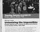
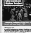
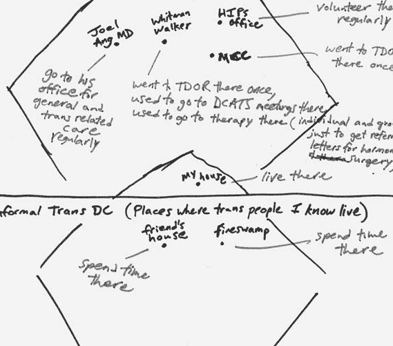
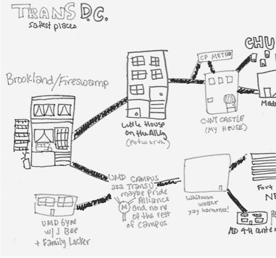

# 激进关怀

**Hi’ʻlei Julia Kawehipuaakaahaopopulani Hobart 和 Tamara Kneese**

> 照顾自己不是自我放纵，而是自我保护，这是一种政治战争行为。
>
> —奥德雷·洛德，《A Burst of Wild》

关怀重新回了时代精神。在 2016 年美国总统选举结束后，媒体平台上关于 #自我关怀 的评论呈爆发式增长。尽管大众对自我关怀仪式过度关注，但集体运动也随之出现，其行动——关怀的道德使命是其核心驱动力。在最近的一次采访中，安吉拉·戴维斯明确将社会变革与关怀联系在一起：“我认为我们对什么是激进的观念随着时间发生了变化。自我关怀、治愈以及对身体和精神维度的关注——这一切现在都是激进社会斗争的一部分。以前并非如此。”这表明人们日益意识到，个人的冲动和内心世界、家庭历史与个人经历中亲密而平凡的细节，与外部力量直接相连。因此，关怀对于社会运动至关重要。我们可以观察，为什么原住民及其盟友重新界定自己的立场为“保护者”而非“抗议者”，强调了照顾和作为地球良好管家的重要性；或者，美国移民及海关执法中心是如何出现类似“占领式”的行动，以谴责边境“柔性营地”中移民儿童与其家庭分离的现象，将父母的关怀（无论是给予还是接受）定位为一种人权。虽然关怀作为政治战争的现象具有悠久的渊源（我们在文中概述了这一点），但自唐纳德·特朗普当选及其引发的全球反响以来，它具有了新的意义：公民权利的倒退、政府对人为气候变化的否认以及人权侵犯行为都在提醒着人们，结构性不平等和剥夺权利伴随着生理和情感上的代价，而关怀正试图弥补这些代价。

当然，这个问题比“特朗普”要大得多，也古老得多。巴西的雅伊尔·博尔索纳罗、菲律宾的罗德里戈·杜特尔特以及以色列的本雅明·内塔尼亚胡，其出现都反映了全球范围内威权右翼的兴起，这种力量正威胁着弱势群体。为了本期《社会文本》（*Social Text*）特刊的需要，我们将“激进关怀”定义为忍受不稳定性世界的一系列至关重要但被低估的策略。虽然激进关怀通过在动荡时期提供希望空间与积极的政治变革联系在一起，但本文集同时也承认了与关怀相关的负面影响。由于激进关怀与系统性不平等和权力结构不可分，它可能被用来强制他人进行新形式的监控和无偿劳动，用来弥补制度性的忽视，甚至被某些群体针对其他群体，决定谁值得被关怀而谁不值得。尽管如此，面对国家支持的暴力、经济危机和迫在眉睫的生态崩溃，集体关怀提供了一种出路。在本期中，我们回顾了美国及其他地区的激进关怀历史，以便更好地理解激进关怀今天是如何干预社会政治运动的。

## 不仅仅是一种感觉

广而言之，关怀是指人、环境与物体之间一种关系性的话语和实践，它接近于亚当·斯密和大卫·休谟等哲学家所认同的“同理心”、“共情”或“同情感”。关怀被理论化为内在自我与外世界之间的情感连接组织，它构成了一种“与之在一起”的情感，而非“对……的情感”。当被动员时，它通常跨越广泛的局部：自我、社区和社会世界。关于一个人可能关怀谁或什么以及如何的问题有很多。在意识到关怀被视为解决许多社会和个人关切问题的必要要求后，我们这里的重点是关怀被用于应对眼前危机和不确定未来的案例。

现代生物政治的延伸，其中新自由主义主体性既反抗又重新刻画了国家权力。重要的是，这种“自我公式”运行在一个关于主体性和选择的虚假假设之上，而非承认此类实践是产生某些身体为“非规范化”的关键场所，并反过来将它们阐述为一个问题。

## 激进关怀的历史

自从奥德雷·洛德写下《光之爆发》（*A Burst of Light*, 1988）以来（我们的引文便源于此），她的话成为了一句咒语，或者说是一种提醒我们自己的方式：在一个某些生命比其他生命更脆弱的世界里，自我关怀对于集体生存是必要的。在洛德描述她与癌症斗争的较长段落中，她将癌症的匿名性与政府的忽视联系起来；她抛弃了福柯式自我关怀的个人主义，转而追求集体生存。这一引用在流行用法中经常在脱离原始语境的情况下呈现，这一事实告诉我们激进关怀与新自由主义自我关怀之间的区别。正如安娜·米凯解释的，激进关怀并非新自由主义指令所采纳的用于对待“你自己”的自我关怀，而是一种理解“植根于特定历史以及暴力与脆弱性现状处境的自我”的方式。因此，激进关怀的谱系与自我关怀的出现相一致，但绝不被其包含；在这个公式中，自我不是一个通用的、哲学上的自我，而是一个处于复杂关系集合中的自我。残障研究在指出承认本质上是网络化且独立的自我的重要性时，也探讨了这些论点。例如，当劳拉·福兰描述让残障身体能够运作的人类与非人类关怀职责组合时，她表示：“在照顾自己时，我加入了一项积极参与、维护、修理和照顾多种医疗技术的实践中（而不是被动地使用它们）。”本节通过两条我们认为是重叠的轨迹调和了关怀的历史学：一方面是女性主义的自我关怀，另一方面是黑人和棕色人种活动者的关怀工作，这两者都未能填补结构性崩溃、失败和忽视之间的鸿沟。

女性主义自我关怀的概念出现，是因为医疗执业者——特别是处理创伤患者的治疗师或其他专业人员需要维持照顾他人的能力，以及患者需要照顾自己的能力。例如，在对新西兰和乌干达工人的民族志研究中，人类学家苏珊·沃德尔关注了神职人员和其他宗教非营利工作人员如何将自我关怀视为在给予他人太多后补充个体的方式，或作为保持他人关怀可持续性的方式。自我关怀的工具性支持者亚瑟·克莱因曼认为，“由于关怀（及接受者）是由复杂且分裂的个体完成的，他们居住在同样多元且分裂的世界中，因此它需要被理解为一个受情感、政治和经济现实影响的过程。”换句话说，关怀并非发生在真空之中；相反，自我关怀承诺维持关怀所带来的社会和个人成本。

与此同时，自我关怀对关怀业务变得重要，一种向自我关怀作为一种激进实践的转向由此生成，这种转向特别关注嵌入“女性工作”中的性别权力动态。20 世纪 70 年代，与意大利资本主义左翼相关的自治主义马克思主义女性主义者在“家务劳动工资”（Wages for Housework）运动中推动承认家务和生殖劳动，在此运动中，西尔维娅·费德里奇认为，“通过否定家务工资并将其转化为一种爱的行为，资本可谓一石二鸟。”这场运动蔓延到国际，它批判了家庭领域内女性关怀的原子化和不可见性，这使得女性难以集体组织其他工人。通过推动在公共领域获得承认，为配偶、孩子或家庭所做的个人化关怀与更大的集体行动联系了一起。

通过自我关怀实现的集体关怀原则被应用于反种族主义和女性主义政治运动。在 20 世纪 60 和 70 年代的女性运动和民权时代，身体健康成为维持社区抵御种族主义、性别歧视、殖民主义、阶级主义和同性恋恐惧的韧性的核心。在美国，像“我们的生活”（*Our Lives*, 1970）这样的项目通过客厅等私密空间的小册和会议分发关于女性生殖健康的信息。与此同时，黑豹党实施了关键计划，试图通过将健康倡导与活动相结合来加强社区实力和力量，其中包括每天为数千名学生提供免费早餐的计划，以及提供预防性保健服务的免费诊所，以及住房和社会服务。这些努力在国际上产生回响，引发了身体健康与反种族主义工作之间全球性的重要联系。例如，玛丽亚·约翰展示了从华盛顿州西雅图到澳大利亚悉尼（两者均诞生于 20 世纪 70 年代）的本土健康诊所的建立如何呼应了黑豹党的实践和意识形态模型。直至今日，

## 霍巴特与肯尼斯 - 不确定时代的生存策略

根源医疗和饮食健康支持服务仍然是批判国家和环境种族主义的政治运动的基石，正如 2016 年水资源保护者在斯坦丁岩抗议修建达科塔输油管道时建立的诊所和厨房证明的；像灵魂之农场这样的食物正义组织通过将自我关怀构建为一种解放性的紧迫要求，明确了饮食健康、环境正义与国家种族主义之间的联系；以及墨西哥的妇女团体帕特罗纳，他们为乘坐通往美国的货运火车的移民准备并发放食物。

## 关怀的缺失：制度性失败与关怀的收用

我们对激进关怀的解释包含内在的张力。第一种（上述）是自我关怀与照顾他人之间共生又矛盾的关系。第二种张力揭示了植入关怀中的规范假设：它对社会再生产至关重要，但往往不可见或被低估，这意味着它容易被剥削和收用。最后，关怀内部的第三种张力是团结与慈善的表达，或是关怀作为对忽视或灾难的回应而被动员的方式。在本节中，我们结合塑造关怀实践之规范假设的财务和经济时尚，阐述这些考量。

我们关注关怀工作，但我们也注意到谁被忽视了，谁得到了关怀而谁没有得到，以及谁被期望履行关怀（无论是否有报酬）。对于那些从事关怀劳动的人来说，关怀无处不在——尤其是最容易被政治和社会特权阶层忽视的人。这里包含了关怀在口语表达中浮现的一些核心张力，这些表达假定理想主义、仁慈或道德纯洁可以消除这样一个事实：资源分配（如社会服务、新鲜且负担得起的食物或清洁水）塑造了支持情感和生理关怀能力的条件。

最后，由于关怀可以作为某些群体的特权而牺牲其他群体利益，关怀的“激进”方面可能会渗透右翼和白人至上主义政治，因为它维护了乌托邦愿景。在描述她目前关于机器学习和种族隔离的项目《歧视的数据：社区、个人与代理人》时，媒体理论家 Wendy Hui Kyong Chun 指出，社交平台依赖于同类性逻辑：物以类群，因此你想与与自己相似的人交往、恋爱并成为邻居，他们与你拥有共同的基础价值观兴趣。依附于同情或感感的关怀的问题在于，它往往意味着关怀仅保留给那些被认为值得的人。正如 Coker 在本期文章中所强调的那样，激进关怀也具有潜在的危险：例如，大萧条时期对白人的怜悯和共情情感可能被用作优先照顾白人而非他人的理由，尽管新政已经提供了国家支持的关怀。当苦难或暴力的图像未能激发温暖情感和随后的慈善行动时，会发生什么？关怀的分配是不均的，无法与结构性种族主义和不平等分离。

除了我们上述描述的新自由主义自我关怀的商业化收用外，政治领袖还利用关怀刻板印象从公民那里提取无偿劳动。关怀是一种建立殖民主义和资本主义替代方案的集体能力，但权力者也可以为了自己的目的将同情和关怀工具化。例如，Andrea Muehlebach 展示了后福特时期的意大利政府如何价值化并操纵同情，以免除对其最边缘化公民的责任。在美国背景下，美国的医疗和育儿系统依靠贫穷移民妇女及其亲属的大量无偿或被贬值的劳动来维持。家政工人是最受剥削的工人之一，不仅在美国，在全球范围内也是如此；在沙特阿拉伯、印度尼西亚和孟加拉，移民妇女没有工会或其他保护，经常遭受性侵犯和其他形式的暴力。

需要的是，激进关怀寻求解决的问题不仅是新自由主义政策或唐纳德·特朗普等权威主义领袖当选的结果。定居殖民主义的历史和几个世纪的剥削影响了今天与关怀交织在一起的不平等。正如 Leanne Betasamosake Simpson 和 Dionne Brand 所说：“怪物已经到来，而怪物一直都在。”

## 结论：团结而非慈善

随着全球资本主义在全球各地的范围内瓦解，我们看到激进关怀通过集体行动兴起。虽然关怀往往处于斗争之中，但我们通过强调一些提供上述感知示例的组织的工作，对激进关怀给出了更具希望的描绘。答案通常在于通过联盟工作：与其只寻找社会地位相同的人，不如联盟激励人们跨越阶级、种族、民族、宗教和国家边界，为了共同目标而努力。

在 2008 年金融危机后，政府实施了紧缩措施，人们组织起来照顾那些被遗留在寒冷中的。在西班牙，“房贷影响者平台”（Plataforma de Afectados por la Hipoteca）通过互助提供公平住房和社会租金的获取。该组织受房地产市场崩盘的推动，为无法支付房贷的人提供情感和经济支持。在加拿大，紧缩政策引发了新一波残障人士权利运动浪潮，让残障人士通过“直接资助计划”直接雇佣他们的护理人员。社区聚集在一起，利用激进关怀为那些被国家和其他机构忽视的人提供援助。

救援集体在基层应对由气候变化加剧的飓风造成的破坏提供物资和劳动力。Occupy Sandy 是灾难中诞生的集体组织的一个例子。救援工作不仅仅是捐赠物资，还包括建立可持续社区、支持当地企业和采用技能共享技术。“互助灾难救援组织”（Mutual Aid Disaster Relief）的工作使用了口号“团结而非慈善”，描述了灾难幸存者本身就是危机的第一响应者；外部援助的作用是支持幸存者相互支持。与援助组织和工作者相关的特权——可能包括获得物质资源的机会、行动自由、知识、经验和影响力——被用于支持灾难幸存者在危机中的自决和生存，以及此后的长期韧性，最终将这些形式的力量重新分配给最边缘化的人。

慈善依赖于新自由主义关于道德义务和个人性格的叙述。然而，团结依赖于与社区合作并询问他们需要什么，而不是家长式的假设。与其遵循新自由主义的、围绕创新和挖掘希望的殖民发展模式，不如互助提供了真正的协作。

通过跨众多社区和地方的忽视与剥削案例，关怀通过植根于自主直接行动和非层级的集体工作包含了激进的承诺。关怀不仅仅是作为一种自保的力量，它更关乎边缘社区的生存，因为它与现代激进政治和活动紧密相连。正如 Maria Puig de la Bellacasa 所言，是一种“具有伦理和政治色彩的实践”。在危机时刻，激进关怀允许社区度过苦难。尽管本期涵盖了不同的时期和文化背景，文章发展了关键的连接点，可以开始评估迥异的关怀历史及其对今天的影响，以追问在激进方面，我们可以从过去的错误或当代的不公中学习到什么。重要的是，本期的文章对激进关怀提供了复杂的、批判性的描绘，而非浪漫化关怀。

第一篇文章提供了一个历史视角，解释了关怀在十九世纪和二十世纪思想是如何变得激进的。通过多萝西娅·兰格的经典图像《流徙母亲》，Cotten Seiler 展示了新政时期的优生学应用是如何出现在美国社会福利计划中的。为了这一点，他仔细解析了查尔斯·达尔文和让·巴普蒂斯特·拉马克的深刻进化理论，并沿着它们追踪到采用至上主义关怀话语的政策制定中，在这些话语中，同情与白人的情感模式相一致。反之，这些话语暗示了政府政策，将优生学观念（延伸之，即关怀的理想主体）嵌入到社会福利计划中。通过将思想历史与其持续的物质影响联系起来，Seiler 有意地强调了政治乌托邦式激进关怀的反面：这种关怀与右翼、白人至上主义力量结盟。Seiler 将其称为“白人关怀”——一个致力于白人公民教育、健康、安全、流动和舒适的机构和基础设施环境，并由此展示了浪漫化激进关怀是危险的，因为它可以被用来排除某些群体，并使他们遭受制度性的忽视。

当 Seiler 的文章与 Micki McGee 关于资本主义经济“护理问题”的文章相结合时，制度化护理的失败（或者更准确地说，护理的制度化）变成了痛苦的现实。我们所熟知的“护理经济”现象包含了一个被忽视的父权制资本主义基石：如果没有一支低薪或无薪的护理工作者队伍来支持对家庭、老人以及服务不足群体的照顾、呵护、组织和修补，我们脆弱的生产力系统将会崩溃。她转向了自学和“生活黑客”文献，这些文献将护理的负担转嫁给个人，而不是关注那些不公平地加在学术界女性（尤其是有色人种女性）身上的结构性挑战，而这些女性通过不妥协且劳动力密集的育儿方式“暴露了一个问题……提出了一个问题”（引用萨拉·艾哈迈德 Sara Ahmed 的话）。事实上，在编辑《社会文本》的这一特刊时，每位编辑都构思、诞生并抚养了新的婴儿，这要求每个人在我们的个人生活和职业早期中承担特定形式的护理。

育儿和母职交替成为忽视性机构的剥削道具，或成为激进护理形式的场所。Leyla Savloff 通过对阿根廷妇女的民族志研究（这些女性在一种针对孕妇或产母亲的特殊居家软禁计划下服刑），将护理识别为一种对付惩罚性国家机器的策略。处于居家软禁状态的女性受到关于母性的规范性假设以及监狱系统监禁逻辑的压迫。通过这一计划，家变成了一个允许有限形式创造性自由的监禁场所。Savloff 展示了家庭和生殖护理如何被国家工具化和挪用，这使得居家软禁状态的妇女遭受各种形式的劳动、胁迫和监控。同时，女性集体组织 YoNoFui 为女性提供了建立社区和学习手工艺的机会，提供了一个进行激进护理的空间，而非再生产新自由主义。YoNoFui 不仅提供了技能共享和个人赋权的机会，还为了囚犯权利和反对暴力而动员。

对制度性忽视的集体回应也反映在 Elijah Edelman 对华盛顿特区联盟评估的民族志研究中。Edelman 以一名妇女的死亡案例作为开端，考察了生命是如何通过“死亡政治”（necropolitics）构成的：过上值得过的生活，和一个值得的死亡。Barbara 的经历与许多活动者的经历形成对比，后者往往与亲生父母疏远，或死于暴力。Edelman 使用她的故事，“不是因为她的死亡体现或直接对比了跨性别者的生命与死亡，而是因为往往通过死亡和失去那种混乱且经常具有创伤性的不连贯，我们体验到了激进护理的全部潜力。”通过“跨性别生命力”（trans vitalities）的概念，Edelman 提供了一个颠覆对生命规范化描述的激进护理视角。对于联盟成员来说，“基于联盟的跨性别社会工作在个人和政治上的转型，是作为激进护理的形式和富有生产力的生命力量。”Edelman 复杂化了通常附着于身体和经历的规范性护理、风险和韧性的概念。

正如 Edelman 对跨性别联盟活动的研究所强调的那样，那些拥有风险身体的人忍受强制性的护理形式。援助的形式因受助者的能动性而变得复杂：何时反抗本身在策略和政治上是明智的？Nicole Charles 考察了巴巴多斯人如何将人类乳头瘤病毒（HPV）疫苗视为后殖民国家内的可疑技术。Charles 展示了如何阻碍人们提供护理的结构性或道德立场，并接受受助者的反应。人们并不是盲目接受医疗援助，而是通过拒绝 HPV 疫苗来协商风险和预防。在拒绝的行为中，父母通过保护其孩子免受不可信的医疗机构的伤害来表现出护理。Charles 使用巴巴多斯及更广泛的加勒比地区的奴隶制和殖民主义遗产，将 21 世纪对 HPV 疫苗的抵抗语境化，将其视为“护理、利润、科学、黑人女性性欲和风险的交织特征”。通过历史和对巴巴多斯父母的定性观察，Charles 证明了对疫苗的怀疑和拒绝是激进护理的形式，父母以此反击可能给他们孩子贴上“轻浮”标签的医疗叙事：“怀疑体现了一种激进的潜力，这种护理根植于深层的见证和反思，并作为处方、调解和医疗创新的先驱。”医疗专业人员、公共卫生官员以及科学、技术与社会学者都应该重新审视他们对护理和疫苗接纳的假设。

最后，Dean Spade 通过互助探索了激进护理这一主题，考察了社区对气候灾难和移民搜捕的反应。他的贡献提供了一份组织策略的实用指南。互助项目，包括奥克兰电力项目（Oakland Power Project，它培训社区成员进行无需拨打 911 的医疗保健）和互助灾难救援（Mutual Aid Disaster Relief，它为自然灾害后的人提供救援），都是情境化护理（situated care）的例子。Spade 特别关注互助作为资本主义、白人至上主义和父权制下最不可见或不受推崇的工作，这本质上是生殖劳动。我们被教导去重视和美化其他活动——发表演讲、通过立法、提起诉讼、组织游行——而忽视、忽略、不关心护理。Schüll 认为，互助对于动员大量人员、为建立现在至关重要且在未来灾难和崩溃中更为重要的生存基础设施是必要的，而且参与互助项目教会了在偏见的父权制资本主义中被剥夺的必要技能。互助项目很容易被新自由主义挪用，因此参与其中的人积极抵抗这种挪用，主张团结而非慈善。

总而言，这些文章将护理视为一系列行动、意识形态和策略，为在不确定时期生活提供了可能。随着传统的被低估的劳动被重视，激进护理在更广泛的社会运动中变得重要且必要。激进护理提供了一条路线图

### 12 Hobart 和 Kneese - 生存策略

- 12. Povinelli, "Routes/Worlds."
- 32. Chun，“我们都生活在封闭社区中。在这篇文章中，Chun 提出了她目前书籍项目的一个主要论点，指出个人根据亲缘或共同兴趣组成在线社区，这导致了进一步的隔离。”
- 38. Mutual Aid Disaster Relief，“核心价值观”。

Armstrong, Pat, Hugh Armstrong, and Krista Scott-Dixson. 《关怀的关键：医疗服务中的隐形女性》。多伦多：多伦多大学出版社，2008。

Bloom, Ester. “‘犒劳自己’如何变成一种资本主义命令。”《大西洋月刊》，2015年11月19日. www.theatlantic.com/archive/2015/11/how-treat-yourself-became-a-consumerist-command/416664/

Buck, Marie：“快乐与政治依赖。”诗歌基金会博客，1月. www.poetryfoundation.org/2018/01/pleasure-and-political-dependence.

Chang, Grace. 《可弃的家政：全球经济中的移民女性工人》。第2版。芝加哥：Haymarket Books，2016。

*重新校对参考文献部分以保持格式：*

(注：由于参考文献部分较多，以上展示了核心部分的翻译逻辑，其余部分保留了学术人名与格式)

---

> 对种族的关怀……这必须是我们未来的基调。
>
> —亨利·费尔尔德·奥斯本，《人类迈向帕尔纳斯山》，1928年

批评家赞誉多萝丝·兰格（Dorothe Lange）1936年的标志性摄影《迁移母亲，加利福尼亚州尼皮波》，既是大萧条时期人类危机的缩影，也是新政平等主义改革的动力。尽管进步主义时代的改革者已经利用记录摄影来动员政治支持，但直到20世纪30年代，随着技术和工业的进步使得照片能够更有效地复制并向大众传播，摄影才真正作为一种强大的政治工具出现。在出现在《旧金山新闻》之后，兰格笔下贫困的弗罗伦斯·汤普森（Florence Thompson）及其孩子的形象便引起了广泛关注，与农业安全局（FSA）拍摄的数千张关于“被遗忘的人”的照片相辉映。兰格的《1933年的天使面包线》和《1934年的推车旁，失业者》体现了这一点；用兰格的话说，“他低着头，背着墙，生计被颠覆，”大萧条时代的生产环境同时赋予了这些主体个人价值感和阶级感。此类图像的创作者之一约翰·斯坦贝克（John Steinbeck）将西部的移民极分化为：虽然绝望但仍然“多资源且机智”。与早期向北迁移的“农奴阶级”相比，较晚的流离者源于“美国最精英”，因此如果得到帮助并公平对待，他们被预期是“最高层次的公民”。尽管FSA的照片和20世纪30年代的其他宣传画描绘了有色人种，但他们刻意利用白人形象，以换取观众对新政改良计划的支持。《迁移母亲》以及无数低头丧气的白人形象，其受众早已接受了种族霸权观念的条件化训练。

本文认为，20世纪对白人的表述之所以有效，是因为它们留下的观点要求国家采取反应性行动。这种概念化产生于后达尔文主义（或更准确地说是反达尔文主义）进化理论，该理论将“白人化”阐述为一种可以获得的关怀地位，既是名词也是动词。这一深层背景有助于解释世纪末国家主义改良性新自由主义的兴起，以及中叶白人机制的建立：一个由致力于教育、健康、安全和舒适的机构组成的体系。

新政以及中叶美国以关怀为导向的自由主义招募主体进入一种关怀模式，这种模式在两个方面是激进的：其对政府治理规范的背离，以及其对种族的严格限制。白人关怀涉及一个基于米歇尔·福柯（Michel Foucault）所说的“种族主义”的生物过程。这一原则许可现代国家对被认为有利的国民“使其生存”，并让那些被归类为有害的人“死亡”。白人至上主义而非普遍的人道主义，支撑并推动了平等的、改革性的、分配性的政策。

鉴于美国主流政治中对集权国家权力的传统敌意，新政自由主义的实现既需要明确的白美国人，还需要一场灾难（或一系列灾难）——必须足以威胁到改革者，以使关怀机制变得合理化？国家在新政及之后引导着自己，其政策制定借鉴于一个思想库，该思想库证明了人类不同种族之间进化生存能力的差异，并赋予了白人化同情、仁慈和正义的文明建设特质。弗罗伦斯·汤普森（尽管表型上有切罗基血统）和她的孩子将通过国家的一系列干预得以生存。

## “他们在尝试飞行时长出了翅膀”：新拉马克式的进化叙事

在查尔斯·达尔文1859年的著作《物种起源：自然选择的起源，或生存斗争中有利物种的保存》之前，物种在漫长跨度内发生演变的假设取代了“特殊创造论”的权威教条；旧教条认为物种是以其固定的形式被创造的，运行其进程，灭绝，并通过创造者的连续运作被其他物种取代。达尔文之前的变体论，如让·巴普蒂斯特·拉马克的（Jean-Baptiste Lamarck）和伊拉斯谟·达尔文（Erasmus Darwin），将进化视为一种上升的神学过程，其机制仍具推测性：有机体内超自然的力量沿着预设的路线转化它，或者外部刺激迫使有机体自我完善，或两者兼有。当有机体获得了增加生存机会的特征，并以某种方式将这些特征传给后代时，更多的物种之产生了。20世纪的思想者引用了拉马克在1809年关于长颈鹿通过多年伸长触及树叶而获得长脖的描述，但这个故事早在遗传学出现之前，而且它对有机体努力和上帝意愿作为物种改变之驱动力的强调，改变了那些即使在放弃了特殊创造论后仍然在进化中寻找设计感和神学的人。

达尔文的自然选择理论阻碍了此类观念。达尔文强调了“自然选择发挥作用和积累的材料”。不断变化的环境使得所有持久的特征和有机体的努力都是徒劳的：物种只能通过特征的多样性来希望在世界的自然暴戾中生存，并且只有在经过几代演变成不同的东西之后。达尔文写道：“没有任何一种活物种会将它们未改变的样貌传给遥远的未来。”

达尔文对偶然性的坚持在面对人类起源时变得尤为重要，达尔文1871年的《人类的起源》追溯到了较低的形式和原始人。许多虔诚的一一神论者反对这种谱系学（至今仍如此），他们批评达尔文主义使人性兽化并使宇宙失去了主宰。达尔文的盟友则围绕心灵和自然选择展开，将其视为人类心灵和灵魂的锻炉。

然而，关于人类起源的分歧并没有阻止变体论进化在19世纪后期大西洋世界的自然科学、社会科学以及人文和流行文化中受到影响。然而，这种兴起的进化论正如一位赞同的当代评论者所说，“抛弃了唯物主义”，转而追求被称为科学神学的理论。因此，那个时代见证了一场“非达尔文式的革命”，它在成功使旧观点现代化的同时，将创造论从其权威位置上拉下。

达尔文认为拉马克的想法是荒谬的：“对动物缓慢意愿的适应。”

美国学派的新拉马克主义者也提议，一种超自然的植入的“生命能量的祖先形式”或“内在的神性元素”可能会阻碍生物沿着既定路线进行转化。因此，那些可以归因于生物努力的特征（例如鸟的翅膀），同时被构建为一种自救的神灵的显现。因此，进化是以贵族式的方式发生的，每个物种中的极少数先锋生物对超自然指令做出反应，并运用库珀（Cope）所说的“智力选择”来创造自己的进化运气；与此同时，物种中较大的成员仍保持惰性——也许是为了取悦神灵，并将自己置于遗忘之中。

新拉马克主义关于变性的解释作为人类进化进升的指控引起了强烈的共鸣。地质学家约瑟·勒康特断言：“人类意识的自愿努力是自身进化的首要因素。”有神论者T. H.埃迪说：“如果猴子像达尔文所言的那样站了起来，那么我们是否可以自豪地回首，指向这一事实：从一个卑微的开始，我们进化成了现在的模样？”“我们正在创造我们自己，”自然学家威廉·迪基·古宁宣称，“我们消除了身体眼睛中向下的倾斜，我们也从精神眼睛中消除了它。此外，进化的努力并非没有得到帮助：”哲学家约翰·菲斯克（John Fiske）写道，“对进化的正确理解‘使人类生命不仅仅是神圣雕刻的主要目标。’”更重要的是，新拉马克主义关于自举（bootstrapping）和神选物种的传说，成了白人至上主义的有力道具，根据种族显而易见的进化劳动记录及其进一步进升的生存能力对其进行等级划分。

随着变性假设在1840年后流行起来，它挤压了自17世纪以来引发对可见物理差异起源和成因研究的唯一争议。欧洲人在探险过程中遇到的各种人类类型，动摇了关于“单一起源论”（monogenesis）的圣经正统观点，该观点认为人类起源于最初被创造的男和女，而肤色和其他特征的差异是无数代后代在不同环境下的产物。无知的理论——“多起源论”（polygenesis），将多次创造归因于上帝，其中某些创造是实验性的或失败的。学者们及其盟友尽管该理论属于异端，仍涌向多起源论，因为该理论的意义在于详尽描述那些可以被轻易施加不人道行为的人类。

随着废除制的实施，辩论的紧迫性消失了，达尔文关于人类（Homo sapiens）是灵长类的断言似乎盖过了其本身的前提。1863年的一位评论者指出：“既然猿的脚被证明与人类相同，那么现在证明猿的脚和黑人的脚是相同的已经没有用了。”然而，这种对非白人种族“类猿特征的近似性”（用库珀的话）的证明仍然层出不穷，事实上，这使得人类起源假设获得了信力。另一个1863年的声音提出：“那些采纳达尔文假设并相信我们是猴子的远表兄弟的人，或许可以以某种一致性将非洲人表现为不仅是一个不同的种族，而且是一个本质上低等的种族。”战后的人类学以及种族、社会学和人类学的新领域渗透了一种世俗化的多起源论，它用种族发展、地位和落后的叙事取代了多次创造。由于新拉马克主义框架强调进化是一种通过努力获得的进步状态，且精英生物获得了这种状态，将种族概念化为动物性的连续体，这种构想减轻了对“文明”白人首要地位的冒犯，因为这些白人的社会、政治和经济至上地位在被蔑视的达尔文叙事中被判定为每一个进化结果一样，是偶然的。相比之下，拉马克的叙事则提供了一部关于白人权力出现和稀有化的“成长小说”（bildroman）。

因此，战后进化论者变得热于记录各个种族的形成，这项事业巩固并证实了当今种族差异的深刻性。这些记载在大学教室、学术期刊、大众杂志、文学、博物馆展览和博览会上传播，它们通过将非白人定位并追踪其沿着时空“从野兽到人的”的进步，强调了非白人对“统一性教条的持续挑战”。尽管进化论者承认区分人类（Homo sapiens）与其灵长类亲属的“卢比河”，但他们认为更广泛的物种是从原始种族分裂出来的。许多人认为种族被分类为物种是如此古老且独特，以它们的“种族血浆”。

有主张称，长期（longue durée）的种族形成产生了现在无法逾越的差异，并发布了卡拉·舒勒（Karla Schuller）所谓的“感应性话语”（impressibility discourse），通过这种话语，种族对每个群体根据“其遗传材料嵌入时间的程度以及保留未来受影响的能力”进行评估。作为行为和文化的生理特征表明了每个种族接收、吸收和抵御自然世界及人类社会影响的能力，以及向后代传递精化的能力。舒勒认为，这种强调身体可变性而非固定性的拉马克式话语，刻画了19世纪的种族想象。

科学家对群体感性的评估，如同对他们进化劳动的评估，可能使某些种族成为“具有终结性的局外人，这种终结性使得多起源论再次适用于奴隶制，或后来的难以遗传的优生学。”当新拉马克主义种族主义让白人听众相信他们的进化历程正如英国人塞缪尔·巴特勒（Samuel Butler）所说的是“对良好行为的传承坚持”时，它也让非白人被冻在一种自造成的持久的进化停滞中。库珀写道：“宝石细胞受保护得非常好，需要长时间的时间和持续的影响才能使一个家族或种族产生显著的性格变化。”库珀在1890年呼吁将非洲裔赶出美国，他提醒读者，“进化在所有情况下是不可能的”，并警告说黑人的存在（正如它在身体和心理特征学生眼中表现出来）对共和国构成了威胁。他对于“黑人在几个世纪的教育后变成了什么”持不可知态度，但评论道“他在过去拥有与任何种族一样多的东西，他没有进步，也没有被它提高；在他有限的受教育能力内，他就像动物界的其他成员一样。”

然而，库珀肯定，“智慧和实践知识的增长”可以发生在“即使是最不受眷的印欧族成员中，只要他们有机会；因为这是种族的问题。”白人天生的“精细神经敏感性和精神力量”源于他们几世纪的辛劳和艰苦。”库珀坚持，这一群体的生物化学成就值得保护，其中最主要的行为是将处于人类边缘的人隔离在非洲，即“我们生命组织核心的死物质。”

新拉马克主义者赞扬白人的“精炼伦理知识和实践”是他们进化成就中最具变革性的。他们认为，这种特殊的卓越性与“表征能力”的发展相一致，“这种能力（用菲斯的话说）使得与感觉无关的关系得以复活并纽带。”白人表征能力的发展让他们赢得了相对于其他种族的智力优越，但也产生了仅通过同情、慈悲驱动的“心理”能力。

……正义。库珀（Cope）将同情能力视为“自然心理构造的产物”，并认为其在“不同类型的人类中‘分布不同’。”种族能够可靠地预测“人们在伦理方向上的表现；唯有白人能够抑制‘表现出人类最高水平发展的道德生活。’”

菲斯克（Fiske）将白人卓越的心理特质归因于他们“幼年期的逐渐延长，这使得儿童免于从事生存劳动，从而使他们能够通过观察和想象力游戏更充分地扩展其表现能力”。此外，长期的幼年使得常态化并肥大的“同情情感”——在此期间，人们要么接受（作为孩子）关怀，要么给予（作为父母）关怀——随后会延伸到核心生殖家庭单元之外的客体，最终“产生一种抽象的感觉……脱离了人格化元素。”菲斯克写道，“如果没有幼年的经历，我们永远无法理解‘自我牺牲’或‘奉献’等词汇的意义。”关怀的经历反复进行并记录在种族质质中，已汇成了白人的进化优势。

根据新拉马克主义者的观点，对关怀的经历和倾向也结晶在现代机构以及建立和维持这些机构的社会模式中。斯宾塞（Spencer）对“在我们种族最先进的分支中出现的新情感”感到惊叹，并认为现代性似乎加速了这些情感的传播。他在1864年关于白人写道：

> 白人发展了那些低等种族仅表现出萌芽的温和情感，它们已经得到了发展。野蛮人乐于给予而非享受——他们几乎没有任何同情心。而我们自己将慈善付诸于行动中，建立了众多机构，并规定了无数的私下捐助……我们知道，特征与其他所有特征一样是遗传的；源自同一血统的文明之间的差异，显示了通过遗传继承的微小修正的累积结果。我们看到，在文明与野蛮种族之间（它们在遥远的过去相互分离，经过一百代人，生活方式变得越来越迥异），存在着更大的情感对比；这可以推断出作为文明种族特征的或或明显的情感，是社会生活所涉及的某些每日重复心理状态组合的组织结果。

社会性的实践在白人中产生了遗传性的“同情心的增加”，这是白人所能执行的最关键的进化劳动之一：“每日重复的心理状态组合”产生了“野蛮的残忍与文明的人性之间的差异”。每个种族中“源于同情的利他主义情感”——怜悯、慷慨和正义——的数量和力量预示了其“社会进步的可能性。”白人身上这些特质的丰富，不仅让后者在“与另一种情感种族的竞争中”占了优。相反，菲斯克所孤立出的“温柔且无私的白人，是进化的后期产物”，将确保白人跨越下一道卢比康河。

与所有种族虚构一样，关于白人在进化中实现的道德和伦理优越性的概念，需要一系列机构付出巨大努力，以巩固它并掩盖其意识形态动力。它在世纪交替的文学、流行文化、政治、宗教和科学中流传。例如，它渗透了关于婚姻和性的人类学及医学心理学文献，这些文献挖掘了白人在多种形式的爱方面过时的能力。而爱，从性到亲情，最终根据社会学家欧内斯特·克劳利（Ernest Crawley）的说法，“其相对强度从性向社会性减小”，他写道，“但随着这种强度的降低，范围在扩大，越来越多的人被理解……在它的所有形式中，爱在社会中所占的地位比生存本能要小。它将家庭的原始元素聚集在一起，并在世纪内将一个种族或国家的所有成员的感觉团结在一起。”而“原始种族”所拥有的“爱形式比那些赋予并盲视白人的爱更不强烈、更不复杂”。现代和心理学权威认为，正如文学学者朱利安·卡特（Julian Carter）所言，规范性的关怀是高度的，卡特展示了菲斯克试图证明的精致同情如何使婚姻成为“需要对伴侣进化的成就。”

白人的同情能力也进入了话语体系，正如在20世纪初的南方描述中所，预示了说话者对另一个慷慨：“对你那伟大的关怀。”这种特质的丰富，不仅让后者在“与另一种情感种族的竞争中”占了优。相反，菲斯克所孤立出的“温柔且无私的白人，是进化的后期产物”，将确保白人跨越下一道卢比康河。

# 白人关怀的起源

与所有种族虚构一样，关于白人在进化中实现的道德和伦理优越性的概念，需要一系列机构付出巨大努力，以巩固它并掩盖其意识形态动力。它在世纪交替的文学、流行文化、政治、宗教和科学中流传。例如，它渗透了关于婚姻和性的人类学及医学心理学文献，这些文献挖掘了白人在多种形式的爱方面过时的能力。而爱，从性到亲情，最终根据社会学家欧内斯特·克劳利（Ernest Crawley）的说法，“其相对强度从性向社会性减小”，他写道，“但随着这种强度的降低，范围在扩大，越来越多的人被理解……在它的所有形式中，爱在社会中所占的地位比生存本能要小。它将家庭的原始元素聚集在一起，并在世纪内将一个种族或国家的所有成员的感觉团结在一起。”而“原始种族”所拥有的“爱形式比那些赋予并盲视白人的爱更不强烈、更不复杂”。现代和心理学权威认为，正如文学学者朱利安·卡特（Julian Carter）所言，规范性的关怀是高度的，卡特展示了菲斯克试图证明的精致同情如何使婚姻成为“需要对伴侣进化的成就”。⁷46

白人的同情能力也进入了话语体系，正如在20世纪初的南方描述中所，预示了说话者对另一个慷慨：“对你那伟大的关怀”。⁷47 这种特质的丰富，不仅让后者在“与另一种情感种族的竞争中”占了优。⁷743 相反，菲斯克所孤立出的“温柔且无私的白人，是进化的后期产物”，将确保白人跨越下一道卢比康河。⁷744

库珀（Cope）将同情能力视为“自然心理构造的产物”，并认为其在“不同类型的人类中‘分布不同’。”种族能够可靠地预测“人们在伦理方向上的表现；唯有白人能够抑制‘表现出人类最高水平发展的道德生活’。”38

菲斯克（Fiske）将白人卓越的心理特质归因于他们“幼年期的逐渐延长，这使得儿童免于从事生存劳动，从而使他们能够通过观察和想象力游戏更充分地扩展其表现能力”。此外，长期的幼年使得常态化并肥大的“同情情感”——在此期间，人们要么接受（作为孩子）关怀，要么给予（作为父母）关怀——随后会延伸到核心生殖家庭单元之外的客体，最终“产生一种抽象的感觉……脱离了人格化元素。”菲斯克写道，“如果没有幼年的经历，我们永远无法理解‘自我牺牲’或‘奉献’等词汇的意义。”39 关怀的经历反复进行并记录在种族基因中，已汇成了白人的进化优势。

根据新拉马克主义者的观点，对关怀的经历和倾向也结晶在现代机构以及建立和维持这些机构的社会模式中。斯宾塞（Spencer）对“在我们种族最先进的分支中出现的新情感”感到惊叹，并认为现代性似乎加速了这些情感的传播。他在1864年关于白人写道：

> 白人发展了那些低等种族仅表现出萌芽的温和情感，它们已经得到了发展。野蛮人乐于给予而非享受——他们几乎没有任何同情心。而我们自己将慈善付诸于行动中，建立了众多机构，并规定了无数的私下捐助……我们知道，特征与其他所有特征一样是遗传的；源自同一血统的文明之间的差异，显示了通过遗传继承的微小修正的累积结果。我们看到，在文明与野蛮种族之间（它们在遥远的过去相互分离，经过一百代人，生活方式变得越来越迥异），存在着更大的情感对比；这可以推断出作为文明种族特征的或或明显的情感，是社会生活所涉及的某些每日重复心理状态组合的组织结果。40

社会性的实践在白人中产生了遗传性的“同情心的增加”，这是白人所能执行的最关键的进化劳动之一：“每日重复的心理状态组合”产生了“野蛮的残忍与文明的人性之间的差异”。⁷741 每个种族中“源于同情的利他主义情感”——怜悯、慷慨和正义——的数量和力量预示了其“社会进步的可能性。”⁷742 白人身上这些特质的丰富，不仅让后者在“与另一种情感种族的竞争中”占了优。⁷743 相反，菲斯克所孤立出的“温柔且无私的白人，是进化的后期产物”，将确保白人跨越下一道卢比康河。⁷744

“增长停滞的、从自然束缚中解放的种族，”威廉·甘宁（William Gunning）赞叹道，“将达到蓝色的高度并创造地上的天堂。”⁵¹ 这种夸张的辞藻表达了新拉马克思想的乌托邦进步主义，以及它为追随者恢复的——在达尔文目的论转向后——对情感和想象力方面的完整视野。⁵² 如果正如菲斯克预测的，“随着其练习范围的扩大，人性中同情方面的发展无疑会变得巨大，”那么国家如何应对这种扩张呢？⁵³ 事实上，这种将生物进化视为意志、心理和能力的拉马克框架，我们可以看到它一直延伸到20世纪的新政及之后的统计自由主义。

某些文本通过陷入黑人化来强调白人的情感优越性，确立了与非白人种族不同的道德价值。例如，1902年的小说《血缘决定一切》（Blood Will Tell）以其表型白人的主角结尾，他哀道自己拥有所有可见的迹，但白人种族内在的精神优雅我不属于我，也永远不会属于我。”他对自己这种黑人化的化身进行了独白：“赋予了白人种族的尊严、教育和文化……协助了自然的、自我进化的文明和文化。”⁵⁰

达尔文主义的一个分支，由达尔文的表弟弗朗西斯·加尔顿在19世纪80年代开创的硬遗传优生学，试图调节生育——人工选择“生殖质”中“最适宜”的变体——并培育出更优的物种。1890年后，选择主义者拒绝通过培养环境来实现大规模社会进化的可能性，这种观点变得更加权威。这种观点首先在很大程度上得到了欧洲达尔文主义的支持，后者绝对否定了后天获得性的遗传性；并在后的十年中得到了孟德尔遗传学的强力支持。

彼得·布劳沃德（Peter Bloward）指出，拉马克主义者的修辞在20世纪变得日益乐观，这种转变使他们传统的对进化的“对意识和设计的关注”转变为“主要与社会问题相关的更乐观的阐释”。⁵⁵ 我们看到这种新达尔文主义向明确的政治诉求的转变，是受到世纪交替时期面临的实验室内外选择主义反对者挑战的迫使。这标志着新拉马克主义进化论通过其对社会科学的渗透，逐渐向1880年后在美国政治中扎根的“新自由主义”的统计民主主义分支转变。新自由主义者试图将社会科学知识应用于培养和提升环境与制度中——正如一位自由主义者所说，是为了让“爱的法则……成为经济的一部分。”⁵⁵⁵

这在某种意义上将是一种宿命论；因为根据这种理论，虽然我们可以无限地改进教育和环境的力量，这种文明的培养会改善每一代的个体，但其其实际效果不会像种族本身那样具有累积性，而是关于种族的环境；每一代都从零开始（de novo），无法从其前辈生生取得的道德和智进步中获益。由此认为，如果种族天生就是完美的，且唯一的改进途径是选择最适宜的种族质链，那么对更高生活的深层、近乎本能的动力将被消除。⁵⁵⁶

同年，莱斯特·沃德（Lester Ward）对他的生物学家听众表达了类似的担忧：

> 如果通过最英雄或最大胆的努力所获得的收益没有任何可能传递给后代，那么努力的动力在很大程度上就消失了。确保种族青少年获得完美的身心发育所付出的所有劳动，难道落在接受这些劳动的个体身上吗？…… 事实上，新达尔文主义之歌的负担在于：停止教育，这只是对自然深层且不可改变的力量的一种拖延。⁵⁷

“唉，”约瑟夫·勒·康特（Joseph Le Conte）在同年的《湿润》杂志中呼道，“我们对种族改良的希望，无论是身体上、精神还是道德上的！”⁵⁸

令这些评论者感到遗憾的是，科学权威在随后的几十年里通过选择主义者得到了加强，并最终取得了决定性的增长。然而，新拉马克的叙事以其意志蜕变、后天获得性状的遗传性以及种族的进化可行性为主题，在人们对进化的流行理解中依然存在，补充了关于优越和劣等基因的新型叙事。⁵⁹ 关键在于，如上文所示，新自由主义-拉马克主义影响了所有的政治取向，这些取向赋予国家“为男女提供这种环境的责任，让他们尽可能平等的机会来实现……一种道德和人的生活”。⁷⁶⁶⁰ 能够履行这一职责的“行政国家”蓝图源于沃德的新拉马克社会学，这种社会学构成了新自由主义的武装——多萝西·罗斯（Dorothy Ross）描述为“对古典自由主义的修正，扩张了对个人自由、社会良知和公共权理解”——主导了进步时代及之后的美国政治。⁷⁶¹

直到1924年，硬遗传优生主义者确保了《约翰逊-里德法案》的通过，该法案限制了未来四十年的对美移民。奥地利生物学家保罗·卡梅尔（Paul Kammerer）明确表示，坚持拉马克意味着相信最高尚的进步：

> 如果后天获得性状偶尔会被遗传，那么就显而易见，我们不仅是过去的奴隶——无可救地将自己从枷锁中解放出来——也是未来的俘虏，随着时间的推移，我们将在某种程度上摆脱沉重的负担，升入越来越高的发展阶层。教育、文明、卫生和社会事业的实现，甚至不仅惠及单一个体，因为每一个行动、每一个字、甚至每一个思想都可能在他们这一代留下印记。⁶²

这封来自新拉马克主义堡垒的信，对早期新拉马克主义者令人生畏的修辞进行了回避（“偶尔遗传”、“在某种程度上”、“可能留下印记”）。然而，卡梅尔与其他拉马克主义者一样，他构筑了一个能够承担*强化责任*的国家，这种责任源于知道人口的升级和退化将留存在后代的遗传物质中。他认为，这种责任“沉重地落在了指导教育和政府的权力身上——保护人口免受误治和剥削。”⁶³

“在我们的能力范围内，”夏洛特·珀金斯·吉尔曼（Charlotte Perkins Gilman）在1924年宣称，“使这个世界成为一个有利于高贵种族发展的环境，使其一代比一代快速且可靠地进步。”吉尔曼和其他女性主义者谴责达尔文主义的自然选择观点，认为它是关于战斗和征服的男性化寓喻——正如吉尔曼描述的，“一场普遍的争斗”。相比之下，白人种族的进化历程被读作一本女性主义著作：人类的进化等同于人类物种对女性内在的关怀型特质的渐进侵略和强化，以及对男性“天生好斗”本性的抑制。吉尔曼等人敦促读者认识女性化国家和社会所能获得的进化利益，并且“构成物种独特特征的完全体现在女性身上；她是种族的类型。”一种源于女性的关怀伦理被进化先进的男性所吸收，奠定了未来文明的基础。吉尔曼肯定进化“可以很大程度上受到培养的帮助……人们会认为农业从那时起教了我们，改善任何生命的方法就是照顾它。”⁶⁴

新拉马克主义者对选择主义者“环境很重要”这一主张的抗议，不掩盖这两个阵营追求同一目标的事：一个处于持续进化上升的人口。⁶⁵ 这一目标需要的不是维持自然状态的节约型、放任的国家和社会，而是强有力的社会工具，在奥斯本的作品中，即“文明化自然”。然而，在繁殖人类“最优者”并让“最劣者”消灭的愿望中，新拉马克主义与更严酷的选择主义者承担了更深重的负担。甘宁（Gunning）总结道，“对于野蛮人，我们无能为力。他的活动已经过去了。他是慢性的。”⁶⁶ 只有白人被允许获得关怀，他们可以借此利用所获得的收益来造福物种。而非白人的发育停滞源于塞缪尔·巴特勒（Samuel Butler）看来他们缺乏进一步的愿望，这无论是怜悯还是蔑视，但无疑是投资。⁶⁷

在20世纪的美国，新拉马克主义占据了国家地位。它详述了“人口”——“一组具有特定生物和病理特征的共存生物”——这是新自由主义试图“使其生存”的群体。⁶⁹ 当转向新政所代表的生物政治干预时，仍存在两个问题。首先，究竟是谁构成了这一在进化上丰富的人口，其安全、保障和平衡已成为国家的核心功能；即，谁被算作“白人”？其次，正如 F 所观察到的，自由主义在什么情况下作为“对过度政府所特有的不理性的批判，以及对节俭政府技术的回归”而出现并繁荣，并扩张了其国家主义机器⁷⁰？这两个问题都值得比本文论点所提供的更多关注，但请允许我提及“血缘白人性”来探讨人口问题，并将“受围困的白人性”作为自由主义再物质化的必要条件。

19世纪40年代到20世纪40年代美国来自欧洲的大规模移民背景，使得对人口的考量构成了福柯所说的“一个既是科学又是政治的问题”。⁷¹ 正如马修·弗莱尔·雅各布（Matthew Frye Jacobson）和其他学者记录的那样，世纪末的种族想象了一个多重白人的等级体系。⁷² 进化论者承认盎格-撒克逊人库珀（Cope）所谓的“高加索亚种”智能进化实验室的巅峰。⁷³ 白人种之间的差异确实是生物性的，但从未像白人与非白人之间的差异那样深远且持久。进化能力仍然至关重要，正如库珀指出的，“即使在印欧人种中最不幸的群体中也是如此”。⁷⁴

这些“考察期”白人获得完全白人身份并因此获得照顾资格的途径，需要同化盎格-撒克逊文化实践，并避免与非白人产生投缘关联。这种种族改造的过程加速了国会1924年施加的移民限制，使得许多白人精英担心最近来自欧洲南方和东欧的移民会在文化、政治和遗传上压倒他们。现在，本土人取得了胜利，黄金大门已几乎关闭，中立与社会科学、流行文化和国家开始将更广泛的种族多样性纳入进化上可行的白人人口。保罗·坎默（Paul Kammer）在1924年宣布，所有新移民已合并为“肤色美国人”。甚至洛特·斯托达（Loth Stoddard）也表示，“越来越多来自‘新移民’背景的人已经真正转变为美国主义。”⁷⁵

1897年被本土主义改革者弗朗西斯·威尔德（Francis Willard）描述为“旧世界的残渣”的白人移民群体，在20世纪初开始获得更受赞誉的描述。⁷⁶ 威拉·凯西（Willa Cathy）的《我的安妮娅》（1918）、阿尔·约翰逊（Al Johnson）的《爵士歌手》（1927）以及格拉迪斯·卡罗尔（Gladys Carroll）的《大地》（1933）都是鼓励那些拥有“决定性”白色身份的公民将那些经常被贬义的“其他白人种族”视为完全生物成员的文本之一。通过将生物差异转化为更轻的种族特征，这种量化过程使种族化，从而将彼此视为情感影响的对象，并是物质投资的对象。坎默允许偏见保持“仅存在于最异类的种族中；白人美国人彼此感到‘善意’，用相互帮助取代生存斗争，以及（引用杰克·伦敦）‘帮助人类成为动物中最强大生物的利他主义和情谊……’”。⁷⁷ 换句话说，血缘为名为护理导向的公共立法、机构和基础设施的启动和开展建立了条件。

《移民母亲》通过血缘弗洛伦斯·汤姆森（Florence Thompson）参与了这一强大集体的构建，俄克拉荷马部落记录显示她是切罗基人。⁷⁸ 但朗格（Lange）对汤姆森的影像也染了了受围困的境地，当时正是富兰克林·D·罗斯福（Franklin D. Roosevelt）将其描述为大萧条时期的“极度匮乏的时代”。⁷⁹ 鉴于美国坚定的反精英主义政治文化背景，构建白人照顾的范围需要对白人公民的健康和安全造成一系列创伤。正如法律历史学家米歇尔·道伯（Michele Dauber）所认为的，新政的建筑师将这一转型计划视为联邦政府对灾难的大规模但惯常的应对。大萧条的经济灾难类似于自共和国成立以来经常影响人口的流行病、洪水、火灾等；或者说，大萧条作为一个被精心构建的文本，被塑成更被广泛接受的自然灾难。道伯展示了新政支持者如何通过对受害者证词和影像的积累和仔细构建，将大萧条塑造为一场灾难。⁸⁰

受害者影像和故事的政治性，取决于它们在多大程度上将受害者描造成无名、荣誉且可救赎的人，承受着资本肆意力量施加的“奇异而痛苦的痛苦”。⁸¹ 者的这些特质在同胞眼中授权了他们对国家资源的要求。正是在这种条件下，美国放大了其“使其生存”部分被价值化人口的力量。1950年后的三十年里，借口、道德和政策、文化生产以及学术探究的主题支撑了一个保护其白人被照顾者的环境。

包括新政立法，如《国家复兴法》（1933）、《社会保障法》（1935）、《国家劳动关系法》（1935）以及后来的《退伍军人权利法案》（1944）；机构如联邦住房管理局（1934）、安置局（1935）和工程振兴局（1935），以及联邦安全局（1939）；教育倡议如《加利福尼亚州高等教育主计划》（1960），以及基础设施项目如田纳西河管理局（1933）和州际公路系统（1956）。

在白人照顾的巅峰时期（约1935年至1965年），所构建的环境、资源和机构使白人人口的生活水平和物质平等达到了前所未有的高度。确实，美国福利国家的运作是其他工业化社会所建立的缩水版。即使在巅峰时期，这种包围也无法与战后欧洲相比，在那里，正如一位英国卫生部长的话，“住房、健康、教育和社会安全”被视为一种出生权利。尽管如此，对于中世纪美国的血缘人口来说，它是丰饶且赋能的。再分配政策和公共事业——列举学校和大学、电力、水利、卫生、通信和交通基础设施、图书馆和公园——通过自由主义行政国家的替代或增强，使国家比以往任何时候都更接近社会民主。1954年后十年通过民权运动、法院判决和立法将有色种美国人纳入照顾范围的可能性，将被一种崛起的新自由主义所阻断，如果这种照顾不再是白人的，那么它将被掏空。

# 注释

1. Lange, 引用自 Goggans, *California on the Headlines*, 94.
2. Harriman and Lucaites, *No Caption Needed*, 55.
3. Steinbeck, *The Harvest Gypsies*, 3, 33.
4. FSA对非洲和其他非白人族群的影像倾向于重复“白人的密度……由于将黑人视为一个整体”（Natanson, *Black Image in the New Deal*, 247）。
5. Dauber, *Sympathetic State*, 91.
6. 见 Foucault, “Society Must Be Defended,” ch. 11.
7. 历史学家 Jan Goggans 将进步经济学家 Paul Taylor 描述为“一群在第一次大战后出现，认为灾难性的毁灭可以创造新世界秩序希望的思想者”。和……这场崩溃，以及随之而来的经济、政治和社会状况，成为了实现它的机制（《面包线上的加利福尼亚》，13页）。
8. 达尔文，《物种起源》，67。
9. 达尔文，《物种起源》，647。
10. 参阅 Elegendard，《达尔文与普通读者》。
11. E. P. 鲍威尔，引自斯德哥尔摩，《新思维模式》，145。
12. 鲍勒，《非达尔文主义革命》，5。埃德华德·丹内尔特（Eduard Dennenert）写道：“下降论仍然存在，”达尔文主义消亡了”（《达尔文主义的死亡》，1842）。
13. 斯宾塞，《生物学》，449。
14. 奥斯本，《从希腊到达尔文》，163。
15. 莱斯特·弗兰克·沃德（Lester Frank Ward）观察到，尽管一位昆虫学家在1885年创造了“新拉马克主义”一词，但斯宾塞早已预到了这一概念（沃德，《达尔文主义与新拉马克主义》，53）。另参阅丹尼尔，《达尔文主义传入美国》。卡雅·席勒（Kaya Schiller）指出，“19世纪美国对达尔文主义的流行观点……具有明显的拉马克主义色彩”（《情感的生物政治》，13）。
16. 奥斯本，《从希腊到达尔文》，163。
17. 库珀，《进化论神学》，112；库珀，《进化论神学》，25。另参阅库珀，《适者生存》。新拉马克主义者阿尔伯特·S·帕纳克（Albert S. Packard）观察到，库珀在“毫不犹豫地将意识归于所有动物”方面超越了拉马克（《拉马克：进化的基础》，353）。
18. 达尔文给 D. J. 霍克，1844年1月11日，引自《查尔斯·达尔文的生活与书信》，384。
19. 库珀，《进化论神学》，26；斯德哥尔摩，《新思维模式》，34。库珀将此称为虚假的洗礼。德国新拉马克主义者恩斯特·哈克尔（Ernst Haeckel）最赞于“……已存在于低等动物中的原始自我活动形式”（《有机体、联系关系与科学》）。法国哲学家亨格里（Henrige）写道生物体通过何种“生命冲动”来激活自身的“创造性进化”（《创造性进化》，133）。
20. “动物的智能选择”可以被视为物种的起源，自然选择是所有加速增长结果所服的胜利（《适者生存》，40）。几十年后，奥斯本提出了“优势发生论”，认为生物基因质质中的先锋元素会产生“对更优事物的有序创造”（《优势发生论》，700）。
21. 勒康特（Le Conte），进化），91；艾迪，《对进化的思考》，464；甘宁，《我们星球的历史：人的命运》，107。
22. 参阅，例如：Not 和 Gottlund，《人类类型》；以及 Not 和 Gottlund，《地球上的本土种族》。
23. 引自《达尔文与普通读者》，74。
24. 库珀，《有机进化的主要因素》，159。
25. 引自《达尔文与普通读者》，75。
26. 甘宁，《我们星球的历史》，333；“从野兽到人的进步”。
27. “跨越卢比康河，”约翰·菲斯克（John Fiske）引用的话，“是自然选择开始局限于生理表现选择的时刻”（《从野兽到人的进步》，283）。哈克尔坚持认为，“区分最发达欧洲人与最低等野蛮人的差异，要大于区分野蛮人和类人猿的差异”（引自加斯曼，《国家社会主义的科学起源》，134）。库珀将非洲裔血统的人类归类为“人属的一个物种，[但在特征上]与高加索人不同，正如我们在动物界其他部门所习惯认同的那样”（《适者生存》，147）。菲斯克断言道：“英国人脑容量与印度斯坦境内非雅利人矮个子脑容量之间的差距，比大猩猩体内的非雅利人印度教徒之间的差距大出六倍”（《从野兽到人的进步》，280）。
28. 奥斯本，“遗传的当前问题”。1927年，奥斯本坚持认为，“三个或更多完全不同的种群可以被准确地‘归为物种，如果不是属的话’”（《人类种族走向帕纳索斯》，201）。
29. 舒勒，《情感的生物政治》，71。
30. 海勒，《进化的被弃者》。
31. 巴特勒，《运气，还是狡诈》，254。
32. 库珀，《子科学的固有的》，254。
33. 库珀，“印欧人的两种危险”，2053；“黑人返回非洲”，211。
34. 菲斯克，《从野兽到人的进步》，283。
35. 菲斯克，《道德进化》，1923。
36. 菲斯克，《从野兽到人的进步》，312, 316, 319。
37. 斯宾塞，“普遍进步的进化”，236。库珀同样将低等种族诊断为“一种缺陷”（《适者生存》，387）。
38. 斯宾塞，“进化的……（此处原文乱码）”。
39. 斯宾塞，“进化的……”，78。
40. 菲斯克，“人类进化”，101。
41. 达尔文，“一个历史的”，78。
42. 达尔文，“一个历史的”，95。
43. 达尔文，“历史的”，204。
44. 奥斯本，《人类种族走向帕纳索斯》，202。
45. 达尔文，“一个历史的”，78。
46. 达尔文，“一个历史的”，95。
47. 甘宁，《我们星球的历史》，333。
48. 斯德哥尔摩，《新思维模式》，34。
49. 菲斯克，《人类进化》，101。
50. 沃德，《达尔文主义与新拉马克主义》，53。
51. 达尔文，“一个历史的”，95。
52. 奥斯本，“遗传的当前问题”。
53. 沃德，《达尔文主义与新拉马克主义》，53。
54. 勒康特，《进化》，91。
55. 达尔文，“一个历史的”，78。
56. 甘宁，《我们星球的历史》，333。
57. 斯宾塞，《生物学》，449。
58. 艾迪，《对进化的思考》，464。
59. 甘宁，《我们星球的历史：人的命运》，107。
60. 参阅，例如：Not 和 Gottlund，《人类类型》；以及 Not 和 Gottlund，《地球上的本土种族》。

# 参考文献

Bowler, Peter J. 《新达尔文主义革命：解读一个历史神话》。Baltimore: 约翰霍普金斯大学, 1988.
Butler, Samuel. 《生命与习惯》。伦敦: Trubner, 1988.
Butler, Samuel. 《链接，或作为有机演化的主要手段？》1887；重印本：Jonathan Cape, 1922.
Carroll, Chas. 《黑人被打击者；或，以上帝的形象》。圣路易斯，密苏里州：American Book and House, 1906.
Carter, Julian. 《白色的热度》。达姆，北卡罗来州: 杜克大学出版社, 2007.
Collins, Wilfred. 《关于私刑与新黑人的真相》。纽约: 耶鲁，1918.
Cope, Edward Drinker. “伦理演化”。Open Court 3, no. 82 (1889): 1523–25.
Cope, Edward Drinker. “海伦·加德纳夫人在从属性的继承中”。American Naturalist 31, no. 363 (1897): 253–55.
Cope, Edward Drinker. 《适存性的起源》。纽约: Appleton, 1880.
Cope, Edward Drinker. 《有机演化的主要因素》。芝加哥: Open Court, 1896.
Cope, Edward Drinker. “非洲黑人的理论”。Open Court 3, no. 130 (1890): 
Cope, Edward Drinker. “演化的神学”。American Naturalist 21, no. 12 (1887): 117–29.
Cope, Edward Drinker. 《演化的神学》。费城:Arnold, 1887. 
Cope, Edward Drinker. “印欧语人的双重危险”（第一部分）。Open Court 3, no. 126 (1890): 2052–54.
Crawley, Ernest. 《野蛮人研究》。伦敦: Methuen, 1929.
Daniels, George, 编辑. 《达尔文主义的回归》。Latham, MA: Blaisdell, 1968.
Darwin, Charles. 《查尔斯·达尔文的生平与书信》。第 1 卷。Francis Darwin 编辑。纽约: Upton, 1911.
Darwin, Charles. 《物种起源》。纽约: Modern Library, 2009.
Dauber, Michele Landes. 《同情国家：灾难救援与美国福利国家的起源》。芝加哥: 芝加哥大学出版社, 2013.
Davenport, Benjamin Rush. 《血液会说明一切：克利夫兰的一块火腿的故事》。Buxton, 1902.
Dennert, Herbert. H. 《达尔文主义的临终时刻》。伯灵顿，爱荷华州: German Literary Board, 1904.
Eddy, T. H. “关于演化的思考：一种有神论观点”。Open Court 1, no. 17 (1887): 463–64.
Allegburg, Abus. 《达尔文与全种族》。芝加哥: 芝加哥大学出版社, 1990.
Fiske, John. 《人的命运》。波士顿: Houghton Mifflin, 1884.
Fiske, John. “从野兽到人的进步”。North American Review 117, no. 241 (1873): 253–319.
Foucault, Michel. 《生物政治的诞生：法国高等医学院讲义，1974–1979》。
Foucault, Michel. 《安全、领土、人口：法国医学院讲义，1977–1978》。Gabriel Burchell 译。纽约: Lagrange Macmillan, 2008.
Foucault, Michel. 《必须保卫社会：法国医学院讲义，1975–76》。David Massey 译。纽约: Picador, 2003.
Furner, Mary O. “政策知识：新自由主义”。收于《社会与行为科学国际百科全书》，第 2 版，James Wright 编辑，18: 299–310。阿姆斯特丹: Elsevier, 2015.
Gasman, Daniel. 《国家社会主义的科学起源》。新布伦瑞克，NJ: Transction, 2007.
Gilman, Charles Perkins. 《他的与她的宗教》。伦敦: T. Fisher Unwin, 1924.
Goggans, Jan. 《排队领的加州：多萝特亚·李、保罗·泰勒与新叙事的构建》。加州大学出版社, 2010.
Gunning, William Dick. 《我们星球的生命史》。纽约: Worthington, 1888.
Haeckel, Ernst. 《最连接宗教与科学》。伦敦: Adam and Charles Black, 1895.
Haller, John S. 《演化的被弃者》。乌尔巴纳: 伊利诺伊大学出版社, 1971.
Harriman, Robert 与 John Louis Locaites. 《无需说明：标志性照片、公共文化与自由民主》。芝加哥: 芝加哥大学出版社, 2007.
Jackson, Matthew Frye. 《颜色的白色：欧洲移民与种族的炼金术》。剑桥，MA: 哈佛大学出版社, 1998.
Kammerer, Paul. 《获得性性的遗传》。纽约: Boni and Liveright, 1924.
Le Conte, Joseph. 《演化：其本质、证据及其与宗教思想的关系》。纽约: Appleton, 1898.
Le Conte, Joseph. “演化的因素”。Monist 1, no. 3 (1891): 321–35.
Lloyd, Henry Desmond. 《不可能的人们》，Werker, 1887；重印本，纽约:bleday, 1909.
Miller, Kelly. 《关于领袖的位置》。华盛顿: Dartmouth, 1905.
Natanson, Nicholas. 《新政政中的黑人形象：FSA 摄影的政治》。克诺克斯维: 大学出版社, 1992.
Ngai, Im. 《不可能的主体：非法移民与现代美国的形成》。普林顿，NJ: 普林斯大学出版社, 2004.
Nottiah, Josiah C. 与 George R. Gliddon. 《时代的本土种族》。费城: Lippincott, 1957.
Nottiah, Josiah C. 与 George R. Gliddon. 《演化的神学》。费城: Lippincott, 1954.
Osborn, Henry. “贵族起源”。Proceedings of the Academy of Sciences 19, no. 7 (1933): 699–703.
Osborn, Henry. “演化的起源”。纽约: Charles Scribner’s, 1928.
Osborn, Henry. “种族的政治”。普林斯顿，NJ: 普林斯顿大学, 1935.
Osborn, Henry. “演化的理论”。Journal of the History of Science 41, no. 1 (2008): 37–80.
Spencer, Henry. “演化的医学”。Time 53, no. 12 (1949): 29–33.
Ross, David. 《富兰克林·罗斯福文集》，第 1 卷。纽约: Random House, 1932.
Schuller, K. 《关于……的……，,,,,、、 0....,,,... 的……》。纽约: University,,, 111.. 
... and Press, 1991.
Ward, Lester Frank. 《新达尔文主义与新拉马马克主义》。华盛顿，DC: Gedney and Roberts, 1891.
Wolhoff, Milford H. 与 Rachel Casipari. 《种族与人类演化》。纽约: Simon and Schuster, 1997.

# 痕迹、修复与补丁

资本主义存在护理问题绝不是什么新发现。证据比比，权宜之计随处可见.¹

在我目前寻找一个安静地方工作的大学图书馆里，现在是期末考试周。一组巨大的海报推销着将依赖性学生与电话咨询师连接的手机应用程序，它们位于底层的电梯旁，多年年来，最渴望的学生在从楼上层跳楼自杀后都会落在这里（1）。为了违背建筑结构的意愿，建筑安装了装饰性屏障以防止跳楼选项，但²治疗是昂贵且耗时的，对大学学生来说往往遥不可及。校园咨询服务的人手不足且拥挤³。也许对于我们之中（或我们内部）的技术乐观主义者来说，社会问题的算法解决方案是一个极具吸引力的补救。

在另一所大学，一场关于医疗保健的多层次战斗导致了对教职和员工医疗福利的大幅削减，并创造了一个全新的行政职位——“健康协调员”，其任务是促进教职员工的健康，以降低（需要昂贵药物干预和针对其疲惫身心进行一对一治疗的压力巨大的员工）的高成本。担任该职位的员工是一个诚实十足且乐观的人，她推广健身并提供营养通讯。她坚持工作以营造一种健康文化。

成绩、家庭、政治、分手、期末考试。没有任何挑战是太大或太小的。24 小时与咨询师聊天：nyu.edu/9999

今日免费体验

受市场推崇。

Wellness Exchange app 让您

全天候每天都能与咨询师联系——并提供六种语言。今天就与我们开始聊天：

nyu.edu/9999

今日免费体验

## 图 1. 我第一次在纽约大学 Bobst 图书馆看到新款心理健康移动应用的广告是在 2018 年 12 月

这些照片拍摄于 2019 年 2 月 17 日，当时最新的海报是关于一场历史活动的。该告示已被移除。感谢作者提供。

我们新的私聊功能让您每天 24 小时都能与执业咨询师联系——就像热线一样。下载应用开始使用：`nyu.edu/999`

咨询师像您和朋友短信一样使用您的手机。现在下载 Wellness iMessage 应用：`nyu.edu/9999`

其中包括瑜伽生活课程、正念冥想以及其他声称能促进工作生活平衡的工具。健康协调员无力要求育儿和养老补贴，而这些补贴可能会缓解员工中最显而易见的压力源。从管理的角度来看，健康协调员职位是一个合理的解决方案.^4 无数科学研究阐述了运动、正念、瑜伽、祈祷、小时数和维生素的益处。然而，即使这些研究后来被否定，轶事描述仍然主导着我们的话语：人们坚信自己解决问题的方子行之有效.^5

我们学术界中的一些人，特别是面对惨淡的学术就业市场的应届研究生，或处于“另类”（替代性学术）轨道（即没有终身教授机会或其他形式长期工作安全保障的学术工作）的人，可能会寻求昂贵的学术教练的指导，这些教练在蓬勃发展的个人教练领域占据着利基市场 `niche`.^6 许多人报告了极佳的效果，但仅当他们足够慷慨并保留此类服务时如此。求助于自救方案的污名感继续困扰着学术殿堂，在那里，孤独学术天才的幽灵在专业导师制和学术赞助的传统中依然游荡。但那些意识到自己在新自由主义大学中处境的人——如果他们负担得起这项投资——他们声称少量的指导就能产生巨大影响。这些学术教练中最成功的那些已经在一本畅销书（即学术建议类书籍中的畅销书）中总结了技巧，并采用在线平台来降低提供此类关怀的价格。无论您住在哪里、工作在哪里，是在学术界（像我一样）还是其他地方，关怀问题或更准确地说，是关怀的缺失——关怀赤字——都可以在各种补救和修补中找到溯源。

## 资本主义关怀问题的出现有充分的理由

这类问题是社会理论学家所说的“结构性”问题。它们不是个人自找麻烦的问题，也不会易于通过相同的解决方案解决。相反，结构性问题与我们组织生产和再生产的方式有关.^7 当市场原则被应用于日常生活的方方面面，关怀变得太昂贵了。资本主义结构和创新的奇特（尽管是短视的）天才——在工资奴隶（将个体人类的生存与福祉与商品形式绑定，即使人类劳动商品化）、大众生产、自动化和人工智能之间——根本无法承担提供关怀的任务。

关怀问题的一部分之一是它需要个人关注，通常是一对一或一对少数的比例。婴儿护理、育儿护理、针对患病或虚弱者的医疗护理，以及为那些需要长期关怀和支持的人（例如，残障人士）提供的保障，这些都是在一个依赖商品化劳动的系统中无法得到解决的社会需求。

这一现象出现在高等教育新闻领域中，一些人称学术教练为“崩塌的学术就业市场的战时获利者”。17

## 学术教练这一小众市场值得我们专门的关注

由于其出现时间相对较短，并没有提供足够长的历史窗口来追踪在第二波女性主义兴起后危机发展的演变过程。更符合我研究需求的是，观察旨在解决工作与生活平衡问题的主流改进文献，或者正如社会学家阿莉·霍克希尔德（Arlie Hochschild）所说的“时间束缚”。这是我在《自力救生公司》（*Self-Help, Inc.*）中深入探讨的一个项目，但我在这里将简要地回顾、扩展并更新它，因为我正在识别激进关怀的轮廓.^18

## 当海伦·赫尔利·布朗（Helen Hurley Brown）在1982年的畅销书中书中头并推广了“拥有一切”（having it all）这一短语时

她无法想象这一既包容又贪婪的概念会在美国女性中引起如此深刻的共鸣。布朗的《拥有一切》（*Having It All*）出版于新自由主义时代的初期（当时的政策后来被简单地称为里根经济学和撒切主义），她推广了这样一种观念：努力工作、向上流动的女性是可以拥有一切的。从现实角度来看，对于所有那些负担得起育儿和家政服务的人来说，这意味着他们想做所有事情。

在中产阶级对同工同酬和增加女性参与劳动力市场机会的需求下，美国女性涌入劳动力市场。但问题当然是，那些可能改变家庭护理新短缺状况的机构尚未建立；目前大多数时候依然如此。负担得起的托儿服务和托儿补贴、灵活的工作时间、产假和家庭假以及其他关怀规定都是遥不可及的，并且处于历史学家克里斯汀·斯温斯（Kristen Swinth）最近所谓的“女性主义被遗忘的战斗”^19，以及社会学家琳恩·S·钱斯（Lynn S. Chance）所说的女性主义的“停滞”。女性主义学者正在重新审视第二波女性主义如何未能让那些在工作和家庭之间挣扎于平衡第二、三班班的女性获得成功。^20

在这种背景下，布朗建议的受众（用新自由主义的术语就是市场）是有前景的。但布朗也拥有一种过的天赋，能够处理美国女性面临的问题，并提出既违背工作伦理、又不扰动性习俗的补救措施。她1962年的《性与单身女孩》（*Sex and the Single Girl*）的对象是休格·赫夫纳（Hugh Hefner），而不是莫尔·弗兰德斯（Moll Flanders）。布朗的建议很简单：将性恩惠转化为职场优势（这对任何人来说都是指数级增加的难度），并嫁高门户。她的公式挑战了基于性别的不平等的道德装点（“乖女孩不……”的准则），同时保留了女性被剥削的经济基础。

在《性与单身女孩》出版二十年后，布朗更新了她的建议：在“嫁高门户”和“尽可能多要钱”的建议基础上，她增加了，如果你无法避免生育，至少避免抚养孩子——通过付钱让别人照顾他们。但对我们考虑来说最重要的是，布朗建议她的读者将时间和能量视为一种要在心理账本上管理的货币。布朗对女性的建议涉及新兴的全球动力供应链，同时推进了伴随并支持日常生活金融化的心理状态。21

布朗建议，友谊是为了“互惠贸易”。她指出，“任何事都是有代价的……你可能是一个无私给予的朋友——提供金钱、礼物以及建议和鼓励，而不想要任何回报——但等一下——你应该想要某种回报。你手里握着那个人的记号。”^22 虽然一个人应该对自己的情感投入进行细致的会计，特别是在友谊中，但在专业背景下，人应当慷慨和给予：

> 在接受哪些任务时表现得吝啬和挑剔——“但我又不是拿钱来做那事的”——就像在生活中对付出的爱表现得吝啬；过度投资可能更好。我看到人们在“利用你”，实际上情况恰恰相反——是你在利用他们。如果可以，就争取功劳——如果没人知道你曾在那里，周六没去拉直线条就没用。只要不要对老板和同事的“免费劳动力”太吝啬。^23

几年后，即1989年，另一位畅销建议书作者斯蒂芬·哈维（Stephen Harvey）提出了一种时间管理系统，该系统结合了布朗的“情感银行账户”概念，并将其扩展到女性和男性受众。^24

## 布朗是如何对进入新自由主义时代的女性给出这些特定且及时的建议的？

作为一个出身极其贫困背景的女性，布朗处理职业生活与个人生活冲突的方式与她那个同代的男性要完全不同；因此，她代表了消除职业与公共生活界限的先锋地位。其他情况也促成了布朗的务实方法。作为一个年轻女性，她面临着为残障姐姐和失业母亲提供护理和资源的挑战。作为残障亲属的唯一提供者，布朗亲身体会了提供护理的持续必要性，以及满足这种需求的时间和财务成本。$25

在《美国残疾人法案》（1990年）和《心理保障收入》（1974年）通过几十年前，由于对残疾人士的社会经济支持极其有限，照顾家庭成员的需求是巨大的。$26（事实上，现在依然如此，尽管残疾权利活动人士成功推动了一些进展。）正是在这种个人和社会背景下，布朗发展出了她自己那套毫无保留的、排除了中产阶性要求的生存与繁荣方法。

深入研究护理的商品化本质并挑战该系统，并不能为她自己的护理责任和财务挑战提供即时解决方案。坚持个人向上流动的理念，同时挑战保守习俗（这些习俗在她周围开始崩溃），使得布朗的《性与单身女孩》看起来像是关于赚钱和“抓住男人”的“革命性”建议，同时保留了导致她困境的异性恋规范和残障歧规范。

《拥有一切》遵循了单身公式：谴责旨在将性限制在婚姻内的限制性习俗，同时让经济处于危机状态。当激进女性主义社会工作者和活动人士如西尔维亚·费德德里奇（Silvia Federici）推动家务工资、普及托儿服务以及应对新兴护理危机的其他解决方案时，布朗反对全职妈妈的文化准则，同时将新兴危机的经济维度埋没。$27

与布朗关于在新自由主义政权下女性繁荣的计量经济学建议同时，另一条建议线是相互依赖，以及对女性避免“过度爱”的谴责。如果女性在家庭中的护理劳动与其在工作中的“生产性劳动”（即在统计数据中计数的劳动）是20世纪后期美国护理危机出现的经济基础，那么相互依赖和过度付出的修辞就是重视亲密领域情感劳动的宣传的一部分。$28 正如我所观察到的：

> 相互依赖将商业交换的公共逻辑作为解决人际关系私人动态的解决方案。给一个人，就像账本上的另一个条目，必须平衡。如果一个人考虑到回报而给予过多，就会陷入相互依赖的陷阱。过度给予或过度爱的女性永远无法“拥有一切”。相反，她们的慷慨——这种被女性看重的性格——让她们陷入了负负债表和毫无成就感的人生。$29

从家庭经济动态的角度来看，产生了一些关于女性如何投入她们亲密关系的问题。

关系（这些关系几乎总是被想象为异性关系的）。如果一个人不再依赖男性养养者，那么在约会的亲密领域中奴隶般的奉献和痴迷的调情可能就是浪费的能量，这些能量可以更有效地流向职场或其他追求。

一些女性主义者，如苏珊·法卢迪（Susan Faludi）认为，一种关注女性表面上无需求的文学的兴起，是针对女性在劳动力市场中权力和地位提升的一种有组织的反击的一部分。在“爱过头”的文学中，描绘的女性形象是在职业领域取得了成功，但（可能由于这种结果）生活却一败涂缔。其他人则认为，“共依赖”这一概念无非是对性别分工中关怀行为的病理化，在这种分工中，日常护理的提供长期以来一直委给了女性。33

共依赖概念的发展由多种因素决定，并凸显了女性参与劳动力市场所产生的紧张关系。即使是海伦·格尼利·布朗（Helen Gurnley Brown）也描绘了一个世界：女性可以拥有成功且通常是光鲜亮丽的职业生涯和充实（尽管是幼稚或由保姆提供的）的个人生活；而大量的文学——包括罗宾·诺伍德（Robin Norwood）1985年的《爱过头的女性：当你一直期盼并希望他们改变时》（*Women Who Love Too Much: When You Keep Wishing and Hoping They’ll Change*）以及苏珊·福特（Susan Forward）和乔恩·托里克（Joan Toreke）1986年的《恨女性的男人与爱他们的女人》（*Men Who Hate Women and the Women Who Love Them*）——暗示女性的个人生活处于混乱之中。34

霍奇尔德（Hochschild）观察到女性主义已被“劫持”，用来证明市场逻辑侵入私人领域的合理性。商业领域的脱轨，将市场价值观抛入亲密生活。共依赖概念是在关怀背景下将慷慨重新定义为病理的一部分的建构，它无非是将市场价值观应用于个人的关怀能力，或者是在亲密领域中进一步的商品化。霍奇尔德指出：“建议书籍的作者充当情感投资顾问。他们对广泛的社会状况进行解读，并向不同类型的读者建议，对谁以及投入多少情感注意力进行‘投资’。”35 霍奇尔德在关于市场角色的观点上是正确的，她将建议作家比作“情感投资顾问”的恰当映射也是准确的：生活教练确实从财务教练中产生，正如我接下来要讨论的那样。这并不是反对通往激进且包容的关怀形式，而是导致了关怀的囤积，或所谓的“极端自我关怀”。

## 个人教练的兴起与极端自我关怀的概念

生活教练（Life coaching）的发展，从字面上讲，源于个人财务顾问和顾问的兴起。随着监管退休的新新自由主义政策从工会和大型雇主管理的传统养老金退休福利，转变为由个人资助和管理的401(k)和403(b)投资计划，个人工人（他们通常在财务和投资策略方面未受过训练）变得需要负责管理自己的退休基金。为了应对这种激进私有化的退休市场，一种新职业出现了：提供自筹资金建议的财务规划师。从他们这些人中，又产生了一个更新颖的服务行业：个人或生活教练。

第一个注意到这一发展的是个人财务顾问、畅销书作家苏兹·奥曼（Suze Orman），她在20世纪90年代后期的畅销财务规划书中提供了内部视角，阐述了即使在新自由主义结构性调整面前，如何保护自己和家人免受财务困难的影响。在所提供的许多无私建议中，奥曼是社会趋势的敏锐观察者，甚至在实践中也带有一种自我意识：“像大多数注册财务规划师专业人士一样，”她写道，“我开始这份工作是为了帮助他人处理金钱，但随着时间的推移，我意识到他们需要的远比他们的金钱（或缺乏的金钱）要多。”36

当经济原则被应用于私人领域，当国会为了制定平衡预算而掠夺社会保障，以及当企业抓住新机会，通过逐步淘汰养老金并引入更具风险的退休投资来卸下其传统的退休责任时，财务顾问特别处于观察对个人教练需求的位置。正如记者海海因·奥伦（Helaine Olen）所记录的那样，财务建议和财富积累方案（一直是自我帮助行业的主力）蓬勃发展。4 奥曼说：“仿佛金钱的语言以一种新的方式渗透了我们的文化，并恳求我们倾听。”37 新自由主义政策具有将市场经济原则推向生活每个角落的迫切要求，促成了心理咨询与财务咨询的融合。奥曼能看到这一进展，尽管她缺乏理解这种转型之灾难性影响的政治分析。8

当奥曼紧贴她财务顾问的根源时，少数几位顾问开始重新定位自己为生活教练。其中最成功的两个是托马斯·伦纳德（Thomas Leonard）和切莉·理查德森（Cheryl Richardson）。伦纳德被广泛认为是教练业的创始人。1992年，他创立了教练大学（Coach University），为渴望发展教练职业的人士建立了培训计划。四年后，他创立了国际教练联合会（International Coach Federation），这是一个教练会员组织，为教练行业提供标准和认证。39 他还是通过他的实体 `coachville.com` 提供在线自我帮助教练服务的原始提供者。

伦纳德在1996年于一个在线教练项目中引入了“极端自我关怀”的概念，该项目是他试图从开始从事教练后经历的疲竭中恢复时开发的。虽然伦纳德成为了教练领域的传奇，但他从未成为家喻户晓的名字。相反，他最成功的学生切莉·理查德森，通过2000年6月12日出现在奥普拉·温妮瑞（Oprah Winfrey）的生活改造剧集“能量流失”（Energy Drains）中，推出了她的第一本书《为生活留时间》（*Take Time for Your Life*），将“极端自我关怀”的概念带到了全国家庭。10

精疲力竭的美国女性抓住理查德森的想法，即他们必须首先照顾自己，理查德森在奥普拉节目后，她的两本书很快登上了《纽约时报》畅销书。虽然极端自我关怀往往被简化为危机的荒谬解决方案——泡澡、按摩、点蜡烛和喝杯茶——但它的流行是正在发生的危机的风向标。

伦纳德极端自我关怀计划认为，当人的需求得到满足并超越时，就会储备，因此他人会发现这样具有吸引力和魅力，并且这个人会有相对容易的时间继续满足并超越自己的需求。伦纳德自己的极端自我关怀实践主张强调“极端”和“激进这两个词，正如他在计划的最初版本中所写的那样：

> 计划标题中的词是“极端”。对我来说，自我关怀一直是一个好主意，直到我看到如何让它变得全面——对我来说是激进的改变——我才变得感兴趣。在过渡期间，我得到了10名医疗专业人士的支持——包括医生、营养师、治疗师、肌肉放松师（Rolfer）等。每个人都有自己执行这个计划的方法，因此请根据你的需求进行调整。11

伦纳德自己的计划版本——需要专业人士团队——是少数人负担得起的。尽管他仔细注意到用户应该根据自己的需求进行调整，但他对于需要根据个人资源调整计划保持沉默。正如他可能预料的那样，伦纳德对激进变化的观点与大多数自我提升建议一样，完全关注个人福祉，忽视了关怀分配中极不平等的社会经济背景。

资源。Leonard 并没有提供一种真正激进的关怀模式，而是扩大了自我帮助行业盛行的观点：关怀应该导向自我，而不是指向我们社区的成员和那些更有需要的人。当关怀变成一种商品时，市场经济学的“涓漏效应”幻想被应用了。

在 20 世纪 90 年代后的背景下——在第一波中层裁员之后以及互联网资源可用性增加之后——Leonard 在他创建的 `coachville.com` 平台上免费提供了这些计划。40 与此同时，他启动了一个价值数百万美元的教练行业，为被裁员的专业技术人员在经济中提供了新的创业职业。

教练行业规避了行业内个人通常需要投入的时间成本（例如心理学或社会工作的高级学位），并通过削弱经过认证和许可的职业人员的效能，从而损害了这些职业的价值。尽管 Leonard 开发了培训机构和认证计划，但教练行业仍然是一个不受监管的行业。41 行业自身的实体提供认证，但声称拥有“生命教练”身份并不需要特定的证书或执照。

生命教练并没有提供激进的关怀，但它旨在通过这一时期出现的技术赋能，提供易于获取、可扩展的关怀计划。它通过清单和方案运作，在许多方面为“生活黑客”（life hacking）话语中更近期的自我改进迭代奠定了基础。42

虽然生活黑客依赖早期互联网的赋能来传播其理念和材料，但生活黑客借鉴了科技行业的语言、精神内核和工作风格，以应对当代资本主义加速下激增的问题。

# 生活黑客与激进关怀：在资本主义废墟中的即兴修补

生活黑客采用了代码编写的方法：当软件应用程序出现某种问题时，开发者并不会从头开始；他们找到 bug，修复特定问题，然后转向下一个需要修复的崩溃或失败。生活黑客像代码黑客一样，重点不在于彻底改造系统；技术开发的迭代周期为生产力顾问 David Allen 开发其畅销的 2001 年时间管理书籍《搞定》（Getting Things Done）提供了背景。GTD（正如该计划的缩写）最初在硅谷的技术人员社区中流行起来，随后作为新千年第一个十年最具影响力的管理书籍之一出现，其核心是大脑与计算机架构相似性的流行比喻：

> 你大脑中的短记忆部分倾向于持有所有未完成、未决定的和未组织的“东西”——其功能就像个人电脑上的 RAM。你的意识大脑是一个聚焦工具，你一次只能考虑两或三件事。未完成的项目仍然存储在短记忆空间中。而且就像 RAM 一样，它的容量是有限的；你在那里存储的“东西”必须有限，才能让你大脑部分功能保持高水平运行。大多数人走动时 RAM 已经快要溢出了。他们不断地分心，注意力被自己内部的内存过载所干扰。

Allen 提供的解决方案是经过时间检验的：列一个清单。制作清单让生活黑客能够存储和“操作指令”——从而为迫切在办的任务释放出神经 RAM 和带宽。习惯和惯例被理解为神经系统的自动化，就像子程序简化代码一样，节省了精力和注意力。

在最近出版的一本关于生活黑客文化兴起的书中，学者 Joseph Reagle 审视了自我改进文化中的这一新线索。生活黑客连同对大脑和生活游戏比喻的依赖，将市场价值渗透进最个人和私密的领域推向了新的高度。Reagle 描述了自我改进软件应用 Beeminder，它通过建立一个问责系统来培养用户的动力：与自己下注（更准确说是与 App 下注），认为你会完成某些行为，例如每周健身五天或早晨进行二十分钟冥想。如果一个人“坚持下去”，就不会发生什么，但如果 Beeminder 未遵守计划，App 就会收回赌金。“什么是 Beeminder？”产品的推广文案问道，“它用刺痛来提醒你！” Beeminder 让将动力外包给 App 成为可能；该应用程序将你的动力货币化。

Beeminder 的发明者——那些在订阅者意志失败的基础上建立利润的公司创始人——还在家庭生活领域创造了另一项创新。Bethany Soul 和 Daniel Reeves 接受过计算游戏论和机器学习训练，并在一家大型科技公司“研究激励系统”，他们建立了 Yootling 系统，这是一种人际拍卖系统，用于决定谁来承担各项任务、谁的偏好在新购买中具有决定性，或者谁在任何晚上给孩子点名。

每个玩家都设置一个财务账户，并对共同生活的各种活动进行竞标。如果需求产生，每个玩家秘密竞标他们愿意付钱让对方执行任务。拍卖的“赢家”付给失败者执行任务。正如 Reagle 指出的，他们的经济主义方法也出现在一本婚姻自我帮助书中：Paula Szuchman 和 Jenny Anderson 的《Spousonomics：用经济学掌握爱、婚姻和脏碗盘》。

在这种情况下，生活黑客采取了货币化黑客的形式；它“游戏化”了建立公平家庭劳动分工的常见问题。也就是说，它试图通过重新组合社会实践（转化为拍卖的形式）来重新分配关怀，以确保至少在表面上是公平的（可能还有趣的）家庭劳务分配。

遗憾的是，当 Yootling 游戏解决最长期的性别不平等问题时，女性收入的问题仍然存在。人们在想，如果女性工资的现实进入方程，如何维持公平的分配呢？也许 Yootling 通过以相同的余额运行，或者通过比例来调整差异，人为地平衡了竞争环境。

的确，市场逻辑渗透进日常生活的每一个方面。与此同时，它们延伸了资本主义最基础的幻想——即无限增长和自然资源的无限供应，包括照护劳动。因此，尽管将市场驱动的原则应用于个人生活看起来可能具有侵略性（而且可能确实如此），但在 Allen 的 GTD 中，对“有限性”的任何坚持都为那种“供应无限”的幻想提供了一个反点。

在一个时间、注意和关怀被视为有限资源的文献中，优先排序具有了新的意义。这种转变在马克·曼森（Mark Manson）2016年的畅销书《不屑的艺术：一种反直觉的生活处世方法》（The Subtle Art of Not Giving a Fuck: A Counterintuitive Approach to Living a Good Life）中显而易见。基于他在博客平台（markmansanson.net）上流行的哲学，曼森剖析生活：生命是短暂的，而你现在有很多傻事可以去经营。他建议要仔细选择，“因为如果你在没有意识地思考或选择的情况下就顾及每件事、每个人——那么，你会完蛋的。”

与我们的美国第一夫人不同（她乘坐空军一号，前往一个从父母身边夺走的移民儿童的拘留中心参加拍照活动，而那些孩子还穿着 Zara 零售服装系列中臭名昭著的“不在乎，你吗？”卡其色外套），曼森并不是在主张“不作为”。曼森建议在反思了自己的误解、错误假设和价值观后，对什么值得投入保持极度的自觉。虽然曼森的书名与我们当下特征性的“残酷的反思文化”产生共鸣，但他实际上是在为“有限性”辩护。在这个世界上，并没有无限所带来的神秘慰藉。

在曼森书籍出版前一年，作者兼长期行业专业人士莎拉·奈特（Sarah Knight）推出了她的《不屑》系列书籍，开头是 2016 年的畅销书《不屑的魔法》（The Life-Changing Magic of Not Giving a Fuck）。该书名引用了近藤麻理惠 2014 年的国际畅销减法指南《整理决定人生的魔法》（The Life-Changing Magic of Tidying Up），结合自助类出版行业近期对引人眼球标题的青睐，使得这本书很容易被接受。近藤麻理惠一直是该行业“有限性”最著名的倡导者，推广了人们应该仔细挑选个人物品的观念，而那些“不再带来快乐”的东西终于变得了时尚。

规避资源无限幻想的自我提升趋势要求读者想象：关怀需要时间，而人类的时间和能量同样是有边界的。市场驱动的情感账本形象、“在给某人记账”的想法、以及说“我没精力管了”的社会接受度，冒犯了关于亲密生活和友谊的传统情感。但通过将这些术语引入亲密或情感领域，它们侵蚀了关怀、爱和注意力是无限供应的幻想。也许通过资源（关怀、注意和物质资源）的公平分配，就不需要无限供应的幻想了。

资本主义的关怀问题为反资本主义者和其他社会倡导者带来了更困难的问题：如何开发拒绝种族主义、父权制、资本主义方案的新型供给形式？我们如何创造新的关系形式，或者正如唐娜·哈拉维（Donna Haraway）所说的，新的亲属关系形式？可能存在哪些形式的团结和关怀？我们如何确保不依赖于基于传统性别、种族和社会等级的劳动力折扣，不依赖于自给自足个体的幻想（认为通过自我创造的工作来最大化能力和潜力将使他们免受社区毁灭性匮乏的影响），也不依赖于对保持乐观者拥有“无限供应”的幻想？这些新类型关系的示例，这些对关怀问题的补丁，正在不断涌现。

而想象这些交叉和社会团结的形式，是本期《社会文本》（Social Text）更大的项目以及未来的工作重点。这项工作遵循哈拉维“留守困难之中”（staying with the trouble）的建议。它既需要即兴发挥创意，同时也承诺完全投入，即使是异化的关怀也是：充沛的、要求的、令人兴奋的，而且往往仅仅是有趣的。如果它不具备所有这些，它将会失败。

对于这项事业，我没有秘密配方、五点计划或七个习惯。偶然与即兴、仔细的观察与根据原则行动的意愿，以及社区感或团结感，可以是任何此类事业成功的关键。我拥有的只是关于激进关怀的轶事，它发生在最传统的再生产形式（生育育养）与社会再生产世界的交汇点，在充满偶然性的教职生活中，我遇到了一些麻烦。

## “高龄”受孕与兼职教学的“自由领域”

（生物学意义上的）在我们所谓的“高龄”受孕具有挑战，当我与伴侣获得可行的怀孕结果时，我们并没有隐藏自己的快乐。因此，这期间怀孕在大学环境里是常识，我的兼职收入一直补充着我全职非营利性工作的工资。我担任兼职教师已近十年；我的课程是固定且常规的。课程的报酬非常少，我并不依赖这笔收入。

回想起来，我的情况似乎（不准确地）是一个不寻常的背景：在这种环境下工作不是异化的，我的投入虽然没有受到终身教职的保护，但逐渐变成了卡尔·马克思所说的“自由领域”：一个脱离了经济必然性的社会位置，因此没有被异化标记。对我来说，教学是一种乐趣。

随着主业收入的增加而工资停滞（因此名义上日益增加），教学的报酬变得越来越无关。劳动力并不是为了生存而被提取的。卢西·波塔斯基（Luc Boltanski）和伊芙·奇亚佩洛（Eve Chiapello）的术语“资本主义的新精神”描述了这种转变：工作本身的意义提供了曾被经济必然性所损害的动力。

资本主义的矛盾，特别是它的灾难，可以产生这种生成性，进入安娜·洛豪普特（Anna Tsing）记录的景观中：生态破坏的场所，在被砍伐森林的松树废墟中寻找追逐的美味珍肴——松茸。由于大学本身明显也是一种废墟，在这种背景下，我们如此糟糕地理解了将劳动力与就业联系起来的基本安排——即劳动力应该维持生计——已经消失。教学不再像是一份职业或劳动，而是一份天职。尽管耗费时间的育儿已在眉睫，但我完全打算为了乐趣继续教学（否则工资甚至无法抵消等薪资托儿的成本）。当然，这是一种不可持续的幻想。我陷入了我们文化产业制造的某些无限供应和神奇母性能力的幻象中。理应一切都会顺利的，我将继续享受教学的乐趣，而不受照顾婴儿的时间、身体及因此产生的经济需求的束缚。

## 补丁的诞生：女性主义团结的即兴发挥

鉴于此，我可能会感到惊讶，当一位同事兼朋友（另一位女性兼职教师）在我学期结束前的一个晚上打来电话，与我分享我的春季课程已经提供给了她。当她询问安排课程的教务行政人员我是否同意不在春季授课时，对方说：“当然，她要生孩子了——她没法教了；她没时间了。”当然，我现在是在转述，但这一切对我来说都是新消息。我从未进行过关于掉课的谈话。但幸运的是，打电话分享这件事的朋友没有在没有咨询我的情况下就接了我的课程。电话里的惊喜接踵而至。我的朋友提出了一个非常幽默的问题：“大学竟然仅仅是将一个即将分娩的孕妇提供的课程，提供给另一位六周后就要分娩的孕妇吗？”

是的，我的朋友也怀孕了——她的怀孕周数几乎和我一样——但她对机构性父权主义和怀孕歧视比我要清醒得多。她隐瞒了自己的怀孕状况。就在几天前，她还身着一件宽大的男装外套溜入教职工会议，并用文件夹盖住腿部，以确保她的怀孕情况在最后时刻之前不被察觉。在 20 世纪 90 年代后期，女性仍然在职场中隐瞒怀孕以保护自己的生计。我确信现在仍有许多人这样做。

当我们那方面的争论平息后，问题依然存在。现在有两位教职员工，他们都预期能教两门课程，但在他们的专业领域内总共只安排了两门课。这对我们来说是一个问题，对那位决定重新分配我课程的行政同事来说也是一个问题。我们项目的负责人是一个女性主义者，而且通常也是如此。计划中将我的常规课表转交给同事初衷是好的，尽管这种缺乏咨询的做法并不仅仅是为了面子。

这些问题，这些困扰，通过一种看起来像是“饼和鱼”寓言的女性主义反转的方式得到了解决。在一次罕见的行政即兴发挥中，我们的主任制定了一个补丁：我和同事将按照通常的薪酬水平共同教授这些课程。两个老师，两门课程，四份薪水——考虑到兼职教师的薪酬水平，这对该大学来说仍然是一笔划算的交易。尽管这是 20 世纪 90 年代后期，已经是女性主义第二波浪潮的三十年后，但我们无法获得临产产假，而这种情况对于美国女性来说几乎没有发生变化。我们拥有的只是通融的可能性，这是一种解决“一位孕妇不愿教授另一位孕妇课程”问题的前政治解决方案，也是一位女性主义行政人员弥补判断失误的意愿。我们有自己的“补丁”，一个通过女性主义团结的无形粘合剂固定的熨贴补丁。加一点热，补丁就贴紧了。

## 补丁的脱落与动员的兴起

这种脆弱的修复面临着意料之外的后果。没有什么活动能比带着数百个婴儿共同教课更能促进社会团结更有效了。我与同事之间的友谊超越了传统的亲缘边界。我们的每个生物学家庭都在数百英里（我的家里是几千英里）之外。这种没有血缘亲缘的姐妹情谊关系（正如我们曾经所说的“姐妹情”），是一种强大且可扩展的力量。

但补丁很快脱落了。下个学期，我的同事发现自己的教学任务被迅速缩减：一门她计划要教的课程在她准备好乘坐地铁进入曼哈顿授课前不到三小时被取消了。她当晚的育儿安排已经准备就绪。我们的合同没有取消费或“违约金”，她一直指望着那笔工资；教学对她来说一直是一份职业和生计。在这种情况下，没有任何临时的补救或补丁了。

在我们教职工社区中，在我们这个特定的世界里，这一事件具有极大的争议性，并且是社会理论家所说的“动员性”的。当我被要求在教授《资本论》章节时更多地使用兼职教职工劳动作为剥削的范例时，我辞职了。我那小小的自由领域和我对工作的意义感消失了，我留下的理由也消失了。许多兼职教职工，像我的同事和我一样，在无法维持的条件下继续教学的同时开始育儿，开始与工会组织者见面。几年后，由于许多致力于投入的教职工和劳工组织者的努力工作（最好不要称之为“不懈的努力”，因为这既精疲力竭又令人振奋），该机构的兼职教职工工会获得了认证。

（关于那些工资低廉且又开始育儿的兼职教师如何维持生计的问题）引发了一场迟到已久的教职工组织运动。友谊、非血缘的姐妹情、社会团结——这种让一个人的阶级变成所有人的阶级的互主体性——引发了机构的转变。当然，还有其他条件使得这种动员成为可能，或许最重要的，该机构已经存在的研究生助教组织。但引发主要机构建立兼职教职工工会的，是一场危机。

而其中包含着好消息。个人关怀奖杯的无处不在——而且比我和同事遇到的那些要灾难得多——可以为政治动员腾出空间，有时也可以为法律诉讼提供空间。如果正如女性主义和批判学者法耶·金斯堡（Faye Ginsburg）和雷·阿佩尔（Rayna Rapp）所说，日益增长的残障人士预言资本主义的关怀问题只会增加，从而为政治动员创造更多机会，那么关怀危机就是一个机会。

追溯资本主义不断展开的关怀问题——观察其失败的修复和我们的即兴补丁——可以提供一个希望的空间。对于那些明智地（借用南希·弗雷泽 Nancy Fraser 有用的描述）意识到资本主义及其修复和补丁系统是那样的来说，它们也不可避免地会失败。在这个过程中，当修复被揭示为自相矛盾，当我们的一次性补丁不再粘合时，这些失败可以被我们社区的有原则的拒绝和智慧所应对。挑战修复、制作补丁，最重要的是，寻找、开启和培养动员的空间，是唯一能帮助到我们中任何人的自我关怀。当自我关怀被付诸行动时，它就变得激进了。

## 致谢

本文背后的人们应当得到许多的谢意。如果不是本期的编辑们——Hi'ilei Hobart 和 Tamara Kneese——向《社会文本》编辑集体提交了关于激进关怀的具有挑衅性且及时的建议，我就不会重新审视我对自我帮助文化的早期研究。我感谢他们的远见、领导力和耐心。向《社会文本》的长期成员 Anna McCarthy 表示最深的谢意，感谢她的评论和对我重新审视工作的鼓励。感谢手稿评审员，感谢他们为提升质量提供的意见和线索：他们既慷慨又包容。最后，感谢《社会文本》的编辑 David Sartorius 和执行编辑 Maurice Bach，以及 Hi'ilei、Tamara 和评审员，感谢他们在我脑震荡康复期间陪伴我完成这篇文章。我头部的撞击是一个突发麻烦，而他们一直陪伴着。他们的慷慨、灵活性和全位的照顾，是激进关怀的典范。如果我早点发现它，也许我不需要你们的慷慨作为另一个补丁和开启来写作。一旦你开始寻找，一旦你有了一个名字，激进关怀的机会无处不在。

## 注释

1. 关于女性主义理论者探索关怀问题的各个方面，参见“资本与关怀的矛盾”，99–100，见注释 1002，以及 Ehrenreich 和 Hochschild 的《全球女性》。
2. 在 20 世纪 90 年代工作期间，我从许多图书馆了解到，由于大学与建筑师菲利普·约翰逊（Philip Johnson）和理查德·福斯特（Richard Foster）合同中的特定规定，图书馆标识的维护和放置无法得到解决。学生的严重性以及约翰逊 2005 年去世后的发生，导致了内部的调整。关于大学对这一特定绝望场所进行建筑修复的反思，参见 Hogarty 的《纽约大学图书馆的维吉；纽约的卓越设计》，以及 Taylor 的《图书员的天敌》。
3. 其他机构，这些机构也是保密的。尽管保守的美国心理学会通过忽视大学和学院咨询中心人员配置的增加——以及在当前的政治环境下这些配置是如何增加的——淡化了校园对心理服务日益增长的需求，但他们至少开始对咨询能力提出质疑。Xiao，“我们正处于危机中吗？”
4. 即使在本文的撰写期间，《美国医学协会杂志》对企业健康计划的有效性表示怀疑。参见 Baicker，“职场健康计划的影响”；“员工健康计划收益甚微”。那些引入经济激励的项目尤为令人怀疑。参见 Thimurthy, Asch 和 Volpp，“财务激励的不确定影响”。
5. 下述研究揭穿了积极心理学或宗教暗示的神话：Coyne 和 Tennyson，“护理中的积极心理学”；Sloan, Bagiella 和 Vowel，“灵性与医学”；以及 Sloan 等，“医生是否应该开具宗教活动处方？”另见揭穿积极心理学神话的畅销书：Ehrenreich，《光明的一面》（Bright-Sided）。
6. 这些是那些有幸占据高等教育空间的人所面临的挑战（即使这意味着为了获得教育而积累惊人的债务）。同样，这些例子还包括那些拥有医疗保健的人，即使他们参加了昂贵的计划，其中有网络内和外提供者的迷宫、自付费用和共同保险、除外或被拒绝的条款，或者在无数小时的“行政”工作。这些例子绝不具有代表性；相反，它们是启发性的，源于我的社会位置，因此令我记忆。我邀请你快速环顾四周，无论你的处境如何，寻找你生活、家庭和社区中危机的迹象。我打赌你不需要看得太远或太费力，你和你的社区面临的危机规模与社区对各种形式资本的获取程度成反比。
7. 《女性主义的运运》（Fortunes of Feminism）；Ehrenreich 和 Hochschild，《全球妇女》（Global Woman），
8. 同样，全球劳动力生产的另一个组成部分一直作为比例略高的关怀劳动形式运作，而传统教室里一名老师负责二十五、三十或更多学生的教育。在线和距离学习的出现进一步加剧了这种比例，加剧了种族和经济不平等。Cottom, Leer 编辑。
9. 关于兼职大学教职移民的著名案例，参见 Anderson，“玛格丽特·沃伊沃科到底发生了什么”；Harris，“助教之死”；Flaherty 关于“助教之死”的报纸专栏；以及 Sanchez，“助理教授的死亡”。Tadiar，《陨落》（Falls Away）。

## 参考文献

11. Ehrenreich 和 Hochschild，《全球妇女》（*Global Woman*）；Oshi，《运动中的女性》（*Women in Motion*）；以及 Fraser，《资本主义的关怀危机》（*Capitalism's Crisis of Care*）。

13. Ehrenreich 和 Hochschild，《全球妇女》（*Global Woman*），第1–15页。

14. 在一篇动人的《纽约时报》评论文章中，Nona Arowowitz 展示了她的父亲 Stanley（本杂志的创始人之一）在中风发后如何依赖亚马逊快速送货提供的便利。资本，以及辛辣和滴钟，影响着我们所有人：它甚至能逃避一个用我们自身的生理脆弱性所困住我们的系统。Arowowitz，“讨厌亚马逊吗？试着没有它的生活。”

15. Fraser，《无规实践》（*Unruly Practices*），第71页。

16. 关怀问题影响我们所有人，尽管是不均衡的，除非那些负担得起雇人照顾其关怀需求的人。但社会学家 Arlie Russell Hochschild 认为，那些有资源管理关怀的人可能会遭受一种新的异化，因为他们正在“外包他们的生活”。Hochschild，《外包精神》（*Outsourced Spirit*）。

17. Field，“学术界是顾问的新绿牧场”。

18. 在我回顾之前的出版物时，由于各种情况的汇聚，在此情况下变得恰当（见致谢部分）。

19. Synth，《女性主义与被遗忘的战斗》（*Feminism and Forgotten Fight*）。

20. Hochschild，《时间束缚》（*Time Bind*）；Chancer，《美国女性主义的兴起与停滞》（*Rise and Stall of American Feminism*）。

21. Martin，《生活的金融化》（*Financialization of Daily Life*）。

22. Brown，《拥有一切》（*Having All*），第307页。

23. Brown，《拥有一切》（*Having All*），第29页。

24. Covey，《七个习惯》（*Seven Habits*），第177页。

25. Scanlon，《坏女孩无处不在》（*Bad Girls Go Everywhere*），第12–14页；McGee，《自助公司》（*Self-Help, Inc.*），第86页。

26. Davis，《授权法》（*Enabling Acts*）：Nielsen，《残障史》（*Disability History*），第161页, 180–81页。

27. Federici，《反对家务的工资》（*Wages against Housework*），第74–87页。

28. McGee，《自助公司》（*Self-Help, Inc.*），第88–91页。

29. McGee，《自助公司》（*Self-Help, Inc.*），第88页。

31. 参见 Cow 和 Kinder，《聪明的女性，愚蠢的选择》（*Smart Women, Foolish Choices*）。

32. Hochschild，“商业精神，”第12页。

33. Ordman，《步骤》（*Steps*），第2页。

34. Olsen，《小失大赔》（*Pound Foolish*）。

35. Ordman，《九个步骤》（*Nine Steps*），xi。

36. Ordman 试图通过建议读者“人人为本”，其次是事物，最后才是钱（《九个步骤》，第131页），来缓解对财务的关注。

38. 关于这一集奥普拉·温弗瑞秀的阶级分析，参见 McGee，《自助公司》（*Self-Help, Inc.*），第104页起。

40. 在此阶段，`coachville.com` 域名指向另一项实践。Leon 工作的另一处维护不当遗迹可以在国际教练联盟网站（`www.coachfederation.org`）上找到。

41. 确实，自我提升行业缺乏监管，导致了寻求个人进步或转型的个人的死亡。2009年，Kirby Brown、James Shore 和 Liz Neuman 揭露了伪本土企业家 James Arthur Ray 的骗局（Lovett，“詹姆斯·雷，自助大师被判入狱”）。汗水逻辑的失败导致了审判，Kirby Brown 提出对自我提升行业进行州级监管。`weeksafely.org`（2019年4月18日访问）。

42. 如果空间允许，我会引导读者了解这些计划中我最喜欢的几个文档，包括 Leon 要求读者审查并从自己的列表中删除的 1001 项“宽容”清单。这份宽容清单在互联网上已不再容易找到，因为国际教练联盟网站上 Leon 的项目列表是一片破碎链接的坟墓，它非常值得阅读，因为它展示了一系列我们可能会不屑为“第一世界”的惊人现象。这是 Leonard 找到这件遗物的最后地方之一，“1001 项宽容”。

43. Maltze，《心理动力学》（*Psycho-Cybernetics*）。

44. Allen，《完成那些事》（*Getting Things Done*），第22页。

45. Reagle，《黑客生活》（*Hacking Life*），第57页。

46. Reagle，《黑客生活》（*Hacking Life*），第119–21页。

47. 参见例如，Hill，《思考致富》（*Think and Grow*）；Ponder，《繁荣的动态法则》（*Dynamic Laws of Prosperity*）。

48. Manson，《不屑的艺术》（*The Subtle Art of Not Giving a Fuck*）。

49. 一项旨在寻找一对一和小小组的环境，让受过培训的个人指导他人。该组织在 Jenkins 之子的领导下运作。参见重新评估咨询方法（`www.re.org`）和 Jenkins，《共同咨询基础手册》（*Fundamentals of Cocounseling Manual*）。

50. Haraway，《与困难共处》（*Staying with Trouble*）。

51. 如马克思所言：“事实上，自由的领域只有在劳动由需要决定且世俗考虑停止时才存在；那时，本质才是实际物质的领域”（《资本论》第三卷）。

52. Cit Boltanski 和 Eve Chapello 在《亲密》（*Intimacy*）中与 Melissa Gregg 观察到某些工人，特别是那些“灵活”创造劳动的工人——从家里或咖啡馆——体验到他们的劳动是异化的，而这才是真实的身份。

53. Boltanski 和 Chiello，《资本的新精神》（*New Spirit of Capitalism*），第76页。

54. （《世界末日的蘑菇》，*Mushroom at the End of the World*）讲述了工业化砍伐老森林树木长出松菇的故事，而松菇反过来又是珍贵的松茸菌繁衍生长的理想场所。

55. Readings，《废墟中的大学》（*University in Ruins*）。

56. 同时，许多社会运动理论者正在研究资源动员和美学。参见，道德抗议的艺术（Art of Moral Protest）；抗议的情绪（Emotions of Protest）；以及 Boyd 和 Mitchell，《美丽的麻烦》（*Beautiful Trouble*）。

57. 例如，在最近一起针对联合健康集团心理健康福利的集体诉讼中，联合健康输掉了诉讼。Abel-son，“心理健康治疗被拒绝”。

59. 辛斯堡和鲁普，“障碍政治学。”

60. 弗雷泽将资本主义的多功能描述为“狡猾的”（wily），这首次出现在她关于解构在削弱政治影响方面发挥作用的文章中（《法国的德里达》，第13页）。近期，这种贴切的语言再次出现在弗雷泽合著的一份最新宣言中（Arruza 等人，《99%人的女性主义》，第61页）。

### 参考文献列表

Abelson, Reed. “研究显示，员工健康计划创造了效益。”《纽约时报》，2019年4月18日。`nyt.nytimes.com/2019/04/16/health/employee-wellness-programs.html`。

Abelson, Reed. “法官裁定，巨型保险公司的政策拒绝客户心理健康治疗。”《纽约时报》，2019年3月6日。`nyt.nytimes.com/2019/03/05/unhealthy-mental-health-parity.html`。

Allen, David. *Getting Things: The Art of Stress-Free Productivity.* New York: Penguin, 2001.

Anderson, L. V. “杜奎纳大学助理教师玛格丽特·沃伊特科死亡成为口号后究竟发生了什么？”Slate，2013年11月17日。`slate.com/articles/news_and_politics/education/2013/11/death_of_duquesne_adjunct_margaret_vojko_what_really_happened_to_her.html`。

Anderson, Sandra C. “共依赖编码的批判性分析。”Social Work, no. 39, no. 6 (1994): 677–85. `jstor.org/stable/23717128`。

Aronowitz, Nora Willis. “恨美国吗？试着离开它生活。”《纽约时报》，2018年12月14日。`nyt.nytimes.com/2018/12/08/opinion/hate-american-try-living-without-it.html`。

Arruza, Cinzia, *Feminism for the 99 Percent: A Manifesto*. London: Verso, 2019.

Boltamske, Luc, and Eve Chapiot. *The Spirit of Capitalism*. London: Verso, 2005.

Boyd, Andrew, and Dave Mitchell. *A Beautiful Trouble: A Toolbox for Revolution*. New York: OR Books, 2016.

Brown, Helen. *Having It All*. New York: Poet Books, 1982.

Chancer, Lynn S. *After the Rise and Fall of American Feminism: Taking Back a Revolution*. Stanford: Stanford University Press, 2019.

Coachline.com. “CoachInCoach Integrated计划。” Coach U at `www.coachline.com/CoachPrograms%20And%20Services/Overview/default.asp`（访问2018年12月15日）。

Conwell, Russell H. *Acres of Dominion: Our Everyday Opportunities and Their Wrous Suspects*. Philadelphia: Bishop, 1893.

Cottism, Timothy Macmillan. *Led Education: The Rising of For-Profit Colleges in the New Economy*. New York: New Press, 2018.

Covey, Stephen R. *Seven Habits of Highly Effective People: Powerful Lessons in Personal Change*. New York: Simon Schuster, 1989.

Cowan, Kevin, and Matthew. *Smart Women, Foolish Choices: Choosing the Right Mann, Avoiding the Wrong Ones*. Synget, 1986.

Coyne, James, and Thomas Howard. “Positive Psychology in Cancer Care: Bad Science, Exaggerated Claims, and Proven Medicine.” Annals of Behavioral Medicine, 39, no. 1 (2010): 16–26. `doi.org/10.1007/s12160-009-9154-z`。

Davis, Leonard J. *Enabling Acts: The Hidden Story of How the Americans with Disabilities Act Secured Its Rights*. Reprint. Boston: Beacon, 2016.

Duggan, Lisa, and Anna McCarthy. “癌症双胞胎。”Aavidely,2018年12月14日. `avidelyofbooks.org/2018/12/14/the-cancer-twins`。

Ehrenreich, Barbara. *Bright-Sided*. New York: Metropolitan Books, 2009.

Ehrenreich, Barbara, and Russell Hochschild. *Global Woman: Nannies, Maids, and Sex Workers in the New Economy*. New York: Metropolitan Books, 2002.

Faludi Susan. *Backlash: Undeclared War against American Women*. New York: Crown, 1991.

Federici, Sylvia. *Wages against Housework*. Bristol, UK: Falling Wall, 1975.

Field, Kelly. “Academia Is a New Green Pasture for Consultants.”Chronicle of Higher Education, 64, no. 3 (2018).

Flaherty, Colleen. “关于‘助理教师之死’辩论的报专栏。”Inside Higher Ed,2013年9月19日.`www.insidehigher.com/news/2013/09/19/newspaper-column-death-adjunct-prompts-debate`。

Forward, Susan, and Juan Torres. *Who Hate Women and the Women Who Love Them*. New York: Bantam Books, 1986.

Fraser, Nancy. “Contradictions of Capital and Care.”New Left Review, no. 100 (2016): 99–117.

Fraser, Nancy. *The Fortunes of Feminism*. London: Verso, 2013.

Fraser, Nancy. “The French Connection: Politicizing the Political?”German, no. 33 (1984): 12–54. `doi.org/10.2370/4835-0001`。

Fraser, Nancy. *Unlike Practices: Power, and Gender in Contemporary Social*. Minneapolis: Minnesota University Press,1989.

Gimbay, Petra, and Rayna Rapp. “Disability Pivot: Toward a History of Possible Futures.” Fordham University,2017年4月27日.

Gregg, Melissa. *Work’s Intimacy*. Cambridge: Polity,2011.

Haraway, Donna Jane. *Staying with the Trouble: Making Kin in the Anthropocene*. Durham: Duke University Press,2016.

Harris, Adam. “一位助理教师之死。”Atlantic,2019年4月8日.`www.theatlantic.com/archive/2019/04/death-of-adjunct`。

Hochschild, Russell. *The Commercial Spirit of Life: Signs from Women’s*. New York: Basic Books,2001.

Hochschild, Russell. *The Outsourced Self: Life in Market Times*. New York:2012.

Hochschild, Russell. *The Time Bind: When Work Comes Home and Home Comes Work*. New York: Henry Holt.

Hogarty, Dave. “纽约大学预防自杀的设计。”Curbed,2012年8月20日.`ny.curbed.com/2012/8/103340/artful-veil-of-suicide`。

International Federation. “历史。”`www.coachfederation.org/history`（访问2019年4月19日）。

Jenkins, Harvey. *Fundamentals of Counseling*. Seattle: Rational Insight,1970.

Jasper, James M. *The Art of Moral Protest: Culture, Biography, and Creativity in Social Movements*. Chicago: University Chicago Press, 1997.

Jasper, James M. *The Emotions of Protest*. Chicago: University Chicago Press, 2018.

## McGee — 资本主义的护理

Leonard, Sarah, and Nancy Fraser. “资本主义：护理危机。” *Dissent* 63, no. 4 (2016): 30–37. www.dissentmagazine.org/nancy-fraser-interview-capitalism-care.

Leonard, Thomas. “极端自我护理。” *Coachville*, 1.0, 1998年8月; www.coachville.com/tl/thomasleonard/cl/12.html.

Leonard, Thomas. “101宽容。” www.upliftco.com/documents/197tolerations-101.pdf（访问2019年4月18日）。

Lovett, Jan. “詹姆斯·雷——自助大师被送入汗蒸浴室。”《纽约时报》，2018年11月，www.nytimes.com/2011/11/19/us/james-ray-self-help-guru-is-sent-to-prison-in-sweat-lodge-deaths.html.

Maltz, Maxwell. “控制论：获取更多生活的新方法。” Englewood Cliffs, NJ: Prentice-Hall, 1960.

Manson, Mark. *The Subtle Art of Not Giving a F: A Counterintuitive Approach to Living a Good Life*. New York: Harper, 2016.

Martin, Randy. “日常生活的财务动力学。” Philadelphia: Temple University Press, 2002.

Marx, Karl. “《资本论》第三卷，第七部分。剩余价值的来源：第48章。三位一体的公式。” 马克思主义档案馆。 www.marxists.org/archive/works/1884-93/ch48.htm.

McGee, Vicki. *Self-Help, Makeover Culture in American Life*. New York: University Press, 2005.

Nielsen, Kim E. *A Disability History of the United States*, Boston: Beacon, 2012.

Norwood, Robin. *Women Who Love Too Much: When You Keep Wishing and Hoping It'll Change*. New York: Pocket Books, 2008. archive.org/details/womenwhole0000om0.

Oishi, Nana. *Women in Motion: Globalization, Social Policies, and Labor Migration in Asia*. Stanford: Stanford University Press, 2005.

Olaine, Helena. *Pound Fool: Exiting the Dark Side of Personal Finance Industry*. New York: Penguin, 2013.

Oman, S. June. *通往财务自由的九步：你可以停止使用的实用和灵性步骤*. Three Rivers, 2000.

Paragamuru, Kanyu. “纽约大学解决建筑自杀问题的巧妙设计。” 2012年8月26日。 nsfeed.com/2012/08/26/nyus-brilliant-design-solution-a-suicides-problem/

Piezna-Samaramuela, Lakshmi Lakhie. *Care Work: Dreaming Disability Justice*. Vancouver, BC: Arsens Pulp, 2018.

Ponder, Catherine. *The Laws of Property: Forces That Brings Riches to You*. Englewood Cliffs, NJ: Prentice-Hall, 1962.

Readings, Ian. *The University in Ruins*. Cambridge, MA: Harvard University, 1999.

Reagle, Michael James. *Hacking Life: Maximizing Utility and Its Discontinuities*. Cambridge, MIT Press, 2019.

Sanchez, Claudio. “助理教师悲剧死亡引发了劳动辩论。” NPR, 2013年9月22日。 www.npr.org/2013/09/22/224946206/adjunct-professor-destitute-then-sparks-debate.

Scanner, Jillian. *Bad Girls: The Life of Helen Hurley Brown*. New York: Oxford University Press, 2009.

Sloan, Richard P., Emilia Bagiella, Larry Vanderreeck, Margot Hover, Carlos La-lone, Trudi Jinhu Hirsch, Yusuf Hassan, Ralph Kregen, and Peter Poulos. “宗教、灵性与医学。” *Lancet* 335, no. 9153 (1999): 64–67. doi: 10.1016/S0140-6736(98)0376-0.

Sloan, Richard P., Emilia Bagiella, Larry Vanderreeck, Margot Hover, Carlos La-lone, Trudi Jinhu Hirsch, Yusuf Hassan, Ralph Kregen, and Peter Poulos. “医生应该参加宗教活动吗？” 《新英格兰医学杂志》 342, no. 25 (2000): 1913–16. doi.org/10.1056/NEJM200006223422513.

Song, Ziri, and Katherine Baicker. “职场健康计划对员工健康和经济结果的影响：随机临床试验。” 《美国医学杂志》 321, no. 15 (2019): 1491–1501. doi.org/10.1001/jama.2019.3307.

Swisten, Kirsten. 《女性主义被遗忘的斗争：工作与家庭未完成的斗争》。马萨诸塞剑桥：哈佛大学出版社，2018年。

Thurmurthy, Harsha, David A. Asch, and Kevin G. Volpp. “财务激励改善健康行为的不确定影响。” 《美国医学杂志》 321, no. 15 (2019): 1451–52. doi.org/10.1001/jama.2019.2560.

Tsing, Anna Lowenhaupt. 《世界尽头的蘑菇：论资本主义废墟中生命的可能性》。纽约：牛津大学出版社，2017年。

Taylor, Marvin J. “图书管理员的天敌。” 与 Andrea Geyer 合作。 *Triple Canopy*，2018年4月3日。 www.canopycanocopycanocopy.com/contents/the-natural-enemy-of-the-librarian.

Xiao, Henry. “我们正处于危机中吗？大学咨询中心的国家心理健康与治疗趋势。” 《心理服务》 14, no. 4 (2017): 407–15. doi.org/10.1037/ser0000130.

## 离经的母性

### 阿根廷的软禁与社会归属

Leyla Savloff

自由并不是我们一劳永逸就能实现的静态状态。它也不是男性统治对我们所绝对剥夺的东西。相反，它是我们投入的一场斗争过程，部分通过重新定义女性化的特质以及赋予我们“性别”的意义，以此表达并代表我们在独特性以及其他基本身份认同复杂性中的自我。

> —Drucilla Cornell, 《超越调和》（Beyond Accommodation）

2009年10月27日，罗哈文化中心（Centro Cultural Rojas）举办了一场名为“甜蜜逮捕，甜蜜的逮捕”的研讨会，该中心是1984年作为布宜诺斯艾利斯大学拓展计划的一部分创建的。该文化中心位于布宜诺斯艾利斯一个历史丰富的社区，被建立为社区与高等教育之间的一个渗透性实体。距离剧院区步行即可到达 Balvanvera 社区通常是艺术家、妓院和昆比亚节奏夜店的聚集地。这里挤满了咖啡馆和小店，到处到处是壁画，传统上由亚美尼亚社区和犹太人社区居住，此外还有韩国人和玻利维亚人。“甜蜜逮捕，甜蜜的逮捕”研讨会支持了近期的一项政策，该政策将软禁的“福利”扩大到怀孕、母亲或小孩子主要照顾者的入监女性身上。在软禁这项扩大之前，怀孕或有四岁以下儿童的入监女性会被与其孩子一起分配在监狱的特殊单位，被称为“监狱托儿所”。¹ 政策制定者、记者、处于软禁状态的女性和社区集体聚集在一起，分析了这种新的本土化监禁意味着什么，并对这种新的关怀形式是否真的让监禁变得“家庭化”提了紧迫的问题。正如 Drucilla Cornell 在上述引言中所暗示的，在这种特定背景下，自由是女性投入的一场尚未解决的斗争，这不仅是为了协商监禁的替代方案，还为了构建一种相互关系的方式，以打破“父权文化中映射到女性特质上的人类霸权叙事”。²

这项研究聚焦于 `YoNoFui`，这是一个集体，自2002年以来一直为出狱女性、社区成员以及获得每周一次参加工作坊许可的入监女性（包括监狱中和软禁中的女性）提供内外的艺术相关工作坊。女性主义干预长期以来一直在批判公共与私人的二元对立，表明家庭往往是虐待的场所，而不只是关怀的场所.³ `YoNoFui` 诞生于这些更广泛的运动，特别受到了阿根廷“五月广场妈妈”（Madres de Plaza de Mayo）行动的灵感，该协会的子女在20世纪70年代后期“失踪”。根据著名地理学家和监狱废除主义者 Wilson Gilmore 的说法，“在阿根廷，在法西斯军事政府（1976–1983年）统治下，五月广场妈妈通过基于一个简单且在文化上不可争议的诉张进行组织——即母亲应该知道自己的孩子在哪里——从而定义了女性不应干涉国家事务（即公共领域）的假说。”⁴ 五月广场妈妈们时刻提醒着人们，有组织的女性可以汇聚起挑战制度和国家暴力的力量。⁵

在“甜蜜逮捕，甜蜜的逮捕”上展示的并置现象——汽车逻辑进入家庭领域以及女性集体对这些逻辑的组织——体现了新自由主义下监狱废除和集体解放更大的宏大利益。如果我们考虑到监狱、母性以及女性劳动的性别化政治，软禁就可以作为一种扩大对女性社会控制的残酷机制发挥作用。在当代拉丁美洲背景下，软禁揭示了监狱工业复合体的性别特征以及社会政策的侵蚀。正如历史学家 Petra Nadasen 所解释的，“新自由主义对安全网的拆解和安全国家的兴起增加了女性的负担。”⁶ 通过这种框架，我将监狱系统视为一个充满了对挑战传统母性观念女性的歧视和惩罚的做法。

要认真审查女性监禁的替代方案，必须转向更激进的关怀形式，例如由 `YoNoFui` 创建的形式，该集体是我2014年至2017年在布宜诺斯艾利斯进行民族志的研究。`YoNoFui` 不仅仅在女性监狱提供教育空间；作为一个工人合作社，`YoNoFui` 还销售工作坊的手工艺品，如服装、笔记本、杂志和木制品，以实现自给自足。他们的目标是让女性在监狱内外遭受的制度性暴力变得可见，并举办摄影展和诗歌朗诵，组织反对制度暴力的抗议和争取囚人权利的运动。

贫困犯罪化的上升遵循了监狱国家扩张的全球趋势。人类学家 Carolyn Sufrin 在对旧金山怀孕女性的民族志描述中，揭露了监狱后产生的关怀是更广泛的社会对最边缘群体关怀失败的症状。例如，监狱中的边缘化女性在铁后获得了她们在外面无法获得的医疗护理。在这种情况下，关怀不仅关乎控制和治理主体，还关乎培养日常的情感关系。Mahuya Bandy way 虽然没有关注女性监狱，但也提供了一种社会学分析，强调监狱的日常生活是允许谈判、反抗和颠覆的社会状态。尽管有这些和其他重要研究，但关于女性监禁的关怀实践仍然处于边缘、分散，并处于监狱人类学辩论之外。

*Social Text* 142 · 2020年3月

69

在 `YoNoFui` 的案例中，日常的生物政治关系也至关重要，但这种关怀之所以独特且激进，是因为它关注了改善涉及监狱系统的女性之生活条件所必需的官僚程序。通过追踪惩罚和社会控制的流程如何影响对性别规范和家庭理想的理解，我调查了女性在这些限制下重新构想生活的方式。

我的研究参与者之一 Sabrina 提供了一个清醒的例子，说明了监狱如何为外部的女性提供基本服务。Sabrina 的父母从未为她登记出生，因此她没有正式身份来申请工作和福利。作为一名年轻女性，她从 2003 年开始这一程序，直到在 `YoNoFui` 帮助她完成了复杂的各种官僚程序后，才在 2018 年 4 月拿到了文件。在此期间，Sabrina 仅被该监狱正式认可，她在那里完成了小学教育。当我在 2014 年遇到她时，她正二十多岁，是一个带着 18 个月大女儿的单身妈妈。随着释放日的临近，她对外界生活的恐惧超过了在监狱里的恐惧。这种关怀案例使监狱作为非人性化惩罚机构的描述变得复杂，同时也凸显了对处于国家边缘的人设立监狱的残酷性。

在阿根廷，绝大多数女性女性位于布宜诺斯艾利斯，其中 80% 以上是母亲。在 1989 年到 2008 年间，女性入狱人数增加了 271%，而男性入狱增加了 112%。边缘化穷人的新自由主义政策，以及模仿美国实施的禁毒战争，解释了这些增长。自 20 世纪 90 年代以来，毒毒面临更严厉的惩罚和更长的刑期。这种惩罚不成比例地落在次要参与者身上，其中女性和外国人占多数。人类学家翁爱华（Aihwa Ong）强调，新自由主义不是一种经济学说，而是一种极具灵活性的治理技术，被政权以不同的方式采纳：“新自由主义心态源于市场驱动的真理和计算渗透政治领域。”此外，新自由主义技术与治理模式紧密相连，这种模式将人口视为供治理政权利用和管理的活资源。2009 年 1 月，随着女性入狱人数呈指数级增长，且监狱证明无力管理囚犯，阿根廷将软禁扩大到孕妇以及小孩子和/或残障成员的主要照顾者女性。

## 新自由主义监狱

虽然最近的监狱研究侧重于打破监狱作为一个僵化且不可渗透场所的定性，但软禁作为监禁的替代方案和国家关怀的案例也应该被审视¹16。2018 年，米歇尔·亚历山大（Michelle Alexander）将美国美国软禁描述为“电子监禁（e-ceration）”。她警告说，如果目标是结束监禁和大规模犯罪化，数字监狱并不是答案。它们只是提出了另一个待解决的问题¹17。在阿根廷，软禁构成了一种忽视状态，女性必须自力更生。国家并没有提供关怀，而是通过将入狱女性置于家庭领域让其从事生殖劳动来完成刑期。

监狱系统的设计目的是为了促进个人主义和孤立，而不是加强社区和家庭纽带¹18。监狱托儿所被引入作为仁慈措施，以保持母子团聚。然而，儿童的机构化带来了一系列新挑战。2008 年和 2013 年，布宜诺斯艾利斯监狱托儿所的女性举行绝食，抗议监狱未能为儿童提供足够的食物、老鼠和昆虫的存在以及糟糕的基础设施。根据官方报告，母亲及其儿童的监狱条件在饮食、衣物、医疗护理以及儿童的生理和心理发展方面极不充分。对于只经历过短暂纽带的儿童来说，过渡到监狱外的生活特别具有创伤性¹19。软禁作为比儿童机构化更具人道的替代方案出现了。关于儿童权利的话述是软禁扩大到女性的立法计划的前沿。这些话述以及对女性“恰当”母性的制裁，贯穿于女性的整个矫正经历，成为其失去孩子或软禁福利的持续威胁。

从历史角度看，监狱一直被视为一个男性空间，然而全球范围内女性仅占监狱人口的 5% 左右。将母亲作为理解惩罚和社会控制的视角，巩固了惩罚机构所依赖的男性中心主义框架。由于女性在惩罚机构中是少数，女性问题在很大程度上被忽视、沉默化且处理不当¹20。母亲作为一种分析范畴揭示了社会对女性的矛盾和异性恋期待¹²¹。作为社会和历史建构，母亲身份呈现为一个高度政治化且充满争议的研究领域。

在 2009 年将这种“福利”扩大到母亲之前，软禁仅限于老人和临终者，这暗示并强化了家作为关怀实践的首选地点。当 2009 年 10 月举行“逮捕逮捕（Arrest Arrest）”活动时，只有少数女性能够提供证词。马塞莱拉·特鲁霍（Marcela Trujillo）是这些女性之一，有两个两三岁的孩子。在座讨会上作证时，她提到：“什么都必须请求许可。如果有人要死了，该怎么办？我被关在这里，不能带他去看医生。食物也有同样的问题。我被关着但我有工作。如果我头疼，我可以去医务室拿布洛芬。现在我不得不忍受可怕的头痛，因为我负担不起。”她的陈述表达了女性在获得软禁时面临的担忧，考虑到她们中的大多数是未婚和单亲户主。根据 2001 年全国人口普查，阿根廷 81.75% 的单亲家庭由女性担任，而只有 18.25% 由男性担任。作为家庭的主要供应者，女性面临着留在监狱还是申请软禁的艰难决定，后者的工作机会寥寥。软禁作为一种看似人道的监禁替代方案，不仅未能满足女性儿童的需求，还强化了监狱系统在家庭领域的缺陷逻辑。例如，2015 年，负责监督假释、条件释放和软禁的官方机构释放人员局（Patronato de Liberados）罢了几个月。这意味着社会工作者的访问停止了，软禁的女性几个月没有与刑事司法系统接触。阿玛莉亚（Amalia）就是这种情况，我在 2014 年 10 月在 `YoNo` 的装订工作坊遇到她，那里参与者学习如何制作零售笔记本。阿玛莉亚加入了工作坊（在活动开始几周后，这在软禁女性身上经常发生，因为她们许可证总是延迟），被要求自我介绍。阿玛莉亚感到恐惧并直言不讳：“我饿过。离开监狱后瘦了很多。我不再感到羞耻了。我穷到了极点，只有我和女儿。”

软禁作为一种忽视场所，当女性是移民、原住民和/或受虐待者时惩罚了她们。阿玛莉亚从秘鲁来到阿根廷手术，因为一次公交事故导致玻璃碎片留在她的手臂里。由于在秘鲁无法负担手术费用，阿玛莉亚来到阿根廷，那里公立医院为所有人提供医疗服务。当我探访阿玛莉亚时，我没有问她为什么被监禁 guest

# Savoffi - Deviant Motherhood

## 在监狱里

我很早就发现，这并不是一个礼貌的询问，也不会引发最有趣的对话。阿玛莉亚（Amalia）向我介绍了她在获准软监禁之前的监狱生活，在那期间她发现自己怀孕了。她的第一次停经恰好赶上被捕的时间，因此阿玛莉亚将月经异常和疲劳归结于监狱生活的压力。尽管她在秘鲁时被告知不孕育，但她在四十二岁时发现自己怀孕了。她在铁窗后生下了一个女儿，经历了巨大的痛苦和糟糕的医疗条件。当她的女儿大约一岁半时，阿玛莉亚获准了软监禁，搬到一个租来的房间，那里有共用的室外浴室，没有任何支持系统。一位邻居愿意签署文件说会支持她，但她搬进去不久后对方就离开了。联邦立法将软监禁扩展到解决被监禁单身面临的经济不确定性问题。阿玛莉亚从未告诉她在秘鲁的家人她被入监了。当她父亲临终他们给她打电话探望时，她说是因为工作太忙无法回去。

`YoNoFui` 的装订工作坊让阿玛莉亚能够专注于使用回收材料制作手工制品，并邀请她每周访问一次。他们提供了一个安全空间，让女性在参与文化生产（如摄影展和诗歌朗会）的同时与人互动，并考虑对自己的替代思考方式。通过这种方式，`YoNoFui` 提供了国家自称提供的关怀。这种存在于国家系统之外的替代性关怀提供了一种归属感，并创造了并非一直存在的社区纽带。

詹姆斯·费尔格森（James Ferguson）和阿希尔·古普塔（Akhil Gupta）在论新自由主义政府时认为，通过关注国家专业化的方式，一种分析国家合法性以理解塑造此类国家权力的特定实践、意识形态和经验的方法是有效的：一方面，它将“国家凌驾于社会之上并以自上而下的方式实施政策”的概念自然化；另一方面，揭示了国家权力的多个维度如何比较家庭动态、社区组织、国家、地缘政治位置及其与全球化的关系。[^26]

尽管有这种纵向的涵盖（通过机构、话语、规范、身份等治理人口行为的过程），费尔格森和古普塔认为，在新自由主义下，“市场逻辑已延伸到国家职能的操作中，以至于传统的政府核心机构如邮局、学校和警察，即使没有实际上被私有化，至少也是按照‘企业模式’运行的。”[^27] 政治科学家温迪·布朗（Wendy Brown）在描述中也持有这一观点，她将新自由主义描述为一种政治理性，这种理性使每一个人和机构（包括国家）都遵循市场模式，在政治领域用创业性原则取代了民主原则。[^28]

在与参与 `YoNoFui` 工作坊的软监禁女性共处度过一段时间后，立法提议中描述的人道实践并不显而易见。斯威特（Sweet）并不是，家里也不是。软监禁女性经历的特征是持续的忽视和官僚矛盾，反映了监狱是如何通过“模式监狱”进行组织的，未能解决育儿过程中的性别维度问题。软监禁免除了国家提供食物、住所和关怀的责任。这种从政府责任向母亲责任的转变，使用了符号和话语工具，这些工具假设女性是孩子理想的照顾者，家庭空间是她们理想的归属地。软监禁的女性处于两个机构的交汇点：母职和刑事司法系统。作为社会控制机构，它们使国家成为执行被监禁母亲特定习惯和意识形态的积极参与者。利用家庭空间完成刑期，是将女性社会化为她们应当成为的公民和母亲，强加了过去“缺失”的习惯和生存方式。

## 实践中的软监禁

软监禁仍然充满了有权批准此类措施的法官所带来的模糊性和争议。法官依赖社会工作人员的报告，由他们对女性的社区、居住空间和支持网络进行评估，以确定居家监禁的可行性。困惑源于一种误导性的信念，认为软监禁提供了自由，而实际上它是完成刑期的另一种方式。法官对居家监禁下允许的行为的解释各不相同。有些法官可能会允许每天外出或居家办公，而另一些人则不会。来自多米尼加共和国的年轻母亲玛丽露兹（Mariluz）请求许可送女儿上学；她的申请很快得到了批准，且没有任何质问。而对于丹尼丝（Denise）来说，只有在她画出了一张从家里到学校的详细路线图后，送女儿的才被批准。法官经常审视女性生活中最私密的方面，包括她在怀孕期间如何对待自己、她的社会经济地位或所在社区，以及她的孩子数量（“太多了”），并认为这构成了一个失败的人格。

在采访了从秘鲁、多米尼加共和国、玻利维亚和西班牙迁移到阿根廷的女性后，我发现包括领事馆在内的国家官僚机构更加混乱。卡米拉（Camila）来自多米尼加共和国，作为一个双胞胎的单身母亲，当双胞接近四岁时，她在监狱托儿所决定申请软监禁，以避免与他们分离。她在外面有一个亲戚，同意帮助她，她还有一个“comadre”（教母），许多女性用这个词来指代帮助孩子的朋友。卡米拉描述法官做决定之前的经历极其煎熬。当她的软监禁获得批准并离开监狱时，她患上了恐慌症发作和头晕。这座城市的巴士、人群和嘈杂的声音让她接不应手且难以应对。尽管下方的监视机制无法与女性在牢房中遭受的持续可见性相比，但禁止离开家对于软监禁的女性来说仍然是非常痛苦的因素，特别是当她们必须照顾小孩子时。

虽然大多数人对软监禁施加的限制非常尽职，但克劳迪亚（Claudia）在短暂入狱后处于软监禁状态，当时她骑着摩托车来到纪录片工作坊。在到达后的几分钟内，她提到她正要去电影学院，为学生们的电影项目提供场地。克劳迪亚是孙辈的主要照顾者，她认为这是一个在家里赚钱的好办法。克劳迪亚很难理解我们的担忧，即如果发现在城市里骑摩托车可能会失去软监禁的福利，而如果女性在工作坊期间去其他地方，`YoNoFui` 可能会失去提供工作坊的能力。尽管她违反了规定，但随着时间的推移，她接受了集体，并在刑满后继续参加工作坊。对克劳迪亚来说，这变成了她自己的空间。

在成为集体成员几年后，有一天，克劳迪亚在街上被拦截并要求提供摩托车手续。由于无法提供所需手续，警方没收了摩托车。在工作坊上，她坦白自己没有意识到自己何时选择冷静并任由他们带走摩托车。她思考集体，以及她并不孤单。克劳迪亚在 `YoNoFui` 找到关怀不仅仅是为了治愈和提供归属感。它还关于建立如何最好应对父制国家侵犯的结构：这种激进关怀与国家的关怀不同：公共政策驯化了女性，而 `YoNoFui` 提供了鼓励女性参与自我管理实践和集体活动的想象。

### 工作坊参与者

他们共同合作，在热门活动中销售主食。纺织设计工作坊和书籍装订工作坊收到了买者的订单，而在支持处于软禁状态女性的同时，`YoNoFui` 为她们创造了在家工作赚收入的机会。

2014年11月，我参加了另一场软禁研讨会。这次会议在 `Bauern` 酒店举行，那是位于布宜诺斯艾利斯金融区的一家由工人集体经营的复兴企业。自我管理实践源于阿根廷2001年的金融危机之后，当时的新自由主义政策不利国家工厂和中小型企业，而倾向于大型跨国公司。面对所工作工厂的关闭，工人选择自我组织并以集体方式继续经营工厂。罗妮卡·加戈（Veronica Gago）在其他地方将这些实践称为“巴洛克经济”，即一种融合了那些（在经济和政治理论中）往往被描绘为不兼容的逻辑和理性的经济衔接。[^29] 基于类似的 `DIY` 哲学，`YoNoFui` 在2002年出现，最初是监狱内的一个诗歌工作坊，后来在监狱内外增加了更多项目。

通过早期的研讨会，这次活动聚集了法官、社会工作者、处于软禁状态的女性、曾入监的社区集体以及反对国家暴力的组织，旨在为软禁女性寻找更好的答案。随着当天讨论的关注问题开始增加，可以听到政府官员在低声耳语：“不要抱怨太多，否则福利将被完全取消，”这揭示了国家对儿童的关怀如何演变成对这些被犯罪化女性的威胁。

痛苦的主要来源之一是女性申请的许可被拒绝，以及她们随之而来的孤立。例如申请接送/放学接孩子、去治疗或看病，以及参加课程或工作坊的许可申请。入监母亲通常是单亲家庭的支柱，无法工作、无法出门买菜、或在孩子健康面临危险时前往儿科医生处，这是不断的痛苦之源。女性从国家领取的名义津贴不仅反映了女性生活的价值被低估，而且体现了对单亲母亲缺乏考虑，因为这些母亲通常不依赖于其他收入来源。女性面临着不可能的选择：是留在一个提供尿布、庇护所和食物但充满毒品暴力的监狱托儿所，还是接受软禁的替代方案，即使这对于某些人意味着要回到遭受虐待的家庭。一旦处于软禁状态，如果发现不在家里就会失去这种福利的威胁，是一种极具威力且残酷的社会控制工具。

深浸于严重以男性为导向的司法系统，无论是在监狱内还是软禁状态的入监女性都面临着无数挑战，其中父权控制主宰了许多社会规范这一点是不言而疑的。[^30] 母性的建构是性别分工变得显性的关键场所，生殖劳动被揭示为一种被低估的国家重要生存维持。主导性规范约束的建构创造了被认为“坏”或“不称职”的母亲类别，因为她们未能达到公共政策强加的母性理想。[^31] 然而，这些类别并没有反映出她们收到的孩子实际上被用来强化家庭构建的规范价值观。

## 作为制度的母性

我在一个新闻报道工作坊遇到了安娜（Ana），她在那里写了一篇日记，试图理解她与阿根廷司法系统之间令她困惑的经历。她的儿子2012年生的巴蒂斯塔（Bautista）是阿根廷第一个登记有两个母亲的婴儿。事态发生了剧变，当巴蒂斯塔六个月大时，安娜入监了，他们最终进入了监狱托儿所。安娜曾为政府发放夜总会的许可。2004年12月30日，位于 `Balvana` 区的 `República Cromaña` 夜店（一家库米亚音乐夜店）发生火灾，导致194人死亡。超过1400人受伤，很大程度上是因为某些出口被锁了。安娜曾从检查员升为办公文员，是因为她曾多次警告上级，市政府由于人手不足，未能确保场所的安全。无论证据如山的文件证明她对这种系统性的疏忽不负责，安娜仍被判定为疏忽罪并被判处两年监禁。她的软禁申请被拒绝，理由是她的儿子还有另一个母亲加布里埃拉（Gabriela），后者可以照顾他。但巴蒂斯塔还是作为一个婴儿被关进了监狱，而加布里埃拉和安娜尽管都是母亲，却并不是可以互换的照顾者。

通过这一特定案例，法院作为一个制度，被证明无法理解异性恋框架之外的母性。研究母性在两个重要方面具有意义：一方面，它揭露了女性（而非负责抚养孩子的个人）的假设；另一方面，它证明了那些挑战制度的行为（如同性婚姻）尽管已经合法化，仍然是偏离的或犯罪的。[^32] 如果安娜嫁给的是一个男人而不是女人，就不会产生“孩子可以留在父亲身边”的假设，安娜很可能会获得软禁。

在入监期间，安娜参加了 `YoNoFui` 的针孔摄影工作坊，他们集体制作了一场名为《Illuminacations》的展览。在此期间，安娜对软禁申请的拒绝提出了上诉并处于软禁状态。安娜加入了位于 `Palermo` 中心区的 `YoNoFui` 的新闻报道工作坊。`YoNoFui` 提供的激进关怀旨在改变犯罪化女性重新构建她们生活的结构性条件，这不仅与拉丁美洲的社会运动有关，也与替代监禁的世界的话语有关。在这个女性集体中，关怀涉及到对他人的依赖以告知自我决定的过程。

正如其他人一样，替代监禁的扩张速度可以比下一次社会控制合同更快。[^33] 监狱只存在于女监狱这一事实强化了一种误解，即生殖劳动主要是女性的事业。它也表明需要让“制度性母性如何复活并更新所有其他母性”可见，以便女性生活中导致父权结构的方面被识别出来。[^34] Smart 认为，母性是一种制度，它是生物性别差异的自然结果，是（异性恋）性活动的自然序列，也是女性内在特征——母性本能的自然表现。[^35] 通过关注附着在育养上的期望，加在承担生育和抚养责任的女性身上的物质条件和限制变得更加明显。[^36] 爱德里安·里克（Adrienne Rich）指出，“产娩的经历和性的经历都被导向了男性利益。”[^37] Smart 提出了关于母性的修正性历史，认为有“如此沉重的机制被施加在女性身上强制她们进入母性，以至于我们问，如果仅仅是衰老这样的一种自然过程，为什么这些措施是必要的。”[^38] Smart 提出了一种福柯式的分析，将母性的自然化与性规范的制度化和犯罪化作为一种权力的技术联系起来。

在《性史》中，福柯追踪了生殖性交在维多利亚时代是如何被“自然化”的，以及其他形式的性活动是如何被定义为不自然和变态的。[^39] 在这种特定的性构建中，怀孕和母性同样被“自然化”以满足非常特定的理想。关于避孕和屏障方法的民间知识很常见且被广泛使用，在维多利亚时代这些民间知识被“遗忘”了，而且“18世纪英国上阶级新娘被训练对性产生任何兴趣，被警告不要听从仆人的话，并与更大的社区隔绝，”

她们对自身身体运作的了解比其祖母任何时候都要少。[^40] 另一方面，工人阶级的女性被迫中断母乳，因为这与劳动需求相冲突。随着避孕药物的抑制和堕胎的刑事化，母亲身份变得越来越不可避免，同时又被视为女性最大的成就。有趣的是，偏离这些维多利亚时代理想的女性被犯罪化、病理化，或两者兼有。[^41]

人类学家琳恩·M·摩根（Lynn M. Morgan）讲述，在19世纪末和20世纪初，胚胎的收集创造了对人类发展的进一步分类，重新定义了人类生命。[^42] 这种对人类发展的新观念从受精那一刻起就开始了胎儿。对女性的审查不仅扩展到监控女性的行为，还引入了监控女性身体的技术。近期威斯康星州的一个说明这一执法维度的案例是：根据所谓的“致命保护”，孕妇在健康诊所进行产前检查时可能会被捕，如果她有毒瘾史，还会被定罪。[^43] 母亲身份凸显了影响今天女性生活的限制，而监狱系统更牢固地执行了这些限制。刑事正义系统对违反法律的母亲进行惩罚，而母亲身份作为一种社会分析范畴，明确揭示了偏离主流性别角色观所带来的惩罚性后果。

社会学家琳恩·海（Lynne Hay）在一个为美国母亲和儿童设计的项目中探讨了母亲身份的实践和用途。在她的研究中她得出结论：当在这种特定的空间内实施时，这种有前景的替代方案最终破坏了、吸收并惩罚了母亲身份，而且往往以非常矛盾的方式。女性被教导以特定方式训练孩子，并关于何时允许孩子在餐间吃零食以及何时可以在铺床单的床上看电视的具体规则，创造了一个她们可以带着孩子退出的洞穴般的区域。[^44] 在传统监狱中运作的控制和支配制度化过程并没有在育儿室中消失。它们被重构，以反映关于性别、种族和阶级的主流思想。[^45] 这种监狱中的母亲身份是真实亲密的表达，也是潜在病理的标志，是无私的模型，也是自私的标志。它被表现为这些犯罪的症状。[^46] 这些矛盾使人们注意到，需要重新审视母亲身份——这是一种经常被自然化和浪漫化，但非常具有惩罚性的制度。

虽然对母亲身份的干预和批判源于美国不同社会经济和种族背景的女性群体，但在阿根廷，“五月广场的母亲们”（Las Madres de Plaza de Mayo）在象征母亲身份的政治领域方面具有极大的影响力。从历史上看，母亲们一直被视为人权的灯塔，同时也被称为“疯子们”（las *locas*），她们在独裁政权的恐怖主义面前绝不妥协。她们的工作并不是为了从女性生活中消除母亲身份，而是为了改变母亲身份被构想的条件，同时让国家对其恐怖行为负责。

## 母亲身份的分层化

像母亲身份这样涉及各种意识形态、经验和实践的宽泛概念，如果不结合语境，将会导致权力问题变得透明。[^7] 母亲身份的社会背景可以揭示男性与女性、主导与从属群体、殖民者与被殖民者之间往往不平等的权力关系。[^48] 理解母亲身份的实践需要理解“女性主义实践不仅限于性别问题，而是将性别视为偶然性问题的一部分，例如种族、性取向、阶级以及健全与残疾，并坚持认为这些[^9] 原住民社会运动在殖民暴力如何与集团国家交织方面起着关键作用，使监狱成为维护主权的非必要机构。[^50] 米拉格罗·萨拉（Milagro Sala）的软禁是一个特殊案例，显现了阿根廷政府与原住民社区之间的权力关系。米拉格罗·萨拉是一位原住民领袖和活动家，她在北部的胡胡基州创立了 `Tupamar` 集体。2016年，她因煽动社会动荡被拘留并从那以后一直被关押。2017年7月，她在因在没有窗户的单禁中绝食后住院。2018年，由于担心她的健康状况恶化，她获准了软禁。在软禁特有的任意性基础上，警察不断监控米拉格罗服刑期间的房屋，而且她有严格的探视时间表，这两项规定都不是软禁条款的一部分。虽然批准软禁的人选决定是每个法官的自由裁量权，但这种对于偏离中产阶级价值观（异性婚姻中的房主）、移民、跨性别女性和原住民女性的更严惩罚模式并非偶然。此外，对反对新自由主义政策的政治领袖的迫害并不限于

## Savloff - 偏离母亲身份 (Deviant Motherhood)

阿根廷。在巴西，是玛丽埃·弗兰哥（Marielle Franco）这位黑人女性主义者和社会主义领袖遭受了新自由主义国家指令的惩罚；她被多次射中并于2018年3月去世。洪拉斯的环境主义者和原住民领袖贝尔塔·卡塞斯（Berta Cáceres）也在2016年3月被枪杀。这些跨越美洲的迫害揭示了女性经历的制度性和基于性别的暴力连续体，以及定居者殖民主义与监狱国家之间的历史联系。米拉格罗·萨拉的生命受到威胁。她体现了那些因其女性、原住民和贫穷身份而被否决并受到严厉惩罚的女性。

所有种族、阶级和年龄的母亲都受到父权控制，无论她们经历这种控制的方式有多么不同。[^51] 有色贫困女性特别受到侵入性的控制形式以及对她们母亲身份权的攻击。例如，在2006年至2010年间，有150名入监女性被非法绝育。[^52] 中产阶级女性面临其他障碍：缺乏合法的计划技术（如堕胎服务），或在工作场所缺乏母乳喂养的安排。法耶·D·金斯堡（Faye D. Ginsburg）和拉雅·潘（Raya Penn）提出了“分层繁殖”，这最初由谢莉·科尔（Shelley Cole）提出，“指赋予某些人养育和繁殖权利而另一些人被剥夺权的权力关系”。[^53] 这种分层繁殖解释了特权和未来受阻的生活。将母亲身份置于监狱中凸显了分层繁殖的运作，以及机构这一过程中的复杂性。此外，它揭示了新自由主义的新表达，这种表达不仅在女性身体上执行，还重新定义了实施成本政策的国家照顾入监女性的方式。

在对阿根廷囚犯的研究中，康斯坦莎·塔巴什（Constanza Tababush）和玛丽亚·弗洛伦斯·亨蒂尔（Maria Florence Gentile）描述了母亲身份一直是许多入监女性情感生活的关键方面，并受到监狱规定和文化预期的塑造与限制。监狱文化本身充满了与母亲身份相关的感情，将其作为调节监狱非正式经济的主要社会对象之一。例如，在女监狱中，杀婴被认为是女性能犯的最严重罪行（在男监狱中，罪犯也是如此）。因此，其他女性会在日常交流中通过言语虐待或对待进行惩罚。在监狱背景下，正如在墙外一样，母亲身份分配了特定的物质和符号资源，无论是奖励的形式还是作为负面制裁。[^54]

### 母亲身份是囚犯批判性研究的核心，而非边缘

通常情况下，在一个为男性设计的系统中，女性是边缘化的、隐形的，或是事后才考虑的，因为知识的产生本身就带有性别色彩。用于监狱设计和政策制定的主流知识体系对社会世界持有男性化的观点，这忽略了儿童抚养实践中涉及的丰富性与复杂性。米歇尔·罗萨尔尔多（Michelle Rosaldo）曾警告人类学家，忽视性别构建会使我们无法理解那些必须理解并改变的事实；相反，她提出，看似“自然”的东西必须被理解为“可以通过政治斗争和努力解决的非必要制度安排”的产物。[^55]

## 结语

# 制度性监禁的延伸与社区抵抗

制度性监禁已延伸至监狱之外，以各种形式存在，如流浪者收容所、精神病院、拘留中心和监狱营。当女性和儿童从机构转入居家监禁时，惩罚系统的遗产也进入了家庭。\56 然而，其他类型的机构（如社区组织和女性集体）提供了新的团结形式，重新定义了监禁、家庭和照料。

`YoNoFu` 在其社区主导的空间内提供了团结与认可，允许替代性的主体进行抗议。更重要的是，该集体反对将居家监禁作为隔离的条件，并为社区提供照料，重构了新自由主义治理作为一种追求利润企业的观念。正如罗妮卡·高（Veronica Gao）所解释的，经济的非正式化主要源于失业者和女性的力量，她们在新自由主义退潮效应中从底层发挥了潜力。\57 `YoNoFu` 并不是在孤立中共存，而是致力于发展社区纽带，加强反对制度暴力的集体努力。

尽管如此，监禁国家特征的暴力其影响超乎想象。`Mariela` 是 `YoNoFu` 的成员，参加了纺织设计工作坊。她和她的两个女儿（其中一个刚出生）正处于居家监禁状态。2016年，一辆监狱面包车接走了她们，去签署一份 `abbreviado`（简易协议），这类似于辩诉交易的法律协议。`Mariela` 和她的女儿属于那 50% 在审判前（即在未定罪的情况下）被羁押的女性。女性签署 `abbreviados` 放弃审判权，希望能加速进程。当载送她们上法的法车失事时，`Mariela` 去世，她的两个女儿（包括新生儿）进入了医院。`Mariela` 遗体的停运被延迟了，因为他们必须等待司法命令取下她脚上的脚链。监狱声称，这些女性持有某种金属棒，面包车是在女性实施攻击时发生撞祸的。所有认识 `Mariela` 的人都坚称这不可能是事实。这是许多案例之一，司法系统倾向于监狱利益而非被羁押女性的福利。被羁押者的污名化和隐形化使她的死成为合法化监禁国家的众多官僚程序之一。

虽然尚不确定逮捕实践在未来几年将如何发展，但某些限制已显而易见。那些能够弥补福利国家侵蚀的激进关怀案例并未出现在针对妇女和儿童的公共政策中。正是通过像 `YoNoFui` 这样的基层努力和集体，女性才创造了一个支持性的环境，她们可以在其中为自己的未来发声。可以更详细、更精确地定义的是：国家通过忽视而进行惩罚的特定交易，同时将这种社会控制的管理标记为一种人道的刑罚形式以保护儿童的利益。针对被羁押女性的制度暴力，无论是在监狱还是居家监禁下，尽管形式不同，这种基于性别的暴力在今天的阿根廷国家和拉丁美洲大部分地区普遍。虽然监狱和女性主义运动可以改变女性生活的条件，但最终现行的公共政策（如针对女性的居家监禁）能够揭示性别和母性意识形态对女性生活造成的物质后果。通过关注那些推动此类意识形态边界的人，这些离离的母亲可能为监禁、性别角色和家庭的替代方案提供许多远见。

# 注释

我非常感激 `YoNoFui` 及其所有参与者对我研究的慷慨贡献。这项工作得到了美国妇女协会（AA）美国研究奖学金、克莱德·斯诺博士拉丁研究基金以及拉丁学者研究生学校奖学金的资助。我感谢编辑 `Hriuli Hobart` 和 `Tamara Kneese` 在制作本特刊所付出的劳动。感谢对文章早期版本提供细致评审意见的匿名评审员，感谢他们的建议。感谢 `Maria Elena Garcia`、`Danny Hoffman`、`Ann Anastago` 和 `Janelle Taylor` 的指导与支持。任何疏忽或错误均由我本人承担。

- 1. 在美国，例如八个州设有监狱托儿所：加利福尼亚州、特拉华州、伊利诺伊州、内布拉斯加州、纽约州、俄亥俄州、南达科他州、德克萨斯州、华盛顿州和西弗吉尼亚州。
- 2. *Beyond Accommodation*, xxvi.
- 3. Barrancos, *Mujeres, entre la casa y la plaza*; Federici, *Caliban and the Witch*; Tarducci, “女性里程.”
- 11. 除了 `Ana` 外，所有研究参与者的姓名均已更改。
- 12. Corda, Encelamientos por delitos relacionados, 29.
- 13. Belknap, Invisible Woman; Corda, Encelamientos por delitos relacionados.
- 14. Neoliberalism as Exception, 4.
- 15. Neoliberalism as Exception, 6.
- 16. Feldman, Formations of Violence; Garland, "Sociological Perspectives on Punishment"; Law, Resistance behind Bars; Rios, "Pedagogy of the Spiral."
- 17. Alexander, "Newest Jim Crow."
- 18. Bernstein, All in the World; Comfort, Doing Time Together.
- 19. UNICEF, Mujeres privadas de libertad.
- 20. Howe, Punish and Critique.
- 21. Smart, Deconstructing Motherhood, 37.
- 22. Vallejos, "Los dramas del domicilio."
- 23. 关于阿根廷母亲被羁押的更多细节，见 Tabdeh 和 Gentile, "Emotions Borders"; 关于布宜诺斯艾利斯贫困女性的更多细节，见 Geldein, "Working-Class Mothers as Economic Providers."
- 24. Centro de Bancos Legales y Sociales (CELS), Mujeres en prisión, 27.
- 25. Sufrin, Jailiker.
- 26. Fergus and Gupta, "Spatializing States", 982–83.
- 27. Fergus and Gupta, "Spatializing States"; Burchell, "Liberal Government and Techniques of the Self."
- 28. Brown, "We Are All Democrats Now."
- 29. Gago, Neoliberalism from Below.
- 30. Haney, Offending Women; McCorkel, Breaking Women.
- 31. Smart, "Deconstructing Motherhood", 39.
- 32. 同性婚姻于 2010 年 7 月在阿根廷合法化。它是拉丁美洲和亚洲第一个在全国允许同性婚姻的国家。
- 33. Platt, Beyond These Walls.
- 34. Rich, Of Woman Born, 45.
- 35. Smart, "Deconstructing Motherhood."
- 36. Federici, Revolution in Puti Zero.
- 37. Rich, Of Woman Born, 42. 在这部作品中，Rich 描述了 20 世纪 70 年代的美国如何将母性视为对女性的压迫，同时也将其力量来源以及参与社区纽带和活动的方式。另见 Chase and Rogers, Mothers and Children, 6–8.
- 38. Smart, “解构母性,” 38.
- 39. 福柯（Foucault），《引言》。
- 40. Smart, “解构母性,” 40.
- 41. Heinrich and English, 《为了她自己好》；Smart, “解构母性,” 42.
- 42. Morgan, 《生命的图腾》。
- 43. 艾莉西亚·贝尔特兰（Alicia Beltran）在曾经历与奥洛息康（Percocet）的斗争后被捕。她已经戒毒的事实并不足以让人们认为她能控制自己。Silva, “束缚与怀孕”。
- 44. Haney, “作为惩罚的母性,” 116.
- 45. Dillon, 《逃亡的生活》。
- 46. Haney, “作为惩罚的母性”。
- 47. 巴特勒（Butler），《性别麻烦》；福柯, 《事物的秩序》。
- 48. Chase and Rogers, 《母亲与孩子》。
- 49. Duboisky and Manfred, “女性主义监控研究,” 3.
- 50. Dhillon, “本土女孩与定居殖民主义警察的暴力”。
- 51. Ortner, “女性之于男性正如自然之于文化？”
- 52. 詹姆斯·海因里希（James Heinrich）博士击败了国家所谓的“成本效益型”绝育手术。在 10 年里，与我们在支付那些非意愿子女节省的资金相比，这笔钱并不。然而受害者表示“如果不这样做，他就让我觉得自己像个糟糕的母亲”（《加监狱非法对女性囚犯进行绝育》）。
- 53. Ginsburg and Rapp, 3; 以及 Cole, “尊重与情感,” 67–70.
- 54. Tabbush and Gentile, “铁窗后的情感”。
- 55. Rosaldo, “人类学的利用与滥用,” 11–12.
- 56. Caimarai, “这些是谁的罪犯？”
- 57. Gago, 《来自信仰的自由主义》。

## 参考文献

Alexander, Michael. “新吉姆·克劳。”《纽约时报》，2018年11月8日。www.nytimes.com/2018/11/08/opinion/sunday/criminal-justice-reforms-race-technology.html.

Aretaga, Bogdan. *打破沉默：北爱尔兰的女性、民族主义与政治主体性*。新泽西州普林斯顿：普林斯顿大学出版社，1997.

Bandyopadhyay, Mahuya. *监狱中的日常生活：冲突、监控、抵抗*。印度海得拉巴：Origin Blackswan，2010.

Barrancos, Dora. *Mujeres, la casa y la plaza (女性：在房屋与广场之间)*。布宜诺斯艾利斯：Editorial Americana，2008.

Belkman, Joanne. *隐形的世界：性别、犯罪与正义*。2001。第3版。加利福尼亚州贝尔蒙特：Thompson/Wadsworth，2006.

Bernstein, Neil. *一切在不平等儿童的世界里*。纽约：Press，2005.

Brown, Wendy. “我们现在都是民主主义者了。”《Ketter Review》，29卷，第1期 (2011): 44–52.

Burchell, Graham. “自由主义政府与自我技术。”收于《福柯与政治理性：自由主义、新自由主义与政府的激进主义》，由 Andrew Barry, Thomas Osborne 和 Nicholas Rose 编，19–36。芝加哥：芝加哥大学出版社，1996.

Butler, Judith. *性别麻烦：女性主义与身份的颠覆*。1990年再版，纽约：Routledge，2006.

Caimari, Lila M. “这些是谁的罪犯？教会、国家、赞助制度与女性囚犯的康复（布宜诺斯艾利斯，1890–1940）。”《美洲》，54卷，第2期 (1997): 185–208.

Caren, Pot. *女性监禁：性控制研究*。伦敦：Routledge，1983. 法律与社会研究中心 (CELS)，国家总检察官部，国家监狱局。《Mujeres en prisión: El alcance del castigo (监狱中的女性：惩罚的范围)》。布宜诺斯艾利斯：2011.

Chase, Susan, E., and Mary F. Rogers. 《母亲与孩子：女性主义分析与个人叙述》。新泽西州新布伦瑞克：University Press，2001.

Colon, Sheehan. “尊重与同伴：新西印度阶级工人的声音。”收于《全美国女性：分裂的线条，纽结的纽带》，由 Joanetta B. Cole 编，46–70。纽约：Free Press，1986.

Comfort, Megan. 《时间的降临：监狱阴影下的爱与家庭》。芝加哥：芝加哥大学出版社，2008.

Coral, Raul Angel. *Encarcelamientos por delitos relacionados con Argentina (阿根廷相关犯罪的监禁)。超载系统。拉丁美洲药物法律与监狱 (Imprisonment for Drug-Related Crimes in Argentina)*。超载系统：拉丁美洲的药物与法律。国际研究所，2010。www.worg/sites/default/files/download/Drug%20Policy%2011/Spanish_sobrecargados-resumen-argentina-web.pdf.

Cornilla, Cecilia. *解码：伦理女性主义、解构与法律*。再版：New Routledge，1999.

Dillon, James. “本土生活与定居殖民主义警察的影响。”《去殖民化：身份、教育与社会》4卷，第2期 (2015): 1–31.

Dillon, Stephen. *逃亡的生活：监狱的酷儿性*。杜汉姆：杜克大学出版社，2008.

Dubrovsky, Rachel E., and Shoshana Amielle. “女性主义监控研究：批判性干预。”收于《女性主义监控研究》，由 Rachel E. Dubrovsky 和 Shoshana Amielle 编，1–17。杜汉姆：杜克大学出版社.

Ehrenreich, Barbara, and Ingrid Deitre. 《为了她自己好：专家对女性建议的隐藏面》。1978年再版，纽约：Anchor Books，1989.

Federici, Silvia. *卡利班与女巫：女性、身体与原始积累*。纽约布鲁克林：2004.

Federici, Silvia. *政策革命：再生产与斗争*。加利福尼亚州奥克兰：2012.

Feldman, Alan. *暴力的形成：身体与北爱尔兰的叙述*。芝加哥：芝加哥大学出版社，1991.

Ferguson, James, and Akhtar. “空间化国家：迈向新自由主义治理的民族志。”《Spatializing States》，29卷 (2002): 98.

Fisher, James, 消失的欲望。《The Disappearance of Desire (欲望的考古学)》。旧金山：Frameline，1989.

福柯（Michel），《引言》。由 Robert Hurle 译。伦敦：1990.

福柯（Michel），《事物的秩序》。纽约：Vintage，1973.

Gago, Veronica. *来自信仰的自由主义*。杜汉姆：杜克大学出版社，2014.

Garland, David. “惩罚的社会学。”《Sociological Issues》，14卷 (1991): 55–65.

Geldstein, Rosa. “执行性别：宪法中的性别与性别构造。”《Signs》39卷，第1期 (2013): 105–38.

Haney, Lynne. 《作为惩罚的母性》。加利福尼亚州伯克利：加州大学出版社，2010.

Howig, Ahmad. 《公民身份》。杜汉姆：杜克大学出版社，2006.

In, Elizabeth Barnett. “女性主义与惩罚的边界。”《Scholar》11卷，第1–2期 (秋季2012/春季2013)，barnard.edu/gender-justice-and-neoliberal-transformations/domestic-neoliberalism-and-labor.

Laine, Jordan. 《铁窗后的情感》。奥克兰：PM，2009.

Morgan, Lynn M. 《生命的图腾》。伯克利：加州大学出版社，2009.

Ortner, Sherly B. “女性之于男性正如自然之于文化？”收于《女性、文化与社会》，由 Michelle J. Rosaldo 和 Louise Hampel 编，68–88。斯坦福：斯坦福大学出版社，1974.

Pemberton, Sarah. “执行性别。”《Signs》39卷，第1期 (2013): 151–75.

Platt, Tony. 《超越这些波浪：重新思考美国的犯罪与惩罚》。纽约：St. Martin’s，2018.

Rhocks, Adam. “迈向监狱人类学。”《Annual Review of Anthropology》，30 (1991): 65–83.

Rich, Adrienne. 《女性出生：作为教育与制度的母性》，1976年再版，纽约：Norton，1995.

Ruis, Maria Belastegueguio. “螺旋的教学法：女性监狱中的内在性与囚禁。”收于《全球与亲密》，由 Geraldine Pratt 和 Victoria Rossner 编，243–66。纽约：哥伦比亚大学出版社，2012.

Rosaldo, Michelle Z. “人类学的利用与滥用：对女性主义与跨文化的反思。”收于《女性主义人类学：读者》，由 Ellen Lewin 编，17–28。马登：Blackwell，2006.

Silva, Daniela. “束缚与怀孕：案例挑战胎儿保护” NBC 新闻，2013年10月24日。usnews.nbc.com/~news/2023/10/24/21111742-shackled-and-pregnant-wis-challenges-fetal-protection-law.

Smart, Carol. “解构母性。”收录《足够好的母性？母性的女性主义视角》，由 Elizabeth Bertolalia Silva 编辑，37–57页。伦敦：Routledge，1996年.

Sufrin, Carolyn. 《监狱护理：为狱中妇女寻找安全网》。奥克兰：加州大学出版社，2017年.

Tabbush, Constanza, and Maria Florenia Gentile. “铁窗后的情感：阿根廷监狱中的母性调节。”《Signs》第39卷，第1期（2013年）：131–149页.

# Tarduci, Mónica. “布宜诺斯艾斯女同恋女性主义运动的里程碑（1984–1995）。”收录《阿根廷的女性主义、女同性恋与母性》，由 Mónica Tarducci 编辑，37–59页。布宜诺斯艾利斯：Librería de Mujeres Editoras，2014年。

# 联合国基金会。《被剥夺自由妇女：对怀孕或带有未成年儿童妇女入监的限制》。2009年。.academia.edu/8158095/Mujeres-presas。

# Vallejos, Soledad. “软禁的戏剧。”第12页，2009年10月31日。www.pagina12.com.ar/diario/sociedad/3-134423-2009-10-31.html。

# 怀疑与作为激进（关怀）

## 审视后殖民时代巴多多斯的疫苗犹豫

**Nicole Charles**

本文拥抱了“关怀”在历史上对立的含义，审视了当代巴多多对于人乳头瘤病毒（HPV）疫苗接种工作的关怀工作及其怀疑。通过密切审视关怀、关怀的动力以及拒绝这种关怀的后果，本文努力应对“不作为”的（风险），以及存在于非洲巴多多斯父母中的怀疑的情感——在发展中国家子宫颈癌大流行的背景下，这些父母可能会拒绝为他们的青少年儿童提供 HPV 疫苗的关怀。在既被提供又接收的关怀背后，其逻辑（或感知的逻辑）可能是什么？对生物医学和技术形式的关怀产生怀疑，能教会我们关于风险历史、生物技术以及后殖民世界关怀的必要性的什么知识？通过对这些医疗技术部署的关怀和风险产生怀疑来体现“保护”，可能意味着什么？拒绝这种关怀的情感依恋其代价是什么？我提出这些问题作为框架性问题，以为下文关于后殖民时代非洲巴多多斯父母对 HPV 疫苗怀疑的讨论提供背景。

在探索父母的怀疑之前，本文首先介绍了 HPV 疫苗的技术历史以及其在 2014 年引入巴多多斯的社会经济背景。我简要概述了关怀历史中的风险语言和统计风险评估的使用，以描绘权力的逻辑和生物逻辑如何与疫苗技术及其所提供的关怀发生争议性的重合。通过强调黑人女性性政治、医学理想主义以及关怀的复杂政治——这些政治存在于非洲巴多多斯父母对 HPV 疫苗的怀疑主张中，以及关怀与保护之中——我随后重新审视了在巴多多斯这样的地方，既关怀又对（来自）这种疫苗产生怀疑的意义，以及西方世界对拒绝接接种的普遍理解。

## 巴多多斯的 HPV 疫苗

HPV 有百种不同的毒株，是一种物种特异性 DNA 病毒，也是全球最常见的疾病。虽然大多数 HPV 感染没有症状且无需治疗即可清除，但高风险 HPV 毒株的持续感染可能导致前癌病变、子宫颈癌、头颈癌.¹ 加勒比地区目前是全球子宫颈癌发病率最高的四个地区之一，也是美洲 HPV 负担最重的地区。在巴多多斯，子宫颈癌是 15 至 44 岁女性中第二常见的癌症，估计在不足 30 万人口的人口中，每年诊断出 4400 例子宫颈癌。

作为一种旨在预防 HPV 及其相关疾病的医疗技术，HPV 疫苗（斯瑞时/Gardasil）既是一种营利设备，也是一种风险管理设备。每剂 150 美元的价格为默克（Merck）制药公司提供了利润的市场，同时作为最早开发的预防癌症疫苗之一，它代表了科学突破⁴。它通常被称为子宫颈癌疫苗，最广泛的广告是为年轻女性提供免受 HPV 以及病毒引发的子宫颈癌风险的保护。但由于 HPV 是性传播疾病，该疫苗进一步参与了一场关于关怀和管理性行为本身风险的生物政治监控经济，因此也可以被理解为在预防疾病的同时，构成了风险市场、风险管理市场以及对受此影响人群的监控。在巴多多斯的背景下，作为非洲巴多多斯父母、护士和青少年，这些风险似乎不成比例地吸引了黑人青少年女孩的身体和性行为。

通过制药组织、国际公共卫生组织、慈善机构和巴多多斯政府的共同努力，HPV 疫苗于2014年1月作为国家疫苗接种计划的一部分引入巴多多斯，针对 10 至 12 岁的女孩。根据巴多多斯卫生部高级官员的说法，到 2014 年底，接种率仅低于 20%，这种对疫苗的公众评论和担忧迅速表明了该岛 HPV 疫苗犹豫的普遍性。在巴多多斯，无论是在医学界内外，对于父母犹豫的原因一直存在推测，从关于父母无知、受教育程度或对科学的不信任，到广泛认为这与名誉、过早的青少年（女性）性以及免疫接之间的关系令他们为自己的孩子（尤其是女儿）产生顾虑。与其寻求巴多多斯父母对 HPV 疫苗犹豫的潜在因素，本文的研究源于理解巴多多斯人如何表达对疫苗的矛盾情绪。这为父母担忧的某些历史提供了洞察，并强调了怀疑的情感本质是一种较不积极的抵抗形式，是对疫苗及其在全球医疗、制药和国家组合中复杂纠角的具体回应⁶

我认为，巴多多斯对 HPV 疫苗及其应用的怀疑主导了关怀、利润、科学、黑人女性性性和风险的交织因素。通过殖民和后殖民的传记技术和手段相结合，这些因素在加勒比历史上长期以来一直值得怀疑。

## 风险、关怀与疫苗接种的简史

20世纪80年代，社会学家乌尔里希·贝克（Ulrich Beck）著名的提出了“风险社会”一词，是指工业社会对风险密集管理的广泛关注⁷ 作为一个现代概念，风险指的是“对不可预测的事进行计算，对未来进行殖民”，危险与魔鬼、自然和神的关系减少，而与“非自然的、人为制造的不确定性和危害”相关⁶ 然而，风险的历史早于这种现代的海运保险，起源于跨国海上贸易的金融领域。17和18世纪的海上历史（实际上是海上奴隶），风险指的是“用于应对可能出现的危险、危害或风险的物质和实体金融工具”。⁹ 为了应对海上自然危险和/或“天灾”，殖民商人需要购买针对其风险（包括奴隶的人身风险）的财务补偿或保险，以期管理其未来的不确定性。¹¹⁰

随着“风险”这一概念在18世纪后期的英语中流行（与资本主义的兴起相契合），对风险作为一种物质的、极端的、非物质的且需要量化和管理的理解也随之产生。在整个欧洲和美国，风险管理以新型金融机构、股票市场、储蓄会计师和保险公司的形式蓬勃发展，后者最终开始采用统计方法从数学上预测保单人慢性疾病的易感性。¹ 在此，风险话语和理论也进入了医学领域，统计聚合被越来越多地用于科学和数学方法来量化疾病传播周围的不确定性。到20世纪30年代，统计学已正式进入公共卫生领域，因其能够评估和诊断医疗疗效的能力而被采用，并在现代史上首次使医生、卫生学家和医疗管理人员能够超越对个人病例的长期依赖，转而关注风险最高的人群。此外，统计学使得能够量化、计算和控制与疾病相关的概率，并对社会、环境因素以及卫生措施的影响提供建议。¹²

到19世纪，风险评估在生物医学领域也十分流行，它被用于评估新型医疗创新的潜在危险，而这些创新本身一直会产生自身的风险、有效性问题以及关于如何减轻这些风险的社会理解。³ 医学历史学家详细描述了这些风险、概率、关怀的多种配置，以及对现代性的竞争性信念如何生动地涵盖在干预措施中，例如19世纪40年代欧洲对麻醉的选择性使用、避孕药和疫苗——对这些争议可以追溯到18世纪英国关于天花接种的辩论。⁴ 然，尽管过去十年中对拒绝接种的公共卫生担忧有所增加，特别是考虑到北美和欧洲疫苗可预防传染疾病的复发，但正如尼克·布朗（Nick Brown）指出的，“接种从其萌芽之初……本质上就是一种不稳定的政治事务，支撑着一种关于人口活力、国家地位和殖民主义的新生物学。”¹⁵ 除了早期欧洲对天花种变的关注外，对法国和德国卡尔姆-吉恩杆（BCG）结核病毒疫苗临床证据的怀疑，以及与20世纪50、60年代英国加勒比地区疫苗接种运动在振兴大英帝国方面所起作用的相关关注，证明了疫苗接种在整个20世纪持续且脆弱的历史。¹6 在这些示例中，科学家、医疗专业人员和/或使个体暴露于接种风险的权利，通过降低人口层面的风险得到了合理化，而对社会风险因素和“高风险”群体的构建则被用来证明疫苗未知风险的正当性。¹⁷

上述这些风险降低逻辑的核心是“生命权力”（biopower），福柯将其描述为对生命的权力。疫苗与其他生殖技术一样，同时作用于生命权力的两极：在解剖政治学中，即对个体身体的纪律和客体化；在人口的生物政治监管格局中阐述。¹¹⁸ 公众对接种的抵抗强调了这种交织的解剖-生物政治带给公众的复杂性，以及嵌入其纪律监管中令人不安的情感。事实上，尽管接种的功利主义和基于人口的理性被公开以降低个人风险（甚至涉及更大的指数）并降低群体免疫（这关乎个人风险），但科学陈述和生物政治健康政策并非中立，它们“体现并同时也掩盖了底层的道德价值观和隐含的政治决策”。¹⁹ 随着当代生命权力日益通过向新自由主义的自我治理表现为个人选择、自由以及鼓励采用接种等技术作为自我照顾的手段，专家科学、国家和工业关于风险的知识，与健康及其与种族、性别和倾向等因素关系的道德调节之间，存在着越来越多的滑节。²⁰

这种对基于人口的风险评估、疫苗等医疗技术的反对，以及在现代医学中，作为自我管理风险的疫苗技术和对自我关怀的偏好，进一步指向了风险、道德和关怀之间的这种矛盾关系。正如所有（生物）技术一样，疫苗都是“替罪羊”（pharmakos），从根本上是不可调和的矛盾体——既是毒药也是药物，或两者兼具——并且往往成为健康、道德和责任等问题的替罪羊。²¹ 当围绕接种的公共卫生话语以降低风险的战略逻辑为导向时，它们实际上忽视了疫苗等技术内在的风险与关怀的矛盾。正如 *pharmakos* 一样，这个词清楚地展示了“痛苦、悲伤、烦扰”的意义以及保护/免受这些烦扰的努力。²² 这种在关怀与风险之间的矛盾，在当代支持疫苗的生物政治健康运动中被放大，这些运动将人口风险逻辑与严重性、道德和性别联系起来。²³ 在加拿大背景下，学者埃琳·康内尔（Erin Connell）和艾兰·亨特（Alan Hunt）指出道德话语与风险话语之间存在日益增加的“关联”，通过接受科学、公共卫生和制药风险管理策略/技术，疫苗成为一种双重道德命令，干预年轻女性的性，以预防宫颈癌。²⁴ 这些矛盾在后殖民时期的巴巴多多的背景下具有特殊意义，该地区的风险逻辑和医学逻辑在殖民生物政治和对黑人女性性的监视中是臭名昭合的。

# 巴巴多林的风险、犹豫与生物政治关怀

正如社会学家米米·谢勒（Mimi Sheller）所言，为了全面分析后殖民时期加勒比地区巴巴多林的公民实践、自决和政治，必须追踪“生命的政治机制”：性、怀孕、寿命、健康”，所有这些都是殖民计划的核心。²5 作为整个殖民时期到英国加勒比地区解放奴隶时期分类和空间治理的主要工具，生物政治倡议和医学科学对种族差异的概念被策略性地用于监控奴隶（尤其是奴隶妇女）的健康风险，以最大化他们作为劳动力和人类商品的投机价值。²6

在巴巴多等地，将黑人视为社会地位低等、不道德物种的“科学”种族主义形态，也被商人地人和白人精英利用，作为保留和保护国家经济、福利和生物政治资源用于那些被认为值得关怀的人。²⁷ 随后，出现了一些短暂的儿童主义运动，旨在为黑人劳力的再生产创造最佳条件；被认为必要从物理和道德上规范放荡的非裔巴巴多女性灵魂和疾病身体的传染病运动；二战后时期检查和研究女性生殖劳动和异性恋行为的尝试；以及20世纪50年代的避孕运动，旨在鼓励她们控制欲望作为自我治理和公正的标志。巴巴多及更广泛加勒比地区的生物政治运动在关怀与风险之间的矛盾，历史上一直纠缠并基于于这种对黑人女性及其风险身体、生殖系统和性活动的监视与关怀之间存在着一种矛盾的关系。28 这些战术和运动是通过监控技术来执行和管理的，这些技术既具有生物政治性（biopolitical），又具有死亡政治性（necropolitical）——其重点是通过强制且往往沉默的、威胁生命的措施，对黑人女性面临的风险进行关怀、优化和控制，且其目的是劳动。持续的经济计算、资本主义动机以及支撑这些不同构成的风险并随之采取的应对措施的生物政治行动的关怀理由，是关怀在历史上表现出的矛盾性，及其被植入奴隶制这一悠久系统的生物逻辑之中的显著标记。

在解放后的巴巴多斯岛，组成殖民议会的当地白人精英和专业人士，以及与慈善家和殖民官员一起工作的受过英国培训的贝叶斯医生，散布了生物医学护理的规定，并实施了旨在拯救、文明以及/或在生殖上控制那些被认为威胁和阻碍国家健康与财富的人的政策。29 正如巴巴多斯的案例所示，这些针对黑人女性性的频繁且伤害性的生物政治“关怀”项目也与冲突的阶级、经济和政治动态交织在一起，但往往超越了种族。例如，除了白人对过度性的疑虑外，对于日益崛起的黑人中产阶级希望在独立时期占据国家领导者地位的人们来说，围绕种族和性的另一组疑虑也显现出来。30 在这里，特别是工人阶级黑人女性的性，需要受过教育的中产阶级黑人男女以国家建设的名义将其调节为隐形和尊重。31 到21世纪初，巴巴多斯与其他许多社会一样，面临着包括公共卫生在内的许多部门的快速全球化、外来投资和技术发展。

2014年巴巴多斯引入HPV疫苗接种活动，反映了在上述种族化、性别化和阶级化的风险降低与关怀政策，以及不断变化的社会经济国家与行业联盟之间产生并组织的生物政治努力之一。正如前提到的，巴巴多斯的HPV疫苗交付是通过国家资源、国际公共卫生组织以及制药和慈善机构的资源集合实现的。它们包括巴巴多斯卫生部、世界卫生组织、泛美健康组织、默沙制药公司以及巴巴多斯癌症协会，这些机构采取了各种努力来降低疫苗成本，建立巴巴多斯交付疫苗的基础设施，并推动倡导活动，使“受HPV等性传播疾病及其相关癌症保护”的新承诺成为可能。事实上，HPV疫苗在巴巴多斯及其他地区的存在，使得“风险”的概念（以及无风险的含义）变成了一种资本形式，为私人公司创造了获利的新市场。尽管疫苗受到了这一国家、非政府和人道主义组织联盟的大额补贴，但佳彻适（Gardasil）仍是全球范围内上市以来最昂贵的儿童疫苗；制药公司的生物学动机可能无法与其疫苗所承诺的医学进步相分离。³32 在这些历史、监视、关怀、资本主义、种族化和风险之间错综复杂的交汇之后，我们至关重要的是质疑那些将非裔巴巴多斯人对HPV疫苗的怀疑与统一且不成熟的拒绝关怀混为一谈的做法，以这段深具启发性的历史为代价。正如我在其他地方论证的，正是通过怀疑的语言，巴巴多斯患者表达了他们对HPV疫苗的争议性感受，这与其说是对关怀的抵抗，不如说是一种层累式的感受（palimpsestic feeling），这种感受跨越时间和国家，延续公民、殖民和后殖民传记项目以及这些项目所涉及的通常具有侵略性的技术和手段。³3

对特定疫苗的矛盾态度，或医学界常用的“疫苗犹豫”，被世界卫生组织定义为：在可用免疫服务的背景下，推迟接受疫苗或完全拒绝疫苗。³⁴ 尽管生物医学文献已经承认了这一现象的复杂性及其不断变化的社会文化、宗教、政治和人际构成因素，但“科学无知”的主张却成为北美和英国的科普书籍、医学新闻论坛和报纸社论中关于疫苗犹豫讨论的焦点，驱动了一种往往将犹豫与拒绝混为一谈的叙事，并将这些现象重新构架为误导/缺乏信息的、恐惧的公民和公众天真的集体后果。³⁵

但疫苗情绪（vaccine sentiment）应当与疫苗犹豫区分开来，正如社会科学一直显示的那样，后者是特定的，并且更广泛地涵盖了一系列情感和决策，从在不确定中接受到矛盾和完全拒绝。³36 虽然疫苗犹豫可能与特定地区公民的抗疫苗情绪交织在一起，但作为一种现象，它并不等同于后者。认为两者相等会忽视犹豫的多个构性因素，可能导致无法解决这些因素（从而导致公共卫生在提高疫苗接种遵循率努力中犹豫引发的医学问题，而且在我文章的关注中，是将犹豫误解为仅仅是对生物医学护理的无知拒绝）。

与其强化这种疫苗犹豫等同于对关怀的全面拒绝的假设，我与非裔巴巴多斯父母关于对HPV疫苗怀疑的访谈提供了一个不同的起点，借此思考接种、风险、关怀以及他们的政治困境。这些父母不仅简单地详细说明他们对风险接种的不同理解，还引用了前述风险、关怀与资本主义交汇的历史、殖民项目，以及他们在后殖民巴巴多斯新自由主义和生物资本主义景观中的处地。³37 对于非裔巴巴多斯人来说，过度性的陈词，以及被认为是为了配合疫苗推广而对黑人女性身体和黑人女性性活动的拙劣监管，进一步引发了怀疑。这些历史性的交汇使国家通过接种进行的“关怀”受到了质疑，并成为形成基于对过去的理解以及对非裔巴巴多斯年轻女性疫苗动机、效力和价值的怀疑的新逻辑的核心。

# 深入观察：怀疑作为一种激进（关怀）

Pamela A. 是一位非裔巴巴多斯作家/诗人，也是两个拒绝为孩子接种HPV疫苗的母亲。³8 当我询问她是否完全担心疫苗与性的关系时，她将怀疑设定在疫苗的副作用上。

> 我[那件事]真正担心的是副作用，我不明白为什么对于一个10岁、11岁、12岁的孩子，在这么小时候让人乳头瘤病毒进入她的系统是相关的……我不知道在未来这是否会影响她的身体。

因为他们当时说，我想[那些护士]表达的意思是，嗯，如果孩子也很轻浮，那么就很重要……这让我困扰的是，就是这种在培养女儿时，把女孩看作是轻浮的想法……是的，你无法预测未来，但如果你正在培养孩子拥有道德和标准之类的东西，那么我就不知道你的女儿是否现在就需要这个。但我知道，现在初中学的性活动非常盛行。所以……我不认为在目前没有 HPV 的情况下，让我的身体接种 HPV 是由我来决定的。

在这里，帕梅拉（Pamela）暗示轻浮的生活方式与青少年期的性活动本身是同义。尽管她错误地将两者混为一谈，但她实际上挣扎的是，她的女儿可能在中学阶段就开始性活跃这一想法。帕梅拉在两种情绪之间摇摆：一方面对女儿很轻浮的叙述感到不适——暗示她是按照一套设定的受尊敬价值观来培养女儿；另一方面又挫败地承认，全国范围内与她女儿同龄的学龄儿童都在参与性活动。她言语中的矛盾暗示了一种信念：道德和适当的性教育可以防止她的女儿被贴上轻浮的标签，并可能防止她们感染 HPV。她的评论同时暗示，她的怀疑与一种预设的标签密切相关，即将她的黑人青春期女儿贴上性轻浮的标签并认为她们需要这种疫苗。在论述“这就是让我困扰的地方”时，帕梅拉界定这是一种轻浮的刻画，这种刻画引起了殖民刻板印象的回响，令人不安。

大卫·C（David C.）是一位 49 岁的黑人巴巴巴多斯人、学校教师、两个孩子的父亲，他也拒绝接种疫苗，他的怀疑是帕梅拉所表达的延伸。尽管他考虑到巴巴巴多斯等地宫颈癌的高发率，承认了疫苗的潜在益处，但他对疫苗制造背后的跨国制药行业的怀疑持有矛盾态度，他指出：“整套疫苗要 450 美元，制药巨头从中赚了大量的钱……并不是说我们不给孩子用药，但这种特别的；2 亿剂疫苗，每针 150 美元……制药巨头从中赚了大笔钱！”帕梅拉和大卫都警惕，将一种保护性传播疾病的疫苗向黑人巴巴巴多斯人推销，这勾起了他们不安的殖民过去。作为一名自诩的泛非洲主义者，他提到了奴隶制度下的种族科学与医学历史，以及诸如黑人女性过度性化等意识形态在推进对非裔罗加勒比女性身体的生物政治和监控方面的影响。大卫说，他特别担心那些推广接种的人是出于一种信念，即加勒比的黑人女性是“高度性感的”，需要这种疫苗在调节此类行为风险方面提供的救赎、保护和干预。这些意识形态及其阴暗的过去影响了许多非裔巴巴巴多斯父母的怀疑，这种怀疑在他们的身体中循环、脉动并存在，作为一种情感强度——这与历史和生活现实息息相关。40.

# 重新思考怀疑与关怀：后殖民巴巴多斯背景下的 HPV 疫苗犹豫

通过将殖民对黑人女性性的管理遗产，与保护儿童免受这些过去的怀疑/以及欲望交织在一起，我与这些其他非裔巴巴多斯父母一起，反对将这种疫苗犹豫理解为仅仅是科学无知、不信任、关怀的对立面或这几者的结合。相反，他们的怀疑一方面扰乱了关怀的伦理和政治安排，另一方面告知并拥抱了不同的关怀伦理，有时表现为拒绝疫苗。对于其他人来说，怀疑导致了对接受 HPV 疫苗的矛盾心理和延迟，这种“在此期间”的延迟是为了询问关于巴巴多斯国家、其公共健康优先事项以及在其作为关怀的范式中显而易见的不一致的问题。对于此类情况，巴巴多斯国家处于他们对疫苗的感知怀疑、国家对青少年性健康的干预，以及国家在新自由主义全球技术、科学、经济和制药交换循环中的纠葛交汇点。

## 塞莉娜·A. 的质疑：国家优先事项的错位

我采访的塞莉娜·A. 是一位非裔巴巴多斯母亲，她就是这样的父母。塞莉娜将对 HPV 疫苗的怀疑与她认为政府在巴巴多斯人性健康方面的战略性且错位的优先事项联系起来，她质疑对疫苗的热烈推销，以及政府的指令限制了青少年在巴巴多斯没有父母许可的情况下获得避孕药等性健康和生殖健康技术。尽管巴巴多斯的性活动年龄是 16 岁，但 18 岁以下的青少年根据《巴巴多斯未成年人法》无法在没有父母许可的情况下获得此类性健康服务和治疗。虽然没有具体的法律禁止青少年获得这些服务，但特别是女性青少年如果没有父母的支持和陪同，无法在政府诊所或药店获得避孕药或其他避孕药物、安全性行为和性传播疾病的信息。

正如塞莉娜所说，尽管没有法律强制，国家对 16 至 18 岁之间青少年的分类对他们的性亲密、权利和风险握有控制。无论这样做是否有效，巴巴多斯国家都限制了青年的亲密关系以及青少年独立获取用于安全的处方避孕药。塞莉娜将法律的这种差异作为质疑疫苗合适性的依据，质问为什么政府向 10 岁和 11 岁的儿童提供 HPV 疫苗，而在同样的规则下，他们直到 18 岁才无法获得避孕药。她感到很沮丧，问道：“在涉及青少年性及性健康方面，政府真正的优先事项是什么？为什么在某些领域对性健康有限制，却又强行推销疫苗等其他技术来预防？”正如另一位自称对疫苗犹豫不决的母亲达西·B. 所指出的，政府声称的目标是拯救生命，与其她认为是为了与默克等跨国制药公司建立经济联盟和伙伴关系的努力。可以肯定，无论其（未说明的）目标如何，这些目标可能通过向巴巴多斯公众成功推销 HPV 疫苗实现了。正如大卫锐地指出的，除了为公众提供救命技术外，巴巴多斯政府也嵌入了营利性的制药组合，通过推销疫苗等技术从女孩的（性）健康风险中获利。

## 怀疑的对象：生物政治与全球交换组合

父母的怀疑不仅针对疫苗等生物技术设备以及疫苗干预的性前青少年女性身体，还针对跨国的生物政治、技术科学网络或“全球交换组合”，巴巴多斯国家自 20 世纪 80 年代以来就浸入其中，这些网络日益转向技术。生物、通信和信息技术在调节国家和跨国经济、健康、亲密关系，以及我认为的殖民和后殖民影响、政治和此类问题方面发挥着至关重要的作用。

与其将他们的怀疑等同于对政府的不信任或拒绝行为，帕梅拉、大卫、塞莉娜和达西的陈述说明了在当前 HPV 疫苗推广背景下，并考虑到过去，对这些因素的审慎相处与思考。

> “过去——或者更准确地说，过去的过去——是一种立场……唤起对过去感的情感记忆，非裔巴巴多斯父母对关怀动机的怀疑。通过描绘健康工作、生物医学权威、国家优先事项、组合以及殖民医疗不公的历史如何在无意中交织在一起，揭示了关怀的不平等和政治利益。然而，这无疑让许多人感到沮丧。”

非裔巴巴多斯族裔父母的提问、启示与矛盾情绪，以及他们往往充满紧张的影响，存在于对宫颈癌的关注与护理紧迫的背景之中。

## 关怀的语法与怀疑的教育潜力

但也许正如米歇尔·墨菲所鼓励的那样，我们应该抑制那种*完全*将护理的理解与积极效果融合的冲动。事实上，正如历史上决定黑人女性是过度性、异常且需要护理和拯救的“语法”一样，疫苗犹豫的主流叙事在无意中通过家长主义，将接种疫苗的护理自然化为一种不复杂的善意。质疑这种剧本的意愿可能会为重新构思我们对犹豫敏感性的处理开辟空间，将其视为仅仅是需要克服的东西。这与提高疫苗接种合规性和预防宫颈癌的努力并不冲突，事实上反而可能适得其反。在努力提高巴巴多斯 HPV 疫苗接种合规性的同时，理解并认真对待父母的怀疑，并反思我们如何学习护理以及我们如何看待，以便我们能更好地智慧并支持人口的整体健康。也许正如这次访谈所暗示的，怀疑蕴含着一种教育潜力，教会一种根植于深层反思的护理，并作为处方、调节和医学创新的先驱。

## 对医疗从业者与研究者的要求

重新思考怀疑与护理要求医疗从业人员和公共卫生工作者放弃以下观念：将犹豫视为对护理的拒绝；将怀疑和拒绝归结为科学无知；并将接受视为接受护理的价值中立中立。进一步且更具挑战性的是，它要求社会和科学研究人员/从业者对我们被条件化的研究和护理方法进行批判性反思；更仔细地倾听并应对生物医学护理理性如何与不公正历史、后殖民国家建设以及当代新自由主义的优先事项和议程交织；并接受这些理性可能被理解为害大于利。怀疑、怀疑性的拒绝、矛盾和犹豫像一面镜子，反映出我们护理和命名实践中隐含的暴力。它们揭示了护理的历史，也揭示了在疫苗犹豫和拒绝的话语中浮现的历史叙事的持续效力。它们再次迫使我们进行停顿和犹豫，以重新审视护理的问题。

## 结语：捕捉普通人的代理能力

听从特鲁约的建议，将分析视角转向内部，转向一个微小的空间，以捕捉在不断发展的历史和当代统治过程中的“普通人的代理能力”，本文试图描绘在后殖民巴巴多斯背景下，生物医学护理模式与对护理的怀疑之间不显而易见的利害。从这个视角来看，我们面对的是护理的暗面。事实上，正如我采访的父母们所言，当被置于不纯洁的生物医学实验与“护理”历史、（后）殖民刻板印象与政治，以及制药-国家联盟的框架内时，“护理”一词的历史词源及其与恐惧、焦虑和悲伤的融合似乎更符合直觉。

在描述他们的怀疑时，这些父母共同重新定位了加勒比地区的宫颈癌危机（事实上，是护理这种危机的危机），将其置于并反对殖民国家焦虑的家长主义，以及监视与忽视的历史、殖民主义、生物医学实验，以及对巴巴多斯及跨国黑人女性和黑人女性（过度）性的怀疑之中。通过这样做，他们复杂化了在巴巴多斯这样的地方以及在西方世界对疫苗犹豫和拒绝的流行理解下，对这种疫苗表示怀疑的意义。规避了关于理性和非理性的二元对立，怀疑要求我们更密切地观察后殖民加勒比风险、护理和恐惧的富集，并要求社会科学和人文研究人员以及健康从业者承认并接受我们完全可以理解的历史、意识形态和实践。遵循怀疑并重新思考，意味着接受护理与疫苗的矛盾性，以及这种犹豫可能构成的不可理解的、看似不可能的“不作为”，转而追求同情的认可、近距离的倾听、艰难的反思和谨慎的停顿。而这是激进的。

# 注释

本文经过多年的对话以及几位人士的慷慨反馈演变而来，包括 Henri Julia Hobart、Tamara Kness、Zoë Gross 以及《Social Text》杂志的匿名读者，我对他们深感激。

1. 疾病控制与预防中心，“人类乳头病毒 (HPV) 疫苗安全性”。
2. HPV 信息中心，“巴巴多斯的人类乳头病毒及相关疾病”。
3. HPV 信息中心，“巴巴多斯的人类乳头病毒及相关疾病”。
4. 另一种是预防常见肝癌的乙肝疫苗。见 Mamo 和 Epstein，“性风险的药物化”。
5. 虽然最初针对该年龄段的女孩，但疫苗最终在 2015 年通过国家接种计划向青少年开放。
6. 见 Charles，“巴巴多斯的 HPV 接种与情感怀疑”。
7. Beck, *Risk Society*。
8. Beck, “Terrorist Threat,” 40–41。
9. Levy, *Peaks of Fortune*。
10. Levy, *Peaks of Fortune*, 以及 Schlich，“风险与医学创新”。
11. Brown。
12. 见 Altink, "用 BCG 对抗结核"; Henrick Alt 指出，虽然 20 世纪中期英国加勒比地区针对结核的 BCG 接种运动是通过健康及其对政治、社会和经济进步的益处视角推广的，但这些倡议旨在振兴大帝国。
13. Bonah, “像牛奶或糖水一样安全”。
14. Foucault, "性史"。
15. Schlick, "风险、药物与政治." 另见 Connell and Hunt, "HPV 接种运动"; 以及 Lkok and Nguyen, "实践中的生物医学技术."
16. 本文的匿名读者指出，疫苗所有技术本质上都是药理性的——德里达意义上的——即既是毒药也是药剂。关于药学的更多信息，见 Derrida, *Dissemination*, 127。
17. 牛津英语词典，词条 "care", `http://www.oed.com/view/27899`。
18. 见 Connell and Hunt, "HPV 接种运动"; Charles, "预龄身体的自我治理"; Mamo, Nelson and Clarke "产生与保护风险"; 以及 Polzer and Knabe, "来自疾病"。
19. Connell and Hunt, "HPV 接种运动"。尽管 2015 年以来巴巴多斯的接种计划为男孩和女孩接种，但关于疫苗及其对女性性吸引力的流行和专业话语仍然存在。
20. Sheller, *Citizenship from Belarus*, 249。
21. Barrios, *Reproducing the British Caribbean*, 在 19 世纪 50 年代霍乱爆发以及导致巴巴多斯、牙买加和特立尼等地的劳动力短缺的情况下，许多岛屿强加了医疗体系。英国医生认为，通过对民众征收医疗费用，他们维持殖民地的国内和经济利润，并训练黑人接受理性科学建议，而非非理性的民间和巫术处方。
22. Browne, *Race, Class, Politics*。
23. Beckles, *Capitalism, Slavery, and Caribbean Modernity*。
24. 除了促使巴巴多斯和牙买加白人精英转向避孕的种族焦虑和优生担忧外，牙买加中产阶级的黑人专业人士、政治家和改革者也主张避孕。
25. 正如 Kaush Sunder Raj 所观察，生物资本主义是受治疗和护理系统构成的一个重要转变，即“远离疾病并转化疾病潜力”（*Biocap*, 283）。这种转变需要相应地将药物的潜在市场从“患病”人群扩大到，可以推断为所有具有购买力的人”（Sunder Rajan, 《投机的主体》, 第24页）。
26. Charles, “巴巴多斯的 HPV 疫苗接种与情感性怀疑。”
27. 世界卫生组织，“疫苗犹豫。”
28. Goldenberg, “盲目信任可能是最大的风险”；Leach 和 Fairchild, “疫苗焦虑”；Lawrence、Hausman 和 Danenberg, “提炼药物的公众”；以及 Polorkat 等人的, “麻疹-风疹-脑炎谈话与疫苗选择”。关于疫苗犹豫的比较民族志研究——影响个人犹豫程度的多方面因素，包括历史与政治、宗教、疫苗的接种模式、对制药行业的不信任，以及引入特定疫苗的更广泛的医疗体系。Babalola, “尼日利亚未接种的母亲原因”；Closer, “在巴基多追逐脊髓质症”；以及 Ghinai 等人的, “听取传言”。
29. 父母的节选，他们认为这是后殖民主义护理改良和生物资本主义的延伸，以及通过药物和生物技术（HPV 疫苗）对护理和女性性的随之改良。
30. 我在 2015 年至 2018 年间的巴巴多斯进行了所有的访谈。
31. 针对 11 至 12 岁儿童的依据是科学证据，表明在开始性行为之前引入疫苗，其效力更高。
32. Charles, “巴巴多斯的 HPV 疫苗接种与情感性怀疑。”
33. Henry, “法律差距分析。”
34. Collier 和 Ong, “全球汇装”, 4。
35. 参见 Collier 和 Ong, “全球汇装”；Horst 和 Miller, 《手机》；Murray, 《火焰的灵魂》；以及 Padilla, 《爱与全球化》。
36. Trouilloud, 《全球变迁》, 15。
37. Murphy, “动不安的护理。”
38. 我借用了 Hortense Sillers 的“语法”（grammar）一词，她将“美国语法”指为构建性别和种族理解并使其变得清晰的的话语参数：“妈妈的宝宝，爸爸的可能”。
39. Agard-Jones, “系统中的身体”, 185。

# 参考文献

Agard-Jones, Vanessa, “Bodies in the System.” *Small Axe* 17, no. 3 (2013): 182–92.

Altink, Henrique., “Fight TB by BCG”; *Mass Vaccination Campaigns in the British Caribbean, 1951–69’*. *Medical History* 58, no. 4 (2014): 45–97.

Babalola, Stella. "Maternal Reasons for Non-immunisation and Partial Immuni-nation in Nigeria. *Journal of Pediatrics and Child Health* 47, no. 5 (2021): 276–81.

Beck, Ulrich. *Risk Society: Towards a New Modernity*. London: Sage, 1992.

Beck, Ulrich. *The Terror Threat: World Risk Society Revisited.* *Theory, Culture, Society* 19, no. 4 (2002): 39–55.

Beckles, Hilary. *Capitalism, Slavery, and Caribbean Modernity.* *Callaloo* 20, no. 4 (1997): 777–89.

Charles — Suspicion (Radical Care)

Bonah

In *The Risks of Medical Innovation: Risk Perception and Assessment in Historical Context*, edited by Thomas Scholz and Ulrich Tröhler, 66–86. New York: Routledge, 2006.

Bourbonnais, Nicole. "Out of the Bourdoir and into the Banana Walk: Birth Control and Reproductive Politics in the US, 1930–1930." PhD diss., University of Pittsburgh, 2013.

Brown, Nik., *Life: A Biopolitics of Immunity*. London: Palgrave Macmillan, 2018.

Browne, David C. *Race, Class, Politics, and the Struggle for Empowerment in Barbados-1914–1937*. Miami: Ian Randle, 2012.

Casper, Nicole, J., and Laura M. Carpenter. "Sex, Drugs, and Politics: The HPV Vaccine for Cervical Cancer.” *Sociology of Health and Illness* 30, no. 6 (2008): 88–99.

Centers for Disease Control and Prevention. "Human Papillomavirus (HPV) Vaccine Safety.\ 2015, `www.cdc.gov/vaccines/safety/hp-vaccine.html`.

Challenger, Denise. "A Benin Place of Healing? The Contagious Diseases Hospitals and Medical Discipline in Post-slave Barbados." In *Health and Medicine in the Caribbean-Caribbean, 1800–1968*, edited by Juanita De Barros, Steven Paul, and David Wright, 98–117. New York: Routledge, 2009.

Charles, Nicole. "HPV Vaccination and Affective Suspicions in Barbados." *Feminist* 30, no. 1 (2018): 46–70.

Sver, Sve. "Mobilizing the Self-Governance of pre-demaged Bodies: Biological Citizenship and HPV Vaccination Promotion in Canada." *Citizenship* 16, no. 6–7 (2013): 770–84.

Svea, Chloe. *Trusting Vaccine in Pakistan: The World’s Largest Public Health Initiative* by May Nash. Vanderbilt University Press, 2010.

Collier, Stephen J., and Aihwa Ong, "Global Assemblages." In *Global Assemblages: Technology, Politics, and Ethics as Anthropological Problems*, edited by Aihwa Ong and Stephen Collier, 3–21.

# 参考文献

Connell, Erin, and Alan Hunt. "The Vaccination Campaign: A Project of Biopolitics." *Cahiers de Sociologie* 30, no. 1 (2010): 63–82.

De Barros, Juan. *Reproducing the Caribbean: Sex, Rights*. Chapel Hill: North Carolina Press, 2014.

Derrida, Jacques. *Dissemination*. Translated by Barbara Hasson. Chicago: University Press, 1981.

Foucault, Michel. *The History of Sexuality*. New York: Vintage, 2000.

Ghinai, Isaac, Chris Willott, Ibrahim. "Listening to the Rumours: What Vaccine Can Tell." *Global Health* 8, no. 10 (2013): 138–54.

Goldberg, Jay M. "Misunderstanding of Science? *Vaccine Hesancy*." *Journal of Medical* 24, no. 5 (2016): 52–81.

Henry, Ruth. "Legal Gap Analysis of Barbados." United Nations Fund, 2011.

Lawrence, Heidi, James Hausman, and Daniel Danenberg, "Refining Medicines’ Publics." In *Three Shots at Prevention*, edited by Albert Nelson and Elena Clark, 121–45. Baltimore: Johns University Press, 2010.

Leach, Melissa, and James Farmer. *Vaccine Anieties: Global Science*. Sterling: Earthscan, 2007.

Levy, Jonathan. *Fears of Fortune: The Emerging World*. Cambridge, MA: Harvard Press, 2012.

Lock, Margaret M., and Vinh-Kim Nguyen, "Biomedical Technologies in Practice." In *Anthropology of Medicine*, edited by Margaret Lock and Vinh-Kim Nguyen, 15–32. Leiden, Netherlands: Brill, 2010.

Magnello, Eileen, "The Introduction of Mathematical Statistics." In *To Statistics*, edited by Eileen Magnello and Anne Hardy, 95–123. London: Rodopi, 2002.

Mamo, Laura, and Steven Epstein. "The Sexualization of Risk: Cancer Prevention." *Social Science Medicine* 101 (2014): 155–68.

Mamo, Laura, Albert Nelson, and Elena Clark. "Producing and Protecting Risks." In *The Risks of Medical Innovation: Risk Perception and Assessment in Historical Context*, edited by Thomas Scholz and Ulrich Tröhler, 170–85. New York: Routledge, 2006.

Murphy, Michelle. "Uncertainty Translating Feminist Practices." *Social Studies of Science* 45, no. 5 (2015): 717–33.

Murray, David. *Flaming Souls: Homosexuality, Homophobia, and Social Change in Barbados*. Toronto: University of Toronto Press, 2012.

Padilla, Mark. *Love and Globalization: Transformations of Intimacy in the Contemporary World*. Nashville: Vanderbilt University Press, 2007.

Paton, Diana. 2007. "Enslaved Women and Slavery before and after 1807.” *History in Focus*, no. 12. archives.history.ac/uk/in-focus/slavery/articles/paton-html

Polorar, Mike, Melissa Leach, James Cook, and James Farmer. "MMR Talk and Vaccine Choices: An Ethnographic Study in Brighton.” *Social Science and Medicine* 61, no. 3 (2005): 709–19.

Polzer, Jessica C., and Susan M. Knabe. "From Desire to Disease: Human Papillavirus (HPV) and the Medicalization of Nascent Female Sexuality.” *Journal of Sex Research* 49, no. 4 (2012): 342–55.

Putnam, Lara. “Global Child-Saving, Transatlantic Maternalism, and the Pathologization of Caribbean Childhood, 1930s-1940s.” *Atlantic Studies* 11, no. 4 (2014): 491–51.

Rusneck, Andrea. “The Merchant’s Log: Numerical Debates Over Smallpox

106 Charles Spencer and Radicals (Radical Case)

“十八世纪英国的接种术”。收于《医学统计之路》（*The Road to Medical Statistics*），Eileen Magnello 和 Anne Hardy 编，37–54页。荷兰莱伊登：Brill Rodop，2002年。

Schlich, Thomas. “风险与医学创新：历史视角”。收于《历史背景下的风险感知与评估》（Risk Perception and Assessment in Historical Context*），Thomas Schlich 和 Ulrich Tröhler 编，1–17页。纽约：Routledge，2006年。

Sharma, Sarah. 《在此期间：时间性和文化政治》（In the Meantime: Temporality and Cultural Politics）。北卡罗莱纳州杜克大学出版社，2014年。

Sheeller, Mimi. 《来自谎言的公民身份：异域代理与加勒比自由》（Citizenship from Belie: Exotic Agency and Caribbean Freedom）。北卡罗莱纳州杜克大学出版社，2012年。

Spillers, Hortense. “妈妈的孩子，爸爸的：美国语法书。《Diacritics》第17卷，第2期（1987年）：65–81页。

Sunder Rajan, Kaushik. 《生物资本：后基因组生命的构成》（Biocapital: The Constitution of Postgenomic Life）。北卡罗莱纳州杜克大学出版社，2006年。

Sunder Rajan, Kaushik. “投机的主体：美国和印度新兴生命科学与市场逻辑。《美国人类学家》（American Anthropologist*）第107卷，第1期（2005年）：19–30页。

Trouillot, Michel-Rolph. 《全球转型：人类学与现代世界》（Global Transformations: Anthropology and the Modern World）。纽约：Palgrave Macmillan，2003年。

世界卫生组织. “疫苗犹豫：免疫计划面临的日益增长的挑战”。2015年8月18日。www.who.int/news-room/detail/18-08-2015-vaccine-hesitancy-a-growing-challenge-for-immunization-programs。

Zachmann, Karin. “历史视角下的风险：概念与结合”。收于《风险：多学科简介》（Risk: A Multidisciplinary Introduction*），Claudia Klppelberg, Daniel Straub 和 Isabel M. Welpe 编，3–35页。瑞士恰姆：Springer，2014年。

# 超越韧性

## 跨联盟行动主义作为激进的自我关怀

Elijah Bav Adelman

对酷恋性别和跨性别者的痛苦、韧性、关怀和生命力的研究，不可避免地也是对那些感觉值得活的生命的艰难且痛苦的表达，以及对那些感觉死亡是可以接受的死亡的调查。“韧性”（`resilience`）这一概念指的是克服困难处境的条件状态，它忽略了充分涵盖我们对风险、脆弱性和生命的理解¹。具体而言，在本文中，我探讨了位于华盛顿特区的跨性别活动人士如何讨论：在这样一个充满暴力的反黑主义、排外主义、厌女性主义且独特的当代语境下，通过共同的联盟劳动力如何构成了可行的生命。虽然研究人员已经注意到联盟在更好地代表研究需求方面发挥了积极作用²，但我在此处关注的是，个人如何在联盟行动空间内通过孤独和规范的韧性策略来满足自己的需求。这种激进关怀的方法鼓励我们重新思考什么构成了生命。跨性别生命的死亡政治——那些被标记为道德上可疑且本质上可丢弃的、代表了“被处死的接受性条件”³的——与我所说的“跨越性”（`transities`，即让生命变得鲜活的事物并存。而激进关怀，也是对“跨性别规范主体”的产生如何与韧性概念以及空间性和场所性接的探索³。正如我在此处讨论的，构成韧性概念基础的意识形态看重一种简单的“出柜/转型、可见性、保护和自我实现的普遍轨迹”。然而，生活体验并非遵循线性路径。对于关注并赞扬那些可能复制这种韧性模型的跨性别生命，“其在与生物医学、新自由主义、种族主义和帝国主义项目的共谋与融合方面未被审视。”⁵⁵。换句话说，什么构成了有价值的跨性别体现和实践，成为了韧性想象生命创造以及寻找关怀的模板。

## 透死亡审视生命

Barbara 是一位六十多岁的白人女性，一辈子生活在华盛顿大区。在被治疗师告诉她需要寻找跨性别支持小组后，她开始了跨性别活动主义。在访问了几个地区小组并对她所描述的参与者的“抱怨”感到失望后，她发现了华盛顿跨性别联盟（`DCTC`），我也是这个跨性别活动人士组织的一员。在一封邮件中，她向我详细解释了是什么促使她从事跨性别活动：

> “当我的治疗师告诉我我是，或者已经‘完成了’（`done` 听起来像我是个麦芬，定时器响了，是时候出烤箱了！）我应该寻找一个支持小组……我那时发现，`TEGA` 是给那些跨界者（`crossders`）准备的。不是我。`MAGIC` 是很多对妻子不理解他们感到不快乐的人。嗯，不是我的，所以我去了 [`DCTC`] 的聚会。这里的人确实在为让每个人的生活变得更好而努力。当然，这是关于 `T`（跨性别）的，但福利也是一种附属利益。所以我参加了第一次会议……我对 `DCTC` 的参与开启了我曾认为对我关闭的大门。因为成员们的鼓励，我现在正在读大学。我拥有了非常棒的人，成长了这么多。我无法想象没有它的[生活]。”

Barbara 在参与跨性别活动几年后去世，在她与我分享这封邮件后不久。Barbara 并没有被谋杀。她没有自杀。她不是因为感染 `HIV` 的并发症去世的。她去世时无家可归，也没有收入。她的葬礼因为没有资金而没有举行，但她的家庭幸存成员参加了很多。在许多方面，Barbara 的生命、活动工作甚至她的死亡，都为我们提供了一种 Hobart 和 Kese 在本特刊引言中描述的关怀。更重要的是，我们可以想象这些欲望线（`desire lines`——我们生命的社会、政治和遗产）是她遵循的并留给他人越过、横穿和过去的。

## 激进关怀作为跨性别生命力

关于跨性别健康的项研究从局部或字面上将特定个人或身体标记为风险，或从事高风险活动。虽然韧性框架有助于识别结构性不平等（特别是有色人女性），但我在这里考虑我们如何重新思考风险和关怀等概念。具体而言，与其将风险视为我们所做的事，不如将关怀视为在道德或伦理上被可疑的身体或实践。具体而言，我在此处关注风险和韧性是如何由个人的代理性或结构构成和限制的局限性。重要的是，将风险定位（或通过韧性克服风险）视为主动行为或被动脆弱性，会抹除我们复杂的跨文本主体性，以及往往导致跨性别者产生负面健康结果的结构性和符号性暴力。因此，一个激进关怀（`radical care`）的框架允许我们探索跨性别活力（`trans vitalities`）的替代模型，以重新构构华盛顿特区非正式社会网络和伤害减少机构所采用的风险/韧性二元对立。通过关注跨性别联盟空间中的“生命创造”（`life making`）如何与被死亡和丧失深度标记的空间共存，我记录了这些活力如何在社会正义运动内部及跨运动之间表达，这些运动最终提供了一种不需要韧性框架所要求的规范性的稳定性模型。在这里我我讨论了基于联盟的跨性别社会工作功能的个人和政治转型力量，对于本文探讨的项目的许多参与者而言，这是一种激进关怀和富有生产的生活。

近期，韧性模型已成为学术领域和活动人士社交媒体圈中的一种修辞，人们呼吁将自爱和适应作为韧性的衡量标准。虽然人类和生物学上的韧性确实是有优势的，本文考虑了韧性作为一种力量的影响——它掩盖并转移了对关系性和结构性暴力的注意力；将注意力转向自我决定的生存和活力，揭示了社区如何识别并填补压迫性结构、教学、地点、空间和法律连续性的裂缝或断裂。事实上，韧性具有广泛的吸引力，因为它为个人和群体提供了庆祝个性和生存的机会。然而，韧性也卷入了个人被支配状态的再生产中。韧性（`resiliency`）很少优先于通过活动工作提供的个体化适应或关怀。然而，正如此处讨论的，群体韧性在“跨性别个体面临压倒性的阴暗和社会环境状况时，作为一种缓冲的力量要强大得多”。重要的是，对韧性的恋物化（`fetishization`）导致无法识别并要求终结产生那些正被预期为被克服的不平等的系统。换句话说，韧性仅是那些能够个体克服系统性不平等和权力结构的人的选择。

相比之下，跨性别活力与韧性等概念不同，专注于激进关怀的伦理。我认为跨性别活力通过三种不同的方式发挥作用：(a) 破坏并重新思考什么是有价值的，或者生活的质量特征；(b) 将我们对社区的理解转向联盟（`coalition`）；(c) 提供一套方法论、理论和基于应用的工具，整合了激进的跨性别政治和基于社区的解决跨性别生活的方法。最后，我将跨性别活力位于劳伦·伯兰特（`Lauren Berlant`）的“残酷乐观”，作为一种“分析杠杆”，旨在“激励去居住和追踪对我们所说的‘美好生活’的情感依恋，而这种生活对许多人来说是糟糕的，它需要那些尽管如此但同时在其中找到自身可能性的主体。”¹¹⁰ 反之，在定义激进关怀的潜在越界时，它否定了规范的指令（通过不仅仅是拒绝规范，而是否定它、超越它并完成它）。它超越了一个限制，但在其过剩中，验证了限制本身.¹¹¹换句话说，激进关怀只有通过解释它如何与普通关怀不同，才能被定义为激进。事实上，对普通关怀的定义也为定义激进关怀创造了界限。当被应用于跨性别生活的规范预期（表现为无缝融入异性恋和顺性别规范化生活世界的能力）时，我们看到规范性是我们创造的——它承诺缓解了——痛苦。芭芭拉（`Barbara`），正如本文讨论的许多人一样，被理解为具有韧性是因为越界活动工作的转型力量。

通过关注跨性别活力，以及我们对标记和未标记关怀标准的理解，为跨性别社区概念的局限性提供了见解。不存在单一的、单方面的跨性别经验可以被有意义地用于定义该社区内的所有分类而不抹除差异。相反，那些可能认同跨性别社区或被置于跨性别社区的人跨越年龄，反映了截然不同的阶级、语言、性化和教育背景。正是通过消除的实践，这些关于不平等、系统性虐待和暴力的问题变得隐形。在这里，我将社区识别为一种“作为实践多样性的符号总体”。¹¹²也就是说，虽然不存在单一的跨性别社区，但此处探讨的参与者的经验识别了短语的符号总体，参与者自称属于跨性别社区。

此外，作为从事跨性别特定学术工作的学者，凝聚跨性别社区的概念未能承认不存在单一类型的跨性别者.¹¹³ 虽然我继续使用“跨性别”作为多样且复杂的表达和身份的统称词，但我选择了转离跨性别社区的人为边界。相反，在（重新）考虑对跨性别生活的民族志描述时，我将“联盟”作为一种参考框架。正如人类学家 维雷德（`Vered`）所审计的，社区作为一个分析类别，“总是需要怀疑性的调查，而不是提供一个现成的社会单位来悬挂分析”¹¹⁴ 如此，我在本文中使用跨性别联盟的语言，作为强调美国历史中对空间内跨性别和酷恋（化）身体呈现的批判性种族、阶级和性别影响 true。

## 评估华盛顿特区的跨性别需求

在本文中我借鉴了两个不同但重叠的研究项目：(a) 在华盛顿特区认同跨性别的人士中进行的一系列圆桌会议和地图绘制；(b) 设计并实施的一项大型华盛顿特区跨性别社区需求评估（DCTNA）调查。重要的是，我在此批判了使用指标来告知我们对宜居生活的理解，我包含了调查数据以强调呈现跨性别社区研究的双重困境。具体而言，开展调查的动力源于一种历史模式：政策制定者、政府官员甚至性别和性倾向组织将华盛顿特区跨性别活动人士提供的第一手叙述视为支持法律或结构变革的轶事.¹¹⁵ 在许多方面，社区圆桌会议期间收集的数据在 DCTNA 的数据和分析中得到了复制和支持。此外，遵循传统的学术模型，额外的研究作为有效性检查，允许研究人员强调发现的真实性。然而，正如我所主张的，指标过度简化了生活经验的巨大复杂性，在缺乏本文所使用的重叠数据集的情况下，它们往往替代了而非支持第一人称叙述.¹¹⁶ 因此，我这里的目标不是主张完全取代量化数据收集，而是强调过度依赖数字来衡量生活的危险。最后，重要的是，社区圆桌会议和地图绘制研究项目以及随后的 DCTNA，都经过了华盛顿特区美国大学机构审查委员会的审查和批准，我在那里完成了我的博士工作¹⁷ 虽然机构审查委员会的批准并不固有等同于参与者的安全程度，但这两个研究项目共享的信息（包括提供复制以社区为中心的地图的视觉媒介的规定）需要一种需要制衡机制的关怀水平。此外，虽然我在头衔上首席研究员，但研究过程和结果是由参与 DTC（一个位于华盛顿的非正式非等级小组）以及其他非正式和正式组织的活动人士组成的共识联盟引导的。

2020 年初，DTC 的成员包括我在内，开始了一个三个阶段的过程，以产生最大的美国城市、这是一个跨性别、由社区产生的跨性别需求评估项目。在最终作为项目第一阶段期间，我们举行了一系列社区圆讨会。在这些圆讨会上，我们要求参与者绘制一张将华盛顿特区描绘为“跨性别城市”的地图。活动结束后，我们对这些地图进行了讨论。在每个圆讨会的结束时，我们收集了参与者希望在更大规模的研究项目中得到解答的问题。该阶段于2010年和2011年结束，我们接触了108位认同为跨性别的人士。

重要的是，圆讨会讨论和绘图过程中收集的数据揭示了经历——以及“激进关怀”（radical care）的核心地位，而这些是记者或调查无法捕捉的。绘图行为背离了地理信息系统（GIS）的规范制图方法和客观科学手段，转而利用空间和地方的概念化，将城市作为生活体验来可视化¹⁸。地图制作鼓励了参与者考虑他们如何在物理和隐喻上融入这座城市。我们利用这种“激进制图”的概念作为一种“积极促进社会变革”⁹的手段；我们大量借鉴了基于社区研究的核心概念，这种研究将传统研究的目标转变为“为了解决紧迫的问题或实现社会变革”。²⁰

为了回应圆讨会上持续被渴望的一个足于华盛顿特区、关注跨性别者的项目，我们选择以问卷的形式实施大规模需求评估。华盛顿特区跨性别需求评估（DCTNA）的语言基于圆讨会上提出的问题，同时也参考了国家范围内使用的LGBT特定调查（例如由国家跨性别平等中心和国家男同恋与女同恋任务小组于2011年发布的调查），以及联邦人口普查问题和用于当地需求评估项目的社区产生调查（例如2007年的《弗吉尼亚州跨性别健康倡议研究》）。在经过两轮内部测试后，英西双语问卷于2012年5月以电子和纸质形式发布，并于2013年5月结束。结束时，完成了624份问卷，其中521份符合数据纳入标准。2015年11月，我们*发布*了一份104页的执行摘要，对调查数据进行了审查.¹²¹

DCTNA的结果反映了跨性别群体的广泛面貌，并提供了我们现在以一种被政策制定者、研究人员和其他服务提供者更易认可为有效的形式的数据。约63%的受访者认同为跨性别或性别非规范者且出生性别为男性；约37%认同为跨性别、性别非规范者且出生性别为女性。调查的人种人口统计为：约59%为有色种受访者，41%为白人。超过46%的受访者报告年收入低于10,000美元，而华盛顿特区居民中只有11%是白人²² 有色种跨性别者，尤其是有色种跨性别女性，在调查对象中面临最大的经济困难，57%的人年收入低于10,000美元。白人跨性别获得高等教育学历的可能性是有色种跨性别者的六倍。在高等教育中经历经济困难的白人参与者占16%，而25%的黑人参与者和70%的拉丁裔参与者报告了类似的困难。71%的跨性别男性报告已获得高等教育学历，而跨性别女性仅为29%。

调查还反映了令人不安的高频率袭击和骚扰率。在受访者中，74%曾遭受言语攻击，42%曾遭受肢体攻击，35%曾遭受性侵犯；跨性别女性中有57%的人遭受过攻击，而跨性别男性仅为17%；47%的跨性别女性遭受过性侵犯，而跨性别男性仅为14%。袭击的经历在有色种跨性别者到白人跨性别者之间很常见：54%的黑人跨性别和60%的拉丁裔跨性别者遭受过肢体攻击，而白人为21%；47%的黑人跨性别和56%的拉丁裔跨性别、62%的女性个体遭受过肢体攻击，而黑人男性仅为14%。在拉丁裔跨性别者中，70%的跨性别女性遭受过肢体攻击，而跨性别男性仅为27%。

最后，调查记录了居住在华盛顿跨性别人士面临的持续健康危机。2012年，华盛顿特区普通人口中有8%的人没有保险，而在调查期间，许多跨性别者没有保险，且每四位有保险的人中就有一位以上依赖于`Medicare`和`Medicaid`等公共来源。尽管许多受访者报告总体健康状况“良好到优秀”，但报告健康状况“差到中等”与高贫困率和过往歧视有关。在考虑跨性别健康问题时，来自医疗保健提供者的歧视尤为重要。在看过医生的人中，19%的人曾至少一次因为跨性别身份被拒绝医疗服务。与其他许多经历类别不同，基于性别身份或种族/族裔的拒绝医疗服务并没有统计学上的显著差异。然而，医疗歧视与感知的健康质量之间存在显著关联。在遭受过医疗歧视的人中，24%的人将自己的健康评为差到中等，而未遭受过医疗歧视的人中这一比例为13%。

此外，在受访者中，65%的人为了性别转换接受了激素治疗或身体增强。另有23%的人尚未进行手术但想进行，而12%的人不希望进行任何手术。因此，在考虑跨性别健康时，通过执业提供者获得治疗的许多障碍以及使用无执照医疗尤为重要。在接受过治疗的人中，30%的人报告从无执照的从业者或来源（例如互联网）获得手术。无执照来源的使用因性别身份和种族/族裔而异。跨性别女性和有色种人更有可能使用至少一个无执照来源或提供者。

除了身体之外，跨性别群体的心理健康状况在《美国精神协会精神疾病诊断与统计手册》列出官方关注事项之前往往被忽视。自杀仍是美国十大死因之一，约3.7%的普通人口报告在过去一年曾有自杀念头，0.6%的人曾实际尝试自杀。相比之下，60%的受访者一生中至少曾一次认真考虑过自杀，34%的人尝试过自杀，其中10%的人在调查前的十二个月内尝试过自杀——是普通人口的二十倍。

# 绘图、大数据与联盟式的意义构建

在项目第一阶段经历的社区产生地图以问卷收集的数据无法捕捉的方式诱发了经历。必须强调的是，虽然我在这里使用了数据，但我同时也批判了利用大数据来衡量可生存生活。。事实上，如果是在没有圆讨会讨论和绘图活动的情况下分析调查收集的数据，似乎除了少数例外外，参与本次调查的跨性别人士生活质量都很惨淡。然而，收入和HIV状态等变量是研究人员和学者（如我）用来抓住的因素，以此证明并非一切都是平等的。这一点再强调不过了：用于定义韧性的指标，就是用于定义韧性的指标。

用言之，生活经验不能仅通过贫困率来衡量，拥有阶层流动性也不代表良好生活的证据。然而，同时我们不能忽视资源分配给需求者的物质性，或者住房、可持续收入或医疗资源如何成为一个生活质量问题。相反，诸如 DCTNA 收集的数据，如果置于社区生成的地图语境下，将表明生命并非仅仅由收入或健康衡量，而是取决于人们在何处获得关怀和支持。重要的是，这并不是意味着感受可以取代住房，或者说关怀体验在时间或空间上是静态的。正如空间本身并不本质上安全，关怀也不仅仅存在于空间之中。我在文中对这些数据和制图的使用，是为了提供多个平台和对比，以阐明居住的生活，以及在多种语境下的“激进”形式。

从历史上看，地图一直被用一种沉默和抹除经验以及空间概念的方式¹1223。在许多方面，制图是让让作为具身主体在协商空间时的所感体验变得可见的一种。正如 Brown 和 Knapp 所指出的，亨利·列斐伏尔（Henri Lefebvre——以对社会空间的创新而闻名）关注空间与身体之间的辩证法，且“身体违抗视觉和行为预期以破坏公共空间共享意义的能力”反映了意义的多向性。24 身体并非穿过体量的空间移动，而是始终参与并通过权力话语进行活动。在这里，参与者并没有被要求制作一张城市地图，而是从他们作为具有身份或主体性的人的视角创作一张地图。明爱玲珍（Trinh T. Minh-ha）厌恶这种“领土化的知识”，因为它确保了说话者在政策上的主导地位：我正处于认知和部署世界之中——随着我的推进，我正扩张着我的主权领土。²25 然而，无论被边缘化还是被忽视，将其主张为自己的，就是对领土化和具身知识的主张。具体而言，该项目期间产生的地图明确了，许多关怀空间是根据共识劳动力衡量的，而不是官方指定的生物医学、心理社会或社区关怀空间。

此外，我并不是将地图视为“世界的镜子”，而是将地图定位为权力的形式，以及躯体和情感体验索引。26 克里斯·珀金斯斯（Chris Perkins）也提醒我们，“在制图和地图评估过程中，文化研究的重点可能转向对真实使用的参与和观察，以及访谈、焦点小组和朗读方案”。27 本项目中的地图是在社区圆桌会议环境中产生的，参与者在会上创建了自己的地图，并在每条路线结束后共同制作地图，以讨论重要的核心特征。这种社区制图代表了一种“民主化的制图”，它通过将知识生产从个人转移到社区，“为表达社会、经济、政治或美学主张提供了新的可能性”。28

在约翰·布莱恩·哈利（John Brian Harley）关于地图作为社会文本的讨论的基础上，我想强调社区产出的地图作为有效数据源的效用。29 事实上，地图“积极地构建知识，. . . 行使权力并. . . 能够成为促进社会变革的有力手段”30 我想补充的是，社会变化可以在（重新）定位的地图和叙事中得到促进，它们是相互构成的。该项目关注空间和地方作为社会建构的、作为真实或想象的互动场所。这些将个人与“社会世界联系起来，提供稳定身份基础”的“空间形式”，为以动态方式理解跨性别经验提供了基础。31

最后，虽然这里收集的地图无疑反映了通过构成经验的视角来阐述华盛顿特（DC）的提示，但这些地图赋予的意义不仅关于空间和地方，还关于影响、身体和权力。在这个项目中，这些地图也是文本的视觉形式。通过遵循安娜·洛恩哈普特·青（Anna Lowenhaupt Tsing）的工作，我将跨性别联盟（trans coalitions）视为一种激进关怀的形式，这种形式基于一种认知：“协作创造了新的利益和身份，但并非对所有人都有利”。33 我并没有仅仅依靠团队社区来捕捉跨跨性别识别力量之间的关系，我在这里使用“联盟”一词，同时意识到即使是激进的关怀形式也可能在不平等和生活经验之间再生它。我刻意使用“联盟”来指代跨性别经验或身份之间的关系，特别是参与本项目的人之间的关系。我的这种用法建立在罗达·C·扎库斯（Ronda C. Zakoos）和埃里卡·M·爱德华斯（Erika M. Edwards）提供的基本定义之上，即联盟由不同背景的人组成，例如“地方政府官员、非营利机构和商业领袖，以及在正式组织中结盟的感兴趣公民，随时间解决共同关注的问题”。354。重要的是，扎库斯和爱德华斯的定义主要通过个人相对于决策权力的相对关系来构建。此外，这种解释暗示了联盟结构和目标具有程度的正式性。相比之下，我使用“联盟”并不是为了阐述身份的部分纹理，或为了识别联盟目标。遵循“在实践中，联盟而非社区是理解当代政治运动的关键”这一主张，355 我利用联盟空间作为一种持续关注社区生产内部差异及其协作性质的方式。

我在这里重点介绍了从圆桌讨论中收集的三张地图。36 德瑞里克（Derek）是一个二十多岁的白人男性，他将华盛顿特分为三个不同层级的经验：“虚拟跨性别DC”、“正式跨性别DC”和“非正式跨性别DC”。德瑞克的地图包含了其他参与者在自己地图上包含的许多组织（图 1）。在虚拟元素中，他组织了利用电子邮件通信和网站作为主要通信媒介的机构（例如，华盛顿特区跨性别女性协会和 CTC）。他的“正式跨性别DC”包括“既有组织，如 Whitman Walker，一个关注 LGBTQ+ 的身体和心理健康诊所；他的私人医生；HIPS（帮助个人生存），一个以外展服务为主要运营方式的工人赋权组织，同时也充当志愿者工作场所；以及一个举办过跨性别者纪念日的教堂”。他界定了跨性别城市的正式元素，而非正式元素则包括他朋友的家以及他了解跨性别生活的地方。因此，在他的地图中，一个跨性别城市很大程度上由许多个跨性别实践联盟可访问且适用的空间治理，而非正式城市仅适用于他或他直接跨性别支持网络圈内的人。

与此相反，乔安（Joan）是一个二十多岁的跨性别女性，她在对社区小组的描述中没有区分不同层级的空间。相反，她将社区组织、诊所与朋友的家以及她联系在一起，形成一个无缝的、“跨性别安全场所”的互联网络（图 2）。对于乔安来说，这些同样的社区活动组织存在于更大的支持网络之中。Whitman Walker 被她标记为获取激素的地方，它代表了一个安全的地方，但位于朋友家、她的健身房和学校的网格之中。她的地图反映了跨性别活动工作在她生活中的意义，作为一种嵌入其中的重要元素且具有特定功能的功能。

## 虚拟华盛顿（在线资源）

### 跨性别 (Trans)

- `DCATS` 邮件列表 - 需关注
- `CTC` 网站及列表 - 访问过
- `HIPS` 列表 - 经常阅读
- `DC跨性别骄傲` 网站 - 读过几次

## 正式华盛顿跨性别（已建立机构及其他地方）：

## 非正式华盛顿跨性别（我认识的人居住的地方）

1. Derek 的地图。经制作者同意的手绘地图图像。

反，这些网络发挥了作用，因为她可以获得支持和流动性，同时作为朋友或活动人士，她也可以提供支持和赋能。在这种背景下，朋友的家可能代表了更广泛的结构，而不仅仅是朋友居住的地方。

重要的是，许多地图类似于 Naomi 的地图（图 3），其中提供了一份简短的官方酒吧和俱乐部列表，以及一个个人的住所，在这一背景下，初到华盛顿的拉丁裔跨性别者能够在那里获取资源。

Social Text 142 · 2020年3月 121

与这些主流地图相比，本项目通过物理地图和口头讨论收集的空间匮乏，主要关注那些围绕“这里”或“何处获取护理”等更广泛关注点组织的空间。在本项目收集的地图中，我们为参与者包含的空间和地点识别了十个常见的组织主题。这些地图中最常见的空间元素是我将其归类为“工作/闲逛/闲逛”的区域，这些区域出现在超过半数（51.8%）的地图中。在这种框架下，“闲逛”指的是参与者或警察确定的城市特定结构或区域，即性工作者可能与潜在客户建立联系的街道或区域。重要的是，这并不是本项目参与者体验这些区域唯一的方式。相反，这些空间虽然被理解为性工作区域，但被定义为多层的、潜在的护理空间，是会支持的朋友、遭受警察骚扰以及接受组织拓展的地方。

参与者在地图中包含的第二常见特征是健康诊所、直接服务组织和其他社区组织，出现在约三分之一（36.1%）的地图中；22.1% 的参与者在地图中包含了酒吧、俱乐部和餐厅；15.7% 的人包含了公园和其他类似的公共休闲空间，如商场。朋友的家或个人的住处分别出现在 11.1% 和 9.3% 的地图中。

Edelman — 跨性别联盟活动主义作为激进自爱

| 同性恋夜店 | 直男人夜店 |
| :--- | :--- |
| 14th St NW Sabor Latino cabaña bares | |
| Apartamento de luz Clarita | Euelib Park |

图 3。Naomi 的地图。经制作者同意分享的地图图像。

其余所有主题虽然仍是常见特征，但出现在参与者地图中的比例均低于 10%。我在“其他”类别中包含了出现在三个或以上地图的主题（例如健身房或学校），但其规模不足以单独列为一个一个类别。

值得注意的是，华盛顿与许多美国大城市一样，拥有许多 LGBT 组织、支持小组和其他以活动为导向的项目。仅关注这些地图中包含的组织和小组，认同跨性别光谱的人认为自己是通过具有相似社会正义、政治或宗教实践的空间（例如食品合作社或教会小组）而出现的。换句话之，LGBT 权利最终被包含为功能性的护理空间。呼应这种情绪，在参与调查的 50 人中，报告与 LGBT 特定组织互动的人曾有过负面经历。在有负面经历的人中，40% 认为 LGBT 组织或小组对跨性别者不友好或未解决问题。在报告了正面或负面经历的人中，45% 的人表示需要对组织就跨性别问题或需求进行教育。在报告了 LGBT 组织经历的人中，只有 32% 认为 LGBT 组织既欢迎又准备好处理跨性别特有的问题或需求。参与者在地图中所代表的 LGBT 社区中心或小组完全专注于跨性别特定的活动或倡导小组，或可能服务跨性别者（例如 HIPS）。

“安全”连接了这些主流地图中未包含的主题：哪里让人感到安全，哪里感到不安全，以及在潜在的刑事化区域（如工作/闲逛区域），人们如何寻求并找到支持。需要讨论的是本项目参与者对“安全”概念的明确理解方式，这与主流 LGBT 定义安全的方式形成对比。安全是一种现象学体验（即感知的、具象的）。然而，感性主体与意识形态上规管的工作之间存在辩证法，共同产生了个人的物质性。这种辩证法成为组织本项目收集的地图中特征的核心组织纽带。本项目收集的地图中包含和排除的空间，代表了参与者在客观不安全的区域体验安全的地方，无论那些“闲逛”的强度如何。在许多方面，参与者识别为他们拥有或可以获取护理的空间，与同性恋空间提供的安全以及 LGB 消费空间形成直接对比。因此，在主流同性恋和女同空间以及特别对同性恋友好的地方背景下，安全最好被理解为服务于主要是白人和顺性别规范化（cis-normative）的消费阶层。也就是说，这些空间无论是隐式还是显式，只为特定的公开表演的 LGB 主性和实践提供支持。相比之下，本项目参与者的安全通常指那些跨性别历史存在但并不一定成为问题的区域，例如朋友的家。

主流 LGBT 话语中传播的空间概念（例如同性恋酒吧或 LGBT 社区中心）在本项目收集的地图中被提及，仅是因为它们缺乏真正的安全。事实上，判定空间是否安全的过程并非纯粹是个体化的，因为它们与更广泛的话语以及关于安全何处的更大组织努力相关。简而言之，根据这里收集的地图，不存在单一、静态的护理空间或安全之地。相反，地图强调了护理是一种依赖于更广泛社会和政治审视的语境化体验，然而，这与韧性或规范护理模式所承诺的残酷乐观不同。

为了产生具有意识形态价值的生产形式，跨性别生命力（`trans vitalities`）的主体是跨性别生命，而客体则是那些被赋予了定义生命权力的研究人员和指标。在跨性别生命力的框架内，失败在于测量；失败的并非未能具象化并产生适当公民-主体的身体，而是研究人员、学者、社会服务工作者，以及维持了不平等系统的 LGBT 权利组织。

与其诉诸成功或斗争的叙事，跨性别生命力和激进关怀（`radical care`）的框架要求对价值和过程进行重新思考。时间、空间、身体和行动都是无法被忽视或合并以适应可扩展框架的变量。从后勤上讲，这意味着寻求关注跨性别生活经验的项目必须整合——如果不是明确支持——那些超越性别越界之感知影响的行事方式和存在方式。相反，寻求照顾想象中的跨性别社区并保持韧性的机构和法律，必须同时整合被主流民权所抛弃的身体和实践。换句话说，由激进关怀高度结构构建的跨性别生命力框架，构成了对被标记为可弃身体的被动否认，而这无意中干扰了我们直接促进身体处置的承认。如果我们坦诚并凸显引导美国社会政治韧性叙述的关键叙事，我们总会在分析中不断发现，这些叙事同样将资本（社会资本和物质资本）的积累置于生命之上。这些叙事阻碍而非促进了对欲望线（`desire lines`）、对可生活生活的探索以及对将生命视为神圣时那不可想象之可能的根源庆祝。我所提议的，是对价值等级制度进行深刻且激进的剥夺，转向一种可能充分利用我自身工作表象的方法；然而，如果我的工作能以某种方式让自己变得毫无用，我找不到更好的结果或对激进关怀的表达了。

# 注释

我非常感谢 Hi'lei Julia Hobart 和 Tamara Kneeser 的付出、多次仔细的读读和评论，以及在组织这本以激进关怀为中心的著作时所付出的非凡耐心；感谢稿件评审员的意见和反馈；感谢 Brooke 对本文的多次迭代版本进行评审并提供反馈；感谢 Elizabeth Pfeiffer、Audrey Cooper 和 Emilia Orelli 对跨性别生命力注释进行评审和评论；感谢圆桌讨论以及华盛顿特区跨性别社区需求评估的设计、实施、分析和写作的组织者和参与者。最重要的是，本文以及所有的讨论、数据和内容，只有由于那些对本文没有益处的人所捐出的劳动、时间和共同经历才可能。因此，作者和读者将本文视为从生命和身体中进行另一种形式的不平等劳动提取，而这些生命和身体的价值往往低于作者。

- 1. Harvey, “Ecological Understanding of Resilience,” 9.
- 2. Lechance, et al., “Collaborative Design and Implementation,” 46; McMillan et al., “Empowerment Praxis in Community Communities,” 701; Braitwaite, Baitanchi, Bianchi, and Taylor, “Ethnographic Approach to Community Organization,” 409.
- 3. Mbeembe, “Necropolitics,” 17.
- 4. Snorton and Haritawarn, “Trans Necropolitics,” 67.
- 5. Snorton and Haritawarn, “Trans Necropolitics,” 67.
- 6. Ahmed, Willful Subjects, 21.
- 7. Garofalo et al.,“Overlooked, Misunderstood, and At-Risk:” Operario, Tan, and Kuo, “HIV/AIDS in Asian and Pacific Peoples,” 375; Poteat et al., “HIV Risk and Preventive Interventions,” 74; World Health Organization, “Guidance on Oral Pre-exposure Prophylaxis.”
- 8. Hamilton, Adonis and Nerlich, “Means of Risk,” 163; Hall, Intertext: 125; Milani, “Queering the Matrix,” 59.
- 9. Breslow et al.,“Resilience and Collective Action,” 262.
- 10. Berlant, Cruel Optimism, 27.
- 11. Overse, “Vitalism,” 18.
- 12. Miller and Slater, Internet, 16.
- 13. Stryker, Transgender History, 24; Valentine, Imagining Transgender, 22.
- 14. Amit, Trouble with Community; with regard to gender, see Young, “Rawls’s Political Liberalism,” 189.
- 15. For a similar rationale guiding our DC-based, trans-focused research design and intended outcomes, see Alice for a Safe and Diverse DC, Move Along; and Xavier et al., “Assessment of Transgender People of Color.”
- 16. My appreciation to reviewer comments in pointing out the contradictory nature of using metrics in the critique of metrics.
- 17. My appreciation to reviewer recognizing the potential harm either of these projects could occur when were conducted in the absence of institutional oversight, and protocols that ensure participants’ anonymity and rights.
- 18. Geldemaker, “Queer Nation Acts Up,” 234; Bhagat and Mogel, introduction, 6.
- 19. Bhagat and Mogel, Community-Based Research and Higher Education, 3.
- 20. Strand et al., Access Denied.
- 21. See Edelman, Access Denied.
- 22. Edelman, Access Denied.
- 23. Piper, Cartographic Fiction, 45.
- 24. Brown and Knapp, “Queer Cultural Geographies,” 315.
- 25. Minh-ha, “Rereading the Maps of Body and in Theory,” 260.
- 26. ,,, “, of of of of of222222222,2222 2.2...2........................................................................................................................................ 33... 3......,, 3 351.
- 3...,,, “What of1,” 120.
- 36. All names are pseudonyms; participants provided for research.

## 参考文献

- Ahmed, Willful Subjects, 21.
- Alice for a Safe and Diverse DC, Move Along.
- Xavier et al., “Assessment of Transgender People of Color.”
- Amit, Trouble with Community.
- Berlant, Cruel Optimism, 27.
- Bhagat and Mogel, introduction, 6.
- Bhagat and Mogel, Community-Based Research and Higher Education, 3.
- Braitwaite, Baitanchi, Bianchi, and Taylor, “Ethnographic Approach to Community Organization,” 409.
- Breslow et al.,“Resilience and Collective Action,” 262.
- Brown and Knapp, “Queer Cultural Geographies,” 315.
- Crampton, Jeremy W., and John Kryger, “An Introduction to Critical Cartography.” ACME: An Journal for Critical Geographies 4, no. 1 (2006): 11–33.
- Edelman, Access Denied.
- Edelman, Trans Activism as Radical Care.
- Edelman, Trans Activism as Radical Care.
- Edelman, Trans Activism as Radical Care.
- Edelman, Trans Activism as Radical Care.
- Edelman, Trans Activism as Radical Care.
- Edelman, Trans Activism as Radical Care.
- Edelman, Trans Activism as Radical Care.
- Edelman, Trans Activism as Radical Care.
- Edelman, Trans Activism as Radical Care.
- Edelman, Trans Activism as Radical Care.
- Edelman, “Vitalism,” 18.
- Hamilton, Adonis and Nerlich, “Means of Risk,” 163.
- Hall, Intertext: 125.
- Harvey, “Ecological Understanding of Resilience,” 9.
- Hui, Kara. “Intersexual.” Journal of Linguistic Anthropology 15, no. 1 (2005): 125–44.
- Lechance, et al., “Collaborative Design and Implementation,” 46.
- McMillan et al., “Empowerment Praxis in Community Communities,” 701.
- Milani, “Queering the Matrix,” 59.
- Miller and Slater, Internet, 16.
- Minh-ha, “Rereading the Maps of Body and in Theory,” 260.
- Mbeembe, “Necropolitics,” 17.
- Snorton and Haritawarn, “Trans Necropolitics,” 67.
- Snorton and Haritawarn, “Trans Necropolitics,” 67.
- Stryker, Transgender History, 24; Valentine, Imagining Transgender, 22.
- Valentine, Imagining Transgender, 22.
- Young, “Rawls’s Political Liberalism,” 189.

Harvey, Mary R. “创伤幸存者韧性的生态学理解：对理论、研究与实践的启示。”《攻击期刊》（Journal of Aggression）14, 1–2 (2007): 9–32.

Lachance, Laurie L., 等. “多中心社区评估的协作设计与实施。”《健康促进实践》（Health Promotion Practice）7, no. 2 Suppl (2006): 448–555.

Mbembe, Achille. “死亡政治学”，由 Liberty Meintjes 出版。《公共文化》（Public Culture）15, no. 1 (2003): 11–40.

McMillan, Brad, Paul Florin, John Stevenson, Ben Kerman, and Roger Mitchell. “社区联盟中的赋权实践。”《美国社区心理学杂志》（American Journal of Community Psychology）23, no. 5 (1995): 699–727.

Milano, Tommaso M. “书写矩阵？艾滋病毒/艾背景下的身份困境。”《斯泰滕博斯语言学论文》（Stellenbosch Papers in Linguistics）41 (2012): 59–75.

Miller, Daniel, and Don Slater. 《互联网：一种电子方法》。牛津：牛津大学出版社，2000.

Minh-hah, T. “书写你的身体与理论中的身体。”《女性主义理论与身体：选读》（Feminist Theory and the Body），Janet Price 和 Margrit Shildrick 编，258–66。纽约：Routledge 出，1999.

Operario, Don Judy Tan, and Caroline Kuo. “美国亚洲和太平洋岛人的艾滋病毒/艾滋病。”《裔美国人健康手册》（Handbook of Asian American Health），Grace J. Yoo, May-Ming Le, and Alan Y. 编，375–88。纽约：Springer 出，2013.

Overbrook, James. “活力论：超越种族主义、性别性别歧视和（精神疾病）能力主义的主体性。”《Wagadu》4 (2007): 23–33.

Perkins, Chris. “地图的文化。”《制图期刊》（Cartographic Journal）45, no. 2 (2008): 150–58.

Piper, Karen Lyenna. 《制图虚小说：地图、种族与身份》。新泽西州新 Brunswick：罗格斯大学出版社，2002.

Poateh, Andrea L. Wirtz, Annie Radix, Antonio Marquez, Alfonso Santantine, Sebastian B. Davis, Sharif Islam Ham, Sam Winter, and Don Operario. “跨性别女性工者的艾滋风险与预防干预。”《叶刀》（Lancet）385, no. 9964 (2015): 274–86.

Rocheleau, Diane. “作为权力工具的地图：在空间中定位社区。”《社区自然资源管理的历史与政治》，J. Peter Briousius, Anna L. Tsing, and Charles Lerner 编，37–62。加州沃尔特纳纳：Alta Mira 出，2005.

Snorton, C. Riley, and John Haritawan. “跨死亡政治：对暴力、死亡和色彩亲和力困扰的跨国反思。”《性别读者2》（The Gender Reader 2），Susan Stryker 和 Andre R. Aizura 编，67–76。纽约：Routledge 出，2013.

Sterry, J. Nicholas Forsyth, Randy Stockeer, Sam Marullo, and Patrick Domas. 《社区研究与高等教育：原则与实践》。旧金山：Wiley 出，2003.

Stryker, Susan. 《世界末的蘑菇：论资本主义废墟中生命的可能性》。新泽西州普林斯顿：大学出版社。

Valentine, David. 《想象跨性别：一个类别的民族志》。北卡罗来纳州达姆：杜克大学出版社，2007.

Walby, Sylvia. “从社区到联盟。”《理论、文化与社会》（Theory, Culture, and Society）18, no. 2–3 (2001): 113–35.

世界卫生组织. 《高危艾滋病毒血清学异伴侣、男与性男性及跨性别女性的暴露前预防（PrEP）指导：示范项目背景下的使用建议》。日内瓦：世界卫生组织，2012.

Xavier, Jessica M., Marilyn Bobbin, Ben Singer, and Earle Budd. “华盛顿特区有色人种跨性别者的需求评估。”《国际跨性别期刊》（International Journal of Transgenderism）8, nos. 2–3 (2005): 31–47.

Young, Iris Marion. “罗尔斯的政治自由主义。”《政治哲学杂志》（Journal of Political Philosophy）3, no. 2 (1995): 181–190.

Zakocks, Ronda C., and Erika M. Edwards. “什么解释了社区联盟的有效效性？文献综述。”《美国预防医学杂志》（American Journal of Preventive Medicine）30, no. 4 (2006): 351–61.

Zukin, Sharon. “作为权力景观的城市：伦敦和纽约作为全球金融资本。”《全球金融与城市生活：大都市变迁研究》，Leslie Budd 和 Sam Whimster 编，198–226。伦敦：Routledge 出，1992.

Edelman · 跨联盟行动主义作为激进的自我关怀

# 团结而非慈善

## 动员与生存的互助

Dean Spade

在当前的美国政治时刻，由气候危机、民粹主义抬头、边境执法、对福利的攻击、成本上升和贫困化所定义，互助是照顾那些最危险的脆弱群体的迫切需求。首要问题是如何解决问题，其次是如何进行动员。面对这些情况，运动可能会加强，我主张互助是针对去动员性改革的一种具有变革性的替代方案。我考察了互助的益处、挑战，以及当代组织如何应对这些挑战。

# 改革主义往往是去动员的

知识传统一直关注着一种担忧：改革在要求正义的破坏性运动出现时产生，但大多数情况下，其设计目的是通过声称问题已经解决来消除动员力量，同时尽可能地减少实质性的改变。许多改革没有提供实质性的缓解，仅仅改变了系统对自身的描述，例如当机构通过了反歧视政策但在行为上毫无改变时。许多改革如果确实提供了缓解，也只提供给本应受益的群体中最不边缘化的人。例如，移民改革剔除了有犯罪记录或属于“公共负担”的人员，或者将兵役或大学毕业作为缓解条件，这些改革可能只有那些最少受警察针对的人、那些付得起学费的人、没有被学校排挤的人才能获得。改革往往在有害条件上小修小补，未能触及根源。例如，警察部门可能开始聘用有色人种或跨性别者警察，但警察暴力依然保持不变。对于人们如何被驱逐、遣返、失去福利或从学校开除的细微程序改变，未能触及这些过程的根源——这些过程针对特定群体并缩短了他们的生命。当警察改革包括增加警察人数或设备时，改革也增加了伤害能力。改革还通过将目标群体分为“值得的”和“不值得的”类别，复制了将某些人视为可弃的文化规范，例如通过提拔“好”移民并声称他们拥有其他移民不配有的缓解。

社会运动发展了评估改革的标准，是因为意识到这些改革是不够的、有害的且具有去动员性的。这些标准并非判断有益改革的简单清单。相反，它们是组织和联盟评估运动和诉求时进行辩论和推测的基础。例如，监狱废除者会问：这项改革是否改变了刑事惩罚系统？基于对监狱改革倾向于扩大执法和刑事化范围的分析，废除者根据改革是否向消除系统的目标迈进进行评估。警察废除者 Mariame Kaba 为费格森迈克·布朗被杀案后出现的改革提出了以下问题作为评估标准：“拟议的改革是否为警察分配更多资金？拟议的改革是否在主张更多的执法和政治……”

专注于技术……拟议的“改革”是否侧重于与个人警察进行个体对话？” 这些标准应对了通过改革进行警察扩张和合法化的危险性。

彼特·盖尔德洛斯（Peter Gelderloos）提出了评估某种战术是否具有成效的问题：它是否“在新的社会关系中占据空间并得以实施？……传播新思想的意识（以及……[是]意识……是被动的，还是[它]激励了他人去战斗）？它是否“[有]精英的支持？它是否在改善人们生活方面取得了任何具体的收益？”盖尔德洛斯询问如何评估战术可能允许人们实践某些存在方式，例如练习跨运动的团结、集体满足我们的需求而非依赖有害机构、通过共识而非遵循权威做出决策，或者分享而非囤积和保护私有财产。这些标准表明，运动的结构化参与可以为实践民主、重新分配物质资源和防御提供新的技能。盖尔德洛斯的第二个问题关注的是参与性而非被动的意识。他并非仅仅是在问：人们听过它吗？他问的是人们是否已经实践了它，是否建立了当地分部，或以其他方式复制了它。在社交媒体这种打击士气的方面背景下，这种区分至关重要，在那里，我们可能通过点赞、分享、宣布或在自己的媒体声筒中争论观点来被鼓励参与，而在此之后并未与其他人合作寻求变革。盖尔德洛斯断言，“如果精英的一部分支持某项运动，这项运动更有可能看起来取得了胜利，实际上这种胜利是空洞的，且符合精英利益。” 这提供了一个挑衅性的问题，关于在某场战斗中任何盟友的利益可能，以及这可能揭示特定战术或要求的局限性。

在我自己研究和参与以消除边界和监狱为中心的酷儿与跨性别解放运动项目及组织的工作中，我依靠四个主要问题作为评估改革和战术的标准：它是否提供了物质缓解？它是否忽略了受影响群体中特别边缘化的部分（例如有犯罪记录的人、没有移民身份的人）？它是否合法化[或去合法化并消除]了我们正试图拆解的系统？它是否动员了人们，特别是直接受影响的人进行持续斗争？前三个问题追踪了我上述列出的对改革批判的主要要点。最后一个问题关于各种政治组织方法如何为下一场之后的斗争建立更大的能力，特别是那些通过诉讼、政策改革和游说进行的斗争，往往是在与选民官员以及行政机构或企业负责人闭门后赢得的。这些“胜利”更有可能由于保护现有安排的例外条款而妥协，并更有可能执行不力或选择性地执行。通过动员而非通过与精英打理而获得的改革，更有可能符合此处描述的其他标准。

## 变革的自下而上策略

统治系统为引导不满情绪提供了对这些系统不构成威胁的渠道。我们被鼓励以这种干扰最小且对现状最有利的方式提交我们的投诉。投票、提起诉讼、向我们关心的经过正当注册的非营利组织捐款、给编辑写信、在社交媒体上发布我们的观点，以及偶尔参加由警察侧护且不干扰交通的许可游行，这些都是异议（与不服相对）的形式，这些形式对于现有安排是可以容忍的，且大多数时候是不干扰的。其中一些被批准的表达关注的方法可以作为大型转型策略中的战术来实施，但单独来看，它们可能对现有的财富和暴力分配产生重大改变。大多数被批准的表达关注的方法，其设计旨在导致本文上一节所批评的那种有限政策和法律改革。然而，由于设计如此，大多数人无法想象除这些以外的任何方式提出关注。美国国家关于正义和不公正的核心虚构，即种族主义已通过民权运动解决的故事，改写了抵抗运动（包括民权运动）的历史，告诉我们被批准的战术是解决问题的正确且有效的手段。

反抗运动试图重新激发人们的想象，不仅关于他们可以要求什么，还关于他们可以使用什么战术赢得胜利。此类运动模拟了改变物质条件而非仅仅空洞宣布平等的工作：

(a) 拆解现有的有害系统和/或阻止其扩张，

(b) 直接为此类系统和机构针对的人群工作，以及 (c) 构建一种替代性的基础设施，人们可以通过它满足自己的需求。

拆解工作包括停止监控、执法、监禁和驱逐扩张的运动、关闭警察局和监狱、停止学校和公用事业私有化、终止绅士化、管道、水压破坏、采矿等。这项工作包括战术，如破坏管道、在建筑工地采取直接行动、培训人们不要报警、撤资运动、封锁驱逐搜捕、干扰市议会、敲门，以及改变州和市政府预算以削减警察和监狱经费。

支持受有害系统影响的人员的工作包括监狱探视和笔友计划、针对 ICE 突袭的快速响应系统、搭车共享、回归资源、驱逐防御、医疗诊所、托育集体、食品分配、灾害响应和法律支持努力。基于民主、参与、关怀和团结等左翼价值观创建替代基础设施包括许多上述活动，这些活动建立了社区联系并在某些地方满足需求。它可能还包括创建可持续且当地控制的食物、能量和废物系统，不涉及警察或监狱的处理冲突和伤害的方法，以及建立由使用者控制的健康、教育和托育设施。

这三个元素的平衡特别重要，因为结束资本主义、白人至上主义、殖民主义和边界是非常大胆的。三分框架避免了纯洁主义（那种主义暗示只有最公开的活动家才有价值，它忽略了直接照顾因当前状况而变得脆弱的人们的工作），同时也避免了仅关注为人们提供服务而不触及产生脆弱性的根源。同样，在不拆解现有系统的情况下建立替代方案可能会导致乌托邦项目变得排他，即建立一种与前线斗争脱节的仅供少数人的新生活方式。承认立即关注和防御工作的必要性，与寻找有害状况的根源以及建立替代结构的工作相结合，允许对协调的短期长期策略进行复杂、细致且不断发展的想象。

然而，即使在这个战略框架中，某些参与形式也比其他形式更有价值、更具可见性。在当代文化背景下，活动和社会运动符合外部验证和精英主义的迫切。生殖劳动，例如照顾病人、老年人和儿童；维持一对一的关系；探视囚犯和病房人员；为危机中的人们提供情感支持；确保人们有车坐；以及确保人们被包含并被注意到，是被低估且未被重视的。社会运动复制了这些阶级，看重那些演讲、与老板和政治家谈判、发表作品并以其他方式以符合主导阶级的方式成为可见行动者的人。名人形式同样在运动内部流传。与安杰拉·戴维斯（Angela Davis）的自拍是光鲜的，但每周或每月一次的监狱探视并不光鲜。

为了变革而工作，他们想要见的人，他们想要做以及看到他人正在做的事。对于那些尚未参与过社会运动，并且从学校课程和媒体传播的对民权运动的误传中汲取了关于社会变化的模糊事实的人来说，情况尤为如此。这类表述往往聚焦于魅力人物，掩盖了大众参与和协调的现实，而这些活动并不会为大多数参与者带来职业发展或名望。由于这些及其他原因，互助是社会运动目前需要发展的、可见度最低但最重要的工作形式之一。

## 互助

互助是一种政治参与的形式，人们对照顾他人和改变政治状况负责，这不仅仅通过象征性行为或对政府代表施加压力，而是通过实际建立更具生存能力的新社会关系来实现。互助并不新鲜——在整个人类历史上，人们一直都在合作生存。在反抗殖民统治的社会运动背景下，互助的框架具有重要意义，在这种背景下，财富和资源被榨取和集中，大多数人只能通过参与各种榨取关系才能生存。通过集体照顾提供支持是激进且具有创造力的。有效的社会运动始终包含互助元素。美国左翼最著名的例子是黑豹党的生存计划，包括免费早餐计划、免费救护车、免费医疗诊所、一项为老年人办事提供接送计划，以及一所为儿童提供解放且严谨课程的学校。黑豹党动员了计划，让他们能够获得基本需求，并对他们所面临的状况进行共同分析。J·埃加·胡佛（J. Edgar Hoover）在 1969 年写给所有 FBI 办事处的备忘录中著名地写道：“BCP[儿童早餐计划；黑豹党]及其本身，可能是当局努力中化 BPP 并摧毁其所代表之物的最大威胁。” 在芝加哥计划预定开放的前一天晚上，警察闯入了 supposed 举办该计划的教堂，并破坏并摧毁了一切。该计划被收编——美国农业部（USDA）启动了一项至今仍在喂养数百万儿童的免费早餐计划——这证明了这种互助战术的意义性。黑豹党的生存计划激励了许多其他组织通过开展互助工作来吸引人们加入运动，并对问题建立集体而非个人的共同分析。

人们来到社会组织是因为他们需要某些东西，例如驱逐辩护、儿童照顾、社交、医疗保健或倡导。能够在危机中获得帮助是能够政治参与的前提。当你为通过互助项目解决生存支持障碍而挣扎时，很难参与组织；而对产生你危机的状况进行政治分析，也可以打破污名化和孤立。在资本主义中，分配不均和榨取导致的社会问题被视为目标人群个人的道德失败。在一个看到系统、遭受系统痛苦的人以及问题的背景下获得支持，可以对抗孤立和污名。前线的人对这些系统的运作方式最清楚，是他们专业领域不可或缺的策略家。直接受影响的人以及关心他们的人加入运动是因为他们想要提供帮助。互助对抗现有系统的失败并展示了替代方案。互助建立了团结。

我在西尔维河法律项目（Sylvia River Law Project）中看到了这一点，这是一个为低收入和/或有色人种性别非规范者提供免费法律帮助的集体。为了服务而来的人被留下并参与组织。成员在某些方面可能是跨性别或性别非规范者，例如——但他们在种族、移民身份、能力、HIV 状况、年龄、住房获取、性取向、语言等等方面也各不相同。通过共同工作和参与共享教育计划，成员学习了不属于自己的经历并建立了团结。在小组内部进行明确的工作，培养了成员实践团结和建立分析的技能。在非营利组织的背景下，组织倾向于单一目标，与精英对齐而非与目标群体对齐。团结是不受鼓励的，但团结正是建立和连接大规模运动的基础。互助项目通过创造让人们基于某些共同需求或关注聚集在一起，并与生活状况及自身有差异的人紧密接触和工作的空间，从而培养了团结。

互助项目还培养了协作、参与和决策的技能。参与通过住房法庭程序互相帮助的项目的人，将学习到系统运作的细节以及如何反抗它，但他们还将学习会议主持、跨差异合作、培训志愿者、处理冲突、给予和接受反馈、跟进以及协调日程和交通。他们可能还会发现，不仅仅是律师可以做这类工作，许多人都有贡献。这背离了基于专长的服务系统（后者只是将人与人联系起来以获取高级援助）。互助是反权威的，它展示了如何以我们被告知不要去想象的方式做事，以及如何在不强迫的情况下组织人类活动。美国绝大多数人从未参加过没有老板或具有决策权的权威人士决定结果的会议。大多数人在层级制度内部工作，不服从会导致惩罚或排斥。当然，即使没有薪水或惩罚来执行我们的划分，我们也会带着学到的等级制度和贬值观念。然而，在由共同转型原则驱动并真诚努力实践这些原则的自愿团体中的经历，可以建立新的技能和能力。

例如，在 2011 年出现的占领营地中，人们参与了如何在不叫警察的情况下解决冲突。占领动员了许多从未参与过政治抵抗的人，向他们介绍了决策制定、占据公共空间和参加免费政治教育工作坊等实践。许多加入占领运动的人原本对警察执法并没有成熟的批判。参与者参与废除警察制度和反种族主义，培养了关于不叫警察的对话。这虽然不一致且不完美，但它让许多人掌握了抵抗伤害的新技能，在占领营地被警察拆除后，他们将这些技能带到了工作中。互助让人们学习并实践我们在试图创造的世界中所需的技能和能力——一个由集体自决实践塑造的世界。

互助还能产生勇气和违抗不当权威的意愿。当我们被训练要遵守规则时，与一群人为了共同目标承担风险可以成为一种修复性的经历。来自“互助灾难救援组织”（MADR）的组织者——这是一个在灾难背景下组织提供互助的网络——在他们 2018 年的工作坊引导指南中分享了这段故事，以强调他们的观点：“胆识是我们的能力”：

当一组 MADR 组织者前往波多黎各（有些人去探望家人，另一些带着医疗技能），他们发现了一个忽视大量物资储备的政府仓库。他们向守卫展示了 MADR 的胸章说：“我们是来在 8 点取货的。”当守卫说他们的名字不在名单上时，他们再次坚持认为：“我们是来接早上 8 点的人的。”他们最终被允许进入，并被告诉随取所需的物品。在收到通知后，援助人员能够为当地组织者带回了更多胸章，这一来源在随后的几个月里持续造福当地社区。

MADR 主张，通过采取直接行动，“我们可以想象与世界互动的新方式。” 面对灾难时，互助帮助人们存活，并建立起以团结和反抗非合法化为核心的新社会关系。当主导社会关系被暂停时，人们发现自己可以打破个人主义、被动以及将私有财产置于人类需求之上的规范，并合作满足自己的需求。MADR 主张，“在灾难发生及之后，拯救生命、房屋和社区可能需要采取果断的行动，而不必等待当局的许可。灾难幸存者是正义行动最权威的权威。” 幸存者勇敢的互助发生在不公的背景下，政府官员主要出现是为了拆除城市，却未能提供或支持恢复工作。

# 互助项目：核心概念与实践

互助项目为风暴、洪水、地震和火灾的幸存者提供救援，同时也开发用于支持那些因贫困、刑事化、住房成本、流行性性别暴力和其他普通状况而陷入危机的人们。这些项目产生了可以防止伤害并提高某些人防范能力的新系统。

在马里亚飓风的背景下，互助项目的出现产生了新的系统，可以防止伤害并提高某些人的防范能力。当地组织者带回了更多胸章，这一来源在随后的几个月里持续造福当地社区。由于幸存者能够获得帮助，互助项目产生了新的系统。在缺乏政府的干预下，幸存者能够根据自己的情况进行正义行动。

Naomi Klein 认为，那些被授权的行动是可持续的电网，实际上剥夺了幸存者在应对灾难时的权力。在加州北部火灾发生后，Klein 指出，那些为了支持幸存者而建立的互助项目，由于 `PG&E` 的经营不善，导致了基础设施的脆弱性。

## 慈善的陷阱与挑战

必须积极抵抗救世主叙事，并寻找方法支持参与者就对救世主主义的危害以及危机中人们自我主决的必要性建立共同分析。

互助也面临着新自由主义收编的挑战。新自由主义攻击公共基础设施和公共服务，支持私有化和志愿者主义。随着公共服务的削减，新自由主义对社会安全网的推动被家庭和教会取代，假定未能属于这些结构的人理应被遗弃。慈善和私有化被认为将取代公共福利，公私合作伙伴关系被赞誉为一切都应该“像生意一样经营”的幻想的一部分。关于社会创业的文化叙事暗示，变革者不应该为正义而战，而应该发明管理贫穷人和社会问题的新方法。这引发了一个问题：互助项目如何保持对现状的威胁和对立，并培养反抗精神，而不是成为遗弃和私有化的补充？

在哈维飓风之后，企业媒体关于救援志愿者船只的报道就遵循了这种模式，既没有批评政府救援的失败，也没有质问飓风加剧的原因以及它们危及了谁。个人英雄的故事掩盖了产生危机的社会和政治条件。

这种成为有害系统补充结构的危险，渗透到关于修复性司法计划和其他反监禁替代方案的辩论中。这类计划，包括毒品治疗计划、将人员从刑事系统引导到社会服务计划的计划，以及受伤害者与受害者通过调解过程进行的修复性司法计划，都具有成为破坏性互助项目的潜力，或成为中央控制的非破坏性附属以及/或扩张的工具。

大多数项目源于受种族主义系统影响的社区，但许多项目变得形式化，并转变为由警察和法庭资助和塑造。明尼苏达州的全州范围修复性司法方法已成为另一个让早已针对逮捕的人群通过系统进行处理的场所。它们的出现并没有改变执法和刑事化的运作对象；它只是增加了现有系统的负担，并通过“创新”的幌子提供了合法性。

在西雅图，在一场停止建设新青少年监狱的七年斗争中，公共官员无情地利用由有色人种运营的小型、公共资助的分流计划，来掩盖该县已经在解决的青少年监禁问题，并称监狱的建设实际上符合县对“零青少年拘留”的承诺。对支持受刑事化青少年的草根项目的收编，为进一步投资圈禁青少年提供了合理性，这揭露了互助项目面临的危险。

### 互助与新自由主义的区别：以奥克兰电力项目为例

互助项目在表面上可能与新自由主义有重叠，因为参与者批评社会服务模型，并相信自愿参与护理和危机应对。但互助项目参与者对公共安全网的批评与新自由主义者不同。互助项目的出现是因为公共服务是排他性的、不足的或加剧了暴力。新自由主义者利用公共服务是为了集中财富，并在此过程中加剧不和暴力。

通过对比消防服务的私有化与奥克兰电力项目（`OPP`）的工作，这种区别是显而易见的，后者寻求建立一种拨打 `911` 的替代方案。日益，公共消防服务捉不足且面临削减；与此同时，私人消防业务正在增长，富有的业主向保险公司付费密封房屋、在场所喷洒阻燃剂，并将业主放在五星级酒店，而较不富有的人则在收容所中挣扎并为 `FEMA` 争取福利。这种转向侵蚀公共消防并创造私人的、产生排他收益的消防服务的趋势，体现了新自由主义对公共服务的攻击和财富的集中。

`OPP` 对公共应急服务的批评以及创建替代方案的努力，在起源、目标和实施上与之不同。`OPP` 源于反警察和反监狱运动组织，这些组织观察到人们拨 `911` 寻求紧急医疗帮助时，警察随之而来，危及了求助的人。作为回应，`OPP` 致力于培训受暴力影响社区的人员，为治疗枪伤、糖尿病等慢性健康问题以及心理健康危机等状况提供紧急医疗护理。这种策略是拆解执法和刑事化的更广泛工作的一部分，它既能应对时需求，又能动员人们参与建立由共同社区成员控制的替代危机响应基础设施，以终结种族主义的警察暴力和医疗忽视。

## 反抗收编：自主性、共识与冲突转化

建立互助项目的女性主义和无政府主义运动传播了从这项工作中汲取的见解，即关于互助项目的收编是如何发生的，以及哪些实践有助于反抗收编。在互助项目参与者编写的资源中，以及在活动人士分享其工作的集会上，关于维持社区对互助项目控制权的必要性，以及接受限制性或与执法部门合作资金的危险性的讨论非常普遍。

女性主义学者和活动人士追踪了反家庭暴力运动如何从关注互助项目中心（如社区、志愿者运营的收容所和针对受刑事化幸存者的辩护活动）转向形式化，并增加了增加刑事处罚，这些惩罚要求与警察合作并在家庭暴力报警时强制逮捕。这些转变增加了有色人种社区的刑事化，使得最脆弱的暴力幸存者难以获得服务，并为警察、检察官和法庭作为女性保护者提供了良好的公共关系。

这段历史和其他历史凸显了互助项目必须培养对精英机构和政府的自主性，并对现有系统中最脆弱的群体负责。互助项目还致力于通过结构化决策来避免集中和等级，从而维持社区控制。

### 决策机制与权力分配

对项目和组织的收编通常通过对个人的收编发生，通常是那些具有魅力的领导者或项目创始人，他们通过增加资助、影响、工作保障或其他形式的地位收买了精英。当一个人或极少数人有权改变项目方向时，可能很难抵抗收编带来的诱惑。

通常，参与者群体内部并非最脆弱的具有魅力的领导者，由于被视为价值和贬值体系中具有魅力、说服力、重要或权威的领导者，他们也被决定了脆弱性。结果，运行项目的单个个人或小小组可能并不是那些在项目向某些利益倾斜时会遭受损失的人。在参与者中，最脆弱的人最可能对收编带来的转变持有反对意见，例如排除污名群体的的新资格要求。

回到之前提到的青少年中心例子，那些有权决定接受额外资金并同意对青少年执行逮捕令的成年人是从这些决策中获得个人利益（工作保障和领导地位）的人，而无法在面临逮捕的情况下使用该空间的青少年则被排除在导致这些变化的决策过程之外。

由于这些动态，许多互助组织致力于创建平等的、参与式的决策过程，并利用共识决策来培养有意义的控制并防止收编。一些小组建立了关于成员的配额，确保那些特别可能被排除的群体在团体内部决策机构中得到充分代表。

共识决策不仅避免了多数人投票否决并让弱势群体保持沉默的问题，还建立了一种渴望他人参与的伦理。专注于竞争的决策系统——即为了让我的想法成为获胜者——会培养出对他人参与的漠视。共识决策要求参与者提出提议进行讨论和修改，直到所有人都充分满意认为没有人会阻止该提议。这意味着参与者在练习如何渴望他人的加入，并倾听他人的顾虑以及解决这些问题的创造性方法，而不需要团体的决定完全符合某人的意愿。

如果我们运动的目标是动员数百万人，我们需要成为那些真正渴望他人参与的人，即使他人带来了不同的想法或与我们意见不合。如果大多数人在塑造这项工作时几乎没有话语权，他们就不会留下来并投入高强度的工作。我们需要相互练习和参与的方法，而不仅仅是顺从某一个富有魅力或权威的人。大多数人没有机会练习这一点，因为运行我们生活的机构（如学校、政府）是层级化的。我们有很多练习绕过或试图成为主导地位的人或人的经验。

`MADR` 说：“我们每个人都有贡献。” 在一个帮助被专业化、大多数人只是回到家并偶尔向非营利组织捐款或在感恩节去汤厨房当志愿者的世界里，这是一个激进的观点。主张在危机背景下每个人都有贡献，我们所有人都是有价值的并且可以包容所有人，这是对我们之间那种被视为“可丢弃”的倾向，以及我们被鼓励在面对直接参与世界时表现出的消极态度（认为我们是可以丢弃的）的一次重大干预。`MADR` 增加了口号：“没有主子，没有失败者。” 这种对组织内部层级的同时拒绝以及对建立基于共同价值观的责任制的承诺，要求参与者继续出现并共同努力，不是因为老板在要求你们，而是因为你们正在为了重要的事情共同努力。

### 冲突转化与集体能力建设

冲突是所有群体和关系的一部分，因此互助项目需要处理冲突的需求。在层级内部工作和生活剥夺了我们处理冲突的能力。我们被教导要支配他人并对支配给人的影响感到麻木，或者带着微笑屈服，并对被支配的经历感到麻木以生存。我们学会了获得直接反馈是有风险的，我们应该表达自己的顾虑，或寻找侧面方法操纵局面并获得我们想要的东西。我们被训练去寻求外部认可，特别是来自权威人士，并且在听取批判性反馈、考虑它并对有用信息采取行动方面往往缺乏技能。

为了在我们各种社会地位中生存，记住关于何时以及如何麻痹情感和感知的特定指令，避免提供反馈、消失、辩护、要求安抚或安抚。结果是我们大多数时候没有准备好应对冲突，而是倾向于回避直到它爆发或关系消失。

互助组织致力于建立共同的分析和实践，以识别并解决种族主义、残障主义、性别歧视、阶级主义和其他在参与者和社会互动之间产生伤害的其他控制系统，以便做好应对冲突的准备。一些组织提供活动来给予接收直接反馈并避免八卦。确保组织有清晰的决策方法并参与者理解它，可以防止导致分裂的冲突。建立透明度（特别是财务方面）可以防止破坏性的冲突。使用转型正义和调解框架来处理参与者之间的冲突和伤害，有助于解决即刻危机，并为未来预防和处理伤害建立技能。

在组织和项目内部处理冲突和伤害的工作，与一般的互助工作一样，构建了集体自我治理和生存的基础设施和能力。

# 转向集体关怀

当代正义运动中最可见的互助工作正发生在风暴、洪水和火灾的最前线。在这些地方，人们经历了主导性基础设施的失败，以及相互帮助和分享的力量。这些灾难当然是任何形式的自然现象。但发生在它们前线的深刻损失、创伤和暴力，是由由于生存准入的方式总是被组织为支持剥削和榨取而造成的。

`MADR` 写道：

> 新自由资本主义和殖民主义是每日的灾难——毫无意义的劳作、真实社会关系的丧失、对世界、空气以及我们生存所需一切的破坏。尽管飓风或火灾具有巨大的破坏性，但它们在某种意义上也洗刷了新自由资本主义下日常生活中无法忍受的灾难。没有了上层的凝聚力，大多数灾难幸存者会回到基于互助的有意义的关系中。1906年旧金山地震后，多萝丝·日（Dorothy Day）说：“在危机中，人们彼此相爱。”我们想要拥有那种爱。我们希望延伸这些临时的自治区，让人们能够分享物资。

## 注释

1. Peace, "Desire to Heal."
2. Tan, "NYPD Unveils Rainbow-Themed Vehicle."
3. Davis, "Are Prisons Obsolete?", 22–39.
4. Kaba, Bray, "Police 'Reforms' You Should Always Oppose"; Critical Resistance, Reformist Reforms vs. Abolitionist Steps.

- 5. Gelderloo, *Failure of Nonviolence*, chap. 3.
- 6. Gelderloo, *Failure of Nonviolence*, 15.
- 7. Walia, *Undoing Border Imperialism*, 12–15.
- 8. Flaherty, *No More Heroes*, 11–33.
- 9. Big Door Brigade, "What Is Mutual Aid?"
- 10. Collier, "Black Panthers."
- 11. Ealey, "Black Panthers Oakland Community School"; Nelson, *Body and Soul*, 17, "Bending the Bars."
- 12. Neubeck and Cazenave, *Welfare Racism*, 15–38; Willse, 《导航新自由主义》；巴纳德女性研究中心，《酷儿梦想与非营利蓝调》。
- 36. INCITE; 《视觉之色》，1–24, 2008–26。
- 37. INCITE; 《变革不会获得资助》，129–49。
- 38. 希尔维亚·里维拉法律项目，“从底层开始”，1–17。
- 39. 互助救济，“工作坊引导指南”，68。
- 40. 互助救济，“工作坊引导指南”，68。
- 41. 希尔维亚·里维拉法律项目，“从底层开始”，1–17；Alatorre, 从戏剧到平静。
- 42. 互助救济，“工作坊引导指南”，81。
- 43. 互助救济，“工作坊引导指南”，81。
- 44. Staufer, 《互助救济》，3。

## 参考文献

Alatorre, Lisa; “第二轮：从戏剧到平静。”至2018年。[lisamariealatorre.com/2018/05/17/round-2-from-drama-calma/]()

Banuchi, Rebeca., “当波多黎哥的 FEMA 援助申请被拒绝时” “在波多黎哥，FEMA 的援助细节正倾盆而下。”调查新闻中心，2018年2月5日。[periodoinvestigativo.com/2018/02/llueven-las-denegaciones-de-asistencia-por-fema-en-puerto-rico]()

巴纳德女性研究中心。“酷儿梦想与非营利蓝调。”[bcrw.barnard.edu/queer-dreams-and-nonprofit-blues/]()（访问于2019年7月22日）。

Beam, Myrl Gay, Inc：“酷儿政治的非营利化。明尼阿波斯：大学出版社，2018。”

Big Door Brigade. “什么是互助？”[bigdoorbridge.com/what-is-mutual-aid/]()（访问于2019年1月）。

Bowman, Andrew. “比尔·盖斯的另一面”《新国际主义者》，2012年4月1日。[newmint.org/features/2012/04/01/bill-gates-charitable-giving]()

Caffenz, George and Sylvia Federici. “共性与超越资本主义。”《社区发展期刊》第49卷，第S1期（2014）：192–105。

Collier, Andrew King. “黑豹：革命、免费早餐的先驱。”《国家地理》，2015年11月4日。[www.nationalgeographic.com/people-and-culture/food/the-plate/2015/11/04/the-black-panthers-revolutions-free-breakfast-pioneers/]()

Critical Resistance. “我们的力量项目——人力资源。”[criticalresistance/orghealthresources]()（访问于2019年1月）。

Critical Resistance. “作为废除的改革：政治步骤。”[static1squarespace.com/static-5ead986f902bee258f27if/b65cd578d46d34254f222/5339836359/CR_NoCaps_reform_vs_abolition_CRside.com]()（访问于2019年1月）。

Davis, Angela Y. 《囚犯吗？》新：七年，2003。

Eley, Shane; “黑豹的奥克兰社区：解放的模式。”黑人组织项目，2016年11月3日。[blackorganizingproject.com/black-panthers-oakland-community-school-a-for-liberation]()

Eisinger, Jose, “马克·扎克伯格的利他主义如何帮助自己。”纽约时报，2015年12月3日。[www.nytimes.com/2015/12/04/business/deal-how-zuckerberg-altruism-helps-himself]()

Flaherty, Jordan. 《不再需要英雄：对救世主心态的草根挑战》。加利福尼亚州奇科：AK Press，2016。

Gelneros, Peter. 《非暴力的失败》。西雅图：Left Bank Books，2015。

Gitterman, Alex, and Lawrence Schulman. “生命模式、压迫、脆弱性与韧性、互助以及中介功能。”收于《互助小组、脆弱且有韧的人群与生命周期》，Alex Gitterman 和 Lawrence Schulman 编，3–38。纽约：哥伦比亚大学出版社，2008。

Heynen, Nik. “为了生存弯曲帝国的条框：生存的贫民窟：黑豹党社会再生产的激进反饥饿政治与规模。《美国地理学家协会》第99卷，第2期（2009）：406–22。

INCITE!, 编。《暴力之色》。北卡罗来纳州杜姆：杜克大学出版社，2016。

INCITE!, 编。《变革不会获得资助》。北卡罗来纳州杜姆：杜克大学出版社，2017。

It’s Going Down. “#营地之火灾后的自主灾难组织。”2018年11月26日。itsgoingdown.org/organizing-in-the-wake-of-t-camptfire]()

Jervis, Rik. “声音：在飓风洪水一年后，拥有船只的公民，道路依然退缩。”《美国今日》，2018年8月27日。[usatoday.com/story/news2018/08/27/boats-reuses-texas-hurricane-floods-houston/111246012]()

Kabu, Naomi. “你应该始终反对的警察‘改革’。”Truthout，2017年12月2日。[truthout.org/articles/police-reforms-you-should-always-oppose]()

华盛顿州金县。“金县青少年拘留中心。”西雅图与金县公共卫生部门，2018年9月18日。[www.kingcounty.gov/depts/health/years/youth-detention]()

Klein, Naomi. 《乐天堂之战：波多黎哥进军灾难首都》。芝加哥：Haymarket Books，2018。

Klein, Naomi. 《冲击学说：灾难资本主义的兴起》。纽约：Metropolitan，2008。

Levine, Bruce E. 《反抗不当权威：思想者的反权威指南》。加利福尼亚州芝加哥：AK Press，2018。“恢复性正义。”[mn.gov/victims/restorative_justice]()（访问于2019年1月1日）。

Morris, J. D. “加利福尼亚监管机构为 PG&E 救援铺路。”旧金山纪报，2018年11月15日。[www.sfchronicle.com/california-wildfires-article/california-regulator-layers-groundwork-for-PG&E-A-1397247.php]()

Movement Generation Project 与公正转型的战略框架。2016年11月。[movementgeneration.org/wp-content/uploads/2016/11/TT_bullet_English-SPREADS, web.pdf]()

Munshi, Sonya, and Craig Willis. “学术界、新营利机构及之外的自由主义否定。”《Feminist Online》第13卷，第2期（2016）。

Mutual Aid Relief，“工作坊引导指南”，81。

Nelson, Alonzo. 《身体与灵魂：黑豹》，纽约：Routledge，2011。

# 关于封面艺术

Alice Nissenbaum 以其个人和团体肖像画闻名，这些作品优雅地捕捉了生活的复杂性与亲密性。受女性主义肖像画家艾莉丝·尼尔（Alice Neel）、西尔维亚·斯莱（Sylvia Sleigh）、法国画家爱德华·杜伊亚（Edouard Vuillard）、皮埃尔·邦（Pierre Bonn）以及墨西哥壁画家的启发，Nissenbaum 的绘画实践既是一种政治行为，也是一种人文模式，是一个与模特相互了解的持续过程。对于艺术家、模特以及观众来说，Nissenbaum 的肖像都是参与和存在的方式。与 Nissenbaum 许多居家背景的肖像不同，《Ximena and Randy (2010)》坐在深夜的酒吧里。画作背景是色彩斑斓的莎尔萨舞者跳动的场景，充满活力；画面中心一位戴着黑白头带的男子身边坐着一位令人安心的女性，手臂搂着他的肩膀。女性的目光显得纤小，而男子似乎在凝视着她。虽然有关于这对族裔和关系的线索，以及我们可能正在见证某些事的暗示，但与时间的不可比拟和人类关系的脆弱性相比，《Ximena and Randy》表现出的氛围显得过于动荡不安。

Alice Nissenbaum 在墨西哥出生并长大，目前居住并工作于纽约市。她的画作曾在范围内展出，包括明尼阿波利斯艺术学院。她最近的大型公共作品《伦敦地铁：布里克斯顿站与维多利亚线街》（作为地铁的一部分）已在伦敦地铁站入口处揭幕。有关 Nissenbaum 的更多信息，请参阅 `www.antonkgallery.com/artists/alice_nissenbaum`。

- 141 Maria Jose Saldaña-Portillo，“The Voice of Citizenship in Making of Refugees: The United States and Central America”；Krika Lima，“Decolonizing Corporeal: Teresa Margolls's Lively Corpses”；Robert Meister, Mandy Martin: Politics beyond the Commodity Form”；Michal Ashkin, Untitled (?); Precarity Lab，“Digital Precarity Manifesto”；Niccolò Cuppini，“Circulating Violence and Value: A Dialogue with Deborah Cohen”

- 140 Zahid R. Chaudhary, Sacrificing Citizenship: On Muslims and Assimilation in a Neo-liberal Frame；Tina M. Camp，“The Visual Frame of Black Life: Love, Labor, and the Practice of Refusal”；Hamzah Baig，“Spirit in Ottoman; Malcolm X and the Question of Palestine”；Thomas Abold，“Edward Said's Home, Martin Buber's Mailbox: 'The Terrible Silences'”

- 139 Coleman Newman，“The Commune as Accumulation Strategy: Postgenomic Mutations in Biological Property”；J. Kameron Carter，“Black Malpractice (A Poetics of the Sacred)”；Vinh Nguyen，“Refuggetude: When a Refugee Stops a Refugee”；Ernst Haeckel，“Chiroptera”；Martin Savansky，“Staying In: Mitski, Ocean Vuong, and Asian American Association”；Ellen Kearney, Baldwin and the Power of Black Language；Death records of anonymous Africans rescued from illegal slave ships and held at the House of Correction in Rio de Janeiro；Yuko Maki，“In the Trail of the Ship: Narrating the Histories of Illegal Slavery”；KT Thompson，“Stock Histories”

# 本期内容

# 激进关怀

主编编辑：Hi'lei Julia Kawehipuaakaopulani Hobart 和 Tamara Kneese

## 激进关怀：不确定时代的生存策略

Hi'lei Julia Kawehipuaakaopulani Hobart 和 Tamara Kneese

## 关怀的起源 · Cotton Seiler

## 资本主义的关怀问题：某些痕迹、修复与补丁 · Micki McGee

## 异类母性：阿根廷的软禁与社会归属 · Leyla Savloff

## 怀疑即激进（关怀）：重新审视后殖民时代巴巴多多斯的疫苗犹豫 · Nicole Charles

## 超越韧性：跨殖民行动主义作为激进的自我关怀 · Elijah Adv Edehman

## 团结而非慈善：用于动员与生存的互助 · Dean Spade

封面

Alice Nissenbaum

《Ximena and Randy》，2018

油画在画布上

43 x 47 英寸 (109 x 119 厘米)

艺术家及

纽约 Anton Kern 画廊提供

© Aliza Nissenbaum

