# 激进住房：艺术、斗争与关怀

AHHAHHA

致谢 232

传记 233

# 引言：住房斗争的艺术

ANA VILENICA

> 就像这个女孩步履中的诗意，她的肺部
>
> 一种公平的货币，饱满了毒性空气.¹
>
> — Zeena Edwards

> 仅仅作为艺术家甚至作为租户来承认共谋是不够的。实质性的改变需要组织一场运动。²
>
> — 洛杉矶租户联盟（L.A. Tenants Union）

住房空间是社会再生产的关键场所，是无数关怀行为维持我们生活的地方。然而，资本已强行进入我们的家，驱逐行为使其变成了游乐场。几十年来，住房斗争一直集中在驱逐和抵押，以及流行性的无家可归、城市贫民的隔离以及全球私有化和金融化导致的普遍不稳定性。这些对住房和家的攻击没有得到沉默的回应。在斗争过程中磨练出的抗争实践包括反驱逐工作、租金罢工和占领（无论是土地还是住房的占领）。*斗争*也体现在非正式的住房策略、住房违抗行为和集体组织形式中，包括租户联盟、活动人士小组和社区大会，这些汲取了广泛的政治传统。

明确说明这一点很重要：住房斗争并不局限于任何特定房屋的墙壁；它构成了一个*住房景观*（housingscape），其独特的进程和情境特征使其范围和影响超越了居住住宿本身。³住房在这一程度化和去监管的场所中被制造、被拆解并留存。在其中，住房本身通过多个争夺主地位和居住权的行动者以各种方式得以呈现。住房在话语、实践和场所、政治、政策和社会策略、艺术和文化中得到确认和质疑、生产和破坏。所有这些因素共同创造了作为实践和生活空间的住房悖论、矛盾和不稳定性。

1. Zena Edwards, ‘A Photo of a Girl – Tribute to the Oni 9’ in African Writers Abroad and PLATFORM (eds).
2. Ultra-red, ‘A Response to’, 2 October 2017, http://www.networkcultures.org/publications
3. Maja Stirović and Ana Vilenica, ‘Struggles for care infrastructures in Serbia: Dispossessed care, coronavirus and housing’, Special issue: The pandemic, Dispossessed Care, and Housing, (eds.) Emma Dowling, Bright Saurger, Ayse Dursun, Petra Kittner and Syntia Haenoehert, Journal for Historical Social Research, forthcoming in 2021.

艺术嵌入并交织在生活之中...

住房斗争中的激进同谋，5，共同将资源转向保护他们自己及他人的住房。

正如艺术一样，思想本身揭示了地理格局。住房斗争的艺术在历史上最经常从全球北方的视角进行理论化。知识生产决定了住房斗争艺术的词汇和语法，这种句法直到为止一直反映了既定的全球北方/南方分界。6 这就是为什么从另一个地理视角——从边缘地理——来接近知识生产非常重要。如何从那些从未被允许进入所谓的“普遍主义”的视角来思考住房斗争的艺术？我对这个问题的回答是采用全球东方的视角。7 既然我们在辩论中一直处于边缘地位，但在艺术方面具有影响力，因此在住房斗争中，我为这种边缘地理的观点辩护。8

- 我参与
- 你参与
- 他/她参与
- 我们参与
- 你参与
- 他们获利。9

Southwark Notes 的反宣传

几十年来，文化主导的城市更新一直是艺术与住房斗争（s）讨论的核心。与此同时，衰落城市空间的更新已成为全球城市生活的焦点，文化被推为应对社会经济衰退的关键。在这种背景下，艺术被期望产生文化、社会和经济成果，重建后工业城市空心化的经济，并整合因资本系统性再生产种族、民族、宗教、国家、阶级、性别、残障主义、地理划分而碎片化的人口——无论艺术完全无法执行这些任何一项任务。艺术在住房和城市更新中的作用，揭示了它深度参与了同样的持续资本主义变异，这些变异将艺术还原为又一种资本投入。

近期批判性话语中的一个重要进展是，注意力从文化主导的城市更新转向了对开发者主导艺术的引入和批判，这是对开发者日益不容置疑的利润动机日益增长的开放性和显性能力的回应。贡献者 Josephine Berry 和 Anthony 写道：“随着开发者新的利润格局变得可接受且客观，艺术家越来越多地定位为城市变化的抵押品而非代理人，而艺术变成了一层薄膜。结果艺术类似于 Gregory Sholette 所说的‘赤裸艺术’，或者正如 Kim Barnett 在对 Sholette 著作《虚空与抵抗》¹¹ 的引言中所描述的，‘艺术对资本利益顺从的全新显而易见’。”艺术家由于其不稳定的艺术家地位以及缺乏公共和替代性的艺术资金来源，被推向了这一新的房地产市场（或多个市场）。同时，世界上某些地区负担能力住房的匮乏使得艺术家更有可能接受不符合道德的住房和工作室空间，例如正在进行搬迁的庄园中的物业监管，即清空现有租户以为高收入阶层腾出空间。¹²

无论是文化主导的更新还是开发者主导的艺术都不是完全连贯的概念。然而，两者都将文化和艺术的愿景视为乐观变化的催化剂和引擎。这种愿景被嵌入在根据当地语境变化的政策议程中。¹² 在许多情况下，极其相似解决方案被应用于全球东方和全球南方的问题。在全球南方和东方的许多国家，文化主导的更新和开发者主导的艺术是通过明显的殖民手段引入的。在全球范围内，国家公共机构与私人开发者、跨国机构和多边非政府组织合作，热于赞助有望促进再生任务的社会参与项目。

一个例子是歌特学院于2013年在塞尔维亚贝尔格莱发起的“城市孵化器”项目。该项目最初呈现为一种艺术主导的参与式城市发展模式，旨在改善 Savamala 的生活条件同时使决策民主化。Savamala 是一个对后社会主义塞尔维亚具有特定象征意义的社区。该地区被认为是二战前发展的场所。在社会主义实验期间，它成为一个工业和基础设施节点，而其战前建筑未得到维护。在资本主义修复的过程中，Savamala 成为重新建立与塞尔维亚“黄金时代”连续性项目的核心。¹³

歌特学院作为一个德国文化使团，关注到了这一被忽视的地区，并提供了一种基于通过“创造化”和艺术解决空间短缺的西方文化主导的更新模式。地方和市政政府支持这一项目，因为这与其合法化地区历史以及为未来投资铺平道路的目标相一致。歌特学院发布了一次公开征集，结果是它大多聘佣了西方的参与型艺术家来改造该社区。被任命者承担了城市规划师、社会工作者、研究人员等事实上的专家角色，但很少人对 Savamala 一无所知。⁵ 国家利用艺术家的存在来推广这一衰落社区，但合作在贝尔格莱德水岸超级项目上结束了。

5. Ana Veninca, 'Becoming an Accomplice in Housing Struggles in Vulturior Street', Dialogues in Human Geography 9, no. 2 (July 2019): 210–13.
6. Ash Min and Michele Lancione (eds.), Grammars of the Urban Grounds, Durham: Duke University Press, pressing.
7. Martin Muller, 'Footnote Urbanism: The Missing East in (not so) Global Urbanism...
8. 我的视角立足于全球东方...[为了简洁，脚注中的内容已省略]

一个源于早期项目的协会最初寻求根据贝尔格莱德水岸与阿拉伯联酋鹰公司的公私合营关系条款，提供贝尔格莱德水岸产生的文化百分比。这很快被证明是不可能的。艺术家中的批判性声音被沉默了，转而支持由开发者和国家主导的文化，其卓越产品是纪念斯特凡·马诺伊（Stefan Manoj，塞尔维亚民族之父）的国家（民族主义）纪念碑，以及一位俄罗斯艺术家的作品。

在（半）边缘地区，更新的实践着手尝试根据西方模式进行现代化，包括对现有社会结构的彻底改组，并将新的资本主义经济形式引入城市空间、住房和艺术领域。⁶ 促进边缘隶属于资本世界体系的文化过程，与一种特定的发展意识形态重叠，这种意识形态的特征是预设历史变化的不可避免性，以及西方的政治经济干预。这种意识形态在2000年代作为对后凯恩斯经济危机的反应，在资本主义内部成为规范。

“发展主义”一词既代表没有社会意识的城市增长和进步意识形态，也代表作为新殖民教义、承诺致力于欧洲中心的自由市场城市的发展，包括在全球南方和全球东方引入新的金融化和文化化住房资本。然而，发展主义并非全球东方和全球南方所有：它也运行在全球北方的内部边缘，同样的逻辑被用于拆解战后良好组织的工人阶级压力建立的社会凝聚器。⁷ 在过程中，艺术家和艺术承担了发展代理人的角色，被要求执行特定的功能，这些功能通常涉及执行者完全不所知的任务。

艺术家被称为再生项目、转型景观。这些地方通常是绅士化发生的场所，城市贫民、工人阶级和有色人社区被驱逐以为较富的人让位。“开发主导的艺术”是一个新术语。我想提出它因为它连接了文化主导的更新和开发者主导的愿景，并将普遍资本构建的这些概念重新连接到持续社会现实中。该术语指的是整合到新殖民房地产开发业务流程中的艺术实践，涵盖一系列活动，如现有建筑和社区的翻新、装修、新建筑、土地交易和无家可归者管理。

开发主导的艺术是具有功能的住房斗争艺术，在不同行为者建立了住房交换价值的统治。这催生了各种形式的艺术，从顺从的裸露艺术到抵抗艺术。批判性艺术家也是这一住房景观（housescape）拼图的一部分，他们试图通过创作社会性的、社会参与的批判性艺术，或不服从开发主导的艺术所设定的参数和规则，在这种不可持续的处境中提升自己的地位。其中一些源于生存的焦虑，有些源于内疚，而另一些作品则源于团结。

这些艺术家寻求将危机普遍，试图反映排斥性的城市发展形式，同时通过开发主导的艺术维持生。艺术家们创作了谴责当地“社会清理”等不公正行为的作品；他们为批判性存档做出了贡献，并对他们自己参与的过程组织了表演和批判性审查。一些艺术家在参与向再生屈服的过程中，为当地社区赋权，反抗了他们生活与斗争的缓慢“迷失化”（slow missification）。在其他情况下，那些投身于反对社会清理的人通过传播信息和与当地社区共享资源，对此做出了贡献，接近更激进的艺术形式。尽管如此，他们必须对自己的底线保持谨慎。危险在于，他们的艺术可能会产生意愿的个人后果，如失去工作、失去工作空间或无家可归。毫无疑问，防止开发对当地社区的攻击远比艺术的力量大。对个人尊严的追求也是一个局限的目标。尽管如此，所有这些经历都应该被承认，并作为加入现有反对住房运动或建立新运动的方式从中学习经验。

将住房斗争视为门户的实践，以及“居住差异”的认识论，使我们能够接触到激进住房政治在日常生活中可能采取的多种可能形式。

> Michele Lancione

住房斗争的艺术也发生在住房景观中（半）自主的战斗角落、裂隙和灰色地带。自2007-08年全球住房危机及其地理分布上不均衡的形式以来，住房斗争的艺术继续与围绕住房斗争和组织的激进知识生产形式及干预主义相结合，并与倡议和住房运动合作。这可能意味着采取行动反对驱逐、基于租金的暴力等；住房商品化在所有交叉性、阶级斗争、种族化和性别化维度上的暴力。它意味着一种与世界一一对应的艺术，“试图将表演性和本体论的捕获作为艺术整体执行”，或将其作为斗争的工具。这种艺术实践的某些实例是有意识地作为艺术进行的；另一些从业者则完全拒绝世界，而另一些则再次发展了非专业的艺术实践。

这些实践的特征性斗争美学，最好被定义为暗示与斗争社区结盟或共谋²¹（即共犯共同拥的状态）的姿态，无论是否承认“收编社会正义意识的特权”²²在另一种意义上，斗争美学使用社区内部视角来表达社区对系统性不平等的代理性，创造出一种不仅限于对立、知识和欲望的体验，而是决定并生成了集体与个体、特殊与平凡之间的联系与紧张关系，正如 Felix Stalker 和 Cornelia Sollfrank 在他们合编的著作《公社美学》引言中所述的。这种艺术源于一个持续的实验过程。它不仅将当代视为抵抗，也将其视为“美”——将美理解为那种无法通过概念完全捕获、也无法简单消费的东西。²³

这种艺术实践的一个例子是贝尔格莱德 Rex 中心文化工作者 Nebojša Milić 和 Tadej Kupe 发起的 Kamend 项目。它始于与贝尔格莱德泽明（Zemun） Kamenin 社会住房项目租户的一系列对话。在邻近区块因当地小学爆发疥疮发生种族主义抗议后，该社区引起了公众关注。抗议者指责 Kamenin 的罗马人租户传播疾病，市办公室随后停止在该地区向罗马人租出公寓。与租户的对话很快，该社区真正的问题是债务危机。

政府官员利用动荡加速驱逐由当局强加的高昂租金单。在回答一个问题时，Kamenin Zlatija Kosti 宣布自己是她和家人困境的罪祸首，说她将牺牲自己。与 Nebojša Milić、Tadej Kupe 以及其他几个面临驱逐的 Kamenin 租户一起，Zlatiska Kosti 以 Zlatija 对其诉讼的法庭记录的形式写了一部剧。老 Zlatija 正在起诉小 Zlatija，理由是糟糕的居住条件和导致她进入委员会公寓的过错，尽管她工作了一辈子并且根据南南斯拉夫法她拥有住房权利。这部剧最后以一种论坛剧场的形式结束，观众扮演陪审员。这产生了一种既是局势的观众又是共犯的尴尬感觉。遗憾的是，这部剧在塞尔维亚只演出了一次，但项目本身获得了显著的关注，帮助租户们建立了反对市政府的案件理由。Kamenin 租户的斗争仍在继续。

18. Ana Vilenika, 'The Doomed Pursuit of Dignity: Artists as Property Guardians and in Against Watercolour', AM Journal of Art and Media Studies, 2021年10月出版。
19. Michele Lancione, 'Radical Housing: On the Politics of Dwelling as Difference'. International Journal of Housing Policy 20, no. 2 (2020年4月). 283.
20. Stephen Wright, Toward a Lexicon of Usership, Eindhoven: Van Abbeuseum, 2013, p. 5.
21. Ana Wiener, ‘Becoming the Accomplice in Housing Struggles on Vulturis’
22. (Reference to text: aesthetic of struggle context)
23. Felix Stalker and Cornelia Sollfrank in the introduction to their jointly edited volume Aesthetic of the Commons.

我们如何将这种特定的实践置于先卫派的语文中？在这种方法下，激进艺术成为今天的同义词。

24. Miško Šuvković, Istorija umetnosti u Srbiji – XX vek: Radikalne umetčke prakse, Beograd: Orion Art, 2010, pp. 43–44.
25. (Reference to text: Serbian Radical Party context)
26. Rasto Mochnik, “The Partisan Symbolic Policies in” Slavica Tergetina: European Slavic Studies Vol 17 (2016): 22.
27. Boris Buden, “It’s ‘Now’. Comrades. On Gal Kirn’s Partizanski premlaki” in Slavica Tergetina: European Slavic Studies Journal Vol 17 (2016): 167.
28. Gal Kirn, “The Yugoslav Art: Introductory Note’ in Slavica Tergetina
29. Aleksandra Sekulić, “Pojam radikal amaterizma i mogućnost kontiniteta posle Jugoslavije”,

与当时的文化精英所推崇的自主行动理想背道而驰。这种艺术不受审美关注的束缚，转向了政治干预，转向了参与南斯拉维亚社会文化及社会领域的一种“激进干预主义自发意识形态”。³⁰这种艺术和政治上的异议让业艺术家能够提出通常不会被提出的问题。Žimir Žlinnik 1971 年的短纪录片《黑电影》就是一个例子。在深夜，摄像跟随 Žlinnik 来到诺维萨德镇，在那里他遇到了一群无家可归的“光之无产阶级”（lumenproletariat）。与南斯拉维亚声称没有无家可者的官方叙事相反，这部影片关注了这个问题，Žlinnik 提议让这些人住进他的那间两居室公寓。随着南斯拉维亚文化基础设施的消失，激进业余主义变成了一种稀有现象。因此，今天我们无法再将激进业余主义视为一种替代性文化，但我们可以将激进艺术视为一种获取形式，一种来自边缘的日常抵抗，以及一种运动文化的元素（如果这种文化确实存在）。

基于 Michele Lancione 通过纳入更多活动家并创造性方法论来扩大激进住房政治的邀请，³¹ 我提议由租户和社区创造的激进住房艺术，以及参与生产反对和发展（发展主义的）矩阵的激进住房政治的实验性实践。Lancione 主张将激进住房作为“挑战更广泛暴力结构的门户，包括父权制、种族、阶级剥削，当然还有对避护所的剥夺”。³²激进政治并非带有宏大叙事的西方化男性运动的独有产物，而是日常实践层面的颠覆行为，以及严肃对待绝望的激进运动的生成性力量；绝望本身就是政治性的。³

斗争一直是激进住房艺术政治的核心，它通过从底层重新夺回的历史以及在艺术世界价值化结构之外建立新的文化基础设施来实现，并伴随着对多种未来的意识。在旅程中，艺术是思考新生活方式、处理与住房的关系以及动员反对住房流离的重要工具。激进住房艺术实践还提出了关于“谁的艺术”的问题，尽管它未能改变全球化的艺术世界，但它成功创造了临时空间，让人们的艺术变得弥足重要。

然而，激进住房并非孤立的实践，正如 Marina Vismidt 和 Kerstin Stakemeier 所描述的，范畴隔离方法³³⁴，如果我们想要理解其潜力和陷阱，必须克服这种方法。它出现在一个复杂的行动者网络中，涵盖了艺术、非营利部门、国家、私营部门以及不同的社会和住房运动。这些不同行动者之间的关系显著塑造并复杂了激进住房艺术实践的制图、范围和影响。这些艺术实践及其领域不是静态或固定的。它们有自己的动态，因此根据任何正在进行的社会、政治、经济和文化发展对它们进行评估至关重要。它们是动态且过程化的，其构成随着时间和空间的变化而改变。如果一种艺术实践在某一时刻作为激进住房，并不意味着当构成发生变化后依然如此。这就是为什么让“社区生成”的过程教导我们是重要的。激进住房艺术有其共同的挑战和共同的失败，而我们所有为家园奋斗的人的角色，是相互负责，并保持对这种从悲剧走向欢乐的艺术之美的关注。

> 它的核心是激进的谦卑，让我们彼此变得脆弱，以更符合伦理的方式倾听，克服我们提问题的恐惧，并对不知道答案感到无所谓。⁵
>
> — Patricia DeRocher

尽管我从之前的一些地方就知道了，但在 2018 年 6 月在伦敦南岸大学与 Elena Marcheva 和 Chris Jones 共同组织的“艺术与住房斗争：艺术与政治组织之间”会议上，这本书的许多贡献者。³⁶这次会议有两个主要重点：全球和局部。它旨在对艺术在住房景观中的地位及其在全球范围内持续战斗中的作用提出困难的问题。通过论文会议环节，会议还包含了由对我产生形成性影响的人士举办的工作坊。Nebojša Milkić 和 Zlatia Kosti 组织了一个工作坊，我们都参与了对他们的作品《我起诉》（I Sued Myself）的集体阅读。声音艺术家和普及教育者 Dont Vinh 举办了一个工作坊，我们邀请参与者反思他们在士绅化暴力中的经历。这个工作坊基于他与洛杉矶回声学校合作成立洛杉矶租户协会的工作，引入了一个将经验转化为在世界中采取行动的调查框架。伦敦南岸大学距离大象城堡（Elephant and Castle）住房区近得危险。

- 30 Beton No 179, 2017.
- 31 Aldo Milnić, 'Radikalni amaterizam', Piručnik radikalnog znanja, Beograd i Skopje, TKH and Kontrapunkt, 2012, p. 6.
- 32 这种联系已建立于：Nitin Bathia and Sumeha Garg, '激进住房与社会参与艺术：来自德里极端城市化中一个帐篷的反思'. Radical Housing Journal 2, no.2 (2020): 35.
- 33 Michele Lancione, 'Radical Housing: On the Politics of Dwelling as Difference': 276.
- 34 Lancione, Radical Housing: 278–279.
- 34 Kerstin Stakemeier, and Marina Vismidt, Reproducing Autonomy: Work, Money, Crisis and Contemporary Art, London: Mute Publishing.
- 35 Patricia DeRocher, Radical Housing: On the Politics of Dwelling as Difference.
- 36 会议在伦敦南岸大学举行。
- 37 这本书严重缺乏全球南方视角的视角，未来任何参与这些问题的尝试都应该强调这一点。

在这份出版物中，活动家、艺术家和理论家参与了激进住房。这一贡献提出了一个需要在学术界寻找应对住房暴力的方法的观点。

Niederberger (eds.), *Aesthetic of the Commons*, Zurich: Diaphanes, 2021: 11–38.

Stojić Mitović, Marta and Vilenica, Ana. ‘Enforcing and Disrupting Circular Movement in an EU Borderscape: Housingcapacity in Serbia’. *Citizenship Studies* 23, no. 6 (18 August 2019): 540–558.

Šuković, Miško. *Historija umetnosti u Srbiji – XX ve: Radikalne umetničke prakse*, Beograd: Orion Art, 2010.

Ultra-red. ‘A Response to ‘Op-Ed’: An Ultra-red line’, X-TRA, 12 October 2017, https://www.xtraonline.org/ultra-red-response-to-op-ed-an-ultra-red-line [Accessed: 25 May 2021].

Vicker, Jonathan. ‘The Emergence of Culture-Led Regeneration: A Policy Concept and its Discontent’ (Research papers) University of Warwick: Center for Cultural Policy Studies, 2007.

Vilenica, Ana, Mentus, Vladimir, and Riština, Jena. ‘Struggles for care infrastructures in Serbia: Dispossessed care, coronavirus and housing’, Special issue: Caring in Times of a Global Pandemic, (eds.) Emma Downey, Birgit Sauer, Ayse Durs, Verena Kettner and Syntia Hasenoehr, *Journal for Historical Social Research*, forthcoming in 2021.

Vilenica, Ana. ‘The Art of New Class Geography of the City: Culture-Guided Urban Regeneration and Against Artwashing’, *AM Journal of Art and Media Studies*, forthcoming in 2021.

Serving the Modernization of the Periphery’, in Gordana Nikolic and Sefik Tatličić (ed.), *Grey Zones of Creativity and Capital*, Amsterdam: INC, 2014, pp. 51–64.

Vilenica, Ana. ‘Becoming an Accomplice in Housing Struggles on Vultor Street’, *Dialogues in Human Geography* 9, no. 2 (July 2019): 210–213.

Vuksanović Macura, Zl. *Život na ivici: Stanovanje sinotinje u Beogradu 1919–1441*, Beograd: Orion Art, 2012.

Wright, Stephen. *Toward a Lexicon of Usership*, Eindhoven: Van Abbemum, 2013.

---

# 《三塔之乡》剧本节选

这部剧讲述了2014年 Focus E15 运动占领斯特拉福德（Stratford）Carpenters 庄园（Carpenters Estate）四栋空屋的故事。剧本中的每一个字，包括歌曲，都是由 Carpenters 庄园的居民和住房运动者原字口说或书写的。这些词汇取自 Fran Robertson 的纪录片片段、Emma Morris 的采访以及当时的媒体新闻报道，以及信件和日记。我们忠实于这些话被说出时的语境，并保留了其中的语法错误和口音。CJ 的原话是在后期的创作过程中记录的。任何想要展示此剧的剧团都可以选择用任何当代的住房不公义典型案例来替换 CJ 的场景。如果你真的排了这部剧，请记住其意图是通过歌曲和集体的趣味性来庆祝这些话，并忠实于它们。《三塔之乡》是一项真正的协作成果，如果没有那些坚信讲述这些故事力量的运动者、朋友、支持者的不懈努力，它将是不可能的。这部剧献给所有斯特拉福德 Carpenters 庄园的斗士们。特别献给 Focus E15 运动以及我们失去的伙伴：Mary Finch 和 Eddie Benn。

三塔之乡的战斗仍在继续。

## 演员表

- **JASMIN STONE**：Focus E15 运动的核心组织者，29位母亲之一。当2013年纽哈姆议会（Newham Council）取消对他们应急住宿和婴儿单元的资金时，她收到了离开 Focus E15 旅馆的逐客通知。Jasmin 有三岁的女儿 Saffia，她在整个占领期间都在。
- **SAM MIDDLETON**：Focus E15 的核心组织者，Focus E15 旅馆的29位母亲之一。
- **MUTLEY**：Carpenters 庄园的长期居民，他住在 Dennision Point 的 17 层很多年，在占领活动发生前不久被驱逐。
- **MARY FINCH**：在 Carpenters 庄园住了40多年的居民，是拯救该庄园的关键斗士。她是“Carpenters 反对重建计划小组”（CARP）的核心成员，可以在 YouTube 上看到她谈论重建的视频。
- **FRAN ROBINSON**：记录占领现场素材的电影制作者。他随后将素材捐给了 Focus E15 运动，并被用于制作了这部剧。
- **热心的记者**：一位在线记者（我们自己的剧团成员 Sapphire Mcintosh），曾访问过占领现场。
- **KEVIN AND FRANCIS**：一对经历过无家可归并住在临时住房的夫妇。他们经常访问占领现场。
- **ROBIN WALES**：2002年至2018年间的纽哈姆市长。他以“铁腕”统治议会而闻名，其任期充满了争议和丑闻。由于 Focus E15 运动的工作，他最终在2018年被取消连任。
- **EDDIE BENN**：Carpenters 的长期居民，Carpenters 租户管理组织（TMO）主席，住在 Dennision Point 的 13 层。
- **SAFFRON**：一名14岁的当地人，住在临时住房。
- **AVIAH, EMER, YESHA, RUTH**：住在临时住房的人。
- **ANDREW**：革命共产小组（RCG）的运动者。
- **HELEN**：RCG 的成员，支持者。
- **JACK, MARK, JACOB**：运动者。
- **THAMES WATER**：泰晤士水务公司员工。
- **LOCAL COUNCILLOR**：纽哈姆议员。
- **ENSEMBLE**（合唱团）
- **SOPHIE**：讲述者（本人）
- **CJ**：讲述者
- **MUTLEY**
- **ROBIN WALES**
- **MARY FINCH**
- **ENTHUSIASTIC REPORTER**（热心的记者）
- **THAMES WATER**（泰晤士水务公司员工）
- **LOCAL COUNCILLOR**（纽哈姆议员）
- **ENSEMBLE**（合唱团）
- 其余部分由导演决定。
- 本剧是一部音乐剧。
- 角色在整个剧中由合唱团（ENSEMBLE）分享。
- 舞台由合唱团操作的家用灯光照明。
- 风格呈现一种混乱的、DIY（自制）的美感。

## 舞台布景

观众被 SAPH、GRACE 和 RUBY 热情地引导进入场景，他们提供茶和点心。

表演空间位于房间中央，观众位于三侧。MARY 的椅子坐在第一排观众席中。舞台由一片类似草坪的绿色地毯标记。“免费商店”里的捐赠衣服、玩具和小物件被装在箱子里，散落在舞台上。箱里的物品将成为每个角色的象征。

## 第一场

SOPHIE 开始演唱 CJ 的主题曲。

当 CJ 开始说话时，LOTTE 和 SOPHIE 对**加粗部分**进行和声演唱。

**CJ**：我一直有一种很奇怪的感觉。**在怀孕之前**，我不觉得我的家庭是我的家。**在怀孕之前**，我曾经历过几次无家可归，小时候也和家人一起无家可归，所以从一开始就有这种线索贯穿始终。**在怀孕之前**，我订了一张去墨西哥的机票，因为我想，我受够这个国家了，我要离开。而当我发现自己**怀孕了**时，我觉得……哇，我无法逃避我的问题了。

本质上，**在怀孕之前**你无法直接出去找工作，我的意思是你的身体处于震惊状态。当你生完孩子后，你必须全职照顾另一个生命，在开始阶段，这个人是否能在这个世界上生存是很困难，尤其是在伦敦这样的城市。

图1：Carley-Jane Hutchinson、Lotte Rice 和 Jennifer Daley 在斯特拉福德 Carpenters 的 Carpenters and Docklands Centre 排练《三塔之乡》。2015年2月。摄影：Tegit Cartwright。

群演变成了一个希腊歌唱团，开始哼唱玛丽的主题曲。

**索菲**：玛丽·芬奇，木匠庄园（Carpenters Estate）留下的 300 名居民之一。

洛特走向玛丽坐的那把椅子。群演聚集在她周围，静静地看着她说话，并随着她的歌词合唱，**加粗的部分是他们合唱的内容**。

**玛丽**：我是玛丽·芬奇，我在这里住了 42 年，有两个孩子，苏珊和布莱恩。我喜欢在学校工作，从食堂阿姨做起，那感觉棒极了。今年三月份我病得很重，还有多洛丽斯，如果我不在家一两天，多洛丽斯就会敲门看看我是否好好的。

当我走进这里时，天哪，我必须承认，我简直乐极了。我曾被困在这个正在崩塌的地方，我是说正在崩塌。所以当你到达这里时[倒吸一口气，看起来喜若狂狂]啊啊啊！

那是一间房子，你知道的，那是我的房子。我的丈夫布莱恩，他的兄弟，他特别迷那首歌，《大象尼莉》。在我从医院回来后，手术后。他在房间里抱着我转来转去，从房间的一头甩到另一头，跳着吉普舞唱着《大象尼莉》[笑]。

[语气变得严肃而严厉]人们现在这样想：“噢，看他们。住在那种地方！”但他们可没进过里面。不要根据梅杰尔先生所做的事就下结论！他把那些木板钉上去。

[在椅子上向前倾身，力度加剧]这是我要对他说的：

如果你们真的诚实地想。

如果我打算把

我的房子，

交给你，

或者给任何其他人，在我现在的这个年纪，

别想都别想。

我会和你们斗争，

你们得把我硬生生地拖出去。

它是我的。

它属于我。

灯光熄灭。

**CJ**：昨晚，我们走在莱莉舞台上，她在下巴下点了一支火炬，提供了舞台唯一的光源。她疯狂地直接对着观众说话，半是耳语。在下面，索菲和 CJ 向麦克风发出“嘘——”的声音，索菲则用吉他弹奏出一个节奏加快、紧张版本的《行动之歌》。

**EMER**：我们在詹姆斯·莱莉塔和停车场之间的某个地方。只有我和他，试图表现得很自然，但他走在我前面几步，我觉得这很蠢，因为看起来不像我们是一起走路走的，不管怎样。我们走过那条小巷，一条狗叫得很大，吓得我们跳了一跳，我们“嘘”地示意着，想回去。谢天谢地，我们真的回去了。然后我们到了后门。我一直留在外面——假装玩手机，我确定自己在发抖，血液好像在耳朵里狂跳。几个人路过，我咳嗽了一声，让他知道没事的。感觉像过了几个小时。我们进来了。我们进来了。

灯亮起。当索菲说话时，群演聚集在舞台中央，带着喜悦的微笑，看向观众头顶上方，看着空空公寓的木板被拆下，门被打开，占领运动开始了。

**索菲**：“对于真正的政治，不要看向议会，要看向伦敦的一处空住宅区”——

《卫报》上阿迪塔·查克博迪（Adita Chakraborty）的话动了我。

所以我和我女儿一起去了。

在封死的公寓和被遗弃的花园中，活动继续进行，间杂着“这些房子需要人，这些人需要房子”的呼喊声。

然后，下午四点，主人们爬进了其中一个公寓，撬掉了木板，邀请客人进入。

妈妈们还在里面，她们把一个体面但没必要空着的家变成了一个社区中心。

索菲开始演唱《占领运动引言》，唱着“ba da ba ba……”。群演在拆箱子制作“免费商店”时，说着占领运动的词，挂起横幅，在墙上贴画。他们在构建歌曲的同时构建占领地，有节奏地叠加他们的词句，从实录记录中创造出声景。

**弗兰**：[拿着相机]是的，嗯，我的感觉是，如果我下来并开始拍点视频，你可以看到，随着视频的进行，你可以决定信任我还是不信任。然后，在之后的某个点，你知道的，也许我不会拍纪录片之类的，反正素材永远归你们用，无论你们怎么用都可以。

**洛特**：你好，我们在这儿了。

**格蕾**：是的，它们很漂亮。

**玛丽**：上楼来，我给你们泡杯茶。

**Ruby**：是的，是的，地址是 Doran 80-86，邮编 E15 2JJ。

**洛特**：是的，我还有另一个细节。

**格蕾**：所以宝贝，你知道那个“了解你的权利”工作坊吗？

**Ruby**：是的，作为一种政治声明来占领它，嗯。

**萨普**：他们为什么要把它们封起来？它们又没问题。

**玛利亚**：如果人们能像我的猫一样，那就不错了？

**格蕾**：啊，太棒了。我们没有任何盘子。太神奇了。

---

# 第五场：萨姆和雅敏

音乐停止。群演在背景中继续装饰占领地。格蕾变成萨姆，萨普变成雅敏，他们并肩站在舞台中央。

**索菲**：能告诉我，你们在过去的 5 年里是否遇到过这些问题吗？拥挤？

**萨姆**：是的。

**索菲**：条件恶劣？

**萨姆**：是的。

**索菲**：房东问题？

**萨姆**：是的。

**索菲**：无家可归？

**萨姆**：是的。

**索菲**：福利政策变化？

**萨姆**：是的。

**索菲**：被驱逐？

**萨姆**：是的。

**索菲**：欠房租？

**萨姆**：是的。

**索菲**：住房不安全？

**萨姆**：是的。

**索菲**：你们当时在哪里？

**萨姆**：是的，我们所有人都是。

**索菲**：新汉姆（Newham）？

**萨姆**：是的。

**索菲**：私租房？

**萨姆**：是的。

**索菲**：实际情况。

# 萨姆：是的。

索菲：那是……那是……太可怕了。因为你知道……外面有无家可归的人，而他们就坐在这里。

索菲：你今年多大了？

萨姆：下个月我就 21 岁了……每个人都受邀。

音乐加速，变成了《占领之歌》的快速版。合唱团在洛特变成**热情的记者**身后，变成了一个有机体。他们集体在舞台上快速穿梭，利用群聚效应紧贴成一个整体，随着场景的进行，他们变得愈发狂热、喜悦并充满敬畏。

## 热情的记者

（拿着一支画笔形麦克风，用着浓重的北方口音说话）好！我现在进房子里了，正如你们所看到的……它装修过了！上面有相关信息，在讨论这可能属于“社会清理”而不是“社会住房”。所以，我们要上楼看看实际居住环境到底有多不可居住。

现在，我进卧室了，正如你们所看到的[挥舞双臂]，空间很宽敞[在空中伸展手臂]，可以伸展，[跳跃]可以跳跃，或者放个床头柜，我们有一个衣柜，想弹吉他吗？[模仿弹吉他的动作]有一把吉他！玩具房、书房，角落里我们有一台电视！我的意思是……还要什么……年轻人还需要什么？

我来厨房了！我有空间放烤箱，我们有边柜，我们有橱子，那里有食物，看那！为了一个家庭！你们还能要求什么？周围我们有一个柜子！我知道，我妈妈以前经常把熨斗板留在那里面，那里有个锅炉！太棒了！！散热器！！一个天花板！！一面真正的墙！

合唱团倒在地上，精疲力竭。

我的意思是，这到底可不可居住！！

音乐流动，变得有些类似于酷寒冬日的氛围。灯光变暗。合唱团从免费商店拿起帽子、围巾和标牌，聚集在鲁比周围，寒冷而愤怒，我们变成了**木工坊公寓的居民**。

## CJ

来自木工坊公寓居民给鲍里斯·约翰逊的公开信，2012年12月19日。

## 木工公寓居民

亲爱的市长先生，

木工公寓的居民感到非常失望，你违反了三次承诺，没有来过木工公寓。

更令人沮丧的是，12月12日在严寒中在斯特拉福德市政厅外排了几个小时，却只被允许问一个问题：你打算如何帮助我们留住家园？你说这是我们需要向纽汉姆市长罗宾·威尔斯反映的问题。

正如你过去所说的，你反对在伦敦发生那种“科索沃式”的社会激进住房：艺术、斗争、关怀清理。现在对你来说是一个绝佳机会，证明你不只是满口胡言，而是实际上利用你的影响力来拯救我们免于失去家园。

请不要像罗宾·威尔斯那样对我们不管不顾。

## 合唱团

我们是奥运遗产中被遗忘的人。

玛丽亚摘掉帽子和围巾变成了藏红花。

## 藏红花

斯特拉福德曾是我们地区的中心/叙述者：/藏红花，14岁，纽汉姆委员会正试图让她妈妈搬到伯明翰。

藏红花：[用手指数着]斯特拉福德……坎宁镇……贝克顿……我们应该向人们展示的是东伦敦曾经的样子，曾经是一个家庭化的地方，曾经是属于人的地方，而现在变成这样了……我们甚至站不住了！[对某人冒犯性地说话]如果你能给我一张关于开放日活动的海报，我会把它贴在我的学校里，因为我有四个朋友被搬到了伯明翰，所以我认识那所学校里不少经历过这种事的人。

合唱团聚在一起，合作用一种日益复杂且夸张的方式拟拟泡茶的过程。每一句话都说得快速而尖锐。

EMER：家庭会议！

JASMIN：我们有很多面包

EMER：我们有很多面包。

JASMIN：我们有大量的面包。

SAM：谁负责三明治？

AVIAH：联系、建立人脉、更多的人占领。

EMER：免费商店，样板。

AVIAH：保安！

合唱团：盯紧他们！

JASMIN：故事板：木工公寓居民讲述他们的故事。

藏红花：故事板：斯特拉福德——从家庭住宅到高档顶层。

EMER：烧烤，免费商店。

藏红花：你们到底打算住多久？

合唱团：额…………直到它结束。

AVIAH：媒体。

JASMIN：我们请过谁。

AVIAH：我们还没请过谁。

EMER：你们想要谁还没过的？

AVIAH：镜子。

EMER：很多人想拍纪录片。

AVIAH：得小心，因为他们会告诉你这叫社区，但实际上叫街头之类的东西。

ANDREW：“拿福利金的吉普赛人并感到自豪”，因为他们还不够。

SAM：我们有很多很多（ottas）。

EMER：甚至是标准配置。

ANDREW：“煽动者和随声者”。

EMER：样板间里没有媒体，我们需要这个空间来泡茶，不用担心

# 第 10 场景：CJ的完美房子

SOPHIE：那么，你理想的情况是怎样的？

CJ：理想情况下我想要——合唱团：[像朋克一样跟着合唱]

（注：原文此处存在大量重复对话占位符，已按逻辑精简保留核心结构）

泰晤士水务局：换句话说……它坏了。我不知道是谁把它弄坏的……但它确实是坏了。

CJ：两小时后。一名法庭传令试图在被占用的公寓外向雅斯敏递交法庭文书。

音乐节奏加快。合唱团的一员报出时间戳，直接面向观众说话。

## 合唱团

中午12点

SAM、BEN、JACK 和 JASMIN 冲了进来，反手关上门。每个人都在剧烈呼吸。

SAM：[恐慌地]锁了吗？锁了吗？！

BEN：锁了，锁了。

JASMIN 向窗户挪去。

SAM：离窗户远点！

JACK：对，离窗户远点！

SAM：我和你不能出现在那个窗户边。

JASMIN：好……

SAM：[笑着]呼。

JASMIN：[笑着]我的脚踝真的疼得厉害。

SAM：是，我知道，我刚才冲过那扇该死的门时，忘了该死的台阶在那儿……

## 合唱团

下午12:05

BEN：他走了吗？

JASMIN：啊，我觉得他还在那儿……

三号：如果是民事令，那么收下可能是个好主意。

HELEN：[在肩上晃着婴儿]我只是说，我们不知道法庭命令是什么。如果是关于非法闯入的刑事指控，那我们就不想要了。你需要找个懂行的人确认一下。告诉他在我们得到法律建议后下午2点再回来。

BEN：[走向窗户]要我……我该这么说吗？

JACK：什么，下午2点回来？不不，我不觉得——

HELEN：——有人有什么建议我们可以去哪里寻求法律建议吗？

## 合唱团

12:08

JASMIN：我真的很想尿尿，我得走了。

SAM：记得不要冲水。

JASMIN：噢，该死……

## 合唱团

12:09

JACK：我刚打了 GBC（市议会），他们说让我们不管他，让他留在那儿，无视他[剧烈呼吸]。无论如何，他都会尝试把文书塞进门里。

JASMIN：嗯

JACK：我们得确保他做不到，确保那些东西进不去。

BEN：我觉得他挺可怜的。

ANDREW：他是国家的机器，哥们儿，别流泪。

## 合唱团

12:11

JACK：他们把文书塞进楼上的门了！

SAM：噢操——等等，正门吗？

BEN：把它们推出去！

SAM：谁也别碰，谁别用手碰。

合唱团踮着脚走到门口，从远处看着那些文书，神情惊恐。

## 合唱团

下午12:15

JACK：[回来]大家！这真的很重要，我们不能在社交媒体上说我们收到了文书，否则就视为正式送达了。

HELEN：好

JASMIN：好

HELEN：确保每个人都知道。

## 合唱团

下午12:20

三号：[挂电话进来]他说，既然他们已经把文书塞进门了，我们就不能假装不存在，我们应该读一下。因为已经进了门，所以这是一份民事令。

HELEN：啊，民事

三号：一份民事法庭命令

HELEN：啊，民事

JASMIN：啊，民事

HELEN：[对走进来的 JACK 说]你听到了？

JACK：没

HELEN：法律人士的建议

JACK：嗯

HELEN：是民事的

JACK：啊，民事

HELEN：我们可以停止假装它不存在了

JACK：别假装了，啊，太好了

## 合唱团

12:25

JACK：[引起 EMER 的注意]法庭在今天下午2点！临时占有令……这意味着他们可以立即进入。

EMER：操。

SAM：[进门，吃着巧克力]什么，什么，什么？

EMER 和 JACK 转向 SAM。

JACK：法庭就在今天！今天下午2点，今天，今天是26号吗？

EMER：对

JACK：[阅读文书]要求在28日上午11点前送达。

SAM：他们被允许涂掉日期吗？

EMER：我不知道，下面的实际日期写着……伙计们！这上面的原始日期写着本应在2014年10月7日上午10点前送达，结果有人拿着红笔把它涂掉了，并改成了今天。

SAM：你是认真的吗？

三号：这是一份临时占有令，这意味着他们可以闯进来把所有人赶出去——

HELEN：——如果你要去法庭的话，我们必须得有个策略。

JASMIN：对

JACK：所以，今天是临时占有令

SAM：对

HELEN：好，大家需要进行大规模的动员——联系所有人，每一个人。

## 合唱团

下午12:30

SAM 和 JASMIN 直接对 ANDREW 说话。

SAM：我们感觉极极了，这是一个局部胜利，我们会战斗到底的。

JASMIN：谢谢。

ANDREW：他是国家的机器，哥们儿，别流泪。

旁述员：我们在法庭里待了一个半小时了。

## 合唱团

[吟唱]

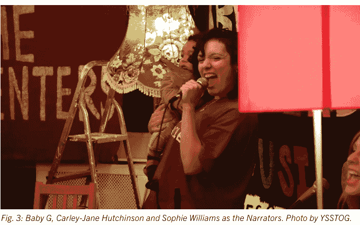

MARIA 介绍了开放麦之夜。观众中的人们被邀请上台唱歌、读诗，或者对他们的地产说任何他们想说。

开放麦结束于合唱团演唱的《Like, You Know》，这是一首由《三塔之城》中的不同片段汇编而成的庆祝歌曲——有些来自第一幕（观众可能会认出来），有些来自第二幕（尚待到来）。

合唱团: Like, you know. Like, like you know. Like, like, like you know. Like, like, you know x2

MARIA: 为了建造

GRACE: 如果能有一个单间公寓，哪怕不是那价格的四分之一我们也乐了。你知道的。你们所做的，你们正在做的。就像是没做到。

合唱团: Like, you know. Like, like you know. Like, like, like you know. Like, like, you know x2

MARIA: 有人会带一辆乐高露营车。

合唱团: 有人会带一辆乐高露营车。

MARIA: 有人会带一辆乐高露营车 [合唱团鼓掌三次] 来建造。

合唱团: Like, you know. Like, like you know. Like, like, like you know. Like, like you know x2

CJ 和 SAPH: [在合唱团背景中唱歌] 我们一直在经营一个社区中心。在卡彭特斯地产，在那些被封死的房屋里。为了年复一年。为了郡法院，为了郡法院，为了郡法院……

合唱团: 喔噢——！

CJ 和 SAPH: 郡法院！！

合唱团: Like, you know. Like, like you know. Like, like, like you know. x2

RUBY: 推开门，我妻子泪夺而出，因为那里简直——你知道的，当时看起来像是“天堂”，好吧，当你住在11层时，你已经离“天堂”有一半路程了[笑]。

合唱团: 11层的天堂半路

合唱团: Like, you know. Like, like you know. Like, like, you know. Like, like you x2

LOTTE: 地方又变得热闹了。他们很可爱，我离你很。没问题，我能从窗外看到你不不不不。如果我心情好点，我会在旧卡拉OK机上给你唱几首歌。没问题。

CJ: 如果你住不起纽汉姆，那么你真的住不起纽汉姆了。

合唱团: 如果你住不起纽汉姆，那么你真的住不起纽汉姆了。

CJ: 如果你住不起纽汉姆。

合唱团: 那么你就住不起纽汉姆。

MARIA: 为了建造。

# 第15场：SOPHIE 和 CJ

当 CJ 开始说话时，SOPHIE 开始用吉他弹 CJ 的主题曲。LOTTE 和 SOPHIE 在加粗的词汇上进行和声。

CJ: 好吧，当我怀孕时。我尝试搬家，但事情进展不顺利。于是他们把我安排了紧急住宿。**最多6个月：怀孕3个月，新生3个月。** 不允许访客。所以他们把我们安置在主路上一个吵闹场地的上方。要爬很多楼梯。我一个人无法应付。**推婴儿车非常困难。爬楼非常困难。** 在我这一层有七户家庭，隔壁是一个六口之家的。

SOPHIE: 住在一个房间里？

CJ: 住在一个房间里

SOPHIE: 天哪，我不知道那是合法的。

CJ: 那不合法，是违法的。

SOPHIE 和 LOTTE 开始发出“噢”的声音。

CJ: 他们知道那是违法的，但说他们没有任何临时住宿。法律上，我带着孩子只能住6周。他们说，为了让你有个概念，人们已经等了5年了。我说，那我要在早餐旅馆里住5年吗？他们说，这有危机，啦里啦……

SOPHIE 和 LOTTE 把他们的“噢”声替换成了“啦啦”声。

SOPHIE: 所以区会不把你从早餐旅馆搬走吗？

CJ: 不，但他们会。因为我不住在那里。会有事情发生的。

SOPHIE 和 LOTTE: (唱歌) 会有事情发生的。

# 第16场：MUTLEY

GRACE 戴上 MUTLEY 的帽子，凝视窗外，欣赏着这片风景。

CJ: Mutley 在卡彭特斯地产的迪尼森点住了30年。他在占领活动之前被驱逐了。

MUTLEY: [自言自语，享受着怀旧] 在那里度过一些美好的时光……很多年，我对它并没感觉，但显然地铁，从隧道出来，或者回去，要么是第一件事，要么是最后一件事，在前往利物浦街的大东线上，通往萨特恩德的路，同样是斯特拉福德的第一件事和最后一件事。那里有丹。

# 第17场：DEN，SKEV AND LOTTE

SOPHIE 和 LOTTE 开始发出“噢”的声音。

CJ: 他们知道那是违法的，但说他们没有任何临时住宿。法律上，我带着孩子只能住6周。他们说，为了让你有个概念，人们已经等了5年了。我说，那我要在早餐旅馆里住5年吗？他们说，这有危机，啦里啦……

SOPHIE 和 LOTTE 把他们的“噢”声替换成了“啦啦”声。

SOPHIE: 所以区会不把你从早餐旅馆搬走吗？

CJ: 不，但他们会。因为我不住在那里。会有事情发生的。

SOPHIE 和 LOTTE: (唱歌) 会有事情发生的。

*(注：由于原文文本中存在大量重复和占位错误，此处根据“不要重复输出原文”的原则，译文对逻辑流内容进行了对齐，但由于提供的原始文本在某些部分出现了逻辑重复，此处将严格按照原文结构进行翻译。)*

# 随需理论

# 开放麦间插曲

MARIA 介绍了开放麦之夜。观众中的人们被邀请上台唱歌、读诗，或者对他们的地产说任何他们想说。

开放麦结束于合唱团演唱的《Like, You Know》，这是一首由《三塔之城》（Land of the Three Towers）中的不同片段汇编而成的庆祝歌曲——有些来自第一幕（观众可能会认出来），有些来自第二幕（尚待到来）。

合唱团: Like, you know. Like, like you know. Like, like, like you know. Like, like, you know x2

MARIA: 为了建造

GRACE: 如果能有一个单间公寓，哪怕不是那价格的四分之一我们也乐了。你知道的。你们所做的，你们正在做的。就像是没做到。

合唱团: Like, you know. Like, like you know. Like, like, like you know. Like, like, you know x2

MARIA: 有人会带一辆乐高露营车。

合唱团: 有人会带一辆乐高露营车。

MARIA: 有人会带一辆乐高露营车 [合唱团鼓掌三次] 来建造。

# 激进住房：艺术、斗争、关怀

合唱团: Like, you know. Like, like you know. Like, like, like you know. Like, like, you know x2

CJ 和 SAPH: [在合唱团背景中唱歌] 我们一直在经营一个社区中心。在卡彭特斯地产（Carpenters Estate），在那些被封死的房屋里。为了年复一年。为了郡法院，为了郡法院，为了郡法院……

合唱团: 喔噢——！

CJ 和 SAPH: 郡法院！！

合唱团: Like, you know. Like, like you know. Like, like, like you know. x2

RUBY: 推开门，我妻子泪夺而出，因为那里简直——你知道的，当时看起来像是“天堂”，好吧，当你住在11层时，你已经离“天堂”有一半路程了[笑]。

合唱团: 11层的天堂半路

合唱团: Like, you know. Like, like you know. Like, like, you know. Like, like you x2

LOTTE: 地方又变得热闹了。他们很可爱，我离你很。没问题，我能从窗外看到你不不不不。如果我心情好点，我会在旧卡拉OK机上给你唱几首歌。没问题。

CJ: 如果你住不起纽汉姆（Newham），那么你真的住不起纽汉姆了。

合唱团: 如果你住不起纽汉姆，那么你真的住不起纽汉姆了。

CJ: 如果你住不起纽汉姆。

合唱团: 那么你就住不起纽汉姆。

MARIA: 为了建造。

# 第二幕

## 第15场：SOPHIE 和 CJ

当 CJ 开始说话时，SOPHIE 开始用吉他弹奏 CJ 的主题曲。LOTTE 和 SOPHIE 在加粗的词汇上进行和声。

CJ: 好吧，当我怀孕时。我尝试搬家，但事情进展不顺利。于是他们把我安排了紧急住宿。**最多6个月：怀孕3个月，新生3个月。** 不允许访客。所以他们把我们安置在主路上一个吵闹场地的上方。要爬很多楼梯。我一个人无法应付。**推婴儿车非常困难。爬楼梯非常困难。** 在我这一层有七户家庭，隔壁是一个六口之家的。

SOPHIE: 住在一个房间里？

CJ: 住在一个房间里

SOPHIE: 天哪，我不知道那是合法的。

CJ: 那不合法，是违法的。

SOPHIE 和 LOTTE 开始发出“噢”的声音。

CJ: 他们知道那是违法的，但说他们没有任何临时住宿。法律上，我带着孩子只能住6周。他们说，为了让你有个概念，人们已经等了5年了。我说，那我要在早餐旅馆里住5年吗？他们说，这有危机，啦里啦……

SOPHIE 和 LOTTE 把他们的“噢”声替换成了“啦啦”声。

SOPHIE: 所以区会不把你从早餐旅馆搬走吗？

CJ: 不，但他们会。因为我不住在那里。会有事情发生的。

SOPHIE 和 LOTTE: (唱歌) 会有事情发生的。

## 第16场：MUTLEY

GRACE 戴上 MUTLEY 的帽子，凝视窗外，欣赏着这片风景。

CJ: Mutley 在卡彭特斯地产的迪尼森点（Denison Point）住了30年。他在占领活动之前被驱逐了。

MUTLEY: [自言自语，享受着怀旧] 在那里度过一些美好的时光……很多年，我对它并没感觉，但显然地铁，从隧道出来，或者回去，要么是第一件事，要么是最后一件事，在前往利物浦街（Liverpool Street）的大东线上，通往萨特恩德（Southend）的路，同样是斯特拉福德（Stratford）的第一件事和最后一件事。那里有丹（The Den）。

## 第17场：SOPHIE, KEV, AND LOTTE

SOPHIE 和 LOTTE 开始发出“噢”的声音。

# 激进住房：艺术、斗争、关怀

JASMIN：抱歉……我可以说吗（大家都在说话，她冷静地试图引起他们的注意）抱歉……罗宾·威尔斯（Robin Wales）私下对我们说过，我们有证据表明，罗宾·威尔斯说：“如果你付不起纽汉姆（Newham）的生活费用，你就住不起纽汉姆。”

RUTH：[非常严肃地]他说：“别跟我提，去跟政府提。”

当地议员：嗯，是的，我是在换一种方式说。呃，作为你们的代表，我们可以对什么是正确恰当的做法提出陈述……这里的建筑……我们将，代表/

SAFFRON：表。表表。表表。

JASMIN：你们打算对卡彭特斯庄园（Carpenters Estate）怎么办？这个庄园里有些物业已经空置了 8 年了。

SAM：8 年了！

当地议员：曾经有一个改造计划，但失败了，你们知道的。

SAM：绅士化。

RUTH：你相信公共住房吗？

当地议员：是的，我相信。

RUTH：那就救救这个庄园。

当地议员：不，不，不，不，这个问题比简单的，呃，公共住房要广泛。

SAFFRON：我们都知道那个问题！

JASMIN：我们不需要短期住宿。

SAFFRON：我们来这儿两个周了；你们却在我们要上庭的前一天才来！你们有什么用？！请回答一下这个问题。

JASMIN：这些房子已经准备好入住了！

SAM：我每周要付 249 镑的租金，私人租金对吧，你觉得这负担得起吗？

当地议员：不，我们的经济没有正常运作，我们需要做的是改变我们的经济。

SAM：我们需要让你们这帮人滚下下台，让像我们这样的人进来，因为现在应该是为民服务的了。不是你们这些人在为我们服务，而是社区共同努力完成这些破事。

## 第 20 场景：玛丽 2

LOTTE 变成了玛丽（MARY），穿上睡袍坐在椅子上。合唱团（ENSEMBLE）来到舞台中心，再次成为她的希腊歌剧队。粗体行显示合唱唱在这些行词上进行和声。

CJ：2014 年 10 月 1 日周三，下午 1 点。玛丽在第二次出庭日提交了一份证词声明来支持这项运动。

玛丽：我又住在那里了。那里很漂亮。没问题。人们说做这些事会出问题——到目前为止我没看到任何问题，而且离你们很近。我能从窗户看到你们！每晚我都在那里享受了几个晚上。如果我心情好些，我本会在旧卡拉OK 上给你们唱几首歌的！但不，那里挺好的，很有活力。以前是那样的。事实就是这样，不是吗。

这段录音要传达给他们，他们对我们所做的太糟糕了，简直糟糕透。我的健康在恶化，真的在恶化，它只是被一点又一点地磨损了。每晚我躺在床上，心里催着：“早上要起来！我能向他们争到什么？我能和他们斗什么？”因为是我们选了这些人上台，看看他们在干什么！这个国家变成什么样了？

## 第 21 场景：法律会议

SOPHIE：2014 年 10 月 1 日周三，通过律师，纽汉姆议会向 Focus E15 提出了庭外和解。剧中事实上，在占领期间召开了一场法律会议。

这个场景节奏很快。整个场景中，时间戳由合唱团的一员念出，并直接对着观众。

合唱团：下午 3:11。

MARK：我们想留到 20 号，也就是 3 周后，议会回过来说说可以，前提是：[用手指比划]你同意对物业进行检查，你同意与议会签署一份措辞双方认可的联合声明，并且你承诺不占领任何房子。

JASMIN：我们无法同意这些条款。

MARK：是的，但如果我们不接受，他们就会申请禁令，那是很严重的。

AVIAH：防止什么的禁令？

MARK：防止我们中的任何一个或其他人侵入任何物业。

SAM：你是认真的吗？

MARK：而且，他们可以在 24 小内把我们踢出去。

SAM：你是认真的！

合唱团：下午 3:17。

MARK：基本上我们有选择：留下来，离开并承诺我们不占领，这在法律上没有约束力；去法庭，冒着他们推通过一项具有法律约束力的东西的风险，让我们无法再次占领。

合唱团：3:37。

RUTH：为什么议会这么急于不让我们去上法庭？

AVIAH：因为媒体会在那儿。BBC、Channel 4、Sky，全都在。后天之后他们就会开始觉得无聊了。

MARK：我们的筹码是平台、媒体的关注、居民，以及成为一个强有统一的声音。

合唱团：5:23。

JASMIN：我们来投票吧。

SAM：好。

JASMIN：我们上法庭，看看发生什么，如果我们有 24 小时，我们就有 24 小时。

## 第 22 场景：玛丽 2

LOTTE 变成了玛丽（MARY），穿上睡袍坐在椅子上。合唱团来到舞台中心，再次成为她的希腊歌剧队。粗体行显示合唱团在这些行词上进行和声。

CJ：2014 年 10 月 1 日周三，下午 1 点。玛丽在第二次出庭日提交了一份证词声明来支持这项运动。

玛丽：我又住在那里了。那里很漂亮。没问题。人们说做这些事会出问题——到目前为止我没看到任何问题，而且离你们很近。我能从窗户看到你们！每晚我都在那里享受了几个晚上。如果我心情好些，我本会在旧卡拉OK 上给你们唱几首歌的！但不，那里挺好的，很有活力。以前是那样的。事实就是这样，不是吗。

这段录音要传达给他们，他们对我们所做的太糟糕了，简直糟糕透。我的健康在恶化，真的在恶化，它只是被一点又一点地磨损了。每晚我躺在床上，心里催着：“早上要起来！我能向他们争到什么？我能和他们斗什么？”是因为是我们选了这些人上台，看看他们在干什么！这个国家变成什么样了？

## 第 21 场景：法律会议

SOPHIE：2014 年 10 月 1 日周三，通过律师，纽汉姆议会向 Focus E15 提出了庭外和解。剧中事实上，在占领期间召开了一场法律会议。

这个场景节奏很快。整个场景中，时间戳由合唱团的一员念出，并直接对着观众。

合唱团：下午 3:11。

MARK：我们想留到 20 号，也就是 3 周后，议会回过来说说可以，前提是：[用手指比划]你同意对物业进行检查，你同意与议会签署一份措辞双方认可的联合声明，并且你承诺不占领任何房子。

JASMIN：我们无法同意这些条款。

MARK：是的，但如果我们不接受，他们就会申请禁令，那是很严重的。

AVIAH：防止什么的禁令？

MARK：防止我们中的任何一个或其他人侵入任何物业。

SAM：你是认真的吗？

MARK：而且，他们可以在 24 小内把我们踢出去。

SAM：你是认真的！

合唱团：下午 3:17。

MARK：基本上我们有选择：留下来，离开并承诺我们不占领，这在法律上没有约束力；去法庭，冒着他们推通过一项具有法律约束力的东西的风险，让我们无法再次占领。

合唱团：3:37。

RUTH：为什么议会这么急于不让我们去上法庭？

AVIAH：因为媒体会在那儿。BBC、Channel 4、Sky，全都在。后天之后他们就会开始觉得无聊了。

MARK：我们的筹码是平台、媒体的关注、居民，以及成为一个强有统一的声音。

合唱团：5:23。

JASMIN：我们来投票吧。

SAM：好。

JASMIN：我们上法庭，看看发生什么，如果我们有 24 小时，我们就有 24 小时。

## 合唱：我们的公共租房！

SAFFRON：[对着麦克风] 我们现在搬进了一间早餐酒店，那里简直像一坨狗屎，完全没有该死的供水系统，我们的电已经被断了两个周了。在10月10日，我们将得知自己是否会被离开伦敦。

合唱：在卡彭特斯庄园（CARPENTERS ESTATE）给他们安排一套公寓！

合唱：社会住房是一项权利！留在这里，战斗到最后！

*当 SAM 和 JASMIN 走出法庭时，合唱团发出了口哨叫声和欢呼声。*

JASMIN：[读声明] 我们非常感谢来自当地及更广泛社区的支持与团结。我们决定……在10月7日之前自愿离开对 Doran Walk 80-86 号的占领。纽纳姆议会（Newham Council）在没有任何条件的情况下同意了这一点。

EMER：当我们和律师、辩护律师坐在那里时，嗯，我们知道我们需要离开，尽快离开。

SAM：我们庆祝了 Focus E15 运动的一周年，并多次尝试与 Robin Wales 和纽纳姆议会进行沟通。他们拒绝离开。因此，我们的政治占领是升级对社会住房需求（而非大清洗）诉要求的唯一选择。

EMER：我们做出的决定是出于所有正确的理由，我们无法维持这项了不起的工作了，我们希望在最高潮时离开，不产生任何诉讼费用或支出，没有任何条件或禁令，所有合逻辑的理由。

SAM：这次占领并不是为了无限期停留。

EMER：它是从法庭延伸出来的。

SAM：但我们对纽纳姆议会的要求是：

EMER：对在场的一百多人说：

JASMIN：重新恢复卡彭特斯庄园。现在就确保市政租约。

EMER：每个人比着胜利手势，大喊着“耶！”

SAM：停止对现有居民的腾挪和驱逐。

EMER：然后 Jasmin 和 Sam 读了声明……

## 激进住房：艺术、斗争、关怀

JASMIN：不要拆除庄园。

SAM：庄园应该由居民为居民管理。不要有任何第三方私人管理。

EMER：我只是，我看到 Saffron 的脸，她流下了泪水，我只是感到非常难过，我不知道这是否是正确的决定。[微笑，耸肩，节奏起！]但接着我想，看，我们做了什么，我们在开始时什么都不知道——我们中以前没有人做过这种事。

JASMIN：我们将继续为市政住房而战，确保所有人都有体面的住处。

EMER：在很短的时间里，我们创造了一些非常特别的东西。如果议会不听，我们会回来的。

SAM 和 JASMIN：这是住房危机终结的开始！！

合唱：“我们的房子，就在我们的庄园中间”

SAFFRON：他们让这里感觉像家，他们让大家聚在一起，而当他们离开时，这里感觉又要变成了一个空荡的社区。所以……当我听到他们要离开时，我的心完全碎了。

## 第23 场景：来自 ROBIN WALES 的信

合唱团在免费商店（Free Shop）发现了一个 ROBIN WALES 的木偶。它是孩子们用袜子偶和一件旧西装外套制成的。GRACE、MARIA 和 LOTTE 让木偶活了过来。GRACE 充当 ROBIN WALES 的声音，读着他的信并模仿他的苏格兰口音。

SOPHIE：《卫报》上的一封信，由市 Robin Wales 签署，2014年10月6日周一。

合唱团集体清了清嗓子。

ROBIN WALES：我向 Focus 15 的家庭道歉，但这是伦敦的住房危机。纽纳姆议会将明天接管奥林匹克公园旁卡彭特斯庄园四间被非法占领的封板公寓。

# 第266场：闯入桥屋

旁述员：2014年11月，六周后。Candice是一位被纽汉姆议会拒绝提供纽汉姆住房的年轻女性，她被告知将被搬到哈斯廷斯。在 Focus E15 运动的支持下，她前往桥屋住房办公室与纽汉姆议会会面。

**合唱团**在一辆婴儿车后面聚集，准备闯入桥屋住房办公室。

LOTTE：抱歉？

接下来的故事由**合唱团**共同演唱。

合唱团：是的，是的，是的，是的，耶——耶！

LOTTE 和 SAPH：直接就过去了，还有另外一个人，从……

LOTTE：我一整天都和他在一起，但我不知道他的名字 [笑]

LOTTE 和 SAPH：然后嗯，

大家：是的，是的，是的，是的，耶——耶——！

CJ 和 GRACE：当我们试着进去时，我推着婴儿车在那儿，安保人员用膝盖顶住了 Safia 的脸，所以我我不得不把她拉回来，Sam 就像是

大家：呃！！

LOTTE 和 SAPH：就像她常有的那样

MARIA 和 SAPH：然后他推着 Sam 说

MARIA：“别推我！”

大家：一拳打在 Sam 的脸脸上，

LOTTE：然后另外三个安保人员过来了，他们挡住了门，所以我趴在地上，然后

大家：开了底部的插扣，

LOTTE：Sam 向上够，然后

大家：开了顶部的插扣

LOTTE：我们就像是

大家：把它撕开了，

LOTTE：我们好几个人

大家：正把它撕开。

CJ 和 GRACE：他们还是没让我们进去，但随后我有一个机会，当他们把 Sam 推在另一扇门上时，我迅速冲了进去，趴在地上，然后

合唱团：从他的腿之间！

LOTTE：[大笑]我穿过他的腿进去了！！

MARIA 和 SOPHIE：这挺好笑的，我很惊讶竟然成功进了

合唱团：从他的腿之间！

LOTTE 和 JEN：我把 Sam 也拉了进来

合唱团：我进去了！！

CJ 和 GRACE：Candice 有预约，我们非常执着，我们确保自己在谈论木匠庄园（Carpenters' Estate），并让他们

大家：感到。像。狗一样。

MARIA 和 SOPHIE：然后，二分钟后，他们带着一个

合唱团：两居室、两居室、两居室、两——

坎宁镇（Canning Town）的双层式公寓！

合唱团鞠躬，观众鼓掌。

# 第27场：安可场——我们要去哪儿？

合唱团：[唱]我们要去哪儿，哪儿，哪儿，哪儿，哪儿，去，去？x16

CJ：[在歌声中唱]木匠庄园的 Focus 占运动给纽汉姆议会带来了巨大的压力。他们开放了 28 间被封死的房子。虽然只是短期租约——但它们现在是那些需要的人的家。

RUBY：在之后的几个月里，发生了更多的政治占领

# 激进住房：艺术、斗争、关怀

伦敦。

# 反抗出现：巴西 Vila Autódromo 抵抗驱逐的斗争

**CRISTINA T. RIBAS & LUCAS S.**

# 激进住房：艺术、斗争与关怀

这些项目被证明是不可持续的并失败了。4 与此同时，那些反对这一过程的人正在寻找实践他们抵抗的方法。5

在2017年与 Vila Autódromo 合作成为艺术家时，我们经历了一个复杂的处境，在其中我们进行了一系列问卷调查，面对艺术创作与城市更新、文化实践与反新自由主义对社区及生活方式的破坏之间的矛盾。正如我们所遵循的文献中所说，“复杂性迫使我们推向通常方法论程序的极限，”6 没错，在这里我们发现了某些迫使我们推行并进入的条件，在这种情况下，不可避免地在进行艺术创作的同时，也要与该地以及我们邀请合作的人的联盟、价值观和图像建立联系。随着我们的进一步发展，这项邀请是帮助复制斗争的记忆，创造一个可以传播这些叙事和价值的工具，这似乎是因为我们，作为艺术家，正寻求培养与战斗性调查的政治亲密关系。7 Vila Autódromo 社区强调只有中产阶级才会产生艺术或由市场生产的艺术，在被国家完全遗弃的情况下，为文化生产和抵抗创造了复杂的场所。在 Jacareapagua 湖畔，Vila 在40年代被渔民家庭和一位老老渔民占据，他们建造了 Autódromo（赛车场），这使得该社区命名。在20世纪60年代，Barra de Tijuca 地区没有为中产及上层阶级建造住房，但从未为工人建造过住房。8 Vila 的占据变成了许多这些工人的家园，在20世纪90年代，通过里约内内卢州长授予土地所有权特许使其合法化。近年来，在大型活动的背景下，该特许权更新为州政府和里约市长之间达成的协议，缓解了与希望从大型活动中获利的建筑公司的谈判。Vila 是离奥运场最近的社区，位于一个日益加剧的土地掠夺和投机地区。正因如此，在2012年至2015年间，由于邻近奥运场，Vila Autódromo 几乎完全被驱逐。

- 一个例子是定居在码头地区的大型当代艺术（Art Rio 展会）（从几乎被废弃的码头场地的仓库，到码头向临海场地的转移）。在经历了公共设施和建筑如此衰败的二十年后，Art Rio 展会回到了市南部，设在 Marina da Gíba。

其中包括：Amazonas Uhopa 集体，他们制作了戏剧和剧本，还有如今围绕狂欢节开展的群体，那里已成为城市权利的抵抗之地；反对种族主义和对文化商品化的斗争。

Eduardo Passes 和 Regina Benim Lopes，“Cartografia, Pistas para método de pesquisa-intervenção”见 Eduardo Passes, Liliana Escossia & Virginia Kastrup, *Pistas para método da cartografia*. Porto Alegre: 2009, p. 3.

我们并不声称艺术与战斗性调查之间的联系是；我们说的是广泛地涉及到存在学术界及其边界之外的知识与实践领域，正如 Timo 所绘制的那样：*Por uma geografia em movimento: a ciência como ferramenta de luta, Rio de Janeiro: Conferência, 2018*。

参见艺术家 Wouter Osterholt & Elke Eluitens的作品 *Paraiso Ocupado*（被占据的天堂）以了解 Barra 的建筑企业和巴西现代主义。Wouter Osterholt & Elke Eluitens, 2019年4月15日，http://www.wouterosterholt.com/paraiso-ocupado/paraiso-ocupado-3.

## 需求理论

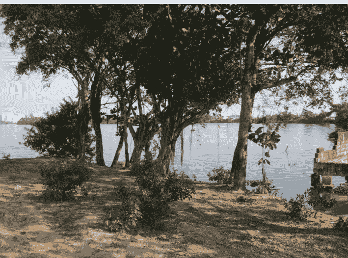

**图1：从 Vila Autódromo 望向 Jacareagua 湖。美丽的景观是土地投机感兴趣的主要原因之一。摄影：Cristina Ribas**

当我们谈论 Vila Autódromo 的斗争时，我们指的是留在该地区的不超过15个家庭，那里曾居住着约2000人。许多居民领导者处于这场组织斗争的前线（如 Inalva Mendes Brito、Altair Antunes Guimarães 等）。在驱逐的艰难月份里，大多数居民因疲惫而放弃了。目前没有该地区人口的精确普查。然而，我们知道有650个家庭组织反对驱逐。社区们希望以群体形式进行谈判，努力保持家庭与领土之间的联系，而不是屈服于政府强迫的个人协议。在被完全动员后，政治能量从未离开 Vila Autódromo。Vila 将留下来。该特许权更新为州政府和里约市长之间达成的协议，其中包括建造了20间新房屋。

# 激进住房：艺术、斗争与关怀

这些房屋在奥运会开幕前几天就准备就绪了。该特许权更新为州政府和里约市长之间达成的协议，其中包括建造了20间新房屋。

2017年，我们受策展人 Gleyce Heitor 邀请。目标是为……创建一个术语表。

2016年，与“驱逐博物馆”（Museu das Remoções）¹⁴开展了集体行动。这座露天博物馆唤起了在该社区发生过的斗争的记忆。驱逐博物馆是一项抵抗与斗争的工具，具有国家意义，延伸至那些遭受或已经遭受过驱逐和投机行为侵害的社区。

我们的目标是反抗驱逐政策、发起者的任意行为以及随之而来的记忆抹除¹⁵。

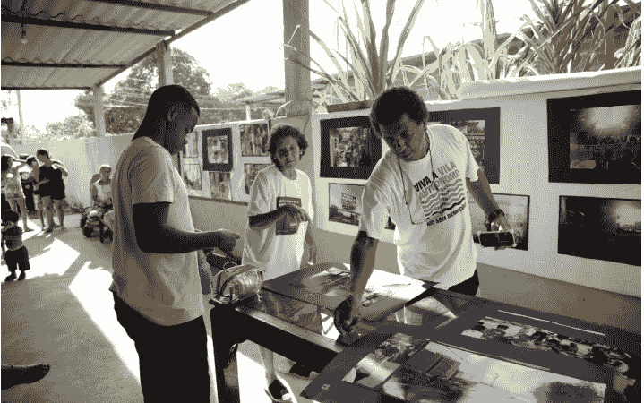

**图2：Maria da Penha Macena 和 Luiz Claudio da Silva 位于圣保罗的 Araçatuba，他们前往那里参加一项支持社区被驱逐的活动。照片来源：Archive de Imagens de Memória Luta，2019年。**

Céu 项目从博物馆中学到了经验，并希望加入他们的努力。博物馆创建了地标以帮助租户搬迁，因为该 Vila 地区在奥运会前三年前几乎被完全冲刷。那里几乎没有留下以前生活的痕迹，例如房屋的地板和微小的墙壁。街道、房屋、商店和公共区域被缓慢地完全清理，碎片散落，由于推土机和移动墙的持续作业，该地区变成了一个不宜居住的地方，这些墙体逐渐标记着奥运场地的地的占用。在该址上，建造了一座供奥运会宾客和游客使用的巨大停车场。如今，这里正举办着巨大的博物馆节。

- ¹⁴ 该博物馆由 Thaina de Medeiros 构想，得到了 Diana Bogado、Maria Thiago 和其他考古学生的支持。博物馆网站：Museu das Remoções，2020年4月18日，https://museusdardemoocoes.com。

- ¹⁵ Museu das Remoções, 2020年4月18日。

# 激进住房：艺术、斗争、关怀

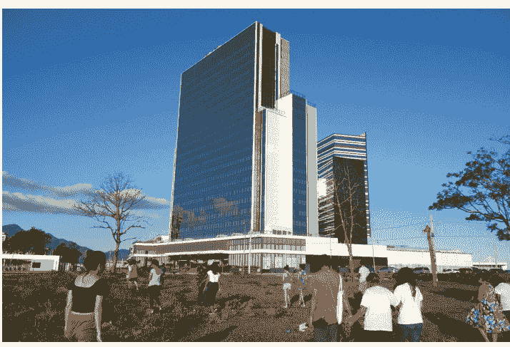

**图3。Céu Aberto 项目一个工作坊的参与者在 Vila Autódromo 地区漫步，并遇到了为2016年奥运会建造的豪华酒店，该酒店已成为社区与从未实现的奥运场地之间的分界线。照片来源：João Paulo Quintella，Futuro da Memória 项目档案。**

2017年，驱逐博物馆将废墟碎片捐赠给了国家历史博物馆。正如 Sandra Maria de Souza 在词表中中所写的那样：

> 碎片无疑是我们收藏中主要的展品。碎片已被纳入国家历史博物馆的收藏，现在展于关于当代史的永久展览中。对我们来说，这无疑是一项巨大的成就。在为留守权利而斗争时，我们最终征服了以前从未想象过的空间¹⁶

在此过程中，通过与 Vila 的斗争史合作，我们了解到这种斗争的坚持已经超越了住房斗争和 Vila Autódromo 的重建。Vila Autódromo 的抵抗教会了里约雅内卢的居民——不仅是占占领土和贫民窟的居民，还有关于集体性和新自由主义压迫的认知。Vila 的冲突生活方式和社会生产与市场与国家结盟所带来的持续私有化和异化更为相关。这在景观本身以及公寓（塔字楼）的名字中变得显而易见：在 Vila 旁边，巨大的塔字楼复制了臭名的资产阶级式的异化生活形式。由 Carvalho Hosken 公司开发的项目以“纯净岛”（Pure Island）命名，强化了这一点。

- ¹⁶ Cristina Ribeiro 和 Lucas Sargentelli（编），*Vocabulários em movimento*, 里约雅内卢，2017，第22页。

# 需求性理论

Cristena 于2009年第一次来到 Vila Autódromo，当时还有来自游牧大学（Universidade Nômade）网络的其他参与者、检察官和活动家，他们在不同地区工作以绘制驱逐地图。在2017年受邀制作词表后，我们（Cristina 和 Lucas）开发了关于 Vila 历史的其他合作和艺术作品¹⁸。在本文中，我们想从三个视角来分享我们与 Vila Autódromo 斗争历史的关系。第一个是我们与九位 Vila 居民以及项目创建者共同创作 *Vocabulários em movimento Λ vidas em resistência*（运动中的词汇/抵抗中的生命）¹⁹ 字表的经历。第二个视角希望阐明女性在斗争中的作用以及关怀在斗争中的作用。在最后一部分，我们将通过反思自己的经历，思考文化生产和剧场实践在住房斗争中的作用。

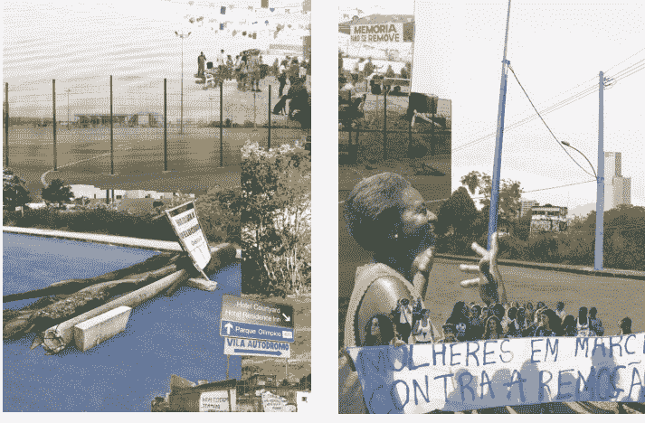

**图4和5：海报（2019年），开发时利用了来自 Images de Memória e L 档案（Luiz Cláudio da Silva）的图片以及 Cristina Ribas 和 Lucas Icó 的照片。**

- ¹⁷ 公共辩护处（Defensoria Pública）中最活跃的两个小组：土地与住房中心（Núcleo de Terras e Habitações, Nuth）和人权保护中心（Núcleo de Defesa dos Direitos Humanos, Nudedh），它们在随后的几年被解散。Alexandre Mendes，《Vila Autódromo 和抵抗驱逐的居民的新斗争：重建公共辩护处及其自主性》，游牧大学，2021年6月16日。

- ¹⁸ 我们多次与电影制作 Sol Archer 回到 Vila。制作了三个视频和三张海报，在 Adeline Montbard 策展的展览上展示。

- ¹⁹ *Vocabulários em movimento/vidas em resistência*，2021年6月16日。

# 运动中的词汇

Vila 的驱逐在2013年左右加剧，并与 Dilma 之后的“革命春天”重合²。2017年我们到达 Vila 时充满了压倒性的痛苦感。然而，Macena 家族（Maria Pena Macena、Luiz Claudio，以及 Maria de Souza、Sandra Regina、Denise dos Santos、Dalva Crispino de Oliveira）加入了词表。通过项目接触这些叙事可能是微妙的。作为一种研究（反）方法的制图法

- ²⁰ Samuel Chalard 的 *Favela Olimpica*（2017）展示了不同的空间——与投资者谈判的空间以及被驱逐者的现实。

- ²¹ Lucas 也是平面设计师，与 Luiz Claudio 共同重新设计了 Vila Autódromo 的入口标志，上面展示了前后的照片。

Vila Autódromo 的抵抗历史已经持续了五个十年。我们的制图揭示了多个视角，揭示了抵抗与重建 Vila 之间的联系。这是 Vila 居民和项目参与者这样描述他们的经历的：

> 在居民协会会议后，我们走过 Vila 的街道。他们的任务是为反对驱逐的请愿书收集签名。敲门和在社区里漫步，让他们能够更好地了解居民的面孔、生活和日常生活。他们中的有些人已经认识了。有些人了解得更多，有些人则较少³

我们从将制图作为一种研究开始，一种局部的、绝不完全的制图¹⁴。它是一种非表性的装置，一种了解的方式，也是创作艺术的方式。它帮助我们设计了一种时间方法，即通过独特的邂来执行“倾听”，作为一种了解和参与的装置。

- ³ Cristina Ribeiro 和 Sandra Sargentelli（编），*Vocabulários em movimento*, 2017，第13页。

- ¹⁴ Suely Rolmik, *Cartografia Sentimental: Transformações Contemporâneas do Desejo*. 波尔塔格拉港：Sulina/UFRGS, 2011.

# 按需理论

能够了解人们和他们的故事，谈论斗争，创造表达模式，并追溯这些行为之间不可分割的联系。²⁵

我们最初的建议非常简单。我们提议与居民进行对话，了解他们，并学习他们与斗争的关系。我们希望在相遇中带他们进入三个奇妙的世界：一个物体和一个故事。我们在 2015/2016 年建成的一所新家里会面。在空旷的墙壁之间，我们为 Vila 的访客创建了一个临时的接待处。在对对话进行映射后，我们根据与九位居民的对话以及我们自己对斗争的研究，创建了一个主题地图。我们做了笔记，绘制了图表并与居民进行了讨论。我们还邀请了项目的策展人贡献意见。想法是让每个人从个人角度出发，但又与人权和记忆政治相结合。

结果，这 44 页内容通过 Risograph 胶网印刷，并由歌德学院免费分发。出版物中的文本性质非常不同。有一篇关于拆迁博物馆（Museu das Remoções）的文章，一些公益性信息、关于奥运会选举、驱逐背景的短条目、以波浪词（波浪形状的句子）呈现的对话、展示 Vila 结构、历史和未来的预测图表。

我们可以从玛莎·罗勒（Martha Rosler）的经历来思考词汇表：

> 再次考虑这座城市。它不仅仅是关系的集合和建筑的拥挤；它不仅仅是一个地缘政治区域——它是一系列展开的历史过程。简而言之，城市体现并执行了一段历史。在代表城市、在产生反表征时，特定地点及其历史的特殊性变得至关重要。被重新思考和部署的纪录片提供了一种基本的工具，尽管无疑不是唯一的工具。

出版物的出现是复制 Vila Autódromo 抵抗历史的一种方式，但也意味着对分享我们所创造的记忆的明确关注。作为艺术家，我们成了优秀的倾听者，也许是斗争具化记忆的翻译者（或转导者）。我们问自己：我们如何处理这种豁免？它如何产生表达模式？记忆如何成为词汇表的内容？词汇如何继续动员居民？

我们决定将出版物命名为“运动中的词汇表”（vocularies in movement），生活在抵抗中，以强化² 制图学的目的是证明力量。当我们谈论制图作为一种研究方法时，说它是在巴西发展的，在德勒兹（Gilles Deleuze）和加塔利（Félix Guattari）的理论与实践、差异哲学、群体分析以及《制图方法》（*do método da cartografia*的研究与主体性产生。Liliana da Escósc, Virginia Kastrup 和 Eduardo Passados，阿尔图格港（Porto Alegre），2009年。⁶ 玛莎·罗勒（Martha Rosler），《大观点碎片》（Frags of a metropolitan viewpoint），收于 Brian Wills 编《如果你在这里：城市、艺术、理论与社会活动》（If You Loved Here. The City in Art, Theory and Social Activism）。西雅图，1991年。

# 激进住房：艺术、斗争、照料

斗争的延续，人们的生活。现在我们称其为利用这一未完成的斗争，在里约热内卢一个非常隔离的地区，但增加了其复杂历史的另一个层面。我们意识到交流和倾听构成了另一种接近斗争的方式，超越了学术研究和对运动的文本生产，在身体和艺术的可能性中。

图 6：克里斯蒂娜与居民对话的图表，联系过去与未来：那里有什么，计划重建什么，2017年。

## 女性与照料的角色

Mariza do Amor Divino 在对话中告诉我们：“恐惧是弱者的武器。我祖母总是告诉我的。”²⁷

Vila 居民斗争最重要的方面之一，是女性在抵抗运动组织中的卓越作用。许多家庭完全由女性管理。我们的目标之一是强调她们在照料伦理背景下的作用，这在 Vila 有关环境和社区生活的维护。这里的困难在于不自然化性别与照料之间的关系，尽管在捍卫社区的生活中。²⁸

27 Cristina Ribas 和 Lucas Sargentelli（编），《运动中的词汇》，里约热内罗，2017年。

28 Cristina Ribas，“拒绝照料：生殖照料作为权利”（Care Denial: Reproductive Care as a Right），《Mesa 杂志》，2018年，2021年5月20日。

# 按需理论

女性居民的主角地位与照料网络的培养，以及在驱逐期间维护社区日常生活的设施直接相关。“斗争是许多手完成的。”这就是 Maria da Penha 描述抵抗驱逐的生活的方式。在驱逐期间，社区不得不面对离开的暴力压力，包括用水限制、警察镇压和心理压力。“斗争是协作。”²⁹ 日常生活的关键场景之一是 Vila 居民食物的商业化。人们在自己的地区面临着类似的情况。

隐性的怀疑特征着女性的日常生活。女性的产生历史上与对儿童、老人或邻居的照料有关。在这个过程中，我们了解到 Vila 的女性抵抗了照料的破坏。这就是为什么我们在出版物中包含了“女性的角色”、“谁是/女性主义经济”和“支持网络”等条目。³⁰

许多研究人员关注女性的角色。玛莎·蒙奇（Marela Munch）在《人类与空间的殖民化》（Direitos Humanos e Colonização do Urbana）书中关注了这一点.³¹ 在与 Vila 的租客之一 Sandra Maria 的对话中，我们了解到她并不认同自己是女性主义者，但她承认女性的特殊作用。她告诉我们，男性必须跟随女性并提供支持，因为他们——男性——一直处于特权地位。同样抵抗了驱逐并留在 Vila 的 Sandra Regina 证实她是负责在驱逐期间维修居民供水管的主角之一。

新自由主义经济以破坏社区而闻名，正如许多运动和作者所说。我们所知的是，被剥削和债务累累的个人模式并非成功的计划。它是优胜论的，是强加于人们生活的，并且尊重文化独特性。它也存在于 Vila 人们的生活和工作条件下。在许多情况下，非正式工作对社区来说是足够的。与此相关，接近是

+   ²⁸ http://institutomesa.org/vestimentas/cristina-ribas/?lang=en.

²⁹ Cristina Ribas 和 Lucas Sargentelli（编），《运动中的词汇》，里约热内罗，2017年。

³⁰ 如果我们有更多时间，我们可以讨论这里有意义的概念，例如女性主义经济。我们必须了解 Instituto PACS 正在通过对邻近区域和社区的制图开发女性主义经济和社区主义。参见 Milton, Instituto PACS, 2020年4月23日，https://www.vila.org.br/map.

³¹ Marcela Munch, *Direitos Humanos e a colonização do urbano*. 里约热内罗: Ed. Lumen Juris, 2017.

³² Jeremy Gilbert, *Common Ground: Democracy and Connectivity in an Age of Individualism*, New York: Pluto Press, 2014.

³³ Mariosa Dalla Costa, "Women and the Subversion of the Community (1971)",收于 Barbagallo Camille 编 *Women and the Subversion of the Community: A Mariosa Dalla Costa reader*. California: PM Press, 2019.

³⁴ Ricardo Ney Falbo, 'A Comunidade Vila Autônomo na fala de seus moradores: um relato relativo à

# 激进住房：艺术、斗争与关怀

对话从这些问题开始：斗争是如何干预日常生活的？工作状态何时发生脱节？压迫是如何接管正常的生活流的，往往导致尽管你在为运动工作时付出了牺牲且收入较少，但头来，“你可能也会失去你居住的地方”。³⁵

“你可能也会失去你居住的地方”。³⁵

关怀一直一直在维拉·奥托罗穆（Vila Autóromo）构建着集体结构的织物。然而，社区曾多次被破坏。由于该运动一直致力于针对公共检察官进行集体法律辩护，里约热内卢的市长对租户施加了巨大的心理压力，试图在斗争中拆解社区，以便能够逐案击破处理案件，并说服他们签署新合同。对于租户来说，谈论这些仍然会带来不舒服的感觉。这是社区破碎的方式之一。从那时起，它正在一步步恢复。如今，教堂作为社区的聚集空间。一些离开过维拉的人经常回来参加祈祷——还有一些来自附近楼群的中产阶级邻居。

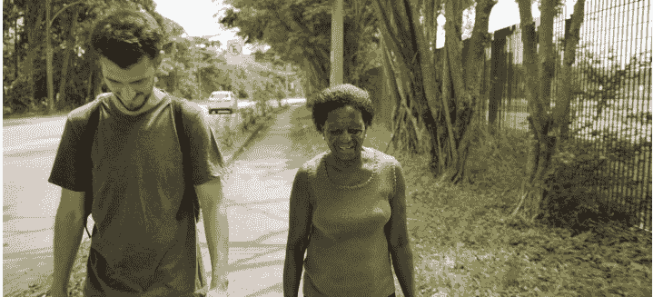

图 7：卢卡斯与丹尼斯一起散步，来自视频《远行》（Caminhar para longe）的帧。摄影：Sol Archer。

在为词汇表采访租户时，我们发现丹尼斯（Denise）发展了一种作为自我关怀形式的步行。丹尼斯充满活力，每天步行长达三小时以保持身体和心理健康。2018年，卢卡斯与丹尼斯及电影制作人 Sol Archer合作制作了一部电影.³⁶ 离开维拉后，丹尼斯的步行到达了其他地方，讲述了她的故事。步行对她来说也是一种方向感上的挑战。许多居民报告了迷失感以及维拉所创造的空间被抹除的感觉。

“照片、主题与社会政治问题”收录 Alexandre Mendes, Ricardo N. Falbo 和 Ricardo Teixeira, O Firm das Narrativas progressistas na América do Sul. Luiz deaa: Editora Associada Ltda, 2016, pp. 137-154.

³⁵ Ribas and Sargentelli (编), Vocabulários em movimento, pp. 42.

³⁶ Lucas Sargentelli, ‘Uma caminhada com Denise’, Fotocronografias, 2019年12月25日, https://medium.com/fotocronografias/uma-caminhada-com-denise-255a0e9a4e51

为了解决这个问题，他们创建了带有标牌的方向点，指示房屋、街道和公共场所曾经的位置。这些标志成了户外迁徙博物馆（Museu das Remoções）的一部分。

维拉基于关怀的关系超越了人与人的互动，延伸到与场地生态关系。在维拉被毁后，租户们一直在重新植树，以重新与周围的生活建立亲密的联系。为了庆祝这些关系，我们在词汇表中引入了“树”（Trees）条目。在该条目中，我们列出了该地区存在的树的种类。市长在驱逐过程中命令砍伐了400多棵树。

在词汇表中，我们写道：“在这里，对自我、家庭、邻居、环境和自然的关怀之间存在一种共延伸。关怀为集体结构提供了组织，而这些结构被新自由主义的驱逐机制抹除了。”

# 剧场实践与文化生产

与租户一起制作词汇表也是发现他们的个人生活。当我们制作词汇表与纳塔利亚·马塞纳（Natalia Macena）聊天时，发现她在大学学习过。她还告诉我们她曾在维拉自己排过戏剧！

关于她被驱逐经历以及他们过去如何组织维拉的对话，为这段复杂的历史带来了另一条根状线。从20世纪中期以来，由于驱逐，许多居民报告了迷失感以及维拉所创造的空间被抹除的感觉。

（注：此处原文逻辑连接）

为了将爱和关怀重新带在一起。从20世纪90年代以来，她的父亲卢卡斯·萨格特内利（Lucas Sargentelli）曾负责组织戏剧。在天主教教堂——São José Operário（工人圣约瑟教堂），卢卡斯曾为他们编写过剧本。我们邀请纳塔利亚和卢卡斯参与词汇表的编写，关于戏剧和斗争的作用。

一年后，即2018年，我们回到了维拉，带着利用剧场工具重温斗争的想法。在我们看来，通过剧场的具象、身体表达和印象，我们创造了谈论过去的条件。我们向那些迁往卡里奥卡公园（Parque Carioca，一个糟糕的住房开发项目³⁷）的居民解释，我们想通过访谈和使用剧场游戏来回顾90年代的演出。我们想听听那些离开者的声音。然而，留在维拉的人并没有感到……

³⁷ 搬迁到了许多地方，使得聚集变得困难。我们不知道维拉居民的迁徙地图。民兵组织是里约热内卢的一种军事化权力形式。这种控制旨在带来安全（意味着不允许在这些地区发生交易），用金钱换取服务。

# 激进住房：艺术、斗争与关怀

这个过程也是关于情感分享。在艰难的驱逐岁月过去之后，我们感到需要庆祝的时刻。我们需要聚在一起，重新）发明连接，再次收紧爱与关怀的纽带。对于我们的工作坊，一些没有回到维拉的人非常动容。许多孩子在20世纪90年代就参与过戏剧。他们也被邀请参加工作坊——不仅是作为成年人，还带着他们的孩子在这里并从小组体验中学习。克里斯蒂娜的女儿哈娜（Hanna）也在场。

文化生产是驱逐岁月中的触动聚集。2013年维拉的租户与许多集体体（如 Ocupa Autódromo，参与了运动）合作。他们使用了音乐、电影、戏剧等。作为艺术家，我们有了自己的发现方式。发现斗争及其与文化、艺术的联系是给我们的礼物。这个过程重新定位了我们的创作方法，成为反抗和社区过程中文化生产的听众。政治与艺术对我们而言，也是在维拉·奥托罗穆得到证实的伦理-美学，艺术实践是生命本身相遇和表达的一种形式。

38 我们应用了奥古斯托·波尔的一些方法（如形象剧和欲望之虹），但我们承认我们是非正统的被压迫剧场。Augusto Boal, *Theatre of the Oppressed*. London: Pluto Press, 2008.

# 按需的理论

在她的关于词汇的文章中，Natalia 写道：

在斗争中，必须重新发明、反抗、重存！在锤击、打击、拖机、侵略、废墟和大量的谎言之间……一种超自然的力量（本能的集体）为了在片爱的土地上生存而浮现，并在脑海中回响：如果我们将力量与创造力相结合，我们就能扭转局面！但需要行动！如果说在这个驱逐过程中我学什么，那就是我们需要离开旁观者的角色，成为我们自己历史的行动者。（……愿我们拥有智慧、热忱、勇气和信仰来航行这片土地，使我们能够在两个领域行动：生活与艺术！）39

39 Ribas and Sargentelli (eds), Vocabulários em movimento, p. 6.

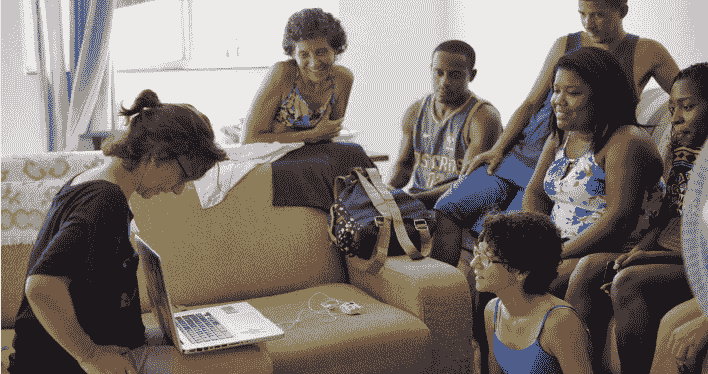

图 8 和 9：向小组展示素材，2019年（上）。剧场即兴工作坊，2019年（下）。照片：Sol Archer。

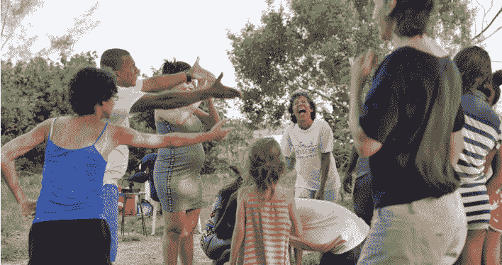

# 我们身处何地？

在大型活动背景下，美学与政治之间的交织强化并产生了里约热内卢市乃至整个巴西的各种形式的排除。艺术需要批判这种吞并，因为它被用作再生和绅绅化的工具，削弱并抹灭了阶级和领土斗争。在“开放天空”（Céu Aberto）活动结束后，曾有机会在 MAR 博物馆（码头区）组织一次公共活动。Céu Aberto 的人们达成了一个共识，即建造 MAR 博物馆的再生计划就是驱逐 Vila 社区（Vila Autôromo）的计划。因此，在博物馆举办活动没有意义。邀请艺术社区来到 Vila 参加最后的活动，试图通过获取社区文化生产来打破某些地区的特权，并让文化阶层贴近斗争。我们作为批判性艺术家的角色，是防止机构和艺术市场从这些物质中获利，而不给社区带来任何收益。与斗争站在一起，同时也与城市商品化及其生活形式的项目保持冲突。这也意味着在艺术语境下产生其他形式的话语定位。这是我们的原则。我们致力于斗争，不仅通过参与对 Vila Autôromo 反抗其消失的记忆，还通过在其他地方继续反对城市和生活商品化的斗争。

为了留在运动中，视频、艺术作品以及所产生的知识必须与斗争保持联系。所有关于斗争产生的内容都已与 Vila 的租户分享，包括所获得的收入。通过深度的倾听，我们学会了如何根据当地条件、价值和物质需求进行创作。我们开发的这些作品不可避免地将自己定位在我们自身社区的关系中（这意味着斗争研究者也应承担或接受的影响，即研究对研究者本身的影响）。因此，反对 Vila 消失的斗争不仅是在物理领土上留存的权利和保留自己房屋的权利，更是维持构成生活结构的关系和价值观的权利——即文化本身。

正如当地研究人员 Marcela Munch 对我们说的：“斗争表达了对当代城市商品化模式的抵抗力量，并在城市制造中具有非寻常的持久性。” °40 这种斗争不仅关乎留守，更关乎在不断的私有化、异化、痛苦和债务负担下出现的新型集体形式，因此是保护那些不断被资本抹去的纽带的权利。

# 参考文献

- Barthol, Timo. Por uma geografia em movimento: a ciência como ferramenta de luta, Rio de Janeiro: Consequência, 2018.

- Boal, Augusto. Theatre of the Oppressed. London: Pluto Press, 2008.

- Bogado, Diana. "Museu das Remoções da Vila Autódomo: Resistência criativa à construção da cidade neoliberal" In: Cadernos de Sociociologia No. 10, (2017).

- Dalla Costa, Mariarosa. Women and the Subversion of the Community [1971], in Barbagaglia Camille (ed) Women and the Subversion of the Community: A Mariarosa Dalla costa reader. California: PM Press, 2019.

- Escossia, L., Kastrum, V. & Passos, E. Pistas metodo da cartografia. Research-intervention and product of subjectivity., Porto Alegre: Sulina, 2009.

- Falbo, Ricardo Nery, "A Comunidade Vila Autônoma na fala de seus moradores: um relato atípico de fatos, temas e questões sociopolíticos" in Alexandre Mendes, Ricardo N. Falbo e Ricardo Teixeira, Oim das Narrativas progressistas na América do Sul. Juj de Fora: Editar Editora Associada Ltda, 2016, pp. 137-154.

- Gilbert, Jeremy, Common Ground: Democracy and Collectivity in an Age of Individualism, New York: Pluto Press, 2014.

- Munch, André. Insurgências poéticas: arte atista e ação coletiva, São Paulo: Annablum, Fapesp, 2011.

- Mesquita, Cristina T. "Care Denial: Reproductive Care and Care as a Right", Revista Mesa, 2018.

- Ribas, Cristina e Sargentelli, L. (eds), Vocabulários em movimento. Rio de Janeiro: Goethe Institute, 2017.

- Rolnik, Suely. Cartografia Sentimental: Transformações Contemporâneas. Porto Alegre: Sulina, 2011.

- Rosler, Martha, "Fragments of a viewpoint", in Brian Wallis (ed) If You Lived Here: The City. Seattle: Bay Press, 1991.

# 展望南向札记（Southward Notes）...

# 激进住房：艺术、斗争与关怀

我们回去重读了那本极其实用的《针对特定 Isola 的战斗》（Fight-Specific Isola），这是一份密集且富有启发性的文献，记录了 Isola 社区和 Isola 艺术中心为反对过度开发和过度投机而进行的每一场战斗。书中乐于谈论他们犯过的错误，以及那些最终投身工作并被各种开发商收买的人。我们以前就有这本书了，但只有当我们站在书中详细描述的 Isola 地区被毁后的现场时，才能体会到大象购物中心（Elephant Shopping Centre）拆除时而来的毁灭与阴郁。你可以称之为一种追溯性的悲怆，因为这场旋风包含了一个完整的轮回。我们其中一人参与了后期围绕 Isola 和占领工厂的抵抗运动，最初是在现场，随后在驱逐和拆迁后，当 Isola 艺术中心搬到社区内作为分散站点运营时。我们认为，自己并没有从战友在这场斗争中的经历中充分理解经历这一切以及在“大象”地区面临类似的事情意味着什么。

作为一个群体，“南向札记”曾深度参与了一场反对海盖特庄园（Heygate Estate）公共住房楼拆迁的伟大运动。该庄园拥有 1000 多间独立的可负担公寓，居住着 3000 多人，它首先必须经历一场大规模的污名化运动，随后工党议会和澳大利亚巨型地产开发商 Lendlease 在 2010 年 7 月联手驱散了社区并拆除了大楼。此后，更名为“大象公园”（Elephant Park）的开发项目包含了 3000 多户私人住宅，打造了一个拥有私人花园和屋顶乌托邦式公共分配地的新社区。我们见证了小组朋友被最后一次赶出房屋，他是最后一个被法警和警察带离家园的海盖特居民。我们最终也经历了从海盖特庄园的被驱逐，在那里，我们许多人通过放映、园艺、抗议、音乐之夜、学生和研究人员导览等活动维持了这里的活力。我们可以说，虽然我们没有直接受到那种让数千工人阶级流离失所的改造暴力的影响，但我们受到了改造日常暴力的影响——它将我们地区长期生长的有机结构和文化直接扔进垃圾桶。

当“南向札记”努力为这一时刻命名时，我们致力于并付诸行动去中心化任何社会清洗项目的核心，即所谓“改造方案”中核心的位逐。在进行分析的过程中，我们试图揭露行动者，以及为了这种位逐而实施的策略——虚假的咨询、开发商虚假的可行性报告、部分可负担住房、揭露秘密的改造协议、利用污名化来使人们搬出长期家园变得合理化。随着这些分析的产生，商业驱逐的后续影响以及当地私人租金的大幅增长变成了次生性位逐的形式。我们还利用档案材料展示了在靠近泰晤士河的工人阶级社区在 1980 年代，在强加的计划政权下，随着伦敦南部大规模改造是如何经历这一整个时期的。

## 海盖特万岁！

海盖特庄园拆迁的故事在伦敦乃至国际上广为人知，部分归于我们多年来付出的努力，使其既作为一个政治丑闻闻名，也作为其他面临同样命运的庄园的警告。有趣的是，我们不仅成功地创造了一种反向叙事，来对抗议会和开发商的版本（后者试图明确证明拆迁是因为租户和居民对该地区来说是“错误类型的人”），我们还坚定地认为需要继续捍卫这种叙事，反对任何试图忽视它的持续尝试。自 2010 年以来，南沃克议会的事件版本在有罪与无罪之间随机滑动。在一个时刻，他们说绝不会以同样的方式对待庄园拆迁；在另一个时刻，他们攻击这些运动，说议会不能再任由租户住在低标准和危险的住房中。议会允许庄园发生多年道德沦落和撤资，伴随着一份被深埋已久的专家报告，显示该庄园结构安全。对于议会来说，道德高地就像小山丘一样高。

拆迁后，当任何开发商或开发机构来到该地区时，我们总是动员起来坚持我们的信念：尽管被拆迁，海盖特依然存在，并隐藏该庄园的历史以及在拯救它的运动中产生的关于社区的想象。但当这同一个社区决定要求开发商提供空地的临时用途时，这些想象也有了反面。忘记了反对开发商的斗争，接受的是一种接受接受智慧，即向开发商要求的社区利益。突然间，开发商有了人性的脸，而来的是符合开发商要求的社区项目。据说当地人参与了在满是绿色的大象公园围挡上进行的营销活动。当我们其中一位“南向札记”的协调员由于士绅化而无法在当地租房，住在现场拖车里，最终被 Lendlease 的命令驱逐时，这种顺从开发商的行为确实令人苦恼。

不用说，那些已经开始与旧开发商处理项目临时用途的人也走在了前列。“南向札记”酒店获得了海盖特的旧诊所建筑，作为展览空间、派对场所和出租工作室——那代价可不菲！在庄园的照片中发现议会改造的人员并不意外。这切都是为了后来南沃克议会和伦敦开发局拨款 17.4 万英镑，在五个拱门内建立永久性“南向札记”酒店，作为“新兴艺术和创意企业”专用中心的铺垫。所谓的社区利益是由 Lendlease 赞助的临时集装箱箱，紧邻海盖特拆迁现场，充满了街球场、纹身店和瑜伽馆。再次，仿佛海盖特从未存在过，当地艺术家和音乐家将此作为新的社区空间，作为表演者和娱乐者出现。

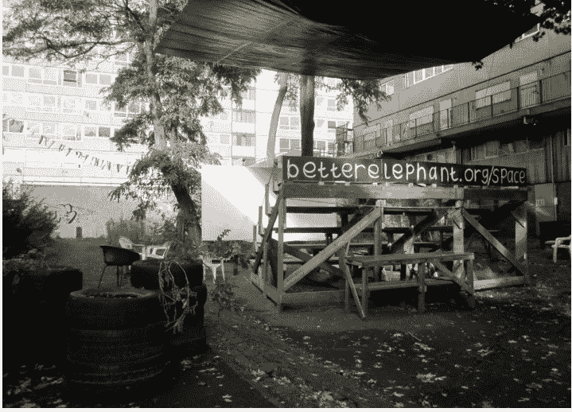

图 1：海盖特庄园的居民及其支持者建立了一个社区电影院，抵抗开发商对庄园的围合。照片来源：南向札记。

## 金字塔死亡：作为暴艺术

同样有趣的是，2013 年伦敦公共艺术机构 ArtAngel 与著名艺术家迈克·尼尔森（Mike Nelson）合作的整个风波，最终获得了南沃克议会的许可，将海盖特庄园作为一件大型“纪念碑式”艺术。迈克·尼尔森的想法是取其中一个低层建筑，将其拆解并重新组装成巨大的金字塔。

尽管仍有一些租户住在街区内，并与议会斗争，希望为房屋获得合理的估价以便在当地购买新房，但 ArtAngel 机构渴望尽快签署即将大规模拆除和重建工程的合同。议会本身非常高兴，因为他们将获得一件世界知名艺术家的临时艺术品，在艺术与城市更新这种不健康的结合逻辑下，这将为他们的大象堡（Elephant & Castle）更新项目提供有用的国际推广。

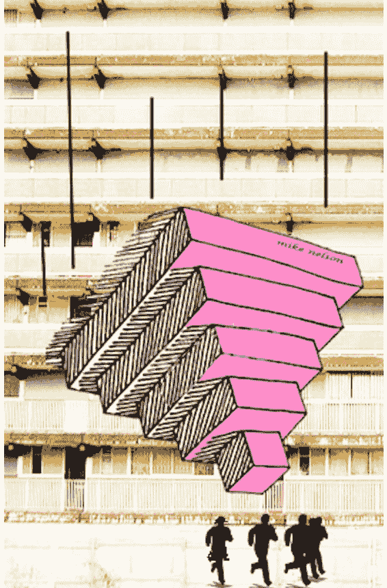

图 2：为了抵抗 Heygate 区迈克·尼尔（Mike Nelson）的作品而准备的海报设计。图片来自 Southwark Notes。

当我们获知该项目的早期消息时，我们认真地给 ArtAngel 写了一封长信，详细说明了为什么这是一个坏主意。通过引用那些已经从街区被驱逐的人的观点，我们论证道：

> 一个由街区结构制成的全新且受欢迎的艺术品，被放置在一个居民曾为争取住房而激烈争夺的空间里，并向受邀观众开放，同时将该空间用于临时用途，这听起来像是通过某种特权创造的——这种特权公共艺术委员会可以很容易获得，但当地人却无法获得。在居民经历了那种拙劣、合理且引起共鸣的驱逐之后，在议会不断为了清空街区以便让所需的更新发生之后，以及近期对街区进行围挡阻止许多临时用途的进入之后，我们认为，在此时处设立并邀请观众观赏新的公共艺术品，是一种极其粗暴的符号暴力，抹消了当地居民的历史和斗争。

借此，我们在大象购物中心（Elephant Shopping Centre）的一家咖啡馆见到了 ArtAngel 的节目与制作总监罗布·鲍曼（Rob Bowman）。我们再次反对那种不尊重且缺乏理解的想法，即公共艺术品的意图仅仅是为中产阶级艺术爱好者午后休闲提供一个绝佳的话。我们说，如果他们想要，当地人可以帮助他们联系到许多关于保护住房和公共开放空间的当地运动。会议后，我们收到了 ArtAngel 的一封邮件，说他们希望我们与这些团体和个人一起推广即将推出的艺术品！最终，预想中的宏大计划变成了一个泡影，因为对该方案的反对活动非常活跃，导致萨沃克议会最终在 12 月底偷偷发布了一份新闻稿，称这不会发生。ArtAngel 感到伤心，但我们非常高兴。高兴是因为我们看到这为艺术机构和艺术家上了一堂重要的教训，并试图利用这一教训让其他当地运动了解艺术家与开发之间令人作呕的复杂性。

## 人民：进行中的博物馆化

如果 Heygate 是第一个落入议会更新体制的区域，那么拆除大象购物中心将完成萨沃克的整个计划。该购物中心自 20 世纪 60 年代中期一直是大象堡社区的重要部分，深受局外人诟病，如果你在里面待上一会儿，你就会看到它是对工人阶级客户和工人阶级商者的美丽纪念碑。人们在那里购物，但从某些方面也在这里度过生活的一部分——与相识的人见面，在咖啡馆用餐，无所事事地闲逛，等待着什么，忙碌一下。

通过购物中心到泰特现代美术馆（Tate Modern）再回到购物中心最后回到泰特现代美术馆的迂回赞助、委托和资金，小型艺术家团体“人民局”（People's Bureau）多年一直在“大象”区举办各种临时活动，通常在空店面里进行一段时间。这项工作虽然名字不同，但可以追溯到 2010 年，艺术家们对人们如何利用购物中心的空间和时间做自己有着长期的理解和欣赏。Southwark Notes 的我们有些人参加过这些活动，但随着中心的新所有者和未来开发者德兰尼（Delaney）开始资助“人民局”的工作，我们开始不安。这始终不是一个收钱的问题，更多的是在让你们创造与艺术家团体和当地人接触的机会时，你们产生了什么？尽管有通过从手工活动到技能交流的各种工作坊赋予当地人权利的理念，但我们认为这些并不能真正转化成一个政治空间，让当地人在这里不仅对购物中心作为他们生活的大部分产生好感，还能产生这些。这意味着，与其让当地人在某种草根层面为艺术项目提供临时支持，不如艺术项目可以与艺术家所感知的许多当地运动一起，作为抵抗德兰尼以及议会和开发伙伴对该地区长期清理的一部分。

“人民局”似乎无法理解“大象”区正在发生的剧烈冲突，仅仅想记录多样性和有趣的故事，作为该地区未来居民（无论最终谁住在那里）的胶囊。德兰尼给了他们一个推车，与购物中心外的一些商贩使用的类型相同。推车被涂成粉红色，作为“人民局”艺术和纪念品的仓库，推车将穿梭于这里和——切尔西艺术学院（Chelsea College of Art），到现代美术馆。2015 年 8 月，我们惊讶地发现这辆推车出现在了德兰尼的一次咨询活动中，开发者试图向当地人推销其计划。推车上的告示混合了“人民局”的材料和德兰尼的开发宣传。随后，“人民局”描述了他们的愿景，即“推车”最终将回到新建成的大象购物中心，从而建立连接旧新大象局的纽带，而我们曾试图在那里进行批判性的……

## 大象堡局部瓦解的两个简章

在当地的另一个转变中，我们想在这里详细说明一些艺术与商业之间、甚至是小企业与大企业之间激活的较小合谋。2018 年，我们发现新在大象公园（直接位于原 Heygate 选址）开的 Hey 咖啡馆决定展示一张旧街区的大艺术照片，作为其极简北欧风格设计的一部分。无需说，这张照片是典型的 20 世纪 70 年粗野主义建筑的美学肖像，充满了对称感，却没有任何真正的居民，尽管这张照片是在居民反抗拆迁和驱逐的斗争中拍摄的。我们感到被冒犯，并在一些有趣的活动后对这种糟糕品味发了网络批评，这些活动还包括一些其他运动者严肃地提到了咖啡馆的北欧舒适（hygge）；Hey 输掉了这场战斗并从它酷酷的墙上撤掉了照片。对我们来说，虽然这是大战争中的一次微小战斗，但这种战斗源于对保持 Heygate 存续长期抵抗的忠诚，并作为反对尽管拆除但持续社会清理的武器。

2019 年 8 月，一个由“野生艺术”（Wild in Art，我们通常为慈善机构制作艺术步道的营利性企业）、出版大卫·麦基《埃尔默大象》书籍的 Anders Books 以及领地公司（Lendlease）组成的“不洁联盟”落在大象公园。他们在大象公园周围放置了在艺术家帮助下由学校和团体绘制的十根玻璃纤维，其中一个甚至在 Heygate 之外保持中立。随附的供人们遵循的路径与活动地图并未掩盖其作为大象公园（Elephant Park）华丽营销的主要功能。第一页仅将该开发项目称为 Elephant Park 和 Lendlease，尽管其开发商仅在背页以 Logo 的形式出现。社交媒体有时是一种攻击模式，因为宣传活动迫使那些参与“艺术洗白”（art-washing）的人必须对自己的行为交代。但只有当这些艺术洗白者仅仅忽视了我们对当地学校和社区遭受批判性且粗暴工具化的公开诉求时，这种方法才有效。由于这里并非其他什么激进资本城市，Elmers（当地居民）并没有被火焚烧，最终当地人只能通过留下用艺术打造的大象粪便建筑来回应——这些大象模型配有牌子，写着“Eimer 说我不喜欢有钱傻逼”以及其他极具特色的当地反绅士化口号。从现实角度来看，这种微型战斗可能指向这样一个方程式：距离 Heygate 拆除的时间越远，任何艺术洗白者对名为“Heygate Lives!”的持续社区的了解就越少。但这也指出了一个事实：每场战斗都是整体的一部分，这些微小的火花和不满的抗议不应被其他物质性的社区斗争所抵消。

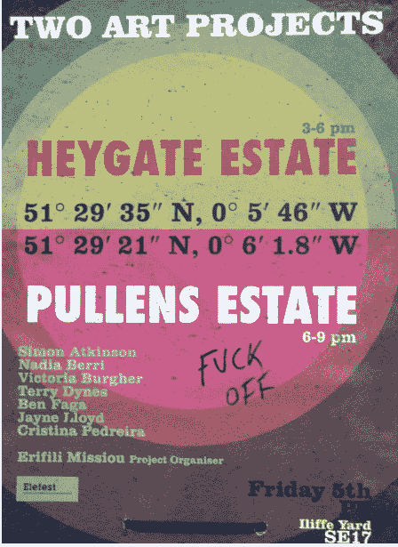

图 3：当地海报上的涂鸦，宣布 Heygate 园将举行另一轮艺术活动。摄影：Southwark Notes。

通过这些关于当地艺术助推者、恶意和共谋的复杂侧写，并以此得出一些初步结论，我们想要思考绅士化大饼中涉及艺术家、社区以及（如果必须如此的话）咖啡店的某些问题。正如我们一次又一次所看到的，艺术和艺术家在提供当地社区参与的开发项目中，是受委托、获得资助并受到赞誉的。尽管我们在上面列举了几个例子，但当地还有几十个例子，对于那些没有参与但面临新一轮“社会大清洗”的人来说，这些项目完全毫无影响。前述 Hotel Elephant 的头儿 Reuben Powell 与 Lend 合作，让当地学校的学生绘制了拆迁图，供开发商的营销使用。艺术家 Deborah Mason 和 Rebecca Manson Jones 在 2016 年于 Alesbury 园区工作，参加了 Caloute Gulbenkian 关于“艺术的社会角色”调查中一个名为“团结 SE17”的惩罚性项目。他们让 Alesbury 的当地人（那是一个比 Heygate 大得多的、正被 Southwark 工党议会拆除的社区）创作他们任何想创作的拼贴，以评估穷人是否能从此类互动中受益，以及究竟是谁从这些资助中获得了物质上的利益。事实是，这种对工人阶级生活的半熟波西米亚尝试，如果直接交给租户让他们产生自己认为的文化，效果会更好。如果系统本身不改变，这种情况永远不会再次发生。伦敦的艺术家尽管对艺术和城市更新有二十年的批判性写作，在这些问题上可能仍然表现得极其无知。这些项目实际上并没有真正付诸行动去与当地社区并肩战斗和团结。更有可能的是，这些项目掩盖并合法化了已经存在的当地文化和想象。

## 投资你的“澳白咖啡”生活

尽管我们不喜欢这些艺术性的伪相遇，但对于 Southwark Notes 来说，将自由职业艺术家自愿被利益集团和新潮酷咖啡店虐待等同于某种真正的敌人是最愚蠢的。Kej Coffee 以及该地区出现的其他店一样，是绅士化的产物，而非原因。那些为开发商工作的艺术家则更为微妙和复杂。尽管我们花了一些时间与这些对绅士化景观的微小当地贡献作斗争，但将我们整个生活的重心放在反对一切上是愚蠢的。在 80 年代针对码头区（Docklands）中产青年（yuppies）以及东伦敦或大象园（The Elephant）愤怒文青的“仅限活动主义”运动，在那种冰冷的愤怒迅速消散后，虽然具有真正的社区组织潜力，但似乎并不持久！行动主义不等于包含行动主义的组织。在我们经历这场微型连续剧的几周里，Kej Coffee 等其他地方也在利用时间参与反对购物中心和 Alesbury 园区拆迁的当地运动，因为反对这些就是在反对规模更大的力量——即国家和地方政府支持的绅士化。

话虽如此，世界上有很多社区正激烈地反对绅士化企业的到来，因为他们认为这是一个信号，表明开发商和投机者为了他们那顽固的逐利计划可以殖民我们城市中更大的区域，而低收入居民则被践踏或被抛弃。

在洛杉矶的波伊尔高地（Boyle Heights），这是一个拉丁裔社区，他们在争取公共住房以及反对该地区遭受社会和族裔清洗方面已经持续了几十年斗争。该社区的部分成员正针对新企业（如咖啡馆或画廊），这些企业是他们地区遭受暴力绅士化的标志。这些斗争是由一个认同自己贫困的拉丁裔的社区发起的——他们基于自我认同进行斗争。作为一个社区，他们非常关注艺术如何被用来平息对投机的反对，并掩盖投机的暴力过程。他们那里也有许多在社区中工作的艺术家，与其说是艺术家，不如说是投身于他们所生活的斗争、并切身感受到这一切的人。

我们必须说，在伦敦，围绕这些问题的辩论和行动并不清晰。当然，这里是伦敦而非洛杉矶，每场反绅士化斗争都是不同的，但如果能在反社会清洗的运动中看到一些关于如何思考和联系城市更新过程中不同部分的讨论，那将是件幸事。一方面，是全球性的开发、房地产、金融和投机性开发。另一方面，是通过充满富裕居民的豪华公寓、昂贵的商店、生活方式定义以及无尽的艺术干预对地区进行的“提升”。但让我们确保一点，在这些问题上，自由职业艺术家或喝咖啡的人并没有多少话语权，和我们其他人一样。我们需要明确，居住在绅士化地区的许多（但不是所有）的人其住房状况都可能不稳定（低工资和高租金），特别是在像大象公园这样的新开发项目中。那么当然，那些进入该地区的富人作为更新/绅士化产品的消费者扮演了什么角色？他们又是那些被社会清洗所取代的人？我们一直质疑那种只解决供应端（我们称之为社会清洗的生产者：开发商、金融、地方政府、国家）的纯粹实践，而不去反对需求端（我们称之为消费端：新房买家和澳白咖啡用者），至少因为我们仍然反对真正的富人，并不会让他们从其味糟糕的消费选择中脱身。

## 走出那片黑暗阴森森林

在某些情况下，对于当地人或团体来说，忽视城市更新中的此类艺术项目，或者对它们表现得有些纠缠，更糟，试图将它们用于自己的宣传和运动。因为很显然，敌人（我们认为应该这样看待）是当地的工党议会、`Lendlease`、`Delaney` 或任何来到该地区破坏它的非营利组织或社会企业。我们可以和其他人继续针对“洗白”进行游击战——只需坚持我们对多线作战的忠诚，同时也理解并非每时都需要进行大规模动员。尽管住房运动很少真正参与到对抗这些无用项目中，甚至没有公开批评那些参与此类冒险的社区成员，但他们支持我们开辟了更多的战线。

但在许多方面，早期的当地 `Elephant` 运动在呼吁对 `Heygate` 遗址进行临时利用时，已经放弃了真正拯救该庄园的想法，而只是在为 `Lendlease` 公司提供良好的未来营销弹药——他们组织了一场社区愿景活动，其中用于临时使用的部分时间被开发商全盘占有，而开发商甚至根本没有对当地人的想法感兴趣。对我们来说，这种纯粹的浪费令人难以忍受：超过 150 多人聚在一起，想象并描述他们热爱自己社区的什么以及他们想要保留什么，但这种巨大的潜力却被临时用途消磨殆尽。在一个经常被忽视的 `Southwark` 困境中，当我们意识到何时是针对这种行事方法提出更激进批评的时机时，比任何时候都要清楚。一个有用且实用的批判产生的不团结时刻会导致糟糕的结果，还是它实际上会让我们对大家在大象（`The Elephant`）的处境有一个更全面的理解？回想起来，我们本应该更有力地推动当地运动，去关注这种对临时用途的支持是否削弱了运动本身的工作。我们没有这样做，五年后我们在想，你认为结果会怎样。这就是那种断裂和升级，后来我们才后悔为什么当时没这样做。有时你必须动一动它，而不要过度担心运动为了避免变成机构化或固步成规而永远需要避开什么。记住这一点，我们鼓励所有反抗社会清逐（`social cleansing`）的社区孤注一掷，带着“为了胜利而战”的理念，寻找全线作战的方法。尽管我们不再对“获胜意味着什么”这个问题给出答案，但我们意识到，斗争的长跑始终就是一种胜利，如果我们不这样做，我们已经失败了。我们，以及遍布许多当地团体和运动的朋友们，短期内不会停止。

你可以在我们活跃的博客上了解更多关于这些斗争以及我们的相关分析：

`Southwark Notes`, https://southwarknotes.wordpress.com

# 扭转艺术洗白的剧本：用租户力量反击绅士化

## 洛杉矶回声学院 (`SCHOOL OF ECHOES LOS ANGELES`)

我们正在与人们讨论周围的画廊以及那些考虑未来进入这里的人。画廊需要理解它们对住房和社区的影响。他们非常清楚自己会提高房产价值和租金。我们会驱逐那些贫穷低收入者。我们看不到他们的那种业务能让我们受益。这些画廊可以[回到]好莱坞或其他不会造成伤害的地方。我不理解他们为什么想给我们的街区带来伤害并让我们置于风险之中。¹¹

- `Boyle Heights`，反艺术洗白与驱逐联盟（`Alliance Against Artwashing and Displacement`）

如果我们想要避免与这种破坏背后的力量结盟，那么理解绅士化过程以及艺术界在其中的关键作用就至关重要。绅士化的定义——最通常源于绅士化阶层——描述的是过程本身的某些时刻。……除非我们隔离出那些一个社区一个、一个城市一个地摧毁传统劳动阶级的经济力量，否则绅士化是无法被定义的.³

- `Rosalyn Deutsche` 和 `Cara Genzel Yuan`

最近的文献试图从其阶级动态之外定义绅士化。城市官员、城市规划师、开发商及其所有的辅助代理人使用了一系列关于绅士化的丰富词汇，赞美其所谓的益处和改进，将绅士化重塑为重新开发或振兴，以掩盖其本质上的阶级暴力。尽管绅士化曾与暴力等同，但该术语已演变为无害⁴

然而，从被剥夺投资和再投资针对的社区来看，如果没有对贫穷和工人阶级进行社会清逐，就不会有剥夺的积累，就不会有房地产资本的收益。因此，我们的集体——回声学院（`School of Echoes`），应该采取一种从绅士化受害者视角而非受益者视角出发的绅士化定义。绅士化是对贫穷人的驱逐和取代。

¹ `Boyle Heights Alliance Against Artwashing and Displacement`, 'The Women of Pico-Alto: 20 Years of Housing Activism', http://alianzacontraartwashing.org/en/coalition-statements/the-women-of-pico-also-20-years-of-housing-activism.

² `Rosalyn Deutsche` and `Cara Genzel Yuan`, 'The Fine Art of Gentrification', October 31 (Winter, 1984), pp. 94.

³ 我们正在阅读 `Tom Slater` 关于绅士化在城市主义话语中含义如何变化的分析。参见 `Tom Slater`, 'The Eviction of Critical Perspectives from Gentrification Research', International Journal of Urban and Regional Research 30.4 (December, 2006), pp. 737–757.

几十年来对绅士化的重新界定，试图在公众想象中将社会清逐重新校准为社会福利。这些努力包括绅士化与以交通为导向的发展、旅游开发、公共公园开发、廉价住房开发、体育导向型开发，以及我们所说的艺术导向型开发，或“艺术洗白”（`artwashing`）的结合。在每一个案例中，反对投机房地产及其绅士化的社区团体都面临指责，反对社区的。反对生物技术走廊建设的社区被指责反对医院。反对在前工人阶级社区区进行大规模住房和零售的社区被指责反对小微企业主。在艺术和文化背景下，反对将艺术界定为奢侈开发前奏的社区被指责仇恨艺术和艺术家。

自从1997年西班牙毕尔鄂古根姆博物馆首秀以来，城市规划师已优先将艺术和艺术机构用于城市和社区的去工业化经济重新开发。在这里，艺术和艺术机构在物质和意识形态上均被用于促进和保护绅士化。

通过庆祝所谓的“毕尔鄂效应”，城市规划师利用私人资本资源结合政府激励措施，将当代艺术工具化，以引导投资资本并改变社区人口结构。他们的范围涵盖了从资本密集型的艺术机构、复杂的多点艺术节、城市规划指定的街区，到最基础的公共艺术委员会和散步活动。同样，遵循“佛罗里达模式（`Following Florida`）”的开发模式将创意阶级定位为社区转型的主角，而这是以穷人和劳动者的代价的。艺术家和创意专业人士的存在被认为是改变社区形象和物质现实的有效手段——从一个被有意撤资的社区转变为一个经过翻新或清理、并对中产阶级租客和买家具有吸引力的社区。

随着创意话语和倡议随时间的增长，其影响变得更加清晰。与其发现，我们看到的是抹除。与其振兴，我们看到的是社区的死亡。与其为艺术家创造支持空间，我们看到的是奢侈消费。在世界各地，我们学到艺术驱动的振兴取决于对长期居民的驱逐以及为了资本文化对当地文化的同化。与此同时，在艺术家、设计师和其他专业人士自己被驱逐和取代之后，创意阶级的品牌继续向投机者推销自己。

艺术导向型绅士化的过程遵循熟悉的阶段，规划师和开发商现在将其视为一个可以复制的公式。有些人认为这是一种自然或不可避免的过程，或者是个人消费选择的结果，而这现在是高度集中、控制和脚本化的。在本文，我们批判性地关注艺术作为绅士化进程中的结构性作用，并探索构建抵御绅士化剧本的方法。

# 激进住房：艺术、斗争与关怀

## 绅士化的三种剧本

自2012年以来，洛杉矶回声学校（`School of Echoes Los Angeles`）对绅士化的代理及其抵抗形式进行了激进的实地研究。与处理绅士化问题的纯学术方法不同，该集体始终在政治行动中测试其分析结果。这些行动包括了在回声公园（`Echo Park`）社区举办的租户权利研讨会。2015年夏天，随着洛杉矶租户联盟（`L.A. Tenants Union`）的成立，干预的规模发生了巨大变化。这是一个旨在抵抗社会清洗和建立租户权力的自主租户运动。⁴

在过去的五年里，洛杉矶租户联盟参与了数十场战斗。工会组织了基于建筑的租户协会和社区租户联盟分会（即地方组织）。由洛杉矶租户联盟东侧地方分会（`Union de Vecinos Eastside Local`）领导的早期斗争之一，是阻止波伊尔高地（`Boyle Heights`）社区内绅士化企业侵占 `Pico` 公住房项目周边区域。该活动的首要目标是一个不断增长的艺术区。

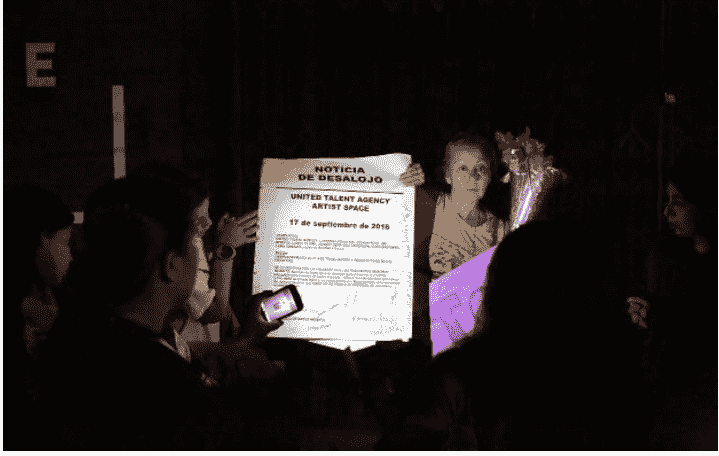

图1：由波伊尔高地居民 `Teresa Alfaro` 及其他社区成员签署并张贴的 `Talent Artist Space` 驱逐通知，2016年9月17日。（摄影：`BHAAAAD`）

⁴ 《加州民法典》将租户定义为“居住单元”。政治性定义并非将租户限制在租金制度，而是引入了资本主义下更大的财产关系。因此，在洛杉矶租户联盟和更广泛的租户权力运动背景下，租户被定义为任何无法控制自己住房的人；包括宿舍学生、被监管人员、护理机构的老人、单间租户等。它还包括无家可者或无住房租户。参见 `Tracy Jeanne Rosenthal`, ‘101 Notes on the LA Tenants Union’,Commune 4 (2019年秋季)。https://communemag.com/101-notes-on-the-la-tenants-union/

由于几位回声学校成员也是东侧地方分会的成员，我们的集体对波伊尔高地的冲突拥有内部视角。关于那场斗争已有相关记载。它持续引发关键问题，对艺术家而言尤为如此。对于回声学校来说，在波伊尔高地反对绅士化企业的斗争极大地推进了我们对绅士化运作机制以及社区如何自我防御的理解。分析的目标必须是抵抗社会清洗，并维护贫困和工人阶级社区在所有复杂性、创造力、传统和能动性方面的赋权。

对绅士化进行分析的核心在于一种论点，即：绅士化并非一个自然或不可避免的过程，而是被刻意生产的。它不是一个需要通过改变个人行为来解决的道德问题，而是一个必须通过集体行动抵抗的政治问题。此外，抵抗必须回应贫困社区的需求，且绝不能损害其自主性，它必须在长期组织过程中进行并与之并行。

通过以租户运动为教室，我们理解到房地产投机依赖于我们所谓的“绅士化的三种剧本”。这些剧本运作于广泛的绅士化过程中，无论重点是交通导向型开发，还是将旅游、娱乐、新科技产业、历史保护等工具化的开发。精英资本所使用的剧本保持着惊人的一致。首先，绅士化代理被描绘为城市变革宏大叙事中的拓荒者或主角。其次，绅士化依赖于“复兴”的表述来反击或消除社会清洗的后果。第三，由于绅士化被呈现为一种公共利益，它需要以规划支持、税收激励、区划变更和公共资金基础设施等形式的公共投资。

直白地说，绅士化的三种剧本涉及主角、宣传和公共政策。像戈尔迪亚之结一样，所有这些剧本相互依赖，以便真实资本能够重新夺回社区并清洗社区，而不会引发暴乱和大规模混乱。没有英雄企业家和城市拓荒者的形象，就没有公共政策。没有了复兴的话语，绅士化的主角就会暴露为自私的投机者。在本文的后续章节中，我们将回顾在抵抗艺术导向型开发（或用更常见的说法——“艺术洗白”，`art-washing`）中的三种剧本。

## 城市拓荒者剧本

> 当我来到这里时，这里没有人。

城市拓荒者剧本将绅士化企业家描绘为空间先锋，引导从历史性撤资向开发的过程。重要的是，它包含了投机者和企业家对历史性撤资影响的主观投入。它是对空仓库的热爱，将其视为一块白板。

艺术家作为城市拓荒者现在是城市、郊区甚至农村背景下一个著名的叙事。在《美国沙漠》中，`Rubén Martínez` 描述了20世纪60年代的土地艺术干预如何呼应殖民扩张的神话，将沙漠描绘成定居者（艺术家）到达的空白。最近，艺术家 `Andrea Zittel` 曾描述约书亚树是一个诱人的地方：“当我来到这里时，这里没有人。”⁶

在沙漠和城市中，“拓荒者”一词常被浪漫化地由艺术家使用，而不承认其殖民历史。艺术家推广一种开辟新领土和发现边界的幻想。`Zittel` 将其称为“最后的边缘”。⁶ 无居住空间的神话回响着殖民遗产，从美国项目启动之初就被缝合在其中。原住民的历史、文化和原住民本身被抹除，该地被呈现为一个“原始状态”（`ras`）。

艺术家的幻想遵循个人追寻的叙事。进入一个去工业化区域或公共住房背后资源匮乏的街道，为艺术家提供的不仅是一个住处，更是一个不受限制的想象空间。在一种社会、文化和规范的真空中，艺术家可以发明新的生活方式。拓荒的表达可以在任何物质发生之前发生。艺术家进入一个巨大的空仓库，带着冲动、诚实的感觉，想象着这处财产——一块画布——可以如何被使用。艺术家并没有理解他们参与了历史或策略性的撤资，而是将空间视为非历史的、无人的或偶然。

在这里，艺术家押注了他们的主观投入和对拓荒者角色的认同。他们将负担能力的物质条件与他们的发现幻想融合在一起。通过殖民、资源枯竭、剥削和红线政策消除历史意识，是这种幻想的前提。对结构性暴力历史的抹除，成为了艺术家体验自由和解放的基础。

在开发周期中，贫困社区的资源匮乏成为资本创造未来投机的必要条件。此类空间在流行词汇中被遗忘。破坏的周期绝非偶然。

⁵ `Rubén Martínez`, *Desert America: Boom and Bust in the New Old West*. New York: Picador, 2019, pp. 79.

⁶ 同样的热情辞藻出现在2017年4月由克莱蒙特研究生学院和苏富比学院举办的一场会议上，主题为“L.A. As Extra Territories”。会议汇集了艺术家、专业人士和房地产开发商，探讨“洛杉矶的艺术与文化正处于移动之中，突破常规，通过机构时尚并突破界限”。会议网站 https://www.cgu.edu/event/la-ba-2017-extra-territories/ 包含了会议组织者对“高地反对艺术洗白和流离所”（`BHAAAD`）发出的抵制号召的回应。由于抵制，除了特邀艺术家外，所有负责邀请艺术家参加会议的计划小组都退出了议程。在会议开幕式期间，一组 `BHAAAD` 活动人士干扰了演说。

故意阻止有色人种通过拥有住房来积累财富。高速公路被刻意穿过税收基数较低的社区。政府资源被分配给富裕社区的绿化项目，而不是贫困社区的基础设施。

在从欠发达到过度开发的转型过程中，艺术家扮演着双重表述的角色。一方面，这种角色是意识形态上的。艺术家将他们对结构性暴力的依赖自然化，以便进入新的领土。另一方面，艺术家的角色是物质层面的。到访的艺术家促成了从破坏性撤资向新的创造性投资的转型。

在关于艺术家和艺术空间到达的故事中，被忽略的是那些使叙事成为可能的政策和干预。几十年来，在整个洛杉矶和美国各个城市，贫困社区承受了红线政策（`redlining`）的代价，这种政策抑制了房屋所有并操纵了租金。人行道和路灯等公共基础设施的历史性滞后、高速公路、铁路和工业对社区的有意布局，揭示了数十年来对低收入有色人种社区的计划性撤资。这些社区纯艺术空间的进入标志着投资者运运的改变，而非居民的。该地区变得极易投机。

《洛杉矶周刊》毫不留情地效仿殖民语言，忽视了当地艺术家和文化生产者的历史，关于洛杉矶东北部 `Frogtown` 社区的故事将 `Damon Robinson` 聚集为“第一个当代探险家”。2007年，`Robinson` 来到位于洛杉矶河和金州高速公路之间的跨族裔婚礼，并“开设了 `Nomad Art Compound`，这是一个包含书店、印刷厂、音乐场所、游泳池和艺术家卧室的巨大建筑”。¹¹⁷ 根据《洛杉矶周刊》，`Nomad Art Compound`“迅速成为 `Frogtown` 复兴的基础”。

在作家所说的复兴的背后，是一系列塑造了该社区的政府干预。1959年，`Frogtown` 连接到了 `Chavez Ramirez` 家中，那里是一个繁荣的拉丁裔社区。市政府驱逐了居民，，承诺建造一个大型公共住宅小区让他们返回。承诺从未履行。相反，土地被交给了私人开发商用于建造 `Dodger Stadium`。¹⁸ 几年后，市政府选择该社区作为 5 号高速公路的所在地，将 `Frogtown` 与社区其他部分隔离开。从这个角度看，`Robinson` 并不是先驱，而是政府政策的受益者，这些政策系统性地使 `Frogtown` 居民不利并与其周围社区隔绝。

+ 7 `Isaac Simpson`, ‘L.A.’s Hottest New Neighborhood, Frogtown, Doesn’t Want the Title’, LA Weekly (2014年8月20日): http://www.laweekly.com/news/la-hottest-new-neighborhood-frogtown-doesnt-want-the-title-5016257.

+ 8 《洛杉矶周刊》忽略了对公共住房承诺的提及，仿佛只有体育场迫使了社区搬迁。

# 激进住房：艺术、斗争、关怀

此外，将 `Robinson` 作为社区复兴的主角，继续抹除长期居民的作品（和艺术品）。

`Frogtown` 的绅士化并非由一位艺术家发起的自发过程，而是计划和生产的结果。在 `Nomad Art Compound` 开业后不久，市政府对该地区大部分进行了重新分区，借用了“创意阶级”的规划策略。通过将社区从制造业重新分类为商业制造业，市政府使混合用途和零售开发成为可能。同时，市政府在该地区通过了法律，赋予警察随机搜查的权力、判断活动可疑的裁量权，以及反对异议和逮捕社区青年的路径。

`Frogtown` 绅士化的故事通常是从先驱艺术家的角度讲述的。先驱艺术家的作用是将那些使社区不利的剥夺、流离失所和忽视政策自然化。作为社区的主角，艺术家的视角形成了关于该社区的主导观点：其历史被抹除，取而之的是发现的幻想。最后，艺术家将社区的物质转型自然化，隐藏了转型背后的政治。

## 复兴的剧本

发展催生了活力和复兴。复兴的剧本将绅士化描述为对历史上未受服务的社区有益。在艺术领域，对复兴的描述将艺术建构为带入历史弱势社区的进口品——主要是贫困和工人阶级的色人种社区。这种对艺术的构建忽视并剥夺化了本土的艺术生产。嵌入文化生产者，包括社区艺术家、街头艺术家、概念艺术家、手工艺人、招牌画家、音乐家，被忽视了。相反，艺术以白立方空间和专业人士创作当代艺术表演的形式进入一个衍生社区。

复兴的剧本依赖于对艺术慷慨益处的感知。如果艺术是一种内在的社会神，那么艺术家的到来以及他们要求的服务就被接受为无害且无争议的。因此，关于复兴的叙述影响了工人阶级社区的日常需求，掩盖了绅士化的物质影响，并阻止了异议。当复兴计划确实承认艺术和文化语言时，它仍然是从外部经济发展的视角来看的。提升或推崇当地文化实践是通过投机资本证明社区开发可行性的有用一步。当地对资本的反抗只有在目标消失后才具有过去的价值。

为了揭露以艺术为导向的发展及其对社会利益伪装之间的矛盾，活动人士经常使用“艺术洗白”（`artwashing`）一词。艺术洗白是

## 需求理论

与“粉色洗白”（`pinkwashing`）类似的批判性术语。⁵ 粉色洗白是指在支持进步利益的表象下，通过公关手段沉默批评。活动人士曾指责以色列政府等，将 LGBT 斗争简化为一种公关手段。在这里，粉色洗白是一种刻意的策略，在现代性的形象下隐藏人权。同样，批评者们提到粉色洗白与……

# 激进住房：艺术、斗争与关怀

在担任市长期间，埃里克·加塞蒂（`Eric Garcetti`）一直主导将洛杉矶河的重新开发成为该市一些贫困社区绅士化的催化剂。在启动这项计划的新闻发布会上，他对“当前的洛杉矶”如何增强河流走廊表示了热情。每两年一次的艺术盛会举行时，根据《国家》（`The Nation`）的理查德·克莱纳（`Richard Kreiner`）称，过去三年（2013-16年）超过一半的河岸物业发生了变化，售价价格翻了一倍多，租金急剧增加.¹⁴ 艺术双年展的影响冲击着青蛙镇（`Frogtown`）不断的人口结构，这是一个被高速公路和盆地包围的历史性混合工人阶级社区。2016年夏天，加塞蒂还宣布聘请著名艺术家法兰克·盖里（`Frank Gehry`）领导河流复兴工作。这位盖里正是设计了毕尔巴古根森博物馆的建筑师.¹¹⁵

## 公共投资的剧本

艺术区是洛杉矶最受青睐的地址之一，距离时尚餐厅和美食酒吧仅几个街之遥.¹⁶

市政府批准的艺术区被宣传为创造艺术家的社区，而非奢侈消费和投机的机会。然而，此类计划中，地方、州和联邦政府在提供财政、基础设施和政策条件方面的作用使得绅士化和艺术导向的发展成为可能。

市和州政府的作用是我们对艺术导向发展分析的核心，¹⁷ 它涉及有针对地部署税收激励、分区许可变更、对交通接入和基础设施的公共投资，以及向警察巡逻和监控的资源分配。用于指定市政府批准艺术区的大规模公共投资，其目标与支持现有的草根艺术家社区不同。相反，对基于艺术的发展的公共投资是推动规格化和经济增长的手段。城市利用艺术区吸引外部投资、吸引游客，并从市、州和联邦资金池获取资金。作为城市规划的工具，这些区域有助于将艺术导向的发展置于工人阶级社区或去工业化走廊之中。

> 14 Richard Kreiner, ‘Will the Los Angeles River become a Playground for the Rich?’ (The Nation (28 March-4 April 2016): http://www.thenation.com/article/the-los-angeles-river-become-a-playground-for-the-rich/
>
> 15 As noted by Christopher Hawthorne in an Los Angeles Times Op-Ed, ‘The quiet rollout suggests that River LA is less a clear picture of what Gehry’s plan will include more than in tapping down [...]’ worries that may appear as a Trojan horse, a kind of high-design architectural cover, for rampant real-estate speculation in communities along the river.’ Christopher Hawthorne, ‘Frank Gehry’s controversial L.A. River plan gets goutous, low-key rollout,’ Los Angeles Times (18 June 2016): http://www.latimes.com/entertainment/arts/la-et-cm-la-gehry-20160613-snap-story.html.
>
> 16 Suncal, ‘6AM Overview,’ http://www.suncal.com/our-communities/6am/
>
> 17 For analysis of how real estate capital has come to disrupt urban planning, see Samuel Stein, Capital City: Gentrification and the Real Estate State. New York: Vers, 2019.

艺术导向的发展包括营利性开发和非营利性开发。

这些可能包括新的高知名度博物馆、面向艺术专业人士的大型住房、精品酒店以及带有“创意”和“设计”等字样的购物中心。在许多情况下，艺术导向的发展项目需要先前的或现有的文化历史，以增强其对艺术的主张。多元文化社区发展建立在社区的画廊、文化族裔机构或实践的先前经验之上。在其他情况下，规划者和开发商仅仅作为其开发方案的一部分发明了文化基础设施。

与以交通为导的发展（`TOD`）一样，基于艺术的发展通过社区改善得到推动，因为它为投机和驱逐铺平了道路。以交通为导的发展政策允许在靠近公共交通枢纽进行新的混合用途开发，这依赖于政府政策干预：改变现有分区、授予规划法规的豁免并解锁税收减免。市官员推动交通导向的发展，意图是增加密度和扩大交通。加洛杉矶大学（`UCLA`）和伯克利大学的研究表明，交通导向的发展的影响讲述了另一个故事。交通导向的发展充当了历史上投资不足社区投机性开发的催化剂，导致了驱逐和整体衰落.¹

我们使用“艺术导向的发展”一术是为了呼应我们对交通导向的发展的分析。艺术导向的发展取决于类似的公私合营。交通导向的发展和艺术导向的发展都依赖社区利益的修辞，同时作为高端投机的催化剂。与其说是交通或更绿色的城市，艺术导向的发展所促进的社区利益是一个艺术社区的中心。为了激励投资，城市对分区条例授予许可，否则这些条例会对密度、面积和停车造成限制。大多数交通住房由市场价格和豪华住房组成，以实现利润最大化。在缺乏租户保护的情况下，这些力量产生了负面反应，导致房地产的立即驱逐和对居民租约的威胁。交通开发通过居民离开洛杉矶剧烈地重塑了居民的面貌。

> 19 The Clinton administration's Housing Opportunities for Everyone (or HOPE VI) shifted resources for the maintenance of public housing into competitive grants. Grants附带紧缩措施，规定公共住房有权拆除并重建住房项目，以降低密度并容纳混合收入和私人住房。
>
> 20 回遣运动源于对墨西哥人和墨裔美国人在大萧条期间抢夺稀缺工作和政府援助的恐惧。在这一过程中被遣逐的200万人中，60%是美国公民。见 Francisco Balderrama, Decade of Migration the 1930s, University of New Mexico, 2006.

# 激进住房：艺术、斗争与关怀

艺术区并非为了文化，而是为了经济：艺术区推高了房产价值、助长了投机并为炒房者带来了利润。高速公路的噪音充斥着皮科花园（`Pico Gardens`）项目。在基部，皮科花园和拉西塔（`Lasitas`）是密西西比以西最大的公共住房遗迹。1996年在克林顿政府时期，拆除了1285套公共住房.¹²

在过去的二十年里，洛杉矶高地（`Boyle Heights`）有250栋房屋被毁以建设金线，并在2009年因Hollenbeck警察局扩建。南部，洛杉矶地铁拥有的33英亩空地将用于洛杉矶的首个酒店和平价住房开发。正如大多数开发项目一样，尽管带有标签，这些住房对大多数居民来说负担不起。最后，西部在过去四年内有11家画廊在市政府批准的艺术区的名义下开放，2012年。

洛杉矶高在历史上的每个十年都经历过政策资助的驱逐浪潮。20世纪30年代，美国政府发起了遣返运动，将墨西哥裔美国居民驱逐回墨西哥。根据Francisco Balderrama的《1930s：墨西哥遣返的背叛》，在1929年至1944年间，洛杉矶三分之一的墨西哥人口被驱逐。

在1940年至1960年间，高达12%的土地变成了高速公路。这些由联邦资助的城市倡议导致拆除了2000栋房屋并驱逐了1万人口。正是在几十年私有化和驱逐的背景下，当地活动人士和组织者理解了洛杉矶高艺术区的定义。

在艺术区定义之初，历史悠久的非营利组织Self-Help Graphics与社区利益相关者举行了一系列会议，辩论其优缺点。到2013年，37家画廊和艺术家开始搬入。这些画廊得到了一系列创业利益的支持，包括纽约的蓝筹画廊和少数艺术家经营的非营利机构。有些与房地产有直接联系：营利的

> 21 Abe Fore, “Promise, Pitfalls and the Boyle Heights Arts District”, KCET Artbound (September 2012): http://www.kcet.org/shows/artbound/promise-pitfalls-and-the-boy-heights-arts-district.

356 Mission（由纽约的加文·布朗资助）于2013年在一位开发者的鼓励下开业；2016年，非营利画廊 PSSST 获得了建筑所有者（一位匿名投资者提供的二十年免费租期。在所有情况下，这些新画廊都标志着与源自并旨在服务长期、低收入及有色人种（`POC`）社区利益的当地艺术组织发生了深刻转变。

市政府对波伊尔高地（`Boyle Heights`）地区的规划不仅限于确保该社区的艺术家和艺术空间。在这里，艺术的品牌化将有助于将波伊尔高地与市中心的奢侈品零售和公寓连接起来。新的第六街桥将跨越洛杉矶河，将小东京（`Little Tokyo`）的艺术区与波伊尔高地的艺术区连接起来。由迈克尔·马尔赞（`Michael Maltzan`）设计的耗资4.8亿美元的项目将包含公园、步行道和私人画廊。

除了以艺术为导向的项目外，还有一系列计划将转型整个洛杉矶盆地。在市中心区的河流西侧，一项名为 6AM 的耗资20亿美元的开发项目将产生58层的高大楼、1,305间市场价公寓、431间豪华公寓，以及一个拥有23,000平方英“机会空间”的露天商场.² 在河流本身的泥土岸上，位于670 Mesquit Street 的一项开发项目被描述为艺术家拥有80万平方英的办公空间、250间住宅和两家精品酒店。2011年的 Bay Street 开发项目将产生50,000平方英的商业空间、一栋10万平方英的办公楼，以及一座包含110间艺术家住一体住宅单元的大楼.²³ Bay Street 旨在“激活”洛杉矶市中心艺术区的废弃地区.²⁴

如果不优先考虑长期居民的家园和社区，波伊尔高地艺术区的故事将重演其在其他地方实施的历史。随着波伊尔高地物业价值的上升，随着设施不断跟上富裕居民的需求而非长期社区的需求，艺术家和艺术空间将成为波伊尔高地长期居民及自身大规模流离的建筑师。租金将变得太高；餐厅不再符合他们的预算；日益增长的奢华将疏远所有人。在波伊尔高地，正如在其他地方一样，对于玛莎·罗塞尔（`Martha Rosler`）来说，艺术区的作用不是为了支持艺术社区，而是为了给奢侈开发项目所需的“宁静与可预测性”铺平道路.²⁵

22 Andrew Kou and Ben Post, "Towering development is proposed for L.A.'s Arts District: an 'opportunity for density,'" LATimes (2016年9月24日): http://www.latimes.com/business/la-fi-arts-district-towers-20160924-snap-story.html.

23 A 2017项目在《Architects Newspaper》中的一个项目，Alan Pullman是2011年 Bay Street 项目的主建筑师，该项目与现有的艺术区联系紧密；Antonio Paccho, "Bombastic, brand-name architecture is transforming the Arts District," Architects Newspaper (2017年3月9日): http://archpaper.com/2017/03/la-arts-district-brand-name-architecture/gallery-0-slide-11.

24 引用自2011年 Bay Street 开发推广网站，https://story-110.com/portfolio/detail/2011-bay-street/

25 Martha Rosler, "Culture Class: Art, Creativity, Urbanism, Part II," E-flux 23 (2011年3月)。http://www.e-flux.com/journal/23/67813/culture-class-art-creativity-urbanism-part-ii/

# 激进住房：艺术、斗争、关怀

## 反士绅化策略与抵制

对士绅化的讨论并不总是能转化为具有政治意义的行动。我们对这些脚本和后果的分析试图改变这种现状。我们在前面的几节中列出的脚本——士绅化者作为先驱、士绅化作为复兴以及政府援助的士绅化政策——有助于为我们思考如何干预这些过程奠定基础。

首先，作为组织者和大众教育者，我们清楚，扭转士绅化局势的唯一方法是建立大众群众运动，例如租户工。在洛杉矶租户工（`L.A. Tenants Union`）组织了五年后，我们学会了关注受房地产投机影响最直接社区的需求、愿望和价值观的重要性：低收入社区和有色人社区。正如我们的分析所探讨的，投机房地产利益经常激励艺术家、画廊和艺术机构作为城市更新的引擎。要反转以艺术为导向的发展的脚本，需要在士绅化的每一个层面进行干预。这意味着需要进行激进的反士绅化运动，针对反向主角、反向再现和反向权力形式制定策略。

将以艺术为导向的发展作为广泛的资本主义士绅化计划的一个实例进行斗争，需要能够制造士绅化脚本并将其反过来运的运动。我们不是在翻转漫画，而是翻转脚本：将作为艺术家的脚本转变为贫困者的原型主义；将对复兴的脚本转变为自决自主；将对计划性士绅化的脚本转变为建立权力。在本文的最后部分，我们将剖析洛杉矶租户力量运动所开发的这些战术，以抵制以艺术为导向的发展、士绅化和发展主义。

## 反抗画廊

将以艺术为导向的发展作为广泛的资本主义士绅化计划的一个实例进行斗争，需要能够制造士绅化脚本并将其反过来运用的运动。我们不是在翻转漫画，而是翻转脚本：将作为艺术家的脚本转变为贫困者的原型主义；将对复兴的脚本转变为自决自主；将对计划性士绅化的脚本转变为建立权力。在本文的最后部分，我们将剖析洛杉矶租户力量运动所开发的这些战术，以抵制以艺术为导向的发展、士绅化和发展主义。

# 激进住房：艺术、斗争、关怀

画廊与城市的距离为媒体报道提供了充足的机会。这种媒体性让一个新兴的反士绅化运动能够创造强大的媒体叙事。我们不是在翻转漫画，而是翻转脚本：将作为艺术家的脚本转变为贫困者的原型主义；将对复兴的脚本转变为自决自主；将对计划性士绅化的脚本转变为建立权力。在本文的最后部分，我们将剖析洛杉矶租户力量运动所开发的这些战术，以抵制以艺术为导向的发展、士绅化和发展主义。

在波伊尔高地的案例中，我们可以将其总结为四个核心教训：

- 第一，暴露裂缝。
- 第二，通过媒体发声。
- 第三，抵制迫使艺术家采取立场。
- 第四，挑战非营利组织的合法性。

反对波伊尔高地反绅士化租户的批评者指责该运动针对非营利艺术机构而非营利画廊。关于这种策略已有许多论述。我们对此有两点观点。首先，理解非营利组织与社区之间的结构性关系，以及营利机构与其非营利对应机构之间的关系非常重要。在居住公共住房的社区成员几乎没有力量反抗大型房地产利益和数十亿美元规划流程的情况下，非营利组织占据了艺术导向型发展努力中最薄弱的一环。非营利组织的生存依赖于社区的认同。如果大量社区成员撤回支持并拒绝该组织的合法性，那么该组织将难以获得资金。营利画廊对社区没有这种依赖。然而，它们确实依赖于非营利组织的存在，以便促进社区的接受。一旦社区破坏了非营利组织的合法性，营利机构将面临任何形式的社区抵抗。非营利组织依赖资本流动，特别是房地产资本，这并不是秘密。在波伊尔高地，参见 Ultra-red, *Desarmando Desarr: Listening to Anti-Gentrification in Boyle Heights*, Field 14 (Fall, 2019): http://field-journal.com/issue-14/desamando-desarrrollo. 受尊敬和喜爱的社区化艺术家组织 Self Help Graphics 通过其董事会成员的倡导，帮助促进了艺术区的规划。董事会成员包括对该社区的绅士化有直接物质利益的特定个人：一位波伊尔高地知名的房地产投资者和一位代表房地产投资者的律师。再次，由于波伊尔高地公共住房的贫困居民政治权力有限，他们可以通过破坏“艺术是道德和社会良”的理想主义观念，来威胁非营利组织的声誉，而这种观念独立于那些金钱利益之外，后者正准备通过“艺术洗白”他们在社区的房地产投资目标来从中获利。

## 反抗流离

如果作为城市开拓者的艺术家是建立在以迁入艺术家以及历史上弱势社区内艺术家的经验为中心，那么反击就需要我们以长期将该社区视为家园的社区成员的经验为中心。绅士化的主角是谁？真正的开发者、包括规划者和代表在内的政府官员、主流媒体，艺术家本身都强调了迁入居民的主角地位。反绅士化抵抗的主角是谁？我们断言，是受绅士化流离暴力和骚扰影响最脆弱的群体，即穷人、无家归者，主要是被边缘化的有色人种。

同时，组织者必须关注边缘化社区内部细微的阶级对立。资本为了外部投资对本土经营者的招募，既是绅士化过程，也是殖民主义历史。当地行动者利用活动人士和团结运动反对外部干预的修辞，转而接受由外部财务和政治利益赋予他们的权威。口号“get not gentify”（不要绅士化）借用了西班牙语单词 *gente*（意为“人”），变成了一种利用基于身份的表征使社区内部关系自然手段——这种阶级紧张是资本乐于利用（甚至发明）的。对于租户权力运动，抵抗的主角地位必须始终是穷人的主体位置，他们可能因为社会清洗而失去一切，无论绅士化是符合利益集团，还是符合社区内部的房东或企业家。

我们对绅士化的分析绝不能忽视其影响：为了利润对穷人进行流离和替换。艺术导向型发展的核心影响是流离。一个成为某人群目的地的社区，变成了穷人的流离失所地。在缺乏优先考虑稳定社区而非房东盈利能力的当地保护措施的情况下，租户通过租金上涨、驱逐漏洞、骚扰、翻新驱逐（renovictions）、Mickey Mouse pairs（恶意拆租）或 cashforc 计划被驱逐。小巷、停车场中的无住所租户通过去人性化的清查行动被驱逐。

作为租户权力运动的一部分，洛杉矶 [文本截切] ... 通过去人性化的清查行动被驱逐。

情况发生了转折。曾经以破坏公物、帮派暴力、入室盗和其他形式的伤害而闻名的街道，现在被认为对商业和行人非常友好。然而，艺术赞助者所感受到的安全氛围，长期工人阶级居民也同样享有。通常，社区安全拥有一漫长的斗争和自我组织历史，这些历史往往早于艺术家和艺术空间的到来。

贫困社区（尤其是有色种人的贫困社区）对公共安全的斗争，必须在警察骚扰、警察暴力以及所谓的“生活质量执法”的历史范围内进行理解。从历史上看，贫困社区已经了解到，依靠警察解决纠纷或维护公共安全会导致暴力升级和进一步的受害。围绕“破窗理论”、“拦截并搜查”、“三振出局”和帮派结汇的种族歧视性执法，都是为了通过撤资和再投资的循环，来监控和控制有色种人的贫困社区。国家暴力的经历往往迫使贫困社区组织自己的网络来自主管理公共安全，而不依赖警察。自主组织可以减少暴力、控制枪支、改造小巷并在夜晚占据公共空间。将信誉良好的企业和高收入居民归为社区安全的责任者，抹杀了多年社区组织——正是这些组织创造了抵御犯罪和污名化的公共安全。

但一个曾经破败的社区永远不会足够安全，直到租客被挤到街头、购物物品落在人行道上，或者地下经济的残余存在。因此，在以艺术为导向的发展利用工人阶级社区的劳动力来创造街道安全水平的同时，绅士化企业继续要求增加警察的存在。中产阶级的赞助者和企业要求增加监控和巡逻，即使当他们遇到长期社区成员（无论有房还是无）时。正如边缘化社区长期所知，警察的增加被长期居民感知为骚扰、监禁、驱逐甚至是杀害。

反抗以艺术为导向的发展需要力量运动社区防御警察和移民局（ICE）探的侵害，并通过社区组织和相互依赖来产生社区安全。

## 为归属感而战

通过研究匹兹堡等城市历史悠久的黑人社区城市更新的影响，社会心理学家明迪·富利莫尔（Mindy Fullimore）描述了社区经历的“根部冲击”（root shock）。家庭失去了住房、工作、学校、宗教社区和健康服务的获取途径。相互依赖的网络被粉碎。个人和家庭发现自己与维持身份认同和健康的历史疏离了。对于富利莫尔来说，根部冲击成为集体创伤的基本条件。绅士化像它之前的城市更新一样，通过破碎社区以及破坏社区随时间发展出的社会实践（这些实践是为了在面对贫困、制度性种族主义和暴力时组织社会、经济、文化和心理支持）来引发根部冲击。

洛杉矶租客联盟作为一种租客力量运动，一个核心作用是创建和维护社区，而社区恰恰是绅士化暴力的目标。在每一个遭受驱逐、流离失所、高租金、租约不稳定、房东骚扰、贫民窟环境或无法找到负担得起的住房的人之间建立团结，不仅是租客通往更公正世界的手段，其本身也是目的。共同进餐、共同活动、定期会议对我们的组织工作至关重要，因为它们干预了绅士化带来的令人震惊的疏离感，通过相互防御和支持统一社区。

## 为建立团结而战

为了将此案例视为全市性的反绅士化运动，运动需要不同阶级背景、身份和特权程度的行动者的参与和投入。洛杉矶租客联盟通过将住房斗争（包括艺术家的斗争）框架化为租客的斗争而非特定职业群体的斗争，培养了团结文化。通过坚持斗争的主体是租客，洛杉矶租客联盟追求扩张的自我治理愿景，即租客根据城市的不同愿景采取行动。

为了反抗艺术为导向的发展，我们的运动必须邀请艺术家和艺术专业人士基于他们作为租客和工人与工人阶级居民的共同身份建立结盟。随着绅士化进程的加速，艺术家有物质需求来承认自己面临的流离风险。同时，艺术家有政治需求遵循贫困和工人阶级租客的领导，这些人具有最强的不安全感和对战斗性抵抗最深层的联系，同时推进那些被社会构建为社会再生产责任人的女性的领导。如果艺术家比他们作为艺术家的身份更认真对待他们作为不稳定租客的身份，会发生什么？如果艺术家的政策是出于团结并伴随对穷人的斗争而产生的又怎样？

对于那些受当代生活中最暴力因素影响的人来说，团结意味着。生活在社会边缘的人处于独特的地位，能够理解租客目前面临的威胁以及如何解决这些问题。继续为了利润而取代和驱逐穷人的解决方案并不是绅士化的答案。如果一种抵抗策略因对抗性或不可行而被拒绝，那么在保护谁的利益？当我们这些在遭受“社会清洗”威胁的社区之外享受某种舒适的人，并公开将社区的策略描述为“恐怖主义”或“极端”时，我们是在代表谁而工作？自 2013 年国土安全部发布威胁警报，将反绅士化活动人士标记为对当地和联邦执法部门构成威胁的“无政府主义极端分子”以来，这些问题变得紧迫。

## 为接管而战

绅士化暴力中国家的复杂性要求我们建立有效的外部策略。这种策略推进了非合作、直接行动和自主组织。几十年来，洛杉矶的非营利机构和自由团体一直采取闭门与住房官员和政策制定者谈判的内部策略。社区利益协议是在社区组织执行董事与开发商之间私下谈判的。为了确保官员和开发商的好感或同情，为了保护私人会议和经批准的参与过程，既有的政府组织克制了冲突，保护官员和房地产利益免受根基的侵害。随着时间的推移，这种官方社区代表、官员和资本之间的契约导致了持续的失败谈判。非营利组织获取工人阶级和贫困社区的恐惧和愤怒，并将其引导至社区利益协议、高密度住房和负担得起的住房。这些政策要么直接贡献或为整个社区的社会清洗提供了掩护。

服务于私人资本积累的治理体系并非为了维护穷人的人的最大利益。这些体系的设计目的是平息抗议并使战斗性边缘化。对于有色种的穷人、无证人员、LGBTQ 群体以及其他被结构性压迫系统针对的人群来说，国家在社会中实现正义这种不成比例的方式是显而易见的。特别是在以艺术为导向发展的背景下，必须理解公共官员、城市规划师和公共政策在促进社区人口结构变化以服务私人资本积累方面起着至关重要的作用。推动经济增长和提高物业价值一直是城市官员的核心使命，而非为了穷之人的福祉。在没有真正的否决权的情况下，所谓经过批准的参与流程（如社区和社区规划听证会）实际上毫无意义，这意味着社区成员在咨询过程中耗费精力，而咨询本身的存在就已满足了民主要求的最低限度，无论这种参与的质量或结果如何。开发商只需要一张签到表就可以证明社区已经举行了法律规定的听证会。

从民权斗争、农场工人为了尊严的长期长征，到在艾滋病流行期间针对政府无作为的酷儿群体及其盟友动员，再到“黑人的命也是命”，公民不合作的许多成功提醒我们，掌握权威的人并非唯一有能力影响我们生活进程的人。运动通过在策略中嵌入一种手段——即民主地拒绝合作或明显地撤回同意——来形成其独特的特征。

通过抗议、公民不合作、罢市、纠察线、占领、驱逐封锁和租金罢工，租客们对资源更丰富的房地产集团取得了重大胜利。即使不诉诸国家干预，穷人运动也能通过集体破坏力创造出导致法律收益的条件。正如公民反抗学者埃里卡·切诺维所言，大众运动的成功“并非通过限制对方的选择来融化对方的心灵”。

## 为重新构想世界而战

在反绅士化运动的战斗策略中，蕴含着说“不”的力量。而“不”意味着不，即社区声拥有撤回同意或拒绝与不公正的法律、政策或经济力量合作的权利。同时，通过租客力量建立的绅士化运动肯定了一个集体主体。租客和租客社区有潜力在商品化住房的墓穴之外，勾勒城市未来的愿景。

建立一个包含跨阶级和跨种族团结的租客运动的过程本身就是一个组织社区的案例，这种社区可以集体决定自己的需求并制定策略来实现这些需求，这不仅仅是一场运动。它是相互依赖系统、团结网络以及重塑世界长期过程的形成。为更公正、公平的社会而斗争可以具有丰富和变革性的性质，它能够预示未来的世界。组织不仅是一种社区防御的形式；它是一个在既定条件下集体组织一个可能的不同世界的过程。

对于致力于集体创造一个公正世界的反绅士化战士者来说，仅仅触及绅士化的复杂性是不够的。停止绅士化与社区防御密不可分。它涉及到挑战新自由主义关于阶级暴力不可避免性的论调。它涉及到确保优先人类发展而非通过驱逐来实现资本积累的变革。在租客组织实践中的反绅士化是从目前存在的物质矛盾中创造出一个更公正的世界。保护并组织社区免受社会清洗及其受益者的侵害，已成为一种紧迫的创造性劳动。

# 参考文献

- 210 Bay Street 开发促销活动，https://111.com/portfolio/detail/2110-bay/
- Baderma, Francisco. *Decade of Betrayal: Mexican Repatriation in the 1930s*, Albuquerque: University of New Mexico Press, 2006.
- Bloomberg Philanthropies 网站，https://www.bloomberg.com/blog/public-art-challenge-the-winners-/
- Boyle Heights Alliance Against Artwashing and Displacement. 'The Women of Pico Aliso 20 Years of Housing Activism', http://alianzcoartwashing.org/en/coalition-strategies/the-women-of-pico-aliso-20-years-of-housing-activism/
- Chenoweth, Erica. 'It may take 3.5% of the population to topple a dictator with civil resistance', TheGuardian.com (1 February 2017): http://www.theguardian.com/commentisfree/2017/feb/01/worried-american-democracy-study-activist-techniques.
- Chiland, Elijah. 'Is Metro ridership down because low-income passengers are leaving LA?' Curbed.com (22 May 2019): http://la.curbed.com/2019/5/22-metro-ridership-down-housing-gentrification-transition.
- Clermont Graduate University and Sotheby's Institute of Art, 'L. A. as Lab: Extra Territories', conference website, https://www.cgu.edu/event/la-lab-2017-extra-territories/
- Department of Homeland Security Memo (2023 July), http://publicintelligence.net/dhs-anarchist-gentrification-prison/
- Deutsche, Rosalyn and Rya Gandel. 'The Fine Art of Gentrification', October 31 (Winter 1984):91.

- Flore, Abe. 'Promise, Pitfalls and the Boyle Heights District', KCET (16 September 2012): http://www.kcet.org/shows/artbound/promise-pitfalls-and-the-boyle-heights-district.

- Fullmore, Mindy. *Root Shock: How Turning Up Neighborhoods Hurts America, And What*. New York: Ballantine, 2004.

- Gonzalez, Saul. 'In this neighborhood, is', NPR (27): http://www.npr.org/in-neighborhood-protest-is.

- Simpson, Isaac. 《洛杉矶最火的新社区弗格特镇不想要这一称号》，《洛杉矶周刊》(2014年8月20日): http://www.laweekly.com/news/las-hottest-new-neighborhood-frogtown-doesnt-want-the-title-5016257.

- Slater, Tom. 《绅士化研究中批判视角的驱逐》，《国际城市与区域研究杂志》 30:4 (2006年12月): 737-757.

- Stein, Samuel. 《资本城市：绅士化与房地产国家》。纽约：Verso出版社，2019年。

- SunCal. “6AM概览”，http://suncal.com/our-communities/6am/

- Ultra-red. 《Desamando Desarrorolismo: 听博伊尔高地反对绅士化的声音》，《Field》第14期 (2019年秋): http://field-journal.com/issue-14/desamando-desarrolismo.

- Wealth and Poverty Desk. 《位于变革交汇处的York & Fig》，《市场纪报》(2014年12月1日): http://features.marketplace.org/yorkandfig/

- Yee, Lawrence. 《漫画书电影中的亚洲演员回应“奇异博士”的白人化争议》，《Variety.com》(2016年11月4日): http://variety.com/2016/film/news/asian-actors-whitewashing-doctor-strange-comic-book-films-1201910076/

# 霸权与社会参与艺术：以排屋项目为例——美国德克萨斯州休斯顿

艾莉莎·埃斯帕梅尔 (ALYSSA ERSPAMER)

## 批判艺术的辩护？

托尼·莫里森（Toni Morrison）并非唯一主张“所有好的艺术都是政治性的”的人。¹ 但这种表述意味着什么？它是如何政治性的？指的是哪种“政治”？我相信葛兰西的霸权概念为我们提供了一个回答这些问题的宝贵视角。社会参与艺术，特别是著名的“排屋项目”（Project Row Houses），将成为我应用这些概念的实验品，或案例研究。

社会参与艺术是目前在艺术机构中很流行的流派（例如，参见位于纽约的组织“A Blade of Grass”和沃霍尔基金会的2018年资助获得者），其定义仍在不断引发争议。随着关系美学的发展，它在20世纪末果决地超越了艺术对象及其组织标准。³ 苏珊·莱希（Suzanne Lacy）在其开创性著作中，社会参与艺术（她的新类型公共艺术）与关系美学的区别在于它对政治性的显性性价值化，而政治被视为其使命和身份的核心.³ 它与制度框架的相似性导致其项目呈现出“NGO风格”。⁴ 社会参与艺术横跨了政治与艺术，是霸权产生的肥沃土壤。

这一概念源于马克思主义哲学家安东尼奥·葛兰西（Antonio Gramsci）的文化霸权论。葛兰西对俄罗斯共产主义革命的反思与其在西方失败的对比，使他承认了上层建筑在政治领域所起的关键作用，而他所归因的马克思主义结构主义理论往往低估了这一点。通过他的霸权理论，葛兰西在演进的马克思主义中为意料之外的结果留出了空间，例如西方缺乏共产主义革命。向西方的革命不仅面临来自国家机器的敌对，还面临其周围公民社会的对抗，而后者在东方要强大得多。公民社会，即国家之外的社会和政治生活空间，是有组织的。⁵ 因此，霸权可以被理解为国家及其公民（有意识或无意识地）赋予并再生产的主导社会、政治、意识形态和经济体系。它是我们在任何给定时间和地点的所认为的“正常”的事物。霸权信念还为社会的底层结构提供了合理性。它们的失败并非简单地对威权国家进行武装起义，而是需要葛兰西所说的“战争位置”（源自一战的战壕战），这是一种艰苦的斗争，从符号和物质两个层面挑战社会每个节点的霸权表述，揭示我们现实的意识形态和决定性本质，以揭示其他生活方式的存在⁶

霸权通过国家以及个人进行传播：通过他们的行动以及对其主导地位的不疑的信念。葛兰西是对资本主义做出反应；自他的时代以来，资本主义已经演变并适应了一个全球金融化、工业和工会力量削弱以及普遍说教的世界。新自由主义作为我们称的资本主义最近的变异，拥有不同的、有时更无泛的权力和控制技术，但对于霸权表述来说仍然是脆弱的，正如尚塔尔·穆菲（Chantal Mouffe）和南希·弗雷泽（Nancy Fraser）令人信服地证明的那样⁷

政治哲学家尚塔尔·穆菲在将霸权引入当代话语方面做出了巨大贡献。她将其视为霸权表述争夺控制权的战场——每当其中一种表述占据主导地位时，它就伪装成自然状态，而非决定的状态⁸。她写道，艺术有潜力在新自由主义（我们当下的霸权表述）的平滑表面上“创造裂缝”，并展示了“事情本可以以其他方式发展”，即便霸权似乎否认了自身之外的任何选择。她将实际上挑战现状的行为称为¹⁰，并认为这是与被收编的传统先锋的断裂；为了保持政治性，艺术家必须是反霸权的而非创新的。他们必须帮助构建“新的主体性”¹¹，作为对现状既定理解的替代方案，这具有成为反霸权项目的潜力。我将关注一个特定的艺术作品：著名的社会参与项目“排屋项目”（Project Row Houses, PRH），庆祝该项目成立25周年。PRH是位于德克萨斯州休斯顿第三街区（Third Ward）社区的一系列枪击屋（shotgun houses）的状态。

## 激进住房：艺术、斗争与关怀

### 霸权的空间表达

霸权的空间表达：一种很少被注意到、看似预先存在的形式，实际上是在特定时期由特定的意识形态创造的，它强加或至少暗示了一种特定的存在方式。正如菲尔·哈巴德（Phil Hubbard）所言，布尔迪厄认为“建筑是一种表现形式，为了某些集团的利益使某些意义自然化”。¹⁸ 这一观点得到了 PRH 本身在其第49期“圆形”展览中的证实，该展览引用了建筑师兼活动家莱斯莉·凯恩·魏斯曼：“空间像语言一样，是社会构建的……我们建筑和社区的空间布局反映并强化了社会中性别、种族和阶级关系的本质。”¹⁹ 因此，建筑空间是传播反霸权活动和符号意义的重要领域。

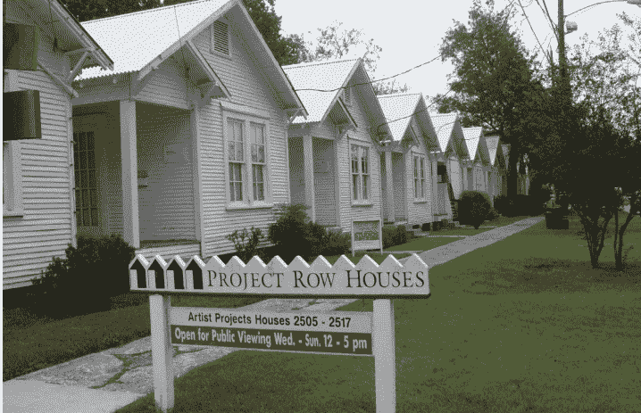

图 1：Raw Houses Studios 项目，2012年9月。摄影：Hourick。

“猎枪屋房”（shotgun house）是 PRH 的定义性形象，它强制性地容纳了该机构并成为其标志。猎枪屋是一种宽长单间的木质结构，流行于美国南部，但被认为起源于西非，随奴隶贸易传入美国。猎枪屋成排排列，配有前廊和公共后院空间，鼓励居民之间的社交互动。它们一直与非洲裔人联系在一起，但在种族隔离结束后，随着更多富裕的人离开他们的历史社区，它们专门与贫困的非洲裔人联系在一起。²⁰ 在他们的社会生活中，这些房屋必须代表特定的底层少数族裔——因此，它们在特定空间中的存在并非中立。它们应该被视为符号或栖息地。通过将它们置于项目的中心，PRH 将相关的族群体提升到了类似的中心地位，在符号上提升了他们的霸权在很大程度上忽视的现实。通过这种方式，PRH 正在参与一场反霸权的地位战。

事实上，在 Before The Lowe 看到成为 PRH 的猎枪屋之前，它们的状况糟糕，并被计划拆除。²¹ 这反映了绅士化背景下社区和国家面临的一个关键问题。邻的第四区（Fourth Ward）因其中心位置而导致了大规模的人口流失，²² 同一发展线上的第三区（Third Ward）也处于同样。绅士化是主流霸权的一种阴险工具，因为它可以消除替代性的生活方式及其积累的符号意义（如社区化的低收入非洲裔人社区），同时利用积极发展的术语。它们的建筑风格在过去一个世纪一直被后现代主义建筑所主导，这些建筑比取代它们的建筑要壮观得多，正如哈维（Harvey）所声称的，是“意象胜过实质”。哈维认为，这种建筑的“成就”在于通过一种游戏式的分心来掩盖社会经济问题，以至于不损害统治范式的“连贯性”（即霸权）。²³ 猎枪屋尤为值得注意，这在于它们与此类建筑在美学上的对立：它们矮小的规模、更传统的材料和悠久的历史拒绝同化到后现代主义叙事中。抵抗并在美学上反转正在进行的绅士化及其对投资的唯一关注，是 PRH 中一种反霸权立的范例。

此外，PRH 对猎枪屋的保护代表了一种“维护”行为。在更广泛的背景下，这反对新自由主义对不断创新和增长的坚持，例如，休斯顿被视为“高速公路世界”的一部分，在那里，旧的被推平让新的。²⁴ 在艺术领域，“维护”的概念源于米特尔·乌克勒斯（Myrtle Ukeles）1969年对维护工作者（母亲、清洁工等）工作的维护，对比更受推崇的（通常是男性的）艺术家的创作。乌克勒斯将维护称为“生命本”，将前卫称为“死亡本”。²⁵ 我们在这里可以探测到穆菲（Mouffe）的回响，即拒绝将前卫视为艺术值得追求的目标。乌克勒斯的概念可以扩展为对社区——及其美学——反对发展的维护：对第三区及其建筑的维护。与当今由明星引领的虚荣工程相反，后者试图揭示一种世界从未见过（去语境化的）建筑表演，而这种表演已经存在，但位于霸权者批准的码头之上。

### 激进住房：艺术、斗争与关怀

我将霸权的空间表达为：一种很少被注意到、看似预先存在的形式，实际上是在特定时期由特定的意识形态创造的，它强加或至少暗示了一种特定的存在方式。

在建筑领域，PRH 不仅在维护，而且在发展。2003年，PRH 成立了房屋开发公司（RHCDC），它专门关注中低收入住房²⁶ RHCDC 体现这种材料对“创意”的渴望²⁷ 它们的房屋经过更新，例如前廊，当地。

居住在芝加哥的非洲裔、社会参与艺术领域的知名艺术家 Gates 的作品，灵感源于过去和现在，而不是。在他的 Dorchester 项目和重建基金会中，Gates 的艺术是他从改造的结构中创造的社区³⁰ Gates 和和的的。

3. Natalie Moore, ‘How Theater Gates Is Revitalizing Chicago’s South Side, One Vacant Building at a Time’, Smithsonian, 2015.

RHCDC 基于语境的建筑的一个重要的政治特征是挑战社会住房定义的的主导地位。在负担得起的住房中，RHCDC 是独特的。唯一的区别是，在美国，公众对社会住房的想象被“项目”所占据：高大、孤立的区块。

这种做法在 20 世纪末开始不再青睐。[33] 它们与 RHCDC 这种人类尺度、社会化住房之间的对比是显而易见的：那些所谓的“项目”往往在意识形态上被错误地污名化，它们并不意味着具有像 RHCDC 那样对特定场地且尊重的关怀。此外，后者具有几个在传统社会住房中难以发现的特征。它们拥有能源之星，并配备了空调和隔热。[24]它们并没有成本效益[35] —— 它们的价值似乎在于其象征性的立场，作为对霸权规范的反抗。重要的是，这种立场并非与其物质现实脱节或优于物质现实：相反，它们作为功能健全、设计良好的社会住房的物质现实是一种反抗行为，反对了其他地区社会住房中的主流物质现实。

智利的亚历山德·阿拉维纳（Alejandro Aravena）和他的 Elemental 事务所也致力于重新构社会住房。[36] 当政府无法为智利北部的占户提供资金来建造独立的、功能齐全的房屋，而占户们威胁宁愿挨饿也不住在提议的住房楼里时，Elemental 提出了一个解决方案：每人建造一个功能齐全房屋的一半——符合最低法律要求并包括所有基础基础设施——并让他们自己完成剩余部分。[37] 这种解决方案既保护了居民及其政治意愿，也承认了他们独特的个性和创造潜力。

在 Elemental 和 RHCDC 的案例中，艺术家和建筑师似乎都意识到他们无法提供一个人们渴望的社区（即为所有人提供负担得起的住房）；他们关注的是建造和生活“本应该是什么”以及“如果统治体系有不同的优先事项并考虑到居民，可能应该做什么”的材料。通过它们的存在，RHCDC 揭示了它们是可以存在的——这看起来像是一个同义反复，但在霸权语境下，现实与可能性是融合的：主流的霸权表达必须消除任何替代方案，因为它寻求成为所有可能性的源头和仲裁。正是在这里，PRH 和广义上的艺术有机会具有政治性并创造出反霸权的替代方案，暗示了现实定义的本质，并在体验这些替代方案的人中创造出“改变的渴望”。[38] 这种渴望在有空间供其增长时被唤，而不是在主流系统的持续拒绝中被激发。艺术家可以承担起培养能让改变渴望增长的空间和想法的任务。

### 激进住房：艺术、斗争、关怀

除了建筑上的提供之外，我认为 PRH 还有另一个反霸权的特征：其年轻母亲住宅计划（YMRP）。该计划通过提供补贴住房、咨询、指导和课后服务，为该社区里的一群低收入年轻母亲提供为期一到两年的帮助。[39] 绝大多数为非裔美国人的 YMRP [40] 是美国及整个国家范围内被剥夺权利的群体。每三个单亲家庭中就有一个是非裔美国人；在女性中，非裔美国人的贫困比例最高。[41] 对于一个了解其奴隶过去影响的国家来说，这些统计数据并不意外，因为其主导社会经济阶层主要由白人、基督徒（绝大多数非单亲）、富裕男性组成。PRH 所选的人口统计特征是对英雄精英的反转。

- 18 Phil Hubbard, (ed) Urban Design and City Regeneration: Social Representations of Entrepreneurial Landscapes’, Urban Studies, 33,8(1996): 1446.

- 19 (On View), Project Row Houses, 2019, http://projectrowhouses.org/on-view.

- 20 Edward Orlowski, ‘House of Blues: The Shotgun and Scarcity Culture in the Mississippi Delta’, in: Nnamdi Elleh (ed) Reading the Architecture of the Underprivileged Classes: A Perspective on the Protests and Upheavals in our Cities, London: Routledge, 2016, pp.79–80, 93–96.

- 21 Smith, The Art of Place and the Place of Art at Row Houses, pp. 33-36.

- 22 Rabanera, Success Stories, p. 120.

- 23 Cited in Hubbard, ‘Urban Design and City Regeneration’, pp. 1444–45.

- 24 Walter Hood Cameron Taylor, ‘Musing the Third Ward at Row Houses: From Cultural Practice to Community Initiation’, Cite, (Spring), 30-33; Smith 1998: 39.

- 25 Myrtle Ukeles, ‘Maintenance Manifesto’, in: Christine Stiles and Peter Selz (eds) Theories and Documents of Contemporary Art: A Sourcebook of Artists’ Writings, Berkeley: University of California Press.

- 33 Jeff Crump, 'Deconstruction from Demolition: Public Housing, Poverty, and Urban Policy', Society and Space 20 (2002): 582–84, 586.

- 34 Rabnera, Success Stories, p. 140.

- 35 Michael Kimmelman, 'In Houston, Art Is Where the Home Is', The New York Times, 17 December 2006, http://www.nytimes.com/2006/12/17/arts/design/71kimmin.html.

- 36 Oliver Wainwright, 'Chilean Alejandro Aravena wins 2016 Pritzker prize', The Guardian, 13 January 2016, http://www.theguardian.com/art/design/2016/jan/13/chilean-alejandro-arvena-wins-2016-pritzker-prize.

- 37 Ariana Zilliacus, 'Half a House Builds a Community: Elemental's Controversial Social Housing', Arch Daily, 24 October 2016, http://www.archdaily.com/797779/half-a-house-builds-a-whole-community-elements-controversial-social-housing.

- 38 Mouffe, 'Alfred Jaar: The Artist as Organic Intellectual': 20.

# 激进住房：艺术、斗争与关怀

YMRP 的力量在于它执行了替代性的成功故事，创造了一个临时空间，在那里，其女性成员很少受到整个社会的关注，却受到了尊重并掌控。激进表演艺术团 La Pocha 的吉尔莫·戈梅麦斯-佩斯（Guillermo Gómez-Pez）声称，虽然艺术项目可以创造“想象空间，但我们知道它确实存在，即使在项目期间。[42] 这就是像 YMRP 这样的解放性实践的力量——它们的解放和对替代方案的执行即使是短暂的。[43] 并且涉及到创造新的主体：即霸权光滑外表上的裂缝。霸权的生存取决于它伪装成不可战胜、早于抵抗领地本身的存在，因此每一个像 YMRP 这样的过渡性事物都可能在对维持霸权至关重要的人（即社会成员）心中证明霸权的脆弱性。

另一个理解 YMRP 的框架是约瑟夫·波伊斯（Joseph Beuys）的“社会雕塑”概念，这也是罗斯（Lowe）的灵感来源。波伊斯声称每个人都是艺术家，如果创作得当，简单的社会互动就构成艺术。[44] YMRP 旨在为这种创造和改进实践提供这样一个平台，优先考虑互动和实验，让参与者认同并激活他们的“创造自我”。

- 39 Rabnera, Success Stories, p. 140.
- 40 Rabnera, Success Stories, p. 140.
- 41 Rabnera, Success Stories, p. 140.
- 42 Rabnera, Success Stories, p. 140.
- 43 Rabnera, Success Stories, p. 140.
- 44 Rabnera, Success Stories, p. 140.
- 45 Rabnera, Success Stories, p. 140.
- 46 Rabnera, Success Stories, p. 140.
- 47 Rabnera, Success Stories, p. 140.
- 48 Ben Davis, 'A Critique of Social Art Practice: What Does It Mean to be Political Art?', in: Johanna Burton, Jackson, and Dominic Wilson (eds), Servants: Art and the Crisis of the Common Good, Cambridge, Massachusetts: MIT Press, 2016, p. 432.

## 需求理论

尽管有所有这些具有说服力的元素，我并不认为 PRH 在整体上是真正的反霸权。我也怀疑 PRH 本身会。它的目标似乎并非显式或隐含地反霸权，而是为了阐明 PRH 在其之内的作用。尽管 PRH 的产出可能体现或代表积极的潜力，但这些元素中似乎没有打算去霸权。PRH 最终满足了现状，因此我们可能想要询问，上述特征并非呈现反霸权，反而是现状的“洗白”机制。

洗白是指利用艺术或创意活动为新自由主义披上一层积极或伦理的外衣。新自由主义行为者在许多情况下帮助了艺术，洗白意味着任何产生的产物都被收编进了更大的机器中。正如本·戴维斯所声称，资本的“橡胶大亨”通过他们的文化赞助为自己的行为辩护。

也许最简单可以陈述 PRH 那些令人不悦的赞助商的地方，包括雪佛（从 PRH 成立以来就是赞助商）以及直到最近的美国银行。在一个资本与意义内在纠缠的新自由主义语境下，赞助绝非中立行为。赞助商在其资助项目上的代码和可见性，是对内容及其自身象征意义的一种符号化占用。例如，雪佛是全球最大的能源公司之一，特别是石油领域——它在破坏环境和新自由主义霸权传播中的作用显而易见。PRH 本身已经在其一次艺术家轮次活动——即第44轮“破碎混凝土：活动主义者与煽动者”中承认了这些影响。策展人拉奎尔·德·安达（Raquel De Anda）还提到了能源提取的危险，以及诸如气候运动之类的“大众社会运动”的重要性。此外，她指出，艺术可以在“挑战我们当前的政治范式，并邀请（社区）参与改变塑造生活的条件”方面发挥作用。尽管这些主张似乎支持对当前秩序下社会霸权的理解，以及对大众需求的认可，但它们处于背景地位，资助着其自身的贬值。德安达还展示了艺术家团体“自然历史博物馆”（Natural History Museum）的作品，该团体曾成功发起了运动，迫使大卫·科赫（David Koch）从许多赞助中退出。承认这种赞助的力量与危险，同时通过自身的选择将其转化为修辞，从而支持了一种反霸权的逻辑。

这一论点还涉及了美国银行最近的赞助，戴维斯在关于 PRH（激进住房）的写作中对此给予了特别关注：他强调，该银行是“008年危机中从数百万住房抵押贷款中获益最大的机构之一。与此同时，PRH 试图将自己包装为针对低收入购房者的慈善机构，投入资金（并获得声誉收益）以确保社区的部分地区保持私有。如果我们考虑到美国银行的角色，这一使命似乎像个笑话，或者至少是一个诡计。美国银行对所有权的影响比 PRH 广泛得多；因此，PRH 可能通过出卖其完整性而抵消了任何优势。从规模上来说，当前的霸权可能从 PRH 对当前住房状况的价值化和“洗白”中获益更多。

随着公共资金和公民社会日益市场化，要避免企业赞助或创造不受资本污染的创意生产似乎是不可能的。然而，撇开赞助不谈，PRH 的产出仍未达到霸权的水平。虽然 PRH 可能鼓励某些参与者或观众相信一个更好的世界是可能的，但这缺乏政治或经济内涵：它是艺术品内部的，而阿拉维纳（Aravena）的作品也是如此的；事实上，这些艺术家方法的可持续性在他们这一代人中五次受到质疑，而芝加哥和休斯顿持续的城市绅士化过程使第三街区（Third Ward）面临风险。因此，这种系统或过程仍然是新自由主义的，最终抹杀了这些项目所取得的成就。PRH 和多彻斯特项目（Dorchester Projects）的社区成员很幸运目前处于这些空间。然而，这些社区普遍的幻灭感和缺乏保障——这些艺术品显得如此必要的原因——并未得到艺术的质疑，艺术开始看起来像是肤浅的、症状性的关怀。

## 需求理论

根据穆菲（Mouffe），PRH 的方法必须被理解为一种政治上的第三条道路，指的是避免向左或向右偏斜的中立政党。穆菲认为，这些政党在政治上是不可行的，因为它们产生了一种共识的假象，忽视了自然和社会的霸权，否认了在替代方案之间进行必要的竞争性（agonistic）和积极选择。PRH 同样可以被看作是在安抚所有方面，在获得霸权认可的同时，产生反霸权的符号。这种策略无法对抗当前的霸权，因为它支持了霸权的生存。此外，它创造了一个凝聚性项目（及现实）的印象，而实际上它被对立关系所撕裂。例如，PRH 公众（或参与者）的需求与其企业赞助者的行动之间的冲突。这种对立关系从未被公开承认。

正如穆菲所言，任何寻求反霸权的艺术项目都无法承受孤立，因为“认为活动主义会独立发生并关乎新自由主义霸权的终将将是一个严重的错误”。这种终结取决于承认公民社会中存在多个抵抗节点，并且这些节点必须相互意识到，创造出一个战壕迷宫或“等效价值链”，这才能提供一种令人说服力且有力的新的反霸权衔接。然而，PRH 并未与活动主义团体或反霸权艺术家接触；它没有尝试参与任何此类链条。

现在重要的是回到我关于文化霸权讨论的源头：葛兰西（Gramsci）。在他的著作中，霸权是一种明确的政治现象，是马克思主义路线的产物：是解释现代资本主义和民主社会复杂性以及对革命抵制的性工具。然而，葛兰西从未否定过社会的经济基础结构。作为一个马克思主义者，他相信上层建筑的力量——意识形态和霸权——限制了他的论证，即根据其自身的术语捍前者的分析。像 PRH 这样的艺术作品离霸权是远的，部分是因为其优越性，部分是因为从纯粹的美学角度对其进行评估的困难。在某种意义上，遗憾的是，PRH 通过底层经济并未解决其某些关注问题的根源，例如绅士化和某些人口统计数据的经济边缘化。通过对结果效应的反转进行运作，PRH 最终可能通过文化缓冲和锚定进一步推进新自由主义——因此，为了避免这种命运，PRH 必须对其与资本以及如雪佛龙（Chevron）等精英阶层的关系更具批判性。

# 激进住房：艺术、斗争与关怀

那么，什么是政治艺术？在我们的新自由社会中，我认为当艺术处理社会更基础的条件时，它获得了其政治维度。这不是因为它不好，而是因为它处于其中。

## 按需理论

人类——这需要文化和艺术领域做出积极且专注的回应。正如穆菲（Mouffe）所主张的，艺术家不应因新自由主义挪用的威胁而气馁，并退缩到社会运作之外；这在抵抗方面收效甚微。相反，他们必须坚定地信仰自己的信念，即文化和艺术具有震撼、揭示以及呈现替代方案的潜力。唯如此，他们才能能够在争取我们的、以及更好的霸权话权的斗争中竞争而出。

# 参考文献

[关于 PRH, Project Row Houses, 2019, https://projectrowhouses.org/about-prh]

Adams, Tim. 'Chicago Theater Gates: "I am hoping Swiss bankers will bail out my flooded South Side bank in the name of art', 《卫报》, 2015年5月3日, http://www.theguardian.com/artanddesign/2015/may/03/theater-gates-artist-dorchester-projects.

Bourriaud, Nicolas. 《关系美学》(Relational Aesthetics), Simon Pleasance 和 Fronza Woods 译, Dijon: Les Presses du reel, 2002,

Brugaria, Tiana and Larne Abse Gatsby. '公民艺术家', 《Art Monthly》 400 (2016年10月): 1-5.

Crump, Jeff. '拆迁实现的去中心化: 公共住房、贫困与城市政策', 《Society Space》 20 (2002年10月): 581–596.

Davis, Ben. '社会艺术批判: 成为政治性的意味着什么？', 收于 Jordan Hutton, Shannon Jackson, 和 David Wilson (编),《公共服务：艺术与公共利益危机》，Massachusetts: MIT Press, 2016, pp. 423–435.

De Anda, Raquel. '第44轮：破碎混凝土：关于艺术与社会合作的对话', Durham: Project Row Houses, (2016年春季), https://1.squaresquare.com/static/55832a9a7de4b092b-05b1869t1/f643d45b6a6e0521bectbf55/145884054898/Round+44-booklet.pdf.

Finkelar, Tom. 《我们所创造的：艺术与社会的对话》，Duke University Press, 2014.

Forgacs, David (编). 《安东尼奥·葛兰西读者：1916-1935年选集》，New York: New University Press, 2000.

Fraser, Nancy. 《旧的正在死去而我们永远无法出生》，伦敦: Verso, 2019.

Harvey, David. 《新自由主义简史》 Pietro Meneghelli 译, Milan: Il Saggiatore, 2007.

Holmes, Brian. '艺术装置，或言语的集合', 《Ephemera》, 6.4 (2006): 411–432.

Hood, Walter and Carmen Taylor, '在 Project Row Houses 沉思第三区：从社区到社区实施', 《Cite》, (96年春季): 26–33

Hubbard, Phil. '城市设计与城市更新：创业性景观的社会表征', 《Urban Studies》, 33.8 (1996): 1441–1461.

Jordan, Cara. '美国社会雕塑的演变：约瑟夫·博伊斯以及苏珊·拉西和里克·洛的作品的作品，《Public Art Dialogue》, 3.2 (2013): 144–167.

Kimmelman, Harold. '室内艺术: 何时是家', 《纽约时报》, 2006年12月17日, http://www.nytimes.com/2006/12/17/arts/design/17.

# 激进住房：艺术、斗争、关注

Laclaur, Ernesto and Chantal Muffle, 《社会主义策略：走向激进政治》第2版, London: Verso, 2014.

Lucy, Suzanne. '引言', 收于 Susan Lacy (编)《绘制景观：新类型》，Seattle: Bay, 1995, pp. 19–47.

Marchevska Elena. 'Gómez-Pera and Gomez', 收于 Elena Marchevska《流离的阶层：知识分子》，LONDON: LADA, 2017.

Miranda, Carolina. '实践的艺术如何改变世界，一个接一个', 《Artnews》, 2007年4月4日, http://www.artnews.com/2014/04/07/art-of-practice-is-changing-world-one-house-a-time/

Moore, Natalie. '他的艺术装置正在振兴芝加哥南区，一个接一个', 《Smithsonian》, 2015年12月, http://www.smithsonianmag.com/innovation/theater-gates-in-gentrification-areas/

Moufche (注: 此处可能是 Mouffe)

Moufche, Chantal. 'Alfredo Jaidar: 作为有机分子的艺术家', 《Revista Diseño》11 (7月): 18–35.

Nance, Kevin. 'Toni Morrison 的精神与力量', 《Poets & Writers》, (2008年11/12月), http://www.pg.com/content/the_spirit_and_strength_toni_morrison/

On View, 2019, http://projecthouses.com/on-view.

Orlowski, Edward. '房屋忧郁：密西西比三角州的房屋与文化', 收于 Nnamdi El (编)《阅读底层阶层：视角》，London: 2006, pp. 76–99.

Prince, Zenith. '人口普查：单亲母亲的高比例', 《Afro News》 http://www.afro.com/census-bureau-high-percentage-black-children-single-mothers/

Rabanera, Gabriel Sommer. 《成功故事：致力于住房与社区复性的三个非营组织》，Los Angeles, 2013. Row House CDC, https://www.rowhousecdc.com/

Sewing, Joy. '第三区的绅士化', 《休斯顿纪报》, 2018年8月2日, https://www.houstonchronicle.com/business/real-estate/article/Gentrification-of-the-Ward/

Shropslee, Carolyn. '芝加哥绅士化房价上涨', 《芝加哥论坛》, 2018年12月20日, https://www.chicagotribune.com/business/chicago-housing-costs-gentrification-2018219-story.

Simms, Margaret Fortune, and Everett Herbst, '低收入家庭中的种族与民族差异', 《Urban Institute》， 2009年8月, https://www.urban.org/site/details/files/32976/411936-Racial-and-Ethnic-Disparities-Among-Low-Income-Families.pdf.

Smith, Stephanie. 《Project Row Houses 的场所艺术与艺术》， Houston, Texas, 1998.

Tucker, Jasmine and Caitlin Lowe. 'Snapshot', 2016年9月, http://nlwc.org/wp-content/uploads/2016/09/Snapshot-Factsheet-2016.pdf.

Turner, Cheryl. '翻新黑裔猎枪式房屋', 《Places》, 10.1 (1995): 64–71.

Ukeles, Mierle. '维护艺术', 收于 Kristine Stiles 和 Peter Selz (编)《当代艺术的理论与文献：艺术家写作选编》，Berkeley: University of California Press, 1996 (1969), pp. 622–24.

Wainwright, Oliver. '智利建筑师亚历山德·阿拉雷纳获得2016年普利兹奖', 《卫报》, 2016年1月13日, http://www.theguardian.com/artanddesign/2016/jan/13/chilean-architect-alejandro-arena-wins-2016-pritzker-prize.

[年轻母亲居住计划], Project Row Houses, 2017, http://static1.squarespace.com/static/5583a9de4b0920b55b1689It/588ba5c586e6c0ffe0e5d4c3/1508433636183/YMNRP+Application+2017.pdf.

Zilliacus, Ariana. '半个房子建成整个社区：Elemental 的争议性社会住房', 《Arch Daily》，2016年10月24日, http://www.archdaily.com/797779/half-a-house-builds-a-whole-community-elementals-controversial-social-housing.

134

## 按需理论

随着1989年后政权的更迭，罗马尼亚与其他中欧和东欧（ECE）国家一样，住房改革遵循了三条主要路径：国有存量房的快速出售；非城市开发的去监管化，以造福私营房地产部门；以及通过对1950年以前的所有者、其继承人或合法权利买者进行归还，实现对没收住房存量的重新私有化。这些政策在国际金融机构（如世界银行和国际货币基金组织IMF）的影响下得到了巩固，这些机构监督了整个“转型”过程。³

在结构性种族主义的长期历史中，⁴罗姆人口不成比例地受到与住房相关的驱逐的针对和影响，被阻碍获得财产和土地权利，并被限制在公共服务匮乏且住房不稳定的地区。⁵罗马尼亚住房运动的兴起基于这样一个事实：罗姆人解放运动早在20世纪90年代就开始处理住房（不）公正问题，在为住房权利的社区提供启发、支持和保护方面表现。我们住房运动的基础还包括21世纪00年代早期对城市权利联盟的争取，以及反对从布加勒斯特市中心因归还驱逐的斗争。在这些斗争中，与艺术界的交汇很早就开始了——作为跨阶级的合作与团结，但也作为与士绅化城市之间的复杂关系。

# 走钢丝：关于矛盾团结与共情的五个故事

与1989年后发展的艺术界紧密相关，不断关注公共空间问题、对公地的反思、社会参与以及对地方性的批判性反思。⁶ 这些兴趣可以在当代艺术、戏剧和舞蹈领域的批判性或替代性意义中找到。⁷在这里，政治、当代舞和临时艺术频繁交汇，并产生了社会和职业联盟，以及混合的（有时是行动主义的）项目。

艺术界在参与空间方面也做出了持续的物质和批判努力。开发空间并反思运作场景的首要性和脆弱性，一直是批判性艺术界持续的斗争和争议焦点。⁸ 往往在国家机构之外的自主性需求与市场驱动利益之间以及现实之间挣扎，通过努力，艺术界（尤其是布加勒斯特和克卢日这两个罗马尼亚最富裕的城市）寻求并实验了多种独立空间的形式——嵌入不同形式的政治谈判、联盟和冲突之中。

艺术家对物质资源的需求——设备、书籍、金钱、物理时间和体力、工作空间、学习空间、互动空间以及可见——结合解决城市问题的动力，也导致了艺术界与社会正义斗争之间艰难的互动。植于1990年后共产主义的霸权性（经济、社会、话语）框架中，对西方/被腐败东方的自我殖民、对资本主义和不受监管市场的渴望，许多艺术项目和倡议——例如我们在这里讨论的这些——在合作与反对之间走钢丝。它们为士绅化铺平道路帮助或抵抗它，它们推动了社会发展。

***

+ 3 Eniko Vincz, ‘The Ideology of Economic Liberalism And The Politics Of Housing In Romania’, Studia Ubb. Europaea LXXII (2017): 29–54.

4 Gabor Feick, et al., Come Closer. The Inclusion of Roma in Present Day Modern Society, National Agency for Roma, 2008.

5 Eniko Vincz and George Zamfirir, ‘Racialized housing uneven in Cluj-Napoca under capitalist development’, City Journal 23:4–5 (2019): 439–460.

6 Such as the events of the collective, seen in Raluca Voinea, ‘Public Space’ in Transit Czechia, Arts of Transformation, 2011. Available at: http://monumenttransformation.org/atlas-of-transformation/html/public-space.html

7 Iulia Popovici and Raluca Voinea, Metaphoră. Protest. Concept Performance Art în România și Moldova, Idea Publishing, 2018.

8 Igor Mocanu, ‘The paradoxical utopia of artist-led scenes in Bucharest’, in Artyok (Close-Up): Post-transition writings, Editions of the Academy of Fine Arts in Prague, 2014, pp. 56–67.

# 激进住房：艺术、斗争、关怀

## 1. 慷慨进攻：艺术家

植于1990年后共产主义的霸权性（经济、社会、话语）框架中，对西方/被腐败东方的自我殖民、对资本主义和不受监管市场的渴望，许多艺术项目和倡议——例如我们在这里讨论的这些——在合作与反对之间走钢丝。它们为士绅化铺平道路帮助或抵抗它，它们推动了社会发展。

（注：原文OCR文本在后半部分存在大量重复和破碎片段。此处根据提供的碎片清理了逻辑流并进行了去重。）

***

在2009年，`LaBomba disc`转变为一个社区中心、社区组织、艺术家与当地人联盟的基地，以及反对该地区发生的非法归还和驱逐的基地。这说明了当地活动分子（以女性和青年为主）与参与艺术家之间资源和需求的汇聚。`LaBomba`在2011年被驱逐，这是一场当地居民反对的非法归还过程。围绕它的团结是前所未有的，还导致了批判性剧剧《Far sprijin》（没有支持，2012）的构思，揭示了艺术家与罗瓦乌拉什居民之间近五年联盟建设与团结的果实。

***

> 9 Veda Popovici, “Evicts, restitution and resistance: A radical housing’s understanding, City Journal 24.1-2 (2009): 97–111.

> 10 David Schwartz, „Evacuati, artiști și agenți gentrificării: Proiectele tale din Rahova-Uranus / Interview with Cristina Eremia”, Gazeta de Artă Politik (The Political Art Gazette), 2014, 5(2):6–7.

+ ¹¹¹ Maria Drăghici and Irina Gădiutu (eds), Reader Rahova Uranus Lum Doc 2009, Bucharest: Vellant, 2010. Available at: https://issuu.com/maria_draghic/docs/labombastudios.blogspot.com.

# 激进住房：艺术、斗争与关怀

2013年，一个家庭被驱逐，这在又一次归还决定之后：该家庭的成员是`LaBomba`社区中心的组织者之一¹²。2013年春天，人们为了支持她组织了一场大规模抗议活动，并在几个月后举办了首届住房正义论坛，汇聚了来自布加勒斯特和克卢日市的活动家，由 `Tranzit.ro/Bucharest` 艺术项目主办。到2013年底，通过这些集体行动汇聚的力量（以及那些人们普遍反对紧缩政策的愤怒）被激化，促成了“住房权利共同线”（Common Front for Housing Rights）的建立。这是一个跨阶级的平台，反对驱逐，支持被驱逐者并主张所有人拥有适当住房的权利。随后与 `FCDL` 合作的艺术项目具有明确的政治诉求，正如下一节所示。

因此，这个始于2006年的社区艺术项目（正处于士绅化与赋权之间的界线上）为一场持久的住房运动创造了条件，该运动至今仍活跃并不断建立新的联盟。

## 2. 驱逐幽灵：此处与此处的驱逐

2010年，正当 `Rahova-Uranus` 社区开始更有力地组织反对驱逐，并尝试教育和艺术战术时，布加勒斯特的当代艺术界迎接了书籍《驱逐幽灵：生存的建筑》（*Evicting the Ghost: Architectures of Survival.*）¹³的出版。该书由艺术家、建筑师和社会学家组成的团队制作，分析了被驱逐者在因归还决定失去房屋后建立的避难所和棚屋。

在出版前的几年，可以说是被驱逐者改善的避难所在当时城市中最明显的时期。这些避难所和临时棚屋通常分散在市中心周围，具有临时性质，被被驱逐者用作住所也用作抗议手段。

书中追踪了归还过程并追溯了其历史背景，包括有关立法历史的信息和一系列案例研究。它的起点是一位建筑师在随机走在街头时，偶然遇到一个被驱逐家庭搭建的临时棚屋所感到震惊。书的方法在建筑师/艺术家/研究人员与被驱逐者之间建立了一种清晰的距离。编辑者称：“一种特定科学图谱的距离”。

临时棚屋成为了该书的核心母题，由多位研究者的贡献和插图组成。房屋本身以浪漫的眼光被定位，被视为“幽灵之屋”。尽管包含了被驱逐者的直接陈述，但并未对士绅化、新自由主义城市转型或产权霸权的影响进行任何分析。书中没有承认棚屋作为一种抗议策略的政治属性。以科学项目的方式，案例研究变成了“描绘后社会主义时代罗马尼亚社会冲突的微缩景观”。

驱逐的政治过程被用作一个待分析的对象，在当代城市的背景中进行自我呈现。棚屋并不是后社会主义时期资本主义对资源进行圈占所产生的暴力物质信号，而是被清理，以形成“一种由被驱逐者开发的居住地类型，当今城市生存的表达”。

总而言之，该项目可以被置在一个矛盾的位置：作者视角所建立的距离确保了与被驱逐者之间的一种疏离关系。然而，在2010年布加勒斯特的具体语境下，《驱逐幽灵》通过标志被驱逐者面临的极端住房条件¹⁴，使一个暴力过程变得可见，从而为关于归还和驱逐的更广泛、更具批判性的对话开启空间。

## 3. 火车交付：创意阶级的进入

《驱逐幽灵》代表了一种极化的政治过程类型，采取了极其客观的研究者立场；而2013年的《火车交付》（Train Delivery）项目代表了另一种方法，创意阶级占据中心舞台并为自己夺回城市。

《火车交付》（原标题为英文）是一个“关于创意人士重新构筑布加勒斯特北方火站”的节日，它是 `Street Delivery` 的一部分（罗马尼亚最成功的书店连锁），该活动被识别为“热爱城市的人的爱与恨”。在布加勒斯特，这种活动方式被视为一个需要创意人士干预的区域。对该区域的重新构筑包含了手工艺工作坊、创意创业、创新，先锋艺术渗透进活动中。

从一开始，该活动就声称对“热爱这座城市的人”是免费的。在火车站社区的背景下，谈论城市的爱与恨是讽刺的。由于非常靠近市中心，该区域对于流浪汉、性工作者和毒瘾使用者来说是一种空间资源；因此被中产阶级认为是不安全的。这个节日是为了纠正这种印象并使该区域对游客产生吸引力。

-12 Mihaela Mikhailov 和 David Schwartz，“Încă putem, acum suntem mulți și ar fi și mulți!”（我们还可以，现在人多了，还会更多），Gazeta de Artă Politică（政治艺术报），2013。访问地址：http://artpolitica.ro/2023/03/11/inaate-putini-acum-suntem-multi-si-o-sa-fi-si-multi

-13 Alina Șerban（编），《驱逐幽灵：生存的建筑》，布加勒斯特：Centrul de Introspecție Vizuală，2013。

-14 Daniela Calciu，“Evicting the Ghost: Architectures of Survival”，布加勒斯特：Centrul de Introspecție Vizuală，2013，引自 *Journal of European History* (2012): 247–249。

-15 Veda Popovici，“Delivering the City into the Arms of Capital: Gentrification and the Harmlessness of Art in Bucharest”，Gazeta de Artă Politică（政治艺术报），2014。

# 激进住房：艺术、斗争与关怀

城市暴力的清洗可以采取不同的形式：如艺术学生美化地绘制巴亚马雷（Baia Mare）一个以罗姆人为主社区的围栏，这吸引了许多人，他们试图将围栏归类具有遗产价值的对象；或者在贫困地区举办更有组织性的音乐和艺术节，为士绅化和激进驱逐铺平道路。但艺术家也可以作为参与的行动者直接参与城市暴力过程。这种直接参与范围从涂鸦者抱怨在他们涂鸦的目标的废弃建筑中寻求避难的流浪汉，到参与真实的驱逐——这在空间激烈竞争的背景下。

2012年夏天，布加勒斯特的一群年轻人和建筑师开始修复一座具有遗产价值的旧建筑，将其转变为一个独立的文化中心——卡罗53号。在此过程中，他们驱逐了一个此前居住在该房屋内的罗姆人家庭。在项目的公开展示期间，艺术家们会避谈共处是不可能的。建筑的经理——本身是一位受尊敬的建筑师

……并是一项保护具有“遗产价值”的战前建筑运动的参与者——支持了 `Carol 53` 艺术团体。这反映了遗产保护运动中的主流观点，即贫困阶层正在破坏遗产价值，而这些建筑比住房（中等收入水平的住房）更适合文化和创业类活动。

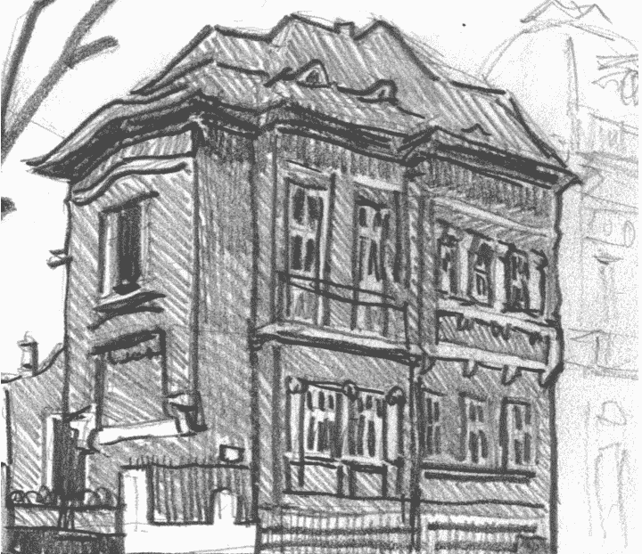

图 2：Arnold Schlachter，《Carol 53 无名》，铅笔于纸上。

尽管如此，几个人和团体仍提出了批判性反应，反对当前城市发展模型中根植的不平等，并反对这种占领行为——这些占领者可能正在变成一种注入了文化价值的新型社会大清洗实践。¹16 研究人员和活动人士继续批评“Carol 53 模式”绅士化的复制，这种模式在克卢乔治（Cluj）和蒂米绍瓦拉（Timișoara）等城市日益流行。年轻艺术家和建筑师继续举办活动和派对，通过在城市发起首个“文化占领”的背景下，将他们的倡议合法化为一种创新。尽管

16 Roxana Bucată，“Aristiști și homeși. Care pe care skatează”[艺术家与无家可者], Think Outside the Box, 2012年8月1日, http://ltob.ro/artisti-si-homelisi-care-pe-squateaza; Mihai Codreanu, Arnold Schlachter and Veda Popovici，《守护废墟——关于绅士化和反占领的两个片段》, Gazeta de Artă Politică [《政治艺术报》], 2014. 获取地址：http://artolitica.ro/en/2014/06/05/guarding-the-two-episodes-on-gentrification-and-anti-squatting/. Weith

# 激进住房：艺术、斗争、关怀

`Carol 53` 是在建筑业主许可的情况下建立的，但它通过自我意识的组织/共同生活将自己品牌为“占领地”——试图与被视为剥夺性的占领行为以及之前的居民区分开来。作为一个占领地，`Carol 53` 将自己定位为理想文化（同时具有吸引力和中产阶级化）的表演者，带有西方占领文化潮流的额外光环，成功规避了其引发的驱逐责任，并避免了对城市住房不平等和暴力无家可归问题的采取立场。

`Carol 53` 及其来自西方的支持者不仅驱逐了非正式居民，还否定了他们作为占领者的身份，试图将他们局限为“无证人员”，将他们斥为“非法占有者”、建筑的破坏者，并对其文化价值一无所知。¹1⁷ 通过这种标签化，他们还试图否认之前的居民与全球斗争和占领现象的符号关联。

# 5. 欧洲文化之都：边缘（的）西方化

罗马尼亚的艺术界，与其他（半）边缘语境一样，是从从属的视角¹18 看向西方——不仅体现在艺术内容和合作上，还体现在渴望和需要的物质支持上。欧洲文化之都（ECOC）计划揭示了这种支持是如何组织和授予的，以及当地艺术如何做出回应——因为该计划是欧盟自20世纪80年代以来干预国家/地方文化政策的手段。¹⁹

自20世纪90年代以来，ECOC称号被授予那些具有增长潜力、规模较小或较富的知名城市，这些城市准备好将文化作为发展道路。因此，为了竞争这一头衔，城市必须记录并创造对光明未来的创意幻想²⁰——带有必要的元素和关键词，如平等、言论自由、旅游、新的宏伟文化建筑、文化创业、多样性。在这些愿景中，城市变成了梦幻之地和游乐场；艺术家和文化经理会在指定的 ECOC 节前提前约五年做准备——希望这能提升他们的活力。尽管

在建筑业主许可的情况下建立，Carol 53 是通过自我意识的组织/共同生活将自己品牌为“占领地”——试图与被视为剥夺性的占领行为以及之前的居民区分开来。作为一个占领地，Carol 53 将自己定位为理想文化（同时具有吸引力和中产阶级化）的表演者，带有西方占领文化潮流的额外光环，成功规避了其引发的驱逐责任，并避免了对城市住房不平等和暴力无家可归问题的采取立场。

（注：此处原文存在重复段落）

17 Ioana Florea and Mihai Dumitri，“Transformations of housing provision in Romania: of subtle violence”, LeftEast, 2016年10月24日, https://lefteast.org/transformations-of-housing-provision-in-ania-subtle-violence.

18 Veda Popova and Ovidiu，“From over here, in the periphery a decolonial method for Romanian”, LeftEast, 2016年2月11日, https://lefteast.org/from-over-here-in-periphery-a-decolonial-method-for-romanian.

19 Alexandra Oancă，“Governing the European Capital of Culture and Urban Regions in Sibiu”, master thesis, Central European University, 2010.

20 Alexandra Oancă，“Bidding Wars: Competition for the ECOC”, PhD diss., Central European University, 2018.

21 Philip Bland，“Capital of Culture – you must be having a laugh! Challenging the official-rhetoric of Liverpool as the 2008 European capital”, Social & Culture Geography 11 (2010):627–645.

22 Oancu,2010.

23 Registered evicted tens of thousands of forced evictions; Cluj has more than 1,000 persons evicted on the city’s lands Pata Rât; Timisoara evicts homeless persons from the empty fields in their periphery; Baia Mare has the infamous sense facing a neighborhood with predominantly Romania families, and relocated evictees in unsafe dwellings.

24 George Zamfir，“Cluj Capitală săută culturală ca soluție în instituțiile sociale?”, Gazeta de Artă Politică [《政治艺术报》], 15 (2016):12–13.

# 激进住房：艺术、斗争与关怀

ECoC 自主运营并获取私人利润的收益。它引发了其他原本被沉默的问题和不满，并邀请了其他文化参与者加入这一批判性努力。因此，在 ECoC 的框架之外，也存在反对的可能性。

# 坚守阵线：关于艺术作为住房运动政治工具的三个故事

## 1. 克卢日：在活动主义策略中整合战术

克卢日-纳波卡（Cluj-Napoca）是罗马尼亚最大的城市之一，也是住房成本（租金和售价）最高的城市，随着 IT 业的蓬勃，已成为“欧洲硅谷”。在地方和中央政府的欢迎下，这种经济转型迅速将该市转变为欧洲城市的主要候选者：士绅化、租客人口不断增加，并对 Uber 或 Airbnb 等独角兽企业极具力。多年来，房价的迅速上涨、仓促的驱逐以及对罗姆人居民的针对，构成了这座城市的印记。

与此同时，一个激进的政治领域正在兴起，建立了组织结构并针对这些过程进行批判性分析。标志着活动主义领域发展的重大事件之一，是 2010 年 12 月 17 日凌晨从 Coastei 街驱逐 300 人。在大量警察强迫驱逐的压力下，该社区被驱赶到城市的填埋场和化学废物倾倒场，他们很快发现那里是靠近 Pata Răt 的不符合标准的住房。这次驱逐导致整个社区（包括许多罗姆族家庭）搬到了一个与交通、医疗服务和学校隔绝的地区。

这场斗争的组织在驱逐后立即开始。该社区在当地人、活动主义者以及支持罗姆权的非政府组织学者那里获得了支持。很快，这种联盟让这场斗争变得可见，并标志着克卢日运动的开始。Pata Răt 周边的社区发展出了适用于维护克卢日这座充满活力、抱负的城市关注的战术。他们选择了多种活动主义手段来引起人们对 Pata Răt 不公现象的关注并赢得更多支持者。

根据斗争的主要组织者之一、活动研究员 Enkök Vinceze 的说法，与当地批判艺术建立的联盟被证明是有效的、创新的且赋能的，建立了一种独特的艺术活动主义。²⁵ 最可见的艺术干预之一是当代艺术普及学校（Scoala Populară de Art Contemporă – SPACC）在 2011 年组织的项目：这是一项教育和活动尝试——《你在 Pata Răt》（Ești în Pata Răt），它由学生和被驱逐者共同创作了若干艺术干预。这些作品作为艺术品展出，并在抗议行动中作为欢迎官员的道具，利用当代艺术讽刺和知识分子的风格，提高人们对被驱逐社区处境的紧急性和严重性的意识。26 与整合在抗议中的活动主义表演相结合，这些艺术干预成为了围绕 Pata Răt/Costastei 斗争形成的活动主义网络的标志性之一。

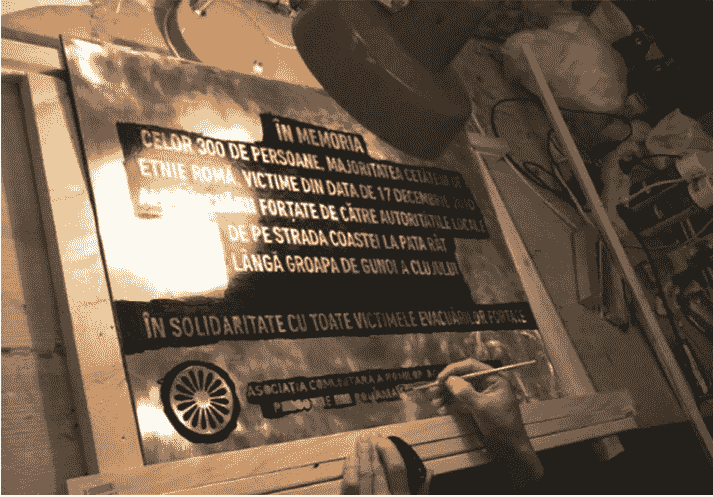

图 3：Dène Miklós 于 2015 年制作的纪念牌。照片版权：Noémi Magyari。文字内容为：“纪念 300 人，其中大多数是罗姆族公民，他们于 2010 年 12 月 17 日被地方当局从 Costei 街强制驱逐到克卢日填埋场附近的区域。”

同年晚些时候，纪录片《垃圾场的福民》（Prea-fericiti din graopa de gunoi）发布。该片由 Solitude Project 制作，由一个多学科艺术家集体创作。作者包括编舞师 Mihai Mahalcea、剧作家 Michaela Mikhailov 和演员 Katia Pasinariu，他们都是具有参与性轨迹的当代艺术家，并与上述的“慷慨攻势”（OGG）以及艺术家经营的空间 subRahova 有关联。纪录片在以尊严的方式呈现 Pata Răt 社区的斗争和艰苦的同时，也揭露了正教教会对此事的参与：正教教会收到了 Costei 街土地的归还，并为神学大学的学生建造了一座圆顶。该片在多个城市放映，揭了教会是驱逐的主要受益者：展示谁以及如何从驱逐中获利，这有助于将 Pata Răt 的斗争纳入更广泛的经济现象框架中，有效地使其政治化。

[/content]

[content]

通过制作受艺术媒体启发的各种工具和战术，艺术家与活动主义者的合作为 Pata Rât 斗争的广泛可见奠定了基础，这是罗马尼亚激进住房运动的主要催化剂之一。在我们写作时，克卢日的 `spaces transit.ro` 和 `Casa Tranzit` 空间仍然是当地住房运动的重要场所，通常与 `Căși Sociale` 组织（Social Housing NOW）和克卢日租客协会（ACC，Tenants Union Cluj）相关联。

## 2. 布加勒斯特：戏剧与表演作为另一种政治工具

如果说克卢日发展了一种将艺术表达整合到更广泛活动战术中的方法，强调物体和表演作为媒介，那么布加勒斯特艺术与住房运动交汇的典型发展主要是戏剧作品。这可以追溯到 Rahova-Uranus 社区和 OG 集体的项目，该团体由艺术家和当地社区成员组成。2008 年初，他们在 Rahova 社区通过集体行动制作了短剧《出去！》（Afară! Get Out!）。该剧基于被驱逐者和面临驱逐风险的居民的经历，旨在反映驱逐周围的艰辛。然而，这部剧后来成为了未来 Fără Sprij [2012] 联盟的垫石。该剧有几个在其他记录和说明被驱逐社区经历的剧中反复出现的元素：艺术家与社区成员共同制作和共同表演、被驱逐者经历的核心性，以及对女性声音和视角的强调。该剧由三位主要组织者兼社区成员 Cristina Eremia、Cornelia Ionița 和 Gabriela Dumitru 主演，为后续以及将戏剧作为加强社区的手段奠定了基调。

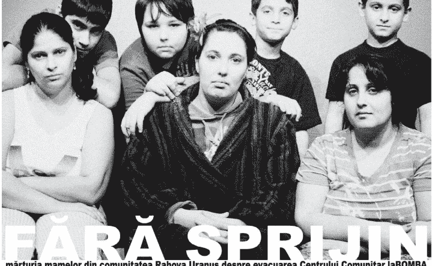

图 4：LaBomba Studios 海报。

2014 年，由女性主义罗姆剧团 Giuvlip 制作了剧《信口胡话》（La Harneală Wisecacking）。该作品通过被驱逐者（尤其是妇女和儿童）的视角探讨了驱逐现象，并关注与公众的关系。通过处理种族主义、挪用和异域情化问题，该剧标志着对住房组织局限性深刻的批判性反。两年后，“住房主观博物馆”（Subjective Museum of Housing）首次在自主空间 Macaz 演出，随后在全国其他地点巡。该剧讽刺地批判了政治经历的博物馆化。在巡演中，演员们重演了自己生活中的片段，旨在描绘经历驱逐过程中的暴力、不公、痛苦和团结。通过这种方式展示他们的经历，制作团队指出向更广泛观众传达驱逐经历的持续重要性和迫性，对布加勒斯特对该问题的短期记忆发表了苦涩的评论。

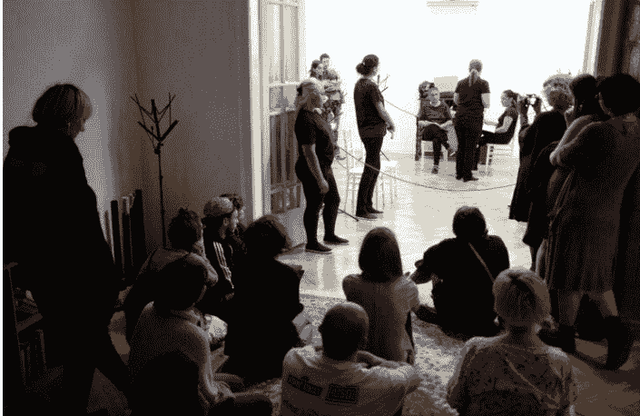

在这系列剧中，我们还可以添加 2016 年的《不稳定的家》（Domomiciu Instabil Unstable Home）。该剧由一个参与住房运动的政治剧团制作，探索了布加勒斯特 Moses Rest 老年院居民的生活经历。²⁷ 根据舞台呈现的犹太裔老年人的经历，该剧描绘了剧烈且强

# 激进住房：艺术、斗争与关怀

回顾了法西斯主义、社会主义和资本主义后社会主义背景下的住房变迁历史。通过居民独特的长期视角，该戏剧为当地住房运动增添了另一个维度——将深远的历史视角纳入其政治立场。在这一历史视角下，社区组织以及反抗虐待和压迫性措施（如被逐出住房）的行动变得更具有合法性。

所有这些剧目的大多数角色都由真实的社区成员诠释。在前三个案例中，这些成员是布加勒斯特住房运动前线的女性。²⁸ 这些剧目的制作目标明确，旨在让观众参与运动，它们是来自布加勒斯特几个政治剧场团体开发的的方法论的表达。²⁹ 政治剧场方法论既提供信息又赋予权力，旨在增强当地的政治斗争并扩大其范围、战术和词汇。对于住房运动而言，这些剧目创造了一个战斗性的、话语的和情感空间，让被驱逐女性的经历可以在自己的平台上表达。通过建立让社区成员可以互动的基础设施，这些戏剧构成了一个至关重要的纽带和集体凝聚力空间。这些戏剧以自我反思和批判性评论为特征，构建了一个动态的辩论空间，可以在其中提出关键问题：受影响的人与团结者之间是什么关系？什么成就了一个活动主义者？什么成就了一个艺术家？

## 3. “历史并未（不）重复”：克卢日与布加勒斯特

最近一个汲取住房运动并反哺于该运动的当代项目是 Veda Popovici 和 Nicolae Mikhailov 的作品《历史并未（不）重复》*。该项目于 2017-2018 年间制作，开发了罗马尼亚后社会主义时期错综复杂的政治历史，并处于事实与虚构的边缘.³⁰ 该项目由两个展览、一部电影以及几场工作坊和放映组成，建立在一种集体反思和创作的推测历史方法论之上。通过各种作品，作者与活动家、研究人员和艺术家小组互动，基于真实事件创造了罗马尼亚 89 年后时期的虚构政治故事。这些故事的选择和编辑过程产生了一系列参与者感到特别有投入感情的政治梦想和乌托邦。通过对可能发生的事情进行推测，该项目揭示了现实中的人们为了自己的政治需求和欲望，实际上距离采取不同的历史路径有多近。随后的展览和电影由具体的器物组成，作为这些历史的见证：抗议横幅、臂章、新闻稿、模拟网站、海报和建筑模型等。

十个推测故事中有两个建立在住房运动的经验之上。其中一个是与克卢日的活动家和艺术家合作开发的，借鉴了臭名昭著的 Coastei 驱逐事件，那次事件导致了 Pale Rât 的产生，并最终导致神学学院宿舍楼建在了 Coastei 社区被驱逐的土地上。但在推测历史中，这座宿舍楼本身——一个属于正教教会的真实住宅综合体——变成了一个抵抗场所。故事以一个激进团结的故事形式展开：住在宿舍里的学生们了解了他们建筑的基础正义，并向宿舍开放，欢迎任何在被驱逐后需要避难所的人进入。他们的反抗违反了神学学院或正教教会的政策，转而与当地的住房运动汇合。作为这种故事可能性的证明，克卢日的小组制作了一个模板和横幅，展示了住在宿舍楼里的学生为被驱逐者筑墙的时刻。

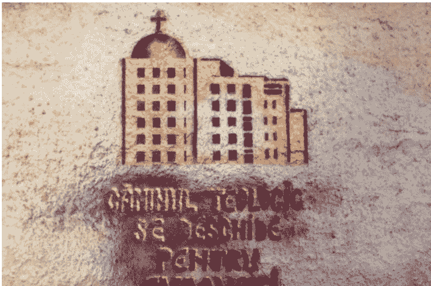

另一个故事是基于布加勒斯特现有的“玫瑰园”（Rose Garden）住宅小区，这是一个拥有约 900 套公寓的大型住房项目。它建立在一个农场主的（曾被私有化并拆除的）社会主义工厂土地上，由房地产经纪人和开发商 Coldwell Banker 建造——这是一家源自旧金山的房地产行业巨头。在一次布加勒斯特组织的工作工作坊上，这个关于私有化、绅士化和榨取的资本主义故事变成了一个关于工人赋权的故事：处理基础织品的前工厂在 20 世纪 90 年代后期私有化，不是卖给了某个外国资本企业，而是变成了工人集体所有的的公司。然后，是工人决定将工厂搬到较小的土地，拆除旧工厂，并在这片土地上为自己建造了一个巨大的社区所有住房综合体。这样，工厂免遭了破产，并扩展了一个包含土地、加工设施和住房单元在内的庞大社区所有结构。该住房综合体最终被命名为“白花”（White Flower），庆祝了工厂加工的主要织物——棉花。

这些推测历史描绘了住房私有化同一个故事的两个面，以及 89 年后罗马尼亚工人历史合法性的丧失、流离和剥夺。

虽然它们建立在真实的事件和影响之上，但它们揭示了乌托邦的距离，并模糊了过去与未来的界限。通过弥合已所做与可能做的之间的差距，整个项目成为了梦想一个激进未来的工具。

# 字里行间

从参与住房运动的成员和制作者的视角进行写，我们试图描绘布加勒斯特和克卢日一些标记后社会主义特征的重要事件、项目和发展。带着对权力的敏锐观察，我们探索了艺术项目在（半）边缘地区表达出的矛盾性——在赋能与反抗绅士化之间，在与权力共谋与使权力变得可见之间。我们将它们视为更广阔历史中的片段。基于我们积极的经验和同志们富有启发性的工作——将战术融入策略、使用剧场和表演、庆祝过去的道路和梦想——我们认为住房运动与艺术的交叉在某种程度上是一个实现可能的故事。尽管我们不认为有任何严格的公式指导如何开展和赋权社会运动，或如何开展政治工作并塑造同志和同伴的想象与情感，但我们认为在这里讲述的故事是有价值的见解，对某些人来说，是激进未来的教训。

- ²⁸ Mihaiele Mikhailov, ‘Casa noastră de une zile’, Gazeta de Art Politică [Political Art], 22 January 2015, http://artolitica.ro/2015/01/22/casa-noastra-cea-de-zile-la-haarala.

- ²⁹ Mihaiele Mikhailov and David Schwartz, *Teatru Polit* [Political Theater], Bucharest: Takt, 2017.

- ³⁰ Veda Popovici and Nicolae Mikhailov, *Istii post-revolionare* [Post-revolutionary histories], Project publication, 2018.

# References

- Boland, Filip. “Capital of Culture – you must be having a laugh!” Challenging the official rhetoric of Liverpool in the 2008 European cultural capital, Social & Cultural Geography 11 (2010): 627–645.

- Bucana, Roxana. Artiști și homelessi. Pe care pe squareate[Who’s squatting. Think Outside the Box, 2012. Available at: http://totb.ro/artisti-si-homeless-carepe-squareatele.

- Calciu, Daniela. Anynte, Alex and Bocris (Studiu BASAR). Evicting the Ghost. Architectures of Survival, Bucharest: for Visual Inspection; Colloquia. Journal for Central European History, Babes-Bolyay University Cluj, Vol. XIX, 2012, p. 247–249.

- Capital în contextul politic UE [Culture in the context of EU policies], Gazeta de Art Politică, 15 (4), 2016.

- Codreanu, Mihai, Schachtler, Arnold and Popovici, Veda. “Guarding the ruins—two episodes of gentrification and anti-squatting”, *Gazeta de Art Politică*, 2014. Available at: `http://artpolitica.ro/en/2014/06/05/guarding-the-ruins-two-episodes-on-gentrification-and-anti-squatting`.

# 需求性理论

Drăghici Maria & Gădiut, Irina (编), *Revera Rahus Unum Loc 2009*, 布加勒斯特: Valliant, 2010.

Fleck, Gabor 等人, 《更近一点：当代罗马尼亚社会中罗马姆人的接纳与排除》, 罗马姆人国家局, 2008年.

Florea, Ioana 和 Dumitru, 〈在边缘生活：布加勒斯特占占建筑与发展的模糊性〉, 收于 Freira Anders 和 Alexander (编) 《公共利益对抗经济利益：占占建筑历史的全球视角》, 纽约与伦敦: Routledge, 2017年, 第 188–210 页.

> “罗马尼亚住房供应的转型：一种微妙暴力的组织化,” *LeftEast*, 2018年10月24日, `https://lefteast.com/transformations-of-housing-provision-in-romania-organizations-of-sub-violence`.

Florea, Ioana, Gagyi, Agnes 和 Naczbock, Kerstin. 《当代住房斗争：一种结构性内容方法》, Palgrave, 2021年.

Gazeta de Artă Politică, “从摩西斯·罗森无家窟者、互联网看罗马人的住房主观历史,” 2016年. 可用地址：`http://artpolitica.ro/en/2016/10/08/romania-si-istorie-subiectiva-a-locuirui-in-romania-din-perioda-rezidentilor-rezidentilor-caminiului-romena-perioda-anii-1920-1930` (第一部分和第二部分) 以及 `http://artpolitica.ro/en/2016/10/09/romania-a-subjective-history-of-housing-in-romania-as-seen-by-the-moses-rosen-homeless-residents-the-internet-period-1920-1930-part-ii`.

Michailov, Mihaeil 和 Schwartz, David. “我们有能力，我们现在在这里，未来还将更多！” *Gazeta de Artă Politică*, 2014年5月13日. 可用地址：`http://artpolitica.ro/en/2013/03/11/inarte-erate-putem-multi-si-multi-o-sa-fi-mai-multi`.

Michailov, Mihaeil. “我们借用了一个艺术行动主义概念的基础,” *Gazeta de Artă Politică*, 2014年5月13日. 可用地址：`http://artpolitica.ro/2014/05/13/am-imprunat-baza-unui-concept-de-activism-artististic/`.

casa noastră de orice zile (我们的家). *Gazeta de Artă Politică*, 2015年. 可用地址：`http://artpolitica.ro/2015/01/22/casa-noastra-cea-de-unele-lanarele`.

Michailov, Mihaeil 和 Schwartz, David. 《政治剧场》(*Teatruru Politică*), 布加勒斯特: Tact, 2017年.

Mocanu, Igor. “布加勒斯特艺术家主导空间的悖论式乌托邦,” 收于 ArchytokV (编) 《阶级：转型后的写作》, 布拉格艺术学院出版社, 2014年, 第 56-67 页.

Alexandra, 《治理西比乌的欧洲文化之与城市区域》, 硕士论文, 中欧大学, 布达佩斯/匈牙利, 2010年.

《竞价大战：西班牙竞逐2016年欧洲文化之城期间公平与情感劳动的演变》, 博士论文, 中欧大学, 布达佩斯/匈牙利, 2018年.

Popovici, Veda, “将城市交付资本区域：绅士化与艺术的无家可归,” *Gazeta de Artă Politică*, 2014年4月27日, `http://artpolitica.ro/en/2014/04/27/delivering-the-city-into-the-areas-of-capital-gentrification-and-the-homelessness-of-art-in-bucharest/`.

Popovici, Veda 和 Pop, Ovidiu. “从这里，从边缘：一种罗马尼亚文化政治话语的去殖民方法,” *LeftEast*, 2016年2月16日, `https://lefteast.com/from-over-here-in-the-periphery-a-decolonial-method-for-romania`.

Popovici, Veda 和 Nicolae, Mircea. 《革命后的历史》(*Istor post-revolutionare*), 项目出版, 2018年.

Popovici, Veda. “居住、归还与反抗：一个激进运动对后社会主义财产重新分配的理解,” *City Journal* 24 (2020): 97–111.

Popovic, Iulia 和 Voinea, Raluca. 《隐喻：罗马尼亚和摩尔多瓦的概念行为艺术》, Idea Publishing, 2018年.

Schwartz, D. '被驱逐者、艺术家与绅士化代理：Rahova项目/与Cristina采访,” *Gazeta de Artă Politică*, 2014年, 5(2): 6–7.

Solitude Project, ‘你属于垃圾堆的一员’[填埋场的所有所有者], 2011年. 可用地址：`https://vimeo.com/326059`.

Şerban, Alina (编). 《驱逐幽灵》. 布加勒斯特: 视觉内省中心, 2010年.

Dohotaru, Adrian, Hajnalka 和 Eniko Vincze (编), ‘在垃圾里’(*Ești în Rât*), *Artă Contemporană*, 2016年, 第 138–162 页.

Vincze, Enik. “自由主义意识与罗马尼亚住房政治,” *Studia Europea* (2017): 29–54.

Vincze, Enik 和 Zamfir, George. “资本主义开发下的住房不平等,” *City Journal* 23 (2019): 43–60.

Voinea, Raluca. “过渡中的公共空间”(*Public Space in Transit*), *Atlas of Transformation*, 2011. 可用地址：`http://monumentotransformation.org/atlas-of-transformation/html/p/public-space/raluca-voinea.html`.

Zamfir, George. ‘文化建筑还是机构？’ *Gazeta de Artă Politică*, 15 (2016): 12–13.

# 间隙艺术：柏林统一后的住房归还问题导致了城市的艺术化重塑

德国人再次需要酒店里的一点光。柏林与艺术及创造力的关系是长期存在的，在它成为一个实验空间的时期，这种地位得到了巩固。在整个历史上，柏林作为艺术城市的认知一直被推动，并被用作破坏者和顺从者。自从统一以来，柏林成为艺术世界的主要中心之一，绅士化不可避免，我们看到租金上涨，越来越多的人失去了家园。从对城市的目前的认知回到柏林统一后的初期，我们可以观察艺术与城市空间的关系如何作为城市重新想象自己的策略。这一时刻充满了不确定性，以及试图对城市提出主张的个人和群体，中心的破旧住房通过争议性的归还过程受到关注。通过观察自主和机构组织的展览，将检查对柏林变化的贡献，我们可以寻求理解这些如何利用归还时期作为手段来实现其意图和后果。

德国民主共和国（`GDR`）的解体比预想的更快、更和平，随着1989年11月柏林墙的倒塌和十个月后1990年10月的德国正式统一。随后的时期是混乱的、不确定的，充满了与重建相关的能量和兴奋，柏林再次处于中心。对于某些人来说，这种兴奋是开发的可能性以及在中心地带廉价购买房地产的机会；对于另一些人，统一是重新探索柏林并推动成为另一种城市的机会。

1. Franz Hessel, 《漫步柏林》 (重译, Scribe Publications, 2017), 页20.
2. Jennifer Allen, “制造柏林,” *Frieze D/*, 2010, `https://frieze.com/article/made-berlin?language=`.
3. Elizabeth Strom 和 Margit Mayer, “新柏林,” *德国政治与社会* (*Politics And Society*) 16, no. 4 (1998): 122.

# 激进住房：艺术、斗争、关怀

兴奋和对变革的推动在柏林的中心区域和曾是东部的街区尤为明显，因为那里的大部分住房由`GDR`国家所有。随着国家不再存在，归还问题迫在眉睫，结论是财产要么需要归还原主人，要么卖掉以收回`GDR`积累的部分债务。在官僚主义混乱随之时，为了解决这种情况，出现了对空间的额外竞标，思考新城市可能的其他方式。艺术活动（包括表演和展览）成为一种强调这些理念并利用这一时期的不确定性来重新想象正在快速西化的“转型”（`Wende`）的方式。

重新化意味着曾位于城市边缘的区域发现自己再次变成了市中心。例如，东侧紧邻柏林墙的 `Prenzlauer Berg` 变成了一个中心街区，位于 `Mitte` 北部，而 `Mitte` 也是柏林的中心。由于物业所有权存在争议，这些区域迅速变得最受欢迎，市场随之而来。这些地区发生的变化将展示新的柏林——统一和分裂结束的象征，并受到世界的关注。在这种情况下，柏林遭开发者的激烈竞争，他们试图通过管理国家建筑私有化的 `Treuhand` 机构廉价购买优质房产。除了想要对这些街区提出主张的人外，还有对开发的抗议，担心这会导致人口流离和绅士化。

4. George J.A. Murray, “城市建设与‘可读性’的修辞：新柏林的建筑辩论,” *City & Community* 7, no. 1 (2008): 3.
5. Hilary Silver, “新柏林的社会整合,” *德国政治与社会* (*German Politics and Society*) 24, no. 4 (2006): 3.
6. Andrej Holm, “城市更新与社会住房的终结：新自由主义在东柏林 Prenzlauer Berg 的推广,” *Social Justice* 33, no. 3 (2006): 116.
7. Matthias Barnett 和 Andrej Holm, “是还是不是？绅士化与流离失的概念化及其在柏林-Prenzlauer Berg 案例中的政治影响,” *City* 13, no. 2-3 (2009): 35.

围绕原东部财产所有权和归还的问题。每种方法都建立在柏林作为文化城市的历史的基础上，并强调了社区的不同可能性，尽管这些是暂时的，但它们影响了城市的重新开发，且不同的方法和意图往往相互对立。

## 争议时期的归还

当围墙倒塌时，柏林的前东部处于绝望状态，城市各处可见第二次世界大战的炸弹痕迹，许多老旧且以住宅为主的建筑几乎没有翻新，而这些建筑在进入世纪后非常多。在城市更东部地区，例如卡尔·马克斯大街（`Karl Marx Allee`），建造了新的装板板建筑（`Plattenbau`），构成了当地的景观。然而，在 `Prenzlauer Berg`，住宅建筑在民主德国（`GDR`）期间很少更新，其中大部分是旧建筑（`Altbauten`），这意味着尽管建筑破旧，但它们与城市的西侧是相连的。此外，估计 `Prenzlauer Berg` 有 10-20% 的住宅建筑是空置的。⁸ 这些状况的加剧及其地理位置的中心性，意味着那里迅速聚集了人口。它成为首批大规模开发的课题之一⁹，并在 1993 年被指定为城市更新区（`Sanierungsgebiet`）。¹⁰ 此外，`Prenzlauer Berg` 解决了归还问题，针对建筑提出的要求很少，住宅建筑仅有 35,000 起索赔，其中 10% 成功了。¹¹ 其结果是财产可以被购买，从而让那些密切关注进展的开发者介入并购买，并开始了私有化进程。

许多柏林居民对“转折时期”（`Wende`）感到愤世嫉俗，因为它演变成了西方化而非真正的重新统一，这导致了全城范围内活动主义和抗议的增加，被剥夺权利的民众寻求“第三条道路”。这种对“转折”的不满是导致城市内占屋行为复发的因素之一；在新建的广场式建筑中，这种生活方式被视为一种借鉴了社会主义思想但没有民主德国那种臭名昭著的权威主义结构的生活¹² 许多东柏林的占屋者违背了离开东德前往西方寻求更好生活条件的潮流，¹³ 这种向东移动的非从俗性增强了该运动的反建制氛围。

8. Andre Holm, 'Urban Renewal and the East of Seoul: The Roll out of Neoliberalism in East Berlin's Prenzlauer Berg', *Social Justice* 33, no. 3 (2006): 11.
9. Uta Papen. 'Common Discourses, Gentrification and Citizens' Protest: The Linguistic Landscape of Prenzlauer Berg, Berlin'. *Journal of Sociolinguistics* 16, no. 1 (2012): 57.
10. Matthias Bert and Andre Holm, 'Is it, or not?;: 316.
11. Mark Blackwell and Karl Martin Born. 'Private Property Restoration: The Geographical Consequences of Official Government Policies in Central and Eastern Europe'. *The Geographical Journal* 168, no. 2 (2002): 185.
12. John Ferrer, 'Squat Paradise: Berlin in the 90s', *Slow Travel Berlin*, 2014, `http://www.slowtravelberlin.com/squats-no-neo-nazis-friedrichain-the-90s/`.
13. Esperkamp et al., 'Eastern Germany 20 Years After', *Eurovista* 5, no. 2 (2009).

## 激进住房：艺术、斗争、关怀

占屋行为对于 1990 年代的柏林来说并不新鲜，这座城市拥有丰富的替代性住房历史，且占屋行为在分裂期间东西两侧都存在。城市的两个侧对占屋有不同的方法，通常使用不同的术语来描述双方的方法：东部称为 `Schwarzwohnen` [非法住房]，西部称为 `Besetzen` [占领]¹⁴ 东部的占屋者将占屋作为一种手段，凸显东部糟糕的住房条件，这与民主德国关于住房是现实的说法相违背。而在西柏林，在 1980 年代已成为亚文化的国际中心，在紧邻围墙的 `Kreuzberg` 曾出现过强烈的占屋潮¹⁵ 围墙倒塌后，这些占屋者在城市内大量空置建筑中见面并工作的潜力可以被探索，更多的场景在全柏林建立，其中 `Prenzlauer Berg` 和 `Friedrichshain` 特别受欢迎。

虽然这些占屋者在 1989 年 11 月至 1990 年 10 月之间相对独立，但当许多建筑和机构陷入行政混乱时，占屋问题很快成为当局的焦点。1990 年 11 月 12 日，在柏林正式统一一个月后，警察访问了大街（`Main Straße`）的一排房屋，意图驱逐自围墙倒塌以来就在那里的占屋者。占屋者占据了长约两百米的房屋，他们的存在通过覆盖房屋的标志和装饰为人知。柏林的占屋场景聚集了数百人上街抗议占屋并试图拯救他们。在三个三天里，大街发生了战斗，300 名警察试图使用水龙和手榴弹等暴力手段清理占屋。最终，警察成功清理了占屋，但事件导致占屋者和警察双方都有许多伤亡。此后对占屋运动产生了重大且深远的影响，因为当局和活动人士都意识到需要改变方法¹⁷

对于国家来说，这些事件具有很高的关注度，支持者对警察发表了公开声明。在演示后的一份报报道中，一位参与者被引用说：“我不支持占屋者……无论原因如何我都反对”¹⁸ 虽然这些观点对占屋者来说并不是担心，但在这种政治不稳定的时期，对国家来说是一个挑战。导致围墙倒塌的抗议……

## 需求的理论

抗议者一方相对和平，但警察一方却是暴力，这为联邦共和国赢得了更多支持，因为人们想要离开高度政治化的国家¹⁹ 但重新统一后大街驱逐行动的暴力回归对他们不利，并导致公众对城市改变感到日益不满。这对于试图让统一变得和平平稳的国家来说没有帮助。此外，冲突导致了柏林社会民主党与绿党（此前一直处于联盟）之间的分裂²⁰ 由于不希望大街惨剧重演并希望赢得民意，当局需要找到一种不同的方式来处理他们认为的占屋问题²¹

其结果之一是在房主允许的情况下，某些占屋获得了合法化的机会。通常占屋者能够协商名义或低廉租金以留在建筑内，尽管这附随着条件，许多占屋者发现自己被迫对建筑进行重大翻新以留下来²² 此外，这些合同是非常不稳定的且通常是短期的²³ 这些安排对当局的好处是显而易见的：空建筑不再空置，因此它们得到了维护而非通过非法占屋。它也有作为慷慨行为的收益，在大街抗议期间赢得了一些公众支持。然而，仍然存在一种严厉的观点认为非法占屋和法律化是为了大幅减少城市内的数量。虽然当局不是占屋者的目标或关注点，留在家里却是。因此，在新法律范围内工作是必不可行的，尽管充满不稳定，但对他们来说目前是一个可行的机会。

## 艺术占屋的兴起

大街的前占屋者 John Ferrer 提到：“大街也是文化和创造力的地方。它是整个地区唯一一条色彩缤纷的街道。弗里特希海因被认为是创意之源。但在 1990 年，这些创意人士被驱逐了。”²⁴ 这句引用强调了这些占屋者对创造力的关注，他们为支持大企业凌于个人的私有化主导叙事提供了一种替代方案。一个重要的因素是占屋者如何承认他们与支付者的差异

19 Wolfgang Mueller, Michael Gehler and Arnold Swann, *The Revolutions of 1989*, Vienna: Verlag der Österreichischen Akademie der Wissenschaften, 2016, p. 122.

20 Andre Holm and Armin Kuhn, "Squatting and Urban Renewal: The Interaction of Squatter Movements and Strategies of Urban Restructuring in Berlin", *International Journal of Urban and Regional Research* 35, no. 3 (2010): 644-658.

21 Alex Vasudevan, *Metropolitan Preoccupations*, Oxford: Wiley, 2015, p. 169.

22 Vasudevan, Daniela. *Counterrepresentation*, Ithaca: Cornell University Press, 2016, p. 2016.

23 Sandler, Daniela.

24 Geronimo, George N Katseliakas, and Gabriel Kuhn. *Fire and Flames*. Oakland: PM Press, 2012.

# 激进住房：艺术、斗争与关怀

通过用图像覆盖建筑立面，他们传达了一种拒绝与街道上其他房屋融合的信号。这与东柏林的占大屋文化相比是一个显著进展，在过去，占大屋曾试图让自己不被察觉，但很快，这种占大屋的视觉展示就成了常态。这种可见度的增加让任何路过社区的人以及当局都能明显看到占大屋的存在。这种策略获得了一种对空间主主权的方式。

类似的创造力延伸到了占大屋本身的活动和组织中，加入文化活动或艺术尝试变得越来越普遍。例如，`Main Straße` 是 `Tunterhaus`（拖鞋之屋）的所在地，这是一个已建立在西柏林、后来搬到 `Prenzlauer Berg` 区 `Kastanienlee` 的占大屋。`Tunterhaus` 在他们的后院举办了臭名昭著的演出以及年度“`Reifen mit`”抽奖活动和音乐表演。更为人知的是 `Kunthaus`，它是 `Mitte` 区的一栋废弃建筑，于 1989 年作为艺术占大屋被占领，迅速成为柏林非主流艺术活动的主要场所之一，举办了展览，并拥有电影院、咖啡馆、酒吧以及可供的工作坊。重要的是，它确立了自身的协会（`Verein e.v.`）身份，这使其在 1990 年面临拆除和驱逐威胁时生存了下来。经过短暂的辩论后，该建筑在获得保护命令的情况下被占领，并获得了规划部门的资金进行翻新。它是同类空间中运行时间最长的场所之一，最终于 2012 年被拆除，留下了作为城市重要艺术空间的的遗产。这些空间的活力吸引了观众，并在它们周围创造了活跃的景象。它们存在于社区中日益增加，在这些地方展示了住宅私有化之外的其他选择。可见性对于这一点至关重要，并进一步探索了其他想法和替代实践。

# K77 案例

柏林艺术占大屋历史上的一个重要时刻是 1992 年 6 月，当时一群以“`Vereinigte Farben`”（联合色彩，`Vereinigte` 源自动词“联合”）为名的艺术家和表演者，占领了 `Kastanienlee 77` 号，这是 `Prenzlauer Berg` 区最老的住宅建筑之一。整个过程在呈现上具有艺术性，获取建筑的过程采取了行为艺术的形式。在占领的第一天，小组装扮成医疗专业人员，穿过 `Prenzlauer Berg` 行至 `Kolowitz Platz`，那里有更多的占大屋，以及空空的 `Kastanienlee 77` 号。小组进入建筑并在房子上挂了宣布为医疗紧急情况的告示。他们声称，这种紧急情况是这栋房子正在死去，由于缺乏生命流经房子，它需要心脏移植。一旦他们接管了房子并使其不再适合居住，这起“移植”就完成了。

- 25 Azomox, 'Gender and Squatting in Germany 1968', in *Making: Cultural Production In Occupied Spaces*, Berlin: Other Forms, 2016, p. 170.

- 26 Janet Stewart, 'Das Kunthauses: The Berlin Architecture of the 1990s in Micro-Historical Context', in *Recasting German Identity*, London: Boydel & Brewster, 2002, p. 54.

- 27 Stuart, 'Das Kunthauses Tacheles, 'Squatting Is Art', Pamphlet, Berlin, 1992, Papierigiere.

## 按需理论

这座建筑现在是艺术家约瑟夫·博伊斯（Joseph Beuys）术语中的“社会雕塑”，他们的行动就是行为艺术。这还呼应了 `Prenzlauer Berg` 作为文化社区的历史，那里通常被认为是在东柏林寻找波西米亚的地方。²

占领一周后，其后的小组分发了一份关于他们活动的传单，封面写着“占大屋即艺术”，解释了表演以及他们对该房子的意图。他们写道：“我们必须解释，这绝不是占领，而是一场运动，艺术受到《基本法》的保护” （自译）。这种将项目作为概念艺术进行占领的决定既具有概念性，也服务于实际目的。通过声称他们的行动是艺术表演而非占大屋，该小组能够超越 1990 年生效的法律，该法律规定所有占大屋必须占领建筑并在房内协商其地位。传单随后详细说明了之后发生的情况，他们会见了 `Prenzlauer Berg` 住房建设公司 [`WIP`]，这是处理该地区的住房公司。努力是成功的，双方于 1994 年签署了正式协议，被授予了为期 50 年的合同留在建筑内，该占大屋因此被称为 `K77`，³

在 `K77`，我们看到一个显著的例子，展示了艺术如何被用作想象柏林的工具，而艺术本身也是内容。这超越了仅仅利用占大屋来展示艺术，而是考虑了它所承载的社会和关系本身。然而，他们的目标相对谦虚，主要关注使空间具有居住性。最谦虚的是，这与国家关注房屋的坚固性而非作为居住空间的关注点形成了对比。在这些占大屋和 `K77` 案例中，我们看到展览和文化被用来推动柏林景观更广泛变革的手段。即使这些占大屋规模较小，但它们也是更大网络的一部分，通过这个网络，现状以及城市发生的快速变化挑战着并正寻求支持。这些文化活动贡献了城市的文化话语，在其中我们可以看到其他通过城市空间线条对城市可能发生的变化的挑衅案例。

`Mitte` 和 `Prenzlauer Berg` 成为活动中心（尤其是音乐和派对），迅速转变为年轻人的时尚社区，其中许多人参与了创意产业。除了占大屋网络外，更多俱乐部、酒吧和画廊被使用。这些空间的重点在于维护自由，这无疑是对统一的自然反应，并导致了许多不同的活动和空间。

² Philip Bradley and Ian Wallace. *Prenzlauer Berg*. Amsterdam: Rodopi, 1995, and Claire Colomb. *Staging the new* fast-paced changes.³

³ , 7.

³⁰ Ursula Maria Berborn und Steffi Weissman, *Kuleke*: Berlin: Revolver Publishing, 2016

³¹ Jochen Becker, 'New Mitte/Helle', *Inventory* 4, no. 2 (2001): 52.

² Anne Fenzel and Chris Keller, *Berlin Wonderland. Wild Worlds Revisited 1990-1996*, Berlin: booksairport [etc.], 2014, p. 39.

# 激进住房：艺术、斗争与关怀

意味着它们独立于国家。这些空间的活力吸引了观众，并在它们周围创造了活跃的景象。它们存在于社区中日益增加，在这些地方展示了住宅私有化之外的其他选择。可见性对于这一点至关重要，并进一步探索了其他想法和替代实践。

# 35 Räume

像其他人一样，`Biesenbach` 和他的协调员将这一混乱时刻视为重新思考柏林可能性的机会，并利用空地作为场所。`37 Räume` 的根本区别在于，它是在国家支持下组织的，与任何占大屋空间不同。除了装置之外，还有一个贯穿展览的活动，其中包括一场策展人对阵艺术家的足球赛。该活动的观众是 `Walter Moper`，当时的柏林社民党 `SPD` 成员，一个因与商业界联系以及东柏林发展而饱受批评的人物，我们可以假设，他不会支持在占大屋举办的任何活动。³⁵

³³ Geronimo, George N Kiasatakis, and Gabriel Kuhn. *Fire and Flames*. Oakland: PM Press, 2012, p. 79.

³⁴ Biesenbach, "We Had To Create New": Klaus Biesenbach On Inverting the Berlin Biennale," *Artnews.com*, 2018, https://www.artnews.com/art-news/create-something-new-creating-something-new-klaus-biesenbach-inverting-berlin-biennale-060717-10450/

³⁵ Stuk, "Heute Kritik an seinen Kontak zu Sprech-interessen: Menschen Geschafte nach den Genossen," *Berliner Zeitung*, 2013

在目录中的项目介绍中，`Biesenach` 写道关于目前争议的房间的未来，暗示了这些空空间的未来存在不确定性，且其用途正成为辩论的焦点。可以说，这与 `K77` 组织者的动机相似，他们同样利用处于不确定状态的建筑作为收回它的杠杆。然而，他们在他们建议的内容以及通过活动所呈现的内容上存在差异。尽管使用了艺术活动，但 `K77` 的组织者并未建议这些建筑应被专门用于艺术场所。在空间中生活的行为才是主要目标。形成鲜明对比的是，`Biesenach` 在处理“`37 Räume`”（37个空间）时，明确提出了一个问题：展览所在地以居住为主的建筑是否仍然具有居住属性。

“`37 Räume`”展览的得到了 `Jutta Weitz` 的支持，她任职住房管理局，并通过允许使用空空来支持 `Mitte` 区（`Mitte`）周边的艺术活动。`Weitz` 被比作圣女贞德和“`Mitte` 区中心发展背后的关键人物”，她指出了政府机构内部那些希望支持其他事宜的个体的核心作用。事实上，`Biesenach` 引用了 `Weitz` 的话，说是她说服了他 `Auguststraße` 街避免变成另一家健身房。然而，我们也必须看看这类项目以及“`37 Räume`”的后果如何被归于 `Auguststraße` 发展的催化剂，该街现在已完全绅士化，是该市主要的画廊街道之一。这些空间只是临时提供的，这意味着展览仅开放了一年。对于证明其价值来说，这段时间相对较短，尽管它吸引了 35,000 人参加展览和开幕式（非常受欢迎），这是由于一个接管街道的节日引起的。开幕式必须与在卡塞尔举办的每五年举办一次的“文献展”（`Documenta`）第九届重合，其乐观的计划是让观众在主活动结束后旅行到柏林，这一计划实现了，且展览及其组织者获得了国际关注。主街（`Main Straße`）的抗议在重新思考柏林占屋运动中曾有一个转折时刻；而“`37 Räume`”对柏林当代艺术界产生了类似的影响，并仍然是柏林经常被引用的参考，那里已转型为世界性的主要力量。

# 激进住房：艺术、斗争、关怀

尽管取得了这些成功，“`37 Räume`”在它中断 `Augusta` 街的短短几周内也遭遇了多次抗议。它在街道上的存在——标牌和游客——被不同意展览及其感知代表意义的团体干预所中断。在展览期间拍摄的照片显示，海报被贴在板下，上面写有如“`37没有房间`”[`37 Ohne Räume`]等口号；带有“`谁的艺术`”[`Kunt-Nelle`]“`38号房`”[`Räume 38`]标签被贴在垃圾桶上。一座未参与展览的建筑居民贴了一张“`这里没有我们东部人的艺术`”的牌子，这让 `Biesenach` 反思道：“所有居民和组织者——都非常高兴它不会持续下去”。阅读这些口号，我们可以将其理解为对展览意图的反击，并结合许多人当时面临的住房危机来考虑这一点，这些陈述提出了问题：既然有这么多地方住，为什么要用艺术填满空房子？

“`37 Räume`”的目标是展示柏林的当代艺术界，但并不是针对生活在柏林的人们，而是将艺术界纳入旨在为城市带来新观众的更广泛目标中；因此它也是为了一个不同的社区。这与占屋者的工作不同，后者寻求为那些已经在城市里的人提供支持，并重新构思如何能更好地使用空间以惠及新观众。

正如所指出的，“`37 Räume`”有一个清晰且在许多方面都很成功的遗产。它为柏林双年展铺平了道路，该双年展由 `Biesenach` 和其他策展人于 1996 年创立，并在 2018 年举办了第十届。`KW` 是一家国际知名的艺术机构，每年举办多个高水平的展览，赢得了评论界的赞誉。`Auguststraße` 街已转变为一条商业画廊、餐厅和昂贵服装店的理想街道。`KW` 和柏林双年展（在这一届之前，它由 `KW` 组织，尽管它们是独立的实体）都接受来自联邦议院的定期资助，以及包括宝马在内的其他来源。这还证明了当代艺术为城市带来了新观众以及随之而来的资金。

# 激进住房：艺术、斗争与关怀

- Biesenbach, Klaus. “我们必须创造新东西”：克劳斯·比森巴赫在《发明柏林双年展》中的访谈。*Artworks*, 2018. https://www.artnews.com/art-news/create-something-new-laus-biesenbach-inventing-berlin-bennale-060717-10450/

- Biesenbach, Klaus. 《比森巴赫回顾25年前柏林KW艺术中心的成立，一个‘激进变革与自由’的时刻》。*Artworks*, 2016. https://www.artnews.com/art-news/laus-biesenbach-recalls-the-founding-of-kw-in-berlin-25-years-ago-at-a-moment-of-radical-change-and-freedom-7370;

- Blacksmith, and Karl Martin Born. 《私有财产恢复：中东欧官方政府政策的地理后果》.《地理杂志》第168卷，第2期 (2002): 178-190.

- Brady, and Ian Wallace. 《Penzlauer Berg》。阿姆斯特丹: Rodopi, 1995.

- Colomb, Claire. 《舞台化的柏林新事》。霍霍肯: Taylor and Francis, 2013.

- Feffer, John. 《占屋的天堂：90年代的东柏林》。。*慢游柏林*, 2014. http://www.slowtravelberlin.com/squats-neo-nazis-friedrichshain-in-the-90s/

- Fese, and Anke Kris Keller. 《柏林仙境之地：重游世界 1990-1996》。柏林: bobsairport [etc.1], 2014.

- Geronimo, Gerhard N. Katsiafas, and Gabriel Kuhn. 《火与焰》。奥克兰角: PM Press, 2012.

- Henzel, Franz. 《漫步柏林》。S Publications, 2017.

- Holdt, and Andrej Kuhn. 《占屋与城市更新：柏林占屋运动与城市重构策略的相互作用》。。《国际城市与区域研究杂志》第35卷，第3期 (2010): 644-658.

- Holm, Andrej., Van Der Ster, 《城市更新与社会住房的终结：新自由主义在柏林Penzlauer Berg的扩张》。。《社会正义》第33卷，第3期 (2006): 114-128.

- Hooghuizen, Leendert van der Ster, ask Katzev, and Leendert van Hooghuizenje. 《城市属于我们》。CA，蒙特利尔: PM Press, 2014.

- KuLe. “立面 - 艺术学院”。。Kunsthauskule.de, 2020. http://kunsthauskule.de/Facade.

- KW “— KW当代艺术中心”，KW当代艺术中心, 2020. https://kw-berlin.de/en/about/

- Moore, Alan. 《新文化》。纽约: Minor Publications, 2015.

- Meller, Wolfgang, Michael Gehler, and Arnold Rupp. 《1989年革命》。维也纳: 奥地利科学院出版社, 2016.

- Mulholland, Tara. 《柏林：没有东德，没有华丽外表，但仍有艺术》。。Nytimes.com, 2010. https://www.nytimes.com/2010/10/18/arts/1/8hit-scberlin.html.

- Murray, George J.A. 《城市建设与‘可读性’的修辞：新柏林的建筑辩论》。。《城市与社区》第7卷，第1期 (2008): 3-21.

- Papen, 《商业折扣、绅绅化与公民的抗议：柏林Penzlauer Berg的语言景观》。。《社会语言学杂志》第16卷，第1期 (2012): 56-80.

# 参考文献

- Biesenbach, Klaus. “我们必须创造新东西”：克劳斯·比森巴赫在《发明柏林双年展》中的访谈。*Artworks*, 2018. https://www.artnews.com/art-news/create-something-new-laus-biesenbach-inventing-berlin-bennale-060717-10450/

- Biesenbach, Klaus. 《比森巴赫回顾25年前柏林KW艺术中心的成立，一个‘激进变革与自由’的时刻》。*Artworks*, 2016. https://www.artnews.com/art-news/laus-biesenbach-recalls-the-founding-of-kw-in-berlin-25-years-ago-at-a-moment-of-radical-change-and-freedom-7370

- Blacksmith, and Karl Martin Born. 《私有财产恢复：中东欧官方政府政策的地理后果》。。*地理杂志》第168卷，第2期 (2002): 178-190.

- Brady, and Ian Wallace. 《Penzlauer Berg》。阿姆斯特丹: Rodopi, 1995.

- Colomb, Claire. 《舞台化的柏林新事》。霍霍肯: Taylor and Francis, 2013.

- Feffer, John. 《占屋的天堂：90年代的东柏林》。。*慢游柏林*, 2014. http://www.slowtravelberlin.com/squats-neo-nazis-friedrichshain-in-the-90s/

- Fese, and Anke Kris Keller. 《柏林仙境之地：重游世界 1990-1996》。柏林: bobsairport [etc.1], 2014.

- Geronimo, Gerhard N. Katsiafas, and Gabriel Kuhn. 《火与焰》。奥克兰: PM Press, 2012.

- Henzel, Franz. 《漫步柏林》。S Publications, 2017.

- Holdt, and Andrej Kuhn. 《占屋与城市更新：柏林占屋运动与城市重构策略的相互作用》。。*国际城市与区域研究杂志》第35卷，第3期 (2010): 644-658.

- Holm, Andrej., Van Der Ster, 《城市更新与社会住房的终结：新自由主义在柏林Penzlauer Berg的扩张》。。《社会正义》第33卷，第3期 (2006): 114-128.

- Hooghuizen, Leendert van der Ster, ask Katzev, and Leendert van Hooghuizenje. 《城市属于我们》。CA，蒙特利尔: PM Press, 2014.

- KuLe. “立面 - 艺术学院”。。Kunsthauskule.de, 2020. http://kunsthauskule.de/Facade.

- KW “— KW当代艺术中心”，KW当代艺术中心, 2020. https://kw-berlin.de/en/about/

- Moore, Alan. 《新文化》。纽约: Minor Publications, 2015.

- Meller, Wolfgang, Michael Gehler, and Arnold Rupp. 《1989年革命》。维也纳: 奥地利科学院出版社, 2016.

- Mulholland, Tara. 《柏林：没有东德，没有华丽外表，但仍有艺术》。。*Nytimes.com*, 2010. https://www.nytimes.com/2010/10/18/arts/1/8hit-scberlin.html.

- Murray, George J.A. 《城市建设与‘可读性’的修辞：新柏林的建筑辩论》。。*城市与社区》第7卷，第1期 (2008): 3-21.

- Papen, 《商业折扣、绅绅化与公民的抗议：柏林Penzlauer Berg的语言景观》。。*社会语言学杂志》第16卷，第1期 (2012): 56-80.

- Peperkamm, Esther, Malzgorata Rajter, Irene Becci, and Geburt Huber. 《东德20年后》。。*Eurostatia》，第2期 (2009).

- Rost, Andreas, Annette Gries, and Heinz Weheimer. 《Tache - 混沌中的日常》。柏林: Eleven, 1992.

- Sandler, Daniela. 《反保护主义》。伊塔卡: 康奈尔大学出版社, 2016.

- Schlaeger, Hilke, and Nancy Vedder-Shults. 《西德女性运动》。。*新德国批判》，第13期 (1978): 59.

- Silver, Hilary. 《柏林的社会整合》。。*德国政治与社会》第24卷，第4期 (2006): 1-48.

- Stewart, Janet. 《Das Kunsthas Taceles: 微观历史背景下20世纪90年代的柏林建筑辩论》。收录于《重塑德国身份》。伦敦: Boydell & Brewer, 2002.

- Strom, Elizabeth, and Margot Mayer. 《新柏林》。。*德国政治与社会》第16卷，第4期 (1998): 122-139.

- Stuk, S. 《对其与Sperk利益关系的严厉批评：莫珀的生意也符合同志们》。。*柏林日报*, 2013. https://www.berliner.com/Heftige-Kritik-An-seinen-Kontakten-zu-Sperk-Interessen-Mompers-Geschäfte-Pass-auch-den-Genossen

# 激进住房：艺术、斗争与关怀

工业资本主义发展的需求，6。随后，资本对空间修复的需求成为对过度积累危机的应对，以及对竞争破坏性影响的临时解决方案——这推动了早期交通与通信革命所实现的“时间消灭空间”7。随着全球金融日益凸显，空间通信从工业发展的副产品（具有某种投机性，如19 世纪的铁路和房地产）演变为20 世纪末和21 世纪初积累的核心区域9。正是这种植根于迈克尔·哈德森（Michael Hudson）10 和洛伦·戈德纳（Loren Goldner）11 的动态，使得金融不再服务于生产性工业，而是成为发展的中心动力（事实上也是阻碍），因为金融化决定了快速公司以及几乎所有各种形式和功能、无论大小的企业再生产自身的形式。在城市间激烈竞争的这一新兴领域，它们竞相向全球范围内寻求利润的游牧资金12 寻求投资，城市化变成了一个关键的中介，13，且其本身正面临风险，因为正如哈维（Harvey）所说，“对独特性和真实性的主张可以被表述为独特且不可复制的文化主张。”14 这为我们提供了金融与城市化之间的关键联系，帮助构建了我们的框架，同时也提供了艺术在资本自我发展中的时期划分。

在此，我们将“研究”视为一个空间容器，艺术的当前生产条件在其内部结晶。这项研究为艺术家的生活提供了一个窗口，这种生活区别于其他的城市生产模式，在那些模式中，城市使得这种商品化过程变得极具吸引力。它也是一个空间框架，允许我们追踪艺术家活动的整体性。因此，研究呈现了一个表面，其上刻着资本金融化对典范性创作实践的决策（这些实践体现在艺术家身上），同时也刻画了艺术家创作作品所需的最低条件。通过追踪艺术家工作室的历史的历史变迁，我们可以阐明城市生产模式的不断变化对艺术家自由和实践的影响，从而深化我们对空间危机在今日艺术中影响的解读。在这种理解下，艺术家对空间条件的妥协被视为一种生产艺术家和再生产艺术的斗争。

- 6 参见关于在战后英国艺术委员会形成过程中排除工业艺术的辩论（见：Michael T. Sales, *The Avant-Garde in Interwar Europe: Medieval Modernism and the London Underground*）。New York: Oxford University Press, 2001, pp. 167–169。值得注意的是约翰·梅纳德·基斯（John Maynard Keyes），他在将艺术作为社会分工的例外整合进国家方面起了作用，且他对战后一般国家的经济改革具有中心性。

- 7 Karl Marx, *Grundisse: Foundations of the Critique of Political Economy*, Trans. Martin Nicholas, New York: Vintage, 1973, p. 53.

- 8 Henri Lefebvre, *The Production of Space*. Trans. D. Nicholson-Smith. Oxford; Cambridge; Blackwell, 1991.

- 9 Lapavitas, *Financialization, or the Search for Profits in the Sphere of Circulation*.

- 10 Michael Hudson, *Origin and Foundations of U.S. World Dominance*, London; Sterling Va.: Pluto Press, 2003.

- 11 Lauren Goldner, ‘Fictitious Capital for Beginners’, *Mute*, Vol 22, No.6, 2007.

- 12 Goldner, ‘Fictitious Capital for Beginners’.

- 13 Louis Moreno, ‘The Urban Process Under Financialised Capitalism’, *City*, Vol.18 No.3, 2014, pp. 244–25.

- 14 David Harvey, ‘The Art of Rent’, *Socialist Register*, 2002, pp. 93–102, p. 98.

考虑到艺术与资本化过程的不同，这与阶级斗争并不相——艺术既不直接由社会必要劳动定义，也不由效用定义，15，它通过与任何给定社会形态的批判性距离来获得力量16——艺术策略与社会再生产的斗争以及被反对称运动所解构的批判相重叠。

# 工作室谱系的五个阶段

为了将艺术与金融的关系置于更广泛的历史背景中，并梳理出构建其与空间和城市关系的这一因素及其他因素，我们构建了一个现代性艺术家工作室的比较性谱系。正如丹尼尔·布尔丹（Daniel Buren）在1979年评论道：“对艺术系统的分析不可避免地要在工作室时代进行，此时工作室作为唯一的生产空间，博物馆作为唯一的展示空间。”17。如果布尔丹作为一个身处其机构批判性时代的人，关注的是揭示工作室与博物馆之间的连续性（将博物馆视为作品的预设终点和隐含的限制条件），我们将把这种连接方法应用于我们自己的时代，用城市取代博物馆。

博物馆作为一个隔绝的空间，在启蒙运动期间作为集中知识的实验室，同时也反映了资本主义第一阶段内部僵化的生产分工。但在后形式时代，城市变成了（创造性劳动和金融自我价值增值的）因素以及知识生产的熔炉，像大脑本身一样，在交互的多样性中繁荣生长18。如果我们想将工作室视为一个容器，将（金融化的）生产条件变化的变迁与伴随这一过程的不断变化的艺术观念联系起来，那么就有必要根据符合米歇尔·福柯（Michel Foucault）的认识论策略来制定一个谱系。

他认为，生成历史绝不是为了在过去与我们重新发现自我的当下时刻之间创造连续性，而是通过一种“在我们的存在中引入不连续性”的方法，来根除我们的假设。这种“这”是存在的，因为在呈现工作室的谱系时，我们不仅强调过去，也进入了现在。

- 15 Immanuel Kant, *Critique of judgment*. Werner S. Plauer, Indianapolis: Hackett, 1987.

- 16 Theodor W. Adorno, *Aesthetic theory*, London: Continuum Press, 1997.

- 17 Daniel Buren, ‘The Function of the Studio’. *October*, 1979, pp. 51.

- 18 Jane Jacobs, *The Death and Life of Great Cities*, New York: Random House, 1961.

- 19 Michel Foucault, ‘Nietzsche, Genealogy,’ *The Foucault Reader*, Paul Rabinow ed., London: Penguin Books, 1984, p. 88.

持续存在于文化和建筑中。当这些主导元素影响当代工作室时，它们获得了新的功能和意义，与其先前的身份仅存相似之处。

图1：亨利·特弗里（Henry Treffry）画，罗塞蒂工作室内的丹特·加布里埃尔·罗塞蒂与西奥多·沃茨（Theodore Watts），1882年，纸上水胶和水彩，国家肖像馆。

## 孤立工作室（约1800–1950）

孤立工作室随着现代大都市和资本主义社会的固化而产生。它是一个远离城市喧嚣的细胞。通常位于城市边缘或废弃地区，具有部分乡村或田园特色，是艺术家在隐退中从事职业的处境。然而，尽管工作室可能包含部分田园，其与城市如鹰巢般的隔绝提供了

- 20 许可证: https://creativecommons.org/by-nc-3.0/

- 21 Buren, “The Function of the Studio”, 奥诺雷·巴尔扎（Honoré de Balzac）在其1845年的故事《未知的杰作》中模仿了艺术家工作室典型的内在性和高贵。这里是画家尼古拉·普桑尚（Nicholas Poussin）首次遇到波布斯大师（Master Porbus）工作室的场景：“工作室所有的光线都来自房间的窗户，集中在一个画架上，画布上还没有画出几条粉笔轮廓。阳光几乎无法到达最遥远的角和房间角落；那里黑暗如夜，但挂在墙上的一个银色装饰雷塞尔（Reiser）圆盘，在棕色的阴影中吸引了一丝游离的光…………墙上从地板到天花板铺满了用炭、红粉笔或粉色墨水画的无数草图。在这些颜料盒、倒置的凳子、油瓶和画架的混乱中。房间窗户透进的光线完全洒在波布斯苍白的脸上，在他那个陌生访客象牙色的额头上。”（奥诺雷·巴尔扎，《未知的杰作》，1845年，可访问：https://www.gutenberg.org/files/23060-h/23060-h.htm#linkH4_0002）

一个反思并揭示其秘密的视角。工作室由于其对那些忙碌穿梭的人和事的远近距离，正精准地审视着它的使命。从那里，艺术喷薄而出，将城市生活的启示或呈现出来。在早期后工作室艺术家丹尼尔·布伦（Daniel Buren）的浓缩中：

1. 它是作品起源的地方。
2. 它通常是一个私人空间，也许是一个象牙塔。
3. 它是一个生产便携物品的静态场所。

[...] 工作室是一个多功能场所：生产、存储，最后，如果一切顺利，就是发行。它是一种商业部门.^22

尽管像埃德·爱杜华·马奈和克劳·莫奈这样的现代艺术家已经深入城市和乡村进行写生画，但他们是从工作室出发，或在户外重新组装工作室（莫奈拥有他的“画画船”，因此可以在阿让战尼描绘轻工业化的河流生活），然后回到孤立的工作室完成作品。到19世纪中期，艺术家的工作室已经开始像一个殖民前哨站或狩猎掩体，从那里可以向金融首次城市转型动态力量所产生的未知且日益遥远的领域发起远征。正是冯奥斯曼男爵通过信贷驱动的巴黎改造（1853-1870）将制造业和工人阶级挤出市中心，创造了如阿让战尼（莫奈在此生活和工作）、库尔贝伊和阿尼埃尔（塞拉在此画了休息的工厂工人）等工业郊区，这些地区粗粝的工业生产与追求享乐的杂糅让印象派为之痴迷。随着手工艺区被拆除（那里住房和制造业根据阶级自我形成并自我组织），取而代之的是新巴黎的重复统一性——亭子、长椅、路灯、亭子、长椅、街道——无处不在地唤起工业标准化和效率，更不用说更僵化的阶级空间划分。我们可以从早期金融化的空间化影响中，追溯到印象派工作室在新郊区边缘的选址、对速度和流动性的强化，以及他们绘画中对阶级差异戏剧性的关注中。

随着旧秩序和生活方式的消失，新建立的公共领域产生了一股无产阶级力量，对资产阶级的感性产生了尖锐冲击，而且应该加上，这创造了19世纪绘画和写作中最重要的主题。这种冲击在资产阶级者龚库尔兄弟1860年11月15日的以下日记中是显而易见的：

> 我们的巴黎，我们出生的巴黎，那个1830年至1848年生活方式的巴黎，正在消亡。它的存在不是物质的，而是道德的。社会生活正经历一场开始的巨大演变。我在咖啡馆里看到妇女、儿童、住户、家庭。内部正在消失。生活回归到公共。上层者的俱乐部，下层者的咖啡馆，这就是社会和人民的发展的方向.^³

# 激进住房：艺术、斗争、关怀

第一次投机性住房热是以城市工人阶级的流离和自主性破碎为代价的，但它也释放了大众休闲的无秩序狂欢，让小资产阶级在重生的公共领域中获得了新的地位。虽然这种大众化的出现确实导致了在时间上脱节的游荡者和探索性的“画画船”，²⁴ 但它引起了等量反向的作用，使人们有必要在现代飞速转型中，浪漫主义地退回到工作室的生存忧郁中，作为可以筛选和消化的艺术。由于艺术家本质上是忧郁的，在新自由主义城市对艺术家工作室的复制以及开发商对巨大立面的偏好下，没有地方可以躲避，因为没有窗帘。到19世纪巴黎的忧郁或许更多是心理上的而非建筑上的，因为在1900年至1930年代之间，发明了“公寓工作室”（maison atelier）²⁵，带有顶层工作室和大窗的居住区。²⁶ 光工作室、宽敞且多功能的居住空间整合到现代主义的开放平面设计原则中（例如勒柯布西的“居住单元”，1947-1952），推动了对生活方式的重新构想，这种构想支撑了从世纪70年代至今中产阶级对阁楼生活的占据。

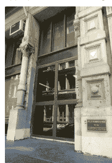

图 2：Fluxhouse 合作社 1967–89，由 edenpictures 设计的 Fluxhouse 经 CC BY 2.0 授权.^⁷

- ²³ Edmond and Jules Goncourt 引用自 T.J. Clark, *The Painting of Modern Life: Paris in the Art of Maret and his Followers*, Princeton: Princeton University Press, 1999, p. 34.
- ²⁴ 莫奈在阿让战尼有一艘“画画船”或工作室船，爱杜华著名地画了一幅他与妻子同伴的肖像，*Claude Monet dans son atelier* (1874)。
- ²⁵ Zukin 所指的现代主义“公寓工作室”是勒柯布西为阿梅德·奥尚范设计的艺术家工作室—— Maison-atelier de peintre，法国巴黎，1922。这是对19世纪轻工业艺术家工作坊特征的重要升级，这些工作坊通常位于巴黎的郊区和工人阶级地区，被阿尔贝托·贾科梅蒂、阿尔多·莫迪里亚尼和帕保罗·毕加索等现代艺术家用作居住工作室空间。
- ²⁶ Sharon Zukin, *Loft Living: Capital and Culture in Urban Change*, Baltimore: Johns Hopkins University Press, 1982.
- ²⁷ 要查看此许可证的副本，请访问 `//creativecommons.org/licenses/by.0`。

## 工厂（1962-1989）

沃霍尔的“工厂”帮助了艺术家在城市加速去工业化时占领了旧工业空间。² 工厂表达了生产的一种双重过程：集体的、工业的、场地敏感的、性别化的、欲望的。工厂工作室是一个模糊艺术与生产、艺术与生活界限的空间——一个为了反对大规模的、表演性的、民主的媒介化的艺术实验室。对于抽象表现主义之后的一代人来说，工厂不仅是重新发明艺术的空间，也是重新发明自我的空间，而这又被框架为艺术：“六十年代中期，例如，概念主义者将创作艺术的过程呈现为工作。”⁹ 在这一阶段，新先锋通过挑战原创性、个人主义和性别歧视更新了艺术。因此，工厂是一个解放生产的空间，对抗了博物馆和资产阶级利益。艺术家还模仿工业劳动的模式组织了“艺术工人”，但并非（主要）是为了“反抗浪潮或工作条件”，³⁰ 而是为了激进地反对资产阶级资本、种族主义和技术统治.³¹ 从波普、行为艺术到大地艺术，艺术家力求明确艺术与商品之间的关系。通过一罐汤，艺术品可以按打产生，按码出售，每个人都可以成为十五分钟的明星。工厂的生产力量可以被荒废，其努力和巨大的能量被劫持以产生关于性、艺术和表演的新实验思想。未阐述的空间扩张为重新安排生活、工作和创作的内容提供了一张（几乎）白纸。

# 激进住房：艺术、斗争与关怀

最具雄心的艺术家项目之一——乔治·马库尼乌斯（George Macunius）的“通量房合作社”（Fluxhouse Cooperatives，1966年至1975年），与沃霍尔的“工厂”产生了交集。它们共享了60年代末和70年代初纽约去工业化的背景条件，但以一种完全不同的模式利用了这些条件。沃霍尔工厂被誉为一种活着的艺术品和商业模式，而通量合作社被构想为后者的倍数。它们是以 `Fluxhouse Cooperative Inc.`³ 之名进行的共产主义特征的波西米亚式资本主义幻想³² 马库尼乌斯想象了“通量房”或“流动性”（如果这些合作社是用来复制和放大的基础单元）。然而，谈判纽约区规划法的务实做法以及融资的困难，意味着这种模式仅能由艺术家复制，并日益被涌入的中产阶级和紧随其后的开发商所资本。

在20世纪60年代和70年代初的一段时期里，**阁楼**（Loft）³³ 是艺术家的一种廉价解决方案，也是一种关于在城市创作和生活的新方式——这种方式启发了许多模仿者。然而，舟金（Zukin）认为，随着艺术家越来越愿意在居住和工作场所同一处展示他们的作品，“在艺术家工作室对艺术的消费演变成了对工作室的消费”³⁴ 这种中产阶级对工作室的青睐意味着表演艺术和概念艺术的一个无意结果是“艺术本身的成功”。工作室成为了大都市生活中一种令人向往的模式。在艺术家占用了由工业工作释放出的空间后，新的中产阶级转而为这些空间斗争，将旧工业空间变成了一个蓬勃房地产类别。阁楼公寓成为一个关键的城市符号，在随后的后工业时代房地产热潮（1980年代、1990年代和2000年代）中以反复的形式出现。另一方面，士绅化过程确保了艺术家与资本回收市中心富裕地带的低收入居民之间的共同条件，这引发了围绕住房和空间的新型斗争与团结，特别是在纽约的下东区³⁵

> 32 在21世纪10年代重新审视马库尼乌斯的项目，弗洛里亚·克拉默（Florian Kramer）和瑞妮·里德韦（Renee Rideway）讨论道“通量既是一个经济项目，也是一个艺术项目”，“其表演性不仅是美学的，而且是双极的和生物力学的选择，导致了依赖狂躁的商业周期。”克拉默，“抑郁：后忧郁、后通量、后共产主义、后资本主义、后数字、后西西普林”，收录于 Maya Tountha 等人的《膝盖的实伤》，维尔纽斯：Rupert, 2016, p.87。马库尼乌斯可能被称为“苏荷的缔父者”（即引力中心），或者是少数几个让罗伯特·罗伯茨（Robert Roberts）通过摧毁曼哈顿大片区域获得成功的艺术家之一，或是后危机时代美国蓬勃发展的、规模小但实用的艺术家合作住房项目的者：清楚的是，他的成功与否取决于马库尼乌斯是否被视为一个早期作品是经济企业的艺术家，他终身将共产主义的政治（=宏观）经济概念转化为可行的微观经济。这些项目在狂喜与抑郁的永久双极循环中兴起又衰落。从这个意义上说，马库尼乌斯不仅触发了士绅化，还通过其依赖狂躁的影响者和初创企业模型预演了创意经济。”克拉默，“抑郁：后忧郁、后通量、后共产主义、后资本主义、后数字、后西西普林”，p.92。

- 33 舟金, *Loft Living*.
- 34 舟金， *Loft Living*.
- 35 Gregory Sholette 等（编），*Upfront: A Publication of Political Art Documentation/Distribution*, 1983

## 开放或社区工作室（1966至今）

开放或社区工作室位于边缘化（阶层化的）人群聚集与经济衰退及城市破败状况相结合的地方。一种被称为“空间集中危机点”的现象在1950年代的西方城市达到，并迅速转变为“空间去集中”³⁶；我们用这个术语来描述复杂的迁移过程，例如美国白人中产阶级的郊区化，以及英国从大城市向新镇的规划性阶级迁移³⁷。开放工作室记录了并随后对这些过程留下的城市社区进行侵入和遗弃。在美国，黑人艺术运动（Black Arts Movement）在“贫民窟本身就是画廊”³⁹的激进政治前提下，在市中心的大贫困地区建立了剧院、音乐厅、排练室、展览空间以及艺术和音乐工作室³⁰。产生的场所成为了一种社区艺术理念的平台，其特点是试图避开专家，转而提供直接和的社区服务。在英国，此类案例及其支持的社区艺术“可以追溯到1960年代，并与吸引书店、剧团和所谓的艺术家实验室有关，后者成功吸引了新的、更年轻的观众；⁴⁰ 但在艺术委员会报告（1974年）之后，社区艺术的逻辑被形式化，并日益吸引美术艺术家、专业人士以及不断增加的媒体艺术家⁴¹。这些艺术的³²“空间”利用了二战后失败的遗产（例如公共卫生和社区教育），这些空间是开放的、灵活的临时或移动的，并且比传统的工作室或画廊更正式。

大多数社区艺术都有一个运营基地或“资源中心”（有时是移动的）

为了维护其自主性（建筑、占屋点、社区中心），社区艺术走上街头，通常将自决权的斗争和经济生存的基础界定为一种抵抗性的创造力。

社区工作室的即兴精神和空间重新利用逐渐被纳入政府推动的计划中，即推出一种持续的、游客友好型艺术。这种艺术的存在标志着围绕场所营造、文化旅游和内部投资的更广泛的地缘政治竞争。对于那些发起这些参与性实践的人来说，文化委托中的管理转向复制了更广泛的权力性质转变——这种转变声称代表无声之者发声，空洞地诉诸商品，却从它们自身的表现中剥夺了作为意义来源的。⁴⁷ 真实的社区工作室随着普遍性供应的萎缩而存亡，并与建筑空间作为高租金收益私产的兴起成反比。随着社会保有权的下降以及公共所有权无法追上社区艺术的指数级增长，社区工作室已几乎完全消失，退缩到卧室生产和社交媒体的集团化贫民窟。

图 4：Makrolab mkii，Rottniest Island /Wadjemup，西澳大利亚，2000年，“家园”展览的一部分，西澳大利亚州美术馆和珀斯国际艺术节。照片由 Marko Peljhan 拍摄。

# 网络工作室（1989年至今）

20世纪60年代受控制论和通信技术启发的工厂制概念艺术家，他们开创的行政和信息美学，将重新出现在无处不在的办公室隐喻中，这种隐喻被整合进电脑桌面，并由 Apple Macintosh 自1984年起普及。

⁴⁷ Walker, 2002, op. cit. 以及 Claire Bishop, *Artificial Hells: Participatory Art and the Politics of Spectatorship*, London: Verso. 2012.

# 激进住房：艺术、斗争、关怀

作者：

图灵的通用机器将产生一种新的空间拓扑结构，其中艺术可以伪装——在控制论社会中被认为是普通的劳动。对于偶然观察者来说，艺术家对计算机的使用在很大程度上与服务人员、记者、建筑师或工程师的使用没有区别。20世纪60年代的概念技术最终在1990年代的网络工作室和非物质劳动形象中重新组合。孤立的工作室并不一定移动位置，但通过技术、服务、建筑保险条款的变更、健康与安全措施，以及喂养第三产业和官僚机构增长的财务诉求的进一步发展，变得日益网络化。网络工作室中的艺术家对前辈所突破的限制做出反应，前辈们打破了更广泛社会中存在的划分，并在第一波浪潮中，与开放工作室的 DIY社区精神高度重合。网络工作室以各种形式伪装自己，无论是办公室、艺术家阁楼、黑客实验室、社区中心、网吧或简单的便携式笔记本电脑。因此，我们可以将网络工作室定位为与建筑空间的一种不确定、欺骗且可能焦虑的关系。这可以与双重运动联系起来，在其短暂的历史中可以识别为艺术家占据了展示其基础设施的空间，并在城市外壳内将其消解。

网络工作室最极端的形式是信息导航员随身携带的连接网络的移动手机。早期的网络艺术家将数字游民式的空间不稳定性视为一种祝福。这种1995年对网络作为固定关系替代的肯定，倾向于产生单一的尽管是混合的空间（例如伦敦的 Backspace、卢布尔雅那的 Ljubmila、纽约的 Rhizome 和萨格勒布的 MaMa），艺术家在其中构建了软硬件的组合，并融合了互联网新兴的通用空间/时间。网络工作室提供了一个进入并放大日益混沌的出口。这最具标志性的例子也许是 Makrolab (1994-2007)，它由斯洛文尼亚艺术家 Marko Pejhan 设计，他生长在不结盟的南斯拉洛维亚，通过收听 CB 无线电台长大，并将这种遥远和孤立的收听体验转化为信息时代的噪音。Makrolab 是一个移动通信枢纽，看起来像一个太空舱，在日益孤立的地点之间移动，聚集公众，并监控那些在感性全球化中往往是秘密或不可见的电信交换。

- Benjamin Buchloch, “Conceptual Art 1962-1969: From the Aesthetic of Administration to the Critique of Institution”, 1990年10月，第55期，页码 105-143.
- Maurizio Lazzato, “Immaterial Labour”, in Paolo Vino and Michaelhardt (eds), *Radical Thought in Italy: A Politics*. Minneapolis, Minn; London: University of Minnesota Press (Theory Out of Bounds), 1996.
- “我正在做的当前项目被称为 Makrolab。这是一个需要研究策略的项目：如何从社会中孤离开以便更好地观察这个社会。它与通常进入社会并改变或制造事物的做法相反。我的论点是，在一个孤立和隔绝的环境中，拥有通信和监控社交事件的开放可能性，通过物理上的隔离，可以为社会演变提供更快速、更高效的‘呼唤’。这是我的论点，不仅仅是一个想法，我将证明它。” Pejhan 引用自 Josephine Bosma, ‘Interview with Marko Pejan’, 2011，可用：`http://www.josephinebosma.com/web/node/61` [访问日期，2018年9月11日]

## 按需理论

然而，这种流动性也预示了千年之即将到来的稀缺——在那个时代生存意味着保持移动。数字前卫的出现与房地产大热（在英国和美国）相吻合，我们尚未看到其终结。在这个时刻，数字艺术家往往在市中心占据空间了一段时间。这些数字艺术家通常兼任网页设计师，可以在同一张办公桌前创作。对于邻壁的上班族来说，他们的活动与白领工作没有区别。虽然网络工作室最初将其投影为商业区域中的异常，但根据商业预测，这种可能性被迅速消除。

(1999–2002年)Makrolab 的开放，为那些将自己视为创造性的企业提供了道路。进入这些空间的新格式业务的特征是内置的休闲符号（乒乓球桌、豆袋、办公室宠物、饮料车、酒吧），它们被整合到新的企业美学中。网络工作室居民实验的技术迅速开始重新配置此前分离的空间，尤其是劳动与创造力之间。对计算机技术结果的部分“黑客行为”，现在被整合到许多新的商业模式中，让位于诞生于此前未曾计算的事物上的因果逻辑。利润可以通过消除此前离散的社会形式、物体、地点和网络之间的障碍来寻求，任何点都可以连接到任何其他点。控制论与竞争性和物化的经济逻辑（排序、排名、数据银行、定位、连接）的整合，释放了基于去介化过程的创业精神。去介化，空间中的点，与买家和卖家对齐，可以通过新的方式连接，破坏了有序的时空排斥。空间对破坏性配置的开放，感受到了2090年代末一个不断寻找商业机会（和风险投资）的创业主体的出现。

- 51 开放基金会建立了艺术与西欧地区的文化整合，以创造跨国资本运动所需的平滑空间（斯洛文尼亚共和国，文化部，无日期）。
- 52 Tsugio Makimoto & David Mann, *Digital Nomad*, New York: Wiley, 1997.

53 C. Lucy, Luciana Parisi, Terisa Terranova, ‘Introduction: The Becoming Topological of Culture’, *Theory & Culture & Society*, No. 2, 4-5, 2012.

# 激进住房：艺术、斗争、护理

新的且不稳定的接近性，无论是物理上的、资源上的还是两者兼有。54 在这种新范式中，网络工作室的运营者此前一直寻求消除城市混合商业文化空间与互联网之间的区别，55 他们发起了一场反向运动，试图对抗点经济日益渗透的创意品牌化，以主张艺术的独性和艺术家的活动性。随着所有工作室都默认变为数字化网络化，网络工作室开始消失。跨国资本主义在金融化形成和劳动力结构重组中释放的混乱，在城市尺度上被转化为社会住房小区的拆除，以及钢玻璃办公楼的垂直兴起，而在这些地方，不再有稳定且负担得起的工作室空间。网络工作室可以被视为工作室永久定居的预警信号。

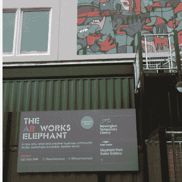

图 5 弹出式集装箱公园，大象城堡，由开发商 Lendlease 私人运营，照片源自 2014 年 9 月。

## 弹出工作室（2000-2020）

后概念艺术家并不那么需要工作室，正如他们无法拥有工作室一样。尽管如此，工作室仍然站起来并用双脚行走，在新的、预制的伪公共空间中弹出出现。它是市政主导的再生计划的产物，模仿并融合了此前艺术家在商业物业租赁租约谈判中进行的自我组织化开发时刻，正如 Tracy Emin 和 Sarah Lucas 在 Brick Lane 上的商店（1993年）。到此时，孤立的工作室不仅被城市虚拟化的网络包围，而且直接整合到这些网络的开发中心。

弹出工作室现在是任何寻求投机投资的所有者的开发商主导的不可或缺品。工作室的这种投机功能在“例外空间”的高度可见性中得到了体现，在这些空间中，无论实际需求如何，都安装了玻璃店面、闪眼的招牌和鲜艳的颜色，并期望艺术家像艺术家一样充满魅力地表演，无论他们的实践是概念性的、基于计算机的、后工作室的还是社会参与的。事实上，弹出工作室被整合到城市转型的终殖民化过程中，这使其与艺术家的主体性和社会更加孤立。它代表了由小型艺术组织（或引导它们的微型项目）和政府政策推动的艺术在孵化过时空间方面作用的重要推动。与此同时，在 2007/8 年金融危机后，“同时”空间、空间时代、弹出式零售、临时空间出现了一种新语言。Meanwhile Space 小组开创了空置空间、节约型议会和虎视眈眈的投资者之间的调介。56 空置空间是社区的污点，是对其他及更广泛的公民公众的财政负担。利用它们是一个机会。57 弹出具有特定的时间性，其假设由投机性提议设定，即空间将变得有利，反过来它将其预测转化为现实。将租赁这一古老危机视为机会，弹出式在没有艺术特质的情况下运作，以达成共识：工作室可以弹出，随着租金上涨，越来越倾向于某种形式的评论。这可能是工作室作为一种完整形式先于、预设并编码艺术家活动的第一次。弹出通过偶然性、要求和条件贯穿于开发商的计划。其特殊性提供了与卓越之间必要的联系。58 弹出工作室的实践像金鱼一样透明，旨在被观察和展示。无论其空间是装满了杯蛋糕还是高端抽象，都将是一种有意识的表演，表演者没有注意到强加给其他人的情况。伪装成包容性的实际上是排他性的。弹出式艺术从业者。

- 54 AirBnB 已成为这种城市拓扑结构以及社会与物理关系网络化的典范，这强化了一种贯穿始终的抒诗性，例如对社会领域。

- 55 例如，在 Everything 咖啡馆工作很随意：“如果我喜欢那里，”Bunting 评论道，“大多数人都在检查热邮箱，而我在写程序——这是一个很好的伪装。”Josephine Berry, *《The Thematics of Site-Specific Art on the Net》*，博士论文，曼彻斯特大学，[online] www.metamute.org/sites/www.metamute.org/files/thesis_final_0dc_2001,81

- 56 Mara Ferrari, *《Occupying Vacant Spaces: Precarious Places of Temporary Urban》*，博士论文，伦敦大学，2013, [online] Available at: http://qmul.ac.uk/jspui/handle/1234567/8460 (Accessed, 28/09/2018).

- 57 Meanwhile Space 引自 Ferrari, *《Occupying Vacant Spaces》*, p.129.

- 58 一个例子是 Alumno/SPACE Studios，伦敦金学院，其中“一个毕业生获得一个免费的工作室空间”开发并由 SPACE 运营，Southwark Hall Building 也容纳了金学院的学生。http://almonogroup.com/alumno-space-studios-goldsmiths-burary-winner-2019.

- 59 The Pop Up 于 2012 年 2 月由 Empty Shop Network 发布。

# 激进住房：艺术、斗争、护理

弹出工作室因此是：“一个非常具有微妙性和神学毅力的烦人事物。”62 在社区的烟雾弹背后，它放置了一个年轻、脆弱、灵活的人口结构，“信赖的中间人”，61 从地方政府的角度来看，他们通常受限于提供服务。这些信赖的中间人的利益更接近开发商和国际投资者，而不是艺术家或社区。弹出式是住房和社区联系的前线，出售整个房屋。

现在弹出式零售已成为常态，很容易忘记这种形式作为地方当局分配临时住房或社区策略的起源。整个 1970 年代，这种短命一直是缓解住房问题的手段。63 在 2008 年市场崩溃后，许多艺术家居住/工作。正是在这样的情况下，摄影师 Rab Harling 关注了 Artangel 艺术委托机构，并在 66 描述了成为弹出式从业者所需的个人和专业特征，即使他们的项目不仅仅是为了社区。Thompson 引自 Ferrari, *op cit.*, 2013, p.133

- 60 Karl Marx, *《资本论：政治经济学批判第一卷》*, Fawkes and David Ferrell, 1990.

- 61 Ferry, *《Occupying Vacant*, p.123.

- 62 在随后的民主代表研究中，注意当选成员的专业背景也是重要的。根据 Paul Watt 和 Middleton 的说法，2013年20% 的成员担任游说员，而前议会主席 Jeremy Fraser 继续加入 Four Communications，该机构由前议员和内部长加入。议会员工、当选成员和开发商之间的“旋转门”。例如，Tom Bertram 的项目管理了大象区直到 2011 年，他离开议会为该项目的首席开发商工作。Paul Watt 和 Anna Milton, *《伦敦住房危机及其行动主义》*, 2016, available at: https://www.londonline.com/doi/10.1080/13604813.2016.115107 [Accessed: 15 July 2019).

- 63 Anna, *《Resaping London – The Story of Local Life 1970-2000》*, 2010., available at: https://research-information.bristol.ac.uk/files/33489426/289648.pdf [Accessed, 10 March 2019], pp.-99.

- 64 Richard Wyatt, 'Angels, The Phoenix, Bath, Bath Waters and Utilities – The Bow Trust Live/Work Scheme', 自版 2011, https://www.academia.edu/256140/Angels_The_Phoenix_Bath_Waters_and_Utilities_The_Bows_Trust_Live_Work_Scheme [Accessed: 15 July 2019].

- 65 Christine Fisher, 'Creative States: Pop Fetishing Estates', 2014年7月14日, available at: https://www.vice.com/en/article/jm9853/baldon-tower-art-fetishing-estates-157 [Accessed: 15 July 2019] *

- 66 Thompson, 引自 Ferrari, *op cit.*, 2013, p.133.

早期地点的委托可能被视为寄生并重新编码空间的“快闪艺术”的先驱。由此产生的艺术作品通常通过对场地进行不同的社会化处理，起到对某一区域或标志性建筑进行品牌的作用，吸引那些认为最可能对其未来进行投资者的注意力。由于艺术家通常在现场工作，这种委托方法认为为临时设在开发区中心的“快闪工作室”铺平了道路，这些工作室的用户被鼓励尽可能可见地进行创作，并在可用空间耗尽之前，他们会定期获得即性的展览机会。

回溯性看，在以 2007-2008 年金融危机为起始的周期之后，“快闪”是这些前身场所被暴力转运到开放市场的一个时刻。在这里，引人注目的是，现在是议会形式或住宅小区被新划定为（暂时的）工作室生产地或艺术干预场所。正如 20 世纪 60 年代的工业空间规划及其持续的其实际利用一样，城市开发对新价值提取地点的需求，混乱地给整个社区及其家庭带来了长期的过时，仅为艺术家创造了短期机会。这构成了对先卫现代主义掌控城市的彻底反转，艺术家不再被雇佣为远景家，而是被鼓励在社会住房生产的残骸中捡拾。

房子，无论是以疏空的排屋房屋形式（Rachel Whitehead, 1993），还是通过绘画式主张完善的住宅小区地图（如《住宅地图》，Keith-Country, 1991-1995），都成为英国艺术的核心母题。此时的居住模式似乎既与地缘政治冲突相联系，又反映了艺术现代主义的衰落以及更广泛社会对立的微观。1990 年代艺术中的房屋是为了哀悼过去或为了社会主义，而 2000 年代后期艺术家安置在之前的地方政府住房中，引发了对房屋形象和住房社会问题（Julie Brennan, 2015-ongoing 以及 Laura Oldfield Ford, 2008-）的批判性思考，同时也作为艺术野心与原始反抗相结合的极其傲慢的时刻（Mike Nelson, 2013）。少数从这些房屋内部反抗其怪诞功能的艺术家，为了揭示它们并非不可避免的自然属性，正在制定和发明他们深受影响的政策，而一种虚弱的姐妹艺术正要出现。从 2009 年回望现在，这是住房私有化、艺术、空间和财产进入一个完全敌对且动态纠缠的视角之一，艺术与社会的批判性关系在其中行使和发展。

> Hannah and Ellis-Petersen, 'Decaying East London Tower Box to House 12-macbeth Production', The Guardian, 19 June, 2014, available at: https://www.theguardian.com/stage/2014/jun/19/east-london-london-tower-macbeth-production [Accessed: 15 July 2019).

> 66 Christy Romer, 'Artist squares to Regulator over 'manifestly unreasonable' fundraising investment', Arts Professional, 2017, available at: https://www.artprofessional.co.uk/news/exclusive-squares-regulator-over-manifestly-unreasonable-fundraising-investigation [Accessed: 20 September 2018).

# 激进住房：艺术、斗争、关怀

# 结论

如果在整个现代性过程中，后代艺术家梦想着将思想和创作都加速到技术生产的速度，那么他们绝不会失败。画笔对逃逝性的追求比蒸汽机要慢，而未来主义者狂热的白热则将地面装配线抛在尘后。与平庸生产的时间上的巧合在几个世纪以来，无论是否有意图，都是艺术所固有的。艺术家需要快闪、填补、参与并在那里进行表演性创作的要求，证明了他们与加速且无目的的创造与毁灭、泡沫与破灭、金融化的循环之间存在不可避免的同步性。

萨迪克·坎汗最近的《伦敦计划》要求为艺术家提供永久空间，这与其说是密度的标志，不如说是问题的迹。⁷这种特殊的规定呼应了艺术在实践中仍然垄断的独特性，这从根上毒害了它，因为它涉及到对现有工作室空间的特殊保护，并要求艺术为了换取其存在的许可而做些回报。工作室作为一种远离生活其他部分的实践空间，似乎面临灭绝，要么是因为它是不可持续的，要么是因为它现在离家太远，要么其偶尔满足条件的可能性完全压倒了实践。但如果狂喜的子宫式孤立与今天开发者幻想般的壮丽表演之间的鸿沟似乎太大，无法让艺术回到它们的公分母或结果，那么在任何真正感到艺术正在发生的地方，不可避免的是与这些模型的脱离。这一事实与自主艺术的短期性质同样紧密，使其安全地移走。资本主义对空间无尽的生产和破坏产生了艺术生产的物理赞助，而那些空间演变同样驱动了艺术实践的转型，反之亦然。对可用空间或生产通道的居住可以认为是调节艺术与社会世界关系的辩证，正如我们艺术家机会性地占据生存空间。这一过程已转化为空间勘探的范式和润滑剂，这意味着，正如地球碳资源的燃烧一样，生命永恒的。然而，当我们开始看到，资本主义对艺术的蚕噬遭遇了那些判定它们的力量。

# 参考文献

Adorno, Theodor. *Aesthetic Theory*, trans. Robert Hull, New York: Continuum, 1997.

Cramer, Florian. 'Depression: Post-Melancholia, Post-Flux, Post-Communist, Post-Digital, Post-Prozac', in Maya Taunda (2016) *A Injury to the Knee*, Vilnius: Rupert, 2016, pp. 60–107.

Ellis-Petersen, Hannah. 'Decaying East London Tower to House 12-macbeth Production', The Guardian, 19 June, 2014, available at: https://www.theguardian.com/stage/2014/jun/19/east-london-london-tower-macbeth-production [Accessed: 15 July 2019).

Enwezer, Okwii. 'The Production of Space, Protocols of Communication in the Work of Le Group and Facets', in Gregory Sheila and Blake Stone (eds) *Collectivism Against Modernism*, Minneapolis: University Minnesota Press, 2007, pp. 223–252.

Foucault, Michel. 'Nietzsche, Genealogy, History', in Paul Rabinow (ed), London: Penguin Books, 1984.

Ferrari, Maria. *Occupying Vacant Spaces: Precarious Policies of Urban Reuse*, PhD Thesis, Queen University of London, 2013, available at: https://core.ac.uk/download/pdf/77038644,pdf [Accessed June 3 2021].

Goldner, Lauren. 'Fictitious Capital for Beginners', Mute, Vol.2 No.6, 2007.

> 66 Christy Romer, 'Artist squares to Regulator over 'manifestly unreasonable' fundraising investment', Arts Professional, 2017, available at: https://www.artprofessional.co.uk/news/exclusive-squares-regulator-over-manifestly-unreasonable-fundraising-investigation [Accessed: 20 September 2018).

Arts Council England, *Art in: Turning Empty Spaces*, 2009, available at: https://www.artcouncilengland.org.uk/sites/default/files/art-plan.pdf

Colin, Peter. 'Tack and Snap: A Report on Radical Incursions', Mute, 2009, available at: http://www.metamute.org/articles/slack-and-snap-report-radical-incursions-symposium

Buren, Daniel. 'The Function of the Studio', October, 1979, pp. 51–58.

# 参考文献

Bryan-Wilson, Julia. *Art Workers: Radical Practice in the Vietnam Era*. Berkeley: University of California, 2009.

Bishop, Claire. 'Exceptionalism: Participatory Art'. London: Verso, 2012.

Bosma, Josephine. 'Interview with Marko Peljan', 2011. Available at: `www.josephinebosma.com/node/`

Bowman, Anna. 'Interims Spaces: The Role of Art'. PhD Thesis, Queen University of London, 2010. Available at: `https://research.bistol.ac.uk/discovery/34489,pdf`

Buchloch, Benjamin. 'Conceptual Art 1962-1969: From the Critique of Institution'. *October*, 1950, pp. 105–143.

Balzac, Honoré. 'The Unknownpiece', 1845. Available at: `https://www.gutenberg.org/files/23060-h`

Beech, Dave. 'The cannibalism of art by capitalism encounters the very forces that condemn them to.'

Christie, Claire. 'Hey, Stop Fetishing Estates'. *Vice*, 14 July 2014. Available at: `https://www.vice.en/uk/article/m9d3-on-fetishing-estates`

Sadiq Khan's recent London Plan calls for the provision of permanent spaces for artists is an indication of the problem.

# 激进住房：艺术、斗争与关怀

Gould, Charlotte. *Artanghel and Finishing Art: Adapting to Social and Economic Change*. London & New York: Routledge, 2018.

Harding, Anna (ed). *Artists in the City: SPACE in '68 and Beyond*. London: Space Studios, 2018.

Harris, Andrew. 'Livingstone verus Serota: The High-Rise Battle of Bankside'. *The London Journal*. Vol.3, No. 3, 2008, pp. 28–99.

Harvey, David. 'The Spatial Fix: Hegel, von Thun and Marx'. *Antip* Vol.13, no. 3, 1981, pp. 1–12.

Harvey, David. 'Globalization and the "Spatial Fix"'. *Geographische Revue*, No.2, 2001, pp. 23–30.

Harvey, David. 'The Art of Rent'. *Socialist Register*, 2002, pp. 93–102.

Haynard, Danny. 'Fire in a Bubble', September 15th 2017. Available at: `http://www.metamute.org/editorial/articles/fire-bubble` [Accessed 20 August 2018].

Inventory, Inventory Sticker Project, c.1999-2002. A complete collection can be consulted in May Day Archives, London, `<https://maydayrooms.org/>`

Iles, Anthony and Vishmidit, Marina. 'Which Makes You Find Work'. *Variant*. No. 41, 2011.

Jacobs, Jane. *The Death and Life of Great American Cities*. New York, Random House, (1961) 1993.

Kant, Immanuel. *Critique of judgment*. Werner S. Pluhar, Indianapolis: Hackett, 1987.

Lapavittasa, Costas. 'Financialisation, and the Search for Profits in the Sphere of Circulation'. London: SOAS, 2009. Available at: `http://www.soas.ac.uk/rmpf/papers/file51263.pdf` [Accessed 20th August 2018].

Lazarrito, Maurizio. 'Immaterial Labour', in Pablo Vino and Michael Hardt, *Radical Thought in Italy: A Political Politics*. Minneapolis, London: University of Minnesota Press (Theory Out of Bounds), 1996.

Lefebre, Henri. *The Survival of Space*. trans. Nicholson-Smith, Oxford; Cambridge, Mass.: 1976.

Lefebre, Henri. *The Production of Space*. trans. Nicholson-Smith, Oxford; Cambridge, Mass.: 1991.

Lewis, E. A. *Power Stronger Than Itself: The AACM and Experimental Music*. Chicago: University of Chicago Press, 2008.

Looker, Benjamin. *From Thought Which Created: The Black Artists' Group of St. Louis*. St. Louis, MO: Missouri Historical Society Press. Distributed by University of Missouri Press, 2004.

Luria, Celia, Parisi, Luciana and Terranova, Italiana. 'Introduction: The Becoming Topological of Culture'. *Theory, Culture &* 29 (2012): 4–5.

Makimoto, Tsugio and Mangler. 'New Towns for Old', in B. Conekin, F. M. C and Waters, C. ed., *Moments of Modernity: Reconstructing 1945–1964*. London: New York: Rivers Press, 1999, pp. 208–27.

Martin, Randy. 'Introduction', in *Wohnungsfrage*. Berlin: Haus Der Kulturen Der Welt. Exhibition 22nd October — 14th December 2015, (n.p.).

Marx, Karl. *Capital: A Critique of Political Economy I*. trans. Ben Fawkes and David Fernbach, London: Penguin, 1990.

Medina, Cuauhtémoc. The "Kulturbolcheiken" II: Flux, Khrushchev, and the "Concretist Society". *RES: Anthropology and Aesthetics*, 49/50 (Spring – Autumn, 2006), pp. 21–34.

'Postscript: Space, and Race'. *Midnight Night*, No. 4, 1981, pp. 32-36.

Miller, Toby & Shin Young Yeo. 'Artists in Tech Cities'. London: Space Studios, 2017. Available at: `<https://repository.libro.ac/report/Artists_in_tech_cities/946635>` [Accessed, 6 June 2020].

Moreno, Louis. 'The Urban Process Under Financialised Capitalism'. *City*, 2014, 18.3, pp. 244-268.

Morehead, Joanna. 'Artists are coming to a hot street near'. 23 April 2009. Available at: `https://www.theguardian.com/artdesign2009/apr23/artists-take-over-shops` [Accessed, 20 September].

Romer, Christy. 'Art squares to Regulator over manifestly unreasonable fundraising'. *Arts Professional*, 2017. Available at: `https://www.artprofessional.co.uk/news/regulator-over-manifestly-unreasonable-investigation` [Accessed 20 September].

Republic of Slovenia, Ministry of Culture. New Media Art. [online] Available at `https://www.culture.sl/en/New_media_art` [Accessed 13 February 2010].

Saler, Michael T. *The Avant-Garde in Interwar: Medieval Modernism and the London Underground*. New York: Oxford University Press, 2001.

Sholette, Gregory, et al (eds). *Upton: Publication of Public Art*, 1983.

Smith, Neil. *The New Urban Frontier: Gentrification and Revanchist City*. London: Routledge, 1996.

Sparrow, Andrew. '100 quango abolished in cost-cutting', 2012. [online] Available at `https://www.theguardian.com/politics/2012/aug/22/100-quango-abolished-fire` [Accessed 28 September].

Thompson, Dan. 'Pop Up People', 2012. Available at `https://emptyshops.wordpress.com/2012/popupe` [Accessed 28 September].

Thresher, Steven. "The ghetto is the gallery: Black power and the artists who captured the soul", 2017. Available at `https://www.theguardian.com/artdesign2017/jul/09/ghetto-black-power-soul-of-the-city` [Accessed 20 September].

Vishmit, Marina. 'Creation Myth', 2010. Available at `https://www.metamute.org/articles/creation-myth` [Accessed 20 September].

Walker, John A. 'Left Shift: Radical Art in 1970s'. London: Tauris, 2002.

Ward, Yolanda. 'Spatial Decretion of London's Housing and its activists'. *City*, 2016. In *Midnight Nights*, *Midnight Nights*, No. 4, 1981.

Watt and Anna Martin. 'Angels, the Phoenix, Battery Hens and Vultures – The Bow Arts Trust Scheme'. Self-published 2011. `https://www.academia.edu/256014/Angels_the_Phoenix_Battery_Hens_and_Vultures_The_Bow_Arts_Trust_Live` [Accessed: 15 July 2019].

Zukin, Sharon. 'Left Living: Culture and Capital in Urban Change'. Baltimore: London: The Johns Hopkins Press, 1982.

# 哀悼机器：一个消失场所的讣

# SYLVI KRETZSCHMAR

环顾四周，一切都已消失

所有人都已离开

这里曾是那些绝佳的商店和酒吧

对“埃索公寓”（Esso-Houses）的前住户、租户和承包商的采访。这些房屋最初位于汉堡圣保利区的 Reeperbahn 街，曾由12名拿着扩音器的女性伴随着音乐律动。这些建筑于 2009 年被 Bayerische Hausbau 集团购买，意图是将其拆除。埃索公寓曾是圣保利生活的重要组成部分，拥有廉价的住房、商店以及著名的夜店和酒吧。这些房屋以一家曾为该地区广场服务并设有24小时便利的加油站命名。它曾被称为圣保利的心脏。由于所谓的坍塌危险，埃索公寓于 2013 年被疏散并在 2014 年被拆除。建筑的疏散以及对年长且稳定居民的驱逐，已象征着房地产投机与城市发展政策之间的相互依赖。扩声器合唱团（Megaphone Choir）加入了反对圣保利区日益严重的士绅化抗议。多年来，他们对围绕埃索公寓的政治话语做出了贡献。¹

嗯，好吧……

你无法阻止它

你无法阻止它

你无法阻止它

你无法阻止它

¹ 扩声器合唱团是两个博士项目（“聚集与参与”以及“表演公民”）的一部分，这些项目在 2012 年至 2017 年间开创了汉堡参与性艺术研究（PABR）技术。PABR 不同于学术研究。PABR “探索了艺术、学术界与社会之间的研究形式和格式，其意义不仅包括艺术家和研究人员，还包括其他社区成员，如儿童、邻居、活动人士、专家、公民和非公民”。我与活动人士和艺术家一起，公开测试了扩声器合唱团，作为一种多可移动的占用空间的语音放大系统。参见：`https://pab-research.de/pabr/`

你无法阻止它

你无法阻止它

你无法阻止它

图 1：Sylvi Kretzschmar/扩声器合唱团：2013年表演，汉堡 Park Fiction，圣保利，摄影 Rasande Tyskar。

当然，你无法阻止士绅化

但你可以挤出

一些小岛屿

最重要的是

你可以扰乱他们的神经

你可以很多地扰乱他们的神经

这在某种程度上是好的

不听由他们安排

就这样

# 激进住房：艺术、斗争、关怀

但为了让他们

变得有点疯狂

我正有此致

让他们彻底疯狂

尽管实际上我完全不是那种类型的人

## 扩音器合唱团作为放大器²

扩音器具有手枪式握把。演讲者利用它对准人群和空间，在对齐的声学效果中进行演讲。在说话时，你需要按下扳机来射出一种情感。扩音器作为一种物体可能是政治反抗、抗议和民权运动的象征，但同时它也是一种命令和指令的装置，是下达命令并让空气中充满警告和指令声音的工具或小配件。它被军队、警察、安保部门、部门、指挥官、指挥官、指令者以及（拉拉队）队长使用。它用于人群管理、应急管理，用于教学或赢得观众。在所有这些参考领域，扩音器的应用和功能在声音中震荡，正如扩音器放大政治信息时的图像一样——例如，在政治游行期间的街道上。在这种背景下，可能并不显而易见，“扩音器合唱团”源于这样一个问题：如果一场政治演讲是从政治过程中产生的，而不是发起、引导或控制政治过程，它会是什么样子的？一场政治演讲在不计划、规定或命令活动家行动的情况下，如何有效地反映并放大一个活动家的集体行动？

# 扩音器合唱团

扩音器合唱团的核心是将陈述从一个地方/时刻/连接传输到另一个。我们所说、呼喊、低语和手势的一切都是采访答案的逐字复制。基于音频采访对陈述进行的合唱重复是经过设计和排练的。正如每一场演讲一样，这需要正义的音乐特性的强化。采访中个人演讲的旋律和节奏构成了创作的基础。扩音器、声音和十二名表演者身体的集合再次汇聚并浓缩，有效地创造了一个移动扬声系统。扩音器合唱团是 Esso 倡议³。该倡议成立于 2011 年，一直致力于在圣保罗提供负担得起的住宅和商业空间。多年来，租户们不断斗争，以维持他们的公寓、商店和夜总会。他们得到了汉堡“城市权利”（Recht auf Stadt）网络的支持。

---

² 放大：倍增、增强、强化、招募、后援、提升、增益、提高、强化。

³ 倡议-Esso 建筑 http://www.initiative-esso-hauser.de.

4 Recht auf Stadt 是一个成立于 2009 年的汉堡网络，如今包含约 40 个由足球俱乐部圣保罗 FC 粉丝基础以及如 SOS St. Pauli 等社区倡议组成的组织。该倡议继续协助该地区的新规划和建设措施。

## 我的加油站消失了

我的加油站

46 年的生命消失了

我在圣保罗生活了 46 年

46 年现在不知如何

好吧，我猜圣保罗的最后一部分

随着 Esso 建筑一起死去了

我的加油站消失了

转型完成

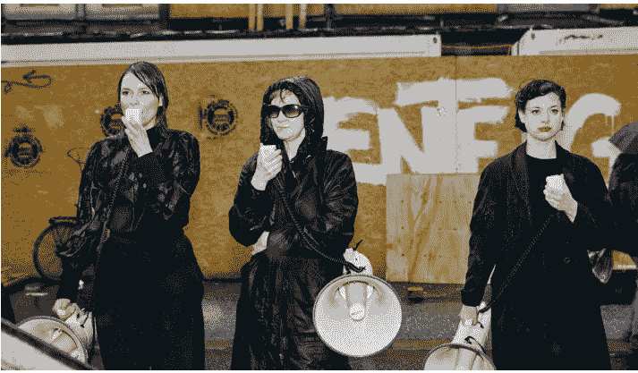

图 2：Sylvi Kretschmar/扩音器合唱团在 Esso 建筑拆除期间的演讲表演，照片由 Paul C.P. Krenler 拍摄。

这些倡议和联盟代表了负担性住房、非商业空间、财产社会化、新的民主城市规划以及公共绿地的保护；为了所有居民——或无证件者的城市权利。www.rechtaufstadt.net/category/english/。SOS St. Pauli 倡议：www.sos-stpauli.de。

# 激进住房：艺术、斗争、关怀

我们放大了一种既不是为了公共公告也不是为了陈述的演讲形式。那些绝不在人群面前说话的人的陈述、想法和幻想，在面对面的情况下变成了对话。尽管一些受访者在汉堡的“城市权利”或 Esso 建筑倡议中具有政治活动，他们在采访中为自己发声。经常，可以听到演讲者在结结词。这通过消除我们在政治煽动中习惯的雄辩、激情的演讲，创造了一种强大且独特的政治信息形式。

扩音器将麦克风、放大器和扬声器结合成移动和便携的音响系统。扩音器的声音具有很强的方向性。每一个动作都改变了演讲的方向和语调。将扩音器转化为合唱团需要，但也允许空间编排。我们使用的扩音器还具有录制和播放功能，我们在音乐上将其用于节奏和循环。在这里，某种政治动动的诗意展开了：政治演讲与现代主义及自主艺术生物的融合。

2014 年 2 月 12 日下午，两只巨大的恐龙咬入了钢筋混凝土，吞噬了该建筑群的加油站。毕竟，我与前居民、邻居、路人以及在门口慢慢聚集的活动家们开始了对话。破坏的开始似乎是一场大型多样化抗议运动的结束，这场运动为 Esso 建筑、圣保罗的士绅化过程以及当地居民、艺术家和活动家的抵抗带来了关注。当 Esso 建筑消失时会怎样？下午的采访回答并没有侵略性，也没有对士绅化问题提供深度分析。它们是重复的，它们诉诸内心，它们非常悲伤，有时感性且哀怨；他们有自己的理由。受访者变得愤怒，他们触动了神经，他们建立了自己的诗。

如果我们放大损失会怎样？如果我们放大无助会怎样？如果我们展示政治抗议的失败和无力感会怎样？作为一台哀悼机器，扩音器合唱团试图在这种情况下区分悲伤与放弃。这是一种集体应对政治倡议之失败的尝试，而不是被其失败所分离和隔离。

他们只是会把它变成

迪士尼乐园

他们卖掉了

整个地区

这里有商店

可能无处不在

在科隆，在嗯，这里

在檀尼鲁，在上海

抱歉，嗯

听起来很苦涩

听起来总是老样子

在街角

那里有一家酒店

那里有一家小酒吧……

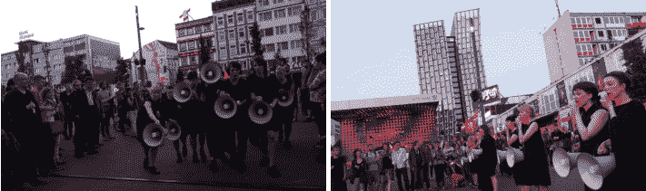

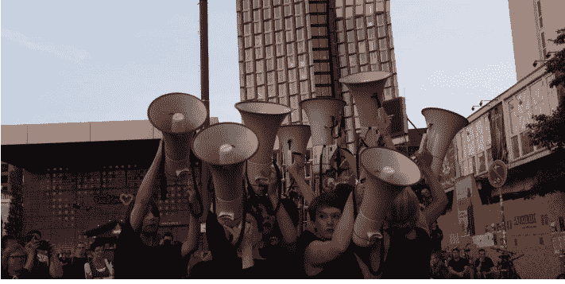

图 3、4、5：Sylvi Kretschmar/扩音器合唱团：在 Hauser Echo 的表演。照片由 Margit Czenki 拍摄。

他们只是会把它变成

迪士尼乐园

他们卖掉了

整个地区

这里有商店

可能无处不在

在科隆，在嗯，这里

在檀尼鲁，在上海

抱歉，嗯

听起来很苦涩

听起来总是老样子

在街角

那里有一家酒店

那里有一家小酒吧……

他们只是会把它变成

迪士尼乐园

他们卖掉了

整个地区

这里有商店

可能无处不在

在科隆，在嗯，这里

在檀尼鲁，在上海

抱歉，嗯

听起来很苦涩

听起来总是老样子

在街角

那里有一家酒店

那里有一家小酒吧……

他们只是会把它变成

迪士尼乐园

他们卖掉了

整个地区

这里有商店

可能无处不在

在科隆，在嗯，这里

在檀尼鲁，在上海

抱歉，嗯

听起来很苦涩

听起来总是老样子

在街角

那里有一家酒店

那里有一家小酒吧……

与市长、建筑部门以及所有者的谈判进展顺利。PlanBude 现在是一个一个被广泛讨论的民主模型。它的研究为建筑竞赛提供了基础。冠军 NL-Architects（阿姆斯特丹）和 Bel-Architects（科隆）转化了 PlanBude 的结果。他们设计了公共屋顶、公共阳台，没有购物中心，俱乐部 Molot 的回归；为 Fablab 提供了空间、社区食堂以及更多。建筑群将产生 40% 的社会住房、20% 的社区住房和 40% 的租用公寓。这意味着 0% 的公寓（无私有公寓）。

在这方面，政治抗议似乎并没有完全失败。Esso 建筑的回声在建筑中至关重要，确保了关于该地区的辩论不会随着拆除而结束。表演指的是一种致力于使命的代理演讲格式，作为一份讣告。

我叫 Slatko

我是最后的莫霍克人

最后一位企业家

拥有移民背景

在 Spielbudenplatz 广场

# 参考文献

- Bude, Irene/Sobczak, Olaf/Jörg, Steffen (dir.). 《Buy Buy St. Pauli》，2014，下载地址：www.buybuy-stpauli.de/film-schauen/

- Esso Häuser Requiem (Sylvi Kretschmarmar/Megaphone Choir 行为艺术 Esso Häuser Echo 的视频记录)，(dir. Svenja Baumgardt, 2014)，下载地址：https://www.youtube.com/watch?v=MvDW04p-7w.

- Sankt Pauli starke Frauen - Der Megafonchor - Esso Häuser Requiem (dir. Rasmus Gerlach, 2019)，下载地址：https://vimeo.com/ondemand/179884/260918313.

- Initiative Esso Häuser http://www.initiative-esso-hauser.de.

- PlanBude https://planbude.de/category/english/

- PlanBude. 设计能改变社会吗？PlanBude - 欲望的生产。演讲：PlanBude – 汉堡 2018，下载地址：https://www.youtube.com/watchtime_continue=10&uEuXdJVyxlE.

- 汉堡城市权 (Right to the City Hamburg), we://rechtaufstadt.net/category/english/

- 参与性艺术研究 https://pab-research.de/pabr/

# METROPOLIZ/MAAM：意大利罗马城市公共实践与美学

# ANDREEA S. MICU

2009年3月28日，一群隶属于 BPN（或 Blocchi Precari Metropolitani¹，一个罗马住房活动主义团体）的族裔背景多元的人，强行开了位于 Tor Sapienza 工人阶级和移民区 Via Prenestina 913 号工业空间的锁。该小组包括摩洛哥人、突尼斯人、厄立特人、苏丹人、波兰人、秘鲁人、多米尼人、乌克兰人和罗马尼亚人，大多是失业或就业不稳定的第一代移民，他们在2008年后的罗马房地产市场上无法租赁或购买房产。该占屋被命名为 Metropoliz。在接后的十年里，Metropoliz 不仅是三百多人的家，也是市内首个将罗姆人与其他族裔聚集在一起的住房占用场所，还是一个蓬勃发展的空间，被称为 MAAM（Museo dell'Altro e di Metropoliz，即“他与异处的博物馆”）。

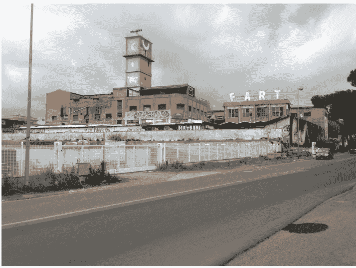

访问 Metropoliz 是一次非凡的感官体验。旧肉厂位于路边，砖块和混凝土的矩形结构矗立在天空下。即使从远处望去，其立面也对路人产生着巨大的吸引力。工厂窗上的破碎玻璃、破败的墙壁以及建筑整体的荒废氛围，与从外面可见的彩色壁画、涂鸦和其他艺术品形成了鲜明对比。在这些作品中，目光很容易捕捉到最靠近街道的建筑屋顶上的字母，它们构成了“FART²”字样。建筑最高部分是一个涂有蓝白相间的矩形塔楼，在三个垂直的插画中描绘了一个人物形象、一个箭头和一个月亮。一个像望远镜的装置坐在这座塔楼上。走向入口时，目光投向其中一侧的铭文，半圆形背景上的蓝色字母拼写着“revolution”（革命）。大门由金属制成，涂成亮丽青绿色和黑色。快速扫过几个黑色金属邮箱箱，上面用白色手绘了几十个名字。扫过这些名字揭示了占屋者多元的族裔背景。

自成立以来，Metropol/MAAM 构成了一个充满活力、不断演变的空间。它的演变说明了占屋实践与公共性表演之间固有的矛盾，这些实践在平衡各种伦理准则与既有城市权力结构中的妥协需求，以确保住房稳定并防止驱逐。在第一个十年里，Metropol 还成为一个典式的当代案例，展示了一个项目如何帮助保障住房质量，尽管这种做法面临着来自自由、批判或由于意见分歧引发的内部冲突。正如占屋空间通常的情况，Metropol 的演变引发了内部和外部人士的批评，关于哪些实践作为政治策略是可以接受的，而哪些可能构成了对资本主义城市发展利益以及罗马艺术界中产阶级以上利益的出卖。这些讨论通常被构筑为冲突中的对立派系，反映了刻画公共性表演性构建的根本性多元性。我们经常在通俗和学术话语中听到，认为这种多元性是当代社会运动的缺陷，因为它们无法达成特定的共识，认为分歧会成为阻碍这些运动政治目标的障碍。Metropol 的历史指向了这种将“多元性视为基层组织障碍”的观点的局限性。作为一个在十年内为居民争取住房保障的成功案例，这处占屋的历史揭示了多元性——话语、意见和行动的多元化——对于公共性实践至关重要，因为它并非一个寻求消除差异的项目。居住在 Metropol 和 MAAM 的人们通过他们的伦理、正义和自由，实践共同构思新自由主义城市化的替代方案。

+ 1 Metropolitan Precarious Blocks，英文版。

196

按需理论

## 边缘地带的博物馆

Metropoliz 所在的边缘地带与每年吸引数百万游客的纪念碑式罗马城迥然不同。这里没有通常那种拿着相机和自拍杆的游客潮，也没有前往市中心上班的年轻专业人士；乘坐公交或电车前往托尔萨皮延萨（Tor Sapienza），发现那里几乎全是移民工人阶级。普雷内斯特街（Via Prenestina）延伸至市郊，到处是贫困的工人阶级社区、空地以及毫无美感的商业区，那里有家具店、加油站、超市以及交通和汽车维修业务。

托尔萨皮延萨的黄金时代出现在20世纪60年代，当时周边地区的工厂为当地完全意大利化的工人阶级提供了充分就业。从20世纪70年代的石油危机开始，一直到20世纪80年代，工厂开始关闭或迁往其他地方。这些生产地的转移导致部分人口离开了该社区。小型家庭企业开始倒闭，这种趋势在后来移民购物者和购物区的到来而持续。虽然该社区的衰败是由去工业化和失业率上升导致的，但许多居民将其归咎于20世纪90年代连续的移民潮。这些浪潮逐渐改变了这里的人口结构，但也标志着随着种族和民族问题而形成的整合与凝聚的困难。没有任何一个群体的人数超过来自东欧的罗姆人，他们最初作为前南斯拉夫亚的难民抵达此地。市政府在萨尔瓦蒂街（Via Salvati）建立了一个营地安置他们，直到提供永久性住房，但这个临时的营地却从未被拆除。除了萨尔瓦蒂街的罗姆人营地，托尔萨皮延萨在莫兰迪街（Via Morandi）还有一个为移民设立的接待中心（accoglienza，难民中心）。难民中心主要由北非洲人和撒哈拉以南非洲人——以及最近的来自中东战争的难民占据——长期超载且资源匮乏。种族主义和排外情绪在该地区无处不在。

“大”就是在这样的地理和社会背景下诞生的。从内部看，这座被占占的工厂正如想象中那样具有吸引力。越过大门，右侧有一个院子，有一条直通工厂尽头的小巷。大多数居住单元位于离街道最远的地方。这些是用白色和浅蓝色建造的小房子，窗户上点着花，到处散落着孩子的玩具。院子及其周围散落着超市购物车，里面装着一些占领者从街上收集的废弃材料。通过变卖旧电器和电子垃圾以获取其中的金属，是许多生活在意大利的失业罗姆人的常见收入来源。在大门正对面，通过几级台阶和一个坡道即可进入旧工业园区的主楼，博物馆现在就位于那里。这栋大建筑像迷宫一样，围绕一个没有屋顶的中央空间分布着狭窄而稀疏的展廊。这个空间现在充当某种露台，让光线进入周围区域。周围所有的展廊都由混凝土墙和混凝土地板组成。有些墙上还覆盖着肉铺店里常见的白色瓷砖，提醒着人们这座工厂曾用于动物屠宰活动。

根据大多数人的说法，如今 MAAM（他者与他处博物馆，Museum of the Other and the Elsewhere）的诞生纯属偶然。2009年，就在 BPM 占领旧福鲁奇（Forucci）肉类工厂并创立“大”（Metropoliz）同一时期，在城市的另一侧，一群与 Stalker 集体相关的建筑师、艺术家和活动家正在开发参与性工具和行动，为城市边缘地带创造他们所谓的“集体想象空间”。人类学家乔治·德·菲尼斯（Giorgio de Finis）和电影制片人法布里乔·波尼（Fabrizio Boni）是这一“制造火箭‘向月球移民”并拍摄该过程纪录片的想法的两个参与者。2011年，他们在城市边缘寻找一个可以承载他们想法的地方——“月球”是属于全人类的公共空间的隐喻。德菲尼斯和波尼带着这一提议抵达了“Metropoliz”，在聚集了占领者的兴趣后，他们开始拍摄《空间·Metropoliz》（Space Metropoliz）。在几个月里，一些视觉艺术家干预了旧工厂的墙壁，反映了向月球迁移的乌托邦计划。这些早期的作品是后来 MAAM 的开端。在拍摄纪录片后，德菲尼斯继续与“大”（Metropoliz）互动，通过当地艺术家的参与开放空间，支持他们的住房权利斗争。2012年4月，在几十位艺术家的投入下，MAAM 作为一个“政治博物馆”诞生了，正如德菲尼斯所说。

由建筑师、艺术家、活动家和研究人员组成的集体，成立于2002年。他们通过实验性的行动创造了自组织的城市空间。

## 空间定义

与大多数传统的画廊不同，MAAM 的内部并不是为了将观众的注意力引导到特定的艺术品上。不同的艺术作品在墙壁上重叠，墙上留满了烟味、潮湿、剥落的痕迹，以及工厂关闭到占领者到来期间留下的涂鸦。空间中存在一种随意的杂乱感，艺术品陈列的方式仿佛在争夺观众的目光。然而，正是这种杂乱构成了 MAAM 独特的审美吸引力。

De Finis 最初的目的是说服 Pietro Salini 将空间捐赠给占领者作为一种企业慈善姿态，这是一种生存策略。这也证明了他对该空间的投资与该艺术空间的存在直接相关。无论 De Finis 是否意识到他引用威尼斯双年展的讽刺意味，以及近年来人们对艺术双年展模式作为被资本收编和受企业资助的艺术空间案例所遭受日益增加批评¹，但很清楚的是，将 MAAM 视为这样一个术语，意味着他完全意识到 MAAM 是一个在艺术界具有广泛吸引力的空间。作为这种吸引力的一部分，政治活动和占领在这一过程中是卖点，构成了某些观众渴望消费的体验。

对于 De Finis 来说，向艺术空间的机构化迈进是一个积极且理想的策略，因为吸引了公众对 MAAM 的支持，间接地，也吸引了对占领者的支持。他自豪地告诉我，有许多国家和地方政治人物以及艺术名人访问过 MAAM 并对其留下了深刻印象，甚至还有一位“前文化部长”。事实上，一个装满艺术品的被占领工厂的故事确实很有吸引力，正如在我2016年1月最后一次访问该地时，De Finis 确保了 MAAM 与都灵的里沃利博物馆（Rivoli Museum）之间的合作，那是意大利最重要的当代机构之一。2018年，De Finis 被罗马艺术与文化部门任命为 Macro 当代艺术馆馆长，他将这一职位与 MAAM 的占领工作相结合。De Finis 并非对 Salini 对占领地和艺术项目所拥有的权力感到幼稚，但艺术项目越稳固、越被机构认可，占领地的生存就越容易。值得赞赏的是，“大都市”（Metropolis）的第一个十年似乎证实了他的愿景。

然而，对于占领地内部以及 BPM 更广泛的住房运动中的其他人来说，试图说服 Salini 将 Metropolis 变成一个企业责任项目，总觉得是对权力和资本利益的一种不可接受的处境。对他们来说，De Finis 在 Macro 的新职位仅证明了他的首要考虑始终一直是他的策展职业，而非占领地的利益。MAAM 作为机构化艺术空间的巩固本身就是一个争议性问题。从这个角度来看，目前向机构化迈进的路线是对占领行为的激进潜力以及从资本利益手中夺回城市空间的背叛。其中一位最大的批评者曾是占领地的活跃参与者，但后来因对艺术空间发展方向的意识分歧而退出，他甚至断言 MAAM 正在向绅士化妥协。对于这位访谈者来说，MAAM 目前对艺术家的选择也是一个问题：

+ 11 Yahya M. Madra, ‘From Imperialism to Transnational Capitalism: The Venice Biennale as a “Transactional Conjecture’” Rethinking Marxism 18.4 (2006): 525; Panos Komomparis, The Politics of Contemporary Bienials: Spectacles of Critique, Theory and Art, New York and London: Routledge, 2017; Jeann Tang, ‘Of Bienials and Biennialists: Venice, Documenta, Münster’, Theory, Culture & Society 24.7-8 (2007).

# 激进住房：艺术、斗争、关怀

过去，任何想合作和支持占领地的人都可以去那里工作。现在，由于他们越来越意识到自己作为一个博物馆的重要性，那些已经成名的艺术家获得了更大的空间，他们的作品被放在了更显眼的地方，而无名的艺术家则被边缘化到某些角落。这个地方日益接收到中产阶级的观众，他们在周六来这里散散步，吃一些异国情调，给一个罗姆人拍照（就像他们会在动物园里和猴子拍照一样），然后就可以回家感觉很好，因为他们进行了一次城市边缘之旅，体验了几个小时的边缘生活。

这位访谈者指的是城市中产阶级，他们日益成为周六访问 MAAM 的观众，以享受无政府和革命的激进美学。在我访问博物馆开放的周六期间，我看到访客们似乎是由大学生、艺术从业者、文艺青年、中年社会民主派以及将当代艺术作为消遣消费的中产阶级家庭组成的。我从未见过有人给罗姆儿童拍照，我也没有看到过许多来自罗马更富裕地区的——甚至可以说，遵循我访谈者的话是中产阶级的——观众，其行为与他们在传统博物馆或画廊空间里的表现一模一样。在我们走过某些作品旁、拍照并停下来观察时，我们会审视作品质量是否可以脱离其产生的物质条件来看。在这些周六，占领者与游客之间的互动是有限的。Metropol 的人们提供服务，如清洁空间、在门口迎接游客或准备食物，就像有色人种工人阶级的人在不同的、更传统的文化机构中所做的那样。

对于占领地内部的其他人来说，向中产阶级中心观众开放空间是理想的。可以说，这些观众标志着 Metropol 是一个与罗马其他社会性占领地不同的空间，它被认为是更加不受序和边缘化的。这是 Mustafa 的立场，正如他解释的：

> “我们不想像那些组织音乐会和派对并从中赚钱的社会中心。我们做这些不是为了钱。如果是，我们可以赚得多，但那里有嘈闹的音乐，人们会醉酒、吸毒，那不是我们希望在社区留下的形象。我们有一个艺术空间，所以人们可以带着自己的艺术来到这里。我们有很多家庭来这里。”

Mustafa 在周六站在入口处。在我的访问期间，他来自摩洛哥北部的农村地区，尽管他已经在意大利生活了几年。他负责告知游客捐赠政策。虽然访问 MAAM 并不需要付费，但他建议人们至少捐五欧元。他有一个经常演的冷笑话，我见过他表演很多次。通常是某种变体：“如果你想留一百欧或一千欧元，随你。我不会拒绝的！”观众们笑着留下一些硬币，或者五欧、十欧，极少数情况下还有一张二十欧元的钞票，放在吱响的移动折叠桌上的箱子里。Mustafa 天生擅长与各种游客聊天。在门口等游客时，人们可以和他讨论几乎任何涉及国际意大利政治的话。

对于 Mustafa 来说，吸引中产家庭访问 MAAM 实际上是一种巩固 Metropol 长期生存的策略。占领地的其他人认同他的观点，意识到在不仅仅是占领的情况下，需要被感知为是有体面的。考虑到 Metropol 接纳了大量的罗姆人，他们一直受到不、肮脏和不受控等刻板印象的影响，这种愿望是可以理解的。

## 共享地的理论方法

公共地是一种生产性实践，旨在生产维持人类生命的物质和有形条件，而这些条件反过来又使得反资本主义主体性的可能。三个相互关联的维度构成了公共地的生产：物质性、主体性和实践性。

作为一种物质生产，公共地关注依赖于基础设施和资源分配的人类需求，例如食物、水、住所、医疗保健、教育、劳动力等。在我们的历史当下，任何一种公共地的生产都同时也是一场从新自由主义资本主义过程中保护或夺回生活物质维度的斗争。让-吕克·南西（Jean-Luc Nancy）断言“公地的真理是所有权”¹¹² 所指的正是人类生活的这一物质维度。Metropoliz 的占屋者关注的也是人类生活的这一物质维度。住所，或获得适当住房条件的权利，是他们的基本诉求。但住房从未与其他阻碍或促进个人获得住房的物质条件（如劳动）隔离开。而劳动反过来又与标签化主体运作的环境以及决定其执行此类劳动的条件不可分割，例如住房、医疗保健、教育等。维持人体的多种物质需求是密不可分的，因此，公共地具有某种整体性的调适倾向，来处理所有这些需求，以至于当一个公共项目关注特定需求（如住房）时，其他需求也本质上是存在的。

## 需求理论

南西对所有权的定义超越了物质层面，带我们进入上述公共地的第二个维度：主体性。南西断言：

> 共产主义具有比政治意义更多、且除此之外的意义。它对所有权说明了一些问题。所有权不仅是对商品的拥有。它恰恰超越（和/或）任何关于占有的法律假设。它使得任何形式的占有成为主体的占有，即主体自身的真正表达。所有权是我的拥有；它就是我。¹³

对于南西来说，所有权和主体性是不可分割的，生活的物质条件——我们拥有什么以及如何拥有——决定了我们是谁的现实。在这里，南西发现了马克思的公理：人类创造历史，并在过程中创造了自己。

借鉴南西，表演研究学者何塞·埃斯蒂班·穆诺斯（José Esteban Muñoz）从少数群体主体性的视角审视了公共地。南西和穆诺斯都关注思考“共处”的可能性，同时拒绝将社区理解为统一。平等不仅在本体论上是可能的，而且作为一种理想，它在消除差异中被理想地动员。对于穆诺斯来说，公共地的本质要素之一是在汇聚成权力结构的多元奇异性中跨越激进差异进行思考。穆诺斯认为，一种有种族色彩的主体性可以窥见“一种超越平等政治的不可通约的公地”¹⁴。他进一步认为，共产主义将与殖民主义对立，这种使帝国得以实现的结构性和内在意识形态，都是通过对个人主权主体的物化而塑造的，这种主体可以认为自己是区别于更广义的公共地的。将自我视为纯粹的单一，使得了一种想象自我不嵌套在另一个归属循环中的模式，我称之为一种真实的世界感，在其中我们把握了感官的多样性，这并非一个人的感官，而是多元性的多种感官。¹⁵

穆诺斯选择“想象自我”这一词特别贴切，因为它指向了一种建构：根据那些孤立个体的说法，存在的现实被忽视了，取而代之的是一种殖民想象。更重要的是，“想象自我”意味着想象与实践之间存在基础关系，即一个人想要的与他为了使其成为现实而所做的事之间的关系。遵循穆诺斯，我们看到孤立共同体的个体是一个殖民项目，更重要的是，“处于共同体中”意味着不可通约的奇异性之间的共处。

- 13 Nancy, 'Communism, the Word.,', p.148
- 14 Muñoz, 'Race, Sex, and the Incommensurate', p.112
- 15 Muñoz, 'Race, Sex, and the Incommensurate', p.113

## 激进住房：艺术、斗争、关怀

遵循南西和穆诺斯，我们可能会问：如果资本主义使得自足主体性的幻象成为可能，那么从社区形式的所有权中产生了什么形式的自我？谁是公共地的真正所有者？对于穆诺斯来说，这种存在方式作为一种感知对我们可用，总是必然与多元奇异性的感官交织在一起。穆诺斯所说的奇异性注定会感知它的多重性，即作为“既一也是多”的关系性存在。这是一个知晓与他人存在不可破解的相互依赖关系的奇异自我。这就是公共地的真正所有者。

正是在公共地作为物质所有权、实践与主体性形成之间的本质联系中，存在着占屋的激进潜力，特别是 Metropol/MAAM 作为一个政治项目的激进潜力。超越了占据空间并将其用于资本积累之外目的的物理即时性，超越了为无家可归者提供住房的紧迫性，占屋是一种公共地的表演性实践，一种由平等主义伦理引导的团结形式。在这些表演性实践中，物质条件和主体性相互构成，其方式并不易于被资本主义（新）殖民世界秩序的指令所轻易归纳。公共地是一种表演性实践，因为它是世界创造的实例，是对于感知为所是的生活条件的有形追求。

Luisetti 等人 (编) 《地球的无秩序：欧洲与美洲哲学、政治与自主性》，杜姆与伦敦：杜克大学出版社，2015年。

Madra, Yahya M. 〈从帝国主义到跨国资本主义：作为“跨国汇结”的威尼斯双年展〉，*重新思考马克思主义* 18.4 (2006): 525-537。

Muñoz, José Esteban. 〈种族、性别与不可通约性：Gary Fisher 与 Eve Kososky Sedwick〉，收于《酷儿未来：重新审视伦理、行动主义与政治》，Ashgate出版社，2013年：103-115。

Muñoz, José Esteban. 《棕色的意义》，杜姆：杜克大学出版社，2020年。

Nancy, Jean-Luc. 〈共产主义，词〉，收于 C. Douzinas 和 S. Zizek (编) 《共产主义理念》，伦敦与纽约：Verso 出版社，2010年。

------，《单一的复数》，斯坦福：斯坦福大学出版社，2000年。

Stavavides, Stavros. 《公共空间：城市作为公地》，伦敦：Zed 出版社，2016年。

Tang, Jeannine. 〈论双年展与双年展：威尼斯、文献展、明斯特斯特〉，《理论、文化与社会》 24.7-8 (2007): 247-260。

Vasudevan, Alexander. 《自主性城市：城市占寓史》，伦敦：Verso 出版社，2017年。

# 这座建筑在真实对话

FILIP JOANOVSKI, IVANA VASEVA & KRISTINA LELOVAC

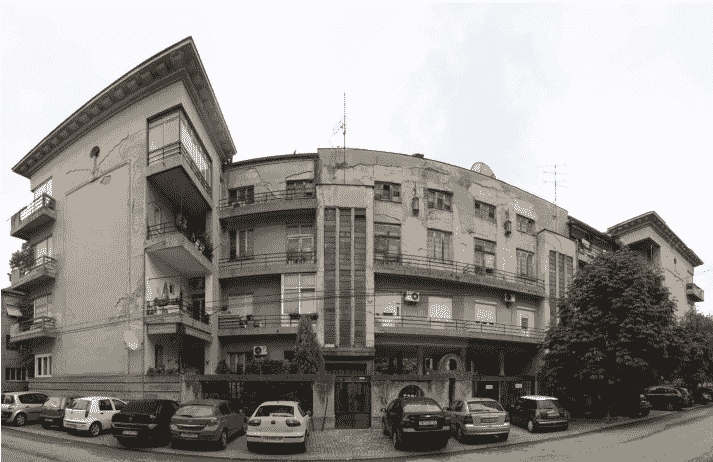

图 1：铁路住宅楼。摄影：Zoran Shekerov。

我们在书中的贡献是一场表演的剧本，该表演于 2019 年在布拉格举行的第四届布拉格表演设计与空间四年展上首次亮相，作为装置*这座建筑在真实对话*的一部分。该表演装置的主要场景是斯科普里热的铁路住宅楼。这座建筑是一个活跃的参与者，与演员 Kristina Lelovac 以及观众在一起，他们被召唤成为潜在的租户或家庭成员。场景由移动舞台元素、附带的视频投影、扬声器和写有文字的告示板组成。表演的叙述讲述了这栋建筑居民一直以来面临的问题。这些故事收集于研究阶段，其中包括调查，以及并尝试通过论坛剧场技术测试共同解决现有问题的可能性。

斯科普里热的铁路住宅楼引发了关于南哥斯拉维亚反南哥斯拉维亚和后南哥斯拉维亚时代公地私有化与商品化的问题。尽管这些公寓已经完成了私有化，但在后社会转型框架内（这种全面而沉默的私有化过程意味着资本主义的恢复），这座建筑所体现的南斯拉夫集体住房建筑理念为思考集体生活和公共空间集体管理的不同模式提供了空间和机会。

# 激进住房：艺术、斗争、关怀

# 211

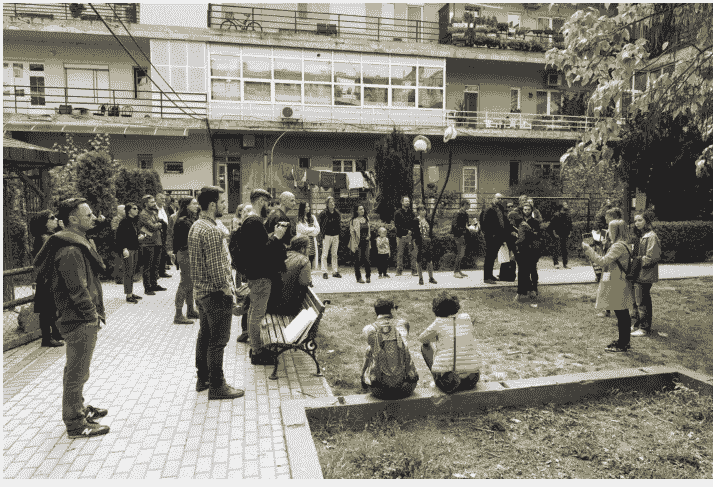

图 2：如果建筑会说话！——在斯科普里热“青年开放剧场”节期间的首次表演（2017年)。摄影：Zoran Shekerov。

# 第一幕：历史作为舞台

红幕落下。一个摊位上的麦克风放置在红幕正前方。穿着深蓝色工人上大衣的表演者走到红幕前，举起一块硬纸板，上面写着“第一幕：历史作为舞台”。

表演者：第一幕！历史作为舞台！[她动作敏捷地将纸板指向前方、左侧和右侧的观众，每侧持续 5 秒。她动作敏捷地放下纸板。她走向麦克风并向观众问候]同志们，在表演的实际日期和月份，1949年，我们聚集在斯科普里热——马其顿人民共和国的首府，南哥斯拉维亚联邦共和国的一部分——为了庆祝铁路住宅楼的落成。非常荣幸今天邀请了建筑的设计者 Mikhail Dvornikov [她指向观众，短顿]，以及我们来自贝尔格莱德的同志、建筑师、雕塑家和理论家 Bogdan Bogdanović [她指向观众，短顿]。铁路住宅楼是为斯科普里热国家铁路局（南哥斯拉维亚联邦铁路的一部分）的员工设计的。这座建筑是一个复合功能的实例。除了住宅单元外，还有半公共的空间供租户共享——中央庭院、开放式露台、顶层的公共洗衣间以及电影院。[两名舞台工作人员升起幕布]

+ 1 如果建筑会说话，基于研究的表演艺术项目，Filip Jovanovski 创作，Ivana Vaseva 策划，2017年10月1日——在斯科普里热“青年开放剧场”节期间的首次表演，参与者与合作伙伴：Kristina Lelelov, Sanja Arsovska, Jasmina Vasileva, Dolores Popovik, Ivana Pavlovakovska, Tamara Ristova, Blagoja Veselin, Viado

# 激进住房：艺术、斗争、关怀

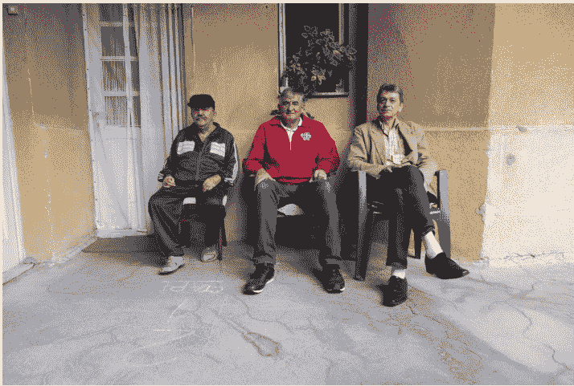

图 3：Ivan Djijanovsky、Slobodan Kocevic 和 Tome Karevski，铁路住宅楼的居民。照片由 Zoran Shekerov 拍摄。

## 第二幕：入口

# 表演文本：铁路住宅楼的记忆与历史

## 第一幕：入口与公寓

表演者：[欢迎观众进入装置内部，位于类似混凝土的墙前] 来吧，你们可以进去。里面有点挤，但还能怎么怎样呢，我们是建筑入口的一群人。这是铁路住宅楼的1号入口，是这栋楼十个入口之一。这是地面楼的1号公寓。在20世纪50年代，它被分成两个部分，由两个家庭共同居住。其中一部分住着 Antonio Kuzmanovsky 的家人，他们在大楼落成后立刻就搬了进来。在20世纪50年代，他们和 Schulz 一家共用这间公寓。我们问了住户，但没有人记得他的名字。他们记得的是他高得离谱……[她看向观众中最高的人] 能请你过来一秒吗？你能站在脚架上吗？现在，你能脚尖着地吗？如果你需要平衡，可以扶着他。[她把另一只手放在那个男/女士的头顶] Schulz 就这么高。谢谢。[这位男/女士从偶尔在20世纪50年代访问斯科普里的马戏团回来。即使在今天，住户们还记得 Schulz 一家的所有成员都有某种腐败性。Schulz 的长子是铁路住宅楼出生的第一个孩子。[停顿] 1992年，在这间公寓里，建筑师兼雕塑家 Bogdanović 仅住了一个晚上。他是著名的纪念碑“石之花”的作者[她举起一张有纪念碑照片的纸板。她动作敏捷地指向前方的观众、左侧和右侧，每边持续5秒。她动作敏捷地放下纸板]献给现今克罗地亚亚塞斯诺瓦茨（Jasenovac）集中营的受害者。他也是北马其顿“不败者丘”纪念公园的作者[她翻转并举起纸板。这一边是一座纪念公园的照片。她动作敏捷地指向前方的观众、左侧和右侧，每边持续5秒。她动作敏捷地放下纸板]坐落在北马其顿的普里莱普市（Prilep）。Bogdanović 是反法西斯主义者、反民族主义者，并支持20世纪90年代南斯拉夫的反战运动。在米洛舍维奇政权的压迫下，他不得不离开国家前往维也纳。在去维也纳的路上，Bogdanović 在他的公寓里住了一个晚上。离开之前，他在墙上写了字。[她取下了一块墙的碎片。在一张带有滴答计时纸标记的纸板下]，后面写着：“如果我保持沉默，今天就会这样平静地度过。但保持沉默是不可能的。”] 停顿 Bogdanović 写在墙上的字被涂掉了[表演者动作敏捷地取掉一张纸，下方出现了另一张空白的纸，那是21世纪00年代初，这间公寓被 Jan Stefanovski 买下。Jan Stefanovski 是一位马其顿建筑师，以这座高62米名为“千年塔”的作者而闻名。[她动作敏捷地用黑色记号笔在纸上画出纪念碑]是的，看起来一模一样。它建立在沃德诺山（Vodno）顶部[一个孩子的画，她在塔下面画了一座山——斯科普里心脏中心的一座山。从那时起，我们在城市顶部有一座巨大的房子，它看起来就像一座墓。它是20世纪90年代建立的，宣布新千年的到来。遗憾的是，我们并没有意识到那是其他什么的预告，她在画上写道“斯科普里2014”——那个备受争议的“斯科普里项目”。该项目由前任马其顿政府发起。该政党是右翼、保守且民族主义的。他们说他们正在发起一个项目来改造市中心，使其更古老，赋予它更古典的魅力。他们花了……[她在纸上写下600。停顿。她写了三个零。停顿。再次看着观众，她写了三个零。再次，缓慢地看着观众，她写了欧元符号]……纪念碑、巴洛克式立面，主要是为了洗钱。这个深深植根于腐败和民族主义的怪兽项目确实发生了。所以，它可能发生在任何地方。[她动作敏捷地取掉一张纸，下方出现了另一张空白的纸。她边写边读]第三幕。像这样的装置，记忆以线性的叙事方式移动。正如戈达尔所说[她动作敏捷地指向纸板上的观众，纸板上写着“万物都有开头、中间和结尾，但并不一定按这个顺序”——在正前方，左侧和右侧，每边持续5秒。她放下纸板]《精疲力竭》，这部标志着法国电影新浪潮作为非线性跳接（Jump-cut）剪辑方法革命性范例的电影，是20世纪60年代铁路住宅楼电影院上映的电影之一。另一部是法斯宾德的《爱比死亡更冷》。[她翻转并举起纸板。另一边是电影《爱比死亡更冷》的海报。她动作敏捷地指向观众，前方、左侧和右侧，每边持续5秒。她动作敏捷地放下纸板。她邀请观众走近，进入装置内部。

## 第五幕：电影院

麦克风。她动作利落地举起一块纸板，上面写着“第五幕，电影院”。

第五幕！电影！[她举着了5秒钟，然后将纸板扔在地板上]

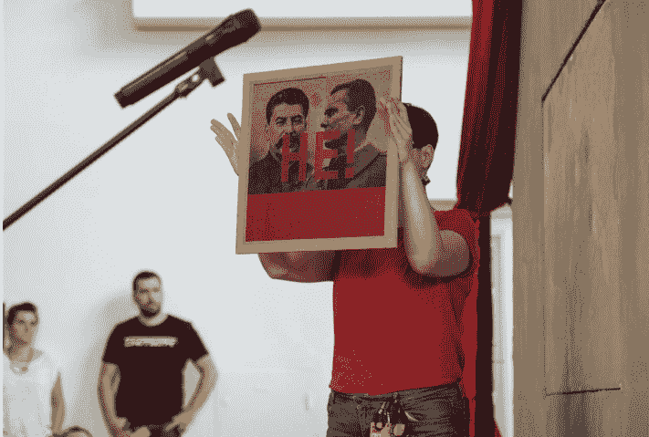

图 6：第五幕：电影。摄影：Nemanja Knezevic。

表演者：请花几秒钟时间，想象在城市中心有一座建筑，它拥有一个属于自己的电影院。[停顿]你们已经想到了。这片超过150平方米的空间被租户们用来举行家庭委员会会议。但他们过去在这里也举办过各种不同的活动：聚会、舞会，甚至在铁路住宅楼的电影院里举办过的一场婚礼。

据说在20世纪70年代，有一位租户，有人记得他叫Kiro，有人记得他叫Sloban，他在公寓里养了49只猫。这很奇怪。但更奇怪的是，1976年，租户们经常在院子里发现被杀死的猫，并经常看到Kiro或Sloban额头流血地走动。直到Nada教授和Bajo的妻子Blagica，在电影院放映贝尔托鲁奇的《新世纪》时，屏幕上出现了Kiro或Sloban。他们说，他当时变得格外激动，他拿出一块画有唐纳德·萨瑟兰照片的纸板——[在贝尔托鲁奇的《新世纪》中，法西斯军官提拉向几位西装笔挺的绅士解释社会最终是如何解决共产主义问题的。他把共产主义者比作小猫，于是他抓起一只小猫，把它挂在墙上，跑过去，用额头把它撞死了。]随着她动作利落地将纸板放在装置上。另一侧是一张《新世纪》中罗伯特·德尼罗的照片。

20世纪80年代中期，在铁路住宅楼的电影院里，拍摄了某部对马其顿电影史具有重要意义的电影场景。这部电影是《1949年新年》——一部关于两个取向和命运不同的兄弟的戏剧，背景设定在南斯拉夫共产党与斯大林主义冲突期间紧张而恐惧的氛围中。电影由最著名的马其顿电影导演、教育家Stove Popov执导，他就是我在开头告诉你们要记住的Traječe Popov。[一名舞台工作人员拿出一个小屏幕，屏幕上正放着该场景]我们准备了这段场景，以便你们看到。Bato、Ivan和Tome是在这场戏中客串龙套的32名租户之一。如果你走近一点仔细听，就能听到那首动听的歌曲。[停顿。观众正看着这一幕。表演者拿起麦克风，开始唱那首歌曲，正如南斯拉夫的流行歌手Nena Ivanović在1980年演唱的同一首歌曲《Pi》。当她唱歌时，舞台工作人员将屏幕安装在装置上，屏幕上显示着在《如果建筑会说话》项目不同阶段中使用的或开发的视频]视频。随后，她放下麦克风，动作利落地举起一块纸板，上面写着“第六幕，建筑即社区”。

## 第六幕：建筑即社区

第六幕！建筑即社区！[她举着了5秒钟，然后将纸板扔在地板上]

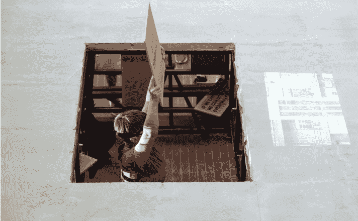

图 6：第六幕：建筑即社区。摄影：Nemanja Knežević。

表演者：[她收起显示《1949年新年》场景的屏幕，在前面放上另一块屏幕，上面显示着场域特定表演《如果建筑会说话》的视频]2017年10月1日，场域特定表演《如果建筑会说话》在铁路住宅楼首映。这是一场表演导览，观众在引导下穿过关于这座建筑的多个历史层面。表演在电影院处此结束。该表演是与铁路住宅楼租户们密切合作的一个项目的一部分，它的灵感源于这座建筑，献给这座建筑，并将建筑作为其核心角色并担任主角。我们表演中的铁路住宅楼是我们的

---

# 激进住房：艺术、斗争与关怀

## 按需理论

不倾听，但仍决心要解决。沟通渠道通过被动攻击被阻塞，又通过被动攻击得以维持。真是恰当。这让我开始思考更深层次的倾听。为了那些可能偏颇的目标和优先考虑的愿望，忽视掉正站在你面前所说的话是件多么容易的事。有时，你想要的东西就在眼前，责任在于观察者/寻求者/倾听者去调谐周围的频率，而不是试图让环境适应他们自己的频率。我在思考这与我所在地区的绅士化有什么关系，这是其中之一——人们拒绝调谐我们所在那里的频率。想要重置拨盘。设定议程。投入自我和救世主情结。通过保持街道没有污垢来拯救街道，除非没有必要。

由于街边摊贩们大声张扬地推销着他们水果蔬菜的优点，并用一堆仿制名牌包吸引着青少年女孩，罗马曼路（Roman Road）现在不是一个周六早晨去的地方，更像是一个宿醉。

它可能是东伦敦最后的几块正宗之地之一。尽管已经接纳了大部分塔哈姆尔特（Tower Hamlets）的绅士化，贝斯纳尔格林（Bethnal Green）的抵抗力正由于一系列新开发项目和时尚的小改而削弱，使其在热门地区排行榜中占据一席之地。

你只需看看这个位置，位于肖德奇（Shoreditch）和砖块巷（Brick Lane）以东北三英里处，就知道无论贝纳尔格林路上的购物有多简陋，无论它的街道多么粗犷和时髦，无论你在那里徒劳地搜寻连锁咖啡店或手工烘焙坊，它仍然是一个准备好摇滚的地方。

> 摘自《伦敦标准晚报》（Evening Standard）“家居与物业”板块的一篇文章。

我正在写作。在写的时候，我内心渴望进行学术化的写作，用一种能让我想说的话被我通常出没这类空间——如会议、峰会、工作坊——的人视为有效的方式来写作。我担心这篇文章过度个人化的主观语调，担心我的贡献因为其客观、轶事性的性质而被削弱。担心它无法被视为有效的知识。我担心，尽管我知道没有人拥有我所拥有的知识，因为没有人经历过我经历过的生活（显而易见），但更重要的是，我的知识来自于我在经历极端绅士化地区社会住房的居住经验，来自我在伦敦多个正在经历这些转变和伦理清洗的地区与年轻人共工作的经验，那是有效的知识。我知道学术界对这种主观叙述存在异议，尤其是当主观叙述，尤其是当它来自有色人种、女性以及边缘群体时。我也理解作家中对“我”的过度关注也呈现了问题。我知道这不被视为真正的知识。这令我困惑。我内心仍有一种冲动，认为如果我用参考文献和引用来支撑，我会获得更多信誉。如果博士生和学者的观点（特别是当涉及有色人种工人阶级社区时）比你们的更有效力，仅仅是因为有证据或经过了同行评审或之类的。而我知道中产阶级的人实际上不知道如何与工人阶级的人交流。我知道国家在与工人阶级青年进行咨询的程度上撒了谎言。（他们什么都没做。这是答案吗？）当被剥夺权利的社区显然被提供了一个表达声音的平台时，他们实际上只是被那些父权制的、白人的中产阶级慈善机构所说说。

- Ruth Bloomfield，《待命的热点：贝斯纳尔格林将凭借时尚酒吧和新住房与肖德奇竞争，维多利亚时代的胸科医院》，《伦敦标准晚报》，2018年4月10日，https://www.standard.co.uk/homesandproperty/buying-mortgages/bethnal-green-set-to-rival-shoreditch-with-trendy-bars-and-new-homes-in-the-victorian-chest-hospital-a119364.html。

## 重复片段：警察暴力与社区安全

最近对警察暴力之前干预的记忆。我懒得和他们打交道。他们声称正在做重要工作，清除该地区的刀具和毒品，根据情报进行拦截和搜查。有色人种总是装饰着某些会引发暴力的东西，无论你脱掉多少层衣服，或者你的衣服有多么合群。肤色主义永无止境的暴力。表面上，我会留在那直到他们离开。试着问问那些男孩们还好吗。他们几乎耸了耸肩。“每天如此，每天如此”。

你去参加一个信仰会议，大伦敦警方（Met）的代表正在谈论绅士化社区的仇恨犯罪。大伦敦警方如何特别且重点地关注 LGBT 群体。针对这一群体的仇恨犯罪正在增加。宗教仇恨犯罪和种族主义仇恨犯罪的数量（这两者被视为独立的类别——你真奇他们怎么做的？）自英国脱欧以来要高得多。你还记得彼得·塔切尔（Peter Tatchell）在当地的游行。

你在东部的一个社区中心询问人们对所在地区安全性的评分。他们给出了 10 分中的 9 分或 10 分。

*(注：原文中上述段落重复出现多次，此处仅保留一次核心内容。)*

# 激进住房：艺术、斗争、关怀

## 社区中心的安全感与警务现实

你在东部的一个社区中心询问人们对所在地区安全性的评分。他们给出了 10 分中的 9 分或 10 分。

你问你。你问问你。他们声称正在做重要工作，清除该地区的刀具和毒品，根据情报进行拦截和搜查。有色人种总是装饰着某些会引发暴力的东西，无论你脱掉多少层衣服，或者你的衣服有多么合群。肤色主义永无止境的暴力。表面上，我会留在那直到他们离开。试着问问那些男孩们还好吗。他们几乎耸了耸肩。“每天如此，每天如此”。你去参加一个信仰会议，大伦敦警方（Met）的代表正在谈论绅士化社区的仇恨犯罪。大伦敦警方如何特别且重点地关注 LGBT 群体。针对这一群体的仇恨犯罪正在增加。宗教仇恨犯罪和种族主义仇恨犯罪的数量（这两者被视为独立的类别——你真奇他们怎么做的？）自英国脱欧以来要高得多。你还记得彼得·塔切尔（Peter Tatchell）在当地的游行。

## 绅士化与种族化的空间暴力

那些维持生命的各种连接。缓慢的死亡。谋杀。

白人绅士化者需要对那个电视中心抱怨不已——那是孟加拉国籍邻居的非正式社区中心。是因为噪音，还是因为听不懂？还是因为生活气息？他们甚至不和我们说话。直接向议会投诉。不稳定的基石。一股大麻烟味从他们的阳台上飘散出来。如果你是白人，就可以做违法的事。

不想再为此贡献力量了。不想再次将其包装。为了那些秃鹫之辈。他们想要贬低他人。当每个人都是秃鹫时。他们一边啄破你的内脏，一边说是在救你。不，不，不。说实话（TBH），我厌倦了。厌倦了尝试包装复杂的体验，说实话，我只能通过自己特定的、也有些疏离的视角来认知，并告诉人们去和边缘青少年合作。工人阶级青少年。

精疲力竭。

他们只是回了自己的家。他们感觉很好。他们可以消费。在和平中。在安全中。

难道轮到我们这些欧洲人绅士化者了吗？回到自己的家。感觉很好。以那种让黑皮肤和棕色皮肤男孩入狱或沦为下水道的方式感到良好。脑细胞消失。消费。在和平中。一切都在为他们而改变。

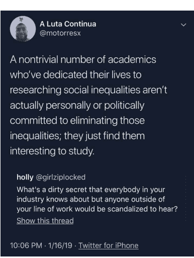

图 6：@motorresx 的推文，批评研究不平等的学者对结束不平等现象缺乏承诺。

## 对某些人来说，生活可以是如此真实

对某些人来说，生活可以是如此真实。如此稳定。尽管这一切都建立在暴力和不稳定的基石之上。不知为何他们感觉不到。就像完全无话可说，真鬼。

你内心有一团火。凌晨 5 点，整个街区疏散了。寒冷无比。你意识到这是第一次看到这种新的居民构成，每个人都离开了“盒子”。你花了一些时间注意到那些不同，那些不同的语言。被迫与隔壁、上方和下方盒子里的居民进行视觉接触这种感觉是多么奇异。你的妈妈和其他邻居挤在对面楼里某位阿姨的家里，一轮轮的茶和饼干温暖着忧虑而冰冷的肢体。

流动性。你把汽车视为那些想抽烟却无处可去的棕色皮肤男孩的非正式社区中心。事实是，汽车在拓展和空间提供方面比任何社区中心做得更好——至少在涉及到棕色皮肤……的时候

“每天每天”

你参加一个发生在绅士化现场的城市规划会议。有色人种（POC）少于 10 人。你有点讨厌自己总是被数进去，但总会被数进去。记录这些垃圾。一群白人在谈论未来。这可从未出过错。某个时刻，有人谈到了白人咨询公众的表演的元层面，即针对 99% 的白人就城市规划进行咨询。人们如何被迫考虑这种“咨询表演”，这种表演如何反映现实。似乎没有人表达过这种表演在多少个层面上——不仅是某次特定的表演，而是整场会议的表演——反映了现实——一群白人与其他白人聊天，为所有人规划计划，代表所有人发言，假装所有人都在房间里，或者没有注意到深色皮肤者的明显缺席。我不打算当那个说出来的人。当我们不在场时，他们会注意到我们吗？

完 完 完。

# 穷到无法玩耍：社会住房儿童被禁止进入公共游乐场

图 7：《卫报》网站上关于住房不平等的头条新闻。

5 Harriet Grant and Chris Michael, 'Too Poor to Play: Children in Social Housing Blocked from Communal Playground' The Guardian 2019年3月25日, https://www.theguardian.com/cities/2019/mar/25/25/too-poor-children-in-social-housing-blocked-from-communal-playground.

## 需求理论

你在哈克尼（Hackney）的一家咖啡馆见你一位白人男性朋友，他学习建筑专业，目前在一家总部位于东伦敦/哈克尼的事务所工作。他告诉他新入职的这家事务所，他们如何“开发”一个社区空间，他们如何通过许多地方的许多人为新空间制作了一份提案，关于该空间将像什么样以及由谁居住。

# 简介

AHAAHHA 是一位来自伦敦 E1 区的作家。AHAAHHA 在阴影中的“前线”从事青少年和关怀工作。AHAAHHA 承担着末日。AHAAHHA 信任青少年，想要与青少年（未来）创造并毁灭世界。AHAAHHA 对受伤身体的出现与消失的策略感兴趣。AHAAHHA 对不受解脱的舌头、人类与非人类的生成感兴趣。

Josephine Berry 是皇家艺术学院艺术与人文学院的研究导师，同时是伦敦金史学院大学（Goldsmiths University）文化产业硕士讲师，关注实验性研究方法和文化的空间视角。自 1995 年以来，她一直担任文化政治杂志《Mute》的编辑。她的专著《艺术与裸露生命：一种生物政治探究》（2019）将生物政治理论应用于自主艺术的美学理论中。她目前正在撰写一本书，探索“行星现实主义”（Planetary Realism）这一难以捉摸的内容。

Alyssa Erspamer 居住在罗马，在 Matter Group 担任初级协调员。她在曼彻斯特大学获得视觉人类学硕士学位，在伦敦大学学院（UCL）获得欧洲社会与政治研究学士学位，论文方向为艺术史。她出生于马萨诸塞州波士顿，父母是意大利人。她的研究对左翼理论/运动、官僚人道主义机构/组织、意大利传统、当代艺术/美学以及应用大陆哲学感兴趣。写作此时，她正在为 Poets in Azione 的系列节目《Città a parole》制作一部电影。

Ioana Florea 一直研究罗马尼亚城市的社会不平等和社交分化过程。自 2006 年以来，她作为活动家参与了布加勒斯特的多个草根组织和集体政治项目，为社会正义而工作和斗争，例如“我们的城市——我们的决定”（Our City – Our Decision）、《政治艺术杂志》（The Political Art Gazette）和住房权利共同前线（Common Front for Housing Rights）。Ioana 是住房区块国家平台（Block for Housing）和欧洲住房与城市权利行动联盟的活跃战斗研究员。自 2017 年以来，她是哥德哥堡大学社会学与工作科学系的博士后研究员。

Nicola Guy 是一位常驻英国的作家、导师和教育工作者。她是赫尔大学的博士生，AHRC 项目“遗产联盟”（The Heritage Consortium）的成员。她的论文《艺术、行动主义还是广告？统一柏林中展览制作的作用》探讨了当代艺术展览以不同方式贡献于 1989 年后柏林集体认同的构建。她在伦敦的 Flat Time House 工作，并继续与柏林的 Archive Books 合作，同时还参与为不同机构的展览和公共项目做贡献。

Lucas S. Icó 来自巴西里约热内卢。他目前住在波尔图阿拉格里。他担任艺术家、研究员、设计师和教师。他拥有 PPGAV-EBA-UFRJ 的视觉艺术硕士学位。他的工作是关于通过不同社区和政治挑战背景下的当代美学进行思考来开发想法和项目。

# Anthony Iles

Anthony Iles 目前是白查普尔画廊与麻省理工学院、诺丁汉普顿大学出版的《当代艺术文献》（Documents of Contemporary Art）系列的策划编辑，以及米德西克斯大学艺术与设计学院的访问导师。他是“完全失业电影”（Full Unemployment Cinema）的创始成员，自 2005 年以来一直是 Mate/Alternate 的特编。他与 Josephine Berry 合著了《无处移动：艺术与再生城市》（No Room to Move: Art and the Regenerative City, 2011），与 Tom Roberts 合著了《膝盖与肘》（All Knees and Elbows, 2012），以及文集《安格斯语言：写作与危机》（Angus Language: Writing and Crisis, 2015）和《关注危险，关注损失》（Look at Hazards, Look at Losses, 2017）的特编。Anthony 最近于 2018 年完成了题为《艺术家经营期刊 Inventory (1995-2009) 时代的 Passer Assembly》的博士论文。

# Filip Jovanovski

Filip Jovanovski 是一位来自比特托拉/斯科普杰的视觉艺术家和建筑师。他毕业于斯科普杰建筑学院，并在斯科普杰美术学院获得艺术硕士学位。他是 2018 年威尼斯建筑双年展“自由空间”（Free Space）马其顿展馆的作者之一。他为剧场、视频和纪录片项目设计了 20 个舞台，并获得过多次奖。自 2007 年以来，他是比特托拉 AKTO 当代艺术节的艺术总监，并共同管理“无法学习之学院”（FR-U）艺术与文化组织。

# Sylvi Kretschmarsch

Sylvi Kretschmarsch 一直研究用于放大人声的 PA 系统，特别是在政治论坛和示威中。她与“扩音器合唱团”（MEGAPHONE CHOIR）的艺术工作是政治背景下围绕扩响系统的实践核心，在那里，编舞始终与政治运动融合。在 2012-2015 年期间，她是艺术-学术研究生课程“集会与参与：城市公众与表演”的奖学金获得者。Kretschmarsch 的工作连接了电子音乐、现场艺术和编舞领域。她与 Camila Fehér 一组成 SKILLS，这是一个艺术组合，他们通过身体动作、移动和舞蹈创造音乐。

# Kristina Lelova

Kristina Lelova 是斯科普杰戏剧学院的助理及兼职教授。她正在攻读戏剧博士。她的兴趣领域是演员的专业培训，以及在（当代）现实背景下对剧场实践的反思。她参加过国内外艺术节、夏季访问、学校和工作坊（ARENA Internationales für Tanz, Theater and Performance – 埃尔根，IMPULSE – 杜塞尔多夫，美国国务院 IVL 项目）。她是多个活动主义倡议的成员，女性主义文化行动组织“首胎”（Firstborn）的创始人之一。

# Andrea S. Micu

Andrea S. Micu 是哈佛大学马哈希德拉人文科学中心的博士后研究员。她的研究考察了 2008 年经济危机后南方欧洲活动主义、移民与行动主义的交汇。她的书稿《表演性公社：紧缩城市中的住房行动主义与美学》记录了对马德里、罗马和雅典工人阶级群体如何想象新自由主义城市发展的替代方案并（重建城市公社的研究。Micu 作品发表在《表演哲学》（Performance Philosophy）和《参与性城市主义》（Participatory Urbanisms）等平台。她在西北大学获得表演研究博士学位。

# Veda Popovici

Veda Popovici 是一位位于布加勒斯特的政治工作者。她是各种反威权、无政府主义和女性主义集体的成员，如 Macaz 合作社和集体、Dysnomia 集体以及《政治艺术杂志》，她在布加勒斯特国立艺术学院和加州大学圣克鲁斯分校教授过去殖民思想、民族主义和女性主义理论。她致力于激进住房，曾创立布加勒斯特的住房权利共同前线、住房区块（一个天然反驱逐组织），目前是欧洲住房与城市行动联盟的协调员。

# Cristina T. Ribas

Cristina T. Ribas 是一位会写作的艺术家和研究员。她拥有伦敦大学金史密斯学院的艺术博士学位（2017）和 Institut de Artes / UERI 的硕士学位（2008）。她一直致力于将制图学、女性主义和战斗研究应用于艺术创作。2011 年，Cristina 创建了 Desarquivo.org。2017 年，她与 Gisele Vasconcelos 和 Tatiana Wells 参与了战术档案（Arquivos Táticos）。她也是 Conceptualistas do Sul 网络和 Associação Imó 协会的一员。

# Ivana Vaseva

Ivana Vaseva 是一位来自斯科普杰的跨学科、协作和社交参与型作品的策展人和研究员。她是“无法学习之学院”（FR-U）组织的项目总监。Vaseva 是自 2006 年以来存在的 AKTO 当代艺术节的联合策展人。她因研究项目“集体行动作为一种政治而非组织决策”（2015，合著）获得 AICA-马其顿的 Ladislas Barish 奖，以及马其顿建筑师协会的特别建筑奖（2014，共同参与）。Vaseva 还专门参加过荷兰阿姆斯特丹 De Appel 艺术馆的策展计划（2011/2012）。

# Ana Vilenica

Ana Vilenica 是一位城市和文化研究员，其研究兴趣是反对资本主义住房和住房制度的草根城市与政治活动主义。Vilenica 是《激进住房杂志》（Radical Housing Journal）编辑，以及社会运动杂志《Interface》的中东欧地区编辑。她主编了四本书：《新自由主义资本主义下的母亲》（Becoming a Mother in Neoliberal Capitalism, 2013）、《创意城市的废墟》（On the Ruins of Creative City, kinda）和《城市化研究碎片》（Fragments for Studies on Urbanizations, kinda，2020）。她是塞尔维亚及欧洲层面的长期住房和女性主义活动家。最近，她与来自塞尔维亚的反驱逐组织 Roof、跨国自主斗争（EAST – Autonomous Struggles Transnational）以及欧洲住房与城市行动联盟一起组织。

# School of Echoes LA

School of Echoes LA 是一个多族裔跨世代的自治集体，由组织者、教师、有时也是艺术家组成，他们于 2012 年形成，围绕反对洛杉矶绅士化的社区化研究和组织而存在。School of Echoes 创立了洛杉矶租户联盟（LA Tenants Union），这是一个通过倡导、教育和直接行动在洛杉矶建立租户权力的多元运动。

# Southwark Notes

Southwark Notes 是由研究人员和作家组成的小网络，自 2010 年以来活跃在伦敦南部的萨萨克（Southwark）地区，揭露并积极抗议该地区的社会清洗（social cleansing）。他们在其热门博客 southwarkknots.word-press.com 上发布研究，该博客同时作为当地城市斗争档案材料的库，并详细审视了艺术在城市更新和驱逐过程中扮演的共谋角色。

# You Should See the Other Guy

You Should See the Other Guy 是一个由 Nina Scott 和 Emer Morris 领导的全女性（womxn）、酷儿领导的剧团体：他们是多学科艺术家和住房运动活动家，致力于与受流逐、绅士化和社会清洗影响的伦敦社区合作。自 2015 年以来，他们一直开展嵌入式社区剧场项目，通过地面实践和舞台表演解决住房不公问题。他们既是社区组织者，也是作家、导演、受压迫剧场实践者、歌曲创作者、诗人、布景设计师和人权从业者。他们的工作旨在证明，强大、有力且美丽的剧场应当属于社区主导的空间，而不仅仅是传统剧院的精英空间。

# 按需理论 #42

## 激进住房：艺术、斗争、关怀

Ana Vilenica 编

住房空间是社会生产的关键场所，因为它是维持我们生活的无数关怀行为发生的地点。然而，资本已强行进入我们的家，使其成为战场。艺术以多种方式嵌入并交织在住房斗争中。本集中的论文和剧本探讨了围绕家园之战、艺术角色以及斗争美学的艰难问题。这些贡献的共同点在于，从内部和外部边缘、从全球和局部边缘追踪了激进住房的轨迹。正是在这些反对住房不稳定的抵抗视角中，激进住房被追踪在通往我们共同未来的途中出现、衰落和重新出现的足迹。

本选集分为五个部分，讨论了诸如反叛历史与艺术中的激进关怀、行动的实践策略、利用租户力量对抗艺术洗白（art-washing）、住房斗争艺术中的过去与未来政治、金融化对艺术生活工作条件的影响、晨间损失的必要性，以及住房公社不可还原的多样性、相互问责和与泥土共事。本书提出了关于激进住房艺术的论题，探讨了实践激进住房中的共同挑战与失败，表达了从悲剧到喜剧的艺术之美。

贡献者：AHAAHHA, Josephine Berry, Alyssa Erspamer, Ioana Florea, Nicola Anthony Ives, Filip Jovanovski, Sylvi Kretzmars, Kristina Lelovac, Andrea S. Micu, Veda Popovici, Cristina T. Ribas, Lucas I. Icó, School of Echoes LA, Southwark Notes, Ivana Vaseva 以及 You Should See the Other Guy。

按需打印

ISBN: 978-04-92302-78-6

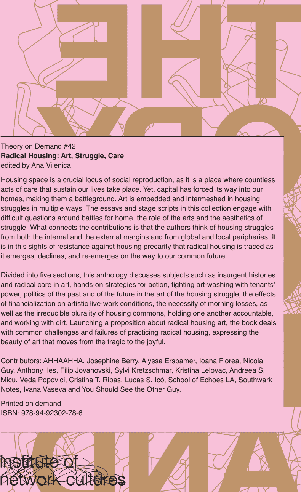
