# Java 应用快速现代化：企业级组合升级实用业务与技术解决方案 (Oracle Press)


## Thomas Kurian 序言

甲骨文公司产品开发总裁

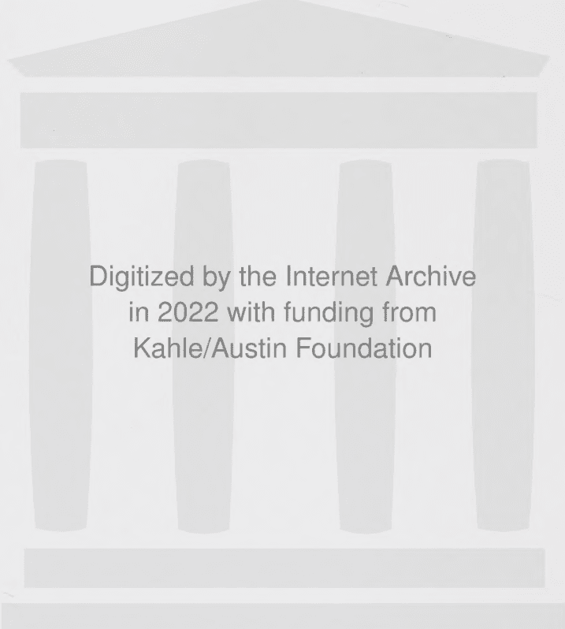

| 制作编辑 | 技术编辑 | 制作主管 |
| --- | --- | --- |
| Lisa McCain | Tom Nilsson | Lynn M. Messina |
| 编辑主管 | 拷贝字编辑 | 排版 |
| Jody McKenzie | Lisa Theobald | Cvenvo 出版服务 |
| 项目经理 | 校对员 | 插图 |
| Anubhav Siddhu | Rick Camp | Cvenvo 出版服务 |
| Cvenvo 出版服务 | 索引员 | 封面艺术总监 |
| 采购协调员 | James Minkin | Jeff Weeks |

我将这本书献给我的家人。没有他们的支持，这个项目是不可能实现的。

献给我亲爱的妻子 Priya，她忍受了我研究、编写和编辑这本书的漫长时光。她让我能够兼顾对这项事业的热爱、工作职责和家庭生活。没有她的耐心、牺牲和鼓励，我早就会放弃这个项目了。她是我们家的基石，让我所有的想法和奇想都能飞成现实。这份献辞无法完全表达我对你所做一切的感激。我深爱你！

献给我亲爱的女儿 Brinda 和 Leela，她们的笑声和嬉戏让我保持专注和放松，特别是在紧迫的截止日期期间！她们是我能希望的最甜的孩子。谢谢你们，女孩们，放弃了这么多和我一起骑车的机会，让我能完成这本书。

我还要感谢我的父母，他们培养了我对学习的热爱，让我小时候就梦想远大，并在我所有的追求中支持我。

## 关于作者

G. Venkat 目前是 bitWise Academy 的首席执行官，这是一个下一代在线学习平台，旨在向 K-12 学生介绍计算机科学。作为 Infosys 前全球技术负责人，他曾为财富 500 强公司（包括苹果、大众、西北互助、Allstate、卡特勒和美国银行）领导了多项大型计划。Venkat 是一位连续创业者、风险合伙人、会议演讲者、书著者，最重要的是一位真正的技术爱好者。在过去的几十年里，他为人工智能、机器学习、深度学习、图像处理、物联网和实时通信领域的多家初创公司提供建议。他拥有马德拉斯印度理工学院的工程学士学位，以及阿拉巴马大学图斯卡萨分校的计算机科学硕士和博士学位。

## 关于编辑

Tomas Nilsson 在甲骨文公司担任了十九多年的 Java SE 产品经理，涵盖了 Java 生态系统的技术和商业方面。他始终充满好奇心，兴趣领域范围从 JRE 的操作到有效的营销策略，以及如何创建最佳的敏捷团队。他目前是 Snow Software 数据智能服务产品经理。

## 目录

- 总结 ............................................................................................................................ 337
- 用于构建成本模型的数据收集与指标 ........................................ 426
  - 数据收集 ..................................................................................................................... 427
  - 指标识别 ................................................................................................................... 429
  - 指标与 KPI 测量 .......................................................................................................... 435
- 构建与执行估算模型 ....................................................................... 435
  - 自上而下 vs 自下而上 .................................................................................................. 436
  - 使用可扩展成本框架 (SCF) 进行自下而上的成本估算 .............................................. 438
  - 执行阶段 ..................................................................................................................... 439
  - 成本与工作量估算的假设 .......................................................................................... 441
  - 衡量回报时遇到的问题 .......................................................................................... 443
  - 战略优势的策略 .................................................................................................. 443
- 总结 ............................................................................................................................ 445
- 用于大规模现代化的 14 种方法 .................................................................................. 447
- Java 现代化解决方案平台 ...................................................................................... 449
  - 不可控的成本 .......................................................................................................... 449
  - 冗余与重复 .......................................................................................................... 450
  - 集成不力与流程不一致 .......................................................................................... 451
  - 老旧 Java 应用组合 .......................................................................................... 451
  - 解决方案栈 .......................................................................................................... 452
  - 解决方案栈深度解析 .......................................................................................... 455
  - 大规模现代化 .................................................................................................. 459
  - Java 现代化工厂 .................................................................................................. 460
  - 工厂设计与运营模型 .......................................................................................... 463
  - 分段与波次规划 .......................................................................................... 470
  - 试点波次 .......................................................................................................... 473
  - 弹性采购模型 .................................................................................................. 474
  - 确保 Java 现代化的成功 .................................................................................. 475
- 总结 ............................................................................................................................ 481
- 索引 .................................................................................................................................. 483

## 前言

在瞬息万变且不断扩张的技术宇宙中，有一点是显而易见的：技术始终向着一个方向前进——向前，而且速度极快。这种节奏渗透了我们的生活，从智能家居、智能手机到在云端运行的业务，技术无处不在。尽管我们在个人生活和职业生活中感受到了技术的影响，但企业无疑在过去的几十年里，在跟上快速发展的步伐方面面临着最大的挑战。

自 ARPANET 于 1969 年首次出现以来，技术只向一个方向前进——向前，而且速度极快。20 世纪 80 年代，随着互联网在大学和大型企业中普及，我们见证了万维网和超文本的发明，这些工具为现代家庭带来了网络连接和互联网访问。

对于开发者而言，计算机编程中机械原理、数学、汇编语言和挫败感的混合迅速演变为使用当时革命性语言（如 FORTRAN 和 C）的编程应用，导致了企业大规模采用计算机，并促进了开发者社区的形成。新公司涌现，创建软件和工具，使后来的开发者能够对业务应用进行快速构建部署，这一倡议由 Oracle 开创，其关系型数据库于 1979 年作为商业产品发布。太阳微系统、惠普、IBM 和微软紧随其后，推出了自己的创新。英特尔和太阳微系统在微芯片领域领先，摩尔定律预言了芯片性能将呈指数级增长。今天，我们手心握着四核处理器，可以在智能手机上浏览网页、检查电子邮件或运行业务应用程序。

可以说，如果我们仅仅停留在 FORTRAN 和 Smalltalk 的运行时代，绝无法进步如此之快。由太阳微系统于 1995 年发布的 Java，诞生于对一种开发者友好且能接管互联网的语言的需求。Java 的出现改变了游戏规则。它引入了“一次编写，到处运行”；提倡开源库和组件。当 Linux 颠覆了操作系统时，Java 同样转型了应用程序。现在有成千上万的业务应用程序使用 Java 编写并部署到 Linux 服务器上。技术正在向前发展，而且非常快。

尽管取得了巨大的进步，兴奋之情溢于言表，但受限于固定 IT 预算的企业无法以这种快速的速度前进。当新应用程序使用当前版本的 Java 进行编写时，旧的应用程序却陷入了停滞。随着时间的推移，这个问题由于许多机构经常且同时支持多个 Java 版本而变得恶化，通常我们对那些主版本和次要 Java 版本的支持已经停止，导致了巨大的安全漏洞和未知的业务风险。

当 Oracle 在 2008 年收购太阳微系统后，开始精简 Java 的发布、命名、更新和支持，并赋能开发者社区。Oracle 认识到了现代企业面临的挑战。尽管 Oracle 致力于通过 Java 推动业务发展，但许多公司仍面临着预算不足、资源有限以及缺乏使应用程序现代化并与最新 Java 平台同步所需的工具等挑战。在技术不断进步的同时，企业一直在努力跟上脚步。这长期以来在行业内造成了差距，而本书正面对这些挑战。

2012 年 6 月 Oracle Cloud 的发布提供了跨越 IaaS、SaaS、PaaS 和 DaaS 的行业最广泛、最集成的公共云服务。今天的云应用程序已经提供了集成移动、社交和分析技术的行业特定解决方案，涵盖了多种互动渠道。利用机器学习和 AI 算法的智能应用程序正受到来自大量来源的爆炸式可用数据和数字信息的推动。

几乎每家企业，无论大小，都开始了它们的云之旅。业务转型和不可避免的 IT 现代化不是一次性活动；而是持续的过程，必须流畅灵活地适应不断变化的业务需求。作者的经验

作为一名开发人员、企业顾问和业务领导者，我为这本书提供了独特的视角。几乎每个企业贡献者都能从中受益——应用所有者、业务用户、财务控制人员、运营人员、技术架构师、开发者、CIO 以及高管，都能从解决 Java 应用现代化挑战的最佳实践和经过证明的技术中受益。书中的见解和实用方法将作为指南，帮助读者应对当前的现代化挑战，并展望未来广阔的技术机会。

Thomas Kurian

产品开发总裁

Oracle 公司


## 如何使用本书

本书的结构设计可以根据读者的角色进行定制。预计读者群体大致分为以下四类：

- 架构师：企业架构师、技术架构师、领域架构师或解决方案架构师
- 业务：业务角色，如 IT 经理、应用所有者、功能分析师或业务分析师
- 开发者：应用开发人员、软件工程师或其他技术人员
- 高管：高级管理人员，如总监、CTO 或 CIO

根据他们的角色或兴趣领域，并不是所有人都有兴趣按照演示顺序阅读所有章节。可以根据读者的角色和兴趣遵循四种建议的定制路径：

- 架构师：第 1–14 章
- 业务：第 1–5 章、9、10、12–14 章
- 开发者：第 1、2、5–11 章、14 章
- 高管：第 1、3、12–14 章

## 致谢

我想感谢并感谢在撰写本书期间支持我的许多人。这本书是我过去二十年里与大型和中小型企业合作时积累的经验和咨询项目的汇集。我第一次在 Oracle OpenWorld / JavaOne 2014 上介绍了这一概念。该会议反响热烈，并促使 McGraw-Hill 前收购编辑 Brandi Shailer 在 2014 年 10 月联系我讨论书籍提书。从那时起，这本书就成了我的心血结晶，我享受其中的每一分钟，尤其是那些带我走向终点的无数个深夜和喝不完的咖啡！


在我开始写这本书不久后，Brandi 接受了基于我愿景的内容经理职位。两位优秀的人——McGraw-Hill 高级编辑 Lisa McClain 和编辑协调员 Claire Yee 加入了项目，并全心地为这项事业注入了活力。他们在研究、开发和内容生成的各个阶段对我的愿景不懈的支持和信任，是本书成功完成的关键。感谢 Lisa 和 Claire！我还想感谢 Lisa Goldstein 以及 Oracle Press 的出色的同事们，他们与 McGraw-Hill 合作指导了项目的圆满完成。我要感谢 Tomas Nilsson，他是 Oracle Java 平台高级首席产品经理，也是本书的技术编辑。他对章节的及时评论和技术审查使我提升了本书的技术质量。感谢 McGraw-Hill 编辑主管 Jody McKenzie 和高级制作监事 Lynn Messina，以及 Cenveo 的 Anubhab Siddhu 及其团队在本书的文字编辑、校对和出版阶段付出的不懈努力。他们的勤奋将我的手稿转化成了具有出版价值的读物——而这一切是在极其紧迫的期限内完成的！

诚心感谢 Oracle 产品开发与平台尊敬总裁 Thomas Kurian，他为本书写了富有见解的序言。他是一位行业远见者，能够预见到云对业务转型的重要性，以及 `IaaS`、`PaaS`、`SaaS` 和 `DaaS` 如何加速业务和技术的采用，使 IT 现代化和应用组合管理成为企业战略的核心。Kurian 先生预见到了需要一本通用的讨论应用现代化（特别是 Java 平台）的书，且这种方式能与企业业务和技术部门产生共鸣。感谢 Oracle 开发副总裁 Kotha Umamageswaran 的帮助，以及对我交付一本引人入胜书籍的信任。

有几位拥有数十年行业经验的人士愿意担任本书特定章节或部分的外部评审员。他们的知识涵盖了工程、架构、IT 管理、业务、产品管理、财务和运营。我向 Kaushal Kurapati（Mastercard 产品副总裁）、Priya Venkat（Edgewater Networks 总法顾问）等人士表示诚挚的感谢和感谢。

# Java 历史回顾

将 Web 服务标准定义并纳入 Java 2 平台企业版 (`J2EE`)。此时，Java Developer Connection 的成员已超过两百万，`J2EE` 的下载量已达到一百万。`J2EE 1.3` 的发布还包含了 `EJB 2.0` 规范，该规范解决了 `EJB 1.0` 的 API 困难。

虽然第一个实时 Java (`RTJ`) 规范于 1999 年发布，但直到 2002 年 `RTJ` 才进入主流视野。在 2002 年的 JavaOne 开发者会议上，主旨演讲期间两个由 Java 驱动的机器人之间展开了战斗。由詹姆斯·高斯林（James Gosling）控制着其中一个机器人。这次演示了 Java 技术可以跨越运行企业服务器的应用程序，一直消费设备的 Java 2 平台微型版 (`JME`) 以及实时 Java 应用。

随着 `JDK 1.4 (Merlin)` 的发布，Java 达到了新的稳定性水平。这形成了 Java 2 平台标准版 (`JSE 1.4`) 的基础。此外，下载量达到了……为了支持 Web 服务开发，Sun Microsystems 发布了 Web Services Pack 1.0。

2003 年对于 Java 的重大技术引入来说，是相对低调的一年。然而，2003 年标志着新的 Java 咖啡杯标志的正式发布以及 Java 2 平台企业版 1.4 的发布。随着 Java.net 网站和专注于社区的网站的启动，出现了一些新的营销相关活动。当时发布的各种统计数据表明，约 75% 的专业开发者使用 Java 作为主要的主要的编程语言。

NASA 将 Java 技术用于研究火星探测器器图像的命令和控制应用，这为 Java 本来就令人印象深刻的形象提供了巨大的推动力。NASA 喷气推进实验室 (`JPL`) 与 Wind River Systems 合作开发了火星设备。他们使用 Java 平台来运行控制操作系统的程序。用于机器人漫游器的 Java 程序与 `JPL` 的在线程序 Maestro 几乎相同，Maestro 允许游客引导模拟漫游器穿过 3D 火星地形。

开源运动和 Linux 操作系统到 2004 年获得了显著进展。Apache 软件基金会受到开源社区和 Java 开发者的推崇，这些开发者采用了在 Apache 伞下根据 Apache 许可发布的多个库和组件。开源倡导者的推动，以及 Java 开发者对开源应用构建的意识和采用，

在 2004 年的 JavaOne 会议上引发了辩论，出现了两个不同的阵营。IBM、Apache 软件基金会以及开发者社区的大部分人希望 Sun 对 Java 及其未来演进采用开源模型。詹姆斯·高斯林、Sun 员鲍·金格尔（Bob Gingell）等人反对这一举措，认为这将导致 Java 出现多个不兼容的开源实现，从而影响其互操作性。

# 引言

多个会议涵盖了 Java SE 8 中即将推出的 Java 技术。Oracle 在 2013 年 JavaOne 会议之前发布了 `Java EE 7`。物联网（`IoT`）是本次活动的主题。`Java SE 8` 的路线图也是战略主题演讲中讨论的话题。`Java SE 8` 最终于 2014 年 3 月发布。截至本文写作时（ 2017 年夏季），`Java SE 9` 计划于 2017 年 9 月 21 日正式可用发布。

2006 年的 JavaOne 会议在 Java 历史上占有重要地位，Sun 公司在会议上首次宣布将根据 GNU 通用公共许可协议（`GPL`）发布 Java。HotSpot 虚拟机和编译器于 2006 年 11 月根据 GNU `GPL` 发布。随后，在 2007 年 5 月，Sun 公司在 `GPL` 协议下发布了 Java 类库的完整源码。当时有少数组件保持闭源状态，因为 Sun 公司没有所有这些源代码的物权。在接下来的几年里，每个组件都以开源的形式发布，或者提供了替代方案。到 2010 年 12 月，整个 `JDK` 都已作为开源可用，不再依赖于任何二进制插件。

1996 年标志着 `JDK 1.0` 的首次发布，称为 Java 开发者工具包（`JDK`）。该版本包含了开发工具和运行时。此外还提供了一个名为 Java 运行时环境（`JRE`）的仅运行时包。即使在今天，`JDK` 这个名称依然流传，大家通过其 `JDK` 版本来指称 Java 平台。`Java 1.1 (JDK 1.1)` 引入了内部类。

从 `JDK 1.2`（代号为 PlayGround）开始，该版本被重命名为 Java 2 标准版（Standard Edition）。这是一次重大发布，将 Java 平台的规模扩大了三倍，在 59 个包中包含了超过 1500 个类。集合 框架被引入 Java，Swing 成为核心平台的一部分。此外还添加了即时（`JIT`）编译器。

`Java 1.3 (JDK 1.3)` 命名为 Kestrel，于 2000 年 5 月发布。该版本包含了 HotSpot JVM。Java 平台的一项重大新增是动态代理类。这些动态代理类允许在无需在编译时编写类的情况下，为接口列表创建代理对象。它提供了通过暴露的接口向底层对象提供类型安全反射分发的能力。


`Java 1.4 (JDK 1.4)` 被称为 Merlin，于 2002 年 2 月发布。该版本在语言和 API 上进行了一些重大新增。对正则表达式的支持以及非阻塞 I/O 的添加是平台基础性的改进。

从下一次版本开始，命名规范再次发生了变化。2004 年 9 月发布的 `Java SE 5 (JDK 1.5)` 代号为 Tiger。泛型（`Generics`）为集合提供了编译时类型安全，注解也是该版本的重大引入。其他重大新增还包括自动装箱、静态导入、for 循环的简写、枚举（`enumerations`）以及可变参数声明。这些特性使得 `Java SE 5` 成为迄为止 Java 平台最大的升级。

2006 年 12 月发布了 `Java SE 6 (JDK 1.6)`，代号为 Mustang。该版本支持了多项新特性，包括对脚本语言的支持。它还提供了 Java 编译器 API。`Java SE 6` 在发布后被广泛采用。即使在今天，大部分 Java 应用代码库仍是用 `Java 6` 编写的。

下一次发布发生在 2011 年 7 月。`Java SE 7 (JDK 1.7)` 同样名为 Dolphin，结合了 Project Coin 的元素。这也是 `JDK` 之前的第一个版本。

`Java 8 (JDK 1.8)` 于 2014 年 3 月发布，是第一个没有分配代号的版本。最终，`Java 8` 被命名为 Spider，这让开发者社区松了一口气，因为历史性的命名传统将延续！该版本在安全、性能和工具领域引入了一些重大特性和改进。Lambda 表达式、新的日期和时间 API、Nash 引擎、`G1` 垃圾回收器以及其他特性，使得 `Java 8` 成为该语言的最新更新，超过了 `JDK 5.0`。

截至本文写作时，`Java 9 (JDK 1.9)` 是计划于 2017 年 9 月 21 日正式发布的最新 Java 平台。该版本尚未分配代号。在写作时，已发布了候选版本，所有功能已冻结以等待正式发布。Java 平台最大的能力增强将是其模块化系统，即臭名昭著的 Jigsaw 项目。这一重大特性是 `Java 9` 发布计划多次推迟的主要原因。

Project Jigsaw 的目标是通过将 Java 运行时环境（`JRE`）拆分为更小的、可操作的模块化组件，为 Java 平台引入模块化。这将使得 Java 平台能够轻松缩小到更小的计算设备上，并对新兴的物联网（`IoT`）格局产生直接影响。模块系统还将提高应用程序的安全、性能和可维护性。

`Java 9` 的采用将确保大型应用组合的管理或数百万行代码的维护变得更容易应对。我预计 `Java 9` 将企业产生积极影响。

Java 的历史非常丰富多彩，充满了快速的进步和新增。随着 Java 在每个版本的更新中成长和成熟，没有其他任何语言经历过同样的增长和采用率。在当今世界，Java 驱动着智能手机、可穿戴设备、机器学习、大数据和物联网平台。正如历史所表明的，Java 平台将继续适应。对于任何技术来说，初始投资永远是不够的。重要的是记住，采用一项技术意味着也要接受其必要的维护和升级。随着平台持续快速演进，每隔几年发布一个新版本，企业必须定期增强其应用程序以保持竞争力。

云计算。大数据。移动技术。社交媒体。游戏化。物联网（`IoT`）。统一通信。协作。这些只是企业正在采用的一些大趋势——其中许多已经包含在你自己的日常项目执行或规划中。

活动。尽管每种趋势都为企业带来了不同的价值，但它们都有一个共同的核心：每种趋势都构建在一个需要维护、升级和前瞻性思维的技术平台之上。在采用这些趋势时，你也承担了对其进行维护和升级的责任。

无论大小，各公司都对 Java 平台投入了巨额资金，并继续构建和增强它们的 Java 应用组合。在本章中，我们将探讨 Java 在企业中的采用情况，以及在过去的二十里，Java 应用和 Java 平台本身在企业内部是如何演变的。我们还关注了企业在采用趋势和实施成功现代化方面面临的一些挑战。通过对 Java 平台在企业中采用情况的理解开始本书，将为 Java 应用组合的投资和管理提供洞察、动力和方向。本章还简要介绍了了新兴趋势以及 Java 平台的未来用途。

Java 在增强和定制功能方面的灵活性使其在企业级开发中极具吸引力，从而使其成为构建企业特定定制和应用程序的首选语言。Java 扩展到了流行的开源项目，例如用于解决大数据问题的 Apache Hadoop 及其生态系统；开源 NoSQL 产品如 MongoDB、Cassandra 和 HBase；针对人工智能和机器学习应用的产品；此外还有许多商业产品。Eclipse 发布了适用于 Java 的开源 `IoT` 堆栈，简化了 `IoT` 解决方案的开发。多种平台即服务（`PaaS`）选项应运而生，支持云端 Java。Java 用于开发 Android 移动应用程序。由于 Java 具有灵活性，Java 无处不在；它特别渗透到企业内部，真正使得在企业环境中采用新兴技术和趋势变得轻而易举。

- 采用云解决方案的优势
- 何时选择公有云与私有云
- 哪些应用程序应该迁移到云端
- 关于云的安全策略和担忧
- 云端的灾难恢复和业务连续性策略

机器学习和大数据分析已大胆地进入了技术主流世界。此前，企业侧重于构建用于报告的数据仓库和数据市。建立关键绩效指标（`KPIs`）并对其进行频繁衡量，以提供性能跟踪提供执行层报告。根据历史数据创建商业智能（`BI`）报告，以制定广泛的业务决策。分析的历史性通常会导致反应性（而非预测性）的响应。

大数据平台的出现推动了工作负载从传统数据仓库基础设施和软件向运行在通用硬件上的分布式系统的迁移。这显著降低了实现同等洞察和业务智能的成本。此外，随着实时预测系统、流式处理和机器学习算法的进步，可以根据过去的数据集创建并训练模型，实时做出业务决策。使用这些模型，还可以对交易进行实时分析和评分，以产生以前非常繁琐且耗费时的有效业务决策。图 1-1 展示了企业目前采用的许多趋势。

鉴于依赖关系带来的复杂性、保持业务运行、回归测试，以及以相当程度的准确性估算现代化改造所需的成本和时间，在大多数企业中，Java 应用现代化是一项艰巨的任务。

尽管许多企业已经采用了敏捷开发（`Agile Development`）、测试驱动开发，并全面改进了应用于开发和维护的实际软件工程方法，我们必须记住，许多应用程序本身在多年来已经演变，对其未来的维护以及与企业其他应用程序的互操作性构成了重大挑战。

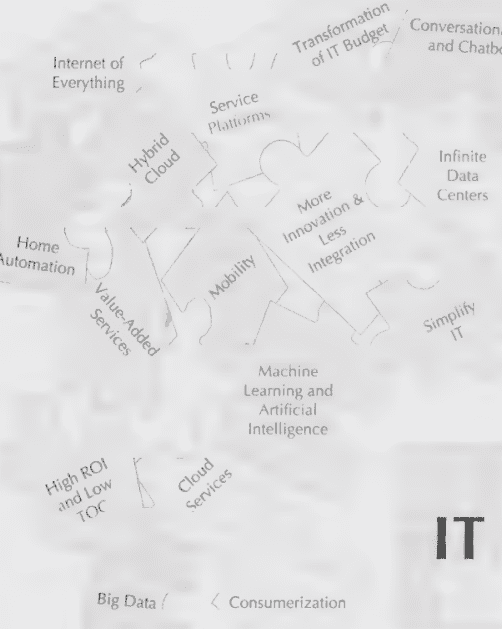

图 1-1. 企业采用趋势

当企业采用前面讨论的各种新兴技术趋势时，需要解决特定的挑战。今天企业面临的一些关键挑战包括：

- 降低总拥有成本（`TCO`）
- 遗留 IT 系统适应面向服务的架构和敏捷平台，以满足日益增长的业务需求
- 集成复杂性和面条代码，导致应用程序互操作变得困难
- 性能和可扩展性

任何现代化方法都必须解决这些挑战。这不仅仅是针对新编译器版本重新编译现有代码库（并将目标标志设置为代码库的 Java 版本）并部署那么简单。这样做充其只是在新的 JVM 上运行旧代码并带有警告。要真正实现 Java 应用组合的现代化，可能需要根据目标 Java 版本提供的新功能和增强修改现有应用程序。这将涉及从简单到复杂的代码更改，甚至对现有代码库进行重构。面对成百个应用程序和数千行代码，这项工作绝非易事。要手动确定需要更改哪些行代码、进行更改并使应用程序现代化，其可行性是有限的。图 1-2 展示了企业面临的若干采用和现代化挑战。

从成本角度来看，市场力量在过去的 15 年中减少了 IT 预算，要求用更少的钱完成更多的工作。自 21 世纪初以来，企业一直在运营成本增加、预算减少和市场高度竞争中挣扎。290 年代中期和互联网热潮看到了 IT 部门挥霍无度的开始，并在 2000 年达到顶峰。从那时，我们经历了几次经济困难的周期，导致 IT 预算减少和对 IT 系统支出更加谨慎。

随着整体预算减少，用于维护现有应用程序的 IT 预算比例增加，人们重新关注降低现有系统的 `TCO`，以释放部分维护预算用于构建新应用程序。

超过 80% 的 IT 预算用于现有应用程序的维护和维持运行场景，用于投资新应用程序和新技术的预算较少。这导致了应用组合管理（`APM`）、IT 简化和合理化方法论的进步。围绕 `APM` 发展出了一个整个学科，使得整个应用组合可以被

# 第 1 章：Java 与企业

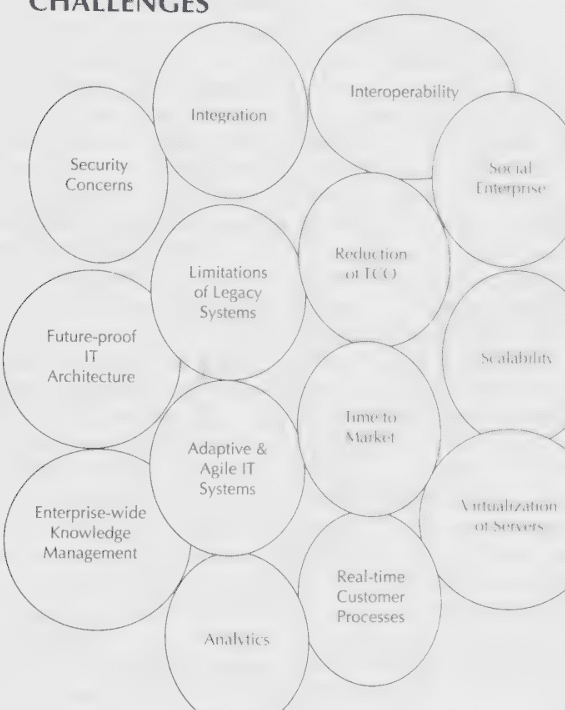

图 1-2. 企业采用与现代化的挑战

管理、跟踪和优化，以最佳价格提供最可能的结果。这降低了应用组合的 `TCO`，并加速且最大化了这些组合的投资回报率（`ROI`）。因此，企业不再针对特定的应用程序做出决策，而是可以整体地查看其整个应用组合或其子集，从而做出统一的业务决策并改善业务成果。

Java 应用程序的总拥有成本（`TCO`）包含了该应用程序整个生命周期内产生的所有成本。这可以根据构建应用的成本、基础设施获取成本、为构建或部署应用购买的任何其他硬件或软件工具、软件许可、应用运行与支持、通信和网络成本、设施费用，最后应用的退市或退役来确定。IT 人力资源可以是企业员工或外部承包商，这些人力成本也包含在内。部分基础设施可能是租赁或购买，并在应用的生命周期内进行折旧。如果 IT 经理能够计算所有这些直接和间接成本，就能很容易得出 `TCO`。然而，IT 部门并非以此方式运营，且极少为应用程序计算每项成本细节。通常，有中央 IT 预算和其他部门预算共同投入 IT 支出。企业还从中央预算中投入 IT 基础设施、硬件、企业级软件许可、网络等领域。费用分模式在企业之间各异。所有这些因素使得计算应用程序的 `TCO` 非常困难。计算构建、部署、运行和支持应用程序所需的资源成本要容易得多，因为这些可以直接关联到特定项目以及该项目的总成本。然而，仅凭这一点并不能提供有用的 `TCO` 计算。

应用程序在其生命周期内的维护成本也会增加逐年的费用。尽管重点是“构建”成本，但应用程序会经历功能增强和 Bug 修复，这些维护成本在应用程序生命周的前几年内可能非常高，甚至达到构建应用成本的 30% 到 40%。

减少 Java 应用程序 `TCO` 的方法有很多。将应用程序部署到虚拟化基础设施和云端有助于减少基础设施成本。将组合中的所有 Java 应用程序到特定的 Java 平台版本将减少支持和维护成本。对任何第三方工具和软件进行合理化将进一步降低成本。最后，投资自动化工具来评估 Java 应用程序迁移到最稳定的 Java 平台版本，将有助于进一步减少整体 `TCO`。

大型企业现有的应用程序组合包含异构技术，包括大型机应用、Java 应用程序、基于微软技术的应用程序、层次结构数据库、专用语言系统以及各种开源和第三方系统。这些组合很可能包含多个地方具有冗余功能的应用程序，还可能包含来自不同供应商的冗余技术。我曾有一公司随着时间的推移投资了 12 种不同的报告技术。在这种情况下，各种报告应用基于这些报告技术构建，导致了可以避免的许可成本、人力资源池中技能短缺以及不断增加的支持成本。这并非孤立案例。存在 20 年或更长的企业普遍存在多种技术泛滥、功能冗余以及组合中存在一套陈旧且过时的系统集的问题。


正在运行的传统 IT 系统包括大型机应用、专用第三方系统以及仍运行在 `JDK 1.4.2`、`JDK 1.5.x`、`JDK 1.6` 和 `JDK 1.7` 上的 Java 应用程序——在此地不提及任何组织，但今天某些应用程序仍运行在 `JDK 1.2` 和 `1.3` 版本上！看到某些每天使用的关键业务应用具有如此长的生命周期，确实令人惊讶。遗憾的是，当涉及到支持新的业务需求或必要的功能增强时，这些传统应用程序非常不灵活且难于修改。这可以归因于几个原因：缺乏适当的文档、构建应用的人员流失、单体应用程序架构、缺乏大型机应用那样的内部技能、与传统应用程序集成困难、缺乏测试用例和测试支架、传统应用程序之间的紧耦合，以及许多类似的原因。

这导致运营一个充斥传统应用程序的应用程序组合需要极其昂贵的支持和维护预算。此类组合带来的现代化挑战并不容易应对，必须仔细考虑，以防止对业务产生不利影响。彻底评估应用程序组合、制定经过研究的路线图、记录系统之间的交互、引入新技术组件以及对应用程序进行重构，将为现代化铺平道路。

某些企业采用了传统组件化技术，将大型机系统中的业务逻辑通过 Java 编写的封装器暴露，并作为 API 暴露给 Web 或其他 Java 应用程序。这是一种临时权宜之计——它只是增加了后端大型机的事务数量，因为 Web 或 Java 应用程序的每次调用都会导致调用大型机应用和底层数据库，然后将检索到的数据返回给调用程序。这通常会导致大型机使用成本增加。你可以考虑在 Web 层进行缓存以避免增加大型机事务。重点在于传统组件化增加了复杂性，并使此类应用的增强和维护变得更加困难。虽然这种解决方案可能适用于某些场景，但大多数情况下，将传统应用程序完全重构到 Java 平台将有利于维护，并从长期来看为应用程序组合带来更好的投资回报率（ROI）。

Java 应用程序组合已演变多年。即使是组合中的特定 Java 应用程序自构建以来也一直在增强。随着现有应用程序的增强，新应用程序被引入企业，这些新应用程序可能需要与现有应用程序进行集成。尽管某些组织从一开始就努力实施面向服务的架构（SOA），但现实是，这种架构无法预见未来的所有需求且万无一失。在架构相关的活动进行几年后，功能和技术增强会不断侵蚀架构，以至于不可避免的重构需求成为新的现实。

集成复杂性的增加会导致业务本身风险的增加。故障、性能问题和其他运行时问题的出现随之增加。此外，还需要更多的成本和精力投入到对现有应用程序进行增强、测试新功能，然后将应用程序发布到生产环境，因为集成点在应用程序增强期间往往会失败或受到负面影响。

企业中的同一个小组并不一定拥有特定应用程序组合中的所有应用程序。这些应用程序可能属于多个小组。由于在定义合理的解决方案架构时付出了共同努力，并考虑了应用需求、集成需求和应用程序接口，最初可能会集成得非常好，并在初期实现完美互通。应用所有者通常只关注其所属应用的业务需求，并且必须在分配的预算、截止日期和可用资源范围内运行。应用所有者对其时间的优先考虑和对齐高于始终与其他应用所有者合作。

然而，最终每个应用程序可能会根据该应用所有者的业务需求按照自己的方向演变，几年后就会出现互操作性问题。其中一些问题可以通过建立中央架构组、适当的治理以及应用所有者之间达成不破坏已发布的服务端点和暴露 API 的协议来解决。这种复杂程度在许多企业中很少见，而且所有应用程序之间缺乏普遍采用往往是最大的障碍。基本上，集成复杂性和互操作性潜伏在每个应用程序组合中，并在最不恰当的时候出现，紧耦合的应用程序通常会导致支持和维护负担的增加。

某些应用程序组合具有多种集成技术和范式，导致额外的复杂性、成本和性能问题。集成需要仔细处理，采用深思策略来处理数据级集成、利用服务和消息总线架构的应用级集成、业务层集成、表现层集成以及利用 EIP（企业集成模式）。

Java 应用程序通常是复杂的，并使用多个第三方和开源库。要跟踪使用的每一个 JAR 文件、每个开源或第三方库的每个版本以及可能隐藏在 Java 应用程序中的每一个零日威胁是极其困难的。每年，Oracle 为底层 Java 平台发布多个补丁和错误修复，最终提供更新。若干安全问题与在浏览器中使用 Java 相关。通过 Java 插件在浏览器中使用 Java 的流行程度已经下降，这无疑有助于减少对可能安全漏洞的暴露；然而，服务器端也存在若干漏洞。

根据已发布的报告，2010 年有 58 个 Java 漏洞披露，这一数字在 2011 年增加到 65 个。该数字在 2012 年增加到 68 个，并在 2013 年飙升至 28 个。在其他应用程序漏洞的调查中，Java 是受攻击最频繁的技术，占比 50%，其次是 Adobe Reader（22%）、浏览器（13%）和其他（15%）。2014 年，4 月份报告了 36 个漏洞，7 月份报告了 20 个漏洞。随着更多漏洞被获知，更新仅对支持的 Java 平台版本可用。在本文写作时，`JDK 1.6` 和 `JDK 1.7` 已不再受支持，但企业环境中的大多数 Java 应用程序运行在 `1.6` 甚至 `JDK 1.5` 上。只有少数企业在向 Oracle 支付扩展支持服务。对于大多数企业来说，这无疑会在某个时刻再次显形。需要注意的是，`JDK 1.7` 已于 2015 年 4 月结束寿命，之后提供定期更新的 `JDK 1.7` 公共支持被撤销。企业立即迁移到 `JDK 1.8` 或 `JDK 1.9` 是明智的，以利用所有已修复的问题和新语言特性。

# 性能与可扩展性

该平台在构建高度可扩展、高性能应用程序方面非常健壮。今天的企业应用程序在架构上是高度分布的，由松耦合的技术组件和/或服务组成；它们还与多个外部服务集成，并且极具关键性。性能和可扩展性的典型方法是先构建应用程序，然后通过微调瓶颈来解决性能问题。这种方法对于通用性能调优是有效的，但无法解决组合层面的整体可扩展性和性能问题。许多人交替使用这两个词，但性能和可扩展性之间是有区别的。

可扩展性是指系统随着负载增加以相同方式做出响应的能力。例如，如果每秒请求数增加了 10 倍，系统将如何响应？如果没有感知到差异，则系统已经扩展到可以支持十倍请求增长。性能是系统在系统资源上增加额外负载时保持其响应时间的能力。系统可调用的资源包括 CPU 节点数量、存储、I/O、内存等。

没有任何系统是可以无限扩展的，任何可扩展架构都会有一个突破点。通常，企业并不期望其面向互联网的应用程序达到 Google、Apple 或亚马逊级别的流量。为了这种规模进行架构设计对于大多数企业来说成本过高且没有必要。重要的是理解你自己的应用程序架构的突破点。任何企业的关键决定因素是确保通过过剩的可扩展性和性能特性来满足预期。如果一个企业需要提供 200 毫秒的响应时间并期望每秒 10 万次请求，那么就需要满足 SLA（服务水平协议）！虽然这种预期可能会随时间变化，但你必须针对与用例相关的正确的非功能性需求进行设计。

企业在 Java 应用程序层面面临的典型性能和可扩展性问题可以归因于几个关键领域：

- 糟糕的容量规划和工作负载估计
- 未调优 Java 垃圾收集
- 数据库性能不佳
- 内存泄漏

除了这些 Java 平台相关问题外，还会出现其他可能的问题，如网络延迟、第三方系统集成、应用程序使用的糟糕 Java 类、跨数据中心应用程序、I/O 相关问题以及线程阻塞。

# Java 应用程序的快速现代化

> **注意**
>
> 迁移到 Java 8 有助于缓解若干 Java 平台问题。Java 8 提供了更成熟的具有可靠停时间的 G1 垃圾回收器、带有命令行标记的可配置收集器，并且无需调整永久代。某些核心类也有一些性能改进，例如 `HashMap` 类。以前，键冲突会导致 `HashMap` 性能下降。Java 8 的 `HashMap` 实现在哈希桶中的项数量超过特定阈值时会将哈希桶从链表切换为平衡树。这确保了在最坏情况下，检索键的性能从链表的 `O(n)` 变为平衡树的 `O(log n)`。

将应用程序迁移到云基础设施使得水平扩展变得容易。水平扩展，又称为向外扩展，允许根据需求动态地向当前资源池添加更多节点或机器，以增加平面计算能力。垂直扩展，又称为向上扩展，受限于底层服务器的大小。当达到底层服务器容量时，你需要在垂直扩展中增加更多资源。理论上，水平扩展仅限于能成功添加多少个节点。但水平扩展也有缺点，尽管与垂直扩展解决方案相比，需要考虑运营成本、电力、冷却和数据中心占地。某些应用程序受益于分布式缓存和内存数据库。在内存中处理数据比从磁盘或闪存存储读写数据的 I/O 操作快。总的来说，由于各种因素，应用程序组合的性能往往随着时间推移而下降的趋势，因此企业实施性能管理工具以建立对企业应用程序的适当监控和管理是非常重要的。

基础设施即服务 (IaaS) 和平台即服务 (PaaS) 最近都变得非常流行。在 PaaS 模型出现很早，IaaS 服务就已经可用，并作为传统数据中心部署 Java 应用程序的可行方案。Oracle、Google、Red Hat 以及其他几家服务供应商都通过其 PaaS 产品来支持 Java。考虑到如今每天有数百万行 Java 代码被编写以及云的潜力，几家主要的云提供商已经加强了它们的 Java 云端产品。在本文写作时，Oracle Java Cloud 在教程、支持、功能以及用于部署 Java 应用程序的托管栈方面处于领先。Google、Amazon 和 Azure 也有专门的门户网站介绍它们的 Java 云端产品。

除了知名的云服务商外，Heroku、Red Hat、OpenShift、Elastic、CloudBees 等一些新兴供应商也提供 PaaS 解决方案。开发者发现有吸引力的是可以简单地构建并上传 Java WAR 或 EAR 文件到云端。开发者可以专注于应用程序和业务功能。底层平台会自动提供基础设施、包括存储和网络带宽在内的资源、计算单元，以及对部署应用程序的管理和监控。还有负载均衡、突发流量处理和自动伸缩应用程序的选项，以处理峰值负载。许多企业也实现了私有云基础设施，以便在内部部署 Java 应用程序。

一个有趣的项目 Eclipse Che 正通过在浏览器中提供类似于桌面版 Eclipse 集成开发环境 (IDE) 的功能，将 Java 开发带到云端。这将允许开发者直接在云端进行开发，而无需使用如 Eclipse 等 IDE 在本地机器上进行开发，然后将应用程序部署到数据中心环境。Eclipse Che 不仅是开发者的极佳选择，还将通过提供熟悉的界面让开发者从任何地方、任何桌面或笔记本电脑使用，从而节省时间和资源。

在云端轻松地构建和部署 Java 应用程序的能力，为将现 Java 应用程序从本地环境迁移到云环境提供了可能。如果云环境是全托管的，这将减轻保持安全补丁更新的负担。托管云栈提供商将确保整个环境都是最新的。

云端 Java 也有一些缺点。根据应用程序的不同，可能会出现数据隐私和数据所在位置等方面的问题。Java PaaS 栈没有通用标准。缺乏可移植性会将企业绑定到特定的供应商，从而导致在 PaaS 平台之间的切换不如应有的那么流畅。

云端 Java 将长期存在，但在采用 Java PaaS 解决方案之前，考虑所有的优劣是非常重要的。无论你选择私有云或公共云环境、托管云服务，还是 IaaS 或 PaaS，将取决于应用程序的性质和特定的业务需求。本书随后的章节将更详细地介绍 Java 现代化，包括各种现代化技术以及微服务的兴起和流行。

为了讨论方便，我们将人为地将 Java 时代分为三个独立阶段：过去（Java 1.0 到 Java SE 6 和 Java 7）、现在（Java 8）和未来（Java 9 及以后）。图 1-3 强调了自 1995 年以来的业务和技术趋势，其中技术趋势特别关注 Java 平台的发布。

2014 年 3 月 18 日，Oracle 发布了 Java SE 8，这是一个重大的功能发布，包含了许多功能领域的新增和增强。Java SE 8 包含 Java 语言中的 10 个主要功能新增、针对小型设备定制的 Java SE 平台的精简版配置（compact profiles）、约 20 项重大安全增强，以及在 JVM、并发、I/O 和新 I/O (NIO)、国际化 (i18n)、安全和性能等领域的其他功能新增。由于 JVM、Java 语言和 Java SE API 领域的 29 处不兼容性、11 个 API 移除和 22 个弃用 API，升级到 JDK 8 通常涉及应用程序代码和/或配置的更新。

Java 6 和 Java 7 在企业内部被广泛使用。某些报告显示，尽管 Oracle 停止了公共支持，企业中约 70% 的 Java 安装仍然运行在 Java 6 或 Java 7 上。一个令人不安的事实是，此类 Java 应用程序都没有安装最新的安全更新。Bit9 (Carbon Black) 等各种安全公司已证实了这一点。Java 6 的最后一个可用安全更新发布于 2013 年 4 月，是 Java 6 Update 45。

| 业务趋势 | 技术趋势 |
| :--- | :--- |
| 可穿戴运动和健身设备变得流行 | 2015-2017 未来 JDK 9 Jigsaw 互操作性 云优化 NetBeans IDE9 |
| 移动电子商务在发展中国家蓬勃 大数据开始成为主流 | 2011-2013 JDK 6 更新公共停止 像 Scala 等函数式语言走向主流 JavaFX 2.0.2 与 JDK 7 同安装 |
| Oracle Corporation 完成对 Sun Microsystems 的收购 Java 在企业中兴起并... | 1995-2010 过去 JDK 1.0 到 Java 6 多个版本定期更新丰富的库 许多开源库增加了 |

云端 Java 也有一些缺点。根据应用程序的不同，可能会出现数据隐私和数据所在位置等方面的问题。Java PaaS 栈没有通用标准。缺乏可移植性会将企业绑定到特定的供应商，从而导致在 PaaS 平台之间的切换不如应有的那么流畅。

云端 Java 将长期存在，但在采用 Java PaaS 解决方案之前，考虑所有的优劣是非常重要的。无论你选择私有云或公共云环境、托管云服务，还是 IaaS 或 PaaS，将取决于应用程序的性质和特定的业务需求。本书随后的章节将更详细地介绍 Java 现代化，包括各种现代化技术以及微服务的兴起和流行。

## 兴起的语言

Java 平台不再仅仅关于 Java 语言。许多流行语言应运而生，包括一些在企业中日益流行的语言，如 Scala、Groovy 和 Clojure。Java SE 7 平台向语言引入了 `invokedynamic` 指令作为一种新的字节码。这使得在 JVM 上为动态类型语言实现编译器和运行时系统变得复杂，但同时也提升了性能特性。某些 JVM 语言是解释型的，而某些则被编译为 Java 字节码，并在执行期间进行即时编译（JIT）以提高性能。JVM 还通过 Rhino 和 Nashorn（Java 8）JavaScript 引擎支持 JavaScript。

Scala 增加了函数式编程能力，并可以与 Java 应用互操作，因为它也可以运行在 JVM 上。Scala 的优势在于其对并行计算的关注。Groovy 是 Java 平台的另一种流行语言，是一种动态语言，同样与 Java 互操作。Groovy 与 Grails 正在成为快速开发 Web 应用程序的流行选择。Clojure 引入了函数式编程概念，基本上是一种 Lisp 方言。虽然目前不像 Scala 那样流行，但 Clojure 在分析等特定领域的使用正在增加。JRuby 和 Jython 则运行在 JVM 语言的流行列表边缘。

那么，既然我们已经有了 Java，我们还需要为 JVM 使用其他语言吗？答案很简单。就像工具箱除了锤子之外还有各种工具来满足特定需求一样，编程世界有多种语言来解决特定类型的问题并构建应用程序。事实上，与服务器密集型多线程应用程序相比，某些语言更适合编写前端 Web 应用程序。其他语言可能拥有现成的库，提供特定的功能，而这些功能可以在另一种语言中被利用。因此，能够为 JVM 使用一系列其他语言可能取决于个人偏好，或者可能是由于开发环境中需要使用动态类型语言而非静态类型语言的需求。

JVM 上其他语言的兴起如何影响 Java 的现代化？其核心优势之一是，由于 JVM 支持许多语言，你可以从一种语言中调用另一种语言的库，而无需经过繁琐的步骤。在对现有的 Java 应用进行现代化改造时，企业可以考虑是否希望用 JVM 支持的另一种语言编写增强功能，或者引入专门为支持的语言编写的库。根据问题领域的不同，可能会产生优势。

进一步探讨这一主题，为 JVM 实现的语言通常分为三大类：

- 许多是用于研究的语言，除了少数使用该语言的小群体外，没有人听过它们。
- 它们是现有语言到 JVM 的移植，因为它们正变得流行，而将语言移植到 JVM 可以获得对库的支持。
- 这些语言具有 Java 目前尚不具备的特性，或者与 Java 相比在编程上感觉更容易。

Oracle 已经详细地讨论了这一主题，并发表了文章强调了许多 JVM 语言的特性和用法。尽管本书将不会详细介绍其他 JVM 语言，但我们将在后续段落中简要讨论其中几种。

JavaScript 和 Node.js 的流行程度激增并快速增长。许多新应用程序正在用 Node.js 编写，尤其是实时 Web 应用，因为 Node.js 的构建重点是非阻塞事件驱动 I/O。Node.js 目前并非为 CPU 密集型操作和重计算设计的。一个由红帽赞助的名为 Nodyn 的开源项目已将 Node.js API 的功能实现了 JVM。Node.js 在短期内不会取代 Java，但它将成为 Java 的极佳补充。当 Node.js 与基于 Java 企业版的应用程序面对面竞争时，它将具有优势。

在 JDK 8 中，Nashorn 替换了 Rhino 成为嵌入 JavaScript 引擎，使用了基于 JSR 292 的新语言特性，包括 JDK 7 中引入的 `invokedynamic`。可以使用 `jjs` 命令从命令行调用 Nashorn 引擎。可以在 JavaScript 内部调用 Java 类，也可以在 Java 代码中调用 JavaScript。随着服务器端 JavaScript 流行度的兴起——Node.js——企业将在未来的应用组合中同时利用 Java 和 JavaScript。


# Scala 的流行程度增长缓慢，但尽管如此，已经有多个应用程序是用 Scala 的，并且围绕 Scala 及其库演化出了并行生态系统。Scala 在 Java 之前可能就已经有了 lambda 并且良好地支持函数式编程风格，这一事实可能有助于 Scala 的采纳和使用。某些企业应用组合同时包含 Scala 代码和 Java 代码。展望未来，需要决定是将 Scala 代码转换为 Java，还是维护 Scala 代码并与 Java 应用互操作。

## Java 开发者开始接触 JVM 的其他语言如何演进，以支持更高程度的并发和并行性

Java 8 对 lambda 的实现为语言引入了新方法，并让 Java 开发者能够接受函数式风格。这也允许 Scala 语言通过 Scala 编译器来改进和标准化字节码。Scala 内置了非阻塞 I/O 和异步处理。lambda 的引入让 Java 和 Scala 更加接近，使得每种语言都变得像另一种。在使 Java 应用现代化时，流行的 Scala 框架可以更容易地从 Java 代码调用。对于能够无缝构建、集成和测试 Java 和 Scala 代码组合的工具来说，这是一个机会。Java 仍需改进的一个领域是不可变集合。

## Groovy 诞生于底层，为 Java 平台带来了生产力和紧密集成

Groovy 可用于编写从脚本到完整应用的任何内容。尽管 Groovy 是一种动态语言，但它与 Java 互操作。Groovy 的许多特性，如闭包、特征类（traits）、函数式编程和集合，已经在 Java 8 中得到了解决。

## Clojure 引入了函数式编程概念，基本上是一种 Lisp 方言

虽然目前不像 Scala 那样流行，但 Clojure 在分析等特定领域的使用正在增加。Clojure 关注不可变值，并专为并发编程设计。Clojure 应用易于在应用服务器上打包和部署。它与 Java 紧密集成，允许从 Clojure 调用 Java。Clojure 在采纳方面落后于 Scala。未来，企业是否会对 Clojure 进行重大投入，将决定该语言是否会在 Java 现代化中占有一席之地。

## Jython 是流行语言在 JVM 上的实现

Jython 程序可以导入并使用 Java 类。Jython 代码可以是解释性的，也可以进行即时编译和预编译。Jython 的流行程度尚未达到被视为 Java 语言威胁的程度，但它让 Java 集成到 Python 中变得容易。在现代化 Java 代码时，预计企业不会转向 Jython 来替代 Java 代码。它在 Python 到 Java 的集成方面可能是用的。

## JRuby 是 Ruby 在 JVM 上的实现

JRuby 本身大部分是用 Java 编写的。从原理上讲，JRuby 的目的与 Jython 非常相似。它与 Java 紧密集成，允许 Java 和 Ruby 代码之间进行双向调用。JRuby 1.7 及更高版本使用了在 JDK 7 中引入的 `invokedynamic` 关键字。JRuby 在企业中并不流行，预计它不会替代旧 Java 代码。它在 Ruby 到 Java 的集成方面可能是用的。

## 当企业针对其 Java 应用组合追求现代化策略时，他们需要全面考虑其他对 JVM 友好的语言

企业必须权衡采用 Java 其他语言的优缺点。需要明确了解其在特定背景下的益处。学习曲线和内部技能集也需要纳入此类考虑。采用其他 JVM 语言在短期内可能会增加成本和开发时间。尽管面临微小的业务挑战，许多企业已经开始使用 Scala、Groovy 和 Node.js，其他 JVM 语言将继续在 Java 现代化中发挥重要作用。

## 无论你是从 Java 早期阶段就开始 Java 与企业领域的旅程，还是在此过程中采用了 Java 平台，每个 Java 企业开发者都有一个共同点——即面向 Java 的未来来构建、管理和更新应用程序

Sun Microsystems、Oracle、IBM 等公司与 Java 开发者社区付出了巨大努力，维护 Java “一次编写，随处运行”的承诺，并确保 Java 持续成为企业的首选平台。尽管太阳微系统公司（Sun Microsystems）已不复存在，Java 已经开源，且软件受益于如 Apache 和 Eclipse 等联盟的巨大支持，这些联盟在其体系下提供了多个热门的开源项目。塑造未来的趋势结合企业面临的挑战，使得自动化工具必须采取严谨的方法，以保护并进一步增强对现有 Java 应用组合的投资。

## 近期 Java 平台的发布增加了许多引人入胜的功能，同时提升了性能并使 Java 平台更加安全

Java 现在已适用于每种形态的设备，并已从单纯的服务器端发展到智能手机及其他领域。将 JVM 向其他语言开放了一个生态系统，其中“作为语言的 Java”和“作为平台的 Java”都塑造了各自的身份。尽管在存在二十多年后，Java 平台和 Java 语言的采用率仍呈上升趋势。它仍然是这个时代最流行的编程语言和首选的企业平台。


## Java 平台的首次公开发是 1996 年的 JDK 1.0

从那时起，Java 不断演进以满足用户不断变化的需求。在最初版本中编写的应用程序极可能不再被当今的企业积极使用。这些遗留应用程序与它们所服务的企业一样，必须演进或被取代。在不断演进的过程中，应用开发是否存在可预测性？嗯，开发的指导性原则仍然适用。企业遵循一套流程来生成应用程序。虽然不同企业之间的流程实现细节有所不同，但总来说，这一过程始于识别业务需求并确保预算资金。一旦解决了这些问题，就会为应用程序的管理和治理创建一个计划，并识别管理该计划以及最终执行项目所需的资源。项目团队在项目管理的伞盖下工作，构建应用程序、测试并部署给终端用户。在应用程序成功部署后，IT 部门的另一个小组通常会对其支持和维护。如果获得了额外预算，未来可以创建计划以随着时间的推移增强该应用程序的功能。由于业务需求的变化，企业根据当前需求定期替换或删除应用程序。

## 尽管具体的流程和详细步骤在企业之间有所不同，但分析总是以相同的方式开始

除非有迫切的业务需求并分配了预算来解决，否则企业内部无法构建或增强应用程序。这一过程也伴随着自身的挑战和业务风险。有时，项目在途中被放弃。其他项目在成本或时间维度上的估计不准确，从而影响了应用程序的整体构建和交付。有时，企业在没有意识的情况下，构建了具有某些功能的应用程序，尽管企业内部已经存在具有完全相同功能的应用程序。这种由于应用管理不当导致的冗余和浪费往往常见。

## 企业内部 IT 部门的动态机制是复杂的，在许多情况下会影响企业自身的成败

技术升级的预算请求总是排在列表的最底部，企业往往决定再坚持现有的技术平台版本一年以节省成本。几年之后，这些技术就会过时，不再受供应商支持。这种不升级或使应用程序现代化的决定如果影响了关键任务平台，最终将使企业面临更大的风险。

## 本章探讨了应用生命周期的几个方面以及与应用生命周期相关的管理

我们还提出了一种观点，主张通过必要的流程来创建一个健全的方法论，该方法应根据组织的需求进行定制。企业应该通过使用相关产品和工具开发一种方法，以便并定制自己的应用生命周期管理蓝图。

> **注意**
>
> 本章关于应用生命周期的讨论不要与技术角度的应用生命周期事件混淆，在技术层面，部署在应用程序服务器中的应用程序会在应用程序容器（如 Java EE 应用服务器）中经历启动、执行、停止和关机等生命周期事件。


## 大多数组织对其现有的应用程序组合没有深入了解

在每个应用程序层面，多个所有者和利益相关者共同负责该组合。然而，利益相关者只关心他们拥有的应用程序的状况，并将精力放在寻求预算支持以维护和运行特定的应用程序上。所有者可能与特定供应商合作支持他们的应用程序，而这些服务提供者可能会随时间而变化。因此，任何个人或一个小组对应用程序以及它如何演变成现状拥有深度实操知识是罕见的。即使在功能层面的理解上，应用程序知识通常也分散在几个人手中。重构这些知识将是徒劳的尝试，因为需要几周时间来访谈组织各地的利益相关者。尽管如此，当需要重大增强且决策团队信息不足时，企业可能会诉诸于这种练习。在这一发现过程中，应用程序的功能和技术理解被记录在一份“系统鉴赏文档”中，以及任何能收集到的背景信息。尽管比没有要好，但该文档仍然缺乏对应用程序的 360 度方位理解，因为它依赖于一组个人，其中许多人对应用程序来说是新的。


## 几年后，随着应用程序得到进一步增强而知识库未相应更新，这份文档就会过时

一旦供应商资源转移到其他项目，批准了更多增强，并且新团队接手应用程序，就必须重新开始“系统鉴赏”，考虑到由于人员流失和文档记录不善而丢失的所有历史知识。

注意，到为止我们讨论的是单个应用程序。如果你对整个应用程序组合提出这一论点，组织中可能没有人能声称对组合中的所有应用程序都有深入了解。在 5 到 10 年期间，组合中的应用程序都朝着自己的方向演进，企业留下的一个需要大量预算来维持运行的应用程序组合。当新应用程序添加到此组合中时，它们也将陷入预算流程，竞争支持和维护资金的分配。这看起来像是一个无休止的循环。

以这种方式演变的应用程序组合通常具有以下特征：

- 产生巨大的业务需求
- 投资回报率低
- 每年总成本增加
- 充斥功能冗余
- 包含过时技术
- 隐藏潜在的安全问题
- 是错误的投资决策
- 包含可以淘汰的旧应用程序

在应用程序的整个生命周期，它通常属于一个应用程序组合，与其他应用程序集成，服务业务部门，经历多次增强，并在某些情况下进行重构和新技术集成。

最终，它会被更新和替换。图 2-1 展示了应用生命周期中的五个主要转换点：

- 1. 构思与策略
- 2. 需求与设计
- 3. 构建与部署
- 4. 维护与增强
- 5. 更新与替换

应用生命周期管理是一个持续的过程。目前有很多产品可以辅助全面的应用生命周期管理，包括侧重于程序管理、协作、软件工程过程支持/质量保证与测试流程以及治理的工具。

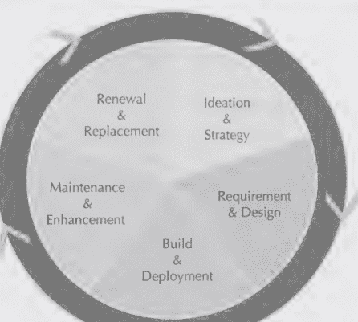

> **图 2-1 应用生命周期的主要转换点**

这些产品或工具超出了本章的范围，但它们可能会用于你的日常工作。本章也未尝试描述生命周期中的软件开发或软件工程方面。此类主题在其他专门针对这些主题的书中有介绍。

应用作为程序管理的一部分进行管理，程序管理在整个应用生命周期内启动、构建并运行该应用。在先进组织中，应用生命周期还受到应用组合管理流程的约束，使组织能够将应用视为单个资产，作为更大型应用组合的一部分。这样做有许多优点，我们将在后续章节中进行探讨。

治理流程为各个应用生命周期阶段提供监控和管理。如图 2-2 所示，该流程还管理其他流程，包括程序管理和应用组合管理。

每个应用在其生命周期都会经历以下阶段，本章对此进行了深入探讨：

- 1. 业务案例的建立
- 2. 应用开发
- 3. 运营

尽管我们大多数担任软件开发人员或 IT 管理员的人都认可并认同应用生命中的转换点，但理解映射到应用演进阶段的生命周期相关过程同样重要。本书区分了转换点和生命周期阶段，因为高管和应用组合所有者采用的生命周期阶段视图主要由财务和应用的运行实用性驱动，而不是深入研究应用设计、构建和部署的细节。仅仅从技术和开发为中心的视角来看待单个应用以及整个应用组合，无法向企业高层证明应用现代化的合理性。

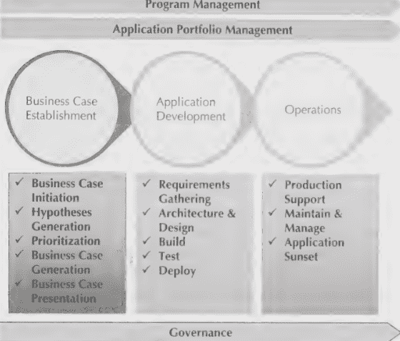

> **图 2-2 治理流程监控并管理应用及其组合。**

因此，理解高层面的对比但相似的以流程为中心的应用生命周期视图对我们来说也很重要。这将使应用团队在开展现代化计划时，能够重点构建业务案例、证明现代化的合理性并展示现代化的业务价值。除了开发和部署方面外，处理应用组合的治理和运营方面也将导致应用更新和退出的规划，从而完成应用的全生命周期视图。

## 企业在组织的不同层次创建不同类型的业务案例

驱动重大业务决策的业务案例可能直接来自 CEO。由于这些决策超出了本书的范围，我们将主要关注 IT 部门级别的业务案例。

特别是需要证明为了满足已识别业务需求而构建新应用的合理性。这些业务案例有时由 IT 利益相关者创建，有时是由相关业务部门与 IT 利益相关者合作创建的。外部顾问也可能参与这一过程。

## 注意

作为更大业务需求定义和策略的一部分而创建的业务案例，通常与合作伙伴共同获得资金并执行。这些项目首要目标是在对业务需求建立充分理解之前，尝试向高层证明实现该业务需求的合理性。此类计划成功的机会更大，因为这不仅建立了一个高层业务案例，还包含了深思熟虑的业务策略和通过实施这些计划将满足的具体业务需求。这些策略练习尝试对必要的资源投入和预计交付时间表提供高层次理解，从而使请求者在寻求管理层支持时业务案例变得更加稳固。

经验 IT 领导和经理知道如何用正确水平的信息构建业务案例，从而增加计划获得批准的概率。他们还与外部服务提供商建立了良好关系，并知道如何利用供应商的专业知识帮助交付良好的业务策略和业务案例文档，以提高此类计划获得资金的概率。即使你并不担任建立或演示业务案例的角色，对这些功能有高层次理解也是重要的。

技术人员有时会质疑这项练习，并询问为什么他们需要理解通用业务案例。他们生活在完全远离业务政治的世界里，对吗？事实并非如此。

事实远比此如此。如果你客观地考虑业务案例，它有四个用途：

- 为管理层提供机会利用其掌握的资金和资源对项目进行比较和排序
- 传达业务价值以及为什么要开展特定项目
- 与关于时间、精力和成本的初步高层计划一起分享项目执行愿景
- 使团队能够从启动阶段就参与进来，并帮助系统地拆解工作和时间组成部分

建立业务案例包括以下步骤：

- 1. 启动业务案例
- 2. 生成为什么需要应用的假设
- 3. 通过映射构建应用与业务目标和任务之间的关系，将业务需求与组织与其他需求进行排序
- 4. 创建用于签署的正式业务案例
- 5. 向关键利益相关者演示业务案例以获得支持

图 2-3 展示了业务案例的创建。让我们深入研究业务案例的创建及其特定元素。

| | 业务案例创建 |
| :--- | :--- |
| 1 业务案例启动 | • 执行摘要<br>• 业务目标<br>• 业务案例解决的业务需求<br>• 建议的解决方案 |
| 2 假设生成 | - |
| 3 排序 | • 方案分析<br>• 包括成本和范围的财务分析<br>• 运营 |
| 4 业务案例生成 | • 风险与挑战<br>• 对其他计划的影响<br>• 执行资源 |
| 5 业务案例演示 | • 总结、建议和结论 |

在业务案例理由分析（`business case justification analysis`）过程中提出的问题包括：

- 创建此应用程序将为我们带来或节省多少资金？
- 我们为什么需要某个特定的应用程序？
- 该应用程序与已拥有的其他类似应用程序相比是否重复？
- 构建需要多少成本？
- 工作量是多少？
- 构建该应用程序需要哪些资源？
- 持续支持和维护的后续成本是多少？
- 我们是否有内部技能，还是需要引入合作伙伴？
- 该应用程序何时交付？
- 哪些应用程序会受到这个新应用程序的影响？
- 它是否需要与其他应用程序和数据源集成？
- 该应用程序对基础设施有何需求？
- 未来由谁来拥有该应用程序？
- 哪个团队将负责构建和管理该应用程序？
- 总拥有成本（`TCO`）是多少？
- 是否有现成的软件包可以让我们实施，而不是自己构建应用程序？
- 我们已经实现的现有软件包是否能够提供此项功能？

通常还会出现许多其他问题和变体进行讨论。一旦这些问题以某种方式解答，确定的所有者应该组建一个小团队来验证该应用程序的必要性，并开始构建业务案例理由。有时，只是一个拥有新应用程序想法的倒霉个人，必须独自工作构建这个初始的业务案例。虽然这不是最终获得批准和预算以构建新应用程序的终极业务案例，但它是起点。这一通用过程被称为**业务启动（`business initiation`）**。它定义了构建新应用程序的高级初步业务案例或业务理由。为新应用程序寻求预算资金的审批过程在当时需要更严谨、更详细的业务案例讨论。然而，在业务案例启动阶段，主要目标是为该应用程序建立一个非常高级的业务需求，以证明投入大量精力和分配资源是合理的。

为什么正式的业务案例甚至是必要的呢？难道业务领导者聚会几小时并最终决定需要构建一个新应用程序来满足业务需求就够了吗？为什么要创建一个如此复杂的审批流程？嗯，不幸的是，这种随性的方法在某些组织中确实会发生。可能是因为业务案例是显而易见的，以至于没有必要撰写正式报告。也许几页手写笔记就足以获得支持和批准。有的初创公司仅凭餐巾上涂写的数字就从风险投资人那里筹到了数百万美元。但正如我们所有人所知，这并不是典型的资助项目。每个项目都伴随着独特的业务风险，而正式的业务案例启动过程要求并强制对这些问题进行仔细审查。

2012年，管理咨询机构麦锡（McKinsey & Company）发布了一份报告，显示了5400个大型IT项目。在这项研究中，麦锡对这些IT项目得出了以下结论：一半项目的预算超过1500万美元，运行率超支45%，7%的项目进度落后，56%的应用程序最终交付的功能少于预测。其他研究报告报道的延迟交付的项目比例更高。与这些惊人的数字相比，小型项目的成功率似乎比大型IT项目更好。2012年，Gartner的研究人员发布了一份类似的报告，分析了预算超过100万美元的大型IT项目。研究得出结论，这些大型项目的失败率比预算低于35万美元的项目高出近50%。毕马威（KPMG）、IBM和其他领先的IT服务公司在过去几年里还发布了其他几份报告，表明约40%的企业项目以某种方式失败了。遵循这些报告的企业内部决策者中，有40%理解他们必须遵守严格的程序，密切审查所有项目的尽职流程，以证明成本支出和资源分配的合理。

评估业务案例的两个重要标准是**投资回报率（`ROI`）**和**总拥有成本（`TCO`）**。虽然`TCO`计算包含了成本，但`ROI`计算量化了特定时间内的预期收益。与基础设施相关的项目通常通过`TCO`衡量，而产生业务价值的项目则有强大的`ROI`说明。

组织必须建立一套非常高标准的流程来评估业务案例。在任何组织中，业务案例的创建和理由都是申请中不可或缺的一部分。

## 从假设开始


# 快速决定构建新应用程序想法的价值

快速决定一个构建新应用程序的想法是否有价值是非常重要的。否则，宝贵的时间将被浪费在最终无法获得资金的项目上。为了验证业务想法，从假设开始。你为什么需要这个新应用程序？它满足关键的业务需求吗？是否有其他方法满足组织的需求？满足该需求有哪些选项？构建这个新应用程序在财务上合理吗？在较短时间内，这些问题可以得到答案；在高级别，这一系列问题也迫使组织内的其他人员对想法者提供反馈。

一旦初始理由被记录，请求者就可以开始构建详细的业务案例，以获得构建新应用程序的支持。这一过程应该记录在正式的业务案例文档中，供提交、评审和批准。最终决定将取决于该项目与其他竞争项目的排名优先级，以及所提新应用程序所获得的支持水平。

## 业务需求排序

重要性：一个定义良好的优先级框架和方法论可以确保客观地选择可行项目。尽管如此，高层领导人员在对某些关键业务需求与不那么突出的需求进行排名时，不可避免地会有某种程度的主观性或偏见。他们说“会叫的轮子有润滑油”。也许在这一选择过程中也是如此？这里需要注意的要点是，有缺陷的优先级决策最终将影响企业损益表的顶线和底线。因此，将业务需求优先级排序作为业务增长的强制性组成部分符合所有人的最大利益。

那么，对于没有定义业务案例创建和论证流程的中小型企业来说呢？他们如何对业务需求进行优先级排序？应用程序组合相对较小的公司，进行中的项目可能不多。然而，如果这些公司不妥善管理财务，它们面临倒闭的风险更大。对于资源有限的初创公司和小型公司，建立一套成熟的流程对业务需求进行优先级排序，并对如何分配预算做出关键决策是明智的。事实上，对于小型公司来说，年度会议是不够的。这些组织需要定期评估并证明其项目投资决策的合理性。必须实施严格的控制，以便这些公司从错误决策中快速恢复，并重新部署资源以满足不断变化的竞争性需求。类似于为初创公司或小型企业在公司层面制定初始业务计划一样，识别业务案例论证在应用程序层面同样必要。即使一家公司的收入没有达到高位的八位数，也不意味着它可以跳过业务案例论证的需求。事实上，恰恰相反。小型公司的流程可能没有那么长或那么正式，但作为整体应用程序组合管理的一部分，这是一个重要的实践。

回到中大型企业的背景，良好的应用程序生命周期策略，结合应用程序组合管理和治理，对于一家真正成功的公司至关重要。这种方法论确保了以下事项是可以知的，或至少是可以预测的：

- 做出良好的投资决策
- 在现有的应用程序组合中构建业务功能
- 衡量应用程序组合的性能以满足业务目标
- 尽可能减少与尝试实现优先级的业务需求相关的风险，从而最大化获得资助计划的成功率

大多数公司都有一个正式的业务案例模板，以确保其流程的可扩展性和标准化。这种方法论确保了以下事项是可以获知的，或至少是可以预测的：

- 执行摘要
- 业务目标
- 业务案例涵盖的问题
- 提议方案
- 方案分析
- 运营
- 挑战
- 对其他项目的影响
- 资源
- 结论

业务案例所有者应确保在提供信息时，与相关利益相关者进行互动，这可以极大提高获得支持的成功率。对于初创公司或小型企业来说，在公司层面会议是不够的。它们需要定期评估并证明其项目投资决策的合理性。在这种情况下，业务案例所有者应确保在提供信息时，与相关利益相关者进行互动，以确保获得支持。此外，一个一小时的会议或抄给许多人的邮件链可能不是大家充分表达意见的合适论坛。利益相关者可能对业务案例所有者提出的问题在私下进行进一步的讨论和探讨。

# 第2章：Java 应用程序的生命周期

业务案例的评审和审批不应只是一个孤立事件，而是一个过程。这种方法论确保了以下事项是可以获知的，或至少是可以预测的：

- 做出良好的投资决策
- 在现有的应用程序组合中构建业务功能

> **注意**
>
> 
>
> 此列表并不推崇瀑布模型。
>
> 事实上，瀑布模型的谬误之一在于假设与应用开发相关的领域是顺序的。这种方法严苛地施加了任意的顺序，结果参差不齐。需要重申的是，本节既不采用瀑布方法论，也没有暗示应用开发流程的广泛领域在本质上是顺序的。相反，我们认为，在整个生命期的背景下分析应用开发至关重要，既包括广泛的五个领域，也包括针对特定的开发需求、实施要求以及必要的流程和工具。

此外，在涉及应用现代化时，必须将应用开发工具与其他现有流程和工具结合使用，以获得完善的方法论。它不应该是在一个封闭的孤岛内完成的过程。

IT运营或应用运营已演变成一个具有强大流程和工具的高级领域。软件包应用程序和旧应用程序通过它们之前运行的传统IT流程进行处理。企业中的所有应用都无法使用单一、统一的方法论来创建。正在构建的新型应用程序是在纳入持续集成并体现敏捷原则的全面开发方法论下进行测试和管理的理想候选。

新的应用程序理想情况下运行在虚拟化环境中，并将适当的容量管理、零配置、监控和治理作为应用组合的一部分。应用程序在整个生命周期内会接受不同层次的生产支持，直到该应用程序最终达到退役，即它不再被需要或被另一个更新的应用程序取代。运营的三个步骤如下：

1. 生产支持
2. 维护与管理
3. 应用退役

三个主要的应用生命周期阶段进一步细分为共13个步骤（如图2-2所示）。这些步骤对各个阶段提供了更细粒度的理解。三个生命周期阶段都处于三个应用生命周期管理流程之下：

- 治理
- 项目管理
- 应用组合管理

管理应用组合是应用生命周期管理不可或缺的一部分。为了支持业务而构建和部署的应用并非永恒不变。它们会周期性地发生变化，为了支持新的业务功能而进行增强，为了引入新技术而进行修改，并与其他应用程序集成以编排业务流程。正如应用并非永恒不变一样，业务流程也会周期性地变化。企业必须确保制定适当的政策，以管理应用的构思、创建、开发和管理以及更大的应用组合本身。

这些应用存在于企业是为了支持业务。为了确保IT与业务的良好对齐，治理机制极其重要。治理强制要求标准和法规的遵守，它还识别并衡量创建成功的生命周期管理策略所需的指标和流程，该策略与应用组合管理紧密结合。最后，设计良好的项目管理并治理所有与应用生命周期及整体组合相关的所有倡议。这是任何企业倡议成功的极其关键的一步。

## 企业面临的挑战与风险

在最近的一份 Gartner 报告中，分析师得出结论：企业在IT倡议上花费的十美元中，有八美元基本上是浪费的。这些钱被用于维持运转，而不是对企业业务价值增长、业务增长和更好的市场定位做出实质性贡献。这些许多IT应用程序是高度业务关键的投资，消耗着额外的支出和资源；如果预算支持被中断，业务将停滞。如果这些应用程序不是可以丢弃的并且需要企业提供如此水平的投入，组织应该怎么办？

应用管理不当会导致竞争优势的大量损失，使公司无法快速稳定地为底线做出贡献。如果企业能够识别并重新分配大约10%到20%的预算来资助新应用的构建或技术驱动的业务创新想法，他们就能成功地开始现代化。

## 开发与运营 (DevOps)

传统上，开发与运营是孤立的。然而，近年来出现了一种名为 DevOps 的现象，让开发团队协同工作交付产品。DevOps 影响了以下功能：

- 应用开发
- 部署
- 生产支持
- 维护
- 治理
- 监控
- 运维
- 计划
- 恢复

这种策略是能够创建成功的生命周期管理策略，与应用组合管理相结合。最后，设计良好的项目管理并治理所有与应用生命周期及整体组合相关的所有倡议。这是任何企业倡议成功的极其关键的一步。

在你引入 DevOps 文化时，请检查你的应用程序组合。首先对你的组合进行全面评估，以确定在何种情况下引入 DevOps 流程和工具最为合适。如果你最近添加了一个应用程序，那么该项目可能是应用组合现代化的良好候选，特别是当某些应用程序不便于自动化时。

## 创建应用组合

在创建应用组合之前，组织必须明确定义究竟什么构成了“应用程序”。在许多企业中，“应用程序”一词的使用非常松散。在某种情况下，应用程序可能是一个细粒度的服务，而在另一种情况下，它是一组服务、数据库和报告的集合。在某些情况下，封装好的企业资源计划（ERP）软件或带有宏的 Excel 表格也被称为应用程序。无论具体定义如何，将一组用于交付特定业务功能的软件服务视为“应用程序”，是理解该术语的好方法。该应用程序是单体的还是由多个细粒度服务组成并不重要。只要能够识别出一组源代码或一组服务，并对其划定一个边界以指示所有组件共同属于一个应用程序，就足以管理该已识别应用程序的生命周期了。

应用组合是此类应用的集合。应用组合类似于金融投资组合，也需要对其内容进行持续的治理和管理。

## 应用特性

在应用组合中，每个应用程序应具有以下定义的特性：

- 完善的文档
- 良好的业务功能
- 对构建和维护应用程序成本的相当准确认知
- 衍生的业务价值
- 技术质量
- 总成本
- 投资回报率 (ROI)
- 与其他应用程序的依赖关系和集成点
- 性能特性
- 寿命及其功能替代品

通常，一个企业会有多个应用组合。每个业务部门可能有自己的应用集。有时，使用特定技术构建的应用程序由一个小组或几个重叠小组拥有并运营。定义和操作应用组合没有一种特定方法。

如果企业尚未定义应用组合策略，并没有将一组应用程序整合到一个大伞下进行管理，那么务必尽快这样做。将应用程序作为统一组合进行管理，而不是单独处理每个应用程序，这具有许多优势。创建应用组合可以产生规模效应。

## 组合创建流程

创建应用组合的过程需要三个简单的步骤：收集、选择和定义。终极目标是确保一组应用程序得到妥善的管理和监控，以交付最大的业务价值，满足应用组合的目标，利用最佳技术，维持最高的技术质量，同时保持低业务风险并优化支出。不考虑企业中的其他应用程序而单独管理每个应用程序，将无法提供实现最终目标所需的运营规模。

如果没有有效的应用组合策略，程序成本和项目风险将指数级增加，导致跨应用边界出现大量冗余。大多数成熟企业在 20 世纪 80 年代和 90 年代初见证了这一点，当时几项新兴技术体现在许多自定义和封装的应用程序中。在短短几年内，IT 预算受到了严峻围困，因为这些应用程序开始抽走新开发的资金。应用组合管理策略的产生直接源于识别并组织企业内部成一个整体的集合的需求。图 2-4 展示了应用组合的流程。

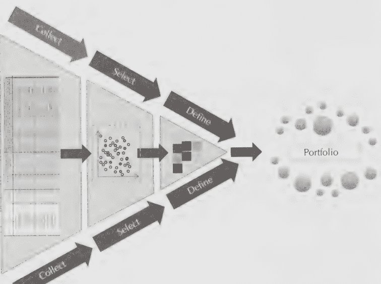

图 2-4. 创建应用组合的过程

### 收集

创建应用组合的第一步也是最重要的一步是识别应用程序并收集有关这些应用程序的各种数据点和属性。这可能是最困难的一步。根据组织的成熟程度，在过去的数据收集活动中可能已经建立了旧的知识库，而且很有可能某些数据已经过时了。如果企业拥有活跃的应用组合管理实践和健全的治理原则，那么可以跳过或大幅缩短应用组合的创建过程，以反映所有应用程序都是现有组合的一部分，且知识库是最新的。如果情况并非如此，企业将不得不开展数据收集活动。

大多数组织通过识别应用程序所有者、业务分析师、企业架构师、开发者、数据库管理员以及可能了解特定应用程序的其他利益相关者来处理这一过程。通过访谈并使用统一模板捕获应用程序数据，以便对收集的数据进行比较。这些模板通常在 Microsoft Excel 中构建。某些企业会超出 Excel 表格的范围，创建一个存储收集数据的数据库。其他企业可能会投资第三方工具来帮助收集和管理应用程序数据。

这种收集方法依赖于被访谈的人，他们共同拥有有关应用程序的相关数据。根据应用程序的年龄、复杂性以及各利益相关者与应用程序关联的时间长，通过访谈收集的数据严重依赖于经验丰富的访谈者，他们擅长通过一系列引导性问题来提取信息。访谈者必须根据初始的响应即时深入并提问详细的后续问题。这种方法还假设用于数据收集的模板涵盖了应用程序的所有可能属性；在现实中，并非如此。通常，模板是为了特定目标而构建的。它们主要关注收集不同的属性，通过分析这些属性可以获得对收集这些属性的特定背景的见解。

收集方法从未考虑实际的源代码、配置、环境或其他开发变量。为了增强通过访谈过程收集的数据，利用能够分析源代码、配置文件和环境的工具来构建详细详尽的知识库是非常重要的。最终，数据收集活动应跨多个领域，包括财务、运营、业务和技术。一旦收集了数据，就可以应用各种过滤器来确定哪些应用程序可以归类到应用组合。大型组织可以根据产品线、功能区域或技术构建多个应用组合。

### 选择

一旦将应用程序的详尽数据收集到知识库中，下一步是选择一组符合既定标准的应用程序来构建应用组合。构建应用组合建立了一个开始管理的基准。虽然选择标准各异，但需要检查创建应用组合的整体驱动因素。例如，某个业务部门的所有应用程序可以分组到一个应用组合中。在这种情况下，数据收集活动对应用程序选择没有特别有利，但对以后应用组合的管理将很有用。另一个例子，如果选择标准分析所有运行在 JDK 1.6 上的应用程序，则需要分析多个数据点以收集符合这组标准的应用程序，例如：

- 支持特定的业务流程
- 与特定应用程序集成
- 积极增强功能
- 维护组合的支出
- 活跃工单的频率

在三到五年内，可以清楚组合中的应用程序是否演向了不同的方向，或者显著偏离了分类该组合的初始标准。这种分析类似于金融组合的构建。在多年以后，特定金融组合内部工具的性能会变得多样化。定期，人们会平衡金融组合并调整底层工具以满足新目标。相应地，这一过程也发生在应用组合中。多年以后，应用组合的性能低于预期水平，很可能是由于目标随时间推移发生了变化。

> **注意**
>
> 应用组合管理将在第 3 章中进行更详细讨论。目前，重点是选择一组符合预定义标准的应用程序，以创建应用组合策略。

### 定义

一旦选择了属于应用组合的应用集，在定义步骤中确定以下标准至关重要：

- 目标的定义
- 衡量指标
- 如何管理该组合
- 该应用组合的治理方案
- 用于持续监控性能的仪表板

尽管许多中大型企业认为他们已经定义并实现了应用组合的运营，但通常情况并非如此。现实情况是，许多企业并没有通过定义良好的应用组合来充分赋予其应用所有者权力。相反，组合通常只列出了应用所有者、预算行项目以及其他一些基本信息。（我遇到过几个例子，即即使是这些有限的信息也无法轻易获取，必须像“寻宝游戏”一样搜寻线索才能收集相关数据点。）

如果一个企业已经拥有一个捕获并分析了应用数据的组合，你需要问自己几个问题：该应用组合的定义程度和治理水平如何？正在收集哪些指标？多久对应用组合及其交付的业务价值进行一次合理化处理和衡量？这将是下一章的主题，我们将讨论应用组合管理。

## 总结

所有应用在构思、资金、构建、部署、支持以及最终退役和更换方面都遵循特定的生命周期。这些应用可以是 Java 的，也可以是非 Java 的（例如遗留应用、大型机应用以及其他语言编写的应用），它们有时存在于同一个组合中。

在大多数企业中，Java 应用程序具有良好的生命周期，因为 Java 平台及其周边技术得到了普遍的支持和理解。企业中资助全新的计划面临着巨大挑战，因为 80% 的预算被现有应用消耗，以维持关键业务职能的运行。创建一套正式的方法论和流程来管理应用生命周期，将使预算资金得到优化利用，以维护和支持应用组合。

许多大型企业在支持应用增强和现代化时，遵循正式的业务案例论证程序。理解应用的生命周期以及整个应用组合，将确保业务案例得到适当的审查和论证。缺乏应用组合策略会增加企业面临收入泄漏和 IT 资源紧张的风险。书中概述的流程将确保能够识别和记录应用特性，并通过相关指标进行跟踪和衡量。近年来 DevOps 的相关性对应用现代化倡议产生了积极影响。应用组合策略和项目执行方法论的治理最终将带来成本节约，这些资金可以重新投入到企业的新计划中。


# 第3章：应用组合管理

应用组合管理作为一种实践在 20 世纪 90 年代初出现，为企业提供了一种方法，用于衡量和比较业务价值、定量收益相对于运营维护成本。这门学科帮助 IT 部门发现、理解、分段、分类和管理其控制的各种应用。当时，由于千禧年漏洞（Y2K bug）导致应用失败的迫在眉睫是所有大小组织的关注焦点。一些遗留应用被特别认为具有风险。这促使许多组织详尽记录其应用，建立全面的应用知识数据库，分析可用预算，监控修复千禧年问题的应用支出，然后开始建立知识库。这加速了应用组合管理作为一门 IT 学科的建立。在上一章中，我们定义了什么是应用，并讨论了如果组织内部尚不存在应用组合如何创建一个。在本章中，我们将探索应用、应用属性、对已有应用组合的分析以及应用组合的管理。

在 20 世纪 90 年代初互联网普及和万维网广泛可用之前，大多数组织并没有向高层管理人员提供首席信息官这一角色，也不需要定义良好的 IT 部门政策和程序。结果是对于主要的大型机和客户端/服务器应用几乎没有治理。互联网的广泛普及和消费者 PC 的突然激增导致了企业应用的激增。员工门户、合作伙伴外网和全公司内网导致了更多应用由企业构建和拥有。随着 Java 及其他相关技术的引入，构建和部署企业级应用比以前变得更容易。为了管理投资应用、维护和管理应用、从企业应用中获取最大价值的过程，出现了一种结合了业务、运营、技术和财务技能的管理学科。这门学科得到了另一门被称为“企业架构”（EA）的学科出现和进步的补充，该学科结合了理解技术架构和领域功能的能力，并将 IT 与业务战略和业务需求对齐。这导致了用于管理应用组合的流程、指标和工具的定义。

因此，应用组合管理（APM）学科应运而生，并在 21 世纪初发展成为一种健全的实践。


# 应用组合管理

随着 APM 学科植根于既有流程中，应用组合的性质也发生了演变。从最初主要是大型机应用和客户端/服务器应用（限于少数特定的技术和技术供应商），如今的应用组合在技术、平台、编程语言、现成供应商产品和自定义应用的广深度上非常多样。需要管理的应用组合的复杂性也导致了 APM 学科本身的演变、新工具的出现、方法论和流程的发明，以及对专业技能资源进行重新培训以便在企业内部实施 APM。大多数企业应用组合都包含大量的 Java 应用。在管理应用组合时，不能只管理 Java 应用或只管理旧的遗留应用；必须采取整体方法。

本章泛泛地探讨了应用组合。讨论的方法和技术无论应用是否在 Java 平台上构建，对所有应用组合都具有意义。遗留应用与 Java 及非 Java 应用的相互依赖关系，要求 APM 学科能够在企业内部跨技术进行无缝工作。

## 注意

千禧年漏洞不仅仅与日历数据格式化和存储相关的计算机编程漏洞。用两位数字表示年份的做法在从 99 变为 00 时确实导致了编程逻辑相关的错误问题。其中还隐藏着另一个问题。一些程序员误解了格列哥历的规则，即恰恰能被 100 整除的年份不是闰年。他们忘记了这一规则对于被 400 整除的年份同样适用。因此，2000 年是一个闰年。


## 什么是应用组合管理？

要在组织内持续执行应用组合管理（APM），需要定期执行特定的步骤。需要对所有纳入组合管理的应用程序进行数据收集。需要将收集到的数据格式化为一系列属性和一个知识库。需要对格式化的应用数据进行分析。需要根据组合的业务目标生成一组假设。需要建立受关注的指标，并实施持续收集这些指标的流程。分析将导致对假设的验证或驳伪。最后，生成一个路线图，以转型和现代化应用组合中的应用程序，从而使组合就关键业务驱动因素得到充分优化。一旦开展了这项工作，就会建立一个基准并构建一个知识库。从那时起，针对应用组合的数据收集和指标收集过程就可以是持续的。

典型的业务驱动因素包括降低成本、识别和缓解业务风险、消除功能或技术冗余、优化应用组合的投资决策以降低总拥有成本（TCO）并提高投资回报率（ROI）。满足业务驱动因素的 APM 执行策略包括：向组合中引入新技术、业务流程转型、应用重构、用软件包应用程序替代自定义应用程序、停用和退休应用程序、应用程序的现代化和增强、向组合引入新的业务能力、向组合引入新的技术能力、将应用程序迁移到新的技术平台、升级应用程序到新版本的技术、将应用程序移动到云基础设施，有时甚至是维持应用程序现状的决议。

## 为什么需要 APM？

企业 IT 目前面临的严峻挑战包括：

- 许多应用程序随着时间的推移以无计划的方式演变，对维护和增强带来了架构和设计挑战。
- 大量应用程序分散在各个业务部门，缺乏明确的归属关系和运营洞察。
- 许多地方存在功能冗余，部门可能甚至没有察觉。
- 随着新计划的预算的枯竭，降低成本是 IT 部门的一个重要目标。
- 对现有应用程序的知识在最好的情况下也是碎片化的，而且许多应用程序由于缺乏了解应用内部机制的领域专家，而构成了业务风险。
- 在现有应用程序中增强和引入新业务能力时，上市时间非常缓慢。
- 技术组件和供应商产品在企业应用组合中存在冗余。
- 单体应用之间存在紧耦合，导致集成和互操作的噩梦。
- 现有的 IT 资源在管理和维护这些应用程序方面，存在过时技术、专有技术限制以及缺乏足够技能的问题。

APM 旨在解决这些挑战，并确保此类问题可以得到控制并最终消除。

## APM 的兄弟学科

APM 应该与另外几个学科紧密结合，以帮助 IT 部门制定战略和运营。在构想获取业务能力或构建新技术能力时，需要大量的资源。为了成功执行任何 IT 项目，根本需要人员、流程和技术的正确组合。时间、资源和预算的可用性是任何 APM 策略中需要评估和缓解的一些关键变量。

大多数企业已经围绕项目管理或计划管理、投资风险管理和人力资源管理建立了相关小组。企业架构（EA）是另一项成熟的学科，它在应用开发和 APM 的背景下整体地审视企业的所有架构层。该学科就架构最佳实践、业务能力和技术能力的优先级排序、执行项目所需的资源以及技术架构和设计决策提供建议。

企业内部的关键项目由托付给企业架构师，他们通常负责应用程序开发和管理的生命周期。某些企业架构师可能专门负责基础设施、技术或特定的功能领域，而另一些可能是通用解决方案架构师。企业架构师创建与 IT 和架构相关的治理流程，并积极参与应用开发项目和战略组合管理。

为了将 APM 作为一项强大的学科来实践，APM 需要从开始就建立 APM、PPM（项目组合）和投资风险管理（IRM）之间的强有力联系。APM 以应用为中心，PPM 以项目为中心，而 IRM 以投资为中心。此外，EA 对 APM、PPM 和 IRM 纽带的战略性参与将确保这三个兄弟学科的连续性，以监控和管理架构决策、项目资金和可用资源。APM 练习会产生良好的路线图，确定未来三到五年的倡议。这些通过 APM 生成的倡议是 PPM 和 IRM 的输入。图 3-1 描绘了 APM、IRM 和 PPM 之间的关系，以及 EA 如何作为胶水来确保这三个学科保持一致。

通过对 APM、PPM 和 IRM 进行正确理解和分析而选出的倡议，具有更高的概率准时且预算完成，从而成功实现其既定目标。

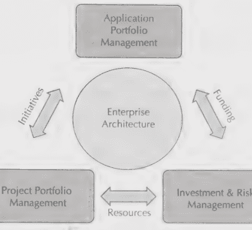

**图 3-1.** APM 及其紧密结合的兄弟学科

## 放大 APM

尽管我们讨论了 APM 及其与企业兄弟学科的关系，但在更深层次上，APM 与企业内部的许多基础流程都有联系。企业内部 IT 部门的基本准则之一是成功对齐业务和 IT，使技术能够作为竞争优势来实现业务目标。在过去的 15 到 20 年中，IT 部门的目标和 IT 本身的角色发生了变化。除了业务-IT 对齐之外，IT 部门面临着巨大的压力，要求优先考虑并管理资金以实现业务价值最大化。资源对齐是一项关键任务，在人员、技能和其他资产方面平衡有限的资源。最后也是，所有成功的 IT 部门都实施了详尽且管理良好的流程，来管理项目、投资、应用组合、人力资源或管理运营和技术风险。

企业通常采用 APM，意在将其作为应用组合的规划活动。在此类规划过程中，多个业务部门受到了上游或下游的影响。随着时间的推移，企业开始将 APM 视为执行平台和治理平台。APM 的整体方法极大地有助于组织持续进行以下活动以优化组合本身：

- 管理 IT 基础设施的运营。
- 优化与应用程序相关的 IT 成本结构。
- 评估并解决风险。
- 决定维护组合的资源结构。

### APM 的范围

APM 是整个 IT 框架中的基础学科。它既是战略规划功能的一部分，也是持续执行功能的一部分。某些组织错误地仅将 APM 整合到规划功能中。当 APM 整合到 IT 的运营层面，还能提升其他 IT 学科的效率。

APM 不是为了管理应用程序而建立的独立实体或小组。APM 是整个 IT 部门的功能，因此，APM 功能的所有者和利益者需要从各个业务线和企业架构中建立。APM 还应该来自兄弟学科的代表。APM 核心小组应向首席信息官（CIO）委员会报告，该委员会可以被认为是帮助 CIO 就企业战略和政策做出关键决策，因为 APM 从根本上致力于在降低风险的同时实现应用组合价值的最大化。从财务角度来看，APM 优化 TCO 并实现 ROI 最大化。在成本、风险、ROI 和业务价值之间实现完全同步的和谐几乎是不可能的。总会有妥协和未知的变量优先级需要应对，以确保维持某些阈值。这是一个非常微妙且复杂的平衡过程。从成本角度来看，企业内部的 APM 对齐可以有效降低 IT 成本运行率，这是任何企业理想的目标。

一个从未机会将应用组合管理（APM）建立为一门学科，或者多年没有机会有效执行 APM 的组织，可以从 APM 中极大获益，以减少与 IT 执行和运营相关的成本。已经建立 APM 并已显著优化运营成本的成熟组织，可以使用持续集成的 APM 功能进行战略规划、未来业务能力的优先级排序、应用组合治理，以及许多其他策略，以确保资金和资源优化地部署到应用组合中。随着 APM 学科整合到组织内部，APM 将成为拟议事项的来源，这些输入将馈送到 PPM（项目组合管理）和 IRM（集成风险管理）学科。APM 还将用于开发业务案例要素、对业务能力进行排序、识别必要的技术能力、消除功能冗余、整合 IT 资产，并提供有效的成本效益分析以支持易于实施。

与 APM 相关的治理流程有助于建立组织感兴趣的各种指标。除了定义指标外，APM 还参与对这些指标的持续测量、分析和报告。在企业内部成功部署 APM 将实现基于数据驱动、以分析为中心的应用组合管理，从而促进业务繁荣并最大化执行能力。

图 3-2 显示了从 APM 视角观察 IT 景观。作为一个跨越整个规划、开发和运营过程的学科，APM 是一种优化和管理应用组合的整体集成方法。这在图中被描述为构思（Conceive）、构建（Build）和运营（Operate），其中 DevOps 与构建和运营阶段相关。尽管 APM 是构思阶段不可或缺的，但将 APM 学科整合到应用的整个生命周期中是非常有效的。每个获得批准构建的应用必须由特定的业务线或业务部门所有。为了维护、增强和运营有效且全面的组合，需要确定一个应用所有者对项目进行日常监督、预算和资源的管理，并承担保持应用信息实新的责任。此类应用所有者对于整个 APM 流程的成功至关重要。

合规是治理的一个关键方面。如果没有履行这些责任中的任何一个，整体 IT 治理过程可能会受到这些不合规应用的影响。一旦企业建立了全面的合规策略、指南和标准，组织将面临着由于依赖不合规的组合应用而导致信息不准确或不足的风险。此外，任何关于 APM 的决策都可能是错误的。管理合规性的一种方法是确保与所有应用所有者、应用组和业务线进行有效的沟通。需求需要清晰地传达。如果获得高层管理的支持，可以建立升级路径，以确保不合规应用被纳入治理伞下。

IT 战略和劳动力管理是与 APM 交互的两个重要过程。某些企业将 IT 战略管理视为年度活动，以便对需求进行排序。其他企业设有专门的 IT 战略小组，将 IT 战略作为一个持续性过程进行管理。在这种情况下，IT 战略与 APM 之间存在紧密耦合。许多应用可能会外包进行维护和运营。APM 可以分析此类组合，并决定其他应用是否可以从外包中受益，以及某些应用是否可以合并或最终关闭。外包供应商通常没有动力去为他们维护的应用组合建议此类选项，因为这将会影响他们的整体业务。APM 治理还可以密切监控此类供应商在维护和管理应用组合内外包应用方面的性能，并最大化外包组合的成本分配。

识别大多数（如果不是全部）主要的 IT 事项将是通过应用组合分析和应用组合持续管理过程制定路线图的结果。这将对 TCO（总拥有成本）产生积极影响，提高 ROI（投资回报率），并使业务需求更好地齐。

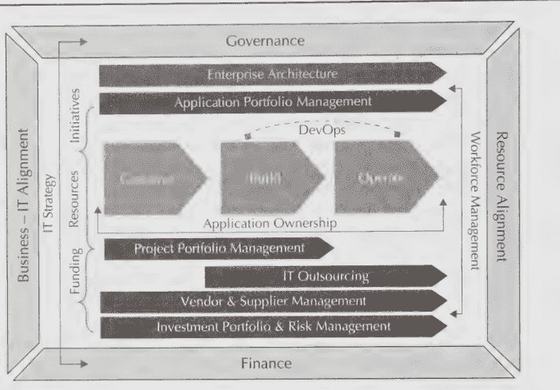

**图 3-2.** IT 战略和运营景观的动态

## 什么不是 APM

现在你已经对 APM 如何运作有了通理解，了解什么不包含在 APM 的定义中同样重要。许多 IT 部门开始非常随意地使用“APM”一词来指所有的日常 IT 活动。在单个应用上执行的活动，或者在孤立状态下执行而不考虑整个应用组合或对其组合影响的活动，真的不被认为是与 APM 相关的活动。同样，对应用的日常管理以及对应用的硬件基础设施或软件许可进行维护和升级的项目规划也不被认为是 APM 相关的活动。此外，使用发布和配置管理或资源规划来开发应用的项目规划不是 APM 活动。以独立方式资助项目或为解决特定问题或修复 Bug 资助项目与 APM 无关。开发和维护应用、支持应用、向应用中引入新的功能改进以及以点对点的方式集成两个应用都与 APM 无关。对于 IT 来说，开展此类项目维持运行通常是重要的，但这些项目本身并不是 APM，而且 APM 无法构思并起源于 IT 部门执行的每一个项目。需要注意的是，这些活动并不是 APM 的特定意图或目的。

总结来说，APM 不是：

- 一种软件开发方法论
- 一个由 IT 内部独立小组拥有和运行的独立过程
- 一个针对已识别事项的资助流程或审批流程
- 一个完全自动化的流程
- IT 战略、DevOps、PPM、IRM 或 EA
- 应用所有者的替代方案
- 一个完全客观的练习，特别是在涉及建议方面

事实上，APM 生成假设并利用主观性对应用进行评分。

尽管处理 APM 没有单一方法，但构建企业管理应用组合的方法需要一些基础构建模块。原则上，应用组合的管理类似于投资组合。需要识别关键目标和驱动因素，必须做出投资和资助决策，并根据目标平衡组合，并且对管理组合的战术和战略方面要有整体理解。

你可能好奇是什么驱动企业考虑并最终采用 APM。以下是导致企业采用 APM 的关键业务和 IT 驱动因素示例：

- IT 投资透明化
- 应用业务价值的沟通
- IT 资产排序
- 利用现有管理 IT 资产更高的可见性
- 管理和提供新 IT 资产最大价值的方法
- 理解应用的使用以及对业务用户的价值
- 确定应用组合中潜在的业务风险
- 确定应用的外包机会
- 降低 TCO 并提高 ROI

关于应用组合的某些决策将有些是以 IT 为中心的，而另一些将是以业务为中心的。以 IT 为中心的决策旨在识别组合中的应用合理化和应用简化机会。通过对应用程序进行分析，以确定其整体业务价值以及与当前业务流程的对齐情况。此外，还需要评估应用程序的技术质量和健康状况。以 IT 为中心的决策关注应用组合合理化的成本削减和快速见效（quick wins）。

应用组合管理（APM）中以业务为中心的决策对应用组合具有更具战略性和更远远的视角。识别现有的业务能力以现代化。考虑未来状态的业务流程模型。管理应用组合涉及理解未来的业务需求，并确定哪些业务能力需要构建到应用组合中。本质上，这是业务流程的转型，以支持演变的业务模式。

无论组织所做的是以 IT 为中心、以业务为中心，还是两者的混合决策，都需要充分理解应用组合中固有的业务和技术能力。整个企业架构栈应该有良好的记录，应用程序本身也需要进行功能和技术拆解。这将在下一章进行详细介绍。

我们都能理解住在同一个住所并在长时间内积累多件物品的经历。几年之后，我们可能很难理解起初为什么要购买大多数东西。很多时候，我们经常会忘记自己甚至拥有某件物品——这就是为什么我们中许多人有两三个开罐器器！而且讽刺的是，当需要打开罐头时，我们可能连其中一个都找不到！我过去用这个比喻来描述企业对 APM 的需求。

在任何现实场景中，所有组织都在不断平衡它们的应用组合，并结合以 IT 为中心和以业务为中心的应用组合修改。统一的方法可以应用于 APM 的以 IT 为力和以业务为中心的分析。这种方法本质上由三个支柱组成：

- 翻新 (Renovate)
- 集成 (Integrate)
- 管理 (Manage)

所有企业都处于应用程序不断翻新、集成和管理的状态。这三个支柱并不是顺序步骤，也没有有限的开始和结束。所有企业在这三个支柱方面都处于不同的成熟阶段。理解这三个支柱的动态机制，并结合一套正确的工具集和 APM 治理应用健全的 APM 框架，将确保企业能够就其他两个支柱不断优化每一个支柱，并使应用组合价值最大化。图 3-3 展示了三个支柱中每个部分的预期，从任务到生成的输出。

大型企业已经存在多年。它们有限的空间充满了现有的硬件、软件和应用程序。每年都有更多的资产被加入其中。在这些环境中，极不太可能现有的资产和 IT 系统将进行整合或消除。当新的技术组件或新应用程序被引入企业时，需要有人来询问它们将如何与现有应用程序协作。企业必须优化其 IT 资源；它们无法负担积累资产并造成不必要的组织混乱。它们必须找到一种创建资产清单并跟踪和保持该清单实新的方法。最终，清单将不再仅仅是数据的集合；它将演变为一个知识库。管理应用程序并跟踪相关的操作和财务将帮助企业实现梦寐以求的 ROI。翻新、集成和管理是组织企业 IT 组合所需的三个支柱。


**图 3-3.** 持续的 APM 和集成学科：翻新、集成、管理

## 翻新 (Renovate)

在翻新阶段，如果还没有应用清单和知识库，则必须创建一个。现有的仓库也需要定期刷新。可以利用某些自动化工具来确保某些应用程序属性被自动跟踪。理解各种架构层级（包括业务架构、功能架构、技术架构和基础设施架构）将为知识库提供见解。应用架构和信息架构是业务和功能架构的结果。架构拆解将使企业能够理解应用程序中已有的业务能力和技术能力。这将确保应用功能中的所有冗余都被理解。很有可能某些业务能力和功能被构建在多个一个应用程序中。同样，某些技术工具和技术组件也可能是冗余的，特别是在某些不再被积极使用的应用程序中。


# 翻新阶段

翻新阶段还涉及大量的手工工作，以筛选 IT 景观，利用应用所有者和其他利益相关者的资源，并汇编知识库。在这一阶段，发现不再使用的应用程序或技术质量极差但仍在生产环境中支持的应用程序并不罕见。需要创建一个应用程序、组件和服务的目录，并包含这些服务的企业级元数据存储。仓库还需要包含构建或购买新应用程序或其他 IT 资产的策略、标准、最佳实践和指南。

对组合进行分析后，会出现一条翻新的实施路线图。一旦翻新阶段完成，将存在一个包含应用属性和元数据的统一企业级知识库。翻新的一些关键成果包括理解以下领域：

- 应用组合和应用属性
- 应用组合的运营、财务和技术性能
- 遗留系统现代化蓝图
- 应用组合的云就绪性和参考云架构
- TCO 和预期 ROI

# 集成

当组织能够执行集成支柱时，意味着 APM 规范达到了一定的成熟水平，企业架构也整合到了核心 APM 过程中。要成功开发出集成良好的应用组合，需要充分理解业务架构。集成阶段涉及在深度理解业务流程和相关工作流的基础上做出架构决策。架构决策围绕集成模式、消息格式、数据格式和协议进行。处于集成阶段的企业将信息架构视为企业架构的基础组成部分。

从技术角度来看，Java 技术平台对消息和 Web 服务有强有支持，包括描述和发现、安全以及分布式计算。多个开源和第三方供应商产品是纯。基于 Java 技术的多协议企业总线平台实现了异构 IT 环境的集成。Java 连接器架构 (`JCA`) 是 Java 2 企业版 (`J2EE`) 的一种集成标准，用于集成企业信息系统。企业总线 (`ESB`) 平台被标记为业务集成平台。它们支持多种消息架构，并包括对 Java 消息服务 (`JMS`) 的支持。

# 第 3 章：应用组合管理

随着企业在集成支柱上不断实现成熟，作为重构部分确定的某些现代化倡议开始实施。应用性能测量和其他指标现在已就绪。跟踪总拥有成本（`TCO`）和投资回报率（`ROI`）的能力已根植于企业内部。重构阶段实现的云就绪性让位了真正的云部署。

## 企业集成模式

早期的遗留业务应用程序通常运行在孤岛，每个应用程序都有自己的数据库、屏幕，并且通常有一组特定的终端用户。这些单体应用让位于业务应用程序和服务，这些服务越来越多地需要访问其他应用程序和服务所暴露的业务功能及其底层数据。企业中授权的业务用户期望能够轻松访问提供的业务功能。为了将应用程序连接起来，面向消息的中间件开始变得流行并演变为 `ESB` 技术。此类产品为应用和服务的集成提供了底层架构，并解决了传输协议、数据格式、路由和数据转换的问题。虽然消息可以是同步或异步的，但趋势和方向是采用异步消息架构和基于 `REST` 的服务。在以 Web 为中心的应用架构中，这种方法提供的松耦合组件提供了最大的灵活性和便利性。企业集成模式（`EIPs`）记录了以可重复方式实现解决方案的证明方法。模式结合了多次尝试重复构建同类型解决方案的经验，并提供了来自实际实践的观察，包括最终被纠正的错误。今天存在许多流行 `EIP` 的 Java 实现。`Apache Camel` 是一个流行的开源实现示例。

## 管理

管理应用组合有两个关键方面：治理和赋能。治理方面由流程和控制组成，以确保像管理投资组合一样管理组合。第二个方面是用技术工具和自动化对流程赋能，以便对应用程序进行持续的管理和监控。为了实现自动化，企业需要在架构和设计阶段早期就考虑其组件和服务的管理。

Java 平台将 Java 管理扩展（`JMX`）作为其核心 API 的一部分。我很少看到企业在为其软件组件和服务的创建架构设计时，除了已实现的业务接口外，还包含一个管理接口。如今的趋势凸显了企业现在如何创建可重用的应用框架，然后使用这些框架来构建应用程序。如果在开发生命周期中，软件组件和服务的管理接口包含变得稳定，将确保应用程序是整洁、组织良好、集成良好且管理良好的。

此外，在管理支柱上达到成熟的企业将拥有定义良好的 `KPI` 和领先指标。所有构件都将建立活动监控和管理接口。组合治理和应用组合的 `ROI` 管理也将集成到企业的核心中。当三个支柱——重构、集成和管理——按照自身的速率继续成熟时，一个自适应敏捷应用组合将具备应用组件的自动发现、自愈、跟踪、配置、衡量以及云端业务流程和服务的管理。

## 应用组合分析

在对应用组合进行重构之前，需要对应用组合进行彻底的评估和分析。然后，必须定期重复这一过程。三步法可以完成这一评估：

1. 发现
2. 分析
3. 建议

第一步涉及收集组合中应用程序的数据和元数据。大多数企业在过去已经收集了一些数据，但存在数据过时的风险，特别是如果数据没有保持更新、没有得到妥善治理或没有得到充分管理。此外，在大多数情况下，这些可用数据仅部分完整。最好的方法是验证可用数据，然后识别现有清单中的差距。一旦确定了这些全面数据，就需要对这些数据进行分析。应用数据可以从多个维度进行分析，从而产生关于应用组合的洞察和假设。在此阶段，必须识别并优先考虑需要构建到组合中的业务和技术能力。最后，这些分析和优先级排序练习将产生一份倡议路线图，考虑到所有的成本、风险、依赖关系和业务案例，这些因素都需要被正确理解以实现成功的评估。图 3-4 提供了评估应用组合的三步法视图、每个步骤中开展了哪些活动，以及执行这些活动的输出是什么。

| 活动 | 分析 | 建议 |
| :--- | :--- | :--- |
| • 分类并识别应用组合<br>• 识别应用属性并通过问卷收集数据<br>• 创建应用程序库<br>• 进行访谈以识别额外信息<br>• 创建分析框架 | • 跨多个维度分析应用组合<br>• 根据成本、风险、健康、灵活性、质量对应用程序进行分析和评分<br>• 生成假设并达成共识<br>• 识别解决组合差距的业务和技术能力 | • 创建建议并与利益相关者验证<br>• 将组合对齐业务并利用企业架构<br>• 进行成本和工作分析<br>• 确定倡议优先级并构建业务案例<br>• 路线图 |
| **输出** | **输出** | **输出** |
| • 问卷<br>• 应用信息<br>• 应用分析框架<br>• 应用程序库<br>• 知识库 | • 优先的业务需求<br>• 评分后的应用组合<br>• 2x2 视图<br>• 相关假设 | • 假设验证<br>• 优先倡议<br>• 路线图<br>• 估计——成本和时间 |

图 3-4. 评估应用组合的三步法

## 发现：应用清单和数据收集

发现过程，特别是针对应用组合的数据收集工作，是最基本的活动之一。没有数据，就没有分析。如果对企业拥有的东西了解不足，企业能做出正确的决策吗？在大型企业中，可能有数百甚至上千个应用程序，管理和所有权极其碎片。对应用程序的了解不能视为所当然。应用组合中各种应用程序的年龄可能不相同，在某些情况下差异巨大！对于那些最旧且存在时间最长的应用程序，在理解上可能存在巨大的差距。观察发现，在应用程序支持的业务过程细节和细微差别以及应用程序内部代码和质量方面，这一点尤为真实。随着时间的推移，随着了解旧应用程序内部的人越来越少，关于应用程序的遗留知识自然会逐渐流失。

大多数企业已经围绕其软件开发生命周期（`SDLCs`）建立了流程。作为 `SDLC` 的一部分，企业通常会为其设计和实现的应用程序创建功能性和技术文档以及设计文档。此类文档仅在应用程序构思和构建时是准确的。随着应用程序进入维护模式，文档会变得过时。此外，许多企业可能不会在应用程序的粒度水平上维护财务和运营数据。这些数据可能会在项目层面或从部门资源的整体预算角度进行跟踪。任何管理过项目的人都知道，预算资金经常被收回和重新利用。“以少办多”是我们所有人都有同感的格言。另一个挑战是资源可能以通用方式使用，但没有被跟踪并正确归属于特定的应用程序。结果是与应用程序相关的某些数据将过时，或者对于应用组合所有者和经理来说通常未知。

作为 `APM` 的一部分，发现阶段应该仔细计划以验证应用程序的数据质量，并尽一切构建良好的基准应用程序库。所有利益相关者都应该参与其中，使用统一模板和问卷进行有方法的访谈将有助于收集与应用相关的相关数据。运营和财务数据可能需要进一步的剖析，以更好地理解此类数据在应用层面的关联。随着 `APM`（应用组合管理）治理流程的建立以及数据收集变得更加自动化，底层假设将产生更高质量的运营和财务数据。还应利用自动化工具来分析源代码，并对应用源代码和应用环境进行发现。这将产生一个包含丰富应用信息的准确应用库。这不应被视为一次性的工作。应用库应该定期进行刷新，并应对对数据进行持续的跟踪和捕获。

在成功完成发现阶段后，可以从应用库中生成应用属性。接下来的“应用属性”部分识别了若干实用的常用属性。其中某些属性可以直接从收集的数据中获取，另一些属性则是从收集的数据推导出的。这些属性可以用于应用程序细分并分组为子集，并将应用程序分类到多个组中。如果企业应用组合非常大，这将非常有用。这种细分允许分析过滤并查看感兴趣的应用程序，而无需一次性审查所有应用程序。经验表明，处理数量超过 25 到 30 个的应用程序组通常是困难的。

发现阶段并未此结束。尽管发现意味着仅查找并收集数据到清单中，但建议的方法论还对应用库进行了某种程度的分析，以创建应用知识库。图 3-5 显示了发现阶段的详细视图，包括应用库的创建以及随后该库转换为应用知识库。可以定义各种类型的规则和策略。某些规则可能与升级应用程序的技术有关；另一些可能关注某些属性的阈值。可能还存在与集成、所有权、文档、服务消费以及其他多个领域的策略。这些规则可以创建并存储在同一个库中。规则和策略也可以应用于自动代码分析，以构建进一步的数据点，从而为应用程序提供额外的额外洞察。发现阶段的一部分是将被动的数据收集活动转变为更具主动性的知识库，该知识库可以用于推导出洞察并做出明智决策。


# 76 Java应用程序的快速现代化

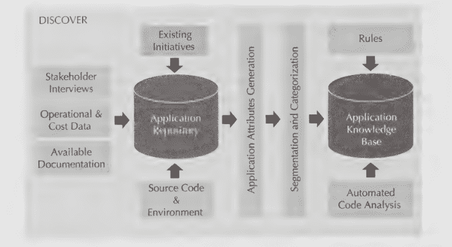

图 3-5 发现阶段：创建应用知识库

## 应用定义

大多数组织都有一套定义的架构实践，通过整个企业架构来使业务战略与技术战略对齐。应用程序的构建封装了功能，并考虑了业务流程、信息和数据流、业务功能以及执行业务策略所需的技术。应用程序的实际定义在最好的情况下也是模糊的，并且在不同组织之间存在差异。在光谱的一端是单体遗留应用程序，被认为包含了执行所需的整个代码库数据库和其他文件。在光谱的另一端，某些组织将网站或 Web 服务分类为应用程序。

为了在企业内部执行 `APM` 练习，达到一个统一且理解良好的应用程序定义至关重要。当这是一个包含屏幕、业务逻辑和数据库的单体客户端/服务器应用程序时，定义更容易掌握。许多早期的 Java 应用程序也是单体的，使用抽象窗口工具 (`AWT`) 或 `Swing`，有时会将业务逻辑强制引入此类表示组件中。最终，随着 Java Server 页面 (`JSP`) 和 `servlet` 的引入，那种客户端/服务器架构演变为多层 Internet 应用架构。随着应用架构演变为分布式多层模型，多个组件（特别是技术组件）开始被重复使用。

除了此类单体应用程序外，一组协同工作以交付一系列业务功能的 Web 服务或软件组件也可以称为应用程序。在这种情况下，将每个服务或组件分配给一个逻辑组是重要的，其目的是使其归属于某处，使得另一个应用程序不包含相同的服务或组件。每个应用程序都应该有一个特定的功能和流程边界。一旦建立了这一点，定义什么构成了应用程序就变得容易了。应用程序也可以被视为预算分配、资源分配、维护、增强目的以及组织内所有权的单位。这种业务功能的集合的单元也符合应用程序的定义。

清晰地定义应用单元和应用边界使组织能够有效地管理应用程序的生命周期，并轻松地在组织范围内利用和重用应用程序功能。缺乏应用定义、缺乏应用所有权以及缺乏 `APM` 纪律可能会体现在应用组合中的功能和技术冗余。通过这种分析，发现四个或五个应用程序在不同的业务部门中提供非常相似的功能并不罕见，有时在同一个业务部门内部也是如此。看到来自多个供应商的类似技术产品被用于构建各种应用程序也是罕见的，而不是利用应用组合中已有的技能、知识库和供应商产品许可。`APM` 纪律结合已建立的企业架构实践和清晰的应用定义，确保了应用组合中的冗余可以降至最低。

## 应用属性

作为“新新”（`renovate`）支柱的一部分，当收集组织内现有应用程序的信息时，企业应致力于建立 `APM` 实践并定义其应用组合策略。为了管理应用组合，这种信息收集涵盖了多个实践领域，包括业务、运营、财务、技术、基础设施和合规。收集的信息被组织成一组属性。某些属性可以直接识别或测量的，而另一些属性必须通过观察或计算推导出或分析。需要注意的是，并非所有属性都是通过观察或计算得出的。事实上，这些属性具有某种主观性，并根据使用量表的评分框架来衡量应用程序。例如，应用程序的可维护性是一个属性，但如何衡量这个属性呢？根据企业内部对于什么是应用程序可维护性的基准，可以对组合中的每个应用程序定期观察并捕获该属性，以跟踪应用程序的可维护性是好是坏。

是常用的应用属性列表，按领域分类，有助于持续收集和跟踪：

### 业务功能

- 支持的关键业务流程数量
- 对业务的业务性
- 支持的业务部门数量
- 业务优先级

### 架构与设计

- 应用复杂性
- 技术能力
- 技术风险
- 功能冗余
- 技术冗余
- 可扩展性
- 重用
- 部署
- 安全性
- 文档
- 软件和硬件平台
- 符合标准/架构
- 软件和硬件平台规范
- 使用的语言、技术数量

### 集成与工作流

- 工作流复杂度
- 可配置工作流
- 分布式事务
- 可衡量的事务延迟
- 实时/批量
- 业务规则
- 集成依赖关系
- 企业级集成模式
- 数据格式
- 数据交换
- 数据转换
- 集成依赖关系
- 内部接口数量
- 外部接口数量
- 接口类型

### 管理与支持

- 应用的可维护性
- 技能 set 的可用性
- 技术过时
- 技术成熟度
- 监控
- 过去一年的发布次数
- 发布导致应用规模的变化
- 功能点
- 功能点变化百分比
- 生命周期
- 代码行数
- 服务数量
- 风险
- 缺陷跟踪与文档记录
- 待办事项 (`Backlogs`)
- 修复失败次数
- 支持团队规模及特征
- 定制化程度

### 性能与韧性

- 可扩展性
- 可用性
- 可靠性
- 恢复时间目标 (`RTO`)
- 峰值负载性能下降
- 性能服务水平协议 (`SLA`) 偏差
- 可用性 `SLA` 偏差
- 当前恢复能力
- 支持窗口需求
- 时长
- 每行代码缺陷数
- 修复失败次数
- 故障次数
- 平均停机时间
- 灾难恢复
- 网络域数量
- 使用模式与接口
- 用户数及并发用户

### 可用性

- 用户满意度
- 个性化
- 审批
- 多种外形设备
- 用户投诉

### 财务与运营

- 生产力提升百分比
- 总成本
- 预算变化百分比
- 整合成本
- 运行劳动力成本
- 通过外包节省的劳动力成本
- 维护成本
- 许可成本
- 硬件成本
- 运营成本

## 分析：应用评估与分析

与应用组合管理（`APM`）相关的战略决策过程是动态且持续的，它利用方法论、流程和工具，通过在以下几个关键领域分析应用，使应用能够满足关键的企业目标，包括：

- 业务价值
- 技术质量
- 应用健康状况
- 风险
- 投资决策
- 架构决策
- 资源分配
- 功能冗余
- 新技术引入
- 应用退役决策
- 外包
- 业务需求优先级

这些领域代表了 `APM` 关注的典型应用维度。这些维度本身由一个或多个应用属性组成，这些属性是在发现（`discover`）阶段作为部分收集或得出的。企业正在不断决定对哪些应用进行投资、如何构建新的业务功能、退役哪些应用，以及如何为多个不同的应用维护制定预算。

应用组合与组织的业务战略和技术战略紧密相连。因此，对发现阶段创建的应用知识库进行分析，将使分析结果与业务目标对齐。分析将产生若干个需要验证的假设。生成的假设还应映射到业务目标，以确保精力不会浪费在对业务不重要的领域上。

分析的一个方面将侧重于沿各个维度对应用进行评分，然后生成 `2x2` 矩阵，以选择、绘图并比较两个选定的维度。此时，可以对假设进行解释。根据分析的主题，可以列出感兴趣的特定 `2x2` 视图，并从知识库中提取构成分析维度的相关应用属性。

以下是分析阶段感兴趣的一些 `2x2` 视图：

- 业务价值对比成本
- 业务关键性对比技术质量（以降低风险）
- 技术过时对比性能 `SLA` 偏差（用于理解应用健康）
- 应用关键性对比业务能力
- 成本对比采购
- 业务关键性对比 `SLA` 偏差（用于理解风险降低）

分析最终产生一份报告，并作为建议（`recommend`）阶段的输入。

分析阶段的第二个方面涉及理解是否需要在组合中构建任何新的业务能力或技术能力。如果有任何正在进行的计划或路线图中的后续计划，则可以使用此阶段来分析并确定需要构建的能力。如果某些能力已经可用，则可以完成冗余分析。通过多个维度对需要构建的能力进行优先级排序，这种优先级排序和计划有助于理解业务需求及其实施。分析阶段的输出现在用于建议阶段。图 6 展示了分析阶段的细节。

# 84 Java 应用现代化


图 3-6 分析阶段：应用分析与假设生成

## 建议：计划优先级排序与路线图定义

此阶段从分析报告和业务需求开始，这些是分析阶段的输出。映射到业务目标的假设需要经过验证。优先级业务需求和经过验证的假设用于生成需要实施的计划。取决于分析的目标，计划可以用于降低运营成本、合理化应用、消除冗余以及转型组合以获取新的业务能力。识别出的假设和计划根据这些目标会有很大差异。图 7 分了计划优先级排序和生成路线图的可视化方法。

一旦确定了计划，就需要建立成本模型并检查收益。复杂且昂贵的计划在启动前需要强大的业务案例。`APM` 学科将业务案例开发作为治理流程的一部分内置。投资组合和风险管理学科与建议过程紧密集成，因为资金和资源是在这些学科的主持下提供和管理的。

### 建议


图 3-7 建议阶段：计划优先级排序并生成路线图

## 业务案例


# 第 3 章：应用组合管理

第 2 章详细介绍了业务案例的创建，背景是为创建新应用构建业务案例。为 APM 部分中识别的计划构建业务案例非常相似。只是所识别的计划并不一定是构建新应用，甚至是增强现有应用。

需要开发业务案例的计划可能包括以下任何项：

- 新应用开发或现有应用增强
- 业务流程重组
- 主数据管理
- 信息架构战略
- 消除功能冗余
- 引入新技术
- 在组合中构建业务或技术能力
- 基础设施整合
- 某些应用的云化
- 应用退役
- 软件包应用和第三方软件的实施
- 其他几种类型的 IT 相关的计划

第 2 章概述的业务案例创建流程直接适用于所有情况。

## 计划优先级排序

作为 APM 部分的典型评估练习会导致识别出若干计划。评估练习的分析阶段产生了若干个假设。产生的详细分析和假设验证将产生为了实现业务目标而需要执行的计划。对确定的计划进行优先级排序涉及理解以下事项：

- 识别是否需要构建根本性的新业务能力。
- 识别是否需要构建新的技术能力或引入新技术。
- 估算该计划的粗略级（rough order of magnitude）成本。
- 估算所需的资源以及资源投入和递减的时间线。
- 记录执行该计划所需的所有依赖关系。
- 记录与执行该计划相关的所有风险。

一个用于计划进行优先级排序的简单框架涉及四个参数——成本、风险、实施易用性（EOI）和业务价值，并对每个计划进行评分。虽然二维图将仅考虑确定的四个参数中的两个，但仍然可以在图表中包含其中三个或全部参数。可以绘制这四个参数的数值图以比较各项计划。可以比较所有四个维度或这些维度的子集，然后就哪些计划将具有优先级做出决策。图 3-8 展示了基于企业内部识别的一组假设计划绘制的此类图表。y轴代表业务价值，x轴代表成本（如所需的努力和投资所示）。气泡的大小表示 EOI，小气泡表示 EOI 较高，大气泡表示 EOI 较低。最后，风险通过气泡的图案来捕获，无阴影表示低风险，点表示中等风险，深阴影识别最高风险。因此，所有四个参数都被传达出来，以便你对计划进行彻底分析和优先级排序。

## 设计路线图

路线图是一个高层计划，考虑了执行计划所需的时间线、依赖关系和资源。它提供了计划在一段时间内交错执行的视图，并带有大致的开始和结束日期。

时间段的粒度可以是季度或每月，取决于资源的可用性和信息的准确性。典型的路线图跨越三到五年。每年都需要根据新的可用信息重新审视并更新路线图，考虑到业务优先级可能已经偏离生成路线图的原始基础。某些计划可能由于业务状况的变化、不同的业务方向甚至缺乏资金而延迟或完全搁置。

路线图永远不应该是一成不变的。它是一个动态文档，属于治理流程和 APM 学科。

## 衡量组合性能

衡量应用组合性能的最简单方法是通过类似于平衡计分法的方法。平衡计分法将传统的财务衡量扩展到其他三个领域——即客户、员工和运营——以衡量组织的性能。在 APM 的语境下，我们衡量应用组合性能的方法关注 IT 运营、业务视角、APM 维持、组织视角，最后是财务视角。必须识别并衡量指标，以帮助确定运行应用组合的卓越性以及组合内应用程序的业务价值。

IT 运营视角审查了为管理应用组合而开发和实现的 APM 过程。该领域将考虑 PPM（项目组合管理）和 IRM（信息风险管理）伙伴学科之间的依赖关系和耦合，以成功且高效地实施 APM。

业务视角衡量组合中应用程序的业务价值、技术质量、功能和技术健康状况，以及开发或增强组合内业务能力的易用性。

维持提供了维持企业内 APM 学科和 APM 治理所需的资源视图。它还提供了一个优先级框架，用于评分、比较和对必要的业务需求进行排序，并推荐未来的计划以优化和最大化应用组合，提高投资回报率（ROI）。

组织视角关注组织内各利益相关者如何参与、核心小组如何拥有 APM、APM 指标如何消耗，以及用户与应用组合交互时如何决策。

财务相关视角允许跟踪应用组合的 TCO（总拥有成本）和 ROI、引入新能力和增强现有应用程序的成本、实际人工成本以及感兴趣的其他财务指标。

## 指标定义

根据企业内部各种利益相关者的兴趣，可以创建多种指标。许多指标针对特定角色。某些利益相关者可能只对粒度指标感兴趣，而另一些可能想理解完全不同类型的指标。例如，企业架构师对 APM 指标的看法与应用程序所有者不同。特定的应用程序维护和生产指标可能令所有者感兴趣，而应用程序的质量和健康状况可能令应用程序架构师感兴趣。

广泛来说，指标可以分为四类：

- 应用指标
- 应用组合指标
- APM 过程指标
- 应用有效性指标

这些指标还可以分为特定类型，例如技术指标、业务指标、运营指标、财务指标等。然而，这些类别并没有反映指标之间的相互相关性。例如，成本相关的指标是财务指标的一种，但它也可以出现在四类中的多个类别。在类别层面衡量的指标可以快速揭示 APM 学科在单个应用程序、应用组合、APM 过程本身或 APM 学科方面的成功。

### 应用级指标

应用级指标代表提供了应用程序在 APM 过程内管理良好程度视图的数据。这些指标对应用程序所有者、应用程序架构师以及个人层利益相关者感兴趣。

### 应用组合指标

应用组合指标代表组合层面的应用程序数据聚合。这些指标代表了组合所有者识别问题、机会和行动类型所需的特定方面。这对企业架构师和关键 IT 利益相关者也感兴趣。

### APM 过程指标

APM 过程指标衡量 APM 过程本身的合规性和覆盖率。除了关键 IT 利益相关者外，这些指标对管理层和业务利益相关者感兴趣。

### APM 有效性指标

APM 有效性指标对核心 APM 小组以及其他 APM 学科的核心小组感兴趣。高管理层可能也对 APM 过程的性能和功效感兴趣。

## 指标的成功

仅仅建立指标或成功衡量其结果并不能保证 APM 的成功。要在 APM 语境下实现并保持成功，必须遵循某些实践。首先，指标应该被良好定义并清晰理解。所有指标都应关联元数据，提供以下内容：

- 目标：最初定义该指标的原因
- 获取源：指标来源以及如何衡量指标
- 频率：测量频率和指标的消耗频率；二者不必相同
- 利益相关者：指标所有者和其他相关方
- 测量值：基准值、范围值、阈值、聚合值与其他指标相关的其他测量
- 趋势：趋势、状态、警报、报告、滑动窗口以及与指标类似的活动

指标可以出现在仪表板中，它们可以是领先指标、滞后指标，或关键绩效指标（KPI）的一部分。以这种方式理解指标可以确保指标被用于良好的决策，从而使指标在 APM 学科中成功。

## 指标失误

此时，某企业已经达到了建立了 APM 治理并定义了相关指标的阶段。但流程仍然并不完全。仅仅建立指标并进行衡量是不够的。大多数企业在这一阶段通常会遇到一些指标相关的问题，包括以下方面：

- 收集的数据可能过于复杂，无法推导出有意义的指标。
- 数据收集的时间跨度可能过长。感兴趣的实际指标可能在很短的时间窗口内可用，且基于该指标的任何决策只有在该特定窗口内执行才有效。然而，你赖以指标及后续决策的数据可能会在长的时间跨度内被稀释，从而导致指标失效。
- 在良好数据之中可能存在过时或低质量的数据，这可能会导致用于生成指标的整个数据集影响指标的质量。
- 利益相关者可能不知道如何解释指标以做出正确决策。
- 利益相关者可能查看了错误的指标。
- 管理层可能并不认可这一流程；即使相关的利益相关者提供了基于信息和事实支持的建议，执行管理层也可能不会遵循该计划。

## 利益相关者与指标

指标本身不会对企业产生任何实质性影响。指标的重要性仅取决于感兴趣的利益相关者，这些利益相关者利用指标做出正确的决策，并为企业提供正确的建议。如果收集了指标但未在决策过程中使用，那就是在做无用功。利益相关者需要理解 APM 学科，并对指标的含义及其计算方式有深入的理解。如果指标中存在可衡量的差距，利益相关者需要提议并建立对他们有用的额外指标。随着与 APM 相关的发现过程收集并构建应用数据知识库，相关的属性会被收集起来用以衡量和管理应用程序。一旦建立了基准，该流程就应该确保该基准数据的维护，并增强数据的质量和数量，使指标更具意义。

## APM 的预期成果

在企业内部实施并制度化 APM 将随着时间的推移带来巨大的益处。从业务角度来看，APM 将带来以下结果：

- 降低应用组合中的业务风险
- 通过减少全职等效（FTE）降低应用维护和支持成本
- 减少基础设施成本
- 应用组合的合理化以及应用数量的减少
- 减少与云采用直接相关的成本
- 通过关闭或逐步淘汰（下线）某些应用程序节省成本
- 直接的财务收益、降低总拥有成本（TCO）以及提高投资回报率（ROI）
- 改进业务与 IT 的对齐，以及对项目和项目组合进行卓越的治理和管理
- 利用 PPM 和 IRM 等同类学科更好地预测资源需求

## 维持 APM

维持 APM 易说行难。虽然在组织内成功实施 APM 需要跨越一条陡峭的曲线，但如果企业希望让 APM 持续超过三到四年的期限，就需要强有力的承诺。维持 APM 的最大挑战之一是业务过程容易受到许多影响，这可能迫使业务模型发生变化。竞争性的业务动态、市场力量和变化的业务需求都会导致现有应用程序的增强和修改。新的应用程序也可能需要构建。技术的进步将迫使企业利用新的技术栈、新版本或 API 来构建新的业务功能。组合管理必须跟上业务的速度！

强大的 APM 治理配合自动化工具持续集成的 APM 流程，将通过保持知识库更新来维护 APM 利用的知识库。这一应用属性和指标的来源将确保组合保持优化并与企业的其他倡议对齐。快速解决所有歧义并绝不允许应用程序清单落后至关重要。应用程序库中的信息质量应该是完整的，没有任何缺口。

APM 学科以及支持其建立的流程需要定期进行评估。应该频繁分析 APM 流程指标和 APM 效果指标，以确保 APM 运行良好。如果 APM 运行不佳，需要通过定义的变更管理流程进行快速精炼。分析框架和优先级框架也应该定期检查，以确保它们也是最新的。

## APM 实施指导原则

以下是有效 APM 实施的一些基本原则：

- 在建议阶段，识别快速胜利（quick wins）并针对这些快速胜利启动试点。
- IT 决策应配有高层业务案例和路线图，以证明这些计划的合理性。
- 所有建议应符合组织的关键业务目标。
- 建议的路线图和整个旅程的长度应考虑组织文化、对变化的抵触以及期望的变化速度。
- 应用组合的合理化应该产生节省，为未来的几波 APM 合理化提供资金。

## 总结

所有企业都积累了应用程序、技术组件和其他资产。它们都构建了交付业务价值的业务和技术能力。这些应用组合不仅采用了 Java 应用程序，还使用了各种其他异构平台。应用组合管理可以作为一门学科来持续管理整个应用组合。这需要一套定义良好的方法、一套构成 APM 学科的流程，以及一套可以在企业内部制度化 APM 的工具。如果没有投资风险管理、项目组合管理和企业架构，APM 就无法存在。企业处于不断翻新、应用程序集成和应用组合管理的状态。详尽的治理配合对应用程序相关数据的定期发现和分析，将确保详尽的知识库保持更新。这将导致正确的决策。

# 第 4 章：架构分解

应用组合管理（APM）这一 IT 学科对组织产生积极影响，并帮助确保 IT 预算明智地用于相关且功能强大的应用程序，而不是冗余的应用。然而，APM 无法单凭自己实现这一目标。正如你在上一章所看到的，APM 与项目组合管理（PPM）和投资风险管理（IRM）等学科之间的关系密切交织，而且 APM 与企业架构（EA）之间存在着更强的关系。

## EA 的标准方法

尽管有多种实现 EA 方法，但许多方法都遵循相同的指导原则。许多技术公司、系统集成商和 IT 外包供应商都提供自己命名的 EA 版本，并提供个性化的方法论、方案和框架。所有这些方法都提供了创建和实施所需流程的能力、识别并建立必要的角色和职责，以及建立维持企业成功 EA 计划所需的治理和最佳实践的能力。

成熟的 EA 框架定义了原则和最佳实践，以建立特定组织的分层视图。它还将把业务流程和业务能力从应用程序提供的业务功能中抽象出来，并将技术能力从实际的硬件和软件组件中抽象出来。EA 还形式化了信息架构，使企业内部的所有数据和信息能够支持应用程序的执行。对于所有的 EA 方法都是如此。

## 扎克曼框架

扎克曼框架可能是最古老的 EA 框架。它提供了一种结构化的方式来定义企业的织体。扎克曼框架的用途及其结构的应用可以通用于其他学科。事实上，扎克曼框架最初是针对建筑、飞机和其他复杂领域的描述进行实证观察。

该框架由一个分类矩阵（6x6 矩阵）组成，解决以下问题：谁、什么、何时、何地、为什么以及如何。答案沿着一个维度绘制，而另一个维度则将抽象的想法转化为实例化。扎克曼框架更像是一个本体论或分类系统，有助于组织详细的企业构制品。它不是定义 EA 的实际方法或过程。由于扎克曼框架非常抽象，其他几种定义 EA 框架的方法定制并增强了基础扎克曼结构，将其转化为更通用的原则。

## 开放体系架构框架 (TOGAF)

开放体系架构框架以其缩写 TOGAF 闻名，是一种定义、实施和治理 EA 方法。它将 EA 描述为由四个架构层组成：业务架构、应用架构、数据架构和技术架构。我们今天熟悉的 TOGAF 起于一种用于描述技术架构的方法。自 20 世纪 90 年代诞生以来，TOGAF 已经演变为一套完整的 EA 方法。它已成为全球标准。开放体系论坛（The Open Group Architecture Forum）开发并维护 TOGAF。该论坛由数百家企业组成，定期修订和改进该标准。图 4-1 展示了 TOGAF 对企业架构层的表示。

| 内容 | 架构层 |
| :--- | :--- |
| 业务流程、业务能力、战略和治理 | 业务架构 |
| 应用程序、应用组合、集成、接口、系统和交互作用 | 应用架构 |
| 实体、关系和数据元素、数据资产和数据管理 | 数据架构 |
| 硬件和软件平台、中间件以及网络和通信基础设施 | 技术架构 |

图 4-1. TOGAF 架构层的表示

## EA 的其他方法

除了扎克曼和 TOGAF 框架外，Gartner 和 Forrester 等行业分析师经常发布各种方法、文章、报告和工具来改进 EA。几家大型 IT 外包提供商，如 IBM Services、埃森哲、TCS 和 Infosys 也创建了自定义的方法论和框架来处理 EA。尽管它们的命名规范、术语和解决方案品牌可能看起来不同，但它们的方法具有几个共同特征。事实上，大多数定制的 EA 框架在概念上是相似的，尽管这些框架的所有者垄断并利用了独特差异来获利。

## APM 背景下的架构层

虽然 TOGAF 创建了业务、应用、数据（信息）和技术（技术）架构层，但从应用程序现代化（APM）的角度来看，人们必须对这些架构层采用略有不同的观点。TOGAF 视图从领域角度关注 EA，根据技能和学科领域专业知识对层级进行区分。TOGAF 提供了方法和工具来辅助 EA 的创建、使用、维护和治理。TOGAF 架构开发方法（ADM）为架构开发提供了一个可靠且重复的过程。

以 APM 为中心的架构视图的目的完全不是为了替代 TOGAF。从这个角度来看，TOGAF 可以继续从 EA 的角度发挥其作用。以 APM 为中心的视图是由通过采用架构的功能性视图来对应用程序组合的管理和现代化。

图 4-2 展示了以 APM 为中心的企业架构层。在这张图中，架构层被描绘为业务架构、功能架构、技术架构和基础设施架构。重要的是要理解，功能架构（也称为逻辑架构）将应用程序功能封装并拆解为逻辑组件，这些组件共同体现了特定的业务功能。

虽然应用架构和数据架构很重要，但它们是在业务和功能架构的范围内被处理的，该架构监控应用程序组合提供的所有业务能力和应用程序功能。从 APM 的角度来看，TOGAF 技术架构可以被认为是以 APM 为中心的技术架构（处理软件组件）与基础设施架构（它处理硬件、虚拟化和云）的结合。这种细粒度和分离在 APM 的背景下是重要的。因此，为了 APM 的目的，通过将功能架构的概念进一步引入硬件的技术架构和基础设施架构中，打破传统的 EA 方法是非常重要的。

业务流程、功能需求、数据元素、技术组件、基础设施等，都是创建应用程序的“原料”。

企业架构（EA）视角使我们能够以一种与应用性能管理（APM）视角略有不同的方式来考虑应用格局。

重申一下，TOGAF 模型具有四个架构层：业务架构、应用架构、数据架构和技术架构。随着运行在高度分布式、虚拟化云基础设施上的 SaaS 平台出现，REST 和 Web 服务可以随时随地被部署以供消费，人们再也无法继续以传统的 EA 架构层来看待问题。尽管 TOGAF 的业务架构定义与我们以 APM 为核心的架构层定义是一致的，但 TOGAF 中的其他架构层需要以稍微不同的方式进行剖析。应用架构需要从功能架构和技术架构的视角进行划分和分析。数据架构现在必须从信息架构的角度来看，信息架构依赖于业务架构和功能架构。在 APM 的背景下进行分析，之前定义的技术架构需要拆分为两层：技术架构和基础设施架构。

## 业务架构

| APM 架构层定义 | |
| :--- | :--- |
| 由业务战略和目标驱动的业务流程、内部利益相关者、外部利益相关者之间相互作用的模型 | 业务架构 |
| 支持业务架构和业务流程的功能组件的高级视图 | 功能架构 |
| 技术组件如何集成并相互作用并支持功能组件的高级视图 | 技术架构 |
| 底层基础设施（如云和虚拟化环境）以及不同系统的部署（包括网络和通信方面）的高级视图 | 基础设施架构 |

图 4-2. 架构层的以 APM 为中心的视图


尽管对业务架构有多种定义，但一个简单而有效的定义是将业务架构描述为业务流程和业务能力的蓝图，它植根于其中，以创建和执行业务战略。对象管理组织（OMG）专门将业务架构描述为跨越五个特定视角的企业集成视角：

- 业务战略
- 业务能力
- 业务价值流
- 知识管理
- 组织

下文对这五个视角的描述为业务架构提供了一个很好的入门。

## 104 Java应用程序的快速现代化

### 业务战略
业务战略视角代表了组织的业务目标和业务驱动因素。这些目标被映射到实现业务愿景的战略和战术方法。关键性能指标（KPI）和其他指标用于跟踪企业在实现其业务目标方面的进展和成功。业务战略不是静态的表示，而是反映市场力量、竞争、企业内部创新、并购以及企业客户的视角。

### 业务能力
业务能力视角可以定义为代表业务功能的原子单元。这些业务功能通常描述了业务流程的交互和编排，或者受这些业务功能影响的部门或业务单元。业务能力可以影响跨整个企业的实体，包括员工、客户、供应商、合作伙伴和高管。

### 业务价值流
业务价值流捕捉了组织内部活动产生的可量化和无形价值。认可的价值交付给受业务能力服务的内部外部利益相关者。价值流跨越部门和组织边界；它们用于衡量和量化从执行业务流程中获得的价值。

### 知识管理
知识管理视角承认，每个领域都会培养自己的术语，该领域内的每项业务都会演化出自己自己的语义和对更广泛行业词汇的理解。这一视角确立了企业使用这种定制语言来构建其运营流程。这些语义在组织内部共享，对其词源的集体理解对于在业务单元层面成功执行业务流程至关重要。这就是为什么新员工需要一些时间来“适应环境”才能理解公司文化和术语的原因之一，即使他们已经在行业内工作了很久。新员工需要理解在新公司里事情是如何完成的。简单的任务，例如客户订单是如何定义的、捕获了哪些属性以及如何履行订单，在不同组织之间存在差异，即使在同一行业内也是如此。业务的分类法和本体论是知识管理视角的重要部分。

### 组织
组织的结构结构构成了业务架构的重要视角。这一视角考察以下内容：公司内部如何定义角色以及这些角色之间的相互关系、业务单元的结构、能力和业务功能向这些单元的映射，以及业务单元拆分为更小团队。这些方面共同定义了组织的独特性。当组织意识到业务战略和业务能力的执行在特定的组织结构下未得到优化时，会定期进行重组。管理功能及其与业务单元的交互也被包含在这个组织视角中。

图 4-3 显示了运输和物流行业某部分的概念性业务架构。图中，识别了核心业务流程领域，如物流、设备管理、铁路和短途、财务和业务管理。外部合作伙伴和供应商与核心业务流程进行交互。业务运营、分析、集成营销和通信等部门支持着这家假设公司的核心业务架构。

## 业务架构对 APM 的意义

**业务能力的识别和优先级排序是企业内部 APM 成功的关键。**

尽管其他视角也很重要，但要创建应用组合，必须识别应用程序并理解其业务能力。为了分析和合理化应用组合，必须很好地理解业务流程，并将应用功能拆分解为细粒度的逻辑块，将其拆解并映射到应用组合中支持的业务能力。因此，理解和创建业务架构蓝图是与 APM 学门相结合的集成任务。

## 功能架构

功能架构有许多不同的名称，包括领域架构和逻辑架构。虽然业务架构捕捉了

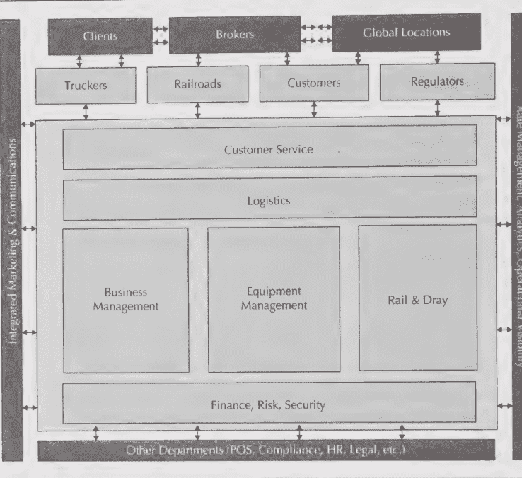

**图 4-3.** 业务架构示例

为了执行必要的业务流程，必须首先将若干离散的功能结合在一起。这些功能可以映射到业务线和业务流程。为了执行业务架构描述的业务流程，必须将流程拆分为 2 级和 3 级子流程。为了执行子流程，需要编写功能需求，包括用例和系统行为。

图 4-4 进一步扩展了图 4-3 中的业务架构，展示了业务架构的每个业务组件如何被拆分为其组成的功能架构组件。例如，如果你选取运输和物流行业的业务架构，并在其中的铁路和短途这一特定业务领域，你可以识别出一个由以下高级功能块组成的功能架构：

| 客户 | 经纪人 | 全球位置 |
| :--- | :--- | :--- |
| 卡车司机 | 铁路 | 客户 | 监管机构 |
| EDI | Web | 传真 | IVR | 电子邮件 | 电话 |
| 收益与利润分析 | 重新定位管理 | CBA | 车队规模规划 | 设备预测 |
| 销售 | | | 车队管理 车队规划与控制 | 运输采购 |
| 营销 | | | 路线规划 运单 |
| 预订 | | 反向物流 | 短途 |
| 定价 | | 维护与维修 | 铁路规划 |
| 运营 | | 铁路车辆资产 | 干线运输 |
| 应付 | 应收 | 现金管理 采购订单 | FA | GL |

**图 4-4.** 功能架构示例

- 铁路规划
- 铁路计费
- 干线运输 (Line haul)
- 运输采购
- 短途运输 (Drayage)

这些是支持铁路和短途运输业务架构及业务流程的功能或逻辑组件。图 4-4 还显示了其他概念性功能架构组件。功能架构的另一个示例可以在订单管理领域找到，由以下功能块组成的功能架构表示：

- 合同 (Contracts)
- 定价 (Pricing)
- 报价 (Quoting)
- 收款 (Collections)
- 账单与应收款项 (Billing and receivables)

功能架构是一个至关重要的层，它捕捉了支持业务需求的功能需求和业务功能。TOGAF 定义的应用程序架构和数据架构层都包含功能架构的元素。

## 技术架构

企业架构（EA）的技术架构层提供了实现上一节中识别的功能架构所需的技术组件。对技术架构的这种特定定义将范围限制在软件组件。硬件和网络组件、物理架构以及部署架构均属于基础设施架构层。

将基础设施架构与传统的技术架构定义特分离，特别允许对应用程序组合进行彻底分析。通过在分析阶段将这些关注点与整体应用程序组合分离开，可以将更多的精力放在以下主题上：

- 基础设施服务器整合
- 虚拟化
- 云端采纳
- 云端就绪

在传统的 TOGAF 企业架构规格规范中，技术架构包含了硬件基础设施。然而，为了符合我们的定义，应用程序和数据架构元素跨越了功能和技术架构层。这使得 APM（应用程序组合管理）分析更容易，特别是能够识别功能和技术组件中的冗余，并独立于彼此对这些架构层进行合理化。

如果您采用传统的企业架构方法来分析应用程序和数据架构，您将无法看到在组合中多个位置存在的功能。通过现代化的方法，您可以轻松地创建一个矩阵，映射并识别特定功能块在应用程序组合中多个应用程序中的重复出现情况。图 4.5 说明了这种功能组件到组合内应用程序的映射。功能块按行显示，应用程序按列显示。钩标记表示应用程序支持的所有功能块，使得该应用程序组合中的冗余变得一目了然。

与这种方法类似，可以使用矩阵将技术组件与应用程序进行映射。这种练习可以发现从不同供应商购买的用于构建新应用程序的冗余技术组件，而不是利用之前定制构建或购买的提供类似功能的技术组件。图 4-6 描述了应用程序到技术组件的映射。

技术架构捕捉了软件组件、可重用服务、软件框架和产品、消息架构、协议和自定义组件。为了讨论起见，我们可以将技术架构层简化为多层结构，由演示与通信服务、业务应用服务和企业信息服务组成。

| 逻辑组件 | 物流 | 业务管理 | 销售、营销与规划 | 设备管理 | 集成管理 | 仓库 | 物流与铁路 | 设备与财务 | 物流与财务 | 应收款项 | 铁路规划 | Excel 报告 | 加急系统 | 铁路与运输 | 定价 | 设备、跟踪 | 铁路规划 | 铁路账单 | EDI 管理 | 杂项功能 | 货运与空间 |
| :--- | :--- | :--- | :--- | :--- | :--- | :--- | :--- | :--- | :--- | :--- | :--- | :--- | :--- | :--- | :--- | :--- | :--- | :--- | :--- | :--- |
| LC1 | | | | | | | | | | | | | | | | | | | | | |
| LC2 | | | | | | | | | | | | | | | | | | | | | |
| LC3 | | | | | | | | | | | | | | | | | | | | | |
| LC4.1 | | | | | | | | | | | | | | | | | | | | | |
| LC4.2 | | | | | | | | | | | | | | | | | | | | | |
| LC4.3 | | | | | | | | | | | | | | | | | | | | | |
| LC4.4 | | | | | | | | | | | | | | | | | | | | | |
| LC4.5 | | | | | | | | | | | | | | | | | | | | | |
| LC | | | | | | | | | | | | | | | | | | | | | |
| LC6.1 | | | | | | | | | | | | | | | | | | | | | |
| LC6.2 | | | | | | | | | | | | | | | | | | | | | |
| LC6.3 | | | | | | | | | | | | | | | | | | | | | |
| LC6.4 | | | | | | | | | | | | | | | | | | | | | |
| LC6.5 | | | | | | | | | | | | | | | | | | | | | |
| LC7.1 | | | | | | | | | | | | | | | | | | | | | |
| LC7.2 | | | | | | | | | | | | | | | | | | | | | |
| LC8 | | | | | | | | | | | | | | | | | | | | | |

图 4-5 功能组件到应用程序的映射 (OCS)

| 应用程序 | IDMS | IDMS-DC | ADSO | APCA (Custom M/F UI) | Cobol | CICS | MQ | DB2 | Oracle | Nomad | Leradata | SQL/BI | Holos | Fastrieve | Informatica | Excel | MS-Access | Actuate | Crystal Reports | Web-Focus Reports | PowerBuilder | Java-Swing | Pro-Cobol | FileNet | NDM (Network Data Move) | Centran | FaxSys | EasyFree (Cobol Like) | Endeavor(SC) | Maintaince | Windows NT | RS 6000 |
| :--- | :--- | :--- | :--- | :--- | :--- | :--- | :--- | :--- | :--- | :--- | :--- | :--- | :--- | :--- | :--- | :--- | :--- | :--- | :--- | :--- | :--- | :--- | :--- | :--- | :--- | :--- | :--- | :--- | :--- | :--- | :--- | :--- |
| Pricing | Receivables | Rail Mining | Finance-Application | Privables | Management Screens | Equipment Leasing | Exhiting System | Equipment | Business Management | Misc Fun Items | EDI Manager | | | |
| Warehouse | Integrated Management | Equipment Manager | Equipment Logistics | Sales and Marketing | Cargo and Fleet | Management | | |

图 4-6 应用程序到技术组件的映射

组件和企业总线组件分布在整个概念层中，从而将此技术架构实现为多层架构。之前描述的技术架构的高层级如图 4-7 所示。在这个概念技术层中，演示与通信服务层可能包含以下技术组件：

- 门户服务器 (Portal server)
- 移动服务 (Mobility services)
- 内容管理系统 (Content management system)
- 运营报告 (Operational reporting)
- 交互式语音响应 (IVR)
- 传真服务器 (Fax server)

可以认为，报告组件可能需要从数据库接收数据，或者内容管理系统将有一个前端用户界面和一个存储版本内容的后端仓库。在这种情况下，这些技术组件难道也跨越了业务服务或信息服务层吗？


图 4-7 示例技术架构

从架构的角度来看，所有这些组件都是技术组件，可以与我们分层架构模型中的技术架构相关。从方便性的角度考虑，我们将技术架构表示为多层架构，并将组件分配给特定的层。某些组件的大部分用途与演示层相关，而其他组件与业务层相关。正因如此，我们选择将技术组件与我们根据功能认为它们所属的层相关。

## 基础设施架构

企业架构的传统关注一直是业务架构和应用程序架构层，并在小范围内关注信息架构层。基础设施架构包含在技术架构层中，并在很大程度上假设数据中心中心可用。这导致对业务和功能需求的关注更多，而对非功能需求的关注较少。在今天大多数项目的执行中都是如此。虽然我们讨论了业务-IT对齐以及支持业务功能的应用程序，但如果没有运行应用程序的基础设施，这一切都无法实现。

今天的基础设施架构已演变成了一个复杂的层，它出现在部署应用程序的服务器组之外。协作和统一通信席卷了企业。应用程序正在私有云、公有云和混合云上部署。企业移动性是IT部门的核心主题。分布式存储解决方案和软件定义网络影响了我们处理基础设施设计、配置和管理的根本转变。

## 解决方案架构

解决方案架构描述并定义了一组业务需求的特定解决方案。解决方案架构不应与企业架构混淆，尽管两者密切相关。解决方案架构结合了所有的架构层——业务架构、应用架构、信息架构和技术架构——通过识别每层中为了满足解决方案范围和业务需求所需的特定组件，将它们整合为一个单一结构。

解决方案架构的重点如下：

- 构建或增强应用程序以满足功能性需求
- 了解业务流程以及受应用程序影响的子流程的细节
- 设计必要的信息模型、数据流和数据转换
- 定义构建应用程序功能所需的技术组件
- 确保最终的解决方案设计将满足所有非功能性需求

你可能在想，为什么我们在这个节点又引入了另一种架构？难道我们还没有分析过四个独立的架构层吗？这一层又有何不同？解决方案架构在特定业务解决方案的背景下以战术层面运行，而企业架构（EA）更具战略性，且不关注特定的业务解决方案。企业 IT 内部的角色已经演变，出现了与特定实现或项目关联的解决方案架构师。只有当我们深入到业务应用程序必须实现的特定功能和技术组件时，才会关注这些内容。

因此，解决方案架构与应用程序的功能和技术分解，以及应用程序到功能和技术组件的映射之间存在直接关系。架构分解将在本章的下一节中进行详细介绍。

取决于解决方案的范围以及将影响哪些业务领域，关键解决方案架构利益者包括业务所有者、流程所有者和应用程序所有者，他们负责确保解决方案的构建、部署和维护。我们在章初介绍了业务架构和技术架构层；在这里我们将描述与解决方案架构背景相关的应用架构和信息架构层。

# 第4章：架构分解

图 4-8 显示了从应用性能管理（APM）的角度来看，应用架构和信息架构层与架构层的关系，正如本章之前讨论的。当我们从这个视角观察架构栈时，信息架构栈跨越了业务和功能架构层，而应用架构跨越了功能和技术架构层。随着我们在架构栈向下移动以及向业务架构层向上移动，重点完全转移到了业务流程和业务能力。解决方案架构可以被视为一个封闭框架，关注一组特定的业务需求和业务能力。另一方面，EA 栈对企业采取全局视角，关注企业应该采纳的最佳实践和行业标准。最后，重要的是，解决方案架构需要符合 EA 建立的框架和最佳实践。

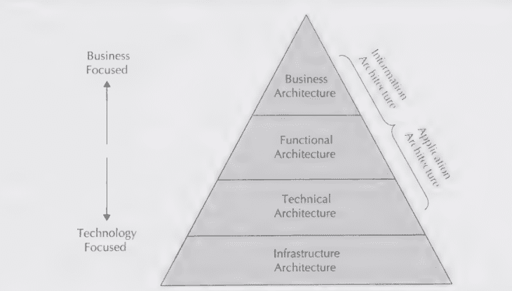

图 4-8. 应用架构和信息架构层与 APM 架构视角的关系

## 应用架构

应用架构描述了应用程序的结构、设计、工作原理和功能，以支持一组业务需求。该架构层还描述了应用程序如何相互作用、访问哪些数据库和第三方组件、需要发送任何消息，以及如何利用技术组件来构建应用程序。

应用程序是应用架构的核心。应用程序组合将包含多个应用程序，这些应用程序通过业务线、特定业务流程或技术栈以某种方式相关联。

项目和预算通常分配用于支持、增强和维护现有应用程序，或用于构建新应用程序。这迫使 EA 重点关注应用层。大多数软件开发生命周期都是为了构建、测试、发布和支持应用程序而设计的。应用程序的底层定义发生着持续的范式转变。过去几年见证了松耦合服务的演进，这些服务通过编排来支持业务能力。可以建立一个应用程序边界，规定一组由业务逻辑支持的相关的业务功能将称为一个应用程序。应用程序可以由选定的服务组成，其中某些服务可能被其他应用程序使用。因此，在该层级中传统的应用架构层定义需要重新审视，至少在应用程序组合分析的背景下。

随着组织努力通过服务复用业务功能，需要对应用程序进行分析，从逻辑上将封装在应用程序中的功能组件化，以便识别并最终复用应用程序逻辑中的隐藏服务。这种分析还将揭示对应用程序所用技术组件的理解。因此，在我们面向应用程序组合分析的 EA 层视图中，应用架构跨越了功能和技术架构层。


## 信息架构

在 20 世纪 60 年代和 70 年代，IT 和计算机系统基本上代表我们今天所说的信息技术和信息系统。在 20 世纪 90 年代，互联网和万维网的出现改变了信息架构的观点和范围。大数据工具的出现以及社交数据、公共数据和企业交易产生的终端用户数据的爆发，信息架构已成为一个复杂的领域。媒体的扩散导致了大量图像、视频和音频文件的创建，增加了信息的复杂性和泛滥。

信息架构（以前称为数据架构）在今天的 EA 层背景下被解释得非常广泛。在广义解释下，信息架构的一些元素包括：

- 数据流
- 流程元素的输入和输出
- 数据库中的数据
- 内容管理系统中的内容
- 消息格式
- 数据格式
- 数据转换
- 分类法
- 本体论
- 业务规则
- 报告
- 文档
- 规范数据模型
- 实体和实体关系
- 模式
- 主数据管理

在我们面向应用程序组合分析的 EA 层视图中，信息架构跨越并支持业务和功能架构层。

## 架构分解

架构分解是将 EA 及其所有架构层单独解构为其组成部分的过程。我们已经看到 TOGAF 模型包含了四个不同的层——业务架构、应用架构、数据架构和技术架构。对于我们 IT 系统现代化和 APM 的方法，EA 的四层应该从架构的角度来看——即业务架构、功能架构、技术架构和基础设施架构。

每一层都可以进一步细分为分层或子层。例如，技术架构层可以大致分为四个层：

- 表现层
- 业务服务
- 集成
- 信息服务

这种分层表示提供了一种组织技术组件的方法。你可能会注意到，所有层级的组件之间都存在集成，但适配器和集成相关的组件在概念上与集成层相关联。

业务架构层可以由 1 级流程描述组成，从高层面通信流程。此外，该层还可以提供更详细的 2 级和 3 级相同流程的钻取。功能架构层可以由非常高级的功能组件描述（也称为逻辑组件）组成，这些组件封装了业务功能以支持业务流程。这些高级功能组件可以在更细粒度的级别上进行检查，由共同构成高级功能组件的较低级功能组件表示。粒度级别取决于理解功能所需的抽象水平。

基础设施层可以由裸机硬件、虚拟化层、管理和监控层、网络层、云架构等组成，以满足其他层组件的资源需求。

## 第4章：架构拆解 119

构成特定层的具体组件并非有形的物理资产或运行在特定服务器上的代码块。这些组件是概念性的，目的是抽象它们的功能性或技术本质。这并不是说这些组件运行在某一台物理服务器上。事实上，执行以提供组件功能的底层代码块极可能跨越了应用边界和服务器边界的。同一块代码可能运行在多个虚拟机上，并可能被多个应用程序使用。

分层提供了抽象，用于界定以下内容：哪些是与实现业务目标相关的业务内容，哪些与理解业务功能相关，哪些是与构建业务功能所需的选软件组件和框架相关，以及所有这些内容最终将在何处执行。以分层方式表示企业架构（EA）本身就是一种拆解。将每个单独层进一步拆解为层（tiers）和子层，使我们能够在应用程序组合的范围内，解耦该特定层的自包含模块化单元以便进一步分析，并展示该模块化单元与应用程序的功能和存在之间的关系。

如果我们能够为每个架构层及其子层识别出代表可粒度的模块化单元，那么 IT 系统的现代化就简化为模块化单元本身的现代化。此时，应用程序组合本质上变成了这些共同工作形成一个应用程序的模块化单元集合。模块化单元可以是业务流程的一部分、提供某些业务功能的细粒度功能组件、技术组件或服务，或者是基础设施某部分的表示。架构拆解的目的是理解以下内容：

- 模块化单元在应用程序组合中多处的相似出现
- 模块化单元之间的耦合点
- 模块化单元之间的内聚性和集成程度
- 模块化单元包含的功能
- 运行模块化单元的成本
- 变更或增强频率
- 维护和支持模块化单元所需的技能

## 120 Java应用程序的快速现代化

列表中难以收集的信息是模块化单元的运行成本。项目成本和预算通常在应用级管理。人们必须收集应用级的财务和运营数据，通过插值和外推数据点，得出架构层内高级组件或低级模块化单元的成本计算结果。但在大多数情况下，通过查看架构层中的高级组件来建立成本理解就足够了。

架构拆解在并购（M&A）背景下是一项极具价值的评估。当两家企业希望合并并整合其 IT 系统时，深入理解应用程序组合并将架构拆解为细粒度的组成部分对于分析至关重要。这一练习将为如何整合应用程序提供决策支持，甚至可以识别哪些应用程序应该由于冗余或非核心需求而被丢弃。

## 功能拆解

功能拆解将功能架构层拆分为一组高级块，描述了所支持的业务线或业务领域。在这一拆解层级上，对业务功能的理解将处于较高水平。对于哪些应用程序提供了价值的业务功能了解较少。通常，会识别出提供该业务功能的应用程序组。将第一层识别拆解到下一层，将产生更详细的理解。

在我们的示例中，功能架构产生了以下内容：

- 
- 账单
- 货运
- 采购
- 路由
- 视图

业务服务层也可以称为应用服务层。该层包含应用程序内部的业务逻辑，或者作为业务服务暴露供各种消费者使用。一些典型的


## 122 Java应用程序的快速现代化

随着面向服务的架构和服务平台的出现，企业版格局开始发生重大转型。我们将在本书的第10章和第11章中详细讨论这一主题。

## 技术拆解

技术拆解将技术架构层拆分为一组高级技术组件。这些组件支持构建由功能架构所表示的功能。技术组件与功能组件之间的关系是多对多的，可以用矩阵轻松表示。由于大多数企业都从技术角度看待 IT 系统，因此更容易理解哪些应用程序是利用特定的技术组件构建的。高级技术设计和技术组件的描述通常在企业内部可用并记录。虽然技术组件的映射和复用可能尚不存在，但该部分可以作为初始应用程序组合分析阶段的一部分来创建。

为了进一步解释技术拆解，我们将技术架构层表示为由以下组成的多层架构：

- 表示
- 业务服务
- 集成
- 信息服务

### 表示

表示层代表用户界面；用户体验；内容；个性化；视图；针对各种形式因子和设备的渲染；内容的重复利用；与移动、Web设备和可穿戴设备的接口及用户交互；用户会话管理；以及在业务服务层使用的服务。

### 业务服务层

业务和应用服务层中存在的高级组件示例包括：

- 业务规则引擎
- 工作流组件
- 分析服务
- 遗留系统封装器
- OLAP 服务器
- 应用服务器
- 文档管理

这只是高级组件的一个抽样。这些组件可以进一步拆解为特定的技术组件。技术架构层中的这一业务服务层还包含了自定义和第三方的框架以及库组件。此类框架组件的一些示例包括：

- 日志记录与追踪
- 告警通知
- 用户简文件管理
- 安全与加密服务
- 系统管理工具
- 数据持久化组件
- 业务异常管理

再次，此列表只是一个具有代表性的样本。数据持久化组件可以被视为业务服务，或者在某些架构中，它们可能位于信息服务层。如何看待这一组件取决于便利性和个人偏好。业务服务层极其密集，包含了丰富的数据，可供企业的特定需求所利用。

## 124 Java 应用的快速现代化

## 集成层

集成层负责应用程序所有的集成需求。业务服务层包含了实现应用程序功能的所有业务逻辑。为了运行，业务服务需要访问企业信息系统，如数据库、内容、存储库、第三方组件等。这一操作通过集成层实现，集成层本质上由面向消息的中间件、企业服务总线、访问其他系统的适配器以及第三方技术组件所需的任何专有集成技术组成。集成层中技术组件和框架组件的代表性样本包括：

- 传输层
- 消息层
- 内容路由
- 遗留适配器
- 访问企业资源计划（ERP）系统的适配器
- 业务活动监控
- 业务流程管理
- JCA 组件

## 信息服务层

信息服务层抽象了对企业信息系统的访问。此层不与 TOGAF 在其企业架构（EA）模型中定义的数据（信息）架构层混淆。信息服务层是企业的骨干。它与业务服务紧密交织，因为数据和过程是相互关联的功能。信息服务层与信息架构层及其子层的表示存在重叠。主要的注意的是，作为信息服务层的一部分，其重点在于服务的技术本质——即数据如何暴露给其他系统，以及从技术角度如何存储和管理数据。重点还在于用于存储、管理和暴露数据的实际技术软件。信息服务层中技术组件和框架的代表性样本包括：

- 业务数据存储
- 关系型数据库，如 Oracle 数据库
- NoSQL 数据库，如 Mongo、Aerospike 和 Cassandra
- 数据仓库
- 主机系统
- ERP 和客户关系管理（CRM）系统
- ETL（提取、转换和加载）过程
- 财务系统
- 人力资源系统
- 主数据管理软件
- 用于提取数据的自定义服务和查询

对于本次分析，我们将 CRM、财务和 HR 系统纳入信息服务层。许多其他系统利用这些系统所包含和管理的信息来服务自身；这些系统本身是端到端的。某些观点可能会将这些系统归类为业务服务层；无论如何，这都是出于便利考虑而非功能性分类。

通常，容载有价值企业数据的企业软件属于信息服务层。它们所属的实际数据中心是基础设施层的一部分。此外，实体的定义、数据和消息格式、进程与工作流节点之间的数据流、模式定义、策略以及信息织本身都属于信息架构层。

## 技术冗余

技术架构层在 IT 部门中具有重要意义。如业务分析师、功能分析师、领域架构师、业务架构师和领域专家等角色倾向于关注组织内部的功能组件、功能性需求、业务需求、业务能力和业务流程。如开发者、技术主管和 IT 经理等典型技术角色则涉及各种技术、库、平台、第三方软件和工具，以构建满足功能性需求的应用程序。这些角色通常更关注如何使用其拥有的技术组件来构建应用功能，而不是关注对业务能力和功能性组件的理解。

技术架构层也是 IT 预算用于构建或购买额外技术组件和第三方软件之处，且通常不会引起过多关注——特别是来自授权预算的业务人员或专注于向其业务伙伴交付功能的高级 IT 经理的关注。由于大家都共同希望交付业务功能，如果由技术角色来管理某些技术组件的采购，这种情况通常会发生。由于现在有多种企业级开源组件可用，这些组件泛滥，且有时具有冗余功能并被企业采用；这主要由于团队对某一组件优于另一个组件的熟悉程度或偏好。最终，企业不得不维护和管理多个被不同应用程序使用的具有相似或重叠功能的技术组件。

图 4-9 显示了一个矩阵，将我们概念功能和技术架构层中的功能组件映射到技术组件。这种映射说明了需要哪些技术组件来支持特定的功能组件并实现该功能。例如，图中在该粒度上显示几乎的所有功能组件都需要某种形式的报告。图 4-9 矩阵中不清楚的是，为功能组件描述的报告组件是否是同一个第三方报告软件还是其他东西。

随着时间的推移，企业积累一组技术（许多具有冗余能力）是自然的。为了说明这一点，我们可以使用报告组件示例。如图 4-6 中的映射所示，多个应用程序可以使用业务报告。通过进一步分析，我们会发现报告是通过八种不同的报告技术实现的：

- Holos
- Crystal Reports
- Web focus
- Hyperion
- Excel 报告
- Visual Basic 报告
- Pentaho
- 自定义 SQL 查询

所有这些报告技术对企业都非常重要，但在现实中，更有可能是某个业务组更偏于某种特定的报告技术而非另一种。购买技术组件的决策必须基于深思熟虑分析而非偶然。

## 未来状态架构

在转型和现代化应用组合的过程中，执行的关键活动之一是识别当前状态架构组合和待获取的未来状态架构组件。这项练习使组织能够根据需要满足的业务目标以及为了增强组合而需要获取的业务和技术能力，为应用组合确定基准。EA 是这一过程中不可或缺的一部分，它与应用管理（APM）相互依赖，以构想、创建并实现未来状态架构。EA 学科的细节以及未来状态架构的创建超出了本书的范围，其本身就可以几个章节。因此，我们将在本节中仅要介绍几个关键的相关点。

## 第 4 章：架构分解

企业未来状态架构的开发是一项复杂且详尽的工作，旨在识别现状（as-is state）与企业希望实现的目标状态（to-be-state）之间的众多差距。这被称为差距分析（gap analysis）。在识别出差距后，根因分析将揭示由这些差距导致的根本痛点。这种分析可以在本章中讨论过的任何一个架构层上进行。该调查不限于任何某一个特定的架构。

一旦识别了差距并理解了根源，就需要构建各种架构层来解决这些差距。在此过程中，将利用这些架构层中的每一个现有能力。这并非“从零开始、从白纸起步”地构建架构层，而是利用每层中的现有组件，并确定是否可以通过增强或修改其中某些组件来弥补差距。有时，需要构建无法利用现有组件的新能力。在这种情况下，这些能力将作为已识别倡议的一部分从零开始构建。这种差距分析结合杠用分析（leverage analysis），将为现代化应用程序组合所需的能力提供清晰的蓝图。

与 EA（企业架构）团队合作，APM（应用组合管理）团队将制定一条路线图，以实现修复差距的能力。此外来自 PPM（项目组合管理）和 IRM（信息风险管理）同类学科的投入。通常，这些能力不会通过“大爆炸式”的方法构建。这是一个考虑了几个相互竞争变量的系统化过程。其有以下几个理由：

- 并非所有能力都同等重要。
- 构建能力所需的资源将不足。
- 预算可能无法涵盖所有能力。
- 某些能力的业务价值可能高于其他能力。
- 某些能力可能是只需少量努力即可实现的“易得的果实”。

取决于具体情况和组织，可能还有许多其他原因。此时，需要进行一次优先级排序练习，对业务能力进行排名，以确保可用资源、预算和上市时间得到优化利用，从而实现业务价值最大化。

支持业务能力的必要技术能力既可以构建，也可以从供应商处采购。这一识别未来状态架构组件的过程在图 4-10 所示。这是一个三步流程：

1. 愿景（Envision）
2. 分析（Analyze）
3. 决策（Decide）

在愿景阶段，将在现有的现状架构与未来状态的目标架构之间进行差距分析。参与一系列由工作坊驱动的利益相关者会议可以成功识别出该差距分析所需的业务能力集。然后，将业务驱动因素映射到需要构建的业务能力。阐述每个业务能力的业务价值。通过识别需要构建的技术能力来解决技术差距和痛点。

在分析阶段，在愿景阶段识别出的理想业务和技术能力将作为此框架的一部分进行创建和定制。功能和技术架构的未来状态目标流程也将根据愿景阶段的差距分析进行合理化处理。应用功能和技术分解练习，并将其映射到目标、未来状态架构的可视化过程中。

最后，在决策阶段，将优先级排序的业务和技术能力列表映射到特定的业务和技术架构。在业务驱动因素的背景下证明架构组件的合理性。优先级排序的能力构成了多个需要分析的情景。第 5 章将详细讨论这一过程。

## 业务能力优先级

业务能力的优先级排序始于识别应用程序需要获取的理想业务能力列表，以满足企业的未来业务需求。差距分析和根因分析有助于更好地理解当前的业务架构和其他架构层。业务单元和领域架构师应共同识别现有组合中缺失的业务能力。为了达到目标、未来状态架构，这些业务能力需要进行优先级排序并获取。

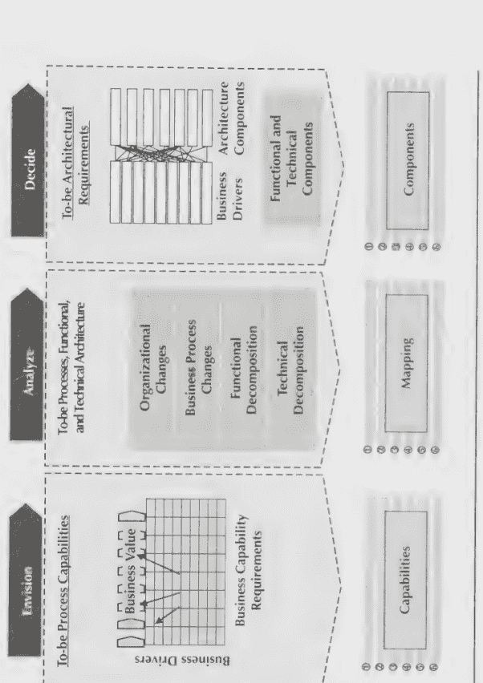

| 愿景 | 分析：目标流程、功能与技术架构、组织变更、业务流程变更、功能分解、技术分解 | 决策：目标架构需求、业务驱动因素、功能与技术组件、组件 |
| :--- | :--- | :--- |
| 业务流程：业务目标、业务驱动因素、业务价值 | 业务能力：业务与 IT、相关痛点、差距分析、利用分析、业务能力需求、业务驱动因素 | 业务价值、功能需求、映射 |

图 4-10 识别未来状态架构组件的过程

## 132 Java 应用程序快速现代化

考虑到预算和组织风险，并非所有的理想业务能力都能立即构建。即使是入选的业务能力也应该优先排序，以便在构建阶段之前充分理解。业务能力的优先级排序可以通过“愿景、分析和决策”方法完成，该方法涵盖了未来状态架构的创建。事实上，业务能力的优先级排序练习处于未来状态架构创建的核心。这一简单的分析框架考虑了理想业务能力的业务价值及其实现的易用性。图 4-11 展示了一个简单的优先级排序框架，最终形成一个创建未来状态架构的定义路线图。

以下是一些用于衡量业务价值的示例参数：

- 与特定业务目标的对齐
- 生产力的提高
- 对顶线增长的可衡量收益
- 量化的节省

同样，以下是一些关于实现易用性的示例参数：

- 构建此能力的技术复杂性
- 对业务流程的影响
- 利用现有组件的能力
- 对最终用户的影响

我们还可以使用 1–4 级范围对评分因素进行权重，以比较业务价值与实现的易用性。为所有业务能力绘制此类数据将识别出高业务价值且易实施的能力。一旦此分析框架应用于业务能力且相关利益者批准了决策，该过程将产生一个经过优先级排序的业务列表。

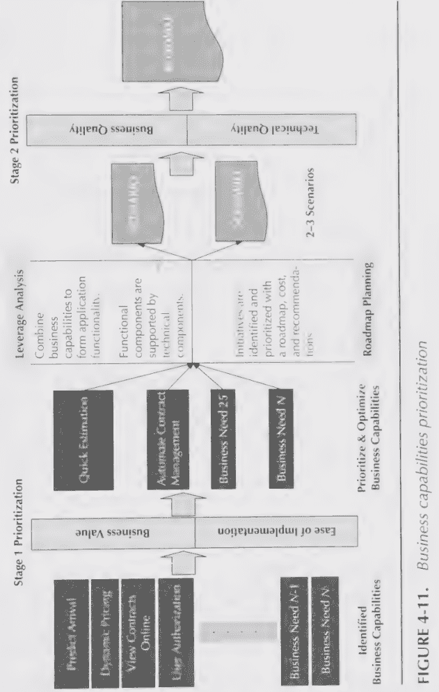

## 134 Java 应用程序快速现代化

在决策阶段，在利益相关者会议期间可能会出现几个问题。业务能力究竟如何融入分析中？哪些业务流程可以通过新能力进行增强？这些问题的答案产生了多个业务情景。可以应用分析框架来此选择最佳情景。有时分析是非正式的，由团队决定。其他情况下，对于复杂的情景，必须对引入新应用程序或增强现有应用程序进行详细研究。谁来拥有并支持应用程序？谁为能力付费？按什么顺序构建能力？其中一些问题将有助于规划和创建构建业务能力以及创建未来状态业务架构的路线图。

业务能力的优先级排序确保了了最重要的业务需求，而将不重要的需求推得更远。在此之后，生成的良好的倡议集将努力实现价值最大化，同时将应用程序组合转换为完全符合未来业务目标的组合。强大的治理流程还将确保定期回顾路线图，并持续管理应用程序组合以应对变化的业务优先级和新需求。这可能导致业务能力的重新排序，从而改变路线图中可能被搁置、修改或新建的项目。这是 APM 的基本原则。未来状态架构始终从面向未来的愿景开始；它处于实现的中间状态。如果遵循了这些步骤，EA 将继续向正确的方向演进，通过保持灵活性、适应性和敏捷性来应对未来的需求。

## APM 的成功

APM 作为一学科的成功取决于几个因素。第 3 章详细涵盖了 APM 与其同类学科 PPM 和 IRM 的关系。它还涉及了 EA 学科的重要性及其与 APM 的相互联系。

尽管在企业内部建立 APM 方法论面临挑战，但更大的挑战在于维持 APM 学科的生命力。事实上，成功的 APM 实践 True前提是


# 第 4 章：架构拆解

企业架构（EA）的成功是企业的成功。成功的 EA 学门确保了已经具备了必要的成熟度和思维流程，以迎接应用组合管理（APM）。它还确保利益相关者能够根据项目治理原则和行业最佳实践，将 IT 系统与业务能力对齐。

APM 的接受对于在组织内部建立成功的现代化和转型计划至关重要。协作现代化无法作为一种孤立的策略来实现。IT 系统的成功现代化取决于在细粒度上对应用组合进行全面且详细的理解。

## 通过 EA 实现成功的 APM

成功维持 APM 在很大程度上取决于 EA 学门的成功。尽管通过狭隘地关注基础设施架构、应用于该层的整合技术，或为了合理化组合而缩小子集可以获得短期成功，但这还不够。要充分获得 APM 的收益，组织必须能够优化成本、降低风险、消除冗余、业务和 IT 的现代化与转型，并增强对应用组合的未来投资。APM 的长期发展取决于组织对 IT 和业务架构拥有愿景。为了维持 APM，组织必须建立起完善的 EA 学门。EA 为企业实现战略目标并与路线图上的未来计划相对提供了蓝图。EA 学门还涉及计划的战术执行，影响对于实现业务愿景至关重要的未来业务和技术能力的优先级。

## EA 利益相关者与 APM 利益相关者

EA 的利益相关者多种多样，来自组织的各个部分。利益相关者群体涵盖项目团队、高级业务高管、高级技术高管、开发者、运维与支持、合作伙伴、客户、终端用户、内部业务部门等。个人利益相关者也可能属于多个利益相关者群体。某些旧小组可能是永久性的，作为正式组织结构的一部分而建立；而其他团队可能是临时的，在特定计划背景下作为特殊利益小组非正式创建。非正式小组中的利益相关者不能被忽视，因为他们可能是领域专家，或者可能对正式组织小组中的某些利益相关者拥有权力和影响力。

属于这一影响力范围的个人利益相关者和利益相关者群体对于 APM 的持久及其现代化努力至关重要。尽管每个个人和利益相关者群体在 APM 方面承担不同的角色，但他们的集体贡献对其在企业内的成功至关重要。

为了 APM 学门在企业内取得成功，核心 APM 小组识别与 APM 相关的关键利益相关者，并使用积极的利益相关者管理原则与其互动是至关重要的。APM 核心小组的任务不仅要根据角色，还要通过姓名识别关键利益相关者；他们必须与这些人接触并会面，以获取他们对关键事件的观点反馈。相关的合作者（包括赞助人、高管、支持者和反对者）必须进行一项有说服力的极具说服力的 APM 价值主张和效益分析，以理解利益相关者的动态以及他们对 APM 的立场。随着 APM 作为一门学科的演进，其实现业务目标的应用取决于这些关键利益相关者的支持，并要求在应用组合的整个生命周期内持续活跃的参与。

## 组织中的角色

表 4-1 记录了组织中支持企业组合内应用的典型角色。

| 角色 | 描述 |
| --- | --- |
| 高级执行官 / 业务领导 | 为倡议提供支持，是指导过程的指导委员会成员。批准资金和范围。 |
| 应用组合所有者 | 拥有组合并是指导委员会的一员。提供领导和指导。 |
| 企业架构师 | 定义业务和功能架构。影响决策并审查交付物。确保与业务目标对齐。架构治理的成员。 |
| 应用所有者 | 拥有一个或多个应用程序，是所有影响其拥有应用活动的关键贡献者。 |
| 业务分析师 | 收集并分析数据。拥有某些业务流程和业务能力。理解应用程序的功能并对业务架构和功能架构做出贡献。 |
| IT 经理 | 管理项目和应用程序开发。参与各种活动。 |
| 技术架构师（应用架构师） | 定义技术架构和应用架构。 |
| 业务用户（应用终端用户） | 使用应用程序并请求增强和额外功能。请求可能导致识别需要获取的业务能力。 |
| 维护与支持工程师 | 支持应用程序、技术组件和基础设施。负责修复漏洞和一般的应用程序维护与支持。 |
| 财务分析师 / 风险分析师 | 建议投资决策并理解成本和预算。风险评估和风险缓解的一部分。 |
| 系统管理员 | 管理各种系统组件。拥有基础设施所有权并支持技术团队。 |

表 4-1. 支持 APM 的企业典型角色

## 通过 EA 学门维持 APM

EA 学门对 APM 的积极影响确保了 APM 可以被维持。一些 EA 利益相关者可能也是核心 APM 小组的一部分。为了 APM 的长期成功，让 EA 参与 APM 的以下方面是首要任务：

- 识别组合
- 创建 APM 治理
- 创建定义良好的 APM 流程
- 使用工具实施和执行 APM 流程
- 定义 APM 指标
- 分析并优先排序框架

随着 EA 学门在组织内达到成熟，它将提供实现业务目标所需的未来状态（to-be state）可视化。这种未来架构捕捉了业务需要获取的预期业务和技术能力。这对应用组合有直接影响并影响其方向。EA 将 APM 与业务需求对齐，以制定一份全面的路线图。EA 还与 APM、PPM 和 IRM 学门紧密相连，以估计预算、识别并缓解架构风险，并参与已识别和批准计划的治理。

EA 是 APM 的天然伙伴。APM 专注于减少和优化运行应用组合所产生的成本。EA 参与预算规划，并从业务和技术两个角度识别运行欠佳的应用程序。这项工作将自然适用于从组合中消除性能不良的应用程序。

## EA 与 APM 的交互

EA 和 APM 形影不离。这两个学科的利益相关者与其他共同合作者进行互动。为了从 EA 和 APM 中受益并确保企业业务价值的实现，必须遵循几个简单原则。这两个学科的进展依赖于对所有相关方的清晰沟通，以及捕捉可与公司高管共享的组织利益。

## EA 与 APM 交互的指导原则

尽管 EA 和 APM 可以被共享相似利益相关者和预算资源的互补学科，但为了让它们的交互高效运行而不发生冲突，某些指导原则是至关重要的。这些假设将确保 EA 和 APM 能够独立运行并在对齐中统一：

- 在战略参与背景下做出的所有建议以及此类建议的范围应映射回特定的企业目标，且 EA 和 APM 流程必须在这些建议方面保持一致。
- 在路线图中已识别。企业架构（EA）应该是路线图定义和业务案例合理性说明的一部分。
- 所有的合理化和路线图定义必须识别出“快速胜利”（quick wins），以确保路线图实现的进程能够顺畅开始，并减少阻碍。EA 应紧密参与执行已识别的快速胜利的试点启动工作。
- 建议的路线图和路线图的持续应该考虑到业务风险、业务成果、文化、变更管理以及变化速度。
- 如果进行了合理化审查，EA 应该是此类组合合理化计划的密切组成部分。应用组合管理（APM）和 EA 学科应寻求从降低成本的组合合理化审查中创造自给自足的机会。

## EA 的益处

虽然重点是 APM 及其对推动企业现代化的影响，但由于 APM 的成功依赖于 EA，EA 值得详细讨论。EA 通过推导并参与从业务战略到 IT 策略对齐直接对业务目标做出贡献。EA 还通过参与 APM 及其同行学科间接为企业做贡献。观察到的某些益处包括：

- EA 对 APM 同类学科的支持有助于投资决策、风险缓解、投资支持和风险管理，通过支持项目组合管理（PPM）计划影响项目级和项目组合层级的决策。
- 资源优先级包括人员、预算和 IT 系统资源。
- 解决方案架构和项目管理活动由企业架构师提供。这些架构师促进决策、确定项目范围、协调解决方案与项目团队成员之间的协作，并在项目利益相关者之间建立共识。他们还参与了质量交付物的创建和评审。
- 在并购（M&A）活动期间，架构层可能会影响，需要合并应用组合。EA 在并购中发挥着重要作用。
- 企业架构师是标准和最佳实践的守护者。很难通过控制来强制此类实践。企业架构师拥有巨大的权威和影响力，能够推动全企业采用此类标准和最佳实践。
- 应用组合中的风险管理和投资决策对于增加企业的业务价值至关重要。EA 在此过程中起核心作用。

## 总结

为了使 APM 学科取得成功，与 EA 学科成熟流程的相互依赖关系是必要的。有几种方法可以将 EA 制度化。TOGAF 是一种流行且全面的 EA 标准。尽管 TOGAF 满足了特定需求，但我们必须考虑以 APM 为中心的架构层视角，以实现应用组合的成功现代化和管理。

架构拆解是一种用于将每个架构层剖析并分解为其组成流程的技术。解决方案架构是在特定业务流程和需求背景下 EA 的战术实现。它提供了一种理解应用流程、功能和技术细节的方法，并有助于分解工作。

在应用组合内部，不同应用程序使用的功能和技术组件可能存在冗余。应用组合现代化将涉及对未来状态的构想。EA 中的一些利益相关者也是 APM 的潜在利益相关者。EA 还通过为创建此类分析和优先级框架提供输入，并通过应用这些框架来识别优先的业务和技术能力以满足未来的架构需求，从而帮助 APM 进行业务和技术能力的优先级排序。


# 第 5 章：遗留 Java 现代化

经历了过去二十年经济衰退的企业发现了利用信息技术系统来实现和推进其业务利益的力量。公司存在的时间越长，其信息技术系统就越异构。自从 Java 出现以来，几乎所有中大型企业都基于 Java 平台构建了系统，作为其信息技术格局的一部分。一旦 Java 应用程序被构建并引入业务，工作并不会止于此。应用程序需要根据新的业务需求定期进行增强，并且与其他应用程序进行集成和互操作。

仅对新功能需求的预算许可进行考虑是不够的。决策者在为组合构建或采购应用程序之前，必须考虑几个方面。如果组合决定是在孤立状态下出的，而没有对任何其他重复或过时的应用进行知情，那么该过程就是缺陷的。这导致应用组合在运营、成本、业务风险、技术质量和未来投资决策方面表现得化、复杂且优化不佳。在以 Java 技术为主的应用组合中，应用程序跨越了多种 JDK 版本、第三方组件、开源组件和其他库。这导致了这样的情况：应用组合变成了一个遗留负担，开始消耗 IT 部门维持现状的努力。

本章探讨了遗留应用组合，并讨论了解决核心问题的各种方法。第 4 章回顾了架构拆解的概念以及构成应用组合的功能和技术组件。基于这些知识，组织将能够做出明智决策，以刷新遗留组合、优化投资并降低运营和集成方面的复杂性。

应用组合的现代化是一项整体工程，而不仅仅是限于应用程序层和代码的活动。现代化发生在所有架构层。图 5-1 描述了有关现代化决策的高级流程，并展示了每个架构层中存在的现代化选项示例。图中所示的架构层展示了 TOGAF（开放小组架构框架）架构模型。（TOGAF 及其架构层在第 4 章讨论过）。本章将详细检查应用现代化选项。

## 现代化选项概览

| APM 策略 | 业务过程现代化 |
| --- | --- |
| | • 业务流程优化<br>• 功能拆解<br>• 服务识别<br>• 工作流优化 |
| 业务驱动因素 | 应用现代化 |
| 业务案例合理性 | • 技术拆解<br>• 迁移<br>• 重构——重构、重写<br>• 应用停用<br>• 服务导向 |
| 现代化规划 | 信息（数据）现代化 |
| 现代化选项 | • 数据库合并<br>• 分布式数据处理<br>• 主数据管理<br>• 信息织物与服务 |
| 优先级排序 | 基础设施现代化 |
| 现代化路线图 | • 云能力<br>• 基础设施合并<br>• OS 迁移<br>• 虚拟化 |

图 5-1. 跨架构层的现代化

## 遗留应用组合

在讨论现代化选项之前，我们首先需要定义什么是遗留应用组合。它是实现应用程序使用的技术类型，是应用程序的年龄，还是其他因素？遗留应用组合是否立即意味着过时并需要更换？为了回答这些问题，必须理解该术语的最初含义。遗留应用程序的概念

“Legacy（遗留）”一词于 20 世纪 70 年代引入，指所有现有应用程序。在 20 世纪 80 年和 90 年代，这个词在信息技术领域发生了语义变化。其含义转变为：与正在考虑或设计的新应用程序相比，那些已经存在的应用程序。自 Y2K 时代以来，遗留应用代表了大型机应用程序或运行时间很久的应用。这并不一定意味着应用程序已经过时，但它意味着与使用新兴、更敏捷的技术构建的应用程序相比，这些应用在维护和管理上缺乏灵活性且存在不必要的费用。

### 为什么会存在遗留应用组合？

如果新技术的性能优于某些应用组合所基于的旧技术，那么真正的问题是，组织为什么要保留遗留应用组合？这个问题的答案有几个方面：

- 替换遗留应用的成本可能高到无法接受，而且替换后的投资回报率（ROI）可能需要很长时间才能证明其合理的业务案例。
- 弃用遗留应用并用新应用取代它们所带来的感知业务风险可能会在组织内部造成不必要的恐慌。
- 终端用户对遗留应用的熟悉程度、对替换应用的抵制，以及重新培训应用程序用户的努力，阻碍了组织实施替换遗留应用的想法。
- 缺乏遗留应用的文档或对其功能运作的深度了解，导致了无法对其业务能力的详细理解。这些遗留应用像一个“黑盒”一样，组织在不知道它们真实如何运作的情况下对其产生了依赖。
- 遗留应用可能运行良好，且可能对组织并非至关重要。在这种情况下，最好是保持现有应用程序不变。
- 与现有供应商和基础设施提供商的合同可能不容易终止，组织可能需要等待三到五年才能重新考虑应用组合的任何现代化。到那时，其他优先事项将占据主导，新员工会加入公司或晋升到其他职位。凭借这种新视角，组织可能会选择续签现有合同，而不是追求大规模的遗留组合组合现代化工程。

### 现代化遗留应用组合的理由

在某些情况下，彻底的业务案例分析可能表明，选择更新的技术可以显著降低遗留应用组合的总拥有成本（TCO）。虽然替换现有遗留应用的成本可能高于维护成本，但如果成本可以在五年内收回，这是值得考虑的。

有时，遗留技术资源的缺乏和技能的缺失会给组织带来业务风险。如果没有及时的维护支持怎么办？如果支持应用程序的资源缺乏维护该技术的技能集怎么办？接手维护遗留应用的人可能因为缺乏对这些应用的深度了解而无意中引入系统缺陷，而原始作者可能已经离开了其他职位，或者可能完全离开了公司。从长远来看，继续运行遗留应用的业务风险可能超过构建替换应用的额外成本。

技术平台、库和 API 中不断被发现安全漏洞和漏洞。在没有足够的供应商支持和社区参与的情况下，几乎无法阻止利用这些漏洞的攻击。更高级版本的技术和新兴技术将对已知威胁和发现的漏洞提供更好的支持能力和补丁。

将旧应用程序集成到新应用程序中的努力工作量和复杂性可能会导致在合并后的应用组合中重建类似的功能，导致组合内部以及整个所有组合应用程序出现功能冗余。这种缺乏灵活性和遗留应用敏捷性的问题将导致此类应用程序无法被企业内部构建的新应用组合所利用。

虽然遗留应用组合现代化的理由有多个，但重要的是，这些理由不仅适用于旧的大型机应用，还适用于 Java 应用、PHP 应用和 Windows 应用。旧应用程序（通常是那些八到十年的程序）表现出表明它们需要进行现代化的症状。

企业应该准确定位，以便能够有效地管理其应用组合，并确保在正确的时间对那些应用程序进行现代化。这不是简单的任务。现代化工作需要有效的应用程序组合管理（APM）结合成熟的企业级架构（EA）实践，以成功转型应用组合。

## 业务驱动因素

对现有遗留应用组合的任何现代化努力必须得到业务驱动因素的支持，这些驱动因素将验证并证明组织的未来方向和业务战略。

组织寻求现代化的原因通常属于以下几个大类：

- 降低 TCO
- 获得竞争优势
- 识别并降低业务风险
- 优化投资
- 消除冗余
- 创新组合能力
- 提高敏捷性和适应性

业务驱动因素可以映射到这七大类中的一个或多个。组织很难在执行业务战略和优化组合的同时同时推进所有七个杠杆。通常，一或两个领先因素在现代化改造中起主导作用。影响遗留应用组合现代化的决策过程主要由映射到这些主导类别的业务驱动因素引导。

## 现代化选项

使由遗留 Java 应用和其他遗留应用组成的组合可能是复杂的。这些应用程序紧密连接并协同工作以支持一组业务流程。对组合中一个应用程序的任何修改都可能引发连锁反应。涉及架构分解的方法允许对组合的功能、业务能力和技术能力有全面的理解。基于对结果驱动因素的完整组合分析，可以得出关于组合中每个应用程序所需行动项的建议。

图 5-2 描述了影响现代化的关键业务驱动因素。该图还说明了在组合分析背景下进行量化和考虑的典型优先级参数。组合中应用程序的现代化选项是详细分析的结果。我们在之前的章节中已经讨论了 APM 的细节和分析框架。图 5-2 显示的优先级参数作为整个分析框架的总结。

| 关键业务驱动因素 | 现代化选项 |
| :--- | :--- |
| 降低 TCO | 迁移 |
| 获得竞争优势 | 重构——重构、重写 |
| 识别并降低业务风险 | 软件包实施 |
| 优化投资 | 停用应用程序 |
| 消除冗余 | 遗留组件化/封装 |
| 创新组合能力 | 服务面向的架构 |
| 提高敏捷性和适应性 | 基础设施整合 |
| **优先级参数** | |
| 成本 | |
| 努力量 | |
| 特定风险 | |
| 重用 | |
| 技术栈 | |
| 劳动力技能集 | |
| 上市时间 | |
| TCO 和 ROI | |

图 5-2. 得出现代化选项

在启动现代化工作之前，有几个现代化方案可以考虑：应用程序可以保持不变、迁移到较新的库、在当前使用的技术平台上进行重构、迁移到完全不同的技术平台并进行重构、通过停用从投资组合中消除，或者通过由软件包的现成供应商产品进行替换。如图 5-2 所示，遗留组件化（也称为遗留封装）和面向服务的架构是两种类型的重构工作。与基础设施相关的现代化方案（如云能力启用和基础设施整合）也是可行的，因为纯粹在基础设施层对应用程序进行现代化，而不对代码库进行任何大规模的应用程序级更改也是同样可能的。关于特定现代化路径的决策应该完全由分析工作来驱动和支持。


# 遗留应用程序现代化

当对应用程序组合进行现代化时，改变的不仅仅是应用程序逻辑；现代化还会影响数据库和应用程序基础设施。因此，可能需要将底层数据库升级到新版本，或将数据库迁移到新的数据库技术。同样，数据库合并也是可能的。应用程序的基础设施需求也会发生变化。容量规划和工作负载建模有助于确定基础设施需求规模，并协助基础设施的现代化。可视化使得工作负载能够在通过抽象层与底层硬件隔离的环境中运行。容器技术提供了一种虚拟化的替代方法，在主机上的单个操作系统可以运行许多应用程序。云虚拟机（`VM`）具有完整的操作系统，拥有自己的内存管理、驱动程序和文件系统，而容器则共享主机的操作系统。与虚拟机相比，容器是轻量级的。容器和虚拟机的区别在于其方法：容器虚拟化操作系统并帮助在单个操作系统实例上运行多个工作负载，而虚拟机则是虚拟化硬件以运行多个操作系统实例。基础设施现代化方案需要考虑云虚拟机和容器。

## 迁移

如果组合包含许多大型机应用程序，一种迁移方案可能涉及将大型机应用程序“抬并迁移”（lift and shifting）离开大型机环境到 Linux 或 Windows 服务器等开放系统环境中运行。在这种方法中，大型机源代码将在另一个操作系统上模拟大型机环境的技术平台上进行重新编译。这并不是将大型机代码库重写为 Java 等新技术；相反，这种方法是在 Windows 或 Linux 操作系统上对大型机代码进行仿真。如果此类大型机应用程序包含任何汇编代码，则需要用 COBOL 进行替换。此外，可能需要对 COBOL 代码库进行微小修改，以支持用于在仿真环境中整合大型机应用程序的 COBOL 编译器。这种方案已被几家大型企业成功执行。该方法携带的业务风险极小，因为最终用户仍然通过绿屏与应用程序交互。从本质上说，大型机应用程序已“抬迁移”到了 Windows 或 Linux 环境，而没有任何功能性或重大更改。

虽然消除大型机应用程序是一项长期工作，但可以以这种方式迁移几个候选的大型机应用程序。这种方法还可以立即降低应用程序的运营成本。你可能会问，为什么不用 Java 重新架构并重写应用程序逻辑？如果成本效益并不显而易见，那么进行此类重构将大型机应用程序转换为 Java 可能是明智的。与将整个大型机应用程序转换为 Java 的成本相比，维护成本可能非常小。有几个权衡需要考虑：支持应用程序的技能将需要 COBOL 和大型机专业知识；代码本身可能难以增强和维护。然而，如果大型机应用程序逻辑需要进行大幅修改，那么从底层开始重构为 Java 的收益就是合理的。

如果遗留应用程序是用其他语言（如 C / C++、PHP 或 Java）编写的，则迁移将涉及对源代码进行适当修改，以纳入应用程序源代码语言中的任何新功能或 API 更改。有些人认为，如果 Java 是基础，那么只需更改几处的代码并进行测试以确保功能兼容性就足够迁移了。然而在现实中，测试用例是稀疏的，并没有涵盖所有情况。在许多情况下，甚至不存在单元测试用例。如果源代码达到数十万行，将变得更具挑战性，使得识别代码中所有需要更改的区域变成一项艰巨的任务。自动化可以帮助解决此类源代码分析问题，使其不再是一项手动任务。还需要回归测试和功能测试，以解决迁移过程中可能引入应用程序的任何缺陷。

迁移涉及软件组件以及硬件本身。应用程序可以迁移到通用硬件或基于云的架构。对于 Java 来说，至少应该进行对 `JDK/JRE` 的简单升级，以运行测试用例并确保功能兼容性。引入新的 API 可以增强性能、稳定性和可维护性。这种升级可以在更全面的现代化工作的后期阶段进行。

## 重构

重构遗留代码库涉及利用面向对象的概念和面向服务的架构。如果一个组织希望保留相同的遗留技术并仅进行微小增强，那么重构就没有业务理由。在这种情况下，按现状维护（as-is maintenance）是唯一需要的行动。如果应用程序功能对组织至关重要并且需要对应用程序进行主要功能增强，那么在引入这些新改进时，可以为重构提供更有力的论点。

任何重构工作必须确保应用程序在架构上变得更加灵活，以便与未来技术更容易集成。遵循面向服务架构（`SOA`）原则的重构解决方案为向应用程序组合无缝引入新的业务和技术能力提供了韧性和弹性。重构可以涉及正向工程，也可以涉及反向工程。此外，应用程序功能部分可以重构或从头完全重写。虽然市场上有的工具声称可以将任何 COBOL 或其他遗留代码转换为基础，但现实是，生成的源代码将非常不如人意。允许关键业务应用程序通过从 COBOL 自动转换重构为 Java 是相当危险的。此外，这些工具仅用于非关键和低业务价值的应用程序来说是非常昂贵的。

另一种方法可能涉及从现有的遗留应用程序中提取业务规则。现有工具可以提取业务规则，但这些规则的特定上下文以及它们影响哪些业务过程是不可知的。熟悉业务流程的领域专家和功能专家需要对从遗留应用程序提取出的业务规则进行上下文化处理。

这一过程需要额外的资源，这可能会大幅增加原始现代化改造的时间、成本和范围。

最终，重构应用程序的实现任务是确保这些业务规则在正确的语境下正确实现在新的应用程序中。一种最佳实践是收集旧的测试用例并重写它们以测试新代码。通常，业务规则仍然隐藏在遗留代码中。因此，重用旧测试用例显著增加了发现这些未文档知识的概率。

在重构遗留应用程序时，底层数据库和记录是另一个关注领域。遗留应用程序（特别是大型机应用程序）可能将数据存储在层次结构数据库中，例如信息管理系统 (`IMS`)，或存储在文件存储中，例如虚拟存储访问方法 (`VSAM`)。将此类数据库转换为关系型数据库是复杂的。可能还有其他应用程序在消费此类大型机数据；因此，任何重构工作必须保护并保留这些接口预期的数据格式、适配新的数据格式，或通过新服务暴露数据。从本质上说，消费者必须按照新的数据格式或服务接口更新其应用程序。将关系型数据库和 `NoSQL` 数据库升级到新版本也是一项任务，以利用安全修复、功能新增和性能提升。这是公司落后的另一个领域。

遗留系统包含大量的批处理过程，它们在特定时间运行作业，类似于 UNIX 和 Linux 系统上的 `cron` 作业。作业控制语言 (`JCL`) 脚本、批处理作业和动态生成的批处理作业的转换也应该是重构工作的一部分，以便作为新解决方案的一部分创建一个等效的批处理系统或在实时运行的替代系统。

## 重构

当消费者利用应用程序的大部分代码库并轻微修改该代码的设计时，就会发生代码重构。只有应用程序的部分被重构，这基本上涉及在不改变外部 API 和接口的情况下对代码进行重新结构化。重构通常不会影响依赖于被重构应用程序的其他应用程序。业务功能在很大程度上也保持不变。每隔几年对应用程序代码库进行重构，使应用程序开发人员能够利用可用的新 API 或库。

### Java 应用程序的快速现代化

有时，可以使用新的语言特性用于现有代码库的性能改进或复杂性降低。代码重构还允许将多个地点的重复逻辑合并到一个区域，并在需要的地方重用。当为实现某些功能而编写的自定义代码可以被核心语言库提供的 API 调用取代时，可维护性就会提高。这提供了更好的抽象，并替换了可能位于多个应用程序中许多位置的自定义逻辑。

## 重写

要重写一个应用程序，需要从头实现逻辑以替换现有逻辑。某些设计不当的应用程序可能需要重写单个代码段。有时，应用程序代码库会被完全搁置，功能完全从零开始编写。重写的最终决定通常出现在应用程序随着时间的推移通过一系列增强演变，并达到了变得极其复杂且难以维护或增强的程度。应用程序的底层架构可能非常僵化，以至于在不对应用程序进行某些修改的情况下，可能不利于接受架构改进。有时，组织可能会放弃最初实现应用程序的整个技术栈或平台，并为投资组合选择一个全新的方向。我了解行业内的几个例子，COBOL 或 Perl 应用程序在 Java 平台上被完全从零开始重写。

遗留代码库是完全重写的极佳目标。在某些情况下，由于文档缺失以及开发者对现有应用程序缺乏了解，源代码可能甚至无法完整获取。最终，这种情况构造成了业务风险，因为现有的遗留应用程序可能会导致易错且昂贵的修改。此类情况使得重写变得合理。为了利用原始应用程序创建时尚不存在的新技术，对应用程序功能进行重新实现也是必要的。为了引导遗留应用程序从层次结构数据库转向采用关系型数据库或内存 `NoSQL` 数据库，可能需要重写应用程序的大部分，甚至使用不同的技术栈从头实现应用程序。

## 包级实现

当企业对其现有的应用程序组合进行现代化时，考虑用较新的应用程序替换老旧应用程序是非常关键的。包级实现涉及购买商业现货 (`COTS`) 产品并对该包进行定制以满足组织的需求。自定义应用程序通常是从零开始构建的，并根据组织的需求进行维护和增强。企业选择购买 `COTS` 软件还是构建自定义应用程序取决于多个因素。为私有使用构建和增强复杂应用程序所投入的努力和成本有时是巨大的。如果公司想通过构建自定义应用程序来保护底层算法以保留特定的竞争优势，这可以为业务案例提供强有力的理由。在垂直行业中，可能存在某些特定的业务领域，没有现成的软件满足业务需求。在这种情况下，可能需要开发自定义应用程序。

然而，在其他情况下，在进行最少的配置和定制后，现货供应商产品就足够了。有时，使用商业框架或库构建自定义应用程序。这种混合方法使应用程序具有敏捷性，并足于设计良好且经过测试的商业组件。另一个考虑是源代码所有权。对于自定义应用程序，公司保留所有使用权，而对于商业产品，供应商将拥有 `COTS` 软件的源代码。

在许多情况下，购买和定制供应商产品将是最具成本效益的解决方案。设计和构建复杂应用程序需要对业务领域和技术都有深入的理解，以及聘佣合适的开发人员来创建自定义应用程序的能力。考虑到这一业务需求，销售 `COTS` 软件的供应商可能会提供定期的版本升级和功能增强，从而将整体实施后的运营成本控制在合理范围内。对于自研的自定义应用程序，这些资源和成本变量是未知的。购买 `COTS` 软件还是构建自定义应用程序的问题，是每个组织需要根据其独特情况和特定业务参数自行回答的。没有一成不变的答案。无论何种情况，这一决策过程在评估现代化方案时都是关键。

## 应用程序退役

应用程序退役过程识别组合中应逐步淘汰或完全从企业支持的系统列表中移除的应用程序。当应用程序过时，或者向最终用户提供了类似其他应用程序时，它们就准备好退役了。在应用程序退役之前，相关的利益相关者必须同意。任何具有大型用户群且对业务至关重要的应用程序几乎无法从组合中消除，应用程序退役通常不会针对此类关键应用程序。作为 `APM` 过程的一部分，发现和分析可能会产生对组织业务价值很低且技术质量差或技术过时的应用程序。应用程序的用户群可能也很小。此类应用程序是快速退役的理想选择。

如果应用程序功能存在于另一个应用程序中，退役过程可以加速。即使该功能在另一个应用程序中没有直接存在，用户有限且对业务目标的用途使得退役过程快速进行，通常在几个月内完成。

应用程序退役的一个目标出现在企业并购背景下。在并购情况下，每家公司都有自己的知识产权和应用程序组合，必须找到一种方法将各个部门、流程和系统整合为一个运行单元。如果合并公司属于同一业务领域或垂直行业领域，每家公司可能拥有类似的应用程序资产。在这种情况下，维护两个或多个提供相同应用程序将极其昂贵且冗余。应用程序退役作业将通过减少不必要的运营成本使合并实体受益。

由于应用程序退役作业，数据迁移可能是必要的。对于退役的应用程序，硬件整合和数据归档也可能变得至重要。在应用程序合并和退役之前，需要解决应用程序接口和数据集成点。需要一个建立的治理机制来监督退役工作。

通过流程以及关键性能指标（`KPI`）的遵循情况来管理进度和最终结果。终端用户可能还需要针对替换系统进行培训。

在某些情况下，取决于废弃应用程序中包含的业务逻辑以及应用程序的模块化设计或面向对象的设计，可能重新利用部分业务逻辑。具体而言，可以将一组类导出到库中，并根据从废弃应用程序中提取的代码部分所封装的业务或技术功能，在其他应用程序中重用。这并不是典型情况，但确实发生，特别是在废弃 Java 应用程序的背景下。

# Java 应用程序的现代化

上一节介绍了遗留应用程序的各种现代化方案；本节专门针对遗留 Java 平台的迁移和重构方案，包括运行在旧版本代码库上的 Java 应用程序。投入了资金构建自定义 Java 应用程序的企业通常不会在不同的技术平台上对该应用程序进行重构。将 Java 技术应用程序重写为 PHP、.NET、Python 或其他平台是极罕见的情况。事实上，用 PHP、Ruby on Rails、COBOL 或其他技术编写的应用程序重写为 Java 的案例可能更多。最常见的场景是将 Java 应用程序迁移到更高版本的 Java。在这个过程中，会有几个开源库以及第三方或内部构建的 Java 库被迁移。此外，每隔几年，应用程序进行重构、重构或重新架构也是不不的，以利用 Java 技术平台的功能新增、新库的出现或对现有库的改进。

Java 平台将一直存在下去。企业已经在该平台上投入了大量的时间和精力，编写了数以十亿计的代码。正如 COBOL 应用程序在存在 40 多年后仍未完全淘汰一样，在本书编写时已存在二十余年的 Java 平台也将同样地延续下去。在 20 年后，我们最可能会看到使用 Java 技术构建的新型企业应用组合，此外还有当时活跃的其他颠覆性技术。

*Wei*

## 迁移

随着 Java 应用程序的过旧并成为遗留应用程序，平台的新版本会定期发布。至少从现在起，Oracle 已经承诺了某种规律性。过去，Sun Microsystems 对最新版本的 Java 并没有定期发布计划。无论如何，在 `JDK 1.4.2`、`1.5`、`1.6` 甚至 `1.7` 上运行应用程序的企业，应该强烈考虑将应用程序迁移到 `JDK 1.8` 或 `1.9` 的建议。除了 `JDK` 的考虑外，如果采用了开源库或第三方 Java 库，可能会有包含新增功能或修复缺陷的新版本可用。值得提到的是，运行旧的 `JDK 7` 公共发布版本会防止企业从目前可用的数百个安全修复中获益。对于运行在更旧 `JDK` 版本上的企业，这种情况可能会更糟。

> **注意**
>
> Java 平台标准版（`Java SE`）的主要版本被标识为 5.0、6、7、8 和 9。在本书出版时，Java 技术公开发更新结束政策已经明确，确认了 `Java SE` 主版本的公开可用性至少为：
>
> - 在主版本通用可用日期（`GA`）后后年
> - 在后续一个主版本 `GA` 后的一年
> - 在后续一个主版本被确定为默认版本六个月后
>
> Oracle 将提前为每个主版本发布“公开发更新结束”通知，表明该版本已进入过渡期。一旦版本完成过渡期，Oracle 网站将不再公开提供该版本的任何下载，而将仅通过 My Oracle Support 网站提供。之前可用的旧版本可能继续提供但不支持的服务，但绝对不建议用于生产环境。

另一个需要考虑的要点是，你是否将 Java 应用程序部署在 `WebSphere`、`Tomcat` 或 `JBoss` 等应用程序服务器上。这些应用程序服务器也会定期发布新版本，具有增强的功能、管理、可扩展性和安全性。这些较新的应用程序服务器版本仍然会升级到新的 `JDK` 或其他开源或供应商库。

我只知道少数将 Java 应用程序部署在 `JDK 1.3` 和 `JDK 1.4.2` 等旧 `JDK` 版本上的组织。这意味着大多数企业不得不迁移其 Java 应用程序，并升级其他库、应用程序和基础设施，以与迁移后的 Java 应用程序集成和互操作。通常，我接触过的大多数企业都是一次只针对几个 Java 应用程序来处理这些迁移，而不是将项目作为一个组合来采用新的 Java 平台。但这不是最佳决策。这种分段化的处理方法会导致 Java 应用程序组合出现严重的碎片化，分布在组织内的多个 `JVM` 版本中。

随着 Java 平台从 `JDK 1.0` 到 `1.8` 的演进，企业大约迁移和升级了四次应用程序。基本上，每次升级都跳过一个版本并跳转到下一个。在实践中，这导致组织的应用程序组合至少分布在两个主要的 `JDK` 版本之间，并混杂了旧新功能。

在本书编写时，平均而言，组织已经在 `JDK 1.6` 或 `1.7` 上投入了大量资金，几个额外的应用程序留在 `JDK 1.5` 中。此外，新的应用程序正在用 `Java SE 8` ，因为 `Java SE 7` 已于 2015 年 4 月达到公开发更新终。一夜之间改变政策、流程和工具是很的。然而，许多企业对投入全面转向 `1.9` 的畏惧导致了落后者仍然留在 `1.7` 的局面。到 2018 年底，大多数组织将在 `Java SE 8` 上有大量投入。对于那些坚持 `1.4.2` 或更早版本的人，我想听听你们的经验。

虽然不是建议的方法，但采用新版本 Java 最流行的方法是将旧的 `JAR` 文件部署到新的 `JVM` 中，并希望它能够无无事地运行。某些组织还会尝试在不修改任何源代码的情况下，用新的 Java 重新编译源代码。在重新编译源代码时，警告和其他消息通常会被忽略或抑制，并将新编译的 `JAR` 文件部署到新的 `JVM` 中。有些组织使用新的 `JDK` 编译了应用程序或库；但在部署应用程序或 `JAR` 文件时使用的是旧的 `JVM`。这两种方法似乎提供了一条简单的升级路径，但它们都存在一些主要的陷阱。遗憾的是，如果 Java 应用程序看起来功能正常且运行，这些问题大多不会显现。但当太晚时，一切都将停滞。

当现有的 Java 应用程序使用一个 `JDK` 版本编译并部署到完全不同的 `JDK` 版本时，可能会出现三类不兼容性：

- 二进制不兼容
- 源代码不兼容
- 行为不兼容

这些类别在名称上与 Java 语言规范（`JLS`）中讨论的兼容性相似。虽然术语相似，我们对上述三种不兼容性的定义和范围与 `JLS` 不同。`JLS` 从两个 `JVM` 之间的兼容性角度来看这一话题。我们对 Java 现代化的讨论是关于 Java 应用程序及其需要保留的业务功能的。我们从这个观点来看这一话题，并讨论两个 `JVM` 之间的不兼容性。

识别两个 `Java SE` 版本之间所有可能存在的 API 不兼容性确实是一项艰巨的任务。此外，如果考虑到大多数业务应用程序使用的流行的开源库和其他外部库，不兼容性列表将变得更加令人生畏。想象一下应用程序迁移跳过一个或两个版本的情况，困难程度和引入不兼容性的风险被放大了。书后的章节引入了自动化原则，使组织能够以更大的预测性和成功率来处理迁移。

## 二进制不兼容 (Binary Incompatibility)


# 第 5 章：遗留 Java 现代化

当之前在运行时正常执行并链接到其他二进制库的 Java 突然无法正确链接时，就会发生二进制不兼容。然而，某些方法在编译时出现弃用警告，并不属于二进制不兼容的范围。Java 平台已经进化，以确保旧的弃用方法仍然存在于核心平台中。因此，在迁移过程中，如果原始应用程序使用特定版本的 JVM 编写并在完全较新的版本上运行，就会出现若干警告。通常情况下，由于 JVM 升级或编写不当的第三方库导致的二进制不兼容可能会引发问题。

如果在接口或类中添加了新方法，代码仍然可以正确编译和链接。这同样不属于二进制不兼容的范围。生成的 Java 类文件通常与较新版本的 JVM 具有向上兼容性。Java 的每个版本都列出了当你针对上一个版本的 JVM 构建源码并在较新版本上运行该编译代码时，会经历的二进制不兼容问题。如果跳过了某些版本，则必须独立组合原始版本与新版本之间所有的二进制不兼容问题。

已知某些代码混淆器会产生不符合类文件格式的类文件。此类类文件可以在旧版本的 JVM 上运行，但不能保证混淆后的代码在较新版本的 JVM 上继续运行。在这种情况下，类文件可能需要重新编译才能在新 JVM 上运行。在过去，Sun Systems（以及现在的 Oracle）的通用策略是尽可能保持二进制兼容性，以便针对旧版本 Java SE API 编译的 Java 源代码可以在新版本上继续运行。

## 代码不兼容

我们对源码不兼容的定义，以及从 Java 现代化和组合管理的视角对源码兼容性的解释，与 JVM 和 JDK 定义源码兼容性的方式略有不同。JLS（Java 语言规范）完全从维护和演进 JDK 的角度来看。然而，在组合现代化和管理中，背景是业务性的。它监控对业务部门的技术和财务影响，以及整个组织的健康状况。

因此，我们关注源码不兼容的方式与 JLS 的兼容性框架不同。

出于 Java 现代化的目的，我们将影响源码的各种不兼容类型归为“源码不兼容”类别。此外，该类别还包括以下内容：

- 与序列化标识符相关的问题
- 添加泛型（影响 SDK 库和客户端程序）
- 添加新语言特征或修改 API
- 提供重载方法

编译时针对源码生成的弃用警告是源码不兼容的一个示例。在类和接口中添加新方法是另一个示例。虽然编译和执行代码的行为可能不会产生实质性影响应用程序执行的源码不兼容问题，但在未来，这些不兼容性最终可能会导致应用程序的崩溃。例如，如果一个弃用方法在未来的发布中被移除，应用程序将会崩溃，因为当应用程序代码尝试调用该方法时，该方法在核心 API 中已不再可用。

当涉及重载方法时，代码库中可能隐藏着可能产生不同结果的隐性问题。OpenAPI 网站对重载方法有一段非常精彩的陈述：“并非所有重载方法在行为上都是等价的；某些仅仅是为了保持编译兼容性。”该网站还提供了一个简单的示例来说明重载方法的作用以及源码不兼容的引入。接下来的示例源自 OpenJDK 网站提供的原始示例。

假设定义了如下类：

```
// 原始源码
public final class Square {
    public double area(double side) {
        return side * side;
    }
}
```

如果我们添加一个新方法，该方法与任何现有方法都是区分的，因此它不会引入二进制不兼容或源码不兼容：

```
// 保持二进制兼容的源码兼容变更
public final class Square {
    public double area(double side) {
        return side * side;
    }

    // 添加了新名称方法
    public double perimeter(double side) {
        return 4 * side;
    }
}
```

接下来，让我们在同一个类中添加一个重载方法：

```
// 保持二进制兼容的源码兼容变更
public final class Square {
    public double area(double side) {
        return side * side;
    }

    // 添加了同名重载方法
    public double area(int side) {
        return side * side;
    }
}
```

在这个类中，我们通过重载了 `area()` 方法以接受整数输入。此前，当提供整数作为方法参数时，该值将根据 JLS 中原始类型宽转换的定义被转换为 `double`。此前，计算面积的调用只是简单针对 `double`、`int` 和 `long` 参数的相同方法。现在，调用了整数参数的重载方法。尽管如此，由于整数参数首先被转换为 `double`，可能仍然存在行为等价性，且不会察觉到任何异常，尽管对于整数参数调用的是不同的重载方法。

现在让我们添加另一个用于计算周长的重载方法，它接受一个 `long` 参数作为参数。这里只显示相关的代码片段，而不是整个类：

```
// 提供一个接受 long 类型参数的重载方法
public final class Square {
    // 原始方法
    public double perimeter(double side) {
        return 4 * side;
    }
    // 重载方法
    public double perimeter(long side) {
        return (double)(4L * side);
    }
}
```

在类的原始版本中，`long` 参数将简单地调用接受 `double` 参数的唯一方法，且 `long` 值在调用方法之前会被转换为 `double`。转换后的 `double` 将乘以 4 并作为 `double` 返回。现在，重载方法中，`long` 参数被保留为 `long`，乘以 4，然后转换为 `double` 并返回。由于现在与只有一个方法的原始类以及带有重载方法的新类相比，操作序列发生了变化，获得的结果可能是不同的。事实上，对于 `long` 值，乘以 4 可能会导致溢出变为负值，导致返回的结果可能是一个负的 `double`。在原始情况下，可能会返回一个大的正 `double`。这种重载行为的细微变化发生在 JSR 133 的，为 `BigDecimal` 类添加一个接受 `long` 参数的构造函数时。

## 行为不兼容

行为不兼容是指当相同的输入产生不同的效果，或者在多个版本的 Java 平台或不同版本的 API 或库上执行代码时产生的结果。使用反射、定时器、多线程以及可靠约束之外其他功能的程序从一个版本移动到另一个版本时，可能会受到不兼容的影响。行为不兼容还包括业务应用程序行为的任何功能差异。为了确保兼容性，应该具有完整的代码覆盖、单元测试、回归测试和功能测试，以便任何行为上的偏差都能被恰当识别并修复。

## 注意

JDK 增强提议（JEP）是由 Oracle 公司起草的一个流程，旨在收集对 Java 开发工具包（JDK）和 OpenJDK 进行增强的提案。根据 Oracle 的说法，JEP 旨在作为 JDK 发布项目及相关工作的长期路线图。JEP 并非旨在取代 Java 社区进程（JCP），批准 Java API 或语言的更改仍需要 JCP。相反，JEP 允许 OpenJDK 提交者在 JEP 成为正式的 Java 规范请求（JSR）之前进行更非正式的工作。

`sun.*` 包中的某些 API 一直设计仅供内部使用，企业使用内部接口需自行承担风险。强烈建议您尽快找到使用这些内部包的替代方案。如果您计划迁移到 Java 9，您应该检查代码中对内部 API 的依赖关系！

## 注意

`com.sun.*` 包是内部 API 和“已导出”（公开支持）API 的混合体。某些 API 带有 `@jdk.Exported` 注解，有助于将其与内部 API 区分开来。它们是 Oracle JDK 的一部分，但不是核心 SE 平台的一部分。JEP 260 规定了在未来发布中可用替代 API 之前保持可访问的关键 API。其他内部 API 默认不可访问。自 JDK 8 以来，Java 平台包含了一个新的命令行工具 `jdeps`。它是一个静态分析工具，帮助您理解应用程序和库的依赖关系。为了帮助迁移到 Java 9 做准备，请运行 `jdeps` 工具以确定应用程序和库是否依赖于 JDK 的任何内部 API。

## JDK 8 兼容性和已知问题指南

Oracle 发布了一份兼容性指南，记录了与 JDK 8 发布相关的潜在不兼容之处。该指南还显示了从 JDK 8 中移除的功能。可以在 `www.oracle.com/technwork/java/javase/8-compatibility-guide-2153666.html` 找到完整列表。

Oracle 还发布了特定 JDK 版本的已知问题列表。JDK 8 的当前已知问题列表可以在 `www.oracle.com/technwork/java/javase/8-known-issues-2157115.html` 找到。

Java 类文件格式已针对 Java SE 8 发布进行了更新。根据 JVM 规范，Java SE 8 的类文件版本为 52.0。由 SE 8 编译器生成的 52.0 版本类文件不能用于早期版本的 Java SE。有一份文档提供了有关 Java 语言规范（JLS）和 Java VM 规范（JVMS）的更改信息：“JSR 337 - Java SE 8 Release Contents。”

## JDK 9 兼容性和已知问题指南

每个新的 SE 版本与之前的版本相比，都引入了一些二进制、源码和行为上的不兼容性。Java SE 平台在 SE 9 中的模块化带来了许多益处，但也带来了几项变化，其中许多变化在您迁移到 JDK 9 时可能会影响您的应用程序。

在下载并安装 JDK 9 最新版本后，在不重新编译的情况下运行您的 Java 应用程序，观察会发生什么。这是您可能发现的不兼容性的良好指标。如果它可以直接运行，您至少知道自己使用了标准的 JDK 库并编写了向后兼容的代码！如果第三方库提供了针对 JDK 9 编译的版本，您现在可以更新它们。您还可以使用 JDK 9 重新编译您的应用程序，并在代码上运行 `jdeps -jdkinternals`。如果您使用了内部 API，`jdeps` 会建议替代方案以帮助您更新代码。由于 JDK 9 移除了一些 VM 选项，请留意 JVM 关于未识别 VM 选项的警告。您需要运行所有回归测试并确保所有测试运行正常。Oracle 报告了实例格式化不同的实例。应用程序本身的编译在 JDK 9 中可能会失败。几乎所有的 JDK 内部 API 默认不可访问。如果您的应用程序依赖内部 API，您可能会在运行时获得编译错误或 `IllegalAccessErrors`。您还可能会获得弃用警告或带有移除的警告。后者需要处理以避免未来的问题。

安装的 JDK 和 JRE 镜像中的文件布局在 JDK 9 中发生了变化。仍然有独立的 JDK 和 JRE 下载，但无论您下载哪种镜像，都会获得相同的目录结构。JDK 镜像包含了额外的工具（如 `javac`）以及历史上在 JDK 中找到的库。不再有 `jdk/` 与 `jre/` 包装目录。之前被弃用的 `java.util.logging.LogManager` 和 `java.util.jar.Pack200` 包中的方法在 JDK 9 中已被移除。

JDK 9 提供了一种新的简化的版本字符串格式。显式依赖版本字符串格式来区分主版本、次要版本、安全版本和补丁更新版本的代码必须更新。新版本字符串的格式为：`$MINOR,$SECURITY,$PATCH`

虽然被弃用的无参数 `Thread.stop()` 方法没有变化，但 JDK 9 中不再支持 `Thread.stop(Throwable)`。`Thread.stop(Throwable)` 强制目标线程停止并抛出给定的 `Throwable` 作为异常，这可能会损害安全性。对象可能会处于不一致状态，或者该异常可能是线程未准备好处理的。如果您尝试使用此方法，将获得 `UnsupportedOperationException`。

JDK 9 上的默认垃圾回收器是首次优先垃圾回收器（G1 GC）。在 JDK 8 中默认垃圾回收器是 Parallel GC，低停顿回收器为应用程序提供了更好的体验。在迁移到 JDK 9 时，还有许多其他问题需要注意。Oracle 为 JDK 9 提供了一份迁移指南，可以在以下网址访问：`https://docs.oracle.com/javase/9/migrate/toc.htm`

## 重构

重构现有的 Java 应用程序比迁移到新的 JDK 要复杂得多。演变了八到十年的 Java 应用程序被认为是遗留应用程序。随着时间的推移，这些应用程序的文档可能会变得稀疏或不存在，最初设计和实现的开发者可能不再在该公司。如果应用程序足够关键，唯一的解决办法将是从头重构应用程序。

识别出功能文档和技术架构细节是一个很好的开始。了解当前的现状很重要。通过自上而下的分析并记录支持应用程序的业务流程。

有时，如果应用程序从一开始设计良好且实现良好，是可以重用部分应用程序的。但是，除非 Java 代码库是纯净且能够通过少量更改重新编译，否则明智的做法是不重用大部分源代码。在其他情况下，如果应用程序的 API 设计非常优秀，允许与外部应用程序集成，那么通过应用程序接口向世界暴露某些 API 调用是重用的理想候选者。本质上，实现发生了变化，但某些 API 签名将保持不变。

复杂的 n 层 Java 应用程序的重构工作将是巨大的。利用旧的 Java Pages 代码、Java Swing、旧的 Java Beans（特别是实体豆）以及对线程或集合的不当使用，会导致相同应用程序功能的新架构看起来大不同。从 Java 8 开始，可以使用 Streams API 和 lambda 表达式来并行任务并利用多内核处理器。

对于依赖外部第三方或开源库的应用程序，其外部库可能已经失效或不再处于活跃开发状态。在这种情况下，可能需要发现等效的库，以便在重新构建的应用程序中实现这些功能。如果从第三方库中无法找到合适的等效库，那么识别和实现类似功能的任务将由应用程序实施团队来承担。尽管如此，新库无法提供当前已失效库的功能是极不寻常的。这种风险只可能出现在非常特殊的极少数情况下，即针对特定领域或行业的、非常专业化的库时。

作为应用程序重构的一部分，可能需要对应用程序进行逆向工程，以理解其内部工作原理和当前设计。这可能对现有应用程序代码库进行分析，以及对编译后的库中可用的字节码进行逆向工程。这两类逆向工程分析本质上都是对应用程序的静态调查。动态分析涉及对应用程序运行时特征的查询，包括内存使用、对象创建、堆分析、性能分析、多线程、内存泄漏、CPU 使用以及其他类似特征。动态分析可能为重新架构应用程序时需要考虑的非功能性特征提供见解。

最终，为了利用新的技术趋势并满足未来的性能需求，所有现有应用程序都需要经历基础的重新架构和重构。这项努力的难易将取决于组织内部的流程、EA（企业架构）团队的成熟度、面向服务架构原则的采用情况、应用程序组件和服务的复用、治理以及 APM（应用程序性能管理）规范的建立。

## 总结

大多数应用程序组合包含用 COBOL 等既有语言或 Java 和 .NET 等现代语言编写的旧遗留应用程序。为了管理业务风险，企业继续维护和增强遗留应用程序。遗留组合现代化涉及：使用基于新技术的构建的应用程序重构遗留应用程序、停用某些应用程序、将遗留代码库迁移到 Windows 或 Linux 上运行的同时保持 COBOL 等遗留语言不变，以及用软件包现成应用程序替换遗留应用程序的功能。

对于包含 Java 应用程序的组合，当组合变得过时且不可维护时，有几种方案可用。可以探索迁移到最新的 JDK 版本或完全重构 Java 应用程序。Java 应用程序的迁移涉及彻底理解当前 JDK 版本与目标版本之间的不兼容性。此外，应用程序使用的任何其他第三方或开源库也必须经过检查。

与采用新版本的 Java 平台有关的不兼容性有三种。源码不兼容发生在新的 JDK 版本上将 Java 源代码编译为类文件时。二进制不兼容是指如果现有的二进制文件之前链接时没有错误，但现在能够正确链接，则会造成预存二进制文件断裂。行为不兼容包括在运行时执行的代码语义，这些语义可能是不显眼的且不会立即察觉的。只有通过彻底的测试才能识别出隐藏的行为不兼容性。

如果应用程序落后了几个版本、缺乏适当的文档、架构设计糟糕、需要利用新技术或需要更改对第三方库的依赖，那么重新架构和重构现有的 Java 应用程序可能是唯一的选择。

# 第 6 章：Java 现代化方法

应用程序组合的现代化需要对每个架构层进行详尽分析和诊断，以检查单个组件的冗余和充分性。上一章深入探讨了包含遗留应用程序（包括大型机应用程序）在内的异构应用程序组合的评估。我们还查看了各种现代化方案，如迁移、重构、重写以及可能通过现成软件包应用程序进行替换。对于 Java 应用程序，考虑到我们仍然希望利用 Java 平台，我们将迁移和重构视为现代化的选项。

本章通过展示其开发和采用的框架，提供了 Java 应用程序组合现代化的整体方法论和方法。虽然我们之前已经看过了评估步骤，但它们是针对 APM 规范语境的。现在我们的讨论将集中在使 Java 应用程序组合所需的所需的措施上。


# Java 现代化详解

项目组合管理（PPM）和投资风险管理（IRM）的核心概念（在第 3 章中也有解释）与 Java 应用程序组合同样。这两种管理方法论在 Java 应用程序组合的持续管理中起着至关重要的作用，因为 Java 应用程序是在分配了预算的任务书中构建和增强的。第 5 章讨论的许多关于遗留现代化概念也适用于 Java 现代化的讨论。

## 什么是 Java 现代化？

当我们谈论“Java 现代化”时是指什么？在这种语境下，我们关注对现有的 Java 应用程序组合应用一套方法论，并将其与既有基准进行衡量，以得出它们能够在符合组织业务目标的同时持续提供最高业务价值的结论。这些行动和操作共同构成了 Java 现代化。

经过充分评估后，某些应用程序可能会从组合中删除，或者修改其他应用程序源代码以采用 Java 语言或核心库的进展和新功能。有时，出于成本考虑，应用程序会被合并或移动到云基础架构。更改支持和增强应用程序功能的关键业务流程可能会导致意外的结果，即从上而下完全转换这些应用程序。通过这种方式，当对整个应用程序组合进行整体分析时，可以在路线图中识别若干计划并随时间的执行，改变应用程序组合的本质，并使其初始足迹微乎其微。这种大规模的改造很少发生，通常表明 Java 组合在技术质量和业务价值方面已经下降，证明了重大投资和转型的合理性。此类组合中的 Java 应用程序是转换为符合面向服务架构的理想候选者，这种架构由运行在服务平台上的服务和技术组件组成，并提供编排业务流程的应用程序功能。

一旦组合处于稳定状态，通常只有部分应用程序受到现代化决策的影响。经过评估、分析和现代化的 Java 应用程序组合需要持续管理，以确保长期战略成功。

## 建立 Java 应用程序组合

在 Java 应用程序组合背景下的现代化是一个令人兴奋的话题！第 2 章说明了如何建立 Java 应用程序组合以及如何管理整个生命周期。这包括三个步骤：

1. 收集企业中应用程序的各种数据点和属性。
2. 根据一组标准选择应用程序以建立应用程序组合。
3. 定义目标、指标和流程，以管理和治理已建立的 Java 应用程序组合。

一旦通过“收集、选择和定义”方法建立了组合，Java 应用程序组合的管理和治理阶段就开始了。这不是一次性的离散功能；相反，它是持续的操作，提供了生成组合报告、提供仪表板并为有关 Java 应用程序生存的决策提供便利。

## Java 应用程序组合的四大支柱

投资组合管理的影响不仅限于技术层面。图 6-1 显示了一个由不同大小的气泡表示的 Java 应用程序投资组合。图中识别了四个与应用程序相关的领域。应用程序本身并不是无组织状态的，但它们已被识别并归类为一个投资组合。应该根据 Java 应用程序投资组合的四个支柱对应用程序进行管理和现代化：

- 财务
- 运营
- 功能性
- 技术

图 6-2 显示了在四个支柱有效管理下的相同应用程序投资组合。在图中，代表应用程序的气泡被重新排列，并在各种应用程序之间绘制了箭头。这种结构识别了一个清晰理解的投资组合，其功能和技术架构层已经过分解，并对所有应用程序进行了完整的文档记录。应用程序之间的关系、集成情况以及信息架构也已捕获。从图 6-1 所示的内容到图 6-2 所示的蜕变需要组织的投入和承诺。核心 APM（应用组合管理）和 EA（企业架构）团队必须协作，如果执行得当，将带来巨大的回报。


**图 6-1. 已识别的 Java 应用程序投资组合**

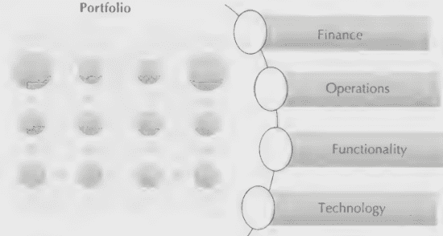

**图 6-2 受有效管理的 Java 应用程序投资组合**

四个支柱形成了基础框架，帮助决策者理解应用程序投资组合的用途，并确定其是否满足以下标准：

- 组织业务目标
- 端用户需求
- 预算限制
- 运营目标
- 支持和维护标准
- 性能和 SLA（服务水平协议）
- 技术架构
- 最佳实践
- 企业功能性需求的解决方案
- 实现高业务价值和卓越的应用程序技术质量

## 财务考量

现代化 Java 应用程序投资组合的一个核心原因是低效投资组合所带来的负面财务影响。第 2 章回顾了 Java 应用程序的完整生命周期，并考虑了新应用程序审核和构建的过程。众所周知，静态的 IT 预算使新应用程序的业务案例论证变得复杂。如果我们在这里应用“响的轮子总能得到油”的类比，我们可以理解有限的 IT 资源如何仅仅被用于维持运转，而不是改进和推进投资组合的健康状况。维护投资组合中现有应用程序的人力成本消耗了预算的大部分。通过降低运行成本并确定释放资金的投资去向，组织可以开启 Java 改进路径的战略旅程。

这条路径上的另一个重要步骤是停止对非关键应用程序以及由财务支持维持的架构糟糕应用程序的投资。Java 应用程序投资组合的整体成本需求必须得到控制，并在正确的领域进行投资以实现业务价值最大化。为此，需要定期收集并分析若干应用程序属性，以便理解运营应用程序投资组合的成本、应用程序的单个运行成本及其支出趋势。一旦实现这一点，就可以得出推断来预测未来的支出承诺。

## 运营考量

投资组合内应用程序的运行取决于财务资源和劳动技能。技术团队忙于支持业务并为每个应用程序维护适当的 SLA。不能假设业务关键型应用程序会消耗更多资源。有时，技术质量低劣且功能不完整的应用程序往往会消耗更多资源来维护和支持该应用程序。对于应用程序运行至关重要的技能也可能存在不匹配。如果将缺乏技能且经验的资源分配给某些应用程序，员工资源和运营成本可能会比实际所需的得多。必须收集并分析应用程序的可维护性以及历史和预测的支出预测；还应考虑运营类似应用程序的成本。

应该根据深入的财务和运营分析，识别出适合合并或退役的应用程序。同样，对于外包维护的应用程序，需要通过服务提供商提供的价值进行优化。如果这些应用程序属性在过去五年内没有被收集或分析，可能会在节约方面面临重大风险。可以通过衡量运营风险、业务风险、可靠性、可扩展性、业务关键性和其他此类属性来构建应用程序的运营画像。

## 功能考量

Java 应用程序的业务功能连同功能分解和业务流程下钻，应该对投资组合中的所有应用程序进行详细文档记录。第 3 章识别的业务和功能属性同样适用于 Java 应用程序。深入理解功能分解和业务流程编排将帮助你从业务流程转型和功能整合的角度成功实现 Java 投资组合的现代化。通过收集和分析相关属性，跨部门共享服务和应用程序之间可复用组件的识别是可以完成的。通过创建功能和业务属性相对于财务和运营属性的图表，可以计算应用程序的业务价值。借助这些属性，可以衡量应用程序的功能健康状况、功能复用的灵活性以及满足端用户需求的可靠性。

## 技术考量

任何 Java 应用程序的关键价值包括卓越的技术质量、对最佳实践的遵循以及灵活的技术架构。在投资组合层面，技术分解发现了投资组合中技术组件的性质并暴露冗余，从而使 Java 应用程序符合企业架构建立原则。

第 2 章讨论了若干详细属性。收集这些属性、进行评分并组合形成 2x2 视图，可以就技术质量、质量风险、技术过时、对第三方或自定义组件的依赖、架构灵活性、复杂度、可扩展性、可靠性和整体技术健康来衡量投资组合。使用自动化工具，你可以发现更广泛的属性，包括使用的 API 和第三方组件的具体细节、代码行、圈复杂度以及嵌入应用程序的业务规则。知识库的应用还可以确定核心库以及应用程序使用的第三方库的所有更改和改进，以及它们对应用程序代码的具体影响。理解并记录每个应用程序中的修改点将为重工程、重构、重写或迁移提供逻辑依据。修改点可以认为是代码库现代化的原子修改单元。

## Java 应用程序投资组合的管理

一旦识别并确定了 Java 应用程序投资组合，APM 学科及其流程将对齐以有效管理该投资组合。可以利用应用程序属性形成对投资组合在财务、运营、功能和技术四个支柱表现的理解。对应用程序投资组合的有效管理自然会导致利益相关者之间透明的决策对话，最终实现该投资组合的现代化。

投资组合中的 Java 应用需要定期、系统地进行评估，以确定每个应用为企业带来的业务价值。在处理诸如总拥有成本（TCO）或对应用进行持续投资的回报等问题之前，需要充分理解构建、增强和维护应用的成本。在为任何进一步的增强或投资提供合理依据之前，还应该评估应用的技术质量。最后，应将业务不确定性和技术影响作为对这些应用的运行和支持所构成风险的一个部分进行评估。

财务、运营、功能和技术这四大支柱最终转化为成本、风险、业务价值和技术质量。图 6-3 展示了管理良好的 Java 应用投资组合如何实现现代化。该图绘制了技术质量与业务价值之间的关系图。同样，也可以绘制成本与业务价值，或任何一个支柱的属性与另一个支柱之间的关系，以帮助做出决策。

行业分析师过去分享的描述应用投资组合决策的标准象限模型，同样适用于在四个支柱下管理的 Java 应用投资组合。

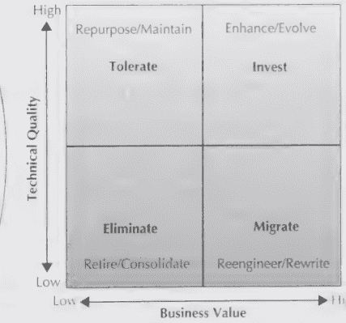

**图 6-3. Java 应用投资组合的现代化决策**

现代化决策允许对投资组合中的一个或一组应用进行容忍、投资、消除和迁移。对决策模型的更深层次观察阐明了某些实际的现代化决策，包括：

- 升级 Java 技术平台版本。
- 通过重构或重写利用新的技术特性。
- 通过功能增强来满足新的业务需求。
- 通过重新工程来改进业务流程。
- 通过捕获相关的应用属性和元数据来改进治理模型。
- 关闭或消除应用。
- 确定整合策略以消除功能或技术上的冗余。
- 容忍某些应用，并将其保持在维护模式，而不进行额外投资。
- 将某些应用或应用的部分迁移到较新的技术。

## 分析方法论

过去已经提出了多种用于分析应用投资组合的方法。Gartner 和 Forrester 等行业分析师为他们的订阅者创建了自己的方法，并编写了专题报告。Infosys、IBM Global Services、Accenture 和 Cognizant 等系统集成商和咨询公司也发布了关于应用现代化的白皮书和高层方法。这些方法论并非专门为 Java 应用投资组合定制的。事实上，这些方法在本质上是通用的，适用于任何应用投资组合的管理，包括特定的 Java 组合。所有这些方法论的一个共同点是，它们最初都是对应用投资组合的管理或现代化进行评估或发现工作。

这通常涉及识别投资组合中的应用，然后进行信息收集会议和访谈，用收集到的应用数据填充标准标准模板。

在过去的二十年里，IT 的演进将现代化视为应用投资组合管理的重要方面。每当出现有前景的新更新或技术组件的升级版本时，人们就有立即采纳它的愿望。然而，这通常对于收购流程更灵活的小型公司适用。大型组织倾向于坚持有效的方案，直到它们失效为止。在这两种情况下，时间、金钱和资源都是最大的限制因素。最近，在技术采用方面的思维发生了明显的方向转变。以前，大型企业拥抱新技术的速度缓慢，但随着创新的速度加快和开源组件的可用，一些大型企业也愿意更快速地拥抱新技术。尽管面临挑战，但人们通常喜欢技术，并希望采用市场上最新、最强大的技术。

应用的现代化可能会跨越各个架构层评估整个应用，也可能局限于特定类型的应用（例如文件服务器）。现代化的规模可以从某个特定应用的组件现代化变异到整个 IT 景观，包括数百个甚至几千个应用。

图 6-4 展示了 Java 应用投资组合的现代化。

评估、评价和优化这三个阶段处于该方法论的核心。每个阶段进一步分为三个步骤，以简化其方法和执行。APM（应用投资组合管理）和 EA（企业架构）与现代化紧密相关，在图中也有体现。APM 将治理和计划管理应用于由现代化策略产生的现代化倡议中，而 EA 则参与现代化的各个方面，并与执行现代化路线图上任务的特定团队交互。典型的软件开发生命周期（SDLC）过程用于所有项目。DevOps 在确保构建团队和运营团队之间的成功交互方面也发挥着重要作用。

那么，组织如何评估计划中的现代化活动所需的成本、精力、风险和时间呢？这一切都从评估开始。

任何现代化活动中最挑战性的任务之一就是对投资组合进行初始评估以及可能决定结果的任何影响因素。

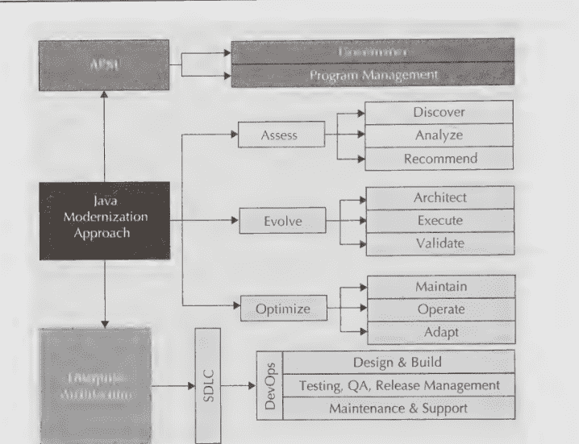

**图 6-4. Java 应用投资组合的现代化方法论**

之后，根据评估阶段确定的一系列倡议对投资组合进行审查和评估。最后，根据其新能力对投资组合进行优化、管理和增强。从纯合规性的角度来看，如果 Java 应用投资组合处于消解状态，几年后可能再次需要进行深度评估，以使其回到正轨。

## 评估 Java 应用投资组合

任何现代化活动都不应在未对投资组合进行彻底评估的情况下开始。图 6-5 描述了现代化的要素以及现代化项目如何从评估开始。现代化有四个主要要素，评估的设计、活动、预期和结果基于这些要素：

- 重要性
- 规模
- 挑战
- 影响

现代化对企业重要性是第一个元素。现代化活动至少每五年进行一次；届时就可以评估投资组合是否存在过时的应用。对于没有积极管理和维护的 Java 应用投资组合，其现代化的重要性无论如何都不为过。此类投资组合中很可能存在固有的效率低下问题。

规模要素与特定投资组合中的应用数量有关。拥有数百个 Java 应用的投资组合其规模或现代化方法与拥有 10 或 20 个应用的组合不同。（关于大规模投资组合现代化方法的深入讨论将在第 14 章中给出。）

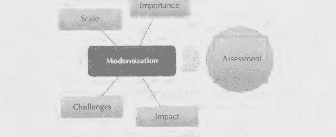

**图 6-5. 现代化活动从评估开始**

Java 应用投资组合的现代化还面临若干挑战，无论是技术还是运营性的。相关的挑战可能包括现有架构的性能问题或灵活性不足。这些挑战在本章稍后的“挑战”部分进一步讨论。

这些评估活动的持续时间通常为八到十周，取决于应用的数量。这项活动可能需要三到五个人来收集数据、访谈利益者并分析信息以在评估报告中提出建议。在纯手工的过程中，几乎无法深入研究投资组合中的每一个 Java 应用。Java 投资组合的手工评估是从向所有应用者分发预定义的模板开始的，包含问题和应用属性。然后这些人员被给予两个周的时间来填写问卷并返回完成的模板（通常是 Excel 格式）。评估团队随后汇总信息并分析其内容。

遇到的最后一个问题是在处理 50 到数百个 Java 应用程序时对团队的影响。在这种情况下，分析每个应用程序所需的时间会迅速累积。如果一个典型的项目周期跨越大约八周，那么将没有足够的时间收集所有应用程序的信息并分析事实。解决此问题的方法之一是根据少数属性对应用程序进行快速分段和分类。之后，通过与应用程序所有者讨论，从整体中识别出约 15% 到 20% 的应用程序，这将显著缩小调查范围。在假设从该调查得出的决策也适用于该类相关应用程序的情况下，对这些应用程序进行分析并得出结论。

显而易见，这并不是一种完美的方法；然而，在有限的时间内，对大型 Java 应用程序组合进行手动分析几乎没有选择。另一种方法是继续对组合中的 Java 应用程序进行毫无章法的维护，并在问题出现时仅提供快速修复。这种“救火演习”的方法通常是大多数企业发生的情况，导致了高昂的开支和过度的维护成本，并对在旧 JVM 上运行应用程序构成了重大的业务风险。这种做法缺乏前瞻性，并且没有利用 Java 平台上可用的进化 API 和新组件。

解决这些可能问题的一个答案是使用自动化工具增强手动评估工作。图 6-6 概述了采用三步法的自动化评估：发现、分析和建议。Java 应用程序组合的方法论与第 4 章所示的评估方法论类似，不同之处在 Java 应用程序组合的情况下，额外引入了特定的自动化工具作为评估方法的一部分。第 7 章和第 8 章讨论了可以用于自动化某些评估任务的现有工具，并分享了构建或自定义用于 Java 应用程序组合评估的可用工具的方法。

评估方法的机制如图 6-7 所示，该图识别了与自动化工具交互或进行信息收集过程的典型领域专家。在产生与类似的手动评估相似的交付物方面，这些自动化评估显著缩短了上市时间。

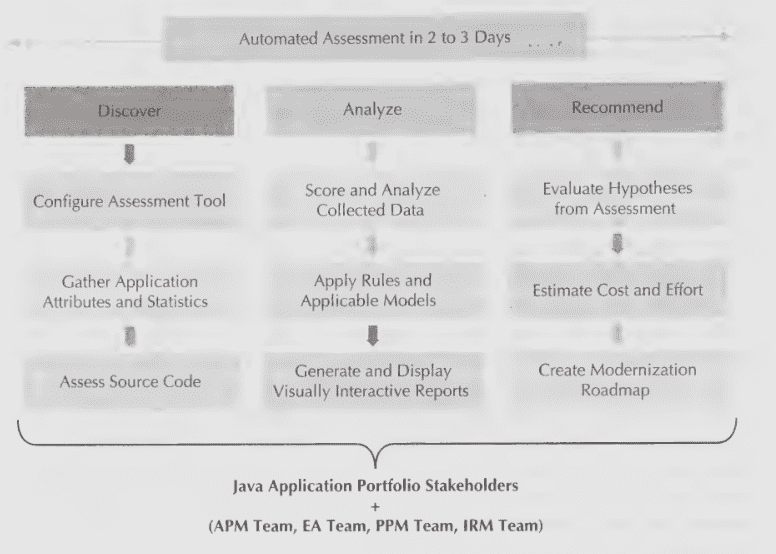

**图 6-6. Java 应用程序组合评估方法论**

### 发现

评估的发现阶段是 Java 应用程序组合现代化的关键第一步。事实上，永远无法对任何组合评估实现 100% 自动化。然而，完全通过自动化工具驱动评估是可能的。这是一个重要的区别。通过分析源代码、配置文件、元数据和环境，可以收集有关应用程序的大量信息。使用预定义的模板手动收集应用程序信息可以补充和增强源代码分析的自动化过程。因此，自动化的信息发现过程结合访谈、文档和其他创建知识库的其他信息，可以使用工具和手动流程进行分析；这种结合兼顾了两者的优势。

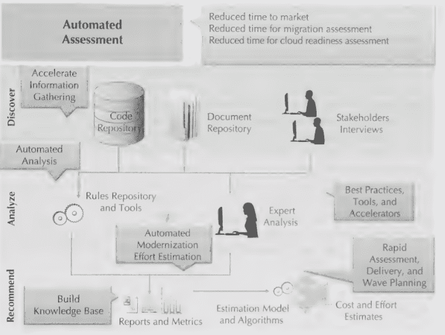

**图 6-7. 自动化评估方法的机制**

手动信息收集可以揭示有关应用程序的财务和成本相关信息、支持的业务流程和其他操作特性。源代码分析将产生有关 API、代码质量、应用程序修改的必要性、所识别的现代化点（或 mod 点）的复杂性、技术风险以及其他相关技术信息。如图 6-7 所示，发现步骤应该产生一个代码库以及一个包含自动生成的源代码、配置文件、整体环境分析、利益相关者访谈信息和其他应用程序属性的文档库。

> **注意**


# 第 6 章：Java 现代化方法

**mod 点（mod point）或现代化点（modernization point）** 是与应用程序相关的任意度量单位，用于识别源代码、配置文件或其他应用程序资产的特定部分，这些部分在应用程序实现现代化之前需要进行修改。从类比的角度来看，mod 点类似于 Scrum 和敏捷开发团队使用的**故事点（story point）**——一种用于确定实现一个故事所需工作量的衡量单位。简单来说，mod 点传达了使该应用程序特定部分现代化的难度程度。mod 点并不精确等同于工作小时或成本，但它对所涉及的复杂性提供了一个合理的概念。需要每种 mod 点和其他基准信息来预测与 mod 点相关的工作量水平。


## 分析 (Analyze)

在分析步骤中，在发现阶段收集的信息被用于对数据集应用各种假设。在传统的手动方法中，这种分析依赖评估团队的经验以及他们对 Java 技术平台的知识，通过评估类似的应用程序数据和属性来准备一份详细的分析报告。一旦生成了报告，利益相关者就可以根据结论做出适当的建议。尽管经验丰富的评估团队可以以这种方式进行相当全面的分析，但重要的是要记住，大多数企业都有各种利益相关者，其中一些人在专业领域上缺乏经验或是该组织的新成员，这阻碍了他们收集数据和交付详尽报告的能力。

将应用程序迁移到最新 Java 平台（本地或云端）的决策需要对资源投入水平、相关成本、可用的应用程序属性进行探测。一旦报告生成，利益相关者可以依靠结论做出适当的建议。另一方面，如果将此类信息与对应用程序源代码的深度分析相结合，结果将是非常丰富的。这种深入的调查还将审查对修改方法的理解、应用程序源代码中需要修改的具体位置、此类修改的次数、修改的复杂性以及关于技术环境的其他数据。这些因素将大幅增强手动分析方法，产生一份提供更高准确性和洞察力的评估报告。

在自动化评估方法中，分析步骤利用规则库，该规则库包含了有关各种 Java API、常用的第三方和开源 API、不同版本之间的差异、Java 编码最佳实践、陷阱、版本之间的变化和其他信息。在发现过程中作为部分解析并存储在库中的 Java 应用程序代码作为**抽象语法树（AST）**进行分析，并将规则库中的规则应用于此 AST 树以寻找模式和匹配。这将产生一份非常详细的分析报告，包含关于 Java 应用程序中需要解决点的完整知识。图 6-7 展示了带有规则库以及将规则应用于解析源代码文件的工具分析步骤。手动分析将专家经验和背景补充到自动化分析。

## 建议 (Recommend)

建议步骤是评估练习的关键第三步。该步骤建议了 Java 应用程序组合中应该执行的操作项。报告应包含一份路线图，概述建议的计划，包括此类计划相关的成本和工作的高级总结。在手动评估方法中，路线图将严重依赖于在没有深度源代码知识的情况下收集的结果和文档。实际上，预算成本和资源分配的建议将非常不准确。如果没有自动化方法的依据，从纯手动评估开发的路线图在组织上是极其谨慎且具有风险的。

自动化方法的众多益处包括一个包含自动化分析步骤中识别出的 mod 点和其他数据点的估计模型、指标和估计算法的知识库。这种先进的方法将导致成本的计算和所需资源的对齐，以更高的置信度计算所需的资源。构建这样一个全面的估算模型需要大量的经验、对数据点的深刻理解，以及通过精心设计的程序在多个项目上跨越一段时间所收集的数据。此外，数据点还应考虑开发者的技能水平、技术成熟度、应用程序复杂度、客户特定影响，以及通过与开发和维护 Java 应用程序相关的软件开发过程中捕获的各种指标。使用自动化方法构建的路线图将产生本质上更好的假设集，并更准确地将业务目标与项目优先级对应，从而使分析结果更具可预测性。

在处理大型 Java 应用程序组合时，有根据某些标准将应用程序分组为波次，以避免对所有应用程序采用“大爆炸式”的方法进行现代化。特别是对于将应用程序迁移或升级到新版本，通过较小的小组或波次进行处理更好。

## 演进 Java 应用程序组合

在**演进（evol）**阶段，将建立一套治理和变更管理流程。当现代化团队执行路线图中定义的每个项目时，每项计划都涉及一个满足业务目标的解决方案架构。最常见的执行项目涉及 Java 应用程序的迁移和过时应用程序的淘汰。现代化倡议本身将属于以下特定类型：

- 将应用程序迁移到新的 API 和新的 JDK 版本
- 重构
- 重塑
- 集成
- 重写
- 业务流程转型
- 信息架构设计
- 功能增强
- 引入新技术组件和技术增强
- 减少功能或技术上的冗余
- 淘汰或停用过时应用程序

与评估阶段不同（评估阶段通过假设驱动的分析得出优先计划），Java 组合现代化的演进阶段的核心在于通过定义的计划执行路线图背后的愿景。虽然评估阶段采用估算模型预测已确定计划所需的资源和成本，但在计划开始之前，仍迫切需要作为计划图的一部分进行彻底的业务分析。演进阶段可以分为三个步骤：架构、执行和验证。在正式发布之前，对路线图进行架构、执行解决方案蓝图并验证解决方案以满足需求至关重要。

### 架构阶段

设计现代化解决方案可以非常简单，也可以非常复杂，取决于现代化的范围。受影响的特定架构层也会根据现代化需求而异。在业务流程需要重新设计或信息架构需要彻底改造的情况下，四个架构层都可能受到影响。虽然大多数人认为架构步骤是一个纯粹的技术活动，即设计和执行新的技术解决方案，但实际上，这只是 Java 应用程序组合演变的可能方式的子集。

当为当前组合识别并优先考虑新的业务需求时，这些计划的范围和执行将成为主要关注点。较容易设计架构的计划包括迁移、升级和重构类项目。更复杂的项目涉及功能整合、业务流程重新设计或信息架构重新设计。引入新组件以及现有组件之间的集成可以被描述为中等复杂度。这也是进行以业务能力为驱动的转型、功能分解和组合的技术分解的契机，以重新构建业务架构、功能架构、技术架构和基础设施架构，以支持转型后的业务。

### 执行阶段

执行阶段类似于任何典型**软件开发生命周期（SDLC）**的执行。根据计划的范围对应用程序进行增强、迁移或重构。组合治理原则不仅对应用程序组合管理很重要，也直接适用于 Java 组合现代化学科。作为治理和变更管理流程一部分而确定的指标，同样被应用于和跟踪 Java 应用程序组合。

### 验证阶段

必须对新现代化的应用程序进行验证，以便它们继续满足其功能和非功能需求。这一验证步骤应类似于成熟组织中已有的 SDLC 过程中所进行的标准测试。在任何应用程序的现代化过程中，应使用自动化测试以及其他经典测试方法。

## 优化 Java 应用程序组合

**优化（optimize）**阶段对于 Java 应用程序组合的持续成功管理极其关键。虽然评估和演进阶段确保了 Java 应用程序组合已成功翻新和集成，但大部分管理属于优化阶段。除了建立维护 Java 组合的流程外，在优化阶段还建立了治理和变更管理流程，并配有特定的定制指标来衡量组合的转型。在此阶段，Java 应用程序组合转入维护、运行和适应模式。

演进阶段确保 Java 组合的应用程序和信息架构被重新设计，以包含新兴技术，使重新设计的应用程序能够利用技术栈中的新技术。在优化阶段，架构层及其各个组件将继续接受维护、监控和管理。

同样，虽然演进阶段执行了涉及功能或基础设施整合以消除功能冗余和基础设施冗余的任务，但优化阶段包含了对整合后的功能和基础设施的维护和调整。

优化阶段的另一个关键重点是 Java 应用程序组合的运行。这涉及 **DevOps** 相关流程的引入和管理：识别、监控、指标所有权以及治理流程本身。

偶尔，应用程序会达到生命终点并耗尽在企业中的用途。此类应用程序将被淘汰或逐步停止，现有用户将迁移到提供类似功能的其他应用程序。对于超出其实用性的遗留 Java 应用程序，必须保留与这些停用遗留程序相关的业务知识、功能知识和数据，同时用新应用程序或封装好的 **COTS（商业现成软件）** 应用程序替换它们。许多组合包含这些大量消耗资源的“非增值型”应用程序。极少数企业具备必要的治理和 **APM** 纪律，能够在不产生实质影响的情况下优雅地提取这些应用程序。

## 执行 Java 现代化计划

任何 Java 现代化计划的成功取决于某些关键因素。第 3 章详细介绍了 APM 与其同类学科——**项目组合管理（PPM）**和**投资风险管理（IRM）**的关系。第 4 章涵盖了 APM 和 EA 的角色以及它们如何协作实现应用程序组合管理计划的成功。应用程序组合管理学科产生了 Java 应用程序现代化，由核心 APM 团队驱动项目。Java 现代化计划成功的方面反映了导致 APM 成功的任何特征。事实上，需要一个蓬勃 APM 计划来最大化 Java 应用程序现代化的利益。成熟的 APM 计划建立了必要的流程、行业最佳实践、治理、企业架构参与、相关利益相关者的识别以及现代化计划的进度衡量。这一点强调再强调都不为过。

# Java 应用的快速现代化

成功的现代化并非一种孤立的策略。相反，Java 应用组合的现代化取决于对应用组合本身深层且详尽的理解——换句话说，即取决于应用组合管理（APM）的成功运营。

# 为什么要对 Java 应用进行现代化？

成功的应用组合现代化与企业增长之间存在显著关联，这考虑了对组织的财务和运营影响。对于选择将其 Java 应用现代化的公司，存在着显著的风险。


## 注意

作为背景信息，Oracle 于 2013 年 2 月停止了对 **JDK 1.6** 的公共更新，并在 2015 年 4 月结束了对 **JDK 1.7** 的公共更新。Oracle 最初提议于 2017 年 9 月停止对 **JDK 1.8** 的公共更新！鉴于 **JDK 1.9** 的严重延迟，JDK 1.8 不太可能在 2017 年 9 月就放弃公共更新。对于 Oracle 而言，在发布 JDK 1.9 后等待一两年再停止对 JDK 1.8 的公共更新将符合所有人的利益。

第 1 章说明了多种平台漏洞，并解释了升级到 JDK 1.8 将为这种脆弱性提供解决方案。Java SE 8 引入了许多与安全相关的增强，包括：

- 默认启用客户端 **TLS 1.2**
- 更强用于基于密码的加密算法
- 在 **Java Secure Socket Extension (JSSE)** 服务器中支持 **SSL/TLS 服务器名称指示 (SNI)** 扩展
- 增强的 **SunJSSE** 提供程序以支持基于关联数据认证加密（AEAD）模式的密码套件
- **SHA-224** 消息摘要
- 对 **NSA Suite B** 加密的增强支持
- 对高熵随机数生成的更好支持

在此过程中，还增加了一些性能改进和关键特性。新的垃圾回收器 **G1** 在 **JDK 7u4** 中引入。G1 垃圾回收器提供以下功能：

- 在支持大内存（通常为 6GB 或更大）的垃圾回收器方面更具成熟度
- 更可靠的暂停时间，延迟小于 0.5 秒，且稳定、可预测
- 不再需要调整永久代内存（permanent generation）
- 更一致的命令行标记
- 推荐用于面临当前 GC 导致过长压缩停顿的大型企业应用

针对以下主题，存在大量的参考文献：

- Java SE 8 中引入的 **Lambdas** 和**流**，它们增加了对并行编程、聚合操作、集合的支持，并减少了样板代码
- 针对具有键冲突的 **HashMap** 的性能改进
- 改进的日期和时间 API
- 改进的诊断功能

还引入了一系列新工具：

- 用于调用新引入的 **Nashorn** 引擎的 `jjs` 命令行工具
- 用于启动 JavaFX 应用的 `java` 命令
- 更新的 Java 手页（man page）
- 用于分析类文件的 `jdeps` 命令行工具
- 诊断命令的 **JMX** 访问
- `jarsigner` 工具的新选项，用于向时间戳权威（TSA）请求签名时间戳

将 Java 应用组合现代化有许多原因。利用平台漏洞是一个严肃的考虑因素。过时应用的外露风险也为投资应用组合管理创造了强大的吸引力，旨在面向未来转型现有的 Java 组合。

## 通过 EA 利用 APM

在 Java 组合的背景下，APM 体系旨在使 Java 应用及其业务功能与需要这些应用的部门的业务目标保持一致。除了降低整体成本，APM 还会影响哪些应用可以随着时间被替换，并决定未来的投资应该放在哪里。另一方面，企业架构（EA）帮助核心 APM 团队对 Java 应用组合进行功能和技术分解。这有助于识别共享服务的机会，并在各种应用程序中复用此类服务。在第 10 章和第 11 章中，我们将详细地介绍这一主题，并讨论服务平台和服务如何结合以提供应用功能。

当新的 JDK 版本发布或第三方组件发布更新 API 时，EA 是决策过程中不可或缺的一部分。因此，当应用迁移到新版本时，APM 和 EA 必须保持协调。这种协同作用建立了一种持续机制，以降低业务风险、优化业务价值并增强 Java 组合的技术质量。

## 利用利益相关者

Java 应用现代化的关键利益相关者包括应用所有者、技术架构师、开发者、业务分析师和项目经理。这一群体拥有并维护这些应用程序。关于应用组合的任何决策都会影响这一群体；因此，在决策过程早期让他们参与至关重要。应用程序的终端用户也是利益相关者，但如果升级后的应用在根本上执行方式保持相同，他们将不会受到任何影响。这些终端用户也是现代化过程的一部分，但仅限于用户验收测试（UAT）阶段。让他们了解该过程和预期是重要的。其他利益相关者包括运营、支持人员和高层执行赞助人。在倡议执行期间也应通知他们。这些利益相关者小组是在特定的现代化计划背景下创建的，其成员是暂时的。另一方面，核心 APM 团队和 EA 组的成员是永久性的，专门负责所有的现代化计划。作为回顾，第 4 章复习了识别和形成利益相关者小组的过程。

# 通过 EA 体系维持现代化

企业过去执行过 APM 项目；但在过去的五七年里，组织开始将 APM 概念应用于 Java 组合的现代化。此外，APM 通常被单次地用于评估应用组合以改进性能。许多此类评估并未与持续监控和管理应用组合的 APM 流程对齐，很少有组织将 APM 建立为核心体系以扭转传统的、有时是浪费预算的做法。在实施现代化方法后，这些组织不再将 80% 到 90% 的资金花在维持运行的应用上，而是重新分配优先级，使新开发资金比例降至约 40% 到 55%。

拥抱 APM 并利用其进行应用组合现代化的组织理解这所需的努力。但 EA 需要与 APM 交织，以实现该体系的可持续采用。应用组合的现代化需要高级架构师的参与，他们意识到架构决策会影响所管理的其他应用程序或业务流程。许多应用程序适用于云端部署（无论是私有、公有还是混合）。EA 在现代化工作的评估和分析阶段影响这些决策。这也是识别、引入并实施新技术组件的时期。通过将 EA 与 APM 流程集成，组织可以保护管理方法，并在所有架构层上转型应用组合，以优化和最大化业务价值。

# Java 应用组合现代化的优势

大多数财富 1000 强公司已经在 Java 平台投入了大量资金来构建其业务应用程序。事实上，大多数财富 1000 强公司在过去的 15 年里构建了定制 Java 应用组合。在许多此类公司中，这些 Java 应用与 Microsoft .NET 应用程序、大型机应用程序以及越来越多使用其他新兴平台构建的应用并存。正如第 3 章所述，由于今天企业构建应用程序的预算限制，这些应用程序往往缺乏活性且集成度差。

立即对这些类型的 Java 应用组合进行现代化：可以在私有云或混合云基础设施中释放巨大的收益。引入稳健的 **DevOps** 文化并配合正确的流程，可以对敏捷开发方法产生积极影响；以持续的方式进行构建、测试、置备、部署、监控和管理应用程序也变得可能。扩展这些应用程序是现代化的另一个收益，能够提升开发水平、开发者生产力并提高运营效率。最终，随着 APM（应用组合管理）实践的实施，可以通过指标衡量出显著的长期成本节省和业务风险降低。应用程序增强以及满足不断变化的业务需求变得更容易处理，整个 Java 应用程序组合都针对最大的业务价值进行了优化。

在单个应用程序层面使用自动化工具和流程，使得升级和迁移到最新的 Java 平台变得轻而易举。收集正确的指标、准确的成本估计以及使应用程序跟上新 JDK 的重工程工作变得可行。第 7 章将讨论如何构建这些自动化工具。

## Java 应用组合的治理

Java 应用组合的治理与在 APM 体系下管理的任何应用组合的治理是类似的。这些高级指标在第 3 章中讨论过，对指标和流程的更详细讨论将在第 12 章进行。核心 APM 和 EA（企业架构）团队共同定义由指导委员会批准的治理政策。组合所有者对工具、流程以及关于组合的数据拥有所有权。这确保了整个组织能够看到访问这些数据的利益相关者。这些应用程序所有者负责执行特定项目，并与组合所有者及 PPM（项目组合管理）团队的代表合作提供特定的应用程序属性。关键利益相关者确保为 APM 流程的运行提供适当的输入；输出结果将与主要合作者共享。APM 的支持角色和职责在第 4 章中概述。这些标准也适用于 Java 应用组合。

## 现代化的挑战

在 Java 应用组合现代化过程中遇到的挑战可以分为业务风险、运营流程和技术挑战。以下是其中几项挑战的列表：

- 随着应用程序的现代化，它们应保持对终端用户可用。特别是业务关键型应用程序无法承担任何停机时间；它们必须持续满足其 **SLA（服务水平协议）**。在制定对业务影响最小的共存策略和现代化进度时，可能会面临巨大的挑战。
- 组合内应用程序现代化的上市时间取决于现代化任务的具体范围。鉴于现有资源有限，且主要用于运行现有应用程序的预算分配，启动现代化策略可能具有挑战性。
- 应用程序的功能可能没有记录得详尽，导致对构成组合分析基础的适用用例理解存在偏差。如果应用组合成为重工程或与另一个应用程序合并的候选，那么现代化方法可能会出现功能缺口。
- 如果应用程序从一个应用程序服务器迁移到另一个，或者从第三方组件的一个版本迁移到另一个版本，则必须对这些应用程序进行彻底测试。如果在测试用例、单元测试或功能测试中发现不连续之处，在部署的现代化应用程序中遇到问题的风险将会增加。
- 基础设施合并或部署到云基础设施将更改组合中应用程序的环境和配置。如果这一过程处理不当，就会产生挑战。


- 可用的源代码可能与生产环境中的应用程序版本不一致。这种情况为识别基线源代码以进一步演进和现代化应用程序带来了巨大的风险和挑战。

对应用组合中 Java 应用程序的评估可能不全面。某些属性的收集和记录不会导致知识库的不一致，以及与其他应用程序的交互碎片化。

应用组合的财务计划和运营模型可能难以量化和记录。如果未能正确捕获相关属性，尝试为组合构建运营模型以及为应用程序开发投资和风险概况将变得异常。

为了估计与应用程序现代化相关的努力和成本，需要在一段时间内建立并收集指标。缺乏关于这些指标的可用历史数据或缺乏估计模型，将导致对总拥有成本（TCO）、投资回报率（ROI）以及与完成现代化计划一致的时间线的错误预测。

如果使用自动化工具彻底分析源代码、配置文件和环境细节，现代化工作将主要依赖于个人利益相关者完成的访谈和手动问卷。这将导致组合现代化产生不可预测且不完整的结果。

现代化取决于对现有应用程序足够知识、应用程序功能以及应用程序详细技术设计的可用性。详尽文档、测试用例、环境、源代码和其他相关信息的可用是成功现代化计划的要素。寻找合适的途径来智能地弥补可用数据与必要信息之间的差距一直是一项难题；只有这样才能成功执行组合现代化。

组合内应用程序与组合外应用程序之间的复杂性、相互依赖关系和集成点可能会对一个或多个应用程序造成巨大压力。应用程序可能依赖于一个不受现代化团队控制的供应商支持库；因此存在现代化应用程序在尝试使用旧版本库时发生崩溃的风险。

## 总结

Java 应用组合现代化的成功取决于多个因素。核心 APM 团队同 EA 团队的参与必须驱动现代化工作。应用组合管理中的关键利益相关者和次要合作者必须从项目开始参与。现代化工作从评估开始。自动化评估阶段将大大减少工作、时间和风险，并将极大增强项目的可预测性。需要建立一个规则知识库，捕获不同 JDK 版本以及任何第三方 API 库版本之间的所有差异。这些围绕最佳实践、代码分析和其他 SDLC（软件开发生命周期）领域的规则可以应用于源代码分析，以确定 Java 应用程序源代码中的精确修改点。还可以构建其他工具来自动化修改。如果提供了完整的测试用例并集成到过程中，就可以为迁移和重工程 Java 应用程序实现大量的自动化。

接下来的两个章节将讨论如何构建面向 Java 应用程序架构师和开发者的自动化工具。这些工具实现了现代化过程，驱动现代化工作的评估、分析和估计，并帮助制定路线图。演进和优化阶段涉及 Java 应用程序的实际迁移或重工程。这些阶段在适当的情况下也采用了自动化工具。这些工具可能是自有的，也可能是市有的；只要它们能提供现代化所需的功能，就会被使用。整体框架、治理流程和使用的组合管理对整体评估都具有意义。


# 第 7 章：自动化评估：框架与工具

## 203 Java应用程序的快速现代化

任何企业都尝试过开发 Java 应用程序。大多数组织通过将 Java 部署到生产环境中来拥抱 Java 平台。即使在主应用平台由非 Java 技术组成的公司中，可能也存在某个开发领域编写了 Java 应用程序原型。今天，许多中大型企业在生产环境中拥有百万行的 Java 代码。如果统计用于构建这些应用程序的所有第三方和开源 Java 库的数量，那么部署的 Java 代码行数将是惊人的数字。

尽管这些企业拥有自己开发的 Java 应用程序，但他们往往对这些程序没有深入的了解。此类组织无疑难以准确统计出公司应用程序中存在的 Java 代码总行数、按应用程序进行细分，也无法有信心地说出跨公司应用共记录了多少个错误或问题。我确定这种规律并非没有例外，但我还没有遇到过哪家公司能全方位完全了解其 Java 应用程序，并建立起一个完整的知识库。

第 6 章深入探讨了 Java 应用程序组合现代化的方法和途径。图 6-5 和 6-6 展示了发现 Java 应用程序组合内部内容的评估流程。目前大多数组织利用 Excel 表格并聘用顾问团队对应用程序组进行访谈，并记录有关应用程序组合的收集信息。作为该过程的延伸，我们研究了自动化评估方法的优势和机制，并简要讨论了三步评估方法论——发现、分析和建议。在本章中，我们将通过识别使用自动化工具的优势来严密分析评估这一步骤，而不是完全依赖于传统的人工方法。自动化能够让组织提高效率，并对评估工作获得更深层次的洞察。

利用自动化工具进行 Java 应用程序评估的企业，可以对其 Java 资产总和和应用程序依赖关系建立全面的理解。指标收集的自动化可以补充现有的知识库，以更好地理解维护应用程序组合所需的成本和精力。这种自动收集将为未来迁移和重构任务的优化设计提供支持。通过这些增强的自动化指标，可以对新的健壮知识库进行挖掘，寻找传统方法无法易于发现的模式和应用程序特征。在本章中，我们将回顾在应用程序分析工具中应考虑哪些特征、有助于应用程序组合现代化路线图整体设计的有效可视化方案，以及在 Java 应用程序组合演进过程中为建议阶段提供帮助。本章内容技术性较强，要求你理解许多软件工程概念，并阅读相关工具以理解其内部原理。

## 自动化 Java 组合评估的框架与工具

任何过程的优劣取决于实现该过程的工具。那么，我们从哪里开始？评估过程是如何自动化的？哪些工具是有用的？这些推荐的工具是否容易获得？评估过程的每个阶段是否需要不同的工具？在启动 Java 组合评估阶段的自动化之前，这些需要考虑的问题类型。

## 框架 vs. 方法论

关于“方法论”（methodology）的定义以及它与整体框架（framework）的关系，存在大量的争议。对于什么是构成框架或方法论以及这两个术语是否可以互换，似乎有多种定义、变体和解释。在没有清晰理解的情况下可能会被误用。为了本书的目的，我们特别区分了“方法论”和“框架”。

方法论是一套原则、最佳实践和规范性规则，通常用于为某个学科带来一致性和可重复性。例如，前面的章节为 APM 学科的实践提供了定义良好的方法和途径。

另一方面，框架是一个基础的概念结构，为执行复杂任务或一组活动提供指南和流程。执行任务的具体细节和工具留给框架的采用者。在我们的案例中，评估应用程序组合的自动化是由框架指导的；然而，具体的工具以及如何实现它们以支持这些过程则由企业决定。因此，两家企业可以实现一套完全不同的工具集，或者利用相同的工具得出不同的评估自动化结果。

## 自动化评估的逻辑架构与流程

让我们假设可以构建一个评估工具集来自动化 Java 应用程序组合的评估。脑海中立即浮出几个问题：

- 该解决方案在概念上是如何工作的？
- 使用此类解决方案的主要步骤和流程是什么？
- 该解决方案的输出是什么？

Java 应用程序组合中的主要资产是 Java 应用程序本身。应用程序本质上是由 WAR、EAR 和 JAR 等 Java 归档文件组成的。这些归档文件是从 Java 源代码编译的 Java 类文件包。此外，源代码是针对特定的目标 JDK 编写的，而类文件是通过支持特定 Java 平台版本的特定编译器编译源代码得到的。因此，在“发现”阶段，我们的工具必须能够分析类文件和源代码，以确定是否采用另一个更高版本的新功能、语法或 API。例如，考虑一个基于 JDK 1.6 编译的类文件的 Java 应用程序。评估工具首先必须发现源代码和类文件。

然后，作为“分析”阶段的一部分，可以对源文件、类文件或两者进行分析，以确定必须修改哪些代码以升级到 JDK 1.8、1.9 或任何最新版本。此类分析的输出可以提供（但不限于）Java 包的可视化报告、受影响源代码、升级到最新版本的建议修改类别，以及源代码中需要修改的具体位置。

此外，作为“建议”阶段的一部分，将就建议修改的优先级、建议修改的复杂性，以及建议修改是否可以自动化，或是否需要人工干预以针对 JDK 1.8、1.9 或最新 JDK 修改并重新编译代码给出建议。

当我们进行此类分析时，从哪里开始？我们需要超越简单的源代码简单解析，并询问以下问题：

- 此类解决方案如何知道 Java 应用程序使用的每个 API 和每个第三方库或开源库？
- 应用程序可以针对性地对某些 Java 源文件进行分析，或升级到特定的 API 或库吗？
- 如果几周后需要对 Java 应用程序进行后续分析怎么办？在不重新分析整个代码库的情况下可行吗？

在回答这些非常相关的问题时，分析促使我们考虑一种大致符合以下标准的逻辑架构解决方案：

- 应对 Java 应用程序进行分析，并将分析结果存储为规范形式（canonical form）以便以后检索，这样应用程序以后就不需要再次分析。
- 在分析期间对应用程序应用一套规则集，这有助于确定查找并标记为潜在修改的特定特征。
- 规则集应具有扩展性，以适应以后分析范围的变化，并能够包含应用程序使用的 API。
- 分析结果必须以可视化的形式呈现，以便于解释分析结果。
- 最终报告应提供相关的建议，包括识别高优先级的修改。知识库应跟踪跨 JDK 和第三方库版本的此类优先级，以确定进行所识别的修改时涉及的复杂程度和工作量。

Java 应用组合并不仅仅由 Java 源代码和类文件组成。许多其他构物也属于该组合的范畴，并且需要进行发现和分析。我们可以应用“发现、分析和建议”的总体框架，通过特定的工具集来实现评估过程。这套工具将满足解决方案栈的要求，并促进 Java 应用组合的现代化进程。图 7-1 提供了一系列建议的、用于评估评估和迁移 Java 应用组合的工具功能。多个开源和专有工具可以满足部分建议的功能。本书的后续章节将更详细地介绍这些可用工具，比较特定工具的特性，并对重要工具及其妥当用法给出建议。

## 解决方案栈的概念赋能

回顾一下，第 6 章的图 6-7 展示了三步评估方法论和自动化评估的机制。该评估方法论为该过程提供了概念性的解释。要实施这种方法，你必须使用正确的工具来执行设想的任务；然而，没有任何单一工具能够独立完全且准确地执行评估方法论的每一步。将具有各自特性和适用性的工具进行成功组合，将共同有助于最终的自动化评估结果。

本节讨论了在 Java 应用组合的自动化评估和迁移过程中，解决方案栈的组成。对于此分析，使用可用工具对解决方案栈进行分析，并将工具分为三个不同的领域进行比较：

- 发现与分析
- 建议与可视化
- 数据库现代化

| 应用数据收集模板 | 应用评估模板 | Java 源代码评估工具 | Java 类文件和 Java 存档评估工具 | 抽象语法树 (AST) |
| :--- | :--- | :--- | :--- | :--- |
| Java 组合评估工具 | Java 存档依赖分析器 | XPath 规则 | Java 规则 | 点分类与分析 |
| 代码覆盖率分析 | 静态分析 | 应用监控 | 测试用例分析器 | 应用指标收集 |
| 聚类和波次规划 | 优先级框架 | 自动化代码重构 | 假设生成与风险分析模板 | 字节码反向工程工具 |
| Schema 验证 | 数据库依赖分析器 | 数据质量与清洗 | 数据迁移 | 提取、转换、加载 (ETL) |
| 路线图策略模板 | 工作量与成本估计框架 | Java 代码迁移工具 | 应用知识库 | 规则库 |

**图 7-1.** 支持自动化评估和迁移的工具所预期的特性组合

尽管许多工具的功能重叠，但其中某些工具具有内在独特的特性。在涉及建议和可视化时，识别可用工具集内在固有的差距也是同样重要的。在该阶段，可能必要通过构建工具或扩展现有工具的适用性来实现缺失的功能和特性。图 7-2 列出了所选工具集必须具备的关键功能，并通过将这些功能映射到评估框架中与其更相关的三个阶段，对工具功能进行组织。

## 发现与分析

为了正确评估 Java 应用组合并做出明智的迁移决策，第一步需要发现仓库并创建组合的知识库。Java 应用组合不仅仅是 Java 应用程序的编译。必须从整体上查看这些应用程序。除了应用程序代码外，还有多个环境、构建和 QA 流程、数据库、用户界面以及其他构物。

典型的 Java 应用组合包含以下元素：

- Java 源代码
- 第三方库
- 开源库
- 应用服务器
- 配置文件
- UI 构物，包括 HTML、CSS、JSP 和其他文件
- 数据库服务器
- 数据库脚本
- 测试数据
- 单元测试
- 构建过程
- 测试自动化测试支架
- 部署脚本
- 构建、QA 和运行环境
- 各种存档格式，如 EAR、WAR 和 JAR 文件
- 管理和监控脚本

此列表仅是特定组合可能使用的构物类型的一个说明性样本。这些信息中的大部分可以使用工具集自动发现。在此过程中，这些工具将针对给定的组合运行，读取其源代码，处理可执行文件和其他构物，并构建信息知识库。该知识库可以包含以下信息：

- 类文件数量
- 源代码行数
- 使用的特定库及其版本
- 依赖关系
- 环境相关信息
- 应用程序使用的 API 类型
- 特定组件的数量
- Java 服务相关的配置
- 微服务和服务及接口

作为发现和分析步骤部分的某些工具还可以进行静态分析并记录违反最佳实践的情况。另一种发现工具的有趣用途是使用自动化分析解析源代码，构建抽象语法树 (AST) 作为源代码的表示。

## 发现和分析工具的理想特性

理想的发现和分析工具应该便于终端用户安装和使用。在这种情况下，终端用户应该是具有软件开发或业务分析背景的 Java 应用现代化团队成员。该工具必须具有基于 Web 的 UI。尽管你可以尝试给出有说服力的理由认为 UI 不需要，但你可以想象在多个用户的笔记本电脑和桌面上安装和维护另一个 GUI 应用程序的工作量。经验表明，基于 Web 的 UI 能够最小地升级服务器并向工具集推出新功能。用户必须能够使用 UI 加载多个 Java 应用并确定相关的资产。

虽然静态代码分析仅适用于最佳实践规则和改进代码，但这些规则必须超越这些基础，并实际上确定代码库中与较新 JDK 版本或较版本的第三方库或开源库相比已经过时或陈旧之处。

图 7-3 显示并描述了规则生成和执行过程中五个主要步骤的关键活动：

- 识别
- 建模
- 差异分析
- 创建与验证
- 部署与执行

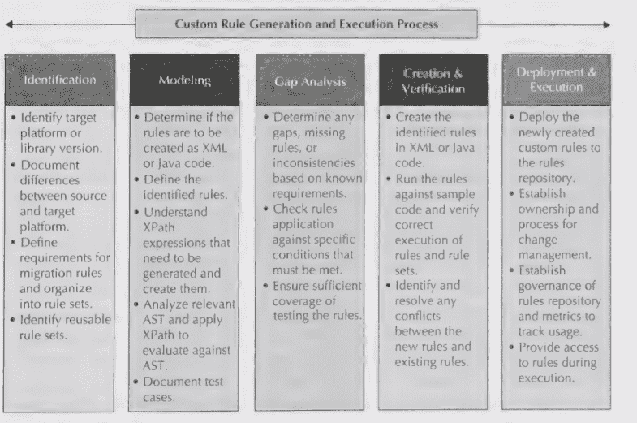

**图 7-3.** 自定义规则的生成与执行流程

该工具还必须对解析后的应用程序具有中间表示，这样在将来创建新规则时，发现的应用程序代码库就不需要重新分析。

## 建议与可视化

在发现并分析了与 Java 应用程序组合相关的所有资产后，解决方案中的工具还必须能够针对该分析提出相应的建议。这些建议需要以视觉化的形式呈现，以便最终用户能够轻松理解并正确解释结果。

这些建议取决于组织中特定的特定的相关目标和假设，在执行之前，必须对它们进行上下文解释和优先级排序。如果工具建议将数百万行代码中的特定方法替换为另一个方法，组织必须首先在运营挑战、所需工作、总成本和项目时间表的背景下仔细评估该建议，然后决定最佳行动方案。此外，其中某些建议可以以自动化的方式执行。例如，如果库中的某个方法被弃用，且工具建议用该库新版本中的等效方法来替换它（仅方法名发生了变化），那么在全球范围内替换方法名可能不会产生任何影响。这可以自动完成，并对修改后的源码进行编译和测试。然而，并非所有场景都是如此简单的。当企业将代码库迁移到新的 JDK 版本时，旧基准的情况至关重要。如果原始代码库落后了几个 JDK 版本，那么现代化工作将变得不简单。

当企业想在分析步骤中应用一组自定义规则时，自定义规则也可能为每个规则关联相应的建议。因此，对于适用该规则的代码库特定部分，可以显示记录的建议以指示涉及的复杂程度。虽然可以为代码库中每个适用特定规则的发现点生成繁琐的报告，但此类报告通过视觉化描述和高层信息会更易理解，且信息的呈现方式应支持钻取底层代码库的特定方面。如果视觉报告还提供建议以及相关的优先级和复杂级别，并允许预览源码的更改，那么整个决策过程将变得更加高效。

## 建议与可视化工具的理想特性

理想的建议和可视化工具必须以易于理解的方式呈现发现和分析报告。最终用户必须能够过滤分析结果并关注特定的感兴趣区域。某个用户可能只对几个特定的应用程序感兴趣，而不是整个应用程序组合。另一个开发者可能对整个应用程序组合感兴趣，但仅针对其目前维护的某个特定 API 或库。其他业务规则的人员（如数据库管理员）可能只对环境相关信息和配置文件感兴趣。

如果可视化工具足够灵活并提供生成自定义可视化报告的能力，工具的价值将大大增强。此外还可以提供开箱即用的报告，以节省用户研究分析结果的宝贵时间。此类报告也应该是高度视觉化的，并允许钻取和聚合，使用户能够以有用的方式从上到下遍历已分析的应用程序组合。如果这些可视化集成到应用程序组合管理（APM）报告中，通过 2x2 矩阵比较应用程序健康、技术质量和业务价值来提供各种应用程序属性的分析，那么消费者就能对整个应用程序组合做出深思的决定。


建议还可能与业务目标和假设相结合，结合运营、财务和技术数据。即使这种集成无法立即实现，或者工具箱不支持此类功能，至少工具也应该通过提供有关发现的源码违规复杂性的建议来支持技术决策。这是通过应用自定义规则并对发现的违规行为建议优先级来实现。

## 数据库现代化

大多数组合评估工作将精力集中在组合内的应用程序上。对于存储数据、执行事务、生成报告和准备分析的应用程序数据库关注有限。这些数据库也必须得到重视。本节说明了重点关注此类评估和分析数据库的典型工具功能。

# 214 Java应用程序的快速现代化

数据库现代化中最重要的工具是数据库发现工具。这些工具可以分析数据库、提取数据库细节，并标准化整个组合的数据表示，以便分析和检索。与数据库相关的所有制品都必须被发现并记录，以便随后的迁移工作确保某些数据库不被意外遗漏。

可以利用依赖分析工具来分析查询、存储过程、触发器、数据库模式和表的依赖关系。应用程序组合的数据库制品依赖矩阵就是通过这种方式构建的。随着数据库的升级，分析数据库版本与应用程序需求之间的不兼容性至关重要。知识库也应根据数据库信息库进行更新。

随着应用程序的迁移或以其他方式现代化，存储在数据库中的底层应用程序数据必须根据需要进行备份和恢复。在迁移过程中，可以利用数据迁移工具在数据库版本之间批量加载数据。

在某些情况下，数据库模式可能会被修改，特别是作为现代化努力的一部分实施新的业务需求时。在这种情况下，务必对新的数据库模式进行数据比较和验证，以确保以前存储的应用程序数据能够适应新模式。

# 第 7 章：自动化评估：框架与工具 215

- **架构与数据比较及验证**：当发生变化时，比较源数据库和目标数据库的架构，并根据各种测试用例对架构和迁移后的数据进行验证。

- **数据库升级**：在应用程序迁移期间，测试数据库、修复代码、生成报告并升级数据库。

在考虑数据库现代化和迁移时，的一些工具包括 `Liquibase`、`Flyway`、`Scriptella`、`Phinix`、`Talend` 和 `Pentaho`。除了这些主要工具外，还存在其他工具，包括数据库供应商提供的全面工具。

## 数据库迁移面临的挑战

应用程序通过向企业内部请求的业务部门处理并展示相关数据来证明其效用。那些包含业务逻辑但底层数据库中不包含数据的应用程序并没有太大用。随着应用程序的现代化，这些底层的数据库也会随之更新。数据库现代化的工作充满了重重困难，并带来了一系列独特的挑战。企业通常低估了数据分析相关的重要性和工作量。这通常是因为许多利益相关者对应用程序组合中所有依赖数据源缺乏彻底了解。企业还可能拥有各种关系型数据库、电子表格、`NoSQL` 数据库、层次结构数据库和其他相关源。

数据完整性和数据质量是需要优先考虑的两个领域。根据行业分析师的说法，超过 85% 的数据现代化和迁移项目遇到了严重问题。项目缺乏标准化、团队之间缺乏协作、系统设计糟糕以及数据不准确或不完整导致了许多此类问题。本节重点介绍了企业面临面临的典型挑战，并为创建应用程序现代化计划提供指导，以避免成为大多数人中的。

**架构验证与数据质量** 典型的应用程序组合包含多个数据库，这些数据库包含相似的架构并用重叠属性表示相同的实体。表示属性的名称也差异巨大。数据库架构缺乏规范化表示的情况在企业中非常普遍，因为每个应用程序团队和业务部门都决定创建自己的架构和数据字典。这些不一致且不兼容的数据架构在数据合并和转换期间构成了挑战。使用定义的规范化模型来识别和验证数据架构同样重要。数据质量会对应用程序产生重大影响。因此，应该创建验证规则来检查源数据，并确保对数据质量问题进行及时标记和纠正。

**数据映射与验证** 作为组合现代化的部分，多个数据源系统可能会合并或合理化。这将要求底层数据库也经历一些消除、合并和修改。这一练习的成果之一是来自多个源系统的异构数据可能会映射到规范化模型或目标数据库架构中。当数据从源架构提取、转换、映射并加载到新的目标架构时，验证这些数据至关重要。为了进行此类验证，可以利用某些工具，包括特定的提取、转换和加载（`ETL`）工具。彻底理解数据概况的映射和合并至关重要。某些数据映射转换可能是复杂的，特别是当存在引用完整性和数据元素归一化时。采用多个阶段来检查、测试和验证转换后的数据，将有助于获得成功的现代化化成果。

**数据冗余** 数据冗余的挑战与相似架构的问题略有不同。对于数据冗余，相似的数据可能存在于多个数据库中，每个应用程序或一组应用程序都可以访问自己的数据库并修改实体。这引起了极大关注，因为这些实体存在多个“真理来源”。问题变成了：哪个数据库拥有准确且可靠的数据？例如，如果有三个数据库都存储并修改客户数据，但所有三个数据库对某个客户的值略有不同怎么办？如果现有或新的应用程序被合并或集成到其他应用程序中，那么访问必要的客户数据可能会变成一项不可靠的活动。这类复杂问题经常在企业中出现，特别是当功能冗余的系统随时间演变时。

解决数据冗余的一些方法涉及审查数据字典、实体关系、源代码审查和数据分析，以识别单一真理来源。它还可能涉及通过特定的微服务合并或访问数据库，以读写现有的底层数据库。特定的现代化策略应：

- 应用内置和自定义规则分析组合。

- 建议现代化和迁移方案。

- 自动用建议的方案替换现有代码。

- 使用全测试自动化验证和确认现代化或迁移后的代码。

接下来的章节将深入探讨可用工具，并介绍这些工具的功能和能力，以便企业自行决定应该采用哪些工具并进行进一步定制。

## 用于应用程序分析和测试的开源工具

应用程序分析工具用于对源代码、类文件、配置文件和其他应用程序相关资产进行自动解析和静态分析。测试工具用于分析源代码、生成单元测试并自动执行整个测试过程。与自动化测试和测试工具相关的某些工具和技术将在本章后面的部分单独介绍。分析工具和测试工具结合可以形成强大的组合，为应用程序现代化的通用问题带来前所未有的自动化水平。其目的是实现 `Java` 应用程序现代化的自动化，一个非预期的结果可能是显著改进应用程序开发过程，工具的效用范围从通过标记过用方法来符合最佳实践，到完成代码编写、生成和运行单元测试，以及在应用程序开发期间调试应用程序程序。

> 注意
>
> 在 `Java` 等编程语言中，源代码解析是分析 `Java` 源代码以创建内部表示的过程。这是通过使用解析器来完成的。解析器读取 `Java` 源代码，将其分为更小的组件以便于分析，为输入提供结构化表示，并在过程中检查语法是否正确。`ANTLR` 和 `JavaCC` 是 `Java` 语言中两种著名的解析器开发工具。


以下章节讨论了用于 `Java` 应用程序源码分析的工具。

### Checkstyle

`Checkstyle` 是一种静态分析工具，用于检查 `Java` 源代码是否符合编码标准。它自动化了检查 `Java` 代码的过程，是执行一组最佳实践的理想选择。`Checkstyle` 是高度可配置，可以支持几乎任何编码标准。

软件开发项目采用的编程风格有助于满足指定的标准，提高代码质量、可读性和重用性，并降低开发成本。`Checkstyle` 可以发现与类和方法设计相关的问题并检查代码布局和格式问题。

尽管该工具检查标准并关注呈现，但并不分析程序的正确性或完整性。`Checkstyle` 检测到的违规行为分为三个级别：信息、警告和错误。应用的规则可以分类，并在报告中显示相关消息。`Checkstyle` 可以集成到任何构建过程或开发环境中。

### FindBugs

`FindBugs` 是一种检查 `Java` 类或 `JAR` 文件的静态分析工具。`FindBugs` 通过将字节码与内置模式匹配来识别潜在问题。您无需运行程序即可进行分析。`FindBugs` 使用访问者模式并分析类的结构来确定应用程序的意图。

`FindBugs` 是应用程序静态分析的良好选择。开发者受益浅，因为 `FindBugs` 可以帮助检测常见问题并为静态分析产生的代码库提供快速修复。新版本的 `FindBugs` 功能强大，并具有多项改进。与其它几个静态分析工具相比，`FindBugs` 的唯一缺点是文档不够新，且缺乏足够的示例。

### PMD

`PMD` 是一种源码分析器，可以发现常见的缺陷，如未使用的变量、空的 `catch` 块、不必要的对象创建等。它支持 `Java`、`JavaScript`、`XML`、`XSL` 以及其他语言。

此外，它还包含复制粘贴检测器（`CPD`），它允许 `PMD` 在 `Java`、`C++`、`PHP`、`Groovy`、`JavaScript` 等多种编程语言中查找重复代码。`PMD` 扫描 `Java` 及其他语言的代码，并寻找此类下所示的潜在问题：

- 潜在的 bug，例如空的 `try`、`catch`、`finally` 和 `switch` 语句
- 死代码，例如未使用的本地变量、参数和私有方法
- 次优代码
- 过度复杂的表达式，例如不必要的 `if` 语句和本可以使用 `while` 循环的 `for` 循环
- 重复代码

`PMD` 的一个令人印象深刻的特性是其定义 `XPath` 规则的能力。通过捆绑的规则设计器（`Rule Designer`），`PMD` 允许从代码示例中轻松构建新规则（类似于正则表达式和 `XPath` 的 `GUI` 构建器）。它提供了带有错误和警告级别的详细分析。`PMD` 内部使用 `JavaCC` 解析器来将 `Java` 源代码解析为一种中间表示形式，即抽象语法树（`AST`）。`PMD` 目前支持使用基于 `JavaCC` 构建的语法法解析 `Java` 语言。从 `Java` 源代码中生成 `AST` 并不是一个简单的过程。我们将在第 8 章中更详细地介绍 `PMD`。

图 7-4 描述了使用 `PMD` 分析 `Java` 代码过程中的关键步骤。`PMD` 加载 `Java` 代码以及相应的核心规则和自定义规则。`PMD` 使用 `JavaCC` 生成的解析器，该解析器读取 `Java` 代码并返回 `AST` 的引用。`PMD` 将生成的 `AST` 传递给符号表层，该层构建作用域并查找声明和使用。需要数据流分析的规则通过将 `AST` 交给确定性有限自动机（`DFA`）层来处理，以构建控制流图和数据流节点。加载规则集中的每条规则都可以遍历 `AST` 并检查模式匹配。规则还可以引用符号表和数据流节点。`PMD` 最后生成一份规则违规的报告。

## SonarQube 和 SonarLint

`SonarQube` 是一个开源质量管理平台，适用于整个应用程序组合。该平台可以用于持续分析和衡量技术质量。在编写本文时，它已支持超过 20 种语言的源代码静态分析。对于 `Java` 和其他少数语言，还可以对编译后的代码进行静态分析。`SonarQube` 提供了 `Java` 代码整体健康状况的概述，并突出了代码中发现的问题。它作为一个中央服务器运行，处理并分析应用程序组合，由各种 `SonarQube` 扫描器触发。该过程可以自动化，并作为持续集成的一部分运行多次，通过定期对项目的所有源代码进行分析，为代码库的质量提供 360 度视野。

`SonarLint` 仅安装在 `Eclipse` 或 `IntelliJ` 等 `IDE` 中。它的目的是在开发者动态添加或更新代码行时，对引入应用程序的新新 bug 或质量问题提供即时反馈。即使在开发者编写应用程序时，它也是强制代码质量和最佳实践的良好工具。`SonarLint` 也作为开源提供。`SonarLint` 和 `SonarQube` 依赖于使用 `SonarSource` 技术编写的相同的静态源码分析器。

| 读取源代码和规则集 | 为基于 `JavaCC` 的解析器提供输入。 |
|---|---|
| 符号表层接收 `AST` 并识别作用域、声明和使用。 | 解析器生成 `AST` 并将其提供给 `PMD`。 |
| `AST` 被送到确定性有限自动机 (`DFA`) 层以创建控制流图和数据流节点。 | 规则集中的规则遍历 `AST` 并检测问题，同时使用符号表和数据节点。 |
| | 根据发现的问题生成 `PMD` 报告。 |

图 7-4. `PMD` 内部流程

## Windup 迁移工具

`Windup` 是一种基于规则的 `Java` 应用程序迁移工具。它是可扩展且自定义的。该工具分析 `Java` 应用程序使用的源目录、技术、`API` 和产物，然后通过高亮改进变化生成 `HTML` 报告。`Windup` 执行自身的核心规则以及额外的自定义规则，以处理以下类型的应用程序输入产物：

- 归档文件，如 `EAR`、`WAR`、`JAR`
- `Java` 类文件
- `JSP` 文件
- `Manifest` 文件
- `XML` 文件

`Windup` 从归文件中提取编译后的类文件并反编译这些类文件。然后，它分析反编译的类文件并构建一个表示应用程序代码的模型。有关应用程序组件及其关系的数据存储在图数据库中。根据需要对该图数据库进行查询，并以可视的形式呈现。在对其他组件进行额外分析后，数据会被修改。

`Windup` 提供了一套核心内置迁移规则。它还支持添加自定义迁移规则。在构建图数据库后，针对数据模型执行迁移规则。规则本身是独立的并独立存在。规则被应用，`Windup` 应用程序针对图数据库测试规则条件。规则执行的结果随后更新回图数据库。规则可以与其他规则交互，由于图数据库的固有设计以及规则应用的方式，可以创建复杂的规则。

图 7-5 描述了使用 `Windup` 分析 `Java` 代码过程中的关键步骤。`Windup` 可以从命令行或 `Eclipse` 插件针对 `Java` 应用程序运行。核心规则以及自定义规则被加载并针对指定的应用程序执行。


图 7-5. `Windup` 内部流程

`Windup` 根据其分析构建数据模型，并将组件数据和关系存储在图数据库中。加载的迁移规则针对该图数据库执行。通过查询图数据库并获取应用规则的组件信息来测试规则条件。规则执行的结果更新回图数据库。`Windup` 最后根据图数据库中的结果生成报告。

`HTML` 生成的 `Windup` 报告包括应用程序列表、报告索引、应用程序详情、存档详情、源码报告、规则执行报告、`FreeMarker` 函数和指令报告。我们将在第 8 章详细回顾 `Windup`。

## Java 应用程序的快速现代化

注意

在本文语境下，`AST` 是底层源代码的结构化表示。`AST` 表示非常有用，被 `Eclipse` 等 `IDE` 使用，例如提供重构、快速修复和快速辅助等功能。`AST` 将纯 `Java` 源映射为树的形式，与基于文本的源码相比，程序化的分析和修改更加方便可靠。`AST` 类似于 `XML` 文件的 `DOM`（文档对象模型）树模型。就像 `DOM` 一样，`AST` 允许修改树模型并将修改反映在 `Java` 源码中。

表 7-1 比较了静态分析期间可以利用的 `Checkstyle`、`FindBugs` 和 `PMD` 功能。显示每个工具都有其擅长的领域，尽管支持的功能如下

| 验证类型 | 描述 | Checkstyle | FindBugs | PMD |
|---|---|---|---|---|
| 命名规范 | 为变量、方法和其他实体命名时应遵循的规则。 | Y | N | Y |
| 表头和导入 | 源代码中包含的 `API`、包和类。表头是包含导入的地方。 | Y | N | Y |
| 格式和空格 | 源代码通常会有不需要的空格。格式和正确的缩进有助于对齐代码。 | Y | N | Y |

表 7-1. `Checkstyle`、`FindBugs` 和 `PMD` 比较（续）

## 第 7 章：自动化评估：框架与工具

| 类型 | 说明 | Checkstyle | FindBugs | PMD |
| --- | --- | --- | --- | --- |
| `Javadoc` 注释 | `Javadoc` 注释采用 `HTML` 格式，由 `Javadoc` 工具根据源代码中提供的注释从 `Java` 源代码生成。 | Y | N | Y |
| 最佳实践和标准编码规范 | 标准编码规范是编写代码时需要遵循的一系列指南。最佳实践确保开发者遵循公认且理想的编程风格。 | Y | N | Y |
| 方法参数 | 方法参数是在调用方法时传递给方法的输入。 | Y | N | Y |
| 圈复杂度 | 一种软件工程度量标准，用于指示计算机程序的复杂性。 | Y | N | Y |
| 正则表达式 | 用于搜索、编辑或操作数据和文本的特殊字符序列或出现模式。 | Y | N | Y |
| 潜在 Bug | 存在于错误模式中的 Bug，在代码运行检查时经常被捕捉。 | N | Y | Y |
| 死代码 | 源代码中存在且会被执行，但结果未被程序中任何地方使用的代码。 | N | N | Y |

表 7-1. `Checkstyle`、`FindBugs` 和 `PMD` 的比较（续）

| 验证类型 | | Checkstyle | FindBugs | PMD |
| --- | --- | --- | --- | --- |
| 重复代码 | 源代码中重复出现一次以上的指令。 | N | N | Y |
| 过复杂的表达式 | 增加程序执行复杂的代码序列。 | N | N | Y |
| 设计缺陷 | 源代码包含某些固定且缺乏灵活性的程序结构，从而降低了软件质量。重构也可能变得棘手。 | N | Y | N |
| 反模式或糟糕的编程实践 | 代码部分甚至整个类的编写方式可能导致其在执行期间崩溃或影响维护。此类应用程序在架构上难以演进，需要大量重写。 | N | Y | N |
| 多线程正确性 | 多线程是指在单个程序内并行执行两个或多个任务。不当的代码可能导致竞态条件或死锁。 | N | Y | N |
| 代码漏洞 | 漏洞是降低或以其他方式影响程序安全的源代码部分。 | N | N | Y |
| 自定义规则 | 通过添加 `XML`、`XPath` 或 `Java` 代码来扩展工具的核心功能，对现有功能进行自定义。 | Y | N | Y |

表 7-1. `Checkstyle`、`FindBugs` 和 `PMD` 的比较

`PMD` 比另外两个工具稍微全面一些。`FindBugs` 中存在但在 `PMD` 中不存在的某些功能可以通过自定义规则或 `Java` 代码在 `PMD` 中轻松实现。鉴于 `PMD` 的灵活性和扩展性，如果预算和资源限制了适用工具集的数量，它是首选工具。虽然 `PMD` 很稳健，但更好的选择是自动化使用所有三个工具集，从而进行更有对比性的分析。

第 8 章将通过对比这些工具更详细地讨论 `PMD` 和 `Windup`。`Windup` 引入了不同的功能 set，并对其分析的 `Java` 应用程序提供关键的理解，以确保在迁移 `Java` 应用程序时能够做出正确的决策。这些方面将同一些示例规则一起介绍，展示 `PMD` 和 `Windup` 如何应用规则分析 `Java` 应用程序。

## 用于源码分析和测试的商业工具


尽管本章的目的是强调开源工具，以便企业能够自动发现和分析其应用程序组合，但也有几个商业工具值得提及。虽然本章主要讨论如何使用开源工具构建自动化迁移栈，但本节重点介绍了几个商业工具，以便企业能够了解关键特性以及商业与开源解决方案栈之间的差异。以下是用于 Java 应用程序的商业源码分析和测试工具的精简列表。

## JTest

JTest 是一项全面的自动化测试工具，它将静态分析、指标、代码覆盖率、单元测试生成和编码策略强制集成到单一平台中。其核心思想是将所有后期技术结合到单一工具中，以便它们可以同时运行。

JTest 可以分析 Java 代码并自动生成带有断言（`assertions`）的单元测试用例。这些用例是根据实际类中的方法输入和返回值生成的。如果需要，开发者可以修改生成的测试用例方法并使用这些用例。此过程会生成一个与实际项目使用相同包结构的独立 JTest 项目。这有助于增加所生成测试类的可读性。

## 注意事项

代码覆盖率被定义为可用测试用例且被自动化测试覆盖的代码所占的百分比。代码覆盖率测量是一种确定源代码段中哪些语句已经过测试、哪些语句未经过测试运行的方法。良好的代码覆盖率测量系统的标志是收集应用程序信息、将其与源代码相结合，并生成详细说明可用测试代码覆盖率的报告。

代码覆盖率是应用程序迁移自动化反馈循环的重要部分。随着应用程序代码迁移到新的平台和库，需要开发额外的测试。代码覆盖率还可以突出代码中未获得充分测试的区域。每个企业都应该决定自己的代码覆盖率水平。这一目标在不同组织之间可以，也可以因应用程序而异。

## IntelliJ IDEA

`IntelliJ IDEA` 通过对 Java 代码应用许多代码检查来执行代码分析。这些检查不仅能检测编译错误，还能检测不同的代码效率低下问题。`IntelliJ IDEA` 可以识别不可达代码、未使用代码、非本地化字符串、未解析的方法、内存泄漏甚至拼写问题。使用此工具，解决方案触手可及。

`IntelliJ` 的代码分析可以灵活配置。可以轻松启用或禁用每个代码检查，并更改其严重程度、创建带有自定义检查集的配置文件、在不同范围内应用检查、在特定代码段禁用检查等。

## JArchitect

JArchitect 简化了复杂 Java 代码库的管理。使用该工具，架构师和开发者可以分析代码结构、指定设计规则、进行有效的代码审查，并通过比较不同版本的代码来理解特定应用程序是如何演变的。

该工具支持大量的代码指标，并允许使用有向图和依赖矩阵可视化依赖关系。JArchitect 还执行代码库快照比较以及架构和质量规则的验证。用户定义的规则可以使用 `LINQ` 查询编写。

## 230 Java 应用的快速现代化

无需开发者或 QA 专员干预？虽然这种极端的自动化目前似乎遥不可及，但实际上实现接近极端的水平是完全可能的。

在过去的十年里，测试和验证领域出现了新技术和范式转变。这植根于符号执行（`symbolic execution`）的原始概念，它是一种通过分析程序来确定哪些输入会到达程序的各个部分，并导致计算机程序的每个部分执行的方法。这与传统的测试机制（可以称为具体执行，`concrete testing`）形成对比。在具体执行中，根据测试用例的定义提供特定的输入值，程序逻辑会评估提供的数据并断言所发生的特定结果。在这种方法中，程序的某些执行分支可能永远不会被探索。而且，无法为单元测试预见并提供所有可能的数据集。

符号测试也有其缺点，且对于大型程序的可扩展性不佳。在大型程序中，行的执行路径可能会呈指数级增长。你可能不得不求助于启发式算法并选择某些路径。这可能会影响代码覆盖率。

尽管符号执行本身并不新颖，但出现了一种名为“混合执行测试”（`concolic testing`）的混合软件验证技术。这种方法执行符号执行，但是沿着具体的执行路径，从而解决了符号测试技术固有的问题。这仍然新兴领域，对于自动生成单元测试用例和单元测试代码具有巨大的前景。目前已有一些工具，如 `jUTE`、`Jalangi`、`Microsoft Pex` 等。支持自动化单元测试的开源工具在自动测试生成领域也在追赶。可以考虑的单元测试工具包括 `JUnit-Tools`、`Randoop`、`Serenity`、`Concordion`、`jBehave` 等。任何应用现代化技术栈至少必须包含传统的单元测试工具来实现单元测试自动化。最终，该解决方案栈还可以包含自动生成测试用例和测试脚本的工具。理想情况下，这种自动化应该提供很高的代码覆盖率。

## 规则管理与执行

Java 应用组合自动化评估的关键在于解决方案支持规则的创建、管理和执行。这些规则控制了 Java 应用组合分析的可扩展性和伸缩性，以适应未来的 JDK 版本以及任何未来的第三方库或开源库版本。规则捕获应用程序源代码版本中的现有功能或实现，并提供较新目标版本中可用的改进建议或建议。

规则知识库或规则基可以被认为是存储规则的数据库。它通常提供一个视觉化界面，用于编写规则、管理规则集以及在应用分析期间应用规则。拥有规则知识库的一个关键目标是让你能够根据需要频繁复用它们。`PMD` 和 `Windup` 等工具除了自带规则外，还支持创建和管理自定义规则。如果社区能够在公共知识库中创建和维护自定义规则，或修改现有规则，对 Java 平台将是一个巨大的价值补充。开发者可以添加新创建的规则，以基于各种第三方和开源库的现代化应用程序。随着新版本 JDK 的发布，可以提供规则将现有应用程序升级到新 JDK。

修改点（`Mod points`）或现代化点，是在 Java 应用内部识别出的特定位置，在 Java 应用从一个 JDK 或库版本迁移到升级版本的过程中，必须对其进行修改。这些修改点代表了 API、方法和类的可能替换位置，这些内容在 Java 应用中使用，但在 Java 或其所在库的后续版本中已被弃用或得到了改进。将规则基中的规则应用于 Java 应用将有助于识别出该规则集涵盖的所有修改点。

`PMD` 是可以用于应用分析的最优秀的静态源码分析器之一。`Windup` 是一个出色的迁移工具，可将 Java 应用从一个版本迁移到另一个版本。`PMD` 配合 `Windup` 构成了一个强大的组合，其核心涵盖了多种规则。这两个工具都支持扩展、自定义以及添加自定义规则。自定义规则可以用 `XML` 或 `Java` 编写。

## 自动化评估范围

评估自动化的最终目标是针对 Java 应用组合生成视觉化报告和建议。理想情况下，报告应识别组合内各种应用程序中的所有修改点，提供对修改点复杂性的全面理解，评估迁移到新版本 JDK 或库所需的工作量，识别与其他代码的依赖关系，并评估修改点是否可以被自动纠正和现代化。

## 232 Java 应用的快速现代化

除了评估本身，解决方案栈还应根据其复杂性以及易于可用且无影响的重构方法，支持某些修改点的自动现代化。对于过于复杂而无法进行自动现代化的修改点集，在修改之前可能需要进行手动探索和进一步搜索。迁移后的应用程序还必须通过测试自动化进行完全测试，以确保足够的覆盖率测量。这种代码覆盖率测量在自动化组合评估和迁移成功中起着关键作用。它确保了足够的测试，并通过分析代码库中的任何空白来确定测试的充分性。随着应用程序代码的迁移和现代化，测试范围和质量可能会受到损害，代码覆盖率测量将突出这些问题。一些开源代码覆盖率工具包括 `Clover`、`Java Code Coverage (JaCoCo) Library` 和 `Covertura`。

可以基于这种评估分析生成现代化和迁移路线图。该路线包含了建议，并包含了通过解决发现的修改点来执行代码实际替换的建议顺序。此路线图不与第 3 章讨论的关于 APM 的路线图混淆——那个路线图是 APM 练习的结果，识别了若干项优先考虑的计划，其中某些计划可能完全不涉及 Java 应用的迁移。

这里提到的路线图处理组合中包含的 Java 应用的实际迁移和现代化。作为此路线图一部分的计划将直接允许组合内的应用程序迁移到新版本的 JDK 以及其他库的新版本。底层数据库也可以进行现代化。路线图中的某些其他计划可能反映应用程序代码、迁移应用程序到云端以及采用现代化的底层基础设施。第 9 章将详细介绍这一迁移路线图。

评估自动化聚焦于将一组工具集成到解决方案栈中。解决方案栈应该通过现代 UI 访问，并提供托管在云平台上的分布式架构，以应对整个 Java 应用组合的大规模评估。

评估应提供一份报告和一种执行评估建议的规范性方法。并非所有企业都会以相同的方式执行路线图上的所有建议。

## 第 7 章：自动化评估：框架与工具 233

每个组织都应该根据组织目标、风险、可用资源、预算周期和其他因素来确定与其自身相关的内容。

从长期来看，应用自动化工具将使企业获得生产力、效率、可重复性和可预测性。实施解决方案栈并开发使用这些自动化工具所需的技能 `set` 需要时间。此外，解决方案栈需要根据企业的特定需求进行定制。通过缩小评估的个人范围，由每个组织来决定其未来的发展道路。

如果不考虑其他几项内容，以确定自动化评估的范围并识别确保自动化评估圆满成功的关键利益相关者，那么讨论将是不完整的。很多时候，业务其他领域的特定领域专家或应用程序所有者可能会受到现代化投资组合的影响，而这些人员实际上可能在无意中被评估范围及随后的现代化改造所遗漏。培训内部资源，并决定是仅在公司内部进行、外包还是由员工和顾问组成的混合团队进行，是一项关键决策，这些决策受到时间线、预算以及内部建立技能的能力的影响。一如既往，在启动此类重要的计划之前，理解业务影响、投资回报率和整体总成本是非常重要的。

## 总结

自动化 Java 应用程序投资组合的评估首先是定义一个用于执行评估的框架，并确定一组能够提供该框架预期特性和功能的工具。如果不存在此类工具，或者现有工具的功能集与框架的预期相比尚不完整，那么组织需要填补空白并扩展现有工具。这种预期可以通过采用现有的开源工具来实现，这些工具可以紧密满足 Java 应用程序自动化评估的框架所需能力。

本章讨论了几个可以成功用于构建自动化评估平台的开源工具。评估分三步进行：发现、分析和建议。在第 6 章中的讨论回顾了评估过程的各种机理。

## 234 Java 应用程序的快速现代化

本章评估了实施自动化所需的工具。许多工具包含跨越评估方法论和框架多个步骤的功能。

本章还介绍了一些商业工具，以创建一个基准比较，用于评估我们的开源工具。开源工具的组合实际上比仅采用某个单一商业工具提供了更全面的功能集。开源工具也非常健壮和稳定，因为许多企业正在积极使用它们进行静态代码分析。

我们的方法是利用这些工具的核心能力，并将其应用于静态代码分析之外，为 Java 应用程序投资组合创建一个持续的自动化评估平台。通过此评估，将生成报告，并就将现有 Java 应用程序投资组合迁移到更新版本的 JDK 和 J2EE 版本以及更新版本的开源和第三方库的计划提出建议。创建详细知识库也是实施自动化评估过程的成果。最终，自动化评估将产生对应用程序投资组合的深入理解。

此知识库可以通过手动过程进行增强，该过程可以叠加在以收集额外的应用程序和投资组合属性，这些属性可能无法通过源代码、编译代码或配置文件的分析从评估工具获取。最终，某些关于财务属性、成本和工作量的手动数据收集将通过插件连接存储此类数据的后端系统来实现自动化，并恰当地映射到正确的应用程序投资组合知识库中。下一章将探索通过编写规则来扩展迁移 Java 应用程序的工具，并将评估工具集成到自动化评估平台。下一章需要深入的编程知识以及安装和自定义工具的能力。


# 第 8 章 构建 Java 评估工具

## 236 Java 应用程序的快速现代化

在本书的前几个章节中，介绍的组合管理框架和方法论主要面向业务分析师、小组小组和其他非技术角色。在本章中，我们将迎难而上，深入研究成功实现这些评估任务的特定工具需求。本章主要面向编码员、开发者、架构师以及担任其他技术角色的人。与本书的其他部分不同，本章主要由技术信息组成，并研究了几个计算机科学主题，如解析源代码、以抽象语法树的形式表示源代码、创建遍历树的 `XPath` 表达式以及构建规则以判断现有 Java 应用程序是否包含可以升级或迁移的代码。

在本章中，我们将回顾这些概念的几个示例，并专门评估了两个评估工具——即 `PMD` 和 `Windup`。在编写时，`PMD` 已存在了约 15 年，而 `Windup` 是一个较新的下一代工具。这两种工具包含了许多创建可扩展自动化评估解决方案所需的内置功能。更重要的是，这些工具是开源的，并且非常适合修改和扩展以适应你的特定需求。本章的结构包括对 `PMD` 和 `Windup` 工具的简单介绍、安装指南以及有关它们如何运行的信息。尽管一些 IT 部门使用这些工具，但 Java 社区很大一部分并不知道如何完全从其功能中获益。

这两个工具的核心是一个相似的概念：解析 Java 应用程序的源代码或类文件。两套工具都提供了一种定义规则的机制，这些规则可以应用于解析后的 Java 应用程序，以确定 Java 应用程序中的哪些特定位置符合规则实施的条件。本章重点介绍示例，以展示这些规则如何构造和应用。规则格式以及两种工具的功能方式存在差异；从概念上讲，它们通过识别和定位需要修复的特定代码行来实现相同的结果。尽管其他书籍专门关注 `PMD` 等工具的细节，但深入这些工具的源代码并进行修改目前不在本书的范围内。这种讨论需要几个章节才能恰当地进行。相反，本章将强调这些工具如何为构建自定义的企业级评估解决方案提供坚实的基础。我在本章提供了足够的示例

## 第 8 章：构建 Java 评估工具 237

展示如何通过自定义规则扩展工具的功能。本书旨在是一本独特的参考指南，将现代化的不同方面整合在一起，为通用的组合管理特别是 Java 现代化提供指导性方案。我非常想写整本书关于技术讨论、修改 `PMD` 和 `Windup` 的核心代码、提供迁移到 Java 8 和 9 的详细示例以及构建数百个规则集，但这在一个章节内是不可能的。为了弥补这一空白，我计划发表关于这些主题的文章并补充本书的内容。

> 注意
>
> 要完全理解本章介绍的各种概念，你需要一些计算机科学知识，特别是抽象语法树和解析器的工作原理。你还应该熟悉 Java 编程和创建 `XPath` 表达式。如果你不习惯进行大量的编程，建议你直接跳到第 9 章。

## PMD 简介

根据 `PMD` 最初创建者的说法，它最初是为了支持国防高级计划署（`DARPA`）的一个项目而编写的。`DARPA` 后同意在 `SourceForge` 上开源 `PMD`。从那时，`PMD` 被广泛使用，经过了多次迭代和改进，包含了规则添加，并通过插件集成到许多集成开发环境（`IDE`）。`PMD` 是一种流行的静态代码分析工具，并拥有活跃的开发者和用户社区。

如何安装 `PMD`？首先，你从 `PMD GitHub` 网站下载 `PMD` 二进制发布版或所有源代码。下载最新的 `PMD` 二进制发布版后，将压缩解压到任何目录，你就可以立即从命令行使用 `PMD` 并针对 Java 项目的 Java 源文件运行 `PMD`。`PMD` 预装了一些工具，你可以启动它们以提供执行某些任务的视觉化界面。

## 238 Java 应用程序的快速现代化

不需要单独的 `IDE`。你可以在许多 `IDE` 中运行 `PMD`，包括 `Eclipse`、`NetBeans`、`Jest`、`Emacs` 和 `IntelliJ IDEA`。你也可以使用 `Ant` 或 `Maven` 运行 `PMD`。由于 `Eclipse` 非常流行，接下来的步骤将向你展示如何下载并安装 `PMD Eclipse` 插件。

> 注意
>
> 还有另一个名为 `eclipse-pmd` 的插件。然而，我们并不使用那个插件。请务必注意我们要安装的插件文件名。它的名字是 `pmd-eclipse-plug-plugin`！这两个插件的文件名非常相似！

## 安装与设置

截至编写本文时，可用的的 `PMD` 最新版本为 5.7.0。你可以从 [pmd.github.io/](https://pmd.github.io/) 下载并安装 `PMD`。你可以在 `pmd.github.io/pmd-5.7.0/` 找到足够的文档来快速入门。我们的讨论将补充并增强现有的信息，特别是在现有材料尚未涵盖的领域。

一旦下载并解压压缩包，你就可以从 `PMD` 主安装目录下的 `bin` 文件夹中启动各种脚本。

本说明假设你的环境中已经安装了 `Eclipse`。如果没有，你应该在继续后续步骤之前完成安装。本章中的示例是使用从 `Eclipse` 网站下载的最新稳定版本 `Neon` 创建的。根据你的熟悉程度，你可以直接使用 `PMD` 及其可视化工具，也可以安装 `PMD Eclipse` 插件。

以下是查找并安装 `PMD Eclipse` 插件的方法：

1. 打开已安装的 `Eclipse IDE`，选择 `Help`（帮助）| `Install New Software`（安装软件）。
2. 点击 `Add`（添加），将显示 `Add Repository` 窗口。
3. 输入以下内容，然后点击 `OK`：
   * `Name`（名称）：`PMD for Eclipse Update Site`
   * `URL`：`https://dl.bintray.com/pmd/pmd-eclipse-plugin/updates/`
4. 勾选 `PMD for Eclipse4 – PMD-Plugin` 旁边的复选框，然后点击 `Next`（下一步）。
5. 接受许可并确认你想要安装一个未数字签名的插件。安装 `PMD for Eclipse` 插件。
6. `Eclipse` 将提示你重启。重启 `Eclipse`。
7. `Eclipse` 重启后，选择 `Eclipse` | `Preferences`（偏好） | `PMD`。你会看到四个选项。熟悉这些选项。`Rule Configuration`（规则配置）基本上允许你全局启用内置规则；取消勾选该选项将允许每个项目应用其自己的规则集。使用 `Report`（报告）下的选项将 `PMD` 结果导出为各种格式。图 8-1 显示了 Mac 安装上的 `PMD` 偏好。在 Mac 安装上，偏好可以在 `Eclipse` 菜单项找到。

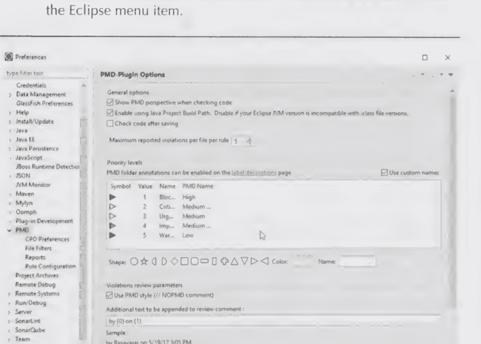

图 8-1. 安装 `PMD for Eclipse` 插件后的 `PMD` 偏好

8. 你可以将项目导入 `Eclipse`，也可以将 `PMD` 应用于现有项目。
9. 切换到 `PMD` 视图（`Perspective`），进入 `Eclipse` 项目资源管理器，右键点击该项目并点击 `PMD`。然后点击 `Check Code`（检查代码）。执行 `Review Code`（审查代码）过程。
10. `Review Code` 过程执行后，你将看到以下面板或视图：


# PMD 视图与规则概览

PMD 提供以下视图：

- Violations Outline（违规大纲）
- Violations Overview（违规概览）
- CPD View（重复代码检测视图）
- Dataflow View（数据流视图）
- XPath Designer

## Violations Overview 窗口

`Violations Overview` 窗口显示了按包排列的各种分析 Java 类。你还可以展开每个源文件以按类别查看违规情况，也可以根据违规的严重程度进行过滤。

## Violations Outline 视图

在 `Violations Outline` 视图中，你可以看到许多违规规则，彩色的违规箭头显示了 Java 代码的行号、创建日期以及触发该违规的规则。当你点击某行时，源代码中的特定行将会被高亮显示。

## 打开 PMD 视图

如果这些窗口没有打开，选择 `Windows`（窗口） | `Show View`（显示视图） | `Other`（其他），然后选择 `PMD` 以在 PMD 视图中显示五个可用视图，这些视图可以通过 `Windows` 菜单打开。

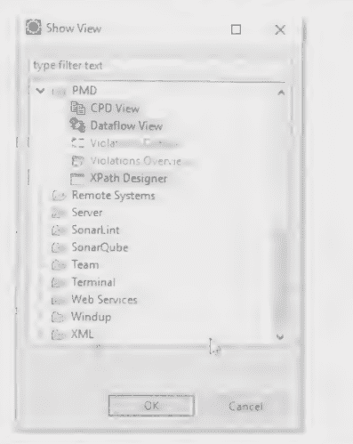

# PMD 规则基础

在查看几个使用 PMD 的示例之前，我们应该先回顾基础的 PMD 规则。PMD 的预期用途是分析 Java 源代码。PMD 规则封装了分析的 Java 代码中发生的特定条件、情况或违规行为。它有助于识别错误代码和源代码中的缺陷，并强制执行编码实践。PMD 提供了数百条规则，用于标记源代码中特定模式的出现。无论整体计划是否是自动化评估和 Java 组合现代化，使用 PMD 至少可以捕捉通用的编码违规并建立 Java 最佳实践。

## 规则集

表 8-1 引用了 PMD 网页，并对每个类别及其相应的规则进行了简要描述。每类规则被称为**规则集**（ruleset）。

由于你可能不需要在每个项目上运行所有这些规则，你可以启用或禁用特定规则。

| 类别 | 规则 |
| :--- | :--- |
| JavaBeans | 该规则集捕捉未遵循 Bean 规则的实例。 |
| Java Logging | 该规则集包含一组发现可疑日志用法的规则。 |
| JUnit | 这些规则处理 JUnit 测试中可能出现的不同问题。 |
| Migration | 该规则集包含从一个版本迁移到另一个版本的规则。PMD 建议不要直接使用这些规则，而是使用包装规则集。PMD 安装包含多个文件的文件夹和子文件夹。 |
| Naming | 该规则集包含关于名称和标识符的选用法规则。 |
| Optimization | 这些规则处理通常适用于最佳实践的不同优化。 |
| Security Code Guidelines | 这些规则检查 Java 代码是否遵循 Sun Microsystems 最初发布的安全指南和安全最佳实践。 |
| Strict Exceptions | 这些规则对抛出和捕捉异常提供了一些严格的指南。 |
| String and StringBuffer | 这些规则处理在操作 `String`、`StringBuffer` 或 `StringBuilder` 实例时可能出现的不同问题。 |
| Type Resolution | 这些规则解析 Java 类文件进行比较，而不是字符串。 |

**表 8-1.** PMD 中可用的规则集

# 创建自定义 PMD 规则

可以通过两种方式为 PMD 编写自定义规则：`XML` 路径（`XPath`）语言表达式或 `Java` 代码。虽然本章将简要回顾使用 `Java` 代码编写自定义规则的方法，但我们将更深入地探讨通过 `XPath` 表达式编写规则，因为这种方式更简单、可扩展、易于维护，并且快速编写规则并将其外部化到规则库中以便以后在企业范围内重复使用。

## 理解 XPath

在作为 `XPath` 表达式编写自定义 PMD 规则之前，你需要了解 `XPath` 表达式的本质以及在编写规则时如何利用它们。`XPath` 使用路径表达式来选择 `XML` 文档中的节点或节点集。它是 `XSLT` 标准中的主要元素。`XPath` 可用于导航 `XML` 文档中的元素和属性。`XPath` 包含超过 200 个内置函数，包括用于字符串值、数值、布尔值、日期和时间比较、节点操作、序列操作等函数。`XPath` 表达式也可以用于 `Java` 以外的语言，如 `JavaScript`、`PHP` 和 `Python`。

以下 `XPath` 表达式示例改编自 W3C 网站。由于讨论的需要，我们在这里对 W3C `XPath` 教程进行了改编，因为该网站很好地解释了 `XPath`，特别是我们计划使用这些表达式的方式，即在抽象语法树（`AST`）表示中定位某些节点和值。

### 常用 XPath 表达式

| 表达式 | 描述 |
| --- | --- |
| `Nodename` | 选择所有名为 "nodename" 的节点 |
| `/` | 从根节点开始选择 |
| `//` | 从当前节点开始选择文档中匹配选择的节点，无论它们位于何处 |
| `.` | 选择当前节点 |
| `..` | 选择当前节点的父节点 |
| `@` | 选择属性 |

### XPath 示例

考虑以下 `XML` 代码：

```xml
<?xml version="1.0" encoding="UTF-8"?>
<bookstore>
  <book>
    <title lang="en">Good To Great</title>
    <price>15.99</price>
  </book>
  <book>
    <title lang="en">The Innovator's Dilemma</title>
    <price>19.99</price>
  </book>
</bookstore>
```

下表列出了基于上述 `XML` 的一些路径表达式以及表达式的结果：

| 路径表达式 | 结果 |
|---|---|
| `bookstore` | 选择所有名为 "bookstore" 的节点 |
| `/bookstore` | 选择根元素 bookstore。注意：如果路径以斜杠 (`/`) 开头，它始终代表指向元素的绝对路径 |
| `bookstore/book` | 选择所有作为 bookstore 子元素的 book |
| `//book` | 选择文档中所有的 book 元素，无论它们位于何处 |
| `bookstore//book` | 选择 bookstore 元素的所有后代 book 元素，无论它们在 bookstore 元素下的何处 |
| `//@lang` | 选择所有名为 lang 的属性 |
| `/bookstore/book[last()-1]` | 选择 bookstore 的倒数第二个 book 元素 |
| `/bookstore/book[price>14.95]` | 选择 bookstore 元素中所有 price 元素大于 14.95 的 book 元素 |
| `//title[@lang='en']` | 选择所有 lang 属性值为 en 的 title 元素 |
| `//book/title \| //book/price` | 选择所有 book 元素的所有 title 和 price 元素 |
| `//title \| //price` | 选择文档中所有的 title 和 price 元素 |
| `//bookstore/book/title \| //price` | 选择 bookstore 元素的所有 title 元素和文档中所有的 price 元素 |

在创建自定义 PMD 规则之前，深入理解 `XPath` 表达式非常重要。

## 理解抽象语法树 (AST)

你在第 7 章中已经接触了 `AST`。本节将更进一步。一旦源代码被 `JavaCC` 解析，它就会生成一个 `AST`。`AST` 的表示比原始代码要庞大得多。`AST` 以层次节点的形式存在。源代码被分为称为块和块语句的小组件，它们清晰地表示了所需的细节。使用 `XPath` 表达式，你可以遍历树以检查是否满足特定条件，或者某些块和节点是否包含你感兴趣的值。

### AST 示例

以下代码片段展示了一个简单的 Java 类：

```java
public class AST {
    public static void print() {
        int counter = 0;
        while (counter < 10) {
            System.out.println("Count: " + counter);
            counter++;
        }
    }
}
```

在前面的代码段中，你可以标记变量名 `counter` 的使用并建议它是违规的。在特定的语境中，`counter` 可能是一个保留变量名，仅允许企业在某些特定情况下使用。在这种假设的情况下，可以使用 `XPath` 表达式创建自定义 PMD 规则来搜索并标记任何对变量名 `counter` 的使用。

`PMD` 提供了一些内置工具来帮助你完成这项工作，包括 `AST` 查看器和 `PMD Rule Designer`（PMD 规则设计器）。我使用 `AST` 查看器为我们的代码段生成了 `AST` 表示并将所示树复制到文件中。我对树进行了缩进处理以显示格式，因为查看器本身不会产生可以下载到单独文件的、格式良好的 `AST` 表示。图 8-3 显示了 `AST` 查看器，左侧显示 `Java` 代码段，右侧显示 `AST`。

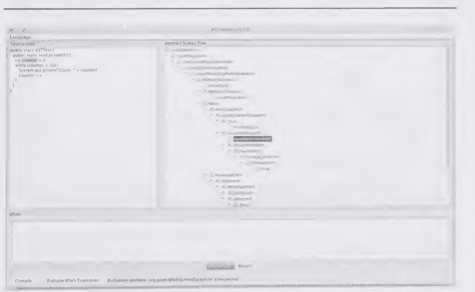

## PMD Rule Designer（PMD 规则设计器）

`PMD Rule Designer` 不仅允许查看 `AST` 表示本身，还可以选择树中的节点。在构建 `XPath` 表达式时，`AST` 属性和值可供 `XPath` 表达式使用，以便在单独的窗格中验证和核实。另一个窗格允许创建和编辑 `XPath`，因为它会检查 `AST` 表示中的哪些节点会受到该 `XPath` 表达式的影响。一旦你对 `XPath` 表达式表示满意，可以从左上角的 `Actions`（操作）菜单启动 `XML Rule Editor`（XML 规则编辑器）。

`PMD Rule Designer` 在顶栏中实际上提供了两个菜单项：
- `Language`（语言）菜单显示了对多种语言的支持，包括各种版本的 `JDK`（最高到 `JDK 1.8`）、`ECMAScript 3`、`PLSQL`、`XML` 和 `JSP`。
- 从 `Actions` 菜单中，你可以创建一个 `XML` 规则或将 `XML` 复制到剪贴板。

图 8-4 展示了 `PMD Rule Designer` 的界面。

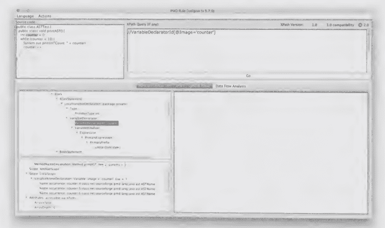

## 创建自定义 XPath 规则

现在我们已经回顾了如何创建自定义 PMD 规则，让我们来创建并部署一个假设的基于 `XPath` 的自定义规则。

图 8-4 描述了 `PMD Rule Designer` 的几个窗格。左上角的窗格是你输入源代码片段的地方。再次记住，在设计规则时，你应该隔离并仅插入几行代码，以保持生成的 `AST` 树的大小在可遍历的范围内。左上窗格下方的窗格描述了 `AST` 表示。这里表示的 `AST` 与 `AST Viewer` 中显示的 `AST` 略有不同。在此视图，特定的字面量、名称和标记是可见的。

### PMD Rule Designer 节点示例

以下是 `PMD Rule Designer` 节点的三个不同示例：

- `ClassOrInterfaceDeclaration: ASTTest (public) (class)`
- `MethodDeclarator: printAST`
- `VariableDeclaratorId: counter`

当你选择这些节点之一时，你将在下方的窗格中看到该节点的 `AST` 表示详情。图 8-4 展示了 `VariableDeclaratorId: counter` 的详情。当你在 `AST` 窗格中选择此节点时，`AST` 表示下方的窗格将突出显示 `counter` 的详情，以帮助构建所需的 `XPath` 表达式。我在代码片段中高亮了 `counter`，并在代码窗口下方的 `AST` 窗口高亮了 `VariableDeclaratorId: counter`。

图 8-5 展示了 `PMD Rule Designer`，其中 `AST` 视图高亮了 `XPath` 表达式特定的节点以及对应的 `Image` 属性。我高亮了行 `Image=counter`，以表示我们对 `VariableDeclaratorId` 节点的该 `XPath` 属性感兴趣。

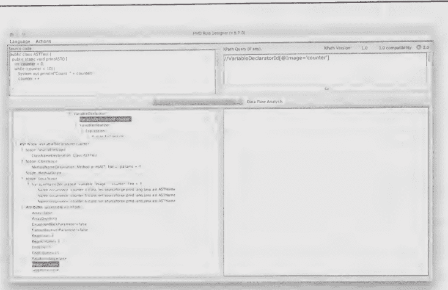

实现此目标的 `XPath` 表达式是 `//VariableDeclaratorId[@Image='counter']`。该 `XPath` 表达式显示在右上窗格中。点击 `Go` 按钮，其下方的窗格描述了第 3 行第 9 列的 `ASTVariableDeclaratorId`。`@` 符号用于表示 `has` 属性。你可以使用这些属性获取有关特定元素实例的信息。例如，`Image` 属性存储元素的值。因此，`//VariableDeclaratorId[@Image='counter']` `XPath` 表达式在遇到任何声明变量名为 `counter` 的变量时将匹配，因为 `Image` 属性现在具有与我们的 `XPath` 表达式匹配的相似值。

接下来，选择 `Action` | `Create XML Rule`。你将被要求提供 `Rule Name`（规则名称）、`Rule Msg`（规则消息）和 `Rule Desc`（规则描述），标签完全一致。现在你终于准备好创建 `XML` 规则了。一旦你提供信息并点击 `Create XML` 按钮，空窗格将被填充 `XML` 规则。图 8-6 显示了已粘贴规则的 `Create XML Rule` 窗格。

```xml
<rule name="NoCounterVariable"
      message="Creating a variable called counter is not allowed"
      class="net.sourceforge.pmd.lang.rule.XPathRule">
  <description>
    name counter 在我们的应用程序中被保留，用于由我们的内部框架创建的特殊变量。
    我们不希望 Java 类使用此名称作为变量。
  </description>
  <properties>
    <property name="xpath">
      <value>
        <![CDATA[
//VariableDeclaratorId[@Image='counter']
        ]]>
      </value>
    </property>
    <priority>3</priority>
    <example>
      <![CDATA[
public class ASTTest {
 public static void printAST() {
  int counter = 0;
 while (counter < 10) {
  System.out.println("Count: " + counter);
  counter++;
  }
 }
      ]]>
    </example>
  </properties>
</rule>
```

你可以将此规则复制并粘贴到文件中备后使用。现在让我们探索如何使用和部署此规则片段。


## 部署自定义 XPath 规则

如果你想将自定义创建的 XPath 规则部署到项目中，你应该确保自定义创建的 XPath 规则到项目。

## 252 Java 应用程序的快速现代化


图 8-5. 用于识别任何使用名称 counter 的变量的 XPath 表达式

实现此目标的 XPath 表达式是 `//VariableDeclaratorId[@Image='counter']`。该 XPath 表达式显示在右上窗格中。点击 `Go` 按钮，其下方的窗格描述了第 3 行第 9 列的 `ASTVariableDeclaratorId`。`@` 符号用于表示 has 属性。你可以使用这些属性获取有关特定元素实例的信息。例如，`Image` 属性存储元素的值。因此，`//VariableDeclaratorId[@Image='counter']` XPath 表达式在遇到任何声明变量名为 counter 的变量时将匹配，因为 `Image` 属性现在具有与我们的 XPath 表达式匹配的相似值。

接下来，选择 `Action | Create XML Rule`。你将被要求提供 `Rule Name`、`Rule Msg` 和 `Rule Desc`，标签完全一致。现在你终于准备好创建 XML 规则了。一旦你提供信息并点击 `Create XML` 按钮，空窗格将被填充 XML 规则。图 8-6 显示了已粘贴规则的 Create XML Rule 窗格。

```xml
<rule name="NoCounterVariable"
message="Creating a variable called counter is not allowed"
class="net.sourceforge.pmd.lang.rule.XPathRule">
<description>
name counter 在我们的应用程序中被保留，用于由我们的内部框架创建的特殊变量。
我们不希望 Java 类使用此名称作为变量。
</description>
<properties>
<property name="xpath">
<value>
<![CDATA[
//VariableDeclaratorId[@Image='counter']
]]>
</value>
</property>
<priority>3</priority>
<example>
<![CDATA[
public class ASTTest {
 public static void printAST() {
  int counter = 0;
 while (counter < 10) {
  System.out.println("Count: " + counter);
  counter++;
  }
 }
]]>
</example>
</properties>
</rule>
```

你可以将此规则复制并粘贴到文件中备后使用。现在让我们探索如何使用和部署此规则片段。

## 部署自定义 XPath 规则

再次记住，在设计规则时，你应该隔离并仅插入几行代码，以保持生成的 AST 树的大小在可遍历的范围内。左上窗格下方的窗格描述了 AST 表示。这里表示的 AST 与 AST Viewer 中显示的 AST 略有不同。在此视图，特定的字面量、名称和标记是显可见的。

以下是 PMD Rule 设计器节点的三个不同示例：

- `ClassOrInterfaceDeclaration`: ASTTest (public) (class)
- `MethodDeclarator`: printAST
- `VariableDeclaratorId`: counter

当你选择这些节点之一时，你将在下方的窗格中看到该节点的 AST 表示详情。图 8-4 展示了 `VariableDeclaratorId: counter` 的详情。当你在 AST 窗格中选择此节点时，AST 表示下方的窗格将突出显示 counter 的详情，以帮助构建所需的 XPath 表达式。我在代码片段中高亮了 counter，并在代码窗口下方的 AST 窗口高亮了 `VariableDeclaratorId: counter`。

图 8-5 展示了 PMD Rule 设计器，其中 AST 视图高亮了 XPath 表达式特定的节点以及对应的 `Image` 属性。我高亮了行 `Image=counter`，以表示我们对 `VariableDeclaratorId` 节点的该 XPath 属性感兴趣。实际的 XPath

## 第8 章：构建 Java 评估工具 253


```xml
<rule name="NoCounterVariable"
message="Creating a variable called counter is not allowed"
class="net.sourceforge.pmd.lang.rule.XPathRule">
<description>
name counter 在我们的应用程序中被保留，用于由我们的内部框架创建的特殊变量。
我们不希望 Java 类使用此名称作为变量。
</description>
<properties>
<property name="xpath">
<value>
<![CDATA[
//VariableDeclaratorId[@Image='counter']
]]>
</value>
</property>
<priority>3</priority>
<example>
<![CDATA[
public class ASTTest {
 public static void printAST() {
  int counter = 0;
 while (counter < 10) {
  System.out.println("Count: " + counter);
  counter++;
  }
 }
]]>
</example>
</properties>
</rule>
```

## 第8 章：构建 Java 评估工具 255

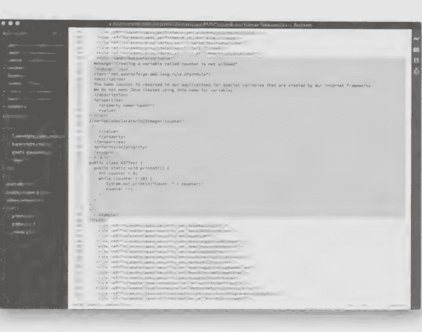

图 8-7. 部署自定义规则

PMD 规则可以追溯现有代码。考虑一个假设的场景：在多个应用程序在使用之前，禁止使用 counter 作为变量名的 IT 政策生效了。通过稍微修改我们简单的自定义代码，使其变得更有用并利用自动化，我们可以轻松地标记此类追溯定义的违规行为。你还可以自动将变量从 counter 重命名为 granite，并完成以下操作：

- 标记所有后续使用 counter 的地方
- 从 PMD 命令行运行其他自定义规则
- 重新编译代码库
- 运行所有代码覆盖和回归测试
- 在代码通过后将其部署到生产环境

见证自动化应用于应用程序现代化中的力量！

# PMD 规则违反的严重性级别

规则的优先级和触发的严重性级别取决于项目和内容。在这方面，PMD 提供了一些实用的指南。

- **更改必须更改的行为**（Change absolutely required Behavior）：行为已严重损坏或存在 Bug。
- **更改高度推荐的行为**（Change highly recommended Behavior）：行为很可能损坏或存在 Bug。
- **更改建议的行为**（Change recommended Behavior）：行为令人困惑，可能存在 Bug，并且/或违反标准/最佳实践。
- **更改可选的行为**（Change optional Behavior）：不太可能有 Bug，只是违背了标准/风格/良好审美。
- **更改高度可选的行为**（Change highly optional Behavior）：有则更好，例如包/类/字段的一致命名。

在 PMD for Eclipse 插件中，你可以配置符号的名称、描述、颜色和形状来描述这五个严重性级别。图 8-9 显示了用于配置自定义严重性级别的屏幕。预配置的严重性级别有 Blocker（阻塞）、Critical（严重）、Urgent（紧急）、Important（重要）和 Warning（警告）。

## 注意

在使用 PMD for Eclipse 插件时，你可能会遇到一些问题。取决于使用的特定 Eclipse 和 Java 版本，可能会出现安装问题。在本文编写时，PMD for Eclipse 插件尚未集成 JDK 1.9 早期访问版本。如果自定义规则遇到错误，PMD 会挂起。此时，你可以删除项目并回滚规则重新创建它，或者卸载并重新安装 PMD for Eclipse 插件。如果插件中未勾选首选项下的“全局规则”复选框，则该项目将不会生成报告，并显示带有错误消息的对话框。

# 258 Java 应用程序的快速现代化

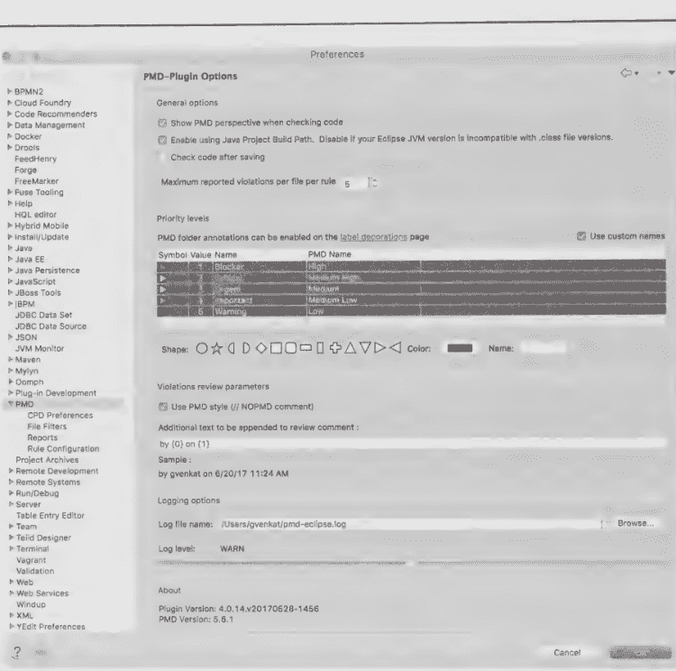

图 8-9。PMD for Eclipse 插件中预配置的严重性级别

## 创建 XPath 规则的替代方法

使用 PMD 提供的工具外，你还可以使用 PMD for Eclipse 插件以及 PMD 视图中提供的视图来编写自定义 XPath MD 规则。为了演示这一过程，我们将创建一个自定义规则来捕获使用星号（`*`）表示的整个包的通用导入语句——例如 `import java.util.*`。

在尝试练习之前，创建一个简单的 Java 程序，并将 `java.util.*` 或任何其他通配符包导入到你的示例程序中。

# 第 8 章：构建 Java 评估工具 259

按照以下步骤使用 PMD for Eclipse 插件创建自定义 XPath 规则：

1. 右键点击想要创建自定义规则的 Java 文件，进入 PMD 菜单。然后点击“生成抽象语法树”（Generate Abstract Syntax Tree）。
2. 在目录结构中双击生成的抽象语法树文件。
3. 通过观察抽象语法树 XML 文件，你可以了解元素以及如何构造成 XPath 表达式，该表达式随后可以被用于创建自定义规则。

你还可以打开 XPath 设计器视图，双击感兴趣的 Java 程序，AST 表示将会在 XPath 设计器中打开。在这里理解 AST 表示比直接查看 XML 文件要容易得多。你还拥有一个可选的标签页，可以测试你编写的任何 XPath 表达式。

图 8-10 显示了 Eclipse IDE 右下角的 XPath 设计器视图，其中加载了示例代码的 AST。

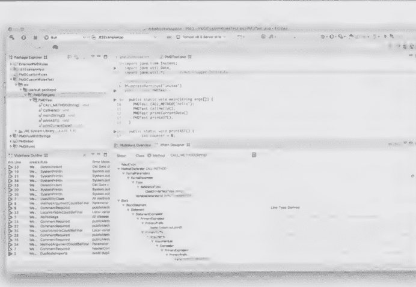

图 8-10。XPath 设计器

# 260 Java 应用程序的快速现代化

4. 选择 `Preferences | PMD`。点击 `Rule Configuration`，规则窗口将打开。
5. 点击 `+`（Add Rule）按钮打开 New Rule 窗口。

图 8-11 描述了在 PMD 首选项下选择“规则配置”选项时显示的面板。

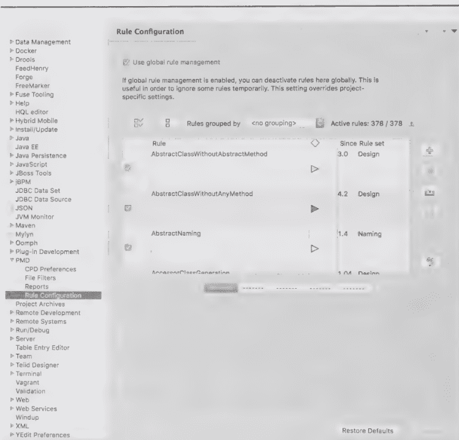

图 8-11。规则配置窗口

# 第 8 章：构建 Java 评估工具 261

6. 输入规则名称并选择规则集。对于“实现方式”，选择 XPath 脚本或 Java 类，提供实现类（如果是 Java 规则），并提供目标语言和优先级。点击继续该过程。
7. 提供描述、消息和外部信息 URL（如果可用）。图 8-12 和图 8-13 显示了我们检测完整包导入的规则填充的值。
8. 输入规则的 XPath 表达式，如图 8-14 所示，并点击 Next。
9. 输入示例并点击 Finish 按钮，如图 8-15 所示。

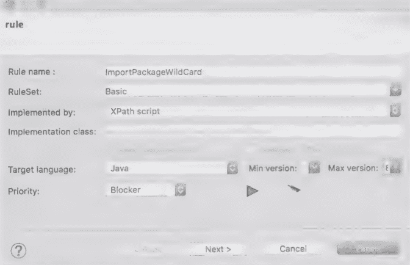

图 8-12。PMD for Eclipse 插件中的规则设计

# 262 Java 应用程序的快速现代化

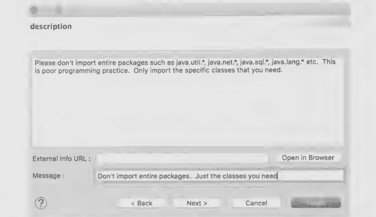

图 8-13。填充规则

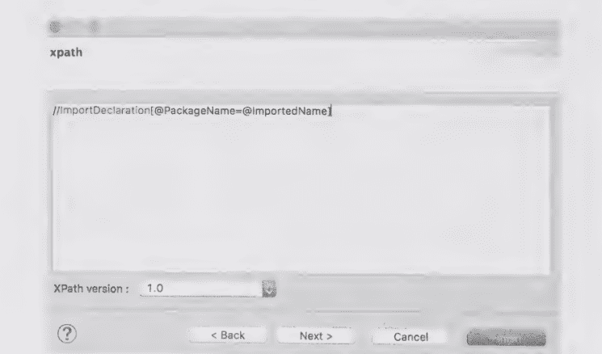

图 8-14。设计期间 XPath 表达式

# 第 8 章：构建 Java 评估工具 263

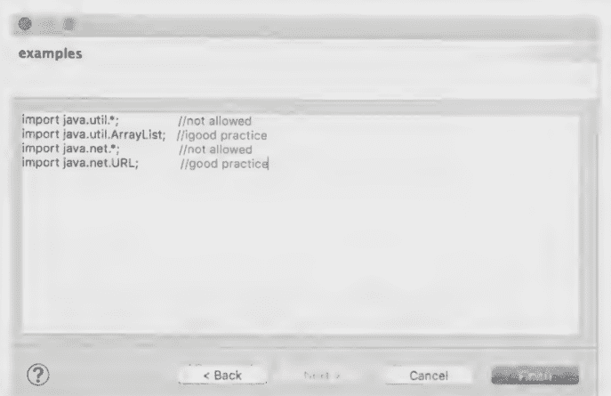

图 8-15。代码示例

10. 在配置中搜索新创建的规则。
11. 点击 OK 按钮完成。
12. 右键点击项目名称进入 PMD 菜单。

# 264 Java 应用程序的快速现代化

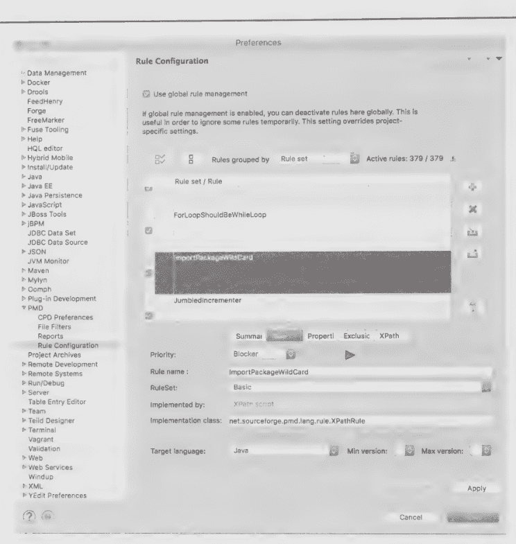

图 8-16。新创建的规则

# 第 8 章：构建 Java 评估工具 265


图 8-17。应用自定义规则前

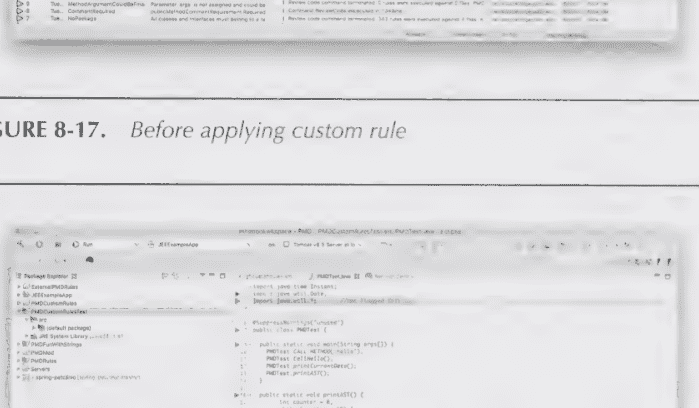

图 8-18。应用自定义规则后

## 创建 Java 规则

你也可以通过创建一个继承以下类的 Java 类来编写基于 Java 的 PMD 规则：

```
net.sourceforge.pmd.lang.java.rule.AbstractJavaRule
```

一旦完成了 Java 类，必须通知 PMD 运行时该自定义规则。规则应添加到类似于 PMD 核心规则集的规则集 XML 文件。参考 `pmd-java/src/main/resources/rulesets/java/basic.xml`。该文件包含了在基础规则集下的 PMD 分类。你可以创建一个名为 `pcustomrules.xml` 的自定义规则集，并在其中添加你的规则定义。规则定义必须根据以下描述符正确填充所有元素和属性：

- `name`: NoCounterVariable
- `message`: 不允许创建名为 counter 的变量。
- `class`: 编写规则的 Java 类。它不必位于 `net.sourceforge.pmd` 包下。类位置可以是你选择的任何包，包括 `com.gtl.pmd.rules`。
- `description`: counter 名称在我们的应用程序中被保留，用于内部框架创建的特殊变量。我们不希望 Java 类使用此名称作为变量。
- `example`: 通常是 CDATA 标签中的代码片段，显示了规则违反情况，在某些情况下还提供了可能的修复。

## 第 8 章：构建 Java 评估工具

自定义规则的 Java 代码所示：


```java
package com.gtl.pmd.rules;

import net.sourceforge.pmd.lang.java.rule.AbstractJavaRule;
import net.sourceforge.pmd.lang.symboltable.NameOccurrence;
import net.sourceforge.pmd.lang.java.ast.ASTVariableDeclaratorId;

import java.util.Iterator;

public class NoCounterVariableRule extends AbstractJavaRule {

    public Object visit(ASTVariableDeclaratorId node, Object data) {
        if (node.getNameDeclaration().getImage().equals("counter")) {
            return data;
        }

        System.out.println("The variable counter is of type " + node
            .getNameDeclaration().getType() + " ");
        for (Iterator<NameOccurrence> i = node.getUsages().iterator();
            i.hasNext(); i++) {
            NameOccurrence occurrence = (NameOccurrence) i.next();
            System.out.println("The variable counter is used at line " +
                occurrence.getLocation().getBeginLine());
        }
        return data;
    }
}
```

以下是自定义规则文件中包含的片段：

```xml
<?xml version="1.0"?>
<ruleset name="GTL Custom Rules">
  <description>
    此规则集包含了 GTL 企业版所有的自定义规则
  </description>
  <rule name="NoCounterVariableRule"
    message="不允许创建名为 counter 的变量"
    language="java"
    class="com.gtl.pmd.rules.NoCounterVariableRule">
    <description>
      名称 counter 在我们的应用程序中是被保留的，用于由内部框架创建的特殊变量。
      我们不会使用此名称的 Java 类作为变量。
    </description>
    <example>
      <![CDATA[
      public class ASTTest {
        public static void printAST() {
          int counter = 0;
          while (counter < 10) {
            System.out.println("Count: " + counter);
            counter++;
          }
        }
      }
      ]]>
    </example>
  </rule>
</ruleset>
```

完成 PMD 规则创建后，你可以将此规则集放入你的 `CLASSPATH` 中，或者在 shell 中通过命令行直接引用它：

```bash
java net.sourceforge.pmd.PMD /path/to/applicationsrc /path/to/customrules
```

## 使用 PMD 的优势

PMD 在源码级别运行，并可以检测各种问题，例如违反命名规范、缺少大括号、空检查错误、长参数列表、不必要的构造函数以及 `switch` 语句中缺少 `break` 语句。PMD 还可以揭示代码的圈复杂度，这非常有帮助。以下列表更详细地识别并描述了一些优势：

- **灵活的分析**：PMD 分析从 Java 源码生成的 `AST`（抽象语法树），不需要编译源代码。可以实现高级、复杂的检查。以后可以添加规则，而且只要 `AST` 可用，在没有访问源代码的情况下也可以对源码进行分析。

- **验证的广度和深度极佳**：使用 PMD 可以实现的验证类型没有限制。PMD 已经有了一套丰富的分类预构建规则集，正如我们在本章看到的。检测代码中的漏洞、代码复杂度、缺陷设计和可能的 bug 都有助于提高代码质量。

- **扩展 PMD**：可以通过自定义规则扩展 PMD。PMD 是开源的并用 Java 编写。由于 PMD 暴露了 `API`，核心功能可以很容易地扩展并集成到更大的解决方案平台中。

## Windup 简介

JBoss Windup 工具（简称为 Windup）将重命名为 Red Hat Application Migration Toolkit (`RHAMT`)。Windup 是一个灵活、自定义且基于规则的平台，用于迁移 Java 应用程序集。Windup 可以分析与应用程序相关的多种资产，包括存档文件、`JAR` 文件、源代码、配置文件和 `XML`。Windup 预置了核心规则，主要用于将服务器升级到 JBoss Enterprise Application Platform (`EAP`) 或称为 JBoss AS（Application Server）的社区版。还包含了从一个版本的 JBoss AS 或 JBoss EAP 升级到可用版本的规则。

在分析应用程序后，Windup 会提供一份报告。可以通过创建自己的自定义规则来扩展 Windup 的核心规则。由于 Windup 是开源的，你可以轻松添加新功能，尽管这将是一个复杂且复杂的任务，需要一定的投入和专业知识。本章的下一节通过强调可用 Windup 文档的关键要点，补充对 Windup 的讨论。

## 安装与设置

在编写本文时，最新的稳定版本是 Windup 3.0。你可以从 `windup.jboss.org/download.html` 下载并安装 Windup。下载工具后，解压压缩包并启动 `bin` 文件夹中的主 `windup` 脚本。

安装 Eclipse 是安装 Windup Eclipse 插件的前提。本章中的示例是使用 Eclipse 网站下载的最新稳定版 Neon 创建的。根据你的熟悉程度，可以使用 Windup 插件或直接从命令行使用 Windup。下一节将讨论如何查找和安装 Windup Eclipse 插件。注意，Windup Eclipse 插件仅适用于 Neon。请按照以下步骤安装 Windup：

1. 启动 Neon。
2. 从菜单栏选择 `Help` | `Install New Software`。
3. 在 `Work With` 字段输入 `http://update.jboss.org/neon`。
4. 勾选 `Windup` 下的所有复选框并点击 `Next`。
5. 在 `Name` 字段输入 `Windup`。
6. 审核安装详情并点击 `Next`。
7. 接受许可协议并点击 `Finish`。
8. 重启 Eclipse 使更改生效。

插件安装完成后，Windup 工具将在 Windup 视图中可用。要打开它，导航到 `Window` | `Perspective` | `Other`。选择 `Windup` 并点击 `OK`。

`WINDUP_HOME` 环境变量应设置为 Windup 的安装目录，以便从命令行调用。Windup 插件的安装过程非常顺畅，但在 Windows 环境下遇到了一些问题。我与红帽的 Windup 团队取得了联系，他们确认某些问题仍然存在。为了给本书生成示例，我使用了 MacBook，没有遇到这些问题。

在 Windows 系统上安装 Windup 插件时遇到的某些异常如下：

### Exception1

Message: 在“Generating Windup for Run_configuration(1).”期间发生内部错误。

# 异常堆栈跟踪：

```
java.lang.NullPointerException at org.jboss.tools.core.services.WindupService.generateGraph(WindupService.java:189)
  at org.jboss.tools.ui.internal.launch(WindupService.WindupDelegate2.run(WindupDelegate.java:99)
  at org.eclipse.core.internal.jobs.Worker.run(Worker.java:55)
Caused by: java.lang.NullPointerException at org.jboss.tools.windup.core.services.WindupService.generateGraph(WindupService.java:135)
  .. 2 more
```

# Session data:

```
eclipse.buildID=4.6.3.M20170310-0400
java.version=1.8.0_121
java.vendor=Oracle Corporation
BootLoader constants: OS=win32, ARCH=x86_64, WS=win32, NL=en_US
Framework arguments: -product org.eclipse.e.package.jee.product
Command-line arguments: -os win32 -ws win32 -arch x86_64 -product org.eclipse.e.package.jee.product
```

### Exception2

Message: No message

## 异常堆栈跟踪：

```
java.lang.NullPointerException
at org.jboss.tools.windup.core.services.WindupService.generateGraph(WindupService.java:135)
at org.jboss.tools.windup.ui.internal.launch.WindupLaunchDelegate2.run(WindupLaunchDelegate.java:99)
at org.eclipse.core.internal.jobs.Worker.run(Worker.java:55)
```

## 会话数据：

```
eclipse.buildId=4.6.3.M20170301-0400
java.version=1.8.0_121
java.vendor=Oracle Corporation
BootLoader constants: OS=win32, ARCH=x86_64, WS=win32, NL=en_US
Framework arguments: -product org.eclipse.pp.package.jee.product
Command-line arguments: -os win32 -ws win32 -arch x86_64 -product org.eclipse.epp.package.jee.product
```

### Exception3

消息：URI 不是层次结构的

# 异常堆栈跟踪：

```
java.lang.IllegalArgumentException: URI is not hierarchical
at java.io.File.<init>(File.java:418)
at org.jboss.tools.windup.model.domain.WorkspaceResourceUtils.computePath(WorkspaceResourceUtils.java:86)
at org.jboss.tools.windup.core.services.WindupService.generateGraph(WindupService.java:130)
at org.jboss.tools.windup.ui.internal.launch.WindupLaunchDelegate2.run(WindupLaunchDelegate.java:99)
at org.eclipse.core.internal.jobs.Worker.run(Worker.java:55)
```

## 会话数据：

```
eclipse.buildId=4.6.3.M20170301-0400
java.version=1.8.0_121
java.vendor=Oracle Corporation
BootLoader constants: OS=win32, ARCH=x86_64, WS=win32, NL=en_US
Framework arguments: -product org.eclipse.pp.package.jee.product
Command-line arguments: -os win32 -ws win32 -arch x86_64 -product org.eclipse.epp.package.jee.product
```

解决这些问题的一种方法是使用 Linux OS（如 Ubuntu 或 Mac），或遵循之前概述的安装步骤。

## Windup 功能

Windup 提供了多种所需功能，以协助整体评估自动化，包括基础迁移步骤的规划和执行。Windup 不仅仅是应用规则，还能检测 Java 应用程序中的违规行为。

以下是 Windup 的一些关键功能：

- **带有建议解决方案的迁移问题识别**：Windup 的核心规则可以识别迁移问题并突出显示代码中受影响的特定部分。在工具的核心位置，Windup 会建议修改代码并提供额外的支持信息以帮助人员解决问题。Windup 还包含几条内置规则，用于识别从一个应用程序服务器迁移到另一个的路径时通常出现的问题。常见的迁移问题包括硬编码的 IP 地址和 Java 命名与目录接口 (`JNDI`) 查找。Windup 额外识别来自其他应用程序服务器的专有功能、已弃的子系统以及旧版本的 JBoss EAP 功能。

- **规则的可扩展性与自定义**：Windup 提供了创建复杂规则的能力。开发者可以在 Windup 核心规则集的基础上扩展，并创建自定义规则以识别对其特定组织重要的额外问题。您还可以覆盖这些核心规则并创建自定义规则类别。在这方面，它与 PMD 的功能相似。

- **分析源代码或应用程序归包的能力**：Windup 可以同时评估应用程序归包和多个应用程序的源代码。为了有效使用 Windup 功能，您可以要评估的特定包，无论是整个应用程序组合，还是为了评估和迁移而分组的小型应用程序包。Windup 的另一个有价值属性是定位跨多个应用程序共享的归包，这提高了衍生估算的准确性。

- **规划与工作估计**：Windup 通过详细说明完成已识别迁移任务所需的工作类型和工作量，协助迁移团队和应用所有。工作量在 Windup 报告中以故事点（`Story Points`）表示。虽然这种估算并非基于 APM 框架等详细指标，但 Windup 的功能可以进行修改并与外部估算系统集成，提供更好的估算模型和更高的准确性。Windup 提供了 `API` 钩子，以便增强规划和工作估计功能。如果您希望在不进行任何修改的情况下使用 Windup 工具，您的 Windup 估算将仅基于识别出的问题分类所需的迁移工作技能和分类。

- **详细报告**：在生成报告方面，Windup 提供的开箱即用功能令人印象深刻。Windup 可以生成多份报告，为用户提供迁移工作以及特定迁移任务细节的高级和钻取视图。这些详细报告允许您查看以下内容：
  - 跨所有应用的迁移问题
  - 关于问题的图表和摘要信息
  - 应用程序内部问题的细分
  - 所用技术的报告
  - 对其他应用程序的依赖
  - 检查问题发生的源文件

## 从命令行使用 Windup

表 8-2 列出了所有 Windup 命令行参数及其简要描述。该表通过参考红帽网站上的可用文档和参考资料创建。

## 第 8 章：构建 Java 工具

| 参数 | 描述 |
| :--- | :--- |
| `--additionalClassPath` | 用于类路径的 `JAR` 文件或目录列表，以便进行反编译或分析。 |
| `--addonDir` | 将指定的目录作为自定义插件库添加。 |
| `--batchMode` | 标记 Windup 以非交互模式运行，不提示确认。命令行中未传递的参数将默认值。 |
| `--debug` | 以调试模式运行 Windup。 |
| `--discoverPackages` | 标记列出输入应用程序中的所有可用包。 |
| `--enableClassNotFoundAnalysis` | 启用对类路径上不存在的 Java 文件的分析。如果某些类不可用则可以使用此。 |
| `--enableCompatibleFilesReport` | 启用生成兼容文件报告。由于处理所有文件，对于大型应用程序此报告可能需要长时间。 |
| `--enableTattale` | 为每个应用程序生成 Tattale 报告。 |
| `--excludePackages` | 排除评估的包分隔列表。例如，输入 `com.commonities` 将排除所有以 `com.commonities` 开头的类。 |

**表 8-2.** Windup 命令行参数详细描述


# 第 8 章：构建 Java 评估工具

## 表 8-2. Windup 命令行参数详细说明

| 参数 | 说明 |
| --- | --- |
| `--excludeTags` | 排除的标签分隔列表。当指定时，不会处理带有这些标签的规则。要查看完整列表，请使用 `--listTags`。 |
| `--explodedApp` | 标记提供的输入目录包含单个应用程序的源代码。 |
| `--exportCSV` | 标记将报告数据导出到本地文件系统的 CSV 文件。Windup 在 `--output` 参数指定的目录创建文件。CSV 文件可以导入电子表格程序进行数据处理和分析。 |
| `--help` | 显示 Windup 帮助信息。 |
| `--immutableAddonDir` | 将指定的目录作为自定义只读插件库添加。 |
| `--includeTags` | 要使用的标签分隔列表。当指定时，仅处理带有这些标签的规则。要查看完整列表，请使用 `--listTags`。 |
| `--input` | 包含一个或多个待分析应用程序的文件或目录路径的列表。此参数是必需的。 |
| `--install` | 指定要安装的插件。格式为 `GROUP_ID:ARTIFACT_ID[:VERSION]`。例如，`--install core-addon-x` 或 `--install org.example.addon:example:1.0.0`。 |
| `--keepWorkDirs` | 标记，指示 Windup 不要删除临时工作文件，例如图形数据库和解压缩的归包。这对于调试很有用。 |
| `--list` | 标记，列出已安装的插件。 |
| `--listSourceTechnologies` | 标记，列出所有可能的源技术。 |
| `--listTags` | 标记，列出所有可能的标签。 |
| `--listTargetTechnologies` | 标记，列出所有可能的目标技术。 |
| `--mavenize` | 标记，根据应用程序的结构和内容创建 Maven 项目目录结构，这将使用适当的 Java EE API 创建 `pom.xml` 文件，并在项目模块之间建立正确的依赖关系。另参见 `--mavenizeGroupId` 选项。 |
| `--mavenizeGroupId` | 与 `--mavenize` 选项配合使用时，所有生成的 `pom.xml` 文件将使用提供的的值作为 `<groupId>`。如果省略此参数，Windup 将尝试根据应用程序确定合适的 `<groupId>`，或者默认为 `com.company.mavenized`。 |
| `--online` | 标记，允许需要网络访问的功能进行访问。目前只有验证外部 XML 架构资源依赖 Internet 访问。请注意，这将带来性能损失。 |
| `--output` | 指定输出 Windup 生成的报告信息的目录路径。 |
| `--overwrite` | 标记，强制删除由 `--output` 指定的现有输出目录。如果您未指定此参数且 `--output` 目录存在，系统将提示您选择是否覆盖内容。请谨慎使用此参数。 |
| `--packages` | 由空格分隔的由 Windup 评估的包列表。强烈建议使用此参数。 |
| `--remove` | 移除指定的插件。语法为 `GROUP_ID:ARTIFACT_ID[:VERSION]`。例如，`--remove core-addon-x` 或 `--remove org.example.addon:1.0.0`。 |
| `--skipReports` | 标记，表示不生成 HTML 报告。此参数的一个常见用途是使用 `--exportCSV` 将报告数据导出到 CSV 文件时。 |
| `--source` | 由空格分隔的一个或多个待迁移的源技术、服务器、平台或框架列表。此参数结合 `--target` 参数使用，有助于确定使用哪些规则集。使用 `--listSourceTechnologies` 参数列出所有可用源。 |
| `--sourceMode` | 标记，表示要评估的应用程序包含源文件而非编译后的二进制文件。 |
| `--target` | 由空格分隔的一个或多个待迁移的目标技术、服务器、平台或框架列表。此参数结合 `--source` 参数使用，有助于确定使用哪些规则集。使用 `--listTargetTechnologies` 参数列出所有可用目标。 |
| `--userIgnorePath` | 指定一个位置，除了 `${user.home}/windup/ignore/` 之外，用于 Windup 识别应忽略的文件。 |
| `--userRulesDirectory` | 指定一个位置，除了 `WINDUP_HOME/rules/` 和 `${user.home}/windup/rules/` 之外，用于 Windup 查找自定义 Windup 规则。该值可以是包含规则集文件的目录，可以是单个规则集文件。规则集文件必须以 `.windup.xml` 结尾。 |
| `--version` | 显示 Windup 版本。 |

## 自定义 Windup 规则创建流程

使用 Windup 的分析过程涉及以下步骤：

- 从归包中提取文件
- 扫描并分类文件类型
- 反编译类文件
- 分析应用程序代码
- 分析 XML 和其他文件内容，包括配置文件
- 构建报告

Windup 内部使用内置规则来执行分析过程，并根据这些规则执行结果构建数据模型。Windup 将组件数据和关系存储在图形数据库中，然后根据迁移规则的需要进行查询和更新以用于报告。

任何现代化尝试都很难仅依赖开箱即用的规则来对少数应用程序或整个企业级组合进行迁移、升级和现代化。虽然使用标准的开箱即用规则在节省成本和时间方面具有若干优势，但它们永远无法涵盖迁移任务中的所有复杂性。Windup 已经考虑到了这一点，允许您编写自己的自定义规则，以便无缝整合到迁移过程中。与我们讨论创建 PMD 规则类似，编写自定义 Windup 规则的过程将在本章后续部分详细说明。

## 自定义规则格式

在编写自定义规则并将其部署到企业生产环境之前，您需要编写这些特定规则并针对可能的代码片段对其进行测试，以确保自定义内容能够满足标准内置 Windup 规则未涵盖的预期场景。创建自定义规则的最佳选项是采用基于 XML 的规则。提供的规则模式仅供说明。

Windup 基于 XML 的规则使用以下规则模式：

```
when(condition)
  perform(action)
  otherwise(action)
```

根据定义，规则集是一个或多个规则的组，通常针对迁移的特定领域。所有 XML 规则都定义为规则集内的元素。所有规则集和所有规则在 Windup 执行环境中必须具有唯一的 ID。否则，Windup 将报告冲突。根据 Windup 关于自定义规则的文档，所有规则必须遵循此基本结构：

```xml
<ruleset id="UNIQUE_RULESET_ID">
  <metadata>
    <description>规则集的描述</description>
    <dependencies/>此规则集所需的规则插件
    <sourceTechnology/>源技术
    <targetTechnology/>目标技术
    <overrideRules/>设置为 true 表示此规则集中的规则将覆盖分发的核心规则集中具有相同 ID 的规则
    <rules>规则集
      <rule id="UNIQUE_RULE_ID">定义规则并赋予其唯一的 ID
        <when>待匹配的条件</when>
        <perform>要执行的操作</perform>
        <otherwise>当规则不匹配时要执行的操作</otherwise>
        <where>定义为参数的字符串模式，可以用于规则定义的其他地方</where>
      </rule>
    </rules>
  </metadata>
</ruleset>
```

- `<file-mapping/>` 将扩展名映射到图形类型。
- `<package-mapping/>` 将包模式（正则表达式）映射到组织名称。

有关这些 XML 元素的详细信息，请参阅 Red Hat 网站上的 Windup 规则文档。以下是用于创建您自定义规则的模板：

```xml
<ruleset id="UNIQUE_RULESET_ID"
  xmlns="http://www.jboss.org/schema/ruleset"
  xmlns:xsi="http://www.w3.org/2001/XMLSchema-instance"
  xsi:schemaLocation="http://www.jboss.org/schema/ruleset/ruleset.xsd">
  <metadata>
    <description>
      <!-- 规则集描述 -->
    </description>
    <dependencies>
      <!-- 规则集依赖 -->
    </dependencies>
    <sourceTechnology id="SOURCE_ID" versionRange="SOURCE_VERSION_RANGE"/>
    <targetTechnology id="TARGET_ID" versionRange="TARGET_VERSION_RANGE"/>
    <tag>Reviewed-2015-05-01c</tag>
  </metadata>
  <rules>
    <rule id="UNIQUE_RULE_ID">
      <when>
        <!-- 在此处测试条件 -->
      </when>
      <perform>
        <!-- 执行操作 -->
      </perform>
    </rule>
  </rules>
</ruleset>
```

以下规则使用名为 `<javaclass>` 的元素。我们使用该元素来查找导入、方法、变量声明、注解、类实现以及与 Java 类相关的其他项。

```xml
<?xml version="1.0"?>
<ruleset xmlns="http://windup.jboss.org/schema/jboss-ruleset" id="custom"
  xmlns:xsi="http://www.w3.org/2001/XMLSchema-instance"
  xsi:schemaLocation="http://windup.jboss.org/schema/jboss-ruleset http://windup.jboss.org/schema/jboss-ruleset/windup-jboss-ruleset.xsd">
  <metadata>
    <description>
      此规则提供了来自 gtl 的自定义规则
    </description>
    <dependencies>
      <addon id="org.jboss.windup.windup-rules-javaee,2.0.1.Final" />
      <addon id="org.jboss.windup.windup-rules-java,2.0.0.Final" />
    </dependencies>
    <sourceTechnology id="java" />
    <targetTechnology id="java" versionRange="[8,]" />
    <tag>versionRange>2017-06-16T</tag>
    <tag>custom</tag>
  </metadata>
  <rules>
    <rule id="custom-01000">
      <when>
        <javaclass references="java.util.Date" />
      </when>
      <perform>
        <hint title="Java Instant usage" effort="1" category-id="mandatory">
          <message>替换为 Java SE 8 中的 "Instant" 类。</message>
          <link href="https://docs.oracle.com/javase/8/docs/api/time/Instant.html" title="Java SE 8 Instant" />
          <tag>custom</tag>
        </hint>
      </perform>
    </rule>
  </rules>
</ruleset>
```

为企业级现代化创建自定义规则是一个非常强大且必要的手段，具有无限的可能。本节仅仅接触了使用 Windup 编写自定义规则的皮毛。请参考 Red Hat 的文档和材料以了解所有可用元素及其用途。

## 应用规则

在应用您的自定义 Windup 规则之前，必须先进行安装。这可以通过将包含规则和规则集的文件复制到适当的文件夹来实现。Windup 会扫描这些规则，这些文件是以 `.windup` 结尾的文件。这些文件可以通过以下方式找到：

- Windup 命令行上 `--rulesDirectory` 参数指定的目录。
- `WINDUP_HOME/rules/` 目录。`WINDUP_HOME` 是您安装平台的目录。这不是推荐的选项，因为如果你安装了新版本的 Windup 发行版且忘记移动它们，这些自定义规则可能会丢失。
- `${user.home}/.windup/rules/` 目录。在 Windows 机器上，该位置位于 `%USERPROFILE%\windup\rules\`。此目录由 Windup 在首次执行时创建并包含规则。

您还可以覆盖或禁用现有规则并创建自定义分类。Windup 使用故事点（Story Points）的概念来估计迁移由规则标记的受影响代码所需的工作量。

> **注意**
>
> Windup 故事点参考了敏捷故事点，旨在作为估计实现功能或设计变更所需工作量的抽象。这绝不是一种准确的衡量，因为它高度取决于企业想要如何使用此指标。本书的早期章节描述了衡量成本和工作的复杂技术作为可行方法。Windup 使用故事点来表示迁移特定应用结构以及整个应用程序所需的工作量。

估计 Windup 故事点的工作量可能是复杂的。以下大纲列出了一些用于估计规则所需工作量的通用指南。下表改编自 Red Hat 网站上现有的 Windup 文档和材料：

| 工作量级别 | 故事点 | 描述 |
| --- | --- | --- |
| 信息性 (Information) | 0 | 针对迁移的优先级极低的信息性警告。 |
| 微不足道 (Trivial) | 1 | 迁移是一个微不足道的更改或简单的库替换，没有或只有极少的 API 变化。 |
| 复杂 (Complex) | 3 | 迁移任务所需的更改较复杂，但有文档记录的解决方案。 |
| 重新设计 (Redesign) | 5 | 迁移任务需要重新设计或完全更换库，涉及重大的 API 变化。 |
| 重构 (Re-architecture) | 7 | 迁移需要对组件或子系统进行完全重构。 |
| 未知 (Unknown) | 13 | 迁移解决方案未知，可能需要完全重写。 |

一旦应用了自定义规则，就可以通过命令行、使用 Windup Eclipse 插件或使用新引入的 Red Hat 迁移工具 Web 控制台（Application Migration Toolkit Web Console）将其纳入分析中。

## Java 应用的快速现代化

> **注意**
>
> Red Hat 迁移工具 (RHAMT) 是一个开源工具的集合，能够实现大规模应用程序迁移和现代化。RHAMT 本质上是重品牌的 Windup 迁移工具，对迁移策略进行了一些关键新增和重新定位。该工具由多个独立组件组成，为迁移过程的每个阶段提供支持。RHAMT 包含了命令行工具和 Web 控制台用于访问和运行迁移。命令行界面提供了一个高级接口，以自动化方式对许多应用程序进行批量分析。Web 控制台为管理大量应用程序的评估提供了简化界面。RHAMT Eclipse 插件为开发者提供交互式的实现辅助。在编写本文时，Windup 3.0 版本和 RHAMT 4.0Beta2 已通常可用。有关 Windup 安装的步骤和过程也适用于以 RHAMT 名称下载并安装迁移工具。

## RHAMT Web 控制台

Windup 和 RHAMT 在工具和功能的可用性上基本相同，但 RHAMT 中的一个主要组件得到了增强。Web 控制台的某些功能仅在 RHAMT 下可用。尽管如此，趋势表明 Windup 3.0 将是 Windup 品牌下发布的最后一个稳定版本。可能会有小版本来修复 Windup 问题；但从现在起，名称和版本将正式更改为 RHAMT，并在现有的迁移工具和 RHAMT Eclipse 插件之外包含许多其他工具。令我有趣的是，RHAMT 的第一个版本将从 4.0 开始！

由于 RHAMT Web 控制台具有额外功能，本节介绍了如何使用 RHAMT 控制台分析现有的应用程序包并生成报告。它还将讨论如何使用 RHAMT 控制台应用我们的新自定义规则，以便生成并访问报告进行分析。


# RHAMT 自带示例应用分析

RHAMT 自带了一个名为 `jee-example-app-1.0.0.ear` 的示例企业应用程序文件。我们将使用 RHAMT Web 控制台对该文件运行分析。可以通过进入 RHAMT 安装文件夹下的目录并运行脚本来启动 RHAMT 控制台，根据相应的操作系统运行 `rhamt.bat` 或运行 `rhamt.sh`。在此将调用 `standalone.sh` 或 `standalone.bat` 脚本。bin 目录中的其他脚本也会被适当地调用。

# Java 应用的快速现代化


图 8-19. RHAMT Web 控制台欢迎页

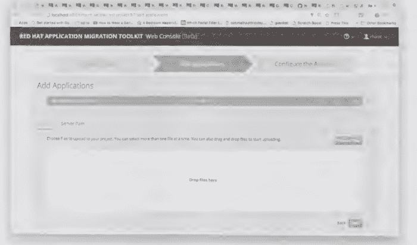

图 8-20. 显示向项目添加多个应用程序选项的屏幕

# 第 8 章：构建 Java 评估工具

一旦你将应用程序添加到项目中，点击“Next”（下一步）按钮进入下一个屏幕，可以在那里配置要分析的项目。图 8-21 显示了我们 SampleJEEProject 的配置界面。

RHAMT 中的一个新选项是云就绪功能（Cloud Readiness Feature）。该功能允许你加载自定义规则、从分析中排除包、设置其他高级选项、运行分析并保存项目。图 8-22 显示 SampleJEEProject 已经过分析，结果现在可供查看。如图所示，分析大约花费了 15 秒。你可以点击报告（Report）图标查看实际分析报告。

如果你创建并分析了多个项目，当你访问 URL `http://localhost:8080/rhamt-web/` 时，RHAMT 将像以前一样重定向到 `http://localhost:8080/rhamt-web/project-list`，这样你就可以看到项目列表。图 8-23 显示我在安装 RHAMT 时创建了两个项目。

点击 SampleJEEProject 将带你进入图 8-23 所示页面。选择报告（Reporting）图标将引导你进入图 8-24 所示的应用程序列表（Application List）页面。你可以一眼看出每个应用程序分析的高级细节。在我们的示例中，有 86 个故事点（Story Points），转化为 103 个问题（incidents）。其中 50 个故事点被归类为强制性的，9 个为可选的。

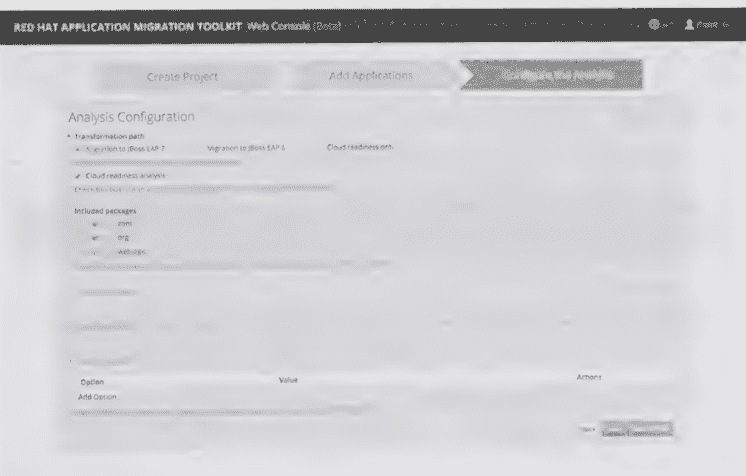

图 8-21. 分析项目前的分析配置界面

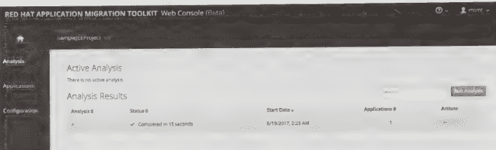

图 8-22. 显示 SampleJEEProject 分析已完成并可用的屏幕


图 8-23. 所有分析过的项目列表

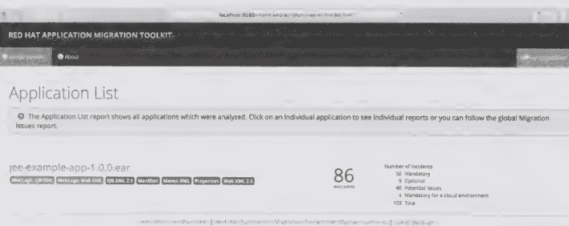

图 8-24. 特定项目下分析的应用程序列表

识别出 40 个潜在问题，以及 4 个与云就绪性相关的强制性问题。

点击应用程序查看报告索引（Report Index）页面。在显示生成的图表和饼图之前，该页面有大量信息需要滚动查看。有四个柱状图和一个饼图，描述了问题和故事点。这些包括：

- 按类别划分的问题
- 问题与故事点
- 按类别划分的强制性问题
- 强制性问题与故事点
- 按包划分的 Java 问题

另一个部分额外报告（Additional Reports）包含了指向各种额外详细信息的链接。图 8-25 和 8-26 显示了这些柱状图、饼图和额外报告部分。

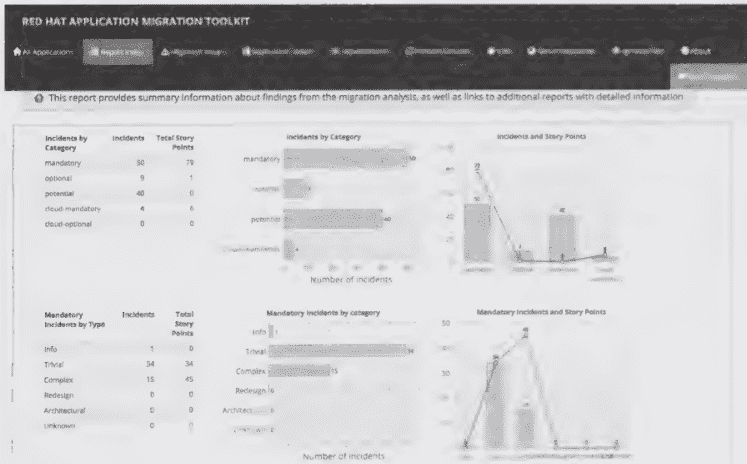

图 8-25. 分析结果 1

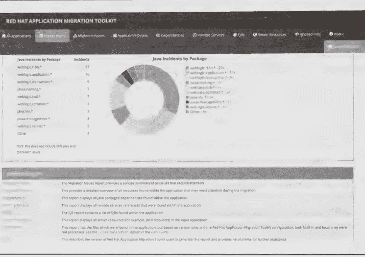

图 8-26. 分析结果 2

在图 8-26 的顶部是菜单选项，允许你深入查看关于你的应用程序分析的几个有趣细节，包括：

- 详细的迁移问题
- 反反编译类上的应用程序细节
- Java 包依赖
- 远程服务
- EJBs
- 服务器资源，例如 JNDI 和 JMS 信息
- 忽略的文件

从“迁移问题”（Migration Issues）列表开始，你将能够深入到源代码中发现不兼容的特定位置。为了应用我在上一节中创建的自定义规则，我编写了一个示例 Java 程序。下面的代码列表显示了名为 `PMDTest.java` 文件中的程序。该 Java 程序也用于在上一节中应用和测试 PMD 规则。

```java
import java.time.Instant;
import java.util.Date;
import java.util.*;

// PMD 教程
@SuppressWarnings("unused")
public class PMDTest {

    public static void main(String[] args) {
        PMDTest.CALL_METHOD("hello");
        PMDTest.CallHello();
        PMDTest.printCurrentDate();
        PMDTest.printAST();
    }

    public static void printAST() {
        int counter = 0;
        while (counter < 10) {
            System.out.println("Count: " + counter);
            counter++;
        }
    }

    public static void CALL_METHOD(String INPUT_PARAMETER) {
        System.out.println(INPUT_PARAMETER);
    }

    public static void CallHello() {
        System.out.println("Hello World!");
    }

    public static void printCurrentDate() {
        Date date = new Date();
        System.out.println("Date: " + date.toString());
        Instant instant = date.toInstant();
        System.out.println("instant: " + instant); // Zone: UTC
    }
}
```

按照之前概述的步骤创建一个新项目。将 `PMDTest.class` 和 `PMDTest.java` 文件导出到 JAR 文件中。在 RHAMT Web 控制台的“添加应用程序”（Add Applications）屏幕上，现在你可以添加此 JAR 文件。我们仍然需要配置此应用程序包含我们的自定义规则。图 8-27 画了 PMDMod 项目的配置界面。包含了一个名为 `ruleset.xml` 的自定义规则文件。你可以看到 pmmod 已经包含了分析。点击“保存”（Save）按钮来运行分析。如果你创建并分析了多个项目，当你访问 `http://localhost:8080/rhamt-web/` 时，RHAMT 将像以前一样重定向到 `http://localhost:8080/rhamt-web/project-list`，这样你就可以看到可用的项目列表。图 8-28 显示了对 pmmod 应用程序的层级分析结果。有两个故事点和两个强制性问题。

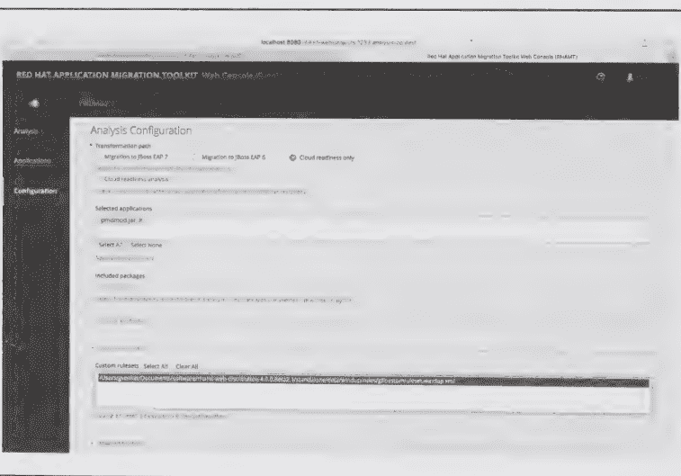

图 8-27. PMD 项目的配置界面


# 应用程序列表 (Application List)

- 应用程序列表显示了所有分析过的应用程序。点击单个应用程序查看详细报告，或者你可以保留它们进行比较。

pmmod.jar

点击“迁移问题”（Migration Issues）菜单项将引导你进入迁移的细节，在“工作量”（Level of Effort）列下有一行显示为“库更新的小型更改”。图 8-29 刻画了迁移问题页面。

通过点击“Java 使用”（Java Usage），将揭示分析的 Java 类以及额外信息。你还可以查看实际应用的规则。选择 PMDTest 将带你进入反编译类文件


# 迁移问题报告 (Migration Issues Report)

pmmod.jar

- 迁移问题报告提供了所有关注问题的简要摘要

| 问题类别 | 发现的问题数量 | 每个问题的故事点 | 工作量 | 总故事点 |
|---|---|---|---|---|
| 强制性 | 2 | | 1 - 库更新的小更改 | |

图 8-29. 迁移问题详情

识别出文件中发生违规的具体位置。在我们的程序中，这将是第 2 行和第 28 行。图 8-30 显示了高亮了第 28 行的反编译类文件。

本节演示了如何快速轻松地分析多个应用程序、生成评估报告并突出需要迁移的应用程序区域。这完全取决于适用于具有数百个应用程序和数十万行代码的大型应用程序集的可用规则，这不是一项简单的任务。为了完成这一点，企业应该投入大量精力评估应用程序集、识别需求、创建自定义规则、全面测试这些规则，并最终审查生成的分析报告。应用程序集的迁移不仅仅是一个可以通过第 7 章或本章分享的工具来解决的技术问题。现代化方法论的整体处理以及 APM 学术补充了这些技术解决方案，并捕捉了大局问题，使企业能够意识到此类迁移或现代化计划的艰巨任务。

# 第 8 章：构建 Java 迁移工具

## 使用 Windup 迁移工具的优势

Java 应用程序的迁移一直是一项定制工作，没有许多其他可选方案。大多数方案都涉及手动方法和专家团队，包括顾问、工程师和应用程序开发人员，他们负责维护和迁移这些企业级的 Java 应用程序。尽管第三方 IT 供应商提供自定义和专有的规则，但这些规则通常是在聘请供应商进行特定迁移项目后获取的。Windup 无疑在为 Java 社区提供一种可行的开源选项方面迈出了一步。

需要注意的是，Windup 不仅仅是一个技术工具。它还符合业务目标，能够为组织提供分析报告，以估计、文档化并迁移其企业应用程序。Windup 工具通常迁移到 JBoss EAP。然而，由于它是开源的，任何人都可以扩展并添加额外功能。下表强调了使 Windup 成为良好迁移工具选项的某些特性：

| 特性 | 说明 |
| --- | --- |
| 数据图 (Data Graph) | Windup 创建了一个共享数据模型图，提供了以下优势：规则之间可以进行复杂的交互，允许规则将发现传递给其他规则。即使是第三方插件也有选项与其他插件、规则和报告进行交互。在规则执行期间，数据图模型中的发现可以被搜索、查询并用于报告目的。Windup 可以由开发者、用户和第三方软件进行扩展：可以创建 POJO（纯旧 Java 对象）插件来与底层数据图交互。其他应用程序可以使用其 API 集成到 Windup 中。 |

Windup 通过允许具有领域知识的用户实现他们自己的规则，最大限度地减少了重新创建一切的努力。

## 工作量估计

根据所需的技能和所需的迁移工作分类，对工作量水平的估计进行计算，并在 Windup 报告中以故事点（Story Points）的形式表示。

### 更好的规则

Windup 提供了更强大、更复杂的规则：

- 基于 XML 的规则易于实现且编写简单。
- 基于 Java 的规则插件植根于名为 Rewrite 的开源组件，提供了更大的灵活性。
- 在某些复杂情况下，规则使用 AND / OR 语句进行嵌套。这意味着你可以嵌套简单语句，而不是使用复杂的 XPath 或 Regex 表达式。

### 自动化

Windup 可以自动完成某些迁移过程：

- 规则可以创建 Forge 输入并将其添加到数据图中。
- Windup 与 Forge 2 集成，增强了其生成项目、库和配置文件的能力。
- 数据图输入可以在自动化阶段进行处理以生成新项目。

### 更好的报告

Windup 报告现在针对特定的受众：

- IT 管理：应用程序按迁移成本进行排名。
- 项目管理：完成任务所需的工作量估计和工作类型。
- 开发者：Eclipse 插件在 IDE 中提供提示和建议的更改更改。

## PMD 规则 vs. Windup 规则

PMD 和 Windup 都是可以用来分析 Java 应用程序的工具。与 Windup 相比，PMD 更加成熟，已经存在多年。在自定义和扩展其核心功能方面，这两种工具都表现得出色。两种工具都提供了一组可以开箱即用的规则，用于分析 Java 应用程序。自定义规则可以写成 XML 规则或 Java 规则。下列表提供了比较 PMD 和 Windup 的更多详细信息：

- 传统上，PMD 被用作静态代码分析工具，而 Windup 从一开始就被定位为一种基于规则的 Java 应用程序迁移工具。
- PMD 主要用于发现编程缺陷、未使用变量、空 catch 块、不必要的对象创建以及违反最佳实践的情况。Windup 工具在生成详细分析报告之前，会分析应用程序存档、源目录、技术、API 和应用程序使用的构件。Windup 还为改进提供了工作量估计和故事点。
- PMD 最好的特性是支持定义 XPath 表达式来构建和部署自定义规则。规则设计器（Rule Designer）允许你通过对代码示例应用规则来构造新规则。PMD 和 Windup 支持在 Java 中构建规则，但 Windup 还可以生成基于 XML 的规则。
- PMD 执行验证以识别可能的错误、死代码、重复代码、圈复杂度和过度复杂的表达式。Windup 提供了应用程序内部相关技术的高级视图，以及一份供组织估计、文档化并将应用程序迁移到 Java EE 和 JBoss EAP 的报告。
- 由 HTML 生成的 Windup 报告由应用程序列表、报告索引、应用程序详情报告、归档详情、源报告、规则执行报告、FreeMarker 函数和指令报告组成。你可以以多种格式生成 PMD 报告，包括文本、HTML、CSV 和 XML。在生成的 HTML 报告中，你可以查看每个捕获问题的文件和行号。

## 迁移到 Java 9

本章分享的技巧和工具可以从任何源 JDK 版本迁移到任何其他目标 JDK 版本。事实上，你可以将这些技术用于任何编程语言，而不仅仅是 Java。只要你投入时间编写规则，这些规则就可以多次使用。本节分享了将现有 Java 代码迁移到 JDK 9 的方法。为了说明这一点，考虑 Java SE 9 平台的一部分的两个特性：

- Process API 改进：Java 9 对 Process API 进行了增强。以前，你必须依靠变通方法来获取进程标识 (PID)。Java 9 在 Process 类中添加了新方法，让你获取此快照。
- 局部变量类型推断：Java 9 允许在局部变量中使用 `var` 关键字，使代码更加简洁。

### PMD 中的自定义 Java 9 规则

一个名为 `getPid()` 的自定义方法是通过 Java Management Extensions JMX API 的运行时MBean 结合一些巧妙技术实现的，然后解析结果并假设由字符分割的第一个字符串是 PID。获取 PID 有其他方法，其中某些可能在所有操作系统上都无法工作。现在考虑在 Java SE 9 中实现相同事情的优雅方式：

```java
import java.lang.ProcessHandle;
public class ProcessInfo9 {
    public static void main(String[] args) {
        System.out.println("************************************");
        System.out.println("Current Process Id: " + ProcessHandle.current().pid() + "\n");
        System.out.println("************************************");
    }
}
```

你只需要简单地调用 `ProcessHandle` 接口，获取当前的 `ProcessHandle` 实例并对其调用 `pid()`。你可以使用 PMD 规则设计器 AST 查看器设计自定义 XPath 规则，就像以前创建 PMD 规则一样。以下是一个自定义 PMD 规则列表，它将标记之前用于检索 PID 的自定义代码实例：


```xml
<rule class="net.sourceforge.pmd.lang.rule.XPathRule" deprecated="false" dfa="false" externalUrl="" language="java" message="请替换获取 PID 的自定义代码" name="ProcessAPI" typeResolution="true">
<description>
此规则将标记获取 PID 信息的典型自定义代码模式。Java 9 有可以使用的 Process API。
</description>
<priority>3</priority>
<properties>
<property name="xpath">
<value>
//descendant::MethodDeclaration[@Name='getPid' and not(descendant::ClassOrInterfaceType='ProcessHandle'])]
</value>
</property>
</properties>
</rule>
```

```java
<![CDATA[
//[Name[@Image="ManagementFactory.getRuntimeMXBean"] | //
Literal [contains(@Image, '@')]]
]

<value>
  <property>
  </properties>
  <priority>3</priority>
  <example>
<![CDATA[
import java.lang.management.ManagementFactory;
public class ProcessInfo {
    public static void main(String[] args) {
        long pid = ProcessInfo.getPID();
        System.out.println("PID: " + pid);
    }

    public static long getPID() {
        String pname = ManagementFactory.getRuntimeMXBean().getName();
        return Integer.parseInt(pname.split("@")[0]);
    }
}
]]>
</example>
</rule>
```

## 302 Java 应用程序快速现代化

图 8-31 显示了应用新创建 JDK 9 规则后的源代码。第 11 行和第 12 行已左下角面板中的“违规大纲”（Violations Outline）被自定义名称 Process API 标记。相应的源代码在图像中也已被高亮。使用此规则，你可以轻松地将现有自定义代码迁移到 Java 9 中新的 Process API 增强。

## Windup 中的自定义 Java 9 规则

考虑以下使用单个下划线字符 `_` 作为变量的 Java 程序：

```java
public class UnderscoreVariableTest {
    public static void main(String[] args) {
        String _ = "Underscore Not Allowed in Java 9";
        System.out.println("The use of underscore as a variable name will throw an error in Java 9");
        System.out.println("Java 8 is a reserved keyword!");
    }
}
```

## 第 8 章：构建 Java 评估工具 303


图 8-31. Process API PMD 规则的应用

在尝试在 Java 9 中编译该程序时，抛出了错误。图 8-32 显示了此错误。如果你的公司在特定情况下有使用单个字符作为变量名的习惯，并且代码库有数千或数十万行，你将如何筛选代码库并标记这些内容以进行修复？

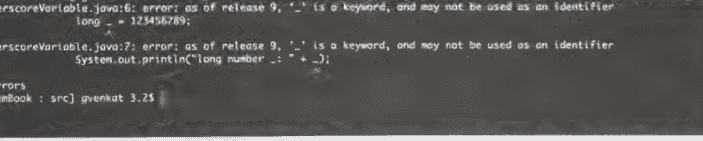

```bash
[Beanbook src] genkat 3.25 /Library/Java/VirtualMachines/jdk-9.0/Contents/Home/bin/javac SuperscoreVariable.java
UnderscoreVariable.java: error: as of release 9, "_ is a keyword, and may not be used as an identifier
- 123456789;
UnderscoreVariable.java: error: as of release 9, "_ is a keyword, and may not be used as an identifier
system.out.println("line number " + _);");
2 errors
[Beanbook src] genkat 3.25
```

图 8-32. 使用 Java 9 编译器编译带有 `_` 变量 Java 代码

## 304 Java 应用程序快速现代化

你可以使用以下 Windup 自定义规则来捕捉所有此类违规：

```xml
<rule id="custom-01001">
  <when>
    <filecontent pattern="_" />
  </when>
  <perform>
    <hint title="Underscore _ use for a variable" effort="1" category-id="mandatory">
      <message>从 Java 9 开始，由于下划线是保留关键字，因此不能用作变量</message>
      <link href="http://download.java.net/java/jdk9/docs/api/overview-summary.html" title="Java SE 9 保留关键字" />
      <tag>custom-custom</tag>
    </hint>
  </perform>
</rule>
```

你可以使用带有 `pattern` 属性的 `<filecontent>` 标签来捕获所有对 `_` 模式的使用。可以使用更复杂的规则，但为了说明，我保持了案例简单。

使用 `<filecontent>` 是处理此场景的一种简单方法。该规则允许像文本搜索一样搜索所有文件。捕捉到的次数可能比想象的要多，因为所有 `_` 的出现处都会被标记。

可以通过使用 `pattern="^_$"` 立即改进此规则。

对 `pattern` 的此修改将只寻找单独出现的 `_`，而不是文件中的任何地方。

可以通过另一种方式实现追踪由单个 `_` 表示的变量相同目标。

你可以使用 `<javclass>` 标签并捕获所有对 `_` 模式的使用。只需将 `<filecontent pattern="_" />` 替换为 `<when>` 和 `</when>` 标签之间的以下代码段。

```xml
<javclass matchesSource="^_$">
  <location>VARIABLE_DECLARATION</location>
</javclass>
```

图 8-33 描述了迁移问题报告。从 RHAMT 控制台加载包含违规的应用并应用我们的自定义 Windup 规则进行分析后，特定的代码行被标记了。

此只会查看 Java 类内部的变量声明，以及这些变量声明中哪些匹配正则表达式 `^_$`（这基本上就是单个 `_`）。

图 8-34 显示了应用程序详情以及在其中的实际位置。

## 第 8 章：构建 Java 评估工具 332

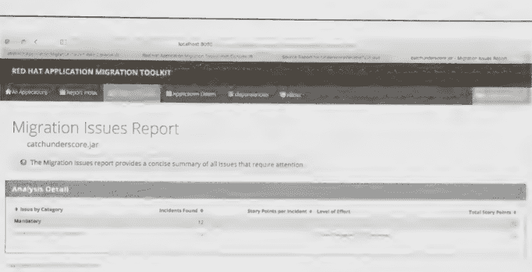

# 第 9 章：Java 迁移 309

关于已发现的内容，如何确定实际迁移的影响。如何构建迁移路线图，如何执行实际迁移，最后如何确保工作量和成本估计的准确性。构建一个基于指标的模型将有助于提高准确性。零散地迁移应用程序既不是最优的，也不是谨慎的。我过去几十年的经验表明，将一组应用程序组合并进行整体迁移可以获得效率上的。我们将首先回顾相关应用程序的分组与迁移，以及迁移路线图的构建。第 14 章将这一概念提升到新高度，因为它将讨论整个应用程序投资组合的大规模迁移。

# 迁移方法论

迁移方法论本质上是第 6 章图 6-4 所示现代化方法的范围缩小版。本节将深入探讨三个阶段——评估、演进和优化，这些阶段与 Java 应用组合的迁移有关。APM（应用性能管理）相关的流程与迁移紧密相连。企业架构（EA）也发挥着作用，特别是当迁移的应用程序与其他应用程序或服务存在依赖关系和集成点时。

## 评估框架

第 6 章推荐了一个评估框架，作为适用于 Java 现代化的方法论的一部分。框架评估是一个三步走的过程——发现、分析和建议，适用于现有的 Java 应用组合。后续章节讨论了构建自动化工具，以帮助对 Java 代码库进行发现和分析以提取建议。

在这里，我们将进一步讨论在应用迁移特定背景下，迁移评估的重要性。该评估框架本质上与 Java 现代化方法中涵盖的评估框架相同；然而，我们目前的视角专门分析将 Java 应用组合迁移到更高版本的 JDK。

评估框架识别了在应用组合审查的评估和分析阶段发现的缺陷，并为组织提供了必要的依据，以便需要迁移到新 JDK 版本的应用程序组在应用层面做出微决策。这项活动不会导致

## 310 Java 应用的快速现代化

从 APM 的角度来看，它不会对应用程序组合进行重大重构，也不会影响业务流程和应用程序功能。事实上

# 第 9 章：Java 迁移 311

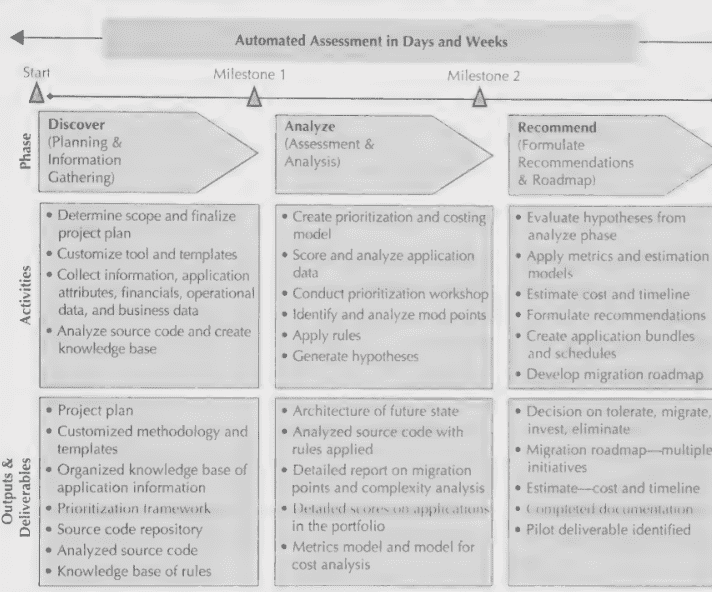

| 阶段 | 里程碑 1 | 里程碑 2 | 最后 |
|---|---|---|---|
| 发现（计划与信息收集） | | 分析（评估与分析） | 建议（制定建议与路线图） |
| 活动 | * 确定范围并敲定项目计划<br>** 定制工具和模板<br>** 收集信息、应用属性、财务、运营数据和业务数据<br>** 分析源代码并创建知识库 | * 创建优先级排序和成本模型<br>** 评分并分析应用数据<br>** 进行优先级研讨会<br>** 识别并分析修改点 (mod points)<br>** 应用规则<br>** 生成假设 | * 评估分析阶段的假设<br>** 应用指标和估计模型<br>** 估计成本和时间<br>** 制定建议<br>** 创建应用包和进度表<br>** 开发迁移路线图 |
| 输出与交付物 | * 项目计划<br>** 定制方法论和模板<br>** 组织良好的应用信息知识库<br>** 优先级框架<br>** 源代码仓库<br>** 分析源代码<br>** 规则知识库 | * 未来状态架构<br>** 应用了规则的分析后源代码<br>** 迁移复杂性的分解和分析<br>** 组合中应用的详细评分<br>** 指标模型和成本分析模型 | * 时间表、迁移、消除决策<br>* 迁移路线图——多个计划<br>* 估计成本和时间<br>* 完成的文档<br>* 识别试点交付物 |

**图 1.** 并不是所有的不兼容性都能自动转换和迁移。某些修改点可能需要人工干预，因为可能缺少测试用例、迁移目标 API 实现复杂，或者标识修改点的代码逻辑可能需要重写。发现应用程序的所有信息（包括识别任何缺失信息）对于实现无缝且成功的迁移至关重要。大多数情况下，任何缺失的信息将与测试、第三方库或组件以及其他应用程序对迁移应用程序的依赖有关。

## 分析步骤

在发现步骤中发现的信息需要详细分析。在分析步骤中，通常会考虑额外信息。利用工具识别特定库的技术复杂性，例如：

- 多线程和线程使用
- 对原生代码的访问
- 超出简单的并发
- 使用新的 I/O (NIO)
- Swing 及其他图形
- 数据库调用
- 消息与通知
- 安全与加密
- 任何开源或第三方

在迁移练习的分析步骤中，必须审查与迁移相关的工作量和成本估计。这可以通过利用考虑简单、中等和复杂修改点成本指南的知识库来实现。行业平均水平以及组织过去的经验（如果有）也会记录在内，以便进行工作量成本计算。修改点根据不兼容的类型和复杂性进行评分。

# 第 9 章：Java 迁移 313

检查并对应用程序特性进行评分，以得出每个应用的优先级索引。这些应用程序特性可能与业务、技术、运营或质量有关。业务关键性、技术复杂度、应用依赖、应用处理和迁移调度应该经过分析并批准，以为迁移提供适当的建议。迁移复杂性的估计考虑了几个因素。

## 建议步骤

建议步骤提倡针对 Java 应用组合迁移要执行的操作项。Java 应用组合的迁移不仅仅是一项技术活动。应用组合内部存在若干限制和依赖关系，还需要考虑若干业务方面，包括资源的可用性以及他们管理项目、执行、测试和发布迁移组合的能力。应用程序应该是顺序的，而不是彼此孤立的。在遗留应用程序中，组件与外部应用程序之间通常存在紧密的依赖关系。对于已经使用微服务架构的应用程序，可以想象可以隔离并迁移特定的微服务到不同的技术或不同的库版本。此类修改不被特征为真正的现代化，而是支持功能增强或为了利用特定功能的有限的技术升级。

将相关应用程序分组、安排执行迁移的时间、分析风险以及制定详细的迁移计划同样重要。建议步骤产生一个考虑了所有这些细节的迁移路线图。

## 应用程序特性

在应用组合迁移的背景下，应用程序特性涵盖以下领域：

- 业务
- 技术
- 运营
- 验证 (QA)

## 314 Java 应用的快速现代化

这些应用特性被编码进一个评分框架中，用于估算应用特性对拟议迁移的影响。根据应用在四个领域的特性，对应用进行评分并根据迁移进行排序。与应用特性相关的、针对应用的特定属性会影响围绕该应用及相关应用的迁移决策。

## 业务特性

对于应用，必须了解以下关键业务特性的示例集：

- 对日常业务运营至关重要的应用
- 作为表述状态转换 (REST) 服务向内部或外部暴露给其他应用的应用
- 应用的财务影响
- 若干名受影响的用户使用的
- 仅允许极短的停机时间

## 技术特性

对于应用，必须了解以下关键技术特性的示例集：

- 对第三方库和组件的依赖
- 应用的大小，涉及代码行数、类数量、Enterprise JavaBeans (EJBs) 数量等
- 对弃用 API 的使用
- 不接受或不建议的编码模式的使用
- 应用的多个集成点

## 验证特性

对于应用，必须了解以下关键验证特性的示例集：

- 测试计划和测试用例的可用性
- 测试数据的可用性
- 测试用例数量、用例场景和覆盖率
- 自动化或手动测试脚本的可用性
- 测试数据生成和测试数据设置的自动化
- 需要在待迁移代码上创建和执行的单元测试程度
- 测试环境的可用性

## 运营特性

对于应用，必须了解以下关键验证特性的示例集：

- 应用无法迁移的封锁日期或窗口
- 必须迁移应用的首选日期或窗口
- 应用之间的代码共享
- 部署依赖
- 运行在共享 JVM 中的应用
- 其他应用对特定应用的依赖

## 复杂性估计

在实际迁移 Java 应用组合之前，必须从复杂性的角度确定应用的性质。这使得组织能够理解迁移应用组合的难易程度。这种复杂性取决于多种因素。本节重点介绍了典型的复杂性估计。不同的组织可以修改并推导出适用于自身需求的框架。

## 集成就绪性

大多数现代应用并不是孤立实体。它们与其他应用通信，通过 REST 服务或 API 暴露自己的功能，或利用面向消息的中间件。以下是各种集成类型的示例：

- 部分应用可能与组织内部的遗留系统集成，大多数应用与关系型数据库通信。
- 过去五年内编写的一些应用利用 NoSQL 和内存数据库，对于它们封装的功能类型，避免使用关系型数据库。
- 应用经常使用第三方库和开源库，将这些库集成到应用本身。
- 在某些情况下，应用通过私有网络或互联网与第三方 API 集成。
- 一小部分应用可以使用公共 API 和社交媒体 API。

在应用迁移后集成能够正常工作之前，必须清楚地了解这些集成场景。在应用之间存在紧密依赖的情况下，在一个依赖应用集中迁移其中一个应用可能会破坏这种相互依赖关系并导致某些应用失败。这是应用架构实践演变为松耦合组件以及设计为微服务平台架构上的分布式服务的应用的一个重要原因之一。这种现代化方法将在第 10 章中详细讨论。

## 组织资源需求

企业中任何任务的管理和执行，更说应用迁移项目，都需要多种资源的对齐。根据组织结构和文化，程序的设置和管理可能会有所不同。在理想的企业实施中，业务部门和 IT 部门在应用组合管理和所有权方面应该是协作关系。业务和 IT 的其他利益相关者也可能参与，特别是当存在应用依赖时。

使用特定应用的某些终端用户可能会影响未来的需求。安全、基础设施、DevOps、QA、支持和维护等 IT 功能都是应用开发、测试、发布和生产支持中的涉及利益相关者。复杂应用需要多个利益相关者提供强大的组织资源支持。组织在充分指定并执行应用及其依赖包的成功迁移之前，必须清楚理解这一过程。

## 优先级排序

排序框架用于对组合中的应用进行评分。在第 3 章和第 4 章中，我们回顾了一个排序框架；但那是作为 APM 路线图实施的一部分，对业务能力进行优先级排序的背景下的。相比之下，本节讨论的排序框架专门针对分析 Java 应用组合，以确定制定迁移路径的最佳方式。

本章之前讨论的应用特性有助于对组合应用的迁移进行优先级排序。排序框架基本上定义了一组参数并为这些参数分配权重。这些参数（也称为优先级索引）源自应用特性。这些索引的子集被组合在一起以计算业务索引和技术索引。框架提供了关于如何使用这些参数进行优先级排序和安排应用迁移计划的指南。各种应用的计算和加权得分显示在一个象限中进行分析。

组织通常可以使用优先级索引执行以下操作：

- 计算组合中应用的约束象限。
- 从这些象限中安排应用迁移计划。


- 识别特定应用进行试点。
- 对应用进行捆绑，以便组合可以分几波迁移，而不是作为“一次性、大轰炸”式的迁移。
- 如果需要，在捆绑后进一步重新安排或拆分应用包。

# 318 Java 应用的快速现代化

业务、技术、运营和验证特性贡献了技术索引和业务索引。由组织决定希望利用特性的深度和宽度来计算业务和技术索引。组织也可以在计算这些索引时为此类特性提供权重。

## 技术索引

表 9-1 显示了构成技术索引的特性的示例索引和示例权重。比例如下：

| 索引 | 描述 | 分数 | 权重 |
|---|---|---|---|
| 第三方库复杂性 | 迁移 Java 应用所使用的第三方库的复杂性 | 0–4 | 25 |
| 可用测试用例数量 | 迁移 Java 应用时可用测试用例数量 | 0–4 | 20 |
| 应用大小 | 应用的大小，包括代码行数和类数量 | 0–4 | 10 |
| 测试覆盖率 | 需要对该应用进行的测试类型以及测试脚本和测试数据的可用性 | 0–4 | 15 |
| 代码修改 | 弃用的 API 以及由于 API 版本更改而在代码中需要修改（自动或手动）的实际位置 | 0–4 | 10 |
| 集成点 | 通过 API 调用或 REST 服务与其他应用的集成点数量 | 0–4 | 10 |
| 信息架构复杂性 | 消息、数据库、消息格式更改、模式更改和转换 | 0–4 | 10 |

表 9-1. 带有权重的示例技术索引计算

特定指标对技术指标复杂度评分总体复杂度的贡献建议为 0 到 4：

- 0 = 指标无影响
- 1 = 低
- 2 = 中
- 3 = 高
- 4 = 极高

图 9-2 描述了一个应用程序技术指标的说明性评分框架。此示例技术指标和评分指南可以作为定制练习的起点，以满足企业的个人组织需求。

| 高 (4) | 高中 (3) | 中 (2) | 低 (1) | 无影响 (0) |
|---|---|---|---|---|
| 第三方库复杂度 | 已停止维护的库及复杂的升级 | 中等到高复杂度的第三方供应商库升级。 | 文档完备的第三方库升级路径 | API 的简单更改 | 无更改 |
| 测试用例数量 | > 300 个测试用例 | 100 到 300 个测试用例 | 10 到 100 个测试用例 | 1 到 10 个测试用例 | 0 个测试用例 |
| 测试覆盖率 | 测试工作量大且复杂 | 高测试工作量 | 中等测试工作量 | 低工作量 | 无需测试 |
| 应用程序规模 | > 100 归一化代码行数、类数规模 | 50 到 100 归一化代码行数、类数规模 | 10 到 50 归一化代码行数、类数规模 | 1 到 10 归一化代码行数、类数规模 | 0 |
| 代码修改 | > 100，这只是一个归一化比例 | 50 到 100，这只是一个归一化比例 | 10 到 50，这只是一个归一化比例 | 1 到 10，这只是一个归一化比例 | 0 |

图 9-2. 技术指标计算的示例评分框架示例

此图考虑了表 9-1 中的五个指标点，并解释了如何根据每个指标点 0 到 4 的分值对应用程序进行评分。

> **注意**
>
> 这仅仅是一个说明，不能被视为所有应用程序组合的评分框架，因为组织目标和应用程序组合目标各不相同。评分框架必须经过定制和加权，以满足个人组织的目标。

## 业务指标

表 9-2 显示了一个业务指标以及归构成描述的特征的示例权重。特定指标对业务指标复杂度评分总体复杂度的贡献比例建议为 0 到 4：

- 0 = 指标无影响
- 1 = 低
- 2 = 中
- 3 = 高
- 4 = 极高

表 9-1 和表 9-2 仅供参考。每个组织都应该采用并修改指标计算方法以适应其特定情况。尽管如此，我想提供“阻塞窗口”（`Blocked Windows`）和“允许窗口”（`Allowed Windows`）的示例说明，以及如何使用之前的方法解释这些指标。例如，什么构成了 2 分？我们知道捕这些数据很重要，但我们如何为它分配 0 到 4 之间的值和等级？一种可能的评分技术是：如果没有此类窗口则评 0 分，如果存在团队认为无法满足的极窄窗口，则评 4 分。

| 指标 | 描述 | 分数 | 权重 |
|---|---|---|---|
| 应用程序用户 | 整个企业范围内受应用程序迁移影响的特定应用程序的用户数 | 0–4 | 25 |
| 对业务的影响 | 受影响的业务部门、财务影响、业务风险、面向外部的应用等 | 0–4 | 25 |
| 阻塞窗口 | 应用程序无法迁移的特定时期，包括应用程序必须可用的特定日期 | 0–4 | 20 |
| 允许窗口 | 迁移期间允许的特定停机时间，包括特定日期、经过的日历时间等因素 | 0–4 | 15 |
| 应用程序知识 | 关于该应用程序的业务、功能和技术知识文档完备，且有熟悉此应用程序的内部资源可以帮助迁移 | 0–4 | 15 |

表 9-2. 带有权重的示例业务指标计算

之间的分值是相对的，并为评估窗口有多窄或多困难的练习提供了一种思路。

图 9-3 描述了一个应用程序业务指标的说明性评分框架。此示例业务指标和评分指南可以作为定制练习的起点，以满足企业的个人组织需求。此图考虑了表 9-2 中的五个指标点，并解释了如何根据每个点 0 到 4 的分值对应用程序进行评分。再次，这仅仅是一个说明，不能被视为所有应用程序组合的准确评分框架；组织目标和应用程序组合目标各不相同，评分框架必须经过定制和加权，以满足个人组织的目标。

| 高 (4) | 高中 (3) | 低中 (2) | 低 (1) | 无影响 (0) |
|---|---|---|---|---|
| 对业务的影响 | 对业务风险和财务运营的影响极高 | 高影响，受影响的外部应用部门 | 对业务中等影响 | 对业务低影响 | 无影响 |
| 应用程序终端用户 | > 5000 个用户 | 1000 到 5000 个用户 | 100 到 1000 个用户 | 1 到 100 个用户 | 0 用户 |
| 允许窗口 | 迁移允许窗口限制极高 | 只有少数允许窗口受限制 | 有限制的允许窗口 | 有限制的允许窗口 | 无限制 |
| 阻塞窗口 | > 6 个月 | 2 到 6 个月 | 1 到 2 个月 | 几周 | 0 个月 |
| 应用程序知识 | 完全没有知识 | 可用知识很少 | 有部分可用知识 | 拥有良好的知识库和专家 | |

图 9-3. 技术指标计算的说明性评分框架示例

评分框架必须经过定制和加权，以满足个人组织的目标。

## 第三方库的说明性深度分析

计算总体业务复杂度指标和技术复杂度指标的建议特征必须经过彻底评估，以确定其对指标的贡献和权重。

本书将不会讨论如何分析测试用例可用性和测试数据覆盖性的具体细节，也不会提供对业务财务影响的更全面的检查。然而，为了说明企业应该优先考虑并更深入地理解这些特征，表 9-3 中的示例展示了应用程序迁移中使用第三方库的深度分析以及其潜在影响。

| 类别 | 描述 | 迁移工作 | 理由 |
|---|---|---|---|
| 随应用程序服务器分发的库 | 作为应用程序服务器安装的一部分分发的库 | 低 | 库应随应用程序服务器一起；通常没有部署问题 |
| 部署的外部开源库 | 开源库 | 低 | 文档通常可用，但可能需要某些测试以确保迁移良好 |
| JDBC 驱动程序 | 与应用程序服务器兼容的 JDBC 驱动程序 | 低 | JDBC 驱动程序与应用程序服务器兼容性良好 |
| 部署的外部厂商库 | 应用程序服务器使用的商业第三方厂商库；该库通常在运行时加载 | 中 | 可能需要迁移到支持新 JDK 的更高版本；外可能需要与外部厂商交互 |
| 已停止、替换或过时的库 | 不再支持且必须由替代库替换的库 | 高 | 需要研究、评估替代方案、POC、大量测试并符合功能和性能要求 |
| 企业内部自有的框架或库 | 企业内部维护但在应用程序之外的库；内部库通常被多个应用程序使用，并将由企业进行升级 | 高 | 需要企业进行迁移以符合新 JDK，并经过严格测试 |

表 9-3. 第三方库对应用程序迁移影响的示例分析

## 工作量与成本估算

人们普遍认为，组织大约 80% 的 IT 预算用于“维持运转”——即仅仅是支持和维护现有应用程序。项目预算之间，以及增强现有应用程序的需求与构建新应用程序的欲望之间，始终存在竞争。在这两种情况下，企业通常不会按单个应用程序维护详尽的费用明细。此外，资源通常在应用程序之间共享，包括开发人员、基础设施和管理投入。应用组合中那些不显眼却垄断了有限资源的应用程序往往会导致整个应用组合的成本激增，并可能迅速失控。因此，预算限制和资源管理不当导致应用组合无法实现现代化、迁移到新技术或完全重构。

当组织最终决定将应用组合迁移到更高版本的 JDK 和新的 API 时，许多企业并不知道如何估计和制定迁移方案。这时，基于自动化和识别修改点（`mod points`）的迁移方法就变得非常重要。准确的估算需要基于可靠的指标和分析。基于指标、修改点识别、复杂性因素的计算与应用以及定量评分的估算模型，有助于组织对应用组合迁移形成全面的理解，从而合理分配必要的资源和预算。图 9-4 显示了应用迁移活动估算成本和工作量的各种步骤。步骤 1a、1b 和 1c 都专注于识别基于应用组合的估算过程输入。它包括识别出的实际修改点、配置更改、数据库更改以及包括软件和硬件在内的基础设施变更。步骤 2 应用与指标相关的调整因子。步骤 4 为待迁移应用组合中的每个应用程序生成评分。步骤 5 根据估算模型和上述四个步骤的结果计算工作量和成本。

对应用组合知识的缺失可能会引入运营风险，并导致偏离计划和估算的预算分配。遵循本书开头章节列出的 APM 原则将帮助组织建立知识库，以减轻此类风险，并包含有关应用组合中每个种的的丰富信息。如文所述，知识库应包含财务、运营、业务和技术信息。估算模型应该考虑与特定组织相关的限制和复杂性因素。如果可用，应对过去项目进行过程能力和成本的基准测量，以帮助确定组合迁移计划的有效性。除了组织特定的数据外，还应该收集行业平均数据以及特定应用程序的具体成本和工作量数据，以提高估算模型的准确性。

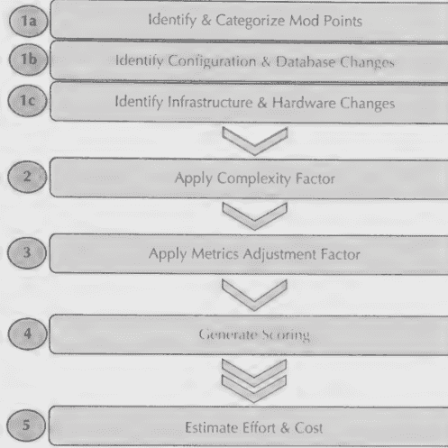

图 9-4. 成本和工作量估算的步骤

使用过去的指标和数据点来指导应用组合中单个应用程序现代化的估算变得更加复杂，因为许多公司采取了将维护和支持合并为单一预算项目的松散做法。通过遵循 APM 方法，金融、电信、制造业、零售和政府关系等行业的几家公司已经开发出健全的知识库和指标驱动的估算模型，在遵守受控预算和固定时间表的情况下迁移应用组合。

## 指南

应用组合迁移项目的核心是收集应用程序细节，例如源代码、代码行数、类数量、测试用例、配置文件、环境细节、用例、功能点以及任何其他类型与应用程序开发、测试和维护相关的指标。这些因素已作为评估方法的一部分得到了深入解决。更进一步，使用自动化迁移和分析工具可以指导修改点的识别和定位，并发现不兼容的源代码、已过弃的 API 以及任何其他所需的配置或数据库变异。此类修改点被分类并分配复杂性因子。基于与应用程序细节相关的指标和其他指标，还会应用调整因子。这为每个迁移或修改点产生评分。将每个修改点的评分相加，就得到了应用程序本身在迁移工作量和相关成本方面的总分。

此组合分反映了第三方组件、自框架、国际化相关代码、UI 复杂性、数据库相关更改、专用库的使用和其他因素。最终得出的评分将与项目计划进行比较，以估计迁移应用程序所需的工作量。图 9-4 所示的步骤是得出迁移应用程序工作量和成本的估算过程。

## 总成本计算

典型的应用程序成本包括架构、需求分析、设计、开发、测试、支持和维护。还存在与框架和技术组件、软件许可、实施和应用程序集成成本。这些直接、间接和基础设施相关的成本需要严格审查，以识别应用程序迁移后的偏差。在计算与应用组合迁移相关的成本时，可以提出并回答几个有趣的问题：

- 成本会增加还是减少？
- 第三方组件的许可费用会增加还是减少？
- 维护升级后的应用程序需要多少资源？
- 另一个应用程序可以停止并从组合中移除吗？
- 如果外部 IT 供应商维护该组合，他们会减少资源吗？

即使没有关于应用程序数据的明确指标，也可以根据可用数据点将应用程序分类为简单、中等、复杂和非常复杂，然后利用这些信息进行分析。例如，从整个组合中选取一组示例应用程序，使其包含完整的指标集（包括成本基准），然后计算工作量成本的估算。接下来，取决于该组合中应用程序的分类，可以根据其他应用程序中发现的修改点数量推导出模型。虽然这种方法无法提供高精度的成本估算，但对生成的成本具有一定的置信度。这些数字绝对比粗略数量（ROM）模型可靠得多，并满足大多数组织的预算估算水平。

## 迁移路线图

迁移路线图为 Java 应用组合的迁移提供了蓝图。路线图必须考虑到所有必要的迁移活动，并提供详细的迁移计划。路线图的设计考虑了几个因素：

- 完成迁移所需的整体工作量
- 程序成本
- 开发、测试和生产环境
- 应用程序的部署细节
- 内部技能
- 资源可用性
- 应用程序或应用程序包迁移的顺序或交错方式
- 应用程序之间的依赖关系
- 停机窗口和其他限制条件
- 迁移期间的终端用户需求
- 感知风险与缓解措施
- 知识传递、培训和变更管理
- 迁移项目时间表
- 所有资源需求及其需求
- 成本与预算分析
- 项目执行的风险因素

## 应用程序调度与打包

待迁移的应用程序应根据特定策略分为多个组。这些应用程序将分批迁移，而不是按顺序迁移。此外，在创建某些应用程序分组时，必须考虑应用程序之间的依赖关系和外部因素。只有在完成此步骤后，才能对应用程序包进行错峰迁移的调度。这一过程将为战略性应用程序组合迁移提供最优的体验：

- 调度策略为应用程序调度提供了指南。调度利用使用优先级排序和打包框架计算出的索引。
- 打包策略将应用程序分组为迁移包，这些包可以同时迁移或以某种方式错峰迁移。打包利用使用优先级框架计算出的索引。

## 应用程序调度与打包指南

必须遵循指南以确保正确创建迁移路线图，并且调度计划迁移的应用程序必须遵守此协议。有几个需要考虑的指南，且每个指南的优先级在不同组织之间可能不同。以下是一些迁移应用程序调度指南（无优先级排序）：

- 分析在优先级框架确定的象限中进行评分和预测的应用程序。
- 确保在应用程序调度中考虑停机日期、救火处理窗口和首选迁移窗口。
- 同一个包内具有冲突停机日的应用程序可能需要拆分为不同的包。
- 共享同一应用程序服务器的应用程序可以打包并一起调度。
- 考虑到限制条件，如果高技术索引的应用程序不依赖于其他应用程序，则应尽早调度。
- 不应将过多的高风险或高复杂度应用程序打包在一起。
- 多个都需要进行密集性能测试的应用程序不应同时调度迁移。
- 在任何时间点，错峰迁移计划都不应有大量应用程序正在迁移。虽然这个数字是灵活的，但经验表明，同时打包和或迁移的应用程序不应超过 10 到 15 个。
- 所有具有代码依赖关系的应用程序必须打包在一起。
- 与相同功能相关的应用程序可以打包在一起。
- 如果包内无法满足首选迁移窗口，则可能需要违反既定的打包和调度指南，将应用程序拆分为不同的包。
- 如果有疑问，请重新调度迁移。

## 试点选择

在企业中，如果一个 Java 应用程序组合包含超过 15 个应用程序，则该组合的迁移可能涉及 8 到 10 个应用程序的组。在此过程中缓解风险的一种建议方法是开发对该组合迁移路径的理解。这可以通过首先进行试点迁移练习，在单个应用程序或 3 到 5 个应用程序的组上完成。试点实验的结果可以利用以确保已知潜在风险，并实现剩余应用程序包的自动化迁移。按照以下指南选择试点中的应用程序：

- 选择几个能够提供主要功能领域良好覆盖的应用程序。这将确保各个功能领域测试用例的可用性得到明确。
- 选择不需要重大增强或代码更改的应用程序。
- 不要选择质量极差的应用程序。这将使试点过于复杂，并对迁移复杂性的理解产生偏颇。
- 技术复杂度索引低（不是过于复杂的应用程序）和业务复杂度索引低（不是业务关键且易产生风险的）的应用程序是良好的试点候选对象。
- 在迁移日期和停机期方面通常开放的应用程序是可能的试点应用程序。

## 应用程序迁移

Java 应用程序组合的成功迁移取决于许多因素。这些因素都通过特定的工作流或轨道来解决。

## 工作流与计划管理

应用程序迁移计划涉及几个需要无缝协作的重要轨道：

**计划管理**：风险管理、资源识别与分配、迁移计划的所有权归属、不同利益相关者之间的通信、跟踪计划成功指标直至完成。

**治理**：定义成功指标，跟踪合规性和最佳实践，并确保计划按正轨运行。

**技术迁移**：项目的实际执行、各种应用程序的迁移、代码库的更改、新环境配置的修改、数据库的更改、消息格式的以及其他针对迁移的技术更改。

**基础设施与环境**：建立所有环境（开发、测试、生产环境和所需的基础设施）的升级，以支持迁移的应用程序组合。

**质量保证**：一个与迁移轨道同样重要的验证轨道。为了使技术轨道成功，QA 轨道必须确保有充分的测试用例和测试数据。取决于应用程序组合的复杂性和迁移应用程序的性质，可能需要各种类型的测试。应与应用程序的技术迁移同步创建并执行适当的测试策略。

**变更管理**：确保终端用户了解迁移引起的任何流程或功能的修改。此外，企业的其他领域也可能受到影响。迁移练习本身可能会遇到需要更改计划执行的风险。

**知识管理**：负责收集和构建与所有应用程序组合相关的所有构物的知识库。该轨道还负责确保迁移练习产生关于应用程序组合的知识捕捉。

## 试点迁移

Java 应用程序组合的迁移需要周全的计划。在迁移包之前，必须对业务和技术索引进行精确计算以对应用程序评分，最终将其分成多个组。第一个迁移的包是试点。试点迁移的关键目标是利用试点的经验和发现来提高后续迁移的生产力。

需要迁移的应用程序通常根据迁移复杂度进行评估。但对于试点阶段，应用程序包由复杂度较低或简单的应用程序组成，并与其他利益相关者的共识进行选择。并不是所有所有者或业务部门都会出现在试点中，但每个业务部门和应用程序团队都能从结果中获益。这种集体知识共享了适用于后续应用程序迁移的信息，直接使特定应用程序利益相关者受益。

## 演进阶段


# 演进阶段

演进阶段执行发现阶段定义的特定路线图和迁移计划。作为演进阶段的一部分，将建立或调整现有的治理和变更管理流程，以确保迁移任务的覆盖。与迁移相关的投入成本已在发现阶段的分析阶段计算并纳入。这些指标的进一步验证将在演进阶段的初始阶段进行。

应利用从试点迁移获得的经验和信息来提高后续迁移的生产力和效率。随着每个应用程序包经历迁移，迁移方法不断演进。这些集体学习应被记录在集中知识库中，以增强迁移“食谱”。

## 架构阶段

架构阶段是演进阶段的初始阶段。通常，Java 迁移项目不涉及复杂的架构阶段。大多数迁移的重点是升级 JDK 版本、第三方库版本、配置文件、应用程序服务器版本、数据库版本，以及某些情况下属于其他产品或组件的解决方案。其他现代化项目（包括对应用组合进行的重构工作）可能需要更详细、更深入的架构阶段。

架构阶段确保了应用程序迁移至目标基础设施平台的设计和功能。还必须正确识别并设计支持迁移后应用组合的迁移环境。最后，应该研究数据库升级以及对集成点的任何影响，以做出适当的架构决策，确保 Java 应用程序迁移的顺利和成功。

## 执行阶段

执行阶段是迁移工作发生的主要阶段，对演进阶段至关重要。应用包中计划迁移的 Java 应用程序将开始它们的迁移之旅。根据库版本和识别出的修改点，代码需要在任何特定点进行增强，然后应遵循软件开发生命周期（SDLC）流程。根据迁移点的复杂性和性质，可以自动或手动修改这些代码。

执行迁移任务的开发团队，有必要对在识别出的迁移点注入或修改的任何代码编写单元用例和单元测试脚本。这对于确保在 Java 应用程序代码升级过程中不会添加新的错误或功能至关重要。由于这仅仅是一次迁移任务，因此不会有功能增强或代码重构。在某些情况下，升级的库的新版本 API 可能需要代码重构以与新 API 交互。在许多情况下，迁移过程中的实际代码修改并不是一个复杂的过程。迁移变得复杂的情况有时发生在：当识别出的修改点由于采用了新语言特性或需要实现新 API 而需要重大修复时。

## 验证阶段

应用组合迁移的验证阶段与执行阶段同样重要。验证阶段也遵循典型的软件开发生命周期（SDLC）中的质量保证（QA）和测试流程。尽管一组 Java 应用程序的迁移在识别出的修改点涉及少量或受控的代码更改，但必须确保功能没有改变。应用程序的性能不能受到影响。应用程序必须继续满足其他非功能性需求和服务水平协议（SLA）。此外，必须维护与外部应用程序、第三方组件、REST 服务和移动应用程序的任何通信。这些集成点应该经过测试，以符合之前支持的消息和数据格式。

验证阶段的工作量和成本在很大程度上取决于完整测试框架的可用性以及测试用例和测试数据的完整性。QA 团队应最初在发现阶段介入，以确定必要的测试范围以及可以利用的现有测试的可用性。

如果某些应用程序没有测试用例和测试脚本，则存在这些应用程序可能偏离其预期的功能需求且可能无法履行 SLA 义务的风险。在缺乏功能测试用例的情况下，一种策略是要求最终用户与现有的迁移前应用程序交互，并记录他们在使用过程中的步骤、流程、输入和输出，包括记录与应用程序交互期间的点击和数据检索。然后，在迁移之后，可以重放整个场景，以确定应用程序是否符合预期功能。虽然这不是测试应用程序的理想方式，但在缺乏任何可用的功能测试的情况下，只能尝试在应用程序迁移后重现终端用户看到的行为。由于这一过程受到终端用户使用范围的限制，这导致某些边缘情况可能会失败，但在问题出现之前永远不会被发现。

> **备注**
> 
> 
> 
> 这是一个边缘情况的示例。在撰写本文时，当有人在 Facebook 上注册时，名和姓字段不允许名字为单个字母的用户加入。名字的最小要求是两个字母。像我这样只有一个字母名字的人的边缘情况没有得到适当的测试和审核。结果是，我在 Facebook 页面上被称为“GG”。

测试应该成为一个自动化过程，以缩短迁移应用程序的时间。这将保护未来迁移、现代化和重构工作的速度和准确性。遵循以下过程：

| W1-W2 | W3 | W4 | W5 | W6 | W7 | W8 | W9 | W10 | W11 | W12 | W13 | W14 |
|---|---|---|---|---|---|---|---|---|---|---|---|---|
| 自动化评估 | 应用包 1：迁移 | 单元测试 | IFP 测试 | UAT 测试 | | | | | | | | |
| | 应用包 2：迁移 | 单元测试 | IFP 测试 | UAT 测试 | | | | | | | | |
| | 应用包 3：迁移 | 单元测试 | IFP 测试 | UAT 测试 | | | | | | | | |
| | 迁移与单元测试 | | IFP 测试 | | UAT 测试 | | | | | | | |
| 1. 自动化迁移并进行任何干预。 | 1. 彻底的集成、功能和性能 (IFP) 测试。 | 1. 修复集成测试中的 Bug 并部署到 UAT。 | | | | |
| 2. 对引入的任何代码更改完成完整的单元测试。运行回归测试。 | 2. 更新的应用变更历史文档。 | 2. 完全迁移的应用包已准备好部署到生产环境。 | | | | |

**图 9-5.** 应用包迁移和测试的示例计划

此过程可以被有效地迁移和验证，以满足必要需求。图 9-5 展示了应用包迁移和测试的示例计划。图中显示了三个包。包的实际迁移不是顺序的。相反，它们是交错进行的，因此迁移的总耗时间不是累积的。包 2 和包 3 依赖于包 1，因此它们在几周后开始。每个包在发送进行验收之前都经过了彻底的测试和验证。只有在用户验收测试（UAT）且应用程序符合所有功能标准后，才会将其部署到生产环境。

## 优化阶段

优化阶段没有纯迁移任务那么重要，因为组合的维护、操作和支持预计不会太大变化。其他现代化项目如重构、业务转型和迁移应用程序到云端会显著影响优化阶段。

应用组合现有的治理流程应该继续存在，因为如果遵循了 APM 方法论，已经对其操作建立了指标。如果企业没有建立指标和适当的治理，这可以提供引入此类流程的机会。建议迁移 Java 应用程序组合并按照现有策略和流程进行操作。可以对操作进行微调，但任何治理流程的重大修改或新指标、DevOps 等重大更改应在应用组合成功迁移和验证之后进行。

## 风险缓解与风险最小化

没有任何项目是没有风险的。应用迁移也是如此，特别是当快速迁移时。无法消除所有风险。在许多情况下，企业根据他们投入的时间、资源和预算来应对风险。即使可以完全缓解某些风险，通常也成本过高且耗时。以下是 Java 应用组合迁移项目中遇到的一些典型风险，以及如何通过适当的最小化或缓解技术来缓解或最小化此类风险：

- **风险**：大多数应用程序没有单元用例来执行应用程序的单元测试。
- **风险最小化**：仅对迁移产生的修改代码进行单元测试。不进行完整的单元测试。这假设应用程序在缺乏单元测试的情况下此前运行正常。这种方法确保了新引入的代码经过单元测试，以确保应用程序不会崩溃。
- **风险**：系统集成测试（SIT）和用户验收测试（UAT）没有测试用例，用户在 UAT 阶段进行随机测试。
- **风险最小化**：仅对通过迁移更改的代码进行集成测试，前提是该代码具有任何集成点。不需要进行整个系统测试和集成测试，因为假设应用程序对用户而言运行状况良好。
- **风险**：各种应用程序的领域专家（SMEs）无法可用。
- **风险最小化**：企业应为每个应用程序识别所有者（如果尚未识别的话）。必须努力为每个应用程序构建知识库，包括对应用程序的功能性理解、需求文档、追溯性矩阵、测试用例、测试数据、技术文档以及任何其他对理解应用程序有价值的内容。
- **风险**：应用程序中使用的许多企业特定的自建库与其目标 JDK 及环境的兼容性是未知的。
- **风险缓解**：企业必须先将自建库迁移到新的 JDK 并在部署到应用程序构建中之前对其进行测试。应识别对应用程序迁移的任何影响。
- **风险**：在与移动端应用程序和其他外部应用程序集成后存在问题。
- **风险缓解**：分析新 JDK 与移动端应用程序及外部应用程序的兼容性。确定是否可以将 API 调用转换为 REST 调用，并将待迁移的应用程序与外部应用程序解耦，以便实现集成的松耦合。

## 总结

Java 应用组合现代化旅程中的一个关键部分是将应用程序组合升级到最新的 JDK 版本，以及其他开源和第三方库。对于运行在应用程序服务器上的应用程序，应用程序服务器的版本也需要升级。根据 Java 应用组合的情况，其他组件（如消息传递、中间件、第三方应用程序和组件、数据库、REST 服务和基础设施）可能需要升级。

在大多数企业中，对应用程序组合的评估并不总是自动的。事实上，可能恰相反。前两个章节讨论了自动化的重要性以及如何构建必要的工具。自动化评估阶段可以大大减少工作量、时间并增强项目的可预测性。当在应用程序迁移中发现确定的修改点时，可以快速确定该任务的复杂性。这允许对迁移相关的工作量和成本进行准确的总计算。

应用程序并不是以“大爆炸”式的方法同步迁移的。相反，考虑到业务和技术因素，应用程序被分组并错开调度。实际的迁移和测试遵循 SDLC（软件开发生命周期）实践，但可以根据所识别修改点的复杂性进行自动化。如果有完整的测试套件和测试用例，将进一步降低偏离预期功能的风险，确保不会引入新的 Bug。

本书将继续讨论现代化的话题，下一章专门用于对 Java 应用组合中的部分或全部应用程序进行重构。我们将讨论服务平台、微服务架构，以及如何通过将功能暴露为可以被发现和消费的服务来使 Java 应用程序现代化。我们还将审查如何对一组 Java 应用程序进行重构，并随着时间的推移作为 REST 服务提供。


# 第 10 章：Java 应用重构

随着企业常规地升级和迁移其 Java 应用组合，添加了新功能或增强了现有功能的应用程序将变得显而易见。结果是应用程序膨胀或应用程序膨肿随时间的推移而稳定增加。应用程序膨胀现象考虑了应用程序的大小、应用程序复杂性、与其他应用程序的集成程度以及应用程序维护的成本。同时，应用程序同样经历了通缩，诸如熟练应用程序开发人员的数量、当前或相关文档的量以及各种应用程序指标的跟踪等因素随时间的推移而减少。

在添加新功能的过程中，组合中的遗留应用程序通常需要重构以证明其相关性。虽然很难预测应用程序的未来需求，但重构应用程序应该遵循逻辑路线以对齐并满足新的业务需求。此类项目（特别是对于大型应用程序）是昂贵的，需要花费几个月甚至几年来构建、测试和部署。成本、工作量复杂性随时间推移而复合，传统的重构项目面临着高风险，特别是在处理大型复杂的 Java 应用程序时。

为了最小化业务风险，一个良好的重构项目应该产生快速、简单且受控的成本效益结果。开展大型应用程序组合重构的企业需要建立一个可重复的过程，以扩展应用程序组合并在各种活动之间共享资源。

第 9 章侧重于利用更新的自动化工具和框架将 Java 应用程序迁移到更高版本的 JDK。本章通过引入微服务和服务平台的概念，为重构提供了一个全新的视角。该讨论还将探讨企业架构师如何通过接入新服务平台的一部分，将 Java 应用程序转换为服务。该分析还将阐述基础核心服务，这些服务在本质上是基础设施性的和基础性的，并被其他服务利用。Java 应用程序的未来取决于服务平台。将现有应用程序组合重构为服务将使 Java 应用程序在利用 Java 平台进展并轻松整合新功能的同时繁荣和自然进化。

## 服务平台概念

面向服务的架构（SOA）方法自 20 世纪 90 年代引入该术语以来一直在进化。从 2000 年初，多个供应商加入战斗支持围绕 SOA 的热潮。这些服务提供者提供了 SOA 平台、工具和服务。SOA 很快成为“网络服务”的同义词，尽管 SOA 更多是一种概念、策略和架构实现。在 XML 和网络服务被主流采用之前，SOA 就已经存在。

SOA 的主要目的之一是定义具有宏观粒度的服务，以便其他业务服务可以访问和使用它们。这一概念促进了某些基本服务的重用，从而使功能可以被多个应用程序使用。在 SOA 开始获得关注之前，应用程序被仅仅视为一组协作的服务，这些服务编排并执行业务流程或一组流程。当时还没有考虑到功能重用的概念。

在 2002 年，Java 平台引入了 Web Services Developer Pack (Java WSDL)。Java WSDL 随后经历了多次迭代。大多数应用程序服务器演进为支持不断出现的标准，如简单对象访问协议 (SOAP) 和 XML。服务可以在应用程序服务器上创建并部署，暴露服务端点供其他应用程序或服务访问。表述性状态转移 (REST) 是另一种通过 HTTP 暴露和访问网络服务的方法。由于与 SOAP 相比更加简单，REST 在 2000 年代中期开始流行，而 SOA 则强制要求使用 XML 或 JavaScript 对象表示法 (JSON) 数据格式。

本章引入的服务平台不强制要求 SOAP 或 REST。本书探讨了服务平台的基本概念，本章专门研究如何将单体 Java 应用程序重构为服务，以创建和部署技术及业务服务并暴露服务供消费。将 Java 应用程序重构为服务的第一步是识别一个服务组合，代表现有 Java 应用程序封装的业务功能。

图 10-1 显示了分层服务平台模型中的各个层。在这种参考设计中，自上而下的视图提供了一个以消费者为中心的视角，带有客户端平台和通道。服务功能通过这些客户端通道交付，并由应用程序的终端用户访问，这些用户最终是消费者。消费者也可以包括其他服务，包括内部服务……属于该组织或属于外部第三方。下一层识别业务流程如何编排，以提供工作流和业务功能。该业务流程层包含多个业务流程，每个流程都由一组协作的服务和微服务执行。（有关更多微服务的信息，请参阅“核心服务”章节。）通常，业务流程的事件驱动编排器会根据某些事件的发生，管理和路由对各种服务的调用。这些细粒度的流程组宏观业务流程。业务流程的编排在直接下方的实际服务层得以体现。原子服务聚合形成复合服务或宏观服务。当业务流程在没有中央编排器的情况下执行（无论是直接通过服务，还是通过系统之间通过消息相互交互）时，该过程被称为“编排”。当业务流程跨越组织边界时，这种交互尤为常见。

图 10-1 的自底向上方法提供了服务提供者的视角。基础设施服务构成了基础设施层的基础构建块，包括消息代理、企业服务总线、规则引擎和其他技术组件。软件包应用程序以及自定义应用程序都是利用基础设施组件构建而成的。各种应用程序被集成在一起，使它们能够相互通信。在服务组合模型中，为了访问软件包或自定义应用程序，此类信息层通过组件抽象化，暴露信息织网以与企业信息系统 (EIS) 服务接口。反之，这些组件使用支持的 API 和数据格式访问软件包或自定义应用程序。这种表示体现了一种通用的分层服务模型。

| 移动端 | Web 端 | 合作伙伴 | 服务 | 应用程序 |
|---|---|---|---|---|
| 业务流程组合、编排、协同、事件 | | | | |
| 服务（原子级、复合） | | | | |
| 组件 | | | | |
| 企业信息系统 (EIS) | 软件包应用程序 | 自定义应用程序 | 合作伙伴应用程序 | |
| 基础设施服务 | | | | |

图 10-1. 参考性服务平台分层模型

## 服务组合识别

只有在识别并建立了底层的基础服务后，Java 应用程序组合才能被重构为服务组合。服务的定义之一包括一个代码块，代表在容器内部执行的操作的逻辑分组。例如，想象一个名为“客户账户”的服务，用于创建和管理客户账户信息。该服务在功能上依赖于其他关联操作。该服务的关联操作可能包括：验证客户、创建客户描述、找回丢失的密码、检索客户信息、更新客户信息以及将客户数据保存到数据库。这些操作中的某些本身就可以是服务。这种检索并利用客户信息以供其他应用程序潜在重用的行为，在服务的细粒度上可能有所不同；某些可能是细粒度的，而另一些在本质上更粗粒度。

服务的类型及其对应的服务层如图 10-2 所示，该图还详细展示了服务导向语言、技术层和 EIS 层的高层视图。可以想象，可能存在更高层次的服务根据特定业务事件的发生来编排业务流程。这些业务事件充当业务流程的触发器，使其继续向完成目标迈进。业务流程的执行基于底层业务服务和信息服务的成功运行。这些服务反过来封装了相关的业务功能和逻辑；它们也可以依赖技术服务层来提供服务。这些技术服务可以作为封装器来访问内容管理系统 (CMS)、数据库、支付系统、仓库管理系统和其他 EIS。每个服务层都建立在前一层之上，以提供某种抽象级别。

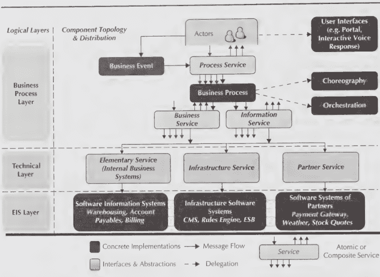

图 10-2. 服务导向的术语和分层

图 10-3 展示了在组织中识别服务的高层方法论。服务可以是业务性的，也可以是技术性的。业务服务侧重于功能，存在是为了实现业务功能。正如我们在第 4 章中回顾的样，这些业务能力通常定义了组织需要构建的服务。另一方面，技术服务侧重于架构或技术，其存在是为了支持已实现的业务功能。技术服务始终是在多个应用程序中重用的基础服务；它们对多个业务单元具有更广泛的适用性。这些技术服务可以独立于业务服务或应用程序功能进行考虑。这些服务的产生于 IT 组织希望构建技术能力以满足紧迫业务需求的愿望。

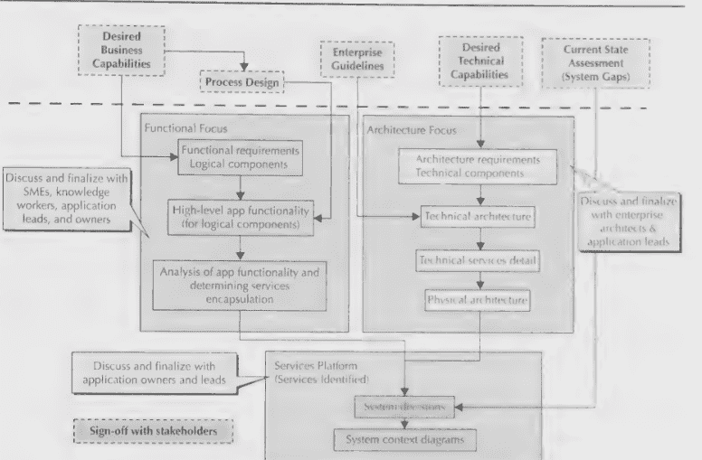

图 10-3. 服务识别流程


# 第 10 章：Java 应用程序重构

期望的业务能力作为业务流程设计的输入，同时也作为在构建服务或组件之前需要理解的功能性需求。流程设计驱动了对高层应用程序功能的理解。从技术角度来看，期望的技术能力驱动了对技术组件的识别。企业指南和最佳实践用于指导技术架构。对当前系统状态进行评估并与期望的未来状态进行对比，会导致人们意识到它们的不一致性。因此，需要识别出潜在的服务以解决现有系统中的功能和技术缺口。

为了创建一个服务组合，企业必须首先识别并理解组成部分。企业识别业务流程的自然信息流，以及这些信息在其业务领域中如何被消费、聚合、修改和使用至关重要。信息还由系统物理地存储和处理。企业拥有的信息必须经过仔细的管理和治理。图 10-4 显示了企业信息模型的一种视图。

## 信息织网与信息模型

| 层/组件 | 描述 |
|---|---|
| 治理与知识管理 | |
| 企业信息集成 | 概念层（过程—数据模型） |
| 框架组件 | 逻辑层（功能模型） |
| | 物理层（技术模型） |

数据留存、审计、归档和管理是企业业务连续性的核心组件。整个信息织网进一步分为三个主要层：概念层、逻辑层和物理层。

在底部，物理层代表企业信息的技术模型，技术系统在此处理信息并将其存储在数据库和其他异构数据存储器中。

中间，逻辑层代表功能模型，物理系统的数据以实体和对象的形式表示，并以与其所属业务单元的功能应用相关的格式呈现。

在顶部，存在概念层，功能系统使用的数据在此映射到特定的流程和任务。业务流程本身无法完成任何工作；它必须对数据进行操作，处理数据，并根据处理后的数据做出决策。业务流程交换消息、调用各种业务服务、传递相关信息，并实现与其他企业信息系统的交互。

在整个组织范围内支持数据和信息统一视图的能力被称为`企业信息集成 (EII)`。EII 实现了消费数据的服务/系统与实际异构数据存储器之间的松耦合。因此，跨物理、逻辑和概念层对企业信息的建模织网视图，能够识别需要消费数据的微服务。

图 10-4 展示了一个高层描绘。最终，一个成功的服务组合必须通过结合自上而下的方法、自下而上的方法以及中间向外的方法来创建，并同时考虑业务流程和信息架构。

## 自上而下的方法

图 10-5 所示了自上而下的服务识别方法，该方法需要辨别流程模型和数据模型，并对代表这些模型的层级进行映射。流程层次结构从企业的最高层开始，其包含一组相关的业务流程。业务流程模型可以存在于业务单元层面，也可以存在于企业的宏观层面。业务流程的功能在应用程序容器内部实现。该应用程序反过来是由一组编程了应用程序逻辑的业务组件构成的。

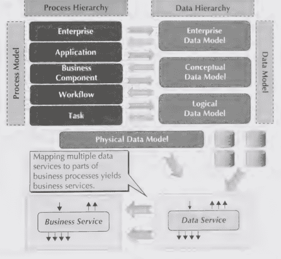

图 10-5. 自上而下的服务识别过程

在业务组件层面，业务流程针对特定的业务单元进行了上下文化处理，代表其相关活动。业务组件被编排在一起形成工作流。与特定工作流相关的业务流程可能使用多个业务组件进行编排，并支持多个业务单元的业务功能。工作流可以进一步拆分并由一组任务表示。任务流是在特定任务的微观和亚微观视角下理解业务流程的地方。一组任务构成一个工作流。

另一方面，数据层次结构反映了之前讨论的企业信息架构。企业模型或织体位于层次结构的顶端。任务和工作流作用于物理数据。应用程序功能和业务组件逻辑在提供特定功能的同时，作用于逻辑数据元素。这一切的底层基础是物理数据模型。

从服务平台的角度来看，业务组件由依赖数据服务的协作业务服务组成。这些服务从物理数据存储中访问并操纵数据。将多个数据服务映射到业务流程的不同部分，就产生了业务服务。

这种自上而下的表示也可以称为业务活动模型。这种表示法本质上是将企业的业务流程分解为它的子流程、工作流和任务。任务基本上映射到应用程序提供的功能部分。考虑一个具有多个活动泳道的图，用来说明业务流程到 IT 边界的映射。跨越泳道边界的交互是服务的候选者。服务可以进一步拆分为数据服务：访问数据存储并将数据服务操作（代表创建、读取、更新和删除 (CRUD) 功能）映射到逻辑数据模型中的实体。封装业务流程逻辑并按相关业务分组的业务服务被映射到微服务和 API。最后，服务被描述为业务服务、信息服务或基础设施服务。

## 自下而上的方法

图 10-6 突出了识别服务的自下而上方法。在这种方法中，审查的是 IT 应用程序而非业务流程。应用程序分析导致对以下内容的理解：

- 应用程序功能
- 应用程序暴露的接口
- 数据和信息的输入/输出
- 封装在方法中的应用程序逻辑
- 数据和信息模型

此评估还包括了与应用程序相关的数据模型、规则、模式、应用程序表、存储过程、业务规则和业务事件。除了分析，还可能对应用程序进行某种程度的反向工程。自下而上的方法在数据服务方面产生了类似的理解。编程逻辑作为底层数据模型的必要封装，形成了数据服务的基础。在应用程序的业务上下文中将这些数据服务映射到逻辑块，可以提供更广阔的业务服务视图。

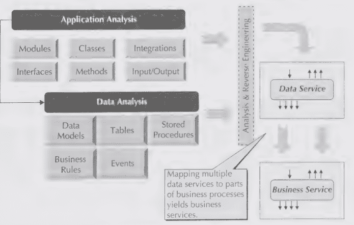

图 10-6. 自下而上的服务识别过程

## 集成中间向外的方法

图 10-7 展示了识别服务的集成中间向外方法。这种方法在服务识别上同时采取了自上而下和自下而上的路径。除了应用程序分析外，还创建了业务流程到服务及可用应用程序的映射。获得的服务列表经过合理化处理，以确保服务组合的完整性且没有任何冗余。这两种方法最终有一个共同点：从流程和应用程序两个角度识别对数据服务的核心理解。


图 10-7. 混合中间向外的服务识别过程

图 10-8 提供了业务流程如何映射到服务的视觉化解释。该图说明了一个常见功能——例如，这可以包含一个商店奖励积分卡的应用程序。业务流程的最高层显示为 L0 流程，在我们的示例中由物理应用购买积分卡来表示。这可以进一步拆分为 L1 流程：激活账户和验证账户。业务流程的 L2 级拆分由以下任务表示：检索历史、请求信用报告、计算分数和确定申请人资格。


图 10-8. 业务流程到服务的示例映射

服务层包含一个名为账户激活服务的复合服务。该服务依赖于创建账户和配置配置的服务。检索历史、请求信用报告、计算分数和确定申请人资格这四个任务最终映射到三个底层服务——即信用服务（封装器）、检索历史服务和资格确定服务：

- 信用服务是一种封装服务，调用第三方服务端点并支持两个任务。
- 检索历史服务是一种信息服务，直接访问客户数据库。值得注意的是，信用服务（封装器）在该模型中也可以被视为信息服务，因为它访问了第三方服务并将接收到的信息作为响应。
- 资格确定是一种基础设施服务，访问业务规则引擎（技术组件）并根据规则引擎的执行结果提供响应。

## 服务平台的指导原则

当组织采用服务平台概念来使其现有的 Java 应用程序组合现代化时，某些相关的指导原则应该优先考虑并驱动这些应用程序的识别、采用和现代化改造。这些原则应该驱动服务平台的概念化，并在决策过程中出现冲突时变得尤为重要。以下是这些指导原则：

- 服务提供者与服务消费者之间的松耦合
- 符合 J2EE 标准，利用 J2EE 标准实现服务的开发并部署到 Tomcat 等标准的应用程序服务器容器中
- 服务层每个组件的面向服务化
- 高可配置的运行时参数
- 可重用的服务集
- 高扩展性和可扩展性的服务平台

松耦合确保了一个服务的更改不会影响另一个服务；每个服务都可以独立演进。确保服务提供者内部逻辑的修改不会影响其消费者是至关重要的。这可以通过确保服务提供者的合约（接口）不发生变化来实现。

根据服务层的不同，组件可以提供如下能力：

- 核心技术能力，如安全、缓存或消息传递
- 核心基础设施能力，如注册中心、版本控制或推送通知
- 核心业务能力，如订阅管理或调用路由

在跨服务层的每个组件中提供面向服务的导向，意味着无论组件的性质如何，所有组件都经过设计并暴露为服务。

如果在服务平台中内置了适当的服务监控和服务管理功能，就可以实现高可配置的运行时参数。该平台应具备细粒度的管理能力，以便根据需要对每个服务进行控制和配置。

服务平台还应该提供在不同粒度级别上促进重用的服务。理想情况下，重用必须在框架和框架层面都是可行的，这样既可以重用粗粒度服务，也可以重用细粒度服务。

高扩展性和可扩展的服务平台必须能够以分布式方式提供服务，以便服务进行水平扩展。服务还可以池化，以确保它们始终可用。扩展性源于功能的抽象以及 API 和 SDK 的暴露，使得实现是可配置的，并通过插件式提供者扩展功能。

## 核心服务

尽管一个组织可能拥有满足业务和技术能力的服务组合，但多个业务过程也可以识别并利用组织中的某些通用服务。此类服务被称为核心服务。

过去几年出现了微服务的出现，它是自包含的、细粒度的边界，独立存在，在容器内独立部署并独立更改。微服务可以与其他服务通信，从而满足业务功能。多个服务可以部署在一起，也可以跨进程边界分布。微服务可以通过 REST 调用或通过定义 API 的其他基于网络的通信进行通信。同一虚拟机内的微服务还可以通过暴露的接口相互通信。

在同一个 Java 虚拟机 (JVM) 中托管多个微服务有优缺点。由于服务共享同一个堆，如果一个服务发生故障，可能会迅速导致其他服务崩溃；本质上是将 JAR 或 WAR 文件复制到运行在 JVM 内的应用程序服务器上，从而实现资源的高效利用。缺点是服务之间没有隔离。另一种替代方案是将每个服务部署在自己的虚拟机或自己的容器中。开源的 Docker 和 Kubernetes 集群已出现在基于容器的服务部署的最前沿。

## 服务平台栈与框架

一个典型的服务平台可以被看作一组分布式组件，这些组件提供核心服务，允许企业定义其服务并将此类服务部署到平台上。部署的服务必须符合特定的规范才能成为服务平台的一部分。

服务平台的关键层或组件如图 10-9 所示。本章译文中将详细讨论各个层和组件。关键层或组件的高级描述详见表 10-1。

### 图 10-9. 服务平台技术栈概念架构

| 层/组件 | 描述 |
|---|---|
| 监控 | 管理 | 呈现 |
| 通知 | 编排/协同 | |
| 安全 | 可靠消息传递 | 备备 |
| 注册中心与仓库 | | |
| 发现 | | |
| 策略、接口定义 (IDL)、元数据 | 描述 |
| 缓存 | | |
| SOAP, XML, JSON | 消息传递 | |
| HTTP, JMS, TCP/IP sockets | 传输 | |
| 注册中心 | 充当“黄页”或查找点，服务生产者在此处发布其可用性，服务消费者在此查找并使用可用服务 |
| 仓库 | 存储服务端点和服务的元数据 |
| 发现框架 | 用于注册服务消费者并允许发现已注册服务的框架 |
| 服务描述 | 使用 Web 应用程序描述 (WSDL) 和 Web 服务描述语言 (WSDL) 等标准的服务的元数据和接口定义 |
| 策略 | 关于其使用的策略 |

### 表 10-1. 概念性服务平台栈描述

| 层/组件 | 描述 |
|---|---|
| 备备 | 支持通过消费者和生产者之间的协商合约请求或提供对服务的访问的组件 |
| 安全 | 用于解决服务安全不同方面的安全模型，包括身份验证、授权、数据加密或服务之间的通信 |
| 管理 | 通过实现管理接口定义服务管理，使服务对管理层可见并在仪表板中显示 |
| 监控 | 监控服务并在仪表板中显示各种服务属性 |
| 缓存 | 将数据存储在中间位置以进行低延迟检索，而无需从主数据存储检索数据 |
| 消息格式 | 支持不同的消息和数据格式，如 SOAP, XML, JSON |
| 传输协议 | 支持不同的传输方式，如 HTTP, JMS, TCP/IP sockets |
| 编排/协同 | 通过业务流程管理和异步事件触发通过松耦合互操作的服务来开发企业系统 |
| 可靠消息传递与通知 | 分布式服务和应用程序之间消息和通知的可靠交付 |
| 事务 | 处理跨应用程序和数据库的分布式事务 |

## 服务平台功能

图 10-9 描绘的服务平台概念参考架构可以进一步划分为一系列关键功能。功能集由图 10-10 表示，该图描述了图 10-9 中识别的一些主要组件。


图 10-10 服务功能

托管微服务的服务容器提供如下基本功能：

- 用于注册服务的注册中心
- 服务的版本控制，因为并非所有消费者都会升级到最新服务
- 服务池，使服务实例在 Web 范围内可用
- 安全拦截器，确保请求可以被安全地处理
- 文档组件，可以自动生成服务文档并为服务消费者提供上下文帮助

服务的版本控制必须谨慎对待。安全拦截器确保调用可以被拦截，并在允许继续执行服务之前进行授权检查。自动生成服务文档使服务提供者能够轻松发布服务接口和服务合约以供消费者接受。这种做法对于暴露公共 API 的信息共享特别有用。

安全框架提供授权服务、多因素身份认证、验证、令牌生成和加密。服务部署确保服务带有适当的元数据，从而自动解包并部署到服务容器中。部署的服务需要监控和管理。容器还提供了以不同粒度运行服务的能力，并可以特定的开启或监控。缓存和缓存管理是容器的另一个重要方面，它们在提供高可用性、扩展性和性能方面起着重要作用。容器还必须提供测试自动化，以便于部署、全面测试和持续过渡到生产环境。

服务容器的一些基础设施服务包括：

- 日志
- 异常管理
- 中间件服务
- REST 发现和目录接口

服务容器中的消息框架必须支持以下功能：

- 核心消息基础设施
- 通知服务
- 智能路由
- 推送式通知
- 网关

数据映射、数据转换和服务编排都是服务容器的核心功能。某些服务可能不直接提供这些功能，但可能允许结合消息框架来使用业务流程管理组件。其他服务容器还允许利用企业总线或面向消息的中间件。服务容器的性能和服务质量 (QoS) 决定了可以部署在该容器上的关键任务型服务的类型。

## 将 Java 应用现代化为服务

单体 Java 应用可以以分布式方式进行部署。为了将 Java 应用拆分为服务，必须对这些应用进行解构。这种应用解构在许多方面都反映了我们在第 4 章中看到的架构解构。事实上，应用解构发生在架构解构之前，架构解构是跨架构层对应用进行剖析。架构解构采用业务领域的自顶向下视图，识别跨业务、功能、技术和基础设施架构的各种组件。在业务和功能层识别出的某些组件可以进一步拆分为更小的单元。如果围绕某个组件可以创建一个自包含的边界，它就可以变成一个服务。在业务和功能层，识别出的服务包括业务服务、流程服务和信息服务。在技术和基础设施层识别出的组件是其他企业信息系统 (EIS) 的封装服务，或是技术/基础设施服务。

Java 应用可以被解构为一组服务。在 Java 应用代码内部，必须识别功能边界，以确定哪些 Java 类映射到架构中的功能块。在将 Java 应用现代化为服务的过程中，可以采用两种方法：

- **直接重构**：在这种方法中，通过暴力重构将 Java 应用现代化为一个或多个服务。将形成功能边界的类集合分离出来并进行修改，使得这些类的功能通过定义良好的接口暴露出来。如果 Java 应用很复杂，或者需要重构为几个微服务，那么这项耗时的任务可能会带来业务风险。直接重构方法对于复杂性不大的应用程序易于实现，只需要几个微服务。

- **服务封装**：在这种方法中，Java 应用最初保持不变；但是，引入了一组服务作为底层 Java 应用的透传层。这些服务的存在仅是为了确保消费者能够通过调用暴露的服务 API 来请求和访问某些功能。在此期间，这会导致额外的维护工作，除了现有的 Java 应用之外，还需要创建和部署某些服务。随着时间的推移，映射到特定服务的 Java 应用逻辑会被传输到服务本身。最终，随着 Java 应用逻辑被拆解并吸收到每个服务封装器中，Java 应用将变成一个几乎没有逻辑的外壳。此时，由于其对组织的价值和效用很低，该应用就可以退役。

这些服务封装器充当占位符，当 Java 应用最终解体时，它们会变为微服务。图 10-11 至 10-14 展示了服务封装重构方法的两个示例，即从旧的 Java 和非 Java 代码缓慢迁移到面向服务的 Java 代码。


图 10-11. 遗留 Java 数据库应用程序的修复


图 10-12. 迁移到 Oracle 或任何其他数据库

| AR | 账单 | CRM | 营销 |
| :--- | :--- | :--- | :--- |
| AR | 账单 | CRM | 营销 |

现有遗留消息架构使用基于 DB2 表的旧队列进行消息传递。

引入标准的消息 API，可以在一段时间内替换旧的基于队列的消息逻辑，并允许应用程序切换到此无关的 API。


图 10-13. 遗留 Java 消息应用程序的修复


图 10-14. 迁移到 ESB 和/或保留新的消息 API

## 总结

重构现有的 Java 应用组合的一个重要步骤是识别并创建一组服务，这些服务代表由该组合功能支持的业务流程。在业务流程的执行和编排期间，流程的数据和信息会被修改、聚合、转换，并存储或与其他外部业务流程共享。因此，我们看到业务流程的执行与企业内部发生的实际信息流紧密耦合。这些信息可以被建模为实体，以及概念、逻辑和物理数据模型。数据通过访问底层物理数据模型的数据服务进行检索、处理和存储。数据服务本身存在于信息架构的概念层和逻辑层。将数据服务映射到消费和操作数据的业务过程，就得出了实现封装业务逻辑的业务服务的需求。


# 服务组合与服务容器

服务组合必须在服务容器内进行部署和执行。本章介绍了参考服务容器的一种实现方式，讨论了服务容器堆栈的各种组件，并识别了服务容器必须支持的功能。

遗留 Java 应用可以重构为服务。如果这项重构工作没有按照经过良好规划的阶段进行，将会干扰现有的消费者和最终用户。必须遵循逐步步进的方法。遗留应用程序功能的过渡封装器允许现有应用程序在重构部分服务的同时继续运行。遗留应用程序的部分通过松耦合的接口逐步替换，最终被重构为服务。下一章将介绍服务容器的细节、组件以及服务的整体生命周期。

# 第 11 章：服务生命周期

面向服务架构 (SOA) 的主流采用已不再是一个新现象。将 Java 应用重构为 SOA 可能是一项艰巨的任务，特别是当努力与架构愿景不一致时。许多组织重新编译并部署其遗留代码库到新版本的服务器平台，错误地认为只要新的应用程序服务器支持 SOA，他们的应用程序就实现了面向服务。SOA 平台和 API 仅提供了一些标准和理论思想。新的服务范式超越了仅仅编写使用 SOAP 通信或暴露 REST API 的应用程序。今天，我们使用服务发现、服务复用和松耦合架构来定义服务，这随着部署在微服务容器上的微服务的出现而开始实现。

上一章引入了微服务和服务平台的概念、将传统 Java 应用转换为服务的方法，以及将它们载入到服务平台的过程。

本章通过回顾服务生命周期的阶段进一步扩展讨论。已部署服务的其他服务的发现和消费是宣布服务平台重构策略成功的重要里程碑。最后，本章讨论了这些新服务的治理和管理。

## 理解服务生命周期

随着组织推进并执行围绕 SOA 的愿景，服务平台的范围和期望将随着这种 SOA 采用而明确。企业愿景在创建一个用于部署、托管、支持和运行服务的服务平台时最终实现。这些服务并不是随机出现在平台上的。服务的识别和定义需要大量的背景工作，而实际服务的创建是周密规划和执行的结果。

服务。一旦服务部署在平台上，就需要对其进行持续管理。

简单来说，服务是组织拥有并运营的软件资产。服务经过了概念化、创建、提供特定功能，并最终因缺乏效用而被替换或关闭。从组织或财务的角度来看，如果能清晰地理解服务的生命周期，企业就可以有效且高效地管理这一过程。服务的技术开发和维护深受其生命周期的影响。只有当服务被终端用户需求并消费时，它才是有用的。因此，对服务生命周期的理解有助于推进这些服务的整体战略和日常战术操作。这种理解还将帮助实现服务生命周期步骤的自动化，从而消除主要的人工干预点。

在松耦合的 SOA 中，应用程序由多个运行服务组成。这使得应用程序易于维护和增强。这种方法还促进了跨组织的服务重复用，因为一个服务可以是多个应用程序的一部分。

图 11-1 提供了服务生命周期的高级视图。从开发者的角度来看，服务的生命周期与其他任何应用程序或软件的生命周期相似。


图 11-1. 服务生命周期的高级视图

任何其他应用程序或软件。服务首先必须经过概念化。然后对其进行设计、开发、测试和部署。定期，可以对服务进行增强和更新。在某一个点，服务可能会被退役。

当你深入研究这一过程，超越简单的开发者视角和以应用程序为中心的软件开发时，服务的生命周期会变得复杂一些。尽管应用程序是由开发者团队创建并在特定业务中由终端用户消费，但服务明显不同。

### 服务提供者

服务由该服务的提供者进行概念化和创建。除了与传统的应用程序开发生命周期相似之处外，服务的部署与应用程序的部署不同。当服务部署到服务平台时，它们被安置在微容器中。服务可以针对不同的消费者部署多个版本。服务的某些部分可能会随着时间的推移而过时，最终变得对消费者不可用。因此，服务的生命周期比传统应用程序要复杂得多。

### 服务消费者

从消费者的角度来看，服务的生命周期与传统应用程序终端用户的视图不同。由于服务的物理位置可能会发生变化，有时消费者可能在使用服务之前需要发现该服务。服务的消费者可以是其他服务，而不一定是业务线中的终端用户。作为服务本身，这些消费者服务必须经过它们自己的生命周期：设计、开发、测试和部署。这些消费者服务可能还会经历升级、迁移到其他技术平台、版本化、退役和停用。

如果提供者和消费者需要多次服务迭代，这将显著增加生命周期的复杂性。对提供者的更改不能破坏消费者。随着组织需求的不断演变，现有的业务模型将需要动态变化的需求。市场时间和交付速度至关重要。敏捷开发和对代码库的多次迭代已成为当今企业的常态。满足这种日益增加的功能增强频率的最佳方法是将服务拆分为细粒度的微服务。这种现代 SOA 已经从服务的原始定义中发生了巨大的演变。


精细化的服务管理确保所有服务的部署能够：

- 正确配置
- 对其性能进行监控和管理
- 对消费者可见且可用
- 符合 `SLA` 以及系统的其他非功能性需求
- 获得支持和管理以满足消费者服务的需求

### 服务注册表

简单来说，服务注册表是供消费者访问和调用的可用服务的目录。实际上，服务注册表包含的内容远不止于此。服务注册表有助于服务的注册、发现、使用和治理。服务注册表概念最早实现之一是通用描述、发现和集成（`UDDI`）注册表，它最初被作为核心 Web 服务标准提出的。`UDDI` 实现允许在目录中注册 Web 服务，并附带 Web 服务描述语言（`WSDL`）文档，该文档描述了与注册的 Web 服务交互的协议绑定和消息格式。请求应用程序使用 `SOAP` 来与 Web 服务进行交互和消息交换。`UDDI` 没有获得广泛接受，并静静地被遗忘。

随着 `REST` 服务的流行，对服务注册表的需求再次出现。随着向微服务架构的转型，对服务注册表获得了大量的关注。微服务架构导致了组织构建并部署了多个细粒度服务。由于组织中服务的激增，这些服务经历了快速的蜕变，如果没有适当的跟踪和治理，会导致维护问题。组织内部不同业务单元之间的服务重复也是另一个挑战。服务注册表充当类似于目录的角色；由单一仓库负责存放组织所属的所有可用服务及其多个版本。

本章引入了用于 `REST` 服务的注册表概念，称为 `REST` 描述与集成（`RDDI`）。你可能从未听过这个术语，因为 `RDDI` 既不是标准也不是公开的参考实现。是我发明了 `RDDI` 概念；并在特定企业的咨询项目中实施了多个注册表的变体。那么 `RDDI` 到底是什么？它是一个专门为当前 `REST` 服务设计的注册表，具有如下特性：

- 作为服务平台提供的所有服务的注册器、仓库和发现机制
- 包含业务及其支持服务的程序描述
- 提供 `REST` 服务本身的程序描述
- 使用 `XML`、`HTTP`、`JSON` 和其他数据格式，同时提供与平台无关的编程模型和架构
- 维护契约（如 `WADL`），由 `URI`、资源、服务表示的结构和内容、其格式以及每个资源的 `HTTP` 方法组成

在业务部门着手构建新服务之前，团队可以参考注册表仓库中可用服务的目录。服务注册表包含有关每个可用服务的元数据和描述。如果已经存在这样的服务，那么它可能是重用的候选。

服务注册表像提议的 `RDDI` 一样，具有设计契约和运行时契约。图 11-2 显示了 `RDDI` 服务注册表的一个示例。该注册表标准化 `WADL` 以表示服务契约。服务开发者为 `RDDI` 创建服务接口和实现。客户端开发者或消费者开发客户端服务并在 `RDDI` 注册。通过发布的 `WADL` 契约接口访问服务。因此，在设计阶段，客户端服务必须针对发布的 `WADL` 契约进行开发和测试，以便与该接口保持一致。

良好的服务注册表实现应该不仅仅是服务的数据库或仓库。它应该包含来自所有可用服务的实例、位置、已注册的客户端、元数据、使用特性、分析以及其他数据。随着新服务或现有服务新实例的部署，这些信息也会注册到服务注册中心。离线的服务也必须被跟踪。服务的所有性能和使用指标都会被追踪并通过服务注册中心提供。许多大型企业，特别是那些采用和实施尖端技术的企业，都有自己内部适配和实现的服务平台和服务注册中心。由于目前还没有关于服务注册中心概念的开放标准，各机构所使用的实现方案内部细节并不广为人知。唯一的开放标准是 `UDDI`，但它从未完全满足当时的需求，并很快就失宠了。

虽然每个服务实例都暴露相同的 `API`，但每个服务实例的位置可能会动态变化。为了讨论起见，服务和实例可以互换使用。

可用服务实例的数量也会根据服务所承受的负载而变化。在建议的 `RDDI` 模型中，服务的消费者在消费该服务之前将首先查询服务注册中心以发现可用实例。在运行时，客户端服务连接到 `RDDI` 实例并接收提供者服务端点的实际位置。

今天企业中可能存在几种编排机制。事实上，我见过许多一个服务直接调用另一个服务来消费该服务的情况。该端点被硬编码在消费者服务中。然而，这种做法必须被制止，因为最终会为持续维护带来问题。也可以考虑其他的编排机制，例如向全局队列发送消息并接收有关待消费服务之位置的响应。图 11-3 显示了类似于 `RDDI` 的服务注册中心在运行时是如何使用的，客户端连接到 `RDDI` 服务器以获取 `REST` 服务的物理端点。


图 11-3. 类似 RDDI 的服务注册中心的运行时约定

在图 11-3 中，客户端服务联系 `RDDI` 服务器并接收客户端感兴趣要调用的提供者服务的物理端点。客户端服务通过 `XML` 或 `JSON` 消息进行通信，并调用由 `Service A` 完成的“创建工作单”方法。然后它调用 `Service B` “检查”订单的状态。对于未来的检查，客户端服务可以直接调用端点，可能通过缓存服务 `URL` 实现。在此特定的插图中，可能不需要再次联系注册中心。在本章的稍后部分，我们将看到注册中心的实现并不像图 11-3 所示的图那样简单。

鉴于服务注册中心对微服务架构的重要性，它必须是高可用的，且不能成为单点故障。如果服务注册中心本身离线，服务的消费者可能无法找到可用服务。服务注册中心的位置必须发布给所有消费者。理想情况下，服务注册中心实例必须配置为已知的静态 `IP` 地址。当服务注册中心的位置发生变化时，必须更新服务消费者配置。服务注册中心的多个实例必须与仓库保持同步，以便所有服务注册服务包含相同的信息。一个服务注册中心底层数据库的更改必须快速传播到所有注册实例。

注册中心的内部结构可以是简单的，也可以是非常复杂的，取决于服务平台的需求。图 11-4 显示了服务注册中心的内部。


图 11-4. 注册中心的内部

在图 11-4 中，显示了一个名为 `Registry API` 的区块。服务提供者和消费者必须通过服务注册中心暴露的此 `API` 访问注册中心。该 `API` 提供了注册功能的抽象，如下：

- 注册到注册中心的服务的生命周期管理
- 服务的版本控制
- 策略管理
- 合规性与验证
- 通过各种机制对服务的访问管理，包括令牌、租约以及在需要时的多因素身份验证

安全框架必须抽象访问管理、令牌生成与验证以及其他安全需求。注册功能支持针对注册服务的元数据仓库和文档管理。注册中心还提供对所有部署服务的管理、仪表和监控。

服务注册中心的仓库功能存储服务相关的制品、策略文件、配置信息和元数据。这些信息在访问注册中心时会被发布并被发现，以便消费者能够搜索并找到感兴趣的服务。关于特定服务的存在的验知识可能发生在消费者服务的设计阶段。如果服务提供者和服务消费者在设计时进行交互，可以为该特定服务专门构建实例。在某些情况下，消费者在运行时联系注册中心并动态发现服务，而在设计时对可用服务没有先验知识。中央仓库确保了组织内不会出现重复的服务。这最终促进了组织内各个业务部门之间的重用、伙伴关系和持续对话。

### 服务部署与注册

在消费者发现并使用某个服务之前，该服务必须被部署并注册到服务注册中心。事实上，良好的架构会确保特定服务的所有实例都已注册。当服务实例由于任何原因关闭时，该服务实例也可以从服务注册中心注销。在此语境下，“服务”指的是所有实例。在云环境中，为了负载均衡的目的，系统自动启动额外的服务实例是非常常见的。当服务实例被部署时，它负责自己向服务注册中心注册自己。

图 11-5 展示了服务部署和注册过程的插图。

服务注册可以通过两种方式之一进行：

- 服务注册器 (`Service registrar`)
- 自我注册 (`Self-registration`)

#### 服务注册器

服务注册器为服务注册过程提供了最大的灵活性。服务注册器允许在设计时对服务进行注册。即使在部署服务实例之前，服务所有者可以使用关联的 `UI` 服务接口提供服务描述和其他元数据，并将服务注册到服务注册中心。此注册过程也可以通过上传包含服务及其描述的服务归包到服务注册器来实现自动化。解包服务归包、将服务部署到正确位置以及注册服务的职责由服务注册器承担。

这种方法保持了服务核心代码的整洁，并将服务注册逻辑集中在服务注册器内部。这种方法对于服务注册的确切时刻提供了灵活性。在许多组织中，生产服务的业务部门可能与想要消费服务的部门不同。在设计阶段，这两个小组可能会选择相互通信，以决定 `API`、交换的数据以及其他关键信息。在这种情况下，在消费者开始使用服务很久之前，服务提供者就会将服务注册到服务注册中心。

业务部门应避免在不考虑该服务消费者的情况下，随意地生产和部署服务。在这种情况下，消费者将需要搜索特定的功能，并希望有人已经在服务注册表中部署了该功能的服务。

服务注册器（`service registrar`）的一个可选功能是能够监控服务或其实例的健康状况或可用性。建议创建一个单独的服务来定期执行这种合规性检查，这样服务注册表最初无需承担额外的职责。此外，让所有服务实现一个管理接口也是明智的，可以通过该接口去探测服务并接收心跳，从而揭示服务的健康状况和正常运行情况。

#### 自注册

中心注册注册的替代方案是在服务实例启动时进行自注册过程。服务实例通过一个通告接口连接服务注册表，并提供包括位置和其他元数据在内的信息。这使得感兴趣的消费者可以通过联系服务注册表来查找具有该功能的服务，从而发现该服务。

服务注册表可以通过调用其管理接口来定期检查服务实例的健康状况和可用性。或者，服务实例也可以定期重新向注册表注册。在任何情况下，如果服务由于任何原因失败，服务注册表必须能够判断并据此更新其信息。

这种方法将服务与每个服务中的注册表逻辑紧密耦合。这最终会导致系统难以维护，因为每个服务都拥有注册逻辑。任何关于服务注册的简单更改，都需要所有已部署的服务升级其注册逻辑。

### 服务发现

在微服务架构中，服务发现是消费者的一种推荐方法，用于通过服务注册表发现该服务的可用性和位置。这种消费者可以是一个终端应用程序，也可以是暴露高级 `API` 的粗粒度服务。大多数服务运行在虚拟化环境和容器中。此类实例的位置是动态变化的。特定服务的可用实例数量也可能不同。因此，消费者最好的方式是首先访问一个了解服务所有信息和上下文的服务注册表。对服务注册表的适当治理可以在服务发现点应用使用策略。图 11-6 展示了服务发现机制和消费者的注册。


图 11-6. 服务发现机制和消费者的注册

客户端发现或由消费者进行的发现将该消费者与服务注册表紧密交织。每个消费者都实现了相同的发现和使用服务的逻辑。服务发现的一个优势是它减少了为了执行治理的网络跳数。

另一种服务发现方法允许消费者请求运行在发布位置的负载均衡器。该负载均衡器作为代理连接服务注册表，定位服务实例，然后将消费者请求转发给服务。这种方法被称为服务端服务发现。来自服务的响应被转发给消费者。客户端代码现在变得不再复杂，因为发现不再由每个客户端执行。可以将服务注册表封装到负载均衡器中，在这种情况下，服务注册表除了是服务信息仓库外，还是代理和负载均衡器。图 11-6 显示消费者如何先向服务注册表注册，随后通过服务发现机制并使用服务。该图还描绘了如果服务部署在运行不同物理位置的服务容器上，负载均衡器是如何放置在服务注册表实例和服务实例之间的。

服务虚拟化的概念允许端点更改其位置而不影响对提供者服务的查找。由于内置了位置透明性，消费者可以查找服务。端点可以发生变化但不影响查找能力，这对组织来说是一个巨大的益处。

### 服务消费

虽然创建服务是为了被消费，但服务提供者可能还希望指定如何消费服务的条件。特别是对于公共构建并供普通公众消费的服务，服务消费是一个高度管理和监控的事件。即使在服务消费者和服务提供者都来自企业内部或合作伙伴生态系统的企业环境中，服务也会提前向服务的消费者通告其可用性和服务水平协议（`SLA`）。这促进了企业内部的复用，允许另一个部门消费此服务，而无需编写和维护自己的服务。服务消费者还能看到是哪个部门生产的服务。在企业中，服务的所有者和预期消费者预先约定 `SLA` 实际上是非常常见的。

消费请求可能先由团队进行审查并提前批准。配置可能会随着管理特定消费者服务权限和使用的策略更新而加载到注册表中。这些策略可能决定身份验证和授权上下文、允许消费级别、允许的服务版本以及因素。

在运行时，为消费者提供一个特定的服务实例进行通信以消费服务。服务注册表可以选择首先判断消费者是否被允许消费其请求的服务。不同的消费者可能只被授予访问服务的某些部分。在粗粒度服务请求被消费的情况下，可能会出现此类访问限制。粗粒度服务可能封装了其他细粒度服务，其中某些服务可能被限制，特定消费者无法访问。这意味着，基于角色的授权，消费者可能不被调用服务暴露的所有 `API` 调用。消费者还可能消费不同版本的服务。某些消费者可能被允许在短时间内消费服务，而其他消费者可能在通过特殊令牌进行特殊身份验证和授权后才被授予消费。

服务的消费者应该能够查询服务注册表中有关服务的元数据。如果消费者拥有权限，他们可能还可以接收和处理服务提供者的元数据。消费者还可以从服务注册表检索服务接口定义和文档。


在许多情况下，消费者感兴趣的是与粗粒度或高级服务交互，而这些服务反过来可能需要聚合多个服务的数据和功能。在这种情况下，广泛使用的一种模式是使用充当粗粒度服务的中介者。

图 11-7 描述了消费者服务与中介服务进行通信。中介服务通过服务注册表进行主动注册和通告。这是一个粗粒度服务，它反过来与多个细粒度服务通信。细粒度服务可以提供需要组装并发送给消费者的部分数据。中介服务聚合请求细粒度服务的结果，并可能在返回之前对结果进行处理。


图 11-7. 中介服务提供对细粒度服务的访问

# 第 11 章：服务生命周期

结果集返回给调用的消费者服务。在这种情况下，此中介服务实际上是细粒度服务的门面（`façade`）。

同样，一个中介服务可能有多个消费者。每个消费者都可能期望略有不同的数据格式或数据。在这种情况下，中介服务可以包含逻辑，以识别调用消费者的身份。中介服务将使用一个转换器（`transformer`），将聚合的数据映射并转换为调用消费者可以消费的适当格式。

# 服务治理与管理

传统的 `SOA` 治理模型要求一种中心化的治理功能。在那种模型中，整个技术栈对工具、编程语言、最佳实践、持续集成以及应用程序的交付进行了标准化。随着微服务架构、虚拟化环境和 `API` 的出现，中心化治理已让位于去中心化的治理模型。

传统的 `SOA` 演变为基于虚拟化容器的微服务架构，是组织向属于多个业务单元或小组的去中心化业务能力演进的直接结果。这种业务流程和业务能力处理方式的演变，加上维护和扩展单体应用的困难，导致了最初将应用程序部署到应用服务器的应用程序架构的解构。

功能推向市场的紧迫感和速度，以及业务单元对其他内部小组的依赖，导致开发小组在构建和发布服务及其 `API` 到生产环境时，几乎没有经过治理的监管。在许多案例中，开发者最终还负责支持和维护这些服务，而没有适当机制来捕捉对这些服务的修改和增强。

开发和运营团队以前在企业中有着明确的职责分工。随着越来越多的协作工作场所的出现，这些功能演变并合并为一个单元。这种进展导致了 `DevOps` 范式的产生，它模糊了开发与运营之间的界限。作为一个自然结果，治理和服务管理领域已经演变，以应对多个小组创建和维护服务，并为组织内部或其他客户端服务暴露 `API` 消费的挑战。


服务治理涵盖以下内容：

- 确保从构思到实现及持续管理中基于标准的 `SOA` 原则的策略和流程
- 建立控制措施，以确保在采用 `SOA` 时符合业务预期
- 使业务单元能够对服务、服务的获取和技术以及引入新解决方案做出明智决策，以满足紧迫的业务需求
- 在整个服务生命周期内管理由提供者、管理员和消费者组成的服务社区的预期

在缺乏正确服务治理的情况下，会出现以下问题：

- 业务部门无法理解服务，`IT` 无法发现和使用服务
- 业务服务需求与 `IT` 服务实现之间的对齐不佳
- 服务消费者和提供者之间缺乏信任
- 难以定义和监控 `SLA` 以及其他功能性需求
- 服务不可控且不可管理的增长，且复用率低
- 极细粒度的微服务导致纳米服务（`nano-service`）反模式；此类服务本身用处不大，且几乎总是作为粗粒度服务的一部分被使用

## 管理接口

服务或应用程序管理实践（无论是对于遗留应用程序、现代应用程序，甚至是新的微服务）往往是事后考虑的，是关键任务问题出现时部门“救火演习”的结果。由于 `Java` 的普及和快速采用，它已经成为企业内部最受欢迎的选用语言。然而，对于这些应用程序的治理和管理并没有足够的思考。`Java` 管理扩展（`JMX`）是 `Java` 平台的核心特性，但遗憾的是，大多数开发者和架构师从未使用此 `API` 来帮助管理他们的 `Java` 应用程序。最终，应用程序服务为 `JMX` 提供了钩子（`hooks`），以便可以在服务器上管理部署的应用程序。

随着微服务和向微服务容器的部署，`Java` 应用程序可以极大受益于实现管理接口的松耦合服务。即使是一个提供探测部署服务健康能力的简单接口，也成为了不可或缺的管理工具，使消费者能够在调用服务之前通过联系服务注册表来确定服务的可用性。图 11-8 展示了一个具有监听机制的服务注册表，该机制可以定期检测所有已部署服务的心跳。监听组件与注册表的心跳组件和拦截器组件通信。整体的服务监控和管理平台确保所有部署的服务都是可用的。根据服务管理接口的设计和实现，可以对服务进行精细的仪器化和管理。

# 监控与管理平台


图 11-8 检查服务心跳

## 服务版本控制

在服务的生命周期内，服务的提供者和消费者都会经历增强。消费者业务逻辑的增强对服务提供者没有影响。同样，只要服务提供者宣传的功能本身没有改变，对服务提供者内部机制的修改也不应影响服务消费者。当服务被增强时，确保消费者不会崩溃是非常关键的。对服务提供者的大多数增强通常只会更改其内部实现，而不影响服务消费者。然而，有时现有服务提供者的 `API` 可能会发生变化或功能性变化，这可能会影响消费者。为了避免这种中断，服务提供者可以选择提供同一服务的多个版本，以便消费者可以选择留在旧版本，或选择增强其实现并升级到新的服务版本。

在某些服务注册表实现中，监听组件根据服务提供者在注册表中的认证来感知服务的变化。一旦检测到服务提供者的变更，监听器联系该服务的所有消费者并通知他们该更改。监听器还可以向服务提供者发送通知。在某些设计中，监听器可以向底层系统发送通知，然后由系统运行自动化测试，以确定消费者服务在使用服务提供者的新版本时是否会崩溃。图 11-9 显示了服务注册表的此类监听器组件。

在这种设计中，每当注册的服务发生转换时，拦截器组件就会通知监听器。有人认为，如果服务的提供者破坏了服务 `API`，那么在部署服务之前就应该对其进行测试并提前获知。在这种情况下，服务的消费者可以提前收到通知，以便他们主动采取措施增强消费者代码库以与修改后的服务 `API` 兼容。这通常发生在位于同一组织内部、能够在引入此类修改之前讨论设计变更的服务提供者和消费者之间。

然而，这对于所有情况可能并不是普遍现实的结果。即使提供者和消费者能够以这种方式进行，在系统层面将此逻辑整合到服务平台中仍然是一个良好的做法。从自动化的角度来看，这将消除依赖人工交互来传递 `API` 变更的偶然性，除了在设计阶段的人工交互之外。

# 第 11 章：服务生命周期


图 11-9. 服务注册提取的监听器组件概述

除了 `API` 修改外，本节概述的方法还允许在对服务进行 `API` 调整时自动捕获故障检测。

# 服务注册表清理

服务注册表应始终保持最新，绝不应包含已不存在服务的过期端点。作为治理流程的一部分，服务管理必须确保服务注册表能够感知到生成了新服务，哪些服务已经停止或完全关闭。关键服务可能会被更严密地实时监控，而其他非关键服务的监控频率可以较低。服务上管理接口的可用性使得服务注册表能够轻松方便地检测服务可用性，并在注册表中保持这些信息的更新。

# 服务分析、日志与追踪

所有活跃的服务都会生成插桩数据、日志、追踪，并可以进行分析。服务的执行还可能导致执行栈中产生异常；有时这些错误可能会停止运行时，或者导致系统处于未预期的状态。

其他情况下，服务的性能可能会下降。追踪组件应能够监控并提供服务操作、性能及其对消费者或服务提供者影响的细节。此类实时追踪和日志有助于纠正问题或在后续发布中修复问题。服务的多个方面可以被监控和插桩，包括其性能、消息和消息载荷、执行栈堆栈以及功能逻辑。服务分析收集有关服务的可用性、请求响应时间、并发请求、总请求数、吞吐量、延迟、数据库访问、运行时间 `SLA`、网络带宽利用率及其他指标的数据。这使得服务提供者能够根据对服务特征的理解定期提供改进。

## 总结

服务经历的生命周期比应用程序生命周期要复杂得多。服务有提供者和消费者。消费者通过服务注册表发现并使用服务，服务此前在其中注册了自己。消费者与提供者之间的合同可以在设计时建立，或者在某些情况下，消费者在运行时从服务注册表中动态发现并使用服务。对于无法预先消费者的公共服务而言，服务的动态发现是一项核心功能。在业务单元提前协作的企业中，设计时的讨论是可行的。

服务注册表提供了多种功能，包括作为服务的仓库、存储元数据以及为服务提供治理策略。服务注册表跟踪服务实例，监控服务的健康和可用性，通知监听器服务的变化，并维护服务的物理端点，以决定是否应为消费者提供访问凭据以及持续多久。

服务在其整个生命周期内都监控和管理。这确保了服务可以版本化，且不会因为 `API` 的适配和修改对消费者产生实质性影响。服务分析有助于确保性能 `SLA` 获得支持。

服务容器和微服务平台的出现改变了软件构建的演进。这主要通过支持业务快速演化的服务来实现，避免了支持长开发周期的单体应用的负担。软件工程方法论、自动化、服务设计、发现和消费的方法都是正在经历创新的领域。观察微服务架构和平台的蜕变，并看看一些大型科技公司将如何处理大规模服务消费，将是非常有趣的。也许这是未来某书中的一个相关话题！


# 第 12 章：Java 组合管理

创建一个管理良好且治理良好的 `Java` 应用程序组合（`Portfolio`）绝非一项易事。本书已经探讨了几个主题，包括 `Java` 应用程序的生命周期、将应用程序视为一组协作服务的概念，以及成功建立应用程序组合的各种方法。理解并实施这些建议将有助于并加强有效的现代化策略。`Java` 应用程序组合的管理和治理是一个持续的过程，而不是单一的、一次性的任务。

为了确保应用程序组合每隔几年更新一次翻新，启动一个全面且持续的 `Java` 组合管理策略至关重要。`Java` 应用程序组合管理中一个必要且关键的部分是建立组合治理，包括引入组织流程、收集和衡量相关指标、跟踪组合的关键性能指标（`KPI`）以及对应用程序组合做出明智决策。每个组织的目标都不同，受其特定的业务模型和企业性能目标的驱动。这种不同性通常反映在组织所跟踪的 `KPI` 中。

随着组织接受 `Java` 应用程序组合管理的概念，其达到的成熟程度可以被跟踪和改进。成熟度模型考虑了治理程序以及组织对已实施的流程和工具的遵循情况。通过遵循这种实践，组织最终可以建立一个衡量模型，以评估从组合中获得的价值以及对应用程序组合的投资回报率（`ROI`）。

# 应用程序组合治理

`Java` 组合管理的核心目标是应用程序组合的治理。治理本身的概念在涉及企业时有许多类型，包括：

- 公司和财务治理
- `IT` 治理
- 架构治理
- 应用程序组合治理

图 12-1 强调了这四类治理。每种类型都涉及不同的利益相关者，并需要不同的技能组合。某些类型是技术性的，而另一些则需要财务或业务运营的知识。公司和财务治理的讨论超本书的范围。然而，从非常高的角度来看，公司和财务治理确保了以下内容：

- 方向和管理
- 董事会对管理的监督
- 对股东的负责
- 透明度和披露
- 符合监管要求和其他法律
- 参与流程和功能


图 12-1. 整体治理领域

# 第 12 章：Java 组合管理

我们通过将技术管理描绘为架构治理的一个领域，将架构治理与技术管理区分开来。这是因为在本文语境下，技术管理的范围是为了确保技术战略、策略、技术路线图和技术项目管理等领域的管理。

另一方面，应用程序组合治理包含几个关键领域，包括：

- 建立一个用于衡量和管理应用程序组合的框架
- 与各种利益相关者合作，识别并建立与业务目标相关的指标
- 衡量应用程序组合性能
- 最大化应用程序组合的 `ROI`
- 从组合中的应用程序集中获得最大的业务价值
- 帮助架构和 `IT` 治理函数实现应用程序组合的现代化

架构治理和应用程序组合治理相互协作以管理应用程序组合。在第 3 章详细讨论 `APM`（应用程序组合管理）时，我们提到了应用程序组合的性能并定义了适用于应用程序组合的四大类指标。图 12-2 显示了之前涵盖的指标类别：

- 应用程序指标
- 应用程序组合指标
- `APM` 过程指标
- `APM` 有效性指标

应用程序组合的治理必须考虑这四大类指标。


图 12-2. Java 组合管理指标的分类

在此背景下，我们将深入探讨这些类别，并审查与本文讨论直接相关且具体的特定指标。某些指标是前瞻性或领先指标，而另一些指标则是回顾性或滞后性指标。除了指标的识别和定义外，要实现真正的成功，`Java` 应用组合的治理必须通过一个适当建立的治理框架，纳入整体性的治理方法。

# Java 组合治理框架

成功的治理框架的关键在于 `Java` 组合管理底层完善的架构纪律。这种实践在组织层面可以通过利用治理框架来实现，该框架对组合应用某些维度，然后连接、衡量并管理这些维度。


图 12-3. Java 组合治理框架的六个维度

图 12-3 展示了治理框架并显示了框架必须处理的六个维度：

- 政策与标准
- 流程与工具
- `KPI` 与指标
- 数据质量与管理
- 资源与资金
- 人员与执行

## 政策与标准

如果不建立一些需要遵循的准则和指南，我们就无法对 `Java` 应用组合进行治理。组织必须识别一组对其 `Java` 应用组合决策过程至关重要的特定标准或任务。这些标准随后形成了一系列政策和标准，其中一些应用于单个应用级别，而另一些则与组合级别相关。

例如，可以建立某些政策，目的是在未来 18 个月内推动组织和应用组合达到更高的成熟度水平。还可以纳入另一组政策，以帮助组织将其现有的面向服务的架构转型并改造面向微服务的容器架构。政策和标准应始终关注当下，以指导和影响应用组合的未来愿景。

与架构治理相结合，以下是与此处列出的部分政策和标准相关的说明性任务：

- 遵循 `OAuth 2` 进行身份验证
- 每季度审查架构，以决定采用服务容器
- 与应用组合作，帮助分析对核心实体、数据模式和数据质量的合规性
- 审查服务托管环境和工具，确保符合最佳实践
- 帮助识别并审查新启动计划的用户界面指南
- 为组织识别、选择并采用开发和测试工具
- 在企业内部的业务部门、企业架构师和 `IT` 经理之间促进广泛对话

从标准的角度来看，组合治理团队应与企业架构师合作，对所有新应用以及优先考虑的现有应用的现代化影响并执行以下政策和标准：

- 识别并构建可重用的微服务
- 注册新服务并使其可发现
- 选择工具、报告格式和报告问题

## KPI 与指标

指标和 `KPI` 是识别后进行衡量的实际且相关的观察结果，用于提供应用组合的洞察。指标涵盖多个领域，包括组合的整体性能、成本效益和投资回报率、运营风险和业务价值，以及各种其他特定应用和组合级别的衡量标准。

指标被松散定义为一种衡量系统或标准。它主要是一种数值评估，在组合管理的背景下，它衡量适用于一个或多个维以应用为中心的属性、财务数据、运营数据、技术属性、业务属性等。

`KPI` 是一种特殊的衡量标准。它提供了一种量化业务目标成功或进展的方法。所有的 `KPI` 都是指标，但并非所有指标都是 `KPI`。在下一个主要章节中，我们将详细讨论指标和 `KPI`。

通常，组织应该理解他们所收集的指标背后的原因。在这方面，识别和收集指标时应用 `SMART` 原则是必要的。`SMART` 代表特定的（`Specific`）、可衡量的（`Measurable`）、可执行的（`Actionable`）、相关的（`Relevant`）和及时的（`Timely`）：

- **特定 (`Specific`)**：指标定义明确，对于被衡量的内容没有歧义。通常，指标的性能与特定的负责人或责任制相关。
- **可衡量 (`Measurable`)**：在准确性、及时性、合规性甚至如何衡量指标方面可能存在挑战。除非指标易于衡量，否则它将是没用的。
- **可执行 (`Actionable`)**：衡量指标的结果必须产生对结果产生积极影响的行动。仅仅无目的地衡量某些事物将没有任何业务价值。
- **相关 (`Relevant`)**：重点应放在解决目标并具有战略目的的指标上。
- **及时 (`Timely`)**：指标应该在时间范围内进行衡量并提供，以便做出具有正确影响的有效决策。指标还应该衡量当前数据而非旧输入。

`SMART` 原则已作为设定项目管理目标或个人发展和员工绩效目标的标准应用；然而，通过某些微调，`SMART` 也可以应用于组合生命周期指标的识别和管理领域。通常，组织跟踪指标但不有目的地使用这些信息。有时，跟踪的指标并没有用或相关。将 `SMART` 应用指标的识别和定义可以帮助从组合中淘汰不需要指标。

为了确保 `Java` 组合管理的真正成功，必须收集当前的应用属性，以便指标和 `KPI` 也能用于决策过程，决定哪些应用应该停止运行，哪些应用应该增强。以下是一些指标的示例：

- 投资回报率（`ROI`）
- （现代化的）机会成本
- 资源混合成本
- 在进行项目的执行风险
- 对底线的影响
- 资本支出
- 运行与创建应用的支出百分比
- `FTE` 资源使用
- 组合整合
- 按时和预算执行情况
- 成本和努力的百分比差异
- 已承诺但未使用的金额
- 按月支出（以判断资金是快速消耗还是逐渐消耗）

## 数据质量与管理

分析、决策和 `Java` 组合的管理取决于数据的详细清单和可用性。确保收集输入具有最高水平的数据质量并不是一项易的任务。为了确保数据收集的一致性和质量，治理过程必须具备适当的数据质量方法以及正确的工具。大多数组织在 `Excel` 表格中收集应用组合数据。某些利益相关者甚至升级到基于 `Web` 的访问知识库。无论使用何种收集方法，组合中每个应用需要收集的信息方法和范围使得涉及多个小组或业务部门，因为应用程序不同数据的所有权可能分散在不同部门之间。数据可能会很快失效，导致依赖于收集数据的指标和 `KPI` 也变得无关紧要。


# 第 12 章：Java 组合管理

企业对其倡议和项目采用多种资金模式。识别并向这些项目分配资源的任务可能是非常有挑战性的。有时，项目的类型决定了资源和资金的可用性。例如，市场营销和公关倡议的衡量标准与法律部门想要实施的仓库项目完全不同；然而，这两个项目都可能被传统的 IT 提案履行并满足供应链组织的业务目标。虽然企业可以通过多种部署和资金支持方法执行成功的 Java 应用程序组合管理策略，但确保其是一个在组合管理计划下进行管理和衡量的完整模型仍然至关重要。

在开始阶段，企业内部拥有并驱动组合管理功能的核心团队必须确保其资金模型也包含一个全面的治理框架。IT 执行人员、业务团队和财务团队必须共同努力以对齐资金模型。成功的团队会为组合治理过程确定业务和 IT 的共同所有者。通过为指导委员会争取高层业务赞助和执行层级利益相关者，可以确保资源和预算分配在整个组合治理过程中得到持续支持。

## 人员与执行

实施成功的治理框架需要正确的人在正确的时间出现在正确的位置。识别并定义个人适当的角色和职责，以及其他业务部门的贡献，是执行成功的治理过程中不可或缺的步骤。为此的一份简单清单可能包括以下内容：

- 人员和利益相关者具有参与 Java 治理活动的意愿。
- 人员被赋予适当的职责，以推动组合的改进和管理。
- 计划倡议建立了企业在组合管理学科方面的能力水平。
- 根据需要识别并建立了新的角色。

## KPI 与指标

## 实施策略

在上一小节中，我们回顾了 Java 应用程序组合治理框架的六个维度。在本节中，我们将分析 KPI（关键性能指标）维度以及它们如何应用到这一过程中。我们想要衡量的内容与目标以及我们回答的问题相关。KPI 是与业务目标专门相关的指标，指示了组织实现特定目标的能力。KPI 几乎都是业务指标。相比之下，指标仅仅是一个测量值或数字。指标的示例包括组合中的应用程序数量、单个应用程序的代码行数，以及应用程序组合中未解决的问题数量。重要的是要区分所有的 KPI 指标，上述提到的指标中没有一个是 KPI。

在衡量指标之前，我们首先需要识别我们想要答案的相关问题。KPI 可以衡量新应用程序的预算分配与“维持运转”及维护现有应用程序的支出之间的对比。如果能够捕捉准确的指标，分析可能会揭示可重新分配的资金用于资助新应用程序，从而实现降低应用程序维护开支的目标。以下是组织可以跟踪以衡量其 Java 应用程序组合性能的一些建议指标：

### 应用程序指标

- **代码行**：应用程序中包含的代码行数
- **集成点**：有多少其他应用程序、服务和系统与该应用程序建立接口
- **技术复杂度**：应用程序中多层级和分布式组件的数量
- **业务关键性**：应用程序对业务的关键性，以及在不可用时的财务影响

### 应用程序组合指标

- **支出结构**：维护现有应用程序的支出与增强现有应用程序或构建新应用程序支出之间的百分比
- **短期支出**：短期项目的支出
- **长期支出**：长期项目的支出
- **应用程序使用率**：组合中高频使用应用程序的比例以及很少使用应用程序的比例
- **年龄**：组合内应用程序的平均年龄，包括它们构建和交付使用的时间
- **SLA**：具有定义 SLA 的应用程序百分比
- **业务风险**：被标记为构成业务风险的应用程序百分比
- **技术风险**：被标记为构成技术风险的应用程序百分比，这可能是由于技术过时、缺乏供应商支持或其他因素造成的

### APM 过程指标

- **生产率**：相对于组织内部建立的基准的生产率衡量
- **资源管理**：已部署资源及其有效性、技能匹配情况以及在组合中使用情况
- **收益与消耗**：进行中的项目、预算以及对进行中项目的整体收益与消耗计算

### APM 有效性指标

- **IRR**：内部收益率，或该组合投资的回报率
- **按时**：按时完成的项目百分比
- **预算内**：在预算内完成的项目百分比
- **问题**：组合中应用程序的开放状态问题数量
- **严重问题**：根据严重程度进行优先级排序的开放状态问题
- **健康状况**：组合中固有的整体严重状态和关键风险
- **SLA 偏差**：偏离其 SLA 的应用程序（具有定义 SLA）比例
- **节省**：通过遵循 APM 流程从之前的支出测量中节省的金额

这里列出的若干指标可以根据第 3 章讨论的应用程序属性计算出来。根据特定目标，参与评估和量化指标的属性可能有所不同。例如，衡量和量化技术复杂度、业务关键性、技术风险和业务风险取决于企业及其在架构学科方面的成熟度。

这些指标的解释和使用将由企业决定。某些企业将业务和技术风险衡量作为业务连续性和缓解计划的一部分；当该指标超过特定阈值时，其使用在一家企业中可能是未来计划的形成，而另一家企业可能使用相同的指标来停用应用程序。追求、量化并采取这些过程指标并不是一项直接活动。生产率、资源管理的有效性以及类似的措施与性能指标直接相关。组织的基准取决于其可用资源和技能。每家企业必须根据其成熟水平建立自己的基准，并按照所建立的基准进行改进。

许多有效性指标依赖于财务系统、预算流程以及与 IT 应用程序支出相关的财务和运营属性。如果这些数据能够在跨越三年的范围内进行跟踪，企业可能会处于为其应用程序组合创造成本节省机会的优势地位。更进一步，组织还可以将收集到的数据映射到 KPI，以便更准确地预测应用程序组合的财务表现。

## 指标的部署

一旦定义并同意了指标和 KPI，就需要对这些指标进行收集、分析并采取行动。这被称为指标的部署。某些指标易于评估；它们是对某些数量的直接衡量。通常，为了监控和衡量互斥属性而收集的指标对于企业来说很容易识别。例如，在特定应用程序上运行每日构建脚本，并跟踪构建是失败还是成功。这种简单的衡量方法清楚地识别了该应用程序在每月月底完成构建的成功率。如果该百分比低于 95%，可能会是一项具体的行动，例如移动额外的资源以帮助应用程序，或手动构建应用程序以找出瓶颈或构建失败之处。

对于所有指标和 KPI，部署过程包含四个步骤：

1. 定义 (Define)
2. 实施 (Implement)
3. 衡量 (Measure)
4. 改进 (Improve)

虽然定义一个指标相对简单，但要部署它并为未来的决策积极收集数据并非易事。使指标有效意味着根据衡量结果应该易于采取行动并做出决策。虽然某些指标可以轻松收集，但其他因素决定了如何利用这些信息。在我们之前的示例中，由于自动化构建失败且阈值降至 95% 以下，组织可能没有足够的资金或技能资源来部署和改进流程。需要注意的是，指标从收集的初始阶段就必须是可衡量的。在这一坚实的基础上，治理框架将最终改进与 Java 组合管理流程相关的成熟度模型。

## 衡量价值与回报

实施投资组合管理流程和治理框架的一个重要成果是能够衡量 Java 应用程序组合的价值和投资回报率（ROI）。在开始阶段必须识别与衡量组织相关价值的 SMART 指标。大多数刚刚开始实施组合管理实践的组织发现，收集与 Java 应用程序相关的财务和运营指标非常具有挑战性。从高层次来说，许多组织知道在应用程序组合维护、增强或创建新应用程序上花费的金额。然而，许多组织未能实时准确跟踪这些数字。相反，由于资源有限或项目经理缺乏经验，许多组织简单地跟踪分配特定经理的全职等效（FTE）人数，让该经理根据已进行中的项目来决定必要资源的分配。这种定义不当的做法主要服务于维护项目，没有为新项目倡议留出多少空间。

> **注意**
>
> 第 13 章将涉及与现代化相关的成本和估计。该章节还将详细介绍必须捕获和聚合的指标类型，以便对应用程序组合 ROI 建立良好的理解。

衡量模型需要若干输入才能准确运行，包括项目预算管理、对分配预算的遵守、与单个应用程序相关的财务趋势以及与整个应用程序组合相关的财务趋势。可用数据的信誉也是一个关键因素。如果一个组织仅依赖 IT 经理提供的随机数据和周报来估算项目成本，结果的准确性可能会受到数据巨大差异的影响。虽然应该捕获组合的价值和回报衡量，但同时也必须对组合中相对于业务目标的固有风险给予相同的权重。衡量组合中的收入泄露和资源误用也会显著影响并影响整体 ROI。这对于在组合管理功能方面成熟度处于初级水平的组织尤为相关。基于这些发现，组织可能会做出以下运营决策：

- 降低组合的运营成本
- 在应用程序功能和技术栈方面对组合进行合理化
- 整合可用资源的技能
- 培训资源掌握新技能
- 投资组合的战略领域，以便在几年后实现更好的 ROI

## 成熟度模型

传统的应用程序组合治理模型要求一个中心化的治理功能。然而，应用程序的传统定义已经演变为包含由多个协同工作的微服务组成，以提供应用程序功能。微服务架构的整个技术栈已经完全标准化并具有了规范性，包括容器、服务平台、工具、最佳实践、测试自动化、持续集成以及这些微服务本身的交付。随着微服务架构、虚拟化环境的出现、云端部署以及通过 API 暴露功能，传统的中心化治理模型已让位于更现代的去中心化治理模型。

企业在管理 Java 应用程序组合以及建立捕获相关指标和 KPI 以驱动应用程序组合决策的治理框架方面处于不同程度的成熟度。需要解决的关键问题是：这种成熟度水平是什么样的？如何衡量这种成熟度，以便组织能够实现其当前的复杂程度和准备情况（或缺乏）？

本书提出了五步成熟度模型，如图 12-4 所示：

1. 黑暗 (Darkness)
2. 意识 (Awareness)
3. 胜任 (Competence)
4. 智能 (Intelligence)
5. 卓越 (Excellence)


图 12-4 治理维度的示意度模型

### 黑暗

在成熟度模型的第一步中，所有组织在应用指标衡量 Java 应用程序组合方面默认都处于黑暗状态，以便根据这些指标和 KPI 做出适当决策。处于这种成熟度的企业具有某些相似之处，并表现出以下特征：

- 缺乏 Java 应用程序组合治理流程
- 甚至没有策略来定义应用程序组合
- 缺乏对组合管理是关键驱动力以及治理框架对于实现业务目标必要性的认识
- 高层管理和应用程序利益相关者表现出兴趣
- IT 支出未得到良好管理，组织通常对其不够了解
- 业务与 IT 之间缺乏协作，缺乏业务部门环境
- 没有 PMO（项目管理办公室），且对倡议的项目和计划管理不力
- 缺乏政策、标准和 SLA（服务水平协议）

### 意识

在意识水平，企业承认问题的存在，并认为组合管理对帮助组织是必要的。处于这一成熟度的企业表现出以下特征：

- 承认并认可治理的缺乏及其需要解决的问题
- 高层对组合管理有一定兴趣，但这种兴趣在企业内部并不广泛
- IT 支出是响应式管理的以维持运行
- 业务与 IT 配合不当，项目未得到妥善管理
- 资源可用性不一致
- 利益相关者的参与有限

### 胜任

超过意识阶段的企业进入了成熟度水平。在这一成熟度阶段，组织终于决定全力追求 Java 应用程序组合管理和治理，尽管在实施方面存在许多差距。处于这一成熟度的组织特征如下：

- 企业架构策略和应用程序组合管理策略已建立，但尚未与业务目标完全对齐
- 定义了基础指标和 KPI，部署有限
- 初步识别了业务目标，但缺乏对应 KPI 来衡量目标的进展
- 在有限范围内衡量和跟踪性能指标
- 建立了规划和预算流程，年度预算结算并根据批准的预算管理支出
- 业务用户和利益相关者参与了组合管理

### 智能

当企业从胜任状态转向智能状态时，它为 Java 组合管理流程的成功奠定了基础。处于智能状态的组织表现出以下特征：

- 业务与 IT 对齐，并由组合管理驱动的业务价值
- 企业架构和组合管理学科已充分定义，确定的利益相关者参与了治理框架的成功
- 定期分配并衡量预算，以监控整体财务状况
- 指标定义明确，并根据预先建立的基准进行衡量
- 建立内部流程，与应用开发团队对接并实现应用开发

### 卓越

达到卓越水平的企业运行水平很高。它们还拥有管理良好的 Java 应用程序组合。这些组合经过了现代化、转型，并由一个采用相关指标和关键绩效指标（KPI）的框架进行治理，以协助组织跟踪进度并实现业务目标。处于卓越成熟水平的组织通常具有以下一些特征：

- 财务指标和 IT 支出得到良好管理，应用组合的投资回报率（ROI）得到定期跟踪；根据过去的性能数据做出未来决策
- 业务风险得到充分理解，并使用正确的指标集进行跟踪
- 建立了持续的治理流程和测量工具，对整个组织具有透明可见性，并包含面向执行管理层的仪表板报告
- 建立了最佳实践和规范性架构；架构治理与组合治理协同工作
- 业务与 IT 的对齐是应用组合组合管理和规划中不可或缺的一部分
- 每隔几年进行有效的决策和应用组合合理化，为实现业务目标提供最佳结果

## 总结

随着组织寻求管理其 Java 应用程序组合，它们需要实施基于应用组合治理六个维度的弹性治理框架。作为指标和 KPI 维度的一部分，组织必须遵循 SMART 范式识别特定的关注指标，以识别能够让组织根据业务目标衡量其成功的关键绩效指标。

本文讨论了指标的类别以及每个类别中的指标示例。并非所有指标都是可操作的，根据对该指标感兴趣的利益相关者，可能有不同的用途。每个治理维度都可以并且将会随着时间演变。成熟度模型使组织能够理解其组合管理和治理流程的成熟水平。

最终，组织投资 Java 应用程序是为了获得业务价值并预期获得特定的 ROI。这种高层次的考虑将在下一章进行详细扩展，我们将审查 Java 应用程序组合的成本、估算和 ROI。


# 第 13 章：现代化成本计算与估算

应用程序组合的现代化是一项密集的工程。类比，就像房屋装修中的任何重大改造一样，现代化厨房或浴室，或在旧房子中建造一个完全新的楼层或房间的任务，依赖于许多不同因素。对于任何开展过巨型项目或听过那些勇于讲述之人的恐怖故事的人来说，有一点是明确的：一个深思熟虑且审慎的现代化工程不是基于任意决策。相反，仔细理解涉及的成本、时间表和现有意外情况，对于以最小的痛点成功完成项目至关重要。应用组合也是如此，它是任何企业的关键资产。企业的生存取决于其应用程序、业务流程和 IT 基础设施的运行。在根据假设采取行动来重构应用程序、关停某些功能或整个应用程序，以实现运行、扩展并引入新技术或功能之前，首先估算此类现代化工程的工作量和成本是明智之举。

即使是仅影响少数应用程序的小型现代化项目，也存在隐藏的成本、工作量和依赖，在亲自投入精力之前必须将其暴露并理解。本章探讨了如何创建成本计算和工作量估算模型，建立识别组织内部和外部相关数据点的流程，收集用于预测和衡量工作量及成本的指标，并为这些估算建立一个全面的决策框架。本章专门从自上向下和自底向上的角度处理了成本和工作量估算，并分享了识别此类过程中产生的业务风险的见解。最后，本章强调了影响成本和工作量计算的某些假设，并列出了企业获得战略优势的一些策略。

## 成本计算与估算元模型 (CEMM)

每个组织都需要一个强大的财务基础来运营、扩展并实现其目标。无论组织是私营、公共、非营利还是其他结构，如果没有适当的现金流管理，组织将无法生存。企业始终与其他组织在人才、客户、收入和市场份额方面进行持续竞争。寻找替代途径以超越竞争对手是一项持续的任务。

许多企业已成功地利用技术在竞争对手面前获得优势地位。技术是一种强大的工具，通过快速自我进化来提高自身的效用。成功的企业拥抱新技术，并将其适用性引入关键业务流程中，以保持其在行业的领先地位。我们已经看到“独角兽企业”的崛起——估值达 10 亿美元或以上的私人公司，它们能够超越那些没有利用技术进步的老牌企业。那些为产品提供未来保障并投资于应用程序组合持续现代化的企业，通过从这一过程的成功和失败中学习，并享受了其应得的回报率（ROI）。然而，这种回报在技术或应用功能层面并不总是显而易见的。这种有利的回报可以直接衡量，并体现在总收入和底线增长、新产品发布以及新市场进入方面。

盈利的组织会在企业领导层制定财政管理策略。本章的范围是更深入地观察影响应用组合的财务投入。在对应用组合的管理和维护进行任何投资之前，采用全面的估算模型和强大的基础框架是必要的。

基于在信息技术领域跨越各种角色、行业和项目的 20 多年经验，我开发了一个用于计算各种类型 IT 项目成本和工作量的全面元模型。本章介绍的成本计算与估算元模型 (CEMM) 适用于组合层面，对于一个负责开发或增强应用程序的计划来说也同样重要。成本和工作量不仅要在组合层面进行跟踪，也要在应用程序层面进行跟踪。虽然 CEMM 跟踪应用组合的成本估算，但该模型也可以应用于单个项目和应用程序。该模型应该体现软件工程和应用开发生命周期活动和阶段。例如，应用程序的范围和开发包括各个阶段的工作量估算，如架构、设计、开发、QA 和测试、项目管理、数据建模、性能工程和基础设施管理。这里介绍的模型是完全灵活且高度可定制的，以满足整个企业应用程序组合的独特需求或单个项目或应用程序的特定需求。

元模型并非偶然产生。成本和工作量估计元模型（CEMM）的实现需要仔细的考虑，以构思合适的模型。图 13-1 为企业遵循 CEMM 协议构建自己的成本和工作量估计模型提供了指南。该参数模型在一段时间内不断构建和增强。它不断更新，以反映组织成功执行 IT 项目的动态能力、技能、资源和能力。参数模型必须能够根据所考虑项目的复杂性，为数据建模、架构、设计和其他阶段的各种任务提供评估。

在构建企业特定的成本和工作量估计模型时，元模型必须涵盖五个关键领域：

- 应用程序和功能组件
- 技术组件框架
- 基础设施
- 遗留组件化
- 支持与维护

所有与成本相关的工作都可以归类为这五类，这些类别用于在逻辑上分组成本组件。你想到的任何与成本相关的项目都应与与之最匹配的类别相关。例如，如果你考虑的是业务流程或信息架构，那么可以将其归入第一类应用程序和功能组件。如果正在设计和开发微服务，可以将业务服务包含在第一类中，将技术服务包含在第二类技术组件框架中。来自参数模型的基础预测经过定制并应用于特定项目，以得出该特定计划的整体估算。在某些情况下，可能无法进行准确的估值。数量级（ROM）估计是一种方便的替代方案，可以根据对计划相关支出的高层次理解来支持预算决策。随着时间的推移，这些模型的可靠性会提高，ROM 估计的偏差往往会减少。


# 第 13 章：现代化成本计算与估计

## 成本与工作量估计元模型 (CEMM) 创建指南

组织通过考虑项目周期、初始预算估计和计划的最终成本来收集基准估计。这些数据点也可以由行业平均值的支持。此外，企业可以从开发和管理应用程序的员工那里收集指标，以跟踪各种成本差异因素。几个因素影响这些数据的生成，包括过去的计划、市场和行业基准、特定的项目和应用程序数据以及供应商特定的指标。如果项目是以分布式方式执行的（团队分布在公司办公室以及海外或离岸开发中心），那么该基准就会变得相当复杂。在这种情况下，在根据企业需求定制和适配 CEMM 时，有必要了解不同地点的应用程序开发基准，因为资源的位置会影响预测。

| 类别 | 成本构成 |
| :--- | :--- |
| 应用程序和功能组件 | - 架构、需求分析和设计<br>- 开发<br>- 测试 |
| 技术组件框架 | 用于支持功能组件实现的产品、工具和框架的实施成本<br>- 安装和配置<br>- 系统集成（包括开发） |
| 基础设施 | 软件、硬件和云计算的许可、租赁和订阅的总成本 |
| 遗留组件化 | 与开发封装器、服务和例程相关的成本，用于访问遗留系统或暴露遗留功能 |
| 支持与维护 | 与新系统的支持和维护相关的总成本 |

**图 13-1.** 构建成本和工作量估计元模型 (CEMM) 指南

## COCOMO II 构造性成本模型简介

构造性成本模型（俗称为 COCOMO）开发于 20 世纪 70 年代，作为航空航天行业软件项目工作量、成本和时间计划的标准。它的起源源于对 60 个规模、复杂性和编程语言各异的计划的研究。COCOMO II 开发于 20 世纪 90 年代中期，成为 COCOMO 的继承者。升级的主要原因是跟上软件开发和信息技术的演进，从大型机和批处理到服务端开发、客户端/服务器技术、代码重用，以及预制软件组件和包的出现。

COCOMO 被设计为三个日益详尽的工作量和成本计算策略的层次结构：

- 基础 COCOMO 确定粗略的数量级。
- 中级 COCOMO 将应用程序和软件开发计算为程序规模和成本驱动因素的函数；某些驱动因素是主观的。
- 详细 COCOMO 结合了几个附加组件，确定了成本驱动因素对软件工程过程各个阶段的影响；详细模型还对每个成本驱动属性使用不同的乘数。

我们的模型 CEMM 部分衍生自 COCOMO II，并针对现代化计划、应用程序组合管理、面向服务的架构、基于 REST 的服务、移动及新兴技术进行了特定适配，能够灵活地满足采用现代技术的企业的需求。

## 现代化成本计算的驱动因素

现代化影响组织从业务到 IT 的所有层级，使其在企业中更容易面临更大的运营风险。从根本上转型公司的信息技术方面是一项复杂的、跨年的全企业活动。除了处理技术变量外，现代化还必须从业务、财务和运营流程的背景进行划分和分析，包括项目周期、时间表、计划数量和可用资源。今天的利益者已从中层管理扩展到高层，包括 CIO、COO、CFO 甚至 CEO。这些利益相关者都以某种功能或身份为应用程序组合的现代化做出贡献。

任何现代化工作的关键驱动因素都是业务风险、投资决策和收益。为了执行大规模现代化计划，必须对这些主要驱动因素进行量化并清晰理解。投资决策和收益衡量必须结合进行。

图 13-2 描述了在决策过程中被视为输入的各种成本类型。投资决策是根据组织的风险收益结果进行评估的。这些收益可能包括业务收益、生产力提高和更短的上市时间。相反，创新和交易有效性更难量化。在不涉及技术财务分析（这超出本书的范围）的情况下，下一节将识别风险并讨论衡量和量化业务收益。

| 投资决策 | 收益 |
| :--- | :--- |
| • 资产成本 | • 对业务生态系统的收益 |
| • 部署成本 | • 生产效率提高 |
| • 营销和利益者教育成本 | • 业务创新 |
| • 维护成本 | • 交易有效性 |
| • 外部咨询和支持成本 | • 上市时间 |

**图 13-2.** 成本、收益与风险分析

### 风险识别

与信息技术项目相关的业务风险可以归类为三个主要领域：执行风险、投资风险和技术风险。项目执行风险以多种形式出现——最显著的是项目的结构、项目团队领导、关键利益相关者的承诺以及项目对多个业务和运营部门的依赖。

资源的配置需要匹配适当的技能组以及对拟议技术的基础熟悉。如果这些因素没有明确的对齐，项目的整体执行、预算和时间表将受到严重且负面的影响。此外，将终端用户纳入考量必须是优先事项，因为他们使用应用程序来执行日常任务、做出决策、生成必要的报告，并最终从项目成果中受益。如果终端用户没有参与且没有参加持续的讨论，那么交付一个效用价值低下的最终项目的风险是极高的。

投资风险在本质上完全是财务性的。项目的持续资金取决于预算资金的可用性。尽管一个项目已经获得了迁移批准，并由概述了必要投资预测的稳健业务案例提供支持，但很多时候这是不够的。正如我们所亲眼看到的那样，商业环境变化迅速，会对某些失去项目资金的倡议产生不利影响。取决于公司的规模，该问题可能是现金流问题，也可能是资本成本的重大变化，这两者都会导致部门预算的剧烈调整。对于那些在公司内部被视为关键的项目来说，尤其如此。同样，当项目的总成本存在不确定性时（以项目启动后提出的若干项范围变更请求为证明），该倡议的整个成本结构将变得不可预测。

最后一类包含了技术风险，或产品风险。包含新技术和新兴技术的企业项目体现了某种程度的固有风险，特别是如果这些技术从未被企业利用过。拆除替换旧技术或从根本上改变底层技术的现代化项目也会为组织带来巨大的风险。这些受影响的应用程序仍然需要与其他关键应用程序或服务相互操作。技术变化的性质或程度可以极大影响业务流程的端到端功能，完全破坏两个应用程序之间的集成。

成本计算和估算模型应预测并强调属于三个领域的特定风险的影响。这种风险调整在过程早期识别并提醒利益相关者减轻因素。在企业成功执行项目后可能获得的业务回报方面，运营风险与业务奖励之间进行了刻意的权衡。

### 风险管理

风险的分类是不够的；在整个现代化项目期间，还需要对这些风险进行明确的管理。项目管理团队和业务领导必须在整个过程中积极参与并投入财务风险管理。支出超支或在预测预算上产生巨大偏差的项目往往在启动后就会迅速停滞。通过提前收集相关数据，企业可以使用统计和预测模型来量化项目的财务影响，以确保倡议按时交付并按预算执行。下一节“计算和量化业务效益”讨论了数据收集和用于构建模型的指标如何为组织提供必要的工具，以对其财务和运营风险提供清晰的可见性。

执行风险和技术风险的某些方面可以通过应对现代化项目的变更管理流程和组织设计来管理。具有正确资源和技能的正确团队并非偶然形成的。领导层必须积极参与，并围绕项目规划、人员配备和执行做出明智决策。如果不对必要的资源进行细致的权衡，现代化项目可能注定失败。在某些情况下，缺乏所需的技能组可能需要聘用或培训额外资源。这可能需要与合作伙伴或服务提供商合作以交付特定角色。在极端情况下，整个项目也可以被外包。所有这些场景都有一个共同点：缺乏适当的风险缓解和风险管理计划。除了成本高昂之外，这些类型的现代化项目还因为其头重脚轻的结构而失败。引入几位经验丰富的项目领导，寄希望他们的经验能带来无缝的项目计划，这是一种极具风险的赌博。资源管理只是风险缓解解决方案的一个方面。由于现代化项目具有高度的技术性，在任何现代化实践中，制定一个平衡熟练操作资源、项目管理流程和技术架构的最优金字塔结构是至关重要的。

### 计算和量化业务效益

可以使用许多方法和流程来计算和量化业务效益。投资回报率（ROI）和总拥有成本（TCO）是广为人知且接受的方法。Forrester 开发了自己的一种方法，称为总经济影响（TEI）分析。

诸如平衡计分表等方法可以帮助量化业务效益。经济增加值（EVA）是衡量企业经济利润的真实标准。本节的剩余部分将进一步检查和定义其中一些常用方法。

#### 总拥有成本 (TCO)

TCO 工具便于收集和测量直接和间接 IT 成本以及服务水平，使组织能够分析和管理 IT 环境中广泛与成本和风险相关的问题。TCO 方法可以有效衡量 IT 决策的影响，同时产生准确向企业传达 IT 投资真实价值的输出。

#### 平衡计分表技术

平衡计分表为公司提供了一种更广泛视角观察战略决策的方法。这种方法综合考虑了对财务、客户、内部流程和员工的影响。分析考虑了财务和非财务指标、内部改进、过去的成果和持续的需求。IT 部门通常将平衡计分表模型应用于跨电子商务、供应链管理和其他以业务为中心的项目，以确保这些倡议的进展能够得到充分跟踪。

#### 经济增加值 (EVA)

EVA 是捕捉企业真实经济利润的终极财务衡量标准。EVA 是一个与创造股东价值和公司整体盈利最直接相关的性能指标。采用基于 EVA 的财务管理和激励补偿系统，为项目经理提供了访问基本数据的数据，以做出影响任何公司（无论上市还是私有）财务状况的必要决策。

#### 总经济影响 (TEI)

TEI 是 Forrester 开发的一种方法，使技术供应商和 IT 组织能够展示技术投资的价值并用业务术语进行交流。TEI 的分析技术将传统的成本分析扩展到收益和灵活性，通过风险分析进行过滤。

#### 投资回报率 (ROI)

ROI 是一个通用术语，指业务的财务收益，例如相对于资本的收入。它是一段时间内固定投资的百分比回报，通常以年份范围表示（例如三到五年）。企业经常将 ROI 用作预测工具，通常在做出投资时进行成本证明。ROI 也可以定义为闭环过程，证明通过对增强能力或增加新能力的选择性投资对底线（公司利润）带来的实际改进。

**ROI 概览** ROI 经常作为一个集合术语，指 ROI 以及其他传统的财务指标，如回收期、内部收益率（IRR）和净现值（NPV）。ROI 以百分比形式表示。ROI 具有几个优势：它指定了特定的时间范围，使得目标框架已知。它还考虑了资金价值计算。ROI 有一个缺点：它没有解决项目的规模。

尽管 ROI 是一个强大的指标，但它也有其局限性。当组织在建立 APM 规范方面达到较高水平，并成功实现多个应用程序组合的现代化后，ROI 可能不是效益的最佳指标。图 13-3 显示了三个代表 ROI 与成熟度关系的图：ROI 与数据可用性、数据点和准确性，以及风险预防与日常业务之间的支出与成熟度。


- 在图 A 中，现代化和 APM（应用性能管理）成熟度较低的组织通常将其年度预算的 80% 或以上花在“维持运转”或“日常业务”支出上。由于主要预算几乎完全用于日常运营，因此没有剩余资金来应对风险。成熟度较高的组织通常 APM 投资的回报率（ROI）较低，而成熟度较低的组织可以从 APM 中节省高达 40% 的成本。ROI 无法完全体现风险（RP）和业务价值（BV）。

- 在图 B 中，可量化的收益取决于计算和衡量相关指标的可用性及准确性。ROI 是一个量化财务收益的过程。由于组织拥有高度准确且易于获取的投资组合数据，在几年后，对该投资组合进行 APM 投资的 ROI 会较低，因为财务收益已经在此提取过了。

- 图 C 显示了成熟度与支出的关系图。这种支出被表示为两个部分，即日常业务（BAU）和风险预防（RP）。实线显示，成熟度较低的组织增加了专注于 BAU 活动的支出，而 RP 支出较少；而虚线显示，成熟组织将可用预算花在 RP 上，而较少 BAU。

ROI 的另一个问题是它无法完全捕捉现代化工作中的风险预防和业务价值的产生。成熟组织将其支出的大部分投入到风险预防和业务价值的创造上。尽管这导致了较低的 ROI，但他们从投资的无形和间接量化中获得了显著的收益。

## 构建成本模型的数据收集与指标

在第 12 章中，我们讨论了在识别指标时描述 SMART 原则的指标和关键性能指标（KPI）。我们将指标分为以下四大类之一：

- 应用指标
- 应用投资组合指标
- APM 过程指标
- APM 有效性指标

在这四个类别下识别的某些指标与财务测量有关，包括成本效益和 ROI。只有在能够确定成本和投资参数时，衡量应用投资组合的价值和回报才有意义。某些指标并不直接衡量财务性能，但它们对成本估算仍有重大影响。这些指标是代理因素的可量化测量，这些因素会间接影响并作用财务成本预测。接下来的章节将介绍数据收集策略、相关指标以及成本模型的构建。有了这些工具，你会发现将更容易理解成本和投入的风险与收益，从而为投资做出更好的决策。

### 数据收集

模型的好坏取决于其所代表的数据。对于组织而言，为了预先确定各种现代化项目的预计成本，持续的数据收集是至关重要的。要考虑的主要问题是必须捕捉哪些数据点？这些数据来自哪里？如何能够定期地收集、存储和分析这些数据？

引用的数据源于技术项目、应用开发、软件工程以及成功执行的现代化项目的各个方面。这些数据点反映了与应用相关的属性、技术细节、生产力、运营和财务属性等因素。

组织必须从自己的项目执行中收集数据。这将有助于建立对过去执行能力的基准和理解。毫无疑问，对过去项目的估算以及与原始估算之间的差异是一个无价之源。这应该引导组织进入一条路径，洞察为什么会产生成本超支，或者在极少数低于预算的情况下，执行是高效的。企业还可能对新项目数据点与针对公司之前构建的各种系统的支持和维护成本收集的数据点进行区分。许多组织强调新应用的成本和预算，但未能对包括必要的支持和维护支出在内的总拥有成本（TCO）进行充分建模。现有应用的现代化涉及增加功能或升级驱动应用的技术。此类增强计划的成本、实际支出以及与估算之间的差异，都必须经过测量和收集，以提供整个应用投资组合整个生命周期内的准确 TCO。

然而，组织仅从其内部项目执行中收集数据来建立基准是不够的。为了提高组织提高执行质量，从企业用于现代化项目的服务提供商和供应商处收集类似的数据点也很重要，这样可以将基准与其他企业的基准进行比较。不同供应商之间数据点的比较将提供有用的见解，判断某些供应商执行项目的能力是否优于其他供应商，以及这些行动如何影响项目的整体成本、投入和生产力。

最后，还应对从整个行业收集的数据点与组织自身的内部基准及其供应商的基准进行比较和分析。这些数据点应根据特定的行业垂直领域收集，并标记跨行业的通用趋势。总结来说，数据点的三个基本来源是：

- 组织级数据点
- 供应商或服务提供商数据点
- 行业数据点

通过共同参与这三组数据点、比较来源并建立基准，组织可以建立最佳实践，以不断提高其现代化项目执行中的最大回报。

数据收集同时采用手动和自动化技术。大部分数据应该在构建应用投资组合时就已知识库中生成并收集了。在所有项目指标中，与过去项目相关的财务数据最难收集。图 13-4 显示了一个指标和数据收集框架，识别了一组样本数据收集领域。下一节将深入探讨这些不同领域，并为每个领域确定一组对比指标。

### 财务数据示例

作为一种组织最佳实践，必须将实际的最终项目成本与最初预计的项目预算进行比较，以确定差异程度。企业随后会对这些差异进行分析，以确定产生差异的背景和环境。考虑的因素包括单纯的疏忽、激进的预算或资金分配不当。这些发现将经过进一步审查，并转换为成本倍数，应用于表现出巨大差异的基准属性。这种调查对于 CEMM 成本估算框架至关重要。

CEMM 框架审查为项目拨付的总预算，并将差异与总预算进行比较。关注的关键财务数据包括与项目相关的劳动力成本。这可以通过计算部署的资源数量、计算与项目相关的资源平均小时成本，以及与该计划相关的每个资源的持续时间来确定。这些资源可以是内部员工、外部合同供应商，或两者兼备。这些因素不是静态的，随着项目的演进，需要进行某种程度的动态调整以应对意外变化。在众多因素中精通这种持续的平衡动作，是成功的企业现代化行动与不成功的行动区分开来的关键。

以下是需要收集的财务数据示例：

- 劳动力成本
- 估计预算
- 总开发成本
- 差异百分比
- 年度运营成本
- 通过潜在外包节省的劳动力成本百分比（如果对相关技术缺乏内部技能，则此相关）
- 合并成本 / 总成本（如果项目被合并或共同管理）
- 估计总拥有成本 (TCO)
- 五年后的平均 TCO
- TCO 的差异百分比
- 净现值 (NPV)
- 投资回报率 (ROI)
- 内部收益率 (IRR)
- 回本期
- 风险调整后的资本回报率 (RAROC)
- 自基准财务数据以来年数的调整因子

### 资源数据示例

成本和工作估算很大程度上取决于参与现代化项目的到位资源。资源的技能和经验水平将决定团队执行项目可能需要多长时间。缺乏经验的团队最初可能在项目范围上遇到挣扎，做出不明智的决策，或引入需要大量时间和精力的检测和修复的缺陷。团队的组成、小组上手或收手的速度以及团队规模，都会受部署资源技能和经验水平的影响。CEMM 框架允许使用倍数对这些因素进行调整，根据为项目部署特定团队预测额外成本或降低成本。以下是一些资源数据示例：

- 峰值团队规模
- 平均团队规模
- 团队上手速度
- 团队收手速度
- 技能可用性
- 类似技术的平均经验年限
- 具有匹配技能集的资源百分比

### 生产力与进度指标

尽管某些指标可以直接量化，但其他测量必须间接捕获。这些评估影响着项目的成本和估算。例如，每个组织在涉及 IT 项目时都需要建立一个生产力衡量标准。应该问几个问题：要交付的工作量是多少？团队的预期生产力是多少？生产力是通过交付的函数点、敏捷开发中 Sprint 会话中交付的用户故事、编写和交付的代码行数，还是最终部署的微服务来衡量的？

无论组织选择如何衡量基准生产力，都必须在每个项目中捕获生产力的提高。如果确定差异显著，组织必须理解发生这种情况的原因。另一个重要的确定因素是项目执行的总耗用时间。例如，如果估计的时间跨度包括 10 个人工作 1000 小时，这并不意味着 100 个人可以在 100 小时内交付该项目。项目截止日期可能是任意建立的，或者受到外部压力、管理决策、天真的估计或领导团队的低估的影响。组织能够准确预测项目执行时间表和交付日期至关重要。如果这一过程没有得到良好管理，项目延误可能会产生若干负面影响，导致团队士气低落、终端用户误解以及项目团队信誉缺失。这些指标依赖于主观数据点：

- 基准生产力（例如，交付功能的速度）
- 生产力提高百分比
- 项目执行的耗用时间（开始日期和交付日期）
- 支持需求


# 现代化定价与估算

当项目严重偏离进度或超出预算，或者包含旧的、不支持的或过时技术的升级时，内在风险是显而易见的。在这种情况下，项目的精力和成本将产生重大影响。相反，某些指标不是直接衡量的，而是根据隐含感知或推断观察的组合得出的。本书之前的章节讨论了如何计算应用程序的技术能力和业务关键性。此类评分可以分类为衍生指标。

从可维护性的角度来看，并非所有应用程序都是平等的。某些应用程序为了基础维护消耗了大量的资源精力。这种情况通常发生在设计不当的应用程序收到额外的功能集请求时。由于初始应用程序是有缺陷的，所有后续修改都会推及能力的极限。这就是为什么必须将技术选择与可用技能集进行正确对齐。否则，几乎无法确定应用程序的维护指纹。如果不将这些信息纳入估算模型中，不考虑未来的增强和互操作性，则成本倍数无法充分应用，以确定维护、增强、从头构建或与其它应用程序集成所需的精力水平。这就是为什么衍生指标对初始项目规划和风险评估讨论如此至关重要。

可以推导出以下几个指标：

- 技术风险
- 过时
- 技术能力综合评分
- 业务关键性综合评分
- 应用程序可维护性
- 应用程序复杂度

在当今的商业环境中，项目决策速度非常快，且往往是孤立完成的。在 IT 项目和现代化行动的背景下，IT 部门很少考虑通常与业务目标对齐的指标。影响成本模型的一个关键指标是恢复时间目标 (`RTO`)。`RTO` 是根据约定的服务水平 (`SLA`)，组织必须响应中断业务流程呼救并恢复受影响应用程序或服务的的目标时长。取决于应用程序或服务的关键性，对业务连续性的影响可能从轻微的不便到整个公司关闭不等。在规划项目时，纳入灾难恢复分析至关重要。如果确定项目无法承受任何业务连续性的中断，则将被认为具有较高的 `RTO`。遗憾的是，许多企业没有对需要高 `RTO` 的项目给予重视。他们可能发现根据受影响的业务部门或单元更容易确定应用程序支持的业务过程。对业务关键性的讨论也可以适用于业务对齐的背景。这些指标与业务对齐相关：

- 支持的业务过程数量
- 受影响的业务部门数量
- 恢复时间目标 (`RTO`)
- 业务关键性

另一个类别收集与所需的性能水平以及该应用程序能够满足预期性能目标的指标。这些指标包括技术和功能性能、应用程序的无中断或无停机持续可用，以及任何 `SLA` 偏差的近似恢复时间。总体，`SLA` 偏差应该从支持的角度进行衡量。

这些指标与应用程序性能相关：

- 性能 `SLA` 偏差
- 可用性 `SLA` 偏差
- 当前恢复能力
- `SLA` 偏差

## 指标与 KPI 测量

如果企业已经收集了数据并编制了指标，那么就已经准备好进入分析的下一个阶段。下一步是确保数据结果被整合到既有的框架中（例如 `CEMM`），并对其进行调整，使得乘数能够决定现代化项目的成本和工作量。通过采用这些技术，组织可以有效确定其核心计划的业务效益和业务价值。

有几种方法可以将这些价值信息转化为可量化的术语和衡量投资回报率（`ROI`）的 `KPI`：

- 现代化项目或一般 IT 项目的每美元支出
- 对新技术的投资
- 之前的 IT 支出
- IT 占收入的百分比
- 实施 `APM`（应用性能管理）实现的成本节约

这些 `KPI` 可以广泛用于证明企业 IT 战略的合理性。它们也可以用于指导项目投资的方向，以确保利益相关者的支持。这种结构化的成本和估计模型通过在项目生命周期早期识别固有的问题，将项目风险保持在低水平。这些 `KPI` 将赋予组织领导者评估现有 IT 投资价值以及未来在新技术领域 IT 投资价值的能力，从而进一步获取业务价值。

## 构建与执行估算模型

在我们方法的这一阶段，我们已经为现代化活动建立了成本和工作量估算。这些估算已经演变为一个基于 `COCOMO II` 衍生的元模型（meta model）。该模型已根据项目所需的特定标准进行了定制。有了新的估算模型后，就可以收集指标和数据，并对乘数进行调整，从而为得出一个整体的定制化框架。

## Java 应用程序的快速现代化

该特定的组织。下一节将讨论如何利用收集的数据，并用成本和工作量的估计来填充框架，以成功执行项目。

## 自顶而下 vs. 自底而上

组织通常采用高层级的自顶而下方法或标准的自底而上方法来计算待处理项目的成本和工作量。

对于能够对所需资源数量以及构建或增强应用程序的基本需求进行简单预测的项目，会采用自底而上的方法。在这一阶段，企业可能会准备并发布建议征书（`RFP`），以比较供应商、资源和项目总成本。`RFP` 的响应包括满足要求的建议性高级方案、带有人员需求的建议项目计划，以及一组对项目至关重要的关键资源人员。项目成本的计算可以在部分通过资源（项目经理、架构师、开发人员、测试人员等）的小时率乘以完成项目所需的预计总小时数来完成。可能会添加一个较小的应急变量以考虑未知因素。计算出的整体设计、构建和测试工作量的最终数字，将在拟议 `RFP` 被接受后，作为组织对供应商的约束。这就是自底而上方法的一个示例。

自顶而下的方法几乎不使用既定的计算公式；它更具非结构化和随机性。许多企业会分配某些预算来构建或迁移应用程序。他们并没有进行成本估算分析，而是依赖专家来确定项目支出的总额。一旦计划完成，项目就会进行后期改造并标记在该预算项目占位符下。在某些情况下，会使用估算类比来构建业务案例；项目的收益和支出水平主要基于过去的项目和经验，以确定拟议项目的成本。其他 `RFP` 响应会被筛选，并与执行人员认为的执行成本进行匹配，将那些达到相似大体估值（ballpark estimates）的项目推入项目名单，以便进行多轮讨论。

基于这些松散的估算衡量，超过 70% 的项目出现逾期、预算超支或两者兼备的情况并不意外。事实上，尽管略有缺陷，但自顶而下和自底而上的方法实际上是很好的机制。问题在于这些方法被错误地应用了。在许多情况下，自底而上的方法提供的估算可能比自顶而下的方法更准确，但需要更多的数据以及对任务的简洁定义和基于具有适当技能组合的资源的估算。

例如，`CEMM` 框架提供了一个精细的自顶而下机制，其核心思想和哲学源自著名的 `COCOMO II`。本节其余部分介绍了如何利用由项目基本要素构成的可行自底而上方法。`CEMM` 框架与另一个针对自底而上成本和工作量估算的框架相结合，产生了一种混合方法，该方法能够在现代化项目的成本估计方面产生更准确的结果。

通常情况下，企业努力为估算模型和框架奠定基础，并至少考虑以下几点，即使他们以前从未正式化过此类框架：

- 在开始阶段，成本的方向正确是重要的，而不是本身的准确性或精确性。
- 利用指标和测量建立一个成本自我学习模型。
- 最终走向更好的精确性，而不一定在一直都是准确的。
- 随着时间的推移，随着框架成熟并拥有足够的数据点和历史，预测最终也将具有相当的准确性。


> **注意**
>
> 准确性（Accuracy）被视为测量值接近真实值的程度。而精确性（Precision）反映了多次重复测量时的一致性。估计项目成本是一个预测过程。我们通常计算一个单点值作为估算成本。实际上，这个被称为成本估计的单点值是概率分布上的点，代表了成本估算的许多可能结果。

## 使用可扩展成本框架 (SCF) 进行自底而上的定价

`SCF` 是几十年前构建的一个用于计算新应用程序成本的框架。从那时起，框架经历了多次迭代，我也将其应用于许多项目并对其进行了改进。`SCF` 设计用于提供一种灵活的机制来识别和计算工作单元。在开始时，这种估算将项目分为关键阶段，如架构、设计、开发、测试和验收。具体而言，构建阶段获得从底而上的估算，而其他阶段根据预先建立的开发阶段的百分比计算。然后，输入填充 `CEMM` 模型的数据以确定此百分比。该百分比将根据项目类型而异。在没有任何数据的情况下，组织可能依赖两种额外技术：专家建议（由经验丰富的贡献者提供的估算）和类比估算（基于过去项目的估算）。

一旦收集了具体数据以证明并确定剩余的百分比，即可建立参数模型。参数估算基于对过去项目执行的经验观察。结合所有三种估算——专家经验、类比估算和参数模型——将提供交叉检查和验证，以确保以项目为基准正确计算所有阶段。为了给现代化项目生成具有相当准确度的预算，仅仅计算是不够的。

# 现代化成本计算与估算

| 能力基准 | 工作百分比：<br> - 架构<br> - 需求分析与设计<br> - 构建与单元测试<br> - 集成测试与用户验收 (`UAT`)<br> - 数据建模 |

| 参数化模型 | 每个单位工作的平均工作耗时：<br> - 用户界面 (`UI`)<br> - 业务逻辑<br> - 集成<br> - 数据建模<br> - 数据访问<br> - 报告 | 应用权重 | 项目总成本 | 成本系数 | 预算占位符 |

| 基础设施 | 软件成本 <br> - 硬件成本 |

图 13-5 用于推算项目成本的参数化自下上成本计算框架 (`SCF`)

仅基于基础参数化模型计算项目成本。还应应用成本系数以增强计算准确性。这些成本系数将在本章的后续章节中讨论。

## 执行阶段

进一步关注用于成本估算的参数化模型，我们的方法将项目分为五个阶段：

- 架构
- 需求与设计
- 构建
- 测试与部署支持
- 基础设施

注意，这些阶段在本质上并不是顺序性的，此列表并不意味着它们按特定的顺序或优先级发生。此分析也不提倡某种特定的软件开发方法论。提到的阶段仅是从成本和工作量估算的角度对分组进行的说明。企业应该在经过考虑和研究后，决定使用敏捷开发、测试驱动开发 (`TDD`)、瀑布模型或其他任何软件开发方法论。许多公司在包含构建阶段的项目中使用 `SCF` 技术，这通常涵盖大多数现代化项目。该方法框架仅推导出构建阶段的工作量，并按该构建阶段的百分比计算其他阶段。该框架未将基础设施、技术组件或相关成本作为构建阶段的百分比包含在。这些金额必须根据具体的项目直接计算。

## 阶段拆解

构建阶段通常包含单元测试，但不包括集成测试或性能测试。这些将在测试阶段解决。架构特定的工作从需求和设计阶段中分离出来，因为与现代化相关的大多数新技术或重构工作包含大量的架构组件。整体需求和设计可以被视为与架构相关的工作，也可以视为非架构相关的工作。应用程序维护和支持项目需要的架构工作小得多（可能低至总工作量的 5%）；而通常现代化项目的架构相关工作可能在 5% 到 25% 之间。建议的项目总工作量标准指南平均为 12%。

一些专家建议，应将架构相关工作作为一个项目从需求和设计阶段中单独列出；平均而言，架构、需求和设计工作的总和可能共同构成现代化项目总工作量的约 30%。虽然通用因素对于讨论很有用，但重要的是重申，这种总工作量分析应该是

此外，将该方程更进一步，整体成本模型还必须包含基础设施相关的支出。这些支出包括常规基础设施、虚拟化或云端基础设施，以及

# 现代化成本计算与估算

跨项目共享的软件使用许可。根据组织规模、项目类型和应用程序，这些金额可能是巨大的。

计算构建阶段工作量的自下而上方法考虑了构成构建阶段的所有组件。需要构建阶段参与的组件包括：

- 用户界面屏幕（基于 Web 的、移动端的等）
- 开发为服务、组件、类等的业务逻辑
- 集成点数量（概念组件之间）
- 数据模型和数据访问
- 报告与分析
- 消息和数据格式

应对对每个识别出的组件领域进行分析，并为此类组件分配一个复杂度水平（简单、中等、复杂等）。使用从底层开始的方法只能根据这些组件开发的历史数据部分计算必要工作量的水平。

## 成本系数

成本驱动因素示例包括应用程序属性、系统属性、项目属性和资源属性。可能存在其他影响成本系数的约束或输入。理想情况下，这些属性应贡献系数 1，这意味着它们对项目的整体工作量或成本都不会产生正面或负面的极大影响。此外还可以采用一种机制，让属性按 0% 到 100% 的比例贡献其权重。从各种属性收集的指标和系数可以汇总到更高层类别，并应用于这种自下而上的工作量计算中。

## 成本和工作量估算的假设

若干假设影响项目成本和工作量的实际估算。企业希望其估算计算具有足够的信心，确保差异将非常小。任何现代化项目都应该解决以下基本假设：

- 工作量估算必须包含每一步，包括技术架构、设计、开发、测试、项目管理、集成、数据建模、用户验收和文档。
- 开发构建或数据建模等各种任务的估算应基于参数化模型。基础估算将应用于计划的每一步，以计算项目整体估算。参数化模型考虑了开发阶段对特定技术的使用。
- 最终，在缺乏数据点的情况下，依赖于最佳猜测估算。高层预测具有较高的差异。首次采用这种方法且没有任何显著可用数据点的组织最可能会经历更高的差异。为了减轻影响，此类组织可以寻求行业或服务供应商的数据点来抵消或重新校准估算。随着时间的推移，组织可以利用自己的数据和指标来开发自己的基准模型。
- 理想情况下，数据点将是多个来源的结合，如市场研究、行业基准、过去执行的项目和供应商数据。
- 如果项目完全或部分外包给供应商，必须分析并比较供应商收取的单位成本与企业主执行的单位成本。通常，企业项目会混合来自企业和供应商合作伙伴的资源。
- 如果项目执行跨越地理边界，特别是是在境外，那么架构和设计阶段将获得更多的本土关注，而开发和测试阶段可能会变得更侧向外包。这些地理决策会大大影响项目成本。

# 现代化成本计算与估算

## 衡量回报时遇到的问题

在衡量投资回报率 (`ROI`) 时，可能会出现有趣的问题。在计算财务回报时，无形资产很难计算。例如，如果一个现代化项目创造了大量的知识产权，该价值是否应该量化并包含在 `ROI` 中？很多时候，这类问题没有简单的答案。`ROI` 方法论的实施需要足够的时间在公司内部进行成熟和采纳。当出现许多场景时，有时使用总拥有成本 (`TCO`) 方法进行比较更容易。更重要的是，当企业仅依赖 `ROI`、`TCO` 或另一种方法论来做出现代化决策时，存在某些风险。比较各种方案并提供全面解决方案的整体现代化方法的需求应由财务、技术和其他运营指标来驱动。

## 战略优势策略

在应用程序组合的现代化过程中，企业必须为自己创造战略优势。虽然企业以前可能构建了一系列应用程序并目前仍在运行和维护这些项目，但未来继续这种策略并没有内在理由。以下是企业在确定现代化活动的适当工作量和可靠成本时应考虑的一系列建议。在这种背景下，必须审查总拥有成本与企业收益对比。获取新应用程序或增强现有应用程序的一些潜在方法和策略如图 13-6 所示。

### 构建与购买

考虑购买软件包软件或租赁硬件和基础设施来满足业务需求，提供一种成本效益高的解决方案，而不是内部开发应用程序。图 13-6 展示了评估应用程序应该是定制构建还是购买、定制并实施现成软件包或产品的考虑因素。企业的选择过程可能会非常长。这种建议的框架和结构可以通过突出必要的检查点来推动决策过程向前，从而辅助选择过程。

| 企业中典型的选型过程可能需要几个月 | |
| :--- | :--- |
| 供应商评估 | 产品评估 |
| 理解并优先考虑业务需求 | 开发评估框架 | 评估供应商产品 | 应用评估框架 | 演示分析 | 产品选型实施计划 |
| 开发业务场景 | | | | 供应商演示与提案 |
| 检查点 | |

图 13-6. 产品和包评估方法

### 共享或复用服务应用程序

可能由微服务组成，并从零开始设计，以便跨多个业务线进行潜在复用。开发环境、`QA` 环境和基础设施也必须很大程度上进行复用。

### 确定正确的服务质量（QoS）

并非所有应用程序都是平等的。某些应用程序是业务关键的，而另一些为了方便。确定必要的 `QoS` 至关重要，以确保应用程序能够满足或超过极高 `QoS` 相关的性能、扩展性、可用性、可靠性和安全性要求，因此理解每个应用程序的具体需求非常重要。

### 保持解决方案简单

仅根据需求进行架构设计，不要对应用程序进行过度工程化。保持解决方案简单，以便估计模型和风险建议易于制定。应用程序应该随着时间的推移易于维护、增强和支持。

### 减少生命周期成本和总成本（TCO）

考虑解决方案的整体生命周期成本，而不仅仅是投入。

### 遵循最佳实践和特定的技术栈

应用程序的设计和开发必须基于行业标准工具、技术和方案的使用。建立自己的最佳实践和技术栈的企业能够更好地估算工作量，因为它们只需要掌握一种特定的栈。

## 总结

本章讨论了现代化项目中的估算工作和重点成本变量。讨论的重点集中在估计模型和指标的开发上。若干因素决定了在企业内部执行现代化项目或其他 IT 计划所产生的成本。对于整个应用程序组合的现代化，应该识别项目之间的分摊成本。

引入了 `CEMM` 元模型，为企业提供了一种定制和开发自上而下框架的途径，根据其特定需求计算成本和工作量。为了使框架有效并提供估值与实际值之间差异较小的准确估计，向模型中填充尽可能的数据点至关重要。这些输入可以从组织内部、过去的项目、合作伙伴和供应商、行业标准以及市场研究中获得。还引入了自而下的成本框架 `SCF`，用于帮助计算特定工作的工作量。随着企业构建和完善其基线以得出成本估算，它可以逐渐消除分析中的主观臆测。相关且成熟的指标将继续为企业项目的性能提供洞察，并指示必须分配给计算的成本倍数和权重。

成本估算和工作量估计既是艺术也是科学。通过采用专家建议和经验、与过去项目的类比和比较，以及基于参数模型的数据驱动算法集，将确保组织在预测和为其企业项目做好未来准备方面取得巨大成功。


# 第 14 章：大规模现代化的方法

本书概括了广义现代化的各个方面，特别是 Java 现代化的各个方面。尽管讨论似乎是详尽的，但还有一个最后一个主题需要涵盖：大规模现代化的后勤安排。我们已经回顾了如何在企业内部使 Java 应用程序现代化和迁移。我们还没有分析拥有数千万或数亿行 Java 代码的企业或公司如何确保将其代码库迁移到最新的 Java 平台或其他开源库的不同版本时是可靠、准确且具有成本效益的。


# 第 14 章：大规模现代化方法

这种超大规模现代化的方法或计划是什么？大规模现代化可以保持一致性和快速敏捷性吗？当 Java 平台和其他库的新版本、中期发布版和更新可用时，这些项目可以定期进行吗？我们认为，仅仅迁移一个包含数百个应用程序的大型应用程序组合就需要规模化的努力，并在长时间内动员资源。如果没有大量的规划和远见，企业将无法承担这种事业。现在想象一项涵盖跨全球组织中许多应用程序组合的数千个应用程序的现代化练习。设想一家拥有许多产品和产品版本、其中包含数百万行 Java 代码的公司。你从哪里开始？你如何跟踪这一切？这些都是我们在本章中解决的问题。

本章汲取了我在全球企业设计和执行多次大型应用程序组合现代化练习的经验。多年来，我开创了针对性的方法并完善了这些方法论以简化这项任务。超大规模现代化项目的成功完成需要团队的一致性、组织性、研究和责任感。在本章中，我们将讨论大规模现代化的解决方案栈和必要流程，这几乎可以保证此类现代化计划的成功。最后一章建立在之前章节中展示的所有基础上，并联系了书中的主要概念。

## Java 现代化解决方案平台

企业大型 Java 应用程序组合现代化的动力通常源于对现状的不满。这些不满最终会达到公司高管，然后他们为这个必须完成的计划优先考虑预算资金和资源。然而，并非所有组织都具备处理此类巨型项目的能力。大多数公司倾向于遵循风险较小的路径，即识别特定的应用程序或一组应用程序进行现代化。如果需要重构，企业对任何一次要处理的应用程序会更加挑剔。

如今很少有组织拥有成熟的 APM（应用程序组合管理）过程来对其应用程序组合进行定期评估和现代化。哪些因素通常影响从增量升级和重构转向采用大规模现代化倡议？主要因素是巨大的成本以及无法管理失控的应用程序，这些应用程序给业务和 IT 利益相关者带来了不必要的混乱和挫败。领导者随后意识到如果不进行计划干预，业务将受到严重影响。在此之前，许多组织通过向运行异常的应用程序投入维护资金使其保持运行来合理化问题。虽然这种方法可能足以处理几个需要增强或退出的应用程序，但对于大规模的组合决策来说是不行的。

导致大规模现代化的典型驱动因素包括成本、冗余和重复、集成和流程问题，以及老旧组合。在接下来的章节中，我们将深入分析这些因素。

### 不管理的成本

应用程序组合是任何现代企业核心业务的基石。企业每年在 IT 支出上投入营收的几个百分点是不可避免的。大多数企业倾向于优先考虑消耗可用 IT 资金的旧应用程序，因为它们被认为是公司核心运作的必要之恶。此类组合的技术和应用格局往往在几十年里杂乱地增长和多样化。随着时间的推移，由于为了满足新的业务需求而对旧应用程序进行效率增强，维护成本开始飙升。

#### 450 Java 应用的快速现代化

应用组合的多样性导致了所有权场景缺乏活性且成本高昂。最终，高层管理必须做出成本转移决策，并进行大规模现代化，以使其错综复杂的应用组合合理化。这一循环产生的意想不到的结果是削减了用于新项目的必要资金。

### 冗余与重复

功能和技术上的冗余通常源于 IT 应用不受控制的增长和创建。这是一个大规模问题。由于缺乏中央数据库且业务部门之间缺乏清晰的沟通，导致多个利益相关者独立地许可冗余的技术来支持其应用程序，这些可能包括现成软件包、使用技术库或组件构建的自定义应用程序（它们可能提供类似的功能）、中间件和消息组件，甚至是多个提供基本相同功能的开源库。即便是在同一企业的不同部门之间，对开源库的采用和使用也是不统一。这种不一致性导致了相似技术的泛滥和重复，从而导致支持和维护成本的增加，以及对多组资源的培训和招聘的需求。

或者在从未咨询过其他应用组合利益相关者的情况下就实施了类似的业务流程。在缺乏中心化 IT 治理和最佳实践的企业中，其应用组合之间存在广泛的功能重复和冗余。我曾见证这样的情况：一个组织拥有五六个客户数据库，每个业务部门都声称其版本是客户数据的单一事实来源！

主动将 IT 组合现代化视为共享服务方法的企业，能够更好地控制功能和技术泛滥。然而，这说起来容易做起来难。在业务部门之间进行应用合理化可能是非常复杂的。每个应用程序都需要在整个应用组合的背景下进行合理化，并考虑其与其运行的其他应用程序之间的互联性。同样，并购（M&A）活动不可避免地会导致额外的冗余和重复场景。成功的并购交易通常会导致异构的应用格局、不一致的软件版本以及各种第三方库和框架，这些需要立即进行合理化和现代化，以防止对新合并的业务造成实质性中断。提供类似功能的多个应用程序也需要精简以作为一个整体运行。如果并购活动涉及两个大型组织，那么所需的合并现代化规模也将很大。

### 整合不力与流程不一致

由于管理不当的 IT 应用组合带来的严重业务风险是大型现代化倡议的关键驱动力。随着 IT 经理、开发者和分析师的频繁变动，可能会导致大量的领域和应用知识流失。这种损耗，加上缺乏适当的 APM（应用性能管理）流程和知识管理，使企业陷入困境，导致应用组合变成“黑盒”，IT 团队为维持业务运行而苦苦挣扎。我们见过这样的情况：业务部门不确定哪个版本的应用程序或库被编译到了生产环境，这使得集成新功能或增强功能以测试新添加的应用程序变得几乎是不可能的。

在没有适当测试用例的情况下，这个问题的影响范围远超技术和功能层面。此问题还体现在流程层面，即缺乏关于支持业务流程的应用功能设计的知识。当这些业务流程进行重构时，很难对其进行充分修改以支持不断变化的业务需求。同样，应用程序与外部供应商系统之间的集成可能变得很大程度上失效。

当企业面临这种迫在眉睫的危机时，就需要大规模的努力来纠正局面并恢复对应用组合的控制。明确的是，这并不意味着采取“大爆炸”方法，拆除并替换每一个故障的应用程序。相反，它要求对应用组合进行深思且彻底的评估，对每个应用程序进行系统的知识汇编，并采用一种系统的通用现代化方法。在本章的稍后部分，我们将讨论基于波的大规模现代化方法，作为有效缓解和最小化业务风险的一种。

### 老龄化的 Java 应用组合

在大规模现代化过程中需要考虑的另一个因素是应用程序的年龄。我遇到过几种情况，整个应用组合已经有几十年的历史，并且是 Java 和非 Java 应用的混合。对于 Java 应用和通用现代技术而言，在大约五年后，大多数组合就会过时并显著处于“落后状态”；十年后，这些组合就作废了。为了说明这一点，想象一个组织拥有大型应用组合，其中包含三个或四个版本近 15 年的 JDK 版本！我看到这种情况下的公司如何尝试推进业务发展，感到非常惊讶。另一方面，其他企业选择主动管理其应用组合，并每 5 到 10 年进行一次大规模翻新。他们理解老旧组合的严重性，并且不会被不同的 Java 版本、众多的第三方库，或者通过这种练习可能发现极高风险的情况而感到畏缩。

那么，一个想要开展大规模现代化练习的企业是可以在组织层面进行，还是可以在单个应用组合层面进行呢？成功迁移数百个甚至数千个应用程序并不是快速修复或简单的转换。这项工作需要周密的计划，并启动一个监控组合几年直到完成的计划。它还需要开发一个可重用的解决方案栈，因为并不是所有的应用程序都是设计为一次性迁移的。

## 解决方案栈

“解决方案栈”是我们对解决涉及数百或数千个应用程序、数百万行代码的大规模迁移工作的全面、全方位解决方案的术语。应用组合合理化和 Java 应用现代化不应被视为一个静态的任务，特别是在大规模背景下。这样的计划应该是持续、敏捷且长期运行的，最终成为企业 DNA 的一部分。因此，它必须以跨部门的方式整合到 IT 和业务部门的内部运作机制中。

高层管理和拥有应用组合的个人利益相关者之间达成一致至关重要。他们必须共同理解规划现代化练习、决策标准、执行以及迁移后组合运行所需的整体流程。使这项活动统一的一种方法是采用标准的解决方案栈。当全企业采用单一的解决方案栈时，它将作为整体执行愿景的号召机制。

这种解决方案栈不仅仅是技术栈。它是一个概述流程并提供模板和其他资产的解决方案栈，以便现代化倡议的每个方面都能得到解决。如果企业维护一个中央治理机构或核心 APM 团队，该实体将负责通过持续纳入更新来修订并保持解决方案栈更新。

图 14-1 显示了现代化解决方案栈的不同组件（特别是 OpenMod 栈，将在下一节讨论）。在应用组合现代化的背景下，此类解决方案栈将包含以下类型的资产：

- **流程计划**：大规模现代化利用与 APM 相关的流程、模板和治理机制，确保全公司现代化计划的成功。
- **可重用组件**：APM 和组合现代化是持续的功能，适合针对组织进行特定定制。可以创建许多重复和可重用的构件，以支持未来的大规模现代化。
- **框架**：框架允许组织封装功能和工作，以便未来的项目可以利用之前已完成的工作。现代化解决方案栈中的框架提供了概念性的构建模块，并使组织能够快速扩展其计划，而无需研究和构建执行应用组合管理和现代化所需的分析层或算法。
- **工具**：所有的现代化和迁移工作都涉及对源代码、应用程序组件、集成点、数据库、配置文件以及许多其他有形资产的评估、分析和决策。有时，应用程序二进制文件需要反向工程，并且需要充分理解性能特性。同样，将应用程序代码库迁移到云端或在分布式架构中部署，需要一套工具来确保此类工作能够自动化并执行，以确保实现最大的效率、生产力和可预测性。
- **最佳实践**：流程、工具和框架的创建与沟通相对容易。挑战在于执行和遵循新准则阶段。除非在衡量进度的工具和流程上具有统一性，否则很难改进定义的最佳实践。由于执行大规模（即使是小规模）应用程序现代化计划存在固有风险，最佳实践的建立可以获取成功至关重要的知识以及衡量和阐述该成就的能力。
- **支持计划与 SLA**：大型企业很少独立执行 IT 计划。大多数企业与供应商建立伙伴关系，帮助构建、测试、支持和运行各种 IT 应用程序。这些伙伴资源可以与企业 IT 团队集成，也可以完全外包。这一决策对于每个组织都是不同的。定义供应商公司的角色和责任至关重要：它是否有权“拥有”某些应用程序？应用程序知识如何共享？知识存储在何处？企业还会记住，此类现代化计划是马拉松，而不是冲刺。分段应用程序组合通常是被识别为需要现代化或迁移的应用程序子集或特定组。

| OpenMod 解决方案栈 |
| :--- |
| 流程计划 |
| 可重用组件 |
| 框架 |
| 工具 |
| 最佳实践 |
| 支持计划 |

**图 14-1.** OpenMod Java 现代化解决方案栈的高级组件

## 解决方案栈详解

本节列出了上一节介绍的主要资产类型类别下的各种资产。这是企业创建自己的资产并对其进行定制的蓝图，以支持企业现代化计划背景下的解决方案栈。

### 流程计划

- 标准 APM 方法的模板
- 迁移和现代化方法文档
- 治理流程
- 成本和工作量估计流程
- 分段和波规划方法
- 应用程序属性和数据采集过程

### 可复用组件

- 用于确定两个版本之间迁移哪些内容的规则库
- 成本和工作量估计模板
- 数据收集和评估模板
- 路线图和项目规划模板
- 业务案例构建和 ROI 计算模板
- 应用程序组合评估模板

### 框架

- 快速迁移框架
- 应用程序组合分段框架
- 应用程序评分
- 有助于迁移和现代化的标准库
- 工作量和成本估计框架
- 指标收集

### 工具

- 静态源码分析
- jar、war 及其他存档文件的分析
- 编译类文件分析
- AST 的生成与分析
- XPath 表达式评估器
- 迁移点识别工具
- 集成点和 API 分析
- 应用程序日志分析
- Java 应用程序反向工程
- 自动代码转换和迁移
- 数据库分析工具
- 代码库合并
- 自动化测试工具
- 性能分析和负载估计

### 最佳实践

- 现代化和迁移最佳实践
- 利于维护和迁移的 Java 编码规范
- 使用开源库的最佳实践
- APM 最佳实践
- 波规划和计划执行
- 外包合作的最佳实践
- 业务案例和 ROI 最佳实践
- 性能工程

### 支持计划与 SLA

- 用于运行大型迁移计划的现代化工厂模型
- APM 的外包和伙伴关系
- 维护和服务应用程序组合的持续支持

为了帮助企业轻松建立初始自定义解决方案栈，利用现成的元解决方案栈是明智的。从零开始创建一个现代化解决方案栈所需的时间和精力是极其巨大的。缺乏制定此类现代化解决方案栈经验的团队可能会走错误的道路。为了防止这种误导，元解决方案栈可以帮助团队利用并部署正确的计划。

其中一种提供各种资产的栈是 OpenMod stack（即 OMSS，读作 "Ohms"）。我构思并创建了这个栈，并得到了其他几位行业资深人士的投入和贡献，他们利用了之前多次现代化实践的集体经验。我们的愿景是 OMSS 成为全球 Java 现代化计划的首选解决方案栈。OMSS 将开源组件作为解决方案栈的一部分，并提供其他资产，包括 Excel 表格和文档模板，以解决流程、最佳实践、工具和支持等领域。OMSS 可用于单个 Java 应用程序、应用程序组合，甚至是包含数百或数千个应用程序的大规模计划。该解决方案栈独特地同样受益于中大型企业。尽管我们将回顾 OMSS 的显著特征，但重要的是，在本文编写时，OMSS 尚未发布。当它可用时，它将是一个提供开箱即用便利性的丰富资源。

图 14-2 所示的 OMSS 提供了构成大规模 Java 迁移解决方案栈的蓝图。这些资产包括详细的流程计划、可复用组件、框架、迁移工具、服务计划、最佳实践文档，以及加速和顺畅实施 Java 现代化计划的支持。解决方案栈带来了一致性、质量和加速。

| 解决方案栈详解 | |
|---|---|
| 标准 APM 方法的模板 | 静态源码分析 |
| 迁移和现代化方法文档 | 迁移点识别工具 |
| 治理流程 | 集成点和 API 分析 |
| 成本和工作量估计流程 | 日志分析 |
| 分段和波规划方法 | |
| 应用程序属性和数据采集过程 | |
| 用于确定迁移哪些内容的规则库 | 现代化和迁移最佳实践 |
| 成本和工作量估计模板 | 维护和迁移的 Java 编码规范 |
| 数据收集和评估模板 | 开源库的最佳实践 |
| 路线图和项目规划模板 | APM 最佳实践 |
| 业务案例构建和 ROI 计算模板 | 波规划和计划执行 |
| 应用程序组合评估模板 | 外包合作的最佳实践 |
| 快速迁移框架 | 业务案例和 ROI 最佳实践 |
| 应用程序组合分段框架 | 大规模现代化工厂模型 |
| 有助于迁移和现代化的标准库 | 应用程序组合的外包/伙伴关系 |
| 工作量和成本估计框架 | 维护支持 |
| 指标收集 | |

**图 14-2.** OMSS 示意图

非常复杂且具有多种不同的形式。内部技能集、应用知识、所有权、预算流程以及对应用程序组合的支持和维护，将影响在解决方案栈被用于现代化倡议之前对其进行的定制化处理。

采用解决方案栈的第一步是识别一个能够满足企业需求的元解决方案栈。在对该解决方案进行定制和采用之前，需要一个准确的用于构建和现代化应用程序组合的成本和工作量估计模型。该估计模型相对于每家企业及其特定的工程流程、资源和可用技能集。每个解决方案栈都将带有评估模板、整体的 APM（应用程序组合管理）方法论框架以及用于开展倡议的资产。当组织首次开展 APM 时，企业最好先采取初始步骤，创建一个其应用程序的知识库，然后再利用解决方案栈中与 APM 资产来建立对其应用程序组合的理解。相关资产的评估不是通用的。这种分析应该是针对企业独特需求的定制化开发。

归根结底，每个组织都是独一无二的，每个定制都必须反映特定企业的灵活性和适应性。这同样适用于演进治理、指标和报告系统所需的特定组织级决策。为了让自己处于最佳位置，企业必须成功地定制其现代化解决方案栈，这在大规模现代化中尤为如此。

## 大规模现代化

对于管理着数百甚至数千个应用程序的大型企业，这些应用程序的所有权可能由于运营它们的业务部门和子单元碎片化。不言而喻，每个子单元或小组都根据可用预算、业务需求、用户请求的功能增强、资源或技能的可用性以及许多相关因素，对如何管理、维护和支持这些应用程序有自己的想法。

通过对多个小组和业务部门的应用程序进行整体观察，企业可以增强决策能力，优化预算和资源的分配以实现业务目标。在本节，我们将分析 APM 拼图的最后一块：如何将多个应用程序组合的管理和维护中引入重复性和扩展性。


### Java 现代化工厂

Java 现代化工厂（JMF）是一种为了可扩展性而构建的结构，旨在解决各种规模的企业应用程序组合。JMF 提供了一个长期对跨应用程序组合的现代化过程进行高度优化和自动化的机会。JMF 概念为流程、资源和技术元素确立了前所未有的标准化水平，使应用程序开发团队能够大幅缩短现代化计划交付的上市时间，降低整体开发成本，并以最小的风险和成本提高可预测性和生产力。

这种大规模优化的基本方法类似于一个生产数千个具有相同质量和特征的小部件的工厂。这些小部件根据这种可扩展的方法不断产出，无论具体的班次或个人贡献者如何。JMF 让拥有数千个应用程序的企业或拥有数百万行代码的产品公司能够以一致的质量、可预测性和周期性实现其 Java 应用程序代码库的现代化。

软件工厂的概念并不新鲜。这个想法在几十年前就已经存在，当时日立、NEC、东芝和富士胶片等日本公司采用了这一术语，并将其应用于其技术开发、自动化和标准化的组织方法。基于 JMF 的应用程序现代化解决了传统迁移中的问题，在传统迁移中应用程序是单独进行转换的，而没有利用从以前应用程序之前的升级中获得的集体知识或产生的资产。

JMF 通过一个现代化解决方案栈平台来实现，该平台内置了必要的工具和流程，以便定期以一致的方式执行 Java 应用程序的现代化。图 14-3 展示了一个企业用于建立 JMF 所需目标的方法：企业目标、JMF 目标以及用于构建和运行工厂的蓝图目标。


工厂设置了必要的团队、资源、工程流程和工程工具，这取决于团队所使用的差异巨大的应用程序开发工具和发布管理工具。这些现代化工厂工具与 OMSS 工具、流程以及其他仅与 Java 现代化解决方案相关的资产是分开且相互独立的。这类似于一个汽车工厂拥有其自己的制造

# 第 14 章：大规模现代化方法

| 企业目标 | Java 现代化工厂目标 | 工厂构建与运行蓝图目标 |
| --- | --- | --- |
| 成本节约——在四年内实现约 10%-20% 的成本节约目标。 | 最高质量——使应用程序现代化，确保关键应用程序达到或超过 SLA。 | 速度——加速应用程序现代化计划，并引入相关资源和资产以启动并成功、快速交付。 |
| 可预测性——通过标准实践按时、按预算交付现代化计划。 | 可扩展性——为全企业的现代化努力提供支持，并以重复的精度和工程流程交付项目。 | 可量化且可靠——通过定制栈解决方案引入工程纪律和持续改进，持续满足现代化计划的预期。 |
| 显著自动化——减少人工投入并提高生产力和效率。缩短上市时间并增加为业务交付价值。 | 持续性能测量——建立指标以确保应用程序以可预测、可衡量和可靠的方式进行现代化和维护，并准确预测成本和工作量。 | 减少开发成本、工作量和周期——利用资源、解耦解决方案栈和工程流程，使持续现代化和 APM 成为现实。 |

图 14-3. 定义建立现代化工厂的目标

用于制造车辆的工艺和工具；然而，设计未来汽车设计所需的工具、软件和流程与工厂车间的原始制造是分开的。

尽管企业通常遵循传统的现代化方法，但仅凭资源文档和培训计划不足以一致且有效地应用之前应用程序迁移获得的知识和见解。JMF 通过捕获、编码和利用经过验证的实践、流程和工具来解决此类问题，作为其他相似需求的企业的可采用的重用蓝图。随着迁移成为一种重复的练习，生产力的提高是巨大的。

“人员、流程、技术”这一古老的格言也适用于 JMF。尽管应用程序本身的所有权分布在整个组织中，但现代化工厂应该是有利于整个企业的中心化职能。因此，无论应用程序组合的所有权如何，都可以利用这个现代化工厂进行 Java 应用程序的迁移和现代化。

## 人员

与现代化工厂（`modernization factory`）相关的资源通常应该精通 APM、Java 以及用于 Java 现代化的工具和框架。他们可能属于企业内部的各种项目团队，负责特定业务部门下应用程序的维护或增强。从现代化的角度来看，这些资源是领域专家，对范围内的应用程序有深入的了解。他们还可能在某些领域或技术方面拥有专业知识。对于影响多个应用组合的大规模现代化计划，这组核心人员将参与计划、工作量评估和时间线估计，以及计划的整体执行。

## 流程

流程大致分为初始规划阶段和随后的执行阶段。初始规划阶段涵盖了对考虑现代化的应用组合的评估。规划阶段对工作范围进行评估、分析，并将其拆分为可管理的波次或分段。第一波波次可以被视为试点波，通常会确定几个应用程序进行迁移。试点波是消除流程中任何缺陷并在尝试大规模迁移各种应用组合之前降低任何风险的绝佳时机。执行阶段利用实际负责整体迁移的工具。执行阶段识别需要扩展和收缩运营的资源。最后，在所有流程和框架建立后，JMF 必须建立一套指标，用于衡量现代化工厂本身及其整体治理框架。

以下是建议的可以跟踪和衡量的属性列表：

- 可预测性（符合交付预期）
- 可预测性（处理风险缓解）
- 敏捷性
- 可扩展性
- 活性
- 适应性
- 自动化
- 成本降低
- 效率（工作量减少）
- 优化（可重复性）
- 标准化
- 波动管理（在不流失的情况下接入新资源）
- 资源管理（资源的扩展与收缩）

## 技术

JMF 必须吸收执行大规模可重复现代化所需的各种。采用现有的现代化解决方案栈将通过为计划提前提供几个关键技术元素来节省时间、精力和成本。这些软件工程工具和技术也必须经过审查，以发现其与现代化解决方案栈之间的任何协同作用或重叠。例如，在企业的常规软件工程中使用 `Sonar` 和 `PMD` 等源代码分析器将与 OMSS 非常契合，因为它同时利用了 `PMD` 和 `Sonar`。对于重构和现代化到微容器服务平台，可以利用 `Docker`、`Kubernetes` 或 `Kontena` 等新兴的容器解决方案。消息架构、移动栈集成以及工程技术（包括物联网 (`IoT`））都需要这些工程和现代化工具。OMSS 提供了开始所需的蓝图。这结合最佳实践、解决方案架构和 APM，将塑造软件工程技术策略，以定制现代化解决方案栈。这一过程长期来看将为企业产生最全面、最彻底的结果。

# 工厂设计与运营模型

在规划、设计和构建运营的工厂之前，需要识别并解决若干先决条件。构建成功工厂的整体方法首先是实施一个流程，为企业建立这些特定的先决条件。这种通用的三步方法如图 14–4 所示：分析、计划和设计。

# 第 14 章：大规模现代化的方法


图 14-4. 构建 JMF 的步骤

在分析步骤中，使用范围内的实际 Java 应用组合对工厂的需求进行分析。如果项目是企业范围内的努力，分析阶段变得更加复杂，可能需要更多时间或额外的资源来进行协调工作。分析还必须考虑应用程序所使用的各种自有的或第三方库和框架，包括任何开源库或组件。如果有粗粒或细粒度服务，也必须包含在分析中，因为应用组合的现代化也会影响这些服务。

计划步骤侧重于工厂蓝图的创建。这一阶段回答问题：需要哪些资源？从哪里获得？细分和识别波次也是一个先决条件。否则，无法高效地执行工厂资源的排序。根据试点波的范围，可以修改工厂蓝图，以逐步构建和接入必要的资源。

第三步也是最后一步——设计，涉及工厂蓝图的细节。该蓝图突出了工厂在与该时间点正在进行的现代化倡议并行工作时所需的工程流程和工具。这是工厂资源参与并为当前计划提供专业知识的机会，从而增强并加速为企业带来的价值。工厂资源还可以参与并贡献于正在进行的微服务架构和 SOA 程序，因为这些程序涉及现代化活动。这一设计步骤经过精心定制，以允许工厂立即参与所选的计划。试点波是这种优先考虑资源构建的模型。图 14-5 描绘了整体工厂运营模型，并突出了构建和运营两个部分。


图 14-5. 构建和运营 JMF

如图 14-5 所示，“运营（`Operate`）”模块捕获了工厂关注的核心运营条目：

- 为各种项目分配现代化人才，并从可用资源池中对齐技能集
- 在成功迁移或现代化后，协助对应用程序进行质量保证和测试
- 在有限时间内对迁移和现代化的应用程序提供生产支持，直到应用程序团队接管责任

工厂运营的主要重点是成功管理企业内部发生的现代化项目的开发服务、质量保证和生产支持。这通过充分参与支持关键功能的工厂资源来实现。资源分配、工厂治理、投资管理以及业务对齐的保障也是需要其他相关业务部门支持和参与的关键运营领域。

仅基于实际使用。尽管有多种机制可以为企业项目的运营提供资金，但对于 JMF（`Java 现代化工厂`），启动该计划的最佳方式是从集中投资开始，旨在为整个企业的现代化计划提供支持。

一旦工厂成型并投入运行，工厂将通过对利用工厂资产和资源的计划进行费用回收（`charge-backs`）来实现自给资金。由于利用工厂可以降低实施现代化计划的成本，这将为 IT 部门和业务部门创建一个双赢局面。通过这些额外的成本节约，企业可以将这些额外资金用于新项目，而不是用于现有应用程序的典型的现状维护和支持。

图 14-6 展示了 JMF 投资周期的前几年。随着工厂通过构建、运营、扩展和维护的自我蜕变不断演进，所实现的关键里程碑将有助于运营转变为整个企业的大成本节约中心。


图 14-6。JMF 的投资生命周期

## JMF 内部

那么，这些典型活动在 JMF 内部是如何进行的？JMF 对日常任务和运营的管理范围是什么？工厂及其资源的关注重点是满足参与工厂资源的各项计划所定义的交付预期。例如，它可能是一波迁移、一个特定的现代化项目或一次 APM 参与。工厂负责正在进行现代化的应用程序的构建、集成、QA（`质量保证`）、测试和发布。如果现代化涉及采用微服务并将应用程序重构为微服务架构，那么工厂的参与范围将是通过创建和暴露可用服务来协助这一过程。

另一个重要的工厂功能包括在将项目交回原始利益相关者之前对服务进行部署和配置。尽管企业 IT 部门可能有一个内部 QA 团队来测试各种应用程序，但工厂聘请并利用 QA 专家来执行必要的功能测试以确保应用程序以预期的方式运行也是同样重要的。对于具有严格 SLA（`服务水平协议`）的应用程序，性能测试也成为一个关键需求。最终，工厂团队将从较大的应用程序团队中退出，以便应用程序团队能够接管并运行他们新现代化的组合。

## JMF 外部

某些活动也发生在工厂的专属范围之外，这些任务通常由较大的应用程序团队运行。协调业务分析师和领域专家以确定特定的业务流程是否需要增强或实现新的业务需求，是在 JMF 之外进行的。此外，企业架构组在与 SOA 相关的应用程序转换中的参与也发生在此范围之外。潜在服务的识别以及服务的的设计和定义，通常发生在工厂外部，位于特定的业务部门和对齐的 IT 小组内部。同样，测试用例的开发、培训以及最终对现代化的应用程序服务的支持也属于工厂的范围之外。

## 现代化工厂所需的能力

为了执行现代化工厂蓝图，在工厂能够独立运行之前，必须在工厂创建的构建阶段收集起最少的能力集。本节列了其中一些关键能力：

- **优秀且高素质的资源** 确保与工厂相关的资源池具有高水平技能，并拥有确保工厂成功的专业知识和人才是不可替代的。这些资源将依赖用于处理跨整个企业的多个参与项目，并将决定现代化工厂在短期和长期内的成败。
- **可重复和可扩展的流程和工具** 工厂有套流程和工具：软件工程流程和工具，以及与现代化工厂相关的流程和工具。为了取得成功，这两个流程领域都必须经过良好设计，并在整个企业范围内保持一致地实施。
- **全面的资产解决方案栈** 工厂的主要目标是按时且以可预测的方式交付准确的项目。这可以通过建立标准化基础、最佳实践、工具以及在企业各个现代化参与项目中使用的其他资产来实现。工厂资源还必须对解决方案栈接受良好培训并具备相关知识，以有效利用洞察力，并协助企业内的其他应用程序团队。
- **质量、指标和性能衡量** 所有产出的流程改进都需要根据基准进行衡量，以清楚地证明其有效性。指标的建立是工厂的一项关键能力。这种衡量框架审查性能，允许对收益进行量化，并向企业内的利益相关者传递业务价值。
- **知识管理、创新和 COE (卓越中心)** 现代化工厂作为整个企业现代化的卓越中心。通过建立 COE，向高管理层证明工厂的预期投入和专门资源投入是合理且合法的。工厂资源必须具备卓越的领导能力，并产生创新的工具、改进的流程，以及随着行业和企业能力的变化，涵盖更多业务、技术和功能领域进行现代化的能力。

## 分段与波次规划

任何在大型或小型企业的 IT 部门工作过的人都知道什么是不合理的预期：在预期的截止日期之前交付高质量、低成本的解决方案！然而，他们知道应用程序组合中的并非所有应用程序都是平等的，即使它们都是基于 Java 的。软件开发的性质决定了特定应用程序在不断演进过程中所实现的功能需求。每个应用程序都有其独特的特征集。与其他应用程序的集成和互操作性源于业务流程需求、信息架构和数据考虑，或技术需求（如 API 级集成、消息传递或 REST 交互）。在某些情况下，应用程序之间的耦合非常紧密，对任何一个应用程序的更改都会通过技术、业务流程或终端用户影响剧烈影响另一个应用程序。在更温和的层，虽然可能没有直接影响，但某些应用程序可能因为某些相似性而产生联：它们使用相同的 API 或库版本构建、在同一时间构建、由同一团队构建，或者支持相似的业务流程和功能。

图 14-7 提供了如何进行分段和波次规划的步骤视图。图中，应用程序和应用程序组分别被描述为小圆和短圆柱体。

该过程被分为四个不同的步骤：

1. 应用程序组合评估
2. 分组与聚类
3. 波次形成
4. 波次排序

在对应用程序组合进行现代化分析时，与其一次性转换整个组合，不如明智的做法是根据业务、功能、技术、基础设施或信息架构对相关的应用程序进行分段和分组。这种分段方法既是门艺术也是科学。通过分段应用程序

# 第 14 章：大规模现代化的方法

| 步骤 1 | 步骤 2 | 步骤 3 | 步骤 4 |
| --- | --- | --- | --- |
| 应用组合评估 | 分组与聚类 | 试点波 波 2 | 波 3 | 波 1 波 2 波 3 试点波排序 |
| - 应用 | - 应用集群 | | |

图 14-7. 分段和波规划的步骤

基于逻辑并分波设计现代化，而不是使用大爆炸的方法，可以消除一些内在的项目风险。在现代化第一组应用（称为控制组或基准）时，企业团队将获得大量的洞察，这些洞察可以影响后续的现代化，使其更具预测性、可扩展性和重复性。整体生产力和效率在前几波中也会提高，然后稳定在最佳水平。JMF 指标对于执行前的建立以及整个执行过程中的持续性测量也至关重要。

某些关键要素对于分段和波规划的成功至关重要。只有当后续执行也成功时，这种规划才有优势。从这个角度来看，这项规划任务在识别、分段和将应用分组为波方面的目标是很窄的。但它的影响和作用是广泛的，因为它启动了一个大规模现代化计划及其所有的辅助活动。

## APM 驱动的分段和波规划

正如我们之前审查过的，良好的 APM 策略为企业建立了关于应用的知识库和理解。在很大程度上，分段和波规划依赖于这种理解，将相关应用分组在一起，并考虑每个应用的业务架构、基础设施架构和技术特性。全面的 APM 框架支持在波规划阶段做出客观决策。领域和行业最佳实践也必须纳入应用分段过程中。依赖目标应用中“易摘果”（`low-hanging fruit`）设计的良好波，是确保快速胜利并在建立信心的同时，根除项目问题和内在风险的一种方法。

## 关注软件工程和流程规划

虽然分段和波规划任务结合了业务流程知识、功能领域知识以及与应用相关的专家，但最终自动化现代化工厂迁移方法也依赖于优秀的软件工程实践。该方法考虑了应用组合的复杂性及其与其他应用的紧密耦合。大多数时候，现代化和重构工作中的意外问题与故障的库、框架或其他与其他服务的的功能集成有关。分段和波规划任务定义并定制了工厂设置的流程治理。同样，在这一波中必须从根本上建立变更管理协议。识别和培训第一批资源（最好来自第一波）对于验证集体知识和消除对未知的恐惧至关重要。

## 现代化准备就绪评估

分段和波规划执行期间关键的自评估旨在理解组织的成熟度及其承担大规模现代化这一艰巨任务的就绪情况。必须对参与这一现代化计划的员工进行评估和分析，以确定任何功能缺口或内在风险。识别与外部供应商的合作伙伴关系也很重要，以解决企业团队与当前现代化项目之间的任何脱节。许多情况下，这涉及对 IT 部门的能力和可用技能集的审查，并与合作伙伴资源匹配以覆盖任何功能缺口。

# 第 14 章：大规模现代化的方法

## 试点波（`The Pilot Wave`）

试点波让组织在开始现代化、迁移或重构路程时能够“湿湿水”。这一初始波允许以更温和的方式进入大规模现代化练习。试点波的主要重点是彻底理解整个解决方案栈，包括其自定义的应用。即使在对组合有了相当了解、建立了 APM 并引入了流程治理和自定义的现代化解决方案栈之后，仍然可能存在一些风险和未解决的问题。初始波将帮助在现代化组合中一小部分集应用的同时，挖掘大部分此类问题。较小的范围有助于根据对大规模现代化初次尝试的教训和反馈，进一步完善和定制解决方案栈。试点波的成功强烈表明现代化计划的其余可以完成。在初始阶段这一来之不易的成就为项目积累了动力，同时向执行管理层展示了价值。

后续波并不一定是一个接一个执行的。波规划可以根据所采用的现代化模型错错后续波。在试点波期间，有空间来加强或微调工程问题、基础设施和环境、治理政策以及运营流程（如资源、人员、通信和计划管理）。解决方案栈资产是可以完全自定义的，以识别并实施项目所需的任何额外生产力工具或流程。

试点波的目标是展示现代化的成功，并解决计划执行、运营和治理中的关键挑战、问题和风险。任何识别出的风险都会被缓解，并根据可证明的指标进行衡量，供后续波使用。对大规模现代化陌生的企业可能会构建与基准类似的范围和顺序的第二波。在几次成功的波之后，可以实施更交错的方法来有效高效地完成现代化计划。

## 后续的迁移波

一旦企业理解了通过试点波迁移和现代化其 Java 应用的动态，这些教训将被用于调整后续波的工程流程和工厂协议。

在后续的迁移波中，额外的资源和这些资源的对齐是必要的。这种对齐取决于波的设计以及哪些应用被分组进行现代化。没有必要按顺序执行后续波。并行执行波也不明智。一旦获得了足够的胜任，最好的方法是交错执行波，使得同一时间只有少数项目在运行。这种交错的方法为工厂带来了更多效率并提高了生产力。

也有必要实施发布策略，以监控某些与其他应用有依赖或集成的应用。许多组织已经有了正式的用户验收阶段来标记发布周期的功能成功。虽然后续迁移波比试点波有明显的改进，但随着效益最大化，这一指标最终将趋于平。

## 采购模式（`Sourcing Model`）

# 第 14 章：大规模现代化的方法

由于该团队的几个核心成员对特定应用程序有深入了解，他们参与了现代化工作。嵌入在这些工厂资源中的团队成员受益于他们所带来的现代化知识和解决方案栈专业知识。这一过程确保了所有波次的应用都通过相似的实践和方法论进行统一处理，以管理项目资源。

随着一波波应用走向现代化结束，资源需求自然会减少。工厂资源在完成另一波次或需要现代化专业知识的项目的下一次任务后，将返回到工厂。通过周的规划，这些资源可以再次用于另一个现代化倡议或 APM（`应用组合管理`），从而为整个企业提供最大利益。如果这些资源在一段时间内无法使用，一种方法是将其返回公司的整体 IT 资源池，或将其吸收到其他相关小组中。希望在一个持续管理其应用组合并定期进行必要调整的企业中，这种情况永远不会发生。总而言之，这种方法提供的灵活性使企业能够根据需要利用熟练专家池，而不会产生冗余、额外成本或最终的延迟。

## 保证 Java 现代化的成功


在现代 IT 时代，适应复杂且不切实际的需求非常普遍。业务模式正努力跟上技术演进的迅猛速度。鉴于这种高风险的环境，企业对于承担风险项目深表顾虑。然而，如果对这些倡议支持不足，组织面临在不断变化的企业格局中灭绝的风险。这形成了一种双刃剑。我们已经已经看到了 Borders、Mervyn's 和 Circuit City 的下场。在本文写作期间，Sears、Smart 和 JCPenny 面临着关门门店的巨大困境和压力。它们的共同点是，它们的业务流程、业务模型和 IT 应用组合本可以从现代化练习中受益。虽然没有办法可以保证大规模现代化倡议的成功，但有方法可以最大化成功的概率。一切始于组织理解、可视化和固化其应用组合现代化业务价值的能力。这不仅仅是通过现代化应用程序来更新技术栈。那不应该是终点。那结合具有稳固投资回报率的、说服力的业务案例，将成为动力。


## 476 Java 应用程序的快速现代化

在创建业务案例时做了若干假设。如果这些假设根植于随时间推移而演变的深厚方法论，那么对产生的估计、插值和外推就具有某种确定性。遵循本书前面的章节中介绍的 APM 蓝图将使组织能够评估其应用组合并建立实用的知识库。项目的成败取决于预算。创建稳固的业务案例和应用程序的生命周期管理对于总拥有成本至关重要。确保利益相关者不会受到任何未能管理其计划成本的大规模计划的负面影响是重要的。为大型倡议建立支持和共识并动员必要的资源，是保证任何现代化倡议成功的关键因素。

现代化不是一夜之间完成的。同样，仅仅遵循分段和波次规划的务实方法是不够的。执行和迁移这些大型项目需要时间，因为它们最终必须与组合中的现有应用程序共存。迫切需要进行缓解、详细计划和质量控制，以确保业务功能不受受到实质性影响。采用微服务容器方法和向特定架构结构的现代化将有助于尽量减少任何业务影响。这种对特定应用程序组件的隔离将确保应用组合长期的灵活性敏捷性。

即使建立了现代化工厂，如果没有被妥善利用或没有在企业内部进行社交以推广其愿景和存在，那么其作为现代化项目中核心驱动力的采纳将非常有限。保证 Java 现代化成功的最简单方法之一（特别在大规模项目中）是采用执行良好的现代化工厂策略。使工厂和现代化本身成功的关键维度如图 14-8 所示。

这些维度以两层的形式呈现，内层聚焦于组织内部以及构思现代化计划所需的领导力。外层向外有助于实现和执行现代化计划的领域。

内层的五个维度解释如下：

- 需要为工厂设定战略和愿景，并清晰地沟通战略、愿景、存在性和蓝图。

- 现代化工厂必须具备卓越的领导力来推动愿景和战略的发展，领导层必须能够接触整个企业的所有利益相关者。


图 14-8. 利用现代化工厂确保成功的关键维度

- 组织的文化将受到现代化计划各方面的影响。工厂必须能够管理并驱动企业引入新流程和技术时不可避免发生的变化。这对于现代化尤为相关，因为它将带来额外的变化。

- 随着流程的变化、企业技能的重新培训以及架构（包括业务、功能和技术）的转变，组织就绪将有助于减少与此类转变相关的风险。工厂的解决方案栈及其资产应该被用来支持这种就绪性。

- 另一个关键维度是对组织结构的影响，通过技能对齐以确保企业能够利用现代化组合和新创建的价值。

## 478 Java 应用程序的快速现代化

### 现代化工厂面临的挑战

与任何重大倡议一样，现代化工厂的创建和运行可能充满挑战，特别是在缺乏企业级管理规范和架构最佳实践的组织中。现代化工厂的建立涉及多个部分，这里遇到的一些典型问题包括：

- 捷径或缺乏工厂蓝图规划工作：如果重大活动没有经过仔细规划并实施适当的时间限制，预期的结果将实现。这通常是一个主要的关注点，因为大多数企业会匆忙凑齐核心资源团队并宣布他们构成了工厂。然而，这种缺乏充分蓝图的捷径方法无法产生成功的结果。

- 加快工厂创建：每个组织在执行速度方面都有自己的怪癖。非常大的组织在做出财务决策或授权新倡议时，移动速度往往像冰川。只有当此类组织面临重大业务风险时，才倾向于得快一点。现代化工厂的创建必须考虑组织内部当前的变化速度，并必须与快于组织文化允许的速度的固有风险保持一致，以便对转型的影响降至最低。

- 未充分沟通运营计划：企业需要对现代化工厂从创建、路线图生成到运营特征的各个阶段保持可见。这确保了现代化工厂将与特定的倡议对齐，并被企业充分利用。

- 缺乏变更管理：采用现代化工厂方法和实施大规模现代化倡议需要组织文化的转变以及适当的变更管理流程。现有资源可能会受到影响影响需要引入新技能来弥补差距。当前的执行方法和软件工程流程也可能需要修订。

# 效益量化

为了捕获 JMF 带来的效益，组织团队必须识别并创建指标来衡量和量化这些效益。每家企业都必须决定工厂的具体目标、实用的指标以及这些指标的最终衡量标准。

在现代化工厂的语境下，有一组与分析相关的建议指标：

- 迁移、重构和现代化的应用数量

- 停用（sunset）和精简的应用数量

- 工厂资源参与的倡议数量

- 与之前的基准相比，现代化任务时间的平均缩短比例

- 与之前的基准相比，现代化任务成本的平均降低比例

- SLA 偏差

- 受影响的业务流程数量

- 支持的业务部门数量

- 支持的应用所有者数量

- 企业范围内接受过 APM 培训的人员数量

- 工厂每年管理的平均应用数量

- 每年迁移的代码行数平均值

- 通过现代化中节省的工量计算出的平均生产力提升

- 自动化带来的年度估计成本节约

- 每个现代化应用在维护和支持方面成本的减少

- 与手动应用迁移相比，周期时间的平均缩短比例

- 终端用户满意度

# 480 Java 应用的快速现代化

此列表是基础性的，应作为开始的第一步。应该定期衡量并使用其他财务和运营指标，以改进工厂流程。当工厂最初建立且企业尚未经历过大规模现代化时，派生的指标在不同项目和应用之间可能会出现巨大偏差。因此，试点波是创建基准的良好机会，可用于衡量后续波次并测试这些指标的有效性，以确保工厂按预期方式运行。

# 确保 Java 迁移的成功

在项目执行层面，Java 迁移的成功取决于实施必要技术和采用工具的流程与人员。正如我们看到的，基于工具的评估以及对 Java 源码、编译文件和其他应用资产的自动化分析将能够建立一个深度知识库。培养强大的 APM 实践将确保在组合评估和 Java 迁移项目中能够获得最佳实践。采用如 OMSS 等解决方案栈将带来必要的工具和加速器，以成功完成实施。在涉水之前了解水深是一个明智之举；同样，使用工量和成本估算方法可以为迁移工作提供公平、准确的评估。采用如 JMF 等工厂模型将提供端到端的迁移方法，指导迁移的工程方面以及项目的标准化。自动化结合强大的治理和熟练的资源是成功应对大规模现代化的关键驱动力。

尽管现代化工厂作为战略和战术实体能够最大化大规模现代化的效率，但随着时间的推移，随着工厂介入到企业内部特定的项目中，它会变得更具战术性和运营性。我认为，战略和战术方法应该是分离且相互独立的，以驱动创新并适应应用组合所依赖的 Java 技术、库和框架的快速变化节奏。在工厂内部建立卓越中心（Center of Excellence）将优先考虑持续研究、采用增强的现代化流程以及必要的工具，使工厂在满足企业日常战术需求的同时，其战略重点能够蓬勃发展。

图14-9 展示了 Java 现代化卓越中心的元素，并通过关注 COE 的活动展示了如何增强现代化工厂的战术和运营元素。COE 将对工厂运营进行战略规划、赋能、交付和衡量，以推进企业的现代化。COE 还将确定流程、工具、解决方案栈和资产对于现代化工作是否有效且充分。COE 和现代化工厂对这些战略和战术元素的全面覆盖将确保企业的成功。

# 第 14 章：大规模现代化方法 481

- 确保正确利用解决方案栈

- TCO（总成本）、加速且可预测的交付

- 构建工具的投资

- 预测趋势并演进

- 项目现代化周期中的各个阶段

- 与内部利益相关者和外部伙伴建立关系

- 培训与知识管理


- 建立沟通和政策

- 指标、估算模型

- 利益相关者的承诺

- 资金

- 衡量执行交付的成功率

- 完美交付的战略推动者

- 构建多个领域的技能

- 通过评估、POC 和试点解决跨组织应用组合的现代化

- 增强解决方案栈和工具

**图 14-9.** 由现代化工厂运营的 Java 现代化卓越中心 (COE)

## 总结

本章讨论了如何开展大规模 Java 应用组合现代化。企业必须拥有正确的解决方案栈并结合正确的方法，才能完成巨大的现代化工作。

# 482 Java 应用的快速现代化

正如我们讨论的，企业开展大规模现代化的关键驱动力往往是单个应用或一组需要迁移、升级、替换或现代化的应用。当对整个应用组合进行评估和现代化时，企业必须采取全局方法，来决定大规模现代化是否值得承担潜在的短期风险，或者忽视由老旧、架构不佳、冗余且昂贵的应用组合所发出的严重警告是否足以证明其对业务目标产生长期影响。

根据识别出的驱动力，开展大规模应用组合迁移或现代化项目的企业必须以系统化的方式进行，并利用完整的解决方案栈。该解决方案栈对于迁移单个应用和对于整个应用组合都是同样适用的。解决方案栈结合利用现代化工厂范式的波次方法，将确保 Java 和非 Java 应用组合实现可重复、高产出、高效且可扩展的大规模现代化。

本章最后分享了名为 OpenMod 的开源解决方案栈的可用性，这是我根据之前几次现代化任务的集体经验构思的。该栈尚未公发布。我还贡献了若干资产以帮助企业启动现代化计划。该解决方案栈既利用了私有资产，也利用了识别并整合的开源组件，为解决 Java 应用组合迁移和现代化这一新兴问题提供了全面的解决方案。

本书仅触及了 APM 以及 Java 应用迁移和重构自动化的思考过程表面。在我的下一本书，我计划详细讨论自定义规则和迁移，并展示如何扩展可用工具的功能。我也希望未来的 Java 平台版本提供内置的自动化解决方案，将其迁移到新版本和库上。至少，应该有一个健壮的应用现代化解决方案栈作为 Java 平台的补充。该解决方案栈应该包含一套用于 Java 源码迁移到新版本的完整规则。在一天到来之前，我希望这本书能够作为参考，提供一种方法和解决方案栈，帮助企业开启自己的现代化旅程。

# 索引

- 下划线字符, 300

- 2x2 矩阵生成, 83

# A

- 抽象语法树 (AST), 220, 224–250

- Windows 工具包 (AWT), 76

- 准确性与精度的区别 (accuracy vs. precision), 437

- 管理与支持属性, 79–80

- 敏捷开发实践, 4

- 老旧 Java 应用组合, 451–452

- 分析

    - 开源分析工具, 218–222

    - 应用组合分析流程, 72–88

    - 服务分析, 388

    - 组合评估中的分析阶段, 82–84, 186–187

    - 阐释图, 84

    - 解释性概述, 82–83

    - 所使用的特征分析工具, 208–212

    - 涉及的关键目标, 82

    - 迁移方法论与, 311–313

    - 未来状态架构, 130, 131

    - Java 现代化工厂, 464

    - ANT 解析器开发工具, 218

- API 的问题, 163

- APM. 见应用组合管理 (application portfolio management)

- APM 有效指标, 91, 395, 405

- APM 过程指标, 91, 39, 405

- 应用分析, 348–349

- 应用架构, 116

- 应用属性, 75, 77–81

- 应用膨胀, 340

- 应用特性, 313–315

- 应用解构, 359–360

- 应用开发与运维。见 DevOps 采用 (DevOps adoptions)。

- 应用开发, 26, 42–43

- 应用生命周期管理, 28–45

- 应用中的开发, 42–43

    - 其中的业务案例建立, 31–42

    - 低质量的挑战风险, 45

    - 其中的治理流程, 30, 31, 44

    - 其中的运维与支持, 43–44

    - 其中的流程与步骤, 31, 44

    - 所使用的产品工具, 29, 30

    - 其中的总结回顾, 53–54

    - 相关的转折点, 29

- 应用指标, 90, 395, 404

- 应用组合分析, 82–84, 186–187

    - 发现阶段, 74, 81–185

    - 概述, 72–73

    - 逆转阶段, 84–88, 187–188

- 应用组合创建, 49–53

    - 收集步骤, 50–51

    - 定义步骤, 53

    - 流程说明图, 50

    - 选择步骤, 51

- 应用组合管理 (APM), 6–7, 56–95

    - 不相关的活动, 65–66

    - 其中的分析阶段, 82–84

    - 其中的架构层, 101–103

    - 评估依据, 72–88

    - 业务和 IT 驱动因素, 66–67

    - 业务架构与, 105

    - 解决的挑战, 59

    - 合规性作为关键, 63–64

    - CISE 的定义, 58

    - 持续且集成的, 66–69

    - 其中的发现阶段, 74–81

    - 与 EA (企业架构) 相关的, 134–140

    - 企业流程, 61–62

    - 预期结果, 93

    - 解释性概述, 58–59

    - 治理流程, 63–64, 65, 71

    - 与 EA 的交互行, 138–139

    - 实施原则, 94

    - 历史出现, 56

    - 假设生成, 59–82

    - 集成支柱, 68, 70–71

    - IT 现状处理, 63, 64

    - 利用 EA, 194

    - 管理支柱, 68, 72–71

    - 其中的性能衡量, 89–94

    - 组织角色支持, 136, 137

    - 深度同行, 60

    - 其中的建议阶段, 84–88

    - 建议支柱, 68, 70

    - 范围, 62–65

    - 总结回顾, 95

    - 持续维持, 89–94

    - 见 Java 组合管理 (Java portfolio management)

- 应用指标, 90, 395, 404–405

- 应用组合

    - 分析, 82

    - 特性, 72–88

    - 字符, 28

    - 创建流程, 49–53

    - 发现流程, 74–81

    - 演变, 118–191

    - 治理, 63–64, 65, 71, 392–396

    - 管理, 67–77, 56–95, 392–413

    - 性能衡量, 89–94, 434

    - 优化, 190–191

    - 建议流程, 84–88

    - 见 Java 应用组合；遗留的

- 应用组合

    - 属性, 77–81

    - 特性, 48–49

    - 停用, 154–155

    - 定义, 76–77

    - 开发流程, 26, 42–43

    - DevOps 解决方案, 45–48

    - 识别组成, 48

    - 互操作性与现代化, 10–11

    - 生命周期管理, 24–85

    - 组织知识关于, 27–28

    - 调度与成绑, 328–329

    - 分析与成绑工具, 218–227

    - 迁移流程, 222–333

    - 现代化倡议, 189

- 架构

    - 应用, 116

    - 业务, 103–105

    - 概念, 204–217

    - 功能, 105–108

    - 未来状态, 128–134

    - 形成, 116–117

    - Java Connector, 70, 71

    - 微服务, 171, 375, 379, 383

    - 服务面向, 150, 341, 368

    - 解决方案, 113–115

    - 技术, 108–113

    - 架构与设计, 78–79

    - 解构流程, 118–128

    - 功能解构, 120–122

    - 技术解构, 122–128

    - 架构开发方法 (ADM), 101

    - 架构治理, 394–395, 398

    - 应用组合评估, 72–88, 180–184

    - 分析阶段, 82–84, 186–187, 202–234

    - 方法, 83–184, 184–185

    - 发现阶段, 74–81, 184–185, 310–311

    - 迁移方法论与, 309–313

    - 建议阶段, 84–88, 187–193

    - 假设，成本与努力, 441–452

    - AST (抽象树), 222, 224, 247–250

    - AST Viewer, PMD 分析器, 249

    - 属性, 应用, 75–76

    - 现代化因素, 462–463

    - 自动化应用过程, 202–234

    - 其中的测试生成, 229–230

    - 指标工具, 227–229

    - 架构架构与, 204–217

    - 数据库现代化与, 213–217

    - 发现与分析, 207–212

    - 其中的特征, 207, 208, 210, 211

    - 框架与工具, 203–204

    - 解决方案, 217–218

    - 开源工具, 218–227, 236

    - 现代化与可视化, 212–213

    - 规则生成与执行, 211, 230–231

    - 评估范围, 231–233


# 索引

- 总结回顾, 233–234
- 见 PMD 源代码分析器
- 自动化测试生成, 229–230
- 平衡得分卡方法, 89, 424

- 行为不兼容, 445, 162–163
- 最佳实践, 445, 454, 456
- 最佳估算, 442
- 大数据分析, 360
- 二进制不兼容, 159
- 块语句, 249

## 自底向上方法

- 成本与努力估算, 436–437
- 服务识别, 348–349
- 服务分层模型, 342–343

- 浏览器，使用: 12
- 强制重构, 360
- 构建阶段, 440, 341
- 构建与决策, 443
- 成绑策略, 328–329
- 业务活动模型, 348
- 业务对齐指标, 433
- 业务架构, 103–105
    - 示例, 106
    - 对 APM 的意义, 105
    - 视图, 103–105
- 业务收益
    - 量化方法, 423–426
    - 组合管理, 196–197
- 业务能力优先级, 130, 132–134
- 业务能力视图, 104
- 业务案例建立, 31–42
- 业务案例中的, 34–36
    - 创建正式业务案例, 40
    - 资金与执行, 32–35
    - 假设生成, 38
    - 组织需求, 36–37
    - 演示与批准, 41–42
- 业务需求优先级, 38–40
- 流程中的问题, 33–34
- 业务案例启动, 36
- 业务特性, 314
- 功能属性, 78
- 阐释性评分框架, 322
- 带权重的示例计算, 321
- 业务视角, 89
- 业务流程, 351–352
- 业务服务层, 122–123
- 业务策略视图, 104
- 业务价值流, 104
- 以业务为中心的决策, 67

# C

## 成本与努力估算（续）

- 构建模型, 435–445
- COCOMO 模型, 419–420
- 乘因子, 和 441
- 数据收集, 227–429, 430–431
- 现代化中的驱动因素, 420–423
- 量化业务收益的方法, 424–426
- 相关指标, 429–435
- 执行阶段与, 324, 325
- 产品/包方法论, 444
- 战略策略, 443–445
- 总结回顾, 445
- 顶向下对比自底向上方法, 436–437
- 总成本计算与, 326–327

- 成本与估算模型 (CEM), 416–419, 430, 431, 445
- 创建、更新和删除 (CRUD), 348
- 数据可信度, 408
- 应用现代化决策, 177–178

## 解构

- 应用, 359–360
- 架构, 118–128
- 国防研究计划署 (DARPA), 337

## 定义流程

- 组合创建, 53
- 组合发现, 76–77

- 依赖分析工具, 214

## 部署

- 自定义 XPath 规则到 PMD, 253–258
- 指标, 406–407
- 服务, 377–399
- 弃用警告, 160, 164

- 干燥价值, 433
- 设计时合约, 372, 373

## DevOps 适配

- 周围的反模式, 46
- 受其影响的功能, 45–46
- 设置流程, 47–48

- 直接重构方法, 360

## 组合发现阶段

- 应用属性, 77–81
- 数据库现代化与, 214
- 其中的技术, 66–77
- 阐释图, 76
- 解释性概述, 74–76
- 迁移方法论与, 310–311
- 用于自动化的工具, 207–212

## 发现流程

- 应用组合的, 74–81
- 服务中的, 379–381

- 离散问题, 450–451

# D

- 成熟度阶段, 410
- 数据架构, 117

## 数据收集流程

- 应用组合创建, 50–51
- 应用组合管理的, 58
- 成本与努力估算, 227–429, 430–431

- 数据层级, 348
- 数据完整性, 215
- 数据映射, 216
- 数据迁移工具, 214
- 数据点, 428, 432, 442

## 数据质量

- 数据库迁移中的, 215–216
- 性能治理与, 402

- 数据冗余, 216–217
- 数据服务, 348, 350, 364–365
- 数据验证, 216

## 数据库现代化

- 面临的挑战, 215–217
- 工具的特征, 213–215

- 去中心化治理模型, 409
- 决定步骤，未来状态架构, 130, 131, 134

# E

- EA. 见企业架构 (enterprise architecture)
- 实施容易 (EOI), 87
- Eclipse Che 项目, 15
- Eclipse 插件. 见 PMD for Eclipse Plugin；Windup Eclipse Plugin
- `eclipse-plugin`, 对比 `nd-eclipse-plugin`, 238
- 经济增加值 (EVA) 衡量, 424
- 边界情况, 334
- 成本与努力估算. 见成本与努力估算
- 弹性供给模型, 474–475
- 主机代码仿真, 149

# 索引 487

- 赋能过程, 72

## 企业级采用

- 当前趋势, 2–4, 5
- 现代化的挑战与, 4–14

- 企业级应用平台 (EAP), 26

## 企业级架构 (EA)

- 应用架构与, 116
- 架构层, 101–113
- 带来的益处: 132–140
    - 业务架构层, 103–105
    - 自定义框架的, 101
- 解构过程, 118–128
- 功能性架构层, 105–108
- 目标状态架构与, 128–134
- 与 ATM 交互的指南, 138–139
- 信息架构与, 116
- 基础设施架构层, 113
- 利用 PAM 与, 194
- 起源, 98–99
- 解决方案架构与, 113–115
- 利益相关者, 135–136
- 成功吸引力评估, 134–140
- 总结回顾, 14
- 通过...维持现代化, 195–196
- 技术架构层, 108–113

- The Open Group 架构框架 (TOGAF), 100, 101–103
- Zachman 框架, 99–100

- 企业级信息集成 (II), 346
- 企业级信息系统 (EIS) 服务, 343
- 企业级集成平台 (EIP), 101
- 企业服务总线 (ESB) 平台, 70
- 迁移环境, 331
- 演进步骤，目标状态架构, 130, 131
- 错误, 服务相关的, 387–388

## 估算

- 服务复杂度估算；成本和工作
- 类类比技术的估算, 438

## 迁移的演进阶段

- 架构师阶段, 332–333
- 执行阶段, 333–335

## 现代化倡议的演进阶段

- 架构师阶段, 189
- 执行阶段, 190
- 验证阶段, 190

- 成熟度卓越阶段, 412
- 感知, 服务相关的, 387–388

## 执行阶段

- 过程的迁移, 333
- 现代化倡议的, 190

- 执行风险, 421–422, 423
- 专家建议, 438
- 提取、转换和加载 (ETL) 工具, 216

# F

- 财务与运营文章, 81
- 财务相关视角, 89

## 财务考量

- 针对 Java 应用组合, 174
- 针对大规模现代化, 449–450
    - 见“成本和工作估算”

- 财务数据收集, 430–431
- finance, Find Bugs 代码分析工具, 219, 222–227
- 细粒度服务, 382–383
- 自由钻取法 (free-drill approach), 183
    - 方法论对比, 203–204
- 解决方案栈, 454, 455
- 全职执行人员 (FTEs), 407–408

## 架构架构

- 解构, 120–122
- 锁块，示例, 107

- 功能性考量, 175
- 资金模型, 402–403

## 目标状态架构

- 基础能力优先级, 130
- 必要的, 132–134

# G

- 差距分析, 129
- 垃圾回收器 (GC), 193
- `getPIDi()` 方法, 301
- 治理, 392–395

## 应用周期

- 30, 44

## 应用组合

- 63–64, 65, 79
- 架构, 394–395
- 企业级及去中心化模型, 409
- IT (信息技术), 394

## Java 应用组合

- 197, 396–403
- 成熟度模型, 409–412
- m 程序, 331
- 服务, 382–384
- 类型, 392–393

- 另见“管理”
- rails 语言, 19
- groovy 语言, 19, 21

# 488 Java 应用的快速现代化

# H

- HashMaps, 14
- 服务的心跳, 385
- 高层预测, 442
- 全方位现代化方法, 443
- 自建库, 337
- 水平扩展, 14
- 假设生成
    - 应用组合管理与, 58, 82–83
    - 业务案例的建立与, 38
- 物联网 (IoT), 463
- 互操作性问题, 10–11
- 投资风险, 422
- 投资风险管理 (IRM), 60, 61, 170
- 调用指示, 19, 20, 22

## IT (信息技术)

- APM 及其格局, 63, 64
- 预算削, 6
- 治理过程, 394
- 运营视角, 89

## 服务识别

- 自下而上的方法, 348–449
- 从中而外的方法, 350
- 自上而下的方法, 347

- 现代化的影响, 183
- 现代化的重要性, 181
- 互操作性, 158
- JEE 规范, 70

## Java 应用迁移

- 应用特性与, 313–313
- 评估框架与, 309–313
- 复杂度估算, 315–327
- 以及成本解决, 324
- 演进阶段, 332–335
- 第三方库对的影响, 322–323
- 优化, 333–356
- 组织资源需求与, 311
- 二进制的, 159
- 源代码, 159–162
- 数据点, 428
- 信息架构与, 116
- 信息管理系统 (IMS), 151
- 基础设施架构, 113, 331
- 基础设施即服务 (SaaS), 15

- 倡议, 86, 188
- 优先级框架与, 317–323
- 风险缓解, 336–337
- 总结回顾, 338–340
- 源代码分析, 269–272
- 现代化的挑战, 170–171
- 现代化的演进, 179–180
- 现代化的解释, 181–182
- 现代化的实施, 188–189
- 现代化的技术, 190–191
- 现代化的考量, 192–193
- 现代化的实施, 194–195
- 现代化的实施, 196–197
- 现代化的实施, 198–199
- 现代化的实施, 200–201
- 现代化的实施, 202–203
- 现代化的实施, 204–205
- 现代化的实施, 206–207
- 现代化的实施, 208–209
- 现代化的实施, 210–211
- 现代化的实施, 212–213
- 现代化的实施, 214–215
- 现代化的实施, 216–217
- 现代化的实施, 218–219
- 现代化的实施, 220–221
- 现代化的实施, 222–223
- 现代化的实施, 224–225
- 现代化的实施, 226–227
- 现代化的实施, 228–229
- 现代化的实施, 230–231
- 现代化的实施, 232–233
- 现代化的实施, 234–235
- 现代化的实施, 236–237
- 现代化的实施, 238–239
- 现代化的实施, 240–241
- 现代化的实施, 242–243
- 现代化的实施, 244–245
- 现代化的实施, 246–247
- 现代化的实施, 248–249
- 现代化的实施, 250–251
- 现代化的实施, 252–253
- 现代化的实施, 254–255
- 现代化的实施, 256–257
- 现代化的实施, 258–259
- 现代化的实施, 260–261
- 现代化的实施, 262–263
- 现代化的实施, 264–265
- 现代化的实施, 266–267
- 现代化的实施, 268–269
- 现代化的实施, 270–271
- 现代化的实施, 272–273
- 现代化的实施, 274–275
- 现代化的实施, 276–277
- 现代化的实施, 278–279
- 现代化的实施, 280–281
- 现代化的实施, 282–283
- 现代化的实施, 284–285
- 现代化的实施, 286–287
- 现代化的实施, 288–289
- 现代化的实施, 290–291
- 现代化的实施, 292–293
- 现代化的实施, 294–295
- 现代化的实施, 296–297
- 现代化的实施, 298–299
- 现代化的实施, 300–301
- 现代化的实施, 302–303
- 现代化的实施, 304–305
- 现代化的实施, 306–307
- 现代化的实施, 308–309
- 现代化的实施, 310–311
- 现代化的实施, 312–313
- 现代化的实施, 314–315
- 现代化的实施, 316–317
- 现代化的实施, 318–319
- 现代化的实施, 320–321
- 现代化的实施, 322–323
- 现代化的实施, 324–325
- 现代化的实施, 326–327
- 现代化的实施, 328–329
- 现代化的实施, 330–331
- 现代化的实施, 332–333
- 现代化的实施, 334–335
- 现代化的实施, 336–337
- 现代化的实施, 338–339
- 现代化的实施, 340–341
- 现代化的实施, 342–343
- 现代化的实施, 344–345
- 现代化的实施, 346–347
- 现代化的实施, 348–349
- 现代化的实施, 350–351
- 现代化的实施, 352–353
- 现代化的实施, 354–355
- 现代化的实施, 356–357
- 现代化的实施, 358–359
- 现代化的实施, 360–361
- 现代化的实施, 362–363
- 现代化的实施, 364–365

## Java 应用

- 云端部署, 15–16
- 现代构过程, 368–369
- 现代化的实施, 370–371
- 现代化的实施, 372–373
- 现代化的实施, 374–375
- 现代化的实施, 376–377
- 现代化的实施, 378–379
- 现代化的实施, 380–381
- 现代化的实施, 382–383
- 现代化的实施, 384–385
- 现代化的实施, 386–387
- 现代化的实施, 388–389
- 现代化的实施, 390–391
- 现代化的实施, 392–393
- 现代化的实施, 394–395
- 现代化的实施, 396–397
- 现代化的实施, 398–399
- 现代化的实施, 400–401
- 现代化的实施, 402–403
- 现代化的实施, 404–405
- 现代化的实施, 406–407
- 现代化的实施, 408–409
- 现代化的实施, 410–411
- 现代化的实施, 412–413
- 现代化的实施, 414–415
- 现代化的实施, 416–417
- 现代化的实施, 418–419
- 现代化的实施, 420–421
- 现代化的实施, 422–423
- 现代化的实施, 424–425
- 现代化的实施, 426–427
- 现代化的实施, 428–429
- 现代化的实施, 430–431
- 现代化的实施, 432–433
- 现代化的实施, 434–435
- 现代化的实施, 436–437
- 现代化的实施, 438–439
- 现代化的实施, 440–441
- 现代化的实施, 442–443
- 现代化的实施, 444–445
- 现代化的实施, 446–447
- 现代化的实施, 448–449
- 现代化的实施, 450–451
- 现代化的实施, 452–453
- 现代化的实施, 454–455
- 现代化的实施, 456–457
- 现代化的实施, 458–459
- 现代化的实施, 460–461
- 现代化的实施, 462–463
- 现代化的实施, 464–465
- 现代化的实施, 466–467
- 现代化的实施, 468–469

- 财务考量, 174
- 技术考量, 176
- 技术考量, 177
- 技术考量, 178–179
- 技术考量, 180–181
- 技术考量, 182–183
- 技术考量, 184–185
- 技术考量, 186–187
- 技术考量, 188
- 8, 190–191
- 现代化的实施, 192–193

```

```

# 490 Java 应用程序的快速现代化

- JDK 9 (Java SE 9)。参见 Java Development Kit 版本 9
- JDK 增强提案 (JEP), 163
- 命令行工具, 193
- JTree, 246


# 索引

## J

- **JMF**。参见 `Java Modernization Factory`
- **作业控制语言 (JCL) 脚本**, 151
- **JRuby 语言**, 19, 22
- **Jest 自动化测试工具**, 227
- **JVM**。参见 `Java Virtual Machine`

## K

- **规则知识库**, 231
- **知识管理**, 104–105, 331
- **KPIs (关键性能指标)**, 4, 91, 155
  - 组合治理与, 400, 403–404
  - ROI 测量与, 435

## L

- **大规模现代化**, 448–482
  - 导致的驱动因素, 449–452
  - 弹性溯源, 474–475
  - 确保其成功, 475–481
  - 用于 `Java Modernization Factory` 的, 460–469, 477, 478–481
  - 试点及后续波次, 173–474
  - 黑暗度与波次规划, 408, 470–472
  - 解决方案技术栈, 452–459
  - 总结回顾, 481–482
- **遗留应用组合**, 142–168
  - 全层现代化, 142, 143
  - 现代化的挑战, 8–110
  - 退役, 154–155
  - 定义, 143–144
  - 迁移, 148–150
  - 现代化选项, 147–155
  - 包实现, 153
  - 需要现代化的, 145–146
  - 重构的, 150–152
  - 总结回顾, 167–168
  - 它们为何存在, 144–145
- **杠杆分析**, 129
- **利用**
  - 带有 EA 的 APM, 94
- **利益相关者**, 194–195
- **库**
  - 自研的风险缓解, 337
  - 第三方的影响示例, 322–323
  - 服务, 384–385
- **参见应用组合管理**
- **支柱**, 68, 71–72
- **映射**
  - 业务流程到服务, 351–352
  - 技术架构层, 109, 110–117, 121
- **成熟度模型**, 409–412
  - 在意识阶段, 410–411
  - 在能力阶段, 411
  - 在黑暗阶段, 410
  - 在卓越阶段, 412
  - 在智能阶段, 412–412
- **麦肯锡公司研究**, 36
- **可衡量的组合性能**, 89–93
  - 其中使用的目标, 89
  - 使用指标实现的成功, 91–93
  - 指标的类型, 89–90, 434
- **中介服务**, 382–383
- **特大型现代化项目**。参见 **大规模现代化**
- **合并 (M&A)**, 120, 150
- **指标的元数据**, 91
- **方法论 vs 框架**, 203–204
- **重载的方法**, 160–162
- **指标**, 89–93
  - 自动收集, 202–203
  - 类别, 89–90, 405–426
  - 成本计算与估计, 429–435
  - 部署, 406–407
  - 派生的示例, 433
  - Java 组合, 395–396, 403–408
  - KPI 测量, 以及 435
  - 使用其衡量价值和 ROI, 407–408
  - 相关的元数据, 91
  - 现代化工厂, 479–480
  - 组合治理, 400–402
  - 与之相关的问题, 92
  - SMART 规则, 用于 400–401
  - 利益相关者, 92–93
  - 成功使用, 91–93
- **微服务**, 354, 357, 361, 388
- **微服务架构**, 371, 375, 379, 383, 389
- **微服务容器**, 368, 388
- **中间服务**, 348–349
- **迁移过程**, 156, 105–338
  - 应用特性, 311–315
  - 行为不兼容, 162–163
  - 成本与估计, 324–327
  - 确保其成功, 480–481
  - 演进阶段, 332–355
  - 识别问题与解决方案, 273
  - 集成就绪度, 316
  - 第三方库, 322–323
  - 遗留应用组合, 148–150
  - 方法论, 309–315
  - 最优尺寸, 335–316
  - 组织资源需求, 316–317
  - 试点应用, 330
  - 优先级框架, 317–323
  - 风险缓解, 336–337
  - 编写的路线图, 327–330
  - 打包的, 328–329
  - 代码中的影响, 159–162
  - 总结, 337–338
  - 池工具, 222–224, 268–298
  - 工作流, 330–331
- **迁移路线图**, 327–330
  - 包含的因素, 327
  - 试点, 330
- **移动端应用**, 337
- **mod (现代化) 点**, 186, 231
- **图表**, 182, 198–199
  - 应用互操作性, 10–11
  - 集成复杂度, 10–11
  - 遗留系统, 8–10
  - 现代化工厂, 478
  - 性能与可扩展性, 12–14
  - 降低总成本, 6–8
  - 安全性, 11–12
- **数据库的现代化**, 213–217
  - 面临的挑战, 215–217
  - 工具特性, 213–215
- **应用现代化**, 155–167
- **现代化就绪评估**, 472
- **计划**, 170–171
- **迁移过程**, 156, 308–338
- **重构过程**, 165–167
- **Java 组合**, 179–180
  - 在评估阶段, 180–188
  - 挑战, 198–199
  - 成本与估计, 416–445
  - 演进阶段, 188–190
  - 大规模项目, 448–482
  - 利用, 194–195
  - 时间, 191
  - 原因, 192–194
  - 总结, 220
  - 通过 EA 规范维持, 195–196
- **合并遗留应用组合**, 142–153
  - 应用退役, 154–155
  - 架构层, 142, 143
  - 业务驱动因素, 146
  - 代码重构, 151–152
  - 迁移过程, 148–150
  - 使用的选项, 147–155
  - 包实现, 153
  - 原因, 144–156
  - 重构过程, 150–152
  - 重写应用, 152
  - 总结, 167–168

## M

- **机器学习**, 4
- **宏粒粒度**, 341
- **维护**
  - 应用相关的成本, 8
  - 遗留应用组合, 145
- **管理**
  - 应用生命周期, 28–45
  - 投资风险, 60, 61, 170
  - Java 组合, 172, 173, 176–178, 392–413
  - 项目组合, 58, 60, 171
  - 风险, 423

## N

- **Nash 引擎**, 20–210
- **node.js 语言**, 20
- **nodemon 项目**, 20

## O

- **对象组 (OMG)**, 103
- **OpenModern stack (OMSS)**, 453, 457–458
- **开源**
  - 用于自动化单元测试, 230
  - 用于代码覆盖率测量, 232
  - 用于代码分析/测试, 218–227, 236
- **运行特性**, 315
- **运行考虑**, 174–175
- **操作与支持**, 44–43
- **优化阶段**
  - 所用规则概述, 240–241
  - 可用规则和规则集, 242–243
  - 规则违规的严重程度, 257, 258
  - 总结回顾, 305–306
  - 迁移过程的, 335–336
  - 现代化倡议的, 190–191
- **Oracle Java Cloud Service**, 15
- **订单管理**, 108
- **组织视角**, 89
- **组织资源需求**, 316–311
- **组织角色**, 136
- **组织视图**, 89
- **数据点**, 3412
- **结果**, 93
- **重载方法**, 160–162
- **对比**, 298–299
- **集成**, 101
- **策略**, 组合治理, 400
- **组合管理**。参见 **应用组合**
- **组合**。参见 **Java**
- **精度 vs 准确度**, 437
- **优先级框架**, 317–323
  - 业务索引, 320
  - 第三方库及, 322–323
  - 技术的, 318
- **优先级排序计划**, 86–87
- **层级**, 347

## P

- **包实现**, 153
- **指标模型**, 438–439
- **开发工具**, 216
- **解析代码**, 218, 246
  - 使用的优势, 268
  - 与之相关的工具, 224–227
  - 自定义 Java 规则创建, 266–268
  - 自定义 XPath 规则, 251–253, 258–265

## Q

- **PMD 视角视图**, 240, 241
- **PMD 设计器**, 249, 250, 251–253
- **pmd 源码分析器**, 219, 220, 221, 237–238
- **质量保证 (QA)**, 331
- **服务质量 (QoS)**, 359, 444

## R

- **RDDI 服务注册表**, 372–375
- **组合评估建议阶段**, 84–88, 187–188
  - 业务案例开发, 86
  - 图表说明, 85
  - 探索性视图, 84–85
  - 迁移方法论及, 313
  - 倡议优先级排序, 86–87
  - 路线图设计, 87–88
- **运行工具**, 208, 212–213
- **恢复时间目标 (RTO)**, 433, 434
- **红帽应用迁移工具 (RHAMT)**, 266, 286
  - 参见 `RHAMT Web Console`
- **冗余问题**, 83, 450–451

## 索引 493

- 遗留应用组合和，150–152, 365
- 将 Java 应用作为服务入入，359–364
- 服务平台和，341–359
- 总结性回顾，364–365
- 重构代码，151–152
- 参考文献，193
- 注册服务，377–379
- 自注册，379
- 服务注册表（用于），379
- 服务注册表。参见 **服务注册表 (service registry)**
- 解决方案支柱，69–70
- 报告，Windup，274
- 表述状态传输 (REST)，71, 31
- 需求建议书 (RFP)，436
- 资源：
  - 业务与 IT 的对齐，61
  - 相关数据的示例，461
  - Java 现代化工厂，469
  - 组合治理和，402–403
- **REST**, 372
- **投资回报率 (ROI)**
  - 分析概述，425–426
  - 用于最大化的 APM，62
  - 业务用例评估，37, 41
  - 最大化的挑战，71
  - 解释，425
  - 存在问题，443
  - 用于衡量的 KPI，435
  - 测量，407–408
  - 可用组件，453
  - 重写代码，152
- **RHAMT Web 控制台**, 286–296
  - 向项目添加注入，287, 288
  - 云就绪绪分析，289
  - 自定义规则选项，294
  - 解释概述，286–287
  - 项目分析，289–291, 292–n
  - 报告生成，291–294
  - 欢迎页，287
  - 参见 `Windup 迁移 (Windup migration)`
- **Rhino 引擎**, 20
- **应用生命周期管理**, 45
  - 识别与管理，421–423
  - Java 应用迁移，336–337
  - 遗留应用组合，145
  - 缓解与最小化，336–337
  - 组合现代化，421–423
- **路线图**
  - APM 流程，87–88
  - 迁移，232, 327–330
  - ROI。参见 **投资回报率 (return on investment)**
  - 数量级估算 (ROM)，327, 418
- **规则**
  - 用于自动组合评估的规则，211, 230–231
  - 用于 `PMD` 源代码的规则，240–268
  - 用于 `Windup` 迁移工具的规则，273
  - 规则：
    - 创建自定义 Java，266–268
    - 创建自定义 XPath，251–253, 258–265
    - 部署项目，253–257
    - 基础概述，240–244
    - 可用列表，242–243
    - 违反严重级别，257, 258
  - `Windup` 规则，273
- **规则集**
  - 用于自定义的，
  - `PMD` 分析器表，242–243
  - `Windup` 规则和，281
  - 运行上下文，374

## S

- **Scala 语言**, 19, 20–21
- **可扩展成本框架 (SCF)**, 438–439
- **现代化的规模**, 12–14, 181
- **调度策略**, 328–329
- **Schema 验证**, 215–216
- **范围**
  - 应用组合管理的范围，62–65
  - 评估的范围，231–233
  - 评分框架，77, 317–322
    - 业务索引，320–322
    - 技术索引，318–320
- **Java 和 Java 7 的问题**, 16
- **Java 8 的增强**, 192–193
- **遗留应用组合和**, 145
- **现代化的挑战和**, 11–12
- **服务特征和**, 358
  - 安全拦截器，358
  - 分段方法，470–472
  - 服务端组合创建，51–52
  - 自注册过程，379
  - 服务端服务发现，380
  - 服务端升级，18
- **服务生命周期**, 368–389
  - 消费者和，370–371
  - 高级视图，369
  - 提供者和，370
  - 服务注册和，371–383
  - 总结性回顾，388–389
  - 版本控制和，368–397
  - 服务注册表，377–379
- **服务注册表**, 371–383
  - 清理，387
  - 消费过程，381–383
  - 设计时工艺，372, 373
  - 发现过程，379–381
  - 解释概述，371–376
  - 内部原理图，375, 386
  - 监听器组件，385, 386, 387
  - 注册过程，377–379
  - 仓库功能，376
  - 运行上下文，374
  - 服务虚拟化，381
  - 服务封装，360–361
  - 服务级协议 (SLAs)，381, 454, 457
  - 服务面向架构 (SOA)，150, 341, 368
- **服务**, 345–365, 368–389
  - 自底向上的识别方法，348–349
  - 映射到业务过程，351–352
  - 消费者，370–371, 383
  - 用于的容器，355–359, 380
  - 核心平台，340, 354–359
  - 定义和示例，343
  - 部署，377–379
  - 发现，379–381
  - 治理，383
  - 识别应用组合，343–352
  - 信息块，345–346
  - 生命周期，368–385
  - 管理，364–385
  - 从中层向外的识别方法，350
  - 非入入 Java 应用作为，359–364
  - 提供者，370
  - 注册，377–379
  - 服务平台模型，341–353
  - 共享和复用，444
  - 总结性回顾，364–365, 368–389
  - 自顶向下的识别方法，347–348
  - 追踪和日志，387–388
  - 视图，386–389
  - 服务中心，358–359, 380
  - 服务平台，341–355
    - 概念架构，355
    - 描述，355–356
    - 引导原则，352–353
    - 分层模型概述，341–343
    - 栈和框架，354–356
    - 共享服务，466–467
  - 简单对象协议 (SOAP)，71
  - **SMART 指标**, 400–401
  - **软件开发周期 (SDLC)**, 74, 333
  - **软件工程**, 472
  - **解决方案架构**, 113–115
  - **解决方案栈**, 452–459
    - 定制化，458–459
    - 解释概述，452–453
  - **Java 组合评估**, 217–218, 232, 233
  - **源代码 (OMISS)**, 453–457
    - 资源类型，453–457
  - **SonarQuery 和 Sonarl 工具**, 220–222
  - **源代码分析/测试工具**, 218–229
    - 代码覆盖率，228
    - 不兼容性，159–162
    - 迁移过程，140–149
    - 重构过程，150–152
    - 重构，151–152
    - 重写，152
  - **源代码分析/测试工具**, 218–229
  - 检查清单，219
  - 对比图，224–226
  - **FindGuys**, 219
  - **IntelliJ IDEA**, 228
  - **ArchITECT**, 229
  - **Jest**, 227
  - **PWM**, 219–220, 227
  - **SonarQ 和 Sonarl.int**, 220–221
  - **Windep**, 222–224, 268
- **利益相关者**
  - 应用组合管理，136
  - 企业架构，135
  - 指标的重要性，92–93
  - 利用，194–195
  - 组合治理，397–399
- **Story Points**, 284–385
- **战略规划**, 62
- **领域专家 (SMEs)**, 337
- **目标数据点**, 432
- **支持计划**, 454, 457
- **持续 NPM**, 89–93
- **符号执行/测试**, 230
- **系统架构文档**, 227
- **系统集成测试 (SIT)**, 336
- **TCO**。参见 **总成本 (total cost of ownership)**
- **技术架构层**, 108–113
  - 业务服务层，122–123
  - 解构，122–128
  - 信息服务层，124–125
  - 集成层，124
  - 表示层，122
- **技术冗余**, 125–128

# Java 应用的快速现代化


## 索引

### 数字

- 495

### A

- 技术特性，314
- 技术索引，318–320
- 技术评分框架，319
- 技术迁移，331
- 技术服务，344

### J

- Java 组合，176
- Java 现代化工厂，463

### Z

- 组合评估，145
- 自动化测试，218–320
- 代码分析，227–229
- 依赖关系分析，230
- 风险缓解，336–337
- 数据生成，325
- 迁移计划，335
- 第三方库，322
- 上市时间，198
- TOGAF (The Open Group)，100
- 单元测试，210
- 总成本影响，424
- 总成本计算，326–327
- 总成本，445
- 总经济投入 (TEI)，方法，438

### Y

- 验证阶段
    - 迁移过程，333–335
    - 现代化倡议，190
    - 验证特性，314–315
    - 数据验证，216
    - 价值衡量，407–408
    - 供应商数据点，228
    - 版本控制，358
    - 虚拟存储方法 (VSAM)，151
    - 容器，148
    - 服务，383

### W

- W3C XPath 教程，244
- 瀑布模型，45
- 波处理，470–472
- 基于波的现代化，373–374
- Web 服务，341
- 基于 Web 的 UI，210
- Windup Eclipse 插件
    - 安装与设置，269–270
    - 安装问题，271–272
- Windup 迁移工具，222–224, 268–298
    - 使用优势，297–298
    - 自定义代码行，284–285
    - 自定义创建过程，279–296
    - 检查器位置，284
    - 解释概述，268–269
    - 自定义格式，280–283
    - 安装与设置，269
    - 已安装问题，271–272
    - Java 中的自定义规则，302–305
    - 关键功能，273–274
    - 用于 PMD，298–299
- RHAMT Web 控制台，256–286
- 点故事，284–285
- 总结性回顾，305–306
- Windup 视角，279
- `WINDUP_HOME` 环境变量，271
- 工作流，应用管理，330–331
- 劳动力管理，148
- 封装
    - 服务，360–361
    - 软件，9–10

### U

- 单元测试，229–230, 336
- 通用描述、发现和集成 (UDDI) 注册表，371
- 可用性属性，81
- 用户验收测试 (UAT)，335, 336

### X

| X | Y |
|---|---|
| XML 标准, 341 | Y2K 漏洞, 56, 57 |
| XPath 设计器视图, 259 | |
| XPath 表达式 | |
| 基于的创建自定义 PMD 规则, | |
| 251–253, 258–265 | Zachman 框架, 99–100 |
| 基于的部署自定义 PMD 规则, | Zachman, J. A., 98 |
| 253–258 | |
| ...的解释与示例, 244–246 | |

## Beta 测试

## Oracle 软件

抢先体验我们的最新产品——并帮助完善它们。您必须满足以下标准：

- 授权的 Oracle 客户或 Oracle PartnerNetwork 成员
- Oracle 软件专家
- Oracle 产品早期采用者

请在此处申请：`pdpm.oracle.com/BPO/userprofile`

如果您的兴趣与即将开展的匹配，我们将与您联系。档案将保留 12 个月

## 加入全球最大的技术社区

- 下载最新的软件、工具和开发者模板
- 获取实操培训和工作坊的专属权限
- 通过 Oracle ACE 计划扩展您的专业网络
- 发布您的技术文章——并通过分享您的专业知识获取报酬

加入 Oracle 技术网络（Membership）是免费的。访问 `community.oracle.com`

@OracleOTN facebook.com/OracleTechnologyNetwork

## 提升您的专业形象

## Oracle 认证的价值

使用 Oracle 认证数字徽章自信地展示您的全球技能。您的数字徽章可以添加到所有的在线个人资料中，并立即进行显示和验证。

## 通过 Oracle 认证职业职业

| 对专业形象的积极影响 | 60% |
|---|---|
| 转向 IT 职业 | 26% |
| 获得加薪 | 20% |
| 找到工作 | 19% |
| 升职 | 14% |

## 三位 Oracle 认证人士讲述他们的故事

Saint-Paul，软件架构师兼开发者，Oracle 认证关联 Java SE 8 程序员

> “通过获得认证，我学习了新的 API，这帮助我更新了程序的不同部分并提高了某些软件性能。它也为我的知识增加了信誉。”

Adrienne，数据管理员，Oracle Database 12c 认证 SQL 关联人士

> “认证是我保持产品广度和深度前沿的一种方式。”

Giovanni，Oracle 开发者，Oracle 认证 PL/SQL 关联人士

> “但认证带给我更多信心，并为我的简历提供了补充属性，从而让我提高了薪水。”

阅读更多故事请访问：`https://www.oracle.com/certstory`

88% 的 IT 专业人士表示，在讨论 IT 职业或晋升时，他们向同事推荐认证

```
GET ORACLE CERTIFIED http://education.oracle.com/certification/
```

集成云应用与平台服务

版权 © 2017, Oracle 及其关联。保留所有权利。Oracle 和 Java 是 Oracle 及其/或关联公司的注册商标。其他名称可能是其所有者的商标。

## 一键点击

将您的 Java 应用

迁移至 Oracle 云


... 或返回您的数据中心

## Oracle 学习库

## 由 Oracle 专家创建

Oracle 用户免费使用

- 丰富的学习辅助工具
- 直观且强大的搜索
- 共享内容、事件和保存的搜索
- 个性化您的学习仪表板
- 查找并注册培训活动


`oracle.com/oll`


## 通过 Oracle 出版集团触达超过 640,000 名 Oracle 客户

与对业务最重要的受众联系

## ORACLE 杂志

Oracle 杂志

全球最大的 IT 出版物

发行量：325,000

受众：IT 经理、DBA、程序员和开发者

## PROFIT 杂志

Profit 杂志

为企业级业务领袖提供业务洞察，帮助他们利用 Oracle 技术构建更好的业务

发行量：90,000

受众：高管和业务部门经理


## Java 杂志

关于 Java 技术、Java 编程语言以及基于 Java 应用的核心来源

发行量：225,000 且稳定增长中

受众：企业和独立 Java 开发者以及架构师

欲了解更多信息并注册免费订阅：请扫描二维码访问 Oracle 在线出版物网站。

3191060925312


## ORACLE

## 实现高性能的 Java 现代化策略

学习尖端技术和流程，以可预测性、一致性和信心，系统且有战略地使遗留 Java 应用实现现代化。本 Oracle Press 指南提供了一个创新的蓝图，赋能管理团队更好地理解必要的技术需求，并使 Java 架构师和开发者能够更好地适应敏捷的业务需求。《Java 应用快速现代化：企业组合升级的实用业务和技术解决方案》包含了现代化方法，提供端到端的 Java 组合可见性，使应用程序现代化项目能够按计划和预算内进行。

- 探索 Java 现代化解决方案的深度组件
- 创建、管理和演进自定义应用组合
- 制定具有说服力的业务案例并学习如何估算成本和识别风险
- 使用架构解构技术消除技术和功能冗余
- 迁移、增强、维护并使遗留 Java 应用现代化为面向服务的架构
- 多维度可视化应用组合
- 制定并执行全面的现代化路线图
- 构建面向 Java 架构师和开发者的自动化工具
- 将传统的 Java 应用转换为 REST 服务和微服务
- 建立指标和 KPI 以实施韧性的治理框架
- 开展大规模现代化以加速业务转型

书中的 Java 代码示例可在 `www.OraclePressBooks.com` 下载。

欲需查看完整的 Oracle Press 书籍列表，请访问 `www.OraclePressBooks.com`。

## 了解更多。成就更多。

`MHPROFESSIONAL.COM`

在 Twitter 上关注我们 @OraclePress

另有电子版

Java
