# Raspberry Pi Java：物联网 (IoT) 编程 (Oracle Press)


# 在 OraclePressBooks.com 加入 Oracle Press 社区

获取 Oracle 产品和技术的最新信息。获取 Oracle Press 书籍的专属折扣。与 Oracle Press 专家作者和其他 Oracle Press 社区成员互动。阅读博客文章、下载内容和多媒体文件等更多。立即加入吧！

# 立即加入 Oracle Press 社区并享受以下权益：

- 专属会员折扣和优惠
- 完整访问网站上的所有功能：示例博客、免费代码和下载、作者博客、播客、视频等
- 与作者和 Oracle 爱好者进行互动
- 关注你喜欢的作者和主题并接收更新
- 包含独家优惠、折扣、提前预告以及作者播客和采访的通讯订阅


树莓派是一种微小、低成本且功能强大的计算机，可以握在掌中。它在爱好者、学生和专业人士中变得越来越流行。Java 是一种广泛使用的编程语言，非常适合在树莓派上开发应用程序的语言。

在本书中，我们将学习如何在树莓派上搭建开发环境。我们将介绍如何安装 `Java` 开发工具包 (`JDK`) 和集成开发环境 (`IDE`)。我们还将学习编写和运行与树莓派硬件交互的 `Java` 程序。

# 关于作者

Stephen Chin 是 Oracle 的首席社区经理，`JavaOne` 联合主席。他曾主持过全球范围内多个 `Java` 会议，包括 `JavaOne`，他是四次“摇星奖”（Rock Star Award）的获得者。Stephen 是一位热爱的摩托车爱好者，曾进行多次欧洲推广之旅，在黑客的自然环境中采访他们并将视频发布在 `#nighthacking.com/`。当他不旅行时，Stephen 喜欢和 12 岁的女儿一起教孩子如何进行嵌入式和机器人编程。

James Weaver 是一位 `Java` 开发者、作者和演讲者，热衷帮助 `Java` 在富客户端应用程序和物联网中得到广泛应用。James 编写并合著多本书，包括《Inside Java》、《The Beginning JEE》系列和《Pro JavaFX》系列。他经常在国际软件技术会议上就 `Java`、`JavaFX`、IoT 和云计算进行演讲。James 在 `@JavaFxpert` 发布推特，并在 `http://javaFxpert.com` 和 `http://CultEar.com` 编写博客。

# 关于技术编辑

Mark Heckler 是 Pivotal 的开发者倡导者、会议演讲者和已作家，专注于物联网和云的软件开发。他曾与制造业、零售、医疗、科学、电信和金融行业的关键参与者以及各种公共部门机构合作，按时按预算开发并交付关键能力。Mark 是开源社区贡献者，一个面向开发者的博客（`http://www.thehecker.org/`）的作者/策展人，并拥有一个偶尔有趣的 Twitter 账号（`@MkHeck`）。Mark 与他非常体贴的妻子住在美国密苏里州圣路易斯。


排版：Jack Lewis

# 致谢

# 引言

# 引言 ... 8

- 商业许可 ................................................................................................................. 54

## 3 二进制计时器 ................................................................................................................................... 57

- 设备 I/O 引脚分配 ................................................................................................ 62

- 使用 Pi4J ............................................................................................................................................ 72

- Pi4J LED 测试 ................................................................................................................................. 72

- 实现二进制计时器 ................................................................................................................ 76

- 二进制计时器算法 ............................................................................................................ 85

- 进阶：GPIO 性能优化 ........................................................................................ 94

## 4 IoT 扩展板 ....................................................................................................................................... 101

- 编译并安装 ifdnfc ................................................................................................ 119

- IoT 扩展板的物理结构 ................................................................... 126

- 机器人组装 ................................................................................................................... 136

- Makeblock/ARPI600 引脚映射 ................................................................................ 148

- 脉冲调制 ................................................................................................................ 151

- 在 3D 空间中为无人机定位 ........................................................................................ 231

- 控制器的布线 ............................................................................................ 241

- 装配 RetroPi ................................................................................................ 276

- 便携式电源 ................................................................................................................... 277

# 致谢

我要感谢我的妻子 Justine 以及两个女儿 Cassandra 和 Priscilla，她们的支持、鼓励和牺牲才让这本书得以出版。

—Stephen Chin

我要感谢 Stephen Chin 构思了这本书并邀请我协助编写，感谢 Mark Heckler 同意审核书籍的技术准确性，并感谢 Brandi Shailer 引导了整个流程。当然，我想感谢我的妻子 Julie、女儿 Lori 和 Kelli，以及孙子 Kaleb 和 Jillian，感谢他们无尽的爱与支持。诗篇 28:7。

—James L. Weaver

# 引言

树莓派在嵌入式开发领域引发了一场革命，降低了计算机程序员构建与物理世界交互的设备的门槛。`Java SE` 和 `Java ME Embedded` 都将树莓派作为其参考平台，使其成为初学嵌入式开发的 `Java` 开发者的首选平台。`Java` 同样预装在官方的 `Raspbian` 镜像中，使其成为树莓派上可用性能最高的高级语言。我们这些作者充分利用了用 `Java` 为树莓派编程的“黄金平衡点”，帮助你快速上手物联网开发，并加入物联网革命。

# 本书是写给谁的？

无论你是一个实验性的爱好者还是一个资深专业人士，你都会发现这本书在提高创建运行在嵌入式设备上的应用程序技能方面非常有价值。我们刻意选择了成本相对较低的项目和相关硬件以降低入门门槛。我们还采用了基于项目的学习方法并辅以渐进的学习曲线，使这本书易于上手。

# 本书涵盖了什么？

本书包含了多个项目，旨在提高你的嵌入式应用开发技能，这些技能适用于各种家庭和工业场景。以下是你在学习本书时可以预期看到的内容：

第 1 章：烘焙树莓派 (Baking Pi)。本章将带你完成设置树莓派、将其连接到计算机以及使用简单的 `Java` 应用程序进行测试的过程。

第 2 章：你的第一个 `Java` 项目。在本章中，你将在计算机上设置 `Java` 集成开发环境 (`IDE`)，特别是 `NetBeans`。你将使用该 `IDE` 在树莓派上开发并远程部署 `Java` 应用程序。你还将将构建一个有趣的项目，利用 `Java` 和树莓派来冲泡一杯完美的咖啡。

第 3 章：二进制计时器。你将利用树莓派的 `GPIO`（通用型输入/输出）功能创建一个二进制计时器。在此过程中，你将发现如何使用由 Robert Savage 编写的 `Pi4J` 库来快速完成一个离散设备 I/O 项目。

第 4 章：IoT 扩展帽 (Hat)。本章将引导你完成创建一个魔法帽的步骤，演示各种形式的设备 I/O。这个项目无疑是一个可穿戴计算的趣味示例，会让你的朋友大开眼镜！

第 5 章：线条运行者 (Line Runner)。在本章中，你将利用 `Makeblock` 机器人平台，当然还有运行 `Java` 的树莓派创建一个自主机器人。

第 6 章：茶水站 (Tea Station)。回顾第 2 章中的咖啡冲泡示例，你将利用更高精度的设备并使用触摸屏来冲泡一杯完美的茶。

第 7 章：自主无人机。你将通过为旋翼器配备树莓派作为其大脑，将其变为自主无人机。

第 8 章：复古视频游戏模拟器。在本章中，你将构建一个 `Java` 驱动的模拟器，让你能在树莓派上玩经典的任天堂娱乐系统 (`NES`) 游戏。

# 第 9 章：NightHacking RetroPi

本章将向你展示如何将第 8 章中的 `NES` 模拟器转换为带有 3D 打印机制作的复古外壳的便携式游戏系统，让你能够在现代硬件上重温经典的视频游戏体验。

你可以从 McGraw-Hill Professional 网站 (`www.mhprofessional.com`) 下载书中所示的代码示例。只需通过 ISBN 搜索书籍即可访问可用的下载内容。

此外，你还可以在 GitHub (`https://github.com/RaspberryPIWithjava`) 上访问书中项目的项目代码。

我们希望这本书能成为你为爱好创建嵌入式项目以及开发专业 IoT 应用的宝贵资源。翻页，让我们开始吧！

# 第 1 章

## 烘焙树莓派 (Baking Pi)

第一步是设置你的 `SD` 卡。如果你使用的是 Model 2、B+ 或 A 型树莓派，那么它将以 `microSD` 卡的形式存在。如果你使用的是旧的 Model B 或 A，那么它将是一个全尺寸 `SD` 卡。这两种卡的工作方式相同，且 `microSD` 卡通常带有适配器以适应全尺寸插槽，因此选择非常明显。`microSD` 卡和全尺寸 `SD` 卡之间的尺寸差异见图 1-1。

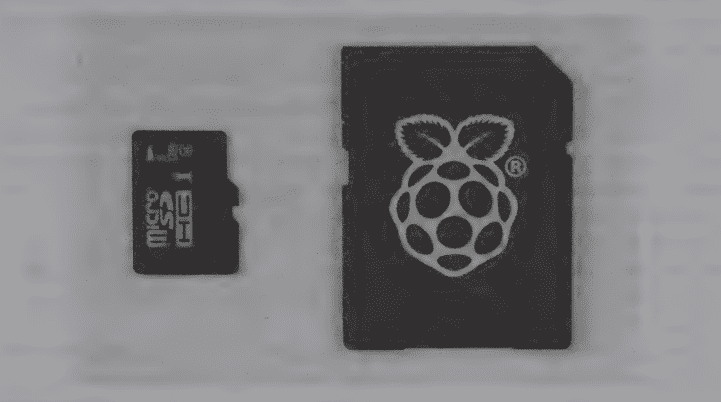

图 1-1。带有全尺寸适配器的 `NOOBS` `microSD` `SD` 卡

树莓派基金会的卡在出厂时预装了 `NOOBS`，如图 1-1 所示。这是成本、便利性和性能之间的一个很好的折衷，推荐任何初学者使用。大多数在线零售商都提供包含 `NOOBS` `SD` 卡的树莓派套件，只需支付少量的额外费用。

如果你已经购买了预装了 `NOOBS` 的 `SD` 卡，请跳到“安装 Raspian”章节。

## 购买兼容的 SD 卡

如果你需要更高性能或更大容量 卡，可以自己购买 `SD` 卡并格式化。这通常也更便宜，尤其是当你批量购买时。选择 `SD` 卡时的关键标准是尺寸、写入性能和质量。

使用 `Raspian` 发行版可以使用的最小尺寸卡为 `4GB`，虽然这不足以支持 `NOOBS` 且会为你的软件留出极小的空间。建议至少使用 `8GB`，只需少量的额外费用你就可以获得一张 `16GB` 的卡。树莓派支持的最大容量卡为 `64GB`，但只有在你进行数据密集型任务（如长期存储传感器数据或视频）时才会有用。

在购买 `SD` 卡时，你可以在它们上看到等级标识符。数字越大表示写入性能越好，最小持续写入速度等于该数字。例如，`class 4` 卡经过测试支持每秒 `4` 兆字节 (`MB/s`) 的持续写入速度。同样，`class 10` 卡测试支持 `10MB/s` 的持续写入速度。如果你正在开发一个将写入大量顺序数据的应用程序，这对比你非常重要。它还会显著影响 卡的初始设置时间。然而，这既不是读取性能的指示也不是非顺序写入性能的指示，因此你 `SD` 卡的实际性能可能会不同。

也许最重要的因素是卡的质量。从知名且声誉良好的供应商处购买可以大大增加你获得所付价值的尺寸和性能的概率。未知制造商和声誉不佳的供应商可能会向你出售性能低于广告规格的低质量或伪造卡。研究 `SD` 卡兼容性和性能的一个良好社区资源是 Embedded Linux (`eLinux`) wiki 上的树莓派 `SD` 卡页面：`http://elinux.org/RPI_SD_cards`。

在选购 `SD` 卡时，你可以发现它们上面写着一个等级标识符。数字越大表示写入性能越好，最小持续写入速度等于该数字。例如，`class 4` 卡经过测试支持每秒 `4` 兆字节 (`MB/s`) 的持续写入速度。同样，`class 10` 卡测试支持 `10MB/s` 的持续写入速度。如果你正在开发一个将写入大量顺序数据的应用程序，这对比你非常重要。它还会显著影响 卡的初始设置时间。然而，这既不是读取性能的指示也不是非顺序写入性能的指示，因此你 `SD` 卡的实际性能可能会不同。

也许最重要的因素是卡的质量。从知名且声誉良好的供应商处购买可以大大增加你获得所付价值的尺寸和性能的概率。未知制造商和声誉不佳的供应商可能会向你出售性能低于广告规格的低质量或伪造卡。研究 `SD` 卡兼容性和性能的一个良好社区资源是 Embedded Linux (`eLinux`) wiki 上的树莓派 `SD` 卡页面：`http://elinux.org/RPI_SD_cards`。

# 格式化 卡

`NOOBS` 要求你的 `SD` 卡已格式化为 `FAT`。虽然 `FAT 16` 和 `FAT32` 均支持，但如果你使用的是 `ExFAT` 卡，则需要格式化。确保你 `SD` 卡 格式正确最简单的方法是使用 Windows 上的 `SDFormatter` 工具：`https://www.sdcard.org/downloads/`。在 macOS 上，选择正确的 `SD` 卡并点击格式，图 1-2 显示了 macOS 。

图 1-1。


图 1-2。`SDFormatter` 工具

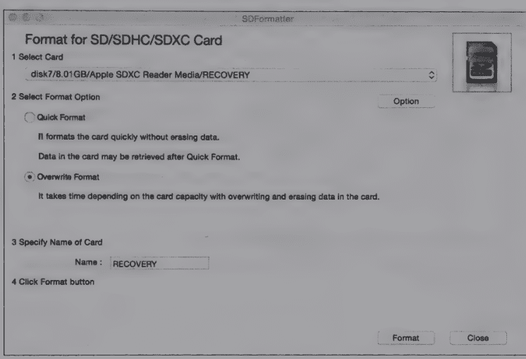

图 1-2。

如果你在 Linux 上，可以使用 `GParted` 工具完成同样的操作。从树莓派网站下载最新版本的 `NOOBS`：`https://www.raspberrypi.com/software/`。解压下载的 `NOOBS` 压缩包。将其内容复制到 `SD` 卡。

## 安装 Raspian

一旦你有了带有 `NOOBS` 的 `SD` 卡，就可以开始安装 `Raspian` 操作系统并设置树莓派了。

## 连接你的树莓派

这里是你需要连接的：

> 注意

永远不要在树莓派插电时插入或移除 `SD` 卡。这会导致文件系统损坏并丢失数据。

将 `SD` 卡插入底部的插槽中。对于 A 和 B，这是一个全尺寸的摩擦配合，所以注意不要用力过度。对于 A+、B+ 和 2，这是一个弹簧座。移除 `SD` 卡时，按下它。将 `HDMI` 或复合线连接到你的显示器或电视。`HDMI` 会提供更好的分辨率，如果你有支持的显示器，它是首选。在 A 和 B 上使用复合视频通过 `RCA` 接口非常简单。然而，对于 A+、B+ 和 2，你需要使用适配器连接音频输出的 `3.5mm TRRS` 接口。关于此点的更多详细信息，请参见第 8 章中的示例项目。


# 插入键盘和鼠标

这些设备插入树莓派上的全尺寸 USB 主机端口。如果你使用的是 Model A 或 A+，你只有一个 USB 端口，因此你可以通过键盘快捷键导航而完全放弃鼠标，或者插入一个带电源的 USB 集线器来连接更多设备。

# 连接微-USB 电源

如前所述，确保你有一个可以提供 5V 且理想为 2A 电流的电源。电流大没关系，因为树莓派只会消耗其所需的功率，但在仅连接了键盘和鼠标的情况下，你使用 700mA 的电源即可运行。你典型的电脑 USB 接口仅提供 500mA，因此在树莓派上使用它是不安全的。在 A 型和 B 型设备上，由于劣质 USB 线缆导致电压不足或电源提供的电流不足可能会导致系统崩溃和文件系统损坏。幸运的是，树莓派 B+、A+ 和 2 型配备了电源电路，可确保在开启之前电压和电流充足。它们的功耗也比旧型号更低，为嵌入式项目节省了宝贵的电池寿命。

# 如何判断你的树莓派是否正在工作

通电后，你会注意到树莓派上的 LED 状态灯会亮。红色的 `PWR` LED 表示电源，只要树莓派连接电源，它就会保持常亮。绿色的 `ACT` LED 表示活动，在你插上树莓派后，它会开始不规则地闪烁。如果 `PWR` LED 亮但 `ACT` LED 在几秒内没有不规则地闪烁，那么很可能是 SD 卡未工作。这可能是由于连接不良，或者卡格式不正确或安装不当导致的。这里是一些可以尝试的故障排除步骤：

- 如果红色的 `PWR` LED 闪烁，你可能使用的是 A+、B+ 或 2 型设备，并且触发了熔断电路。尝试不同的电源（更大的电流）或更换你的 micro-USB 线（线可能太长、太细或损坏）。
- 如果绿色的 `ACT` LED 在几秒内没有不规则闪烁：
  - 尝试重新插入 SD 卡。关闭电源，拔掉卡并重新插入，确保其完全插入。记住 SD 卡是反面插入的，插入或拔出不需要很大力气。
  - 检查 SD 卡的格式和安装。你的 SD 卡应格式化为 FAT 或 FAT32，并在文件系统的根目录下具有 `NOOBS` 文件（不在文件夹中）。如果你想简化这一过程，可以随时购买预装了 `NOOBS` 的拷贝版。

# 第一章：烘焙树莓派

一旦通过观察 `ACT` LED 的活动确认树莓派工作正常，下一步需要检查的是你的显示器。启动时，树莓派会显示一秒钟彩虹测试图案，然后显示几秒钟恢复屏幕。之后，它会自动进入 `NOOBS` 安装程序，你应该能看到图 1-3 所示的安装界面。

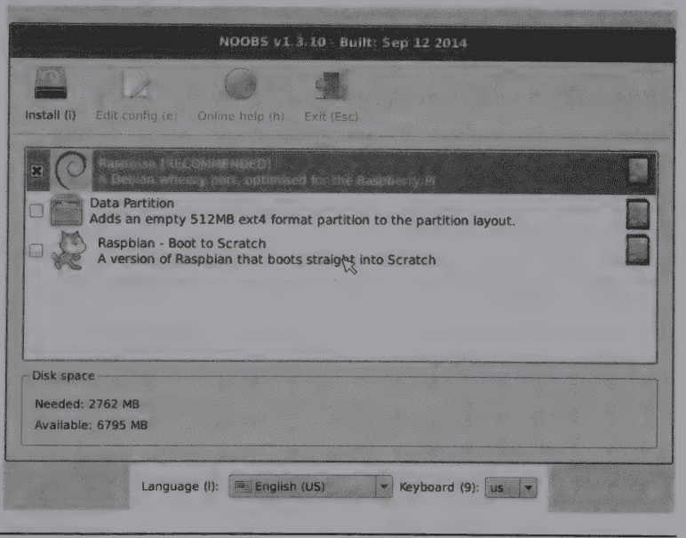

如果你的树莓派根据 LED 显示正在启动，但你没有看到 `NOOBS` 安装界面，请尝试这些故障排除技巧：

- 确保显示器电源已开启，并将显示器设置为正确的输入（例如，很容易忘记将输入从 VGA 切换到 HDMI）。
- 如果使用 HDMI，尝试安全模式。这通过在 `NOOBS` 中按下键盘上的数字 `2` 实现。安全模式会强制使用 640 x 480、60-Hz 的分辨率，大多数显示器都能支持。它还能增强 HDMI 信号，这可能有助于长线缆或高干扰环境。
- 如果使用复合视频，切换到 PAL 或 NTSC。这通过按下数字 `3`（对应 PAL）或 `4`（对应 NTSC）切换到复合输入来实现，且仅在从 `NOOBS` 启动时需要（`NOOBS` 默认使用 HDMI）。

> **注意**：当用键盘切换 `NOOBS` 视频模式时，确保它已完全加载（`ACT` LED 应该停止闪烁）。此外，如果你使用数字键盘，请开启大写锁定（`NUMLOCK`）。

# 使用 NOOBS 安装 Raspbian

`Raspbian` 是一种基于 Linux 的操作系统，是 `Debian` 的移植版本并针对树莓派进行了优化。它由 Mark Thompson 和 Peter Green 创建，并获得了热心的树莓派社区成员的帮助。

在 `NOOBS` 界面中安装 `Raspbian`，你应该能看到图 1-3 所示的安装界面。

检查你的 SD 卡格式化和安装。你的 SD 卡应格式化为 FAT 或 FAT32，并在文件系统的根目录下具有 `NOOBS` 文件（不在文件夹中）。如果你想简化这一过程，可以随时购买预装了 `NOOBS` 的拷贝版。

# 配置树莓派

选择“高级选项”会弹出一个带有以下额外选项的子菜单：

- **扫描**：这允许你启用或禁用扫描。如果你使用的是现代 LCD 显示器，可以安全地禁用此项，并在显示器边缘获得更多的屏幕空间。
- **主机名**：随意更改你的主机名以保持唯一性。
- **内存分割**：树莓派上的内存在 CPU 和 GPU 之间共享。为了提高图形密集型应用程序的性能，我建议将 GPU 内存设置为至少 128MB。
- **SSH**：此选项用于安全外壳，默认启用，且是部署 Java 应用所必需的。
- **SPI**：这是一种通用输入/输出（`GPIO`）功能，后续章节中的某些示例项目需要启用它。
- **I2C**：另一种用于管理连接的设备总线的 `GPIO` 功能，此选项也需要启用以支持后续章节的项目。
- **串口**：这允许通过串口访问 shell，尽管你将稍后禁用它，以为随后的项目腾出串口端口。
- **音频**：这允许你强制音频通过 HDMI 或 3.5mm 耳机输出。
- **更新**：将 `raspi-config` 工具更新到最新版本。

在选项列表中，建议的更改是：启用 Pi Camera、设置/确认内存分割为 128MB、启用 `SPI`、启用 `I2C` 以及禁用串口。如果你忘记了其中任何一个步骤，不要担心；在未来的章节需要相关功能时，我会提醒你，如果你尚未启用，我会指导你如何启用。

一旦你做了配置更改，按下 `TAB` 键并选择“完成”。这将重启你的树莓派并显示如图 1-7 所示的首次登录提示。要登录，请输入用户名 `pi` 和你选择的新密码。

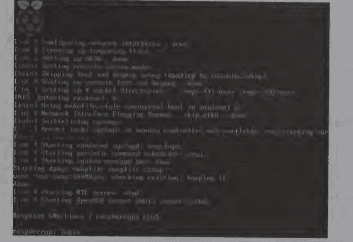

如果你需要再次调用 `raspi-config` 工具，可以在命令行中输入以下命令来实现：

```bash
sudo raspi-config
```

现在也许是介绍关闭树莓派正确方法的时机。如果你在树莓派运行时直接断开电源，可能会损坏文件系统并导致损坏和数据丢失。为了防止这种情况，请确保在断电之前使用以下命令正确停止树莓派：

```bash
sudo shutdown -h now
```

此命令会注销所有用户，干净地关闭文件系统，并在掉电前终止。当你看到绿色 `ACT` LED 连续闪烁十次时，说明你的树莓派可以拔掉电源了。

要重启，可以使用类似的命令：

```bash
sudo shutdown -r now
```

作为快捷方式，你可能会看到一些树莓派用户使用 `halt`（停止）和 `reboot`（重启）命令。它们在树莓派上的运行符合预期且完全安全，但在管理各种 Unix 操作系统时，它们并不是最佳实践，因为它们的行为各异。

# 树莓派的网络连接

为了从计算机连接到树莓派，你必须将树莓派和计算机放在同一个网络中，以便通过 TCP/IP 访问树莓派。对于缺少以太网端口的 A 和 A+ 型号来说，这也是简单的网络选项。实现此点的方法取决于计算机的物理位置、网络拓扑以及你的可用硬件。

## 通过以太网连接

如果你有一个作为动态主机配置协议（`DHCP`）服务器的路由器，你可以直接使用以太网线将树莓派连接到网络。这仅适用于树莓派 B、B+ 型和 2 型，因为 A 和 A+ 型缺少以太网端口。

一旦连接，树莓派将自动尝试从 `DHCP` 服务器获取网络地址。你可以输入以下命令来检查树莓派获取的 IP 地址：

```bash
ip addr show eth0
```

## 通过本地计算机网络连接

你可以使用以太网线将树莓派直接连接到 PC。同样，此选项仅适用于树莓派 B、B+ 型和 2 型，但如果你在旅行或处于网络拓扑不允许计算机和树莓派通信的环境中，这是一个极佳的替代方案。

> **提示**：树莓派以太网适配器包含自动 `MDIX` 功能，可以检测并修复电缆类型，因此你可以使用交叉线或更常见的直连以太网线连接设备。

实现这一点最简单的方法是为计算机和树莓派分配静态 IP 地址，使它们处于同一个子网中。常用的本地子网为 `192.168.x.x`，这是局域网预留的子网之一。桌面计算机上的配置类似于图 1-8（OS X）或图 1-9（Windows）。

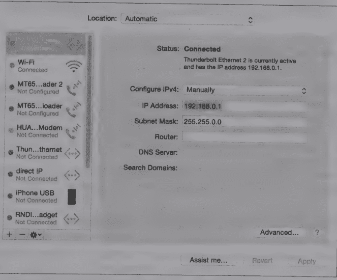
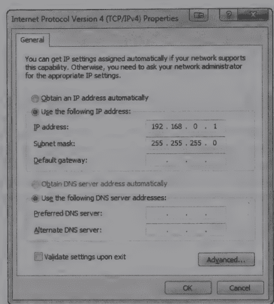

在树莓派上，你需要修改引导程序中的 `cmdline.txt` 文件。要执行此操作，使用以下命令登录树莓派：

```bash
sudo nano /boot/cmdline.txt
```

`nano` 是一个简单的文本编辑器，允许你在 Unix 系统上编辑文件。当你打开 `cmdline.txt` 时，使用方向键移动到末尾并添加 `ip=192.168.x.x`。

## 通过无线网络连接

`Raspbian` 预安装并配置了 `wpa_supplicant`，因此你只需使用命令行工具 `wpa_cli` 来扫描网络并添加配置。使用命令行工具而非直接编辑文件的好处是不会因为标点符号或格式问题产生错误。

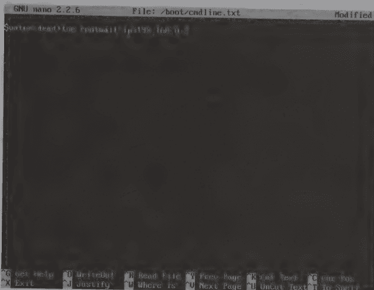

### 列表 1-1 配置 Wi-Fi 的命令行工具

```text
pi@raspberry ~ $ wpa_cli
Selected interface 'wlan0'
Interactive mode
> scan
OK
<3>CTRL-EVENT-SCAN-RESULTS
<3>WPS-AP-AVAILABLE
> scan results
bssid / frequency / signal level / flags / ssid
12:0d:7f:8b:9e:2437 92 [WPA2-PSK-CCMP] [ESS] Nighacking-Guest
> add_network
0
> set_network 0 sid "Nighacking-Guest"
OK
> set_network 0 psk "stevejava"
OK
> enable_network 0
OK
> save_config
OK
> reconnect
OK
> quit
```

如果你仍在使用 `WEP`，虽然可以连接树莓派，但我并不建议这样做。`WEP` 已证明是不安全的，可以使用低端硬件和免费软件在几分钟内破解。目前还存在针对 `WPA` 涉及 `TKIP` 漏洞的新型加密攻击。简而言之，将网络升级到 `WPA2` 是一项重要的安全措施。

# 更新与升级

现在你已经连接了网络，首要的任务是更新你的 `Raspbian` 发行版。这将确保你拥有最新的软件包列表和核心文件的当前版本。要执行此操作，首先运行以下命令下载最新的软件包列表：

```bash
sudo apt-get update
```

然后你可以使用此附加命令对你的 Raspberry Pi 发行版进行升级：

```bash
sudo apt-get upgrade
```

取决于你最初使用的 `NOOBS` 发行版有多旧，以及你的网络连接和 SD 卡的速度，这可能需要很长时间。这也许是一个去再泡另一杯咖啡的好机会。

# 设置主机名

如果你的 Raspberry Pi 通过 `DHCP` 获取 IP 地址，那么该地址在每次重启时都可能变化。如果你以无头模式运行 Raspberry Pi（不带显示器或显示屏），查找新的 IP 地址可能将是一件苦事。一个很好的替代方案是使用 `Bonjour`/`Zeroconf`，它通过多组播广播你的主机名。然后你可以在局域网的任何地方将 Raspberry Pi 称为 `raspberrypi.local`（或者通用地 `hostname.local`）。

第一步是设置一个唯一的主机名。可以在 Raspberry Pi 配置实用工具的“高级选项”中完成。要从命令行启动配置实用工具，请输入以下内容：

```bash
sudo raspi-config
```

设置主机名后，系统会要求重启 Raspberry Pi 以更新网络配置。重启后，你可以通过运行以下命令在 Raspberry Pi 上安装 `Bonjour`：

```bash
sudo apt-get install libnss-mdns
```

此命令完成后，你就可以准备好在网络上访问 Pi 了。在同一个到达多组播数据包的网络中的任何计算机上，你都可以通过 `hostname.local` 引用 Pi 的 IP 地址。例如，列表 1-2 显示了使用主机名 `nighthackingpi` ping 我的 Raspberry Pi 的输出。

```text
NightHacking-Presenter:- sjc ping nighthackingpi.local
PING nighthackingpi.local (192.168.1.10): 56 data bytes
64 bytes from 192.168.1.10: icmp_seq=0 ttl=64 time=76.379 ms
64 bytes from 192.168.1.10: icmp_seq=1 ttl=64 time=93.390 ms
```

注意，它会自动将主机名转换为 IP 地址 `192.168.1.10`。然而，如果未来此地址发生了变化，我仍然可以使用相同的命令访问我的 Pi。

`Bonjour` 默认安装在 OS X 和 Ubuntu Linux 上。如果你在 Windows 上运行，只要你安装了 iTunes，就已经安装了 `Bonjour`。否则，获取它的简单方法是从 Apple 下载 Windows 版本的 `Bonjour` 打印服务：http://support.apple.com/kb/DL999。

# 使用 SSH 连接到你的 Raspberry Pi

使用计算机上的 SSH 客户端是与 Raspberry Pi 交互的一种既方便又安全的方法。一旦在两台机器上都配置了网络，这就像使用主机名或 IP 地址连接一样简单。

对于 Unix 或 OS X，你可以直接使用终端窗口和操作系统自带的 SSH 版本。图 1-11 显示了从 OS 计算机登录 SSH 的示例。

```text
Nighthacking-Presenter~ user
Nighthacking-Presenter$ sjs
Nighthacking-Presenter~ sjs
Nighthacking-Presenter$ sjs ssh@192.168.1.10
Connection to 192.168.1.10 port 22 (192.168.1.10) can't be established.
RSA Key fingerprint is SHA256:be04c53c361c72b6effe3726ae18al33b1of
Are you sure you want to continue connecting yes/no? yes
Warning: Permanently added 192.168.1.10 (RSA) to the list of known hosts
~/.ssh/known_hosts
printabs -l 192.168.1.10 [335a-f7e6] PREPENDED Dec 19 18:34 2024 armv8
```

```text
The programs included with the Debian GNU/Linux system are free software,
the distribution terms for each program are described in the
Ubuntu Policy Manual (copyrights)
Debian GNU/Linux comes with ABSOLUTELY NO WARRANTY, to the extent
permitted by application.
Last login: Mon Jan 1 23:13 2024 from 192.168.1.10
printasencopy java version
java version "1.8.0_283"
Java Runtime Environment (build 1.8.0_283)
Java Hot OpenSpot VM (build 1.8.0_283, mixed mode)
printasencopyn
```


 图 12. Windows 上的 PuTTY SSH 客户端

PuTTY 的初始配置界面如图 1-12 所示。只需输入你的 Raspberry Pi 的 IP 地址或主机名，确保选中了 SSH，然后点击 Open。这将启动一个提示你输入用户名和密码的安全连接。

现在你已经有了方便的 SSH 提示符，可以准备好远程运行 Java 了。在下一章节中，我们将安装一个完整的集成开发环境 (IDE) 来加速开发，但对于这个简单的 HelloRaspPi 应用，在命令行输入就足够了。

为了创建该应用，你使用 `echo` 和追加 (`>`) 命令生成一个简单的 Java 类。列表 1-3 显示了你在 SSH 会话中输入的命令（加粗部分）。

## 列表 1-3 创建 HelloRaspPi 类

注意，只要按下回车，你就可以在下一行继续输入引号内的命令。每行的命令提示符（`>`）由系统自动更新，在这个示例中我使用了空格进行缩进。与普通 Java 代码唯一的区别是，双引号 (`"`) 需要前面加一个反斜杠 (`\`) 进行转义。

最后一行将此应用程序写入名为 `HelloRaspPi.java` 的文件中，你可以通过以下命令使用 `javac` 编译它：

```bash
pi@nighthackingpi ~ $ javac HelloRaspPi.java
```

执行该程序只需在相同目录下运行 `java` 并指定主类名：

```bash
pi@nighthackingpi ~ $ java HelloRaspPi
```

我的 shell 控制台如图 1-13 所示，并带有程序的输出。

你在第 1 章中设置的完备的树莓派嵌入式计算机已预装了 Oracle Java 8，开始使用 Java 只需要在提示符中输入 `java` 命令一样简单。然而，为了简化开发工作流，本章将引导你完成 Java IDE 的安装和设置，它将为你提供一个功能完备的编程环境。

为了完成本章中的项目，你需要一个你任选的树莓派和一个 USB 电子秤。由于你将把树莓派连接到计算机上进行远程调试和输出，请确保你选择的是一个可以轻松联网的树莓派型号。出于这个原因，你可能不想使用 Model A 或 A+ 型，因为它们都只有一个 USB 端口且没有以太网接口。

你需要的物品：

- 带有 SD 卡的树莓派，推荐 Model B、B+ 或 2。
- 支持 USB 的数字电子秤。推荐使用 Dymo M10 或 Dymo M25。这里是亚马逊上 M10 的链接：www.amazon.com/DYMO-1772057-Digital-Shipping-10-pound/dp/B0053HCWRE。
- Aeropress 咖啡壶。由 Aerobie 制造，你可以在亚马逊或高端咖啡烘焙店找到它：www.amazon.com/Aeropress-Coffee-and-Espresso-Maker/dp/B0047BIWSK。
- 如果你还没有高质量的电动磨豆机，请准备一个磨豆机；手动磨豆机对于偶尔喝咖啡来说性价比很高，而且是旅行必备。日本制造 Porlex Mini 咖啡磨豆机是一个极佳的选择：www.amazon.com/Porlex-Mini-Stainless-Coffee-Grinder/dp/B0044ZA066。

除了硬件之外，你还需要一些耗品，如滤纸和咖啡豆。Aeropress 带有许多滤纸供你开始。对于咖啡豆，你应该寻找当地的咖啡烘焙店；如果附近没有烘焙店，另一个选项是从像 Four Barrel 这样高质量的烘焙店邮购咖啡：http://fourbarrelcoffee.com

# 开始使用 NetBeans

在使用树莓派进行编码时，你可以使用任何你喜欢的 Java IDE。你甚至可以直接在树莓派上进行编辑和编译；然而，我不建议这样做，因为树莓派处理处理器密集型任务的速度比现代 PC 慢得多。本书将向你展示如何使用 NetBeans IDE，因为它具有方便的集成功能，允许你通过 SSH 直接从你的计算机运行并部署应用程序。

你可以从 http://netbeans.org/ 根据你的操作系统直接下载 NetBeans。共有五种不同的下载包可用，如图 2-1 所示，每个包都包含一组不同的插件。Java 的两个主要版本是标准版 (SE) 和微型版 (ME)。Java SE 是你在桌面和服务器应用程序使用的版本，而 Java ME 是专为资源极受限设备设计的仅解释版本。由于我们将使用 Java SE Embedded，因此我们只需要 Java SE 分发版，这恰好也是最小的程序包。如果你以后决定添加额外的支持（例如 Java ME，我建议在你的树莓派上尝试一下），你可以随时在 NetBeans 内部添加额外的插件。


| 支持的技术 | Java SE | Java EE | C/C++ | HTML5 & PHP | 全部 |
| :--- | :---: | :---: | :---: | :---: | :---: |
| NetBeans Platform SDK | | | | | |
| Java SE | ● | | | | |
| Java EE | | ● | | | |
| Java ME | | | ● | | | |
| HTML5 | | | | ● | |
| Java JS | | | | ● | ● |
| Java card™ 3 Connected | | | | | ● |
| C/C++ | | | ● | | ● |
| Groovy | | | ● | | ● |
| PHP | | | | ● | ● |
| 服务器包 | | | | | | |
| GlassFish Server 开源版 4.1 | | | | | ● |
| Apache Tomcat 8.0.15 | | | | | ● |

图 2-1. NetBeans IDE 下载包

你还需要与你的树莓派 Java 版本匹配的最新 Java 开发包 (JDK)，因此更新它也是个主意。你可以单独下载 JDK，也可以从下面的 Oracle 技术网络网站下载带 NetBeans 包的 JDK：www.oracle.com/technnetwork/java/downloads/index.html。

一旦安装了 NetBeans，你就可以配置树莓派。通过 `Tools | Platforms` 添加远程平台，由于其方便的集成功能，你可以通过 SSH 直接从计算机运行和部署。


图 2-2. 添加远程平台

这是你需要配置的字段：

- **Platform Name**: 为配置指定名称
- **Host**: 树莓派的主机或 IP 地址
- **Username/Password**: 登录凭据
- **Remote JRE Path**: Java 安装的路径

你可以手动编译并拷贝 JAR 文件，然后通过 SSH 执行它，但让 IDE 来处理这些工作要方便得多。成功运行的完整输出显示在列表 2-1 中。

```bash
ant -f /Users/sjc/dev/HelloRaspberryPi \
-Dnb.internal.action.name=run \
-Dremote.platform.rp.target=linuxarmvfphlt-15 \
-Dremote.platform.password=**** \
-Dremote.platform.rp.filename=linuxarmvfphlt \
-Dremote.platform.java.spec.ver=18 run-remote
init:
Deleting: /Users/sjc/dev/HelloRaspberryPi/build/built-jar.properties
deps-jar:
Updating file: /Users/sjc/dev/HelloRaspberryPi/build/built-jar.properties
compile:
Copying file to /Users/sjc/dev/HelloRaspberryPi/build
To run this application from the command line without Ant, try:
java -jar "/Users/sjc/dev/raspberrypi/dist/HelloRaspberryPi.jar"
jar:
Connecting to nighthackingpi.local:22
cmd : mkdir -p '/home/pi/NetBeansProjects/HelloRaspberryPi/'
Connecting to nighthackingpi.local:22
done.
profile-rp-calibrate-passwd:
Connecting to nighthackingpi.local:22
cmd : cd '/home/pi/NetBeansProjects/HelloRaspberryPi'; \
/usr/lib/jvm/jdk-8-oracle-arm-vfp-hlt/bin/java' \
-Dfile.encoding=UTF-8 -jar \
/home/pi/NetBeansProjects/HelloRaspberryPi/dist/HelloRaspberryPi
Hello Raspberry Pi
```

恭喜你在树莓派上远程执行了第一个 Java 应用程序！现在我们将进入一个更实用的示例，涉及一些嵌入式驱动的咖啡冲泡。

# 冲泡 Java

如果没有一个帮助你完善咖啡冲泡技巧的应用程序，那么在树莓派上添加 Java 就不够完整了。对于我们在树莓派上编写的第二个应用程序，我们将采用科学的方法进行咖啡冲泡，以获得一杯理想的咖啡。

设置包括一个用于测量配料重量的 USB 秤、一个 Aeropress 冲泡设备以及一个如图 2-5 所示的便携秤。所有这些设备都连接到树莓派，作为咖啡冲泡算法的中央控制单元。

## 与 USB 秤通信

为了给咖啡冲泡精确测量重量，我们将使用一个 USB 货运秤。虽然可以使用应变计、惠特斯石桥和模拟放大器（http://morf.lv/modules.php?name=tutorials&lasit-19）从零开始创建一个秤，但事实证明直接使用电子货运秤更廉价、也更可靠。

大多数货运秤使用的协议是简单的单向通信，当前的读数值会在第一个接口上的单个端点反复广播。我将在该项目中使用 Dymo M10 秤，


图 2-5 咖啡冲泡项目的硬件

如图 2-6 所示，但任何与 Stamps.com 或 DymoStamp 兼容的秤都可以工作。要使用该秤，只需插入树莓派的任一主机端口并开启即可。Dymo M10 仅消耗 16mA，因此可以安全地从树莓派的 USB 总线供电。

**提示**：在购买秤时，请确保你买的秤分辨率至少为 1 或 2 克。容量较大的秤通常分辨率较低，而容量较小的秤通常分辨率精确得多。如果你是一个真正的咖啡鉴赏家，你可能想要一个精度为 1/10 克的，例如第 6 节使用的 Scout Pro。

首先，在 NetBeans 中创建一个名为 `UsbScaleTest` 的新项目，并像你之前处理 `HelloRaspberryPi` 那样将其配置为嵌入式开发。额外的一个步骤是为 USB 通信配置第三方库。

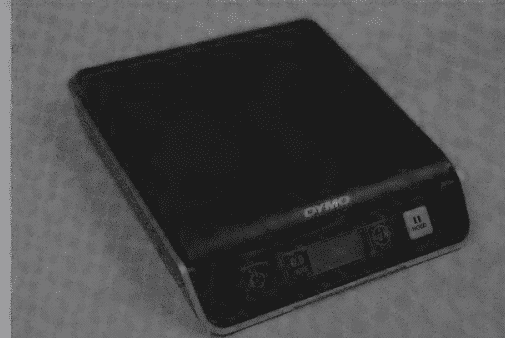

图 2-6. Dymo M10 秤

**注意**：在以下仓库下载本章的完整代码可能也会帮助：https://github.com/RaspberryPiWithJava/JavaScale。

为了与我们的 USB 秤通信，我们将使用 `usb4java` 库。这是一个开源的、符合 JSR80 标准的 `javax.usb` 规范实现，支持像树莓派这样的 ARM 发行版。你可以从项目网站 http://usb4java.org/ 下载最新版本的 `usb4java`。确保同时下载了核心库和 javax 扩展。从核心发行包中，你需要获取以下 JAR 文件：

- `usb4java-1.2.0.jar`
- `libusb-linux-arm.jar`
- `commons-lang3-3.1.jar`

你还需要来自 javax 分发包的这些额外的 JAR 文件：

- `usb-api.jar`
- `java-javax-1.0.jar`

将这些 JAR 文件放入项目中的 `lib` 目录中，并在项目属性中将它们添加到类路径中。这样，在树莓派上运行程序时，它们就会被正确加载。如果你遇到 `NoClassDefFoundError`，请检查这些文件是否已正确添加到类路径中。


图 2-7. 目录结构（示例）

`syncSubmit` 的实现非常简单，只需调用 `UsbPipe` 上的同名方法即可：

```java
private void syncSubmit() throws UsbException {
    syncSubmit(data);
}
```

然而，真正的工作发生在回调函数中。为了接收回调，我们的类需要实现 `UsbPipeListener` 接口，该接口包含两个必须实现的方法。第一个是 `dataEventOccurred`，它会在调用 `syncSubmit` 后被触发，并包含从电子秤返回的数据。第二个是 `errorEventOccurred`，它会在与电子秤交互出现问题时被触发。

这些运输电子秤发送的数据是一个包含六个值的简单字节数组。该协议没有完善的文档，但已经由开源社区进行了逆向工程。数据如下：

- 字节 0：未使用
- 字节 1：特殊标志：空载 = 2，超重 = 6，负数 = 5
- 字节 2：重量单位：克 = 2，盎司 = 11
- 字节 3：量程系数
- 字节 4：基础重量低位字节
- 字节 5：基础重量高位字节

列表 2-6 展示了 `dataEventOccurred` 的实现，它解析字节数组并在命令行中打印出人类可读的电子读值。

### 列表 2-6 USB 电子秤数据处理函数

```java
@Override
public void dataEventOccurred(UsbPipeData event) {
    boolean empty = data[1] == 2;
    boolean overweight = data[1] == 6;
    boolean negative = data[1] == 5;
    boolean grams = data[2] == 2;
    int scalingFactor = data[3];
    int weight = (data[4] & 0xFF) + (data[5] << 8);
    if (empty) {
        System.out.println("EMPTY");
    } else if (overweight) {
        System.out.println("OVERWEIGHT");
    } else if (negative) {
        System.out.println("NEGATIVE");
    } else { // 使用 String.format 在远程执行时会产生问题
        System.out.println(String.format("Weight = %.1f%s",
        scaleWeight(weight, scalingFactor),
        grams ? "g" : "oz"));
    }
}
```

除了通过位移获取重量的量级外，我们还需要按照字节 3 返回的 `scalingFactor` 进行缩放，如下：


```java
private double scaleWeight(int weight, int scalingFactor) {
  return weight * Math.pow(10, scalingFactor);
}
```

在发生错误时，我们能做的就是记录它并继续：

```java
@Override
public void errorEventOccurred(UsbPipeEvent upee) {
  Logger.getLogger(UsbScaleTest.class.getName()).log(Level.SEVERE, "Scale Error", upee);
}
```

完成电子秤测试的最后一个方法是 `close`。我们将简单地关闭管道和接口，以便下一个尝试使用电子秤的应用程序能够访问它：

```java
public void close() throws UsbException {
  pipe.close();
  iface.release();
}
```

在运行此示例之前，你需要确保你的远程配置配置为以 root 权限运行，这样你才能访问 USB 设备。以下是实现这些目标的步骤：

1. 选择 Tools | Java Platforms。
2. 在 Remote Java SE 树下点击你的 Raspberry Pi 平台。
3. 点击 Exec Prefix 并输入 `sudo`。

你现在可以运行完成的 `UsbScaleTest` 类了，它将像以前一样编译并部署 JAR 包，但这次它将显示更有趣输出。如果你连接并开启了电子秤，它将输出来自电子秤的前 60 条读数，包括关于电子秤是否为空、超重或负数的信息，如列表 2-7 所示。

### 列表 2-7 USB 电子秤测试输出

```
cmd = cd '/home/pi/NetBeansProjects/JavaScale'; '/usr/lib/jvm/jdk-8-oracle-arm-vfp-hflit/bin/java' -Dfile.encoding=UTF-8 -jar 
home/pi/NetBeansProjects/JavaScale/dist/JavaScale.jar
NEGATIVE
EMPTY
EMPTY
Weight = 64.0g
Weight = 72.0g
Weight = 72.0g
Weight = 56.0g
Weight = 56.0g...
run-remote: BUILD SUCCESSFUL (total time: 3 seconds)
```

为了良好地感受接口的工作原理，请在电子秤返回数据时尝试几个不同重量的物体。如果你想获得负值，你需要在电子秤上添加一个物体，按下 tare（去零），然后移除该物体。要获得超重读数，请添加一个超过电子秤支持的物体（例如 1kg 物体）。注意不要使用过重的物体。

# 第 2 章：你的第一个 Java 项目 47

### 列表 2-9 USBPipeListener 回调函数

```java
public void dataEventOccurred(UsbPipeDataEvent upde) {
    processData();
    if (closing) {
        busy = false;
    } else {
        try {
            pipe.asyncSubmit(data);
        } catch (UsbException exception) {
            errorEventOccurred(new UsbPipeEvent(upde.getUsbPipe()), exception);
        }
    }
    scalePhaser.arrive();
}
```

`Phaser` 是 Java 7 引入的新线程控制类之一，非常适合此用途，因为它允许从单个线程发送到达通知，从而阻塞可能存在的多个线程。为了为此目的创建 `Phaser`，只需像这样构造一个单参与者的即可：

```java
private final Phaser scalePhaser = new Phaser(1);
```

由于只有一个注册的参与者（party），`Phaser` 在每次调用 `arrive` 时都会触发。那么，对其进行阻塞操作就像如列表 2-10 所示，使用当前阶段调用 `awaitAdvance` 简单得多。

### 列表 2-10 使用 Phaser 等待重量变化的示例

```java
public void waitFor(DoublePredicate condition) {
    while (condition.test(getWeight())) {
        scalePhaser.awaitAdvance(scalePhaser.getPhase());
    }
}
```

`waitFor` 方法演示了 Java 8 版本引入的 `DoublePredicate` 函数式接口的使用，它允许接受一个任意条件作为 lambda 表达式进行等待，例如等待秤达到 80 克或更多：

```java
scale.waitFor(w -> w >= 80);
```

这是改进版 USB 秤通信逻辑的基础，该逻辑被重构到了一个名为 `UsbScale.java` 的新类中。它实现了一个统一的 `Scale` 接口，我们将使用该接口在第 7 章中为串口秤创建另一种实现。

树莓派与 Java：面向物联网

`Scale` 接口的全套方法在列表 2-11 中。

### 列表 2-11 统一 Scale 接口

```java
public interface Scale {
  void connect() throws IllegalStateException;
  double getWeight();
  boolean isStable();
  void waitFor(DoublePredicate condition);
  void waitForStable(DoublePredicate condition);
  void tare() throws UnsupportedOperationException;
  void close();
}
```

这里额外引入了两个秤的概念，以提高我们咖啡配方的可靠性和一致性：“稳定”的秤重值和程序化的“去零（tare）”。稳定性的概念非常重要，因为秤不会立即记录新重量，因此数值在稳定之前可能会略有波动。有些秤直接在数据报告中实现了稳定性概念；但这些 USB 秤并没有这样做。作为一种通用方案，在更新重量时，我们将比较最后几次的结果以查看我们是否达到了稳定状态，如列表 2-12 所示。

### 列表 2-12 带有稳定性计算的当前重量值更新

```java
private void updateWeight(int newWeight) {
  boolean isStable = true;
  for (int i = 0; i < pastWeights.length - 1; i++) {
    pastWeights[i] = pastWeights[i + 1];
    if (pastWeights[i] != weight) {
      isStable = false;
    }
  }
  pastWeights[pastWeights.length - 1] = weight;
  if (weight != newWeight) {
    isStable = false;
    weight = newWeight;
  }
  stable = isStable;
}
```

# 第 2 章：你的第一个 Java 项目 49

这使得我们在执行配方时能够获得更可靠的结果，因为我们知道当命中目标值时，它不再接近或跳动，而是已经稳定了。你可以通过 `partWeights` 数组的大小来控制用于比较稳定性的重量数量。这是速度与精度之间的权衡，但一个很好的数字是将两次过去的读数与当前重量测量进行比较：

```java
private final int[] partWeights = new int[] {-1, -1};
```

将秤值重置为零或“去零”是执行我们咖啡配方的重要部分。有些秤允许你通过程序发送命令，但我们的 USB 秤不支持，因此我们能做的最好的就是提示用户手动按下“tare”按钮。为了表示我们的秤不支持此功能，我们将重用内置的 `UnsupportedOperationException`：

```java
@Override
public void tare() {
    throw new UnsupportedOperationException();
}
```

你可以从以下 GitHub 仓库下载 `Scale` 和 `UsbScale` 类的完整源代码：https://github.com/RaspberryPiWithJava/JavaScale。

## 咖啡冲煮配方

现在我们可以与通过 USB 连接的秤进行异步通信，下一步是构建一个使用 `CoffeeCalculator` 和 `UsbScale` 类的咖啡配方。虽然你可以使用任何喜欢的咖啡冲煮方法，但我建议使用 AeroPress 冲煮系统。这是一种简单廉价的咖啡冲煮设备，作为便携式咖啡机也非常适合旅行，如图 2-9 所示。以下讨论假设你正在使用 AeroPress。

AeroPress 的工作原理是将咖啡粉和部分加热水放入主腔中，一边搅拌咖啡粉，边冲泡 60 秒。然后插入活塞，创建一个加压空间以迫使水流过滤纸。

树莓派与 Java：面向物联网


### 列表 2-13 Recipe 接口

```java
public interface Recipe {
  String name();
  String description();
  String[] ingredients();
  Step[] steps();
}
```

### 列表 2-14 AeroPress 配方的配料初始化

```java
public AeroPressCoffee(double strength) {
    beans = Ingredient.byWeight(CoffeeCalculator(strength), "Coffee Beans");
    brewingWater = Ingredient.byWeight(beans.get() / BREW_RATIO, "Water");
    extraWater = Ingredient.byWeight(C_SIZE - brewingWater.get(), "Water");
}
@Override
public Ingredient[] ingredients() {
    return new Ingredient[]{beans, brewingWater, extraWater};
}
```

## 第 2 章：你的第一个 Java 项目 53

```java
Step.count(60);
Step.say("Done! Take the AeroPress off the scale before proceeding.");
Step.waitForClear();
Step.say("Now press it down firmly until all the liquid is extracted.\n" + "After you are done, place your cup on the scale");
Step.waitForContents();
Step.tare();
Step.say("Now add " + extraWater);
Step.waitForFor(extraWater);
Step.say("Enjoy your Java brew!");
```

若要尝试一下，请从以下仓库下载完整的源代码：https://github.com/RaspberryPiWithJava/JavaScale。

主类名为 `JavaScale`，它执行一个 `CommandLineRecipeRunner`，该程序将启动我们的 AeroPress 配方来制作浓咖啡：

```java
public static void main(String[] args) throws InterruptedException {
    CommandLineRecipeRunner runner = new CommandLineRecipeRunner();
    runner.runRecipe(new AeroPressCoffee(CoffeeCalculator.STRONG));
    runner.close();
}
```

列表 2-16 显示了使用默认设置运行 JavaScale 应用程序的输出。

### 列表 2-16 使用默认设置冲泡一杯咖啡

使用 AeroPress 咖啡机和秤精准冲泡 1 杯咖啡。

添加 18.6g 咖啡豆

很好，现在将咖啡豆移下秤。

将装有咖啡粉的 AeroPress 放在上

按下秤上的“tare（重零）”按钮。

倒入 93.0g 200°F 的水

冲泡时间：搅拌 10 秒并等待倒计时结束。

剩余 60 秒

...

剩余 1 秒

完成！在继续之前，请将 AeroPress 移下秤。

现在用力向下压，直到所有液体被提取。

完成后，将你的杯子放在秤上

按下秤上的“tare（重零）”按钮。

现在添加 207.0g 水

享受你的 咖啡！

54 树莓派与 Java：物联网编程

一旦你使用了默认设置进行尝试，这里有一些你可能想要调整的设置：

- 更改咖啡的浓度（REGULAR 常规或 RICH 浓郁）。
- 调整制作的咖啡量（但请记住，AeroPress 在提取过程中使用的液体量有物理限制）。
- 根据你的豆子类型和喜好微调 `BREW_RATIO`（冲泡比例）。

我希望你喜欢编写咖啡就像喜欢喝它一样！下一章将向你展示如何使用树莓派上的 GPIO 总线创建额外的配方，以连接额外的传感器和设备。

## 商业许可

树莓派基金会在确保所有分发的软件在教育或非商业环境中免费使用方面做得出色。然而，如果你计划将树莓派作为商业设备，有几点你需要注意。

> **注意**
>
> 请将此处提供的任何建议视为通用指导，将其作为进一步研究的起点。在做出任何业务决策之前，请咨询律师或专业法律顾问。

树莓派基金仅对个人使用授权硬件许可。但是，树莓派基金已公开表示，它支持树莓派的商业用途，仅要求你在包装上包含“Powered by Raspberry Pi”的字样。树莓派基金还鼓励你在商业活动成功后考虑捐赠部分利润，但这取决于你个人。详细信息请见此处：www.raspberrypi.org/starting-a-business-with-a-raspberry-pi/。

如果你计划构建商业产品，可能希望考虑使用树莓派计算模块（Compute Module）。这是一个完整的树莓派处理器


# 第 2 章：你的第一个 Java 项目 55

在只有 DIMM 模块大小的板上配备了内存和集成存储。事实上，它使用标准的 DIMM 插槽，使其更容易为定制产品构建兼容的 PCB。

另一个需要注意的是对树莓派标志（Logo）或文字标志的使用。如果你在公司名称、产品或 Logo 中包含“Raspberry Pi”字样，你可能会违反树莓派基金的商标权。此外，如果你使用树莓派 Logo 或其派生图形，也可能违反规定。但在某些情况下，你可以使用文字标志，例如使用“runs on（运行于）”、“compatible with（兼容于）”等引用短语。树莓派在此处发布了更详细的指南：www.raspberrypi.org/trademark-rules/

此外，Raspbian 仓库中的许多软件包是针对个人使用授权的，例如 Mathematica。在出货商业产品之前，你需要检查计划安装的软件包的许可，或确保你没有违反相关条款。


最后，Oracle Java 也带有许可规定，这些规定在《Oracle 二进制代码许可协议》（agreement://www.oracle.com/technet/java/javese/terms/license/index.html）中有详细列出。Oracle Java 用于开发、评估以及在通用计算机上的生产使用是免费的。这意味着如果你正在使用树莓派替代 PC（例如作为 Web 服务器或桌面电脑），那么你不需要支付许可费用。此外，如果你是一个开发者、爱好者，

## 物料清单

为了完成本章的项目，除了树莓派之外，你还需要一些物品。所有物品都相当廉价，可以在网上或你家附近的小型电子爱好商店购买。

以下是你所需的全部物品的完整清单：

- **树莓派 (Raspberry Pi)**：选择任何型号的树莓派，但最好选择带有 40 脚引脚的较新型号（Model B+、A+ 或 2）。
- **Pi 转接板 (Pi Cobbler)**：这是 Adafruit 团队的一项巧妙发明，它提供了一种简单的方法，将 Pi 的 GPIO 引脚镜像到面包板上以进行原型设计。请确保为你的树莓派选择正确的型号（26 脚或 40 脚版）：https://www.adafruit.com/products/2029。
- **全尺寸面包板 (Full-size breadboard)**：面包板对于快速原型设计非常方便，且相当便宜。Adafruit 也出售此类产品：https://www.adafruit.com/products/239。
- **LED 灯**：对于输出，我们将使用 LED 显示计数。你总共需要 17 个，使用几种不同的颜色会更容易读取输出。我最终从 Adafruit 购买了三个蓝色、六个绿色和两个红色的 LED：https://www.adafruit.com/products/297。
- **开关 (Switches)**：触控开关是获取用户输入的极佳方式，而且非常易于使用。像 Adafruit 这种的一套彩色开关包将非常有帮助：https://www.adafruit.com/products/1009。
- **电阻 (Resistors)**：准备各种尺寸的电阻非常有用。对于这个项目，你需要 17 个 68Ω 或更大数值的相同电阻，因此请购买像这种的一大包电阻：https://www.amazon.com/480-pack-5-tolerance-resistors-Assorted-Values/dp/B000TAAII。
- **面包板跳线 (Breadboard cables)**：为了连接本项目中的所有内容，你需要大量的电线。如果你布局得巧妙，可以节省一些连接，但预计要使用大约 30-40 根线：https://www.adafruit.com/product/153。
- **邦线（可选） (Hookup wire (optional))**：我更倾向于使用剪成合适长度的短线连接面包板以保持整洁。一包可以使用很长时间的彩色线并不贵：https://www.adafruit.com/products/1311。

## 从 Java 访问 GPIO

访问树莓派上的 GPIO 引脚通常使用两个库：`Device I/O` 和 `Pi4J`。`Device I/O` 库是 OpenJDK 项目的一部分，它提供了一个跨任何嵌入式平台（包括树莓派）访问 I/O 引脚的标准库。`Pi4J` 库是一个专为树莓派的开源库。我们将在整本书中都会使用这两个库，但这里是对这两个库的简要对比：

**Device I/O 优点：**

- 支持多个嵌入式板（尽管目前仅支持树莓派）
- 可移植到 Java ME
- 针对 Java 8 优化的 API（lambda、`try-with-resources` 等）

**Pi4J 优点：**

- 对不同的树莓派板有更好的支持
- 高级功能，例如按钮去抖和基于中断的监听
- 针对扩展板的可扩展提供程序
- 直接访问以提供更快的 GPIO 支持

联系这两个库的最简单方法是：`Device I/O` 是一个 Java 标准，为一系列嵌入式设备提供基础 GPIO 访问，而 `Pi4J` 是一个专门针对树莓派的专用库，具有额外的性能增强和功能。如果你仅将树莓派设备作为你的平台，使用 `Pi4J` 就非常有意义。此外，目前设置和使用 `Device I/O` 库有点费劲。然而，Java 社区的其他项目（如 Eclipse Kura）正在将其标准化，因此 `Device I/O` 库可能会随着时间的推移而变得更好。

本章展示了完全相同的项目的 `Device I/O` 版本和 `Pi4J` 版本代码。这可以帮助你学习如何设置这两个库，并为你提供等效的对比。后续章节将根据项目需求侧重于其中一个库。

# 第 3 章：二进制计时器

虽然知道如何使用这两个库是有用的，但我不建议在同一个项目中混合使用它们，因为处理两个库之间跨端口使用上的冲突可能会非常困难。

## 安装 Device I/O 库

目前，`Device I/O` 库并没有随着树莓派的 Java 版本发布。此外，没有可用的二进制构建版本，因此你必须从源码编译该库。幸运的是，这是一个相当简单的过程，可以直接在树莓派上完成。

> **提示** 如果在写作后二进制文件的可用性或构建过程发生变化，建议检查以下链接的官方 OpenJDK I/O 页面和 wiki：
>
> http://openjdk.java.net/projects/dio/
>
> https://wiki.openjdk.java.net/display/dio/Main

首先，在树莓派的 SSH 提示符或控制台中执行以下命令，从 OpenJDK 仓库下载源码：

```
sudo apt-get install mercurial
```

接下来，将 `Device I/O` 库的源码克隆到你的树莓派。

以下命令将在你的当前工作目录下创建一个名为 `dio` 的文件夹，并包含最新源码：

```
hg clone http://openjdk.java.net/projects/dio/
```

要编译源码，你需要设置一些变量，以便它知道从哪里访问 Java 原生库。如果你需要帮助定位 JDK 安装位置，请参考第 2 章：

```
cd dio
export PI_TOOLS=/usr
export JAVA_HOME=/usr/lib/jdk-8-arm
make
```

> **注意** 确保 `JAVA_HOME` 路径正确

接下来，将其安装到 Java 运行时 (JRE)：

```
sudo cp -r build/deviceio/lib $JAVA_HOME
```

你还需要项目的库。为此你可以使用任何安全拷贝 (SCP) 或安全 FTP (SFTP) 客户端，例如 Cyberduck。然而，真正的极客会从命令行执行：

```
scp pi.local:~/dio/build/deviceio/lib/ext/dio.jar .
```

> **注意** 将 `pi.local` 替换为你的 IP 地址或主机名。如果没有。

要在项目中使用 `Device I/O` 库，在 NetBeans 中创建一个名为 `Dio` 的新项目（详情见第 2 章），并将 `dio.jar` 作为编译时库。要访问库设置，选择 `File | Project Properties`，点击类别面板中的 `Libraries`，并确保选择了 `Compile` 选项卡。然后点击 `Add/Folder` 并选择从树莓派拷贝的 `dio.jar` 文件。配置的项目所示。

## I/O 引脚分配

Java `Device I/O` 库使用 Broadcom 芯片指定的标准端口分配。图 3-2 显示了树莓派 B+、A+ 和 2 的所有端口完整列表、编号及其功能。


### 图 3-1 配置了 Device I/O 库的项目

> **注意** 如果你使用的是树莓派 B（版本 2）或 A，从 1 到 26 的端口完全相同，因此你可以使用相同的图表并忽略引脚 27 到 40。

在图中，注意左上角的引脚（1 号引脚）有一个方框。这也是判断树莓派引脚方向最简单的方法。如果你翻转板子，你会发现其中一个安装孔是正方形的而其他的都是圆形的。这个正方形孔就是图 3-2 中的 1 号引脚。

| 引脚# | 名称 | | | 引脚# |
|---|---|---|---|---|
| 01 | 3.3v DC 电源 | | 5v DC 电源 | 02 |
| 03 | GPIO02 (SDA1, I2C) | | 5v DC 电源 | 04 |
| 05 | GPIO03 (SCL1, I2C) | | 接地 | 06 |
| 07 | GPIO04 (GPIO,GCLK) | | (TXD)GPIO14 | 08 |
| 09 | 接地 | | (RXD)GPIO15 | 10 |
| 11 | GPIO17 (GPIO_GEN0) | | (GPIO_GEN1)GPIO18 | 12 |
| 13 | GPIO27 (GPIO_GEN2) | | 接地 | 14 |
| 15 | GPIO22 (GPIO_GEN3) | | (GPIO_GEN4)GPIO23 | 16 |
| 17 | 3.3v DC 电源 | | (GPIO_GEN5)GPIO24 | 18 |
| 19 | GPIO10 (SPI_MOSI) | | 接地 | 20 |
| 21 | GPIO09 (SPI_MISO) | | (GPIO_GEN6)GPIO25 | 22 |
| 23 | GPIO11 (SPI_CLK) | | (SPI_CE0_N)GPIO08 | 24 |
| 25 | 接地 | | (SPI_CE1_N)GPIO07 | 26 |
| 27 | ID_SD (I2C ID EEPROM) | | (I2C ID EEPROM) ID_SC | 28 |
| 29 | GPIO05 | | 接地 | 30 |
| 31 | GPIO06 | | GPIO12 | 32 |
| 33 | GPIO13 | | 接地 | 34 |
| 35 | GPIO19 | | GPIO16 | 36 |
| 37 | GPIO26 | | GPIO20 | 38 |
| 39 | 接地 | | GPIO21 | 40 |

**图 3-2.** 树莓派 B+、A+ 和 2 的 GPIO 引脚总览（图表：Christopher G. Stanton；来源：www.element14.com/raspberry-pi/）。

尽管总共有 40 个引脚，但其中几个无法用于 GPIO (3.3v/5v) 或接地。

大多数剩余引脚可以用于 GPIO，但如下列表所示，在访问之前可能需要进行某些配置。

- 引脚 3 和 5 用于 I2C。默认情况下，I2C 总线被禁用，这些引脚可以用于 GPIO。但是，这些引脚内部硬接了到 3.3V 的 1.8k 上拉电阻。
- 引脚 8 和 10 用于串口 UART。这些引脚默认保留用于控制串口通信，如果你想将它们用于 GPIO 或连接到串口设备，则需要禁用它们。
- 引脚 19、21、23、24 和 26 用于 SPI。这是另一条用于设备的通信总线，默认禁用，因此这些引脚可以用于 GPIO。
- 引脚 27 和 28 用于 EEPROM。这些引脚设计用于识别堆在树莓派之上的扩展板，可以用于 GPIO。

此外，关于引脚编号，重要的是，有若干种不同的方式来引用同一个 GPIO 引脚，这可能会非常困惑：

- **针排引脚顺序**：有时引脚在 Header 上的位置在连接设备时很有用，但它很少是你的程序将使用的编号。
- **Broadcom GPIO 编号**：这是最常见的命名方案，与 GPIO 引脚匹配。然而，由于取决于树莓派的硬件，物理引脚位置可能会变化（发生在 Model B 和第 2 代之间）。
- **Pi4J/WiringPi 编号**：为了标准化简单的命名方案，`Pi4J` 和 `WiringPi` 库定义了另一组在不同版本之间保持不变的数字。

总之，了解你的引脚分配并小心你使用的是哪种标准。由于树莓派没有过流保护，在你的电路中连接错误的 GPIO 引脚可能是灾难性的，所以连接一次，检查两次。

## 你对树莓派做过的糟糕事情是什么？

树莓派实际上相当可靠，尽管我尽力测试了大约 100 台树莓派，但只有几个坏了。这里有几件事是我不建议做的：

- **在运行时拔出 SD 卡**：这会立即卸载你的整个文件系统并可能导致文件系统损坏。通常是可以恢复的。
- **将 3V 短地**：这不是个好主意，只会负载并重置你的树莓派。
- **完全浸入咖啡**：我在掉电时这样做，用蒸馏水冲洗，直到今天它仍在工作。

## 设备 I/O 库

为了演示如何使用 I/O 库进行输出，我们将闪烁发光二极管（LED）。这是一个测试 GPIO 这种可见设备的极佳方法，因为将 LED 连接到树莓派只需要几根跳线。为了防止 LED 过载，我们还需要连接一个电阻。要选择合适的电阻，你需要知道 LED 的压降和目标电流。然而，你在爱好者电子中遇到的 99% 的 LED 都可以毫无问题地承受 20mA，且正向电压在 2V 到 3V 之间。由于 Pi 工作电压为 3.3V，你可以使用欧姆定律计算最大电阻：电压 (V) = 电流 (I) x 电阻 (R)。这里有一个基于 2V 正向电压和 20mA 限制的示例：

```
V = I x R
R = (3.3V - 2V) / .02A
R = 65Ω
```

因此，对于大多数插入树莓派的 LED，使用 68Ω 电阻应该是安全的。在嵌入式项目中使用较大的电阻来降低功耗并不常见，但请记住这将降低 LED 的亮度。

### 提示

某些 LED 比其他对电流浪涌更有弹性，直接连接运行良好，但直接连接是缩短寿命的好方法，因此始终建议为 LED 配对电阻。你可以通过色环表判断电阻值。大多数电阻有四到五带，靠近的三个是实际值，最后一带是误差。对于 68Ω 电阻，颜色是蓝色、灰色、黑色。要通过颜色代码快速查找电阻，最简单的方法是使用像 DigiKey 这样的网页计算器，获得 5% 的误差仍然可以。

对于我们书中的电路图，我们将使用开源布局应用程序（http://fritzing.org/）。该工具最初由德国应用科学大学的 Interaction Lab 设计，它是设计自己电路的极佳方法，拥有来自不同供应商的海量组件库，以及设计制造简单打印电路板（PCB）的能力。图 3 显示了使用 Fritzing 布局构建的简单电路。

这是一个带有电阻、LED 和一些电线的简单电路。注意 LED 有正极和负极，通常由正极（阳极）比负极（阴极）稍长指示。如果你反向连接 LED，它不会损坏，但也不会亮，所以请确保你将长端连接到 GPIO 引脚。

img/e10b78d6be79e0031ec7a27b91e4a_84_0.png

img/e10b78d6be79e0031ec7a27b91e4a_85_0.png

图 3-3. 单个 LED 的电路图

要用设备 I/O 库开启和关闭它，我们需要创建三个文件：

- `java.policy`：授予我们使用 GPIO 权限的策略文件
- `dio.properties`：定义我们应用程序的引脚设置
- `LedDio.java`：闪烁 LED 的主 Java 代码

策略文件是 Java ME 设备 I/O API 的遗留，旨在高度受限的环境，在你想限制对外围设备的访问（例如手机）。对于运行在树莓派等小型嵌入式系统上的应用程序，你通常拥有整个嵌入式设备的控制权而不是与终端用户竞争，因此宽松的策略文件就可以了。列表 3-1 是适用于你所有项目的很好的模板权限文件。

### 列表 3-1 设备 I/O 库的高权限策略文件

```java
// 为 DIO 框架授予所有权限
permission jdk.dio.DeviceManagementPermission "*", "open";
permission jdk.dio.gpio.GPIOPermission "*", "open,setdirection";
permission jdk.dio.gpio.GPIOPortPermission "*";
permission jdk.dio.i2cbus.I2CPermission "*";
permission jdk.dio.spibus.SPIPermission "*";
permission jdk.dio.uart.UARTPermission "*";
```

引脚配置文件需要更多的自定义，因为你通常想更改哪些引脚用于输入/输出，并可能添加或删除串口、I2C 和 SPI 功能。你通常可以对现有的引脚配置文件进行自定义或简化到你所需的功能。对于简单的情况，从头创建一个也是容易的。列表 3-2 显示了一个用于引脚 18 输出的单个文件。

### 列表 3-2 用于引脚 18 输出的 dio.properties 文件

```properties
gpio.GPIOPin = initValue:0, deviceNumber:0, direction:1, mode:4, trigger:3, predefined:true
1 = deviceType: gpio.GPIOPin, pinNumber:18
```

将代码中的常量提取出来以创建列表 3-3，这样你就能知道方向、模式和触发的所有可能值。

### 列表 3-3 方向 (dir)、模式 (mode) 和触发 (trigger) 设备 I/O 属性文件的可能的常量


# 常量定义

```
DIR_BOTH_INIT_INPUT = 2;
DIR_BOTH_INIT_OUTPUT = 3;
DIR_INPUT_ONLY = 0;
DIR_OUTPUT_ONLY = 1;
MODE_INPUT_PULL_DOWN = 2;
MODE_INPUT_PULL_UP = 1;
MODE_OUTPUT_OPEN_DRAIN = 8;
MODE_OUTPUT_PUSH_PULL = 4;
TRIGGER_BOTH_EDGES = 3;
TRIGGER_BOTH_LEVELS = 6;
TRIGGER_FALLING_EDGE = 1;
TRIGGER_HIGH_LEVEL = 4;
TRIGGER_LOW_LEVEL = 5;
TRIGGER_NONE = 0;
TRIGGER_RISING_EDGE = 2;
```

# NetBeans 项目配置

关于如何配置 NetBeans 项目以正确部署设备 I/O 配置文件并从运行命令中引用它们，还有一些操作细节。为了确保你的属性和权限文件被复制到输出目录，你需要在 NetBeans 的 `build.xml` 文件中添加一个额外的构建-编译步骤，如列表 3-4 所示。

## 列表 3-4 复制 config 目录下资源的 NetBeans 编译后步骤

```
<target name="post-jar">
  <copy todir="${dist.jar.dir}">
    <fileset dir="config" includes="***"/>
  </copy>
</target>
```

Ant 假设 `java.policy` 和 `dio.properties` 文件都在项目根目录下的 `config` 文件夹中。

一旦配置了这些文件编译后复制到构建文件夹，你还需要修改 Java 运行命令来使用它们。要做到这一点，打开项目属性（Project Properties）对话框，点击类别面板中的运行（Run），并输入以下 VM 参数：

```
-Ddjk.dio.registry=dist/dio.properties -Djava.security.policy=dist/java.policy
```

## 提示

与上一章访问原生 USB 库不同，我们不需要通过添加 "sudo" 作为执行前缀来以 root 用户运行应用程序。然而，如果你已经这样配置了你的远程 Java 平台，那么以 root 身份运行也是可以的。

# LED 控制代码示例

最后一步是编写开启和关闭 LED 的代码。讽刺的是，这是过程中最简单且最短的部分，只需几行代码即可完成。列表 3-5 显示了一个示例程序，该程序将使 LED 闪烁五次，每秒一个循环。

## 列表 3-5 使用设备 I/O 闪烁 LED 的示例

```
public class Diled {
    public static void main(String[] args) throws IOException, InterruptedException {
        try (GPIOPin led = DeviceManager.open(1)) {
            for (int i = 0; i < 10; i++) {
                led.setValue(i % 2 == 0);
                Thread.sleep(500);
            }
        }
    }
}
```

注意，这段代码非常简洁。`try-resources` 块打开了 GPIO 并在结束时自动关闭它。设置 LED 值的函数也非常直观。需要注意的重要的一点是，`open` 方法中引用的 GPIO 数字是你 `dio.properties` 文件中的 ID，而不是 Broadcom 的 GPIO 号！

# 使用 Pi4J

Pi4J 库由 Robert Savage 编写，基于被广泛使用的 WiringPi C 库。与 Device I/O 库相比，Pi4J 拥有许多功能，并且非常容易上手。

要使用 Pi4J 只需要一个 JAR 文件（`pi4j-core.jar`）——不需要权限、属性文件或自定义 JVM 参数。然而，你确实需要 root 权限（你已经在第 2 章中学习了如何在 NetBeans 中设置它）。

## 注意

Pi4J 可以使用 Sysfs GPIO 访问，类似于 Device I/O 库（详情请参阅本章末尾的“GPIO 性能黑客”部分）。然而，这种设置较困难且对性能有很大影响，因此我建议坚持默认的 `/dev/mem` 实现。


## Pi4J 引脚分配

默认情况下，Pi4J 使用 WiringPi 引脚分配。这些分配的优点是有序的，并且在树莓派板的不同版本之间位于相同位置。在实践中，这只在树莓派 B 的第 1 和第 2 版本之间重要，因为树莓派基金会对所有后续板卡标准化主插针引脚布局，选择在插针上添加更多引脚。图 3-4 显示了使用 Pi4J 的引脚分配。

Pi4J 还可以将引脚分配初始化为 Broadcom GPIO 引脚编号。然而，我不建议更改此设置，因为这会让熟悉 Pi4J 库并假设某些分配的人感到困惑。你可能想要这么做的唯一理由是：你需要以非 root 身份运行（此时 Sysfs 访问使用的是 Broadcom 编号），或者你正在混合运行 Device I/O 和 Pi4J。

## Pi4J LED 测试

为了演示 Pi4J 库的使用，我们将改用 Pi4J 库重新编写相同的 LED 测试。然而，Pi4J 的设置要简单得多，更改也极少，所以这将是轻而易举！

## 树莓派 Model B+ (J8 插针)

| GPIO# | 名称 | GPIO# | 名称 |
| :--- | :--- | :--- | :--- |
| | 3.3 VDC | | 5.0 VDC |
| 8 | 0 | | 5.0 VDC |
| | SDA1 (I2C) | | |
| 9 | 9 | | Ground |
| | SCL (I2C) | | |
| 7 | 7 | 15 | TxD (UART) |
| | GPCLK0 | 16 | RxD (UART) |
| | Ground | | 1 |
| 0 | 0 | | Ground |
| | 0 | | 3 |
| 2 | 2 | 3 | |
| | | 12 | 15 |
| | | Ground | |
| | | MOSI (SPI) | |
| | | MISO (SPI) | 13 |
| | | SCLK (SPI) | 14 |
| | | Ground | |
| | | SDA0 | |
| | | (I2C) | |
| | | (EEPROM) | 21 |
| | | GPCLK1 | 22 |
| | | GPCLK2 | 23 |
| | | PWM1 | 24 |
| | | PWM0 | 25 |
| | | Ground | 26 |
| | | | 27 |
| | | | 28 |
| | | | 29 |
| | | | 30 |
| | | | 31 |
| | | | 32 |
| | | | 33 |
| | | | 34 |
| | | | 35 |
| | | | 36 |
| | | | 37 |
| | | | 38 |
| | | | 39 |
| | | | 40 |
| | | | 41 |
| | | | 42 |
| | | | 43 |
| | | | 44 |
| | | | 45 |
| | | | 46 |
| | | | 47 |
| | | | 48 |
| | | | 49 |
| | | | 50 |
| | | | 51 |
| | | | 52 |
| | | | 53 |
| | | | 54 |
| | | | 55 |
| | | | 56 |
| | | | 57 |
| | | | 58 |
| | | | 59 |
| | | | 60 |
| | | | 61 |
| | | | 62 |
| | | | 63 |
| | | | 64 |
| | | | 65 |
| | | | 66 |
| | | | 67 |
| | | | 68 |
| | | | 69 |
| | | | 70 |
| | | | 71 |
| | | | 72 |
| | | | 73 |
| | | | 74 |
| | | | 75 |
| | | | 76 |
| | | | 77 |
| | | | 78 |
| | | | 79 |
| | | | 80 |
| | | | 81 |
| | | | 82 |
| | | | 83 |
| | | | 84 |
| | | | 85 |
| | | | 86 |
| | | | 87 |
| | | | 88 |
| | | | 89 |
| | | | 90 |
| | | | 91 |
| | | | 92 |
| | | | 93 |
| | | | 94 |
| | | | 95 |
| | | | 96 |
| | | | 97 |
| | | | 98 |
| | | | 99 |
| | | | 100 |
| | | | 101 |
| | | | 102 |
| | | | 103 |
| | | | 104 |
| | | | 105 |
| | | | 106 |
| | | | 107 |
| | | | 108 |
| | | | 109 |
| | | | 110 |
| | | | 111 |
| | | | 112 |
| | | | 113 |
| | | | 114 |
| | | | 115 |
| | | | 116 |
| | | | 117 |
| | | | 118 |
| | | | 119 |
| | | | 120 |
| | | | 121 |
| | | | 122 |
| | | | 123 |
| | | | 124 |
| | | | 125 |
| | | | 126 |
| | | | 127 |
| | | | 128 |
| | | | 129 |
| | | | 130 |
| | | | 131 |
| | | | 132 |
| | | | 133 |
| | | | 134 |
| | | | 135 |
| | | | 136 |
| | | | 137 |
| | | | 138 |
| | | | 139 |
| | | | 140 |
| | | | 141 |
| | | | 142 |
| | | | 143 |
| | | | 144 |
| | | | 145 |
| | | | 146 |
| | | | 147 |
| | | | 148 |
| | | | 149 |
| | | | 150 |
| | | | 151 |
| | | | 152 |
| | | | 153 |
| | | | 154 |
| | | | 155 |
| | | | 156 |
| | | | 157 |
| | | | 158 |
| | | | 159 |
| | | | 160 |
| | | | 161 |
| | | | 162 |
| | | | 163 |
| | | | 164 |
| | | | 165 |
| | | | 166 |
| | | | 167 |
| | | | 168 |
| | | | 169 |
| | | | 170 |
| | | | 171 |
| | | | 172 |
| | | | 173 |
| | | | 174 |
| | | | 175 |
| | | | 176 |
| | | | 177 |
| | | | 178 |
| | | | 179 |
| | | | 180 |
| | | | 181 |
| | | | 182 |
| | | | 183 |
| | | | 184 |
| | | | 185 |
| | | | 186 |
| | | | 187 |
| | | | 188 |
| | | | 189 |
| | | | 190 |
| | | | 191 |
| | | | 192 |
| | | | 193 |
| | | | 194 |
| | | | 195 |
| | | | 196 |
| | | | 197 |
| | | | 198 |
| | | | 199 |
| | | | 200 |
| | | | 201 |
| | | | 202 |
| | | | 203 |
| | | | 204 |
| | | | 205 |
| | | | 206 |
| | | | 207 |
| | | | 208 |
| | | | 209 |
| | | | 210 |
| | | | 211 |
| | | | 212 |
| | | | 213 |
| | | | 214 |
| | | | 215 |
| | | | 216 |
| | | | 217 |
| | | | 218 |
| | | | 219 |
| | | | 220 |
| | | | 221 |
| | | | 222 |
| | | | 223 |
| | | | 224 |
| | | | 225 |
| | | | 226 |
| | | | 227 |
| | | | 228 |
| | | | 229 |
| | | | 230 |
| | | | 231 |
| | | | 232 |
| | | | 233 |
| | | | 234 |
| | | | 235 |
| | | | 236 |
| | | | 237 |
| | | | 238 |
| | | | 239 |
| | | | 240 |
| | | | 241 |
| | | | 242 |
| | | | 243 |
| | | | 244 |
| | | | 245 |
| | | | 246 |
| | | | 247 |
| | | | 248 |
| | | | 249 |
| | | | 250 |
| | | | 251 |
| | | | 252 |
| | | | 253 |
| | | | 254 |
| | | | 255 |
| | | | 256 |
| | | | 257 |
| | | | 258 |
| | | | 259 |
| | | | 260 |
| | | | 261 |
| | | | 262 |
| | | | 263 |
| | | | 264 |
| | | | 265 |
| | | | 266 |
| | | | 267 |
| | | | 268 |
| | | | 269 |
| | | | 270 |
| | | | 271 |
| | | | 272 |
| | | | 273 |
| | | | 274 |
| | | | 275 |
| | | | 276 |
| | | | 277 |
| | | | 278 |
| | | | 279 |
| | | | 280 |
| | | | 281 |
| | | | 282 |
| | | | 283 |
| | | | 284 |
| | | | 285 |
| | | | 286 |
| | | | 287 |
| | | | 288 |
| | | | 289 |
| | | | 290 |
| | | | 291 |
| | | | 292 |
| | | | 293 |
| | | | 294 |
| | | | 295 |
| | | | 296 |
| | | | 297 |
| | | | 298 |
| | | | 299 |
| | | | 300 |
| | | | 301 |
| | | | 302 |
| | | | 303 |
| | | | 304 |
| | | | 305 |
| | | | 306 |
| | | | 307 |
| | | | 308 |
| | | | 309 |
| | | | 310 |
| | | | 311 |
| | | | 312 |
| | | | 313 |
| | | | 314 |
| | | | 315 |
| | | | 316 |
| | | | 317 |
| | | | 318 |
| | | | 319 |
| | | | 320 |
| | | | 321 |
| | | | 322 |
| | | | 323 |
| | | | 324 |
| | | | 325 |
| | | | 326 |
| | | | 327 |
| | | | 328 |
| | | | 329 |
| | | | 330 |
| | | | 331 |
| | | | 332 |
| | | | 333 |
| | | | 334 |
| | | | 335 |
| | | | 336 |
| | | | 337 |
| | | | 338 |
| | | | 339 |
| | | | 340 |
| | | | 341 |
| | | | 342 |
| | | | 343 |
| | | | 344 |
| | | | 345 |
| | | | 346 |
| | | | 347 |
| | | | 348 |
| | | | 349 |
| | | | 350 |
| | | | 351 |
| | | | 352 |
| | | | 353 |
| | | | 354 |


图 3-4. 引脚分配。

### Pi4J LED 测试

为了演示 Pi4J 库的使用，我们将改用 Pi4J 库重新编写相同的 LED 测试。然而，Pi4J 的设置要简单得多，更改也极少，所以这将是轻而易举的。

### 树莓派 Model B+ (J8 插针)

| GPIO# | 名称 | GPIO# | 名称 |
| :--- | :--- | :--- | :--- |
| | 3.3 VDC | 5.0 VDC | |
| 8 | 0 | 5.0 VDC | |
| SDA1 (I2C) | | | |
| 9 | 9 | | Ground |
| SCL (I2C) | | | |
| 7 | 7 | 15 | TxD (UART) |
| GPCLK0 | | 16 | RxD (UART) |
| Ground | | 1 | |
| 0 | 0 | | Ground |
| 2 | 2 | | Ground |
| 3 | 3 | 4 | |
| 12 | 12 | 5 | Ground |
| MOSI (SPI) | | | |
| MISO (SPI) | | 13 | |
| SCLK (SPI) | | 14 | |
| Ground | | | |
| SDA0 | | | |
| (I2C) | | | |
| (EEPROM) | | 21 | |
| GPCLK1 | | 22 | |
| GPCLK2 | | 23 | |
| PWM1 | | 24 | |
| PWM0 | | 25 | |
| Ground | | 26 | |
| | | 27 | |
| | | 28 | |
| | | 29 | |
| | | 30 | |
| | | 31 | |
| | | 32 | |
| | | 33 | |
| | | 34 | |
| | | 35 | |
| | | 36 | |
| | | 37 | |
| | | 38 | |
| | | 39 | |
| | | 40 | |
| | | 41 | |
| | | 42 | |
| | | 43 | |
| | | 44 | |
| | | 45 | |
| | | 46 | |
| | | 47 | |
| | | 48 | |
| | | 49 | |
| | | 50 | |
| | | 51 | |
| | | 52 | |
| | | 53 | |
| | | 54 | |
| | | 55 | |
| | | 56 | |
| | | 57 | |
| | | 58 | |
| | | 59 | |
| | | 60 | |
| | | 61 | |
| | | 62 | |
| | | 63 | |
| | | 64 | |
| | | 65 | |
| | | 66 | |
| | | 67 | |
| | | 68 | |
| | | 69 | |
| | | 70 | |
| | | 71 | |
| | | 72 | |
| | | 73 | |
| | | 74 | |
| | | 75 | |
| | | 76 | |
| | | 77 | |
| | | 78 | |
| | | 79 | |
| | | 80 | |
| | | 81 | |
| | | 82 | |
| | | 83 | |
| | | 84 | |
| | | 85 | |
| | | 86 | |
| | | 87 | |
| | | 88 | |
| | | 89 | |
| | | 90 | |
| | | 91 | |
| | | 92 | |
| | | 93 | |
| | | 94 | |
| | | 95 | |
| | | 96 | |
| | | 97 | |
| | | 98 | |
| | | 99 | |
| | | 100 | |
| | | 101 | |
| | | 102 | |
| | | 103 | |
| | | 104 | |
| | | 105 | |
| | | 106 | |
| | | 107 | |
| | | 108 | |
| | | 109 | |
| | | 110 | |
| | | 111 | |
| | | 112 | |
| | | 113 | |
| | | 114 | |
| | | 115 | |
| | | 116 | |
| | | 117 | |
| | | 118 | |
| | | 119 | |
| | | 120 | |
| | | 121 | |
| | | 122 | |
| | | 123 | |
| | | 124 | |
| | | 125 | |
| | | 126 | |
| | | 127 | |
| | | 128 | |
| | | 129 | |
| | | 130 | |
| | | 131 | |
| | | 132 | |
| | | 133 | |
| | | 134 | |
| | | 135 | |
| | | 136 | |
| | | 137 | |
| | | 138 | |
| | | 139 | |
| | | 140 | |
| | | 141 | |
| | | 142 | |
| | | 143 | |
| | | 144 | |
| | | 145 | |
| | | 146 | |
| | | 147 | |
| | | 148 | |
| | | 149 | |
| | | 150 | |
| | | 151 | |
| | | 152 | |
| | | 153 | |
| | | 154 | |
| | | 155 | |
| | | 156 | |
| | | 157 | |
| | | 158 | |
| | | 159 | |
| | | 160 | |
| | | 161 | |
| | | 162 | |
| | | 163 | |
| | | 164 | |
| | | 165 | |
| | | 166 | |
| | | 167 | |
| | | 168 | |
| | | 169 | |
| | | 170 | |
| | | 171 | |
| | | 172 | |
| | | 173 | |
| | | 174 | |
| | | 175 | |
| | | 176 | |
| | | 177 | |
| | | 178 | |
| | | 179 | |
| | | 180 | |
| | | 181 | |
| | | 182 | |
| | | 183 | |
| | | 184 | |
| | | 185 | |
| | | 186 | |
| | | 187 | |
| | | 188 | |
| | | 189 | |
| | | 190 | |
| | | 191 | |
| | | 192 | |
| | | 193 | |
| | | 194 | |
| | | 195 | |
| | | 196 | |
| | | 197 | |
| | | 198 | |
| | | 199 | |
| | | 200 | |
| | | 201 | |
| | | 202 | |
| | | 203 | |
| | | 204 | |
| | | 205 | |
| | | 206 | |
| | | 207 | |
| | | 208 | |
| | | 209 | |
| | | 210 | |
| | | 211 | |
| | | 212 | |
| | | 213 | |
| | | 214 | |
| | | 215 | |
| | | 216 | |
| | | 217 | |
| | | 218 | |
| | | 219 | |
| | | 220 | |
| | | 221 | |
| | | 222 | |
| | | 223 | |
| | | 224 | |
| | | 225 | |
| | | 226 | |
| | | 227 | |
| | | 228 | |
| | | 229 | |
| | | 230 | |
| | | 231 | |
| | | 232 | |
| | | 233 | |
| | | 234 | |
| | | 235 | |
| | | 236 | |
| | | 237 | |
| | | 238 | |
| | | 239 | |
| | | 240 | |
| | | 241 | |
| | | 242 | |
| | | 243 | |
| | | 244 | |
| | | 245 | |
| | | 246 | |
| | | 247 | |
| | | 248 | |
| | | 249 | |
| | | 250 | |
| | | 251 | |
| | | 252 | |
| | | 253 | |
| | | 254 | |
| | | 255 | |
| | | 256 | |
| | | 257 | |
| | | 258 | |
| | | 259 | |
| | | 260 | |
| | | 261 | |
| | | 262 | |
| | | 263 | |
| | | 264 | |
| | | 265 | |
| | | 266 | |
| | | 267 | |
| | | 268 | |
| | | 269 | |
| | | 270 | |
| | | 271 | |
| | | 272 | |
| | | 273 | |
| | | 274 | |
| | | 275 | |
| | | 276 | |
| | | 277 | |
| | | 278 | |
| | | 279 | |
| | | 280 | |
| | | 281 | |
| | | 282 | |
| | | 283 | |
| | | 284 | |
| | | 285 | |
| | | 286 | |
| | | 287 | |
| | | 288 | |
| | | 289 | |
| | | 290 | |
| | | 291 | |
| | | 292 | |
| | | 293 | |
| | | 294 | |
| | | 295 | |
| | | 296 | |
| | | 297 | |
| | | 298 | |
| | | 299 | |
| | | 300 | |
| | | 301 | |
| | | 302 | |
| | | 303 | |
| | | 304 | |
| | | 305 | |
| | | 306 | |
| | | 307 | |
| | | 308 | |
| | | 309 | |
| | | 310 | |
| | | 311 | |
| | | 312 | |
| | | 313 | |
| | | 314 | |
| | | 315 | |
| | | 316 | |
| | | 317 | |
| | | 318 | |
| | | 319 | |
| | | 320 | |
| | | 321 | |
| | | 322 | |
| | | 323 | |
| | | 324 | |
| | | 325 | |
| | | 326 | |
| | | 327 | |
| | | 328 | |
| | | 329 | |
| | | 330 | |
| | | 331 | |
| | | 332 | |
| | | 333 | |
| | | 334 | |
| | | 335 | |
| | | 336 | |
| | | 337 | |
| | | 338 | |
| | | 339 | |
| | | 340 | |
| | | 341 | |
| | | 342 | |
| | | 343 | |
| | | 344 | |
| | | 345 | |
| | | 346 | |
| | | 347 | |
| | | 348 | |
| | | 349 | |
| | | 350 | |
| | | 351 | |
| | | 352 | |
| | | 353 | |
| | | 354 | |
| | | 355 | |
| | | 356 | |
| | | 357 | |
| | | 358 | |
| | | 359 | |
| | | 360 | |
| | | 361 | |
| | | 362 | |
| | | 363 | |
| | | 364 | |
| | | 365 | |
| | | 366 | |


> 注意！`open` 方法中引用的 GPIO 数字是你 `dio.properties` 文件中的 ID，而不是 Broadcom 的 GPIO 号！

# 74 使用 Java 的树莓派：物联网编程

一旦配置了这些文件编译后复制到构建文件夹，你还需要修改 Java 运行命令来使用它们。要做到这一点，打开项目属性对话框，点击类别面板中的运行，并输入以下 VM 参数：

```
-Ddjk.dio.registry=dist/dio.properties -Djava.security.policy=dist/java.policy
```

### 提示

与上一章访问原生 USB 库不同，我们不需要通过添加 "sudo" 作为执行前缀来以 root 用户运行应用程序。然而，如果你已经这样配置了你的远程 Java 平台，那么以 root 身份运行也是可以的。

最后一步是编写开启和关闭 LED 的代码。讽刺的是，这是过程中最简单且最短的部分，只需几行代码即可完成。列表 3-5 显示了一个示例程序，该程序将使 LED 闪烁五次，每秒一个循环。

### 列表 3-5 使用设备 I/O 闪烁 LED 的示例

```
public class Diled {
    public static void main(String[] args) throws IOException, InterruptedException {
        try (GPIOPin led = DeviceManager.open(1)) {
            for (int i = 0; i < 10; i++) {
                led.setValue(i % 2 == 0);
                Thread.sleep(500);
            }
        }
    }
}
```

注意，这段代码非常简洁。`try-resources` 块打开了 GPIO 并在结束时自动关闭它。设置 LED 值的函数也非常直观。需要注意的重要的一点是，`open` 方法中引用的 GPIO 数字是你 `dio.properties` 文件中的 ID，而不是 Broadcom 的 GPIO 号！

## 使用 Pi4J

Pi4J 库由 Robert Savage 编写，基于被广泛使用的 WiringPi C 库。与 Device I/O 库相比，Pi4J 拥有许多功能，并且非常容易上手。

要使用 Pi4J 只需要一个 JAR 文件（`pi4j-core.jar`）——不需要权限、属性文件或自定义 JVM 参数。然而，你确实需要 root 权限（你已经在第 2 章中学习了如何在 NetBeans 中设置它）。

### 注意

Pi4J 可以使用 Sysfs GPIO 访问，类似于 Device I/O 库（详情请参阅本章末尾的“GPIO 性能黑客”部分）。然而，这种设置较困难且对性能有很大影响，因此我建议坚持默认的 `/dev/mem` 实现。

### Pi4J 引脚分配

默认情况下，Pi4J 使用 WiringPi 引脚分配。这些分配的优点是有顺序的，并且在树莓派板的不同版本之间位于相同位置。在实践中，这只在树莓派 B 的第 1 和第 2 版本之间重要，因为树莓派基金会对所有后续板卡标准化主插针引脚布局，选择在插针上添加更多引脚。图 3-4 显示了使用 Pi4J 的引脚分配。

Pi4J 还可以将引脚分配初始化为 Broadcom GPIO 引脚编号。然而，我不建议更改此设置，因为这会让熟悉 Pi4J 库并假设某些分配的人感到困惑。你可能想要这么做的唯一理由是：你需要以非 root 身份运行（此时 Sysfs 访问使用的是 Broadcom 编号），或者你正在混合运行 Device I/O 和 Pi4J。

### Pi4J LED 测试

为了演示 Pi4J 库的使用，我们将改用 Pi4J 库重新编写相同的 LED 测试。然而，Pi4J 的设置要简单得多，更改也极少，所以这将是轻而易举的。

## 树莓派 Model B+ (J8 插针)

| GPIO# | 名称 | GPIO# | 名称 |
| :--- | :--- | :--- | :--- |
| | 3.3 VDC | 5.0 VDC | |
| 8 | 0 | 5.0 VDC | |
| SDA1 (I2C) | | | |
| 9 | 9 | | Ground |
| SCL (I2C) | | | |
| 7 | 7 | 15 | TxD (UART) |
| GPCLK0 | | 16 | RxD (UART) |
| Ground | | 1 | |
| 0 | 0 | | Ground |
| 2 | 2 | | Ground |
| 3 | 3 | 4 | |
| 12 | 12 | 5 | Ground |
| MOSI (SPI) | | | |
| MISO (SPI) | | 13 | |
| SCLK (SPI) | | 14 | |
| Ground | | | |
| SDA0 | | | |
| (I2C) | | | |
| (EEPROM) | | 21 | |
| GPCLK1 | | 22 | |
| GPCLK2 | | 23 | |
| PWM1 | | 24 | |
| PWM0 | | 25 | |
| Ground | | 26 | |
| | | 27 | |
| | | 28 | |
| | | 29 | |
| | | 30 | |
| | | 31 | |
| | | 32 | |
| | | 33 | |
| | | 34 | |
| | | 35 | |
| | | 36 | |
| | | 37 | |
| | | 38 | |
| | | 39 | |
| | | 40 | |
| | | 41 | |
| | | 42 | |
| | | 43 | |
| | | 44 | |
| | | 45 | |
| | | 46 | |
| | | 47 | |
| | | 48 | |
| | | 49 | |
| | | 50 | |
| | | 51 | |
| | | 52 | |
| | | 53 | |
| | | 54 | |
| | | 55 | |
| | | 56 | |
| | | 57 | |
| | | 58 | |
| | | 59 | |
| | | 60 | |
| | | 61 | |
| | | 62 | |
| | | 63 | |
| | | 64 | |
| | | 65 | |
| | | 66 | |
| | | 67 | |
| | | 68 | |
| | | 69 | |
| | | 70 | |
| | | 71 | |
| | | 72 | |
| | | 73 | |
| | | 74 | |
| | | 75 | |
| | | 76 | |
| | | 77 | |
| | | 78 | |
| | | 79 | |
| | | 80 | |
| | | 81 | |
| | | 82 | |
| | | 83 | |
| | | 84 | |
| | | 85 | |
| | | 86 | |
| | | 87 | |
| | | 88 | |
| | | 89 | |
| | | 90 | |
| | | 91 | |
| | | 92 | |
| | | 93 | |
| | | 94 | |
| | | 95 | |
| | | 96 | |
| | | 97 | |
| | | 98 | |
| | | 99 | |
| | | 100 | |
| | | 101 | |
| | | 102 | |
| | | 103 | |
| | | 104 | |
| | | 105 | |
| | | 106 | |
| | | 107 | |
| | | 108 | |
| | | 109 | |
| | | 110 | |
| | | 111 | |
| | | 112 | |
| | | 113 | |
| | | 114 | |
| | | 115 | |
| | | 116 | |
| | | 117 | |
| | | 118 | |
| | | 119 | |
| | | 120 | |
| | | 121 | |
| | | 122 | |
| | | 123 | |
| | | 124 | |
| | | 125 | |
| | | 126 | |
| | | 127 | |
| | | 128 | |
| | | 129 | |
| | | 130 | |
| | | 131 | |
| | | 132 | |
| | | 133 | |
| | | 134 | |
| | | 135 | |
| | | 136 | |
| | | 137 | |
| | | 138 | |
| | | 139 | |
| | | 140 | |
| | | 141 | |
| | | 142 | |
| | | 143 | |
| | | 144 | |
| | | 145 | |
| | | 146 | |
| | | 147 | |
| | | 148 | |
| | | 149 | |
| | | 150 | |
| | | 151 | |
| | | 152 | |
| | | 153 | |
| | | 154 | |
| | | 155 | |
| | | 156 | |
| | | 157 | |
| | | 158 | |
| | | 159 | |
| | | 160 | |
| | | 161 | |
| | | 162 | |
| | | 163 | |
| | | 164 | |
| | | 165 | |
| | | 166 | |
| | | 167 | |
| | | 168 | |
| | | 169 | |
| | | 170 | |
| | | 171 | |
| | | 172 | |
| | | 173 | |
| | | 174 | |
| | | 175 | |
| | | 176 | |
| | | 177 | |
| | | 178 | |
| | | 179 | |
| | | 180 | |
| | | 181 | |
| | | 182 | |
| | | 183 | |
| | | 184 | |
| | | 185 | |
| | | 186 | |
| | | 187 | |
| | | 188 | |
| | | 189 | |
| | | 190 | |
| | | 191 | |
| | | 192 | |
| | | 193 | |
| | | 194 | |
| | | 195 | |
| | | 196 | |
| | | 197 | |
| | | 198 | |
| | | 199 | |
| | | 200 | |
| | | 201 | |
| | | 202 | |
| | | 203 | |
| | | 204 | |
| | | 205 | |
| | | 206 | |
| | | 207 | |
| | | 208 | |
| | | 209 | |
| | | 210 | |
| | | 211 | |
| | | 212 | |
| | | 213 | |
| | | 214 | |
| | | 215 | |
| | | 216 | |
| | | 217 | |
| | | 218 | |
| | | 219 | |
| | | 220 | |
| | | 221 | |
| | | 222 | |
| | | 223 | |
| | | 224 | |
| | | 225 | |
| | | 226 | |
| | | 227 | |
| | | 228 | |
| | | 229 | |
| | | 230 | |
| | | 231 | |
| | | 232 | |
| | | 233 | |
| | | 234 | |
| | | 235 | |
| | | 236 | |
| | | 237 | |
| | | 238 | |
| | | 239 | |
| | | 240 | |
| | | 241 | |
| | | 242 | |
| | | 243 | |
| | | 244 | |
| | | 245 | |
| | | 246 | |
| | | 247 | |
| | | 248 | |
| | | 249 | |
| | | 250 | |
| | | 251 | |
| | | 252 | |
| | | 253 | |
| | | 254 | |
| | | 255 | |
| | | 256 | |
| | | 257 | |


# 74 使用 Java 的树莓派：物联网

一旦配置了这些文件编译后复制到构建文件夹，你还需要修改 Java 运行命令来使用它们。要做到这一点，打开项目属性（`Project Properties`）对话框，点击类别面板中的运行（`Run`），并输入以下 VM 参数：

```
-Ddjk.dio.registry=dist/dio.properties -Djava.security.policy=dist/java.policy
```

### 提示

与上一章访问原生 USB 库不同，我们不需要通过添加 "sudo" 作为执行前缀来以 root 用户运行应用程序。然而，如果你已经这样配置了你的远程 Java 平台，那么以 root 身份运行也是可以的。

最后一步是编写开启和关闭 LED 的代码。讽刺的是，这是过程中最简单且最短的部分，只需几行代码即可完成。列表 3-5 显示了一个示例程序，该程序将使 LED 闪烁五次，每秒一个循环。

### 列表 3-5 使用设备 I/O 闪烁 LED 的示例

```
public class Diled {
    public static void main(String[] args) throws IOException, InterruptedException {
        try (GPIOPin led = DeviceManager.open(1)) {
            for (int i = 0; i < 10; i++) {
                led.setValue(i % 2 == 0);
                Thread.sleep(500);
            }
        }
    }
}
```

注意，这段代码非常简洁。`try-resources` 块打开了 GPIO 并在结束时自动关闭它。设置 LED 值的函数也非常直观。需要注意的重要的一点是，`open` 方法中引用的 GPIO 数字是你 `dio.properties` 文件中的 ID，而不是 Broadcom 的 GPIO 号！

## 使用 Pi4J

Pi4J 库由 Robert Savage 编写，基于被广泛使用的 WiringPi C 库。与 Device I/O 库相比，Pi4J 拥有许多功能，并且非常容易上手。

要使用 Pi4J 只需要一个 JAR 文件（`pi4j-core.jar`）——不需要权限、属性文件或自定义 JVM 参数。然而，你确实需要 root 权限（你已经在第 2 章中学习了如何在 NetBeans 中设置它）。

### 注意

Pi4J 可以使用 Sysfs GPIO 访问，类似于 Device I/O 库（详情请参阅本章末尾的“GPIO 性能黑客”部分）。然而，这种设置较困难且对性能有很大影响，因此我建议坚持默认的 `/dev/mem` 实现。

### Pi4J 引脚分配

默认情况下，Pi4J 使用 WiringPi 引脚分配。这些分配的优点是有顺序的，并且在树莓派板的不同版本之间位于相同位置。在实践中，这只在树莓派 B 的第 1 和第 2 版本之间重要，因为树莓派基金会对所有后续板卡标准化主插针引脚布局，选择在插针上添加更多引脚。图 3-4 显示了使用 Pi4J 的引脚分配。

Pi4J 还可以将引脚分配初始化为 Broadcom GPIO 引脚编号。然而，我不建议更改此设置，因为这会让熟悉 Pi4J 库并假设某些分配的人感到困惑。你可能想要这么做的唯一理由是：你需要以非 root 身份运行（此时 Sysfs 访问使用的是 Broadcom 编号），或者你正在混合运行 Device I/O 和 Pi4J。

### Pi4J LED 测试

为了演示 Pi4J 库的使用，我们将改用 Pi4J 库重新编写相同的 LED 测试。然而，Pi4J 的设置要简单得多，更改也极少，所以这将是轻而易举的。

### 树莓派 Model B+ (J8 插针)

| GPIO# | 名称 | GPIO# | 名称 |
| :--- | :--- | :--- | :--- |
| | 3.3 VDC | 5.0 VDC | |
| 8 | 0 | 5.0 VDC | |
| SDA1 (I2C) | | | |
| 9 | 9 | | Ground |
| SCL (I2C) | | | |
| 7 | 7 | 15 | TxD (UART) |
| GPCLK0 | | 16 | RxD (UART) |
| Ground | | 1 | |
| 0 | 0 | | Ground |
| 2 | 2 | | Ground |
| 3 | 3 | 4 | |
| 12 | 12 | 5 | Ground |
| MOSI (SPI) | | | |
| MISO (SPI) | | 13 | |
| SCLK (SPI) | | 14 | |
| Ground | | | |
| SDA0 | | | |
| (I2C) | | | |
| (EEPROM) | | 21 | |
| GPCLK1 | | 22 | |
| GPCLK2 | | 23 | |
| PWM1 | | 24 | |
| PWM0 | | 25 | |
| Ground | | 26 | |
| | | 27 | |
| | | 28 | |
| | | 29 | |
| | | 30 | |
| | | 31 | |
| | | 32 | |
| | | 33 | |
| | | 34 | |
| | | 35 | |
| | | 36 | |
| | | 37 | |
| | | 38 | |
| | | 39 | |
| | | 40 | |
| | | 41 | |
| | | 42 | |
| | | 43 | |
| | | 44 | |
| | | 45 | |
| | | 46 | |
| | | 47 | |
| | | 48 | |
| | | 49 | |
| | | 50 | |
| | | 51 | |
| | | 52 | |
| | | 53 | |
| | | 54 | |
| | | 55 | |
| | | 56 | |
| | | 57 | |
| | | 58 | |
| | | 59 | |
| | | 60 | |
| | | 61 | |
| | | 62 | |
| | | 63 | |
| | | 64 | |
| | | 65 | |
| | | 66 | |
| | | 67 | |
| | | 68 | |
| | | 69 | |
| | | 70 | |
| | | 71 | |
| | | 72 | |
| | | 73 | |
| | | 74 | |
| | | 75 | |
| | | 76 | |
| | | 77 | |
| | | 78 | |
| | | 79 | |
| | | 80 | |
| | | 81 | |
| | | 82 | |
| | | 83 | |
| | | 84 | |
| | | 85 | |
| | | 86 | |
| | | 87 | |
| | | 88 | |
| | | 89 | |
| | | 90 | |
| | | 91 | |
| | | 92 | |
| | | 93 | |
| | | 94 | |
| | | 95 | |
| | | 96 | |
| | | 97 | |
| | | 98 | |
| | | 99 | |
| | | 100 | |
| | | 101 | |
| | | 102 | |
| | | 103 | |
| | | 104 | |
| | | 105 | |
| | | 106 | |
| | | 107 | |
| | | 108 | |
| | | 109 | |
| | | 110 | |
| | | 111 | |
| | | 112 | |
| | | 113 | |
| | | 114 | |
| | | 115 | |
| | | 116 | |
| | | 117 | |
| | | 118 | |
| | | 119 | |
| | | 120 | |
| | | 121 | |
| | | 122 | |
| | | 123 | |
| | | 124 | |
| | | 125 | |
| | | 126 | |
| | | 127 | |
| | | 128 | |
| | | 129 | |
| | | 130 | |
| | | 131 | |
| | | 132 | |
| | | 133 | |
| | | 134 | |
| | | 135 | |
| | | 136 | |
| | | 137 | |
| | | 138 | |
| | | 139 | |
| | | 140 | |
| | | 141 | |
| | | 142 | |
| | | 143 | |
| | | 144 | |
| | | 145 | |
| | | 146 | |
| | | 147 | |
| | | 148 | |
| | | 149 | |
| | | 150 | |
| | | 151 | |
| | | 152 | |
| | | 153 | |
| | | 154 | |
| | | 155 | |


| | | 156 | |
| | | 157 | |
| | | 158 | |
| | | 159 | |
| | | 160 | |
| | | 161 | |
| | | 162 | |
| | | 163 | |
| | | 164 | |
| | | 165 | |
| | | 166 | |
| | | 167 | |
| | | 168 | |
| | | 169 | |
| | | 170 | |
| | | 171 | |
| | | 172 | |
| | | 173 | |
| | | 174 | |
| | | 175 | |
| | | 176 | |
| | | 177 | |
| | | 178 | |
| | | 179 | |
| | | 180 | |
| | | 181 | |
| | | 182 | |
| | | 183 | |
| | | 184 | |
| | | 185 | |
| | | 186 | |
| | | 187 | |
| | | 188 | |
| | | 189 | |
| | | 190 | |
| | | 191 | |
| | | 192 | |
| | | 193 | |
| | | 194 | |
| | | 195 | |
| | | 196 | |
| | | 197 | |
| | | 198 | |
| | | 199 | |
| | | 200 | |
| | | 201 | |
| | | 202 | |
| | | 203 | |
| | | 204 | |
| | | 205 | |
| | | 206 | |
| | | 207 | |
| | | 208 | |
| | | 209 | |
| | | 210 | |
| | | 211 | |
| | | 212 | |
| | | 213 | |
| | | 214 | |
| | | 215 | |
| | | 216 | |
| | | 217 | |
| | | 218 | |
| | | 219 | |
| | | 220 | |
| | | 221 | |
| | | 222 | |
| | | 223 | |
| | | 224 | |
| | | 225 | |
| | | 226 | |
| | | 227 | |
| | | 228 | |
| | | 229 | |
| | | 230 | |
| | | 231 | |
| | | 232 | |
| | | 233 | |
| | | 234 | |
| | | 235 | |
| | | 236 | |
| | | 237 | |
| | | 238 | |
| | | 239 | |
| | | 240 | |
| | | 241 | |
| | | 242 | |
| | | 243 | |
| | | 244 | |
| | | 245 | |
| | | 246 | |
| | | 247 | |
| | | 248 | |
| | | 249 | |
| | | 250 | |
| | | 251 | |
| | | 252 | |
| | | 253 | |
| | | 254 | |
| | | 255 | |
| | | 256 | |
| | | 257 | |
| | | 258 | |
| | | 259 | |
| | | 260 | |
| | | 261 | |
| | | 262 | |
| | | 263 | |
| | | 264 | |
| | | 265 | |
| | | 266 | |
| | | 267 | |
| | | 268 | |
| | | 269 | |
| | | 270 | |
| | | 271 | |
| | | 272 | |
| | | 273 | |
| | | 274 | |
| | | 275 | |
| | | 276 | |
| | | 277 | |
| | | 278 | |
| | | 279 | |
| | | 280 | |
| | | 281 | |
| | | 282 | |
| | | 283 | |
| | | 284 | |
| | | 285 | |
| | | 286 | |
| | | 287 | |
| | | 288 | |
| | | 289 | |
| | | 290 | |
| | | 291 | |
| | | 292 | |
| | | 293 | |
| | | 294 | |
| | | 295 | |
| | | 296 | |
| | | 297 | |
| | | 298 | |
| | | 299 | |
| | | 300 | |
| | | 301 | |
| | | 302 | |
| | | 303 | |
| | | 304 | |
| | | 305 | |
| | | 306 | |
| | | 307 | |
| | | 308 | |
| | | 309 | |
| | | 310 | |
| | | 311 | |
| | | 312 | |
| | | 313 | |
| | | 314 | |
| | | 315 | |
| | | 316 | |
| | | 317 | |
| | | 318 | |
| | | 319 | |
| | | 320 | |
| | | 321 | |
| | | 322 | |
| | | 323 | |
| | | 324 | |
| | | 325 | |
| | | 326 | |
| | | 327 | |
| | | 328 | |
| | | 329 | |
| | | 330 | |
| | | 331 | |
| | | 332 | |
| | | 333 | |
| | | 334 | |
| | | 335 | |
| | | 336 | |
| | | 337 | |
| | | 338 | |
| | | 339 | |
| | | 340 | |
| | | 341 | |
| | | 342 | |
| | | 343 | |
| | | 344 | |
| | | 345 | |
| | | 346 | |
| | | 347 | |
| | | 348 | |
| | | 349 | |
| | | 350 | |
| | | 351 | |
| | | 352 | |
| | | 353 | |
| | | 354 | |
| | | 355 | |
| | | 356 | |
| | | 357 | |
| | | 358 | |
| | | 359 | |
| | | 360 | |
| | | 361 | |
| | | 362 | |
| | | 363 | |
| | | 364 | |
| | | 365 | |
| | | 366 | |
| | | 367 | |
| | | 368 | |
| | | 369 | |
| | | 370 | |
| | | 371 | |
| | | 372 | |
| | | 373 | |
| | | 374 | |
| | | 375 | |
| | | 376 | |
| | | 377 | |
| | | 378 | |
| | | 379 | |
| | | 380 | |
| | | 381 | |
| | | 382 | |
| | | 383 | |
| | | 384 | |
| | | 385 | |
| | | 386 | |
| | | 387 | |
| | | 388 | |
| | | 389 | |
| | | 390 | |
| | | 391 | |
| | | 392 | |
| | | 393 | |
| | | 394 | |
| | | 395 | |
| | | 396 | |
| | | 397 | |
| | | 398 | |
| | | 399 | |
| | | 400 | |
| | | 401 | |
| | | 402 | |
| | | 403 | |
| | | 404 | |
| | | 405 | |
| | | 406 | |
| | | 407 | |
| | | 408 | |
| | | 409 | |
| | | 410 | |
| | | 411 | |
| | | 412 | |
| | | 413 | |
| | | 414 | |
| | | 415 | |
| | | 416 | |
| | | 417 | |
| | | 418 | |
| | | 419 | |
| | | 420 | |
| | | 421 | |
| | | 422 | |
| | | 423 | |
| | | 424 | |
| | | 425 | |
| | | 426 | |
| | | 427 | |
| | | 428 | |
| | | 429 | |
| | | 430 | |
| | | 431 | |
| | | 432 | |
| | | 433 | |
| | | 434 | |
| | | 435 | |
| | | 436 | |
| | | 437 | |
| | | 438 | |
| | | 439 | |
| | | 440 | |
| | | 441 | |
| | | 442 | |
| | | 443 | |
| | | 444 | |
| | | 445 | |
| | | 446 | |
| | | 447 | |
| | | 448 | |
| | | 449 | |
| | | 450 | |
| | | 451 | |
| | | 452 | |
| | | 453 | |
| | | 454 | |
| | | 455 | |
| | | 456 | |
| | | 457 | |
| | | 458 | |
| | | 459 | |
| | | 460 | |
| | | 461 | |
| | | 462 | |
| | | 463 | |
| | | 464 | |
| | | 465 | |
| | | 466 | |
| | | 467 | |
| | | 468 | |
| | | 469 | |
| | | 470 | |
| | | 471 | |
| | | 472 | |
| | | 473 | |
| | | 474 | |
| | | 475 | |
| | | 476 | |
| | | 477 | |
| | | 478 | |
| | | 479 | |
| | | 480 | |
| | | 481 | |
| | | 482 | |
| | | 483 | |
| | | 484 | |
| | | 485 | |
| | | 486 | |
| | | 487 | |
| | | 488 | |
| | | 489 | |
| | | 490 | |
| | | 491 | |
| | | 492 | |
| | | 493 | |
| | | 494 | |
| | | 495 | |
| | | 496 | |
| | | 497 | |
| | | 498 | |
| | | 499 | |
| | | 500 | |

> 注意！引脚分配（图来自 Robert Savage；来源: `pi4j.com/model-plus.html`）

## 二进制倒计时

在树莓派上连接到 GPIO 引脚最简单且廉价的设备是 LED。在这个项目中，我们将连接大量的 LED 来创建一个二进制时钟，它从我们的目标时间倒计时到 0。由于大多数时间是使用十进制的小时、分钟和秒来表示的，二进制表示法需要一些转换，而这种转换可以通过多种方式完成，所以我们先来解决这个问题。

## 实现二进制计时器

本节介绍了三种实现二进制计时器或时钟的不同方法，每种方法都有优缺点。

### 六进制数字的二进制编码

现行的时、分、秒时间系统可以追溯到公元前三千年的古苏美尔人。他们有一套基于 60 的数值体系，这种方法对于处理角度和分数非常方便，因为它可以被许多因子整除。时间也是如此，小时和分钟可以均匀地划分为二分之一、三分之一、四和六分之一。将一天分为 24 小时并不遵循这一规则，但被认为源于古代的月球周期，或者是利用日晷和星座进行指头计数，将白天的光明黑暗部分分成若干份。

数字时钟上的数字简单编码是实现二进制时钟最常见的方法，因为它非常易于阅读。你只需要知道到 9 的数字，并可以在脑中轻松地转换。然而，这缺乏真正的“极客精神”，因为你是在对一个十进制表示进行重新编码。使用六进制数字的时钟示例如图 3-6 所示。

二进制六进制编码的真正解释是将每个时间单位编码为它们自己的数字，如图 3-7 所示。然而，这使得读数变得困难得多，而且仍然无法摆脱用六进制划分表示时间的负担。


图 3-6。显示时间 12:15:45 的时钟示例。


图 3-7。显示时间 13:49:37 的二进制时钟示例（“Digiclock cropped”由 Zach – 个人作品。根据 CC BY-3.0 许可发布于 Wikimedia Commons；`http://commons.wikimedia.org/wiki/File:Digiclock_cropped.png`。）

### 一天的二进制细分

对二进制时间更准确的解释是简单地将其细分直到达到合适的时间单位。通过将一天分为 65,536 个单位（2 的 16 次方），你得到一个比 1 秒稍大的单位（1.31835975 秒）。二进制时钟的示例如图 3-8 所示。

如果地球是由计算机统治的，这将是我们所有人都会使用的系统！然而，这种细分对于大多数以秒为核心时间单位的标准计时目的来说，是不切实际的。

### 秒的二进制倍数

下一个级别的硬核时间极客精神是质疑“一天是作为时间系统的有效基础”这一基本假设。事实上，基于地球自转建立时间存在很多问题，包括：

- 天的长度随季节变化。因此，使用了诸如夏令时（DST）等奇特的系统来调整时间以匹配日出。
- 每年的天数各异。闰年试图通过每四年增加一天来补偿，但即使这样也不够准确；每 400 年必须删去一个闰日（`http://en.wikipedia.org/wiki/Leap_year`）。


图 3-8。一天的二进制细分中的当前时间，源自 `www.abstime.com/binarytime/`

一年的长度正在缓慢增加！通过 19 世纪和 20 世纪的天文观测，科学家发现太阳年并不是恒定的，而且平均来说正在缓慢变长（`http://en.wikipedia.org/wiki/Second`）。

由于上述原因，国际单位制（SI）在 1967 年将秒的单位定义为“……9 192 631 770 次对应于铯 133 原子基态的两个超细能级之间跃迁的的持续时间。”参考：SI 手册，第 8 版，“时间单位（秒）”（`www.bipm.org/en/publications/si-brochure/second.html`）。

如果地球上有外星殖民者，这将是他们最可能采用的时间系统（根据其母星有不同的常数）。将我们的二进制计数算法锚定在原子反应上也是可以实现的最高水平敏锐度，因此我们以此为基准。它也是实用的，因为秒表和计时器正是如此。

## 面包接线

使用免焊接面包板非常容易更改。与印刷板不同，它们有多种尺寸，但具有相似的属性。顶部和底孔在电气上是连接的，并标记了地线和电源。水平行在列上连接。

## 按钮分配

说到按钮，我们将在项目中使用一种常见的按钮，称为按钮开关。按钮开关有四个引脚，成对电气连接：相邻引脚是永久连接的，而相对的引脚只有在按下开关时才连接。为了识别开关控制哪些引脚，它们通常在背面标有 1 到 4，其中 1 和 2 引脚是永久连接的，3 和 4 引脚也是如此。


图 3-9。全尺寸面包板上的接线

## 完成接线

现在你已经知道了如何接线 LED 和按钮，我们将完成接线，使我们所有用于时间的 17 个 LED 和四个控制按钮都连接到各个 GPIO 引脚上。本示例中的接线图和引脚分配假设你使用的是较新的树莓派主板，例如 B+、A+ 或 2。

# 82 使用 Java 树莓派：物联网编程

> 如果你有一个树莓派 B 版本 2 或树莓派 A，仍然可以完成这个练习；但是，你需要根据 P5 引脚布局在主引脚排上补充引脚。该部分紧挨邻 P1 引脚排，包含八个引脚（两行每四个），你需要在上面焊接一个排针。

我们还将使用一个来自 Adafruit 的 Raspberry Pi Cobbler。这是一个实用的设备，带有一个小型 PCB，上面标有所有 GPIO 引脚的标记引脚。一侧的引脚可以完美适配串口线，你可以用它连接到树莓派；另一侧的引脚间距完美，可以插入到跨越中心空隙的面包板中。Pi Cobbler 提供两种型号：26 引脚的 B/A 版本和 40 引脚的 B+/A+/2 版本，请确保为你的主板购买了正确的型号。

为了方便跟踪接线情况，图 3-11 和 3-12 分别展示了 Fritzing 面包板图和完成后的面包板照片。图 3-11 中的 Fritzing 图显示了 LED 和电阻的放置位置以及我原型的电气连接。你也可以在 GitHub 处下载本章源代码源码的 Fritzing 模型：`https://github.com/RaspberryPiWithJava/BinaryTimer`。


对于实际的面包板，我选择使用 22 AWG 的导线进行切割，并使用与图表匹配的颜色。这使得板子上的连接更容易观察，如果你希望花更少的时间剥电线，花更多时间研究你的定时器算法，这种方法等同于使用跳线帽来完成连接。完成的项目（不包括串口线和树莓派）如图 3-12 所示。

现在你已经完成了接线，几乎准备好开始编码了。然而，我们使用了一些需要禁用的特殊用途引脚。

## 禁用串口

默认情况下，树莓派保留了 `Rx` 和 `Tx` 引脚（Broadcom GPIO 14/15 或 Pi4J GPIO 15/16）用于控制台访问。如果你没有显示器连接到树莓派来辅助故障排除，这非常方便，但我们的项目使用了许多引脚，因此我们需要每一个可用的 GPIO！

现在你准备好针对所有 GPIO 引脚进行编码，通常保留给串口控制台的特殊 RX/TX 引脚。

# 使用 Java 树莓派：物联网编程

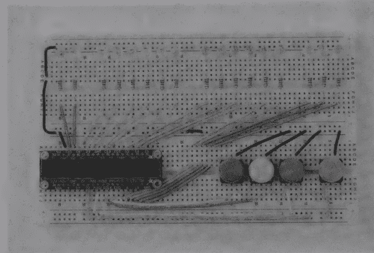

图 3-12. 使用两个全尺寸面包板完成二进制定时器的接线

| 树莓派软件配置工具 (raspi-config) | |
|---|---|
| A1 Overscan | 你可能需要配置过度扫描 |
| A2 Hostname | 设置此树莓派的可见名称 |
| A3 Memory Split | 修改分配的内存 |
| A4 SSH | 启用/禁用远程命令行 |
| A5 Device Tree | 启用/禁用设备树的使用 |
| A6 SPI | 启用/禁用自动加载 |
| A7 I2C | 启用/禁用自动加载 |
| A8 Serial | 选择串口控制台... |
| A9 Audio | 强制通过 HDMI 或 3 输出音频 |
| A0 Update | 将此工具更新到最新版本 |
| <Select> | <Back> |

图 3-13. 在树莓派上禁用串口控制台的 Raspi-config 菜单

## 二进制定时器算法

现在我们准备好开始项目的主编码。使用 Device I/O 库和 Pi4J 的两种完整实现可以在本章的 GitHub 仓库获取：https://github.com/RaspberryPiWithJava/BinaryTimer。不过，代码并不多，两种实现包含注释都在 200 行以内。

`run()` 方法将程序分为四个主要部分，我们将顺序处理：

```
public void run() {
  initPins();
  addListeners();
  runClock();
}
```

## 初始化 GPIO

Device I/O 库和 Pi4J 的初始化与我们在书中之前的方法类似。主要区别在于输入输出引脚的数量（共 21 个）。

Device I/O 库为我们提供了一种方便的方法，将属性与代码分离。与 Fritzing 图匹配的引脚列表位于代码 3-7 **代码 3-7 配置了二进制定时器输入输出引脚的 Device I/O 属性文件**：

```
gpio.GPIOPin = initValue:0, direction:0, mode:1
# LEDs
1 = deviceType: gpio.GPIOIN, pinNumber:14
2 = deviceType: gpio.GPIOIN, pinNumber:15
3 = deviceType: gpio.GPIOIN, pinNumber:18
4 = deviceType: gpio.GPIOIN, pinNumber:23
5 = deviceType: gpio.GPIOIN, pinNumber:24
6 = deviceType: gpio.GPIOIN, pinNumber:25
7 = deviceType: gpio.GPIOIN, pinNumber:08
8 = deviceType: gpio.GPIOIN, pinNumber:07
9 = deviceType: gpio.GPIOIN, pinNumber:12
10 = deviceType: gpio.GPIOIN, pinNumber:16
11 = deviceType: gpio.GPIOIN, pinNumber:20
12 = deviceType: gpio.GPIOIN, pinNumber:21
13 = deviceType: gpio.GPIOIN, pinNumber:05
14 = deviceType: gpio.GPIOIN, pinNumber:06
15 = deviceType: gpio.GPIOIN, pinNumber:13
16 = deviceType: gpio.GPIOIN, pinNumber:19
17 = deviceType: gpio.GPIOIN, pinNumber:26
# Buttons:
18 = deviceType: gpio.GPIOIN, pinNumber:11, direction:0, mode:1
19 = deviceType: gpio.GPIOIN, pinNumber:09, direction:0, mode:1
20 = deviceType: gpio.GPIOIN, pinNumber:10, direction:0, mode:1
21 = deviceType: gpio.GPIOIN, pinNumber:22, direction:0, mode:1
```

输入和输出引脚的区别在于，输出引脚的方向为 0 (DIR_INPUT_ONLY)，模式为 1 (MODE_INPUT_PULL_UP)。


> **TIPS** 我们使用上拉电阻的原因是引脚在被按下连接到地（0）之前将保持值为 1。尽管逻辑是反的（按钮按下为 0），但这是连接按钮的首选方法，因为它在开关激活时减少功耗，这对于电池供电的项目很重要。

Pi4J 的设置类似，使用的是 WiringPi 引脚编号而不是 Broadcom GPIO 号。此外，我们必须在代码中使用常量数组进行设置，这样代码更少，并且具有代码补全和类型安全的优势，如代码 3-8 所示。

## 代码 3-8 Pi4J GPIO 输入输出常量设置

```
private static final Pin[] LED_PINS = {
  RaspiPin.GPIO_05,
  RaspiPin.GPIO_16,
  RaspiPin.GPIO_01,
  RaspiPin.GPIO_04,
  RaspiPin.GPIO_05,
  RaspiPin.GPIO_06,
  RaspiPin.GPIO_10,
  RaspiPin.GPIO_11,
  RaspiPin.GPIO_26,
  RaspiPin.GPIO_27,
  RaspiPin.GPIO_28,
  RaspiPin.GPIO_29,
  RaspiPin.GPIO_21,
  RaspiPin.GPIO_22,
  RaspiPin.GPIO_23,
  RaspiPin.GPIO_24,
  RaspiPin.GPIO_25
};

private static final Pin[] BUTTON_PINS = {
  RaspiPin.GPIO_14,
  RaspiPin.GPIO_13,
  RaspiPin.GPIO_12,
  RaspiPin.GPIO_03
};
```

一旦所有配置完成，代码中的实际初始化步骤非常简单。代码 3-9 显示了 Pi4J 的 `initPins()` 实现，它与 Device I/O 代码非常相似。

## 代码 3-9 Pi4J 二进制定时器引脚初始化

```
private void initPins() {
  gpio = GpioFactory.getInstance();
  for (int i = 0; i < 17; i++) {
    leds[i] = gpio.provisionDigitalOutputPin(LED_PINS[i]);
  }
  for (int i = 0; i < 4; i++) {
    buttons[i] = gpio.provisionDigitalInputPin(BUTTON_PINS[i],
    PullResistance.PULL_UP);
  }
}
```

## 使用 Pi4J 更新 LED 的代码

```java
private void updateLeds() {
    for (int i = 0; i < 17; i++) {
        GpioPinDigitalOutput pin = leds[16 - i];
        boolean newValue = (counter >> i & 0x1) != 0;
        if (pin.getState().isHigh() != newValue) {
            pin.setState(newValue);
        }
    }
}
```

由于我们更改了计数器以反映三个亚秒位，而不是每秒更新一次，因此它需要每 1/8 秒滴答一次。这意味着我们每 125 毫秒就会得到一组新的 LED 组合。通过使用 `ScheduledExecutorService`，我们可以确保 LED 更新函数按固定间隔被调用。它足够智能，可以忽略所传入任务的运行时间，这将允许我们保持准确的倒计时计时器。代码 3-11 显示了 Pi4J 对定时执行任务的实现。

## 代码 3-11 用于调度 LED 更新的 Pi4J 任务

```java
private void runClock() {
    executor.scheduleAtFixedRate(() -> {
        if (!paused) {
            if (counter <= 0) {
                if ((System.currentTimeMillis() / 250) % 2 == 0) {
                    setAllLeds(false);
                } else {
                    updateLeds();
                }
            } else {
                updateLeds();
            }
            counter--;
        }
    }, 0, 125, TimeUnit.MILLISECONDS);
}
```

## 设置计时器

现在我们有了在 LED 上显示倒计时的方法，我们还需要一种使用四个按钮设置计时器的方法。通常情况下，在没有完整数字键盘的设备上输入 0 到 9 是一项挑战性的 UI 设计。然而，由于我们使用的是二进制，我们只需要担心两个数字！

## 第 3 章：二进制计时器

以下是我用于按钮的布局：

- **按钮 0 [蓝色]: 二进制 1** 将整个数字左移（乘以 2）并在代表秒的数字上加 1。
- **按钮 1 [灰色]: 二进制 0** 将整个数字左移（乘以 2）并在代表秒的数字上加 0。
- **按钮 2 [红色]: 清除数字/暂停计时器/关闭** 将整个数字右移（除以 2），移除代表秒的数字中的内容。也用于在计时器运行时暂停它，并在持续按住三秒时关闭应用程序。
- **按钮 3 [绿色]: Go/暂停** 如果计时器未运行则启动计时器，如果已经在运行则暂停。

这使得在通过二进制加位移的情况下，可以在时钟暂停时轻松地输入新时间。我的按钮控制逻辑的 Pi4J 实现如代码 3-12 所示。

## 代码 3-12 二进制计时器的 Pi4J 控制逻辑

```java
private void addListeners() {
    buttons[0].addListener((GpioListenerDigital) event -> {
        if (event.getState().isLow() && paused) { // 按钮：加 1（然后乘以 2）
            prepareEdit();
            counter <<= 1; // 移位（时间乘以 2）
            counter |= 1; // 开启最低位（+1）
            updateLeds();
        }
    });
    buttons[1].addListener((GpioListenerDigital) event -> {
        if (event.getState().isLow() && paused) { // 按钮：加 0（然后乘以 2）
            prepareEdit();
            counter <<= 1; // 移位（时间乘以 2）
            updateLeds();
        }
    });
    buttons[2].addListener((GpioListenerDigital) event -> {
        if (event.getState().isLow()) { // 按钮：除以 2、暂停、关闭
            shutdownFuture = executor.schedule(this::shutdown, 3, TimeUnit.SECONDS);
            if (!paused) {
                paused = true;
            } else {
                prepareEdit();
                counter >>= 1; // 移位（时间除以 2）
                counter &= ~0x4; // 清除移出的位
                updateLeds();
            }
        } else {
            shutdownFuture.cancel(false);
        }
    });
    buttons[3].addListener((GpioListenerDigital) event -> {
        if (event.getState().isLow()) { // 按钮：运行/暂停
            if (paused && counter >= 0) {
                counter &= 0x1FFFF; // 限制到最大 LED
            }
            paused = !paused;
            updateLeds();
        }
    });
}
```

## 按键消抖

按钮模拟数字开关的机械开关，但它们并不完美。开关的一个常见现象是它们在开启到关闭和反之转换时会经历一些信号抖动。信号中出现一些抖动并不令人意外，因为有一个物理接触在被按下和释放。

Pi4J 库具有非常简洁的事件触发机制和内置的按键消抖功能，可以在 `GpioPinDigitalInput` 上设置，并将减少原本会收到的伪事件。以下是在 Pi4J 中提供带按键消抖引脚的示例：

```java
DigitalInput button = gpio.newDigitalInput(pin, PinPullResistance.PULL_UP).setDebounce(20);
```

该消抖器的基本设计是立即触发收到的第一个事件，并在 20 毫秒内等待任何后续事件。如果 20 毫秒后的最终状态相同，则它就完成了工作并抑制了抖动。如果在此期间状态发生了变化（例如快速拨动开关），定时任务将把最后一个事件传递给你的应用程序。

## 第 3 章：二进制计时器

### 消抖辅助库


```java
public class Debouncer implements PinListener {
    private static final int STARTUP_INTERVAL = 20;
    private PinListener action;
    private int pin = -1;
    private ChangeEvent lastPE;
    private Future future;
    private final ScheduledExecutorService executor = Executors.newScheduledThreadPool(1);

    public Debouncer(PinListener action) {
        this.action = action;
    }

    @Override
    public void valueChanged(ChangeEvent pe) {
        if (future != null && future.isDone()) {
            if (lastPE != null && lastPE.getValue() == pe.getValue()) {
                return;
            }
        }
        lastPE = pe;
        future = executor.schedule(() -> {
            if (lastPE != null && lastPE.getValue() != pe.getValue()) {
                action.valueChanged(lastPE);
            }
        }, STARTUP_INTERVAL, TimeUnit.MILLISECONDS);
    }

    private void checkPin(ChangeEvent pe) {
        int id = pe.get().getId();
        if (pin == -1) {
            pin = id;
        } else if (pin != id) {
            throw new IllegalStateException("Debouncer pin[" + pin + "] != event");
        }
    }
}
```

此外，尽管使用了 `ScheduledExecutorService`，但只要从同一个线程调用 `valueChanged`，所有事件都保证按顺序调度。这避免了不必要的同步，并且符合 DIO 输入块中的预期用法，例如：

```java
button.setInputListener(new DIODebouncer(event -> {
    try {
        led.setValue(event.getValue());
    } catch (IOException ex) {
        Logger.getLogger(BinaryTimerDio.class.getName()).log(Level.SEVERE, null, ex);
    }
}));
```

### 列表 3-14. 引脚监听器辅助类 (PLHelper)

```java
class PLHelper implements PinListener {
    private final PinListenerWithThrows listener;
    public static interface PinListenerWithThrows extends DeviceEventListener {
        public void valueChanged(ChangeEvent pe) throws IOException;
    }
    public PLHelper(PinListenerWithThrows listener) {
        this.listener = listener;
    }
    @Override
    public void valueChanged(ChangeEvent pe) {
        try {
            listener.valueChanged(pe);
        } catch (IOException ioe) {
            throw new RuntimeException(ioe);
        }
    }
}
```

# 第 3 章：二进制计时器 93

这个简单的类允许我们忽略回调函数中的异常。在 GPIO 端口无法访问的罕见情况下（通常是配置或资源竞争问题），它将抛出一个封装了原始 `IOException` 的 `RuntimeException`。

这允许我们将监听器回调简化为如下形式：

```
button.setListener(new DIODebouncer(new PLHelper(event -> {
  led.setValue(event.getValue());
}));
```

现在我们有了一个可以帮你处理去抖和异常封装的简单回调！

记住在运行 Device I/O 版本的二进制计时器时，你需要设置正确的选项。要完成这一点，打开项目属性（Project Properties）对话框，进入运行（Run）类别，并输入 VM 选项：

```
-DDjk.dio.registry=dist/dio.properties -Djava.security.policy=dist/java
```

# 完成的二进制计时器

现在你可以使用所有工具在你选择的 Java GPIO 库中完成二进制计时器实现。除了拥有一个二进制计数的计时器的极客属性外，你还完成了一个可以作为更大项目部分的嵌入式项目。

再次，你可以在本章的 GitHub 仓库中找到这些示例的完整参考实现：https://github.com/RaspberryPiWithJava/BinaryTimer。

这里是一些为你自己的二进制计时器版本可以考虑的想法：

- 编写你的计时器，在计时器过期后跟踪“超时”时间。
- 添加一个 LED 屏幕，为非专业人士显示十进制时间。
- 添加一个时钟模式，以二进制（基2）显示当前时间。
- 编写你的计时器以毫秒级分辨率进行计数。

为了帮助你实现最后一个想法，接下来的额外章节将详细介绍 Java 在树莓派上运行 GPIO 库的性能。

# 94 带有 Java 的树莓派：为物联网

## 额外：GPIO 性能黑客

对于大多数项目，即使是我们在本章中构建的解析为 125ms 的二进制计时器，任何标准的 API 都能提供足够的性能。然而，当你需要在单数字毫秒范围内进行精确比较和快速计时时，你正在挑战大多数高层库的极限。

让我们先从快速对比 Device I/O 和 Pi4J 库开始。我写了一个简单的测试程序，在紧凑循环中尽可能快地切换 LED 的开启和关闭。在循环期间，应用程序对循环计时，并根据迭代次数计算出周期（GPIO 开启并关闭一次的持续）和 LED 的频率。

周期的计算非常简单：

Period = Duration / Iterations

频率的计算是周期的倒数：

Frequency = 1 / Period

此计算中最困难的部分可能是单位，因此我统一使用千赫兹 (kHz)，因为这是讨论 GPIO 速度时的有用范围。对于大多数 GPIO 不再是性能瓶颈的应用，1 kHz 左右是一个可以接受的速度。获得兆赫（MHz）范围的性能很好，但除非你正在位带（bit-banging）串口或其他底层总线协议，否则不需要。在这种情况下，你应该直接使用内置的串口、I2C 和 SPI 总线，而不是在高级层语言中重新实现底层协议。

I/O 定时测试的代码见列表 3-15（Pi4J 的差异在注释中显示）。

### 列表 3-15 Device I/O 定时微基准

```java
public class TimerDio {
    public static void main(String[] args) throws IOException {
        GPIO4J led = DeviceManager.open(in);
        // final GPIOController gpio = GPIOFactory.getInstance();
        // final GPIOPinDigitalOutput pin = gpio.provisionDigitalOutput(
        in(RaspberryPi.GPIO_01, PinState.LOW);
        final int ITERATIONS = 100000;
        long start = System.nanoTime();
        for (int i = 0; i < ITERATIONS; i++) {
            led.setValue(true);
            led.setValue(false);
            //
            pin.setState(true);
            //
            pin.setState(false);
        }
        long duration = System.nanoTime() - start;
        System.out.println("Duration = " + duration);
        double period = (duration / 1000000d / ITERATIONS);
        System.out.println("Period (in ms) = " + period);
        System.out.println("Frequency (in kHz) = " + 1d / period);
        led.close(0);
        //
        gpio.shutdown();
    }
}
```

我在运行 Raspian 的原生树莓派 B 上进行了测试，没有进行超频或其他修改。如图 3-14 所示，我在代码中跟踪了计时，并使用万用表进行了实测。意乎意料的是，代码计时返回的值与观察到的频率只有几个百分点的误差（这在所用设备的容差范围内）。

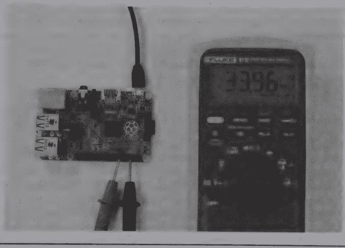

图 3-14 用于测试频率的 Fluke 87V 万用表

# 96 带有 Java 的树莓派：为物联网

测试针对 100 次得到以下结果：

- Pi4J: 0.75 kHz
- Device/O: 3.04 kHz

# 第 3 章：二进制计时器 97

### 列表 3-16 Pi4J 原始基准

```java
public class TimerDio {
    public static void main(String[] args) throws IOException {
        GPIO4J led = DeviceManager.open(in);
        // final GPIOController gpio = GPIOFactory.getInstance();
        // final GPIOPinDigitalOutput pin = gpio.provisionDigitalOutput(
        in(RaspberryPi.GPIO_01, PinState.LOW);
        final int ITERATIONS = 100000;
        long start = System.nanoTime();
        for (int i = 0; i < ITERATIONS; i++) {
            led.setValue(true);
            led.setValue(false);
            //
            pin.setState(true);
            //
            pin.setState(false);
        }
        long duration = System.nanoTime() - start;
        System.out.println("Duration = " + duration);
        double period = (duration / 1000000d / ITERATIONS);
        System.out.println("Period (in ms) = " + period);
        System.out.println("Frequency (in kHz) = " + 1d / period);
        led.close(0);
        //
        gpio.shutdown();
    }
}
```

（注：由于原始文本包含大量 OCR 识别错误和重复内容，译文已根据逻辑进行了去重和清理，以确保技术内容的连贯性。）

# 使用 Java 编程 98 树莓派：物联网编程


图 3-15. 数字示波器输出，幅度比 Pi4J 的高级 API 快

这比使用 Pi4J 和 Device I/O 的毫秒级定时器快三个数量级，并且足够支持毫秒级定时器。为了好玩，我在 GitHub 仓库（https://github.com/RaspberryPiWithJava/BinaryTimer）中以 `BinaryMillisecondTimerPi4JRaw.java` 的名包含了使用原始 Pi4J API 实现的毫秒定时器。

对于真正的性能极客来说，了解为什么 Pi4J API 要快得多非常重要。为了理解这一点，我们必须回溯并讨论在树莓派上访问 GPIO 的不同方式。访问 GPIO 有两种主要方式，每种方式都有不同的权衡：

- 内存映射访问 (/dev/mem)：这是 Linux 内核提供的访问 GPIO 的低级 API。它需要 root 权限以及对虚拟设备文件进行内存映射的能力，但它可以让你极快地设置一个或多个 GPIO 引脚。
- Sysfs 访问 (/sys/class/gpio/)：这是一个高级 API，允许以更安全、更简单的方式访问 GPIO。由于它不那么直接，因此速度也慢一点，但优点是不需要 root 权限。

Pi4J 通常需要 root 权限，因为它倾向于对 GPIO 引脚进行内存映射访问（尽管它具有在没有 root 权限的情况下使用 sysfs 访问的能力）。Device I/O 对所有 GPIO 都使用文件系统访问。

比较这两种访问方法的简单方法是将我们早的原始 Pi4J 访问程序修改为使用 sysfs GPIO 访问方法。该版本性能测试框架的代码位于列表 3-17。

## 列表 3-17 Pi4J Sysfs GPIO 微基准


```java
public class TimerPi4RAwsys {

    public static void main(String[] args) throws IOException {
        exportPin("18");
        Gpio.wiringPiSetup(0);
        final int ITERATIONS = 1000000;
        long start = System.nanoTime();
        for (int i = 0; i < ITERATIONS; i++) {
            Gpio.digitalWrite(18, 1);
            Gpio.digitalWrite(18, 0);
        }
        long duration = System.nanoTime() - start;
        System.out.println("Duration = " + duration + " ns");
        double period = duration / 1000000 / ITERATIONS;
        System.out.println("Period in ms = " + period + " ms");
        System.out.println("Frequency in kHz = " + 1d / period + " kHz");
        exportPin("18");
    }

    private static void exportPin(String port) throws IOException {
        FileWriter exportFile = new FileWriter("/sys/class/gpio/export");
        exportFile.write(port);
        exportFile.flush();
        FileWriter directionFile = new FileWriter("/sys/class/gpio/" + port + "/direction");
        directionFile.write("out");
        directionFile.flush();
    }

    private static void unexportPin(String port) throws IOException {
        FileWriter unexportFile = new FileWriter("/sys/class/gpio/unexport");
        unexportFile.write(port);
        unexportFile.flush();
    }
}
```

使用 SysFs GPIO 访问时需要一些额外的步骤来预导出引脚，并且它迫使我们回到整个程序中使用 Broadcom 引脚编号。另一个需要注意的问题是，如果测试由于异常或异常终止而未能成功完成，GPIO 引脚将保持导出状态，这在下一次运行之前需要进行一些清理。

运行这个版本，我们得到了以下性能：82.1 kHz。这与我们之前通过内存映射访问获得的 1.7 MHz 相比，性能大幅下降，并为我们的 Device I/O 库提供了一个很好的上限。由于它完全依赖于 sysfs 访问，它的速度永远不会比 80 kHz 快，但在实践中，由于错误检查、缓存等因素，它要慢得多。

从所有这些性能黑客中，我们可以得出一些非常有趣的结论：

- Pi4J 原始访问性能相当不错。使用它，你的应用程序将比任何不是用纯 C 编写的程序都要快。
- 大多数应用程序并不需要那种水平的性能，使用高级的 Pi4J 和 Device I/O 库就能运行得良好。
- 如果你完成了整个性能测试章节，你就是一个真正的嵌入式黑客。欢迎加入俱乐部！

## 第 4 章：IoT 帽子

本章将向你展示如何利用技术能力制作一个可以用来惊艳朋友的魔法道具。他们可能会对你的可穿戴树莓派黑客技术比你的魔术技巧感兴趣，但无论如何，这都是一个极佳的话题。

我们将制作一个魔法大礼帽，它能够推算出看似普通的扑牌值。只需将扑牌擦过帽子顶部或一个接一个地掉进帽子里，我们就能立刻知道牌组中使用的任何一张卡牌的值。通过一点巧妙的脚本，这将让我们让观众相信我们可以读心志愿者的心术。

## 物料清单

IoT 帽子是一个非常适合入门的项目，甚至不需要缝合（除非你擅长使用针线）。

以下是组件清单：

- 树莓派 A+：这是图 4-1 所示的型号，非常紧凑，省电。不过，你可以使用任何树莓派模型完成此项目。
- Wi-Fi 适配器：允许我们远程连接到树莓派 A+。内置 Wi-Fi 的模块是 Edimax EW-7811。
- 魔术师礼帽：家里任何高顶帽子都可以。服装或道具店是购买这种帽子的好地方。
- NFC/RFID 读卡器：该项目设计用于支持 Mifare 标签的 PN532 芯片。许多硬件供应商销售该芯片的开发板，我推荐的两个是 Adafruit 的 PN532 开发板（https://www.adafruit.com/products/364）和 ITEAD 的 PN532 模块（http://imallestudio.com/im13062502.html）。


图 4-1。树莓派 A+

- 便携 USB 充电器：为了让项目无线化，我们将放入一个为手机设计的电源。任何提供 1A 充电的设备都可以，一个不错的选择是 Jackery Bar（www.jackery.com/jackery-bar/）。
- 跳线线：这些主要用于连接 NFC/RFID 读卡器。六根母母跳线就能解决问题。（I2C/UART 需要四根，SPI 需要六根。）
- 胶带：胶带用于固定帽子内的组件。大力胶带效果很好。电工胶带有助于整理电缆。双面胶也很方便。
- RFID 卡或标签：为了使用 IoT 帽子，最好的选择是买一整包 RFID 扑牌，尽管你可以在普通扑牌上贴自己的标签。Cartamundi（www.cartamundi.com） 为赌场制造各种卡牌，包括嵌入 Mifare Ultright 芯片的卡牌。最简单的购买方法是从视频牌经销商购买，例如德国的 Pokertronic（www.pokertronic.de）或澳大利亚的 VideoPokerTable（https://videopokertable.net）。这些卡牌与普通扑牌几乎没有区别，如图 4-2 所示。


图 4-2。RFID 扑牌

## 第 4 章：IoT Hat 105

由于整套 RFID 卡并不便宜（大约 200 美元），另一种方案是直接获取一些小型 RFID 标签并将它们贴在普通的扑牌上。对于测试你的项目，这绝对足够了。这些来自 Adafruit 的标签运行良好，而且非常容易隐藏：https://www.adafruit.com/products/361。

## 设置你的 Raspberry Pi A+

在开始此项目之前，你需要在 Raspberry Pi A+ 上设置 Raspbian，并通过 Wi-Fi 适配器将其连接到网络。第 1 章详细介绍了如何通过安装过程为你的 Raspberry Pi 编程做好准备。然而，由于 Raspberry Pi A+ 只有一个 USB 端口，你必须在连接键盘或 Wi-Fi 适配器之间进行选择。这使得 Wi-Fi 适配器的初始设置变得有点复杂，因为在没有适配器的情况下无法扫描网络。以下是解决此限制的几种方法：

- 使用 USB 集线器同时连接键盘和 Wi-Fi 适配器。一旦建立了远程 SSH 连接，就可以移除集线器并专门使用 Wi-Fi 适配器。
- 在 Raspberry Pi B、B+ 或 2 上设置 SD 卡，然后通过 Raspberry Pi A+ 进行传输。这允许你在此设置过程中利用以太网网络和多个 USB 端口。一旦 SSH 访问可用，只需简单地将 SD 卡插入你的 Raspberry Pi A 即可。
- 手动将无线网络添加到配置中。这是最容易出错的选项，因为配置文件中的微小拼写错误可能会导致整个网络栈无法加载。我们将此归类为可能可行但不推荐的选项。

一旦你能够建立到 Raspberry Pi A+ 的远程 SSH 连接，就可以继续构建 IoT Hat 项目了。

## Raspberry Pi 上的 NFC/RFID 支持

将 NFC/RFID 读卡器连接到 Raspberry Pi 并通过 Java 访问它应该像切菜一样简单……嗯，像蛋糕一样简单。遗憾的是，它比这两者都要复杂一点。

Java 实际上已经内置了读取 NFC 和 RFID 卡的支持。原始规范由 Java 规范请求（JSR 268）定义，称为 Java Smart I/O API。自 2006 年 12 月 11 日发布 Java 1.6 以来，它一直是桌面版 Java SE 发布的一部分，并且在 Java SE 的 ARM 端口（包括 Raspberry Pi）上的工作原理完全相同。

由于最初是为桌面平台设计的，该规范假设目标智能卡读卡器安装了驱动程序，这些驱动程序通过个人电脑/智能卡 (PC/SC) 规范暴露设备。微软首次在 Windows XP 上提供了此规范，而在 Linux 和其他 Unix 平台上提供一个名为 PC/SC Lite 的免费实现。

然而，我们与其使用与智能卡读卡器芯片通信的封装设备，不如跳过这一点，通过 Raspberry Pi 上的 GPIO 引脚直接与芯片通信。这允许我们在更低的层级与读卡器芯片建立接口，从而能够去掉不必要的硬件，创建一个更紧凑、更节能效率的设计。

我们使用的芯片使用了三种不同的嵌入协议：I²C、SPI 和 UART（串口）。我将向你展示如何使用所有的这些协议。

## 配置你的 Raspberry Pi 以支持 I²C、SPI 和 UART

有几种不同的协议可以连接 NFC/RFID 读卡器。然而，默认情况下 Raspbian 会禁用所有通信总线，包括 I²C、SPI 和 UART。尽管在此项目中只需要选择这些协议中的一个，但我建议启用所有它们。这对于需要通信总线的其他设备很有帮助，并在其中一个协议无法工作时为你提供更多选择。

要启用这些总线，最好的机制是使用 `raspi-config` 命令行工具。它提供了一个控制台 GUI，可以通过它开启关闭每个通信协议。

## 第 4 章：IoT Hat 107

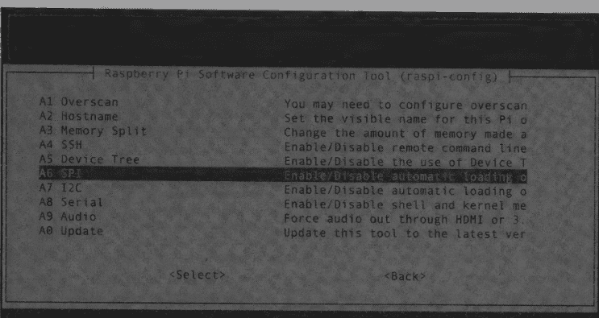

图 4-3. raspi-config 中的 Advanced Options（高级选项）选项卡

要打开 raspi-config 工具，你首先需要获取 Raspberry Pi+ 的命令行访问。由于它没有以太网端口，简单的方法是连接键盘和 HDMI 屏幕。登录控制台后，输入以下命令启动 raspi-config 工具：

```
sudo raspi-config
```

导航到 Advanced Options 项目（数字 8）并进入该子菜单。你将看到一组新选项，如图 4-3 所示（并在第 1 章中描述）。

在 Advanced Options 选项卡上，你需要通过选择 A6 和 A7 对应的菜单项来启用 SPI 和 I2C。Raspi-config 会首先询问你是否想要启用接口，你应该回答 Yes 并选择 OK 确认。然后程序会询问你是否想要默认加载内核模块，你应该回答 Yes 并再次选择 OK 确认。对 SPI 和 I2C 接口都执行此操作。

### 注意

在最新版本的 Raspbian 中，raspi-config 无法正确启用 I2C 内核模块。要启用它，你必须使用命令 `sudo nano /etc/modules` 编辑 `/etc/modules`。在该文件末尾添加一行 `i2c-dev`。

默认情况下，串口用于调试。然而，我们将禁用它以便我们可以使用它。当询问“Would you like a login shell to be available over serial?”时，选择 No。现在它会提示你“Serial disabled”；但我们已经准备好使用它了。

最后，选择 Finish 退出 raspi-config，然后使用以下命令重启 Raspberry Pi 以万：

```
sudo shutdown -r now
```

现在你已成功启用了 I2C、SPI 和通过 GPIO 的串口通信。

## 连接智能卡读卡器

我将为 Adafruit 的 PN532 扩展板和 ITEAD PN532 NFC 模块提供说明。其他电子供应商也提供类似的扩展板，任何带有 PN532 芯片并允许你连接 I2C、SPI 或串口的板子都应该正常工作。

来自 Adafruit 的板子没有附带接针，如图 4-4 所示。该电路板带有 PN532 芯片以及一个用于从合理距离读取智能卡的天线。还有状态指示灯和用于几种不同设备连接的安装孔。沿着板子，你将获得一排接针（你可以根据需要将其焊接在板上），两个用于选择接口的跳线帽，以及一张可以用来测试并确保你的板子正常工作的 RFID 卡。

我们需要的引脚是右边缘的九个连接器以及底部的两个跳线帽组（每组三个）。

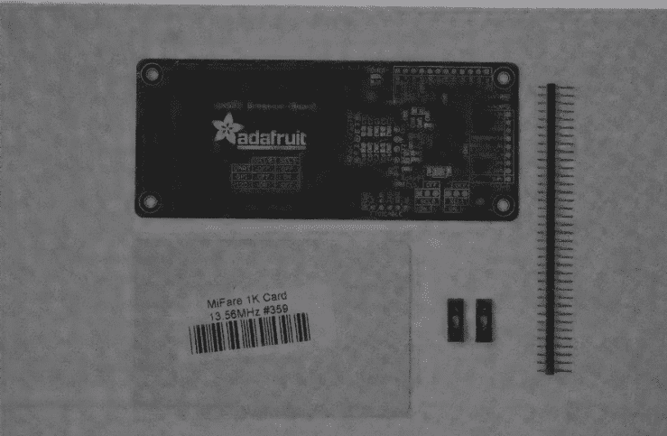

图 4-4. 来自 Adafruit 的 PN532 扩展板

将顶部的额外引脚和底部的 FTIC 连接器焊接到板上是非常直接的，但如果你从未做过焊接，这里有一些建议：

- 使用带有细圆头刀头的烙铁头将更易于处理小型组件。如果你的烙铁头太大，可能会损坏附近的组件。
- 使用夹具或“助手”来固定你试图焊接的组件将很有帮助。一旦焊料冷却，你的组件将固定在它所处的任何角度，因此在开始焊接之前你有机会对齐它们。
- 在应用焊料之前，确保孔和引脚都已充分加热。如果其中一个热量不足，你就会得到所谓的“虚焊”，它可能会随时间推移而失效。

## 110 Java 树树莓派：物联网编程

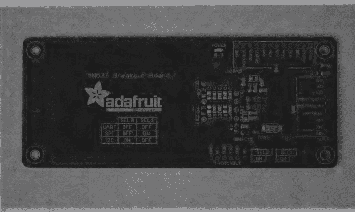

图 4-5 焊接针脚的 PN532 扩展板

在这种情况下，我建议将所有针脚焊接在板子的顶部，这样你就可以将智能卡读器平放在放置在扩展帽（hat）的顶部。天线将接收靠近扩展板顶部或底部的 RFID 游戏卡，因此你可以选择将卡掉入扩展帽内或在上方挥动来扫描卡。

图 4-5 显示了我完全焊接好的 PN532 扩展板，跳线帽已插入到启用 SPI 通信的位置。表 4-1 列出了所有不同跳线位置及其启用的通信协议列表。

| 协议 | SEL0 (左侧跳线) | SEL1 (右侧跳线) |
|---|---|---|
| 串口 (UART) | 关闭 (右侧) | 关闭 (右侧) |
| SPI | 关闭 (右侧) | 开启 (左侧) |
| I2C | 开启 (左侧) | 关闭 (右侧) |

表 4-1. Adafruit PN532 扩展板的开关设置

# 第 4 章：IoT 扩展帽 111

| SET0 (左侧开关) | SET1 (右侧开关) |
|---|---|
| 串口 (UART) | L (左侧) | L (左侧) |
| SPI | L (左侧) | H (右侧) |
| I²C | H (右侧) | L (左侧) |

**表 4-2.** ITEAD PN532 NFC 模块的开关设置

ITEAD Studio 的设置简单一点，因为所有针脚和开关都是预装的。此外，它有一排与树莓派 GPIO 布局匹配的方便针脚，你可以直接用串口线将其连接，尽管对于本项目，我建议使用跳线线以便于将硬件隐藏在扩展帽中。

遗憾的是，开关（正如你猜的那样）与 Adafruit 板使用的相反，请确保你根据所需的协议正确设置它们。表 4-2 显示了 ITEAD PN532 扩展板的不同开关位置。

最后一步是将扩展板连接到你的树莓派 A+。我建议首先尝试 SPI 协议，因为它是速度最高的总线且非常可靠。I²C 是另一个极佳的选择，允许你轻松地连接多个设备。然而，某些 Adafruit PN532 板可能存在缺陷，而串口是一个简单且易于调试的选项，即使它的速度没有之前的总线协议快。

要通过 SPI 连接，你需要按照图 4-6 所示和表 4-3 所列出的将电缆连接到树莓派。图 4-6 显示了 ITEAD PN532 扩展板的照片；但是，当两块板的针脚都朝下时，Adafruit 板上的引脚从左到右的顺序是相同的。你可以安全地忽略 Adafruit 板上 ITEAD 板上不存在的第九个引脚。如果你没有树莓派的引脚编号，请参考第 3 章的图 3-2。

I²C 连接稍微容易一点，总共只需要四根电缆。所需的连接如图 4-7 所示并在表 4-4 中列出。同样，请参考图 3-2 的树莓派引脚编号。

# 112 Java 树莓派：物联网编程

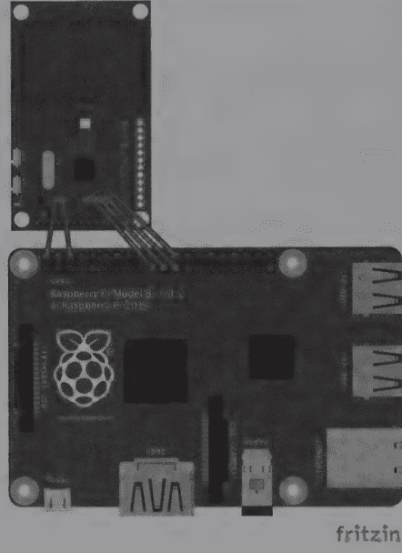

**图 4-6.** SPI 连接图

| | 扩展板 | 树莓派 |
|---|---|---|
| 5.0V | Pin 1 | Pin 2 |
| GND | Pin 2 | Pin 6 |
| SSEL | Pin 5 | Pin 24 |
| MOSI | Pin 6 | Pin 19 |
| MISO | Pin 7 | Pin 21 |
| SCK | Pin 8 | Pin 23 |

**表 4-3.** SPI 引脚连接

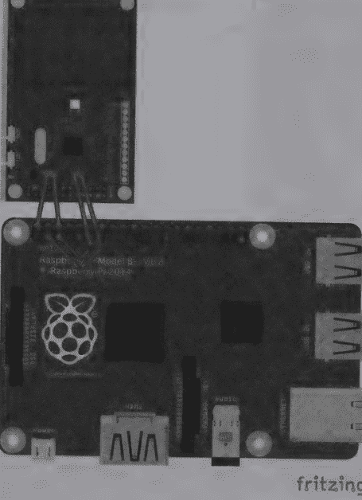

图 4-7. I²C 连接图

| 扩展板 | 树莓派 |
|---|---|
| 5.0V | Pin 1 | Pin 2 |
| GND | Pin 2 | Pin 6 |
| SCL | Pin 5 | Pin 5 |
| SDA | Pin 6 | Pin 3 |


# 第 4 章：IoT 扩展帽

## 表 4-1. Adafruit PN532 扩展板的开关设置

| 协议 | SEL0 (左侧跳线) | SEL1 (右侧跳线) |
|---|---|---|
| 串口 (UART) | 关闭 (右侧) | 关闭 (右侧) |
| SPI | 关闭 (右侧) | 开启 (左侧) |
| I²C | 开启 (左侧) | 关闭 (右侧) |

## 表 4-2. ITEAD PN532 NFC 模块的开关设置

| 协议 | SET0 (左侧开关) | SET1 (右侧开关) |
|---|---|---|
| 串口 (UART) | L (左侧) | L (左侧) |
| SPI | L (左侧) | H (右侧) |
| I²C | H (右侧) | L (左侧) |

## 硬件连接

在这种情况下，我建议将所有针脚焊接在板子的顶部，这样你就可以将智能卡读器平放在放置在扩展帽的顶部。天线将接收靠近扩展板顶部或底部的 RFID 游戏卡，因此你可以选择将卡掉入扩展帽内或在上方挥动来扫描卡。

图 4-5 显示了我完全焊接好的 PN532 扩展板，跳线帽已插入到启用 SPI 通信的位置。表 4-1 列出了所有不同跳线位置及其启用的通信协议。

ITEAD Studio 的设置简单一点，因为所有针脚和开关都是预装的。此外，它有一排与树莓派 GPIO 布局匹配的方便针脚，你可以直接用串口线将其连接，尽管对于本项目，我建议使用跳线线以便于将硬件隐藏在扩展帽中。

遗憾的是，开关（正如你猜的那样）与 Adafruit 板使用的相反，请确保你根据所需的协议正确设置它们。表 4-2 显示了 ITEAD PN532 扩展板的不同开关位置。

最后一步是将扩展板连接到你的树莓派 A+。我建议首先尝试 SPI 协议，因为它是速度最高的总线且非常可靠。I²C 是另一个极佳的选择，允许你轻松地连接多个设备。然而，某些 Adafruit PN532 板可能存在缺陷，而串口是一个简单且易于调试的选项，即使它的速度没有之前的总线协议快。

### SPI 连接

要通过 SPI 连接，你需要按照图 4-6 所示和表 4-3 所列出的将电缆连接到树莓派。图 4-6 显示了 ITEAD PN532 扩展板的照片；但是，当两块板的针脚都朝下时，Adafruit 板上的引脚从左到右的顺序是相同的。你可以安全地忽略 Adafruit 板上 ITEAD 板上不存在的第九个引脚。如果你没有树莓派的引脚编号，请参考第 3 章的图 3-2。

**图 4-6.** SPI 连接图

## 表 4-3. SPI 引脚连接

| 信号 | 扩展板 | 树莓派 |
|---|---|---|
| 5.0V | Pin 1 | Pin 2 |
| GND | Pin 2 | Pin 6 |
| SSEL | Pin 5 | Pin 24 |
| MOSI | Pin 6 | Pin 19 |
| MISO | Pin 7 | Pin 21 |
| SCK | Pin 8 | Pin 23 |

### I²C 连接

I²C 连接稍微容易一点，总共只需要四根电缆。所需的连接如图 4-7 所示并在表 4-4 中列出。同样，请参考图 3-2 的树莓派引脚编号。

**图 4-7.** I²C 连接图

## 表 4-4. I²C 引脚连接

| 信号 | 扩展板 | 树莓派 |
|---|---|---|
| 5.0V | Pin 1 | Pin 2 |
| GND | Pin 2 | Pin 6 |
| SCL | Pin 5 | Pin 5 |
| SDA | Pin 6 | Pin 3 |

### 串口连接

最后，你也可以通过串口连接 PN532 扩展板。当使用串口连接而不是将引脚连接到树莓派上标记相同的引脚上时，你需要交叉电缆。图 4-6 显示了 ITEAD PN532 扩展板的照片；但是，当两块板的针脚都朝下时，Adafruit 板上的引脚从左到右的顺序是相同的。你可以安全地忽略 Adafruit 板上 ITEAD 板上不存在的第九个引脚。如果你没有树莓派的引脚编号，请参考第 3 章的图 3-2。

**图 4-8.** 串口连接图

## 配置 libnfc

例如，如果你正在使用 SPI，你需要通过输入以下命令创建一个新的 `libnfc.conf` 文件：

```bash
sudo nano /etc/nfc/libnfc.conf
```

然后将内容添加到新创建的文件：

```
device.name = "pn532_spi"
device.connstr = "pn532_spi:/dev/spidev0.0:500000"
```

一旦保存配置，你就可以使用 `nfc-scan-device` 和 `nfc-poll` 命令测试 libnfc。列表 4-2 显示了当你成功将 RFID 卡靠近读取器时运行 `nfc-poll` 的输出。

### 列表 4-2 nfc-poll 的成功运行

```
pi@iothat ~/libnfc-1.7.1 $ nfc-poll
nfc-poll uses libnfc 1.7.1
NFC reader: pn532_spi:/dev/spidev0.0 opened
NFC device will poll during 30000 ms (20 timings of 300 ms for
5 modifications)
ISO/IEC 14434 (106 kbps) target:
ATQA (SENS_RES): 00 04
UID (NFCID1): e0 dc e6 16
SAK (SENS_RES): 08
f_initiator_target_is_present: Target Released
Waiting for card removing...done.
```

你也可以类似地使用串口和 I2C 连接。要启用串口，只需更改 `libnfc.conf` 文件读取为：

```
device.name = "pn532_uart"
device.connstr = "pn532_uart:/dev/ttyAMA0"
```

要使用 I2C 协议，你将使用以下配置：

```
device.name = "pn532_i2c"
device.connstr = "pn532_i2c:/dev/i2c-1"
```

I2C 可能是最难排故障的，因为它是一种多设备协议。如果你的设备没有立即注册到 I2C 总线，为了帮助排故障，你可以运行以下命令安装 `i2c-tools`：

```bash
sudo apt-get install i2c-tools
```

这会为你提供几个额外的命令，包括 `i2c-detect`，你可以通过输入命令 `i2cdetect 1` 来运行，如果你的设备配置正确工作正常，它将给你与列表 4-3 类似的输出。

### 列表 4-3 运行 i2cdetect 1 的输出

```
pi@iothat -- $ i2cdetect 1
WARNING! This program can confuse the I2C bus, cause data loss and worse!
I will probe file /dev/i2c-1.
I will probe address range 0x03-0x77.
Continue? [Y/n]
00: 0 1 2 3 4 5 6 7 8 9 a b c d e f
10: -- -- -- -- -- -- -- -- -- -- -- -- -- -- --
20: -- -- -- -- -- -- 24 -- -- -- -- -- -- --
30: -- -- -- -- -- -- -- -- -- -- -- -- -- -- --
40: -- -- -- -- -- -- -- -- -- -- -- -- -- -- --
50: -- -- -- -- -- -- -- -- -- -- -- -- -- -- --
60: -- -- -- -- -- -- -- -- -- -- -- -- -- -- --
70: -- -- -- -- -- -- -- -- -- -- -- -- -- -- --
```

## 编译并安装 ifdnfc

现在你已经让底层库工作了，但你需要将其暴露为 PC/SC 设备以便 Java 访问。为了实现这一点，你将使用一个名为 `ifdnfc` 的开源库，它为 `libnfc` 创建了一个封装，使其看起来像通用的 PC/SC 驱动程序。再次，`ifdnfc` 并没有为树莓派预编译，与 `libnfc` 不同，它甚至没有一个稳定版本可以指向，因此你必须从源码构建。这应该是正常的，但如果有开发活动，请准备好处理不稳定性。

要开始，请执行以下命令克隆 GitHub 仓库：

```bash
git clone https://github.com/nfc-tools/ifdnfc
```

要构建代码，你需要几个库。第一个是 `autoreconf`，它允许你在树莓派的 ARM 平台上配置编译器设置。第二个是 `libpcsclite-dev`，这是一个构建依赖，因为该库实现了 PC/SC 驱动。最后，`pcscd` 是 Java 将通信的守护进程，`ifdnfc` 将与它交互。你使用以下命令安装这些库：

```bash
sudo apt-get install autoreconf libpcsclite-dev pcscd
```

安装完这些依赖项后，运行以下命令准备配置代码：

```bash
cd ifdnfc
autoreconf
./configure
```

这将产生大量输出，因为它正在检查你的平台以查找编译器和库。列表 4-4 显示了 `ifdnfc` 配置的结尾。

### 列表 4-4 树莓派上 ifdnfc 的配置详情

`ifdnfc` 使用以下选项配置：

```
Version: 0.1.4
Host: armv6-unknown-linux
Compiler: gcc
Preprocessor flags: -g -O2 -std99
Linker flags:
LIBNFC_CFLAGS: -lnfcc
PCSC_CFLAGS: -pthread -I/usr/include
PCSC_LIBS: -lpcsclite
BUNDLE_HOST: Linux
BUNDLE_EXT: 
configure: creating ./config
creating Makefile
creating src/Info.plist
creating config.h
executing deps
executing libtool
```

一旦配置成功，你可以使用标准的 `make` 命令构建项目：

```bash
make
```

如果编译成功，你可以使用以下命令将其安装到本地发行版：

```bash
sudo make install
```

最后一步是设置指向 `ifdnfc` 的 PC/SC 驱动文件。`/usr/local/etc/reader.conf` 有一个模板驱动文件，你可以通过以下命令复制并编辑它：

```bash
sudo cp /usr/local/etc/reader.conf /etc/reader.conf
sudo nano /etc/reader.conf
```

在 nano 中，你只需要取消掉最后四行的注释，使文件看起来像图 10 所示。然后保存文件并退出 nano。

**图 10.** nano 中的 ifdnfc 配置

最后一步是重启 PC/SC 守护进程并激活 `ifdnfc` 代理。以下两个命令将完成此操作：

```bash
sudo /etc/init.d/pcscd restart
ifdnfc-activate
```

> **注意**：`ifdnfc` 代理在启动时自动启动，因此每次启动 IoT Hat 都需要运行此命令。为了方便，你可能希望设置启动代理在启动时运行它。

现在你已经在操作系统层面准备好了一切，可以从 Java 直接访问智能卡。下一节将详细解释如何使用 `smartcardio` 库读取扫描到的 RFID 卡。

## 从 Java 读取卡

前一节演示了如何设置底层库和基础设施与 NFC/RFID 智能卡读取器接口。现在你已经准备好创建一个 Java 应用，使用已经是 JRE 部分的 smartcardio API 来读取卡。

本节的所有代码可以在书籍的 GitHub 仓库中找到。欢迎下载仓库代码进行跟随：

https://github.com/RaspberryPiWithJava/iot

所示的代码片段假设你正在从 `javax.smartcardio` 包导入正确的类。由于这是 Java SE 桌面版和嵌入式版本的标准包，你不需要下载或链接任何 JAR 文件即可使用该功能。

要与智能卡读取器建立新连接，你首先需要为访问的特定智能卡读取器打开 `CardTerminal`。由于你控制着硬件，你可以保证树莓派上恰好连接了一个智能卡读取器，因此你可以安全地选择列表中的第一个终端，如列表 4-5 所示。

### 列表 4-5 smartcardio CardTerminal 的初始化代码

```java
TerminalFactory factory = TerminalFactory.getDefault();
CardTerminals terminals = factory.terminals();
List<CardTerminal> list = terminals.list();
CardTerminal cardTerminal = list.get(0);
```

一旦你获得了 `CardTerminal` 的访问，就可以读取通过读取器的卡。对于这一点，你可以使用一个简单的循环不断检查新卡，并通过辅助函数处理它们，如列表 4-6 所示。

### 列表 4-6 卡片处理循环

```java
while (true) {
    cardTerminal.waitForCardPresent(0);
    handleCard(cardTerminal);
    cardTerminal.waitForCardAbsent(0);
}
```

`waitForCardPresent` 和 `waitForCardAbsent` 传递的参数是毫秒。通过传递 0，我们告诉程序无限等待。

现在你可以查询 `CardTerminal` 以获取卡地址。列表 4-7 显示了一个代码片段，它将获取卡地址并以人类可读的格式打印出来。

### 列表 4-7 获取卡地址并打印到系统

```java
final byte[] readUID = new byte[]{(byte) 0xFF, (byte) 0xCA, (byte) 0x00, (byte) 0x00, (byte) 0x00};
Card card = cardTerminal.connect("*");
CardChannel channel = card.getBasicChannel();
ResponseAPDU response = channel.transmit(new CommandAPDU(readUID));
byte[] uid = response.getBytes();
System.out.println("Card UID: " + bytesToString(uid));
card.disconnect(false);
```

通过向 `connect` 方法传递 `*`，你是在告诉 Java smartcardio 库使用任何可用协议。在通道上向 `transmit` 函数传递的字节数组是获取特定智能卡的唯一标识符（UID）可以让你识别出使用的是哪张卡牌。为了简化读取返回的值，我们编写了一个辅助函数（如列表 4-8 所示），它可以将字节数组转换为可读的字符串。

### 列表 4-8 将字节数组转换为字符串的辅助函数

```java
private static String bytesToString(byte[] bytes) {
    StringBuilder result = new StringBuilder();
    for (byte b : bytes) {
        result.append(String.format("%02x", b));
    }
    return result.toString();
}
```

现在，你已经准备好在树莓派上运行这段代码了。和往常一样，你需要设置一个远程 Java SE 平台并在项目的运行设置中对其进行配置，以便能够远程部署和运行代码。

使用 `smartcardio` 库还需要额外的配置，即指定目标平台上的 PC/SC 原生库。要进行此配置，打开“项目属性”对话框，点击左侧类别窗格中的“运行”，并在右侧的“VM 选项”字段中输入以下文本：

```
-Dsun.security.smartcardio.library=/usr/lib/arm-linux-gnueabhf/libpcsclite.so
```


现在你可以在树莓派上运行应用程序，并且每次将卡片通过它时都会返回字节字符串格式的卡片 UID。尝试一下，并实验看看读卡器附带的每个不同标签返回什么 UID。这已经非常接近你为 IoT Hat 读取扑克牌的需求了。不过，还缺少几个功能：

- 如果能有一个从 UID 到扑克牌的映射将非常方便。我肯定很难记住 52 个 UID 以准确地回想起正确的卡牌。
- 当你玩弄读卡器时，你可能注意到在通过卡片时很容易发生重复扫描。在现场表演中，你最不希望的就是因为重复扫描导致卡片顺序错误。

对于第一个需求，你可以创建一个包含映射关系的简单属性文件。对于我使用的这组扑克牌，我进行了快速的一一映射，并以属性键值格式将其保存。列表 4-9 显示了文件中的前十条条目。

### 列表 4-9 从 UID 到卡片的属性文件映射

```
049D7B7A83B1E80 = 2H
04EC8B7A83B1E80 = 3H
04B5A87A83B1E80 = 4H
04065B7A83B1E81 = 5H
04E2937A83B1E80 = 6H
04D8AB7A83B1E80 = 7H
04DE467283B1E80 = 8H
04025D7A83B1E81 = 9H
0402467A83B1E81 = 10H
04EEFF7A83B1E80 = JH
```

在你的代码中，你可以通过以下操作在扫描时加载属性文件并查找条目：

```java
final Properties cardids = new Properties();
cardids.load(IoTHat.class.getResourceStream("cardid.properties"));
final String cardname = cardids.getProperty(uid);
```

对于第二个需求，为了防止卡片重复扫描，你只需要保留上一次卡片的值并忽略多次扫描即可。例如，以下是一个非常简单的实现：

```java
private static String lastcard;
...
if (!cardname.equals(lastcard)) {
  lastcard = cardname;
  System.out.println(cardname);
}
```

这已经为你提供了组装完整应用程序的所有部分，用于在你的 IoT Hat 上扫描扑克牌并列出卡值。再次，本章的完成项目可以在以下 GitHub 仓库找到：

https://github.com/RaspberryPiWithJava/IoTHat

## IoT Hat 的物理结构

现在你已经在树莓派上运行了所有软件，是时候对 IoT Hat 进行物理组装了。除了你整个章节一直在使用的树莓派 A+ 和智能卡读卡器外，你还需要 USB 电源、顶帽以及一些耗材，如胶带。参考章节开头的“材料清单”部分获取完整的零件列表。

首先拿出来的是你可靠的魔帽。任何带有宽檐的深帽都可以很好地隐藏你的树莓派和相关硬件。我选择的帽子加上一些用于视觉装饰的扑克牌，如图 4-11 所示。

在拿出胶带和粘胶之前，我建议先将组件摆放在帽子内部，看看它们如何配合得最合适。理想情况下，你希望智能卡读卡器末端的天线位于帽子正中央，以便提供最宽的扫描接触区域。确保平的一面朝下，这样就不会压坏你的引脚和电线了。


**图 4-11. 设计布局**

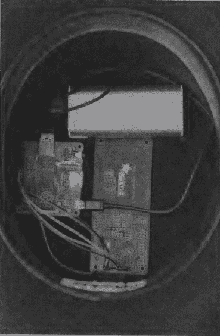

**图 4-12. 组件布局**

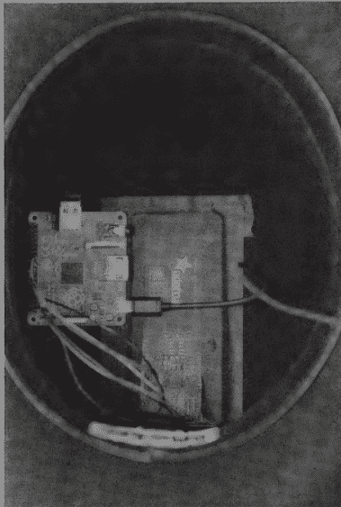

**图 4-13. 树莓派胶带固定**

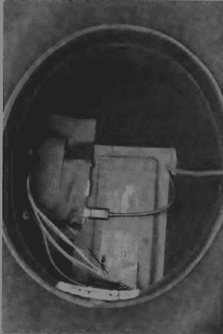

**图 4-14. 树莓派固定于底部**

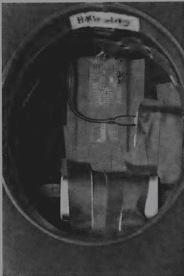

**图 4-15. 电池固定**

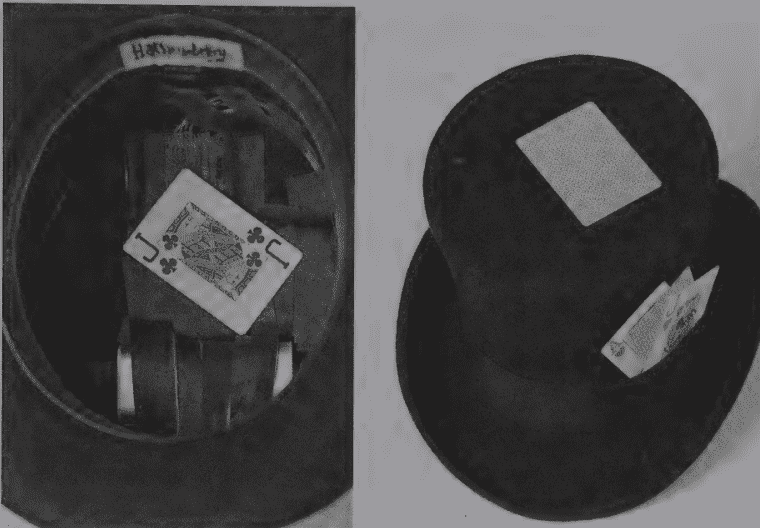

**图 4-16. 两种方案**

# 第 5 章：寻迹机器人

以下是组件列表：

- 树莓派 B+ 或 2：对于这个项目，我建议使用树莓派 B+ 或 2，这样你就可以使用新的 Arduino 扩展板。
- 波壳电子 ARP1600 Arduino 扩展板：这是我为这个项目推荐的 Arduino 扩展板。任何适配引脚但本身不是 Arduino 微控制器的扩展板都可以正常工作，但你可能会遇到树莓派反向供电的问题。
- Makeblock 启动机器人套件（IR 版本）：包含了我们构建寻迹机器人所需的大部分零件。你可以从 www.makeblock.cc/ 购买该套件和其他 Makeblock 产品。
- Makeblock Me UNO 扩展板：这将取代启动机器人套件中的 Arduino 微控制器，允许我们使用树莓派作为主控制器。
- Makeblock Me 双直流电机驱动器：UNO 扩展板没有内置电机驱动器，因此我们需要额外获取一个外部板。幸运的是，它带有两个电机驱动器，刚好足够控制你机器人履带的两个电机。
- Makeblock Me 寻迹模块：这是与 Makeblock 兼容的寻迹模块。
- 白色/黑色电胶胶：为了让机器人有清晰可见的线条可以跟随，铺设一条轨道会有帮助。如果你的地面颜色足够浅，你可能只需要一条黑色胶带。否则，我建议使用 4 英寸宽的白色胶带，中间贴一条 1 英寸宽的黑色胶带。
- AA 电池：总共需要六节电池为机器人供电。电池消耗很快，特别是在调试时，所以使用充电镍氢（NiMH）电池是个好主意。
- USB 电池：为了稳定树莓派的电源，除了 Makeblock 扩展板的反向供电外，你还需要一个 USB 电池。上一章中 IoT 项目推荐的 Jackery 电池效果就会非常好。

这组组件提供了使用树莓派 B+ 或 2 构建寻迹机器人所需的所有物品。

> **注意**
> 也可以使用 GPIO 引脚较少的树莓派板（如 A 型和 B 型）来构建寻迹机器人，但你需要使用不同的适配板。树莓派转 Arduino 扩展板连接桥接（https://www.cooking-hacks.com/documentation/tutorials/raspberry-pi-to-arduino-shields-connection-bridge）可以胜任，尽管引脚分配不同。


## 机器人组装

先组装机器人并测试比较容易，因此我将引导你一步步创建寻迹机器人。根据你使用的 Makeblock 套件不同，你的零件可能会略有不同，但你应该有足够的备用零件进行相应调整并安装所有组件。

> **注意**
> 由于套件存在差异，我建议你也查看 Makeblock 套件随附的说明书以了解基础坦克结构，并进行调整以适应更高堆叠 ARP1600 和树莓派堆栈。

从使用几根铝棒组装底座开始。为此，我们将使用铝棒侧面的钻孔和铝棒末端的螺纹来制作安全的 T 型连接。由于这是车辆的框架，它必须足够坚固，但不要过度拧紧螺栓，否则可能会弯曲铝材。图 5-2 显示了完成的车身框架。


> **注意**
> 确保带有脊纹的一侧朝上。原因将在接下来的几个步骤中变得明朗。

下一步是用几颗螺丝将电机固定在安装支架上。图 5-3 显示了每个组装好的电机应该是什么样子。还要注意电机上连接器的指向方向。为了防止电缆在地面上拖拽，你应该将连接器面向支架的平整边缘。

**图 5-2 寻迹机器人的车身**


**图 5-3 电机组装**

准备好两个电机后，你可以像图 5-4 所示，每个电机使用两个中号螺栓将它们拧在寻迹机器人底座上。它们安装在相对两侧，以便每个电机可以独立控制一个轮胎履带。

万向轮有很多零件需要组装。图 5-5 显示了所有不同的零件以及你需要安装它们的顺序。

**图 5-4 安装在底座上的电机**

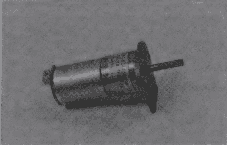

**图 5-5 万向轮的零件**

在铝棒上组装万向轮。这包括了几个垫圈、一个微型轴承、齿轮轮和轴止块。确保齿轮轮对准中心以防打滑。万向轮需要安装在铝棒上。图 5-6 显示了轮子的组装。

**图 5-6 完成的组装**

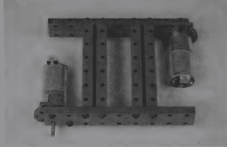

组好两个轮后，你可以通过拧螺母将它们固定在底座上。剩下的两个轮直接连接到电机轴上。安装所有轮子的底座如图 5-7 所示。

**图 5-7 安装轮子的底座**

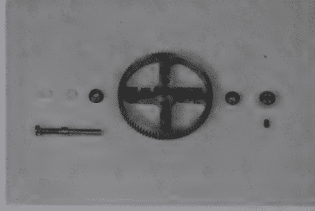

你应该收到了几个安装板。下一步是添加电池盒和设备平台。这些板的两面覆盖有一层纸。开始组装前去掉这层纸。

在将这些板固定到底座之前，先在其中一个上安装电池盒。为此，请使用 Makeblock 套件提供的几个螺母和销钉。如果你有销钉，只需将其插入孔并压住蘑菇头即可固定。

为了将板固定到底座上，我利用了铝棒上的脊纹槽。这是一个非常巧妙的设计，因为它允许你在任何地方固定组件，即使预钻孔没有对齐也可以安装。通过三颗螺丝（留空第四颗以免短路树莓派）和一些长螺栓或销钉，你可以像图 5-8 所示将电池盒和设备平台稳固地安装在底座上。

> **注意**
> 设备平台有几种不同的方向；因此在完全拧紧螺丝之前，请确保安装树莓派的位置正确。

**图 5-8 安装在底座上的电池和设备盒**

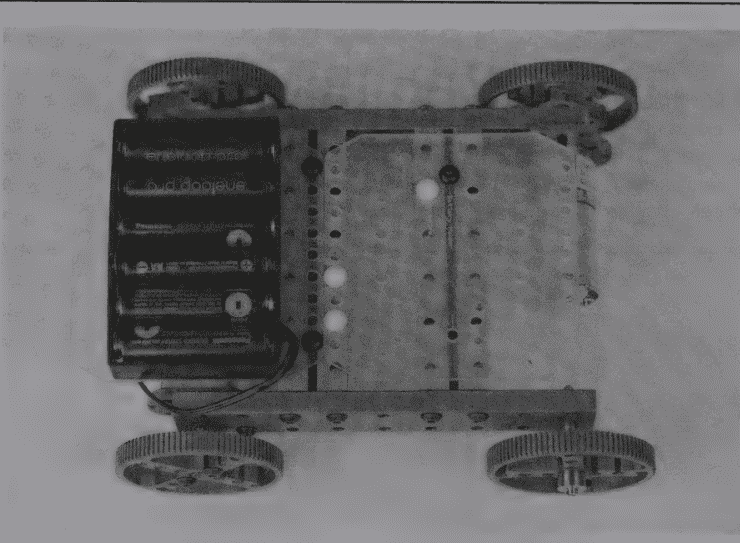

现在是为寻迹机器人底部添加传感器和电机板了。我们将使用 `Makeblock Me 寻迹模块` 来检测黑白线条，并使用 `Me 双直流电机驱动器` 控制两个电机。寻迹模块需要安装在靠近地面的地方以便准确检测线条，因此你需要像图 5-9 所示添加一个扩展件。

**图 5-9 Makeblock Me 寻迹模块和 Me 双直流电机驱动器**

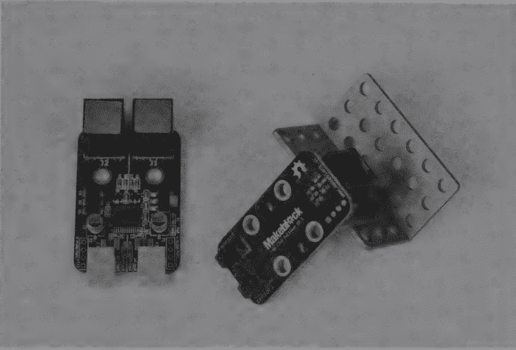

我使用了几个 L 型支架，但你也可以使用螺杆来实现相同的效果。电机驱动器可以直接安装在直线运行器的底部。在这两种情况下，爆珠钉都是连接电路板的最佳方法。图 5-10 显示了安装了两块电路板的直线运行器底部。

**图 5-10. 安装在直线运行器底部的传感器**

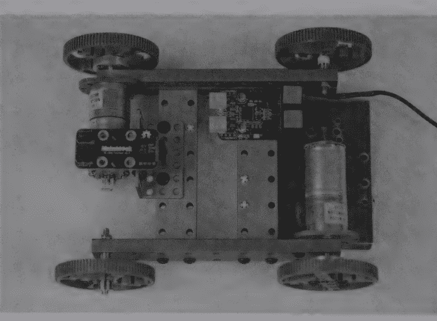

我们还有几块传感器板需要安装在直线运行器的顶侧。这包括用于遥控的 `Me 红外接收器解码器`，以及用于测量的 `Makeblock Me 超声传感器`，这样我们就可以在机器人靠近物体时停止它。对于红外传感器，我使用了一些 U 型支架来将其抬高；对于超声波传感器，我使用了一个 L 型支架和一块 6x3 的平板，如图 5-11 所示。你可以使用剩余的任何零件按照你的喜好安装传感器。

图 5-12 显示了安装了两个传感器板的循线小车的顶部。请确保超声波距离传感器朝向前方并将其抬得足够高，使其不会拖到地面。红外传感器只需要放置在易于遥控器对准的位置。根据需要进行调整，以适应你套件版本中的任何差异。

**图 5-11. 红外和超声波传感器**

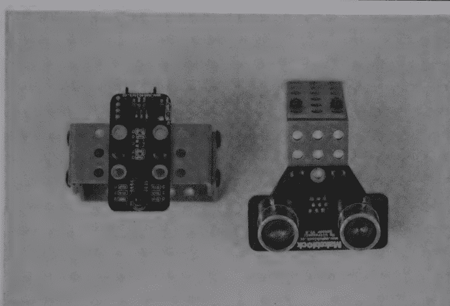

**图 5-12. 安装了传感器和树莓派的循线小车顶部**

如你所见，我同时安装了树莓派和 ARPI1600 Arduino 板。你需要使用安装板上标记为“Raspberry Pi”的两个孔来固定 ARPI1600。我建议在还能接触到树莓派板底部时现在就安装上层柱。另外两个标记为“Raspberry Pi”的孔可以将 ARPI1600 安装在设备平台上，如图 5-12 所示。为此，我使用了 Makeblock 套件中提供的一些较小螺丝，但你可以使用任何适合标记为“Raspberry Pi”孔的可用硬件。Makeblock 的隔隙柱大小合适，可以与平台保持一点距离，以便你安全地拧紧电路板。

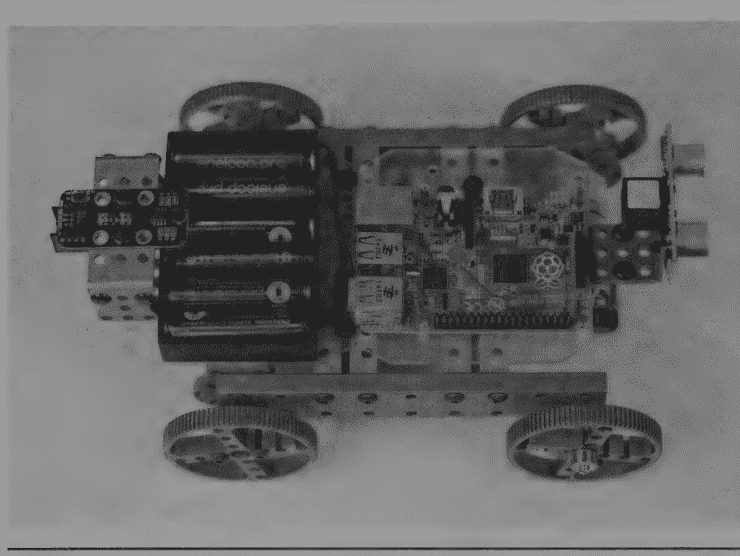

ARPI1600 直接安装在树莓派上方，并通过螺丝钉在层柱上将其固定，如图 5-13 所示。

**图 5-13. 连接了 ARPI1600 的直线运行器**

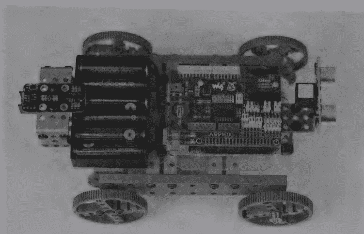

最后要添加到这个小设备“煎饼”结构上的电路板是 `Makeblock Me UNO 扩展板`。它位于 ARPI1600 上方，通过插针和引脚之间的紧密连接固定在原位。然而，在安装这块板之前，我们需要进行一个小小的“调整”。

树莓派的 GPIO 使用 3.3V 逻辑，而 Arduino 的 GPIO 使用 5V 逻辑。大多数情况下，3.3V 是足够的，因为我们真正感兴趣的是数字引脚是开启还是关闭。然而，某些为 5V 逻辑设计的电路将无法正确识别树莓派引脚为开启。`Me 双直流电机驱动器` 就有这个问题……嗯，更准确地说，`Me UNO 扩展板` 和 `Me 双直流电机驱动器` 的组合存在这个问题。


## 142 带有 Java 的树莓派：物联网的编程

我使用了几个 L 型支架，但你也可以使用螺杆来实现相同的效果。电机驱动器可以直接安装在直线运行器（line runner）的底部。在这两种情况下，爆珠钉都是连接电路板的最佳方法。图 5-10 显示了安装了两块电路板的直线运行器底部。

我们还有几块传感器板需要安装在直线运行器的顶侧。这包括用于遥控的 `Me 红外接收器解码器`，以及用于测量的 `Makeblock Me 超声传感器`，这样我们就可以在机器人靠近物体时停止它。对于红外传感器，我使用了一些 U 型支架来将其抬高；对于超声波传感器，我使用了一个 L 型支架和一块 6x3 的平板，如图 5-11 所示。你可以使用剩余的任何零件按照你的喜好安装传感器。

图 5-12 显示了安装了两个传感器板的循线小车的顶部。请确保超声波距离传感器朝向前方并抬得足够高，使其不会拖到地面。


图 5-10. 安装在直线运行器底部的传感器

## 第 5 章：直线运行器


图 5-11. 红外和超声波传感器

红外传感器只需要放置在易于遥控器对准的位置。根据需要进行调整，以适应你套件版本中的任何差异。

如你所见，我同时安装了树莓派和 `ARPI1600 Arduino` 板。你需要使用安装板上标记为“Raspberry Pi”的两个孔来固定 `ARPI1600`。我建议在还能接触到树莓派板底部时现在就安装上层柱。另外两个标记为“Raspberry Pi”的孔可以将 `ARPI1600` 安装在设备平台上，如图 5-12 所示。为此，我使用了 Makeblock 套件中提供的一些较小螺丝，但你可以使用任何适合标记为“Raspberry Pi”孔的可用硬件。Makeblock 的隔隙柱大小合适，可以与平台保持一点距离，以便你安全地拧紧电路板。

## 带有 Java 的树莓派：物联网的编程


图 5-12. 安装了传感器和树莓派的循线小车顶部

`ARPI1600` 直接安装在树莓派上方，并通过螺丝钉在层柱上将其固定，如图 5-13 所示。

最后要添加到这个小设备“煎饼”结构上的电路板是 `Makeblock Me UNO 扩展板`。它位于 `ARPI1600` 上方，通过插针和引脚之间的紧密连接固定在原位。然而，在安装这块板之前，我们需要进行一个小小的“调整”。

> **树莓派的 GPIO 使用 3.3V 逻辑，而 Arduino 的 GPIO 使用 5V 逻辑。** 大多数情况下，3.3V 是足够的，因为我们真正感兴趣的是数字引脚是开启还是关闭。然而，某些为 5V 逻辑设计的电路将无法正确识别树莓派引脚为开启。`Me 双直流电机驱动器`就有这个问题……嗯，更准确地说，`Me UNO 扩展板`和 `Me 双直流电机驱动器`的组合存在这个问题。


图 13. 连接了 ARPI1600 的直线运行器

# 第 5 章：寻迹机器人 149

| Arduino | Broadcom | Pi4J |
|---|---|---|
| D0 | 15 | 16 |
| D1 | 14 | 15 |
| D2 | 17 | 0 |
| D3 | 18 | 1 |
| D4 | 27 | 2 |
| D5 | 22 | 3 |
| D6 | 23 | 4 |
| D7 | 24 | 5 |
| D8 | 25 | 6 |
| D9 | 4 | 7 |
| D10 | 8 | 10 |
| D11 | 10 | 12 |
| D12 | 9 | 13 |
| D13 | 11 | 14 |
| A0 | 7 | 11 |
| A1 | 5 | 21 |
| A2 | 6 | 22 |
| A3 | 13 | 23 |

> **表 5-1.** ARPI600 从 Arduino 到树莓派引脚的映射

你可以通过 PC 访问。由于我们没有使用 Makeblock 套件中的任何模拟传感器，所以我们不需要担心这个问题。

第二个技巧是弄清楚 Arduino 引脚是如何映射到每个 Makeblock 连接器引脚的。幸运的是，在最近的板载修订中，它们直接打印在 PCB 上，但拥有一个完整的列表是有帮助的。表 5-2 显示了 Makeblock 端口到第一个和第二个引脚的映射。每个连接器上还有额外的提供地和电源的引脚，但这两个数据引脚是最重要的。

| Makeblock 端口 | 引脚 1 | 引脚 2 |
|---|---|---|
| 1 | D10 | D11 |
| 2 | D12 | D9 |
| 3 | D8 | D13 |
| 4 | D3 | |
| 5 | RX | TX |
| 6 | D2 | |
| 7 | A3 | A2 |
| 8 | A1 | A0 |
| 9 | D4 | D5 |
| 10 | D7 | D6 |

表 5-2. Makeblock 端口到引脚的映射

使用表 5-1 和表 5-2，你可以弄清楚任何引脚映射到哪里。为了更容易弄清楚本章连接的设备使用了哪些 GPIO 引脚，表 5-3 显示了我们建议的接线方案的映射。在我们开始连接传感器和设备时，你需要参考此表。

| 设备 | 第一个 Pi4J 引脚 | 第二个 Pi4J 引脚 |
|---|---|---|
| 寻迹传感器 | 左: 14 | 右: 6 |
| 距离传感器 | | |
| 红外接收器 | RX | TX |
| 左履 | 方向: 2 | 脉冲: 3 |
| 右履 | 方向: 5 | 脉冲: 4 |

## 脉宽调制

直流电机通常使用脉宽调制 (`PWM`) 进行控制，即你给电机提供一个规律的脉冲来调节它们的速度。通过改变脉冲宽度或电流提供的时间，你可以调节电压并降低电机速度（与恒定电流相比）。使用 `PWM` 控制电机速度的优势是在低速运行时效率更高。

树莓派在引脚 1 上有 `PWM` 硬件支持，但我们需要在多个引脚上使用 `PWM` 来控制两个电机，因此我们需要在普通 GPIO 引脚上使用软件模拟 `PWM`。`Pi4j` 通过 `SoftPWM` 支持这一点，它在后台运行一个进程来控制引脚定时以创建规律的脉冲。由于是在软件中实现的，定时无法保证是精确的，但对于控制 LED 和电机来说已经足够了。

在引脚上初始化 `PWM`，使用以下方法：


```
result = SoftPWM.softPWMCreate(MOTOR1_PWM, 0, 100);
```

第一个参数是使用 Pi4J 编号规则用于 PWM 的引脚。第二个参数是电机的初始值，最后一个参数是值的范围。最后一个参数的建议默认值为 100。成功时返回 0，错误时返回 -1。

> **提示**
>
> 你可能想知道范围的作用是什么以及如果改变它会发生什么。`SoftPWM` 的实现方式是它具有 100µs 的粒度，可以将引脚设置为低电平或高电平。范围是以 100µs 为单位的周期，因此默认的 100 为我们提供了 10 ms 的周期。那么该值就是信号保持高电平的单位，如果我们使用 20，它将保持高电平 2 ms，然后低电平 8 ms。将范围调大可以在周期内提供更多控制，但粒度并没有增加——只是周期时间增加了。要获得比 100µs 更细的粒度，你需要执行软件循环，这将占用资源并难以控制超过一个引脚。

# 使用 Java 的树莓派：物联网编程

为了更容易弄清楚本章连接的设备使用了哪些 GPIO 引脚，表 5-3 显示了我们建议的接线方案的映射。在我们开始连接传感器和设备时，你需要参考此图表。

```
result = SoftPWM.softPWMCreate(MOTOR1_PWM, 0, 100);
```

第一个参数是使用 Pi4J 编号规则用于 PWM 的引脚。第二个参数是电机的初始值，最后一个参数是值的范围。最后一个参数的建议默认值为 100。成功时返回 0，错误时返回 -1。

> **提示**
>
> 你可能想知道范围的作用是什么以及如果改变它会发生什么。`SoftPWM` 的实现方式是它具有 100µs 的粒度，可以将引脚设置为低电平或高电平。范围是以 100µs 为单位的周期，因此默认的 100 为我们提供了 10 ms 的周期。那么该值就是信号保持高电平的单位，如果我们使用 20，它将保持高电平 2 ms，然后低电平 8 ms。将范围调大可以在周期内提供更多控制，但粒度并没有增加——只是周期时间增加了。要获得比 100µs 更细的粒度，你需要执行软件循环，这将占用资源并难以控制超过一个引脚。

当然，你可以通过设置 0 到 100 之间的值来调节速度。成功时返回 0，错误时返回 -1。

```
result = SoftPWM.softPWMCreate(MOTOR1_PWM, 0, 100);
```

| Makeblock 端口 | 引脚 1 | 引脚 2 |
|---|---|---|
| 1 | D10 | D11 |
| 2 | D12 | D9 |
| 3 | D8 | D13 |
| 4 | D3 | |
| 5 | RX | TX |
| 6 | D2 | |
| 7 | A3 | A2 |
| 8 | A1 | A0 |
| 9 | D4 | D5 |
| 10 | D7 | D6 |

表 5-2. Makeblock 端口到引脚的映射

使用表 5-1 和表 5-2，你可以弄清楚任何引脚映射到哪里。为了更容易弄清楚本章连接的设备使用了哪些 GPIO 引脚，表 5-3 显示了我们建议的接线方案的映射。在我们开始连接传感器和设备时，你需要参考此图表。

| 设备 | 第一个 Pi4J 引脚 | 第二个 Pi4J 引脚 |
|---|---|---|
| 寻迹传感器 | 左: 14 | 右: 6 |
| 距离传感器 | | |
| 红外接收器 | RX | TX |
| 左履 | 方向: 2 | 脉冲: 3 |
| 右履 | 方向: 5 | 脉冲: 4 |

表 5-3. 设备到 GPIO 的映射

直流电机通常使用脉宽调制 (PWM) 进行控制，即你给电机提供一个规律的脉冲来调节它们的速度。通过改变脉冲宽度或电流提供的时间，你可以调节电压并降低电机速度（与恒定电流相比）。使用 PWM 控制电机速度的优势是在低速运行时效率更高。

树莓派在引脚 1 上有 PWM 硬件支持，但我们需要在多个引脚上使用 PWM 来控制两个电机，因此我们需要在普通 GPIO 引脚上使用软件模拟 PWM。`Pi4J` 通过 `SoftPWM` 支持这一点，它在后台运行一个进程来控制引脚定时以创建规律的脉冲。由于是在软件中实现的，定时无法保证是精确的，但对于控制 LED 和电机来说已经足够了。

在引脚上初始化 PWM，使用以下方法：

```
result = SoftPWM.softPWMCreate(MOTOR1_PWM, 0, 100);
```

第一个参数是使用 Pi4J 编号规则用于 PWM 的引脚。第二个参数是电机的初始值，最后一个参数是值的范围。最后一个参数的建议默认值为 100。成功时返回 0，错误时返回 -1。

> **提示**
>
> 你可能想知道范围的作用是什么以及如果改变它会发生什么。`SoftPWM` 的实现方式是它具有 100µs 的粒度，可以将引脚设置为低电平或高电平。范围是以 100µs 为单位的周期，因此默认的 100 为我们提供了 10 ms 的周期。那么该值就是信号保持高电平的单位，如果我们使用 20，它将保持高电平 2 ms，然后低电平 8 ms。将范围调大可以在周期内提供更多控制，但粒度并没有增加——只是周期时间增加了。要获得比 100µs 更细的粒度，你需要执行软件循环，这将占用资源并难以控制超过一个引脚。

# Java 树莓派：物联网编程

这在预定义的树莓派端口（15/16）上创建了一个新的串口工厂，并以 9600 波特率开启通信，这是与 Makeblock 串口模块接口的正确速度。

要从串口模块接收数据，我们需要使用回调类为串口对象添加一个监听器。实现此点的简单方法是使用 Lambda 表达式，并在其中包含一个用于不同返回值的 `switch` 块，如列表 5-2 所示。

## 列表 5-2 处理串口远程数据的监听代码

```
remote.addListener((SerialDataListener) (SerialDataEvent event) -> {
  String data = event.getData();
  byte command = (byte) data.charAt(2);
  switch (command) {
    case 69: // power/A
      System.out.println("Power/A pressed");
      gpio.shutdown();
      System.exit(0);
    default:
      System.out.println("Unrecognized Command: " + command);
  }
});
```

> **注意**
>
> 如果能使用 Lambda 简写语法并省略此表达式上的类型就太好了，但它无法编译，因为 `addListener` 方法接受多种类型的回调，所以你必须显式地设置类型。

这段代码将打印出在控制器上按下的串口命令的值。它作为调试工具非常有用，可以帮助确定遥控器上所有按钮的代码。按下遥控器上的电源按钮将整洁地终止 `Pi4J` GPIO 支持并退出 Java 进程。

现在我们已经有了功能良好的遥控器和可以工作的电机，可以将它们整合起来，构建一个手动控制机器人的简单接口。

# 第 5 章：巡线机器人

我在示例使用了以下按键映射（带有斜杠分隔的两组键名，基于不同版本的遥控器）：

- 播放/中心：前进，或如果正在向前移动则停止
- 倒回/左：向左转或如果正在向左转则停止转向
- 快进/右：向右转或如果正在向右转则停止转向
- 返回/E：倒向行驶，或如果正在倒向行驶则停止
- 加号/向上：加速
- 减号/向下：减速

这允许你通过按一次按钮执行操作，再按一次取消操作。为了实现控制逻辑，我们需要一些额外的抽象。为了处理行驶，我们使用了一个枚举（enum），它包含了机器人所有可能的状态，如列表 5-3 所示。

### 列表 5-3 控制机器人状态的枚举

```
public static enum Drive {
    reverse(PinState.HIGH, PinState.LOW),
    stop(PinState.LOW, PinState.LOW),
    forward(PinState.LOW, PinState.HIGH),
    left(PinState.LOW, PinState.LOW),
    right(PinState.HIGH, PinState.HIGH);
    private final PinState motor1;
    private final PinState motor2;
    Drive(PinState motor1, PinState motor2) {
        this.motor1 = motor1;
        this.motor2 = motor2;
    }
}
```

对于每个状态，该枚举定义了电机 1 和电机 2 的方向。唯一不重要的状态是当我们停止时，因此我们简单地将两个引脚都设置为 `PinState.LOW`。为了处理速度，我们有一个具有不同预设速度值的枚举，如列表 5-4 所示。

### 列表 5-4 巡线机器人速度的枚举

```
public static enum Speed {
    slow(55), medium(65), fast(80), accelerate(100);
    private final int pulse;

    Speed(int pulse) {
        this.pulse = pulse;
    }

    public Speed speedup() {
        return this == accelerate ? values()[ordinal()] + 1 : this;
    }

    public Speed slowdown() {
        return this == slow ? slow : values()[ordinal() - 1];
    }
}
```

由于减速与脉宽调制之间不是线性关系，我选择了一些倾向于范围上端的值。你可能会通过实验发现，通过微调这些值可以获得更好的速度控制。你也可以添加额外的级别来增加粒度。

在定义了两个枚举后，`doDrive` 方法的实现相对简单。只需按照列表 5-5 所示设置电机的方向即可。

### 列表 5-5 doDrive 的实现

```
private void doDrive(Drive drive) {
    switch (drive) {
        case forward:
            motor1.setState(PinState.LOW);
            motor2.setState(PinState.HIGH);
            break;
        case reverse:
            motor1.setState(PinState.HIGH);
            motor2.setState(PinState.LOW);
            break;
        case left:
            motor1.setState(PinState.LOW);
            motor2.setState(PinState.LOW);
            break;
        case right:
            motor1.setState(PinState.HIGH);
            motor2.setState(PinState.HIGH);
            break;
        case stop:
            motor1.setState(PinState.LOW);
            motor2.setState(PinState.LOW);
            break;
    }
}
```

为了跟随线条，我们使用两个红外传感器。Makeblock 板带有两个红外传感器，它们通过反射光来检测线的存在。当表面是白色时，光被反射；当表面是黑色时，光被吸收。这使得传感器能够相应地检测线条。

## 第 5 章：巡线机器人

### 列表 5-8 用于开启和关闭寻迹算法的 Case 子句

```
case 68: // D
if (!followLine) { // 启动寻迹
    followLine = true;
    lineLocation = Drive.forward;
} else { // 停止寻迹
    followLine = false;
    Gpio.delay(100);
    dDrive(Drive.stop);
}
```

停止时设置延迟的原因是避免在状态转换的中间阶段，巡线状态被寻迹算法覆盖。

现在，你已经有了一个可以工作的巡线机器人，可以在任何平整的表面上进行测试。如果你的地板反射率足够，你只需要在地面上贴一条黑线作为跑道即可。然而，对于颜色太深或颜色不均的地板，一个很好的折中方案是设置一个白色胶带作为外轨道，并在内部留一条供跟踪的线。

对于外轨道，我建议总厚度约为 10cm，如果你没有足够厚的胶带，可以使用多条胶带叠加。对于黑线，宽度约 3cm 的胶带效果良好，尽管任何宽度大于两个光电耦合器之间距离的线条都可以。图 5-16 显示了巡线机器人正在工作，它在巴西坎皮纳斯的一场 Java 用户小组活动中快乐地在胶带跑道上穿梭。

## 障碍检测

我们巡线机器人的最后一个技巧是教它如何停止并等待阻塞跑道的障碍。为了实现这一点，我们将使用 Makeblock Me 超声波传感器。该传感器利用高频声来检测传感器前方实体的存在和距离。它在 3cm 到 4m 范围内是准确的，尽管传感器的有效范围受限于我们读写树莓派数字引脚的速度和精度。


图 5-16. 正在工作的巡线机器人（照片致谢：Bruno Borges）

Makeblock Me 超声波传感器的协议如下。

首先，通过以下步骤初始化传感器：

1. 向 GPIO 引脚写入低值。
2. 等待 2 微秒。
3. 向 GPIO 引脚写入高值。
4. 等待 10 微秒。
5. 向 GPIO 引脚写入低值。

读取传感器的方法如下：

1. 等待其变为高电。
2. 启动计时器。
3. 等待其变为低电。
4. 以微秒为单位的脉冲宽度。

一旦我们传感器的脉冲宽度，就可以用它计算物体的距离。厘米为单位的距离是通过脉冲宽度除以 58 计算的，公式如下：

距离 (cm) = 脉冲宽度 (uS) / 58

对于 3cm 的最小距离，这需要精确到 174µs 或 .174ms 的定时。遗憾的是，树莓派的 GPIO 库无法处理这种分辨率，因此在这个距离下你将完全错过脉冲。使用可用的最快 GPIO 接口（`Pi4J` 原始模式），我们可以测量从约 20cm 开始的距离，这为传感器提供了 20cm 到 4m 的有效范围。这对于避障来说是合理的，也是我们将关注的范围。

> **提示**
>
> 你可以在像 Arduino 使用的 `ATmega328` 这样的实时芯片上获得更高的分辨率，因为它们没有运行完整的操作系统，因此没有干扰计时的中断。然而，你也就放弃了通用计算能力，因此一种很好的组合是将 Arduino 连接到传感器，并通过串口与正在进行更高级处理的树莓派进行通信。

为了测量距离，列表 5-9 提供了一个遵循 Makeblock Me 超声波传感器协议的简单算法，返回厘米为单位的距离。

### 列表 5-9 使用 Me 超声波传感器计算距离的算法

```
private int measureDistance() {
    Gpio.pinMode(ULTRASONIC, Gpio.OUTPUT);
    Gpio.digitalWrite(ULTRASONIC, 0);
    Gpio.delayMicroseconds(2);
    Gpio.digitalWrite(ULTRASONIC, 1);
    Gpio.delayMicroseconds(10);
    Gpio.digitalWrite(ULTRASONIC, 0);
    Gpio.pinMode(ULTRASONIC, Gpio.INPUT);
    long start = System.nanoTime();
    while (System.nanoTime() - start < 2300000) {
        long mid = System.nanoTime();
        if (start >> 2300000) {
            return -1; // 障碍太近，无法检测距离
        }
        while (Gpio.digitalRead(ULTRASONIC) == 1 && System.nanoTime() < mid) {
        }
    }
    long end = System.nanoTime();
    return (int)(end - mid) / 58000;
}
```

使用这种方法，我们可以修改寻迹算法，在检测到任何障碍时停止。新行已用粗体显示在：

### 列表 5-10 停止时修改后的算法


```java
public void run() {
    for (;;) {
        if (followLine) {
            if (measureDistance() < 20) {
                doDrive(stop);
            } else {
                boolean leftSensor = followA.isHigh();
                boolean rightSensor = followB.isHigh();
                if (leftSensor && rightSensor) {
                    lineLocation = forward;
                } else if (!leftSensor && rightSensor) {
                    lineLocation = right;
                } else if (leftSensor && !rightSensor) {
                    lineLocation = left;
                } else if (!leftSensor && !rightSensor) {
                    lineLocation = right;
                }
            }
            doDrive(lineLocation);
        }
    }
}
```

停止时设置延迟的原因是避免在状态转换的中间阶段，巡线状态被寻迹算法覆盖。现在，你已经有了一个可以工作的巡线机器人，可以在任何平整的表面上进行测试。如果你的地板反射率足够，你只需要在地面上贴一条黑线作为跑道即可。然而，对于颜色太深或颜色不均的地板，一个很好的折中方案是设置一个白色胶带作为外轨道，并在内部留一条供跟踪的线。

对于外轨道，我建议总厚度约为 10cm，如果你没有足够厚的胶带，可以使用多条胶带叠加。对于黑线，宽度约 3cm 的胶带效果良好，尽管任何宽度大于两个光电耦合器之间距离的线条都可以。图 5-16 显示了巡线机器人正在工作，它在巴西坎皮纳斯的一场 Java 用户小组活动中快乐地在胶带跑道上穿梭。

## 障碍检测

巡线机器人的最后一个技巧是教它如何停止并等待阻塞跑道的障碍。为了实现这一点，我们将使用 Makeblock Me 超声波传感器。该传感器利用高频声来检测传感器前方实体的存在和距离。它在 3cm 到 4m 范围内是准确的，尽管传感器的有效范围受限于我们读写树莓派数字引脚的速度和精度。


**图 5-16.** 正在工作的巡线机器人（照片致谢：Bruno Borges）

Makeblock Me 超声波传感器的协议如下。

首先，通过以下步骤初始化传感器：

1. 向 GPIO 引脚写入低值。
2. 等待 2 微秒。
3. 向 GPIO 引脚写入高值。
4. 等待 10 微秒。
5. 向 GPIO 引脚写入低值。

读取传感器的方法如下：

1. 等待其变为高电。
2. 启动计时器。
3. 等待其变为低电。
4. 以微秒为单位的脉冲宽度。

一旦我们获得传感器的脉冲宽度，就可以用它计算物体的距离。厘米为单位的距离是通过脉冲宽度除以 58 计算的，公式如下：

距离 (cm) = 脉冲宽度 (uS) / 58

对于 3cm 的最小距离，这需要精确到 174µs 或 .174ms 的定时。遗憾的是，树莓派的 GPIO 库无法处理这种分辨率，因此在这个距离下你将完全错过脉冲。使用可用的最快 GPIO 接口（`Pi4J` 原始模式），我们可以测量从约 20cm 开始的距离，这为传感器提供了 20cm 到 4m 的有效范围。这对于避障来说是合理的，也是我们将关注的范围。

> 你可以在像 Arduino 使用的 `ATmega328` 这样的实时芯片上获得更高的分辨率，因为它们没有运行完整的操作系统，因此没有干扰计时的中断。然而，你也就放弃了通用计算能力，因此一种很好的组合是将 Arduino 连接到传感器，并通过串口与正在进行更高级处理的树莓派进行通信。

为了测量距离，列表 5-9 提供了一个遵循 Makeblock Me 超声波传感器协议的简单算法，返回厘米为单位的距离。

**列表 5-9** 使用 Me 超声波传感器计算距离的算法

```java
private int measureDistance() {
    Gpio.pinMode(ULTRASONIC, Gpio.OUTPUT);
    Gpio.digitalWrite(ULTRASONIC, 0);
    Gpio.delayMicroseconds(2);
    Gpio.digitalWrite(ULTRASONIC, 1);
    Gpio.delayMicroseconds(10);
    Gpio.digitalWrite(ULTRASONIC, 0);
    Gpio.pinMode(ULTRASONIC, Gpio.INPUT);
    long start = System.nanoTime();
    while (System.nanoTime() - start < 2300000) {
        long mid = System.nanoTime();
        if (start >> 2300000) {
            return -1; // 障碍太近，无法检测距离
        }
        while (Gpio.digitalRead(ULTRASONIC) == 1 && System.nanoTime() < mid) {
        }
    }
    long end = System.nanoTime();
    return (int)(end - mid) / 58000;
}
```

使用这种方法，我们可以修改寻迹算法，在检测到任何障碍时停止。新行已用粗体显示在：

**列表 5-10** 停止时修改后的算法

```java
public void run() {
    for (;;) {
        if (followLine) {
            if (measureDistance() < 20) {
                doDrive(stop);
            } else {
                boolean leftSensor = followA.isHigh();
                boolean rightSensor = followB.isHigh();
                if (leftSensor && rightSensor) {
                    lineLocation = forward;
                } else if (!leftSensor && rightSensor) {
                    lineLocation = right;
                } else if (leftSensor && !rightSensor) {
                    lineLocation = left;
                } else if (!leftSensor && !rightSensor) {
                    lineLocation = right;
                }
            }
            doDrive(lineLocation);
        }
    }
}
```

## 第 6 章

### 茶水站

现在我们已经完成了一些利用 GPIO 的大型项目，是时候重新回顾第 2 章的咖啡示例并对其进行增强以用于茶叶。虽然泡咖啡的水温很重要，但对于泡茶来说更为关键，因为茶叶对温度更敏感，需要根据种类需要不同的温度。此外，为了冲泡等量的茶叶，茶叶的重量比咖啡粉轻得多，需要更精确的茶叶称重。

我们将对该示例进行的一些增强：

- 一个高精度串口秤：你之前使用的 USB 秤有两个限制。首先是它的精度限制为 2g。此外，秤只给出值但不接受输入。我推荐使用的串口秤允许通过编程“去零”，消除了配方中的手动步骤。
- 准确的温度测量：接近 100°C 非常容易，因为物理沸过程限制了温度。然而，如果没有温度计，获得低于 100°C 的精确温度很难。在本章中，你将利用连接到树莓派的高温数字芯片来实现。
- 触摸屏显示：虽然可以通过终端输出来获取指令，但我们大多数人不会在厨房打开笔记本电脑。通过为树莓派添加触摸屏，你将能够监控茶过程并随时选择各种茶叶。

## 总结

在本章中，你学习了如何使用 GPIO 和 `Pi4J` 与各种 Makeblock 传感器和设备通信。这使用脉冲调制（PWM）驱动电机、通过串口与远程通信，以及使用定时循环读取传感器数据。Makeblock 套件的伟大之处在于它们是可配置的，并且在 WiFi 和高分辨率流媒体摄像头等方便的板上有各种传感器。

## 材料清单

对于本章，你对硬件有多种选择。我会给出一些建议，以及在不同价格位上同样出色的替代方案。

### 选择电子秤

大多数高精度串口秤都是为科学用途设计的。它们可能还带有实验室中方便的认证和功能，环境，例如可调节脚、气泡水平以及用于悬挂配物的钩子。然而，对于这个项目，唯一重要的特性是：

- **重量范围**：选择一个可以称量你所需的最重物体的秤。对于这个项目，你需要一个至少能盛放一杯茶（包括容器）设备。为此，我推荐容量至少为 600g 的秤，这足够容纳一个满杯的玻璃滤茶器了。
- **精度**：由于茶非常轻，精度为 0.1g 的电子秤是理想的。任何比这更精确的秤价格都会贵得多，而且你可能永远不需要那些额外的精度。
- **串口支持**：你需要与树莓派进行接口，因此拥有一个文档齐全的串口接口非常重要。在购买电子秤之前，请务必阅读串口协议文档，以确保它支持标准的 8/N/1 串口（8 位数据位、无校验、1 位停止位）。虽然可以使用其他协议，但根据我的经验，Java 库对这些协议的支持并不良好。

我将在本章中推荐并编写代码的电子秤制造商是欧豪（Ohaus），他们制造各种科学和工业电子秤，其整个产品线具有一致的串口协议。以下是我测试过并确认与树莓派兼容的一些型号：

- **Scout Pro**：这是欧豪的便携科学秤系列。它有多种型号，允许你选择重量范围和精度。作为科学秤，它的价格相当便宜，如果你是老师或学生，还有一些教育折扣（Scout Pro 在学校被广泛使用）。缺点是你必须额外购买串口接口套件，对于你得到的东西来说，这部分相当贵。推荐的秤型号有 `SP601`（最便宜）、`SP2001`、`SP4001` 和 `SP6001`。
- **Valor 7000**：它被设计为食品级秤，因此与随处可见的 Scout Pro 相比，可能更难买。然而，它的重量范围非常好，其中一个型号能够在 0.1g 精度下处理 3kg 重量（`V71P3T`）。此外，它带有内置串口，节省了购买串口接口套件的麻烦和额外费用。它是作为“紧凑型”秤出售的，但实际上相当大，请确保你有足够的台面空间。

这两款电子秤都可以与树莓派正常工作。使用 Valor 的话，性价比更高，因为同规格的 Scout Pro 型号加上接口套件的零售价格更高。然而，由于 Scout Pro 在学校被广泛使用，你更有可能以折扣价买到二手的（或者借一个）。以下是 Amazon 上这些电子秤的链接：

- Scout Pro SP601: `www.amazon.com/Ohaus-Portable-Electronic-Capacity-Readability/dp/B005IWAP8E/` 或 `or.amazon.com/Ohaus-SP601-Portable-Balances-Readability/dp/B002SZEKCJ`
- Scout Pro 套件: `www.amazon.com/Ohaus-83032107-Balance-Interface-RS-232/dp/B007COOB5W/`
- Valor 7000: `www.amazon.com/Ohaus-V71P3T-Valor-Compact-Bench/dp/B00JAWM2W/`

除了电子秤，你还需要一个带有公头插头的 RS232 转 TTL（晶体管逻辑）串口转换器。这是必要的，因为树莓派 RX 和 TX 上的串口逻辑工作范围是 0V 到 3V，而标准的串口信号设计工作范围是 -13V 到 13V。有很多标准芯片可以实现这种转换，并且许多公司生产了兼容 3V 和 5V 逻辑且带有必要 DB9 接口的封装。以下是几个推荐选项（撰写本文时在 Amazon 上的价格为 10 美元）：

- MulSom IC 超紧凑型 RS232 转 TTL 转换器带公头 DB9 (3V 至 5.5V)：这种转换器非常小，非常适合空间狭窄的项目。
- NKC Electronics RS232 转 TTL 转换板 DTE 带公头 DB9 3.3V 转 5V：这种转换器带有发送/接收诊断指示灯，方便调试。

大多数 RS232 转 TTL 转换器都能正常工作，并使用 `MAX3232`、`ICL3232`、`SP3232E` 或类似的芯片组。

### 温度探针

为了测量液体的温度，我推荐使用 Adafruit 销售的防水高温封装，它使用了 `DS18B20` 传感器（`https://www.adafruit.com/products/642`）。由于这是一个数字芯片，在树莓派上操作要容易得多，因为树莓派缺乏内置的模拟输入支持。唯一的技巧在于它使用了 1-Wire（单总线）串口协议，树莓派原生并不支持。但是，Raspian 内核支持 1-Wire 协议的软件仿真，可以通过以下方式开启。

### 触摸显示器

树莓派通过 HDMI 支持多种显示器。然而，由于 `JavaFX` 中直接实现多触摸事件的特殊触摸支持，你可能会在显示器上遇到错误或问题，这些需要在代码中进行修补才能正常工作。


**图 6-3.** 华宫的茶品对比

他们的茶价格稍贵，但如果你想成为一个真正的茶道家，获得高品质的茶叶有助于你通过对冲茶过程的细致监控，品味出你所挖掘出的味道和香气。他们在全球范围内销售茶叶，但如果你找不到有其库存的零售商，可以直接向他们发送电子邮件：`htea1923@gmail.com`。如果你恰好在访问台湾，可以顺路去他们位于台中的新仓库和展厅，你可以像图 6-3 所示与 Johnny 进行个人茶水品鉴对比。

## 杂项物品

你可能会发现一些额外的物品对完成这个项目很有帮助。你可能之前的章节中已经有了这些零件，但这里是列表：

- 树莓派：此项目使用任何树莓派都可以，尽管你可能想要选择一个树莓派 B+ 或两个，以获得额外的 USB 端口。
- **面包板**：普通尺寸的甚至是半尺寸的都可以很好工作。这更容易连接温度传感器和 RS232 转 TTL 适配器的所有电线。
- **树莓派扩展板 (Pi Cobbler)**：Adafruit 的 `Pi Cobbler`（在第 3 章介绍）是通过带有标记的引脚将树莓派连接到面包板的极佳方法。
- 跳线线：你需要几根跳线线来连接面包板上的设备。我最后总共使用了九根，但你的使用情况可能会有所不同。

## 使用串口秤进行精确测量

使用通过串口协议通信的秤的优势在于，专为此目的设计的秤通常具有更高的精度，并允许双向通信。通过一点努力，我们就可以让我们的树莓派与此类秤建立接口。

要在我们的应用程序中使用串口秤，我们首先需要解决几个问题。串口设备使用 RS232 标准进行通信，其工作电压与树莓派使用的 TTL 不同。树莓派的 Java 库与 8 位串口通信配合得更好。最后，我们需要更新树莓派应用程序，使用我们设备的串口协议进行通信。

本节中的指令假设你正在使用推荐的 Ohaus 串口秤，但你可以对制造商使用的串口协议进行一些修改，使用你选择的任何秤。

### 连接串口秤

首先单独测试秤是一个好主意，以确保它运行正常。Scout Pro 和 Valor 7000 都带有交流电源适配器，这在测试时非常有用，这样你可以让秤运行而不担心耗尽电池。如果秤附带测试砝码（如图 6-4 所示），称量该砝码以测试校准。如果没有，很好的近似方法是使用带有毫升刻度的量杯。你可以测试不同容量的水，以确保秤的读数准确。


**图 6-4.** 带有测试重的 Valor 7000

接下来，将你的秤连接到串口接口。如果你有一个 Scout Pro，这是一个插入在秤底部的的小盒子，如图 6-5 所示。对于 Valor 7000，你只需将普通的直连串口线插入底部的连接器中，如图 6-6 所示。在两种情况下，你最终都会得到一个标准的 DB9 母头串口连接器。

串口连接器使用 RS232 转 TTL 适配器连接到树莓派。适配器可能带有单独的排针，需要将其焊接上。只需要四个引脚即可将其连接到树莓派，连接方式如下（所有引脚编号均为物理引脚连接）：

- VCC: 将此连接到树莓派第 1 引脚的 3V。
- GND: 将此连接到树莓派第 6 引脚的地。
- TX: 将此连接到树莓派第 8 引脚的 TX。
- RX: 将此连接到树莓派第 10 引脚的 RX。

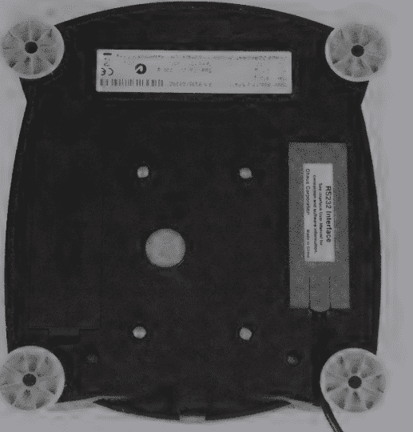

**图 6-5.** 安装了接口组件的 Scout Pro 底部


如果你的适配器有 RTS 和 CTS 引脚，你可以保持它们断开，因为这个项目不需要流控。图 6-7 显示了使用 Pi Cobbler 将 RS232 转 TTL 适配器连接到树莓派 GPIO 引脚的接线图。你也可以直接连接它们，但要确保阅读你板上的引脚标签，这些标签可能与图表不同。图表应该与 NKC 板上的清晰标记相匹配。然而，如果你购买的是 NuSom 板，箭头指向

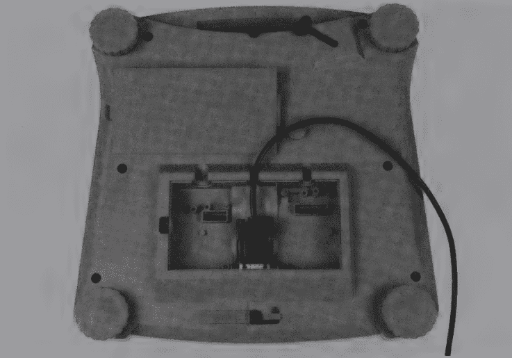

图 6-6. 移除盖子并连接串口线的 Valor 7000 底部

孔是 9600、8 位、无校验和 1 位停止位。树莓派的完成设置如图 6-8 所示。在下一节我们将测试串口。

# 使用 Java 编程树莓派：物联网编程

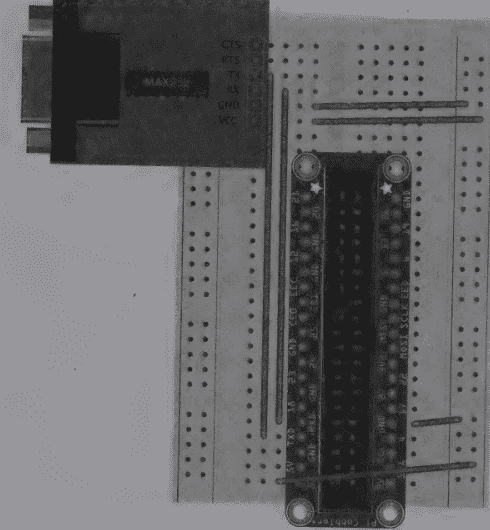

图 6-7. 使用 Pi Cobbler 将 RS232 转 TTL 适配器连接到树莓派 GPIO 引脚的接线图

要测试串口，我们将使用一个名为 Minicom 的工具。如果你还没有安装，可以通过运行以下命令进行安装：

```bash
sudo apt-get update
sudo apt-get install minicom
```

安装完成后，我们运行以下命令：

```bash
minicom -b 9600 -D /dev/ttyAMA0
```

如果你使用的是 Scout Pro，运行此命令：

```bash
minicom -b 9600 -D /dev/ttyS0
```

# 使用 Java 编程树莓派：物联网编程

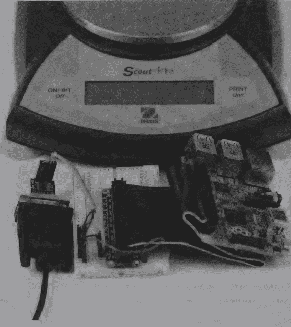

图 6-8. 完成树莓派设置

测试串口连接时按下秤上的重量键。如果你在屏幕上看到数据出现，说明连接是正常的。如果你看到乱码，可能是你的波特率或校验设置不正确。秤的默认设置为 9600 波特、8 位、无校验和 1 位停止位。如果你需要更改这些设置，请使用以下命令配置串口：

```bash
minicom -s
```

# 使用 Java 编程树莓派：物联网编程

```
Welcome to minicom
OPTIONS: 8182
Compiled on Apr 28 2012 19:24:11
Part /dev/ttyAMA0
Press CTRL-A for help on special keys
8.0
CTRL-A 2 for help | 2400 8N1 | NOR | Minicom 2.6.1 | VT102 | Offline
```

图 6-9. 具有正确校验位的电子秤的 Minicom 输出

- 你选择了正确的终端选项吗？在 Minicom 底部，图例显示 Scout Pro 应为 2400 8N1，Valor 应为 9600 8N1。

- 树莓派的串口控制台是否禁用？你可以随时使用 `raspi-config` 更改设置。更多信息请参见第 4 章。

一旦你让 Minicom 返回秤数据，你就可以尝试向电子秤发送命令。程序化控制串口秤的能力是它们区别于 USB 秤的地方。为了看到你输入的内容，请按下 `CTRL-A-E` 开启 Minicom 的回显。最简单的命令是输入大写的 `P` 并按下 `ENTER` 来打印当前重量。在 Valor 上，你需要接着按下 `CTRL-J` 输入换行符；否则命令不会被识别。

```
Welcome to minicom 2.8 i
OPTIONS: 1152
Compiled on Apr 28 2012, 19:24:31
Port: /dev/ttyAMA0

Press CTRL-A for help or go special keys
Pr kCCP0baAZpAZTp |

CTRL-A Z for help | 2400 8N1 | NOR | Minicom 2.6.1 | VT102 Offline
```

图 6-10. 校验位不匹配的电子秤的 Minicom 输出

两款电子秤对大小写敏感，因此请确保只使用大写字母！以下是你可以尝试的命令列表（记住在 Valor 上需要按 `ENTER` 然后按 `CTRL-J`）：

- 打印 `P`
- 去皮 `T`
- 连续自动打印 `CA` (Scout Pro), `CP` (Valor)
- 自动打印关闭 `0A` (Scout Pro), `0P` (Valor)

注意不同电子秤之间命令的细微差异。功能非常接近，但 Ohaus 对 Valor 的串口 API 进行了小幅修改，它是一个较新的电子秤型号。

## 从 Java 访问电子秤

要从 Java 访问串口秤，你可以使用 Pi4J 库或 Device I/O 库，它们在第 3 章中介绍。它们的工作原理很好，并提供类似的功能。以下是这两个库的对比：

- **串口协议支持**：`Pi4J` 只允许你设置波特率，未来计划增加更多对校验位、停止位和其他功能的支持。`Device I/O` 库拥有所有这些设置的标志位，但尚未实现。因此，目前这两个库提供的能力是相同的。

- **异步处理**：`Pi4J` API 支持同步写入，以及通过 `SerialHandler` 进行同步或异步读取。`Device I/O` 库基于 Java 非阻塞 API (`Java.nio`) 进行路由，这使得处理是异步的，但在实践中，你必须创建自己的线程异步回调抽象来处理串口数据。

- **易用性**：对于大多数应用，`Pi4J` API 要易用得多。它处理了字节到字符串的转换，为异步处理创建了简单的回调处理程序，并让你专注于应用程序逻辑，而不是非阻塞 I/O 的黑技巧。

我将在本章中展示使用 `Pi4J` 的示例，它更简单、更容易使用。然而，如果你想将代码集成到某些其他利用非阻塞 I/O 的 Java 库中，那么尝试 `Device I/O` 库可能是值得的，它采用了更基于标准的方法。

为了方便跟进，本章的所有代码都可以在“树莓派与 Java”的 GitHub 仓库中找到，URL 如下：

```
https://github.com/RaspberryPiWithJava/TeaStation
```

## 使用 Pi4J 读取电子秤数据

要开始使用 `Pi4J` 串口 API，创建一个新项目并将 `pi4j-core.jar` 添加到类路径。你还需要配置远程 Java 平台，通过正确的 IP 地址和 root 权限连接到你的树莓派，方法是在 `Exec Prefix` 字段中输入 `sudo`。在项目中，创建一个名为 `SerialScaleTest` 的新类，并使用列表 6-1 中的代码（针对 Scout Pro 秤所示）。

### 列表 6-1 SerialScaleTest 代码版本 1

```java
public class SerialScaleTest {
    public static void main(String[] args) throws InterruptedException {
        Serial serial = SerialFactory.createInstance();
        serial.open(Serial.DEFAULT_COM_PORT, 2400);
        serial.addListener((sde) -> {
            System.out.println("sde.getData() = " + sde.getData());
        });
        serial.println("CA");
        TimeUnit.SECONDS.sleep(30);
        serial.shutdown();
    }
}
```

这段代码假设你正在使用在 2400 波特率、带有停止位且无校验位的 Scout Pro 秤。如果你使用的是 Valor 7000，请将波特率调整为 9600，并将传递给 `serial.println` 的参数中的连续打印命令改为 "CP"。在 Scout Pro 上执行 `SerialScaleTest` 类时，将得到如列表 6-2 所示的输出。

### 列表 6-2 SerialScaleTest 输出

```
sde.getData() = 0.0
sde.getData() = 0.0
sde.getData() = 0.0
sde.getData() = 0.0
sde.getData() = 0.0
```

这段代码假设你正在使用在 2400 波特率、带有停止位且无校验位的 Scout Pro 秤。如果你使用的是 Valor 7000，请将波特率调整为 9600，并将传递给 `serial.println` 的参数中的连续打印命令改为 "CP"。

注意，有时会在单个回调中获得多个结果，而另一些时候只得到行的一部分。这是因为电子秤的自动打印速率没有同步。为了解决这个问题，你可以使用 `String` 作为缓冲区，直到获得完整的一行。列表 6-3 显示了产生每行一个结果的修改版本。

### 列表 6-3 修改后的 SerialListener

```java
static String data = ""; // 在 main 方法外部
serial.addListener((sde) -> {
    data = data.concat(sde.getData());
    String[] measurements = data.split("\n", -1);
    for (int i = 0; i < measurements.length; i++) {
        System.out.println(measurements[i] + " " + measurements[i]);
    }
    data = measurements[measurements.length - 1];
});
```

这段代码利用了字符串的 `split` 方法。通过匹配回车/换行符 (`\r\n`)，我们能够对字符串进行拆分。使用新代码运行 `SerialScaleTest` 将清理输出，使其每行只有一个结果。输出的示例见列表 6-4。

### 列表 6-4 来自新 Listener 的输出

| measurements |
| :--- |
| measurements[i] = 0.0 g |
| measurements[i] = 0.0 g |
| measurements[i] = 0.0 g |
| measurements[i] = 35.1 g |
| measurements[i] = 93.1 g |
| measurements[i] = 109.8 g |
| measurements[i] = 111.7 g |
| measurements[i] = 111.9 g |
| measurements[i] = 111.9 g |
| measurements[i] = 111.9 g |

从这个新列表中可以明显看出发生了什么。电子秤的返回格式如下：

- 9–12 个字符（取决于型号）= 秤重；空格填充并右对齐
- 一个空格
- 1–5 个字符 = 单位（无填充）
- 一个空格
- 一个字符 = 稳定性指示；不稳定用 "?"，稳定用空格

## 现在你已经从 Java 与电子秤通信了，是时候扩展第 2 章的 JavaScript 应用以添加串口功能了。你可以复制第 2 章自己的项目，从这里的 GitHub 仓库开始：https://github.com/RaspberryPiWithJava/JavaScript

将项目重命名为 Tea，以便保持两个代码库分离。在本章结束，你将拥有一个能够制作咖啡、茶或其他发明的配方的应用。

首先在 `com.nighthacking.scales` 包中创建一个名为 `SerialScale` 的 `Scale` 接口的新实现。现在也是为电子秤所需的操作定义一些 `String` 常量的好时机。我实现了一个通用的类，它可以适用于任何 Ohaus 电子秤，利用工厂模式进行类初始化，如列表 6-5 所示。

### 列表 6-5 针对 Scout Pro 或 Valor 7000 的 SerialScale 类初始化

```java
public class SerialScale implements Scale {
    private static final String CONTINUOUSAUTOPRINT_SCOUT = "CA";
    private static final String CONTINUOUSAUTOPRINT_VALOR = "CP";
    private static final String GRAMMODE_SCOUT = "0M";
    private static final String GRAMMODE_VALOR = "1U";
    private static final String TARE = "T";

    private final int baudRate;
    private final String continuousAutoprint;
    private final String gramMode;

    public static Scale createScoutPro() {
        return new SerialScale(2400, CONTINUOUSAUTOPRINT_SCOUT, GRAMMODE_SCOUT);
    }

    public static Scale createValor7000() {
        return new SerialScale(9600, CONTINUOUSAUTOPRINT_VALOR, GRAMMODE_VALOR);
    }

    private SerialScale(int baudRate, String continuousAutoprint, String gramMode) {
        this.baudRate = baudRate;
        this.continuousAutoprint = continuousAutoprint;
        this.gramMode = gramMode;
    }
}
```

在使用 `createScoutPro` 方法或 `createValor7000` 创建 `SerialScale` 实例后，它将在变量中设置好你所需的所有命令。初始化并调用 `Scale` 方法的类位于 `com.nighthacking.recipe` 包中的 `RecipeRunner`。`RecipeRunner` 在你的秤上调用的第一个操作将是 `connect` 方法，你应该在该处放置 `Pi4J` 的初始化代码。

如果你还没有这样做，你需要配置项目以与 `Pi4J` 配合。与上一个节一样，将 `pi4j-core.jar` 作为库引入，并确保你使用的远程 Java 运行时具有 `sudo exec` 前缀（如果你使用的是支持 USB 秤的项目，那么它应该具有该前缀）。

`connect` 方法应该包含你在上一节中用于连接串口的相同代码。唯一的区别在于你将让 `Pi4J` 继续运行，因此不要在方法结束时调用 `shutdown`，如列表 6-6 所示。

### 列表 6-6 SerialScale 类的 connect 方法

```java
private Serial serial;
private String data = "";

public void connect() {
    serial = SerialFactory.createInstance();
    serial.open(Serial.DEFAULT_COM_PORT, baudRate);
    serial.addListener((sde) -> {
        data = data.concat(sde.getData());
        String[] measurements = data.split("\r\n", -1);
        for (int i = 0; i < measurements.length - 1; i++) {
            processMeasurement(measurements[i]);
        }
        data = measurements[measurements.length - 1];
    });
    serial.println(continuousAutoprint);
}
```

相反，如列表 6-7 所示，从 `close` 方法中调用 `shutdown`。

### 列表 6-7 SerialScale 类的 close 方法

```java
public void close() {
    serial.shutdown();
}
```

我们需要从秤返回的字符串中提取重量、单位和稳定性，因此每一行都会传递给 `processMeasurement` 方法，该方法将提取这些值，如列表 6-8 所示。

### 列表 6-8 ProcessMeasurement 实现


```java
private volatile double weight;
private volatile boolean stable;

private void processMeasurement(String measurement) {
    try {
        String[] components = measurement.split("[ +]+");
        if (!components[2].equals("g")) {
            serial.println(gramMode);
            return;
        }
        weight = Double.parseDouble(components[1]);
        stable = components.length <= 3 || !components[3].equals("?");
        scalePhaser.arrive();
    } catch (Throwable e) {
        Logger.getLogger(SerialScale.class.getName()).log(Level.FINER,
                "Can't process measurement " + measurement, e);
    }
}
```

# Java 树莓派：编程物联网

通过之前对秤返回的数据进行分析，你知道秤将返回三个由空格分隔的不同信息：重量、计量单位和稳定性指示（要么是 "?"，要么是空格）。使用正则表达式分割字符串并提取这些值，无论使用的空白字符数量具体有多少（这在不同的秤型号中会有所不同）。关于此实现有几点需要强调：

- 我并没有获取值并转换为克（我首选的单位），而是简单地检查返回的单位并发出更改秤单位的命令。
- 有时秤会返回异常值，可能是由于初始化时的过时数据或串口线上的传输错误。这可能导致包括 `ArrayIndexOutOfBoundsFormatException` 在内的许多异常，因此检查 `Throwable`（并记录它）是一个很好的捕获方法。
- 由于你正在运行连续打印模式，由于输入错误或偶尔的异常而跳过读取并不是大问题……在几分之一秒内，你就会获得另一个（希望是有效的）读数。

此实现还使用了 `Phaser` 类，该类在第 2 章的 `UsScale` 实现中也被使用。这使得对来自串口总线的秤的新数据进行同步变得简单且可靠，如列表 6-9 所示，其中实现了等待秤重达到特定条件的方法。

## 列表 6-9 `waitFor` 和 `waitForStable` 方法

```java
@Override
public void waitFor(DoublePredicate condition) {
    while (!condition.test(weight)) {
        scalePhaser.awaitAdvance(scalePhaser.getPhase());
    }
}

@Override
public void waitForStable(DoublePredicate condition) {
    while (!stable || !condition.test(weight)) {
        scalePhaser.awaitAdvance(scalePhaser.getPhase());
    }
}
```

这些方法将阻塞直到给定的条件通过。使用 `scalePhaser.awaitAdvance` 方法是一种可靠的方法，直到秤的下一个读数准备就绪。

`Scale` 接口中剩余的方法是 `getWeight`、`isStable` 和 `tare`。这些方法的实现非常直接，如列表 6-10 所示。

## 列表 6-10 `Scale` 接口剩余方法的实现

```java
public double getWeight() {
    return weight;
}

public boolean isStable() {
    return stable;
}

public void tare() throws UnsupportedOperationException {
    serial.write(TARE);
}
```

现在你有一个可以与现有代码示例使用的 `SerialScale` 实现。要接入新的 `SerialScale` 实现，请修改 `RecipeRunner` 类创建一个 `SerialScale` 而不是 `USBScale`。更好的是添加一个 `setScale` 方法并将初始化移动到应用程序创建，如列表 6-11 和 6-12 所示。

## 列表 6-11 `RecipeRunner` 用于设置秤的方法

```java
public void setScale(Scale scale) {
    this.scale = scale;
    scale.connect();
}
```

## 列表 6-12 `main` 方法中创建 `SerialScale`

```java
public static void main(String[] args) throws InterruptedException {
    RecipeRunner runner = new CommandLineRecipeRunner();
    runner.setScale(Scale.createScoutPro());
    runner.runRecipe(new PourOverJava(CoffeeCalculator.STRONG));
    runner.close();
}
```

# Java 树莓派：编程物联网

确保同时也删除之前在 `RecipeRunner` 中创建 `USBScale` 的构造函数。你还可以通过创建一个具有相同名称和签名但不实现的方法，将 `setScale` 方法推入 `RecipeEnvironment` 接口。

现在 TeaStation 项目的行为与示例相同，但有一个巨大的区别：你不再需要停止并按下秤上的去皮按钮，因为你的应用程序可以远程控制秤传输数据。虽然这看起来可能不是大事，但这种简单的变化对家庭或其他可能使用它制作咖啡和茶的人来说有巨大的影响。

# 精确温度传感

释放茶叶风味的秘密在于仔细控制浸泡过程。除了时间，这个过程中最重要的因素是水温。茶绝不能暴露在沸水中，否则会产生苦味。然而，太凉的水无法提取充分的风味。更复杂的是，有许多种茶，如图 6-11 所示，每种茶对水温的反应都不同。

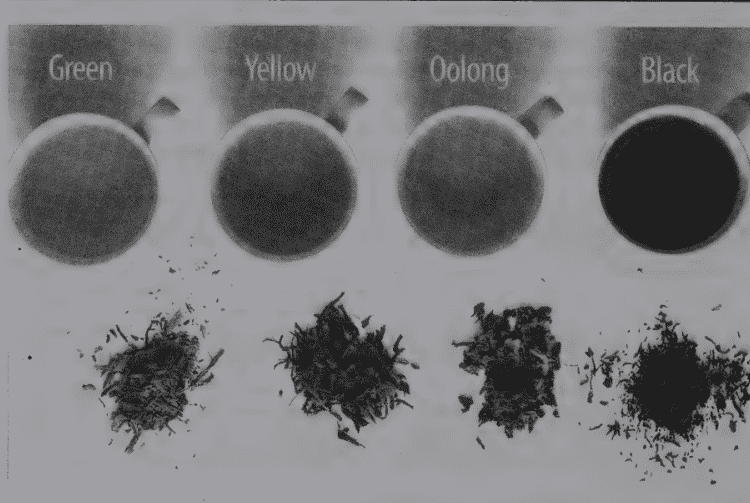

图 6-11. 不同种类的茶（原图来自 Hermann Hammer，公共领域）

## 第 6 章：茶水站 191

| 茶种类 | 温度 | 浸泡时间 | 用量 |
|---|---|---|---|
| 白茶 | 71–77°C | 2–3m | 2–3g/120ml |
| 绿茶 | 77–83°C | 2–3m | 2–3g/120ml |
| 乌龙茶 | 82–94°C | 1.5–2m | 2–3g/120ml |
| 红茶 | 88–94°C | 2–3m | 2–3g/120ml |
| 普茶 | 94–100°C | 3–4m | 2–3g/120ml |

**表 6-1.** 不同茶种的温度、浸泡时间和用量

虽然你可能需要通过实验来为你喜爱的茶找到合适的温度和浸泡时间，但表 6-1 显示了不同茶种的一些常见范围。

> **注意**
>
> 请注意所有用量都是相同的！用量的差异是不同冲泡方式密度导致的副作用。在本章中，我们将使用 ISO 3103 标准，即每 100ml 水 2 克茶叶。

如你所见，不同茶种使用的温度是泡茶过程中极其重要的部分，也是我们茶水站设置的核心部分。

## 1-Wire 串行接口

本节使用的温度传感器是 `DS18B20` 数字传感器。它使用由达拉斯半导体公司开发的 Dallas 1-Wire 串行协议进行设备通信，该协议被许多传感器和设备使用。Dallas 1-Wire 协议与上一节使用的串行通信相似，但它用通信速度换取了几个对传感器非常有独特优势。1-Wire 的独特特性包括：

- 设备仅需两根线即可连接。一根线用于通信和间歇性供电，另一根线用于接地返回。（我们在本章使用的温度传感器有第三根线用于专用供电。）
- 多个设备可以连接到同一个引脚上，共享同一根通信线并由单个主设备控制。
- 可以在很长的距离内使用。在专用主设备硬件和快速线路的情况下，传输距离可达 200 米（见 www.maximintegrated.com/app-notes/index.mvp/id/148）。然而，当使用树莓派的软件实现时（称为“位敲”/bit banging，即使用软件而非专用硬件进行串行通信），你应将距离保持在 1 米内以确保通信可靠。

我建议为传感器购买带有半米线缆的 Adafruit 高温防水外壳。这将让你能够轻松监控设置设备附近的电水壶（但距离足够远，不会产生水渍危险），并允许将传感器完全浸入水中而不损坏它。

## 测试 `DS18B20`

利用在软件仿真 Dallas 1-Wire 协议的内核模块，可以在树莓派上对 `DS18B20` 传感器进行采样。在软件中进行位敲是不可靠的，但该协议具有足够的容错性，可以在短距离内工作。

要启用内核模块，请在树莓派的 `/boot/config.txt` 文件中添加以下注释和行：

```
# 开启 1-Wire 支持
dtoverlay=w1-gpio
```

编辑此文件后，重启树莓派。这应该会自动加载支持 1-Wire 的正确内核模块。你可以在启动后运行 `lsmod` 命令进行检查，它应该显示如列表 6-13 所示的 `w1_therm`、`w1_gpio` 等项。

### 列表 6-13 显示 1-Wire 模块的 `lsmod` 部分输出

| 模块 | 大小 | 使用者 |
|---|---|---|
| w1_therm | 3225 | 0 |
| w1_gpio | 4287 | 0 |
| wire | 31248 | 2 w1_gpio,w1_therm |

## 第 6 章：茶水站 193

默认情况下，这些模块会在每个新 1-Wire 设备连接到总线时创建一些额外的文件。用于 1-Wire 的默认 GPIO 引脚是 Broadcom GPIO 4（在 Pi4J 库中为引脚 7）。`DS18B20` 传感器带有一个 4.7KΩ 上拉电阻，接线方便，如图 6-12 所示。

图中的芯片是未经过额外包装的“裸” `DS18B20` 传感器。Adafruit 的高温包装将传感器放置在金属罩内，并包裹有聚四氟乙烯（PTFE，其商业品牌为特氟龙）和热缩膜，如图 6-13 所示，使其适合浸入沸水。

该外壳上的三个引线颜色编码如下：

- 白色：地（图 6-12 中的左侧引脚）
- 蓝色：数据
- 橙色：电源

> **注意**
>
> 注意不要接反电源和地，否则传感器会升至危险水平。


### 图 6-12. 接线


### 图 6-13. 防水包装

# 第 6 章：茶站 197

```java
tempListener = new Thread(this::pollForTemperature);
tempListener.start();
}
```

这段代码还创建并启动了一个新线程，该线程通过调用 `pollForTemperature` 方法来轮询温度，如列表 6-16 所示。

## 列表 6-16 温度轮询实现

```java
private double temperature;
private final Phaser tempPhaser = new Phaser(1);

public void pollForTemperature() {
    while (running) {
        try (Stream<String> lines = Files.lines(sensorFile)) {
            Optional<String> temp = lines.filter(l -> l.contains("t=")).findAny();
            if (temp.isPresent()) {
                temperature = Integer.parseInt(temp.get().substring(temp.get().indexOf("t=") + 2)) / 1000d;
                tempPhaser.arrive();
            }
        } catch (IOException ex) {
            Logger.getLogger(OneWireTempSensor.class.getName()).log(
                    Level.SEVERE, "Error reading from sensor", ex);
        }
        try {
            TimeUnit.MILLISECONDS.sleep(100);
        } catch (InterruptedException ex) { /* continue on */ }
    }
}
```

这将通过读取设备文件并查找以 "t=" 开头的子字符串来更新 `temperature` 变量，每秒检查一次新的温度读取，该变量可以返回来实现 `getTemperature`，如列表 6-17 所示。

### 列表 6-17 `getTemperature` 的实现

```java
public double getTemperature() {
    return temperature;
}
```

它还使用了一个 `Phaser` 实例，这使得等待其他线程的结果变得非常高效，例如列表 6-18 中的 `waitFor` 实现，这看起来应该非常熟悉。

## 列表 6-18 `waitFor` 的实现

```java
public void waitFor(DoublePredicate condition) {
    while (!condition.test(temperature)) {
        tempPhaser.awaitAdvance(tempPhaser.getPhase());
    }
}
```

完成该类的最后一个方法是 `close` 方法，它让轮询 1-Wire 接口的线程知道我们已经完成了配方，如列表 6-19 所示。

### 列表 6-19 `close` 的实现

```java
@Override
public void close() {
    running = false;
}
```

为了让配方可见温度传感器，我们需要对 `RecipeRunner` 和 `RecipeEnvironment` 进行一些修改，以便获取和设置传感器，如列表 6-20 所示。确保也将这些方法引入到 `RecipeEnvironment` 接口中。

## 列表 6-20 `RecipeRunner` 中添加温度传感器的 getter 和 setter

```java
TemperatureSensor tempSensor;

public TemperatureSensor getTemperatureSensor() {
    return tempSensor;
}

public void setTemperatureSensor(TemperatureSensor tempSensor) {
    this.tempSensor = tempSensor;
    tempSensor.connect();
}
```

# 第 6 章：茶站 199

接下来，你可以从 `Step` 类访问 `getTemperatureSensor` 方法，以添加你泡茶时所需的几个新配方动作，如列表 6-21 所示。

## 列表 6-21 `Step` 类中的新方法

```java
public static Wait waitForTemp(double temp) {
    return waitForTemp(temp, 5);
}

public static Wait waitForTemp(double temp, double margin) {
    return new Step(w -> e.getTemperatureSensor().waitFor(w -> Math.abs(w - temp) > margin));
}
```

读取设备温度的基础设施已经就绪，所以你现在只需要一个可以利用它的配方。

# 茶配方

有了读取设备温度的基础设施，你现在只需要一个可以利用它的配方。有了新的温度读取、精度和计时功能，我们现在可以创建一个配方。为了让配方可见温度传感器，我们需要对配方运行器和配方环境进行一些修改，如图 15 所示。建议使用茶杯和滤网来泡茶，这样我们根据根据喜好泡茶的温度范围。使用 Java 这种方式可以创建不同茶的类型，如列表 6-22 所示。

## 列表 6-22 枚举

```java
public static enum TeaType {
    WHITE(70),
    GREEN(80),
    OOLONG(90),
    BLACK(95),
    PUERH(100);

    private final double temperature;
    private final double margin;
    private final int time;

    TeaType(double temperature, double margin, int time) {
        this.temperature = temperature;
        this.margin = margin;
        this.time = time;
    }
}
```

同样，你可以设置名称、描述和成分，如列表 6-23 所示。

## 列表 6-23 构造函数


```java
private final TeaType type;
private static final double CUP_SIZE = 200;
private final Ingredient tea;
private final Ingredient water;

public Tea(TeaType type) {
    tea = Ingredient.byWeight(CUP_SIZE, "Tea");
    water = Ingredient.byWeight(CUP_SIZE, "Water");
    this.type = type;
}
```

## 列表 6-24 元数据

```java
public String name() {
    return "Tea";
}
public String description() {
    return "Precisely steeps tea using Java";
}
public Ingredient[] ingredients() {
    return new Ingredient[]{tea, water};
}
```

## 列表 6-25 步骤

```java
public Step[] steps() {
    return new Step[]{
        Step.say("Boil water to " + temperature + " C"),
        Step.waitFor(temperature, margin),
        Step.say("Add " + tea),
        Step.waitFor(tea),
        Step.tare(),
        Step.say("Now pour " + water),
        Step.waitFor(water),
    };
}
```

- 如果茶太淡，尝试增加泡茶时间
- 如果你发现茶很苦，可能是水太热了。尝试降低温度
- 不同类型的茶可以多次冲泡。尝试连续冲泡并看味道如何变化。

# 第6 章：茶水站

在你那里时，还应该下载一份 Scene Builder，它是一个视觉化的 UI 创建程序。我们将使用 Scene Builder 构建一个快速的用户界面，为我们的泡茶过程提供反馈，并接收一些简单的输入。你可以从 `http://gluonhq.com/open-source/scene-builder/` 下载最新版本的 Scene Builder。

要在你的树莓派上安装 JavaFX，请遵循 Gluon 网站上的说明，那里面应该能为你提供最新的信息。不过，仅仅作为一个高层级指南，以下是我安装 JavaFX 时所遵循的步骤：

1. 我从 JDK 8 下载页面获取了适用于 ARM 镜像的兼容 JDK：`www.oracle.com/technet/java/javase/downloads/jdk8-downloads-2133151.html`。
2. 我使用 SFTP 客户端将 JDK 和 JavaFX 安装包拷贝到树莓派上。
3. 在树莓派上，我将这两个压缩包都提取到不同的文件夹中。
4. 最后，我将 JavaFX 的目录结构合并到 JDK 文件夹中，并仔细对齐了目录名称。

### 注意

当你读到这些说明时，它们可能已经发生了变化，因此请务必遵循 Gluon 网站上的 JavaFX 安装说明。

一旦你在树莓派上安装了 JavaFX，就是时候为你的茶水站创建 JavaFX UI 了。回到 NetBeans，并如图 6-18 所示，为 UI 布局创建一个新的 FXML 文件。FXML 文件格式是基于 XML 的，因此你可以直接编辑它，但在 Scene Builder 中进行视觉化操作要容易得多。从 Gluon 网站安装 Scene Builder 后，它将自动与 FXML 文件关联，允许你双击创建的新的空 FXML 文件，以便在 Scene Builder 中打开它进行编辑。

在 Scene Builder 中创建看起来专业的 UI 极其简单。只需将组件从左侧的树形导航拖放到中心区域即可。在构建 UI 时，你可以利用大量的布局、控件和图表。此外，每个组件都有一组大量的属性，你可以通过在右侧面板中输入值来配置。我为泡茶创建的 Scene Builder UI 如图 6-19 所示。我在用户界面使用了以下元素：

- 底部有一个文本区域（通过 `TextArea` 控件），用于显示配方的当前消息
- 左下角和右角有两个箭头按钮，用于分步前进和后，右上角有一个 Quit（退出）按钮
- 中心有一个进度条，显示温度/重量/时间
- 一些标签显示当前的配方信息和详细的重量/温度状态
- 一张背景图片为应用程序增添一点色彩

# 使用 Java 的树莓派：物联网编程

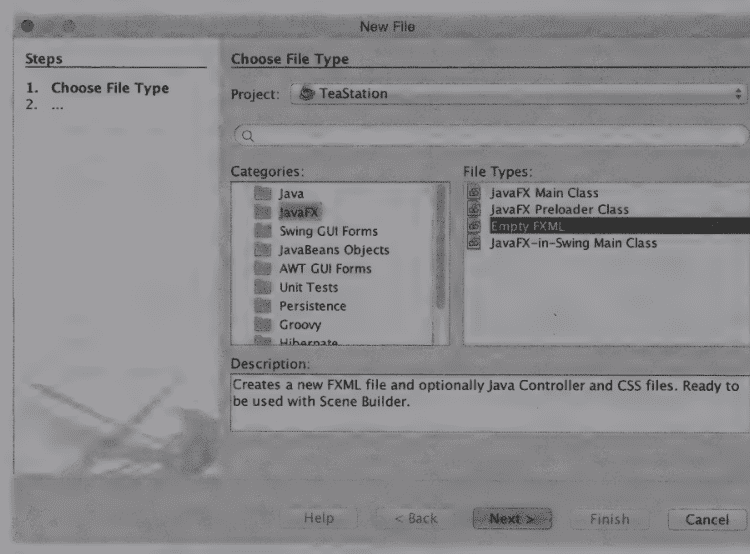

图 6-18. 创建空 FXML 文件的新文件向导

# 第6 章：茶水站

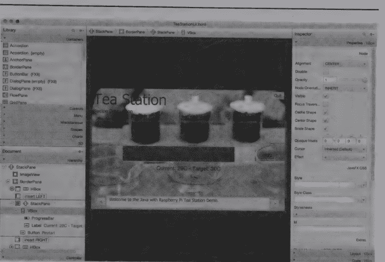

**图 6-19.** 用于泡茶的 Scene Builder 用户界面

你可以稍微不同的方式设计自己的 UI，它的功能将是一样的。保存你的设计并回到 NetBeans 启动并测试 UI。代码 列表 6-28 是启动 JavaFX FXML GUI 的标准样板代码，你可以将其放入一个新的主类中。

**列表 6-28** 启动 JavaFX FXML UI 的代码

```java
public class JavaFXTest extends Application {
    @Override
    public void start(Stage stage) throws Exception {
        Parent root = FXLoader.load(getClass().getResource("ui/CoffeeUI.fxml"));
        Scene scene = new Scene(root, 1280, 800);
        stage.setScene(scene);
        stage.show();
    }

    public static void main(String[] args) {
        launch(args);
    }
}
```

运行此主类后，你将在触摸屏上看到一个用户界面。确保你处于命令行而不是 X Window 系统，因为 JavaFX 会接管整个屏幕并直接写入帧缓冲区。由于还没有代码支持 UI，它将起不了作用，但你可以通过点击文本区域并移动光标来测试触摸事件。如果你无法在面板上使用触摸功能，请检查程序控制台输出中的错误信息，它将指向以下问题之一：

- 如果完全没有消息，你的触摸屏可能没有通过 USB 发送事件。尝试在 X Window 系统中使用显示，如果仍然不起，请联系制造商。
- 应用程序需要以 root 运行以接收触摸事件，所以如果你在启动时收到关于此的消息，请双击确保你在远程运行时设置了 `exec sudo`。
- 如果每次点击屏幕都会遇到多点事件错误，但它们没有记录为点击，那么你可能运行了过时的 JavaFX。确保你实际启动应用程序的 Java 版本是你安装的 Gluon JavaFX 嵌入版本。

```java
@Override
public Display getDisplay() {
    return controller;
}
```

现在，你可以在树莓派上运行 TeaStation 应用程序，并在小型触摸屏上方便地查看结果。其功能与命令行运行器相同，但这种设置更具便携性，并且有机会通过触摸屏进行额外的用户交互。完整的 TeaStation 代码可以在 GitHub 上的以下位置找到：

`https://github.com/RaspberryPiWithJava/TeaStation`

以下是我在 GitHub 仓库中提供的 TeaStation 版本中进行的一些额外增强：

- **屏幕缩放**（Screen scaling）：让应用程序能够整洁地缩放到不同的显示尺寸是有帮助的。JavaFX 此此提供了几种选项，因为它同时支持动态布局和 UI 的整洁向量缩放。我选择了后者，这样在高分辨率显示器上，按钮不会小到无法交互。
- **在步骤之间向前和向后移动**：这是可能的，因为步骤是以数组的形式返回的，所有的处理都是通过 lambda 表达式按需完成的。只需确保所有步骤在线程中断切换时，不需要等待执行完成即可。
- **重量/温度/时间的进度指示器**：JavaFX 内置了用于制作进度指示器的控件，因此这仅仅是将信息暴露给控件的练习。作为另一个优点，我在进度条下方添加了一个带有详细信息的状态文本字段。

图 6-20 显示了该应用程序功能完备版本的屏幕截屏。

# 212 树莓派与 Java 编程：物联网编程

在本章中，你学习了如何直接与 RS232 串口设备和 1-Wire 串口建立接口，你甚至能够使用 JavaFX 技术构建一个触摸屏 UI。凭借你到本书为止所学到的各种设备和接口，你所能构建的设备种类是没有限制的。在下一章中，我们将真正飞向云空，制作一台由树莓派和 Java 驱动的自主无人机！


**图 6-20.** 显示温度的完成版 TeaStation 应用程序。


# 第 7 章

# 自主无人机

# 214 树莓派与 Java 编程：物联网编程

在本章中，我们将利用树莓派和一些 Java 应用程序作为四旋翼器的大脑。四旋翼器通常更广泛地称为无人机（drone），我们将在本章中使用该术语。通常用于娱乐目的无人机通过遥控器飞行，形式为存在智能手机或平板电脑上的应用程序。飞行无人机的人通过与这些应用程序的用户界面控件交互来影响其飞行。移动设备通常通过无人机上的无线访问点连接到无人机。这类似于电脑或移动设备等客户端连接家用无线路由器的概念。

在本章中，我们将通过允许无人机在没有遥控器的情况下飞行，进入更高级的能力——控制将位于无人机上。这将使无人机能够以非常基本的自主水平飞行，这就是为什么本章名为“自主无人机”的原因。无人机飞行还可以实现更高级的自主水平，在本章结束时，我将讨论如何实现其中一种。

### 注意

由于本项目中创建的无人机实际上会在空中飞行，构建和测试非常有趣，但它的飞行往往是不可预测的。考虑到这种不可预测性，以及存在多个旋转叶片，应只允许未人在成人的监督下使用此无人机。如果你接受这个前提，那么让我们开始吧！

## 硬件材料清单

项目中的主要组件是一个四旋翼器，特别是 Parrot AR Drone 2.0（如图 7-1 所示），它是一个非常强大的四旋翼器，非常适合本项目。

AR Drone 的一些使其非常强大的标准功能包括：

- 惯性测量单元 (IMU)，由陀螺仪、加速度计和磁力计组成，均具有三个自由度
- 用于测量低空超声波高度传感器
- 用于测量高空的压力传感器
- 720p 分辨率的前摄像头
- 360p 分辨率的下摄像头
- 锂聚合物电池，1000mAh
- 机载无线访问点
- 室内壳/外壳
- 四个用于旋转叶片的无刷电机

自然，我们在本项目中赋予无人机的“大脑”硬件是树莓派。这种廉价的计算机由于几个原因非常适合这一角色：它体积小、重量轻，且功耗相对低。此外，可以在上面加载 Linux 操作系统，这允许进行各种在其他平台上通常更难实施的修改。

以下是构建该项目所需的组件完整列表。由于无人机飞行时将安装它的大部分设备，因此在有可选方案时，请选择更小、更轻的组件。部分组件如图 7-2 所示。为了方便参考，我包含了大多数零件的 Amazon.com 链接，但也欢迎你自行寻找。


# 216 树莓派与 Java 编程：物联网编程

提示

Amazon.com 的链接在编写时是有效的。

- AR Drone 2.0（其他 Drone 2.0 模型也可以工作）
- 树莓派（如图 7-2 所示封装在壳内，任何型号均可）
- 树莓派外壳越小越轻越好。如图 7-2 所示，我使用了


- 树莓派外壳 SB 是一个选项
- SD 卡，Class 10，至少 8GB。我选择了 PNY Elite Performance，因为它有 32GB，留有足够的增长空间：

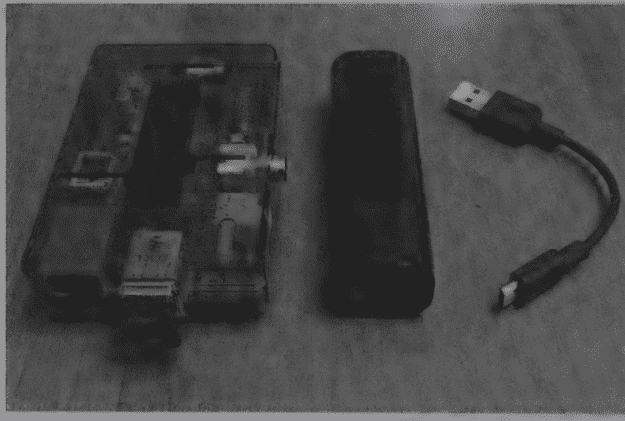

图 7-2。部分项目硬件。

- 两个 Edimax EW-7811 Wi-Fi 适配器（如图 7-2 所示，插入树莓派的两个 USB 端口）
- 树莓派电源适配器（你可以买一个）
- docool 便携式“口红管”手机充电器（如图 7-2 所示，为树莓派）
- CableJive microStubz 特短 USB 线（如图 7-2 所示，将“口红管”充电器连接到树莓派）
- 用于初始配置步骤的以太线。这是一种标准的以太线，在任何电子产品或电脑的地方都能买到。线长度不重要，因为飞行时它不会在无人机上。
- 魔术贴（在大多数硬件和面料店都有），用于将手机充电器固定在树莓派外壳上，并将树莓派外壳固定在无人机上。

## 所需软件

除了上一节指定的硬件外，本项目还需要软件加载树莓派大脑，使其足够智能以控制无人机：

- 该软件的一个组件是名为 `parroter` 的 API 库，它提供了 Java 控制 Parrot AR Drone 的抽象。该 API 库位于 https://github.com/parrotsonjava/parroteer，由 Thomas Endres 和 Martin Förschch (ParrotsOnJava.com) 使用 Java 编写。
- 该软件的另一个组件是一个名为 `autonomous4j` 的 API 库，它利用 `parroter` 库为在 Java 控制 AR 无人机提供了更高层级的抽象。该库位于 https://github.com/RaspberryPiWithJava/Autonomous4j，由 Mark A. Heckler 用 Java 编写。

`autonomous4j` 库允许你编写如列表 7-1 所示的 Java 代码，使无人机按矩形飞行。

### 列表 7-1 矩形飞行的 Java 代码

```
private static void doDemoFlightBox(A4jBrain brain) {
  brain.takeoff().hold(5000); // ms duration
  brain.goRight(20).doFor(8000); // % speed, ms duration
  brain.stay().hold(5000);
  brain.backward(20).doFor(7000);
  brain.stay().hold(5000);
  brain.goLeft(20).doFor(8000);
  brain.stay().hold(5000);
  brain.forward(20).doFor(7000);
  brain.stay().hold(5000);
  brain.land();
}
```

列表 7-1 中的代码会导致无人机起飞并保持位置五秒钟。然后，它将以 20% 的速度飞行八秒，以 20% 的速度向后飞行七秒，以 20% 的速度向左飞行八秒，并以 20% 的速度向前飞行七秒。最后它将着陆，理论上会回到起飞时的相同位置。但由于风力等因素，可能会导致无人机降落在不同的位置。正如之前提到的，实现比本项目中更高级的自主水平是完全可能的。

图 7-3 展示了一台带有树莓派大脑和 USB 充电器的无人机在 Mark Heckler 客厅里按矩形轨迹飞行的瞬间拍摄。


图 7-3. 无人机与机载大脑组件飞行

## 构建自主无人机

现在你已经熟悉了项目的硬件和软件组件，让我们来讨论如何构建一台自主无人机。以下是你需要执行的总体步骤列表，将在后续章节中详细介绍：

1. 设置你的树莓派。
2. 在树莓派和无人机之间建立无线网络连接。这使用一个 Edimax Wi-Fi 适配器。
3. 将树莓派配置为无线接入点 (WAP)。这使用另一个 Edimax Wi-Fi 适配器。
4. 将硬件组装并固定在无人机上。
5. 使用 `parroter` 和 `autonomous4j` 库编写包含类似于列表 7-1 示例的飞行指令的 Java 方法。
6. 通过 NetBeans 连接到树莓派，远程部署 Java 及其支持库。
7. 通过调用 Java 应用程序让无人机飞行。

## 设置你的树莓派

你需要做的第一件事是在树莓派上设置 Raspian。第 1 章详细介绍了如何通过安装过程来为你的树莓派进行编程做准备。

## 建立树莓派与无人机之间的网络连接，并将树莓派配置为 WAP

我们将共同处理这些步骤，因为它们涉及到在树莓派上“手动”执行的几个步骤。

此时，你的树莓派应该已经启动运行，并通过以太网线或其中一个 Wi-Fi 适配器连接到网络。如果你还没有这样做（请关闭树莓派电源），请插入两个 Edimax Wi-Fi 适配器。正如图 7-2 所示，它们都插在树莓派的 USB 端口上。

- 其中一个 Edimax 适配器允许树莓派充当无人机的客户端，就像你的手机或平板电脑一样。
- 另一个 Edimax 适配器允许笔记本电脑与树莓派通信。这便于将软件推送到树莓派、进行实时调试，甚至在需要时进行控制。

如果可以通过以太网线将树莓派连接到网络，请现在就操作，这将极大简化 Wi-Fi 设置的更新。在后续指令指示之前，我假设你的连接是有线的。一旦进入树莓派的 shell，我们将首先通过执行以下命令更新 Raspian 并安装几个本质包：

```
sudo apt-get update
sudo apt-get install hostapd isc-dhcp-server
```

`hostapd` 允许你将树莓派配置为接入点，而 `isc-dhcp-server` 提供为连接设备分配 IP 地址的能力。接下来，我们通过在编辑器中打开 `dhcp.conf` 文件进行一些更改来设置 DHCP 服务器。我们在这里使用 `vi`，但如果你有不同的编辑器，请使用它。以下是操作步骤：

### 编辑 dhcp.conf 文件

如下所示编辑 `dhcp.conf` 文件：

1. 输入 `sudo vi /etc/dhcp/dhcpd.conf`。
2. 找到 `option domain-name "example.org"` 的行，并在每行开头添加 `#` 将其注释掉。
3. 取消 `authoritative` 这一行的注释（取决于你的有线连接）。
4. 在 `dhcpd.conf` 文件末尾添加以下内容：

```
subnet 192.168.42.0 mask 255.255.255.0 {
  range 192.168.42.10 192.168.42.50;
  gateway 192.168.42.1;
  default-lease-time 600;
  max-lease-time 7200;
  option domain-servers 8.8.8.8;
  option domain-name "local";
}
```

5. 保存文件并退出。

### 编辑 isc-dhcp-server 文件

编辑 `/etc/default/isc-dhcp-server` 文件：

1. 输入 `sudo vi /etc/default/isc-dhcp-server`。
2. 将 `INTERFACES=""` 这一行更改为 `INTERFACES="wlan0"`。
3. 保存文件并退出。

### 编辑 /etc/network/interfaces 文件

此时，我们通过编辑 `/etc/network/interfaces` 文件为网络接口提供配置细节：

1. 输入 `sudo vi /etc/network/interfaces`。
2. 输入以下内容以配置 `wlan0` 接口：

```
auto lo
iface lo inet loopback

auto eth0
iface eth0 inet static
  address 192.168.1.14
  netmask 255.255.255.0
  gateway 192.168.1.1

iface wlan0 inet static
  address 192.168.42.1
  netmask 255.255.255.0

auto wlan1
iface wlan1 inet dhcp
```

3. 保存文件并退出。

### 编辑 /etc/hostapd/hostapd.conf 文件

接下来，通过创建 `hostapd.conf` 文件为 WAP 守护进程提供配置：

1. 输入 `sudo vi /etc/hostapd/hostapd.conf`。
2. 输入以下内容来配置 `wlan0`：

```
interface=wlan0
driver=rtl871xdrv
ssid=positronic
hw_mode=g
channel=6
macaddr_acl=0
auth_algs=1
ignore_broadcast_ssid=0
wpa=2
wpa_passphrase=Raspberry
wpa_key_mgmt=WPA-PSK
wpa_pairwise=TKIP
rsn_pairwise=CCMP
```

3. 保存并退出。

## 让守护进程运行

配置树莓派作为无人机通信大脑的最后一步应该是将 `hostapd` 和 `isc-dhcp-server` 应用程序作为服务运行，在大多数情况下确实如此。然而，运行两个功能完全不同且需要相互协调的网络接口可能会产生不小的冲突。因此，我们在这一步中“理想地”配置这些服务，增加一些保险以提高可靠性。毕竟，我们希望确保随时都能连接到我们的智能无人机！

要在 UNIX/Linux 环境中将这两个应用程序配置为服务（守护进程），只需在树莓派命令行提示符执行以下命令：

```
sudo update-rc.d hostapd enable
sudo update-rc.d isc-dhcp-server enable
```

当另一个设备加载时，它会被“拔出”。以下是消除此问题的步骤，同时保留（有线）`eth0` 接口的热插拔能力：

1. 输入 `sudo vi /etc/default/ifplugd`。
2. 修改这二行：

```
INTERFACES="auto"
HOTPLUG_INTERFACES="all"
```

改为：

```
INTERFACES="eth0"
HOTPLUG_INTERFACES="eth0"
```

3. 保存更新后的文件并退出编辑器（按 ESC，然后输入 ZZ）。

### 编辑 rc.local 文件

根据其头部信息，此脚本在“每个多用户运行级别结束时”运行，在系统启动时执行每个包含的命令。我们将将其用于两个用途：强制两个 Wi-Fi 适配器上线（使用 `ifup` 或“接口上线”工具），并确保 DHCP 服务器加载。操作非常简单：

1. 输入 `sudo vi /etc/rc.local`。
2. 在 "exit 0" 语句之前的任何位置，添加以下行：

```
ifup wlan0
/etc/init.d/isc-dhcp-server start
ifup wlan1
```

> **注意**
>
> 在 "#Print the IP address" 部分之前添加这些行，可以确保在通过 ssh 连接时，在启动提示符上方保留目标地 IP 地址的清晰提醒。

3. 保存文件并退出编辑器（按 ESC，然后输入 ZZ）。

现在，我们重启 Pi 以启用所有更改，并让我们无人机新的“电子大脑”上线！在 shell 提示符输入 `sudo reboot`。

# Java 与树莓派：编程物联网

魔法发生了，一旦 Pi 重新启动，你就可以像连接当前 WAP 一样连接它，但这次是进入笔记本的网络设置，选择 Pi 的 WAP 标识符（之前提供的设置中的“Positronic”），并提供密钥（“Raspberry”）。恭喜！借这句话说，“它……活了！”

在这里，你不应该遇到任何连接问题……但当你遇到时，几乎总是是 Pi 到无人机之间的连接失败了。在那些极少数的情况下，这里是快速恢复正轨的方法：

1. 通过 ssh 登录 Pi。
2. 在 shell 中执行以下命令：

```
sudo
ifdown --force wlan0
ifup wlan0
ifconfig -a (验证连接 - 但给它几秒钟来连接)
exit (退出 su 连接)
exit (退出 ssh 连接)
```

3. 此时，两个连接都应该（再次）激活了！

请参考 https://bitbucket.org/autonomous4j/autonomous4jga/wiki/PiConfiguration 获取更多或更新的信息。

## 装配并固定到无人机上

现在是组装硬件并将其固定在无人机上了。我们已经配置了 Wi-Fi 适配器；接下来，我们将注意力转向让 Pi 变得“可携带”，即移除它的地面电源线，并在飞行期间为它供电。

原装 AR Drone 2.0 不具备为树莓派供电的能力，这就是为什么我们使用便携式“口红”充电器。项目中的 dodocool 充电器提供 2600 毫安时，这是一个很好的时间范围，而且由于我们使用的是

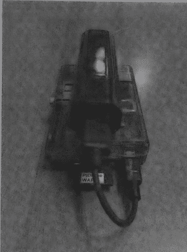

图 7-4. 装配部分硬件

Wi-Fi 插头抽取的电流很大，我们可以通过 USB 充电器运行 Pi、两个插头以及我们其他一切。首先，使用魔术贴将 USB 充电器固定在 Pi 外壳上。如图 7-4 所示，将短 USB 线连接电源和 Pi，然后打开它。这将启动树莓派“大脑”。

然后，使用魔术贴将树莓派固定在无人机上。如图 7-5 所示，我们现在已经有了智能无人机的雏形。

既然我们已经组装了硬件组件并将它们安装在无人机上，让我们如何给无人机的新大脑一些飞行指令。

# Java 与树莓派：编程物联网

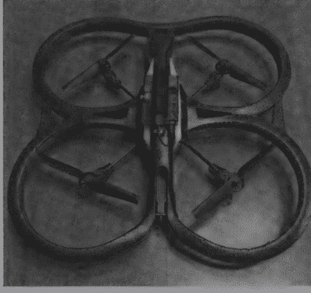

图 7-5. 固定在无人机上的硬件装配

## 编写包含飞行指令的 Java 方法

`org.autonomous4j.control` 包包含一个名为 `A4jMain.java` 的 Java 文件，主要由几个带有飞行指令的方法组成。这些方法演示了 `autonomous4j` 库的各种功能。例如，列表 7-2 显示了一个能够自动导航到无人机起飞点的方法。这是通过使用列表末尾的 `A4jBrain.goHome()` 方法实现的。

### 列表 7-2 展示 goHome() 功能的 Java 代码

```
private static void doDemoFlightHome(A4jBrain brain) {
  brain.takeoff().hold(6000);
  brain.forward(20).doFor(
```

始终按照指令精确起飞和降落。例如，房间内的气流会导致无人机偏离路线。改进此点的良好后续是让无人机知道它自己在三维空间中的位置，以便它可以进行航向修正。

## 在 3D 空间中为无人机定位

Parrot AR Drone 2.0 配带了一个纸板“定向圆环”，如图 7-6 所示。

定向圆环的目的是让无人机通过其向下的摄像头识别它。AR Drone 可以报告摄像头镜头的哪个部分包含了定向圆环的信息。根据这些信息，客户端（在我们的案例中是树莓派大脑）可以计算出它相对于定向圆环在 3D 空间中的位置。

## 实现控制循环

如果无人机知道自己在 3D 空间中的位置，那么它就能知道自己何时偏离了路线。可以实现一个控制循环（如图 7-7 所示）来保持无人机航线。该循环将迭代执行：

1. 估计其在空间中的位置
2. 将该位置与目标位置进行比较
3. 计算并应用控制，以达到目标位置

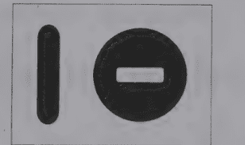

图 7-6. 定向圆环


# 使用 Java 的树莓派：物联网编程


图 7-7. 状态估计与位置控制

因此，我们不再提供指定方向、速度时间的飞行指令，而是提供指定空间位置的指令（见图 7-8）。

祝你构建和测试项目时愉快。希望你喜欢这一章关于使用树莓派作为大脑创建自主无人机的内容！

```go
brain.goRight(20).doFor(1000); // % speed, ms duration VS.
Pose des = new Pose(3500, 4800, 300, 45); // x, y, z, yaw
brain.moveTo(des);
```

图 7-8. 无人机知道自身空间位置时的潜在指令

# 第 8 章：复古视频游戏模拟器

人们对 20 世纪 80 年代和 90 年代在 8 位游戏平台上的复古视频游戏兴趣再次复燃。那时的游戏图形能力相对有限，因此它们更多地关注机制、关卡设计，而且最重要的是挑战性。与现代视频游戏相比，许多早期经典作品非常困难且不容错，这使得它们成为一项真正的成就。如图 8-1 所示的任天堂娱乐系统（NES）是历史上最成功的 8 位游戏机，全球销量达 6,190 万台。

由于这些早期系统使用了专用芯片，要在软件中完美地模拟该系统（及其特性）需要一个足够快的处理器。树莓派是此的极佳选择，因为它具有良好的处理能力和非常出色的图形性能，使其成为模拟经典视频游戏的绝佳平台。

在本章和第 9 章中，我们将开发一个带有纯 Java NES 模拟器和自定义 3D 打印外壳的便携式游戏系统，作为对早期手持游戏系统的复兴。然而，如果你只对游戏模拟感兴趣而不想构建手持版本，那么在本章结束时，你将拥有一个功能齐全的游戏模拟器和 GPIO 控制器。

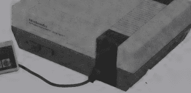

图 8-1. 任天堂娱乐系统（由 Evan-Amos 提供的公领域）

> *Nintendo Co., Ltd., "Consolidated Sales Transition by Region": www.nintendo.co.jp/ir/library/historical_data/pdf/consolidated_sales_e1506.pdf*

> 注意：此项目是书中最难的项目。它需要你提前预购的特定硬件，并且在焊接和精细组装过程中需要一些耐心。除非你对硬件非常熟悉，否则我建议在处理这个项目之前，先尝试书中的其他项目。

## 物料清单

该项目的材料组旨在创建和原型化我们在第 9 章中组装的手持系统所需的内部组件。如果你计划组装 3D 手持系统，请确保获取与此处列出完全相同的物品，以便它们可以在不修改的情况下放入自定义外壳中。

### 树莓派

你当然需要一台树莓派。我推荐使用树莓派 2，因为 ARM7 四核芯片提供的额外性能对于在 Java 中实现 NES 的准确模拟非常有帮助。此外，不要忘记为你的树莓派配备 SD 卡和电源适配器。

> 注意
>
> 你也可以使用树莓派 B+，尽管你可能会看到模拟速度变慢的情况。树莓派 A+ 也可以，但需要重新设计外壳。没有 40 脚连接器的旧版树莓派无法用于此项目，因为它们不支持后续章节描述的 Kippah 显示。

### 显示与适配器

Adafruit Kippah 是一块非常酷的板，可以直接使用。与第 6 章中的显示器相比，Kippah 更加紧凑且

### 按钮与元件

- 半尺寸面包板：组装带有按钮的小型测试控制器的完美尺寸：https://www.adafruit.com/products/64
- 12mm 触感按钮开关 - 12 入装：用于 Select 和 Start 键：https://www.adafruit.com/products/1010
- C&K D6F90 F1 LFS 按钮 - 2 入装：用于 A 和 B 键：https://www.digikey.com/product-detail/en/ck/D6F90F1LFS/CKN10365-ND/4355342
- 五向导航开关：https://www.adafruit.com/products/1722
- 1N4148 信号二极管 - 10 入装：https://www.adafruit.com/products/1641

五向导航开关支持标准的上/下/左/右 D 键移动，如果你直接向下按，还有第五次点击。对于没有模拟移动概念的 NES 模拟器来说，这是完美的，并且在你向特定方向移动时能提供良好的触觉反馈。虽然第五次点击并非必须，但较长的控制臂使其能够安装我们 3D 打印的 D 键。

我建议提供的按钮数量至少是所需数量的两倍，以应对损坏和磨损。下一章节的外壳设计是专门为这些按钮定制的，因此请确保你购买的完全是列出的型号。12 个触感按钮开关是良好、廉价且按压力较大的按钮，它们非常适合做 Select 和 Start 键。（在激烈的战斗中，你不想小心按下它们！）相比之下，C&K D6 按钮具有良好的触感，按压力非常小且行程相对较长。因此，它们非常适合游戏手柄上频繁使用的 A 和 B 键。

对于 `C&K D6F90 F1 LFS` 按钮，以下是代码的解析：

- `D6` 型号
- 平底按钮（其他任何类型都会凸出外壳）
- `90` 黑色（也有代码为 `00` 的白色可选）
- `F1` 1.3N 按压力
- `LFS` 符合《限制有害物质方向》(RoHS) 指令的无铅状态

此项目中唯一可以变体的是选择不同的颜色。黑色是一个很好的选择，因为它与 12mm 按钮的键帽匹配，但如果你更喜欢白色，也可以选择白色。由于这些是相当专业的，最好的办法是从 Digi-Key Electronics 或 Mouser Electronics 在线订购。

你还需要一个面包板来连接按钮并向 Kippah 板布线。我建议使用半尺寸的，因为你不需要大量的空间为按钮布线，而且作为控制器，它的尺寸握感更好。

我们将使用列表中的最后一项——一些标准的 `1N4148` 小二极管，在按钮之间创意地“共享”GPIO 引脚。你只需要四个，但你可能会发现，由于它们非常便宜，批量购买会划算得多。

### 布线与工具

最后，你需要一些布线材料和工具来组装这个项目。所有这些东西都是标准的电子设备，在之前的章节中也可能用到，但以下列表包含了一些对在 Kippah 板上表面焊接有帮助的额外物品。所有产品均可在 Adafruit 获取，因此我包含了 URL 以帮助你轻松找到每个物品。你还可以从同一供应商处一次订购多个物品以节省运费。

- 焊铁台：最好带有细焊头，因为 Kippah 上的焊盘非常小。我推荐数字白光（Hakko）`FX-888D` 焊铁（https://www.adafruit.com/products/1204）和白光焊头：`T18-S4` 细 SMD（https://www.adafruit.com/products/1249）。
- 焊锡丝：这个项目不需要很多，但手头备一些优质的焊锡总是好的（https://www.adafruit.com/products/1886）。
- 吸锡器/吸锡带：万一你不小心将两个焊盘焊在一起，准备一个吸锡器和一些吸锡带非常方便（https://www.adafruit.com/products/148 和 https://www.adafruit.com/products/149）。
- 辅助手：这是一个廉价且非常有用的设备，带有安装在调节臂上的鳄鱼夹。这将把多根线焊接到单个焊盘上的任务变得更容易。我推荐带放大镜的辅助手（https://www.adafruit.com/products/291）。
- 板固定架：将你的树莓派或 Kippah 板保持在合适的高度，以便辅助手使用。`Panavise Jr` 是一个很好的选择：https://www.adafruit.com/products/151。
- 跳线线卷：准备多种颜色的优质线会非常有帮助（https://www.adafruit.com/products/1311）。
- 剪线钳/剥线器：用于快速剥去线端非常方便（https://www.adafruit.com/products/527）。
- 热缩管：这可以确保你的裸露电线不会接触并导致项目短路（https://www.adafruit.com/products/344）。
- 万用表：拥有一个好的万用表非常方便，可以帮助你诊断电路是否正常而不会烧坏你的精密元件。我推荐艾德（Extech）`EX330` 12 功能量程万用表（https://www.adafruit.com/products/308）。

正如从材料列表中看到的，……相比之下，C&K D6 按钮具有良好的触感，按压力非常小且行程相对较长。因此，它们非常适合游戏手柄上频繁使用的 A 和 B 键。

图 8-4 显示了我的按钮布局以及与 Kippah 板连接的 Fritzing 图解。在该图中，导航开关位于左侧，引脚间距较宽。此外，开关在视觉上没有明显区别，但 12mm 的 Select/Start 开关位于中心，C&K A/B 开关位于右侧，这与 NES 控制器的顺序一致。

使用面包板上更多的导轨可以优化布线，但我而是选择了直接将多根引线连接到 Kippah。这对于我们以后将设计迁移到 3D 打印的外壳时非常重要，因为我们没有足够的空间放置电路板。将所有连接直接线到组件上（包括地）将允许无缝迁移到外壳。

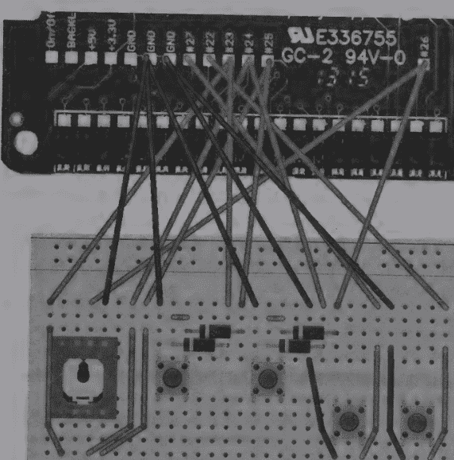

图 8-4. 按钮和 Kippah 的 Fritzing 布局

我留下了第一个地线未焊接以备后用。此外，请注意使用二极管来连接 Start 和 Select 按钮。由于只有六个可用的 GPIO 引脚，有必要通过连接多个按钮来“过载”使用另外一些 GPIO 引脚。由于在物理上无法同时按下左键或上键以及下键，你可以通过让 Select 按钮按下左/右，同时让 Start 按钮按下上/下来实现操作过载。然而，如果你用一根直连导线将 Start 或 Select 同时连接到两个 GPIO 引脚，它会在两个 GPIO 引脚之间产生电学耦合，导致按下其中一个就会触发另一个。通过使用二极管，电流流被限制在一个方向，防止在按下其中一个方向时电流泄漏，但仍允许 Start 和 Select 按钮同时触发两个 GPIO 引脚。为了使此方案生效，二极管的安装必须使得阴极（黑环）面向开关。

关于这种过载用法的另一个点是，它防止了同时使用导航按钮按住 Start 或 Select。这会给 A 或 B 按钮带来问题，但由于 Start 和 Select 专门用于模式选择、暂停等，这并不是问题。

## 焊接 Kippah

是时候拿出烙铁并将面包板连接连接到 Kippah 板上了。由于 Kippah 上的 GPIO 连接器仅仅是电子焊盘，你需要进行细致且精确的工作，将每个（有时是多个）引线精确地连接到某一个连接器上。之后用万用表测试连接情况至关重要，以确保没有短路，我建议添加一些热缩管以确保连接保持电学绝缘。

为了理解布线连接，表 8-1 列出了每个组件连接到 Kippah 的哪根引线。

这应该与之前在图 8-4 中所示的面包板布线匹配，但从 Kippah 的角度准备好第二个参考，将有助于确保你在布线时不犯任何错误。

表 8-1 还让你了解连接到 Kippah 每个接子需要多少根引线。为了以后供便携式外壳使用，我建议将所有引线的长度保持至少 4 英寸或 10 厘米。此外，保持连接到相邻接子的线缆不接触非常重要，因此在焊接时留出足够的空间，并使用热缩管密封线缆。

### 表 8-1. Kippah 布线连接

| Kippah 引线 | 连接 1 | 连接 2 | 连接 3 |
|---|---|---|---|
| 地 2 | 导航 – | Select 按钮 – | Start 按钮 – |
| 地 3 | B 按钮 – | A 按钮 – | |
| GPIO 27 | B 按钮 + | | |
| GPIO 22 | A 按钮 + | | |
| GPIO 23 | 导航左 | Select 二极管 1 | |
| GPIO 24 | 导航下 | Start 二极管 1 | |
| GPIO 25 | 导航右 | Select 二极管 2 | |
| GPIO 26 | 导航上 | Start 二极管 2 | |

图 8-5 显示成功焊接到一个地线的第一组连接。操作方法如下：

1. 将 Kippah 放入板架中，使其保持抬起并处于方便操作的角度。
2. 通过在 Kippah 的裸露焊盘上滴落一个焊锡球对连接处进行镀锡。
3. 将要焊接的线缆放在连接处上方，并用助手机将其固定在位置。
4. 使用烙铁同时加热线缆并推入焊锡球中。
5. 焊锡冷却后，你应该得到一个牢固的连接。通过轻轻拉动线缆来测试。如果线缆松动，请使用吸锡器/吸锡带清理焊锡并返回第 2 步。

对所有需要连接到 Kippah 板的线缆重复此过程。最困难的部分可能是确保没有任何焊锡球或相邻接子接触。

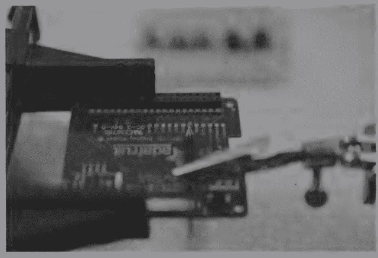

图 8-5. Kippah 板的表面贴焊锡连接

即使你认为距离足够，使用一些热缩管来调整扫描也是好的。一组完整的线缆应该如图 8-6 所示。

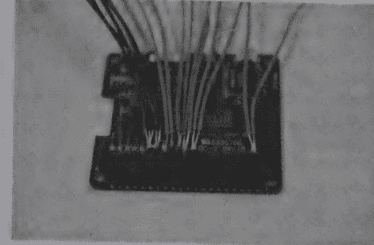

图 8-6. 连接到 Kippah 的完整线缆组

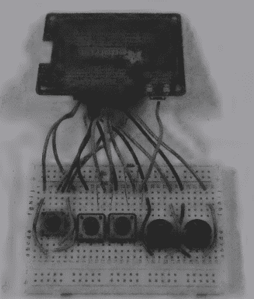

图 8-7. 连接到板卡的特写

## 安装 Kippah

在将 Kippah 连接到树莓派之前，我们需要做一些准备工作。我们需要通过设备树覆盖路由 GPIO 端口，并需要禁用某些使用 GPIO 的功能（如 I2C 和 SPI）。最后，我们将屏幕倒置以更好地适应外壳。

要安装设备树，获取 Adafruit 的最新版本：

```
wget http://adafruit-download.s3.amazonaws.com/dt-blob.bin
```

然后，使用 root 权限将其复制到 `/boot` 文件夹：

```
sudo cp dt-blob.bin /boot/
```

在同一文件夹中，使用 `nano` 编辑器编辑 `config.txt`：

```
sudo nano /boot/config.txt
```

在该文件的末尾，添加列表 8-1 所示的附加配置选项。

### 列表 8-1. Kippah 屏幕配置

```
# 禁用 spi 和 i2c，我们需要这些引脚。
dtparam=spi=off
dtparam=i2c_arm=off
# 启用 DPI 显示
enable_dpi_lcd=1
display_default_lcd=1
# 用于 4.3 英寸显示
hdmi_ignore_edid=0xa50008
hdmi_ignore_edid_audio=1
framebuffer_width=480
framebuffer_height=272
dpi_output_format=520197
# 屏幕旋转
display_rotate=2
# 根据需要调整扫描
disable_overscan=0
overscan_top=150
overscan_left=160
overscan_right=0
overscan_bottom=-59
```

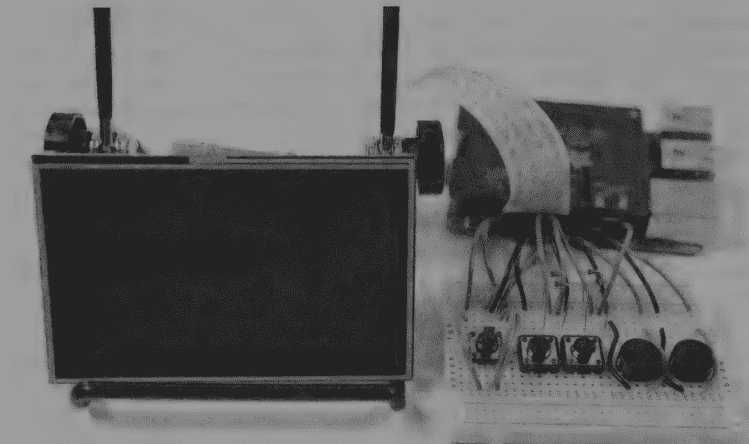

图 8-8. 连接到 Kippah 的 4.3 英寸显示器

## 连接扬声器

树莓派有一个特殊的四极 TRRS 插孔，它在单个 3.5mm 接口中结合了音频和复合视频信号。我们只对音频部分感兴趣，因此标准的立体声音频插头完全可以工作。

为了让这套设备真正具有便携性，我们将使用由树莓派供电的 TS2012 电源迷你放大器，以及一些能够准确重现游戏模拟器复古音乐的小扬声器。Adafruit TS2012 放大器引出板对扬声器和左/右音频接口的所有连接都有清晰的标记。我们还需要将标记为 VDD 和 GND 的孔连接到放大器，以便从树莓派为其供电。

为了更容易放入 3D 打印的外壳中，我建议跳过排针和接口，直接焊接在板卡上。以下是你需要完成的连接：

- `VDD`：通过 Kippah 连接到树莓派的 5V 线。
- `GND`：通过 Kippah 连接到树莓派的地线（Ground）。
- `R+`：连接到音频电线的红色导线。
- `R-`：连接到音频电线的铜色导线（地）。
- `SDL`：同样将其连接到树莓派的地线。
- 右侧扬声器 `+/-`：将这些导线连接到迷你 `.5W` 扬声器。

在进行此焊接时，我建议使用电路板架和万能夹来保持 TS2012 引出板和电缆对齐良好。扬声器很容易连接，而且 `+/-` 连接器的顺序并不重要，因为我们只连接了一个扬声器。这部分唯一棘手的地方是电线有点细且易碎，所以如果断了，请准备好将其拆焊并用普通的跳线代替。


# 树莓派与 Java：面向物联网


图 8-8。连接到 Kippah 的 4.3 英寸显示器

## 连接扬声器

树莓派有一个特殊的四极 TRRS 插孔，它在单个 3.5mm 接口中结合了音频和复合视频信号。我们只对音频部分感兴趣，因此标准的立体声音频插头完全可以工作。

为了让这套设备真正具有便携性，我们将使用由树莓派供电的 `TS2012` 电源迷你放大器，以及一些能够准确重现游戏模拟器复古音乐的小扬声器。`Adafruit TS2012` 放大器引出板对扬声器和左/右音频接口的所有连接都有清晰的标记。我们还需要将标记为 `VDD` 和 `GND` 的孔连接到放大器，以便从树莓派为其供电。

为了更容易放入 3D 打印的外壳中，我建议跳过排针和接口，直接焊接在板卡上。以下是你需要完成的连接：

- `VDD`：通过 Kippah 连接到树莓派的 5V 线。
- `GND`：通过 Kippah 连接到树莓派的地线。
- `R+`：连接到音频电线的红色导线。
- `R-`：连接到音频电线的铜色导线（地）。
- `SDL`：同样将其连接到树莓派的地线。
- 右侧扬声器 `+/-`：将这些导线连接到迷你 .5W 扬声器。

在进行此焊接时，我建议使用电路板架和万能夹来保持 `TS2012` 引出板和电缆对齐良好。扬声器很容易连接，而且 `+/-` 连接器的顺序并不重要，因为我们只连接了一个扬声器。这部分唯一棘手的地方是电线有点细且易碎，所以如果断了，请准备好将其拆焊并用普通的跳线代替。

确保将立体声地线与树莓派地线分开。立体声地线来自 3.5mm 线的末端，应该连接到 `R-` 接口。树莓派地线来自 Kippah 板上我们预留的第三个焊盘，应该连接到标记为 `GND` 和 `SDL` 的引脚。将 `SDL` 接地是为了禁用左侧扬声器并节省电源。

你可能会好奇板子底部的跳线是做什么用的。它们允许你以从 6db 到 24db 的粗略增益来控制音量。表 8-2 列出了不同的跳线设置及其对应的音量。我建议从 6db 开始，逐渐增加，直到声音足够大且没有明显的嗡嗡声或失真声。

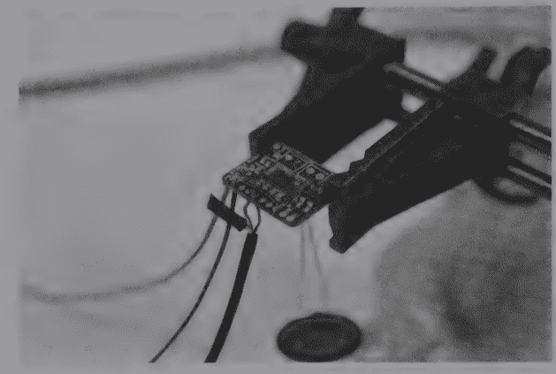

图 8-9。全线连接的 TS2012 音频放大器

早些在配置文件中，我们已经通过以下命令设置音频从 3.5mm 接口输出：

```
hdmi_ignore_edid_audio=1
```

为了对音频进行快速测试，你可以尝试 Raspian 发行版附带的音频文件：

```
aplay /usr/share/scratch/Media/Sounds/Animal/Kitten.wav
```

| G0 跳线 | G1 跳线 | 音量 |
| --- | --- | --- |
| 开 | 开 | 6db |
|  | 开 | 12db |
| 开 |  | 18db |
|  |  | 24db |

表 8-2。TS2012 音量设置

## 模拟 NES

为了实现真正的 NES 模拟，我从一个名为 `halfNES` 的优秀 Java 版 NES 模拟库开始，它由 Andrew Hoffman 编写。Andrew 在从零构建模拟器方面做得非常出色，特别关注模拟的准确性。许多以高性能结果闻名的模拟器是通过实现针对特定游戏的补丁（hacks）来实现的，而不是关注模拟器实现的正确性。由于有 800 多款游戏可用，这使得模拟器代码库变得复杂且难以理解，因为你不确定哪款游戏依赖于各种小补丁。

相比之下，Hoffman 的 `halfNES` 代码库相对较短且容易理解——当然，速度有点慢。对于现代桌面电脑来说并不慢，但在 900-MHz 的 ARM 芯片上，即使是四个核心似乎也不够。幸运的是，经过一些调优，他的代码库在树莓派 2 上运行良好（在较旧的树莓派 B+ 上运行也尚可）。

## 运行模拟器

首先从这里获取分支的模拟器代码：

https://github.com/RaspberryPiWithJava/halfnes

该代码库源自 Hoffman 的主线代码开发，特别关注在树莓派上可运行的性能和功能。与之前的示例一样，在 NetBeans 中打开代码库进行编译和运行。

你可以选择运行两个主要类之一：

- `com.grapeshot.halfnes` 是原始的 Swing UI，需要在 X-Windows 环境下运行。
- `com.grapeshot.halfnes.JavaFXNES` 是基于 JavaFX 的版本，在直接帧缓冲区（framebuffer）中运行。

两者都可以运行，但由于我们对树莓派进行了深度调优，JavaFX 版本运行速度更快。

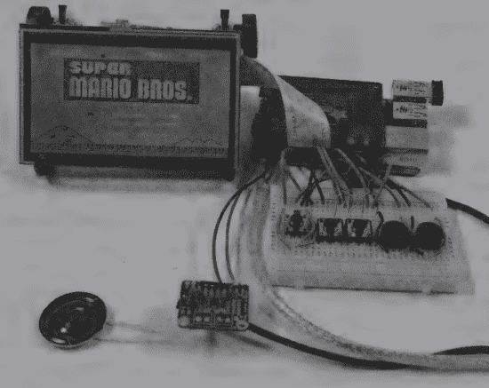

图 8-12. 完全运行的树莓派模拟器

将帧缓冲区设置为 32 对 Swing 版本的 `halfNES` 性能至关重要，因为消除了从 32 位到 16 位图形之间非常昂贵的复制操作。对于 JavaFX 来说，无论如何设置性能都没有区别，因为它运行在加速图形流水线之上。然而，JavaFX 极大受益于额外的 GPU 内存，因此将其设置为 128 会对性能产生影响。

现在你已经准备好在树莓派上运行 `halfNES` 模拟器了。点击 NetBeans 中的“Run Project”按钮，将在你的树莓派上远程执行 `halfNES` 代码库。运气好的话，你将看到（并听到）你喜欢的 `halfNES` 游戏运行起来，如图 8-12 所示。

## 为你的树莓派超频

我也建议对你的树莓派进行适当超频。只要你保持在合理的范围内，小幅超频不会导致树莓派保修失效，但可以对性能产生巨大影响。对于我的树莓派 2，在 `/boot/config.txt` 中指定的以下值是稳定的，并提供了足够的动力在模拟器上达到约 60fps。

```
#overclocking
arm_freq=1050
over_voltage=4
core_freq=525
gpu_freq=350
sdam_sdram=2
over_voltage_sdram=2
```

超频的主要风险是如果加载失败，你可能会在启动期间损坏 SD 卡。准备一个备份以备不时之需，或将 SD 卡设置为只读模式，这可以让你尝试不同的设置。此外，如果你担心影响保修，请远离 `force_turbo` 设置。当与某些设置（如高 `over_voltage` 值）配合使用时，它会在你的设备上设置保修位，让制造商知道你一直在进行激进的超频。

要在树莓派上通过超频获得任何收益，所需的另一个关键调整是更改调节器（governor）设置。由于 `halfNES` 模拟器大部分是单线程的，默认的节能调节器会看到低 CPU 利用率并拒绝增加速度。为了绕过这个问题，将调节器设置为“performance”，它将更积极地提高 CPU 速度。执行此操作的命令如下：

```
echo "performance" | sudo tee /sys/devices/system/cpu/cpu0/cpufreq/scaling_governor
```

> 注意此命令适用于树莓派 2，且仅更改第一个 CPU 的调节器。在树莓派 B+ 或 A+ 上，你需要省略 `cpu0` 来实现相同功能。

## NES 自动启动

你可能想对树莓派软件进行的最后一个调整是配置它在启动时自动启动游戏模拟器。实现此最简单的方法是编辑 `rc.local` 并在启动序列之后添加一个启动模拟器的命令。

要做到这一点，首先用 nano 打开 `rc.local`：

```
sudo nano /etc/rc.local
```

然后移动到底部，在调用 exit 之前添加几行：

```
echo "performance" | sudo tee /sys/devices/system/cpu/cpu0/cpufreq/scaling_governor
su -s /bin/bash -c "home/pi/jdk1.8.0_51/jre/bin/java -Dfile.encoding=UTF-8 -Djava.library.path=/usr/lib/jni -Xms256m -jar /home/pi/NetBeansProjects/halfnes/dist/halfnes.jar /home/pi/ROMs/LoveStory.zip"
```


### 注意

根据你使用的运行时环境，你的 Java 可执行文件路径可能会略有不同。

第一行固定了调节器以提高性能，第二行在启动后立即启动 `halfNES` 的 JavaFX 前端。现在，你的软件已经准备好作为游戏平台独立使用；你只需要一个时尚的外壳来装载它。幸运的是，我们在《Java 编程树莓派》的最后一章节中描述了如何这样做。

## 第 9 章 NightHacking RetroPi

在第 8 章中，你构建了一个功能完备的任天堂娱乐系统（NES）模拟器，并利用 GPIO 创建了一个自定义控制器。在本章中，你可以通过添加充电电源电路并将其放入一个让人想起经典便携游戏系统的 3D 打印外壳中来继续该项目。

在开始本章之前，你应该组装并测试第 8 章项目中的所有组件，这将作为你便携式游戏系统的基础。你还需要一些额外的硬件，并且可以使用 3D 打印机来打印外壳。然而，投入时间和工具来创建一个属于你自己的、可以自定义以展示你创意的便携式系统将是非常值得的。

## 材料清单

你需要第 8 章中推荐的所有硬件。由于外壳相当特殊，你应该确保你选择了与指定相同的组件型号。任何部件的替换将需要对外壳进行重大重新设计。

### 电源

对于电源，我们将使用 Adafruit PowerBoost 1000C。这是一个外型非常小巧的设备，能够通过锂离子电池提供稳定的电压。你需要购买以下组件：

- PowerBoost 1000C - 5V https://www.adafruit.com/2465
- 锂离子电池 - 3.7V https://www.adafruit.com/4400
- 面板友好型 PowerBoost https://www.adafruit.com/354
- SPDT 滑动开关 https://www.adafruit.com/805

类似于我在第 8 章中的建议，我建议准备几个开关，以防磨损或在焊接时不小心损坏。

你还需要第 8 章中的电烙铁、万用表、夹具和助手手来完成组装。备好连接线、焊锡、吸锡丝和热缩管将确保你不会在中间耗光。

### 3D 打印机

你还需要一台熔融沉积建模（FDM）3D 打印机来制作此项目的外壳。FDM 打印从加热喷嘴挤出薄层塑料，一层一层地构建 3D 形状。3D 打印机曾仅用于工业用途，但最近一些关键专利已过期，现在出现了一个专注于构建 DIY 打印机的开源开发社区，例如 RepRap 项目：reprap.org。

结果是 3D 打印机的价格大幅下降，变得负担得起购买一台完全组装好的爱好者打印机。你也可以在世界各地的创客空间和大学找到 3D 打印机。要找到你附近的创客空间，请查看这个方便的集中目录：spaces.makerspace.com/makerspace-directory

通常，打印材料是聚乳酸（PLA）或丙烯腈丁二烯苯乙烯（ABS）。PLA 或 ABS 都适用于此项目，但如果你是 3D 打印新手，我建议从 PLA 开始。还有许多新材料在打印领域日益流行，例如热塑性弹性体（TPE），其流行品牌包括 NinjaFlex 和尼龙，这两种都能提供柔性打印效果，可能对于像本项目中的方向键盖等小部件很有用（尽管这是可选的）。

如果你对购买 3D 打印机感兴趣，我建议寻找拥有开放设计和活跃社区的公司。3D 打印技术远未完全完善，因此保持打印机处于良好状态需要大量的关注和偶尔更换部件。开放设计意味着你可以根据需要更换和替换部件，通常在自己的打印机上打印替换部件（或朋友的）。而活跃的社区意味着当你遇到打印质量问题时，有一个拥有相同型号的人群可以提问。

此外，成功打印此模型还需要满足一些最低规格要求：

- **100微米层高**：外壳是针对 100 微米层高设计和测试的。如果你使用更大的层高打印，将会遇到零件公差问题，并无法可靠地打印悬垂部分。以较低的层高打印是没问题的，并且可能会获得更高的质量。
- **0.4mm 喷嘴（或更小）**：这是大多数打印机的标准配置，但较大直径的喷嘴会丢失细节并无法打印某些特征。
- **冷却扇**：有几个悬垂部分和桥接结构只有在拥有冷却扇以快速固化灯丝的情况下才能成功打印。
- **打印体积**：该外壳可以在非常小的打印机上打印，仅需要 100mm x 120mm 的平台。有一台更大的打印机当然很好，因为你可以一次打印多个部件，但并非必须的。

热床是一个很有用的功能，但没有它也可以打印。这个实用的功能可以防止模型的大面积平面表面翘起，同时提供整洁、光亮的表面。然而，还有其他防止打印件翘起的解决方案，例如胶水或画笔胶，因此请遵循你的打印机制造商的说明。最后，以下是一些你可以做的“噱头”。如果你是因为具备这些功能之一而购买打印机，那么你就买错了。

- **自动调平**：在实践中，这在大多数打印机上实际上并不起作用，所以你最终将手动调平。最好买一个具有精细手动调平系统的打印机。
- **多色彩打印**：这是另一个听起来很棒但实际上并不起作用的功能。FDM 打印机非常擅长单色打印。在打印过程中切换颜色肯定会导致颜色混合、层偏移或打印失败。本章中的外壳设计为单色打印。
- **摄像头、网络、花哨功能**：人们很想买一台功能满载的打印机，例如远程打印或录制打印过程视频的功能。然而，有一些很棒的开源选项如 OctoPrint (http://octoprint.org)，它们基于树莓派，并能为你提供这些功能甚至更多。

我在本章中使用的 3D 打印机是 Ultimaker 2，如图 9-1 所示。它是一种挤出管式 FDM 打印机，以生产非常高质量打印件而闻名。挤出管打印机的挤出机电机安装在背面，用于推动灯丝，并利用特氟龙涂层管子来引导灯丝进入打印头。由于打印头上没有电机，它减轻了组件重量，并允许打印机以更高的速度运行而不会降低质量。

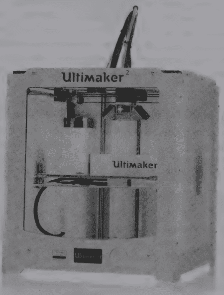

图 9-1. Ultimaker 2 打印机

Ultimaker 2 设计也符合开源和社区标准，其设计是 100% 开源，这意味着你不仅可以下载整个打印机和软件的原理图和构建文件，而且还有一个非常活跃的社区，他们产生了一些详细实用的指南来解决常见的打印机问题。你可以直接从制造商 (https://ultimaker.com) 购买 Ultimaker 2，或者从最近开始备货的 Adafruit 购买 (https://www.adafruit.com/products/2673)。

如果你想省钱并且不在意弄脏手，Ultimaker Original+ 是一个非常划算的选择。它的设计与 Ultimaker 2 类似，但它是一个需要你自己组装的 DIY 套件。在某些方面，Ultimaker Original+ 优于 Ultimaker 2，例如更强的挤出机，你可以通过第二个喷嘴和其他社区修改将其升级到具有比 Ultimaker 2 更好的规格。然而，请准备好花费大量的周末和晚上来调试和调整你计划自己组装的打印机。

## RetroPi 外壳的构造

3D 打印机非常有趣，因为它们为设计师提供了巨大的自由度，可以构建你想象的任何东西。只要你理解机器的局限性，就可以打印出相当复杂且惊人的结构，其中某些是任何其他生产方式无法制造的。

我对 NightHacking RetroPi 外壳的目标是为树莓派和 Kippah 屏幕创建一个最小尺寸的外壳，联想起图 9-2 所示的 Game Boy Advance SP。Game Boy Advance SP 是第一个采用铰链设计的任天堂掌机，从那以后一直是所有任天堂掌机上的热门功能。正如你很快就会看到的，这也是该设计中最棘手的部分。

我针对 3D 模型的一些特定设计目标包括：

- **无需支撑即可打印**：FDM 打印机的局限性之一是它们只能在现有材料上方打印，因此打印悬挑结构是不可能的，许多悬垂部分或陡角将根本无法打印。为了实现这一点，我将其设计为无需支撑即可打印。
- **组装不需要螺丝**：通过使用卡扣和接头，我成功地减少了对硬件的需求。这使得项目更具可行性且更容易修改。然而，这在设计阶段需要更高的精度。
- **兼容标准组件**：外壳设计完美适配树莓派、屏幕和电池包，确保一切稳固。

### 使用 Fusion 360 进行 3D 建模

对于设计，我选择了 Fusion 360。这是一个与 SolidWorks 非常相似的实体建模程序。

我选择 Fusion 360 的原因之一是 Autodesk, Inc. 对学生和爱好者非常友好。在 Beta 期间，Autodesk 为爱好者免费提供 Fusion 360，在商业发布后，它增加了一个针对初创企业的类型，让你获得免费许可。这对于我这样想要制作酷东西并免费分享的极客来说非常完美。

我已经将完整的外壳设计供你探索：http://a360.co/1NKp7U。该页面提供了 3D 视图并允许下载文件进行编辑。在 Fusion 360 中加载的完成模型如图 9-3 所示。图中顶部是实体建模操作，左侧是对象浏览器，屏幕底部是可以导航的历史列表。

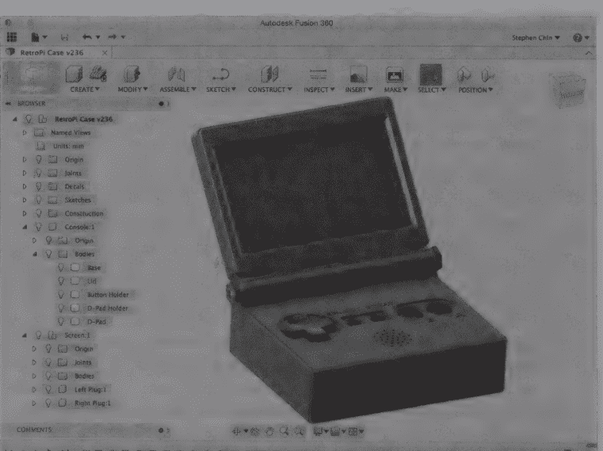

图 9-3. Fusion 360 界面显示 RetroPi

通过隐藏单个组件（例如外壳盖），你可以看到 RetroPi 的内部，如图 9-4 所示。在这里你可以看到方向键和可拆卸的按钮架插件。通过将这些插件作为独立模型打印，可以在它们下方留出大量空间放置其他组件而不必担心支撑结构。此外，这让组装外壳变得更容易，因为你有空间插入组件。

正如我之前提到的，最棘手的元素之一是如何构建可以工作的铰链。大多数商业游戏系统使用特制的金属铰链，插入塑料外壳中以提供耐用的铰链机构。然而，我想找到一种纯 3D 打印方案，能够良好运行并经得起孩子的粗鲁对待。

我的第一个设计是一个摩擦配合的圆柱，我将公差控制得足够紧密，使得打开和关闭屏幕需要一些力。紧密的公差使得组装变得极其困难（在过程中我弄坏了好几个），虽然它起初提供了一个良好的机制，但一旦铰链磨损（大约 50 次开合运动后），屏幕就会松松地掉下来。在检查插座和销钉时，我发现了明显的磨损，这表明材料会随着时间的推移而变得平滑。

我的第二个设计是一个 24 角多边形，屏幕在锁定到每隔约 11 度的位置时会产生听觉和触觉上的咔哒声。这种设计工作效果还不错，但没有通过“孩子测试”。我把它放在女儿的桌子上让她玩，（除了前几个原型因为外壳的应力点而真的坏掉外），她能够在快速开关后将这个多边形变成一个完美的圆圈。这是具有接触尖锐边缘的塑料设计的常见问题：过一段时间，尖锐边缘就会变圆。

在看着女儿玩她的任天堂掌机后，我想出了第三个也是最终的设计。我注意到屏幕确实需要锁定在两个位置：完全关闭和三分之二打开。因此，如果我设计出一个能锁定这些打开和关闭位置的铰链，那就可行了。我认为塑料建模的另一个特性是，虽然尖锐边缘不会持久，但塑料对拉伸和恢复原始位置具有很高的公差。

根据我的观察，我设计了图 9-5 所示的销钉形状。它看起来像一个圆角的勒洛三角形，通过样条曲线连接两个同心三角形的顶点创建。通过以几分之一毫米为比例改变三角形的相对尺寸，当销钉旋转出三个“理想”位置之一时，就会产生少量的摩擦。考虑到铰链的运动自由度，这三个位置中只有两个，我将它们对齐到完全关闭和三分之二打开的位置。

即使有了新设计，为了确定正确的公差也经过了大量的尝试。我尝试了两种不同的方法来测试铰链。第一种是经验法，我打印了一堆铰链并用钳子破坏了它们，如图 9-6 所示。

第二种方法是数学方法，我对销钉和铰链进行了干涉分析，以在最小位移下实现最大的表面偏转。图 9-7 显示了 Fusion 360 干涉分析的结果，那个魔法数字是 28.254mm^3 的位移，这提供了良好的张力水平。

我通过类似的过程完善了外壳上标签的文字打印（事实证明字母间距影响很大）。此外，对于每次打印，我都会组装和拆卸所有组件，修改设计以考虑组件之间的公差、卡扣的断裂以及其他的结构改进。这消耗了几卷耗材和一大箱废弃的原型，但希望你们能从单次完美的打印中获益！


图 9-5. 三角形铰链设计草图


图 9-6. 打印、破坏和记录的测试铰链

## 打印外壳

现在你已经了解了外壳设计的背后原理，是时候在你自己的 3D 打印机上尝试打印它了（或者借用或共享的 MakerSpace 3D 打印机）。

打印机使用的 3D 模型标准格式是立体光刻（STL，由 3D Systems 创建的格式）。我导出了对应于 RetroPi 每个部分的 STL 文件，并将它们上传到了 Thingiverse 项目：https://www.thingiverse.com/thing:993901

为了打印这些模型，你需要使用一个名为 slicer（切片软件）的程序将 3D 几何形状转换为打印机指令。适用于多种打印机的流行开源切片软件是由 Ultimaker 团队开发的 Cura。如图 9-8 所示，我在这个项目中使用了 Cura。


图 9-7. Fusion 360 干涉分析

所有的模型文件在图 9-8 中的方向都是正确的，但左右销钉需要向下旋转。Cura 左下角有一个旋转工具可以让你轻松实现这一点。我还建议打印这些销钉时至少使用 80% 的填充，以赋予它们额外的强度。填充是内部区域的百分比，填充模式可以为部件提供额外强度，对于这种用途，20% 通常足够了。然而，项目中的销钉是受力较大的小部件，80% 到 90% 的填充将防止它们失效。


图 9-8. Cura 切片软件

另一个建议调整的是底座的外壳尺寸。将其设置为大于喷嘴尺寸的最小倍数（例如，如果你的喷嘴尺寸是 0.4mm，则选择 1.2mm 厚度）。这样外壳壁将被填充为实心。

一旦开始打印，就可以放松了。所有组件的总打印时间大约 16 小时。你可以在图 9-9 中看到底座正在完成。最困难的部分可能是让底座和屏幕等大部件粘在打印平台上。如果你在加热的平台上使用 PLA 打印，建议将温度提高到 70 摄氏度。这将使 PLA 在玻璃上具有良好的附着力。如果你有一台维护良好且校准良好的机器，你将得到漂亮的部件，如图 9-10 所示。


图 9-9. 打印底座


图 9-10. 打印的内部组件

## 组装 RetroPi

现在你已经准备好了所有的 3D 打印部件，是时候结合树莓派和第 8 章中的电子元件组装外壳了。此外，确保你有书中规定的充电电路、锂电池和电源开关。

### 直接连接音频

在第 8 章中，我们使用直角音频接口将音频连接到树莓派。遗憾的是，外壳没有足够的空间放置笨大的插口，因此我们必须将音频终端直接连接到树莓派。

要做到这一点，将树莓派翻过来让底部朝上，然后将其放入夹具中固定。你要连接的两个点标记为右通道的 `PP26` 和接地的 `PP6`。剪几根长度约为 10 到 12mm 的线，并将它们焊接在标记的终端上。它们如图 9-11 所示，已经连接了线缆。


图 9-11. 音频终端直接接线

快速回顾一下第 8 章的表面贴焊接，我建议以下步骤：

1. 使用吸锡带清理终端上的现有焊锡。
2. 通过加热终端并流上一个小焊锡球重新涂层终端。
3. 在烙铁尖端带一点焊锡，加热并将导线推入焊锡球。

通过确保在最初流上焊锡和推入焊锡球时终端都是热的，你应该可以在两个组件之间获得良好的固态连接。此外，确保使用电路夹具和万手夹保持所有东西到位，以便你专注于精确焊接。

第二步是从 TS2012 板子上焊下 3.5mm 插口，并将直接音频线重新连接到正确的位置。回顾一下连接情况：右通道 (`PP26`) 连接到 `R+`，接地 (`PP6`) 连接到 `R-`。

### 便携电源

下一个要连接的硬件是 Adafruit PowerBoost 1000C。这是一个巧妙的小电路，内置了锂电池充电电路以及一个电压转换器，它可以将电池的 3.7V 升到 5V 为树莓派供电。配合一些 4400mAh 的锂离子电池，我们将有足够的电力让 RetroPi 提供一整天的游戏乐趣。（在我的测试中，持续使用 5 小时后低电灯亮起，再过 80 分钟树莓派完全没电，总运行时间超过 6 小时。）

图 9-12 显示了已经焊好电源开关前两个引脚的 PowerBoost，正在准备电源引脚。

我们需要在这个板子上总共连接四个不同的连接，包括：

- `EN` 连接到按钮的边缘引脚。
- `GND`（在 `EN` 旁边）将此连接到按钮的中间引脚。
- `5V`：将此连接到 Kippah 上的 `5V` 焊盘。
- `GND`（位于 `5V` 旁）：将此连接到 Kippah 上的一个地焊盘。

PowerBoost 电源的工作方式是它是始终开启的，直到你短接 `EN` 和 `GND` 引脚。通过将这两个引脚连接到开关三个端子中的任意两个（如图 9-13 所示），你可以随心建立（或断开）这种连接。正如照片所示，使用热缩管对电线进行绝缘也是非常好的做法。在焊接之前，只需将热缩管套在电缆上，然后将其拉回并轻轻加热使其形成紧固的密封。

连接好开关后，回到 Kippah 板，将 PowerBoost 焊接到 `5V` 和地端子上。此时也是确保所有连接都良好绝缘的好时机，以防当你将 Kippah 放置在针脚上时，它们不会相互接触或碰到树莓派的组件。图 9-14 显示了我布满电线和热缩管的 Kippah 底部。


图 9-13. 将地线和使能线焊接到开关上


图 9-14. 连接好所有电线的 Kippah

### 按钮重新布线

现在是时候弃用面包板，并准备好插入外壳的按钮了。在上一节中，我们通过 Kippah 的直接连线布置了所有按钮，因此离开面包板非常简单，只需取出按钮并将引脚直接焊接到来自 Kippah 的电缆上即可。

由于 3D 打印的按钮架为了节省空间使引脚呈水平排列，因此你需要弯曲按钮上的金属引脚使其变平。如图 9-15 所示，用老虎钳小心地弯曲每个引脚。圆形按钮最难处理，因为引脚不是直直伸出的，而是需要稍微倾斜才能穿过按钮罩上的孔。

在焊接按钮引脚时，利用万用夹来固定按钮和电线。这将释放出你的手，让你专注于获得整洁的焊锡连接。记住，只有当金属被适当加热时，焊锡才能形成牢固的结合，因此在涂锡之前，确保按钮引脚和电线都与烙铁接触几秒钟。图 9-16 显示了一个牢固的焊点。

不要忘记 `Start` 和 `Select` 按钮上的二极管。为了保持布线简单，你可以将二极管直接连接到按钮端子上，并用一小段热缩管将两个二极管隔开，如图 9-17 所示。


图 9-15. 拉直的引脚以适应 3D 打印的按钮架


图 9-16. 圆形线上的焊接连接


图 9-17. 带有二极管和热缩管的按钮

我们有一个组件需要为外壳重新调整。方向键的插入件相对于我们的面包板布局顺时针旋转了 90 度，因此我们需要旋转连接以修复方向问题。图 9-18 显示了 D 键，其端子标记了它放入外壳的方向，并显示了已焊接五个引脚中的四个。

现在你已经连接好了按钮、扬声器和 PowerBoost，是时候进行快速测试运行了：

1. 将显示器连接到 Kippah。
2. 将 Kippah 放置在树莓派的针脚上。
3. 使用 JTAG 针脚连接锂电池。
4. 将电源开关拨到开启位置。

如果你正确配置了一切，树莓派应该启动并开始运行 `halfNES` 模拟器，如图 9-19 所示，并带有扬声器传出极棒的复古游戏音乐。现在是时候将所有东西放入 3D 打印的外壳中了。

**注意**：我建议标记 `Start` 和 `A` 按钮，这样当你将它们插入外壳时可以很容易地与 `Select` 和 `B` 按钮区分开来。


图 9-18. 标记有线线的方向键

图 9-19. 放入外壳前的内部组件测试运行

### 安装内部硬件

现在内部组件已经组装并测试完毕，是时候安装显示了。我尝试让显示器的组装尽可能简单，但由于你处理的是非常脆弱的排线，请务必非常小心。

第一步是将屏幕底座安装到铰链上。它应该在不需要太大力的情况下卡入，并在轴上旋转（先不要安装销钉；我们稍后会处理）。调整屏幕方向，使你可以轻松访问排线槽的两侧，并轻轻地将排线穿过，如图 9-28 所示。我发现将其稍微螺旋卷起，然后从角度插入插槽效果最好。注意不要卷得太紧，否则可能会在连接器附近使电缆产生尖锐的折痕。

排线安全通过电缆槽后，在专用槽中添加扩展板，并如图 9-29 所示连接电缆。记住，连接此连接器时，金属针脚朝上。


图 9-27. 工作中的 RetroPi 内部结构


**图 9-28.** 穿过铰链的排线


**图 9-29.** 连接了排线的扩展板


**图 9-30.** 安装在扩展板上的显示器

接下来，如图 9-30 所示将屏幕安装到扩展板上。它应该恰好合适，并留出完美的距离让你将显示器插入屏幕底座。

此时是插入销钉固定显示器的好时机。销钉的设计在外壳关闭或打开三分之二时配合最好。我建议使用打开三分之二的位置（相对于关闭状态正好 120 度），并调整销钉方向，使缺口面向屏幕顶部。图 9-31 和 9-32 显示了左右销钉的方向，以便它们能平滑地滑入并与锁的缺口匹配。


**图 9-31.** 左销钉方向


**图 9-32.** 右销钉方向

一旦销钉到位，如图 9-33 所示，将小锁滑入屏幕底座底部的缺口中。这将固定销钉，防止它们在你打开和关闭外壳时自动脱落。如果锁有点紧，你可以使用钳子夹住锁的顶部和铰链底部并挤压来施加一些力量。


**图 9-33.** 插入的左锁


图 9-34. 主机盖上的支撑材料

在装上主机盖和屏幕盖之前，请确保你已经断掉了与模型一起打印的支撑材料。图 9-34 和 9-35 显示了在继续之前你应该移除的支撑材料。如果不移除这些额外材料，可能会对排线施加过大压力导致其损坏。


图 9-35. 屏幕盖上的支撑材料

现在你可以通过将两个盖子到位来完成最终组装。主机盖的设计是先将其挂在铰链下，然后将边缘卡到位。推入时，注意不要将电池电线卡在后面。此外，确保正确插入塑料棱条以获得良好的贴合。向下按压时，确保 D 键和按钮没有被卡住，前角是最紧的，确保在不需要螺丝的情况下一切固定在位。

顶部屏幕使用滑动机制，如图 9-36 所示，从顶部插入并向下按压。你可能需要稍微弯曲屏幕以对齐斜槽。一旦在斜槽中锁定，按压顶部即可固定它。

这样你就拥有了一个完整的复古游戏机。希望你喜欢制作这个项目就像我喜欢设计和制作它一样，我也希望激发你制作自己的项目。


图 9-36. 屏幕的滑动盖


图 9-37. 完成的 NightHacking RetroPi

图 9-37 显示我 12 岁的女儿正在玩这台机器。感谢她为原型的外壳设计提供了很大灵感。

## 索引

### 符号与数字

- `(append)` 命令, 25
- `(command)` 提示, Raspberry Pi, 25
- `1-Wire` 接口, 设置 3D 打印机
- `3D` 打印 `3D` 外壳, 272–275
- `3D` 空间, 放置在, 231–232
- `raspi-config`, Raspberry Pi 设置, 13
- 丙烯腈丁二烯苯乙烯 (ABS), 3D 打印机材料, 263
- `LED` (绿色), 如何判断工作, 8–9
- 关机, 15
- `DS18B20` 温度传感器. 参见传感器
- 防水, 192–194
- 添加移动电源到 NightHacking RetroPi 项目, 278–279
- Fritzing 图, 243
- 连接 Raspberry Pi, 248–250
- NightHacking RetroPi 项目接线, 282–283
- 焊接到 Kippah 板, 244–247
- 触摸屏适配板, 235–236
- 二进制计时器清单, 58
- 茶站项目, 173
- 连接串口秤, 175
- 实现二进制计时器, 82
- 连接智能卡读器, 108–110, 114–115
- `NFC` 模块, ITEAD, 110–115
- `PN532` 芯片的 `RFID` 读卡器, 102
- `Adafruit PowerBoost 1000C` 充电器, 286
- 添加移动电源到 NightHacking RetroPi 项目, 277–279
- `3D` 外壳硬件, 284–287
- 添加 `JAR`/文件夹, 选择文件自, 62
- 添加 Track, Raspberry Pi 设置, 13
- `Advanced Options`, Raspberry Pi 设置, 14
- `Advanced Options` 标签, `raspi-config`, 107
- 二进制计时器, 79, 85–93
- 线路跟随, 159, 161–162
- 同步, 46
- `allow_autoscan`, `libnfc` 配置文件, 117
- `allow_intrusive_scan`, `libnfc` 配置文件, 117
- 放大器, 连接, 250–252
- 模拟数字转换器, 访问, 148–149
- `API` 库, drone 项目要求, 217–218
- `append` (`>`) 命令, 25
- `AR` 无人机. 参见 drone 项目
- `Arduino` -- 组装小机器人, 143–146
- 将 `Arduino` 引脚映射到 Raspberry Pi 引脚, 148–149
- 小机器人使用的材料, 135
- `ARM7` 四核芯片, Raspberry Pi 2, 235
- `ARP1600 Arduino Shield`, 125, 143–146
- 异步通信, 使用 `USB` 秤, 46–49
- 异步处理, `Pi4J` 库, 182
- 音频
- `Advanced Options`, 14
- 直接接线端子, 276–277
- 连接扬声器, 250–252
- 复古视频游戏模拟器要求, 237
- `Autodesk Fusion 360`, `3D` 建模, 268–272
- 自主无人机. 参见 drone 项目
- 自主机器人. 参见 line runner
- 部署飞行指令的 `Java` 应用, 228–229
- 推进方法, 等待重量变化, 47
- 电池
- 为小机器人组装电池架, 140
- 组装小机器人, 147
- 身体框架, 组装小机器人, 136–139, 141
- `IoT Hat` 的物理结构, 129–130
- 二进制编码, 六十进制数字, 76–78
- 二进制计时器项目
- 从 `Java` 访问 `GPIO`, 60–61
- 算法用于, 85–93
- 线路倒计时, 76–79
- 设备 `I/O` 库测试

### C

- 转接板 (`Breakout Boards`)。参见 `Adafruit PN532`
- 冲煮控制图, 43–45
- 冲煮比例
- 冲煮控制图, 44
- `BREW_RATIO` 常量, 52, 54
- `CoffeeCalculator` 常量, 45–46
- 博通 (`Broadcom`)。参见 `Motorola Broadcom` 芯片组
- 按钮
- `3D` 建模应用于设计, 268–272
- 组装, 276
- 构建, 266–267
- 将硬件放入 `3D` 外壳, 283–288
- 使用 `3D` 打印机打印, 272–275
- 手机充电器，无人机项目需求, 217
- 板载布局, 242–243
- 去抖动, 90–93
- 将硬件放入 `3D` 外壳, 287
- 复古视频游戏模拟器的导航控制, 237–238
- 为 NightHacking RetroPi 项目重新布线, 280–283
- 设置二进制数, 88–93
- `Chalkboard Electronics`
- 选择触摸屏, 170
- 推荐的触摸显示器, 204
- 电路图
- `Fritzing` 布局应用, 用于 67
- 单个 `LED`, 67–68
- 夹子，在转接板上焊接连接器, 109
- 类标识符, `SD` 卡, 4
- `clone` 命令，安装 `Device I/O` 库, 61
- `close` 方法，`USB` 电子秤测试, 42
- `cmdline.txt` 文件，将 Raspberry Pi 直接连接到 PC, 以及 17–18
- 咖啡冲煮控制图, 43–46
- 咖啡冲煮项目
- 添加 `Java`, 35–43
- 异步通信, 46–49
- 物料清单 (`bill of materials`), 28
- 选择咖啡磨机, 50–51
- 咖啡配方, 52–54
- `CoffeeCalculator`, 43–46
- 商业许可, 54–55
- `NetBeans` 入门, 29–31
- 复活 `HelloRaspberryPi`, 31–34
- 在其中使用 `Device I/O` 库, 62
- `CoffeeCalculator` 类, 45–56, 52
- 避免冷焊点, 109
- 代码寄存器, 67
- 命令提示符 (`>`), `HelloRaspberryPi`, 25
- `CommandLineRecipeRunner`, 53
- 商业许可, 54–56
- 复合连接
- 用于触摸显示器, 169–171
- Raspberry Pi 安装排除, 10
- 配置文件, `Device I/O` 库 `LED`, 70
- 配置文件, `libnfc`, 117–119
- 配置, 在 `NetBeans` 中, 37–38

### D

- 线缆 (`cables`)
- 将屏幕连接 NightHacking RetroPi, 289–290
- 用于二进制计时器, 58
- 通过 `HDMI` 线连接到显示器/电视, 7
- 用于无人机项目, 217
- 与 Raspberry Pi 和无人机建立以太网连接, 220–221
- 放入 `3D` 外壳, 284
- 用于 `IoT Hat`, 128, 103–111
- 跳线线, 53
- 准备 Kippah 以连接 Raspberry Pi, 249
- 用于复古视频游戏模拟器, 236–237
- 回调 (`callback`)
- 手持按钮去抖/异常封装, 92–93
- `USB` 电子秤测试, 41
- 摄像头 (`cameras`)
- `3D` 打印机功能, 265
- Raspberry Pi 设置, 13
- 卡适配器，设置 `microSD` 卡, 3
- 外壳，用于无人机项目, 216
- 外壳，用于 NightHacking RetroPi
- 连接 (`connections`)
- 复合连接, 10, 169–171
- 在 Raspberry Pi 和无人机之间建立网络连接, 220–221
- 脉宽调制用于 151–153
- 去抖算法, 二进制计时器, 90–93
- `/dev/mem`, 映射访问 `GPIO` 引脚, 98–100
- 以太网, 16
- `LED` 到 Raspberry Pi `GPIO`, 66–67
- Raspberry Pi 直接到 PC, 16–18
- 远程连接到 Raspberry Pi, 30
- 串口连接
- `Device I/O` 库
- 从 `Java` 访问 `GPIO` 引脚, 60–61
- 分配 `GPIO` 引脚, 62–66
- 项目正确配置, 62–63
- 初始化 `GPIO` 引脚, 85–82
- 设置 6–8
- 智能卡读器, 108–115
- 焊接连接到 Kippah 板, 244–247
- 通过 `SSH`, 22–24
- 为二进制计时器安装, 61–62
- `LED` 测试, 66–71
- `Pi4J` 库 vs., 60, 94–100
- 使用 `Pi4J`, 72
- 网络连接性测试, 225–226
- 到 `USB` 电子秤, 40
- 无线网络, 18–20
- `Pi4J GPIO` 输入/输出, 86
- 控制循环，用于在 `3D` 空间引导无人机, 251–232
- 二进制计数, 76–79
- 设备平台, 组装机器人, 140
- 设备文件, 117
- `CPU` 利用率，超频, 258
- `CU_SIZE` 常量, 在咖啡配方中, 52
- `Cura`, 切片器, 272–275
- `DHCP` (动态主机配置)
- 网络应用网络服务, 224–225
- 通过以太网连接到 `DHCP` 服务器, 16
- 为无人机项目设置 `DHCP` 服务器, 221–222
- 将无人机设置为 `DHCP` 客户端, 224
- 守护进程，配置为服务, 191–192
- 串口接口，从...设置, 238
- `Digi-Key` 电子
- `DIMM` 插座, Raspberry Pi Compute Module, 55
- `EventOccurred` 方法, 二进制, 78
- 编码的, 78
- 日光时间 (`DST`), 78
- 二极管 (`diodes`)
- 颜色代码, 67
- 与热缩水管隔离, 280–281
- 发光 `LED` (发光) 用于复古视频游戏模拟器, 239
- 组装机器人, 137–138
- 为机器人组装电机驱动器, 141–142, 144–145
- `dio4j` 库, 62
- `dio4j` 项目, 62
- `dio4j` 属性文件, 创建闪烁 `LED`, 68–71
- 距离传感器。参见 `Makeblock` 超声波传感器
- 功能接口, `lambda` 表达式, 47
- 驱动程序，为 `NFC` 无人机编译 `libnfc`
- 动态主机配置协议 (`Dynamic Host Configuration`)。参见 `DHCP` (动态主机配置协议)

### E

- 增加自主性, 230–231
- 组装并固定硬件, 226–227
- 将网络服务器应用配置为, 224–225
- 支持 Raspberry Pi 的库, 230
- 建立网络连接, 220–221
- 硬件需求, 214–217
- 通过 `Java` 应用飞行无人机, 230
- 实现控制循环, 231–232
- 在 `3D` 空间中引导无人机, 231
- 设置 `DHCP` 服务器, 221–222
- 设置 `WAN`, 222
- 软件需求, 217–219
- 构建自主无人机的步骤, 219–220
- 网络连接性测试, 225–226
- 用于飞行的 `Java` 方法, 228–229
- `DS18B20` 温度传感器。参见传感器
- `DSI` 连接器，用于触摸显示器, 169–170
- `Dymo M10 USB` 电子秤, 35–43
- 兼容 `DStamp` 的秤, 36–43
- `echo` 命令, `HelloRaspberry`, 25
- `Edimax Wi-Fi` 适配器 `EW-7811Un` 模块, 102
- `EEPROM` 用于 `GPIO` 引脚, 65
- 启用启动到桌面/Scratch, Raspberry Pi 设置, 133
- 启用摄像头, Raspberry Pi 设置, 13
- `enum`, 控制机器人状态, 155–156
- `ExFat`, 格式化 `SD` 卡, 使用 4
- 扩展文件系统 (`Expand Filesystem`), Raspberry Pi 设置, 133
- 扩展板，连接屏幕到 NightHacking RetroPi, 290–291
- 悬挂线, 复古视频游戏模拟器的硬件需求, 236
- 提取, 航空咖啡机
- 第一个项目的物料清单, 28
- 咖啡冲煮配方, 49–50
- 风扇，`3D` 打印机需求, 264
- `FAT` (文件分配表), 4
- `FDM`，参见熔融沉积建模 (`FDM`)
- 文件分配表 (`FAT`), 4
- 过滤器, 28
- `findDevice` 方法，`USB` 电子秤, 40
- 第一个项目。参见咖啡冲煮项目
- 飞行控制，为无人机编写飞行指令, 228–229
- `Fluke 87V` 万用表, 95
- 格式 (`formats`)
- `FXML` 文件格式, 用于 205–211
- `SD` 卡, 4
- `3D` 打印机的标准格式, 272
- `FPC` 扩展板, 236
- 频率. `Device I/O` 测试, 95
- `Fritzing` 布图, 用于底部布局, 24
- 用于电路图, 67
- 用于面包板连接, 82–84
- 熔融沉积建模 (`FDM`) `3D` 打印机, 263–264
- 局限性, 266–267
- `FXML` 文件格式, 用于用户界面, 205–211

### G

- `Game Boy Advance SP`, 266–267
- 游戏。复古模拟器
- `Ge`
- 选择触摸屏, 170
- 推荐的触摸显示器, 204
- `GetParted` 工具，格式化 `SD` 卡, 5–6
- `GitHub`, 可用代码来自 211
- `GPIO` (通用输入输出) 引脚
- `3.3V` 与 `5V` 逻辑, 144–145
- 从 `Java` 访问, 60–61
- 在 Raspberry Pi 中访问, 98–100
- 连接屏幕到 NightHacking RetroPi, 291–292
- 博通编号方案, 65, 148–149
- 在二进制计时器中, 58
- 连接 `LCD` 显示, 235–237
- 连接串口电子秤, 174–176
- 为复古视频游戏模拟器创建 `GPIO`, 240–241
- `Device I/O` 分配, 62–65
- 禁用二进制计时器的串口代码, 82–84
- 破解性能以及 94–98
- 将扩展板连接到 Raspberry Pi A+, 111–112
- 初始化, 85–87
- 映射到设备, 241–244
- 映射到 `Makeblock` 扩展板上的端口, 148–150
- `P4J` 库, 72–73
- 串口, 115
- 设置直流电脉宽调制用于 151–153
- 通过智能卡读器通信, 106
- 测试电子秤上的串口接口, 179–180
- 使用 `Device I/O` 库闪烁 `LCD`, 66–71
- 使用 `Pi4J` 库闪烁 `LED`, 73, 75
- 为二进制计时器布面包板, 80–82
- 绿色 `LED`。参见 `ACT LED` (绿色)

### H

- 用于咖啡冲煮项目，28
- 用于无人机项目，214–217
- 放入 `3D` 外壳，283–288
- 格式化 `SD` 卡，4–6
- 入门，2–3
- 如何判断其工作正常，8–10
- 用于 `IoT Hat` 项目，102–105
- 用于小线小机器人，134–135
- 购买兼容的 `SD` 卡，3–4
- 用于复古视频游戏模拟器，236
- 用于茶座项目，168

### I

- `I2C` (集成电路)
- 通过...访问模拟数字转换器，148–149
- 高级选项，14
- 为 `NFC` 读器编译/安装 `libnfc`，117–119
- 配置树莓派，106–108
- 连接智能卡读卡器，110–111
- 连接线图，113
- `GPIO` 引脚和，58
- `I2C` 总线的 `GPIO` 引脚，65
- 管理连接的设备线，14
- 故障排除，118–119
- `libnfc`, 编译/安装，119–122
- 红外遥控器。参见 `Makeblock`

### J

- `HDMI`
- 比较 `HDMI` 触摸屏 Kippah，235–236
- 通过 `HDMI` 线缆连接到显示器/电视，7
- 触摸屏显示器的端口，169
- `raspbian` 安装的故障排除，10
- 针引脚顺序，`GPIO` 引脚编号，65
- 已焊接的 `ITEAD PN532` 拆接板，110
- `Pi Cobbler`, 82
- `HelloRaspberryPi`
- 创建简单应用，24–26
- 使用 `NetBeans` 重新创建，31–34
- 辅助，复古视频游戏项目的工具需求，239
- `HID` 多点触摸显示，171

### K

- `Me` 红外解码器
- 元素类，咖啡配方接口，51–52
- `GPIO` 引脚的初始化，85–87
- `Pi4J` 需要，75
- 输入/输出(`I/O`) `Device I/O` 库。参见 `Device I/O library`

### L

- `Hoffman, Andrew`, 253
- 连接线，在二进制计时器的实现中，58–59
- 主机名
- 高级选项，14
- 配置 `NetBeans`, 31
- 设置，21
- 通用输入/输出。参见 `GPIO` (通用输入/输出) 引脚
- 安装，`Device I/O` 库，58–59
- 安装，带 `NOOBS` 的 `Raspian`，10–16
- 概览，6–8
- 故障排除，8–10
- 集成电路。参见 `I2C` (集成电路)
- 国际标准单位制 (`SI`)，79
- 国际化选项，树莓派设置，13

### M

- `IoT Hat` 项目
- 物料清单，102–105
- 编译/安装 `libnfc`，119–122
- 编译/安装 `libnfc`，116–119
- 配置树莓派用于 `I2C`/`SPI`/`UART`，106–108
- 连接智能卡读卡器，108–115
- `NFC` 库配置，116
- 树莓派上的 `NFC`/`RFID` 支持，106
- 概览，102
- 物理结构，126–131
- 树莓派 `A+` 设置，105
- 从 `Java` 读取卡片，122–125
- `IP` 地址，设置主机名，22
- `ITEAD PN532 NFC` 模块
- 连接智能卡读卡器，108, 111
- 在 `IoT Hat` 项目中，72

### N

- `Java ME` (微版本), 29–31
- `Java Native Interface` (`JNI`), 96–100
- `Java Platform Manager`, 30
- `Java Platform Wizard`, 30–31
- `Java Runtime Environment` (`JRE`), 62
- `Java SE` (标准版), 29–31
- `Java Smart Card I/O API`, 106
- `Java Specification Request` (`JSR`) 268, 106
- `JavaFX`
- 运行 `halfNES` 模拟器，253–256
- 控制泡茶过程的用户界面，203–212
- `JAVA_HOME` 路径，安装 `Device I/O` 库，62

### O

- `Jackery Bar`
- 电池，129
- `USB` 充电器，103, 114–115
- `JAR` 文件
- 与 `USB` 秤通信，37
- 创建 `Pi4J`，74–75
- 从添加 `JAR`/文件夹中选择存档文件，62
- 仅使用单一个 `Pi4J`，72
- `Java`
- 访问 `GPIO`，60–61
- 访问秤，182
- 访问温度传感器，195–99
- 部署 `Java` 无人机应用和支持库到树莓派，230
- 版本，29–31
- 通过调用 `Java` 应用飞行无人机，230
- `HelloRaspberryPi.java`, 25
- 许可，55
- 许可项目，54–55
- 预安装于树莓派，204
- 从...读取智能卡，122–125
- 无人机飞行指令编写方法，228–229
- `Java` 开发包 (`JDK`)
- 配置远程，230
- 下载/配置 `NetBeans`，30
- `java.policy` 文件，68–70
- `JavaScale`
- 咖啡冲煮项目，53
- 泡茶，176–181
- `java.usb.properties` 文件，与 `USB` 秤通信，37–38
- `JDK` (`Java` 开发包)
- 配置远程，230
- 下载/配置 `NetBeans`，30
- `JNI` (`Java Native Interface`), 96–100
- `Java Runtime Environment` (`JRE`), 62
- `JSR` (`Java Specification Request`) 268, 106
- 跳线线
- 用于 `IoT Hat` 项目，103
- 用于智能卡读卡器，110–111
- 用于茶座项目，173

### P

- 映射，用于红外遥控器，155
- 键盘入门，2
- 安装 `raspi-config` 工具，107
- 带 `NOOBS` 的 `Raspbian`，10–11
- 插入，7
- 树莓派 `A+` 设置，105
- 切换 `NOOBS` 模式，10
- `Kippah`. 参见 `Adafruit`

### Q

- `Linux`
- `lambdas` 表达式，47
- 闰年，78
- `Ledio.java` 文件，使用 `Device I/O` library
- `LED` (发光二极管)
- 在二进制中计数，76
- 实现二进制计时器，58, 79
- 多色显示器计时器，67
- 对电流的韧性，6
- 使用 `Device I/O` 库闪烁，66–71
- 使用 `Pi4J` 库闪烁，72
- 库 (`libraries`)
- 设备 `libusb-dev`, 编译 `libnfc`
- 许可 `Java` 项目，54–55
- 发光二极管。参见 `LEDs` (发光二极管)
- `Line Follower`. 参见 `Makeblock Line Follower`
- 组装，136–147
- 跟踪传感器，157
- 概览，134
- 编程，148
- 设置红外遥控器，154
- 用于 `DC` 的脉宽调制，151–153
- 总结，159
- 通过 `SSH` 连接，22
- 基于 `Raspian OS`，10–11
- 带 `NOOBS` 的 `Raspian`，14–15
- `SSH`，22
- `log_level`, `libnfc` 配置文件，117
- 在...中的静态 `IP` 配置，17
- 魔法师顶帽。参见 `IoT` 项目
- 主方法，`USB` 秤，33
- 安装 `Device I/O` 库，61
- `Makeblock Me` 双电机驱动器，141–142, 144–145
- `Makeblock Me` 红外解码
- 组装小线机器人，142–143
- 映射到 `GPIO`，150
- 小线机器人设置，153–157
- `Makeblock Me` 小线机器人
- 组装小线机器人，141–142, 146–147
- 映射到 `GPIO`，150
- 小线机器人使用的传感器，135, 157–159
- `Makeblock Me` 超声波传感器
- 映射到 `GPIO`，150
- `GPIO` 头部上的引脚映射到端口，在，148–150
- 小线机器人使用的材料，135
- 机器人平台，134–135
- `Memory Split`, 高级选项，14
- 方法
- `Recipe` 接口，49–50
- 为无人机编写飞行指令，228–229
- 微基准测试，`Device I/O` 定时，94–95
- 微版本 (`Java ME`), 下载/配置 `NetBeans`，29–31
- `microSD` 卡，设置，2–3
- `Minicom` 终端仿真程序，
- 测试秤上的串口接口，176–181
- 货币切换开关，按钮引脚分配，80–81
- 将屏幕连接到 NightHacking RetroPi，289–290
- 连接 `HDMI` 线缆到，7
- 入门，2
- 如何判断其工作正常，9
- 在 `NightHacking RetroPi` 项目中，288–295
- 建议，204
- 用于复古视频游戏模拟器，235–237
- 屏幕，211
- ...的滑动盖，294
- 茶座项目的触摸屏显示，169–171
- `raspbian` 安装，10
- 驱动程序
- 组装小线机器人，141–142, 144–145
- 小线机器人使用的材料，135
- 摩托罗拉芯片组
- `Device I/O` 引脚分配，62–65
- `GPIO` 引脚编号，65
- `Device I/O` 的 `GPIO` 引脚初始化，85–86
- 引脚编号方案，148–149
- 电机。参见 `DC` 电机
- 鼠标
- 入门，2
- 插入，7
- `Mouser` 电子，来自...，238
- 多用表
- `Fluke 87V`，95
- 复古视频游戏项目的工具需求，240

### R

- `Nano`, 将树莓派直接连接到 PC，18
- 复古视频游戏导航控制，237–239
- `NES` 编程竞赛，254–255
- `NetBeans`
- 创建 `IoT` `TV`
- 部署 `Java` 无人机应用和支持库到树莓派，230
- `Device I/O` 配置文件和，70
- 下载包，29
- 下载/配置 `NetBeans IDE`，39-
- 重新创建 `HelloRaspberryPi`，31–34
- 运行 `halfNES` 模拟器，253–254
- 网络
- 通过以太网连接，16
- 通过本地网络连接，16–18
- 通过无线网络连接，18–20
- 树莓派与无人机之间的连接，220–221
- 概览，16
- 测试连接性，225–226
- 评分，20–21
- 新项目向导，使用 `NetBeans`, 31–34
- `nfc-poll` 命令, `libnfc`, 118
- `NFC` 读器
- 编译/安装 `libnfc`, 119–122
- 编译/安装 `libnfc`, 116–119
- 连接智能卡读卡器, 108
- 在 `IoT Hat` 项目中, 116
- 跳线线, 102
- 概述, 102
- 从 `Java` 读取卡片, 122–125
- 在 Raspberry Pi 上的支持, 106
- NightHacking RetroPi
- `3D` 建模应用于外壳设计, 268–272
- `3D` 打印机, 263–266
- 添加便携电源, 277–279
- 组装, 276
- 固定方案, 288–295
- 外壳结构设计, 266–267
- 直接接线音频接子, 276–277
- 将硬件放入 `3D` 外壳中, 283–288
- 概述, 262
- 电源, 262–263
- 使用 `3D` 打印机打印外壳, 272–275
- 挪威咖啡协会, 45
- `NTSC`, 从 `PAL` 切换到, 10
- 引脚编号,
- `Device I/O` 分配, 62–65
- 使用的标准, 65
- `NUMLOCK`, 切换 `NOOBS` 视频模式, 10

### S

- 障碍检测，传感器, 159–163
- `OctoPrint`, 265
- `Ohaus` 电子秤。参见 `Scout Pro` 电子
- `OpenJDK`
- `Oracle Java` 的商业用途, 55
- 设备 `I/O` 页面, 61
- `Oracle` 二进制代码许可协议, 55
- `Oracle Java` 许可, 55
- 示波器, `Pi4J` 低级 `API`, 97–98
- 输出, `USB` 秤测试, 43
- 超频
- Raspberry Pi, 255–258
- Raspberry Pi 设置, 13
- `Overscan`, 高级选项, 14

### T

- 任天堂娱乐系统 (`NES`)
- 音频系统, 237
- 自动化启动 `NES` 模拟器, 258–259
- `GPIO` 控制器, 240–241
- 运行 `NES` 模拟器, 253–257
- 8 合一机的成功案例, 234
- `NOOBS`
- 格式化 `SD` 卡, 4–6
- 使用 `NOOBS` 安装 `Raspian`, 10–16
- `NOOBS Java` 分发版中的 `JavaFX`, 204
- 预装在 `microSD` 卡上, 2–3
- 为编程准备线条运行机器人, 148
- 排除 `Raspian` 安装故障, 9–10
- `PAL`, 从 `NTSC` 切换到, 10
- `Parrot Drone`（无人机）。另见无人机项目, 214–215
- `pi4j` `API` 库, 217–218
- 密码
- 配置 `NetBeans`, 31
- 通过 `SSH` 连接, 23
- 使用 `NOOBS` 安装 `Raspian`, 11–12, 14
- Raspberry Pi 设置, 13–14
- `PC/SC` (个人电脑/智能卡)
- 暴露供 `Java` 访问的设备, 119–122
- 规范, 106
- 性能
- 破解 `GPIO`, 94–100
- `OpenJDK` 与 `Oracle Java`, 55
- 权限文件, 68
- 个人电脑/智能卡 (`PC/SC`)
- 暴露供 `Java` 访问的设备, 119–122
- 规范, 106
- 端口
- `Device I/O` 对比 `Pi4J GPIO`, 85
- `GPIO Model B+`, 2, 63–64
- 用于键盘/鼠标, 7
- 将 `GPIO Header` 上的引脚映射到 `Makeblock` 扩展板上的端口, 148–150
- 用于触摸屏显示, 169
- 无人机项目中的电源适配器, 217
- 电源关机, 15
- 电源供应
- 用于无人机, 226–227
- 入门, 2
- 安装 `Raspian` 及其, 8
- 用于 `IoT Hat`, 128
- `Phaser`
- 定义, 47
- `USBPiListener` 回调函数, 47
- `Pi Cobbler`。参见 `Adafruit Pi Cobbler`
- `Pi4J` 库
- 从 `Java` 访问 `GPIO`, 60–61
- 从 `Java` 电子秤, 182
- `Device I/O` 库对比, 60, 94–100
- `LED` 测试, 72
- 概述, 72
- 引脚访问与, 99
- 引脚分配, 72, 151–153
- 引脚编号方案, 148
- 使用 `Pi4J` 串口 `API` 读取电子秤数据, 182–185
- 为二进制计时器设置定时, 88–93
- 对脉冲宽度调制的支持, 148
- 为飞行指令编写 `Java`, 228–229
- 数字, 65
- `Pi4J` 项目, 74–75
- 引脚监听器类 (`PLHelper`), 92–93
- 引脚, 通用型
- `PLA`（聚乳酸）玻璃转变温度, 274
- `3D` 打印机使用的材料, 263
- `PN532`。参见 `Adafruit PN532`
- 聚乳酸 (`PLA`) 玻璃转变温度, 274
- `3D` 打印机使用的材料, 263
- 小型咖啡磨机, 49–50
- 便携电源，添加到 NightHacking RetroPi 项目中, 277–279
- 项目属性
- 新建配置, 32–33
- 与电子秤通信, 37
- 向复古游戏模拟器添加黑客技巧, 31
- 二进制计时器。参见二进制计时器
- 创建第一个 `IoT Hat`。参见 `IoT Hat`
- 线条运行。参见线条运行项目
- 复古游戏模拟器。参见复古游戏模拟器
- 咖啡站。参见咖啡站项目
- 脉冲宽度调制 (`PWM`), 控制电机, 151–153
- `PuTTY`, `Windows` 客户端, 23
- `PWM` (脉冲宽度调制), 控制电机, 151–153

### U

- 四旋翼机。另见无人机项目
- 质量，`SD` 卡, 4
- 频率识别，传感器, 159–163
- 频率识别。参见 `RFID` (频率识别)
- Raspberry Pi 设置, 66
- 线路, 135
- 设备 `I/O` 引脚分配, 62–64
- 处理器, 58
- 复古游戏模拟器需求, 35
- 设置 `SD` 卡, 105
- Raspberry Pi `A+` 命令行访问, 107
- `IoT Hat` 项目组件, 102–103
- `IoT Hat` 的物理构造, 111–115
- `IoT Hat` 的配置, 120
- `IoT Hat` 的清单, 102
- `IoT Hat` 的电路, 114
- `IoT Hat` 的电源, 58
- `Jackery` 电池充电器, 14
- 设置, 105
- 接线, 81–82
- Raspberry Pi `B+` 咖啡站版本, 172
- 咖啡站，咖啡配方, 172
- Raspberry Pi `B+` 引脚分配, 72
- 性能破解, 95
- 电路图, 68
- 电路的，电源, 105
- Raspberry Pi `B` (rev2) 引脚, 72
- `Pi4J` 引脚分配, 72
- 电路的，电源, 8
- 设置 `SD` 卡, 105
- 接线, 81–82
- Raspberry Pi Software Configuration Tool (`raspi-config`) 关于, 135
- 启用 `SPI`/`UART`, 106
- Raspberry Pi 设置和, 15
- 首次启动, 11–12
- Raspberry OS 安装, 6–8
- 使用 `NOOBS` 安装, 10–16
- 概览, 105
- 故障排除, 9–10
- 更新到最新版本, 116
- `raspi-config`。参见 Raspberry Pi Software Configuration Tool (`raspi-config`)
- `RCA` 口连接显示器/电视, 7
- 重启, 16
- 配方接口, 49–50
- 红色 (`PWR LED`), 8
- 折射率
- 组装线条运行机器人, 142–143
- 线条运行机器人, 153–157
- 远程执行 `HelloRaspberryPi`, 33–34
- 远程 `JRE` 路径，配置 `NetBeans`, 30–31
- 远程平台，添加到 Raspberry Pi, 30–31
- 电阻
- 在二进制计时器项目中, 58
- 颜色, 67
- 将 `LED` 连接到 Raspberry Pi, 66–67
- 复古游戏模拟器
- 添加黑客技巧。另见 NightHacking RetroPi
- 自动化启动 `NES` 模拟器, 258–259
- 创建 `GPIO` 控制器, 240–241
- 显示和适配器, 237
- 连接适配器, 250–252
- 导航控制, 239
- 超频 Raspberry Pi, 257–258
- 准备 Kippah 板以连接, 248
- 运行 `halfNES` 模拟器, 253–257
- 焊接面包板连接到 Kippah 板, 244–247
- 扬声器音频支持, 237
- 接线和工具需求, 239–240

### V

- 安全模式，排除 `Raspian` 安装故障, 10
- `SCAA` (美国咖啡协会), 43–45
- `SCAE` (欧洲咖啡协会), 45
- 电子秤
- `Scout Pro` 电子
- 为电子秤添加串口功能, 185–190
- 连接串口电子秤, 173–176
- 使用 `Pi4J` 串口 `API` 读取电子秤数据, 182–185
- `Scene Builder`，使用 `UI` 创建, 205–207
- `ScheduledExecutorService`
- 二进制计时器的去抖算法, 92
- 调度 `LED` 更新, 86
- 电子秤
- `Scout Pro` 电子秤
- 为电子秤添加串口能力, 185–190
- 连接串口电子秤, 173–176
- 使用 `Pi4J` 读取数据, 182–185
- 串口转换器，在茶水站项目中，168
- 串外设接口 (`SPI`)
- 高级选项, 14
- 配置树莓派, 106–108
- 连接智能卡读器, 114–115
- 启用通信, 110–112
- `GPIO` 引脚和, 58
- 用于 `GPIO` 引脚, 65
- 将转接板连接到树莓派 `A+`, 111–112
- 跳线线, 103
- `libnfc` 配置和, 117–118
- 串口连接图, 114
- 串口电子秤
- 从 `Java` 访问, 182
- 为添加串口能力, 185–190
- 为茶冲泡项目选择精度秤, 166–168
- 连接串口电子秤, 173–176
- 使用 `Pi4J` 读取数据, 182–185
- 在...上测试串口接口, 176–181
- 与 `USB` 电子秤兼容, 166
- 串口 `UART`，用于 `GPIO` 引脚, 65
- 设置树莓派
- 通过 `SSH` 连接, 22–23
- 创建简单应用, 24–26
- 制作 `SD` 卡, 4–6
- 硬件要求, 2
- 主机名, 21–22
- 如何判断你的树莓派是否工作. 8–10
- 安装 `Raspbian`, 6–8
- 使用 `NOOBS` 安装 `Raspbian`, 10–16
- 网络连接, 16–18
- 购买兼容的智能卡, 3–4
- 树莓派 `A+`, 105
- 设置 `SD` 卡, 2–3
- 更新/升级, 20–21
- 无线网络, 18–20
- 十进制数字，二进制编码, 76–78
- 短路，不要与 `3V` 共享, 66
- 关机, 15
- `SI` (国际单位制), 79
- 切片软件, 272–275
- 智能卡读器
- 通过树莓派上的 `GPIO` 引脚进行通信, 106
- 连接, 108–115
- 禁用串口访问, 108
- 树莓派上的 `NFC`/`RFID` 支持, 106
- `IoT Hat` 的物理结构, 127
- 从 `Java` 读取卡片, 122–125

### W

- 软件
- 配置工具, 见 树莓派软件配置工具 (`raspi-config`)
- 无人机项目要求, 217–219
- 切片软件, 272–275
- 焊接
- 为 NightHacking RetroPi 添加便携电源, 277–279
- 音频终端, 276–277
- 避免旧焊点, 109
- 实验板到 Kippah 板的连接, 244–247
- 连接到转接板的连接器, 109–110
- 焊接说明, 109
- 重新连接按钮, 280–283
- 扬声器, 251
- 焊接工具和材料
- 复古视频游戏项目要求, 239
- 烙铁丝, 109
- 扬声器
- 连接, 250–252
- 复古游戏模拟器要求, 237
- 美国精品咖啡协会 (`SCAA`), 43–45
- 欧洲精品咖啡协会 (`SCAE`), 45
- 速度
- `GPIO` 性能黑客, 94–100
- 处理器, 13
- `SPI`. 见 串外设 (`SPI`)
- `SSH`
- 高级选项, 14
- 与...连接, 22–24
- 禁用串口控制台
- `LCD`, 83–84
- `HelloRaspberryPi`, 25
- 稳定性，更新当前重量, 48–49
- 标准版 (`Java SE`), 29–31
- 静态 `IP` 配置, 17
- 冲泡项目 `Step` 类, 51–53
- 复古游戏模拟器立体声线, 237
- 立体光刻 (`STL`), 272
- 强度
- 冲泡控制图, 44
- 最佳 `CoffeeCalculator`, 44–46
- 细调冲泡配方, 54
- `sudo reboot` 命令, 225–226
- `sudo shutdown -h` 命令, 15
- 开关
- 用于二进制计时器, 58
- 转接板设置, 110, 111
- 放入 `3D` 外壳, 286
- 用于 NightHacking RetroPi, 286
- `/sys/class/gpio` / `sysfs` 类, 99–100
- 去皮，将重量重置为零, 49
- `TDS` (溶解固体)，冲泡控制图, 44–46
- 茶水站项目
- 从 `Java` 访问秤, 182
- 从 `Java` 访问传感器, 195–199
- 茶水温度精度, 190–191
- 为秤添加串口能力, 185–190
- 选择高精度秤, 166–168
- 选择温度探针, 168–169
- 连接串口秤, 173–176
- 用于...的杂材料, 172–173
- 离线, 166
- 使用 `Pi4J` 读取数据, 182–185
- 温度传感器的 `One-Wire` 接口, 192–203
- 茶方, 171–172
- 茶材料, 171–172
- 在秤上测试串口接口, 176–181
- 测试温度传感器, 192–195
- 触摸屏, 169–171
- 用于冲泡过程的用户界面, 203–212
- 温度传感器
- 通过 `TRRS` 连接, 250–252
- `try` 块
- 与 `finally` 块, 75
- `try-with-resources`, 71
- `finally` 块, 39
- 茶水温度精度, 190–191
- 从 `Java` 访问, 195–199
- 茶冲泡项目选择, 168–169
- 直接接线端子, 277
- 连接串口秤, 174–175
- 茶水站项目中, 168
- 从秤返回的数据, 38–43
- `Device I/O` 库测试, 66
- `Device I/O` 定时, 94–95
- 终端模拟程序, 176–181
- 网络连接, 225–226
- 用于二进制计时器的 `TX` 引脚
- `LCD`, 82–84
- `Pi4J` 库测试, 72–75
- `Pi4J`, 118–119
- `Pi4J LED`, 86
- 串口接口转换器
- 串口接口, 176–181
- 温度传感器, 192–195
- `UART`
- 配置树莓派, 106–108
- 串口 `UART` 的 `GPIO` 引脚, 65
- `libnfc` 配置和, 117
- `UI` (用户界面)，用于冲泡过程, 203–212
- `Ultimaker 2`, `3D` 打印机, 265
- 超声波距离传感器. 见 `Makeblock`
- 卸载，`Java` 版本, 30
- 通用异步收发传输 (`UART`). 参见 `UART`
- 通用串行总线 (`USB`). 参见 `USB`
- 通用输入/输出 (`GPIO`). 参见 `GPIO` (通用输入/输出) 引脚
- 更新/升级, 20–21
- `USB`
- 电池, 135, 147
- 线缆, 217
- `HID` 多触摸显示, 171
- 集线器, 105
- 端口, 27
- 电源, 128
- `USB` 充电器
- 将硬件组装并固定到无人机, 226–227
- `USB` 秤
- 异步通信, 46–49
- 与串口秤对比, 166
- `usb4java` 库, 37–38
- `UsbInterfacePolicy`，禁用二进制计时器的串口控制台, 82–84
- 串口类, 47–49
- `SerialScale.java`, 47–49
- 回调方法, 36
- 用户界面 (`UI`)，用于冲泡过程, 203–212
- 用户名, 23
- 电压降, 66
- 重量
- 异步通信, 47–49
- 冲泡配方, 51–52
- 最佳 `CoffeeCalculator`, 45–56
- 测量 `USB` 秤, 35
- `WEP` 安全性, 20
- 轮子, 137–139
- 无线接入点 (`WAPs`)
- 配置网络服务器运行服务, 224–225
- 在无人机上设置, 222–224
- `Waveshare` 电子
- `Wi-Fi` 建立树莓派与无人机的网络连接, 220–221
- `Wi-Fi` 模块, 102
- `IoT Hat` 项目, 114–115
- 准备编程线型机器人, 148
- 树莓派 `A+` 设置, 105
- 远程连接到 `IoT Hat`, 129
- `Windows OS`
- 格式化 `SD` 卡, 4–5
- 在 `Raspbian` 上安装 `Bonjour`, 22
- 安装 `SSH` 客户端, 23
- 静态 `IP` 配置, 18
- `Valor 7000` 电子秤
- 为秤添加串口能力, 185–190
- 连接串口秤, 173–176
- 使用 `Pi4J` 读取数据, 182–185
- 串口接口, 176–181
- 茶水站项目选择秤, 167–168
- 视频适配器, 用于游戏模拟器, 235–237
