# Java 响应式编程使用指南

## 引言

欢迎学习响应式 Java 编程。通过这本书，你将学习如何以响应式的方式开发 Java Android 应用程序，从使用变量进行同步状态管理转向处理异步数据流。这意味着你将学习如何将函数式编程的元素应用于 Java 程序中，以及如何编写对事件产生“响应”的代码；你还能编写出更短、更易读、更易维护且更不容易出错的代码。为了实现这一点，你将学习 `RxJava` 库，它是最初由 Erikx 为 .NET 开发的响应式（Rx）库的 Java 实现。

你将从学习什么是响应式函数式编程以及它与命令式编程的区别开始。

在第 2 章中，你将看到如何在项目中引入 `RxJava` 库，并探索该库提供的主要类和方法。

第 3 和第 4 章涵盖了处理异步数据流的高级概念，如错误处理和线程。

在第 5 章中，你将之前章节中学到的知识应用于特定领域：网络。

最后，在第 6 章中，你将查看一些为了扩展 `RxJava` 到 Android 开发而存在的库。

# 第 1 章 ReactiveX 和 RxJava

## 简介

Java 是一种面向对象的编程语言，已经存在多年（它于 1995 年正式引入）。今天，得益于它的成熟性、性和强大的社区支持，它是最受推崇和使用的语言之一。Java 根植于其构建的基础概念：Java 是一种面向对象的语言。

近年来，新的编程范式变得流行，例如函数式编程和响应式编程。Java 曾一度落后。然而，Java 8 在 `Lambda` 表达式和流（`Streams`）的支持下引入了函数式编程，但 `RxJava` 库提供了实现函数式和响应式编程所需的类和方法。在本章中，我将介绍函数式编程、响应式编程和观察者模式的概念。然后我将向你展示什么是 `ReactiveX` 和 `RxJava` 以及它们如何帮助你编写更易读、更短、易维护且无错误的代码。在后续章节中，你将深入研究 `RxJava`，通过具体的示例学习常用的类和方法。我假设你已经具备 Java 编程的基础，尽管不需要高深的技能。

## 命令式编程与函数式编程

如你所知，Java 是一种命令式语言。程序由一系列指令组成。这些指令中的每一条都按照你编写的顺序执行，执行会导致程序状态的变化。例如，以下代码创建了一个偶数集合：

```java
List<Integer> input = Arrays.asList(1, 2, 3, 4, 5);
List<Integer> output = new ArrayList<>();
for (Integer x : input) {
    if (x % 2 == 0) {
        output.add(x);
    }
}
```

为了产生所需的输出，你定义了程序构建列表的每一个步骤，并按顺序定义步骤：

- 定义并创建输入列表。
- 定义并创建空输出列表。
- 取输入列表的每一项。
- 如果项是偶数，则将其添加到输出列表。
- 继续后续编程直到到达输入列表结束。

这是函数式编程的替代方案。在函数式编程中，程序的结果源于函数的求值而不改变内部状态。每当调用 `f(x)` 并传递相同的参数时，你总是得到相同的结果。这类似于不依赖于对象任何成员的静态方法。简单来说，在函数式编程中，构建程序的代码块不是对象而是函数。因此，使用函数式编程，上面的示例可以用以下伪代码重写：

```java
var output = input.filter(x -> x % 2 == 0);
```

在这里，箭头 (`->`) 表示“应用函数”（右侧）到变量 `x`（左侧）。函数式语言的特征如下：

- **高阶函数**：高阶函数是将其他函数作为参数的函数。
- **不可变数据**：数据默认是不可变的；与其修改值，函数式语言通常在原始值的副本上进行操作（在 Java 中，基本类型已经是不可变的，但对象不是，所以其实现不能允许更改）。
- **并发**：支持并发，并且由于默认的不可变性，实现起来更安全。
- **引用透明性**：该术语定义了计算可以在任何时间执行且始终产生相同的结果（类似于 Java 中的静态方法）。
- **惰性求值**：值仅在需要时（惰性地）才计算，因为函数可以随时求值（这些函数不依赖于程序的内部状态）。

存在被定义为纯函数式语言的编程语言，如 Haskell、Hope 和 Mercury。Java 并不是这些语言之一，但我们也可以在 Java 中获得函数式编程的优势。随着 Java 8 的发布，增加了一些函数式编程的构造，`Lambda` 函数和流。但通过 `RxJava` 库，我们可以在 Java 7+ 中使用函数式编程的概念。

## Lambda 表达式

`Lambda` 表达式是匿名函数；`Lambda` 运算符使用指向右侧的箭头符号 (`->`) 表示。输入放在运算符的左侧，函数体放在右侧。

在 Java 中，`Lambda` 表达式可以用来替换实现单个方法的接口的匿名内部类。例如，考虑以下 `Button` 对象：

```java
class Button {
    void setOnClickListener(OnButtonClickClickListener listener) {
    }
}

interface OnButtonClickClickListener {
    void onButtonClick();
}
```

要给 `Button` 绑定监听器，可以使用匿名函数：

```java
Button button = ...
button.setOnClickListener(new OnButtonClickClickListener() {
    public void onButtonClick() {
        // 在按钮点击时做某些事情
    }
});
```

使用 `Lambda` 表达式，上面的代码变为：

```java
Button button = ...
button.setOnClickListener(() -> // 在按钮点击时做某些事情 );
```

在 `Lambda` 运算符的右侧，你可以包含点击按钮时要执行的所有代码；这段代码没有输入，如 `Lambda` 运算符左侧的空括号所示。

如果 `OnButtonClickClickListener` 上的方法接受某些参数，上面的示例变为：

```java
interface OnButtonClickClickListener {
  void buttonClicked(Object param);
}
```

```java
Button button = ...
button.setOnClickListener(param ->
    // 在按钮点击时做某些事情
    // param 可以在此代码块中使用
);
```

Java 对 `Lambda` 表达式的支持是在 Java 8 中引入的，但你可以使用 `retrolambda` 库 (https://github.com/evant/gradle-retrolambda) 在之前的 Java 版本中使用它们。

## 命令式还是函数式？

那么，为什么你应该选择函数式编程而不是命令式编程？函数式代码通常比对应的命令式代码更短、更容易理解。你可以用更少的代码完成相同的工作，每个程序员都知道代码越少 Bug 越少。

在命令式编程中，实现抽象需要定义接口并将代码拆分为实现这些接口的组件；函数式语言让创建抽象变得更容易（只需想想 `Lambda` 表达式如何避免了创建带有实现的接口的必要）。

在响应式编程中，每当 `y` 或 `z` 的值发生变化时，`x` 的值都应该更新。

所以，如果初始值为 `y = 1` 且 `z = 1`，你将得到 `x = y + z = 2`。

如果 `y` 或 `z` 的值发生了变化，这并不意味着 `x` 会自动变化，你必须实现一种机制，在 `y` 和 `z` 的值改变时更新 `x` 的值。

函数式响应式编程是一种新的编程范式；它由 Erik Muller 推广（他在微软工作期间创建了用于 .NET 的 `Rx` 库），并基于两个概念：

- 代码对事件产生“反应”。
- 代码处理随时间变化的值，并将更改传播到使用这些值的每个代码部分。

## 数据流

理解响应式编程的关键在于将其思考为在“数据流”上进行操作。

但我说的“数据流”具体是指什么？我的指的是事件序列，其中事件可以是用户输入（如点击按钮）、来自 API 请求的响应（如 Facebook 馈送）、集合中包含的数据，甚至是单个变量。

在响应式编程中，通常有一个组件作为源，发射一系列项（或数据流），以及另一些组件观察这些项的流并对每个发射的项做出反应（它们对项的发射产生“反应”）。

## 观察者模式

观察者模式是一种设计模式，其中包含两种对象：观察者和主题。主题是观察一个或多个其他主题变化的对象；主题是一个维护其观察者列表并在状态发生变化时自动通知它们的对象。

来自“四人组”（在《设计模式：可重用面向对象软件基础》，作者：Erich Gamma, Richard Helm, Ralph Johnson, and John Vlissides，ISBN 978-0-201-63361-2）对观察者模式的定义是：

> 定义对象之间的一对多的依赖关系，以便当一个对象的状态改变时，所有依赖于它的对象都得到通知并自动更新。

这种模式是响应式编程的核心。它通过提供实现产生/反应机制的结构，完美契合了响应式编程的概念。

## ReactiveX 与 Java

Java SDK 通过 `java.util.Observable` 类和 `java.util.Observer` 接口实现了观察者模式。

```java
class Subject extends java.util.Observable {
    public void doWorkAndNotify() {
        Object result = doWork();
        notifyObservers(result);
    }
}

class MyObserver implements Observer {
    @Override
    public void update(Observable obs, Object item) {
        doSomethingWith(item);
    }
}
```

`Subject` 类继承自 `java.util.Observable`，负责产生对象并在项产生后立即通知观察者。`MyObserver` 实现 `Observer`，负责观察 `Subject` 产生的每一个项。将 `Subject` 和 `MyObserver` 结合起来：

```java
MyObserver observer = new MyObserver();
Subject subject = new Subject();
subject.addObserver(observer);
subject.doWorkAndNotify();
```

遗憾的是，当你开始编写复杂的逻辑时，这种实现显得过于简单。你永远不会使用这种实现；而是使用内置的 `RxJava` 实现。

## 什么是 ReactiveX？

来自 http://reactive.io/ 的定义如下：`ReactiveX` 是观察者模式、迭代器模式和函数式编程优秀思想的结合。它是一个在许多语言中实现函数式响应式编程的库。它使用“可观测对象”表示异步数据流，并抽象了所有与线程、并发和同步相关的细节。得益于 `ReactiveX`，编写并发程序变得简单得多，因为：

- 你不需要处理线程问题。
- 你可以轻松地将数据流转换为另一个数据流（数据类型可以与源流不同）。
- 你可以轻松地组合不同的数据流（例如将两个或多个数据流合并为一个数据流）。

## 什么是 RxJava？

`ReactiveX` 已为最常用的编程语言实现了库：Java、JavaScript、Kotlin、Scala、C++、Python、Groovy、JRuby、Swift 等。（完整列表请见 http://reactive.io/languages.html）。

`RxJava` 是一个 Java 库。它将 `ReactiveX` 的力量引入 Java 生态系统。它允许使用可观测操作符组合异步和基于事件的程序。

`RxJava` 是一个允许你以函数式风格处理异步事件流的库。它提供了一组操作符来转换、过滤和组合数据流。

```java
// RxJava 示例
Observable<String> source = Observable.just("a", "b", "c");
source.filter(item -> item.length() > 1)
      .map(item -> item.toUpperCase())
      .subscribe(System.out::println);
```

# 第 2 章 可观测对象与观察者

## 可观测对象的定义

`Observable` 是一个发射事件序列（或流）的对象。它代表了一个基于推送的集合，即在事件被创建时，就会推送到集合中。

`Observable` 发射的序列可以是空的、有限的或无限的。当序列是有限的时，在序列结束后会发射一个完成事件。在发射过程中的任何时候（但结束之后），都可能发射一个错误事件，这会停止发射并取消完成事件的发射。

当序列为空时，只会发射完成事件，而不发射任何项。如果处理的是无限序列，则永远不会发射完成事件。

正如你稍后将看到的，发射可以被转换、过滤或与其他发射组合。

## 观察者的定义

`Observer` 是一个订阅 `Observable` 的对象。它监听并对 `Observable` 发射的任何项序列做出反应。`Observer` 在等待新发射的项时不会被阻塞，因此在并发操作中，不会发生阻塞。当有新项被发射时，它会被唤醒。

这是响应式编程的核心原则之一，而不是一条一条地执行指令（始终等待指令完成）。`Observable` 提供了一种接收和转换数据的机制，而 `Observer` 激活了这种机制，这一切都是以并发的方式完成的。

下面的伪代码是 `Observer` 实现的方法示例，用于对 `Observable` 的项做出反应：

```
onNext = { it -> doSomething };
```

在这里，定义了方法，但还没有调用它。要开始反应，你需要订阅 `Observable`：

```
observable.subscribe(onNext)
```

现在 `Observer` 正在监听项，并将对每个将要发射的新项做出反应。

让我们使用 Java API 用代码来编写这个示例：

```java
public void subscribeObservable(Observable<T> observer) {
  observer.subscribe(nextItem -> {
    // 当 Observer 发射一个项时被调用
    // 通常你在这里处理 nextItem
  });
}
```

现在很清楚了，为了连接 `Observable` 和 `Observer`，你必须使用 `subscribe` 方法。

## onNext, onCompleted, onError

`rx.Observer<T>` 接口不仅定义了 `onNext(T)` 方法，还定义了以下方法：

```java
public void subscribe(Observable<T> observable) {
    observable.subscribe(new Subscriber<T>() {
        @Override
        public void onCompleted() {
            // 当 Observable 停止发射项时调用
        }

        @Override
        public void onError(Throwable e) {
            // 当 Observable 在发射项时
            // 抛出异常时调用
        }

        @Override
        public void onNext(T nextItem) {
            // 当 Observable 发射项时调用
            // 通常你在这里处理 nextItem
        }
    });
}
```

等一下，为什么你在这里使用了 `Rx.Subscriber<T>` 的实例？如果你查看 `RxJava` 文档，你会发现 `Subscriber<T>` 是一个实现了 `Observer<T>` 接口的对象，因此它可以作为 `Observer` 使用。我们使用 `Subscriber` 的原因是它还实现了 `Subscription` 接口，允许你检查是否已订阅（使用 `isSubscribed()` 方法）并取消订阅（使用 `unsubscribe()` 方法）。

为了简单起见，我使用 `Subscriber<T>` 而不是 `Observer<T>`，除非影响测试的可读性和理解。

从上一个示例中，注意 `Observer` 对三种类型的事件反应：

- `Observable` 发射项：发生零次、一次或多次。如果序列正确完成，`onNext` 方法被调用的次数与序列中项的数量相同。如果在某一点发生错误，`onNext` 方法将不再被调用。
- 项的完成：只有当序列中的项都正确发射后，`onCompleted` 方法才被调用。它只调用一次，且在最后一个项发射之后。如果你处理的是无限序列，这永远不会发生。
- 错误可以在序列的任何时刻发生，序列将立即停止。在这种情况下，`onError` 将被调用并传递 `Throwable` 对象。另外两个方法 `onNext` 和 `onCompleted` 将不会被调用。

`Observable` 可以通知 `onCompleted` 和 `onError` 方法，其中一个将是最后一个调用的。


> **注意** 如果你使用简写表达式 `observable.subscribe(nextItem)`，序列完成后不会收到通知。更重要的是，如果发生错误，RxJava 将抛出异常，因为找不到 `onError` 的实现，你的程序将会崩溃！

通过 `subscribe()` 方法（称为订阅），你可以连接 Observable 和 Observer，但如果你想断开连接呢？这个操作称为取消订阅，它看起来如下：

```java
public void subscribeTo(Observable<T> observable) {
  Subscription subscription =
  observable.subscribe(new Subscriber<>() {
    @Override
    public void onCompleted() {
      // 当 Observable 停止发射项时调用
    }

    @Override
    public void onError(Throwable e) {
      // 当 Observable 在发射项时抛出异常时调用
    }

    @Override
    public void onNext(T nextItem) {
      // 当 Observable 发射项时调用
    }
  });
}
```

我们来看一个更具体的、简单的示例。创建一个从 1 到 5 所有项的 Observable 并订阅它：

```java
Observable<Integer> observable =
  Observable.from(new Integer[] {1, 2, 3, 4, 5});

observable.subscribe(new Subscriber<Integer>() {
  @Override
  public void onCompleted() {
    System.out.println("Sequence completed!");
  }

  @Override
  public void onError(Throwable e) {
    System.err.println("Exception: " + e.getMessage());
  }

  @Override
  public void onNext(Integer integer) {
    System.out.println("next item is: " + integer);
  }
});
```

预期输出是：

- next item is: 1
- next item is: 2
- next item is: 3
- next item is: 4
- next item is: 5
- Sequence completed!

这是一个冷 Observable，因为它只有在订阅时才会开始发射项。observable 将生成包含五个项的序列，每个项代表一个整数对象（1 到 5），因此观察者的 `onNext` 方法会被调用五次。在序列结束时，会通知 `onCompleted` 方法。不会通知 `onError` 方法，因为这个序列没有产生任何错误或异常。

热 Observable 的例子是每次点击 UI 按钮都会发射事件的 observable。它不会在观察订阅时开始发射事件；即使没有 Subscriber 订阅，也会发射事件。我将在专门介绍 Subjects 的部分讨论 observables。

## 热观测对象与冷可观测对象

在之前的示例中，我们假设 Observable 在观察订阅时开始发射项；它们被称为**冷观测对象**。

另一方面，在连接之前就开始发射项的 Observable 称为**热观测对象**。

> **注意** 还有一种可观测对象被称为**可连接观测对象**（connectable observable）。这种可观测对象在调用其 "connect" 方法时开始发射项，无论是否有观察者订阅。

## 创建可观测对象

创建可观测对象简单的方法是使用 Rx 库中实现的工厂方法。你已经看到过如何使用 `Observable.from()` 方法创建 Observable，所以让我们看看其他可用方法。

这不是创建可观测对象的唯一方法。

### Observable.just()

`Observable.just()` 创建一个发射作为参数传入的对象或多个对象的 Observable：

```java
Observable.just("an item")
```

```java
Observable.just("first item", "second item")
Observable.just(1, 2, 3)
```

通过这个操作符，你可以将之前的示例重写为：

```java
Observable<Integer> observable =
    Observable.just(1, 2, 3, 4, 5);

observable.subscribe(new Subscriber<Integer>() {
    @Override
    public void onCompleted() {
        System.out.println("Sequence completed!");
    }

    @Override
    public void onError(Throwable e) {
        System.out.println("Exception: " + e.getMessage());
    }

    @Override
    public void onNext(Integer integer) {
        System.out.println("next item is: " + integer);
    }
});
```

输出将相同：

- next item is: 1
- next item is: 2
- next item is: 3
- next item is: 4
- next item is: 5
- Sequence completed!

### Observable.range()

`Observable.range(a, n)` 创建一个 Observable，它会发射从 a 开始的 n 个连续整数序列。
`Observable.just(1, 2, 3, 4, 5)` 和 `Observable.range(1, 5)` 将发射相同的序列。

### Observable.interval()

之前的方法创建的 Observable 是顺序发射项目的，一个接一个，项目之间没有延迟。

但如果你想让你的项目按照某些时间间隔来发射呢？

`Observable.interval(long, TimeUnit)` 正是做这一点：它创建一个 Observable，发射一个从 0 开始的整数序列，这些整数之间的间隔为给定的时间间隔。
第一个参数是时间长度，第二个参数定义时间单位。
接下来的 Observable 每隔 1 秒发射一个项目：

```java
Observable.interval(1, TimeUnit.SECONDS)
```

该序列是一个无限序列，没有自然的终点，因此 `onCompleted` 永远不会被通知。只有当没有更多观察者连接（订阅）该 Observable 时，序列才会停止。

### Observable.timer()

`Observable.timer(long, TimeUnit)` 创建一个在给定延迟后仅发射一个项目的 Observable。当与其他 Observable 结合使用时，它可以在另一个 Observable 序列开始之前引入延迟。

### Observable.create()

`Observable.create()` 是允许你从零开始创建 Observable 的方法。例如，如果你想创建一个只发射一个字符串 "Hello" 的 Observable，你可以写：

```java
Observable.create(
    new Observable.OnSubscribe<String>() {
        @Override
        public void call(Subscriber<? super String> observer) {
            observer.onNext("Hello!");
            observer.onCompleted();
        }
    }
);
```

现在假设你想创建一个发射由网络操作结果的 JSON 字符串的 Observable。如果响应成功，该 Observable 将发射结果并终止。否则，它将抛出一个错误。

```java
Observable.create(
    new Observable.OnSubscribe<String>() {
        @Override
        public void call(Subscriber<? super String> observer) {
            Response response = executeNetworkCall();

            if (!observer.isSubscribed()) {
                // 不要发射项目，
                // 观察者不再订阅了
                return;
            }

            if (response != null && response.isSuccessful()) {
                observer.onNext(convertToJson(response));
                observer.onCompleted();
            } else {
                observer.onError(new Exception("network error"));
            }
        }
    }
);
```

### Observable.empty()

`Observable.empty()` 创建一个发射空序列（零个项目）然后完成的 Observable。因此只有 `onCompleted()` 会被通知。
如果你想发射空序列而不是发射 null 项目或抛出错误，那么它是很有用的，例如：

```java
Object data = ...;

public Observable<Object> getData() {
  if (data == null) {
    return Observable.empty();
  } else {
    return Observable.just(data);
  }
}
```

### Observable.error()

`Observable.error(throwable)` 创建一个发射空序列（零个项目）然后通知错误的 Observable。因此只有 `onError()` 会被调用。

```java
Object data = ...;

public Observable<Object> getData() {
  if (data == null) {
    return Observable.error(new Exception("no data!"));
  } else {
    return Observable.just(data);
  }
}
```

### Observable.never()

`Observable.never()` 创建一个发射空序列（零个项目）且永远不会完成的 Observable。观察者的任何方法都不会被调用。

### Observable.defer()

`Observable.defer()` 只在 Subscriber 订阅时才创建 Observable。
解释 `defer()` 作用最好的方法是下面的示例。让我们从 `Person` 类开始，它有两个字段：name 和 age。

```java
class Person {
    private String name;
    private int age;

    public void setAge(int age) {
        this.age = age;
    }

    public void setName(String name) {
        this.name = name;
    }

    public int getAge() {
        return age;
    }

    public String getName() {
        return name;
    }
}
```

现在创建一个 `Person` 实例，以及两个用 age 和 name 值通知的 Observable：

```java
// 创建一个 Person 实例
final Person person = new Person();

// 使用 defer 创建 name 的 Observable
Observable<String> nameObservable =
    Observable.defer(() -> Observable.just(person.getName()));

// 使用 defer 创建 age 的 Observable
Observable<Integer> ageObservable =
    Observable.defer(() -> Observable.just(person.getAge()));

// 设置 age 和 name
person.setName("Bob");
person.setAge(35);

// 订阅 nameObservable
nameObservable.subscribe(new Subscriber<String>() {
    @Override
    public void onCompleted() {
    }

    @Override
    public void onError(Throwable e) {
    }

    @Override
    public void onNext(String name) {
        System.out.println("name is: " + name);
    }
});

// 订阅 ageObservable
ageObservable.subscribe(new Subscriber<Integer>() {
    @Override
    public void onCompleted() {
    }

    @Override
    public void onError(Throwable e) {
    }

    @Override
    public void onNext(Integer age) {
        System.out.println("age is: " + age);
    }
});
```

当对 `Person` 实例调用 `observeName()` 和 `observeAge()` 时会发生什么？Observable 将产生什么序列？
不幸的是，输出将是：

age: 0
name: null

这并不是你想要的。问题在于 `Observable.just()` 在被调用时就被求值了，它在 Observable 创建时就创建了序列。

你希望在订阅 Observable 时才求值，你可以使用 `defer()` 做到这一点。`Observable.defer()` 接受一个 `Func0<R>` 接口作为参数。`Func0<R>` 是一个接受零参数并返回 R 类型值的接口。还有一个 `Func1<T,R>` 接口，它接受一个类型为 T 的参数并返回 R 类型的值。RxJava 提供了最多九个参数的接口（`FuncN<R>`）以及变长版本。

## 第 2 章 可观察对象与观察者

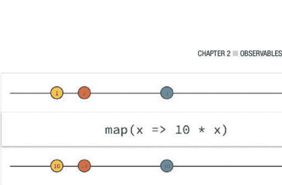

图 2-1. map 操作符的大理图

```java
Observable.just(1, 2, 3)
    .map(new Func1<Integer, Integer>() {
        @Override
        public Integer call(Integer x) {
            return x * 10;
        }
    })
    .subscribe(new Subscriber<Integer>() {
        @Override
        public void onCompleted() {
        }

        @Override
        public void onError(Throwable e) {
        }

        @Override
        public void onNext(Integer integer) {
            System.out.println("next item is: " + integer);
        }
    });
```


此操作的输出为：

```
next item is: 10
next item is: 20
next item is: 30
```

让我们尝试理解一下大理图：线条代表由原始 observable 发出的原始项目序列。下方的线条代表经过操作符转换并由第二个 observable 发出的项目（记住第二个 observable 是第一个 observable 加上操作符）。中间的框包含了操作符对每个项目执行的函数。

# 第 2 章 Observable 与观察者

这两条线必须被视为同步的时间线：大理石的放置方式反映了随时间推移的情况。

图 2-1 显示，当项目 1 的大理石发射时，项目 10 的大理石也会发射，因此转换在项目 1 发射后立即发生，在项目 2 发射之前。当项目 2 发射时，应用操作符并发射了项目 20，依此类推。

## flatMap

`flatMap` 操作符（图 2-2）执行两种类型的操作：将发射的项目转换为 observables 的“map”（映射）操作，以及将这些 observables 转换为一个 observable 的“flatten”（展平）操作。因此，你可以使用 `flatMap` 将输入 observable 转换为任何其他 observable（换句话说，将输入流转换为不同的流）。

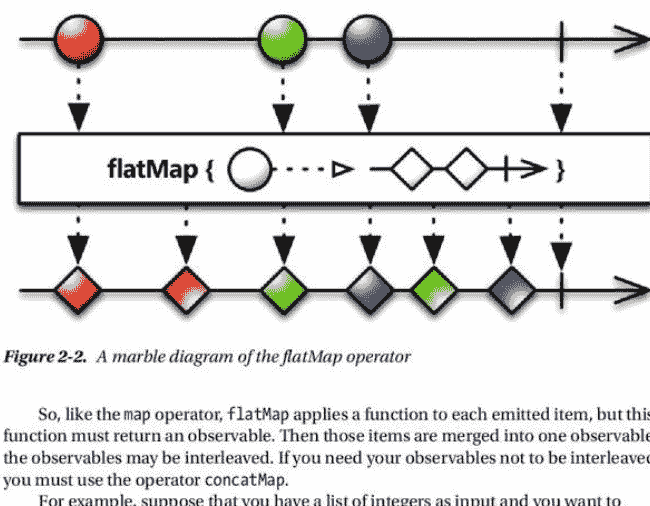

图 2-2. `flatMap` 操作符的大理图

所以，像 `map` 操作符一样，`flatMap` 对每个发射的项目应用一个函数，但该函数必须返回一个 observable。然后这些项目被合并成一个 observable，因此 observables 可能会交错出现。如果你需要 observables 不交错出现，则你必须使用 `concatMap` 操作符。

例如，假设你有一个整数列表作为输入，并想将其转换为格式为“Number x”的字符串序列，其中 x 是输入列表中的下一个整数。你可以如下结合 `flatMap` 和 `map`：

```java
List<Integer> input = Arrays.asList(1, 2, 3, 4, 5);

Observable.just(input)
    .flatMap(new Func1<List<Integer>, Observable<Integer>>() {
        @Override
        public Observable<Integer> call(List<Integer> item) {
            return Observable.from(item);
        }
    })
    .map(new Func1<Integer, String>() {
        @Override
        public String call(Integer t) {
            return "Number " + t;
        }
    })
    .subscribe(new Subscriber<String>() {
        @Override
        public void onCompleted() {
            System.out.println("sequence completed!");
        }

        @Override
        public void onError(Throwable e) {
        }

        @Override
        public void onNext(String item) {
            System.out.println("next item is: " + item);
        }
    });
```

结果是：
```
next item is: Number 1
next item is: Number 2
next item is: Number 3
next item is: Number 4
next item is: Number 5
sequence completed!
```

## concatMap

`concatMap` 操作符（图 2-3）的行为类似于 `flatMap`，不同之处在于确保 observables 不是交错的，而是连接的，并保持它们的顺序。

## zip

`zip` 操作符（图 2-4）接受多个 observables 作为输入，并通过指定的函数组合每次发射，并发射结果。

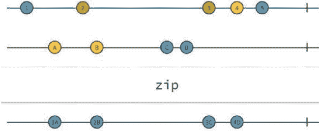

图 2-4. `zip` 的大理图

函数按严格顺序执行。如果有两个序列，`zip` 会等待第一个序列的第一个项目、第二个序列的第一个项目，对它们应用该函数，并发射结果。当最短的序列停止时它也会停止。

这是一个示例：

```java
Observable<Integer> rangeMajor = Observable.range(1, 3);
Observable<Integer> rangeMinor = Observable.range(5, 10);

Observable.zip(rangeMajor, rangeMinor, new Func2<Integer, Integer, String>() {
    @Override
    public String call(Integer major, Integer minor) {
        return major + "." + minor;
    }
}).subscribe(new Subscriber<String>() {
    @Override
    public void onCompleted() {
        System.out.println("sequence completed!");
    }

    @Override
    public void onError(Throwable e) {
    }

    @Override
    public void onNext(String item) {
        System.out.println("next item is: " + item);
    }
});
```

此代码的输出为：
```
next item is: 1.5
next item is: 2.10
next item is: 3.10
sequence completed!
```

## concat

`concat` 操作符（图 2-5）连接两个或多个序列，生成一个发射，`concat` 操作符在订阅下一个序列之前等待每个序列完成。

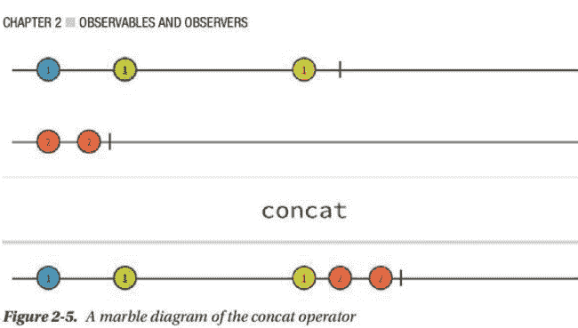

图 2-5. `concat` 的大理图

在以下示例中，你连接两个字符串序列：

```java
Observable<String> first = Observable.just("one", "two");
Observable<String> second = Observable.just("three", "four");

Observable.concat(first, second)
    .subscribe(new Subscriber<String>() {
        @Override
        public void onCompleted() {
            System.out.println("sequence completed!");
        }

        @Override
        public void onError(Throwable e) {
        }

        @Override
        public void onNext(String s) {
            System.out.println("next item is: " + s);
        }
    });
```

输出为：
```
next item is: one
next item is: two
next item is: three
next item is: four
sequence completed!
```

# 第 2 章 可观测对象与观察者

这段代码的输出是：
```
next item is: 30
next item is: 22
next item is: 60
completed!
```

## distinct

`distinct` 算符（图 2-7）对源序列应用过滤器。如果一个项发射了多次，则只会发射第一次出现的。

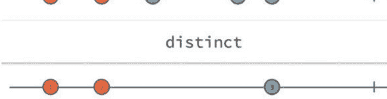

图 2-7. `distinct` 算子的弹石图

## first

`first` 算符（图 2-8）只发射序列的第一个项。如果指定了函数，它将用于过滤项，因此只会发射序列中符合条件的第一个项。


图 2-8. `first` 算子的弹石图

你可以参考为 `filter` 算符编写的示例并通过先应用该算符而不是 `filter` 来修改它：

```java
Observable.from(new Integer[] {2, 30, 22, 25, 5, 60, 1})
    .first(new Func1<Integer, Boolean>() {
        @Override
        public Boolean call(Integer x) {
            return x > 10;
        }
    })
    .subscribe(new Subscriber<Integer>() {
        @Override
        public void onCompleted() {
            System.out.println("sequence completed!");
        }

        @Override
        public void onError(Throwable e) {
        }

        @Override
        public void onNext(Integer item) {
            System.out.println("next item is: " + item);
        }
    });
```

正如你所预期的，输出将类似于 `filter` 算符的输出，但限制为一个项：
```
next item is: 30
sequence completed!
```

## last

如果你可以使用 `first` 算符对序列的开头应用过滤器，也可以使用 `last` 算符对序列的结尾进行过滤（图 2-9）。


图 2-9. `last` 算子的弹石图

```java
Observable.just("first", "second", "third")
    .last()
    .subscribe(new Subscriber<String>() {
        @Override
        public void onCompleted() {
            System.out.println("sequence completed!");
        }

        @Override
        public void onError(Throwable error) {
        }

        @Override
        public void onNext(String item) {
            System.out.println("next item is: " + item);
        }
    });
```

这段代码的输出是：
```
next item is: third
sequence completed!
```

`last` 算符可以接受一个谓词作为参数，并且只发射源序列中评估该谓词为 `true` 的最后一个项。

```java
Observable.just("first", "second", "third")
    .last(new Func1<String, Boolean>() {
        @Override
        public Boolean call(String t) {
            return t.startsWith("s");
        }
    })
    .subscribe(new Subscriber<String>() {
        @Override
        public void onCompleted() {
            System.out.println("sequence completed!");
        }

        @Override
        public void onError(Throwable error) {
        }

        @Override
        public void onNext(String item) {
            System.out.println("next item is: " + item);
        }
    });
```

这段代码的输出是：
```
next item is: second
sequence completed!
```

## take

`first` 算符适用于过滤序列的开头，但如果你不仅感兴趣第一个项，还想要前 n 个项怎么办？这时 `take` 算符（图 2-10）就派上用场了。它接受整数 n 作为参数，允许发射前 n 个项。

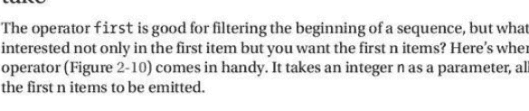

图 2-10. `take` 算子的弹石图

```java
Observable.just("first", "second", "third")
    .take(2)
    .subscribe(new Subscriber<String>() {
        @Override
        public void onCompleted() {
            System.out.println("sequence completed!");
        }

        @Override
        public void onError(Throwable error) {
        }

        @Override
        public void onNext(String item) {
            System.out.println("next item is: " + item);
        }
    });
```

这段代码的输出是：
```
next item is: first
next item is: second
sequence completed!
```

该算符的另一个版本接受超时时间作为输入（`take(long, TimeUnit)`），只发射源序列在超时之前发射的项。

注意：人们可能认为 `first()` 和 `take(i)` 算符应该具有相同的行为。如果应用于同一个序列，它们会产生相同的输出，但区别在于：`take(i)` 只发射一次或不发射，而 `first()` 在源序列为空时也会发射一次（原文逻辑可能有误，此处保留原意）。

## startWith

`startWith(item)` 算符接收输入序列并为其添加给定的项。如果你希望你的序列从默认值或缓存项开始，它将非常有用。

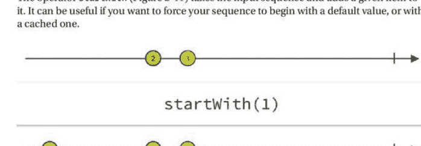

图 2-11. `startWith` 算子的弹石图

```java
Observable.just("first", "second", "third")
    .startWith("zero")
    .subscribe(new Subscriber<String>() {
        @Override
        public void onCompleted() {
            System.out.println("sequence completed!");
        }

        @Override
        public void onError(Throwable error) {
        }

        @Override
        public void onNext(String item) {
            System.out.println("next item is: " + item);
        }
    });
```

这段代码的输出是：
```
next item is: zero
next item is: first
next item is: second
next item is: third
```

## scan

`scan` 算符扫描一个序列并对每对顺序发射的项应用函数。

```java
Observable<Integer> sourceObservable = Observable.range(1, 5);
Observable<Integer> scanObservable = sourceObservable
    .scan(new Func2<Integer, Integer, Integer>() {
        @Override
        public Integer call(Integer i1, Integer i2) {
            return i1 + i2;
        }
    });

scanObservable.subscribe(new Subscriber<Integer>() {
    @Override
    public void onCompleted() {
        System.out.println("sequence completed!");
    }

    @Override
    public void onError(Throwable e) {
    }

    @Override
    public void onNext(Integer item) {
        System.out.println("next item is: " + item);
    }
});
```

这段代码模拟了图 12 中的行为。

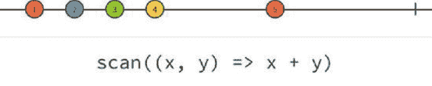

图 2-12. `scan` 算子的弹石图

在 `sourceObservable` 发射第一个项后，`scanObservable` 将不经转换地发射该项。当发射第二个项时，`scanObservable` 将对这两个项应用函数。

代码的输出是：
```
next item is: 1
next item is: 3
next item is: 6
next item is: 10
next item is: 15
completed!
```


## 其他算符

还有许多其他算符用于转换、过滤或组合可观测对象。

### 转换可观测对象的算符

- `buffer`: 定期收集 `Observable` 的项并发射这些集合而不是单个项。
- `groupBy`: 将 `Observable` 分分为一组可观测对象，每个对象发射来自原始 `Observable` 的不同分组。
- `window`: 定期将 `Observable` 的项划分到 `Observable` 并发射这些窗口而不是单个项。

### 过滤可观测对象的算符

- `debounce`: 只有当特定时间内没有发射另一个项时，才从 `Observable` 发射项。
- `elementAt`: 仅发射 `Observable` 发射的第 n 项。
- `ignoreElements`: 不发射 `Observable` 的任何项，但镜像其终止通知。
- `sample`: 在周期间隔内发射 `Observable` 发出的最新项。
- `skip`: 跳过 `Observable` 发射的前 n 项。
- `skipLast`: 跳过 `Observable` 发射的最后 n 项。
- `takeLast`: 仅发射 `Observable` 发射的最后 n 项。

### 组合可观测对象的算符

- `and`/`then`: 通过模式和计划中间体组合两个或多个 `Observable` 的发射；这些算符不是 RxJava 库的一部分，可以在 https://github.com/reactivex/RxJavaJoins 找到。
- `combineLatest`: 当两个 `Observable` 发射项时，它通过指定的函数组合每个发射的最新项，并根据函数的结果发射项。
- `join`: 当一个 `Observable` 的项在另一个 `Observable` 的项定义的时间窗口内发射时，组合两个 `Observable` 发射的项。
- `merge`: 通过合并发射将多个 `Observable` 合并为一个。
- `switchNext`: 将发射 `Observable` 的 `Observable` 转换为单个 `Observable`，该 `Observable` 发射最近发射的 `Observable` 的项。

# 第 2 章 可观察对象与观察者

```java
Observable.just(1, 2, 3, 4, 5, 6)
    .filter(new Func1<Integer, Boolean>() {
        @Override
        public Boolean call(Integer value) {
            return value % 2 == 1;
        }
    })
    .subscribe(new Subscriber<Integer>() {
        @Override
        public void onCompleted() {
            System.out.println("sequence completed!");
        }

        @Override
        public void onError(Throwable e) {
        }

        @Override
        public void onNext(Integer item) {
            System.out.println("next item: " + item);
        }
    });
```

## 示例：斐波那契数列

你想创建一个方法，它接收一个整数 `n` 并输出斐波那契数列 `F(n)`。

首先，你创建一个发射 `n` 个整数序列的可观察对象：`Observable.range(n)` 是任此角色的完美人选。其次，你对这些项目中的每一个应用一个函数，并使用 `map` 算子来实现。

以下是代码：

```java
public static void rxFibonacci(int n) {
    int[] tmp = {0, 0};

    Observable.range(1, n).map(new Func1<Integer, Integer>() {
        @Override
        public Integer call(Integer x) {
            if (x < 3) {
                tmp[0] = 1;
                tmp[1] = 1;
            } else {
                int item = tmp[0] + tmp[1];
                tmp[0] = tmp[1];
                tmp[1] = item;
                return item;
            }
            return 1;
        }
    }).subscribe(new Subscriber<Integer>() {
        @Override
        public void onCompleted() {
            System.out.println("sequence completed!");
        }

        @Override
        public void onError(Throwable e) {
        }

        @Override
        public void onNext(Integer item) {
            System.out.println("next item: " + item);
        }
    });
}
```

`Observable.range(1,n)` 将发射一个 1 开始的 `n` 个整数序列。然后，对于每个发射的项，通过 `map` 算子应用一个函数。该函数使用临时数组存储 `F(n-1)` 和 `F(n-2)` 的值，并使用这些值来评估 `F(n)`。

例如，调用 `rxFibonacci(10)` 会产生以下输出：

- next item: 1
- next item: 1
- next item: 2
- next item: 3
- next item: 5
- next item: 8
- next item: 13
- next item: 21
- next item: 34
- next item: 55
- sequence completed!

# 第 3 章 订阅生命周期

## 引言

与可观察对象工作不仅关于订阅和接收项目。在之前的章节中，你看到序列也可以以错误事件终止，但你能做什么来处理错误事件呢？线程又是怎样的？可观察对象可以在不同的线程上操作并通知吗？

在本章中，你将学习：

- RxJava 提供的管理错误事件的工具
- 如何使用调度器（`schedulers`）在不同线程上操作
- 如何处理背压（`backpressure`）

## 错误处理

如所述，可观察对象的发射可以以完成事件或错误事件结束，但不会死亡。如果在发射过程中的任何时间发生错误，序列将停止并调用 `onError()` 方法。但我们所说的“错误”是指什么？

- 错误是序列发射过程中抛出的任何异常之外的内容。
- 它可以由源可观察对象抛出，也可以由应用于源可观察对象的任何算子抛出。
- 第一个抛出的异常会导致序列停止，因此没有其他异常会被抛出。
- 异常从抛出它的可观察对象传播到订阅者，因此跳过了其他算子。
- 算子不需要处理异常；这完全留给订阅者（与回调机制不同，后者必须在每个回调中处理错误）。

可观察对象本身不抛出异常；它通知调用 `onError()` 方法的订阅者。如果可观察对象在调用 `onError()` 方法时失败（即调用 `onError()` 时抛出了异常），则 `onError()` 方法将不再被调用，并将抛出另一个异常。

有些异常不作为错误事件处理，但它们会被抛出，导致 JVM 停止：

- `rx.exceptions.OnErrorImplementedException`
- `rx.exceptions.OnErrorFailedException`
- `rx.exceptions.CompletedFailedException`
- `java.lang.StackOverflowError`
- `java.lang.VirtualMachineError`
- `java.lang.ThreadDeath`
- `java.lang.LinkageError`

通常在 Java 代码中，你使用 `try/catch` 块捕获异常。对于观察者，没有 `try/catch` 块，你可以在不同的技术之间选择以恢复错误。

## 在 onError() 方法中处理错误

常见场景是在 `onError()` 方法中处理错误。订阅者的 `onError()` 方法负责处理错误状态。在示例中，你生成一个字符串序列，每个字符串代表一个整数，然后你在中间故意引入了一个无效字符串。

```java
Observable.just("1", "2", "a", "3", "4")
    .map(new Func1<String, Integer>() {
        @Override
        public Integer call(String s) {
            return Integer.parseInt(s);
        }
    })
    .subscribe(new Subscriber<Integer>() {
        @Override
        public void onCompleted() {
            System.out.println("sequence completed!");
        }

        @Override
        public void onError(Throwable e) {
            System.err.println("error! " + e);
        }

        @Override
        public void onNext(Integer item) {
            System.out.println("next item: " + item);
        }
    });
```

输出是：
```
next item: 1
next item: 2
error! java.lang.NumberFormatException: For input "a"
```

## 忽略异常并继续

延续示例，假设你想在发射无效字符串时正常终止序列。你可以通过对可观察对象应用 `onErrorResumeNext` 算子来实现这一点。

```java
Observable.just("1", "2", "a", "3", "4")
    .map(new Func1<String, Integer>() {
        @Override
        public Integer call(String s) {
            return Integer.parseInt(s);
        }
    })
    .onErrorResumeNext(Observable.empty())
    .subscribe(new Subscriber<Integer>() {
        @Override
        public void onCompleted() {
            System.out.println("sequence completed!");
        }

        @Override
        public void onError(Throwable e) {
            System.err.println("error! " + e.toString());
        }

        @Override
        public void onNext(Integer item) {
            System.out.println("next item: " + item);
        }
    });
```

输出是：
```
next item: 1
next item: 2
sequence completed!
```

`onErrorResumeNext()` 算子告诉可观察对象在抛出异常时避免通知错误方法，并通过作为算子参数指定的序列继续。在这种情况下，当发生错误时，原始序列停止，并与 `empty()` 发射的序列继续（这是一个空序列）。换句话说，在上面的代码中，如果发生错误，序列将停止且不通知错误事件。

延续上面的示例，假设你想在事件发生时发射整数 -1。为此，你可以使用 `onErrorReturn()`：

```java
Observable.just("1", "2", "a", "3", "4")
    .map(new Func1<String, Integer>() {
        @Override
        public Integer call(String s) {
            return Integer.parseInt(s);
        }
    })
    .onErrorReturn(new Func1<Throwable, Integer>() {
        @Override
        public Integer call(Throwable t) {
            return -1;
        }
    })
    .subscribe(new Subscriber<Integer>() {
        @Override
        public void onCompleted() {
            System.out.println("sequence completed!");
        }

        @Override
        public void onError(Throwable e) {
            System.err.println("error! " + e.toString());
        }

        @Override
        public void onNext(Integer item) {
            System.out.println("next item is: " + item);
        }
    });
```

输出结果为：
```
next item is: 1
next item is: 2
next item is: -1
sequence completed!
```

你可以使用 `onExceptionResumeNext` 获得相同的效果，输出结果相同：
```
next item is: 1
next item is: 2
next item is: -1
sequence completed!
```

## 重试

RxJava 库还包含两个 `.retry` 操作符，可以让你通过实现重试机制来从错误中恢复。

- `Observable.retry(...)` 操作符不会通知错误，而是直接对源 `Observable` 进行重新订阅。
- `Observable.retryWhen(...)` 操作符将错误事件传递给另一个 `Observable`，由该 `Observable` 负责决定是否重新订阅源 `Observable`。

让我们在之前的示例中应用 `retry()` 操作符，而不是使用 `onErrorResumeNext()`：

```java
Observable.just("1", "2", "a", "3", "4")
    .map(new Func1<String, Integer>() {
        @Override
        public Integer call(String s) {
            return Integer.parseInt(s);
        }
    })
    .retry()
    .subscribe(new Subscriber<Integer>() {
        @Override
        public void onCompleted() {
            System.out.println("sequence completed!");
        }

        @Override
        public void onError(Throwable e) {
            System.out.println("error! " + e.toString());
        }

        @Override
        public void onNext(Integer item) {
            System.out.println("next item is: " + item);
        }
    });
```

每当发生错误时，`retry()` 都会重新订阅源，重新发射并反复遇到错误。正如你可能猜到的样，这段代码将无限运行，产生以下内容：

```
next item is: 1
next item is: 2
next item is: 1
next item is: 1
next item is: 2
next item is: 1
```

你可以使用 `retry(i)` 代替 `retry()`，这样重试机制将只执行指定次数（传入的参数决定了重试的次数）：

```java
Observable.just("1", "2", "a", "3", "4")
    .map(new Func1<String, Integer>() {
        @Override
        public Integer call(String s) {
            return Integer.parseInt(s);
        }
    })
    .retry(1)
    .subscribe(new Subscriber<Integer>() {
        @Override
        public void onCompleted() {
            System.out.println("sequence completed!");
        }

        @Override
        public void onError(Throwable e) {
            System.err.println("error! " + e.toString());
        }

        @Override
        public void onNext(Integer item) {
            System.out.println("next item is: " + item);
        }
    });
```


```java
System.out.println("error! " + e.toString());
    }

    @Override
    public void onNext(Integer item) {
      System.out.println("next item is: " + item);
    }
  });
```

在这种情况下，发射将重试一次；之后，如果错误条件持续存在，错误事件将传播。输出结果为：

```
next item is: 1
next item is: 2
next item is: 1
next item is: 2
error! java.lang.NumberFormatException: For input string: "a"
```

如果你想在 5 秒后再重试一次，可以使用 `retryWhen()`：

```java
.retryWhen(new Func<Observable<? extends Throwable>, Observable<? extends Long>>() {
  @Override
  public Observable<? extends Long> call(Observable<? extends Throwable> observable) {
    return Observable.timer(5, TimeUnit.SECONDS);
  }
})
```

在指定的超时后（本例中为 5 秒），序列将进行重试。如果在重试期间发生错误，则不会通知错误事件。相反将通知完成事件。输出结果为：

```
47
```

# 第3章 订阅生命周期

```
next item is: 1
next item is: 2
next item is: 1
next item is: 2
sequence completed!
```

在以下更复杂的示例中，结合不同的操作符来实现每 5 秒重试一次，共重试三次：

```java
.retryWhen(new Func1<Observable<? extends Throwableable>, Observable<?>>() {
    @Override
    public Observable<?> call(Observable<? extends Throwableable> observable) {
        return observable.zipWith(Observable.range(1, 3),
            new Func2<Throwable, Integer, Integer>() {
                @Override
                public Integer call(Throwable throwable, Integer retryCount) {
                    System.out.println("retry #" + retryCount);
                    return retryCount;
                }
            }));
    }).flatMap(new Func1<Integer, Observable<?>>() {
    @Override
    public Observable<?> call(Integer integer) {
        return Observable.timer(5, TimeUnit.SECONDS);
    }
});
```

其核心思想是将一个包含三个元素的序列（因为你想重试三次）与每次重试 1, 3 秒的延迟结合起来。这个包含三个元素的序列由 `Observable.range(1,3)` 生成，使用 `Observable.just(1,2,3)` 也可以。对于延迟，你仍然使用 `Observable.timer(5, TimeUnit.SECONDS)`。对于每个整数，都会启动一个计时器，这会触发 `zipWith`。

- `Observable.range(1,3)` 也可以 `Observable.just(1,2,3)` 运行。
- 对于延迟，你仍然使用 `Observable.timer(5, TimeUnit.SECONDS)`。
- 对于每个整数，都会启动一个计时器，这会触发 `zipWith`。
- `retryWhen` 使用源 Observable 来应用重试逻辑。

# 第3章 订阅生命周期

如果你将此重试机制应用于之前的示例，将得到以下输出：

```
next item is: 1
next item is: 2
retry #1
next item is: 1
next item is: 2
retry #2
next item is: 1
next item is: 2
retry #3
next item is: 1
next item is: 2
sequence completed!
```

# 调度器

默认情况下，Observable 的操作链是在调用 `subscribe` 方法的线程中执行的。你可以使用两个操作符改变这种行为：

- `subscribeOn` 指定 Observable 运行的调度器。
- `observeOn` 指定通知观察者的调度器。

这意味着你可以使用一个线程执行所有操作链，并使用另一个线程来接收 `next()`、`onCompleted()` 和 `onError()` 通知。这通常用于你的 Observable 执行 I/O 操作（如网络请求或读写）：

```java
myNetworkObservable()
.subscribeOn(background thread)
.observeOn(ui thread)
.subscribe(...)
```

这两个操作符可以在链的任何位置调用，但它们的行为不同：

- `subscribeOn()` 无论在链的什么位置，都会更改 Observable 运行的线程。
- `observeOn()` 从它应用的位置开始更改 Observable 将使用的线程。

通常你不需要手动创建或指定线程；相反，可以选择 RxJava 库内置的调度器：

- `Schedulers.immediate()` 立即在当前线程开始工作。
- `Schedulers.computation()` 可用于计算工作，默认分配与处理器数量相当的线程。它不适用于 I/O 操作。
- `Schedulers.io()` 适用于 I/O 操作。
- `Schedulers.newThread()` 为每个操作创建一个新线程。
- `Schedulers.trampoline()` 使用一个操作队列，并在所有之前的操作完成后在当前线程开始每个操作。
- `Schedulers.from(java.util.concurrent.Executor)` 使用指定的执行器作为调度器。

在你隐式使用调度器之前，`Observable.timer()` 已经使用了 `Schedulers.computation()` 调度器，它将在不同的线程上运行。其他操作符也有特定的默认调度器：`buffer`, `debounce`, `delay`, `delaySubscription`, `interval`, `repeat`, `replay`, `retry`, `sample`, `skip`, `skipLast`, `takeLast`, `takeBuffer`, `throttleFirst`, `throttleLatest`, `throttleTimeout`, `interval`, `timeout`, `timestamp`。

```java
}}
.subscribe(Schedulers.computation())
.subscribe(new Subscriber<Integer>() {
    @Override
    public void onCompleted() {
        System.out.println("sequence completed!");
    }
    @Override
    public void onError(Throwable e) {
    }
    @Override
    public void onNext(Integer item) {
        System.out.println("next item: " + item);
    }
});
```

你只应用了 `subscribeOn()` 操作符，并将调度器 `Schedulers.` 作为参数传递，你的代码现在是多线程的了！记住，`subscribeOn()` 操作符可以应用于链中的任何位置，但优选位置是在调用 `subscribe()` 方法之前。这使得代码更具可读性；如果你有一条很长的操作符链，你不希望你的 `subscribeOn()` 调用被遗留在链的中间。

### 示例：网络调用

必须同时指定 `subscribeOn()` 和 `observeOn()` 操作符的典型用例是：当你正在开发 Android 应用，并且必须在从远程服务器获取数据后更新 UI。

```java
Observable<MyResponse> networkCall = ...
networkCall.subscribeOn(Schedulers.io())
    .observeOn(AndroidSchedulers.mainThread())
    .subscribe(new Subscriber<MyResponse>(){
    @Override
    public void onCompleted() {
    }
    @Override
    public void onError(Throwable e) {
    }
    @Override
    public void onNext(MyObject item) {
        // 在这里我们可以读取 item 数据并更新 UI
    }
});
```

## 第3章 订阅生命周期

```java
// 在这里我们可以更新 UI 显示错误消息
```

在这个示例中，你应用了：

- `subscribe()` 操作符，因为否则 UI（Android 中的主线程）将一直挂起，直到操作完成（开发环境中会显示 ANR：应用程序无响应错误）。`Schedulers.io()` 调度器是一个很好的选择，因为你正在处理网络操作，而这是一种 I/O 操作。
- `observeOn()` 操作符，因为你不能从不同于 UI 线程线程更新 UI；你使用的 `Schedulers.mainThread()` 是一个特殊的调度器，它不包含在 RxJava 库中（它是 RxJava 用于 Android 开发的某种插件；参见 https://github.com/ReactiveX/RxAndroid），它会返回 UI 线程。如果你不应用 `observeOn()` 操作符，你的程序在尝试更改 UI 项（如更新 TextView）时将会。

### 示例：向数据库插入数据

假设你想在用户更改输入表单的值时立即在数据库中存储某些数据，而无需等待点击按钮，也不会阻塞 UI 线程。

给定一个每当输入变化时发射项（字段内容）的 Observable，你可以使用调度器在单独线程中执行插入。

```java
Observable<String> inputObservable = ...
```

```java
inputObservable.flatMap(() -> validate(x))
    .observeOn(Schedulers.io())
    .subscribe(new Subscriber<String>() {
        @Override
        public void onCompleted() {
        }
        @Override
        public void onError(Throwable e) {
        }
        @Override
        public void onNext(String item) {
            db.insert(item);
        }
    });
```

在这里你应用了 `observeOn()` 操作符，以便 `onNext` 方法被通知以复制为了应用这些操作符所必需的两行代码……这对于写入等 I/O 操作是。

## 转换器 (Transformers)

如所述，`subscribeOn()/observeOn()` 对可以使用多次，这会迫使你复制代码，导致了不好的做法。那么，如何创建一个自动应用这两个操作符的操作符呢？

你可以使用 `Transformer<T, R>`（T 是输入类型，R 是输出类型）来实现。`Transformer` 的实例是使用 `observeOn()` 应用于 Observable 的函数，该操作符赋予了你修改源 Observable 的能力，而不仅仅是序列中的项。

```java
public static <T> Transformer<T, T> toSchedulers() {
  return new Observable<T>() {
    @Override
    public Observable<T> call(Observable<T> observable) {
      return observable.subscribeOn(Schedulers.io())
                       .observeOn(AndroidSchedulers.mainThread());
    }
  };
}
```

当你实现 `Transformer<T, R>` 时，你接收 `Observable<T>` 并返回 `Observable<R>`。在示例中，T 和 R 是同一个对象，因为 Transformer 没有修改项。现在你可以将之前的示例重写为：

```java
Observable<MyResponse> networkCall = ...
networkCall
  .compose(toSchedulers())
  .subscribe(new Subscriber<MyObject>() {
    @Override
    public void onCompleted() {
    }
    @Override
    public void onError(Throwable e) {
      // 错误处理
    }
    public void onNext(MyObject item) {
      // 处理数据项
    }
  });
```

## 调度器的进阶用法

你也可以在不应用操作符的情况下使用调度器。例如，如果你想在专用线程中执行某些操作，可以使用 Worker 类：

```java
Worker worker = Schedulers.newThread().create();
worker.schedule(new Action() {
  @Override
  public void call() {
    // 在这里工作
  }
});
```


`Worker` 类实现了 `Subscription` 接口，所以你可以对其调用 `unsubscribe()` 和 `dispose()`。`Action` 是定义了一个方法 `call()` 的接口，它不接受参数并返回 `void`。`Worker` 在指定时间后或周期性执行 `Action`：

- `Worker.schedule(Action action, long delay, TimeUnit unit)` 在延迟后执行 action。
- `Worker.schedulePeriodically(Action action, long initialDelay, long period, TimeUnit unit)` 周期性执行 action。

## 背压

到为止，我们只考虑了发射速度慢于订阅者执行操作的情况。因此，对于每次发射，都有足够的时间在下一个项发射之前处理它。

但也存在 Observable 发射过快的情况，订阅者在接收下一个项之前无法处理。

例如取两个 Observable A 和 B，A 的发射速度是 B 的两倍。生成的 Observable 结合 A 的第 n 项和 B 的第 n 项，与此同时 B 发射了 n+1 到 n+m，所以它应该保持项的缓冲区。

另一种情况是在下一个方法中使用发射项更新 UI，但发射的频率高于 UI 更新的频率。

每当我们遇到这种情况就会发生背压。我们可以通过以下方式处理背压：

- 通过控制发射，应用某些操作符
- 在消费时间

## 处理发射期间背压：节流

你可以使用 RxJava 操作符来调整 Observable 发射项的速率。

### sample

通过 `Observable.sample()` 你可以周期性地对序列进行采样并发射每个样本的最新项。图 3-1 显示了这个过程。

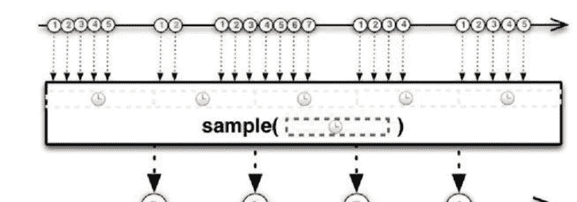

图 3-1。`Observable.sample()` 的示意图。

### throttleFirst

`Observable.throttleFirst()` 的行为类似于 `sample()`，但它发射每个样本的第一个项（图 3-2）。

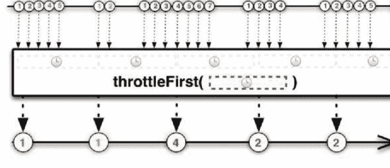

图 3-2。`Observable.throttleFirst()` 的示意图。

### debounce

`Observable.debounce()` 只发射在指定间隔内没有被其他项跟随的项，如图 3-3 所示。

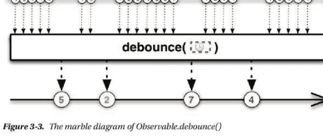

图 3-3。`Observable.debounce()` 的示意图。

## 在发射期间处理背压：缓冲

另一种控制背压的方法是在通知订阅者之前将项收集到缓冲区中。订阅者的 `onNext()` 方法将不会接收单个发射的项，而是接收一个包含缓冲区中收集的项的集合。

要应用此技术，你可以使用 `buffer()` 和 `window()` 操作符。

### Buffer

`Observable.buffer()` 允许你按照指定的时间间隔定期收集项。
你可以通过传递一个计算关闭每个缓冲区所需条件的函数（图 3-4），根据项的数量或时间间隔来选择创建缓冲区。你也可以指定一个触发缓冲区开始的 Observable。

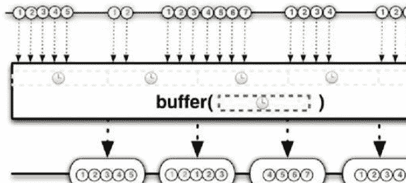

图 3-4。`Observable.buffer()` 的大理石图

### Window

`Observable.window()` 与 buffer 类似，但它不是从源 Observable 发射项的集合，而是发射 Observable；其中每一个 Observable 都会发射源 Observable 的项子集，并以 `onCompleted` 通知结束。

你可以根据时间间隔（图 3-5）、项的数量（图 3-6）或通过传递一个计算关闭每个窗口所需条件的函数来创建“窗口”。

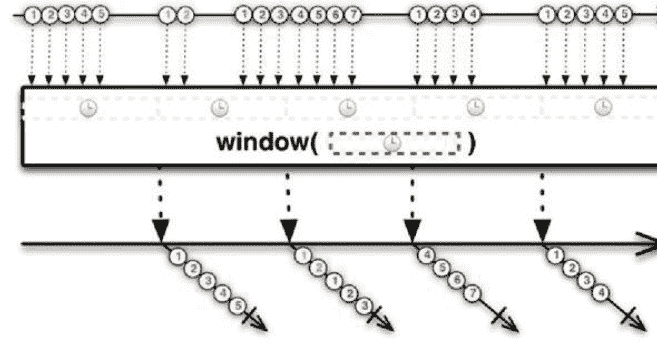

图 3-5。基于时间间隔的 `Observable.window()` 大理石图

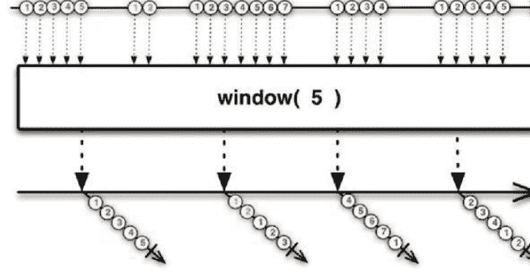

图 3-6。基于项数量的 `Observable.window()` 大理石图

> **注意**：如果发生错误，两个操作符都会通知 `onError` 方法并停止构建当前的缓冲区或窗口。未完成的缓冲区/窗口中的项将不会转发给订阅者。

## 在订阅者内部处理背压

在订阅者内部，你可以要求 observable 慢发射速度。因此，在上面的 zip 示例中，你可以要求 B 缓慢发射项，而不是应用节流操作符。

在订阅者的 `start()` 方法中，你必须调用 `Subscriber.request(n)`，其中 `n` 是一个整数，代表在下一次 `request(n)` 之前你想让 Observable 发射的最大项数。然后在 `onNext()` 中消耗项后，必须再次调用 `request()` 来告诉 observable 继续发射后续项。

在接下来的示例中，你设置了 `n=1`，因此你可以在下一个项发射之前消耗每个项：

```java
observable.subscribe(new Subscriber<T>() {

    @Override
    public void start() {
        request(1);
    }

    @Override
    public void onCompleted() {
    }

    @Override
    public void onError(Throwable e) {
    }

    @Override
    public void onNext(T item) {
        consume(item);
        request(1);
    }
});
```

在这里，你在 `start()` 和 `onNext()` 中调用了 `request()` 方法，且使用了相同的参数 `1`，因为你假设在下一个项发射之前只能消耗一个项，但这些值是独立的，可以根据用例进行调整。

如果你省略了 `request()` 调用，observable 将像往常一样发射项，而不会降低发射速度；调用 `request(0)` 可以实现相同的效果。

# 第 4 章 Subjects（主项）

在之前的章节中，你学习了 `Observable<T>`、`Observer<T>` 和 `Subscriber<T>` 以及它们在 RxJava 响应式编程中的作用：`Observable` 对象发射事件序列，`Subscriber` 对象充当观察者，对 `Observable` 发出的每个事件做出反应。

RxJava 库提供了一个既是 `Observable` 又是 `Observer` 的代理；它被称为 `Subject<T, R>`，其中 `T` 是输入值的类型，`R` 是输出值的类型。`Subject` 可以：

- 订阅一个或多个 `Observables`（作为 `Subscriber`）
- 通过重新发射它观察到的项来透传这些项
- 发射新项

让我们看看 `Subject` 如何作为 `Observable` 使用（`PublishSubject` 将稍后介绍）：

```java
Subject<String, String> subject = PublishSubject.create();

subject.subscribe(new Subscriber<String>() {

    @Override
    public void onCompleted() {
        System.out.println("sequence completed");
    }

    @Override
    public void onError(Throwable e) {
    }

    @Override
    public void onNext(String item) {
        System.out.println(item);
    }
});
```

```java
subject.onNext("first item");
subject.onNext("second item");
subject.onNext("third item");
subject.onCompleted();
```

如你所期，如果你运行这段代码，将得到以下输出：

first item
second item
third item
sequence completed

现在，让我们创建一个既是 `Observable` 又是 `Subscriber` 的 `Subject`：

```java
Observable<Long> interval = Observable.interval(1, TimeUnit.SECONDS);
Subject<Long> subject = PublishSubject.create();

interval.subscribe(subject);

subject.subscribe(new Subscriber<Long>() {
    @Override
    public void onCompleted() {
        System.out.println("first sequence completed");
    }

    @Override
    public void onError(Throwable e) {
    }

    @Override
    public void onNext(Long item) {
        System.out.println("first sequence, item: " + item);
    }
});

subject.subscribe(new Subscriber<Long>() {
    @Override
    public void onCompleted() {
        System.out.println("second sequence completed");
    }

    @Override
    public void onError(Throwable e) {
    }

    @Override
    public void onNext(Long item) {
        System.out.println("second sequence, " + item);
    }
});
```

`Subject` 首先订阅 `interval` observable（它每秒发射一个递增值），然后每当从 `interval` observable 接收到项时，就会重新发射一个 `Long` 对象。这段代码的输出是：

first sequence, item: 0
second sequence, item: 0
first sequence, item: 1
second sequence, item: 1
first sequence, item: 2
second sequence, item: 2
first sequence, item: 3
second sequence, item: 3
first sequence, item: 4
second sequence, item: 4
first sequence, item: 5

在 Java 中，`Subject` 类是一个抽象类。在这些示例中，你没有创建 `Subject` 的具体实现，而是使用了静态方法 `PublishSubject.create()` 返回的实现。

## PublishSubject

`PublishSubject<T>`（图 4-1）是一个 `Subject`，它：

- 从订阅时刻开始发射源 `Observable` 的所有项
- 如果源 `Observable` 以错误结束，它将发射错误事件且不再发射任何项

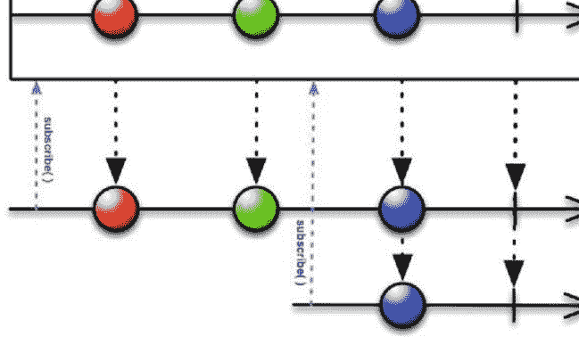

图 4-1。`PublishSubject<T>` 的大理石图

要创建 `Subject` 实例（图 4-1），你可以使用静态方法 `PublishSubject.create()`。

现在，创建一个发射整数序列的 `Subject` 实例，然后订阅两个不同的订阅者：

```java
PublishSubject<Integer> subject = PublishSubject.create();
Observable<Integer> subjectAsObservable = subject.asObservable();

// 订阅第一个订阅者
subjectAsObservable.subscribe(new Subscriber<Integer>() {
    @Override
    public void onCompleted() {
        System.out.println("first: sequence completed");
    }

    @Override
    public void onError(Throwable e) {
    }

    @Override
    public void onNext(Integer item) {
        System.out.println("first: next item is " + item);
    }
});

subject.onNext(1);
subject.onNext(2);

// 订阅第二个订阅者
subjectAsObservable.subscribe(new Subscriber<Integer>() {
    @Override
    public void onCompleted() {
        System.out.println("second: sequence completed");
    }

    @Override
    public void onError(Throwable e) {
    }

    @Override
    public void onNext(Integer item) {
        System.out.println("second: next item is " + item);
    }
});

subject.onNext(3);
subject.onNext(4);
subject.onNext(5);
subject.onCompleted();
```

这段代码的输出是：

first: next item is 1
first: next item is 2
first: next item is 3
second: next item is 3
first: next item is 4
second: next item is 4
first: next item is 5
second: next item is 5
first: sequence completed
second: sequence completed

第一个订阅者在 `PublishSubject` 开始发射项之前订阅，因此它将接收到所有五个项并完成。第二个订阅者在序列中间订阅，因此它只接收后续的项。

`Subject` 是热观察还是冷观察？这个例子很容易回答这个问题。`Subject` 是热观察，因为在没有观察者订阅时也能产生项。

另一个有趣点是 `Subject.asObservable()` 方法的使用。订阅 `subject` 而不是 `asObservable()` 会产生相同的输出，但 `Subject.asObservable()` 方法通过将你的 `Subject` 实例封装在 `Observable` 实例中来为你提供帮助。这意味着你可以只向订阅者暴露 `Observable` 接口，而且这意味着其他人无法使用该 `Subject` 实例来发射项或通知完成/错误事件。

## BehaviorSubject

`BehaviorSubject<T>`（图 4-2）与 `PublishSubject` 类似，区别在于订阅者还会接收在其订阅之前发射的最后一个项。

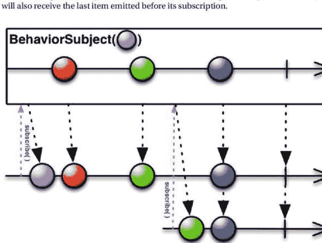

图 4-2。`BehaviorSubject<T>` 的大理石图

让我们采用之前的示例并将 `PublishSubject` 实例更改为 `BehaviorSubject` 实例：

```java
BehaviorSubject<Integer> subject = BehaviorSubject.create();
Observable<Integer> subjectAsObservable = subject.asObservable();

// 订阅第一个 Subscriber
subjectAsObservable.subscribe(new Subscriber<Integer>() {
    @Override
    public void onCompleted() {
        System.out.println("first: sequence completed");
    }

    @Override
    public void onError(Throwable e) {
    }

    @Override
    public void onNext(Integer item) {
        System.out.println("first: next item is " + item);
    }
});
```


# 第 4 章 SUBJECT

```java
public void onError(Throwable e) {
}

@Override
public void onNext(Integer item) {
    System.out.println("first: next item is " + item);
}
}

subject.next(1);
subject.next(2);

// 订阅第二个 Subscriber
subjectAsObservable.subscribe(new Subscriber<Integer>()) {
    @Override
    public void onCompleted() {
        System.out.println("second: sequence completed");
    }

    @Override
    public void onError(Throwable e) {
    }

    @Override
    public void onNext(Integer item) {
        System.out.println("second: next item is " + item);
    }
}

subject.next(3);
subject.next(4);
subject.next(5);
subject.onCompleted();
```

此代码产生以下输出：

```
first: next item is 1
first: next item is 2
second: next item is 2
first: next item is 1
second: next item is 3
first: next item is 4
second: next item is 4
first: next item is 5
second: next item is 5
first: sequence completed
second: sequence completed
```

在这里，订阅者从项 2 开始接收序列，而且 Java 还提供了静态工厂方法 `BehaviorSubject.create(T defaultValue)`；只要没有从源 Observable 接收到项，该方法返回的实例就会发射所提供的默认项。

```java
BehaviorSubject<Integer> subject = 
BehaviorSubject.create(-1);

Observable<Integer> subjectAsObservable = 
subject.asObservable();

// 订阅第一个 Subscriber
subjectAsObservable.subscribe(new Subscriber<Integer>() {
    @Override
    public void onCompleted() {
        System.out.println("first: sequence completed");
    }

    @Override
    public void onError(Throwable e) {
    }

    @Override
    public void onNext(Integer item) {
        System.out.println("first: next item is " + item);
    }
});

subject.onNext(1);
subject.onNext(2);
```

```java
// 订阅第二个 Subscriber
subjectAsObservable.subscribe(new Subscriber<Integer>()) {
    @Override
    public void onCompleted() {
        System.out.println("second: sequence completed");
    }

    @Override
    public void onError(Throwable e) {
    }

    @Override
    public void onNext(Integer item) {
        System.out.println("second: next item is " + item);
    }
}

subject.onNext(3);
subject.onNext(4);
subject.onNext(5);
subject.onCompleted();
```

输出是：

```
first: next item is -1
first: next item is 1
first: next item is 2
second: next item is 2
first: next item is 3
second: next item is 3
first: next item is 4
second: next item is 4
first: next item is 5
second: next item is 5
first: sequence completed
second: sequence completed
```

如果你希望订阅者接收其订阅之前发射的所有项，而不仅仅是最后一个，怎么办？使用 `ReplaySubject`。

## ReplaySubject

`ReplaySubject<T>`（图 4-3）发射源 Observable 发出的所有项，无论观察者何时订阅，并保持发射项的缓冲区。

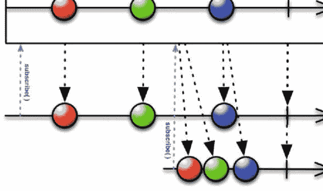

图 4-3. `ReplaySubject<T>` 的大理石图

此缓冲区由 `ArrayList` 支持，默认情况下它的初始容量为 16 且没有上限。

RxJava 提供了其他静态工厂方法来创建不同行为的 `ReplaySubject` 实例：

- `ReplaySubject.create(int capacity)` 创建具有指定容量的 `ReplaySubject` 实例。
- `ReplaySubject.createWithSize(int size)` 创建具有指定大小的 `ReplaySubject` 实例：当缓冲区满时，旧项会被丢弃。
- `ReplaySubject.createTime(long time, TimeUnit scheduler)` 创建一个时间限制的 `ReplaySubject`。
- `ReplaySubject.createAndTimeSize(long time, TimeUnit scheduler)` 允许你创建一个既受时间限制又受大小限制的 `ReplaySubject`。

## AsyncSubject

`AsyncSubject<T>`（图 4-4）是 Subject 的实现，它在源 Observable 完成后只发射最后一个项，或者如果源 Observable 没有发射任何项，则通知错误事件。


图 4-4. `AsyncSubject<T>` 的大理石图

让我们更改之前的示例使用 `AsyncSubject` 代替 `PublishSubject`：

```java
AsyncSubject<Integer> subject = AsyncSubject.create();

Observable<Integer> subjectAsObservable =
subject.asObservable();

// 订阅第一个 Subscriber
subjectAsObservable.subscribe(new Subscriber<Integer>()) {
    @Override
    public void onCompleted() {
        System.out.println("first: sequence completed");
    }

    @Override
    public void onError(Throwable e) {
    }

    @Override
    public void onNext(Integer item) {
        System.out.println("first: next item is " + item);
    }
}

subject.onNext(1);
subject.onNext(2);

// 订阅第二个 Subscriber
subjectAsObservable.subscribe(new Subscriber<Integer>()) {
    @Override
    public void onCompleted() {
        System.out.println("second: sequence completed");
    }

    @Override
    public void onError(Throwable e) {
    }

    @Override
    public void onNext(Integer item) {
        System.out.println("second: next item is " + item);
    }
}

subject.onNext(3);
subject.onNext(4);
subject.onNext(5);
subject.onCompleted();
```

此代码产生以下输出：

```
first: next item is 5
first: sequence completed
second: next item is 5
second: sequence completed
```

## 什么时候应该使用 Subject？

关于 Subject 的用法存在着持续的争议。RxJava 之父之一 Erik Meijer 认为它们是 Rx 世界的可变变量，在大多数情况下你不需要它们。通常，使用 `Create` 或其他操作符的方案允许你在不添加额外状态的情况下接线后续操作。换句话，尽量减少订阅者持有的对象数量是一个良好的实践，你只需要进行透传。

## 示例：ArrayList 的响应式版本

下面的示例展示了如何创建一个 ArrayList 的响应式版本。ArrayList 的实现暴露了两个额外的方法，以便在添加或删除项时获取通知：

```java
class ReactiveArrayList<T> extends ArrayList<T> {

    private PublishSubject<T> addSubject =
        PublishSubject.create();

    private PublishSubject<Object> removeSubject =
        PublishSubject.create();

    @Override
    public boolean add(T item) {
        boolean result = super.add(item);
        if (result) {
            addSubject.next(item);
        }
        return result;
    }

    @Override
    public void add(int index, T item) {
        super.add(index, item);
        addSubject.next(item);
    }

    public T remove(int index) {
        T removedItem = super.remove(index);
        removeSubject.onNext(removedItem);
        return removedItem;
    }

    @Override
    public boolean remove(Object object) {
        boolean result = super.remove(object);
        if (result) {
            removeSubject.onNext(object);
        }
        return result;
    }

    @Override
    public boolean add(Collection<? extends T> c) {
        boolean result = super.addAll(c);
        if (result) {
            for (T t : c) {
                addSubject.onNext(t);
            }
        }
        return result;
    }

    @Override
    public boolean addAll(int index, Collection<? extends T> c) {
        boolean result = super.addAll(index, c);
        if (result) {
            for (T t : c) {
                addSubject.onNext(t);
            }
        }
        return result;
    }

    public Observable<T> itemsAdded() {
        return addSubject.asObservable();
    }

    public Observable<Object> itemsRemoved() {
        return removeSubject.asObservable();
    }
}
```

这是一个用法示例：

```java
ReactiveArrayList<String> reactiveList = new ReactiveArrayList<String>();
```

```java
reactiveList.observeItemsAdded()
  .subscribe(new Subscriber<String>()() {
    @Override
    public void onCompleted() {
    }

    @Override
    public void onError(Throwable e) {
    }

    @Override
    public void onNext(String item) {
      System.out.println("item added: " + item);
    }
  });

reactiveList.observeItemsRemoved()
  .subscribe(new Subscriber<Object>()() {
    @Override
    public void onCompleted() {
    }

    @Override
    public void onError(Throwable e) {
    }

    @Override
    public void onNext(Object item) {
      System.out.println("item removed: " + item);
    }
  });

reactiveList.add("1");
reactiveList.add("2");
reactiveList.remove("1");
reactiveList.addAll(Arrays.asList("4", "s", "6"));
reactiveList.remove("s");
```

这段代码的输出是：

```
item added: 1
item added: 2
item removed: 1
item added: 4
item added: 5
item added: 6
item removed: 5
```

**注意** Subject 默认不是线程安全的。它们不会在跨线程时执行任何同步操作，你不能从多个线程中调用 `onNext()/onCompleted()/onError()` 方法，因为这可能导致非序列化的调用，从而违反 Observable 合约并导致生成的 Subject 产生歧义。

要使 Subject 线程安全，可以使用像下面的代码将其转换为 `SerializedSubject<T,R>`（`Subject<T,R>` 的子类）：

```java
newSerializedSubject(mySubject);
```

## 可连接的 Observable (Connectable Observables)

`ConnectableObservable` 是 Subject 的另一种替代用法。`ConnectableObservable<T>` 的行为类似于 Observable，但它只有在调用 `connect()` 方法时才开始发射项目。

```java
ConnectableObservable<String> observable =
Observable.range(0, 5)
```


# 第五章 使用 RxJava 和 Retrofit 进行网络编程

## Retrofit 对 RxJava 的内置支持

Retrofit 是线程安全的。

## 在你的 Java 项目中设置 Retrofit

设置非常直观。如果你使用 Maven，只需添加：

```xml
<dependency>
  <groupId>com.squareup.retrofit2</groupId>
  <artifactId>retrofit</artifactId>
  <version>2.1.0</version>
</dependency>
```

如果你使用 Gradle：

```gradle
compile 'com.squareup.retrofit2:retrofit:2.1.0'
```

或者，你可以从网站下载 JAR 包。

## 创建 Retrofit 服务

让我们考虑 GitHub (https://developer.github.com/v3/) 提供的 API。GitHub 提供用户信息、仓库和 Gist，但目前我们只考虑获取用户仓库列表的 API。根据 GitHub API 文档，该 API 的 URL 为：

```
https://api.github.com/users/{user}/repos
```

其中 `{user}` 是 GitHub 用户名。映射 GitHub API 的接口如下：

```java
import java.util.List;
import retrofit2.http.GET;
import retrofit2.http.Path;
import rx.Observable;

public interface GitHubService {
  @GET("users/{user}/repos")
  Observable<List<Repo>> listRepos(@Path("user") String user);
}
```

`Repo` 对象用于将 API 返回的 JSON 映射到 POJO（普通 Java 对象）；这是一个简单的实现，只映射了示例中需要的字段：

```java
public class Repo {
    @SerializedName("id")
    private int id;

    @SerializedName("name")
    private String name;

    @SerializedName("url")
    private String url;

    @SerializedName("watchers_count")
    private int watchersCount;

    @SerializedName("open_issues_count")
    private int openIssueCount;

    public int getId() {
        return id;
    }

    public void setId(int id) {
        this.id = id;
    }

    public String getName() {
        return name;
    }

    public void setName(String name) {
        this.name = name;
    }

    public String getUrl() {
        return url;
    }

    public void setUrl(String url) {
        this.url = url;
    }

    public int getWatchersCount() {
        return watchersCount;
    }

    public void setWatchersCount(int watchersCount) {
        this.watchersCount = watchersCount;
    }

    public int getOpenIssueCount() {
        return openIssueCount;
    }

    public void setOpenIssueCount(int openIssueCount) {
        this.openIssueCount = openIssueCount;
    }
}
```

这里定义了一个方法，将 `GET` 请求（参见 `@GET` 注解）映射到 API `"users/{user}/repos"`（作为参数传递给方法，且 `{user}` 的值是方法的一个参数，通过 `@Path` 注解你告诉 Retrofit `"user"` 参数必须被替换在 API URL 的相应部分）。

该方法将返回一个 `Observable`，它将执行以下操作：

- 如果请求成功，则发射一个类型为 `List<Repo>` 的非空对象序列（然后终止）。
- 如果发生某些错误，则通知错误。

`GitHubService` 接口的实现可以如下生成：

```java
Retrofit retrofit = new Retrofit.Builder()
    .baseUrl("https://api.github.com/")
    .addCallAdapterFactory(RxJavaCallAdapterFactory.create())
    .addConverterFactory(GsonConverterFactory.create())
    .build();
```

```java
GitHubService service = retrofit.create(GitHubService.class);
```

必须通过包含以下依赖来启用 RxJava 支持：

```xml
<dependency>
    <groupId>com.squareup.retrofit2</groupId>
    <artifactId>adapter-rxjava</artifactId>
    <version>2.1.0</version>
</dependency>
```

你还必须通过该方法注册适配器：

```java
addCallAdapterFactory(RxJavaCallAdapterFactory.create());
```

你还需要添加使用 Gson 将响应体从 JSON 转换为 `Repo` 对象的支持。为了实现这一点，你需要添加以下依赖：

```xml
<dependency>
    <groupId>com.squareup.retrofit2</groupId>
    <artifactId>converter-gson</artifactId>
    <version>2.1.0</version>
</dependency>
```

你还需要注册转换器：

```java
addConverterFactory(GsonConverterFactory.create())
```

现在你可以使用该服务的实现并进行订阅：

```java
String user = ...;

service.listRepos(user)
    .subscribe(new Subscriber<List<Repo>>() {
        @Override
        public void onCompleted() {
            System.out.println("sequence completed");
        }

        @Override
        public void onError(Throwable e) {
            e.printStackTrace();
        }

        @Override
        public void onNext(List<Repo> repos) {
            for (Repo repo : repos) {
                System.out.println("Repo: " + repo.getName());
            }
        }
    });
```

将所有内容整合在一起：

```java
import retrofit2.Retrofit;
import retrofit2.adapter.rxjava.RxJavaCallAdapterFactory;
import retrofit2.converter.gson.GsonConverterFactory;
import rx.Observable;
import rx.Subscriber;
import rx.functions.Func1;
import rx.schedulers.Schedulers;

public static void listRepos(String user) {
    Retrofit retrofit = new Retrofit.Builder()
        .baseUrl("https://api.github.com/")
        .addCallAdapterFactory(RxJavaCallAdapterFactory.create())
        .addConverterFactory(GsonConverterFactory.create())
        .build();

    GitHubService service = retrofit.create(GitHubService.class);

    service.listRepos(user)
        .subscribe(new Subscriber<List<Repo>>() {
            @Override
            public void onCompleted() {
                System.out.println("sequence completed");
            }

            @Override
            public void onError(Throwable e) {
                e.printStackTrace();
            }

            @Override
            public void onNext(List<Repo> repos) {
                for (Repo repo : repos) {
                    System.out.println("Repo: " + repo.getName());
                }
            }
        });
}
```

例如，要打印用户 `"octocat"` 的 GitHub 仓库列表，你可以调用 `listRepos("octocat")`，结果将是：

- Repo: git-consortium
- Repo: hello-world
- Repo: Hello-World
- Repo: linguist
- Repo: octocat.github.io
- Repo: Spoon-Knife
- Repo: test-repo1
- sequence completed

## 过滤结果

现在你已经得到了仓库列表，你想过滤该列表并只显示最多只有两个开启问题的仓库。你可以通过应用 `filter()` 操作符来实现。

`listRepos()` 方法返回的 `Observable` 发射一个仅一种类型 `List<Repo>` 的序列。要应用 `filter()` 操作符，你需要观察 `Observable` 发射的项。以下代码展示了如何将 `Observable` 转换为另一个 `Observable` 然后应用过滤器：

```java
String user = ...;
int maxOpenIssues = ...;

listRepos(user)
    .flatMap(new Func1<List<Repo>, Observable<Repo>>() {
        @Override
        public Observable<Repo> call(List<Repo> repos) {
            return Observable.from(repos);
        }
    })
    .filter(new Func1<Repo, Boolean>() {
        @Override
        public Boolean call(Repo repo) {
            return repo.getOpenIssueCount() <= maxOpenIssues;
        }
    })
    .subscribe(new Subscriber<Repo>() {
        @Override
        public void onCompleted() {
            System.out.println("sequence completed");
        }

        @Override
        public void onError(Throwable e) {
            e.printStackTrace();
        }

        @Override
        public void onNext(Repo repo) {
            System.out.println("Repo: " + repo.getName() + " - Open Issues: " + repo.getOpenIssueCount());
        }
    });
```


# 第 5 章 与 RXJAVA 和 RETROFIT 的工作

完整的静态方法是：

```java
public static void listReposWithIssues(String user, int maxOpenIssues) {
    Retrofit retrofit = new Retrofit.Builder()
        .baseUrl("https://api.github.com/")
        .addCallAdapterFactory(RxJavaCallAdapterFactory.create())
        .addConverterFactory(GsonConverterFactory.create())
        .build();

    GitHubService service = retrofit.create(GitHubService.class);

    service.listRepos(user)
        .flatMap(new Func1<List<Repo>, Observable<Repo>>() {
            @Override
            public Observable<Repo> call(List<Repo> repos) {
                return Observable.fromIterable(repos);
            }
        })
        .filter(new Func1<Repo, Boolean>() {
            @Override
            public Boolean call(Repo repo) {
                return repo.getOpenIssueCount() <= maxOpenIssues;
            }
        })
        .subscribe(new Subscriber<Repo>() {
            @Override
            public void onCompleted() {
                System.out.println("sequence completed");
            }

            @Override
            public void onError(Throwable e) {
                e.printStackTrace();
            }

            @Override
            public void onNext(Repo repo) {
                System.out.println("Repo: " + repo.getName());
            }
        });
}
```

这里的输出是：
Repo: hello-world
Repo: test-repo1
sequence completed

## 选择正确的 Scheduler

在之前的示例中，你没有指定任何 Scheduler，因此代码使用默认 Scheduler 执行。

假设你正在开发一个带有 UI 的应用程序，网络操作是通过点击按钮触发的。你不希望 UI 等待响应而被阻塞，因此你需要确保所有的网络工作都在单独的线程进行。这可以通过应用 `subscribeOn()` 操作符来实现。网络操作是一种 IO 操作，因此你还需要确保结果被切换到 UI 线程（如果结果是为了更新 UI，那么你还需要应用 `observeOn()` 操作符）。正确的 Scheduler 取决于用于构建 UI 的库或框架。例如，在 Java 中，你可以使用 RxJava 提供的 `JavaScheduler` (https://github.com/ReactiveX/RxJava)。在 Android 中，使用 RxAndroid 提供的 `AndroidSchedulers.mainThread()` (https://github.com/ReactiveX/RxAndroid)。

在 `subscribe()` 之前添加 `subscribeOn(Schedulers.io())`，方法 `listRepos()`、`flatMap()` 和 `filter()` 将在不同的线程执行。结果（`onNext`、`onError` 和 `onCompleted`）将在主线程进行通知。

## 链式多次调用

链式多次调用通常意味着处理嵌套回调，这会让你的代码难以阅读和维护。此外，你必须在每个回调中处理错误，增加了代码的复杂性。

根据你目前看到的，很容易理解如何使用 RxJava 通过可观察对象来代替回调链。在这个简单的场景中，你需要调用一个远程 API 来验证用户，然后调用另一个 API 获取用户数据，再次调用另一个 API 获取用户的联系人。以下代码展示了带有回调的嵌套 API 调用：

```java
import retrofit2.Callback;
import retrofit2.Call;
import retrofit2.Response;

User user = null;

myService.login(username, password,
    new Callback<AccessToken>() {
        @Override
        public void success(User user, Response response) {
            storeCredentials(response.getAccessToken());

            myService.getUser(accessToken, new Callback<User>() {
                @Override
                public void onResponse(Call<User> call, Response<User> response) {
                    user = response.getBody();
                }
            });
        }

        myService.getUserContact(user.getId(),
            new Callback<Contact>() {
                @Override
                public void onResponse(Call<Contact> contact, Response<Contact> response) {
                    user.setContact(response.getBody());
                }

                @Override
                public void onFailure(RetrofitError error) {
                    // 在此处处理错误...
                }
            });

            @Override
            public void onFailure(RetrofitError error) {
                // 在此处处理错误...
            }
        });

        @Override
        public void failure(RetrofitError error) {
            // 在此处处理错误...
        }
    });
```

这就是你如何使用 RxJava 转换这段代码：

```java
myService.login()
    .doNext(accessToken -> storeCredentials(accessToken))
    .flatMap(accessToken -> myService.getUser(accessToken))
    .flatMap(user -> myService.getUserContact(user.getId()))
    .subscribe(new Subscriber<Contact>() {
        @Override
        public void onCompleted() {
        }

        @Override
        public void onError(Throwable e) {
        }

        @Override
        public void onNext(Contact contact) {
        }
    });
```

其中：
- `myService.login(token)` 返回一个 `Observable<AccessToken>`
- `doNext()` 方法被应用于 `myService.login()` 的结果，每当发射一个 `AccessToken` 实例时都会调用 `storeCredentials()`
- 第一个 `flatMap` 算子使用同一个 `AccessToken` 实例来调用方法 `myService.getUser(accessToken)`，然后返回一个 `Observable<User>`
- 另一个 `flatMap` 算子被用于发射 `User` 实例以调用 `myService.getContact(user.getId())`

代码变得更容易阅读和维护，因为它是使用可重用的代码块构建的。使用嵌套回调时，有三个地方需要处理错误，而在 RxJava 版本中，你只需要在一个地方处理错误，因为每个错误都会被传递并在 `onError` 方法中通知。

## 缓存数据

在处理网络时，一个重要的主题是缓存。缓存是一种保存网络响应本地副本的机制，以便在网络不可用时使用或避免频繁的网络调用。Retrofit 使用 `OkHttpClient` 的缓存机制捕捉网络响应。在某些情况下，这是不够的，你需要通过应用自己的缓存逻辑来缓存数据。同样，RxJava 可以帮助你用简单易读的代码构建复杂的缓存机制。以下代码展示了一个类的抽象实现，该类在磁盘和内存中缓存网络响应。注意，在此示例中你利用了 Lambda 表达式（Java 8 提供）来让代码更简洁。

```java
abstract class CacheManager<T> {
    private T memoryCache;

    public Observable<T> getData() {
        return Observable.concat(fromMemory(), fromDisk(), fromNetwork())
            .first(response -> isValid(response))
            .onErrorNext(t -> fallbackToDiskCache());
    }

    protected Observable<T> fromNetwork() {
        return doNetworkCall()
            .doNext(response -> {
                cacheInMemory(response);
                cacheOnDisk(response);
            })
            .compose(logSource("network"));
    }

    private Observable<T> fallbackToDiskCache() {
        System.out.println("fallback to disk cache");
        return fromDisk();
    }

    protected void cacheOnDisk(T response) {
        System.out.println("saving data on disk: " + response);
        persistOnDisk(response);
    }

    protected Observable<T> fromDisk() {
        Observable<T> observable = Observable.create(subscriber -> {
            T response = readFromDisk();
            if (response != null) {
                subscriber.onNext(response);
                cacheOnDisk(response);
            }
            subscriber.onComplete();
        });
        return observable.compose(logSource("disk"));
    }

    protected void cacheInMemory(T response) {
        memoryCache = response;
    }

    protected Observable<T> fromMemory() {
        Observable<T> observable = Observable.create(subscriber -> {
            subscriber.onNext(memoryCache);
            subscriber.onComplete();
        });
        return observable.compose(logSource("memory"));
    }

    public void deleteAll() {
        memoryCache = null;
        deleteFromDisk();
    }

    private Observable.Transformer<T, T> logSource(final String source) {
        return dataObservable -> dataObservable.doNext(data -> {
            if (data == null) {
                System.out.println(source + " 没有任何数据.");
            } else if (!isValid(data)) {
                System.out.println(source + " 有过时的数据.");
            } else {
                System.out.println(source + " 有你正在寻找的数据！");
            }
        });
    }
}
```


# 第 6 章 RxJava 与 Android

在真实的移动驱动世界中，谈论 Java 也意味着谈论 Android。`RxJava` 库可以在不满足任何其他要求的情况下在 Android 开发中使用。这意味着你到目前为止看到的所有代码示例都可以包含在 Android 项目中；你只需要在你的 `build.gradle` 文件中添加 `RxJava` 的依赖即可。

有一些库为在 Android 环境中应用 RxJava 概念提供了额外支持。基础库包括：

- `RxAndroid`
- `RxBindings`
- `RxLifecycle`

## RxAndroid

`RxAndroid` 是你需要的第一个 Android 开源库。事实上，它提供了一个非常实用的 `Scheduler` 实例，可以在主线程（或给定的 looper）上进行调度。

要安装该依赖，你只需要在 `build.gradle` 文件中添加两个依赖声明：

```groovy
apply plugin: 'com.android.application'

android {
    compileSdkVersion 24
    buildToolsVersion "24.0.1"

    defaultConfig {
        applicationId "com.example"
        minSdkVersion 24
        targetSdkVersion 24
        versionCode 1
        versionName "1.0"
    }

    buildTypes {
        release {
            minifyEnabled true
            shrinkResources true
            proguardFiles getDefaultProguardFile('proguard-android.txt', 'proguard-rules.pro')
        }
    }
}

dependencies {
    compile 'com.android.support:compat-v7:24.1.1'
    compile 'io.reactive:rxjava:1.2.0'
    compile 'io.reactive:rxandroid:1.2.1'
}
```

`RxJava` 需要 `minSdkVersion 9`，但 `RxAndroid` 需要 `minSdkVersion 14`。请参考网站 (https://github.com/ReactiveX/RxAndroid) 了解两者的最新版本。

正如你所示，可以使用提供的 `AndroidSchedulers.mainThread()` 作为 `Observer` 的参数，让你的 `Subscriber` 在 UI 线程上接收 `onNext(T)`、`onError(Throwable)`、`onComplete()` 事件通知：

```java
Observable.range(1, 10)
    .subscribeOn(Schedulers.newThread())
    .observeOn(AndroidSchedulers.mainThread())
    .subscribe(new Subscriber<Integer>() {
        @Override
        public void onCompleted() {
            // 在 UI 线程上通知
        }

        @Override
        public void onError(Throwable e) {
            // 在 UI 线程上通知
        }

        @Override
        public void onNext(Integer item) {
            // 在 UI 线程上通知
        }
    });
```

你也可以在另一个线程上订阅，相应的 `Scheduler` 可以通过 `AndroidSchedulers.from(method)` 实例化：

```java
BackgroundThread myThread = new BackgroundThread();
myThread.start();

Observable.range(3, 10)
    .subscribeOn(AndroidSchedulers.from(myThread.getLooper()))
    .observeOn(AndroidSchedulers.mainThread())
    .subscribe(new Subscriber<Integer>() {
        @Override
        public void onCompleted() {
            // 在 UI 线程上通知
        }

        @Override
        public void onError(Throwable e) {
            // 在 UI 线程上通知
        }

        @Override
        public void onNext(Integer item) {
            // 在 UI 线程上通知
        }
    });
```

如果你想围绕你的 `Handler` 封装一个 `Scheduler`，请使用 `HandlerThreadScheduler`。

## RxBindings

`RxJava` 也可以用响应式的方式与 UI 组件进行交互，而不是使用监听器。

例如，要在 `View` 被点击时接收通知，你必须实现 `OnClickListener()`：

```java
myView.setOnClickListener(new OnClickListener() {
    @Override
    public void onClick(final View v) {
    }
});
```

如果你想监听 `EditText` 中输入文本的变化，你必须通过 `EditText.addTextChangedListener(TextWatcher)` 方法添加 `TextWatcher`：

```java
editText.addTextChangedListener(new TextWatcher() {
    @Override
    public void beforeTextChanged(CharSequence s, int start, int count, int after) {
    }

    @Override
    public void onTextChanged(CharSequence s, int start, int before, int count) {
    }

    @Override
    public void afterTextChanged(Editable s) {
    }
});
```

`RxBinding` (https://github.com/jakewharton/RxBinding) 是一个开源库，提供了一些方法来避免使用这种回调机制，而是应用响应式逻辑。

## 要将此库添加到你的 Android 项目，请将依赖添加到 app 的 `build.gradle` 文件中：

```groovy
apply plugin: 'com.android.application'

android {
    compileSdkVersion 24
    buildToolsVersion "24.0.1"

    defaultConfig {
        applicationId "com.example"
        minSdkVersion 14
        targetSdkVersion 24
        versionCode 1
        versionName "1.0"
    }

    buildTypes {
        shrinkEnabled true
        minifyResources true
        proguardFiles getDefaultFile('proguard-android.txt'), 'proguard-rules.pro'
    }
}

dependencies {
    compile 'com.android.support:appcompat-v7:24.1.1'
    compile 'io.reactive:rxjava:1.2.0'
    compile 'io.reactive:rxandroid:1.2.1'
    compile 'com.jakewharton.rxbinding:...'
}
```

## 处理生命周期与内存泄漏

```java
.subscribe(new Subscriber<Long>() {
    @Override
    public void onCompleted() {
    }

    @Override
    public void onError(Throwable e) {
    }

    @Override
    public void onNext(Long item) {
        textView.setText("Timeout!");
    }
});
```

在 `onCreate` 方法中订阅了一个定时器 observable；2 分钟后，`TextView` 将更新为消息“Timeout”。如果用户旋转屏幕会发生什么？在 2 分钟通过之前 `Activity` 会被销毁并重建吗？

当屏幕旋转时，`Activity` 会销毁并重建。这在你的情况下会导致两个问题：

- `Observable` 将在 `Activity` 旋转时继续执行，但当它完成时，它将尝试更新 `TextView` 的新实例。
- `Observable` 将保留对旧 `Activity` 的引用，导致内存泄漏。

这里的解决方案很简单：你必须根据生命周期进行取消订阅。例如，让我们保留订阅的引用，并在 `Activity` 销毁时取消它：

```java
Subscription subscription = null;

@Override
protected void onCreate(Bundle savedInstanceState) {
    super.onCreate(savedInstanceState);
    setContentView(R.layout.activity_layout);
    TextView textView = findViewById(R.id.text_view);

    subscription = Observable.timer(2, TimeUnit.MINUTES)
        .subscribeOn(Schedulers.newThread())
        .observeOn(AndroidSchedulers.mainThread())
        .subscribe(new Subscriber<Long>() {
            @Override
            public void onCompleted() {
            }

            @Override
            public void onError(Throwable e) {
            }

            @Override
            public void onNext(Long item) {
                textView.setText("Timeout!");
            }
        });
}

@Override
protected void onDestroy() {
    super.onDestroy();
    if (subscription != null && subscription.isSubscribed()) {
        subscription.unsubscribe();
    }
}
```

你也可以创建一个 `CompositeSubscription` 对象并将所有的订阅添加到其中。然后你可以一次性取消它们的所有订阅：

```java
CompositeSubscription compositeSubscription = new CompositeSubscription();

@Override
protected void onCreate(Bundle savedInstanceState) {
    super.onCreate(savedInstanceState);
    setContentView(R.layout.activity_layout);
    TextView textView = (TextView) findViewById(R.id.text_view);

    Subscription subscription = Observable.timer(2, TimeUnit.MINUTES)
        .subscribeOn(Schedulers.newThread())
        .observeOn(AndroidSchedulers.mainThread())
        .subscribe(new Subscriber<Long>() {
            @Override
            public void onCompleted() {
            }

            @Override
            public void onError(Throwable e) {
            }

            @Override
            public void onNext(Long item) {
                textView.setText("Timeout!");
            }
        });

    compositeSubscription.add(subscription);
}

@Override
protected void onDestroy() {
    super.onDestroy();
    compositeSubscription.unsubscribe();
}
```

请注意，一旦调用了 `CompositeSubscription.unsubscribe()`，该对象将变得不可用，因为它会自动取消之后添加的任何其他订阅。

`Trello` 开发了一个名为 `RxLifecycle` (https://github.com/trello/rxlifecycle) 的开源库，它简化了 `Activity`（或 `Fragment`）生命周期中的订阅/取消订阅。

要将其包含在项目中，请向你的 app `build.gradle` 文件添加依赖项：

```groovy
compile 'com.android.support:appcompat-v7:24.1.1'
compile 'io.reactivex:rxjava:1.2.5'
compile 'com.jakewharton:rxandroid:1.2.1'
compile 'com.jakewharton.rxbinding:rxbinding:0.4.0'
compile 'com.trello:rxlifecycle:0.7.0'
compile 'com.trello:rxlifecycle-android:0.7.0'
```

通过这个库，你可以使用 `compose()` 操作符来指定何时从 `Observable` 订阅：

```java
.compose(RxLifecycle.bindUntilEvent(lifecycle, ActivityEvent.DESTROY))
.subscribe();
```

或者你也可以让库自动检测何时取消订阅：

```java
.compose(RxLifecycle.bindUntil(lifecycle))
.subscribe();
```


在后一种情况下，订阅是在生命周期中管理的，而不是订阅（例如，如果订阅发生在 Activity 的 `onCreate()` 方法中，则将在 `onStop()` 中发生）。使用 RxJava 进行 Android 开发是一个热点话题，涵盖了许多领域。其中库包括：

- Android-Reactive (https://github.com/square/Android-Reactive)
- rx-android-permissions (https://github.com/square/rx-android-permissions)
- RxSensor (https://github.com/square/RxSensor)

# 索引

## Activity Lifecycle, 101–105
## AsyncSubject, 70–72
## Backpressure, 41, 55–59
## BehaviorSubject, 66–69
## Callback, 8–9, 41, 79, 88–90
## Cold observable, 15–16, 29, 66
## Connectable observable, 15, 76–77
## Fragment Lifecycle, 101–105
## Functional programming, 4–21
## Gradle, 11, 80, 95, 98, 104
## Handler, 97
## Gson, 72
## Imperative programming, 1–4
## JSON, 18, 79, 81–82
## Lambda expressions, 1–4, 7, 90
## Network, 18–19, 49, 51–52, 93
## Observable (definition), 12
## Observable class (java.util), 6
## Observable composition, 22–39
## Observable operators
- buffer, 35, 37
- debounce, 36
- empty, 12, 19, 44
- observeOn, 49, 51–53, 87
- onErrorReturn, 44
- onErrorResumeNext, 44–50
- retry, 46–48
- sample, 37, 55–56
- subscribeOn, 49, 51, 53–87
- violation, 38, 56, 57–58
## Observer (definition), 5
## Observer pattern, 8
## Error, 13–17, 19, 21, 23, 25, 27, 29, 31, 33, 35, 38, 39, 41, 43, 44, 45, 46, 47, 49, 50, 51, 52, 53, 54, 55, 57, 58, 59, 61, 63, 64, 65, 66, 67, 69, 71, 72, 75, 76, 77, 79, 83, 86, 87, 88, 89, 90, 93, 95, 96, 97, 99, 101, 102, 103, 104
## Next, 12–19, 21, 23, 25, 27, 29, 31, 33, 35, 38, 39, 41, 43, 44, 45, 46, 47, 49, 50, 51, 52, 53, 54, 55, 57, 58, 59, 61, 63, 64, 65, 66, 67, 69, 71, 72, 75, 76, 77, 79, 83, 86, 87, 88, 89, 90, 93, 95, 96, 97, 99, 101, 102, 103, 104
## Subscription, 13–15–104
## Transformers, 53–54
## Unsubscription, 14–15–104
