# Apache Kafka、Spark 和 Storm 实时流处理：构建能够快速处理数据并为用户提供实时分析的平台（英文版）


[www.bpbonline.com](http://www.bpbonline.com)

**2022 年第一版**

**版权所有 © BPB Publications, India**

**ISBN: 978-93-90684-595**

版权所有。未经出版者事先书面许可，本书的任何部分不得以任何形式或任何手段复制、分发或传输，或存储在数据库或检索系统中。程序列表可以在计算机系统中进行输入、存储和执行，但不能通过出版、复印、录音或任何电子和机械手段进行再复制。

## 责任限制与免责声明

书中包含的信息在作者和出版者的知识范围内是真实且准确的。作者已尽一切努力确保这些出版物的准确性，但出版者对书中任何信息引起的任何损失或损害不承担责任。

书中提到的所有商标均承认其各自所有者的财产，但 BPB Publications 无法保证这些信息的准确性。


[www.bpbonline.com](http://www.bpbonline.com/)

## 献给

我亲爱的父母

Jeyaraman 先生

Patturani 女士

以及

我的丈夫 Suneet 和我的孩子 Riaan 和 Riya

## 关于作者

**Brindha Jeyaraman** 在软件开发和数据分析系统构建方面拥有 12 年以上的工作经验。她拥有深厚的软件开发背景，在实施数据分析系统方面拥有丰富经验。她在新加坡国立大学（NUS）的系统科学学院完成了信息技术学士学位和知识工程硕士学位。在本科学习期间，她实现并发表了一篇关于使用遗传算法优化带宽的论文。她在本科学习期间曾获得安安纳大学（Anna University）第 36 名的成绩。她对研究的浓厚兴趣促使她在技术硕士（M.Tech - 知识工程）的毕业设计中，利用机器学习技术实现了一个手势识别系统。该项目的成果以论文形式发表。她在新加坡国立大学获得硕士学位时获得了金牌和书籍奖。她目前的重点是 MLOps 和数据分析系统的生产化。

## 关于评审员

**Hossein Narghani** 目前在伊朗德黑兰工作，专注于大数据领域。他在不同规模应用的设计和开发方面拥有十多年的经验。他最新的项目引导他走向更深层次分布式数据工程，在那里广泛使用 Apache Spark、`Kafka`、`Sqoop`、`Flume`、`Java` 等工具。他在电信和金融行业的大数据解决方案端到端生命周期拥有多年经验。他的专业知识扩展到大数据分析的 DevOps 和管理方面。他还为许多学生开设了大数据、Hadoop、Apache Spark、Apache Flink、`Flume`、`Pyspark` 和 `Kafka` 课程。

## 致谢

我要感谢几位提供支持的人。首先，我要感谢家人在整个旅程中给予的支持。我也感谢 BPB Publications 团队给我提供写这本书的机会。如果没有我的父母 Jeyaraman 先生和 Patturani 女士，我的丈夫 Suneet 以及我的孩子 Riaan 和 Riya，我永远无法完成它。

## 前言

本书专注于 Apache Kafka、`Storm` 和 `Spark` 等实时流技术。实时流处理是指与批处理相比，立即处理数据。我们将学习 `Kafka` 与 `Storm` 以及 `Spark` 的集成。

# 第 1 章

## Kafka 简介

### 引言

随着互联网和数字时代的到来，产生了大量数据。我们有许多应用程序每秒都在生成数据。例如，我们的社交媒体应用包含用户执行的所有活动，导致每天产生大量信息。因此，为了处理这些数据，我们需要实时流工具，它们可以读取并处理数据流。Apache Kafka 可以以分布式方式处理实时数据流。在本章中，我们将理解 Apache Kafka 的核心 API，并讨论 Kafka 的各种应用。Kafka 的架构由生产者、消费者、代理（broker）、主题（topics）和分区（partitions）组成。我们将详细描述架构的每个组件。

### 结构

* Apache Kafka 简介

* Kafka 与传统消息传递

* Kafka 架构：生产者、消费者和代理

* Kafka 架构：主题与分区

* Kafka 核心 API

* 使用 Kafka 的优势

* 使用 Kafka 的应用

### 目标

* 理解 Apache Kafka 的概念

* 了解 Kafka 的好处

* 学习 Kafka 的应用

* 理解 Kafka 的架构

* Kafka 内部组件概述

## Apache Kafka 简介

Apache Kafka 提供发布-订阅系统。生产者发布数据，订阅者消费数据。数据流在几秒内被快速高效地处理。它能够处理实时数据流。流的数据和信息也以容错的方式存储。发送到 Kafka 的消息存储在多个代理中以确保容错性。Apache Kafka 使用 Scala 和 Java 编写。它是一个开源平台；因此，无需支付许可费用即可使用。

用户可以指定数据存储的时间长度以及需要存储的数据量。在指定的时间长度之后，数据将被清除。Kafka 消息带有时间戳存储在分区中：

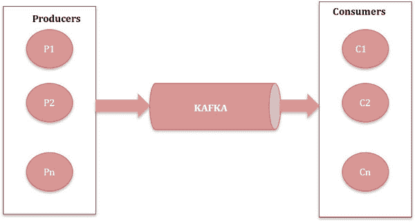

**图 1.1：** Kafka 高级概览

图 1.1 显示了 Kafka 中消息流的高级概览。有 `n` 个生产者产生消息，有 `m` 个消费者消费消息。生产者产生的消息由一个名为 `topic` 的名称标识，消费者可以从多个主题中消费。这些消息从生产者到消费者的中继及其管理由 zookeeper 完成。

## Kafka 与传统消息队列

以下是传统消息队列和 Kafka 之间的一些区别：

* 在传统消息队列中，消息一旦被读取，就会从队列中移除。但在 Kafka 中，消息在被读取后仍然存在。消息持续的时间持续可以配置。

* 由于 Kafka 消息在被读取后仍持久化在存储中，因此这些消息也可以根据需要进行跟踪、再次读取和重新处理。这种功能在消息队列中是不可能的。

* 在 Kafka 中，由生产者发布的消息被发布到主题中，订阅者订阅该主题并读取消息。因此，没有传统消息传递中使用的队列。

* Kafka 中的主题包含多个分区；因此，这允许并行处理和高吞吐量。这些概念将在后续章节中详细介绍。传统消息传递不提供这些。

* Kafka 在不同的代理和多个服务器上复制消息；因此，数据的可用性很高，并且具有良好的故障恢复方法。传统消息传递不提供消息复制。

* 负载均衡在 Kafka 架构内部提供，而在其他队列中则需要在外部配置。

因此，通过上述对比，我们可以理解使用 Kafka 相比传统队列有很多优势。由于这些因素，它被应用于各种场景。

## Kafka 架构：生产者、消费者和代理

图 1.2 显示了 Kafka 的架构。Kafka 架构由 Kafka 集群组成。集群包含多个节点。代理在集群中运行。多个代理共同构成 Kafka 集群。

在非常高层级，如如下所示，生产者向集群发送消息，消费者消费这些消息。消息也通称为 `records`。

Zookeeper 被用于管理 Kafka 集群的服务。它负责识别集群中存在的代理状态。每当添加新代理或某个代理不再活动时，它都会通知节点。任何更改都会通过 Zookeeper 通知给所有节点。

Zookeeper 维护生产者和消费者的数据配额。Zookeeper 跟踪主题的副本，如果某个节点故障，Zookeeper 将使用另一个副本节点。因此，它包含了哪些节点存储不同主题的信息。

对于消费者，Zookeeper 跟踪偏移量（offset）值，这是消费者从分区读取数据时使用的值。

分区

每个 Broker 都包含 Kafka 主题（Topics）。主题是 Kafka 生产者写入数据的接口。消费者可以订阅某个主题并从中读取数据。许多消费者可以订阅同一个主题。同样，消费者也可以订阅多个主题。

每个 Kafka 主题被划分为多个分区（Partitions）。分区的内容，即记录将在集群中的多个节点上复制。这确保了记录的高可用性，并有助于在记录发生故障或丢失时进行恢复。

每个分区都有一个有序的序列且是不可变的。数据以日志的形式存储在这些分区中。该日志是结构化且有序的。日志中的记录包含序列号，不同的消费者将其用作偏移量（offset）。

其中一个分区被指定为领导（leader）。每当主题接收消息时，记录的写入和读取都通过 leader 进行。每当记录发生变化时，leader 会复制内容并更新副本。如果 leader 分区由于某种原因失败，副本将被分配为 leader。

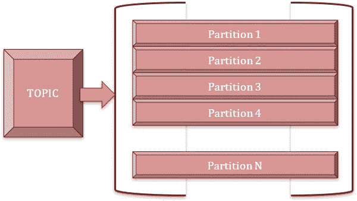

**图 1.3:** 主题与分区

由于许多消费者从主题读取数据，每个消费者都使用偏移量值来跟踪读取过程。在接下来的示例中，在`图 1.4`中，消费者 1 的偏移量为 `3`，消费者 2 的偏移量为 `6`：

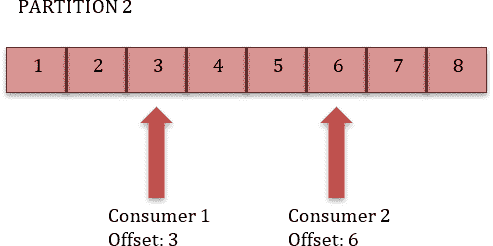

**图 1.4:** 偏移量操作

因此，当消费者 1 执行读取操作时，使用偏移量值 `3` 并读取随后的记录 `4`。同样，当消费者 2 从分区读取时，引用偏移量值 `6` 并读取接下来的记录，即 `7`。

# Kafka 核心 API

Kafka 拥有以下核心 API 来支持其关键功能。如`图 1.5`所示，Kafka 集群使用这些 API 与其生产者和消费者通信：

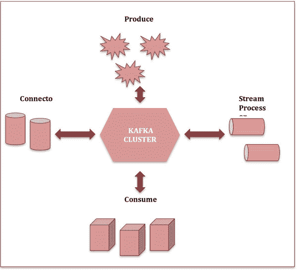

**图 1.5:** Kafka APIs

* **Producer API**: 此 API 用于将记录发布到主题。

* **Consumer API**: 使用消费者 API，消费者可以订阅多个主题并处理写入这些主题的记录。

* **Streams API**: 此 API 从输入流中读取记录流并发送到输出流。

* **Connector API**: 此 API 用于连接关系型数据库等数据系统到 Kafka 主题。一旦定义了 API，表的更改将发布到主题。

* **AdminClient API**: 此 API 用于支持 broker 和主题的管理。

因此，上述 API 是 Kafka 消息传递的核心，在后面的章节中，我们将看到它们如何被用于消息传递。

# 使用 Kafka 的优势

以下是使用 Kafka 流框架的一些优势：

* **高可扩展性**: Kafka 可以处理海量数据。由于其架构，它可以很容易地扩展以处理记录。

* **容错性**: 由于 Kafka 中的记录在不同的节点和服务器上进行复制，它可以容忍故障。

* **低停机时间**: 从 Kafka 获取数据的停机时间较短。

* **可靠性**: Kafka 中的记录在不同的节点和服务器上复制，它可以容忍故障。

* **高吞吐量**: Kafka 可以处理海量数据。由于其架构，它可以很容易地扩展以处理记录。

# Kafka 的应用

以下是使用 Kafka 的一些应用：

* **Twitter**: Kafka 用于处理海量的推文流。

* **LinkedIn**: Kafka 用于实时数据处理。

* **Netflix**: Kafka 用于推荐引擎和监控。

* **Spotify**: Kafka 用于实时分析。

* **Uber**: Kafka 用于追踪和匹配。

### 总结

在本章中，我们学习了 Kafka 的架构。我们还理解了主题和分区及其使用方法。我们看到了 Kafka 的优势。并提供了 Kafka 的核心 API。下一章将提供安装 Kafka 及其依赖项的步骤。

### 问题

1. **Kafka 中哪个组件负责管理从生产者到消费者的消息中继？**

   a. 集群 Cluster

   b. Zookeeper

   c. Broker

   d. Stream

2. **以下哪项不是 Kafka 的应用？**

   a. 流处理

   b. 构建网站

   c. 日志聚合

   d. 消息传递

3. **以下哪项不是 Kafka 的优势？**

   a. 不容错

   b. 高吞吐量

   c. 可扩展性

   d. 可靠

4. **哪个 API 从生产者读取消息并发送到消费者？**

   a. Consumer API

   b. Connector API

   c. Streams API

   d. Producer API

5. **哪个 API 用于管理 broker 和主题？**

   a. Connector API

   b. Streams API

   c. Producer API

   d. AdminClient API

6. **Kafka 如何确保高可用性？**

   答：通过在多个节点和集群中对记录进行复制

7. **以下哪项不是 Kafka 架构中的组件？**

   a. Admin API

   b. Brokers

   c. Producers

   d. Consumers

   e. Zookeeper

### 答案

1. b

2. b

3. a

4. c

5. d

6. a

# 第 2 章

## 安装 Kafka

### 引言

在本章中，我们将学习运行 Kafka 集群所需的软件安装。我们将详细介绍 JDK、Zookeeper 和 Kafka 的安装。设置 Kafka 集群对于实现和执行 Kafka 生产者和消费者非常重要。

### 结构

* 安装 JDK

* 安装 Zookeeper

* 运行 Zookeeper

* Zookeeper 可配置参数

* Apache Kafka 安装

* 运行 Kafka 服务器

### 目标

* 学习在 Windows 中安装 Java

* 学习在 Windows 中安装和运行 Zookeeper 的过程

* 理解 Zookeeper 的配置参数

* 学习在 Windows 中安装 Apache Kafka 的过程

* 运行 Apache Kafka 服务器

### 安装 JDK

在本节中，将提供 JDK 的安装说明，JDK 是 Kafka 消息传递的前决条件。可以按照以下步骤下载并安装软件：

1. 访问 `[www.oracle.com/technetwork/java/javase/downloads/index.html](https://www.oracle.com/technetwork/java/javase/downloads/index.html)`

   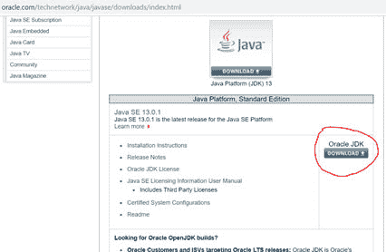

   **图 2.1:** JDK 来源

2. 选择你想安装的 JDK 版本，并如下截图所示点击 `Download`：

   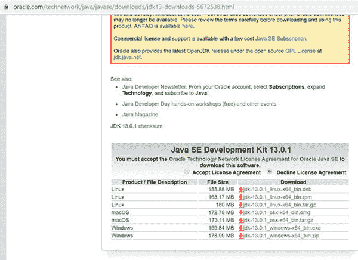

   **图 2.2:** JDK 版本

3. 向下滚动查看适用于不同操作系统的可用安装列表。

4. 点击 `Accept License Agreement`（接受许可协议）。

5. 点击下载列下的安装程序（例如 `jdk-13.0.1_windows-x64_bin.exe`）。

6. 运行下载的软件。

7. 提供安装路径：

   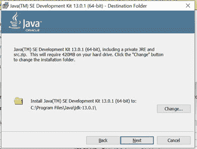

   **图 2.3:** JDK 安装路径

8. 点击 `Next` 并等待安装完成：

   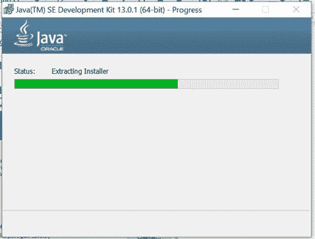

   **图 2.4:** JDK 安装进度

9. 如下截图所示，将 `JAVA_HOME` 添加到环境变量路径。可以按照此顺序访问：

   `控制面板` | `系统` | `高级系统设置` | `环境变量`:

   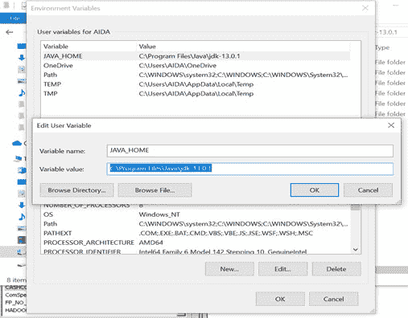

   **图 2.5:** JAVA_HOME 设置

10. 在 `系统变量`中，编辑 `Path` 变量并如下截图所示添加 `%JAVA_HOME%\bin`：

    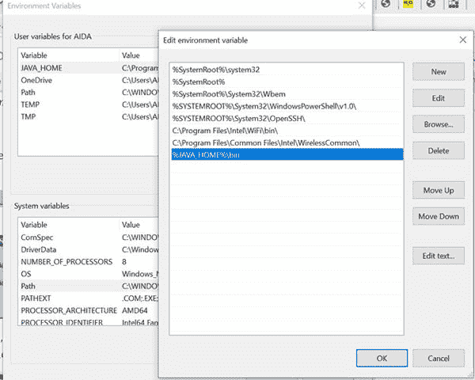

    **图 2.6:** JAVA_HOME 的 Path 变量

通过上述步骤，JDK 的安装已完成。在下一节中，我们将介绍安装 Zookeeper 的步骤。

### 安装 Zookeeper

Zookeeper 是 Kafka 架构中的一个重要组件。在启动 Kafka 服务器之前，应该配置并运行 Zookeeper。请按照以下步骤安装 Zookeeper：

1. 访问 URL：`[zookeeper.apache.org/releases#download](https://zookeeper.apache.org/releases#download)`

2. 点击 `Download` 超链接：

   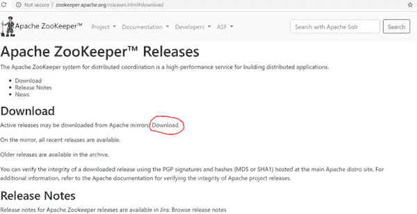

   **图 2.7:** Zookeeper 源码 

3. 在此页面上，如下所示点击镜像站点：

   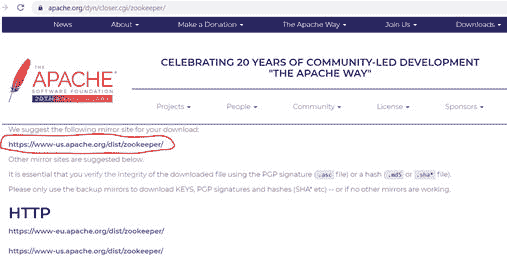

   **图 2.8:** Zookeeper 安装链接

4. 点击下方图中用黄色高亮的 `zookeeper-3.4.14/` 文件夹：

   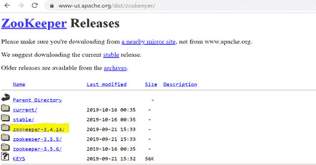

   **图 2.9:** Zookeeper 发布版本

5. 点击并下载黄色高亮的 zookeeper：

   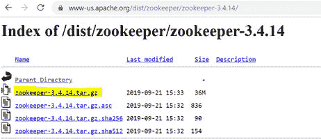

   **图 2.10:** Zookeeper 版本

6. 导航到包含 `zookeeper-3.4.14.tar.gz` 文件的目录并执行以下命令：

   ```
   tar -zxf zookeeper-3.4.14.tar.gz
   ```

   

   **图 2.11:** 解压命令

7. 这将在 `kafka` 目录下创建一个文件夹：

   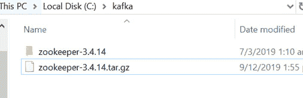

   **图 2.12:** Zookeeper 目录

8. 进入文件夹 `C:\kafka\zookeeper-3.4.14` 并创建一个名为 `inputdata` 的新文件夹：

   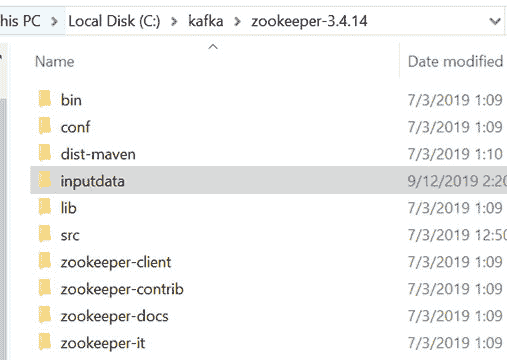


**图 2.13:** Zookeeper 输入数据

9. 打开`C:\kafka\zookeeper-3.4.14\conf`内的`zoo_sample.cfg`文件。

为`dataDir`提供路径。同时，将文件重命名为`zoo.cfg`。

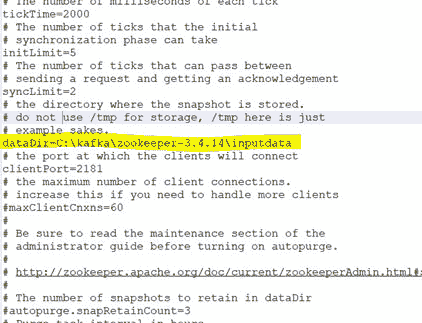

**图 2.14:** Zookeeper 配置文件

10. 使用以下命令将 Zookeeper 路径添加到环境变量：

```
setx path "%PATH%;C:\kafka\zookeepr-3.4.14\bin"
```

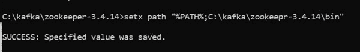

**图 2.15:** 设置 Zookeeper 路径

在本节中，我们学习了如何安装 Zookeeper。详细查看了设置 Zookeeper 的配置。

### 运行 Zookeeper

本节将介绍运行 Zookeeper 的命令。在启动 Kafka 服务器之前，应该配置并运行 Zookeeper。请按照以下步骤安装（注：此处原文应为运行）：

1. 按下以下：

```
cd C:\kafka\zookeeper-3.4.14
```

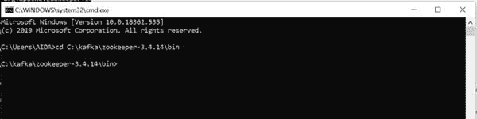

**图 2.16:** 启动 Zookeeper

2. 输入`zkServer`：

```
zkServer-server.start
```

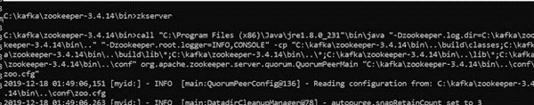

**图 2.17:** 运行 Zookeeper

3. 使用以下命令检查进程正在运行：

```
ps aux | grep zkServer
```

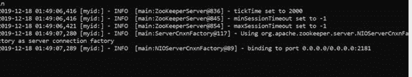

**图 2.18:** 运行 Zookeeper

在本节中，我们学习了如何安装 Zookeeper。详细查看了设置 Zookeeper 的配置。

### Zookeeper 中的可配置参数

Zookeeper 有多个可配置的参数。以下是`config`文件中使用的部分参数：

| 序号 | 参数 | 说明 |
| :--- | :--- | :--- |
| 1 | `dataDir` | 快照存储在此目录中。 |
| 2 | `clientPort` | 客户端连接的端口。 |
| 3 | `tickTime` | 一个 tick（滴）的持续时间，这是 zookeeper 使用的单位。 |
| 4 | `initTime` | 节点连接到领导者的持续时间（tick 单位）。 |
| 5 | `syncLimit` | 客户端与领导者同步的持续时间（tick 单位）。 |
| 6 | `server.x=[name]:port1[:port2]` | zookeeper 多个服务器；`x`是服务器编号；`name`是主机名；`port1`用于连接领导者的端口；`port2`用于选举领导者的端口。 |
| 7 | `dataLogDir` | 此路径可用于写入对数据库执行的操作日志。 |

**表 2.1:** Zookeeper 配置参数

上述表格包含了 Zookeeper 的重要参数；可用于相应的用途。配置时需要遵循描述中的语法。

### Kafka 安装

以下是安装 Apache Kafka 的步骤：

1. 访问 URL：[`kafka.apache.org/quickstart`](https://kafka.apache.org/quickstart)

2. 点击下载链接：

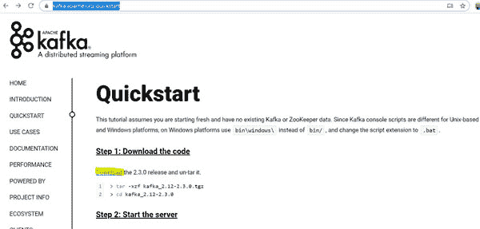

**图 2.19:** Kafka 安装网站

3. 点击下方高亮的链接并下载软件：

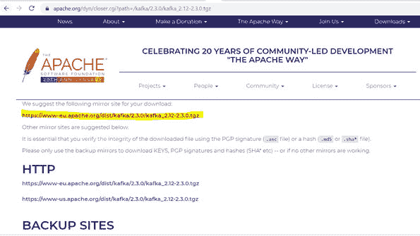

**图 2.20:** Kafka 安装版本

4. 执行`tar-xzf kafka_2.12-2.4.0.tgz`命令，如下截图所示：

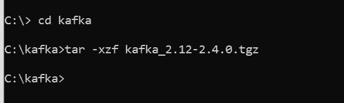

**图 2.21:** 解压 Kafka

上述步骤将安装 Kafka 服务器。在下一节中，我们将学习启动和停止 Kafka 服务器。

### 运行 Kafka 服务器

为了让消息 API（生产者、消费者等）开始工作，必须启动 Kafka 服务器。因此，本节描述了启动服务器的步骤：

1. 要启动服务器，执行以下命令：

```bash
bin\windows\kafka-server-start.bat config/server.properties
```

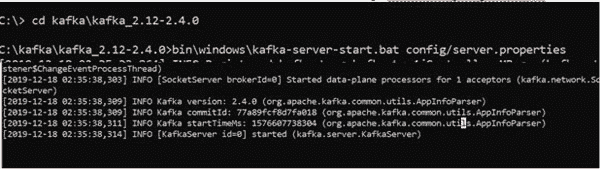

**图 2.22:** 启动 Kafka 服务器

如果你看到如前一个截图所示的消息，说明服务器已成功启动。

### 停止 Kafka 服务器

在使用 Kafka 服务器后，必须将其关闭以释放其占用的资源和内存。下一节将描述用于停止 Kafka 服务器的命令。停止服务器的命令如下：

要停止服务器，请执行以下命令：

```bash
bin\windows\kafka-server-stop.bat
```

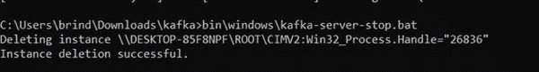

**图 2.23:** 停止 Kafka 服务器

如果删除成功，将显示上述消息。

### 结论

在本章中，我们学习了如何安装 JDK 并在`JAVA_HOME`中设置路径。我们还下载并设置了 Zookeeper，它是 Kafka 架构中一个重要的组件。我们详细介绍了在 zookeeper 配置文件中可以指定的各种配置。我们完成了 Kafka 服务器的安装。我们了解了启动服务器以及在使用后停止它的基本命令。

遵循本章的说明对于设置和安装 Kafka 及其依赖项至关重要。这构成了我们实现 Kafka 其他组件（如生产者和消费者）的基础。在下一章中，我们将学习如何通过创建生产者、消费者和代理，通过命令行发送和接收消息。我们还将学习使用 Eclipse 和 IntelliJ IDE 来实现生产者和消费者。

### 问题

1. **实现 Kafka 最重要的依赖项是什么？**

   **答：** Java 或 JDK

2. **Zookeeper 使用的配置文件名称是什么？**

   **答：** `zoo.cfg`

3. **以下哪个批文件用于运行 Kafka 服务器：**

   * `Kafka-server-start.bat`

   * `Kafka_start.bat`

   * `Kafka_server.bat`

   * `Kafka_start_server.bat`

   **答：** `Kafka-server-start.bat`

4. **哪个配置参数用于指定客户端连接的端口？**

   **答：** `clientPort`

5. **哪个配置用于指定数据库快照的存储位置？**

   **答：** `dataDir`

6. **哪个参数用于指定日志？**

   答：`dataLogDir`

7. **哪个脚本用于停止 Kafka 服务器？**

   答：`kafka-server-stop.bat`

# 第 3 章

## Kafka 消息传递

### 引言

在本章中，我们将讨论如何使用生产者发送 Kafka 消息以及如何使用消费者接收 Kafka 消息。在 Kafka 消息架构中，生产者生成消息，消费者接收这些消息。我们将深入研究 Kafka 代理（brokers）以及分区的使用方法。我们将理解 Kafka 提供的故障机制。在本章中，我们将学习通过命令行运行 Kafka 消息传递。我们将理解实现多个代理的过程以及如何处理副本的故障。将说明使用 Maven 构建在 Java 中实现 Kafka 时安装 Eclipse IDE 和 IntelliJ IDE 的步骤。

### 结构

* Kafka 消息传递的组件

* 创建 Kafka 主题

* 删除 Kafka 主题

* 通过命令行发送和接收消息

* 创建多个代理

* 安装和使用 Eclipse 和 Maven

* 安装 IntelliJ IDE

### 目标

* 理解 Kafka 消息传递的组件

* 学习创建 Kafka 主题

* 删除 Kafka 主题的过程

* 学习通过命令行发送和接收消息。

* 创建多个代理并观察 zookeeper 的分配

* 理解如何使用 Eclipse 和 Maven

* 使用 IntelliJ IDE 进行 Kafka 实现

### 消息传递中的组件

Kafka 消息系统中有多个组件。这些包括 Kafka 代理和分区。它们构成了消息架构的核心。在下一节中，我们将学习这些组件的功能及其对消息系统的重要性。

### Kafka 代理和 Kafka 分区

下图显示了 Kafka 消息传递的一些重要组件。架构中有多个代理。每个代理都有多个分区（例如，P1、P2 等）。当生产者为特定主题生成消息时，内容将存储在这些分区中。在某个代理内部，会有一个领导分区（leader partition），其他分区存储属于该主题的消息。当领导分区故障时，另一个分区将接管成为领导分区。

生产者将始终写入领导分区。然后由领导者决定数据存储和复制的位置。数据可以存储在同一代理的分区或不同代理的分区中。领导者决定副本的位置，从而对从生产者接收的消息进行某种负载均衡：

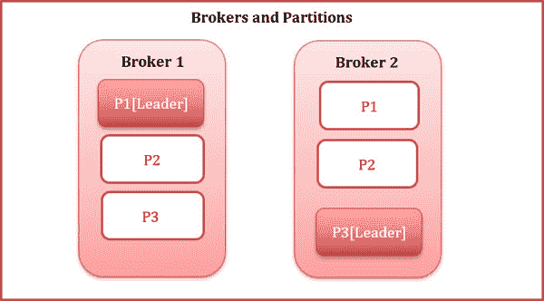

**图 3.1:** 代理和分区

如前图所示，代理共同工作以接收生产者发送到某个主题的消息。领导分区在将这些消息路由到所有分区方面起着重要作用。

### Kafka 故障转移

领导分区或副本分区都可能发生。以下是故障的可能性：

* **仅领导者故障**：在这种情况下，Kafka 控制器将从分区池中选择另一个领导者。故障发生后消息处理将出现停机，因为会抛出`LeaderNotAvailable`异常。但一旦选定领导者，消息将继续传输。数据不会丢失。

* **一个副本故障**：在这种情况下，副本将停止存储消息，并与领导者及其副本不同步。尽管一旦副本分区修复并激活，它将与领导者保持同步。当副本宕机时，消费者将从其他副本获取最新数据。

* **多个副本故障**：在这种情况下，故障的副本将停止接收生产者的数据。领导者仍然包含数据副本，因此消费者可以从领导者获取。一旦所有副本再次激活，它们将与丢失的所有数据同步。

* **所有副本故障（包括领导者）**：当包括领导者在内的所有副本故障时，可以修复领导者并激活以重启消息接收过程。领导者将包含它崩溃之前接收的所有数据。激活后，它将继续接收最新消息。另一种方案是从另一个代理中选举另一个领导者，但旧领导者接收的消息将丢失。新领导者将开始接收新数据。

上述场景是 Kafka 消息系统中可能常见的故障转移。

### 创建 Kafka 主题

要创建 Kafka 主题，我们需要提供以下参数：

| 参数 | 说明 |
| :--- | :--- |
| Zoo Keeper 实例 | zookeeper 运行的端口。 |
| 副本因子 | Kafka 集群中数据副本的数量 |
| 分区 | 数据存储的分区数量。 |
| 主题名称 | 要创建的主题名称。 |

**表 3.1:** 创建 Kafka 主题的参数

可以按照以下步骤创建 Kafka 主题：

1. 导航到`Kafka`目录。

### 2. 执行以下命令：

```
bin\windows\kafka-topics.bat --create --zookeeper localhost:2181 --replication-factor 1 --partitions 1 --topic Kafka-Topic
```

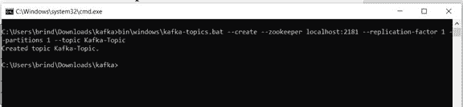

**图 3.2：** 创建 Kafka topic

如果 topic 创建成功，你会看到`Created topic <<Topic name>>`。在这里我们也创建一个单分区，并将副本设置为 1。

### 3. 要列出所有创建的 topic，使用以下命令：

```
bin\windows\kafka-topics.bat --list --zookeeper localhost:2181
```


**图 3.3：** 列出所有 Kafka topic

通过上述步骤，我们可以成功创建一个 Kafka Topic 并列出所有创建的 topic。可以通过列出 topic 来确认其已创建。

### 删除 Kafka topic

要删除 Kafka topic，请执行以下步骤：

1. 在`server.properties`文件中添加`delete.topic.enable=true`。

2. 停止 Kafka 服务器。

3. 重新启动服务器。

4. 执行以下命令：

```
bin\windows\kafka-topics.bat --zookeeper localhost:2181 --delete --topic Test-Kafka5
```

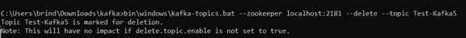

**图 3.4：** 删除 Kafka topic

通过上述步骤，我们可以成功删除一个 Kafka topic。删除 topic 后，我们可以列出 Kafka topics 来检查其是否已成功删除。

### 通过命令行发送和接收消息

在本节中，我们将学习如何使用 Kafka producer 发送消息。我们将运行 consumer 来接收这些消息。

### 创建 producer

要发送消息，我们需要创建一个 producer。在命令提示符中打开新窗口并导航到`Kafka`目录。以下命令将 Kafka 服务器运行的端口作为输入，以及消息需要发送到的 topic 名称作为输入：

```
bin\windows\kafka-console-producer.bat --broker-list localhost:9092 --topic Kafka-Topic
```

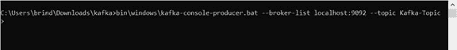

**图 3.5：** 创建 Kafka producer

如上所示，提示符正在等待我们输入消息。在发送消息之前，让我们先创建一个 consumer。

### 创建 consumer

要创建一个 consumer，需要提供 Kafka 运行的端口和 topic 名称作为输入。在命令提示符中打开新窗口并导航到`Kafka`目录。以下命令创建一个 consumer：

```
bin\windows\kafka-console-consumer.bat --bootstrap-server localhost:9092 --topic Kafka-Topic --from-beginning
```

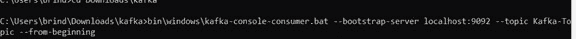

**图 3.6：** 创建 Kafka consumer

参数`from-beginning`确保 consumer 从头读取属于该 topic 的所有消息。

现在，我们已经在两个独立的窗口中运行了 producer 和 consumer，我们可以在 producer 提示符中输入消息，并在 consumer 提示符中查看相同的消息（因为它正被 consumer 读取）。下方的截图演示了这一消息发送过程：

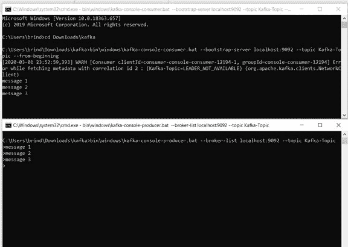

**图 3.7：** producer 和 consumer 控制台

通过前面的示例，我们已经看到了从 producer 发送 Kafka 消息以及 consumer 接收消息的过程。

### 创建多个 brokers

在上一节中，我们创建了一个 broker。在这里，我们将创建两个 brokers。因此，我们需要使用以下命令复制服务器配置`config`：

```
copy config\server.properties config\server-broker1.properties
copy config\server.properties config\server-broker2.properties
```

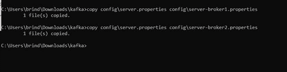

**图 3.8：** 复制服务器属性

现在，我们需要用以下内容编辑这些文件的每一个：

* `Broker.id`必须是唯一的，因此为第一个 broker 提供 1。

* `Listeners`必须监听新端口，因此提供一个唯一的端口，例如`9093`。

* `log`目录也必须是唯一的，因此给一个新名称，例如`\logs2`。

下方的截图显示了`server-broker1.properties`示例供参考。对于服务器`1`，`listeners`参数显示如下：

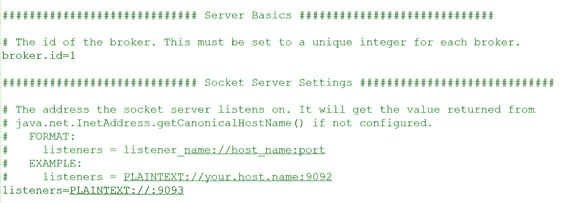

**图 3.9：** 服务器 1 属性文件：listeners

对应的截图显示了服务器`1`的`log.dirs`参数。这里提供了`log`目录的路径。消息传递过程中生成的日志将存储在这里：

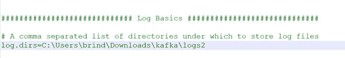

**图 3.10：** 服务器 1 属性文件：Log

以类似的方式编辑第二个服务器属性。下方的截图显示了`server-broker2.properties`的示例配置。对于服务器`2`，`listeners`参数显示如下：

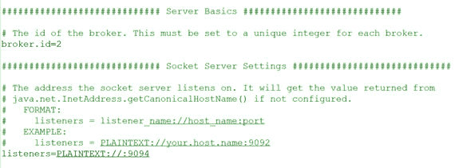

**图 3.11：** 服务器 2 属性文件：listeners

对应的截图显示了服务器`2`的`log.dirs`参数。这里提供了`log`目录的路径。消息传递过程中生成的日志将存储在这里：


**图 3.12：** 服务器 2 属性文件：Log

要启动这两个 brokers，我们将使用以下：

1. 启动 broker 1：

```
bin\windows\kafka-server.bat config\server-broker1.properties
```

2. 启动 broker 2：

```
bin\windows\kafka-server.bat config\server-broker2.properties
```

一旦启动启动，我们现在创建一个 topic：


使用以下命令创建 Kafka topic：

```
bin\windows\kafka-topics.bat --create --bootstrap-server localhost:9092 --replication-factor 3 --partitions 1 --topic multi-topic
```

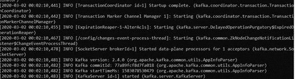

**图 3.13：** 创建 Kafka topic

使用 `describe` 参数，我们可以查看使用的使用情况。以下输出显示 leader 为 0，副本为 0, 2 和 1：

```
bin\windows\kafka-topics.bat --describe --bootstrap-server localhost:9092 --topic multi-topic
```

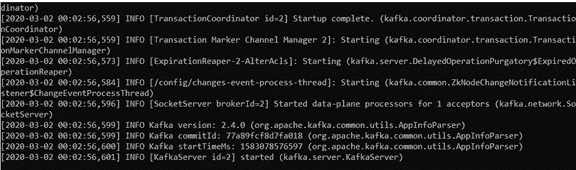

**图 3.14：** Broker 描述

以下说明了上述输出的含义：

- **Leader**（领导者）：负责读取和写入数据到其他 broker 的分区。
- **Replicas**（副本）：用于存储数据的活跃分区。
- **Isr**（同步副本）：同步副本，意味着当前活跃且可处理数据的副本。失败的副本不会列在此处。

为了测试我们的容错性，我们将获取进程 ID 并杀死它。

使用以下命令获取进程 ID：

```
wmic process where "caption = 'java.exe' and commandline like '%server-broker1.properties%'" get processid
```

杀死进程，请使用 `taskkill /pid <PID> /f`。

如你从前面的输出所示，同步副本 `isr` 现在仅包含 0 和 2。副本 1 已经被杀死。

### 安装并使用 Eclipse 和 Maven

Eclipse IDE 可用于开发 Kafka 生产者和消费者。因此，在本节中，我们将学习如何下载并设置 Eclipse IDE 以实现 Kafka 消息传递。以下步骤详细说明了下载 eclipse 软件和创建 Maven 项目的方法：

1. 导航到此 URL：[`www.eclipse.org/mars/`](https://www.eclipse.org/mars/)
2. 点击下图中所示所示的 `Download` 按钮：


**图 3.19：** Eclipse 源码

3. 根据你的操作系统点击 `Download XX`：


**图 3.20：** Eclipse URL

4. `.exe` 文件将下载到你的系统中。运行 `.exe` 文件以安装 eclipse。导航到 `eclipse` 目录并如图所示打开 eclipse 应用程序：

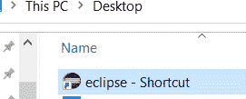

**图 3.21：** Eclipse 快捷方式

5. 一旦打开 eclipse，点击 `Help` 菜单并选择 `Eclipse Marketplace`，如图所示：

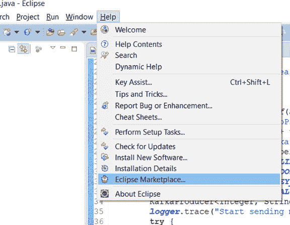

**图 3.22：** Eclipse 帮助菜单

6. 在 `Find` 文本框中搜索 `spring`，如图所示：

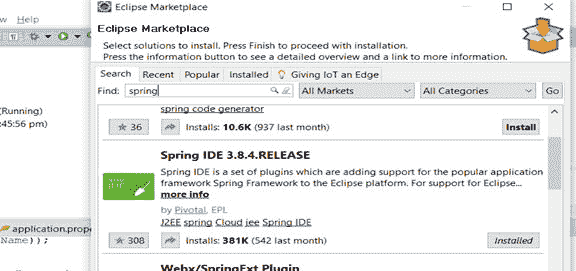

**图 3.23：** Eclipse 商店

7. 进入 `File` 菜单，点击 `New` | `Maven Project`：

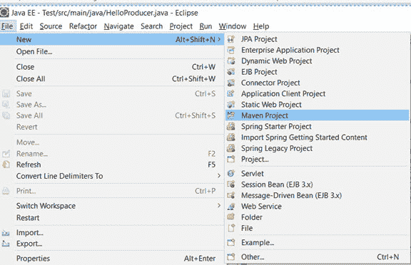

**图 3.24：** 创建新的 Maven 项目

8. 如图所示选择 `Maven Project`：

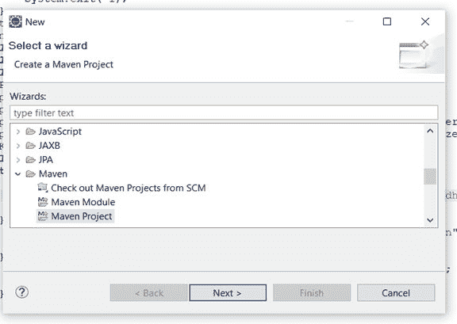

**图 3.25：** 选择向导

9. 点击 `Next`：

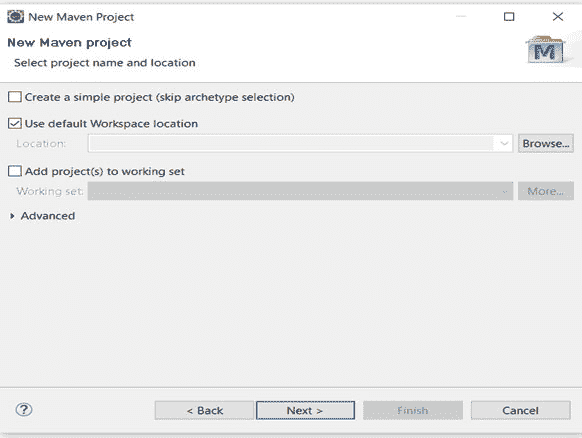

**图 3.26：** 项目路径

10. 如图所示点击 `Next`：

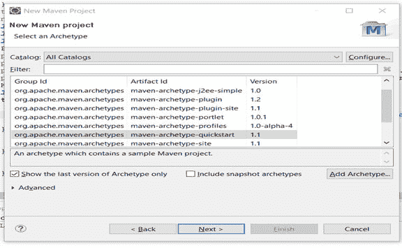

**图 3.27：** 项目创建模板

11. 为 `Artifact Id` 提供一个名称，如图所示。点击 `Finish`：

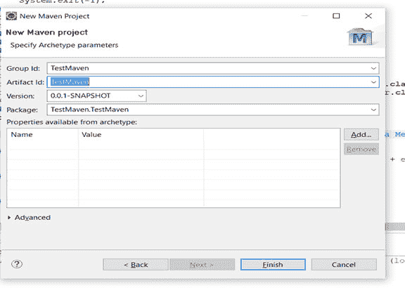

**图 3.28：** Artifact Id 标识

12. Maven 项目将如图所示被创建：

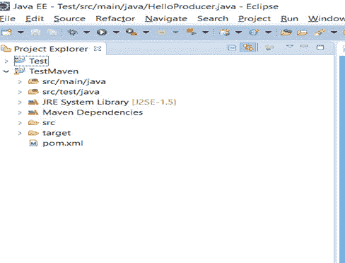

**图 3.29：** 项目资源管理器

在本节中，我们已经成功安装了 Eclipse IDE 并创建了一个示例 Maven 项目。该 Maven 项目将以后用于创建 Kafka 生产者和消费者。

### 安装 IntelliJ IDE

IntelliJ IDE 是另一个可以开发 Kafka 组件的开发环境。在本节中，我们将学习如何下载和设置 IntelliJ IDE。Kafka 架构所需的依赖项也将添加到项目中。

以下是在 IDE 中进行开发安装和设置 Maven 依赖的步骤：

1. 导航到以下 URL：[`www.jetbrains.com/idea/download/#section=windows`](https://www.jetbrains.com/idea/download/#section=windows)
2. 点击 `Download` 按钮：

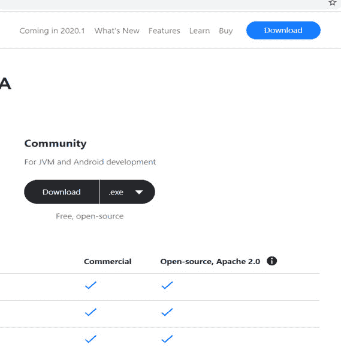

**图 3.30：** IntelliJ 源码

3. 下载 IDE 的社区版：


**图 3.31：** 可执行文件

4. 如图所示点击 `Next`：

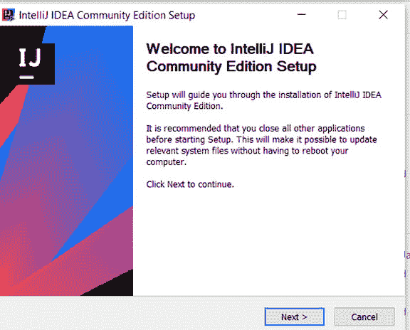

**图 3.32：** 安装向导

5. 按照步骤操作完成安装。
6. 点击 `Start` 按钮并搜索 IntelliJ。选择图中所示的图标：


**图 3.33：** 软件图标文件

7. 点击 `File` | `New` | `Project`：

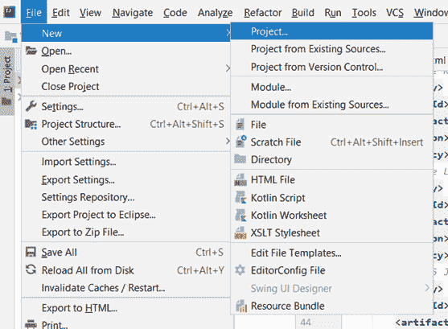

**图 3.34：** 新项目向导

8. 选择 `Maven`：


**图 3.35：** 选择 Maven 项目

9. 输入项目名称并点击 `Finish`：


**图 3.36：** 项目名称界面

10. 你应该看到新项目和 `pom.xml` 文件，如图所示：


**图 3.37：** 新项目资源管理器

我们将在后续章节中使用任何一个 IDE 实现 Kafka 生产者和消费者。不需要同时安装它们。

在本节中，我们已经设置了 IntelliJ IDE。该 IDE 也可以用于开发 Kafka 生产者和消费者。

### 结论

在本节中，我们已经成功安装了 Eclipse IDE 并创建了一个示例 Maven 项目。该 Maven 项目将以后用于创建 Kafka 生产者和消费者。

在本节中，我们已经设置了 IntelliJ IDE。该 IDE 也可以用于开发 Kafka 生产者和消费者。

在本节中，我们已经成功安装了 Eclipse IDE 并创建了一个示例 Maven 项目。该 Maven 项目将以后用于创建 Kafka 生产者和消费者。

在本节中，我们已经设置了 IntelliJ IDE。该 IDE 也可以用于开发 Kafka 生产者和消费者。

在本节中，我们已经成功安装了 Eclipse IDE 并创建了一个示例 Maven 项目。该 Maven 项目将以后用于创建 Kafka 生产者和消费者。

在本节中，我们已经设置了 IntelliJ IDE。该 IDE 也可以用于开发 Kafka 生产者和消费者。

在本节中，我们已经成功安装了 Eclipse IDE 并创建了一个示例 Maven 项目。该 Maven 项目将以后用于创建 Kafka 生产者和消费者。

在本节中，我们已经设置了 IntelliJ IDE。该 IDE 也可以用于开发 Kafka 生产者和消费者。

在本节中，我们已经成功安装了 Eclipse IDE 并创建了一个示例 Maven 项目。该 Maven 项目将以后用于创建 Kafka 生产者和消费者。

在本节中，我们已经设置了 IntelliJ IDE。该 IDE 也可以用于开发 Kafka 生产者和消费者。

在本节中，我们已经成功安装了 Eclipse IDE 并创建了一个示例 Maven 项目。该 Maven 项目将以后用于创建 Kafka 生产者和消费者。

在本节中，我们已经设置了 IntelliJ IDE。该 IDE 也可以用于开发 Kafka 生产者和消费者。

在本节中，我们已经成功安装了 Eclipse IDE 并创建了一个示例 Maven 项目。该 Maven 项目将以后用于创建 Kafka 生产者和消费者。

- 执行 Kafka 生产者
- 理解 Kafka 中发送消息的不同方式
- 学习确认（acknowledgement）的类型
- Kafka 生成者的应用

## Kafka 生产者 API

`KafkaProducer` 类包含了 Java 中的 Kafka 生产者函数。它是用于发布消息的 Kafka 客户端。该实例是线程安全的。[表 4.1] 显示了类中提供的构造函数和方法：

| 序号 | 方法 | 说明 |
| :--- | :--- | :--- |
| 1 | `void abortTransaction()` | 取消正在进行的事务。 |
| 2 | `void beginTransaction()` | 在事务开始之前，必须调用此方法。 |
| 3 | `void commitTransaction()` | 提交当前激活的事务。 |
| 4 | `void initTransactions()` | 必须首先调用此方法。 |
| 5 | `java.util.Map<MetricName,? extends Metric>Metrics()` | 返回每个生产者指标。 |
| 6 | `send(ProducerRecord<K,V> record)` | 异步向主题发送记录。 |
| 7 | `send Of fsets To Transaction()` | 此方法向消费者组发送偏移量。 |
| 8 | `Close()` | 此方法将关闭生产者。 |
| 9 | `Flush()` | 缓冲区中的所有记录将被刷新。 |

**表 4.1：** 生产者 API

Kafka 类的上述函数将在实现过程中使用。在下一节中，我们将查看 Java 中 Kafka 生产者的实现。

### Java 中的生产者实现

在本节中，我们用用 Java 实现 `KafkaProducer`，并学习使用 `ProducerRecord` 对象处理记录。该项目的 `pom.xml` 代码如下：

```xml
<project xmlns=http://maven.apache.org/POM/4.0.0 xmlns:xsi="http://www.w3.org/2001/XMLSchema-instance" xsi:schemaLocation="http://maven.apache.org/POM/4.0.0 http://maven.apache.org/xsd/maven-4.0.0.xsd">
  <modelVersion>4.0.0</modelVersion>
  <groupId>KafkaProject</groupId>
  <artifactId>KafkaProject</artifactId>
  <version>0.0.1-SNAPSHOT</version>
  <parent>
    <groupId>org.springframework.boot</groupId>
    <artifactId>spring-boot-starter-parent</artifactId>
    <version>2.0.0.RELEASE</version>
    <relativePath/><!----lookup parent from repository -->
  </parent>
  <properties>
    <maven-jar-plugin.version>2.6</maven-jar-plugin.version>
    <project.build.sourceEncoding>UTF-8</project.build.sourceEncoding>
    <project.reporting.outputEncoding>UTF-8</project.reporting.outputEncoding>
    <java.version>1.8</java.version>
  </properties>
  <dependencies>
    <dependency>
      <groupId>org.springframework.boot</groupId>
      <artifactId>spring-boot-starter-web</artifactId>
    </dependency>
    <dependency>
      <groupId>org.springframework.boot</groupId>
      <artifactId>spring-boot-devtools</artifactId>
      <scope>runtime</scope>
    </dependency>
    <dependency>
      <groupId>org.springframework.boot</groupId>
      <artifactId>spring-boot-starter-test</artifactId>
      <scope>test</scope>
    </dependency>
    <dependency>
      <groupId>org.apache.kafka</groupId>
      <artifactId>kafka_2.12</artifactId>
      <version>1.0.1</version>
    </dependency>
  </dependencies>
</project>
```

依赖 `spring-boot-starter-web` 包含了 spring boot 的库。`spring-boot-devtools` 依赖提供了当项目文件发生变化时自动重启应用程序的运行时支持。`spring-boot-starter-test` 包含了测试 spring boot 应用程序的库。`kafka_2.12` 包含了实现 Kafka 需要的所有库。

以下是 Kafka 生产者的实现：

```java
//import util.properties packages
import java.util.Properties;
//import KafkaProducer packages
import org.apache.kafka.clients.producer.KafkaProducer;
//import ProducerRecord packages
import org.apache.kafka.clients.producer.ProducerRecord;

public class Producer {
    public static void main(String[] args) throws Exception {
        // 为要产生的消息提供一个主题名称
        String topicName = "Test-Kafka5";
        // 创建 Properties 实例以使用属性
        Properties props = new Properties();
        // 将本地 id 分配给服务器属性
        props.put("bootstrap.servers", "localhost:9092");
        // 提供批大小
        props.put("batch.size", 16384);
        // 当请求失败时，可以重试次数
        props.put("retries", 0);
        // 设置确认机制
        props.put("acks", "all");
        // 减少小于值
        props.put("linger.ms", 1);
        // 是可用的内存总量
        props.put("buffer.memory", 3355432);
        // 设置序列化器
        props.put("key.serializer", "org.apache.kafka.common.serialization.StringSerializer");
        props.put("value.serializer", "org.apache.kafka.common.serialization.StringSerializer");

        KafkaProducer<String, String> producer = new KafkaProducer<>(props);

        for (int i = 0; i < 30; i++) {
            // 使用 send 方法发送消息
            producer.send(new ProducerRecord<>(topicName, Integer.toString(i)));
            System.out.println("Sending message: " + Integer.toString(i));
        }
        System.out.println("All messages have been sent successfully");
        // 关闭生产者实例
        producer.close();
    }
}
```


### 同步发送

在这种方法中，我们将发送消息并等待确认。使用`get()`方法来获取确认，以确定消息是否发送成功。

语法如下：

```java
//Create a message
ProducerRecord<String, String>kafkaMessageContent= new ProducerRecord<String, String>("Kafka topic name", kafka_key, kafka_message);

//Send the message
producer.send(kafkaMessageContent).get();
```

### 异步发送

在这种方法下，调用`send`方法的同时会传入一个`callback`回调函数。该`callback`函数在消息成功发送后被调用：

```java
//Create a call back class
CallBackClasscallbackFunction = new CallBackClass();

//Create the message
ProducerRecord<String, String>kafkaMessageContent= new ProducerRecord<String, String>("Kafka topic name", kafka_key, kafka_message);

//Send the message
producer.send(kafkaMessageContent, callbackFunction);

private static class CallBackClass implements Callback {
  public void onCompletion(RecordMetadatarecordMetadata, Exception e) {
    if (e != null) {
      System.out.println("Error while producing message to topic :" + recordMetadata);
      e.printStackTrace();
    } else {
      String message = String.format("Message sent to topic:%s partition:%s offset:%s", recordMetadata.topic(), recordMetadata.partition(), recordMetadata.offset());
      System.out.println(message);
    }
  }
}
```

根据使用生产者的应用程序，将使用上述类型中的任何一种。

### 确认类型 (Types of acknowledgments)

发送到发布者的消息需要被确认。有三种确认类型。根据提供的确认类型，发布者将等待代理（`broker`）的确认：

| 类型 | 描述 |
| :--- | :--- |
| `Acknowledgement = 0` | 在这种情况下不会发送确认。生产者不需要等待。 |
| `Acknowledgement = 1` | 在这种情况下，由领导（`leader`）发送确认。副本（`replicas`）不需要发送确认。 |
| `Acknowledgement = all` | 在这种情况下，代理将检查所有副本是否都已收到发送的消息。当所有副本都收到后，代理将发送确认。 |

**表 4.2：** 确认类型

选择的确认类型取决于系统的设计。

### Kafka 生产者的应用

* **监控网站活动**：在电子商务平台上，它可以用于处理发生的交易。生产者将发送属于客户执行的购买交易的数据。
* **消息传递**：当我们从一个系统发送消息到另一个系统时，这些消息需要被处理；可以使用生产者将它们分组到主题中并相应地发送进行处理。
* **日志聚合**：来自 Web 服务器、数据库系统、服务器日志等各种应用程序生成日志。Kafka 生产者可以用于收集各种应用程序的日志并发送进行消费。
* **ETL**：Kafka Connect 可读取数据库并将其分组到 Kafka 主题中；这些可以作为数据流产生，用于低延迟处理。
* **Twitter 情感分析应用**：当人们发布推文时，生产者可以将这些消息发送到集群。消费者将读取这些消息并将其发送到应用程序以处理推文中的情感。
* **欺诈检测系统**：在在线商店中，我们可以将交易（例如客户购买的产品）作为数据由 Kafka 生产者产生。稍后，消费者可以处理这些数据以判断交易是否为欺诈。

上述应用是 Kafka 生产者经常使用的用例。因此，在实时问题解决和架构任何我们遇到的类似用例时，也可以使用 Kafka。

### 结论

在本章中，我们学习了使用 Kafka 的生产者。介绍了 Java 中 Kafka 消费者的实现。使用生产者的 API 包含了`send()`。本章通过 Java 实现了 Kafka 消费者的实现。展示了发送 Kafka 消息的三种方式。展示了 Kafka 的确认类型。列出了 Kafka 生产者的应用。目标是能够实现 Kafka 消费者 Java。

在下一章节中，我们将详细介绍 Kafka 消费者的实现。

### 问题

1. 哪个 API 用于创建生产者？
2. 生产者可以被多个实例共享吗？生产者是线程安全的吗？
3. 以下哪种发送消息的方法不接收确认？
   - 忘记
   - 异步
   - 默认
4. 哪种确认类型会等待所有副本收到消息？
   - `Acknowledgement=1`
   - `Acknowledgement =0`
   - `Acknowledgement = all`
5. 以下哪项不是 Kafka 生产者的应用？
   - 预测系统
   - ETL
   - 情感分析
   - 消息传递
6. 哪个 API 用于实现 ETL 应用？
7. 在异步发送方法中，哪个函数在消息发送后调用？

### 回答

1. `KafkaProducer()`
2. 是的。
3. 异步发送
4. `Acknowledgement =all`
5. 预测系统
6. `Connect API`
7. `callback`

Kafka 中的一个主题（`topic`）被写入多个名为`partitions`（分区）的日志。生产者向这些日志的末尾写入，而消费者可以按照自己的速度从这些日志中消费。消息以顺序方式从这些分区中读取。

从不同分区进行读取的原因是为了扩展消费者对数据的消费能力。在`图 5.1`中，`Topic A` 存储三个分区中。该主题有两个消费者，`Consumer 1` 和`Consumer 2`。它们组成了一个消费者组。每个分区被分配给一个消费者进行读取。

消费者组中的每个消费者将获得分区的独占份额。在一个消费者组内，不会有超过一个消费者读取同一个分区。每个组通过其其中一个消费者读取一个分区。这就是消费者组实现负载均衡的方式。

如果分区数量少于消费者组数量，则某些消费者组将保持空闲状态，并在故障转移期间使用。如果分区数量多于消费者组，则少数消费者组可能会从多个分区读取。

每个消费者组对每个分区都有自己的偏移量（`offset`）。该偏移量可能与其他消费者组不同：

消费者 2


**图 5.1：** 消费者组

在本节中，我们学习了消费者组以及它们在从分区读取时如何进行负载均衡。将在下一节中查看组遵循的协议。

## 组协调协议

当创建一个消费者组时，需要管理组内的消费者。使用组协调协议来管理消费者。每个组都有一个指定的 broker 被分配为组协调员。该协调员负责管理组的状态。协调员的职责如下：

* 将日志分区分配给消费者进行读取。
* 如果添加了新消费者，则为其分配分区。
* 当现有消费者离开时，管理组的状态。
* 如果主题发生变化，相应地分配分区。

当发生读取操作时，分区内部是顺序读取的。在读取少量记录后，消费者可能会提交已读取的记录。

`图 5.2`显示了一个带有位置的典型分区日志。在`图 5.2`中，`Last Committed Offset`（最后提交偏移量）是消费者已提交读取记录的位置。消费者随后继续读取到位置 4，这是其当前的读取点。

在此阶段，发生了故障，消费者被一个新消费者替换，新消费者需要从偏移量 2 开始读取，即之前保存的记录。位置 2 和 4 之间的读取记录需要重新读取。

记录也会被复制到其他分区，作为数据复制过程的一部分，以实现数据的高可用性。因此，已保存到其他日志分区的记录位置是高水位点（`high watermark point`）。消费者可以安全地读取到此点，超过此点后如果消费者继续读取，可能会出现一种情况：如果记录丢失，在其他地方将没有它的副本：


**图 5.2：** 消费者日志及其偏移量

因此，使用该协议，消费者能够协调并以高可用性访问数据。

## Kafka 消费者的 API

Java 提供了许多实现 Kafka 消费者的函数。以下是执行其活动所需的 API：

| 序号 | 方法 | 说明 |
| :--- | :--- | :--- |
| 1 | `void assign(Collection<TopicPartition> partitions)` | 分区可以手动分配给消费者。 |
| 2 | `Set<TopicPartition>assignment()` | 获取当前分配给消费者的分区。 |
| 3 | `void commitAsync()` | 对于`poll`命令返回的偏移量，提交主题和分区列表的偏移量。 |
| 4 | `Map<String,List<PartitionInfo>>listTics()` | 列出关于所有主题分区的元数据。 |
| 5 | `java.util.Map<MetricName,? extends Metric> Metrics()` | 这返回每个消费者中存在的指标（`metrics`）。 |
| 6 | `ConsumerRecords<K,V>poll(Duration timeout)` | 获取订阅的主题或分区的数据。 |
| 7 | `void subscribe(Collection<String> topics)` | 订阅给定的主题列表。 |
| 8 | `void Close()` | 此方法将关闭消费者。 |
| 9 | `Set<String>subscription()` | 获取当前的订阅。 |
| 10 | `void unsubscribe()` | 取消订阅当前订阅的主题。 |

**表 5.1：** Kafka 消费者 API

在本节中，我们简要概述了 Kafka 消费者使用的一组 API。

### Java 中的消费者实现

以下是 Kafka 消费者的 Java 实现：

```java
import java.util.Properties;
import java.util.Arrays;
import org.apache.kafka.clients.consumer.KafkaConsumer;
import org.apache.kafka.clients.consumer.ConsumerRecords;
import org.apache.kafka.clients.consumer.ConsumerRecord;

public class Consumer {
    public static void main(String[] args) throws Exception {
        //Kafka 配置设置
        String topicName="Kafka-Topic";
        Properties props = new Properties();
        //Kafka 消费者设置
        props.put("bootstrap.servers", "localhost:9092");
        //消费者所属的组
        props.put("group.id", "kafkroup");
        // 偏移量根据 auto.commit.ms 指定的频率自动提交
        props.put("enable.auto.commit", "true");
        // auto.commit.ms 是提交数据的间隔
        props.put("auto.commit.ms", "1000");
        // 超时时间
        props.put("session.timeout.ms", "30000");
        props.put("key.deserializer", "org.apache.kafka.clients.serialization.StringDeserializer");
        props.put("value.deserializer", "org.apache.kafka.clients.serialization.StringDeserializer");
        // 创建消费者实例
        KafkaConsumer<String, String>consumer = new KafkaConsumer<String, String>(props);
        // Kafka 消费者在此订阅主题列表
        consumer.subscribe(Arrays.asList(topicName));
        // 打印主题名称
        System.out.println("Subscribing to the topic " + topicName);
        while (true) {
            // 每轮询 10 条记录
            ConsumerRecords<String, String>records = consumer.poll(10);
            // 遍历轮询记录
            for (ConsumerRecord<String, String>record : records) {
                // 打印收到的消费者记录的偏移量、键和值
                System.out.printf("offset is %d, key is %s, value is %s\n",
                record.offset(), record.key(), record.value());
            }
        }
    }
}
```

* 如果消费者没有发送心跳`forsession.timeout.ms`，它将被认为已死亡，并且它正在读取的分区将被重新分配。

### 执行消费者

应该使用 Kafka 的 Java 实现在 eclipse 中创建一个`Consumer.java`类。要执行 Kafka 消费者流转，应执行以下步骤：

1. 导航到`kafka`目录。下面的截图显示了导航到`kafka`目录：

   

   **图 5.3：** 导航到 Kafka

2. 使用以下命令启动 Zookeeper：

   ```
   bin\windows\zookeeper-server-start.bat config\zookeeper.properties
   ```

   下面的截图显示了 Zookeeper 的启动：

   

   **图 5.4：** Zookeeper 启动命令

   如果 Zookeeper 启动成功，将在控制台中看到以下内容：

   

   **图 5.5：** Zookeeper 已启动消息

3. 使用以下命令启动 Kafka 服务：

   ```
   bin\windows\kafka-server-start.bat config/server.properties
   ```

   使用此命令，可以如下图所示启动服务器：

   

   **图 5.6：** Kafka 服务启动命令

   一旦 Kafka 服务启动，我们可以在命令提示符中看到`Started`消息，如下图所示：

   

   **图 5.7：** Kafka 服务已启动消息

4. 使用以下命令创建一个 Kafka Topic（主题）：

   ```
   bin\windows\kafka-topics.bat --create --zookeeper localhost:2181 --replication-factor 1 --partitions 1 --topic Kafka-Topic
   ```

   必须创建一个 Kafka Topic 才能发送和接收消息。此处的主题名称为`Kafka-Topic`：

   

   **图 5.8：** 创建 Kafka Topic

5. 运行消费者。消费者可以如下图所示作为 Java 应用程序运行：

   

   **图 5.9：** 运行消费者

   一旦运行消费者，它将在控制台中显示`Subscribed to topic`消息，如下所示：

   

   **图 5.10：** 消费者控制台

6. 运行生产者。现在，我们将运行生产者来生成消息，如下所示：

   

   **图 5.11：** 运行生产者

   一旦运行生产者，它将在控制台中显示`All the messages have been sent successfully`消息：

   


**图 5.12：** 生产者控制台消息

## 7. 查看消费者输出控制台

运行生产者后，消费者的控制台将显示被消费的消息。这些与生产者发送的消息相同：


**图 5.13：** 消费者控制台输出

### 结论

在本节中，我们学习了如何执行消费者并处理消息。在本章中，我们学习了 Kafka 消费者以及消费者组是如何形成的。组遵循一种*公平份额*机制，通过该机制，组中的每个成员都可以独占访问一个分区。

我们还理解了消费者组为了管理其成员而遵循的组协调协议。讨论了 Kafka 消费者的 Java API。这些 API 用于在 Java 中实现 Kafka 消费者。还演示了消费者的执行。

本章旨在建立对 Kafka 消费者组件的理解，并将使你能够为你的业务问题实现自定义的消费者。在下一章中，我们将学习 Apache Storm 及其架构、优势和应用。

### 问题

1. **来自同一个消费者组的多个一个消费者可以读取同一个分区吗？**

   **答：** 否

2. **当消费者多于分区时，多出的消费者用于什么目的？**

   **答：** 故障转移（Failover）

3. **`assign()` 方法的作用是什么？**

   **答：** 它手动将分区分配给消费者。

4. **什么是高水位标记位置（High Watermark location）？**

   **答：** 它是记录复制已经发生的位置。

5. **`commitAsync()` 方法的作用是什么？**

   **答：** 它提交所有分区的偏移量。

6. **`enable.auto.commit` 代表什么？**

   **答：** 它启用按 `auto.commit.interval.ms` 指定的时间间隔自动提交的过程。

7. **使用哪种方法获取消费者记录？**

   **答：** `poll()` 方法

# 第 6 章

## Storm 简介

### 引言

在本章中，将介绍 Apache Storm。它是一个实时处理器。将描述 Storm 和 Kafka 之间的比较。讨论了 Storm 的架构和核心概念。解释了 Storm 的各种优势。并将简述 Storm 的应用场景。

### 结构

- Apache Storm 简介
- Storm 与 Kafka 的比较
- 结合 Hadoop 的 Storm
- Storm 架构
- Storm 的优势
- 应用

### 目标

- Storm 简介
- Storm 与 Kafka 的比较
- Storm 与 Hadoop 的比较
- Storm 架构概览
- 理解核心概念
- Storm 的优势
- 应用

### Storm 简介

Apache Storm 是一个实时处理系统。它也可以从数据源进行实时数据流处理。由于其设计，它可以处理海量的实时数据。它是开源的，因此可以被中小型企业使用。它易于设置且用户友好，这使其非常适合实时处理开发。它的处理能力类似于 Hadoop。Storm 的基准是每节点处理百万个元组（tuples）。它的高可靠性保证了数据至少会被处理一次。

### Kafka 与 Storm 的比较

虽然 Kafka 和 Storm 都是实时数据处理系统，但目标略有不同。以下是一些区别：

| **Kafka** | **Storm** |
| :--- | :--- |
| 它用于从数据源读取实时数据流。 | 它读取数据并在数据进行计算并转换。 |
| 可能会丢失数据，不保证 100% 数据安全。 | 它为安全处理数据提供 100% 的保证。 |
| 它以日志的形式存储在本地文件系统中。 | 它处理并传递给下一个组件；输出可以选择存储在数据库中。 |
| 数据直接从原始源读取。 | Storm 可能从其他流应用程序（如 Kafka）读取数据。 |
| Zookeeper 是 Kafka 运行必需的。 | Zookeeper 不是必需的。 |
| Kafka 是容错的，由 Zookeeper 管理。 | Storm 也是容错的，通过守护进程自动重启机制进行自我管理。 |
| 由 LinkedIn 开发。 | 由 Twitter 开发。 |
| 延迟取决于数据源且小于 1-2 秒。 | Storm 的延迟是毫秒级的。 |
| 支持多种语言，但在 Java 中效果最好。 | 支持多种语言且在所有语言中表现均良好。 |

**表 6.1：** Kafka 与 Storm 比较

通过上述比较，我们可以理解 Kafka 和 Storm 之间的差异特征。

### Hadoop 与 Storm 的比较

Hadoop 和 Storm 都用于数据计算。以下是它们之间的区别：

| Hadoop | Storm |
| :--- | :--- |
| 以批处理进行数据计算。 | 对实时流式数据进行计算。 |
| 采用主从架构，以作业和任务的形式存在。可能没有 Zookeeper 来管理实例。 | 架构是主从式的，主节点称为 `Nimbus`，从节点称为 `supervisors`。使用 `Zookeeper` 来管理集群。 |
| 它存储并维护状态。 | 它是无状态的。 |
| 它包含 map/reduce 作业，并在所有作业完成后结束。 | 集群一直运行直到用户关闭实例。 |
| MapReduce 框架的处理时间可能需要几小时或几分钟。 | `storm` 中的任务处理需要几秒或毫秒。 |
| 容易搭建，但操作集群相对复杂。 | 容易搭建且容易使用。 |

**表 6.2：** Hadoop 和 Storm 的对比

上表说明了 Hadoop 和 Storm 之间的关键区别。

### Storm 的核心组件

以下是 Storm 集群的组件：

- **节点 (Nodes)**：一个 `storm` 集群包含两种节点：主节点和工作节点。

- **Nimbus**：`Nimbus` 节点是 `Storm` 集群的主节点。`nimbus` 守护进程的主要职责是管理、协调和监控在集群上运行的拓扑，包括拓扑部署、任务分配以及故障时的任务重新分配。`Nimbus` 是无状态的，并将所有数据存储在 `Zookeeper` 中。

- **Supervisor**：这是由工作节点运行的进程。它执行主节点分配给它的任务。一个 `supervisor` 可以拥有多个工作节点。`supervisor` 将任务分配给工作节点，并可以拥有完成任务所需的资源。它负责创建、启动和停止工作进程以执行分配给该节点的任务。与 `Nimbus` 类似，`supervisor` 进程也是快速失败的，并将所有状态存储在 `Zookeeper` 中，以便其在不丢失任何状态的情况下重启。

- **流 (Stream)**：从数据源流入拓扑的数据流包含元组（Tuples）。`Tuple` 是 `storm` 集群的组件。这个 `tuple` 包含数据源发送到 `spout` 的数据元素列表。它们是 `Storm` 中的主要数据结构。它们是各种值的命名列表，如整数、字节、浮点数和字节数组。

- **Spouts**：从数据源的输入流被发送到 `Spout`。它持续读取数据并在发送到 `bolt` 之前创建元组。例如，它可以从 `Kafka` 消息队列、数据库或文件系统读取。

- **Bolts**：`Bolts` 是 `Storm` 中所有逻辑处理的核心；来自 `spout` 的数据被发送到 `bolt` 进行处理。这些 `bolt` 可以对数据进行计算。`bolt` 可以将数据发送到另一个 `bolt` 进行进一步处理，或将输出存储在数据库中。

- **任务 (Task)**：`task` 意味着在 `storm` 集群中以某种形式处理数据。它可以是一个 `spout` 或 `bolt`。尽管拓扑中的组件数量及其任务保持不变，但这些任务的执行器是可以更改的。执行器可能会根据给给 `bolt` 处理的输入负载而增加或减少。默认情况下，`Storm` 将在一个线程中运行一个任务。

- **拓扑 (Topologies)**：一个 `storm` 拓扑包含 `storm` 组件，即 `spout` 和 `bolts`。它是由多个 spouts 和 bolts 形成的网络。每个组件都会处理数据并将其输出发送到连接的组件；因此，它是一个为了实现目标而组织的由 spouts 和 bolts 构成的互连网络。

- **Zookeeper**：`storm` 集群状态由 `Zookeeper` 维护。`storm` 中的守护进程是无状态的。当主节点或从节点发生故障时，它们将重启。

### Apache Storm 架构

`Storm` 的架构由 spouts 和 bolts 组成。输入数据由 `spouts` 读取。可能会有很多 spouts 从不同的数据源读取数据。`Bolts` 将处理来自 `spout` 的输出数据元组。bolts 可以将其输出发送到另一个 `bolt` 进行更多计算。最后，结果可以存储在数据库或任何持久化存储中：


**图 6.1：** Apache Storm 架构

上图说明了多个 spouts 和 bolts 之间的交互。这是一个简单的拓扑。

### Storm 的优势

`Storm` 的优势如下：

- **可靠性 (Reliable)**：它具有高可靠性，因为它能快速检测故障，并通过立即替换故障的工作节点来确保每个元组/数据至少处理一次。在故障期间，数据处理可能会发生多次，但数据永远不会被遗漏。

- **容错性 (Fault-tolerant)**：如果任何工作节点失败，任务将重新分配到新节点进行处理，因此具有很高的容错性。

- **开源 (Open source)**：由于软件是开源的，更容易下载和实现我们开发实时分布式处理器所需的组件。它提供的示例和文档对用户友好，可以快速启动开发。

- **速度 (Speed)**：`Storm` 中的数据处理速度极快。它可以在几秒内生成结果。这是 `Storm` 组件设计的关键特征之一。

- **可扩展性 (Scalability)**：`Storm` 组件可以通过添加更多资源或机器并将任务分配到多台机器来扩展。因此，随着输入负载的增加，很容易扩展由 bolts 执行的处理和计算。

- **易于开发 (Ease of development)**：开发实时流式和处理应用非常耗时。使用 Apache `Storm`，我们很容易为我们的目标构建一个实时分布式应用。

- **支持多种编程语言 (Supports multiple programming languages)**：`Storm` 支持任何可以使用封装库实现并与 `Storm` API 集成的编程语言。

- 支持数据的实时流式传输

### Storm 的应用

`Storm` 在流处理和计算领域都有应用；以下是它的一些应用：

- 实时分析
- 在线机器学习
- 持续计算
- 分布式 RPC
- ETL（提取、转换、加载）

使用 Storm 处理的一些公司包括：

- **Spotify**：这里提供了音乐流服务，并使用 `storm` 对其进行各种分析。

- **Twitter**：为了在发现、实时分析、个性化、搜索、收益优化等范围应用范围内处理每条推文，使用了 `Storm`。它与 Twitter 的其他基础设施集成，包括数据库系统（Cassandra、Memcached 等）、消息基础设施、Mesos 以及监控/告警系统。

- **Groupon**：`Storm` 用于分析、清洗和规范化大量数据。

- **Yahoo**：`Storm` 用于处理用户事件、内容馈和应用程序日志。

- **淘宝**：这里使用 `Storm` 实时生成日志统计数据。

- **阿里巴巴**：这里使用 `Storm` 处理应用程序日志，为其应用程序提供实时统计数据。

### 总结

在本章中，我们理解了 Storm 的架构及其组件。我们学习了 storm、hadoop 和 Kafka 之间的区别。说明了使用 storm 的优势。描述了 storm 的应用以及一些使用 storm 的公司。

本章旨在理解使用 Storm 的动机以及 Apache Storm 的用途。Kafka 和 Storm 的主要区别在于 Kafka 不对数据流进行计算。Storm 和 Hadoop 之间的区别在于 Hadoop 仅对批数据进行计算，而 Storm 提供了实时计算能力。

在下一章中，我们将学习下载并安装 Storm 及其依赖项。我们还将设置一个 Storm 集群作为示例。

### 问题

1. **哪个系统处理消息的速度更快？**
   1. Hadoop
   2. Storm
   3. Kafka

2. **Storm 的哪个组件用于从输入源读取数据？**

   **答：** Spout

3. **Storm 的哪个组件用于处理数据？**

   **答：** Bolt

4. **拓扑（Topology）可以有多个 spout 吗？(是/否)**

   **答：** 是

5. **Bolt 可以将其处理后的结果发送给另一个 bolt 吗？(是/否)**

   **答：** 是

6. **Kafka 会对其读取的数据进行计算吗？(是/否)**

   **答：** 否

7. **Storm 是无状态的吗？(是/否)**

   **答：** 是

### 答案

1. b

# 第 7 章

## Storm 的安装与配置

### 引言

本章将重点介绍 Apache Storm 的安装。Apache Storm 是一款开源软件。我们将演示 Storm 及其前提条件的步骤说明。我们还将讨论用于实现和设置 storm 集群的属性和配置。

### 结构

- Apache Storm 的前提条件
- 验证前提条件
- Storm 框架安装
- Storm 集群设置
- Storm 管理命令

### 目标

- Apache Storm 的前提条件
- 下载并安装 Apache Storm
- 下载并安装 Zookeeper
- 设置 Storm 集群
- 学习管理 Storm 集群的命令

### Apache Storm 的前提条件

Storm 的前提条件如下：

- JDK
- ZooKeeper
- Python

我们已经安装了 Java 和 ZooKeeper，因此我们只需验证其安装情况：

1. 验证我们机器上的 Java 安装情况。使用命令 `java-version`，我们可以验证我们机器上安装的 Java 版本，如下截图所示：

   

   **图 7.1：** 验证 Java 安装

2. 可以遵循 `[第 2 章：安装 Kafka]` 中提供的 zookeeper 安装步骤。

3. 导航到 `zookeeper` 目录，如下：

   

   **图 7.2：** Zookeeper 目录

4. 使用命令 `bin\zkServer` 启动 Zookeeper。以下是显示 Zookeeper 状态的输出消息：

   

   **图 7.3：** 控制台中 Zookeeper 的启动状态

5. 现在，使用命令 `bin\zkCli.cmd` 启动 CLI。当与 Zookeeper 建立连接时，将显示消息 `Welcome to Zookeeper`：

   

   **图 7.4：** CLI 消息

6. 安装 Python。可以通过 URL `[https://www.python.org/downloads/windows/]` 安装 Python 2.7。

### Storm 框架安装

我们将在机器上安装 Apache Storm。可以按照步骤安装 Storm：

1. Apache Storm 源码可以从 `[http://storm.apache.org/downloads.html]` 下载。

   

   **图 7.5：** Storm 下载链接

2. 下载软件并解压文件。将文件解压到您希望运行 storm 集群的目录。此文件夹将用于执行各种配置并运行 Storm 集群。

### 设置 Storm 集群

可以通过以下步骤设置 Storm 集群：

1. 导航到 storm 目录。打开命令提示符并使用 `cd <<storm path>>` 命令导航到 storm 目录，如下所示：

   

   **图 7.6：** 导航到 Storm 目录

2. 打开 `config` 文件夹内的 `storm.yaml` 文件：

   

   **图 7.7：** 导航到 storm conf 文件夹

3. 将截图所示的属性添加到 `storm.yaml` 文件：

   

   **图 7.8：** storm.yaml 文件

   **属性：**

   `storm.zookeeper.servers:`

   - `" "`

4. 使用命令 `bin\zkServer` 启动 Zookeeper。以下是显示 Zookeeper 状态的输出消息：

   

   **图 7.3：** 控制台中 Zookeeper 的启动状态

5. 现在，使用命令 `bin\zkCli.cmd` 启动 CLI。当与 Zookeeper 建立连接时，将显示消息 `Welcome to Zookeeper`：

   

   **图 7.4：** CLI 消息

6. 安装 Python。可以通过 URL `[https://www.python.org/downloads/windows/]` 安装 Python 2.7。

| `sql` | `storm sql sql-file topology-name` | SQL 语句将被编译并提交给 Storm。 |


| 命令 | 语法 | 描述 |
|---|---|---|
| `kill` | `storm kill topology-name [-w wait-time-secs]` | 拓扑将被杀死。拓扑的 spouts 将在 `wait-time-secs` 内被停用，然后工作节点将被关闭并清理其状态。 |
| `activate` | `storm activate topology-name` | 拓扑中的 spouts 将被激活。 |
| `deactivate` | `storm deactivate topology-name` | 拓扑中的 spouts 将被停用。 |
| `rebalance` | `storm rebalance topology-name [-w wait-time-secs] [-n new-num-workers] [-e component=parallelism]*` | 该命令将首先停用现有拓扑 `wait-time-secs` 秒，然后重新分配工作节点并激活新拓扑。 |
| `classpath` | `storm classpath` | 输出 Storm 客户端运行命令时使用的类路径。 |
| `server_classpath` | `storm server_classpath` | 输出 Storm 守护进程使用的类路径。 |
| `localconfvalue` | `storm localconfvalue conf-name` | 用于打印本地 Storm 配置文件使用的 `conf-name`。 |
| `remoteconfvalue` | `storm remoteconfvalue conf-name` | 用于打印 Storm 集群使用的 `conf-name`。 |
| `nimbus` | `storm nimbus` | 启动一个 Nimbus 守护进程。 |
| `supervisor` | `storm supervisor` | 启动一个 Supervisor 守护进程。 |
| `ui` | `storm ui` | 启动一个 UI 守护进程。 |
| `drpc` | `storm drpc` | 启动一个 DRPC 守护进程。 |
| `drpc-client` | `storm drpc-client [options] ([function argument]*)\| (argument*)` | 它可以发送 `drpc` 请求。使用 `-f` 可以提供函数名称及其参数。 |

**表 7.2：** Storm 管理命令

使用上述命令，可以管理 Storm 集群并查看已部署的拓扑。可以看到并监控工作节点使用的端口和 IP 地址。

### 结论

在本章中，我们学习了如何搭建 Storm 集群，展示了搭建 Storm 集群的准备条件，描述了所有软件的安装过程，描述了 Storm 集群使用的属性，并学习了用于部署和管理 Storm 拓扑的管理命令。

你将能够为自己的应用程序搭建一个 Storm 集群。在下一章中，我们将讨论如何实现 spouts 和 bolts，还将展示如何在集群上创建和部署拓扑。我们将使用所学到的概念实现一个示例应用程序。

### 问题

1. 使用哪个命令来启动主节点？
2. 使用哪个命令来启动工作节点？
3. 使用哪个命令来重新组织 Storm 集群中的工作节点？
4. 使用哪个命令来激活 Storm 拓扑？
5. 使用哪个命令删除 Storm 拓扑？
6. 使用哪个命令启动 `drpc` 守护进程？

### 答案

1. `storm.py nimbus`
2. `storm.py supervisor`
3. `rebalance`
4. `activate`
5. `kill`
6. `storm.py drpc`

# 第 8 章：Spouts 和 Bolts

## 引言

在本章中，我们将使用 Spout 和 Bolts 实现一个交易告警应用程序。我们将学习如何使用 Storm 集群设计流水线，然后对设计进行编码。将展示一个 bolt 的输出如何传递给下一个 bolt。将展示实现代码的执行情况。将使用 Eclipse IDE 和 Maven 项目进行实现。

## 结构

- 交易告警应用程序
- 创建 Maven 项目
- Spout 实现
- Bolt 实现
- 通过拓扑集成组件
- 执行应用程序

## 目标

- 理解交易告警应用程序
- 构建 Storm 集群
- 学习实现 spout
- 学习 bolt 的实现
- 拓扑实现
- 执行交易告警应用程序

## 交易告警应用程序

在这个示例中，我们将设计一个系统来读取交易流数据并统计客户执行的交易次数。如果交易次数超过阈值，系统将发送告警消息。该告警消息将存储在数据库中进行持久化存储。


**图 8.1：** 交易告警系统流程

- **交易源数据**：交易流数据包含客户 ID、时间戳、交易 ID 和交易金额。
- **交易读取器（Transactions reader）**：此组件将读取交易数据流并发送到 bolt 进行进一步处理。
- **交易解析器（Transactions parser）**：此组件将从 spout 读取交易数据并进行合理性检查。合理性检查将确保数据包含所需的四个字段，即客户 ID、时间戳、交易 ID 和交易金额。解析器将读取数据并将其拆分为多个键值对。
- **交易计数器（Transactions count tracker）**：此组件将读取客户 ID 和交易 ID，并统计每个客户的交易次数。
- **交易告警（Transactions alerts）**：此组件将检查每个客户的计数并与阈值比较。如果计数超过阈值，系统将发送告警。
- **结果存储到数据库（Store Results to DB）**：该系统的输出将被存储在数据库中。

## 创建 Maven 项目

在本节中，我们将实现上述第 1—5 步。在 Eclipse 中使用 Maven 实现 Storm 流水线：

1. 创建 `New Project`。打开 Eclipse，在 Eclipse 中创建一个新的工作空间，在 Project Explorer 上右键点击并选择 `New` -> `Project`，如下所示：

   

   **图 8.2：** 创建新项目

2. 搜索 Maven 并选择 `Maven Project`，如下所示：

   

   **图 8.3：** 选择 Maven 项目

3. 点击如下所示对话框中的 `Next`：

   

   **图 8.4：** 接受默认值

4. 接受默认并点击如下所示对话框中的 `Next`：

   

   **图 8.5：** 在对话框中接受默认值

5. 如下所示对话框提供 Group ID 和 Artifact：

   

   **图 8.6：** 提供 Group ID 和 Artifact ID

6. 如下所示将创建新的 Maven 项目：

   

   **图 8.7：** 查看创建的项目

在前一节中，我们学习了如何在 Eclipse 中创建 Maven 项目并验证其创建。在接下来的节中，我们将学习实现 spout、bolt 以及实现 Storm 流水线所需的类。

## Spout 实现

在后续节中，我们将查看 spout 的实现。spout 的代码如下：

```java
// TransactionReaderSpout.java
package TransactionAlertsSystemGrpId.TransactionAlertsSystem;

import java.util.Map;
import org.apache.storm.spout.SpoutOutputCollector;
import org.apache.storm.task.TopologyContext;
import org.apache.storm.topology.IRichSpout;
import org.apache.storm.topology.OutputFieldsDeclarer;
import org.apache.storm.tuple.Fields;
import org.apache.storm.tuple.Values;

public class TransactionReaderSpout implements IRichSpout {
    /**
     *
     */
    private static final long serialVersionUID = 441925018520917L;
}
```

```java
private SpoutOutputCollector collector;

// the customer id, timestamp, transaction id and transaction amount
private String[] transactionData = {
    "CUS1, 2020-03-04,8345,9000",
    "CUS2, 2020-03-04,88345,4000",
    "CUS3, 2020-03-04,58345,900",
    "CUS4, 2020-03-04,48345,300",
    "CUS1, 2020-03-04,83425,3000",
    "CUS1, 2020-03-04,18345,4000"
};

boolean isCompleted;
String fileName;

@Override
public void open(Map conf, TopologyContext context, SpoutOutputCollector collector) {
    this.collector = collector;
}

@Override
public void close() {
    // TODO Auto-generated method stub
}

@Override
public void activate() {
    // TODO Auto-generated method stub
}

@Override
public void deactivate() {
    // TODO Auto-generated method stub
}

@Override
public void nextTuple() {
    if (!isCompleted) {
        for (String transaction : transactionData) {
            this.collector.emit(new Values(transaction));
        }
        isCompleted = true;
    } else {
        this.close();
    }
}

@Override
public void ack(Object msgId) {
    // TODO Auto-generated method stub
}

@Override
public void fail(Object msgId) {
    // TODO Auto-generated method stub
}

@Override
public void declareOutputFields(OutputFieldsDeclarer declarer) {
    declarer.declare(new Fields("transaction_data"));
}

@Override
public Map<String, Object> getComponentConfiguration() {
    // TODO Auto-generated method stub
    return null;
}
}
```

上述代码中使用的变量和函数描述如下：

- `transactionData` 是包含交易信息的数组。
- 示例：`CUS1, 2020-03-04,8345,9000` 对应客户 ID、时间戳、交易 ID 和交易金额。
- `nextTuple()` 遍历 `transactionData` 并将每条交易发送到下一个步骤。
- 在 `declareOutputFields()` 中，提供了输出字段的名称，即 `transaction_data`。

## Bolt 实现

在接下来的部分，我们将查看各种 Bolt 的实现。解析交易的 Bolt 代码如下：

### TransactionParserBolt.java

```java
package TransactionAlertsSystemGrpId.TransactionAlertsSystem;

import java.util.HashMap;
import java.util.Map;
import org.apache.storm.task.OutputCollector;
import org.apache.storm.task.TopologyContext;
import org.apache.storm.topology.IRichBolt;
import org.apache.storm.topology.OutputFieldsDeclarer;
import org.apache.storm.tuple.Fields;
import org.apache.storm.tuple.Tuple;
import org.apache.storm.tuple.Values;

public class TransactionParserBolt implements IRichBolt {
    /**
     *
     */
    private static final long serialVersionUID = -4130092930769665618L;
    Map<String, Integer> counters;
    Integer id;
    String name;
    String fileName;
    private OutputCollector collector;

    @Override
    public void prepare(Map stormConf, TopologyContext context, OutputCollector collector) {
        this.counters = new HashMap<>();
        this.name = context.getThisComponentId();
        this.id = context.getThisTaskId();
        this.collector = collector;
    }

    @Override
    public void execute(Tuple input) {
        String transactionData = input.getStringByField("transaction_data");
        String[] transactionDataArray = transactionData.split(",");
        if (transactionDataArray.length == 4) {
            this.collector.emit(
                new Values(
                    transactionDataArray[0],
                    transactionDataArray[1],
                    transactionDataArray[3]
                )
            );
        }
    }

    @Override
    public void cleanup() {
    }

    @Override
    public void declareOutputFields(OutputFieldsDeclarer declarer) {
        // TODO Auto-generated method stub
        declarer.declare(new Fields("customer_id", "timestamp", "transaction_amount"));
    }

    @Override
    public Map<String, Object> getComponentConfiguration() {
        // TODO Auto-generated method stub
        return null;
    }
}
```

在 `execute()` 中，读取了 Bolt 发送的 `transactionData` 数组。该数据通过 `,` 分割。如果长度为 `4`，意味着所有数据字段都有有效值，则将其发送到下一个 Bolt。发送到 Bolt 的值为交易 ID、时间戳和金额。在 `declareOutputFields()` 中，提供了输出字段描述 `new Fields("customer_id", "timestamp", "transaction_amount")`。

统计交易数的 Bolt 代码如下：

### TransactionCountTrackerBolt.java


```java
package TransactionAlertsSystemGrpId.TransactionAlertsSystem;
import java.util.HashMap;
import java.util.Map;
import org.apache.storm.task.OutputCollector;
import org.apache.storm.task.TopologyContext;
import org.apache.storm.topology.IRichBolt;
import org.apache.storm.topology.OutputFieldsDeclarer;
import org.apache.storm.tuple.Fields;
import org.apache.storm.tuple.Tuple;
import org.apache.storm.tuple.Values;

public class TransactionCountTrackerBolt implements IRichBolt {
    // ... (根据逻辑实现)
}
```

告警交易的 Bolt 代码如下：

### TransactionAlertBolt.java

```java
package TransactionAlertsSystemGrpId.TransactionAlertsSystem;
import java.util.HashMap;
import java.util.Map;
```

```java
import org.apache.storm.task.OutputCollector;
import org.apache.storm.task.TopologyContext;
import org.apache.storm.topology.IRichBolt;
import org.apache.storm.topology.OutputFieldsDeclarer;
import org.apache.storm.tuple.Fields;
import org.apache.storm.tuple.Tuple;
import org.apache.storm.tuple.Values;

public class TransactionAlertBolt implements IRichBolt {
    /**
     *
     */
    private static final long serialVersionUID = -4130092930769665618L;
    Map<String, Integer> counters;
    Integer id;
    String name;
    String fileName;
    OutputCollector collector;

    @Override
    public void prepare(Map stormConf, TopologyContext context, OutputCollector collector) {
        this.counters = new HashMap<>();
        this.name = context.getThisComponentId();
        this.id = context.getThisTaskId();
        this.collector = collector;
    }

    @Override
    public void execute(Tuple input) {
        String custID = input.getString(0);
        Integer count = input.getInteger(1);
        Integer cumulativeTransactionAmount = input.getInteger(2);
        if(cumulativeTransactionAmount>1000 && count>2){
            System.out.println("Alert yes for "+custID+" cumulativeTransactionAmount "+cumulativeTransactionAmount.toString()
            +" count "+count.toString());
            this.collector.emit(new Values("yes"));
        }
    }

    @Override
    public void cleanup() {
    }

    @Override
    public void declareOutputFields(OutputFieldsDeclarer declarer) {
        // TODO Auto-generated method stub
        declarer.declare(new Fields("alert"));
    }

    @Override
    public Map<String, Object> getComponentConfiguration() {
        // TODO Auto-generated method stub
        return null;
    }
}
```

在`execute()`方法中，可以使用`input.getString()`方法访问上一个 bolt 发送的值。如果`cumulativeTransactionAmount >1000`且`count >2`，则会发送警报。此 bolt 将 "yes" 或 "no" 作为警报发送。在`declareOutputFields()`中，提供了输出字段描述`declarer.declare(new Fields("alert"));`。

### 创建拓扑

在本节中，将详细介绍拓扑的创建。该拓扑集成了我们已经实现的所有上述组件。拓扑的代码如下：

```java
package TransactionAlertsSystemGrpId.TransactionAlertsSystem;
import org.apache.storm.Config;
import org.apache.storm.LocalCluster;
import org.apache.storm.topology.TopologyBuilder;
import org.apache.storm.tuple.Fields;
public class TransactionAlertTopology {
    public static void main(String args[]) {
        TopologyBuilder builder = new TopologyBuilder();
        builder.setSpout("transactions-reader", new TransactionReaderSpout());
        builder.setBolt("transaction_parser", new TransactionParserBolt(), 1).shuffleGrouping("transactions-reader");
        builder.setBolt("transaction_count", new TransactionCountTrackerBolt()).shuffleGrouping("transaction_parser");
        builder.setBolt("transaction_alert", new TransactionAlertBolt()).shuffleGrouping("transaction_count");
        Config conf = new Config();
        conf.setDebug(true);
        LocalCluster localCluster = new LocalCluster();
        localCluster.submitTopology("transaction-alert-topology", conf, builder.createTopology());
        try {
            Thread.sleep(10000);
            localCluster.shutdown();
        } catch (InterruptedException e) {
            // TODO Auto-generated catch block
            e.printStackTrace();
            localCluster.shutdown();
        }
    }
}
```

`transactionData`对象是包含交易信息的数组。使用`builder.setSpout()`设置 spout。使用`builder.setBolt()`函数设置 bolts。所有的 bolt 都是使用上述方法设置。通过以下行创建并提交本地集群拓扑：

`localCluster.submitTopology("transaction-alert-topology", conf, builder.createTopology()).`

### 运行应用程序

在本节中，我们将执行在前步骤中实现的应用程序。按照以下步骤进行执行：

1. 按照上一章节的说明启动 storm 的`nimbus`、`supervisor`和`ui`。

2. 运行拓扑类：如下所示所示运行`TransactionAlertTopology.java`：

   

   **图 8.8：** 运行拓扑

3. 查看交易计数输出。我们提供的输入如屏所示：

   

   **图 8.9：** 输入数据

   计数 bolt 的输出如下所示：

   

   **图 8.10：** 计数输出

4. 查看交易警报输出。输出如下所示：

   

   **图 8.11：** 警报输出

### 结论

在本章中，描述了交易警报系统。展示了 spouts 和 bolts 的实现以及它们各自应用程序的拓扑。在下一章中，我们将学习 Apache Spark 及其流式处理能力。

### 问题

1. 使用哪个命令将一个组件的输出发送到另一个组件？

   答案：`emit()`

2. 在 storm 拓扑中，哪个组件从数据源读取数据（Spout 还是 Bolt）？

   答案：Spout

3. 拓扑中 Transaction Parser Bolt 的作用是什么？

   答案：对输入进行完整性检查

4. 拓扑中 Transaction Count Bolt 的作用是什么？

   答案：统计每天的唯一交易

5. 拓扑中 Transaction Alert Bolt 的作用是什么？

   答案：当交易数量和金额超过阈值时发送警报。

6. LocalCluster 类中 哪个命令用于创建拓扑？

   答案：`submitTopology()`

7. TopologyBuilder 类中 哪个命令用于创建拓扑？

   答案：`createTopology()`

Apache Spark 是一个开源软件。它能够实时处理数据。它以分布式方式进行计算，因此具有可扩展性和容错性。Spark 包含许多用于分布式计算的特性。它可以与 Scala、Python、R、Java 和 SQL 等编程语言一起使用。它提供了用于实现机器学习流水线（ML pipelines）的库。

Spark 架构采用主从架构，由守护进程（master daemon）和工作守护进程（worker daemon）组成。在后续章节中，我们将学习 Spark 的核心概念和架构。

## Spark 与 Hadoop 的比较

Apache Spark 在内存中计算比 Hadoop 快数百倍。Hadoop 也进行计算，但使用`map/reduce`框架的速度慢得多。Spark 将所有的管理组件包含在同一个集群中。而 Hadoop 包含不同的管理组件来执行其流水线。

Spark 可以处理实时计算，而 Hadoop 只能处理批处理数据。Spark 的目的是增强 Hadoop 栈的能力。因此，其增强的处理能力与 Hadoop 生态系统良好集成。

## Spark 与 Storm 的比较

Apache Spark 和 Storm 在应用上相似，但在某些关键方面有所不同。Apache Spark 批处理数据，而 Storm 采用微批处理的方式处理数据。Spark 的延迟为秒级，而 Storm 的延迟为毫秒级。Spark 的语言支持较少，如 Java 和 Scala，而 Storm 支持多种语言支持，如 Java、Clojure 和 Scala。

Storm 通过`spouts`处理数据流，而 Spark 可以在`HDFS`、`HBase`、`Cassandra`、`Hive`以及任何`Hadoop InputFormat`处理数据。Storm 使用`Tuple`和`partitions`，而 Spark 可以在`HDFS`、`HBase`、`Cassandra`、`Hive`以及任何`Hadoop InputFormat`处理数据。

## Spark 与 Kafka 的比较

Apache Spark 支持实时和批处理，而 Kafka 只有实时处理。Spark 有许多易读的文档支持，Kafka 非常容易配置。Spark 的恢复机制使用`Cache`和`RDD`。Kafka 的恢复机制使用复制方法。

使用 Spark，我们可以执行 ETL 操作，因为我们可以以对象的形式持久化数据。Kafka 只支持实时处理，因此它可以作为消息代理使用，但只能保留一段时间的消息。Spark 的处理速度快得多。Kafka 处理数据也很快，但 Spark 的处理速度比 Hadoop 快 100 倍。

### 核心概念

Spark 包含了一系列库，用于构建应用程序。Apache Spark 的核心由四个主要组件组成。如图所示：


**图 9.1:** Spark 核心概念

Spark 核心组件包括：

* **Spark SQL**: Spark 中的这一特性将关系处理与用于函数编程的 Spark API 结合。因此，它为结构化和半结构化数据提供了支持。它允许在 Java、Scala 和 Python 中作为`Dataframes`来操作数据。它还提供了执行`SQL`的命令行界面。

* **Spark streaming**: Spark streaming 易于构建可扩展、容错的流应用程序。Spark streaming 支持批处理和实时流。它是一种可扩展且容错的流能力。该流库基于核心 Spark API。它可以处理来自不同源的数据，如`Kafka`、`Flume`和`Amazon Kinesis`。

* **MLib**: 它提供了用于机器学习的库。其实现具有可扩展性且相对容易实现。它支持机器学习算法、特征提取和转换以及机器学习流水线的调优。模型和流水线可以被保存。此外，还可以获得最常用的统计工具。

* **GraphX**: GraphX 是 Apache Spark 用于图和图并行计算的 API。它提供了图以及使用图进行并行计算的 API。它在一个系统中执行 ETL、探索性分析和图计算。它的速度与最快的图系统相当。提供了多种图算法供使用，如`PageRank`、`Connected components`和`Label propagation`。

* **Apache Spark Core**: 这是 Spark 核心函数存在的基础。它执行任务分发、调度和输入/输出操作。它提供了`RDD`抽象。

### Spark 的优势和特性

以下是 Spark 的一些优势：

* 实时处理能力使其能够与实时应用集成。

* 它支持 Java、Scala、Python 和 R 等多种语言。

* Spark 包含多个内置算子，将能够轻松高效地实现应用程序。

* Apache Spark 在处理 Hadoop 集群中的数据时速度极快。

* 它具有容错机制，Spark 的`RDD`可以处理集群中工作节点的故障。

* 它可以与 Hadoop 良好集成。

### Spark 架构

Apache Spark 具有定义良好的架构。它在本质上是分层的，组件之间是松耦合的。它还包含各种库以支持其特性。Apache Spark 的架构包含两个主要组件。它们是：

* **弹性分布式数据集 (RDD)**: RDD 的定义是 R-Resilient（弹性的）、D-Distributed（分布式的）和 D-Datasets（数据集）。它包含可以拆分为分区的数据。这些数据可以存储在 Spark 集群工作节点的内存中。

  Spark 支持的两种 RDD 类型为：

  * 来自`Hadoop`且以文件形式存储在`HDFS`中的`Datasets`

  * 经过并行处理的现有`Scala Collections`中的数据

  `RDDs`是不可变的。这是在多个系统上操作的根本元素，以实现并行处理。RDD 中数据的逻辑部分分发到其他节点。

* **有向无环图 (DAG)**: Spark 支持 DAG。它支持基于阶段的调度。传统的 Map Reduce 包含 Map 和 Reduce 阶段，而 Spark 可以包含通过 DAG 定义的多个阶段。

  它执行一系列转换，每个节点都是一个`RDD`分区，转换在边上执行。边上的转换将数据从一种状态转换为另一种状态。由于它是无环的，转换后的数据状态必须进入 DAG 节点定义的下一个分区。

下图显示了 Spark 程序的架构和工作流：


**图 9.2：Spark 架构**

Apache Spark 采用主从架构。两个守护进程是主守护进程和工作守护进程。它由集群管理器管理。集群管理器启动执行器（executors）和驱动程序（drivers）。

一个 Spark 集群通常有一个主节点和多个工作节点。如*图 9.2*所示的 Spark 驱动程序是集群的入口；它包含`main()`函数。在这里创建`SparkContext`。`SparkContext`包含了集群所需的所有功能。驱动程序具有调度组件，如`DAG 调度器`、后端调度器、任务调度器和块管理器（block manager）。它们用于将用户编写的代码转换为在集群上执行的作业。

驱动程序和上下文将与集群管理器一起监控在集群上运行的任务，集群管理器为作业分配资源。一个作业可以进一步拆分为多个子任务，并分配给不同的工作节点。

工作节点执行其任务并将结果返回给`SparkContext`。`RDD`中的数据可以保存在每个工作节点的缓存中。每个工作节点中的执行器（executors）负责执行作业并将其结果提供给`SparkContext`。执行器在应用程序启动时启动，只要应用程序处于激活，它们就会持续在后台运行。

### Spark 的应用

Spark 有许多应用；以下是 Spark 的重要应用：

- **流式应用和 ETL**：`Spark`可以处理流式数据；因此，它被用于许多数据处理流水线。这包括`Streaming ETL`能力，与用于批处理数据的传统`ETL`相比，它可以实时对数据进行清洗和聚合。广告公司利用该功能将历史数据与实时数据相结合，从而为用户提供定制化广告。

- **机器学习**：`MLib`（此处为误，可能应为`MLib`）是`spark`的机器学习库。它可以用于对流式数据进行实时分析。它可以检测实时发生的欺诈或威胁。

- **可视化**：`Spark`允许对数据进行交互式可视化。它具有对实时数据进行极快速查询的能力，因此可以用于交互式数据处理和分析。

### 结论

在本章中，我们学习了`Spark`的相关概念。理解了`Spark`与`Kafka`、`Storm`和`Hadoop`的对比。详细说明了`Spark`的核心概念，因为它们是`spark`及其应用的关键元素。

我们还学习了`Spark`的特性和优势。详细理解了`Spark`的架构及其组件。理解了`Spark 集群`中各个组件的工作流。并描述了`Spark`的主要应用。

在下一章中，我们将重点关注`Spark`的流式应用。将详细讨论`Spark streaming`的技术实现和流的基本概念。

### 问题

1. **哪一个执行计算更快更快 - Spark 还是 Hadoop？**

   **答：**`Spark`

2. **Spark 的语言支持比 Storm 少的吗？**

   **答：**`是`

3. **Spark 的恢复机制是什么？**

   **答：**`Cache`和`RDD`

4. **Spark 可以与 Hadoop 集成吗？**

   **答：**`是`

5. **可以使用 Spark 实现 ETL 流线吗？**

   **答：**`是`

6. **Spark 架构的两个组件是什么？**

   **答：**`RDD`和`DAG`

# 第 10 章

## Spark Streaming

### 引言

在本章中，我们将学习`Spark`中的流式概念。`Spark streaming`以可扩展和容错的方式处理数据流。它可以对数据流进行批处理和实时处理。我们将学习在`Spark`中执行 shell 命令行。我们使用使用`Eclipse`实现`Spark`。

### 结构

本章的结构如下：

- `Spark streaming`的核心概念
- `Spark Shell`命令的执行
- 使用`Scala IDE`实现`Spark`
- 使用`Eclipse`实现微服务

### 目标

本章的目标是：

- 理解`Spark Streaming`的概念
- 了解`spark commands`的执行方法
- 学习使用`Scala IDE`实现`Spark`
- 理解使用`Eclipse IDE`实现微服务的实现

### Spark streaming 的核心概念

`Spark streaming`使用核心`API`实时处理来自`Kafka`、`Flume`和`Amazon Kinesis`等数据源。`Discretized Stream`将流分成小批次。`Spark`具有容错性，并提供高吞吐量，支持在仪表板进行交互式查询。`Spark`架构通过`DStream`、`RDD`、`Spark SQL`、`MLib`和`Graph`来管理资源。


**图 1：Spark 架构**

### Spark Shell 命令的执行

在本节中，我们将学习执行`Spark`命令。为了执行`Spark`命令：

1. 启动`Spark`：从[`spark.apache.org/downloads.html`](https://spark.apache.org/downloads.html)下载。
2. 设置`HADOOP_PATH`。
3. 在`bin`目录中，如屏幕所示：
4. 启动`spark-shell`。
5. 使用以下命令读取文件：

   ```scala
   val textFile = sc.textFile("README.md")
   ```

6. 统计行数：

   ```scala
   textFile.count()
   ```

7. 读取第一行：

   ```scala
   textFile.first()
   ```

关于所有命令的更深入的信息，可以参考指南：[`spark.apache.org/docs/2.1/programming.html`](https://spark.apache.org/docs/2.1/programming.html)

### 使用 Eclipse 实现 Spark

在本节，我们将使用`Eclipse`实现`Spark`。

1. 下载`Scale IDE`：[`scala-ide.org/`](http://scala-ide.org/)
2. 选择相应的操作系统，如屏幕所示：
3. 点击 Eclipse 图标打开 Scala IDE。创建一个工作空间。
4. 选择`New` | `Scala Project`并命名为`SparkHelloWorld`。
5. 选择默认参数并点击`Finish`。
6. 在项目资源中打开项目。右键点击`src` | `New` | `Package`。
7. 为包提供名称。
8. 右键点击`src` | `New` | `Scala Object`。
9. 使用以下代码创建该对象：

   ```scala
   object test {
     def main (args: Array[String]) {
       println("Testing Spark Scala Application")
     }
   }
   ```

10. 右键点击`Run As` | `Scala Application`。
11. 输出可以在控制台中查看，如屏幕截图所示。

在本节中，我们将学习如何使用 Spark 实现服务：

1. 如图所示所示，创建一个`New` | `Maven Project`：

   

   **图 10.18：Maven 项目创建**

2. 如图所示所示，选择`Create a simple project`复选框：

   

   **图 10.19：Maven 项目配置**

3. 如图所示，提供 group ID 和 artifact ID：

   

   **图 10.20：提供 Artifact ID 和 Group ID**

4. 右键点击项目并选择`Configure` | `Add Scala Nature`。

   

   **图 10.21：添加 Scala Nature**

5. 在`pom.xml`内部，添加以下依赖项：

   ```xml
   <dependencies>
       <!-- <dependency>
         <groupId>com.sparkjava</groupId>
         <artifactId>spark-core</artifactId>
         <version>2.2</version>
       </dependency> -->
       <dependency>
         <!-- Spark dependency -->
         <groupId>org.apache.spark</groupId>
         <artifactId>spark-core_2.11</artifactId>
         <version>2.2.0</version>
         <scope>provided</scope>
       </dependency>
       <dependency>
         <groupId>com.sparkjava</groupId>
         <artifactId>spark-kotlin</artifactId>
         <version>1.0.0-alpha</version>
       </dependency>
   </dependencies>
   ```

6. 使用以下代码设置服务`hello`：

   

   **图 10.22：Scale 服务代码**

7. 运行 URL：`http://localhost:4567/hello`来测试服务：

   

   **图 10.23：运行服务**

在本节中，我们学习了如何使用 Spark API 设置服务。

### 结论

在本章中，我们学习了 Spark Streaming 的核心概念。描述了使用 Spark shell 执行命令的方法。详细介绍了如何使用 Eclipse IDE 实现 Spark。展示了如何使用 Spark 实现服务。

在下一章中，我们将学习 Spark 与 Kafka 的集成。

### 问题

1. Spark 中的数据批次称为什么什么？
2. Spark 可以用于批处理和实时处理吗？
3. Spark Streaming 可以与机器学习库 MLib 集成吗？
4. 否使用 Scala 实现 Spark 吗？
5. 使用哪个函数在 Spark 中设置服务？

### 回答

1. DStreams
2. 是
3. 是
4. 是
5. `get()`

# 第 11 章：Kafka 与 Spark 的集成

### 引言

在本章中，我们将学习 Kafka 和 Spark 的集成。Kafka 可以通过多种方法与 Spark Streaming 集成。我们将学习 Kafka 与 Spark 的结构化流集成。我们将学习 Kafka 和 Spark API 的实现，这些 API 支持 Spark Streaming 从 Kafka 流中读取数据。

### 结构

本章的结构如下：

- Kafka 和 Spark 的集成
- Kafka 和 Spark 的集成方法
- Kafka 和 Spark 的结构化流集成
- Kafka 和 Spark Streaming 的实现

### 目标

本章的目标是：

- 理解 Apache Kafka 和 Spark 集成的概念
- 学习集成的不同方法
- 学习 Kafka 的结构化流集成
- 理解 Kafka 和 Spark Streaming 的实现

### Kafka 和 Spark 的集成

Apache Kafka 可以与 Spark Streaming 集成，其中 Spark Streaming 接收来自 Kafka 的数据。集成可以通过两种方法进行：

- 基于接收器的方法（Receiver-based approach）
- 直接方法（Direct approach）

如下所示，Kafka 流可以将数据发送到 Spark Streaming 组件。Spark 引擎可以对数据进行任何所需的计算。处理后的数据将存储在数据库中：


**图 11.1：Kafka 与 Spark 集成**

还有与 Kafka 的结构化流集成，数据从 Kafka 流中读取，由 Spark 引擎处理并写回 Kafka，如下所示：


**图 11.2：结构化流 Kafka 与 Spark 集成**

Kafka 提供了库和 API 来支持 Spark 引擎与其输入输出流的集成。

### 集成方法

在本节中，我们将两种方法，即基于接收器的方法和直接方法：

- **基于接收器的方法**：这是初始方法，使用 Kafka API 实现并使用接收器。数据被传递给 Spark Streaming。
- **直接方法**：这是不使用接收器的新方法。

### Kafka 与 Spark 的结构化流集成

在本节中，我们将学习如何实现从 Kafka 读取的函数。

### 创建批查询的 Kafka 源

以下显示了对一个主题的订阅，当未提供起始和结束偏移量时，默认使用最早和最新的偏移量：

```scala
val df = spark.read
  .format("kafka")
  .option("kafka.bootstrap.servers", "localhost:9092")
  .option("subscribe", "topic1")
  .load()
```

```scala
// 订阅 1 topic，默认使用最早和最后的偏移量
valdf=spark
.read
  .format("kafka")
  .option("kafka.bootstrap.servers","host1:port1,host2:port2")
  .option("subscribe","topic1")
  .load()
df.selectExpr("CAST(key AS STRING)","CAST(value AS STRING)")
.as[(String, String)]
```

以下展示了订阅多个 topic 并指定特定的偏移量：

```scala
// 订阅多个 topic，并指定特定的 Kafka 偏移量
valdf=spark
.read
  .format("kafka")
  .option("kafka.bootstrap.servers","host1:port1,host2:port2")
  .option("subscribe","topic1,topic2")
  .option("startingOffsets","""{"topic1":{"0":23,"1":-2},"topic2":{"0":-2}}""")
  .option("endingOffsets","""{"topic1":{"0":50,"1":-1},"topic2":{"0":-1}}""")
  .load()
df.selectExpr("CAST(key AS STRING)","CAST(value AS STRING)")
.as[(String, String)]
```

以下展示了按照模式订阅并指定最早和最后的偏移量：

```scala
// 按照模式订阅，使用最早和最后的偏移量
valdf=spark
.read
  .format("kafka")
  .option("kafka.bootstrap.servers","host1:port1,host2:port2")
  .option("subscribePattern","topic.*")
  .option("startingOffsets","earliest")
  .option("endingOffsets","latest")
  .load()
df.selectExpr("CAST(key AS STRING)","CAST(value AS STRING)")
.as[(String, String)]
```

### 2. 消费者缓存

初始化消费者需要时间；因此，使用缓存机制来存储频繁使用的消费者。topic 名称、topic 分区和 group ID 被用缓存键来缓存消费者。

`spark.kafka.consumer.cache.capacity`决定了池的大小。`spark.kafka.consumer.cache.timeout`是消费者可以空置的时间。如果它空置超过了指定的时间，它将被剔出。

### 3. 将数据写入 Kafka

流式查询和批量查询都可以写入 Kafka。Kafka 支持至少一次（at least once）的写入机制，即数据会被写入一次；如果 broker 没有发送确认，则将重新发送。因此，存在重复的可能性。

写入 Kafka 的数据框中必须包含的列有：key、value、headers、topic 和 partition。

### 4. 为流式查询创建 sink

使用以下代码，我们可以将 key 和 value 写入特定的 topic，该 topic 通过`option()`函数提供：


```scala
// 将 DataFrame 中的 key-value 数据写入在 option 中指定的特定 Kafka topic
val ds = df
  .selectExpr("CAST(key AS STRING)", "CAST(value AS STRING)")
  .writeStream
  .format("kafka")
  .option("kafka.bootstrap.servers", "host1:port1,host2:port2")
  .option("topic", "topic1")
  .start()
```

使用以下代码，将 key value 写入数据中指定的 topic 中：

```scala
// 使用数据中指定的 topic 将 DataFrame 中的 key-value 数据写入 Kafka
val ds = df
  .selectExpr("topic", "CAST(key AS STRING)", "CAST(value AS STRING)")
  .writeStream
  .format("kafka")
  .option("kafka.bootstrap.servers", "host1:port1,host2:port2")
  .start()
```

### 5. 将批量查询的输出写入 Kafka

对于批量查询，数据以 key value 形式写入通过 `option()` 函数指定的 topic 中。以下代码展示了 `option()` 的用法：

```scala
// 将 DataFrame 中的 key-value 数据写入在 option 中指定的特定 Kafka topic
df.selectExpr("CAST(key AS STRING)", "CAST(value AS STRING)")
  .write
  .format("kafka")
  .option("kafka.bootstrap.servers", "host1:port1,host2:port2")
  .option("topic", "topic1")
  .save()
```

对于批量查询，数据以 key value 形式写入通过数据指定的 topic 中。以下代码展示了其用法：

```scala
// 使用数据中指定的 topic 将 DataFrame 中的 key-value 数据写入 Kafka
df.selectExpr("topic", "CAST(key AS STRING)", "CAST(value AS STRING)")
  .write
  .format("kafka")
  .option("kafka.bootstrap.servers", "host1:port1,host2:port2")
  .save()
```

在上面的章节中，我们学习了创建 Kafka 源、缓存以及将数据写入 Kafka 的。

## Kafka 和 Spark Streaming 的实现

Apache Kafka 提供了发布-订阅系统。生产者发布数据，订阅者消费数据。

* **链接 (Linking):**

  链接是集成 Spark 和 Kafka 的过程。这种方法仅支持 Scala/Java。使用以下构组件：

  `groupId = org.apache.spark`

  `artifactId = spark-kafka-0-10_22`

  `version = 3.0.0`

* **创建直接流 (Creating Direct Stream)**

  `Record` 对象用于表示数据。每个流被分配一个 group ID。topic 名称创建在数组中。参数被传递给 `Subscribe()`。

```scala
import org.apache.kafka.clients.consumer.ConsumerRecord
import org.apache.kafka.common.serialization.StringDeserializer
import org.apache.spark.streaming.kafka10._
import org.apache.spark.streaming.kafka10.LocationStrategies.PreferConsistent
import org.apache.spark.streaming.kafka10.ConsumerStrategies.Subscribe

val kafkaParams = Map[String, Object]()

val topics = Array("topicA", "topicB")
val stream = KafkaUtils.createDirectStream[String, String]()

stream.map(record => (record.key, record.value))
```

* **位置策略 (Location strategies)**

  Kafka 消费者缓在 Spark 的执行器上。常用的策略是 `LocationStrategies.PreferConsistent`。这意味着消费者被均匀分布在执行器上。位置策略允许 `DirectKafkaInputStream` 请求 Spark 执行器尽可能靠近 topic 分区的 leader 来执行 Kafka 消费者。当 `DirectKafkaInputStream` 为给定的批次计算 `KafkaRDD` 时使用了位置策略。

* **消费者策略 (Consumer strategies)**

  Kafka 消费者 API 可以通过多种方式指定 Kafka topic。`ConsumerStrategies.Subscribe` 我们可以订阅预定义的 topic 集合。使用 `assign()`，我们可以提供分区集。`PartitionsConsumerStrategy` 是在 Spark Streaming 中创建 Kafka 消费者的合约，允许在创建消费者后对其配置进行自定义。Kafka 消费者和 Kafka 集群中的分区记录。可以使用 `ConsumerStrategies` 工厂对象访问预定义的消费者策略实现。

* **部署 (Deploying)**

  使用 `spark-submit` 启动应用程序。`spark-streaming-kafka-0-10_2.11` 及其依赖项应打包在应用程序 JAR 中。`spark-core_2.11` 和 `spark-streaming_2.11` 应该标记为提供的依赖项。

在本章中，我们学习了 Spark 与 Kafka 的各种集成选项。我们理解了两种集成方法。我们学习了实现 Kafka 和 Spark 的结构化流处理（structured streaming）。我们为流查询和批量查询创建了 Kafka 源，并理解了消费者缓存的必要性。我们还学习了如何将数据写入 Kafka，创建了 Kafka 节点（sink），并理解了缓存的必要性。

我们看到了直接流的实现。我们理解了消费者策略和位置策略。讨论了部署步骤。

在下一章中，我们将理解 Apache Kafka 与 Storm 的集成。

### 问题

1. **使用哪种方法创建直接流？**

   1. `createStream()`

   2. `createDirectStream()`

   3. `createDirect()`

   4. `makeDirectStream()`

2. **最常用的位置策略（Location Strategy）是哪个？**

   1. `LocationStrategies.Consistent`

   2. `LocationStrategies.Prefer`

   3. `LocationStrategies.PreferConsistent`

   4. `Location.PreferConsistent`

3. **使用哪种方法订阅主题（topic）？**

   1. `Access()`

   2. `Find()`

   3. `fetchTopic()`

   4. `Subscribe()`

4. **如何创建流查询的 Kafka 源？**

   1. `option("subscribe","topic1")`

   2. `option("accesstopic","topic1")`

   3. `option("fetchtopic","topic1")`

   4. `fetch("subscribe","topic1")`

5. **在 Kafka 的直接方法中，使用了哪种方法论？**

   1. 使用订阅订阅主题

   2. 定期查询 Kafka 获取数据

   3. 使用预写日志（Write Ahead logs）

   4. 使用接收器（Receivers）

6. **Kafka 和 Spark 集成使用了哪两种方法？**

   1. 基于接收器方法和直接方法

   2. 基于接收器方法和间接方法

   3. 基于订阅者方法和直接方法

   4. 基于订阅者方法和间接方法

### 答案

1. b

2. e

3. d

4. a

5. b

6. a

## 关键术语

Kafka, spark, integration, spark streaming

# 第 12 章

## Kafka 与 Storm 的集成

### 引言

在本章中，我们将学习构建一个使用 Apache Kafka 和 Storm 的简单应用程序。Apache Kafka 是一个消息系统，消息可以在其中实时处理。Kafka 和 Storm 之间集成良好，因为来自 Kafka 的流可以传递到 Storm 集群，使用 Storm 的核心能力处理数据。本章介绍了 Kafka Spouts 和 Storm Bolts 的实现，以及它们相互通信以处理消息的方式。实现使用了 Maven 构建和 Eclipse IDE。

### 结构

在本章中，我们将讨论以下主题：

* Kafka-Storm 集成引言

* 实现 Maven 项目

* Kafka 和 Storm 的依赖项

* Storm Bolts 的实现

* 创建拓扑结构（topology）

* 执行集成流

### 目标

学习本章后，你将学习以下内容：

* 理解 Kafka-Storm 集成

* 学习实现 Kafka Spouts

* 学习实现一个 Bolt

* 理解 Spouts 和 Bolts 的拓扑结构

* 执行项目

### Kafka-Storm 集成引言

Kafka 可以读取数据并将数据发射到 Kafka Spouts，因此成为流的源。Storm 集群中的 Bolts 则可以处理这些数据并执行实时流分析。

下面的图显示了 Kafka 和 Storm 的集成。Kafka Spout 从 Kafka 集群读取数据。Storm 集群有多个 bolt 组件。Bolts 可以处理数据并将结果存储在 Hadoop HDFS 或数据库中：


**图 12.1：** Kafka Storm 集成架构

上述集成流可以使用 Java 实现。下一节将展示如何使用 Eclipse IDE 创建项目并实现 spouts 和 bolts。

### 创建 Maven 项目

在本节中，我们将使用 Eclipse IDE 创建一个 maven 项目。创建项目的步骤如如下节所示：

1. 打开 Eclipse IDE 并选择 `New` | `Project`。在项目向导中，点击如下截图所示的 `Maven Project`：

   

   **图 12.2：** 选择 Maven Project

2. 在下一个屏幕上，选择 `Create a simple Project` 并点击 `Next`：

   

   **图 12.3：** 项目配置

3. 如下所示提供 Group ID 和 Artifact ID，并点击 `Finish`：

   

   **图 12.4：** Group ID 和 Artifact ID

4. 如下所示，在 Project Explorer 中查看新创建的项目：

   

   **图 12.5：** 查看 Maven 项目

创建项目后，按照接下来的步骤在 `pom.xml` 文件中包含依赖项。

### Kafka 和 Storm 的依赖项

在本节中，实现 spout 和 Bolts 所需的依赖项列在代码代码：

```xml
<properties>
    <storm.version>1.0.2</storm.version>
    <kafka.version>0.8.2</kafka.version>
</properties>
<dependencies>
    <!-- Storm 库 -->
    <dependency>
        <groupId>org.apache.storm</groupId>
        <artifactId>storm-core</artifactId>
        <version>${storm.version}</version>
    </dependency>
    <!-- Storm-Kafka 集成 -->
    <dependency>
        <groupId>org.apache.storm</groupId>
        <artifactId>storm-kafka</artifactId>
        <version>${storm.version}</version>
    </dependency>
    <!-- Storm-Kafka 集成库不包含这些 -->
    <dependency>
        <groupId>org.apache.kafka</groupId>
        <artifactId>kafka_21</artifactId>
        <version>${kafka.version}</version>
        <exclusions>
            <!-- 避免 zookeeper api 与 Storm-kafka zookeeper api 的版本冲突 -->
            <exclusion>
                <groupId>org.apache.zookeeper</groupId>
                <artifactId>zookeeper</artifactId>
            </exclusion>
            <!-- 避免 Kafka slf4j/log4j api 与 Storm slf4jlog4j api 的版本/实现导致的 StackOverflowException -->
            <exclusion>
                <groupId>org.slf4j</groupId>
                <artifactId>slf4j-logj12</artifactId>
            </exclusion>
            <exclusion>
                <groupId>log4j</groupId>
                <artifactId>log4j</artifactId>
            </exclusion>
        </exclusions>
    </dependency>
</dependencies>
```

一旦在 `pom.xml` 中更新了依赖项，右键点击项目名称并选择 `Maven` | `Update Project` 以更新项目。下面的截图显示了 `Update Project` 选项的位置：


如下所示选择选项并点击 `OK` 以使用必要的依赖项更新项目：


在前一节中，我们看到了引入 Kafka 和 Storm 集成所需依赖项的过程。在下一节中，我们将学习实现一个 Bolt。

### Bolt 的实现

Bolt 的实现要求我们实现以下方法：

* `execute()`：Bolt 接收的数据到达这里，我们可以对其进行处理。在示例中，我们正在记录 Bolt 接收的数据。
* `declareOutputFields()`：处理后的数据输出存储在此定义的输出字段中。在此定义的输出字段名称为 `message`。

```java
import org.apache.log4j.Logger;
import org.apache.storm.topology.BasicOutputCollector;
import org.apache.storm.topology.OutputFieldsDeclarer;
import org.apache.storm.topology.base.BaseBasicBolt;
import org.apache.storm.tuple.Fields;
```


```java
import org.apache.storm.tuple.Tuple;

public class MessageProcessorBolt extends BaseBasicBolt{

    private static final long serialVersionUID = 1L;

    private static final Logger LOG = Logger.getLogger(MessageProcessorBolt.class);

    public void execute(Tuple input, BasicOutputCollector collector) {

        LOG.info(input.getString(0));

    }

    public void declareOutputFields(OutputFieldsDeclarer declarer) {

        declarer.declare(new Fields("message"));

    }

}
```

该 Bolt 持续接收消息以处理由 `KafkaCluster` 发送的实时数据。

## 创建拓扑

在本节中，我们将 Kafka Spout 和 Bolts 以拓扑（Topology）的形式整合在一起。`SpoutConfig` 类接收四个参数：`hosts`、`topic`、`path` 和 `client ID`。`KafkaSpout` 使用 `config` 信息来创建一个 Spout。`TopologyBuilder` 类将 bolt 和 spout 信息以拓扑的形式设置在一起：

```java
import java.util.HashMap;

import org.apache.log4j.Logger;

import org.apache.storm.Config;

import org.apache.storm.LocalCluster;

import org.apache.storm.kafka.BrokerHosts;

import org.apache.storm.kafka.KafkaSpout;

import org.apache.storm.kafka.SpoutConfig;

import org.apache.storm.kafka.StringScheme;

import org.apache.storm.kafka.ZkHosts;

import org.apache.storm.spout.SchemeAsMultiScheme;

import org.apache.storm.topology.TopologyBuilder;

public class KafkaStormIntegration {

    private static final Logger LOG = Logger.getLogger(KafkaStormIntegration.class);

    public static void main(String[] args) {

        // 如果参数少于 4 个则打印错误信息

        if (args.length< 4) {

            LOG.error(

            "Missing arguments, The 4 arguments are:hosts, topic, path, clientid");

            System.exit(1);

        }

        // 读取命令行参数

        final BrokerHosts hosts = new ZkHosts(args[0]);

        final String topic = args[1];

        final String root = args[2];

        final String clientId = args[3];

        // 创建 Spout 配置

        final SpoutConfig conf = new SpoutConfig(hosts, topic, root, clientId);

        conf.scheme = new SchemeAsMultiScheme(new StringScheme());

        // 创建拓扑以处理来自 kafka 的消息并在控制台打印消息

        final TopologyBuilder topology = new TopologyBuilder();

        // 创建 Kafka Spout，该 spout 使用创建的配置

        // 然后将 spout 添加到拓扑

        topology.setSpout("spout", new KafkaSpout(conf), 1);

        // bolt 处理来自 kafka 的消息

        topology.setBolt("testing message", new MessageProcessorBolt()).globalGrouping("spout");

        // 创建集群

        final LocalCluster localCluster = new LocalCluster();

        Config topologyConf = new Config();

        topologyConf.setDebug(true);

        // 将拓扑提交到集群

        localCluster.submitTopology("topology", topologyConf, topology.createTopology());

    }

}
```

创建的拓扑被提交到集群进行执行。在下一节中，我们将学习如何使用 Kafka Spout 运行此拓扑。

## 执行集成流

要执行完整的集成，我们需要启动 Kafka Broker。步骤如下：

1. 更新`server.properties`并运行`kafka-start-server.bat`以创建一个新的日志文件。命令如下：
   ```bash
   bin\windows\kafka-start-server.bat config/server.properties
   ```
   
   **图 12.8：** 启动 Kafka 服务器

2. 使用以下命令创建一个新 topic：
   ```bash
   bin\windows\kafka-topics.bat --create --topic test --zookeeper localhost:2181 --partitions 1 --replication-factor 1
   ```
   
   **图 12.9：** 创建新 topic

3. 使用以下命令查看新创建的 topic：
   ```bash
   bin\windows\kafka-topics.bat --describe --zookeeper localhost:2181 --topic test
   ```
   
   **图 12.10：** 查看 topic

4. 使用`producer.bat`产生消息，如下命令所示：
   ```bash
   bin\windows\kafka-console-producer.bat --broker-list localhost:9092 --topic test
   ```
   
   **图 12.11：** 消息

5. 在项目上右键点击并选择`Run As` | `Run Configurations`：
   
   **图 12.12：** 访问配置

6. 在`Arguments`标签页中输入内容：
   `localhost:2181 test`
   
   **图 12.13：** 提供参数

7. 在项目上右键点击并点击`Run`。以下消息将显示在控制台：
   
   **图 12.14：** 结果

## 结论

在本章中，我们学习了如何将 Kafka Spout 和 Bolts 以拓扑的形式整合在一起。拓扑被提交到集群进行执行。Kafka Broker 需要启动以执行集成流。消息由 Kafka Producer 发送。消息被 Storm Bolt 处理。依赖在`pom`文件中配置。

## Apache Spark

- 对比 Hadoop 116
- Apache Spark 架构 119
- 有向无环图 (DAG) 119, 120
- 弹性性分布式数据集 (RDD) 119
- 核心组件
  - GraphX 118
  - MLib 118
  - Spark SQL 118
- Apache Spark Streaming 118
  - 核心概念 124
  - 实现 144-146

## Apache Storm

- 关于 76
- 应用 81
- 架构 79, 80
- 优势 80, 81
- 集群，设置 88
- 依赖项 153-155
- 框架，安装 87-91
- 集成 150
- 管理命令 92, 93
- 前提条件 86
- 准备工作 87
- 对比 Apache Spark 116, 117

## Application

- 执行 111, 112

## Bolt

- 实现 103-110, 155, 156
- Bolt，方法
  - `declareOutputFields()` 155
  - `execute()` 155

## Callback

- 回调函数 55
- 命令行
  - 用于接收消息 29
  - 用于发送消息 29

## Consumer

- 创建，用于发送消息 30, 31
- 消费者组 62, 63

## Direct Approach

- 直接方法 139
- 有向无环图 (DAG) 119, 120
- 离散流 (DStream) 124

## Eclipse

- 安装 36-41
- 用于实现 Apache Spark 127-131
- 使用 36-41

## Group

- 组协调协议 63, 64

## Hadoop

- 对比 Apache Spark 116
- 对比 Storm 77, 78

## Integration Approach

- 关于 139
- 直接方法 139
- 基于接收器方法 139

## IntelliJ IDE

- 安装 41-44

## Java

- Kafka 消费者，实现 65, 67
- Kafka 生产者，实现 49-51
- JDK 安装 12-15

## Kafka

- 核心 API 6
- 安装 21, 22
- 对比 Storm 76, 77
- 对比传统消息队列 3
- Kafka 应用
  - 使用 7
- Kafka 架构
  - 关于 4
  - broker 4
  - consumer 4
  - partitions 4, 5
  - producer 4
  - topics 4, 5
- Kafka Broker
  - 集成流 158-160
  - brokers 26
- Kafka 消费者
  - 关于 62
  - API 64, 65
  - 执行 67-72
  - 在 Java 中实现 65, 67
- Kafka 容错 27, 28
- Kafka 消息，发送
  - 关于 55, 56
  - 异步发送 55
  - 发后即忘同步发送 55
- Kafka 消息传递，组件
  - 关于 26
  - brokers 26
  - 容错 27, 28
  - partitions 26
  - partitions 26
- Kafka 生产者
  - API 48, 49
  - 应用 57, 58
  - 执行 53, 54
  - 实现 52, 53
  - 在 Java 中实现 49-51
- Kafka 场景
  - 日志聚合 7
  - 消息传递 8
  - 流处理 8
  - 网站跟踪 7
- Kafka 服务器
  - 运行 22, 23
  - 停止 23
- Kafka Streaming 框架
  - 优势 7
- Kafka 主题
  - 创建 28, 29
  - 删除 29

## Maven

- 安装 36-41
- 使用 36-41
- Maven 项目
  - 创建 97-100, 151, 152

## Messages

- 通过命令行接收 29
- 通过命令行发送 29

## Microservice

- 使用 Apache Spark 实现 131-134

## Multiple brokers

- 创建 31-36

## Partitions

- 62

## Producer

- 用于发送消息的创建 30

## Receiver-based approach

- 139

## Records

- 4

## 弹性性分布式数据集 (RDD)

- 119

## Spark Shell

- 执行 125, 126

## Spout

- 实现 100, 103

## Storm

- 对比 Hadoop 77, 78
- 对比 Kafka 76, 77
- Storm 核心组件
  - 关于 78
  - bolts 79
  - nimbus 78
  - nodes 78
  - spouts 79
  - stream 78
  - supervisor 78
  - task 79
  - topologies 79
- Storm 处理的公司
  - 阿里巴巴 82
  - Groupon 81
  - Spotify 81
  - 淘宝 81
  - Twitter 81
  - Yahoo 81

## Topology

- 创建 110, 111, 156, 158

## Traditional message queues

对比 Kafka 3

## Transaction alert application

- 关于 96
- 结果存储到数据库 97
- 交易计数器 97
- 交易解析器 97
- 交易读取器 96
- 交易源数据 96

## Zookeeper

- 可配置参数 20, 21
- 安装 15-19
- 运行 19, 20
