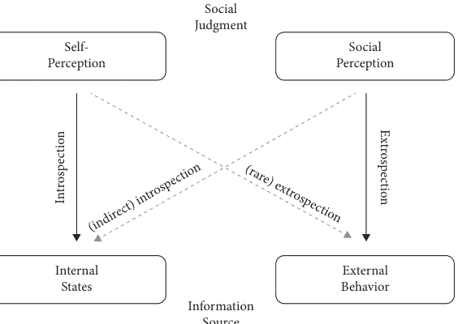
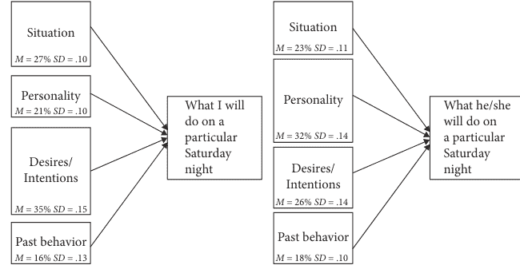
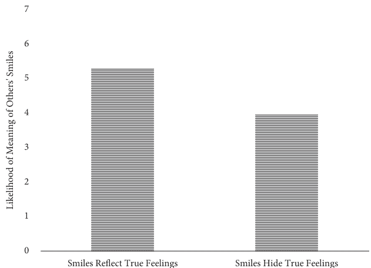

# 推理、偏见与探究：认识论与心理学的交叉路口

## 致谢

合编辑感谢作者们的深思贡献。

N. B. 和 D. D. 想要特别感谢几位研究生在完成本书过程中提供的有力帮助：Noah Hahn, Johnny Brennan 和 Christian Emrich。

N. B. 获得约翰·坦普尔顿基金会（资助号 #54160）的慷慨支持，于 2016 年 6 月在纽约市举办了一场认识论与心理学会议。他感谢 Alexander Arnold、John Churchill 和 Michael Murray。N. B. 对 Shane Wilkins 共同组织和主持会议表示感谢。

合编辑感谢 Matthew Ballantyne 提议本书的封面图片：《计划性报废》中的细节，这是 Nicolás Lamas 在 2019 年于鲁塞尔 Meessen De Clercq 展出的展览《黑暗考古学》中的作品。合编辑感谢 Nicolás Lamas 允许使用该图片，并感谢 Nick Lowen 设计了封面。

合编辑感谢他们在牛津大学出版社的编辑团队。本书最初由 Joan Bossert 和 Phil Velinov 选中，他们随后在其他地方担任新职位。Abby Gross 和 Katie Pratt 介入并推动了进展，随后 Abby 在出版社担任了新职位。最后，Nadina Persaud 和 Katie 在 Newgen KnowledgeWorks 的 Prabha Karunakaran 的协助下，将一切工作圆满收官。

## 贡献者

- Teresa Allen, 博士
  - 副教授
  - 哲学系
  - 北中部学院
  - 美国伊利诺伊州内珀斯维尔

- Yael Granot, 博士
  - 助理教授
  - 心理学系
  - 史密学院
  - 美国马萨诸塞州诺丁姆普顿

- Emily Ballantyne, 博士
  - 心理学教授
  - 纽约大学
  - 美国纽约州纽约市

- Kalypso Iordanau, 博士
  - 副教授
  - 科学学院
  - 中兰卡夏郡大学
  - 塞浦路斯校区 (UCLan Cyprus)
  - 塞浦路斯拉纳卡

- Nathan Ballantyne, 博士
  - 副教授
  - 哲学系
  - 福特汉大学
  - 美国纽约州纽约市

- Kristyn A. Jones, 博士
  - 研究员
  - 心理学系
  - 斯坦福大学
  - 美国加利福尼亚州帕洛奥托

- Nathan N. Cheek, 博士
  - 博士后研究员
  - 心理学系
  - 普林斯顿大学
  - 美国新泽西州普林斯顿

- Frank C. Keil, 博士
  - 教授
  - 心理学系
  - 耶鲁大学
  - 美国康提狄格州新哈文

- Jason D'Cruz, 博士
  - 副教授
  - 哲学系
  - 纽约州大学 Albany 分校
  - 美国纽约州奥巴尼

- Thomas Kelly, 博士
  - 教授
  - 哲学系
  - 普林斯顿大学
  - 美国新泽西州普林斯顿

- David Dunning, 博士
  - 教授
  - 心理学系
  - 密歇根大学
  - 美国密歇根州安娜堡

- Hilary Kornblith, 博士
  - 卓越教授
  - 心理学系
  - 马萨诸塞大学
  - 美国马萨诸塞州阿姆赫斯特

- Deanna Kuhn, 博士
  - 教授
  - 哥伦比亚大学教师学院
  - 美国纽约州纽约市

- Jessie Munton, 博士
  - 副教授
  - 心理学系
  - 剑桥大学
  - 英国剑桥

- Emily Lockhart, 博士
  - 高级讲师
  - 心理学系
  - 耶鲁大学
  - 美国康提狄格州新哈文

- Patrick Lynch, 博士
  - 副教授
  - 心理学系
  - 普林斯顿大学
  - 美国新泽西州普林斯顿

- Roy Sorensen, 博士
  - 教授
  - 哲学系
  - 德克萨斯大学奥斯汀分校
  - 美国德克萨斯州奥斯汀

- Sarah McGrath, 博士
  - 教授
  - 哲学系
  - 普林斯顿大学
  - 美国新泽西州普林斯顿

- Alessandra Tanesini, 博士
  - 教授
  - 英语系
  - 卡迪夫大学
  - 英国卡迪夫

- Hugo Mercier, 博士
  - 高等师学院 (ENS)
  - 法国巴黎

- George Boas, 博士
  - 教授
  - 哲学系
  - 美国哲学协会
  - 美国中国

- Chris Tucker, 博士
  - 副教授
  - 威廉姆斯与玛丽学院
  - 美国弗吉尼亚州威廉姆斯堡

## 引言

没有心理学的认识论就像没有盐的晚餐。关于理性、探究和偏见的问题是最紧迫且悬而未决的问题之一——它们在当代社会中的意义比以往任何时候都更加重大。因此，这些领域对理性、探究和偏见问题进行了探讨。

我们提供这本书，是为了展示跨学科之间可能发生的迷人且富有成效的对话。书中章节探讨了关于理性、其追求（即探究）及其潜在障碍（即偏见）的当代观点。任何这种长度的著作无法提供全面的综述，但我们为你带来了许多针对这些问题的活跃研究者的观点和论证。本书的结构围绕哲学家与心理学家之间的互动展开，他们试图刻画理性、探究和偏见，并描述普通人参与推理、探究和产生偏见的过程。诚然，这些领域之间存在真实的差异。认识论者关注规范性问题，而心理学家侧重于描述性问题。尽管如此，他们往往对同一种现象有着共同的智力好奇。而且他们可以为探究和偏见提供互补的见解。然而，这两类学者仍然被学科界限所隔离开来。

正如我们在开头指出的，这些问题在当下具有特别重要的意义。虽然人们可以争论理性是否是解决现代挑战的首要要素，但我们认为，没有理性，我们的集体生存和繁荣是不可能的。点击鼠标或滑动屏幕就能获得海量的信息和论证，因此对我们读到、看到和听到的内容进行理性推理的能力是不可或缺的。

许多挑战凸显了良好的推理是多么重要；我们将局限于三个例子。首先考虑通过网络计算机供政府和公民获取的海量信息。其中许多是准确且有价值的，但互联网充斥着误导性信息和赤裸裸的谎言。世界经济论坛 2013 年将虚假信息及其产生“数字野火”的潜力列为人类生存的威胁，以及抗药性细菌的威胁。如此危险的混乱混杂在其中，需要审慎思考和辨别才能将其分开。

第二个挑战是政治极化的兴起，这包含了科学的政治化。正如本书中的 Theresa Allen 和 Patrick Lynch 所指出的，成功的民主需要能够同理心和谦逊进行共同推理的公民。对基本事实的共同理解对于功能性辩论也同样重要。但最近的调查显示，美国人不仅根据不一致的态度将自己分为极端阵营，而且他们是在情感上这样做的。

彼此之间极度不悦（Iyengar 等人，2019）。例如，皮尤（Pew）的一系列调查追踪了美国人在多大程度上以愤怒和恐惧的态度看待他们的政治对手，将这些对手描述为对国家的威胁（皮尤研究中心，2016）。这些数字在过去几年里一直在上升。尽管这种情感极化的加剧在美国可能尤为明显，因此在其他地方较不如此，但其他国家也处于类似的上升趋势中，包括加拿大、新西兰和瑞士（Boxell 等人，2020）。

第三个挑战出现在 2019 年底，当时一种新型病毒开始席卷全球。该病毒很快被鉴定为冠状病毒（并被赋予正式名称 SARS-CoV-2，尽管 COVID-19 成了更通用的称呼），但除此之外，政府、卫生部门和公民在关于病毒如何造成破坏以及如何对抗它的知识上几乎是一片空白。它对身体有什么影响？人们如何抑制传播？如何进行治疗？能否针对它开发疫苗，以及如何有效分配疫苗？全球范围内，研究人员投入到一场探究的战斗中，不仅是为了对抗病毒，更是为了应对围绕如何战斗病毒的巨大不确定性。在这里，准确推理和高效探究的重要性变得格外突出。不断增加的死亡人数和严峻的经济后果强调了做正确判断的重要性。在写作此时，最终结果尚未待定，但关于某些知识领域的有效性和就绪状态，以及公众对专业知识和科学的理解，存在着悬而未决的问题。一场全球健康危机揭示了一个认识论上的危机。

## 本书结构

本书分为三个部分。在第一部分“理性与偏见”中，我们的作者探讨了理性和偏见的概念和实证地理学。这两个概念非常丰富且复杂，理论家和实验学家曾以各种方式理解它们。哲学家 Thomas Kelly 和 Sarah McGrath 在他们的章节开头提到了将偏见归因于个人、群体、观点、物体和结果的方法。“偏见”这一常见概念具有一种混乱的不统一性，Kelly 和 McGrath 提出了一个重要问题：是否存在一种在某种意义上是基本的事实，即其他事实可以根据它来解释？他们认为，关于偏见的事实通常基于或植根于关于偏见过程和程序的事实。

在下一章中，Nathan N. Cheek 和 Emily Pronin 描述了在自我和他人之间分配偏见不对称背后的心理学。他们调查了实证文献，表明人们存在“偏见盲点”，即人们无法识别自己的偏见，因此认为他人是有偏见的。Roy Sorensen 从我们如何评价他人的理性产生的类似问题进行了研究。我们假设他人的判断背后有逻辑，但也承认由于注意力和处理能力的限制，人类认知中的逻辑供应是短缺的。因此，我们既依靠理性来理解他人，又因为理性的认知成本过高而最小化理性。是什么解释了这种取予与权衡？Sorensen 考察了由理性的表面上冲突的关注点而产生的一系列哲学困惑。Teresa Allen 和 Michael Lynch 考虑了在文明且运作良好的民主中所需的推理类型，而 Jason D'Cruz 则询问事实合理化中所包含的推理是真实的还是仅仅是伪装。根据 D'Cruz 的叙述，合理化者本质上主要是为了自我辩护的故事讲述者。

在第二部分“感知与注意”中，我们的作者考察了推理和偏见如何延伸到感知体验——即我们字面上看到的、听到的、尝到的和闻到的东西。通常，人们假设他们看到的物理世界真实如是，但心理学研究对这一假设表示怀疑。外部世界是一项本质上困难的任务。我们的眼睛和耳朵接收的信息往往是模糊的或过于稀疏，无法指导判断——因此大脑需要在缺乏充分数据的情况下得出结论。例如，在观察一座山丘时，我们的眼睛接收到的信息不足以衡量其坡度的陡度。然而，人们觉得他们可以准确地衡量这一点。此外，我们的感官在任何时候接收到的信息都超过了我们的处理能力，因此大脑会选择性地丢弃数据。我们安全地坐在椅子上的读者感觉不到椅子施加的压力——直到我们打破这种感觉。我们很难捕捉到眨眼时发生的短暂中断，或在移动眼睛时产生的模糊。人们感知不到这一切，却假设他们的感官为他们提供了准确且完整的世界呈现。

由 Yael Granot、Kristyn A. Jones 和 Emily Balcetis 撰写的章节考察了大脑如何调整感知体验的证据。这三位心理学家认为感知并不像人们通常认为的那样客观，描述了塑造我们“视觉”的无意识偏见。他们将这一科学意义应用于法庭证据的使用上：法庭上的不同参与者可能在字面上以不同的方式看到同一视频证据，从而得出冲突的判决。

Chris Tucker 随后提出了一个哲学对应问题，询问人们是否真的可以依靠他们的感知。某物看起来像那样的经验是否提供了某物确实是那样的证据？一种著名的认识论理论从现象保守主义角度给出答案：在缺乏反证的情况下，我们信任感知经验告诉了我们。Tucker 反对无意识的因果影响构成感知基础的主张，并认为这一主张没有说服力。在下一章中，哲学家 Jessie Munton 建立了一种类似于心理学的理论，关于感知偏见如何构成社会偏见。在 Munton 看来，由于感知差异，人们以不同的方式感知和判断其他社会群体的个体。

第三部分“元认知与评估”深入探讨了对自我和他人的评估。Dunning 指出一个根本问题：缺乏知识的人缺乏洞察来承认自己的无知。在接下来的章节中，Ballantyne 解释了错误如何导致专业化。Hugo Mercier 转向跨个体聚合信息的价值，描述了其益处的来源，以及为什么人们往往无法看到其价值。Deanna Kuhn 和 Kalypso Iordanou 描述了人们在对复杂话题进行推理时的基本错误。这些错误阻碍了社会对话，心理学家们指出教育如何提供帮助，辅助个人和集体。Frank C. Keil 和 Kristi L. Lockhart 探讨了人类何时可知不可知的问题，以及儿童如何学习哪些事情是专家无法掌握的。

McGrath 的直觉，因此他们是否会根据其推理过程中遵循的程序来评估其偏见？他们是否而是根据结果来判断偏见？他们在判断“自我”与“他人”时，是否采取了不同的定义？

在我们的第二个例子中，认识论与心理学在相反的方向上产生了交融。某些概念仅产生于经验心理学研究。例如，“朴素现实主义”这一概念：人们假定他们看到并理解的世界是其真实的样子。在朴素现实主义的影响下，一个人只会允许偏见主要（如果不是完全地）存在于他人身上；否则，他自己的知识就比别人的要客观得多。其真理性是显而易见的。心理学研究已知的问题是，这种假设的自我客观性往往是一种幻觉。人们可能看到了世界的真实模样，却未能注意到自己的感知和信念是如何基于假设、阐释和偏见的。Pronin 和 Cheek 在观点领域考虑了这一现象，而 Granot、Jones 和 Balcetis 则展示了朴素现实主义在视觉感知中延伸得有多远。但是，现实主义给哲学中的经典问题和论点带来了什么样的挑战？在朴素现实主义视角下，有多少哲学话题看起来变得不同？在这一章中，Chris Tucker 探讨了实证发现对某一认识论理论的影响，而对其他主题和理论的重新评估仍在等待中。

## 编者的话

《理性、偏见与探究》是一部多学科的冥想，针对那些沉浸在信息中但又不确定如何妥善管理所有信息的读者。在未来几十年等待我们世界和社会的挑战中挣扎，变得更加清醒。我们希望这本书能鼓励富有成效的讨论和新的合作。

总而言之，洞察推理、探究和偏见是一项持续的任务，历史上的每一代人都均认为这至关重要。这项任务的重要性从未减少，尽管学者们对推理如何运作以及应当如何运作有了更深入的见解。事实上，在我们这一代，在这一广泛的研究领域取得进展可能比我们的祖先更为关键。毕竟，风险已经增加了。人类目前正在与三位骑手——数字虚假信息、政治极化和全球流行病——斗争，人们不禁怀疑会有第四位很快降临现场。也许这第四个挑战——一个要求人类具备最高程度公正敏锐思维的挑战——已经在这里了。它的形式就是气候变化。

David D.

Nathan Ballantyne

## 参考文献

Boxell, L., Gentzkow, M., & Shapiro, J. M. (2020). Cross-country trends in affective polarization [Working paper 26669]. National Bureau of Economic Research. https://www.nber.org/papers/w26669

Boas, G. (1951/52). Philosophy and Ritual. Proceedings and Addresses of the American Philosophical Association 25, 5–17.

Iyengar, S., Lelkes, Y., Levendusky, M., Malhotra, N., & Westwood, S. J. (2019). The origins and consequences of affective polarization in the United States. Annual Review of Political Science, 22(1), 129–146.

Pew Research Center. (2016, June 22). Partisanship and political animosity in 2016. https://www.pewresearch.org/politics/2016/06/22/partisanship-and-political-animosity-in-2016/

Pew Research Center. (2019, October 10). Partisan antipathy: More intense, more personal. https://pewrs.ch/3gGRfGp

World Economic Forum (2013). Global risks 2013. Geneva, Switzerland: World Economic Forum.

# 1

## 偏见

### 某些概念地理

Thomas Kelly 和 Sarah McGrath

我们这一章的目标是帮助阐明“偏见”的概念¹。在第一部分中，我们建议该领域一个潜在有成效的项目是：在许多被归因于偏见的因素中，识别出那些在解释顺序上是基础性的（例如，偏见经常被归因于人们和他们的观点，其中一个可以从另一个来理解吗？）。在追求这一项目的过程中，我们提出并辩护了一个假设，即“过程优先性”，根据该假设，下文所述的事实旨在适用于植根于关于偏见过程和程序的更基础事实的现象。在第二部分中，我们探讨了关于个人偏见与其部分之间的偏见之间关系的问题。在第三部分中，我们对偏见概念在适用于人类和其他实体时的含义提供了一种解释。根据这一解释，偏见是以系统化的、模式化的或可预测的方式偏离显著对称性标准的倾向。在最后两个部分中，我们对偏见概念与“可靠性”和“知识”概念相互作用的方式提供了一些见解。

¹ 最近关于偏见主题的哲学工作主要关注具有争议的隐性偏见现象。（文献抽样请参见 Brownstein & Saul [2016]；概览请参见 Brownstein [2017]。）这类哲学文献的立足点是几十年来社会心理学中对隐性偏见实证研究的爆发（例如，里程碑式的研究 Greenwald & Banaji [1995]，以及普及性概述请参见 Greenwald & Banaji [2013]）。相比之下，下文所提出的主张旨在适用于更广泛的现象，而将隐性偏见作为一种可能的特殊情况。

Thomas Kelly and Sarah McGrath. *Bias In Reason: Bias, and Inquiry.* Edited by Nathan Ballantyne and David Henning, Oxford University Press. 2022. Oxford University Press. DOI: 10.1093/oso/978019763916.003.002


### 14 托马斯·凯利与莎拉·麦格拉斯

领域：考虑到许多不同的事物都可能存在偏见，是否某些事物在解释顺序上更具基础性？如果是，是哪些？

以下是针对我们考虑的这类项目的对比。考虑以下问题：

什么类型的事物可能是真或假的？

哲学家中对此有一种正统的观点，这种观点包含两个部分。根据正统观点的第一部分，“真”的属性由许多不同的事物所体现，包括心理状态和认知活动（范例性的：信念和判断）、语言实体（范例性的：自然语言的句子）、标记言语行为（例如，你在特定场合断言雪是白的）等等。³ 但同时，根据哲学正统观的第二部分，这些事物中有一个脱颖而出，具有基础性：特别是，命题（`propositions`）是真理性的基本载体，其他任何事物都是由于其与某个真命题所处的关系而具有“真”的属性。根据这一思路，拥有一个真实的信念是指对某个具有“真”属性的命题处于相信关系中。同样，为什么英语句子“Snow is white”和其字面翻译的日语句子都被视为真实的，是因为它们都被用来表达某个命题，而该命题本身具有“真”的属性。因此，尽管英语句子、日语句子以及它们所表达的命题都是真实的，但在解释顺序上，命题及其真理性才是基础性的。因此，英语句子和日语句子是真实的这一派生问题：它们从其所表达的真命题中继承了真实性。也许偏见表现出类似的结构。

接下来我们提出一个假设：至少在目前提到的事物中，通常是过程（程序）是具有基础性的。也就是说，尽管人们将偏见归因于所有提到的事物，但通常，当一个非过程的事物产生偏见时，其附近会有某个过程或潜在过程也具有或将具有偏见的属性；并且

> ³ 因此，根据哲学正统观点，真理是泛指的：它并不仅仅附于某一个；它附于许多事物。此外，请注意，在可能产生偏见的事物中，即使是这个不完整的清单在本体论类别上也是多样化的，因为它包含了状态（例如：信念）、事件（例如：标记话语）以及看起来既不是状态也不是事件的句子（例如：自然语言的句子）。

### 15 偏见

此外，非过程的事物之所以被视为偏见，是因为它与偏见过程所处的关系。它从偏见过程继承了其偏见的地位。

我们将这一假设称为“过程优先论”（`The Priority of Processes`）。

为了使该假设更具体，再次考虑那个有偏见的法官。似乎法官被视为有偏见，是因为他们做出决定的方式（或他们可能做出决定的方式）是一个偏见的过程或程序。当我们断定个人具有偏见时，那是因为我们认为他们倾向于以偏见的方式得出观点、信念、判断、决定等。一个试图反转这一解释顺序的理论者可能会提出以下观点：“看，有偏见的人因为使用偏见程序而被视为有偏见并不是偏见的。相反，是某些人是有偏见的，而偏见程序仅仅是那些偏见的人使用的程序——无论它们是什么。”但这似乎是颠倒倒置。

另一类情况。正如所提到的，对人的判断、感知和决定断定为具有偏见是常见的。这些判断、感知和决定本身并不是过程；相反，它们是过程的结果。在这里，我们的建议是，当描述一个判断、感知或决定为偏见是真实的时，这是因为产生它的过程是有偏见的。根据这一思路，当有人声称法官的判决是有偏见的时，这一主张取决于做出该判决的过程或程序是否具有偏见。同样，有人可能会尝试反转这一解释顺序：“看，有偏见的人因为使用偏见程序而被视为有偏见并不是偏见的。相反，是某些人是有偏见的，而偏见程序仅仅是那些偏见的人使用的程序——无论它们是什么。”但反对这种建议，我们认为基础性的应该是判决本身。请注意，通常情况下，判决的内容本身并没有任何使其具有偏见的因素：如果相同的判断是非偏见的方式得出的（即通过非偏见过程），它就不会被视为具有偏见。因此，我们可以想象两种场景。

⁴ 在某些情况下，相关的过程可能并非产生判断（感知）的过程，而是维持它的过程。

### 16 托马斯·凯利与莎拉·麦格拉斯

在第一种场景中，法官得出被告有罪的判决，是因为被告有爱尔兰姓，且法官倾向于认为拥有爱尔兰姓的人犯了他们被指控的罪。在这种场景下，被告有罪的判决被视为偏见判决。但现在假设法官以另一种方式得出相同的判决，通过仔细考虑所有可用证据并妥善权衡证据以得出：被告有罪。如果证据确实支持有罪判决，并且证据对法官来说在心理上是有效的，那么这个判断就是非偏见的。

简而言之，两个场景中相同的判断（就内容而言）可能是同人在两个场景中做出的，但它是偏见还是非偏见取决于得出它的过程。在这方面，判断的地位是派生的或继承自过程的。如果是正确的，它倾向于支持过程在解释顺序上更具基础性的假设（至少与那些被视为过程的结果相比）。

此时，有必要对该假设进行澄清。再次考虑这样一种情况：解释顺序上的基础是过程的偏见，被理解为关于他们所做判断的偏见，我们希望我们的主张被理解为关于相关偏见的真实条件的论题，而不是关于其特征认识论的论题。通常，观察者无法接触产生判断的过程。（或者，至少无法直接接触该过程。）相反，观察者接触的是过程的结果，即判断本身。正因如此，在通常情况下，人们归因偏见的依据包含了标记判断（或标记判断的模式）；得出使用的过程是偏见过程的结论，是基于已有依据的推论，即观察到的判断模式。我们看到一种持续针对某一类被告的判断模式，我们认为如果使用的是非偏见过程，这种模式不太可能出现或极不可能出现。随后我们得出结论，对观察到的判断模式的最佳解释是使用了偏见过程来生成这些判断。这一切说明，关于在这种情况下过程具有基础性的假设，应该以符合以下想法的方式来理解，

我们也认为这一点是正确的：在发现的顺序上（即在对偏见进行合理归因时），过程通常不是根本性的。

接下来考虑对“过程优先性假设”⁵的挑战；

归结底，如果不诉诸该过程所产生的偏偏结果这一概念，就无法理解“偏偏过程”这一概念。通常，当一个过程被视为偏偏的时，是由于其内在属性。相反，它是因为其倾向于产生具有偏见的结果或结果模式（可能以一种轻微稳健的方式）。也就是说，即使某个特定结果因为是由偏偏过程产生的而被视为偏偏的，但该过程之所以之所以被视为偏偏的，取决于它倾向于产生某种类型的结果或结果模式，即产生具有偏见的结果。因此，在解释的顺序上，过程终究不是根本性的。

这一异议提出了一个重要的问题。然而，我们认为，一旦该假设被正确理解，它并不能提供拒绝过程优先性假设的充分理由。

作为理解其之所以如此的第一步，请注意，过程优先性假设与以下主张完全一致：

-   一个给定的过程是否偏偏，通常不是该过程的内在属性：相反，在典型情况下，一个偏偏过程被视为偏偏是因为它倾向于产生的结果（或结果模式）所具有的属性。

而过程优先性假设与以下更强的主张并不一致：

-   一个给定的过程是否偏偏，通常不是该过程的内在属性：相反，在典型情况下，一个偏偏过程被视为偏偏是因为它倾向于产生的结果（或结果模式）具有偏偏这一属性。

### 18 托马斯·凯利 莎拉·麦格拉斯

我们强调这两个主张之间的区别，因为我们倾向于认为真理就在于：一个给定的过程因其产生某些特定结果的倾向而被视为偏偏的，而这些结果的关键属性并非偏偏。考虑一个核心案例：一方面是偏偏样本或偏偏数据，另一方面是偏偏抽样或数据收集程序之间的关系。什么是偏偏样本？它简单被用作“无代表性样本”的同义词。但我们认为这是一个错误，并不是更高级教科书中解释“偏偏样本”概念的方法。（为了清晰地讨论这一点，例如参见 Lane [n.d.], pp. 235, 660。）无代表性样本是指不能准确反映其所抽总体的样本。在原则上，样本可能是无代表性的但不偏偏的：这种情况发生在，当一种方法论上无法实现的抽样程序被应用于一个总体，并独特地产生了一个在相关方面不能准确反映该总体的样本。（即使目标总体在民主党和共和党之间大致平分，人们最终也会因为简单的运气不好而选出更多的共和党。）相反，偏偏样本是由偏偏抽样程序生成的——样本具有偏偏属性，是因为它从程序中继承了该属性。偏偏抽样程序是指目标总体的每个成员都有被纳入样本的相等机会。当然，当人们解释为什么一个给定的程序或过程具有偏偏属性时，这种属性完全与其产生某种类型结果的倾向无关。例如，人们可以将一个偏偏程序描述为倾向于产生代表性样本或结果的过程。注意，只要人们不简单地将“无代表性样本”和“偏偏样本”等同起来，这种描述就与过程优先的思想是完全一致的。

考虑另一个核心案例，即硬币。想象以公平的方式反复抛掷一枚公平硬币。碰巧，在大量抛掷后，“正面”的数量远多于“反面”。这一结果集合在任何理论上有趣或重要的意义上具有偏偏属性吗？我们认为没有。更通地说，在许多情况下，人们对结果或结果集合的无代表性这一想法有独立的把握力，而这并不涉及其具有偏偏的问题。每当我们对结果的无代表性有某种依赖性的把握时，就产生了解释为什么一个给定的过程或程序因其产生此类结果的倾向而被视为偏偏的可能性。而这样的解释与过程优先假设是完全一致的。

过程优先性可以推到何种程度？我们赞同这样观点：即在解释的顺序上，过程比个人或群体更根本，比过程的实际结果（无论这些结果是具体的判决、信念、决策、裁决等）更根本。也许想法优先性的推演是有限的，最终它需要通过各种方式进行限定。但目前，让我们将其留为一个开放的问题，以便继续讨论后续的想法。

### 部分与整体

我们关于可能偏见的对象的完整列表中值得注意的特征是，列表中的某些项目与列表中的其他项目处于部分与整体的关系。这里的一个明显例子是人和群体：正如我们评估个人是偏偏还是无偏的，我们也评估一个由个体法官组成的法院是偏偏还是无偏的（例如，我们可能会将某种偏偏归于美国最高法院）。过程和程序也是如此，它们在结构上通常与其他过程和程序处于部分与整体的关系。大学的整体录取过程通常由（子）过程组成，对应申请池逐渐缩小的不同阶段。

### 20 托马斯·凯利与 莎拉·麦格拉斯

大学的整体录取过程通常由（子）过程组成，对应申请池逐渐缩小的不同阶段。

我们强调这两个主张之间的区别，因为我们倾向于认为真理就在于：一个给定的过程因其产生某些结果的倾向而被视为偏偏的，而这些结果的关键属性并非偏偏。考虑一个核心案例：一方面是偏偏样本或偏偏数据，另一方面是偏偏抽样或数据收集程序。什么是偏偏样本？它简单被用作“无代表性样本”的同义词。但我们认为这是一个错误，并不是更高级教科书中解释偏偏样本概念的方法。（为了清晰地讨论这一点，例如参见 Lane [n.d.], pp. 235, 660。）无代表性样本是指不能准确反映其所抽总体的样本。在原则上，样本可能是无代表性的但不偏偏的：这种情况发生在，当一种方法论上无法实现的抽样程序被应用于一个总体，并独特地产生了一个在相关方面不能准确反映该总体的样本。（即使目标总体在民主党和共和党之间大致平分，人们也会因为简单的运气不好而选出更多的共和党。）相反，偏偏样本是由偏偏抽样程序生成的——样本具有偏偏属性是因为它从程序中继承了该属性。偏偏抽样程序是指目标总体的每个成员都有被纳入样本的相等机会。当然，当人们解释为什么一个给定的程序或过程具有偏偏属性时，这种属性完全与其产生某种类型结果的倾向无关。例如，人们可以将一个偏偏程序描述为倾向于产生代表性样本或结果的过程。注意，这种描述与过程优先的思想是完全一致的，只要人们不简单地将“无代表性样本”和“偏偏样本”等同起来。

考虑另一个核心案例，即硬币。想象以公平的方式反复抛掷一枚公平硬币。碰巧，在大量抛掷后，“正面”的数量远多于“反面”。这一结果集合在任何理论上有趣或重要的意义上具有偏偏属性吗？我们认为没有。更通地说，在许多情况下，人们对结果或结果集合的无代表性这一想法有独立的把握力，而这并不涉及其具有偏偏的问题。每当我们对结果的无代表性有某种依赖性的把握时，就产生了解释为什么一个给定的过程或程序因其产生此类结果的倾向而被视为偏偏的可能性。而这样的解释与过程优先假设是完全一致的。

过程优先可以推到何种程度？我们赞同这样观点：即在解释的顺序上，过程比个人或群体更根本，比过程的实际结果（无论这些结果是具体的判决、信念、决策、裁决等）更根本。也许想法优先性的推演是有限的，最终它需要通过各种方式进行限定。但目前，让我们将其留为一个开放的问题，以便继续讨论后续的想法。

我们关于可能偏见的对象的完整列表中值得注意的特征是，列表中的某些项目与列表中的其他项目处于部分与整体的关系。这里的一个明显例子是人和群体：正如我们评估个人是偏偏还是无偏的，我们也评估一个由个体法官组成的法院是偏偏还是无偏的（例如，我们可能会将某种偏偏归于美国最高法院）。过程和程序也是如此，它们在结构上通常与其他过程和程序处于部分与整体的关系。大学的整体录取过程通常由（子）过程组成，对应申请池逐渐缩小的不同阶段。

这似乎显而易见且熟悉。但正因为其如此有效，我们才应该警惕关于整体层面偏见与部分层面偏见之间关系的任何还原图景。总的来说，即使当我们关注由偏偏部分组成的整体时，部分偏偏既不是必要条件也不是充分条件。让我们逐一来看这些点。

首先，在原则上，即使部分是偏偏的，整体也可能是无偏的。也许最明显的可能性是部分的偏偏以某种方式相互抵消或对抗，从而产生无偏。这可能是由于刻意的设计——例如，人们可以故意设计一个组织或机构，使其尽管部分偏偏或因为部分偏偏而保持无偏。作为一个粗略的比较，考虑对抗制司法体系背后的理想。（对于支持对抗制的一些证据，请参见 Thibaut and Walker [1975]。）在原则上（尽管无疑，这种事情在实践中很难实现），一个故意整合偏偏部分的程序在评估整体时可能会得分更高。因此，可以存在具有偏偏部分的无偏整体。

反之，似乎也存在具有无偏记者的偏偏整体。……即使当我们孤立地考虑这些记者时，即使我们观察他们为组织执行特定工作时，我们也不会将偏偏归于他们：他们与同职业的其他人相比没有显著特征，他们将

> 7 也许最后一点隐含在最近关于制度性种族主义或各种制度性偏见的讨论中。即使组成机构的个人免于或相对免于某种偏偏，也不意味着该机构必然缺乏那种偏偏。

### 偏见 21

毫不犹豫地描述为“无偏见的”。进一步假设，在该特定新闻机构工作的所有（或几乎所有人）在政治问题上都有主见。他们拥有所有相同的政治观点，或者至少持有的政治观点处于同一个狭窄的意见范围内。（在我们设想的这种情况下，考虑到他们手中的证据、过去的经历和个人生活史等，所有这些观点对他们来说甚至可能是完全合理的想法。）尽管如此，意见多样性的完全匮乏——这是一种只有当他们被视为一个群体而非个体时才会显现的特征——可能会通过熟悉的机制导致对新闻报道的偏见。在这种情况下，将该新闻机构描述为有偏见的会更好，尽管人们不会将偏见归因于构成该机构的个体。

需要明确的是，我们并不认为这是常态。尽管我们认为福克斯新闻（`Fox News`）和 `MSNBC` 具有某些偏见，但我们认为这些偏见从社会学事实的角度来说，是由这些机构负责内容的大量人员共同拥有的，且前者是由后者造成的。然而，我们认为，局部缺乏偏见并不保证整体不偏见，警惕这种整体性偏见是值得的。

### 偏见作为……

通常，人们将偏见归因于个人或群体，并认为该个人或群体具有某种倾向。⁸ 例如，一个对特定种族的人有偏见的法官或法院，倾向于对该种族的人做出不利判定。声称大多数人类具有现状偏见，是归因人类具有仅仅因为其是现状就倾向于维护现状的倾向。同样，说一个硬币倾向于正面有偏见，是归因硬币具有某种倾向或倾向性属性。

与更广泛的倾向一样，偏见在未显现期间可能是真实的，事实上，即使它们从未显现也是如此。（典型例子：如果一个杯子从未掉落过也从未破碎，那么说这个杯子是易碎的可能是真实的。）偏见也是如此：如果一个法官对某一类的人有偏见

> ⁸ 如果一个人接受过程优先假设，那么最终将希望把这种倾向解释为涉及某些本身具有偏见属性的过程。但我们不希望在这节中预设该假设的真性。

### 22 托马斯·凯尔 与 莎拉·麦格拉瑟

对某一类的人有偏见，这种偏见可能会显现——例如，如果法庭中没有这类人出现，或者他们出现的所有案件都是如此清晰，导致法官的偏见永远不会被触发（不像在不那么明确的案件中那样）。

偏见是一种倾向，但并非任何倾向都是偏见。偏见倾向于偏离规范标准。

考虑篮球裁判的案例。考虑到他们执裁比赛中实际发生的情况以及运动规则，我们拥有裁判应当做出的判罚的理想。同样，存在法官或法院应该达成的裁决，即法庭呈现的事实加上相关的法律条款。篮球比赛应该做出的判罚或法庭应该做出的裁决提供了一个标准，所有裁判和实际法官的努力可能在不同程度上达到或未能达到标准。有偏见的裁判或法官可能倾向于偏离标准：在一系列可能的案件中，他们的判决方式与他们本应该的方式不同⁹

偏见和其他大多数倾向一样，通常具有程度性。篮球裁判可能对两支球队中的一支有极偏见，或者有轻微且微妙的偏见。在后一种情况下，他们可能大部分时候都以无偏见裁判的方式执法比赛，仅在极少数事实对所有参与者都难以判定的情况下偏离该标准，在这些案件中，他们不成比例地有利于两支球队中的之一。同样，一个硬币可能在正面上有轻微偏见，或有显著偏见。任何有偏见的硬币都偏离了完全无偏硬币提供的标准，而给定硬币的偏见程度取决于其偏离该理想的程度。

当然，考虑到足够严苛的精度标准，任何实际硬币完全无偏见的概率是极大的。假设情况如此，是否就能推导出到底没有无偏见的硬币呢？我们认为得出这个结论是错误的，原因正如如下：

> ⁹ 同样，当我们描述一个硬币有偏见时，我们假设了一个特定的标准，即无偏硬币提供的标准，该标准倾向于在通常方式抛掷时 50% 的时间落在正面。正如这些和其他例子所暗示的那样，相关的标准并不是真实规范秩序的特征或类似物品。一个大多数硬币倾向于一半时间落在正面的世界，并不比一个全是反面的宇宙更好（即使在尊重和其他一切方面都更好）。只要我们认为一个包含大多数公平硬币的世界更好（例如，因为我们在式橄榄球比赛开始时使用公平硬币来决定首球），我们很容易想象出另一套控球方案会使相反的效果合理。

### 偏见 23

如果因为在足够强大的显微镜下观察，每个表面最终都会发现有些凸不平，那么得出实际上不存在任何平坦表面的结论将是错误的。在这两种情况下，足够好就是好；在这两种情况下，什么算作“足够好”可能是一个模糊且对语境敏感的问题¹⁰ 同样，重要的是，如果我们足够地接近理想状态，我们可能会认为某些实际的人（例如法官）是无偏见的，即使他们偏离的方式恰恰是那种如果更加明显就会导致偏见指控的类型。在此处或其他地方，即使未能达到柏拉图式的形式，也可以作为一个真实的实例。

### 24 托马斯·凯利与 莎拉·麦格拉斯

（实施了额外的必要条件）但这种方法并没有同时排除工作科学家可能归类为偏见的现象。如果如此，那么目前的说明可能为至少一个偏见概念提供合理的解释，类似于卡纳普（`Carnap, 1950`）意义上的说明¹¹


尽管如此，似乎存在某些倾向，以系统性的、模式化的或可预测的方式偏离规范标准，而这些倾向通常不被视为偏见。例如，考虑系统性误读的倾向。我们的三个孩子中有两个在当某些单词或声音嵌入特定的结构中时，倾向于那样发读这些单词或声音。因此，我们的孩子倾向于以模式化且可预测的方式偏离正确英语发音的规范。然而，至少在我们听来，认为将这些相关倾向归类为偏见似乎是不正确的。同样，一个人在做长除法时反复犯同一种错误，并不是因为偏见。这，尽管某些系统性地偏离显著标准的倾向自然会被视为偏见，但另一些则不是。区别何在？

这里有一个推测¹² 也许偏见是一种系统性偏离的倾向，不仅是指偏离任何标准，而是偏离某种对称性。再次考虑偏硬币的范例。当硬币抛起时，有两种可能的结果。无偏硬币的特征是这两个结果之间存在对称性，因为它们的概率相等的。在偏硬币的情况下，对称性缺失了。如果一个人倾向于对公平硬币落在正面的概率信任度高于其落在反面的概率，那么他就是偏向正面的偏见。一种自然的想法是，这被视为一种偏见，但并不是因为涉及对理性信念施加了限制——毕竟，实现这种限制有许多方法，它们并不被视为偏见的表现——而是因为违反了对理性信念的对称性限制。

¹¹ 根据卡纳普的理解，对一个概念的说明并不旨在完美地捕捉或容纳普通用法中所有的细微差别；事实上，它在外延上与理论概念并不等同。相反，其目标是捕捉附近在理论上有趣且重要的概念，而且从理论化的角度来看，这样划分是有意义的，即使这种划分方式偏离了普通用法。

¹² 随后的讨论受到了克里斯蒂安·列表（Christian List）建议的启发；他不应对我们发展这一观点负责。

### 偏见 25

我们的推测是，相关的解释具有普遍性。即使在更复杂的情况下，偏见的实例也涉及系统性地偏离对称性标准，而无偏则保持某些对称性和不变性。考虑一个录取过程。拥有无偏录取过程最简单的方法是每个申请人都有平等的录取机会，就像录取机会由公平抽签决定一样。但当然，即使某些申请人（资质更好的）被录取的机会比其他人大，该过程也必须保持无偏。在这种情况下，尽管申请人的录取机会不同，其他对称性仍会被保留。例如，如果一个录取过程在种族方面是无偏的，那么具有相同资质的不同种族背景申请人将拥有相同的录取机会：申请人入学的概率将与其种族保持不变。在偏录取过程的情况下，这种对称性将无法保持。相比之下，当我们的孩子读错“r”开头的单词时，尽管他系统性地偏离了某种规范，但他所违反的规范或标准并没有具备正确的结构。我们的推测是：当一个人倾向于系统性地偏离某个标准时，该标准越被自然地视为对称性标准，将这种倾向视为偏见就越自然。

再次，这里还有很多可以讨论的内容。但再次，我们将继续下去，以便提出一些进一步的想法。

### 偏见与可靠性

在这一节中，我们讨论一个已经提到过题，即有偏/无偏与可靠/不可靠之间的联系。人们认为这些概念之间存在直接的联系是理所当然的。毕竟，诸如“有偏见的信息源是不可靠的信息源”或“偏偏采样程序是不可靠的”之类的主张似乎是陈词。然而，我们认为这里的联系并没有人们最初想象的那么直接，这种方式在哲学上很有趣。

### 26 THOMAS KELLY AND SARAH MCGRATH

我们已经注意到，一个人（或一个信息源或过程）即使是无偏的也可能是不可靠的，例如一个无偏但无能力的篮球裁判。对于某人为何可能不可靠的一种常见解释是他们有偏见，但某人的不可靠可能是由于与偏见无关的原因。通常情况下，可靠性并不意味着偏见。

反过来呢？偏见意味着不可靠吗？我们认为，这个问题的正确答案并不简单。一方面，我们认为诸如“有偏见的思考者是不可靠的”这类泛括是正确的，至少在它们被恰当解释时如此。另一方面，此类主张必须经过解释，使其与以下事实一致。大多数认知过程都是这样的，它们是可靠还是不可靠取决于它们运行的环境。通常，同一种过程在某些环境中是可靠的，但在另一些环境中是不可靠的——这一点在认识论的相对主义讨论¹³和心理学中的“理性之战”中是为人所知的。（参见例如 Gigeren [1991] 关于自适应情况下启发式方法的可靠性的研究。）

假设某个人对一组人有偏见。具体来说，他们倾向于得出结论，认为 F 组的人可能是 G，其中 G 是某种负面特质。（我们假设没有先验理由认为 F 组的人更有可能是 G；该个人也没有任何重大的实证证据表明他们确实如此。这只是偏见，即当他们遇到属于 F 组的人时，他们推断那人是 G，或者那人很可能是 G。）当然，这种推理模式会导致该人获得大部分真还是假的信念，将取决于他们所处的环境。特别是如果他们恰好处于一个环境，那里他们遇到的 F 组人员往往具有特征 G，那么这种偏见的推理模式（以及使用它的有偏见的人）就是可靠的，至少如果我们根据总信念中真信念的实际频率来衡量可靠性的话。事实上，对于他们最终获得的信念来说，有偏见的人可能比无偏的人（后者在得出结论认为 F 组的人是 G 之前会等待证据）更可靠。

¹ 有关这些问题的概述，请参见 Goldman 和 Beddor (2016)。也许如果对什么是“过程”采取足够宽容的态度，就可以描述出在任何可能的环境中都是可靠的过程，以及其他在任何环境中都是不可靠的过程。但充其量，这些都将是不常的情况。

### 偏见 27

更普遍地说，偏见的内容以正确的方式与世界契合，使得有偏思考者最终是可靠的。

（再次，尽管具有极高的可靠性，认为某人有偏见的理由仅仅是：他们没有足够的理由认为 F 成员是 G。他们只是运气好：如果他们处于一个大多数遇到的 F 并不是 G 的环境中，他们仍然倾向于得出结论认为 F 是 G，并因此获得许多错误的信念。）

有偏思考者在偏见与环境契合时可以是可靠的，这一事实是否意味着我们应该拒绝“有偏见的思考者是不可靠的”这类显而见的观点？我们并不认为如此。正如所指出的，我们认为在这些陈见得到宽妥解释时，它们与观察到的结果是一致的。为了维护偏见与不可靠之间的直觉联系，可以采取两种不同的（尽管是兼容的）处理方式。

### 28 马斯·凯利 与 莎拉·麦格拉斯

这种偏差可能与环境完美契合，从而使得真信念在总信念中所占相对较高的比例。

然而，值得注意的是为什么这种偏见与不可靠之间表象上的“松弛”元素最初是如何产生的。通常来说，一个特定个人或认知过程的可靠程度，并不会是该个人或过程的内在特征。相反，它将是该个人或过程的一种关系性特征，与该个人所处的环境或该过程运作的环境紧密相关。考虑一个严谨、负责任的思考者，他们在形成信念时会一丝不苟地关注证据。在我们的世界中，这些认知习惯和倾向有效地促进了拥有真信念而非虚假信念的目标。（或者，至少，与那些忽视证据并以草率或随意的方式形成信念的人相比，这些者在拥有真信念而非虚假信念方面感觉良好更好。）然而，当人们考虑同一位思考者在一个由笛卡尔式的邪恶魔鬼运行并欺骗其居民的可能世界中表现如何时，就会发现这些同样的习惯和倾向是完全不可靠的——事实上，它们导致一个人的结果比那些随意形成信念的人还要糟，恰因为魔鬼已经确保了世界中可用证据对一个正直的人来说是系统性的误导。教训是：通常情况下，一个思考者或一种形成信念的方式是可靠的，或者说其可靠程度是一个关系性问题。它不取决于思考者或过程本身，而取决于世界。

相比之下，在关于偏见最自然的思考方式中，某人是否具有某种偏差在任何意义上都不是一个关系性问题。如果我们把一个人转移到另一个可能世界，但保持其心理状态不变，那么他们将拥有与之前完全相同的偏差（即使世界非常不同）。偏见或不偏见，或缺乏某种偏差——至少在一个抽象层面上，这些现象类似于拥有或缺乏某种偏差对个人认知计划的影响，将随着环境以及他们所处的位置而发生显著变化.¹¹⁴

¹⁴ 关于倾向形而上学的传统观点认为，倾向是其持有者的内在属性。基于这种传统观点以及偏差即倾向的论点，可以立即推导出结论：偏差是拥有偏差者的内在特征，而且仅仅将一个人从一个环境转移到另一个环境而不改变其内在属性，将使其偏差保持完好。关于倾向是内在属性的经典论述，特别是 Johnston (1992, 232–234) 和 Lewis (1997, 147–148)。McKittrick (2003) 对这一观点提出了挑战。

### 偏差与知识

我们将以关于偏差与知识之间联系的一些说明作为结束。

一种自然的想法是，具有偏见——至少，当涉及的偏差足够强时——排除了认知。想象一位法官，他对被告的偏见如此强烈，以至于无论证据表明什么，他都会认为被告有罪。当法庭出示被告有罪的弱证据时，法官得出被告有罪的结论，这一这一正是其偏见的表现。这似乎保证了法官的信念不是知识：即使被告实际上有罪，因此法官的信念是真实的，它仍无法被视为“认知”的实例。

虽然我们同意对描述的案例这样说是正确的，但我们也认为在得出一般性结论时应当保持谨慎。认知偏差表现的一种常见方式是对比真理不敏感，即认识论者技术意义上的“不敏感”。从这种意义上说，你对 p 的信念是不敏感的，当且仅当以下条件成立：如果 p 是假的，你仍然会相信 p。法官认为被告有罪的信念是不敏感的，即使被告是无辜的，法官仍然认为被告有罪。通过这种方式，法官的信念因为偏见而未能追踪真理。

因此，人们很容易得出结论，认为偏差由于我们的信念对真理不敏感而排除了知识。尽管这关于偏差与知识之间关系的这在理论上是一个令人满意的故事，但我们认为它太简单了，因为有充分的理由认为，敏感性并不是认知的必要条件：如果你的信念之一是不敏感的，且无论其真假你都会持有它，它可能仍然等同于真正的知识.¹⁵

不对称过度决定的案例。一位父母看着年幼的孩子正常玩耍；父母可以清楚地看到（因此知道）孩子活着且很健康，正如其他任何观察同一场景的人也可以知道同一个命题一样。然而，父母对孩子活着的信念是不敏感的：如果孩子不活或不健康，父母仍然相信这一点，因为父母对“孩子状况良好”这件事投入了太深的情感。（如果出现了可靠的证据表明孩子不活或不健康，这将触发心理机制，导致父母否认这些证据或对其进行解释，以便保留该信念。正如我们想象这个例子那样，它涉及一种偏见的极端情况。）然而，尽管有这一规定，似乎在直觉上，父母可以根据直观且明确的观察知道孩子活着且很健康，这实际上是成立的¹¹⁶

¹⁵ 敏感性是知识的必要条件的观点是 Nozick (1981) “追踪”知识理论的核心。关于对该观点的批评，特别是 Sosa (1999)、Williamson (2000) 和 Kripke (2011, 第7章) 等。

# 30 汤斯·凯利 与 莎拉·麦格拉斯

道德上：即使某种偏差足够强，使得给定的信念变得不公正，也不推导出信念不是知识。这为什么重要？

这里有一个原因。哲学家有时提出方法论规范，其显然是为了保护调查免受各种偏见的腐蚀。例如考虑反思平衡法，几十年来一直是道德哲学家进行调查最受欢迎的解释.¹⁷ 正如罗斯及其追随者⁸所界定的，道德调查的正确起点是关于道德的审慎判断总和，即半技术意义上的“审慎判断”。在这种半技术意义下，只有当做出判断的人在问题得到答案后无损时，该判断才被认为是“审慎的”（例如， Rawls, 1971, p. 48; Scanlon 2002, p. 143）。此类条件显然是为了保护调查免受偏见的扭曲影响。根据这种观点，你应该搁置或暂停任何符合你个人利益或你感兴趣的相关问题以某种方式回答的道德判断。

然而，我们认为这是一个坏主意。此外，请注意它与以下方法论规范冲突，我们认为该规范是真实的：

¹⁶ 重要的是，Nozick (1981) 本人也会承认在这些情况下父母是可以知道的；参见179-185页，其中敏感性相对于信念形成的方法进行了相对化，以适应对结构相似案例的直觉判决。

¹⁷ 自 Rawls (1971) 出版以来占据主导地位，该书在该方面以及其他方面都产生了巨大影响。

⁸ 除了 Rawls (1971) 外，特别参见 Rawls (1975/2001, 第15章)、Daniels (1996, 2018) 和 Scanlon (2002, 2014) 提供的刻画。关于批判性讨论，参见 Kelly and McGrath (2010)。

### 偏见 31

**知识纬度（The Knowledge Latitude）：如果你知道某些与你试图回答的问题相关的信息，那么在形成观点时你应该将这些信息考虑在内。

在任何你已知某些符合自身利益的情况下，知识纬度都会指示你将该信息考虑在内，尽管相关的判断在半技术意义上并不满足“经过深熟判断”（considered judgment）的条件.¹¹⁹ 正是因为偏见与知识之间的关系并不像人们最初想象的那样简单，罗尔斯（Rawls）等人支持的类规范威胁要排除过多的内容。

让我们简要观察这种差异在具体示例中是如何运作。考虑以下立场：

有肤色的人不应该因为其有肤色人的身份而受到较少的考虑。

请注意，对于有肤色的人来说，这一判断与其自身的利益密切相连。²⁰ 从表面上看，这一判断对于有肤色人来说似乎因为某种原因无法被视为经过深熟的判断，因此当他们被要求在思考应该接受哪些道德理论时，它是应该被悬置或搁置的。然而，我们认为这是一个错误的结论。相反，我们认为，有肤色人在试图确定应该接受哪些道德理论时，将这一判断考虑进来可能是完全合理的（例如，倾向于那些意味着该命题为真实的理论，而不是意味着该命题为假的理论）。我们认为理由如下：尽管反对该命题为假通常对有肤色人来说非常符合自身利益，但他们通常对该命题为真实的这一信念具有高度的辩护性；事实上，该命题符合其自身利益与他们知道该命题为真实是完全兼容的。如果他们知道它是真实的，那么我们认为，他们在审量中将其考虑进来不仅在理性上是允许的，而且他们将其搁置或悬置将是一个方法论上的错误。

> ¹⁹ 关于此项批评的更充分阐述，包括对特定示例的详细考虑，例如 McGrath (2019, 第2章)。关于支持知识纬度的考量，特别参见 Williamson (2000) 和 Kelly (2008)。

> ²⁰ 当然，我们的意思并不是暗示这一命题与他人的利益也不相干。

### 32 托马斯·凯利（THOMAS KELLY）与莎拉·麦格拉夫（SARAH MCGRATH）

诚然，本节提供的任何考量都没有动摇这一引人入胜的观点：我们的偏见往往限制了我们所能认知。它们表明，为了获得充分的方法论规范以及其他目的，需要一种更微妙的解释，来描述偏见概念与知识概念之间相互作用的方式。

## 结论

特别是与几十年来心理学家对偏见投入的关注程度相比，哲学家对这一主题的探索相对较少。最近，这种情况开始发生变化，尽管公平地说，我们认为哲学家在这一领域追求的问题范围相当有限。除了提出的特定提议外，我们还希望本章的贡献之一是引起对关于偏见的广泛概念性问题的关注，哲学家非常适合（即使不是唯一适合）处理这些问题（例如关于可能产生偏见的各种类型事物之间可能的解释优先顺序的问题，或者关于偏见与知识之间存在或不存在的结构性连接的问题）。在讨论过程中，我们强调了我们具体的提议留下了很大的空间。因此，即使这些提议处于正确的轨道上，仍有许多工作要做——而且如果它们不在正确的轨道上，情况更是如此。

## 致谢

本章的前身是在罗格斯大学（Rutgers）、福特汉大学（Fordham）、联合学院（Union College）以及在普林斯顿大学举行的朗-普林斯顿研讨会上作为演讲发表的。我们感谢那些场合的观众提供的反馈；特别感谢彼得·格拉姆（Peter Graham）和卡蒂亚·瓦沃娃（Katia Vavova）分别在罗格斯大学和普林斯顿大学担任评论员。最后，感谢 Robert Audi、Alisabeth Ayars、Nathan Ballantyne、Grace Helton、Mark Johnston 以及一位匿名读者对早期版本提供的撰稿意见和/或有帮助的谈话。

### 偏见 33

## 参考文献

- Brownstein, M. (2017). Implicit bias. In E. N. Zalta (Ed.), The Stanford encyclopedia of philosophy (Spring 2017 ed.). Stanford University. https://plato.stanford.edu/archives/spr2017/entries/implicit-bias/

- Brownstein, M., & Saul, J. (Eds.). (2016). Implicit bias and philosophy (2 vols.). Oxford University Press.

- Carnap, R. (1950). Logical foundations of probability. University of Chicago Press.

- Daniels, N. (1996). Justice and justification: Reflective equilibrium in theory and practice. Cambridge University.

- Davies, N. (2018). Reflective equilibrium. In E. N. Zalta (Ed.), The Stanford encyclopedia of philosophy (Spring 2018 ed.). Stanford University. https://plato.stanford.edu/archives/spr2018/reflective-equilibrium/

- Gigerenz, G. (2019). How to make cognitions disappear: "heuristics" and bias. European Review of Social Psychology, 2, 83–115.

- Goldman, A., & Banaji, M. R. (2016). Relabilist epistemology. In E. N. Zalta (Ed.), The Stanford encyclopedia of philosophy (Winter 2016 ed.). Stanford University. https://nplato.stanford.edu/archives/win2016/

- Greenwald, A. G., & Banaji, M. (2013). Implicit cognition: Attitudes, self-esteem, and stereotypes. Psychological Review, 102, 4–27.

- Johnston, M. (1992). How to speak of the colors. Philosophical Studies, 68, 221–263.


# 尤优球式的理性归因

**Roy Sorensen**

作为一名哲学家，我有一些同事乐于证明我是逻辑不一致的——无论我的论点是什么。当我母亲获此消息时，她根据多年管理易受暗示儿童的经验给出了建议。

母亲：尝试一下逆向心理学。

我：成年人绝不会因为这种愚蠢的招数而失败的！

母亲：抱歉亲爱的，我没意识到哲学家竟然这么聪明。不要尝试逆向心理学。

我：那我要试一下！

我的计划是承认我最不一致的一点，然后让你证明我是逻辑一致的。

## 相互自我失败

坦白：在所有事情中，我在“理性”上是不一致的。更糟糕的是，我的不一致性是有方向性的。在解读他人时，我会最大化我的理性，因为理性是基于信念和欲望解释及预测行动的前提。理性万岁！

然而，我又最小化理性，因为它的要素成本高昂。理性依赖于注意力、自律、计算和记忆。由于这些资源都很稀缺，我假定只有解释行动需要足够的理性。理性下台！

更糟糕的是，我提出的理性对立面是相互暗示的。“理性是一种稀缺资源”引入了成本——这是一个经典的经济学概念，通过理性自利代理人的偏好进行分析。如果理性是一种成本，那么就会有一个理性的代理人做出不完全理性的决策。

大多数经济学家拒绝在理性问题上妥协（Becker, 1976, 第1章，第11–13页）。理性是一个在信念和欲望坐标轴上定位行动的框架。为了在局部生效，理性必须是全局的。

这个框架与无知是兼容的。研究需要时间，而时间就是金钱。因此，选民臭名的无知是被理性预期理论预测的，而非排除的（Downs, 1957）。

在《理性选民者的神话》中，Bryan Caplan 批评了那些将选民的愚蠢行为局限于“理性无知”的同事。我们不仅仅是避免学习真理的成本。我们“在不在乎真理的话题上关闭了理性功能”（Caplan, 2007, p. 2）。我们积极沉浸在非理性世界观带来的兴奋和慰藉中（Akerlof, 1989）。意识形态幻想的快乐在选举这种无后果的环境中被安全地放纵。我的投票对结果产生的影响微乎其微。即使有影响，我非理性的代价也是由一个群体承担，而不是仅仅由我个人。

Caplan 暗示，选民的理性局限于他们不会伤害自己的情况。在某种程度上，选民总是在巡逻危险的迹象。这种待命理性在筹码增加时会干预。

干预的基础是难以捉摸的。Caplan 承认，基础不可能是代理人对自身利益的先验信念，因为这些信念经常受到非理性世界观的影响。例如，宗教通常将无神论者描造成永生。与死后相比，世俗关注是微不足道的。对于伊斯兰圣战士来说，在战斗中牺牲是明智的，投降是不智的。根据 Caplan (2007, p. 128)，死亡的前景导致圣战士改变了对什么符合自身利益的信念。但为什么死亡的前景转化为世俗的自身利益观念，而不是对宗教观念的强化呢？如果自然选择在我们受到考验时让我们失去信仰，那么对世俗自身利益的估计已经根深蒂固了。

Caplan 允许投票层面的理性，因为他认为这可以限制在无害领域。但非理性的经验证据也适用于个人健康和财务。一旦我们防止非理性的堤坝出现裂缝，水洼就不会再小。

从语法上讲，`rational`（理性的）是一个绝对术语（Sorensen, 1991）。正如平坦的表面没有凸起、曲线或其他不规则一样，一个理性的代理人没有不一致性、循环论或其他非理性。因此，两个理性代理人在理性程度上的差异，不比两个平坦表面之间的差异大。

## 摇摆的理性归因

自我抵消表明驾驶员缺乏一套完整的策略来平衡侧撞碰撞（由闯红灯超速引起）与后追相撞（由急刹车引起）的风险。他在相反的策略之间来回游移，撤销已做的，重做未完成的。

至少这个驾驶员还有一个“未被预警”的借口。他会迅速在其中一种策略上稳定下来。对我来说，回避并没有停止这种摇摆。而且我从不停下。例如，我知道与一个“意志薄弱”的酗酒者接触会引发“秋千式”的理性属性。我用左脚踩刹车，抵制这种理性的归因。毕竟，那个酗酒者说他的行为违背了自己的最佳利益。但他就在那儿，用几口酒精来消毒自己的自我违规。他选择伏特加是因为它廉价、力大，而且看起来像水。他摄入的效率让人感叹“行动胜于言语”。我用右脚踩到底油门，将理性最大化。在我的后视镜里，我看到那个酗酒者的粗糙边缘在退去，在防御中留下了一个完美的理性圆点。

我的认知失调曾通过六种方式诊断出来。首先，理性理论者说我患有胆小症。我应该拒绝“理性是成本”，并成为理性的无节制最大化者。其次，其他人说这种不一致性是一场语言上的幻觉。他们说“理性是归因信念和欲望的前提”是一个同义反复，就像“在只有一个黑王和一个白王的情况下，欺骗白王需要一个边缘”一样，它根据词义本身即为真，并且与每一个一致的命题都兼容。第三种诊断是，这种矛盾是真实的且具有功能的。不一致的痛苦让我保持探索，享受两种视角的益处。第四种诊断是我过时了。我应该更新我的科学观点，承认理性像燃素一样已经过时了。正如化学家证明了并不存在燃素一样，神经科学家也证明了它的不存在（Churchland, 1986）。第五种诊断——工具主义，通过将理性重新定义为一种可以在对理性主体存在持有形而上学承诺的情况下部署的工具，为常识缓解了这一坏消息（Dennett, 1987）。第六种诊断——摇摆，被描述为理想化与去理想化的循环。

并非所有这些评估都是正确的。但它们都通过阐述可能的答案以及对其假设的挑战，阐明了这个问题。

### 提议一：无节制地最大化理性！

如果我一直踩着油门，我可以像格拉德一样一致（或者至少像柏拉图《普泰戈拉》中描绘的那个格拉德，351a–358d）。我不承认存在意志薄弱。人们总是根据最强烈的欲望行动。考虑到所有因素后，这就是他们想要的。

如果人们总是做他们想做的事，利己主义者解释道，那么每个人都在追求自己的利益。心理利己主义和神论一样，是大新生在第一堂哲学课之前就熟悉的教条。他们已经知道如何将行动解释为感知自我利益的最大化。

格拉德预见了知识。根据他在《美诺篇》中引入的回忆学说，苏格拉底仅仅是引导出预存知识（正如他的母亲作为助产士，从孕妇身上引导出已有的婴儿一样）。

然而，同样的学生在假设性反例方面同样富有想象力。记者用真实的样本补充了这一可能的利他者语库（“纽约科里·布克被送医院，2012”）。¹¹ 学生们将这些利己主义的绊石磨成通利利主义的垫脚石。

假设你决定成为反对心理利己主义的活见证。你的主导欲望是成为一个反例。如果你成功了，你会做你最想做的事。但这样你反而证实了而非反驳了心理利己主义。他的教条是不可反驳的！

¹¹ 一些学生继续进行实验证明人类婴儿天生就有帮助他人的动机（Tomassello, 2019, pp. 220–230）。

### 提议二：将最大化纳为同义反复！

这种对心理利己主义的复杂防御往往通过退回到同义反复而瓦解。利己主义者从一个大胆的经验命题开始，在反例的威胁下悄悄改变了关键术语的含义，使得心理利己主义通过（重新）定义变为真。

这暗示了一种解决理性最大化与理性最小化之间困境的语言策略：证明“理性是归因信念和欲望的前提”是一个同义反复。同义反复不能与任何一致的命题冲突。因此，发现“理性是成本”意味着“理性是归因信念和欲望的前提”结果是无害的。

同义反复可以用于顺从证据。“主教只能对角移动”可以说明有人弄乱了棋盘上的棋子，而现在两个白主教都在白格上（且没有升变移动）。同义反复可以具有经验主义的普适性：“事实就是事实，”一个拥有完美理论的实验主义者如是说。同义反复可以耗尽心理搜索。“所有代理都是理性的”为寻找表面上疯狂行为背后的理由而助威。当利己主义者看到他的姨妈在地下室窗户附近失败时，他并没有放弃对理由的寻找：“我姨妈看似无目的的动作一定是指向某个目标的。啊！她在清理从远处看不见的蜘蛛网。”

说出同义反复的任何实质性影响都源于同义反复被说出来这一事实，而非那个空洞言语的内容：

> 妻子：我们只有女儿在铺床吗？
>
> 丈夫：男孩就是男孩，女孩就是女孩。
>
> 妻子：[沉默]
>
> 丈夫：好吧，男孩就是**男孩**，女孩就是**女孩**。
>
> 妻子：[沉默]
>
> 丈夫：孩子们，去铺床！

丈夫最初的回应邀请他的妻子用关于性别的刻板印象来解释铺床的区别：“女孩很整洁，男孩很乱。”他的妻子通过跳过自己的发言权拒绝了这一邀请。在这里，沉默是一种通过省略进行的指责。对话是一段有预期进展速度的旅程。当你的伴侣停下脚步时，效果是负面的而非中性的。从一个静止的旁观者的角度来看，不说话意味着什么。但在移动的一方，妻子的拒绝前进挑战了她丈夫未说的经验原则。她的丈夫现在可以将对话潜台词升级为直接的断言：“女孩很脏，男孩很乱。”相反，他外交地强调了“男孩是男孩，女孩是女孩”的状态。对于旁观者来说，强调同义反复是在原地踏步。但在对话预期的走道上，停下是不费力的撤退。他的妻子并没有被平息。她继续抵制参与。她的丈夫现在可能对她不让他离开感到冒犯……相反，他屈服于这一连串的沉默。这对夫妇参与了一场对话，以沉默的方式说话——言外之意。

同义反复的概括看起来是哲学性的，因为它们涉及方法和态度。决心通过“承诺是承诺”来表达。宿命论通过“该发生的就会发生”来传达。“一切皆有理由”这一同义反复可以在一段对话中表达坚定，在另一段中表达无奈。

对同义反复的理性强制反应是吸收。如果创造论者真的认为“适者生存”是一个同义反复，那么他就是一个进化论者。但对他来说，支持进化论口号是误导性的广告。但“适者生存”在他看来是字面事实。同样适用于对理性的悲观者，他们认为“所有代理都是理性的”是一个同义反复。他们认为通过最小化来实现理性最大化（尽管这种说法是矛盾的——例如一个法官引用了控方的“杀人就是杀人”，却以杀人是正当防卫为理由判定被告无罪）。

² 矩形巧克力有 `m × n` 个正方格。每次断开（无论是水平还是垂直）都会增加一块碎片。由于你从一块开始，所以你不可避免地在 `(m × n) — 1` 步后完成。隐藏的常数是魔术技巧的基础。

极大化者会因为他的立场被揭穿为同义反复而沉默吗？“所有主体都是理性的”仅仅是一句哲学陈词滥调吗？

嗯，一个人的同义反复是另一个人的数学。根据理性极大化者的观点，每个主体的行为必须沿着信念和欲望的轴线绘图——就像每个图形都必须适应笛卡尔坐标系一样。对“理性”正确的态度是归因信念和欲望的前提——这我们对待平面上两点之间欧几里距离公式的态度是相同的。环境可能太不稳定而无法让这一原则发挥作用。任何状况都不能被视为反例。

通过应用数学，我们获得了一门为后验预测贡献的先验学科。经济学家们对嗜酒的“经济人”将如何应对酒精做出了令人惊讶的预测。经济学家们并不是在训练一种病毒同义反复。他们傲然地进入历史和社会学，将“理性是归因信念和欲望的前提”这一观点目不眨眼地应用于犯罪、婚姻和军备竞赛。

这怎么可能？同义反复的前提总是可以从论证中删除，而不影响其有效性。

尽管同义反复的前提永远不需要从前提推导出一个结论。规则既不真也不假。它们不会与心理学的任何事实相矛盾。

在写博士论文时，保罗·萨缪尔森对经济原则退化为同义反复的倾向感到尴尬。他试图将它们解释为自然法则，类似于物理学中的定律。他记得斯坦尼斯瓦夫·乌拉姆曾戏弄他：“在所有社会科学中列举出一个既真又非平凡的命题。”这是一个我总是失败的测试。但现在，三十年后，在演讲的阶梯上，一个恰当的答案出现在我脑海。李嘉图比较优势理论；证明了当一个国家在每种商品上的生产力绝对更高（或更低）时，贸易是互利的。这在逻辑上是真实的，不需要在数学家面前争论；它并不平凡，这一点由数千名重要且聪明的人士所证明，他们从未自己掌握过这一学说，或在听其解释后相信它。（1969, p. 3）

由于同义反复的前提不包含任何信息，经济学的信息量来自于关于如何处理信息的规则。肯定性规则（如肯定前件律）允许推理。否定性规则则禁止推理。李嘉图的比较优势原则是对合成谬误（推断整体具有其部分的特质）的告诫。考虑一对被困在荒无人岛上的海员。年轻的水手在所有事情上都比老水手做得好。我们倾向于推断，年轻人和老年人之间不存在有利的贸易。但老年人普遍性较劣的劳动仍然是一个时间的蓄水池。老年人可以释放年轻人去从事更有用的追求。尽管年轻人与其说是个园丁，但如果由老年人承担了本会消耗年轻人时间的园艺工作，年轻人就可以去狩猎。

等一下！同义反复与推理规则之间的联系是双向的。将自己的推论归因于不理性，并不比将前提归因于理性更仁慈。如果人们足够理性而拒绝李嘉图的比较优势原则，为什么他们又足够理性，让他们对该原则的信心预测了他们的决策呢？

这种不一致性导致学者们对经济学嗤之以鼻。但当他们投资退休基金时，他们又言行合一。学者们涌入了应用保罗·萨缪尔森有效市场假设的指数基金。他关于股票价格的随机漫步理论被一个笑话所概括：一个商人和一个经济学家走在街上。商人惊呼道：“看，地上有一张20美元钞票！”经济学家指责商人说：“不，那不可能。别人早就把它捡走了。”根据萨缪尔森的观点，关于股票价格的公开条款就像落在街上的20美元钞票。此类条款会立即推高股价。因此，股票的实际价格是其价值的最好衡量（它反映了所有可用信息，而不仅仅是特定个人可获得的信息）。实际结果是，人们不应该试图在股票价格上预测市场。投资者相反应该随机购买，从而获得一个多元化的股票组合作为长期投资。这将在最小化交易成本的同时，保留股市丰厚的回报。股市是一个赌场，其中的骰子略微地向客户倾斜。

### 提议三：将理性的摇摆归因视为功能性的！


# 68 罗伊·索伦森

极大化者会因为他的立场被揭穿为同义反复而沉默吗？“所有主体都是理性的”仅仅是一句哲学陈词滥调吗？

嗯，一个人的同义反复是另一个人的数学。根据理性极大化者的观点，每个主体的行为必须沿着信念和欲望的轴线绘图——就像每个图形都必须适应笛卡尔坐标系一样。对“理性”正确的态度是归因信念和欲望的前提——这我们对待平面上两点之间欧几里距离公式的态度是相同的。环境可能太不稳定而无法让这一原则发挥作用。任何状况都不能被视为反例。

通过应用数学，我们获得了一门为后验预测贡献的先验学科。经济学家们对嗜酒的“经济人”将如何应对酒精做出了令人惊讶的预测。经济学家们并不是在训练一种病毒同义反复。他们傲然地进入历史和社会学，将“理性是归因信念和欲望的前提”这一观点目不眨眼地应用于犯罪、婚姻和军备竞赛。

这怎么可能？同义反复的前提总是可以从论证中删除，而不影响其有效性。

尽管同义反复的前提永远不需要从前提推导出一个结论。规则既不真也不假。它们不会与心理学的任何事实相矛盾。

在写博士论文时，保罗·萨缪尔森（Paul Samuelson）对经济原则退化为同义反复的倾向感到尴尬。他试图将它们解释为自然法则，类似于物理学中的定律。他记得斯坦尼斯瓦夫·乌拉（Stanislaw Ulam）曾戏弄他说：“在所有社会科学中列举出一个既真又非平凡的命题。”这是一个我总是失败的测试。但现在，三十年后，在演讲的阶梯上，一个恰当的答案出现在我脑海。李嘉比较优势理论；证明了当一个国家在每种商品上的生产力绝对更高（或更低）时，贸易是互利的。这在逻辑上是真实的，不需要在数学家面前争论；它并不平凡，这一点由数千名重要且聪明的人士所证明，他们从未自己掌握过这一学说，或在听其解释后相信它。（1969, p. 3）

## 摇摆的理性归因

由于同义反复的前提不包含任何信息，经济学的信息量来自于关于如何处理信息的规则。肯定性规则（如肯定前件律）允许推理。否定性规则则禁止推理。李嘉比较优势原则是对合成谬误（推断整体具有其部分的特质）的告诫。考虑一对被困在荒无人岛上的海员。年轻的小海员在所有事情上都比老海员做得好。我们倾向于推断，年轻人和老年人之间不存在有利的贸易。但老年人普遍性较劣的劳动仍然是一个时间的蓄水池。老年人可以释放年轻人去从事更有用的追求。尽管年轻人与其说是个园丁，但如果由老年人承担了本会消耗年轻人时间的园艺工作，年轻人就可以去狩猎。

等一下！同义反复与推理规则之间的联系是双向的。将自己的推论归因于不理性，并不比将前提归因于理性更仁慈。如果人们足够理性而拒绝李嘉的比较优势原则，为什么他们又足够理性，让他们对该原则的信心预测了他们的决策呢？

这种不一致性导致学者们对经济学嗤之以鼻。但当他们投资退休基金时，他们又言行合一。学者们涌入了应用保罗·萨缪尔森有效市场假设的指数基金。他关于股票价格的随机漫走理论被一个笑话所概括：一个商人和一个经济学家走在街上。商人惊呼道：“看，人地上有一张20美元钞票！”经济学家指责商人说：“不，那可能的。别人早就把它捡走了。”根据萨缪尔森的观点，关于股票价格的公开条款就像落在街上的20美元钞票。此类条款会立即推高股价。因此，股票的实际价格是其价值的最好衡量（它反映了所有可用信息，而不仅仅是特定个人可获得的信息）。实际结果是，人们不应该试图在股票价格上预测市场。投资者相反应该随机购买，从而获得一个多元化的股票组合作为长期投资。这将在最小化交易成本的同时，保留股市丰厚的回报。股市是一个赌场，其中的骰子略微地向客户倾斜。

## 提议 3：将理性的摇摆归因视为功能性的！

我喜欢有效市场假设，但我不喜欢我捍卫它的方式。在妻子的质询下，我跳了一场辩证舞。为了展示随机漫走，我跳到“理性是归因信念和欲望的前提”。当被追问投资者是否理性的时，我潜入成本价值，声称当风险足够足以支付研究成本时，投资者就是理性的。当被追问懒惰思考者如何识别风险何时足够时，我跳到一个更高阶的理性，这种理性监控环境是否戴上了思考帽。我妻子想，节约的解释者是否能帮助自己获得备份理性的奢侈。如果我足够理性能够识别何时是理性，那么我的二阶理性就坍塌为一阶理性。我一直都是理性的，消除了任何对计算、注意和记忆的节省。由于那沉重的理性之塔不稳定性，我退回到主张：只要有一小部分投资者是理性的，市场就是如此。

## 提议 4：消除理性的成分！

信念消灭论者否定存在任何信念（或一般的表征）。他们类灵魂。根据古代哲学观点，灵魂对于任何心理学解释都是至关重要的。这导致了关于归因多少灵魂的困境。一方面，灵魂需要最小化以反映人类的特殊地位；另一方面，灵魂需要最大化以解释类似于人类生物的表观代理性。一旦赋予女性灵魂，就有压力将选举权扩大到女孩、小猫等等，顺着滑坡谬误走向泛神论。否定灵魂的存在。

# 72 罗伊·索伦森

在第一步就防止了滑坡。关于灵魂的消除主义者可以同意，如果灵魂存在，它们就应该被最大化；如果灵魂存在，它们就应该被最小化。由于不存在灵魂，最大化指令和最小化指令在空意义上都得到了满足。³ 以类似的精神，消除主义者也同意，如果存在信者，那么他们的理性必须被最大化，他们的理性必须被最小化。由于不存在信者，这两项指令都得到了空意义上的满足。不可能的任务就这样达成了！

消除主义者对于被消除的项目是否曾经可能过存有分歧。保罗·丘奇兰（Paul Churchland, 1981）将信念的不存在刻画为一种经验发现。神经科学家观察并实验大脑，并报告说没有任何东西是与信念相对应的。信是有是可能的，但不是现实。

更激进的消除主义者会否定信念是可能的。正如他不需要等待测量来告诉他没有最小的分数一样，他不需要等待观察或实验来证明不存在信念。

最激进的消除主义者会将“信念”刻画为无意义的而非空洞的（Churchland, 1986, p. 182）。“没有最小的分数”是一个有意义的算术定理。“没有比1/0更大的数字”并不是定义不良。如果信念是定义良好的，那么就会得出它的理性应该既被最大化又被最小化。类比：如果 1/0 是定义良好的，那么它将等于0 且等于无穷。所以，透过模糊的镜子，我这种最大化和最小化的驱动有一种扭曲的逻辑。事实上，1/0 根本不是一个量，甚至不是 0。因此，没有什么是可以最大化的，也没有什么是可以最小化的。由于我在以无意义的方式操控符号，所以我并不矛盾。

这也许是冷酷的安慰。但请记住，我请求的仅仅是证明我与理性是一致的。最激进的消除主义者有一个满足我条件的解决方案。

消除主义是不可置信的。消除主义者承认这一点。但他们否认这意味着消除主义是自相矛盾的。认为没有灵魂的观点需要被作为自相矛盾而拒绝，因为思想需要灵魂。反消除主义者在消除主义者面前犯了乞题错误。

> ³ 在20世纪逻辑学拒绝了亚里士德关于“所有S是P”推导出“某些S是P”的学说后，这个出口变得更容易看到了。由于不存在巫术，它们满足了“不可让巫术幸存”（出埃及记 22:18）这一指令。

但等等！如果反消除主义者对消除主义者犯了乞题错误，那么他必须以自我中心的方式依赖于他无权拥有的信念。但信念是存在的！反消除主义者无法一致地指责任何人犯了乞题错误。

那些想要基于成本效益分析来消除理性的那些，也面临着类似的自我失败。这种将理论化还原为权衡的做法预设了它试图退休役的那种理性。固执的哲学家们想象自己是在为理论计算价格。思想的市场并不是一个理论中立的视角。当一个哲学家把自己推销为一个超脱的评估者时，他已经接受了经济学。无论这些关于自我失败的问题是否反驳了消除主义，它们都证明了信念的不可或缺性。对我来说是否有一种更可信的疗法？

## 提议 5：将理性视为工具！

工具主义者是消除主义者的反形而上学表亲。根据工具主义者的观点，归因信念的目的是预测和控制现象（Dennett, 1987）。目标不是描述现实。询问是否真的存在信念错过了信念归因的目的。询问者就像一个地理学生，纠结于是否真的存在经度和纬度线。正确的态度是认为这些线是理所当然，并推算出其随之而来的结果（例如最小化旅行距离的大圆圈）。

# 76 罗伊·索伦森

空气。也许我对理性的“最大化/最小化”不一致性的追求是一种类似的幻觉。与其说是在消除我所做的，我可能是在循环直到一个终态。

理想化与去理想化的循环是以这种方式描述的（McMullin, 1985）。伽利略对运动的研究始于偶然。一位手持旗帜的教会官员不小心碰到了一盏挂着的灯。灯的的摇晃看起来非常吸引人。伽利略用脉搏进行测量。作为柏拉图的追随者，他通过想象一个在真空中无摩擦摆动的完美摆锤，逃避了经验上的不确定性。这一思想实验指导了他在实验室建造了一个U型斜面。这些实验支持了一个等高定律：在斜坡上滚动的球会滚回另一侧并回到相同的高度。嗯，几乎如此。如果不是因为球与平面的摩擦和空气阻力，它确实如此。这导致了减去这些干扰的实验。伽利略最终考虑了一个通向无限长度平面的斜面。这阻止了球恢复原始高度。负面教训是，球将自由地直线运动，这与亚里士多德的相反。正面教训是，不受扰动的物体将继续保持直线运动。这预示了牛顿第一定律（增加了一个连词，说明静止的物体将保持静止）。

通过在实验和思想实验之间交替，伽利略可以对坠落物体获得越来越好的近似。这种理想化与去理想化的循环是一致的，因为主体内容发生了转移。

在尝试模拟级联反应时，信息从人类局限性呈现的复杂性中被抽象出来。它们处理的是简化的代理，这些代理完全理性、拥有完美记忆，并且对定义问题的约束了之无疑。当模型产生有趣的启示时，理论学家会减轻理想化。这些被削弱的代理对自己的信息信心降低，或者不确定自己是否会忘记。像人类一样，他们可能会忘记时间。这种向人类状况的有序撤退使得模型更加真实。进行实验是希望于普通人能与模型相匹配。

这种理想化与去理想化之间的相互作用，为解决最大化理性与最小化理性之间的困境提供了一种策略。将最大化与理想化联系起来，将最小化与去理想化联系起来。

这种策略可以读入 L. Jonathan Cohen (1981) 从语言学引入的“能力/表现”区别。为了确定底层语法，人们必须清除数据中由于记忆、计算和注意局限而导致的错误。需要一种平行的清除来揭示代理的底层理性。

实验者成功地证明了人们会犯逻辑错误。但 Cohen 认为，这些对逻辑规范的违反永远不能作为人类在逻辑上无能力的证据，因为逻辑规范是基于普通人类的直觉的。具体来说，逻辑学的数据是普通人对有效推理的判断（正如语言学界的数据是普通说话者对语法性的判断一样）。这些数据经过了由于注意力和记忆局限性导致错误的审核。这些经过编辑的直觉（清除了表现性错误）成为了反思性均衡的数据。理论学家们因此不可避免地对人类承担了能力假设。

办法有了！无论经验心理学家做什么，他们都会被收编，为一种被预设的闭合提供细节。他们只能帮助识别构成我们底层能力的机制。

如果最大化理性仅仅是最小化不理性（Sorensen, 1991），那么界定底层能力的机制将与理性的最大化相一致。老年人在未能留意警告时出现。但这种表现被“他们聋了”的新闻所推翻。感知错误并不代表理性。通过将责任归咎于感知，我们恢复了代理的理性。

如果遵循托马斯·霍布斯关于记忆“衰减感觉”的观点，那么就不能因为老年人丢失了他们在腐旧纸张上记录的信息而指责他们的理性。怪老化的纸张，而不是怪那个已经看不清字的老年读者。

如果我们认为记忆是具有高度推断性的，那么责任的转移就没那么顺畅了。推理是开放给理性评估的。如果我的错误结论是因为未能调动已经掌握的证据，那么就是我的疏忽。

即使是外外人士对遗忘也是模棱两可的。一旦你学习了一个经验事实，它就会让你暴露在与先验错误相关的批评中，例如“苏格拉底的阿姨从未有过兄弟姐妹”。学到的事实是既定的，已经在你手中，不需要进一步的调查。毕竟，当你回想起一个滑出脑海的事实时，你并没有学习

# 78 罗伊·索伦森

任何东西。当一个名字在嘴边时，你无法完成答案这让你处于自责的边缘。

关于目击者证词的令人不安的研究表明，我们对记忆如何运作往往是过度主观的（Lynn et al., 2015）。经验工作是相关的——这些工作将由一种新兴的解释性策略引导。将最大化理性的驱动视为识别能力时为了最小化不理性的心理产物。将最小化理性的驱动视为寻找最少心理资源储备，以匹配在最大理性下本实现的效果。理性重构可以从如何实现这种最小化开始进行。通过指定目标，理性重构指导了对最小手段的寻找。

考虑一台设计用于输出质数的计算机。由于计算机是有限的，它永远不会完成。这并没有阻止我们识别它的算法——尽管该算法有无限多个后果。

计算机是不完美的，因为它受到电涌和和磨损的影响。这些是表现性错误。这些故障为底层程序提供了线索。程序是抽象的。当试图理解程序时，我们想象在运行一台更好的机器，免受记忆局限、噪声和干扰。

支配计算机的法则与物理定律不同。根据马文·明斯基的观点，机器的概念本身是带有价值的：


> [牛顿力学] 应该是对物理世界中物体行为某些方面的的一种概括。如果来自理论的预测没有得到证实（假设实验是完美无缺的），那么该理论就应该被批评和修改，当相对论和量子现象的证据变得不可忽视时，牛顿理论就是这样经历的。毕竟，只有一个宇宙，审查宇宙并不是物理学家的事务，无论他是否想这样做。
>
> 对于机器来说，情况是反过来的！机器的抽象概念，例如加法机，是一个关于物理对象应该如何工作的规范。如果我制造的机器磨损了，我会审查它并可能修复它。（Minsky, 1967, p. 5, 强调见原文）

诸如“老鼠被困住了”这样的描述具有一个从词汇指向世界的契合方向。而像“捉住老鼠！”这样的命令，

## YO-YO 理性归因 79

契合方向是从世界指向词汇的。捕鼠器是规范性的，因为它们的契合方向与捕鼠指令并行。捕鼠器的设计者赋予了“应当如何”的意义。

你并不是被字面地设计的。工程类比具有目的是因为自然设计。器官是功能性的。心脏的作用是泵血，正如钟的作用是计时一样。

如果存在一个理性器官（类似于语言学家提出的语言器官），那么理性具有功能，例如信念形成的准确性以及满足欲望的有效性。存在用最少手段最大化这些目标的压力。正如我们无法负担无限的心脏，我们也无法负担无限的。我们必须从最少的开始（Cherniak, 1986）。

如果一种吸引人的权衡难以捉摸，我们可能会假设另一种功能。休戈·梅尔西和丹·斯佩伯（2017年）拒绝了对孤独推理者的关注。他们认为理性的功能是通过论证说服他人。从其他视角推理是非常困难的。因此，从自己的视角推理是最有效的，让他人来纠正我们的自我中心主义。那些真正占据其他视角的人很容易克服“自我偏见”，这种偏见在孤独推理中是致命的。我们的心理架构继承自狩猎采集祖先，他们将团队协作扩展到了认知问题。好消息是，只要我们处于有利于辩论的自然环境中，我们就是理性的。正如之前的建议一样，“最大化之于最小化如同理想化”太简略了，不能构成解决方案。总而言之，这些建议通过粗化一系列潜在的答案澄清了问题。

## 80 罗伊·索伦森

我也曾尝试过成为一个代表性的患者。我的症状与其他人的症状是共通的。一旦你治愈了我，你就治愈了他们。事实上，通过治愈我，你可能治愈了你们自己。

## 参考文献

- Akerlof, G. (1989). The economics of illusions. Economics and Politics, 1, 1–15.
- Becker, G. (1976). The economic approach to human behavior. University of Chicago Press.
- Caplan, B. (2007). The myth of the rational voter. Princeton University Press.
- Cherniak, C. (1986). Minimal rationality. MIT Press.
- Churchland, P. M. (1981). Eliminative materialism and the propositional attitudes. Journal of Philosophy, 4(3), 67–90.
- Churchland, P. S. (1986). Neurophysics: Toward a unified science of the mind/brain. MIT Press.
- Cohen, L. J. (1981). Can human irrationality be experimentally demonstrated? Behavioral and Brain Sciences, 4(3), 317–370.
- Davidson, D. (1995). Do animals have beliefs? In H. L. Roitblatt & J.-A. Meyer (Eds.), Comparative approaches to cognitive science (pp. 111–118). MIT Press.
- Dennett, D. (1987). The intentional stance. MIT Press.
- Dennett, D. (2006). Breaking the spell: Religion as a natural phenomenon. Penguin.
- Dennett, D., & Lascola, C. (2013). Caught in the pulpit: Leaving belief behind. Pitchstone Publishing.
- Downs, A. (1957). The economic theory of democracy. Harper.
- Fodor, J. A. (1986). Why paramnesia doesn't have mental representations. Midwest Studies in Philosophy, 10(1), 3–24.
- Friedman, M. (1953). Essays in positive economics. University of Chicago Press.
- Lorenz, K. (1973). Behind the mirror. Methuen.
- Lynn, S. J., Evans, J., Laurence, J. R., & Lilenfeld, S. O. (2015). What do people believe about memory? Implications for the science and pseudoscience of clinical practice. Canadian Journal of Psychiatry, 60(12), 541–547.
- Mcullen, E. (1985). Galilean idealism. Studies in the History and Philosophy of Science, 16(3), 247–273.
- McNeil, L. (2016). The constellations are sexist. The Atlantic. https://www.atlantic.com/science/archive/2016/08/sexism-in-the-stars/496037/#article-comments
- Mercier, H., & Sherber, D. (2017). The enigma of reason. Harvard University Press.
- Minsky, M. (1967). Computation: Finite and infinite minds. Prentice-Hall.
- Newark Mary Cory Booker to hospital after rescuing woman from house fire. (2012, April 13). New Jersey Real-Times. https://www.nj.com/news/2012/04/newark_mary_cory_booker_taken_html
- Radford, C. (1975). How can we be moved by the fate of Anna Kareinin? Proceedings of the Aristotelian Society, 49(Suppl.), 67–80.
- Samelson, P. (1969). Presidential address the way of an economist. In P. A. Samuelson (Ed.), International economic relations (International Economic Association Series, pp. 1–11). Palgrave Macmillan.
- Skousen, M. (1997). The perseverance of Paul Samuelson’s economics. Journal of Economic Perspectives, 11(2), 137–152.
- Sorensen, R. (1991). Rationality as an absolute concept. Philosophy, 66(258), 473–486.
- Sorensen, R. (2004). Charity implies meta-charity. Philosophy and Phenomenological Research, 68(2), 290–315.
- Tomassello, M. (2019). Becoming human: A theory of ontogeny. Harvard University Press.

## 我是对的，你带有偏见

### 我们如何理解自己和他人

内森·N·奇克（Nathan N. Cheek）和 艾米莉·普鲁尼宁（Emily Pronin）

对知识和理解的渴望是人类的基本动力。即使是我们做出的最基本的决定，例如是向前靠近还是向后躲避，也源于对我们自身状态和迫切需求的理解（无论这种理解多么不完善）。涉及到更复杂的决策时，例如投票给哪位政治候选人或追求何种职业道路，我们寻求根据对自身偏好、需求和价值观的理解来做出决定。重要的是，我们想要了解和理解的不仅仅是自我。了解和理解周围的人也是一个高层次的动机。从对潜在危险他人是“战”还是“逃”的最基本决定，到关于投票给谁、与谁进行第二次约会或认真听取谁的建议等更复杂的决策，我们做出这些判断是基于对所考虑之人的认知和理解。但人是如何变得认识并理解自己的呢？


# 我是对的，你带有偏见

## 我们如何理解自己和他人

内森·N·奇克（Nathan N. Cheek）和 艾米莉·普鲁尼宁（Emily Pronin）

对知识和理解的渴望是人类的基本动力。即使是我们做出的最基本的决定，例如是向前靠近还是向后躲避，也源于对我们自身状态和迫切需求的理解（无论这种理解多么不完善）。涉及到更复杂的决策时，例如投票给哪位政治候选人或追求何种职业道路，我们寻求根据对自身偏好、需求和价值观的理解来做出决定。重要的是，我们想要了解和理解的不仅仅是自我。了解和理解周围的人也是一个高层次的动机。从对潜在危险他人是“战”还是“逃”的最基本决定，到关于投票给谁、与谁进行第二次约会或认真听取谁的建议等更复杂的决策，我们做出这些判断是基于对所考虑之人的认知和理解。但人是如何变得认识并理解自己的呢？

大量的社会心理学文献揭示了人们在获取自身和他人信息方面是不对称的。当我们评估自身时，倾向于通过内省来考虑目标、动机和意图；相反，在寻求他人信息时，通常通过外推行为。这种信息获取的不对称性源于视角：人们对自己的内在状态有直接感知，而对他人的行为感知则有限。这些差异化的策略反过来导致了对自我和他人的不同观点。

在本章中，我们首先对人们如何寻求自身和他人信息提供理论概述。接下来，我们将重点介绍各种实验范式的研究，这些研究记录了通过内省（向内看）了解自我以及外推（向外看）了解他人如何形成不同的观点。

## 寻求自我知识：内省与外推

社会心理学数十年的研究记录了人们看待自己和他人的广泛不对称性。在他们的经典解释中，琼和尼斯贝特（1972）认为行动者和观察者所获得的证据存在重要差异。行动者可以直接感知目标、动机等内在状态，而观察者则可以直接感知行为。琼和尼斯贝特认为，“对于行动者来说，刺激是内在的”（84页），而对于观察者来说，“刺激是行为性的”（85页）。

琼和尼斯贝特（1972）的分析与贝姆（1972）的建议相一致，但至少在表面上存在冲突。贝姆认为人们可以使用对待他人的相同策略来理解自己。值得注意的是，贝姆强调，当行动者的线索不可用时，这种相似性就会出现。尼斯贝特和威尔逊（1977）提出，当人们考虑内在状态时无法为自己的行为找到解释，并且发现内省无效时，他们会不自觉地转向对待他人的策略。

这些早期且重要的尝试涵盖了关于自我感知和社会感知的大量文献，考虑了人们在了解自己和他人时采用的策略，以及由于这些策略差异而产生的后果。关于行动者-观察者差异的近期研究整合了之前的理论方法，证明了这些差异源于一种普遍倾向，认为内省是理解自己的最佳途径，这种信念被称为内省幻觉（Pronin, 2009; Pronin et al., 2004）。

内省幻觉包含四个部分（见表2.1），汇总了人们在评估自身和他人时如何关注和重视信息来源（Pronin, 2009）。第一部分是内省权重，人们将内省描述为自身知识的来源。人们对自己的想法和感受的直接感知构成了他们对内省所抱有信任的基础，但这种信任是幻觉性的，因为人们往往很少了解自己行为的原因。尽管思维和判断过程的结果是可获取的，但产生这些结果的过程却并非如此，以至于内省实际上对许多思想、情感和行为提供的解释性见解很少（例如，B & Chartrand, 1999; Kahneman, 2011; Nisbett & Wilson, 1977; Pronin et al., 2002）。

其次，尽管人们将内省视为自我认知的有效途径，但在判断他人时，他们会考虑内在状态，导致在信息获取策略上出现自我与他人不对称（见图 2.1）。相反，他们依赖外推，将他人的行为作为证据来源。由于人们对他人的外部行为拥有感知上的访问权，外推可以从他人那里获得直接信息。然而，人们自己的行为对他们自己而言获取性较低，且在自我评估中处于劣势，导致了行为上的忽视：忽略了自身的行为，但没有忽视他人的行为。最后，对内省与外推的不对称依赖不仅源于感知访问水平的差异，还源于对策略所赋予价值水平的差异。也就是说，内省幻觉的第四个也是最后一个组成部分——差异化估值，描述了这样一个事实：人们认为内省是关于自我更好的信息来源，而他们认为外推在这一点上的情况恰恰相反（例如，Pronin & Kugler, 2007）。

### 表2.1 内省幻觉的组成

| 组件 | 描述 |
| --- | --- |
| 内省权重 | 自我-他人不对称性：在自我感知中加重内省权重；在社会感知中依赖外推而非内省 |
| 行为忽略 | 价值评估差异：在自我感知中忽略行为信息；将内省作为自我感知的手段，而将外推作为社会感知的手段 |



*注：* 人们倾向于依赖内省，将内在状态视为意图和目标来了解自我；依赖外推，观察外部行为来了解他人。内在状态对于自我感知来说更直接可用（用物理接近程度和深色实线表示），而外部行为对于自我感知来说的获取性较低（用物理距离和浅色虚线表示）。相反，在社会感知期间，行为比他人的内在状态更直接可用。

将内省视为自我认知的途径、将外推视为他人知识途径的估值，部分是因为人们认为自己正以客观的方式看待世界。引用 Ichheiser (1949)，Ross 和 Ward (1995, 1996) 认为，人们倾向于成为朴素的现实主义者，他们假设自己对现实的感知是真实的，没有受到偏见、无知或其他障碍因素的干预。这种认识论立场导致人们在评估自我或他人时，信任他们通过内省或外推得出的结论，因为这些结论错误地认为他们正在遵循证据获取的最优策略。为了说明这种倾向的广泛性，我们现在转向一系列由内省幻觉产生的自我-他人感知不对称的示例。

## 对自我和他人的歧性观点：从内省中学习的某些问题

在这一节中，我们考虑了对内省和外推的差异依赖如何导致在道德美德、计划、自由意志、沟通和社会影响等各种判断中的自我-他人感知不对称。

### 自以为是

相对于他人，人们往往对自己有夸大的看法，这种倾向在许多领域中都有记录（Alice et al., 1995; Dunning et al., 1989; Heine & Lehman, 1997）。在判断自我和他人时依赖不同的信息来源极大地导致了这些过度积极的自我认知。例如，考虑人们倾向于认为自己通常比周围的人更有道德，特别是，他们比相对相似的同龄人更不可能采取不道德的行为（Epley & Dunning, 2000; Klein & Epley, 2017）。这种自以为是的现象出现是因为人们在预测自己的行为时依赖内省，而他们依赖行为和频率等外部信息来预测他人的行为。当人们考虑自己的个人动机和想法时，他们通常发现意图是“好”的——即使他们的行为没有达到这些意图。相反，人们在判断他人的道德行为时，关注他人的行动，而没有给意图太大的权重。在一项研究中，大学生被要求预测自己的意图以及同学未来作为校园兄弟会和姐妹会慈善活动一部分购买水仙花的情况（Epley & Dunning, 2000）。当被问是否会买水仙花时，83% 的参与者预测自己会买至少一朵，而他们预测只有 56% 的其他学生会买至少一朵。然而实际上，参与者大大高估了购买水仙花的可能性：只有 43% 的人最终购买了。显然，参与者的内省不仅产生了道德意图，还导致了不切实际的乐观预测。在另一项随访研究中，Epley 和 Dunning 发现，让参与者了解之前的捐赠信息提高了他们对他人行为的预测准确性，但对自身行为的预测没有影响。Helzer 和 Dunning (2012) 的进一步研究表明，在进行自我预测时，个人关注的是他们“向往”的行为。

### 计划谬误

通过内省来预测自我会导致著名的计划谬误，即人们通常会低估——在完成本章节的情况下非常如此——完成一项任务需要的时间（例如，Buehler et al., 1994; Kahneman & Tversky, 1979）。在估计一个项目需要他们多久时，人们关注积极的意图和动机，而忽视了过去的行为（例如，他们过去完成类似项目花了多久）或相关的基率信息（例如，类似项目通常需要他人花费多久）（Buehler et al., 1994; Lovallo & Kahneman, 2003）。这种倾向使人们没有考虑到可能延迟他们进展的障碍（例如工作义务），并导致过度乐观的估计。然而，在预测他人的表现时，人们往往不会陷入计划谬误，因为他们更有可能采取外部视角并考虑之前的行为而非意图。在一项研究中，当参与者预测别人的完成时间时，拥有他人过去时间信息的估计与拥有这些信息加上他人想法和意图信息（通过思维列表范式获得）的估计没有区别（Buehler et al., 1994），这表明他们仅依赖行为信息。内省（错误地）似乎为预测自己的完成时间提供了可靠信息，但在预测他人生产力时，它被外推所取代了。

### 情境的力量与自由意志

依赖外部信息来预测他人行为的一个有趣结果是，当人们正确推断出外部对行为的影响时，他们对他人的预测可能是准确的。例如，Balcetis 和 Dunning (2013) 显示人们可以是相对准确的社会学家——在两个研究中，参与者正确预测了身体和心情对他人社会行为的影响。然而，在预测自己的行为时，参与者未能考虑到情境的力量，错误地预判情境影响不会影响他们的行为，尽管他们初衷是好的。Balcetis 和 Dunning 的发现考虑到 Jones 和 Nisbett (1972) 关于行动者-观察者效应的著名工作似乎令人惊讶。Pronin and Kugler (2010) 研究提出，个体并不认为自己是受情境力量的左右摆布，而是将自己的行为视为对情境力量的内部驱动反应——而他们将他人的行为视为不受不变的特质所驱动的。这种区别导致了一个假设：个体倾向于认为自己比周围的人拥有更多的自由意志。


# 自由意志的一个要素是引导自身行为的能力

自由意志的一个要素是引导自身行为的能力，即意图和欲望能驱动行为，克服人格和情境力量等外部驱动因素（Watson, 1982）。由于人们可以直接接触到内省性内容，因此当人们思考自己的行为时，内部状态的影响是显而易见的，对于理解他们何时以及为何这样做似乎至关重要。然而，由于无法对他人的内部状态进行内省性观察，这模糊了动机、欲望和意图对其行为产生的类似影响。Pronin 和 Kugler (2010) 理论认为，人们可能认为意图和欲望在驱动自己行为方面的作用比他人的意图和欲望驱动他人行为的作用更大，从而有效地比他人赋予了自己更多的自由意志。

## 实验验证

为了测试这一点，Pronin 和 Kugler (2010) 要求参与者画出自己行为和他人行为原因的箱体模型。参与者画了四个框，每个框代表行为的一个可能原因——意图和欲望、人格、情境和过去行为——然后用箭头连接到代表未来行为的框（图 2.2）。参与者被要求每个框的大小与每个原因对行为的相对影响成比例，并通过将给定框的面积除以所有所绘框的总面积来计算每个原因的相对感知影响。参与者在建模自己的行为时，画出的意图和欲望的框比在建模他人行为时画的框更大；事实上，当参与者对他人行为建模时，意图和欲望的框画得最大。在其他实验中，Pronin 和 Kugler 提供了进一步证据，证明个体认为自己比他人拥有更多的自由意志。例如，个体声称，他们的生活可以采取的路径（好的坏的）比同龄人可以采取的路径更多。



*注：框的大小与分配给每个行为原因的总面积均值一致。*

来源：Pronin and Kugler (2010)。经许可转载。

# 沟通

为了进行有效交流，说话者（以及通过肢体手势、短信等其他方式进行交流的人）需要监控其交流的清晰度，而且人们似乎会预判潜在的误解。遗憾的是，人们在这些任务上往往表现不从心，他们经常高估了他人对自己的理解程度。例如，在一项研究（Keysar & Henly, 2002）中，发表模糊陈述的说话者高估了他们向听者有效传达意图含义的程度。在另一项后续研究中，已知陈述意图含义并在说话者说话时倾听的观察者高估交流有效性的概率较低，这表明，并不是对含义的更多了解，而是意图传达含义的体验导致了对话中清晰度的系统性高估。尽管在日常对话中准确的观点换非常重要，但说话者在衡量观众的理解程度时，似乎过度依赖于自己的交流意图。

# 社会影响的感知

除了影响未来行为的预测外，对内省和展望的依赖差异也可能对自身和他人过去的行为产生分歧的解释。一个例子涉及对从众和社会影响的判断。Pronin 等人 (2007) 证明，人们通过内省来寻找行为中可能存在从众的证据，但当从众源于无意识来源（例如，其他小组成员行为的无意识影响）时，内省无法产生从众的证据。相反，展望会产生与从众一致的证据，因为从众在定义上会导致行为。因此，当人们展望判断他人是否从众时，他们往往能找到这一结论的证据。

# 总结

人们在获取自身与他人信息时使用的不同策略，对他们得出的结论具有重要影响。当人们依赖内省来了解自己时，他们可能会过度重视意图和动机，而轻视重要的因素。然而，他们依赖内省是因为它感觉是直接可且准确的，相对于他们的行为更是如此（Andersen & Ross, 1984）。这种内省幻觉最初是在人们对他人偏见的盲目研究中发现的，我们现在转向这一研究方向。

# 不对称评估与偏见归因：偏见盲点

人们往往对自己的偏见视而不见，却注意到别人的偏见。大量文献记录了这种偏见盲点并揭示了其起源于人们不对称的自我和社会感知策略。在关于偏见盲点的初始研究中，Pronin 等人 (2002) 发现，人们认为自己比他人更容易受到各种偏见的影响，例如对成功的自我服务归因倾向，以及选择性关注支持信念的证据。这种模式既出现在参与者相对于美国平均水平进行评估时，也出现在他们相对于名校学生进行评估时。Pronin 等人研究的参与者还表现出了经典的“优于平均效应”（例如，Alicke et al., 1995; Dunning et al., 1989），并且他们识别出他人评估中经典的自我服务偏见，尽管未能从自己的评估中发现。

## 偏见盲点的产生

人们对自身偏见的否定可能具有动机成分——人们通常倾向于以积极的角度看待自己，而产生偏见被普遍视为一种缺点（例如，Kunda, 1987）。然而，偏见盲点的存在不能完全用动机解释。在 Pronin 等人的研究中，人们并没有声称自己容易受到负面的人格限制，如拖延或恐惧公开演讲——如果硬要说，他们认为自己稍微容易产生这些倾向。拖延或恐惧公开演讲等倾向与人们否定的偏见之间的关键区别在于后者的相对认知可用性：人们能够意识到并遗憾自己的拖延，而偏见往往在无意识中运作，几乎没有其发生的痕迹。认知可用性很重要，因为人们在评估自身偏见时使用的策略是内省，即在思维过程中寻找偏见。这种内部搜索产生的偏见证据很少，因为偏见是在无意识中运行的。尽管人们可以接触偏见思维的输出（例如，相比于更有能力的黑人申请人偏好白人），但他们缺乏接触（Nisbett & Wilson, 1977; Wilson & Nisbett, 1978）。相比之下，在评估他人的偏见时，人们依赖外推，通过他人的行为寻找偏见证据，而这些证据往往可以被找到。

## 内省与外求的不对称依赖

在评估偏见时，对内省与外求这种不对称依赖并非偶然：人们在评估自身偏见时往往更依赖内省，而在评估他人的偏见时则更依赖外求（Ehrlinger 等人，2005；Pronin & Kugler, 2007）。此外，人们认为在自自我评估期间，内省比外求更有价值；而在评估他人时，他们认为恰恰相反（Pronin & Kugler, 2007）。这种信念基于对不同信息寻求策略的假设证据价值的假设：人们认为自己的想法比行为更能具偏见诊断性，从而激发了内省的使用；而他们认为他人的行为比对他人的想法更能具诊断性，从而激发了外求的使用（Pronin & Kugler, 2007）。

与这些关于证据价值的信念一致，让人们接触他人的内省结果对偏见归因几乎没有影响。例如，Pronin 和 Kugler (2007) 让一组参与者（演员）完成了先前的研究中使用的、关于在各种特质上相对于其他学生进行评分的“优于平均水平”任务。参与者在完成任务时列出了他们的想法，并评估了自己有多大偏见。正如预期的，这些参与者对偏见的自我感知与他们在特质评分中的实际偏见水平无关。该研究的第二组参与者（观察者）评估了演员特质评分中的偏见程度，并被给予了演员的想法或不含想法的特质评分。如果观察者在评估偏见时依赖演员的想法，那么偏见的归因将取决于是否获取了这些想法而有所不同。现实中，提供了演员想法的观察者在偏见评估上与没有提供想法的观察者没有区别（后者评分更高）。观察者的偏见评估与行为中的实际偏见水平相关。因此，盲点是一个民俗认识论问题，源于一种意识的但有缺陷的信念，即认为内省是通往自我认知的最佳途径，而外求是通往他人认知的最佳途径。

### 盲点的范围

对自身偏见的盲目是一个普遍问题。孩子们说他们比其他人更少偏见（Elashi & Mills, 2015），即使是高智者也会表现出偏见盲点（West et al., 2012）。事实上，尽管他们习惯在认知任务上表现更好，但他们的成熟并不能保护他们免受产生意识之外的隐性偏见（West et al., 2012）。专业知识也无法保护人们不受盲点。例如，Neal 和 Brodsky (2016) 对法医心理学家就潜在偏见（例如与案件的联系）进行了采访，发现心理学家更有于承认自己的判断是脆弱的。此外，研究中的所有心理学家都声称，内省是检测自身判断偏见的有效策略，这不仅揭示了盲点，还揭示了内在原因。

### 盲点的后果

盲点的普遍性对自我和他人的评估具有实际后果，包括坚持自己判断的客观性、将分歧归因于他人的偏见以及加剧冲突。首先，人们利用内省来评估个人偏见会导致他们在保持对客观性信心的同时，承认可能暴露于偏见之中。例如，Hansen 等 (2014) 研究中的参与者使用了偏偏或客观的判断策略。在评分每幅画的质量之前，所有参与者都被提供了解艺术家身份的选项。客观条件下的参与者被要求不要看艺术家的身份，而偏见条件下的参与者被要求选择艺术家的身份。后一种条件下的参与者承认这是一种偏见策略：他们认为自己的策略比客观条件下的参与者偏见得多。在完成绘画任务并使用分配的策略后，参与者再次评估了他们策略的客观性，偏见条件下的参与者再次认为他们的策略比客观条件下的参与者不客观。但重要的是，偏见条件下的参与者并没有认为自己的表现更客观。尽管承认其判断策略中固有的偏见，他们仍然坚持认为自己的判断是客观的；事实上，在使用偏见策略后，他们对自身客观性的信心增加了。

人们在使用偏见策略后对客观性的信心源于他们对内省的使用：当人们检查自己的想法和动机是否存在偏见时，他们没有发现偏见的证据。此外，因为他们知道自己的策略是有偏见的，这种证据的缺失——更为引人注目——表明他们在面对偏见影响时保持了客观性。因此，人们在采用偏见判断后，可能比在使用之前对自己的客观性更有信心。这种由于内省导致的自我感知信心模式解释了这样现象：法医心理学家觉得与被告的联系可能会影响他们的专业判断。它也强调了警告偏见因素的尝试的局限性。例如，暴露于偏见证词并被要求忽略它的陪审员可能感到自己的判断被阻碍了，尽管他们仍然受到了影响。同样，期刊审稿人可能确信知道稿件作者身份不会动摇他们的结论，尽管他们容易受到（例如）来自名牌大学作者的影响。内省破坏了人们判断自身偏见的能力，导致他们在将“缺乏偏见”解释为“偏见存在的证据”时，维持并甚至获得了对自身客观性的信心。

内省由此产生的偏见盲点还会导致人们否认分歧；他们不是认真对待分歧并约束自己的观点，而是将其归因于他人的偏见。例如，在 Kennedy 和 Pronin (2008) 的一项研究中，参与者读了一篇关于当时哈佛新任总裁的虚构文章，其中包含了对其平权行动观点的讨论。她的观点表现得相对温和，参与者对平权行动的观点存在很大差异，导致了参与者与哈佛总裁之间产生不同程度的分歧。在阅读文章后，参与者对总裁有多客观或有多偏见进行了评估，这些评估受到他们观点赞同或反对的影响——他们对她的观点越反对，就越倾向将其观点归因于偏见而非审慎的推理。Kennedy 和 Pronin 在操纵分歧时发现了相同的模式，提供了人们通过将分歧归因于偏见的因果证据。

人们通过归因偏见回应分歧，因为内省没有发现偏见的证据；因此分歧的来源似乎并非自身的偏见。然而，对自身的客观观点先于分歧。朴素现实的核心原则是人们认为他们看到了世界的真相。事实如此，当其他人看待事物不同时，人们只能推断其他人是无知或信息错误的——或者是偏见的（Ross & Ward, 1995, 1996；见 Icheiser, 1949）。因此，民俗认识论将分歧贬低为他人错误的反映，无论是无知、信息错误，还是排除了这些可能性之后的——偏见。而忽视他人作为潜在的信息源对信息获取和知识具有负面影响——例如，参与者在激励性判断任务中未能整合反对者的判断，并因为轻视了反对判断的信息价值而赚了较少的钱。

面对分歧（以及推测出的偏见）时的反应会被对方视为具有攻击性和偏见的，从而引发对方竞争性的回应。因此，在面对分歧时推测存在偏见可能会引发冲突螺旋，将一个本可以通过更具合作的方式解决的局势不必要地升级。

### 减少偏见盲点

偏见盲点带来了问题，一个紧迫的问题是：如何减少偏见盲点？在本节中，我们重点介绍了三种潜在策略，以帮助克服无法察觉自身偏见的问题。减少偏见盲点的一种方法是“暴露控制”（Gilbert, 2002; Wilson & Brekke, 1994）——即通过消除偏见影响的存在，从源上防止偏见的发生。例如，双盲同行评审试图试图减少作者身份可能产生的影响，以防止偏见的产生。这种方法具有很大的优点；毕竟，只有在偏见本身存在时，盲点问题才会存在；因此，消除产生偏见的机会也消除了盲点问题。然而，在许多情况下，完全消除偏见影响是不可能或不可行的，因此还需要其他方法。

另一种诱人的减少偏见盲点的方法是简单地向人们普及隐性偏见，强调这些偏见是常见且频繁的，并且可能发生在意识之外。然而，偏见盲点带来的讽刺性问题在于，它源于未能识别自身的偏见；因此，关于偏见的教育无法减少它。事实上，人们对对偏见教育的反应可能是频繁地注意到周围的人有此类倾向，却由于依赖内省而忽视了自己身上同样的倾向。因此，教育的主题不应仅仅是偏见本身，而应该是内省作为一种评估偏见策略的局限性。Pronin 和 Kugler (2007) 测试了这种方法，他们给一组参与者提供了一篇关于内省局限性的（虚构）文章，回顾了真实的心理学研究，说明人们如何通过内在观察无法检测到自己的偏见。另一组参与者则读了一篇关于污染的无关文章。当参与者随后对自己对一系列偏见的易感性和大学其他本科生的易感性进行评分时，阅读污染文章的人表现出经典的偏见盲点，而那些了解内省缺陷的人则没有。因此，如果教育关注人们获取自身偏见信息的策略，那么教育就可以减少偏见盲点。

一种可能的方法是通过鼓励人们关注自身行为中偏见的外部表现——而非偏见的内部指标——将重点从内省转向外省，这可以让人更有可能承认偏见的可能性。当员工被要求填写冲突报告时，重点在于披露可能表现的内容。即使是被视为客观性标杆的联邦法官，如果一个理性的人可能会质疑他们的公正性，他们也被要求从联邦案件中回避。这些标准本质上是要求人们不要向内寻找客观性的证据，而是向外观察他人可能会如何看待他们（通过他们对看起来像偏见的看法可能源于内部标准而非他人的标准）。

总而言之，偏见盲点是自我与他人感知中一种产生影响的不对称性，在很大程度上源于不同的信息获取策略。人们通过关注他人的行为很容易注意到偏见，却因为依赖内省而未能注意到自己的偏见。内省感觉像是最有效的自我评估策略，但它是无效的，因为人们很难接触思维过程，这阻止了他们成功检测出自己的偏见。

## 观察行为有时存在的问题：多元化无知与偏差假设

尽管人们无法通过内省获取自己的思想，但正如 Nisbett 和 Wilson 在其 1977 年的论文中著名的指出的那样，人们确实可以内省获取其思想的内容。因此，当人们寻求思想内容中意识上可获取的知识时，内省并没有问题。另一方面，尽管外省在检测他人偏见方面有时有用——因为即使偏见的痕迹在意识中被覆盖，它也会留下行为轨迹——但当他人的行为被错误地认为反映了他们的内心思想、情感、知识和经验时，外省也会自身的信息获取问题。

也许外推产生的信息不如内省的情况下最广为人知的案例，是 Floyd Allport (1924) 所称为“多元化无知”（参见 Prentice & Miller, 1994, 1996）。多元化无知发生在人们错误地认为某一种不受欢迎的社会规范被群体广泛支持时。这种现象的出现源于：社会信息必须通过观察他人的行为间接获取（当人们寻求关于群体而非个人的信息时，尤其如此）。然而，当人们的公开行为未能准确代表他们的私人意见时，这条知识之径就会出现问题。在这些情况下，内省（即依赖可观察的行为）可能会导致对社会规范产生极错误的结论，导致多元化无知。

在一项经典研究中，Prentice 和 Miller (1993) 调查了本科生对普林斯顿学生饮酒习惯的舒适度，以及他们认为平均普林斯顿学生有多舒适。大多数参与者报告，他们对校园饮酒习惯的舒适度远低于平均普林斯顿学生，实际饮酒习惯的平均舒适度远低于感知的舒适度。因此，参与者认为自己与同龄人不同，并将一种不受欢迎的规范——过度饮酒——感知为流行。Prentice 和 Miller 的研究证明，人们可能无法获取重要的社会知识。事实上，人们是行为的重要驱动力，要么是因为人们想要融入或顺从规范。然而，正是这种顺从规范的倾向创造了多元化无知的可能性——人们想要融入，因此在公开场合按照感知到的规范行事。结果是，大多数人在私下支持该规范的情况下，表面上仍遵循规范。参与者在知情的情况下误导了自己的私人观点，但仍然使用他人的行为来推断他人的私人观点，这凸显了依赖外推的陷阱——人们在通过他人行为寻求信息时，即使知道自己的行为是受内在动机引导的。

依赖内省可能会产生一种自己是偏离或异常的假象，以一种社会不受接受的方式，特别是因为公开行为（内省提取的依据）往往隐藏了负面展示了积极。例如，Jordan 等人 (2011) 发现人们认为自己经历了比他人更多的负面情绪，尽管他们也自己更容易隐藏负面情绪并展示正面情绪。事实上，同伴报告负面情绪的程度预测了个体认为自己经历了高水平负面情绪的程度。此外，更低估他人情感体验的人经历了更多的孤独和主观幸福感下降。因此，人们对情感正常化的视而不见创造了比他人更差的假象。

在 1 到 7 的量表上给出一个良好的印象，数字越高表示可能性越大。尽管他们知道自己的微笑仅仅是一个面具，但参与者认为，他人是在发自内心地享受快乐（M = 5.29, SD = 1.31）的可能性，远大于他人是在假装享受派对（M = 3.96, SD = 1.67），t(224) = 7.65, p < .001, d = .51（见图 2.3）。因此，人们将他人的行为解释为诚实反映了内在状态，尽管他们内省性的知识相信自己的微笑是真实的。将内省作为理解他人想法和感受的手段，仅在行为能提供内在状态的合理代理时具有价值；而依赖内省来了解他人的内在状态可能被过度重视，以至于人们即使在面对相对透明的案例时，也不运用他们对这种局限性的认知。

多元性无知和常态盲点对集体和个人都带来了问题。由于多元性无知，流行规范将继续存在，导致人们在这些规范被少数人认可很久之后仍与其盲从。例如，Kugler 和 Darley (2012) 发现，人们倾向于高估他人对当前执法政策的认同和支持，这可能是因为公众对这些政策的抗议有限。公共行为歪曲私人观点会通过导致权力者误解民意，影响个人行为之外的政策和法律。



*注：参与者认为他人的微笑反映其真实感受的可能性更大，尽管他们知道自己的微笑掩盖了真实感受。*

### 减少多元性无知和常态盲点


常态盲点的产生源于两个事实：人们在公共场合歪曲自己的内在状态，以及人们使用外推来评估他人的内在状态。因此，减少多元性无知和常态盲点的策略是教育他人真实的私人观点和经历。让私人信息变得已知且可用可以减少对偏差的假设并减少多元性无知。例如，传达大学生寻求抑郁和焦虑治疗的比例，或他们对随意性行为感到不适的比例，可能帮助学生减少“只有自己在承受焦虑”或“自己对随意性行为感到独特不适”的感觉。在政治领域，让公民接触民意调查的结果可以提供一种比外推更准确的新信息来源。

另一种策略是教育人们内省作为评估他人真实内在状态手段的局限性（随之，作为得出关于自身偏差结论的手段的局限性）。这种方法与通过教育人们内省的局限性来减少偏差盲点的策略具有相似之处（例如，Pronin & Kugler 2007）。例如，Schroeder 和 Prentice (1998) 发现，分配参加多元性无知讨论的本科生在几个月后报告的饮酒月份比分配参加对照讨论的本科生少。因此，多元性无知和常态盲点可以通过尝试提供他人内在状态的更好的证据来源，或者通过尝试暴露依赖外推寻找他人内在状态证据的局限性来解决。

### “后真相”时代对偏差的认知

在我们发现处于“后真相”时代，理解人们如何获取社会世界的知识——以及他们应该如何获取知识的心理学和哲学方法可能比以往任何时候都重要。大量的研究发现，人们将自己的感知视为反映了客观现实，而他们却容易将偏差归于那些与他们意见不合的人。在这种心理倾向的驱动下，人们可以将分歧视为他人的偏差或无知的结果，而不是认真地将分歧视为学习新信息、更新信念以及实现更好理解和互助合作的机会。

事实上，记者、学者和文化评论员都注意到了近期现代政治中毫无根据的信念、“假新闻”和“替代性事实”的崛起（例如，d’Ancona, 2017; Davies, 2016, 2018; Manjoo, 2006; McIntyre, 2018; Media Matters for America, 2016）。一个宽泛的主题反映了对真实性的明显忽视——即为了其他更具吸引力的“替代性”事实而对事实进行动机性的否定。正如心理学长期以来所承认的，动机可以塑造人们寻找信息的方式以及他们从中得出的结论（例如，Ditto & Lopez, 1992; Dunning et al., 1987）；而互联网便利了获取看似无限的信息源，比以往任何时候都更容易创建一个证实自己世界观的意识形态泡沫，从而损害了对现实更广泛的理解。不仅是对真相的动机性扭曲，本章回顾的研究还强调了寻找社会信息时的局限性，这种局限性根于内省错觉。我们不能期望人们能通过内省的视角看到那些将他们的感知从“客观现实”扭曲向替代现实的过程。那些扭曲过程是无意识发生的，使人们对自己的客观性和正确性产生过度的自信。我们无法期望人们能对他人的理解表示欣赏。毕竟，那些他人所缺乏的和我们一样多——因此，我们声称他人存在偏差是正确的（即使我们对偏差的程度判断是错误的）。期望这些点是不合理的。然而，作为重视一个以和谐而非冲突为特征的公平公正社会的人，我们可以努力接受“我们可能太偏见了”的可能性。我们可以努力审视自己的行为。

### 参考文献

Hansen, K., Gerbasi, M., Todorov, A., Kruse, E., & Pronin, E. (2014). 使用偏见策略后，人们声称具有客观性。《人格与社会心理学报》(Personality and Social Psychology Bulletin), 60(6), 691–699。

Heine, S, J., & Lehman, D. R. (1997). 自我提升的文化构建：对群体利益偏见的考察。《人格与社会心理学期刊》(Journal of Personality and Social Psychology), 72(6), 1268–1283。

Helzer, E., & Dunning, D. (2012). 为什么以及何时同行预测优于自我预测：对愿景与过去成就的权重。《人格与社会心理学期刊》(Journal of Personality and Social Psychology), 103(1), 38–53。

Ichheiser, G. (1949). 人际关系中的误解：一项关于错误认知的研究。《美国社会学杂志》(American Journal of Sociology), 55(Suppl), 1–70。

Jones, E., & Nisbett, R. E. (1972). 行动者-观察者：对行为原因的差异化感知。在 E. E. Jones, D. E. Kanouse, H. K. Kelley, R. E. Nisbett, S. Valins, & B. Weiner (编)，归因：感知行为的原因 (Attribution: Perceiving the causes of behavior) (pp. 79–94)。General Learning Press。

Jordan, A. H., Monin, B., Dweck, C. S., Lovett, B., John, O., & J. J (2011). 痛苦比想象的要多：估计他人负面情绪的普遍性。《人格与社会心理学报》(Personality and Social Psychology Bulletin), 37(1), 120–125。

Kahneman, D. (2011). 《思考，快与慢》。Farrar, Strauss, and Giroux。

Kahneman, D., & Tversky, A. (1979). 直觉预测：偏见与正确的感知。《管理科学中的时代》(Times in Management Science), 12, 313–327。

Kennedy, K. A., & Pronin, E. (2008). 得得必失：对偏见的感知与冲突的升级。《人格与社会心理学报》(Personality and Social Psychology Bulletin), 34(6), 833–848。

Kennedy, K. A., & Pronin, E. (2012). 偏见感知与冲突的螺旋。在 J. Hanson (编)，意识形态、心理学与法律 (ideology, psychology, and law) (pp. 410–460)。Oxford University Press。

Kruger, J., & Dunning, D. (2002). 演讲者对其有效性的评估。《心理科学》(Psychological Science), 13(3), 207–212。

Klein, N., & Boley, P. (2017). 恶念会左右你：性格推断、情感反应和行为极端的有限自以为义。《人格与社会心理学报》(Personality and Social Psychology Bulletin), 43(8), 1202–1212。

Kugler, M. B., & Darley, J. M. (2012). 非法药物使用者的惩罚倾向：实际态度与感知态度之间的差异。《联邦判刑报告员》(Federal Sentencing Reporter), 24(3), 217–221。

Kunda, Z. (1987). 动机与推论：身份认同的服务型生成与评价。《人格与社会心理学期刊》(Journal of Personality and Social Psychology), 53(4), 636–647。

Liberman, V., Monson, A., Bryan, C. J., & Ross, L. (2012). 朴素现实主义与捕捉“院子的智慧。《实验社会心理学期刊》(Journal of Experimental Social Psychology), 48(2), 507–512。

Lovallo, D., & Kahneman, D. (2003). 成功的幻觉：乐观主义如何损害他人的决策。《哈佛商业评论》(Harvard Business Review), 81(7), 56–63。

Manjoo, F. (2008). 确实如此：在后真时代学会学习。John Wiley & Sons。

McIntyre, L. (2018). 《后真时代》。MIT Press。

Neal, T. M. S., & Brodsky, S. L. (2016). 司法心理学家对法医精神健康评估中偏见的感知与证词矫正。《心理学、公共政策与法律》(Psychology, Public Policy, and Law), 22(1), 58–76。

Nisbett, R. E., & Wilson, T. D. (1977). 说出的比认知的多：心理过程的口头报告。《心理学评论》(Psychological Review), 84(3), 231–259。

Prentice, D. A., & Miller, D. T. (1993). 众人无知与校园饮酒：误读社会规范的一些后果。《人格与社会心理学期刊》(Journal of Personality and Social Psychology), 64(2), 233–256。

Prentice, D. A., & Miller, D. T. (1994). 关于集体的集体错误。《人格与社会心理学报》(Personality and Social Psychology Bulletin), 20(5), 541–550。

Prentice, D. A., & Miller, D. T. (1996). 众人无知与无意之作者对社会规范的感知。在 M. P. Zanna (编)，实验社会心理学进展 (Advances in experimental social psychology) (Vol. 28, pp. 161–209)。

Pronin, E. (2009). 内省幻觉。在 M. Zanna (编)，实验社会心理学进展 (Advances in experimental social psychology)。

## 我们能合理吗？

一个长期且有影响力的观点是，民主的良好运行——或者任何运行——需要有力但理性的公共对话。然而，不断增加的证据表明，我们不仅人类偏见和错误，而且特别不擅长察觉这些因素何时影响我们。因此，人们可能会深度怀疑公共对话是否是理性的。

在本章中，我们将这一怀疑推导至逻辑结论，提出了一个基于我们所说的“偏见”的新颖怀疑性论证。尽管如此，对这一论证的反思也为应对这一挑战提供了新途径——这种挑战可能触及民主的核心。

理性通常被理解为信念、陈述、论证或理论的属性。然而，在这里将其视为公共对话的一种规范的名称。根据这种理想，公共对话应当涉及参与者（即希望参与公共对话的人）可以识别的理由。

¹ 这里，重点应该放在“可以”上，因为参与者可能无法识别提供的理由；或者，他们可能会误认为某些事并非事实。关键点在于，民主能够在其特定的交流中，如果参与者在某种程度上达到了这种理想，那么它就是合理的。

如上所述，**合理性准则**（norm of reasonableness）是所谓审议式民主构想中一个熟悉的元素。广泛而言，这些构想将民主视为一种“理由空间”——在这些空间里，公民之间的冲突不仅可以通过投票箱来解决，还可以通过理由和观点的交换来解决。² 这种观点确立了两个主要要求：即话语必须涉及理由的交换，并且所涉及的理由至少在原则上能够被话语中的不同参与者认可为理由。


第一项要求的逻辑是显而易见的。公共话语的论点通常是为了实现某种知识、共识，或至少是关于政策和法律问题的清晰化。因此，我们假设自己在公共话语中捍卫的、或作为公共话语结果而产生的信念是合理的。如果这些不是理由——而是，例如，仅仅是威胁、直觉、情感反应、人身攻击之类——那么很难想象关于某些政策和法律的有效性所被辩护（或形成）的信念将如何具有合理性。如果不诉诸理由，我们获取政治知识的能力（至少通过公共讨论）将大大降低。

第二项要求虽然可能没有那么显而易见，但至少从两个理由来看也是合理的。³ 首先，如果话语的目标涉及增加对政策的共识和清晰度，那么仅仅向世界宣布自己的理由并没有什么帮助。取决于理由包装的方式，理由可能看起来只是纯粹的直觉或情感诉求。或者，它们可能预设了他人并不认同的世界观，以及他人所欠缺的知识和经验。为了让参与者能够在公共话语领域成功地捍卫他们的信念，他们——事实上，可以说是——使用他人能够认可为基本游戏规则的理由是有帮助的甚至是必要的。其次，民主要求公民以基本的尊重形式相互对待——在原则上，将对方视为至少在原则上可以自己做决定的生命体。给他人提供他们只要愿意努力就能认可为理由的理由，就是这样对待待人的。而给他人提供他们永远无法欣赏的理由，则并非如此。⁴

承认他人提供的（实际）理由，即使他们没有将其识别为理由。更多讨论请参见 Lynch (2016, p. 252)。

² 关于此类观点的经典表达，包括对合理性准则的各种理解方式，参见 Rawls (1971), Habermas (1985), Anderson (2006), 和 Talisse (2009)。

³ 进一步的讨论和对下述观点的辩护请参见 Lynch (2012)；关于更一般的公共理由的替代解释，请参见 Gaus (2012)。

## 84 TERESA ALLEN 和 MICHAEL PATRICK LYNCH

简而言之，这两种考虑都表明，在公共话语领域处理理由就像交易货币。没有人承认其为货币的就根本不是货币。人们可能会认为，在公共话语领域交易的理由也是如此：只有当它们被认可为理由时，它们的价值才得以保留。

尽管如此描述，合理性准则仍然极其难以满足。这本身可能并不特别令人惊讶——理想的本质就是如此。但如果我们想理解理想如何影响我们的实践，以及我们如何能够朝着满足它的方向取得进展，我们需要理解该准则对我们提出的要求。因此，我们从列出几个条件开始，从公共话语理想对公民认知架构提出的两个要求开始。首先，有：

> **反思**：参与者必须具备认知能力，将公共话语中交换的理由识别为理由。

不仅提供理由的人必须确保理由是可识别的，而且接收理由的人也必须有能力将其识别为理由。⁵ 换说，反思告诉我们，合理公共话语的参与者必须能够将认知上的“麦穗”与“外壳”分开。

除了第一个条件外，我们还需要：

> **回应**：参与者必须愿意并能够根据理由来修正他们的认知状态。

如果没有人在面对良好的理由后改变主意，那么将理由识别为理由在公共话语领域将是无济于事。为了让公共话语保持健康，参与者必须对他人提供的理由做出回应。

本章的大部分讨论将涉及反思和回应，因为关注这些点凸显了满足合理性准则的困难。然而，它们并不是该准则提出的唯一要求。其他要求——其重要将在本章结束时显明——包括：

- **认知共情**：参与者必须具备想象力来理解他人的立场。⁶

公共话语中的每位参与者都持有信念，这些信念（据推在很大程度上）受其整体视角的影响，这包含了他们的概念、信念、经验和社会身份。为了交换可识别的理由，参与者必须能够想象他人的视角，并从这些视角内认可的原则进行审议。⁷

要满足合理性准则，仅仅参与者具有回应性、反思性和认知共情力是不够的；如果他们在认知上如此傲慢，以至于永远不承认他人提供的、任何可能改善其认知处境的理由，那么他们是否具有回应性、反思性和认知共情力就没区别了——他们的信念永远不会改变。为了理解为什么，假设一个参与者能够识别他人的理由，他们能够让自己置于那种认知状态中，而且他们甚至能够并且愿意根据理由来修正自己的认知状态。然而，由于他们认为他人提供的理由并不好（至少不比他们拥有的理由好），并且因为将自己置于他人的认知状态对他们没有产生任何变化，因此在考虑他人的理由或经验后，他们的认知状态很少甚至受到影响。⁸

> ⁶ 重要的是，拥有理解他人立场的想象力并不等同于或能够知道成为他人的感觉。关于我们想象某些特定体验的能力局限，请参见 Paul (2014)。

> ⁷ 关于想象占据他人视角意味着什么，请参见 Darwall (2013, 第 6 章)。

> ⁸ 这样傲慢的人是否可以算作合理的是一个开放性问题。同样，除非置身于人的处地，否则他们是否真的具备认知共情能力也是一个开放性问题。

## 我们能合理吗？ 85

根据他们（偏斜的）的标准，理由是“足够好”或经验是“足够有说服力”。点仅仅是，上述条件对于满足合理性准则至少是必要的，但显然是不充分的。

## 86 TERESA ALLEN 和 MICHAEL PATRICK LYNCH

- **智力谦逊**：参与者必须既愿意又能够看到自己的认知处境是可以改进的。

如果不能满足这一条件，很难想象民主中的参与者如何会接受他人的理由作为他们应该的的。

最后，为了满足合理性准则，需要以下条件：

- **认知平等**：背景认知系统必须平等认可参与者的理由能力，必须允许平等获取认知资源，并且不能导致认知边缘化。

这一条件的逻辑是显而易见的：如果公共话语受到认知公正的感染，将遭受损害。¹ 不仅是认知边缘化的人遭受损害，因为他们合理的理由没有被认可——例如，边缘化者未能充分反思——而且未被边缘化的人也失去了边缘化人士本可以提供的价值贡献。为了让公共话语繁荣，所有人的理由而非部分人的理由必须得到认可和尊重 (Fricker, 2007; Medina, 2012, 2018)。

> ⁹ 这与他们理由在客观上合理时应当给他人的东西是一致的）

> ¹⁰ 关于智力谦逊概念的更多讨论，请参见 Whitcomb et al. (2015), Tanesini (2016), 和 Lynch (2018)。

> ¹¹ 遵循 Miranda Fricker (2007)，我们理解认知公正是“一种人们作为认知者时受到不公正对待的不公正”（p. 20，原文强调）。重要的是，认知公正核心涉及的伤害类型是那些根据其（真实的或仅仅是感知的）社会身份而遭受痛苦的人。因此，例如，女性遭受了认知公正——因为她们是女性——她们的智力贡献被认为比男性同类的贡献更有价值。

这是一个程度问题，话语可以通过满足较多或较少的这些条件而变得更加或较不合理。此外，满足这些条件本身，或者促进这些每个条件的实现，也可能是一个程度问题。例如，参与者在具备响应能力和认知谦逊方面可能比在促进认知平等方面表现得更好——他们可能认为自己的认知情境是有待改进的，并且有能力根据理由修正自己的认知状态，但前提是这些理由是由某些参与者提供的。或者，他们在认知共情方面可能比在响应方面表现得更好。无论何种，这里的要点是：由于参与者在满足或促进这些条件方面的表现可能更好也可能更差，因此公共话语的合理性取决于参与者满足这些条件的程度（无论从整体还是个体而言），并呈现出程度差异。

# 反对反思与回应

如果我们假设是正确的，即公共话语的合理性取决于其满足这些条件的程度，那么询问这些条件实际上可以在什么范围内以及在何种程度上满足是明智的。正如提到的，我们将集中在“响应”和“反思”这两个条件上。

鉴于目前政治话语的现状，认为满足合理性的前景相当黯淡并不能被责备。但人们可以不仅仅是对此进行推测，因为有大量且不断增长的研究，既揭示了我们作为推理者的缺陷，也说明了我们在意识到自己的推理存在缺陷时是多么地无效。将这些证据结合起来表明，满足反思和回应实际上是困难的，这反过来也意味着合理性的实现同样是困难。我们首先列出相关研究，然后转向这些研究是如何说明这些条件的。

如今的许多心理学家同意——至少从口头上说——我们的认知基础设施被分为两个系统。丹尼尔·卡尼曼（Daniel Kahneman）流畅地表述道：`系统1`是快速处理系统，负责我们不反思的、自动的判断。相比之下，`系统2`是慢速的反思性系统，使我们能够进行复杂的问题解决、制定长期计划、有意识地权衡理由等。虽然`系统2`让我们能够参与更复杂、更理知的活动（Banaji, 2002, 尤其是第 15102 页）。当我们认出某人属于某个群体时，我们期望他们像该群体的其他成员一样，以相似的方式表现，等等。简而言之，在某种程度上，我们看到了我们预期会看到的东西。第三，我们对某些类别越熟悉（包括与哪些类别的成员关联以及对他们的期待），我们关于这些类别的判断就变得越自动、越不自主.³³

此外，我们构想与人自动关联的群体的方式可能受到社会影响。这意味着，渗透在更大社会背景中的种族主义、性别歧视或其他歧视性关联可能会扭曲我们对类别本身的构想。例如，关于穆斯林人危险的普遍刻板印象可能会扭曲我们思考和对待穆斯林人的方式；女性比男性缺乏自信或智能的普遍刻板印象可能会扭曲我们思考和对待女性的方式；关于黑人懒惰或危险的普遍刻板印象可能会扭曲我们思考和对待黑人的方式；以此类推.¹¹ 刻板印象越普遍，它们越可能影响人们对某些群体的构想。举一个具体的例子，凯思·佩恩（Keith Payne，2001）的研究显示，受试者在被非白人脸启动时识别出手枪以及将工具误认为枪的频率高于被白人脸启动时的频率。对这一结果广泛接受的解释是，受试者比将任何事物都更容易将黑色与危险联系在一起¹¹。这一切最糟糕的部分是，一旦这些关联变得僵化和自动化，即使我们在意识上否认这些刻板印象，我们也可能无意识地通过将人们与某些群体关联或由于某些特征而对他们进行刻板化（Dovidio & Gaertner, 2000, 2004; Devidine & Sharp, 2009; Gendler, 2011, 第 41–44 页）。

> ³ 关于所有这些点的讨论，请参见 Gendler (2001, 39–40)。

> ⁴ 遗憾的是，影响我们分类方式的刻板印象有很多，想出其他例子并不困难。

> ⁵ 值得注意的是，当受试者在做出判断前有更多时间时，他们的判断并不那么偏颇。然而，佩恩警告我们不要对这种行为转变过度解读，因为没有证据表明人们会根据想要展示自己的方式来适当进行自我纠正。换句话说，当受试者获得更多时间时偏见判断的减少并不是由于他们试图纠正偏见——因为，是因为他们是在明确地否认自动触发的刻板印象。相反，这可能是由于他们试图留面（Payne, 2001; p. 167）。关于更多态度和自我呈现策略，请参见 Fazio 等人 (1999), Dunton 和 Fazio (1997), 以及 Greenwald 等人 (1998)。

总之，我们倾向于将人归类为我们已经熟悉的类别，并对他们期待某些事，这是令人担忧的。不仅类别本身往往受到可能误导的广泛社会规范和态度的影响，而且这些规范和态度通常在道德和政治上是有害的。

除了关于`系统1`推理的令人担忧的证据外，还有表明`系统2`并不如我们想象的那样理性（或驱动），而且该系统产生的某些类型的判断是合理化而非正确推理的结果。例如，很多人倾向于说乱伦是错误的，即使它是自愿的、是秘密进行的（这样没人会发现并对此感到震惊）、使用了保护措施，且乱伦中的任何一方在未来都不会后悔发生这件事（Haidt et al., 2000, 引自 Haidt, 2001）。换句话说，引用乱伦错误的理由是不恰当的。而且，当人们被要求给出解释时，他们倾向于坚持认为这是不道德的。根据哈特（Haidt, 2001）的道德推理社会直觉模型，当某人被要求解释为什么这样做或他们的道德判断时，他们会变成“一个试图构建案件的律师，而不是寻找‘真理’的法官”（Haidt, 2001, p. 814）。他更普遍的观点是，当人们面对一个道德问题时，他们直觉地反应，然后才提供理由（如果有的话）。而且重要的是，给出的理由是为了迎合人的直觉.¹⁶

除了我们所引用的之外，还有大量的其他研究证实了这些和类似的观点。例如，另一种类型的偏见（或偏见家族）被称为“确认偏误”，它可以总结为以下两对倾向：(1) 我们倾向于寻找或更认真地对待我们已经相信的事物的证据和论证；(2) 我们倾向于未能寻找或认真对待与我们信念相冲突的证据或论证（Nickerson, 1998; Kunda, 1999）。这些倾向，加上`系统1`和`系统2`处理的负面方面，本应该是令人担忧的。`系统1`和`系统2`产生不受证据充分支持而是偏见思维结果的信念这已经足够糟糕了。重要的事情是

> ¹⁶ 当然，这并不是否认人们可以确定他们的道德直觉是误的。它仅仅是表明，对于许多人总体而言，我们的道德情感可能受到理性和我们所意识到的直觉反应的引导。

## 我们能合理吗？ 91

糟糕的是，我们往往会继续持有这些信念，即使这些信念没有得到明显的支持，因为我们倾向于优先考虑并选择性处理那些证实我们既有信念的证据。

更糟糕的是，还有证据表明，我们并不具备可靠的心理能力来区分基于特定理由形成的信念与通过隐性偏见形成的信念。特别是，许多人表现出所谓的`偏见盲点`（bias blind spot）（即无法识别自己的判断何时是由偏见形成的）。因此，即使我们普遍认识到判断（至少部分）是由于非理性因素而形成的，但如果每个人都认为自己是规则的例外，那么这种认知的意义将是有限的。Pronin 和 Schmidt (2013) 强调了这一点，他们引用了大量的心理学研究，这些研究在多个领域证明了人们对自身偏见的无知。与本讨论特别相关的是，人们对自己的意识形态偏见、偏见和自为利益的偏见存在盲点。例如，正如 Pronin 和 Schmidt 所讨论的，人们倾向于否认他们的政治或其他意识形态信念是由于党派倾向或意识形态一致而形成的，而是坚持认为他们的信念是经过理性推理得出的（Cohen, 2003; Pronin et al., 2007; Robinson et al., 1995）。¹⁷ 同样，人们倾向于否认他们的判断存在种族或性别偏差（Dovideo & Gärtner, 1991, 2004; Uhlmann & Cohen, 2005; Vivian & Berkowitz, 1992），以及他们的判断或决策是否受到了金钱或社会激励的影响（Dana & Loewenstein, 2003; Epley & Dunning, 2000; Heath, 2009; Miller & Ratner, 1999）。

偏见盲点的存在或许并不意外，因为我们早已意识到“邓宁-克鲁格效应”，该效应使得人们倾向于普遍高估自己的能力，并对自己的能力评分高于同龄人。¹⁸ 这也延伸到了偏见检测问题上：因此，我们不仅经常高估了自己检测这种偏见的能力，而且我们的思维本身也倾向于认为自己是无偏见的。足以说，偏见的普遍存在是我们无法忽视的问题。

> ¹⁷ 即使他们倾向于认为自己的政治或意识形态对手的观点很大程度上是由其偏见所塑造的，事实也是如此。

> ¹⁸ 这种效应有趣且特别令人担忧的方面是，人们对某技能的能力越低，对自身能力的过度高估就越严重。关于更多信息，请参见 Kruger 和 Dunning (1999)。同样值得注意的是，并不是所有人都有高估自己能力的倾向。有些人具有相反的问题——即，他们经常低估自己的能力，对自己的能力评分低于其实际水平。

## 92 特蕾莎·艾伦与迈克尔·帕特里克·林奇

当然，尽管有这些令人担忧的数据，但请记住，并非所有可以被标记为偏见判断的关联判断在认识论上或其他方面并不都是“坏”的。例如，由`系统 1`处理产生的快速关联判断通常是审慎的且在认识论上是有用的——毕竟，如果我们在推理中不走捷径，生活将几乎是不可能的。考虑到这一点，我们可以对“好”偏见情况（即偏见和无意识认知启发式引导我们做出更客观、更合理的判断的情况）与我们所谓的“坏”偏见情况进行一种直觉上的区分：

**坏偏见：** 主体 S 因为坏偏见形成了对 p 的信念，而 S 对 p 的信念是独立于理由的因素的结果，如果 S 意识到这些因素，这些因素将导致他们不再相信 p。¹⁹

假设一种坏偏见的情况是指一个人的信念是因为偏见而形成的。我们所说的独立于理由的因素，仅仅是指那些——无论它们究竟是什么——被上述研究标记为“隐性偏见”的因素。

与反思相反，这些证据表明偏见并不是推理的因果产物（推理涉及对事实做出反应并根据事实做出合理的推论），而是坏偏见的产物。这种情况发生在，例如，当我们对认为属于污名化群体公民的证言或智力贡献不如对非污名化公民的证言或贡献那样时。² 如果我们不仅对理由做出反应，还对独立于理由的因素做出反应，这种状态能有多好就变得模糊了。假设——正如对道德推理和确认偏见的研究所示——当理由与我们已经认为真实的事实发生冲突时，我们倾向于忽视或贬这些理由，这一点尤为真实。

> ¹⁹ 关于此处“应当”的更多说明：我们希望为一种可能性留出空间——考虑到我们中没有人是理想的理性代理——一个人可能会发现他们相信 p 的行为是独立于理由的因素的结果。从认识论的角度来看，这可能导致他们相信 p，而他们对 p 的信念完全不受影响（因为他们正在对 p 执行某事）。这样的代理行为并不是他们在认识论上应当所做的。

> ²⁰ 对反反应和反反思的辩护也可以在 Kornblit (2012) 中找到。

> ²¹ 我们目前关注的是对历史上以道德问题方式被压迫或边缘化的群体的污名化——例如，有色人种、女性以及 LGBTQQI 群体。

## 我们能合理吗？ 93

与理由有关出现了一个不同的、可能更令人困扰的问题：即使人们承认理由是适用的，由于偏见盲点的存在，他们可能仍然无法看到这些理由适用于自己。例如，尽管某人意识到并承认隐性偏见对健康民主可能带来的问题，但他们可能认为自己的思维比普通公民更少偏见。因此——由于他们认为自己的信念不受刻板印象的影响，或者没有遭受确认偏见的影响——他们可能完全对呈现给他们的某些理由没有反应。因此，满足合理性标准的困难并没有消失。此外，假设邓宁-克鲁格效应延伸到了偏见检测，人们最可能将自己视为少数判断并非很大程度上带有偏见的幸运儿之一，而且人们判断自己的判断是由于坏偏见形成的能力越差，他们就越倾向于认为自己的思维是无偏见的。

# 一种怀疑论论证

所有这些证据结合在一起，是否会引起对我们反思和对理由做出反应能力的怀疑？事实上，在哲学历史上，类似的考虑一直引发了对理性的怀疑。²² 看看休谟所说：

当我反思判断的自然易错性时，当我只考虑理性对象时，我对自己观点的信心就会减少；当我进一步，对我各项能力所做的每一次后续评估进行审查时，所有的逻辑规则……

## 94 TERESA ALLEN AND MICHAEL PATRICK LYNCH

（……需要一种持续的减少，最终导致信念和证据的完全消灭。（Hume, 1739/1896, 第一部分，第四部分，第1节，第183页）


# 撇开其特定论证议程的细节不，休谟的担心在于，仅仅反思自身的易错性就会损害他对自己推理的信任。

最近来，Kornblith (1999, 2012) 和 Saul (2013) 引用了类似的当代心理研究来激发怀疑论的担忧。事实上，我们可以收集这些担忧并将其构建为怀疑论论证的形式：

## 坏偏见论证

- 1. 如果我根据给定的、可识别的理由 `R²³` 相信 `p` 是合理的，那么我认为“我对 `p` 的信念并不处于坏偏见情境”也是合理的。
- 2. 我不仅认为我认为我对 `p` 的信念并不处于坏偏见情境是合理的。
- 3. 因此，我根据 `R` 相信 `p` 是不合理的。

让我们考虑这个论证。为了给第一个前提辩护：如果有人根据给定的、可识别的理由 `R` 相信 `p` 是合理的，那么他们认为“对 `p` 的信念并非由独立于理由的因素所形成”也是合理的。也就是说，他们认为自己并不处于坏偏见情境是合理的。然而，在上一节中，我们考虑了某些证据，这些证据指向一种强有力的可能性，即我们经常认为“相信自己并不处于坏偏见情境”其实是不合理的。

重复一遍，针对“反思”，有相当多的证据表明，信念往往是坏偏见的结果形成的。此外，针对“回应”，证据表明，我们并不擅长检测自己的信念何时是由于坏偏见而形成的。这些证据结合在一起，成了我们的前提 2：我认为“我对 `p` 的信念并不处于坏偏见情境”是不合理的。毕竟，如果我的信念往往是坏偏见的结果，而且我确实非常不擅长检测信念何时是以这种方式形成的，何时不是，那么我无法——至少对于某些信念而言（这一限制将在下文探讨；参见“缓解性回应”）——排除“我正处于坏偏见情境”的可能性。这自然引导我们得出一个结论，即我根据给定的、可识别的理由 `R` 相信 `p` 是不合理的。但如果是这样，那么很难看出合理性规范如何能被满足。人们可能会想，这对公共话语来说就更糟糕了。

> ²³ 此处的“可识别的理由”在下文中是指：只有当 A 人给人 B 提供一个可识别的理由时，B 才会承认 `R` 是 B 根据其认知原则对该理由进行一致反思的理由。进一步讨论请参见 Lynch (2012)。

## 对该论证的反驳

与任何怀疑论论证一样，坏偏见论证可以从多种方式下受到攻击。虽然我们很难尝试涵盖所有可能的可能，但我们首先注意到，它们可以分为两种基本类型。我们称之为“瓦解性回应”的回应是对怀疑论论证之可靠性的直接反驳。另一方面，“缓解性回应”则接受该论证的（某种版本），但试图削弱它的力量。我们将考虑这两种类型的回应，从三种类型的瓦解性回应开始。

## 瓦解性反驳

首先，人们可以通过拒绝“封闭原则”来抵抗该论证，该论证隐含地依赖于此。虽然存在封闭原则的不同变体，但我们引用 Pritchard (2016) 的封闭`RK` 原则：

> 如果 S 拥有关于 `p` 的理性基础知识，且 S 从 `p` 胜任地推导出 `q`，从而在此基础上形成了对 `q` 的信念，同时保留了她对 `p` 的理性基础知识，那么 S 就拥有了关于 `q` 的理性基础知识。（第 23 页）²⁴

拒绝封闭原则将允许人们拒绝前提 1，这无疑是拒绝这一不理想结论的一种方式。然而，鉴于封闭原则具有如此强的直觉合理性，除非除了拒绝它能让我们拒绝掉所考虑的这一特定怀疑论论证之外，否则人们显然需要其他理由来拒绝它。其中一个理由可能是，拒绝它可以让我们完全避开所有怀疑论论证。

> ²⁴ 关于为何倾向于这一版本的封闭原则而非其他版本，参见 Pritchard (2016)。

然而，这种做法有种“倒水连带孩子”的意味，似乎不是最有前景的方法。一个合理的反驳基于这样一个观点：该论证是自自我瓦解的。毕竟，如果该论证是可靠的，那么任何试图通过提供理由来证明其结论不受偏见的尝试都是不合理的。（注：此处 OCR 文本似乎是碎片化/乱码，我将根据提供的逻辑进行重构）。

那么，坏偏见论证是否是自我瓦解的？既是也不是。作为有意识地提供的对信念怀疑的理由（无论对我还是对他人），它很有可能是的。但它的可靠性及其结论的真理性，并不取决于它是否被作为理由给出。如果它是可靠的，那么任何试图通过提供理由来证明其结论不受偏见的尝试都是不合理的。

然而，怀疑论者可能使用另一种策略来辩护该论证。他们可能会声称该论证具有限制性的范围，且论证的结论并不在该范围内。例如，他们可能会声称该论证仅适用于受坏偏见影响的信念，例如，关于社会、政治、宗教和道德问题的一阶信念。如果是这样，那么“关于信念是合理的”这一结论可能就不在该范围内。换句话说，怀疑论者可能会声称坏偏见论证不适用于认识论和逻辑问题。因此，该论证并没有自绝后路。

对怀疑论者来说遗憾的是，那把剑会比这种回应所允许的要利得多；因为正如我们指出的，坏偏见的影响往往源于谁在为你提供相关的理由，而不是理由本身的内容。经常起作用的是证言者，即证词。如果是这样，即使当所讨论的内容是一个完全没有争议的故事，坏偏见的可能性仍然存在。例如，坏偏见可能导致一位数学家的工作仅仅因为其性别、种族或两者兼而不受到重视。鉴于此，怀疑论者可能会发现很难限制论证的范围，从而避免被指责为自我瓦解。

> ²⁶ 当然，一个论点是否可靠还取决于其他因素，包括我们在本节开头提到的某些因素，例如闭包原则。
>
> ²⁷ 一个人是否接受这一点以及本段中随后的其他观点，当然取决于其如何解释诸如“自证明性”、“先验性”和“命题辩护”等概念。

## 我们可以理智吗？

旨在在公共广场上培养一种使我们与幼儿和动物区分开来的能力——即我们参与提供和寻求理由的实践的能力，这推测需要具备辨别良好理由与糟糕理由的能力。

第三种——我们认为最有说服力的——削弱该论点影响力的尝试，是说“前提 1” 并没有得到前文所述证据的明显支持（见“反对反思与回应”）。毕竟，由于我们的信念或判断受到偏见和其他在认识论上令人怀疑的非理性因素的影响，这并不是一种“全有或无”的问题。相反，在形成信念时，受非理性因素的影响程度可能是一个程度问题——通常，塑造一个人信念的既不是完全是客观理由，也完全是非独立因素，而是两者的结合。基于此，人们可能会认为，一种更细致且可能更具威胁性的怀疑论论证实际上得到了我们所考虑的证据的支持。以下是运行此类论证的一种方式（我们强调这并非唯一方式）：

### 修改后的糟糕偏见论证

- 1. 只要我根据给定的、可辨认的理由 `R` 相信 `p` 是完全合理的，那么在相应程度上，我相信自己并不处于糟糕偏见的情境中也是完全合理的。
- 2. 我相信自己不处于糟糕偏见的情境中这一观点是不完全合理的。
- 3. 因此，我根据给定的、可辨认的理由 `R` 相信 `p` 是不完全合理的。

虽然理解糟糕偏见——这种“感染”是分程度的——不能让我们完全逃避怀疑论，但它在“糟糕偏见的情境”与“根据给定的、可辨认的理由 `R` 相信 `p` 是合理的”之间制造了一道鸿沟。这是因为一个人可能部分处于糟糕偏见的情境中——即偏见在某种程度上负面影响了人的判断，但程度未达完全——但对理性并非完全没有反应。在这种情况下，只要一个人的信念形成受到独立理性因素的负面影响，那么在相应程度上，该人认为其信念 `p` 是基于给定的、可辨认的理由 `R` 形成是不合理的。然而请注意，这为“认为其信念 `p` 是基于给定的、可辨认的理由 `R` 形成”的部分合理性留下了空间。

## 特蕾莎·艾伦与迈克尔·帕特里克·林奇

这种回应的一个问题在于，它似乎只是将问题向后推，因为现在我们承担着不仅要判断我们的判断何时被偏见感染，还要判断其受影响程度的负担。如果我们不擅长判断我们的思维何时产生偏见，我们很可能也不擅长判断我们的思维偏见了多少。然而有一线曙机：即使我们无法确信自己判断判断何时或以何种程度是由于糟糕偏见的结果而形成的，这一点也强调了一个重要的可能性，即可能存在间接的方式来降低糟糕偏见对我们思维的影响程度。这种可能性至关重要，因为有一点似乎：即使糟糕偏见论证是不成立的（无论是所提出的任何一个版本），但有充分的归纳证据表明，回应和反思条件是极难满足的。对于我们这些关注理智准则的人来说，仅仅这一事实就足够令人担忧了。

# 智力谦逊与糟糕偏见的威胁

我们最后想建议两种——即便只是以粗略的初步方式——我们可能用来应对糟糕偏见对理智准则所构成威胁的方法。我们的准则是，可能存在间接的方式来减轻糟糕偏见对我们思维的影响，从而减轻它所构成的怀疑论威胁。

有些矛盾的是，我们从一个简单但容易被忽视的实事实开始：考虑到人的由理由形成的信念可能受到糟糕偏见影响的可能性，可以说有一种认识论上的收益。我们所考虑的收益并不直接影响我们信念的正面认识论状态；相反，它可以让我们产生一种特定的认识论态度，这种态度可以间接影响我们的信念以及产生这些信念的过程的可靠性。我们考虑的态度以及我们列出的条件之一的焦点——有时被称为“认识论谦逊”或“智力谦逊”。虽然这种态度的本质——以及它是一种态度而非特质——仍存在争议，但我们认为拥有这种态度的两个显著标志涉及：

- 1. 承认自己的智力局限 (Whitcomb et al., 2015; Tanesini, 2016; Lynch, 2018b)

我们现在的观点是，考虑到（任何一个版本的）糟糕偏见论证以及反对回应和反思的相关证据，使我们有充分理由在智力上更加谦逊，因为谦逊可以说可以抵消偏见的影响。认知共情也是如此，它在重要意义上与智力谦逊紧密相连。这是因为——为了看到自己的世界观是可以改进的，并能够根据他人提供的证据来修正信念——这在智力谦逊上是相互渗透的。在这种情况下，只要一个人的信念形成受到独立理性因素的负面影响，那么在相应程度上，该人认为其信念 `p` 是基于给定的、可辨认的理由 `R` 形成是不合理的。然而，请注意，这为“认为其信念 `p` 是基于给定的、可辨认的理由 `R` 形成”的部分合理性留下了空间。

当然，变得更加谦逊和具有共情并不意味着我们的任何信念都会完全不受偏见影响。尽管如此，有证据表明，对糟糕偏见的关注可以使人们对其他观点更加开放。²⁹ 如果如此，我们引用的关于糟糕偏见的事实可能会在遇到他们的人中鼓励认知共情。此外，在这种背景下，我们的讨论

> ²⁸ 讨论智力谦逊，见 Hazlett (2012), Christen et al. (2014), Whitcomb et al. (2015), Tanesini (2019).
>
> ²⁹ 考虑到 1988 年乔治·W·布什针对迈克尔·杜卡基的著名广告，发布时他输给了布什。然而，当杰西·杰克逊指责该广告具有种族主义时，对布什的支持开始下降。有关这一点——包括讨论杰克逊的言论与对布什的支持可能仅仅是相关——见 Mendelberg (2001, 特别第5-8章) 和 Saul (2018, 特别第10-12页)。

民主和理智标准，值得注意的是，即使对偏见的考虑只是增加了部分人的认知共情和谦逊，这也可能让这一理想——作为一种普遍准则——更具可行性。换句话之，并不是每个人都必须具有认知共情和谦逊；在某些人身上增加这些态度可能会提高整体理智。

这引导我们了另一种间接降低理智的方法。除了 (a) 关注我们的信念并判断它们是否是糟糕偏见的产物，以及 (b) 个人努力变得更加谦逊和共情之外，我们还可以 (c) 将精力放在积极转型社会实践上。也就是说，通过鼓励使参与者具有智力谦逊的和社会制度实践来促进认识论平等的实现。³⁰ 例如，考虑可以纳入某些社会实践的非常不同的规范或规则：

- 要求警察审查委员会在种族和族裔上具有多样性，并包含社区成员
- 要求记者为故事中的主张提供独立来源
- 要求外科医生在手术前使用检查清单 (Gawande, 2009)

正如所提到的，这些建议的规则在背景和内容上都非常不同。每一种都可以被视为鼓励

> ³⁰ 我们认为以下观点更适用于智力谦逊，尽管它可能也适用于认知共情。鼓励相关实践的人具有我们所强调的智力谦逊的第一个方面（1）或第二个方面（2）。它们之所以这样做是因为很简单：它们鼓励参与者将自己看为无所不知的有限生物。

鼓励记者去寻找那些与初始来源相矛盾的人。手术检查清单也是如此。一份检查清单——无论是飞行员还是外科医生的——都有一个明确的认识论意义：它在字面上充当了对未被察觉错误的检查。通过遵循在例如切除肢体之前咨询检查清单的实践，外科医生参与了一项活动，旨在承认他们存在认知局限并可能会犯错。

关于这些建议的每一项都有更多可以说的。我们现在的观点是，反击错误偏见负面影响的一种方法，是支持鼓励智力谦逊的制度规范和实践——即鼓励人们承认错误偏见的负面影响并激励他们去反击这种影响的规范和实践。

虽然本章前半部分的重点是回应和反思，但本节的讨论已带我们回到了原点，因为如果我们是正确的，那么通合理性规范的其他条件的重要性现在就变得显而易见了。原因如下：与偏见相关的怀疑会对回应和反思施加压力，而促进其他条件（智力谦逊、认识论平等和认知共情）的实现可能会在某种程度上缓解压力。换句话说，与偏见相关的怀疑最初让我们担心无法满足合理性规范，因为偏见的普遍性使得我们不确定是否能满足回应和反思这两个必要条件。然而，促进其他条件（智力谦逊、系统性平等）的实现可能会让满足合理性规范的可能性重新回到讨论范围之内。毕竟，制度性平等越高，公民体现认知共情和智力谦逊得越多，可以说，我们的判断受到错误偏见影响的可能性就越小。或者至少，我们的判断受到错误偏见的影响程度会小一些。

## 结论

错误偏见的普遍性对有意义且在认识论上有有用的公共对话构成了明确的威胁，因为它增加了这样可能性：我们根据此类对话所形成的信念往往是偏见的结果，而非理由。这反过来引发了民主——被理解为理由的空间——是一个无法实现的理想。这种威胁必须被认真对待，我们已经在本章中尝试认真地应对它。然而，这种威胁并不意味着一切都结束了，正如我们所论证的，如果我们想让公共对话变得更加合理，我们需要增加努力来培养智力谦逊、认知共情和认识论平等，无论是在个人层面还是通过我们的社会实践。

## 参考文献

Anderson, E. (2006). Epistemology of democracy. *Episteme*, 3(1–2), 8–22.

Baldwin, D. A., Markman, E. M., & Meltarin, R. L. (1993). Infants' ability to draw inferences about nonobvious object properties: Evidence from exploratory play. *Child Development*, 64(3), 711–728.

Banaji, M. R. (2002). Social psychology of stereotypes. In N. J. Smelser & P. B. Baltes (Eds.), *International ecology of the social and behavioral sciences* (pp. 1510–15104). Pergamon.

Christ, M., Alfano, M., & Robinson, B. (2014). The Semantic neighborhood of Intellectual Humility. In A. Hertz & E. Lorini (Eds.), *Proceedings of the European Conference on Social Intelligence* (Vol. 1283, pp. 40–49). CEUR-WS.org.

Church, I. M. (2016). The doxastic control of intellectual humility. *Logos and Episteme*, 7(4), 413–443.

Cohen, G. L. (2003). Party over policy: The dominating impact of group influence on political beliefs. *Journal of Personality and Social Psychology*, 85, 808–822.

Dana, J., & Loewenstein, G. (2003). A social science perspective on gifts to physicians from industry. *Journal of the American Medical Association*, 290, 252–255.

Darwall, S. L. (2013). Honor, history and reality: Essays in second-person edit. Oxford University Press.

Devine, P., E., & Gaertner, S. L. (1991). Changes in the expression and assessment of racial prejudice. In T. D. Nelson (Ed.), *Handbook of prejudice, stereotyping, and discrimination* (pp. 61–82).

Dovidio, J. F., & Gaertner, S. L. (2000). Average racism and selection of racial prejudice. In H. J. Knope, R. J. Norrell, & R. W. Rogers (Eds.), *Opening doors: Perspectives of race relations in contemporary america* (pp. 119–148). University of Alabama Press.

Dovidio, J. F., & Gaertner, S. L. (2000). Average racism and selection: 1988 and 1999. *Psychological Science*, 11(4), 315–319.


Dovidio, J. F., & Gaertner, S. L. (2004). Severe racism. In M. P. Zanna (Ed.), *Advances in experimental social psychology* (Vol. 36, pp. 1–52). Academic Press.

Dunton, B. C., Jackson, J. R., Dunton, B. C., & Williams, C. J. (1995). Variability in automatic activation as an unobtrusive measure of racial attitudes: A bona fide pipeline? *Journal of Personality and Social Psychology*, 69, 1013–1027.

Feicker (2000). Feeling ‘holier’ than thou: Are self-serving assessments produced by errors in self–or social prediction? *Journal of Personality and Social Psychology*, 79, 861–875.

Fazio, R. H., Jackson, J. R., Dunton, B. C., & Williams, C. J. (1995). Variability in automatic activation as an unobtrusive measure of racial attitudes: A bona fide pipeline? *Journal of Personality and Social Psychology*, 69, 1013–1027.

Fricker, M. (2007). *Epistemic injustice: Power and the ethics of knowing*. Oxford University Press.

Gaus, G. (2012). *The order of reason: A theory of freedom and morality in a diverse bounded world*. Cambridge University Press.

Gawande, A. (2009). *The checklist manifesto: How to get right*. Henry Holt.

Gentler, S. (2012). Epistemic injustice and polyphonic contextualization: Social sciences and shared hermeneutic responsibilities. *Social Epistemology*, 26(2), 201–220.

Goldman, A. G., & Whitcomb, D. (Eds.). (2011). *Social epistemology*. Oxford University Press.

Greenwald, A., McGhee, D. E., & Schwartz, J. (1998). Measuring individual differences in implicit cognition: The implicit association test. *Journal of Personality and Social Psychology*, 74(64).

Habbermas, J. (1985). *The theory of communicative action: Reason and rationalization*. Clarendon Press.

Haidt, J. (2001). Moral dumbfound: When intuition finds. *Psychological Review*, 108(4), 814–834.

Hazlett, A. (2011). *The emotional cost*.

Hume, D. (1796). *A treatise of human nature*. Edit by L. A. Selby.

Kahneman, D. (2011). *Thinking, fast and slow*. Farrar, Straus, and Giroux.

Kidd, J. (2016). Intellectual humility, confidence, and argumentation. *Topoi*, 35(2), 395–402.

Kornblit, H. (2019). Distrusting reason. *Midwest Studies in Philosophy*, 23, 181–196.

Kornblit, H. (2012). *On reflection*. Oxford University Press.

Kruger, J., & Dunning, D. (1999). Unskilled and unaware of it: How differences in recognizing one's incompetence lead to inflated self-assessments. *Journal of Personality and Social Psychology*, 77(6), 1121–1134.

Kunda, Z. (2019). *Social cognition: Making sense of people*. MIT Press.

Leslie, S.-J. (2017). The original sin of cognition: Fear, prejudice, and generalization. *The Journal of Philosophy*, 118(3), 393–421.

Lynch, M. P. (2012). *In praise of reason: Why rationality matters for democracy*. MIT Press.

Lynch, M. P. (2016). After the spade turns: Disagreement, first principles and epistemic contractarianism. *International journal for the Study of Skepticism*, 6, 248–259.

Lynch, M. P. (2018). Epistemic arrogance and the value of political dissent. In C. R. Johnson (Eds.), *Voicing dissent: The ethics and epistemology of making disagreement* (pp. 129–139). Routledge.

Medina, J. (2012). Hermeneutic injustice and polyphonic contextualization: Social sciences and shared hermeneutic responsibilities. *Social Epistemology*, 26(2), 201–220.

Medina, J. (2018). Epistemic justice and epistemologies of ignorance. In P. C. Taylor, L. M. Alcoff, & L. Anderson (Eds.). *Routledge companionship to the philosophy of reason* (pp. 247–260). Routledge.

# 106 特蕾莎·艾伦与迈克尔·帕特里克·辛

Mendelberg. (2001). *种族卡片：竞选策略、隐含信息与平等准则*。普斯顿大学出版社。

Miller, D. T., & Ratner, R. K. (1998). 自利的实际权力与假设权力之间的差异。*人格与社会心理杂志*, 74, 53–62.

Nickerson, R. S. (1998). 确认偏误：许多指南中无处不在的现象。*普通心理评论*, 2(2), 175–220.

Paul, L. A. (2014). *变革性经验*。牛津大学出版社。

Payne, B. K. (2001). 偏见与偏见：自动化和受控过程在误导武器判别中的作用。*人格与社会心理杂志*, 81(2), 181–202.

Pritchard, D. (2016). *认识论焦虑*。普斯顿大学出版社。

Pronin, E., Jaeger, A., & Molouki, S. (2007). 在羊群中：对从性的不对称感知及其在内省幻觉中的根源。*人格与社会心理杂志*, 92, 585–595.

Pronin, E., & Schmidt, K. (2013). 偏误的声明与否定及其对政策的影响。在 E. Shafir (编.), *公共政策的行为功能* (pp. 195–216)。普斯顿大学出版社。

Rawls, J. (1971). *正义论*。

Robinson, J. R., Keltner, D., Ward, A., & Ross, L. (1995). 解释中的实际假设差异：群体间感知与冲突中的“朴素现实主义”。*人格与社会心理杂志*, 68, 404–417.

Saul, J. (2013). 怀疑主义与隐含偏误。*Dissapatu*, 5(37), 243–263.

Saul, J. (2018). 狗哨、政治操纵与语言哲学。在 D. Fogal, D. W. Harris, & M. Moss (编.), *言语行为的新新工作* (pp. 360–383)。牛津大学出版社。

Spiegel, J. S. (2012). 开放心态与智力谦逊。*School Field*, 10(1), 27–38.

Talisse, R. (2009). *民主与道德冲突*。剑桥大学出版社。

Tanesini, E. L., & Cohen, G. L. (2007). “我思考它，因此它是真的”：感知客观性对招聘歧视的影响。*组织行为与人类决策*, 104, 207–223.

Uhlmann, E. L., & Berkowitz, N. H. (1992). 来自外群体的预期偏误：一种归因分析。*欧洲社会心理杂志*, 22, 415–424.

Whitecomb, D., Battally, H., Baehr, J., & Howard-Snyder, D. (2015). 智力谦逊：承认我们的局限性。*哲学与现象学研究*, 94(3), 509–539。

# 理性化、创造力与想象性抵抗

Jason D'Cruz

### 理性化的要点

我的解释目标是虚假辩护意义上的理性化。¹¹我认为，我们应该将理性化的片段建模为虚构叙事，在其中理性化者扮演主角角色。我将这种“作为伪装的理性化”模型引入到关于小说中想象性参与和想象性抵抗的哲学文献交流中，后者是指原本胜任的探究者在参与想象性活动时遇到困难的现象（Gendler & Liao, 2016）。虽然理性化通常被建模为一种有动机的、偏见的、因此错误的信念形成形式，但很容易忽视的是，成功的理性化代表了一种认知和创造上的成就。这种成位于构建一个叙事，该叙事的排练具有产生合合情感并减轻罪恶感或羞愧感的效果。与探究或信念审查的智力活动不同，理性化本质上是一种创造性的任务。理性化是生成和排练叙事的过程，这些叙事具有真实探究的可信外表，但其叙事目标在于开脱或自我辩护。

实证发现，惯欺骗者往往是富有创造力的个体（Gino & Ariely, 2012），这与将理性化视为一种本质上的发明性活动而非错误的调查活动的描述非常吻合。Ariely指出：“如果我们诚实的关键在于我们能够将自己看作诚实且更有道德，同时从作弊中获益，那么创造力可以帮助我们讲述更好的故事——这些故事让我们更加不诚实，但仍然认为自己是极度诚实的人”（2012, 188）。

理性化者并行追求目标。第一个目标是构建一个具有正确叙事弧的故事，通常是显式或隐含地为行为辩护的故事。第二个目标是让故事足够合理，以维持对怀疑的悬置。如果一切顺利，理性化者对他们所构建的故事几乎没有怀疑，尽管它存在不一致之处。这使他们能够以强烈的情感对想象的内容做出反应（Holland, 2008）。

### 理性化模型与插图

作为伪装的理性化模型旨在协调以下三个约束³：

- 1. 审慎唯一性：思考者在完全意识地决定是否相信 p 时，不能通过引用他们认为与 p 的真性相关的考虑因素来直接形成信念（D'Cruz, 2014, 2015）。

- 2. 非幼稚：理性化者知道或怀疑他们推导出的考虑因素不足以建立他们得出的结论。

- 3. 审慎权衡：理性化过程中引入的考虑因素在结论的审慎形成中起着至关重要的作用。

第一个命题，审慎唯一性被“信念目标”文献中的评论者广泛认可——这是一场关于相信一个命题是否带有对该命题真性的承诺或目标论直接性的争论。这包括规范主义者（Boghossian, 2003; Engel, 2013; Shah & Velleman, 2005; Wedgwood, 2013）（他们认为信念的一个概念性规范性特征是，它们应当是真实的），目的论者（McHugh, 2012; Stelich-Petersersen, 2009; Vellman, 2000）（他们他们认为信念是由代理人意图为真实或由次优机制调节为真实的），以及怀疑论者（Gliër & Wikfürs, 2009; Hazlett, 2013; Owens (2000, 2003)）（他们认为目标论假设的表述是错误的或陈词滥调的）。从第一人称认知审量的角度来看，只有似乎与所考虑的命题相关的考量才能对审量结果产生影响。事实上，关于“我是否相信”辩论的一些参与者认为，他们的理论能够解释认知审量现象的这方面，是一个重要的诉求。从第一人称认知审量的角度来看，相信某个命题的主张完全取决于该命题是否真实：个人的实际目标或承诺问题确实起到了显式作用。值得注意的是，即使是实用主义者（他们主张信念有非证据理由）也否认我们在促进目标时会评估我们信念的合理性：“给你一百万美元让你相信地球是平的，可能会让你相信你有充分理由相信这个命题，但其本身不足以说服你地球确实是平的”（Foley, 1993, p. 16）。

## 110 JASON D'CRUZ


## 第二个论点“非天真性”

其支持在于合理化者对于他们用来得出结论的考量之不足所表现出的响应性，也源于他们当激励改变时对合理化说明的放弃。合理化者暗示他们未能通过考量来建立其所得结论，这一证据来自两个来源：对证据的策略性规避以及“受挫激励”的案例。

Eric Funkhouser 将规避行为定义为“以一种方式避免非 p，而这种方式表明代理人拥有关于非 p 的充分信息”（2005, p. 309）。他提供了一个受试者不想看到自己的车停在那里的例子。Tamar Gendler 提供了一个受试者对孩子的无罪产生自我欺骗，并不愿阅读报纸报道，担心读到将其孩子与犯罪联系起来的信息（2007, p. 244）。合理化者可能通过特征性的模糊策略来参与规避行为，这些策略旨在将注意力从他们解释的苍白上引开。当他们脆弱的解释受到挑战时，他们可能会转移话题或拒绝参与。合理化者可以使用的另一种策略是筛选他们的对话者，避开具有批判性思维或动机不同的个体，以保护他们虚假的推理。这些行为表明合理化者对其推理的苍白具有响应性。这种响应性构成了内置在“非天真性”约束中的“怀疑”。

合理化者怀疑其用于推导的考量未能建立其所得结论的第二个证据来源，来自于一组 Gendler (2007) 称为“受挫激励”的案例。在这些案例中，其他某些目标比维持“处于‘非世界’”印象的目标对受试者更为重要，因此他们愿意让合理的信念 P 发挥“适当的思想占据和行动引导角色”（Gendler, 2007, p. 244）。例如，假设有一种药物可以治愈一个否认自己生病的疾病患者。在高风险的强制选择语境下，此人可能会服药，基于理性的信念行动，而非基于否认。Funkhouser (2005) 表达了类似的观点：“自自我欺骗者的行为倾向，特别是在错误成本很高的情况下，倾向于相信‘真理’（p. 307）”。我们可以将同样的分析应用到合理化的案例中。在某些（但不是所有）赌码增加且激励效用反转的案例中，合理化者将放弃他们的合理化姿态（尽管如果情况发生变化，他们可能会回到原来的习惯）。

## 合理化、创造力与反抗

合理化者的策略性规避以及他们当激励反转时的易变性，解释了我们对他们持蔑视而非态度。诚然，我将“合理化”一词的规范化以指代合理化者非天真的一系列案例，仅仅是一种术语规定。但我认为，在许多情况下，这一切并不是最终结果，即受试者最终相信了他们得出的结论。在这个阶段（Funkhouser 可能会标记为自我欺骗），我们不应期望在合理化者身上发现的那种策略性证据规避；这些假装查询的案例在概念和心理上是特别有趣的，它们代表了我们生活中一个被忽视的值得关注的特征。我在本章描述的合理化的核心案例——简·奥斯汀《理与感》中的约翰和芬妮·达什伍德——是这种亚类合理化的生动范范。这段假装查询的情节让达什伍夫妇对他们自己怀疑的行为感到自以为。

## 第三个论点“审量权衡”

通过那些出于明显任意理由而允许信念的合理化者来说明。Adam Elga (2005) 提供了他的朋友 Daria 的例子，她相信占星术并在无视证据的情况下坚持自己的信念。当 Daria 面对她的占星术信念毫无根据的证据时，她承认自己无法找到任何相反证据来支持她对占星术的信念。她提供的坚持的唯一理由是“相信占星术让我快乐”（p. 115）。Daria 对占星术真性的认可对证据完全没有响应。结果，她觉得没有压力为认可提供理由。这使她的案例与合理化者区分开来，后者确实感到表现出响应性的压力，并且他们的合理化是为了培养这种表现而构建的。

我调和这三个约束的建议是将合理化者建模为参与想象性的假装。合理化者的行为就好像他们受到真理目标的引导（如果 `p` 真则相信 `p`），但实际上，他们受到一个相关但不同的目标的引导，即合理性目标。后者的目标仅要求合理化者为支持其结论而提出的考量具有——对合理化者自己而言，有时对他人而言——构成充分理由的表象。审量排他性得到了尊重，因为合理化者被建模为假装者而非信徒。受合理性目标的引导与“考量实际上并未建立相关结论”的怀疑是兼容的。合理化者并非随心所欲地相信；相反，他们参与了一种受间接证据约束的假装。

> 5 一读者会怀疑 Daria 是否真的相信占星术的有效性。我不参与这个问题。见 Huddleston (2012)。

## 理性化、创造力与抵抗

遵循 Liao 和 Gendler (2011) 的观点，我使用“想象”一词来指我们模拟不同视角的能力。这种（再创造性的）想象力与 Currie 和 Ravenscroft (2002) 所说的“感官想象”（在缺乏相关刺激的情况下，主观上产生类感知体验的能力）以及“创造性想象”（以意想不到和非传统的方式结合想法的能力）是不同的。想象性的假装或模拟（imaginative pretense or pretend）在第一种意义上是指对行动（包括心理活动，如模拟性查询）的引导。个人创造性想象的强度与其在第一种意义上能够想象的事物的范围有关，并因此与其作为一名理性化者的熟练程度有关。

简·奥斯汀《理智与情感》的开头几页包含了一个我感兴趣的理性化范式。正文如下：当达什伍德先生去世时，他的遗产直接传给了他的独子约翰·达什伍德。达什伍德先生的二妻子和他的三个女儿——埃莉诺、玛丽安和玛格丽特只留下了少量资金。在临终前，达什伍德先生从儿子那里得到了承诺，让他用自己的财富照顾他的同异母们。约翰和他的妻子芬妮考虑了欠异母们多少钱的问题。早些，约翰已经决定按照父亲的建议，给笔 3000 英镑将确保他姐姐们的财务安全，并履行他对父亲的承诺义务。在与妻子的对话中，他正直的情感让位给了妻子的狭隘。经过长时间的理性化，他决定对姐姐们的欠款除了“邻里式的善举”不再更多了。在谈话结束时，芬妮和约翰成了合谋的理性化者。

将报酬从 3000 英镑削减为“邻里式的善举”是通过高明且精湛的理性化实现的。奥斯汀的对话说明了理性化者为了达到其所需的结论而采取的独特策略组合。理性化者倾向于关注“伪理由”，即那些在表面上与审议问题具有相关性的考量。例如，芬妮反对给姐妹们支付年金，因为“这完全不会产生任何感激”。（当然，关于……

- ⁶ Van Leeuwen (2013) 将类似的东西称为“图象想象”（imagistic imagining）。
- ⁷ Van Leeuwen (2013) 将类似的东西称为“构建性想象”（constructive imagining）。
- ⁸ 引文摘自这里的 古登堡计划复制品：`http://www.gutenberg.org/ebooks/161`。

## 杰森·迪克鲁

年金“只会增加他们的生活水平。”（这是另一个无关的考量。）达什伍德夫妇还提出了软弱的理由，即与当前问题相关但被赋予了过高重的考量。例如，芬妮询问，在引导这样的承诺时，约翰的父亲“如何能向自己的孩子解释如此大笔钱呢？”芬妮提出了一个搞笑的推测：“只要有年金要付，人们就会永远活着。”理性化者的一种常见策略是使用难以验证或证伪的经验数据来支持他们的结论。

所有这些策略的共同点在于，它们营造了一种逻辑严密且不可逾越的推理假象，同时在结论上保持了灵活性。我建议，理性化应该被建模为两个兼容目标的协商：达到一个理想结论的目标，以及伴随一个可信故事的目标。这些目标单独来看时，在某些情况下追求得并不是最优优的。可能是因为理性化者无法构建出一个足够合理的解释来得出最理想的结论。善于培养“暂缓不疑”的理性化者能够得出相当荒谬的结论。约翰和芬妮·达什伍德在这方面是大师。

### 理性化、想象参与与情感

为了让一段理性化情节减轻负罪感或培养正义感，理性化的内容必须是可信的。我所说的可信并不是指理性化者“能够相信”他们讲述的故事。例如，芬妮·达什伍德非常聪明狡猾，不会被如此空洞的故事欺骗。我们可以相信，由于某种原因达什伍德得到的结论对她不再有价值，她会迅速抛弃这个故事。达什伍德的故事是可信的，正如我们说一部小说或电影的情节是可信的；即，它是可以被丰富想象的，以一种引发情感和欲望的方式被想象。随着理性化的展开，达什伍德能够培养出正义甚至是愤愤的情感反应。

尽管大多数理论学家认为情感具有认知成分，但这并不意味着情感需要对其对象的信念。情感的认知成分可以由各种不同的思想组成，可能包括信念以及构建、“视……为”（seeings-as）、

## 理性化、创造力与抵抗

娱乐性，以及想象。诺埃尔·卡罗尔（Noël Carroll）很好地描述了仅仅对某种特定思想产生娱乐感，往往就足以让受体产生恐惧或反胃的体验。

> “在切菜时，想象你手中那把锋利的刀刺进你的眼睛。你突然感到一阵颤栗。不需要相信你真的会把刀插进眼睛。事实上，你不会这样做。我们仅仅是娱乐这个想法，或者说这个想法的命题内容（我正把这把刀插进我的眼睛），就足以引起恐惧的震颤了。” (2001, p. 234)

当我们思考过去、未来或不可能发生的事情时，我们会经历各种情感。例如，在没有任何信念认为自己处于危险之中的情况下，我们可能会感到尴尬。回想起我们可能在情感上接近某种感受的事情是一种共同经历。我们注意到，仅仅进入一个想法就能引发强烈的感官反应，这对于理性化者来说似乎并不那么奇怪，他们可能不相信理性化的内容，但仍然会被它们打动。

情感的另一个相关特征是情感倾向于从与其情感匹配的对象“溢出”到仅仅类似于其恰当对象的上。帕特里亚·格林斯潘（Patricia Greenspan, 1988）描述了一个主体，他曾被疯狗咬过，现在害怕芬迪（Fido），那是一只他熟悉的、无害的老猎犬。尽管在芬迪面前他感到恐惧，但他很清楚芬迪不会伤害他。当他没有保护孩子远离芬迪或没有逃跑时，这种信念是有根据的。这个例子有趣之处在于，所描述的恐惧具有认知元素；它并非仅仅是生理性的。然而，让受体产生他正处于芬迪的危险之中的信念似乎是错误的：

> “与其假设他的信念在芬迪靠近时发生了瞬时冲突，从理性解释的角度来看，将此视为情感与判断分离的案例更为简单且更理想。它展示了情感的倾向——与理性代理人的信念不同——会溢出并关注与其对象相似的对象。” (Greenspan 1988, p. 18)

格林斯潘所识别的“溢出”效应可能为理性化的想象特征提供启示。理性化让我们对那些仅仅看似免责的考量，产生与认为存在免责情况相关的情感。同样，对于那些仅仅类似于我们认为的感应依据的考量，我们可能会产生感应（回想芬妮·达什伍德坚称支付年金不会产生任何感激）。这些情感的虚假性并没有威胁到感知的……

## 杰森·迪克鲁

否认即使我们清楚地意识到叙事是虚构的，叙事也无法引发强烈的情感。我建议，电影读者所体验的情感与理性化中涉及的基于模拟的情感之间存在着启发性的联系。

### 理性化、创造力与阻力

强度。合理化在缓解负罪感方面的成功程度各不相同。精心构建的合理化能够使良知的声音沉默并产生正义感。而荒极不合理或包含特定且可证伪性主张的合理化，则很容易被那些旨在瓦解悬置怀疑的考虑因素所拆穿。

在这里，人们可能会认为，假设合理化者正在参与想象游戏是不合理的，因为合理化的体验往往与在戏剧中参与游戏时的体验截然不同。但正如一个为角色做准备的演员可以假装某些事情是真实的，而不自自觉地注意到这是他们正在做的一样，合理化者也可能假装某些考虑为信念提供了结论理由。合理化者与演员之间的关键区别在于，演员早些时候将他们的活动定格为一种表演，而合理化者没有。

在想象幻想的范例中，主体的信念和欲望在塑造行为中扮演着多种角色。Van Leeuwen (2011) 描述了认知和情感态度影响行为的方式。他注意到，特别是他们可以对“想象行为的价值”做出评论（p. 67）。我们可能会补充说，他们以一种方式而非另一种方式对假装的价值进行评论，对启动或终止假装的价值进行评论。即使是深浸于想象项目中的者（例如演员），也会以这种方式关注他们的态度。Liao 和 Doggett (2014) 引用了发展心理学的证据，表明即使是3岁的孩子在面对成人干预并沉浸于幻想时，也能注意到他们正在假装¹例如，当成人咬了一口橡皮泥（而不是假装咬），孩子们会显然感到震惊（“哦，你咬了一块真的。现在你的牙都是粉色的。味道怎么样？哈，你总是吃橡皮泥吗？”）。在这里¹原始的研究是由 Golomb 和 Kuersten (1996) 进行的。Liao 和 Doggett 引用了 Taylor (1999) 的研究描述，指出尽管孩子沉浸在想象游戏中，他们从未忘记自己正在假装“饼干”是可以吃的。

与这些机且自意识的假装者相反，我的假设是，合理化者对元认知内容的获取是减少的（假装 p）。尽管在某些情境下，假装的呈现引导了他们的行为（例如，当他们采取回避性策略时），但这并不是容易获取的。假装的价值、其恰当的方式以及其界限并不是评论和约束的对象。合理化者没有将注意力引导向想象而非信念的情境限制，这解释了为什么对假装的行为和情感反应没有被隔离，正如想象假装中的演员那样。合理化者可能在变得自我瓦解时仍坚持某种合理化。

## 理性化与想象阻力

Tamar Gendler (2000) 创造了“想象阻力”一词，指代主体在参与诱发的想象活动时遇到的障碍。例如，电影观众和读者会“跳出”道德规范似乎运行的虚构世界。Moran (1994) 提供了一个例子，你面对的是一个《麦克白》的变体，其中[邓肯]被死的事实正如戏剧中呈现的那样存在，但在这种虚构作品中规定了这干扰了麦克白的睡眠。类似地，Kendall Watson 的单句故事“在杀了她的婴儿。Giselda 做了正确的事；毕竟，这是一个女孩”是想象参与障碍的一个更显著的例子。道德扭曲性虚构作品的读者和观众“跳出”，未能感受到叙事所要求的感。

在这些高度模式化的叙事中，故事的道德不贯性是显而易见的。但擅长掩盖叙事不贯性的作者可以让我们对本会产生阻力的虚构状态产生情感反应。同样地，大师级合理化者的罪责故事可以根据其精心构建的程度，掩盖道德和逻辑上的不贯性。

Walton (1994) 曾著名的问道：“有科幻小说，为什么没有道德小说？”（p. 37）。我们应该拒绝这个问题的假设。复仇史诗和黑帮电影等类型是一种道德小说，因为它们允许我们做出与深思的道德判断不一致的情感反应。在短时间内，我们能够在一个报复不需要被仁慈减轻或忠诚统治所有其他价值的世界生存。在我们对复仇史诗和黑帮电影的想象参与中，读者或观众是引发当前情感与既定道德判断之间分歧的帮凶。足够的作者有能力创造这种“想象素材”的条件。因此，Meskin 和 Weinberg 观察到，才华横溢的作者能将想象转化为虚构素材是艺术实践的一个显著特征（2011, p. 240）。

正如道德不一致可以被忽略一样，理性不贯性也可以被忽略，从而移除了丰富想象参与的进一步障碍。Bender (2000) 了一个了一个《哥德巴之塔》的故事，包含了概念上的不可能：“十二既不是五加七之和”（p. 66）。尽管其核心存在概念上的不贯，故事仍然能够维持我们的想象参与¹²Bender 的策略是让读者关注故事的某些元素并得出结论：Bender 不依赖任何其他元素¹³。特别是，读者被引导远离对概念不可能性的关注，而这种性被巧妙地隐藏在故事中：为了让故事行通而进行的模糊。正如 Meskin 和 Weinberg (2011) 所言，“曾经不可能且不可想象的事物变得虽然不可能但又以某种方式变得可想象了”（p. 248）。

Meskin 和 Weinberg (2011) 指出，Bender 的故事证明了想象障碍的“非单调性”：“可以有一个带有障碍的虚构，即使在不使想象内容变得一致的情况下也添加更多虚构内容，并且并不一定在新的虚构中导致障碍”（p. 247, 原文斜体）。同样，合理化者复杂的阐述并没有使他们的故事在道德或理性上合理。相反，它们的作用是掩盖不贯性并确保情感

¹² Graham Priest (1997) 在“Sylvan 的盒子”中做了类似的事，这是一个关于绝对空盒的故事，里面有东西。¹³ Stock (2003) 对 Bender 真的让读者想象概念不可能表示怀疑。合理化者可能面临标准叙事观众经历的同样的障碍。合理化者可能会被这些障碍阻碍；大师级合理化者有技巧绕过它们。

在奥斯汀的例子中，约翰·达什伍德经历了想象障碍。在面对妻子不当目的时，约翰·达什伍德坚持他不会违背：“因此，承诺已经给出了，必须履行。”芬妮·达什伍德成功地将约翰的注意力从违约转移到对福利的考虑上，让他在本该感到这样做的时候：

> 等等，为他们做点什么；但不是那几千英镑。考虑一下钱一旦离开了，就永远无法回来。你的姐姐们会结婚的，钱就消失了。如果真的，它可以回到我们可怜的小家伙那里。

芬妮所做的事情（尽管无疑有害）是非常令人印象深刻的。奥斯汀给了我们一种独特的印象，芬妮故事的巧妙性体现了一种创造性的成就。

# 合理化、创造力与抗拒

在“情感传递”案例中，仅仅对充满情感色彩的内容进行思考，就会导致思考者的行为和感受与其对该内容的信念保持一致（第 131 页）。例如，我们想象，达什伍德先生（Mr. Dashwood）如果以后被指控背弃诺言，可能会表现出由衷的局促和受辱感。

作为“伪装”的合理化模型也告诉了伪装模型，即伪装者处理符合信念条件的内容的方式与他们处理信念的方式是相同的。例如，Nichols 和 Stitch 的伪装模型旨在解释“推理机制处理表征的方式，与机制处理真实信念的方式大致相同”（2000, 第 125 页）。尽管 Nichols 和 Stitch 的观点是正确的，这种“镜像”现象是典型的，但 Gendler 指出，伪装片段也可能表现出“差异”，即伪装内容在所伪装的事上与非缺陷性信念存在差异（某些特征永久性地不指明且不具体），并且具有不连贯性（某些特征在逻辑和概念上可能是不兼容的）（2003, 第 137 页）。合理化的内容通常是不完全的（它们并没有建立起得出的结论），而且引用的考虑往往是无关的。但这些特征中的任何一个都不是想象和情感投入的不可逾越的障碍。

## 结论

我所要解释的合理化种类，与哈里·弗兰克福特（Harry Frankfurt, 2006）著名的“胡说”（bullshit）具有惊人的相似之处。弗兰克福特通过对比谎言对胡说给出了刻画。当一个人撒谎时，是故意试图让他人相信所说的话是假的。当一个人仅仅在制造胡说时，他是在误导他人关于自己的意图。为了说明这种区别，弗兰克福特提供了一个七月四日演讲者的例子，“他辞藻华华地谈论‘我们伟大神圣的国家，我们的国父们在神性的指引下为人类创造了新的开端’”（第 120–121 页）。这位演讲者并没有在撒谎，因为他并不关心让听众对神灵在建国中的角色产生错误信念；他对观众的历史或神学观点并不感兴趣。相反，演讲者正装作在试图传达关于国父的信息。对于弗兰克福特来说，胡说通过培养对真理的习惯性漠，使得一个人“不适合”真理。


# 理性化、创造力与阻力

我们可以根据“自性胡说者”的模型来思考合理化者：他们是弗兰克福特式的胡说者，既对别人胡说，也对自己胡说。合理化和胡说都涉及通过伪装来使用误导。胡说者假装他们关心传达自己所说的内容，实际上，他们只是为了传达一种关于自己的特定印象。合理化者假装他们的目标是诚实的探究，而实际上这仅仅是为了合理性和自我辩护。像专家合理化者一样，专家胡说者在构建他们的胡说方面展现了精湛的技巧，使其不易被察觉，也不易被拆穿。这两个人物都可以被理解为在进行某种伪装（尽管只有胡说者需要一个自身之外的观众）。如果胡说者能够说服观众相信他们的叙述实际上表达了他们的本性，他们就成功了。如果合理化者的叙述为他们创造了某种想象体验，让他们对自己感觉更好、抚慰他们的良知，或允许他们以他们已知或怀疑错误的方式行动，他们就成功了。

精心构思的道德扭曲叙事可以使坏人扎根。合理化可以被理解为一种道德扭曲的叙事，其中“坏人”就是合理化者自己。故事的预期受众是他人，但大多数时候也是合理化者自己。合理化者为自己编造故事，其主要主题是自我提升和自我辩护。

尽管我们对虚构的情感反应有时反映了我们真实的承诺，但情况并非总是如此。对于复仇史诗等体裁，当我们知道既定判决关到某种意义时，我们允许自己留出余地。因此，虚构叙事中的感觉为我们提供了一个“安全空间”，去体验那些从道德角度来看、却被他们坚决否认的情感反应。投入虚构世界使得某种情感上的混乱成为可能。

合理化也为情感上的混乱开辟了空间。但我们涉及的合理化故事在现实世界中具有影响，有时是非常严重的影响。尽管我将合理化描述为一种有时是高超的认知和创造成就，但我绝不姑合理化所带来的道德可疑行为。在奥斯的小说中，合理化是导致约翰·达什伍德不可理喻违约的催化剂。社会科学家发现了类似的模式。例如，Weiner 等人（2015）发现，性侵犯者增加对辩护的使用是进一步发生性侵犯的重要预测因素。合理化在实践理性和道德性格畸变中所起的作用是未来研究的丰富领域，特别是那种投入情感和欲望的生动想象力。

## 致谢

本章受益于 `Nathan Ballantyne` 和 `David Dunning` 的书面意见，以及 2016 年 6 月纽约认识论会议与会者的口头反馈。

## 参考文献

- Akhtar, D. (2012). The honest truth about dishonesty: How we lie to everyone.
- Aronson, E. (1969). The theory of cognitive dissonance. In L. Berkowitz (Ed.), Advances in psychology (Vol. 4).
- Boghos, P. (2003). The normativity of content. Philosophical Issues, 13(1), 45.
- Carroll, N. (2001). Beyond aesthetics.
- Currie, G. (2002). Desire in imagination. In T. Gendler & J. Hawthorne (Eds.), Conceivability and possibility (pp. 201–222).
- Currie, G., & Ravenscroft, I. (2002). Creative minds: Imagination in philosophy and psychology.
- Davidson, D. (1963). Acts, reasons, and causes. The Journal of Philosophy, 60(23), 685–700.
- D'Cruz, J. (2014). Rationalization as performative pretense. Philosophical Psychology, 28(7), 980–1000.
- D'Cruz, J. (2015). Rationalization, evidence, and pretense. Ratio, 28(3), 318–331.
- Elga, A. (2005). On overrating oneself and knowing it. Philosophical Studies, 123(1–2), 115–124.
- Engel, P. (2013). Doxastic correctness. Aristotelian Society Supplementary, 87, 199–219.
- Foley, R. (1993). Working without a net: A study of egocentric epistemology.
- For an elaboration of the potential mental benefits of rationalization, see Summers (2017).
- Frankfurt, H. (2006). On bullshit.
- Funkouser, E. (2005). Do the-deceived get what they want? Philosophical Quarterly, 86(3), 295–312.
- Gentler, T. (2000). The puzzle of imaginative resistance. The Journal of Philosophy, 97(2), 55–81.
- Gentler, T. (2003). On the relation between perception and belief. In D. McClever Lopes & M. Kieran (Eds.), Imagination, philosophy, and the arts (pp. 125–141).
- Gentler, T. (2007). Self-deception as pretense. Philosophical Perspectives, 21(1), 231–258.
- Gentler, T. S., & Liao, S. (2016). The problem of imaginative resistance. In J. Gibson & N. Carroll (Eds.), The Routledge companion to philosophy of literature (pp. 405–418).
- Gino, F., & Ariel, D. (2012). The dark side of creativity: Original thinkers can be more dishonest. Journal of Personality and Social Psychology, 102(3), 445–459.
- Gluer, K., & Wikfors, A. (2009). The truth norm and belief: A reply to Steglich-Mensen. 119(475), 757–761.
- Golomb, C., & Kster, R. (1996). On the transition from pretense to reality: British Journal of Developmental Psychology, 14(2), 203–217.
- Greenspan, P. (1988). Emotions and reasons: An inquiry into emotional justification. Chapman and Hall.
- Hazlett, A. (2013). A luxury of understanding: On the value of belief. Oxford University Press.
- Holland, N. (2008). Spider-Man! The neuroscience of suspending disbelief. Interdisciplinary Science Reviews, 33(4), 312–320.
- Huddleston, A. (2012). Naughty beliefs. Philosophical Studies, 160(2), 209–222.
- Liao, S. Y., & Doggett, T. (2014). The imagination box. The Journal of Philosophy, 111(5), 255–279.
- Liao, S., & Gentler, T. (2011). Pretense and imagination. Interdisciplinary Reviews, 11(1), 79–94.
- McHough, C. (2012). The truth norm of belief. Pacific Philosophical Quarterly, 93(1), 8–30.
- Meskin, A., & Weinberg, J. (2011). Imagination unlocked. In E. Schekens & P. Goldie (Eds.), The aesthetic mind: philosophy and psychology (pp. 239–253). Oxford University Press.
- Moran, R. R. (1994). The expression of feeling in imagination. The Philosophical Review, 103(1), 75–106.
- Nichols, S., & Stich, S. (2000). A cognitive theory of pretense. Cognition, 74(2), 115–147.
- Owens, D. (2000). Reason without freedom: The problem of epistemic normativity. Routledge.
- Owens, D. (2003). Does belief have an aim? Philosophical Studies, 115(3), 283–305.
- Priest, G. (1997). Sylvain’s box: A story and ten morals. Notre Dame Journal of Logic, 38(4), 573–582.
- Radford, C. (1975). Can we be moved by the fate of Anna Karenina? Proceedings of the Aristotelian Society Supplementary, 49, 67–93.
- Schroeder, T., & Matheson, C. (2006). Imagination and emotion. In S. Nichols (Eds.), The architecture of the imagination: New essays on pretense, possibility, and fiction (pp. 19–40). Oxford University Press.
- Shah, N. (2003). How truth governs belief. The Philosophical Review, 112(4), 447–482.
- Shah, N., & Velleman, J. D. (2005). Doxastic deliberation. The Philosophical Review, 114(4), 497–534.
- Shalvi, S., Gino, F., Barkan, R., & Ayal, S. (2015). 自利性辩护：犯错与道德感。《心理学科学新方向》, 24(2), 125–130。
- Steglich-Petersen, A. (2009). 权衡信念的意图。《哲学研究》, 145(3), 395–405。
- Stock, K. (2003). 哥德巴赫塔与其他不可能的故事。收于 D. Mcver Lopes & M. Kieran (编),《想象、哲学与艺术》(pp. 107–124)。Routledge 出版社。
- Summers, J. (2017). 后此归因论：我们国家的一些益处。《哲学探索》, 20(Supp. 1), 21–36。
- Taylor, M. (1999). 想象伴侣与创造它们的儿童。牛津大学出版社。
- Van Leeuwen, N. (2011). 想象是行动的所在。《哲学杂志》, 108(2), 55–77。
- Van Leeuwen, N. (2013). “想象”的含义：第一部分：构建性想象。《哲学指南》, 8(3), 220–230。
- Velleman, J. D. (2000). 实践理性的可能性。牛津大学出版社。
- Walton, K. (1978). 恐惧虚构。《哲学杂志》, 75(1), 5–27。
- Walton, K. (1994). 虚构中的道德与虚构的道德。《亚里士多德学会补充卷》， 68, 27–234。
- Wedgewood, R. (2013). 信念正确性。《亚里士多德学会补充卷》， 87, 217–234。
- Wegner, R., Abbey, A., Pierce, J., Pegram, S. E., & Woerner, J. (2015). 性侵犯罪者对其行为的辩护：与支持强奸的态度、事件特征及未来再次犯罪的关系。《针对妇女的暴力》， 21(8), 1018–1037。

# 未见之视，未察之知：视觉注意力中的朴素现实主义如何影响法律决策

**Yael Granot, Kristyn A. Jones, and Emily Balcetis**

2014年8月，来自密苏里州费尔格森的18岁黑人男子迈克尔·布朗被警官达伦·威尔逊枪击身亡。导致枪击的事件描述大相径庭。由于布朗无法自己辩解，调查人员近期依赖证人证词，这些证词描绘了一场威尔逊追逐并射击布朗的格斗战。在法庭上，证据的很大程度上取决于威尔逊警官的证词。威尔逊描述了与布朗搏斗，布朗正试图夺取威尔逊的枪（Bosman et al., 2014）。根据这些叙述，大陪审团裁定威尔逊没有任何不当，这一决定引发了费尔格森以及全国多个城市连续几晚抗议（“费尔格森和其他城市的反应”，2014）。公众对这些事件的愤慨表明，视频证据本有助于本案的公正。报告声称，威尔逊制服上的摄像头将结束不确定性，并可能避免随后席卷圣路易斯郊区的动荡（Sanburn, 2014）。

然而，同年夏天晚些时候，在史塔登岛，另一名黑人埃里克·加纳在与警察冲突时被窒息死亡。事件证人拍摄的手机视频完整记录了冲突过程。对许多美国人来说，这段视频压倒性地证明了罪行；随后的一个月里，68%的纽约人表示警察对加纳的行为没有任何借口（Carroll, 2014）。然而，在随后案件中的大陪审团评估了视频证据并得出了相反的裁决，未能对该警官提起起诉。公众对这一决定的反应主要表现为震惊和痛苦。人们认为，有了现有的视频，每个人都能亲眼看到所发生事件的真相（Capehart, 2015）。现有的视频记录——公众可以获得的主要证据——并没有统一公众对事件的理解，反而使不同社会群体对法院决定的意见产生了极化。事实上，受调查的90%的美国黑人表示反对，但只有47%的美国白人对加纳案的大陪审团裁决表示异议（皮尤研究中心，2014）。视频证据并没有消除观察者在理解事实上的差异。相反，尽管观看的是相同的证据，人们却得出了截然不同的法律判决。

同一年内这两个事件的并置有力地反驳了视频证据是偏见万灵药的观点。人们并不总是能看到相同的客观真相，视频并不总是能弥合分歧。在更最近的一个例子中，Ma'Khia... Yael Granot, Kristyn A. Jones, and Emily Balcetis, Sight Unseen, Justice Unobserved: Reason, Bias, and Inquiry. 编：Nathan Ballantine and David Dunne, Oxford University Press.. Oxford University Press 2022. DOI: 10.1093/9780197363916.003.007

在本章中，我们对这些假设提出了质疑。借鉴社会科学、认知和视觉科学领域数十年的研究，我们探讨了视频的局限性以及个人观看视频的方式。这些局限性和主观的观看体验相结合，挑战了个人对事件形成完整且准确理解的能力。我们最后探讨了视觉注意力中的偏见如何有力地削弱了正寻求视觉证据帮助的法律体系。

## 视频技术的局限性

包括视频技术本身的局限性，他们相信这种可能性。视频无法完整地捕捉所有内容。摄像头相对于目标的角度和距离决定了从场景中捕捉了哪些信息，同样重要的是，缺失了哪些信息。例如，赌场是受监控最严密的公共场所之一。它们拥有“天之眼”，探测潜在的犯罪、危险和干扰。然而，在2017年10月，在拉斯维加斯的曼德拉度假酒店及赌场，斯蒂芬·帕德克（Stephen Paddock）射中了一名保安，并随后发动了一场大规模射击事件，导致58人丧生，数百人受伤。尽管整个酒店内有近3000台摄像头，但在帕德克首次射中值班保安之前，没有一台摄像头监控那条走廊（Pearce et al., 2017）。除了这一单一事件外，执法记录仪因其朝向外的视野限制了相关信息。这种定位无法捕捉到执法人员的动作或神态，并可能错过了执法人员与平民接触时可获得的边缘信息（Stoughton, 2018）。在其他方式上，摄像头可能只记录了场景中的部分信息。这种不完整性在感知者的体验中变得尤为严重，例如，他们可能会根据自己的预期错误地填补缺失的信息（Foley et al., 2007）。

摄像头还呈现出事件的时间性局限性，这可能会影响感知者的判断。例如，在明尼苏达州明尼阿波利斯，当地记者发现，尽管规定要求执法人员在所有交通拦截和涉及犯罪活动的互动期间开启摄像头，但执法人员根据个人裁量，在8小时的轮班中记录的视频少于20分钟，其内容远低于预期水平（Editorial Board, 2017）。


这种对执法互的片段记录在致命射击事件中可能特别产生问题。例如，在2016年的芝加哥，18岁的保罗·奥尼尔（Paul O'Neal）驾驶一辆被盗的汽车，执法人员进行了追捕；在车祸后他被警察从背后击毙。执法记录摄像头捕捉到了追逐的开始，但在最后时刻之前被切掉了（Phippen, 2016）。同样，在1989年，当纽约警察在中央公园袭击了五名非裔青少年后，视频在诱发供述的最后时刻呈现的画面是不完整的（Kassin, 2002）。相比于人们直接面对的信息，他们可能未能感知或低估了视频中缺失的证据。视频对事件的不完整描述可能会阻碍客观的决策。

### 视觉体验中的误差

除了视频技术的局限性以及摄像头操作者如何使用它之外，感知者本身未能完整地编码他们的视觉体验。大量的科学证据表明人们的视觉体验存在偏差，但在我们的论证中，需要说明什么构成了偏差。遵循社会心理学中感知研究的丰富传统（例如，Kenny & Itelli, 2001; Kruglanski, 1989; Kunda, 1990），我们认为视觉感知可以分解为两个相关但不冗余的概念：准确性和偏差。

感知准确性是正确识别面部表情的能力。例如，在测试他人情感表达的研究中，准确性是通过比较参与者的判断与客观事实之间的差异来计算的（例如，Zaki et al., 2009）。与准确性相比，偏差可以被定义为感知系统偏好某些类信息而非其他信息的系统性倾向。在情感感知的背景下，偏差通常通过比较感知者将情感显示归类为积极而非负面的频率、速度或强度来衡量。例如，偏差可以作为不同参与者在识别快乐与悲伤表情时的反应时间差异来衡量（Niedenthal et al., 2002）。偏差也可以通过感知者赋予积极情绪而非负面情绪的强度的差异来衡量（Joomans & Gotlib, 2006）。最后，偏差可以通过在混合情感刺激中识别出的负面情绪与积极情绪数量的差异来衡量（Boudhu et al., 1999）。偏差量化了完整视觉场景的部分被意识体验到的易程度差异，并描述为不同感知者倾向于利用某些视觉信息，而牺牲了刺激实际包含的其他信息。

导致感知者体验偏差的一个主要原因是视觉注意的系统性差异。人类的眼睛朝前，与老鼠等许多动物相比，视野缩小了，老鼠的眼睛位置使其能够整合侧向视觉信息（Lucas et al., 2005）。加上视野范围的限制，注意力资源是有限的。视觉锐度在黄区最高，而黄区仅限于视野中心的2度（Rayner, 1998）。所有其他输入都在边缘编码，因此细节少得多。由于周围环境的复杂性消耗了资源，注意力必须选择性地转向某些信息而牺牲其他信息（Treesman, 2006）。结果是我们视线的方向决定了我们如何敏锐地观察事物，以及我们是否看到全部。

眼球追踪测量揭示了个人注意力模式的系统性差异。例如，患有饮食障碍（如厌食症或暴食症）的人比健康的人更倾向于关注自己认为不好看的身体部位（Bauer et al., 2017; Roefs et al., 2008）。患有精神分裂症的人（一种影响情感处理的疾病）将视觉转向情绪脸，而非中性脸，但关注愤怒和伤心的表情比健康对照组短（Jang et al., 2016）。处于积极情绪的人关注积极图像多于负面图像，而这种注意力偏在负面情绪者身上并不（Wadlinger & Isaacowitz, 2006）。相反，患有重度抑郁症的人关注伤心的脸，而健康的人则没有（Gotlieb et al., 2004）。感知者的心理状态会改变注意力方向，并对外部世界产生选择性且完整的呈现。

一些新出现的政策倡议反映了人们初步理解，即视频录制在呈现事件方面可能是严重不完整的。例如，法律学者开始主张对执法执法进行长视频录像，并实现执法记录摄像头的自动开启，以对抗碎片化的记录（Barr, 2017; Kassin et al., 2010）。然而，人们可能没有意识到框架之外的内容，或者录制之前之后发生了什么，并根据对未捕捉信息的错误假设做出决策。在对事件的不完整描述以及感知者体验缺失信息的方式上，视频可能会排除客观决策的做出。

威胁（Stephan & Stephan, 2000）。对威胁的预期会促进对威胁源的选择性关注。事实上，威胁性刺激比非威胁性刺激更能捕捉注意力并能保持更长时间的注意力（例如 hman et al., 2001）。而最可能预期威胁的人也最可能关注它。例如，特质焦虑水平高的人比焦虑水平低的人更有可能关注威胁的线索（Goodwin et al., 2017）。同样，源于群体间背景的威胁预期会引导视觉注意力；人们会更快、更久地关注具有威胁性的外群体脸孔。黑人脸捕捉白人脸参与者的注意力比白人脸更快，且持续时间更长，尤其是在那些强烈地将黑人与威胁联系起来的参与者中（Donders et al., 2008）。当受过训练的警察对黑人脸而非白人脸表现出选择性注意力时；在管辖范围内进行测试时，受到有关犯罪词汇启动的警察最初会将注意力引向黑人平民的面孔，而非白人。这种注意力偏差在那些未被激活犯罪思想的警察身上并未出现（Eberhardt et al., 2004）。

个体根据长期和临时因素以系统性的偏见方式引导注意力。此外，他们无法将注意力分配到周围的所有事物。这些丰富的实证发现破坏了“所有人都是按照世界的本来体验世界”的假设（更多回顾，请参见 Granot et al., 2018）。如果感知真的是那样运作的，研究人员将发现视觉搜索模式在个体之间、跨时间的范围内保持一致，且不受包括预期、其他内容的认知可用性或背景在内的心理因素的影响。

### 对视觉经验的盲目自信

尽管证据表明个体会经历误感知，且分化的视觉经验指向了群体层面的潜在不准确性，但人们倾向于认为视觉经验完全且客观地代表了现实（Feigenson & Spies, 2009; Griffin & Ross, 1991）。人们对视觉系统信任的最具标志性的例子可能是奥古斯特·卢米埃（Auguste Lumiere）于1895年拍摄的短片《电车的到来》的首映，片中安置在站台上的摄像捕捉了一列驶入法国车站的火车。视觉角度将火车描绘为正直接朝观众驶来。在首映时，据称观众惊恐地从座位上跳了起来，认为火车会冲破天花板（Barnow, 1993；讨论见 Silbey, 2004）。尽管他们知道实际上并不在火车站，但他们的视觉经验引发了对自身安全的真实恐惧。

这种对自己眼睛证据的坚定信念被称为`朴素现实主义`（naive realism），即认为人们看到的是世界的本来面，这种信念在俗谚中可以被理解为“眼见为实”，后者属于现代话语体系（Ross & Ward, 1996）。关于信任视觉经验的公理并不如亚里士多德那样，他指出：“在所有感官中，只信任视觉”（Aristotle, 350 BCE/1925）。事实上，心理学的一些先驱人物主张人类的感官（特别是视觉）反映了世界的真实样貌。人们能够准确地观察，因此他们对所见世界的理解是正确的（Griffin & Ross, 1991）；Ross et al., 2010）。

`朴素现实主义`的信条与书中由 Tucker 界定的`感知教条主义`（perceptual dogmatism）具有意义上的重叠（见第7章）。`朴素现实主义`认为我们客观客观地看到世界——即我们的感知经验不受偏见影响，因此它们是我们所认为真实的真实表征。`感知教条主义`涉及感知经验的同等价值，即相信我们对自己的所想拥有证据。`朴素现实主义`描述了人们所看到的是客观真实表表的信念，而`感知教条主义`则认为感知经验提供了支持这种信念的证据。我们的目标并不是要假设偏见的感知经验本身是真实的。相反，我们认为`感知教条主义`的合理性以及`朴素现实主义`那种不加质疑的确定性，可能会导致人们坚定地接受他们的视觉经验。

事实上，认为自己按世界的本来体验世界可能会导致毁灭性的后果。二月，研究人员发现视觉搜索模式在个体之间、跨时间的范围内保持一致，且不受包括预期、其他内容的认知可用性或背景在内的心理因素的影响。然而，在缺乏视觉输入的情况下，自信就会产生。

在另一个语境下，83%受过高度训练的放射科医生也漏了一只体是平均结节48倍的大猩猩，它被嵌入在一对肺部的X射线图像中，尽管眼动追踪确认，漏掉大猩猩的人中大多数人曾直接注视过它（Drew et al., 2013）。人们错误且自信地高估了自己检测此类变化的能力（Levin et al., 2002）。例如，即使在学习了经典变化盲视效应（包括变化如何以及何时发生）后，参与者仍然低估了自己对误感的敏感性。虽然之前的实验显示89%的人未能注意到关键信息，但只有17%的参与者承认自己可能已经忽略了这种变化（Levin et al., 2000）。即使面对反事实的证据，人们也相信自己并不容易犯错。

此外，人们自信地声称，自己处于独特的地位，能够以他人所缺乏的准确性来体验视觉世界。例如，在涉及过失的法律诉讼中，获知案件结果的放射科医生有时会因其他放射科医生未能检测出肿瘤而对其作作词（Berlin, 2000）。研究人员发现，在 90% 的案例中，执业人员报告肿瘤“在回溯时是可见的”（Muhm et al., 1983）。同样，在观看警方执法执法记录仪捕获的案件变动视频片段时，参与者报告说，自己在客观感知和记忆案件发生经过方面显著高于美国人的平均水平（Jones et al., 2018）。人们认为自己具有感知世界原貌的独特能力。

对视觉经验真实性的信心可能特别难以抑制，因为相对于其他输入源，视觉信息具有优先地位。在人类的生物构造中，与视觉相关的断言非常突出。处理视觉信息的神经元占据了大脑皮层近 30%，而触觉占约 8%，听觉占 3%（Grady, 1993）。人们对视觉信息的记忆好于听觉信息。当个体口头描述信息时，3 天后记住它的概率为 10%；当这些信息辅以一张图片时，准确回忆的概率跃升到 65%（Medina, 2008）。此外，视觉处理增加了信息的真实性。与视觉图像配对语义事实被认为比没有附带图片的相同陈述更真实（Newman et al., 2012）。这些因素表明，`朴素现实主义`（naive realism）可能是更广泛意义上的`朴素现实主义`的一个特殊案例（Feigenson & Spiesel, 2019）。

在其他感官应该占据主导地位的领域，视觉仍被优先考虑。波士顿、芝加哥、纽约市和费城在选拔其最著名的交响乐团成员时采用盲听，因为他们理解视觉可能具有的误导性力量。统计学家分析了 1970 年至 1996 年间在盲选和非盲选中表现的音乐家晋级选拔阶段的概率。他们发现，一个遮挡表演者评估者视线的屏障使女性晋级初赛的概率增加了 50%，并使女性在决赛中被选中的概率增加了 7 倍（Goldin & Rouse, 2000）。即使在一个基于声音的领域，保护自己所听到的内容免受所见内容的影响——即使对于那些技能最高、训练最有素的人来说——也是一项挑战。

当来自眼睛的输入与其他感官的输入竞争并积极矛盾时，我们通常会优先考虑我们看到的。在一项研究中，研究人员通过视觉畸真向参与者展示一个微型正方形，同时要求他们抓住它。他们说的话与他们的感受相冲突。在不知察觉的情况下，参与者对正方形大小的估计与其视觉经验更吻合，而非触觉经验（Rock & Vector, 1964）。在另一个实验中，研究人员让参与者将一只手放在遮盖物下，在手看起来休息的地方，参与者看到一个与自己的手相同的橡皮筋。当假手的一根手指以看似疼痛的方式向后弯曲时，在没有任何实际触觉的情况下，更强的视觉感知引发了生理反应（Armel & Ramachandran, 2003）。尽管知晓并非如此，但他们看到的，因此感觉是真实的。

# 朴素现实主义与对视觉信息的偏偏寻求

尽管有充分证据表明视觉经验存在差异，朴素现实主义仍然存在。人们继续认为他们所看到的是无偏见且准确的。我们认为，原因之一是人们以偏偏的方式寻求视觉信息。人们对一个场景将由什么组成、变动将包含什么以及事件将如何展开形成假设。他们选择性地扫描并处理指向视觉元素的资源，以便他们测试并更具体地说，确认这些假设。

（注：此处原文似乎存在重复的表达“naive realism may be a unique case of naive realism more generally”，译文已根据语意并并逻辑处理。）


此外，人们自信地声称，自己处于独特的地位，能够以他人所缺乏的准确性来体验视觉世界。例如，在涉及过失的法律诉讼中，获知案件结果的放射科医生有时会因其他放射科医生未能检测出肿瘤而对其作作词（Berlin, 2000）。研究人员发现，在 90% 的案例中，执业人员报告肿瘤“在回溯时是可见的”（Muhm et al., 1983）。同样，在观看警方执法执法记录仪捕获的案件变动视频片段时，参与者报告说，自己在客观感知和记忆案件发生经过方面显著高于美国人的平均水平（Jones et al., 2018）。人们认为自己具有感知世界原貌的独特能力。

对视觉经验真实性的信心可能特别难以抑制，因为相对于其他输入源，视觉信息具有优先地位。在人类的生物构造中，与视觉相关的断言非常突出。处理视觉信息的神经元占据了大脑皮层近 30%，而触觉占约 8%，听觉占 3%（Grady, 1993）。人们对视觉信息的记忆好于听觉信息。当个体口头描述信息时，3 天后记住它的概率为 10%；当这些信息辅以一张图片时，准确回忆的概率跃升到 65%（Medina, 2008）。此外，视觉处理增加了信息的真实性。与视觉图像配对语义事实被认为比没有附带图片的相同陈述更真实（Newman et al., 2012）。这些因素表明，朴素现实主义可能是一个更广泛意义上的朴素现实主义的一个特殊案例（Feigenson & Spiesel, 2019）。

在其他感官应该占据主导地位的领域，视觉仍被优先考虑。波士顿、芝加哥、纽约市和费城在选拔其最著名的交响乐团成员时采用盲听，因为他们理解视觉可能具有的误导性。统计学家分析了 1970 年至 1996 年间在盲选和非盲选中表现的音乐家晋级选拔阶段的概率。他们发现，一个遮挡表演者评估者视线的屏障使女性晋级初赛的概率增加了 50%，并使女性在决赛中被选中的概率增加了 7 倍（Goldin & Rouse, 2000）。即使在一个基于声音的领域，保护自己所听到的内容免受所见内容的影响——即使对于那些技能最高、训练最有素的人来说——也是一项挑战。

当来自眼睛的输入与其他感官的输入竞争并积极矛盾时，我们通常会优先考虑我们看到的。在一项研究中，研究人员通过视觉畸真向参与者展示一个微型正方形，同时要求他们抓住它。他们说的话与他们的感受相冲突。在不知察觉的情况下，参与者对正方形大小的估计与其视觉经验更吻合，而非触觉经验（Rock & Vector, 1964）。在另一个实验中，研究人员让参与者将一只手放在遮盖物下，在手看起来休息的地方，参与者看到一个与自己的手相同的橡皮筋。当假手的一根手指以看似疼痛的方式向后弯曲时，在没有任何实际触觉的情况下，更强的视觉感知引发了生理反应（Armel & Ramachandran, 2003）。尽管知晓并非如此，但他们看到的，因此感觉是真实的。

# 朴素现实主义与对视觉信息的偏偏寻求

尽管有充分证据表明视觉经验存在差异，朴素现实主义仍然存在。人们继续认为他们所看到的是无偏见且准确的。我们认为，原因之一是人们以偏偏的方式寻求视觉信息。人们对一个场景将由什么组成、变动将包含什么以及事件将如何展开形成假设。他们选择性地扫描并处理指向视觉元素的资源，以便他们测试并更具体地说，确认这些假设。

## 结论

1984年，纽约现代艺术博物馆举办了国际绘画与雕塑展。展览展示了148位男性的作品，但只有13位女性。作为回应，游击女孩（Guerrilla Girls）——一群致力于揭露艺术文化中性别和种族歧视的女性艺术家——在公共场合佩戴猩猩具以保护身份。他们使用了从去世著名女性（如弗里达·卡霍和格特鲁德·斯坦）那里借的名字。因为领先机构的展览会增加代表艺术家的价值，游击女孩发起了海报运动，批评博物馆、商人、策展人和评论家，他们认为这些人在排除女性和非白人艺术家方面是同谋的。

基于有罪或无罪的二元选择之上，即使是视觉感知中的微小偏差，也可能具有扭转正义平衡的可能性。

## 参考文献

- Alonso, M., & Sutton, J. (2021). Ma'Khia Bryant was shot 4 times by officer, autopsy shows. CNN. Retrieved from https://www.cnn.com/2021/08/18/us/makhia-bryant-autopsy/index.html

- Aristotle. (1925). Metaphysics (W. D. Ross, 译). Massachusetts Institute of Technology. https://classics.edu/Aristotle/metaphysics (原著出版于公元前350年)

- Armel, K. C., & Ramandran, S. V. (2003). Projecting sensations to external objects: Evidence from skin conductance response. Proceedings of the Royal Society of London B: Biological Sciences, 270(1523), 1499–1506.

- Barr, A. (2017, November). FWPD moving to auto-record on police body cameras. NBC. https://www.bcnews.com/news/local/FWPD-Moving-to-Auto-Record-on-Police-Body-Cameras

- Barnow, E. (1993). Documentary: A history of the non-fiction film. New York: Oxford University Press.

- Bauer, A., Schnider, S., Waldorf, M., Braaks, K., Huber, T. J., Adolph, D., & Vocks, S. (2017). Selective visual attention towards oneself and associated body satisfaction: Eye-tracking in obese students with different types of eating disorders. Journal of Abnormal Child Psychology, 45(8), 1647–1661.

- Berlin, L. (2000). Hindsight bias. American Journal of Gerontology, 175(3), 597–601.

- Boston, J., Robertson, C., Eckholm, E., & Oppel, R. A., Jr., (2014, November 25). Amid conflicting accounts, trusting Darren Wilson. The New York Times. https://www.nytimes.com/2014/11/26/us/forger-grand-jury-weighed-mass-of-evidence-much-of-it.

- Bouhuys, A. L., Geerts, E., & Goordi, C. M. (2009). Depressed perceptions of facial emotions in depressed and remitted states are associated with relapse: A Longitudinal study. Journal of Nervous and Mental Disease, 187(1), 595–602.

- Brady, W., & Bathurst, E. (2015). Eric Garner changed the national conversation on race and police. The Washington Post. https://www.washington.com/blogs/post-part-and-police/2015/07/16/eric-garner-changed-the-national-conversation-on-race-and-police/?term=896b257817

- Carroll, M. (2014). New York City voters won their windows broken. Quinnipiac University polls, “For Garner death, voters say 3-1. Quinnipiac University. https://www.newyork.csbocal.com/wp-content/uploads/14578484/2014/08/quinipac.pdf

- CBS News/New York Times. (2015). Poll April 30–May 3, 2015. https://assets.documentcloud.org/documents/2072085/apr15d-race-trn.pdf

- Cineas, F. (2021). Why they’re not saying Ma'Khia Bryant’s name. Retrieved from https://www.veritas.com/2246055/makhia-bryant-police-shooting-columbia-ohio

- Donders, N. C., Correll, J., & Wittenbrick, B. (2008). Danger stereotypes racially biased attentional allocation. Journal of Experimental Social Psychology, 44, 1238–1333.

- Drew, T., Vo, M. L. H., & Wolfe, M. (2013). The invisible gorilla still: Attentional blindness in experienced observers. Psychological Science, 24(9), 1848–1853.

- Dror, I. E., Carlton, D., & Péron, A. E. (2006). Contextual information renders vulnerable to making erroneous identifications. Forensic Science International, 156(1), 74–78.

- Eberhardt, J. L., Goff, P. A., Purrie, V. J., & Davis, P. G. (2004). Seeing Black: Race, crime, and visual processing. Journal of Personality and Social Psychology, 87(6), 876–893.

- Editorial Board. (July 2022). Officers, turn on your bodies. The Washington Post. https://www.washington.com/opinions/officers-on-your-body/2022/07/22/a129ff00-b63e-417-2056c877e5

- Eberinger, V., Haaser, K., & König, P. (2017). Humans treat untrusted filled-ins as more real than verbal ones. Life, 5:21761. doi.org/10.1754/life.21761.

- Farid, H. (2009). Suggestion is not belief. Spectrum, 48(6), 42–47.

- Feigenbaum, N., & Spies, C. (2009). Law on display: The digital transformation of persuasion. Oxford University Press.

- Feigenbaum, N., & Spies, C. (2019). The psychology of surveillance and video evidence. In C. Jajdowski & M. Stevenson, Criminal justice in 21st century: Contemporary issues (pp. 173–193). Oxford University Press.

- Ferguson, V. C. (2014, November 24). Other Cities Reach to indict Daniel Wilson. The New York Times. https://www.nytimes.com/2014/11/24/live-updates-fergususon-the-grand-jury-decision-in-michael-brown

- Foley, A. (2013). Remembering than meets: A study of incomplete visual memory. Memory, 15(6), 616–633.

- Goldin, C., & Rouse, C. (2000). Orchestrating impartiality: The impact of “blind” auditions. American Economic Review, 90(4), 715–741.

- Goodwin, H., Eagleson, C., Mathews, A., Yi, J., & Hirsch, C. (2017). Automacity of attentional bias in high and low worlds. Cognitive Therapy and Research, 41(3), 479–480.

- Gotlib, I. H., Krasnoperova, E., Yue, D., & Joorman, J. (2004). Attention for negative stimulus in clinical depression. Journal of Abnormal Psychology, 113(1), 127–135.

- Grady, D., (1993, June 1). The vision: Making the brain. Discover Magazine. http://discovermagazine.com/1993/jun/thevision227

- Granot, Y., Balcetis, E., Feigenbaum, N., & Tyler, T. R. (2018). In the eyes of the law: Perception versus reality of video evidence. Psychology, Public Policy, and Law, 24, 93–104.

- Griffin, D. W., & Ross, L. (1991). Subjective construc, social inference, and human understanding. Advances in Experimental Social Psychology, 24, 319–359.

- Isaacowitt, D. M., Löckhen, C. E., Lane, R. D., Wright, R., Sechrest, L., Riedel, R., & Costa, P. T. (2007). Age differences in recognition of emotional stimuli and facial expressions. Psychology and Age, 22(1), 147–159.

- Jang, S.-K., Kim, S., Kim, C.-Y., Lee, H.-S., & Choi, K-H. (2016). Attentional processing of emotional faces in schizophrenia: Evidence from eye tracking. Journal of Abnormal Psychology, 125(7), 894–906.

- Jones, K. A., Crozier, W. E., & Strange, D. (2018). Objectivity is a myth for you but not for me: A blind spot for viewing and remembering criminal agents. Psychology, Public Policy, and Law, 24(2), 259–270.

- Jones, K. A., Crozier, W. E., & Strange, D. (2019). Look there! The effect of perception, attention, and instructions on how people understand recorded police encounters. Behavioral Sciences & the Law, 37(6), 711–731.


# 参考文献

- Joormann, J., & Gotlib, I. H. (2006). Is this happiness I see? Biases in the identification of emotional facial expressions in depression and social phobia. *Journal of Abnormal Psychology*, 115(4), 705–714.

- Kahan, D. M., Hoffman, D. A., & Bryan, D. (2009). Whose eyes are you going to believe? Scott and the paroles of cognitive liberalism. *Harvard Law Review*, 122(3), 837–908.

- Kassin, S. M. (2002, November). False confessions and the jogger case. *The New York Times*. https://www.nytimes.com/2002/11/01/opinion/false-confessions-and-the-jogger-case.html

- Kaye, D. H., Brown, K. S., Six, D. E., Inwkeller, E. J., Molostler, R. P., Roberts, E. F., & Swift, S. (2013). *Cormick on evidence* (7th ed.). Thomson Reuters.

- Kennedy, D. A., & Hatfield, L. (2001). Accuracy and bias in the perception of the partner in close relationship. *Journal of Personality and Social Psychology*, 80(3), 439–448.

- Kruglanski, A. (1989). The psychology of being 'right': The demand for accuracy in social perception and cognition. *Psychological Bulletin*, 106(3), 395–409.

- Kunda, Z. (1990). The case for motivated reasoning. *Psychological Bulletin*, 108(3), 480–498.

- Levin, D. T., Drivahl, S. B., Menon, N., & Beck, M. R. (2002). False predictions about the detectability of visual changes: The role of beliefs, attention, and continuity of attended changes causing change blindness. *Consciousness and Cognition*, 11(4), 507–527.

- Levin, D. T., Menon, N., Drivahl, S. B., & Sims, D. (2000). Change blindness: The metacognitive error of overestimating change-detection ability. *Visual Cognition*, 7(1-3), 397–412.

- Liberman, V., Manson, J. A., Bryan, C. J., & Ross, L. (2012). Naïve realism and capturing the wisdom of dads. *Journal of Experimental Social Psychology*, 48(2), 507–512.

- Lukács, A., Szabó, A., Röhlich, P., Vinh, B., & Scholz, A. (2005). Photopigment coexpression in mammals: Cognitive and developmental aspects. *Histology and Histopathology*, 202(2), 551–574.

- Mansfield, M., & Konto, L. (2021). 'Knife wielding maniac' Cassandra Owens Makhia Bryant, 16, was turned to 'become another human' when she was 'killed by cop.' *The US Sun*. Retrieved from https://www.the-sun.com/news/2746679/candace-owens-brands-makhia-bryant-knife-wielding-maniac/

- Marquat, F., Matthes, J., & Rapp, E. (2016). Selective exposure in the context of political advertising: A behavioural approach using eye-tracking methodology. *International Journal of Communication*, 10, 2576–2595.

# 视而不见，正义未察 147

- Medina, J. (2008). *大脑规则：在工作、家庭和学校中生存与繁荣的12项原则*。Peer Press。

- Memmert, D. (2006). 眼动运动、年龄与专业知识对注意盲的影响。*Consciousness and Cognition*, 15(3), 620–627.

- Morris, E. (2011). *眼见得为实（对摄影谜团的观察）*。Penguin Books。

- Morris, F. (2021). 哥伦布活动人士在马基亚·布莱特枪击事件后要求对警方进行联邦调查，NPR. 获取自 https://www.npr.org/2021/04/22/999024991/columbus-activists-call-for-federal-probe-of-police-after-makhia-bryant-shooting

- Muhm, J. R., Miller, W. E., Fontana, R., Sanderson, D. R., & Uhlenhoff, M. A. A. (1983). 在全宿主胸部X射线筛选项目中发现肺癌。*Radiology*, 148(3), 609–615.

- Newman, E. J., Gary, M., Bernstein, D. M., Kanter, J., & Lindsay, D. S. (2012). 非盈利照片（或词汇）随之膨胀。*Psychonomic Bulletin & Review*, 195(5), 969–974.

- Nickson, R. S. (1998). 确认偏误：许多指南中普遍存在的现象。*Review of General Psychology*, 2(2), 175–220.

- Niedenthal, P. M., Brauer, M., Robin, L., & Innes-Ker, A. H. (2002). 成人依恋与面部表情感知。*Journal of Personality and Social Psychology*, 82(3), 419–433.

- Noton, D., & Stark, L. (1971). 模式识别过程中眼动运动中的扫描。*Science*, 171(3968), 308–311.

- Öhman, A., Fylkt, A., & Esteves, F. (2001). 情绪驱动注意：探测草丛中的蛇。*Journal of Experimental Psychology*: 130(3), 466–478.

- Peale, M., Keen, J., Etead, M., & Winston, R. (2017, 10月12日). 在拉斯维加斯，赌场总是赢家——但他们错过了斯蒂芬·多德洛杉矶。*The Atlantic*。http://www.latimes.com/nation/la-vegas-shooting-casino-security-20171012-story.html

- P Research Center. (2014, 12月). Brown、Garner 裁决中尖锐的种族分化。http://www.people-press.org/2014/12/08/sharp-racial-divisions-in-reactions-to-blackner/

- Phippen, J. W. (2016). 警察执法记录仪的麻烦。*The Atlantic*.https://theatlantic.com/news/archive/2016/08/shooting/493997/

- Qu-Lee, I., Seidel, B., Harel, D., Granot, Y., & Balcitis, Y. (in). 视觉确认、信念一致性与信念极化之间的关系。*Comprehensive Results in Social Psychology*。

- Rajsic, J., Taylor, E. T., & Pratt, J. (2017). 眼不见心不：匹配推论确认性视觉搜索。*Attention, & Psychophysics*, 79(2), 498–507.

- Rayner, K. (1998). 阅读与信息处理中的眼动运动：20年的搜索。*Psychological Bulletin*, 124(3), 372–422.

- Rock, I. & Victor, J. (1964). 视觉与触觉：两种感觉之间的经验性冲突。*Science*, 143(3606), 594–596.

- Roefs, A., Jansen, A., Mresi, S., Williams, P., van Grootel, S., & van der Bergh, A. (2008). 看起来不错。BMI注意偏误与视觉注意。*Appetite*, 51, 552–555.

- Roos, K. L., Tuite, P. J., Below, M. E., & Pascucci, R. M. (1990). 皮层后盲（Anton综合征）与双侧脑电图异常。*Clinical Electroencephalography*, 21(2), 104–109.

# 148 YAEL, Lepper, GNOROT 等人.

- Ross, Lepper, M., & Ward, A. (2010). 社会心理学史：洞察、挑战以及对理论与应用的贡献。在 S. T. Fiske, D. T. Gilbert, & L. Gardner (编)，*社会心理学手册*（第1卷）。Wiley。https://doi.org/10.1002/9780470561199.sp0001

- Ross, L., & Ward, A. (1996). 日常生活中的朴素现实：对社会冲突和误解的影响。在 E. S. Reed, Turiel, & T. Brown (编)，*价值观与知识*（页码 103–115）。Hilldale。

- Salovey, P., & Mayer, J. (1990). 情绪智能。*Cognition and Affect*, 2, 185–211.

- Sanburn, J. (2014, 11月26日). 马克尔·布朗的家人将获胜。*Time*。http://time.com/360637/police-camera-evidence/

- *Scott v. Harris*, 127 S.3d 161 (2007).

- Silbey, J. M. (2004). 作为电影评论人的法官：视觉证据的方法。*University of Michigan Law Review*, 37(2), 493.

- Simons, D. J., & Chubb, C. (2009). 我们中间的大猩猩：对动态事件的持续注意盲。*Perception*, 28, 1059–1004.

- Sommers, R. (2016). 为警察配备摄像头。*Yale Law Journal*, 125(5), 1304–1364.

- Stephan, W. G., & Stephan, C. W. (2000). 偏见的整合理论。在*应用社会心理学：减少偏见*（页码 23–45）。Lawrence Erlbaum Associates.

- Stern, A., Grant, Y., & Balacitis, C. (2017). 视盲：视觉注意影响决策。在 D. Delasa (编)，*视觉注意的新进展*（...）。

- Soughton, S. W. (2018). 执法执法摄像头。*North Carolina Law Review*, 96.

- Summers, R. (1999). 司法事实认定中的一般事实与实质性真理：特定案件中的合理差异。*Law and Philosophy*, 18, 497–511.

- Swift, E. (2003). 对证据的乐观主义：理性愿见的隐含威胁。*Michigan State Law Review*, 4, 1337–1364.

- Treisman, A. (2006). 视觉注意的部署决定我们看到的什么。*Visual Cognition*, 14(4–8), 411–443.

- Turner, B. L., Caruso, E. M., Dilich, M. A., & Roehse, N. J. (2019). 执法记录仪导致对意图而非行车记录仪的判断。*Proceedings of the National Academy of Sciences*, 116(4), 1201–1206.

- Underwood, G., Foulsham, T., & Humphrey, K. (2009). 现实场景观察中的显著性和扫描模式：编码与识别期间的眼动。*Visual Cognition*, 17(6), 812–834.

- Wadlinger, H. A., & Isaacowitz, D. M. (2006). 积极情绪对积极动机视觉注意的增强。*Motivation and Emotion*, 30(1), 87–99.

- Ware, L. J., Lassiter, G. D., Patterson, M. S., & Ransom, M. R. (2008). 录像供述中的摄像头视角偏差：视觉注意是中介的证据。*Journal of Experimental Psychology: Applied*, 14(22), 192–200.

- Weiskrantz, L. (1986). *盲视：案例研究及其意义*。Oxford University Press.

- Wilimig, C., Tsuchiya, N., Fähle, M., Enhäuser, W., & Koch, C. (2008). 空间注意增加了区分任务中的表现，而非主观信心。*Journal of Vision*, 8(7), 1–10.

- Zaki, J., Weber, J., Bolger, N., & Ochsner, K. (2009). 共情准确性的神经基础。*Proceedings of the National Academy of Sciences of the United States of America*, 106(27), 11382–11387.

- Zitzperger, L., Sauvigny, T., & Haarmeier, T. (2012). 选择性增加了人类决策的确定性。*PLoS One*, 7(7), 文章 e41136.

- Chris Tucker. 教条主义与隐性选择的认识论：在《理性、偏误与探究》中。Nathan Ballantine 和 David Dunning 编。Oxford University Press. © Oxford University Press 2022.

- DOI: 10.1093/9780187636916.003.008

# 教条主义与隐性选择的认识论 151

直接意味着是不中介的。如果我们的欲望确实影响了我们的经验，那么推测存在某种处理中介了欲望对经验的影响。为了使“我们的认知状态是否渗透了我们的经验”成为一个有趣的问题，相关的直接性必须与某种中介相兼容；否则，将很容易证明我们的认知状态并没有渗透我们的经验。

通过显性选择产生的影响在学术界是有存在争议的间接性（见 Gross, 2017, 第 3 页）；只要影响是显性的（认知的）选择，它就不是渗透。然而，通过隐性选择产生的影响是否在相关意义上是中介的尚存争议，因此渗透与隐性选择之间的关系尚不明确。关于注意（以及因此隐性选择）本体论的迥异解释只让这种关系更加模糊。¹

假设你的感知经验代表那个黑人拿着一把枪，这种经验是源于偏见选择、隐性选择或渗透。这些偏见（如果存在的话）如何影响你相信你经验所提供的内容是否合理？

本章通过考虑隐性选择对认识论中一个具有争议但流行的立场（被误称为“感知教条主义”）的影响，来探讨这些问题。

¹ 我从此处开始通常省略“认知的”这一限定词。

² 注意被认为是，例如，一种亚心理能力或机制、某种亚心理过程、处理的方式、经验的特征，以及人与物体之间的人际关系。

## 152 CHRIS TUCKER

（这）让我思考，它是否对教条主义提出了独特的挑战，且这种挑战与教条主义已经面临的挑战有本质不同。关于隐蔽选择的认识论问题无法完全与形而上学问题分离（例如“没有直接挑战”）；然而，我认为，无论形而上学问题如何处理，隐蔽选择未能为教条主义提供独特的挑战。这一章对于教条主义者来说是个好消息。对教条主义的挑战越少，教条主义者就越可能解决所有问题。


# 教条主义与隐蔽选择的认识论

对于那些不在乎教条主义的人来说，你们会幸听到我说的话具有更广泛的意义。对于心理学家来说，感知教条主义是思考认识论的自然起点。这种观点简单且直观，但它与认识论中的许多重大争论相关联。通过探索如何挑战教条主义，你将接触认识论这一领域。对于哲学家来说，隐蔽注意的认识论是一个相对新的领域，还没有既定的立场或整体框架。清晰地阐述隐蔽断言与认识论中某个显著立场的关系（或不关系），是理解隐蔽选择认识论意义的自然起点。到本章结束，我们将掌握隐蔽选择可能具有认识论意义的多种方式。

在第二节中，我解释了（感知）教条主义以及更准确表述所需的术语。在第三节中，我解释了认知渗透如何对教条主义提出了重大挑战。在第四节中，我解释了隐蔽选择如何对教条主义提出了独特且重挑战。早期章节的目标是确定一个运作思路，即如果隐蔽选择要与教条主义的其他挑战有本质不同，它必须是如何挑战教条主义的。

本章剩下的两部分承认隐蔽选择为教条主义带来了各种挑战，但他们认为这些挑战是教条主义已经面临的挑战。在第五节中，我认为，如果隐蔽选择对教条主义的真性提出了直接挑战（即如果它提供了教条主义是错误的证据），它将塌变为认知渗透或隐蔽选择所提出的挑战。在第六节中，我考虑了隐蔽选择是否为典型教条主义者的解释野心带来新的忧虑。如果是，隐蔽选择将对教条主义构成间接挑战，消除该观点的共同动机。我承认隐蔽选择可以引发这种挑战，但即使在这里，这种挑战也不是新的。

## 感知教条主义

### 定义感知教条主义

认识论者喜欢惹恼人们，他们发明了一个技术术语“X有理由相信某事”，这大致等同于更日常的表达，例如“X相信某事是合理的”以及“X相信某事是理性的”。这样理解，理由的地位比知识低。通常假设，例如，你有理由相信某事是错误的，但你不能知道某事是错误的。你可能会根据可靠的新闻报道和事故视频，合理或合理地相信查克死于空难；然而，如果他奇迹般地幸存了，那么你不知道他死于空难中。

一些认识论者喜欢炫耀他们的拉丁语，他们发明了另一个技术术语`prima facie justification`（表面辩护）。某事要成为相信 P 的表面辩护，大致来说就是它是（一种）支持相信 P 的证据。某些表面辩护比其他的更强，因为某些证据比其他更强。有时，反证据比证据更强。在这种情况下，我们说我们的表面辩护被*驳回*了。麦在血刀上的指纹可能是他做的证据；然而，这种证据可能被大量的反证据驳回，包括监控录像、窃听对话、目击者证词，以及艾克的供词，他陷了麦是因为麦“偷了”了他的女朋友。

表面辩护和（无限制的）理由紧密相连。“表面”充当限定词或警告。当某事具有表面辩护理由且满足另一个进一步条件时，你就有理由相信它：你没有（强有力的）驳回者或反证据。表面辩护是证据；理由是未被驳回的证据。

有许多关于牛顿物理学真性的证据，在爱因斯坦之前，这些证据让人们相信牛顿物理学是真实的。然而，现在有很多证据表明，无论牛顿物理学作为近似有多有效，它严格来说都是错误的。在爱因斯坦之前，物理学家对于相信牛顿物理学既有表面辩护也有（无限制的）理由；之后，他们有表面辩护，但没有（无限制的）理由去相信它。由于他们现在缺乏相信它的理由，通常假设他们相信它是不合理或不理性的。

本章关注关于感知经验与我们有理由相信的事物之间关系的特定主张。假设你有一个感知经验，代表你面前有一本书是真实的，并假设该经验是你面对问题或对该问题保留判断（即既不相信也不不信）时唯一的潜在相关考虑因素？显然不是。你是否应该不相信面前有一本书？总之，关于该问题的唯一潜在相关考虑因素就是你似乎看到了一本书。

经验并没有特殊之处。我们可以进行泛化。上一段的推论得出了关于感知经验与理由之间关系的以下通用理论：

**（感知）教条主义**：必要地，如果 S 拥有感知经验，那么 S 就具有表面辩护。

换句话说，只要你没有反证据，相信 P 就是真的。

> ⁵ 尽管我认为这种观点很有吸引力，但没有人能将其转化为成功的论证（参见 Tucker 2013, press）。
>
> ⁶ 参见例如 Huemer (2001), Pryor (2000), 见以及 Tucker (2010, 2014)。

### 感知教条主义对比朴素主义

在本书的第6章中，Granot、Jones 和 Balcetis 攻击了一个他们称为“朴素主义”的立场。由于感知教条主义和朴素主义都是关于感知经验的假设，本书读者可能会好奇它们之间的关系。在本节的剩余部分，我解释了朴素主义、对它的攻击如何引发对感知教条主义的反对，以及为什么 Granot 等人的攻击失败了。

朴素主义包含两个部分：“我们的感知经验不受偏见的影响，因此是对我们所呈现事物的真实反映”（参见第6章）。第一个是关于感知经验因果历史的论主：产生经验的因果过程不会系统性地特权任何关于处理速度、频率或情感显示强度的信息。第二个是关于感知经验内容准确性的主主：经验的所有内容都是准确的。

> ⁷ 他们解释说“感知准确性被定义为正确识别视觉经验的能力”（参见第6章）。在这里，由于他们对“能力”和“视觉经验”的用法比较随意。根据示例，我认为他们的意思是：感知准确性是指给定的感知状态（例如感知经验、感知判断）正确表征目标刺激的程度。

误导了缪勒莱耶错觉，使得一条水平线被表现比另一条长。在你发现自己的经验是幻觉之前，你认为其中一条线比另一条长可能是理性的。（此外，请参见下一节对医学科学家的讨论。）

感知教条主义声称，因果历史中的任何偏差与信任你经验的合理性无关——除非这种偏差影响了你可能拥有的反面证据类型。换句话说，感知教条主义声称，朴素现实主义的第一部分与信任你经验的合理性无关。在这里，教条主义的批评者并不认同。如果这些批评者是正确的，那么任何反对朴素现实主义第一部分的证据都可能支持以下这类对教条主义的反对：（1）存在各种类型的认知渗透和/或选择（如所谓的实证证据所示）；（2）当经验以这些方式被渗透和/或选择时（如批评者可能坚持的那样），信任经验是不理性的；因此，信任你的经验是不理性的，感知教条主义是错误的。

对于 Granot 等人来说，既有好消息也有坏消息。好消息是，他们对朴素现实主义的攻击确实影响了他们章节中更广泛的目标。他们为以下观点提供了令人印象深刻的多样证据：感知判断是偏差的结果，因此有时是不准确的/或误导性的。法官和陪审员在感知判断中的潜在偏差足以证明视频证据并非万能药。基于视频证据做出的严谨法律判断很可能是偏颇、不准确且不公正的。Granot 等人值得赞的是，他们向我们警告了这种损害。

坏消息是，Granot 等人反对朴素现实主义的论证存在一个漏洞。他们的实证证据通常涉及哪些感知判断产生了，哪些没有产生。然而，朴素现实主义（按照他们的定义）是一个关于感知经验的主张。

> 8 在这里，我宽泛地使用“感知判断”一词。在他们讨论的案例中，并不总是清楚偏颇的判断是严格基于感知经验，还是更接近于从感知和背景领域推断出的结论。关于哪些信念严格属于感知的实证讨论，请参阅 Lyons (2009, 第 4 章)。
>
> 9 朴素现实主义的模糊性是额外的问题。如果朴素现实主义是一个普遍性泛指，即所有感知经验都通过 Granot 等人“证明规则”的推断得到了解释且不受偏差影响，那么它将是一个低概率的命题，而且反驳它轻而易举。真正的泛指与“证明规则的例外”是兼容的：例如狗有四条腿，但确实存在三条腿的狗。Granot 等人应该清楚地说明，所谓的朴素现实主义的例外是算作反例，还是算作证明规则的例外。

我认为 Granot 等人在整个章节中做了两个假设，这两个假设本该弥补那个漏洞。他们显然假设，在他们讨论的案例中，判断层面的不准确或偏差是由感知经验层面的相应不准确或偏差所解释的。第一个假设在某些情况下看起来非常合理，但在另一些情况下则值得怀疑。考虑指纹识别的例子，指纹被判断为匹配。Granot 等人假设判断的差异是因为专家所看到的内容不同。但为什么这个假设比另一种明显的实证假设更好呢？即判断的差异不是源于看到了，而是源于推断了什么？他们并没有给出理由。

第二个假设是，当视觉经验未能表征其视野中的所有内容（或“真实存在的部分”）时，它就构成了误导。如果他们考虑的案例并非全部如此，那么这个假设就是存的。假设我说：“奥巴马曾是美国总统”，这在它范围内是准确的，即使我没有说更多在特定语境下具有误导性。假设一个警察的感知经验代表一个黑人手里拿着某种东西，该经验并没有代表手里有什么。如果那个黑人手里拿着手机，那么该经验并没有误导那个黑人、他手里拿的东西或整个视觉场景。该经验在它范围内是准确的，尽管它导致了警察产生悲剧性的后果。由于 Granot 等人提到的处理局限性，人们可能会认为我们只是意识地经历了场景中存在的某个（偏颇的）样本。如果我们的经验没有代表场景的某个方面，它也无法误导那个方面。

> 10 Granot 等人通过诉诸哲学论证来辩护第二个假设，即通过国际绘画与雕塑展。他们声称该展览在关于创作最好的艺术家（他们没有指明是哪类）方面存在误导，因为展览仅展出了 148 名男性、13 名女性的作品，且没有有色种艺术家。我们可以同意，展览可能排除了少数群体，并误导了人们认为艺术少数群体并未被考虑。然而，严格来说，只有当你表征了关于 X 的某事时，才是在误导关于 X 的某事。虽然展览在表征——并误导——关于创作最好艺术的艺术家这一点至少是合理的，但要说它表征了“真实存在那里”的每一个部分，或对世界的某种表征，是不现实的。世界并没有表征——因此也没有表征——关于我喜咖啡有多苦（我不喜欢比它们更苦）。我的感知经验只有在既在表征又表征不准确的情况下，才误导了我视觉场景的某部分。一个没有表征场景中心的大猩，或没有将大猩表征为大猩的感知经验，在它范围内仍可能是准确的。

为了清楚，我并不是在主张朴素现实主义是正确的。我只是主张，Granot 等人对朴素现实主义的攻击失败了，因为他们没有证明从关于判断产生的证据跃迁到关于主体感知经验的表征的结论。因此，尚不清楚他们是否提供了感知经验（而非判断）受到认知渗透或选择的实证证据。然而，正如我们在下一节将看到的，如果朴素现实主义真的是，感知教条主义并不能脱身。偏差可能影响我们感知经验的这种可能性，足以对教条主义提出有趣的挑战。

## 渗透挑战

### 挑战的独特问题

哲学比科学更有趣。科学需要枯燥的实验和大量的等待。注意教条主义定义开头的“必然地”一词。典型的哲学理论是这样的：如果它们是正确的，它们就是必然正确的（即：无论如何）。无论人类是否存在。无论自然规律如何。无论如何。这意味着我们可以通过思考故事、看电影或想象场景来获得哲学理解。

结果看起来是正确的。假设在你不知情的情况下，一位疯狂科学家利用计算机生成了你的感知体验，如此完美以至于感觉像天才一样（例如，你正处于《黑客帝国》或《盗梦空间》梦中）。对于你的经验来说，这并不是一个良好的因果历史，但只要你（合理地）不知道这些经验是由计算机生成的，人们普遍认为你有理由相信你的经验所告诉你的事情。事实上，这位疯狂科学家通过利用你的理性来欺骗了你（Kelly, 2014, 第2节）。他知道，除非有充分理由不，否则理性的人都会相信经验所告诉他们的事情。

在其他情况下，教条主义的反歧视政策看起来是错误的。假设愿望的威利的感知经验将一块石头表现为金块，仅仅是因为他被致富的欲望所淹没。假设吉尔对杰克的愤怒有一个非理性的信念，这种信念导致她的经验呈现出中性的表情。即使威利和吉尔并不知道自己的认知状态影响了他们的感知经验，但威利和吉尔相信经验所告诉他们的事情似乎是不理性的。这些案例似乎是教条主义的反例。

如果你发现很难相信威利和吉尔可能完全不知道他们的经验分别受到他们欲望和恐惧的影响，那么对教条主义来说就更好了。我们可能根本得不到任何反例。因为那时我们可以通过诉诸一种“辩败者”，即他们对经验糟糕因果历史的意识，来解释为什么他们缺乏相信经验内容的理由。为了本章起，我们可以完全顺着反对教条主义者所需要的假设。

由于威利和吉尔的案例通常被认为涉及认知渗透挑战。这种对教条主义*认知渗透挑战*的挑战，如果认知渗透与人类实际拥有的硬件设置相兼容，那么它就更有趣了；然而，它作为对教条主义的反驳，要求此类案例是可能的。

> ¹¹ 这一挑战的命题包括 Markie (2005, p. 356–357)、Mc McGrath (2013) 和 Siegel (2012)。针对这一挑战对教条主义的辩护包括 Huemer (2013a, pp. 343–345; 2013b)、Skene (2013, section 5.1) 和 Tucker (2010, section 6, 2014)。请记住，几乎每一个教条主义的竞争对手（包括可靠主义）都面临着至少不比教条主义所面临的挑战更糟糕的认知渗透挑战（参见 Tucker, 2014）。

最终目标是证明，隐蔽选择并没有对教条主义提出任何其未曾面临过的新挑战。我倾向于对现有挑战所提出的独特问题给出过于狭隘的解释。这会使隐蔽选择更容易提出一个独特的挑战，从而使我的工作变得更加困难。

我们从许多理由批评推理，包括由于缺乏对前提的充分理由而无法相信它们、该推理等同于草率概括、推理忽略了基准率等。这些批评表现出了一种预期，即我们的推理尊重我们所谓的“推理范式”。认知渗透的主张者认为，导致我们经验的亚人格处理也必须遵循熟悉的推理范式，或至少是类似的范式。当子处理违反了这些范式时，观点认为，与教条主义相反，这种违反可以防止经验为其内容提供初步辩护。更准确地说，独特的认知渗透挑战在于，它提出了一个问题：当（2）处理的某部分违反了推理（类推理）范式时，1）通过连续的亚人格处理产生的认知影响是否可以防止经验为其内容提供初步辩护。教条主义说不能；而我们的直觉说可以。

你不需要对认知渗透的独特问题深入理解。如果你已经理解了要点，可以随时跳到下一节。在本节的剩余部分，我将提供一些澄清和辩护。

#### 问题的澄清

如果 A 在认知上渗透了 B，那么 A 必须通过一系列连续的处理导致 B。MacPherson (2012, p. 26) 的偏头痛案例显示了此类条件的性。假设菲奥娜相信她明天有一个考试。这个信念导致她焦虑，焦虑导致了某些（单纯的）化学变化，而化学变化引发了与偏头痛相关的视力模糊。这个信念影响了菲奥娜视觉经验的特征和内容，但因果链中的至少一个环节（单纯的化学变化）不被视为处理。因此，没有人将此案例视为认知渗透的例子。

> ¹² 最强且最简单的认知渗透挑战关注于经验被认知渗透的案例（即当认知状态通过一系列连续的亚人格处理影响经验时）。在原则上（参见注释 15），人们也可以主张，当某些其他状态被认知渗透时，经验的辩护性会受到影响。
>
> ¹³ 如果被逼问究竟什么样的情况才能被算作相关类型的处理，那老天保佑我吧。似乎没有人对这个问题给出完好的答案。

菲奥娜的考试信念是完全不理性的，没有人指称考试信念的影响是防止结果产生的经验为其内容提供初步辩护的因素。因此，认知渗透挑战取决于渗透状态与被渗透经验之间是否存在涉及一个连续处理链的相关影响。

相关的处理也必须是亚人格的。人类拥有许多属性，包括手指和脚趾。亚人格属性和处理是人身体属性和处理。有时，亚人格属性/处理在人层面属性/处理上是有效的。如果比尔的头是秃的，那么比尔就是秃的。然而，某些属性和处理仅仅是亚人格的。换句话说，我的器官具有我不具备的某些属性，它们执行了我执行的事情。例如，我的器官是一个看起来奇怪的鼻子。我可能看起来奇怪，但至少我不是鼻子。可以认为，大多数感知和认知处理仅仅是亚人格的。我大脑的某些部分使用某种过程来填充视膜盲点，但我并没有执行这个过程。另一方面，某些属性和处理可能是人层面的。也许每当我想要咖啡时，我并没有哪个真正的局部想要咖啡。

我的建议是，当从认知状态到（例如）我的经验存在连续的亚人格处理时，认知渗透挑战就适用。这种说法在排除了单纯的人层面处理方面是狭隘的。然而，它并不至于排除那些同样被视作人层面处理/推理的亚人格处理。McGrath (2013，特别是第 5 节) 坚持认为，为了渗透影响经验的辩护力，从认知状态到经验的转换必须是人层面的。但他并没有否认“推理范式”也发生在亚人格层面。虽然我将认知渗透挑战解释得比较狭隘，但它已经足够涵盖所有现有的针对教条主义的认知渗透挑战。

### 糟糕搜索挑战

显性注意对“未被反驳的证据足以辩护”这一观点提出了一个熟悉的挑战。基本思想是，当该证据体是糟糕搜索的结果时，未被反驳的证据可能无法提供辩护。糟糕搜索可以防止原本……是某种能够证明我们相信命题 P 是合理的证据，而实际上证明了 P 的合理性。糟糕搜索的典型例子涉及显性注意分配不当（例如，过度关注少数候选人工作申请的一个部分——即包含申请人最弱资历的部分——而人们本该翻页并考虑申请的其他部分）。这些对搜索的反对意见直接挑战了教条主义。一个人对于“黑人更具暴力性”的非理性信念，可能会影响他们显性地关注给定刺激的方式，使得他们的经历更有可能（误）表现为该黑人拿着一把枪。有些人会认为，注意力的偏偏分布使得一个表现为“黑人持有枪”的经历，无法为“该黑人持有枪”这一主张提供表面辩护。


# 教条主义与隐蔽选择的认识论

值得强调的是，主体仅仅对（不）相信 P 产生偏见，不足以说明证据的搜索是糟糕的。同样，防止本可以作为相信 P 的合理证据在事实上证明了我对 P 的信念，这种做法也是不够的。我倾向于对孩子身上的面事情持积极态度。这并不推导出我对孩子所相信的每一个积极事物都是这种偏见的结果。我可能知道我儿子刚刚进了一个制胜球，尽管当孩子的情况不属实时，我倾向于对他们抱积极的想法。

偏见只有在它对我们的信念产生某种（可能是间接）的影响时，才会构成（表面）辩护。在本节中，我们关注的是偏见通过影响一个人的行为（特别是如何搜索证据）来影响其经历（以及其信念）的情况。在这些情况下，我们还应该假设主体并没意识到自己的经历是偏见搜索的结果。否则，我们可以通过诉诸反驳者——对偏见搜索的意识而非偏见搜索本身来解释辩护的联系。

教条主义的糟糕搜索挑战声称，感知经历是糟糕搜索（显性注意力分配不当）的结果。

在哪里搜索证据、搜索多久以及以何种方式搜索取决于实践考虑，例如发现真理重要性、进一步搜索的成本、对搜索的法律和道德限制等。关于评估工作申请的例子引发了许多此类实践考虑。认识论考量对搜索同样重要。¹¹⁴ 我是否应该继续寻找证据，取决于我有多少辩护支持进一步搜索可能会发现反对我当前对 P 之信念的证据（见 Siegel, 2017a, p. 167）。但认识论考量本身不能引发搜索。如果 P 为真是一件微不足道的事，而我的孩子需要送往医院，那么考虑到进一步搜索可能会产生 P 为假的证据，继续寻找关于 P 的证据将是疯狂的。

如果对证据的搜索并不糟糕，那么很难解释为什么它会阻止其他原本完美的证据去证明其本可以证明的内容。很难解释为什么我因为急着送孩子去医院而未能进一步审查我对 P 的信念，这与该信念是否合理或合理会有任何关系。如果说有什么关系的话，是搜索的质量与最终经历有关，这种经历证明了它通常可以辩护的内容。

而且如果搜索的质量与最终经历是否能证明其通常可以辩护的内容有关，那么实践考虑在认识论上也是重要的。¹¹⁵ 搜索的质量始终是实践因素和认识论因素共同作用的结果。我们总可以通过改变筹码来改变搜索的质量。如果我的孩子无事且 P 至关重要，那么寻找更多关于 P 是否为真的证据就是糟糕的。

糟糕搜索挑战假设，搜索的质量部分决定了最终经历对其内容是否具有表面辩护。实践考虑部分决定了搜索的质量。因此，我们得到了该挑战所提出的独特问题，即实践考虑决定了经历是否为相信其内容提供表面辩护。换句话说，糟糕搜索挑战诉诸于某种版本的以下所称：

> ¹¹⁴ 我不知道是否有人提供过令人满意的解释来区分认识论考量和实践考量。最好的办法是坚持使用两者的例子，并希望你至少对这种区别的含义有一个大致模糊的了解。

> ¹¹⁵ https://link.springer.com/article/10.1007/s10980-020-01435-w (2017b, Part III; cf., 2017a) 注意，这可能具有纯粹的认识论影响，且与我的诊断相反，糟糕搜索挑战并不涉及认识论和实践因素的相互作用。然而，关于偏见搜索如何具有纯粹认识论相关性的解释，明确假设了认知渗透（cognitive penetration）可以影响依赖搜索过程中的信任感是否理性的。因此，如果我们试图让糟糕搜索挑战独立于认知渗透挑战，那么这种方法就不好。

## 164 CHRIS TUCKER

实用主义侵入（pragmatic encroachment）：非常粗俗地说，你应当相信什么在某种程度上由实践考虑决定，例如在所涉及的问题中发现真理的重要性。¹¹⁶,¹¹⁷ 教条主义与这种实用主义侵入是不兼容的，因为它认为无论存在何种实践考虑因素在起作用，经历都具有表面辩护。

我们一直试图理解对教条主义的现有挑战，以便我们更好地理解隐蔽选择（covert selection）是否为教条主义提供了一个独特的挑战，且这种挑战与现有挑战有重要区别。为了避免坍塌为认知渗透挑战，隐蔽选择挑战不能诉诸于次个人层面对推理（类推理）规范的违背。为了避免坍塌为糟糕搜索挑战，它不能诉诸实用主义侵入。在下一节中，我将认为隐蔽选择在不直接转化为这两种挑战之一的情况下并不挑战教条主义。在随后的章节（“间接挑战？”），我考虑了隐蔽选择是否能通过挑战教条主义的一种解释性野心来归纳地挑战教条主义。虽然我承认它可以挑战相关的野心，但这一挑战并不是新的。这些章节共同论证了隐蔽选择没有为教条主义带来任何新的（直接或间接）挑战。

## 没有直接挑战

我现在论证，隐蔽选择在不坍塌为认知渗透或糟糕搜索的情况下，确实对教条主义提出了直接挑战。

> ¹¹⁶ Feldman 认为糟糕搜索引发了实用主义侵入的问题，尽管并非这种方式（Conee & Feldman, 2004, Chapter 9, pp. 235–236; Chapter 4, p. 89–90; Chapter 7, p. 189; Feldman, 2008, p. 347）；他还声称（在我看来是错误的）同步与历时辩护的区别在此背景下很重要（例如，Conee & Feldman, 2004, Chapter 7, pp. 188–89, 以及 Chapter 9, p. 235）。¹¹⁷ 人可能会想德性认识论是否可以在不诉诸实用主义侵入的情况下支持糟糕搜索。我没有空间提供完整的回复，但有两点值得思考。首先，记住，最直接导致相信 P 的智力品质被假设是德性的（我们假设证明 P 的主体不是在糟糕搜索中获得的）。德性驱动糟糕搜索挑战的支持者必须解释，参与给定过去行动（如何以及搜索[进一步]证据）的智力品质与是否相信 P 有关。我的主张是，任何此类解释将诉诸实用主义侵入。

挑战。它坍缩为哪种现有挑战取决于我们假设了什么样的隐性选择形而上学。关于隐性选择形而学的解释将隐性选择类比为 (1) 认知渗透和/或推理，或 (2) 显性选择与行动。在第一个小节中，我论证了前者对教条主义提出的任何挑战都将坍缩为认知渗透挑战。在第二个小节中，我论证了后者对教条主义提出的任何挑战都将坍缩为糟糕搜索挑战。

## 类比推理的隐性选择

如果隐性选择对教条主义提出了独特的挑战，那么隐性选择需要是与认知渗透不同类型的事物，而不它们它们遵循相同的认识论范式。想象有人说：“隐性选择就是认知渗透，但我们在进行认识论时应该以不同的方式对待它们。”这种处理方式似乎是任意的或荒谬的。Mole 提供了一个现实世界的例子，某人将隐性选择和渗透视为具有统一的形而上学和认识论（2015, pp. 225, 236）。他明确表示隐性选择是“认知渗透的一种变体”（p. 236），并暗示认知渗透和隐性选择的认识论在很大程度上是相同的（特别是 p. 225）。

当然，不同类型的认知挑战可能遵循不同的认识论范式。认知渗透挑战特别要求教条主义面临的问题是由亚个人层面对类推理范式的违反引起的。某些类型的认知渗透（那些被视为隐性选择的）具有某种问题，这种问题无法通过诉诸于任何我们应用于推理的认识论范式来解释。这种暗示是否导致了来自隐性选择的独特挑战？

我们在这里必须小心，以免淡化了将某物称为隐性选择挑战或来自隐性选择的挑战的意义。考虑如下建议：(1) 我们经验的因果历史需要是某种程度上可靠的，而我们的推理不需要是可靠的¹；且 (2) 当隐性选择导致经验在相关方面变得不可靠时，它阻止了该经验为其内容提供表面上的辩护（prima facie justification）。

¹ 当认识论者使用`reliable`（可靠的）一词时，指的是它产生真实表征而非错误表征的倾向。建议的第 (1) 部分可以阐述为：

乍看之下，这个建议似乎可能对教条主义提出了一个与狭义解释的认知渗透挑战截然不同的挑战。问题在于，隐性选择在建议中的作用太微不足道了。这种双重建议允许任何降低可靠性的因素阻止经验为其内容提供表面上的辩护。肿瘤扭曲了视网膜信号或某种不可靠的认知渗透，其认识论意义与偏偏的隐性选择是相同的。如果这种双重建议确实为教条主义带来了问题，它也是独立于隐性选择而存在的。当我们考虑隐性选择是否对教条主义提出了独特的挑战时，我们是在考虑是否存在对教条主义的反对，其中隐性选择在反对中扮演了“主角”或“核心”角色。

考虑我描述的认知渗透挑战。认知渗透并非仅仅是对目标的遵循。认知渗透是一种因果关系，通常更贴近于类推理（例如，参见 Gross, 2017; Pylyshn, 1999），当这些类推理的因果过程违反了推理的认识论范式（或不受范式限制）时，这种类推理的因果过程能否阻止经验具有辩护力是一个有趣的问题。此类反对确实是来自认知渗透的反对。认知渗透扮演了主角角色。

如果隐性选择确实对教条主义提出了挑战——如果注定有一个来自隐性选择的挑战——那么它必须在某些对教条主义的反对中扮演主角角色。如果该挑战要与认知渗透挑战区分开，那么隐性选择在反对中的作用必须在不显露违反类推理规则的情况下发挥。但一旦我们假设隐性选择是一种特殊的认知渗透，我们只需要根据这种特殊的认知渗透类型找到一个对教条主义的反对（即那种被视为隐性选择的类型），它扮演了不同于最初归于认知渗透的角色。很难看出那个角色是什么，而且没有人提出过任何建议。在缺乏认识论创新的情况下，我们可以初步得出以下结论：如果隐性选择要提出一个不同于认知渗透的挑战，那么隐性选择必须是与认知渗透不同类型的事物。必须是由无条件可靠的过程引起的，且只需要（即那种被视为）。

# 教条主义与隐性选择的认识论

## 类行动的隐性选择

Allport 将隐性注意力视为个人层面的解释可以扩展，以说明任何隐性选择挑战同样受到实用主义入侵（pragmatic encroachment）的影响。如果你未能注意到关系，可能会怀疑这种扩展是否成立。如果我（故意）抱你或踢你，抱或踢你的的关系就是支配行动的关系。Allport 通过类比隐性和显性注意力导致了这种坍缩。

考虑另一种思考隐性选择的观点：它是亚个人的，来自认知渗透，并以一种“类行动”的方式在进一步处理进行选择，类似于显性的身体行动（Gross, 2017, p. 7; Mole, 2015, section 3）。隐性选择越类行动，就越对实际考量敏感。例如，假设一个底层机制必须“决定”是否将某些输入提交进一步处理。这种“决定”的质量不能仅仅归于认识论考量，取决于进一步处理是增加还是减少可靠性。假设进一步处理会增加经验在没有蛇的情况下呈现出蛇的可能性，从而降低结果经验的可靠性。如果进一步处理未能降低感知经验在有危险蛇时未能呈现危险蛇的概率，那么可靠性的损失可能是值得的。

# 秘密选择的教条主义与认识论 169

实践中的考量同样重要。因此，如果秘密注意力/亚人格“选择”分布的糟糕性在认识论上是重要的，那么实践考量在认识论上也是重要的。换句话说，那些仅通过引入实用主义侵入（pragmatic encroachment）来使秘密注意力类似于挑战教条主义的解释，或者仅通过塌陷为糟糕搜索挑战的解释，都是失败的。

我们看到，我们让秘密选择与认知渗透变得越相似，任何秘密选择挑战就越可能塌陷为认知渗透挑战。我们让秘密选择与过度选择变得越相似，任何秘密选择挑战就越可能塌陷为糟糕搜索挑战。或许，在形而上学创新上存在着某种空间，使得秘密选择既不像推理，也不像行动。但在缺乏创新的情况下，我们可以得出结论：秘密选择并没有对教条主义的真理性构成新的挑战。

## 一种间接挑战？

我们已经看到，秘密选择可以对教条主义提供直接挑战（即证明教条主义是错误的），而不会塌变为现有的教条主义挑战。在本节中，我们考虑秘密选择是否可以间接挑战教条主义，例如，通过解释典型教条主义者持有的解释性模糊。我将论证它可以可以，但再次强调，这种挑战并非新事。

所谓的认识论相关性取决于一种关于证据拥有的争议性解释，该解释允许过去的经验现在成为相关的反证（即使你不再记得它们）。假设如果显示器所有的正方形都是红色的，我将赢得奖。在 $t_0$ 时，我开始对显示器进行视觉扫描，并在几秒后的 $t_1$ 获得关于 R（即所有正方形都是红色的）的感知体验。如此如此，转折出现了。在扫描的某个中间点，我有一个关于蓝色正方形的感知体验；但我赢得奖的欲望阻止了这种体验对感知或认知处理产生影响，因此我甚至不记得有过那个蓝色正方形。用 Siegel 恰当的话来说，欲望“反选择了对……的摄纳（例如，2013）”。因此，我现在有了一个代表所有正方形都是红色的经验，尽管几秒前我的经验代表的是一个蓝色正方形。Siegel 认为，我缺乏相信 R 的辩护，因为我过去未被记得蓝色正方形的经验继续作为“所有正方形都是红色的”这一主的相关反证（2017b, p. 429）。²²

Siegel 的建议并没有对教条主义的真理性提供直接挑战。教条主义声称，如果没有反驳者、没有相关的反证，我关于 R 的经验就为相信 R 提供了辩护。然而，正如案例描述的那样，我过去的经验是相关的反证，因此教条主义对于我是否有相信 R 的辩护没有立场。如果 Siegel 的建议对教条主义构成了挑战，它将是以一种更间接的方式实现的。

严格来说，教条主义只说，在缺乏反驳者的情况下，一个人（当前的）关于 P 的感知体验对于辩护来说是充分的；它并没有评论感知体验对于辩护是否是必要的，也没有评论过去的感知经验是否可以作为（反）证据。尽管如此，教条主义者通常具有超越其教条主义所假设的充分条件的解释性雄心。例如，他们中的一些人通过最终诉诸某种经验或另一种经验来解释所有合理的辩护的信念（经验的定义足够宽泛，包含了直觉和表观记忆）。²¹如果我们遵循 Siegel 并认为过去的经验可以成为当前感知辩护的反驳者或相关的反证，人们可能会担心我们正在放弃对教条主义的追求。²²

当你考虑这一反对意见的力量时，请记住我在本章中要做的。我正在论证秘密注意力没有给教条主义带来任何新挑战。如果教条主义者倾向于具有清晰的解释性雄心，那么观察者是正确的，

> ²⁰ Siegel 建议，即使蓝色正方形的感知表示是有意识的，先前的蓝色正方形表示仍然可以作为反证。然而，这种主张取决于“意识状态可以作为（反）证据”的论题。也就是说，这本身与教条主义者的解释性雄心相紧张，而在 Siegel 维护该论题的有限范围内，这里是在防御注意力。考虑对 Siegel 和 Silins 驱动案例（2014, 159）的修改。在这个修改后的案例中，主体快速朝向目标地行驶，在需要时停止并转向，同时对红绿灯、道路弯道完全没有意识经验。Siegel 假设这些信念是有辩护的。如果她是正确的，那么感知注意力将得出某些无意识表示正在辩护该信念。这挑战了相关的解释性雄心，但似乎不需要秘密选择来提出这一挑战。

> ²¹ 这种雄心尤其被支持现象保守主义的教条主义者持有，如 Huemer (2001, 2013a) 和 Tucker (2010, p. 542, n3; 2011)。这种雄心并不经常在出版物中陈述，但作为教条主义的支持者，我可以代表我自己说，我希望最终能解释所有的辩护。

> ²² 感谢 Hilary Kornbith 和 Jessie Hunton 帮助我看到这一反对意见的重要性。

对于那些解释性雄心来说是这些特定教条主义者的问题。然而，这些问题并非新问题：相关的解释性雄心面临着 Siegel 建议提出的问题。事实上，教条主义者已经以两种不同的方式面临这一挑战——称过去的经验很重要。

具有相关解释性雄心的教条主义者允许表观记忆/记忆经验（一个人似乎记得某事的意识片段）为相信其内容提供初步的辩护。换句话说，感知教条主义者通常是记忆教条主义者。² 然而，某些案例为记忆教条主义提供了一个为人知的挑战。

假设几天前我读到（J）一个抗议者在挥牌时，与 Ryan 国议员跑步了 9 英里。我相信我读到的内容，尽管我知道正在读《洋葱》（The Onion）并意识到这是讽刺性的建议。我对 J 的信念在形成时是非理性的，因为我对来源的意识为我通常基于证的辩护提供了反驳者。假设现在我似乎记得 J 是真的，并据此相信 J。问题在于，我不再回想起——完全忘记了——我相信 J 的来源。我现在没有一个可以被合理认为是我对 J 之信念的反证的状态，正如我最初形成该信念时那样。尽管如此，许多人直觉认为我对 J 的当前信念是没有辩护的，尽管缺乏任何可以被合理认为是反驳者的当前表示状态。

Paul Ryan 案例以及此类案例给记忆教条主义者带来了压力，让他们寻找一种方法，让过去的反驳者继续产生影响，同时保持对其解释性雄心的忠实。注意，我提到的解释性雄心——解释所有的辩护——与过去的经验对当前辩护产生某种影响是兼容的。赋予过去经验认识论相关性的的一种方法是允许过去的经验作为当前的反证，正如 Siegel 所建议的那样；可能还有其他方法，它们与我们关于哪些信念是合理的直觉以及典型教条主义者的解释性雄心同样一致。红色正方形案例

² 即使是显然缺乏相关解释性雄心的感知教条主义者（如 Pollock (1986, pp. 44–52) 和可能的 Audi (2013, pp. 188–189)）也支持记忆教条主义。

## 172 克里斯·塔克

正如保罗·莱恩（Paul Ryan）案例所示的，过去的经验确实会以某种方式负面影响当下的正当性。还需要进一步的论证来确定，产生这种负面影响的最可能模型（考虑到典型教条主义者的解释雄心）是允许过去的经验充当反面证据的角色。²⁴

我曾说过，西格尔（Siegel）对教条主义解释雄心所提出的挑战已经通过两种截然不同的方式提出了。首先：

我现在我有理由相信一些重大的经验性命题²⁵：关于我住在哪里、我的兄弟姐妹住在哪里、我的孩子状况如何、我有多少空间是用于咖啡用具的、我的厨房是什么颜色的等等等。对于教条主义者来说，问题在于我那些被证实的经验性信念的范围与我当前经验的范围之间的对比。我目前的感知经验在所代表的内容上相当有限——基本上只有我的书桌和电脑、残留的咖啡味和粉笔味，以及我倾向于听的难听音乐。它目前并没有代表任何关于我孩子的大小、我的兄弟姐妹或我厨房颜色的信息。在我开始思考我的孩子、兄弟姐妹或厨房之前，我没有任何关于他们的记忆经验能提供相信关于他们的任何陈述的理由。因此，鉴于我们任何时候所拥有的有限感知和记忆经验，教条主义者如何解释被证信念的完整范围呢？

那么，教条主义者在直觉压力下，必须允许感知经验以某种方式对当前的感知正当性产生积极影响。一种方法是允许过去的经验为相关主张提供证据，但我们不假设假设教条主义者解释与其解释雄心一致的被证经验性信念范围的唯一方法。

²⁴ 参见 Huemer (1999)，一种教条主义者处理这些问题的尝试，其方法允许过去的经验影响当前的正当性，而不充当反面击败者的角色。

²⁵ 关于过去、现在和未来的大多数命题（包括科学命题）在相关意义上都是经验性的。逻辑命题（肯定前件论是有效的）、数学命题（2 + 2 = 4）和道德判断（为了乐趣而进行酷刑在道德上是错误的）是非经验性的。

# 教条主义与隐蔽选择的认识论 173


# 偏见系统中的偏见

## 视觉感知偏见

Jessie Munton

*偏见*（`bias`）一词有多种用法。我们经常在口语中用*偏见*来指代对特定社会群体的某种偏见。当我们谈论*隐性偏见*构成了歧视的基础，或者一个系统性对种族少数裔不公平的*偏见*时，正是指这种意义。这种意义本质上带有负面色调：它具有有问题的伦理热点，而且被认为在认识论上是有缺陷的，要么是因为信息不准确或是非理性的认知过程，要么是释放了其下游缺陷的推理。¹ 我们可以将这种偏见称为*偏见性偏差*（`prejudicial bias`）。偏见性偏差通常涉及人口统计群体：特定种族、性别、性取向或阶层的人。

但偏见也有一种更薄的、形式上的意义，意味着测试过程中任何系统性地偏离结果的加权。这正是我们在谈论*确认偏见*（`confirmation bias`）时所想的，例如，当一个过程倾向于产生证实预先被采纳的假设的结果时。在第二种意义上，它也可能对特定人口统计群体产生偏见，但并非如此。而且，为了对抗第一种具有负面价值的偏见而建议的某些行动，可能是第二种形式化偏见的实例，例如，特意分配关于特定主题的女性作者作品（注：此处原文为 `readings`，通常指阅读物或解读）分配以解决她们在哲学大纲或实践中代表性不足的问题，或采取平权行动措施。我们可以将第二种偏见称为*形式偏见*（`formal bias`）。

形式偏见并不总是构成认识论上的缺陷，尽管它有时确实如此。在适当条件下，形式偏见能最大化有机体可以利用的信息。因此，它在认识论或道德上都不是本质带有价值的。从这个意义上说，它是一个中性类别。

偏见性偏差与形式偏见之间是什么关系？偏见性偏差只是恰好具有特定人口统计倾向的形式偏见的一个实例，还是一个由其推理本身的结构性缺陷（例如）所标记的类别？这个问题对于我们理解偏见性偏差的认识论地位具有重要意义：经常伴随产生的认识论问题是偶然的，还是它们实际上是由其本身构成认识论缺陷的结构属性所区分的？

关于认识论规范的标准解释倾向于抽象掉被评估信念或论点的具体内容，转而关注它们为了达到某些标准（如知识或辩护）而必须满足的形式要求。例如，证据主义声称，信者必须使他们的信念符合证据。这一要求与信念的主题内容无关（Conee & Feldman, 2004）。同样，关于知识或辩护的可靠性强调了产生信念的手段的准确性或真率的重要性（Goldman, 1979; Kornblith, 2002）。这再次是一种形式要求：它与所审查信念的内容无关。如果偏见性是一个众为人知的缺陷类别，那么我们预期它的区分特征不仅在于其对人口统计的关注，还在于某些结构特征，正是这些特征导致了那些缺陷产生——标准的认识论评估方法对信念内容是否涉及人口统计群体并不敏感。

在本章中，我探究是否存在某种结构特征能将偏见性偏差与更广泛的形式偏见类别区分开，特别是在视觉系统的语境下。视觉感知是一个表现出系统形式偏见的过程。它依赖于以前遇到的信息来引导其对新数据的积累和解释。有证据表明，视觉感知可以表现出对包括种族和性别的人口统计类别的敏感性，这种方式直觉上类似于某种偏见性偏差。³

这一普遍规律的例外是关于实用主义侵入（`pragmatic encroachment`）的文献，该观点认为主体在实际规模上“侵入”了应用于其自身的认识论标准（Fant & McGrath, 2002; Hawthorne, 2003; Stanley, 2005）。高风险使得确定给定命题变得困难。应用这种变量标准需要注意信念的内容和信者所处情况的细节。

是否存在方法可以在形式偏见系统中区分这些偏见性偏差实例？我主张，某些偏见性偏差案例在形式上与视觉系统的标准运作是不可区分的。但我也声称，这些案例具有独特的认识论流。

理解我们如何化解这一矛盾需要对更一般的视觉感知认识论评估进行重新评价。为了捕捉视觉偏见性偏差的完整范围，我们需要将视觉感知概念化为随时间发展的积极实践，关键在于，它不仅是在信息片段之间转换，还涉及关于获取什么信息的决策，因此只有相对于目标和环境才能进行完全的认识论评价。这些额外参数的引入为我们个体化偏见性偏差提供了空间，揭示它在构成上与一种独特的认识论缺陷相连。通过这样做，我们在如何在结构性偏见系统中识别偏见性偏差这一更广泛的问题上取得了进展。

本章的安排如下：在第一节中，我描述了视觉系统如何在形式上是具有偏见的，并区分偏见性偏差。我借鉴两个领域的研究——关于感知和歧义——来说这一观点。在第二节中，我考虑了将偏见性偏差与形式偏见区分开的标准。在最后一节中，我针对为什么这些标准会失败提供分析，并提出了一种不同的视觉感知方法，这种方法强调了相对于目标的积极实践。

### 作为偏见系统的视觉

视觉系统面临两个主要挑战。一方面，它拥有太多信息：在任何时刻从环境中获得的信息远超大脑的处理能力（Summerfield & Egner, 2009）。另一方面，它的信息太少：三维世界被投影到二维视网膜上，其方式本质上是模糊，大脑必须从匮乏的数据中重构（Scholl, 2005）。这两个问题的解决方案是类似的：视觉系统从环境规律中学习使其能够有效地选择相关信息并解决不确定性。在某种意义上，视觉系统是系统性偏见的。具体来说，它倾向于根据熟悉的来解释新的。

更具体的，视觉系统通过依赖一组先验来克服视网膜刺激中固有的不确定性⁴。举一个简单的例子，你看着一条线。视网膜占据的线条与多种长度一致，取决于它离你多远以及它所在的角度。视觉系统通过对长度、角度和距离绘制可能的概率分布来解决不确定性。然后它可以计算每个参数的最可能值，从而得到一个或多个确定的表示⁵。依赖先验增加了视觉系统准确表示环境并发现相关信息的概率。它也引入了确认偏见，因为新刺激中的歧义是根据之前的规律解决的。我们并不是带着新鲜眼光来到世界的。相反，我们对新事的感知深受旧事的影响。

但请注意，尽管依赖先验是一个形式偏见的过程实例，它仍然可能是最优的。事实上，它可以为偏见性偏差提供权衡，因为对概率的良好关注通常防止了偏见性信念的形成。例如，注意到被抢劫的可能性有多小，使得对一个接近的男性持有任何非最低的信心都是不理性的。

> ¹ 关于隐性偏见的性质及其可能产生问题的各种哲学观点，见 Brownstein 和 Saul (2016)。

> ³ 我们倾向于将偏见性偏差视为在认知中表现出来的某种东西，即不是个人层面处理的结果，至少个体可能因此被指责或承担责任。

⁴ 这一过程在视觉感知的贝叶斯模型中形式化，这些模型认为视觉系统根据贝叶斯定理整合旧新信息。根据贝叶斯——在给定证据给出假设的概率等于在假设给出证据的概率乘以假设的概率：`p (h|e)=p(e|h)p(h)` (Feldman, 2014; Rescorla, 2015)。

⁵ 更多详细描述的相关示例，见 Kersten 和 Yuille (2003)。

尽管在被抢劫时，男性比女性抢你的概率更高，但你仍然可能被抢劫。

视觉系统不仅在选择视觉输入的过程解决不确定性时表现出这种形式偏见（`formal bias`）。语境启动会促使受试者识别与场景一致的物体——例如，在厨房里，或者在足球场上的足球运动员——因为这些是我们在之前遇到这些对象的语境（Davenport & Potter, 2004; Palmer, 1975）。它能帮助我们预测在这些场景中应该看哪里以寻找相关的刺激（Wolfe & Horowitz, 2017）。

这种学习优先考虑某些信息的过程导致了某种感知专业知识的发展，即对经常遇到的刺激发展出一种细粒度的辨别和识别能力（Gauthier et al., 2009）。当我们反思自己的视觉体验时，可以认出这种专业化的实例：初级园艺师必须仔细检查每个植物幼芽以区分杂草和幼苗，而专家园艺师则毫不费力；放射科医生现在可以轻松解析他们所代表身体部位的 X 光片，而这些光片最初看起来是一团混乱的黑白阴影。这些效应部分依赖于形式偏见的方向：从特定场景中提取出的信息是根据任务和遭遇而进行处理的。（Harel et al., 2013）：视觉系统能够在形式偏见的实例中发生变化：再次提取出什么信息取决于系统先前的遭遇。

然而，这种形式偏见具有支持某种偏见性偏差（`prejudicial bias`）的潜力，当视觉系统利用存储的信息时，不仅是关于其环境的低级特征（如线条可能的长度和倾斜度），还包括更高级的特征（如种族或性别）。在这一节中，我将简要概述视觉感知中两类不同的实证工作，这些工作表明这种可能性：关于面部感知的研究，以及研究刻板印象如何在时间压力下影响物体识别。

## 通过面部专业知识产生的偏见性偏差

我们从面部识别和读取信息的能力是观察视觉系统对种族敏感性的一个清晰窗口。有证据表明，不同的面部和性别被编码到不同的神经群体中。

反复接触具有人工扭曲特征的面部会导致某种视觉脱敏。随后观察的正常脸看起来是扭曲的。^6 这种对具有人工扭曲特征的高加索脸的适应并不会转移到中国脸，反之亦然。同样，适应效应特定于男性或女性脸部（Jaquet & Rhodes, 2008; Little et al., 2005）。这种发生方式表明，敏感性不是针对低级物理特征，而是针对面部的社会类别（Jaquet et al., 2007, 2008）。

事实上，有充分证据表明我们的面部感知技能是沿着种族界系统排列的。我们在识别自身种族和主导种族的脸部时更准确，假阳性和阴性也更少（Meissner & Brigham, 2001）。例如，白人占多数的社会中，白人识别其他白人脸的能力通常比识别黑人或亚洲脸更好。生活在黑人占多数社会中的黑人识别白人脸的能力可能不如识别黑人脸。令人担忧的是，这种差异不仅限于识别：受试者对同种族面部的情绪识别更具准确性（Elfenbein & Ambady, 2002）。

这种差异出现在婴儿时期：Kelly 等人（2007）描述了出生后 9 个月内的一个“感知收窄”过程，涉及识别其他种族脸部能力的减少。虽然 3 个月大的高加索婴儿在短暂接触他们的彩色图像后可以识别白人脸、亚洲脸和黑人脸，但 6 个月大的婴儿只能识别白人和亚洲脸，而 9 个月大的婴儿只能识别高加索脸。

这种脸面部信息编码模式的认识论结果是什么？^7 其之一是它允许从面部提取更多、更细粒的信息。我们变成了经常看到的脸部类型的专家。这种专业知识似乎是一个积极的结果，因为我们获得了比不发展这种知识时更多的信息。但另一个结果是，我们根据种族获取有关人类信息的能力存在差异。我们识别他人不如其他人容易，从他们面部读取信息也较不容易。这种差异本身具有重要意义：它让我们更倾向于解释和与某一种族的个体互动而非其他族。例如，关于高加索脸的额外信息是以牺牲种族中性为代价的，而中性本身在某些情况下可能具有认识论价值。

一个问题导致了专家的某种雪球效应：例如，主导种族的个体从同种族个体身上提取更多信息，并通过提高识别情绪的技能来与他们建立关系。这反过来可能导致他们更少将面部感知用于读取同种族的脸部。

当我们考虑到这种中性的失效不会向经验的主体显露自己时，困难也随之增加。鉴于从同种族和不同种族脸部读取情绪的差异，这尤为令人担忧。例如，在相同接触两个不同种族的脸部后，他们获得的信息量不同。这反过来可能导致他们更少将面部感知用于读取同种族的脸部。（等等，OCR 文本在此处有一些重复/中断，我将保持所提供的逻辑流）。

> ^6 这是一个适应效应，类似于“瀑布效应”：在观察瀑布一段时间后，人周围的静止地面似乎在向上移动（Clifford et al., 2007）。

> ^7 有关同种族脸部效应的认识论成本的进一步讨论，请参见 Gendler (2011)。

## 通过快速识别模糊刺激产生的偏见性偏差

视觉感知表现偏见性偏差的另一种方式是，当我们考虑到这种中性的失效不会向经验的主体显露自己时。鉴于从同种族和不同种族脸部读取情绪的差异，这尤为令人担忧。例如，在相同接触两个不同种族的脸部后，他们获得的信息量不同。这反过来可能导致他们更少将面部感知用于读取同种族的脸部。

如果我们考虑到你的视觉系统不仅对现实世界的规律敏感，还对媒体（通过照片或电影、电视和互联网）中遇到的规律敏感，那么这类效应的可能影响就会变得更加令人担忧。这为更广泛的刻板印象关联打开了大门，例如通过新闻报道将暴力犯罪与少数黑人经常联系在一起。

一个令人不安的想法是，某些概念的启动或某种过去的接触模式，可能会决定我们在观察周围世界时最终看到的内容，且这种方式与种族主义刻板印象是一致的。例如，这种影响让你更容易将模糊物体识别为与犯罪相关的？视觉科学的一系列近期工作声称种族刻板印象可能会影响视觉感知。

以 Correll、Park、Judd 和 Wittenbruck（2007）的一项代表性研究为例，受试者玩了一个简单的视频游戏。屏幕上出现了一系列照片，显示一个人在各种背景下（在停车场前、街道上、公园里）。在图像中，该男子拿着一把枪或一个无害物体（如手机）。受试者的任务是在持有武器的人身上指示“射击”，在持有无害物体的人身上指示“不射击”。受试者在压力下通过按下电脑键指示他们的选择。Correll 及其合作者对受试者反应的速度和错误模式是否对照片中人物的种族敏感。结果揭示了在方面的种族偏见：

### 偏见系统中的偏见 185

在将黑人男性与犯罪联系起来的刻板印象中，受试者在面对持枪黑人男性的图像时更快地选择“射击”反应，并且比面对白男性更有可能误杀黑人男性。一个重要的问题是，受试者的反应仅仅是以与种族偏见一致的方式进行的，还是他们对刺激本身的视觉体验在某种程度上导致了这种结果模式。

Jennifer Eberhardt 等人（2004）较早的工作表明，这类效应可能是真正的感知性的：Eberhardt 等人要求受试者尽可能快地识别物体。图像经过了视觉“噪声”的模糊，这些噪声逐渐消失，使得识别相关物体变得越来越容易。Eberhardt 等人发现，当受试者被黑人脸而非白人脸启动时，他们能更快地识别出与犯罪相关的物体（即通过更大数量的视觉噪声）。在这种情况下，表现上的差异似乎归因于他们通过覆盖在上面的噪声更早地看到了相关物体。

相比之下，Keith Payne 的工作表明，Correll 等人展示的这种效应可以从种族刻板印象对视觉感知的直接影响来解释，而不仅仅是对个人控制其反应能力的影响。Payne（2001）最初发现，用黑人脸而非白人脸启动个体会使他们更有可能将图像识别为枪而不是工具。但在随后的工作中他发现，当反应的时间压力减轻时，受试者符合刻板印象的错误消失了。而且受试者几乎总是能识别出自己犯了错，这表明反应层面而非感知层面的问题（Payne 等，2005）。

Correll 及其同事（2015）希望解决这些关于种族关联对感知体验影响的竞争性解释，他们对之前的早期数据执行了“扩散分析”。这一过程利用受试者的准确性和延迟来对他们的决策过程建模。特别是，它旨在分离出偏见反应模式可能出现的三个可能点的相对重要性。首先，可能是受试者在面对黑人目标时，其起始位置已经偏向于某种特定的反应倾向（即射击）。其次，可能是他们在符合刻板印象的试验中，当他们显然已经累积了足够的证据来做出反应时，从起始点移动得更快。或者，第三，可能是反应的差异由于在完成信息积累过程后，更快的动作反应所导致的。

Correll 等人（2015）发现差异在于受试者“累积证据”的速率，即他们达到愿意做出决策的点所花费的时间。对于武装目标，当目标是黑人时，参与者比目标是白人时更快地累积证据。这种“漂移率”的差异表明该效应具有感知元素，因为视觉感知是受试者累积该效应的关键。⁸ Correll 的结论如下：


总的来说，扩散模型分析的结果表明，当目标“符合”流行的刻板印象时，参与者累积证据更快，但当目标违反刻板印象时，累积得较慢或更逐渐。这种模式表明，目标的种族可能会对物体产生视觉解释，或许通过提供补充信息。（2015, p. 225）

在同一篇论文中，作者还通过追踪受试者的眼动探讨了刻板印象如何导致偏见反应模式的问题。由于视力在中心凹几度内急剧下降，视网膜最敏感光的部分告诉我们他们在执行任务时优先考虑哪些信息。鉴于任务是区分他们手中拿的物体，预计受试者在所有情况下都会直接看那个目标物体。惊讶的是，Correll 等人发现了一种取决于目标种族的差异。

### 偏见系统中的偏见

Correll 等人（2015）发现差异在于受试者“累积证据”的速率，即他们达到愿意做出决策的点所花费的时间。对于武装目标，当目标是黑人时，参与者比目标是白人时更快地累积证据。这种“漂移率”的差异表明该效应具有感知元素，因为视觉感知是受试者累积该效应的关键。Correll 的结论如下：

总的来说，扩散模型分析的结果表明，当目标“符合”流行的刻板印象时，参与者累积证据更快，但当目标违反刻板印象时，累积得较慢或更逐渐。这种模式表明，目标的种族可能会对物体产生视觉解释，或许通过提供补充信息。（2015, p. 225）

在同一篇论文中，作者还通过追踪受试者的眼动探讨了刻板印象如何导致偏见反应模式的问题。由于视力在中心凹几度内急剧下降，视网膜最敏感光的部分告诉我们他们在执行任务时优先考虑哪些信息。鉴于任务是区分他们手中拿的物体，预计受试者在所有情况下都会直接看那个目标物体。惊讶的是，Correll 等人发现了一种取决于目标种族的差异。

> ⁸ 有趣的是，并非所有受试者在这些任务中表现出种族偏见。Correll, Judd, Wittenbrink 等人（2007）比较了警察和平民的反应，发现虽然警察在符合刻板印象的试验中做出反应更快，但在最终决定“射击”或“不射击”时并未表现出种族偏见。作者认为训练影响了最终决策的标准，而不是符合刻板印象或不符合刻板印象目标的处理速度。Plant 和 Peruche（2005）发现警察最初[部分缺失]。

### 候选人标准

### 非理性转化

显而易见，偏见（即使在感知案例中）涉及错误的推理（或超视觉等价物）：对过去经验的过度权重，导致了不恰当的预期。Susanna Siegel（2013b, 2016）认为，我们可以合理地证明经验形成涉及的超视觉转化。非理性转化对视觉系统证明信念的能力具有负面影响，就像信念形成中的非理性转化会削弱其力量一样。偏见的案例可以通过对先验信息的异常更新过程来区分。

另一种候选的理性准则是，偏见性偏见涉及个人或其视觉系统在连贯性方面的失败（BonJour, 1985; Lehrer, 1990）。相反，问题似乎在于连贯性在告知结果状态方面发挥了过度的作用：视觉经验与先验预期之间的连贯性本身就是一种缺陷。

是否可以从“可靠性”的角度捕捉这一问题？这引导我们回到最初的观察结果，即结构性偏见的模式是视觉系统正常功能中不可或缺的元素。鉴于这一事实，我们面临着一般性问题的棘手案例：对负责偏见性偏见的过程该如何分类？如果我们用形式化的术语来刻画它，它可能与视觉感知中的其他过程属于同一类型，这些过程在解释输入信息时都涉及使用类似的先验知识。这使得我们在偏见性偏见和正常功能之间失去了区分标记。我们还能如何对该过程进行分类以避免这一结果呢？我们必须诉诸“内容”作为区分这些过程的方法吗？这让我们回到了起点，试图寻找一种超越内容的、能够标记视觉系统中偏见性偏见实例的独特结构特征。

## 忽视可用信息与终止查询

同族面部效应和 Correll 案例中一个特别令人困扰的特征是，受试者拥有可用证据却未能给予足够的权重。如果 Correll 案例中的受试者对目标物体更加关注（倾向于持有该物体的个体脸），他们可能会收集到对其依赖的刻板印象的反面证据。同样，同族专家知识会导致对其他种族面部信息的系统性忽视。这些视觉搜索实践对可用信息的忽视是非常严重的。它们类似于任何声称对教育政策感兴趣，却不愿打开桌上关于该主题的书的人，而是倾向于在很大程度上报告他们现有的信念。也许偏见性视觉偏见涉及一种独特的选择效应，导致了在认识论上有问题的可用信息的忽视。

Susanna Siegel (2013a) 在讨论“被反向选择以吸收”的视觉经验时，考虑了选择效应的一些认识论影响。假设某人对冰箱里的鸡蛋有视觉经验，但在行动或推理时未能利用这些信息——例如，他们继续去买更多的鸡蛋。Siegel 认为，这种被忽视的经验保留了相关性并构成了一个反驳理由。在此，视觉偏见性偏见涉及未能对经验的某些元素进行处理。被忽视的信息是结果经验的认识论反驳理由。

Siegel 对这一回应的版本是基于个体以某种形式已获得的经验的忽视。就目前而言，这将使得那些个体没有此类经验的案例不受影响。在我们考虑的其他案例中，来自其他种族面部或目标物体实验图像的相关信息不需要在任何层面上被处理。事实并不是受试者对其他种族面部有细粒度的体验，然后未能“处理”来自它的相关信息。他们可能只对其有过粗粒度的体验，而这种体验无法提供识别细微情感所需的信息。

因此，我们需要微调这一回应，以允许那些从未出现在经验中、但本可以出现的信息作为认识论上的反驳理由。在这些案例中，看似有错的是受试者没有这种体验，而他们本可以拥有它，他们只是将注意力指向了别处。也许缺陷在于他们过早地终止了查询。

偏见性偏见是否涉及对可用信息的本能忽视，这种忽视是由受试者对视觉搜索旨在解决的问题的现有态度所诱发的？这反过来解释了偏见性偏见可能产生的各种后果——例如，结果经验变得不再可靠，因为相关信息被忽视了。

这种标准不会是视觉案例的特设开发。Nathan Ballantyne (2015) 主张一种更广泛的信念准则，允许我们意识到存在与我们观点相反的未占证据可以作为一种反驳理由。尽管如此，这种方法在两个方面未能符合我们的目的。在第一种情况下，Ballantyne 的论点涉及相关主体所意识到的未占证据。因此，他们拥有关于相关信念的反驳理由的证据。偏见性视觉偏见的存在和问题似乎与此类证据对受试者不可用是一致的。其次，这种解释过度预测了。我们几乎总是意识到与给定信念相关的未提出的证据。Ballantyne 接受这种可能性，即这使我们的认识论地位陷入一种广泛的怀疑。但当我们使用一种能够区分偏见性偏见案例的准则时，这种怀疑的全局方面是没有帮助的。我们需要一种针对这些案例的特定特征。

> 一般性问题是在找到一种有原则的方法来对产生信念的过程进行“分类”时所面临问题，这种分类方式能够对过程的可靠性做出确定的评估（Conee & Feldman, 1998）。相关过程的可靠性决定了信念所享有的辩护程度。

这种帮助指引了我们前行的方向；这些案例带来的困难正在于确定何时忽视信息是不当的。我们需要询问为什么要忽视信息，担心答案并不总是会对视觉系统的可靠性产生负面影响，或者构成对视觉系统通常过程的任何偏差。

考虑对意外刺激的剧烈忽视，正如注意盲所示，观察者在执行需要从显示中提取特定类型信息的视觉任务时，通常无法发现意外刺激。例如，在类似篮球的比赛中数传球次数时，观察者错过了穿过球场的大猩猩（Chabris & Simons, 2010）或注意到一个穿过场的红色物体（Ward & Scholl, 2015）。在这些案例中，视觉系统在投入资源发现意外刺激与专注于任务而忽视无关刺激之间面临着权衡。通常，当我们的处理资源有限时，忽视信息并不一定是不理性的。这种忽视因此无法区分偏见与结构性偏见。

也许偏见产生于对子集刺激付出了差异化的注意力，追踪一种与任务无关的区别。直觉上，基于种族的面部专家知识的问题，使其成为潜在偏见案例的特征，是受试者对一种种族和其他种族面部的反应差异。同样，对白人和黑人测试刺激的差异让我们困扰 Correll 案例。受试者的任务是判断目标是否持有枪，而不是判断与其种族相关的任何内容。因此，在面对白人和黑人个体时采取不同的策略是不根据的。也许避免偏见要求我们不关注忽视的信息，而是所涉及的过程，正如在姓名盲申请或性别盲试镜中一样¹⁰。

这种策略面临的困难问题是，是什么使得差异对任务相关或无关？Correll 任务的明确描述没有提到种族。但我们可以假设，个体的先验知识将某种相关属性（持有枪）的更高概率归于某一种族。诉诸于任务描述中未显式的属性关联总是不正当的吗？这似乎是对先验信息使用的过分限制。如果我正在寻找草莓，我将利用草莓是红色的先验知识，尽管我的搜索并不是在描述为红色的情况下进行的。根据种族化的内容禁止诉诸关联，是回到用内容而非形式术语来刻画偏见¹¹。

因此我们需要一些理由认为这种信息是不合法的，补充特定的信息（例如来自刻板印象）并没有停止搜索的充分理由。这是我现在考虑的可能性。

## 非理性的情感态度

另一种可能的标准诉诸于影响视觉或认知处理的状态的事实。在这种方法下，偏见性偏见涉及并非由比例先验驱动，而是由情感态度驱动的信息忽视。

也许 Correll 案例中的问题在于视觉系统诉诸刻板印象等状态。我将刻板印象定义为与特定社会群体相关的信息簇，这些信息可以采取多种形式，包括判断、信念和情感态度。为了我们的目的，我们应该假设刻板印象具有独特的负面认识论价值吗？现有文献在该上存在分歧，有时将该类别视为认识论上的中立，有时又假设它们在定义上就是认识论上的缺陷。在这个问题上，无论我们采取哪种方式都陷入了困境。如果我们使用“刻板印象”来指示一组明显不准确的信息，那么它在这些案例中出现的问题不在于其被归类为刻板印象，而在于其不准确性。另一方面，如果我们将包含准确含义的类别归入刻板印象范畴，那么我们需要一个解释，说明为什么这些状态不能合法地作为先验信息的存储库。在任何情况下，诉诸“刻板印象”这一概念都没有为我们解决当前的问题提供额外的切入点。

当我们利用刻板印象来标记偏见性偏差的案例时，所指的可能并非其不准确性，而是自愿情感态度的可能性。情感态度也可能影响脸部感知中。对非种族脸部的专业知识源于婴儿和儿童与其照顾者之间建立的紧密情感依恋。我们可以放下“刻板印象”的标签，只看这种可能性：偏见性偏差的特征是情感态度对认知处理的影响。由于其非理性的，这种情感态度极可能“黑进”整合新旧信息的过程。这可能导致信念或经验与证据不成比例，而是偏向于支持个人现有的态度。

将责任归咎于情感态度的驱动，要求我们反过来给出一个原则性的理由，说明为什么情感始终是不正当的影响。情感状态可以编码以前遇到过的风险。考虑你进入众闻名的鲨鱼出没水域时感到的恐惧。那种恐惧是一种情感态度，但也可以与你对鲨鱼攻击风险的证据成比例。而且，它还可以以在认识论上看来正确的方式扭曲结果：你现在更有可能探测到鲨鱼，因为你的恐惧让你对通常无法察觉的刺激特别敏感，例如水面下的鳍状突起或灰色的阴影。尽管这些态度具有情感形式，但它们仍有空间对注意力的方向施加合法的影响。

> 参阅 Lee Jussim 及其合作者的工作，他们认为刻板印象通常是准确的，意义上它们在统计学上是成立的（Jussim et al., 2009; Madon et al., 1998）。其他人则认为不准确性是它们的定义特征（Blum, 2004; Post & Banaji, 1994）。

> 参阅 Wells and Matthews (2014)，全面讨论情绪在引导感知注意力方面所起的作用。关于情绪构成比例或理性响应的能力，请参阅 Turski (1994)。

仅仅是情感态度的参与对于偏见性偏见来说是不够的，因为它也必须被算作一个实例。

所有这些潜在标准无疑都会界定一组案例，其中某些实例会特别成问题，体现了偏见性偏差。但似乎没有哪个标准能只捕捉某一类偏见性偏差，也没有任何一个标准能够捕捉到所有的偏见性偏差案例。对于每种情况，我们都可以想象出一个偏见性偏差的实例，它不符合相关标准但仍然具有偏见结果。同样地，我们可以想象出仅具有形式偏差的无害案例，而这些案例会被相关标准所捕捉。

## 基于技能的视觉偏见性偏差解释

为什么这些认识论规范未能捕捉到问题现象？原因之一是标准形式的认识论评估关注信息片段之间的转换，或支配此类转换的过程的真理性。通过这种方式，它们适用于在固定信息体上运行的过程。我们自然地将感知看作这样一个过程：直接环境是固定的，这决定了开放的眼睛在观察它时可见的信息。但那种本质是误导性的。鉴于视觉感知的局限性，即使在固定环境中它也是具有选择性的。因此，感知过程的大部分涉及到关于关注哪些可用刺激的一系列子人格“决策”。我们需要在对某些信息片段及其某些解释优先于其他信息的过程评估中，捕捉到所描述的视觉偏见性偏差案例。

但很难用纯粹的形式术语来进行这样的评估，因为这些涉及实际收益。在一个领域的专业知识和对信息的利用是以牺牲其他地方的最大开发和专业知识为代价的。对灵活先验的依赖不可避免地导致了特定语境内的专业化与跨不同环境灵活性之间的困境。视觉系统何时最好地平衡专业化与灵活性取决于有机体在给定语境下的目标。

> ¹⁴ 我们实际上需要一套探究规范。虽然将探究规范视为认识论规范的子集似乎是自然的，但请参阅 Friedman (2020) 的论证，她认为探究规范（她称为探究规范，zetetic norms）可能系统性地与某些认识论规范冲突。

视觉系统内描述的偏见性偏差实例包括信息的偏性选择。在 Correll 案例中，视觉系统依赖于先验，而不是在当前环境中继续寻找新信息。在脸部感知案例中，专业知识的发展允许从经常遇到的本种族脸部中提取最大信息，代价是牺牲了来自不熟悉的其他种族脸部中可能的信息。关于信息一旦获取后如何整合的方法，或认识论规范通常评估该过程的形式化描述，无法识别或评估这种先验阶段（即信息获取阶段）的偏见。

事实上，这种决策无法用脱离相关信息内容的纯粹形式术语进行评估，因为该内容在给定情况下的相对价值是决策的基础。要评估该决策，我们需要知道它在多大程度上服务有机体的各种目标。我们不能简单地代入如准确性或真理之类的通用目标。与其说是哪个决策让我们获得更多或更少的准确性，不如说是差异：在这个脸部空间内的专业化让我们获取了特定类型的准确信息。在另一个脸部空间内的专业化让我们获取了不同类型的信息。规定相对于人们寻求学习的事实集之注意力策略的规范还不够。甚至人们想要知道哪些事实集，反过来取决于探究所服务的目标。

我提议了一种如下形式的技能活动评估方案：

**技能**：如果个体 $S$ 在目标 $g$、环境 $e$ 以及时间段 $t$ 内，其在环境 $e$ 的时间段 $t$ 内对 $\Phi$ 的练习可能使其实现目标 $g$，则认为其活动 $\Phi$ 是熟练的。

```
熟练于 Φ = [S 对于目标 g 熟练于 Φ，在环境 e 中，跨越时间段 t。]
```


# 你不知道你所不知道的

这一通用方案适用于感知技能。在我们任何特定时刻所拥有的认知目标和实践目标之外，不存在感知技能的绝对标准。个人的视觉能力只能相对于某个目标、在给定环境并跨越某些时间段来评估。时间段的规定与环境的界定紧密相关：我们如何界定时间段将决定视觉系统必须适应的环境变化量。例如，如果背景包括一个从变黑暗到再次变亮的时间段，那么如果时间段仅包含白天期间，那么一个完全不同的感知特征将被视为熟练的。

就目的而言，这种对技能评估的一个重要结果是，它将针对多个目标提供竞争性的评估。相对于一个目标而言的熟练视觉，可能并不构成相对于另一个目标而言的熟练视觉。事实上，感知所服务的的目标经常是相互分离的。即使在有机体的认知目标子集内部，也会存在分化的终，例如代表局部刺激或保持对意外出现的新颖物品的敏感性。我们可以根据这些不同的目标，推导出对其感知技能的竞争性评估。如果没有对目标进行排序以便我们整合这些竞争性评估，那么对个体的感知技能将没有单一的判决。最终，相对于某一个或或另一个目标的判决可能比任何综合都更具信息量。

这如何识别我们所讨论的案例中的偏见？正如对技能的评估必须相对于目标进行一样，偏见的识别也只能相对于目标发生，偏见限制了我们实现目标的能力：更具体地说，它与我们对他人的反应中追求某种人口统计中立的目标相抵触。但相对于该目标的偏见可能会促进其他目标的实现。

> 参见 Gendler (2011) 关于基于种族的先验知识所引发的认知困境的相关讨论，因为编码它们和未能编码它们似乎都带有认知成本。

我们现在可以定义偏视性偏见：如果一个形式偏见案例的效应是阻碍对他人产生人口统计中立的认知反应，那么它就是一个偏视性偏见。

什么构成了这种失败？当他们的人口统计状态在决定我们如何推理或获取关于他们的信息方面着重要作用时，我们并不是以人口统计中立的方式回应他们。以人口统计中立的认知方式对应他人，与编码社会类别的能力水平是不一致的。同样，它禁止了采用根据个人特征而异的提取信息的策略。这使我们处于未定义状态：什么构成人口统计中立将取决于背景。¹⁶ 但该定义至少为我们提供了相对于目标识别偏视性偏见的途径。我们有许多理由在调查和评估他人时重视对人口统计偏见的悬置。其中一些是伦理层面的：这样做促进了对他人的真实对待。另一些是独特的认知层面的：我们重视中立性是因为因为它保留了我们在不同背景下获取信息的能力，这些信息在我们关注他人时对我们特别有价值。这一区分偏视性偏见的标准不是形式上的：为了应用它，我们关注相关状态的内容。但偏视性偏见仍然是一个具有意义的类别，因为涉及的目标是一个认知目标。它决定了我们如何收集和使用信息。我们重视以忽视其人口统计状态的方式了解他人的能力。偏视性偏见这一类别正是针对这一目标定义的。

以面部感知为例。个体在面部空间特定区域内面部识别能力的特化，可能有利于读取和记忆直系亲或社交圈内成员面部这一目标。但我们也非常看重准确读取该群体之外其他人的面部的能力。后一个目标属于对他进行人口统计中立认知的更广泛范畴。因此，这种特化虽然构成了一种熟练的专家，但它是偏视性偏见的实例。

> 这看起来像是过度预测了偏视性偏见的实例。例如，当医生使用有关人口统计类别的信息来预测风险时，它识别了偏视性偏见。我接受这些案例是偏视性偏见的实例，但其相对于其他实践和认知目标的实用性超过了失去中立性所带来的不利。

同样，受试者对与刻板印象一致的先验的依赖可能有助于在稳定环境中识别某些物体，但它是对同样属于司法偏见定义集合的目标的阻碍，即在感知个体时保持某种种族中立的目标。

将感知视为一种技能，在努力理解感知偏见（无论是形式的还是偏见的）本质方面具有其他有益的启示。首先，这样做使我们倾向于将视觉理解为一个对环境挑战做出动态响应的活动过程。在练习网球或烹饪等技能时，我们通过重复建立一套能够恰当引导相关活动的心理状态。¹¹⁷ 同样，通过反复观察特定环境，我们建立了能够优化引导我们对该环境感知的先验。

这反过来将注意力引向了练习活动的背景在磨练结果技能中的作用。无论个体执行者多么有天赋，他们的技能不可避免地受到环境的限制。不¹⁷ 同样，通过反复观察特定环境，我们建立了能够优化引导我们对该环境感知的先验。

（注：原文中后续段落为大量重复的 OCR 错误，已按要求剔除重复的相同句子。）

## 参考文献

- Davenport, J. L., & Potter, M. C. (2004). 目标与背景感知中的场景一致性。*Psychological Science*, 15(8), 559–564.
- Eberhardt, J. L., Goff, P. A., Purdie, V. J., & Davies, P. G. (2004). 看到黑色：种族、犯罪与视觉处理。*Journal of Personality and Social Psychology*, 87(6), 876–893. https://doi.org/10.1037/0002-3514.87.6.876
- Elfenbein, H. A., & Ambady, N. (2002). 情绪识别中存在内群体优势吗？*Psychological Bulletin*, 128(2), 243–249.
- Fanti, J., & McGrath, M. (2002). 证据、语用与辩护。*Philosophical Review*, 111(1), 67–94.
- Feldman, J. (2014). 贝叶斯感知组织模型。见 J. Wagens (编)，《牛津感知组织手册》(pp. 1008–1026)。Oxford University Press.
- Friedman, J. (2020). 认知论与……*Philosophical Review*, 129(4), 501–536.
- Gauthier, I., Tarr, M., & Bub, D. (2009). 感知效应：连接大脑与行为。Oxford University Press.
- Gender, Y. (2011). 论隐性偏见的认知论成本。*Philosophical Studies*, 156(1), 33–65.
- Goldman, A. (1979). 什么是正当的？见 G. Pappas (编)，《辩护与知识》(pp. 1–25)。Deidel.
- Havel, A., Kravitz, D., & Baker, C. I. (2013). 超越感知效应：重新审视物体识别专家。*Frontiers in Human Neuroscience*, 7, 885. https://doi.org/10.3389/fnhum.2013.0885
- Hawthorne, J. (2003). 知识与字母。Oxford University Press.
- Jaquet, E., & Rhodes, G. (2008). 面部效应是可以分离的，但并非没有性别面部编码。*Journal of Experimental Psychology, Human Perception and Performance*, 34(1), 101–112. https://doi.org/10.1037/0096-1523.34.1.101
- Jaquet, E., Rhodes, G., & Hayward, W. G. (2007). 中国人面部与高白人面部的相反效应源于社会类别信息而非仅仅面部差异。*The Quarterly Journal of Experimental Psychology*, 60(11), 1457–1467. https://doi.org/10.1080/174120710146587
- Jaquet, E., Rhodes, G., & Hayward, W. G. (2008). 种族影响暗示不同种族的面部具有不同的感知规范。*Visual Cognition*, 16(6), 734–753. https://doi.org/10.1080/01350628015067
- Johnson, G. M. (2020). 算法偏见：社会技术的隐性成本。*Synt*, 198(1), 994–9961.
- Jost, J. T., & Banaji, R. M. (1994). 刻印象在系统辩护和虚假偏见编码中的作用。*British Journal of Social Psychology*, 33(11), 1–27.
- Jassim, L., Tan, R., Crawford, J. T., Harber, K., & Cohen, F. (2009). 刻印象不可不可忍的准确性。见 T. D. Nelson (编)，《偏见、刻印象与歧视》(pp. 199–227)。Taylor & Francis.
- Kelly, D. J., Quinn, P. C., Slater, A. M., Lee, K., Ge, L., & Pascalis, O. (2007). 异种族效应在婴儿期发育：感知的证据。*Psychological Science*, 18(12), 1084–1089.
- Kersten, D., & Yuille, A. (2003). 物体感知的贝叶斯模型。*Current Opinion in Neurobiology*, 13(2), 150–158.
- Kornblith, H. (2002). 知识在自然中的地位。Oxford University Press.
- Lehrer, K. (1990). 知识理论。Routledge.
- **偏见系统中的偏见** *Royal Society B: Biological Sciences*, 272(1578), 2283–2287. https://doi.org/10.1098/rspb.2005.3220
- Madon, S., Jussim, L., Keiper, S., Eccles, J., Smith, A., & Pal, P. (1998). 性别、社会阶层和种族刻印象的准确性与力量：人感知的自然研究。*Social Psychology Bulletin*, 24(12), 1304–1318.
- Meissner, C. A., & Brigham, J. C. (2001). 面部同族偏见的调查三十年：元分析综述。*Public Policy and Law*, 7(1), 3–35.
- Munton, J. (2019). 感知技能与社会结构。*Philosophy and Phenomenological Research*, 99(1), 131–161. https://doi.org/10.1111/phpr.12478
- Palmer, S. E. (1975). 情境场景对物体识别的影响。*Memory and Cognition*, 3(5), 519–526.
- Payne, B. K. (2001). 偏见与感知：自动与控制过程在武器识别中的作用。*Journal of Personality and Social Psychology*, 81(2), 181–192.
- Payne, B. K., Shimizu, Y., & Fababy, L. L. (2005). 心理控制与幻觉：解释基于种族的武器识别。*Journal of Experimental Social Psychology*, 41(1), 36–47. https://doi.org/10.1016/j.jesp.2004.05.001
- Elant, A. E., & Purdue, M. B. (2005). 种族对警察对刺激反应的影响。*Psychological Science*, 16(3), 180–183.
- Rescorla, M. (2015). 贝叶斯感知心理学。见 M. Matthe (编)，《牛津感知心理学手册》(pp. 694–716)。Oxford University Press.
- Scholl, B. J. (2005). 先天与感知（贝叶斯）：调和天赋论与记忆。见 P. Carrutters, S. Laurence, & S. Stich，《先天与感知》(pp. 228–247)。Oxford University Press.
- Siegel, E. (2013). 异种族效应在婴儿期发育：感知的证据。*Psychological Science*, 18(12), 1084–1089.

## 你不知道你所不知道的 207

深受那些看起来和感觉像真实知识的虚假知识的困扰。在本章结束之际，我将讨论这种“对无知的无知”对个人和社会产生的影响。在个人层面，人们在需要建议时往往未能寻求帮助，也无法识别他人的真正专业水平。在社会层面，无知可能导致人们忽视社会问题的专家，并可能使他们容易受到那些带有诱人但误导性信息的虚假先知之言的影响。

### 说明“对无知的无知”三个三个

心理学中的许多研究提供了充分的证据，表明人们无法判断自己的专业知识何时结束，无知从何时开始。在三种不同的范式中，研究人员轻易地发现人们在毫无察觉的情况下越过了知识与无知之间的边界。

### 过度声称知识

在我们实验室里，我们通过对人们进行简单的调查，证明了这种进入无知的未知步骤。例如，我们给出一份常见的财务术语列表，如股票期权、循环贷和终身寿险，并询问他们对这些术语的熟悉程度（Atir 等人，2015）。人们对这些术语表现出相当的熟悉，这很好。

然而，有趣的是他们报告的对一类特殊术语（如固定利率扣除或预评级股票）的熟悉程度。在一次调查中，超过 90% 的受访者表示熟悉这些项目中的至少一个。然而，这产生了一个问题：这些项目是我们在办公室里凭空发明的。这些概念并不存在。我们已经确保了它们没有出现在任何地方，例如互联网上。因此，受访者没有可能对它们有任何熟悉感。

然而，受访者报告说了解并熟悉那些无可能知道的项目，因为这些项目并不存在。这种现象被称为“过度声称”，其存在在行为科学中已为人知十年（Paulus 等人，2003）。在我们的研究中，参与者对属于哲学、生物学和社会科学的“概念”过度声称拥有知识（Atir 等人，2015）。他们报告说熟悉这些“概念”。

人们过度声称对某些“概念”拥有知识，因为这些概念并不存在。他们报告说熟悉某些不存在的城市（如 Cashmere）和政治家（如 Michaelrington）。

消费者声称对某些不存在的食物（如 Barjolet cheese）和工业产品（如 Thompson drill）有一定的了解（Graeff, 2003）。

同样，受访者对最近的政府行动（如国际货币法案）发表意见，尽管这从未被提出（Schuman & Press, 1980）。2015 年，30% 的共和党人支持禁止进入中阿拉伯王国 Agrabab，而 19% 的民主党人支持（Jensen, 2015）。

2017 年是政治领域过度声称的一年。在 2 月，51% 投票给特朗普的人引用了“绿地大屠杀”——这是一个完全虚构的事件——作为禁止穆斯林的人的理由（England, 2017）。在 10 月，南卡罗莱纳州的立法者提议建立一座纪念联盟非美国人士兵的雕像，尽管历史并没有相关记录（Criss, 2018）。随后在 12 月，联合国大使尼基·海利谴责在 Binomo 发生的选举干预（Mortimer, 2017）。

### 理解的幻觉

过度声称并不是人们无法定位知识与无知边界的唯一方式。让人们解释日常物品的工作原理（如圆珠笔或拉链），他们会对自己的能力感到自信。如果要求他们解释这些是如何运作的，人们就会从自信退缩到谦逊。这种智力自信转变为谦逊的现象被称为*解释幻觉*（Fisher & Keil, 2016; Rosenblit & Keil, 2002）。

这种幻觉甚至延伸到了政治和社会领域（Fernbach 等人，2013）。党派人士经常声称对某些社会政策（如国家医疗或制裁）有明确的想法。然而，一旦被要求解释这些政策是如何运作的，党派人士就会意识到他们并没有想象的那么了解。他们退到了更有谦虚的位置——也许重要的是，缓解了党派倾向。

## 邓宁-克鲁格效应

然而，关于人们不知道自己无知边界的最广泛的证明，来自于对“邓宁-克鲁格效应”的研究（Dunning, 2011; Kruger & Dunning, 1999）。该效应认为，专业水平低下的人无法意识到自己的专业水平有多糟糕。实际上，理论上的主张更为强烈。主张是，专业知识差的人缺乏识别自身缺陷所需的技能。并不是他们没有意识到自己的缺陷，而是他们根本没有识别这些缺陷的位置，也不应期望他们这样做。

这一主张的逻辑是显而易见的。无论被形容为笨拙、天真、未经训练还是无能，遭受邓宁-克鲁格效应的人只是缺乏识别他们所缺乏的知识所需的知识。识别它需要他们恰恰缺乏知识。因此，他们遭受了双重诅咒：不仅无能，而且由于无能而无法意识到这一点。

到目前，邓宁-克鲁格效应的证明是多样的。在逻辑、语法和情感智能测试中表现糟糕的人高估了自己水平（Dunning, 2011; Kruger & Dunning, 1999）。在休闲活动中，辩论队、桥牌俱乐部和扑牌比赛中表现差的玩家也高估了自己的水平（Ehrlinger 等人，2008）。

## 你不知道你所不知道的

人们可能知道什么。人们在60岁时可能只认识近50,000个单词，但《牛津英语词典》中包含了600,000多个单词定义——这还只是其他语言中包含的海量其他思想。举一个例子，其他语言中至少有216个与“福祉”（well-being）相关的词是无法翻译成英语的（Lomas, 2016）。人们可能还会记得数千张照片的细节，但人们掌握的信息碎片相当于几百兆字节，远在其台式电脑的容量范围内（Marois & Ivanov, 2005）。正如米歇·德·蒙田（Michel de Montaigne, 1877）所观察到的，“逃过我们知识的远出一百倍”，如果我们能看到与未见的世界一样的世界，我们将感知到……形式永的倍增与变迁。

# 认知之外的未知


人们面临的问题在于无法感知、甚至构想他们并不了解的多样性和变迁。在经济学中，习惯上将未知分为三个独立的类别（Zeckhauser, 2006），其中两个类别比第三类更容易思考。首先，是有些事情是未知的，但它们出现的概率是明确定义的。例如，你向空中抛掷一枚硬币。在硬币处于空中时，它是落在正面还是反面是未知的，但这两个结果定义了一个有限且易于判断的结果集（硬币极少——甚至不会——那样掉落并粘在地上），人们可以为每个结果分配50-50的概率。根据经济学家的说法，这是一个涉及`风险`的情景。

但，第二类可能更难以控制。我们知道股市在未来一年内会涨或跌，这同样是整个结果集。然而，在这种情况下，我们无法对任何一种结果分配概率。根据经济学家的说法，这是`不确定性`，代表了人们在世界上通常面临的一种问题，而这种问题在经济教科书中很少有体现（Zeckhauser, 2006）。人们可能知道两支球队中哪可能赢得橄榄联盟超级决赛，但在分配给每支球队获胜的具体赔率上存在分歧。

# 未知的未知

第三，未知可能更加难以控制；即我们甚至无法识别可能发生的所有结果本身。因此，我们无法为它们分配概率，因为我们根本不知道它们的存在。在这种情况下，我们处于一种`无知`的状态（Zeckhauser, 2006）。我们从已知的未知世界进入了模糊且复杂的“未知的未知”世界——那些对我们来说如此未知，以至于我们甚至不知道自己并不知道（它们的存在）的风险、事件或机会。

如果说“已知的未知”是我们我们没有答案的问题，那么“未知的未知”就是我们甚至不知道自己需要问的问题。未知的未知能够上塑造人类事件的命运。拿破曾在海地会见了25,000名士兵以镇压奴隶叛乱。他最终并非败于敌人，而是败于黄热病，它夺走了许多生命，导致他不得不带着剩下的3000人撤离岛屿（Keys, 2014）。

在我们的工作中，我们已经证明人们对自己所不知道的缺乏足够的直觉。例如，考虑“自发性”（spontaneity）这个词。通过挑选和重新排列每个单词的字母，你可以创造多少长度从2到11个字母的其他英语单词？有些单词一眼就能看到，如 opt、pen 和 tape。但到底有多少个呢？事实证明人们可以生成718个英语单词。然而，对于普通人来说，这些单词中的许多仍处于未知类别。这些单词确实存在，但盯着“spontaneity”看的人对它们一无所知，并且永远不会生成它们，例如 pentosa（一种广泛分布于植物中的多糖）、pontine（与脑极有关）或 saponite（蒙脱石族中的一种三八面体矿物）。

# 你不知道你所不知道的 213

因此，人们似乎对自己的`遗漏错误`视而不见，推测是因为这些错误处于“未知的未知”的领域。在对这些错误的研究中，40%被追溯到未知的未知，17%是计算错误，54%是遗漏错误，20%是误判错误。

# 你不知道你并不知道什么 215

在中，从而帮助他们做出选择。直白地指出人们遗漏了某些信息，并要求他们列出还有哪些信息，也能促使他们在做决定时不再那么过度自信（Feduzi & Runde, 2014; Walters et al., 2017）。

## 虚假信念的面纱

人们无法意识到自身无知范围的第二个原因是，这种无知往往被错误但看起来和感觉起来很真实的信念和观点所掩盖。请记住，一个人在行走人生道路时会学到高达 10^9 位的信息。假设所有这些信息都是准确的，那将是一个令人惊讶，而且是非常傲慢的想法。其中一些可能是错误的或具有误导性的。这就是为什么，例如，许多人认为多伦多是加拿大的首都（渥太华），撒哈拉沙漠是世界上最大的沙漠（实际上是南极），而冥王是离太阳最远的行星（遗憾的是，它已经被降级了）。人们掌握的知识足以回答提出的任何问题；但答案并不一定是真实的（Tauber et al., 2013）。

考虑我的实验室在 2014 年 11 月美国国会中期选举后一天的一项调查（Dunning & Roh, 2018）。参与者被问及他们的政治，然后被问及他们认为国家社会、经济和政治状况的真相。例如，他们被问在奥巴马总统执政期间贫困率是否下降，青少年怀孕率是否处于最高水平，以及预算赤字是否按照奥巴马的承诺在缩小。一半的陈述对保守派友好；另一半则更契合自由派。

并不意外的是，保守派和自由派在他们声称国家真实的事实上存在差异。保守派更倾向于认为青少年怀孕是一场流行病；自由派则更可能相信奥巴马总统降低了贫困率。然而，令人感兴趣的是，双方认可的内容中，有 35% 到 40% 实际上是错误的（或者他们认为实际上是真的）。2014 年的青少年怀孕率实际上处于几十年来的低点；贫困率在奥巴马执政初期有所上升。简而言之，保守派和自由派生活在不同的事实世界中——尽管每个受访者在每个问题上都有说“我不知道”的选项；他们并不需要猜测。

## 日常逻辑谬误

我们将这种产生错误答案的现象称为“日常逻辑谬误”（everyday paralogia），借用了临床心理学中对不健全、不合逻辑或幻觉性信念的术语，并追溯了其影响（Dunning & Roh, 2018）。

例如，这些逻辑谬误信念对自我感知很重要。我们询问受访者认为自己对公民和国家事务有多大“博学”。并不意外，在我们的测试中答得更正确的受访者也认为自己更博学，正如他们应该做的那样。那些经常选择说“我不知道”的人往往认为自己博学程度较少——这同样是恰当的。重要的是给出错误答案与自我感知之间的关系。受访者对我们的问题给出错误答案越多，他们就越认为自己很博学。简而言之，涉及到积极的自我形象时，人们对自己的正确答案和错误答案都给予了赞誉。显然，产生那些错误答案的能力（推测是由大脑中高达 10⁹ 位材料的支撑）掩盖了人们自己的无知之浅（Dunning & Roh, 2018；参见 Dunlosky & Lipko, 2007，关于文本理解自我评分中的类似效应）。

这种信念的差异对行为也有重要影响。在后续分析中，我们检查了受访者的真假反应对 (a) 真相或 (b) 他们的党派倾向有多敏感，即他们倾向于认为对其政治立场友好的陈述为真。然后我们查看了谁报告自己在当天进行了投票。与非投票者相比，投票者对真实的敏感性并不明显更高。然而，尽管每个受访者在每个问题上都有说“我不知道”的选项，这种分歧消失了；他们不需要猜测。

在物理学中，这是为了解释处于各种能量状态的微小粒子的量子行为。然而，这种说法可能是初步且错误的——因为其他心理学研究人员已经成功地将此类统计学应用于人们在日常决策中的错误中（Buseymeyer et al., 2011）。

## 寻求建议

除了决定何时无知合适，人们经常面临一个简单得多的问题：他们是否无知，以及是否应该寻求他人的专业知识。让每个人都了解或学习一切是低效的。如果人们能够权衡自己将在哪些领域成为专家，以便每个人在需要时都能获得必要的专业知识，社会将从中受益。

问题在于，无知的不可见性意味着人们在判断何时需要依赖他人的专业知识而非自己的知识时面临着巨大困难。任何为最需要建议的学生提供建议的学术导师，在太晚之前，永远不会来办公室寻求建议。我们实验室的工作证明了这种“导师悖论”，即最需要建议的人寻求建议的意愿并不比不需要建议的人更高。

在这些研究中，我们给参与者提供了一份对他们可能感兴趣且熟悉的测验。例如，对于家里至少有一个 6 岁以下儿童的父母，可能是一份关于家庭危害的调查。他们每个正确答案可以获得一小笔奖金，但他们也可以通过减少奖金来换取建议——以看看另一个人是如何回答同一个问题的（但不保证另一个人回答是对的）。我们发现，受访者很少寻求建议（家庭安全问卷的比例仅为 13%），而且表现糟糕的人寻求的建议并不比表现优异的人多（Yan & Dunning, 2018）。

## 评价他人

然而，还有一个随邓宁-克鲁格效应产生的进一步问题：缺陷的专业知识不仅让人们无法看到自己的无知，还使他们无法识别出他人优越的能力。我们将这个问题称为“卡珊珊拉困境”，得名于希腊神话中的公主，她被赐予了预言真理的天赋，但也被神灵诅咒所有其他人类都不会相信她。这种无法评估他人专业知识的能力在表现糟糕的人中更为严重，他们无法准确地识别出哪些个人是寻求建议的最佳人选。在一次演示中，我们向参与者提供了其他人对一份财务素养测验的答案。我们询问他们想向谁寻求财务建议。测验中获得满分的人中，91% 选择了另一个同样满分的人。而在测验中得分最低的人中，只有 9% 选择了同样的人（Dunning & Cone, 2018）。

## 社会

在思考社会影响时，这个专业知识的主题同样适用。如果人们无法识别专家或其专业知识的价值，社会的整体状况将变得更糟。

## 忽视专业知识

无知的不可见性从两个方面促进了处理专业知识时的问题，这在表面上可能是矛盾的。一方面，无法识别专业知识可能导致能力较低的人忽略或贬它。在极端情况下，非专家可能会错误地认为自己的知识可以与专家相媲。最近的一次 Pew 调查显示，83% 的美国人觉得“理解警察在工作中所面临的挑战”，但只有 13% 的警察同意公民有足够的理解。公众可能不知道警察处理语言虐待的情况有多频繁（三分之二的警察报告在过去一个月内遭受过此类虐待），或者他们进入不确定安全环境的情况有多频繁（Morin et al., 2017）。

或者在医学领域，人们可能会用自己的判断代替医生的判断，这种行为被称为“认知越界”（Ballantyne, 2019）。一项研究 50 年数据的研究显示，在大约 45% 的病例中，患者未能实质性地遵循医嘱，这主要取决于具体的疾病（DiMatteo, 2004）。在慢性高血压病例中，不信任和无知是人们未能遵循医生给出方案的主要原因。患者可能误解了治疗的原理，误解了自己的病情，或者高估了自己在不使用药物的情况下控制血压的能力（Kirsch & Rosenstock, 1977; Patel & Taylor, 2002; Svensson et al., 2000）。

无知和误解也可能是对科学专业知识不信任的至少是部分原因。例如，很大一部分美国公众不信任科学结论，比如关于气候变化和疫苗安全的结论。这种不信任的根源在于，认为科学家可以随所欲地得出结论并发表言论，但科学事实并非如此。要做出符合科学标准的陈述，必须遵循科学方法严格且具有约束性的规则，并产生支持科学家结论的数据。如果数据不一致，科学家就不能做出该主张。

在我们的工作中，我们已经证明，那些认为科学家可以随心所欲的人未能表现出对科学方法、其约束规则以及这些规则如何限制科学主张的充分知识。简而言之，由于对科学方法的认知不足，人们误解了科学主张的基础。对科学规则及其限制有更充分知识的人事实证明他们更信任科学家（De Oliveira Chen & Dunning, 2018）。

## 对虚假信息的轻信

无知的不可见导致了对真实且有价值的专业知识的不当忽视，它还造成了一个跨领域的问题——对声称是事实或专业知识的虚信息的轻信。

人类无法区分真实与看似合理的信息，可能导致人们对这类新闻过于轻信。实际上，心理状况可能更糟。人们表现出一种`真相偏好`，假设他们遇到的任何新信息都比虚假的可能性更大（DePaulo et al., 1997; Vrij, 2000; Zuckerman et al., 1981）。

## 结语

与其诅咒黑暗，不如点亮一支蜡烛。

—William L. Watkinson (2009)

我用孔子开始这一章。让我用 William L. Watkinson 的布道来结束。正如孔子最初指出的，真正的知识不仅涉及对事实的意识，还包括根据事实采取的信心。这种信心在很大程度上取决于人们如何评估自己的专业知识，但本章已经指出了评估可能出错的所有方式。我将本章的任务视作点亮一支蜡烛，揭露看到自己的无知有多困难。读者可能会认为揭露所有这些黑暗并不是什么办法，但我相信那位老大师和瓦特森牧师会持不同意见。正如孔子本人进一步告诫的那样：“过则致改，吾不惧。” 学习承认自己的无知有多困难，可能是实现孔子所定义的知识的重要初步。因此，点亮那支蜡烛可能是通往这条道路的必要第一步。

## 致谢

本章的编写得到了康涅迪格大学“公共话语中的智力谦逊项目”（Intellectual Humility in Public Discourse Project）的资助，该项目由邓普尔顿基金会（Templeton Foundation）提供经费。

# 你不知道你所不知道

## 参考文献

Atir, S., Rosenberg, E., & Dunning, D. (2015). 当知识无边界：对不可能知识的自我感知专家主张。Psychological Science, 26(8), 1295–1303.

Ballantyne, N. (2019). 认知越界。Mind, 128(510), 367–395. https://doi.org/10.1093/mind/fxz042

Brady, T. F., Konkle, T., Alvarez, G. A., & Oliva, A. (2008). 视觉长期记忆对物体细节具有巨大的存储容量。Proceedings of the National Academy of the United States of America 105(38), 14325–14329.

Brysaart, M., Stevens, S., Mandera, P., & Keurlers, E. (2016). 我们认识多少个单词？词汇量的实际估计取决于单词定义、语言输入程度以及参与者的年龄。Frontiers in Psychology, 7, Article 1116.

Busemeyer, J. R., Ethos, E. M., Franco, R., & Trueblood, J. S. (2011). 对概率判断错误的量子理论学解释。Psychological Review, 118(2), 193–218.

Caputo, D., & Dunning, D. (2005). 你不知道的：遗漏错误在不完美自我评估中的作用。Journal of Experimental Psychology, 41(5), 448–505.

Confucius. (2015). 子语（R. Eno, 译）。Bloomington, IN: IUScholar Works.

Cowie, C. W., Rust, F., Byrd-Hol, D. D., Eberhart, M. S., Fegal, K. M., Engelau, M., Saydah, H., Williams, D. E., Weiss, L. S., & Gregg, E. W. (2006). 美国人口糖尿病和血糖水平异常的流行率。Diabetes Care, 29(6), 1263–1268.

Criss, D. (2018, 1月4日). 南卡罗来纳州的共和人想要纪念联盟士兵。但只有一个问题……CNN。https://www.cnn.com/2018/01/03/black-confederate-monument-trnd/index.html

de Montague, M. (1877). 随笔（卷16，C. Cotton, 译）。Project Gutenberg.

De Oliveira, S., & Dunning, D. (2018). 科学方法的知识与对科学家的信任[未出版手]。密歇根大学。

DePaul, B. M., Charlton, K., Cooper, H., Lindsay, J. J., & Muhlenbruck, L. (1997). 决策深度中准确性与信心的相关性。Personality and Social Psychology Review, 1(4), 346–355.

DiMatteo, M. R. (2004). 患者对医疗建议依从性的差异：五年研究的定量回顾。Medical Care, 42(3), 200–209.

Downs, A. (1957). 民主国家政治的经济理论。Journal of Political Economy, 65(2), 135–150.

Dunoski, J., & Pike, A. R. (2007). 元认知：简述历史以及如何提高其准确性。Current Directions in Psychological Science, 16(4), 228–232.

Dunning, D. (2005). 自我洞察：通往认知之路上的障碍与弯路。Psychology Press.

Dunning, D. (2011). 邓宁-克鲁格效应：论对无知的无知。在 J. Olson & M. P. Zanna (编辑)，实验社会心理学进展（卷44，页码247–296）。Elsevier.

Dunning, D. (2019). 自我与最佳选项幻觉。Identity and Self, 18(4), 349–362.

Dunning, D., & Cone, J. (2018). 卡西德拉困境：不完美的专业如何阻止人们识别他人的表现[未出版手]。密歇根大学。

Dunning, D., Heath, C., & Suls, J. M. (2004). 有缺陷的自我评估：对健康和职场的影响。Workplace Science in the Public Interest, 5(3), 71–106.

Dunning, D., Johnson, K., Ehrlinger, J., & Kruger, J. (2003). 为什么人们无法意识到自己的无能。Current Directions in Psychological Science 12(3), 83–86.

Dunning, D., & Roh, S. (2018). 日常逻辑：错误的信念强化虚假的专家感[未出版手]。密歇根大学。

Edwards, R. K., Kellner, R., Sistrom, C., & Mayari, E. (2003). 医学学生对产产科表现的自我评估。American Journal of Obstetrics and Gynecology, 188(4), 1078–1082.

Ehrlinger, J., Johnson, K., Banner, M., Dunning, D., & Kruger, J. (2008). 对无能者自我洞察的进一步探索。Organizational Behavior and Decision Processes, 105(1), 98–121.


# 参考文献

England, C. (2017, 2月10日). 大多数特朗普支持者仍相信“绿色屠杀”是真的的。https://www.independent.co.uk/news/world/americas-donald-supporters-bowing-green-massacre-kellyanne-mistakenminds-a7537

Feduzi, A., & Runde, J. (2014). 无知：决策方法。Organizational Behavior and Decision Processes, 124(2), 268–283.

Ferrari, P. M., Rogers, T., Fox, C., & Sloman, S. (2013). 政治极端主义源于理解的幻觉。Psychological Science, 23––44.

Fisher, M., & Keil, F. C. (2016). 专业的诅咒：知识越多，校准越偏差。Cognitive Science, 40(5), 1251–1269.

Frederick, S., Novovsky, M., Wang, J., Dhar, R., & Nowlis, S. (2009). 探索消费者的回答：我们真的无知吗？Journal of Consumer Research, 34(4), 553–567.

Graeff, T. R. (2003). Holley, P. (2017). NASA在火星上隐藏孩子。华盛顿邮报。https://www.washington.com/news/speaking-of-science/wp/2017/01/nasa-is-hiding-children-on-mars/

Jensen, T. (2015, 12月18日). 特朗普领先；41%的选民希望克林顿获胜。Public Policy Politics:https://www.publicpolling.com/polls/trump-leads-nationally-of-his-voters-want-to-bomb-from-clinton-leads/

Keys. (2014, 7月). 黄热病：拿破最强大的对手。History Obscura.http://www.historyobscura.com/yellow-fever-napoleons-most-formidable/

Kirsch, J. P., & Rosenberg, I. M. (1977). 患者对高血压方案的遵循从。Journal of Community Health, 3(2), 115–124.

Kruger, J. M., & Dunning, D. (1999). Skill且不知：意识到自己的无能会导致自我评估膨胀。Journal of Personality and Social Psychology, 77(6), 1121–1134.

Landauer, T. K. (1986). 人记得多少？长期记忆中学习信息的估计。Cognitive Science, 10(4), 477–493.

Levy, M. R., & Tassoff, J. (2017). 指数增长偏差与过度自信。Journal of Economic Psychology, 58, 1–14.

Levy, R. I. (1973). 波利提亚人：社会岛的心理与经验。芝加哥大学出版社。

Lin, J. T., Baumrot, C., Ulicny, T., Lusardi, A., Mottola, G., Kieffer, C., & Walsh, G. (2016). 2016美国财务能力。FINRA 基金。

Lomas, T. (2016). 积极积极跨文化词汇学：通过与相关的“不可翻译”词汇丰富我们的情感景观。Journal of Personality Psychology, 11(5), 546–558.

Marois, R., & Ivanov, J. (2005). 大脑信息处理的能力限制。Trends in Cognitive Sciences, 9, 296–305.

Marsh, E., Cantor, A., & Brasher, N. (2016). 相信人类在睡觉时走蜘蛛：错误信念作为支持准确知识的侧面。Psychology of Learning and Motivation, 64, 93–132.

Metcalfe, J., & Shimamura, A. P. (1994). 元认知：关于认知。麻省理工出版社。

Morin, R., Parker, K., Stepler, R., & Mercer, A. (2017). 勋章背后：承认先知并要求改革、警察如何看待工作、关键问题以及黑人与警察最近的致命遭遇。Pew研究中心。

Mortimer, C. (2017). 基·海利似乎被俄罗斯恶作剧者骗评论关于“Bimono”的事。https://www.independent.com/news/world/america/us-politics/nikki-haley-russia-bimono-prank-ambassador-election-hacking-interference-putin-83143041.html

Park, Y. J., & Santos-Pinto, L. (2010). 比赛中的过度自信：现场证据。Theory and Decision, 69(1), 143–166.

Patel, R., & Taylor, S. D. (2002). 影响高血压患者依从性的因素。Annals of Pharmacotherapy, 36(1), 40–45.

Paullus, D. L., Harris, P. D., Bruce, M. N., & Lissy, D. C. (2003). 过度声张技术：独立于能力的自我提升。Journal of Personality and Social Psychology, 84(4), 890–904.

Rozen, L., & Keil, F. (2002). 被误解的限制：解释深度的幻觉。Cognitive Science, 26(5), 521–562.

Sanbanmonuto, D. M., Kardes, F. R., Hert, P. M. (1992). 属性评估中先验知识和误的作用。Organizational Behavior and Decision Processes, 51(1), 76–91.

Sanbanmonuto, D. M., Kardes, F. R., Houghton, D. C., Ho, E. A., & Posovac, S. S. (2003). 在归因判断中高估给定信息的重要性。Journal of Consumer Psychology, 13(3), 289–300.

Sanbanmonuto, D. M., Kardes, F. R., & Sansone, C. (1991). 记得越少推断越多：对未知属性推断时机的影响。Journal of Personality and Social Psychology, 61(4), 546–558.

Sanchez, C., & Dunning, D. (2018). 初学者中的过度自信：一点小事危险吗？Journal of Personality and Social Psychology, 114(1), 10–28.

Schlosler, T., Dunning, D., Johnson, K. L., & Kruger, J. (2013). 无技能者有多无知？对“信号提取”反例的实证测试为

# 226 大卫·邓宁

性能自我评估中的邓宁-克鲁格效应。《经济心理学杂志》， 39卷, 85–100。

Schuman, H., & Presser, S. (1980). 公众意见与无知：态度与漠不关心之间的微妙界限。《美国社会学杂志》， 85(5), 1214–1225。

Sheldon, O. J., Dunning, D., & Ames, D. R. (2014). 情感能力缺失、缺乏意识且对学习不感兴趣：对情绪智力的偏颇自我评估。《应用心理学杂志》, 99(1), 125–137。

Simons, D. J. (2013). 无能且乐观：尽管对现实认知匮乏却依然过度自信。《心理学公告》， 20(3), 601–607。

Svensson, V., Kjerell, K. L., Ahlner, J., & Sälljö, R. (2000). 遵循抗高血压药物的原因。《国际心脏学杂志》， 76(2-3), 157–163。

Tauber, S. C., Dunovsky, J., Rawson, A. K., Rhodes, M. G., & Sitzman, D. M. (2013). 常识标准：基于 Nelson 和 N 的更新与扩展。《行为安全学》， 45(4), 4111–4143。

Tehrani, A., Saber, S., Lee, H., Matthews, S. C., Shore, A., Makary, M. A., Pronost, P. J., & Newman-Toker, D. E. (2013). 美国医疗事故的25年总结（1986–2010）：基于国家执业者数据的分析。《英国医学质量与安全》， 22(8), 678–690。

Vnuk, A., Owen, H., & Plummer, I. (2006). 基础生活熟练度评估：学生自我评估与视频录像的影响。《教师》， 28(5), 429–434。

Vogel, L. (2017). 病毒式虚假信息威胁公共健康。《CMAJ》 189(50)。

Vrij, A. (2000). 识别谎言与欺骗：谎言的心理学及其对实践的影响。Wiley。

Walters, D. J., Fernbach, P. M., Fox, C. R., & Sloman, S. A. (2017). 已知的未知：信心与校准的关键决定因素。《管理科学》， 63(12), 4298–4307。

Watkinson, W. L. (2009). 最高法院以及在美国宣扬的其他教义。纽约：Blackwell。

Wiley, R. W., Wilson, C., & Rapp, B. (2016). 能力与专业知识对感知的影响。《实验心理学杂志：人类感知与表现》， 42(8), 1186–1203。

Williams, E. F., Dunning, D., & Kruger, J. (2013). 一致性的幽灵：算法判断支撑了膨胀的自我评估。《人格与社会心理学杂志》， 104(6), 976–994。

Wu, K., & Dunning, D. (2018). 伪认知：理解认知之外的世界。《普通心理学评论》， 22(1), 25–35。

Yan, H., & Dunning, D. (2018). 表现差者的建议寻求：邓宁-克鲁格效应的行为后果[未发表手稿]。密歇根大学。

Zeckhauser, R. J. (2006). 投资未知与不可知。《资本主义与社会》， 1(2), 1–44。

Zuckererman, M., DePaolo, B. M., & Rosenthal, R. (1981). 言语与非语言欺骗。收录 L. Berkowitz (编)。社会心理学进展（第14卷，1–57页）。Academic Press。

# 初学者与专家分歧

内森·巴兰泰因

当指令符合逻辑时，我总是遵循。——约翰·斯塔普上校（1910–1999），医生、生物物理学家及火箭橇驾驶员。

当真正的天才出现在世上，你可以通过这个迹识别他：笨蛋都反对他。——乔纳森·斯威特，《各种思想》（1706）。

如果不信任专家，我们对世界的了解非常少。专家本身也面临类似的困境，因为专家知识的扩散和增长需要专家之间相互信任。但当我们遵循专家时，有时会遇到一个严的挑战：专家分歧。初学者需要决定信任哪些专家。这个问题正是本章的核心。最近的一项元分析显示，97%的气候科学家接受气候变化是由人类活动引起的。全球变暖存在共识（Cook等，2013）。尽管我看了不少纪录片并读了很多关于气候变化的文章，我对共识背后的经验事实和理论模型无所知。我既不是气候科学家，也不是科学学生。但我通过遵循大多数专家的意见得对此问题的观点。

* 本章内容自内森·巴兰泰因《了解我们的局限：理性、偏见与探究》，内森·巴兰泰因与大卫·邓宁编，牛津大学出版社，2022年。DOI: 10.1093/9780193691603.011 具体而言，我遵循大多数意见是基于我对科学运作方式的理解、专家意见的分布，以及财务和政治压力促使一些科学家违背共识。作为第二个例子，这里有一个关于我一位匿名朋友的故事。在2016年11月美国大选后，我的朋友开始阅读外交政策和国际关系。他告诉我想理解美国退出北大西洋约组织（NATO）的潜在影响，以及关于核战争威胁的相关问题。受痴迷驱动，他吞噬了文章和分析，发现专家之间存在激烈分歧。在可能的情况下，他检查了竞争专家的资历和记录。但他说他无法真正衡量大多数专家的信誉，以便筛选出最可靠的那些。在2017年1月总统就职几周后，我问他现在怎么想。他说他不确定该如何看待这些复杂问题，但告诉我他准备停止对外交政策的阅读，开始在在后院建造防避难所的任务。

第三个例子：在20世纪70年代和80年代，诺贝尔奖化学得主莱纳斯·保林声称，大剂量维生素C可以有效治疗癌症。保林被医学界排斥了：高剂量维生素C疗法无效。但许多患者及其家属知道保林的观点，并敦促医生开具大剂量维生素C处方。一位肿瘤学家记得，在保林作为补充剂大师的黄金时期，家庭们会向医生施压开具大剂量维生素。“我们曾为此苦恼。”

## 230 纳坦·巴兰泰尼

在我们自己的案例中是合理的。为了转变我们对这一问题的视角，我建议将其视为一个认知调节问题，² 新手需要指导来更有效地管理冲突的专家证词，从而弄清楚哪些顺从是合理的，以及向谁顺从。

在这里，我将通过回答两个问题来开始制定指导方案。首先，什么是合理的顺从？换句话说，新手在专家之间的冲突中要合理地顺从某一方，需要满足什么条件？其次，合理的顺从是容易还是困难？也就是说，对于新手来说，满足合理顺从条件有多困难？随着论述的进行，我将提供一种关于合理顺从的解释，帮助新手知道如何应对关于专家分歧的认知学习。推测，如果新手知道合理顺从的条件，并知道在通常情况下这些条件何时被满足，他们将能够很好地调节自己的顺从。然后，我将通过考虑感知专业性的心理学以及产生关于专家虚假信息的社会条件，解释为什么合理的顺从是困难的。影响新手对专家判断的认知机制和社会世界与冲突专家证词的问题高度相关，但这一事实在 ongoing讨论中被忽视了。最后，我将就该解释对新手和专家的意义得出几点观察。

在开始之前，我想强调这个问题如何引发了关于我们社会和政治承诺的问题。例如，在自由民主国家中，新手被认为是事实和价值的判断者。新手投票、担任陪审团成员并担任政治公职。他们面临着专家分歧。他们决定顺从某一方还是单打独斗。当我们拥抱自由民主主义的雄心时，我们希望在重要案件中促进合理顺从的可能性。我们希望新手使用他们自主的（在某些规范性条件的约束下）判断作为他们顺从专家的基础。我们不希望公司、媒体或威权统治的操纵将选民、陪审团和当选官员变成傀儡。许多人也不希望专家代表新手做决定，同时又希望新手实际上顺从正确的专家。合理的顺从有望帮助新手平衡自主与信任这两个竞争价值。对合理顺从的威胁是对自由民主主义理想的威胁。

> ² 有关关于旨在认知调节的认识论理论，见 Ballantyne (2019)。

## 新手与专家分歧 231

自由民主国家的高等教育机构有时被认为有助于新手学会合理顺从的艺术。在牛津大学，就在第一次世界大战前几年，哲学教授约翰·亚历山大·史密斯（John Alexander Smith）向他的学生许下诺言：

各位先生，你们将会有不同的职业——你们中有些人是律师，有些人是士兵，有些是医生或工程师，有些是政府雇员，有些是地主或政治家。让我告诉你们，我们这些讲师所说的任何话对你们磨练技能可能可能毫无用处。但我可以向你们承诺一点：如果你们坚持完这系列讲座，你们将永远能够知道哪些人在在胡说八道.³

100年后，哥伦比亚大学的美国研究教授安德鲁·德尔班科（Andrew Delbanco）写道：“我们维持功能良好的民主的最佳机会，是拥有一个能够辨别煽动者和负责任论点的公民群体……人们在大学里能获得最重要的东西是一个运行良好的‘狗屁检测器’（bullshit meter）。这是一项永远不会过的技术（2012, p. 29）。学者、行政管理人员和赞助者青睐这种东西。也许这些主张甚至是真实的。我们最高的社会教育理想可能会被认识论的反思所削弱。如果合理顺从对于大多数新手来说很少可行性呢？如果新手的 BS 检测器并不总是像我们希望的那样有效呢？如果大学或学院的教育——无法提供可靠的 BS 检测器呢⁴

> ³ 这段引文的来源是间接的，因此是不定的。在第一次世界大战之前，史密斯在牛津做了一场演讲，哈罗德·麦克伦（Harold Macmillan，曾任英国首相）向以赛亚·柏林（Isaiah Berlin）报告了史密斯的方法，柏林又向一位受访者报告了这些。见 Berlin and Janahberg (1992, p. 29)。

⁴ 如果一所大学未能为学生配备运行良好的 BS 检测器（Arum & Roiska, 2011），还有其他选择吗？学生可能会尝试通过惨痛的方式学习。已故厨师兼作家波登登（Bourdain）在采访中评价道：我曾是一个长期的毒瘾者，药物成瘾的问题之一，尤其是当你每天必须在纽约街头寻找柯柯或海洛因时——你会学到很多在处理好莱坞或商业世界非常有用的技能。在一个充满狗屁八道的世界里，当你尝试使用某些药物时，你的 BS 检测器会变得非常敏锐。我可以信任这个家伙的钱吗？这个家伙包裹的东西像他说的那样吗？当你发现自己坐在桌旁，每个人都说“我们都是你作品的大粉丝……”时，这会让你在好莱坞穿行变得更容易。当你忍受了专业的狗屁八道后，你就不会成为业余狗屁八道的受害者（Woods, 2014）。

## 232 纳坦·巴兰泰普


# 冲突专家证词的问题迫使我们考虑令人不安的可能性

这里只有两个。首先，如果合理的顺从对许多新手来说是一个徒劳的愿望，他们的争议信念将面临重大威胁。可以说，除非他们能够合理辩护，否则他们无法将自己的信念视为合理的。其次，由于合理顺从是稀见的，一些观察者可能会重新思考他们的社会、政治和教育理想。

就我而言，广泛的合理顺从是我们社区和智力生活中值得追求的目标。即使这是一个高远的目标，我们也不应该放弃它。所以我们从询问开始：它是什么？

## 什么是合理顺从？

合理顺从的概念是专家证词问题中一个重要但奇奇地被忽视的元素。粗略来说，当新手有充分理由相信某位专家而非另一位时，他们就可以进行合理的顺从。这只是第一步。为了更好地理解这一概念，我将探讨一个例子，在其中规定了关键的背景细节，这让我能够简化新手对专家顺从中通常很复杂的部分，然后分离出合理顺从的核心特征。

你正在深夜驾驶一架小飞机穿过暴风雨的天空。你完全依靠无线电导航。你的目的地是远离大陆的一个小岛上的跑道。由于燃料不足，你知道如果风力使你偏离了原始飞行计划1度，你就必须很快降落。但今晚你的仪表失灵了。于是你向该地区的空中管制员发送无线电，请求进一步指导。作为回应，你收到了两个管制员的建议。他们的建议发生了冲突。在你低声咒骂并度过最初的不信之后，你开始在想，你应该信任哪一个专家，如果可以的话呢？什么解释了这种冲突？

> **注 5** 感谢诺亚·哈恩告知我，由于物流和法律原因，通常不会分配两名空中管制员指导同一架飞机。在少数情况下，飞行员可能会收到“异常”无线电传输，由将 `VHF` 无电调至官方频率的黑客发送的。这些无线海盗有时会产生冲突信息，令飞行员感到烦躁，管制员感到恐慌。例如，在1993年的几周里，弗吉尼亚州罗诺克的一个失业清洁工经常开着他的别克汽车经过当地机场上方，在发射器上发送误导性信息。他告诉飞行员跑道关闭了，他们获准降落，需要切换无线电频率。他唱了一句恐怖电影《娃娃仔3》中的歌词。

## 新手与专家之间的分歧

假设你有充分的理由消除对这种表面冲突的一种解释：即这两个控制器实际上并没有意见一致。他们可能只是在表面上不一致，是因为其中一个使用海里，而另一个使用公里，或者是因为你误听了无线电通信，误认为这些建议存在冲突。但你经过了三次核对，并有充分的理由相信这种冲突是真实的，也就是说，专家对于同一个导航查询给出的答案是不相容的。

一个合理的想法是，如果从你的角度来看，由于这两位专家正确回答问题的概率相等，那么你就无法合理地听从其中任何人的意见。也许你可以掷硬币，随机选择听从某一位空中交通管制员。无疑，考虑到你所面临的危险处境，听从某一方是明智的：你想让飞机安全着陆，而且任何一位专家都没有建议你保持目前的飞行。但掷硬币并不能让你认为某个专家比另一位更有可能正确。

另一方面，你处于可以合理听从两个专家中某一位的境地，因为你有理由认为他们获得正确答案的概率并不相等。这就是我所说的**不对称证据**。不对称证据是一个指标，或者是一个理由，表明一个专家比另一个专家更有可能正确回答问题。为了说明，我将对原始示例增加更多细节。当你意识到空中交通管制员意见不一致后，记住其中一个管制塔距离你现在的位置近 50 英里。这个记忆中的差异是不对称证据。它表明，根据你的背景知识——雷达系统在检测较远的飞机时可靠性会变得越来越低——应该信任较近的管制员。现在你可以解释这种冲突了，也许你所知的知识让听从其中之一对你来说是合理的。

重要的是，拥有证据仅仅是你需要的内容的一部分。不对称证据是一个专家比另一位更有可能正确的指标。但任何不对称证据都可能被以下因素抵消——

无线电骗局被“罗阿诺克幽灵”拆穿了。他的信息之一，如果飞行员听从了，会导致飞机坠毁在附近的山上。

> **注 6** 我应该补充一下，不对称证据并不总是能解释专家冲突。假设一位可靠的顾问告诉你，某位专家比另一位专家更有可能正确。你没有得到关于为什么是这样的解释，但你的不对称证据可以让你听从变得合理。尽管如此，拥有关于专家冲突的某种解释是通常的不对称证据类型，我将在这里重点讨论。

## 纳森·巴兰泰普

为了理解为什么，回想你的处境。你认为一位空中交通管制员使用的雷达系统比另一位更近你，所以近的那个比远远的更有可能提供准确的导航建议。你拥有“位置”不对称证据。假设你对这一切都是正确的——你的证据是准确且不具误导性的。但想象你意识到，就你所知，两个管制员之间可能存在一种重要的不对称性：近处的管制员位于一个小镇，而远处的管制员位于一个大城市的机场，那里可能有一个功能更强大的雷达系统。你意识到，如果其中一个雷达系统确实更强大，那么远处的专家可能比近处的专家更有可能提供准确的建议，或者两者提供准确建议的概率相等。你拥有了一些“雷达功率”不对称证据，这让你脑中对“位置”不对称证据的显著性产生了怀疑。

这对你意味着什么。使用“位置”不对称证据作为听从的依据，取决于你是否能够区分两种不同的状态：(1) 距离近使得近处比远处的专家相对更准确；(2) 专家的相对位置最终并没有改变他们的相对准确性。你试图获得最可靠的导航建议，而你依赖一个代理：关于两个空中交通管制员位置的证据。此时，你的问题是：我所选择的代理是信号还是噪声？如果你无法分辨，那么你最初的不对称证据就无法解决信任哪一个管制员的问题。

当然，你可能收集更多证据。也许你再次通过无线电联系两个管制员，发现他们使用的是相同的雷达系统。在这种情况下，如果你相信管制员关于各自雷达系统的报告，你的“雷达功率”不对称证据就被消除了，你没有理由怀疑“位置”不对称证据是准确且不具误导性的。考虑一种表达你现在可以合理听从的解释：

**简单解释**：当你就问题咨询两个冲突的专家 `E1` 和 `E2` 时，当且仅当 (1) 你的不对称证据让你相信 `E1` 比 `E2` 更有可能正确回答问题时，你就可以合理听从 `E1`。

## 新手与专家之间的分歧（续）

简单解释是不正确的。即使条件 (1) 是合理听从的必要条件，它也不是充分条件。

为了理解这一点，考虑缺氧的情况。在高海拔飞行的小型飞机的飞行员在氧气不足时可能会遭受缺氧。缺氧会削弱我们的推理能力，而不会在我们的意识中“留下痕迹”。缺氧的飞行员在犯下严重错误时，通常认为自己完全清醒。假设你没有证据听从近处的空中交通管制员，而且你的证据是有误导性的。但你突然意识到你可能缺氧了——一位空中交通管制员提到你飞得有点高。你意识到你对管制员相对专业水平的评估可能偏差。结果，你认为缺氧可能阻碍了你不对称证据的评估。

如果你意识到自己可能缺氧，你可能会重新评估你的证据。如果你发现自己没有缺氧，你就可以听从近处的空中交通管制员。如果你发现自己缺氧了，你可能需要听从远处的管制员。

重要的是，拥有证据仅仅是你需要的内容的一部分。不对称证据是一个专家比另一位更有可能正确的指标。但任何不对称证据都可能被以下因素抵消——

## 纳森·巴兰泰普（续）

为了理解为什么，回想你的处境。你认为一位空中交通管制员使用的雷达系统比另一位更近你，所以近的那个比远远的更有可能提供准确的导航建议。你拥有“位置”不对称证据。假设你对这一切都是正确的——你的证据是准确且不具误导性的。但想象你意识到，就你所知，两个管制员之间可能存在一种重要的不对称性……（正继续）

# 新手与专家之间的分歧

**门槛账户**：当你就某个问题咨询两个冲突的专家 `E1` 和 `E2` 时，只有在满足以下条件的情况下，你才能合理地顺从 `E1`：(1) 你的不对称证据让你相信 `E1` 比 `E2` 更可能正确回答该问题；(2) 当你的可靠性受到合理质疑时，你有理由相信自己是你所不对称证据的可靠判断者；以及(3) 你没有理由相信 `E1` 不可能正确回答该问题。

毫无疑问，我们可以继续完善这一关于合理顺从的解释¹。但关于该解释的问题仍然存在。例如，它将合理顺从视为一种范畴上的、非黑即白的事物；但合理顺从显然是有程度之分的。我们应该如何看待这个问题？我们应该如何为你的顺从分配特定水平的信度？首先，我不再对该解释做进一步说明。它是对合理顺从的一种实用概念，它将帮助我们理解为什么专家冲突的问题如此令人生畏。

> **注 1** 让我完善一下这个脚注中的标准。考虑一个对门槛账户需要一个额外条件的案例。假设你面临着空中交通管制员之间的冲突，且你拥有一个“位置”上的不对称，即其中一个比另一个更接近你现在的位置。经过反思，如果你对自己的能力存有合理怀疑，你没有理由接受自己是你所不对称证据的可靠判断者。此外，你没有理由相信附近的管制员不太可能是正确的。

到目前为止，门槛账户的条件 (1)-(3) 已经满足了。但它们对于合理顺从来说似乎是不够的。假设你知道自己对自己的可靠性有合理怀疑。你意识到，即使是见多识广、信息丰富的观察者，在这种情况下也会对你的可靠性产生合理怀疑，你产生了怀疑并对此在意。我们可以想象，除非被告知你的可靠性存疑，否则不会怀疑自己。这个条件 (2) 满足了——不是因为你有理由相信自己是可靠的，而是因为你对合理的自我怀疑视而不见。合理地，一旦你反思了自己对自我怀疑的迟钝，你就不再根据不对称证据合理顺从某一个专家。相反，你应该不确定你的不对称证据是否准确或无误导性，不确定它是误导性的，还是你仅仅没有察觉。

# 合理顺从是易是难？

“易或难”的问题涉及新手根据其总证据进行合理顺从的能力。问题在于，新手的实际证据位置是否使他们在面临专家冲突的情况时，能够满足合理顺从的所有条件。

如果新手的实际证据位置使他们能够在很大一部分时间内合理地顺从竞争性专家中的某一个，那么合理顺从对他们来说相对是“易”的。相反，如果他们经常需要寻求更多证据和知识才能进行合理顺从，那么这样做相对是“难”的。如果合理顺从对某些新手来说是困难的，那么对专家分歧的不同反应对他们来说更合适。（我将在下面的“给新手的启示”中讨论三种替代方案。）

我对“易或难”问题的基本回答如下：对于见多识广且善于反思的新手来说，合理顺从在许多情况下仍然是困难的。合理顺从需要努力。新手需要扩大他们的证据集，增加以相信他们能判断自己不对称证据的准确性的证据。原因是所有新手都有面临这样一种情况的风险：合理顺从需要关于判断可靠性的额外证据；而见多识广、善于反思的新手将——凭借他们所知的——发现自己处于这样的情况下。对于所有人——我们这些某些主题的见多识广、善于反思的新手候选——结论是，我们经常需要获得额外的可靠性证据才能进行合理顺从。

为了支持我的论点，我重点关注门槛账户中的条件 (2)——即当你的可靠性受到合理质疑时，你有理由相信自己是你所不对称证据的可靠判断者。为什么要关注这一特定条件而不是其他条件呢？理由可能是，一旦其前提得到满足，它显然是满足起来最艰巨的条件。相比之下，条件 (1) 很容易满足：新手可以即时产生不对称证据。我还设定了旁支条件 (3)。如果合理顺从像链条，那么可靠性条件就是薄弱的一环。

过去对专家冲突问题的研究几乎完全集中在条件 (1)：即你的不对称证据让你相信其中一个比另一个更可能。我称之为不对称条件。在题为《专家：你应该信任哪一个？》（2001年）的文章中，阿尔文·戈德曼（Alvin Goldman）确定了五类证据，这些证据有时可以使新手区分竞争性专家。戈德曼的五类证据包括：(1) 专家向新手提出的支持专家观点的论点；(2) 另一侧额外专家的同意；(3) “元专家”对专家专业能力的评估；(4) 关于该问题的利益和偏见的证据

## 新手与专家之间的分歧（续）

以及 (5) 专家的历史记录证据。

这种证据如何帮助新手顺从？为了说明，回到涉及全球变暖的开头案例。我描述自己拥有科学共识的证据。我也了解社会科学家和历史学家的研究，例如娜奥米·奥瑞克斯（Naomi Oreskes）和埃里克·康威（Erik Conway, 2010）关于石油行业资助否认共识的科学家的研究。石油行业通过资助专家科学家、煽动者和空头叔叔的倡导工作，塑造了公众对全球变暖“争议”的认知。确实，我是一个新手。但我拥有关于专家的实证证据，在假设合理顺从的其他条件成立的情况下，这让我合理地顺从一方¹¹ 伊莉莎白·安德森（Elizabeth Anderson, 2011年）为外行评估科学证言的一套标准辩了辩护，并以人为气候变化作为她的主要案例。

戈德曼的五类证据可以被认为是粗略的规则或原则，并配备了“在其他条件相同的情况下”的条款。一种规则说，如果你得知两个专家意见分歧，且一方对接受特定价值有财务激励，那么在其他条件相同的情况下，你有理由认为另一个专家更可能是正确的。另一种规则说，如果两个专家意见分歧，且一个在这些事情上的正确次数比另一个多，在其他条件相同的情况下，你有理由认为历史记录更好的人更可能是正确的。此类推。我提到评价相对能力的规则是为了指出，为了产生不对称证据，新手通常会使用此类规则隐含地或显式地从实证证据片段中得出推理。仅仅获得此类证据就会让新手满足不对称条件。

在复杂情况下，新手关于争议专家的总证据将通过微妙的平衡动作来解决。一种规则倾向于这位专家，另一种规则倾向于那个专家，新手判断的落点取决于对混合证据的评估。关于我们的规则是否能给出准确判断，以及我们在评估涉及假定能力的复杂证据体时表现如何，存在着困难的问题。我们的规则有时是偏斜的。这令人惊讶，因为某些规则使用了不完美的认知工具来感知偏见。我在这里对此不作多言，尽管这个话题值得关注。

新手在生成所谓的非不对称性证据方面可能表现出非凡的熟练，尤其是当他们倾向于某人的观点时。专家拥有“蜡鼻子”——新手则扭曲他们想要扭曲的鼻子¹² 在开篇的示例中，我描述了癌症患者及其家属恳求肿瘤科医生开方大剂量维生素C。这些绝望的人宁愿信任保林（Pauling）而不是医学权威机构，他们援引了保林令人印象深刻的诺贝尔奖。你凭什么反对一位诺贝尔奖获得者呢？¹³ 但保林误导了这些新手，而且推测，这些新手本可以表现得更明智。可靠性条件为合理辩护设置的门槛远高于仅仅生成非不对称性证据。

正如我所指出的，可靠性条件包含一种“触发器”。如果新手作为其非不对称性证据的可靠性受到怀疑，那么他们需要更高阶的证据来确认自己的判断。我使用“可靠性证据”一词来指代那种关于能力的更高阶证据。一旦新手的判断受到怀疑，新手只有在给出足够的可靠性证据以相信以下命题时，才能根据非不对称性证据合理地顺从于某位专家：

> **R**：你是对 `R` 准确性的可靠判断者，或者反驳 `R`，或者对 `R` 悬决，否则对对 `R` 应持有的适当态度保持确定

非不对称性证据。

(Ballantyne 2019, pp. 109–115)，可靠性条件未满足。

这对新手来说是个坏消息。他们往往面临陷入一种困境，即应该怀疑 `R` 是否为真。对于他们来说，获得挑战 `R` 的证据相当容易，这使得怀疑变得可靠。但每当他们产生可靠的怀疑时，他们就可能会获得可靠性证据以实现合理的顺从。

¹² 正如11世纪的法国神哲学家利尔的阿兰（Alan of Lille）在1185–1200年的《为反对异端派捍卫天主教信仰》中所写道：“既然权威拥有一个蜡鼻子——一个可以向任何方向扭曲的鼻子——它就需要用理由来加强。”（感谢 Peter King 将拉丁语翻译成英语）。

¹³ 有些科学家对保林过度顺从。正如 J. D. 沃森所评论的，保林的名声让其他人害怕与他意见意见。他唯一能自由交谈的人是他的妻子，妻子强化了他的自尊心，但这并不是你此生所需要的”（1993, 181）。

## 新手与专家的分歧

在接下来的三个章节中，我将描述三种怀疑 `R` 的证据类型：(1) 关于新手对专业知识评估倾向于受其缺乏知识而产生偏见的事实；(2) 关于新手对专业知识评估倾向于受其价值观而产生偏见的事实；以及 (3) 关于在某些社会情况下，人们为了“制造防御”而故意操纵新手规范和证据的风险事实。

## 无知的新手

关于邓宁-克鲁格效应（Dunning-Kruger effect）的研究为怀疑 `R` 为真提供了证据。邓宁-克鲁格效应描述了无知如何带来一种“双重诅咒”：我们的初级无知倾向于导致对自身无知的产生二级无知（Dunning et al., 2003; Kruger & Dunning, 1999）。在出人意料的广泛范围内，某一领域表现糟糕的人往往缺乏对自身表现糟糕这一事实的认知。邓宁-克鲁格文献中的经典教训是，自我判断是有偏的。在后续研究中，大卫·邓宁（2015; Dunning & Cone, 2022）研究了受试者的知识如何影响对他人知识的判断。如果缺乏知识会导致糟糕的自我评估，它如何影响对他人的评估？

邓宁和 Cone 发现，受试者在专业知识的社会判断上具有“倾斜的准确性”。受试者评估超越自己的人的能力，比评估超越自己的人的能力更准确。知道谁更少比知道谁更得多更容易。在邓宁和 Cone 的研究中，在基于知识的任务上表现平均水平的受试者识别糟糕表现者的能力优于顶尖表现者。原因如下：受试者依赖自己的知识¹⁴来评估他人的知识。他们倾向于将自己思维的任何偏离或背视为他人能力的证据。例如，当平均水平受试者评估低表现者时，他们将与自己观点的偏差解释为低表现者的无能；而且由于平均水平受试者评估的是低表现者，他们的判断基本上处于正确的轨道。但当平均水平受试者判断顶尖表现者时，这些受试者将偏差视为无能的证据。

¹⁴ 我在这里使用“知识”一词包括错误的和不合逻辑的信念。

事实证明这是一个错误：顶尖表现者偏离平均思维的事实往往具有特殊的洞察力，而非无能。因此，某些知识领域中的低水平和平均水平表现者无法区分顶尖表现者和其他，并且经常错误地给表现者的评分得比顶尖表现者更高。正如邓宁和 Cone 所指出的，“至少在我们时代，天才是显而易见的……因为只有自己才能认自己”（ms, p. 17）。乔纳森·斯威特（Jonathan Swift）的一句俏话（作为本章的引言）有实证支持：真正的天才可以被反对他的愚笨联盟识别出来。

为了让你对支持这些主张的证据有某种感觉，我将描述一项研究。D 和 Cone 考察了棋手对其他选手的评估。参与者从大学俱乐部或在线招募，其美国国际象棋联盟排名至少为700——这是“学术型”选手或高级初学者的典型排名。他们首先接受了一项多选题测试，要求他们在棋局局面中（处于中期或末期）“选择一种走法”。参与者必须从四个备选项中选出最好的一个。完成测试后，参与者给出了据称由其他参与者填写的测试，并指示目标玩家选择该特定走法是对是错的。在对每份测试进行评分后，参与者必须指出在100%的范围内，他们战胜目标、输给目标玩家或平局的可能性。实验人员发现，顶尖表现者被误判的程度比最糟糕的表现者更严重。随着参与者专业知识增加，对目标的准确评估随之增加。满分参与者认为自己有49%的概率击胜目标，而得分为零的者认为击胜目标的概率为72%。只有高分受试者具备正确评估目标的专业。


# 初学者与专家分歧

## 专业知识感知的经验证据

到目前为止，我提到了一些关于新手感知专业知识的经验证据。这些证据如何对 R——即你是对非不对称性证据的可靠判断者这一命题产生怀疑？

当新手对专家的相对信誉形成观点时，他们可能会检查专家的陈述和论据。事实上，Goldman 等人建议新手可以合理地推断出一个专家相对于另一个专家的优越性。正如 Goldman 所言，优越专家在新手看来可能对对手的反驳给出更多的反驳，并对对手的反驳做出更快的反应。¹⁵ 关于引导优越性判断的某些规范讨论，参见 Matheson (2005)。

为了看到邓宁和 Cone 的研究对合理推从的影响，请想象以下情况：你正在评估竞争专家。你开始相信某位专家可能是正确的，因为在你看来他们对手的优越性在一场辩论中显露了。如果你了解关于专业知识如何“显而易见”的心理学研究，你就会有理由怀疑你的不对称性不具有误导性。你怀疑的原因是新手水平的知识会导致错误的判断。了解这些研究将使你有理由拒绝 R、对 R 悬决，否则对 R 变得不确定（Ballantyne 2019, 109–115）。毕竟，在决定推从谁时，你依赖的是一个指标：关于明显优越性的事实。根据你对新手感知专业知识的了解，为什么相信你所选择的指标是信号而非噪声？

## 党派新手

我主张过新手缺乏知识会影响他们对专业知识的评估。他们的价值观也会如此。价值观影响专业知识评估的证据来自文化认知研究。文化认知是指人们的价值观影响他们对政策、风险及相关实证事实感知的倾向。Dan Kahan 是一位心理学家法律学者，他与同事一起研究了“文化认知假说”：即人们倾向于相信他们认为尊重和荣誉的行为对社会有益，而他们认为不尊重和卑鄙的行为在社会上是有害的（Kahan & Braman, 2006）。

另一方面，党派人士对良好政策和风险有着截然对立且高度极化的认知。这为什么可能呢？鉴于他们倾向于拥有同一套基本的心理机制，什么能解释党派人士之间剧烈的冲突？根据文化认知理论，是价值观与心理机制的相互作用产生了观点。文化研究人员通过诉诸人们道德和政治价值观在处理相关信息时发挥作用的方式，解释了关于枪支管制、死刑和疫苗接种的冲突。

该范式中的一个研究方向侧重于政治动机推理。我们处理信息的方式并非与价值观孤立，价值观会以可预测的模式影响我们的观点。有时，我们对政策相关问题的看法会成为群体身份的勋章，一种表明我们属于某个群体的方式。结果，人们最终以与其所属群体观点一致的模式来选择他们对信息的信任程度。这就是典型的“动机推理”：为了某些与正确性无关的目标，而评估事实性主张的倾向（Ditto & Lopez, 1992; Kunda, 1990）。政治动机推理涉及一个研究人员称为“身份保护”的目标：“形成维持一个人在由共同价值观团结的亲和群体中的地位的信念”（Kahan, 2016, p. 3）。简单来说，政治动机推理涉及一个人根据新信息对其产生信任或打折扣，取决于该信息对于使其信念与身份定义群体内成员的信念保持一致的影响，而非基于某些真理相关的规范。

政治动机推理会影响初学者对专家的评估。人们倾向于信任与自己的价值观和世界观相似的专家，而怀疑那些他们认为持有不同心态的专家。如果人们以符合其身份定义群体价值观的模式选择性地信任或驳斥专家证词，那么这种信任与不信任的模式可以通过政治动机推理的机制来解释。这正是 Kahan 和他的合作者观察到的（Kahan et al., 2011）。在一项研究中，受试者面对的是看似来自高资历科学家的陈述。受试者被要求指示他们对每位科学家都是某个风险或政策问题的专家这一主张的认同或反对程度。实验者操纵了科学家在文化和政治价值观上的立场。受试者对待专家是否可靠，取决于专家是否支持或反对有利于受试者自身价值观的结论。换句话说，受试者通过从其群体价值观中获取线索，将专家分类为可信或不可信。初学者对关于专家性格的信息非常敏锐，但他们获取的信息并不一定能反映专家的可靠性。

> ⁶ 感谢 Benjamin Wilson 分享这个故事。
>
> ⁷ 关于文化认知研究的认识论意义的更多讨论，参见 Greco (2021)。

## 有毒的认知环境

我曾主张，关于初学者的事实——无论是他们知识的缺乏还是他们的价值观——都可以成为证据，引导我们怀疑 R（即我们是某些不对称性准确性的可靠判断者这一命题）是否真实。关于我们社会环境的事实也可以预示我们评估专业知识的能力。我们了解到，人们寻求“制造共识”或在我们脑中播种怀疑，其目的是引导我们走向专家辩论的某一方。

评估专业能力的朴素规范通常是公开的。由于这些规范可以被观察者识别，非专家有时可以按照规范进行行为和自我展示。非专家在远非可信时，也可能看起来很可信。“胡说八道大师”的例子比比皆是。在美国，有许多党派组织致力于训练评论员在电视上表现得可信的艺术。在“评论员学校”，你学会了微笑并有效地打断谈话者，戴上正确或时髦的眼镜，躲避棘手的问题（Parker, 2008）。伪科学家从未经认证的大学获得学位。歪曲研究人员在掠夺性期刊和虚荣期刊上发表文章，这些期刊几乎没有对质量进行编辑检查。¹⁸ 行业雇用科学家在媒体采访和国会听证会上转向支持行业的立场（Oreskes & Conway, 2010）。天下无不散之筵席。正如我已经提到的，专家证词冲突的问题至少可以追溯到柏拉图，他遇到了这些修辞说服的老师——智者学派。在古雅典，智者学派帮助那些付费的人看起来很聪明。雅典的初学者在选择对手时面临障碍。

如果伪装成专家的非专家还不够令人沮丧，初学者还可能发现自己处于人们制造并传播关于真实专家的误导性证据的情况中。一个著名的案例被称为“气候门事件”（Climategate）。2009年，英国东安格利亚大学的一个邮件服务器遭到黑客攻击。气候科学家的电子邮件被气候变暖否认者泄露。起初，许多媒体报道这些电子邮件揭示了或至少暗示了人为气候变暖是一个庞大的科学阴谋。根据英国和美国的八项官方调查，并没有任何科学不端或错误行为。尽管如此，许多初学者仍对气候变暖的科学共识产生了怀疑。否认者进行了一场狡猾的运动。

> ¹⁸ John Bohannan (2013) 描述了这种在开放获取期刊上发表文章的“钓鱼行动”。所有文章都有致命错误，任何称职的同行评审员都能轻易发现。其中一篇文章据称由名为 Nanofaco Cobange 的人员撰写的，他是厄立特里亚阿斯塔魏斯医学研究所的一位生物学家。Cobange 的论文描述了地衣化学提取物的抗癌特性。Cobange 和魏斯医学研究所完全是伪造的。更糟糕的是，论文本身是一个充满技术术语的方法论混乱团，“科学版的‘填空游戏’”（p. 62）。这些均未能阻止《自然药物学杂志》接受 Cobange 的文章。Bohannan 的钓鱼行动非常成功，使许多文章发表在由 Elsevier 和 SAGE Publications 等大型集团托管的期刊上。

## 深度伪造与未来挑战

当我完成本章工作时，“假新闻”已变成了一个公共和学术讨论的话题（Lazer et al., 2018）。假新闻的显著例子是旨在传播虚假信息的编写文本，但一些虚构的故事在网上流传仅仅是为了产生网页流量和广告收入。假新闻也从文本跨越到了视频。视频编辑技术让假新闻的制造者能够创建看起来合法的采访视频。计算机科学家团队开发了一种系统，可以记录某人说话的视频，并实时修改人的面部表情（Thies et al., 2016）。新技术可以以同样震惊的方式修改语音和音频。

预判可能发生的情况不需要太多想象力。¹⁹ 气候变暖否认者可能会制造气候科学家承认科学“阴谋”的视频，并在社交媒体平台上传播这些视频。气候变暖倡导者可能通过制作否认者世俗地承认他们只是为了钱而获得反击。随着伪造视频质量的提高，初学者和专家都难以辨别真伪。图像影响我们对专家可信度感知的力量不应被低估。

我们不应该相信所看到的一切。事实上，如果初学者有理由相信他们处于某些人似乎制造共识或传播对特定专家可信度怀疑的有毒认知环境中，初学者可能有理由怀疑对专家的评估可能很容易依赖误导性证据，他们应该怀疑他们的不对称性证据是准确的。一旦这种情况发生，初学者就需要可靠性证据来做出合理的推从。²⁰

> ¹⁹ 这是我在 2016 年撰写这些材料初稿时写的。几年后，当本章出版时，我不怀疑任何想象力。我们已经进入了“深度伪造”（deepfakes，“深度学习”和“伪造”的合成词）时代——即基于人工智能技术修改的、显示了并未发生过的事情的视频。
>
> ²⁰ 让我简要比较一下我关于毒性认知环境的说法与吉伯特·哈曼（Gilbert Harman）给出的例子。他认为，仅仅由于社会环境中存在误导性的反面证据，某人的知识就会被消除。在他的“刺杀”案例中（1973, pp. 143–144），哈曼规定一位政客根据阅读了报道该事件的虚假版本报纸而被刺杀。当天晚些时候，该版本的报纸被下架，国家控制的媒体开始报道（可能是虚假的）政客还活着。这一切发生在你不知情的情况下。根据哈曼的说法，你的毒性认知环境消除了你的初始知识。你可以很容易相信虚假报告，但因为你没有学到政客被刺杀的知识，哈曼说，你失去了知识，即使你甚至没有读过误导性的报纸或从邻居那里听到虚假报告。我在这里运用的观点类似但更为合理：如果我们意识到自己很容易处于一种周围流传误导性分歧证据的环境中，那么我们就有理由怀疑我们青睐的不对称证据是不准确的。

## 给初学者的启示

对于我们这些试图对某些话题变得更有见地、更有反思的人来说，有哪些可靠性证据？我们又如何获得它们呢？没有通用的、一劳永逸的建议。这是因为对 R 的怀疑只能通过学习专家争议的细节来反驳、消除或排除。回到飞机的例子。你的“位置”不对称性建议表明，附近的空中交通管制员比远处的管制员更有可能提供建议。然后你怀疑自己是否处于能够评估证据的位置。你意识到自己可能缺氧。使用你的氧气检测器，你摒弃了对自己处于低氧状态的怀疑。这足以巩固你的判断可靠性，确保你可以合理地推从你不对称证据的某一部分。

一个通用的启示是，满足可靠性条件的富有见地且善于反思的初学者已经做了功课。为了保证可靠性，初学者需要学习专家的争议、他们的方法以及他们产生知识的行为。这项工作可能需要大量的时间和精力。因此，第二个启示是，当时间紧迫，我们忙到无法满足我们关心的某些问题的可靠性条件时，我们应该对专家分歧采取替代方案。

现实来说，对于绝大多数争议问题，合理的推从在实践上是不可能的。替代方案是什么？我想到三个主要选择：

- 第一，我们可以推从一方而非另一方。由于缺乏任何认知理由来倾向其中一方，这种反应等同于某种“盲目信任”，一些哲学家认为我们对测试者必须经常持有这种态度。²¹
- 第二，我们可以使用一种方法来汇总专家的冲突判断——至少在我们有这种方法可用的情况下——并得出一个不同于双方专家判断的观点。
- 第三，我们可以放弃持有某种观点，拒绝在专家的冲突中站队，而是选择建立我们自己的智力信念。放弃有不同的方式。如果一个专家相信某个命题，而另一个专家不同意，我们可以对该命题悬置判断。在更复杂的分歧中，不同的专家持有三种认知态度（相信、不信和悬而判断）时，我们可能不确定应该采取哪种态度（Ballantyne 2019, 109–115）。

正如我所论证的，在许多情况下无法满足合理推从条件。结果是，初学者往往不得不妥协于这些替代方案之一，至少直到我们获得汇总证据。这些替代方案可能没有合理推从那样令人满意，但我们在努力成为富有见地且善于反思的初学者时，这是我们能做到的最好的。

在处理“易或难”的问题时，我忽略了那些缺乏见地、反思性的初学者。但我所捍卫的解释难道不是让他们的推从变得太容易了吗？假设一个初学者满足了门槛理论设定的合理推从条件，然后系统地避开新证据，把头埋进沙子里。这个初学者显然不是合理的。但我的解释难道意味着他们的推从是完全合理的吗？

> ²¹ 参见例如 Baker (1987) 和 Hardwig (1991)。感谢 Johnny Brennan 告诉我 Baker 的文章。

## 专家面临的问题

证词冲突的问题要求我们思考初学者与专家之间的关系。科学传播研究人员不需要独立解决这些问题，哲学家可以加入。科学家可以描述产生和维持专家证词冲突问题的认知和社会因素。哲学家可以为初学者和作证专家描述良好的智力行为。他们可以共同制定指导初学者和专家的想法，希望的结果是初学者能够获得帮助他们比现在更频繁地进行合理推从的指导。

# 参考文献

奥古斯丁. (1947). 相信的益处. L. Scop (编), 《圣奥古斯丁著作》（第 2 卷，L. Meagher 译）. （原作 391-392）

Baker, J. (1987). 信任与理性. 《太平洋哲学季报》, 68(1), 1–13.

Ballantine, N. (2019). 《认知我们的局限》. 纽约：牛津大学出版社.

Berlin, L., & Janabangoo, R. (1992). 《与以赛亚·柏林的对话》. 凤凰出版社.

Bohannan, J. (2013). 谁在害怕同行评审？ 《科学》, 342(6154), 60–65.

Christensen, D. (2011). 分歧、提问性反问与认识论的自我批判.

Cook, J., Nucelli, D., Green, S. A., Richardson, M., Winkler, B., Painting, R., Way, R., Jacobs, P., & Skuce, A. (2013). 科学气候中变暖共识的量化. 《环境研究字母》, 8(2), Article 024004.

Cook, J., Oreski, N., Doran, P. T., Andregg, W. R., Verheggen, B., Maibach, E. W., Carl, J., Lewandowski, S., Skuce, A., Ag, G., & Stern, S. A. (2016). 共识：对人类引起全球变暖共识估计的综合. 《环境研究字母》, 11(4), Article 048002.

Dunning, D., & Cone, J. (2002). “卡珊德拉困境：缺陷的专业知识如何阻止人们承认同行的卓越表现”. 密歇根大学心理系.

Dunning, D., Johnson, K., Ehrlinger, I., & Kruger, J. (2003). 谁未能识别出自己的无能. 《心理科学当前方向》, 12(3), 83–87.

Elga, A. (2008). 《幸运是理性的》. 普林斯顿大学哲学系.

Goldman, A. (2001). 专家：我们应该信任谁？ 《哲学与现象学研究》, 63(1), 85–110.

Greco, D. (2021). 气候变化与文化认知. 在 M. Budolfson, T. McPherson, & Plunkett (编), 《哲学与气候变化》(pp. 178–200). 牛津大学出版社.

Hardwig, J. (1991). 信任在知识中的作用. 《哲学杂志》, 88(12), 693–708.

Hardy, J. (2010). 追求真理与照顾公共利益——柏拉图论专业知识与识别专家. 《认识论(Episteme)》, 7(1), 7–22.

Harman, G. (1973). 思想与理性.

Jamieson, K. H., Kahn, D., & Scheufele, D. A. (编). (2017). 《牛津科学传播手册》. 牛津大学出版社.

Kahn, D. (2016). 政治动机推理范式，第1部分：什么是政治动机推理以及如何衡量它. 在 Scott R. & S. Kosslyn (编), 《社会与行为科学的新趋势》. 约翰·威利出版社.

Kahn, D. M., & Braman, D. (2006). 文化认知与公共政策. 《耶尔法律与政策评论》, 24, 147–172.

Kahn, D., Jenkins-Smith, H., & Braman, D. (2011). 科学共识的文化认知. 《风险研究杂志》, 14(2), 147–174.

Kelp, C. (2014). 探究知识目标的两个维度. 《美国哲学季报》, 51(3), 227–232.

Woods, S. (2014). 安东尼·波波丹论写作、交接与寻找使命. 《男性杂志》. 2018年6月8日，检索自 https://www.mensjournal.com/features/anthony-bourdain-life-after-20140919/

# 反对斯特劳森的认识论

## 证言、自我知识、承诺与解决

Hilary Kornblith

彼特·斯特劳森对自由意志问题的独特方法（1962/1997）认为，理解自由与责任的关键在于反应性态度（`reactive attitudes`）。我们产生怨恨、感激、愤怒和宽恕的情绪倾向，正如斯特劳森所言，这些是不可消除的。此外，斯特劳森认为，即使我们以某种方式消除这些情感，也会损害人类关系。根据斯特劳森的观点，自由与责任并非根于任何形而上学事实。相反，它们根于我们产生这些反应性态度的倾向，而这些态度是人类生活中不可或缺的一部分。

我相信解决所有这些问题的方法从根本上是错误的。虽然斯特劳森式的认识论者认为，基于证据的方法与斯特劳森式的那种无处不在且富有回报的人际关系特征存在深度冲突，但我认为，基于证据的方法实际上是这种关系所必需的。不仅如此，我将论证，正是基于证据的方法，而非斯特劳森式的，才使认识论走向正确的道路。

## 斯特劳森论自由

斯特劳森区分了我们对他人及其互动时可能采取的两种不同态度。他将它们称为“客观态度”（`objective attitude`）和“参与者态度”（`participant attitude`）。当我们对某人采取客观态度时，我们像当代社会科学家那样去思考这个人以及我们与他们的互动。我们思考这个人可能相信什么、说些什么，或者根据与这些事项相关的可用证据，并尽可能形成一个准确的观点。采取客观态度涉及到在涉及对那个人的信念时，将他人视为一个理论客体；我们尽力确保我们关于他人的理论是正确的。


另一方面，当我们采取参与者态度时，我们并不像客观态度要求的那样与他人保持距离。恰恰是因为我们并不总是、或通常不与他人保持距离，我们才容易受到“反应性态度”（reactive attitudes）的影响。我们不仅仅注意到某人背叛了我们的信任；我们感到愤恨。我们不仅仅注意到某人付出了巨大的代价向我们伸出手；我们感到感激。以此类推。

正如斯特劳斯森所评论：

> 对另一个人类采取客观态度，是将其视为一个社会政策的客体；对于在广泛意义上可以被称为“对待”的；将其视为某些必须被考虑的东西（也许是预防性的考虑）；需要被管理、处理、治愈或训练的；也许仅仅是需要避免的；这种姿态并非态度客观性的案例所特殊。客观态度在许多方面可能带有情感色彩，但并非所有方面：它可能包含排斥或恐惧，可能包含怜悯甚至爱，尽管不是所有类型的爱。
>
> 但它不能包含在人际关系中投入或参与他人所拥有的反应性情感和态度；它不能包含愤恨、委屈、原谅、愤怒，或者两个成年人有时被说对彼此相互感受的那种爱。（1962/1997, pp. 126–127；强调见原文）

在斯特劳斯森看来，采取参与者态度预设了我们采取态度的个体是自由且负责的。虽然我们确实可以避免对当时的所有个人采取参与者态度，并在某些时候对许多个人采取这种态度，但斯特劳斯森的观点是，参与者态度是我们无法简单回避采取的。我们不可避免地预设了自由行动的存在——事实上，此类有很多——而且人们对自己的行为负有完全责任。

现在，关于这种观点有很多值得质疑的地方，但在此时，我想简单地将其视为既定，并看看它作为认识论理论化的模型有多好用。

## 证言的认识论

我们经常接受他人的话，从字面上接受他们所说的并将其纳入我们的信念体系中。关于证言认识论的竞争性解释不仅会就这些互动在认识论上的重要特征提供不同观点；它们通常还会就这些互动的最核心特征是什么提供竞争性的理论解释。⁴ 对于斯特劳斯森式的认识论者来说，证言知识的核心案例涉及朋友和亲密者之间的证言，而这类双方之间沟通的重要性在于它是通过信任媒介的。

因此，考虑伊丽莎白·弗里克关于通过证言获得知识性质的言论：

> 当我听他人的话 P 时，我信任她，这使得我与她的关系与我仅仅将她的表达信念视为可推翻的证据时不同。可以说，我将她视为目的，而非手段。

我相信解决所有这些问题的方法从根本上是错误的。虽然斯特劳斯森式的认识论者认为，基于证据的方法与斯特劳斯森式的那种无处不在且富有回报的人际关系特征存在深度冲突，但我认为，基于证据的方法实际上是这种关系所必需的。不仅如此，我将论证，正是基于证据的方法，而非斯特劳斯森式的，才使认识论走向正确的道路。

## 斯特劳斯森论自由

斯特劳斯森区分了我们对他人及其互动时可能采取的两种不同态度。他将它们称为“客观态度”（objective attitude）和“参与者态度”（participant attitude）。当我们对某人采取客观态度时，我们像当代社会科学家那样去思考这个人以及我们与他们的互动。我们思考这个人可能相信什么、说些什么，或者根据与这些事项相关的可用证据，并尽可能形成一个准确的观点。采取客观态度涉及到在涉及对那个人的信念时，将他人视为一个理论客体；我们尽力确保我们关于他人的理论是正确的。

另一方面，当我们采取参与者态度时，我们并不像客观态度要求的那样与他人保持距离。恰恰是因为我们并不总是、或通常不与他人保持距离，我们才容易受到反应性态度（reactive attitudes）的影响。我们不仅仅注意到某人背叛了我们的信任；我们感到愤恨。我们不仅仅注意到某人付出了巨大的代价向我们伸出手；我们感到感激。以此类推。

正如斯特劳斯森所评论：

> 对另一个人类采取客观态度，是将其视为一个社会政策的客体；对于在广泛意义上可以被称为“对待”的；将其视为某些必须被考虑的东西（也许是预防性的考虑的）；需要被管理、处理、治愈或训练的；也许仅仅是需要避免的；这种姿态并非态度客观性的案例所特殊。客观态度在许多方面可能带有情感色彩，但并非所有方面：它可能包含排斥或恐惧，它可能包含怜悯甚至爱，尽管不是所有类型的爱。
>
> 但它不能包含在人际关系中投入或参与他人所拥有的反应性情感和态度；它不能包含愤恨、委屈、原谅、愤怒，或者两个成年人有时被说对彼此相互感受的那种爱。（1962/1997, pp. 126–127；强调见原文）

在斯特劳斯森看来，采取参与者态度预设了我们采取态度的个体是自由且负责的。虽然我们确实可以避免对当时的所有个人采取参与者态度，并在某些时候对许多个人采取这种态度，但斯特劳斯森的观点是，参与者态度是我们无法简单回避采取的。我们不可避免地预设了自由行动的存在——事实上，此类有很多——而且人们对自己的行为负有完全责任。

现在，关于这种观点有很多值得质疑的地方，但在此时，我想简单地将其视为既定，并看看它作为认识论理论化的模型有多好用。

## 证言的认识论

我们经常接受他人的话，从字面上接受他们所说的并将其纳入我们的信念体系中。关于证言认识论的竞争性解释不仅会就这些互动在认识论上的重要特征提供不同观点；它们通常还会就这些互动的最核心特征提供竞争性的理论解释。⁴ 对于斯特劳斯森式的认识论者来说，证言知识的核心案例涉及朋友和亲密者之间的证言，而这类双方之间沟通的重要性在于它是通过信任媒介的。

因此，考虑伊丽莎白·弗里克关于通过证言获得知识性质的言论：

> 当我听他人的话 P 时，我信任她，这使得我与她的关系与我仅仅将她的表达信念视为可推翻的证据时不同。可以说，我将她视为目的，而非手段。

压倒性的证据表明他们值得信任，因此，他们告诉我们的内容是可以信赖是真实的。当然，斯特劳森（Strawson）认为这里发生着不同的现象，而那些支持基于证据的证言解释的人，确实会否认这种现象的存在。但，将其视为一场关于朋友和亲密者之间证言情况下发生什么的理论争论是至关重要的。

为什么马鲁西奇（Marušić）认为基于证据的解释未能理解亲密者之间交流的本质？马鲁西奇在这里利用了独特的斯特劳森式资源：

回答“还会发生什么”这个问题有两种方法。我们可以以观察者的身份回答这个问题。然后，我们将根据她正在做出承诺这一事实，评估我们对她将要做的证据，并试图预测她将做什么。正如斯特劳森注意到的，我们也可以借鉴参与者的视角。我们可以询问她将做什么。如果她向我们承诺某事，或者告诉我们她将做某事，我们至少在理想情况下，会听从她的话并信任她。当我们对他人的未来采取观察者视角时，我们的信念是基于证据的理性的；当我们对他人的未来采取参与视角时，我们的信念是基于信任理由的理性的。（2015, p. 192；强调见原文）

此外，正如马鲁西奇强调的，“信任的理由”与“证据”有“本质上的区别”（2015, p. 183）。

现在我认为马鲁西奇准确地描述了亲密者之间交流的现象学。当我的妻子告诉她晚餐会迟到时，我不会停下来思考她可靠的程度，或者我根据几十年来她的行为所获得的关于她会对我说实话的证据数量。我不会考虑如果她对我撒谎，我们的关系将受到怎样的损害，而且她也意识到这种违背信任的行为对关系可能造成的伤害。这些关于最核心的事实没有一个是我关心的。我只是信任她。

但是，当然，这些事实与我基于证言的信念最终基于什么问题毫无关系。⁷ 因此，请考虑这样一个事实：我们不仅有极值得信任的朋友和亲密者，我们中的许多人与并不完全值得信任的人保持着个人关系。

> 7 有关这些这些问题的有用讨论，请参阅 Miranda Fricker (2007, 第 3 章)。

## 反对斯特劳森认识论

事实上，与其将可靠性看作一个简单的“是/否”问题，无疑更准确的做法是将可靠性问题看作跨越广泛的案例，从极其可靠的个人到极其不可信的个人。大多数人处于这些极端情况之间的某个位置，即使我们必须像这里的那样，考虑到与亲密者交流的背景。如果对这些差异不敏感，并且在与他人的认知互动中不考虑这些差异，将是愚蠢的。而且，我们确实考虑了这些因素。⁸ 在我们与说话者的关系亲密且持久的情况下，可以将这些事项考虑在内，而不必将它们有意识地注意。我不需要思考我妻子的可靠性或她对我诚实的承诺，就能让这在我接受她所说的话时发挥作用，正如我不需要把注意力放在江湖油推销员的不可靠性上就能不受其要求的干扰一样。事实上，我们只能通过承认这些背景信念所起的作用（无需将其带入脑），来解释他人的证言影响我们的差异化方式。

因此，支持证言基于证据方法的人将认为，证言接收者的适当角色在于客观视角。我们只需对可获得的证据做出反应，并在此基础上形成适当的结论。当然，关于我们与说话者关系的证据是相关的，正如我列出的那样。但这是我们应该回应证言的正确态度。

现在，如果我们接受了斯特劳森关于从客观而非参与视角看待他人的主张，这无疑会引发各种实际考量。如果斯特劳森是正确的，例如客观视角会损害满意的内在关系，那么如果基于证据的证言解释是，我们就被迫在处理亲密者证言时具有认知责任与拥有满意的内在关系之间做出选择。马鲁西奇在说时支持这种观点，当我们从客观视角看待他人时，我们“将他人视为一个对象”（2015, p. 200）。同样，他引用了莫兰的认可

> 8 事实上，我们开始像对待小孩一样考虑到这些事情。参阅 Harris (2012, 第 5 和第 6 章)。

当莫兰（Moran）注意到，“除了证据之外，拒绝对说话者采取认知态度意味着听众之间总是不和谐的”（Moran, 2005, p. 23）[引用自 Marušić, 2015, p. 182]；

但这种思考问题的方法无疑为我们提供了一个虚假的二元对立。考虑我对妻子告诉我她会迟到时的反应。采取客观立场并不要求将她视为一个对象。对于一个人来说，妻子拥有心理状态是一个客观事实，因此客观立场将完全包含将她视为一个人。虽然如果我有意识地列出我妻子不对我撒谎的理由，会是一件非常奇怪、令人疏离的事情，但这与我是否采取客观态度完全无关。如果我对她会迟到的信念是基于正确方式的证据，那么我就是采取了客观态度。我没有看到有理由认为这种方式受证据驱动的人，其与说话者的关系会受到损害。在与说话者关系良好的情况下，客观态度所要求的信念成因并不会威胁产生斯特劳森和斯特劳森主义者暗示的那种疏离感和距离。

人们可能会认为，在客观态度对说话者的断言提供信心较少的情况下，疏离感会随着对个人关系的损害而产生威胁。当然，这里存在一系列案例。与说话者充分熟悉并不要求听话者有意识地列出任何理由以将其考虑在内，所以这不能成为担心，无论情况在从极其可靠到极其不可信的光谱上处于什么位置。一个人可能与通常非常值得信任的人保持亲密关系，但在某些话题上却不可信。如果我的朋友杰里（Jerry）在其他方面非常值得信任，但在他的孩子身上有一个盲点，总是以最好的光芒看待他们，从不看到缺点，无论这些缺点对别人是显而易见的，那么我可能会忽视他对孩子最新成就的喜悦言论，

在心理上预演那些没有从字面上接受他们观点的理由。但这并不妨碍与杰里（Jerry）建立有意义的关系。如果这种事情会阻碍有意义且满意的关系，那么世界上提供的此类关系机会将寥寥无几。大多数人在处理朋友和亲友在道德和认识论上的盲点及细微缺陷时，并不觉得很困难。

当然，斯特劳森（Strawson）是正确的，在极端情况下，客观态度可能需要某种情感疏离，使得亲密的人际关系变得不可能。存在各种性格障碍，一旦人们意识到说话者受到这些障碍的影响，就会无法与那人建立亲密的人际关系。在这里，问题的根源并非客观态度，而是性格障碍本身。

因此，斯特劳森担心态度的客观性不可避免地导致将他人仅仅视为“社会政策的对象”，从而破坏了满足的人类关系的可能性，这种担心是多余的。同样，那些将斯特劳森关于反应性态度的思想引入证言认识论解释的人，对于“对证据做出反应”需要什么有着极其不错误的认知，并基于误解拒绝了基于证据的证言知识陈述。

## 自我知识的认识论

理查德·莫兰（Richard Moran, 2001）将斯特劳森的思想应用于自我知识的认识论。莫兰特别感兴趣审慎现象，特别是关于相信什么的审慎，以及我们通过审慎过程对自己所相信的内容所产生的知识。在斯特劳森关于证言知识的观点中，莫兰担心，将自己对自己所相信之物的看法显然是基于证据的，会导致某种异化——或者用他的话说是“疏离”——这种是对自身的异化，而不是斯特劳森派所心的证言案例中对他人的异化。

考虑加雷斯·埃文斯（Gareth Evans, 1982）的著名例子。如果你问我“我认为将发生第三次世界大战”，我可能会停下来考虑。当我在这里审慎时，我考虑的不是我的心理状态，即我相信或思考的是什么；相反，我考虑的是世界的政治局势。在这里，我们拥有审慎者的第一人视角，即斯特劳森式的参与者视角。然而，我可能会将注意力转向我的心理状态以及提供这些状态证据的行为。在这里，我对待自己的方式，就像如果我知道你在某事上的观点时我会对待你的方式是一样的。在这里，我采取了斯特劳森式的客观视角。莫兰坚持认为审慎者对自身信念的视角不能被神圣化：“咨询证据是个人心理生活中普通第一人视角的一部分……”（Moran, 2001, p. 92）。


# 反对斯特劳森式的认识论

仅仅在证言知识的案例中，似乎很清楚斯特劳森的解释无法捕捉到现象学的正确性。有意识地关注关于我心理状态的证据（例如，我是否有充分证据相信将发生第三次世界大战）与我在审慎是否会发生此类战争时意识中闪过的想法之间，有着本质的区别，在后者我的意识注意力集中在关于政治局势的证据上。通常情况下，如果你问我对各种问题的看法是什么，我并没有意识到自己正在关注关于我心理状态的证据。

而且，我所意识到的东西几乎不能告诉我们我的信念究竟基于什么。事实上，许多心理学家已经提供了大量证据（例如参考 Gopnik, 1993 的讨论；另见 Carruthers, 2011; Cassam, 2015），证明我们对自身信念以及对广义上命题态度的信念确实是基于证据的。这一观点并没有争议，但毫无疑问，这种观点是需要被拒绝的，仅仅诉诸第一人视角下事物看起来是什么样是不够的。

但由于莫兰似乎认为所当然我们对心理状态的第一人视角不是基于证据的，那么止于此是不公平的。存在一种莫兰正在传达的对比值得进一步探索，这种对比并不预设我们对心理状态的判断是第一人视角的产物。

在“宣称信念”与“陈述信念”之间存在着重要的区别。通过长期的心理治疗，某人开始意识到自己那个失踪已久的兄弟已经去世。拥有这一信念显然是对其行为最好的解释，其他解释都无法抵挡完全说服性的反驳。在这种情况下，一个人能够报告自己相信什么，但并不能……

## 我们的信念：认识论权威与理性主体的权威

关于例如，对错误的免疫力或对特定类型错误的主张属于认识论权威的范畴；但莫兰（Moran）所说的“主体权威”涉及宣称某种信念的能力，而这种能力并不源于任何程度的认识论权威，无论一个人如何拥有极佳的证据表明自己拥有某种信念，却仍然无法宣称它。斯特劳森式的对信念的“参与者视角”允许——宣称信念的能力——即承认自己是自己信念的作者，承认我们相信什么取决于我们自己。莫兰认为，当我们对自己的信念采取客观视角而非参与者视角时，我们就失去了主体的权威；并随之，我们无法将自己视为对自己的信念负责的人。

当我们审量应该相信什么时，莫兰认为，我们认为我们将要相信什么取决于我们自己。我们是自己信念的作者，根据这种观点，审量的过程是我们掌握自己信念并对其负责的方法。而对自己的信念采取客观视角的人则错失了这一点。

> 如果他无法看到他所相信的经验性问题能够回答他目前对此事的显性思考，那么仅仅被告知他有这种信念，仍会留下这一信息是否应该被视为他的理由这一开放问题。事实上，他与被告诉其他人有这种信念，或者他自己在其他时间曾有这种信念的人没有区别。（Moran, 2001, 第 123页；强调见原文）

让我们首先考虑一个对自己信念持有斯特劳森式参与者视角的个体。我们称他为萨尔（Sal）。萨尔对某事审量应该相信什么。他评估了支持和反对命题 `p` 的理由，在仔细审查这些理由后，他得出结论：证据有力地支持 `p` 而非 `not-p`；因此他开始相信 `p`。萨尔认为自己是自己信念的作者，并将他演练的理由视为他相信 `p` 的理由，事实上，是作为相信 `p` 的充分理由。萨尔对自己的信念负责；它是完全属于他自己的；而且正如此类审量的典型情况一样，当被问及对某事相信什么时，萨尔会宣称 `p`。

现在考虑第二个个体卡尔（Cal），她也通过与萨尔相同的私密内心独白审量 `p`。她得出结论 `p`：她认为这一信念是基于她在私密内心独白中演练的理由；她认为这些是充分理由。但随后她停下来并再次思考。卡尔记得她学到的关于审量心理学的知识，并对她的信念 `p` 以及她的审量过程采取了客观视角。她提醒自己，审量的过程并不能准确地追踪一个人结论中的信念。一个人的信念基于许多他未带入意识的信念，而许多未带入意识的信念对一个人最终相信的内容可能影响很小（参见，例如，Kunda, 1999, 第 308页）。说它没有应用是错误的——但它是认识论上健康生活的重要部分。莫兰在脚注中评论道：

> 古代中诱人的、误导性的感官（Senses）与可信赖的理性（Reason）之间的对比，源于未能承认两者之间某种相关的差异。感官可以被比作一群不听指挥的暴民，自我冲突，它们属于人们形成判断的基础的交付物范畴。但是，由于理性代表了人们从这些判断中形成的统一判断，它并不是一种与感官并列或与之竞争的运作。（2001, 第 75–76页；强调见原文）

莫兰似乎认为对于思考，“从第一人称视角来看，自己的信念与事实之间的关系并不是显而易见的，也不是经验性的”（2001, 第 76页）。理性的可靠性可以被视为经验性问题的观点也被托马斯·尼格尔（Thomas Nagel, 1997）同样辩护。我在 Kornblith (1999) 中详细讨论过这个问题，我在那里认为理性的可靠性能也可以被视为一个经验性问题。

卡尔提醒自己，审量的过程并不能准确地追踪一个人结论中的信念。一个人的信念基于许多他未带入意识的信念，而许多未带入意识的信念对一个人最终相信的内容可能影响很小（参见，例如，Kunda, 1999, 第 308页）。在这种视角下，卡尔不再认为她演练的理由是充分的。出于这个原因，卡尔不再处于宣称她信念的位置。

正如卡尔所见，参与者视角扭曲了她对理由的看法。客观视角让她意识到，当她采取该视角时，她只能报告而不能宣称这些是理由。

对信念的过程采取客观视角是否会削弱主体的权威，阻止其对自己的信念负责，或者将其限制在报告而非宣称自己的信念上？如果对得出信念方式的客观观察显示其是非理性或非经验过程的产物，这可能是事实。因此，在 Nisbet 和 Wilson (1977) 关于选择的经典论文中，很大比例的受试者开始相信某对物体是呈现物中最好的，他们认为这并非注意到了公平组合的特征，而是由于对右侧对象的倾向的产物。关于自己的信念得知这一点无疑会削弱理性权威；它将否定任何对信念的责任感；并阻止人们宣称该信念，即使客观视角显示他们继续持有它。

无需说明，并非所有信念都是由非理性或非经验过程产生的，因此对信念过程的客观视角可能会显示一个人持有的特定信念实际上是理性获得的。在这种情况下，客观视角绝不会削弱主体的理性权威，也不会阻止其对持有该信念负责。发现自己的信念是理性产生的，并不会以任何方式干扰其宣称它的能力。正如对对话者的客观视角不会阻碍满足人际关系一样，对自己的信念及其认识论采取客观视角不必阻碍将自己视为一个理性的主体。

因此，莫兰那种斯特劳森式的忧虑——即对信念采取客观视角必然会导致与信念的疏离或疏远——是错的。此外，当客观视角确实导致这种疏离时，由于一个人产生信念的方式是非理性或非经验的，这种产生的疏离在认识论上是好的事情。这可能是使个人的认识论体系恢复良好的第一步。¹¹

## 承诺与决定的认识论

Berislav Marušić (2015) 采取斯特劳森（Strawsonian）的方法对待承诺与决定的认识论。Marušić 指出，人们在有很多证据表明自己可能无法执行的情况下，经常会对事情做出承诺和决定。因此，例如，深吸烟者可能决定戒烟，尽管他们知道自己尝试过几次戒，而且每次都很快又变回老习惯。私下的决定绝非罕见。同样，在相同的情况下，一个人可能会向爱人承诺自己会戒烟。Marušić 感兴趣的是在这些情况下，人们是否应该相信自己真的会执行自己的决定或承诺。

遵循 Marušić 的观点，让我们假设我们处于这样的情况：如果一个人对自己的行为采取客观态度，他就无法合理地相信自己会执行。在 Marušić 所述的案例中，相信自己真的会戒烟在认识论上是不正当的。这并不是说人们应该相信自己不会，而是证据并不允许产生一个关于自己将成功戒烟的正当信念。

尽管如此，Marušić 希望论证，在这种情况下，相信自己将成功完成某项事业是被允许的，他提出的论证形式是典型的斯特劳森式。在 Marušić 看来，做出承诺或决定要求人们对自己的情况采取参与者态度，而非客观态度。

> 类似的考虑也适用于决策案例中关于异化问题的关注。因此，Paul (2014) 以斯特劳森的方式认为，通过对自己的决策采取客观视角来做出重大决定（例如与谁结婚或是否要孩子）是错误的。Paul 强调，我们必须从参与者的视角做出选择：
>
> > 如果我们不这样选择；那么从公正的角度上说，我们使自己与自己的选择疏远了，从而使自己与自己的未来疏远了。换句话说，如果你不从某个中立的角度对自己的未来做出选择，而是尝试仅根据某种中立的、不投入的第三人视角来做出决定，你实际上是交出了对自己的主权（2014, p. 130）
>
> > 就像在认识论案例中一样，这种与参与者视角的疏离在我看来是明智的体现。

尽管客观态度会揭示人们不应该相信自己会执行，但承诺和决定排除了对自己采取客观态度，而参与者视角为客观视角会排除的信念留下了空间。正如 Marušić 所解释的：

> 当事情由我们决定时，我们对我们将做什么的看法是由实践理由变得理性的；相比之下，当事情不由我们决定时，我们对将发生什么的看法是由我们的证据变得理性的。（2015, p. 123）

详细考虑一个例子会有帮助。假设 Ibrahim 担心 Mary 的健康，请求她承诺会戒烟。Mary 并不是不想戒烟；她非常想戒，既是为了自己的健康，也是出于对与 Ibrahim 关系的尊重。在过去，这在习惯上没有取得任何进展，考虑到所有因素，她和 Ibrahim 都认为这是一件坏事。

如果 Mary 回应 Ibrahim 的请求采取参与者视角，她将不会关注她心理的特征，或者这些特征如何与她的情况发生偶然作用。相反，她将考虑戒烟的理由，而且可以肯定，所有的理由都对她有利。但这仅仅意味着 Mary 有理由向 Ibrahim 承诺会戒烟。采取参与者视角涉及将自己的行为视为一种由自己选择的事，当 Mary 以这种方式看待戒烟并考虑她戒烟的理由时，“她可以通过考虑她的实践理由来解决将做什么的问题”（2015, p. 124）。这意味着 Mary 应该相信她会戒烟。

## 反对斯特劳森认识论

如果 Mary 回应 Ibrahim 的请求采取参与者视角，她将不会关注她心理的特征，或者这些特征如何与她的情况发生偶然作用。相反，她将考虑戒烟的理由，而且可以肯定，所有的理由都对她有利。但这仅仅意味着 Mary 有理由向 Ibrahim 承诺会戒烟。采取参与者视角涉及将自己的行为视为一种由自己选择的事，当 Mary 以这种方式看待戒烟并考虑她戒烟的理由时，“她可以通过考虑她的实践理由来解决将做什么的问题”（2015, p. 124）。这意味着 Mary 应该相信她会戒烟。

## 结论

因此，斯特劳森式的认识论者是错误的，他们认为在处理证言、自我知识，或承诺、解决以及拒绝占据客观视角等活动时，采取参与者视角（participant perspective）是有益的。只要参与者视角与客观视角存在差异——差异差异是因为遗漏了客观视角所包含的内容，要么是因为某些与自身及处境的客观观点不兼容的元素——那么参与者视角就逊于对事务的客观观察。斯特劳森本人以及斯特劳森式的认识论者在某种程度上夸大了客观视角会导致与他人、与自身信念或与自身能动性产生疏离。令人惊讶的是，偏离客观视角并不有助于人们产生他们应当拥有的信念。

## 致谢

感谢 Nathan Ballantyne、David Dunn 对本文之前的版本提出的意见，感谢福特汉会议（Fordham Conference）的参与者，特别感谢 Berislav Maršić。

## 参考文献

- Anscombe, G. E. M. (1957). Intention. Cornell University Press.
- Baron, M. (1984). The alleged moral repugnance of acting from duty. The Journal of Philosophy, 41(4), 197–220.
- Brownstein, M., & Saul, J. (Eds.). (2016). Implicit bias and philosophy (2 vols.). Oxford University Press.
- Carruthers, P. (2011). The opacity of mind: An integrative theory of self-knowledge. Oxford University Press.
- Cassam, Q. (2015). Self-knowledge for humans. Oxford University Press.
- Christensen, D. (2007). Epistemology of disagreement: The good news. The Philosophical Review, 116(2), 187–217.
- Evans, G. (1982). The varieties of reference. Oxford University Press.
- Fricker, E. (2006). Second-hand knowledge. Philosophy and Phenomenological Research, 73(3), 592–618.
- Fricker, M. (2007). Epistemic injustice: Power and the ethics of knowing. Oxford University Press.
- Gopnik, A. (1993). How we know our minds: The illusion of first-person knowledge of intentionality. Behavioral and Brain Sciences, 16(1), 1–14.
- Harris, P. L. (2012). Trusting what you're told: How children learn from others. Harvard University Press.
- Hinchman, E. (2014). Assurance and warrant. Philosophers' Imprint, 14(17), 1–58.
- Kaheman, D. (2011). Thinking, fast and slow. Farrar, Straus, and Giroux.
- Kornbith, H. (1999). Distrusting reason. Midwest Studies in Philosophy, 23(1), 181–196.
- Kornbith, H. (2012). On reflection. Oxford University Press.
- Kornbith, H. (2013). Naturalism versus the first-person perspective. Proceedings and Addresses of the American Philosophical Association, 87, 107–126.
- Kornbith, H. (2015). The role of reasons in epistemology. Episteme, 12(2), 225–239.
- Kunda, Y. (1999). Social cognition: Making sense of people. MIT Press.
- Mašić, B. (2011). Testimony, trust, and authority. Oxford University Press.
- Michaelian, K. (2010). In defense of gull: The epistemology of testimony and the psychology of detection. Synthesis, 176(3), 399–427.
- Moran, R. (2001). Authority and estrangement. Princeton University Press.
- Moran, R. (2005). Getting told and being believed. Philosophers' Imprint, 5(5), 1–29.
- Nagel, T. (1997). Telling more than we can know: Verbal reports on mental processes.
- Nisbett, R., & Wilson, T. (1977). Telling more than we can know. Psychological Review, 84(3), 231–259.
- Paul, L. A. (2014). Transformative epistemology. Oxford University Press.


- Strason, P. F. (1997). Freedom and resentment. In D. Pereboom (Ed.), Free (pp. 119–142). Hackett. (Original work published 1962).

- van Fraassen, B. (1984). Belief and the will. The Journal of Philosophy, 81(5), 235–256.

- Willeschek, M. (2013). Strawsonianian epistemology: What epistemologists can learn from “Freedom and Resment.” Grazer Philosophische Studien, 87, 99–128.

- Williams, B. (1981). Moral luck: Philosophical papers 1973–1980. Cambridge University Press.

- Wilson, T. (2004). Strangers to ourselves: Discovering the adaptive unconscious. Harvard University Press.

# 态度心理学与美德认识论：一个新框架

Alessandra Tanesini

大多数美德认识论者致力于美德的真实性。然而，他们在识别支撑性格的心理构念时遇到了困难。更糟糕的是，一些依赖经验心理学的批评者认为性格特质是虚构的。在我看来，性格特质是由态度支撑的。我曾辩证过，可以从态度角度理解恶性。

本章有三个主要目标。第一，根据态度开发一种新的美德与恶性理论。第二，证明态度具有性格特质的关键特征。第三，通过用这种方法解释认知上的傲慢与卑微，来强调该方法的丰富性。

# 智力美德与恶性

本节的目的是对智力美德和恶性的一些关键特征进行宽泛描述。以下列出了智力美德和恶性的九项属性。前五个属性是所有性格特质共有，包括某些既不是美德也不是恶性的品质（如整洁）。最后四个属性则是美德和恶性所独有的。

- 1. 美德和恶性是性格的一部分。像勇气或坚持这样的品质是个人的深层特征。它们有助于定义个人；表达了人们深层的承诺和价值观。

- 2. 美德和恶性在时间上是稳定的，并在不同情境中具有一致性。也就是说，它们是能够在广泛情境和长期内预测行为的心理特质。那些不一致或仅偶尔表现出美德或恶性特征行为的人，不被认为拥有相关的性格特质。

- 3A. 德性与恶习通常被描述为多轨迹的倾向，即以特征性的方式进行行动、感受和判断。这些倾向之所以被称为“多轨迹的”，是因为它们是由多样化的刺激触发的，并对每种刺激做出独特的反应。例如，某些人倾向于在异质的情况下采取勇敢行动，如从火灾中救人或反抗欺凌者。此外，勇敢者的具体表现会根据其所感到的情境而有所变化（参见 Webber, 2006, 2015）。虽然许多德性与恶习具有这种结构，但另一些则不然。

- 3B. 还有一些德性与恶习并不完全适用于多轨迹模型。例如，某些德性会促使所有者去创造需要其实行这些德性的环境。因此，慷慨的人可能会寻求机会表现他们的慷慨。此外，某些德性（如谦虚、正直和坚持）几乎适用于任何情况，因此需要持续的练习（参见 Webber, 2015）。

- 4. 德性或许以及恶习，是智能的，因为它们具有灵活性并对自然具有响应性（Annas, 2011; Snow, 2010）。这些点通常用“技能”的词汇来表达。例如，慷慨的人必须能够辨别一位经济困难的朋友是会欢迎金钱礼物，还是会觉得这种礼物是一种羞辱。慷慨的个体能够“读懂”情境，并理解在那种情况下什么才是正确的事。这种对细微线索的敏感以及理解情境所要求的能力是复杂的技能，需要学习和精炼。可以论的是，某些恶习也需要具备技能。例如，要成为一个有效的个体，必须评估哪些情况提供了伤害他人的最佳机会。

- 5. 人们通常认为德性与恶习具有情感成分，或者至少具有与之相关的特征性情感（Zagzebski, 1996）。例如，虚荣的人在面对他人的成就时通常会感到嫉妒。慷慨的人通常会对他人产生仁爱的情感。傲慢的人经常感到愤怒，而胆小的人则经常感到恐惧。

到为止，我将德性与恶习描述为个体的心理品质，它们是其性格的组成部分。它们是智能的，可能涉及技能，随时间保持稳定，并在各种情境中一致地表现。它们通常与情感相关，或可能包含情感成分。我补充说，它们通常被等同于倾向，因为其中一些只有在触发情境出现时才会表现出来。然而，推测，有几种心理品质具有这些部分或全部特征，但既不是德性也不是恶习。其中可能包括整洁利落的倾向，或者活泼、热情和外向的倾向（Annas, 2011, p. 101）。人们普遍认为，这些性格特征或性情并不是德性或恶习，因为它们在相对意义上与善或恶没有联系。

关于德性与善之间关系的本质，存在许多且往往相互冲突的哲学解释。我在此不会对这一问题发表立场。我考虑了通常被认为属于德性并可用于解释其良性的特征：

- 6. 德性具有动机成分。根据这种观点，良好的动机是德性性格特征的元素（欲回顾，请参见 Battally, 2015, pp. 15–18）。Zagzebski (1996) 认为，所有的智力德性都共享对真理的热爱或与现实认知接触的动机，而每种德性通过其独特的近因动机而个体化。

- 7. 德性是人类繁荣或福祉的组成部分。这样理解，德性是那些其存在就能确保所有者能够繁荣或过上良好生活的性格特征。特别是智力德性，是指那些存在就能确保认知主体获得繁荣的心理品质。

- 8. 在常情况下，德性能可靠地导致良好的效果或结果。认为德性必须是有效的这并不荒谬。因此，例如，慷慨应该导致慷慨行为目标的处境得到改善。相反，一个试图提供帮助但反复误判情境并导致未能提供任何帮助的人，虽然意图良好，但不具备德性。这样构想，德性要求人们在努力中取得某种程度的成功。对甘草的极力厌恶。我不喜欢那种东西，如果它出现在我面前，我会尽量避开。我对甘草的厌恶是对它的一种负面态度。它具有独特的生理排斥情感成分，并引导着我的回避行为。在下文中，我总结了态度的一些特征，将在后续章节中回到这些特征，以证实我的主张：德性与恶习是由指向个人的认知过程和能力的态度集群所支撑的，并构成了个体的自我概念。

态度的主要方面是其对象、内容、结构和功能。在下文中，我将解释这些特征，然后转向对态度某些属性的描述，如强度、确定性、中心性和极端性，以及态度对信息处理和注意的影响。我还简要探讨了关于态度度量的某些问题。

- **对象（Object）**。态度的对象是态度所评价的对象。它可以是一个具体的个体（如某人的钢笔）、一种事物（如：狗）、一个抽象的实体或价值（如公正或平等），甚至是一个社会群体（如大学生）（Banaji & Heipetz, 2010; Maio & Haddock, 2015）。

- **内容（content）**。这是态度所得出的基础。主体不需要在每次喜欢或不喜欢某个对象时都重新考虑，而是可以利用态度来引导其行为。因此，态度节省了时间和认知努力（Banaji & Heipetz, 2010; Fazio & Olson, 2007）。态度的信息性内容通常被认为包括三种不同类型的成分：认知元素包括个体对目标所持有的所有评估性信念；情感元素包含了个体对其产生的所有情感和感受；行为成分则是关于该对象的过去行为和经历（Maio & Haddock, 2015, pp. 29–32）。

- **结构（Structure）**。态度信息基础或内容的结构特征有助于决定态度对行为的影响。近期，态度内容中的信息沿两个维度构建的观点已占据主导地位。因此，我们不应将态度的效价（valence）看作是从非常有利到中立再到非常负面的光谱上的任何聚合评价。相反，积极和负面元素是分别聚合的，产生的态度其效价可以表示为笛卡尔坐标系中的一个点，其中一个轴衡量极性，另一条轴衡量负面程度（Maio & Haddock, 2015, p. 39–41）。例如，一个主体可能对巧克力持有既既非常积极又非常负面的态度。这种矛盾的态度可能源于一种信息基础：既包括基于巧克力热量内容的负面信念和关于其健康益处的积极信念，也可能源于对巧克力的正面和负面情感，以及愉快和不愉快的回忆。通常，矛盾态度比非矛盾态度更容易受情境影响。因此，一个人可能根据在特定场合哪些特征尤为显著，而对对象做出积极或负面的反应（Bell & Esses, 2002）。

- **功能（Function）**。态度的形成、修改和维持是为了满足人类的需求（Maio & Olson, 2000a）。这些需求

态度的内容随着我们获取关于其对象的新信息或对其产生新经历而改变。态度的变化会导致态度本身发生改变。因此，态度对理性考虑是有响应性的，因为它们会根据新信息和新经历进行更新。然而，态度的响应性有些不均衡，正如我在下文中解释的那样（参见“智力恶习、态度功能与偏见”）。

## 态度心理学与美德认识论

区分态度所起的功能或多种功能。由于测量和分类的困难，研究态度的功能方法并没有得到普遍认同。我在此采用这种方法，是因为从功能角度对态度进行分类，在解释态度对信息处理与其他研究相关的认知活动的影响时是特别有成效的。

目前有多种态度功能的分类法。尽管它们有所不同，但之间存在显著的共识和重叠。广泛来说，有六种功能被广泛接受：对象评估、知识、工具性、自我防御、社会适应和价值表达。对象评估功能的定义似乎有些显而易见，即所有态度共同拥有的、满足评估需求的功能 (Fazio, 2000)。我在此提到它，主要是是为了让位于另一个被认为是其组成部分之一的功能：知识 (Katz, 1960)。如果态度的形成和修订是为了满足理解世界的需求，则该态度被归类为具有知识功能。这一点可以用动机术语来表述 (Marsh & Julka, 2000)。当对目标的准确描述的动机引导了态度的形成和修订时，就认为其具有知识功能。

工具性态度满足最大化奖励的需求。自我防御性态度是为了响应防御自我免受真实或假设威胁的需求而形成的。那些响应于属于自选社会群体的需求的态度被认为具有社会适应功能。最后，满足表达个人价值的需求的态度具有价值表达功能 (Maio & Haddock, 2004; Maio & Olson, 2000b)。价值表达功能的目标本身可能是一个价值。例如，我对我的徒步靴持有积极态度。它们让我想起广阔的户外以及自由、自主和敬畏的感觉。因此，可以得出结论，在我的情况下，这种态度满足了表达一套价值观的需求。

单一态度可能服务于多个功能。例如，我所描述的那种对巧克力的矛盾态度可能满足了多个需求。一个人对巧克力的态度可能是负面的，但通过避免这种食物有助于满足对社会接纳的需求（因为放纵饮食是不受欢迎的），但同时也是正面的，因为吃巧克力满足了享乐需求 (Maio & Olson, 2000a, pp. 429–430)。

## ALESSANDRA TANES

正如我目前所说的那样，态度研究关注的是人与人之间的差异。态度在引导行为中的作用受到某些关键特征的调节。我在这里关注四个被描述为态度强度的特征。

其中第一个是易得性 (Fazio, 2000)。第二个是态度之间的关联联系：对目标的表征和效价。关联越强，态度被激化的可能性就越大 (Fazio, 1986)。第三个是极端性，指的是某人在极积极或极负面方面的极端程度。第四个是确定性，指的是主体对其态度的信心 (Petrocelli et al., 2007)。

在本节的结束处，我提到了与态度测量相关的另一个方面。虽然有许多不同的态度测量方法，但它们可以分为两类：显性和隐性。

态度通过问卷调查和自我报告进行显性或直接的测量，通常在李克特量表上记录对某一陈述的同意或反对 (Maio & Haddock, 2015, pp. 10–14)。它们通过测量隐性关联测试或其他在主体无意识的情况下测量态度的反应速度和准确性来进行隐性或间接的测量 (Maio & Haddock, 2015, pp. 14–21)。

## 作为集群态度的恶习与美德

在第一节中，我考察了描述美德和恶性的若干特征。我声称这些通常被认为是人性格的组成部分：它们随时间和情境保持稳定，对理性考量有反应，具有情感成分，并且可以被视为倾向。我补充说，美德的特点在于它们与善联系，因为它们通常包含良好的动机，有助于人类繁荣，并可靠地产生良好的结果。此外，美德通常被认为是值得钦仰的。另一方面，恶是可能包含对善的反感的缺陷。智性恶是研究的障碍，而研究可以是负责任的，并在知识生产和传播中是有效的。

一旦强调了这些德恶的特征，与态度属性的重叠就会变得显著。某些态度是性格的一部分。此类态度被认为对个人是核心或重要的。同样也可以从功能角度得出这一观点。某些态度需要表达个人的价值观；当这些价值观是自我概念的核心时，态度就是人格的一部分。例如，对于某些人来说，平等主义价值观非常重要。这些价值观可能导致他们对职业选择、捐赠某些慈善和政治派别形成态度。似乎可以认为那些根源于此的态度

将这些行为视为个人自我概念的一部分，并因此视为其性格的一部分。

当态度足够强烈，且当它们处于核心地位或持有确定性时，它们在时间上是稳定的，并在不同情况下是一致的（Lutrell et al., 2016; Petty et al., 1997, p. 634）。功能和结构与态度的稳定性相互作用。矛盾的态度稳定性较低，因为它们受到情境因素的影响（Crano & Prislin, 2006, p. 365; Lutrell et al., 2016）。取决于背景，态度内容的不同元素可能会被激活，导致在不同情下产生不同的反应。情境功能也相关，例如，满足社会调整需求的态度比价值扩张型或自我防御型态度对情境的变化更为敏感（Levin et al., 2000）。这并不意外；那些有迫切需求被群体接纳的个人，会将自己的意见调整为符合他们认为的选定社会群体中的多数观点。

个人可以根据新体验或在获取相关信息时改变他们的态度。态度的更新很快，但有时会对新信息产生抵制。正如我在下文中（“智力缺陷、态度功能与偏见”）中所讨论的，文献表明，个人并不总是根据证据修正自己的态度，因为他们的反应动机除了准确性之外还有很多（Levin et al., 2000）。也就是说，旨在改变人们观点的说服性信息的质量通常是决定受试者是否改变态的重要因素。此外，有理由相信，即使是内隐测量揭示的态度也以某种方式参与了推理过程（见 Levy, 2015）。简而言之，态度是智能的。此外，强态度可以将视觉注意力引导到情境中与态度相关的方面（Fazio, 2000）。强态度的这一特征表明，它们在熟练应对环境中起着作用。

态度具有情感元素，因为它们的内容包含情感和情绪成分。这些组成部分极其重要，因为情感因素是预测学生态度的最佳预测指标（Maio & Haddock, 2015, p. 37）。

最后，态度可以被、并且很大程度上被构想为持久的倾向，影响广泛的行为（Ajzen, 1987, p. 1）。至少在心理学中，尽管对态度的研究和对人格特征的研究通常是独立进行的，但通常假定这两种构念是相似的。存在两个主要区别：态度指向对象，并且始终是评价性的（Sherman & Fazio, 1983）。例如，具有侵略性或外向性是人格特征，而不喜欢他人或喜欢社交聚会则被视为态度。

在这方面，美德和恶习比人格特征更接近态度。美德和恶习总是评价性的，因为它们涉及对需要特定反应的当前情境的评估。因此，美德与态度的相似之处在于，它们涉及根据个人的动机对对象或情境进行评估。例如，一个思想开明的人可能会通过仔细倾听、考虑自己可能错误的可能性，将他人对其观点的挑战视为机会。因此，开明涉及以其开明特质的方式评估他人的观点。谦逊涉及对自身局限性态度的发展，以及以与其客观特质一致的方式发展这些态度的评估（Tanesini, 2018a）。同样，智力觉醒包含形成对自身及其他代理人的缺点的态度集群，这些态度可以预测一系列攻击性的、封闭的和蔑视的行为（Tanesini, 2016b）。

总结来说，态度具有性格特征的关键特征，因此是支撑美德和恶习的这类心理状态的合理候选。显然，并非所有态度对受试者来说都是核心或重要的，且在高度易得的意义上都是强的。此外，态度必须与好或坏有密切联系。我们可以将道德美德构想为针对一系列对象和情境的态度集群，这些态度有助于拥有它们的人繁荣，可靠地引导他们带来道德上的良好结果，并在其信息基础中包含良好的动机和情感。这些点可以用态度功能的词汇来表述。美德由发挥价值表达功能的强态度支撑，且其所表达的价值观实际上促进了人类的繁荣。

⁸ 据我所知，某些态度的这一特征到目前尚未引起社会心理学研究议程的高度关注。

我在这里在这里关注的智力美德和恶习也由态度集群支撑。9 对智力美德至关重要的态度是包括追求认知利益的动机，并能可靠地导致这些利益的获取。这些是如真理和知识之类的利益，它们有助于获取者的智力繁荣。这些态度中突出的是那些对认知利益本身持积极态度的态度。这些点可以使用态度分类的功能性方法来表达。智力美德由对知识（即理解世界）的需求形成并维持的强且核心的态度支撑，这意味着包括了服务于知识可能可能是价值功能的认知利益的态度。与美德相反，智力恶习是拥有者智力繁荣的障碍。它们可能也包括对认知利益的不利动机，在某些情况下，表现为认知恶意（Baehr, 2010）、对认知利益或其他者的负面态度。

在这一节中，我依靠上一节提供的描述来说明某些方式。我这里的重点是两个与智力对立的概念：智力傲慢和卑微。在描述了这些恶习后，我强调了它们对推理和处理的偏见。智力傲慢的行为是多样的。他们通常对他们认为合理的观点产生愤怒反应。这样想，智力傲慢的人对自己的能力有很评价，通常对自己的能力也是如此。他们还倾向于有利地比较自己。此外，这种优越感和卓越感对他们来说是非常核心的。智力傲慢的这些特征都表明傲慢行为可能源于对自我及能力的强态度。这些态度在身上可能是强的。考虑到态度强度与核心性之间的关联（Tormal & Rucker, 2007, p. 471），这些个人在自己的观点上也可能是肯定的，从他们知道自己的主意以及认为自己的观点是正确的来看。然而，不太可能自尊和对能力的积极态度本身就是傲慢的原因。似乎可以在对自己和自己的智力能力持有良好评价的同时，对他保持尊重并对自己的成就保持谦虚。


# 态度心理学与美德认识论

大量关于那些特别容易具有防御性态度的个人的实证研究表明，当显式测量这种态度时，这些人具有高自尊心。但通过隐性测量时，他们的自尊心却较低（Jordan et al., 2003）。因此，他们被认为具有“差异性自尊”。正是这种由隐性测量记录的底层自尊心缺失，可能是自我增强防御性需求的根源。这种防御性导致测量的正向自尊心满足了排斥自我威胁的需求。强有力的结果表明，具有防御性自尊的人表现出傲慢的特征。这些包括易于愤怒（Schröder-Ab et al., 2007）和侵略性（Kirkpatrick et al., 2002）、倾向于自我（Olson et al., 2007）以及对威胁做出傲慢的回应（McGregor et al., 2005）、自我增强的倾向（Bosson et al., 2003）以及增强的防御性（Haddock & Gebauer, 2011）。这些发现为以下假设提供了有力的证据：智力傲慢的基础是那些关于个人能力和胜任能力的防御性积极态度，而这正是防御性高自尊个体的特征.¹¹⁰

在傲慢的光谱另一端是智力卑微或刻板。智力卑微表现为倾向于自我贬低，将成功归功于运气或任务的简单，将失败归因于无能（抑郁性注意风格）。智力奴性的人因认为自己毫无价值而深受自卑感、缺乏自信、焦虑和羞耻的困扰。这些个体之所以卑微，是因为他们倾向于通过顺从他人的观点来应对自己的不不足感，试图寻求其社会群体中权力成员的认可，并试图讨好可能欺负他们或对他们不尊重的人。

这些卑微的特征表明，它可能源于对自我以及认知能力和胜任水平的负面态度——也就是说，智力卑微的个人受到被所属的社会群体接受的需求驱动。可能由于不幸或偏见，这些个体很难作为群体的平等成员获得社会认可。相反，他们采取让别人感到优于自己的策略来获得他们的接受（Vohs & Heatherton, 2004）。这些个人被描述为拥有受损的自尊，因为他们在显式测量时自尊心低，但在隐性测量中自尊心高（Vohs & Heatherton, 2004）。尽管对这些主体的了解少于他们的同类，但有充分证据表明他们具有整合倾向、采取抑郁性归因风格，并被焦虑和自我怀疑驱动的倾向，这些都是智力奴奴性的典型表现（Tanesini, 2018c）。

智力傲慢和卑微都是智力上的恶习。直觉上，傲慢的人会摒弃他人的观点并无法从中学习。此外，他们的自信可能导致他们变得固执不听且教条主义化，并在没有考虑充分证据的情况下过早结束他们的探索。另一方面，卑微的人可能过于倾向于顺从权力人物提出的观点，而不考虑这些意见是否有证据支持。由于自我怀疑和焦虑的倾向，这些个人可能具有从不形成坚定信念的倾向。在接下来的内容，我将展示对态度的研究是如何阐明这些现象的。

防御性高自尊以及形成强烈防御性态度的倾向已被证明会偏偏一个人的注意力。这种现象被称为*选择性暴露效应*，是指倾向于注意和寻找仅证实自己预有态度的信息（Maio & Haddock, 2015, pp. 56–60）。这种倾向等同于和谐效应或确认偏误。虽然有证据表明所有偏误都会影响我们的信息寻求行为，但并非所有偏误都是导致信念准确性降低的。例如，态度的重要性和可及性可以预测对态度相关信息的关注（Maio & Haddock, 2015, p. 58）。从这个意义上说，可及性引导了注意力因为它增加了被某一对象而非另一个对象的概率。然而，这种偏误对于提高个人相关信念的准确性可能是理性的。在这里，我不感兴趣这种偏误，只关注那些阻碍知识探索的偏误。

实证证据表明，维护预有的态度意乎其地放大了确认偏误（Hart et al., 2009）。这种防御动机可能是自我投入态度的程度的函数。因此，自我防御性态度通常与防御性动机相关（Levin et al., 2000）。态度具有防御性的人会特别倾向于将注意力集中在证实他们观点的信息上，而较少关注反证证据。有大量的实证证据证实了这一假设。自尊具有防御性的人表现出维护自身态度的增强倾向（McGregor & Marigold, 2003）。因此，我们预计这些个人比其他人更容易受到和谐效应的影响。

额外的证据表明，对态度正确性的确定也会放大确认偏误（Knloch-Westerwick & Meng, 2009）。高防御性自尊也与态度相关（McGregor & Marigold, 2003）；我们应该预计这些个人因为不愿考虑反态度信息而特别容易受到偏误影响，并且他们的防御性导致他们在他人观点与自己冲突时将其忽视。高自尊的人对其他族成员表现出更高水平的偏见（Jordan et al., 2005），总体来说他们比自尊一致的人更容易产生更高水平的自我欺骗（Jordan et al., 2003），并倾向于高估他人对其观点的同意程度（McGregor et al., 2005）。

因此，防御性态度对信息的搜索和处理具有引导偏误的影响。由于这个原因，它们特别抵抗根据新信息进行理性更新（Levin et al., 2000）。虽然在具体细节上没有共识，但广泛认同的是，动机具有防御性的个体会对与其关注的信息特别敏感。尽管他们可能更系统地处理信息，但他们的处理方式可能偏向反对改变观点。这种对态度的抵抗使得人们可能认为，高自尊具有防御性的个人是固执不听且教条主义的（Hart et al., 2009, p. 558）。简而言之，识别

> ¹⁰ 我在 Tanesini (2016a) 中对傲慢提供了更详细的描述，并在 Tanesini (2016b) 中对这一假设进行了辩护。

> ¹¹ 关于功能对说服的影响有几种竞争模型。这些功能匹配效应。个人对那些满足其态度需求的信息感兴趣。因此，他们倾向于更深入处理（但不一定以偏误的方式）那些内容与其态度功能匹配的消息。Petty 和 Cacioppo (1986) 的详尽似可能模型以及 Chen 等人 (1999) 的启发式与系统模型。

## 态度心理学与美德认识论

智力傲慢被认为受到高防御性自尊的支持，这证实了这样一种预测：傲慢是一种智力恶德，因为它促进了自欺、确认偏误、闭闭心眼和教条主义。

社会调节性态度对注意力和信息处理的影响尚不为人所熟知。但有暗示性证据将这些态度与阻碍知识获取的顺从行为联系起来。研究表明，那些动机在于给他人留下印象的人倾向于为了合好来而接受对话伙伴所说的话（Chen et al., 1996）。¹² 这些人通常没有稳定的态度。相反，他们会根据听取的对象来改变自己的观点。这些观点中没有一种是稳定的，他们在与某人交谈时起初同意对方，随后又恢复到早前的想法（Levin et al., 2000, p. 178）。因此，这些人倾向于同意他人，而不是审视证据.¹³ 他们的探究不太可能产生知识。

在我看来，谄媚是那些自尊受损之人的特别特征。关于这群个体的实证研究有限。目前的工作可以表明，他们比那些低自尊一致性的人防御性较弱，因为他们的内隐性自尊保护了他们免受自我的威胁（Spencer et al., 2005）。此外，有证据表明自尊受损的人对成功和失败的反馈尤为敏感（Jordan et al., 2013）。这种敏感性可能是他们完美主义倾向的原因（Zeiegler-Hill & Terry, 2007）。这可能也可以被视为他们的自尊更依赖于外部环境和其他人对他们能力的评价。如果事实如此，这些人将倾向于产生具有社会调节功能的态度。

有证据表明，与具有其他功能的态度相比，社会调节性态度的力量往往更薄弱，且更容易受到情境因素的影响（Levin et al., 2000）。如果社会调节性态度的形成是为了与可能产生分歧的其他人相处，这正是人们所预期的。尽管据我所知，没有研究明确将差异性低自尊与情感氛围联系起来，但人们可以预料这类人会对自己的观点产生怀疑和内在冲突。由于态度中的氛围与对错误的恐惧以及对自身观点正确性的缺乏信心有关（Thompson & Zanna, 1995），因此差异性低自尊可能特别容易产生矛盾的态度。如果事实如此，这些人除了为了合好而同意他人（尤其是有权势的人）之外，还可能由于取决于给定情境中突出的因素而频繁改变主意（Bell & Esses, 2002）。最后，氛围与决策中的优柔寡断和拖延倾向有关（van Harreveld et al., 2009）。总而言之，关于态度的研究揭示了差异低自尊与为了被接受而产生的讨好欲望之间的联系。拥有这些特征的人表现出的行为阻碍了负责任且有效的探究。

## 结论

在本章中，我提出了一种关于美德与恶德的新解释，将它们视为由态度所支撑的。我首先强调了这些性格特征的一些关键特性。随后，我引入了态度这一概念，以及为什么态度具有传统上归于美德和恶德的品质。得出的结论是，一致性支持了这样假设：态度是负责美德和恶德的心理状态。然而，支持这一解释的最强有力论点在于，它能够阐明特定美德或恶德的本质和特征表现。本章最后一节对智力傲慢和谄媚的分析，证明了本文所捍卫理论的解释力。

¹² 这种被社会接受的动机类似于某些态度所起的社会调节功能（Levin et al., 2000）。同样的动机也被一些人描述为自我增强的间接形式（Brown et al., 1988）。

¹³ 他们可能还表现出高自我监控，这被理解为一种倾向于使自己的行为符合情境要求的特质（见 Gangestad & Snyder, 2000）。

¹14 指示自我清晰度缺乏与低自尊之间存在关联的研究可能为这些主张提供进一步支持（见 Campbell, 1990）。这些人可能不清楚哪些属性最能定义自己。然而，这项研究并未区分一致低自尊和差异性低自尊。

## 参考文献

- Ajzen, I. (1987). Attitudes, traits, and actions: Disitional prediction of behavior in personality and social psychology. Advances in Experimental Psychology, 20, 1–63.

- Alfano, M. (2012). Expanding the situational challenger to responsibilist virtue epistemology. The Philosophical Quarterly, 62(247), 223–249.

- Annas, J. (2011). Intelligent virtue. Oxford University Press.

- Bachr, J. (2010). Epistemic valence. Metaphilosophy, 14(1),189–213.

- Banaji, M., P, R., Zeig-Hill, V., & Swann T. Fiske, D. T. Gilbert, & G. Lindsey (Eds.), Handbook of social psychology (5th ed., Vol. 1, 353–393).

- Bell, D., & Estes, V. (2002). Ambivalence and response. Social Psychology Bulletin, 28(8),1143–1152.

- Brown, C., L., & Schmid, G. (1998). Self-enhancement and indirect forms of. Journal of Social Psychology, 55(3),445–453.

- Campbell, D. D. (1990). Self-esteem and clarity of self-concept. Journal of Social Psychology, 59(3),538–549.

- Cassam, Q. (2016). Virtue epistemology. The Monist, 99(2),159–180.

- Chen, S., Duckworth, K., & Chaiken, S. (1999). Motivated heuristic and systematic processing. Psychological Inquiry, 10(1),44–49.

- Chen, S., Shechter, D., & Chaiken, S. (1996). Getting at the truth or getting Accuracy: impression-motivated heuristic and systematic processing. Journal of Social Psychology, 71(2),262–275.

- Cre, C. (2017). Motivational approaches to intellectual vice. Australasian Journal of Psychology, 96(4),753–766.

- Crano, D. W., & Prisin, R. (2006). Attitudes and persuasion. Annual Review of Psychology, 75,345–374.

- Doris, J. M. (2002). Lack of character: Personality and moral behavior. Cambridge University Press.

- Driver, J. (2001). Uneasy virtue. Cambridge University Press.

- Driver, J. (2003). The conflation of moral and epistemic virtue. Metaphilosophy, 34(3),367–383.

- Driver, J. (2016). Minimal virtue. The Monist, 99(2),77–111.

- Hattally, H. (2015). Stealthy vices. In M. Alfano (Ed.), Current controversies in virtue theory (1st ed., pp. 6–22).

- van Harreveld, et al. (2009). Ambience is associated with indecision in decision-making and a propensity for procrastination.

- Fazio, R. H. (2000). 用于对象评估的可获得态度：其成本与收益。G. R. Maio & J. Cooper (编),《我们如何评估：态度的功能》(pp. 1–36)。Lawrence Erbaum Associates.

- Fazio, R. H., & Olson, M. A. (2003). 社会认知研究中的隐性测量：其意义与用途。《心理学年评》，54(1), 297–327.

- Fazio, R. H., & Olson, M. A. (2007). 态度：基础、功能与后果。在 H. M. Hogg & J. Cooper (编),《SAGE 社会心理学手册》(第2版, pp. 139–160)。SAGE.

- Fazio, R. H., Sanbonatsu, D. M., Powell, M. C., & Kardes, F. R. (1986). 论态度的自动激活。《人格与社会心理学杂志》，50(2), 229–238.

- Gengast, S. W., & Snyder, M. (2000). 自我修正：评估与再评估。《心理学报告》，126(4), 530–555.

- Haddock, G., & Gebauer, J. E. (2011). 防御性自尊影响注意、态度和自我肯定过程。《实验社会心理学杂志》，47(6), 1276–1284.

- Harm, G. (2000). 性格特质的非平衡。《亚里士多德学会学报》，100, 223–226.

- Hart, W., Barraclin, D., Early, A. H., Brechan, I., Lindberg, M. J., & Merrill, L. (2009). 验证过的“感觉正确”：信息暴露的元分析。《心理学报告》，135(4), 555–588.

- Jordan, C. H., Logel, C., Spencer, S. J., Zanna, M. P., Wood, J. V., & Holmes, J. G. (2013). 反应性低自尊：显性自尊以及对表现结果的反应。《社会与临床心理学杂志》，32(7), 702–733. https://doi.org/10.1521/jscp.2013.32.703

- Jordan, C. H., Spencer, S. J., Zanna, M. P., Hoshino-Brown, E., & Corbett, J. (2003). 高自尊与偏见的类型：隐性自尊如何与高自尊个体的种族歧视相关。《人格与社会心理学学报》，31, 693–702.

- Jordan, C. H., Spencer, S. J., Zanna, M. P., & Corbett, J. (2003). 安全性与防御性高自尊。《人格与社会心理学杂志》，85(5), 967–998.

- Katz, D. (1960). 态度研究的功能性方法。《公共舆论季报》，24(2), 163–204.

- Kirkpatrick, L. A., Waugh, C. E., Valencia, A., & Webster, G. D. (2002). 自尊的功能特殊性与对攻击的差异化预测。《人格与社会心理学杂志》，82(5), 756–767.

- Knobloch-Westminster, S., & Meng, J. (2009). 视而不见：对与态度一致及矛盾的政治身份认同的选择性暴露。《传播研究》，36(3), 426–448.

- Levin, K. D., Cooper, R. D., & Johnson, B. T. (2000). 卷入与说服：针对动机型个体的态度功能。在 G. R. Maio & J. M. Olson (编),《我们如何评估：态度的功能》(pp. 193–194)。Lawrence Erbaum Associates.

- Levy, N. (2015). 亦鱼非鸟：作为潜在刻板印象的隐性态度。《Noïs》，49(4), 800–823.

- Luttrell, A., Petty, R. E., & Brinol, P. (2016). 矛盾性与确定性可以相互作用预测态度的随稳定性。《实验社会心理学杂志》，63, 56–68.

# 296 亚莱山德拉·塔尼内西


# 态度心理学与美德认识论 297

Maio, G. R., & Haddock, G. D. (2004). 态度：熬制女巫的药水。在 G. Haddock & G. R. Maio (编),《态度心理学的当代视角》(pp. 425–453)。Psychology Press.

Maio, G. R., & Haddock, G. (2015). 态度与态度变化的心理学（第2版）。SAGE.

Maio, G. R., & Olson, J. M. (2000a). 态度功能的生成元素与潜在方法：态度的功能-结构模型。在 G. R. Maio & J. M. Olson (编),《我们为何评估：态度的功能》(pp. 417–442)。Lawrence Erlbaum Associates.

Maio, G. R., & Olson, J. M. (2000b). 我们为何评估：态度的功能。Maio, G. R., & Olson, J. M. (编)。Lawrence Erlbaum Publishing.

Marsh, K., & Julka, D. L. (2000). 态度功能实验性测试的动机方法。在 G. R. Maio & J. M. Olson (编),《我们为何评估：态度》(pp. 271–294)。Lawrence Erlbaum Publishing.

McGregor, I., & Marigold, D. C. (2003). 防御与不确定：什么让你确定？《人格与社会心理学杂志》，85(5), 838–852.

McGregor, I., Nail, P., Marigold, D. C., & Kang, S. (2005). 防御与自豪。《人格与社会心理学学报》，89(6), 978–998.

Miller, C. B. (2013). 性格：一种理论。Oxford University Press.

Miller, C. B. (2014). 性格与倾向。Oxford University Press.

Mischel, W., & Shoda, Y. (1995). 认知-情感系统：情境与人格的不变性。《心理学评论》，102(2), 246–268.

Olson, M. A., Fazio, R. H., & Hermann, A. (2007). 隐性与显性自尊之间的差异。《心理科学》，18(4), 287–291.

Petrocelli, J. V., Tormala, Z., & Rucker, D. D. (2007). 揭示信息：正确性。《人格与社会心理学杂志》，92(1), 30–41.

Petty, R. E., & Wegener, A. T. (1986). 说服的加工可能性。在 L. Berkowitz (编),《心理学进展》(第19卷, pp. 123–205)。

Russell, D. C. (2009). 美德。Oxford University Press.

Schröder, L., & Schütz, A. (2007). 隐性与显性自尊的差异。《心理学科学》，18(4), 309–327.

Sherman, S. J., & Fazio, R. H. (1983). 性格特质的非平衡。《人格与心理学杂志》，51(3), 205–221.

Sosa, E. (2010). 认识论美德：知识的基础。Clarendon.

van Harveld, F., van der Pligt, J., de Liver, Y. (2009). 模糊性的痛苦以及如何解决：引入MAID模型。《人格与心理学评论》，13(1), 45–61.

Vohs, K. D., & Heatherton, T. F. (2004). 自我威胁引发高低自尊不同的社会比较过程：对人际感知的影响。《社会认知》，22(1), 168–191.

Webber, J. (2006). 美德、性格与情境。《道德哲学杂志》，3(2), 193–213. https://doi.org/10.1177/1430468106654

Webber, J. (2015). 性格、态度与倾向。《欧洲哲学杂志》，23(4), 1082–1096.

Zagzebski, L. T. (1996). 心灵的美德：对美德性质和知识伦理基础的研究。Cambridge University Press.

Zagzebski, L. (2015). 我崇仰与被崇仰。《亚里士多德学会补充卷》，89(1), 205–221.

Zeiegler-Hill, V., & Terry, C. (2007). 完美主义与显性自尊：隐性自尊的调节作用。《自我与身份》，6(2–3), 137–153.

Zunik, P. V., Teeny, J. D., & Fazio, R. H. (2017). 某些态度是否比其他更具自我定义？评估自我相关的态度功能及其后果。《人格与社会心理学学报》，43(8), 1136–1144.

# 13

## 信息聚合的悖论

### 我们擅长此道但不擅长思考，以及为什么这对机构来说是一个问题

Hugo Mercier

我们考虑他人意见的程度究竟如何？我们是否太容易被权威人物或大多数意见所说动？或者相反，我们是否在面对有力的论据时也表现得过于固执而不愿改变主意？换句话说，我们对考虑——即聚合——所传信息的水平到底有多如何？（在本章中，我将考虑所传信息——与非社会信息源形成对比——简单称为“信息聚合”）。

在简要阐述从信息聚合中获得的巨大益处后，我将论证人类在其中存在一个悖论：我们擅长聚合信息，但不擅长思考这些信息。具体而言，我们拥有一套认知机制，使我们能够在各种语境下最大限度地利用所传信息。这些是自然形成的学习机制，我们已经可以在非常幼的儿童身上找到它们的根源。另一方面，在涉及到思考信息聚合是如何运作或其运作机制时，我们并没有具备这样的机制。尽管我们可以学习（例如通过阅读本章这样的章节）信息聚合是如何运作的，但这仍然属于显性知识，与我们自发聚合信息的直觉机制是有本质区别的。此外，我认为大多数没有学习这种显性知识的人转而依赖于各种启发式方法，这些方法恰恰导致他们对信息聚合的前景感到过度悲观。最后，我勾勒了这种悲观主义对于生活在现代信息环境中的我们可能产生的影响。

## 信息聚合的前景

从某种意义上说，我们可以从信息聚合中获益是显而易见的：其他人知道我们不知道的事情；更多的人注定比任何单一个体知道更多事情。然而，关于信息聚合力量的首次数学证明是柯多塞在18世纪给出的（Condorcet, 1785）。所谓的“柯多塞陪团定理”（Condorcet jury theorem）涉及一个简单的情况：一个会议必须在两个选项之间做出决定，其中一个优于另一个。柯多塞证明，大多数支持最佳选项的概率随着会议人数的增加而增加，并且在人数足够大的情况下，该概率会趋于1。

由于柯多塞陪团定理的成立需要满足一系列条件，它似乎为信息聚合的力量提供了一个上限。条件如下：在两个选项之间进行选择；会议成员至少具备胜任能力（即他们独立选择正确选项的概率高于随机）；他们必须在投票中揭示自己的真实偏好（即不进行策略性投票），并且他们必须独立于他人获得意见。然而，随后的数学分析和建模工作显示，即使在这些假设被放宽的情况下，大多数更有可能选择最佳选项（Estlund, 1994; Federsen & Pesonder, 1998; Hastie & Kameda, 2005; Ladha, 1992; Owen et al., 1989; Romeij & Atkinson, 2011）。柯多塞陪团定理的主要结论是非常稳健的。

鉴于其稳健性，我们可以开始将柯多塞陪团定理在许多情况下视为信息聚合力量的下限。柯多塞陪团定理仅提供信息聚合力量下限的两个主要基于：它赋予每个声音相同的权重，无论其正确的概率如何；以及它没有提供添加新的、可能更优选项的机会。幸运的是，在实际信息聚合的许多情况下，某些声音可以比其他声音更大的权重——例如，因为我们能够追踪他们过去的表现，或评估他们为维护自己意见而提供的理由。这具有极大增强信息聚合力量的潜力。同样，信息的聚合可以产生个人无法独立想到的新想法和解决方案（例如，Page, 2007）。因此，信息聚合在改进个体决策方面具有巨大的潜力（复述请参见例如 Landemore, 2013）。

## 我们擅长信息聚合

信息聚合具有巨大潜力并不意味着人们能够最好地利用它。在某些情况下，信息聚合无法以最优方式进行，是因为人们没有相关信息——他们不知道大多数人持有哪种意见，或者他们无法得知不同人持有不同意见的原因。在这里，我们将关注相关信息可用的情况。本综述重点关注实验心理学方面，依次研究两个问题：人们能够以他们聚合信息的方式考虑可靠的线索吗？这是否会对他们的决策产生一致的改进？（深度综述请参阅 Mercier [2016, 2017, 2021]; Mercier & Morin [2021]; Mercier & Sperber [2011, 2017]; Sperber et al. [2010]）。

### 合理性

人们利用先验知识来评估传信息的合理性。与我们的先验知识越一致的信息越可能被接受（例如，Bonaccio & Dalal, 2006; March et al., 2012; Petty & Cacioppo, 1979; Yaniv, 2004）。

### 多数

人们知道何时应该遵循大多数意见吗？总的来说，是的。当多数意见更强且构成多数的群体更大时，人们会对多数意见赋予更大的权重（R. Bond, 2005; Gerard et al., 1968; McEbreath et al., 2005）。当意见显然不是独立获得时，人们能够折扣多数意见（Mercier & Miton, 2021）。然而，也存在某些情况下人们无法正确权衡多数意见。这在信息以抽象的形式呈现时最容易发生。例如，知道给定比例的人支持某种意见的影响比看到几个人持有相同意见的影响要小（Mutz, 1998）。同样，知道几个人倾向于持有相关意见并导致导致意见被折扣（Kroll et al., 1988; Maines, 1990）。

### 善意

信息聚合固有的危险之一在于发送者和接收者之间的利益冲突。通过交流，发送者可能会操纵接收者以符合发送者的利益而非接收者的利益——例如，他们可以撒谎。对谎言检测文献的一种解读认为，人们无法辨别诚实的陈述（例如，Global Deception Research Team, 2006）。然而，这种悲观结论很大程度上源于两个因素的结合。首先是过度依赖对人们认为与欺骗相关的线索的明确判断——例如回避目光，这并不是欺骗的可靠线索。事实上，人们并不那么依赖他们明确认为有效的线索。相反，他们依赖于更可靠的线索，例如陈述中的不一致性或模糊性（Hartwig & Bond, 2011）。第二个因素是，大多数谎言检测实验要求人们在没有任何可靠欺骗线索（如背景信息的动机）的情况下检测谎言。当此类信息可用时，人们会充分利用（C. F. Bond et al., 2013）。总的来说，实验文献表明人们非常擅长检测可能试图欺骗的人，并对其陈述进行适当的折扣。然而，他们并非使用大多数研究关注的线索（行为线索）这样做，而是依赖于更可靠的线索，例如发送者的激励。

### 信心

为了做出明智的决策，人们必须能够判断他们持有不同信念的确定程度（即使他们使用粗略的启发式方法 [Koriat, 2018]）。人类很可能许多认知复杂的动物都拥有追踪其信念置信程度的机制。可以说，人类也具备了允许他们交流这些置信程度的机制（Shea et al., 2014）。只要人们是诚实的，那么在聚合信息时考虑这些传达的置信程度就是合逻辑的。事实上，人们似乎以最优的方式交流置信程度（Bahrami et al., 2010）。此外，对于那些通过持续过度自信而滥用置信信号的说话者，人们会迅速产生警惕（Vullioid et al., 2016）。

### 能力

人们在决定对某个人的意见投入多大权重时，可以参考多种线索来判断其能力。他们可以观察过去的表现或能力的社会标记（例如，相信医生的医学意见）（例如，Harvey & Fischer, 1997; Petty & Wegener, 1998）。然而，有研究表明，人们在归因能力时往往过于慷慨，遵循了某种“光晕效应”（Cooper, 1981）或声望偏偏（Henrich & Gil-White, 2001）。在任何情况下，人们对那些仅通过微弱或无关线索（从某人的受推崇程度到其外貌）暗示能力的来源表现出顺从。一些实验表明，人们可能会受到此类线索的微弱影响，但仅当决策无关紧要且没有更可靠线索可用时（例如，Chaiken & Maheswaran, 1994）。总的来说，人们似乎将专业属性适当限制在相应的专业领域内（例如，医生的医学意见权重会高于其在其他领域的意见）。如果说有什么的话，考虑到我们所遇到的专业知识巨大差异，与我们相比，我们倾向于低估专家的能力，因此没有对他们的意见给予足够的权重（例如，Motta et al., 2018）。

### 论点

人们能够区分强有力的论点和弱的论点，并对支持前者的意见给予比后者更大的权重。这已通过不同的论点强度衡量得到观察，无论这些衡量是常识性的（Petty & Wegener, 1998）还是更正式的（贝叶斯形式 [Hahn & Oaksford, 2007]）；论证理论 [例如，Hoeken et al. 2014, 2012; Hornikx, 2008]]。没有证据表明人们很容易被逻辑谬误所误导（例如极端的滑坡谬误或诉诸无知的论点 [Corner et al., 2011; Oaksford & Hahn, 2004]）。此外，人们在面对足够强力的意见时似乎会改变主意（Touche et al., 2014，出版中）。尽管有报道提到了一些反作用效应（即良好的论证导致某人的意见偏离论点的结论的情况 [Nyhan & Reifiler, 2010, 2015]），但这些情况似乎是僵化的，在大多数情况下，良好的论证会使其向预期方向移动（例如，Dockendorff & Mercier, 2021; Wood & Porter, 2019；更多参考请参见 Mercier, 2021）。

关于评估传达信息的文献简要综述表明，人们能够利用线索来最大化信息聚合的收益。决策应随着这些线索可用数量而改变。大量证据表明事实确实如此。考虑采取建议的结果。判断与决策的这一子领域研究了人们如何考虑建议（即他人的意见）（综述请参阅 Bonaccio & Dalal, 2006; Yaniv, 2004）。当关于建议来源的信息很少时（例如，仅知道实验中的另一个参与者），人们确实能从建议中获益，但并未达到应有的程度（Yaniv & Kleinberger, 2000）。当增加更多信息时——例如来源的专业程度——人们能更好地利用这些建议（Harvey & Fischer, 1997）。同样，能够与建议来源进行讨论，从而接触到他们辩护特定意见的理由，与单纯接收他们的意见相比，产生了显著改进（Liberman et al., 2012; Minson et al., 2021）。

这种模式从预测文献中显现出来。有一项工作试图通过开始放大几位专家的预测来获得更准确的预测。通过允许专家看到其他专家的意见并在此基础上对自己的意见进行审查，预测准确性得到了提高（Linstone & Turhoff, 1976；较近的综述请参见 Rowe & Wright, 1999）。当专家能够获得其他专家意见背后的理由时（Rowe & Wright, 1996），或当他们可以直接相互讨论时，预测准确性再次提高（Mellers et al., 2014）。

信息聚合最相关的线索存在的背景是彼此认识的人之间的小组讨论（Michaelsen et al., 1989）。小组讨论允许成员表达他们的信心，展示他们的专业知识，并说明他们意见背后的理由。理由可以被辩论、驳驳，良好的理由可以被接受和完善。

## 我们不擅长思考聚合

更广泛而言，人们似乎对他人聚合信息的能力看法并不乐观。例如，人们并不认为自己受媒体影响，但他们认为其他人是受影响的（所谓的“第三方媒体效应”；复习请参见 Mutz [1998]）。

这些发现从历史记录中得到了印证。许多学者过去并一直对大多数人聚合信息的能力持有非常负面的看法。人们认为人类会盲信地服从名显赫的人物（无论其专业领域如何），或者会盲目追随多数意见，这种观点非常普遍。这段摘自某位著名哲学家近期著作的引用虽然有些极端，但仍然发人深省：

> 真实人类的本能不是为了寻求真理和公正，而是为了寻求共识。他们被社会压力所束缚。他们对权威过度顺从。他们在统一的意见面前畏缩。他们很容易被理性或归属欲望、情感诉求以及性吸引力所动摇。（Brennan, 2012, p. 8)¹

¹ 我感谢 Olivier Morin 为我指出了这段话。


我们在著名心理学家的著作发现了类似的观点（“人类实际上比他们表现出的怀疑更容易受骗，这或许应该被视为我们与生俱有的、最常见的观念之一”（Gilbert et al., 1990, p. 231））以及其他学者的观点（参见 Mercier [2017] 中的参考文献）。可以认为的是，人们盲目追随领导者的观点具有重大的历史影响。例如，Jason Stanley 认为，对煽动者的恐惧是“政治哲学对民主产生怀疑的核心原因”（2015, p. 27）。

学者们对我们所谓的盲目追随多数意见的倾向进行批评，这可能与他们经常对信息聚合产生虚假结果的能力持有的负面看法有关。19 世纪的群体心理学家是这方面的罪极分子之一，他们拒绝一切集体审议的尝试，无论是会议、议会还是审判团（Barrows, 1981）。事实上，他们辩称集体审议的作用糟糕（“在任何情况下，显然审判团比审判员本人更不聪明”[Tarde, 1895, p. 23, 我的翻译]）。

幸运的是，我们也发现了一些对这种信息聚合能力普遍贬低的例外。最具历史意义的是来自亚里士多德《政治学》第三书的一段，他在其中对大众智慧提供了辩护（“许多人中虽没有一个是卓越的人，但他们可以更好地结合在一起——不是作为个体，而是作为一个整体——那些[最好的人]”[2013, III, 11]）。

## 信息聚合的悖论

似乎亚里士多德的论直到启蒙运动才得到许多共鸣，例如康多塞发现了审判团定理（尽管该定理直到 20 世纪中期才被遗忘[参见 Dietrich & Sieermann, 2013]）；类似的观点随后出现在对言论自由的辩护中，即后来“思想市场”论点中（例如，Mill, 1974；Thomas Jefferson 是这一论点的另一个著名支持者，John Milton 也是早期支持者）。

尽管有这些著名的例外，我认为在历史上，捍护信息聚合的能力一直是一种少数观点。相反，许多学者对信息聚合的潜力以及人们利用任何可能存在的能力持负面看法。因此，人们在信息聚合方面的优秀表现与他们在思考这一问题时的拙劣表现存在鲜明对比。这种对比并不奇怪。在我们的演化过程中，我们的聚合信息能力一直面临巨大的压力（Mercier & Sperber, 2017; Sperber et al., 2020）。相比之下，对信息聚合原则的明确理解并没有太大用处。事实上，我们在认知的每个领域都能发现这种对比。例如，我们配备了近似某些物理定律的专门机制，允许我们移动并与物体互动。然而，我们对物理学可能任何明确信念——我们的朴素物理学——与现实完全脱节。

### 信息格式

我们对物理学原则没有明确掌握，这一事实通常不会阻止我们与周围的物体进行正确的互动。我们大多数人与这些互动的方式，与祖先与环境中的物体互动的方式（从物理角度来看）没有太大区别。显然是有例外的——比如飞行或建造摩天大楼——但对于我们日常生活的大多数人来说，不需要准确、明确的物理理论。

> 那么，令人惊讶的不是人们容易产生关于信息聚合的错误信念，而是这些错误的信念倾向于转向对信息聚合能力的悲观态度。为什么人们就不可能过度乐观呢？这种系统性偏见可能于于因素的共同作用，我在这里不再进行探讨（但关于人们容易受骗的普遍信念，请参见 Mercier [2017]）。

在信息聚合方面，情况可能并非如此，因为与祖先面对的环境相比，我们的信息环境已经发生了巨大的改变和扩张。

我们的信息环境与演化环境相比的许多差异之一是，信息在通过多得多的中间环节后到达我们。在小规模社会中，大多数交流的信息（与技术技能相比）是二手的，有时是第三手的，而且很少经过更多的中间环节（与超自然相关的传统——这是这些例外之一 [Boyer, 2001]）。

大多数人擅长在相对简单的条件（例如小组讨论）下充分利用这些收益，这本应引导人们去设计制度。遗憾的是，正如我所论证的，这种意识在历史上非常罕见。结果，许多制度在聚合信息的能力方面可能具有次优的特征。

在下文中，我将以小组讨论作为一个例子，因为在广泛的情况下，信息聚合被证明是非常高效的，而且在大多数情况下，小组讨论非常容易实施（相比之下，例如预测市场）。显然，人们在几乎每种机构中都会相互讨论和交换论点（执行沉默誓言的修道院是极少数的例外）。但我感兴趣的是正式的、由制度强制的小组讨论形式，例如陪团审议。我将试图证明，很少有强制小组讨论的机构是因为对信息聚合优点的显性信念而这样设立的。主要的例外是这些显性信念得到了实证证据的支持的情况。

### 议会

从广义的意义上来说——一个代表特定社会成员并通过审议做出集体决策的集会——议会确实非常古老。例如，大多数欧洲社会在第一个千年的前半段就有类似的集会形式，且某些形式持续了很长时间（最著名的北欧模式）。这些集会可以看作是更古老的集体决策形式的后裔，正如在狩猎采集社会中发现的那样，他们依靠小组讨论来做出重要决定。在这两种情况下——尽管这在狩猎采集社会中更为明显——这些集会都是必要的，因为没有单个个人有足够的权力强制做出集体决策。在决策得以实施之前，必须让大部分人口（例如成年男性）对决策达成共识。因此，不需要任何人意识到此类程序通常会导致更优的决策。

如果我们转向正式集会，例如罗马元老院，他们的一些最重要角色可能是权力斗争的结果，而不是对集会效率的关注。例如，绝对多数规则出现是为了防止罗马元老员太容易被定罪（Schwartzberg, 2014）。如果我们现在转向近期和当代的议会程序，我们观察到了类似的模式。这些程序似乎很大程度上受负责代理人的短期政治利益支配，而不是这些程序是否能让议会更有效地委托权力（Binder, 1997; Cox & McCub, 1993; Dion, 2001）。总体而言，承认信息聚合的权力在塑造议会和议会程序方面起过重要作用的可能性是非常小的。

### 陪审团

从盎格-撒逊的角度来看，陪审团和陪团审议似乎是司法系统中不可或缺的一部分。此外，支持陪审团的论点表明，他们对陪团审议期间发生的信息聚合的认知优势有清晰的理解（例如，Ellsworth, 1989; Hastie et al., 1983）。陪团审议可能是这样一种：对信息聚合的积极观点帮助了一个良好利用小组讨论的制度。然而，人们应该记住，陪审团是一个历史性的异类。在出现后的几个世纪里，它们只能在普通法国家找到（最著名的英国）。陪审团的引入可能并不是为了做出更好的司法判决，而是为了让决策看起来更合法：它们取代了“神判法”作为证明死刑正当性的方式（Fisher, 1997）（而在大陆，供词以及获取供词的酷刑发挥了相同的作用 [Langbein, 2012]）。

陪审团向民法国家的扩展是偶然的，在某些情况下是非常晚的（例如，陪审团直到 21 世纪初才被引入日本 [见 Andersen & Amber, 2006]）。此外，陪审团仍然面临阻力，不仅在民法国家（例如，法国和比利时 [见 Fryman, 2007]），而且在普通法国家。例如，在美国，著名的学者对陪审团裁定惩罚性损害的依赖发起了系统性的——但深受缺陷的攻击（Feigenson, 2003; Vidmar, 2004）（Sunstein, 2002）。后者的攻击是对信息聚合权力看淡的症状，因为它暗示小组讨论会系统地导致更糟糕的决策（Schkade et al., 2000）。

因此，我会认为，陪审团的文化成功很大程度上归功于对其认知价值的积极看法。

### 学校

小组讨论在学校至少可以扮演两个角色：教师之间的小组讨论可以帮助他们提高教学技能（例如通过课研 [见 Fernandez, 2002]），学生之间的小组讨论可以帮助他们更好地学习（通过协作或合作学习）。据我所知，很少有学校系统强制教师之间进行讨论以提高教学水平（尽管支持此类方法的证据日益增加 [见 Ming Cheung & Yee Wong, 2014]），因此我将关注学习的社会性的重要，但关注的是师生之间的关系——正如苏格拉底教学法或维果斯基的作品。讨论可能有益的观点才变得流行（例如，1978 年）。随后协作学习的传播，特别是受反权威理想的驱动——特别是在英国和美国（Bruffee, 1984）。在许多国家，协作学习的投入仍然稀少（Algan et al., 2013）。尽管如此，证明讨论会产生结果的证据并不明确（Slavin, 1996）。尚不清楚信息聚合的权力是否在学校这些方法的发展中起过作用。

### 科学

显然，讨论在科学中起着至关重要的作用。在许多情况下，这些是制度强制的——从同行评审到实验室会议。此外，17 世纪科学革命前沿的一些思想家也承认讨论的认知价值——罗伯特·鲍义（见 Shapin & Shaffer, 1985）。其他有影响力的思想家则没有多少时间讨论（例如，培根, 1620）。

更重要的是，许多强制小组讨论的机构源于科学家分享其发现的愿望。在此过程中，科学家们通常热于批评别人的理论和结果。对信息聚合优点的显性信念并非必要。此外，某些已变得显出的讨论形式——特别是同行评审，它已成为科学的定义性特征之一——是作为一种审查的形式而的（Biagioli, 2002）。认为讨论会提高文本科学内容的观点在同行评审的起源中很大程度上缺失，尚不清楚它是否在同行评审的持续中起过重要作用（尽管见 Csiszar, 2016）。

这段简述表明，强制小组讨论的制度可能出于各种原因出现。在某些情况下，个人只是想参与讨论，并找到了形式化这些互动的方法（科学是一个显著的例子）。在其他情况下，无意中强制的讨论是权力斗争的结果（关于权力的作用，见 Knight [1995]）。在某种程度上，议会和陪审团是强有力代理施加的妥协——我们还发现各种特定的理由——例如早期学习中的反权威倾向——但对信息聚合的潜在认知和实践利益的显性承认，似乎在依赖小组讨论的制度的发展中起过显著作用。

唯一的例外出现在小组讨论效率有明确反馈时。这种反馈可以是非正式的——一些法官人们可能能够亲身体验陪审团审议的益处——或者通过非常正式的形式——了解支持协作学习所积累的科学证据。在人类并没有自发地形成关于信息聚合的准确显性信念的这种范围内，这种情况是合理的。这种反馈难以获得——在某些情况下，需要随机试验才能让证据清晰呈现——这有助于解释为什么在许多机构背景下，小组讨论未得到充分利用。在这里，与朴素物理学的对比引人深思。任何构建复杂结构的尝试都能提供即时反馈：我们的尝试成功还是失败。因此，很容易意识到我们对物理学的朴素信念在很大程度上是误导性的。相比之下，判断一个复杂机构的结果非常困难，要理解哪些个体因素导致了结果则更加困难。

## 普及群体智慧

我曾主张，人类拥有一套认知机制，使他们能够在各种背景下高效地聚合信息。遗憾的是，人们越来越多在制度框架内运作，而这些框架对他们聚合信息的能力实施了严格限制（例如，限制学生小组合作的能力）。因此，我们的许多机构远未充分利用我们聚合信息的能力。这种失败源于多种因素的共同作用。一个因素可能是掌握信息聚合的力量显然具有困难性，以及对他人有效利用信息聚合的能力普遍持悲观态度。

近年来，越来越多的证据已开始扭转这一趋势。在一些国家，人们越来越关注协作学习。我们在其他领域也发现了类似的趋势，例如在决策和预测中团队使用的增加。我们甚至可能希望这种对信息聚合力量的基于证据的乐观主义能进一步传播。苏罗洛维的《群体智慧》（*The Wisdom of Crowds*, 2005）以及菲利普·泰特洛克和丹·加德的《超级预测：预测的艺术与科学》（*Superforecasting: The Art and Science of Prediction*, 2016）等书籍的成功有助于传播这种急需的乐观。我们只能希望，一旦这些关于信息聚合力量更积极但也更准确的信念普及，将有助于推动能够更好地利用我们聚合信息能力的制度设计。

## 致谢

感谢 Pascal Boyer, Christophe Heintz, Adrien Aufort 以及编辑们提供的宝贵反馈。这项工作得到了法国国家研究局（Agence Nationale de la Recherche）资助 EUR FrontCog ANR-17-EURE-0017 和 ANR-10-IDEX-0001-02 对 PSL 的支持，以及约翰·坦普尔顿基金会提供的“通过智力好奇和认知差异视角智力谦逊的进化与文化视角”拨款。

## 参考文献

* Algan, Y., Cahuc, P., & Schleifer, A. (2013). Teaching practices and social capital. *American Economic Journal: Applied Economics*, 5(3), 189–210.
* Anderson, K., & Ambler, L. (2006). The slow birth of Japan’s quasi-jury system (saiban-seido): Interim report on the road to commitment. *Journal of Japanese Lax*, 11, 55–80.
* Aristotle. (2013). *Aristotle’s “Politics”* (C. Lord, Trans.). University of Chicago Press.
* Bacon, F. (1853). Novum organum. In *The Physical and Metaphysical Works of Lord Bacon*, bacon I. H. G. Bonn.
* Brahmi, B., Olsen, K., Latham, P., Rooepstoft, A., Rees, G., & Frith, C. D. (2010). Optimally interacting mirrors. *Science*, 329(5995), 1081–1085.
* Barros, S. (1981). *Distorting mirrors: Visions of the crowd in late nineteenth-century France*. Yale University Press.
* Biagioli, M. (2002). From censorship to academic peer review. *Emergences: for the Study of Media & Composite Cultures*, 12(1), 11–45.
* Binder, S. A. (1997). *Minority rights, majority rule: Partnership and the development of Congress*. Cambridge University Press.
* Boehm, C., Antoine, Eibl-Eisfeldt, J., Kent, S., Knaft, B. M., Mitchell, Richardson, P J., & Wilson, D. S. (1996). Emergency decisions, cultural-selection mechanics, and group selection [and comments and reply]. *Current Anthropology*, 37(5), 763–793.
* Bonaccio, S., & al, R. (2006). Advice taking and decision-making: An integrative literature review, and implications for the organizational sciences. *Organizational Behavior and Human Decision Processes*, 101(2), 127–151.
* Bond, C. F., Howard, A. R., Hutchison, J. L., & Masip, J. (2013). Overlooking the incentives to lie. *Basic and Applied Social Psychology*, 35(2), 212–221.
* Bond, R. (2005). Group size and conformity. *Group Processes & Intergroup Relations*, 8(4), 331–354.
* Boyer, P. (2001). *Religion explained*. Heinemann.
* Brennan, J. (2012). *The ethics of voting*. Princeton University Press.
* Bruffee, K. (2011). Learning from the start: Pivotal moments in. *Journal of Teacher*, 64.
* Chaiken, S., & Mahesharan, D. (1994). Heuristic processing: task importance. *Psychological Bulletin*, 90.
* Condorcet. (1775). Essai sur application à
* Cooper, W. (1993). Legislative thrust: Party. *American Political Science Review*, 92.
* Dietrich, F., & Spiekermann, K. (2013). Electoral democracy. *Economics and Philosophy*, 29.
* Dion, D. (2001). Legislative. University of Michigan Press.
* Ellsworth, P. (1989). Are twelve heads than one? *Law and*, 52.
* Estlund, D. (1994). Opinion leaders, independence. *Theory and Decision*, 36.
* Feigenson, N. (2003).


* Fernandez, C. (2002). Learning from the case study. Journal of Teacher Education, 53.
* Fisher, G. (1997). The contestation du populaire. The Yale Law Journal, 107.
* Fryman, B. (2007). La contestation du populaire. de Communication, 12.
* Gerard, H. B., Wilhelm, R. A., & Conolly, E. S. (1968). Conformity and group size. Journal of Personality and Social Psychology, 8.
* Gilbert, D. T., Krull, D. S., & Malone, P. S. (1990). Unbelieving the unbelievable. Journal of Personality and Social Psychology, 59.
* Global Deception Research Team. (2006). A world of lies. Journal of Cross-Cultural Psychology, 37.
* Hahn, U., & Oaksford, M. (2007). The rationality of informal. Psychological Review, 114.
* Hartwig, M., & Bond, C. H. (2011). Why do lie-catchers fail? Bulletin, 137.

# 320 HUGO MERCERO

Harvey, N., & Fischer, I. (1997). 接受建议：接受帮助、改进判断和分担责任。《组织与人类决策过程》， 70, 117–133。
Hastie, R., & Kameda, T. (2005). 群体决策中多数规则的稳健之美。《心理学评论》， 112(2), 494–508。
Hastie, R., Penrod, S., & Pennington, N. (1983). 审团内部。哈佛大学出版社。
Henrich, J., & Gil-White, F. J. (2001). 威望的演化：作为增强文化传递效益机制的自由推迟机制。《进化与人类行为》， 22(3), 165–196。
Hoeken, H., Sorm, E., & Shellens, P. J. (2014). 争论后果的可能性：普通人区分强有力论点与弱论点的标准。《思维与推理》， 20(1), 77–98。
Hoeken, H., Timmers, R., & Shellens, P. J. (2012). 争论理想的后果：什么构成了有说服力的论证？《思维与推理》， 18(3), 394–416。
Hornik, J. (2008). 比较实际与感知说服力：人们选择有说服力证据的能力有多大？《论证》， 22(4), 555–569。
Kahan, D. (2017). “门户信念”：将科学共识测量研究的现实幻象化。《传播杂志》， 16(5), 1–20。
Knight, J. (1995). 模型、解释与理论：构建制度持久性与变的解释。在 Knight, J. & Ied S. (编)，《解释社会制度》(第 95–120 页)。密歇根大学出版社。
Koriat, A. (2018). 现实是模糊的：人们能判断自己的信念和判断是正确还是错误吗？《实验心理学杂志》，147(5), 613–631。
Kroll, Y., Levy, H., & Rapport, A. (1988). 分离理论与资本定价模型的实验测试。《美国经济评论》， 78(3), 500–519。
Ladha, K. N. (1992). 康德定理、言论自由与相关投票。《美国政治科学杂志》， 36(3), 617–634。
Landemore, H. (2013). 民主理性：政治中的集体智能。在 J. E. Lister & H. Landemore (编)，《集体智慧》(第 251–289 页)。剑桥大学出版社。
Langbein, J. (2016). 折磨与恐惧法则。芝加哥大学出版社。
Larrick, R. P., & Soll, J. B. (2006). 意见的互动：平均原则的误用。《管理科学》， 52, 111–127。
Laughlin, P. R. (2011). 解决问题。普林斯顿大学出版社。
Larsfeld, J., Berelson, B., & Gaudet, H. (1948). 选择的力量：选民如何在竞选中决定。哥伦比亚大学出版社。
Lewansky, S., Gignac, G. E., & Vaughan, S. (2013). 感知科学信心在接受科学中的关键作用。《气候》， 3(4), 399–404。
Liberman, V., Minson, J. A., Bryan, C., & Ross, L. (2012). 盲目捕捉“群体智慧”。《实验心理学杂志》，48(2), 507–512。
Linstone, H. A., & Turroff, M. (编). (1976). 德菲法：技术与应用 (第 18 )。
Maines, L. A. (1990). 预测冗余对共识判断的影响。《会计研究杂志》， 28, 29–47。

## 信息聚合的悖论

March, C., Krügel, S., & Ziegelmeyer, A. (2012). 在我们应该遵循私有信息吗？盲目从众的实验室证据 [耶拿研究论文 002]。耶拿-席勒。
McElreath, R., Lubell, M., Richardson, P. J., Waring, T. M., Baum, W., Edsten, E., Jefferson, C., & Pacciotti, B. (2005). 将进化模型应用于社会学习的实验室研究。《进化与人类行为》， 26(6), 483–508。
Bellers, U., Garner, L., Baron, J., Ramos, J., Gurcay, B., Fincher, K., Scott, S. E., Moore, D., Atanasov, P., Swift, S. A., Murray, T., Stone, E., & Tetlock, P. E. (2014). 比赛的心理策略。《心理科学》， 25(5), 1106–1115。
Mercier, H. (2016). 论证理论：预测与实证证据。《认知科学趋势》， 20(9), 689–700。
Mercier, H. (2017). 我们多容易受骗？心理学和社会科学证据的综述。《普通心理评论》， 21(2), 103–112。
Mercier, H. (2020). 并非出生于：我们信任谁以及相信什么的科学。普林斯顿大学出版社。
Mercier, H., Dockendorff, M., Y., A.-S., & Schwartz, M. (2001). 直觉与认知论美德。《思维与推理》， 27(3), 445–463。
Mercier, H., & Mitton, H. (2019). 利用社会线索持续相互依赖。《进化与人类行为》， 40(3), 301–314。
Mercier, H., & Morin, O. (2019). 多数规则：我们是如何聚合意见的？《进化人类》， 1, e。
Mercier, H., & Sperber, D. (2011). 人类为什么要推理？论证理论的论点。《行为科学》， 34(2), 57–74。
Mercier, H., & Sperber, D. (2017). 理性的谜团。哈佛大学出版社。
Mercier, H., Yama, H., Kawasaki, Y., & Van der Hert, J.-B. (2012). 文化修正的平均法使用？《认知与文化杂志》， 12(2), 1–16。
Michael, L. K., Watson, W. E., & Black, R. (1989). 个人与群体共识的现实测试。《应用心理学杂志》， 74(5), 834–839。
Mill, I. S. (1974). 论自由。海鸥书书。
Cheng, C., & Yee, W. (2014). 小组学习有效吗？小组学习对教师和学生影响的系统综述。《国际学习研究杂志》， 3(2), 137–149。
Minson, J. A., Liberman, V., & Ross, L. (2011). 双人舞。《人格与心理学报告》， 37(10), 1225–1338。
Morgan, T. J., Rendell, L. E., Hahn, M., Hoitt, W., & Laland, K. (2012). 人类社会学习的进化偏见。《伦敦皇家学会报：生物科学》， 279(1729), 653–662。
Morin, O. (2015). 传统的存亡。牛津出版社。
Motta, M., Callahan, T., & Sylvester, S. (2018). 知道得少但偏好更多：邓宁-克鲁格效应与反疫苗政策的支持。《社会科学与医学》， 21, 274–281。
Mutz, D. (1998). 非人格影响：感知如何影响政治态度。剑桥出版社。
Nyhan, B., & Reifter, J. (2020). 当修正失效：政治误认的持续性。《政治行为》， 32(3), 303–330。
Nyhan, B., & Reifter, J. (2015). 纠正疫苗流言有效吗？纠正信息的实验评估。《疫苗》， 33(3), 459–464。
Oaksford, M., & Hahn, U. (2004). 来自无知的贝叶斯方法。《加拿大实验心理学杂志》， 58(2), 75–85。
Owen, G., Goldman, B., & Feld, S. L. (1989). 康德定理的无分布泛化。《数学社会科学》， 17(1), 1–16。
Page, S. (2007). 差异：多样性如何创造公司、学校和社会。普林斯顿大学出版社。
Petty, R. E., & Cacioppo, J. (1979). 议题投入通过增强相关反应增加说服。《人格与社会心理学杂志》， 37, 349–360。
Petty, R. E., & Wegner, D. (1998). 态度：变量的多重角色。在 D. T. Gilbert, S. Fisk, & G. Lindsay (编)，《社会心理学手册》(第 323–390 页)。麦格拉希尔。
Romelin, J., & Atkinson, D. (2011). 针对已知评审员能力的康德定理。《政治、哲学与经济》， 10(3), 227–262。
Rowe, G., & Wright, G. (1999). 任务特征对结构化预测技术的影响。《国际预测杂志》， 12(1), 71–89。
Rowe, G., & Wright, G. (2004). 作为预测工具的德菲法：问题与分析。《预测杂志》， 15(4), 335–375。
Schkade, D., Sunstein, C. R., & Kaheman, D. (2000). 关于金钱的辩论：十转型。《哥伦比亚法评论》， 100, 1139–1176。
Schwartzberg, M. (2014). 数多数：多数规则的起源与局限。《剑桥大学出版社》。
Shapin, S., & Schaffer, S. (1985). 利维坦与气泵：霍布斯、耶尔与智力生活。普林斯顿大学出版社。
Shea, N., Bold, A., Young, N., Keyes, C., & Frith, D. (2014). 超个人认知控制与元认知。《认知科学趋势》， 18(4), 186–193。
Slavin, R. (1996). 合作学习与成就的研究：我们需要知道的。《当代教育心理》， 21(1), 43–69。
Slavin, R. (2014). 合作学习与成就：为什么小组工作有效？《学术/心理学年鉴》，30(3), 785–791。
Sole, J. B., & Larick, R. P. (2009). 修订判断的策略：人们如何（以及如何好）使用他意见。《实验心理学杂志：学习、记忆与认知》， 35(3), 780–805。
Sperber, D., Clément, F., Heintz, C., Mascare, O., Mercier, H., Origgi, G., & Wilson, D. (2010). 认知警觉。《心灵与语言》， 25(4), 359–393。
Stanley, J. (2015). 宣传如何运作。普林斯顿大学出版社。
Sunstein, C. R. (2002). 惩罚性判断：审团如何决定。芝加哥大学出版社。
Surowiecki, J. (2005). 群体智慧。锚点书。
Tarde, G. (1895). 社会学论文与论文集。A. Storck。
Tetlock, P. E., & Gardner, D. (2016). 超级预测：预测的艺术与科学。随机出版社。

# 信息聚合的悖论 323

Trouche, E., Sander, E., & Mercier, H. (2014). 论证，比信心，更能解释推理小组的良好表现。Journal of Experimental Psychology: 143(5), 1958–1971.
Trouche, E., Shao, J., & Mercier, H. (2019) 证明性论证客观评估。Argumentation, 33(1), 23–43.
van der Linden, S. L., Leisoweritz, A. A., Weinberg, G. D., & Maibach, E. W. (2015). 气候变化的作为一种门户信念的科学共识：实验证据。PLoS One, 10(2), Article e0118489.
Vidmar, N. (2004). 实验模拟与侵权法改革：Sunstein在惩罚性损害赔偿中的回避、错误与过度扩张。Emory Law Journal, 53, 1359–1403.
Vulliaod, C., Clément, F., Scott-Philipp, T., & Mercier, H. (2016). 作为承诺表达的信心：为什么错误的信心表达会适得其反。Evolution and Human Behavior, 38(1), 9–17.
Vygotsky, L. S. (1978). 社会中的心理：高阶心理过程的发展。哈佛大学出版社。
Wood, T., & Porter, E. (2019). 难以捉摸的反弹效应：大众态度对事实的坚定坚持。Political Behavior, 41, 135–163.
Yaniv, I. (2004). 接受他人的建议：影响与收益。Organizational Behavior and Human Decision Processes, 93, 1–13.
Yaniv, I., & Kleinberger, E. (2000). 决策中的建议采纳：自我中心折扣与声誉形成。Organizational Behavior and Human Decision Processes, 83, 260–281.

# 14

# 为什么人们倾向于彼此平行争论，而不是彼此争论？

Deanna Kuhn 和 Kalypso Iordanou

教育工作者和雇主都强调，在当今快速变化的环境下，熟练的思考和学习比个人积累的知识更为重要。然而，人们交流想法的效果并不很好。在当代美国社会，严肃的公共话语处于令人不安的低水平，很大程度上局限于由短句和口号主导的“回声效应”中（Barbera et al., 2015）。

当代文化的价值观为这种状况提供了一种解释。在这里，我们考虑是否存在比当前因素更具持久性的因素，即个人层面的因素。几种可能性之一是情感的主导地位。T. S. 艾利特曾写道：“当我们不知道，或者当我们了解得不够时，我们倾向于用情绪代替思想”（Eliot, 1921/2023）。最近的研究表明，高影响力与往往要强得多的论证有关；它仅仅增强了人们对论证更具说服力的信念，这被称为“论证正当性的幻觉”（Fisher & Keil, 2014）。

第二种可能性是社会驱动的。我们有动力保护自己的信念，而不是将其暴露给可能挑战这些信念的他人的观点。所以，除非我们已经知道了，否则我们不会听。“告诉我些我已经知道的事情”是中心频道《对立面》（The Opposition）主持人 Jordan Klepper 对客的经常要求。在更严肃的语境下，面对记者的提问：“你认为在不提供证据的情况下讨论数百万张非法选票对国家危险吗？”美国第45任总统说：“不。完全不。完全完全不，因为许多人的感受和我们一样。”¹ 认同消除了对任何进一步验证标准的需要。

¹ 2017年1月由ABC新闻台《世界新闻晚间节目》主播 David Muir 向唐纳德·特朗普的提问（引自 Andersen, 2017）。

Deanna Kuhn and Kalypso Iordanou, 为什么人们倾向于彼此平行争论，而不是彼此争论？在：Reason, Belief, and Inquiry：由 Nathan Ball 和 David Manning 编辑，牛津大学出版社。© 牛津大学出版社 2022。DOI: 10.1093/oso/9780197636916.003_015

第三种近期提出的可能性是进化的。人类发展论证技巧并不是为了相互辩论，而是作为在社会语境下提升个人地位并实现个人目标的工具（Mercier & Sperber, 2011）。我们并不寻求通过智力交流来深化这些观点，论证也不一定指向真理。

这三种个人层面的可能性——情感的、动机的和进化的并不是互斥的，而且最可能是适应性的或相互作用的。例如，第二和第三种与个人为了策略优势而隐藏矛盾的论证或证据的做法是一致的。


在本章的剩余部分中，我们关注第四种潜在的个人因素，一种可能与其他因素相互作用的因素：个人的推理能力。我们知道，这种能力在人生的第一个十年或整个生命周期内表现出明显的成长轨迹，并在之后存在广泛的个体差异。这些差异是否会限制人们参与的讨论和论证的有效性？虽然这并非唯一因素，但我们针对一个与多变量因果相关的特定认知限制提出了这一问题，我们将认为这种限制在话语语境下特别具有破坏性。

# 推断原因

对因果关系的推理是人类参与的最常见的推理形式，也是心理学家研究得最广泛的形式（Sloman, 2005）。推理原因的标准在人生的前几十年发生了看似自相矛盾的变化。年幼儿童通常因为事件与结果同时发生就将其识别为因果。随后，他们遵循更严格的标准，并开始通过协变来区分因果。然而令人惊讶的是，掌握了对照比较的青少年可能将结果归因于单一因素，即使他们已经证明了其他因素也会影响结果（Kuhn, 2007, 2012）。此外，他们归因的单一因素会随案例的变化。

# 多少个因素会产生效应？

先前的证据表明，到成年，人们强烈倾向于将事件解释为单一原因的结果。由于我们感兴趣的大多数现实现象是由多个因素共同造成的，这种趋势值得我们关注。我们在接下来的目标是：首先询问这种趋势在多大程度上延伸到成年对日常现象的思考中，其次考虑它对此类现象讨论的影响。为此，我们描述了两个即时研究和一个广泛的发表研究，并以对潜在解决方案的讨论结束。

第一项即时研究由观察某个大城市几家 Donuts 咖啡馆的样本组成，他们导致了特定事件。我们只发现一项以前做过类似研究。Strickland 等人（2017）要求 Mechanical Turk 的参与者为“女性感到惊讶”等事件“列出尽可能可能的可能”。受访者列出了平均 3.65 个可能的原因（对于物理事件，如“窗户破碎”，为 2.50 个）。然而，我们无法确定这些是贡献性原因与替代性可能的原因。

因此，我们针对一个特定的过去事件进行了调查：为什么简·杜（Jane Doe）——一位来自中西地区的中年职场女性——在 2016 年投票给了唐纳德·特朗普？我们鼓励受访者详述他们识别出的原因，并询问“她的决定考虑了哪些因素？”以及“你还有什么可以补充的吗？”。为了排除受访者在想象可能原因方面受限的可能性，我们向他们展示了一份可能的原因列表，但强调这些仅用于说明，不必影响他们的回答。我们为受访者的花费支付了 5.00 美元。

在 24 名受访者中，有 17 人只提到了一个原因，5 人提到了五个原因，3 人提到了三个原因。当我们进一步询问他们自己为什么投票给某位候选人（或者如果没有投票，他们会投给谁）时，结果差异并不大。在 24 人中，有 21 人提到了单一原因，尽管他们被要求列出任何其他可能补充的内容。

## 因果推理与话语

单一原因不足以完全解释大多数现实世界中的事件。Kuhn 和 Modrek（2018）研究了单一原因思维对话语的可能影响。我们假设，如果一个单一原因被认为足以解释结果，那么替代原因可能被视为相互矛盾的，从而对话语产生影响：要么你的原因是正确的，要么我的原因必须是正确的。为了评估这种可能性，我们在框 14.1 中构建了一个简单的三项评估工具，并对一个由 41 人组成的社区样本进行了施测。

在三个并行的条目中，选项 A（见框 14.1）提出了另一个因果主张，未能解决初始主张，因此没有实现证明该主张是错误的既定目标。选项 B 引用了关于替代充分原因的证据；也就是说，在所假设原因不存在的情况下，结果可能由于另一个原因的产生而出现。因此，选项 B 并没有反驳初始因素是原因这一主张。相比之下，选项 C 直接反驳了初始因素是原因的主张，因为它引用了证据证明该因素未能产生结果。

熟练的推理在缺乏所有四个单元格（原因的存在与否，以及结果的存在与否）的频率数据的情况下，很可能认为此类证据是不定论的；然而，个人很少考虑这些单元格中的一个以上，或至多两个（Schack & Sternberg, 1981）。我们的参与者中没有人表达过这种不确定性；他们都仔细阅读了，思考了三个选项，并选择了其中一个。

在表现出主导偏好倾向的 82% 受访者中，有一半最常选择选项 A，分之一选择 B，另一分之一选择 C。教育程度是与选择正确答案（C）相关的唯一因素。使用一个类似的八项工具进行重复实验得到了相似的结果，但三项版本具有几乎等同预测能力。

### 框 14.1 评估条目

1. 一些卫生官员发现城市的癌症发率高于郊外地区。J·罗斯博士（Dr. J. Rawls）声称归咎于美黑房。如果你想证明他是错的，请圈出一个最合适的证据。

   A. 空污染是城市癌症更可能的原因。

   B. 许多不去美黑房的人也患癌。

   C. 许多城市外的人也去美黑房但没有患癌。

2. 某些国家的人预期寿命比其他国家的人长。F·科尔博士（Dr. F. Cole）声称高鱼类饮食导致长寿。如果你想证明他是错的，请圈出一个最合适的证据。

   A. 运动是寿命更重要的原因。

   B. 不吃鱼的人也经常活到高龄。

   C. 经常吃很多鱼的人经常活到平均年龄。

3. 委内瑞拉是一个财务困扰的国家，无法支付账单。P·加特博士（Dr. P. Garet）声称原因是有太多帮助人们的社会计划。如果你想证明他是错的，请圈出一个最合适的证据。

   A. 财务管理不善是国家财务困境更可能的原因。

   B. 像海地这样的国家帮助人民的计划非常少，而海地面临严重的短缺。

   C. 像瑞典这样的国家有很多社会计划，且没有财务困境。

来源：Kuhn and Modrek (2018)。

这些个体差异真的具有假设假设的话语影响吗？框 14.2 包含了我们招募参与对话的两对个人的讨论，其中一对成员都一致倾向于在三项评估中选择频率较低的正确选项 C（框 14.1），而另一对中的成员则一致倾向于选择更常见的选项 A。所有四人都有大学学位并进行过一些研究生学习，减少了归因于教育水平的差异。

## 框 14.2 讨论示例

### 话题：吸烟率下降是因为教育还是税收？（C 模式参与者）

N：多年来，人们一直在接受关于吸烟危害的教育。你们甚至在烟盒上标明了吸烟有多危险。很明显的是，这并没有发生作用。另一方面，人们确实会担心自己的钱袋，以及他们的想法，并认为如果价格提高，可能会减少他们的吸烟能力。过去在税收增加时，可能已经进行过相关研究。我手头没有这些数据，但那非常值得研究一下。

P：如果你观察其影响因素，我倾向于认为在 70 年代到 2016 年之间，从 70 年代末到 2016 年，吸烟率占人口的百分比在过去的 30 到 40 年内大幅增加。如果你能识别出影响因素，你可能会发现在高税地区，吸烟率并没有下降。因此，高税与吸烟率下降之间实际上没有相关性。但同时，那些真正关注教育的学校，在事实上没有加税的情况下，你会发现吸烟率下降了。

N：我确定有这种情况，我认为你是对的，多年来吸烟人数确实减少了。但你必须观察数据，并从数据中辨析出是教育还是税收的作用。我相信你会发现，税收的影响比受教育程度大得多。

### 话题：离职率高是因为薪资低还是工作条件差？（A 模式参与者）

A：我觉得考虑到他们必须投入的工作量，老师受到的待遇很糟糕。

O：也许对某些人来说是，但归根结底，如果工资更高，老师可能会留下来。

A：我不确定是否同意；这取决于别人如何对待你。

O：但你必须承认，激励能激励大多数人。

A：我觉得你上班时的感受以及你被重视的程度是更强大的激励。

O：所以金钱与老师感到快乐或被重视的感觉没有关系吗？

A：我觉得工作条件，比如管理和支持，对我们的感受影响更大。

O：但工资至少能让更多老师留下来。

A：好吧，老师工作不是为了钱。

O：我没是那样说。我只是觉得高薪会改变离职率。

A：我不确定是否同意；意思是，那就是管理层缺乏支持。

O：嗯，大家都需要更多支持。

A：行吧。

O：但离职率高是因为许多人意识到，他们的工作量没有得到足够的报酬。

A：老师进入这个领域不是为了工资。

O：除了在教室教学外，我们还被要求做很多其他事情，而且拿到的薪水让许多人难以维持生计。

A：好吧，行，但离职的原因是学校的管理方式，而不是钱。

O：薪资的变化会让人想要留下来。

A：老师进入这一行业时对薪资有一个大致的想法，但他们无法预测工作条件。

O：并不是所有人都知道自己正在进入什么样的环境。

来源：Kuhn and Modrek (2018)。

## 将提高推理作为改善话语的因素

我们在这里描述的发现可能具有的启示是：首先寻求丰富人们对复杂社会问题的认知表征的方法可能是有效的；与之相反，例如，试图平复他们的情感投入。在所描述的研究中，没有一项研究权衡过认知与情感对推理或话语影响的相对重要性。然而，如果思考足够复杂，它就会限制相关的感，原因在于那些相互竞争的考量被承认并相互制约了。

与这一主张相关的发现是：仅仅要求人们解释一个常见物体（如马桶）的功能，就会抑制他们对这种思考的评估，减少他们对对涉及的因果机制理解的初始估计（Rozenblit & Keil, 2002; Sloman & Fernbach, 2017）。当被要求提供其社会政治观点的理由时，并不会出现类似的下调（Fernbach et al., 2013）。我们需要更深层次的东西。

提高人们对复杂问题思考质量的、更常见的关注认知的方法，是引入对对立面产生影响的因素，鼓励他们考虑该视角已经很高了；然而，这可能会遇到阻力且难以实现。我们开始探索的另一种方法是，引导个体去思考他们已经坚持的立场产生的影响和局限性。

例如，在移民主题的探索性工作中，我们尝试了引入后续问题。例如，如果受访者对宽大持态度，我们会询问那些带孩子进入美国的无证件父母是否也应该被允许留下来——最常见的答案是肯定的。这引发了关于其他可能被允许加入他们行列的问题，并最终引发美国边境是否需要限制的问题。对于反对宽大并完全完全禁止移民的参与者，我们也提出了一系列平行的问题。尽管这些努力仍处于探索阶段，但我们很有兴趣看到让人们思考其立场的全部影响将产生什么效果，以及这样做可能如何丰富他们的思考，甚至削弱他们对这些立场的坚持。

与变化问题相关的还有许多发育证据表明推理能力随着年龄的增长和参与的增加而提高（Crowell & Kuhn, 2014; Iordanou & Constantinou, 2015; Iordanou & Kuhn, 2020; Iordanou et al., 2016; Kuhn, 2018; Papathomas & Kuhn, 2017; Toplak et al., 2021）。除了论证推理外，这种提高还涵盖了在生命早期（Walker & Gopnik, 2014）以及至少持续到第二个十年的因果推理（Kuhn et al., 2015）。Moshman (2018) 实际上将这一事实视为 Mercer 和 Spicer (2011) 将论证作为仅从进化角度理解工具的一种局限性。Moshman 将理性简单地视为一种进化的特质，这脱离了它的发展，而这种发展涉及个人能动性和社会互动。

此外，发育潜力特别存在于本章强调的认知成就中，即从单变量模型进展到对结果结果的多个变量的。Kuhn 等人 (2015) 发现，通过让青少年在一段时间内参与因果调查和推理的探究活动，且这些现象可以用多变量来充分解释，这种进展在青少年中是可以实现的。在个体独立或相互参与某些可能被视为情感投入的问题时，是否可以实现类似的结果——尽管如此，这个问题似乎非常值得调查。

最后，不容忽视的是认识论的维度（Iordanou, 2016; Iordanou et al., 2019）。任何年龄的个体之所以参与严肃的话语，仅仅是因为他们拥有一套知识价值观，反映了对这种信念的承诺：这种话语值得其付出的努力（Kuhn, 2009; Kuhn et al., 2011）。这一认识论维度的根源可以追溯到生命早期，即信念是主观的而非真实的直接拷贝（Iordanou, 2016）。

提高推理本身并不能提醒所有人现行话语模式中的错误。话语的特征，正如此处所考虑的其他现象一样，受到多种因素的影响。尽管如此，话语永远不会比进入它的思考更好。提高推理作为话语的一个因素尚未得到其他因素那么多的关注，但它应该更多的关注。

## 参考文献

- Andersen, K. (2017). 美国是如何失去的。*Atlantic Monthly*。

- Barbara, P., Jost, J., Nagler, S., Tucker, J., & Bonneau, R. (2015). 从左向右推特。*Psychological Science*, 26, 106–119.

- Crowell, A., & Kuhn, D. (2014). 论证技能。*Journal of Cognitive*, 3, 363–381.

- Eliot, T. S. (2013). 完美的词。在 T. S. Eliot (Ed.), Reasoning.

- Fernbach, P., Fox, C., & Sloan, S. (2013). 政治极端主义与分歧。*Psychological Science*, 24, 939–946.

- Fisher, M., & Kell, F. (2014). 理解的错觉。*Journal of Experimental Psychology: General*, 14, 425–433.

- Gopin, O., Grady, S., Lucas, C., Aboody, R., Fung, H., Dahl, R. (2017). 关于多变量的推理。*Proceedings of the Academy of Sciences of the United States*, 114, 7892–7899.

- Iordanou (2016). 从心智理论到认识认知。*Frontier Learning*, 4, 25.

- Iordanou, K., & Constantinou, C. (2015). 通过 SOC 支持证据。*Education Science*, 91, 282–311.

- Iordanou, K., & Kuhn, D. (2020). 认识论视角：生命周期视角。*Development Learning*.

- Iordanou, K., et al. (2019). 认识论维度。

- Kuhn, D. (2009). 认知的重要性：创造知识价值观的基础。*Perspectives on Child Development*, 3, 112–117.

- Kuhn, D., et al. (2011). 参与话语。

- Kuhn, D. (2018). 构建我们最好的未来：批判性地思考我们和我们的世界。

- Kuhn, D. (2017). 关于变量的推理：变量控制不是唯一的挑战。*Education Science*, 91, 710–726.

- Moshman, D. (2018). 论证的进化术语。

- Mercer, R., & Spicer, A. (2011). 作为工具的论证。

- Walker, D., & Gopnik, A. (2014). 因果推理的发展。*Wiley Interdisciplinary Reviews: Cognitive Science*, 3(3), 327–335.

- Kuhn, D., Ramsey, S., & Arvidsson, T. S. (2015). 多变量思维者的培养。Cognitive Development, 35, 92–110.

- Kuhn, D., Wang, Y., & Li, H. (2011). 为什么要争论：培养对论证话语目的和价值的理解。Discourse Processes, 48, 26–49.

- Lao, J., & Kuhn, D. (2002). 认知参与与论证发展。Cognitive Development, 17, 1203–1217.


# Mercier, H., & Sperber, D. (2011). 人类为什么要推理？论证理论的依据。Behavioral and Brain Sciences, Human Development, 34, 57–111.

# Moshman, D. (2018). 推理、逻辑与发展：对 H. Mercier 和 D. Sperber 所著《推理之谜》的论文评论。Human Development, 61, 60–64.

# Papathomas, L., & Keil, F. (2002). 被误解的民间科学：一种幻觉。Journal of Experimental Child Psychology, 59, 129–139.

# Rozenblatt, L. 民间科学的无意限制：探索深度的幻觉。Cognitive Science, 26, 521–562.

# Schustack, M., & Sternberg, R. (1981). 因果推断中的证据评估。Journal of Experimental Psychology: General, 110, 101–120.

# Sloman, S. (2005). 因果模型：人们如何思考世界及其替代方案。牛津大学出版社。

# Sloman, S., & Fernbach, P. (2017). 知识幻觉：为什么我们从不独立思考。Riverhead Books.

# Strickland, B., Silver, L., & Keil, F. (2017). 因果建构的纹理：特定领域的偏偏如何塑造从话语中得出的因果推理。Memory and Cognition, 45, 442–455.

# Toplak, M., West, R., & Stanovich, K. (2014). 理性思维与认知复杂性：发展、认知能力与思维倾向。Developmental Psychology, 50, 1037–1048.

# Walker, C., & Gopnik, A. (2014). 幼儿在因果学习中推断高阶关系原则。Psychological Science, 25, 161–169.

# 15

## 知晓所知之事

### 关于个体与分布式知识局限性的新兴见解

Frank C. Keil 和 Kristi L. Lockhart

儿童是如何理解什么是已知的、什么是可知的？这个问题与关于知识本质的更经典的认识论问题不同，包括如知识何时需要确定性以及是否需要证据等问题。在这里，我们关注儿童如何设想知识的限制和边界，以及这些观点如何随着年龄而变化。特别是，我们感兴趣的是在发育早期出现了哪些种关于知识边界的认识论见解，哪些见解需要时间才能显现，以及为什么这种发育模式会这样展开。在此过程中，我们还提出额外主张，这一过程与儿童如何学习掌握所有人类文化中固有的认知分工密切相关。

鉴于关于元认知发展的经典文献，幼儿的认识论解决方案似乎非常有限。然而，幼儿在监控自己头脑内容方面也面临着巨大的困难。他们认为自己在图片任务中记忆中能想起的项目比实际能想起的要多，显然在跟踪他们近期通过经验获得的信息方面表现糟糕（Yussen & Levy, 1975）。他们有时报告说，他们有办法了解他们刚刚学到的（Taylor et al., 1994）。然而，幼儿似乎也掌握了评估他人证词的若干细微差别，对确定性、共识和先验相关的领域能力等指标表现出敏感（例如，Harris, 2012）。

我们的核心问题集中于对可知的认识论见解。

## 直接与间接知识获取

一个关键任务是学习直接获取与从他人处获取。为了探索这些直觉，我们开发了一个可以可靠学习的任务（Lockhart et al., 2017）。我们使用了一个“荒废岛”情景：一个人在没有他人的岛屿上独自长大，这在成年人看来可能非常不实际。

有几个理由相信幼儿可能会发现关于知识的推断特别具有挑战性。例如，已有文献证明幼儿的监控能力较弱（Newcombe, 2002; Gopnik & Graf, 1988）。

较年长儿童倾向于表现出所谓的“个人主义偏差”（Gelfert, 2011），这似乎是合理的，即倾向于假设自己可以通过自身获取的大量信息确实是事实。

为了确定儿童是否具有如个人主义偏差在内的等不同的认识论立场，在一组研究中，我们创建了不同类型的潜在知识对比，以探索儿童对“荒岛上的孤岛者可能知道什么”的直觉。第一组对比涉及间接获取与直接获取知识，第二组侧重于与直接知识相比的已知与未知间接知识形式，第三组则对比了相对难以培养与易于获取的直接知识。通过这些不同类型的对比，我们能够利用荒岛情景来探究认识论观点是如何随着年龄增长而变化的。

考虑第一种对比，即直接获取与间接获取知识。我们询问 5 到 10 岁的儿童以及成人，荒岛上的人是否知道诸如“雨水来自天空中的云”（直接），而不是“地球是圆的”（间接）。直接项目涉及可直接观测的事件，或者从内在心理体验中立即可可见的内容（例如，“很难同时思考两件事”）。间接项目是一组多样的集合，范围从遥远的历史信息（“曾经有过恐龙”）到科学和宗教知识（例如，“细菌使人生病”），再到需要仪器和推理的知识（“恒星非常热”）。在某些情况下，遥远的历史信息和仪器媒介的信息可能会重叠，例如当科学家意识到“热”恒星现在可能并不热，而是当测量它们温度的光从那些数百万光年外的恒星开始其旅程时。这种重叠有助于凸显出对比：基于内在特征（如历史遥远或感官无法触及）被识别为不可直接学习，而基于人类如何认知它们的方法（如某些仪器）被识别为间接的。这种对比更清楚地说明了项目是如何因为这两种基础之一或两者的结合而成为间接知识的。

当要求儿童判断荒岛上的人知道这些每项内容的可能性有多大时，我们惊讶地发现，即使是最年幼的幼儿园儿童也认为那个人知道间接知识的可能性要低得多。然而，也存在一种发育变化的模式。对于直接项目，所有项目几乎都处于天花板水平，因为他们非常有信心那个人知道每一个直接项目。相比之下，最年幼的儿童虽然判断间接知识的可能比直接知识低，但仍然说那个人可能也知道那些间接项目。这种发育趋势揭示了年幼儿童倾向于将更多知识归因于个体的偏差，我们在本章描述的后续几项研究中探讨了这一发现。

简而言之，儿童对从第一手经验获取的知识与需要证词或获取他人成果的知识之间的区别非常敏感。但发现他们有时会将间接知识归于荒岛上的人，这开启了一种可能性，即他们的认识论见解可能会受到较大儿童和成人中未发现的其他因素的影响。其中一个因素可能是熟悉度。也许年幼儿童会考虑知识在他们日常生活经验中的熟悉程度。在他们的正常生活中，许多间接知识的遇到可能比直接知识要少。为了探索这一点，我们将三种不同的知识进行了相互对比。例如，我们询问儿童岛上的人是否知道“如何判断是否下雨”（直接）、“如何骑自行车”（间接-已知）以及“如何开直升机”（间接-未知）。我们包含了程序性知识（如何做某事的知识，此处所示）和事实性知识，以查看不同类型的知识是否重要。

再次，最年幼的儿童在能力上表现出惊人的早熟。他们判断两种类型的间接知识项目的已知可能性都比直接项目低得多。此外，两类间接项目的判断没有差异。熟悉度似乎完全没有动摇他们。此外，儿童再次显示出发育趋势，即年龄较小的孩子更倾向于说间接项目是已知的。

知识的另一个似乎具有发育影响的维度，涉及在获取某些直接知识时面临的挑战。也就是说，即使知识在技术上是可以直接获取的，但在实践中，如果没有来自他人或设备的外部帮助，获取它可能非常困难。这里的洞察似乎需要对情境实用性局限性的理解，以感知到某些类型的直接体验在后勤上很难被注意到和/或记住。例如，虽然是可以直接获取的，但在一周内追踪自己所有的眼动是一项巨大的挑战。为了评估这一点，我们对比了易于获取的直接知识项目（例如“鱼生活在水外”）和难以获取的直接知识项目（例如“雄鸟的羽毛比雌鸟更艳丽”），并将其与通过直接经验无法获取的间接项目（例如“植物帮助产生动物呼吸所需的空气”）进行对比。

通过这些对比，我们开始看到一些发育变化，即年龄较大的儿童和成人意识到难以获取的项目更有可能是未知的。然而，与较大的对比（即所有年龄段的人判断直接项目的已知可能性比间接项目低）相比，这种发育趋势是相对微小的。因此，五岁的儿童能够考虑到难以获取的项目更有可能是未知的。

为了探索这些问题，我们研究了儿童对他人脑海中、自身脑中以及当知识被高度重视时未来知识的乐观态度（Lockhart et al., 2016）。此外，我们还询问了乐观程度是否会随着涉及领域的不同而变化。似乎即使是幼儿也认为某些知识是可以获得的，而在研究中，年幼儿童认为某些大型知识领域在本质上比其他领域更困难。例如，即使是年幼的小学生也认为一般的心理现象比物理和生命科学中的现象更容易理解（Keil et al., 2010）。因此，儿童对物理和生命科学领域的未来知识可能持有更悲观的观点。

我们从儿童对同龄人知识未来的看法开始探索，假设对他人的判断可能受个人特殊经验的影响较小。我们要求儿童（5–7 岁和 8–10 岁）和成年人思考他们如何了解复杂的人造制品（例如：“你认为约翰如何知道构成直升机的内部零件以及它们是如何运作的”）、生物过程（例如：“你认为托尼在多大程度上了解构成树的部位以及叶子在秋天是如何变色的？”）、非生物自然现象（例如：“你认为比尔在多大程度上了解雷电和闪电发生的所有原理？”）、心理现象（例如：“你认为丹尼尔在多大程度上知道为什么有些孩子比其他人更受欢迎、朋友更多？”）以及道德问题（例如：“你认为马蒂在多大程度上知道在不打招呼的情况下拿走别人的东西是错误的，以及为什么那是错的？”）。

这项研究的所有参与者都被要求评估一个 5 岁的孩子和同一种人在 35 岁时会知道多少知识。询问这两个年龄段提供了一种比较方法，即比较儿童认为幼儿会知道的知识与他们认为成年人会知道的知识。我们还好奇，最幼的儿童是否会对同龄人（5 岁儿童）持有更积极的看法，因为他们是在对自己所在的年龄组做出判断。

总的来说，我们发现了年龄的显著效应，较幼的儿童对 35 岁的人知道的内容要乐观得多。存在一个次要的较小效应，即最年幼的组别赋予 5 岁儿童的知识比年长儿童多；但最重要的模式是对人成年后将掌握的知识持有最乐观的展望。此外还有年龄和领域效应。特别是，成年人认为 35 岁的人对人造制品（人类制造的实体）知识最少，对自然类（自然发生的类别）、生物学和心理学的知识也较少。所有年龄组都认为 35 岁的人在道德问题上有大量知识。相比之下，最年幼的组认为 35 岁的人在所有领域都有大量知识。年长者表现出与两个年龄组相关的模式。他们预测所有领域的知识都更多，但他们并不那么乐观，并在领域间表现出差异，将人造制品评为最难，将道德主题评为最容易。

对自己未来知识的判断与对同类的判断有何不同？存在两种可能性。首先，较幼的儿童（可能也许所有年龄段）赋予自己未来的自己比赋予他人更多的知识，这是众为人知的“湖畔沃波贡效应”的一部分（Dunning, 2011）。其次，他们可能对早期的自己很严苛——认为自己从那时起进步很大；或者他们可能非常看重早期的自己——认为自己一直很有学问。有支持这两种观点的理由。年轻人有时认为他们一直知道他们刚刚学会的东西（Taylor et al., 1994），但他们的乐观也可能导致他们认为自己是巨大的学习者，一定比以前的自己知道得多。

当儿童被问及他们（而非同龄人）在 5 岁时知道什么，以及 35 岁时会知道什么时，这种青少年乐观效应再次出现。那么，与岛屿研究相比，我们在这里再次看到了关于知识随年龄增长而实质性增加的认识论判断。结果与儿童评价他人的情况也不同。所有年龄组评定的自己知识都比归属于他人的多，除了最幼年龄组对 35 岁自我的评分存在天花板效应外。

青少年乐观效应可能以两种不同的方式表现出来。它可能反映了对一个美好未来的追求，在那个未来里，只有好事发生在个人身上。或者，人们可能对一个超能力的未来持有某种狭隘的信念。在未来知识方面，这可能意味着成年人只知道愉快的事情，或者成年人知道一切（无论好坏）。也许较幼的儿童更倾向于相信，人只会学习那些让自己感到快乐的事物。一个密切相关的问题是，在发育过程中，何时意识到拥有一个积极知识通常也意味着拥有负面知识。例如，似乎要拥有农作物成功的知识，就必须拥有导致同种农作物失败的知识。

为了探索效价（valence）对认识论判断的影响，我们要求相同年龄段的儿童以及成年人，35 岁的人在负面内容和正面内容方面了解某个主题。例如，一组儿童可能会收到以下问题：“Sam 35 岁了，成年了。你认为他多大程度上知道湖泊和河流是如何形成的，为许多动物植物的生长和生存提供了家园？”（正面）。相比之下，另一组儿童可能会收到：“Sam 35 岁了，成年了。你认为他多大程度上知道湖泊和河流是如何干涸消失的，留下一片植物无法生存的沙漠？”（负面）。再次，在人造制品、生物学、心理学等领域，8–10 岁的组显示出适度的效价效应，他们预测了更多知识。这种对于知识的预测涉及了认知问题（例如：“为什么有人会想学习一些让他们感到痛苦的事？”）。较幼的儿童在预测两种效价知识方面似乎都达到了天花板。根据成年人的评价，他们认为一种形式的知识包含了另一种，即在不了解负面方面的情况下了解正面方面。儿童对正负面知识预测的唯一例外是道德领域，所有年龄组都表现出这种倾向。这可能还存在与研究相关的效应。

效价的研究揭示了对未来知识的多重影响。我们再次看到了早期乐观。我们也看到了后期阶段认知问题的出现。最后，在成年人身上，负面和正面知识元素相互包含有着强烈的意识。

为什么年幼儿童对自己的知识如此乐观？一个观点是早期过度乐观具有适应价值（Bjorlund & Green, 1992; Lockhart et al., 2002）。当儿童年轻时，学习速度非常快，且同时涵盖许多领域（例如：简单的礼仪、如何找路、健康的食物）。他们迅速从几乎无能进步到实用的知识或新技能。对能学到的知识更大的乐观有助于他们在面对压倒性的无知和无能时保持动力。此外，考虑到幼儿受到照顾者对其无知后果的保护，幼儿时期对当前和未来知识过度自信可能不会太大伤害。以后情况就不同了。

主张。例如，我们会怀疑一个声称确切知道世界上到底有多少粒沙子的人。出于几个原因，我们会排除这种知识存在的可能性。我们会认为，在可行的时间内数清世界上所有的沙子是不可能的。我们可能会意识到，精确的数字在本质上是不稳定的，因为新的沙子在不断产生，而旧的沙子在不断被毁。我们可能会认为“沙粒”（grain）这个词本身带有内在的模糊性，这会导致在判断某物是沙粒、小卵石还是微粒时产生不确定性，而且这种判断可能还取决于背景因素。但这种意识显然取决于对世界的广泛了解，以及人类如何获取有关其环境中实体的信息。

在荒岛岛的研究中，我们看到即使是幼年儿童也能考虑到知识是经验获取的还是二手的等因素；但怀疑主张的能力取决于对知识与世界因果结构之间合理联系的更丰富的感官认知。此外，一个人必须对各个领域中的随机性、规模和不确定性有一种感悟。

最后，一个人必须拒绝其他通常被视为拥有知识的因素，例如以自信的语气出的陈述比带有保留意见的陈述更有可能是真实的。鉴于幼年儿童对作为真实知识标志的自信非常敏感（例如，Jaswal & Malone, 2007），他们可能很难抑制由于其他反向观点的因素产生的暗示，特别是因为幼年儿童在必须根据其他证据而忽略某项引人注目信息的任务中，面临着更多的执行处理方面的困难（Jaswal et al., 2014）。此外，先前的研究表明，当这种情况强烈暗示了某种怀疑态度时，幼年儿童对自信的主张会更加愤嫉（例如，Mills & Keil, 2005）。由于这些原因，我们在研究中怀疑，无知者声称拥有知识而知晓者声称无知，将对较幼的儿童构成特殊挑战。我们通过两种方式探索了这种可能性：无法证明的数值确定性主张和不可能的预测确定性主张。我们将这些与合理的数值确定性主张和可行的预测确定性主张进行了对比。

正如样本粒所示，某些关于数值知识的主张由于多个暗示数值精确性是不可能的因素而揭示了无能。然而，其他关于精确数值知识的主张似乎是有充分理由的。正如早些讨论的，做出此类区分的能力可能需要大量的实际知识。我们在一项针对 K 级到第 4 级儿童以及成人的研究中，探索了这种能力是如何发展的。由于我们预测在学期间会发生重大变化，我们决定在这项研究中观察更细微的区分。

我们向儿童和成人展示了两位专家，并询问他们认为谁是“更好的专家”。在做出这一选择之前，所有儿童都得到了一个关于什么是专家的简短示例（例如，“所以，如果某人真的理解 x 及其它是如何运作的，他们就可以成为 x 的‘专家’——并给出了 x 的示例”）。任务涉及向“专家”提出一系列问题，随后是他们的回答。以下是一个不可认知的数值确定性的例子：

> “如果你数一数白宫的窗户数量，你会得到多少个？”“专家”1：白宫恰好有 147 扇窗户。“专家”2：我不知道，因为不可能精确地回答这个问题。

一个不可认知的数值确定性案例如下：

> “如果你数数世界上所有树上的所有叶子，你会得到多少个？”“专家”1：世界上所有树共有 809,343,573,353,235 片叶子。“专家”2：我不知道，因为不可能精确地回答这个问题。

在广泛的此类示例中，我们观察到了一个重大的发育转变。对于可认知的项目，所有年龄组在选择给出精确答案的人作为更好的专家方面都接近天花板。相比之下，对于不可认知的项目，存在明显的发育性变化，较幼的儿童选择给出精确答案的人，而年较大的儿童和成人则倾向于选择说他们不知道的人。

我们想想，较幼的儿童是否仅仅在思考大数字方面有困难，可能没有意识到那些数字有多大。为了解决这一疑虑，在第二个研究中，我们观察了对未来事件的确定性，其中某些可能是可认知的，而某些几乎是不可认知的。

可认知的：“2721 年 4 月 4 日彩虹会有什么颜色？”“专家”1：2721 年 4 月 4 日彩虹一定会有红、橙、黄、绿、蓝、靛蓝和紫色。“专家”2：我不知道，因为不可能精确地回答那个问题。

不可认知的：“2033 年 2 月 17 日，总统配偶的头发长度是多少英寸？”“专家”1：2033 年 2 月 17 日，总统配偶的头发一定是 15 英寸。“专家”2：我不知道，因为不可能精确地回答那个问题。

在这些情况下，要么没有数字，要么是小的、容易理解的数字。结果几乎完美地反映了第一个研究中的发现。

## 知之所知

### 理解整体模式


我们考虑了对直接和间接获取知识的判断、对未来的信念以及对无知的欣赏。回顾这三组研究，我们看到了在判断可行性方面既有早熟的情况，也有发育滞后的情况。在检测无论是通过经验一手获取还是通过证言二手获取的信息方面，5 岁儿童表现得惊人地成熟。在对未来状态乐观方面，第二组研究显示较幼的儿童要乐观得多。事实上，在较小年龄中效应很少。同时，儿童在某些方面与成人具有相似之处。最后，在对比确定性与可认知性的研究中，儿童表现出了最戏剧的变化。

我们如何解释这些早期与晚期的能力差异？可能涉及多个因素。首先，似乎存在远超认知判断的强大通用偏见。这些包括早期乐观偏以及整合信息能力上的执行处理限制。正如所指出的，乐观倾向被发现于对身高等身体特征、运动能力等表现特征以及害羞等心理特征的信念。此外，早期乐观偏在不同文化中稳健地存在（例如，Lockhart et al., 2008）。显然，看到美好未来的动力价值如此强大，以至于胜过了其他因素。

执行处理限制在儿童发育的许多领域都是显而易见的。整合冲突信息方面的困难可以在数学推理（Blair & Razza, 2007）、心理理论任务（Sabbagh et al., 2006）和阅读（Sesma et al., 2009）等领域发现。这种挑战在“明智的无知”中尤为明显，较幼的儿童很难忽略那些自信但不可认知的断言。

将吹嘘行为视为更为无害的，且成年人对幼儿的吹嘘更具包容性（Lockhart 等人，2018）。

适应性或功能性价值也可能解释了为什么当自信心与合理的知识相冲突时，在较小的孩子中，自信往往胜出。通常情况下，成年人和其他相关领域的专家在与幼儿交谈时，可能更容易避免欺骗和夸大。这可能尤为真实，因为幼儿遇到的大多数成年人都是好意的个人，对孩子的福祉有着深厚的兴趣。在这种情况下，一个自信的断言可能比孩子长大后更有可能是真实的，因为孩子长大后更有可能与同龄人或其他成年陌生人讨论，而这些人对孩子获得良好结果的利益关系较小。

尽管对世界的实际运作方式知之甚少，但幼儿却能弄清楚人们知道什么，这或许令人惊讶。在某些人为假设的情况下，认知的细微差别和世界的因果结构对幼儿来说确实是难以捉摸的；但在我们所有的研究中，最可靠的结果是，这似乎并没有怎么阻碍他们。幼儿在处理感知、认知、注意以及这些因素如何与现实世界模式联系方面的高度碎片化和不完整的理解时，表现得非常好。他们的熟练程度可能表明，他们都是非常容易且没有太大认知负荷地做出此类判断。这无疑与成年人和孩子能够轻松使用证据语言中适当标记的难易程度是一致的。

更广泛地说，儿童在高度不完整和碎片化知识下做出适当认识论推断的熟练，可能预示了成年人以类似方式进行推断的令人惊讶的程度。“个体主义偏差”也适用于成年人，尽管程度较轻。解释深度的缺失（Rosenblit & Keil, 2002）有助于掩盖我们推理世界的能力在很大程度上取决于他人的所知或人类创造的外部信息记录这一巨大事实。与其将幼儿视为具有认识论缺陷，不如将他们更好地理解为：他们揭示了一个基础能力框架，这个框架使我们所有人都能够根据高度不完整的信息快速做出知识推断。

支持评估他人所知之物的早期出现能力，可能是我们之所以为人的核心，即创造和导航在所有文化中发生的认知劳动分工的能力，而且这种能力在很大程度上定义了何为文化。鉴于我们知识的浅薄和不完整性，特别是因果解释类的知识，对他人的所知有一种感觉至关重要。理想情况下，这种感觉应该包括对不同个人因生活经历而知道的种类的直觉、他人心智知识的范围，以及他人在某一领域接近最大合理知识的程度。即使是 5 岁的孩子也能将社区分为不同的专家小组，这些专家在理解物理力学或生物学等广泛领域的底层因果模式方面具有独特的掌握能力（Keil 等人，2008）。在这里，我们关注的不是对这些领域的直觉，而是根据现实世界的偶然性对“什么是可知的”进行推断。此类推断是掌握认知劳动分工不可或缺的一部分。要恰当地听从他人，需要知道自己的知识是否满足需求，即使信息处于专家的领域也是如此；如果不满足，则专家可能拥有更多相关知识。

## 结论

在开始接受正规教育之前，孩子们已经对于自己可能被知的内容以及客观上什么是可能被知的内容拥有一套多样化的直觉。幼儿与成人的区别在于，他们对自己和他人未来如何获知更加乐观，并且更容易受到高水平毫无根据的自信的影响；尽管如此，他们仍然能够评估哪些知识是通过直接经验获得的，而哪些必须通过间接途径获得。此外，在早期的学校阶段，他们很快就掌握了抑制自信和修正直觉的能力，使他们能够更丰富地从所有人类文化中核心部分的认知劳动分工中获益。

## 参考文献

- Aikenvald, A. Y. (Ed.). (2018). The Oxford handbook of evidentiality. Oxford University Press.

- Birch, S. A., & Bloom, P. (2007). The curse of knowledge. Psychological Science, 18(5), 382–386.

- Bjork, D. & Green, B. (1992). The adaptive nature of traits. American Psychologist, 47(1), 46–54.

- Blair, C. & Razza, R. (2007). Relating executive function. Child Development, 78, 212–218.

- Bose, N. (2010). Emerging memory. Cognitive Development, 8(3), 263–283.

- Dunning, D., Johnson, K., & Ehrlinger, J. (2003). The Dunning-Kruger Effect. Current Directions in Psychological Science, 12(1), 36–46.

- Dunning, D. (2011). Recognizing one's ignorance. Advances in Experimental Psychology, 44, 247–296.

- Fitting, S. & Matsui, T. (Eds.). (2009). Evidentality: New Directions for Child Development.

- Geffert, A. (2011). Discerning argumentation. Argumentation, 25, 297–312.

- Gopnik, A. & Graf, P. (1998). Knowing how. Child Development, 59(5), 1366–1371.

- Harris, P. (2001). Thinking about the unknown. Trends in Cognitive Science, 5, 494–498.

- Harris, P. (2012). Trusting others are true. University Press.

- Jaswal, V., Perez-Edgar, K., Konrad, R., Palmist, M., Cole, C., & Cole, C. E. (2014). Can't stop believing the difficulty. Journal of Experimental Psychology: General, 17(6), 965–976.

- Keil, F. C., Lockhart, K. L., & Schlegel, E. (2010). A bump on bump. Journal of Experimental Psychology: General, 139(1), 1–15.

- Keil, F. C., Stein, C., Webb, D., & Rosenblit, L. (2008). Discerning the division of load. Cognitive Science, 32(2), 259–300.

- Kushnir, T., Verdenberg, C., & Schneider, L. (2013). “Who can help me fix?” The distinction between causal knowledge and word knowledge selects for requests. Developmental Psychology, 49(3), 446–453.

- Lockhart, K. L., Chang, B., & Story, T. (2002). Young children believes about the status of traits: Protative optimism? Child Development, 73(5), 1408–1430.

- Lockhart, K. L., Goddu, M. K., & Keil, F. C. (2017). Overoptimism about future knowledge: Early arrogance? The Journal of Positive Psychology, 12(1), 36–46.

- Lockhart, K. L., Goddu, M. K., & Keil, F. C. (2018). When saying “I'm best” is benign: Developmental shifts in perceptions of boasting. Developmental Psychology, 54(3), 521–535.

- Lockhart, K. L., Goddu, M. K., Smith, D. E., & Keil, F. C. (2016). What could you learn on your own? Understanding the epistemic limitations of knowledge acquisition. Child Development, 87(2), 477–493.

- Lockhart, K. L., Nakashima, N., Inagaki, K., & Keil, F. C. (2008). 从丑小鸭到日本和美国对特质稳定性和起源的信念。《Cognitive Development》, 23(1), 155–179.

- Lutz, D. J., & Keil, F. C. (2002). 对认知分工划分的早期理解。《Child Development》, 73(4), 1073–1084.

- Mills, M. M., & Keil, F. C. (2005). 愤世主义的发展。《Psychological Science》, 16(5), 385–390.

- Papafragou, A., Li, P., Choi, Y., & Han, C.-h. (2007). 语言与认知中的证据性。《Cognition》, 103(2), 253–299.

- Rosenblatt, L., & Keil, F. (2002). 被误解的民俗科学局限性：解释深度的幻觉。《Cognitive Science》, 26(5), 521–562.

- Sabbagh, M. A., Xu, F., Carlson, S. M., Moses, J., & Lee, K. (2006). 执行功能与心理理论的发展：中国和美国学前儿童的比较。《Psychological Science》, 17(1), 74–81.

- Sesma, H. W., Mahone, E. M., Levin, T., Eason, S. H., & Cutting, L. E. (2009). 执行技能对阅读理解的贡献。《Child Neuropsychology》, 15(3), 232–246.

- Taylor, M., Esbensen, B. M., & Bennett, R. T. (1994). 儿童对知识的理解：儿童倾向于报告他们一直知道他们刚刚学到的东西。《Child Development》, 65(6), 1581–1604.

- Yussen, S. R., & Levy, V. M., Jr. (1975). 预测自身短期记忆跨度的发展变化。《Journal of Experimental Child Psychology》, 19(3), 502–508.

# 索引

为了方便数字用户使用，跨越两页的索引术语（例如 52–53）有时可能出现在其中一页上。

表格和图由页码后的 t 和 f 标记。

- 行动者-观察者差异，37, 41–42, 46

- 辩论制司法制度，20

- 采纳建议，306

- 顾问的感知，219

- 情感启发法，243–44

- 有效态度，192–94

- 酒精性理性，64

- 替代性事实，56

- 模糊刺激与视觉偏见偏差，183–87

- 愤怒与傲慢，290

- 安东的伪装，139

- 知识的应用，210–11

- 非理性态度，192–94

- 论证理论，305–6。另参见论点的因果关系和信息

- 聚合，305–7

- 亚里士多德，109

- 傲慢，288–94

- 寻求建议，219

- 非对称判断，92

- 非对称过度决定，29–30

- 非对称自我感知，44–45, 46

- 非对称证据，233–343, 238–39

- 态度清晰度，284

- 态度内容，281–82, 286

- 态度极端性，284

- 态度功能，282–83, 288–94

- 美德与罪恶中的态度

- 社会心理学中的态度，276, 280–85

- 簇态度和，285–88

- 智力美德与罪恶，276–280, 288–94

- 简介，276–77

- 态度对象，281, 282

- 态度：

- 情感态度，192–94

- 簇态度，285–88

- 情绪态度，286

- 表达态度，192–94

- 显性态度，284

- 谦逊与，287

- 隐性态度，284

- 工具性态度，283

- 参与者态度，256–57, 269, 272

- 命题态度，264

- 社会情感态度，283, 293–94

- 态度强度，284

- 态度结构，282, 286

- 希普的奥古斯丁，229

- 奥斯汀，简，113–14, 116–17, 120

- 理性代理的权威，266–67

- 自主判断，230

- 可用性，243–44

- 糟糕搜索，161–64, 167–68

- 巴利恩，内森，190

- 贝叶斯视觉偏见模型，180

- 初者的过度自信泡沫，217

- 行为忽略，38–39

- 偏差，12

- 信念：

- 基于证据的信念，255–56, 269, 62

- 错误信念，24–27, 36, 88

- 理性信念，121–22, 215

- 真理信念，14–18, 71, 88, 265

- 可信的理性化，114

- 仁爱与信息聚合，304

- 贝特，汉斯，245

- 偏差，12, 30

- 确认偏差，90–91, 177, 180

- 视角偏差，33

- 认知偏差，29

- 数据偏差，13

- 定义，177

- 在心理学中的定义，23

- 性别偏差判断，91

- 好的偏差，12

- 群体偏差，17

- 隐性偏差，20, 50–51, 91

- 视角偏差，12, 34

- 知识的互动，11–12, 29

- 侧面偏差，12

- “侧面偏差，79

- 部分关系，19–21

- 视角偏差，13–18, 22, 32

- 偏差，13

- 程序偏差，12, 30

- 过程偏差，12, 35

- 视觉偏差，183–87

- 盲点偏差：

- 呼吸的，47

- 因果的，44–45

- 结果的，47–50

- 定义，91

- 不一致，12

- 在盲点中的不一致，48–50, 55–56

- 知识的引入，36, 44–45

- 偏同化的偏差，243–44

- 盲点偏差，138–39

- 盲目信任，249

- 布拉斯，乔治，61

- 记录体摄像头，132–33

- 布朗，迈克尔，129

- 防御性与傲慢，290

- 顺从，定义，229

- 顺从行为，293

- 理想化，64, 75–79

- 德尔班，安德鲁，231

- 审慎排他性，109–12

- 审慎权衡，109, 112

- 人口统计中立性，196–197

- 美德与罪恶的欲望，280

- 偏离假设，51–55

- 差异化评估，38–39

- 扩散分析，185–86

- 直接知识获取，340–45

- 单因解释，226

- 审查，316

- 儿童知识获取。参见儿童知识获取

- 丘兰，保罗，72

- 民法国家，316

- 气候门，246

- 气候科学，227–28, 239

- 气候灾害，246

- 封闭原则，95–96

- 簇态度，285–88

- 认知可用性，45

- 认知偏差，29

- 认知挑战，344

- 认知共情，85

- 认知过程，26, 28, 161, 169, 177, 192, 203, 206

- 认知心理学，35–36, 210, 325

- 新冠肺炎大流行，3

- 创造想象力，113

- 群体智慧，317–18

- 信息聚合中的线索，307–9

- 文化认知，243–44

- 康威，埃里克，228

- 库恩，L. 乔森，77

- 决策偏差，12

- 决策过程，185–86, 313–14

- 防御性与傲慢，290

- 顺从，定义，229

- 顺从行为，293

- 理想化，64, 75–79

- 德尔班，安德鲁，231

- 审慎排他性，109–12

- 审慎权衡，109, 112

- 人口统计中立性，196–197

- 美德与罪恶的欲望，280

- 偏离假设，51–55

- 差异化评估，38–39

- 扩散分析，185–86

- 直接知识获取，340–45

- 在盲点中的不一致，48–50, 55–56

- 知识的引入，36, 44–45

- 偏同化的偏差，243–44

- 盲点偏差，138–39

- 盲目信任，249

- 布拉斯，乔治，61

- 记录体摄像头，132–33

- 布朗，迈克尔，129

## 362 索引

情感态度, 286


# 索引

## A

**美德与恶习的情感组成部分**, 278

**情感态度**, 192–94

## B

**认识权威**, 266–67

**认识平等**, 86, 103

**认识专家**, 229

**认识论罪感**, 96

**认识规范**, 165, 195

**认识越界**, 220–21

**认识论判断**, 347, 348

**认识论逻辑学**, 341–42

**认识论**：另参见感知认识论

**不可知论**：斯特劳森的认识论

**救赎**, 255

**常识认识论**, 49

**导论**, 1–2–6

**承诺与决心的论**, 270–73

**其中的可靠主义**, 26

**自我知识论**, 263–70

**证言论**, 254, 55–263

**有毒认识环境**, 246–48

**意见错误**, 212–13

**加雷特 (Gareth)**, 263–64

**日常瘫痪**, 216–17

**基于证据的信念**, 255–259–62, 264–55

**证据主义**, 178

## C

**专家/专业知识**

- 评估, 5
- 不对称证据, 233–334, 238–39
- 冲突的认识证言, 228–29, 250–51
- 顺从，定义, 229
- 认识专家, 229
- 无知的新手, 241–43
- 导论, 227–32
- 给新手的启示, 144
- 评估的朴素规范, 144, 246
- 党派的新手, 243–45
- 合理的辩护, 229, 230, 232–31, 49–50
- 有毒认识环境, 246–48
- 在视觉确认偏误中, 142

**显性态度**, 284–85

**信息聚合中的显性信念**, 310–11, 312–17

**暴露控制**, 50

**行为的外部因素**, 41–42

**外省省**, 36–44, 46, 53

**眼动追踪**, 139–40

**面部识别**, 197

**假新闻**, 56, 221–22, 247

**谬误论证**, 305–6

**错误答案**, 216–2

**错误信念**, 26, 27, 28, 36, 88–22, 25–16

**虚假证伪引导**, 221–22

**福多 (Fodor)**, 74

**常识认识论**, 46, 49

**预测准确性**, 306

**形式偏误**, 177–79, 181

**形式法律真理**, 143–44

**信息聚合中的格式**, 310–12

**法兰克福特 (Frankfurt, Henri)**, 121–23

**自由意志**, 39, 41–42, 54, 255

**弗里克 (Fricker, Elizabeth)**, 257–58

**弗里德曼 (Friedman, Milton)**, 75

**功能价值**, 354

**未来行为**, 42, 43f, 44

**伽利略**, 76

**丹丁 (Gardener, Dan)**, 317–18

**加纳纳 (Garner, Eric)**, 129–30

**基于性别的判断**, 91

**代际知识**, 341–42

**戈德曼 (Goldman, Alvin)**, 238–39, 242–43

**良好的论证**, 305–6

**来自美德与恶习的效应**, 279–80

**帕特里夏 (Goodman, Patricia)**, 116

**群体偏误**, 12

**群体讨论**, 307, 315–17

**游击队 (Guerrilla Girls)**, 142–43

**哈里斯 (Harris, Victor)**, 131

**历史知识**, 341–42

**霍布斯 (Hobbes, Thomas)**, 77

**休谟 (Hume, David)**, 93–94

**谦逊与能力**, 287

**元认知**, 213–15

## D

**理想化**, 64, 75–79

**身份定义的群体**, 244

**身份保护**, 244

**无知**

- 无知, 207–10
- 无知的不可见性, 210–18, 220–21
- 个人偏误, 218
- 多元主义的无知, 36, 51–55, 54
- 理性无知, 218
- 对无知的认知, 206–10
- 自我无知的影响, 218–20
- 社会无知的影响, 218–22
- 虔实的无知, 349–52, 353
- 无知无知, 241–43

**论证幻觉**, 324

**理解的幻觉**, 208

**想象**, 113, 114–18

**想象性伪装**, 117

**想象性抵抗**, 107, 118–21

**隐性偏误**, 284–85

**关于无无的**, 20n, 70–51, 91, 93

**偏误的影响**, 44–45

**匿名偏误**, 12

**注意力盲视**, 191

**间接知识获取**, 340–45

**个体偏误**, 12, 341–42, 354

**推论原因**, 325–26

**信息聚合**

- 论证与, 305–37
- 仁慈与, 304
- 能力与, 304–5
- 群体智慧, 317–18
- 线索与认知机制, 在, 307–10
- 定义, 301
- 显性信念, 310–11, 312–17
- 格式中的, 310–12
- 陪审团中的, 314–15
- 多数选项与, 303–4
- 议会中的, 313–14
- 合理性, 303
- 相关性, 303–7
- 学校中的, 315
- 科学与, 315–17

**探究**

- 态度与, 280, 282–83, 284, 285, 288, 293–94
- 偏误与, 30
- 导论, 1, 2, 3, 6–8
- 有助于知识的探究, 291
- 探究的规范, 194n, 14, 195
- 通过新手的, 250
- 合理化与, 107, 122–23
- 通过青青少年, 336

**工具性种族主义**, 20n.7

**工具性属性**, 283

**工具主义**, 64, 73–75

**工具中介知识**, 341–42

**认知效忠**, 5–6, 276, 280, 287–88

**认知自信**, 208

**认知谦逊**, 86–87, 100–3

**认知严谨性/奴颜**, 288–94

**虔实的美德与恶习**, 276–80–88

**行为的内在原因**, 37

**国际绘画与雕塑展**, 142–43, 157n10

**人际感知研究**, 134

**内在偏误**, 28n.14

**内省**, 36–40, 37t, 46, 53

**内省加权**, 37–38

**无知的不可见性**, 210–18, 220–21

**非理性信念**, 159, 162–269

**判断他人**, 219–20

**判断可靠性**, 238

**判断偏误**, 12–16, 17, 22–29

**信息聚合中的陪审团**, 314–15

**卡汉 (Kahan, Dan)**, 243–45

**卡尼曼 (Kahneman, Daniel)**, 87–88

**知识**

- 形成, 5
- 与偏误的交互, 11, 29–32
- 控制未知领域, 214–15
- 内省练习, 220–21
- 邓宁-克鲁格效应, 206–7–210
- 日常范式, 216–17
- 错误信念, 215–16
- 虚假信息的轻信性, 221–22
- 元认知, 213–14
- 无知的不可见性, 207–10
- 理解的幻觉, 208
- 导论, 206–5
- 无知的不可见性, 210–18
- 判断他人, 219–20
- 承认自己的无知, 206–7
- 社会无知的影响, 218–22
- 总结, 222
- 未知与, 213

**通过儿童获取知识**

- 发展模式中的, 352–55
- 直接与间接获取, 340–45
- 导论, 339–40
- 未来的知识, 344–49
- 总结, 355
- 虔实的无知, 349–52

**知识主张**

- 认知盲点, 36, 44–51
- 交流与, 43
- 自由意志与, 41–42
- 导论, 5–6, 35–36
- 内省与消灭, 36–40, 37, 44
- 普通盲点, 54–55
- 规划谬误, 40–41
- 多元主义的无知, 51–55, 54
- 自我知识与社会知识, 36–39, 38
- 自我正义, 39–40
- 社会影响, 44
- 未来, 340, 45

**能力**, 31–32

**语言偏误**, 12

**自由民主**, 230–31

**语言不一致幻觉**, 64

**洛伦茨 (Lorenz, Konrad)**, 70–71

**露米 (Lumiere, Leila)**, 136–37

**信息聚合中的意见**, 303–4

**曼哈顿计划**, 245

**马鲁希奇 (Marušić, Berislav)**, 255–68, 270–73

**大规模射击事件**, 131–32

**最大化/最小化不一致**, 75–79

**亚马逊众工人样本**, 53–54

**决策**, 317–18

**衰减感**, 77

**教育记忆**, 339–40, 341–42

**视觉刺激的**, 210

**元认知任务**, 205–6

**缓解反应**, 95, 98–100

**功能性情绪**, 70

**道德不协调性**, 118–21

**莫兰 (Moran, Richard)**, 255, 261–62, 263, 264–67

**莫里斯 (Morris, Errol)**, 133

**动机推理**, 244–45

**美德与恶习的情感组成部分**, 279

**多轨迹倾向**, 278

**穆索里尼 (Mussolino, Benito)**, 113

**“我方立场”偏误**, 79

**理性选民神话 (Caplan)**, 61

**评估专业知识的朴素规范**, 144, 246

**朴素现实主义**, 7, 39, 137–38, 141–42, 155–58

## E

**国家科学基金会**, 221

**自然选择**, 61, 79

**情绪神经科学**, 115

**牛顿物理学**, 53–44

**秘密选择与**, 152–56, 167

**直接挑战**, 164–69

**间接挑战**, 169–73

**导论**, 4–5

**朴素现实主义**, 155–58

**感知经验挑战**, 4–5, 155, 158

**纽约现代艺术博物馆**, 142–43

**诺贝尔奖**, 245

**非因果思维**, 333–34

**想象阻塞的非单调性**, 119–20

**过度朴素**, 109–112

**普通盲点**, 54–55

**原生标准**, 23–24

**合理性规范**, 83

**北大西洋约组织**, 228

**利益冲突**, 23–24

**核战争**, 228

**表面正当理由与**, 153, 173

**感知经验**, 4–5, 155–58

**感知判断**, 156

**个人无知**, 218

**人格特质**, 286–87

**观点采取**, 43

**论证谬误**, 40–41

**柏拉图**, 625

**合理的聚合**, 303

**启发式逻辑**, 36, 51–55, 54

**政治偏误**, 19–20

**政治学（亚里士多德）**, 309–10

**事后“真理”时代**, 55–57

**儿童的实用性挑战**, 344

**实用性侵入**, 63–64, 167–173, 178n

**奥巴马 (Obama)**, 215

**显性态度**, 256–57, 269, 272

**显性信息**, 186

**显性现实**, 55–57

**奥尼尔 (O’Neal, Paul)**, 132–33

**“想太多”论证**, 262

**认知偏误**, 12

**奥雷克斯 (Oreskes, Naomi)**, 239

**其他知识**, 39, 46

**其他种族知识**, 190, 95

**过度主张知识**, 207–8

**认知选择**, 150–52

**自己的种族知识**, 190

## F

**公共话语合理性**, 82–93, 94–95, 96n.25, 98–99, 101–2, 103–4, 324

**推理的改进与因果关系**, 335–37

**承认自己的无知**, 206–7

**合理性中的反思**, 84, 87–93

**反思均衡**, 30

**基础基率信息**, 40–41

**可靠性说明**, 236, 238

**可靠性条件**, 240–41, 248–49

**可靠性/相对主义**

- 偏见与, 11, 25–28, 178
- 覆盖选择与, 165–66, 165–6n.18
- 隔离, 120–21

**基于种族的面部专家知识**, 191–92, 195

**种族偏见判断**, 91, 181–87

**种族纽带**, 183–87

**Radford, Colin**,

**激进消除论**, 72

**理性信念**, 269

**理性的无知**, 218

**消除**, 71–73

**理想化与去理想化**, 64, 75–79

**关于……的不一致性**, 60–64

**预后上的不一致**, 79–80

**作为整体的最大化**, 66–69

**最大化/最小化不一致性**, 75–79

**无节制的最大化**, 65

**概述**, 3–6

**作为工具**, 73–75

**摇摆属性的属性**, 70–71

**合理化**

- 作为可信的, 114–18
- 看涨性格, 121–23
- 审慎排他性, 109–12
- 审慎权衡, 109, 112
- 不诚实的, 120
- 想象力抵制与, 118–21
- ……的模型, 109–14
- ……点, 107–9

**合理化，定义**, 107

**合理的辩护**, 229, 230, 232–41, 29–50

**合理性**

- 坏偏见论证, 93–104
- 认知共情, 85, 85n.8, 86–87
- 定义, 82–83
- 认识论平等, 86
- 智力人性, 86–87
- 导论, 1–3, 4–7, 8–82
- 合理性范式, 82–87
- 作为公共话语范式, 82–87
- 在其中的反思, 84, 87–93
- 在其中的响应, 84, 87–93
- 在认识论中, 26
- 司法合理性, 238
- 视觉经验的, 189

**显著的规范标准**, 23

**显著的对称性标准**, 24–25

**同族面部专家知识**, 18–90

**采样偏见**, 18

**Samelson, Paul**, 62, 68, 69

**精神分裂症**, 135

**信息聚合中的学校**, 315

**科学与信息聚合**, 315–17

**科学方法/标准**, 221

**Scott, Timothy**, 131

**选择性暴露效应**, 291

**自我评估**, 52–53

**自我增强**, 352–53

**自尊**, 291–92, 293

**无知的自我影响**, 218–20

**自我知识**, 36–39, 218f, 263

**自我不对称性**, 38

**自我感知**, 38

**自我正直性**, 40

**发送者/接收者冲突**, 304

**《理性和感觉》（奥斯汀）**, 113–14, 116

**感官想象**, 120

**顺从/卑微**, 288–97

**合理性，定义**, 107

**怀疑论**, 93–95

**简单案例**, 226

**技能在视觉偏见中的**, 14–98

**社会偏见**, 12

**社会影响**, 37

**社会感知**, 44

**社会心理**, 44, 134

**社会无知影响**, 218–20

**社会规范**, 82–87

**苏格拉底**, 65

**同步不一致性**, 71

**斯坦**, 7, 209

**刻意**, 77–78

**Sober, 2 2 7 刻77**

**刻板印象**, 89–90, 192–93

**Stapp, John**, 227

**现状偏差**, 21

**自由认识论**, 256–57

**导论**, 254–56

**关于……的知识**, 263–70

**总结**, 274

**实质性真理**, 143

**《预测的艺术与科学》（特lock, Gardner, I.）**, 317–18

**毒性环境**, 246

**真与假范式**, 14

**真信念**, 144, 266–28

**特朗普, Donald**, 208

**受挫激励**, 110

**信任/可靠性**, 249, 260–61, 311

**真理偏见**, 221–22

**真理相关范式**, 244

**判决偏差**, 12

**视频编辑技术**, 247

**视频证据局限性**, 131–33

**美德与恶性. 参见美德**

**德德的无知**, 349–52, 353

**视觉注意偏差**

**视觉经验中的错误**, 133–36

**朴素现实主义**, 7, 17–38, 141–

**视觉确认偏见**, 141–42

**视觉偏见**

- 模糊刺激与, 183–87
- 理性的，情感态度, 192–94
- 候选标准, 188–94
- 挑战, 179–87
- 面部感知与, 181–83
- 导论, 177–79
- 非理性转化, 88–89
- 忽视信息与查询, 189–92
- 技能在视觉偏见中的, 194–98
- 刻板印象与, 188–90, 192–93, 198

**维生素C疗法**, 228

**选民非理性**, 61

**价值表达态度**, 283

**van Fraassen, Bas**, 272

**疫苗开发**, 3

**效价效应**, 348–49

**美德与恶性的幸福成分**, 279

**Williams, Bernard**, 262n.9

**Wilson, Darren**, 129

**世界经济论坛**, 2

**年轻乐观效应**, 347–48

**未知**

- 收拢的, 214–15
- 知道, 211, 214–15, 352
- 概率, 211
- 混乱的未知, 211
- 文字游戏未知, 212
- 未知数, 212

**瓦解响应**, 95–98

**不合理的辩护，定义**, 229

**不可靠性与偏见**, 25–28

**非代表性样本**, 18

**无根据自信**, 136–41
