# 星球大战：反叛军监狱第 4 卷

## 节自老本·肯诺比的日记

卢克·天行者在追寻成为绝地武者的途中寻找答案时，发现了一本由绝地武师欧比旺·肯诺比写的日记。日记详述了肯诺比躲在塔图文星期间的冒险——包括在大旱灾期间，欧比旺如何从贾巴的暴徒手中救了年轻的卢克。以下是该日记的摘录。

> 大旱之后已经过去了一年。
>
> 蒸气器再次嗡嗡作响。沙漠之花盛开。
>
> 即使在这里，在最严酷的气候下……
>
> ……生命仍在延续。
>
> 一如既往常。
>
> 加油，卢克！你可以的！

哇。

你还说我永远穿不了蘑菇台呢，比格斯。

别太自傲了，天空小子。

我是天为此而生的。

你知道还有时间取消这个计划的。也许可以再来几次？在进入锯齿峡谷之前再做几次试飞。

不行，比格斯。

行吧，好吧……

乞人峡谷并不合适。

即使多年来从远处观察，也显而易见……卢克·天行者是他父亲的儿子。

这正是我担心的。

感受力量，感受它流经你的体内。

如果你可以的话，卢克，也许你应该慢一点。时间很紧，不是吗？

作为一个孩子，安金是我见过最有胆量的飞行员。

他的儿子在力量方面可能同样强大吗？

只有一种方法可以确定。

我可以！这是离开这块该死岩石的关键！停止星星！

喔呼！我们在这儿！

我想不用说……但你余生都被禁足了。

我知道看起来很糟，除非欧恩能修理它。我只需要一些工具和零件。

如果你允许我进入峡谷一样？像那样，你差点死了！

欧恩……我从一开始就不该让他修理东西的！

现在我们没有零件了，负担不起修理。

我告诉过你，如果你允许我飞，我会自己付钱。

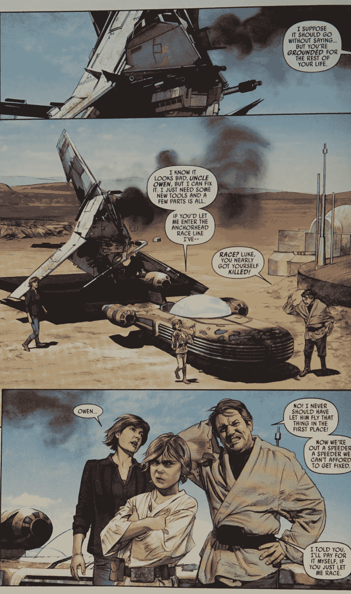

我可以赢。我已经是塔图文星同年龄段最好的飞行员了。

我刚刚切过峡谷边缘。但下一次？没有下一次了。我说你禁足时，我是字面意思。

习惯走路吧，卢克·天行者。因为只要我活着……你就再也不会飞了。

自从在大旱期间与贾巴的暴徒发生冲突后，我尽力让自己隐形。变得更像一个隐士和隐居。

贾巴仍在拼命寻找那个反抗他的人。如果我需要帮助，不能在镇上寻找。我只能在那些已经低调的人中保持我的低调……我明白了。

我知道你最近遇到了一些麻烦。我知道我看起来不太行，但……也许我们可以互相帮助。

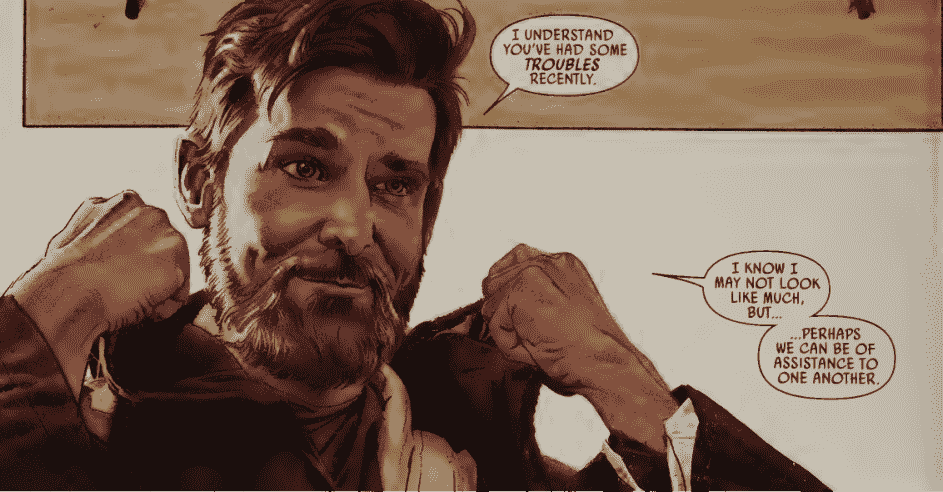

贾哇人最近受遭了多次袭击。他们无法保护自己。

仍然有希望，昆刚大师。你认为安金是天选之子；在某种意义上，他确实。如果他的儿子表现出同样的能力，那么也许……欧比旺·肯诺比，雇佣兵，我做过更糟糕的工作……尽管克隆战争看起来是那么很久以前，那么遥远。我的战争结束了。糟糕，正如我想起的，我的战斗仍在继续。

呜——！

我的想法一模一样，我的朋友。

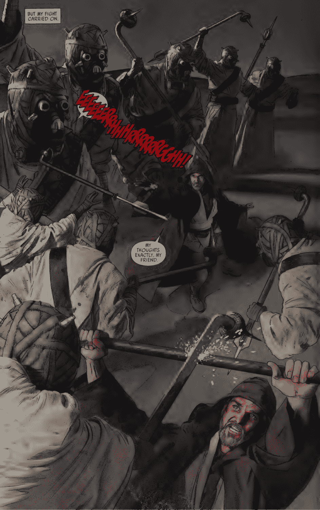

有了光剑会容易得多，但我想需要这种练习。我不应该干涉，我知道我的命令是保护那个男孩并让他躲起来。但我不是尤达大师。我知道我还没有800年的时间来守护他。在某个时刻，卢克·天行者将不得不自谋生路。有些事情告诉我，当那一天来临时……他需要学会飞行。

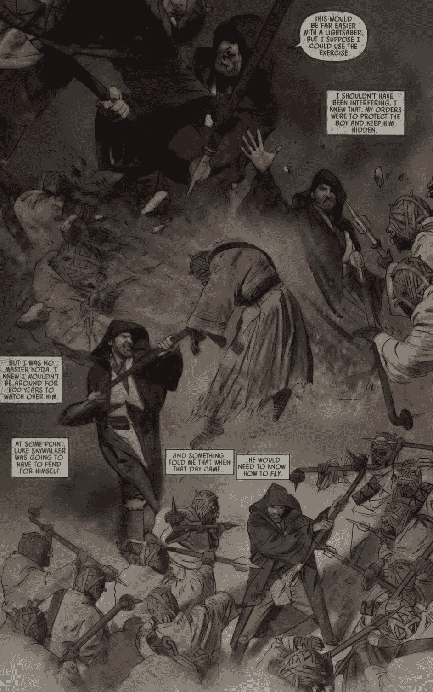

花了一整晚，但我想象塔斯入侵者很快就不会再袭击这些区域了。尽管我确实在想出一个更容易击退他们的方法。

嘿，我们不能把那个男孩躲在一个安静的天然泉世界上吗？

噢，我的背。但值得的。至少又一天，我又觉得自己像个绝地武士了。我唯一的希望是……那种感觉我并不孤单。

我们要留下那个机器人。你有任何会说波比语的东西吗？（等等，“等等？怎么了……”）

不，我们只买买不起的机器人。（等等，“等等？怎么了……”）

汉？什么……

不，我们只买买不起的机器人。

嘿，你在做什么？它告诉过你……你就打算把这个留在这儿吗？但是……

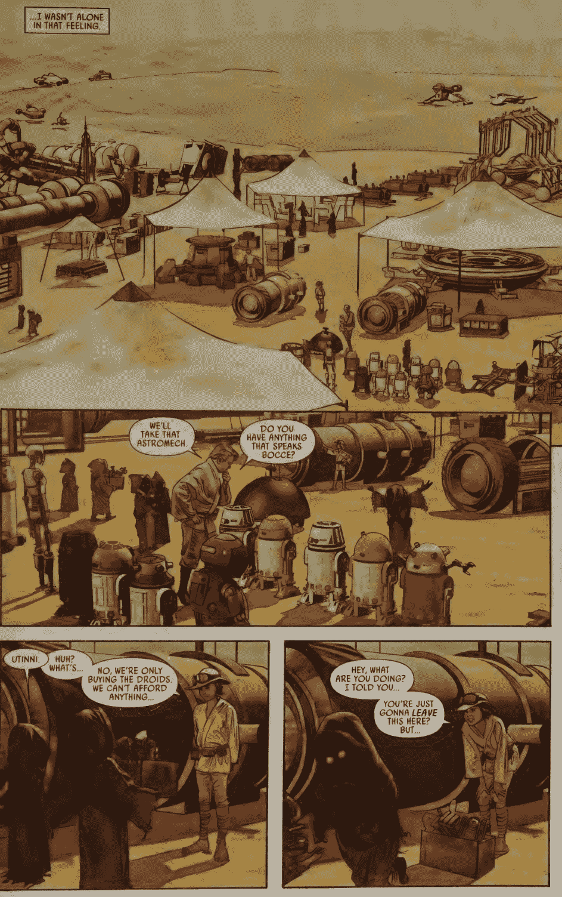

哈哈！谢谢你，欧恩！但这些！这些都是跳跃机的零件！那是什么？谢谢什么？卢克？

> 大师，你还记得我以前抱怨绝地武庙的食物难吃吗？
>
> 那是在我整整一年晚上都要吃蛇之前的事了。
>
> 呃，幸好我的原力很强，否则我没法把它们压下去。

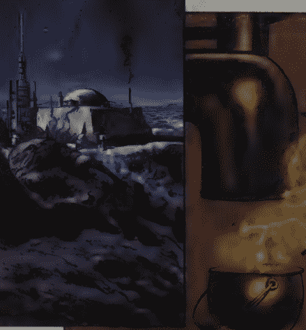
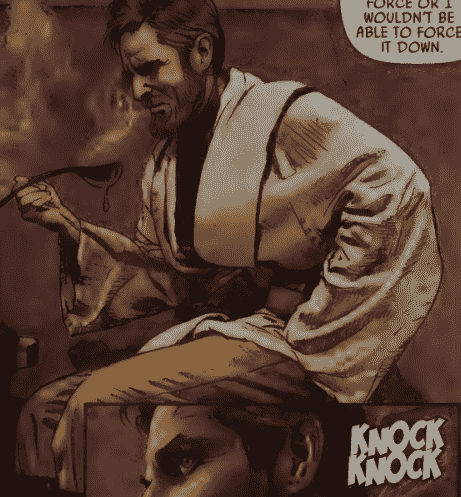
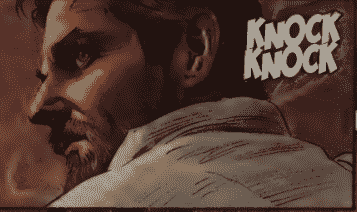

# 咚咚

咚

> 马上就到。

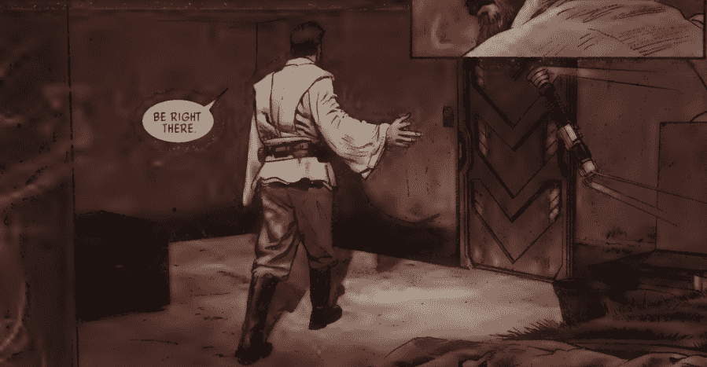

> 在沙丘海很少有客人。我该如何……

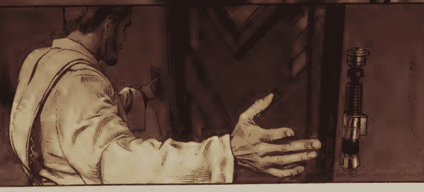

欧文，请进。你觉得你的那条蛇怎么样？

我不傻，肯比。我承认我曾像你一样飞越过银河系，但这并不意味着我就是个无知的蠢货。

我知道你在做什么。

你离我的家人远点吧！

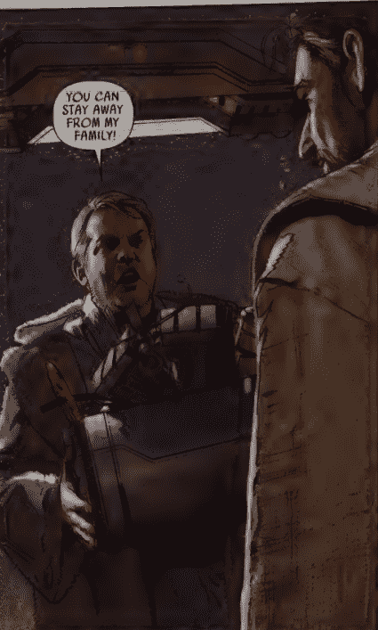
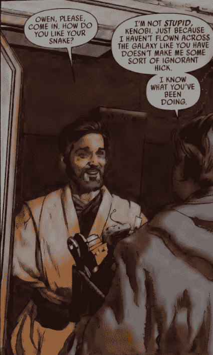

自从你出现后，我的农场成了方圆几公里唯一没被沙民袭击过的农场，也是唯一没被贾巴的手下抢劫过的农场。

而现在，贾瓦人甚至免费送给了我们盘子。

听起来你很幸运啊，欧文。原力的运作方式非常奇妙。

不，你这个疯子绝地武士！但现在结束了！

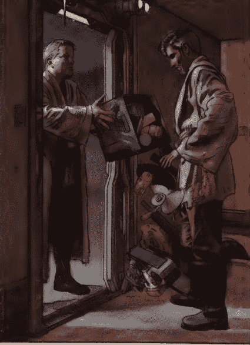
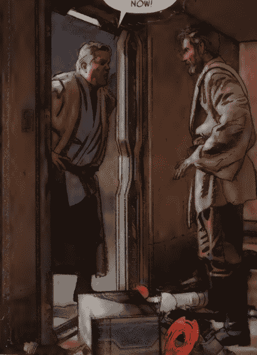

我告诉过你，我不会像你对待他父亲那样扭曲那个孩子。

你带他来是为了保护他，这也是我正在做的。保护他免受你的伤害。

我没要求训练那个孩子。在这件事上已经表达得很清楚了。

但卢克拥有成神的潜力，真的非常非凡。就像他父亲一样，在他……之前——

你杀掉的斯凯沃克还不够吗，肯比？在你害他于死之前！

这孩子只是个男孩，一个鲁莽的、长得太像他父亲的男孩。

我只是想提供帮助。

我们都很清楚，如果他离开塔图因星，他就回不来了。至少活不回来。

而且我相信我已经说清楚了，我们不需要你的帮助。

> 欧比旺·肯比，你是个危险的人，无论你是否意识到这一点。
>
> 麻烦总会有办法找到你，不是吗？虽然我想它也不必费太大力气。
>
> 那些麻烦会让某些人严重受伤。
>
> 帮我们个忙吧……

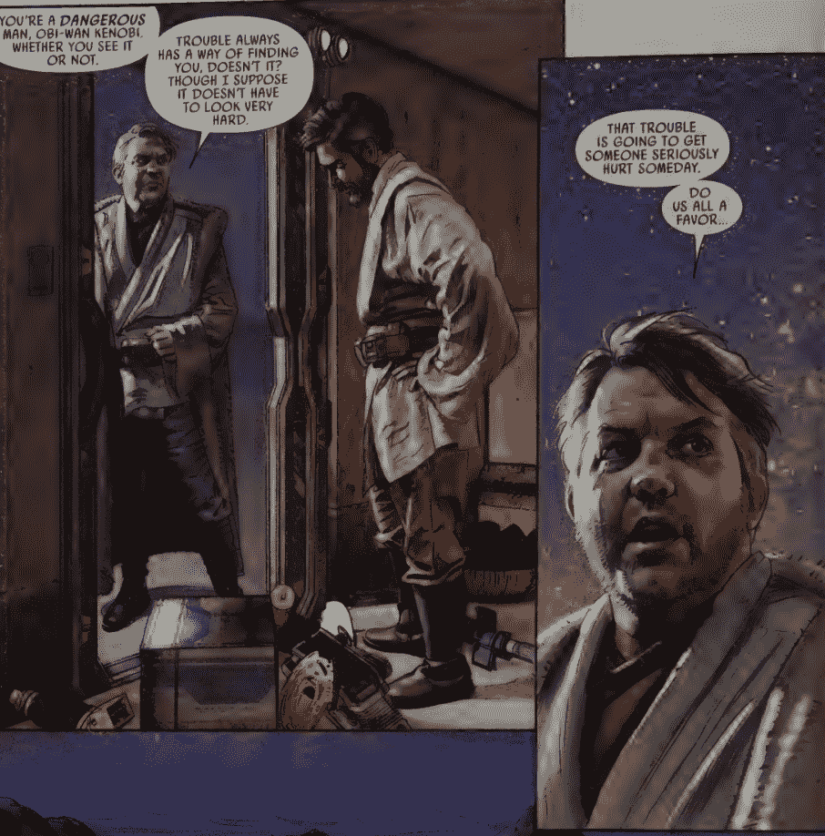

> *然后把麻烦留给你自己。*

他是对的。我并不擅长避开麻烦。即使在沙漠正中央，我依然活了下来。如果说这些年来我在这某方面变得出奇地擅长，除了找麻烦之外……那就是我死不掉。

去问问达斯·摩尔或者格里弗斯将军就知道了。

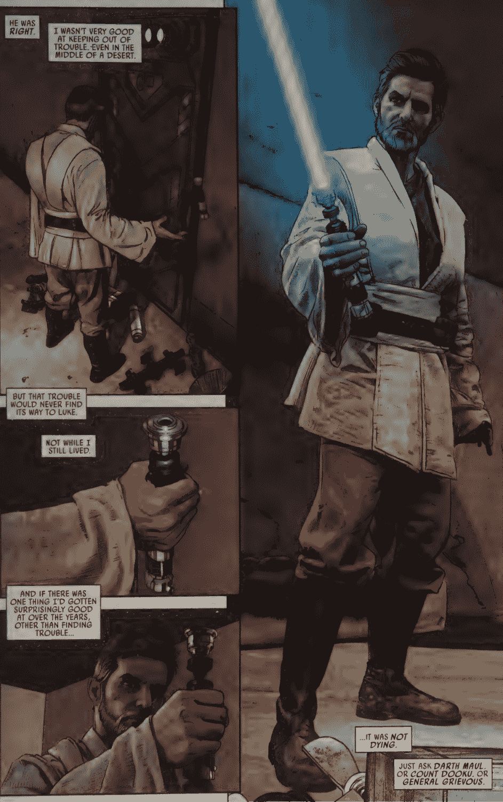

去问问贾巴·赫特吧。嚯！贾巴说……在同意支付你那昂贵的费用之前，他想先看到你的技巧演示。你可以进行一次演示。否则，你就可以开始死亡。

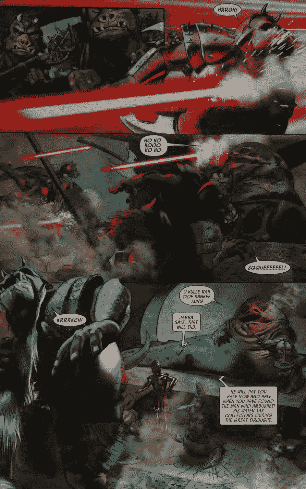

把这个人活着送过来，这样贾巴就能亲自观察他，你将获得一笔丰厚的奖金。或者你也可以直接带他的脑袋来。你觉得这些条件可以接受吗？

# 星球大战：反叛军监狱

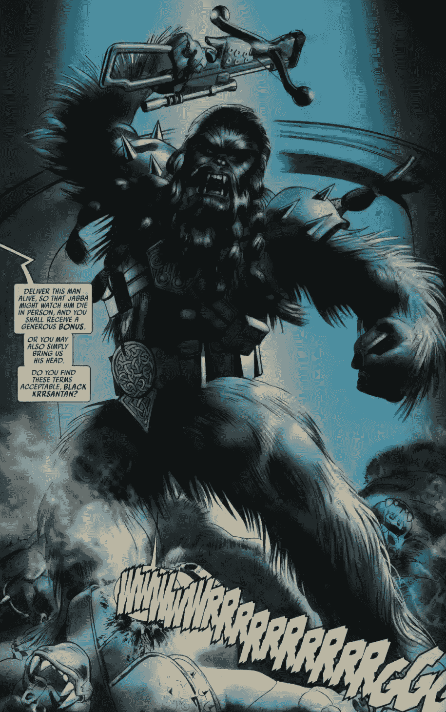
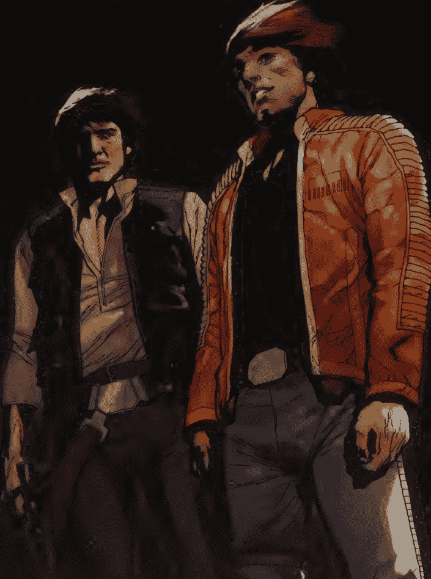
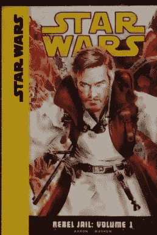
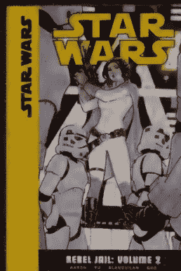
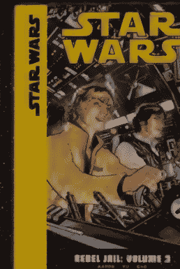
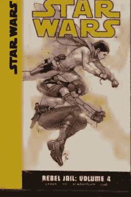
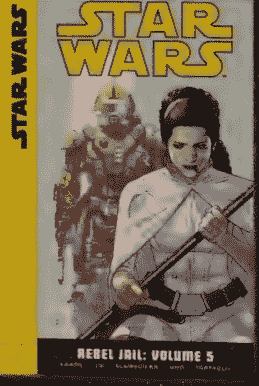

在《维达坠落》事件之后，反抗军会发生什么？随着卢克·天行者和朋友们的冒险继续，寻找答案！反抗军正前往一个监狱基地带走一个重要的囚犯。但对他们来说，他们不是唯一盯着这个目标的人！而且，在《欧比旺·肯诺比日记》的另一个故事中，回到绝地武士在塔图因星流亡的日子。水农欧文·拉尔斯或许收留了小卢克，但他拒绝让本参与男孩的生活。现在，准备好发现吧！

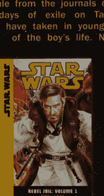
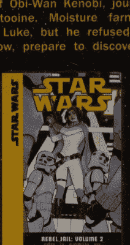
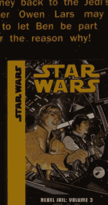
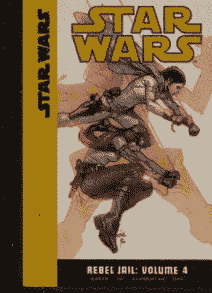
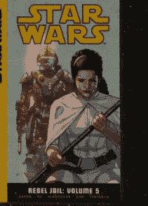

marvelkids.com
