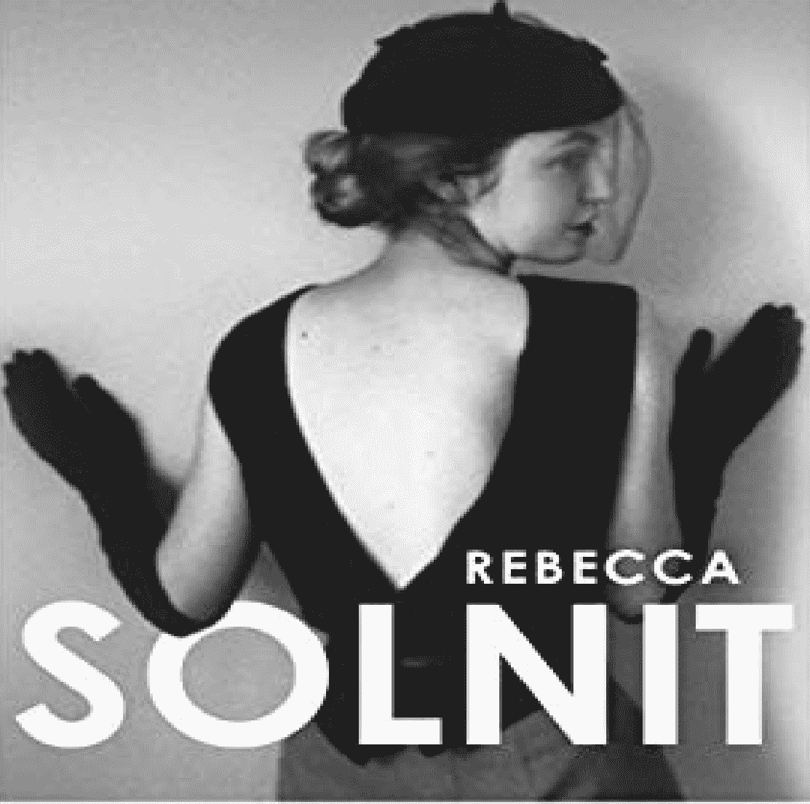

# 我不存在的回忆：回忆录

瑞贝卡·索尔尼其他著作：

- 《秘密展览：冷战时代的六位加利福尼亚艺术家》
- 《野性梦想：通往美国西部隐藏战争之旅》
- 《迁徙之书：爱尔兰的一些片段》
- 《漫浪：行走的历史》
- 《空心城市：旧金山的围困与美国城市主义的危机》（与苏珊·沃森伯格合）
- 《如夏娃对蛇所说：论景观、性别与艺术》
- 《影子之河：爱德华·迈布里奇与科技荒野西部》
- 《黑暗中的希望：未诉的历史，狂野的可能性》
- 《迷失指南》
- 《时间中的优胜美：冰川时代、树之钟、幽灵河流》（与马克·克莱特和拜伦·沃尔夫合）
- 《冲击天堂之门：政治的景观》
- 《地狱中建立的天堂：灾难中产生的异常社区》
- 《无限城市：旧金山地图》
- 《远方的近邻》
- 《不可测的城市：新奥尔良地图》（与瑞贝卡·斯尼德克合）
- 《麻烦与宽广百科全书》
- 《男人向我解释事情》
- 《不停歇的大都市：纽约地图》（与约舒亚·杰利-沙普罗合）
- 《所有问题之母》
- 《溺水河流：科罗拉多河格伦峡的死亡与重生》（与马克·克莱特和拜伦·沃尔夫合）
- 《直呼其真名：美国危机（及论文）》
- 《辛德拉解放者》
- 《这是谁的故事？旧冲突，新篇章》

感谢许可转载以下内容：

节选《从未有过》，[于《纽约时报》，1980年]，经 Frances Levine 许可转载。版权所有 © 1999 Diane di Prima。经 City Lights Books 许可转载。

Diane di Prima 的《公羊（Ram）》，选自《歌曲之篇》（电子书）。www.citylights.com。

pid_prh_5.5.0_c0_r0

# 镜镜屋

很久以前的一天，当我面对一面全身镜审视自己时，看到影像变暗、变柔和，然后似乎在后退，仿佛是我正在从世界中消失，而不是我的大脑在关闭视线。我扶着走廊对面镜子的门框稳住身体，然后我的双腿在身体下软了。我的影像从我身上飘远进入黑暗，仿佛我是一个连从自己的视线中消失的幽灵。

那些日子，我偶尔会昏厥并眩晕，但这次是令人难忘的，因为似乎不是世界从我的意识中消失，而是我正在从世界中消失。我是那个消失的人，也是在远处观察她的肉体之外的人，两者是，又都不是。在那些日子里，我试图消失又试图出现，试图保持安全又成为某人，而这些目标往往是相互矛盾的。我观察着自己，看看我是否能从镜中读出我能做什么，我是否足够好，以及所有关于我的话是否都是真的。

作为一个年轻女性，就是以无数方式面对你的毁灭，或者获得对这种毁灭的认知，或者同时面对这一切。“美丽女性的死亡无疑是世界上最有诗意的话题，”爱德加·爱伦·波所说，他一定不是从那些渴望生活的女性的角度来想象的。我试图不成为别人诗歌的主角，不被杀死；我试图寻找我自己的诗学，在没有地图、没有指南、没有什么可依的情况下。它们可能在那里，但我还没有找到它们。

寻找一种庆祝你的生存而非失败的诗意，或许基于此，或者至少在一种沉迷于抹除和失败的氛围中找到一种生存的方法，这是许多乃至大多数年轻女性必须做的工作。在早早的那些年里，我做得并不好，也不清晰，但我做得很激烈。

我经常不知道自己在抵抗什么以及为什么要抵抗，因此我的反抗是模糊、不连贯且无常的。在不屈的年里，或者是像某人陷入沼泽挣扎的年里，我经常不知道自己在抵抗什么以及为什么要抵抗，因此我的反抗是模糊、不连贯且无常的。

（注：原文后续部分存在大量重复段落，已根据“不要重复输出原文”的要求进行去重，保留核心内容。）

天空的蓝色层次多到你无法数尽，它从太阳升起的地方消融到其他色彩上演的远方。如果你稍移开视线，就会错过一种永远没有词汇来描述的色调，而它正不断演变成另一种又另一种。颜色的名称有时是囚禁了不属于那里的物的笼子，这对于语言通常也是如此，对于像`woman`、`man`、`child`、`adult`、`safe`、`strong`、`free`、`true`、`black`、`white`、`rich`、`poor`这些词也是。我们需要这些词，但最好的使用方式是深知它们是永远会溢出并破裂的容器。总有东西在彼岸。

有时候，礼物会被送出，赠送者和接收者都不知道它的真实维度，初看起来看起来并不是它最终的样子。正如开始一样，终结也有无尽的退缩，层层叠叠，向外涟漪着后果。在我小时候的一个冬日，我年轻、无知、贫穷且几乎没有朋友，我去看一个待租公寓。我在报纸的分类广告中发现了租赁信息，在那片密集的灰色网格中只有几行微小的信息，大多描述的是与我身份无关的地方。当我说我在找每月租金 200 美元的房子时，人们笑话我，即使在当时这也是底价了，但我负担不起大学本科最后一个学期的费用了，那是我财务独立的第三年。

那时，我住在一个极小的房间里，窗户对着光井，但对于那家公寓酒店来说，这已经很豪华了，因为它有自己的浴室，而其他房间都要共用走廊头的浴室。整栋大楼共用一个光线昏暗的厨房，你的食物可能会从冰箱里被偷，或者被蟑螂围攻，或者两者兼有。其他住户是那些生活似乎不成功的人。我那时十九岁，我的生活尚未定型；我正处于弄清楚我是谁以及如何成为自己的早期阶段，这是那个年龄段人的常态。（我十五岁时通过了 `GED` 学力考试，十六岁就开始全读社区学院，十七岁转入四年制大学；到十九岁时，我是旧金山州立大学的大四学生，那是位于城市多风的西南角的工人阶级大学。）

我在市中心附近的福尔顿街上车，公交带我去了廉租房，经过了菲尔莫街，那里一群穿着西装神志醒的黑人男子聚在外面参加葬礼；经过了华丽的木质房屋和街角酒货店，上坡到了里昂街，我在那里下了车，公交继续摇晃着向太平洋驶去。我找到了那个地址，那是一栋带有凹入门的建筑，像附近的很多其他建筑一样，为了安全加装了一扇铁门。里面的门栓用一根生锈的链条和锁连在信箱上。我响了经理的门铃，在他按门铃让我进去之前，我吃力走上第一层楼梯，在二楼他的公寓门口与他会合，随后他前往三楼去看他正上方的那间公寓。

那里的美景令我惊叹。那是一间转角单间公寓，主室有一有一个南向和一个东向的凸窗，光线从中倾泻而下。金色的橡木地板，高大的拱形天花板，以及带有矩形装饰线条的白墙。玻璃面板门配着水晶门把。独立的厨房有另一个朝东的窗户，当太阳越过街对面的大楼时，那里会洒满晨光。它看起来明亮剔透，带有一丝世世脱俗，像童话里的地方，与我十七岁后离开家后大多居住的那些简陋单间相比，它是如此宏大而精美。我在里面闲荡了一了一会，然后下楼告诉经理我想要那间。他亲蔼地说：“如果你想要，你就应该拥有它。”我热烈地渴望它；它比我梦过拥有的任何东西都要美丽，身处其中似乎就像梦本身。

他是一个六十岁的黑人男子，高大、粗壮、强壮，显然曾经很英俊，是一个令人留印象深刻的人物，声音低沉浑厚。如果他那天穿得像我所知往常的那样，他可能正穿着工作服。他带我进了客厅。那是那个超级球赛周日，当地一支球队正在比赛，每得一分，整个社区的家里都会爆发出欢声。他正看着电视里的黑人打球，坐在那张绿色的扑克桌旁，外外的阳光透过老式的百叶窗窗户滤射进来。当他递给我申请表时，我的心颤了一下。我告诉他，我已经被顶端那家贫民窟管理公司拒绝了，一名员工轻蔑地将我的申请表扔进了桌旁的垃圾桶，而我在一旁看着；我赚的钱还不上他们的最低要求。

公寓经理告诉我，如果我找一个体面的年长女性来申请，他们就会被骗过去。我采纳了这个建议，问我那个经常拒绝为我贷款的母亲，看她是否愿意。这次她同意了，填写并提交了申请表。管理公司并没有怀疑为什么住在金门大桥另一边的白人房主想要这间公寓——我想她说是因为离工作地近，因为她在城市的一家代理机构工作。他们可能只是按惯例把房子给了这个黑人社区里财务状况看起来最好的申请人。

在接下来的八年里，我每个月通过汇票支付租金，签的是她的名字而不是我的。租约规定签名的人必须是居住者，因此在那个并不真正属于我的家里，我并不正式地存在。

## 4

“成年人”这个词意味着所有达到法定年龄的人构成了一个连贯的类别，但我们是不断变化并穿越成年世界的旅行者。童年会在某些方面逐渐消逝，在另一些方面永不结束；成年是以小规模、不规律的方式到来的。当你离开家（如果你有的话），当你开始自立，你就成了成年世界的新移民，那里的习俗是陌生的。

那些决定，那种回到某种来之不易的看似确定性的可能。我能感受到埋藏在那种顺服中的自由，但我热爱我的独立和自主，甚至其中一部分也是我绝不会放弃的特权。我遇到过一些出身于幸福家庭的人，他们似乎没什么事要做，只需按照他们所教导的那样生活就好；他们是那些掉不出树根的橡子；他们行进在一条从未分叉的道路上，因为他们在出发之前就已经到达了目的地。当我年轻时，我羡慕他们那种确定性带来的舒适。当我长大后，对于那些不需要太多颠覆和探究的生活，我产生了相反的感觉。自立自足来着真正的自由，而那些以一种令我惊讶的方式明确自身需求和情感的人，则拥有一种某种宁静。我是那个国家里的异乡人，我试图寻找方向并找到一种语言来描述这种尝试将是缓慢而痛苦的。如果我在这一切中运气不错，那也是能够持续、不断改变的运气——有时是故意的，有时是冲动的，且对我而言是不可见的。就像是一颗不停滚动的橡子。在那间小小的公寓里，我找到了一个可以蜕变的家，同时在改变中于外界的世界开辟了自己的位置。我积累了技能和知识，最终获得了一种归属感。这不仅仅是因为你处于青少年期的末期——一个涵盖了所有非儿童的类别——而是一种不断变化的状态，就像日出和清晨的长影子与正午平坦清澈的光线不同；当我们改变时，如果你幸运的话，会随着时间的推移强化自身和目标；充其量是你获得了方向感和清晰度，这可能意味着成熟，而青年的天真和紧迫感正在流逝。随着我年龄的增长，现在二十多岁的人看起来像孩子一样，但带着一种新奇感，一种第一次发现许多事物的特质，拥有着大半生的前程，并投入到“成为”这一英雄般的任务中。有时现在我羡慕那些正处于长路起点的人，在道路分叉又再分叉之前，他们面前仍有许多决定要做。想象着他们的轨迹，我脑海中浮现一条不断分支的真实道路，我能感觉到它——阴暗的、树木林立的、充满了选择时的焦虑与兴奋，在并不完全知道终点将在何方的情况下就出发。我对我走过的道路没有遗憾，但对那段大部分路程尚在前面的时光有一丝怀旧，对那个可能成为许多事物的阶段怀旧，现在我已经选择了一次又一次，正远行在某条道路的远方，错过了许多其他道路。可能性意味着你可能成为你尚未成为的许多东西，当这种可能性不令人恐惧时，它是令人陶醉的。当我住在杨（Young）为我创造的那个光明家中时，道路上的大多数分叉口都出现在我的面前。

## 雾笛与福音

浸信会位于我公寓东边两个街区处，在一栋三层的维多利亚式建筑里，建筑两侧各有一座像粮仓一样的带十字顶塔楼，还有一种社区建筑中罕见的景观：直接紧邻人行道——门前有一片小草坪，草坪中间在几株挣扎的玫瑰旁，立着一块木质牌子宣告着它的名字。年年如此，我路过它，思考一个新来的陌生人会是什么样。位于莱昂街（Lyon Street）陡峭处的“磐石浸信会”，是我偶尔在外面停下，聆听里面传出的福音音乐的几个场所之一。我是那个社区的局外人，一个新来的陌生人，即使那个社区对于白人社会来说也是局外人的聚集地，我可以自由行走并属于这里。

这是一个小社区，五个街区宽，六街区长，东西两侧由宽阔的大道定义，南方是黄金公园（Golden Park）绿色的楔形区域，北方是一座功能像墙一样的陡坡。我的新家位于一个街区的南角，该街区的北侧是那间昏暗、低调的五旬节教会，那里也是一个投票站。邻着它的是一家酒类商店，老板是一位非洲移民，多年后当他在一次车内枪击中被射杀，我参加了他青少年的葬礼。葬礼在海斯（Hayes）的以马纽尔基督教会（Emanuel Church of God in Christ）举行，距离家族商店三个街区，距离男孩被杀害的前的那家洗衣店更近。

那座教堂是一座漂亮的建筑，在较早的时代，摩门教的葬礼仪式是激昂的、充满音乐性的，且是我听过的最精彩的演说。那座整洁、有棱角的、涂有粉色抹灰的教堂，看起来像是从某幅十五世纪（quattrocento）圣人画中掉出来的一样。对面是我起初几年参加过的一所小面店教堂；祭坛上的十字架是由鸡蛋盒制成的，凹凸的一面朝外。同一区域还有几座黑人教堂。离虔诚并不远。

一座涂成白色的漂亮大馆是着布拉马·库马里冥想中心（Brahma Kumaris Meditation Center），当该世纪晚期艾滋病变成全球性灾难时，德蕾修的慈善仁会在一座大维多利亚式大房子里开了一家艾滋病疗养，成为社区的一道风景。东部有一个伊斯兰中心，西部有一所耶稣会大学，北部有天主教和圣公会，而在东南方，越过迪瓦罗街（Divadero Street），那里有圣约翰·科特兰非洲正教教会（St. John Coltrane African Orthodox），那里有爵士弥撒、食物计划以及大幅俄式风格的黑人天使画。

地理中心，以及位于城市极远东南部的亨特角（Hunter’s Point），那里是造船厂的工作所在地。

这些老人们并不匆忙；他们是乡下人。他们留意着路人，向相识的人打招呼，有时会对一个在他们看来不听话的孩子大喊。是他们教会了我，即使是陌生人之间的对话也可以成为一种礼物和某种体育活动，一个获得温暖、祝福、打趣和幽默的机会，言语可以像一小团供你取暖的火。。多年后，当我住在新奥尔良和南方其他地区时，那里让我感到奇特地像家，我意识到西海岸的这片地区在当时是黑人南方的一个哨所。

杨先生本人在俄克拉荷马州的农村长大，而住在街对面的埃内斯特·P· 泰尔先生（Mr. Ernest P. Teal）来自德克萨斯州，我们大楼的一个车库里停着一辆豪华的 20 世纪 70 年代老车。泰尔先生总是穿得优雅，穿着不同款式的运动西装并戴着礼帽，材质是花呢绒和质感的。他是一个时尚的男人，向我讲过菲尔莫尔区（Fillmore District）爵士鼎盛时代的故事，但他也是一个虔诚且具有伟大光彩善良与慷慨的人，证明了酷与温暖可以从源头散发。

转角处是维奥比夫人（Mrs. Veobie），她从姐姐那里继承了这栋房子，姐姐是靠做家工攒的钱买下它的。当她变老变得健忘时，她坐在面向南方的木制前门台阶上，当我停下来聊天时，她会给我讲她在佐治亚的一处果场长大的故事，以及那些果树有多美。仿佛坐在那些台阶上时，她正处在两个时间和两个空间，仿佛在每一次对话中，她都召唤了过去的世界，直到我们都置于她心爱的果园的阴影中。有时我想象周围房子里的所有老人都梦见着他们来的地方，想象那些田野和果园的幻影、土路和平坦的地平线，在我们午夜的街道上闪烁。

杨先生是一位二战老兵，战争将他从农村带到了这里。他的军事记录显示，当他 22 岁在俄克拉荷马州的乔克托县被征召时，是一名未婚的农工。他留在了军队，服役足够久以获得养老金。他告诉我，他曾是测试毒气体的黑人士兵之一。他描述了一个装满气体的仓库或机库，没有防毒面具的人在穿过。他说，其中一些人死了。

他开着一辆带有露营设备的大型皮卡，并把它停在大楼入口左侧的车库里。他经常站在车库门口，倚靠着门框或门柱，向路人打招呼，交谈，或者说几句话让孩子听话；在夏天，他经常从瓦莱霍（Vallejo）运来一车西瓜去卖。有时我瞥见他的工装侧面插着一把手枪。他抽着满甜烟草的烟斗，烟味有时会通过我厨房的通风口传上楼，我的厨房就在他卧室上方。每当我遇到他时，总会停下来聊聊天，至少交换几句寒暄；有时当我赶时间时，我很害怕在走廊里遇到他，因为任何少五分钟的对话似乎都被视为无礼。

他给我讲过在俄克拉荷马东南部长大的故事，他是佃农的儿子。我记得其中一个故事是关于他进入青少年时期，巴罗帮（Barrow Gang——邦妮、克莱德及其同伙）在他和父母从田里回来时在家里。那伙银行劫匪之所以在那里，是因为在隔离的社会里，你不会在黑人中寻找白人法外之徒。据报道这帮人在俄克拉荷马州至少对一个黑人佃农家庭干过，我后来听说另一位传奇大匪“漂亮男孩”弗洛伊德（Pretty Boy Floyd）在银行劫匪被视为民间英雄的时代，也袭击过黑人家庭。在造访杨家时，他们留下了十块钱。

（注：此处原文末尾似乎存在逻辑断裂或重复错误，译文已根据原文尽可能进行了逻辑对齐，但部分原本的句子看起来很混乱，如下翻译。）

在许多年后，当黑人居民被驱逐，并以“城市更新”的名义拆迁了菲尔莫尔区时，这片区域的西侧边缘被挤入了那些进入这里的人。西加区（Western Addition）曾是黑人的地方，而房地产中介和其他人通过重新命名来侵占空间，侵蚀着这个地方的身份，随着黑人社区被驱逐出一个日益昂贵的、精英化的城市。

偶尔出现的洋葱头顶。它们充满了生物形态的曲线和奇特的错综复杂，使它们看起来是有生命力的，仿佛是生长出来的而非建造出来的。缪尔伍德公园的一位护林员曾向提到道，她在这些结构中看到了为了建造它们而被砍伐的巨型红杉森林，因此，沿岸那些高低错落的山林成了另一种幽灵般的存在。

这些原始建筑的材料和工艺是令人赞叹的。到了战后时代，“白人逃潮”将一部分人口带到了郊区，而让另一部分人口——非白人、移民、穷人——进入了这些被其缺席的所有者视作贫民窟的地方。这些建筑的装饰被被刮掉了，或者被涂上抹灰或塑料外墙板，又或者被分割成更小的公寓，这些公寓通常用廉价的材料和技术建造，其中许多建筑被任由其变得破旧摇晃。

“衰败”是 20 世纪 50 年代和 60 年代被用来证明拆除我们小社区东部许多建筑合理性的词汇，这在城市建筑的皮肤上留下了敞开的伤口。在其中一些建筑中，建造了阴森的住房项目，它们是如此疏离和压抑，以至于在落成几十年后就被拆除。菲尔莫尔中心区的其他建筑——曾是特尔先生喜欢怀念的那个充满活力的区域——在 80 年代的大部分时间里一直空置，围在旋转铁丝围网后。一个地方被杀死了，且从未真正复苏。

变化是时间的衡量，我的摄影师朋友马克·克莱特（Mark Klett）喜欢这么说，而小事在变迁。当我到达时，西侧的一个街角有一个柯达照相亭，那时胶片还是获取照片的方式；在我住处对面的街角，酒类商店旁边，有一个玻璃墙电话亭。后来变成了一个螺栓在木墙上的公用电话，位于一个像商店遮雨篷一样的罩子下，然后随着手机手机的激增而彻底消失了。

那种逝去生活的质感现在似乎仍传达着：一个城市中流浪者的孤独，他可以等公交或出租车驶来，或者找一个电话亭，通过背过的号码或询问接线员拨打出租车或朋友的电话，或者如果那里有一本翻得薄如纸的电话页、悬挂在金属绳子上的黑色外盒里，从中查询；在互联网意味着你无需下床就能精准找到物品之前，她会在许多商店里寻找她想要的东西，那时连锁店较少，品种也更丰富。我们受制于不可预测性带来的奇迹和挫折，并能更好地承受它们，因为那时的时间流动速度在后来看来只是一种温柔的流淌，像一条穿越草原的河流，在我们所有人坠入那加速的瀑布之前。我们曾对陌生人的相遇做好了准备，而这种准备在数字时代以后隔绝了我们中的许多人。这是一个既充满不可预测的接触又充满深层孤独的时代。

在那个较落后的时代，奇特有许多立足点。许多小企业兼具致力于各种事物的博物馆——卡斯特罗（Castro）附近的一家洗衣店陈列着艺术摆放的古董；各种商店里挂着很久以前的社区老照片；米山（Mission）的一家杂货店有一个几英尺高的橡皮筋球，坐在薯片堆旁的塑胶地板上。北海滩（North Beach）的明信片宫只卖旧明信片，那些明信片已经盖了戳，并用那个时代自信的笔迹写着早已去世的人写给另一个早已去世的人的、晦涩或俏皮的信息。我仍然留着几十张买来的明信片，一次买几个，大多是黑白的，记录着各种山路、教堂和石窟，是在我晚上从一场朋克音乐会散走出来逛街时买的。

城市感觉像是藏在缝隙里老旧而皱皱的东西，然后它被抚平、清扫干净；它的一些人被排挤了出去，仿佛他们本身就是脏物。一家杂货店变成了一家高端披萨店，一家店面教堂变成了理发店，一家激进书店变成了眼镜精品店，很多地方变成了寿司店。这个地方变成了一个大搅拌机，有了更多的连锁店和更多的汽车，没有了电线杆上层层叠叠的传单，没有了家庭药店。

地板上散落着古老马毛填充物的碎屑，像一只失禁的宠物。我收集了许多小纪念品、宝物和器物，让那个地方看起来像一座自然历史博物馆：长满奇特苔藓的树枝、鸟巢和蛋壳碎片、石头、枯萎的玫瑰、一罐来自来自东部大迁徙的黄色蝴蝶，还有来自我弟弟的——那是一只依然俯视着我的鹿角。

我曾穿行于贫困，并逐渐回归了财务的宽裕；去掌握一点它的运作方式和作用。在另一种意义上，贫困从我出生起就环绕着我。我的父母在大萧条时期或类似的剥夺中吸收了深切的匮乏感。我不相信如果发生真正恐怖的事情，他们会抛弃我，而我也从未自愿通过崩溃来探寻结果，所以离开并不像他们选择时那样容易。我也离开了，但很缓慢，通过我自己的努力。凭借我的肤色和背景，我觉得自己在他人眼里适合受过教育并从事白领工作。

我在书店里站着读书，或者买书，或者搜索好几个月或几年才找到最便宜的二手书；我在收音机旁听音乐，为朋友录制磁带；我盯着东西看，被“拥有”的承诺所刺痛，那双靴或那件衬衫会让你需要或成为某种你，不完整是一个可以填充东西的洞，你拥有的东西被超越必需的拥有所掩盖。我总是想要某些东西，别的，如果得到了我就想要下一个，总有某种渴望如此地啃噬着我，那种欲望尖锐得刺痛了我，而想要的过程花费的时间远比实际的地点或事物要长，或者想象中的拥有比真实的拥有得多。一旦我拥有了某物，渴望就消失了——是渴望本身活着——然后渴望再次出现，追求下一个。

当然，在恋人和男朋友之间，不确定性可以保持渴望的（而对于更可靠的男人，这会变成另一种爱）。比起任何事情，我渴望改变我的本性而非处境。对于想要去的地方并没有太多愿景，但我知道我要远离那里，也许这就是为什么走路很重要：它感觉我正在走向某个地方。

我对值得过的生活样有了早早的愿景。当我在青少年时期读她的日记时，阿妮丝·尼恩对战间巴黎的描绘给了我可以栖息的意象，交织的生活，而在那个铬腿胶地板桌的梦中，客人们之一的罗克珊·杜巴尔-奥蒂兹，她把自己呈现为她其实是那种朝不暮继的波西米亚人。

炉子旁有两个宽水槽，右边是一个普通的厨房水槽，左边是一个深洗衣水槽，盖着旧的搪瓷金属盖，盖子会生长，所以我有时得掀开盖子刷洗它。妇女们在里面手洗衣服，在我住在那里的头几年，建筑的平顶有一个用来晾衣服的木笼子，最后一段楼梯的上方台阶踩在碎石上咯吱作响。厨房原本的黄绿相间的胶胶地板磨损成了某种颗粒感且开裂的模样，无法保持清洁，于是我把它漆成黑色，然后一遍又一遍。但每个夏天早晨，光线都会洒进厨房，洒进另一个房间朝东的凸窗，并在冬天整天透过凸窗滴淌。最后那扇窗对着富尔顿街和一盏路灯，有时我会坐在那里凝神注视，看着雾气在路灯下像巨大的滚草球一样层层倾泻，风从它升起的寒冷海洋将它推向这里。

我会躺在床上，在夜晚的寂静中听到远方的雾笛声轰鸣。半夜醒来，在城市的中心，在一个被视为内市的地方，我经常听到雾笛声，它们将我带向边缘和彼岸，去大海、天空和迷雾。我经常听到它们，在回忆中，那声音似乎像是那种半夜半醒半睡状态的关联物，有一颗游离的心，身体却被睡眠的木星般的引力钉住。它们召唤我，仿佛我是一艘迷失的船，不是为了带我回家，而是为了提醒我海洋和空气，而在衣柜里，我依然与它们相连。

我在那里住了那么久，小公寓和我长在了一起。起初我里面几乎什么都没有，感觉很宽敞；到最后时，它堆满了书和床下的许多纸箱，显得很拥挤。在记忆中，它像鹦鹉螺的母壳一样闪着光，仿佛我是一只爬进一个特别华丽避难所的寄居蟹，直到像寄居蟹一样，我长大了。

离开那里十二年后，我能看到每一个细节，有时仍想象自己正伸手向里昂街的那个柜子而非我现在居住的那个；当我再次回去走那条街道时，会自动给出租车司机报里昂街的地址，直到想起我已没在那里住多年了，然后报出下一个地址，最后才是那个正确的地址，但它永远不会像那个地方那样被纹在我的心智上。当我住在那里时，我经常梦见那条穿过我童年家的街道，变成一条乡村路，最后结束在一个马场，我曾从那条路穿过铁丝网栅，开启了我的许多冒险，但现在我梦见里昂街上的那个小公寓，它是一个基石之地，我在那里梦见了那条路。

当它还是我的家时，我曾多次梦见在里面找到另一个房间，另一扇门。在某种意义上，它是我，我是在其中，所以这些发现当然是我自我的其他部分。我反复梦见我的童年家是我被困住的地方，但这个地方并没有把我关起来，而是在为我开启可能。在梦里它更大，有更多房间，有壁炉，有现实生活中不存在的隐秘美，有一次后门打开后面对的是灿烂的田野，而非那里真实的阴暗杂乱。

厨房的墙壁曾铺着乙烯仿砖纹壁纸，其缝隙在炉子后方墙墙的白漆下显露出来，于是有一天我把它撕了下来。那像是从伤口上撕下绷带。它大片大片掉落，扯掉了底层的壁纸，下面是更老旧、更美丽的壁纸，图案是常春藤网格。当我看到那浅褐色的图案时，我感受到了住在这里之前的人们鲜活的存在——更多的幽灵，在其他时候，在战争之前。

## 战时生活

搬进公寓没多久，一位朋友给了我一张书桌，那是一个女性的小写字台或梳妆台，我现在正坐在它上面写作。这是一件精致的维多利亚风格家具，有四个窄抽屉，两侧各两个，在坐人腿部所在的凹槽上方有一个较宽的中央抽屉，还有各种装饰——榫接的腿，每条腿都有膝盖状凸起装饰，抽屉底部有贝壳纹，抽屉拉手形似流苏或泪滴。

在她送给我这张书桌的一的一年前，我的朋友被一个前男友捅了十五刀，以此惩罚她离开他。她几乎血死；她接受了急输血；她身上留下了长长的疤痕，我当时看到这些伤痕却没有任何反应，因为当我在家里习惯了暴力，也许某种感知能力被麻钝了，也许是因为这本是我们应该习以为常并表现得若无其事 own，但我们本该有语言来讨论这种暴力，本该有一个准备好倾听的听众。

她活了下来；她被指责导致了这一切，因为当时的受害者往往是这样；那个准谋杀者没有任何法律后果；她搬离了事件发生地；她为一个被赶逐的单亲妈妈工作，对方用这张书桌抵了薪水；然后她把它给了我。她离开了，我们断了多年联系，后来又重新建立了联系，她告诉了我完整的故事——一个让你心如火烫、世界结冰的故事。

有人曾试图让她闭嘴。然后她为我的发声提供了一个平台。现在我想知道，我写过的所有东西是否都是对那种试图将一个年轻女性化为虚无的尝试的反击。这一切字面上都源于桌面这个基础。

坐在桌前写下这些时，我查了公共图书馆维护的城市在线摄影档案，希望能回想起一点旧街区的样子。那是1958年6月18日我居住过的那条街的第四张照片，距离一个街半之远的地方，说明文字上写着：“里昂街438号巷口，好奇好奇的路人。今天发现了22岁的丹娜·刘易斯（Dana Lewis）的尸体，除一件黑色胸罩。警方在初步检查后表示，受害者脖子上的青紫表明她可能被绳子勒死。” 显然，她的死是报纸的奇观，因为路人被描述为“好奇”，而不是对尸体感到“痛苦”。

### 水员

她也被称为康尼·苏布莱特（Connie Sublett），事实证明她的死当时引起了报纸的关注。大多数报道将其归咎于她，因为她是一个性生活活跃且嗜酒的波西米亚年轻女性。一个标题写道：“水员描述随机杀戮”，并贴上“玩女受害者”的标签。另一个标题写道：“杀戮终结了玩女的生活”，这种猥琐的措辞意味着她有性行为、冒险和忧愁，而“玩女”意味着她是自应如此。她的年龄被给出二十岁或二十四岁。据说丹娜·刘易斯或康尼·苏布莱特的前丈夫住在里昂街426号，当她的男朋友（一名音乐家）在派对上坠楼后，她去那里寻求安慰。

阿尔·苏布莱特不在家或没有接电话，所以他在前门阶上哭泣，直到房东让她离开。根据他自己的说法，一个水员提议为她打车，结果杀了她。报纸似乎相信了他的话，认为杀戮是一场意外，虽然她对失去感到痛苦万分，但她同意在巷子里和他发生性关系。一个标题写道：“水员杀害比女孩”，尽管把人推至死亡是寻找爱情的常态。“她的眼睛里闪烁着星星，总是想出发，”她的前丈夫说。艾伦·金斯伯格（Allen Ginsberg）拍过阿尔的照片，但没有拍过康尼·苏布莱特，他在1958年6月26日写给杰克·凯鲁亚（Jack Kerouac）的信中毫无评论地提到她的死。她为人知，但几乎无人提及。

我不知道里昂街438号发生了什么，但我知道诗人兼回忆录作家玛雅·安格尔鲁（Maya Angelou）在青少年时期离这里东北方向不远，就在在她八岁时反复遭到强奸后长达五年的沉默结束不久。我还知道离我住的金门大道1827号几街之遥的公寓，1974年，十九岁的报纸继承人帕蒂·希斯特（Patty Hearst）在被共生解放军（一个规模小、幻想的准革命组织）绑架后，被装在一个30加仑的垃圾桶进了那里。她证词说，她在这里及之前的地点的一个衣橱里被蒙眼捆了数周，并被两个绑架者强奸了。这两个故事都进入了新闻。但大多数故事从未进入，或者它们只是后版页的小条目。

但我坐的这张书桌，是一个曾被男人谋杀的女性给我的，它似乎讲述了在一个社会中成长的意义——在这个社会里，许多人希望像我这样的人死去或沉默；我是如何获得声音的，以及何时到了该使用那个声音了——当我独自坐在桌前，通过手指无声地诉说时，那个声音最为清晰——试图讲述那些未曾诉说的故事。

我坐的这张书桌，是一个曾被男人谋杀的女性给我的，它似乎讲述了在一个社会中成长的意义——在这个社会里，许多人希望像我这样的人死去或沉默；我是如何获得声音的，以及何时到了该使用那个声音了——当我独自坐在桌前，通过手指无声地诉说时，那个声音最为清晰——试图讲述那些未曾诉说的故事。

我坐的这张书桌上的回忆录，是一个曾被男人谋杀的女性给我的，它似乎讲述了在一个社会中成长的意义——在这个社会里，许多人希望像我这样的人死去或沉默；我是如何获得声音的，以及何时到了该使用那个声音了——当我独自坐在桌前，通过手指无声地诉说时，那个声音最为清晰——试图讲述那些未曾诉说的故事。

我坐的这张书桌上的回忆录，是一个曾被男人谋杀的女性给我的……（还有许多人）

血腥的死亡细节或女性的尸体曾是一种标准的剧情设定和审美对象。她的毁灭是男主角实现的自我。对于目标受众来说，这显然是色情的，因为在现实生活中，女性在性犯罪过程中不断不断被杀害，而对侵犯、强奸的恐惧也是对暴力死亡的恐惧。

这提醒着我，我们，并不是如此艺术作品的预设受众，包括那些被赞誉为杰作并被奉为经典的作品。有时，男主角保护女性（特别是美丽的白人女性）不受其他男人的侵害，保护者是他们权力的的一面，但破坏者仍然是另一面，而无论哪一面都将你的命运掌握在他们手中。他们保护他们认为应该保护或摧毁的东西，有时情节是关于他没能保护好她的悲伤，以及他对其他男人的报仇；而有时他毁灭了自己，而故事则是关于他自己的。

她在成为尸体之前就已经死了；她只是一个表面、一个卫星、一个配角。在以男性为中心的故事中，将女性的暴力死亡作为情节设定是如此常见，以至于女性为此创造了一个术语——“frid”，源自1999年的“冷冰箱里的女性”（Women in Refrigerators）网站，该网站记录了大量女性角色惨的结局。在视频游戏世界，批评视频游戏中厌视女性的年轻女性多年来一直受到死亡和强奸威胁的骚扰。一些人在遭受极其恐怖且详尽的伤害威胁后，不得不离开家并采取极端的安全措施；也就是说，她们不得不消失。保护女性免受网络监控、威胁和骚扰成为了女性主义网络安全专家的兼职。

在我写这些文字时，出现了一部部关于女性惨无人道的酷刑、杀害和肢解的新剧。有的环绕着1947年洛杉矶22岁的伊丽莎白·肖特（Elizabeth Short）遭受酷刑死亡的过程展开，那场案件被起了一个丑陋的名字“黑莲花杀案”；或者是20世纪70年代的连环虐待者、强奸犯和杀手泰德·邦迪（Ted Bundy），由一位帅气的年轻男星扮演。这远不是第一部关于邦迪的电影，而洛杉矶肖特的杀案已经形成了一个小小的出版产业。当Given推出一款名为“黑莲花主题”的香水并以“致命之花”为口号广告时，我我想这是否意味着女性应该渴望闻起来像具破碎的尸体。但即使是古老的民谣也充满了谋杀和严重的身体伤害，就像约翰尼·卡什到滚石乐队再到艾米纳姆的歌曲。

早期的女性主义者坚持认为强奸关乎权力而非色情快感，尽管对于某些男性来说，他们自己的权力或女性的无助是想象中是最具色性的事情。对于某些女性来说，我们也得知我们的无助和危险是色情的，并在这种自我意识和随之而来的故事中接受或拒绝斗争。雅克奎琳（Jacqueline）在2018年写道：“性骚扰是男性的大表演，男性通过这种行为旨在让他的目标不仅相信他是掌握权力的人（事实确实如此），而且相信他的权力和他的性是同一一的。”

尽管我经历的每一次事件都被视为某种孤立的变态行为，但有无数这样的事件，而且它们是常态，并非反对或处于常态之外。谈论这一切让人感到不安，他们大多数人的反应是告诉我我做错了什么。有些男人告诉我，他们希望有人对他们进行性骚扰，因为他们看起来很有吸引力。没有人提议帮我识别我所经历的一切，也没有同意我有权获得安全和自由。

这是一种集体性的煤灯操纵（gaslighting）。生活在一场周围没有人承认那是战争的战争中——我忍不住想这让我变疯了，但女性经常被指责为疯了，以此来削弱她们见证的能力以及她们所证实的现实性。此外，在这些案例中，“疯了”往往是无法忍受之痛苦的委婉说法。所以并没有让我疯掉；它让我感到无法忍受的焦虑、心心旁勃、愤愤和精疲力竭。

我面临的要么是提前放弃自由，要么以想象中最糟糕的方式失去它。让人们疯掉的一件事是被人告知他们所经历的经历实际上并没有发生过，围困他们的处境是虚拟的，问题都在他们脑子里，如果他们感到痛苦，那是他们失败的，而成功的做法应该是闭嘴或停止感知他们所知的一切。从这种无法忍受的困境中，产生了选择失败和冒险的反叛者，以及选择顺从的囚徒。

20世纪80年代女性主义运动正如火如荼，对针对女性的暴力有许多见解，甚至还有反对暴力的“夺回夜晚”游行，但那时对我来说还遥不可及。我太年轻了，太沉浸于那种文化不符的环境中，那里看起来大多是年长女性，她们说一种我尚未学会的语言。她们处于我将缓慢跨越的距离，毕竟这一切暴力都会让我变成一个孤独的女性主义者。我在1985年一本朋克杂志的封面故事中写过针对女性的暴力，在90年代的艺术评论和随文中写过，在2000年的一本关于散步历史书中详细阐述了女性在走向世界时面临的所有障碍。

我非常熟悉一种愤慨，当有人感到所受到的不公没有被认可时；以及一种创伤让受害者成为一个未解决故事的强迫性叙述者。你会一直讲述下去，直到有人通过听到并相信你来解除这个诅咒。我有时也是那个拥有亲身经历的人，但那种感觉某种程度上是我对针对女性暴力的普遍感受。

当这一切还如此私人化时，我被要求搬到富裕的地方（我一些最激烈的骚扰就发生在这类地方），离开，保持安全，但暴力追随着我。这是一个地理问题，是一个阶级问题，是一个种族问题，也是在一个希望我不成为女性的世界里作为一个女性的问题。这是一个生存问题，这是一个身份认同问题，这是一个所有的问题。

我从未获得过安全，但我想，袭向我的恐惧中有些是因为在过去的几年里，我曾以为自己也许是可以安全的，以为男性暴力被局限在我长大的那个家里，因此我可以将其抛在脑后。我曾写过，我生长在一个“由内而外”的世界里，除了房子以外处处都是安全的；而作为一个在郊区小区里长大的孩子，我在其他任何地方都觉得足够安全——在那里，我可以肆无忌惮地冲进镇子，抑或冲向山丘，而这两个地方就在门外。我早已学会了离开家，并且从我还是个位数孩子起就开始计划这样做，列出逃跑要带的东西清单。离开家后，我在家里几乎再也没有遇到过危险，但那时，我经常觉得那里是我唯一安全的地方。

在十二岁、十三岁、十四岁和十五岁时，我曾被家庭和社会圈边缘的成年男性追随和施压，在其他地方也一直是街头骚扰的目标。有些缺失是如此深远，以至于对“缺失”的认知本身都是缺失的；在我们的缺失清单里，有些东西是被遗漏掉的。我最近才意识到，那种我本可以说出“不，我不感兴趣，请离开我”的声音，也是缺失的。

我们经常被沉默，这假定有人曾试图说话。在我的情况下，这并不是被沉默，因为没有言语被制止；它从未开始，或者它在很久以前就被制止了，以至于我不记得它是如何发生的。我从未想过向那些对我施压的男人说话，因为我从未想过我有权那样维护自己，也从未想过他们是否有任何义务或意愿尊重我的主张，或者我的话除了会让局面变得更糟之外还能起任何作用。

我变得擅长消失、溜走、潜行、退缩、从狭小的困境中挣脱、躲避不情愿的拥抱、亲吻和手；擅长在另一个男人挤进我的座位时在公交车上占据越来越少的空间；擅长逐渐消融，或在微妙中让自己缺席。这是一门“不存在”的艺术，因为存在是如此地危险。每当我想要直接接近某人时，这种策略很难被废除。在数十年的通过规避来生存之后，你如何能带着敞开的心灵和张开的双臂走向某人面前？这一切威胁让我难以停下来并信任足够久以建立联系，但也让移动变得困难，而且有时似乎这一切都是注定要让我独自留在家里的，像一个过早步入棺材的人。

步行是我的自由，是我的喜悦，是我负担得起的交通工具，是我理解地方的方法，是我存在于世界的方式，是我思考生活和写作的方式，是我定位自己的方式。去做某些我不愿意接受的事可能太不安全了，而其他人似乎比我更代为接受。“当个囚犯吧，”他们愉快地催促道，“接受你的动动吧，像隐修者一样自己行走吧！”我被驱使去某处，部分是一种创造生活的形而上学冲动，去成为、去蜕变、去行动，但在字面上，是表达激情和释放压力；我绝不会放弃。这是一种思考、发现、做自我的手段，放弃它就意味着放弃所有这一切。

一天，当我路过社区东边的一个小公园时，一个从未见过的路人没有停下，直接坐在我的脸面前。尽管周围有其他人，我却是孤单的：我曾多次被骚扰，但每个人都假装若无其事，也许是因为愤怒中的男人也恐吓了他们，也许是因为在那个年代人们不仅认为不关自己的事，而且会归怪女性。男人会提出提议、要求，努力开启对话，而这些努力很快演变为愤怒；我不知道用什么方式说“不，我不感兴趣”而不引起反感，因此我无话可说。我没有能为自己做的事，因此我无话可说。

通常我会低头，一言不发，避免眼神交流，尽力变得缺席、不引人注目、微不足道——尽管我是隐听不见的——因为我害怕冲突升级。我必须学会界限。我尽可能地抹去自我，因为我是一个目标。那些男人进行着对话，有时是一场争吵。他们大喊着我欠他们的服从、性服务。但当我告诉那个穿体面的白人人——他正跟着我——并用那种充满脏话的语言时，他感到非常震惊并威胁要杀我。那是在游客区，我看到一个穿着制服的保安并向他寻求帮助，心想……（由于原文OCR文本存在大量重复和损坏，此处根据提供的逻辑流进行处理）。

多年以后，我才不再让男人来告诉我发生了什么，没发生什么。

在路条阴暗的大道上，我表现得仿佛这一切都没有发生，尽管我穿过马路，想看看他是否在跟踪我。他像一个诅咒一样缠着我不放。这段路程似乎永无止境，尽管我希望在他攻击我之前到达目的地，心想如果我不打破这种僵局，也许他也不会。汽车驶而过。阴影旋动。我穿过马路。一遍。又一遍。最后在离终点几个街区处，一个开着轿车的男人停了下来，俯身打开副驾驶车门，提议载我一程。

跟踪者在紧贴我的身后低声说：“你难道不知道进入陌生人的车是你能做出的最危险的事情吗？”当然，我被这样告诫过很多次，我犹豫了。

然后我上了车。

司机说：“我曾经过你一次，觉得这不关我的事。我觉得这看起来像是一部希区柯克的电影，于是我回来了。”

我很感激一个男人从另一个男人手中救了我。真希望我没有处在一部需要被救的希区柯克电影里。

尽管我被跟踪、被叫喊、被抢劫、被抓，多次有陌生人威胁要杀我，我认识的人几次威胁我，在我试图阻止他们后，他们仍不安地追随我很久，但我没有被强奸，尽管我的许多朋友遭遇过，而且我们所有人的青春都在与威胁中生存，正如大多数地方的大多数女性一样。即使它没有杀死你，它也会伤害你。在这些年里，我注意到报纸后页上隐藏的小故事，只有一两段，在广播中随带提到，关于被肢解的性工作者、被杀害的孩子、受虐的妇女和长期囚禁者，关于丈夫和父亲杀害的妻儿，等等，每一个都被视为一个孤立事件，或者至少不属于任何值得命名的模式。我将这些点连接起来，看到了一场瘟疫，讲述了我看到的模式，等待了三十年，直到它成为一个公共的话题。

## 4

暴力的威胁在你的脑中安家。恐惧和紧张占据了你的身体。攻击者让你不由思考他们；他们入侵了你的思想。即使这些可怕的事情没有发生在你身上，它们发生的可能性以及不断的提醒也会产生影响。我怀疑有些女性会将这种感觉压抑在脑海的某个角落，做出选择来减少危险的现实性，使其成为对她们身份和所能为之事的一种无形的减法。无法言说，无法启齿。

我很清楚失去了什么。而那种重量压垮了我，当我只有几岁、开始起步时，当我努力经营生活、获得话语权、在世界上找到自己的位置时。我做了所有那些事情，后来发现“没有被强奸”成了我青春最热衷的爱好。这需要极大的警惕和戒备，并不断促使我通过城市、郊区、荒野、社交群体、对话和人际关系改变路线。

你可以向杯水中滴一滴血，它看起来仍然是清水，滴两滴或六滴，但在某一点，它将不再是清的，不再是水。在你的意识改变之前，有多少这些东西进入了你的意识？对于所有脑海中有一滴血、一茶匙或一条河流的女性来说，这意味着什么？如果每天都是如此呢？如果你只是在等水变红呢？看到像你这样的人受折磨是什么感觉？失去了多少活力和宁静或思考其他事情的能力（更不用说去做它们），如果能找回它们会是什么感觉？

最糟糕的时候，我会开着灯和收音机睡觉，似乎我依然保持着警觉。我的朋友告诉我他们的经历，并问我住在哪栋公寓（我没告诉他们，但我很紧张）。我没有睡得好，现在依然睡得不好。正如人们形容受创伤的人那样，我是过度警觉的，我把家里布置得看起来也过度警觉。我的肉体因紧张而变得脆弱。我以前盯着支撑金门桥的粗钢缆，想着脖子和肩膀上那些紧绷如弦的肌肉。我起得很早，并且当任何人在我附近有突然动作时，我会惊跳——准确地说，是畏缩。

我告诉这一切，不是因为我觉得我的故事很特别，而是因为它是平凡的；地球的一半表面被覆盖在女性的恐惧和痛苦之上，或者说覆盖在对这些事的否认之上，直到底下的故事看到阳光，否则这一切不会改变。我告诉这些是为了说明，我们无法想象一个没有这种平凡、无处不在的损害的地球会什么样，但我怀疑那将是耀眼且充满力的，那种现在罕见的喜悦的自信将成为常态，一种让许多其他事情变得困难甚至不可能的重量将从人们身上卸下。

我告诉这些还因为我曾泛泛地写过所有这些事情——用社论和现场调查的客观口吻——我没有充分表现出它是如何伤害你的，或者说它是如何伤害我的。在索海拉·阿卜达拉伊（Sohaila Abdalai）关于强奸幸存的书中，提到了一种声音——“一种平滑叙述讲述故事的方式；平实地，有语调但没有真实的情感……无论我们分享了多少细节，我们都会省略那些无法忍受的、没人想听的。”在我的书《行走》中，我写道：“我一生中最具毁灭性的发现是，我在户外没有真正的生命、自由和追求幸福的权利，世界充满了陌生人，他们似乎讨厌我，除了我的性别之外并无无故之恨，那种性如此轻易地变成暴力，几乎没有人人将其视为公共问题，而是私人问题，”但那也没有完全陷入我脑海内部的世界。

危险摧毁了我的思想。攻击的场景会不请自地出现，有时我通过想象战斗来应对它们，通常通过我并不真正擅长的武术，因此在那个时代阴郁的岁月里，为了不被杀掉，我杀死了他们——在那些侵入性的、焦虑驱动的想象场景中，这是一种魂绕，也是一种试图掌控被魂绕的方式。我那时意识到，让你变得像一个捕食者是捕食者可以对你做的一件事。暴力本身已经渗透了。

我有着超脱的应对方式。为了寻找安全策略，我想象保护服；如果你想象的是足以阻止伤害的衣服，你想象的就是盔甲，然后，如果你真的，你几年就会拥有一整套中世纪武器，并在博物馆里参观，在书里查阅，想象穿在里面，渴望尝试穿上。在那段时间的最后，我的一个朋友成为了一位纽约艺术家阿莉森·诺尔斯（Alison Knowles）的工作室助理，她的丈夫迪克·希格斯（Dick Higgins）来自一个富裕家庭，该家庭在马萨诸塞州的伍彻斯特建立了希格斯盔甲博物馆。

我给他写了一封信，问他是否能安排我试穿盔甲，让这个请求显得很轻松、理智，像是一个有趣的实验，而不是源于痛苦的幻想。

我从未近距离接触甲，那是一个想象性的而非实际的解决方案。盔甲难道不就是一个随你移动的笼子吗？也许待在笼子里在某种意义上释放了我。或者也许我在笼子里，既被释放又被窒息：当我想起那时的我是谁，以及现在经常时候时，盔甲那坚硬、反射性的、防御性的表面似乎是一个很好的意象。有种方式可以让你将所有的意识投入到那个表面，投入到变得幽默、警觉、准备好应对攻击，或只是压力大到肌肉锁死、思维锁死。你可以忘记自己温柔的深处，以及忘记生命中许多重要的部分是发生在表面和表面之下的。成为盔甲依然很容易。为了避免被杀死，我们时刻都在死去。

## 消失的戏法

青少年晚期的一个深夜，我那个送给我书桌的朋友和她的另一个朋友和我正走在波克街（Polk Street）。那是街道的低端，那里欢快的老建筑亮着明亮的灯光，深夜的酒吧和商店逐渐让位于那些更高、更空旷的立面，那里投下更长的阴影，逃跑的孩子们将自己卖给那些购买儿童的男人。我们在黑暗中行走，我正背诵着一首占据了我的歌曲的副歌，我无法从脑海中将其赶走，它拥有一种似乎就是力量的力量，或者是我拥有了它，像一个护身符，像一个我可以施展的咒语，像一种在我体内涌动并让我变得不可阻挡的燃料。

那是约翰·凯尔（John Cale）的《雇佣兵（准备战斗）》（Mercenaries (Ready for War)），他是一位先锋音乐家，也是地下乐队的创始人兼摇滚歌手。我一定是在收机上听过这首歌，因为我从未拥有过这张唱片。如果你读歌词，充满了对士兵的蔑视，但节奏和声音却传达了别的东西。不屑是铁轨，而力量是在其上轰鸣而过的火车；这首歌兼具了两者。雷鸣般的鼓点和低音的力量，以及那个咆哮的、愤怒的男声反复吟诵着“准备战斗”，这是一种士兵的力量，其本身就是一种对战争的渴望，是一种极度警觉，这是一种快感，是一种对任何事情的准备就绪，一种由态度构成的盔甲。我并不想要战争，但既然已经有了，或者有很多，我想准备好。在这种像自信和确定一样涌动的力量所席卷，我并没有把自己想象成一个女人。我想变得粗犷、无懈可击、不可阻挡，而我并没有具备这些特质的女性范例。但我迷失在了那个时刻和音乐中；那时似乎，做我自己意味着处于那种力量之外，或者无法获得它，意味着脆弱——不是那种敞开心怀的脆弱，而是容易受到伤害。我想很多女孩和年轻女性都有这种渴望，部分是想要一个男人的欲望，部分是想要成为他，与这股力量融合，处于力量所在的地方，变得强大，通过将身体作为奉献和对传递的追求并将其融入自我，来紧紧依附它。成为盔甲，而不是盔甲后那个脆弱的存在。

十五岁时，当朋克摇乐刚出现在美国时，我爱上了它。它为我自己的愤怒和爆发性的能量提供了形式和声音，体现在关于反抗和愤慨的歌词中，体现在跳动和奔跑的音乐中。最初，在20世纪70年代后期，那是给局外之人的音乐，参与者大多是瘦弱、理想主义且具有实验性的。早期的撞击（slam dancing）是人们之间无害地互相碰撞和跳跃。然后，书呆们被推到一边让位给汉子们，一群来自南加州的男子乐队开始主宰已演变为硬核（hardcore）风格的竞技场，那里由强壮的年轻人和偶尔出现的女性主宰，后者看起来似乎像另一个我并不真正属于的地方。

但有一段时间，它通过我为我发声，向我诉说。在，青少年晚期的某一天，我走在街上，唱着那首来自约翰·凯尔受朋克影响最深专辑的歌曲。仿佛我必须在无畏强大与做我自己之间做出选择，而我没有地图来指这两者可能在哪里交汇。它们看起来像两条平行线，将永远并行。

你站在何处？你属于哪里？这些通常是关于政治立场或价值观的问题，但有时问题是个人的：你觉得你有可以立足之地吗？你的存在在你眼中是合理的吗，足以令你不需要退缩或攻击吗？你是否有权存在、参与、在世界、房间、对话、历史记录、决策机构中占据空间，拥有需求、有愿望、有权利？你是否觉得自己有义务向他人辩解、道歉或找借口？你是否害怕脚下的地面被抽走，门在你的面前被关上？你是否从一开始就没有主张自己的权利，因为你认为已经失败了，或者预料如果出现就会失败？你能否陈述你想要的，而不被你 way或你所面对的人视为侵略或强加？

既不进军（像一个发动战争的士兵那样），又不退缩，这意味着什么？当除了你所处的空间空无一物时，感到你有权待在那儿意味着什么？拥有某些空间并感到它一直延伸到最深层的本能和情感意味着什么？不生活在战时，不需要为此做好准备意味着什么？

其中一部分源于你的社会地位，以及所有常见的种族、阶级、性别、性取向等起作用的因素，有些源于一种用“自信”一词显得太轻浮的特质。也许信念或信仰更好。对你自己和你的权利的信仰。对你自己的版本和真理，以及对你的回应和需求的信仰。信仰你所立足的地方就是你的位置。信仰你很重要。那些完全拥有这些的人在我看来似乎很稀有，而在我们其他人身上并不明显；他们知道自己身何处，如何以及何时回应，知道他们对他人欠不欠什么。既不退缩也不攻击，他们居住在一个对我们来说并不的地方，而并不是那些过度自信的人占据了太多空间并夺走了他人的空间。

也许我将永远生活的问题多于答案。

有时身体是问题所在，拥有一个让我暴露在危险和潜在伤害中，以及羞愧和短处，以及如何联系如何融入，无论那意味着什么，无论那些对自己的身体和归属感到自信的人感觉如何。拥有这种性别的身体是一种巨大的脆弱，不是那种敞开心怀的脆弱，而是容易受到伤害。这种脆弱。我仍发现自己在寻找防御，寻找我二十多岁时梦想那种盔甲的版本。

对话是另一个产生问题的领域，谁被中断或被骚扰。在最好的情况下，对话是一种快乐和协作的；在最糟糕的情况下，它是一场领土争夺，大多数女性都有以某种方式被挤出去的经历，或者从一开始就未被允许进入，或者被认为没有资格。最终这将成为我的研究课题之一。

晃动电池电线，那些说话的人总是错的，而且他们似乎从未察觉到我早已知晓我在做什么。

问题并不真的在于身体，而在于身体所遭受的无情审视。问题在于成为一名女性。或者成为一个受制于我的女性。曾经信奉天主教的母亲对女性身体功能和形态的深层羞耻充满活力地传了下来，而我父亲倾向于批评她的解剖结构，然后我的，有时还对路过的女性用最冷静的术语进行批评，这无无帮助；这些并非寻常，而是一个痴迷身体的文化中普通的组成部分，在那个时代他们根据精确的测量和尺寸来量化美，并告诉我们，满足这些标准回报是无尽的，失败也是如此，但无论如何他们惩罚了我们所有人，因为这些终究是每个人都无法达的标准。

而我正处于许多年轻女性所处的境地，试图在因缺乏魅力而被轻视或排斥，与因具有魅力而受到威胁或怨恨之间找到定位，在空间中两个惩罚区域之间徘徊，那空间如此薄，或许从未存在，试图找到某种可能的平衡：既被我们渴望的人所渴望，又能让不渴望我们的人感到安全。

我们被训练去取悦男性，这使得我们很难满足自己和自己的欲望。于是我取悦了他们。我迎合了。我的身体是一座孤独的房子。我并不总在家；我常在别处。我曾想象，当我变成某种科幻版的瓶中人脑时那是一件好事；我曾认为身体是某种可悲的事物，我们是被布线好的，而非快乐、连接和活力的工具，那是我们生存中不可妥协的条件。难怪我会那样，难怪女性会因为瘦削而受到赞美，因为占据尽可能少的空间，因为在消失的边缘徘徊而受到赞美，难怪我们通过节食而消失，就像一个国家割让领土，一支军队撤退，直到它不复存在。

我曾有一个身体。我的身体很小、精瘦、因在山丘间漫步和爬树而显得内向，然后到十三岁时突然长了几英寸，我的肉体花了很多年才跟上我的骨骼。我离开家时身高5英尺7英寸，体重不到一百磅，然后体重逐渐地、缓慢地增加，在离开家的第一年就推着我过了百磅，到了三十岁时，我大致处于平均水平。但在很长一段时间里，我瘦得异常，不像那些在肌肉上几乎没有脂肪的年轻女性，因为我的肌肉也极少。

我的骨骼离表面并不远。髂骨突出，让人们有时以为我牛仔裤的前前兜里装了什么。我把它们想象成珍珠柄手枪。当我躺在浴缸里让水放掉时，水池在我空空的腹部上汇聚。我的肋骨显露出来。我的腰细得让一个男生曾开玩笑说我没有躯干，而是一个黄蜂或蜜蜂的腹和胸腔。那是我的朋友达谢尔，他用了“胸腔”这个词，我们成为朋友部分是因为我们可以这样说说趣。

有一张照片是那个和我们一起走的男人拍的，在我搬进公寓后我说“准备战斗了”。照片里我穿着一套灰色的1940年代西装，我经常把它当作装扮服，或者说是穿着这套西装的笔裙，把一件男士背心反过来系上腰带，变成一种无背上衣，没穿外套。我背对着镜头，向右转，戴着一顶带面纱的小帽子，遮住一张看起来依然稚气的脸，一个看起来脆弱、未成形的背部，还有过肘的黑色手套。我正试图在自己的阴影中寻求庇护。

衣服诉说一种变得优雅、精致、成为成年人、为世界做好准备并寻找一个为我做好准备世界的尝试，那是所有青春抱负的肖像。姿态表达出一种想要逃避和融化的尝试。我试图同时出现又消失。我的裙子腰围在我把它送人之前量过过，那时我确定除非我病得垂死，否则它再也穿不下了；它是二十英寸。

如此消瘦让我变得脆弱，能量受限，容易受寒；也许这让我更容易成为目标：我是强健的反立面，而所有的朋克摇在某种程度上试图注入一种能对抗脆弱的精神，或者也许我的肉体是脆弱的，但我的灵魂是野性的。我年轻时有时会逃到城里，因为向另一个方向跑——去乡村或荒野——需要我那时并不具备的体力。我可以走很远的路，我可以跳舞几个小时，但我会有阵阵疲劳，那可能是血糖下降，导致我几乎无法保持清醒；当我突然站起来时，我会头晕目眩，而且我经常感到疲惫。

# 深夜的自由

## 身体的审视与女性的困境

瘦被视为一种美德，是自律和自我抑制的结果，因此它经常被赞赏，仿佛它是性格的标志。但它往往只是基因抽奖的结果，或者是肉体在跟上骨骼之前的那段青春期。有些人坚持认为我之所以变成这样是因为厌食症或暴食症，渴望将他们嫉妒的事物变得是病态的、不受欢迎的（那里曾有多年关于营地风格受害者的玩笑，以及将我与饥荒受难者进行比较，仿佛我的身体本身就是一个灾区）。

消瘦有一种苦修感，拥有一种坚硬的身体，比肉肉的柔软更接近骨骼的坚实。就好像你脱离了生活中那混乱、软烂、漏水的身体，就好像你从外部观察，从某个不那么凡俗的、不那么易受影响的地方。就好像你鄙视死亡和肉体的愉悦。这是一种无可指摘的、严厉的现身方式。

衣服诉说一种变得优雅、精致、成为成年人、为世界做好准备并寻找一个为我做好准备世界的尝试，那是所有青春抱负的肖像。姿态表达出一种想要逃避和融化的尝试。我试图同时出现又消失。我的裙子腰围在我把它送人之前量过过，那时我确定除非我病得垂死，否则它再也穿不下了；它是二十英寸。

如此消瘦让我变得脆弱，能量受限，容易受寒；也许这让我更容易成为目标：我是强健的反立面，而所有的朋克摇滚在某种程度上试图注入一种能对抗脆弱的精神，或者也许我的肉体是脆弱的，但我的灵魂是野性的。我年轻时有时会逃到城里，因为向另一个方向跑——去乡村或荒野——需要我那时并不具备的体力。我可以走很远的路，我可以跳舞几个小时，但我会有阵阵疲劳，那可能是血糖下降，导致我几乎无法保持清醒；当我突然站起来时，我会头晕目眩，而且我经常感到疲惫。

## 语言、权力与女性的缺席

问题并不真的在于身体，而在于身体所遭受的无情审视。问题在于成为一名女性。或者成为一个受制于我的女性。曾经信奉天主教的母亲对女性身体功能和形态的深层羞耻充满活力地传了下来，而我父亲倾向于批评她的解剖结构，然后我的，有时还对路过的女性用最冷静的术语进行批评，这毫无帮助；这些并非寻常，而是一个痴迷身体的文化中普通的组成部分，在那个时代他们根据精确的测量和尺寸来量化美，并告诉我们，满足这些标准回报是无尽的，失败也是如此，但无论如何他们惩罚了我们所有人，因为这些终究是每个人都无法达到的标准。

我正处于许多年轻女性所处的境地，试图在因缺乏魅力而被轻视或排斥，与因具有魅力而受到威胁或怨恨之间找到定位，在空间中两个惩罚区域之间徘徊，那空间如此薄，或许从未存在，试图找到某种可能的平衡：既被我们渴望的人所渴望，又能让不渴望我们的人感到安全。

我们被训练去取悦男性，这使得我们很难满足自己和自己的欲望。于是我取悦了他们。我迎合了。我的身体是一座孤独的房子。我并不总在家；我常在别处。我曾想象，当我变成某种科幻版的瓶中人脑时那是一件好事；我曾认为身体是某种可悲的事物，我们是被布线好的，而非快乐、连接和活力的工具，那是我们生存中不可妥协的条件。难怪我会那样，难怪女性会因为瘦削而受到赞美，因为占据尽可能少的空间，因为在消失的边缘徘徊而受到赞美，难怪我们通过节食而消失，就像一个国家割让领土，一支军队撤退，直到它不复存在。

当我年轻时，人类通常被描述为“全人类”（mankind），而人类可以被描述为一个单一的“男人”（man），他，即使是解放运动中的男人们——马丁·路德·金等、詹姆斯·鲍德温——也都依赖这种语言。因为在我们的想象中，女性的缺失，以至于很少注意到这本可以、更不用应该有所不同。20世纪50年代带来了诸如《人类一家》和《生活》杂志：西方人史》这样的书籍；20世纪60年代带来了一场名为《猎人者》的会议和书籍，它们都是从进化史的角度撰写的；到了20世纪70年代，我们看到了一部关于《人类的升华》的BBC长剧。现在的《牛津英语词典》在线版写道：“直到20世纪，‘man’（人类）被认为包含了女性，尽管它主要指男性。现在它被完全理解为排除了女性。”

这产生了真实的后果。这些后果无处不在，但列举几点即可：心脏病——女性的症状较少被识别和治疗，这种局面导致许多女性因此死亡；碰撞测试假人复制的是男性的躯体，这意味着车辆安全设计倾向于男性的生存，导致女性的死亡率更高。1971年的斯坦福监狱实验假设，精英大学男性的行为可以泛化为代表全人类的特征，而威廉·戈尔德1954年的小说《蝇群之王》（描写的是一群较小的英国小学生）也被引用为人类行为的范例。如果“男人”代表所有人，那么“女人”就不是。

当我年轻时，几乎每个掌握权力和制造新闻的人都是男性，而职业体育、电视体育就意味着男性的体育，许多报纸都有一个关于家务、时尚和购物的女性专栏，这暗示了其他所有版——新闻版、体育版、财经版——都是属于男人的领域。公共生活属于男人们，而女性被放逐到私生活中，家暴被描述为私家事，尽管它在法律上是犯罪，而犯罪是公众和法律的事务。安德烈·德沃金的女性主义很大程度上受到她早期与一个极度残暴的男人的婚姻的影响。

地点以男性（主要是白人男性）命名而非以女性命名是如此平常，以至于直到2015年，当我制作一张用女性命名的地点地图时，我才意识到我生长在一个国家，几乎所有以人命名的地方——山脉、河流、城镇、桥梁、建筑、州、公园——都是以男性命名的，而且几乎所有的雕塑都是男性。女性是象征性的人物——自由与正义——而非真实的人。一个充满以女性命名的地方和女性雕塑的景观，可能会以深远的方式激励我和其他女孩。女性的名字是缺失的，而这种缺失也存在于我们的想象中。难怪我们被注定如此纤细，仿佛消失在虚无之中。

## 青春期的身体与脆弱

我曾有一个身体。我的身体很小、精瘦、因在山丘间漫步和爬树而显得内向，然后到十三岁时突然长了几英寸，我的肉体花了许多年才跟上我的骨骼。我离开家时身高5英尺7英寸，体重不到一百磅，然后体重逐渐地、缓慢地增加，在离开家的第一年就推着我过了百磅，到了三十岁时，我大致处于平均水平。但在很长一段时间里，我瘦得异常，不像那些在肌肉上几乎没有脂肪的年轻女性，因为我的肌肉也极少。

我的骨骼离表面并不远。髂骨突出，让人们有时以为我牛仔裤的前兜里装了什么。我把它们想象成珍珠柄手枪。当我躺在浴缸里让水放掉时，水池在我空的腹部上汇聚。我的肋骨显露出来。我的腰细得让一个男生曾开玩笑说我没有躯干，而是一个黄蜂或蜜蜂的腹和胸腔。那是我的朋友达谢尔，他用了“胸腔”这个词，我们成为朋友部分是因为我们可以这样说说趣。

有一张照片是那个和我们一起走的男人拍的，在我搬进公寓后我说“准备战斗了”。照片里我穿着一套灰色的1940年代西装，我经常把它当作装扮服，或者说是穿着这套西装的笔裙，把一件男士背心反过来系上腰带，变成一种无背上衣，没穿外套。我背对着镜头，向右转，戴着一顶带面纱的小帽子，遮住一张看起来依然稚气的脸，一个看起来脆弱、未成形的背部，还有过肘的黑色手套。我正试图在自己的阴影中寻求庇护。

## 抑郁的重力与飞翔的梦境

我背负着其他的重量。我曾且现在有时仍感到恐惧，它压抑着我的希望感和可能性，一种下沉的感觉，那是胸口处真实的沉重感，仿佛我的心被铅包裹着，仿佛我处于某个星球，那里的重力让每一步都变得艰难，抬肢变成一项痛苦的任务，与他人外出成为令人疲惫的前景。

这是一种当下的感受，源于对一个没有未来的愿景，没有出路，一种坚信：可怕的事将永远可怕，现在是一片平坦、毫无特征且无限延伸的原，没有森林缓解，没有山脉从地升起，没有门扉邀请你离开——这种“没有任何事能改变快乐事物”的恐惧，与“某些可怕的事情即将发生”的恐惧并存，你所恐惧的正等候你。如果这种感觉有重力，那么它也有地理位置，我们称之为地球上的低洼地带（depression）。这似乎不符合逻辑也不符合对现状的真实评估，但它是天气，它会像云一样消散，又像云一样聚集。

如果后来我写关于希望，那是为了传递逻辑和叙事的梯子，我通过这些梯子从我所熟悉的这些低地中走出来。

我从小就想象过那种审讯：因为缺乏正确答案而受到惩罚，有时甚至是处死。这些审讯的格式可能部分从我童年早期看到的问答节目中获得，也可能来自学校或餐桌上出错时随之而来的嘲笑。我为自己设定了考试和比赛——如果我在看到巴士之前看到一辆蓝色的车，如果我在到达斑马路中间之前，在路对面第一个行人之前有一只鸟飞过——就像是儿童游戏“踩到裂缝就会弄断妈妈的背”的变体。我设定了许多虚构的参数来决定无关的结果；这是一种焦虑的反射，一种分心，也许有时当鸟儿飞过时，当我到达……时，这是一种宽慰。

在问答节目中，人们大多因为知道冷门知识或选对答案而获得奖励，但那些失败的人也会被放逐到某种流放的黑暗中。因为你只需要想象，比如你父母那种随意的、强硬的惩罚，或是同伴的嘲笑，或是新闻中的暴力，都附着在这些对信息的追逐之后，而这种追逐让你处于“正确”的安全且有回报的位置。

在我脑中，这似乎与中国皇帝有关，或许源于对古代科举的记载，那些考试需要大量的记忆。我想，收集信息的理由之一是出于焦虑，担心如果你不知道盔甲的构造，不知道词汇的词源，不知道玫瑰战争的走向，不知道朝圣路线，不知道哪些天鹅是沉默且黑色的，不知道`hippus`意味着现代马的矮祖——这是一个我从小携带从未使用的无用护身符——知识可以保护你免受一个惩罚性的、混乱的宇宙的侵害。

或许是通过引导对模式和意义的认知，或者通过与你的好奇心以及它所发现的事物成为朋友。此后，阿拉丁用正确的词打开了山洞。而有时，思想和事实本身就是你的朋友。

我梦见自己反复飞行。在1987年的一个梦里，我在铁轨上飞过一个残暴的男人，然后想起我可以发生蜕变，变成了一只长着蛾类翅膀的猫头鹰。当那个男人扑向我并抓住我的脚时，我低飞过水面，将他拖过水，希望以此甩掉他。但大多数时候那并不是暴力的梦，只是关于孤独、在一切之上、在平流层中、孤独而自由的梦。

或许是摆脱了抑郁和期待的重量。摆脱了身体的重量。摆脱了敌意的重量。

我飞过的那些地方的美依然与我在一起，在我清醒生活的梦里，那是对地方的热爱，一种认为地方是情感化身、是锚点、是某种伙伴，甚至是保护者或父母的感觉。一次在太平洋，我对自己想：“一切都是我的母亲，通过我的母亲，我的母亲”，我意识到海洋是一个提供力量、恒久和慰藉的母亲。多年后，当我开始划单人艇时，我意识到在水中，我远离了人类和狗类，这一点同水水的美景一样，让它变得宁静、梦幻，那十八英尺长的船桨让我尽可能地拥有了翅膀的感觉。

但在那很久以前，我就飞翔过。即使在梦里，我的逻辑大脑也在挣扎这如何可能，并焦虑于这是否真的可能。在一个梦里，我必须与地球的磁场对齐；在另一个梦里，我从读到的一句话中获得策略，那句话描述了伟大的舞者尼金斯基在空中悬浮的时间比重力允许的还要长那么片刻，而我在剧院里的那种间隔中是处于空的。我处于一个悬浮是常态的世界，我试图超越边界飞得更高。我品尝了高层云的寒冷。或者，我流淌过绿色的景观。

有时我飞翔是为了证明我能。我是诗人约翰·济济斯的女友，我证明我可以在黑莓丛中飞翔，那些果实的大小和路灯的大小相比，暗示着我，或者说，我们，有歌鸟那么大。其他时候，我飞过城市的屋顶，景色令人眩目，那种脚下拥有着所有空间的感觉，就像当你在清澈的湖泊中游泳时的那种感觉。那是孤独中美丽而宽广的一面。

我好奇过这种飞翔意味着什么。有时它看起来像是梦境的急躁，一种从这里到那里的跳接，而没有填充中间的空间。有时是逃避。有时是一种才华，就像天赋有时所做的那样，它将我隔离开来，通常是字面上的，因为我倾向于独自飞翔，成为唯一会飞的人；有时我向别人展示该怎么做，或者带着他们一起飞。

这是一种不属于平凡世界且不受其束缚的经历。我有时想，这可能关乎写作，关乎成为一名作家；而现在我好奇为什么我没有将其看作阅读——这种自我学会阅读以来占据了我大部分清醒时间的持续、慢性的活动——看作是处在一本书里、一个故事里、他人的生活里，在虚构的世界里，而非我自己的世界，不受我自己的身体、生命、时间和地方的束缚。

我可以飞翔，尽管现在我怀疑问题是否在于如何回到地面。

## 往昔的信件与自我和解

2011年的某天，我收到了一个Facebook好友请求，对方是我十七岁时在大学遇到的一位同学，之后我们保持了几年的联系。那时我很珍惜他，视他为可以信任和交谈的人，或许是因为他本人的身份，或许是因为我想象中的他，我用我的需要填补了我对他并不了解的部分。我带着热情和对我们断联多年的好奇接受了请求，这引发了我对他可能是谁的思考。他回复说，我的政治观点令人作恶，他想给我寄一些我写给他的信件副本。当我发现他是个保守派时，年轻时那些看起来很神秘或异域的事情突然变得通顺了。我没有发现更多关于他的，但我从他那里发现了了关于我的事。

几周后，一个牛皮封通过信口寄到了。对于直接面对青少年我感到有些不安，所以我等了好几年才打开它。在带有条纹法律笔记本的复印信件中，用那早已不再属于我的、整洁的小字迹，遇到了一个不会说话的人。这意味着几层含义。我在那里遇到的那个年轻女作家不知道如何从内心说话，尽管我可以表现得亲切。但同时，她是引用、典故、外语词汇和委婉的混合体，是傲慢、伪装、逃避和混乱的混合体，试图用一种让自己忙碌的语言，以至于几乎没有话能出口，或者重大事件在那些忙于处理其他无关紧要事的句子中随口带过。她收集了大量的词汇、短语、句法、语气，并正在尝试它们，就像刚开始学乐器的人一样，发出尖叫和撞击声。她用各种声音说话，因为她不知道哪个声音是她自己的，或者说，她还没有形成自己的。

在所有的辞藻中，有一段令人吃惊的文字。我写到了在搬进那间公寓不到一年后，为弟弟举办的十八岁生日派对。我自豪地提到，有很多巧克力糖霜涂抹在许多身上，音响器上有滑石粉，浴缸里有浸透了香槟的毛巾。然后信中接着列出了我正尝试写的文章，尽管在那之后过了好几年，我才发表了任何东西。

我提到了一篇“为了自己想清楚而写的长文——关于我喜欢在深夜长时间单独散步的偏好，其中涉及的危险（我已经放弃了。几周前我险些被袭击了）以及它如何影响我对比女性主义的态度——这些进步有何价值”。

我想理解。我想理解这个世界。我想理解自己。我想理解夜晚。我想理解黑暗。我想理解寂静。我想理解光。我想理解阴影。我想理解恐惧。我想理解希望。我想理解死亡。我想理解生命。我想理解开始。我想理解终结。我想理解一切。我想理解无。我想理解为什么。我想理解如何。我想理解哪里。我想理解何时。我想理解什么。

至少书是属于我的。合上时，书是一个矩形，薄如信封，或厚而坚实如盒子或砖块。打开时，它是两道纸弧，当书完全打开时，从顶部或底部看，它们像飞行中鸟群组成的V字形。我想起这些，然后想到了变成鸟的女性，接着想到了菲洛米拉（Philomela），在希腊神话中，她在被强奸后变成了夜莺，因为她的姐夫为了杀掉她一直在追捕。

夜莺一词在英语中是一个老词，由“night”（夜晚）和“singer”（歌手）拼凑而成。我在想基茨斯在写他的《夜莺颂》时，脑海中是否想过菲洛米拉，或者当我梦见他以及飞行时，是否也是如此。如果诗人想象自己“骑在诗歌无形的翅膀上”，进入一片黑暗的森林——因为那里没有光……而“温柔的，”这一行我在弗·斯考特·菲茨拉德的小说中再次认出，那部小说也是关于乱伦和强奸，关于其不可言说的痛苦以及向外弥散的温暖。基茨的诗歌和《温柔的夜色》出现在我十七岁那年，并最终教会了我更深层的阅读方法，将故事看作层层叠加、回声、引用和隐喻的结合。

我早得多就读了奥维的《变形记》，其中有菲洛米拉的故事以及所有其他女神、仙女和凡人遭受侵犯的故事。在神话中，女性不断变成别人，因为做女性太太难了、太危险了。达芙妮在逃避阿波罗时变成了一棵月桂树；在背诵安德鲁·马维尔的《花园》之前，我就知道了这一点，包括这几句：

> 众神，那具凡俗的美丽，
> 依然在树上进行着他们的族衍。

我在同一门入门课上学到了它，那是叶斯的《达娜与天鹅》，现在看来，那首诗对于以鸟之形象强奸女性的神的细节描写得令人毛骨悚然。“那些恐惧的手指如何推开 / 她松散大腿间那长着羽毛的荣光？”许多希腊神话都是关于强奸和女性试图逃离它的，这一点从未被提及。并不是我认为我们太脆弱而无法面对那些无处不在的东西（它们遍出现在流行歌曲、十四诗和经典作品中），而是因为强奸的现实性、普遍性和影响力，在艺术和生活中是如此诡异地令人不可言说。我们的舌头也被割断了。

奥维德告诉我们，失舌的菲洛米拉将她受侵犯的故事织进一幅挂毯，并通过符号传达出这幅挂毯应该交给她的姐姐，即强奸者的妻子。当真相不可言说时，你间接地地表达；当你的语言被剥夺时，其他事物会说话；有时身体本身会通过抽动、皮疹、麻木、瘫痪来诉，这些都是发生过事的密码。在神话中，还有后续，姐妹俩都变成了鸟——在某些版本中，是姐姐变成了夜歌者，即夜莺。在《仲夏夜之梦》中，仙子们在唱着女王入睡时降临在菲洛米拉身上，或许唤起了她歌声的美妙，或是她作为女性被诱骗和欺骗的方式。

基茨的夜莺并非凡俗的受害者，而是超验的形象，对人类的苦难免疫免疫（“你并非为死亡出生，不死之鸟，”他对他呼道，“没有饥饿的世代能践踏你，”当我第一次遇到这首诗时就背下了这些诗句，也许它们就留在了脑子里，正如那时我有许多诗句，仿佛我正在用这些砖块奠定基础）。他想起很久以前的歌，想起那些持续无数世的文字。她是诗歌本身，或是诗歌带给我们的某种——词语持久的翅膀和它们产生的叙事以太——带我们进入一个避难所，一个时间之外的地方。一个超越肉体和皮肤的避风港。对于菲洛米拉来说，变成夜莺并没有及时救她免受强奸、残害、沉默和监禁，但如果变成别的东西意味着生存，那么它救了她免于杀杀。

书：那也是一块砖。我把我破旧的平装书库堆在塑料奶箱上，那些箱子是我在酒店关门时一个一个偷来的，当我设法买到木书架后，又把它们还回原处。我的“鸟”聚集在一起，最终一长排书架收窄了走廊，填满了半个主房间，并在我的书桌和其他表面上堆成柱子。

你通过阅读来布置心灵，就像你通过书籍布置房屋一样，或者说，物理书籍进入了你的记忆，成为你想象力的一部分。我通过阅读建立了一个文学体系，一套关于世界的参考点，一套理解这个世界以及身处其中的自己的工具。大多数时候，我独自在书丛漫游，或者读别人给我的东西，那时我是一个不加挑选的杂食动物，正如年轻人对待人时也是这样：不确定他们的标准是什么，什么滋养了他们，又什么让他们沮丧。所以我读读过的书，学习了足够的知识来穿过书林的径径，学习地标和脉络。

我也热爱书籍作为物理实体，现在依然如此。手抄本、那个像鸟一样的盒子、通往世界的门，对我来说依然充满魔力，我依然走进书店或图书馆，坚信自己正站在门槛上，通向我最需要或最渴望的事物，有时门径确实会出现。当它出现时，在看到获得新方法的顿悟与狂喜中，在发现此前未察觉的模式中，在获得难以思议的装备来应对突如其来的挑战中，在文字的美感与力量中。

遇到新声音、新思想和可能性的纯粹快乐，让世界以某种微妙或宏大的方式变得更加连贯，延伸或填满了你的宇宙版图，这种快乐远没有得到足够的庆祝，发现模式和意义的美感也是如此。但这些觉醒会反复出现，每当发生时都有喜悦。

作为一个自由漫游的读者。作为一个渴望成为作家的人，这变得复杂了。在青少年时期直到二十多岁，我主要接触的是异性恋文学，在那里，灵感或是他们探索的城市或他们征服的自然都是女性。在青少年时期，我一直在研究罗伯特·格雷夫斯的《白色女神》，它似乎有很多关于树和字母的价值，但我无法从它那混乱的文本中提取出来。它是一本书，似乎假设诗人的取向是一个直男男性面对女性；它可能系统地鼓励了某些女性，但我想成为一名作家，而不是一个灵感。

我那浅色的头发和皮肤或许能被误认为是一个白太人，从而逃避那场夺走了父亲家族中所有留守成员的灭绝。那是另一种令我魂牵梦萦的消亡。

但我也有模糊的预感，自己可能会置身于一个不那么具有针对性的时空，在那里，我从书本中学到的知识至少能部分武装我去应对生活。那可能漫涉到乔治时代的英国、中世纪的法国、十九世纪的西部，或者我曾浸过的其他某些地方。尽管这些想法听起来有些荒谬，但正是这种感触让我犹豫于剪掉长发，我在那些古老的审美观念中找到了鼓励，我觉得那些观念比现代审美更符合我。在那些日子里，每天早晨镜子里出现的另一个人，或者镜子周围的世界是另一个世界，似乎并非不可能。“我即他人”是亚瑟·兰波（Arthur Rimbaud）的一句话，我也常备用。

我从书本和生活中中学到的东西，已然足够让我融入我实际生活的时代和背景。在那个焦虑的白日梦过去很久以后，当我两次读了华兹斯的长篇自传体诗《序曲》，只为了给我的书写一个关于行走的章节时，我经历了这个梦的一个幽默版本。我沉浸在他的语言中——不慌忙的优雅、复杂且有时是倒装的句法、迂回的表达方式——导致我对陌生人和收银员随口发表的评论只换来他们困惑的目光。

脱离自己的时代是有好处的。我想我体会到了，作为“人”的理念、生命的意义、期望和欲望，即便在一代或两代以前，更不用说千年前，又是是么不同；我体会到了定义是如何演变的，以及这意味着你可以跳出所属时代的假设之外，或者至少轻盈地承载它们，并且在理论上不让它们惩罚你。换句话说，作为“人”可以意味着许多事情。十三岁时，我读过C.S.刘易斯（C. S. Lewis）的《爱的寓言》，书中描述了十二世纪法国对日后演变为我们浪漫爱情观念的社会建构。这些期望是特定时代和背景的结果，给了我一种解放感，就像有人打开了闷热房间的窗户。

尽管读了刘易斯的书，我依然沉浸在小说中那些不可思议的戏剧化爱情浪漫，以及关于圆满和结局的神话中。我获得了大多数女性拥有的东西：一种在距离之外凝视女性的体验，或者处于她们几乎不存在的世界中——从《白鲸纪记》到《指环王》。经常需要变成别人，会拉伸自我感知的边界。你应该做那个时代的你自己。你应该和那些与你相似的人在一起，他们面对着与你所面对的问题，做着你的梦想，战斗着你的战争，识别并认可你。而在其他时候，你应该像那些与你完全不同的人。因为还有一种问题，其中共情占据了主导地位，共情具有变形和游离你灵魂自我的能力。权力的一种便利的苦恼之一就是缺乏这种想象力的延伸。对于许多男性来说，这始于童年，始于几乎完全由男性主角主色的故事。

“双重意识”（double consciousness）一词有时用于描述白人文化中的黑人经历。U.E.B.杜波伊斯（U. E. B. DuBois）在十九世纪末曾著名地写道（以及像詹姆斯·鲍尔德温等许多男性那样写道，仿佛人们都是男人，甚至是一个男人）：黑人是某种“第七子”，生来带着面纱，在这个美国世界里被赋予了“第二视力”，这个世界不产生真正的自我意识，而只让他通过另一个世界的启示来审视自己。这种双重意识是一种奇特的感受，一种始终通过他人的眼睛来看待自己的感觉。也许应该有另一个词来描述“永从不透过他人的眼睛看”，某种比“单一意识”更不自觉的词才能传达这种含义。

杜波伊斯的框架在约翰·伯格（John Berger）1968年的《观看之道》中找到了共鸣。伯格在那里用慷慨和才华想象了某种他从未见过的感受：“出生为女性，必须出生在一个被分配的、局限的空间内，服侍男性。女性的社会存在是由于在这样的管教和有限空间内生存的智慧而发展的。但这种发展是以女性自我分裂为代价的。女性必须不断监视自己。她几乎总是被她自己的形象所伴随着。她必须审视自己的一切和所做的一切，因为她在他人眼中、以及最终在男性眼中看起来如何，对于通常认为的她生活的成功至关重要。她对自身存在的感，被他人对她价值的认可感所取代。”

你依赖男性，依赖他们对你的看法，学会不断在镜子前检查自自己在男性眼中如何，你为他们表演，而这种戏剧性的焦虑会形成、扭曲或完全停止你所做的一切，有时会渗透其中。

你总是在别处。你变成树木、湖泊和鸟类，你变成灵感女神、母亲、姐姐，成为他人欲望的容器和他们投影的屏幕，在这一切中，很难变回你自己，为了你自己。有时，你在“表现为……以及为了他人”的艺术中消失了。

我在它们中自由穿行，熟悉各个方向的地形；这种熟悉感是一种奖励，正如陌生感就像一本为了弄清发生了什么而仅仅读过一遍的书那样存在。

我不会把书籍称为避风港，如果那意味着我只是因为恐惧某些事物而躲在里面。它们是极好的去处，点燃了我的思想，让我与作者们建立联系——间接地通过他们的小说，直接地通过我所青睐的散文、日记和第一人称叙述，随着我开始意识到自己的天职将是散文类非虚构写作。

我穿行在文字的河流与海洋，以及它们如咒语般的力量。在童话中，命名某件事物会赋予你对它的掌控力；咒语是你说出的某些话，它们只是文字如何塑造世界并带我们进入其核心的浓缩版，比喻如何开启一种新的可能性，明喻如何架起一座桥梁。它们让我听听到那些比大多数人面对面交流更深层、表达更丰富的对话与思想。

但它们并不温暖，它们没有身体来接纳我的身体，它们永远不会了解我。活在书中也意味着一种“不存在”，同时也存在许多其他的存在、心灵和梦想可以栖息，以及扩张自身想象力与虚构存在的方式。

决定成为一名作家就像决定吃一块蛋糕一样容易，但随后你必须付诸行动。在旧金山州立大学读本科的最后一个学期，我搬进了那间漂亮的公寓。那是一个疯狂的春天：我努力打工维持生活，同时修了19学分的课程，这全靠一些处方兴奋剂支撑——那是小黄药片，是那个那个在我搬家前交往的男友给我的唯一礼物。

我准时毕业了，然后发现世界和我彼此还没有准备好面对彼此。我在一家小酒店找了份前台接待的工作，回家的路很惬意，那家酒店位于凯斯特罗区（Castro District）的边缘，那是艾滋病改变该地区街头同性恋男性生活之前的最后几年。我在那儿待了一段时间来自我修复，通过观察周围，不再对时间或金钱感到绝望。这份工作留下了大量时间让我在顶楼的办公桌后阅读，在办理入住退房、接听电话预订、发送确认邮件之间，有时还要铺床或准备早餐托盘。也有烦恼——一个好色的老板、一个被丈夫毒打的难民女管工的哀愁、几次与客户的冲突——但大多数时候是平静的。

毕业后，我意识到我学会了阅读，但还没有学会写作，也没有学会除了销售和服务类工作之外的任何其他谋生之道。在非虚构写作成为创意性学科并在写作项目中教学之前的日子，我申请了唯一我负担得起且符合我逻辑的地方——加州大学伯伯克利分校的新闻学院，并被录取了。我提交的写作范文是一段轻快的（但打字很费力）的记录，关于我十八、十九岁时在一家朋克俱乐部里与一群女性相遇的经历。

那些女性邀请我参加一部电影的试镜，结果发现那是试图重复一个过程：她们和那位电影导演（一个四瘫痪患者）通过性关系教化一名少女，让她听从她们。她们想用摄像机并利用我来重复这个过程；女性们解释说，与他发生性是交易的一部分，而他也用指示笔在交流板上写下“给我看你的胸部”。当然，奴役和服从被描述为解放。

皮格玛利翁神话讲述一个女人从无感的雕塑变成活物，而这种故事在反面发生得得多：关于那些不需要帮助就能完全生活和清醒的女性，如何面对那些想要将她们贬低为卑微之物的人。或许将这次相遇变成一篇散文，我肯定了我思考、判断、言说、决定的能力，或许借此塑造了自己。我要读研究生是为了更好地掌握这些能力。

当我二十一岁后几个月开始入学时，我并没有融入这所学校，因为大多数其他学生都想成为学校希望我们成为的样子：调查记者，他们的圣杯是《纽约时报》的头条。他们在政治上更老练，比我年大，在外表上有意识地保持低调，而我那时还穿着旧货店的黑色衣服画着蜡笔眼线，依然张扬地朋克摇滚。我想成为一名文化作家、散文家，尽管我具体想要什么并不像我不想要那么清晰。我想要成为我最终变成的样子，但那时我并不知道太多的模型和范例，只有像保琳·凯尔（Pauline Kael）、乔治·奥威尔（George Orwell）、苏珊·桑塔格（Susan Sontag）、路易·波尔赫斯（Luis Borges）等作家作品带来的倾向和兴奋。

我学到的东西价值无法估量。我学会了如何寻找资源获取信息，学会了面对截止日期时的韧性，如何组织故事以及核实事实。我被赋予了对语言精准、对数据准确的追求，以及对读者、主体和历史记录的责任感，这些现在对我来说依然重要。

就在我第一一开始之前，凯斯特罗的酒店被卖掉了，新老板在承诺过不裁员后解雇了我。走投无路之下，我设获得了一份新开业的意大利餐厅的服务生工作，但我无法在没有优雅挣扎的情况下拔掉软塞，这也是导致失败的原因之一。如果我更擅长销售和服务，我的命运可能会更糟。我艰难地走到加州大学伯伯克利分校的工读办公室，说明了自己的困境，并获得了申请一份由他们策划并部分资助的工作的机会。我在内野洲俱乐部（Sierra Club）申请了一份，在旧金山现代艺术博物馆申请了一份，两者都被录取了。我选择了博物馆，原因我已不记得了；我仍然在这两个机构工作。

那些戴着珍珠、穿高跟鞋的研究部门优雅女性录用了我，这仍令我感到惊讶。面试时我穿着旧货店的宽大西装，用牛仔带系着裤子，留着当时流行的复古卷发（我曾以为剪掉长发后看起来会很酷很中性化，结果头发反而卷起来了）。她们很快将我从枯燥的归档工作中提拔，让我从事严肃的研究。在接下来的两年里，我每周二周四都在那里，研一研二之间的暑假全职工作。那是我做过的最好的工作。博物馆当时正为1985年的五十周年庆做准备，我协助编写馆藏精选作品的目录，那我第一次为书籍创作内容。我研究的是重要的艺术品，那是我现代和当代艺术教育的开始。

我处理了毕加索、杜尚、米罗（Miros）、德莱因（Derains）和塔马约斯（Tamayos）的作品（我不记得我处理过非女性艺术家的作品，尽管当时我对旧金山艺术史学家惠特妮·查德威克对现实主义者声誉的平，以及弗里达·卡哈作为文化偶像的崛起感到兴奋）。我为每件作品整理档案——销售和所有权历史、展览历史、艺术家创作当时的生平背景信息、相关作品的背景材料等。两年来，我穿梭于储藏室、档案室、书架之间，用大打字机输入数据，与学者通信信，巩固了数十件作品的生平，并拓宽了我自己对艺术史的认知。

在记录画作背面标签和铭文的过程中，我直接接触绘画。我进入地下室编目杜尚的“箱中盒”（Boite-en-Valise），一个装有他作品微缩版的小提箱，我（当时的男朋友喜欢他的作品）产生的短暂觊瞬间消失了，因为我意识到每一件艺术品都生活于其语境之中，而被盗的艺术品不得不存在于语境之外，被沉默，无法在它所产生的对话中流转。

地下室还有其他要传授的课程：它包含了一些可能永远不会再展出的艺术品——那些在当时显得意义重大，但已被历史抹除或从未被记录的绘画和其他物品，奇特的潮流和凋零的英雄，失去光彩的运动，偏离艺术史官方道路的旁路，一个没有窗户的孤儿与流亡者的房间。

我也在那个充满了格蕾斯·麦康·莫利（Grace McCann Morley）时代文件的安静房间里度过了多年，她是这家博物馆那位富有灵感却被世遗忘的创始人。正是在那时，我爱上了档案，以及从碎片中组装历史的任务。我在写给她的一封信中注意到一幅马蒂斯的画，并将其从信件文件中移到了艺术收藏中。我像一个旅行者一样穿梭在许多艺术品的历史中，学习它们周围的世界，逐渐认出那些我可以回归的地标。我曾处理过德国表现主义画家弗兰茨·马尔（Franz Marc）的一幅画——那是他在去巴黎之后重画的一幅山水，看起来像是立体主义的新产物：我对它进行了X光照射以显示底部的旧画，并发现了更改标题的数据。即使只是通过这一行为在艺术史的撰写中扮演一个角色，也让我心潮澎湃。

自从莫利之后，这家博物馆的所有主管都是男性，但在职位低几级的地方女性似乎掌控着一切。我在图书馆的一间小办公室里为一位和蔼的女性工作，她教我业务；我会走去她自己的办公室，请教那位气质潇洒、声音低沉的资深图书管理员尤金妮·康道（Eugenie Candau），有时我会从她的垃圾桶里搜集她丢弃的展览明信片。我对此极度渴望。这是第二次教育，与我在对岸大学所接受的教育一样，有价值且具有塑造性。

一天，我看到了洛杉矶艺术家华莱士·伯曼（Wallace Berman）的一件令我着迷的作品。那是一个网格，重复着一只手拿着晶体管收音机从收音机喇叭中破而出的图像，这是一件关于流行文化和神秘主义的作品，上面散落着几个希伯来字母。在我的天真中，我去找一本我认为存在的、关于这段非凡职业生涯的书。然而并没有那本书，只有一本薄薄的介绍他作品的展览目录。我当时还不知道，几年后我会写下那本书，或者它的某个版本。我选择伯曼作为论文的主题，尽管对于一个新闻系学生来说，关注如此远离新闻和新闻领域的事是不寻常的。伯曼于1976年去世，他销毁了已知对他唯一的唯一采访录音，因此有很多内容需要通过档案和对其圈子成员的访谈来重建。那些引导我进入博物馆、引导我看到图像、引导我启动这个项目的巧合，让我感激自己开酒瓶时的失败。

虽然我在城市之光书店浏览并为论文研究比特浪诗人，并采访了他们中的人，但我后来才遇到我的同为旧金山人戴安·迪·普里玛（Diane di Prima）的作品，包括她的宣言：“没有宇宙观，你写不出一任何行。”写作通常被视为一个一个一个创造东西的过程，但你的写作基于你是谁、你关心的什么、你的真正的声音是怎样的，并来自于抛弃所有的虚假声音和错音；而在撰写特定作品的任务之下，是塑造一个能够创作出你注定要创作的作品的自我通用任务。

# 边缘的某些用途

这是用铅笔写在一张已经发黄的大报纸上的，报纸的下半部分留有初学者使用的宽行距线条。我很确定这是我一年级时的第一篇作文。整篇文章读下来是：“我长大后永远不会结婚。”顶部的插画画了一个穿红衬衫的男人，他的黑发像光环一样环绕着圆圆脑袋，旁边是一个穿着带荷叶边紫色裙子、留着金头发的女人。他在一个漫画气泡里说：“跟我结婚吧，”而她说：“不，不。”

这既滑稽又可怕，这标志着我正审视着母亲的生活，并想着无论我做什么，我都会尽量不要像她那样，因为她在那段极度痛苦的婚姻中感到如此受困和无力。当时我正处于这种状态。我是受害者与其加害者的后代，是一个无法诉说的故事。大多数女孩和年轻女性的传统故事都以婚姻结束。女性消失其中。结束。后来发生了什么？她们又是是谁？童话《蓝胡须》讲述了一个女人，她通过违背指令并使用禁忌钥匙打开前任者尸体的酷刑室，发现自己嫁给了一个连环杀手，而对方杀死她的意图正因为她的知情而变得尖锐。这是一个不寻常的童话：她活了下来，而另一个人没有。

我刚刚拒绝了这种女性的主流故事，并很快决定尝试自己主掌故事。也就是说，在识字的第一年，在经历了一段想当管理员（因为他们每天都与书为伴）之后，我意识到每本书都是某人写的，并决定这就是我想做的事。从早这种坚定不移的目标简化了我的道路，但写作的任务永远从不简单。成为作家使我们在经营生活中共同面临的任务形式化了：意识到那些宏大叙事是什么，它们是否服务于你，以及如何根据你的身份和价值观去创作属于你自己的版本。

但涉及到写作时，你写的每一章都被那些你未写下的部分包围，每一段告白都被那些保持秘密、不可描述或被遗忘的事所包围，无论你的意图甚至主题是什么，只有经验中这种混乱和流动性可以被筛选并汇聚到纸面上。你不是在雕刻大理石；你是在从湍急的河中抓起一把浮木；你可以排列碎片，但你无法写下整条河流。尽管先人的故事有许多缺失，但我现在理解了祖辈遗传下来的深层伤害是如何塑造我父母的，以及公共历史如何以各种方式塑造我们的私人生活。我活得足够长，足以认识家族五代人，并看到我两代之前发生的历史重量——饥荒、种族灭绝、贫困、移民的残酷、歧视和厌女症——在我两代之后依然产生了后果。我在那张小写桌前写下了自己的讣告，来自那个没有死、活在他们离去后和平中的女人。我不感兴趣那个物种长期以来被反复咀嚼的关于童年残酷的部分，而随后的某些残酷却未被关注。

“线索”通常是分支、分叉并通向许多方向事物的隐喻，但也许多种方式扭织成一根线，意味着追踪一根线应该意味着解开它或识别出单根丝线。例如，研究生毕业后，我被一家小艺术杂志聘为编辑助理，很快在头衔上变成了助理编辑，在实际工作上多程度上是执行编辑。我学了很多东西，从校对规则到非常直接的员工指令，从如何编排出版物到关于当代艺术（特别是加州艺术）的丰富知识。我写过讣告、评论、一些特稿和几篇调查报告，经常还有填充性文字，杂志主编每周一都会对我们收到的十来篇极其糟糕的稿件进行润色，直到周四下午准备好发往印刷厂。从伯克利毕业后，我在奥克兰市中心的一家全女性办公室工作了三个半年，那里是一片宁静和常规的避风港，尽管那本杂志并不伟大，但我在那里学到了伟大的东西。

我永远感激我的……

土坯墙，混凝土被刮成粗糙的脊状，泥土便粘在上面。

我们最初通过信件通信，后来改用电子邮件，开启了一系列冒险：在圣塔菲和旧金山之间来往，共同完成项目；在她作为艺术家和景观建筑师逐渐成熟时，我们互相鼓励，而我坚持写作。于是，从琳达那些随意的讲座中，产生了一些关于地点与景观的想法、友谊，以及最终与这四位艺术家的合作可能，特别是与凯瑟琳深厚的友谊，以及一个关于头发作为记忆载体的轶事。我回到了生命前两年度过的那个地区，那是成年后我爱上的一个地方，因为那里土地有着深邃的时间感，天空却瞬息万变。

你的人生地图不应该用线条描绘，而应该用分支，分叉又分叉。Merid 向我介绍了一些在新墨西哥成为我重要朋友的人，我几乎每年都会回到那里，那片风景成了我巨大的快乐源泉。杰里加深了我对他目前生活了八十多年的土地的理解，他并带着如此热爱描绘着那里。凯瑟琳在纽约住了几年，我是在成年后第一次去那座城市住在她那里（作为一名年轻的艺术评论家，我曾以为自己应该搬到那里去深耕艺术世界或攀爬职业阶梯，而当我的写作开始涉及西部地区时，我感到如释重负，因为我通过写作避开了那种命运）。

也许你可以像孩子玩跳房子一样讲述故事：回到起点，每次都向更远一点，将你的筹码投进另一个方格，每次都以略有不同的追求覆盖同一片土地。你无法一次性说完所有，但你可以通过几种不同的方式覆盖同一片土地，或者勾勒出其中的一条路线。1988年，我第一次前往内华达测试场，参加我弟弟已经在帮助组织的宏大反核活动家集会。我曾走过一条路，遇到了许多非凡的人，并找到了通往我渴望的景观的另一条路径，通往一个远超旧金山的世界。那条路，或是一扇门。

某天在内华达沙漠，摄影师理查德·米斯拉赫（Richard Misrach）遇见了我，他肩上随意地背着那巨大的画幅相机。他关于美国西部暴力与毁灭之所的大幅彩色摄影在当时产生了巨大影响，并引发了一些争议——有些人认为他在美化错误的事物，也许因为他们认为只有美好的才应该是美的，而他感兴趣的是“丑陋之美”的张力，以及这种美对我们提出的要求：道德与崇高之间是冲突的。他成为了另一位作品字面意义上让我思考的艺术家——关于美与道德的冲突、某些暴力的隐形与无处不在、西部的遗产，以及他常说的“并非政治的再呈现，而是呈现的政治”。后来在20世纪90年代，我为他的几本书写了序言。

这些在工作和目标感上远超我的艺术家的支持，给了我信心，让我不再仅仅看自己是一个尝试成为作家的评论家和记者。或者说，当他们告诉我想和我合作时，他们告诉我我就是那样的人，并提醒我这曾是我退缩过的初衷。批评和新闻报道感觉像是从属的写作形式，你总是在服务于某个主题并在受限规则下运作。而被视为一名作家，则自由地感到一切皆有可能，万物皆可得。

某天，一位艺术家告诉我，安·汉密尔顿（Ann Hamilton）正在市里的一个工业空间创作装置艺术，她正在寻找志愿者帮忙，于是我漫步到了卡普街项目（Capp Street Project），那是使命区以前的一家汽车美容画廊。安因她那些宏大、野心勃勃的装置而突然成名，这些装置通常涉及大量小物体和材料的收集，并在展览期间现场表演者的助力下完成。她只比我大五岁，充满了中西部的稳重与谦逊，但也通过其作品纯粹的规模和投入展现出一种非凡的自信——而在那时，许多年轻女性创作的作品感觉像是微缩模型。

安将她展览的预算换成了硬币，因为她对这类项目的奢侈预算持矛盾态度。那由7,500美元兑换成的750,000枚硬币将被展出来，然后被收集起来送到银行清洗、计数，并兑换成可以捐赠给教育项目的货币。在此期间，她用这些硬币填充了空间。

跳房子：向后退一步，再次走过同样的土地。1987年年初，我的父亲在地球另一侧的旅行时去世了，随着他的离世，我终于变得足够安全，可以稍微解冻，并开启那些被封闭的心扉。我终于开始对很久以前的事情产生情感反应，仿佛它们是曾冻封在那个荒凉早年冰层里的某种东西，因为我终于能按照自己的标准将那些事件归类为残忍和错误。那年晚些时候，我的长期男友搬到了洛杉矶，我的其他家人对我来说格外难以相处，我靠着离开艺术杂志后被裁员的失业金、一些积蓄、在当地杂志发表评论和散文赚取的微薄稿费，以及在市里各企业做的办公室工作维持生活。

我决定，当你变得无可失去时，你就变得无所畏惧，而我想要自由做的事，是写一本关于我发现的那个社区——多年前我在撰写关于华莱士·伯曼（Wallace Berman）的毕业论文时，我结识了社区的许多成员。我向灯塔出版社（City Lights Books）提交了一份书稿提案并于1988年初获得接受，我拿到了第一笔1500美元的书稿预付款。自从写完第一篇关于反对婚姻的一级散文后，我就一直想写书，因为我比任何事物都热爱书籍，因为我将它们视为一种实用的魔力，而接近这种魔力的唯一途径就是阅读和书写它们。我想与文字打交道，看看它们能做什么。我想收集碎片并将它们置于新的图景中。我想成为那个超脱的、世外世界的完全公民。我想为书而活，活在书中，为书存在。

当它在我的童年、青少年和大学时期遥不可及时，这是一个美好的目标，或者说是一种取向；但当真正要去做时——唉，远山虽美，但脚下的山路陡峭。成为一名作家使成为人的某种本质变得形式化：弄清楚要讲述什么样的故事、如何讲述，以及你与这些故事的关系——是选择选择了故事，还是故事选择了你，以及你周围的人决定了什么，你要听听他们的多少，又要听听其他更深层、更远的事物的多少。此外，你必须写作。到那时，我已经发表了许多散文和评论，以及一本书——这种感觉就像是从盖工具房搬到了宫殿。

我的第一本书始于1982年某日在旧金山现代艺术博物馆办公处旁的一面墙上看到的那件作品。那是华莱士·伯曼的一幅方形黑白拼贴，由十六幅图像组成的网格：是一只手拿着晶体管收音机，四行四列，每次都是那只手和那个收音机，但收音机扬声器的位置对应着不同的图像。图像中有人体，包括一个裸体、一名橄榄球运动员、一个可能是甘地的瘦弱身影、一只人类耳朵、一只倒挂的蝙蝠、一支注射器、一把枪，以及底部两次同义词的蛇。它们是负片图像，因此一切看起来都带点梦幻。仿佛每幅图像都是被转化成视觉的声音，仿佛每一幅都是一个信息、一个警示、一个宣告或一次启示。或者是一首歌。黑色背景上写着的几个希伯来字母强调了神秘与奥秘与流行文化并存，暗示某些旧日的氛围是不必要的或幻幻的。它是用一种名为Verifax的早期复印机制作的。标题是《沉默系列之10号》。

伯曼像我父亲一样，是犹太移民后代，在洛杉矶长大。与我父亲不同，他身材瘦削、细腻，选择在社会和经济的边缘生活，最初是在洛杉矶的摇摆和爵士界，在神秘主义者、辍学少年、艺术家和反叛者之中。正如他预言的那样，他在五十岁生日时去世——1976年那个晚上，他开着跑车在洛杉矶边缘峡谷的一条蜿蜒狭窄的路面上去生日派对时，被一名醉酒驾驶员卡车撞中。在1957年因第一件作品涉猥亵罪起诉后，他选择了低调。我给这本书起的原名是《在阴影中摇摆》（Swinging in the Shadows），取自他写给画家杰·德费奥（Jay DeFeo）的一张明信片，在信中他告诉她去赚点钱，然后再次回到阴影中，但我的出版社否决了我的建议。

为了这篇论文，我从周围的人的话语、艺术带给我的信息、从档案和旧历史、展览目录以及人们手中仍留有的旧明信片和信件中，拼出了伯曼的一生。在此过程中，我意识到许多事情，包括20世纪50年代有一支被官方历史忽视的加州前卫派，那是一系列涉及电影、诗歌、视觉艺术、神秘和非西方精神传统与实践，以及致幻药物的小圈和社区。这种前卫派催生了60年代的反文化，一个实验、反叛和重塑的领域。这就是我想写书的主题，不是某一个艺术家，而是一个艺术家群体。

那时，文化史被认为是一项线性的事业，先在欧洲展开，然后在纽约展开，而加州是一个被鄙视的后方，一个被认为没有发生过什么大事的地方。有人嘲笑我一位在耶鲁写西部历史论文的朋友说：“加州人不看书，”仿佛山里的所有诗人、城市里的所有学者，以及从东南部沙漠到西北部雨林、使用九十九种加州本土语言的讲故事者，都归结为一句话。

北极星离地球如此遥远，它的光需要三百多年才能到达我们，即使是最近的恒星，其光也需要四年的时间。书籍就像星星，因为你读到的内容是作者很久以前就热衷投入其中的，有时仅仅是因为一本书的编写、编辑、打印和发行需要时间。而且，制作一本书的时间意味着它代表了写作之前的兴趣遗存。到20世纪80年代后期，新的兴趣正在掩盖之前的兴趣；我正以一种新的方式关注关于自然、景观、性别和美国西部的思想。

第一本书是关于重新回顾我多年前发现的一件重要的事。我关注了六位艺术家——三位来自南加州，三位来自湾区——他们的生活和作品在20世纪50年代成为朋友有时是合作者时发生了重叠：Jess（他在离开科学投身艺术并作为一名公开男性恋者的生活时放弃了自己的姓氏，这在当时是一件超乎常人的勇敢事）、杰伊·德菲奥（Jay DeFeo）、布鲁斯·康纳（Bruce Conner）、乔治·赫姆斯（George Herms）、沃利·赫德里克（Wally Hedrick）和布鲁斯·伯尔曼（Bruce Berman）。他们每个人都以各种方式选择了低调的生活，去发现艺术的意义，以及充满艺术的生活可以是什么样，然后去创造并体验它。康纳、赫德里克和德菲奥有机会去纽约并成名，但他们拒绝了那个机会。

他们的理想主义被时代的繁荣所衬托，他们的直率则体现在逃离——逃离充满了廉价住房的城市，那里工资高到让夫妻和家庭通常靠一份兼职工作的收入就能生活。即使在20世纪80年代，这种随来随去、停止给房东交几个月房租然后找另一个舒适地方居住、进出经济生活的自由，似乎也像是一个古代自由民族的奇特习俗。我所写的这些艺术家随着“一代”（Beat）圈的节拍移动或穿过这些圈子，而关于“一代”的故事通常是关于一群来自东部的男性作家，后来演变成了某种更大、更有趣的事物，其中包括这些视觉艺术家、实验电影制作以及参与其他运动的诗人，特别是被称为“旧金山文艺复兴”的运动，包括 Jess 的伴侣罗伯特·邓肯（Robert Duncan）、杰克·斯派塞（Jack Spicer）和迈克尔·麦克卢尔（Michael McClure），他们穿梭许多世界。

我从这些人物身上了解到，在创作艺术之前，你必须有一个创作它的文化，一个赋予它意义的背景，以及可以从中学习并向他们展示作品的人。通过短暂的画廊、微型杂志、放映、诗歌朗诵会、友谊，他们在彼此创造了文化——不是因为他们排外，而是因为他们被排斥。我开始理解关于文化如何演变、转变，以及如何从边缘迁移到中心的通用原则。他们与爵士音乐家、摇滚乐队、毒贩、机车帮、同性恋亚文化、社会实验、反文化英雄交织。他们拥有那种我至今偶尔在小镇和保守社区中认出的情谊，在那里，局外人团结在一起，面对敌对主流的差异时，他们彼此之间的差异显得微不足道。

研究通常被描绘为枯燥和勤奋，但对于那些对这种侦探工作的追逐快感感兴趣的人来说——搜寻数据、将隐匿的事物冲出藏身、找到汇成一幅画的碎片——它是迷人的。你的碎片是故事、事实、手稿和信件、照片、旧报剪辑、多年无人翻过的杂志装本，某人在采访中对你说过但从未以这种方式对其他人说过的话。对于我的早期书籍，我很惊讶自己竟然忽略了某些对我来说意义重大的话题去写作，这让我觉得身处这样一个如此被忽视和贬弃的地方是种优势。

我早期的一些研究探险是滑稽的。当我写论文时，我不断拨打住在新墨西哥的演员兼导演丹尼斯·霍珀（Dennis Hopper）的电话，希望能和他聊聊，他一直和蔼地听，说他乐意聊天，让我以后再回，直到打了几十次电话后，电话响了报警我放弃了。当我把项目变成一本书时，我没有再次尝试，尽管他住在洛杉矶，因为他在电影《蓝丝绒》中的表演让我感到非常恐惧，但他的助手对我很有帮助，并从他的原始胶片中拿了六张打印照片（霍珀年轻时是一位才华横溢的摄影师）供书使用。

我赢回来了，从一个戴着假牙的波西米亚人那里（在他的房间里度过了一个愉快的小时），得到了一段含糊的描述和一封朋友寄给他的未出版信件复印件，那是关于 1955 年 10 月六画廊朗读会的，那场活动因为艾伦·金斯伯格首次朗读了《呼啸》而闻名。一位诗人的这种突破戏剧性掩盖了当晚迈克尔·麦克卢卢和加里·斯奈德朗读的原环保诗。记录中对地点的描述很少，对亨德里克斯担任成员的艺术家合作画廊，以及朗读会的发起者也描述较少。这是一份令人愉快的文献，让我看到在这场活动被官方的“一代”作家神话化之前，参与者的感受是怎样的。

非虚构作品最好的境界是将世界重新组合——或者拆解它的某些部分以寻找隐藏在假设或传统之下的东西——从这个意义上说，创造与破坏是可以相似的。过程可以因兴奋而炽热，无论是因为发现某些意料之外的信息碎片，还是因为意识到从碎片开始汇聚的模式。某些你之前不知道的东西进入了焦点，世界以一种新的方式变得合理，或者一个旧的假设被掏空，而你试图将其写下来。

在某种程度上，这就是我一生的工作：对模式的追求，以及重新连接那些破碎事物的工作，这些事物往往是由类别造成的，这些将一个主题、历史、意义分解成子空间，使得人们无法看到整体。虽然存在一种来自微观关注的专业知识，但我经常追求那些跨越广阔空间、时间或类别而显现出来的模式。这种在夜空中挑选星座的艺术，作为这项工作的隐喻反复出现。

这在某种程度上对于我第一本书的主题是真实的，该书的故事在很大程度上被艺术史、电影史和文学史的线性叙述所遗漏了。电影、诗歌与视觉艺术之间的关系，药物、奥秘与非西方哲学、政治异见与酷儿文化之间的关系，一个可以被描述为前卫的（如果不是在反文化中起催化作用的话）的有趣圈子成员之间的关系，才是重要的。我的艺术家们口述史访谈记录并不充分，他们也不显眼，尽管他们大多数人——特别是德菲奥和康纳——在后来得到了很多关注。

## 潜入沉骸

当我写那本书时，我对一些直男性受访者进行了采访，他们认为我可能是某种追随者，而展示对他们圈子的深度了解是消除这种偏见的方法之一：我并不是见到你们感到兴奋，我兴奋的是重构 1957 年这一切是如何汇聚的，我拥有了大部分碎片，但想问问你们几个问题。我记得其中一个人邀请我坐在他身沙发上，当时我把录音机放下，这像是一道微小的屏障；另一个人似乎对我们可能进行的某种嬉戏而蠢蠢欲动；而布鲁斯·康纳多年来的性骚扰，我试图通过称呼他为“布鲁斯叔叔”、他的妻子为“珍阿姨”来回避，这除了其他外，也提醒了我们的年龄差距。那位活跃艺术家的行为似乎源于对我来说非常熟悉的东西——一种认为由于年轻女性是无名之物，你对她们所做的一切都不会被记录的感，而我在记录他的生活和成就时遇到这种感觉令我很不安。

根据我的研究，我资助了几部在太平洋电影档案馆和峡谷电影放映的短片，但有一部我当时没有看到，但在文学作品中读过。你只在自己的维度上读过或听过的艺术作品，往往这种作品在你看到它之前，已经在你的想象中获得了生命。我想象中关于快乐解放的电影在我最后看到《我的黛西》时枯萎了。这部电影由画家阿尔弗雷德·莱斯利和摄影师罗伯特·弗兰克共同导演，杰克·凯鲁亚负责旁白。

电影开始于一个女人打开门并为丈夫收拾东西：“宇宙中的清晨。妻子正在起床，打开窗户。她是一个画家，她的丈夫是一个铁路刹车员。……”她从未获得名字，从未绘画，仅仅是一个妻子，一个给孩子准备早餐并送他上学、照料家务，并代表了男人正在逃避、避开并绝对蔑视的一切。当身穿鲜艳外套的艾伦·金斯伯格、格雷高利·科索以及金斯伯格的情人彼得·奥罗夫斯基冲进公寓开始喝酒派对时，她似乎并不在那里。男人带着酒和香烟来来去去，陶醉于自我以及对自己作为迷人的认知。金斯伯格在某个时刻像小狗一样在地上打滚，另一个人像抱泰迪熊一样抱着一瓶酒，凯鲁亚的旁白说：“让我们来玩牛仔吧，”并对他们是哪种牛仔展开了即兴。

核心冲突在晚上展开，一位受妻子邀请的主带着他的母亲和自己的妻子到达。他是一个穿着亮丽西装的年轻人，我们从未发现他是哪个教区的主，虽然显然他应该代表所有正统事物。那群诗人对他很无礼，深信他们的无礼是他们解放的另一个标志。但主教那古板的母亲由艾莉丝·尼尔饰演，这位画家的作品——大多是肖像和裸体——即使在 20 世纪 30 年代也是无畏原创且反叛的。铁路刹车员/丈夫那勤劳刻薄的妻子由美得惊艳的德尔芬·塞贡饰演，她后来成为了一大电影影星，随后成为法国女性主义的主要声音。

因此，两位伟大的艺术家，一位正处于巅峰，一位处于起步，扮演着沉闷、无名之辈和外表——字面意义上的妻子、母亲。（那名铁路刹车员，他的名字——米洛——经常被提及，由画家拉里·里弗斯饰演）。当那些被直呼其名的比特派诗人用爵士乐中断尼尔的管风琴演奏时，我们应该理解她也代表了惯俗，而他们是即兴和酷的东西。然后所有的男人，除了那个带着家人离开的主，都进入深夜去玩耍，而妻子留在家洗碗、照顾孩子。如果你想象自己是诗人之一而非女性之一，我一直是这样认为的。如果你是女性之一，你刚刚被告诉你你都不是，除了一个陷阱和一件行李。

那春天，卢克·桑特在《纽约评论体系》上的一篇关于伯鲁斯的犀利文章给我留下了深刻印象。他引用了伯鲁斯对一位采访者的话：“正如一位伟大的厌女主义者直白的琼斯先生所说，在康德的作品中：‘女人是完美的诅咒。’我认为她们是一个基础性的错误，而整个二元论宇宙都是从这个错误演化而来的。”桑特写道：“他将女性与西方文化中最压抑的方面联系在一起，而对她们没有任何性需求；不言而喻，她们是多余的阻碍。当生殖这个棘手问题最终解决时，女性就会被扫出这个世界。”伯鲁斯还于 1951 年 9 月 6 日枪杀了他的妻子乔安·沃尔默，尽管关于他如何以及为何要求让她在头上顶一个杯子以便他“玩‘威廉·泰尔’”的版本众不一，但很清楚的是他用枪对准她，一枪贯穿了她的额头，她去世了。

我二十多岁时曾待在一起的一个年轻人，是我男朋友弟弟的好朋友，他比我认识的任何人都痴迷伯鲁斯。我认识的许多人人都见过这位老作家，当时他被视为朋克文化的教父之一。那个年轻人是个同性恋，与他的德克萨斯家庭断绝，试图寻找自己的道路；他是一个有天赋的音乐家，但迷信药物带来的感官混乱是通往艺术天才的王道。那种混乱源于一个世纪前的亚瑟·兰姆波，并演变成了另一个反文化符号：即你必须通过自我陶醉来获得创造性的自我，认为某些天才潜伏在抑制力之后，而你只需要在没有任何纪律或结构的情况下让那个天才出来即可。

我身边的年轻人认为伯鲁斯是这一切的典范，他曾花费了大量时间服用大量药物，并有家庭津贴和一种带有讽刺意味的体质支撑。我认识的那个年轻人这两者都没有。我记得记得与他度过的一个晚上，他正处于幻觉中挥舞着彩色马克笔，试图在纸上（以及专辑封面）上画画，并直接在我公寓的地板上涂鸦。我带着悲哀记得他变得越来越沉迷冰毒，然后变成一个穿着肮脏牛仔裤、光脚走在市场街上的流浪汉，再也认不出我。他曾被一位善良的老人照顾过一段时间，后来我听说他从金门大桥跳了，一个善良且有才华的年轻灵魂，死于多种原因，包括那种盛行的神话。

我的编辑和我穿着雪纺连衣裙参加了位于高架桥下方的“生存研究实验室”工业场所的派对。她身材丰满，留着金色长发，穿着一件漂亮飘逸且大大露胸的衣服；我写下了对那件死掉的芭蕾舞服的看法。那可能曾是一件孩子的衣服，在我在二手店找到它之前，在某个地下室里被塑形了多年。它有一个小小的胸衣，上面有一排黄色蕾丝，无肩带，虽然我用半撕掉的蕾丝边缘临时凑做了一根肩带，还有一条蓬松的及膝裙，由薄纱面物的破碎花瓣制成，呈点状垂下。

我经常发现自己想要对得起这身衣服，而一套喜庆的装扮会产生喜庆的心情，于是她和我大声笑着、调着情、穿梭、挥动着手臂，喷洒着香水和带着口红的微笑，用我们彩绘过的眼睛自由地环顾四周，看着那些站在那里、面无表情得仿佛已经化成石头的人们。陪同伯鲁斯的男人正在拍照，就在在他的催促下，我和从两个侧面冲向伯鲁斯，他似乎在惊恐中蜷缩回他那早已枯萎的躯体里。

我一直描述他在那一刻看起来像一只在两个盐罐之间的蛞蝓。那种感觉非常痛快，然后我们继续往前走。

写作是一门艺术；出版是一门生意，在开始我的第一本书时，我独自坐在房间里，带着想法、素材和英语，与各种大小出版社开启了一系列冒险。写作方面总体来说很顺利。出版则是我与那些组织谈判，这些组织总有更多的人、更大的权力，有时充当我的支持者和合作者，有时充当我的对手。

不久前的一个晚上，我的朋友提娜和我去旧金山西部的一家小电影院看《华盛顿邮报》，那里的天空更暗，风更大，一切似乎都更梦幻一些。电影讲述了两个交织的故事：关于《华盛顿邮报》决定报道五角楼文件——丹尼尔·艾尔斯伯泄露的证明越南战争是基于谎言的材料；以及凯瑟琳·格拉姆在丈夫去世后刚刚接手出版工作，如何同时兼顾她的事业和自我，扫清了那些俯视她的男人，扫清了她对自己是否有能力掌握权力并做出改变世界决定的自我怀疑。

我们享受了车程，享受清爽的夜晚，以及在此之前的爆米花、电影中格拉姆女士那强大的共和派风格装饰和服装，以及印刷机运转的场景。当我们走入黑夜时，我不知为何发现自己在谈论我在出版方面的挣扎。我已经很久没有想起我早年试图出版书籍的尝试是多么痛苦，以它们自己的方式，或者说，是热烈地阻碍我出版。我很幸运克服了他们竖立的障碍，但我推测其他人没有。现在我可以看到出版界过去和现在是什么样的，尽管有些门因为我的性别而关上，但另一些门因为我的种族而开启。

有些损害以它们自己的方式是幽默的。一天，我第一本书的手稿被随机改变了内容，导致法国艺术家尼基·德·圣菲变成了圣保罗的尼基，从标志性的变成了讽刺性的，从 1957 年变成了 1967 年。我并不知道其中的原因，但当我反抗时，却被认为应该顺从从之。

以黑白特写镜头描绘，作为一个占据了整个画面的巨石般的物体。

当我的书在 1991 年出版时，科普兰斯让律师给灯塔出版社写了一封信，指控我诽谤。沃利·赫德里克是那本书的六个核心主题之一，他从 1953 年开始画美国旗，他或多地丢失或销毁了所有具有美国艺术地标微小地位的画作，因为纽约画家贾斯珀·约翰斯稍晚一点才因画美国旗而闻名。（他画了许多此类作品以抗议越南战争。）我在书中写道，赫德里克的其中幅画“一直保存到 1963 年，根据赫德克的说法，艺术评论家约翰·科普兰斯从一次赫德里克作品的十年展中借走了它，并且再也没有还。他曾要求把画画带给一位有购买兴趣的女士，此后该作品再未出现过。”

科普兰斯声称，这不仅把他描绘成一个小偷，而且他从未见过过赫德里克。我记得律师的信中暗示，如果我们销毁所有的书籍副本，就将不再采取进一步行动。这种想要随手消灭多年心血以及首本书所代表的问世之作的欲望，令人震惊。雪上糟糕的是，据我所知，收到信的编辑似乎认为我把事实搞得严重错误是合情合理的。在那那些日子里，无论是在人际交往还是关于历史的问题，我似乎很少被认为拥有多少能力或公信力。

我仍然习惯于收集证据来支持自己，而我也确实做了：我去了旧金山现代艺术博物馆的图书馆，复印了一大堆关于这两个人当年发表的对话和合作的材料。我相信，我的编辑将这些材料转给了律师。我的书的所有副本都没有被销毁，虽然它们过了一段非常寂静的时光，现在已经绝版了。两篇撰稿中的一篇将该书的作者归功于诗人兼评论家比尔·伯克斯森，他写了一段非常诚挚的序言，开头引用了米娜·洛的一句名言：“共同悲剧是受苦却从未出现。”

2008 年，我写了一篇名为《男人向我解释一切》的文章，其中包含一句话：“公信力是一种基本的生存工具。”在某种程度上，公信力也是我的职业，或者至少是任何非虚构类作家必备装备之一。在开始，我必须为它而战。也就是说，在个人和职业生活中，我必须战以说服他人赋予我以合理准确度去感知事件的能力，而这种经历的频率在我心中种下了自我怀疑，因此斗争不仅是针对他人的。

并非总是可以说某个特定的天气事件归因于气候变化，但气候变化塑造的趋势是显而易见的，歧视情况也是如此——这一特定事件可能并非源于某人对你所属类别的态度，但累积效应暗示了一种模式。现在回起来，似乎我并没有生活在一个对我的威胁是真实且紧迫的文化中，那些在我青少年时代就备受推崇的女作家对女性的蔑视并不那么灼热，那么这些针对我的行为可能看起来像是一系列不幸且互不关联的事件。

我的第二本书是一本完全不同的书，它有一个吉祥的开端：1991 年一个周一，我向西耶拉俱乐部出版社寄了一份提案，周二接到了编辑的来电，周三与他见面。书很快就出版了。我卖掉了那辆破旧的达达 B210，用 1 万美元预付款中的部分资金买了一辆带有野营篷的二手白色雪佛 S10 皮卡车，以便更好地追求我的横跨西部之旅。在写《秘密展览》期间，我的生活发生了变化；如果说第一本书为我理解我时代之前的近期和当地历史奠定了基础，那么第二本书就是对美国西部及其神话、战争、盲点、奇迹、罪犯和女英雄更广泛、更深层的探究。

这本书名为《荒野之梦：进入美国西部隐藏世界之旅》，讲述的是隐形如何允许暴行的发生。书的前半部分的战争发生在内华达测试场，在那里，那些被普遍认为某一天可能发生的可怕核战争，实际上在 1951 年至 1991 年间以每月约一次核弹爆炸的速度发生着，总共一千多次，对当地环境和人类无疑产生了直接影响。书的后半部分是关于约塞米国家公园的，在那里，那些被广泛认为是很久以前发生的坏事的印第人，正通过其他方式在当下发生——原住民与传统观念相反，他们并没有消失、幻、走上小路的终点、步入夕阳，也没有成为他们物种的最后一代。原住民被呈现（或者更准确地说是非呈现）而变得隐形——在标牌中、在那些更显眼的博物馆里、在土地管理实践中，以及在环保组织和艺术家将约塞米描绘成一片由白人最近发现的无人荒野，以及一个人们仅作为游客才属于的地方。

也就是说，我是在论证未来与过去的战争在当下是重叠的，由于我们思考战争、西部、自然、文化和原住民的方式，这些战争在很大程度上没有被承认。我是所有这一切之下思想革命的受益者。原住民正在主张，他们从未离开，从未放弃过权利，从未忘记过自己的历史，而且土地本身就有历史，一段与文化并不分离的历史。

也就是说，我是在论证未来与过去的战争在当下是重叠的，由于我们思考战争、西部、自然、文化和原住民的方式，这些战争在很大程度上没有被承认。我是所有这一切之下思想革命的受益者。原住民正在主张，他们从未离开，从未放弃过权利，从未忘记过自己的历史，而且土地本身就有历史，一段与文化并不分离的历史。

……否则，我们的游程充满了空白和死角，如果我们早知道他在做什么，我们本可以自己填补这些。我认为《野蛮之梦》是一本重要的书，或者至少一本试图用新视角审视重要且紧迫之事的书。（遗憾的是，它的标题源于一个名叫詹姆斯·萨维奇的魅力怪物，他为了追逐淘金利润，在约塞米蒂地区发起了种族灭绝战争。）

如果有人能听我的话，我开始大声地怀疑他，他的恶意或无能可能不会产生这样的影响。在出版业的最初几年里，我一直在撰写历史，并且像年轻女性经常那样，被认为并不特别擅长见证日常互动。我在公共场合阅读，却无法让出版商听到我的声音。那天晚上在看电影后和蒂娜在一起时，当我告诉她科普兰等人的事情时，我第一次意识到，那种感觉有多像我几年前在街头遇到的那种温柔、脱离肉体的毁灭率。这些事件似乎在告诉我，那不是我的位置，而我的声音将不会被听到。

现在，我觉得很庆幸在互联网、更不用说社交媒体之前经历了这一切，那时还没有恶意是按性别和种族分布的，也不知道大量的集体在线劳动被用来让那些非白人、非男性、非异恋或非跨性别者显形并消失。他们并没有被完全沉默，他们为拥有话语权支付了这种税金——当他们付出额外努力去克服那些维持不平等的障碍时。在几次，当我目睹人们试图在社交媒体上煽动针对我的仇恨活动时，我在想，如果他们从从初就尝试这样做，而不是在我进入出版界多年之后，他们的努力可能会产生更难以忽视或忽略的影响（虽然也许我并不会忽视，我也一直在公开发布我在出版界遇到的奇特遭遇，并在那里找到了共鸣）。

我们大多数听到的是那些度过困难或突破障碍的人的故事，而他们做到的事实通常被用来暗示困难或障碍并不严重，或者“杀不死你的会使你更强大”。并不是所有人都能挺过来，那些试图杀死你并消耗了你大量精力的事情，也许可以用在其他地方，而不是那些让我疲惫和焦虑的事情。写作和出版的过程比任何其他事情都更让我相信了自己的公信力和判断真伪与公正的能力，也正是这让我有时能够为自己、或为他人发声。

通常，当一个女性说她或女性身上发生了坏事，而作恶者是男性时，她会被指责为仇恨男性，尽管这些事件的现实并不重要，重要的是她负有无论如何都必须阳光的义务；就好像“并非所有男人都很糟糕”这一事实超过了“某些人以影响她的方式变得糟糕”的现实。通常，一个女性说的话，取决于这让她变成了什么样的女人，以及她是否仍然迎合他人，而不是取决于其事实内容。我的二十岁有一个非常非常男朋友，他从我二十一岁生日一直陪我到二十岁末；还有我的弟弟，他带我加入了他的活动，并支持我的工作，我的工作与这种活动变得日益紧密。还有同恋男性，作为朋友，也是我居住城市里巨大的文化力量，以及作为男性可能意味着什么的其他榜样。以及作为人类可能意味着什么。

每天，杰伊·德费奥都在遭受肺癌的折磨，这种疾病将在 1989 年晚些夺了他的生命，多年后告诉我他会给吉尔伯特打电话。

# 旧金山往事与内华达测试场的启示

## 艾与酷儿文化的庇护所

“艾，你在穿什么？”她会问他。我记得他模仿她的声音是那么温柔、空灵，漂浮在她香烟的烟雾中，或者漂浮在她用旋转的炭线条画出的物体轮廓中。艾，旧金山领先艺术廊之一——Pau Anglin 画廊（现更名为 Anglim Gilbert 画廊）的经理，他会描述那一天衣装的华丽，然后她会说：“谢谢，我感觉好多了，”然后挂了电话。他们一次又一次聊天，几乎每天都是，尽管她拒绝了，而每一次她似乎都从中找到了快乐。

他皮肤金黄，头发剪得很短，他华丽的身姿总让我想起那些光滑而强大的奥斯卡奖像。他的衣橱非常庞大，装满了小众和当地知名设计师设计的优雅服装，以及复古单品，这些装扮带有幽默和嘲讽，能与许多色彩的华丽服装搭配，并配有相应的鞋子。沉思着穿着装束的艾这一奇迹，我开始意识到，尽管看起来很完美通常被认为是一种轻微的、渴望的自恋，或者是近距离地庆祝并批判，而规则（大多数时候）在黑暗中是静止的。

正如你可能为你城市的建筑或团队感到自豪一样，我想我们这些异性恋者在当时对同性恋群体感到自豪，并乐于感到很有多识。这些男人明确了，我在异性恋男性身上感到困扰和沮丧的并非性别天生的，而是构建在角色之中的。正如直接行动小组在 90 年代初散布在小城各地的贴纸上所说：“是什么导致了异性恋？”

在美国各地及其他地方，有这样的人他们想象、渴望，有时将同质化视为一种权利，并声称共存对他们是一种妥协或威胁。我不禁在想这些人，成为那种注定永远统治一个国家和文化、并在同质化中寻找安全感、而在异质社会中感到危险——大多是想象中的或形而上学意义上的危险——会是怎样的体验。我是白人，但在一个保守且有时反犹太教的社区里，我是作为一个自由派爱尔兰天主教父亲和一个俄罗斯犹太母亲的女儿长大；在一个反知识分子的小镇上，我是一个书痴如命的孩子；在一个由男孩组成的家庭里。我不认为有很多和我一模一样的人，也不认为他们会在任何地方都能成为多数人口。在同质化的环境中，我觉得自己以某种可能被惩罚的方式显得格格不入；处在混合人群中既更安全也更有收获。在一个白人占少数的城市里生活，我开始认为“像我一样的人”是指热爱相同事物或持有相同理想的人。

消失有许多方法。而有些人从根上就不被允许出现。旧金山市督员哈维·米尔的助手兼亲密朋友克莱夫·琼斯（Cleve Jones）后来拥有了自己的重大政治生涯，他在回忆录《当我们崛起》（*When We Rise*）中写道：“我出生在最后一代同性恋人中，成长时不知道地球上是否有人的感受和我们一样。这完全从未被谈起过……身为酷儿是病态的、违法的且令人作恶的，暴露意味着进监狱或精神病院。被捕的人失去了一切——事业、家庭，往往还有生命。特别部队在每个城市和州无情地猎捕我们……到十二岁时，我知道我需要一个计划。我唯一能想象的计划就是躲起来，永远不暴露秘密，如果被发现，就自杀。”

我的那些成长年华是酷儿文化转型的时期，我认识的大多数男性都经历过某种版本的克莱夫式的旅程：穿越秘密与羞耻，寻找朋友、爱人和世界中的席之地，或者至少在这座城市里，或者至少是那里的几个社区。从 20 世纪 70 年代反对反同性恋法律的抗议，到米尔被一名保守的前警察暗杀后的白夜骚乱，再到 90 年代 ACT UP 和酷儿国家（Queer Nation）激进的行动主义，这是一个充满政治色彩的地方。它既是艾滋危机的中心，也是应对危机的组织中心——从永恒享乐姐妹会（Sisters of Perpetual Indulgence）普及安全性行为的工作，到 ACT UP 和酷儿国家，再到克莱夫的艾滋纪念拼布项目；这个项目规模之大，最后一次在 1996 年完整展出时，覆盖了国家首都的整个广场。

我作为一个旁观者观察着艾滋危机，穿过一个卡斯特罗区（Castro），那里突然贴满了告示板和关于一种新疾病的同性恋报纸文章，骨嶙峋的人在行道上徘徊，还有纪念展示、抗议和游行。我与一位艺术家大卫·坎农·达谢尔（David Cannon Dashiell）关系很近，从长期伴侣巴里因实验性艾滋药物去世，直到四年后他自己去世。我的夹克被偷后，大卫给了我巴里的那件黑色皮摩托夹克，我穿了多年，在那个年代，皮夹克是我们这类人的某种制服。

大卫对巴里的去世心碎欲绝，伴侣的寿险让他能做一直想做的事，首先是有了更多时间创作艺术。他开始疯狂购物，购买、装修并布置了一间公寓，并买下了许多他所钦佩的同性恋艺术家——杰罗姆、内兰·布莱克、拉里·皮特曼——他知道我所不知道的事，他剩余的时间很短暂。甚至连家具都带着刻薄的幽默；在他的餐桌旁有六把轮椅，包裹着深色邪恶的缎面，扶手上挂着流苏，这暗示着疾病可能如何让他残废。我们以前坐在那些椅子上在公寓里飞速穿梭，大笑。

他的艺术是博学的，是一个将现有的表征系统“酷儿化”的项目——我仍然留有一张他在黑色圆纸上用粉笔重绘的塔罗牌牌；我的那一张展示了一个从俯视角的男人，健壮的身躯用几条简洁的线条勾勒，乳头在他结实的胸前倾斜着。大卫很高、纤细，皮肤苍白，带着一种傲慢的贵族气质，对颓废和越界充满极大乐趣。我是他口中那个 HIV 转变为艾滋病的夜晚出现的人。我冲向他布置的那间华丽公寓，带了果汁、汤和我能找到的最松软的电影。我们躺在他维多利亚风格公寓海景窗的床上，看那部由金·诺瓦克和威廉·霍登主演的电影《野餐》（*Picnic*），在那类电影中过度夸张的异性恋规则是发表刻薄言论的绝佳时机。我们吃着汤，看着电影熬到深夜，第二天早上我们去看了医生。我们都没有准备好直接谈论正在发生的事情，但事情还是发生了。

大卫再次坠入爱，他们带着一箱衣服和一箱药游历了欧洲。他在去世前刚刚完成了他的杰作。那是对庞贝“神秘之屋”（Villa of the Mysteries）壁画的重新构想，一个巨大的装置，在八英尺高的压烯玻璃板上画着等身比例的人物——穿着白色和薰衣草色的爱德华华时代同性恋男性，在亲吻、吞噬、交换体液；绿皮肤的科幻同性恋女性也参与了越界的色情仪式。这是见证了他同时的出现与消失：前者是一个在雄心和可见度上崛起的艺术家，后者是那场在 1993 年夏天夺走他四十岁生命的疾病。

旧金山是一个避难港，但远非完美的避难港，在这里恐同恋暴力也无处不在。一个名叫詹姆斯·芬恩（James Finn）的人在描写在其他地方遭受攻击后成为同性恋的过程中……

并不像许多直男似乎所认为的那样，这仅仅是交易性的，只是一种倾倒或提取信息或指令的方式。它可以进行游戏，对想法和语调进行即兴发挥；它可以给予鼓励和爱意；它还可以邀请人们做自己，了解自我，以便被理解。这里运作着许多种爱：对生动且准确描述的爱，这种描述有时富有诗意，有时具有深刻的洞见；以及对在说话者与思想之间织就连接的交流的爱。

幽默在于注意到事物本应的样子与实际状态之间的差距——而且许多非粗暴类的幽默确实如此——那么那些对事物本应的样子投入最少的人，即那些世俗化的真正的对立面和受害者，更有倾向也更有能力创造出这些差距。“直男”（straight man）是幽默中的一个形象，指那个不讲笑话的人，而“straight”一词也暗示了线性思维、常规路径以及异性恋。

我想起，当我遇到伟大的艺术家兼平面设计师 Rex Ray 时（他设计了我的第一本书），我会大喊“LambCHOP!!!”，他会用他那浑厚、幽默、欢快的声音吼回去：“CUPCAKE!!!”；或者想起我最初和那位年轻艺术家互相熟悉时，用一种尖刻的语气说“HELLO, Kitty”，重读单词，在第二个单词上回荡，使得这句短语像是一个秘密的握手，一种归属的标志。想起我在他们面前可以自由地变得幽默、戏剧化或荒诞，想起那是多么有趣，我们笑得多么开心，而且也有空间去悲伤和赤脚。甚至那种情绪也可以变成某种荒诞的事，而荒诞和过度是更多机智的理由，因为心碎和孤独也有它们幽默的一面，发现它们可能是生存的关键。它让我成为了一个在其他地方可能无法成为的人。并不是我所有的同性朋友都是刻板的（campy）或文化分子。Bob Fulerson 是一位粗犷的户外爱好者和政治组织者，一位忠于他家州的第五代内华达人，但他过去和现在都是那种会给我打电话只为留个信息的人，在我们于内华达测试场相遇近三十年后，他告诉我他爱我。

酷儿文化明确了，生活有其稳定的基础：友谊如此坚固以至于它们成为家庭的形式，这种家庭也可以从配偶合约、生育和血缘亲情等传统角色中解放出来。它是对抗那种普遍的、令人疲惫的坚持的堡垒——只有核心家庭才能提供爱和稳定（有时它确实如此，但我们都知道，有时它提供的是痛苦和破坏）。这当然在某种程度上是因为在婚姻平等成为法律、同性伴侣获得更多机会之前，酷儿人被排除在婚姻之外并被原生家庭排斥。在后来的生活中，当我忘记告诉采访者我为什么从不问男人那类问题，或者干脆因为他们如此有害而勒死他们时，我有时在回答关于我为什么不结婚生子的侵入性问题时，会归于我是一个金山人，归于我处于一群对生活面貌以及何种爱能支撑这种生活有着较少常规想法的人之中。这是一份巨大的礼物。

## 城市地理与成长的隐喻

从我那间旧公寓出发，我可以向西走直到到达太平洋。我可以几乎直向南走到卡斯特罗区（Castro），那里的剧院和许多其他设施以及不断变化的朋友们在召唤我。我很少向北走，尽管我会开车穿过金门大桥闯入乡村——或者去探望我的母亲，因此跨越桥的旅行既意味着解放，也意味着恐惧。向东走很容易就能到达市政中心和主图书馆（我现在那里做研究），以及通往东湾的火车。随着 20 世纪 90 年代的发展，我花越来越多的时间开车跨越湾桥向东前往美国西部，去往那里的山脉、沙漠，以及我在那里发现的新生活和新朋友。尽管如此，世界正向我敞开，或者我向世界敞开。

我们常说“成长”（growing up），仿佛我们是树，仿佛高度是唯一可以获得的东西，但这个过程的很大一部分是在碎片被收集起来、模式被发现时，使生命整体变得完整的过程。人类婴儿出生时，颅骨由四块骨板组成，这些骨板尚未愈合形成坚实的圆顶，这样它们的头部就可以压缩以通过产道，以便内部的大脑得以扩张。这些骨板的缝隙错综复杂，像交错的手指，像极川河流在苔原之上的蜿蜒。

头骨在头几年内会增大四倍，如果骨头愈合过早，就会限制大脑的生长；如果它们完全不愈合，大脑就会处于不受保护的状态。生命必须也是足够开放以生长，又足够封闭以保持在一起。我们通过拼贴来成就自我，找到世界观的碎片、要爱的人以及生存的理由，然后将它们整合成一个整体，一个与其信仰和欲望一致的生命，至少如果我们幸运的话。

在 20 世纪 80 年代，城市是我伟大的老师，我的第一本书源于我在漫步街道和社区中学到的知识，源于与亚文化和聚居地的接触。第二本则源于山脉和沙漠的广阔空间以及那里的人们必须给我的教训，那些教训是宏伟的、巨大的、有时令人恐惧的，而这些地方带来了新的朋友和对自我的新认知。

## 内华达测试场：写作与生存的课堂

在我二十几出头的某个时刻，我对自然场所的童年激情以一种新的强度回归了；我在所在区域的野外之地——森林、草原、海岸线——发现了启示和自由感，并开始研究关于自然、地点和景观的观念、表征和欲望的文化史，首先通过艺术和历史，然后通过文学。我开始探索，在先漫步于当地，后进入美国西部时，我找到了（正如人们所说的那）我的声音。

我有时说内华达测试场教会了我写作，因为我从 1988 年及此后的每一年，为了春季的反核行动和营地而前往那里，遇到了一个如此荒凉、如此广阔且对我来说如此奇异的地方，在那里，许多文化和故事汇聚在一起，我必须将我所做的一切碎片整合成一个新的整体，以产生一种对我发现的事感到充分的东西。在那之前，我接受了写作的刻板印象。我用自信、看似客观的语气写评论和书评，撰写大范围内符合新闻界规范的新闻报道。在那些年份里，我写短小而密集的抒情、个人化、情感化、隐喻的文章，实验形式和语调，让从诗歌和预言性声音中学到的东西进入，做着所有在评论和新闻报道中不被做的事，在忧郁和不确定中思考，释放语言所能做的一切。

这是一个充满力量的地方。现在我依然能感受到在那里的感觉：广阔的尘色土地上铺满了石块，其中夹杂着闪光的粉色石英，石缝间的浅色土壤中点星生长着凶猛的刺状植物。干燥的空气格外清澈（除非有沙尘暴或热量足以让空气沸腾闪烁），清澈到你可以望见远处几十排犬牙般尖锐的山脉。这些无垠的空间邀请我自由移动，并在景观中感受到人类身体和忧虑的渺小——在这里，你有时可以望向百英里外，开车半天看不到一个房子，你可以像我常做的那样，向地平线漫步，既感到解放，又恐惧在如此干旱的地方，一个三分之二是水的身体会发生什么。只要静静坐着，你就能感受到呼吸呼出的热量和灵魂散发到大气中；而在那里，在这个美国最干旱州中最干旱的部分，偶尔罕见地云层汇聚，雨水落下时便蒸发，或倾盆而下在几分钟内干涸。

我一直渴望无尽的空间。我早先在城市尽头的海滨滩发现过它，在童年的山丘中发现过它，有时躺在一直扎根大地的野草地上，仰望星空直到感觉自己坠入其中；在飞行的梦中发现过它，在徒步中、在书中穿梭时空中发现过它。然后，我得到了比梦想中更多的、几乎正如我所需要的。

人们普遍认为，你必须学会如何进入并守护某些地方。几年前，我和男朋友开车旅行穿越死亡谷和西南部时，我们早早折返回了，因为我们并不知道如何找到隐藏在山谷和峡谷中积聚水的绿洲，也不知道如何平复那几乎没有或完全没有绿意的美丽，亦不知如何让宁静以及那种深邃且循环的时间感进入我们的内心。内华达测试场曾是我学会“进入”的地方，因为这些年度的活动让我学会了如何进入……

## 丹恩牧场：抵抗与希望的地标

玛丽和凯莉·丹恩（Mary and Carrie Dann）正准备面对政府的进攻。她们是宏伟而无畏的女族女性，是我见过的最不屈服的女性。她们是家庭的女人，牧场的首领，能够修理发电机，也能驯服它们庞大畜群中的野马；她们用英语与我们交流，用母语互相交谈，显得既开朗又精辟。《野性之梦》（*Savage Dreams*，是我的一本书，她们是其中的主要人物，展现了许多魅力的女性和女性团体，但我不知道是否有人将其识别为一本女性主义著作。）与她们在一起是一种启示；那意味着家族记忆追溯到了人类到来之前的时代：土地是神圣的，女性主宰，行动捍卫着长远的未来。我正在学习关于地形地势和西部历史等具体的知识，也学习关于精神事务以及如何生活的思考。

### 加入该项目

加入该项目意味着在内华达州东北部的丹恩偏远牧场连续几周，住在我的卡车或他们房子附近的旧拖车里，在那里我可以接入我运出的台式电脑和打印机。这意味着与反核武器运动的朋友以及一些我从未见过的人（无论是原住民还是其他）组成联盟，并参加部落会议和集会。对我而言，这意味着要为凯莉代写信件和声明，并为项目撰写大量的文献、新闻稿和背景资料（在沉浸于胶片记录后，我学到了很多，并撰写了那篇深度综述文章）。这也意味着等待，因为现在法庭冲突已经结束，政府威胁要没收他们的牲畜。

暴力袭击发生在 1992 年 4 月 11 日。牧场的一位组织者撞进一位女性，她询问他在最近村庄社区中心外所有的警察车。政府雇佣了一支围捕队来没收牛群，执法部门在现场提供支持。我通过电话得知这个消息，在一个小时内取消了所有行程，抓上东西开车穿过跨湾桥，穿过东湾，跨过萨克拉门托河和宽阔的萨克拉门托谷，穿过橡树林，然后穿过内华达山脉的松树林进入沙漠。停顿了几个小时后，在黎明时继续开完我和他们家之间五百公里的路程。这是我第一次面对暴力。

上午十点，我发现牧场的核心——房子、圈圈、外室、拖车——那里几乎空无一人。冲突发生在另一个地方，在马背上，联邦围捕队追捕牲畜，而肖肖族的奔跑者干扰了丹恩家几匹强壮且经过鞍驯服的野马。凯莉在部分牛被赶入移动围圈时，与联邦特探和当地保安就土地权利和条约进行争论，特探抓住了她的手臂试图阻止她干预。她挣脱了束缚，跳进围圈阻挡了牛群的装载。对方不愿升级冲突，便离开了。她赢得了这场战斗，尽管这场追溯到 1850 年的战争并未结束。

这场斗争从未真正解决，经历了重重、部落内部的冲突、时代的变迁，以及金矿的到来——金矿剥削、开发并污染了他们的山谷，抽干了水源并淹没了丹恩家族的墓地。我提到他们的僵局以及政府的消耗战，并对与他们共处的时光表示感激。但正在发生的更大变革让我怀有了前所未有的希望。我看到了边缘群体改变基础性叙事的力量，看到完全出意料的事物的出现，看到随着这些变革的扩散，标志、学校教科书、纪念碑、地名、土地管理实践以及有时时代发生了改变；看到博物馆如何将骨骼和遗物还给那些祖先和宝藏属于他们的人们；看到这一切逐渐变得更加重要，而不再那么具体。

这并不意味着一切都完好了，但这是一次具有实际影响的深刻转变，包括对自然系统和地区的理解与管理。这种转变使我相信，文化可以改变政治，表现可以塑造现实，我们作为作家和历史学者的作为至关重要，改变过去的故事就能改变未来。这对我而言是一个深远希望的起源，关于深层的、不可预料的变化的可能性，以及那些被视为边缘或无道的人带来这种改变的能力。美洲原住民国家日益增长的可见性和权力，感觉就像 1989 年推翻东欧极权政权的非暴力革命以及几年后苏联的解体中的碎片，我曾满怀激情地密切关注着这些事件。

将想法、项目和人从一个圈子带入另一个圈子的快乐，让匮乏与孤独消失了。

## 力量的重获与自我重塑

我曾经历过阶段，去接近那些曾以为不属于我、也许不属于我性别的力量。20 世纪 90 年代初，我买了一辆摩托车，轰鸣引擎、启动它、移动它的重量来停车或让它立起来，或者在它倒地时扶起，这带给我一种男性的快感（比骑它更有这种感，我总觉得骑它有点害怕，因为有汽车，而且它在我买后几个月就被偷了）。不久后，我学会了锻炼重量和使用器械，因为终于注意到身体需要维护，而那种让我的体态僵化的压力在剧烈运动面前至少暂时地屈服了。

两三年后，那个住在莫哈维沙漠的男朋友想让我射 .22 口径的步枪——一个午晚傍晚，我们进入沙漠，对准旧英式麦芽酒罐，直到夜幕降临，我们的影子在平坦的地上延伸了一百英尺甚至更多。我发现这有趣得令人惊叹。当我们和他父亲一起去射击时，他一生都在军中度过，经历过许多战斗，他告诉我一个曾被将军的直接命令强迫射击远处山丘上的一个平民的故事——以及此后一直做的噩梦。这是一个庄严而伟大的警告，提醒要严肃对待枪。随后，我随一位世界冠军战士学习了一段时间的松山空手，她走在街上无所畏惧。仅仅是喊叫、踢腿和击打就需要一种不同的自我感知。这些每件事感觉都像是对我从未认为过属于我这类人的力量的一种小侵占。事情正在发生变化。

街头骚扰很大程度上不再是一个问题，我的警惕也减轻了，尽管它从未消失。这不是一个带有对照的科学实验，所以很难说说底发生了什么。也许是我错过了巅峰期。也许文化以某种方式发生了变化，尽管我知道年轻女性仍遭受骚扰和攻击。也许我变得街练也是一个因素：我学会了给予遇到的人尊重和认可，不再陷入任何人的剧中——在街上保持灵活，移动时不碰撞也不匆忙。白人男性沉默了。我住的社区里黑男人的评论变得一致亲切，就像以前一直以来那样，我也尝试回以愉快的的话，并享受这些互动。

我发表了短篇作品和评论，然后是较长的文章和更具野心的论文。我写了一本书，然后又是一本更有野心的书，接着又是一本虚构的作品，然后我写了我的行走史《流浪》（*Wanderlust*），2000年出版，这是我第一本预付款接近生活工资的书，也是我第一本广泛流通的书。每本书都回答了我开始时的问题，并在结尾时产生了其他问题。那部行走史让我思考两件事，我在随后的两本书中探索了这两件事。

我写《迷失指南》（*A Field Guide to Getting Lost*）是为了深入思考关于流浪、冒险未知、与事物核心的本质本质和解，以及失去的想法。我不确定是否会把它展示给任何人看，或者我是否完成了它，是否可以出版，或者我是否想出版。起初，我和它过着平静的生活，然后变得有趣起来，因为人们发现并引用了它，一些艺术家也为此创作了作品。

从《流浪》中产生的另一本书是关于技术变革，以及机器对时空超越所带来的去肉体化，它围绕爱德华·穆布里奇（Edward Muybridge）展开，这位英国摄影师奠定了电影的基础（并记录了他在巅峰时期的大部分时间生活的旧金山，在那里他杀了妻子的情夫，创作了19世纪最伟大的风景和全景摄影作品，并通过高速连续摄影改变了科学家对人类运动状态的认知）。

在2003年春季穆布里奇书籍出版前后，我的工作发生了其他变化。这部分源于看到巴里·洛佩斯（Barry Lopez）和特里·威廉姆斯（Terry Williams），以及遇见苏珊·宋塔（Susan Sontag）。我问自己，为什么尽管我在以各种方式描写政治，却不像宋塔那样直接，或不像巴里和特里那样触及底层——那些驱动我们公众以及私人自我的恐惧与渴望。

与年长男人的另一个有趣相遇，帮助将那些想法汇聚成2003年5月的散文《黑暗中的希望》（*Hope in the Dark*）以及2004年的同名书籍。2003年春季，我的工作在一个大学座讨会上被介绍，一个男人对我的动机、我的希望发起了长期的攻击。这就是我在大学展示的愿景，那个学术男性在我带的写作班带来的学生面前，对我的性格抨击了大约半小时。他执着于“一切都在变糟”的叙事，执着于他的绝望（据共同朋友告诉我，他对我出版物的不断增加感到愤恨）。我感到触目惊心，在院长的催促下，我带这些年轻女性来听高层次的论述，结果她们听到的却是这些。整整件事在我脑海中翻来覆去，直到几天后，我在黎明前起床，回到家中东部湾的那张旧书桌前，一直写到日出升起，一只乌鸦落在窗外的电话线线上，我已令自己满意地完成了关于希望的论证。“感谢你们全程听完我的演讲，这是一个非常有趣的座讨会，特别感谢玛姬（Maggie）和克里斯蒂娜（Kristina）在房间另一头给我支持的表情，”我给他们写道。“对我来说，终极的主题是我们能想象并能讲述什么样的历史。”

关于我想法的学术冲突发生在我2003年3月20日伊拉克战争在空中轰炸中开始前的十三天。那年早些时候，我组织了一个朋友小组——一位海湾战争退伍军人、一位内华达测试场的老友歌手、一位古巴佛教徒、一位天体物理学家、一位家暴倡导者——在`B.A.D.S.**（湾区直接行动协会）的名义下。我们是一个运动的一部分，该运动在上个月了世界历史上最大的游行，遍及数千个地点、数百国家、七大洋洲。我们装扮成超级英雄，穿商务休闲装，戴着白色面具，胸前印着伊拉克孩子的脸，或穿黑色。我们游行，表演街头剧，唱歌，然后炸弹开始落下，可怕的是，我们协助关闭了市金融区。

多年后，我从娜塔莎·特雷乔（Natasha Trejo）那里听到一个故事，她当时是该地区附近的高大楼里的公司律师。在一次大型抗议日，她从高处下来买了一瓶汽水，环顾着大道上的人群，心想自己生活在做什么。她决定改变它。她成了一名为穷人辩护的律师，充满激情，随后在我们成为朋友几年后，她成了一名成功的小说家。多年后告诉我的正是我收集的那种故事，用来证明你不能假设自己知道所做事的意义。你不能立即宣布失败，因为后果并不总是直接、即时或显而易见的，而且间接后果至关重要。

当巴格达轰炸开始时，和我一起抗议的一些朋友和其他人，从他们未能阻止战争这一事实推断出他们没有取得任何成就，有时他们从那里进一步推导出从未取得过任何成就、没有权力，且我们都注定毁灭。绝望变成了一台会粉碎你喂给它的任何东西的机器。这促使我更加努力完善正在构建的关于希望的论证。我一直在非正式地收集段落和案例，在大学论坛遭受袭击的第二天，我写了那封论证希望的信，准备寄给当时在场的一些人。分歧往往会引发澄清，至少在我这里是如此，即便其意图是敌意的，它也是有。我的灵感来源有一半是黑粉。

战后，我整天处于一种恍惚状态，连续工作了三四天的日夜，才将这些素材塑造成论文《黑暗中的希望》。多年来积累的轶事和案例突然有了一个可以遵循的模式，而这个模式就是对希望的论证。其中一些内容改编自给学生们的信。。这是我第一次专门在网上发表的作品，它以我以前从未做过的任何方式走红了，被非周性周刊报道，被一位平面设计师重新印成一本小册，在社交媒体之前的那个时代通过电子邮件被反复转发。

我论证道，我们拥有巨大的力量，有一段被遗忘和被低估的胜利史；有些事情正在变糟，但从长远来看——特别是如果你是名义上的、直率的、或是非白人——我们的权利和角色显示出某些显著的改善，而且我们行为的后果是无法预知的。这些后果往往在事后也无法预知，从那时起，伟战略家、理想主义者和运动有时会在其他时间地点和斗争中引发反响。我见证了1989年东欧国家反极权政府的暴力直接行动，见证了1994年萨帕塔起义从拉坎多丛林崛起，见证了1999年加拿大政府建立巨大的原住民自治地努纳武特，见证了我从未梦想过可能发生的事情。2004年，我将那篇关于希望的论文变成了一小书，在随后的几年里，它在十几个其他国家和语言中出版。

我的对手曾指责我为了营销而提供安慰剂，但我想提供的是鼓励，这个词虽然带着“讨好型”的污名，但字面意思是“注入勇气”。鼓励不是为了让人感觉良好，而是为了让他们感到强大。我最终意识到，我所做的事情也可以被描述为偷走了人们无所事事的最佳借口：你拥有力量，而你所做的一切都关重要。这是对人们可能性感的培养，也背离了许多最熟悉的叙事——在那些叙事中，绝望和愤世（这种对结果的过度自信会损害人们扮演意愿的奇异公式）为不参与提供了理由。我内心发生了某种深刻的变化，让我感到有能力改变思想，并有责任照顾心灵。一种可能性感取代了它，关于我自己的能力和角色，以及无力感和疏离感逐渐消失，而这种感是关于变化本身是如何运作的。

在接下来的几年里，我成了一名政治作家，针对发生的事件和长期局面写文章，并通过一个网站传播，该网站被全球的新闻网站报道。通常是那些糟糕的事情，那些我不同意或令我愤怒的事情激发了我的写作，尽管我也写了很多关于我热爱的东西——而我反对的事之所以反对，是因为它们伤害或威胁到了我所热爱的东西。然后，我写了一些产生了独立生命的东西，写得比我以前写过的任何东西都要随意。我写过的其他所有内容都是关于我选择并刻意对待的主题，但女权主义选择了我，或者说是我无法避开的东西。

## 3

那些日子，我经常在给蒂娜的邮件开头附上天气预报，因为她为了教职搬到了远方，想念湾区。多年来，我们几乎每天都写信，有时一天多次。2008年3月24日，我们一直在延续3月20日一封邮件的往来，那封邮件的标题是“满月，分分，天气晴朗但很冷”。3月24日那天晚上，我给她写了一封信，新标题是“黄昏前细长而模糊的骨纹云”。

两年前，我离开了单身公寓，搬到了六街之外更宽敞的住所。我的朋友玛丽娜（Marina）刚搬来和我住在一起，逃离一个糟糕的即将分手的的前任，她能和我在一起我非常高兴。等当我那个冬天收到那个令人震惊的诊断结果时，我们已经是亲密朋友了。诊断意味着几周后要进行大手术，所以我们以自己的方式聚在一起共同康复。她是那种只要一聊天就能自然流淌出许多想法的人，笑话和欢笑中交织着对思想、事件、愿景和情感的探索，那是我梦想中的对话。

一个可以面对面说话的朋友，一个每天可以写信的朋友。那段艰难的时光，我们在给蒂娜的邮件里抱怨，但我已经到了一个程度，社交生活就是我渴望的一切。玛丽娜通常眼睛里有鸟般的灵动、充满活力和非凡的情感温暖，还有一个卓越的政治头脑，但在分手后直到那个有细长模糊骨纹云的晚上，她一直消沉。多亏那封邮件（蒂娜也喜欢描述食物），我知道我为我们准备了晚餐：面条、洋蓟心和来自公民农贸市场的蔬菜；我邀请了我弟弟（她的一个亲密朋友），他在参加完一场为大屠杀害者点燃4000支蜡烛的游行后加入了我们；我们喝了一瓶红酒，而玛丽娜还没有恢复她的光彩和活力。

那些骨纹云并没有提到，那天晚上我像多年以来那样，就一篇名为《男人给我解释事情》的文章开玩笑，那在我从邻居夫妇那里买的小折叠桌上吃晚餐时提过这个话题。玛丽娜敦促我写下这篇文章，并说像她这样的女性需要它。多年年后，在我目前居住的公寓里，我坐在另一张厨房桌旁，一位来和我讨论女权主义的电影演员。第二天收到了一束巨大的花，卡片上引用了她最喜欢的一句话：“不是你的问题，而是体制的问题”，这可能是女权主义的核心信息之一。也就是说，你本身没有问题，问题在于那个施加于你并告诉你毫无用处、不可信赖、错误的系统。我是一个早起者，正在补急需的睡眠，而阁楼只有两个房间。厨房和供客用的卧床在西边。那个房间是我的卧室也是办公室，中心由那张老纺腿桌支撑。因此在25日的早晨，为了不打扰她的休息，我再次坐在桌前听从她的安排。文章顺畅而出，或者说是自然地流淌。当这种情况发生时，意味着思想已经孕育多年，写作只是它们在视线之外形成的一部分。写作的大部分工作发生在你似乎没有工作时，由你身上可能已知但无法控制的部分完成，当作品这样出现时，你的工作就是让路。玛丽娜在她的轶事中看到了向世界或向世界上某些女性讲述它的可能，她认为她们应该听到。

我那天早晨写的内容引发了灵感，因为当我昨晚开玩笑时，我并没有把“解释事情”与我早晨要写的内容联系起来。文章的开头是一个喜剧：在五年前的一次事件中，一个男人抢过话向我解释我自己的书，当我的同伴终于成功打断他时，他惊讶地发现，我——这个被他已经忽视并转变为观众的人——正是那本关于穆布里奇的“非常重要的书”的作者。

我有时会被人们指责，指责我将微小的尊严与严重的罪行等同，这些人不理解或不愿理解我们讨论的许多处于光谱上的问题，虽然我们可以区分光谱上的不同点，但关键在于它是一个光谱。让黑人使用分开的饮水池和吊他们在程度和种类上不同，但它们都源于同一个这种强行推行隔离和不平等的努力，几乎没有人不理解这一点。

自从我那天早晨写下的那篇文章发表以来，我听到了来自律师、科学家、医生、许多领域的学者、运动员、登山者、机械师、建筑师、电影技术人员以及其他女性的反馈。她们的专业领域曾被男人向她们解释过，而那些男人根本不知道自己在说什么，他们却认为世界的秩序是这样安排的：即知识是他们与生俱有的，而女性则缺乏；倾听是女性的自然状态和义务，而捍卫自己的权利则是……或许，让女性的自我意识在萎缩中扩张是她们的分内。这种关于谁主宰事实的不对称性，适用于从智力事务到刚刚发生的事情的一切方面，它削弱了女性做几乎任何事情的能力，包括有时的生存。

文章以那个关于男人的趣闻开头，他告诉我一本非常重要的缪布里奇（Muybridge）的书。文章的下一个关于我自己的生活的故事是另一个：

当我还很小，刚开始接触女性主义是关于以及为什么它是必要的时，我有一个男朋友，他的叔叔是一位核物理学家。有一个圣诞节，他正在讲述——就好像我们在谈论一个轻松有趣的话题一样——他所在的郊区制造炸弹社区里，一个邻居的妻子如何在半夜赤裸地冲出房子，尖叫着说她丈夫想杀了她。我问：“噢，你你知道他并不是想杀她吗？”他耐心地解释道，他们是体面的中产阶级。因此，“她丈夫想杀她”并不是她逃离那“想要杀死她的尖叫”的一个简单可靠的解释。另一方面，那简直是疯了……。

这种认为你在自己的专业领域是无能的假设，也可能意味着，在判断是否有人想杀你时，你也被认为是没有能力判断的。这种假设导致了许多家庭暴力和跟踪受害者的死亡。这篇文章带我走向了我并不知道自己会去的地方。

当一位诗人朋友向我提到他在天主教学校里与一位修女发生的事件，称那是“唯一一次有人打过我”时，我震惊了，试图想象在这一方面过上像她那样安全、平静的生活。我是一个男人的女儿，他认为殴打妇女小孩是他的权利，并像他的父亲那样所做；我是一个女性的女儿，她觉得二十年来她对那个男人无计可施，也没有地方可以申诉。我是一个女性，在青少年期的头几年，我就必须学习在男人追求我时如何扭动、钻洞和消失，因为在我青春的那个时代，告诉他们“离我远点”是不可想象的，我既没有权利甚至没有安全感去那样，而他们也没有义务甚至倾向于理会。我是一个女性，在年轻时认为自己可能被强奸，也许还会被谋杀；我的一生生活在一个这样的世界：女性因为是女性而被陌生人强奸谋杀，因为维护自己的权利或仅仅因为是女性而被她们认识的男人强奸谋杀，而他们的强奸和谋杀在艺术中被好淫地反复品味。我是一个女性，在关键时刻曾被告诉我我是不可信的，说我很困惑，说我没有能力处理事实。而在这一切中，我是平庸的。毕竟，我生活在一个社会里，强奸检证包、校园跟踪意识月，以及妇女和儿童应该躲避丈夫和父亲的家庭暴力避难所，这些都是常态化的设施。

我是一个成为作家的女性，在写作其他从艺术到战争的话题时，这获得了一些地位，并且有时尝试在写作工作的同时为他人的声音开辟空间。我是一个女性，某天早晨我写了一篇名为《男人向我解释事情》（Men Explain Things to Me）的文章，那是关于这样一种现象：当你的专业领域被一个白痴解释时，而这个白痴并不知道自己在说什么，或者不知道在对谁说话，这种轻微的蔑视处于一个光谱上，而光谱的另一端则是暴力的死亡。

我打印了一个文章的版本，放在早餐桌上，配着玛丽娜（Marina）的咖啡和我的茶，几个小时后的早晨10:42，我通过邮件给包括蒂娜（Tina）在内的十三位朋友发送了这篇文章，邮件标题也叫《男人向我解释事情》。那天早晨的版本在发表前删掉了一段多余的装饰，令现在回头的我很惊讶，那是一段来自凯西斯《夜莺颂歌》的引言，但它与我在网上发表的版本，以及几周后在《洛杉矶时报》上发表的简编版本非常接近。

我写了我的经历和感知，事实证明这些与其他女性的经历和感知有许多共同点。它立即走红了，并在过去的几年里在`Guernica`网站获得了数百万点击，因为我描述的经历和处境是极其普遍的，但却没有得到充分的认可。这篇我那天早晨一气呵成的文章，可能比我做过的任何事情都更有影响力。作为我2014年女性主义文集的主旨文章，它在韩国成为了畅销书，在美国也保持了多年，并出现在从丹麦语、西班牙语到波斯语的等多种语言中。

在文章发表后不久，LiveJournal网站的一位匿名评论者创造了“mansplaining”（男性说解释）这个词，这个词很快流行起来，并在2014年进入了《牛津英语词典》，现在在英语中被广为人知，存在于几十种语言中，并产生了一系列变体，如“whitesplaining”（白人说解释，这通常被归功于我，尽管我觉得我并不是创造者）。它还带给我令我自豪的鼓励。一位著名的女作家在文章发表后不久，将它发给了一位著名的评论家、一个好斗的厌恨女性者，并附上这样信息：“读到这篇瑞贝卡·索尔尼特（Rebecca Solnit）写的精彩文章，让我想起了一直想说的话。去死吧，”而这让一位年轻女性离婚了。我被那些来到我面前的女性所震撼和感动，她们认为我的文字帮助她们找到了自己的力量和价值，并拒绝了受压迫。当你写作时，你并真的不知道自己在做什么，因为它取决于人们如何阅读，并且那些你未知的欲望和兴趣可以引导你走向道路，而有时你的读者也未曾知道。有一句关于菩萨工作的佛教用语：“众生皆苦。”我将女性主义看作是这项工作的一部分。

作家的声音应该是她私人的。它是让某人变得独特且可识别的，它不仅仅是风格或语调，而是作家的性格和原则，是你的幽默和严肃所在，是你的信仰，是你写作的原因，以及你关于谁、什么而写作。但我作品中的女性主义主题包含了一个合唱，有时如此，《男人向我解释事情》就是关于、以及包含了其他女性关于生存的声音。

新时代的食物，或者更准确地说，是那个时代被吞噬、消化的意识。大理石会永存，但土壤能滋养生命。

我的一生跨越了一场反对旧威权主义的革命。为了应对20世纪50年代末和60年代初核放射性尘埃和农药带来的危机，普通人质疑了为军事和化学公司服务的科学家的权威；而萌芽的环境运动则对人类中心主义、资本主义、消费主义以及进步观念和主宰自然等思想提出了更广泛的问题。种族正义运动质疑了白人中心主义，同性恋和女同运动质疑了异性恋的中心地位，而女性主义质疑了父权制（当我们幸运时，这些运动的大道交汇了一起）。尽管它们不仅仅是问题，更是对改变以及对权力和价值重新分配的诉求。

变革是时间的衡量标准，这些运动往往被认为未能实现短期或特定目标，但从长远来看，它们往往改变了做出决策和解释事实的根本，改变了人们如何想象自己、想象他人、自己的可能性、权利以及社会。改变了谁决定、谁解释、什么是可见且可听的、谁的声音和愿景至关重要。

在我写那篇文章时，2008年女性主义正处于低谷。许多事物以女性主义近年来的方式进展，呈现出一种不可预测的模式：渐进的变化、停滞或倒退，其间穿插着突然的危机，在危机中，形势和集体想象会发生快速变化。对于女性主义来说，这些爆发往往围绕新闻中的重大事件展开。2012年，美国的反性侵犯活动者变得更加活跃且受关注，随后有两起犯罪获得了大量的媒体报道——8月俄亥俄州斯图本恩维尔（Steubenville）针对丧失能力的十六岁少女的团伙性强奸，以及12月新德里公共公交上乔蒂·辛格（Jhoti Singh）遭到强奸、割腹杀害——某些东西发生了变化。

或者某些东西已经发生了，因为这些都是普通的糟糕故事，却获得了非凡的关注，或许是因为决定什么是新闻以及从谁的视角进行讲述已经发生了变化。因为对我来说，第一次这些故事被呈现为一种流行的象征，而不是像以前几乎总是那样，被视为孤立的反常事件，从而没有引发对这种暴力多么普遍以及它如何普遍影响女性的质疑。当长期被忍受的人突然被看见，当有人被听见，而另一个人第一次开始倾听。

2013年初，大坝崩塌了。其背后是数百万女性关于性暴力的故事，这些暴力由于她们不被听见、缺乏公信力以及故事的微不足道而成为可能。故事的洪流倾而出。作为对一个仇恨女性的年轻男子在2014年发起的拉斯维斯塔（Isla Vista）屠杀案的回应，他仇恨女性并想惩罚她们没有提供他认为理应享有的性；作为对一名体育明星殴打他的未婚妻的回应；作为对女性因举报侵犯她们的名人而遭到诋毁和攻击的回应；作为对2017年#MeToo运动中揭露的、首先是电影行业、随后是每个行业（从餐饮业到农田和科技行业）性虐待，并延续到美国之外，从冰岛到韩国；作为对2018年最高法院听证会的回应，会上一名女性讲述了她在15岁时遭受袭击的故事，以及因发声而导致的残余创伤和死亡威胁。

我们所审视的残酷性与能够讲述的快感，以及这种“讲述的力量”本身，构成了一种奇特的混合：故事讲述者在讲述时既获得了解放，又回到了痛苦之中。每一次断裂都倾泻出如此多的故事，似乎一切都大白化，然后另一次断裂发生了，又有成千上万的女性第一次讲述了她们的故事。

对身体的暴力通过对声音的暴力以流行病式的规模成为可能。现有的秩序建立在男性主权的权利和能力之上——主宰意义和真理，决定哪些故事重要以及谁的故事被讲述，以及维持这种安排的实体现象（金钱、法律、政府、媒体）。它还依赖于那些证明了现状及其顶层者不合法性的经历的沉默或被禁声。但某些本质的东西已经发生了。这种变化通常被视为一个开始，但我将其视为一项漫长而缓慢事业的成果，即让女性主义视角更加普及，并让更多女性（以及认为女性平等且可信的男性）进入编辑、制片、导演、记者、法官、组织负责人、参议员等权力位置。

社交媒体的兴起大量新在线论坛为更多声音创造了空间，这些被放大的个人故事将它们自己的证词带入对话，强化了诊断和对改变的需求。这声合唱创造了一条宽阔的河流，像我这样的个体声音汇入其中；世界在多大程度上之所以被改变，是一个数百万人完成的集体项目。

人们通常认为愤怒驱动工作，但生活在活动者之中说服了我，大多数活动是由爱驱动的。尽管如此，我们私化社会中经常提供的创伤疗法通常是个人的，但为他人与他人一起做点事，做改变你受伤害环境的事，往往是一种连接与权力的体验，它克服了创伤核心的孤立感和无力感。

关于性侵和厌女主义的文章是我写过最容易的，因为驱动我是一种更难启动的力量。它需要对隐藏的犯罪进行深度沉浸；多年来，我一次又一次在早餐时读强奸，午餐时读毒打和跟踪，晚餐时读谋杀，吸收了成千上万的故事，然而由于这一切正以一种新的方式被曝光，由于存在改变现状和转变权力的可能，这种狂热的驱动力压倒了恐怖和恐惧，这也许是第一

在内华达测试场，我学到了处理最糟糕事情的方法是直接面对。如果你逃避它们，它们会追着你；如果你忽视它们，它们会在你毫无防备时抓住你；只有在面对中，你才能找到盟友和获胜的。正是由于我在写作中多次尝试面对并命名性别暴力，最终找到了我期待已久的、一个女性面对它并创造我们所需要的对话的全球运动。

讲述故事是我们的核心工具。我们指出了经常使用同样的陈词、陈词滥调和借口，做出同样的假设，让某些人受到保护和相信，让某些人遭到诋毁和惩罚。我们通过让这些模式显而易见，剥离了旧的借口、对害者的指责和轻视——例如，我们坚持认为是强奸犯导致了强奸，而不是酒精、装扮或女性外出和与人交流的愿望。最后，我们讨论了跟踪、骚扰、侵犯、强奸、家庭暴力和女性杀害，将它们视为厌女主义的不同表现。关于女性主义的对话扩大并加深了对性虐待如何发生、为什么受害者通常不举报且很少撒谎但在举报时往往不被相信、以及为什么犯罪者很少被定罪的认知。种族与性别交叉的方式是以新方式关注之一，两者之间的类比也同样显现，即种族暴力同样通过贬低、诋毁、指责或忽视受害者而被许可。

从我写下《男人向女性解释一切》那天起，我花了十年的时间和通过几十篇女性主义文章才意识到，我到底在谈论和写作的并不是针对女性的暴力，尽管我一直在不断阅读相关内容。我写的是没有声音意味着什么，并为重新分配这种关键权力而辩护。《男人向女性解释一切》中关键的一句话是：“公信力”是一种基本的生存工具。但我错了，它不是一种工具。工具掌握在你自己手手中，由你自己使用。它能起什么作用取决于你。

你的公信力在程度上取决于社会如何看待像你这样的人，我们一次又一次看到，无论根据由证据、证人和记录良好的模式所加强的所谓客观标准，某些女性是多么令人信服，那些致力于保护她们及其特权的人永远不会相信她们。男权制下对女性的定义正是为了为不平等正合理化，包括公信力的不平等。

尽管男权制声称对理性和理性拥有垄断，但致力于它的人会贬低女性讲述的最易验证、最连贯、最普通的故事，接受男性任何荒诞的描述；会假装性暴力很罕见且指控是假的，诸此类类。如果故事只会带来新一轮的惩罚或贬低，为什么要讲故事？如果它们被无视，仿佛毫无意义呢？这就是先发性沉默的运作方式。

拥有声音意味着不仅具有发出声音的动物本能，还能够充分参与塑造你的社会、你与他人关系以及你自己生活的对话。拥有声音有三个关键点：可听性（`audibility`）、公信力（`credibility`）和影响力（`consequence`）。

**可听性**意味着你可以被听到，你没有被强迫沉默，或者没有被排除在你可以发言或写作的领域之外（被剥夺了接受这些领域所需的教育——或者在社交媒体时代，像许多人那样被骚扰、威胁并被赶出平台）。

**公信力**意味着当你进入那些领域时，人们愿意相信你，我指的不是女性从不撒谎，而是故事应该根据自身的标准和语境来衡量，而不是根据男权制坚持认为女性在类别上没有发言的资格、是感性的而非理性的、报复的、不连贯的、幻觉的、操纵的。

成为一个具有影响力的人意味着你是重要的。如果你重要，你就拥有权利，你的话语服务于这些权利，并赋予你见证、达成协议、设定界限的力量。如果你有影响力，你的话就具有决定你身上发生或不发生什么的权威，这种力量是作为平等和自决组成部分的“同意”概念的基础。

即使在法律上，女性的话语也缺乏影响力：在20世纪以前，地球上只有少数零星地区女性可以投票；就在几十年前，女性很少成为律师和法官；我遇到过一位德克萨斯州的女性，她的母亲是该地区首批担任陪审团的女性之一；当第一位女性被任命美国最高法院大法时，我已经成年了。直到几十年前，全世界包括美国在内的妻子都缺乏签订合同和财务决策的权利，甚至在对自己身体的行辖权上无法超过丈夫；在世界某些地方，妻子在法律上仍是财产，且由丈夫选择她。成为一个没有影响力的人，在没有力量的情况下说话，是一种令人困惑且糟糕的境地，仿佛你是一个幽灵、一个野兽，仿佛话语在你口中死去，不再传达。说出话却无关紧要，比保持沉默几乎更糟。

女性在三个方面都遭受了伤害——有色人男性和非白人女性更是如此。不被允许发言、因发言而受惩罚，或被排除在做出决策的领域——法院、大学、立法机构、新闻编辑室之外。如果她们找到了发言的地方，会遭到嘲笑、不被相信或威胁，并被惯性地归类为天生的欺诈、怀恨、幻觉、困惑和不公。或者她们发声了，但这与保持沉默并无区别；她们讲述了自己的故事，但什么都没有发生，因为她们的权利和见证的能力并不重要，她们的声音只是随风而逝的声音。

性别暴力的发生源于这种对可听性、公信力和影响力的缺失。我们生活在一个巨大的矛盾中：一个社会在法律和虚荣的自尊上坚持自己反对此类暴力，却通过无数策略允许这种暴力肆无忌制地持续；经常且远得多地保护加害者而非受害者；并惯性地对发声的受害者进行惩罚、羞辱和恐吓，从职场骚扰案到校园强奸案再到家庭暴力。结果使犯罪变得隐形，使受害者成为无法听见的、没有影响力的人。

性暴力背后的对女性声音的忽视，与女性在向警方、大学当局、家庭、教会、法院、医院进行性侵检后被无视、被毁信誉、被指责、被羞辱、不被相信是不可分割的。这两种情况都是对个人完整的人性和社会成员身份的攻击，而后者的领域的贬值使得前者成为可能。性侵犯只能在可听性、公信力和影响力不平等的情况下滋生。这比任何其他差异都更像是流行性性别暴力的先决条件。

改变谁拥有声音及其所有的力量和属性并解决所有问题，但它改变了关于哪些故事将被讲述和听到、以及谁来决定的规则。这种变化的衡量标准之一是许多年前被忽视、不相信、驳回或判定有利于加害者的案件在现在有了不同的结果，因为作证的女性或孩子现在比以前拥有更多的可听性、公信力和影响力。这种时代性转变最难衡量的影响，将是所有由于规则改变而没有发生的犯罪。

在那种变化背后，是关于谁的权利重要、谁的声音会被听到以及谁来决定的转型。放大和加强那些声音并推进那种变化，是我作为作家和幸存者所获得的声音所要完成的任务之一。

## 后记：生命线

2013年晚，在新奥尔良的一天，我坐在一个狭窄房间的桌子后，和我的合编辑人、新奥尔良当地人雷贝贝卡·斯尼迪克（Rebecca Snedeker）一起为长队读者签名，这时一位女人握住我的手开始看我的手相。那本书是我们关于那座城市的地图集，我的第十五或第十六本书，取决于你如何计算。我在卡特里娜飓风发生六个月后，即2006年复活节周末来到新奥尔良，并被风暴及其影响中未被讲述的故事所吸引，投入到试图揭露某些种族犯罪中，我敦促调查记者关注这些，并在我2009年关于灾难以及从废墟中产生的非凡社会的书中写了它们，《地狱中建立的天堂》（*A Paradise Built in Hell*）。

我出现在新奥尔良，是为了观察这座城市丑陋的一面：贫困和种族主义，在被淹没的城市中有1500多人死于此，他们最初被遗弃，然后遭到攻击并被阻止疏散和获得救援，死于那些将他们魔化和非人性化的故事。而我爱上了新奥尔良最美的一面，包括居民在此时此地表现良好的方式，在公共场所、了解自己的所在地、在街道上庆祝、与周围的人建立联系，并记住塑造他们现在的过去。他们有天赋去重视生产力和效率之外的事物，那些让人们彼此匆忙而过的痛苦美德，日常的关注和快乐。

那种不快乐可能正是那个女人有信心可以中断长队来看我的手相；我知道新奥尔良可以从容应对延迟，我让她接管了我的手，并盖过了我对维持进展的责任感。我不相信手相或任何其他形式的占卜，但我相信通过任何方式获得的故事，也相信陌生人作为信使和镜子的能力，能让你从中看到新的可能性。她临别时说：“尽管经历了这一切，你依然是你本该的样子，”我像收藏护身符一样记下了这句话。“尽管经历了这一切，”她说，我听到的是数十亿生命中的障碍和伤害。我知道情况已经发生了如此巨大的变化

……为了更好，而且尽管如此，许多人并没有成为他们本该成为的样子，因为性别这面扭曲的镜子让他们产生了受损的自我认知，或者因为他们的权利、能力、甚至是生存条件遭到了破坏。我无法想象一个完全完好无损的存在，尽管这种想象并没有什么用处，但我可以轻易想象，施加在我性别上的某些伤害是可以被减轻并剥夺其合法性的。我也认为这一过程正在进行中，即使是告知你理应当安全与自由，也能让你获得力量。如果说我既是女性主义者又满怀希望，是因为我知道自我出生以来，在许多方面、许多地方，女性的权利和地位发生了如此深刻的变化。

十九岁的西尔维亚·普拉斯（Sylvia Plath）曾哀悼：“我想尽可能深地与每个人交谈。我想能在开阔的田野入睡，向西旅行，在夜晚自由地行走。”但她感到因为性别的原因无法做到。我三十年后出生，我一直更加幸运。我曾横跨西部，曾睡在山间草甸、沙漠、峡谷底部、西南部和北极的大河岸边，独自驱车远行万里，在夜晚流浪于许多城市和地方，曾与反抗者一起组织活动，封锁街道，遇到过英雄，写过书，鼓励过活动人士；我年轻时赢得的友谊和对话，偶尔为我所信的事站出来，坚持了足够久，见证了跨越时间的改变弧线——这种变化在气候变化上有时令人恐惧，在文化政治上有时令人心潮澎湃。此外，似乎也可以说，我是受过伤的，我是这个伤害我们所有人、特别是以特定方式伤害女性的社会的一员。

关于伤害，有很多故事可以讲述。最近我读到了一篇关于环境破坏摄影的文章。照片展示了卡林趋势带（Carlin Trend），那条贯穿于西部肖肖族（Western Shoshone）土地的微型金带，包括凯莉（Carrie）和玛丽·丹（Mary Dann）的农场，如果内华达是一个独立的国家，它将成为地球第四或第五大产金国。我亲身去过那些矿场，那些足以吞噬城市的巨坑，水从这些伤口中被泵出来，以便让巨型机器继续深挖，而整座大山被粉碎，其他重金属被释放，掺有氰酸的水流过尘土，浸出黄金，好让那些外国公司从中获利，让远方的人们以此装饰自己的身体。沙漠珍贵的水被挥霍、被毒化，然后倒入人造湖中，杀死了落在水中的鸟类。了解了那些水，让我开始厌恶寒冷。

照片配随一篇文章，引用了另一位在南极工作过八个季节的作家的话。杰森·C·安东尼（Jason C. Anthony）写过过去水手和极地探险者的营养缺乏，以及他们付出的沉重代价：“没有维生素 C……”

你你可以将其解读为对我们从未战胜任何事的坚持，尽管它或许更有可能的解释是：伤害并不一定是永久的，修复亦然。已经存在或发生改变的东西应该被维持和保护，否则就会失去。向前的可以向后。效率主义认为，悲伤应该遵循路线图，事情应该被克服，然后应该有一个同时适用于伤口和心灵的词：终结（`closure`）。但时间和痛苦是更具流动性、不可预测的事物，扩张与收缩，关闭与开启，不断变化。

你走向或远离某些伤害过你的事，或者某些事会带回记忆；时间中的滑落，仿佛你离开的楼梯变成了瀑布，那是创伤的混乱感，以及创伤对时间的感知。但有时你会重温过去，正如我在书中所做的那样，去描绘跨越的距离。有终结也有重新开启，有时某些东西重新开启，是因为你可以为它带来新的东西，以新的方式修复它，通过以新的方式去理解它。有时，随着新章节的加入，故事开头的意义已经改变了。

伤害产生了比原本可能拥有的更珍贵的命运，但它并不能排除拥有生活或创造有意义的事物。有时并非因为避开了某些不幸，而是正因为某些可怕的事，你才成为了你本该的样子，并投入到本该做的工作中。我听到“本该的样子”，并不是因为没有伤害，而是因为伤害没有阻止我去完成我来到此地要做的事。我的工作中有一部分正是关于这种作用于我们许多人身上的伤害。我经常在想，那些致力于正义和权利工作的人，如果在一个没有不公、没有权利的世界里，会变成什么？马丁·路德·金在一个没有种族主义的社会会怎样？瑞切尔·卡森（Rachel Carson）在一个没有污染的美国会怎样？除非你想象他们处于一个没有痛苦和伤害的世界，否则他们可能会发现其他需要治愈的伤口。天堂通常被描述为一个无所事事、对居民没有任何要求的地方。我不渴望一个对我们毫无要求的天堂，我将天堂视为一个抵达的终点，而是一个导航的极星。

那位幸运的旅行者是一个女性，也许正如女性常做那样，正如我常做那样，她只是想给我一些让我感觉良好的东西，让那个由善意构成的微型乌托邦得以存在，尽管是一个陌生人也想送我一份礼物。几年前，一个男人在农贸市场追上我，递给我他摊位上的一小六角形罐蜂蜜；他认出了我，而我从未见过他。能成为一个偶尔会让陌生人因为觉得我给了他们某些东西而想要奖励我的人，这是一种奇迹。有一次，一个路过我正在签名的户外摊位的年轻女性在看到我后自发地跳了一支舞，这或许是我职业的巅峰——在某种程度上成为了另一个人欢欣的契机。我们之前从未见过面，但那正是作家所做的工作，触及比作家更远的地方。

还有另一个关于伤口和修复的故事，近年来吸引了许多人的想象。它是关于日本艺术——“金缮修复”（kintsugi），字面意思是金色的修复。这是一种用混合了金粉的漆作为胶合剂修复破碎陶瓷容器的方法。结果是将裂痕变成了金色的脉络和通道，强调了容器曾被打破的事实，使其变得比以前更加珍贵。这些杯碗是精美的物品，它们金色的通道如同魔幻的伤痕、神谕的图案、地图或象形文字。它们让我变得金。

我的朋友罗希·乔西·哈利福（Roshi Joshi Halifax）是一位佛教领袖、人类学家，也是一位不停的旅行者。她在几次访问日本时，手中都拿着这些修复过的器皿，几年前，她将它们作为一种隐喻进行了探讨：“我并不是建议我们把破碎作为一种获得力量的方式，尽管某些文化在成年礼中追求危机来增强性格并开启心灵，”她写道。相反，我是在提议，那些从跌入道德痛苦边缘而产生的伤口和伤害……可以成为“金色修复”的手段，让我们有更大的能力在风暴中保持正直。然后，我那个送给我书桌的朋友寄来一封信，认可我关于她的文字，那封信结尾是威廉·斯坦福德（William Stafford）的一句：“我用所有破碎的东西织成了一把降落伞。”

人们并不是“本该”成为什么，我们是被制造出来的；我们出生时带有一些与俱来的倾向，此后被事件和相遇所塑造、挫败、灼伤或鼓励。*尽管这一切*暗示了那些试图阻止一个人或改变其本性与目的的力量，而*你本该的样子*暗示了这些力量并没有完全成功。这是一个从陌生人手中接过的、美妙的幸运，我接受了它，随之而来的感觉是：我本该的样子是某些故事的打破者和另一些故事的创造者，裂缝的追踪者，有时是修复师，有时是搬运工，甚至是一个承载最珍贵货物的容器——那些等待被讲述的故事，以及那些让我们自由的故事。

## 致谢

回首过去，这是一本关于障碍与敌意的书，但也是关于筑桥梁者与善良的书；对于后者，我感激万分；对于后者，我得以幸存。我之所以在这里，是因为那些保护弱势者、鼓励奇行者以及教育无知者的力量。

感谢詹姆斯·J·杨（1920–1989）先生给予我一个家和一份友谊。感谢西部加区（Western Addition），教会了我城市主义。感谢你——给了我一张可以写字的书桌。

感谢我二十岁那时的三位主要大卫。感谢男同恋，感谢酷儿文化，感谢在你们的原则比我的还要高的日子里，这座避难之城。感谢旧金山的租金控制政策，如果没有它，我的轨迹就不可能。

感谢里昂-马丁诊所（Lyon-Martin Clinic）在你们这些对酷儿友好的地方为这个直男孩子提供免费医疗服务。感谢大洋滩（Ocean Beach），感谢太平洋（Pacific），感谢雾笛声和海鸥。感谢那些保护旧金山周围广阔绿带的人们，过去的半个世纪里我一直穿梭其中。

感谢旧金山公共图书馆以及后的加州大学伯克利分校图书馆，感谢在那里度过的所有时光以及查阅的所有书籍和档案，以及你们守护的理想。感谢独立书店，尤其是 Moe's、City Lights、Green Apple、Green Arcade 以及所有已消逝的旧书店。

感谢旧金山州立大学为转学学生留出空间，并提供适合兼职学生的学生的课表；感谢莎士比亚教授诺尔·威尔逊（Noel Wilson）的鼓励，并感谢他帮我拿到了第一份媒体工作——即在《旧金山杂志》担任事实核查员实习生。

感谢旧金山现代美术馆以及那里的研究/收藏职员员工，还有管理员珍妮·康道（Genie Candau）。感谢内华达俱乐部（Sierra Club）三十五年来的交集与演变。

感谢新闻学院，特别是伯尔纳德·塔珀（Bernard Taper）、大卫·利特约翰（David Littlejohn）和本·巴格迪基扬（Ben Bagdikian）。

感谢那些教会我将自己视为作家的艺术家们：琳达·康纳（Linda Connor）、安·汉密尔顿（Ann Hamilton）、理查德·米斯拉赫（Richard Misrach）、路易斯·德索托（Lewis DeSoto）、梅里德尔·鲁本斯坦（Meridel Rubenstein）。

感谢City Lights 书店的金特·斯特根（Gent Sturgeon）和雷克斯·雷（Rex Ray），以及后的保罗·山马基（Paul Yamazaki）。

感谢丽贝卡·比格斯（Rebecca Biggs）、史蒂夫·罗森伯格（Steve Rosenberg）和罗布·拉登布鲁纳（Rob Ladenbrunner），我在《Frank》杂志上的早期出版；感谢提姆·约约翰森（Tim Yohansson）和《极限摇滚杂志》（Maximum Rock'n'Roll）；感谢《Music Calendar》的 Flora，感谢《Artweek》的西尔·麦肯（Cecil McCann），以及《Art issues》的盖里·科恩布劳格（Gary Kornblau）。

感谢比尔·伯克斯森（Bill Berkson）、迈克尔·麦克卢卢（Michael McClure）和芭芭拉·斯陶哈赫·所罗蒙（Barbara Stauffacher Solomon），这些在我二十岁时出现的早期鼓励者；以及迈克·戴维斯（Mike Davis）和露西·利帕德（Lucy Lippard），在我三十岁时为我出现。

感谢我 1991 年海湾战争和 2002–03 年伊拉克战争时直接行动秘密协会（BADASS）反战亲缘团体。

感谢洛杉矶北部 I-5 高公路旁 Denny's 餐厅里那些帅气的机车手，在 1991 年 10 月的一个早晨，在共用桌旁听我说并让我说服他们安妮塔·希尔（Anita Hill）说的是真话。

感谢内华达州：鲍·富尔森（Bob Fulerson）、凯莉和玛丽·丹（Carrie and Mary Dan）、柯宾·哈尼（Corbin Harney）、雷蒙·约威尔酋（Chief Raymond Yowell）、贝尼丝·拉洛（Bernice Lalo）、格蕾丝·波特蒂（Grace Poterti）、弗吉尼亚/迪迪·桑切斯（Virginia/Dee-Dee Sanchez）、乔·安娜·加雷特（Jo Anna Garrett）、玛丽亚·画家（Maria Painter）、凯特琳·巴克兰德（Kaitlin Backlund），以及西部肖肖族防御计划早期版本中的许多合作者。感谢 80 年代的反干预运动和环保运动，以及我当时担任志愿者的热雨林行动网络（Rainforest Action Network），我在那里结了布拉德·埃里克森（Brad Erickson），当时他正从格威奇人和马赛长辈那里向我学习环境正义的知识；感谢 90 年代的反核能运动和内华达测试场活动家；感谢 21 世纪的气候活动家，他们中现在有我的许多朋友和同事：Bill、May、Anna、Joe、Steve、Mike B.、Antonia 和 Red。

感谢克莱夫·琼斯（Cleve Jones）在 2018 年的那个时刻，因为我带着艺术家斯蒂芬妮·西朱科（Stephanie Syjuco）制作的壮丽横幅出现，你让我走在沿中心大街的男同恋者游行之首，这或许是我作为旧金山人最光光的抵达时刻。斯蒂芬，感谢你的那面民主横幅。

感谢加内特·卡多根（Garnette Cadoggan）、埃琳娜·阿塞维多（Elena Acevedo）和海梅·科尔特斯（Jaime Cortez）对这份手稿提供的友谊、见解和评论。

感谢六本书之后，维京出版社（Viking）的保罗·斯洛维克（Paul Slovak），他从 1997 年收到《漫游》（Wanderlust）的计划书以来一直是我的鼓励者。感谢企鹅（Penguin）最初那些塑造了我的廉价平装书，然后看到我的维京版硬装书变成带有橙色书脊和企鹅标志的企鹅版。感谢《Granta》杂志的贝拉·莱西（Bella Lacey）和普鲁·罗威尔德森（Pru Rowlandson）。

感谢经纪人弗朗西斯·科迪（Frances Coady），她是鼓励者，也是这本书的第一位读者。感谢现在的许多朋友——Marina、Astra、Sam、Leigh、Tina、Ana Teresa、Catherine——特别是查尔斯（Charles），在写这本书的整个一直与我并肩，分享茶和更多。

感谢所有证明了故事可以改变世界的女性，她们改变了那个建立在无止境沉默之上的旧有宏大叙事；感谢在社交媒体、公共论坛、对话、新闻、书籍和法庭中无数的讲述者，他们用声音打破了那种沉默，从而为其他声音的被听留了空间，也许在他们也成为拥有可怕故事要说的幸存者之前。

感谢女性主义。感谢交叉性。

致敬给所有生灵的解放。

## 关于作者

丽贝卡·索尔尼特（Rebecca Solnit）是二十多本书的作者，包括《迷失指南》（A Field Guide to Getting Lost）、《远方的近邻》（The Faraway Nearby）、《地狱中的天堂》（A Paradise Built in Hell）、《阴影之河》（River of Shadows）以及《漫游：徒步史》（Wanderlust: A History of Walking）。她还是《男人总是爱解释一切》（Men Explain Things to Me）以及许多关于女性主义、行动主义、希望和气候危机的文章的作者。她是加州教育系统从幼儿园到研究生阶段的产物，《卫报》（Guardian）和《文学枢》（Lit Hub）的常驻撰稿人。
