# Java 重构：Java 开发者提升代码设计与可维护性指南

我将这本书献给我生命中的爱 Cristina 以及我的孩子们 Alessandro 和 Andrea。

我相信，在生活中，最重要的事情是不断学习并变得更好。

感谢你们每天带给我新的见解。

# 贡献者

# 关于作者

Stefano Violetta 是一位创意型后端工程师，在软件开发和架构方面拥有 15 年以上的经验。他曾在各种公司工作过，涵盖了从初创公司到行业巨头 eBay。Stefano 以编写精细的代码构建符合预期用途的复杂应用程序为荣，确保功能性并满足用户的精确需求。至少，他是这样尝试！在软件世界之外，Stefano 喜欢在空闲时间浸于阅读和看电影。

# 关于评审员

Giuseppe Bonocore 是一位高级 IT 专业人士，在软件行业拥有 15 年以上的经验，担任过不同的角色。他的技能包括云技术、现代软件架构、数据和人工智能。他拥有计算机科学硕士学位。他对开源以及数字化对组织的影响充满热情，并在许多重要的技术会议上发表演讲。2021 年，他出版了一本关于云原生应用开发的书籍。他的职业经历包括 Salesforce、Red Hat、Accenture 和 Docomo Digital，涵盖了许多技术领导职位并在整个范围内部署了大型转型项目。

Siddesh Nikude 是一位软件匠，他相信通过编写更好的软件并教他人如何这样做来改进世界的软件开发。他拥有 10 多年的经验，并倾向于称自己为全才型人才。

Siddesh 从智能卡开发人员开始职业，在那里他接触了整洁代码和极限开发。从那时开始通过迭代和增量的方法观察效果。这不仅改进了软件的设计和安全性，还提高了工作人员的生活。他在各种项目中担任过从开发者到教练的各种角色。他指导过 B/TDD、变异测试和微测试、CI/CD 流水线、XP/敏捷实践、整洁代码和 SOLID 原则、DORA 指标、蒙特卡洛模拟、Scrum、交付自动化、测试故事/切割以及授权等团队。作为开发者，他使用过 Java、Kotlin、Go、TypeScript、React-Native 等。

## 重构还是重写？

# 2

# 良好的编码习惯

良好代码的特征

整洁代码

坏代码的原因

# 3

- 将变量替换为查询方法
- Switch 语句

# 4

# 测试

信心与安心

单元测试

## JUnit 框架

### 集成测试

## Mockito

### 合约测试

### 安全——检查并改进你的测试覆盖率

什么是测试覆盖率？

# 一个 Java 代码覆盖率工具——JaCo

### 测试驱动开发

### TDD 的优势

总结

延伸阅读

5

### 重构技术

## 编写更好的方法

- 提取方法
- 内联方法
- 提取并内联变量
- 将函数合并到类中
- 对象间移动功能
- 移动方法或字段
- 将语句移入/从方法移
- 隐藏委托
- 移除代码

### 组织数据

- 字段封装
- 将原始类型替换为对象
- 用子类替换类型代码

## 简化条件逻辑

- 返回特殊情况而非空
- 使用多态代替条件
- 消除重复条件
- 守卫语句
- 简化方法调用
- 避免副作用
- 移除 Setter 方法

使用泛化

- 抽提字段
- 下移字段
- 上提方法
- 下移方法
- 模板方法
- 使用枚举代替常量
- 代码错误或坏习惯
- 安全性
- 圈复杂度
- 异常（误）处理
- 自动化静态分析工具
- 什么是动态分析？
- 调试
- 性能分析
- 模糊测试
- 符号执行
- 污点追踪
- 总结
- 最佳实践
- 技术文档
- 残酷的现实
- 总结

# 超越代码——精通软件架构

- 开发
- 部署
- 系统运行
- 维护
- 架构模式
- 分层架构
- 微服务
- 事件驱动架构
- 响应式架构
- 从单体到微服务

# 微服务架构中的“坏味道”

- 共享持久化
- 共享库
- 直接通信
- 总结

## 索引

# 你可能喜欢的其他书籍

## 前言

在一个似乎没有人工智能话题的时代，写一本关于编写良好的、可维护的整洁代码的关键实践的书似乎很奇怪。在我写这本书时，一些工具正广为人知——也许它们已经非常有名了——它们可以协助开发者帮助编写代码，建议如何完成正在编写的代码行，或编写一些短方法。目前的观点极具极化：一方担心自己在几周内就会过时，另一方则认为自己的人类智能优于任何人工智能。

正如常发生的那样，我们可能会发现自己处于中间。虽然 AI 确实可以协助我们完成特定的任务，例如分析我们编写代码行周围的小部分代码并完成工作，但仍有相当的时间来编写所有可扩展、可维护、可扩展且没有 bug 的代码（顺便说一句，如果那一刻真的到来的话）。编写良好的代码涉及超越语法的决策，涉及对问题特定需求和细微差别的理解，这是任何 AI 都无法提供帮助的。

良好的代码是清晰、易读且易理解的。这对于团队协作至关重要，因为其他开发者（甚至是未来的你自己）需要理解并修改代码。AI 可以帮助生成代码，但它并不总是能产生易于维护的代码。

Bug 在软件开发中是不可避免的。编写整洁且组织良好的代码可以显著增加调试成本。清晰的代码更容易导航，使识别和修复问题变得简单。AI 工具可以帮助调试，但它们可能无法捕获每类型的错误，也像人类那样理解你代码的特定逻辑。

程序员的技术技能仍然非常重要，并且在很长一段时间内都是如此；编写良好的代码和重构代码库是关键素质，这些将使我们成为优秀且更有价值的专业人士。

## 本书目标读者

本书主要面向编写代码的人；我们相信它对于那些工作时间较短的人特别有用，即使是经验丰富的人士也会忘记如何处理某些事情——或者上下文不允许采用其他方法。我们没有带来秘密，没有魔术公式，只有关于重构代码、编写整洁代码的主要技巧和窍门，最重要的是，如何判断是否出了问题并修复它。我们还尝试通过每天进行微调来避免陷入不愉快的境地。所有内容尽在一书中。

我们的工作非常复杂，比看起来要复杂，将这种复杂性传给那些不懂我们语言的人具有挑战性；有许多需要考虑的方面，有技术和非技术的多个变量在作用。即使在学习结束后，人们通常在开始面对工作世界时必须学习许多其他新事物。

这是一本我在职业生涯开始时就想要的书：类似于一个非常广阔且对许多人来说仍未探索的领地的地图。

- 第 1 章“什么是重构？”，从基本概念开始，解释重构的含义以及它为什么重要。面对许多可能的重构机会，让我们学习如何给每个机会赋予正确的权重，即：先重构哪一个。同时也理解什么时候不需要重构。
- 第 2 章“良好的编码习惯”，涵盖了通过日常习惯编写高质量代码的话题。什么是好代码？什么是坏代码？我们将深入探讨，并简要探索整洁代码的概念。我们将讨论软件设计的 SOLID 原则，还将讨论使用（不使用）副作用以及可变性的重要性，以及坏代码的常见原因。
- 第 3 章“代码味道”，关于你在审阅代码时最常踩的“红旗”警告。
- 第 4 章“测试”，关于测试的重要性。
- 第 5 章“重构技术”，是……的概述。
- 第 6 章“元编程”，关于……。
- 第 7 章“静态与动态分析”，讨论了……
- 第 8 章“打造质量”，告诉我们关于……
- 第 9 章“精通软件架构”，提升了视野并讨论了……

如果您兴趣成为作者：如果您在某个领域拥有专长，并对编写或为书籍贡献感兴趣，请访问 `authors.packt.com`。

## 分享您的想法

一旦您读完《Java 重构》，我们想听听您的想法！请点击此处直接进入本书的亚马逊评论页面并分享您的反馈。

您的评论对我们至关重要，技术社区将帮助我们确保提供卓越的内容。

## 下载本书的免费 PDF 副本

感谢购买本书！

您是否喜欢在旅途中阅读，但无法随身携带纸质书？

您的电子书购买是否与选择的设备不兼容？

别担心，现在购买每本 Packt 书籍，都可以免费获得该书的无 DRM PDF 版本。

在任何地方、任何时间、在任何设备上阅读。直接从您喜欢的技术书籍中搜索、复制并粘贴代码到您的应用程序中。

不仅如此，您每天可以在收件箱中收到专属折扣、通讯和大量的免费内容。

遵循以下简单步骤获取福利：

1. 扫描二维码或访问下方的链接

`https://packt.link/free-ebook/97818051266638`

1. 提交您的购买证明
2. 完成！我们将直接将免费 PDF 和其他福利发送到您的电子邮箱

我们将首先定义什么是“重构”，以及为什么它是软件开发中的一项重要实践。我们还将涵盖重构的处以及适用使用重构的情况。我们将深入探讨开发者应该考虑重构的具体代码领域，并就如何识别和优先改进区域提供指导。

然后，我们将讨论通过日常习惯编写高质量代码的话题，这是每位专业人士都应该内化的。我们将从讨论什么是区分好代码和坏代码的区别开始：软件设计、（不使用）副作用的重要性、可变性，以及坏代码的常见原因。我们将简要探索整洁代码的概念。然后我们将深入探讨 SOLID 原则。

本部分包含以下章节：

- 第 1 章，什么是重构？
- 第 2 章，良好的编码习惯

## 1

## 什么是重构？

想象一下。这是你进入新工作的第一天，你充满了兴奋，并渴望展示自己的技能。你的新同事相处很愉快，公司看起来也不错，你迫待要开始工作。你的“入职伙伴”向你展示了你未来几个月或几年内将负责的项目。其背后的概念很有前景，业务本身也很稳定。然而，代码库是一个过度、混乱的乱团——像一盘冒着热气、缠绕在一起的意大利面。也许你并不需要想象，你可能以前遇到过这种情况。也许你现在正在经历它。

一旦你打开 IDE，就会面对许多名称非常相似的模块。一旦你进入一个模块，面对的就是数量令人生畏的类，其中某些类的代码长达数百行。这些类通常包含一些命名模糊的方法，如 `manageThis` 或 `processThat`，而且它们往往倾向于承载过多的参数。足以说，这并不是一个有利于你的项目内部机制成长的环境。准备好迎接几具挑战性的几周（或几个月）的工作吧——项目的代码库和架构远非理想状态。文档的匮乏或注释的糟糕可能会在处理代码问题时让情况变得更具挑战性。然而，如果代码本身编写得良好并遵循良好的架构实践，它可以弥补文档的缺失（这绝对不是一件乐事），并尽可能地减少对过度注释的需求（我们将在书中深入探讨这一点）。

让我明确一下：这并不是为了指责。我们每一个人——通过我所说的“我们”，是指我称之为“软件开发社区”的一大群人——解决同一个问题的方法都都略有不同。每个人在生命中至少有一次都想过“我可以做得更好”。但再次，我们每一个人都知道（或将会知道）那是由于很多情况。如果某个特定模块或部分代码被完成得很快或很糟糕，是因为有人要求快速完成。有时，我们面临需求冲突的境地，或者由于由于内部或外部事件的发生导致优先级发生变化。这可能是由于充分的业务原因、关键的安全考量或任何其他他们认为重要的原因。几乎没有人（绝大多数人）工作是故意做得糟糕的。

属于“重构”这一广义范畴下的技术和概念可以帮助你避免陷入那种境地。在本章中，我们将探索重构的含义，以及在现实中有多么难以捉摸。我将根据我的经验阐述重构背后的动力，并将就如何组织重构会议以及如何优先改进领域提供建议。但让我们缓慢开始，对书名中的术语达成共识。

在本章中，我们将涵盖以下主题：

- 我们什么是重构？
- 为什么你应该考虑重构
- 你什么时候应该重构
- 你应该重构什么

## 我们什么是重构？

如果我们对重构给出一个严格的定义，可能会遇到麻烦，因为它通常有不同的解释方式。最常见的含义与代码重写有关。重构是在不改变现有行为的情况下，对代码进行重构和改进的过程。重写代码是为了使其更容易理解和修改。

我们也可以对重构给出一个递归定义：在不改变软件行为的情况下应用的一系列重构。

让我再次强调这一点，因为非常重要：软件将返回之前相同的结果，且不多。它只是以不同的方式编写。你的主要（可能是唯一的）目标是让代码更容易理解，这是最重要但也困难的任务之一。

重构还可以与其他几个概念相关。

它可以被视为迭代改进软件设计的方式。随着系统的演进，其设计可能会化并过时，导致复杂性增加、可维护性降低和灵活性下降等问题。重构通过对系统进行增量来解决这些问题，提高整体质量和可维护性。此外，重构可以作为发现系统底层设计的技术。通过识别代码中的模式和共同点，开发者可以洞察系统的设计并发现改进区域。

## 重构与整洁代码

重构与整洁代码的概念密切相关。我们将在下一章详细介绍，但我们简要说，代码需要易于阅读、理解和维护。重构是开发者确保代码保持整洁的主要方式之一。通过重构不断改进代码设计，开发者可以消除代码异味（代码异味是源代码中潜在问题的迹象——我们将深入探讨（这在书的后面会提到）提高代码库的整体质量。重构有助于保持代码库的可维护性和扩展性，降低出现问题的风险。重构有助于确保代码库与整洁代码原则保持一致。当你的代码不够整洁时——我们将在下一章中看到这意味着什么——你需要做的就是停下来并重构。

## 关于重构的误解

有许多概念与重构相似，但与它并非同义。探索这些概念有助于更好地理解重构。

重构不是为了优化。然而，重构后的代码可能具有更好的性能。

让我向你解释得更清楚一点。重构的主要目的是让你的代码更易于阅读，而不是为了——例如降低圈复杂度。（圈复杂度是衡量程序流情况的一种方法。它计算了代码中不同路径或决策点的数量。复杂度越高，代码就越复杂。它是衡量可维护性以及发现需要简化或额外测试区域的有用工具。）重构恰恰相反！改进你的代码可能会降低它的可读性……但这没关系，因为两者的目的是不同的。重构是一回事，提高性能是另一回事。尽管如此，事实也是，在某些情况下，更具读性的代码可能更高效。

这里有一个非常简单的例子。

假设你有这样一个（非常老旧的）方法：

```java
public static int sum(int[] arr) {
    int sum = 0;
    for (int i : arr) {
        sum += i;
    }
    return sum;
}
```

如你所见，这个方法只是获取一个 int 元素数组并对其进行求和，一次扫描一次数组。我们可以尝试在不改变行为的情况下，通过编写以下代码让这个方法更快：

```java
public static int sum(int[] arr) {
    int sum = 0;
    int i = 0;
    int len = arr.length;
    while (i < len - 1) {
        sum += arr[i++] + arr[i++];
    }
    if (i == len) {
        sum += arr[i];
    }
    return sum;
}
```

重构后的方法使用了 `while` 循环而不是 `for` 循环，并在每次迭代中计数器加增 2。这使得方法能够一次处理数组中的两个元素，有效地减少了求和数组所需的迭代次数。这稍微高效一点，但它确实不再具可读性。我们达到了优化的目标，但没有重构代码。我们可以同时实现这两个目标吗？例如，使用像这样简单的、单行代码：

```java
public static int sumArray(int[] array) {
    return IntStream.of(array).parallel().sum();
}
```

该方法使用了 Java 8 Stream API 中的 `IntStream` 类来对数组元素执行求和操作。`parallel()` 方法开启了并行处理，允许多个线程同时处理数组的不同部分。然后，`sum()` 方法计算数组中所有元素的和。

重构不是“修复 bug”。这与复杂性问题非常相似，我们也许可以说：你可以通过重构一段代码来修复 bug，但那是偶然的。或者，更准确地说，这就像是一击二鸟：如果你修复了一个 bug 并重构了一段代码，那将是一个巨大的胜利！记住——通常建议不要在单次代码更改中混合代码操作，尽管这种情况经常发生。

重构实际上可以帮助你解决 bug，但我们稍后会看到。

最重要的是，重构不是“添加功能”。当你向软件中添加功能时，你不应该更改现有代码，而只需添加能力。相反，当你进行重构时，你的北极星不应该是改变现有的行为。作为一名软件专业人员，你可能会发现在这两个方面之间切换。重要的是你清楚自己在做什么：先对代码进行更好的结构，然后添加新功能；一旦功能经过测试并证明运行正常，你就可以进行重构；依此类推。这就像是你同时戴着两顶帽子（使用 Kent Beck 的比喻）并不断切换：你可以、也应该这样做，并记住在每一时刻戴的是哪一顶。

在某些情况下，可能会来自业务部门的压力，要求优先考虑添加功能，而不是为重构分配时间，重构可能被认为没有即时价值或仅仅是为 IT 部门服务。结果，试图将重构任务整合到功能开发中会导致界限模糊。这意味着你没有保持分开的关注点或责任（你没有同时戴两顶帽子），导致了目标的混合。

现在我们已经或少地知道了重构的含义，我们准备好了解其背后的原因。

## 为什么我们应该考虑重构

我们刚刚看到重构与整洁代码的概念高度耦合。因此，我们可以说，重构代码最重要的结果之一就是提高它的可读性。换句话说，重构让你的代码更易理解。

即使编写代码的主要目标是告诉机器你想要什么，并且完全按照你想要的方式执行，但去完成一些我们有时会忘记的事情是很重要的：你不仅要被计算机理解，首先最重要的是要被人类理解。而这些人类中的一个就是你：你未来的自己！在我的经验中，我发现自己经常看着几周前刚写的代码问：“为什么？！”

尽管这看起来可能简单或天真，但可读性的想法往往被忽视了，由于我们工作的紧迫性。在我的经验中，我们必须写出易于理解的代码。虽然这确实很重要，但我们必须记住，我们很大一部分工作致力于维护。在我的经验中，从零开始一个项目的机会很少；大多数时候我们继承他人的代码并必须在其基础上构建。通过优先考虑可读性，我们可以从许多方面受益。就像印第安纳·琼斯或拉拉·克罗特一样，开发者经常必须深入研究项目以理解程序员的意图。然而，如果代码难以阅读，这可能会变得非常有挑战性。通过重构代码，你可以对你将处理的功能获得信心。

可读性的另一个原因是当代码旨在开源时。无论是出于对开源项目的个人兴趣、公司的做法，还是作为专业素养的展示，构建可读的代码在这些场景下变得至关重要。


另一个代码有价值的情况是代码进行同行评审或用于培训初级成员。在这种情况下，拥有易于遵循和理解的代码确保了有效的协作和知识传递。

我也喜欢可读的代码，因为我的记忆力很差。我无法在大脑中保留过多的信息；实际上，我不想这样做。如果可以通过像阅读散文一样阅读代码来获取信息，就不需要了。要求我未来的自己采取了什么方法、为什么某些信息源自特定位置、或者为什么选择某个解决方案而不是另一个，是不公平的。我在处理遗留代码时经常问自己的问题之一：“这是错误还是故意的？”可读的代码（结合适当的测试、代码注释和编码标准，我们稍后会看到）是消除疑虑的正确选择。

有很多让代码更具可读性的技术，我们将在本书后面进行详细讨论。还有一点我想先强调的：可读性可能是非常主观的。对我来说可读的，对你的团队可能不是。有些人倾向于单行代码，而另人倾向于在单个方法中使用几行。你倾向于显式声明每个变量的类型；我倾向于使用 `var` 关键字。我的建议很简单：与你的队友交流并达成共识。移除争议性的示例（例如使用流代替复杂的循环），并就通用的“代码风格”达成一致（你可以使用编码标准文档或 IDE 的唯一格式化程序，但我们将深入探讨这一点）。保持项目中所有类设计的一致性是非常重要的。

重构帮助你改进软件设计。如果你不进行重构，如果代码设计或实现得很糟糕，你将不得不投入额外的工作来添加功能、修复错误或提高性能；这些工作被称为**技术债**。当你在设计或实现中优先考虑速度而非长期利益时，就会产生技术债。就像贷款一样，它会随着时间的推移而积累，使得以后维护和改进软件变得更加困难。持续的重构可以改进设计和质量；良好的设计可以减少债务。

## 可维护性与扩展性

与之前一样，软件开发很大程度上取决于可维护性。如果重构能帮助你做出良好的设计，意味着你对每段代码的作用以及新代码应该放在哪里有了清晰的。在这种情况下，可维护性得到了增强：通过改进代码的组织和结构，随着时间的推移，更容易识别并修复问题或添加新功能。如果你维护好软件，并在认为必要时（下一小节）进行重构，随后的良好设计将帮助你扩展代码。虽然提高性能不是重构的主要原因，但它最终会成为一个很不错的额外收获。如果该功能被正确隔离，那么将其并行化处理，以便将其移除并放入另一个服务中（使用远程调用从中检索信息）将变得更容易。

## 理解、避免和修复 Bug

良好的设计意味着代码的每个部分都只做一件事，并且做得很好。但有时事情会失控；Bug 处处可见。与 Bug 作斗争时，要做之一就是理解发生了什么以及发生在哪里。重构有助于理解代码（因为你必须在不改变外部行为的情况下对其进行一些重写或重构），因此你会更了解代码。如果你了解并理解你的代码，发现 Bug 或实现修复的速度会更快。

让我给你一些建议：尽量避免在你正在的项目中存在“受限区域”。在这种情况下，受限区域是指你依赖并理解其用途的库、模块或代码库的其他部分，但因为它们非常脆弱而不敢触碰它们。你知道它能起作用，但不完全确定它是如何运作的。它就像一个公司里没人想处理的大烂摊。系统越复杂、越老旧，参与的人越多，理解代码库就越困难。有时这些受限区域是不可避免的，特别是当之前的开发者没有留下任何文档时。如果你有一些这类区域并不是大问题，但最好是尽可能将它们减少到最小。重构可以提供帮助，但需要满足某些条件，例如拥有良好的测试覆盖率（我们稍后会讨论这一点）。

## 更快的开发

所有之前的考虑都引向一个大问题：重构有助于让事情变得更快。这听起来可能有点违反直觉，但如果你稍微思考一下，就会变得清晰。拥有设计良好、无 Bug 且易理解的软件意味着保持高质量的软件。当然，拥有高质量软件的主要目标是更快地添加功能、扩展它，并在眨眼之间修复 Bug。

记住，编写软件是一门手艺。作为软件开发者，我们就像工匠，塑造和制作我们的应用程序，对我们的服务进行工程设计和组装。尽管我们不使用锤子和扳手等物理工具，但我们仍然是工匠。我们创造灵活且适应性良好的。我们有能力重新审视工作、改进它并使其对变化做出快速响应。通过这种方式，我们可以在需要扩展工作时建立一个坚实的基础。

如果没有适当的设计，工程任务将变成快速修复和临时宜之计（hacks）的无尽循环。在依赖一个接一个临时解决方案的情况下，项目变得不可维护只是时间问题。

如果你的经理更关注进度和时间表，而不是技术方面或整体质量（是的，这种情况会发生），那么强调更快的开发作为重构的一个关键优势，可以是一个非常有说服力的卖点。

## 你何时应该重构

到这里，我已经清楚地理解了什么是重构以及它为什么在我们的日常工作中具有如此重要的意义。你可能会好奇进行这项活动的合适时机是什么。在决定重构时机时，需要考虑几个因素。重构可能耗时这并不是秘密，那么我们如何才能将其有效地整合到工作流中？执行此活动的最佳时机是什么？

让我根据我们的经验分享一些基本建议：只要你有机会，做一些重构总是个好主意，即使这意味着要将其整合到当前的任务中。例如，在运行测试或执行静态代码分析时，你可能会遇到一个名为 `x` 的变量。这个名字并没有传达多少信息，对吧？你会花一些时间试图弄清楚那个变量代表什么，结果发现它包含一个用户的名字。你费力破译了它，但为什么要别人也做同样的事情呢？为什么你在三周后重新访问代码时还要经历同样的麻烦呢？只需花一点时间将变量重命名为 `username`。这是一个简单而毫不费力的任务（你的 IDE 可以做到），可以节省时间和精力。我 Try 会一直保持这种心态，这符合我“以最小努力获得最大结果”的“懒”态度。

## “三原则”

“三三原则”建议代码重复次数不要超过两次，一旦发生第三次重复，就应该将其提取到可重用的模块或函数中。目前还不清楚这个原则是谁提出的，因为多年来它被各种软件开发者和团队广泛使用和采用（它由 Martin Fowler 推广，他将其归功于 Don Roberts）。一种更有效的表达方式是：犯三次错就重构。

## 为了平滑实现功能的准备性重构

在代码库中添加新功能时，进行准备性重构通常非常有帮助。这意味着花时间分析受新功能影响的代码部分，并提前进行必要的更改。我借用 Martin Fowler 对重构的绝佳比喻：就像在刷墙时拆掉插座、门框和踢脚线。胶带本身不是刷漆，但它让过程变得快速更容易。

在准备性重构的分析阶段，你可能会注意到某些区域通过微小的代码更改就能提高速度或效率。例如，你可能会意识到使用方法参数代替字面量，或者使用类层次结构代替 switch 语句会提高代码的灵活性适应性。通过重构做出这些更改，你可以让代码对未来的变化更加开放，最终使整个开发变得更容易。

## 为了修复 Bug 的重构

经常被忽视，但修复 Bug 可以为重构提供绝佳机会。这是因为与修复 Bug相关的重构很大程度上提高了代码的可读性。通过让代码更易于理解，你可以更快地发现 Bug 的根源并更高效地修复它。Bug 一直存在，但由于代码可读性不足而未被发现。因此，修复 Bug 时花时间重构是一个良好的习惯，以防止它们在未来再次发生。

## 重要提示

让我变得更清楚一点：重构和修复 Bug 是两个不同的事情。重要的是先修复 Bug 并专注于改进代码。它们可能相关但又是独立的步骤，一个并不自动包含另一个。

# 理解重构 (Comprehension refactoring)

你不需要 Bug 来让代码更整洁、更易理解；你可以在尝试理解代码时对其重构，或者——我们都遇到过这种事——回忆起两个月前你想做什么时。我会反复强调这个概念，因为我认为它是我们工作中最重要的概念之一：编写代码不仅是在与机器交流；更是为了与我们未来的自己以及同事交流。Martin Fowler 将这种技术称为“理解重构”。这个想法可以类比为整理衣橱，目标是让所有可选衣物都有清晰且完整的视图，以便选择最合身的着装。同样地，理解重构通过精简代码来提高其可读性和可理解性。

## “童子军规则”

接下来是我最喜欢的软件工程相关概念之一，它借自露营世界，并应该应用于生活中。离开的代码要比你发现它时更好；至少，要保持它的原样干净。不要留下痕迹。就像你在绿地上露营或野餐一样，你必须认为那片绿地不属于你——你只是在借用；不要留下垃圾。如果你发现了一些垃圾，花点时间把它捡起来。

回到我们的世界，如果你发现某些代码——比方——是可以理解的，但你认为可以运行得更好（例如，对函数进行参数化或使用具有更好签名的库），不要忽略这个问题，要修复它。捡起你沿途中发现的那些“垃圾”。同时，记住你正在做其他事情；你的任务并不是为了捡垃圾来享受你的户外时光（为了延续这个愉快的比喻）。我发现，有些有用的方法就是记录下某人会清理那段代码：你如何做（提交一个 Jira 任务、一个 git pull request，或在显示器上贴一张便签）取决于你团队的工作方式。但这种“小步式重构”你会发现它非常有用，而且可以说，几乎是改变观念的。

## 计划性重构 (Planned refactoring)

此时，看起来重构似乎必须是软件开发人员日常工作中的一项活动，有时是“机会性”的；事实也确实。你应该将重构代码作为日常活动的一部分。编写软件可以看作是在功能的基础上不断添加功能，导致功能和代码模块无止境堆积，但开发者发现修改现有代码来添加新功能更加简单。你不应该认为软件是“已完成”的；它是活的，并且在不断变化。当软件保持不变太久时，可能存在问题：它可能太难以更改或扩展（重构得不够充分），或者它可能已经被其他东西取代了（因此，我的建议是——舍弃它）。

我想在这里说的是，并不是总是第一次就能写出完美的代码；有时你必须停下来，重新审视所做的，然后……尝试做得更好。有时，甚至会计划重构，因为你意识到在现有代码库上进行更改太困难；这个概念与我们之前提到的准备性重构类似，但它像是重构的升级版。你应该少地这样做，因为这意味着你没有将小规模重构纳入日常活动，但这种情况确实会发生。在这种情况下，请注意：有时使用单独的分支或提交处理新功能和重构可能会更好；也有人认为这会使重构与其初目的分离。我在这里没有具体的建议：只需选择最适合你团队的方式即可。

## 长期重构与“抽象分支” (Branch by Abstraction)

尽管大多数重构任务可以在几分钟或几小时内完成，但某些活动需要几周的努力才能完成。这些任务通常包括将逻辑隔离到独立的组件中，或用一个库替换另一个库。为了处理这些更复杂的任务，团队建立一种实践——每当遇到确定需要改进的“危险区域”时就重构——是有帮助的。实现这一点的的一种实用技术被称为“抽象分支”（Branch by Abstraction），它可以以一种渐进且可的方式创建一个库服务。

抽象分支由五个阶段组成。假设你需要替换几年前集成到系统中的过时 FaultPay 支付服务。自然地，你不想在过渡过程中给客户带来任何问题或不便。在此处，你可以看到客户端代码与 FaultPay 服务之间存在调用和响应：


1.1 – 一个非常基础的情况：我们的客户端代码调用遗留系统并获得响应

在识别出想要替换的服务后，你构建一个抽象层，允许被替换的系统与请求该服务的实体之间继续通信。这个抽象层充当契约，在暴露功能的同时隐藏实现细节：


1.2 – 抽象层（通常由 Java 接口表示）被插入客户端代码和需要消除的组件之间

然后，通过系统地构建替换系统（我们将其称为 ShinyPay）来替换遗留系统，并在每个重构的功能完成后，逐渐将其集成到抽象层中。重要的是记住，在此过程中，所有流量——无论是来自新系统还是旧系统——都将通过抽象层。同样重要的是，注意你也可以选择一次迁移一个函数（如果这可行的话——并非总是如此）：

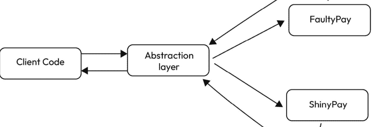

图 1.3 – 一旦替换组件准备就绪，就可以将其连接到抽象层

在此时，在这个时间点上，旧系统中的代码（在我们的示例中是 **FaultyPay**）变得过时，因此你可以删除它：

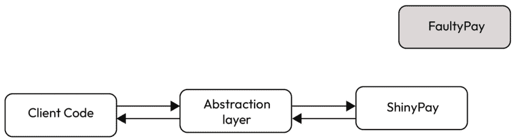

图 1.4 – 之前的实现（FaultyPay）与系统断开；所有流量和功能现在完全指向新实现（ShinyPay）

一旦删除了所有遗留代码，你可以拆除抽象层。或者，你也可以保留此层以备扩展或或：


图 1.5 – 我们的新组件已经回到了理想的状态！

Martin Fowler 建议，代码审查是进行重构的绝佳时机。如果你想理解别人的代码（正如我们之前提到的），最好的方法就是对其进行重构。否则，你可能只会得到代码的一点碎片，并给出模糊的反馈。重构帮助你获得更清晰的轮廓。顺便提一下，有一种被称为“结对编程”（pair programming）以及“结集编程”（mob programming）的东西可以将代码审查提升到一个新的水平。我们将在本书后面的部分讨论这些。

## 你应该重构什么

在我的职业生涯中，我有时会遇到想要对项目的不同部分进行更改的情况。可能是某些地方运行不正常，或者是我没有完全理解的地方，又或者是某些可以改进的地方。决定关注哪些部分并确定优先顺序是非常重要的。在某些情况下，保持原样而不做任何更改甚至可能更好。

重构没有快速的捷径或通用的规则，但只要稍加思考，你就可以制定出一个符合你特定需求的稳健计划。记住——在我们的职业和生活中，我们经常不得不做出妥协。

最近，我在 Gary Keller 的书籍《最重要的一件事》（*The One Thing (Bard Press, 2013)*）中发现了一个非常有用的概念。虽然它与软件开发没有直接关系，但它可以应用于我们的需求。这个想法是：“你所能做的一件事，做了它之后，其他所有事情都会变得更容易或变得不再必要？”虽然这是一个宽泛的问题，包含许多我们在这里无法讨论的内涵，但它是决定如何处理我们代码库的有用起点。这种方法在重构代码时非常有帮助。因此，当你开始一项新任务或新功能时，看看你的代码，并问自己是否有某些东西一旦改进，就会让项目的其他部分运行变得容易得多，或者完全变得没有必要。

这个问题关注的是“你能做什么”，这迫使你以可操作的术进行思考。它不是关于在满足某些条件时你会做什么，而是关于你现在能够做什么。通过将精力集中在手头最关键的任务上，这就像是将你的工作本质提炼到核心：为了实现最大影响所需的最小需求。这种方法在软件开发中可能特别有价值，因为有许多不同的领域可以从重构或改进中获益，但我们需要优先排序并集中精力以实现最大的影响。

让我给你举一个例子来说说明这一点。想象你正在一家经营良好的旅行公司工作，处理一个包含多个供应商及其解决方案的复杂系统。问题是，存在一些过时的代码问题，预订流程偶尔会失败。该系统在技术上运行没有错误，但它是过时的、难以维护的、缺乏适当文档（用一句话说：*legacy*），并且绝对没有准备好应对预期的流量激增。我们真的需要重构它，否则公司无法处理所有的新客户。同时，有一个内部团队负责管理网站内容，他们正为一个每月只使用一次的工具而苦恼。那个工具极其困惑且不实用，即使是简单的任务也耗费时间。我们必须重构那个工具，让它对团队更友好。虽然这两个问题都很重要，但显然，第一个遗留代码和预订流程问题应该首先解决，因为旅行预订是公司的核心业务，而且那些人就可以空出来处理其他事情。

无论如何，面对现实——重构遗留代码可能会让人不知所措，尤其是当你时间和资源紧张时。虽然“最重要的一件事”是一个极佳的方法，它也很宽泛，让我向你展示一些更精确的东西，可以帮你决定代码库的哪些部分需要你的关注。

## 影响分析

影响分析是软件重构中的侦探工作。它的核心在于弄清楚代码某部分的更改如何影响系统的其他部分。

因此，首先，开发者识别出需要重构或更新的代码模块。然后，他们调查这些模块与软件其他部分之间的连接和关系，例如外部库、用户界面和接口。

通过理解这些依赖关系，开发者可以感知更改将如何在系统中产生波动。他们可以确定那些可能特别难以更改的区域，并采取措施减少 错误或其他问题出现的概率。

基本上，影响分析是软件重构工具箱中一个至关重要的工具。它帮助开发者以更深思熟虑和谨慎的方式进行更改，使代码从长期来看保持稳定且易维护。

执行影响分析涉及彻底评估对系统或项目进行更改的潜在影响。以下是步骤分解：

- 1. 准备：定义更改，清楚地说明你想做什么。收集有关拟议更改的数据。

- 2. 识别受影响的区域和依赖关系：脑风系统哪些部分将受到更改的影响，以及更改将如何影响系统中的其他组件。

- 3. 识别每个区域受影响的元素：评估更改将如何影响功能、性能、安全和其他方面。识别更改可能引起的潜在风险和问题。

- 4. 评估：通过进行评估，团队识别拟议更改的积极和负面影响。

- 5. 处理负面后果：通过对负面影响有更清晰的理解，团队可以专注于解决这些问题。他们有机会与团队成员和利益相关者协商，讨论是否应该进行更改。此外，在这种情况下，进行回归测试变得至关重要。

## 风险评估

**风险评估**是“弄清楚可能出现什么问题”的高说法。在软件重构中，它在于仔细审视代码库，并在更改之前识别潜在风险。

在评估风险时，开发者考虑各种因素，包括代码的复杂性、引入错误的概率以及可能的潜在影响。可能会影响数据（某些代码处理关键信息）、潜在停机（某些代码出现问题会导致整个系统崩溃）、业务问题（损坏的代码会导致财务问题）或安全漏洞。他们还会考虑重构项目的可用时间和资源以及对用户和利益相关者的潜在影响。

一旦识别了风险，开发者就可以采取措施减轻。他们可能会创建测试用例以确保重构后的代码符合预期，或者通过小增量进行更改以减少出错的概率。我们将在本书后面的部分详细讨论测试覆盖。

总来说，风险评估是软件重构的一个重要部分，因为它有助于开发者做出如何继续的明决策。

## 价值估算

**价值估算**在软件重构中在于弄清楚特定的重构项目是否值得投入所需的时间和资源。

在估计价值时，开发者考虑各种因素，例如代码库的现状、重构的潜在收益以及涉及的潜在成本和风险。他们可能考虑用户反馈、性能指标和利益相关者的需求。

一旦估算了重构项目的潜在价值，开发者就可以决定是否有必要继续。在某些情况下，潜在收益可能无法抵消成本，项目可能会被搁置或推迟。在其他情况下，收益可能足以支持投入，项目就可以进行。

优先级矩阵（也称为艾森豪威尔矩阵）是软件重构中常用的一种工具，旨在帮助开发者优先分配精力，并对首要处理哪些重构项目做出明智决策。它通常包含一个具有两个轴的矩阵，一个轴代表项目的紧迫程度，另一个轴代表对系统的潜在影响。


每个项目都根据这两个因素进行评估，然后相应地绘制在矩阵上。投入精力最少且潜在影响最大的项目被视为最高优先级，而那些需要更多精力且潜在影响较低的项目被视为低优先级。

使用优先级矩阵可以帮助开发者根据每个项目的潜在收益和成本，对先处理哪些项目做出战略性决策。通过优先关注高优先级项目，开发者首先可以最有效地利用他们的时间和资源，并确保他们正在解决代码库中最关键的问题：

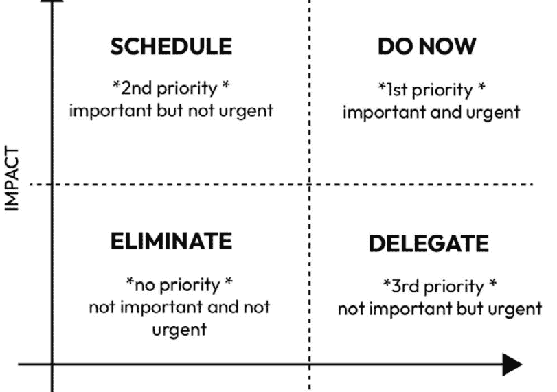

图 1.6 – 你应该将活动放入优先级矩阵中，以便选择执行的正确优先级

高优先级应该分配给高紧急且高影响的活动。低优先级（或完全不重要）应该分配给不紧急且没有影响的活动。

## 进一步的考虑

在重构方面，还有更多需要考虑的内容。老实说，我把它们写在这里是为了涵盖所有方面，尽管这可能超出了本章的范围。一旦你确定了代码库中哪些部分需要优先进行重构，下一步就是创建一个详细计划，包括项目的范围、目标、步骤和时间表。向所有参与人员（如你的团队、经理、客户和用户）传达这一点也至关重要。你需要解释为什么要重构、你将要做什么、你将如何做以及何时完成。在重构过程中明确并管理预期是重要的。

最后一步是以纪律和勤奋的态度执行计划。遵循最佳实践，例如进行小规模且频繁的更改、在每次更改之前和之后运行测试、提交（`commit`）并记录每次更改的文档，以及审查和验证每次更改。密切关注重构对代码质量、系统性能和用户反馈等方面的影响。衡量结果并将其与你的目标和预期进行比较。

## 重构还是重写？

关于这个问题有各种观点，我观察到这是团队成员和同事之间产生争议的常见来源。事实是没有简单的答案。这只是那种存在大量冲突观点的问题之一，很难判断该信什么。但我会尽力与你分享其中的一些观点并提供一些建议，无论这些建议是否有价值。

在某些情况下，重构你的代码是不合理的。也许它正充斥着太多的漏洞，设计过于复杂，理解它几乎是不可能的。处理它就像在尝试解决一个折叠的魔方——或者引用我的一位同事的话说，就像是在风扇吹着数钱。在这种情况下，从头开始重写可能是更好的选择，而且软件开发者发现这样做很有趣。毕竟，创造新事物通常比采取仍然与之前的工作挂钩的小型、增量式步骤要舒服得多。

另一方面，我们经常掉入想要重写一切的陷阱，认为已经存在的就是真理，而实际上，我们可能没有花精力充分理解它。记住编程的基本规则之一很重要：易读比易写重要。让我们不要立即贬低我们在代码库中使用的遗留代码（当然，特别是我们自己的代码）。遗留代码是有历史的；经过经过充分测试，并与所有必要的用例集成，通常表现出良好的性能。我们应该尊重遗留代码。

这是一个非常复杂的决策，正如我所说的，没有通用的规则。也许可以采用的一个非常简单的规则是评估重写和重构代码的成本（时间和复杂性方面），并选择你认为最好的选项。请注意，我没有说“成本更低的选项”，因为这是一项投资。另一个实用的方法是将待检查的部分拆分为更小的部分（古老的“分治法”），并仅选择重构（或重写）该部分，这样就不会被“困住”太久。

如果你决定重写一段代码、一个模块或整个组件，让我给你一个诚恳的建议：不要对已经完成的工作产生感情。让我来解释一下。无疑，尝试理解代码的功能以及构成逻辑流的各个步骤是有用的。了解用户目前的行为以及目前实现了哪些业务用例也同样有用。然而，我经常发现现有的内容并不符合用户的需求；也许从未如此，或者需求随着时间的推移而发生了变化。也许该软件的一半已经不再需要。所以，阅读现有的内容并尝试重写得更好是可以的，但通常这种逆向工程过程可能非常复杂、耗时，而且容易出错。相反，在产品所有者（`Product Owner`）的帮助下识别用户需求（要了解 `PO` 到底是什么，你可以参考 `https://www.scrum.org/resources/what-is-a-product-owner`）。

这实际上可能会遇到一些阻力，取决于你所在公司的氛围。

再次，我必须让你们失望了。我很难找到一个关于什么是“好代码”的清晰、精确且公认的定义。这是一个高度主观的概念，在很大程度上取决于上下文。在网上和教科书中，你可以找到许多略有差异的定义。然而，我坚信存在一些我们所有人都能认同的基础点。我将尝试总结对好代码的各种解释，并根据我的经验提供一些反馈，不值不值。

## 好代码是可读的

显然，这是第一点。非常直观，对吧？嗯，是的，但我经常发现这是一个被低估的方面之一。有时，我们过于专注于实现结果、不计代价地交付产品，却忘记了之后的事情；我们忘记了——正如提到的——代码不仅要让机器读懂，还要让所有其他程序员。而这些其他程序员也是我们未来的自己！做事情快并不是代码缺乏可读性的唯一原因；例如，有时我们需要处理性能问题。无论如何，如果你有其他方面需要处理，我的微小建议是确保至少在可读性与这些方面之间取得平衡。

为了给可读代码下达定义，我们不需要依赖代码本身。使用通俗语言就足够了。想象一下，你正坐在家里，需要组装其中一件漂亮、令人满意、低预算且需要自己组装的瑞典家具，比如一个衣柜。在我们熟悉的清晰的视觉说明书内部，我们发现了如下这样一段文字：

取尺寸为 A B 的白色部件，我们现在将其标记为 L。取另一块尺寸为 B C 的木板，我们称之为 M。取一个带有十字形末端的金属杆。取一个能固入 L 和 M 两孔的螺丝；它不能太短也不能太长。使用上述工具的十字形末端，顺时针方向旋转螺丝，直到它不可分割地连接在一起，形成一个我们称为 P 的部分结构。

这段文字显然是不可理解的。我在写它时非常痛苦。不要掉入认为代码与散文语言不同的陷阱。对我来说，它们是不同的，但在抽象意义上，你应该将它们视为同一物。想象一下，当你用散文来写代码时。你应该在某种程度上追求散文感，以便你的代码尽可能可读。当一段代码对于对项目一无所知或具备基础编程技能的人都是可读的时，你就成功了。上述说明书的摘录可以重写为：

取标记为“左侧”的木板，使用十字螺丝刀将其与标记为“背面”的板拧在一起。

这段摘录无疑可以进一步改进。起点是可以理解的；对我来说可以理解，对别人也可以理解，这就是你的代码应该有的。

可读的代码是可以被改进和扩展的代码。

## 好代码是可靠的

如果我必须为“可靠”想一个定义，我会想到我的朋友，当他们说要做某事时，他们就会做，且仅此而已。不多也不少。所以，把可靠的代码想象为你总是以最好的方式帮助你的朋友——没有惊喜，正如 Radiohead 乐队以前唱的那样。我可以给你举一个不可靠代码的例子，这和我过去遇到的某些事情并不远。例如，假设你的领域中有一个如下的实体：

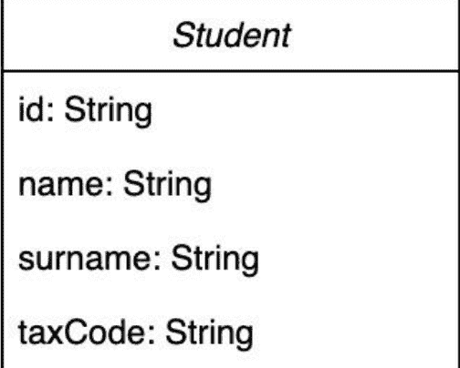

表 2.1 – 实体示例

`id` 和 `taxCode` 都是 `String` 类型并且在领域内是唯一的。这意味着不能有两个学生具有相同的 `id` 或相同的 `taxCode`。

我还有一个从 `Student` 接口暴露出的方法，写法如下：

```
public String getUniqueIdentifier();
```

显然，这个方法的签名是正确的，因为它没有暴露对象的内部结构。该对象也可以被命名为 `getId()` 或 `getTaxCode()`，而这恰恰是问题所在。在查看实现时，我们不知道在使用时会得到 `taxCode` 还是 `id`。当我们使用 `getUniqueIdentifier()` 时，我们意识到这种行为是可变的，并且取决于具体的实现。如果我们在一个支付和发票系统中使用这个方法，而在系统中明确我们需要 `taxCode`，那么这个方法就是不可靠的。一种可能的解决方案是暴露两个独立的方法，让我们确切知道此时正在读取的是哪条信息。或者，另一种解决方案是暴露一个名为 `getTaxIdentifier()` 的额外方法，专门返回 `taxCode`。这样，你就拥有了独立的方法，为每条信息提供清晰且无歧义的访问，而不会暴露内部结构。

## 好代码是难以被误用的

为了轻松解释“不可被误用”的概念，我只需要看一眼我孩子的房间。那里有玩具，有时被称为“蒙特梭利玩具”，涉及将小木制物体插入到带有每个物体相应形状孔洞的盒子里。如图 2.1 所示，将圆柱体放入正方形、将立方体放入圆形等操作是不可能的。

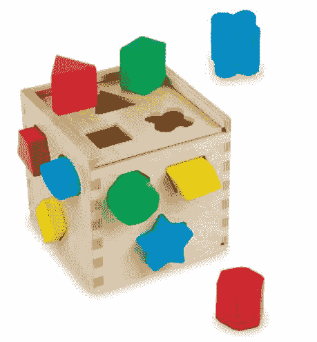

图 2.1 – 蒙特梭利玩具示例

这种用法是直观的并提供即时反馈。

我需要想象以这种方式编写代码和设计组件……（此处省略大量重复文本，已根据要求处理）……

这里的要点很简单：不要重复造轮子！毕竟，Java 之所以如此流行也是因为有大量的库可可用。我建议，我们在解决常见问题时，要避免创建基础组件，而是依赖语言特性或开源库。我总是问自己的第一个问题之一是：我是第一个遇到这个问题的人吗？答案通常很少是肯定的。

## 为数据和逻辑使用简单的单一事实来源

最后一条建议：对数据使用单一事实来源，对逻辑也使用单一事实来源。我必须承认，“单一事实来源”的概念解释起来通常很直观，但实现起来并不容易。

让我用一个例子来说说明我的想法。让我们再次想象一个航班搜索系统。通常，数据可以分为原始数据和派生数据。原始数据本质上是我们的系统无法找到的信息，而派生数据指的是所有其他信息。在我们的航班搜索示例中，假设我们需要提供从米兰到旧金山的旅行其他细节。这次旅行由两个航班组成：一个从米兰到哥本哈根，另一个从哥本哈根到旧金山。在这个例子中，我们可以将每个单独航班的出发和到达时间视为原始数据。从这里，我们可以推导出关于旅行时长以及可能的停机时长的信息。将派生数据作为原始数据并存储在数据库中可能会导致不一致。特别是当处理海量数据——或者当复杂性很高或涉及某些外部系统时——此类计算的成本可能会很高。我建议你谨慎，并实现一种称为“懒性计算”的机制。基本上，这种方法涉及仅在需要时计算派生数据，而不是提前计算，并将其保存在缓存中以便以后使用。在我们的航班示例中，我们将根据航班的出发和到达时间计算行程时长（我们还需要考虑机场位置及其时区），而不将其存储在数据库中，而最多存储在短期缓存之类的地方。如果将其存储在数据库中，我们必须在每次航班出发/到达时间变化（行业术语）、每次发生“计划变动”时重新计算它，并且可能会得到不一致的结果。

仅仅拥有单一事实来源是一个良好的做法，拥有单一逻辑来源也有益处。在上述案例中，例如，我们需要计算从米兰到旧金山的飞行时长。虽然这可能不是什么火箭科学，但也算不上一个简单的计算，因为它涉及到不同的时间和时间的转换。它是那些容易被低估的问题之一，而且比你想象的要复杂，会导致生产环境中的错误（目前有很多航班搜索网站都有这个错误）。在这种情况下，编写一次函数并对其进行彻底测试，然后在整个代码中使用它是非常有帮助的。这样，我们就没有偏离“不要重复自己”（`DRY`）的原则。在这种情况下，你可以写一个库，或者仅仅在你的项目中写一个类，在你每次需要时都处理行程时长。

## 好的代码是模块化的

总的来说，模块化指的是将一个复杂实体划分为更小的、独立的组件或模块的概念。这是一个可以应用于各个领域和学科的原则。让我们考虑由单个模块组成的单元，这些模块可以轻松组装和拆卸。


图 2.2 – 这种单元由一组相同且重用的模块组成。每个模块都是一个构建块，你可以根据需要以各种配置进行排列。这种方法允许在适应不同需求时具有灵活性。例如，如图 2.2 所示，可以使用相同类型的块，并将它们适应不同的长度。使该单元易于使用的组件意味着它们具有清晰的接口和交互点。如果你把自己置于用户以及必须组装并维护它的人的角度，你就会理解模块化是关键的。如果每个块有不同的组装方式，管理将变得复杂得多且容易出错。我们将在后续章节中详细讨论模块化。

## 依赖注入

类通常需要使用其他类。在组织良好的代码中，我们经常用单独的类来解决这些小问题。然而，这并不总是为了解决问题，结构代码以允许我们更改解决小问题的方法非常有帮助。这就是依赖注入大显身手的地方。

我可以给你一个与我们的航班搜索系统相关的快速示例。假设我们有一个 `FlightSearcher`，它根据行程和描述返回价格。当然，如果我们想通过价格加价来获得一些利润，关键部分将是：

```java
class FlightSearcher {
    private final EuroPricer euroPricer;
    FlightSearcher() {
        this.euroPricer = new EuroPricer();
    }
    Collection<Flight> searchFlights(FlightRequest request) {
        ...
    }
}
```

显然，`FlightSearcher` 组件依赖于 `EuroPricer` 的特定实现，该实现负责处理并返回价格。硬编码这种依赖不是长久之计。然而，如果我们未来使用另一种货币或任何逻辑，我们就需要修改代码。解决方案是从外部注入依赖：

```java
class FlightSearcher {
    private final FlightPricer flightPricer;

    FlightSearcher(FlightPricer flightPricer) {
        this.flightPricer = flightPricer;
    }
    Collection<Flight> searchFlights(FlightRequest request) {
    }
}
```

关键点在于，`FlightSearcher` 现在依赖于接口。我们将使用任何实现来实现：

```java
class EuroPricer implements FlightPricer {
    @Override
    Collection<Price> getPrices() { ... }
    @Override
    Collection<Discount> getDiscounts() { ... }
}
```

通过依赖注入，我们可以轻松重新配置 `FlightSearcher`。

## 迪米特法则

迪米特法则（`Law of Demeter`），也称为最少知识原则，通常简称 `LoD`，是一种软件设计准则，促进松耦合和封装。根据该原则，对象应对对象的知识应该是有限的并且并且与其直接邻居交互。让我们看看该原则的一些应用：

- **避免过度链式调用**：与其在单条链中访问多个对象的方法，不如限制调用次数：

```java
String result = object1.getObject2().getObject3().getValue();
```

虽然这段代码可以运行，但由于几个原因可能会出现问题。首先，它假设此方法调用将成功返回非空对象，否则可能会遇到空指针异常。此外，它将代码紧密耦合到对象的特定结构上。

- 不符合规范：

```java
Object object2 = object1.getObject2();
Object object3 = object2.getObject3();
Object object4 = object3.getObject4();
String result = object4.getValue();
```

在这个版本中，对象层级是逐步遍历的，并且每个中间对象都存储在单独变量中。这种方法允许更好的可读性、改进的错误处理（可以检查空值）以及在对象层级结构变化时的灵活性。

- **不要通过返回内部对象的引用来暴露对象的内部**：相反，提供高层方法来封装所需的功能。例如，假设我们必须从一个存储多种类型商品的仓库中检索所有书籍：

```java
public List<Item> getItems() {
    return warehouse.getItems();
}
```

这段代码在技术上是可以的，但调用者被迫检索所有书籍然后进行过滤以保留书籍。这个项目只需要书籍；出于几个原因这并不愉快：我们查询仓库的所有物品，但调用者必须增加自己的复杂性来过滤物品；我们暴露物品的内部结构让客户端知道物品本身的**类型**，以便其应用过滤。我们产生的是强耦合。

- 符合规范：

```java
public List<Item> getItemsByCategory(String itemCategory) {
    return warehouse.getItemsByCategory(itemCategory);
}
```

通过这种方式，我们没有让客户端完成所有的过滤，并且只在仓库中查询书籍。我们没有被迫暴露物品的**类型**，因为客户端请求的是特定的类别。我们应该进一步优化这段代码，返回 `Book` 类而不是 `Item`，但目的只是为了为内部结构暴露提供一个示例，所以我们暂此到此。

- **避免将对象作为方法参数传递比必要的更远**：如果一个对象需要访问另一个对象，仅提供必要的信息或依赖项：

```java
// 不合规
public void processOrder(Order order) {
    shippingService.shipOrder(order);
}
```

在这段代码中，`shipOrder` 方法接收了整个订单，而它只需要订单本身的项目项。更好的做法是修改 `shipOrder` 的签名，使其仅接收这些项目项。

```java
// 合规
public void processOrder(Order order) {
    shippingService.shipOrder(order.getItems());
}
```

现在，我们只为 `shipOrder` 提供了必要的信息。

不能说整个开发者社区都完全认同“德墨特律”（`Law of Demeter`）（请参阅“延伸阅读”部分），因此有些人认为它应该被称为“德墨特的建议”。

## 数据内聚（让相关数据协同工作）

类有助于处理事务，但如果我们把许多事务归类在单个类中，可能会出现问题。我们应该对此保持谨慎，但同时，也不应该忘记在合理情况下将它们组合在一起的好处。


有时，某些数据之间自然地是相关的，我们的代码需要一起处理它们。在这种情况下，将它们分组到一个类或类似的结构中是有意义的。通过这样做，我们的代码可以专注于这组项目所代表的整体概念，而不是一直处理具体的细节。这种方法促进了我们代码的模块化，并允许需求的变化被容易地隔离。

相关数据分组的一个例子是价格和货币的结合。在许多应用程序中，当处理财务交易或货币值时，同时考虑价格和表达价格的货币是非常关键的。

通过将价格和货币一起分组到一个类或数据结构中，我们可以方便地将这些相关信息作为一个单元进行传递。这允许我们对价格进行计算、转换和其他操作，同时确保相应的货币被正确地计入。

例如，我们可以创建一个 `Price` 类，封装价格值和货币代码。该类将提供执行算术操作和货币转换的方法，以强制价格和货币之间的一致性（因此，所有逻辑将集中在一个地方，作为单一的事实来源运行）。

另一个相关数据分组的例子可能涉及纬度和经度坐标。在处理基于位置的应用程序或地图系统时，纬经度值经常被一起使用以指定地球表面的特定点。通过将纬经度分组到类或数据结构中（简单来说：`Point`）并封装纬经度值，我们可以方便地作为一个凝聚单元来处理和操作地理坐标。同样，我们可以执行各种操作，如距离计算、映射功能或寻找附近的地点（实际上，许多处理地理计算的库正是这样运行的）。

## 不要向返回类型中泄露实现细节

为了保持条理清晰且易于维护，确保每个抽象层都是整洁的，并且不暴露底层是如何实现的是非常重要的。当实现细节泄露时，它可能会暴露代码中较低层的信息，并使得以后更改或自定义这些内容变得非常困难。发生这种情况的一种方式是代码返回了一个与这些特定细节紧密连接的类型。

在我们假设的航班搜索服务中，让我们考虑通过传统的 Web 服务客户端依赖外部供应商的场景。由于法律要求，我们有义务在一段时间内保留所有的请求和响应。为了解决这个问题，我们在代码库中实现了一个处理这些记录存储的器。我们使用了一个名为 SkyVault 的云存储系统：

```
class PayloadStorageService{
    public SkyVaultResponse upload(Payload payload) {
    }
}
```

我们可以看到，该类暴露了使用 `SkyVault` 作为我们存储服务的事实，并将客户端绑定到了这一选择上。这使得如果我们以后想切换到不同的存储服务、使用数据库或任何其他类型的数据存储，更改将变得超级困难。代码会变得非常难以维护。

解决这个问题的一种方案可能是以非常细微的方式适配响应：

```
class PayloadStorageService{
    public UploadResponse upload(Payload payload) {
    }
}
```

除了类型之外，还有一些情况是实现过度可见的，导致库或用户服务与服务本身之间创建了紧密连接。例如，极端服务的实现复杂度被暴露了，而不是被简化并上推给调用者：

```
class PayloadStorageService{
    public boolean exists(Payload payload) { }
    public UploadResponse overWrite(Payload payload) { }
    public UploadResponse upload(Payload payload) { }
}
```

在这种情况下，客户端在调用 `upload` 方法之前需要先检查 `payload` 是否存在。如果存在，他们必须使用 `overWrite` 方法。这个额外的步骤为客户端增加了不必要的复杂性。如果这种复杂度是在方法内部处理的本会更好（当然，除非覆盖现有文件对我们的特定情况某些方面很重要）。

## 良好的代码是可复用的

作为工程师，我们经常通过将大问题拆解为小问题来解决问题（经典的分治法）。猜猜怎么着？我们在不同的项目中不断地遇到相同的微小问题。所以，如果我们或其他工程师已经对其中一个反复出现的问题想出了解决方案，那么复用它是有意义的。它节省了时间并减少了引入 Bug 的机会，因为我们知道解决方案已经过尝试和测试。

复用的概念与两个关键实践相关：建立清晰的抽象层和开发模块化代码。通过实现清晰的抽象和模块化代码，我们自然地将解决方案拆分成松耦合的组件。这种方法极大地提高了代码复用的便利性和安全性。

## 在编写代码时不要做假设

不要假设是一个很好的生活建议——但我在这里不想当你的生活导师，所以不用担心。

“假设”没有特定的定义，但我可以为你提供我最近遇到的一个例子。想象你正在管理一个电子商务系统并需要维护订单记录。每个订单由一组属性表征，每个订单都有一个唯一标识符称为 ID。需要注意的是，这个 ID 是一个顺序递增的数值。例如，如果一个订单的 ID 是 x，后续订单将被标记为 x+1，以此此类推。

在订单管理系统旁边，有一个大多数公司常见的组件，称为报告系统（在我的脑海里，我听到了一种上升的声音，就像电影《科学怪物》里一样）。报告系统依赖于判断订单的新旧。这种比较的逻辑基础通常是 `created_on` 或类似的字段。然而，在这种情况下，报告系统假设订单排序完全取决于 id 字段。它假设 id 越小，订单越新。

现在，让我们考虑订单管理系统需要迁移数据的场景。将 ID 生成过程更改为随机字母数字字符串而不是数值递增变得非常方便。假设 ID 是数值且顺序递增的报告系统无法正常工作。

当代码被复用时，假设会导致 Bug，因为被复用的代码可能依赖于在新环境中不再满足或一致的某些条件或行为。这些 Bug 可能会以许多方式出现，包括：

- 上下差异：当代码在不同的上下文或环境中被复用时，原始实现时所做的假设可能不再成立。底层依赖、数据结构、系统配置可能有所不同，导致代码出现意外之外的行为或产生错误的结果。
- **隐式依赖**：重用的代码可能对外部因素有隐式依赖，例如特定的数据格式、数据库模式或 API 响应。如果这些依赖没有得到适当的理解或沟通，在不同的上下文中使用代码可能会导致问题和意想不到的失败。
- **假设的约束**：重用的代码可能对原始系统的局限性或约束做出假设。这些假设可能包括数据大小、操作频率或预期使用模式等因素。如果在新的语境下超过或未满足这些约束，重用的代码可能无法正确处理这些情况，从而导致 bug 或系统故障。
- **兼容性问题**：重用通常涉及集成不同的组件或库。如果重用的代码依赖于这些组件的特定版本或配置，当与不同的版本或替代实现一起时，可能无法按预期工作。重用代码与其他组件之间不兼容的交互可能会引入 bug 或导致不稳定。
- **验证有限**：在原始实现期间，某些假设可能没有经过充分验证。当代码被重用时，存在一种风险，即这些假设仅在原始情况下有效，而在其他场景中无效。对假设的验证不足会导致代码在不同上下文中重用时出现 bug。

# 如果你做出了假设，请清晰地识别它们

我是一个随身矛盾生活的人，现在我告诉你们：做出假设至关重要！重要的是要在正确的时间、以恰当的数量、针对正确的事情这样做。例如，当我们发现自己正在处理一段完全陌生的代码时，做出假设至关重要；否则，我们将逐行查看每一行代码，寻找我们数无数的问题。另一个例子是调试：在修复 bug 时，通过做出大量假设，特别是当你对代码很熟悉时。相信你的直觉。大多数时候，当有人开始向你解释问题时，你已经知道 bug 躲在哪里何了。此外，在创建新代码时，假设对于快速、有效地构建代码至关重要。否则，我们可能会陷入试图编写代码来处理每一种可能出现的情况中，即使是那些不会发生的情况。

有时，做出假设变得必要或能够显著简化代码，其收益超过了任何缺点。然而，当我们在代码中做出假设时，至关重要的是记住其他工程师可能不知道这些假设。为了防止他们无意中受到我们假设的影响，我们需要强制执行它们。通常我们可以采取两种方法：

- 让假设变得“不可破坏”：如果我们以这种方式组织代码，使其在违反假设时无法编译，那么我们就能确保假设始终有效。例如，如果一个类必须以特定方式实例化或初始化，请将其构造函数设为私有，并改为暴露一个 `create()` 方法。
- **利用错误信号技术**：如果无法使假设具有证明，我们可以实现代码来检测假设被违反的情况，并采用错误信号技术快速停止执行。

如果你想更深入地研究这些方面，我推荐“进一步阅读”（*Further reading*）部分 Tom Long 的书。

到目前为止，我们已经学习了什么是好代码，即可读性和可靠性最重要的几点。良好的代码应该是易于理解且难以出错的。它是模块化的，就像一件制作良好的家具，你可以反复使用。当然，这其中存在一些争论和个人偏好，但我认为我们大多数在这些点上可以达成共识。现在，让我们转向创建良好的另一种方式：**整洁代码（Clean Code）**。

## 整洁代码

关于整洁代码的名著是 Robert C. Martin 写的《整洁代码》（*Clean Code*）。令人惊讶的是，即使是 Martin 本人也难以为整洁代码给出一个单一的定义。似乎在我们开发者之间流传着多种定义。事实上，在他的书中，Martin 几位开发者提供了他们自己的“自定义”定义，他包含了所有这些定义，以便我们能对整洁代码的含义建立自己的理解。

“整洁”关于编写易于理解并遵循逻辑且严律的方法的代码。主要目标是高效、有效地创建软件，同时确保代码具有可读性、适应性、可扩展性且易于维护。

你可以争辩这个定义并不是客观的，你是对的！例如，“可读性”是非常个人化的（并且取决于接触代码的人的资历和技能）。比你想象的要频繁得多，我们根据自己的标准来判断代码。我能理解它吗？那么它就是可读的！转述 Bouswell 和 Foucher 的书籍《可读性基本定理》（*Fundamental Theorem of Readability*）——代码的设计方式应该减少某人理解它所需的时间。

当我们使用“理解”一词时，我们设定了一个非常高的标准。要真正理解你的代码，某人应该具备修改、识别 bug 以及掌握它如何与你的其余代码交互的能力。整洁代码不是一套法律或一套规则；它是一种态度，是我们应该遵循的心态。

正如前面提到的，重构和整洁代码是密切相关的，因为它们都提升了软件的质量和可维护性。

## 为什么需要整洁代码？

正如重构一样，当我在工作中向没有技术背景的人谈论整洁代码时，反应各不相同，但差别不大：从打哈欠到翻白眼，从低头到不耐烦的手势。他们认为有人在他们面前谈论无法理解的话题，或者提议“改变有效的东西”或“写好代码”，好像除了代码之外还有其他东西有效或无效（而且——让我们面对现实——考虑到重构等实践是浪费时间和金钱）。

像文档和注释等内容是重要的（并且当我们那里时），最关键的应该一直说话的是你的代码。像使用每种语言一样编写代码，让它易懂，不仅是为了你，也是为了未来的他人。记住，你的工作很大一部分是维护（这可能不好，但这是现实）。当你为了自己编码时，它不仅提高了你的技术水平，还提升了代码的质量。能够清晰地交流你的代码允许你寻求帮助并获得宝贵的建议。整洁代码不会自动出现；它需要投入精力来有效地表达你的意图。目标是编写自解释的、组织良好的代码，这样你就不需要大量的注释来解释其目的。

我已经提到过，你的代码会被别人阅读，无论是其他人还是你自己。这强调了编写整洁代码的必要性，因为它有利于团队协作。需要时间来理解代码的功能、在出现问题时修复它以及添加新功能。整洁代码促进了可读性并让你成为更高效的程序员；它在需要时使维护变得更简单快速。简单来说，它让团队因素发挥作用。当同事或经理指责你因纠结代码而浪费时间时，你可以使用这个论点（这个事实）。

编写整洁代码的一个经常被忽视的方面是对于你所做的事情感到自在。想象一下向某人寻求帮助并向他们展示杂乱、不稳定的、难以理解且难以解释的东西。这会很丢脸。此外，在我看来，正确地处理他人的工作几乎是美感的，你可以说。这是工匠所做的（原谅这个陈腐的比喻）。我们不仅仅是推代码的；我们是艺术家。让我们始终像展示给别人看一样编写代码（并且实际上向别人展示代码，通过代码审查或结对编程真的非常有帮助——我们稍后会讨论）。整洁代码运行得更好，因此满足感不仅来自于人们查看你的代码，还来自于他们使用你提供的服务且其运行正常时。

尝试完整解释《代码之道》需要一整本书，而且你猜怎么着？得益于“鲍勃叔”Robert C. Martin，那本书已经存在了。不过，我认为为你提供一些要点将是有帮助的，特别是如果你是这个领域的新手。我们稍后会深入探讨其中的一些方面。

## KISS – 保持尽可能简单

KISS（Keep It Stupid, Stupid，保持愚蠢、简单，或 Keep It Stupid-Simple，保持愚蠢且简单，取决于你想要被限制在什么程度）是整洁代码中最古老的规则之一。它敦促程序员保持代码尽可能简单。避免增加不必要的复杂性。在编程世界中，解决问题绝不止一种方法。你可以使用不同的语言和各种命令来完成任务。遵循 KISS 原则的程序员总是会寻找更简单的方法来处理问题。

## DRY – 避免重复

计算机科学的主要功能之一就是发明缩写。DRY（Don't Repeat Yourself，不要重复自己）就是其中之一。它是 KISS 的更具体版本，强调整洁代码中的函数应该只做一件事（并做好）。值得注意的是，DRY 的反面被称为 WET，代表 We Enjoy Typing（我们享受输入）或 Write Everything Twice（一切写两次）。

一个典型的 WET 示例如下：

```java
public class WETExample {
    public static void main(String[] args) {
        String name = "John";
        System.out.println("Hello, " + name + "!");
        // 一其他代码...
        System.out.println("Hello, " + name + "!");
    }
}
```

你可以看到，在这段代码中，有很多行基本上是相同的。我们必须尝试避免这些重复；延续这个文字游戏，我们必须把这段“湿”代码变“干”（dry）。

在 DRY 版本中，之前的代码变成了如下样子，没有任何意外：

```java
public class DRYExample {
    public static void main(String[] args) {
        String name = "John";
        greetUser(name);
        // 一其他代码...
        greetUser(name);
    }
    public static void greetUser(String name) {
        System.out.println("Hello, " + name + "!");
    }
}
```

在 DRY 版本中，我们简单地将重复代码隔离在单个方法中。这个例子很简单，因为重复的代码只是一行 sysout，但这只是为了解释概念：想象一下如果有许多行代码将会是怎样。这不仅会创建整洁、更具读性的代码，还将减少漏洞溜入的可能（以及安全问题）。

## YAGNI – 删除无用的东西

整洁代码原则 YAGNI（You Aren't Gonna Need It，你将需要的）遵循这个简单的想法：开发者只有在需要时才应该向代码添加额外功能。YAGNI 与敏捷软件开发方法密切相关。根据 YAGNI 原则，与其从一个宏大的计划开始，不如通过小增量地构建软件架构，以解决出现的问题。这允许了动态且个性化的问题解决方式。当底层原则在没有不必要的装饰的情况下高效地解决时，就实现了整洁代码。

## 代码应该是可读的，而不仅仅简洁的

代码需要完成它的工作并被机器正确解释。但不仅仅是机器需要理解它——其他开发者也应该理解代码，特别是在协作项目中。这就是为什么在软件开发中，可读性总是优先于简洁性。如果简洁的代码让他人无法理解，那么编写简洁的代码就是毫无意义的。产生整洁且可读代码的关键在于变量命名。

变量应该有一个能清晰传达其目的名称。例如以下变量，在没有必要的背景知识和解释的情况下，它是晦涩的：

```java
int x;
```

但是，这个命名稍微精确一点的变量仍然留下了疑问：

```java
int elapsed;
```

它应该是流逝的——时间，好吧，但测量单位是什么？通过为同一个变量使用以下名称，它的目的变得一目易见了：

```java
int elapsedTimeInMillis;
```

我们对变量名称长度的观点是，我倾向于长长而不是太短。找到一个中点是最理想的，但不总是可能的。在两个极端之间，我倾向于更长的名称，因为它们增强了可读性。然而，重要的是，冗长的名称有时暗示着潜在的问题。

总结一下，我们快速回顾了什么是整洁代码。有整本的书、在线课程和公司研讨会致力于这个主题——简而言之，它周围有一个一整个世界，我不指望这几点能涵盖一切。我的建议是尽可能地深入研究。仍然有人认为整洁代码是一种点缀，是当代码即使不正常也能运行时浪费时间的东西。我希望我传达了这样一个概念：事情并不是那样运作的，如果处理得仔细，良好的整洁代码将以相对低精力带来许多优势。在下一节中，我们将为代码添加另一个形容词：在 good 和 clean之后，我们将看到什么是 SOLID 代码！

## 编写 SOLID 代码

如果说软件工程社区有一项擅长的事情，那就是发明酷炫的缩写！这正是 Michael Feathers 所做的，他从无处不在的 Robert C. Martin（鲍勃叔）的一篇论文中获得灵感，并提出了 SOLID 原则。在他的文章中，Martin 意识到软件会随着时间的推移而变得越来越复杂。但他警告说，如果没有良好的设计原则，软件将变得僵化、脆弱且难以维护。这就是 SOLID 原则发挥用场——它们是为了解决这些问题而创建的。

- 单责任原则 (SRP)
- 开闭原则 (OCP)
- 利氏可替换原则 (LSP)
- 接口隔离原则 (ISP)
- 依赖倒转原则 (DIP)

SOLID 原则是为了解决这些问题并使软件更具可维护性和灵活性。通过遵循这些原则，我们可以确保我们的代码更容易更改和扩展。

这些通常被用于满足这一需求。无论你选择哪种方法，坚持这一原则都是重要的，以确保你的代码保持易于维护和更新。

假设你在一家销售各种交通工具的旅游电子商务公司工作。由于对环境可持续性的关注，你决定显示每种交通工具的二氧化碳排放量。目前，你有飞机和火车。

我们决定采用以下接口和类：


```java
public interface Co2Calculator {
    Integer calculateCo2Tons();
}

public class AirplaneCo2Calculator implements Co2Calculator {
    @Override
    public Integer calculateCo2Tons() {
        //...calculates...
    }
}

public class TrainCo2Calculator implements Co2Calculator {
    @Override
    public Integer calculateCo2Tons() {
        //...calculates...
    }
}
```

我们有两个 `Co2Calculator` 的实现，一个用于飞机，一个用于火车。它们都使用相同的方法。这个接口将以这种方式用于任何类——让我们暂时称其为 `EmissionCalculator`：

如果我们决定引入一种新的交通工具，例如公交，这样做将会很容易：

```java
public class BusCo2Calculator implements Co2Calculator {
    @Override
    public Integer calculateCo2Tons() {
        //...calculates...
    }
}
```

现有的代码没有被触动过。当我们引入新的交通工具时，我们的 `EmissionCalculator` 类不需要实现新的逻辑。

# 里斯夫替换原则 (Liskov substitution principle)

在 SOLID 五大原则中，里斯夫替换原则可能难以理解。从本质上说，该原则规定任何派生类都应该替换其父类而不会引起任何问题。简单来说，如果类 A 是类 B 的子类型，我们应该能够用 A 替换 B 而不会破坏我们程序的行为。

举一个简单的例子，让我们假设我们正在对车辆进行建模（为了简单起见，我省略了构造函数、getter 和 setter 方法）：

```java
public class Vehicle {
    public void startEngine();
}

public class Airplane extends Vehicle {
    private AirplaneEngine engine;

    @Override
    public void startEngine() {
        engine.start();
    }
}

public class Train extends Vehicle {
    private TrainEngine engine;

    @Override
    public void startEngine() {
        engine.start();
    }
}
```

引入一个新的 `Bicycle` 实体并使其继承 `Vehicle` 类将违反这一原则：

```java
public class Bicycle extends Vehicle {
    @Override
    public void startEngine() {
        throw new UnsupportedOperationException(
            "Bicycles do not have engines!"
        );
    }
}
```

在这段代码中，我们被迫实现 `Vehicle` 接口的方法，但我们又无法做到，因为，你知道的，自行车没有引擎！所以我们被迫导致了破坏性结果，例如抛出一个异常。我们本应该可以用自行车替换车辆而不破坏程序的行为，但这样做违反了里斯夫原则。

# 接口隔离原则 (Interface Segregation principle)

接口隔离原则 (ISP) 的核心思想是拥有许多小接口，而不是少数几个大接口。根据马丁（Martin）的观点，“为特定的客户端创建细粒度的接口。客户端不应该被强制实现它们不使用的接口。”

对于软件工程师来说，这意味着你不应该仅仅向现有接口添加新方法。相反，应该从零开始，为每个客户端的需求定制新的接口。使用更小的接口可以鼓励“组合优于继承”，从而促进松耦合。如果一个接口太大，最好将其拆分为更小的接口。这样，实现这些接口的类只需要关注它们真正感兴趣的方法即可。

假设我们有一个交通工具销售系统，并且我们有以下接口：

```java
public interface FlightManager {
    Long calculateDistance();
    Long calculateEmissions();
    Double calculatePrice();
}
```

这个接口看起来很大，而且它的名字以 "manager" 结尾太笼统了，可能会导致问题（因为它缺乏特定性，并且没有提供关于类或组件的职责或目的的清晰信息）。它涵盖了许多不同的内容。如果你在类中实现它，你必须处理许多事情，每件事都有其自己的重要性。

将 `FlightManager` 接口拆分为三个特定的“计算器”，每个负责一个关注点又如何？

```java
public interface FlightDistanceCalculator {
    Long calculateDistance();
}

public interface FlightEmissionCalculator {
    Long calculateEmissions();
}

public interface FlightPriceCalculator {
    Double calculatePrice();
}
```

通过这样做，我们可以在决定哪些类实现特定接口时获得更大的灵活性：

```java
public class FlightStatisticsManager implements
    FlightDistanceCalculator, FlightEmissionCalculator {

    public Long calculateDistance() {
        //implementation here
    }

    public Long calculateEmissions() {
        //implementation here
    }
}

public class FlightPricer implements FlightPriceCalculator {
    public Double calculatePrice() {
        //implementation here
    }
}
```

现在，每个特定的类只实现所需的方法，并且感知不到任何与其特定关注无关的内容。

# 依赖倒置原则 (Dependency inversion principle)

这一原则分离了软件组件。基本上，依赖倒置原则建议开发者应该“依赖于通用概念，而不是具体的实现”。马丁还解释说，“高层模块不应该依赖于低层模块。两者都应该依赖抽象概念。”此外，“抽象概念不应该依赖于具体的细节。细节应该依赖于抽象概念。”

遵循这一原则的常用方法是使用依赖倒置模式，但并不是实现它的唯一方法。

为了测试这一点，让我们假设有一个（简化的）`LocationCatalog` 类，处理所有关于位置的查询。该类从数据库仓库获取“字典”：

```java
public class LocationCatalog {
    private final LocationDatabaseRepository locationRepository;

    public LocationCatalog() {
        this.locationRepository = new LocationDatabaseRepository();
    }
}
```

这段代码可以正常运行，允许我们在 `LocationCatalog` 类中使用 `LocationDatabaseRepository`。

现在一切都好吗？还没有。还有一个问题，它在于在声明 `locationRepository` 时将这些类耦合在了一起。

这不仅让测试 `LocationCatalog` 类变得困难，而且消除了更换 `LocationDatabaseRepository` 的可能。

为了解决这个问题，通过引入更通用的 `LocationRepository` 接口并将其纳入类中，将位置管理器与 `LocationDatabaseRepository` 解耦。

```java
public interface LocationRepository {}

public class LocationCatalog {
    private final LocationRepository locationRepository;

    public LocationCatalog(LocationRepository locationRepository) {
        this.locationRepository = locationRepository;
    }
}
```

我们成功地解耦了依赖，现在可以自由选择位置来源，无论是文件、外部服务还是模拟实现（特别有助于测试）。

现在我们在编写代码方面有了良好的基础：我们了解代码，了解清洁代码，并且知道什么是好的代码。接下来，让我们考虑代码的可靠性，以及可靠代码不会产生意外影响（也称为副作用）的事实。

# 副作用与可变性

当一个事物是不可变的时，意味着它一旦创建，状态就无法改变。理解为什么不可变性是一件好事，需要识别其相反面——可变性——可能产生的问题。

拥有可变对象有很多缺点，或者广义地说，被迫处理可变性（以及处理对象状态）。

一个具有设置函数的类变类很容易被配置错误，导致可能会被误用，导致错误或无效的配置，最终导致你的代码出现某些功能故障。

可变对象的另一个大问题出现在考虑线程安全时。线程安全是多线程或并行编程中的关键问题，因为多个线程可以同时访问并修改共享数据。关于什么是线程安全的更多信息，请参见“延伸阅读”部分中的条目。可变对象不是线程安全的，因为它们可以在没有妥当同步的情况下被多个线程修改，导致不可预测且可能导致错误的行为。

然而，可变性的真正问题发生在函数遇到输入参数时。这就像把东西借给朋友。当你借出东西时，你不希望它被弄脏，因为你以后可能还需要它，或者想把它借给别人（想象一本书、一辆自行车或你最喜欢的蝙蝠曼模型）。该函数包含了函数需要的重要信息，但在函数执行完毕后你可能仍然需要它。

如果函数开始更改输入参数，就像划了你的自行车或弄坏了你的蝙蝠曼模型。通常，当你将对象传递给函数时，你期望它是被借用并原样返回的。但如果函数擅自弄了它，那就不太妙了。更改输入参数是一种副作用，因为它影响了函数本身之外。通常，函数通过参数接收输入并返回值。

对于大多数工程师来说，修改输入参数是一个意料之外的副作用，可能会导致意外和困惑。因此，最好避免动用借用的对象，并坚持使用参数作为输入、使用返回值作为结果的惯例。

使代码不可误用的一个好方法是使用不可变对象。特别在 Java 中，一个典型的不可变对象将包含字段（带有 `final` 修饰符）、构造函数以及——获取方法（getters）：

```java
public class Student {
    private final String name;
    private final String surname;

    public Student(String name, String surname) {
        this.name = name;
        this.surname = surname;
    }

    public String getName() {
        return name;
    }

    public String getSurname() {
        return surname;
    }

    // ... toString(), hashCode(), equals(), etc..
}
```

这个对象确实是不可变的，并且遵循了实现不可变性的常用模式。它所有的属性都被声明为 `final`，这意味着它们在初始化后无法被修改。属性通常在构造函数中声明，根据具体要求，可能需要也可能不需要所有参数。该对象不提供 setter 方法，因为尝试这样做将由于 `final` 字段的存在而导致编译错误。

然而，它提供了用于访问属性值的 getter 方法，但这可以根据你的具体需求而异。显而易见的是，一旦该对象被创建，就无法被修改。

当然，使用 Java record（Java 14 引入）可以用更简单的方法实现相同的目标，但在这里会稍微超出讨论范围。我们的目标是推广不可变性；这种实现只是一个例子。我们在下一节中还会介绍构建器模式。

Java 中另一个非常常见的例子是 `String` 类。一个 `String` 对象始终代表相同的字符串。由于 `String` 是不可变的，一旦创建，String 对象始终具有相同的值。要在字符串末尾添加内容，你必须创建一个新的 String 对象：

```java
String s = "a"; // 创建一个值为 "a" 的 String 对象
s = s.concat("b"); // 创建一个值为 "ab" 的新 String 对象
// 下述两个操作也会导致
// 新 String 对象的创建：
s = s + "b"; // s = "ab";
```

通常，要使一个类变为不可变，请遵循以下规则：

- 不要提供任何修改对象状态的方法（即变异方法）。
- 确保类不能被扩展（这主要通过将其标记为 `final` 实现）。
- 将所有字段声明为 `final` 和 `private`。
- 确保对任何可变组件的排他访问：可能会出现类中的字段被定义为可变对象。在这种情况下，确保客户端无法获取该对象的引用。在类内部进行初始化，并在构造函数和访问器中进行防御性拷贝。

你可能会辩道：好吧，但我有一个用例是必须创建一个对象然后修改它。一个典型的例子是你必须创建一个对象并在不同的步骤中填充它的字段。我的建议是改用构建器模式。

## 构建器模式

构建器（Builder）是一种在面向对象编程中常用的设计模式，用于逐步构建复杂的对象。它提供了一种灵活且可读性的方式，用于创建具有多个可选参数或配置的对象。构建器模式将对象的构建过程与其表示分离离开，允许使用相同的构建过程创建对象的不同表示。它通过提供设置各种属性或参数值的方法，为构建对象提供了清晰且直观的 API。通常，为每个对象创建一个构建器类，该类包含设置对象单个属性或配置的方法。构建器累积这些设置，并在请求时最终构建对象。这种方法允许代码更具可读性和可维护性，特别是在处理具有许多可选参数或配置的对象时。它促进了流式或链式方法调用的理念，每个方法都返回构建器实例本身，从而允许使用更简洁、更易读的构建语法。

让我们使用构建器来创建一个“学生”：

```java
public class StudentBuilder {
    private String name;
    private String surname;

    public StudentBuilder() {
        // 默认构造函数
    }

    public StudentBuilder withName(String name) {
        this.name = name;
        return this;
    }

    public StudentBuilder withSurname(String surname) {
        this.surname = surname;
        return this;
    }

    public Student build() {
        return new Student(name, surname);
    }
}
```

该类提供了一个不接受任何参数的默认构造函数。`StudentBuilder` 还提供了两个类似于 setter 的方法：`withName(String name)` 和 `withSurname(String surname)`。这些方法允许分别设置学生的姓名和姓氏属性。每个 setter 更新构建器对应的属性并返回构建器对象（`this`）以支持方法链式调用。最后，`build()` 方法使用构建器中设置的值来构造并返回一个新对象。它创建了一个从构建器获取姓名和姓氏的 `Student` 实例并返回该对象。通过这个类，你可以逐步构建 `Student` 对象，设置姓名和姓氏值。这里有一个示例：

```java
Student student = new StudentBuilder()
    .withName("John")
    .withSurname("Doe")
    .build();
```

这段代码使用构建器模式创建了一个名为 "John" 姓 "Doe" 的新对象。通过链式调用 `withName()` 和 `withSurname()`，你可以分别为姓名和姓氏属性设置所需的值。`build()` 方法使用提供的值构建并返回 `Student` 对象。

这看起来似乎与我们之前提供的关于长链调用的信息有些不一致。在我看来，返回类型总是相同的，而替代方案将同样复杂，甚至更糟——一长串的 "set" 方法和/或一个带有许多参数的构造函数。

你可能想过：为什么会存在坏代码？假设这并不是由于个人的懒惰或无能造成的，让我们快速探讨一些导致我们正试图解决的这种局面的偶然原因。

## 坏代码产生


正如上一章提到的，我并无意去指责那些编写坏代码的人。这种情况在过去发生过，现在仍在发生，未来还会发生（我已经可以想象我的同事们在读到这些行文字时点头的样子了！）。在绝大多数情况下，编写坏代码的人在写时并没有意识到这一点——我们毕竟是人，一次只能处理有限数量的任务。在我们的内心深处，我们渴望做好工作，做一些令自己自豪的事；但在脑海中，我们有截止日期、压力，而且我们通常在一个我们无法完全控制的生态系统中工作。很多时候，公司是复杂的系统，可能有明确的规则（例如，规定要遵循的方法论），但它们必须应对日益忙碌的世界，面临产品上市时间的压力以及激烈的竞争。事物本该有其本的样子。作为软件工程师，我们引导或支持公司的工作，并经常发现自己与与自己截然不同的心态和需求交道。有时，结果就是牺牲了质量并经历了一丝挫败。几乎总是，这会导致产生坏代码库。但为什么会发生这种情况呢？如果我们能识别出坏代码的一些共同原因，也许我们就能识别并避免它们。

## 截止日期

这无疑是一个争议性的点。对于许多人来说，将截止日期归咎为坏代码的原因只是掩盖懒惰或无能的借口。并不是你不想投入精力去思考和正确地完成事情。在某些情况下，这可能确实如此。多年来，我经常观察到——尽管我必须说，并非总是如此，而且程度程度不一——管理层与工程师之间存在脱节。他们往往倾向于“推销”解决方案，而不太关注实现它需要多久。结果是，开发者最终不是在谈判截止日期，而是简单地受制于它。因此，他们抄捷径，可能会削减测试、文档和整体质量（违反了目前为止看到的某些原则，如保持代码可读性或消除重复）。

关于这个问题，我建议你看看所谓的项目管理三角形：

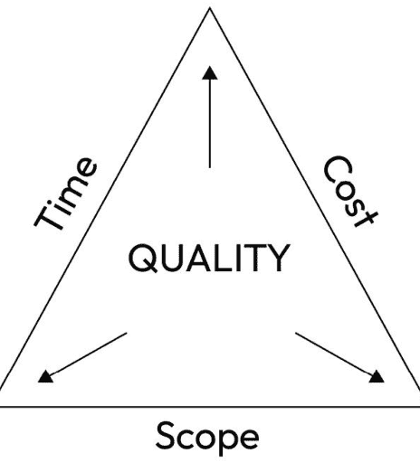

图 2.3 – 项目管理三角形

它像一个等三角形，三边分别代表项目的**范围**、**成本**和**时间**。这三个维度相互关联，改变其中任何一个都会影响三角形的整体形状，而形状代表质量。此外，由于三角形需要保持等边，显而易见修改可用时间会降低成本，反之亦然。通过延长可用时间，你可以增加项目范围，但成本也会随之增加。这是一个精妙的比喻，说明了项目（包括软件项目）是如何运作。

## 破窗理论

这是另一个需要考虑的问题：破窗理论。斯坦福大学的心理学家菲利普·津巴多（Philip Zimbardo）做过一项非常有趣的研究：他在一个高级社区停了一辆车几天，并只是观察。惊讶的是，什么都没有发生。他等了又，但没有人碰那辆车。然后，他决定打破一个小窗户，看看情况是否会变化。在几小时内，汽车被完全拆光了；一切都消失了——轮胎、轮子、电子设备、方向盘、座椅、垫子，甚至是引擎。

现在，同样的事情也会发生在代码上。你从一个整洁的状态开始；一切看起来都很好。但只要你引入了一点坏代码，事情就会迅速失控。例如，你在几个地方编写了重复代码，留下不一致的格式，并允许不一致的变量命名。同样，你可以开始在没有适当测试覆盖的情况下添加代码，或者因为担心问题溜入而避免升级项目的依赖。

最初，这些可能看起来是微不足道的问题，而开发者优先考虑添加新功能或修复关键错误。团队的其他成员也注意到这些问题，但也随之效法，认为它们不是高优先级。作为开发者，我们已经在犯一些错误了，在这种情况下为什么还要费劲把它做对呢？抄捷径并用更简单、更快的方法做事情似乎

- 什么是线程安全？https://en.wikipedia.org/wiki/Thread_safety
- 图解 SOLID 原则：https://medium.com/backticks-tildes/the-s-o-l-id-principles-in-pictures-b34cc2f1e98
- 你应该打破德梅特法则，作者 Ted Kaminski https://www.tedinski.com/2018/12/18/the-e-law-of-demeter.html

# 第 2 部分：重构的本质与良好的代码

审查代码（尤其是旧代码）是软件开发人员工作的重要部分。存在某些警示信号，例如“红旗”，专业人士应该立即注意这些。识别并避免这些问题是一项重要的技能，在本节中，我们将学习如何识别它们。

现在我们已经学习了什么是重构以及它为什么重要，现在让我们来探索一个关键要求。除非你真的拥有测试覆盖，否则重构是不安全的。我们将发现为什么彻底的测试是至关重要的。

接下来，你究竟如何重构你的代码呢？是否存在一些非常有用的常用技术？我们将学习如何掌握它们。

之后，我们将深入探讨元编程。元编程技术不是手动修改代码，而是可以自动地分析和重构代码。例如，元编程可以生成代码、替换方法调用或动态修改类结构。这通过减少所需的所需的工作量，使得重构更快且更不容易出错。

最后，我们将讨论静态分析和动态分析。静态分析涉及在不运行代码的情况下检查代码，并识别代码气味和安全漏洞等问题。动态分析涉及通过运行代码来分析代码，帮助发现性能瓶颈和内存泄漏等运行时问题。

此部分包含以下章节：

- 第 3 章，代码气味
- 第 4 章，测试
- 第 5 章，重构技术
- 第 6 章，元编程
- 第 7 章，静态与动态分析

# 第 3 章：代码气味

本章的标题应该是不言自明的，或者听起来可能令人厌恶，但我认为解释什么是“代码气味”这个术语很重要。这种感觉就像打开冰箱时一股奇怪的气味扑面而来，某种不该出现在那里的东西。异味并不一定意味着存在问题，但值得一看，以防万一。可能有问题，也可能没有，但忽略它并不是一个好主意。

在我们的代码库中也是如此。代码气味是一个潜在问题，是代码中让我们皱起鼻子的情况。它们是非常具体且可观察的现象，是我们项目中反复出现的模式。它们表明存在某些问题，或者在问题变得更加广泛之前需要尽快修复的问题：效率低下、代码可扩展性有限、理解困难，以及性能问题和潜在的 Bug。

我们需要学习如何识别和避免代码气味；当我们沉浸于任务和截止日期时，产生这些气味远比我们想象的要容易得多。重要的是，再次要花时间审查我们的工作，并识别问题——即那些从代码行中产生的坏气味。你的时间，通过实践和经验，你将建立一个心理指南针，像老练的寻宝人挖掘宝石一样，指出编码陷阱。它会在你完成代码编写之前就为你提供引导。

我们的开发者已经记录了许多代码气味：我不认为在这里列出所有内容是合适的。我会告诉你我认为最容易遇到和产生的几种。这些选拔是完全基于主观标准做出的，所以请尽管——事实上，我建议深入阅读“进一步阅读”部分。这些代码气味中的许多与清洁代码和 SOLID 原则有关。如果你恰好跳过了上一章，回去看看将是一个好主意。

我们将从重复代码开始，这是所有坏代码的祸源。它通常是由开发者为了赶截止日期而想使用终极捷径：复制和粘贴。我们将继续讨论方法和大类。当你在某个类的第 4215 行遇到 Bug 时，真的很令人沮丧，这不是因为 Bug 本身，而是因为该类包含的行数之多了！

然后，我将向你展示 `switch` 语句在重复时也会成为一个问题；这是面向对象编程可以轻松解决的典型情况！在讨论面向对象编程时，应该通过对象来表示我们的领域概念，而不是依赖语言原语。有一种被称为“基本数据类型痴迷”（Primitive Obsession）的反模式，我们将处理它。

除了大类之外，还有一些类或方法高度依赖其他方法；换句话说，他们根本不顾自己的事！我们将探索什么是“特征嫉妒”（feature envy）方法，以及如何解决它们造成的潜在危害。我们还将讨论两种与代码更改密切相关且相互交织的反模式：发散性变化（divergent change）和散弹式手术（Shotgun Surgery）。

取决于我们在引入新功能或进行常规修改时需要在代码中进行哪些以及多少更改，我们可能会遇到其中一种。

最后但重要的，我们将讨论所谓的“上帝对象”（god object）；这种反模式有点像你的朋友，坚持做所有事情，承担所有的责任；但随后每个人每事都依赖他们，这对他们来说太重了。许多责任不应该由某一个人承担。

在本章中，我们将学习：

- 重复代码
- 长方法
- 大类
- Switch 语句
- 基本数据类型痴迷
- 特征嫉妒
- 发散性变化
- 散弹式手术
- 上帝对象

正如之前提到的，不要低估代码气味的力量。通常情况下，重复代码会损害代码质量；代码变得更长，有时更难以阅读。重构一个代码块是不可能的，但目标应该是尽可能减少技术债。这有助于提高你的代码质量。

如今，IDE 已经完全能够标记重复代码（例如，在 `IntelliJ IDEA` 中，这是一个内置功能），并建议进行小规模重构以提取方法。我们将在书的后部分讨论如何充分利用 IDE 和其他工具。

我们现在来看长方法。

## 长方法

这是一种非常典型的代码味道，隐蔽且往往被低估。尽管处理这个问题看起来像是一个不足道的话题，但我想分享一些想法。

代码的阅读次数远大于编写次数，因此花一点额外的时间缩短方法可以获得巨大的回报。当你必须修改一个长方法时，你必须阅读并理解每一行代码才能安全地进行更改。在这种情况下，我们背着将所有工作加载到大脑中的负担来理解发生了什么，更不用说修改它的任何部分了。

长代码可能在做多一件事：根据单一职责原则，一个方法理想情况下应该只专注于做一件事。当你有很多行代码时，实现这一点几乎是不可能的。

如果知道什么时候“长”会变成“过长”是很有用的。10 行？20 行？100 行？很难建立一个固定的规则。这有点像说蛋糕太甜或面条太咸；我们直觉上识别出过头，但可能对具体的数字无法达成一致。

我的建议是遵循直觉，并与团队达成共识。例如，你可以决定 20 行是最大限制，且不应超过屏幕的高度（当然，这取决于屏幕分辨率、字体大小等）。另一个酷的方法是使用格式化工具，甚至是使用可以处理这些问题的自动工具；书的后部分会有更多介绍。简而言之，这取决于情况而定。也可能是一个方法很长但只包含配置，这些配置非常易读，不需要费太大精力就能理解。在这种情况下，你可能对它的了解不够。

此外，我想引入 Martin Fowler 在《重构》中的一个启发式建议：每当你觉得需要在代码中插入注释来解释它时，请改写一个方法。该方法将包含你打算注释的代码，但函数名本身将揭示代码背后的意图，而不是它的功能。

以下是一些在处理长方法时有用的小技巧。

### 用查询方法替换临时变量

在大多数情况下，从你的长方法中提取一个方法或函数就能解决问题；寻找函数中组合的部分并创建一个新的。有时，一个函数有许多参数和临时变量，它们可能成为提取过程的障碍；提取函数会导致向被提取的方法传递大量参数，那样它会像以前一样变得不可读。因此，用查询函数替换这些临时变量可能是很有用的：

```java
Double basePrice = this.getCostPerKm() *
this.distanceInKm();
if (passengerIsChild()) {
    return basePrice * 0.5;
} else {
    return basePrice;
}
```

在这段代码中，变量 `basePrice` 被用来存储存储操作的结果，然后再次计算最终价格（儿童乘客享受 50% 的折扣）。移除临时变量并内联计算，使用一个名为 `calculateBasePrice()` 的方法（查询函数）可能是一个好主意：

```java
if(passengerIsChild()) {
    return calculateBasePrice() * 0.5;
}else{
    return calculateBasePrice();
}
```

### 参数对象

也可能出现你具有长或“重复”签名的函数或方法，例如以下代码段中的 `calculateFinalPrice` 和 `discountPrice` 方法：

```java
public Double calculateFinalPrice(Double amount, String currency()) { ... }
public Double discountPrice(Double amount, String currency()) { ... }
```

你可以看到我们有两个具有相同签名的方法，重复出现了。同样重要的一点是，在这种情况下，`amount` 和 `currency` 参数必须在一起，因为它们代表一个价格。一个酷的解决方案是将这些方法作为“参数对象”或“请求对象”传递（我听过有很多叫法）：即一个表示所有所需参数的复杂对象。鉴于 `amount` 和 `currency` 代表价格，我们为什么不创建一个 `Price` 类呢？我们在下面的代码中这样做：

```java
public Double calculateFinalPrice(Price price) { ... }
public Double discountPrice(Price price) { }
class Price {
    private Double amount;
    private String currency;
}
```

### 用命令替换函数或方法

如果你尝试了提取函数并创建参数对象，但仍然留有过多的临时变量和参数，你可以做的另一件事是用命令替换函数。假设你有有以下方法，它接收了许多参数并且非常长：

```java
public Double calculatePrice(Double basePrice, Integer adults, Integer children, Integer infants) {
    Double calculatedPrice = 0.0;
    // long body...
    return calculatedPrice;
}
```

如果我们实现一个 `PriceCalculator` 对象，情况会变得更加清晰；通过这种方式，我们清理了方法。

```java
class PriceCalculator {
    private Double basePrice;
    private Integer adults;
    private Integer children;
    private Integer infants;

    public PriceCalculator(Double basePrice, Integer adults, Integer children, Integer infants) {
        this.basePrice = basePrice;
        this.adults = adults;
        this.children = children;
        this.infants = infants;
    }

    public Double calculatePrice() {
        Double calculatedPrice = 0.0;
        // long body...
        return calculatedPrice;
    }
}
```

通过使用 `PriceCalculator` 对象，我们封装了参数并让代码变得简洁得多：

```java
PriceCalculator calculator = new PriceCalculator(basePrice, adults, children, infants);
Double price = calculator.calculatePrice();
```

### 分解条件

当你有一个难以阅读的条件时，将其提取到一个方法可能是很有用的。这使得代码更具可读性。例如：

```java
if (isEligibleForDiscount(customer, hasSpecialCoupon)) {
    // ...
}
```

可以替换为：

```java
if (isEligibleForDiscount(customer, hasSpecialCoupon)) {
    // ...
}

private boolean isEligibleForDiscount(Customer customer, boolean hasSpecialCoupon) {
    return customer.isVip() || hasSpecialCoupon;
}
```

分解条件有很多方法，但目标是使代码更具可读性和可维护性。

### 再次循环

坦率地说，处理一个大列表并不是真正的问题，拆分循环实际上为更好的优化提供了机会。

## 大类

这是一种非常常见的代码异味。你多少次发现自己正在处理一个拥有数千行代码的类？这不是任何人的错，类开始时很小，而且可以理解的是，它们会逐渐吸收更多的信息和功能。这本身没有问题；重要的是意识到这一点并进行重构。

发现一个类过大的一个实用的方法是看字段（实例变量）是否过多。如果一个用例中有太多字段，它可能在做太多事情；除了承担了太多职责外，通常在这种情况下，代码重复也会变成一个问题。

你可以创建（提取）一个新类来组合几个变量。选择自然上关联的变量，并将它们放入一个合适的类中。例如，如果你看到一组诸如 `priceAmount` 和 `priceCurrency` 的参数，它们可能旨在属于同一个组件。通常情况下，如果你注意到类中某一部分变量之间存在前缀或后缀，这表明存在创建组件的可能性。

```java
class Order {
    private String name;
    private String surname;
    private String streetName;
    private String streetType;
    private String streetDirection;
    private Double priceAmount;
    private String priceCurrency;
    // constructor and getter methods
}
```

`Order` 类包含许多字段，每个字段都代表订单的不同属性。然而，如果你仔细观察，会明显看出某些字段在逻辑上可以“分组”在一起，因为它们属于订单属性的特定方面。例如，`name` 和 `surname` 字段可以被视为买家的信息（以简化上下文）。同样，`streetName`、`streetType` 和 `streetDirection` 字段与订单的收货地址有关，而 `priceAmount` 和 `priceCurrency` 提供了售价的信息。


给定这些实体，可以通过组合某些字段创建新实体来重构 `Order`。这些实体可以在（应该）整个项目中复用，增强代码的组织性和可维护性。

重构后的 `Order` 类应该像这样：

```java
class Order {
    private User orderBuyer;
    private Address shippingAddress;
    private Price orderPrice;
    // constructor and getter methods
}
```

当然，它应该将之前所有的字段“分配”到不同的类中：

```java
class User {
    private String name;
    private String surname;
    // constructor and getter methods
}
class Address {
    private String streetName;
    private String streetType;
    private String streetDirection;
    // constructor and getter methods
}
class Price {
    private Double priceAmount;
    private String priceCurrency;
    // constructor and getter methods
}
```

如果继承对该组件有意义，你可能会发现像提取子类或用子类替换类型（也称为提取子类）等技术通常更容易实现。这是一种非常常见的情况：我们有一个接受类型参数的类，根据它的值，类的行为必须略有不同：

```java
public Transport createTransportation(String name, String type) {
    return new Transport(name, type);
}
```

我敢打赌有些 `if` 实例隐藏在 `Transport` 类内部！面向对象编程带有继承，我们为什么不使用它呢？看下面的例子：

```java
public Transport createTransport(String name, TransportType type) {
    switch (type) {
        case PLANE -> {
            return new Plane(name);
        }
        case TRAIN -> {
            return new Train(name);
        }
        case BUS -> {
            return new Bus(name);
        }
    }
    return null;
}
```

在这个重构后的片段中，我们有两个主要的改进。我们将类型从 `String` 更改为枚举 `TransportType`；这允许我们以更安全的方式执行后续的 `switch` 语句，因为如果我们没有考虑到类型的所有可能值，我们会（可能会通过 IDE）收到警告。然后，我们为每种运输类型创建了特定的类，避免了混淆；所有这些类都实现了同一个接口。

除了有一堆实例参数外，过大的类通常是不好的；它是代码重复、逻辑不明、困惑和绝望的温床。一个简单而有效的方法是从消除类内部的重复。在这种情况下，我们可以方法移动到单独的类中。目标是让代码更具维护性和可读性。

基本类型痴恋（Primitive Obsession）是指代码过度依赖基本数据类型。这意味着一个简单的值接管了类的逻辑，并且缺乏类型安全。简单来说，这是一种使用基本类型来表示特定关注领域对象的坏习惯。

让我们以网站的 URL 为例。通常，我们将其存储为字符串。然而，问题出现了，因为 URL 包含的细节不仅仅是一个字符串。它包含了诸如方案（scheme）、查询参数（query parameters）等元素。当我们将其存储为字符串时，我们就失去了在不编写额外代码的情况下直接访问 URL 特定组件（URL 的核心部分）的能力。

字符串往往是这类问题的温床。以电话号码为例，它不仅仅是字符的随机组合。在很多情况下，适当的类型可以提供逻辑。如果你仔细考虑，发现解决这个问题很简单：将基本类型替换为对象。看以下示例：

```java
String url = "https://www.example.com/";
String protocol = ...;
String host = ...;
```

这可以变成：

```java
URL url = new URL("https://www.example.com/");
String protocol = url.getProtocol();
String host = url.getHost();
```

如果你好奇 `URL` 类是如何工作的，可以查看它的文档（`java.net.URL` 类包含在标准库中）。如果你有一组相关的基本类型，你可以通过提取一个类来将它们分组，就像地址的示例一样。现在我们已经处理了基本类型痴恋，让我们来处理那些不愿工作而只让别人干活的类。这种代码气味被称为**中间人**（Middle Man）。

## 中间人

中间人是指当我们有一个类只做一件事，而这件事就是将工作委托给别人时产生的一种气味。我们并不是建议一个类应该只有一个方法；而是说它的每个方法都应该调用其他方法。因此问题自然而然：为什么一个类什么都不做？事实上，这几乎没有理由。让我们定义这个类并确保客户端直接调用目的地。这样，我们消除了不必要的复杂性，并确保当我们修改或为对象添加功能时，不需要强制修改中间人。

举个例子，假设我们有一个结构如下的类：

```java
public class Person {
    private Address address;
    public City getCity() {
        return address.getCity();
    }
    public Address getAddress() {
        return address;
    }
}
```

一个“客户端”将如下所示使用它：

```java
Person person = getPerson();
var city = person.getCity();
```

你可以很容易看到 `getCity()` 方法充当了另一个类的代理。那么为什么不直接使用另一个类呢？我们的示例将变成：

```java
var city = person.getAddress().getCity();
```

因此，我们可以消除 `Person` 类中 `getCity()` 方法的中间人。然而，这种重构可能会矛盾地导致另一种代码气味！

## 消息链

消息链发生在客户端请求一个对象，而该对象又请求另一个对象，以此类推的情况下。这使得所有对象都依赖于被调用对象的结构，这些对象的任何变化都会不可避免地影响任何调用发生处的整个调用链。

基于上一节的示例构建，我们可能会有这样的代码：

```java
var cityName = person.getLocation().getAddress().getCity().getName();
```

隐藏“委托”的解决方案是让方法调用其他（方法）。我们可以将之前的示例转换为：

```java
var cityName = person.getCityName();
```

其中调用链被隐藏在 `cityName()` 方法中。然而，推到极端，这种重构可能会导致中间人气味！我们最终陷入了循环。事实是，这取决于情况。这些重构必须经过适当权衡，尝试选择较小的恶（同时也考虑类建模本身存在缺陷并可能需要以某种方式更改的可能性）。

选择中间人而不是消息链的优点是在单元测试期间需要的更少的 mock（模拟对象）。当你必须不仅为类的直接和间接依赖提供 mock 时，测试类将变得极具挑战性。此外，它有助于关注点分离。一个拥有 A 组件并需要 C 组件的代码理想情况下不应该感知到 B 组件的参与。这有助于模块化。虽然消息链的主要论点是避免在中间编写样板代码，在某些情况下这样做可能是合理的，但通用指南应该倾向于选择中间人。

选择中间人而非消息链符合迪梅特律（Law of Demeter）的原则，该原则通常被总结为“只与你的直接依赖交谈”。这一指南封装了一种提倡在面向对象系统中封装和减少耦合的设计哲学。我们在第二章中讨论过迪梅特律。

## 特性嫉妒方法

当我们尝试根据用例和领域将代码拆分为有意义的组件时，我们基本上是在将代码划分为区域。我们需要注意的关键之一是最大化区域内的交互，反之，减少不同区域之间的交互。特性嫉妒（Feature envy）是代码中的一个警告信号，描述了一个方法使用另一个对象的字段来执行操作，仅仅指示对象该做什么。举一个简单的例子，让我们考虑一个根据支付请求计算价格的方法：

```java
public Double calculatePrice(PaymentRequest paymentRequest);
```

在我们意识到需要订单和一些用户信息来计算价格之前，一切看起来都是好的。当我们开始编写它的实现时，例如，我们将检索与支付请求相关的订单；在方法的开头几行，我们会写类似这样的代码：

```java
Order order = orderRepository.findById(paymentRequest.getOrderId());
```

很有可能还需要用户。在获取订单后，我们可能会再添加一行来获取用户，因为我们需要关于他们的信息：

```java
User user = userRepository.findById(paymentRequest.getUserId());
```

从这些对象中，我们将提取一些完成支付所需的特定属性。例如，我们会写类似下面的代码：

```java
order.getItems();
order.getOrderDate();
user.getLevel();
```

通常通过提取方法将函数拆分为更小的部分，并将这些部分放置在不同的位置来辅助实现。

有时，即使这一准则不适用，你也可以选择使用四人机小组在书中描述的策略模式（Strategy）或访问者模式（Visitor）。然而，对这些模式提供详细解释超出了我们的范围。如需更深入的解释，可以参考“进一步阅读”部分。基本原则保持不变：将发生变化的元素组合在一起。通常，数据和依赖于数据的相应行为倾向于同时变化，尽管存在例外。在这些情况下，重新定位行为可以确保更改集中在单一位置。策略和访问者模式提供了一种通过隔离需要重写的特定部分来修改行为的实用手段，尽管这种方法引入了一些额外的间接性。

## 分散性变化 (Divergent change)

作为工程师，我们知道我们的产品是柔软且灵活的。有一次，一位教授告诉我们：“我们是唯一被要求更改项目期限的工程师，即使在截止日期也是如此。想象一下在桥上这样做。这是我们的力量，也是我们的诅咒。”

正如我们在敏捷哲学中所知到的，变化是好事，但它需要被控制和管理。回到代码味道，当我们需要修改某个类时，即使我们触及了看似不相关的方面，也会发生分散性变化。考虑一个处理交通工具搜索结果的类，比如一个旅行预订网站（你输入想离开的时间、返回的时间、想去的地方，他们会给你数以亿计的选项供你选择——飞机、火车、汽车等等）。在某处，我们需要再次更改数据库应用程序规则。然后，我们需要整合新的交通工具，必须再次修改类 X。新的支付方式？类 X 仍然需要修改。

这些都是不相关的，但类 X 始终处于中间！当一个模块（类或项目）出于各种原因被频繁修改时，导致不同上下文在同一个位置中混合，就会发生分散性变化。为了增强我们的编程体验，可以通过将这些上下文分离到单独的模块来改进。

最可能的原因是违反了单一责任原则。通常情况下，我们要么有一个有缺陷的编程结构，要么是过度使用了复制和粘贴。此时，有必要创建适当模块并相应地移动方法。有时，可能需要提取方法（也许重新定位它们），甚至意图提取类。

有时我们会遇到一种特殊情况，两个方面被错误地纠缠在同一个类中，一个经典的例子是从数据库中获取数据，对其进行处理，然后将其传递给使用它的函数。在这种情况下，我们使用一种名为“拆分”（split phase）的重构技术。在这种重构中，我们将复杂的计算拆分为一个或多个阶段。在第一阶段，我们计算结果，然后将此结果连同一些中间数据结构传递给第二阶段进行进一步处理。

例如，考虑以下片段：从数据库检索某些航班数据，解析该数组的元素到数据库，然后获取某些输出并使用它执行进一步计算……重点是，它与其他做了许多不同的事情：

如果能重构这段代码使其更具可读性并具有某种模块化，那就好了，即使在处理一小段代码时这个术语可能并不恰当。无论如何，我们将将其拆分为几个阶段，就像工作流一样：我们将其命名为

`getFlightDataFromDatabase`（不立即拆分结果；那是唯一一行代码中需要的）。当然，`flightData` 并不非常方便（我们假设无法获取返回类型，因为我们使用的是第三方库），所以我们将使用 `parseFlightData` 将其转换为 `FlightInfo`，它能以非常方便的方式处理航班信息。最后，我们将实现 `calculateTotalPrice` 并使用 `flightInfo` 对象。看这段代码——即使是四行代码——是如何变得更具可读性的：

```
String flightData = getFlightDataFromDatabase(flightId);
FlightInfo flightInfo = parseDouble(flightData);
double totalPrice = calculateTotalPrice(flightInfo);
***
double calculateTotalPrice(FlightInfo flightInfo) {
  var basePrice = flightInfo.getBasePrice();
  return basePrice = flightInfo.getAdultCount() +
  basePrice * flightInfo.getChildrenCount() +
  basePrice * flightInfo.getInfantsCount();
}
```

当变化不在一个必须经常更改的类中，而是分散在整个项目中时，你被迫在很多不同的点修改代码。这就是被称为“散弹式手术”（Shotgun Surgery）的代码。

## 散弹式手术 (Shotgun Surgery)

尽管看起来像是一种激进的行为，但首先，这个词听起来也很有趣且诚实；这也是我喜欢它的原因。有时，我听过有人把它比作用火箭筒打苍蝇。基本上，它是分散性的反面。

当你处理散弹式手术时，你必须在代码库中进行许多更改来处理看似单一的任务。经常，你会发现自己正在修改看起来相似的代码，这些代码是被直接复制粘贴的，或者是具有相似的目的。这个术语指的是外科医生的工作，使用手术刀非常精确地以最小的侵入性方式完成。现在，用火箭筒替换手术刀的实现，然后……嗯，你明白意思了。

有几个例子或原因导致了散弹式手术；让我们快速回顾其中的一些，以便我们防止该问题的发生：

- 复制和粘贴：这是我想到的第一个例子；你进行了一些老式的代码复制和粘贴！这无疑意味着对某些复制的代码进行更改需要你对每份复制都进行相同的更改。这其实非常直接。

- 过度分层：有时，我们的应用程序倾向于分层过多。例如，想象一个多层结构，包括数据传输对象、数据访问对象和领域对象。每当你想向数据库添加一个表时，不仅必须在所有层中添加内容，还要处理属性包。这是散弹式手术的另一个案例。（但世界并非非黑即白的；存在灰色地带。有时，定义良好的层有助于隔离概念和职责。所以，要小心；我并不是说在架构中设计多个层本质上是错误的。）

- 分层不足：就像设计中的层数过多一样，许多职责被过度分离：一个用于常量，另一个用于变量，等等。当我们需要进行更改时，你会发现必须触及所有！你遇到过这种情况吗？我经常遇到。然后你又成了手术室里的火箭筒。

你应该关注这些问题，因为当你需要在多个处编辑代码时，它们会变得更加耗时。由于更多人在不同位置接触代码，合并冲突更容易，使得协作项目变得困难。由于需要记住在多个处更改代码，你更容易引入 Bug。此外，由于代码重复以及连接不同片段所需的额外结构，你会产生更多代码。最后，对于新团队成员来说，学习代码的曲线更高。

当逻辑分散在整个代码库中时，你可以简单地将方法或字段移动到类或模块中。通过这种方式，你确保相关的软件元素聚集在一起，更容易定位和理解它们之间的联系。相关的上下文将集中在一个地方，实现封装并使软件的其他部分少关注具体细节。

处理散弹式手术的另一种方法是重构。在其他情况下，合并方法或类以整合分离不当的逻辑可能是有益的。这可能会导致长方法或大类；我知道我们说过这只是一个暂时的（但非常有用的）情况，以便稍后可以使用提取操作将其拆分为更具连贯性的片段。当然，我们通常喜欢在代码中使用较小的函数和类，但在作为重组织的中间步骤时不要犹豫创建大型。

内联方法（Inlining a method）基本上意味着提取方法相反。假设我们有以下内容：

```java
public Double calculatePrice(Integer passenger, Double basePrice) {
    var basePrice = passenger * baseFare;
    var basePriceWithVAT = VATCalculator.addVat(basePrice);
    return basePriceWithVAT;
}
class VATCalculator {
    public static Double addVat(double basePrice) {
        return basePrice * (1 + DefaultValues.DEFAULT_VAT);
    }
}
class DefaultValues {
    public static final Double DEFAULT_VAT = 0.22;
}
```

你创建了一个类并包含一个静态方法，仅仅是为了实现 VAT 的增加。

假设这只被使用一次，这似乎有些过度了；这里的建议是将状态机的内容内联，避免创建一个单独的类，这会让代码更易读。你可以通过方式实现：


```java
public Double calculatePrice(Integer passenger, Double baseFare) {
    var basePrice = passenger * baseFare;
    return basePrice * (1 + 0.22);
}
```

无论如何，真正的关键是要让“散弹式修改”（Shotgun Surgery）保持在你的关注范围内。问问自己，未来的程序员（也可能是未来的你自己）需要的是散弹枪还是手术刀来管理这种反模式。如果答案倾向于散弹枪……那么现在是时候重新考虑你的方法了。

# 上帝对象 (God object)

在本章提到的所有反模式中（还有更多，我鼓励你深入“进一步阅读”部分），可能被称为“上帝对象”（或“上帝类”）的可能是最常见的。正如其名所示（我必须说，在重构和整洁代码的世界，这种命名水平真是令人惊叹！），上帝类是一种负面编码实践，指一个类承担了过多的职责。它表现为一个整合并监督了大量对象、执行了应用内所有任务的类。这种反模式违反了保持类聚焦和模块化的原则，导致可维护性差和代码可读性差。

你可能认为这也许是一个很好的模式；而且名字似乎暗示了某种积极的含义。事实并非如此，我们即将看到原因。

上帝对象违反了 `SOLID` 原则，特别是单一责任原则。上帝类通过承担过多的职责且缺乏焦点完全违背了这一原则。结果就是工程师在重复造轮子，复制代码并累积技术债。

由于上帝对象的存在，你的代码将变得更加脆弱。由于上帝类职责过重，它需要频繁更新，这显著增加了引入破坏性变更的概率。要理解上帝类的修改对应用其他部分的影响可能是挑战性的，如果说是不可能的。

上帝对象是不可测试的。通常情况下，当一个类很小、聚焦且独立于其他类型时，它是易于测试的。相反，上帝类的运行方式恰相反。作为一个巨大的、全能的控制许多其他对象的实体，它与这些对象紧耦合。因此，由于其复杂的设置以及为了测试目的而对依赖项进行存根（stub）或模拟（mock），测试上帝类变成了一项艰巨的任务。当你编写一个上帝对象时，通常会意识到它有太多的协作者，即太多的对象需要该类本身才能工作。

最后是主要的痛点。我们总是落入这种情况。上帝对象让你的代码更难以阅读和理解。考虑到广泛的职责以及与多个系统的交互，这些类内部的代码变得复杂也并不意外；例如，我在这里说的（不是）圈圈复杂度；而是依赖会导致副作用和可变性的外部依赖。这些复杂性的叠加效应导致了代码的整体复杂度，为理解制造了障碍并降低了工程师的生产力和性能。

解决方案不是唯一的，但方法可以是。创建一个上帝对象非常容易（尤其在面向对象编程中），但要撤销它们极其困难。所以，使用古老的良方（再次，单一责任原则）并将类拆分成更小的部分；根据领域以及类中的通用方法和属性来引导，同时保持类的松耦合。如果类或方法包含大量代码或功能，将它们拆分为简单、可管理、可测试的类和方法。最后，删除上帝对象。

## 总结

在本章中，我们学习了如何识别一些——并非全部——代码气味。我们涵盖了最常见的几种。其中一些你将直觉地学会并在编写代码时避免它们。我们处理了重复代码、长方法、大类和重复的 `switch` 语句。我们学会了避免对原始类型的痴迷（对一切都使用 `string` 是巨大的诱惑！）并查看了特征方法。最后，我们讨论了发散变化（divergent change）及其反面——散弹式修改。噢，别忘记上帝对象。这只是现有代码气味中的部分选择，但我认为它是消除它们的一个良好起点。

执行任何类型重构（尤其是上帝对象重构）的关键决策是良好的测试覆盖率。在下一章中，我们将处理这一极其重要的问题。

# 进一步阅读

- 原始数据类型：https://docs.oracle.com/javase/tutorial/java/nutsandbolts/datatypes.html

- 策略模式（Strategy）：https://refactoring.guru/design-patterns/strategy

- 访问模式（Visitor）：https://refactoring.guru/design-patterns/visitor

- Erich Gamma, Richard Helm, Ralph Johnson, and John Vlissides (1994). *Design Patterns: Elements of Reusable Object-Oriented Software*. Addison-Wesley Professional.

- 代码气味：https://refactoring.guru/refactoring/smells

# 测试

当我们谈论重构时，有必要提到它听起来可能显而易见，但让我们尝试更深入，并真正理解为什么它至关重要。在此之前，我们将涵盖以下主题：

- 为什么应该经常测试

- 单元测试

- 集成测试

- 合约测试

- 测试驱动开发 (TDD)

在本章中，我们将涵盖：

确保其符合要求的质量标准并按预期运行。这一过程对于交付可靠、稳定且符合用户需求和预期的高质量产品至关重要。

当软件进行测试时，它会在多个维度上接受严格的审查。功能测试验证软件的功能和行为是否正确，并符合指定的规范。另一方面，非功能测试则评估性能、安全性、易用性和兼容性等方面，以确保软件在这些领域达到预期水平。

通过对软件进行一系列测试，开发者可以确认应用程序在正常情况下运行顺畅，并能够处理具有挑战性的场景，而不会出现意外的崩溃或故障。这在任务关键型系统中尤为重要，因为这些系统中不可预见的问题可能会导致严重后果。

在谈论质量和可靠性时，值得定义一些我经常（以及我自己也）使用不当的术语。让我们定义一下什么是性能测试、负载测试和压力测试：

-   **性能测试（Performance tests）：** 这些测试旨在评估特定条件下系统或软件的速度、响应能力和整体效率。其目标是评估系统在正常情况下的表现。

-   **负载测试（Load tests）：** 进行负载测试是为了评估系统处理大量负载或用户活动的能力。目标是确定系统的容量，并识别在预期负载下的任何性能瓶颈。它是性能测试的子集。

-   **压力测试（Stress tests）：** 压力测试将系统或软件推向其正常运行极限。其目的是检查系统在极端条件下（如高流量、海量数据量或资源限制）的行为。目标是识别系统稳定性和恢复能力的潜在弱点或故障。压力测试还用于环境规模规划（例如，你需要设置一个新的层级，并且预先知道需要多少资源）或了解限制在哪里，以便提前知道何时进行扩展。

性能测试中有一个非常常用的工具，你可能知道，就是 `JMeter`。我们提到它是因为它是最著名的工具之一，但不一定是最最好的——这取决于你的需求。它之所以非常流行是因为它是开源免费的，而且关于它的知识和文档非常多。**Apache JMeter** 是一款专门为负载测试设计的 Java 应用程序，同时可以测量应用程序性能和响应时间。`JMeter` 拥有强大的功能。它作为一个客户端 Java 应用程序运行，并能够使用多种协议跨各种技术进行测试，这些协议包括 Java 对象、`HTTP/HTTPS`、`SOAP` 和 `REST` 服务、`FTP` 以及通过 `JDBC` 连接的数据库。此外，它还提供了一个易用的 IDE，用于有效地记录、构建和调试性能测试。从 **JMeter 3.1 开始，Groovy** 成为默认编程语言，因为它易于使用、灵活且在不断开发中。此外，`Groovy` 可以与 Java 完全集成，通过表达性强、简洁且可读的语法提供了许多脚本能力。作为最流行的负载测试工具之一，`JMeter` 允许用户配置和评估移动应用程序的性能。此外，通过 `jmeter-java-dsl`，你可以选择用 Java 编写性能测试，利用 IDE 的自动补全和行内文档。要开始使用，你可以在“延伸阅读”部分找到很好的资源。

虽然 `JMeter` 仍然流行的负载测试工具之一，但要将其扩展到大型分布式测试可能具有挑战性，特别是当处理多台需要复杂配置才能有效通信的机器时。此外，执行大型 `JMeter` 测试可能会导致编排问题。

## 客户满意度

客户满意度是客户在使用产品或服务后，根据他们的感知和预期所感受到的满意程度。它是成功的关键指标，影响着忠度和声誉。有很多方法可以衡量它；如果你想了解更多，请跳转到“延伸阅读”部分。

经过严格测试的高质量软件不仅确保了其可靠性，还增加了满足用户需求和预期可能性。当客户发现软件高效、稳定且无 bug 时，他们更有可能对体验感到满意。

满意的客户倾向于对产品及其背后的公司建立信任和忠诚。他们倾向于长期使用该软件，促进长期的参与和忠诚。此外，开心的客户往往会成为产品的支持者，热情地向他们的同类、朋友和同事推荐它。

来自满意用户的口碑推荐可以是软件成功的强大驱动力。积极的推荐可以显著扩大软件的用户群，提高采纳率。

## 合规与标准

在某些行业（如医疗保健、金融和航空航天），软件起着至关重要的作用并必须遵守严格的法规。例如，在医疗领域，医疗设备软件必须符合 `FDA` 和 `EMA` 等机构设立的标准，以确保患者安全。金融行业依赖软件处理关键任务，遵守 `SEC` 和 `FCA` 标准对于保护消费者免受欺诈和数据泄露至关重要。同样，航空航天软件必须遵守 `FAA` 和 `EASA` 标准以避免事故或运营中断。

## 安全

在当今的数字环境中，网络威胁和攻击变得日益复杂，加强软件系统以防止安全漏洞变得至关重要。在测试过程中，安全专家和测试人员采用各种方法和工具来模拟真实世界的攻击，试图利用系统中的漏洞。这包括渗透测试和漏洞评估等技术。

通过进行测试，开发者可以在软件部署到生产环境之前主动识别并解决安全缺陷。这种主动方法显著降低了潜在的安全漏洞风险，这些漏洞可能导致数据泄露、未经访问或服务中断。

以下是将安全测试有效集成到软件开发生命周期（SDLC）的一些建议；这些只是根据我们在经验中遇到的一些想法，如果你对其中某点感兴趣，我们建议深入研究：

-   **为你的应用程序创建安全需求：** 确保这些需求符合行业标准和合规法规。

-   **培训与意识：** 对开发者和开发团队进行安全编码实践的培训，在组织内部培养安全意识文化。

-   **依赖扫描：** 定期扫描第三方依赖的已知漏洞。实施或使用自动化工具，在依赖项出现安全问题时向你报警。

-   **渗透测试：** 进行渗透测试以模拟真实攻击。从攻击者的角度测试应用程序，以识别自动化工具可能错过的漏洞。

这些是我们已经在公司实施的一些措施，通常是那些拥有专门团队的大公司。这些活动不仅耗费时间，而且非常复杂，需要特定的技能。

## 集成与兼容性

测试在验证软件与其他组件或系统的无缝集成和兼容性方面起着至关重要的作用。在当今复杂的技术环境中，软件很少孤立运行；它经常与各种硬件、软件模块、数据库、API 和外部系统交互。确保所有这些部分协调工作对于应用程序的整体成功和效率至关重要。

用于评估集成和兼容性的主要测试方法之一是**集成测试**。这种测试侧重于评估软件的不同模块或组件之间如何交互以及交换数据。我们将在专门的章节中深入探讨这一主题。

**兼容性测试**是测试过程中的另一个重要方面。鉴于设备、操作系统、Web 浏览器和配置的多种化，验证软件在不同环境中都能正常运行至关重要。兼容性测试涉及在各种平台上对软件进行测试，以确保其在所有平台上都表现出一致且统一的行为。

通过进行兼容性测试，开发者可以识别特定平台的问题，并对软件进行必要的调整。这不仅改进了用户体验，还扩大了潜在的用户群，因为更广泛的用户可以访问并使用软件，而不会遇到与兼容性相关的问题。

集成和兼容性问题可能出现在软件开发的不同阶段，从最初的设计到最终的实现阶段。通过在整个开发过程中加入测试，开发者可以主动应对这些挑战，减少项目后期出现集成瓶颈（即系统中不同组件之间的数据流或功能流受限的点，导致延迟或效率低下的）或兼容性冲突的概率。

## 信心与安心

这听起来可能很奇怪，但对我们的软件进行严格测试让我们能睡得更安心，这并非小事。让我解释一下：每当我们发布软件的新版本时，我们知道它经过了良好的测试，并且对其正常运行充满信心，这增加了团队的自信心，最终，我们工作得更好，这对所有人无疑都有好处。当我们工作得更好时，我们的效率更高，产出的质量更高。

此外，我必须补充，许多开发者并不喜欢修复 bug，尤其是当这些 bug 难以识别和解决时。修复 bug 是耗时且难以预测的。正如前面提到的，这会占用团队核心活动的时间。

这就是为什么开发者关注测试至关重要的原因；它本身至关重要，而且以某种方式影响着人们的福祉。开发者的首要目标（在没有适当测试集的情况下无法进行清洁代码和重构之前）必须是每次进行更改时软件都经过充分且自动的测试。执行自动测试的第一种最直接的方法是编写所谓的“单元测试”；在 Java 中，对此最广泛使用的框架无疑是 `JUnit`。

## 单元测试

**单元测试**是一种软件测试类型，它对软件应用程序的单个单元或组件进行隔离测试，以确保它们运行正常。一个*单元*通常指的是软件中最小的可测试部分，例如函数、方法或类。单元测试的主要目标是验证软件的每个单元都能按预期工作，并为定的输入产生正确的输出。通过独立测试单元，开发者可以在开发早期识别并修复 bug 或问题，使代码库更易维护和改进（因此可以重构）。

采用单元测试有几个优点，其中一些如下所示：

- **速度 (Velocity)**：单元测试非常快！它们侧重于测试微小的、隔离的代码单元（通常是单个函数或方法），且与系统的其余部分隔离开。这种隔离允许单元测试快速执行，因为它们不依赖于外部依赖，也不执行复杂的设置和拆卸过程。这有助于开发者频繁运行它们并获取反馈。

- **隔离 (Isolation)**：每个单元的设计都是独立于应用程序的其他部分运行。这种隔离确保了如果测试失败，原因可能位于正在测试的特定单元内部，更容易定位和修复问题。

- **自动化 (Automation)**：单元测试通常是自动化的，这意味着它们可以作为开发过程的一部分自动、定期运行。这种自动化有助于确保新代码更改不会引入回归或破坏现有功能。

- **问题的尽早发现 (Early detection of issues)**：单元测试有助于尽早发现缺陷，这可以显著降低开发周期后期调试和维护所需的成本和精力。

- **文档 (Documentation)**：单元测试充当活的文档，提供了单元预期行为的示例。开发者参考这些测试来理解单元的意图功能及其可能的边界情况。这非常重要；一个编写得良好的单元测试可能比 10 页文档还要好。

- **重构支持 (Refactoring support)**：当然，这就是为什么我们在书中讨论测试的原因！当在重构代码时，单元测试充当了安全网。如果重构后的代码破坏了任何功能，单元测试将捕获它，确保更改不会引入 bug。

在实践中，在单元测试中，除此之外没有别的，就是执行部分代码（例如一个方法）并验证从特定输入开始总是产生相同的输出。很简单，对吧？嗯，并不总是如此，我们将会看到。

为了测试我们的单元，我们实际上将编写一个包含几个方法的 Java 类（每个方法都是一个单元测试），用以测试各种功能。在设计测试类时，保持组织良好是有建议的；按照惯，例如测试 `com.acme.demo.MyClass` 类，我们将创建一个类 `com.acme.demo.MyClassTest`。前者将放在 **main** 文件夹下，而后者将放在 **test** 文件夹下。在每个单元测试内部，建议遵循一种相当固定的模式，称为 `AAA`，或三个 A：

- **准备 (Arrange)**：此阶段涉及准备将接受测试的对象。在此阶段，我们建立了被测试系统的预期状态，并设置了它的依赖项。这可以直接创建必要对象的实例，或者通过创建它们的测试对应项来准备就绪。这可能包括初始化被测试类所需的资源（协作类）。

- **执行 (Act)**：这是你与被测试系统交互的阶段。在此阶段，提供任何依赖项，并在可能的情况下捕获结果。

- **断言 (Assert)**：这是你检查布尔表达式（断言）的地方，如果测试成功，这些表达式必须为真；也就是说，不仅评估输出数据，还可以通过对断言验证某些组件是否被调用、调用了多少次以及使用什么输入。

让我们通过一个简单的例子来说明。假设我们有一个 `Calculator` 类，它有一个方法接收两个整数并返回它们的和（我说过它是简单的）：

```java
public class Calculator {
    public int add(int a, int b) {
        return a + b;
    }
}
```

让我们为 `Calculator` 写一个新的类：

```java
public class CalculatorTest {
    public static void main(String[] args) {
        testAddition();
    }
    public static void testAddition() {
        // Arrange
        Calculator calculator = new Calculator();
        // Act
        int result = calculator.add(5, 3);
        // Assert
        int expected = 8;
        if (result == expected) {
            System.out.println("testAddition PASSED");
        } else {
            System.out.println("testAddition FAILED");
        }
    }
}
```

在这个示例中，我们创建了一个名为 `testAddition` 的测试方法。该测试创建了 `Calculator` 的实例，使用特定输入调用 `add`，并将结果与预期输出进行比较。当你运行 `CalculatorTest` 类时，它将根据实际结果与预期结果的比较输出测试通过或失败。

请记住，这只是一个基础示例，演示了如何使用 `JUnit` 等测试框架编写单元测试。在现实场景中，使用测试框架作为

## JUnit 框架


# JUnit 测试框架

JUnit 是一个流行的 Java 测试框架，主要用于对 Java 进行单元测试。它提供了一系列注解、断言和测试运行器，使得编写和执行测试变得更容易、更有组织。JUnit 在 Java 开发社区被广泛使用，已成为编写单元测试的标准。

## 关键特性和概念

- **注解**：JUnit 使用注解来定义测试方法、设置方法、拆卸方法。JUnit 中常用的注解有 `@Test`、`@Before`、`@After`、`@BeforeClass` 和 `@AfterClass`。

- **测试方法**：测试方法用 `@Test` 注解标记，负责验证被测试代码的功能。每个测试方法都应该是独立的，并且专注于测试代码库的某个特定部分。

- **设置和拆卸**：`@Before` 和 `@After` 注解用于标记在每个测试方法之前和之后执行的方法。它们被用于设置测试环境（例如初始化对象）以及在每次测试后清理资源。

- **测试运行器**：JUnit 提供了各种测试运行器来决定测试如何执行。一个广泛使用的测试运行器是 `BlockJUnitRunner`，但 JUnit 5 引入了基于 `org.junit.platform.JUnitPlatform` 的更灵活、可扩展的模型。

- **断言**：JUnit 提供了一系列静态方法（例如 `assertEquals`、`assertTrue`、`assertFalse`、`assert`）来执行各种类型的断言，以检查测试的预期结果。

- **测试套件**：JUnit 允许你使用 `@RunWith` 和 `@Suite` 注解将相关的测试类分组为测试套件。

- **参数化测试**：JUnit 4 引入了参数化测试的概念，允许你使用多组数据运行相同的测试。

## JUnit 5

JUnit 5 是 JUnit 的下一个主要版本，相比 JUnit 4，它引入了许多新功能和改进。它提供了更具模块化且可扩展的架构，对 Java 8 及以上版本的更好的支持，以及新的注解，如 `@BeforeEach`、`@AfterEach` 和 `@DisplayName`。

## JUnit 示例

如果我们想用 JUnit 编写 `CalculatorClass`，结果如下。这个示例非常直观，但它能帮助我们理解该框架的工作原理：

```java
@Test
@DisplayName("Tests the Addition method of the Calculator")
void testAddition() {
    Calculator calculator = new Calculator();
    int result = calculator.add(5, 3);
    int expected = 8;
    Assertions.assertEquals(result, expected);
}
```

你可以注意到 `@Test` 注解，它允许框架“理解”这是一个单元测试。`@DisplayName` 用于为被注解的测试类或测试方法指定一个个性化的名称；这些名称通常用于 IDE 和构建工具中的测试报告，并且它们可以灵活地包含空格、特殊字符和表情符号。

这就是 IntelliJ IDE 表示成功执行 JUnit 测试结果的方式：

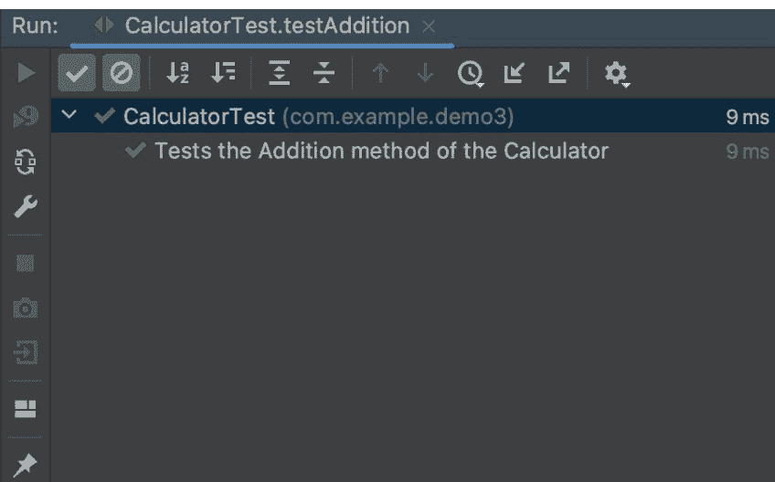

图 4.1 – 在 IntelliJ IDE 中成功执行的 JUnit 测试

现在，我相信，理解自动化测试套件如何集成到代码开发过程中是非常直观的；由于各个软件模块已经过单独测试，像 JUnit 这样的框架帮助开发人员测试代码、发现错误，并可能提高性能。当 JUnit（以及一般的单元测试）通过 Maven 或 Gradle（允许代码构建管理和自动化测试执行）以及 Jenkins 或 GitHub（处理持续集成 CI）进行集成时，它就能发挥全部潜力。CI 是一项涉及自动且定期地将代码更改集成到共享仓库中并运行测试以检测集成问题的实践。CI 是一个非常广泛的主题，因此我建议你参考“延伸阅读”部分，那里有一个相关的维基百科条目。遗憾的是，要找到既具有中立性（即不绑定特定产品）又能解释这些概念的在线材料其实很大。我希望这能作为一个起点并激发你的好奇心。

编写测试是困难且复杂的，比这些简单示例看起来要复杂得多。它也是一项至关重要的任务，对于平滑的生产发布以及能够执行任何所需的重构都必不可少。最具挑战性的方面之一是想象所有可能的测试用例（即应用程序的所有潜在行为、它可能遵循的所有“流”——想想你在代码中使用的所有 `if` 语句和多态性）；幸运的是，我们不必想象，因为我们可以使用专为此目的设计的工具。

# 集成测试

集成测试涉及检查软件应用程序的不同组件、模块或部分如何协同工作，即使它们是由不同的程序员编写代码的。

集成测试的目标是检查这些模块之间的连接，并发现组件组合在一起必须共同工作时可能出现的任何问题。

它通常在单元测试的下游执行；假设单个软件模块（项目、类或整个应用程序）已经经过了单独测试，我们开始测试它们与与之协作的其他模块之间的交互，如图 4.2 所示。

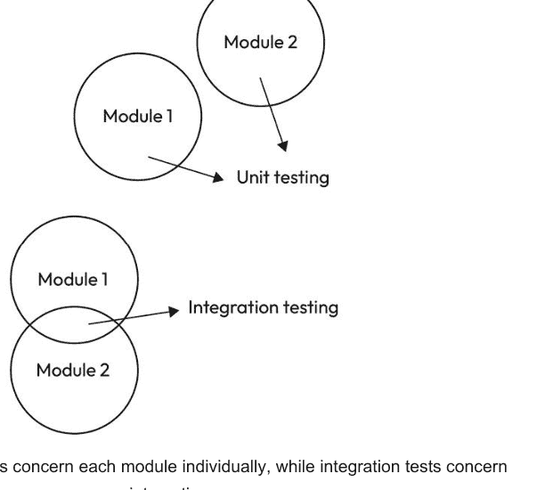

为了进行集成测试，测试人员使用测试驱动程序和存根，即占位程序，它们替代任何模块并模拟模块之间的数据交换以进行测试。有几个框架可以在过程中为你提供帮助；你不需要独立完成所有工作！用于执行集成测试（至少在基础和广泛的范围内）最著名的框架是 JUnit（我们刚刚看到）。

# Mockito

Mockito 是一个广泛使用的 Java 开源框架，用于在单元测试和集成测试中创建和配置模拟对象。在 Java 开发背景下，Mockito 因通过创建模拟真实行为的模拟对象来辅助测试而受到青睐。这些模拟对象在集成测试中非常有价值，原因如下：

- 首先，Mockito 有助于隔离应用程序的特定部分。它允许开发人员创建模拟对象，从而在不涉及整个系统的情况下测试特定的模块、组件或服务。以下代码演示了 Mockito 的工作原理：

```java
import static org.mockito.Mockito.*;
// 创建模拟 HttpClient
HttpClient httpClientMock = mock(HttpClient.class);
// 创建服务实例并注入 mock
MyService myService = new MyService(httpClientMock);
// 定义 mock 的行为
when(httpClientMock.get(anyString())).thenReturn("Mocked response");
// 使用 MyService 执行测试
String result = myService.getDataFromExternalService("https://example.com/api");
```

- 第二，Mockito 提供了控制和验证能力。开发人员可以定义模拟对象的行为，指定返回值并在测试期间与这些对象的交互。这种程度的控制和验证确保了被测对象与其依赖的交互。要验证某些内容，你需要编写如下代码：

```java
// 验证与 mock 的交互
verify(httpClientMock).get("https://example.com/api");
```

此外，Mockito 提高了集成测试的效率和速度。在集成测试中使用真实的外部依赖可能非常复杂且设置缓慢，相比之下，Mockito 的模拟对象轻量级且不依赖外部资源，使得集成测试更快、更高效，且不易产生副作用。

- 最后，Mockito 提供了测试灵活性。开发人员可以创建自定义的模拟对象，允许为不同的测试用例指定不同的行为。这种灵活性简化了集成测试中各种场景的模拟。

我们在“延伸阅读”部分留了一些材料，以深入研究 Mockito 的魔力。

# 合约测试

我们已经看到集成测试也用于测试外部服务，这些服务可能不在我们的代码中，并且可能不由我们维护。然后你创建一个存根或模拟，根据文档或通常是根据两个服务之间运行时交换的真实答案来返回“假”答案。但如果其中一个发生了变化，会发生什么？

契约测试旨在确保分布式系统中不同服务或组件之间的兼容性和一致性。它在微服务架构等场景下特别有用，因为不同的服务需要无缝通信。在契约测试中，服务根据定义良好的接口或契约相互通信。这些契约概述了数据如何交换、指定了可用的方法或端点以及预期响应。

契约测试中有两个主要角色：消费者和提供者。消费者是利用另一个服务的数据或功能的服务或组件，后者被称为提供者。契约定义了消费者对提供者的期望；这就是为什么人们说契约测试是消费者驱动的。

该过程从定义契约开始，契约可以是多种形式，例如 API 规范或接口文档。契约测试主要关注消费者的视角。编写契约是为了确保提供者的行为与契约一致。这些测试通常由消费者团队管理。另一方面，提供者测试由提供者团队编写，用于验证提供者符合契约。自动化契约测试作为构建和部署的一部分持续运行。当消费者或提供者服务发生变化时，它们有助于尽早检测问题。以下图表有助于理解契约测试：

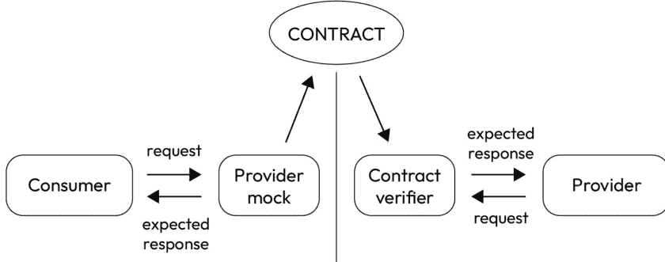

图 4.3 – 契约测试

各种工具和库都支持契约测试，取决于项目的技术栈和需求。一些流行的选项包括 Pact、Spring Cloud Contract 和 Pacto。

# 安全第一——检查并改进你的测试覆盖率

测试非常重要，但我们需要确保彻底测试代码，而不仅仅是部分代码；覆盖所有代码不仅意味着所有的类，还意味着所有可能的执行路径。我们可能认为记住所有可能的情况很容易，对于非常小的项目来说这可能是的；但随着项目增长不可避免地变得复杂（例如，功能数量增加或可能的执行路径倍增），要理解测试在保障我们安全方面的效率就会变得困难。这就是为什么我们引入了测试覆盖率的概念以及衡量它的工具。

## 什么是测试覆盖率？

**测试覆盖率**，也称为代码覆盖率，是衡量一组测试用例执行程序源代码范围的指标。它是一种量化标准，帮助开发者和测试人员理解在测试期间执行了多少代码。

测试覆盖率通常以百分比表示，代表测试套件执行的代码行、分支、语句或方法占基准代码中总元素数量的比例。

有不同类型的覆盖率指标：

- **行覆盖率**：衡量在测试期间至少执行过一次的代码行百分比。

- **分支覆盖率**：衡量在测试期间分支（即决策点——简单来说，就是代码中的 `if` 实例）被覆盖或未覆盖的分支百分比。它确保了真、假条件语句都得到了测试。

- **语句覆盖率**：衡量在测试期间执行的可执行语句百分比。

- **方法覆盖率**：衡量在测试期间调用的方法或函数的百分比。

测试覆盖率不是软件质量的决定标准，但它为测试工作的详尽程度提供了宝贵的见解。高覆盖率表明大部分代码已经过测试，增加了对应用程序正确性的信心。然而，即使是 100% 的覆盖率也不能保证应用程序没有 bug，因为测试用例中可能存在未测试的边界情况或错误的假设。

通过提高覆盖率，开发者可以降低未发现缺陷的风险，并使代码更加健壮和可维护。我们使用代码覆盖率工具来生成报告，通过分析这些报告可以识别需要更多测试的代码区域。

## 代码覆盖率工具 – JaCoCo

**JaCoCo**（`Java Code Coverage` 的缩写）是一个广泛用于 Java 项目的开源覆盖率库。它对代码覆盖率提供全面且详细的分析，允许开发者理解其 Java 代码中有多少部分被测试执行。

JaCoCo 提供了三个重要的指标：

1. **行覆盖率**：根据测试调用的 Java 字节码指令数量，指示已执行代码的范围。

2. **分支覆盖率**：显示代码中已执行分支的百分比，通常与 `if/else` 和 `switch` 语句相关。

3. **圈复杂度**：通过线性组合量化覆盖所有可能路径所需的路径数量，反映代码的复杂性。

用一个简单的例子来说明，如果代码不包含任何 `if` 或 `switch` 语句，则圈复杂度将为 1，因为只需要一条路径即可覆盖整体。通常，圈复杂度代表实现全覆盖所需的测试用例数量。

为了说明 JaCoCo 如何工作，让我们从一个非常简单的例子开始。我的意图不是创建一个关于这个工具的教程——网上有许多教程——但我想向你展示它的主要功能，以便你对它的工作原理有一个大致的了解。

假设我们有一个项目，只有一个名为 `Calculator` 的类，定义如下：

```java
public class Calculator {
    public Integer sum(Integer a, Integer b) {
        return a + b;
    }
    public Integer subtract(Integer a, Integer b) {
        return a - b;
    }
    public Integer multiply(Integer a, Integer b) {
        return a * b;
    }
}
```

如所示，`Calculator` 类暴露了三个简单方法，接受两个整数作为输入并返回它们的和、差和积。让我们继续编写编写相应的测试类，我们将其定义为：

```java
class CalculatorTest {
    private final Calculator calculator = new Calculator();
    @Test
    void sum() {
        var sum = calculator.sum(1, 4);
        assertEquals(5, sum);
    }
    @Test
    void subtract() {
        var sum = calculator.subtract(10, 4);
        assertEquals(6, sum);
    }
}
```

测试类创建了 `Calculator` 的实例并执行两个单元测试：一个测试和，另一个测试差。使用 JUnit 框架，我们验证预期结果与实际结果匹配。

使用像 JaCoCo 这样的工具有很多方法，但我看来，最佳方法是将其集成到开发周期中。假设我们正在使用 Maven，我们将配置 `pom.xml` 文件，以便插件能够执行并生成报告：

```xml
<plugin>
  <groupId>org.jacoco</groupId>
  <artifactId>jacoco-maven-plugin</artifactId>
  <version>0.8.10</version>
  <executions>
    <execution>
      <goals>
        <goal>prepare-agent</goal>
      </goals>
    </execution>
    <execution>
      <id>report</id>
      <phase>prepare-package</phase>
      <goals>
        <goal>report</goal>
      </goals>
    </execution>
  </executions>
</plugin>
```

JaCoCo Maven 插件的执行将创建 `target/site` 文件夹，可以通过任何网络浏览器查看。

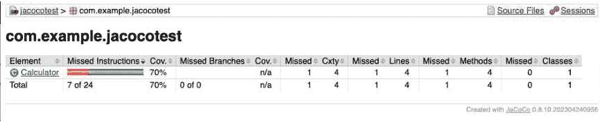

图 4.1 – JaCoCo 创建的微网站显示了每个类的测试覆盖率

在该表中，我们在项目中找到一个类。我们可以从报告中看到 `Calculator` 类的测试覆盖率为是 70%。这是因为我们还没有对 `multiply` 方法进行任何测试。

```java
@Test
void multiply() {
  var sum = calculator.multiply(6, 5);
  assertEquals(30, sum);
}
```

然后，再次运行 JaCoCo Maven 插件。报告现在看起来像这样：

## com.example.jacocotest

| Element | Missed Instructions | Cov. | Missed Branches | Cov. | Missed | Cty | Missed | Lines | Missed | Methods | Missed | Classes |
| --- | --- | --- | --- | --- | --- | --- | --- | --- | --- | --- | --- | --- |
| Calculator | | 100% | | n/a | 0 | 4 | 4 | 0 | 4 | 0 | 1 |
| Total | 0 of 24 | 100% | 0 of 0 | n/a | 0 | 4 | 4 | 0 | 4 | 0 | 1 |

图 4.5 – 添加测试用例后，覆盖率现在为 100%

Calculator 的所有方法都通过了测试。覆盖率为 **100%**。

如果我们进行更改会发生什么呢？例如，假设我们通过添加一个检查来决定不支持减法操作中的负数结果，当减数大于被减数时抛出异常。


```java
public Integer subtract(Integer minuend, Integer subtrahend) {
    if (subtrahend > minuend) {
        throw new IllegalArgumentException("Minuend must be greater than subtrahend");
    }
    return minuend;
}
```

如果我们再次运行 JaCoCo，我们可以发现一个非常有趣的现象：

## com.example.jacocotest

| Element | Missed Instructions | Cov. | Missed Branches | Cov. | Missed | Cty | Missed | Lines | Missed | Methods | Missed | Classes |
| --- | --- | --- | --- | --- | --- | --- | --- | --- | --- | --- | --- | --- |
| Calculator | | 85% | | 50% | 0 | 5 | 1 | 6 | 6 | 4 | 0 | 1 |
| Total | 5 of 34 | 85% | 1 of 2 | 50% | 1 | 5 | 1 | 6 | 4 | 0 | 1 |

图 4.6 – 在不添加相应测试的情况下添加新功能，覆盖率会下降

覆盖率下降了，具体来说，`Missed Branches`（缺失分支）列被填充了。在 JaCoCo 的语境中，`branch`（分支）指的是代码中特定的路径或决策点，程序可以采取不同的路线。分支通常与条件语句相关，例如 `if-else` 和 `switch-case` 语句。

我们可以通过点击 **Calculator** 查看哪些方法受了影响：

## Calculator

| Element | Missed Instructions | Cov. | Missed Branches | Cov. | Missed | Cty | Missed | Lines | Missed | Methods | Missed | Classes |
| --- | --- | --- | --- | --- | --- | --- | --- | --- | --- | --- | --- | --- |
| subtract(Integer,Integer) | | 70% | | 50% | 0 | 1 | 1 | 3 | 3 | 0 | 1 |
| sum(Integer,Integer) | | 100% | | n/a | 0 | 1 | 0 | 1 | 0 | 0 | 1 |
| multiply(Integer,Integer) | | 100% | | n/a | 0 | 1 | 0 | 1 | 0 | 0 | 1 |
| Calculator() | | 100% | | n/a | 0 | 1 | 1 | 5 | 6 | 0 | 4 |
| Total | 5 of 34 | 85% | 1 of 2 | 50% | 1 | 5 | 1 | 6 | 4 | 0 | 1 |

图 4.7 – 点击 Calculator 条目可以更清楚地看到哪些方法未被找到

我们可以点击方法来查看代码的哪些部分被覆盖：

## Calculator.java

```java
package com.example.jacocest;
import org.springframework.stereotype.Component;

@Component
public class Calculator {
    public Integer sum(Integer a, Integer b) {
        return a + b;
    }

    public Integer subtract(Integer a, Integer b) {
        if (a > b) {
            throw new IllegalArgumentException("b must be greater than a");
        }
        return a - b;
    }

    public Integer multiply(Integer a, Integer b) {
        return a * b;
    }
}
```

图 4.8 - 点击方法条目，可以看到哪里缺少了覆盖率

由于我们添加了一个 `if` 语句，我们创建了一个分支。每当创建一个分支（代表一个新的执行流）时，我们必须用测试来覆盖它。让我们这样做：

```java
@Test
void subtractWithIllegalArgument() {
    assertThrows(IllegalArgumentException.class, () ->
        calculator.subtract(10, 2));
}
```

重新生成报告：

## com.example.jacocest

| Element | Missed Instructions | Cov. | Missed Branches | Cov. | Missed | Cty | Missed | Lines | Missed | Methods | Missed | Classes |
| --- | --- | --- | --- | --- | --- | --- | --- | --- | --- | --- | --- | --- |
| Calculator | | 100% | | 100% | 0 | 1 | 0 | 5 | 0 | 0 | 0 | 1 |
| Total | 0 of 34 | 100% | 0 of 2 | 100% | 0 | 1 | 0 | 5 | 0 | 0 | 1 |

图 4.9 - 添加测试后，覆盖率现在达到了 100%

开发者在进行手动或集成测试之前解决这些问题，确保用户不会遇到这些问题。

- **代码库易于维护和重构：** 解耦和清晰的接口使得代码更易于管理。你可以在不影响其他模块的情况下替换微功能的实现，并在保留测试的情况下重写整个应用程序。对每个功能进行彻底的测试消除了对修改的恐惧。一个完整的测试套件允许你充满信心地改进代码，而不会破坏应用程序。

- **清晰的文档：** TDD 使用单元测试，这些测试可以作为有效的文档，避免了编写耗时且难以维护的书面文档。这一点是良好测试覆盖率的关键特征。TDD 对实现全面的测试覆盖率有显著贡献。

- **重构的引导：** 在“红-绿-重构”（Red-Green-Refactor）循环中，有一个专门的重构步骤，确保开发者在编写每行代码时都会考虑设计上的改进。

## 开发速度 – 注意事项

特别是在开始阶段，感觉进展非常缓慢。TDD 更关注交付高质量代码而不仅仅是交付代码。人们可能会编写许多相似或冗余的测试，或者可能是过于简单的测试或对代码进行尝试性测试。在团队完全掌握这一点之前，可能需要一段时间才能以恰当的速度进行。

无论如何，当开发者推迟测试的创建时，最初似乎加速了开发过程。然而，这种方法经常会导致代码耦合，使得某些部分无法测试。一旦发现 bug，调试阶段可能会变成一项极其耗时且不可预测的任务。因此，选择用更具预测性和结构化的测试程序来取代不确定且多变的调试过程，通常是一个更好的主意。

总而言之，TDD 是一种软件开发方法论，开发者在编写实际代码之前创建自动化测试。该过程涉及三个主要步骤：编写一个定义所需功能的失败测试，编写通过测试所需的最少代码，然后在确保所有测试持续通过的同时精炼代码。它可以在单元测试和其他类型的测试（如集成测试）上实现。TDD 鼓励迭代式开发，提高代码质量，并帮助在开发过程中早期发现 bug。

## 总结

我希望我已经传达了测试重要性，它不仅是重构的必要条件，也是高质量代码的基石。在本章中，我们理解了为什么测试至关重要，以及为什么经常测试是有益的，这让我们尽可能尽早失败——这看起来像是一个悖论，但事实如此。

我们有各种类型的测试可供选择，但我们特别关注单元测试，JUnit 等框架对单元测试非常有帮助。

由于测试是必不可少的，让测试尽可能覆盖我们的代码库至关重要。为了这一点，我们得到了另一个工具 JaCoCo 的帮助。

此外，我们介绍了 TDD 这一基础方法，反转了传统的开发流程，从测试开始，然后编写代码。

现在我们已经涵盖了所有基础知识，可以进入下一章了。在下一章中，我们将分析重构技术，深入探讨我们在“代码气味”章节（第3章）中简要提及的话题。

## 延伸阅读

- 混淆：Error vs. Fault vs. Bug vs. Defect vs. Failure：https://farhan-labib.medium.com/m/the-confusion-error-vs-fault-vs-bug-defect-vs-failure-c557af04726b
- Apache JMeter 入门：https://jmeter.apache.org/usermanual/1/get-started.html
- 客户满意度：https://www.linkedin.com/advice/what-key-performance-indicators-suring-customer
- 持续集成：https://en.wikipedia.org/wiki/Continuous_integration
- 持续交付：通过构建、测试和部署自动化实现可靠软件发布（Jez Humble 和 David Farley 著，Addison-Weasley，2010）
- JUnit 框架官方网站：https://junit.org/junit5/
- Mockito 入门：https://www.baeldung.com/mockito-series
- JaCoCo 网站：https://www.jacoco.org/jacoco/

# 5

### 重构技术

我们现在进入主题的核心：如何进行重构。如果将所有已知的重构技术都挤进一个章里会有点愚蠢。因此，我们决定关注最常见和更有趣技巧。我们智慧的主要来源来自 Martin Fowler 的杰作著作《重构：改善现有代码的设计》（Refactoring: Improving the Design of Existing Code）。他与 Kent Beck 合作，一步步详细地解释了如何进行重构，从最简单到最复杂的情况。对于每种情况，我们都提供了一种指南，以便你不会遗漏任何内容。在这里，我们提供了部分最重要的重构技术，这种重要性很大程度上取决于我们自己的经验。

**提示**

对于那些不知道的人来说，Martin Fowler 和 Kent Beck 是软件开发领域的传奇人物。Martin Fowler 以对软件设计、重构和敏捷方法的贡献而闻名，而 Kent Beck 是极限编程（XP）和 JUnit 测试框架的创建者。他们对塑造敏捷实践和改进软件开发流程具有重大影响。

我们尝试简化 Fowler 写下的每一处，并加入了一些我们自己的工作背景。如果你还没有读过，建议你在深入本章之前先阅读关于代码气味的章节（第3章）。

在本章中，我们将涵盖以下内容：

- 编写良好方法的技巧
- 从一个对象移动功能
- 让你的数据组织得良好
- 简化那些 if-else 块
- 清理你的方法调用
- 关于使用的一些技巧
- 以及它们何时适用

## 编写更好的方法

组合方法是一项每个开发者都应该具备的基本技能。简单来说，它是关于将代码拆分成更小的部分，每个部分只做一件事。细节隐藏在方法中；这允许我们阅读自己的逻辑。

在重构代码时，该过程通常涉及从原始方法中提取代码。如果你发现很难起有意义的名字，这清楚地表明我们正在处理的方法过于冗长了。在这种情况下，尝试识别一个更小、更集中的部分。通常，在长方法中，你可能会注意到某些部分可以重构为新方法。

是关于如何组合方法的一些指南：

- **越短越好：** 在代码中倾向于简洁简练。通常更倾向于较小的函数和代码块，因为它们增强了可读性。
- **最小化冗余：** 使用组合模式时，注意消除重复代码。这种做法不仅缩减了你的代码库，还防止了不一致并简化了未来的更新。
- **展示你的目的：** 培养代码清晰度并采用不留歧义的命名规范。每个变量和方法的命名都应该简洁地传达其角色和功能。
- **追求简化：** 简化是代码改进的指导原则。消除不必要的复杂性，简化逻辑并遵循最佳实践。简单的代码不仅更优雅，而且更容易维护。
- **保持一致的细节级别：** 在应用组合模式时，协调你所调用的方法的复杂级别至关重要。避免将简单的、直接的 getter 与执行资源密集型计算的函数混合。细节级别的一致性有助于实现这些目标有许多方法；接下来我们将看到其中一些。

## 提取方法

我们在之前的章节中已经看到它了，但我想更深入地探讨。在我看来，这是我们经常（或应该经常）做的重构。简单来说，就是将一个非常长的方法——太长了——并将其拆分成更小的方法。一个方法最多可以有多长？显然，没有通用规则；它取决于你的和读者的敏感度。

团队。假设我需要通过鼠标滚动才能读完所有内容；这本身就是长度过长的一个小信号。我喜欢遵循马丁·福勒（Martin Fowler）曾经教过我的方法，尝试尽可能地限制我的方法行数；有时我会写出只有两或三行的方法。除了我进行提取操作的代码长度外，我有时还会考虑我正在提取的代码的可读性，因为这对于复制粘贴非常重要。然而，我同意福勒的观点（我确实如此！），即编写方法时应该考虑它们的意图；即根据这些方法*应该做什么*，而不是它们*如何去做*：将执行某项操作的所有代码封装在单个方法中，无论它多小。方法的名称应该基于“方法做了什么”而不是“如何”做的。

让我们用一个非常简单的例子来说明这些概念。假设我们有以下方法：

```java
public void calculate(int num1, int num2) {
    int sum = num1 + num2;
    System.out.println("Sum: " + sum);
    int difference = num1 - num2;
    System.out.println("Difference: " + difference);
}
```

如你所示，这个方法非常简单：它是一个计算两个数字和和差的方法。当然，现实情况比这复杂得多，但原则并没有改变。我们像这样重构代码：

```java
public void calculate(int num1, int num2) {
    int sum = addNumbers(num1, num2);
    printResult("Sum", sum);
    int difference = subtractNumbers(num1, num2);
    printResult("Difference", difference);
}
private static void printResult(String operationName, int result) {
    System.out.printf("Result of %s: %d\n", operationName, result);
}
public static int addNumbers(int a, int b) {
    return a + b;
}
public static int subtractNumbers(int a, int b) {
    return a - b;
}
```

我们提取了三个方法：一个用于数字求和，一个用于计算差值，第三个将结果打印到屏幕上以避免重复。不要被这段特定代码的长度所误骗；它只是说明该概念的一个例子——在现实中，你必须将求和和差值操作视为更长的方法，可能实现了更复杂的逻辑。我们在这里可以做的另一个反思是，提取方法促进了重用，因为提取的逻辑可以在许多地方被调用。

## 内联方法 (Inline Method)

这与提取方法完全相反。在如此强调方法提取和短方法之后，建议有时内联方法反而是合适的，这听起来可能很奇怪。当你有一个非常短（通常只有一行或两行代码）、从不重用且清晰表达了其功能的方法时，这种小型重构非常有用；在这种情况下，仅仅通过方法名本身来“解释”其方法的方法可能是多余的。

我将为你提供一个关于方法内联的非常微小的示例。假设我们在类中有以下三个方法：

```java
public int add(int a, int b) {
    return a + b;
}

public int multiply(int a, int b) {
    return a * b;
}

public int calculate(int x, int y) {
    int sum = add(x, y);
    int result = multiply(sum, 2);
    return result;
}
```

如你所示，我们有一个 `calculate` 方法，它接收两个整数并对它们执行一系列操作。这些操作由 `add` 和 `multiply` 方法表示，这些方法计算了它们接收的两个整数的和和积。这些方法只被使用了一次且非常简单：事实上，只有一行。所以，让我们利用机会进行方法内联，使代码更短、更易读：

```java
public int calculate(int x, int y) {
    int sum = x + y;
    int result = sum * 2;
    return result;
}
```

`add` 和 `multiply` 方法消失了，它们的实现（构造了单行代码）替换了它们被调用的地方。我们可以通过直接返回最后一次操作的结果并使用结果变量来进一步重构代码：

```java
public int calculate(int x, int y) {
    int sum = x + y;
    return sum * 2;
}
```

这似乎与我们在上一章中写的内容相矛盾（事实上，我们现在内联了之前孤立的内容），但这仅仅是为了提供一个非常简单的例子。

总而言之，我们在“内联方法”重构中需要执行的是：


- 1. 检查方法在子类中没有发生变化。如果已被修改，请避免使用此技术。
- 2. 找到所有调用该方法的地方，用方法中的实际代码替换这些调用。
- 3. 直接删除该方法。

当然，由于我们谈论的是重构，行为绝不能改变；为了确保这一点，除了在之前编写的小配方中包含测试外没有其他办法。在消除你内联的方法之前，务必始终进行测试。我们将在书中后面讨论这一点，但现代集成开发环境提供了实现此点的工具。

在以下情况使用内联方法：

- 当方法简单且名称非常清晰时。
- 当方法只被使用一次时。
- 当方法体是一个简单的表达式时。

## 提取变量 (Extract Variable)

“提取变量”技术与“提取方法”非常相似，但不是提取方法，而是将表达式提取到变量中。当你有一个被多次使用的表达式，或者表达式本身难以阅读时，这种方法特别有用。

例如：

```java
// 之前
if (platform.toUpperCase().equals("WINDOWS") || platform.toUpperCase().equals("OSX")) {
    // 执行某些操作
}
```

```java
// 之后
boolean isWindowsOrMac = platform.toUpperCase().equals("WINDOWS") || platform.toUpperCase().equals("OSX");
if (isWindowsOrMac) {
    // 执行某些操作
}
```

`Location` 实例仅在构造函数中传递一次。通过方法的签名，我们随后删除了该参数；现在，你不再需要传递它了。当然，请仔细考虑是否要以此方式进行重构；如果你的 `Location` 实例频繁变化（例如每次方法调用时都会变化），使用这种模式可能不是最佳主意，因为你必须为每次调用实例化一个 `LocationHandler`。

## 在对象之间移动特性

正如我们已经多次提到的，也对于那些在这个行业工作了几年的人来说，组织代码是极具挑战性的部分之一。我个人认为，我从未在第一次尝试时就搞定软件项目的设计。但是，幸运的是（或者不幸的是！）软件是具有可塑性的，所以只要有合适的限制和大量的重构，我们可以轻松地将方法和字段从一个类移动到另一个类。我们可以决定提取一个类，或者删除一个类并将其内联。最重要的是，我们可以消除所谓的死代码。但让我们从这里开始吧。

## 移动方法或字段

这种重构非常基础（马丁·福勒称之为重构的“家常便饭”但它是执行最频繁的重构之一。这是因为，正如我们已经提到的，在软件项目中保持某种程度的模块化是一种良好的做法，这样类、包等根据它们运行的语境紧密地分组。例如，在一个包中，我们可能会放置所有负责管理用户信息的类，而在另一个包中，我们可能会收集所有外部服务的客户端。这没有单一的标准，而是通常具有某种主观性。这就是为什么方法或单个字段经常从一个类移动到另一个类的原因。这种移动在“将相关项放在一起，将必须分开的项目分开”原则的指导下，简化了代码。

这种情况属于那种执行比解释更简单、更直观的情况之一，但我会尝试给你提供马丁·福勒的“配方”，也许会稍微简化一下。

将方法从源类转移到目标类涉及必须遵循的几个步骤，以确保重构过程的成功：

- 1. 检查方法利用的依赖和其他类成员。确定是否有必要将它们重新定位到新类中。
- 2. 检查方法是否被父类或子类引用。如果它被这些类使用，那么移动该方法可能是不可行的。
- 3. 在目标类中建立该方法并将现有代码复制到其中。如果重新定位的方法依赖于原始类的实例，你可以将其作为方法参数传递。
- 4. 删除旧方法中的代码并将调用重向新方法。（这是可选的，你也可以使用特性开关。）
- 5. 可选地决定是否完全消除旧方法并直接调用新方法。

## 特性开关 (FEATURE TOGGLE)

特性开关，也称为特性标记（feature flags），是一种允许我们在不直接修改源代码的情况下激活或禁用特定功能的技术。这种方法带来了许多益处，如持续部署、真实环境下的简化测试、高效的问题管理、用于风险管理的特性逐步发布，以及通过比较特性变体做出明智决策的能力。

在最抽象的意义上，特性开关在 Java 方法中工作如下：

```java
public void applyLogic() {
    if (newFeatureEnabled) {
        applyNewLogic();
    } else {
        applyCurrentLogic();
    }
}
```

最后，建议执行你的测试套件。这一点至关重要，尽管在讨论重构时应该是显而易见的。

对于单个字段，过程非常简单。我们有一个字段，它被定义类之外的另一个类频繁使用。没有遵循语境；因此，我们将字段移动到另一个类中，随后更改所有使用该字段的地方。

在应用“提取类”（Extract Class）技术时，字段经常会被移动，决定哪个类应该保留特定字段可能有点棘手。这里有一条实用的经验法则：将字段放在使用它最频繁的方法所在的类中，或者放在你发现大多数此类方法的类中。在字段显然位于不合适位置的场景中，这个规则也可以被证明是有益的。

再次，让我们展示福勒描述的方法论：

- 1. 在处理公共字段时，通过将其转换为私有字段并提供公共访问方法，重构将变得显著易于管理（你可以利用“封装字段”（Encapsulate Field）技术来实现此目的，正如字段封装章节中所解释的那样）。
- 2. 在接收类中建立相同的字段及其相应的访问方法。
- 3. 确定你将如何访问接收类。你可能已经拥有一个产生所需对象的字段或方法。如果没有，你需要创建一个新的方法或字段来存储与接收类关联的对象。
- 4. 将旧字段被引用的地方替换为接收类中适当的方法调用。如果该字段不是私有的，请根据需要在父类和任何子类中进行处理。
- 5. 从原始类中删除该字段。

## 将语句移入/移动方法

重复代码是我们代码库中最常见的问题之一；复制和粘贴的诱惑有时太强大了。这可以在调用某个特定方法、某行代码之前看到；也可能发生在每次调用该方法之前都重复相同的行代码的情况。此时，你将明白最好的替代方案是获取该语句并将其直接移动到该方法内部。

相反，方法内部可能有一个语句只在一个地方被使用。在这种情况下，最好将该语句移出方法。此外，如果该语句在多处重复，将其提取到一个新方法可能会简化代码并使其更易读。

## 隐藏代理 (Hiding delegates)

这种重构适用于当类 A 获取 B 类型的对象并调用其方法时。为了消除这种依赖，可以在 A 中引入委托方法。一个例子可以说明这一点。假设我们有两个类：

```java
public class Itinerary {
    private String departureAirport;
    private String arrivalAirport;
    // 构造函数, getter...
}
public class Flight {
    private Itinerary itinerary;
    // 构造函数, getter...
}
```

如果我们想获取 `departureAirport`，我们将有一个 `Flight` 实例，我们的代码如下：

```java
var departureAirport = flight.getItinerary().getDepartureAirport();
```

这样做是可以的，除了 `Itinerary` 类；我们不想更改 `Itinerary` 类。所以我们会这样写：

```java
public class Flight {
    private Itinerary itinerary;
    public String getDepartureAirport() {
        return itinerary.getDepartureAirport();
    }
    // 构造函数, getter...
}
```

现在我们可以调用 `Flight` 类的方法来获取字段：

```java
var departureAirport = flight.getDepartureAirport();
```

代理被隐藏了。对象之间的关系减少了。

但根据马丁·福勒的配方，这里是执行这种重构的步骤：

- 1. 对于代理类包含的每一个方法，在服务器类中生成对应的方法并转发到代理类。
- 2. 修改客户端以调用服务器类的方法而不是直接调用代理类。
- 3. 如果你的修改成功消除了客户端对代理类的依赖，你可以安全地删除服务器类中获取代理类的访问方法。

## 死代码

3. 未使用的变量或函数：如果定义了变量或函数但未在程序的任何地方被使用，则它们被视为死代码。

你不希望在项目中存在死代码：它会使代码更难理解，增加维护成本，并可能引入漏洞。

所以，请务必如果你意识到你的项目中存在死代码——现代 IDE 现在已经完全有能力做到这一点——请将它们删除。不——不要把它们注释掉！直接删掉它们；如果你想恢复它们，你应该使用版本控制系统（如 Git 或 Subversion），它们会帮你解决问题。

还要注意所谓的“死注释”。正如之前提到的，我们对注释的观点是注释应该越少越好，并专注于解释某项内容在“做什么”以及“为什么要这样做”。在一个理想且奇妙的世界里，代码本身应该能够解释自己，而不需要额外的注释。通常发生（非常经常发生）的情况是，注释与代码不协调，不仅变得无关紧，有时还会产生误导。即使你被教导要在代码中添加大量注释（至少我是这样被教的），也请尽量将其保持在最低限。

我们关于死代码的观点同样适用于模块、服务甚至单个功能。在生产环境中看到部署了实际上未被使用的模块和服务是非常常见的现象，它们唯一的作用就是消耗宝贵的（昂贵的）资源。通常情况下，所有人都会忘记它们，直到需要更新它们时（例如由于发现了依赖项中的漏洞）或者当有人意识到它们在硬件资源上花费了大量资金时！对于功能而言，情况也类似：为什么要保留那些让代码变得复杂但没有任何实际收益的未使用功能呢？在第一个机会就删除它们，你不会后悔的！

我们已经看到了代码重构中非常重要的一部分，并学习了一些在不引起太大扰动的情况下移动代码片段的技巧。除了位置正确外，功能还必须具有良好的结构和组织。让我们来看看关于这的一些建议。

## 数据组织

数据如何组织是我们专业领域中最重要的方面之一；连贯地聚合信息是构建稳健、可维护且可扩展的软件项目的基础。各种类型的重构在这方面为我们提供了帮助，Fowler 再次帮助我们详细地引导这些重构。在接下来的章节中，我们将展示一些我们认为最常见或可能具有误导性的重构。

## 字段封装

我们将一个节中汇总我们认为非常相似的技术，这些技术最终涉及的都是不向用户暴露类的内部结构。这一原则被称为封装，是面向对象编程（OOP）的基本概念之一；隐藏类的内部结构并为其字段提供访问方法是有益的，因为它简化了类的使用、保护了数据、提高了可维护性、封装了行为并允许访问控制。数据没有与相关的行为分离，程序段的模块化没有受到破坏，维护也变得简单。要从公共字段实现封装，只需将字段变为私有，并暴露所谓的 getter（get）和 setter（set）方法。例如，看下面的代码：

```java
class Flight {
    public Airport departureAirport;
}
```

它将变成：

```java
class Flight {
    private Airport departureAirport;
    public Airport getDeparture() {
        return departureAirport;
    }
    public void setDepartureAirport(Airport departureAirport) {
        this.departureAirport = departureAirport;
    }
}
```

`departureAirport` 字段已被私有化，我们暴露了两个分别用于读取和写入它的方法。如果你想让类变为不可变的——我们通常上非常推荐这样做——你需要将 `departureAirport` 设为 `final`，将其添加到构造函数中，并实现 setter 方法。

有人可能会辩论说，那样我们仍然会暴露类的结构，并且……他们是对的！但是，请记住这是一个非常简单的案例：并不是所有字段都需要存在 getter 和 setter，也不是它们必须专门对字段执行读或写操作——它们也可以涉及逻辑（但在这种情况下要注意性能！）。

其他注意：从 Java 14 开始，引入了 `Record` 关键字——这种构造允许你用单行代码定义 `Flight` 类，样板代码更少。你可以参考“进一步阅读”获取更多细节。

我们还可以在类内部封装字段。让我们稍微扩展一下 `Flight`，假设我们还需要在内部访问 `departureAirport` 字段：

```java
class Flight {
    private Airport departureAirport;
    // getter and setter
    public String getDepartureAirportCode() {
        return this.departureAirport.getAirportCode();
    }
}
```

有时，在类内部直接访问私有字段可能具有所需的灵活性。你可以在字段内数据被设置或接收时执行复杂的操作——诸如延迟初始化和字段值的验证等任务可以毫不费力地整合到字段的 getter 和 setter 中。除此之外，你必须遵守在子类中重写 getter 和 setter。

因此，`Flight` 类看起来像这样（请观察 `getAirportCode` 方法）：

```java
class Flight {
    private Airport departureAirport;
    // setter
    public Airport getDepartureAirport() {
        return departureAirport;
    }
    public String getDepartureAirportCode() {
        return this.getDepartureAirport().getAirportCode();
    }
}
```

有人认为我们虽然获得了灵活性，但在可读性上损失了一点点，因为需要读取 `getDepartureAirport` 方法；另一些人可能会说这是不对的，只要方法命名得当且仅代表一个 getter；我们还促进了松耦合。遵循哪条路径由你决定。

我们要展示的封装的最后一个案例涉及集合，我见过很多此类问题。在这种情况下，类包含一个集合类型的字段，其 getter 和 setter 作用于整个集合，这使得与其交互变得困难。修改之前的示例，假设我们有一个 `Flight` 类包含一个中转站的集合：

```java
class Flight {
    private List<Airport> itinerary;
    public List<Airport> getItineraryAirports() {
        return itinerary;
    }
    public void setItineraryAirports(List<Airport> itinerary) {
        this.itinerary = itinerary;
    }
}
```

这些集合的使用协议与其他数据类型略有不同。注意的是，getter 方法不应返回实际的集合对象。这样做允许客户端在所有者类感知的情况下操作集合的内容。此外，这会向客户端暴露大量的内部数据结构。相反，检索元素的方法应该提供一个可以防止修改集合的值，并避免暴露关于它的过多信息。不应该有直接为集合赋值的方法。相反，协议应该提供添加和删除元素。这种方法让所有者对集合内元素的添加和删除行使权力：

```java
class Flight {
    private List<Airport> itineraryAirports;
    public List<Airport> getItineraryAirports() {
        return Collections.unmodifiableList(itineraryAirports);
    }
    public void addAirport(Airport itineraryAirport) {
        this.itineraryAirports.add(itineraryAirport);
    }
    public void removeAirport(Airport itineraryAirport) {
        this.itineraryAirports.remove(itineraryAirport);
    }
}
```

我们删除了 setter 方法，并添加了两个向列表删除元素的方法。当我们通过 getter 返回列表时，我们使用 Java 实例化了一个不可变列表。

`Collections.unmodifiableList` 方法（但我们也可以使用 Guava、Apache Commons 或其他工具）。

## 一些免责声明

我们正在修改对象，这违背了我们在这些页面中倡导的不可变性概念，因此请务必小心。此外，请记住，你执行添加和删除操作的集合类型（在本例中为 `Airport`）必须重写 `equals` 和 `hashCode` 方法。

## 将基本类型替换为对象

这种重构在处理我们在第3章中遇到的“基本类型过度用”（Primitive Obsession）代码时提供了救星。当我们使用 `integer`、`double`、`strings` 等而不是更复杂的类型就会这种情况；如果我们只需要打印这些信息而不包含任何特殊逻辑，这些基本类型是可以的。但通常，我们会发现情况比这复杂得多。回到我们的 `Flight` 类，这次假设一个包含服务等级（也称为“舱位等级”）的字段定义如下：

```java
class Flight {
    private String cabinClass;
    public Flight(String cabinClass) {
        this.cabinClass = cabinClass;
    }
    // getter and toString
}
```


如果我们只想找到一个只有最贵的航班列表，我们需要执行类似下面的操作：

```java
var expensiveFlights = flightList.stream().filter(f -> 
f.getCabinClass().equals("Business") || f.getCabinClass().equals("First Class")).collect(Collectors.toList());
```

知道舱位等级的所有可能值是不理想的，我必须确切知道哪一个比另一个更贵。在这些情况下，最好替换基本类型，不仅是封装，还有自定义逻辑的实现：

```java
var expensiveFlights = flightList.stream().filter(f -> 
f.getCabinClass().higherThan(new
CabinClass("Economy")).collect(Collectors.toList());
```

如你所见，`higherThan` 方法允许我们实现一种比较舱位与另一个舱位的逻辑，而无需担心管理和维护该逻辑本身。

思考一下 `CabinClass` 类是有价值的：

```java
public class CabinClass {
    private final String name;
    private final int value;
    public CabinClass(String name) {
        this.name = name;
        switch (name) {
            case "Economy":
            value = 1;
            break;
            case "Premium":
            value = 2;
            break;
            case "Business":
            value = 3;
            break;
            case "First":
            value = 4;
            break;
            default:
                throw new IllegalArgumentException();
        }
    }
    // getters
    public boolean higherThan(CabinClass other) {
        return this.getValue() > other.getValue();
    }
}
```

它有一个名称和一个值；后者用于确定舱位等级在“值刻度”中的位置，并被分配给类构造函数。我们周围仍然有很多字符串，但我认为我们还可以做得更好。让我们继续吧。

## 将类型代码替换为子类

让我们从上一个例子（即舱位类）开始。你可能注意到，通过在构造函数中传递字符串来定义舱位的“类型”是不理想的。在简单的场景下，我们可以在编写类型时创建一个类型；但在现实中，真正问题是将知识交给了调用者，而这些知识本应该是 `CabinClass` 内部的。当我们遇到这种情况，即我们的类是一个“类型”，且类本身的行为可以取决于这个类型时，简单的重构是创建子类。我们的 `CabinClass` 类将变成如下：

```java
public class CabinClass {
    protected final String name;
    protected final int value;
    protected CabinClass(String name, int value) {
        this.name = name;
        this.value = value;
    }
    // toString, and higherThan
}
```

但我们还有一组定义如下的子类：

```java
public class Economy extends CabinClass{
    public Economy() {
        super("Economy", 1);
    }
}
public class Premium extends CabinClass{
    public Premium() {
        super("Premium", 2);
    }
}
public class Business extends CabinClass{
    public Business() {
        super("Business", 3);
    }
}
public class First extends CabinClass{
    public First() {
      super("First", 4);
    }
}
```

注意参数如何在构造函数中定义，以及调用者如何无法修改它们。通过这种方式，除此之外，我们利用了 OOP 的所有优势，代码可读性也随之提高。为了完整性，这里有一个经过相应修改的过滤昂贵航班的代码片段：

```java
var economy = new Economy();
var expensiveFlights = flightlist.stream().filter(f ->
f.getCabinClass(economy).higherThan(economy)).toList();
```

注意，我们只是实例化了一个 `Economy` 类来使用 `higherThan` 方法。

良好组织数据归根结底意味着简化事情——至少让它们变得易读。让代码变得非常难以阅读的一个因素是条件逻辑。让我们看看如何稍微简化它。

## 简化条件逻辑

对于这一部分，我们还将依靠 Martin Fowler，并尝试解释一些我们认为是最常见问题的重构。这种选择是随机的，完全基于我们的经验。更多细节，请参阅“进一步阅读”章节。

### 返回特例情况

不要返回 null。这是一个每个人都应该遵循的准则，即使在某些情况下方法确实应该返回 null；Java 和许多其他语言允许空引用。

> **提示**
>
> Tony Hoare 在 1965 年在 ALGOL 中引入了空引用，“仅仅因为这太容易实现了”。反思他的决定，他将其称为“百万美元错误”。更多信息请参见进一步阅读章节。

#### 返回 null 的情况

有多种方法返回 null，但最常见的方法之一是返回一个特殊对象，这是一个具有预定义值的默认对象。例如以下代码片段：

```java
CustomerAddress customerAddress =
addressRepository.findById(customer.getId());
if (customerAddress == null) {
    customerStreet = "Unknown";
    customerCity = "Unknown";
} else {
  customerStreet = customerAddress.getStreet();
  customerCity = customerAddress.getCustomerCity();
}
```

我们我们需要通过检查仓库返回的对象为空来区分逻辑。在这种情况下，如果仓库返回 `Optional` 我们仍然需要使用 `if` 语句；但在我们看来，这样做更好，因为它至少让调用者意识到调用可能没有结果。一种解决方案是引入特殊对象。这里是 Java 的可能实现：

```java
interface CustomerAddress {
  String getStreet();
  String getCity();
}
```

我们引入一个允许我们实现特例情况的接口，并在两个类中实现它：

```java
class UnknownCustomerAddress implements CustomerAddress {
  @Override
  public String getStreet() {
    return "unknown";
  }
  @Override
  public String getCity() {
    return "unknown";
  }
}
class ActualCustomerAddress implements CustomerAddress {
  String street;
  String city;
  //constructor and getters
}
```

注意 `ActualCustomerAddress` 类是真正的“真实”类，而另一个是某种“虚拟对象”，用于允许调用者在调用方法时不要更改执行流。当然，我们面临创建比以前更多类的（微小）缺点；但代码的整洁性从中受益匪浅。

### 使用多态代替条件

让我们回顾一下第3章中讨论过的案例：重复的 `switch`。当存在大量条件逻辑时，引入某些结构更好。当 `switch` 语句在代码中多次出现，特别是围绕一个名为 `type` 的变量时，很有可能重构是更好的方法：

```java
public Long calculateDistance(Itinerary itinerary) {
  Long distance;
  switch (itinerary.getType()) {
    case "TRAIN": {
      var departureLocation = getDepartureStation(itinerary);
      var arrivalLocation = getArrivalStation(itinerary);
      var distance = calculateItineraryDistance(departureLocation,
      arrivalLocation);
      break;
    case "FLIGHT": {
      var departureLocation = getDepartureAirport(itinerary);
      var arrivalLocation = getArrivalAirport(itinerary);
      var distance = calculateItineraryDistance(departureLocation,
      arrivalLocation);
      break;
    default:
      throw new IllegalArgumentException("Unknown type");
    }
  }
  return distance;
}
```

在这个方法中，旅行行程中的行驶距离——无论是乘坐飞机还是火车——调用者必须意识到该类型可能采取的所有值，并在代码中需要的地方实现不同的逻辑。此外，我们预见到代码中会有某些点需要根据行程的类型表现出不同的行为。

相反，我们可以简单地利用多态：

```java
abstract class Itinerary {
  public abstract Long calculateItineraryDistance();
}
final class FlightItinerary extends Itinerary {
  @Override
  public Long calculateItineraryDistance() {
    //calculations for a flight...
  }
}
final class TrainItinerary extends Itinerary {
  @Override
  public Long calculateItineraryDistance() {
    //calculations for a train...
  }
}
```

上述代码中的多态允许我们将不同类型的行程（`FlightItinerary` 和 `TrainItinerary`）视为共同基类（`Itinerary`）的实例。这使得你可以在不知道具体类型的情况下调用 `calculateItineraryDistance` 方法，从而提高了代码的灵活性和重用性，并创建了两个抽象类的类。此时，调用者将不再需要担心任何事情：

```java
public Long calculateDistance(Itinerary itinerary) {
  Long distance = itinerary.calculateItineraryDistance();
  return distance;
}
```

### 移除重复条件

有时在条件语句的 `if-else` 块的两个分支中会出现相同的重复代码。至于为什么会发生这种情况，老实说我也不清楚；但我可以证实，当方法非常长或者由于重构的结果时，我经常看到这种现象。在我拙看来，这通常是一个疏忽，而且它发生的频率比你想象的要高。例如，在上一个例子中，我们可以精确地观察到 `calculateItineraryDistance(departureLocation, arrivalLocation);` 在 `switch` 语句的两个不同情况下被调用。通常情况下，当我们处于同一个调用重复的条件时，可以这样做：

```java
var result = doCalculations(x, y);
if (doCalculations(x, y) > 5) {
    // something
    printResult(result);
} else {
    // something else
    printResult(result);
}
```

建议是将重复部分从 `if` 语句中提取出来，如下所示：

```java
var result = doCalculations(x, y);
if (doCalculations(x, y) > 5) {
    // something
} else {
    // something else
}
printResult(result);
```

请记住，可能相关方法尚不存在；但如果存在重复代码，你可以使用“提取方法”（Extract Method）技术将它们整合。

### 守卫语句

我给你的最后一个建议是关于简化嵌套 `if` 语句的条件逻辑问题；我必须承认，当我发现它们时会感到非常痛苦，代码向屏幕右侧移动得越远，形成了我们真的需要欣赏的曼陀罗！

这是一个方法的示例，除了非常简单之外，还有许多嵌套的 `if` 语句。它接受参数作为输入并找到最大的值，但任何值都不能为负数：

```java
public void printLargestPositive(int x, int y, int z) {
    if (x > 0) {
        if (y > 0) {
            if (x > y && x > z) {
                print("x is the largest.");
            } else if (y > x && y > z) {
                print("y is the largest.");
            } else {
                print("z is the largest.");
            }
        } else {
            print("z is the largest.");
        }
    } else {
        print("z is not positive.");
    }
} else {
  print("y is not positive.");
} else {
  print("x is not positive.");
}
```

由于典型的代码执行流缺乏清晰度，理解每个条件的目的和功能是挑战挑战性的。这些条件表明开发过程缺乏组织，每个条件都是作为临时解决方案添加的，而没有考虑整体结构的优化。

为了简化这一点，将异常情况分离到不同的条件中，如果守卫语句被求值为真，则立即终止执行并返回空。最终，你的目标是简化代码结构，使其更像这样：

```java
public void printtargetPositiveRefactored(int x, int y, int z) {
  if (x <= 0) {
    print("x is not positive.");
    return;
  }
  if (y <= 0) {
    print("y is not positive.");
    return;
  }
  if (z <= 0) {
    print("z is not positive.");
    return;
  }
  if (x > y && x > z) {
    print("x is the largest.");
  } else if (y > x && y > z) {
    print("y is the largest.");
  } else {
    print("z is the largest.");
  }
}
```

```java
public void setTaxCode(String taxCode) {
    this.taxCode = taxCode;
}
public String getName() {
    return name;
}
public void setName(String name) {
    this.name = name;
}
```

`Person` 类通过 `taxCode` 和 `name` 来表示。`taxCode` 是唯一的，代表一个人的标识符。如我们所见，你可以实例化这个类并设置它的字段，如下：

```java
Person p = new Person();
p.setTaxCode("4598308JKFLD3424243");
p.setName("John Doe");
```

如果我们将此实例返回给调用它的方法，将没有任何方法可以保证它的字段不会被修改。所讨论的重构仅仅旨在移除 setter 方法，并将其参数添加到构造函数内部，如下：

```java
Person p = new Person("4598308JKFLD3424243");
p.setName("John Doe");
```

注意 `taxCode` 是在构造函数内部传递的。在 `Person` 类中，`taxCode` 字段可以变为 `final`。


## 真正的不可变性 – 构建者模式

为了让对象在每个字段上都真正变为不可变，我们建议使用**构建者模式**。

构建者模式是一种用于分步构建复杂对象的设计模式。它将对象的构建与它的表示分离，允许你创建同一个对象的不同表示。

以下是构建者模式的工作原理：

- **创建一个构建器类**：首先，你为构建对象创建一个独立的构建器类。该构建器类拥有用于设置你想要创建对象的各种属性的方法。
- **设置属性**：你使用构建器类的方法来设置对象的属性。每个方法通常返回构建器对象本身，允许你进行链式调用（这被称为方法链式）。
- **构建**：当你拥有了所有所需的属性时，在构建器对象上调用 `build()` 方法，该方法将根据指定的配置构建并返回最终对象。

`Person` 类的构建器类看起来如下：

```java
public final class PersonBuilder {
    private String name;
    private final String taxCode;
    private PersonBuilder(String taxCode) {
        this.taxCode = taxCode;
    }
    public static PersonBuilder builder(String taxCode) {
        return new PersonBuilder(taxCode);
    }
    public PersonBuilder name(String name) {
        this.name = name;
        return this;
    }

    public Person build() {
        Person person = new Person(taxCode);
        person.setName(name);
        return person;
    }
}
```

你可以清楚地看到一个构建器方法实例化了构建器本身，并将 `taxCode` 作为其唯一参数，这是强制性的。`name()` 方法只是 `name` 属性的 setter；你可以为类中的每个字段都拥有一个这样的方法。`build()` 方法创建并返回一个 `Person` 实例。在类型上使用构建者模式是有意义的，因为你没有提供任何其他方法来实例化该类型；例如，你可以使用 `Person` 私有类型的构造函数，并将构建器创建为内部类。

`PersonBuilder` 的用法非常直观：

```java
Person p = PersonBuilder.builder("4598308JKFLD3424243")
    .name("John Doe")
    .build();
```

一旦对象被构建（实例化），你就无法修改它的字段。在这个示例中，构建器方法（在此实例中，实际上是构建器，而不是 `Person` 类）接受 `taxCode` 作为参数，这是强制性的。

有很多工具可以自动创建构建器类，我们将在书中后面讨论。

## 使用泛化

泛化是面向对象编程（OOP）最强大的特性之一，必须明智地使用（能力越大，责任越大）。我在这里仅报告该领域中最有趣的重构，快速跳过最基础的部分，对其他部分进行深入探讨。

### 字段上移 (Pull up field)

这种技术涉及将字段（或变量）从子类移动到父类。这通常在多个子类共享相同字段，或者当你想在父类中建立通用的接口或行为时完成。这里有一个示例：

```java
public class Triangle {
    private Integer sidesNumber;
}
public class Square {
    private Integer sidesNumber;
}
```

`Triangle` 和 `Square` 有一个共同的字段；只需提取一个接口或抽象类即可完成这一操作：

```java
public abstract class Polygon {
    private Integer sidesNumber;
}
public class Square extends Polygon {
}
public class Triangle extends Polygon {
}
```

### 字段下移 (Push down field)

这是字段上移的相反操作，当你在父类中定义了一个字段（或属性），但它只对特定的子类或子类子集有用时使用。你只需要将字段从父类移动到实际使用它的子类中。

例如，让我们取一个包含名为 `engine` 的单个字段的 `Vehicle` 类。我们有两个继承自它的子类：

```java
public class Vehicle {
    protected EngineType engine;
}
public class Car extends Vehicle {
}
public class Bicycle extends Vehicle {
}
```

虽然对于 `Car` 来说拥有引擎是有意义的，但对于 `Bicycle` 则显然没有。让我们把 `engine` 字段移动到它真正需要的类中：

```java
public class Vehicle {
}
public class Car extends Vehicle {
    protected EngineType engine;
}
public class Bicycle extends Vehicle {
}
```

### 方法上移 (Pull up method)

这涉及将一个方法从子类移动到父类。这通常在多个子类共享相同行为，且你想在父类中建立该行为以促进代码复用时完成。这里有一个示例：

```java
public class Triangle extends Polygon {
    public Long calculatePerimeter() {
        //calculations...
    }
}
public class Square extends Polygon {
    public Long calculatePerimeter() {
        //calculations...
    }
}
```

值得注意的是将 `calculatePerimeter()` 方法上移到父类，并从 `Triangle` 和 `Square` 中移除：

```java
public abstract class Polygon {
    private Integer sidesNumber;
    public Long calculatePerimeter() {
        //calculations...
    }
}
public class Triangle extends Polygon {
}
public class Square extends Polygon {
}
```

### 方法下移 (Push down method)

这是方法上移的相反操作，当你在父类中定义了一个方法，但其行为只对特定的子类或子类子集有用时使用。你只需要将方法从父类移动到实际使用它的子类中。

例如，让我们再次取包含名为 `fillTank()` 的单个方法的的 `Vehicle` 类。

```java
public class Vehicle {
    protected void fillTank() {
        //method implementation
    }
}
public class Car extends Vehicle {
}
public class Bicycle extends Vehicle {
}
```

正如你很容易猜到的那样，对于代表自行车的类来说，拥有 `fillTank()` 方法没有任何意义，但对于代表汽车的类则是如此。所以，我们要做的是将方法推送到 `Car` 子类中：

```java
public class Vehicle {
}
public class Car extends Vehicle {
    protected void fillTank() {
        //method implementation
    }
}
public class Bicycle extends Vehicle {
}
```

### 模板方法 (Template method)

当我们需要以几乎相同但并不完全的方式对对象应用某些算法或过程时，经常这种情况。某些逻辑适用于任何类型的对象，但这些对象可能具有某些特定的特征使得它们不同。在之前的示例中，我们使用了多边形的经典示例。我们可以说，对于多边形，周长的计算总是相加相应边的长度。然而，在三角形和正方形之间（例如），边的数量是变化的。因此，在父类中拥有一个在子类中实现并代表它们特定特征的方法可能是很有用的。我认为通过示例来解释这一点更容易：

```java
public class Triangle extends Polygon {
    private final Long aLength; //length of side a
    private final Long blength; //length of side b
    private final Long clength; //length of side c
    public Triangle(Long aLength, Long bLength, Long cLength) {
        this.aLength = aLength;
        this.blength = bLength;
        this.clength = cLength;
    }

    public Long getPerimeter() {
        return aLength + blength + clength;
    }
}

public class Square extends Polygon {
    private final Long sideLength;
    public Square(Long sideLength) {
        this.sideLength = sideLength;
    }

    public Long getPerimeter() {
        return sideLength * 4;
    }
}
public abstract class Polygon {
}
```

`Triangle` 和 `Square` 都有一个 `getPerimeter()` 方法，它们基本上是计算它们边长的总和；我们不能直接提取该方法，因为它们的实现是不同的——一个有三个可能不同的边，而另一个有四条相等的边。我们将实现一个模板方法，它会调用子类中的另一个方法，该方法只需返回一个字段长度的 `Collection`：

```java
public class Triangle extends Polygon {
    private final Long aLength; //length of side a
    private final Long blength; //length of side b
    private final Long clength; //length of side c
    public Triangle(Long aLength, Long bLength, Long cLength) {
        this.aLength = aLength;
        this.blength = bLength;
        this.clength = cLength;
    }

    @Override
    protected Collection<Long> getSideLengths() {
        return List.of(aLength, blength, clength);
    }
}
```

```java
public class Square extends Polygon {
    private final Long sideLength;
    public Square(Long sideLength) {
        this.sideLength = sideLength;
    }

    @Override
    protected Collection<Long> getSideLengths() {
        return List.of(sideLength, sideLength, sideLength, sideLength);
    }
}
```

```java
public abstract class Polygon {
    public Long getPerimeter() {
        Collection<Long> sideLengths = getSideLengths();
        Long perimeter = 0L;
        for (Long length : sideLengths) {
            perimeter += length;
        }
        return perimeter;
    }

    protected abstract Collection<Long> getSideLengths();
}
```

我们创建了一个 `getSideLengths()` 模板，它通过在父类中整合公共算法步骤来减少冗余，同时允许差异保留在子类中。这是开闭原则（OCP）实践中的一个生动例子。如果引入了新版本的算法，你可以只需创建一个新的子类，而无需修改现有代码。

## 使用枚举代替常量

到此，我们已经看到了文献中讨论的一些主要的重构技术。现在，我们进入最后一个章节，我们将提供一些关于如何更好地组织代码设计的建议。这些建议看起来可能很奇怪，但往往会导致相当大的困扰。第一个建议正如本节标题暗示的样，关于常量的过度使用（仅根据我的感知和经验进行的深入研究无疑表明，这些常量在 99% 的情况下都会存在）。

假设我们有如下类：

```java
public class Itinerary {
    private String transportType;
    private String cabinClass;
    getters and setters
}
```

在另一个类中，我们定义了以下常量：

```java
private static final String FLIGHT = "FLIGHT"
private static final String TRAIN = "TRAIN"
private static final String ECONOMY = "ECONOMY"
private static final String FIRSTCLASS = "FIRSTCLASS"
```

在一个方法中，我们实例化 `Itinerary` 类：

```java
Itinerary itinerary = new Itinerary();
itinerary.setCabinClass(FLIGHT);
itinerary.setTransportType(ECONOMY);
```

你发现任何奇怪的地方了吗？我们不小心交换了 `cabinClass` 和 `transportType`！我们没有意识到这一点，因为当我们只处理字符串时，一切都是可以通过的。如果我们不需要创建自定义类型来表示这些内容（例如交通类型和舱位等级），我们的建议是使用枚举。

事实上，让我们引入枚举：

```java
enum TransportType {FLIGHT, TRAIN}
enum CabinClass {ECONOMY, FIRSTCLASS}
```

我们现在可以这样重写代码：

```java
public class Itinerary {
    private TransportType transportType;
    private CabinClass cabinClass;
```

```java
public class Enums.TransportType getTransportType() {
  return transportType;
}
public void setTransportType(Enums.TransportType transportType) {
  this.transportType = transportType;
}
public Enums.CabinClass getCabinClass() {
  return cabinClass;
}
public void setCabinClass(Enums.CabinClass cabinClass) {
  this.cabinClass = cabinClass;
}
```

这种用法将不会出现错误可能：

```java
Itinerary itinerary = new Itinerary();
itinerary.setCabinClass(CabinClass.ECONOMY);
itinerary.setTransportType(TransportType.FLIGHT);
```

在 Java 中使用枚举通常比使用常量更好，因为它们提供了以下：

- **类型安全：** 枚举本身就是类型，这意味着它们允许
- **可读性：** 枚举为每个值提供了有意义的名字，使得代码更
- **IDE 支持：** IDE 提供了代码补全和错误检查等功能
- **重构方便：** 当你需要更改或添加一个值时，IDE 可以自动
- **额外行为：** 枚举可以拥有与之关联的方法和字段
- **枚举特定的集合：** Java 提供了如 `EnumSet` 和 `EnumMap` 等特殊的数据结构
- **编译时检查：** 与常量值相关的错误可能只在运行时出现
- **序列化支持：** 枚举对序列化和反序列化内置支持

## 6. 元编程

在一部关于重构的书中，谈论元编程似乎显得有些奇怪。在我们看来，比起重构本身，谈论元编程以及使用它的工具对于编写整洁的代码是有帮助的，而编写整洁的代码意味着“防止”重构，这确实与我们的目标仍然相关。


正如我们将很快提到的，元编程涉及编写处理程序的程序。在我们的语境下，我们将支持使用别人的框架（优秀软件工程师的第一美德：懒惰），这可以帮助我们写更少的代码（告诉过你了！）。

写更少的代码（或者说是让工具来写）是件好事：这意味着需要维护的代码更少，同时也意味着这些代码部分由专门的工具负责，由这些工具以最可能的方式编写这些代码。

在本章中，我们将涵盖以下主要主题：

- 什么是元编程？
- 探索编译时和运行时的元编程工具
- Lombok 和 MapStruct
- 权衡元编程的优缺点

## 什么是元编程？

当我们遇到设计用于各种方式创建、操纵或与其他软件交互的软件时，我们正在进行**元编程**。这种技术允许计算机程序将其他程序视为它们的数据。在我看来，它是智者手中的一件非常强大的工具；如果一切安排得当，它也有一些缺点，我们稍后会分析。

元编程意味着编写软件（或者正如稍后看到的，使用软件），这些软件可以被设置为通过读取、分析或更改其他程序来执行操作。它甚至可以在运行时处理自己的代码。这个酷炫的技巧允许开发者用更少的代码编写解决方案，节省时间。此外，它让程序更具活性，以便它们能够处理新情况而无需完全重写。

就像任何编程语言一样，掌握元编程的基础并采用健全的软件开发实践，对于提高应用程序的整体质量至关重要，包括那些结合了元编程技术的应用程序。

首先，元编程促进了**代码重用性**。它通过允许开发者创建代码生成器和模板来消除代码库中的冗余来实现这一点。这不仅减少了错误发生的概率，还简化了维护工作。当代码被自动生成时，开发者可以在一处进行更改，这些更改将传播到整个代码库。这产生了更具维护性、更整洁且不易出错的代码。

元编程最引人注目的方面之一是它能够使程序具备动态行为的能力。这种动态行为赋予了软件系统在运行时适应变化条件的能力。在实践中，这意味着在不需要进行大量代码修改和重新编译的情况下，就可以调整或配置程序的行为。因此，元编程在程序行为必须灵活、可配置或频繁变化的场景中特别有价值。

此外，元编程对开发者的生产力有直接影响。通过自动化重复的编码任务，它允许开发者关注更高级的设计和问题解决。反过来导致了更快的开发周期和更高效的代码库。通过元编程节省的时间和精力可以投入提高软件的整体质量。

元编程不仅限于让代码更高效；它还促进了领域特定语言（DSL）的创建。这些 DSL 是针对特定问题领域定制的，允许开发者以更自然、更简洁的方式表达复杂的思想。DSL 抽象了通用编程语言的复杂性，允许开发者直接与领域概念进行通信，显著改进了技术人员与非技术利益相关者之间的沟通。为了说明这一点，想象一下你正在开发一个金融应用程序，你需要计算贷款的利息。在 Java 中，使用通用语言，它看起来像这样：

```java
double principal = 10000;
double rate = 0.05;
int years = 3;
double interest = rate * years;
```

在上述 Java 代码中，你正在处理变量类型、操作符和计算等低级细节。

现在，让我们看看 DSL 如何让它更具领域特性：

```java
LoanDSL loan = LoanDSL.builder()
  .principal(10000.0)
  .interestRate(0.05)
  .term(3)
  .build();
double interest = loan.calculateInterest();
```

在这个示例中，`LoanDSL` 是一个用于金融计算的 DSL。它抽象了低级细节，并提供了一个与金融领域概念通信的高级接口，使其更容易易理解和操作。这可以极大地改进开发者与金融领域专家之间的沟通。

最后，元编程有助于构建高效的抽象。这些抽象隐藏了底层的实现细节，使代码更易于理解和维护。通过封装复杂性并只暴露基本信息，元编程增强了代码库的整体清晰度和可理解性。元编程可以分为两大类：编译时和运行时。让我们简单介绍一下每种。

## 探索编译时元编程工具

编译时元编程涉及在编译阶段发生的代码转换和生成。换句话说，在编译过程中对程序执行操作、转换或代码生成——即在程序执行之前。宏、代码生成器和注解处理器是 Java 中编译时元编程的常用工具。考虑到本书的主题，编译时元编程将是我们的重点，因为我们认为此定义下的工具和框架是保持代码整洁的最佳方式。特别是，我们将关注代码生成器：提供根据某些规范生成代码设施的编程语言和工具（在下一节中，我们将重点关注 Lombok 和 MapStruct）。这些工具生成的代码可以根据程序的需求定制。

## Lombok

Project Lombok（诞生于 2009 年）是一个流行的 Java 库，通过减少样板代码和使代码更简洁来简化 Java 开发。

Lombok 间接影响最终字节码的生成。为了实现这一功能，需要 Lombok 拦截并管理对 Java 编译器的调用，以处理中间代码生成。这种拦截过程通过插件实现，这些插件可以与你的集成开发环境（IDE，如 IntelliJ、VS Code 或 Eclipse）进行配置，或者集成到你的构建自动化工具中，如 Maven、Gradle 或 Make。需要注意的是，如果你的 IDE 或构建管理系统缺乏对 Lombok 的兼容性，可能会导致你的代码出现编译问题；无论如何，在最常用的现代 IDE 版本中不会发生这种情况（它们开箱即支持 Lombok）。

如前所述，Lombok 使用了一系列非常简单的注解。让我们来看看它魔力的一些示例。我们将为你提供基础知识。然而，Lombok 官方文档中还有许多发现的内容，你可以在“进一步阅读”部分找到它们。

### 通过示例开始使用 Lombok

让我们从 Java 类最基础的形式开始：POJO。这个缩写（与其说是标准不如说）源自 Plain Old Java Object（旧旧 Java 对象），通常描述一种不遵循任何特定框架或业务逻辑的简单 Java 类型；一组字段及其访问器方法、一个或多个构造函数、一个 `toString()` 方法，以及为了完善结构而经常存在的 `equals()` 和 `hashCode()`。编写一个比描述它要快（以下代码故意写得很长）：

```java
class Person {
    private String name;
    private String surname;
    private Date birthDate;
    public Person() {
    }
    public Person(String name, String surname, Date birthDate) {
        this.name = name;
        this.surname = surname;
        this.birthDate = birthDate;
    }
    public Person(Person anotherPerson) {
        if (anotherPerson == null) {
            throw new NullPointerException("AnotherPerson cannot be null");
        }
        this.name = anotherPerson.getName();
        this.surname = anotherPerson.getSurname();
        this.birthDate = anotherPerson.getBirthDate();
    }
    public String getName() {
        return name;
    }
    public void setName(String name) {
        this.name = name;
    }
    public String getSurname() {
        return surname;
    }
    public void setSurname(String surname) {
        this.surname = surname;
    }
    public Date getBirthDate() {
        return birthDate;
    }
    public void setBirthDate(Date birthDate) {
        this.birthDate = birthDate;
    }
}
```

```java
@Override
public boolean equals(Object o) {
    if (o == null || getClass() != o.getClass()) return false;
    Person person = (Person) o;
    return Objects.equals(name, person.name) && Objects.equals(surname, person.surname) && Objects.equals(birthDate, person.birthDate);
}
```

```java
@Override
public int hashCode() {
    return Objects.hash(name, surname, birthDate);
}
```

```java
@Override
public String toString() {
    return "Person" +
        ", name=" + name + '\'' +
        ", surname=" + surname + '\'' +
        ", birthDate=" + birthDate +
        "';
}
```

理解这个类的作用应该是很简单的：什么都没做！它有三个字段，全部都是私有的（无参数构造且包含所有字段是默认情况——这需要同类型对象的另一个实例），每个字段都有一个 getter 和一个 setter，涉及所有字段的 equals 和 hashCode 方法，以及一个 toString 方法。所有这些都是由我的 IDE 生成的，这在其他语言中被称为“数据类（data class）”。而为了这些，我们写了超过 70 行代码！让我们看看 Lombok 如何救我们于急。

首先，将 Project Lombok 添加到你的类路径中。如果你使用 Maven，只需要向 `pom.xml` 文件中添加依赖项（我们将使用它们的最新版本）：

```xml
<dependency>
    <groupId>org.projectlombok</groupId>
    <artifactId>lombok</artifactId>
    <version>1.18.30</version>
</dependency>
```

有一点是，仅仅在源码中引入 Lombok 注解，某些 IDE（如 IntelliJ）就会实现被视为模板代码（Boilerplate）的行为。例如，在对象的构造函数中，我们可以看到一个 if 语句，用于检查作为输入的参数可能为空：

```java
public Person(Person anotherPerson) {
    if (anotherPerson == null) {
        throw new NullPointerException("AnotherPerson cannot be null");
    }

    this.name = anotherPerson.getName();
    this.surname = anotherPerson.getSurname();
    this.birthDate = anotherPerson.getBirthDate();
}
```

这个 if 可以被构造函数中参数的 `@NonNull` 注解所取代：空检查将取代 if 语句，即 `if (param == null) throw new NullPointerException("param is marked non-null but is null")`，并放置在方法的开头。在构造函数的情况下，空检查将插入到任何显式的 `this()` 或 `super()` 调用之后：

```java
public Person(@NonNull Person anotherPerson) {
    this.name = anotherPerson.getName();
    this.surname = anotherPerson.getSurname();
    this.birthDate = anotherPerson.getBirthDate();
}
```

等等，让我重新检查 OCR 文本。似乎 OCR 文本 148-149 页包含了一些幻觉/损坏的内容（*注：OCR 文本 148-149 页似乎是重复且无意义的*），我将根据标准逻辑清理这些错误。

```java
@ToString
class Person {
    private String name;
    private String surname;
    private Date birthDate;
    public Person(@NonNull Person anotherPerson) {
        this.name = anotherPerson.getName();
        this.surname = anotherPerson.getSurname();
        this.birthDate = anotherPerson.getBirthDate();
    }
}
```

还不满意吗？你可以使用 `@Data`，这是一个方便的快捷注解，它将 `@ToString`、`@EqualsAndHashCode`、`@Getter`、`@Setter` 和 `@RequiredArgsConstructor` 的功能封装在一起：

```java
@AllArgsConstructor
@NoArgsConstructor
@Data
class Person {
    private String name;
    private String surname;
    private Date birthDate;
    public Person(@NonNull Person anotherPerson) {
        this.name = anotherPerson.getName();
        this.surname = anotherPerson.getSurname();
        this.birthDate = anotherPerson.getBirthDate();
    }
}
```

如果你需要不可变性（而且你确实应该这样做），可以使用 `@Value` 注解，它是 `@Data` 的不可变变体。在这种情况下，所有字段默认都被设置为 `private`，并且不会生成 setter。此外，该类被标记为 `final`，因为在子类上强制不可变性是不可行的。类似于 `@Data` 注解，它配备了 getter 方法，并生成了一个构造函数来包含所有参数（排除 final 字段，它们在字段声明中初始化）。

这是对 Lombok 注解的总体概述。通过使用它们的属性（以及可以通过名为 `lombok.config` 的文件添加到项目的某些其他配置，参见[进一步阅读]），可以使 Lombok 的行为变得更加细致，可以在单个字段、单个方法级别进行操作，或者通过这个强大的库自定义实现。这仅仅是著名的冰山一角。

### Lombok 的 builder

在第 5 章中，我们看到了什么是构建器模式：这是一种设计模式，通过将构建过程与其表示分离来帮助构建复杂对象，从而更容易创建具有各种配置的对象。

`@Builder` 注解让你能够几乎毫不费力地为你的类型创建一个构建器。如果我们取上一节末尾编写的 `Person` 类，并在其上方添加 `@Builder` 注解，Lombok 将生成一些代码，我们可以按照以下方式实例化 `Person` 实例：

```java
Person person = Person.builder()
    .name("Luke")
    .surname("Skywalker")
    .birthDate(parseDate("1951-09-25"))
    .build();
```

在这个示例中，你正在使用流式且可读的构建器模式创建 `Person` 实例。使用生成的构建器方法设置字段的值，并调用 `.build()` 来创建最终实例。

`@Builder` 注解还可以处理可选字段和默认值，使其成为创建具有可变属性对象的方便方法。

Lombok 的 `@Builder` 注解在需要构建具有许多可选参数的复杂对象，或当你想创建不可变对象的场景下特别有用。它消除了为构建对象而编写重复、冗长且易错的模板代码的需求，使你的代码更加简洁且易于维护。

`@Builder` 注解可以为集合字段生成“单数（singular）”方法，这些方法接受单个元素而不是整个列表，并将该元素添加到集合中。让我们来看：

```java
@Builder
class Team {
    private String name;
    @Singular
    private List<String> members;
}
```

注意放在集合字段上的 `@Singular` 注解。当你对类的方法或构造函数使用 `@Singular` 注解，或者对类中的字段使用 `@Singular` 注解时，Lombok 将该构建器视为一个节点。结果是 Lombok 生成了两个方法。第一个添加方法允许你向集合中添加单个元素，第二个添加方法允许你添加现有集合中的所有元素。Lombok 不会生成替换整个集合的 setter 方法。此外，Lombok 为集合生成了一个清晰的方法。

例如，你可以为之前显示的 `Team` 类编写以下代码：


```java
Team myTeam = Team.builder()
    .member("John")
    .member("Susan")
    .member("Chris")
    .build();
```

或者，你也可以写成：

```java
var members = List.of("John", "Susan", "Chris");
Team myTeam = Team.builder()
    .members(members)
    .build();
```

你将得到相同的结果。

如果在对象构建过程中没有显式设置特定的字段或参数，它将默认为 `0`、`null` 或 `false`，取决于其类型。当你在类（而不是方法或构造函数）中使用 `@Builder` 注解时，你可以直接在字段上定义默认值并用 `@Builder.Default` 对其进行注解。看下面的代码示例：

```java
@Builder
class Team {
    private String name;
    @Builder.Default private Long created = System.currentTimeMillis();
    @Singular
    private List<String> members;
}
```

在这个示例中，如果在对象构建期间没有设置 `created` 字段，它将默认为 `System.currentTimeMillis()` 的结果，确保它有一个有效的时间戳值。

在句子中，Lombok 的 builder 特别有用，因为它通过流且简洁的语法简化了对象的创建，减少了在 Java 中手动实现构建器模式的需求。然而，使用这个库也有一些缺点，我们将在下一节中调查。

## 关于 Lombok 优缺点的最终考虑

通过减少模板代码，Lombok 帮助开发者专注于核心逻辑，使代码更易于理解和维护。虽然 getter、setter、equals 等等确实可以由任何 IDE 瞬间生成，但这些代码也必须经过维护。我们有多少次在类中添加了字段却忘记更新 `equals` 方法？我们有多少次因为更改了名称或类型而不得不更改字段的 getter 和 setter？有了 Lombok，这些错误根本不会发生。

虽然说起来并不好听，但作为软件工程师的工作之一是将信息从一个地方运送到另一个地方。有时，这变成了从一个模型到另一个模型的单纯翻译。遗憾的是事实如此。

# MapStruct

对象映射（有时被称为对象适配）是指在不同数据模型之间转换数据的过程，例如面向对象编程中的对象与数据库表之间反之亦然。这一过程还包括属于不同领域甚至不同层级的对象。另一个常见的映射示例是，当你需要调用外部服务（例如通过 HTTP/REST 调用）并且必须将从该服务获取的响应映射到你的对象或模型时。这种情况在下图所示：

## 映射

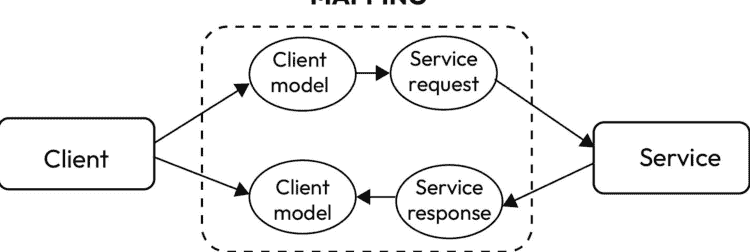

图 6.1 – 客户端请求模型与返回客户端模型之间的映射

编写代码可能非常无聊，而且容易出错。但如果有一个工具可以以极小的努力完成这一切将会呢？幸运的是，市上有有很多这样的工具，而我们的首选是 MapStruct。

MapStruct 是一个基于 Java 的开源代码生成库，它简化了 Java Bean (POJOs) 之间的映射过程。它专门为对象映射而设计，消除了手动编写此类代码的需要，而手动编写既耗时又容易出错。MapStruct 的主要目的是提供一种简单且高效的方法，在不同的 Java Bean 类之间转换数据。

MapStruct 作为一个注解处理器，它被无缝集成到编译器中，使其能够与 Maven 和 Gradle 等命令行构建工具兼容，并且同样适用于在 IDE 中使用。虽然 MapStruct 为映射提供了合理的默认值，但它也允许你在需要时配置和实现特定的行为，在赋予你灵活性的同时不会施加僵性的限制。

让我们来看看 MapStruct 是如何工作的。假设你有以下几个类：

```java
public class Person {
    private String name;
    private String surname;
    private Integer age;
    // getters and setters...
}

public class PersonDTO {
    private String name;
    private String lastName;
    private LocalDate birthDate;
    // getters and setters...
}
```

我们需要将数据从 `PersonDTO` 实例传输到 `Person` 实例。使用原生 Java 实现，我们需要编写以下代码：

```java
Person person = from(PersonDTO personDTO) {
    if (personDTO == null) {
        return null;
    }
    Person person = new Person();
    person.setName(personDTO.getName());
    person.setLastName(personDTO.getLastName());
    person.setAge(calculateCurrentAge(personDTO.getBirthDate()));
    return person;
}
private Integer calculateCurrentAge(LocalDate birthDate) {
    return Period.between(birthDate, LocalDate.now()).getYears();
}
```

对于仅仅三个字段来说，这些代码太太多了；它们既无聊又耗时且容易出错。

使用 MapStruct，我们可以写一个接口并让它发挥魔法：

```java
@Mapper
public interface PersonMapper {
    PersonMapper INSTANCE = Mappers.getMapper(PersonMapper.class);
    @Mapping(source="name", target="username")
    Person personDtoToPerson(PersonDto personDto);
}
```

`@Mapper` 注解的存在将该接口指定为映射接口，并触发 MapStruct 处理器在编译过程中介入。在映射方法本身中，你可以自由选择它的名称，它应该接受源对象作为参数并返回目标对象。

为了处理源对象和目标对象中名称不同的属性，你可以使用 `@Mapping` 注解来指定所需的配置。在必要且可行的情况下，MapStruct 会对源对象和目标对象中类型不同的属性进行类型转换。对于枚举，值可能会被转换为字符串。

值得注意的是，单个接口可以处理多个映射方法，每种方法都将由 MapStruct 自动生成实现。你可以通过 `Mappers` 类获取接口实现类的实例。按照惯例，接口包含一个名为 `INSTANCE` 的成员，为客户端提供了访问映射实现的方法。

你可能已经注意到我们缺少了从出生日期到年龄的映射；这无法由 MapStruct 自动完成——这涉及到一些逻辑（从出生日期计算当前年龄）。无论如何，如果我们需要它，我们可以实现特定的映射；同样地，在这种情况下，方法名并不重要，因为 MapStruct 会根据参数和返回类型选择正确的那个：

```java
@Mapper
public interface PersonMapper {
    PersonMapper INSTANCE = Mappers.getMapper(PersonMapper.class);
    @Mapping(source="name", target="username")
    @Mapping(source="birthdate", target="age")
    Person personDtoToPerson(PersonDto personDto);
    default Integer calculateCurrentAge(LocalDate birthDate) {
        return Period.between(birthDate, LocalDate.now()).getYears();
    }
}
```

在方法的自动生成实现中，MapStruct 将选择 `calculateCurrentAge` 方法，因为它接受一个 `LocalDate` 参数并返回一个 `Integer` 值。在 `@Mapping` 注解中也可以指定 Java 表达式和其他内容，但我建议阅读文档以进一步深入了解。

到此，我们已经看到了 MapStruct 是如何工作的，以及它如何通过处理耗时任务来让我们的生活变得轻松。正如我提到的，这些是静态元编程工具——它们直接作用于代码。现在，让我们来看看运行时元编程工具，它们的作用是作用于正在运行的程序。

## 探索运行时元编程工具

**运行时元编程**在程序执行时进行操作。它允许程序在运行时检查并修改自身的代码和数据结构，甚至可以使用如反射、动态代码生成和动态代理等技术。学习运行时元编程工具可以让你动态地操纵和适应运行程序的行为，增强软件内部的灵活性和定制性。

现在，让我们谈谈反射，因为它是运行时元编程中最常用的功能。

## 反射

**反射**是 Java 中的一项特性，允许程序检查自身。它允许程序在运行时检查并修改自身的代码和数据结构，甚至可以使用如反射、动态代码生成和动态代理等技术。学习运行时元编程工具可以让你动态地操纵和适应运行程序的行为，增强软件内部的灵活性和定制性。

现在，让我们谈谈反射，因为它是运行时元编程中最常用的功能。

反射允许你执行以下任务：

- **检查类**：获取有关类、方法和字段的信息。
- **检查对象**：在运行时获取实例的信息。
- **调用方法**：动态调用方法。
- **访问字段**：读取或写入字段值，即使是私有字段。

例如，我们在类中添加以下内容：

```java
public class Person {
    private String name;
    public void greet() {
        System.out.println("Hello " + name);
    }
}

public class ReflectionExample {
    public static void main(String[] args) throws Exception {
        // 获取类
        Class<?> clazz = Class.forName("Person");
        
        // 创建 Person 类的实例
        Object personInstance = clazz.getDeclaredConstructor().newInstance();
        
        // 访问并修改字段
        Field nameField = clazz.getDeclaredField("name");
        nameField.setAccessible(true); // 绕访问控制
        String nameValue = (String) nameField.get(personInstance);
        System.out.println("Original name: " + nameValue);
        
        nameField.set(personInstance, "Bob");
        
        // 调用方法
        Method greetMethod = clazz.getDeclaredMethod("greet");
        greetMethod.invoke(personInstance);
        
        // 验证修改后的名称
        String modifiedName = (String) nameField.get(personInstance);
        System.out.println("Modified name: " + modifiedName);
    }
}
```

在后续关于元编程的章节中，我们觉得有责任向你介绍一些运行时元编程及其最（不）名昭著的衰落——反射（reflection）。让我们思考一下在保持代码整洁方面，反射涉及到哪些内容。

反射与整洁代码有时会相互冲突，因为反射引入了复杂性和潜在的代码可读性问题。然而，当谨慎且周全地使用时，可以以整洁且可维护的方式采用反射。让我们探索反射如何影响代码原则，以及如何在它们之间取得平衡：

- **可读性：** 整洁代码提高了可读性。反射可能会降低代码的可读性，因为它通常涉及将类名和方法名作为字符串处理，这很容易出错并导致代码难以理解。为了缓解这一点，请彻底考虑你对反射的使用，并提供清晰的注释来说明你的意图。
- **可维护性：** 反射会让代码更难维护，因为它绕过了 Java 编译器提供的某些编译时检查。如果你使用反射来访问私有成员或执行正常手段不允许的操作，可能会导致意想不到的行为或维护挑战。你应该考虑替代方案，例如尽可能对代码结构进行必要的更改。
- **简单性：** 整洁代码鼓励简单化。反射作为一项复杂的功能，可能会引入不必要的复杂性。确保你的反射使用是合理的，并且没有在不需要的地方引入复杂性，是至关重要的。
- **一致性：** 整洁代码追求一致性和统一风格。反射可能导致代码不一致，因为程序的不同部分可能会以各种方式访问和操作元素。为了保持一致性，请考虑为你的反射使用建立规范和模式。
- **测试：** 整洁代码强调可测试性。反射会让编写单元测试变得挑战挑战，因为它允许你绕过封装。你可能需要依赖集成测试或 Mock 对象（mock objects），这对于孤立的单元测试来说并不理想。只要可能，优先为易于单元测试而设计代码，而不是过度依赖反射。
- **性能：** 整洁代码应该是高效的。由于其动态性质，反射可能会引入性能开销。在使用反射之前，请对你的代码进行性能分析（profile），并确保性能影响是可以接受的。在对性能敏感的应用中，你可能需要探索替代方法。
- **文档：** 如果代码足够清晰能够自我解释，整洁代码的目标是完全不需要文档。然而，由于反射降低了可读性（我们刚刚提到过这一点），清晰的文档或注释变得变得至关重要。在使用反射时，请考虑提供全面的文档，说明反射代码的用途、预期行为以及相关的潜在风险。

因此，反射是 Java 中一种强大但可能带有危险的功能，应该谨慎节制地使用。权衡反射带来的益处与对代码库增加的复杂性和潜在劣势是至关重要的。如果你决定使用反射，请深思熟虑并详尽记录你的代码，以保持清晰和透明。即使在使用反射时，整洁代码原则也应是首要任务，以确保你的代码库保持可维护性、可读性和高效（尽管值得注意的是，反射经常在许多元编程框架的“底层”中使用）。

现在我们已经学习了什么是元编程（包括静态和运行时类型），让我们针对这些非常强大的工具的优缺点再增加一些考量。

## 权衡元编程的优缺点

元编程和整洁代码是软件开发中的两个核心概念，虽然它们有时看起来是对立的，但在有效使用时，它们也可以和谐共处。元编程的本质涉及在编译或运行时动态地操作或生成代码。它提供了自动化重复任务、创建抽象以及为软件开发引入灵活性的能力。另一方面，整洁代码是一种编码哲学，强调编写易于阅读、理解和维护的代码。它通过有意义的命名、消除冗余、关注型函数以及遵循既定规范来提升代码质量。

元编程可以通过自动化创建重复的代码结构和减少源文件中的杂乱（例如）来辅助生成整洁代码。

此外，它还可以促进隐藏实现细节的抽象的开发，从而产生更整洁、更可维护的代码。

然而，并非所有闪光的都是黄金；你必须确保生成的代码是整洁的并遵循整洁代码原则的。自动化不应导致混乱或晦涩的代码。从这个意义上说，使用具有良好社区和大量文档的知名经过测试的框架可能是明智之举。我们不鼓励重复造轮子；除非是在非常小且有限的情况下，否则你不太可能发现自己需要从零开始进行元编程。

你还必须平衡自动化的优势与代码的可读性及理解性；要理解元编程可能会引入复杂性。我曾一次面对一个返回包含 HTML 网页字符串的 Java 方法！在没有陷入那种沮丧顶峰之前，你的同事们（别忘了你未来的自己）只需付出合理的头痛就能扩展或修改你的软件。我们邀请你与团队讨论每一个元编程选择。避免在代码中过度使用“魔法”（magic），因为这会模糊对底层过程的理解。这种晦涩性可能导致 Bug 的出现或不可预测的性能问题。

如果你必须使用元编程，请详尽地记录复杂的元编程解决方案，提供清晰的解释以协助未来的开发者。提供示例并编写注释；一言之，要仁悲一点。

尽管如此，我们认为整洁代码在测试和调试方面的优势是显著的，特别是在处理如 Lombok 和 MapStruct 等编译时元编程工具时。这种优势的本质在于你不仅拥有更整洁的代码（例如，使用 Lombok 促进了不可变性），而且你的代码更少了。尽可能减少代码应该是你的首要任务之一。

元编程和整洁代码可以和谐共存。将自动化和灵活性的优势与编写整洁代码相结合，可以确保软件项目既高效又具有可持续性。

在讨论元编程的优缺点时，值得提到所谓的“非此发明”（Not-Invented-Here, NIH）综合症。NIH 综合症是指开发团队或个人倾向于创建自己的解决方案，而不是采用现有的解决方案。即使现有解决方案已经成熟、经过了证且易于获取，这种情况也会发生。

NIH 综合症可能会导致许多问题，包括增加开发时间、重复造轮子以及错过了利用更广泛开发社区经验和贡献的机会。它通常被认为是一种反效率的行为，许多软件社区鼓励以更加开放的态度来采用现有解决方案。

- Lombok: 优、坏与争议，作者：Felix Coutinho https://www.linkedin.com/pulse/lombok-good-bad-controversial-felix-coutinho/
- MapStruct 官方网站：https://mapstruct.org/


# 静态分析与动态分析

在通往清洁、健壮且可维护的代码道路上，我们经常需要“查看”一下软件是如何工作以及是如何编写的。在识别出代码味道并进行一些重构步骤（事实上，我们永远不应该停止这样做！）之后，扫描代码以寻找设计缺陷、安全漏洞等问题是非常有用的。

这种分析可以直接在代码上进行——即静态分析；也可以在运行的程序上进行——即（在不进行过多想象的情况下）动态分析。

静态和动态分析工具通过仔细检查代码来识别问题和低效之处。它们的见解为改进提供了基础，而这正是重构发挥作用的地方。

在本章中，我们将讨论以下主题：

- 什么是静态分析？
- 为什么我们需要静态分析？
- 一些静态分析工具
- 什么是动态分析？
- 一些动态分析技术

## 什么是静态分析？

顾名思义，Java 境下（实际上是任何编程语言）的**静态分析**是指在不运行代码的情况下对源代码进行分析的过程。这是一种用于在代码运行或编译之前发现代码问题、潜在漏洞、安全漏洞和其他问题的技术。静态分析工具被用于此目的（我们稍后会详细介绍）。

执行静态分析有很多理由；让我们来看看其中一些。

## 代码错误或不良实践

我们将向你展示的第一个问题看起来可能微不足道，但它是我们扫描代码寻找问题的主要原因——即代码中的问题！哪些问题呢？我们将它们归为“编码错误”这一通用术语——即程序员在编写代码时犯的错误（是的，事实证明程序员也会犯错——无论他们有多丰富的经验，程序员仍然会犯错。但随着经验的增加，他们更有可能承认错误！）。这些错误可能导致各种问题，包括崩溃、意外行为和安全漏洞：

- 当程序尝试访问未初始化的内存位置时，可能会出现空指针解引用，如下所示。这可能导致崩溃和其他意外行为。

```
String text = null;
int length = text.length();
```

**不可达代码**无法被执行。当条件语句中存在错误时（例如无限循环或始终为假的语句），就会发生这种情况。不可达代码并无害，但它可以让更多代码变得难以阅读和维护。通常情况下，它是没用的，我们不使用无用的代码（除非你的薪水随着代码行数的增加而增加，但我们认为情况并非如此）。这里是一个例子：

```
public void unreachableExample() {
    boolean condition = someBooleanMethod();
    if (condition) {
        System.out.println("Condition is true.");
        return;
    }
    System.out.println("This line of code is unreachable.");
}
private static boolean someBooleanMethod() {
    return true;
}
```

在这个示例中，`someBooleanMethod()` 始终返回 `true`（想象一下不可达代码实现了某些逻辑，而不仅仅是这个语句）。这段代码可以编译，但第二个 `System.out` 永远不会被执行。你必须重构你的代码：如果是这种情况，请修复布尔方法，或者直接删除该条件。

另一方面，**类异常**是 Java 中的运行时异常，当你尝试转换一个与对象实际类型不兼容的对象时会发生。当你试图将一个对象转换为它不是的类型时，就会导致异常：

```
public void classMismatchExample() {
    Object i = new Object();
    String s = (String) i; //这会抛出异常
    System.out.println(s);
}
```

这是一个通常在写代码时由 IDE 检测到的简单问题，但尽管如此，这仍然是静态分析的例子。某些静态分析还可以检测不良实践；其中最常见的是实现了类的 `compareTo()` 方法但随后使用了 `equals()`。当你实现 `compareTo()` 方法时，确保重写了 `equals()` 方法是非常重要的。这确保了该类对象在排序和相等性改变的一致性：

```
Person person = new Person();
Person anotherPerson = new Person();
if(person.equals(anotherPerson)) {
    System.out.println("They're equal");
} else {
    System.out.println("They're not equal");
}
if (person.compareTo(anotherPerson) == 0) {
    System.out.println("They're equal");
} else {
    System.out.println("They're not equal");
}
```

该方法的结果可能不是我们想要的：

**They're not equal** **They're equal**

那是因为 `Person` 类中没有正确实现 `equals()` 方法，而我们使用的是来自 `Object` 的方法。如果我们的类实现了 `Comparable`，它就不是：

```
@Override
public boolean equals(Object o) {
    if (this == o) return true;
    if (o == null || getClass() != o.getClass()) return false;
    Person person = (Person) o;
    return age == person.age;
}

@Override
public int compareTo(Person other) {
    return Integer.compare(this.age, other.age);
}
```

## 安全

静态分析对于安全至关重要。通过彻底检查代码，它可以定位用户提供的数据可能被包含或使用的位置。这里是一些显著益处：

- **缓解 XSS**：静态分析能够有效地识别可能导致 XSS 攻击的代码模式。
- **缓解注入攻击**：静态分析能够有效地识别可能导致注入攻击的代码模式。
- **库和组件漏洞扫描**：我们可以将分析扩展到库和组件。我们经常扫描库中的已知漏洞。自动化工具可以识别易受攻击组件，确保软件依赖最新的代码。
- **早期检测和预防**：静态分析的主要优势之一是在开发早期检测漏洞。这种早期检测至关重要，因为在后期（如测试或生产）解决安全问题可能昂贵得多且具有破坏性。静态分析使团队能够在编写代码时解决漏洞，减少安全问题进入最终产品的概率。通过从根源解决这些漏洞，组织可以减少安全漏洞的风险和成本。

## 圈复杂度

静态分析还可以用于计算并控制代码的圈复杂度。让我们尝试理解它是什么。简单来说，**圈复杂度是**统计遍历代码的不同方式。如果路径越少且不那么复杂，圈复杂度越低，代码越容易阅读和理解。

为了降低圈复杂度，你“只需要”编写整洁的代码，但应用我们在之前的章节中提供的建议并移除你得到的代码味道。静态分析可以帮助你检测过长、重复或死代码（即运行时从未使用的代码）方法或函数；它还可以帮助减少决策结构（这是一件大事：尽可能在你的代码中减少 `if` 语句以降低复杂度）。

我们不会深入讨论此，但我们认为了解如何计算简单方法的圈复杂度通常是非常有趣的。让我们假设你有如下代码：

```
public int calculateSum(int a, int b) {
    if (a > 0) {
        return a + b;
    } else {
        return a - b;
    }
}
```

你可以使用控制流图为软件程序中的函数、模块、方法或类计算圈复杂度。为这个绘制控制流图将会更容易。

`calculateSum()` 方法将用于解释什么是控制流图。它代表了程序执行的所有可能路径，看起来类似于图所示：

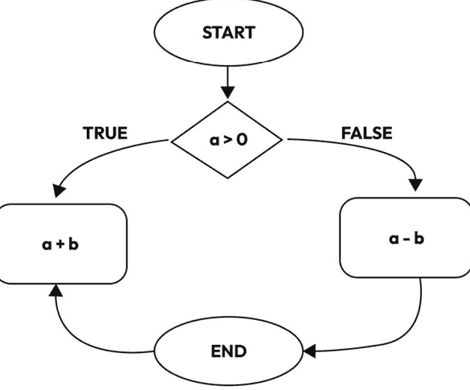

之前的图表示了 `calculateSum()` 方法的控制流图。我们可以看到一个 START 节点，从那里开始条边指向条件节点；根据条件（TRUE 或 FALSE），流会通过一条边或另一条边（a+b 或 a-b）。它们都结束于 END 节点。

要计算圈复杂度，有一个简单的公式：M = E - N + 2。在这里，我们有以下参数：

- M 代表圈复杂度
- E 是控制流图中的边数
- N 是控制流图中的节点数

在我们的情况下，M = 5 - 5 + 2 = 2。

通常情况下，圈复杂度超过 11 的代码被认为过于复杂，并会给测试和维护带来挑战。

以下是静态分析工具常用的常用圈复杂度值：

- 1-4：低复杂度 – 相对容易测试
- 5-7：中等复杂度 – 可管理
- 8-10：高复杂度 – 表明需要重构以提高可测试性
- 11及以上：极复杂 – 测试极具挑战

代码的复杂度也会影响其可测试性。复杂度越高，创建全面的测试就越困难。圈复杂度值表示实现 100% 分支覆盖所需的测试用例数量。

## 异常（不当）处理

Java 程序中的异常并不总是得到应有的对待；由于处理不当导致的缺陷非常常见，而且往往被低估。在 Java 中正确处理异常对于防止程序崩溃、维护完整性、提供更好的用户体验、增强调试、提高安全性以及维护代码质量至关重要。适当处理异常可以帮助你从错误中优雅地恢复，并在时满足监管要求。

静态分析工具可以帮助你检测一些常见的异常处理不当；我们将看到其中一些。

考虑以下代码片段：

```
Person person = null;
try {
    String name = person.getName(); //throws NPE
} finally {
    throw new IOException();
}
```

如你所见，`IOException` 在 **finally** 块中被抛出；通常，在 **finally** 块中抛出异常被认为是不好的，因为它可能会隐藏 **try** 块中的其他异常。在这种情况下，预期的输出将是 `NullPointerException`。

此外，在 **finally** 块中使用 **return** 语句会引入混乱。这条规则的重要性在于，当代码抛出异常时，**return** 语句可能会丢弃它。让我们通过稍微修改上面的代码片段来看：

```
Person person = null;
try {
    String name = person.getName(); //throws NPE
    return;
} finally {
    // 假设此处有 return 语句
}
```

`NullPointerException` 被抛出了，但包含 **return** 语句的 **finally** 块直接被掩盖了。什么都没有发生。

我们将看到的最后一种异常处理是当我们在 **finally** 块内部且某些操作失败时。如果对流上调用 `close()`，并且之后还有其他指令要执行，会发生什么？这些指令将不会被执行：

```
public static void copyFiles(String sourceFileName, String destFileName) {
    InputStream inputStream = null;
    OutputStream outputStream = null;
    try {
        inputStream = Files.newInputStream(Paths.get(sourceFileName));
        outputStream = Files.newOutputStream(Paths.get(destFileName));
        copy(inputStream, outputStream);
    } catch (IOException e) {
        // handling exception
    } finally {
        try {
            inputStream.close();
            outputStream.close();
        } catch (IOException e) {
            throw new RuntimeException(e);
        }
    }
}
```

`copyFiles()` 方法将一个文件复制到另一个（为了简洁，我们省略了内部复制方法），打开了两个流（**inputStream** 和 **outputStream**）。如你所见，在 **finally** 块中，两个流在 **try** 块中被关闭；如果第一个失败，另一个将保持打开。

现在我们已经知道了我们在执行静态代码分析时在寻找什么，让我们了解一些可以帮助我们的工具。像往常一样，将接下来的功能视为加深你知识的建议，以便你每天提高代码质量。

## 自动化静态分析工具

自动化静态分析工具（如 `SonarQube`、`Checkstyle`、`FindBugs` 和 `PMD`）在软件开发过程中起着至关重要的作用，帮助开发者维护代码质量、识别潜在问题并遵循编码标准。这些工具对于确保软件项目不仅在功能上正确，而且具有可维护性和健壮性非常有效。

## SonarQube 和 SonarLint

**SonarQube** 是一个用于持续代码检查的全面工具。它的主要功能是自动分析代码，找出潜在问题，如 Bug、安全漏洞和代码气味。通过无缝集成到**持续集成和持续部署 (CI/CD)** 流水线中，`SonarQube` 确保每次构建都对代码质量进行深度检查。这个过程包括识别并关注可能需要改进或注意的区域。

`SonarQube` 的显著特性之一是它的历史分析。**SonarQube** 和 **SonarLint** 经常在一起，就像**蝙蝠侠**和**罗宾**一样。`SonarLint` 是一个轻量的 IDE 扩展，在开发者编写代码时提供即时反馈。通过与流行的 IDE 集成，`SonarLint` 成为开发环境的一部分。

从本质上说，`SonarQube` 和 `SonarLint` 协同工作，建立起一个用于维护和增强代码质量的健壮系统。`SonarQube` 提供集中的分析，而 `SonarLint` 将分析直接带到开发者环境中，使他们能够主动解决问题。

## Checkstyle

`Checkstyle` 是一个用于强制 Java 代码编码标准和规范的开源工具。它根据一组规则检查源代码并报告违规情况。`Checkstyle` 是高度可配置的，允许开发团队自定义并执行自己的编码标准。`Checkstyle` 的关键特性如下：

- 自定义规则：`Checkstyle` 允许你定义自己的编码规则，或使用基于 Sun Code Conventions、Google Style 等规则集。你可以定义缩进、行长度、变量命名、导入等规则。
- 集成：`Checkstyle` 可以集成到流行的 IDE 和构建系统中，使开发者能够无缝将代码检查纳入开发工作流。
- 持续集成：它通常集成到持续集成 (CI) 流水线中，确保每次提交代码时都会进行代码质量检查。
- 报告生成：`Checkstyle` 生成详细报告，便于开发者识别和发现代码违规。

## FindBugs

`FindBugs` 是一种识别 Java 代码中 Bug 和潜在安全漏洞的静态分析工具。它通过静态分析字节码来检测问题，这对于发现从源码中可能难以发现的问题非常有价值。`FindBugs` 的一些关键特性包括：

- Bug 检测：它旨在发现广泛的 Bug，包括空指针解引用、线程同步问题和性能瓶颈。
- 集成：像 `Checkstyle` 一样，`FindBugs` 可以集成到各种开发环境和 CI/CD 流水线中。
- 用户定义检查：开发者可以针对特定项目的问题创建自定义错误检测器。
- 社区支持：`FindBugs` 拥有一个活跃的社区来维护和更新该工具，确保其保持相关性和有效性。

`FindBugs` 通过查看字节码来审查您的代码——这意味着不需要访问源代码。但由于它的分析并不总是完美的，`FindBugs` 有时会发出并非真实的警告。`FindBugs` 报告的这些虚假警告的比例低于 50%。

## PMD

`PMD` 是一种针对多种编程语言（包括 Java）的静态源码分析器。它专注于代码质量，并识别潜在问题、冗余代码和复杂的代码模式。`PMD` 提供了以下核心特性：

- 多语言：它支持多种语言而不仅仅是 Java，使其对于具有多样化代码库的项目非常通用。
- 基于规则的分析：它根据一组预定义的规则对代码进行分析，这些规则可以根据项目需求进行自定义。
- 代码重复检测：`PMD` 可以检测重复的代码片段，帮助开发者维护更整洁、更易维护的代码。
- 集成：`PMD` 可以集成到不同的 IDE 和构建系统中（`PMD` 为 Visual Studio Code 提供了扩展，为在该流行的 IDE 中工作的开发者提供了便利）。

在编写代码的地方（IDE）以及在我们工作时监控代码的系统（CI 流水线）中，使用检查代码错误的工具是非常重要的。这些工具帮助我们尽早发现错误，非常有帮助。

在我们的编写环境（IDE）中，这些工具帮助我们在编写代码时发现问题，减少了错误在后期出现的概率。

在我们的监控系统（CI 流水线）中，这些工具确保我们编写的代码遵循我们设定的规则和标准。这保持了代码的高质量，并确保我们不会意外破坏正在运行的功能。

这些工具的伟大之处之一是，它们确保团队中的每个人都遵循相同的规则。这有助于我们的代码更有组织、更容易理解，并且通常表现更好。这些工具还为我们节省了金钱。它们帮助我们尽早发现并修复问题，这比等到后期问题变得难以解决时再处理要便宜且更快。

归结底，使用这些工具让我们的代码更好，帮助我们更轻松地协作，并保持代码安全且免受错误影响。

在此，我们快速回顾了静态分析，重点关注查看什么以及如何查看。遗憾的是，仅靠静态分析是不够的。整洁的代码是一回事——高效的代码是另一回事。在代码运行时对其分析是绝对必要的。

## 什么是动态分析？

静态分析是在代码上进行的，而它的补充版本——**动态分析**是在程序运行期间进行的。这种方法涉及在执行期间分析代码，而不仅仅是检查源代码，或进行不执行代码而检查代码的静态分析。动态分析提供了关于程序在真实场景中行为的见解，并识别出可能通过静态分析无法发现的问题。


如果你做过一些单元测试或调试，那么你已经在进行某种动态分析了。但还有很多工作要做。动态程序分析收集关于程序行为的多样化见解，包括变量赋值、函数调用的顺序和时机、数据结构的操作和修改、内存分配和使用、系统资源的利用以及遇到错误的检测。这些信息对于漏洞和安全漏洞识别、程序性能增强、验证程序是否符合需求以及更深入地理解程序的运行原理等目的至关重要。

动态程序分析有很多例子；让我们开始旅程。

## 调试

尽管看起来微不足道，但`调试`是动态程序分析应用最广泛的技术；它是我们行业中执行的最简单的活动——是的，显然比编写代码或设计架构要得多。而且，我们知道通过在测试中实施一些良好的习惯（例如`测试驱动开发 (TDD)`），调试的需求应该降最低，理想情况下为零，但在现实世界中这并不总是可能的。

由于这是一项流行的活动，我们不会在调试上花费太多时间。然而，我想引起人们对某些可能某些方面的关注，特别是在职业生涯的初期。

为了进行有效的调试，首先要重现 bug；根据经验，这是一个可能困难的阶段，有时比解决本身还要困难。它涉及到必须解释你对那个 bug 做了什么（如果你还没有注意到它），并重现产生问题的相同输入，或者至少是相同类型的输入。你甚至不能保证可以使用调试器；例如，如果你在可以使用调试器的环境（例如你的本地主机）中无法重现问题，你将需要使用其他技术，如日志记录。通过在关键点记录程序的状态，你可以更轻松地追踪错误源头。正如我们所知道的——这也是整本书的核心目标——重构可以帮助你调试。有时，它看起来可能像个游戏，但重构你的代码并使其更整洁可能会帮助你理解正在发生什么。

尽管调试被广泛用作一种技术，但我必须指出，大叫和撞击键盘不能修复 bug；另一方面，不要犹豫于寻求帮助。这可能是一件极其困难的事情。

## 性能分析 (Profiling)

即使是最技术高明的开发团队也可能发现几行代码从一开始就没有达到巅峰性能。为了发现提高代码速度的最有效方法，必须对其进行评估、调试和审查。

软件工程师（以及质量保证人员）可能会采取一些步骤来确保他们的代码尽可能快速、流畅且无缺陷。

`性能分析 (Profiling)` 是衡量和分析程序运行时行为和性能特征的过程。性能分析的主要目标是识别瓶颈、问题和优化空间。这对于提高程序的效率和速度至关重要。性能分析适用于各种类型的软件，包括桌面应用程序、Web应用程序和服务器软件。

有很多不同的性能分析工具，它们可以用于收集多种类型的数据，如下：

- CPU 使用率：这些数据显示程序使用了多少时间
- 内存使用率：这些数据显示程序使用了多少内存
- 函数调用频率：这些数据显示程序中每个函数被调用的次数
- 函数执行时间：这些数据显示程序中每个函数执行需要的时间
- 资源使用情况：这些数据显示程序使用了哪些资源，例如磁盘 I/O 和网络带宽

一旦收集了性能分析数据，就可以对其进行分析以识别瓶颈。瓶颈是减慢程序的部分。例如，一个经常被调用且执行时间很长的函数可能就是一个瓶颈。一旦识别出瓶颈，可以通过优化代码来修复它们。例如，可以重写瓶颈函数以使其更高效。性能分析是提高软件性能的价值工具。它可以用于识别和修复瓶颈，并确保程序高效地利用系统资源。

性能分析在各个领域都有实际应用。例如，Web 应用程序开发者可以使用性能分析工具来识别应用程序中的性能瓶颈，从而优化代码以加快加载速度。同样，游戏开发者使用性能分析工具通过识别和优化游戏的问题部分来提高帧率。服务器管理员也利用性能分析器可以精确定资源密集型进程，使其能够减少服务器的资源负担。

许多工具被用于对运行中的 Java 应用程序进行分析。有时，它们包含在 IDE 的插件/扩展中，例如 NetBeans 或 Eclipse。最常用且常见的工具之一是 VisualVM，它是一个集成在 Java 开发工具包 (JDK) 中的可视化工具，提供了广泛的性能分析、监控和诊断功能，包括 CPU 分析析、内存分析和线程分析。

VisualVM 为监控和分析 Java 应用程序提供了一个用户友好的图形界面。它提供了丰富的视觉化数据和性能指标，使得识别和解决性能问题变得容易。VisualVM 的核心特性之一是它的 Java 性能分析能力。它允许开发者对应用程序进行性能分析，以识别瓶颈、内存泄漏和其他与性能相关的问题。你可以执行 CPU 分析析、线程分析和内存分析，这些对于提高 Java 应用程序的效率和可靠性至关重要。

当你的应用程序开始“发疯”而你不知道到底发生了什么时（例如，一切都变慢了），最佳选择之一（同时也是最绝望的选择）是所谓的“堆转储”（heap dump）或“内存转储”（memory dump）。内存转储本质上是计算机内存（RAM）内容在给定时间点的状态快照。该快照捕捉了创建时一刻系统或应用程序的状态。内存转储有多种用途，包括调试软件错误和崩溃、分析安全事件和恶意软件感染、调查系统崩溃以及优化应用程序中的内存使用。它们有不同的类型，例如完全内存转储（针对硬件相关问题）、内核内存转储（针对操作系统问题）、进程转储（针对特定应用程序调试）和微转储（针对更小且更于管理的数据）。内存转储分析对于洞察系统和软件行为至关重要，是解决各种计算问题的必用工具。

VisualVM（与其他性能分析工具一样）允许你捕获堆转储和线程转储，这些对于诊断内存相关问题和分析 Java 应用程序中的线程行为至关重要。

## 模糊测试 (Fuzzing)

模糊测试（Fuzzing），也称为模糊测试，是一种自动化软件测试方法，通过向计算机程序提供非传统的、通常是随机且无效的数据作为输入。密切监控程序的响应，以发现异常情况，如崩溃、违反内置代码规则或潜在的内存问题。模糊器通常用于评估运行在结构化输入上的软件程序，例如文件格式或区分有效和无效数据的协议。

一个好的模糊器会生成部分有效的输入，这些输入“足够有效”以避免被输入解析器直接拒绝，但“足够无效”以揭示意外之外的程序行为，特别是在可能未被充分处理的边界情况中。

在安全语境下，模糊测试最有价值的输入通常是跨越信任边界的数据。信任边界是数据或程序执行在不同信任级别之间切换的点，或者是数据与具有不同权限的实体交换的点。信任边界可以在系统的特定位置找到，那里所有子系统及其数据具有相同的信任度。例如，当应用程序提升权限（如获取 root 访问）时会发生执行边界。数据信任边界发生在数据源于不可信源（如用户输入或网络套接字）时。跨越信任边界的代码比处理任何用户可访问或仅限特权用户访问的配置文件的代码更为关键。

每个模糊器都可以分为两类之一：

- **基于变异的模糊器 (Mutation-based fuzzers)**：这些模糊器使用现有的数据样本并进行更改创建新的测试用例。它们获取初始输入或测试用例，并以各种方式对其进行修改（例如更改随机位或值），以查看修改是否会触发被测试软件的意外行为或漏洞。基于变异的模糊器擅长发现类型的 bug 或漏洞，特别是当它们拥有一组初始有效输入可供工作时。
- **基于生成的模糊器 (Generation-based fuzzers)**：这些模糊器通过理解目标协议或文件格式的结构和规则来构建测试用例。它们不是修改现有的数据样本，而是生成符合测试所需的特定格式和逻辑的新数据。这些模糊器擅长探索程序或系统的不同方面，因为它们可以根据对协议或文件格式的知识创建广泛的测试用例。

现在，我们将深入探讨这两组中的子类别。目前还没有通认的模糊测试分类列表，但我喜欢书籍 `Fuzzing: Brute Force Vulnerability Discovery`（参见延伸阅读）中的方法，因此我会尝试总结它们。

### 预生成测试用例 (Pre-generated test cases)

如前所述，`预生成测试用例`方法涉及理解支持的数据结构和可接受的值范围。然后将测试用例被制成硬编码的数据包或文件，旨在测试边界条件或挑战规范本身。这些测试用例对于评估规范在各种系统上的实现准确性非常有价值。虽然这种方法在测试用例的创建上需要大量的前期工作，但它的优势在于可以在同一协议或文件格式的多个实现之间重复使用。然而，局限性在于模糊测试是有限的，因为没有随机元素；一旦测试用例列表耗尽，测试就会结束。

### 随机 (Random)

`随机方法`是最简单但有效的方法。它涉及向目标投掷伪随机数据并期待最好的（或最坏，取决于你的观点）。惊讶的是，关键软件中的漏洞已通过这种技术发现。挑战性部分在于从大量的随机字节中识别异常或服务器崩溃的原因。使用嗅探器捕获流量对于调试至关重要，通常需要在调试器和反汇编器中花费大量时间。调试栈溢（stack smashing）可能特别麻烦。

### 手动协议变异 (Manual protocol mutation)

手动变异测试比随机模糊还要不复杂。它不涉及自动化模糊器；而是由测试人员测试目标。通过向目标输入不当的数据，目标是使之崩溃或引发意外行为。这是一种直接且成本效益的方法，通常应用于 Web 应用程序，允许分析人员在审计期间依靠经验和直觉。我们认为这种方法有时被称为可用性测试，尽管可用性测试不同。如果你对可用性测试感兴趣，请查看延伸阅读部分。

### 变异或暴力测试 (Mutation or brute-force testing)

暴力测试涉及获取协议或格式的有效样本，并持续修改数据包内的每个字节、字或字符串。虽然这种方法所需投入很少且相对容易实现，但它并不方便，因为它会在无法解析的数据上浪费 CPU 周期。尽管如此，它可以完全自动化，并依赖良好的数据包或文件集合。格式模糊器的示例包括 Windows 的 FileFuzz 和 Linux 的 SPIKE。

### 自动协议生成测试 (Automatic protocol generation testing)

在自动协议生成中，测试人员研究并理解协议规范或文件定义。不是创建硬编码的测试用例，而是开发一种描述协议的语法。在数据包或文件中识别出静态和可模糊变量。模糊器通过查看模板、创建模糊数据并将更改后的数据发送到目标来工作。这种方法的成功取决于测试人员发现解析过程中可能导致问题的部分的技巧。示例是 SPIKE 和 SPIKEfile。然而，这种方法需要预先花费时间创建语法或定义。

### 符号执行 (Symbolic execution)

符号执行是一种程序分析方法，使用符号输入而非具体输入来运行程序。同时，它保留一个路径条件（例如通过圈复杂度来学习什么是路径），该条件每次遇到分支指令时都会演变，封装了通往程序特定点的输入约束。换句话说，它通过将数据替换为符号值来工作。这样，程序的输出被表示为这些符号输入的函数。

为了创建测试，该方法依赖于使用约束求解器来解决收集到的约束。

符号执行对于寻找 bug 也很有用，因为它会在程序运行时检查其是否存在错误或断言违例，并寻找能够触发这些问题的的测试输入。

它也被视为白盒模糊测试（white-box fuzzing）的一个示例，因为你正在进行模糊测试（上一节的内容），但你了解程序是如何运行的（是的，也了解代码——这也是静态和动态分析中的内容）。

考虑下面这个 Java 方法：

```java
void doSomething() {
    int x = getInput();
    int z = x + 2;
    if (z > 20) {
        throw new RuntimeException();
    } else {
        System.out.println("OK");
    }
}
```

这个方法确实做了某些事情，所以它的名字名不虚假，但它并没有做任何有意义的事情。它是解释符号执行如何在该方法上工作的一种手段。

在常规执行（通常称为“具体”执行）中，程序的运行方式如下：它读取一个特定值（例如 10），并将该值赋值给变量 `x`。随后，程序执行加法运算（`x = x + 2`）和条件分支，在这种情况下会导致评估结果为假并退出。

在符号执行期间，程序的运行方式有所不同。它读取一个由符号（如 λ）表示的符号值，并将该符号赋值给变量 `x`。程序继续执行法运算，将 `z` 设置为 `λ+2`。当它遇到 `if` 语句时，它将条件评估为 `λ+20`。在这个阶段，符号 `λ` 可以取任何值，符号执行通过“分叉”（forking）分裂成两条不同的路径。每条路径都包含分支点的程序状态以及路径条件。

在这个示例中，一条路径与 `λ+2 > 20` 路径条件相关，导致 `if` 分支的执行；而另一条路径与 `λ<20` 路径条件相关，导致 `else` 分支的执行。两条路径都可以独立地执行。

当路径到达终点时（这可能是由于异常——例如抛出 `RuntimeException`——或程序终止），符号执行通过求解每个被探索路径的路径约束，为 `λ` 输出一个特定值。这些特定值可以被认为是真实世界的测试用例，对于 bug 重现等任务可能非常有用。在这种特定情况下，约束求解器将确定若要抛出 `RuntimeException`，`λ` 必须大于 18。

我们必须承认，这种技术并没有被广泛使用并且存在若干缺点。例如，正如你很容易猜到的那样，程序的圈复杂度越高，符号执行的复杂度就越大；这种技术无法随着程序复杂性的增加而扩展。此外，这种分析技术的效率在很大程度上取决于程序本身的效率。还有其他一些矛盾，我邀请你在“延伸阅读”部分中进行观察。

## 污染跟踪 (Taint tracking)

污染跟踪（Taint tracking），通常称为信息流跟踪或数据流跟踪，是一种用于计算机安全和软件分析的技术，用于监控程序或系统内部的数据流，以识别潜在的安全漏洞。污染跟踪的工作原理是：如果数据来自不可信的源（例如用户输入或来自互联网的文件），则将其标记为“受污染”（tainted）。污染跟踪器跟踪受污染数据在程序中的流向，以识别任何可能导致安全漏洞的操作。受污染的数据可以包括密码、个人信息或任何不应被未经授权的用户暴露或操作的数据。

以下是污染跟踪通常的工作方式：

1. 数据标记：当数据源自外部源（如用户输入）时，污染跟踪系统会将某些数据标记为“污染”或“不可信”。例如，如果用户提供了密码作为输入，该密码数据就会被标记为受污染。
2. 数据流监控：系统监控受污染数据如何在程序中流动。它跟踪受污染数据与哪些变量、函数和组件交互。
3. 违例检测：污染跟踪机制持续检查受污染数据是否以破坏安全的方式使用。例如，如果受污染数据被用于数据库查询、发送到网络或
4. 告报生成：当检测到潜在的安全违例时，系统可以生成告报、记录事件或采取其他预定义的措施来缓解风险。

## 输入 输出


1.  
2.  
3. 受污染输入  
4.  
5.  

在符号执行期间，程序的运行方式有所不同……（此处省略）……例如，污染跟踪器可以被用于……

## 注入——什么是 SQL 注入？

SQL 注入是一种常见且危险的攻击，攻击者可以在程序的数据库查询中注入恶意 SQL 代码。这允许攻击者读取或修改数据库数据，或在服务器上执行任意代码。

假设你有以下代码：

```sql
SELECT * FROM users WHERE username = '' OR '1'='1'
```

`'1'='1'` 条件始终为真，因此查询实际上选取了表中的所有行。攻击者可以通过输入：

```sql
SELECT * FROM users WHERE username = '' OR '1'='1'
```

为了防止 SQL 注入，你应该使用 Java 数据库连接（JDBC） 提供的参数化查询或预编译语句。你可以这样重写脆弱的代码：

```java
String userInput = getUserInput();
String searchQuery = "SELECT * FROM users WHERE username = ?";
PreparedStatement statement = connection.prepareStatement(searchQuery);
statement.setString(1, userInput);
ResultSet resultSet = statement.executeQuery();
```

在这个示例中，使用 `PreparedStatement` 创建参数化查询，其中 `?` 是用户输入的占位符。随后通过 `setString` 将用户输入设置为参数（注意这里没有涉及引号和字符串拼接）。

在本章中，我们为编写和维护整洁代码以及高效软件添加了另一个工具：代码分析。我们了解到可以通过两种方式进行分析：在程序运行前检查代码（静态），以及在程序运行时监控代码（动态）。我们尝试确定了每种分析应该关注哪些问题，并发现了一些可以提供帮助的工具和技术。

与我们之前涵盖的内容类似，本章旨在为你提供更深层次的思路。代码分析通常被视为额外工作，一个可选的步骤，但它是使项目高效且易于维护的关键部分。所以，千万不要低估它的重要性！

除了分析和改进工作的时间外，在日常任务中保持某种水平的质量也关重要。通过使用一些简单但有效的方法，投入极少且针对针对精力就能产生巨大的影响。在下一章中，我们将探索其中的一些方法。

## 延伸阅读

- 圈复杂度：https://www.geeksforgeeks.org/cyclomatic-complexity/
- SonarQube 文档：https://docs.sonource.com/sonararqu/latest/
- PMD 文档：https://pmd.github.io/pmd/index.html
- FindBugs 手册：https://findbugs.sourceforge.net/manual/index.html
- CheckStyle 简介：https://www.baeldung.com/checkstyle-java
- VisualVM 入门：https://visualvm.github.io/gettingstarted.html
- M. Sutton, A. Greene, and P. Amini, *Fuzzing: Brute Force Vulnerability Discovery*, Addison-Wesley Professional
- 走廊可用性测试：https://www.techopedia.com/definition/30678/hallway-usability-testing
- 符号执行的局限性：https://en.wikipedia.org/wiki/Symbolic_execution#Limitation


- 编程语言中的污点检查：https://en.wikipedia.org/wiki/Taint_checking

## 第3部分：进阶学习

除了重构本身之外，在日常工作中保持某种水平的质量也至关重要。有一些小而强大的方法可以实现这一目标，只需投入少量的专注精力就能产生巨大影响。我们将讨论诸如如何格式化代码、管理代码版本，以及通过结对编程等技术与他人协作。

在我们涵盖了关于修复类和包的所有知识后，让我们放眼全局看看整体：架构。即使你的代码写得很好，如果不同部分之间的交互方式没有良好的管理，也会出现问题。我们将讨论需要关注的迹象以及采取什么措施来保持一切运行顺利。

本部分包含以下章节：

- 第 8 章：每日打造质量
- 第 9 章：超越代码——精通软件架构

# 第 8 章：每日打造质量

在努力为你保持代码整洁和设计清晰方面提供建议的同时，讨论一些能够帮助你日复一日不断进步的实践也很重要。除了投入特定时间进行重构外，在日常工作中保持一致的质量水平对于软件开发过程的整体健康和效率至关重要。实现这一点不需要大量的时间或精力；小的、针对性的行动就能产生显著差异。通过将我们将描述的实践融入你的日常工作，你不仅可以防止技术债的积累，还能提高代码库的整体质量和维护性。这些努力单看可能看起来很微小，但合在一起，它们对软件项目的长期成功具有实质性影响。

在本章中，我们将涵盖以下主要主题：

- 代码版本控制
- 代码格式化与风格
- 代码审查
- 结对编程
- 文档
- 你为什么要这么做
- 严酷的现实

## 代码版本控制

我对代码版本控制情有偏好，这很奇怪，我明白。这是我毕业后开始工作时必须学会的技能之一。不可思议的是，在我整个计算机科学学习期间，竟然没有人提到过代码版本控制。这让我认为，也许我的学位课程在这方面有所缺失，它说明了代码版本控制对于开发者从第一天起有多重要。

无论如何，让我们进入正题。为了告诉你什么是代码版本控制，我可以这样开头：它是当事情出错时能救你命的东西；我承认这个描述听起来有点笼统，所以我将详细介绍。

版本控制是你文件的时光机。它跟踪你所做的所有更改，以便你需要在需要时可以轻松地跳回任何先前的版本。这个系统通常被称为**版本控制系统**（`VCS`），并且有很多实现方式。通过 `VCS`，你可以让单个文件或整个项目倒流时光，检查事物随时间推移的变化，找出是谁弄乱了引起问题的东西，确定问题是在何时引入的，等等。此外，使用 `VCS` 如果你搞砸了或丢失了文件，你也有安全网可以方便恢复，而且它不会给你的工作流增加复杂性。更改通常用代码标记，通常是“修订号”（`revision number`）、“修订级别”（`revision level`）或简单的“修订”（`revision`）。例如，原始文件集标记为“修订 1”。当第一次更改发生时，它变成“修订 2”，这种模式持续下去。每个修订都带有一个时间戳和做出更改的人员名称。修订可以比较、恢复，在某些情况下，它是管理文件演进的一种强大方式。随着项目复杂性的增加和团队人数的增加，`VCS` 的优势也随之增加。

正如我们已经说过的，`VCS` 对于回滚更改非常有用；遇到麻烦时，你可以恢复你的……

## 图结构

在图论中，将修订想象成从主线生长的树。想象分支从这条主线延伸出来，形成一个形状。修订随时间一个接一个发生，并按特定顺序排列，无论是按修订号还是按创建时间。在最简单的情况下，在没有额外或撤销的情况下，每个修订只连接到上一个。最新版本被称为 `HEAD`。在图论中，如果你将每个修订看作一个点，将修订之间的连接看作一个箭头（通常从旧到新），这种设置构成了一个直线图：


**图 8.1 – 最基本的修订序列**

当分支（即存在不同的路径）出现或我们必须回到较旧的修订时（产生一个依赖于比前一个更旧修订的情况），图变成了一个有向树。在这棵树中，每个点可能有多个后续点。这创建了多个端点，代表没有更改的修订（“每个分支上的最新修订”）。在理论上，树可能没有首选端点（“主”最新修订），通常会选择一个端点作为 `HEAD`。如果新修订基于 `HEAD`，它要么成为新的 `HEAD`，要么开启一个新的分支：


**图 8.2 – 主干分支**

从起点到 `HEAD` 的修订列表（在图论中称为主干或主线）构成了一个简单的直线图。如果一个修订可以基于多个先前的修订（当一个点可以有多个父节点时），它被称为**合并**（`MERGE`）。这是版本控制中最复杂的部分之一。它通常发生在更改发生在不同分支（通常是两个）时，这些更改被合并到一个包含两组更改的分支中。如果这些更改重叠，在没有人工干预或重写的情况下，可能很难或甚至无法合并（这些情况被称为冲突）。

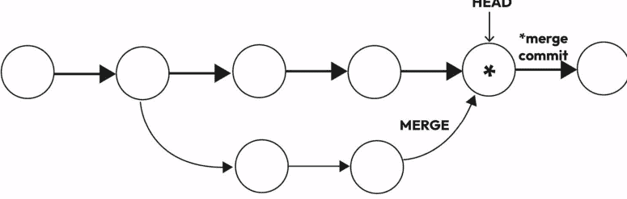

**图 8.3 – 将分支合并到树中（创建一个合并提交）**

当发生合并时，图结构不再是一棵树，因为一个点可以有多个父节点。相反，它变成了一个有根的有向无环图（`DAG`）。这种图“从定义上”没有循环，因为父节点总是存在于过去；它是有根的，因为它有一个由第一个提交提供的起始节点；它是有向的，因为你只能按照给定的方向（我们可以说是时间的方向）进行导航，而永远不能反向操作。如果存在主干，合并分支就像是树的“外部”添加。分支中的更改作为一个包被合并并应用到主干的 `HEAD` 上，创建一个新版本，而不提及分支，并保持树的结构。尽管实际关系是 `DAG`，你仍然可以将其视为一个带有合并的树，而主干本身是一条直线路径。

除了执行 `MERGE`（合并）操作外，代码版本控制系统提供了执行所谓的 `rebase`（变基）的选项。此操作将整个更改分支移动，使其从主分支的最新点开始。它包含了主分支中的所有更改。然而，`rebase` 并没有创建一个 `MERGE` 提交，而是通过为分支中的每个原始提交创建完全全新的提交来重写项目历史。简单来说，它就像是你取整个分支并将其“附”在主分支的末尾：

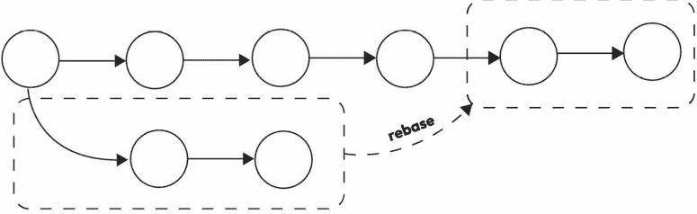

**图 8.4 – Rebase（变基）操作**

`rebase` 有一个巨大的优势，因为它让你的项目历史更加整洁。它通过移除 `git merge` 创建的额外合并提交来实现这一点。此外，`rebase` 创建了完全完全直线的项目历史，允许你从最新的功能到项目最开始的地方追踪开发过程，而没有分叉的路径。

现在我们已经了解了 `VCS` 在总体上如何工作，现在是时候看看三种主要类型以前是如何工作的以及现在是如何工作的了。

## 本地 VCS (Local VCSs)

尽管这种方法非常老旧，但它已经不再使用了，特别是在专业环境中——我甚至没有见过它被使用。然而，作为 `VCS` 的初始示例，值得提到的是，我们可以将其与现代实践进行对比。

在过去，一种常见的版本控制方法涉及将文件复制到单独的目录，有时带有时间戳以进行细致的记录。尽管这种方法简单，但它很容易出错，用户很容易丢失对当前目录的跟踪，并进行无意的修改或覆盖。为了解决这些问题，程序员开发了本地 `VCS`，使用简单的数据库来记录对版本控制下文件所做的更改。

这里是本地 `VCS` 的示例：

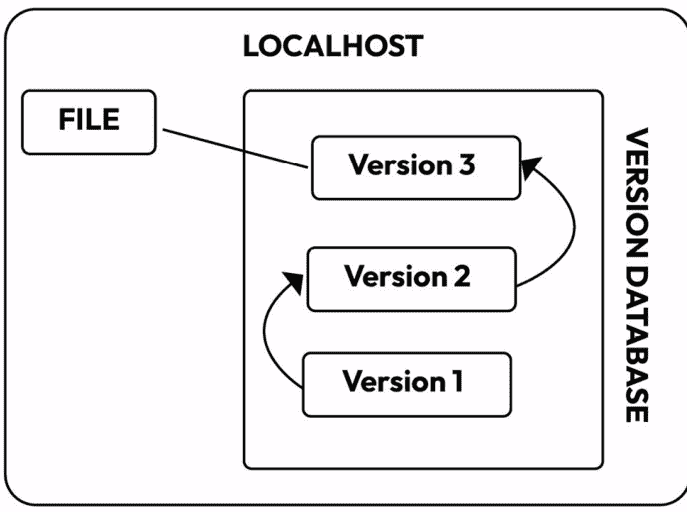

**图 8.5 – 本地 VCS**

这类工具中最流行的之一是 `RCS`，它已经存在很段时间了；它也被分发在 `macOS` 的开发者工具集中。

## 集中式 VCS (Centralized VCSs)

为了解决使用不同系统的开发者之间的协作挑战，创建了集中式版本控制系统（`CVC`），例如 `CVS` 或 `Subversion`。这些系统将所有版本化文件存储在中央服务器上，允许多个用户访问和检索文件：

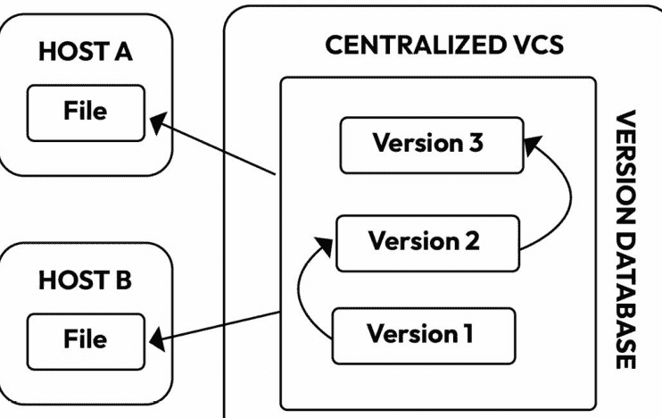

虽然这种方法促进了项目的协调和管理，但它有一个主要的缺点——中央服务器是单点故障。如果它宕机了，协作和文件保存将无法进行，数据丢失将危及整个项目历史。这种局限性导致了今天 `VCS` 的演变。

## 分布式 VCS (Distributed VCSs)

分布式版本控制系统（`DVCS`）是一类 `VCS`，它允许多个用户在项目上工作，并且他们拥有整个项目仓库的本地副本。在分布式 `CVS` 中，每个用户都拥有项目历史的完整副本，可以在其本地副本上独立进行更改。这些更改可以被跟踪、合并并无缝地与他人共享。

最臭名的分布式 `CVS` 系统之一是 `Git`。`Git` 允许开发者离线在项目上工作，向本地仓库提交，并在准备就绪后将更改与中央仓库或其他团队成员的仓库进行同步。这里是一个 `DVCS` 架构图：

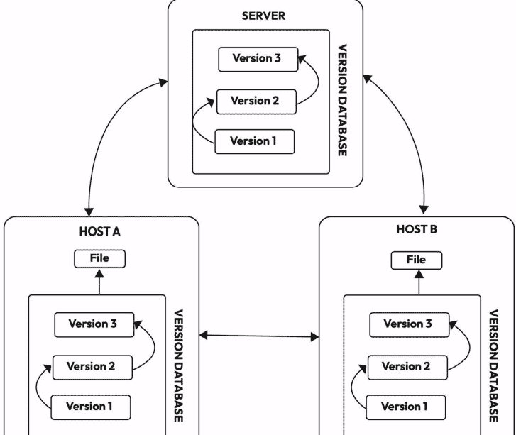

**图 8.7 – 分布式 VCS 架构**

分布式 `CVS` 系统提供了多个优势，例如增加的灵活性、改进的协作以及对地理分布团队项目的更好的处理能力。每个贡献者都有项目历史的完整副本，这提供了冗余并使得数据更难丢失。此外，`DVCS` 系统允许更强大的分支和合并能力，使得管理同一项目上的并发工作变得更容易。

## 分支策略 (Branching strategies)

为了保持代码库的整洁并拥有顺畅的工作流，遵循所谓的**分支策略**（`branching strategy`）是一个好主意。

分支就像是开发者的独立工作区，用于在软件项目中构建新功能或修复问题。我们已经看到分支在完成后可以与主代码合并。

分支策略是软件团队用于编写、合并和部署的计划。它是至关重要的，因为可以在许多开发者同时工作时保持井井有序。如果没有它，当大家尝试添加更改时可能会出现冲突。

通过遵循分支策略，开发者可以一起工作而不产生问题，并更快地发布。这完全取决于一个清晰的更改流程；你当然可以建立自己的模型，但有很多模型多年来取得了成功。

### 主干开发 (Trunk-based development)

主干开发是一种工作方式，所有开发者直接在代码的主部分进行更改，我们将其称为主干（`trunk`）。这是可以直接使用的代码部分。

我们还关注自动化测试，让计算机一直检查代码运行运行良好。这样做是为了确保我们的任何更改在使用之前都经过了测试。

有时，如果一个任务需要很长时间，开发者可能会从主代码创建一个单独分支，进行更改，然后将这些更改带回主部分。这有助于避免影响他人。

下面的图表示了一系列在单个分支上完成的简单提交（由单一线性路径组成的图）：

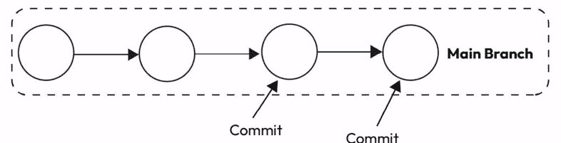

**图 8.8 – 在主干开发中，每个提交都在主分支上完成**

以下是主干分支模型的详细工作原理：

1.  **在主代码中工作**：不再创建单独分支，直接在主（主干）分支上工作。
2.  **进行小型而频繁的更新**：对代码进行小规模且定期的更改。这使得检查更容易并减少了问题的概率。
3.  **使用持续集成（`CI`）**：频繁合并并测试代码以尽早发现问题、防止冲突并保持代码随时可发布。
4.  **经常合并更改**：定期将你的更改合并回主代码库，保持其最新性并降低冲突发生的概率。

乍看之下，这似乎并不糟糕。它有一些优点——例如，它鼓励了团队合作和快速反馈（可能会出现合并冲突或测试失败），有助于尽早发现并快速解决问题，加速新功能的开发，通过让大家都在一个分支上工作来保持代码整洁，并降低了处理多个分支的复杂性。通过测试驱动开发（`TDD`）和持续集成/持续部署（`CI/CD`）流水线，你可以确保你的代码运行正常。在某些情况下，这是一种有效的方法。

但它也有一个巨大的缺点：这种模型不具备扩展性，因为它对于大型团队或复杂项目可能效果并不良好。如果主代码库出现问题，一切都会受到影响。此外，我们需要强大的自动化测试和 `CI`。正如之前提到的，如果满足某些条件（坦白说，这些条件本应该一直具备的），它可以作为一种有效的替代方案。

让我们来看一些稍微不同的东西。

## 特性分支 (Feature branching)

特性分支是一种广泛使用的方法，即为特定的功能或代码更改创建一个新分支。这让开发者可以在不影响 `MAIN` 分支的情况下开发该功能。一旦完成，可以通过拉请求（`pull request`）将其合并回 `MAIN` 分支。

### 什么是拉请求 (PULL REQUEST)？

拉请求是版本控制系统（如 `Git`）中的一种机制，用于对代码库提出更改。该过程通常涉及开发者创建一个分支、进行更改、将更改推送到远程仓库，然后提交一个拉请求供他人评审。拉请求允许团队成员在将建议的更改合并到主代码库之前对其进行讨论、评审和测试，有助于维护软件开发项目中的代码质量和协作。更多信息请参见“后续”部分。

此请求允许其他成员在将功能添加到 `MAIN` 分支之前检查更改并提出调整或增强：

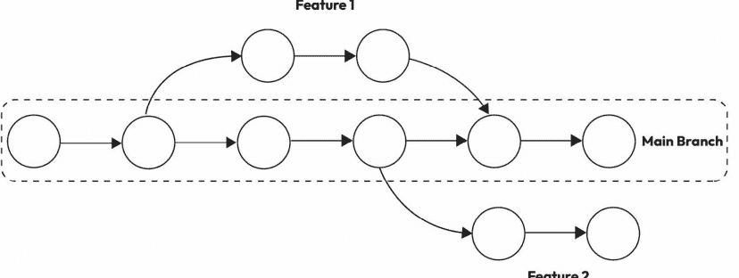

**图 8.9 – 在分支管理中，每个新功能都在专用的分支上开发**

再次，让我们详细查看工作流：

1.  **设置特性分支**：为你正在处理的每个任务创建一个专用分支。这些分支中的每一个都应源于 `MAIN` 分支。
2.  **开发功能**：将你的功能实现在 `Feature` 分支中，并根据需要进行多次提交。此分支必须包含与该特定功能相关的提交，不包含任何其他（当我说“任何”时，我的意思是什么都没有：记住这个更改集将直接进入生产环境——你不希望把事情搞混）。
3.  **发起拉请求**：当你的功能完成、通过了所有测试并且你对此满意时，你可以创建一个拉请求将你的更改合并到 `MAIN` 分支。
4.  **检查并批准**：其他开发者将检查这些更改，他们将给予批准或一些修改意见（基本上，他们可以开始对话）。通过这种方式，可以在代码成为 `MAIN` 分支的一部分之前捕获潜在的问题和错误。
5.  **合并特性分支**：现在你的功能已经实现，且拉请求已经过检查并批准，可以将 `Feature` 分支合并回 `MAIN` 分支。
6.  **清理**：删除 `Feature` 分支。

如你所见，我们增加了让 `MAIN` 分支尽可能保持整洁的复杂度。首要目标是在 `MAIN` 分支上维护稳定版本，同时支持并发开发。通常情况下，代码可以经过良好的组织和测试（在所有测试通过之前，不合并到 `MAIN` 分支）。更改跟踪得到了改进。使用这种策略，我们可以在工作流中插入代码审查（参见下一节）。

另一方面，当我们管理和更新多个分支时，会产生新的挑战，由于评审时间过长，合并更改到 `MAIN` 分支可能会出现延迟。当然，拥有多个分支可能会产生冲突。

现在，让我们来看一种非常流行的分支策略。

## GitFlow

**GitFlow** 是 `Git` 中管理分支的一种方法。它使用了两个持久分支：`MAIN` 和 `DEVELOP`，并在整个过程中使用短生命周期分支，如 `FEATURE`、`RELEASE` 和 `HOTFIX`。这些分支在需要时创建，在完成工作后删除。

`MAIN` 分支持有存储的、即取即用的代码，而 `DEVELOP` 分支是所有活跃开发发生的地方。`FEATURE` 分支用于开发新功能或更改，`RELEASE` 分支用于为新发布做准备，而 `HOTFIX` 分支用于快速修复生产代码中的关键问题。

`GitFlow` 起初有点难理解。在 `MAIN` 分支上，我们有稳定版本，在 `DEVELOP` 分支上，我们有“下一个”版本。每个 `FEATURE` 分支都托管一个正在开发的特定功能：

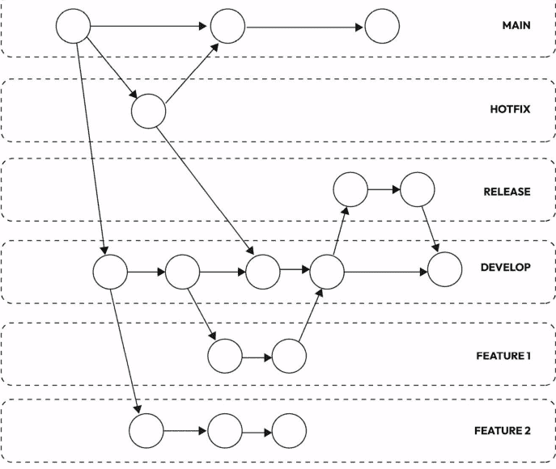

**图 8.10 – GitFlow 架构**

以下是详细的工作流：

1.  在名为 `develop` 的分支上开始工作。使用此分支进行当前的开发；此分支必须从 `main` 分支创建。
2.  其次，当你开始处理新事物（或修复 bug）时，创建 `feature` 分支；这些分支必须从 `develop` 分支创建。
3.  当你完成功能开发后，将其合并到 `develop`。
4.  当需要准备新发布时，从 `develop` 创建 `release` 分支。
5.  当发布准备就绪时，将其合并到 `develop` 和 `main`。
6.  如果生产环境出现关键问题，从 `main` 创建 `hotfix` 分支。
7.  一旦 `hotfix` 完成并经过测试，将其合并到 `develop` 和 `main`。

这种方法为代码管理提供了一种结构化的方式，将正在进行的开发与稳定发布分开。另一方面，它无疑比其他策略更复杂。此外，它可能会导致更多的合并冲突。

总结来说，没有分支模型是完美的。分析你的需求并选择一个；没人说可以使用我们刚刚介绍的模型。

## 最佳实践

尽管这听起来像是一项简单的任务，就像将文件保存到云端以防电脑被盗丢失一样，但管理文件和项目版本是改进项目管理的另一个关键方面。根据经验，不要低估它的重要性。这里有一些我们觉得值得分享的提示：通常情况下，这些都是完全可行且基于经验的。

养成频繁提交工作并尽早提交的习惯。通过这种方式，确保每次提交捕获了一组相关的更改。保持提交简洁并专注于单一任务或功能。然而，记住不要提交未完成的工作，因为这可能会破坏代码的稳定性并在代码库中引入问题（黄金法则：不要破坏主分支的构建！）。相反，请将你的工作分成较小的块，并在完成每个部分时提交（如果你觉得可行的话，也可以使用功能标记）。这种做法有助于维护整洁可靠的版本历史，便于跟踪项目的演进并与团队进行有效协作。

在提交更改之前，始终运行测试。测试有助于确保提交不仅符合预期，而且不会向代码库引入意外的问题或错误（黄金法则：不要破坏主分支的构建！）。这一步至关重要，因为与开发者同事共享未经测试的提交可能会导致混乱、项目中断以及团队大量的额外工作。通过在提交之前对你的更改进行严格测试，你不仅维护了项目的稳定性，还展示了你对开发团队质量和协作的承诺。这是一种有助于维护稳定高效工作流的明智做法，能在同事之间建立信任，并减少后期进行大量调试或故障排除的需求。记住，一个经过良好测试的提交是对项目的价值贡献。


# 代码格式与风格

这是我们工作的另一部分，看起来可能很基础，但没有人谈过它……除非在出现问题时！根据经验，我认为这是开发者产生不同想法的问题之一，也许不完全是，但归结底，我们都是严谨的人，在安排代码方面每个人都有自己的怪癖。尽管看起来可能不尽人意，但正确格式化代码是非常重要的。

代码格式意味着以整洁、有序的方式安排你的计算机程序。这就像让你的写作遵循特定规则，以便于阅读和理解。当你格式化代码时，你决定了诸如行与行之间留出多少空间、在哪里放置大括号以及如何命名。这使得你的代码更具可读性、一致性，并且更容易处理。

在 Java 中安排代码时，有各种规则和习惯要遵循，但在我们看来，这也是非常直观的，几乎就像软件工程师的一项天生技能。我们敢打赌，即使不讨论，我们也都知道两个代码片段之间我们更倾向于哪一个。

这是第一个：

```java
public class Main {
    public static void main(String[] args) {
        System.out.println("Hello there!");
    }
}
```

这是第二个：

```java
public class Main {
    public static void main(String[] args) {
        System.out.println("Hello there!");
    }
}
```

我们认为大家都倾向于第一个片段，因为第二个缺乏适当的缩进，而缩进是我们格式化代码的首要且关键的方面。然而，无论何种风格，整个团队都需要遵守标准，即制定一组我们期望所有人都遵守的内部规则。对于规范代码格式的每个方面，都需要建立规则；让我们来看看主要需求。

## 缩进

我们使用缩进来帮助理解文件的结构。如果你仔细考虑的话，Java 源文件是元素的层级结构：我们有整个文件，然后是里面的类。在类内部有方法，在方法内部有代码块（blocks），依此类推，这种模式包括 `if` 语句、循环等。为了帮助我们导航所有内容，我们使用缩进。没有缩进，即使是最简单的方法也难以理解。正如我们之前提到的，代码的设计不仅是为了让机器运行，也是为了让人类理解：

```java
public void isEven(Integer number) {
    if (number % 2 == 0) {
        System.out.println("Even number");
    } else {
        System.out.println("Odd number");
    }
}
```

如果方法没有正确缩进，理解这段简单的代码将花费更长时间。代码在数字为偶数时打印一个字符串，奇数时打印另一个。如果是这样，理解这个方法会快得多：

```java
public void isEven(Integer number) {
    if (number % 2 == 0) {
        System.out.println("Even number");
    } else {
        System.out.println("Odd number");
    }
}
```

与缩进主要有两个方面：何时换行以及将缩进代码向右移动多少。例如，你可以选择使用制表符或四个空格来缩进代码，随你喜好，只要所有人都遵循相同的风格即可。

有一些广泛使用的标准和约定，例如 Oracle 的《Java 代码规范》和 Google 风格指南（两者均已提到）。Oracle 建议使用四个空格，而 Google 建议两个。

## 大括号与空格

大括号在划分 Java 代码块中起着至关重要的作用。流行的风格有大括号样式（OTBS，True Brace Style）和 Allman Style。在 OTBS 中，大括号放在行末尾：

```java
public void isEven(Integer number) {
    if (number % 2 == 0) {
        System.out.println("Even number");
    } else {
        System.out.println("Odd number");
    }
}
```

在 Allman 样式中，左、右大括号分别占一行：

```java
public void isEven(Integer number) 
{
    if (number % 2 == 0)
    {
        System.out.println("Even number");
    }
    else
    {
        System.out.println("Odd number");
    }
}
```

无论你选择哪种风格，在整个代码库中保持一致至关重要。此外，在运算符周围包含空格：`int x = y + z;`。

## 行长度与换行

行长度的一个简单指南是保持在 80 到 100 个字符之间。冷知识：字符限制可以追溯到 Hollerith，他使用 80 列冲孔卡处理 1890 年的人口普。如果一行太长，可以按照以下示例分割：

- 当方法调用中有大量逗号分隔的内容时，可以在逗号后换行：

```java
String carFeatures = String.format("Make: %s, Model: %s,
      Version: %s, Price: %s", make, version, price);
```

- 如果你有一个很长的表达式，可以在运算符之前换行：

```java
int totalPrice = price1 * factor1
      + price2 * factor2
      + price3 * factor3;
```

- 当你有一个很长的条件时，可以这样包裹：

```java
if (cond1 && someMethod(argument1, argument2, argument3)
      && cond2 && anotherMethod(argument4, argument5)) {
}
```

由于 `&&` 运算符的优先级高于 `||` 运算符，换行符合这种逻辑，使其更容易阅读。

- 对于字符串拼接，可以这样包裹：

```java
String message = "Dear " + name + ",\n"
      + "Thank you for your subscription to " + newsLetterName + ".\n"
      + "The price of your subscription was " + price + ".\n"
      + "Regards,\n"
      + "The Newsletter Team";
```

然而，注意 Java 17 中字符串格式化与文本块（text blocks）的允许允许解决这个问题。文本块是一种语言特性，允许以更具可读性和易于维护的方式定义多行字符串。它提供了一种无需拼接或转义字符即可嵌入文本块的方法。例如：

- 使用 Lambda 表达式时，可以将折叠的行与起始分隔符对齐：

```java
catalogue.stream()
      .filter(film -> film.getGenre().equals("Sci-Fi")
            && film.getLength() > 180)
      .forEach(item -> System.out.println(item.getTitle()));
```

正如 Google 的风格指南所说，你永远不要在 Lambda 箭头正旁边拆分行，除非 Lambda 的主体只是一个不带大括号的单条表达式；在这种情况下，你可以在箭头之后进行换行。

# 注释与文档

你可以通过三种方式对 Java 代码进行注释：

- 使用 Javadoc 注释（`/* ... */`）描述类、接口、方法和字段（这些有时被称为文档注释）
- 使用单行注释（`//`）进行简短的说明、澄清或标记 TODO（有时被称为实现注释）
- 使用块注释（`/* ... */`）进行更详尽的解释，特别是在解释复杂的算法时

《Java 风格指南》中专门为 Javadoc 注释设立了一个特定章节，因为它们是最重要的。文档（Javadoc）对于向他人解释如何使用你的代码至关重要，这就是为什么在编写代码时编写这些注释很重要，对吧吗？

既然我们已经讨论了代码中注释应该采用的形式，那么让我来简单谈一下注释的内容。毫无疑问，用于生成 Javadoc 的注释至关重要。它们并不解释代码是如何工作的，而是解释方法的行为。它们澄清了参数之间的任何规范以及抛出异常的情况。

然而，我经常看到注释被遗漏。首先，注释掉被认为是不必要的代码并不是良好做法。如果代码是不必要的，请将其删除。如果你担心出错，请记住版本控制系统（VCS）充了安全网，允许你以极小的代价检索被删除的代码。

有时，我会遇到与实现相关的注释。对于难以理解的特别复杂的代码，注释可能会很有帮助。但它绝不应该被视为清理代码以使其更易读的替代方案。如果代码写得不好，不要认为可以通过添加注释来修复它。重写代码。此外，当方法的逻辑发生时，某些注释没有更新也是很常见的现象。方法执行的是一件事，但注释说的是另一件事，会导致困惑。

除了少数例外情况，我不认为其他类型的注释特别有用，尤其是臭名昭著的 TODO 和 FIXME。如果你需要修复某些东西，就去修复。如果你无法完成，请在你的任务管理系统（例如 Jira）中记录该任务并继续进行。在代码中放置 FIXME 只会增加困惑。当有人在2 年后看到那个 FIXME 时，他们会想：“为什么还没被修复？也许它并不重要。” TODO 也是如此。

总结，建议在代码中尽可能少写注释。相反，专注于解释你为什么做出特定的选择，以及导致你选择这条路径而非另一条路径的原因。正如罗伯特·马丁在《清洁代码》中所说的，你解释你的意图。

# 命名规范

命名规范在增强程序理解和提高代码可读性方面起着至关重要的作用。它们作为一组指南，遵循这些指南可以使代码更容易访问和理解。这些规范不仅有助于可读性，还传达了关于标识符目的本质信息。这些额外的上下文有助于开发者理解标识符的作用，无论它代表代码中的常量、包、类或其他实体。这些规范对于有效的代码通信至关重要，并可以显著帮助软件系统的理解和维护。

Google 和 Oracle 的规范为各种组件的命名定义了深入的规则，并且有很多接触点：

- Google 风格指南规定标识符由 ASCII 字母、数字以及偶尔的下划线组成，如正则表达式所示。标识符中不使用 `model_`、`cModel` 和 `c_name` 这样的特殊前缀或后缀。
- 类和接口名称通常使用大驼峰命名法（UpperCase），这意味着每个单词的首字母都大写。类名通常与事物相关且通常是名词，例如 `Student` 或 `ImmutableList`。接口名称也可以是名词或名词短语，如 `Set`，它们有时可能是形容词短语，如 `Serializable`。在命名注解时，没有特定的规则或广泛接受的规范。Google 风格指南还规定，测试类名称以 `Test` 结尾。如果一个测试类涵盖单个类，它将采用该类的名称并在结尾添加 `Test`。
- 方法名通常使用小驼峰命名法（lowerCamel），其中首字母小写，随后的单词大写，例如 `sendMessage` 或 `stop`。方法名通常与动作或方法的功能有关，它们像动词或短语，例如 `sendNotification` 或 `initialize`。Google 风格指南还规定，单元测试中的方法名通过下划线帮助区分名称的不同部分。每个部分都用小写字母 - 例如 `publishTranslateUserLanguage`。命名测试方法没有单一正确的方法，所以你有一定的灵活性。
- 常量名遵循大写下划线法（UPPER_SNAKE_CASE），意味着它们使用全大写字母，并用下划线分隔单词。常量并不是代码中不变的值。它们被表示为 `static final` 字段，这意味着一旦设置，它们就永远不会改变。常量是深度不可变的，意味着它们不能以任何方式被修改，并且它们没有导致任何明显副作用的方法。常量的示例包括简单的数据类型，如数字、文本（字符串）、不变的值类型，甚至将集合设置为 `null`。但这里的关键是：如果这个值的任何部分可以随着时间的推移而变化或被不同的观察，它就不是常量（你可能猜到了）。
- 参数名通常使用小驼峰命名法（lowerCamelCase），其中首字母小写，随后的单词大写。在公共方法中命名参数时，避免使用单字符名称是一个良好做法。正如罗伯特·马丁在《清洁代码》中所说的，使用描述性名称更容易理解参数。
- 局部变量通常使用小驼峰命名法。即使局部变量被声明为 `final` 且未改变，也不被视为常量。

# 自动化工具

我们无法在写每行代码时手动实现这些规则。幸运的是，我们有很多可用的自动化工具可以在多个方面帮助我们。

例如，集成开发环境（IDE）在支持代码格式化方面起着重要作用，通过帮助开发者遵循编码标准并自动格式化代码。IDE 通过执行自动缩进使代码结构更易于阅读和理解。插入可以根据项目的编码标准进行自定义。此外，IDE 允许定义缩进、换行和命名规范。IDE 是可自定义的。

但不用担心，你不需要设置所有 IDE 的格式化细节；大多数它们——尤其是最常用的有机会导出所谓的代码样式格式化器。你只需要发现你的 IDE 是如何实现的（或直接操作），导出你的文件，并确保团队中的每个人都在使用，导入到他们的 IDE 中。当然，大家都在使用同一个 IDE。因为这些代码样式是针对每个 IDE 的；NetBeans 的和 Eclipse 的不同。

解决这个问题有许多方法。例如，你可以尝试手动编辑你的代码样式（它始终是一个文本文件）以适应目标 IDE；但是我不认为你需要这样做。一种可能的解决方案是使用代码工具，它可以帮助你。例如，有一个工具 EditorConfig (https://editorconfig.org)，它可以配置代码样式并安装在许多不同的 IDE 上（如 IntelliJ 支持支持）。或者，你可以在其他地方解决问题。

如果你正在开发 Java 项目，你可能正在使用类似 Gradle 或 Maven 的构建工具。这些工具允许你编译代码等，并且通常简化了整个生命周期。正如你所知，这些工具有许多可用插件。一些

直接修改代码本身——在本书中，我们已经看到了 Lombok 和 MapStruct 等示例。

某些插件旨在检查你的代码是否存在任何风格问题。其中最著名的是 Checkstyle。Apache Checkstyle Plugin（参见“进一步阅读”部分）将 Checkstyle 工具集成到你的 Maven 构建过程中，以对你的 Java 源代码强制代码风格和标准。Checkstyle 是一个开源静态分析工具，它根据一组定义的编码规范和风格规则检查你的 Java 代码。你可以在 Checkstyle 配置文件（通常命名为 `checkstyle.xml`）中定义你的风格规则和偏好。该文件指定了你想要强制的标准，例如命名规范、缩进和格式规则。然后，在项目的 `pom.xml` 文件中配置 Maven Checkstyle Plugin。你指定了构建期间要使用的 Checkstyle 规则文件和其他设置。当你运行 Maven 构建（例如运行 `mvn install`）时，Apache Checkstyle Plugin 将作为构建的一部分执行。它会扫描你的 Java 源代码文件以查找违反定义标准的情况，检测违规项并生成列出代码中发现问题的报告。此报告可以通过多种格式（如 HTML 或 XML）查看。你可以配置插件在发现违规时失败构建，或者生成报告但不失败构建。选择取决于你的项目需求。Apache Checkstyle Plugin 有助于获取你可能存在的问题的概述，但它并不会为你修复它们。

某些插件处理代码格式化。通过将插件集成到开发过程中，你可以确保代码在构建时自动进行格式化，而无需人工干预。你可以使用的 Maven 插件是 [maven-formatter-plugin](https://code.revelc.net/formatter-maven-plugin)，它默认支持“Eclipse 风格”，但可以配置任何代码风格。我们还没有消除“文件传输”步骤的复杂性，我们将代码格式化集成到了我们的开发周期中。但我们可以做得更聪明。

在软件公司中，GitLab 或 Jenkins 等 CI/CD 工具现在非常流行。如果你对这个概念陌生，CI/CD 流水线是一种自动化工作流，简化了软件开发和交付过程。它始于 CI，开发者频繁地将代码合并到共享仓库中。执行自动化构建、测试和代码分析以确保代码质量。持续 CD 跟随在 CI 之后，涉及将代码部署到阶段环境或预生产环境。会进行额外的测试和质量检查以模拟生产环境。测试成功后，代码可以自动部署到生产环境。


当涉及到代码格式化和样式设置时，你可以建立一个自动系统来检查代码的编写。每一段新代码推送到仓库时，这个自动系统都会检查代码是否遵循格式规则。取决于我们如何设置此系统，它可以是一个简单的检查，告诉我们代码编写得是否正确；也可以在存在严重问题时停止并处理代码（尽管这种情况很少发生）。此外，该系统还可以做一些非常有帮助的事情：它可以修复编写得糟糕的代码，使其符合我们的小组或公司的规则。在实践中，该系统会“重新提交”相同的代码段，但这次它们被正确格式化了。这意味着我们可能再也不需要担心手动修复代码了。

最后一点说明：以相同的方式格式化代码对于减少合并冲突和无意代码冲突也很重要。假设开发者 A 使用 `CodeStyleA`，而开发者 B 使用 `CodeStyleB` 做了一个微小的更改，就像是类中的一个五行方法。由于他们勤奋，他们使用 IDE 对整个类启动了代码格式化。由于开发者 A 使用的是他们个性化的 `CodeStyleA`，他们会无意中提交类中其他并非其意图关注的部分。这导致开发者 A 修改的某些行在某种程度上本不应该修改的。另一方面，开发者 B 正在对同一个类的不同位置进行更改。当他们需要推送代码时，他们发现了开发者 A 修改的行，但仅仅是因为开发者 A 错误地格式化了代码。这看起来像是一个边缘情况，但并不罕见——我见过很多次这种情况。这完全不是什么灾难，但通过留心意可以节省浪费的时间。

现在我们讨论了代码版本控制和风格，让我们来谈谈一种强调再不过的的实践。

# 代码审查

代码审查（通常被称为同行评审）是开发者日常工作的一项非常强大的工具。我们也可以说它是基础性的，但事实是，在某些条件下，可以选择执行或不执行，前提是如果不执行，则会实施其他方法。让我们按顺序理解一下什么是代码审查。

代码审查可以通过略有不同的形式实现，但它通常涉及将代码段提交给一个或多个没有编写该代码的开发者；这些人通常被称为“评审员”。例如，如果你负责某项任务并开发了相关代码，在部署到生产环境之前（甚至在将你的特性分支合并到主分支之前，取决于你的“框架”），你的代码将由另一位没有写过该代码单行代码的同事进行审查。

首先，这是一种质量保证。它允许开发者在代码到达终端之前发现并纠正代码中的缺陷、错误和漏洞。通过在开发早期检测问题，代码审查显著降低了在开发后期或部署后修复这些问题的成本和精力。

除了发现问题之外，代码审查还可以揭示设计缺陷。

审核过程可能会延长软件更新发布的时间。这种延迟是因为审核员和作者必须协作解决问题，而这可能非常耗时。此外，由于现有工作量的影响，审核员可能无法加速审核过程。然而，通过利用配备自动化测试能力的代码审查工具可以缓解这一障碍。这些工具可以有效识别常见错误，从而释放出宝贵的时间，将这些时间投入到应对更复杂的软件挑战中。

开发者经常发现自己忙于繁重的工作量，而代码审查的需求可能会分散他们处理其他需要立即关注的关键任务。这种分心为团队成员造成了困境，他们必须在完成正在进行的职责或审查工作以进行代码评审之间做出选择。无论哪种情况，组织内部某个环节都会被延迟。为了缓解这个问题，团队成员可以实施一些策略，例如审核员轮换制度，或维护一个领域专家列表以分担评审负担。这些措施可以防止任何一个开发者被大量的评审请求所淹没。

当开发者被要求审查大量的代码改动时，审核过程往往会消耗大量时间。评估大型代码更改可能特别具有挑战性，审核员可能会为了赶截止日期而被迫加快流程，从而损害反馈的质量。应对这一挑战的有效方案是采用增量代码开发。这种方法允许审核员多次检查较小的代码更改，而不是一次性处理巨型代码改动。这不仅提高了评审质量，还优化了整个流程。

代码审查有不同的类型，我们将按照效果排序进行列出，从效果最低的开始。

## 邮件流转 (Email pass-arounds)

邮件流转是处理问题和微小代码的一种常用方式。你可以通过发送电子邮件或使用代码工具来实现。在邮件流转中，进行代码更改的人会将邮件发送给任何需要检查的人。这就像是在别人的肩膀后面看他们的屏幕，非常易于使用。你不需要大量的培训，就可以开始。当然，请把“邮件”理解为“发给某人的直接消息……”……我的意思是，现在谁还用邮件和同事交流啊！！当然，它可以是 Slack 消息，或者是 GitLab 上的“合并请求”（merge request）……任何形式都可以。

使用邮件流转的优点包括设置简单、具备远程和异步评审的可能性，以及某些代码管理系统中的自动评审。

然而，邮件流转也有缺点，例如收集所需文件花费的时间、在邮件线程中跟踪和跟进对话的困难、评审没有截止日期、不确定更改是否已实施，以及……

或许将结对编程仅仅视为一种代码评审技术是有些过于简单了，但这仅仅是一个开始。

结对编程是一种软件开发技术，要求每个功能都由一对程序员共同创建，在同一个工作站上工作（同时也考虑到通过共享屏幕进行远程操作）。一个人编写代码，被称为“驱动者”（driver）；另一个人是“导航员”（navigator），在代码编写时对每一行代码进行即时修订。驱动者关注实现的细节，而导航员则拥有更广的视野，审查代码并帮助解决问题。

这是一种非常强大的技术，许多优点，而且不可避免地也有一些缺点。让我们来了解它们。

## 优点

软件质量得到了提高：程序员被引导汇聚不同的经验，在整个开发过程中带来不同的观点和方法，实时讨论设计决策、代码结构和潜在的改进。双眼代码可以带来更整洁的代码、更少的 Bug 和更健壮的解决方案。最重要的是，导航员可以在错误出现时捕捉它们并提出改进建议。两个头脑汇在一起往往能产生更有创意、更有效的解决办法。程序员可以互相交流想法并探索不同的解决方案。代码是实时的评审，问题更有可能在变成大问题之前发现并纠正，从而减少调试和维护的工作。

另一个直接的优点是知识共享。结对编程有助于在团队成员之间分配知识和专业知识（甚至是不同团队成员之间，他们合作共享各自的知识）。这是从经验丰富的开发者向经验较少的开发者转移技能和实践的有效方法。结对编程可能比任何知识分享会议都更强大。

此外，它被认为是团队建设和改进团队内部沟通的某些要素。通过协作，你可以练好日常与他人工作所需的技能，甚至可以完善你的反馈文化。

此外，结对编程增加了专注——它通过最大限度地减少干扰显著提升了专注度。“驱动者”和“导航员”之间的共同责任培养了集中的心智，减少了走神的可能性。这种协作方法确保了持续的评审和实时通信，创造了一个双方都积极参与解决问题的环境。从本质上，结对编程不仅能防止干扰，还营造了积极高效的开发氛围。在远程地进行结对编程时可能会发生一些变化，但变化不大。

一个需要考虑的因素是两个程序员的资历程度，包括整体水平和针对特定任务的水平。例如，将两个经验丰富的开发者配对可能是提高生产力的正确选择。两个新手开发者组成的配对不太可能发生，即使这可能会带来一些问题，考虑到我缺乏所谓的“榜样”。无论如何，这总比两个新手程序员独立工作要好。“专家-新手”的配对是最常见的配对方式之一；这种配对可以促进新想法的引入，因为经验较少的人员往往更倾向于质疑既有做法。同时，专家在被要求澄清既有方法时，受到鼓励重新评估它们。尽管如此，在这种配对动态中，感到畏惧的新手可能会变成一个被动的观察者，犹豫于积极参与。同样，某些专家可能缺乏促进参与所需的耐心。有些人将这种现象称为“看大师表演”（watch the master）。

## 缺点

第一个缺点——也许是最明显的，也是经理可能会对此争论的点——是通过结对编程，你有两个人做一个人的工作。如果事实确实如此（我们之前已经看到了结对编程的所有优点和特点，角色是明确的并且同时执行多项任务），那么结对编程确实是资源密集型的，因为你有两个程序员处理同一个任务。在一个开发者永远不够用的工作的世界里，这可能是一个问题。

不可否认，代码编写将花费更长时间；如果两个人处理同一个任务，显然任务在绝对数量上会更少。在期限紧迫的情况下，这可能是一个问题。

因此，最好平衡参与的两个程序员的资历水平，以免产生“看大师表演”的情况或对初级资源的过度指导。

在我们看来，结对编程需要适当的调节。并不是所有任务都适合结对编程。让我们想象一个重复性的、没有太多额外价值的任务，一个从任何角度看都不复杂——只是非常长。可能的驱动者能为你提供的额外价值很小；在这种情况下，我们认为选择经典的“延迟”代码评审流程会更好。

此外，结对编程可能并不适合每个人：有些人合不来，或者另人倾向于独立工作。在这种情况下，最好不要强迫进行这种做法，或者从短时间的会议开始（比如一小时左右）。我的职业生涯经常使用结对编程，我必须指出也出现过某些同事不适合结对编程，特别是在这种做法执行的时间占比超过个人编程的情况下。有些人更倾向于独自工作，自由探索，仅遵循自己的逻辑线索和偏好。在这些情况下，我们给出的谦虚建议是不要强迫进行结对编程，或者在任何情况下不要达成团队级别的统一——尽管这看起来微不足道，但我认为这是这种情况唯一可行的方法。

一篇关于结对编程成本和收益的非常有趣的论文可以在“延伸阅读”部分找到。

## 结对编程的风格

结对编程非常困难。你必须保持高度专注，尤其是——我是说——在担任导航者（navigator）时。结对编程既可能精疲力竭，又充满成就。通常情况下，大多数程序员每天只能有效配对 5 到 6 小时。因此，安排休息时间并定期更换伙伴非常重要。有很多方法可以管理你的配对；在接下来的章节中，我们将看到其中一些。

## 驱动者（Driver）与导航者（navigator）

这是经典的结对编程风格。驱动者是控制键盘的人员，专注于完成当前的小任务，同时暂时搁开更宏观的问题。鼓励他们在执行操作时说出自己的动作。导航者则在驱动者操作键盘时处于观察者位置，实时评估代码、提供指导并交流自己的想法。导航者保持对大问题和潜在漏洞的警觉，记录记录出现的后续操作或障碍。

典型的工作流遵循以下步骤：

1. 从一个定义良好的、尽可能小的任务开始。
2. 对每次一个单一且可管理的目标达成共识。例如，这可以通过单元测试来定义。
3. 定期交换角色和键盘。这种共享的积极参与能保持能量水平并增强理解。“定期”意味着什么？我们稍后会看到。
4. 在导航者角色上，避免沉溺于编码的即时战术细节，因为驱动者正专注于这些细节。你的责任是退后一步，用中期思维来补充伙伴的战术方法。在便利贴上记录接下来的任务、潜在的障碍和想法。在完成当前微小目标后讨论它们，以避免干扰驱动者的工作流。

## 乒乓配对（Ping-pong pairing）

乒乓配对技术与 TDD（测试驱动开发）紧密结合，当你有一个定义良好且可以通过测试驱动方式处理的任务时，它特别有效：

1. “乒（Ping）”开发者 A 通过创建一个失败的测试开始。
2. “乓（Pong）”开发者 B 通过编写必要的代码使测试通过来响应。
3. 开发者 B 负责发起下一次“乒”，即创建下一个失败的测试。
4. 在每个“乓”之后，通常做法是协作重构代码。这一步与我们在之前的章节中遇到的“红-绿-重构（Red – Green – Refactor）”方法一致。

## 强式配对（Strong-style pairing）

**强式配对**是一种通过紧密合作来帮助人们学习的方法。它就像导师在教新手。

主要的规则是：“在电脑上做某事之前，先和别人谈谈它。”在这种方法中，经验丰富的人引导经验较少的人。重要的是，学习者必须信任老师，不要因为起初不理解所有内容而担心。问题讨论可以在他们尝试之后进行。

这种方法有点像有人在你肩后盯着，但对教学非常有帮助。它最适合开始新事物，但不应该过度使用它。目标是让学习者随着时间的推移变得更加独立。那时你就知道教学起效了。

## 时间管理

在结对编程中管理时间至关重要；决定一个人应该担任多久驱动者以及多久导航者会极大地改变结对编程的开发者体验。一种非常广为人知的技术——但我必须说很少被使用——是**番茄工作法（Pomodoro technique）**。

这种方法可以与提到的许多配对方法相结合，帮助保持专注。结对编程可能会很疲累，因此设置休息和切换角色的提示是有益的。

番茄工作法是 Francesco Cirillo 在 20 世纪 80 年代后期开发的时间管理方法。旨在帮助人们提高生产力和保持专注。对于所有非意大利语者来说：“Pomodoro”意味着“番西柿”，指的是简单的番西柿形状的厨房计时器。

这种技术的工作原理如下：

1. **设定计时器**：选择一个要处理的任务。设定 25 分钟的计时器，这被称为一个番茄。在此期间，你承诺全神投入地工作任务。
2. **高效工作**：在计时器运行时，全神注、不分心地处理你的任务。避免干扰，例如检查手机或电子邮件。我不是说你也应该忽略妻子的电话，但强烈建议用这本书作为借口。
3. **短休息**：当计时器在 25 分钟后响时，休息 5 分钟。利用这段时间放松、伸展或做一些与工作无关的事。这是对你专注努力的短暂奖励。
4. **重复**：短休息后，回到 25 分钟的番茄会。继续重复这些工作和短休息的循环。
5. **长休息**：完成四个番茄会后（总计 2 小时工作），休息 15-30 分钟的长假。利用这段时间充电并计划下一次任务。

番茄工作法旨在利用专注工作的优势，同时防止职业倦怠。它鼓励你将工作分成更小、可管理的部分，并内置休息时间。这种方法有助于改善时间管理、减少拖延并提高整体生产力。它对于需要深度专注的任务特别有用，而不只是编程；我们认为它应该在学校教授。

番茄工作法可以用于结对编程会议；每当一个番茄结束，驱动者和导航者就交换角色。由你决定这种技术是好还是太“僵化”。这些和其他所有方法只是建议——寻找合适的规模和节奏取决于你自己。

# 文档

当我们谈论文档时，可以讨论很多内容。通常来说，文档是指创建和维护描述软件项目各个方面的记录和材料的过程。文档有多种用途，对于软件的成功开发、维护和理解至关重要。

简单来说，这意味着软件开发中可以有不同的文档——有些技术性很强，有些不是。

## 需求

需求文档是定义软件应该是什么的地方。它就像是软件的蓝图。

软件开发中的需求文档就像是为新软件制作的一份详细列表或指令。这是一种精确定义和描述软件需要实现什么以及如何运行的方法。文档概述了软件为了满足用户或业务需求应该具备的功能、特性和质量。

信息——问题——存储在这些工具中。它被广泛使用，特别是在敏捷开发框架中。

## 架构文档

架构文档，也称为软件架构描述，是一种独特的设计文档形式。如果说设计文档直接源自代码，那么架构文档则更进一步（有人说它们是从代码开始计算的第三阶导数）。文档中包含极少关于代码本身的特定信息；实现中的细节必须被排除在外。它们并不解释如何为某个函数编码，或者为什么某个特定函数要这样设计。相反，它们概述了创建此类函数的通用需求和原因。一份优秀的架构文档在细节上简洁，在解释上丰富——同样丰富图像和图表，我可以为低级设计提供建议，并将实际的探索和权衡交给其他文档。

架构文档可能是你团队新成员要阅读的内容。这就是我们说它至关重要的原因之一：软件架构有助于参与项目的不同人员对系统如何工作建立共同理解。

记录架构的一种方法是典型的做法：只需在白板上画很多框，并用箭头和线将它们连接起来！或者……有一种更结构化的方法被称为 C4。

C4 方法（也称为 C4 模型）是一种用于可视化和记录软件架构的框架。它由 Simon Brown 创建，旨在提供一种清晰、简洁的方式来表示和通信系统的架构。C4 代表上下文（Context）、容器（Containers）、组件（Components）和代码（Code），这是该模型中的四个抽象级别：

1. **上下文图 (C1)**：这是最高层，提供了整个系统的概述，显示它与外部实体和系统的交互。它有助于建立系统的边界及其在更广泛生态系统中的位置。
2. **容器图 (C2)**：下一层，即容器图，侧重于系统内部的高级构建块。它代表容器，例如 Web 服务器、数据库、移动应用程序等，并展示了它们之间如何相互作用。
3. **组件图 (C3)**：在容器之下，组件图深入研究每个容器的内部结构，将其拆分为单独的组件或服务。这一层提供了更多关于每个容器内部如何工作的详细信息。
4. **代码 (C4)**：在最底层，你拥有实际的源代码，其中记录了各个组件的细节。这一层包含了类图、代码片段和其他细粒度的细节。

C4 方法是一种创建视觉表示分级结构的方法，用于描述和理解软件系统的架构。它有助于简化复杂系统，使软件设计和开发中的通信与协作变得更加容易。

深入探讨这种方法将超出本书的范围，因此我建议你访问 C4 官方网站。在*进阶阅读*部分提供了一个链接。

## 技术文档

技术文档涵盖了大量内容，甚至包含了架构文档。但在这种情况下，我想指出核心细节，例如代码、模块、API、微服务和其他低级内容。它比你通常在架构文档中发现的内容要详细得多。

文档有各种形状和大小，从详尽的设计文档到简单的 README 文件。格式的选择取决于所描述的特定产品、系统或服务。无论形式如何，技术文档的主要目标都是协助开发者解决问题，而不需要他们进行额外的研究。

即使被忽视，技术文档也是至关重要的；遗憾的是，它也非常难且非常耗时。当你时间用完时，它是第一个被忽略的东西。“我们会做的”，但永远不会。。因此，我们建议是将文档的编写纳入你的日常工作中；换句话说，纳入你的软件开发生命周期中。例如，你可以商定一个“完成定义”（一个决定任务或项目何时完成并符合所需质量标准的清单或标准集），其中包含文档。

你有多种需要处理的文档类型。

- **SDK 文档**：SDK 文档为将新软件集成到现有应用程序提供说明。它涵盖了软件的使用、功能以及与其他应用程序的交互，对于开发者增强应用功能至关重要。
- **源代码文档**：源代码文档包含示例，以指导开发者使用软件。重点解释必要的部分，而不是代码中的所有内容。
- **发布说明 (Release notes)**：发布说明是技术文档，详细说明了新产品版本的更改，例如新功能、错误修复和已知问题。开发者和测试人员通过它来了解新变化。
- **知识库文档**：该文档存储开发者用于软件开发和维护的知识。它涵盖了工具、语言、方法、设计原则、操作指南、故障排除和常见问题解答，促进了软件开发中的知识共享和效率。
- **API 文档**：API 文档解释程序接口如何工作，提供关于方法、参数以及 API 返回内容的细节。它可能以教程或指南的形式出现，帮助开发者理解和使用 API。

我们有两个想要建议的工具，可以改进我们的 API 文档并实现自动化——至少是部分自动化。

## Swagger


# Swagger

第一个非常流行，它被称为 Swagger。Swagger 是一个开源框架和工具集，允许你设计、构建和文档 RESTful Web 服务。它提供了一种以标准化和机器可读格式（通常为 JSON 或 YAML）描述和记录 API 功能的方法。

除了文档本身，Swagger 还提供了几个关键优势：它还可以生成各种编程语言的客户端和服务器代码，减少与 API 集成的工作。一个实用的功能是它包含了测试和调试 API 的工具，更容易识别和解决问题。最后，Swagger 使用 OpenAPI 规范，这是一种广泛采用的描述 RESTful API 的标准。它促进了不同系统和开发者之间的一致性。

## 如何将 Swagger 集成到你的应用程序？

轻而易举，特别是如果你使用 Spring Boot。使用 Maven，只需在 POM 文件中添加几个依赖。如果你也使用 Spring Boot 3，则是：

```xml
<dependency>
  <groupId>org.springdoc</groupId>
  <artifactId>springdoc-openapi-starter-webmvc-ui</artifactId>
  <version>2.2.0</version>
</dependency>
```

在其他情况下，你将需要添加其他依赖和一些配置。并不困难，也没有什么错。你可以在进阶阅读部分找到一个非常出色的教程。

## 自动生成文档示例

然后呢？——就是这样！现在，假设我们有一个用 Java 编写的“经典”REST 控制器，类似于所示：

```java
@RestController
public class EmployeeController {
    //字段和构造函数...
    @GetMapping("/employees")
    Collection<Employee> findAll() {
        return repository.findAll();
    }

    @PostMapping("/")
    public ResponseEntity<Employee> create(@RequestBody CreateEmployee employee) {
        Employee createdEmployee = repository.create(employee);
        URI uri = buildResourceUri(createdEmployee);
        return ResponseEntity.created(uri).body(createdEmployee);
    }

    //buildResourceUri implementation...
}
```

正如从 `@RestController` 注解可以推出的那样，该类将其公共方法作为公共 API。第一个方法返回员工列表且不接受任何参数（它没有处理 HTTP 状态码，没有分页……这只是一个示例！）；第二个方法用于插入新员工，并由 `Employee` 类定义请求体。Swagger 可以理解所有这些并自动生成符合 OpenAPI 标准的文档。下面的截图仅是 Swagger 为遵循 OpenAPI 标准而生成的巨大 JSON 的一部分：

```json
{
  "openapi": "3.0.0",
  "info": {
    "title": "OpenAPI definition",
    "version": "1.0"
  },
  "servers": [
    {
      "url": "http://localhost:8080",
      "description": "Generated server url"
    }
  ],
  "paths": {
    "/": {
      "post": {
        "tags": [
          "employee-controller"
        ],
        "operationId": "create",
        "responses": {
          "201": {
            "content": {
              "application/json": {
                "schema": {
                  "ref": "#/components/schemas/Employee"
                }
              }
            }
          }
        }
      }
    },
    "/employees": {
      "get": {
        "tags": [
          "employee-controller"
        ],
        "operationId": "findAll",
        "responses": {
          "200": {
            "content": {
              "application/json": {
                "schema": {
                  "type": "array",
                  "items": {
                    "ref": "#/components/schemas/Employee"
                  }
                }
              }
            }
          }
        }
      }
    }
  },
  "components": {
    "schemas": {
      "Employee": {
        "type": "object",
        "properties": {
          "id": {
            "type": "integer",
            "format": "int64"
          },
          "name": {
            "type": "string"
          },
          "role": {
            "type": "string"
          }
        }
      }
    }
  }
}
```

图 8.11 – Swagger 生成的巨大 JSON

这个 JSON 留是不完整的，因为……嗯，对人类大脑来说是无法理解的。幸运的是，Swagger 通过一个 UI 来解析所有这些疯狂的内容，并为我们一个漂亮的网页。类似于这样的：

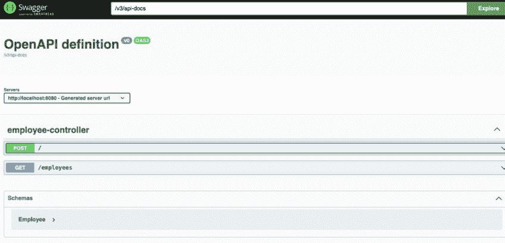

这是它的最基础版本。通过点击单个端点（即彩色框中的内容之一，例如 `/employees`），你将获得详情，并且还可以尝试它：

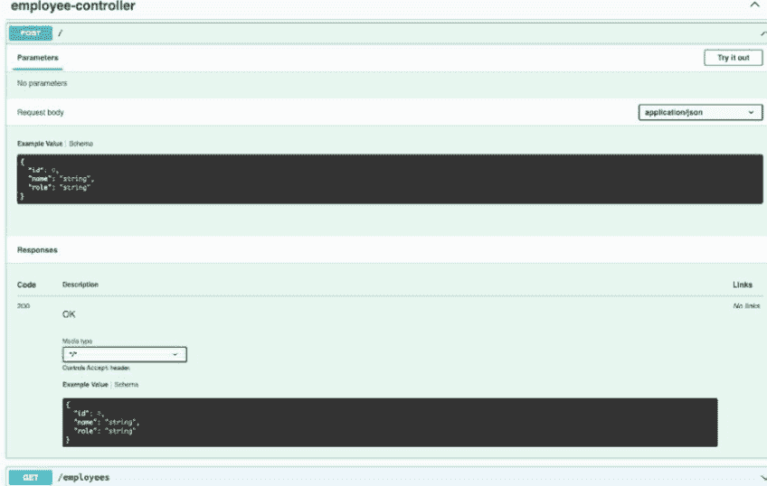

图 8.13 – 点击单个方法，将显示更多细节

## 使用 Swagger 注解丰富文档

通过 Swagger 注解，你可以根据需要详细说明你的 API 文档。在创建新员工的 POST 方法中，你可以使用 `CreateEmployee` 类型的参数来代表 POST 字段的体。该类的字段可以像这样标注：

```java
@Schema(name = "Employee name", example = "John Doe", required = true)
private final String name;

@Schema(name = "Employee role", example = "Software engineer", required = true)
private final String role;
```

Swagger 将生成以下输出：

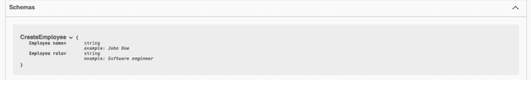

图 8.14 - swagger-ui 渲染的请求体细节

像 Swagger 这样的工具凭借其 UI，能够以最小的努力产生巨大的价值。保持你的文档更新也应该变得更容易——代码及其文档位于同一个地方。

# Spring REST Docs

我建议你用于记录（REST）API 的第二个工具是名为 Spring REST Docs。Spring REST Docs 是 Spring Framework 的一部分，这是一个用于构建基于 Java 的企业级应用的框架。具体来说，Spring REST Docs 是一个为使用 Spring 开发的 RESTful API 的文档扩展。它通过利用 Spring Framework 中编写的测试，帮助开发者为他们的 RESTful Web 服务创建准确且一致的文档。

以下是 Spring REST Docs 的典型工作方式：

1. 开发者使用 Spring Framework 的测试工具为他们的 API 端点编写测试。这些测试可以包含 HTTP 请求和响应。
2. Spring REST Docs 处理这些测试并根据测试结果生成文档。它可以生成各种格式的文档，如 AsciDoc、Markdown 或 HTML。这是一个非常酷的功能：文档会保持更新，以防代码发生变化。
3. 生成的文档可以包含在 API 文档中，让其他开发者或消费者更容易理解如何有效地使用该 API。

Spring REST 在维护准确且实时的 API 文档至关重要的项目中特别有用。通过使用实际测试生成文档，它确保了文档准确反映了 API 的行为。这种方法促进了代码与其文档之间的一致性。

# 文档的良好实践

编写和维护文档是基础性但困难的。用正确的方法去做并不常见，但会让你的团队提升一个水平。以下是根据我们的经验的一些建议：

## 将文档整合进开发流程

团队跳过文档的一个常见原因是他们总是等候完美的时机。但面对现实吧——在快节奏的世界里，这种时机很少出现。

所以，诀窍在于：将文档成为设计的自然组成部分。这可能会增加一些时间，但在未来维护或扩展系统时将会有回报。此外，你的团队将一切就绪。

## 编写全面的文档

全面的文档对于确保系统的维护和扩展至关重要。这种文档可以作为一份宝贵的资源，特别是当关键团队成员变动时。此外，它简化了向各种利益者传递信息的过程。

虽然可能有人认为代码就是文档（我其实同意，前提是你在“代码”前面加上“良好的”这个形容词），但必须承认，全面的文档对于技术和非技术利益者都是至关重要的。

## 更新文档

保持文档更新至关重要，因为过时的文档等同于没有文档。准确反映当前状态的文档对于确保决策至关重要，并可以防止在引用过时信息时导致错误。

## 针对特定受众的定制文档

针对特定受众定制软件架构文档至关重要。并非所有利益者都有相同的需求，试图将所有细节挤进一个文档会阻碍信息的查找。这可能会降低人们使用文档。

为了确保文档的有效性，为目标受众提供适当的背景信息至关重要。例如，业务执行者可能不需要深的技术和代码细节，而工程师如果无法访问此类技术规范，可能会发现很难履行他们的职责。

我们可以为你提供所有的建议，并引导你尽可能遵循最佳实践，但遗憾的是，我们必须承认这些良好的习惯有时不受非技术人员的欢迎。在接下来的章节中，我们将讨论这个问题。

# 残酷的现实

我们讨论过的方面以及许多其他方面，将帮助你向日常工作中增加一些活动，从而使你的代码、项目和工作变得更好。通过将这一切包含在你的开发周期，也许从项目开始开始，在在这方面保持勤奋无疑会更容易。

然而，我们必须告诉你们一个不可否认的事实——有时，这些实践可能会导致精通技术的人与非技术人员之间产生分歧。我们注意到，人们对工作的组织方式通常有不同的观点，特别是在任务方面。当然，代码质量的概念对于某些不习惯于写代码的经理或合作伙伴来说可能完全不重要。但让我们一步步来。

例如，结对编程（pair programming）可能被管理层视为资源密集型，因为它需要两名开发人员处理同一任务，可能会增加人工成本。也可能是因为目标显然更长期。然而，管理层通常优先考虑短期项目目标，如满足截止日期和即时交付，这可能与结对编程的协作本质不一致。结对编程的好处（如提高代码质量和减少缺陷）通常在长期才能体现。但是，这些收益可能无法立即被管理层看到从而导致怀疑。通常，还可能缺乏熟悉度：经理可能不熟悉这种做法，并可能对引入他们并不完全理解的流程。此外，引入结对编程可能会破坏组织内部既有的工作流，导致管理层的抵制。

文档工作也受到这些感知恐惧的影响。为什么要停止一个已经运行良好的东西？为什么不继续去做另一个任务呢？有些经理可能不完全理解文档在减少错误、增强协作和简化新团队成员入职方面的重要性。这种缺乏理解会导致对其价值的低估。某些经理可能认为花在文档上的时间本可以用于更多的编码或直接的项目工作，可能导致开发人员资源的利用不足。

在这两者之间，我必须说结对编程是面临阻力更大的实践，至少从我的观点来看是。在本章中涵盖的所有实践都是重要的，但和谐相处也至关重要！尝试引入所有这些实践或至少引入一部分；尝试适应，并优先排序。解决开发人员的顾虑，并进行开放沟通，以解释结对编程、文档等的长期优势，说明它们如何提高代码质量和项目质量、减少缺陷并增强知识共享。他们还可以讨论这如何带来更快的问题解决速度和开发过程的整体效率。管理层可以努力在即时项目需求和此类实践的长期收益之间取得平衡。

## 知道自己在做什么的重要性

在本章的这一非正式部分，我们想就你每天做的事情提供最后一条建议。这不仅仅是一个技术技巧；它更像是来自朋友的建议，是我在职业生涯开始时有人告诉我的话。

当你处理一个项目、任务或任何其他事情时，始终记住你为什么选择做它。问问自己，“我为什么要这么做？”这不仅仅关乎保持动力；还有更深层的原因。

首先，这将帮助你避免感觉自己像一个在键盘上随机敲击的猴子。它还将帮助你理解你的工作如何贡献于项目或公司的发展。为你的工作设定明确的目标（无论是短期、中期还是长期的），将让你专注于任务，而不被其他事情分心。如果你的工作有一个特定的目的，甚至更好，如果那个目的是你所相信的，你的生产力将会提高，你的工作也会更好。

知道你为什么要这么做并理解其背后的目的，将带来更好的决策。当面对怀疑或不确定性时，心中有一个明确的目标将引导你的选择并防止未来的失望。当我们对即将到来的每个里程碑和最终目标都有详细的行动计划时，每项决策都将无缝衔接。

你必须做出的决策之一包括对项目内的任务进行优先级排序。你应该先做一个还是做另一个？与它将产生的价值相比，哪个任务将花费更多时间？嗯，如果你知道自己在做什么——换句话说，如果你有一个明确的目标——这将有助于你的决策并为向项目的完成铺平更顺畅的道路。

如果你知道你的目标，你可能理解自己距离目标还有多远。换句话说，知道你的“为什么”有助于你衡量进度。想象一个团队或开发人员仅仅是做那个，完全脱离上下文，说“写一个返回你的输出输入的方法”——我不认为这种情况在毕业后经常发生，但假设它确实发生了。这个人将完全不知道他们的工作是如何贡献的，以及他们在通往最终目标的旅程处于什么位置。这个人的工作会做得更糟糕。

提问，并不断提问自己和别人。如果你处于经理或合作伙伴指导你进行任务优先级排序的位置——例如，如果你在一个涉及产品所有者（`product owner`）的框架内工作——询问为什么选择这个而不是另一个。它会带来什么好处？成本是多少，能为公司赚多少钱？有数据支持这个决策吗？我不是说要发动战争，绝对不是，但要始终尝试在这方面“挑战”你的同事。

# 总结

在本章中，我们试图为你提供一些对你的工作大有裨益的建议。我们探索了多年来证明有效的分支模型。版本控制很重要，但让我们讨论代码审查如何有所帮助以及如何将其整合到日常工作中。我们专门用一个章节介绍了一种代码审查的形式，即结对编程。我们还深入了文档，提供了指导，特别是 API 的技术文档。最后，我们讨论了这些实践在现实中的实施，它们可能会面临阻力，特别是在中小型企业。

在下一章中，我们将退一步讨论这些元素如何相互通信。我们将讨论最佳实践，识别问题（坏味道），并为重构你的架构提供建议。

## 延伸阅读

- 《极限开发：拥抱变化》，Kent Beck 著，Wesley
- 关于结对编程：https://martinfowler.com/articles/on-pair-programming.html
- Llewellyn 的强结对：[link]
- 结对编程的成本与收益，A. Cock 和 L. Williams 著：https://collaboration.sc.ncsu.edu/laurie/Papers/PsXardin.PDF
- 一个使用番茄法的远程团队很好的工具：https://cuckoo.team/
- Pull Request，Martin Fowler 的文章：https://martinfowler.com/bliki/PullRequest
- GitFlow 原始帖子：https://nvie.com/posts/a-successful-git-branching-model/
- 如何编写良好的 git commit 信息：https://www.freedodecamp.org/how-to-write-better-git-commit-messages/
- Java 风格指南：https://google.github.com/styleguide/javaguide.html
- Oracle 规范：https://www.oracle.com/technet/java/codeconventions-150003.pdf
- 关于注释和格式，Robert C. Martin 的《洁净代码》第4 章和第3 章
- Apache Maven Checkstyle 插件介绍：https://www.baeldung.com/checkstyle-java
- Baeldung 提供的 Swagger 设置教程：https://www.baeldung.com/swagger-2-documentati-on-for-spring-rest-api


- Spring REST 文档：https://docs.spring.io/spring-restdocs/docs/current/reference/htmlsingle/

# 越越代码 – 精通软件架构

到这里，大家应该已经清楚地知道为什么要以及如何不断重构代码；总的来说，为什么拥有一个整洁、易读且易于维护的代码库是重要的。但在当今开发世界中，我们不太可能只有一个应用程序或一个组件；更现实的情况是拥有各种组件相互作用。如果事实确实如此，正如康威定律（Conway's Law）所说的那样，一个公司的组织结构和管理方式反映了其软件系统，那么拥有一个凝聚力且可扩展的生态系统就至关重要——它不仅要健壮，还要具有韧性，并且正如经常提到的那样洁。因为如果各种服务之间的交互管理不当，即使是洁的代码也可能导致灾难性的后果。

在本章，我们将探讨以下主题：

- 什么是架构？
- 架构模式
- 微服务中的单体架构
- 微服务架构中的“坏味道”

# 什么是架构？

从这里，我们意识到编写代码只是我们工作的一小部分。我们需要专注于编写不仅能运行，而且易于阅读和维护的代码。我们已经学到了可以通过许多微调来让工作变得更简单、更顺畅。现在，让我们后退一步，进一步思考：我们的工作真的是关于代码的吗？编写良好的代码（无论这意味着什么）是否有任何意义，尽管它是广泛且复杂的），我们需要做什么？如果我们问这个问题，你就能得到答案了：完全不是！就像电影《料理鼠总员》中古斯托厨说“任何人都会下厨”，在这里，我们可以把他的话转化为任何人都会写代码。学习写几行 Java 代码甚至其他其他语言只需要一点时间。最近几个月，与人工智能（AI）相关的技术呈爆发式增长，它们真的可以为我们编写代码。但真正具有挑战性的不仅仅是编写代码，甚至是让这些代码协同工作。正如 Robert C. Martin 所说，“让软件正确是困难的。”

软件架构就像软件系统的蓝图。它是概述了软件不同部分如何协同工作的计划。这涉及做出如何设计以满足特定目标的决策。它包括各种元素，如不同的软件部分、我们如何相互连接以及组织它们的规则。因此，软件架构基本上是指导软件系统创建的高层设计。

一个软件系统的架构就像是构建它的人所创建的设计或结构。它取决于系统如何被划分为部分（组件）、这些部分是如何组织的，以及它们之间是如何相互通信的。简单来说，它就是软件的不同部分是如何组合在一起并共同工作的。这只是架构的定义之一，它受 Robert C. Martin 的《整洁架构》的塑造。相比之下，阅读 Martin Fowler 的作品则给了我们另一个关于架构的（更有趣的）定义：经验丰富的开发者在设计系统方面的集体知识，以及他们希望在项目开始时正确做出的系列决策。

我们希望我们对软件架构的含义会更清楚一点，但也许当我们解释了目标之后，会更加清晰。关于目标，文献中的观点似乎相当明确：良好的架构能让事物运行得更好。创建良好架构的原因是为了更容易开发、部署、运行和维护它所承载的系统。

## 开发

只要由一个小小的单一团队处理整个项目，人们可能就会认为架构并不重要；事实上，它被视为一种障碍。这就是为什么许多项目，特别是在创业阶段，往往没有适当的架构。然而，随着项目的扩大，必须尽快尽早救援！事实上，在同一个项目、同一个模块上与不同团队合作是极具挑战性的；将模块划分为定义良好的部分变得非常有必要（“如何做”完全是一个故事）。仅仅将初始组件拆分为多个组件是不够的。它需要仔细进行，即这些组件将如何相互作用。否则，可能存在一种风险，即从一个组件可能会发展出不同的组件，各自各行其是。如果每个人都按自己的路走，就很难开发新功能或修复现有问题。如果一个软件系统很难开发，它就不可能拥有长久且健康的寿命。因此，系统的架构设计应该让开发或维护该系统的团队工作变得容易。

## 部署

可部署性（Deployability）意味着软件在合理时间内多容易、多可靠地被设置和运行（理想情况下，只需点击一下）。如果新设置出现问题，应该在不需要太大麻烦的情况下回到之前的设置。随着虚拟化和云系统的兴起，以及软件系统的不断扩大，架构师的任务是确保软件设置高效且可预测地完成，从而降低系统的整体风险。

不幸的是，许多人在构建系统时，并没有考虑如何设置系统。这可能导致设计出的系统虽然容易创建，但实际上很难运行起来。

例如，在开始构建系统时，开发者可能会选择包含一定数量的服务和组件的架构。出于各种原因，这似乎是一个好主意，例如开发更顺畅，每个部分独立工作。然而，在部署期间，团队发现这些某些服务是相互关联的，并且相互依赖才能正常运行。

## 系统运行

系统运行涉及计算机系统或软件程序的日常管理和执行。它包括许多任务，如运行软件、执行更新和修复、确保安全、处理备份、协助用户以及处理不断出现的问题。本质上，它是为了保持系统顺利运行并满足用户所需的持续努力。

架构对系统运行的影响通常认为没有其对开发、部署和维护的影响大。运行方面的挑战可以通过增加系统硬件资源来解决，而不会对软件产生重大更改；这种场景非常常见。低效的软件架构通常可以通过仅仅添加存储和服务器使其变得可用。硬件与人力成本相比负担负担，意味着导致障碍的架构并不阻碍开发、部署和维护的架构那样昂贵。

仅仅因为运行层面的坏架构很容易修复，它就不是一个重要的方面。尽管所谓的“硬件”（通常翻译为亚马逊云服务 (AWS)、谷歌和微软公司构建的云计算服务）成本比时间便宜，但这并不意味着它是廉价的或微不足道的成本。如果一个架构所需的资源与其所带来的价值（无论是经济还是其他）相比不成比例，那么这应该引起关注。

## 维护

软件维护是指管理和更新软件的持续过程，以确保它能够继续满足用户需求并随着时间的推移保持有效。它涉及修改、修复错误、提高性能以及根据环境或用户需求调整软件。

在这种情况下，我们可以与建筑设计进行直接比较，以理解它如何影响项目管理能力。想象两栋建筑，两处住宅：一个非常复杂且精密，独一无二；它具有为特殊场合创建的审美和技术特征、精良材料和独特的解决方案。另一栋建筑是经典的欧洲公寓，立面平直，窗户相同，使用常用且坚固的材料，与之前的非常相似。如果我必须进行更改或解决问题，你认为在哪栋建筑上操作更容易？

在计算机程序的所有部分中，维护和运行它是最昂贵的。持续维护新功能和修复错误需要人们投入大量的时间和精力。维护程序的主要成本源于搜索现有代码和处理风险。罗伯特·马丁（Robert C. Martin）在他的《整洁架构》（Clean Architecture）书中将搜索代码称为“寻觅”（sleucking），这需要花费时间和金来寻找添加新功能或修复错误的最佳方法。在进行这些更改时，总会有意外导致新问题的可能，这增加了风险和成本。

对程序的设置有一个经过深思熟的计划真的有助于降低这些成本。如果程序被分成若干部分，并且每个部分都通过稳定的连接保持分离，那么添加新内容就会变得容易得多，而不会意外引发问题。这种规划降低了意外问题的风险，并使维护变得更加廉价。

现在我们已经了解了什么是架构以及它为什么重要，让我们发现一下我们可以使用的主要的架构类型。

## 架构模式

在软件中，我们可以以不同的方式组织事物，这些组织好的结构被称为软件架构模式。其中许多模式已被证明能够很好地解决不同的问题。每种模式以特定的方式排列它们，以解决软件中的特定问题。

但让我们保持趣味性，不要深入探讨这些模式的冗长列表。相反，我们将查看几个最重要和最常用的模式。这样，我们就可以理解核心思想，而不会被所有的可能性所淹没。

### 分层架构

分层架构模式（也称为 n 级架构模式）可能是应用得最广泛的设计方法。它是许多 Java 企业版（EE）应用程序的首选，并且在架构师、设计人员和开发者中广为人知。这种模式符合大多数公司中典型的通信和组织设置，使其成为开发业务应用程序的逻辑合理且常见的选择。

在分层架构中，组件被组织成水平层，每层在应用程序中都有特定的角色（例如表示层或业务逻辑）。虽然该模式没有规定固定的层数，但常见的设置有四层：表示层、业务层、持久层和数据库。有时为了简单，业务层和持久层会耦合。较小的应用程序有三层，而较大的应用程序可能有五层或更多。

每一层都有独特的职责。例如，表示层处理用户界面和通信，而业务层执行业务抽象。分层简化了任务。表示层专注于显示信息，而不是检索信息。同样地，业务层专注于业务逻辑，将数据检索留给持久层，持久层再将数据传递给业务层进行处理，然后传递给表示层进行显示：

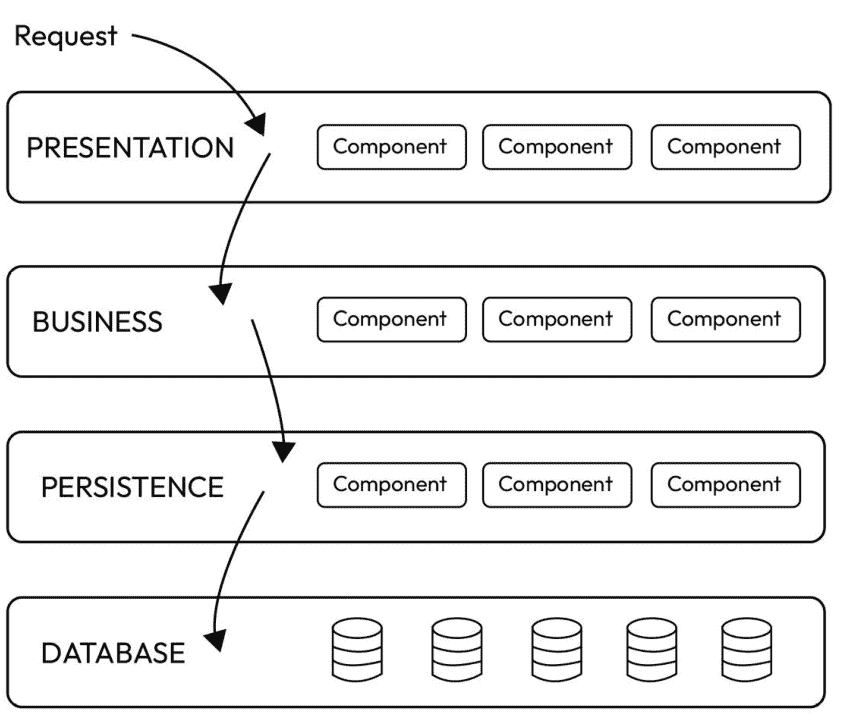

分层模式在分离组件之间的关注点方面表现。每一层只关注其相关的逻辑——表示层关注表示，业务层关注业务，依此类推。这种分类简化了角色和职责模型，使开发、测试、治理和维护变得简单。定义的组件接口和限制的范围有助于这一阶段。

值得注意的是，架构中的每一层都被标记为“关闭”的，这是该模式中的一个关键概念。关闭层意味着请求在到达下一层之前必须通过中间层。例如，来自表示层的请求将通过业务层，到达持久层，最后到达数据库层。

### 单体应用程序架构

在分层架构中，正如我们所说，该概念涉及将系统的不同组件或功能组织到不同的层中。这些层可以从两个角度解释：

- **不同的应用程序/部署：** 在这种解释中，每层都被视为一个独立的应用程序或部署。每层代表一个具有特定职责的自包含单元。例如，你可能将表示层、业务逻辑层和数据访问层部署为独立的应用程序。这种方法促进了模块化，并便于扩展和维护。

- **同一应用程序内部的组件（单体或 N 级）：** 另一种是，层可以被视为同一应用程序中的组件。在单体架构或 N 级架构中，不同的层存在于单个应用程序代码库中。例如，你可以有一个处理用户界面的表示层、管理应用程序规则的业务层以及与数据库交互的数据访问层——所有都在单个应用程序的范围内。

这两种解释都是有效的，它们之间的选择取决于系统的特定架构设计目标和需求。

### 微服务

有很多关于微服务的长篇书籍，我们在这里不可能告诉你一切。然而，我们至少应该为你提供关于该主题的总体概述——多年年来——可能直到今天——它一直是我们行业的主要趋势之一。

**微服务架构**（通常缩写为微服务）是构建应用程序的一种特定方法。在这种架构风格中，大型应用程序被拆分为更小、独立的部分，每个部分都有其独特的职责。这种方法能够在整个系统中创建更具模块化且易于管理的组件。通过此，我们可以举一个非常常见应用程序的例子：它有一个微服务专门用于搜索物品，另一个处理订单，另一个处理会计问题，最后一个负责通过电子邮件、推送通知等方式通知用户。这里是微服务架构的一个示例：

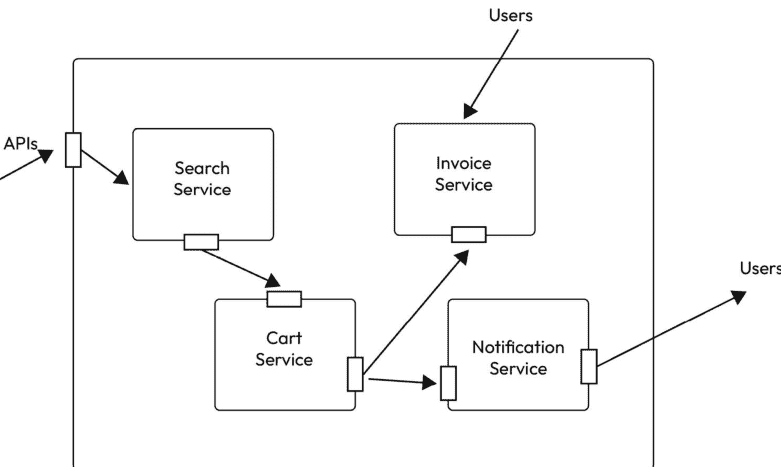

图 9.2 – 微服务架构的示例

在微服务的背景下，应用程序可以由许多内部微服务组成，每个微服务处理特定的职责。这种方法能够在整个系统中创建更具模块化且易于管理的组件。通过此，我们可以举一个非常常见应用程序的例子：它有一个微服务专门用于搜索物品，另一个处理订单，另一个处理会计问题，最后一个负责通过电子邮件、推送通知等方式通知用户。

- **服务级扩展性**：微服务使团队能够根据特定需求独立扩展服务。这种细粒度的扩展性优化了资源利用率和响应速度，提升了应用程序的整体性能。

- **自主化团队**：微服务架构促进了自主性，使不同的团队能够独立地开发特定的服务。这种自主性简化了开发周期，允许团队按照自己的节奏进行创新和迭代。

- **新技术的实验**：拥抱微服务允许对新技术进行轻松实验和采用。由于服务可以独立进行构建和部署，团队可以探索并实现尖端工具或框架，而无需重构整个系统。

- **增强的故障隔离**：在微服务模型中，故障被隔离在单个服务中，防止某个服务的故障发生连锁反应并影响整个应用程序。这提高了系统的整体可靠性和健壮性。

当然，没有一种技术是完美的，微服务系统也存在一些问题和挑战。让我们深入探讨与微服务架构相关的重大挑战和问题：

- **服务识别**：确定最佳服务set可能是一项艰巨的任务。选择能够有效代表不同业务能力的正确服务，需要仔细的考虑和规划。

- **分布式系统的复杂性**：微服务涉及分布式系统的创建，增加了复杂性。这种复杂性一直延伸到开发、测试和部署阶段，在确保无缝集成和运行方面带来了挑战。

- **功能部署的协调**：部署跨越多个服务的特性需要细密的协调。确保各种服务和谐地工作以提供统一的功能，需要周全的规划和执行，以避免中断。

- **决策时机困境**：确定采用微服务架构的契机时刻是一项具有挑战性的决策。了解何时收益大于弊端，并使转型与组织需求对齐，需要深思熟虑。

解决这些挑战对于成功实施微服务架构至关重要。

# 事件驱动架构

这是另一种常见的架构模式，也可以看是微服务的一种细微差别。简单来说，它涉及设计一种结构，该结构能够识别系统中发生的事件（即发生的事情），并通过产生某些结果来实现其实化。“可能发生的事情”的例子是无穷完尽的：用户注册、第三方系统调用了我们的其中一个 webhooks、某个处理过程中发生错误，或者会有更多组件在监听并响应该事件。

事件指的是状态的变化，或任何可以被应用程序或设备检测并通信的可观测事件。事件驱动架构是解耦服务之间使用关于变化或更新的事件消息进行通信的一种。这是带有微服务的现代应用中的一种常用方法。在这种设置中，主要包含三个部分：

1. **事件生产者**：这些是事件的创建者，并将它们发布到路由器；例如，“购买已完成”。

2. **事件路由器或代理（brokers）**：这些是决定事件去向何处的组织者。例如，“完成的购买应该导致向客户发送电子邮件”。

3. **事件消费者**：这些是系统中想要了解某些事件并通过接收数据做出反应的部分。

酷的一点在于，这些不同的部分不需要彼此了解太多。它们只需发送事件消息，其他部分则选择监听并响应。在我们的示例中，完成操作的组件不知道接下来会发生什么；它只发布一个事件。负责发送电子邮件的消费者不需要知道该过程的任何事情。这使得事情变得灵活，因为例如，你可以更新系统而不影响其他部分。团队可以独立地做自己的事情。

有时事件也可以称为消息（message）；这两个术语通常是可互换的。更具体一点的概念是“命令”（command）：与定义领域内某些数据状态变化的事件不同，命令显式要求执行某些操作。隐含方面是，在这种情况下，执行操作的人知晓稍后会发布事件。在技术上，几乎没有变化。这里是事件驱动架构的图表：


## 图 9.3 – 事件驱动架构

拥抱事件驱动架构有几个优势：

- **独立扩展和故障隔离**：通过采用事件驱动架构，独立扩展和管理故障的能力成为一个关键优势。正如前面提到的，通过服务的解耦，每个服务仅与事件路由器交互，使得它们对其他服务的存在感知感知。因此，在发生故障时，其余部分可以继续无缝地运行。事件路由器充当弹性缓冲区，擅长处理工作负载的激增并确保系统的整体稳定性。

- **开发更敏捷**：因为事件驱动模型消除了自定义代码来轮询和路由事件的需求。相反，事件路由器管理这些任务，自动过滤并将事件推给消费者。这种精简流程通过最大限度地减少传统上生产者和消费者服务之间所需的重度协调，显著加速了开发周期。开发者可以更多地专注于实现业务逻辑，而不是处理事件处理的复杂性。

- **轻松审计**：当你拥有一个事件路由器作为审计应用程序和建立策略的中心枢纽时，这些策略限制了谁可以在路由器上发布和订阅，并为用户和资源访问数据指定了权限。此外，事件路由器促进了事件在传输过程中和存储状态下的加密，增强了数据安全措施。

- **降低成本**：事件驱动架构运行在推送模型的基础上，只有当路由器中存在事件时才触发操作。这与持续轮询形成对比，导致带宽消耗减少、CPU 占用率更低、空闲机群容量减少以及更少的 SSL/TLS 握手。结果是一个更具成本效益的系统，通过减少不必要的运行使资源效率最大化，提供了经济和运营方面的利益。

在事件驱动设置的世界中，事物运作有两种主要方式：发布/订阅（pub/sub）模型和事件流模型。

## 发布/订阅模型

Pub/sub 是发布/订阅（publish/subscribe）的缩写。这种系统使用基于事件订阅的消息框架运行。一旦事件发生或被发布，它就会发送给对该信息感兴趣的订阅者。

## 事件流

与发布/订阅模型不同，事件流涉及将事件记录在日志中。在这里，事件消费者并不订阅流，而是可以方便地从流的任何部分读取。

存在不同类型的事件流，主要的包括：

- **事件处理**：利用 Apache Kafka 等数据流平台摄取事件并处理事件流的处理或转换

- **简单处理**：当事件发生时，在通用消费者中触发操作

## Apache Kafka

广泛使用的事件流工具是 Apache Kafka。Apache Kafka 是一个强大的分布式数据流平台，被广泛认为是事件处理的顶级解决方案。该平台以其多功能性闻名，擅长管理实时事件流，涵盖了发布、订阅、存储和处理数据。为了满足各种用例的需求而设计的 Apache Kafka 在需要高吞吐量和可扩展性的场景下尤为出色。

Apache Kafka 的独特特征之一是能够高效处理一系列数据共享任务，而无需复杂的点对点集成。这种特性不仅简化了整体架构，还在将延迟降低到毫秒级水平方面起着关键作用。通过提供实时数据处理的稳健框架，Apache Kafka 赋予了组织利用及时洞察和响应式分析的潜力。

本质上，Apache Kafka 成为对于信息交换至关重要的行业和应用程序不可或缺的工具。它的架构不仅支持同时处理大量事件，还确保系统可以轻松扩展以适应不断增长的需求。这种灵活性、可扩展性和低延迟的结合，使得 Apache Kafka 成为寻求可靠高效的数据流和事件处理解决方案的企业的首选。

近年来，Java 世界中流行了一种新的思维方式，它被称为响应式范式（reactive paradigm）。让我们来尝试理解它的基本思想。和往常一样，我们并不期望你仅通过书的一个章节就能完全掌握响应式范式。“延伸阅读”部分是为你准备的，你可以借此进行更多探索！

响应式应用于响应式系统领域（不仅限于 Java），它源于2014 年的《响应式宣言》（Reactive Manifesto），这是社区为开发响应式分布式系统所共同努力。该宣言强调了创建具备以下特征的系统：

- *响应式 (Responsive)*：系统以最小且可预测的延迟对输入做出适当响应，以增强用户体验。例如，遵循响应式原则的 Web 中，用户界面组件设计为响应用户交互快速更新。例如，当用户点击按钮时，系统会立即响应并提供反馈，没有明显的延迟。


- **弹性 (Resilient)**：面对组件故障，系统能够优雅地处理，尽量减少对整体可用性和响应性的影响。例如，考虑一种微服务架构，其中一个服务由于临时问题发生故障。弹性系统会优雅地处理这种故障，通过将请求重路由到服务的备用实例，确保整个系统保持运行（断路器模式）。

## 断路器模式

连接到弹性概念，值得讨论的是断路器模式（Circuit Breaker pattern）；这是一种提高系统弹性的设计模式。它通过检测和防止重复故障，用于分布式或远程服务。该模式的灵感来自电气断路器，它在检测到故障时会自动中断电流，以防止电气系统损坏。

断路器通过封装函数调用（如远程服务调用）并监控故障来工作。当故障达到阈值时，断路器会“跳闸”，并在规定时间内停止允许对该函数进行调用。在此期间，系统可以采取替代措施，例如返回回退响应或在延迟后重试操作。这防止了系统反复尝试调用故障的服务，因为这可能导致性能下降或系统失败。

如果你在 Java 应用程序中实现断路器，最常用的库是 `Hystrix` 和 `Resilience4j`。`Hystrix` 由 Netflix 开发，是 Java 中实现断路器模式的广泛使用的库。它为分布式系统提供了容错（FT）和延迟容忍（LT）功能。`Resilience4j` 是一个轻量级、模块化的库，用于处理 Java 8+ 中的故障和函数式编程风格。它提供了多种弹性模式，包括断路器、限流、重试和隔离器。如果你使用 `Spring Cloud`，`Spring Cloud Circuit Breaker` 为各种断路器实现提供了一个统一的抽象层。该框架提供了一个开发者可以在应用程序内部使用的统一 API，使其能够灵活选择最符合其特定应用程序需求的断路器实现。在本文编写时，支持的实现有 `Resilience4j` 和 `Spring Retry`。

- **弹性的 (Elastic)**：系统可以适应变化的工作负载，保持一致的响应时间。例如，弹性系统可以根据需求自动扩展或缩小资源。

在使用高峰期间，可能会配置额外的服务器来处理增加的负载，并在需求较低期间缩小规模。

- **消息驱动 (Message-driven)**：符合宣言的系统采用消息驱动通信模型。例如，在分布式应用中，组件通过消息而非直接方法调用进行通信；遵循消息驱动方法的系统可能不会同步调用远程服务，而是异步发送消息，并在等待响应的同时继续处理任务。

响应式架构遵循所有这些指示，强调变化的传播以及系统对这些变化做出响应行为的声明式规范。在响应式系统中，一种经常使用的范式是 Actor 模型。

## Actor 模型

我认为提到 Actor 模型是值得的，因为它非常有趣，是响应式系统的基础。Actor 模型并非新事物；它由 Carl Hewitt 在 1973 年引入，作为管理并发计算的理论模型。随着软件行业意识到实现并发和分布式应用面临的挑战，它的实际意义变得显而易见。换句话说：管理线程已不再适用，我们也没有更快的 CPU；我们只有更多核心的 CPU！

Actor 是一个自包含的计算单元，它体现了几个使其在 Actor 模型中脱颖出的关键特征：

1.  **状态和逻辑的封装**：Actor 封装了它的状态和部分应用逻辑。这种封装确保了 Actor 的内部运作不受外部直接访问的影响，促进了代码的模块化和可维护性。
2.  **异步消息交互**：Actor 之间仅通过异步消息进行通信，避免了直接方法调用。这种设计选择增强了系统的响应能力，因为 Actor 可以独立继续处理消息，而无需等待立即响应。
3.  **唯一地址和邮箱**：每个 Actor 都拥有一个唯一的地址，并为传入的消息维护一个邮箱。地址作为系统中的独特标识符，而邮箱则为其他 Actor 异步递送消息提供了机制。
4.  **顺序消息处理**：Actor 邮箱中的消息按照到达顺序处理。邮箱模型的默认实现通常采用先进先出（FIFO）队列，确保了消息执行的可预测性和有序性。
5.  **树形层次结构**：Actor 系统被组织成一种层次分明的、树状的结构。这种层次结构有助于组织 Actor 的组织，每个 Actor 在较大的系统中都有特定的位置和角色。
6.  **动态 Actor 操作**：Actor 可以动态地创建其他 Actor，向系统内的任何 Actor 发送消息，启动自身或其所创建的 Actor 的终止。这种动态行为允许灵活且自适应的系统架构。

虽然单体架构多年来一直是标准，并且具有某些优势（例如开发和部署的简单），但它们也带来了挑战，特别是随着应用程序规模和复杂性的增加。背离单体架构的趋势导致了对替代架构模式的采用，最常见的是微服务。这在过去几年里几乎已经成为一种准则，有很多关于它的书籍和文章。我们只需简单说几句，让你不至于感到完全没有准备！

我们的第一条建议是：不要把单体架构视为必然是坏的，嗯，在某些情况下，单体是可以接受的。例如，如果你有一个规模较小、复杂性和流量有限的应用，管理微服务架构的开销可能会超过潜在收益，特别是当需求变化不大时。在这种情况下，单体架构的开发和维护可能更简单。此外，你的资源可能有限：微服务通常需要专业知识和额外的基础设施，这对于较小的团队来说可能是不可行的。从单体过渡到微服务需要时间、精力和可能需要的额外投入。如果你的组织在时间、预算或专业知识方面受到限制，单体架构可能是一个务实的决定。主要原因可能是你的单体架构运行良好：如果你的应用程序稳定、性能良好，并满足当前和可预见的业务需求，可能没有足够的理由去经历过渡到微服务的复杂。

虽然微服务的优势显而易见，但过渡到微服务也带来了一系列挑战。关于这个论点已经写了整本书，所以我们只给你几点提示：

- **数据管理**：过渡到微服务引入了管理上的范式转变。在单体架构中，数据存储和访问在统一数据库中；然而在微服务架构中，数据分布在多个服务中，去中心化可能会在确保一致性和事务完整性方面带来挑战。组织必须应对数据同步、版本控制和跨服务事务以避免不一致。
- **服务通信**：微服务之间的高效通信对于架构的成功至关重要。与单体应用中函数调用可以是内部的不同，微服务通过网络进行通信。选择合适的通信协议和格式、同步或异步需要仔细考虑，以优化整个系统的性能和可靠性。
- **运维复杂性**：向微服务的移动引入了新的运维复杂性。管理分布式系统涉及多个服务的调度和扩展。监控每个服务的健康和性能、记录日志以供调试是复杂的任务。组织需要健壮的工具和实践来进行分布式链路追踪、日志聚合，以有效应对微服务带来的挑战。
- **文化转变**：在技术考虑之外，过渡到微服务通常需要文化转变。拥抱 DevOps 思维，让运维团队在整个软件开发生命周期（SDLC）中协作是至关重要的。**持续集成和持续部署 (CI/CD)** 实践需要被采用以实现快速可靠的发布。这种转型需要对自动化、协作以及团队成员之间共同责任的承诺。

上述每一点都隐藏着一个世界，这些挑战是可以克服的，但也可能是风险的。

- **增量采用**：成功过渡到微服务的最佳实践之一是采用增量变化的策略，而不是突然的大规模重构。组织通常发现通过识别并从非核心服务开始迁移过程是明智的。这种分阶段的方法允许团队在获得微服务经验的同时，在对整个系统影响降到最低之前解决挑战。
- **有效通信**：在微服务架构中，服务通过网络进行通信，建立清晰且有效的通信通道是至关重要的。组织应该定义并遵循良好的 API 以确保服务之间的无缝交互。这不仅增强了系统的可靠性，还促进了服务的独立性，使团队能够在不破坏整个应用程序的情况下演进和服务。有效通信是实现微服务所承诺的模块化灵活性的基础。
- **自动化测试**：全面的自动化测试是成功采用微服务的关键。鉴于微服务的分布式特性，彻底的测试对于开发和部署过程中早期发现问题至关重要。测试套件应该涵盖每个微服务的单元测试、集成测试和端到端测试。自动化不仅加速了测试过程，还为频繁部署提供了保障。
- **监控和日志**：微服务带来的运维复杂性需要健壮的监控和日志解决方案。组织应该投入实时监控服务健康、性能指标和潜在问题的工具。集中日志允许跨分布式服务高效调试和故障排除。主动的监控和日志不仅有助于维护系统可靠性，还有助于系统的优化和性能增强。
- **文化对齐**：到微服务架构不仅是技术的转变，也是文化的转变。培养协作、共同责任和持续学习的文化对于过渡的成功至关重要。团队应该接受 DevOps 思维，让开发和运维紧密合作，对整个系统有共同的所有感。持续学习和知识共享确保团队能够适应不断演变的微服务格局，并拥抱其带来的灵活性。

这些最佳实践为团队和组织在从单体架构过渡到微服务的复杂领域提供了路线图。

当你有了某种微服务架构，或者更好，是在设计它时，你会想要意识到一些可以轻松发现的“坏味道”。

## 微服务架构中的坏味道

就像代码中存在坏味道（隐藏在方法和类之间的问题）一样，软件架构中也存在软件组件协作工作的问题。这些是反复出现的模式，或者说是反模式，当我们看到它们时，应该保持警惕并在必要时采取行动。让我们来看看最常见的几种。

### 共享持久化

“不要交叉射线流，”正如《捉鬼猎人》曾经说过的。这与共享持久化发生的情况有点。当两个或多个微服务共享相同的持久化数据（例如数据库、`Redis` 实例或缓存）时，我们称为共享持久化。这可能会导致一些问题。首先，如果服务 A 和 B 同时尝试读写同一个数据层，可能会发生同步问题。一个服务可能被另一个服务写入，反之亦然。

在我看来，最重要的问题是需要对数据结构本身进行更改时产生的相互依赖。例如，仅仅更改、添加或删除数据库表中的列可能变成一个大问题，并要求修改两个微服务，即使其中一个没有受更改的影响。如果我们想用一种简单而有效的方式表示这种情况，会有这样一个图表：

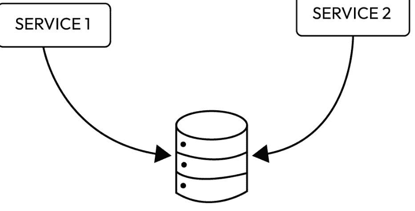

图 9.4 – 两个（微）服务依赖于同一个数据存储

最显而易见的解决方案是为每个微服务维护一个独立的数据存储层。这意味着每个微服务都拥有自己的数据，并负责提供访问这些数据的函数。当有人需要使用这些数据时，他们将使用微服务作为一种数据抽象。他们不需要知道数据存储在何处或如何存储。特定微服务所拥有的数据不应在其他地方重复。

然而，必须注意的是，拥有非共享的数据存储层并不意味着为每个微服务都有一个独立的数据库。这取决于服务的细粒度。例如，如果你有一个处理客户及其收货地址的微服务（例如在电子商务平台中），你可能会有一个专门针对该服务的数据库。客户和地址很可能是相互关联的，因此你可能会有链接的关联型表；例如，通过外键链接。如果你想让你的微服务更细粒度，例如，一个客户服务和一个地址服务，你不能完全分离两个互不相关的数据库。但是，你可以确保客户服务写入 `CUSTOMER` 表，而地址服务写入 `ADDRESS` 表。这些表将通过外键链接，但保持独立。数据完整性由关系型数据库的属性（ACID 属性）保证；

| CUSTOMER 表 |
| :--- | :--- | :--- | :--- |
| ID | NAME | SURNAME | ... |
| 31284 | JOHN | DOE | ... |

| ADDRESS 表 |
| :--- | :--- | :--- | :--- | :--- |
| ID | CUSTOMER_ID | CITY | COUNTRY | ... |
| 361224 | 31284 | BRUGES | BELGIUM | ... |

图 9.5 – 两个服务使用同一个数据库的不同表，这些表通过 `customer_id` 外键关系相关

现在，我们已经告诉了你们应该是怎样的，但我们还需要告诉你们，这并不总是发生的，特别是在从单体到微服务的过渡期间。你可能需要一段时间共享数据存储层。然而，我们的建议是尽可能避免这种情况，并尽早解决这个问题。

## 共享库

共享持久化（数据存储）会导致耦合问题，共享库也是如此。我们在书中讨论的第一件事之一，也是通常在研究和工作中强调的，是“不要重复自己”（DRY）原则。事情只做一次，做好，并尽可能地复用你的代码。这无疑是一条要遵循的准则，但在架构（特别是微服务架构）的情况下，必须非常小心。

让我们想象有两个服务——即使用相同共享库的组件，且该库始终由某人编写和管理。如果我们需要对此库进行更改，我们不仅必须处理库本身的更改，还需要更新微服务中的依赖项，并可能根据需要更改代码（这取决于我们是否更改了方法签名）。

我们讨论的示例仅涉及两个微服务和一个库。然而，在一个架构中，有许多相互关联的组件：组件 A 连接到组件 B，B 连接到组件 C，依此类推。修改库可能会导致难以控制的涟漪效应，引发重启、重建和重新部署的链反应，这可能是非常昂贵的。

我在这里并不是说不要使用共享库。共享库对于避免软件组件之间的代码重复至关重要。以日志为例，通常需要自定义逻辑，例如格式化或隐藏客户详情等敏感数据。现在，想象一下每个组件都有其独特的实现。考虑到如果跨组件之间不完全相同，将浪费多少开发人员小时。聚合日志变得具有挑战性，而且微小的实现差异会导致标签不一致。

像 `log4j` 漏洞这样的问题，如果这种实现在所有代码中共享，将面临巨大挑战。在每个微服务或组件中修复它需要巨大的精力。通过一个内部使用 `log4j` 的自定义日志库，解决漏洞只需要在一个点采取行动。日志记录是微服务中的通用功能，使其成为共享库的极佳候选。其他示例包括安全、监控、异步通信和异常处理。

此外，在代码和外部工具之间添加中间层非常有帮助。它保护了程序主体免受这些工具更改的影响。这使得加入新功能或修复问题变得更容易。它也让代码更易读，便于团队协作。这样做一年后，很明显，它让我们的软件更强壮、更灵活。

我想说的是，良好的架构意味着应用程序不同部分之间的解耦，而共享库恰恰相反。另一方面，它们减少了重复，这是好事！我们必须找到平衡点。没有一种适用于所有情况的规则。你需要单独考虑每种情况。通常，每当你需要编写不依赖你正在工作的模块特定主题的代码时，创建一个共享库可能是值得的。前面提到的示例（日志记录、安全、监控等）是无论你在哪个领域工作，都可以在不同情况下使用的内容。

处理共享库有不同的方法。你可以为每个需要的库设置一个仓库，或者使用一个包含多个库的单一仓库（称为 *monorepo*，单仓库；更多信息请参见“更多阅读”）。关键点是要具有某种形式的分离。例如，你可以有一个涵盖监控、安全和日志的单一仓库。除了必要的依赖项外，每个项目应该是自给自足的。

曾经，我们会包含并使用一个名为 `Feign` 的库，它是由 Netflix 开发的基于 Java 的声明式 Web 服务客户端。它通过允许开发者使用注解和接口方法来定义请求，简化了 RESTful 服务的 HTTP 客户端的创建。`Feign` 与 Netflix Ribbon 集成用于负载均衡，支持多种数据格式，并提供了回退机制以增强应用程序的健壮性。它通常用于微服务架构，以实现服务之间的高效通信。

## 直接通信

设计良好架构的主要动力之一是提高整个系统的灵活性并使之更易维护。这种灵活性对于适应应用内部的变化至关重要，包括对单个服务 API 的修改或服务之间通信协议的调整。

然而，当客户端直接与不同的服务通信时，挑战也随之而来。这种直接通信模型削弱了良好架构设计的某些优势，特别是在灵活性方面。当客户端与其他服务的特定地址紧耦合时，重新迁移或拆分这些服务就会变得棘手。从本质上说，服务的地址变成了一个固定点，使得在不影响客户端的情况下很难对系统进行结构性更改。此外，当一个服务被公开时，需要不断维护其 API 的向后兼容性，以避免破坏现有客户端。这通常被认为是一种反模式，我们将通过下面的图来表示它，在图中你可以看到不同类型的设备直接连接到暴露的服务：

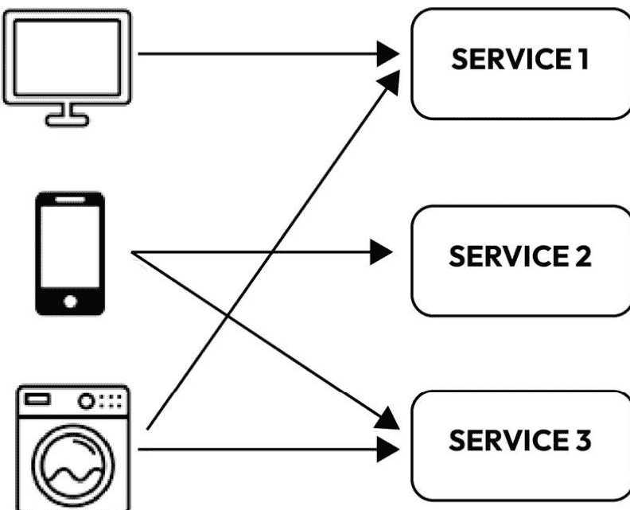

图 9.6 – 不同设备的不同客户端直接调用服务

避免这种反模式有许多可能的解决方案。让我们来看看其中一些。

## API 网关

API 网关是一个服务器或服务，作为一组服务的入口点。它的首要作用是为客户端（如移动应用、Web 应用程序或其他服务）与各种组件的交互提供一个集中且统一的入口点。它基本上位于客户端和服务器之间，提供其他基本功能。这里是 API 网关的图：

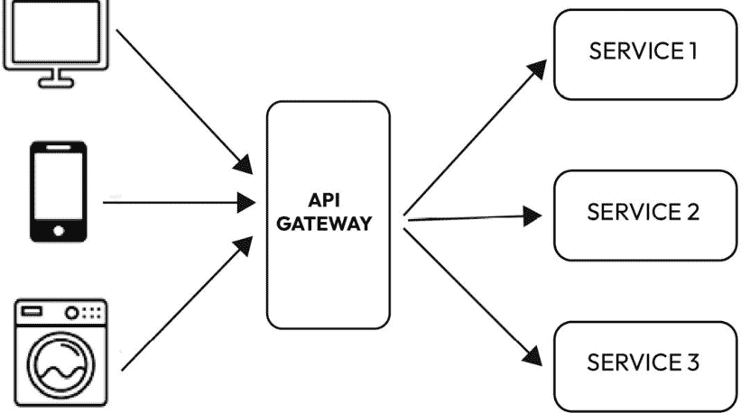

图 9.7 – 所有设备的所有客户端都通过同一个 API 网关

例如，API 网关通常提供请求路由：API 网关将来自客户端的传入请求路由到相应的服务。它充当交通警官的角色，根据端点、版本或其他标准将请求重定向到相关服务。

API 网关可以将来自客户端的多个请求聚合为单个请求，以减少客户端与服务之间的往返次数。这对于优化性能和降低延迟非常有益。同样，API 网关可以在将响应返回给客户端之前聚合来自多个服务的响应。这可以减少客户端所需的请求次数，并提高整个系统的效率。

负载均衡将传入的请求分配到服务的多个实例上，以确保最优的资源利用率并防止单个实例过载。API 网关可以处理这种负载均衡，以增强系统的可扩展性和可靠性。

API 网关通常集中处理身份验证和授权过程。它通过验证 API 密钥、处理用户身份验证并确保授权的客户端可以访问特定服务，来执行安全措施。

为了提高性能，API 网关可以实现缓存策略。它可以在缓存中存储和检索来自服务的响应，减少重复计算或获取相同数据的需求。

API 网关通常包含监控和分析工具，用于跟踪微服务的性能和使用情况。这些信息对于识别瓶颈、优化资源分配以及确保系统的整体健康具有价值。

API 网关可以对传入的 API 请求实施速率限制，以防止资源的滥用或过度消耗。这涉及设置用户或客户端在指定时间内可以发送的最大请求数。

限流也可以通过配额来实现，即在定义期间内为客户端分配特定数量的资源或请求。与配额某种相关的是货币化概念：API 网关可以跟踪客户端对 API 的使用并实施基于使用的计费。这涉及根据请求数量、传输的数据或其他相关指标进行收费。

API 网关模式的替代方案是前端提供后端（BFF）模式。

## 为前端提供后端 (BFF)

BFF 指软件开发中的一种设计模式，为每个前端应用程序或用户界面创建一个单独的后端。这种方法在微服务架构中非常常见，旨在优化前端和后端组件之间的交互。

在传统的 Web 应用中，通常有一个后端为各种前端客户端提供数据和功能。然而，随着应用程序变得越来越复杂，拥有不同的平台（Web、移动等）和用户体验，在单个后端中管理所有这些需求可能变得具有挑战。


# BFF 模式

BFF 模式通过为每个前端或客户端类型创建专门的后端服务解决了这个问题。每个 BFF 都根据对应前端的特定需求定制，在两层之间提供更高效、更定制的接口。这允许前端开发者对他们需要的数据和服务有更多控制权，而不会被服务于多种用途的单体后端所限制。请注意，BFF 充当“代理”，从一组共享后端（BE）服务过滤并调整到特定前端（FE）客户端的请求。理论上，BFF 不要重复后端的业务功能，因为这样做会损害应用程序的完整性。这里是 BFF 模式的图：

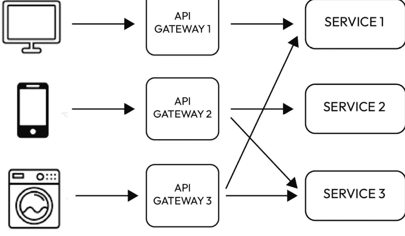

图 9.8 – 在 BFF 中，我们为每个类型都有一个网关

与之前的图相比，在这种设置中，每个设备连接到其专门定制的网关。

使用 BFF 有几个优势：

- **专业化**：每个 BFF 都可以针对前端的需求进行优化，带来更好的性能和用户体验
- **自主性**：前端和后端团队可以更独立地工作，因为其中一个的变化不会影响另一个，维护了约束
- **可扩展性**：不同的前端具有不同的可扩展性需求，BFF 允许根据具体的进行更细粒的可扩展规划
- **灵活性**：BFF 可以适应最适合的技术栈和架构选择

需要注意的是，虽然 BFF 模式提供了优势，但也引入了一些复杂性，例如需要管理多个后端服务。前端和后端团队之间的良好沟通和协调，以及对良好的 API 约定的遵守，对于成功的实施至关重要。

## 总结

在本章中，我们深入探讨了架构术语的含义并检查了它的主要变体。我们看到了为什么良好的、可维护且可扩展的架构是重要的，并提供了如何实现它的建议（可以在“扩展阅读”部分深入研究）。我们查看了主要的架构模式，从（相对）简单的到适用于大型系统的稍微复杂的模式。我们还讨论了在尝试打破单体时需要注意的问题——从单体架构迁移到微服务。提到后者，我们快速查看了可能会遇到的一些常见异味。记住——始终保持你的蜘蛛感敏锐！

当你结束这本书时，请记住编写良好的代码不是一次性的努力，而是对卓越的持续承诺。像工匠一样，不断完善你的代码，以反映你对最佳实践和趋势不断发展的理解。

你在这里获得的概念不仅会产生更可读、更高效的 Java 代码，还将让你能够与开发者无缝协作，最终有助于你项目的成功。

祝编程愉快！

## 延伸阅读

- Giuseppe Bonocore, *Hands-On Software Architecture with Java*, Packt Publishing Ltd.
- Robert C. Martin, *Clean Architecture*, Prentice Hall
- Mark Richards, *Software Architecture Patterns*, O’Reilly
- Martin Fowler 关于架构的作品：https://martinfowler.com/architecture/
- 深入解析 Monorepo：https://monorepo.tools/
- Feign 简介：https://www.baeldung.com/intro-to-feign
- Apache Kafka 简介：https://www.baeldung.com/apache-kafka
- Akka：https://www.baeldung.com/akka-actors-java
- Sam Newman, *Monolith to Microservices*, O'Reilly

## 索引

由于此电子书版本没有固定页码，下方的页码基于本书的印刷版，仅供参考链接。

### A

- AAA 模式
- 执行阶段 (Act phase) 90
- 准备阶段 (Arrange phase) 90
- 断言阶段 (Assert phase) 90
- 抽象语法树 (AST) 148
- 访问器方法 (accessor methods) 152
- ACID 特性 251
- Actor 模型 (Actor Model) 246, 247
- 高级消息队列协议 (AMQP) 239
- 告警生成 (alerts generation) 184
- 全参数构造函数 151
- Allman 风格 206
- 亚马逊云服务 (AWS) 235
- ApacheMeter 85
- Apache Kafka 244
- API 文档 223
- API 网关 (API gateway) 255
- 聚合请求 255
- 聚合响应 255
- 身份验证与授权流程 255
- 缓存策略 256
- 监控分析工具 256
- 速率限制 256
- 应用程序接口 (API) 240
- 架构文档 221
- 人工智能 (AI) 234
- 自动化静态分析工具 174
- Checkstyle 175
- FindBugs 176
- PMD 176, 177
- SonarLint 175
- SonarQube 174
- 自动化测试 249
- 自动化工具 210, 211
- 自动协议生成测试 182

### B

- 前端后端模式 (BFF) 256, 257
- 优势 257
- 坏代码 52
- 破窗效应 54
- 截止日期 53
- 领域不足 55
- 评审流程 54
- 技术知识 55
- 童子军规则 (Boy Scout Rule) 11, 12
- 分支 (branch) 100
- 抽象分支 (Branch by Abstraction) 12, 14
- 优势 14, 15
- 分支覆盖率 97
- 分支策略 197, 198
- 特性分支 199, 200
- GitFlow 201, 202
- 主干开发 (trunk-based development) 198, 199
- 暴力测试 182
- 修复 bug 的重构 11
- 缺陷 (bugs) 9
- 避免 9
- 修复 9
- 构建者模式 (builder pattern) 51, 52, 133, 134
- 运行 133
- 字节码 148

### C

- C 方法 221
- C 模型 221
- 中央化版本控制系统 (VCSs) 196
- Checkstyle 175
- 持续集成 (CI) 176
- 可自定义规则 175
- 集成 (integration) 175
- 报告生成 176
- 断路器模式 (Circuit Breaker pattern) 245
- 类型转换异常 169
- 整洁代码 5, 37, 163
- 特性 24
- 一致性 164
- 文档 164
- 泛型数据类型，避免 27
- 可维护性 163
- 误用 (miseuse) 26
- 模块化 29
- 需求 38
- 性能 164
- 原则 39
- 可读性 24, 25, 163
- 可靠性 25
- 可重用 35
- 简单性 164
- 数据单一事实来源，使用 28, 29
- 逻辑单一事实来源，使用 28, 29
- 标准，使用 28
- 测试 164
- 整洁代码原则
- 不要重复自己 (DRY) 39
- 保持简单愚蠢 (KISS) 39
- 可读性 40, 41
- 你可能不需要它 (YAGNI) 40
- 闭层 237
- 代码 (code)
- 重写 20, 21
- CodeConfig
- 引用链接 210
- 代码覆盖率 96
- 代码错误
- 类异常 169
- 重复代码 170
- 空指针解引用 168
- 不可达代码 168
- 代码格式化 204
- 自动化工具 210-212
- 注释与文档 208
- 缩进 205
- 代码重用性 146
- 代码评审 15, 212-214
- 自动化工具 215
- 邮件绕路 214
- 面对面团队评审 215, 216
- 代码异味 (code smell) 59
- 代码风格 204
- 大括号与空格 206
- 行长度与折行 206-208
- 命名规范 209
- 代码格式化程序 210
- 代码版本控制 191, 192
- 最佳实践 203
- 分支策略 197, 198
- 中央化版本控制系统 (VCSs) 196
- 分布式版本控制系统 (DVCS) 196, 197-198
- 本地版本控制系统 (VCSs) 195
- 兼容性测试 88
- 编译时元编程技术
- 探索 147
- Lombok 147, 148
- 结构 158-161
- 组合方法 108
- 类函数，组合 113, 114
- 提取方法 109, 110
- 提取变量 112
- 指南 108
- 内联方法 110, 111
- 内联变量 112
- 组合式重构 11
- 条件逻辑
- 重复条件，删除 128, 129
- 守卫语句 129-131
- 空返回 125-127
- 多态，使用 127, 128
- 简化 125
- 冲突 193
- 上下文、容器与代码 (C4) 221
- 持续交付 (CD) 211
- 持续集成与持续部署 (CI/CD) 175, 199, 249
- 持续集成 (CI) 93
- 契约测试 95, 96
- 类型 96
- 跨站脚本 (XSS) 170
- 文化对齐 250
- 圈复杂度 171-173

### D

- 数据抽象 251
- 数据类 150
- 数据流监控 184
- 数据流跟踪 184
- 数据标记 184
- 数据组织 119
- 字段封装 119-122
- 原始类型，替换为对象 122-124
- 代码，替换为子类 124, 125
- 死代码 114
- 死注释 118
- 调试 178
- 分解条件 65
- 依赖倒置原则 47, 48
- 直接通信 254, 255
- API 网关 255
- 前端后端模式 (BFF) 256, 257
- 有向无环图 (DAG) 194
- 离散控制 76, 77
- 文档 220
- 架构文档 221
- 需求文档 220, 221
- 技术文档 222
- 文档最佳实践 228
- 综合文档 228
- 将文档整合到开发流 228
- 定制化文档 229
- 最新文档 228
- 领域特定语言 (DSLs) 146
- 不要重复自己 (DRY) 29, 39
- 驱动程序 (driver) 218
- 重复代码 61, 62, 170
- 动态分析 177
- 调试 178
- 模糊测试 (Fuzzing) 180
- 符号执行 182, 183
- 污点跟踪 184, 186

### E

- 有效通信 249
- 艾森豪威尔矩阵 18
- 邮件透传 214
- 字段封装技术 (Encapsulate Field) 115
- 封装 119, 253
- 端到端测试 249
- 企业版 (EE) 236
- 枚举 (enums)
- 额外行为 142
- 编译时检查 142
- 枚举特定集合 142
- IDE 支持 142
- 可读性案例 142
- 重构案例 142
- 序列化支持 142
- 类型安全 141
- 使用 140, 141
- 事件 241
- 事件驱动架构 241, 242
- 优势 243
- 事件消息代理 (event brokers) 242
- 事件消费者 (event consumers) 242
- 事件生产者 (event producers) 242
- 事件路由器 (event routers) 242
- 事件流 243
- 发布者/订阅者 (pub/sub) 243
- 事件流，类型 243-4
- 事件流处理 244
- 简单事件处理 244
- 异常处理 173, 174
- 提取类技术 (Extract Class) 115
- 提取方法 109, 110
- 提取方法技术 (Extract Method) 129
- 极端编程 (XP) 107, 102

### F

- 容错性 (FT) 245
- 特性分支 199, 200
- 特性贪婪方法 (feature envy method) 75, 76
- 特性标记/开关 15
- 特性标记 (feature flags) 115
- 特性切换器 (feature toggle) 15, 115
- Feign 254
- 字段封装 119-122
- FindBugs 176
- 缺陷检测 176
- 社区支持 176
- 集成 176
- 用户定义检查 176
- 先进先出 (FIFO) 246
- 功能测试 85
- 函数/方法
- 替换，命令 64, 65
- 模糊测试器 (fuzzer)
- 基于生成的模糊器 181
- 基于变异的模糊器 180
- 模糊测试 (Fuzzing) 180
- 自动协议测试 182
- 暴力测试 182
- 手动协议变异测试 181
- 预生成测试用例 181
- 随机方法 181
- 模糊测试 180

### G

- 一般化
- 提提字段 134, 135
- 上提方法 136
- 下沉字段 135, 136
- 下沉方法 138-140
- 模板方法 138
- 使用 134
- 基于生成的模糊器 181
- Git 196
- GitFlow 201, 202
- GitHub 93
- 神级类 (god class) 80
- 神级对象 (god object) 80
- Google Java 风格指南 205
- Gradle 93
- 图结构 192-194
- 绿色阶段 103
- Groovy 86

### H

- 走廊可用性测试 181
- 堆转储 (heap dump) 179
- Hystrix 库 245

### I

- 影响分析 16
- 增量采用 249
- 信息流跟踪 184
- 内联方法 110, 111
- 重构案例 111
- 面对面团队评审 215, 216
- 集成开发环境 (IDE) 111, 148, 210
- 集成测试 88, 93, 94
- Mockito 94, 95
- 接口隔离原则 (ISP) 46, 47
- 特性 91, 92

### K

- 保持简单，愚蠢原则 (KISS) 39

### L

- 大类 67-70
- 延迟容忍 (LT) 245
- 迪米特法则 (LoD) 31
- 分层架构模式 236, 237
- 惰性计算 29
- 行覆盖率 96
- Liskov 替换原则 45
- 负载均衡 255
- 负载测试 85
- 本地 VCSs 195
- 日志 252
- Lombok 147, 148
  - 建造器模式 154-156
    - 示例 148-154
    - 优缺点 156, 157
- 长方法 62, 63
  - 拆解条件 65
  - 将函数/方法替换为命令 64, 65
  - 参数对象 64
  - 拆分循环 66, 67
  - 将临时变量替换为查询方法 63
- 长期重构 12, 14

### M

- 手动协议变异测试 181
- MapStruct 158-161
- Maven 93
  - maven-formatter-plugin
- 引用链接 211
- 内存转储 179
- 消息链 74
- 元编程 145, 146
  - 缺点 164-166
- 方法调用
  - 移除 setter 方法 132, 133
  - 避免副作用 131
  - 简化 131
- 方法覆盖率 97
- 微服务 238-240
  - 微服务架构 238, 250
    - 优势 240
    - 挑战与问题 241
    - 直接通信 254, 255
    - 共享库 252, 253
    - 共享持久化 250-252
  - 微服务的收益
    - 文化转变 249
    - 数据管理 248
    - 运维复杂度 248
    - 服务通信 248
- 中间人 73
- 结对编程 15
- 模块化，整洁代码
  - 数据内聚 33, 34
  - 依赖注入 30, 31
  - 迪米特法则 (LoD) 31-33
  - 返回类型实现 34
- 变现概念 256
- 监控与日志 250
- 单体应用架构 238
- 单体架构 247
- 单体仓库 (monorepo) 253
- 可变性 49, 50
- 基于变异的模糊测试器 180

### N

- 命名规范 209
  - 类和接口 209
  - 常量 209
  - 局部变量名 210
  - 方法 209
  - 参数名 210
- 导航员 218
- 非阻塞系统 247
- 非功能性测试 85
- 拒绝发明发明 (NIH) 165
- n 层架构模式 236
- 空指针解引用 168

### O

- 对象适配 158
- 对象特性
  - 移除死代码 118
  - 隐藏委托器 116, 117
  - 移动字段 114, 115
  - 移动方法 114, 115
  - 在其间移动 114
  - 从方法中移动语句 116
  - 将语句移动到方法中 116
- 面向对象编程 (OOP) 119
- 单真括号样式 (TBS) 206
- OpenAPI 规范 223
- 开闭原则 (OCP) 43-70, 140
  - 对修改关闭 43
  - 对扩展开放 43
- Oracle Java 代码编码规范 205

### P

- 结对编程 15, 55, 216
  - 优势 216
  - 缺点 217
  - 样式 218
- 时间管理 219, 220
- 结对编程样式
  - 驱动员 218
  - 导航员 218
  - 乒乓式结对技术 219
  - 强力式结对技术 219
- 参数化测试 92
  - 参数对象 64
- 同行评审 212
- 性能测试 85
- 乒乓式结对技术 219
- 简单的 Java 对象 (POJO) 148


# 索引

## 计划内重构
- 29

## PMD
- 176, 177
  - 代码重复检测: 176
  - 集成: 176
  - 多语言: 176
  - 基于规则的分析: 176

## 茄钟工作法
- 219
  - 工作: 219

## 预生成的测试用例
- 181

## 准备性重构
- 10

## 原始类型痴迷
- 60, 72, 73, 122
  - 原始类型: 72

## 优先级矩阵
- 18

## 产品所有
- 引用链接: 20
- 性能分析: 178, 179
- 数据类型: 179
- 提供者: 95
- 发布者/订阅者 (pub/sub): 243
- 拉取请求: 199
- 向上抽取字段: 134, 135
- 向上抽取方法: 136
- 向下抽取字段: 135, 136
- 向下抽取方法: 137

# Q

## 查询方法
- 用于临时变量: 63

# R

## 随机方法
- 181

## 响应式架构
- 244

## 弹性
- 245

## 消息驱动
- 246

## 韧性
- 245

## 响应
- 245

## 响应式范式
- 244

## Redis
- 250

## 红色阶段
- 103

## 重构
- 20, 21, 103
  - 决策: 15, 16
  - 影响分析: 16, 17
  - 优先级矩阵: 18
  - 风险评估: 17, 18
  - 价值估算: 18
  - 重构: 4
  - 与整洁代码: 5
  - 童子军规则: 11, 12
  - 考虑在代码审查中修复: 15
  - 长期重构: 12, 14
  - 误解: 5-7
  - 计划内重构: 12
  - 准备性重构: 10
  - 使用三规则，场景: 10
  - 重构考虑因素
  - 缺陷: 9
  - 避免 Bug: 9
  - 修复 Bug: 9
  - 更快的开发: 9, 10
  - 可维护性: 8
  - 可扩展性: 8
  - 软件设计，改进: 8
  - 反射: 161-163
    - 访问字段: 161
    - 检查类: 161
    - 检查对象: 161
    - 调用方法: 161
  - 发布说明: 223
  - 远程方法调用 (RMI): 239
  - 表述状态转换 (REST): 239
  - 请求路由: 255
  - 需求文档: 220, 221
  - Resiliencej: 245
  - 可复用，整洁代码
  - 假设: 35, 36
  - 三规则: 10
  - 运行时元编程
    - 探索: 161

# S

## SDK 文档
- 222

## 安全收益

## XSS 漏洞检测
- 170

## 早期检测与预防
- 170

## 库与组件扫描
- 170

## 注入攻击缓解
- 170

## 服务导架构 (SOA)
- 240

## 共享库
- 252, 253

## 共享持久化
- 251, 252

## 霰弹手术
- 78, 79

## 复制粘贴
- 78

## 过度分层
- 78

## 有限分层
- 78

## 副作用
- 48

## 简单对象访问协议 (SOAP)
- 239

## 单责任原则
- 42, 62, 76

## 软件架构
- 233, 234
  - 部署: 234

## 软件维护
- 235, 236
  - 运行: 235

## 软件架构模式
- 236
  - 事件驱动架构: 241, 242
  - 分层架构模式: 236, 237
  - 微服务架构: 238-240
  - 响应式架构: 244

## 软件开发周期 (SDLC)
- 87, 249

## SOLID 原则
- 41
  - 依赖倒置原则: 47, 48
  - 接口隔离原则 (ISP): 46, 47
  - Liskov 替换原则: 45
  - 开闭原则: 43-45
  - 单责任原则: 42

## SonarLint
- 175

## SonarQube
- 174

## 源代码文档
- 222

## 拆分
- 236

## 拆分循环
- 66, 67

## 拆分阶段
- 77

## Spring Boot 3
- 223

## Spring Cloud Circuit Breaker
- 245

## Spring REST Docs
- 227, 228
  - 工作: 227

## SQL 注入
- 185

## 语句覆盖率
- 97

## 静态分析
- 167
  - 自动化静态分析工具: 174
  - 代码错误: 168
  - 圈复杂度: 171-173
  - 异常处理: 173, 174
  - 安全: 170

## 静态应用测试 (SAST)
- 215

## 压力测试
- 85

## 强力式结对技术
- 219

## Swagger
- 223-227
  - Swagger 规范: 223

## switch 语句
- 70-72

## 符号执行
- 182, 183

## 运行
- 235

# T

## 污点追踪
- 184, 186
  - 告报生成: 184
  - 数据流监控: 184
  - 数据标注: 184
  - 违规检测: 184

## 技术债
- 8

## 技术文档
- 222
  - Spring Rest Docs: 227, 228
  - Swagger: 223-227

## 模板方法
- 138-140

## 将临时变量替换为查询方法
- 63

## 测试覆盖率
- 96
  - 检查: 96
  - 改进: 96, 97

## 测试驱动开发 (TDD)
- 83, 102, 103, 178, 199
  - 优势: 104
  - 开发速度: 104, 105
  - 绿色阶段: 103
  - 红色阶段: 103
  - 重构: 103

## 测试
- 需求: 84
- 测试原因
  - 兼容性: 88
  - 合规性: 86, 87
  - 客户满意度: 86
  - 缺陷修复: 84
  - 缺陷识别: 84
  - 集成: 88
  - 质量保障: 85, 86
  - 可靠性保障: 85, 86
  - 安全: 87
  - 标准: 86, 87
  - 测试: 88

## 文本块
- 207

## 主干分支开发
- 198, 199

## 信任边界
- 180

# U

## 单元测试
- 89
  - AAA 模式: 90
    - 收益: 89
    - 示例: 90, 91
- 单元测试: 88

## 不可代码
- 168

# V

## 价值估算
- 18

## 版本控制
- 192

## 版本控制系统 (VCS)
- 192

## 违规检测
- 184

## VisualVM
- 179

# W

## 我们喜欢打字 (WET) 代码
- 39

## 白盒模糊测试
- 182

# Y

## 你不需要它 (YAGNI) 原则
- 40

---

# 使用 Java 设计六边形架构

使用 Java 和 Quarkus 构建维护且持久的应用程序

**DAVI VIEIRA**

《Java 六边形架构设计》 - 第二版

Davi Vieira

ISBN: 978-1-83763-511-5

- 将 `SOLID` 原则应用于六边形架构
- 使用指定的设计模式组装业务规则算法
- 将领域驱动设计（`DDD`）技术与六边形原则结合，创建强大的领域模型
- 使用适配器使系统能够兼容 `REST`、`gRPC` 和 `WebSocket` 等多种协议
- 基于六边形原则创建模块和包结构
- 使用 Java 模块强制执行依赖反转，并确保软件组件的隔离
- 实现 `Quarkus DI` 以管理输入和输出端口的生命周期

---

# Java 应用程序持久化最佳实践

针对分布式云原生应用和数据驱动现代化的有效策略

**OTÁVIO SANTANA | KARINA VARELA**

《Java 应用程序持久化最佳实践》

Otávio Santana, Karina Varela

ISBN: 978-1-83763-127-8

- 深入了解 Java 服务中的数据集成以及框架的内部机制
- 应用数据设计模式创建更具可读性和可维护性的设计系统
- 理解设计模式对程序性能的影响
- 探索云原生技术在现代应用持久化中的作用
- 优化数据库模式设计并利用索引策略提高性能
- 实现经过验证的策略来高效处理数据存储、检索和管理

---

# Packt 正在寻找像你这样的作者

如果你有兴趣成为 Packt 的作者，请访问 `authors.packt.com` 并于今天申请。我们与成千上万像你这样的开发者和技术专业人员合作，帮助他们向全球技术社区分享他们的见解。你可以提交通用申请、针对我们正在招募的热门话题进行申请，或者提交自己的想法。

---

# 分享你的观点

现在你已经完成了《Java 重构》，我们非常想听听你的想法！如果你是从亚马逊购买的这本书，请点击此处直接进入该书的亚马逊评论页面分享你的反馈，或在购买书籍的网站上留下评论。

你的评价对我们以及技术社区至关重要，并将帮助我们确保交付高质量的内容。

---

# 下载这本书的免费 PDF 副本

感谢购买此书！

你是否喜欢在旅途中阅读，但又无法随身携带纸质书籍？

你购买的电子书是否与你选择的设备不兼容？

别担心，现在购买每本 Packt 图书，你都可以免费获得该书的无 `DRM` 限制 PDF 版本。

随时随地、在任何设备上阅读。你可以直接从你喜欢的技术书籍中搜索、复制并粘贴代码到你的应用程序中。

福利不止于此，你每天还可以在收箱中获得独家折扣、通讯订阅和精彩的免费内容

遵循以下简单步骤获取福利：

1. 扫描二维码或访问下方链接

   

   `https://packt.link/free-ebook/9781805126638`

2. 提交你的购买证明

3. 搞定！我们将直接将免费 PDF 和其他福利发送到你的邮箱
