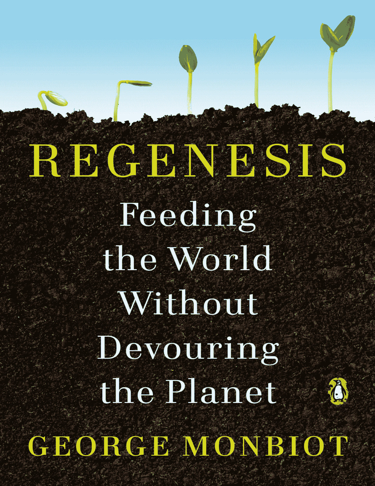

# 再生：在不吞噬地球的同时养活世界

喂养世界而不吞噬地球

# 《再生》读者的赞誉

“乔治·蒙比奥是当今全球气候运动中最无畏且最重要的声音之一。”——格蕾塔·通恩贝（Greta Thunberg），活动家，《每个人都不能小到无法改变》作者

“精辟、令人着迷、至关重要……为我们思考农业、饮食、气候和未来提供了一种全新的思维方式。”

——大卫·华莱士·威尔斯（David Wallace-Wells），《纽约时报》畅销书作家，《不宜居的地球》作者

“这本非凡的书好奇地凝视着我们脚下的土壤，令人信服地指引了我们必须走向的方向之一。我在每一页都学到了东西。”

——比尔·麦金宾（Bill McKibben），《动摇》和《自然的终结》作者

“一本创造世界、改变世界的书……在蒙比奥对激情、慷慨与正义的非凡结合中，它在回响在歌唱。”

——罗伯特·麦克法伦（Robert Macfarlane），《纽约时报》畅销书作家，《地下》作者

“《再生》是一次生动且经过深度研究的探究，直面我们的困境……变革迫在眉睫，而这本书展示了这种可行性。”

——梅林·谢尔德雷克（Merlin Sheldrake），国际畅销书作家，《纠缠生命》作者

“蒙比奥打破了农业的教条，并展示了所有陆地生态系统赖以生存的薄层中充满了生物，这些生物与地面上发现的任何生物一样多样、迷人且神秘。”

——大卫·铃木（David Suzuki），大卫·铃木基金会创始人

> “这是一本重要的书，而且读起来引人入胜。”
>
> ——亨利·丁布尔比（Henry Dimbleby），Leon 餐厅及可持续餐厅协会联合创始人

> “蒙比奥的写作既有伟大故事讲述者的丰富想象力和同理心，又有道德远见者的宏观理解。这是一本优秀且必要的书。”
>
> ——菲利普·普尔曼（Philip Pullman），《黑暗物质》三部曲《纽约时报》畅销书作者

> “各行各业的人都应该读这本非凡的书。在我看来，它是本世纪出现的最重要的二、三本书之一。”
>
> ——大卫·金爵士（Sir David King），英国政府前首席顾问

> “《再生》像诗一样对我们倾诉……它提供了一种全球食品生产的宏大政治经济学，并以人类与自然之间技术伦理平衡的希望愿景结束。它必须一读。”
>
> ——雅尼斯·瓦鲁福基斯（Yanis Varoufakis），《另一个现在》作者

> “《再生》要求的无非一场食物未来的革命——一场将从根本上改变地球面貌的革命……这是蒙比奥的杰作。”
>
> ——凯特·罗沃斯（Kate Raworth），《甜甜圈经济》作者

> “《再生》既严谨又让人放松，同时也幽默、原创且富有人性化的。”
>
> ——休·费恩利-惠廷斯尔（Hugh Fearnley-Whittingstall），《河岸小屋食谱》作者

> “有价值的……非凡的……我从未对蒙比奥带来的意想不到的视角感到惊讶，他带我经历了许多我从未预见的问题和我从未想象过的解决方案。”
>
> ——布莱恩·伊诺（Brian Eno）

“一本引人入胜且最终是积极的书……一个关于如何改变我们与土地利用、农业和食物的关系，并如何改变我们生活的和谐愿景。”

——汤姆·约克（Thom Yorke）

> “一本极具远见、无畏且至关重要的书。”
>
> ——露西·琼斯（Lucy Jones），《大事件》和《失去的伊甸》作者

> “激励人心且引人入胜……一个新未来的变革性愿景，具有修复和喂养世界的潜力。”
>
> ——卡罗琳·卢卡斯（Caroline Lucas），英国议会议员，英格兰和威尔士绿党前领袖

> “一本真正才华、鼓舞人心的书。”
>
> ——蒂姆·史密斯爵士（Sir Tim Smit），伊甸工程创始人

> “蒙比奥将他敏锐的智力、丰富的好奇心和对土地的热爱应用于我们吃什么这一复杂而根本的问题上。”
>
> ——莉莉·科尔（Lily Cole），活动家，《谁关心谁赢》作者

> “蒙比奥追求新思想，这些思想可能点燃集体意识，去保护而非悲剧性地摧毁生物圈。”
>
> ——ANOHNI

> “必读之作……这本深度研究的书为未来提供了蓝图。”
>
> ——罗西·鲍科特（Rosie Boycott），记者、活动家

> “文字、观察和奉献具有具有感染力的吸引力。这种学习是深邃且广博的。”
>
> ——马克·莱兰斯（Mark Rylance），演员

> “《再生》为我们提供了一个鼓舞人心的愿景……蒙比奥结合了他作为调查者、采访者和幽默讲述者的才华，创造了一部令人心潮澎湃的史诗！”
>
> ——罗伯特·纽曼（Robert Newman）

“这本充满激情、非凡的书开启了一个引人入胜且至关重要的新维度：食物以及世界耕作的方式。”

——威尔·亨顿（Will Hutton），《观察报》专栏作家，《墙上的字》作者

乔治·蒙比奥是一位作家、《卫报》专栏作家和环保活动家。他的畅销书包括《野性化：重塑土地、海洋与人类生活》和《热力：如何停止地球燃烧》；他的最新著作是《从废墟中：危机时代的新政治》。蒙比奥与音乐家伊万·麦克拉里南（Ewan McLennan）合作创作了概念专辑《打破孤独的魔咒》，并制作了许多病毒式视频。其中一个改编自他2013年TED演讲《狼群如何改变河流》的视频在YouTube上的观看次数已超过四万次。另一段关于自然气候解决方案的视频是他与格蕾塔·通恩贝共同的，观看次数超过六千万次。

喂养世界而不吞噬地球

我非常感谢几位专家评审员，他们慷慨地抽出时间阅读我的稿件，提出意见和建议，并指出了我的错误之处：Tim Benton, Hannah Ritchie, Tara Garnett, Mary Stockdale, Alisn Pearson, Chloe MacLaren, Dan Blumgart, Tim Benton, Jamie Arbib, Vicki Hird, Erik Meijaard, Tomas Linder, Simon Fairlie, Frank Ashwood, Franciska de Vries, Sarah Wakefield, 以及 John Boardman。剩下的错误都是我的。

非常感谢我亲爱且带给我许多启发的姐姐 Eleanor，感谢 Mark Linas, Joel Scott-Halkes 和 Tong Wu；感谢我的果园同仁 Hugh Warwick，Zoe Broughton, Kate Raworth, Roman Kznaricic, Caspar Henderson, Cristina Mateos, Phil Mann 和 Amanda Smigelski-Mann；感谢 Stewart Young，东区分配地协会，Steve Farmer, Jim Mallinson, Michael Witzel, Anna Morser；感谢 Peter Gauvain、Clem Cheetham 和 Nick Metcalfe 在《启示录》（Apocalypse）上的支持；感谢 Franny Armstrong、Nicola Cutcher 以及《河滨》（Riverside）上全体辛劳的伙伴；感谢我在《卫报》（The Guardian）的老编辑们：Damian Carrington, Nigel Dudley, Mike Mason, Jeremy Lent, Simon Evans, Ben Middleton, Andrew Balmford, Stuart Pengs, David Butler, Jim Thomas，土壤协会，Piero Visconti, Duncan Cameron, Alexandra Sexton, Charles Ssekeywa 以及 Gunnar Rundgren。

## 隐藏在下方

这里是种植果园的绝佳之地，但却是种植水果的糟糕地方。在英国中部，远离海洋的缓冲作用，树木深受晚霜的侵害。寒冷的空气像水一样流动，但在这一片被成排房屋困住的平坦地上，它汇聚并积聚，让果园淹没在寒冷中。

每年，当树木开花时，我的希望也随着花芽的绽放而开启。三年中大约两年，它们会随花一起凋零。霜冻像毒气一样渗入枝条，使花蕊萎缩变黑。

到了秋天，果园就像一张记录春季温度的动态图表。苹果品种在不同但固定的日期开花。除非霜冻异常严重，否则它只会损害开放的花朵。通过结实和未结实的树，你可以判断出霜冻发生的时间，几乎可以精确到晚上。

每一个品种都属于同一个物种：*Malus domestica*，其字面意思是“被驯服的恶”。这种迷人的树木自古以来被贬低的原因很复杂，但其中一个可能是词源学上的混淆：一种水果的方言名称——μᾶlon（或“malon”）似乎从希腊语进入拉丁语，或者在某个地方（可以说）变质为了——*malum*，即“恶”。

这一个好得令人难以信的物种被培育成了数千种不同的形态：食用苹果、烹饪苹果、西酒苹果、干苹果，在尺寸、形状、颜色、气味和口味上种类惊人。我们种植 `Miller’s Seedling`，它在8月成熟，必须在树上采吃，因为运输过程中的轻微震动就会让它半透明的皮肤碰青。它甜而软，汁水多于肉。相比之下，`Wyken Pippin` 在采摘时硬如木头，直到1月才几乎可食用，直到次年5月都保持清脆。我们种植 `St. Edmund’s Pippin`，它的皮像砂纸一样，干燥且带有果味，在9月有两周的香气，之后就会变得松软；还有 `Golden Russet`，它的味道和质地几乎相同，但只有在2月成熟。`Ashmead’s Kernel` 口感脆，带着一丝小茴香，这是我最喜欢的苹果，在冬日达到顶峰。`Reverend W W` 在烘烤时会像你一样膨起，味道像一种顺滑的白葡萄酒。圣诞节烤的 `Catshead` 几乎与芒果泥无二致。`Ribton Pippin`、`Mannington’s Pearmain`、`Kingston Black`、`Cottenham Seedling`、`D’Arcy Spice`、`Belle de Boskoop`、`Ellis Bitter`：这些水果是时间与地点、文化与自然的胶囊。

苹果和梨可以在冬天修剪，而核果类必须在春季或初夏汁液上升时进行修剪。否则，你会让树木易受溃疡病、叶卷病或银叶病的侵害。这意味着你必须执行那种可怕的“亵渎”：在树木开花或结果时切开树枝。雪白的枝条在花瓣的暴风中纷纷落向地。

尽管这种违背感让我感到不安，但我热爱修剪。它本身几乎已经变成了一种艺术，既像雕塑又像管理。当你完成了大的结构性剪枝后，再将剩下的枝条修剪到芽点，让芽点指向你希望新枝生长的方向。随着树木的向外扩展，它会呈现出你赋予它的形状。我偏爱西班牙式造型（或称杯形式），将树木塑成一个宽阔的杯子。如果你操作得当，就能让每一片叶子都能接触阳光和空气，从而无需化学防治就能消除羊毛蚜和霉菌。

当我穿过树林间时，我发现自己正在思考这片土地可能的历史。当我们翻动土壤时，发现了工人们抽用的白色烟斗碎片，其中一些装饰有点点、圆环和藤蔓图案，上面留有制作者的模具痕和指甲印。我们发现了破碎的田间排水沟、一只驴蹄和现代牡蛎壳，这些外壳有时与我们同样挖出的化石 `Gryphaea` 碎片难以区分：那是一种扭曲的、带钩的侏罗纪牡蛎，在当地被称为“魔鬼指甲”。当牡蛎资源充盛时，即使在英格兰中部，牡蛎也是穷人的食物。有一天，我发现了一半颗珍珠，上面为了穿过挂绳子而被钻了一个孔。

在这片土地被城市包围、随后平均分配给镇民之前，这里可能曾被耕种——从田间排水沟和休眠野花种子的组合来看，那里可能是耕地。周围的一些地名包含 `-ley` 或 `-leys` 后缀，这通常意味着临时牧场，在农作物之间用来生长干草和饲料。牡蛎壳集中在我们果园的一个区域，暗示那里可能曾立过一棵树，工人们过去会坐在树下吃午饭，就像我们现在这样做一样。我想象着他们戴着宽大的帽子，散坐在那里，镰刀靠在大橡树扭结的树干旁。

我们在这里也只用镰刀割草，部分部分是为了避免使用化石燃料，部分是为了保护青蛙和土拨鼠。起初，我们胡乱砍割。我们越努力，草看起来就越糟糕。但有一天，我注意到另一块分配地的邻居，一位八十岁的塞尔维亚难民安吉拉，正不可置信地看着我们。

尽管见证并经历过了一切，安吉拉依然能在生活中找到快乐，在人身上发现善良。她秉持着农民的本性，把多余的蔬菜推给我们，解释说现在没人知道什么是真正的蔬菜，而我们也不会如何正确地烹饪它们，那不是她的问题，因为一旦她交出了蔬菜，它们就交给了上帝。我们送给她用来烤的苹果、亚海榛（这种果在巴尔干半岛比这里受欢迎）以及用来酿酒的梅子。

最终，她再也忍受不了。

“不，停！你全做错了！”

她从我手中夺过镰刀。她感受着它的重量，轻微起伏，仿佛在与工具交流。

“我小时候就会干这个。我教教你。”

她稳住刀刃，然后简单地扭了扭宽大的臀部。草平整倒下。她走过行间，没有流汗，留下了一片完美的草坪，割好的草堆在一旁，仿佛每根草都被梳理就了位。

现在，我从樱树上的高处俯瞰地面上残破的枝干。我在树上只留了四根树枝，大致位于方位的各个方向。它看起来毁残了。但它会愈合的。我爬下来开始处理修剪物。没有任何东西被浪费。我们将粗大的树枝留在分配地的门口，人们会把它们拿去当柴：果木切得整齐，燃烧时味道很甜。我把锯屑用在熏炉里：用它烹饪什么，都会带有木头的柔和味道。我们用一些夏天的树枝做豌豆架，剩下的堆起来。五年后，修剪物会分解成肥沃干燥的堆肥。我们将它们洒在树的滴水线周围。一家刺猬从我们的（此处原文不完整）小宝宝蹒跚着爬上土堆。它们闻了闻我的手。当它们试着咬时，我很害怕。我注意到其中一只是一只甲虫。我从未见过这种东西。它巨大、绿色且闪着光。我把它捡起来，让它在我的手上爬。它的感觉像一块温暖的石头。我把它放回草地上，看着它消失。

我们都受到土壤的影响，程度远超过我们愿意承认的程度。我们看到别人看到的，忽视他们忽视的。我们可能会对那些聚光灯关注的小小数字进行激烈争论，却默许且无意识地忽略其他更重要的话题。很少有事物对我们来说既如此重要，又如此隐晦。土壤充满了生命，尤其是真菌。它们是世界的分解者。它们分解落叶和根部，将它们转化为植物可以使用的养分。这是一个生命、死亡与新生的不断循环。土壤是一个自成的世界，而我们才刚刚开始理解它。

## 褶足螨的奥秘

它听起来可能没有“斯芬克斯之谜”那样浪漫，但我发现它非常迷人。褶足螨是螨类的一个亚目中的亚类，而螨类又是节肢纲的一个亚纲，节肢纲包含了蜘蛛在内的动物。它们微小且形似螃蟹，初看之下平平无奇。在手一把土壤中，可能有上百种褶足螨，它们似乎都占据着同一个生态位。生态学家习惯于单一物种占据单一生态位，因为一个物种会竞争过其他物种并占据优势。但这里有数量惊人的同缘动物，形状、大小和颜色各异，它们生活在一起，似乎在做着同样的事情。这怎么可能呢？

列奥纳德·达芬奇曾评论，我们对天体运动的了解比对自己星球土壤的了解要得多。这在今天依然如此。

我第一眼看到的是一片骨碎片、一颗漂白的梅果核和一块蓝色陶瓷碎片。然后我仔细观察，发现了一只鼠妇和一只透明的小马陆，它的腿沿着身体像波浪一样卷曲又舒展，侧面的红点像维京长船上的盾牌。一只栗马蚣飞快掠过，一节一节地没入一处深色的凹陷处。有焦糖甲虫幼虫和成簇的透明球体，里面含有蜗牛胚胎的微弱白色月牙。幼苗如迷宫般的茎穿插在土壤基质中，试图寻找光亮。

我抓一撮土壤揉碎，放在细筛上，然后在明亮的光下将其放在一个漏斗上，漏斗通向一个装满谷物的试管。我用木子撑起实验架防止它倒下，让它在阳光下“烹煮”。

# 褶足螨的奥秘

它听起来可能没有“斯芬克斯之谜”那样浪漫，但我发现它非常迷人。褶足螨是螨类的一个亚目中的亚类，而螨类又是节肢纲的一个亚纲，节肢纲包含了蜘蛛在内的动物。它们微小且形似螃蟹，初看之下平平无奇。在手一把土壤中，可能有上百种褶足螨，它们似乎都占据着同一个生态位。生态学家习惯于单一物种占据单一生态位，因为一个物种会竞争过其他物种并占据优势。但这里有数量惊人的同缘动物，形状、大小和颜色各异，它们生活在一起，似乎在做着同样的事情。这怎么可能呢？

列奥纳多·达芬奇曾评论，我们对天体运动的了解比对脚下土壤的了解要多得多。这在今天依然如此。

## 土壤微观世界的初探

我第一眼看到的是一片骨碎片、一颗漂白的梅果核和一块蓝色陶瓷碎片。然后我仔细观察，发现了一只鼠妇和一只透明的小马陆，它的腿沿着身体像波浪一样卷曲又舒展，侧面的红点像维京长船上的盾牌。一只栗马蚣飞快掠过，一节一节地没入一处深色的凹陷处。有焦糖甲虫幼虫和成簇的透明球体，里面含有蜗牛胚胎的微弱白色月牙。幼苗如迷宫般的茎穿插在土壤基质中，试图寻找光亮。

我抓一撮土壤揉碎，放在细筛上，然后在明亮的光下将其放在一个漏斗上，漏斗通向一个装满酒精的试管。我用木块撑起实验架防止它倒下，让它在阳光下“烹煮”。

## 跳虫：土壤中的隐形巨人

然后我掰下一块土块，拿出我的40倍放大镜，找到焦距。我一找到，大地就瞬间活了过来。我首先看到的是一只跳虫：一种柔软的橄榄色生物，圆圆的，略微毛茸茸，像一个打结的玩具，正逃离光线。现在我看到了一个，我发现到处都是：有小灰色的，长度不到一毫米；有白色的；还有一种三厘米长、闪烁着彩虹灰、粉色和蓝色的巨人；以及一种驼背的琥珀物种，像一小滴蜂蜜。

跳虫看起来有点像昆虫，但它们自成一类。它们的数量多得惊人：有时每平方米土地下有10万只或更多。它们可以是雄性的、雌性的、雄同体的（两者兼具），或孤雌生殖的，这意味着它们可以通过“处女产”进行繁殖。它们几乎无处不在，甚至在南极，并存活了过去4亿年来的每一次灭绝事件。在世界许多地区，它们编织了整个土壤食物网：换句话说，它们是连接陆地上大部分生命的通道。但大多数人并不知道它们的存在。

## 蚁界：生态系统工程师

当我追着跳虫时，一只巨兽填满了镜头。我向后退去。我花了一会儿才意识到那是一只蚂蚁。当我环顾四周，发现自己正处于蚁界的边缘，这意味着受蚂蚁影响的区域。离我肩膀近处有一个蚁丘，高近40厘米，黄草蚁在我清理完灌木丛后，几乎就开始建造它们了。

这些蚁丘像混凝土一样。当我修剪梅子芽或共生灌木时，我知道自己碰到了其中一个边缘，因为工具会突然停住，震得我的手发麻。蚂蚁从底土带回粘土并与其唾液混合，制出足够坚固的水泥来支撑它们凹凸且充满历史感的圆顶，如果按比例换算到人类居住，这相当于100米高的塔。[27] 它们带着蚜虫，蚜虫吸食植物纤细的根，并产生蚂蚁赖以生存的蜜露。

它们是生态系统工程师，影响着它们区域内的所有生命。在果园里，我注意到婆香地锦（一种小蓝花），它选择性地占据了蚁丘的顶部，而周围生长的草比其他地方更茂密、更深。蚂蚁在摩天大楼及其周围聚集营养，无意中滋养了那些适应与它们共生的生物。每个蚁丘的东南面都是平坦的，像太阳能板一样倾斜，以便在早上吸收热量。

## 蚁虱：伪装大师

发现蚂蚁后不久，我发现了一个白色壳类动物，只有一毫米长。当我凑近一看，发现那是一只蚁虱。与亲属不同，它可以在这些凶猛的生物中生存而不被撕碎吃掉。更令人印象深刻的是，它能说服它们喂食自己，用触角抚摸它们并乞求，直到它们吐出通常在内部分享的食物颗粒。[8] 黄蚁几乎是盲目的，而蚁虱似乎通过掩盖气味来欺骗它们。气味和触角的抚摸让它们相信它是姐妹中的一个饥饿成员。然而，如果伪装被识破，蚂蚁发动攻击，它就会抬起口上的两根角，向它们的脸上喷射胶水，卡住它们的下颚。

## 蜈蚣与螨类：捕食者与分解者

我暴露了一只长蜈蚣，在放大镜下极其恐怖，像一只中世纪的大虫。它咬合着，毒液从那里流出，它在黑暗中爬行。相比之下，圆圆的、覆盖着甲壳的马足螨在迷宫中穿行。在土壤中，马足螨数量惊人，像跳虫一样。褶足螨比跳虫还多，它们在土壤中无处不在，在某些地方，数量达百万级。它们是雄同体的，或孤雌生殖的，这意味着它们可以通过“处女产”进行繁殖。它们几乎无处不在，甚至在南极，并存活了过去4亿年来的每一次灭绝事件。在世界许多地区，它们编织了整个土壤食物网：换句话说，它们是连接陆地上大部分生命的通道。但大多数人并不知道它们的存在。

我被一个惊人的想法震撼了。在这片裂开的土壤中，我看到的生命的主要分支比我在塞伦盖蒂草原或任何其他生态系统中看到的都要多。这里有昆虫和甲壳类动物、螨虫和蜘蛛、多足类（蜈蚣）和倍足类（马足）、跳虫和蚯蚓、线虫、软体动物以及我从未见过的生物。

……

土壤之所以能支撑如此丰富的生命，是因为其巨大的表面积。在极端情况下——即最细的粘土——单克克（干燥时约半茶匙）如果将其所有表面都平铺开，可以覆盖 800 平米，这个面积略大于我们的果园。同样重要的是，土壤远非我曾经感知到的那种无差别的块体，而是一个由区域和结构组成的全球性城市，不同的文化居住在相邻的教区。其中一个区域是蚁界，即蚁穴，它本身又划分为下属辖区。但生态学上更重要的是植物根周围的狭窄区域，被称为根际。人类赖以生存正是这个区域。当你掰开土块时，根部非常密集，感觉就像织物在撕裂。

我将注意力转向一根微小的根毛。肉眼看来，它只是单根纤维，细如棉线。在放大镜下，我看到它被许多更细的毛包裹并结霜，在阳光下像晶体一样闪闪发光。每根根须都有它们，甚至在生长端，而在这一年的这个时候，这些生长端最多才只有一两天。有的像胡须，有的织得如此紧密，让我想起熨斗线周围磨损的尼龙网。它们是真菌的丝体，真菌的生命与植物的生命交织在一起。

在大多数情况下，我们看到的并不是真菌的子实体，尽管蘑菇和毒蝇伞也与植物建立关系。绝大多数——也许有数百万物种——只生活在土壤中，其中许多穿过它们所依赖的植物根并从中增殖。大多数植物依靠这些真菌从土壤中收集矿物质和水分[11]。植物通过光合作用产生碳水化合物和脂质来养真菌；真菌则用氮、磷和其他元素来养植物，这些元素从地面上获取并传输的效率远高于植物所能达到的水平。它们微小的丝体钻入即使是最细的根毛也无法探索的孔隙和缝隙，它们释放的酶和酸分解了植物无法分解的矿物键。

这种互惠的共生关系与第一批陆地植物一样古老，已有约 4.6 亿年的历史[12]。当藻类从水中出现时，它们没有根：在海洋中，它们可以直接从水中吸收养分。为了生存，它们需要与早已殖民土地且实际上无异于根的真菌建立关系。正如我们现在知道自己并非以前想象的那种单一个体，而是一个由数十亿微生物和承载它们的多细胞系统组成的社区一样，我们现在不能把植物看作坚韧的个体，而是互相关联生物的联合体，它们汇聚力量创造出如此复杂的生命形式，以至于我们才开始理解它是如何运作的。

在像我们果园这样植物生长良好的地方，每克土壤中就有大约一公里的真菌丝体[13]：不足半茶匙的土壤里就有一公里。每种真菌的丝体形成了一个被称为菌丝体的致密网络。在某些森林中，单个真菌的菌丝体可以延伸过几平方公里的土壤，尽管大多数要小得多。它们不断生长和退缩，形成新的关系，改变既有关系的条款，相互交织，将养分从一处转移到另一处，在为其宿主植物服务的同时确保自身的生存。其中一些丝体将数百株植物的根部连接在一起。

糖分有时会从健康大树或生病树的根部移动，这一发现引起了人们的极大兴趣，他们将其视为植物利他行为的证据。但正如梅尔林·谢尔德雷克（Merlin Sheldrake）在他精彩的真菌书籍《纠缠生命》（Entangled Life）中所暗示的那样，更有可能的解释是真菌实际上在“经营”它们的宿主，将食物从一株植物转移到另一株植物，以确保所有它们依赖的生物存活[14]。

谢尔德雷克还探索了真菌菌丝体是一种智能生命的可能性。它具有方向记忆。它能穿越迷宫。它可以从网络的一端向另一端发送信息，根据其受到刺激的位置改变反应。在发现真菌丝体可以传导类似于动物感觉神经细胞中运动的间隔电脉冲后[15]，一些研究人员将菌丝体内数百万个连接点视为决策门或处理器，并将网络视为类似于计算机的东西。

真菌对于与其共生的植物的健康至关重要。也许比它们的绿色伙伴程度更大，它们将土壤交织在一起[15]，保护土壤免受侵蚀，吸收落在其上的雨水，锁住碳含量。

……

这一切，你可能会想，已经足够不凡了。但我用放大镜看到的仍然是非同寻常的。

这里有一个改变了我们过去对维持我们生命的系统之全部认知的事实。在植物通过光合作用产生的所有糖中，它们会将 11% 到 40% 释放到土壤中[16]。它们并不是意外泄漏的。它们是刻意将糖泵入地下的。更奇怪的是，在释放它们之前，它们会将部分糖转化为具有极大复杂性的化合物，拥有不可思议的名字，如 `2,4-二羟基-7-甲氧基-2H-1,4-苯并嗪-3(4H)-酮`。制造这样的化学品需要能量和资源。乍一看，将这种昂贵的混合物倒进地下看起来是疯狂的：用人类的话说，就像把钱扔进水里。它们为什么要这样做？答案开启了通往秘密花园的大门。

这些复杂的化学物质并不是随机倾倒在土壤中，而是进入根部周围的区域[17]，根际。它们的释放是为了与所有赖以生存的生物创造并管理一系列奇妙的关系。

土壤中充满了细菌。它的泥土气味是它们产生的化学物质的气味。雨后土香（干燥地面首次被雨水时释放出的气味）部分是由一类被称为放线菌的细菌引起的。之所以没有两块土壤具有相同的微生物群落，是因为可以说，每块土壤都有其独特的“风土”（terroir）。生物学家将微生物称为“针眼”，降解物质中的养分必须通过这里才能被食物网的其他部分循环[18]。

微生物遍布整个土壤，但在大多数角落、在大多数时间里，它们处于悬浮状态，处于一种休眠状态等待着能唤醒它们的信息。当植物推入一团土壤并开始泵出信号物质和糖分时，它会引发活动的爆发式增长。对其反应的细菌消耗植物提供的丰富汤液，并以惊人的速度增殖，形成了地球上最密集的微生物群之一。根际每克土壤中可能有十亿个细菌[19]，这些细菌收集并释放植物生存所需的许多养分。根际中的细菌连同根部交织的真菌[21]，以及其他微生物，捕捉土壤中的铁、磷和其他元素，并让植物能够利用。它们分解复杂的有机化合物，使其被根部吸收[20]，独特的是，细菌产生生长激素和其他特定的化学物质来帮助植物生长。释放到土壤中的某些化合物的复杂性在于，它寻求的不是唤醒细菌，而是特定的、最有效的细菌促进其生长[21]。植物通过化学语言进行交流，只有它们想要交流的微生物才能听懂这种语言。

这种语言随地、随时间而变化，取决于植物的需求[22]。当植物缺乏某些营养元素，或者土壤过于干燥或盐碱化时[23]，它们会呼唤那些能够克服这些限制的细菌。一些生物学家将此描述为它们的“呼救”。作为对化学呼救的反应，特定的细菌群会在它们的根部周围繁殖。

当你从这些事实中退后一步看时，你会发现一些正改变着我们对地球上生命的认知。根圈位于植物之外，但它对植物健康和生存的本质性与植物自身的组织一样关键。实际上，它是植物的外部肠道[24]。

根圈与人类肠道（细菌也以惊人的数量生活在其中）之间的一些相似之处令人不可思议。在两个系统中，微生物都会将有机物分解为植物或人类可以吸收的简单化合物。尽管细菌有超过 1000 门（大类），但同样的四门[25]细菌主导了根圈和哺乳动物的肠道[26]。也许这四组细菌具有某些特征，使它们比其他细菌更容易准备好进行合作。

在人类中，婴儿的免疫系统不如成人活跃，这使得广泛的细菌能够在我们的肠道中定植。同样，幼植物释放到土壤中的防御化合物比老植物少，允许各种微生物殖民它们的根圈[27]。人类乳汁含有一种称为低聚糖的糖。起初，科学家们苦于理解为什么母亲会分泌这些化合物，因为婴儿无法消化它们。它们似乎唯一的目的是为了喂养随孩子成长的细菌。它们选择性地培养一种特定的细菌种类[28]，这种细菌在帮助肠道发育和调节免疫系统方面起着至关重要的作用[29]。同样，幼植物向土壤释放大量的蔗糖，以喂养发育它们的新微生物群。

与人类肠道一样，根圈不仅消化食物，还帮助植物免受疾病侵害。正如生活在我们肠道中的细菌会竞争并攻击入侵的病原体一样，根圈中的微生物会在根部周围形成一个防御圈。植物喂养益生细菌，从而挤掉病原微生物和真菌[28]。

植物有时会发动化学战，释放毒害或抑制有害微生物的化合物，同时鼓励有益的微生物[29]。某些化学攻击是如此精确，以至于它们可以击败某种细菌的致病品种，但不会影响同物种的有益基因变体[30]。有时，植物和细菌会共同对抗共同敌人，产生相同的防御化学物质[31]。有时，植物发出的求救信号会诱发友好的微生物用抗生素攻击它们的竞争对手[32]。有时，如果有害真菌成功入侵根部，植物会放弃通常的防御并允许某些细菌种类也入侵，然后在根部组织内部战斗并抑制真菌[33]。

病原体会反击，用致命的“效应蛋白”打击辅助微生物[34]。某些病原物种已经进化出可以在那些旨在抑制它们的化合物上生存。某些真菌和昆虫害虫利用植物的压力信号来定位并攻击它们[35]。

植物还会向更大的生物求救。当昆虫攻击它们的根部时，它们向土壤中释放挥发性化学物质，吸引特定种类的线虫[36]。我在试管中发现的那些小白虫。这些线虫用尖利的喙刺破地下毛虫的皮肤。然后它们钻进体腔，吐出生活在肠道内的发光共生细菌。这些细菌产生一种杀死幼虫的杀虫剂和清除已经生活在昆虫内的微生物的抗生素。然后它们从内部消化毛虫，而线虫则食用繁殖的细菌。

线虫的数量会爆炸式增长，有时在一具腐烂的毛虫尸体内就能产生 400,000 只幼虫[37]。它们从松弛的皮肤破土而出，寻找新的猎物。这些猎物可能很容易找到，因为发光细菌让猎物显形。在 1862 年的西洛河战役期间，成千上万的士兵在泥土中战斗，由于双方伤亡人数巨大，医生们注意到从受伤的士兵身上发光。医生们观察到，发光的士兵存活率更高，那些没有发光的士兵死亡了。在根圈的微生物群中，由于线虫的感染，他们将其称为这种“光”[38]。这种“光”的解释是在 130 年后提出的，当时一位十七岁的高中生威廉·马丁根据直觉，说服了他的詹森·柯蒂斯协助他调查[39]。他们的论文获得了一项科学奖。

……

肠道菌群。但它也可以应用于任何生态系统的揭示[49]。

一项有趣的研究方向表明，微生物丰富且平衡良好的土壤能够抑制导致人类疾病的病原菌[50]，这使得通过食物传播人类疾病的可能性降低[51]。我们的健康取决于土壤的健康，这种依赖既是显而易见的，也是隐藏的。

研究人员发现，就像健康和不健康的肠道生物群一样，土壤也可以对疾病具有“抑制性”或对疾病具有“促进性”。当植物死去时，它们会将自己在土壤中培养的细菌留作遗产，保护那些生长在它们种子中的后代。一些研究人员正在尝试农业意义上的“粪便移植”。正如医生从健康的人身上采集粪便并移植到不健康患者的肠道一样，一些农业科学家推测，将抑制性土壤植入不健康的“易感性”土地，可以抑制病原菌和真菌[52]。

……

D 洞里的某个东西引起了我的注意。那是一个巨大的蚯蚓，悬挂在空隙，无疑在疑惑它的地洞去到哪儿了。我突然感到愧疚。我了解到蚯蚓的洞可以持续多年，有时甚至几十年，并且像我们的家一样，被世世代代地使用[53]。它们形成了另一个关键土壤结构组成部分：蚯蚓带或称钻土层（drilosphere）。

每公顷草地，都可能被 8,000 公里的蚯蚓洞贯穿[54]，这些洞往往能使土壤透气，并帮助水分渗透其中。一个实验表明，在原本缺失蚯蚓的土壤中引入蚯蚓后，在十年内，落在地上的水渗透率几乎增加了一倍[55]。这意味着从地表蒸发的水减少了，因此流失的土壤也减少了，更多的水到达了植物根部。据估计，蚯蚓洞使土壤侵蚀率降低了一半。它们的影响随地和季节而异。在其他情况下，蚯蚓通过将松散的土壤带到表面，可能会使土壤孔隙性降低或提高侵蚀率。

蚯蚓将落在地上的几乎所有的叶子、茎和树枝都拉进洞中[^56]。像鸟类一样，它们吞下小石头和砂粒，并利用它们在胃石里磨碎这些死植物残体。它们肠道内的细菌帮助消化它们，某些物种随后会将它们无法吸收的所有物质以粪便的形式排泄到土壤表面。

这种活动的综合效应是惊人的。在像这样的果园里，蚯蚓每年每公顷土地可以向表面带出 40 吨土壤[^57]，在热带草原，这种周转量可达 1,000 吨[^58]。破旧的建筑慢慢消失在地下，并不是因为它们沉降了，而是因为蚯蚓不断从表面挤出的土壤在它们周围升起[**]。由于蚯蚓进食了有机物质，它们的粪便比土壤的其他部分富含矿物质。通过磨碎死植物，它们让养分能够被细菌和真菌利用，而这些微生物反过来又让活植物利用。在有蚯蚓的地方，地上植物动物的平均重量比没有它们的地方高出 20%[^59]。

蚯蚓还会释放植物生长激素[^60]，尽管目前尚不清楚它们是直接释放的，还是诱导细菌产生的。有时，蚯蚓能让植物对寄生线虫[^61]和吸汁昆虫产生更强的抵抗，要么通过释放养分，要么通过化学信号触发它们的免疫系统[^62][*]。反过来，植物利用它们的化学物质来控制蚯蚓的行为[^63]。我们对任何生态系统的观察越深入，发现的复杂性就越大。

在我的土块里，我发现了一个像柠檬形状的皮革质感的物体，长约七毫米。它让我想起曾被用作足球的干燥、膨胀的猪膀。通过放大镜，我可以在里面看到一条跳动的条纹，相对强弱交替，就像血液在血管中泵动。这是一条幼虫，正在茧内发育——这种繁殖方式和土壤里的其他一切一样奇特。在蚯蚓交配后（一个物种内的任何蚯蚓都可以与任何蚯蚓交配，因为它们雌雄同体），身体中间的马鞍会变硬。然后，一个含有卵和精子的壳会从马鞍上滑落到蚯蚓头部，在滑落时两端会挤压，并形成茧。

当我开始处理这块土时，我想起了一件我无法完全确定的事情。现在我想起来了：那种感觉就像我第一次浮潜。然后，就像当我冲出水面时，发现自己置于一个新世界，从上面看是察觉不到的。我一想起这些，土壤开始看起来像一片珊瑚海。像海洋一样，拥有珊瑚礁和开放水域，它有结构化强区域和结构化较弱的区域：生物活动剧烈的地方（如根际圈、钻土层和蚁穴圈）以及大型捕食者在其中游荡的体相土壤：那里有蜈蚣和甲虫，而不是鲨鱼和海豚。

像珊瑚礁一样，结构最复杂的区域富含共生关系。珊瑚是源自岩石的矿物质与动物、植物和微生物合作、竞争的结合体，利用这些矿物质形成结构；而土壤是由生物体利用死物质构建的生态系统[6]。土壤的健康和肥沃——并因此世界上大多数陆地生物的生存——取决于其生物学相互关系。它在视觉上可能没有珊瑚那样美丽，但一旦你开始理解它，它在智力上是美的。

事实上，我们忽略了这个生态系统，投入其中的资金和精力是如此之少，以至于我们才开始挖掘它的复杂性。用于研究土壤的小资金大部分花在了杀死它的新方法上。我的一位大学导师告诉我：“我研究昆虫是因为我爱它们。但我能获得的资金却是为了杀死它们。”与许多研究其他系统的专业小组相比，地球上还没有土壤生态学。我们曾视为均匀块体的土壤，实际上是由结构嵌套结构组成的。蚯蚓、根系和真菌通过它们产生的碳基聚合物（或胶结）将微粒粘在一起形成团块。通过这种方式，它们稳定了土壤并为自己创造了栖息地。随着时间的推移，这一过程建立了越来越复杂的建筑：水、氧气和养分通过的孔隙和通道。换句话说，土壤就像蜂巢或海狸坝：一个由生物为了确保生存而构建的系统。这些团块之间存在不同形状和大小的孔。它们周围包裹着水膜和植物释放的复杂化学物质。每一个团块和空隙都有其特性，为不同物种提供了无数生态位。2020 年，科学家提出了可以被视为迈向“土壤理论”的第一步[66]。这意味着他们开始理解土壤了。这听起来可能很奇怪，但直到现在，我们才真正掌握了我们赖以生存的基质。微生物通过分泌碳基聚合物（或胶结）将微粒粘在一起来形成团块。在此过程中，它们稳定了土壤并为自己组装了栖息地。随着时间的推移，这一过程建立了越来越复杂的建筑：水、氧气和养分通过的孔隙和通道。换句话说，土壤就像蜂巢或海狸坝：一个由生物为了确保生存而构建的系统。与这些简单的结构相比，它变得不可测量的复杂，如同错综复杂的迷宫，是由细菌、植物和土壤动物无意识地创造的。换句话说，土壤的行为就像菲普·普尔曼小说中的“尘”：它自发地组织成协调的世界。这些世界建立在分形尺度原理的基础上。这意味着无论使用什么放大倍数观察，其结构都是一致的。这种自组织、适应性的世界由微生物、植物和动物自我构建，有助于解释土壤在面对干旱和洪水时惊人的结构韧性：它度过了本会将其化为无形粉末的危机。但这些发现可能也可以解释为什么土壤在耕作时会开始分解。当农民或园丁在某些条件下施用氮肥时，微生物通过消耗土壤中的碳来做出反应，其中大部分储存在构建这些地下迷宫的聚合物中[67]。没有了水泥，整个结构——以及整个系统——开始瓦解。孔隙塌陷。通道坍塌。氧气和水无法再次渗透。由于土壤具有分形尺度特征，当微观结构崩溃时，宏观结构也随之崩溃：它变得潮湿、紧实、缺氧。矛盾的是，在过度施肥的土壤中，植物根系难以获取它们所需的养分。

土壤空间复杂性的倍增在于其随时间变化的复杂性。一小粒土壤中的机会每小时都会发生剧烈变化：随着它干燥或变得饱和，随着细菌消耗其含有机物，随着根须进入其中并释放糖分和复杂的化学物质，随着蚯蚓吞噬并排泄它，随着蚁群用唾液粘在一起，或者当较大的土壤动物（如田鼠、兔子或獾类）挖掘并翻动它。

这些在空间和时间上的波动创造了某些生态学家所说的“热点”和“热时刻”[68]，即生物活动剧烈的地点和时刻。这些无尽的变异构成了一个奇妙的生物学概念：哈金森超体积空间[69], [70]，它描述了促进不同生物生存的多维度机会[71]。广而言之，一个系统在空间和时间上越复杂，它所支持的多样性就越大。

健康土壤那巨大的哈金森超体积空间可能解释我之前提到的谜团：龟螨类的谜团。数百种同类的螨虫如何在同一时间、同一地点共同生活，显然在做着同样的事情，而没有一个或几个占据主导地位并导致它们灭绝！可能的答案是——因为我们对土壤的理解是如此贫乏——它们看起来像是在同一时间、同一地点生活，但事实并非如此。它们可能各自利用我们未能检测到的微小热点和热时刻[72]。

我必须不断提醒自己，土壤的存在并不是为了我们的利益。它并不是试图帮助我们种植食物。像所有复杂的自组织系统一样，它寻求自身的平衡。当我分配土地的邻居们（他们中许多人对生态非常敏感）谈论创造“耕整的土壤”或“细腻的土质”时，他们无意中谈论的是破坏这群惊人生命所占据的许多生态位。当我们谈论为了种植作物而“破土”时，这个短语在某些从未被预料到的层面上是恰当的。

……

在两个小时的探索后，我发现自己甚至还没有从铲上取下一公斤土壤，我如此迅速、如此深深地吸入了这新世界。我还没有完成其中的一半工作。但我的背已经僵硬了，该去吃午饭了。一片薄薄的云捕捉了阳光。我将土壤推回洞中，填好翻动过的地方。当我站起来时，我意识到自己满身樱花瓣，花瓣从树上剩下的枝条像雪一样落在我身上。

关于土壤的知识教会了我，比以往任何时候都更深刻：我们是根据碎片化且浅层的信息建立我们的真理的，而在这些信息之下，隐藏着我们难以想象的现实。被广泛接受的主张基于道听途说和神话，而科学发现无论多么具有戏剧性和引人入胜，在少数专家圈之外，也几乎不为人知。

在研究这本书时，我发现这种感知与现实之间的鸿沟适用于我们食物系统的几乎每一个方面。我们对食物和农业的信念被寓言和比喻所主导，它们描述的不是世界本身，而是一个理想化的、简化的星球，促使我们犯下毁灭性的错误。接下来是我尝试讲述一个新故事——一个“再生”（Regen），关于我们吃什么以及如何生长它，一个桥接科学发现与大众信仰之间鸿沟的故事，并拥抱生命世界迷人的复杂性。

每一个关于土壤的问题都会分化成进一步的问题。每一个答案都揭示了一场越界关系的爆发，并开启了一个新的研究领域。我们对地球生命的理解越多，它就越显得错综复杂且关联紧密，它对物理环境的作用也越大。正如环保主义者约翰·缪尔的名言：“当我们试图孤立地提取任何事物时，我们会发现它与宇宙中的万物都相连。”土壤可能是所有生命系统中最为复杂的。然而我们却把它视作泥土。

## 展望

每一个复杂系统都比我们想象的要精妙、迷人。所有复杂系统都是令人惊讶的，在某些方面都是相似的。无论是生态系统、大气系统、洋流、金融系统还是人类社会，同样的原则都在指导它们的行为。

这些原则中的第一个是它们具有**涌现属性**。这意味着它们的组件无论每个多么简单，在聚集在一起时都会表现出复杂的行为。它们还会**自我组织**，自发地创造秩序，而无需中央控制。即使系统是由人类行为催化的，当它达到某种复杂性水平时，也无法从顶层进行控制。通过数十亿次决策创造的网络，比我们对它们的理解要复杂得多。它们的运行方式诡异且违背直觉，有时会产生与任何人意图完全相反的结果。[2]

1939年，正当科学家首次开始描述复杂系统时，[3] 约翰·斯坦贝克在《愤怒的葡萄》中直觉地察觉到了这些系统是如何开始主导我们的生活的：

> 这种情况是：银行里的每一个人都厌恨银行所做的事，但银行确实在做。我告诉你，银行不仅仅是人的总和。它是一个怪物。人创造了它，但却无法控制它。

复杂系统具有**阈值**。它们可以吸收一定程度的变化而不改变其行为方式，突然它们的自组织结构就会崩溃并随之坍塌。这些阈值很难识别，直到它们被跨越。它们通常被称为**临界点**。一个系统在某些条件下可能是安全的：它的自组织属性稳定了它。但当条件发生变化，并被推向阈值时，自组织属性就会产生相反的作用，放大混沌。[4] 系统开始通过网络传递冲击，这些冲击会相互叠加并加剧。此时，一个微小的扰动就可能使整个系统跨越阈值，导致其突然且不稳定地坍塌。

崩溃的结果之一是系统可能会翻转到一个完全稳定的状态，在许多情况下，它具有自己的自我强化属性，这些属性使其稳定和安全；一个已经翻转的系统很难、有时无法翻转回来。通常情况下，逆翻转所需的能量比导致翻转所需的能量得多。[5] 这种情况被称为**滞后现象**。

生态科学中的一个经典案例是肥料径流对湖水的污染。当污染水平达到临界点时，生态系统会突然转变，以肥料为食的微生物使水质从清澈变得浑浊。你无法通过降低水中肥料浓度到该临界点以下来使其转回。要清澈水质，你必须将额外的营养几乎减少到为零。[6] 将系统推向一个新的稳定状态就像踢掉卡住山顶巨石的小石子。逆转滞后现象就像把巨石推回山顶。

一个系统的崩溃可能会引发与其相互作用的其他复杂系统的崩溃。[7], [8] 例如，美国的“尘盆”事件是由多年来密集耕作对土壤造成的渐进性损害引起的。这种损害使土壤系统接近临界点。当20世纪30年代干旱袭来时，土壤结构发生了迅速且灾难性的崩溃。[9] 在短短几年内，风力平均每公顷南部平原被带走了惊人的1,000吨土壤。[10] 四百万公顷土地失去了几乎所有的肥沃表层土。粮食生产陷入崩溃，随之赖以生存的农业社区也随之瓦解。1937年，美国政府的一份报告简洁地描述了该系统的滞后性：“一个人无法阻止尘土飞扬，但一个人可以让它飞起来。”[11]

如果全球金融系统在2008年跨越临界阈值，它的崩溃将引发整个人类社会的连锁故障。只有通过数万亿美元的全球救援，才将其推回了更安全的状态。即使在滞后现象发生之前，停止崩溃所需的能量（或金钱）也比导致崩溃（通过美国次贷危机）所需的能量更多。物种灭绝事件似乎是传染性崩溃的另一个例子。当一个生态系统或地球系统倒塌时，它可以拉下与其相互作用的系统。[12]

虽然精确的阈值难以或无法定位，但我们现在对系统的行为有了足够的了解，可以预测它们是韧性的还是脆弱的。令人着迷且令人胆寒的是，我们不再需要知道该系统是什么（无论它是极地冰架还是保险网络），就可以判断它是否可能崩溃。[13] 我们需要知道其组成部分的数学数值。[14]

科学家将复杂系统表示为**节点**和**链接**的网格。节点是旧式渔网上的结，而链接是连接它们的绳索纤维。例如，在食物网中，节点可能是植物或动物物种，而链接是它们之间的捕食关系：谁吃谁。在金融系统中，节点是银行和其他主要参与者，链接是它们之间的商业和制度关系（通常也涉及谁吃谁的问题）。

如果节点以多种不同的方式行为，且它们彼此之间的链接很弱，那么该系统很可能具有韧性。如果节点以相似的方式行为且连接紧密，那么它很可能是脆弱的。[15] 这是因为相似节点的行为可能会发生同步，因为它们受到相同扰动的影响，而强力连接确保了扰动在整个网络中产生共鸣。例如，在2008年危机发生前，大银行由于追求相同的利润来源，开发了类似的策略和管理风险的方法。[16] 它们以监管机构难以理解的方式（部分通过证券化和衍生品交易）彼此紧密连接在一起。[17] 当雷曼兄弟破产时，它威胁要将所有人下水。

某些节点——那些与其他连接最多的节点（例如大银行）——事实上比其他节点重要得多。[18] 如果它们内爆，它们的失败会将整个系统引入崩溃。

另一个问题是**“模块化”**：系统在多大程度上被分为不同的区域？[19] 如果系统的不同部分之间具有某种程度的隔离，整个网络更有可能具有韧性，因为冲击不太可能扩散。[20]

理想情况下，网络将包含**断路器**（类似于电气系统中的保险丝），以防止传染性崩溃的扩散。应该有一个备份系统在主网络旁边运行，遵循完全不同的原理。系统中应该有足够的**冗余**（备用容量）：这起到了减震器的作用。当你从这些韧性规则的角度回顾，会发现令人不安的问题。我们改进自身性能的努力往往削弱了整个系统。将业务与其他更紧密地连接可能对自身的生存至关重要，但可能会使网络变得更加脆弱。设定共同标准使贸易更快速更方便，但它确保了所有节点（在此情况下为国家）以相同的方式运行。全球化赋予了人们和国家更大的范围，但它破坏了模块化并扫除了断路器。我们创造的系统的内在属性是它们变得更加复杂、更加连接，且人类难以理解。即使在考虑愚蠢或恶意行为的影响之前，仅仅通过对自身利益的显理性追求，我们也威胁到了我们所依赖的网络。在寻求安全的过程中，我们让自己暴露在了灾难之中。

与六年前相比，蛋白质减少（尽管令人惊讶的是糖分并没有增加），根类和块茎类减少了[26]，其他蔬菜种类减少，水果略有增加。我们的大部分食物来自极少数物种。仅四种植物——小麦、大米、玉米和大豆——就占了农民种植的作物热量的近60%[27]。

这些作物集中在生产效率最高的地区。仅有四个国家（美国、阿根廷、巴西和法国）收获了出口到其他国家的76%的玉米[28]。五个国家（泰国、越南、印度、美国和巴基斯坦）卖了全球77%的大米，而五个国家（美国、法国、加拿大、俄罗斯和澳大利亚）卖了65%的小麦[28]。只有三个国家——巴西、美国和阿根廷——生产了全球86%的大豆（这反过来又提供了农场动物四之三的饲料）[29]。因此，我们在全球标准食物供应上对美国的依赖程度高得惊人。

在十八年里，大米出口国和进口国之间的贸易连接增加了一倍[30]。全球约40%的人口现在依赖其他国家的食物[31]，全球谷物的进口量到2050年可能再次翻倍[32]。产量略少于或多于所需食物的国家，现在正两极化为超级进口国和超级出口国[33]。一些国家，尤其是北非、中东和中美洲的国家，之所以进口，是因为他们不再拥有足够的肥沃土地来种植自己的作物[34]。其他国家，特别是在撒哈拉以南的非洲，可能拥有足够的土地和水，但它们的产量很低，或者被来自大型农场和政府补贴的廉价进口产品击败。对于像我英国这样的富裕国家来说，与价值商品和服务的进口相比，食物进口的成本很低，因此购买是有意义的。

换句话说，每一个个人决策在经济上可能是理性的，但结果却是一个韧性下降的系统。科学文献中充满了警告。它们表明，某些节点（主要出口国）变得更大、更重要，而它们与其他节点（进口国）的连接变得强得多：[35], [36] 这些是系统韧性下降的经典原因[37]。它们显示贸易的增长正在打破过去存在于各国食物生产系统之间的隔阂：换句话说，系统的模块化程度正在降低[38]。它们显示对外部冲击的脆弱性日益增加[39], [40]，它们显示这些冲击现在可能跨越整个网络蔓延，变成“全球传染的”[41]。

但这些警告几乎没有触及公众意识的表面。对复杂系统本质的普遍不理解，使得那种“对一个人有利就对所有人有利”的信念持续存在。私有利益的“看不见之手”——亚当·斯密认为它将“促进社会利益”[42]——当在复杂系统中延伸得足够远时，可能会产生相反的效果。

全球标准饮食创造了全球标准农场，而全球标准农场又促进了全球标准饮食。全球农民正趋于相同的技术，使用相同的机器、相同的化学品以及相同的主要作物植物品种。根据联合国的数据，自1900年以来，世界作物已经丢失了75%的遗传多样性[43]。这种遗传多样性的缩小会使作物更容易受到疾病的影响，例如`Ug99`病毒，这是一种影响小麦的剧毒病原体，起源于乌干达，在全球贸易网络的帮助下席卷了非洲和亚洲部分地区，这些网络传播疾病的速度有时比分配食物还快[44]。随着除草剂被用于处理相同的作物，同样的抗除草杂草在全球范围内不断生长，现在在某些地方威胁要没过农民控制它们的努力[45]。由于向相同作物和相同种植技术的趋同，农业的备用系统——不同的食物生长方式、不同的销售方式——正在关闭。

世界各地的农民被建议“缩小产量差距”，这意味着使作物能产生的食物数量最大化。这似乎是有道理的，但效率的提高确保了冗余减少（系统内的备用容量下降）。已经出现了迹象——尽管在研发方面投入了巨额资金，某些地方的主要作物已接近“产量平台”：一个超过了之后产量就无法上升的水平[46]。一项研究发现，全球约三分之一的稻和小麦农场已经达到了产量平台[47]。

随着作物接近其平台期，努力的回报就会递减[48]。当产量较低时，肥料对生产有巨大影响，但每一份新增量的效果都会减小[49]。超过某一点后，农民为了提高产量而投入的资金将超过他们所获得的任何收益[50]。

这些趋势还触发了复杂系统典型的自加速反馈循环。随着饮食的趋同，供应饮食的农业方法也随之趋同，最大的玩家将其业务全球化并摧毁了较小的竞争对手。利用通用种子、机械和化学品的公司享受着更大的规模经济。贸易和加工通用农场产品的公司也是如此。市场力量转化为政治力量：公司利用其财富游说政府并分享条约。他们确保了知识产权（对种子、品种以及化学品和机械进行专利）。他们获得了合并和吞并彼此的许可。他们的产品随后获得了更大的主导地位[51]。

换句话说，它们的增长依赖于拆除断路器、备用系统和模块化，并精简一个主要节点已经过大且连接已经过强的系统[52]。这是一个不断加速的循环。

结果是，比2008年金融危机之前的金融行业更加集中且连接更紧密。四家公司——嘉吉尔、阿奇·米德兰、邦格和路易斯·德富——控制了据估计的全球粮食贸易中50%的市场[53]。他们也在进行垂直整合，收购种子、肥料、加工、包装、分销和零售业务。但这些部分还不够——他们继续收购较小的竞争对手[54]。

另外四家公司——先正达、科迪华、拜耳和巴斯夫——控制了全球农用市场的66%[55], [36]，而类似的集团（巴斯夫取代）拥有全球市场的53%。某些创建这些巨头的合并是为了整合种子和化学品业务，以便作为单一包销售产品[57]。它们的种子品种经过基因改造，以便使用它们制造的除草剂。当农民购买它们的种子和化学品包时，他们实际上购买了一套关于耕作方式的决策。全球标准化每年都在加深。

三家公司——约翰迪尔、CNH和久保田——销售了全球一半的农机[58]。另外四家公司控制了全球肉鸡市场的99%，两家公司供应所有的鸭子[59]。四家公司经营着全球75%的牛肉屠宰场和包装厂；另外四家公司经营着70%的猪肉屠宰场[60]。这些公司也在进行垂直整合，要么收购或承包农民供应肉类，并在严格且统一的条件下，使用他们提供的标准饲料和其他产品。贸易商收购了他们曾经做生意的饲料厂和精油厂。超市主导并控制了向他们销售的种植。快餐连锁挤掉了独立餐厅。虽然收购在许多行业都在加速[61]，但食品行业的整合得更快、更彻底[62]。原因之一是，技术变化较快的行业可以利用其知识产权（如基因工程种子专利）将竞争对手排除在市场之外[63]。通过这样做，他们无意中创造了自身的复杂系统，这些系统变化迅速，并以往往不透明且不可预测的方式与其他系统相互作用。

食品系统的脆弱性因全球准时制交付而加剧。在全球范围内，边界已经开放，港口已经升级，简化了全球贸易网络。得益于这种整合得良好的系统，公司能够消除仓储和库存成本，从实际上从“库存”转向了“流量”。

在顺利的情况下，这确实行得通。但如果交付中断或需求突然激增，货架可能会突然空空，有时甚至会导致灾难性的后果。[64]

仿佛该系统还不够脆弱，在过去的三十年里，各国政府逐渐将维持粮食储备的责任转交给了私营部门。[65] 确实，某些国家管理战略粮食储备的方式存在问题，包括腐败、扭曲的激励和存储成本。但将这项工作交给私营公司是用一个不完善的系统取代了另一个功能缺失的系统。例如，在马拉维，国际货币基金鼓励政府减少储备。当需要粮食时，该基金辩称可以从私人交易员那里买到。[66] 但在2001年，当收成失败且政府的粮仓空空时，食品价格飙升（正如供应短缺时发生的那样）。到2002年初，结果人们开始因饥饿而死。

将责任交给私营部门涉及三个主要问题。首先，当公司储存粮食时，他们是为了获利，而不是为了拯救生命。公司有维持高食品价格的利益，他们通常通过限制向市场投放的量来实现这一目标。结果，在价格波动时，私人粮食储备似乎没有公共储备那么有效。[67]

第二个问题是，私营粮食储备的规模和性质往往是商业机密：在大商品市场进行投机的公司有兴趣防止他人发现它们的库存到底有多大。[68] 因此，粮食储存变得不可见，甚至对政府也是如此，这使得我们对重大危机中能应对得如何几乎一无所知。

第三个问题是，政府赖以持有库存的公司基本上是那些垄断全球食品贸易的同一批公司：节点变得更加庞大了。

食品行业正与金融领域结合得越来越紧密。[69] 同样的机构投资者遍布全球食品系统，购买农业、贸易、加工和零售的份额。他们也寻求整合，确保他们在一个部门的市场权力能够加强其在另一个部门的市场权力[70]，各部门变得相互依赖时，它们会增加科学家所说的系统“网络密度”，使其特别容易受到级联故障的影响。网络中的“超连接”会产生“超风险”。[71]

大商品期货的投机曾可能为全球市场提供应对风险的缓冲。通过在作物收获前固定价格，它帮助保护了农民和交易员免受波动影响。多年来，价格投机可能变成了一个目的本身，现在可能成为一种不稳定的力量。很难找到确切的数字，但有限的公开信息表明，在芝加哥最大的期货交易所，美国每年交易的小麦量是其产量的65到215倍：换句话说，同一种作物被交易了多次。[72]

一些金融家一直在购买土地。在21世纪，全球范围内的农场土地掠夺在很大程度上是由极富人和机构将土地加入其投资组合驱动的[73]，这往往涉及腐败和胁迫，导致数百万耕种者流离失所。[74] 自2000年以来，非洲9%的土地——通常是最好的土地，通常位于许多人忍饥挨饿的国家——已被购买或没收[75]，如今，世界上70%的农田由仅占1%的“农民”拥有或控制。[76] 我给“农民”加上了引号，是因为一些最大的所有者并没有种植或饲养动物的经验，甚至没有直接联系。他们包括投资银行、养老基金、对冲基金和私募股权工具。

事实上，在复杂的公司结构和交叉持股中，往往很难辨别所有者是谁。在行政国家强大的富裕国家，大片土地现在由在避税天堂注册的不透明公司持有[77]，这些投机者委托其他人或公司来耕种土地。无论是新所有者还是承包商都不可能对保护土壤和维持其肥力产生太大兴趣。土地只是投资组合中的一种资产。如果它未能提供与其其他投机项目相同的回报，他们要么更加努力工作，要么将其卖给另一个无情的资产经理。

平均而言，小农种植的作物种类比大农更广，使用的技术也更多[78]，取代他们的土地掠夺者则专注于交易员所谓的“柔性作物”：即可以在不同市场之间切换的商品。例如，大豆和玉米可以用于生产食品、动物饲料或生物燃料[79]。系统变得更加通用、更加同质化、缓冲更少。全球食品系统面临的最大问题似乎是全球食品系统本身。

你如何检测一个复杂系统是否正在接近临界点？它开始闪烁。[80],[81] 换句话说，它的行为变得更加波动：[82] 系统以前会吸收的微小随机变化被放大成越来越大的冲击。闪烁正是全球食品系统现在正在做的。论文报告称，自20世纪70年代以来，“全球范围内所有部门的冲击频率都已增加”[83]，系统似乎正在失去它的韧性。

直到2014年，似乎正在发生奇妙的事情。营养不良看起来正走向灭绝。慢性饥饿的人数稳步下降，政府们庆祝这似乎是向联合国“2030年让所有人都有充足食物”这一目标迈出了不可阻挡的进展。[84] 但在五年内，慢性饥饿的人数增加了6000万，达到6.9亿。

粮食开始短缺了吗？远没有。全球食品产量已经稳定增长了半个世纪，轻松地超过了人口增长。1961年，每人每天有2200千卡路里。到2011年，这个数字已上升到2900千卡路里。[85] 整体产量增长得更高：达到了惊人的每天5400千卡路里。但这种丰收的近一半通过喂养动物、用于其他（如生物燃料）以及浪费损失了。尽管如此，原则上讲，如果负担得起且分配得当，食物是足够的。新的饥饿似乎是由系统性不稳定性造成的。

以2008年和2011年为例，这两年出现了本世纪食品价格以及饥饿问题的最高峰。全球小麦价格在2008年上涨了33%，2011年上涨了38%。但这些主要冲击有两个异常特征。表面上，它们是由2007年和2010年某些产区的热浪和干旱引发的。但这些干扰绝不是最极端的。[86] 更令人惊讶的是，两种情况下，国际市场的小麦总量分别增长了5.5%和3.2%。[87] 似乎发生的是，产区小冲击的影响被商品交易员在全球食品系统中放大了。[88],[89] 主要生产者恐慌并限制了出口。[90] 冲击波在网络中滚动，越滚越大。它几乎完全落在最贫穷的国家，这些国家的进口大幅下降，而富裕国家却维持或增加了购买量。

同样，全球食品系统本可以缓解新冠肺炎带来的混乱。当然，大流行对许多经济部门来说都是挑战。但某些国家货架空空，加之收入的突然损失对许多家庭来说是毁灭性的。虽然2019年和2020年的世界收成良好，但某些地方的物流链崩溃了，一些国家停止了出口[91]，数百万人忍饥挨饿，即使作物在田里腐烂[92]。全球对食品系统的影响比我们一些人担心的要轻，这部分归功于运气。如果第一波疫情引发的混乱与2021年影响重要产区的热穹[93]、干旱[94]、[95]、[96]和洪水[97]相遇，后果将会……

导致价格大幅飙升[98]，遭受营养不良的人数可能要多得多。

这是这个可能接近临界点的脆弱系统现在必须承受的压力。其中包含一些在少数专家群体之外几乎不为人知、不为人理解的问题。世界上许多人的生存可能取决于将这些问题公之于众。

## 到2050年，地球人口将增长到90亿到100亿之间

从原则上说，世界产生的食物已经足够100亿到140亿人[99]。问题在于，在这份“过剩财富”中，有越来越小的比例被直接供养人类。为什么？因为人类人口增长率已下降到每年1.05%[100]，而牲畜数量的增长率已上升到每年2.4%[101]。粗俗地说，到2050年，地球上额外的人类体重将略超过1亿吨，而除非目前的趋势被打破，额外的农场动物重量将达到4亿吨[102]。最严重的人口危机不是人类数量的增长，而是牲畜数量的增长。

这种不断增长的压力是由**贝内特法则**引起的，该法则指出脂肪和蛋白质的消耗随着个人收入的增加而增加[103]。平均而言，全球人类每年吃43公斤肉[104]。在英国，我们的体重比平均体重重一点：82公斤。美国公民每年食用118公斤肉。

而在最富裕的国家，肉类消费已经趋稳定，世界其他地区正在追赶。在过去的五十年里，地球上的牛数量增加了约15%[105]，而猪的数量增加了一倍，鸡的数量则增加了五倍[106]。根据联合国的预测，到2050年，全球肉类消费量可能比2000年多120%[107]。

这些动物必须被饲养。已经，农民种植的热量中约有一半用于饲养牲畜[108]。英国等富裕国家声称生产了他们所食用的大部分肉、蛋和乳制品，但他们只能通过进口食品来实现。其中大部分是来自南美的大豆，而大豆的扩张对热带雨林、湿地和草原造成了毁灭性的影响。因为我们吃掉这么多肉，英国的饮食需要近2400万公顷土地[109]。但我们这里只有1750万公顷[110]。换句话说，我们的农业足迹是农业面积的1.4倍。如果每个国家都如此，世界将需要另一个水星大小的行星。

我相信——并希望——这种浪费会让我们的后代感到惊恐。他们可能会震惊地发现，全球范围内还有4100万公顷（是英国农业面积的4.5倍）专门用于为了焚烧而生长的作物：它们被用于生产全球生物燃料[111]。对我来说，焚烧食物是颓废的定义。用于燃料的作物可以养活一半长期饥饿的人口[112]。

除非我们生产食物的方式发生根本性的改变（就像我在本书中提议的那样），否则到2050年，世界将需要多产约50%的粮食[113]。从原则上说，假设没有其他变化，这在目前的农耕土地上恰恰是可能的。虽然产量的增长已经放缓，但按照目前的速率，四种主要作物（玉米、小麦、水稻和大豆）的收获量到2050年平均将比现在大50%[114]，这恰好符合需求。但假设没有其他变化会发生，是不安全的。

## 全球变暖对食品系统的直接影响

全球变暖对食品系统的直接影响是，地球某些地区可能变得太热而无法进行户外工作。由于我们的正常体温为36.8°C，当空气温度升至35°C以上，温度梯度太浅，无法通过辐射从身体带走热量。此时，我们只能通过蒸发来散热——也就是说，流汗。但由于蒸发也需要梯度（在这种情况下是水分梯度），当湿度达到100%时，流汗不再能为我们冷却。在100%相对湿度下的热量测量被称为**湿温**。人类在湿温超过约35°C时会死于热射。

现实中，我们大多数人在达到那个点之前就会死亡。35°C的湿温可以杀死一个完全静止的健壮健康的人。在2003年南欧和2010年俄罗斯的热浪期间，有许多人死亡，尽管湿温从未超过过28°C[115]。

现在，波斯湾的两个气象站湿温已多次超过35°C。许多其他位于亚热带的海域附近的站点——红海、阿曼湾、印度东部和巴基斯坦、墨西哥湾和加利福尼亚湾——也记录到了超过31°C的湿温[116]。一个起初看起来并不具备条件的地区也是如此：南亚西部。在这种情况下，大规模的灌溉似乎加剧了夏季季风引起的湿度：这是浇淋土地的另一个意料之外（尽管在这种情况下是有害的）的影响[117]。

自1979年以来，极端湿温热冲击的次数增加了一倍多。在非洲许多地区，几乎没有对极端高温的监测。人们可能已经死于极端高温，但死亡人数并未被记录。

一个原因之一是我们倾向于泛化热冲击的影响：2°或3°C的全球变暖听起来并不剧烈。但这种2°或3°C是全球平均值。由于陆地的升温比海洋快，而且世界大部分的人口增长发生在一些最炎热的国家，一项研究估计，在工业前水平基础上全球变暖3°C，这会导致2070年人类感受到的温度增加7.5°C[120]。

自从农业开始以来，人类集中在年气温平均13°C的地方，这为种植作物和饲养牲畜提供了最好的自然条件。大量人口处于这一区域。但这一区域将发生快速且灾难性的移动。根据这项研究，在未来五十年内，该区域向两极移动的速度比过去千年还要快。如果人们无法迁移，世界上三分之一的人口将被限制在年气温29°C的地方：换句话说，就像今天撒哈拉最炎热的部分一样。其中包括印度的12亿人、尼日利亚的近5亿人、巴基斯坦的1.85亿人和印度尼西亚的1.5亿人。

在这种情况下，人们将如何耕作？在空调拖拉机里进行耕作可能是可能的，但世界上绝大多数农民无法负担这种费用。在尼日利亚，72%的农民日收入少于2美元[121]，一台二手拖拉机的价格大约300万尼日拉，约7000美元[122]。在一年中的大部分时间里，世界上大部分的小农（他们集中在世界的炎热地区）将无法工作。小农（耕种面积小于公顷的人）生产了人类三分之一的食物[123]。从农民农业向企业农业的转变往往伴随着饥饿，因为许多农村贫民生活在货币经济之外，自产食物。如果他们失去了土地，他们就会失去一切。

但即使由空调拖拉机的企业农民接管，还能种出东西吗？在这里，我们对问题的认知也被全球温度的平均化所扭曲了。大多数发表的研究都在观察全球变暖1.5°C、2°C或4°C对作物生产的影响。但如果2°或4°C的平均变暖意味着某些主要产区的温度升高更高，那么可能的影响可能尚未被完全捕捉。到目前为止的气温升高可能导致了主要作物产量的小幅减少[124]。损害比某些人预测的要小，特别是因为作物已转向更适合它们的地方。例如，即使随着地球正在变暖，小麦地的平均温度比以前更低，因为小麦生长已迁移到更凉爽的地方[125]。

在某些情况下，随着温度升高2°C甚至4°C，产量将会提高；在另一些情况下，产量会下降。一些科学论文认为这种平衡是正面的[126]，另一些则是负面的[127]、[128]、[129]。但我们迫切需要与世界主要粮仓地区可能的温度升幅相匹配的研究，即使整体升温未超过2°C，某些地区的升温也可能高于4°C[130]。最重要的是，我们需要更多地了解温度升高对世界上大多数饥饿人口居住的炎热地区作物产量的影响。

还有另一个问题：我们生产的谷物重量并不能告诉我们它能有多好养我们。即使产量的增长可以维持，实验和建模研究表明，温度升高和空气中二氧化碳浓度升高相结合，将大幅减少其含有的矿物质（如铁、锌、钙和镁）、蛋白质和B族维生素的含量[131]、[132]。原因似乎是植物在这些条件下生长得更快，吸收营养的时间更短[133]。

富裕国家的人（我们在那里强化某些食物，且通常摄入的蛋白质比需要的多）[134]、[135] 受到的影响将比贫穷国家的人小，那里许多人已经遭受维生素、矿物质和蛋白质缺乏的影响[136]。这加剧了某种危机的不公——这种危机主要由穷人的风险引起，且主要由穷人承受。据估计，到2050年，将有额外1.22亿因温室气体增加而遭受蛋白质缺乏[137]；另一人估计为1.48亿[138]。贫国家的贫血是一个大健康问题，特别是对于女孩和女性；如果作物铁含量减少，将更多人受苦[139]。缺锌的现状影响着超过十亿：它会导致早产、发育不良和免疫系统虚弱[140]。另1.3亿人可能会缺乏叶酸（一种B族维生素）[141]，叶酸缺乏对孕妇及其胎儿来说可能是灾难性的。有一篇论文将作物植物中蛋白质和矿物质浓度的下降描述为“生存威胁”[142]。

然而，另一个问题被隐藏在对温度升高对作物产量影响的相当令人宽的预测中。随着地球变暖，极端天气事件的数量在增加。一项关于美国玉米和大豆损失保险赔付的研究显示，我们已经经历的全球升温1°C已导致干旱和热浪造成的作物损失增加了一倍[143]。虽然霜冻和洪水的赔付较少，但热浪的整体影响似乎极具破坏性，减少了食物供应，并关键地导致了供应更加剧烈波动。

在全球范围内，可能会出现更多的气旋、更糟糕的飓风、更多的干旱和洪水[144]。2021年，在伊台气旋席卷莫桑比克两年后，超过10万（其中许多是农民）被困在安置营中[145]，自此后，又有两次毁灭性的气旋袭击了莫桑比克，每一次都摧平了作物并导致成千上万的人流离土地。在某些地区，温和的天气已让位于旱涝交替的剧烈循环[146]：雨水不再带给农民干旱的解脱，现在却耗掉了他们的作物。当水退去时，干旱再次开始。在某些地区，干旱带来火灾，摧毁房屋并杀死农畜。科学家发现了森林火灾的一个意想不到的影响：即使在主要火场下风数百公里处，臭氧污染和气溶胶也会影响植物健康并降低作物产量[147]。

极端天气不仅威胁谷物的生产，还威胁其运输。国际贸易的55%的谷物和大豆至少经过一个“咽喉”：巴拿马运河、苏伊士运河、土耳其海峡、直布罗陀海峡、曼德布海峡或马六甲海峡[148]，这些咽喉中的一些已经受到天气的严重限制。土耳其海峡曾受到强风限制，巴拿马运河则受到干旱限制[149]。2021年，沙暴期间的一阵突风帮助一艘集装箱船——“长赐号”（*Ever Given*）穿过苏伊士运河，船头卡在岸上[150]。它被困了六天，在此期间，价值数十亿美元的货物被延误，因为运河两端的船只无法通过。如果“长赐号”必须卸货以减轻重量以便从岸上浮起（如果挖掘机和拖船失效，这将是必要的），该操作将需要数周时间，并可能对粮食供应造成严重中断。战争、政治冲突和海盗的影响——这些在某些情况下因气候崩溃而加剧——在侵入咽喉地区时呈倍数增长。

世界五分之一的食物通过咽喉。世界三分之一的灌溉农田依赖山地径流。随着地下水的过度使用和需求增加，山地水的重要性将提高：另一个乐观的假设是到本世纪中期，它将提供世界一半的需求[161]。但平均而言，山加热速度比地球表面其他部分快[162]，而提供大部分这类水的冰川和雪层正在萎缩。

在世界上最大的灌溉农业系统——印度河沿岸，水资源的威胁与中东石油战争的威胁一样真实。已经有该河流95%的流量被用于为巴基斯坦、印度、中国、阿富汗的人提供食物和衣服，并通过出口还供应了其他几个国家[163]。该流域的水压力已经非常大，特别是在巴基斯坦。随着经济和人口的增长，到2025年这里的用水需求预计将比供应量大44%[164]。

维持该地区居民生存的水中，有一大部分比例源自喜马拉雅山脉、印度教库什山脉以及印度河流域其他高海拔地区的冰川融水。这些融水在关键时刻送达：在季风来临前的几周内，农业用水从河流抽取的水中，多达60%源自冰川和积雪的融化[167]。在该地区干旱期间，约一半的河流流量是由融水提供的[166]。

但印度河谷农业之所以能够不断加强、城市得以扩张的原因之一，是冰川的融化速度大约是其积累速度的1.5倍。受益于全球变暖，该河流流量比没有情况下要高。但这种人口无法开发的馈赠是持续的。到本世纪末，印度教库什山脉和喜马拉雅山脉三分之一到三分之二的冰体可能会消失[167]。融水产生的径流流量可能会在本世纪中期达到峰值，然后下降[168]。

1960年，印度和巴基斯坦签署了《印度河条约》，将河流的源头和支流分配给双方，并似乎避免了重大冲突。但该条约存在一个缺陷：它没有提到当由于气候崩溃导致这些河流流量大幅下降时会发生什么。现在，由于这两个国家都寻求扩大用水量，印度河流域再次成为一个危险的冲突火药桶。一些分析师认为，水资源是克什米尔反复冲突的首要动力[169]。该流域内有三个核国家（印度、巴基斯坦和中国）以及几个极不稳定的地区，这些地区被经济、部落和宗教紧张局势所割裂，并饱受饥饿和极端贫困的困扰。新的农业、工业和城市发展是建立在水充足的预期之上的。很难预见这将有一个良好的结局。

在美国西部和加拿大，以及中亚、智利、阿根廷、土耳其、意大利北部和西班牙南部，消失的山区冰雪积雪可能对农作物生产产生毁灭性影响。在温带地区，雪融往往在作物最需要的时候到来：即生长的早期。严重依赖雪融的农田产了全球10%的灌溉水稻、四分之一的灌溉玉米以及我们三分之一的灌溉小麦[170]。

农民们被反复告知，应对水供应减少的办法是提高灌溉效率：例如，使用滴灌而非漫灌农田，并用混凝土衬砌灌溉渠以防止泄漏。但由于能源效率的提高会导致能源消耗增加，水效率的提高会导致用水增加，这种现象被称为“**灌溉悖论**”[171]。原因是，随着效率的提高，相同的水量可以种植更多的作物，灌溉变得更加廉价，吸引了更多投资，鼓励农民种植需水量更大的植物，并在更广的区域进行扩张。在学术术语中，这被称为“需求硬化”。随着农民对每一滴水的依赖程度增加，系统的冗余度就会下降。这就是发生过的情况，例如在西班牙的瓜迪亚纳盆地，一项耗资6亿欧元的旨在通过提高灌溉效率来减少用水量的投资，反而增加了用水量[172]。

这并非唯一的反常结果。随着效率的提高和漏水的停止——特别是当灌溉渠被衬砌或更换为管道时——更少的水渗入以补充含水层。河流到达海洋的可能性降低。下游城市变得更加口渴。

这些问题由于以下预测而变得严峻：气候崩溃总体可能导致湿润地区变得干燥，干旱地区变得湿润[173]。已经遭受水压力的地区，如地中海周边地区、南部非洲、澳大利亚东部以及墨西哥和巴西较干燥的部分，在升高1°C后将会干涸。另一估计显示，再升高1度将使全球32%的陆地表面干涸。在最坏的情况下，到本世纪末，这些地区的干旱频率将翻倍[174]。即使在理想情况下，由于气候变化导致的干旱频率到本世纪末也会增加一倍[175]。这种预测意味着，从葡萄牙到巴基斯坦的几乎所有土地，干旱频率将增加一倍。根据对气候崩溃的预测，到本世纪末，这些地区的干旱频率将增加一倍[176]。

## 土壤：我们赖以生存的支撑

此外如此，还有土壤，这种我们赖以生存的支撑的、脆弱的土壤。由于气候变化导致的措施可以克服我们所面临的威胁。

总之，根据《地球》杂志的一篇文章，我们从很大程度上忽视了支撑我们生命的土壤[177]。欧盟曾尝试制定一项区域性协议——《土壤框架指令》，旨在减少土壤侵蚀和压实、维持有机质、防止土壤被污染[178]。但在2014年，由于欧洲农业联盟长达八年的激烈游说，该指令被撤回了。

在英国，国家农民联盟（NFU）对指令的废止立了功，并对此表示庆祝[179]。它声称“英国乃至整个欧盟的土壤已受到一系列法律和其他措施的保护。”但它提到的唯一“法律和措施”——事实上也是唯一的——就是与补贴挂钩的条件。即使在纸面上，这些条件也是微弱的。

获得补贴的农民填写一份名为“土壤保护审查”的表格，在表格上必须说他们正在保护土壤。政府本应检查他们是否这样做，但每年只有1%的农场接受检查，这意味着平均农场每百年才能被检查一次[180]。这种情况发生在在线农业论坛（Farming Forum）上两个农民之间的对话[181]。其中一人问：

> “土壤保护审查”是否是Defra（政府环境部门）写过的最烂的官僚主义？农民是有常识的，这应该被废除。

另一人回答道：

> [这项审查]完全是基于文书的工作，是Defra为了让欧盟认为他们正在对土壤管理做某些事情而发明的，实际上并没有做任何事情。

英国食品及农村事务部（Defra）只想看到表格填了，仅此而已。如果你不填，他们就会罚款，这样他们就可以向他们的欧盟主子汇报：“看，我们正在按照你们要求的那样执行规则。”除此之外，他们基本上让农民们自行忙碌。我们知道年底他们会随便填什么垃圾——他们不在乎，只要农场看起来不像像战场即可。其终极理念就是“你假装遵守规则，我假装执行规则，大家就都开心了”。每年花 10 分钟填好你的表，并为 Defra 决定这种做法感到庆幸。

从那以后，英国离开了欧盟并设计了一套新的补贴体系。在纸面上，它看起来比欧盟的好（几乎不可能更糟了）。它为获得公共资金创造了更严格的条件。但政府还进一步削减了监管机构的预算。剩余的少数员工几乎无法离开座位。没有监控和执法，新规则就形同一张废纸。有时我觉得，我们几乎是在故意地摧毁自己的生存基础。

我们的政府并没有制定保护土壤的新政策，反而加速了土壤的破坏。在欧洲，玉米种植可能是对土壤最大的威胁。植物在春季生长缓慢，且通常收获得太晚，无法跟种冬季作物。秸秆间距宽且稀疏。结果，这些农田的土壤在一年中风雨最易将其从土地带走的季节，往往暴露在自然元素之下。在欧洲种植玉米是为了饲养奶牛，这种作物在我这样的国家快速扩张，主要是由一种新的、反常的生物气激励措施所驱动的[183]，这是一种将食物转化为燃料的各种颓废习性。

当生物气激励措施最初被提出时，向公众推销的理由是：与其让废弃的食物、污水和动物粪便在露天腐烂并释放导致全球变暖的甲烷，不如让这些废物在罐中消化，将其产生的产物收集并作为化石甲烷（“天然气”）的替代品。这是一个明智的解决方案，受到了环保者的赞誉。但我们被牵连了。从一开始，几个欧盟政府就鼓励农民通过种植专门为消化器饲料的作物来补充废物，从而增加甲烷产量。玉米的利润最高，很快就变成了主要的原料。这与欧盟的生物柴油激励措施是一个相似的故事，该措施本应说服制造商将废食用油转化为汽车燃料，但正如某些人警告的那样[184]，它反而加速了印度尼西亚和马来西亚为了种植油棕树而对雨林的破坏。

根据农业媒体的报道，一个容量为 1 兆瓦的生物气消化器每年需要 20,000 到 25,000 吨玉米[185]。这意味着需要 450 或 500 公顷土地来种植它。相比之下，风力涡轮机每兆瓦容量只需要三分之一公顷的土地[186]，即用地量少了 1,500 倍。今天，你可以目睹欧洲几个地区因这种“绿色”燃料造成的年度性灾难。在冬季风暴期间，土壤从收获的玉米田里流出，冲刷山坡，覆盖道路，并冲入河流，在那里破坏了栖息地并导致了洪水。

一篇科学报告显示，在英国西南地区采样的种植玉米的农田中，75% 的土壤结构已受损[187]。部分是因为土壤流失导致碳的流失，玉米制成的生物气在燃烧化石甲烷时可能会导致温室气体排放。德国的一项估计表明，在某些情况下，其排放量与燃烧煤炭相当[188]。

尽管我们尽力追赶，土壤侵蚀在贫穷国家往往最为严重。这部分是因为其中许多国家位于世界上气候炎热的地区，那里极端降雨、气旋和飓风会将暴露的土地从陆地上夺走；部分是因为饥饿的人们往往被迫在陡坡和脆弱的地区进行耕作。一篇论文发现，世界上最贫困国家的侵蚀率在短短几年内就上升了 12%[189]，在某些国家（主要在中美洲、热带非洲和东亚），超过 70% 的耕地现在正遭受着严重的侵蚀[190]。在马拉维，那里的人口营养不良[191]，侵蚀极其严重，用人工肥料补充流失的养分每年的成本将占 `GDP` 的 1% 到 3%。

结果是，预计到 2050 年，世界上三分之一的人将生活在干旱地区，这些地区特别容易发生荒漠化[192]。气候变化将加剧这种损失。

四年后，我再次看到了它。但这一次，我有专家指导。我随 `Afonydd Cymru`（威尔士河流信托会）的负责人斯蒂芬·马什-史密斯（Stephen Marsh-Smith）对河流进行昆虫调查。当我们站在水中时，他向我展示了我之前错过的东西。

> “你看到那些白石头了吗？看水流过它们时，颜色是如何闪烁的。”

棕色的斑点像水下的热浪一样闪烁。

> “如果水里是土壤，颜色应该是均匀的。但当它那样闪烁时，你就知道那是藻。”

斯蒂芬解释说这是一种“爆发”。在高低温、水位和磷酸盐过剩的刺激下，硅藻——一种微型单细胞植物——的数量呈爆炸式增长。

> “威河上一直有爆发，”他告诉我，“但以前很罕见。我第一次来这里时，我们没见过这种景象，除非像 1976 年那种特殊的年份。但现在，它每年都会发生。”

当我们开始进行踢式采样（kick-sampling）时，我感到一种绝望感袭来。踢式采样是将网紧贴河床，立即踢动上游的石头。躲避在石头下方的小型动物会被水流冲入网中。流经威尔士和英国的威河以其河流生物而闻名，而且理论上受到严格保护。环保主义者一直努力重建其生态系统，停止了上游针叶林种植园的冲刷，帮助农民减少土壤侵蚀，并加固了织网者和水坝。他们已开始恢复河流壮丽的迁徙性鲑鱼、海鳟和鲱鱼洄群。

但网一次又一次地空空而回。我捕到了几只石蜉目（heptagenids）——漂亮的黄褐石蝇和三月棕石蝇的幼虫，它们流线型的身体将自己固定在河床上——一只幼态的蜉蝣（baetid flies）、几只幼小的石蜉幼虫，以及一只蜉蝣幼虫，后者在网中翻来覆去。但现在，在初夏，当河流本应该虫虫遍穴时，它们却异常地、稀少得令人恐惧。

斯蒂芬解释说，问题在于鸡。在短短五年内，流域内的县议会批准了大规模鸡舍的建设——更准确地说应该称之为工厂——里面容纳了 60 亿只鸡。

[2] 在此期间可能安装了更多的鸡舍，因为农民可以在没有污染许可的情况下建造一个足够容纳 4 万只鸡的钢结构鸡舍[3]，而且流域内的县议会、英国政府或威尔士政府都没有费心去清点。[4] 根据两位公民科学家汇编的数据，在所有已知工厂中，该流域内现在至少有 2000 万只鸡。[5]

有规则规定了饲养这些集约化鸡肉工厂的农民应如何处理他们产生的粪便。他们应该在特定的条件和季节将粪便施撒在田里。这些规则几乎没有得到执行[6]，但如果严格遵守，差别也不大。鸡饲料中向流域引入了大量的养分，并随着粪便排出，以至于土壤无法吸收它们[7]，即使完全按照指南施撒。雨水将多余的磷酸盐和硝酸盐冲入河流，为微型藻类提供了肥料。当水位降低且温度升高时，在养分的滋养下，藻类数量爆发式增长。有时，在这些爆发期间，河流呈棕色，有时呈绿色，取决于主导硅藻种类。这些事件比以前更加频繁且持久。自 2010 年以来，它们已向上游推进 110 公里。[8] 藻类的蔓延记录了养鸡场的扩张。[9]

白天，硅藻通过光合作用增加水中的氧含量。但晚上，当它们呼吸时，会再次吸收氧气。到黎明，氧气水平可能下降到让它们因窒息而死。藻类还减少了到达河床的光线，杀死根根在那里的水植物。其中包括水毛菜（water crowfoot）[+]，这种长花杂草的白黄相间的花朵曾点缀水面，它对于威河这样的河流就像红树林之热带海洋：它是幼鱼和无脊椎动物生长、躲避和繁殖的育场。近年来，水毛菜在某些河段完全消失了。[10] 我介绍的调查纪录片《河滨》（Riverside）制作团队测绘显示，威河干流流失了 90% 到 97%。[11] 现在，河床被一层棕色的粘膜覆盖：沉积的粪便和在其上生长的丝状藻。

· · ·

我们交谈并采样了半小时，斯蒂芬突然停了。

> “你看到那些白石头了吗？”

我低头看去。水原本是浑浊的，现在变得是不透明了。

> “没有。”

> “那是因为太阳出来了。”

> “太阳难道不会让它们更容易看到吗？”

> “太阳一出来，藻类繁殖得更快。阳光已经照射了五分钟了。这就是为什么你看不见河床。”

我想起了斯坦尼斯拉夫·莱姆（Stanislaw Lem）小说《索拉里斯》中的海洋外星生物。我觉得我们站在一个活着的、有感应的场里，变化速度比我想象的生物学极限还要快。就像索拉里斯海洋一样，它让我一片乱水。

我问斯蒂芬为什么这些东西没有被冲走。他告诉我，冲走了，“但会被下游的藻类不断补充。即使它们被冲走，它们也在繁殖。爆发可能需要几天才能过去。”

那些令河流窒息的硅藻，从一个监管黑洞中涌出。在流域的威尔士部分建造集约化鸡单元的许可是由波伊斯县议会闭门批准的，缺乏充分的民主监督。[12] “没有可能的重大环境影响”，这意味着对河流的影响不需要进行评估。在我遇到斯蒂芬之前，还没有养鸡场的申请被拒绝过。

他的组织向欧盟委员会提起了诉讼。一份当地请愿书收集了 7.5 万个签名。[13] 2020 年底，威尔士政府被迫发布了关于河流磷水平的指导意见。[14] 指南非常薄弱且矛盾。[15] 2021 年，波伊斯县议会首次拒绝了一个鸡场的申请。[16] 粪便的潮汐似乎正在转折。

但已经太晚了。除非流域内许多、大多数工业化养殖场关闭，否则很难拯救这里和其他河流，这将既昂贵又具政治风险。威河正在从一个丰富复杂的生态系统变成一条肮脏的排水沟。

与斯蒂芬见面后的夏天，我在一段干燥天气和家人一起划了威河。我们很少看到那些鸡场，它们通常远离河流。虽然藻类还没有完全爆发，但水是棕色的且轻微浑浊。十二年前我第一次划船时，我见过成群的鱥和鳱，占据领地的鳟鱼，就像在空气中游泳一样。现在，即使偶尔发现一条鱼，也只是一个模糊的影子。

我们将独舟推上上游几英里的一处石滩，出于习惯，下水游泳。浅水区的石头太滑了，我几乎无法站稳。我滑入一处深潭。但当我开始游泳时——鼻子刚好在水面以上——我震惊地发现水里有一股鸡粪味。我几乎作呕，向岸边蹒跚，在石头上滑倒并撞到了膝盖。当我从河中出来时，我又震惊了。我的皮肤黏糊糊的。感觉就像泡在口水里一样。

我和一位老友一起去了德文郡的库尔姆河（River Culm）。我们本希望在那儿度过一天钓鱼和观察野生动物时光。但刚一下车，我就知道不对劲。我闻到了河水的味道。当我们向水里望去时，发现河床上满了羽毛状的白色生长物。丝状污水真菌是慢性和严重污染的迹象。我顺着水流上游寻找。

找到过渡点并不困难。上方，水质很清澈。我能看到鮳头鱼、鱺和小鳟鱼在岩石间穿梭。下方，水变得浑浊且毫无生气，除了那些蓬松的真菌团落外。寻找排放口则更难了。当河流被营养盐污染时，河岸的植被会变得几乎无法通过。最后，在一片茂密的植物屏障后，我发现了一个混凝土管，棕色的污物正从中倾出。

我顺着管道向上游。它带我来到一个奶牛场。尽管天气一直干燥，但粪液仍从其中一个粪液池的边缘倾泻而出。它流过一条水沟，然后进入混凝土管，这根管子似乎就是为此而建的。后来，在 `Google Earth` 上查看历史图像时，我发现该农场的奶牛单元（圈养和饲养奶牛的地方）在去年规模扩大了一倍，而粪液池并没有任何变化。农场并没有扩大池子，而是将额外的废物倾倒进了河里。

这显然是一起非法污染案件。我向政府监管机构环境署（Environment Agency）报告了此事。他们派遣了检查员，并声称正在“严肃地对待这一事件”。但当我几周后去核实时，他们没有对农场主采取任何行动，理由是“对环境的长期生态影响幸运很低”。他们是如何得出这个结论的？因为检查员没有发现“鱼类大量死亡的证据”。

当然，那里没有“鱼类大量死亡”的证据：因为已经没有鱼可以被杀了。一位当地人告诉我，他一直试图阻止这种污染六个月了：这片河段的大多数生命形式已经死亡或被驱逐。“鱼类大量死亡”（在河里发现死鱼）是由突发事件引起的，而不是慢性污染。该机构还告诉我农场没有问题，因为新的奶牛单元符合法律要求。我向检查员解释过，问题不在于单元，而在于缺陷的粪液池。我很难相信这只是普通的无能。在我看来，官员们是在睁视而不见。

尽管我在《卫报》（The Guardian）[18] 上讲述了这个故事，并引发了与河水气味相称的轰动，但该机构仍然没有采取行动。次年，我碰巧遇到了那位当地人。他告诉我粪液仍在排入水体。但至少我得到了一个解释。来自环境署的两个独立举报人写信告诉我，他们曾接到指示，不要对奶牛场执行法律。政府坚持要求该机构采取“自愿方法”。这意味着在极端且不可避免的情况下，会进行口头提醒，但在大多数时候，完全不采取行动。

2021 年，《卫报》利用《信息自由法》（Freedom of Information laws）揭露了环境署起诉了多少起农场污染案件。[19] 尽管自 2018 年实施新规以来，他们已“调查”了 243 起事件，但只发出了 14 封警告信，没有采取进一步行动。没有发放过罚款，也没有扣留农场补贴。

监管机构的预算削减得如此严重，以至于平均每个农场每 263 年才能预期一次污染检查。[20] 环境署仅一次主动调查过跨河流农业活动的影响。在 2016 年至 2019 年间，其官员访问了位于德文郡的克斯河（River Axe）流域的 68 个奶牛场。[21] 他们发现其中 95% 的农场违反了农场废物的储存规则，且 49% 的农场在访问当天正在污染河流或其支流。该机构的报告指出，农民们“经常承认违规”。

欧盟和东南亚。在这些地区，由于大量的粪便被倾倒，导致了汞、铜和锌在土壤中积累。[40] 中国也同样饱受其害：通过施用猪粪，其用砷、汞、铬和锰污染了土地。[41]

欧洲联盟和美国约 75% 的抗生素并非用于治疗人类，而是用于农动物[42]，在工业化牲畜养场中，抗生素被用于预防性目的：换句话说，在感染发生之前使用。在某些国家，这些药物不仅用于治疗或预防疾病，还作为生长促进剂：喂食抗生素的动物体重增长更快。这种做法在 20 世纪 90 年代在欧洲被禁止，并在 2017 年在美国被“不鼓励”。这意味着美国食品药品管理局已委婉地要求制药公司不要将抗生素作为“生长促进剂”销售，而是在心照不宣的状态下，将其作为“新的治疗适应症”进行销售。[43]

据估计，施给农动物的抗生素有 58% 被排泄体外[44]，某些药物会分解，另一些则会持续数百甚至数千天。[45] 当粪便被储存时，其中的细菌面临着抵抗排泄抗生素的选择性压力。[46] 当它被铺开时，药物和那些为了生存而筛选出的微生物会与土壤中的细菌相遇。

正如我在第一章中解释过的，土壤细菌会进行残酷的战争，利用抗生素来驱逐或破坏竞争对手。它们已经进化出了科学家所谓的“内在抗性”。[47] 这意味着它们预先适应了能够防御危险的新化学物质[48]，当它们接触到粪便时，往往会发生两种情况之一：第一是具有抗性基因的细菌繁殖并取代了没有基因的细菌；第二是土壤细菌从粪便细菌那里获得了抗性。它们通过一种极其水平基因转移实现，这意味着不同物种的微生物获得了遗传包。[49] 结果是经过粪便处理的土壤迅速成为中国北平原土壤抗生素性基因的库。[50]

这些抗性基因可以通过各种途径进入其他生态系统和人类食物链。它们随着污泥进入河流。[51] 它们渗透进地下水[52]，被风到空气中[53]，并被植物吸收。抗性细菌或遗传包，以及抗生素，被农作物的根部吸收并整合到我们食用的部分中[54][55]。

在畜牧养殖中使用的 27 类抗生素中，有 20 类也用于人类医学。[56] 其中包括一些现存价值最高的药物，被医生描述为“最后一道防线”。根据一篇科学论文，抗生素抗性通过食物链的扩散，“甚至比医院的传播更为严重”。[57]

在欧洲，估计每年有 25,000 人死于抗生素耐药性感染。[58] 这种感染在世界范围内导致了数十万人的死亡。[59] 如果没有抗生素，现代医学几乎无法运作。[60] 科学家和医生恳请政府应对这一危机，但预计全球牲畜场对这些药物的使用量将在十五年内增长三分之二。[61] 集约化养殖威胁着人类健康，也威胁着生物世界的健康。

. . .

故事还会更糟吗？也许可能。农田还被用于处置人类污泥。从原则上说，回收通过我们身体的营养物质是有意义的。遗憾的是，它们并不是唯一被回收的化合物。

我们对土地上散布了什么一无所知。例如，在英国，检测规则自 1989 年以来没有改变。尽管我们 87% 的污泥被送往农场[62]，但在交付前，它们仅对少数污染物进行筛选：重金属、氟和危险细菌。自从规则制定以来，我们发现污泥中通常包含更广泛的毒素，而对这些毒素未进行任何检测。

绿色和平组织通过信息自由请求获得了一份由政府委托但随后被压制的报告。[63] 报告警告说，散布在农田上的污泥含有极其危险的物质混合物，包括 PFAS（“永久化学品”）[64]、苯并芘（一类致癌物）、二恶英、呋喃、PCBs 和 PAHs，所有这些物质具有持久性和累积性[*]。

由于污水处理厂接收来自多个来源的流出，包括雨水冲刷道路带来的油垢和轮胎颗粒、来自建筑工地、车间和美容院、办公室和洗衣店、淋浴间和洗衣机的废水，以及许多合法或非法的倾入排水口的合成化学品，粪肥[*]已不再是过去的样子。在某些情况下，不负责任的承包商收了安全处置危险废物的费用，却在将其与污泥混合后铺在田里[65]，对于那少数被抓到的人，罚金少得可怜：通常远低于可以没收的资金。[66] 没有全面的检测，农民并不知道自己买的是什么。政府一直承诺制定新规定，却不断推迟执行[67]。

美国的情况在可能的情况下甚至更为惨状[68]。在佐治亚州的一个案例中，铺在土地上的污泥毒性之大，甚至杀死了数百头牛。[69] 缅因州的一家奶场在土壤中发现 PFAS 达到关键水平后不得不关闭。两年后，该农主的血液中这些化学物质的浓度仍是正常平均值的 20 倍[70]，该州许多其他农场也遭受了毒害[71]，但仍在经营。在其他州，人们报告了他们认为是由铺设污泥引起的严重疾病[72]，然而，污泥在美国不仅作为“环保型”产品获得了许可，还被用于花园[73]，我们完全不知道它是什么，来自何处，或如何悄无声息地渗透进生活。

这个问题中最奇怪的方面可能是关于微塑料的命运。它们大部分源于我们穿的合成衣服，这些纤维进入河流并在海洋中积累，可能威胁到整个食物链。这通常被描述为一个几乎无法解决的难题。事实上，几乎这些纤维和微塑料都能从废水中去除：一项研究报告回收率为 99%。[74] 到目前为止还好——但此时你可能会决定笑还是哭——在从水中过滤掉后，处理公司又将其释放回大自然，进入卖给农民的污泥中。[75]

为了彻底扰乱，微塑料有时被故意铺在土壤上，以使其变得疏松。[76] 在整个欧洲，成千上万吨塑料被加入肥料中以防止流失[77]，或延迟其含营养物质的释放，确保它们缓慢渗透到土壤中满足作物的需求。在这种情况下，肥料颗粒包裹着塑料纤维——聚氨酯、聚苯乙烯、聚氯烯、聚乙烯和其他合成聚合物[78]，其中某些物质已知具有毒性[79]，所有的都会分解成微塑料。令人难以置信，在 21 世纪，我们竟然故意用持久性和累积污染物污染农田。在我看来，在农业这个应该是最敏感、最小心的行业中，似乎什么都可以。我发现自己反复问同一个问题：“为什么这是合法的？”

有些研究显示，随着污泥使用的增加，微塑料在土壤中不断积累[80]；另一些研究显示它们几乎全部进入河流。[81] 很难判断哪种更糟。无论哪种，食物链的污染实际上都是永久性的。塑料并没有消失，而是分解成更小的颗粒。它们对土壤生命的损害可能就像对海洋生命的损害一样。

实验显示了微塑料如何在土壤食物网中级联[82]，毒害蜗牛[83]、跳蟋等[84]、螨、蚂蚁和线虫[85]，抑制地蚓的生长[86]，使功能蚓的肥力减半。[87] 当它们分解成纳米颗粒时，可以被土壤真菌吸收[88] 并被植物积累。[89] 我们目前不知道食用这些后果是

农作物可能被污染。我们也不清楚在污水污泥中扩散的多种毒素复合产生的累积效应，会对土壤生态[90] 还是对我们自身的健康产生什么影响。政府必须迅速行动禁止污水污泥的扩散，以免大片农田变得无法使用，从土壤到海洋的生态系统遭受受到不可逆转的损害。

我经常被问到的问题是，为什么有如此少的农村人对河流和水域的污染、森林的砍伐、野生动物的死亡以及对环境和生活质量造成的损害发声？我认为，部分原因在于，在农村，社区规模较小，人们倾向于避免与他们强大的邻居发生作对，而农民往往是所有人中最有权力的。我调查过这些问题，我被反复告知恐吓和欺凌：有人在别人门口留死死动物；有人在花园墙外被喷洒化学物质；某个农民为了对他想要建造新谷房提出规划反对意见的人，在其房屋的三侧筑起了一道由过剩鸡粪堆成的围墙；汽车被划破，挡风玻璃被破碎；主导农业家族拥有如黑手般的权力。

我遇到过为了追求田园牧歌而搬到乡村的人，结果发现自己沉浸在恐惧和厌恶中。在其他国家，特别是哥伦比亚、墨西哥和菲律宾，反对的后果不仅压力巨大，而且极其危险。环保活动人士，特别是那些与农业利益冲突的人，每年都有大量被谋杀。[91]

在富裕国家，正如前线人员经常提醒我的那样，恐吓让政府检查员和任保护组织的工作人员感受最为剧烈。正如一位官员告诉我：

> “我必须住在这个社区里。如果我开始执行法律条文，我会被孤立，我的孩子也会被孤立，生活将变得非常不愉快。”

当地报纸的编辑和高级员工倾向于与社区其他权力成员社交，而且他们的收入取决于当地广告，因此倾向于站在农民的一边。地方委员会通常由土地所有者或顺从他们的人主导。在某些地方，对庄园主的忠诚似乎几乎像在大多数获得投票权之前那样，是一种强大的力量。在农村的某些地区，民主似乎仍在发挥作用。

像农业的许多方面一样，鸡肉生产系统的影响远超饲养这些鸟类的山谷。尽管大豆只是鸡饲料中的一种成分，但鸡体内的大豆含量可能比豆腐还要多：一份报告估计，生产100克鸡胸肉需要109克大豆。[921] 世界四之三的大豆喂给农场动物。剩余的大部分用于工业或制作廉价的植物油。[931] 只有7%被转化为肉类和奶类的替代品、豆腐、天贝、豆肉糜和豆浆。自1990年以来，用于动物饲料的大豆种植速度比用于素食替代品的增长快三倍半。[944]

在南美洲，如今种植大豆的土地是1961年的200倍。[951] 这种作物覆盖的5700万公顷比西班牙还要大。大多数原住民几乎完全被剥夺。大生态系统，特别是巴西中部的塞拉多（稀树）以及巴拉圭和阿根廷的格兰查科森林——这些狼、巨蚂蚁、豹、水豚和旱獭鼠的家园——正以无法想象的规模席卷地球。[961] 农场看起来像海洋而非陆地：巨大的、没有任何特征的田野延伸到地平线。生命的残迹宛如毁灭海洋中的岛屿。尽管如此，它们仍在被清理和焚烧。[971] 一篇论文表明，塞拉多正接近一个关键阈值。[981] 当树木被砍伐时，它们长长的根不再从地下水层抽取水分并释放到空气中。随着水蒸气减少而温度升高，对许多野生动植物生存至关重要的露水停止形成。这引发了一个崩溃循环，可能导致本世纪中叶整个生态系统发生转折和滞后现象，最终被沙漠取代。

在较小但仍然巨大的范围内，[99] 亚马逊南部的雨林也为了种植大豆而遭到铲平。这里受到的影响是间接的：随着塞拉多的牛牧场让位于大豆田，畜牧业向北移动，进入森林。[100] 我们作为一个整体，对我们消耗鸡肉、鸡蛋和猪肉所造成的破坏毫无察觉。我们可能会为自己购买本地肉类和鸡蛋或饲养自己的禽类感到高兴，却忘记了这一成就可能是在巨大的生态代价下在数千英里之外长出来的。

用在这些和其他作物上的农药威胁着地球上的绝大部分生命。一项研究表明，美国农田在二十五年间的对蜜蜂的毒性增加了四十八倍，[101] 主要浓度是转向了新烟碱类：这种在极低浓度下就是致命的杀虫剂。它们通常在播种前涂在种子上，因此毒素随着作物生长被吸收，杀死任何取食它的昆虫。但种子包衣中只有约5%的新烟碱类被作物吸收：其余的散了出去。[102] 它们通过土壤发挥，杀死或阻碍生活在那里的动物，[103], [104]，或被冲入河流，对淡水生物产生类似的影响。[105]

农药的扩散范围远超其喷洒的土地,[106]，它们是“昆虫大灭”（Insectageddon）的主要原因：即昆虫生命的崩溃。虽然新烟碱类现在在欧洲被禁止，但在几乎任何地方仍在使用。农药公司一直在游说以确保其使用。[111] 丹麦的研究发现，昆虫数量的下降速度可以用来预测燕子的数量。完全以昆虫为食的鸟类受害最大，许多正在快速下降。[113] 一项著名的研究发现动物重量下降了83%。日本神志湖的一项研究将周围农田的新烟碱的使用与鱼类种群崩溃联系起来。[114] 仅一年内，渔业社区的产量就下降了90%以上。

就像河边的鸡导致了威尔河藻华，种植它们的饲料似乎引发了类似的影响，但规模大得多。2010年以前，马尾藻（一种漂浮藻）主要局限于马尔加沙海和大西洋热带的几个区域。但从2011年开始，令人震惊的事情发生了。在每年的前六个月，马尾藻斑块现在扩大形成一条连续的带。在某些年份，它一直从墨西哥湾延伸，沿着南美海岸跨越大西洋到达西非海岸：这是一条长9000公里的开花植物毯。科学家认为，原因是“巴西森林砍伐和肥料使用的增加”。[116]

随着巴西成为全球动物饲料的供应商，其化肥使用量每年增长3%或4%。[117]

死亡区是通常位于海口和海岸附近的海域，那里的氧气水平下降到几乎没有任何生物能生存。现在全球有数百个这样的区域，[118]，它们是由活性矿物质的过度使用造成的。自1960年以来，全球磷肥产量增加了近五倍，[119] 氮肥增加了近十倍，[120] 当营养物质的渗透通过农业系统时，其功能失调被详尽的细节揭示了出来。

过度使用肥料的一个原因是源于材料成本与劳动力成本之间的平衡。理想情况下，肥料应该以微量的方式施用在作物上，确保植物在生长的每个阶段只获得其所需的养分，并吸收所有提供的养分，从而不让养分流失到土地上。但这样农民开出拖拉机的次数将是作物生长次数的几十倍，消耗大量的燃料，并导致其劳动力成本超过销售作物的收入。大多数农民都时间紧迫，往往被诱导做出完全错误的做法：一次性大量施用合成氮肥[1]，结果其中大部分养分流向了河流或地下水，或者作为强效温室气体一氧化二氮逸散到空气中。

有时，灾难性的是，他们会在秋季或冬季施肥，部分原因是因为那时他们时间最充裕，部分原因是因为肥料供应商在此时往往会提供折扣[2]。在这种情况下，绝大多数肥料可能会流失，因为可能没有活的作物来吸收这些矿物质，雨水会冲刷裸露的土壤。总而言，农民施入农田的氮大约有三分之二被浪费了[3]，磷的浪费率则达到50%[4]到80%[5]。

这些矿物质并没有滋养作物，反而导致了河流藻类暴发、海洋死亡区、用水者成本增加（因为必须从饮用水中提取它们）以及全球变暖[6]。农民施肥的量越大，每一份新增剂量的有效效果就可能越低。在某些情况下，当合成氮肥滋养了地里的杂草，帮助它们淹没作物时，剂量越高，产量就越低[7]。

除草剂和农药的浪费也达到了惊人的规模。某篇论文报告称，“农业用途与生产力或盈利能力之间没有相关性。”[8]。这意味着研究中使用了额外除草剂的农民并没有因此获得任何收益。为什么人们继续在土地上涂抹过量的肥料和毒素？部分原因是由于他们在很大程度上受到为化工公司工作的“顾问”的引导[9]，其中一些人几乎无异于推销员。受私营公司顾问建议的农民，比他们更倾向于将农药作为第一道防线，而不是受公共机构建议的农民[129]。农业媒体被同样的利益集团所主导。农民会联合和政府农业部门也是如此。虽然强有力的反向运动已开始发展，但农民必须保持好奇、勇敢和果敢才能抵制这个行业。

集约化畜牧业造成的全球损害甚至被善意的政府政策所加剧。南美洲的破坏特别是由鸡工厂引发的，与爱沙尼亚、拉脱维亚、波兰和罗马尼亚的森林砍伐相呼应。在几个欧洲国家，养鸡户获得了“绿色热能”补贴[130]。在英国，这种支付被称为可再生热能激励。在鸡舍中安装可再生加热系统的农民可以获得为期二十年的保证性免税付款。这些补贴非常慷慨，以至于他们的投资往往在五年内就能回报[131]：之后，这就是送钱。最盈利的系统是燃烧木颗粒。一个大型鸡舍每年消耗120吨干木颗粒[132]。这意味着每座鸡舍每年都会消耗略超过一公顷的森林[133]。加起来，假设它们都使用木颗粒加热，威河谷（Wye Valley）已知的590个鸡舍可能相当于一年的600公顷森林。

这些激励措施在东欧引发了一场淘金热。在爱沙尼亚和拉脱维亚，自然保护区正被砍伐以生产木屑[134]。在波兰，伐木公司继续试图进入古老的比亚沃维耶扎森林（Białowieża Forest）[136]。自2015年以来，欧洲砍伐森林面积增加了惊人的49%[137]。

燃木产生热量或电力释放的二氧化碳比燃煤多[138],[139],[140]。最终，新树可能会重新吸收这些碳，但这需要几十年的时间。节省的一吨碳比三十或四十年后吸收的一吨碳价值得多。这些付款可能解释了2019和2020年威河谷鸡舍申请的激增。激励计划于2021年3月关闭：如果你的鸡舍在那时已经投入运行，就有资格获得二十年的公共资金。

到目前为止，你可能已经决定不想与集约化农业有任何关系了：从现在起，你将只吃可以在户外漫游的（散养）动物的肉、蛋和牛奶，或者通过了有机认证（按照约定的环保规则耕作）的产品。如果是这样，我无法为你提供什么安慰。

有机生产有三个主要优点，而且它们很重要。有机农场往往比传统农场更复杂、更多样[141], [142]。它们使用的抗生素和农药较少，而且它们使用的农药通常比传统农业的农药毒性更低、对生态的破坏更小[143]。通过使用粪肥或植物材料而非人工肥料，它们将碳归还土壤。根据新兴的土壤理论，这有助于维持土壤结构。

[144]但在其他方面，有机农业可能会造成更多损害。这主要是因为由于平均产量较低，生产相同数量的食物需要更多土地。一项计算表明，如果英格兰和威尔士完全有机化，我们的土地足迹将增长40%[145]。根据不同的估计，有机产量与传统产量之间的全球平均差距在20%[146]到36%[147]之间。有机产品的温室气体排放量与传统农业相似[148]，因为有机动物生长周期较长，需要更多土地[149]。在某些情况下，有机牛肉流失的氮是传统农场的两倍[150]。这是因为用于作物的粪肥比人工肥料更容易流失[151]，一条论文估计其多出37%[152]。我将在第四章探讨。

类似的问题困扰着各种散养养殖业。试图保护威河的团体的一个令人震惊的发现是，散养蛋场的破坏性与流域内的巨大肉鸡养殖场或产蛋工厂一样大，甚至更严重[153]。为什么？原因和人们购买鸡蛋的原因一样：这些鸡可以在户外活动。虽然这对它们的福利更好，但这意味着它们在田间铺满了一层反应性磷酸，其浓度通常比任何农场施用的粪肥都要高[154]。由于比圈养鸡消耗更多能量，散养鸡还需要更多食物，对南美洲的生态系统施加了更大的压力。

但这只是问题的开始。威河谷的鸡工厂证明了散养养殖业更广泛的经济失败。许多建造了这些鸡舍的农民靠放牧业（散养）羊或牛维持生。威河上游的农场可能拥有或租赁山谷中的几块地，以及山地更大面积的土地。传统上，羊在冬季留在林地（*hendre*），夏季则赶往高山牧场（*hafod*）。这种农场耕作方式多年来在经济上都是不可行的。在整个威尔士，大部分土地用于羊群放牧，农业平均农场收入在每年0英镑左右[157]。农民收到的资金几乎全部来自公共补贴。这套系统还产生了一系列灾难。养羊业不符合效益，部分是因为土地能维持的动物很少。在威尔士的一些牧场，最高可能的放牧密度低于每公顷一羊，有时低至每公顷一羊。在20世纪后半叶几十年里，农民每饲养一只动物就能获得补贴。这些扭曲的支付激励了人们在山上挤满了远超其土地承载能力的羊。这可能在威河流域的部分区域造成一个陆地沙漠区：南部坎布里亚山脉[158]。

死区覆盖了约300平方公里，是一个引人注目而阴郁的现象。这里由一种名为*Molinia*（紫羊茅）的粗糙不可食用草类占据，它们在一年中的大部分时间里都是褐色的。几乎没有其他植物生长。*Molinia* 形成坚韧且稳定的草丛覆盖地面，阻止了其他物种的萌发。你可以花一整天时间探索这里，却遇不到鸟类甚至昆虫。

在至少2000年里，这片土地被毯状沼泽覆盖（一种湿地），支持着相当广泛的物种。20世纪，放牧业从养牛转变为养羊，随后羊群数量增加，这似乎将整个系统转变为了一个稳定状态。[159] 虽然在该区域某些地区已经三十或四十年没有养羊，但由于那里已经没有它们可以吃的食物了，系统从未翻转回来。换句话说，发生了滞后现象。

温度和降水量的地图表明，怀伊河流域大部分地区以及英国高地地区的自然植被类型很可能是温带雨林。[160] 这是一个迷人的生态系统，其自然结构为极其丰富的生命创造了生态位。但羊和牛已经消灭了几乎所有的植被。树苗营养极高，羊即使数量很大，也会选择性地将它们吃光。[+] 在过去的几个世纪里，通过阻止幼树在老树死亡后取代它们，羊群将土地变成了牧场或石楠荒地，而这两者都只能维持极少数的物种。[161]

在伦敦内某些地区，每公顷的树木数量比牧羊的英国“荒野”山丘还要多。[162] 一些最贫瘠的地区是我们的国家公园，其中大多数是美化过的羊场。雨林被局限于少数狭小的斑块中，主要是用于牲畜的深邃峡谷。

正如山谷里的鸡需要对养分、谷物和木材的过度利用一样，山上的羊需要对土地进行深度的利用。我的保守估计，英国约有400万公顷的山丘和山地被用于养羊业，[163]，占整个农耕面积的22%。[164]。这大致相当于该国所有用于种植农作物的土地面积。[165]。它的面积是整个建筑环境（所有城镇、城市、工厂、仓库、花园、公园、道路和机场）的两倍以上，[166]，是我们用于种植水果蔬菜面积的23倍。[167]。但从卡路里量来看，跨越高地和低地的羊肉和羊肉供应仅占我们食物的略高于1%。[168]。

换句话说，养羊业是农业扩张的一个例子。环保活动主义者猛烈反对城市扩张：即为了住房和基础设施对土地的过度利用。但由于我们的大多数人生活在城市里，我们未能看到大局。农业扩张——使用大量土地生产少量食物——改变了更广阔的区域。在英国这样一个高度城市化的国家，人类占据了70%的土地，[169]，而牲畜、牧场和粗牧场占据了51%。[170]。如果外星人降在这里，他们可能会得出结论：主导生命形式是羊。

全球数据更为严峻。世界上1%的土地被用于建筑和基础设施。[171]。作物占据了12%，而放牧作为最广泛的耕作方式，占据了28%。[172]。相比之下，世界上只有15%的土地受到了自然保护。[173]。地球陆地的其余部分要么是不宜居住（冰川、冰盖、沙漠、岩石、山顶、盐滩），要么被未经保护的森林覆盖。我们从完全通过放牧的动物身上获得的肉和奶仅占全球蛋白质的1%。[174]。

农业占据的土地越多，可供森林、湿地、稀树草原和野生地的土地就越少，野生动物的损失和灭绝速度就越高。然而，无论农业多么仁慈、细心和复杂，都涉及到对自然生态系统的根本性简化。这种简化是为了提取人类可以食用的东西而要求的。换句话说，农业造成了生态机会成本。最小化我们的影响意味着最小化对土地的使用。

我已经将土地视为所有环境问题中最重要的。现在我认为它是决定陆地生态系统和地球系统生存还是灭亡的关键。我们需要的土地越多，留给其他物种及其所需栖息地的空间就越少，维持我们生活可能赖以生存的行星平衡态的空间也越少。它也是最被忽视的环境问题之一。与土壤生态学一样，土地总利用是一个我们大多数人下意识里同意忽略的主题；这是公众理解中的另一个致命冲突。我们痴迷于某些令人担忧的话题，这通常有其理由。但我怀疑，最危险的问题是那些我们几乎不考虑的问题。

得益于牛津大学“我们的世界数据”（Our World in Data）网站的团队，我们可以快速、方便地比较我们所食的食物。[175]。它的图表显示，生产以豆腐形式供人类食入的100克大豆蛋白，只需要两平方米土地。饲养100克鸡蛋蛋白只需不到六平方米。鸡肉蛋白需要七平方米，猪肉需要十平方米。鸡和猪需要的土地比豆腐多，因为它们无法将吃进去的一切都转化为肉类，因为它们必须维持自身并构建其他身体部位。该网站报告说，牛奶平均需要27平方米，牛肉平均需要163平方米。

具有四腔胃的动物（如牛、山羊和羊）蛋白质转化效率比鸡和猪低的原因有两个：[174]，而且草比大豆更难消化。[175]。该网站报告说，羊肉所需的土地是大豆的84倍，牛肉所需的土地是大豆的163倍。[176]。

只有当牲畜数量下降到一定程度，其饲养方式才几乎称得上与丰富、功能性的生态系统兼容。例如，Knepp荒野项目（Knepp Wildland project，[187]）由我的朋友Isabella Tree和Charlie Burrell经营，在那里，小群牛和猪在大片庄园上自由漫游，这经常被用作肉类与野生动物如何共存的例子。但尽管它提供了一个再野化的极佳案例，如果将他们的系统推行到英国10%的农田，并且正如其支持者建议的那样，我们获得了这种肉，将为英国每人每年提供420克，足够吃三餐。[188]。顺便说，我指的不是三块牛排，而是三餐饭。

即使是全球牧场有限的产量也造成了巨大破坏。四分之一的牧场被过度放牧，导致土壤受损。[182]。这意味着它们能承载的动物更少。[183]。随着一种被称为节茅草的入侵物种扫过北美过度放牧的牧场，某些地区似乎正在跨越关键阈值。[184]。它们也面临变成陆地死区的危险。

牲畜养者经常声称放牧“模仿自然”。如果是这样，这种模仿只是粗糙的描绘。大自然没有栅栏。食物网比任何人类管理的系统都更深、更广。对100多项研究证据的审查发现，当牲畜从土地移除时，几乎所有野生动物类的数量和多样性都会增加。[185]。捕食者更多了，食草动物更多了，授粉者更多了。只有食粪和其他碎屑的物种（群落）数量在牛羊放牧后会下降。有牛的地方，陆地的哺乳动物、鸟类、爬行动物和昆虫会更少，河流中的鱼类也会减少。[186]。

包含任何种类的肉类，包括最廉价的部位。我们大约每三年才能吃上一次顶级牛排。如果英国所有的农田都按照这种方式管理，它每天以肉类的形式为我们提供 75 千卡能量（是我们需求的三十分之一），此外别无其他。[189]

不用俗说，这并不是肉类的分配方式。如果我们吃这种肉类，它的价格将反映其稀缺性，确保富人每周都能吃上，而其他人则完全无法企及。那些主张我们应该从这样的农场购买肉类、并使用“少而精”这一标语口号的人，往往将一种稀有且专属的产品描述成每个人都能拥有的东西。这是一种残酷的省略，后果是扭曲的。我听过好几个人将 Knepp 野生项目作为他们吃牛肉的理由，尽管他们可能从未从源头买过牛肉。

生态学家谈论“野生动物与人类的冲突”。但当你探索这些冲突时，你会发现很多情况下应该标记为野生动物与牲畜的冲突。在饲养牲畜的地方，几乎无例外，大型捕食动物都会被杀死。动物养殖是它们数量减少的主要原因。[1900] 在某些地方，如英国，它们已被完全灭绝。在另一些地方，农民亲自杀死捕食者，或者游说政府代表他们这样做。

在美国，联邦和州政府都在对野生动物发动战争，手段极其残忍。一个名为“野生动物服务局”（Wildlife Services）的联邦机构使用毒饵、套索和夹腿陷阱，以及从飞机和直升机上射击，来杀死狼、郊狼、熊、短猫和狐狸。其特工曾在洞中焚烧幼崽，或将它们拖出来用棍打死。[1911] 它在本应留给野生动物的公共土地上运作，例如爱达荷州的锯齿山国家休闲区。[1922] 它似乎可以不受惩罚地进行杀戮。据称，其代理曾在宠物狗身上测试武器，屠杀濒危动物，并散布非法毒药。[1933]

但最具争议的杀戮工具可能是氰化物地雷。这些是埋在地里的弹簧式氰化钠罐，旨在向触发它们的动物面部喷射毒液。它们已经杀死了一系列濒危动物、数十只家犬以及至少一个人（来自犹他州的丹尼斯·斯劳特尔），同时导致了其他几个人的受伤或中毒。[194] 这种“野生动物服务局”的权力如此强大，以至于即使对人类造成伤害也很少被追究。[195]

在少数地方，牲畜牧主似乎能够与大型捕食者共存，主要在东非和南部非洲。20 世纪 90 年代初，我与一个马赛社区合作了几个月，目睹了他们传统的良性管理系统的终结，因为在肯尼亚政府和世界银行的要求下，土地被私有化并围栏化。[196] 在东非的大多数牧场，旧制度已经崩溃。

· · ·

这是一个起初难以理解的悖论。随着农业的密集化，用于放牧的土地虽然略微但稳定地萎缩。[197] 但放牧地的扩张仍是全球范围内栖息地流失的最大原因。它导致了食品工业引起森林砍伐的 40%，破坏性几乎是棕榈油的三倍。[198] 为什么放牧用地如何既在萎缩又扩张呢？

# 土地、气候与农业的困境

## 牧场的扩张与生物多样性丧失

答案是它在某些地方正在萎缩，而在另一些地方正在扩张。例如，在欧洲大陆，畜牧业已从贫瘠的山丘撤出，森林重新回归。在拉丁美洲，尤其是巴西，扩张仍在继续。不幸的是，放牧扩张进入的一些地区是地球上最丰富的生态系统之一。由于全球 92% 的天然草场已被牲畜或作物占据 [199]，这种扩张的大部分破坏了热带森林，包括地球上最丰富的森林，位于马达加斯加、刚果民主共和国、厄瓜多尔、巴西、墨西哥、澳大利亚和缅甸 [200]。肉类生产可能在短短 35 年内吞噬 300 万平方英里的全球生物多样性最丰富的地区 [201]。那几乎相当于印度的大小。

对新农田的总需求——部分由于人口增长，部分由于生物燃料，但主要由于饮食结构向肉类和乳品的转变——到 2050 年可能达到 1000 万平方公里 [202]。这是加拿大的土地面积。除非发生变化，大部分扩张将发生在南美和撒哈拉以南非洲，横扫热带森林，也经过湿地、草原和季节性森林。通过食用农场动物，我们赋予自己了比行星能够安全提供的更多土地的饮食权利。

几个世纪的经验表明，面对这个行业，没有什么是安全的。畜牧业驱逐了数百万原住民，并破坏了数公顷的野生动物栖息地。它的政治权力大于其经济权重。当它撞击保护区的大门时，许多国家的政府已经打开了牛肉的大门。

2018 年，巴西成为全球最大的牛肉出口国 [203]。自美国取消对巴西生牛肉的禁令（该禁令并非出于生态原因，而是出于食品安全）[204] 后，它极有可能从牧主非法开垦雨林的地区进口了大量牛肉，包括他们砍伐焚烧的生态保护区和原住民保护区 [205]。目前并没有要求将肉类标记为产自巴西，更不用说产自亚马逊：客户一直处于无知状态。其中一些牛肉被推为“牧草饲养”。那些认为这是一件好事的人从未发现（或倾向于忘记）这些牧场是从森林或草原中开辟出来的。

有一论文研究了如果美国每个人都遵循建议完全转为牧草饲养会发生什么 [207]。研究发现，牛的数量将增加 30%，用于饲养它们的土地面积将增加 270%。即使美国砍伐所有森林、排干所有湿地、撤销所有国家公园，它仍需要进口大部分牛肉。

## 农业的气候成本

农业的气候成本与其土地成本相呼应。养殖一公斤牛肉蛋白释放的温室气体是种植一公斤豌豆蛋白的 113 倍，是一公斤坚果蛋白的 190 倍 [208]。同样，牧草饲养的牛肉和羊肉到目前为止影响最差 [209]：根据一项科学综述，是两倍到四倍。这是因为草类转化为蛋白质的效率较低，且牧场动物生长较慢：它们活得越久，胃部释放的甲烷就越多，粪便释放的氧化亚氮就越多。两者都是强效温室气体 [212]。豆和坚果引起的全球变暖比鸡肉少，鸡肉比猪肉少 [213]，将高肉类饮食转变为完全基于植物的饮食将减少食物中 60% 的温室气体 [214]。

全球三分之一以上的温室气体排放是由食品系统产生的 [215]。其中约 70% 来自农业，其余来自加工、运输、销售和烹饪。Our World Data 的一项分析显示，即使现在消除所有部门的温室气体，到 2100 年，如果我们想避免超过 1.5 摄氏度的全球变暖，仅食品生产一项就会超出整个碳预算的两到三倍。对于 2 摄氏度的目标，除非大幅减少其影响，否则食品部门将占据几乎全部的额度。

发表在《自然》杂志上的一项关于碳机会成本的研究发现，全球大豆的平均成本是每公斤蛋白质 17 公斤二氧化碳，而每公斤牛肉蛋白质的平均碳机会成本却达到了惊人的 1,250 公斤 [217]。肉大约有四分之一是蛋白质。因此，如果将目前的经常和资本账户进行直接比较，四公斤牛肉的碳影响大致等于一名乘客从伦敦往返纽约的飞行航程。

另一篇论文计算出，如果拨动一个魔力开关，让全球转向植物性饮食，并将牲畜所占的土地恢复为野外，那么通过恢复生态系统从大气中吸收的碳量，将等同于全球过去十六年的化石燃料排放总和 [218]。这种碳封存可能成为我们可能无法阻止全球升温超过 1.5°C 与取得成功之间的关键区别。

### 关于碳核算的“可见性谬误”

通常，当我提出这个问题时，总有人告诉我，全球碳机会成本的数字被拉丁美洲牛肉牧业的极端影响所放大了。他们向我保证，在世界其他地区，这种影响要小得多。当我质疑这一说法时，我引用了联合国粮农组织的一份报告 [219]。该报告确实显示，在大多数其他地区，拉丁美洲生产的牛肉对气候的影响要大得多。这反映了报告作者的一个奇怪决定。他们声称，土地开垦的气候影响“仅针对拉丁美洲量化”。他们解释说，这是因为在他们研究期间，拉丁美洲是唯一正在发生“显著”牧场扩张的地区。

他们的决定在两个方面都是错误的。第一，用于牲畜牧业的牧场扩张，在他们的报告于 2013 年撰写时是——且现在仍是——世界其他地区破坏的驱动力 [220]。第二，他们只计算了土地开垦：为了提供一个更平衡的图景，这些数字应该试图包含已经开垦土地所持续产生的机会成本。我觉得，忽视这些成本揭示了科学方法本应避免的某种观察偏差。仅仅因为在欧洲和北美等地区，土地在科学家目睹这一过程之前就已经从野外生态系统变成了牛的牧场，并不意味着这种情况没有发生。这也不意味着继续在那里放养牲畜的碳成本可以被忽略。

2021 年发表的一项更新的研究将这种“可见性谬误”推向了惊人的极端，声称现有牛牧场使用的土地（只要它没有被“退化”）应该被估算为零。他们为这一令人难以置信的论点提供的理由，即大规模牲畜牧场占据的土地“无法用于其他的人类食物生产” [221]。但这些土地可以用于恢复野外系统，同时从大气中吸收碳。

## 甲烷争议与“本地食物”迷思

可以理解的是，牛羊养殖主对他们的动物是气候崩溃的主要原因这一想法并不太高兴。他们利用另一种科学重新评估来反击。2018 年，牛津大学的科学家指出，我们对大气中甲烷影响的估计是错误的。甲烷是一种强温室气体。人类负责的最大来源是我们饲养的牛、羊和山羊的系统 [222]（其他主要来源是石油气生产、煤矿、垃圾填埋场、水稻田以及冻土的融化）。虽然二氧化碳在大气中会积累数百年，但甲烷会迅速分解。它对全球温度的影响是剧烈且短暂的。

科学家解释说，甲烷在气候计算中被错误地当成一种累积性气体来处理 [223]。这意味着它的长期影响被夸大了，而恒定水平的持续排放对温度上升的贡献很小。牲畜养殖主抓住这一发现，声称这意味着他们的动物对全球变暖的贡献被高估了 [224]。但重新校准也意味着，减少甲烷的短期影响被低估了。只要你停止释放这种气体，它对全球变暖的贡献就会停止 [225]，由于对抗气候崩溃的有效行动必须迅速，以防止温度和地球系统跨越关键阈值，这使得减少甲烷不仅没有那么重要，反而更重要了 [226], [227]。

另一个错误观念是，减少温室气体最好的方法是吃当地种植的食物。购买当地食品可能有良好的社会和文化理由。当地市场有助于增强食品系统的模块化和韧性。但很少有充分的气候理由。这是因为运输食物所产生的温室气体与生长食物时产生的温室气体相比是微乎其微的 [228]。例如，如果你吃的是草饲牛肉或羊肉，运输对其气候成本的贡献取决于其来源，可能在 0.5% 到 2% 之间 [229], [230]。养殖肉类占其排放量的 95%（该比例是由加工、包装、储存和展示造成的）。你必须将一公斤干梨环绕世界运输大约一百次，其产生的温室气体才能与一公斤牛肉相当。

空运仅占你总食品里程的 0.16%：飞机倾向于仅携带最易腐烂和昂贵的产品，如贝类、法国豆、甜豆、芦笋和蓝莓 [231]。所有其他食物都通过卡车或船运输。通常，当地非季节水果蔬菜的碳足迹比其他国家生产的食物大得多：将它们保存在冷藏中 [232] 或在加热温室中种植。如果你专门往返 6.7 公里的路程直接从农场购买蔬菜，你平均抵消了储存、包装、运输到家中的排放。这是因为个人行程比批量运输消耗更多燃料。

## “整体计划放牧”的神话与现实

牲畜即使整合到农作物系统中，也是生态破坏的强大驱动力。但近年来，公关战开启了一个新战线，推广了一个惊人的主张：如果管理得当，动物养殖可以恢复世界并扭转气候变化。

此类断言已存在了几十年。但直到 2013 年，TED 发布了津巴布韦牧场主兼生态学家艾伦·萨沃里的 20 分钟演讲，它们才为人所知 [235]。他声称，通过在干旱地区使用“计划放牧”系统增加牛、羊和山羊的数量（一个案例增加了 400%），可以扭转土壤侵蚀和沙漠化，恢复茂盛植被，带回野生动物，甚至消除气候变化。他展示了对比照片，似乎为他的观点提供了完美的证据。他的演讲在 TED 网站和 YouTube 上被看了 1100 万次 [236]。他的故事被多个纪录片采用，包括由伍迪·哈里森制作的 Netflix 电影《吻地球》 [237]。我喜欢艾伦。当我被诊断出癌症时，他给我发了一封亲切迷人的邮件。我知道他是真诚的，并且相信自己所说的。因此，当我观看他的演讲时，我注意到他的至少一个观点可能是正确的。他表示，如果我们按照他的处方，“我们可以从大气中吸收足够的碳”来“让我们回到工业前水平”。

自 1750 年以来，化石燃料释放了约 4900 亿吨碳，砍伐森林、排水湿地、耕作土壤和其他土地利用释放了约 1900 亿吨碳 [238]。因此，为了让大气碳回到工业前水平，草地土壤需要吸收 6800 亿吨。自从农业时代开始以来，全球土壤估计损失了 1330 亿吨碳 [239]。其中，有 700 亿到 900 亿吨是从草原、稀树草原和草地，艾伦所讨论的生态系统释放的 [240]。正如伟大土壤科学家拉丹·拉尔指出的，世界生物系统流失的碳大约相当于它们在理想世界中能吸收的最大量 [241]。这意味着草地土壤最多可以从大气中吸收工业时代释放的碳含量的 13%。

这仍然代表了对防止气候崩溃的巨大贡献。但遗憾的是，理论上可行的与实践中可行的并不等同。一项关于通过改变耕作方式来全球固碳潜力的研究表明，本世纪农业土壤最多可以吸收 640 亿吨碳 [242]，如果我们再次假设（这很慷慨了）[243] 这种吸收的三分之二发生在草原、稀树草原和草地上，这使得潜力降到了 430 亿吨，约占艾伦目标值（6800 亿吨）的 6%。

遗憾的是，这并不是问题的结束。即使艾伦的系统确实导致了土壤吸收碳，这种增长也会被牛、羊、山羊及其粪便释放的温室气体——甲烷和氧化亚氮所抵消。一项基于 300 篇论文的全球综述发现，在最好的情况下，牧场的碳吸收量仅抵消陆地动物通过打嗝和排泄释放的温室气体的 60% [243]，换句话说，牲畜放牧即使我们做出最慷慨的假设，也无法“洗自己的脸”，更不用说扭转历史排放了。

更糟糕的是，最近的科学发现挑战了在土壤中储存碳的观点 [244]。过去认为大型、稳定的碳分子（统称为腐殖质）可以在土壤中存在很长时间的旧观念似乎已被拆穿 [245]，这些分子中的大部分可以被土壤细菌分解。而且，随着温度升高，细菌处理它们的速度加快 [246]，碳从土壤中释放的速度可能比以前认为的要快 [247]。我们现在似乎认为只要碳留在空气流通的土壤中就是安全地从大气中移除了。（水饱和土壤如泥炭和沼泽泥浆中的碳则更稳定。）

我打电话给艾伦并索要证据。我发现他的回答散乱且缺乏说服力 [248]。他无法引导我找到任何支持他演讲中主张的科学论文。但我想确保自己没有漏掉任何信息。所以，在《接触土地》发布后，我花了一个月的时间阅读关于他和其他牧场正在推广的“整体性”系统的科学论文。

我发现，他的所有主要主张都存在类似的问题。在少数情况下，与普通放牧相比，使用他方法的牧场在土壤质量和植物产量上确实得到了一些提高 [249], [250], [251], [252]，但正如一篇论文所提到的，“与其他类型的放牧相比，绝大多数实验证据并不支持增强生态效益的说法，”[253] 即使是对艾伦所在的组织——萨沃里学院批准的少数几篇科学论文进行综述，发现他的系统表现并不优于传统但管理良好的放牧 [254]。对艾伦的“整体计划放牧”系统的科学证据进行全球综述发现，平均而言，采用传统方式管理的牧场与植物生长没有差异 [255]，相反，有大量证据表明他的方法可能会对生态系统造成破坏。

在他的 TED 演讲中，艾伦描述了经常生长在沙漠土壤上的“藻类地壳”是这种“癌症”，让密密的剑草在其位置生长。事实上，这种地壳是由细菌、真菌、藻类、苔藓和地衣组成的丰富生态系统，能够防止侵蚀并吸收碳和水分 [256], [257]。这些地壳通常非常脆弱，会被牛畜迅速破坏，往往会对生态系统造成毁灭性且不可逆的后果，因为入侵的外来植物会殖民土地，取代本土物种 [258]。艾伦声称牲畜的踩踏能改善土壤并帮助储碳，但在大多数情况下，这种做法的作用恰恰相反，使其压实并产生侵蚀 [259], [260], [261]。

艾伦在演讲中推广的那种剧烈放牧破坏了河岸植被，这是干旱地区和沙漠中许多物种的关键栖息地 [262]。牲畜从未进入的干旱地区，其原生植物的范围和丰富程度通常比用于任何放牧的土地更大 [263]。一般而言，确保干旱地区生态系统恢复的最佳方法是移除农畜 [264], [265], [266]。

那么他演讲中的那些著名照片展示了什么？它们声称展示了裸露受侵蚀的土地在他的放牧制度下奇迹般地恢复活力：茂密的草和灌木从裸地上涌现而出，侵蚀处被土壤填补。但这真的是它们描绘的吗？因为它们要么没有标记，要么标记错误 [267]，很难判断。但至少有几张显示了与他主张相反的内容：生态系统的生存或恢复不是通过引入牲畜，而是通过将它们带走实现的 [268]。

遗憾的是，科学发现未能阻止世界上一些最大的肉类公司在广告中使用关于所谓“草饲养牛肉益处”的虚假陈述 [269], [270]。更糟糕的是，一个新市场已经出现 [271]，微软等公司会从实行整体放牧的牧场购买碳额度 [272]，基于这可以抵消其排放的错误假设之上 [273]。通过让放牧在经济上更可行，这笔钱可能会加速气候崩溃。你还不如从煤矿购买碳额度。

## 北方农业边界的威胁

对栖息地和野生动物最大的威胁是热带地区的农业扩张，而对气候最大的威胁是北方的农业扩张。北方和北极地区的泥炭土壤含碳量比全球森林还要多 [274]。大部分地区由于天气太冷一直无法耕种。但随着北方变暖，其政府开始探索开发新边界的潜力。适合耕作的气候到 2100 年将横跨阿尔伯塔向北 900 公里，穿越西伯利亚 1200 公里 [275]。

一篇论文绘制了全球变暖在本世纪末前可能用于耕作的地图。它发现另外 1500 万平方公里（相当于美国和欧盟的总和）将变得足够温暖 [276]。大部分位于加拿大、阿拉斯加、俄罗斯、中国北部。令人震惊的是，这些农业潜力涵盖了世界上碳浓度最高的土地。如果在所有土地被使用的意外情况下，可能会释放 1770 亿吨碳：相当于美国 119 年的二氧化碳排放量。

其他科学家认为，虽然该边疆的气候可能适合耕作，但大部分土壤由于呈酸性或多岩石，并不适合 [277]。这可能是事实。但值得记住，四十年前亚马逊的大部分地区被认为无法进行耕作，五十年前，在印度尼西亚深层泥炭地上种植棕榈的想法会被认为是荒谬的。遗憾的是，研究人员发现了如何这样做。无论如何，俄罗斯 [278]、中国 [279]、西北地区 [280]、以及加拿大的纽芬兰和拉布拉多省 [281] 的政府正乐观地尝试转移边界。

## “节地”与“共地”的困境

活动家、厨师和美食评论家抨击密集型农业及其对我们和世界造成的伤害。但问题不在于形容词，而在于名词。

农业是全球栖息地破坏的最大原因 [282], [283]，是全球野生动物流失的最大原因 [284], [285]，也是全球灭绝危机的最大原因 [287], [288]。它负责了本世纪发生的约 80% 的森林砍伐 [289]。粮食生产（包括商业捕鱼）是全球野生脊椎动物种群自 1970 年以来下降 68% 的主要原因 [290]。在已知的 28,000 种面临灭绝危险的物种中，有 24,000 种受到耕作的威胁 [291]。地球上鸟类的重量中仅有 29% 是野生品种：其余全是家禽 [292]。单仅鸡的重量就超过了包括鸭和火鸡在内的所有鸟类总和。按重量计算，野生哺乳动物仅占世界的 4%；人类占 36%，牲畜占剩余的 60% [293]。这是由集约耕作或扩张耕作造成的，或者是两者的灾难性结合。

多年来，人们一直在争论：是进行更密集的耕作以减少土地需求，还是进行不密集的耕作以让野生动物在农田内繁荣生长。这种争议被称为“节地”与“共地”。

“共地”的问题是众所周知的。世界上绝大多数物种无法在任何形式的耕作景观中生存 [294], [295]。许多物种只能在大面积的未开发土地中维持生存 [297]。为自然留出的土地越多（不受耕作或任何其他榨取工业的干扰），可能灭绝的物种就越少。土地蔓延对世界“生物热点地区”（物种多样性最丰富的地方）构成的威胁是集约化的十倍 [298]。预计到 2050 年，农田的持续扩张将危及世界 30% 的物种，而集约化将危及 7% [299]。

定论了吗？没有。“节地”与“共地”之间的问题在于，即使是大型保护区，如果它们完全孤立也会失败。如果动物无法在它们之间移动，它们就难以逃避环境变化（如全球变暖），并且更容易陷入近亲繁殖和灭绝。目前看起来健康的种群可能在透支时间生存 [300], [301]。它们的生存可能取决于廊道和“踏脚石”：农场中允许它们从一个自然区移动到另一个的栖息地 [302], [303]。

如果我们想避免本世纪上半叶农药使用量增加三倍的恐怖前景，“共地”是必要的。一种替代方案是使用生物防治：鼓励捕食者捕食攻击我们作物的害虫。除非这些捕食者将农田与自然共享，留出草地、野花、树篱、树丛和河岸，否则它们无法安全地栖息和繁殖 [304]。这一点同样适用于野生授粉者 [305], [306], [307], [308]。蜜蜂是牲畜：人类饲养的动物。它们对作物施肥比蜂蜜有效。像牛和鸡一样，它们会对生态系统造成巨大破坏，因为它们压倒了野生物种 [309], [310]。奶蜜之地即是生态毁灭之地。著名的昆虫学教授 Pat Wilber 曾告诉我，引入蜂箱就像“把一座城市搬进乡村”。虽然蜜蜂住在移动房屋里，但野生授粉者需要特定的场所 [311], [312]。

追求最集约耕作形式的另一个问题是效率悖论。正如提高灌溉效率会导致用水增加一样，提高耕作效率会导致土地使用量增加 [313], [314]。这是因为高效的耕作往往是有利润的，吸引了资本。资本想要增长，因此它夺取更多土地来自我繁殖 [315]。对动物肉和生物燃料的需求可能让耕作在所有人都得到充分食物后很长时间仍继续扩张。这可能导致最糟糕的情况：广阔区域的集约化生产 [316]。只有当集约化与保护或恢复这些地区的坚定政治承诺相结合时，才能让某些地方免受耕作侵害 [317]。

第四个问题是我在第二章中解释过的：集约耕作趋向于单一化。它在不经意间开始一个单一的整合系统，其节点变得越来越大，连接变得越来越强，行为开始同步。效率威胁着韧性。

换句话说，我们似乎被困在两种危险的力量之间：效率和蔓延。耕作既太密集又太扩张。它使用了太多的农药、太多的肥料、太多的水和太多的土地 [318]。

这个困境有一个显而易见的解决方案：让每个人都采用植物性饮食。如果我们停止食用动物产品，就可以降低剩余耕地内的生产强度，在我们的耕作系统中重新引入冗余、模块化、备份和断路器，并为野生动物创建廊道和踏脚石。

虽然素食主义者的数量一直在增加（主要在富裕国家），这种转变远小于全球肉食主义的上升。如果没有更好的动物产品替代品（它们比人们想要替代的食物更便宜且几乎没有区别），如果没有鼓励这种行为的刻意政策，目前世界上少数角落远离肉食的趋势在世纪上半叶并没有扭转牲畜养殖的现实前景。这种转变可以通过设计来实现，正如我在后面的章节中建议的那样。它不会偶然发生。即使这种转变被催化，由于本章及前一章探讨的所有原因，我们还需要从根本上改变种植植物的方式。

那么，我们如何解决这个困境呢？如何在耕作变得不再密集、不再扩张的同时确保每个人都有饭吃？当世界某些地区的状况对农业变得不利时，我们如何满足粮食需求？如何在不引起系统性崩溃的情况下完成这一切？

在书的其余部分，我跟随了一些试图回答这些问题的卓越人物。我遇到了一位水果蔬菜种植革命系统的先驱，他成功地与野生动物共享土地并保护土壤，同时没有降低产量：换句话说，没有引起农业蔓延。我跟随了一些农民和研究人员，他们正以不同程度的成功尝试种植粮食谷物作物，这些作物可以养饱而不破坏生命支持系统。我遇到了一些科学家，他们正在开发激进的方法以最小的环境影响生产蛋白质和脂肪，催生了可能改变我们与生命世界关系的新菜系。他们的工作中某些方面引发的问题与他们解决的问题一样多。他们的实验允许我们制定一般原则，有助于打开陷阱的缺口。他们也揭示了研究和实践中急需填补的巨大空白。

在不完美的世界里没有完美的解决方案。随着时间的推移，我们的行动机会在收缩，可能的答案变得越来越矛盾。尽管如此，我认为还有出路。尽管听起来可能不可信，但我们可以用更少的耕作产出更多的食物。

> “任何一个传统的种植主都不会看一眼这块地。那里有百分之四十是石头。他们会称之为建筑垃圾。战争期间，他们翻耕这里种土豆。等我来到这里时，它几乎被剥削光了。几乎所有东西都被走了，什么也没有留下。这就是为什么我能得到它。如果土壤更好，它早就被抢走了。”

一个阴影投射在我们身上。我抬头，看到一只鹞在我头顶几米处盯着我的眼睛。

> “有些日子我翻地时，四十只鹞会过来。它们俯冲而下，不需要落地。一旦鹞开始行动，耗隼就会从树上跳出来加入它们。灰鹡鸰在它们之间穿梭捕捉丝虫，完全不在意那些猛鸟。”

> “这块土地对机器很粗，对手也很大。它甚至不被归为耕地：农学家会说这里只适合种草或树。但在过去的十二个月里，我们收获了120吨蔬菜和水果。”

满身泥土和油渍——他在没有接受过培训或指导的情况下就开始务农，没有土地，或者说由于出身卑微——没有任何购买土地的手段。从职业上来说，他像父亲一样，是一名木匠。他在布斯托尔长大，说话带着那个城市早已被掩埋的长元音和柔和的辅音。

> “那是一间很小的房子，但有一个花园。我妈妈种花。她认为只有穷人才种蔬菜。她渴望过比现在更好的生活。一个邻居给了我几株草莓植物，我被它们自我生长的方式迷住了。是我祖父鼓励了我对园艺的兴趣。

> “在学校里我无聊得要命。我只想待在户外。我唯一喜欢做的事就是木工。老实说，我有点调皮，我不认为当我十五岁离开学校时有人对此感到遗憾。

> “我流浪了一年，搭顺风车，去了苏格兰，四处混荡。然后我去了法尔茅斯读学院，当了船用木工徒弟。但我一直向往户外的生活。这就是我在学校里面临的问题。”

在大学读了一年后，当他十七岁时，蒂利遇到了林，林像他一样，精力充沛且富有冒险精神，准备好应对生活给予她的任何挑战。她是一个西罗群岛人，出生在前往岛上医院途中的一条小船上。

> “我放弃了课程，和她一起回到了特斯克（Tresco）。那是一个小岛——只有180人。我学会了开车，并在农场工作，采水仙之类的活。但我最终还是回到了木工行当。那行有钱赚。我与林的父亲一起工作，他是一个石匠，他们负责修缮岛上的旧修道院。

蒂利和林在十九岁时结婚，搬回了布斯托尔，蒂利在那里和父亲一起在建筑行业工作了一年左右。二十岁时，林和蒂利有了他们的第一个孩子，但不久后由于蒂利所在的公司破产，他失去了工作。‘我们陷入了财务困境，最终在萨默特郡占了一栋农场小屋。我们被赶走了，又占了另一栋，结果再次被赶走。’

走投无路之下，他在米尔顿凯斯附近的一家奶场找了份工作。

> “没多久，我就开始质疑我所做的事情。我不满意牛的健康状况，也不满意土壤的状态。当我听说有有机农业这种说法时，我意识到事情并不必如此。我们在我们的大花园里种草莓，并将它们卖给当地的一家健康农场。我们攒了一些钱，在康沃尔郡买了一块荒废的土地来建立一个有机蔬菜场：五英亩卖了6000英镑。现在听起来不多，但在1975年，那超过了一年的工资。那是康沃尔郡一个相当不宜居住的地方，位于圣奥斯泰尔上方的瓷土产区。

> “我们完全太天真了。我们没有房子，没有基础设施，没有计划。只有一点带泉水的土地和一辆房车。我们两个孩子住在房车里住了七年，没有电。

> “我们在那块地上待了近十年。我们用花岗岩木材盖了一栋房子，开了一家农场商店，主要卖草莓。那块土地不适合蔬菜。我通过零星的木工活来补充收入。最后，我们将房子和农场作为经营中的业务卖掉了，赚到了一大笔钱。

所以在1987年，我们买了更好的土地并借钱盖了房子。我们建立了一个园艺业务，向全欧洲销售草莓植物。但在盖房中途，经济崩溃了，我们发现自己陷入了资不抵债。我们不得不把这一切全部还给了银行。

> “我们带着几百英镑来到这里，必须重新开始。但我们又年轻又健康。归根结底，那只是钱。”

……

托尼住在并工作在哈德威庄园（Hardwick Estate），俯瞰着奇尔伯山脚下的泰晤士河。庄园由朱利安·罗斯爵士（Sir Julian Rose）拥有，他是一位留着精致胡须、带有埃罗尔·弗林风头的演员。它是他的曾祖查尔斯·罗斯爵士买下的，他是一位马育种者、船员、汽车爱好者、冒险家和花花公子，据说他是《夏日之风》中书中老鼠形象的灵感来源。该书的作者肯尼斯·格拉汉曾是查尔斯爵士派对的常客。[2]

朱利安爵士并没有预料到继承这座庄园，但他的哥哥在一场赛车事故中去世了。当他在1966年接手这项物业时，那里是一团糟。但他决定利用它来尝试创建一个繁荣的农村社区。他只向那些愿意在那里居住并亲自耕作的人租土地。他成为了有机农业的有力倡导者，因带一头牛去伦敦抗议政府禁止未杀菌牛奶的计划而声名远噪。[3]

蒂利和林租了两间公寓，围墙花园和其中一个门房。那时，蒂利告诉我，‘林我和我相处不太好。我有个女朋友。我过着双重生活。但即使在我们离婚后，我们仍然一起工作。她和孩子们住在门房里，搬到了它后面的工作坊。我们保持着亲密关系，一直在工作。在我结婚了塔玛拉之后，人们会开玩笑说我有两个妻子。

> “我在这片田地的门口遇到塔玛拉的。”他指着丛密树篱间的开口处。“她带着十五个农民从摩尔多瓦来到这里。我从未听说过摩尔多瓦。她曾是一名生物老师，但当苏联解体、摩尔多瓦一夜之间独立时，她的工作就消失了。她通过向罗马尼亚走私吸尘器生存了下来。然后，她在一家英国慈善机构工作，将农民聚集在一起寻找种植食物的新方法。

> “我带他们进行了一次农场之旅。塔玛拉带领着小组，最后她承担了翻译工作，因为官方翻译官不懂农业术语。

> “后来我收到了一个电话：他们很喜欢。塔玛拉太棒了。她安排我见所有的部长和其他高层。我们成了好朋友，但我没有得寸进尺。总之，三个月后我又收到了另一个邀请，为摩尔多瓦建立国家有机标准。周末前，她问我是否想延长停留时间：我们可以坐火车去罗马尼亚。我知道那个邀请意味着什么。我改了票。那是我做过最浪漫的事。当我们结婚时，她搬到了这里。

> “林欢迎她进入我们的生活，并让她感到像家一样。我们是一支很棒的团队。我们三个人共同分担农场的经营。林在繁殖方面是个天才。塔玛拉是摩尔多瓦第一个获得美国MBA奖学金的人，她经营业务并用剩余蔬菜制作腌制品。我的女儿吉娜经营商店。能和他们一起工作我简直无比幸运。十八个月前，林在围墙花园倒下了。当她眼中的光芒熄灭时，我就在她身边。这对我们所有人来说都是一个毁灭性的打击。”

蒂利看向山谷，远处河流在闪光。

> “我有个水管问题要修，所以先留你在这儿一会儿。两个小时后在围墙花园见我。”

在耕种地旁，蒂利为我留了一条野花带，横跨整个田。在上方，数百只斑纹白蝴蝶扇着斑格状翅膀在风中起舞，试图栖息在蓝根花、紫色口袋草和黄色的地金草上。当我靠近时，蝗虫从茎上跳开。为了弄清楚生活在蒂利土地上的情况，我从包里取出折叠扫掠网，开始沿着那条带工作。

第一网落网，我捕到了一群小盲蝽，它们的背部是华丽的栗褐色和绿色。有一只带红眼睛和斑纹翅膀的蓟马，还有一只像黄蜂一样斑斓的绒毛蜂。在下一次扫网中，我捕到了一只小锯蜂、一只红蜻蜓和一只小小的铜色地居蜂，后者令我很兴奋，因为我从未见过（是的，我知道）。我发现一只狼蛛在洋甘菊上吃它捕获的甲虫。我看着一只苍白、骨感的食蚜蝇像幽灵直升机一样在植物间缓慢移动，捕捉蚜虫并带走。一只巨大的姬蜂长长的腿和不停抖动的触须在叶片间穿梭，寻找可以产卵的毛毛虫。红尾大蜜蜂在琉璃苣花丛中笨拙地穿行。

一道橙色的闪光从矢车花中跃起。我追着它穿过那一排，近到足以认出它是一只深绿色的紫闪蝶，我已经多年没在这一地区见过这种蝴蝶了。到处都有蛾子从草丛中飞起。我数了数——我想——有二十种类的蜜蜂。还有食蚜蝇、足蚊、士兵甲虫、瓢虫和盾蝽。我在英国的任何地方很少见到如此种类丰富或密集的昆虫。

这样的花带每隔25米就横跨托利的两块田地，长满了车前草、百脉根草、黑苜蓿、血腥草、地毯草、玉米金盏花、自愈草、蓍草、五悬果草、野胡萝卜、风铃草，以及奇异的樱红色忍冬花，柔软的花瓣从一圈如利刃中绽放。研究托利田地的科学家记录了75种野花，其中一些是他播种的，另一些是自然而来的。[4]

在花带之间的耕地块上，种着令人印象深刻的作物。其中一块地是洋葱植物构成的蓝色雾气，另一块则是海绿色的拼贴：幼年菜花、卷心菜和几种羽衣甘蓝。还有几排彩虹豆，茎部有金、绿、白、红等。幼胡萝卜长出了羽状叶；老芦笋垂下了羽状叶。蚕豆荚开始从紧凑的花簇柱中发芽。甜玉米与法豆交替种植。土豆正值盛花，空气中弥漫着它们的蜜香，那是有毒茄科植物，花蕊像黄色的花药。一排排南瓜植物上贴着种子公司的田园风企业广告：秋冠、杰克灯笼、奶油南瓜猎人、蓝芭蕾。

草莓采收已经结束：剩下的果实大多已经变软并被鸟啄过。但我发现了几颗依然甜而酸的，它们和超市里的草莓不同，就像桃子之于土豆。

一群红鸢在田地角树丛上方的空中争斗尖叫，在天空的映衬下呈黑色，俯冲时在树木间呈现出姜黄和灰色。当我看着它们时，一只鸽子飞过。一只隼窜出，向它扑去，落中，又回到林子里。

对我来说，这些田似乎体现了丰饶而友好的景观，解决了稀缺与共享的困境。它们高大的树篱和树丛、花带和树排，将它们所在的泛洪平原悬挂在上方的山毛榉林和石灰岩森林连接起来。猫头鹰、高角鸮、夜莺、翠鸟、鼬、水鼠、兰花以及自托利开始在这里工作以来回到这片土地的意外野花¹¹，证明了这些廊道和踏石的价值，它们让种子能够越过这片土地并定居。这种丰富程度并没有降低土地的生产力。正如托利后来向我解释的那样，野生动植物对它至关重要。

我路过了查尔斯爵士的种马场，他在19世纪末和20世纪培育了一系列著名的赛马。披着毯子的纯血马仍在整洁的围场内放牧。当我绕过长车道的尽头时，哈德威克小屋混乱的都铎式屋顶和烟囱映入眼帘。当肯尼斯·格拉汉姆描写蟾蜍厅时，“这是一座华丽、色泽柔和的红砖房子，修剪良好的草坪延伸到水边。”在《女性画像》的第一章中，另一位访客亨利·詹姆斯描述了它的“红砖长山墙立面，时间和天气的复杂性玩出了各种视觉魔术，然而这只是为了完善和精炼它。”

旧厨房花园被围在一个由燧石和饼干砖砌成的高墙内，几乎由巨大的扶壁支撑，墙上长着无花果树、杏树、一棵结皮的老梨树、葡萄、悬钩子和黑莓、常春藤和黄瓜。在花园里，作物的排列比田里还要密得多。托利后来向我解释，花园是手工耕种的，而田是用他的古旧拖拉机。机械需要植物行之间更大的空间，这也是手工劳动效率更高的原因之一。但手工劳动也更贵。在任何园艺系统中，产量和利润都维持着微妙的平衡。

在开放的床里，四季豆缠绕着竹竿，西葫芦在喇叭花后粗鲁地伸出，春季白菜呈卷状生长，像软体动物。有球葱、芦笋和卡拉布雷斯、胡萝卜和甘蓝。生菜生长在一起，直到我看不见它们之间的地面。在塑料棚里，大串的西红柿正在成熟。很难相信它们属于同一种物种：有平底的牛排番茄和微小的果实，梨形和弹形、球形和圆柱形。它们旁边长着欧芹、绿色和紫色罗勒、幼根芹和小葱，几种品种的甜椒。黄瓜纤细的藤蔓呈S形和卷形，缠绕着它们的线条。像我田里的作物一样，没有一个显示出虫害的迹象：叶子深色而宽，几乎没有孔洞或斑点。考虑到托利没有使用农药，而他的农场支持如此丰富的昆虫，我感到非常惊讶。

在一个育苗室里，最后批育苗正等待移栽，有西兰花、新西兰菠菜、瓦梅生菜和红罗曼生菜。床里没有一寸地被浪费。小路边缘种着野生苜蓿、金盏菊、蓍草、罂粟和矢车菊，而荨麻则蔓延在塑料棚周围。正如托利向我解释的那样……（此处文本截断）

我看着种植者们散回到花园里。一个女人正在整地准备播种的床，另一个人正在通过转动筛子处理堆肥用于盆栽；一个男人正在拔小葱，散发出刺鼻的油辛味，这股气味美妙地弥漫在花园里；另一个人在收集草莓匍匐茎进行繁殖。两名工人为新一季豆类架起了一个支撑架。

我有几十个问题，但我看出托利（Tolly）正忙着，所以我建议等以后不忙的时候再来。

> “没有什么时候是不忙的。上车吧，我带你回到地里。”

当我们站在他的蚕豆间时，我问他为什么这些豆子上没有满是黑蚜（一种蚜虫）。每当我尝试种它们时，它们总会被这些害虫大肆杀死。

> “嗯，重要的是让害虫在冬天活下来。”

> “你是说捕食者吗？”

> “不，我的意思是害虫。”

> “抱歉。你是说你想让这些害虫活下去吗？”

托利慢慢地笑了。

> “这个，如果你不让害虫活下来，捕食者要如何生存呢？”

他接下来的话让我更加惊讶。

> “不仅仅是因为我想维持捕食者。我们还需要这些害虫。它们是系统中不可或缺的一部分。它们向我展示了哪里出了问题。如果你的作物受到攻击，说明存在深层次的问题。如果我看到害虫问题，我不想知道大自然对我做错了什么。我想知道是我自己做错了什么。如果你做得对路，你的植物会自我保护的。”

我想起了植物如何利用体外肠道中的细菌来强化它们的免疫系统，以及它们如何向地下的捕食者发送信号。

> “在传统园艺中，”托利继续说道，“蚜虫是一个大问题，因为土壤通常是不健康的。如果你施用氮——无论是有机的还是化学的——你就是在鼓励它们，因为蚜虫喜欢氮。但如果你的土壤是健康的，就不应该有任何问题，因为有很多物种吃它们。食蚜蝇、食菜蚜、瓢虫、蚜茧蜂。如果我是一只蚜虫，我会非常神经过敏，因为万物都在针对你。

> 昆虫害虫对我们来说完全不是问题。每隔一段时间就会出现新物种，然后行业就会陷入恐慌。大葱蛾是在八九年前到达的，随着全球变暖向北移动。第一年它们对我们造成了一些破坏，第二年少了一些，到了第四年它们完全消失了。我们的捕食者之一一定适应了处理它们。也许是某种寄生蜂。但对于传统种植者来说，它们永远不会离开。现在我们听说大葱钻虫要来了，每个人又陷入了恐慌中。我只是想，‘噢，是吗？’这从来不会有任何结果。在一个平衡良好的系统中不会如此。

> 蛞蝓不是问题，因为我们有大量的地甲虫。它们吃蛞蝓的卵和幼虫。你永远无法消灭害虫——这是不可能的。所以，你要学会与它们共处，而不是与它们对抗。我们唯一的问题是鸽子和獾。我还没有发现任何能控制它们的昆虫。”

他的作物之间花床中海量的花卉品种可能有助于解释托利在控制害虫方面的成功。多项研究表明，野花带中植物的多样性越高，它们所栖息的益虫种类和丰富程度就越高。[5],[6],[7]捕食者的多样性和丰富性越高，它们攻击的害虫范围就越广。

> “当他耕地时，托利创造了一片沙漠。但因为他耕的每一块地都被花床环绕，昆虫就有避难所，它们作物一旦生长就能定植。

> “其他农民问我‘你怎么负担得起放弃这么多土地？’我回答说‘我怎么负担得起放弃？’他们把这些区域看作产量损失。但它们不是。那是收益。它们提高了我们的总产量。

> 你的生物多样性必须是整个运作的一部分。它不是那种可以附加的插件。生物多样性是农场的驱动力。如果我被问‘你种了什么？’，我说‘生物多样性’。蔬菜只是副产品。

> 人们看到大棚周围的荨麻会心想‘真是一团糟！’但那些荨麻让蚜虫活了下来，而蚜虫让瓢虫活了下来。当我们需要它们时，它们就会进入我们的作物中。如果你现在看大棚，你会发现每片叶子上都有瓢虫。”

我后来得知，托利决定在他的花带中播种大部分本土野植物的种子是非常符合园艺逻辑的。本土植物倾向于支持广泛的捕食者和极少数作物害虫，而非本土植物则恰相反。[8] 为了让托利的系统生长，它必须与全球标准农场相反：它应该与当地生态环境相匹配。

现在我明白了托利是如何避免农药的。但我仍然不懂他是如何在没有肥料的情况下生存的。这似乎违背了我学到的关于农业和种植的所有知识。对肥料的需求——无论是人工产品还是动物粪便的形式——导致了我在第三章中讨论的许多灾难。但没有人说过我们可以不依赖它。像任何农民一样，托利通过他收获和销售的水果蔬菜从土地中输出养分。那么，随着时间的推移，土壤难道不会变得贫瘠吗？

> ‘你会这么想，不是吗？’多年来一直这样想。但我开始发现，我们输出的养分实际上非常低。任何农场最大的损失都是由泄漏引起的。不仅是土壤侵蚀，还有水分流失。这是一个非常漏水的系统：水会流走。如果你让土地裸露，春天就长不出任何东西。你必须让你的系统不漏水。绿肥是一个令人困惑的术语，因为我们认为肥料是施在土地上的东西。它指的是收获后种植的植物，不是为了食用，而是为了维持或增强土壤。托利的两个小区每个都分成七块，由他的花带分隔。每两亩（不到一公顷）代表七分之一。他带我绕着走。

> 第一块看起来像花丛。这是一片色彩斑斓的：蓝色蓝芹、红三叶草、黄色苜蓿和酢浆草、紫色苏丹草和粉色香草。这就是绿肥，即覆盖土壤的作物。托利解释说，这些花的长根，特别是蓝芹（可能到达地下1.5米），从深层土壤吸收养分。[9]豆科植物——三叶草、苜蓿、酢浆草、苜蓿和香草——根部结瘤中的细菌可以将空气中的氮转化为活性形式。每隔一段时间，托利会用割草机通过这个带里的花朵，将植物切成粗糙的覆盖层留在地面上。蚯蚓将其拉入并融入土壤。“这种想法是让植物归还的至少与我们带走的碳和矿物质一样。有些绿肥增加肥力，有些——越冬的品种——是为了维持肥力，留住养分。绿肥下面还有绿肥。你现在看不到，但这一切下面有白三叶草。一旦那些较大的植物开花，蜜蜂就疯狂了。

> ‘其他种植者看到我所做的一切会出一身冷汗。那是因为在这些花朵结束、种子成熟之前，我不会修剪它们。鸟类吃掉了其中一些。剩下的掉进土壤里。人们对土壤里的种子库感到噩梦。他们认为杂草是坏的并想要消灭它们。但在作物生命周期的许多阶段，如果土壤肥沃健康，杂草竞争完全不是问题。它们是作物的底层。保持土壤覆盖是良好管理的首要原则’”

> “绿肥是整个系统的关键。它固定养分、固氮、增加碳，并增强土壤的多样性。你种的植物种类越多，鼓励的细菌和真菌就越多。每种植物都有自己的共生关系。你培养不仅仅是作物，还有地下的生物多样性。根是维持和构建土壤生物的胶水。

# 托利的再生农业实践

在这里种完绿肥后，我们将种植土豆。一旦收获，我们再次在土地上播绿肥，以保持土壤在冬季覆盖。然后是卷心菜、西花、羽甘蓝、菜花、幼苗。这是轮作中的重点，此时土壤状况非常好，而甘菜科喜欢大量的肥力。我们在它们下面种植绿肥：裸麦或白三叶草和苜蓿草。

“第五年种洋葱和大葱，中间种上黑麦、燕麦和蚕豆，在种植作物的同时保持土壤覆盖并增加肥力。第六年，随着土壤肥力再次下降，我们种胡萝卜、甜根、防根和欧洲芹根。根类蔬菜不需要很多养分。我们让一些杂草穿过它们生长。

“这是第七年。”

我们在南瓜地里。

你可以看到绿肥幼苗是如何在南瓜植物下面长出来的。我们让南瓜生长几周，然后播下绿肥种子。我开创了这项技术，人们再次认为我疯了，竟然在作物中引入杂草。但如果你掌握了时机，南瓜的叶子会遮住杂草并让它们保持矮小。到8月下旬，南瓜开始枯萎，绿肥已经良好生长，并在冬季到来前覆盖整个土壤。然后你就回到了第一年。

托利（Tolly）已经算过账。在364周（七年）中，绿肥（通常生长在作物中间或下方）覆盖了土壤的234周。在整个轮作过程中，只有几天他的土壤是裸露的。

托利种类多样的作物可能是防止害虫的进一步防御，因为没有专门攻击特定蔬菜的昆虫能够长期繁殖或蔓延得足够远。他的方法还阻碍了入侵性杂草：一项科学回顾表明，在他这种复杂的轮作中，杂草减少了49%，因为不同作物的播种和收获时间不同，并以不同的方式与野生植物竞争，杂草物种无法从轮作的一个阶段轻易跳到下一个阶段。

## 土壤视角

托利带我来到土豆地，在其中一株植物下插了一个叉子。当他抬起时，露出了一簇黄色的土豆。

“看，一棵植物就有十二个大个。我们今年的产量惊人。高温、阳光充足。我不认为我们以前有过这么多阳光。

这种土对土豆来说完全是错误的：多石块、碱性、干燥。但我们可以让它发挥作用。我的意思是看这个。”

他伸出一把棕土，看起来像巧克力蛋糕一样。他掌中的土壤已经渗入皮肤，以至于很难看清手在哪里结束土在哪里开始。

“就在十二周前，我们把绿肥翻了进去。现在完全看不见了。它们已经完全分解成了腐殖质。这意味着我们大量的生物活动。”

托利在意识到自己在做什么之前就开始这样耕作了。他告诉我他并不是为了改变农业系统：这是一种实际的考虑。

“当我来到这里时，我环顾寻找肥料源。但附近没有可以接受的东西。只有工厂化农场。唯一的可能性是种马场的厩粪。但我对喂给马的药物并不满意。

“我听说中国人用绿肥作物维持了几个世纪的土地。所以别无选择，我开始做类似的事情。

看起来似乎有效。我们没有损失产量或肥力。事实上，我们的肥力正在缓慢上升，尽管非常缓慢。十二年前，我开始做其他事情，那改变了一切。”

托利带我经过他用自己锯磨的木头建造的开放式木店（人们通过诚实箱为他的产品付费），来到两排叠在一起的棕色、芳香且颗粒状的东西，长约30米，大约和我一样。

“堆肥？”我问。

“不。是木屑。”

在其中一排的前，靠近穿过他田地间的小路，木屑新鲜且色浅。空气中弥漫着它们辛辣的气味。我把手指伸进去感受它的热量。

“我不会把手伸得太深。我们堆的温度曾高达83摄度。有时我把土豆推进去，让它们加热24小时。”

在这一排的另一端，木屑颜色更深更凉：托利告诉我这里的温度（由于细菌分解木头引起）降到了55摄氏度。我把手伸进去。让我想起从孵蛋凳拿鸡蛋时感受到的温暖。

“这个现在快准备好了。我们不希望它完全分解。”

他解释说，这些木屑是当地树木技师留下的，他住在田地外河流的一艘船上。它们全部来自树木技师工作范围内五英里半径内的人们的花园。如果他不把这些带给托利，托利可能得自己去。

“绿肥是整个系统的关键。它固定养分、固氮、增加碳，并增强土壤的多样性。你种的植物种类越多，鼓励的细菌和真菌就越多。每种植物都有自己的共生关系。你培养的不只是作物，还有地下的生物多样性。根是维持和构建土壤生物的胶水。

## 有机农业的氮泄露问题

在最后一章中，我提到了使用动物粪肥的有机农场的氮泄露问题，根据一篇论文，这种泄漏比传统耕作的泄漏严重37%。[17] 在偶然发现这一问题后，我变得有些痴迷。尽管这个问题规模很大且令人困扰，但很少被讨论。但它应该引起所有种植有机食品的人的警觉。有机农业的基本原理是封闭养分循环。换句话说，它不是流失矿物质，而是将其循环利用，通常是在动物和植物之间进行。如果现实中，它留下的氮元素比传统耕作还多，它是如何自我维持的呢？

通过种植三草、豆类和其他豆科植物，替代了部分氮，这些植物与某些细菌物种建立了非凡的关系，这些细菌将大气氮转化为植物和动物所需的硝酸盐矿物质。这些植物在根部形成结瘤，细菌在其中生存和生长，用它们产生的硝酸盐交换植物制造的糖分。但像三草和豆类这样的豆科植物无法补偿这种规模的损失。诚然，在一个声称依赖循环却流失了如此多物质的系统中，有机土壤必然逐渐变得营养匮乏，并导致产量不断下降？我一直很困惑，直到我下载了批准有机农场的机构发布的标准。我带着愈发增长的怀疑态度读了它们。

事实证明，有机农场使用的粪肥不必是有机的。以英国的有机标准为例，由土壤协会（Soil Association）发布。[18] 这些标准允许有机农场每年每公顷施用170公斤氮的动物粪便。虽然标准促使农民“尽量减少外购养分的使用”，并规定他们购买的养分“最好”来自有机来源，但并没有规则强制执行这些“偏好”；原则上讲，农民可以从非有机农场购买所有的粪肥，并仍然符合有机认证标准。牛粪每吨约含有6公斤氮，这意味着有机农场每年每公顷可以施用多达28,000公斤来自传统农场的粪肥。这是一个巨大的数字。换句话说，有机农民可以在人工氮的帮助下种植作物，只要这些氮先经过了其他动物的身体。

标准对这种供应的唯一限制是，粪肥必须经过发酵或稀释，且不能包含基因改造成分或源自“工厂化养殖”。土壤协会对工厂化养殖的定义似乎相当宽松。粪肥可以来自室内饲养的鸡，只要它们每平方米的重量不超过30公斤。在我看来，这听起来非常接近工厂化养殖，因为除非农民满足额外的政府要求，否则法律规定的最高放养密度为33公斤。[19] 粪肥可以从室内养猪场购买，只要地板上铺有草垫。或者来自“每年至少部分时间可以放牧”的肉牛。

令人惊讶的是，虽然标准列出了有机农民使用的家庭垃圾中重金属的最高浓度，但他们对可以购买的动物粪便中的重金属含量没有设定任何限制。

标准也没有提到粪肥中的持久性有机污染物——更令人惊叹的是——抗生素残留和抗生素耐药细菌。这尤其令人惊讶，因为这来自一个机构，该机构坚持认为在处理自己的牲畜时，有机农民应优先使用“顺势法产品”而非抗生素。[220] 事实上，标准中有一项通用要求，即识别“未经授权或禁止的物质”并“降低污染风险”，但他们对有机农民从其他企业购买的粪肥中的任何种残留均未设定任何限制。

当我询问土壤协会对此时，它指出，非有机粪肥应仅在“能够证明有明确需求”的情况下使用，有机农民“有义务最大限度地在其农业系统内部保持的留存和循环”。尽管如此，规则允许他们利用传统耕作来填补养分缺口，在我看来，这让有机农业的声称变成了笑话。因为对残留没有限制，他们可能会无意中让客户暴露于人们在额外付费购买有机食品时想要规避的危害。主流有机农业有时被嘲讽为“全是粪和魔法（all muck and magic）”。现在看起来像是“全是粪，没有魔法”。

这说明的并不是有机农业是邪恶的，也不是有机农民正试图欺骗我们。它表明，虽然动物粪肥可以将碳带回土壤，但在其他方面，与许多从业者的声称相反，它是一种有问题的土壤添加剂。问题在于时机。[221] 作物在短时间的生长生长期吸收所需的大部分氮和其他矿物质。在播种之前，它们显然不需要任何矿物质。在生长高峰之后，它们需要的较少，而在收获后，则完全不需要。

但是，虽然人工肥料通常释放养分非常快，但粪肥释放养分的速度太慢了。为了让作物不挨饿，需要在最大的生长高峰之前施用粪。即便如此，植物也可能无法获得其达到所需的所需的养分。对于现代高产作物来说尤其如此，因为它们的生长期特别快。在植物成熟并收获后很久，粪肥仍在释放其矿物质。如果矿物质在植物生长时被提供，它们往往会流失，进入地下水或河流。

部分氮和其他养分可以通过种植“捕作物（catch crops）”来吸收，这些作物随后翻入土壤，但在施用动物粪时，矿物质的需求与供应之间总会存在差距和差异。虽然生长较慢的旧品种可能与粪肥释放养分的方式稍微匹配，但在生长阶段的两端仍会有大量的泄漏。而且，当然，它们的产量较小。

在传统农场转换为使用动物粪肥的有机种植的前几年里，产量将很低，因为可用的氮很少。随着后期粪肥的增加，产量会上升，但流失的氮也会随之增加。一项模拟这种关系的研究显示，即使施用大量的牛粪（每公顷600公斤——土壤协会允许数量的三倍多），也需要二十五年时间，该土地上的作物才能达到最高产量。如果施用的粪肥更少，作物将无法实现完全生产，因为土壤中氮的积累不足。但由于这种氮在植物无法吸收时继续释放，损失也会随之增加。有一个应该适用于所有农业的基本原理：在需要时释放养分。锁定它们大

食肉动物的浓度远高于它们在当今任何生态系统中的水平。[23][24] 粪便很少会以农业生产率进行堆积。

在我国这样的国家，我们现在耕作的大部分地方原本都是森林或木牧场（树木、灌木、草地和花的混合体），那里的矿物质循环通常比作物使用的更缓慢，且保护得更好。自然系统会流失一些养分，但损失远少于农田。它们的氮通过细菌和雷电得到补充；其他矿物质则通过岩石的风化产生。

与传统的或主流的有机种植者不同，托利既不施用养分，他认为也没有流失它们。他没有关闭养分循环，因为他从根上就没有开启它。根据基本原理，他似乎是诱导土壤中的微生物在需要时提供矿物质，在不需要时将其保留。通过在土壤的碳和氮之间取得正确的平衡（这对细菌和真菌的行为起着主要作用），他似乎创造了一个自我调节系统。

正如他向我解释的那样，他的系统让“植物选择它需要的来满足自己的需求”。在微观尺度上，这意味着在健康的土壤中，作物可以调节它们与根际（植物的外部肠道）中细菌的关系，利用其化学信号根据自己的意愿开启或关闭微生物，释放恰好支持其不同生长阶段所需的养分。

托利的成功迫使我们去思考“肥力”的含义。它不仅关乎土壤所含养分的数量。它还取决于这些养分是否在正确的时机供植物使用，以及在植物不需要时是否被安全地固定起来。换句话说，肥力是一个功能性生态系统的属性。

## 幽灵土地与土壤肥胖

我发现，托利深受其他有机种植者的推崇，被广泛用作顾问。当他观察某人的农场系统时，他提出的第一个问题之一是它使用了多少“幽灵土地”（ghost acres）。由于他的影响，这个概念[!] 一直困扰着思维。幽灵土地是指农场赖以生存的另一个地方的土地。河谷（Wye Valley）的养鸡户在巴西和阿根廷收获幽灵土地：即产生他们饲料的土地。购买他们粪肥的农民正在从他人的土地进口肥力。托利计算出，如果我是使用动物粪便的主流有机种植者，我的土地将承载一个比我耕作地大两三倍的区域。

他还质疑人们可能进口到他们土地上的绿色材料数量。“无翻耕”系统在一些小型种植者中变得流行，他们带入大量的粪肥、堆肥的绿废物或木屑，并将其直接堆在土壤上而不进行翻动。这抑制了杂草，并在几年内产了巨大的产量。但托利曾被请到其中几位种植者处，解释他们的产量发生突然崩溃的原因。

“你会发现磷酸盐和钾积累到荒谬的水平，这导致了很大问题。我称之为‘土壤肥胖’。过度喂养土壤会降低真菌和细菌的活性，至少在某些土壤类型上如此。而且你不能永远积累碳。你必须使用它。否则，你最终会得到一片长不出食物的泥炭沼。这些‘无翻耕’种植者最终还是得进行一些挖掘工作。”

“另一个问题是所有这些养分从哪里来？这是一个伦理问题：你应该占据多大的份额？你可能称植物为‘废物’，但它仍然是你从其他地方获取的肥力。当你向土壤添加肥料时，你应该问自己：这是需要的吗？负担得起吗？这符合伦理吗？我通过关注这个问题引起了一系列麻烦。我得罪了人们。但如果你不得罪一些人，什么都不会改变。我猜你对此已经很清楚了。”

他没能成功驱除所有的幽灵土地。尽管他正在逐渐取代它们，但托利的部分木屑仍来自人们的花园。他购买他使用的大部分种子，并计算出种植这些种子需要略多半公顷的土地。但在其他方面他是自给自足的，对他人的土地并无畏惧。

## 托利的农场生活与碳核算

在随后的一年里，我多次回来，跟随托利在田间穿行，坐在他那小小的房子里，埋头钻研电子表格。他在旧工作间的外壳上建造了这栋房子，设计巧妙，欺骗了规划部门。“我们躲过了了十四年，然后那个该死的委员会还是抓到我们了，不是吗？”

讽刺的是，作为一个农民，他可以在没有环保许可的情况下建造一座巨大的钢制谷仓，只要它的设计是为了容纳牲畜而非人类，并且距离人类居住区400米。他完美地利用了狭小空间，将小小的浴室塞在楼梯下，厨房嵌在旁边的一个角落里。所有的热量都来自他在农场种的木头，那是他自己锯的。不知为何，那里并不拥挤。它感觉像一艘旧船的舱室，发现他在后院还建造了一艘惊艳的帆船`The Naida`并不意外，这始于在大风中被倒的橡木树：这一壮举在一篇著名的摄影散文中被纪念过。[25] 然而，他并没有多少时间去航行：在我跟随他的这一年里，他只有两天的休息。

当我们聊天时，他会敲击他的计算器。“在学校时，我的数学很差。我被分到了笨蛋班。我们不得不做纸板模型来学习三角函数。但现在我爱死它了。经营农场有很多数学。”托利的成就之一是让一切变得可见。在帮助发现幽灵土地问题的同时，他是英国首批计算碳足迹的农民之一。与那些声称在拯救地球的牧场主相比，他的数据是严谨且平淡无奇的。

托利严谨的账显示了在农场上平衡碳预算是多么困难。[25] 虽然淹水土壤（例如盐沼、泥炭沼）中的碳是稳定的，只要栖息地没有被破坏或排水；树木储存相当可靠，但农田中的碳往往不安全，且难以测量。[26] 一年表面的增长会在另一部分损失。微小的增减很难评估：[27] 最小可检测的变化约为5%。[28] 因此，在大多数情况下，必须经过十年才能衡量出任何收益或损失。[29,30] 土壤间固定碳的技术。[31] 而一个运作中的农场几乎根据定义就是一个产生温室气体的地方。

通过增加氮元素产生额外的碳，你可能会释放一氧化二氮，从而破坏农场在气候影响方面取得任何改进。[36]

有些人声称我们可以通过向土壤中添加生物炭来逃脱这种平衡的限制。生物炭是细颗粒的炭，可以由林业修剪物、绿色废物、污水和粪便制成。它在埋入后似乎能保持稳定，并可以改善某些土壤的质地和肥力,[37]

考虑到几年前对这种“魔法粉末”的极大关注，你可能会奇怪为什么生物炭还没有拯救地球。但问题并不难看出。在写作此时，我在我国家能找到的最廉来源价格每吨1,300英镑。[38] 相比之下，农用石灰有时被农民描述为贵得令人望指，而且其施用密度通常低于生物炭的建议标准。我的调查表明，运送80公里的满载石灰的平均成本约为每吨50英镑。

生物炭作为土壤改良剂不仅昂贵得荒谬，作为一种固碳手段——例如与保护森林或泥炭沼相比——它也是极其昂贵的。虽然价格可能有一定的下降空间，但涉及的技术和所需的原材料数量并不适合数字行业所享有的那种成本曲线。获取生物炭的唯一廉价方法是在一个美化的垃圾桶里自己动手制作。[39] 但除非你能精确地控制燃烧过程，否则你可能会因为释放甲烷、一氧化二氮和黑碳而抵消任何可能的节省，同时有毒烟雾还会损害你的健康。[40]

从大气中去除碳的最安全、有效的方法是减少农业所需的土地，并对节省下的土地进行野性化，恢复湿地和森林。[41] 这就是农场像托利那样很重要的原因之一：高产，同时为野生动物提供通道和栖息地。

“我这辈子从未对任何事赌过赌，”托利告诉我，“每年在这门生意上注资几十万英镑。我一直在和天气赌博，我必须接受它发给我的牌。很多事情可能会出错。但通过进行大量的小规模种植，我降低了风险。”

“我每天五点就开始算账。我必须对那些不想思考的事情不断做出决定。我们必须不断向业务投入资金，才能维持现状。我做这个不是为了钱。但我们确实必须自负盈。”

托利告诉我，他符合一半国家养老金的领取条件，因为他没有全缴，“这实际上让我的收入增加了一倍。”这意味着他从农场的收入每周约为70英镑：这是一笔微薄收入，尽管他通过咨询赚钱。“我几乎没有成本。我住在业务场所里。我的工资比员工低，但我获得的福利更多。我们支付这里房屋的廉价租金，因为朱利安[朱利安·罗斯爵士]认为应该有人在土地上工作。商业租金将超过我每月的收入。你无法用农业收入支付商业租金。”

由于农业补贴是按公支付的，而 Tolly 只种七公，它们仅占他农场收入的 0.3%：这与大型耕地和畜牧农场形成了鲜明对比，许多此类农场依靠国家支持维持。他通过自己的订阅计划销售 60% 的产品，该计划将蔬菜和水果箱送到潘格伯恩（在河的另一边）、雷丁和牛津。剩下的则通过他的农场商店出售。“我的理想是喂养方两英里内的人。潘格伯恩和惠奇彻奇有一千户家庭。我们可以用基础蔬菜喂饱他们所有人。”

他不会卖给餐厅。“和他们打交道得是个受虐狂。厨师脾气多变，员工流失率高。他们想要昨天就能拿到东西，想要一切洗干净，想要越小越好。我没兴趣迁就他们的喜性。而且他们扔掉了很多食物：比家庭烹饪浪费得多。我种蔬菜不是为了被扔掉的。”

一些善意的公司及其客户倾向于将绿色材料视为无限供应的。生物乙醇和生物柴油可以取代我们使用的运输燃料。生物航空煤油可以消除飞行的负罪感。燃油和煤炭可以用木柴代替。一次性杯可以用玉米淀粉制成，塑料袋可以用土豆制成。但一切都是有限的。我们使用的一切，都是从他人或其他事物那里获取的。

所有这些替代已被证明是灾难性的。生物乙醇和生物柴引发了汽车与人类之间致命的竞争，推高了食品价格并导致了饥饿[52]，同时加速了热带森林的破坏，因为这些森林被转化为油棕树和其他工业作物[53,54]。生物航空煤油如果广泛使用，将加剧这些灾难。在充分考虑到农药、化肥、灌溉水和柴油的使用，以及这两种作物臭名昭彰的水土流后后玉米和土豆淀粉可能比化石塑料更有害[55]。除非我们打算彻底摧毁世界森林和其他地方，否则我们需要尽可能地减少对植物材料的使用。换句话说，我们应该停止将它们视为过度消耗碳氢化合物的“无罪恶感替代品”。

即使在像 Tolly 这样的系统中，我们也应该尽可能稀少使用植物材料。Tolly 估计，如果将目前用于农业的 20% 土地用于种树，就能提供足够的材料来维持农场循环并恢复土壤肥力。这听起来很多。但如果这 20% 的土地有助于实现从畜牧养殖的转型，它节省的土地将比使用的多得多。而且种植这些树，特别是如果使用多种本土物种，可以为野生动物创造重要的走廊和栖息地。

每次拜访，我都会从 Tolly 的农场商店买一些蔬菜。它们总是那么新鲜、结实。即使在冬天，品种也足够丰富，可以创造出数百种可能的餐点。初夏时，我买了蚕豆、土豆和青葱。豆荚上还覆盖着深白色的绒毛。剔掉嵌套在里面的小种子感觉几乎是残忍。我把它们煮了不到一分钟，直到外皮胀起，然后洒上一点柠檬汁。它们很甜，很有肉质。我把土豆煮到软到掉刀的程度，然后拌入素食黄油。

当我整年吃着 Tolly 的产品时，我对其风味的深度深感惊叹。他生产的质量完全不输数量。夏末，我买了三种西番茄，将它们粗略切碎，加入一点盐、橄榄油和在窗台上生的罗勒一起吃。酸中带甜，我蒙着眼睛都能分出这些西番茄，因为它们的味道如此独特。

秋天，我买了一个栗子南瓜（uchiki kuri）：这种亮橙色的日本品种，其纤细的颈部和完美的曲线，看起来就像是在陶艺轮上塑过的一样。我带皮烤了它，直到它起泡变褐，中途加入了一头大蒜。等冷却后，我将剥壳的蒜瓣与芝麻酱、柠檬汁和胡椒混合。结果是一种光滑、甜甜的酱，上面点着焦糖色的南瓜皮和焦糖化的大蒜。

冬天，我买了胡萝卜、羽衣甘、韭葱和洋葱，根据 Hugh Fearnley-Whittingstall 的食谱做了波波托汤（ribollita）。波波托汤是一种意大利豆子蔬菜汤。这听起来简单粗糙，但它是一道容易坏的精致佳肴。当我煮时，厨房里充满了香草植物油的辛锐香气。我刷洗大块结节胡萝卜，撕掉茎上的硬皮。我把波波托汤盛在碗里，撒上吐司碎和橄榄油。它浓稠且闪光，但味道清爽、芳香且带有黄油味。即使在这浓稠的汤里，每种蔬菜的味道都脱颖而出。

我最后一次访问 Tolly 是一月下旬一个晴朗的日子。低角度的阳光照亮了散落在厨房桌上的纸张上的数字列。在他房子下方被淹没的马场上，有一层薄冰，黑头鸥在周围盘旋、哀叫。

我们正在谈论他的系统被广泛采用的前景。

“我有来自不同国家的农业部长访问过这个农场，”

“包括这个国家吗？”

“不，当然不包括。他们为什么要来呢？”

Tolly 的电话响了。他说了一会儿，然后站了起来。

“拖车胎了，所以我们没法运蔬菜了。

这就是现实。你参加完会议带着一大堆好主意回来。然后花半天时间补胎。”

我跟着他来到下方的田地，坏掉的拖车停在那里。早晨的阳光骗人，一只红雀在一棵老灰树上歌唱。

“天气很好。我只是想我们得为此付出什么代价，”

他熟练地用一根脚手架管将千顶撑在手柄下，哐当声松开了每一个螺丝，声音在田野间回荡，惊扰了树篱丛中的麻雀。

“这辆拖车我用了三十五年了。我造了新的侧板和地板，装了新的倾斜千顶，换了新轮子。原来的已经不多。我让每样东西都发挥了最大的寿命。我的拖拉机用了三十三年，买的时候只有十七年。整整一代人对机器一无所知。这令人担忧。”

他拧下螺丝并顶起拖车。

“这种事会完全毁掉你的一天。有一整车拖车的蔬菜必须运到商店。”

他把轮子翻进货车后厢。

……以及水果。[56] 他很想为自己发电，将他的柴油驱动机器更换为电动版本，但他负担不起。

他一直努力让他的系统尽可能易于复制，使用像计算蚯蚓数量这样的简单措施来提供成功的粗略指标。其他种植者也开始采用这些技术了。虽然他的设计是可以复制的，但并非如此。正如他告诉我的那样：“这不仅仅是一份全职工作。这是一份全职生活。”有多少人准备好过这样的生活呢？

当他顶起拖车升高并装上轮子时，我问他，既然我们不能仅靠蔬菜和水果生存，他认为他的方法是否可以转移到耕作农业。

从技术上来说，是的，你可以做得到。你必须设计一种包含三四种作物的轮作，使用豆类、大麻作为填充，可能还会纳入规模种植的蔬菜。你可以将耕作作物与树木结合，采用廊间作模式。产量可能低于传统耕作，但由于不需要家畜，土地的浪费会少得多。已经有一些人正在尝试了。这将完全改变农业的运作方式。

他拧紧了最后一颗螺丝。

问题在于财务。你能从中赚钱吗？耕作农业的利润空间极小，这就是为什么农民总是 100% 地耕作他们的土地。采用这套系统意味着他们农场的三分之一将不再种植食物。如果一个耕作农民停止三分之一土地的生产，他们就会破产。这就是问题所在。谷物的价格太低了。

“好了，工作完。。我们去吃点东西。”

# 5 宴席的数量

在我《河岸线》纪录片在怀伊河畔直播后的第二天，我正走在海伊镇（Hay），这是山谷中一个小市场镇之一。一位大约七十岁、衣着得体的女士拦住了我。

“我昨晚看了你的电影，”她宣布道，声音能传过边界，“我同意大部分内容。但你为什么没有提到真正的解决方案呢？”

“真正的解决方案？”

“是的。每个人应该把收入的 30% 花在食物上。但是……”

“这就是问题所在，不是吗？食物太廉价了。这就是为什么一切都乱了。但你没说。”

嗯——

看来这是在浪费时间。好意不错，但确实浪费了时间。

在我有机会回答之前，她径直离开了。

这是一个我经常听到的主张：食物太廉价了。食物太便宜，无法为小农提供足够的收入，而其中许多是世界上最饥饿的人。正如托利（Tolly）指出的，它便宜到无法让大农场良好地经营。它便宜到无法反映其对生存世界造成的损害，即经济学家所谓的“外部性”的未付成本。但对于穷人来说，问题不是食物太便宜，而是好食物太贵了。别说 30% 了；全球 30 亿人即使把收入的 63% 花在食物上也买不起健康的饮食。[2]

在讨论我们的主作物（主要是谷物、油籽和其他谷物）可能如何种植这一关键问题之前，我认为探索它们需要满足的需求至关重要。有时我觉得，食品生产和消费的经济学就像生物学一样不受理解。因为农业危机既是健康和社会危机，也是环境危机，我们应该时刻警惕在解决一个问题的同时加剧另一个问题的危险。

有时环境保护与食物正义是契合的；有时它们会冲突。为了解决这本书所探讨的关键困境——在不破坏我们的生命支持系统的情况下养活所有人——我们需要尽所能地解决这些问题。在环境限制内生产的食物必须是健康且负担得起的。这是一项巨大的挑战。虽然富人应该把更多收入花在食物上这可能是事实，但主张每个人都应该这样做的人是无知且冷酷的。

. . .

住在一条普通的街道上，位于一个大型住宅区的边缘。它的建立是为了安置一家汽车工厂的工人，而那家工厂现在大部分已实现自动化。在英国最富有的城市之一的边缘，这个项目的儿童贫困率全英最高。离我们家半里远，小区环绕着一个古老的村庄，将其纳入城市。这里曾经住着教授，那些美丽的石灰岩和红砖豪宅现在住着银行家、科技企业家和其他神秘的百万富翁。

如果你在周五下午站在村庄边缘，望过隔开它与住宅区的休闲场，你可能会看到一排人来到社区中心的玻璃门前。他们每个人在那里停留几分钟，装满袋子，然后离开。那是食物银行。穿过休闲场就像穿过连接两个世界的传送门。

在其中一次访问期间，我询问顾客们对“食物太廉价”这一主张的看法。他们的反应从轻微的困惑——仿佛他们没有听错我的话——到完全的不可信。有些人的回答很简练。

“如果食物太便宜，我就不会在这儿了。”

“我现在待的这个地方，如果不是免费，我每天买不起。”

“现在哪有什么便宜的说法。”

“他们他们在坑人。”

其他人叹了气或摇头。

我的食物银行之旅始于托利那里。他告诉我，当他有剩余时，他会把它捐给一个名为 FareShare 的慈善机构。它是英国最大的食物再分配机构，位于牛津郡的迪德科特（Didcot）。食物来自超市、制造商和农场——否则它们会被浪费。这是一项物流挑战，因为食物比环境作物包装更小、种类更多，且需要更快地周转。那里运来了一整推车的梨、几箱苹果、甜椒、西瓜、柠檬、红薯、一袋花束。

一个年轻人正在卸一整车椰椰奶。“我不知道这些是怎么弄到这里的，”阿德尔（Adele）说，“这么多椰椰奶可以移动。”

在巨大的冷藏库里，堆着萝卜子、甘蓝、蘑菇、花椰菜、法国豆。“这些豆可能太长了，不适合包装。包装机器非常挑剔。如果蔬菜大了会撑破袋子。西兰花长得太大。很好吃，但不符合规格。”

在直插天花板的钢架上放着“常温食品”：保存时间长且不需要冷藏的产品。这些很难获得。当我访问时，架子上摆满了，尽管种类奇特：罐装蘑菇、汤块、面条、金枪鱼、辣椒酱、罐装咖啡。在疫情初期，当商店空空时，FareShare 不得不向政府申请拨款来购买。最后的库存——罐装番茄、烘豆和甜玉米——即将耗尽，对于如何补充出现了一丝恐慌的气氛。

一个冷冻库里装满了香肠和肉块，还有眼睛覆盖着冰冷白内障的鱼类、蔬菜汉堡、冷冻面食、蛋糕和派。

“我们的水果和肉类永远不够。”

这是食品银行面临的一个大而普遍的问题。低收入人群难以负担的是新鲜农产品，而这些也是食品银行最难供应的新鲜农产品。这部分是因为它们的保质期短，另一部分正如我很快发现的那样，是因为很难从食物链中提取这些产品。

负责收集和分发订单的主管是一个二十一岁的瘦小纤小的女性，她的脸几乎被口罩遮住。她在没有通过任何考试的情况下离开了学校。现在，Soph 管理着一个六人的团队。

“在我开始在这里工作之前，我实际上什么都没做，因为我的学校成绩导致我无法获得学徒机会或任何形式的教育。我是一个非常社交恐惧的人，就像如果我在群体里，我就是那个一个不说话的人，而其他人都在聊天。

“当我获得真正工作的机会时，一切都改变了。我开始发现，只要给机会，你就能被那些你认为不会接纳你的人所接受。”

在包装区，Soph 遇见了后来成为她伴侣的年轻人，他们最近刚付了一间房的首金。

FareShare 的数据显示，平均所有产品线，一吨食物的购买成本约为 1500 英镑。而它只需花费 210 英镑就能找到并分发等量的剩余食品。[5] 它承担着至关重要的工作。但它知道，减少食品浪费虽然至关，但只是我们农业危机的众多解决方案之一，而其潜力被大大夸大了。

该慈善机构告诉我，虽然英国食品业每年丢弃约 200 万吨食物，但标准估计只有 25 万吨能被拯救。[6] FareShare 对这一数字提出了挑战——它相信，只要一点创意，以往无法触及的食物链环节就可以被诱导交出它们的剩余物资。但某些企业比其他企业更有说服力。

对超市施压相对较容易，因为他们担心自己的公众形象。他们处理的食物可以直接转运到像 Sofa 这样的仓库，因为它们已经包装好供最终使用。很多时候，超市似乎并不是在送出自己的产品，而是他人的。他们与供应商之间享受着这种剥削性的关系，以至于如果他们不卖委托的产品，供应商就拿不到钱。所以他们倾向于过度下单。[7],[8] 然后当他们把别人的货物捐给慈善机构时，就扮演英雄。

但食物链上游加工厂和包装厂与消费者没有直接关系，如果他们丢掉大部分食物，在公司声誉方面损失很少。有时在劳动效率和材料效率之间存在权衡：公司防止食物浪费的成本可能比回收它所节省的要高。许多食物在形成易于包装或消费的形式之前就已经丢失了。

FareShare 进行了一些聪明的干预。例如，它发现当香肠从一种品种切换为另一种（例如从林肯郡香肠换成坎伯兰香肠）时，切换期间滞留在工厂管道中的香肠肉会被泵出来并浪费。FareShare 说服一家工厂将这些肉料制成通用香肠并送给该慈善机构。它发现，通过支付水果蔬菜种植者承担的额外成本，它促使他们收割、包装并交付原本会被耕入土里的食物。

但很多时候，根本没有办法。水果蔬菜的特殊之处在于，它们离开农场时或多程度上已经是最终产品了。谷物或牲畜并非如此：该慈善机构并不配备接收一群剩余猪。在富裕的世界里，我们大部分的食物浪费发生在链的另一端：[9] 被那些眼大胃小的人丢掉了一半或未吃。[10], [11] 它们无法重新分配，这种损失只能通过道德劝说来减少。

所以，当人们声称，因为世界上大约三分之一的食物被浪费了[12]，拯救这些食物可以养饱今天饥饿的人，同时节省大片农田以及农民使用的大量化肥、农药和水时，不要相信他们。那些食物大部分是无法回收的,[13],[14]，

还有一个即使是科学家有时也会犯的关联错误。某些计算假设，减少食品浪费引起的环境影响的任何减少都是净节省。[15] 在贫穷国家，大量的食物由于运输缓慢且不可靠，以及由于高温、腐烂、虫害或撞伤而丢失；其解决方案（如更多更好的道路、更多的冷藏[16] 和更多的包装）可能会在无意中抵消部分或全部的环境节约。

例如，虽然改善现有农业地区的道路可能会使生产集中在这些地方，但扩张道路网络往往是栖息地破坏的主要驱动力。新或更好的道路可能会引发大量人员涌入此前难以开发的地区寻找农田。在亚马逊盆地和刚果盆地，这种被淡然描述为“基础设施改善”的过程正在撕裂雨林,[17] 科学家描述森林砍伐具有高度的“空间传染性”；换句话说，你农业边界的扩张会引发进一步的扩张，很大程度上通过修路实现。[18] 离道路距离与森林火灾数量之间存在紧密的关系,[19]，道路与狩猎野生动物之间也有类似的关系。[20] 基础设施改善意味着环境影响减少的假设是不安全的。我们通过减少食物浪费可能实现的节省，与我们通过改变饮食可能实现的节省相比是非常小的。一项论文对比了通过减少浪费减少温室气体与转向植物性饮食所实现的减少。[21] 后者的差异是巨大的：5% 对 80%。但在我看来，花在说服人们买什么上的精力比改变他们吃什么要多。两种形式的说服都是必要的。但考虑到人们对劝诫的意愿有限，也许我们应该专注于产生最大影响的一种。

这一切并不是要贬低 FareShare 及其合作伙伴提供的服务。该慈善机构寻求重新分配不仅是因为其本身是必要的，也是为了其他目的：聚集人们，建立社区，帮助满足未满足的需求。当我询问其合作项目的良好案例时，FareShare 指出了离我家半英里的食品银行和青年俱乐部。事实证明那里是由我认识的人经营的，她伴侣曾负责社区开发。

Fran Gardner 看起来非常有活力，六六九岁。她有棕色的皮肤、短灰发、大而忧郁的眼睛、完美的鹰鼻和有力的手。她也是远道来到这里的，在其他地方经历了非凡的生活，这种生活在许多课程中教会了她无与伦比的食物能力。

“我结婚后几年离婚了。那时我想出去。我飞到纽约，加入了一个环美国的小巴游。我是唯一会做饭的人，所以我用四个气灶为他们做了六周的饭。当我们到达洛杉矶时，司机给了我一份工作。我在 Trailways 的巴士上工作，为三十九个人做饭。当我回到英国时，被聘佣到一艘九五英尺游艇上担任厨师，那艘船正要启航迈阿密。”

她从未航过海，一进入英吉利海峡就开始呕吐。就这样，开启了一系列非凡的冒险。

由于船长的一个触目惊心的错误，船在离开角维得群岛一天后耗尽了淡水。偷渡者在大西洋中部现身，由于半数船员想把他们扔下海，引发了剧烈的冲突。一场可怕的暴风摧毁了船的设备，迫使他们降落在古巴。在那里，他们被士兵登船并扣留了十天，政府索要赎金。

但弗兰是一个坚强且坚定的女人。她留在船上，一年中大部分时间都在迈阿密到巴哈马航线上。当她回到英国时，她在萨克斯山丘租了一间小屋。当她只想在户外工作时，凭借单纯的坚持和辛勤劳动，她成功地成为了当地雉鸡猎场的学徒管员，后来成为全职猎人管理员。当时，她是英国唯一的女管员。她对工作内容的描述揭示了我们倾向于忽视的农村生活的许多方面之一，而这些方面构建了我们田园生活的幻想。

杀戮是无无情的。我每天都必须杀死：狐狸、鼬、黄鼠、兔子、鸽子，所有的动物，无不停地。我必须坐着等待狐狸幼崽出生，然后撒下氰化物。我见过的事情至今令我感到惊恐。与我一起工作的管员是老派做法。他在雉鸡围栏周围的柱子上设置杆陷阱，用来捕捉那些飞向幼鸟的猫头鹰。它们的腿会被困住，悬挂在那里拍动一整晚，直到第二天早晨他来杀死它们。当我质问他时，他说：“它们对我的鸟很残忍，所以我对它们残忍。”

杀戮让她感到恶心，无论她工作多么努力，她从未被男人们接纳。狩猎季结束后，她决定自己受够了。一个朋友向她介绍了电脑，她因此迷上了 IT 领域。“对我来说一直一直是这样。我一旦迷上了某事，就会投入一切。”她在学院教 IT，然后被一家小型慈善机构聘用。首席执行官教她如何筹资金。“于是这成了我的下一个执念：找钱。我变得非常擅长。”

在经历了几次职业变动后，她获得了牛津罗斯山庄园的一份工作，为一家住房协会工作，主要担任募捐员。

一位市议员指出，该庄园的小学生在放学后无处去。“于是我筹了资金，并在 2010 年建立了一个青少年俱乐部。

“它非常受欢迎：五年后，我们俱乐部里有一百五十个孩子。需求程度令人难以置信。他们中的许多人很饥饿，你可以看到这如何影响他们的行为。如果他们没吃东西，就会感到很糟糕，并产生问题。所以，除了做运动、游戏、音乐和手工，我们还给他们热饭，也许是带自制酱汁的面条、披萨，以及水果和蔬菜。那是他们中一些人唯一的晚餐。”

“现在这是我们对任何一组孩子所做的第一件事——给他们食物。食物是切入点。一些大男孩只为了吃饭来这里，吃完就走。但即使在短短的时间里，你也可以和他们聊天并了解发生了什么。这就是食物的力量。它创造了本不会存在的联系。”

我想起了‘伴侣（companion）’一词的词源。它源自拉丁语 panis：面包。”

“一旦我们赢得了人们的信任，就会开始了解他们的生活。我们注意到那些明显饥饿的孩子，并往他们的口袋里塞满带回家的食物。我们寻找淤青、被忽视的迹象，寻找那些衣服总是脏且从不换、头发几周没洗或没梳的孩子。我们可能会注意到一个孩子被一个他们恐惧的‘叔叔’接走。一个女孩告诉她的朋友，她正要和一个中年男人逃到伦敦。如果不是因为我们提供的食物，没有人会知道。处于困难的年轻人更有可能向我们倾诉，而不是去报警。因为有信任。”

青少年中心教孩子们做饭，并介绍新种食物。它在当地的菜地获得了一块地，孩子们在那里种自己的蔬菜。“孩子们喜欢死了。种自己的食物，即使只有一点点，也会带给他们巨大的成就感。

“有一天，当我正在从迪科特卸运食物时，我和两个在小学厨房工作的女性聊天。她们问我这些食物是干什么用的。当我告诉她们时，其中一人说：‘我希望我们能买得起那样的食物。’事实证明两人都是全职，他们的伴侣也是，但他们真的过得很挣扎。他们拿着最低工资，无法很好地养饱孩子。他们告诉我有多少人处于同样的境地。这里的租金是天文数字。通常占人们收入的 60%。”

“所以两个妇女成立了食品银行并运行了前四年。它变得越来越大。

“我们现在每周有七十人使用它。我们无法解决这里的根本问题。我们只是在现有的预算范围内尽力而为。我们像是在大坝上塞了一个拇指，但我们可以看到墙正在崩塌。”

她告诉我，人们没有选择使用食品银行的主要原因之一是残酷且不必要的规则，如果你陷入了困境，在五周过去你不会获得政府的财政援助。[22]

（注：原文后续部分存在大量重复的说明性文字，翻译已按要求提取核心内容并整合。）

“情况会变得糟糕得多，这是我能说的全部了。我正努力重新站起来，这真的很有帮助。我怎么感谢这些人都不为为过。”

一位四十多岁的女性告诉我，她“一直都能应付过来，无论生活多么艰难。但现在如果没有这些，我真的撑不下去了。

“我遭到了袭击，他们弄坏了那只眼睛。我做过几次手术尝试保住它，但な没用。现在他们给我装了一只玻璃眼。我的状态非常糟糕。你懂，挣扎着维持这一切。我又要从零开始了。重新重新做自己。”

一个男人告诉我，他通过中介接各种能找到的工作，但他是一个单亲父亲，收入不足以养活他和女儿。

“当我第一次开始用食品银行时，那种感觉很卑微。这上面带着某种污名化。人们很会评判，他们对待它的方式就像等同于乞讨。起初，这让我很难过，但现在没那么在意了：我习惯了。有需要就有需求，难道不是吗？”

“如果没有食品银行，我们会挨饿吗——你是这个意思吗？我女儿不会，但我会。是的，它是我们的的救命稻草。”

每个人都有不同的故事，但每个故事都有相似的轨迹。一位女性在新冠肺炎初期由于人们恐慌性购买而开始挨饿，因为当时人们推着她的电动板车，在她赶到之前就清空了货架。然后，一切都崩塌了。另一个人代表她妈妈来，她妈妈是注册盲人，靠着微薄的津贴苦苦维持。还有一个人支撑着她的家庭和她足不出户的邻居，否则邻居很可能会饿死。如果没有食品银行，她无法坚持。

我遇到的人中有两个超重。这是一个某些评论人士感到困惑的问题。如果有人肥胖，那他们一定吃得太多。那么他们怎么需要免费食物呢？

这反映了对肥胖原因的误解。肥胖在极贫人群中最高,[24],[25]，因为最便宜的食物是致肥的,[26] 正如 Fran 所说，“人们生活在贫困中，他们会买热量最高的东西，通常是非常糟糕的食物——加工碳水化合物、高脂肪。并不是人们不想吃好食物，而是他们买不起。

根据联合国粮农组织的数据，一份良好的饮食在热量方面的成本是仅维持热量充足的五倍。[27] 矛盾的是，肥胖往往与营养不良相关。[28] 一些摄入热量过多的人缺乏维生素、矿物质和纤维。

贫困以及与低社会地位相关的压力、焦虑和抑郁，似乎使人们容易受到不良饮食的影响,[29],[30] 但《柳叶刀》上发表的一项调查令人震惊的是，超过 90% 的政策制定者认为“个人动力”对肥胖的上升有“强或非常强的影响”。[31] 我从内部的专家那里听到，他们带着明显的反对之情，认为问题在于“意志力”：人们“未能对自己的饮食承担责任”。我还没有见过任何做出这种主张的人提供过令人信服的解释，说明为什么在英国这样的国家，几乎三分之二的人口迅速且同时失去了意志力。[32]

他们的解释忽视了日益增长的贫困和不稳定性。Fran 告诉我，那些小区里的人兼着两份或三份工作，每天工作十二小时。他们花了太长时间来准备食物，以至于没有时间做饭。他们依赖主导该小区购物走廊的外卖结果。在许多贫困社区，几乎没有其他选择。

它忽视了垃圾食品已被科学家和技术人员通过糖、盐和调味剂的精确组合逐步定制，以绕过我们自然的食欲控制机制。[33],[34] 它忽视了为什么广告商要用心理学家和神经科学家来挖掘我们的弱点，并用精妙的方法说服我们购买不健康食物。[35] 同样的食品公司随后雇佣了唯听话的科学家[36] 和智库[37] 来论证体重是一个“个人责任”问题。换句话说，在花费了数十亿美元抑制我们的自控力之后，他们却指责我们未能行使这种能力。肥胖是一种传染病。它的载体是企业。

事实上，工作中确实存在意志力的缺失：即政治家在改善财富分配、确保没有人掉入陷阱方面的意志力，以及克制那些掠夺我们胃口和大脑的公司的意志力。也许，还有让健康食物更平负担得起。

Fran 告诉我：“我一直不理解政府为什么不补贴水果蔬菜。这可以极大地减少肥胖。你去超市，如果你有两三个孩子，你怎么能买得起？我们希望每周给每个孩子带一袋水果回家。但每袋要花 3 英镑——每周 450 英镑——而我们没有钱。”

我交过的几乎每个人都告诉我他们有多喜欢做饭。社区中心排成一排的盒子里即食或半即食餐——包装袋的香肠炖菜、海鲜酱鸭面、罐装意大利肉酱和蔬菜汤、意面酱、烘焙豆——但有很多新鲜食材。有大米、面粉包装和盒装鸡蛋（我注意到没有粉末椰奶）。有大袋蔬菜：洋葱和土豆——这些可能是 Tolly 的，也可能不是——玉米棒、西葫芦、茄子、大白菜。还有豌豆芽西兰花、芜根和韭葱。对于想要额外食物的人来说。

当我问他们会如何处理这些食物时，大多数人解释他们会在网上查食谱，或者发明新做法。在检查放在袋里的食物时，他们可能会做咖喱或炖菜，或者炒或汤。如果他们有烤箱，可能会尝试烤烤。

没有人看起来对新鲜食材感到畏缩。

“我不是个好厨师，”一位女性告诉我，“但得到这些东西就像在玩《大厨之战》。你有这些食材，你得想怎么做。有时候很管用。我用上周的鹰豆和土豆做了咖喱，味道很好。”

“你可以从拿到的东西里创造出什么，”另一个顾客说，“我不会让任何东西浪费。总会有办法用掉它的。”

“任何孩子不喜欢的东西，”一位女性告诉我，“我把它切得很碎放在酱汁或炖菜里，这样他们就发现不了。‘妈妈，里面有蘑菇吗？‘当然没有，宝贝’”.

几乎所有人同意，正如一个小组所说，“我们无法通过食品银行来解决饥饿。”[38] 在富国，食品银行是最后的绝望手段，是深度政治和经济功能障碍的症状,[39] 是财富分配的问题。慈善是政府失败时的产。然而，在世界范围内，包括一些最富的国家，它们已变得不可或缺。在英国，政府数据表明，近 2% 的成人现在依赖它们,[41] 否则他们将面临饥饿。

重新分配剩余食物具有争议。著名厨师兼社区组织者 Dee Woods 指出，“过剩的人得到剩余食物。”[42] 她提出了一个重要的观点：如果饥饿的人被当作一种废物处理系统，那将是可怕的，以此缓解我们浪费食物的社会负罪感。但由于慈善机构的预算非常紧张，且剩余食物的成本远低于购买的食物，因此有许多务实的理由去使用它。

正如我们无法通过食品银行来解决饥饿，我们也无法通过提高食品价格来解决农民面临的困境，除非我们准备好看到更多人挨饿。根据某项分析,[43]2021 年全球食品价格按实际价格计算已高于过去六十年里的任何时候，除了 1974 年和 1975 年。环保主义者经常要求“将外部性内部化”

（许多激动人心且令人振奋口号之一）。这意味着商品和服务的价格应该包含对人类、地点和生态系统造成损害的成本。著名的《柳叶刀》EAT Lancet 报告指出：“我们认为食品价格应当充分反映食物的真实成本。”[44]

但即使能够对野生动物、土壤、水资源和大气的损害进行量化，并以货币形式进行表达且纳入食品价格中（我认为这一主张完全不现实）[45]，我们真的想这样做吗？如果我们通过将生命支持系统转化为美元和英镑的“魔法变身”，发现小麦的价格不应该是每吨 200 美元，而是 500 美元，这真的是我们希望人们支付的价格吗？如果是这样，将会有大量的人挨饿。

一场庞大且不断增长的运动坚持，所有这些难题的答案是“粮食主权”。其领先思想者将其定义为：获得“健康且符合文化传统的食物”的权利，这些食物以“生态友好”的方式生长，并且当地人控制“自己的食物和农业系统”的能力。[46] 它寻求打破企业对食品链的控制，维护妇女在食品生产中的权利，改善土地分配和农村工人的状况，保障公平收入，并停止强制性贸易协定和自然私有化。我相信，这一切都是通向更公平世界的必要步骤。但这里存在两个问题。

第一个问题是，该运动的目标没有谈及农业。在它的创始宣言[47]中，没有提到限制农业所占的土地面积，换句话说，就是控制农业扩张。当我向一些粮食主权倡导者提出这一问题时，他们激烈地拒绝了这种观点，即即使是那些以最高产出方式使用的土地——产生极少肉肉的广阔地区——也应该从生产中撤出并归还自然。[48] 然而，如果没有这种限制，很难想象我们如何能阻止野生动物多样性和丰富性的加速萎缩，因为其中大多数野生物种的生存依赖于未受干扰的自然系统。这里存在着根本性的愿景冲突：宣言规定“所有……生物多样性”应通过“生态可持续管理”来保护。但任何形式的农业所涉及的榨性管理似乎对大多数物种构成了生存威胁。[49], [50]

粮食权有时与拥有繁荣星球的权利是不兼容的。假装这种冲突不存在，无异于确保它无法解决。

第二个问题是，这种愿景倾向于强调用当地食品生产取代长途贸易。[51]让我们探讨一下。

这是一个重要且可以理解的目标。当地网络为小生产者提供了一个直接与食用其食物的人建立联系的机会，剔除了那些本会拿走大部分资金的中间商。他们建立了国际食品链中往往的信任和问责机制。与跨国公司相比，当地食品经济更有可能让人们留在土地上，有利于小规模和多样化生产，并创造就业机会。

我们应该抵制将所有形式的当地生产浪漫化的冲动。小农的生活跨度很大，从奇努亚·阿契贝《瓦解之时》（*Things Fall Apart*）和约翰·伯格《猪之地球》（*Pig Earth*）中描绘的丰富自主，到安东·契诃霍夫《农民》（*Peasants*）和张洁玲《野天鹅》（*Wild Swans*）中描述的惨惨地狱。传统农村文化的每一个方面都值得庆祝。考虑一下巴基斯坦农村和印度北部地区对妇女的待遇以及地主的权力，或者墨西哥某些地区的强人政治（caciquismo，地方领袖的暴统治），或是美国南方州扭曲某些农村社区的种族主义。

粮食主权运动在反对传统不公以及新形式的压迫方面发挥着至关重要的作用。它挑战威权控制、种族主义以及文化和宗教压迫。[52] 它提倡女性主义[53]以及土地、财富和权力的重新分配。[54] 它对当地市场的强调在原则上与这些目标是一致的。

在当地食品链中，正义和财富分配应该比在全球食品链中有更大的空间。

那么，是什么阻止了向当地生产的普遍转型呢？有很多种解释：土地所有权的集中、市场结构、大企业的政治权力、不公平的补贴、富国以低于生产成本的价格倾销饲料（这损害了贫穷国家的利益）。这些都是事实，也造成了巨大的不公。但还有另一个更深层、较少被且几乎未被讨论的问题：数学。在大多数情况下，靠近我们人口中心并没有足够的种植面积。

《自然食物》（Nature Food）杂志上的一篇论文试图发现，世界上有多少人可以在其居住地 100 公里内种植的主作物供养。[55] 它发现，在该半径内的小麦、稻、黑麦、豆类、小米和小米可以养活世界上四分之一的人。在 100 公里内生长的玉米和木薯最多能供应需求者的 16%。世界人口获得食物所需的平均最小距离是 2,200 公里。对于那些依赖小麦和类似谷物的人，这个距离是 3,800 公里。消费这些作物的全球人口四分之一需要至少来自 5,200 公外生长的食物。

为什么？因为世界上大多数人住在大城市或人口稠密的山谷，它们的后地太小（而且往往太干、太热或太冷），无法养活他们。世界上大部分的食物生长在广阔、人口稀少的土地上——加拿大平原、美国平原、俄罗斯和乌克兰的草原、巴西内陆——并运往狭窄、人口密集的地方。通过提高产量来缩短这些距离有一定的空间，但这受到限制，并会遇到我在第二章中讨论的约束。事实上，随着气候崩溃和其他灾难导致许多地区不再适合耕作，贸易距离需要增加。

你可以与政治、经济、市场结构和公司权力谈判。但你无法与算术谈判。考虑到人口分布和适合农业的地区，放弃贸易将是饥饿的来源。

但正如这个领域经常的情况，关于我们应该如何种作的激烈辩论是在数字真空中进行的。这在我们对最极端局部主义的幻想中表现得为明显。

我相信，在城市种菜对心理健康非常有益。如果没有我们的果园，特别是在英国反复封锁期间，我不确定自己该如何应对。城市农场、分配地和游击花园帮助我们感受到与土地的联系，并将我们的大脑和双手投入到满足的工作。但除了少数例外（主要是封锁期间的古巴），这很难满足需求的极小部分。原因显而易见：城市土地稀缺且昂贵。

巨额的嵌入成本（土地和建筑）与在人工光下种植作物的需求相结合，使得这种模式在财务上是不可行的。[58] 城市里的垂直农场必须与乡村的水平农场竞争，后者的土地和基础设施成本更低，而且免费获得阳光。即使室内农场种植的是在玻璃室下长得更好的作物，他们对承重结构的投资也将与成本低得多的温室正面对面。

我并不是说这不可能。我的城市里有繁荣的农场，它们被整齐地整合到人们家中，配备了昂贵的灯光、泵和温度控制设备，按照精确的规格种植作物。每隔一段时间，这些农场就会被捣，农民们被戴上手铐带走。

大麻可以以此方式生长，因为它是少数几种农产品——这些产品在大多数司法管辖区都是非法的——中，其价格足以抵消开支的一种。然而，三十楼高的水培大麻塔很难隐藏。

不用多说，我的文章完全没有削减人们的热情。我难以置信地看着一家又一家初创公司发布他们那些不可能的计划，从风险投资那里筹集数百万美元，然后倒闭。[59],[60] 每当这种情况发生时，那些受挫的企业家就会解释说他们的项目“领先于时代”。[[61] 但他们并没有超越时代。他们是超越了物理。这些失败完全没有挫败下一波投资者的士气，相比之下，我似乎是某种财务天才。

在大多数领域，当一个商业模式失败时，一切就结束了：资本会寻求避免第二次犯同样的错误。但几乎独特的是，在这个领域，反复的失败似乎没有任何威慑作用。起初，它是生活中最大的谜团之一，堪比保鲜盒那类似特勒迪斯般的属性，或者我手机目前的下落。但我认为这反映了两个问题：大多数科技创业者对农业的理解有多浅，以及食物生产所激发的对魔法的坚定信念。

也许令人惊讶的是，如此多圣经中的神迹都涉及食物和饮料的超自然交付：天上的曼纳、被乌鸦喂养的伊莱利亚、寡妇自源源的面粉和油，[62] 点水成酒、喂饱五千人。世俗民间故事，如魔法粥罐和魔法布丁，也有类似的主题。人们对于如何喂饱自己的问题，似乎对不太可能的解决方案有着一种深层而古老的渴望。但并没有神迹：只有好主意或坏主意，以及它们在与物质现实碰撞时必须做出的妥协。

因此，在构成本书的“磨损困境”（grind dilemma）中，我们遇到了一些次要但同样困难的困境。出于简单的数学原因，我们的大部分食物必须在远离我们居住的地方种植并批量运输。远距离贸易和大规模生产有利于跨国公司，并加速了“全球标准农场”的同质化。但这种整合使得粮食系统的韧性降低，破坏了小农户的生计，并损害了粮食主权。有时，我们需要阻止并扭转它，但又不能造成大规模饥荒。食物必须足够廉以养活贫困的人，又要足够贵以支持那些种植的人。它需要以低成本种植，但不能采取破坏生存世界的偷工取径。

如果你在寻找简单的答案，那么你来错地方了。如果你想要奇迹，还有其他书可以选择。但是，尽管这些问题是棘手的[62]且充满矛盾的，我相信存在一些反直觉的解决方案。

## 6

## 扎根

在什罗普郡这个安静的角落，看起来像是发生过一场坦克战。当我们从火站走到他家时，提姆·阿什顿（Tim Ashton）解释了发生了什么。二月和三月初的三场可怕的风暴，以及随而来的打破记录的洪水，破坏了去年秋天种下的作物。现在是三月，田地正被疯狂地翻耕和重新播种，希望春季作物能赶上生长季节。但土壤太湿润了，重型机械被撕裂了。

“那家伙，”提姆指着一片布满巨大车辙的田，“他对在这样的条件下耕作感到非常尴尬，所以他是在晚上做的。”

几分钟后，他把车停在通往我家的小径上，我们走进了他邻居的一块田。

“他让承包商经营他的农场，那是一场灾难。在我整个成年期间，他们一直在这里种玉米，没有间断过。我不记得在这块田地上见过任何不别的作物。”

这是一幅引人注目的景象。尽管田地还没有翻耕（玉米在英国种植较晚），但风暴剥离了土地上的裸土，然后将其筛选、扬风成矿物成分。红沙堆填满了拖拉机的车辙。黑色的淤土聚集在田底。在某些地方——特别是机械转弯的地方——深层土壤完全消失了，留下了裸露的碎石。在压实的凹地处，形成了刺骨的水塘，被蓝细菌染成了钴绿色。

与世界其他许多地区相比，英国的土壤往往相当强韧。但这些承包商，在极端天气的帮助下，成功地将一片肥沃的田地变成了战场。

在尝试发现我们如何通过更少的耕作生产更多食物时，我将我们吃的食物分为三类：蔬菜和水果；谷物；蛋白质和脂肪。通过特利（Tully），我找到了一些答案，关于如何在保持高产的同时减少种植蔬菜和水果对环境的影响。我拜访提姆是希望找到一个更大挑战的答案：如何确保和改进生产谷物和其他谷物的可耕耕作。世界饮食中超过50%由谷物作物提供，如小麦、水稻和玉米。可耕农业——通过翻耕、杀虫剂和肥料——不仅对地球造成了巨大的影响，而且可能对气候混乱和系统性失败非常脆弱。减少我们饮食的生态成本不仅意味着改变生产方式，还要改变其本质，这变得更加困难。我们可以从人类和星球健康的角度论证以豆类、扁豆和坚果为主的饮食的优点。但在特定的社交圈之外，这不太可能流行。随着更多人意识到“全球标准饮食”对健康和环境的影响，以及政府改变补贴、税收和决定食品营销的规则，这种情况可能会改变。我们越少依赖道德劝说，这种转变的可能性就越大。

与其与减少温室气体排放的努力做一个非常有用的比较。到目前为止，最成功的那些对消费者努力要求少的。当我们按下开关时，灯依然会亮，尽管电力现在可能由风力发电机和太阳能电池板提供，而不是煤炭和天然气。许多政府退缩的困难转型[2]涉及让人们改变习惯：开车改为步行、骑自行车或更多使用公共交通、减少飞行、改变加热系统、改造房屋以提高能源效率。所有这些事情都需要发生以防止气候崩溃，但与那些远程且难以察觉的能源替代相比，它们更难实施。

建筑的每个角都有一个巨大的方形烟囱，装饰有檐口和线脚。

“我的朋友们够残忍，竟然把它比作巴特西发电站，”蒂姆告诉我。

它是围绕一个中世纪核心区域建造的，而该区域本身建立在一个萨克逊庄园遗址上，该庄园的主人在1017年被克努特国王杀害。相反，这里可能建立在一个青铜时代的村庄之上。庄园内留有一座12世纪非法城堡的遗迹，那是未经国王许可建造的。

蒂姆向我介绍了他的父亲：一位精力充沛、略微驼背的老人，肩膀宽阔。惊讶的是，作为一个什罗普郡庄园的领主，他竟然留着浓郁的兰开郡口音。蒂姆告诉我，他的高祖父是“那些成功彻底改变自身命运的传奇维多利亚人之一”。他从一名信差男孩开始工作，最后成为几家棉纺厂的老板。在中年时期，高强度的劳动几乎夺夺了他的命。他从兰开郡来到南哈尔庄园休养，在那里爱上了庄主的女儿。直到20世纪40年代后期，当那些依赖于帝国强制贸易关系的棉纺厂倒闭时，这家人一直穿梭于兰开郡和哈尔庄园之间。

这片土地几乎和房子一样奇异。他们拥有500英亩（200公顷）的土地——蒂姆称之为“一个大小农场”——其覆盖的土壤种类比世界上许多地区一平方公里范围内发现的土壤还要广泛。在三叠纪沉积的砂岩脊之间，有些田里有冰川沉积的粘土层；另一些则是沙土、粉质土和泥炭土，其中一些可能积聚在冰川后的沼泽中。在一块田里生长茂盛的作物，在另一块里可能会枯萎死亡。在俯瞰农场的悬崖上，年轻的查尔斯·达尔文发现了他的第一个化石。

蒂姆是21世纪版的维多利亚时代科学家代表，他利用最新发现并进行自己的实验来改进他的实践。在哈尔庄园等我们的是合作者：生态学家西蒙·杰弗里（他指导了蒂姆的硕士论文）和农艺学家保罗·卡伍德。从性格和外貌看，他们完全对立。保罗自信、喧闹、胸怀宽广，留着乱发深发，带着一种大腔子的派头。西蒙则谦虚、瘦削，留着金色卷辫，神态带着歉意。但他们与蒂姆的共同点是对土地及其用途的理解，这在我看来已近乎天才。我开始将他们视为三贤士。

蒂姆拿起一把铲子，跟随他来到第一块田。如果我在到达之前什么都没见过，它看起来会像任何其他耕地一样。但今天，感觉我仿佛是旅行到了另一个国家。席卷过邻近农场的灾难似乎 somehow 避开了这里。这里完全没有可见的破坏。蒂姆还没有看到他的春季作物。地表覆盖着去年收割的秸草、苔藓和虫粪，几株自播种子的油菜植物正从其中生长。但对这种差异最敏感的精密器官是我11号码的脚。土壤像橡胶垫一样结实且有弹性。与他邻居的玉米地以及我们从站路上看到的灾难相比，这种对比再不过了。

为什么会有这种差异？因为蒂姆不耕他的地。他是欧洲少数使用“免耕”农业种植作物的（美洲和亚洲更多）耕种者之一。他正试图克服托利在他系统中发现的问题：即通过耕作来留住土壤的需求。

蒂姆在这一块田上耕了一条带作为对比。我轻而易举用脚发现了它：土壤像鲜奶油一样柔软。当我绕着它走时，我的脚陷到了脚踝处。仔细观察，我发现表面条纹着浅色的沙线，它们被雨水与粉质土隔离开。在更微小的尺度上，我遭受了在玉米地看到的到的风选效应。

蒂姆将铲子插入地面，从耕过的带上挖出一块土，然后又从未耕的土地挖出了一块。他将它们并排放在一起。耕过的土壤立即散落了，而未耕的土块却保持在一起。我看到了另一个不同：完好的土壤上爬满了虫子。除了在堆肥堆挖掘时，我不认为我见过一铲子土里这么多虫。它们从微小的紫色和黄色品种到巨大的粉色蠕虫不等。相比之下，在耕过的土壤里，我一个也没有。

西蒙解释说，起作用的不仅油菜苗的根，而是细菌、虫类和微节肢动物分泌的聚合物，以及真菌挤出的球囊蛋白分子。这些构成了孕载生命的团聚。

“耕作会撕裂真菌菌丝并破碎团聚。细菌会将碳矿化变成二氧化碳并释放到空气中。然后土壤的细胞结构就会崩溃，孔隙被颗粒填充，空气和水就更无法通过。它对生命变得非常敌对。”

西蒙告诉我，自从蒂姆停止耕作以来，虫子的数量增加了六倍：这里的密度甚至比托利的地方还要高。

“这意味着水分渗透性更好、通气更好、根系生长更好。大蚯蚓可以钻到两米深，根可以沿着洞穴生长。然后良性循环就开始了。虫子为其他生物创造栖息地，从而改善土壤。”

另一个问题是耕作会将土壤旋转90度，让地表上的秸草留到地下，沿着裂缝形成厌氧层。然后秸草腐烂，产生酸性。植物的根讨厌它。这就像是一块电池。”

“在我们耕了这一带后，”蒂姆说，“蟋蟀物种的多样性下降了30%，丰度下降了70%。如果我对雨林造成这种程度的伤害，人们会义愤填膺。但每年的秋天都在诉说。”（注：由于原始文本中存在大量重复和OCR识别错误，译文已根据逻辑对内容进行了清理和整合）。

保罗展示了一个我没有注意到的东西：在距离地表约12厘米处有一个水平裂缝将土壤隔开。根呈直角生长。耕作在这里形成了一个硬层。当根被困在表层几英寸的土壤时，它们发现的养分更少，更容易受到干旱的影响。

“耕作时不仅弄乱了碳循环，”保罗说，“你还释放了氮。你在植物生命错误的阶段释放了其中在生物学上奇特的部分。”作物随后长得很快。

它们在秋季萌发，看起来充满生机且健康。但在春天，当它们本该处于生长高峰时，一切都出了差错。植物过快地吸收了太多养分，导致了压力。这时，蚜虫就会袭来。

保罗强化了托利告诉过我的一点：蚜虫喜欢受压的植物。“如果你那里有蚜虫，意味着你的作物营养不良且正在挣扎。它们想要的是蛋白质，而不是碳水化合物；这就是为什么它们排泄蜜露。受压的植物含有较高水平的氨基酸——那里是蚜虫的天堂。你可以随你怎么喷药，但如果你的植物不健康，那是没用的。”

杀虫剂的半衰期很短。但害虫是成群而来的。那么你打算怎么办？随着新害虫不断出现，每天都喷药吗？一旦开始，你就无法停止了，因为你也会杀掉所有的天敌。而且你喷得越频繁，筛选出的抗药性植物就越多。不要和蚜虫战斗。你会输的。”

“营养充足、健康的植物不需要喷喷药。它们会在叶片上沉积硅来保护自己。蚜虫根本不会碰它们。”

“如果你不耕地，秋季的作物看起来不像教科书上那种样子，”他继续说道，“它们不会直立着，而是摊在地上。老实说，它们看起来很惨。其他农民路过时会啧啧啧舌，你会觉得自己失败了。但到了春天，它们又弹了回来。很快，靴子（收获）就落在了你的脚上。”

蒂姆告诉我，放弃耕地不仅让他几乎消灭了农药（他已经四年没有在作物上用过任何药），还减少了15%的肥料使用，因为土壤更健康，通过侵蚀流失的养分更少。随着有机质的积累，他希望需要的肥料会越来越少。

“而且我的燃料消耗量呈了断崖式下跌。在我转为无耕法后，卖我柴油的人给我打电话，问我们是不是换了供应商。”

保罗脑子里有一本数据——他总是如此。他告诉我，常规的耕作作业包——使用耕地机、动力中耙、组合播种机和压实机——每年每公顷消耗29到31升柴油。但在无耕系统中，你对土壤只需要进行两次操作。第一个是用拖拉机后方拉的一个精妙装置将种子钻入地面，有点像一台带了几十根针的巨型缝纫机。第二个是压实土壤以强制杂草发芽（我以后会学习更多相关知识）。两者加起来，每公顷只需要4.5升。

还有另一种节省，可能比以上任何一种都大。正如蒂姆所解释的，“当农民使用大量机械准备农田时，作物生长成本的40%到50%是在前期投入的。如果收成失败，他们会遭受巨大损失。但如果我的某种作物被毁了，我的损失很小。我损失的只是自己种的种子，以及钻种时少量的时间和柴油。”

你有更多的时间把事情做对，压力也小得多。如果秋季条件不对，你可以在春天种植。你对土地的消耗更少，对自己的消耗也少了。

“一直坐在拖拉机里的农民承受着巨大的压力，”保罗补充道，“如果他们需要很多操作，就必须利用每一个窗口期。农民往往过早开始耕作，损害了土壤。或者留得太晚。标准系统完全是为了追求工作最大化，而不是为作物优化条件。它驱使人们进行糟糕的耕作。”

“我这周就可以钻我的农田而不伤害它们，”蒂姆说，“耕过的地得再等两周。否则，在土壤这种状态下，我们会把它搞得一团糟。”

所以这让蒂姆的系统对气候崩溃具有了双重抵抗力。土壤由于坚实且结构良好，较不容易受到风暴破坏，而且对干旱更有韧性。如果极端天气摧毁了他的作物，他的经济损失会更小，因此他更有可能生存下来。

他们聊天时，三位智者一直使用一个我以前没听过的词：土壤铠甲（soil armor）。

“哦，抱歉，”蒂姆说，“这是对我们留在表面的作物残留的一种略带浪漫的说法。当你不耕地时，割下的秸秆和其他植物材料会留在表面。如果你把它们翻入土，就像在强迫给土壤生命。但如果你让它们留在原处，微生物会消化它们，蚯蚓可以按照自己的节奏把它们拉进洞穴。在此期间，它们保护土壤免受雨水和阳光的侵害。”

“你永远不要让阳光看到土壤，”西蒙说。

尽管这些变化很有用，但转型并不容易。蒂姆不得不购买新设备并学习如何使用它们。“经历了一些痛苦的经历，我们不得不卖掉一些资产。幸运的是，银行经理很理解。花了四年时间才让毛利率回到我们想要的水平。我们那段时间一直持续的恶劣天气可没帮上什么忙。”

现在，由于土壤状况的改善，蒂姆的产量比耕地时高一点：每公顷多出0.2吨，他大约每公顷收获7吨：对于什罗郡的气候来说，这是一个不错的重量。蒂姆告诉我，因为成本更低，即使产量比以前少，也能赚更多钱。所以，在经历了波折的开头后，这种转变开始产生回报了。

蒂姆可能将其大部分的成功归功于蚯蚓。在他那种系统中，蚯蚓能使土壤呼吸，并通过消化植物材料使养分供作物利用。平均而言，有蚯蚓的农田产量比没有的高出25%。蒂姆向我展示他在溪边发育的生境：莎草、柳和粗草。野生走廊在河流周围效果最好，因为陆地和水界的交界通常是生态系统最丰富的部分。

我们回到之前走的那条小路上。我们穿过蒂姆向我展示过的邻居玉米地。现在与他的对比显得更加强烈。

“从我的专业角度来看，”保罗说，“那块地完蛋了。”

那么无耕栽培是解决耕作问题的完全解决办法吗？不是。因为蒂姆不耕地，他对比除草剂（草药）的依赖程度比有机农民更大。这并不意味着他用得比别人多；他通常用得少。这意味着他目前没有选择不使用。他无法通过耕地来破坏杂草和覆盖作物，正如托利所说，他必须用化学方法杀死它们。

这种除草剂在大规模农业中无处不在：甘膦酸，通常以灭草膦（Roundup）的形式出售。多年来，这种化学物质被营销为对喷洒的植物无害。与其他与其竞争的除草剂相比，它对其他生命形式有害。但在成为世界上最受欢迎的除草剂后，科学家开始报告它对广泛生物的伤害。例如，一项实验表明甘膦酸会影响蜜蜂的导航能力：含有这种除草剂的糖水需要更长时间回家。另一项实验发现它会损害蜜蜂肠道细菌，减少了蜂巢中幼虫的数量。

了解它们在流经土地并进入海洋时可能产生的累积效应。[21]

这种除草剂的作用原理是抑制植物产生的一种名为 `EPSPS` 酶的活性，若没有这种酶，植物就无法制造许多必需的化学物质,[22] 令人震惊的是，许多细菌和真菌也会产生同样的 `EPSPS`，而甘草膦似乎会以相同的方式影响它们。[23]

其中包含许多抑制根际（植物的外部肠道）和动物肠道的关键细菌。一些研究表明，它会损害促进生长的微生物，[24],[25] 尽管另一些研究则指出，整个微生物群落在在喷洒后会寻求迅速恢复。[26] 有证据表明，这种化学物质打破了益益微生物与引起植物疾病的微生物之间的平衡，这可能解释了为什么在使用过这种除草剂的土壤中，至少有一种致命疾病似乎变得更加流行。[27] 在大多数情况下，甘草膦会通过土壤真菌迅速分解，但在某些地方，取决于土壤类型，它可以持续长达一年并产生积累。[28]

你可能记得我在第 3 章中提到过土壤细菌的“内在抗性组”：[29] 它们防御敌性化学物质的准备。这种抗性的奇异影响之一是暴露于毒素会让细菌对其他毒素的敏感性降低。[30] 一些研究表明，在防御甘草膦的过程中，细菌变得更具备防御抗生素的能力。[31] 这在原理上可能会加速抗生素耐药性危机。我们可能会在自己的肠道细菌中看到类似的效应，它们会发展出同样的通用防御。

最近的一项研究显示，甘草膦对人类肠道微生物有一些轻微影响，可能会影响我们的免疫系统。[32] 一项调查发现，德国接受测试的人中有三分之一的尿液中发现了甘草膦或其分解产物中的痕迹，尽管这些水平不太可能对人类健康构成风险。[33] 研究人员能够将这些残留物与人们吃过的特定食物联系起来。

甘草膦在某些地方可能变得无用了，因为现在有太多的杂草对其产生了抗药性。美国部分地区的大豆农民已经开始放弃免耕，因为只有通过耕作才能控制的超级杂草使得免耕变得不再可能。[34]

农药开发和销售似乎有一个标准轨迹。它们被营销为对除旨在杀灭的物种之外的一切都是安全的。只有在它们被广泛使用后，我们才发现制造商未能进行充分的测试。

稳定的耕作农可能会在一个作物周期内使用两次或三次甘草膦，而提姆只使用一次。因为他不耕地，杂草掉落的种子仍然留在田地表面。其中许多种子被鸟吃掉了。他处理剩余部分的方法是在播种作物后立即用一个重型滚筒在地面上压一遍。这把杂草种子压入土壤，从而唤醒了它们（土壤接触是发芽的触发因素）。它们在作物生长前二三天发芽，这给提姆留出了时间喷洒它们，而不会伤害到他播种的植物。

这种技术确保了化学物质进入人类食物链的可能性很小。他说，他的流程让他的土地不易受到目前正给欧洲农民带来巨大问题的杂草的影响：黑麦。

> [*] 它喜欢被扰动过的土壤，因此受到耕作的青睐。

西蒙认为，甘草膦对土壤造成的损害远小于耕作造成的损害，正如我们从耕作带与提姆土地其余部分之间蚯蚓数量的显著差异中看到的那样。提姆农场蚯蚓数量的惊人增长得到了全球研究的证实：尽管研究表明甘草膦会伤害蚯蚓,[35] 但耕作的影响似乎更糟。它将它们切碎，让它们暴露在捕食者面前，并破坏了在稳定土壤中从一代蚯蚓传给下一代的地道。[37] 被切断的蚯蚓不会原谅耕锄。

许多类动物生命因耕作而大幅减少：食物网中的链条减少了，蚯蚓、跳虫和螨类的种类减少了，幸存的动物通常是体型小、繁殖快的物种。[38] 某些群体完全消失了。耕作对细菌的影响也是：免耕地的细菌比耕地的多。[39]

但如既往一样，比较不同类型的环境损害是很的。我们如何衡量对提姆这样的农场土壤的保护，与甘草膦可能对海洋生态系统造成的损害？我们如何比较蚯蚓的价值与抗生素的价值？虽然有些人试图创建一个单一指标（通常以磅或美元表示），[40] 我认为这些影响是不可比拟的：你无法有意义地进行相互权衡。

这些问题可以解决吗？在世界某些地区，你可以使用一种名为压机的机器来杀死杂草或覆盖作物，而无需耕作也不需要除草剂。[41] 这是一种粗糙但有效的技术：一台巨大的粉碎机，撞碎并撕裂植物茎，使其暴露在霜冻和感染中。它在加拿大和其他大陆地区有效。但英国不再足够冷了。除非地面结冰，否则你不能在冬天在田里拖动重型机械。否则你就会像提姆的一些邻居使用其他种类的机械那样压碎土壤。这可能需要多年才能恢复。而且在没有深冻的情况下，被破碎的植物必须生存。

但一种可以部署在任何气候下的装置正在迅速占据脚跟：除草机器人。这是一种全自动机器，可以在白天夜在田间穿梭，识别特定的杂草并将其摧毁。我认为最有前景的模型是那些使用电弧[42] 而不是火焰或甘草膦喷的模型，因为这样对环境的影响最低。如既往，它也有缺点：技术很昂贵。农民可能不需要购买自己的机器人：一些公司出售服务而非机器，按公顷收取费用。[43] 尽管如此，它为资金短缺的农民提供了优于劳动力的优势。但如果提姆付得起这种设备，他说，有一天可以“找到一个平衡点，结合免耕、更好的工程以及可以转向有机农业的新技术。那里属于未来。”

...

提姆的结果似乎比大多数农民都要好。平均而言，免耕略微了产量。[44] 但某些地方，它仍然增加了总收。

这是为什么可能的？原因是它让巴西中部和某些炎热地区每年可以种植两种作物，而以前只能种一种。[45] 在印度、巴基斯坦和孟加拉国，免耕允许农民在水稻（季风季节）和小麦（旱季）之间切换，无需传统系统所要求的破坏。[46] 部分为了抑制本会淹没它的杂草，水稻是在水田中种植的。将这些田转变为小麦所需的轻耕模式需要反复耕作,[47] 这通常会导致严重的土壤退化和侵蚀。为了在两次收获之间快速处理掉秸秆和杂草，农民传统上焚烧它们。排入附近城市的烟雾缩短了数百万人的寿命。[48] 免耕允许农民在不淹水、翻动或翻转的情况下进行作物转换。

免耕农业似乎有利于保持土壤湿润[49] 并减少侵蚀[50] 和压实。[51]。但由于复杂的原因，它在土壤储碳方面[52] 或防止化肥[53],[54] 和农药[55] 流出农田方面并没有更好。泛来说，当人们像提姆那样耕作时，它是有效的：在冬季轮作覆盖作物的土壤，并将秸秆和杂草（土壤护甲）留在表面,[56],[57] 但当农民像保罗说的那样“喷洒并祈”时，效果就很糟糕：给土地施用除草剂，播种，但其他时候照常。[58] 没有任何技术是防蠢的。

免耕法是否进一步加剧了小农的不利？提姆使用的那种播种机贵得离谱。任何倾向于资本而非劳动的系统往往都会导致资源集中。但在玻利维亚，一台由动物牵引的播种机成本低于400美元。[59] 在一个小农户日收入仅为4.30美元的国家，这仍然相当昂贵。[60] 但它比标准机械设备便宜得多，而且成本可以由多个农场共同分担。它将种植一公顷的时间从十二天缩短到了十小时。

. . .

7月中旬，在一个异常寒冷的日子，我回到了提姆的农场，此时距离收成还有几周。当我们穿过土地时，凤��类在田上方俯冲、扭动，叫声听起来就像被咬时会发出吱吱声的狗玩具。它们的作物里一定有幼雏。

在我上次访问后，春季的风暴和洪水很快引发了一场酷热的干旱，杀死了全国各地的发芽作物。如果我想评估该系统对气候混沌的韧性，没有今年更合适的年份了。

多亏了极端天气，提姆的轮作计划被打破了平衡。过去，他种小麦，接着是覆盖作物，然后是蚕豆（他卖到北非），然后是小麦，最后油菜。但在本世纪初，一场大宗商品超级周期——意味着许多基础产品价格的持续上涨——诱使许多农民只种小麦和油菜，以满足疯狂的购买需求。害虫喜欢持续种植某一种或两种作物，因为这让它们能够不受干扰地繁殖。通过反复种植油菜，这些农民无意中引发了花甲虫虫害，它们的幼虫钻入油菜茎部杀死植物。大约同一时期，欧盟禁止了烟碱类农药的使用，我认为这是正确的，因为这些农药有可怕的生态影响。由于过度种植油菜依赖这些化学物质来杀灭甲虫，系统几乎在夜之间崩溃了。现在，在国家的许多地区，这种作物几乎无法生长。[61] 坏农会害了好农。

提姆将轮作中的油菜换成了亚麻籽。他的一些农田闪烁着奇异手套状的种穗，看起来像漂浮在空中。他是该国第一批种植藜的农民之一。告诉我，一旦培育出新的鹰豆、小扁、大豆和其他豆类品种能够在我们寒冷的气候下茁壮，他就会播种它们。像许多好农一样，他渴望引入新作物来填补他的轮作计划：种植的品种越多，土壤就越健康，害虫问题就越不严重。[62], [63]

但今年，灾害太多，以至于他在作物生根之前不得不对某块地播了五遍。在某些地方，他不得不在小麦后种小麦，在豆后种豆。你可以看到这种区别：在连续两年种植蚕豆的地方，茎片和叶片布满了褐色的锈斑（一种真菌）。而那些种了覆盖作物的豆子几乎没有受到影响。他豆田里最大的区别在于他耕作的实验条带上的植物与其余土地上的植物之间的。耕地条带上的豆子长满了杂草：红脚草、地锦儿、车前草，以及高过作物的大马菜。也许由于密集的杂草往往会抑制生长，耕地土地上的豆子开了花。耕过的土壤在干旱中变硬了，而未耕的土地依然如初：像舞池一样平整。

提姆的小麦看起来很不错。它是一种防御力极强的名为“天降”（Skyfall）的品种，沉重、棱角的穗，每粒籽上都长着尖利的脊。它已经长到了最高（略高于我的膝盖），但还是绿色的：柔软的颗粒在我的手指拇指间很容易破裂。在他收割之前，它们只需要膨胀、变硬并干燥。作物终于处于了成功的边缘。

提姆解释了他面临的限制。他卖给一家面粉厂，工厂追求的是“完全的一致性”。每一块面包都必须一样，所以每批粮必须符合规格。他们要求蛋白质含量超过12%，哈格伯落落数[*] 超过300，含水量为15%。如果我们错过了其中任何一项，它就会变成不合格的制粉小麦转而作为动物饲料，我们得到的价格也更低。他们不让步，不接受建议。

“我们想要多样性。他们想要统一性。野生动物我们得不到分，土壤质量得不到分，复杂的轮作也得不到分。它必须便宜。这就是我们工作的世界。”

提姆的小麦通过“乔尔利伍德烘焙法”制作面包，这是一种奇特的英国发明并已传遍全球，它的故事既是意外后果的经典案例，也提醒人们本地化并不总是等同于优质。

直到20世纪中期，烘焙是一项本地业务。在一些城市，几乎街角都有面包店。在这里，人们不仅买面包，还——正如那位家族在我街尽头工作了170年后才不得不关门的面包师向我解释的那样——利用烤箱烹饪周日烤肉。

1932年，加拿大企业家加菲尔德·韦斯顿（Garfield Weston）开始从家乡向英国进口小麦。由于气候更有利，加拿大小麦的蛋白质含量比英国小麦高，他能够压低当地竞争对手。蛋白质越高意味着面包蓬松得更好，意味着相同数量的面粉可以做出更多的面包。20世纪50年代，一群小面包师向烘焙工业研究协会寻求帮助，该协会总部位于乔尔利伍德。为了提高国家工业竞争力，该机构制定出了一种适用于低蛋白面粉的烘焙方法。1961年，该协会攻克了难题：一种快速且经济的技术。他创立的联合公司（Allied Bakeries）威胁要让小面包师破产。于是，我们吃的是英国面包。但我们得到的只有自豪。

正如菲莉西·劳伦斯（Felicity Lawrence）在她优秀的著作《无标签》（Not on the Label）中所解释的，乔尔利伍德法是残暴的。与其像传统面包师那样轻轻揉和面团并发酵三小时，该工艺使用高速搅拌机在三分钟内拉伸面团并延长其蛋白质链。之后发酵54分钟，烘烤21分钟。为了实现这种效果，它双倍的酵母，以及化学氧化剂、硬化脂肪和通常由化工制的乳化剂。这种混合物生产了我们现在吃的大部分面包。它制造的面包看起来不可摧毁。霉菌和腐烂几乎影响不了它们，变质缓慢，是面包中的不死之躯。在文明崩溃、野狗在废墟中觅食很久之后，依然会有保质期还有几年的乔尔利伍德面包。

到目前为止，一切都很传统。但在我们检查完他的作物后，Tim 带我去看了我遇到过的最疯狂、最聪明的农场多元化。这是每个现代农场都需要的：一个长冢（long barrow）。

他建造了一个全尺寸的新石器时代纪念碑，它是全新的，但设计方案是5500年前的。新石器时代或石器时代，是农业开始的时期，而 Tim 的重建以一种迷人的方式完成了圆满。这不是愚作，而是他农场经济中不可或缺的一部分。从外面看，它像一个长满草的锥形土丘。但当你钻进门口时，你会发现它是围绕着巨大的黄石建造的，其中两块形成了入口，第三块是门梁和部分屋顶。你进入一个由小石块砌成的高圆顶墓室。感觉凉爽且空旷。墓室之外是一条长画廊，按照同样的原理建造。前门对准夏至日的日出，后门对准冬至日的日出。

“我当时有点担心做不准。第一次夏至是一个焦虑的时刻。太阳在它该出现的地方升起，光线直穿大门。”

墓室墙壁上嵌有数百个壁龛（loculi）：用于放置葬礼瓮的凹，Tim 的客户在里面付费，有些情况下支付几千英镑以换得安宁。甚至在完工之前，这些空间就开始被填充。“我们这里有异教徒、罗马天主教徒、福音派无神论者。这里似乎是一个人们放下分歧的地方。”

Tim 把他的冢称为“新新石器时代”（neo-Neolithic）。他同样的方式描述他的农耕。

“在新石器时代，他们无法耕地，因为没有动物。所以他们一定直接把种子钻进地里，也许是用鹿角制成的工具。我们花了五千五百多年才意识到我们犯了一个错误，并重新学习了他们所知道的知识。”

在我访问后不久，全国爆发了巨大的雷暴，暴雨击打着即将成熟的作物，成了我记忆中最糟糕的农业耕作年。像其他所有人一样，Tim 也遭受了巨大的损失。有些方法可以增强农业对气候混乱的韧性，但没有办法能使其完全不受受影响。

Tim 正在向主流谷物市场供应产品，并试图在市场设定的极端限制内将其影响降至最低。但我过的下一位农民 Ian Wilkinson 正在从另一端解决问题：他正寻求改变市场。他实践的是一种农业生态学。农业生态学不仅意味着耕作更加敏感（使用更少的化学品、更机械、更多依赖自然系统），还改变了农民与社会其他部分之间的关系。这意味着建立不受种子和化学品公司、谷物大亨或超市主导的食品网络，而是独立且自组织的。[69], [70]换句话说，它追求主权。农民利用他们对土地的细致知识来寻找更微妙的食物生产方法,[71], [72]，并利用他们对市场的细致知识来寻找更好的销售方法。

英国大部分农田至少在一千年前就从原始森林中开辟出来。[73]但在 Ian 耕作的科茨沃尔德高原（Cotswold plateau）中部，威奇伍森林（Wychwood Forest）的巨树——萨克森国王的猎场——直到1860年代才被砍倒。只有六代人耕作过这片土地，但他们已经将其翻开了。

土壤很薄，具有与 Tolly 类似的石质轮廓，但正如这种易碎侏罗纪岩——玉米石（cornbr）的名字所证明的，它是合理的粮食土地。岩石中最硬的部分是它包含的化石：在田里，它们往往是剩下的全部。因此当我走过 Ian Wilkinson 的轮作地时，随处都能看到牡壳、扇贝和腕足动物的碎片。这感觉就像闯入了恐龙的沙滩。

Ian 是一个五十多岁的瘦削男子，脸部线条分明，态度温柔而坚定。他在一家名为“科茨沃尔德种子”（Cotswold Seeds）的私营公司工作了三十年。和他妻子 Celene 买下所有权后不久，业务开始腾飞。

“随着利润积累，Celene 和我找不到任何比这事更想用这些钱去做的事了。”

Ian 说“像这事的事”，但没有什么像这事了。他的项目 FarmED,[74]是一个不赚钱的农场业务：事实上，他每年从 Cotswold Seeds 提取10万英镑来支持其运营成本。这是一个受控实验，将传统的谷物种植与农业生态方法进行比较。作为一个社区项目、一个教育中心和一个微观食品经济体，全部挤在107英亩（43公顷）内。这花了一笔巨款。

“寻找农场几乎是不可能的。现在到处每英亩土地就要1万英镑。我们需要一个巨大的信息。”

这些数字有时让他彻夜难眠。但他建造了一些美好的东西。对我来说，它也非常有用，因为实验允许对不同的作物种植方式进行直接比较。

尽管他们性格迥异，但 Ian 拥有一种我在 Tolly、Fran 和 Tim 身上同样欣赏品质：他对自己诚实。在我看来，这是成熟的定义。这与年龄无关：我遇到过成熟的十三岁少年和不成熟的八十老人。我相信这四个人告诉我的话，因为他们告诉我负面影响。在任何情况下，他们的方法都是一次性的、经验性的，乐于接受教训。我找不到比更吸引人的品质了。

当 Ian 购买农场时，土壤被仅仅视作让植物立足的东西。没有做过努力来增加其肥力：这种方法 approach 都是一次性的、经验性的，乐于接受教训。我找不到比更吸引人的品质了。

它们显得稀疏一些，但高度是对照组作物的两倍多。这些遗传种子，由我的一位老朋友——古植物学家兼植物育种约翰·莱茨（John Letts）保存并繁殖的。现代小麦是为了产量最大化和秸秆最小化而培育的；最高只有约50厘米。而老品种的高度可达一米或更多。

伊恩首次种植了四十种老品种的混合作物，在一个田里种这么多品种是一个令人惊讶的数字。他告诉我，这将增加作物的韧性。不同的品种可能使用略有不同的资源，这可以减少植物之间的竞争。随着他在后续几年对种子进行繁殖和播种，最适合土地的品种开始在种子混合中占据主导地位。

像托利（Tolly）一样，伊恩通过长期而复杂的轮作来提高土壤肥力。他将高原上24英亩的平地分为八块地，他的系统就在其中循环。在轮作的前四年里，他种植草本牧草（herbal ley），这意味着草类和野花的混合物，其中几种植物的根结节上寄宿着固氮细菌。伊恩解释说，草本牧草曾是混合耕作系统中不可或缺的一部分。但多亏于人工氮的使用，它们消失了一个世纪。然而，随着进步农场试图恢复土壤，它们正重新变得风之潮流。

在科茨沃尔德种子公司（Cotswold Seeds），现在有2000名客户购买他的牧草混合物。

牧草之后，是一年的小麦，间种三叶草，然后是一年的燕麦，接着是一年的鸟粮（政府补贴他种植）。在第八年，他会重新播种草本牧草。

与托利不同，他使用动物。一位邻居农民会将他的“移动羊群”（flying flock）中的一部分带到伊恩的农场。移动羊群听起来没有实际上那么神秘，它的意思是当有牧场可用时，羊会在不同农场之间移动。伊恩在他的田间快速移动它们。他用电栅栏围成方形牧草区域，让羊在上面只待二十四小时。这确保了动物只吃草和野花最好的部分，这样植物在它们离开后就能迅速恢复。然后他将它们移到下一个区块。

他解释说，通过吃掉植物的顶部，羊确保了地被物变得肥厚并持续生长。在对每个牧场短暂的访问期间，它们吃掉大约三分之一的植物，踩实三分之一，留下三分之一。这似乎有助于将碳返回土壤。

像托利一样，伊恩打算在田间种上行树，部分是为了生产用于堆肥和动物垫料的木屑，部分是为了为羊提供避护。然而，这也是成本。在热带，阴影可以保护某些受过度阳光影响的作物；阳光往往会阻碍它们。一项实验表明，用于木屑的小树产量相当于与其邻种植的谷物作物产量。伊恩告诉我，他会在种植小麦之前对树木进行修剪（将其剪至地面但不杀死它们），取其树枝作为木屑。但考虑到作物和木材周期长度的复杂性，我很难看出他如何让它们保持同步。

四年后，他翻耕牧草。他将从长满草本和草类根系的土壤制造作床的过程描述为“相当残暴”：首先他用犁耕一遍，然后是弹簧耙，接着是动力耙，然后是播种机，最后是压实机。但因为每八年里有四年处于未翻耕状态，这种严酷的处理并不会抵消所有的良好效果。至少在休耕期间积累的一些碳和土壤质量的改进仍然保留了下来。

我跟着伊恩走遍了农场的其他地方。蔬菜种植者在他们租给他们的块地里工作。他们经营着一项“社区支持农业”（CSA）计划。其订阅者住在附近的村子里，每人每月35英镑购买蔬菜和少量的水果。伊恩告诉我，其中一些人会帮助种植者，这是他正努力鼓励的：建立一种地方食品经济，让土地支持就业，而就业又建立了一个信任网络：人们可以看到他们买的是什么，不需要品牌或营销来向他们保证东西是好的。

“这对我们和对他们都有效。我们获得了一些租金收入。但重要的是，我们留住了人。它确保了更多人经过农场，并参与到我们做的其他事情。”

他向我展示了三只带着小牛的奶，那是另一个业务——奶场正在经营的。保守地说，它们在漫游的18英亩土地上放牧密度很低。伊恩打算在一年中的某些时间让它们跟随羊群进行轮作，进一步扩大它们的范围。他曾探索过引入鸡和猪在农作物田间间觅食的想法。但他决定，虽然它们的抓挠、拱根和挖掘（如果数量非常少的话）可能会提高土壤质量，但这意味着违反了他的规则，即除了对照组外，不向农场引入任何投入。它们大部分饲料需要在“虚拟土地”（ghost acres）上生长。关于鸡猪自给自足生存有很多胡言。事实上，除非它们的数量或产量极小，否则它们的大部分食物必须投喂。

伊恩让他的树篱丛任生长，鸟儿非常喜欢它们。当我冬天回到他的土地时，金雀、林雀和黄腹雀在长而凌乱的树顶间穿梭，被这个农场所吸引。

（不同的农场）。相比之下，Tolly 在七年里有五年是在耕种他的土地。

即使在我们气候变化的背景下，伊恩（Ian）对照组中小麦被毁的那两年也是极不寻常的。但对他的数据留情面，让我们假设传统小麦每年都会失败两次。如果正如伊恩告诉我的那样，这里的农场集约化生产每公顷产量略高于 7 吨粮食，这意味着在八年里，他的对照试验地将提供大约 44 吨粮食，尽管环境成本很高。相比之下，在同一时期，他的遗传品种小麦仅产 7 吨。我认为，如果其他环境问题得到解决，我们可以接受 10% 或 20% 的微小差异。但六倍的差异无疑是无法接受的。从土地利用的角度来看（我将其视为农业生产中所有生态指标中最重要的指标），他的小麦看起来不再像谷物，而更像肉。他的公斤遗传品种小麦的土地足迹非常接近公斤鸡肉。

伊恩希望，随着土壤肥力的增加，他可能可以在轮作中引入另一种经济作物。但这样一来，在八年中仍有五年没有食物离开农田（除了几块羊排）。他告诉我，进一步缩短轮作周期并生产更多食物将违背他系统的意义，因为他将无法再积累土壤碳和肥力。

仅看他的农场，他所做的一切都是合理的。他创造了一个盈利的循环经济，生产良好的食物，尽管价格并不是所有人都能负担得起的。但由于他的产量如此低，我们所需的生产转移到了其他地方，在那里，为了给作物腾地，古老的栖息地可能会被破坏，或者本可以恢复野野化（回归自然）的土地继续被耕种。美的并不总是正确的，正确的并不总是美的。

所有这些观点都不应被视为对农业生态学的普遍批评。它是具有变革性的。在印度南部的卡纳塔克邦，一种被称为“零预算自然农业”（Zero Budget Natural Farming）的策略让小农从高贷者和银行的手中解脱出来：通过用自然过程替代购买的化学品和种子，他们几乎消除了自己的开支。[87] 在马拉维的米巴地区，由农民领导的研究小组减少了对肥料的需求，同时提高了产量、保护了土壤、增强了女性地位并改善了儿童营养，[88]

为了让其运作，农民需要清晰且安全的土地，种植树木，并像假设明天会到来一样耕作。[89] 虽然这些权利是良好耕作的必要条件，但它们并非保证，正如书中的例子证明的那样。在某些国家，我认为农民拥有太多的权利和自由：在没有环境许可的情况下建造巨型谷仓的权利，或者利用广阔土地生产极少量食物的权利；破坏土壤、污染河流以及恐吓反对的邻居的自由。但在另一些国家，他们的权利太少，很容易被土地掠夺者驱逐。大公司的权利受到国际条约的保障，而当地人往往得不到保护，政府和企业有时会合谋剥夺他们的土地。[90]

农业生态学的原则之一是均等。当土地成本每亩高达 10,000 英镑（每公顷 25,000 英镑）时，这很难实现。值得注意的是，我目前为止关注的所有农民都依赖于可以被视为历史性的补贴。乔利（Jolly）之所以能开发他的系统，是因为朱利安·罗斯爵士（Sir Julian Rose）的慷慨，他收取的租金远低于市场价格。蒂姆（Tim）之所以能生存，是因为和他父亲像朱利安一样继承了庄园，所以他们可以在不需要土地抵押的情况下耕作。伊恩是用在其他地方挣钱购买的农场。有钱的人拥有土地，有土地的人拥有权力。有些人会利用它，朱利安、蒂姆和伊恩正以慷慨的态度为他人或高尚理想而努力。大多数人则不会。

有时，农业生态学的产量比传统农业更高，[91]，特别是当计算农民从土地上获得的所有产物时：[92] 可能生长在谷物作物下的叶菜蔬菜，或可能穿过作物生长的豆类，[93]，田缘的坚果和水果，以及可能栖息在稻田和灌溉渠中的鱼、蟹和蜗牛。[94] 在某些情况下，混合种植作物（如谷物、坚果和蔬菜）产生的食物比单一种植更多。[95],[96]

但往往很多时候，那些推广农业生态学的人对产量是盲目的。一篇由通常很谨慎的作者写的文章，确保了加州的一个有机农场在 130 英地地上长出 50,000 磅食物（主要是小麦收成），[97]，这意味着每英亩产量不到半吨：是美国平均水平的五分之一（美国的小麦产量按国际标准来说很低），[98]，是英国预期的十六分之一。正如无法通过放牧肉类养活世界一样，无法通过低产量的农业生态学养活世界。在每种耕作系统中，我们都应该追求两个特性：高产量和低影响。

蒂姆的系统和伊恩的系统都有巨大的优点和主要的缺点。我觉得，这两者都帮助我们理解我们应该寻找什么。我们需要廉价到让每个人都能吃得好的健康食物。我们需要高产量。我们需要健康的土壤，其肥力可以在不向土地倾倒化肥或不长期停止生产的情况下得到提高。在可能性的范围内，我们需要尽可能地停止使用除草剂和农药，并减少对灌溉的需求。我们需要为野生动物提供栖息地和走廊的农场景观。我们选择的技术应该足够简单廉价以供小农民使用，这样资本就不会压倒劳动力。它们应该是多样化的，以扭转产生“全球标准”的危险同质化。这听起来是一个艰巨的任务。但它可以完成。

当我正在研究这一章时，门铃响了。快递通常是恼人的分心。但当我看到那个男人手里拿着什么时，我跳下楼梯冲开门。我收到了一个大纸箱，里面装着一个可能的未来。我让我最小的女儿打开它，因为大部分属于她。我确定她可能更喜欢得到一部手机。里面的内容对于一个九岁的孩子来说不是最令人兴奋的礼物。有五包。四包装的是面粉，第五包是米。但当我向她展示随附其中的那张惊人的照片并解释了它的含义时，她也染了一点我的兴奋。

照片印在一条长而薄的纸条上，对三折。展开后露出两株并排的植物，从土壤中挖出且根系完整，以黑色为背景拍摄。两者都是草科植物。我认出了左边的那种。它是一种现代短梗小麦品种。浅色的根形成了一小撮山羊胡须，比植物的高度稍长一点。

右侧的草是我以前没过的物种。它比小麦更高、更茂密。它的种子长而细。但最有趣的特征在地下：一个巨大的根系胡须，ZZ Top 都会为之自豪地戴上，毛茸且结在一起，遮挡了背景并一直延伸到第三折的底部。[99] 以小麦作为比例，我估计它的长度超过了三米。这是一株中间草（intermediategrass）。[+] 这个名字稍有误导性，因为它和小麦没有关系。它是一种野生植物，照片中的标本经过了名为土地研究所（The Land Institute）的非营利组织的几代选择性育种。[100]，该机构从其位于堪萨斯州萨利纳的基地寄给我这个箱子。

向市场带来了新的（或）草籽，例如约翰·莱特斯（John Letts）等人复兴的传统小麦、斯小麦和单粒小麦。但我对这种面粉感到兴奋的是，它来自一种与本段中提到的所有植物都有本质不同的草。那些作物是一年生植物，意味着每年都必须重新播种，而 Kernza 是多年生植物。它能持续多年，避免了每次收获时都要清理和播种土地的。在我撰写这本书期间所探索的所有可能的农业技术和方法中，我觉得这是最令人兴奋的。

自然界中，由多年生植物主导的大面积区域很少见。[101]它们倾向于在灾难发生后殖民土地：火灾、洪水、山体滑坡或暴露出裸露或土壤的火山爆发。在这种情况下，它们的生存持续到多年生植物回归并修复破损的土地为止，那时它们通常会被淹没。

但并不难看出我们的祖先为什么会选择它们。殖民土地的植物已经演化得生长迅速，并将大部分能量投入到种子中，而不是深根或茂密的叶子[102]，以便它们在新的土地尚未稳固之前尽可能远地传播。它们的种子倾向于大且自由散布[103]。

问题在于栽培一年生作物，我们必须保持土地处于它们所喜好的“灾难状态”。每年，我们都必须清除土壤中的竞争植物，刺破或翻动土壤，并施入足以让作物在几个月内从种子生长到成熟所需的养分。无论操作得多么仔细，一年生谷物的生产都依赖于维持一场生态灾难[104]。但如果我们种植多年生谷物作物，就不需要通过粉碎活体系统来生产我们的食物了。

在过去的四十年里，土地研究所（Land Institute）一直在范围内寻找可以替代我们种植的一年生物的多年生品种。与其他研究小组一起，它评估了数千种植物，寻找特定的特征[105]：高产、同步发育（以便所有谷物可以同时收获）、种子保留（这意味着谷物留在植物上直到收获）[*]、以及易于生长和收割（特别是对于小农户而言）。

一旦找到可能的物种，研究人员就开始进行选择性育种，提高产量并改善其食物和耕作品质。起初，他们只是简单地选择、杂交并繁殖产量最高的单株。现在，他们使用新技术[*]来加速这一过程[106]，[107]。这种曾经需要几个世纪的育种可以被压缩到几十年。

有时，有前景的植物无疾而终。有时，没有前景的植物却异军崛起。例如，土地研究所几乎没有考虑过一种名为 Silphium 的多年生向日葵，因为在野外，它每个花头只产生十五或二十颗种子。通过随意选择种子比平均水平多一点的植物，在八年后，其研究人员发现他们正在收割带有 150 颗种子的花头[108]。

尽管 Kernza——中间小麦草——仍在开发中，但它是研究所初步向市场推出的作物之一[109]。到目前为止，这些植物已被育种到带有与小麦数量的种子，但每颗重量只有四分之一。育种者希望在三十年内达到小麦的产量。

由于土地长期保持被覆盖，通过其巨大的根系系结并被丰富的落叶层覆盖，像 Kernza 这样的多年生谷物可能会减少侵蚀[110]并增加土壤中的碳含量[111]。一项估计显示，如果这种转变在全球范围内，农业土壤将恢复自首次耕种以来失去的四分之一到二之二的碳[112]。多年生植物主导的生态系统（如森林和天然草原）比种植一年生作物的农田支持更肥丰富的土壤[113][114][115]。

随着它们的根从地下深处吸收养分，多年生作物通过其草本叶成为自身的绿肥。因此，土地不需要停止生产。植物留在土的时间越长，它们与固氮细菌以及寻找其他养分的微生物和真菌的关系就越强。这意味着在原则上它们需要更少的肥料[116]。一项估计显示，多年生系统的持水能力是一年生作物的五倍[117]。

当农民从一年生转向多年生时，在前几年杂草可能是一个主要问题[118]，因为土地无法耕作，而通用除草剂会杀死作物。但一旦多年生作物建立，它的阴影和落叶往往会抑制杂草。对多年生能源作物的实验表明，不需要进一步的杂草控制[119]。根据一些实验过这种作物的农民的说法，Kernza 是“高度抑制杂草的”[120]。鉴于它形成了覆盖地表面的巨大纤维簇，这并不难理解。

由于除草可能只需要在开始阶段，对农民来说，机械化除草可能具有经济意义：使用机械在行间除锄或割草（或在小农场上使用手动工具），或者在技术广泛普及后，短时间租赁机器人。土壤受扰动得越少，杂草就越难生根：在同等条件下，它们在多年生系统中更容易控制[121]。当然，这些深根多年生植物本身也可能变成杂草，入侵农田，或在农民想要更换作物时持续存在[122]。对于每种培育出的新多年生植物，这是许多需要调查的问题之一。

有人认为植物疾病在多年生谷物种植中可能成为更大的问题，另一些人认为它们可能变成更小的问题，因为 Kernza 和其他谷物作物正在被培育出抗一年生作物病毒的能力[125]。多年生植物的深根和坚韧结构可能更好地适应气候混乱。我提到的那些向日葵度过了两次干旱，其中一次完全摧毁了与它们并排生长的一年生[126]。农民可以大大降低成本：一旦这些作物建立，它们需要的肥料更少、灌溉更少、不需要农药且机械更少。因为最穷的农民通常被推向最贫瘠的土地，这些需求较低的作物可能更适合他们[127]。

当我打开第一袋面粉时，我感到很焦虑。万一它很难吃怎么办？因为土地研究所磨坊产生的面粉相当沉，我将它和一种强筋小麦粉各一半混合。揉面效果很好，很快变得富有弹性，尽管它有一个奇怪的特性，在约五分钟后会突然变得粘稠。它发得很好。

在烹饪时，我发现自己满怀期待地走走去。三十五分钟后，我敲了面包底部，它发出了清脆的空心声。到目前为止很好。冷却后，我切开它，惊喜地发现质心轻盈柔软。味道极极了：浓郁且带有轻微的坚果味，是我吃过的最好之一。

在接下来的几天里，我用 Kernza 面粉制作了卷饼、盐饼干和消化饼干。卷饼拉伸得非常漂亮，然后在锅中冒泡膨胀直到变成近圆形，面团在烹饪过程中保持柔软。它们有一种轻微的酒味，微妙地抵消了搭配它们的辣味豆和番茄莎莎。相比之下，饼干干脆可口，面粉的坚果味被芝麻粒凸，反过来增强了我加入面团中的南瓜籽和碎核桃的味道。

在遗传性遗传被正式定性为资本主义的幻觉之后，这无疑是一项挑战。Kernza 至少成功了一半。

第五袋则完全成功。其中包含的大米来自一个由研究所启动，并由中国云南大学天才的植物科学家胡丰毅（Fengyi Hu）继续的育种计划。他们将一种中国一年水稻与同属的非洲野生植物杂交，培育出一种多年生作物。它的产量已经达到、在某些情况下超过了现代年生水稻品种。[128] 这种被称为 PR23 这一不浪漫名字的品种，现在在中国已种植了 7000 公顷，成为了一种完全成熟的商业作物。[129]

农民们对它供不求：所有的可用种子立即被抢购一空。在坡地上种植年生水稻往往会导致土壤侵蚀。有时，过度耕作会导致整个梯田坍塌。但 PR23 的长根有助于固土和保护土壤。也许它受欢迎更直接的原因是，中国许多地区的水稻农民极度短缺劳动力：许多本可以从事繁重体力播种的年轻人已经离开了农村。一些 PR23 农田在重新播种前已经收获了十二次。[130]

我煮了研究所寄给我的大米，发现它在味道和口感上与我当地中国超市里的短粒年生稻并无二致。换句话说，这种多年生作物本质上是相同的产品。现在胡教授正在将 PR23 与其他品种杂交，以用于不同的用途和口味。绿色革命已经开始。

土地研究所（The Land Institute）及其伙伴正在研究许多其他物种，包括豆类,[131]、高粱和油籽。他们将普通小麦与 Kernza 杂交，创造出一种多年生作物，其产量已达到年生小麦产量的 50% 到 70%。[132]

这就是一种新耕作系统的愿景。

像 Kernza、多年生小麦或大米等谷物可以以两到三台联合收割机宽的条带（或与小农户使用的收割技术匹配）进行种植。在每两条谷物条带之间是一条多年生豆类。豆类中的固氮细菌可以为植物提供肥料并向土壤中添加硝酸盐。在没有每年翻耕的情况下，氮可能会积聚在土壤中，帮助邻近谷物的生长。[133] 这些作物由于其更深的根和更长的生长周期，应该找到它们所需的大多数矿物质。在某些情况下，可能消除对化肥的需求。

在每块谷物和豆类（或者说，油籽和豆类）周围有一条约一米的原生野花带，就是 Tolly 使用的那种。由于有授粉者[134] 和捕食害虫的捕食性昆虫[135]，在年生花床中的多年生花卉中蓬勃生长。农民通常对在作物中间维持多年生花床的想法持敌意,[136]，因为拖拉机必须绕过它们工作，而且根据一项研究，大约需要四年才能感受到充分益处。[137]但在多年生田里，拖拉机的工作量较少且作物保持在原地，它们可能会更受欢迎。花岸——可能还有作物本身——变成了野生动物穿过农田的廊道和踏石。

在年生体系中，只有靠近花岸的作物才会被其栖息的益虫访问。[138], [139] 在多年生体系中，益虫和蜘蛛应该能够走得更远，因为茂密的植物为它们提供了避难所。[140], [141] 如果 Tolly 的结果具有参考价值，自然捕食者可以消除对农药的需求。一项研究显示，当种植花卉作物（如豆类或大多数油籽）时，农药对农民产量和利润的净影响是负面的，因为杀死授粉者所造成的伤害超过了杀死害虫的收益。[142] “大农”被制药巨头欺骗了。

多年生作物并非万能药——没有不如此。它们无法永远留在土壤中：随着它们的变老，产量可能会下降，因此在几年后它们必须被拔除并更换为另一种物种,[143] 但多年生的轮作比一生的轮作破坏土地的频率低。与每个系统一样，转向多年生谷物如果没有良好的政策，可能会引发事反和灾难性的后果：例如，因为它们可以在边际土地生长,[144],[145]，它们可能被用于在不适合其他作物的地区生产生物燃料。那么它们可能会变成破坏栖息地的有力工具。我们能吃的量有限的。我们能燃烧的量没有限制。

然而，无论育种计划有多成功，多年生作物也不会在处处生长：农民往往不愿放弃熟悉的策略。但这并不一定是坏事：我们需要多种系统和技术。它们将为食品生产引入多样性和韧性，挑战“全球标准农场”的主导地位。通过保护土壤并减少对机械、水和农用化学品的使用，它们原则上可以极大改善农业对环境的影响。异常的是，这一关键转变并非由政府或多边机构领导，而是由一家在萨利纳（Salina）农场工作的小型非营利组织领导的。

从短期到长期作物的过渡，以及伴随而来的从短期到长期思维的转变，是通往更好世界的关键一步。但还有路要走。在我们这些有饮食选择的人停止食用动物并找到新的蛋白质和脂肪来源之前，我们无法完成这段旅程。

这种成分与干燥的细菌混合在一起。它的味道浓郁、醇厚且饱腹：就像我以前常吃的那煎饼一样。

这是人类的一小步，却是物种的一大飞跃。我相信，这代表了大多数农业终结的开始。在那层薄薄的煎饼中，包裹着我们恢复有生命星球的最佳希望。

原因在于，这种食品生产方法以令人惊讶的程度缩小了所有最重要的环境影响：我们对土地的使用。这里蕴含着我们与生命世界关系发生根本性变革以及恢复地球健康的潜力。

农业科学副教授托马斯·林德（Tomas Linder）将通过类似于 Pasi Vainikka[6] 的工艺生长蛋白质所需的土地面积，与最高效的农业方法——美国大豆种植进行了对比。在通常的一年中，大豆占了美国 3650 万公顷，面积大于意大利。通过种植细菌产生相同蛋白质所需的土地仅为 21,000 公顷：相当于俄亥俄州克利夫兰市的大小。换句话说，种植这种蛋白质所需的土地将减少 1,700 倍。

这并不是故事的全部。我们仍然需要加工设施，来杀死并干燥细菌，分离其成分，并回收发酵罐的废水。但处理大豆（以及在很大程度上处理动物尸体）的情况也是如此。更重要的是，Pasi 的酿造需要电力，主要用于通过电解将水分解为氢和氧气。正如他的公司 Solar Foods 的名称所示，他选择了利用阳光发电。[7] 这是一种极渴求土地的发电形式。尽管如此，根据《工程生物学》（Engineering Biology）上的一篇论文，使用太阳能电池板生产细菌蛋白所需的土地面积比大豆蛋白少 30 到 60 倍。[8] 论文认为，如果改用风能，风力需求将增加到 150 到 400 倍。如果将风力发电机建在海上（那里倾向于使用尺寸更大的机器），需要的土地会更少（甚至是海床）。如果氢由第四代核反应堆产生，所需的空间将更小。

虽然作物植物需要几个月才能生长，但这些箱中的细菌每三小时就会翻一倍。如果你保持良好的生长条件，你每年每天可以收获八次其一半。[99] 这种技术可以释放目前生产蛋白质所需的几乎所有土地，无论它是以植物还是动物的形式存在。我们的大部分食物供应可以远离农场。

由于放牧占据了农用地的三之二，而为了饲养动物或人类作物的谷物占据了剩余的大部分，这可能在以前难以想象的规模上实现土地保护。我们可以从那些被我们耕种、围栏、放牧和施用毒素的广阔土地上撤回直接影响。原住民可以收回并恢复他们的土地；生态系统将得到反弹。这种转型可能是我们阻止第六次灭绝的最佳希望。

《自然》（Nature）上的一项研究提出，如果世界上某些地区仅有 15% 的土地遭受破坏性活动，就可以避免 60% 原会发生的灭绝，并从大气中提取工业革命以来释放的所有碳中提取出 30%。[100] 无农场食品的承诺比这大得多：我们可以收回大部分目前用于农业的土地，保护剩余的野外。

除了土地，Pasi 的技术还对其他资源进行了节约利用。他正在设计工艺，让细菌所需的水和二氧化碳直接从酿酒厂外的空气中提取；他的野心是从空气中变出食物。原则上，它们所需的固氮细菌也可以从空中提取[121]，因为某些产氢氧物种可以直接利用它[122]；Solar Foods 使用了与农民相同的来源：人造氨。然而，与农业中施用的肥料不同，细菌所需的大部分矿物几乎没有流失。该系统是封闭的，水和废水是循环利用的。[123] 建造该工厂需要大量的钢材，但由于该工艺非常高效且吞吐量很高，其影响将是较小的：可能低于全球屠宰场和肉类加工厂对钢材的需求。

我的计算表明，如果其他一切保持不变，并且我们使用 Pasi 的方法生产人类完全营养所需的所有蛋白质，这将使全球电力需求增加 11%。[13] 然而由于他的工艺比农业浪费的反应活性氮少得多，这 11% 中的一部分将通过制造氨和尿素所需能量的减少而抵消。尽管如此，额外的电力也带有巨大的材料成本：建造发电机以及运输和储存电力所需的钢、铜、锂、钴、稀土和其他矿物。[14][15] 但与此相比，我们应该衡量在耕作、钻探、喷洒和收获、饲养和移动牲畜、屠宰它们以及加工肉类方面使用的设备和燃料的节省。[16] 随着生长微生物所需的地理分布、基础设施规模和必须转移的负载[17],[18],[19]，材料的总使用量无疑更小。

电力需求不太可能维持当前供应的 11%，因为更高效的非化石燃料制氢方法正在发展：固体氧化物电解质、高温电解[20] 以及水热化学裂解[21] 或小型核反应堆制氢[22],[23][24]。更重要的是，其他一切不太可能保持不变。新能源系统的规模将匹配最高水平的需求：例如，在寒冷地区的深冬，或者在低纬地区使用空调时。在一年中的其他时间以及电力低谷期，清洁能源系统产生的电力将超过需求。精密发酵是可能利用剩余电力的技术之一，因为氢可以在电力最充足、因此最便宜的时候生产。如果是这样，制造这些食品几乎不会增加发电容量。

随着氢气生产变得更高效，细菌蛋白也变得更廉。。目前最大的资源成本是电力。[25] 随着太阳能价格下降，Pasi 预计他的产品成本将在几年内下降到地球上最便宜的蛋白质（大豆）。如果细菌蛋白被广泛接受，人类历史上第一次拥有一种不源于光合作用的主食。

通过至关重要的公平技术转移和分布式制造，这种蛋白质可能变得广泛且廉价，而不论气候、土壤、汇率、贸易条款、航运路线瓶颈或其他风险如何变化。因为酿酒厂可以独立运营，且大多数必要的原料可以在当地获得，无论工厂位于何处，明智的生产都可以阻碍经济和政治冲击的传递。换句话说，它可以为食品系统重新引入一种关键的属性：模块化。

像 Pasi 这样的技术也为第二章解释的其他棘手困境提供了解决方案。它们可以重新引入我们的农业系统往往缺乏的备份、冗余和缓冲能力。[32], [33] 在极端情况下，如小行星撞击、大规模火山喷发或核冬天，它们将允许我们在耕作无法进行时继续生产食物。[34],[35] 但我主要的担心是避免发生速度较慢但概率更大的气候和生态崩溃灾难。

那么，这些技术将制造什么样的食物呢？嗯，一旦它们的全部潜力开始被实现，可能性将受限于我们的想象力。我们可以取代今天食的许多富含蛋白质和脂肪的食物，但不必止于此。我们还可以开发新的菜系，创造既符合我们的胃口又符合我们健康的定制食品，具有我们从未遇过的质地和味道。我可以想象富有激情的厨师与科学家合作，例如创造一种吃起来像熟成牛排的小食，但他们可能开发出一种像意式奶冻一样在口中化开、但具有伊比利亚火腿味道的慕斯。谁知道呢？就像农业的发明一样，无农食品可能会催化出全新的、此前无法实现的饮食，这些饮食有一天可能像面包和奶酪等农业创新一样熟悉。

Pasi 的细菌产生全部九种必需氨基酸。[36], [37] 尽管还需要更多评估[38]，但到目前，它们的消化性和营养质量被认为大致处于植物蛋白和动物蛋白之间。[39] 核酸（含有细胞遗传信息）的水平高于其他食物。在生产面粉时需要降低它，否则会导致痛风和肾石等疾病。[40], [41] 虽然这种面粉不含麸质或乳制品，但它需要对其他可能的过敏原进行彻底测试[42]，以及对我们肠道内微生物的任何潜在影响。

Pasi 使用的原料只是开始。与更复杂的生命形式相比，细菌具有惊人的可塑性。即使在自然界中，它们也可以通过水平基因转移从根本上改变其基因组成。

我反对基因工程，当其主要目的是将种子变成公司财产，或使植物对专利除草剂产生抗性时：这些用途增强了大企业的权力，却带来了微小的环境效益。但对某些微生物的基因工程目前是没有任何争议的。胰岛素自 1978 年以来一直在生产，工程细菌和酵母现在占了该药物至少 99% 的产量。[43] 制作硬奶酪所需的凝乳酶曾是从未断奶牛第四胃的内衬中提取的：这听起来像《麦克白》中酿酒时缺失的成分。牛胃必须切片，并通过化学精炼提取凝乳酶。[44] 有一部分仍以这种方式生产，通常是为了满足有机标准，这些标准禁止使用较新的来源。[45] 但大部分现在是由基因工程酵母和细菌制成的。[46] 似乎没人介意。

就像我们为特定特征挑选作物植物一样，Pasi 种的这类细菌可以经过繁殖以满足各种口味和需求。例如，它们的基因组可以被编辑或工程化以产生维生素 B12：几种土壤细菌已经做到了。许多人缺乏 B12；素食者和纯素食者可能面临风险，除非他们刻意食用含有这种维生素的食物。[47]

细菌可以经过工程化以含有高水平的微元素，帮助解决影响 20 亿人的缺乏问题。[48] 它们可以被工程化以产生长链 omega-3 脂肪酸，而鱼类的从海中捕捞造成了毁灭性的生态后果。

首先，如果被监管机构和客户接受，Pasi 预计他的产品将作为通用原料被购买：高蛋白面粉已用于面包、面条、奶昔以及各种快餐和即食食品。但它们也可以被采用，可能比植物蛋白更有效，以供应蓬勃发展的人造替代品市场。植物肉对环境的影响已经远低于它们试图取代的动物肉：一项研究发现，平均温室气体排放比鸡肉少 34%，比牛肉少 93%，[49] 因为我们直接食用大豆和其他谷物，而不是通过动物进行转化，植物肉使用的土地比鸡少 40%，比肉牛少 98%，大大减少了消耗、污染[50]，以及化肥和农药的使用[51]。

微生物蛋白的土地占地率和化学品使用量远小于大豆，将进一步缩小这些影响。由于细菌可以定制为生产肉类替代品的特定蛋白质和脂肪，使得肉类替代品变得更加现实，而植物肉一直受到受到指责的长成分清单和超细加工[52],[53]，就可以被大幅减少。

当我开始为这本书进行研究时，我想象新的蛋白质和脂肪将用于创造培养（或细胞培养）肉类：这种肉在生物学上与动物肉相同，但在生物反应器中培养，而不是在农场里。我关于培养肉和鱼肉读得越多，就越能体会到在支架上生长细胞以制造看起来像牛排或金枪鱼的物体所涉及的惊人复杂性[54],[55]，我也就越怀疑这一愿景会实现。随着预期的成本曲线[59]无法实现，投资最初的热情将变为沮丧和幻灭。我怀疑目前投入的资金是否有足够的耐心走完产品上市所需的数百个步骤。

相反，我认为我们将看到一种混合系统的发展[60]。已经有一种培养肉成分——大豆血红蛋白（通过酿造微生物产生），正被 Impossible Foods 用于在其植物肉汉堡上贴上血标签[61]。其他公司正在利用 3D 打印技术生产具有纤维质的植物提取物，根据一些品过的人的话，它们与肉类的纹理非常相似[62]，而无需在生物反应器中生长的巨大复杂性和成本。这种结果可能是革命性的，但每一步都是简单且符合逻辑的。

今天就像是在兴登堡空难发生后，警告人们不要乘坐喷气式客机。

在她出色的著作《我们现在的饮食方式》（The Way We Eat Now）中，比比·威尔逊（Bee Wilson）讨论了全球鸡肉生产大规模扩张的一些原因[64]。她指出，这在某种程度上是因为工业肉类如此平淡，以至于看起来几乎完全不像肉。它是一种通用的白色蛋白质，通过添加风味、外壳或酱料，可以创造出无尽的快餐、即食餐、炖菜、咖喱和炒菜。这种观点回想起来似乎是显而易见的，但起到了拉开序幕的作用。

我立刻想到了每年被宰杀的660亿只鸡[65]——几乎相当于全球每人拥有8只——为了生产这种统一的蛋白质，以及绝大多数鸡所遭受的极其残忍的痛苦：感官剥夺；由此造成的拥挤、攻击和杀戮；现代品种为了生长而培育出的极端体重，这可能会折断它们的腿，或让某些鸟坠落并受困在地上；随之而来的疾病、寄生虫和药物；以及那些祖先曾生活过复杂生活的动物，如今萎缩得不如机器。这是世界上肮脏的秘密之一。我们不想知道那些“肉类钢铁工厂”内部发生了什么。我们不想考虑我们的饮食所要求承受的痛苦规模。

通用白色蛋白质并不是一种难造的产品。例如，卫富（Quorn）利用真菌菌丝生产一种版本，这不涉及任何动物痛苦。通过新型的精准发酵技术，这将变得更加容易，而且便宜得多。

可能存在一种微小的可能性，植物或细菌替代品将为完全培养的肉或鱼铺平道路[66]，但更有可能的是它们将使生产冗余变得不再必要。新的微生物成分和3D打印可以使它们与鸡块、汉堡肉、香肠和其他加工肉类几乎无二致。这将使肉类行业面临一个巨大的问题。

由于利润空间狭小，从动物肉中获利取决于为尸体尽可能多的部位找到市场：这个问题被业内人士称为“尸体平衡”（carcass balancing）。北美的牛肉生产就是这一问题的典型例子。由于美国62%的牛肉需求是肉末（用于制作汉堡和大多数即食牛肉餐的种类），尸体中被碎的比例已上升到与之匹配。

[67] 随着需求的下降，尸体其余部分——优质部位——的价值已经下降，但肉牛仍需要饲养到某种标准，以确保这些部位具有购买价值。这进一步压缩了利润空间，使该行业极易受到冲击。即使肉末市场的一小部分被植物或微生物替代品占据，也会使牛肉生产者的天平更加失平衡，并且几乎没有选择通过提高优质部位价格来补偿。正如智库RethinkX所指出的，只需微小的推力就能让该行业陷入崩溃的螺旋。

鸡肉和猪肉生产者也很大程度上依赖肉末部分（用于制作鸡块、热狗等），他们面临着类似的问题，尽管这需要更长时间才能体现。乳制品可能比牛肉更脆弱。这是因为牛奶大部分是水。最有价值的部分——酪蛋白和乳清蛋白仅占其体积的3.3%[69]。目前大约三分之一的蛋白质从牛奶中分离出来，用婴儿配方、甜点和其他加工食品的原料，或卖给健身者。利用微生物生产它们非常简单，几家公司已经进入了市场。到目前为止，围攻行业的发酵公司一直专注于冰淇淋和奶酪等高价值产品[70, 71]。但它们的成本将会下降。相比之下，从奶牛产奶产生的可能效率已经被榨取了，这有助于解释为什么许多奶场会出现绝望且具有破坏性的行为。如果我处于那个行业，我现在就该离开了。

## 乍看

这种转型起初是缓慢的，然后是快速。它们可能会达到临界阈值，一旦越界，现有系统就会倾斜。换句话说，就像复杂系统的内部动态可以检测到我在第二章中描述的那种突然而危险的政权转变，它们也可以催化突然但有益的状态变化[72]。诸如肉类替代应对尸体平衡的影响，或人造乳蛋白对制品生产的危害等问题，可能会迅速侵蚀现有行业的利润空间，而这些行业往往只能依靠公共补贴维持生存。随着企业之间相互学习，其新工艺之间产生协同效应，新技术的扩散可能是自我加速的[73]。

帕西（Pasi）对精准发酵的愿景是几十种选择之一[74][75],[76]，而他培养的细菌品种是数千个候选者之一。它们产生的蛋白质和脂肪可以直接使用，也可以饲养其他微生物来生产专门产品。Solar Foods已经有了几家商业竞争对手。

这些技术随着变得越来越廉价，有一天不仅会威胁动物产品，还会威胁一些有害的植物提取物，如棕榈油、橄榄油和椰子油。你可能会惊讶地发现，我是按照破坏影响从小到大的顺序列出这些油的。有些农民现在会残暴地在晚上从树上真空吸橄榄，杀死数百万只栖息的鸟类[77]。椰子生产正在席卷热带岛屿，威胁或消灭了别无生长地的物种[78]。先进的农业逻辑倾向于将所有好东西变成坏东西。

食品行业的创新者生活在对他们称为“鸿沟”（the chasm）的恐惧中。这是那些准备尝试新产品的人（一个冒险的少数）与产品为了留在货架上需要到达的其余市场之间的差距[79]。70%到80%的新食品线会失败，部分原因是由于谨慎[80]，但也有反向力量：科学汇聚、规模效应以及新技术的自我强化采用。我认为可以说，对于几种植物肉类和奶制品，鸿沟已经跨越了。其他的可能会失败，但大趋势是向一个方向。

我们可能会见证一场技术伦理转变，类似于避孕药的影响。避孕药（以及其他科学家庭计划方法）加速了女性的解放[81]。它加剧了对现状的不耐，加速了已经开始的转型。它帮助推动了社会变革的良性螺旋，使曾经想象的事迅速变得不可避免。

随着肉类受到植物蛋白的挑战，植物蛋白受到微生物蛋白的挑战，随着无农产品变得比它们竞争的食品更便宜、更好、更健康，优质替代品的存在将加剧我们对牲畜待遇、生命支持系统破坏以及动物牧场引发的流行病的日益增长关注。当我们不再需要时，为什么要吃这个残酷、危险、生态毁灭系统的产品？只有当某事可以改进时，它才会变得不可忍。那时政府会更容易减少补贴并收紧对环境影响和动物福利的规定，使牲畜养殖失去可行性并加速转型。可以说，这种技术伦理转变可能比女性的解放（一个远未完成的过程）发生得更快，因为它只需要发生在一个领域——社会领域。

除了技术临界点，还有社会临界点：无论好坏，大多数人倾向于支持现状，无论现状是什么。当有足够的人改变习惯或观点时，其他人会感觉到风向变了，并转动舵顺应潮流。近期历史上有许多快速的状态变化，例如吸烟人数的显著减少；英国和爱尔兰等国对同性恋恐惧的转变；以及#MeToo运动，它在几周内显著减少了社会对性侵待和日常性别歧视的容忍。实验

研究表明，当承诺的少数群体规模达到总人口的约25%时，可能会通过一个关键临界点；[82] 在此时，社会习俗可能会突然反转，绝大多数人会改变其行为。

为了避免系统性的环境崩溃，我们需要系统性的经济和社会变革。我们的生活可能取决于触发科学家所谓的“级联范式转移”：从一种平衡状态向另一种状态的转变，随后是有益的滞后：换句话说，就是系统的永久性改变。我们一直试图通过关注细枝末节来解决生存危机，比如改变牛的肠道微生物，让它们产生的甲烷稍微减少；[83] 或者调整农业补贴，以允许在少数角落种树。这在农业上等同于通过改变我们购买的棉签来试图防止灾难性的气候崩溃，我将这种方法称为“微观消费主义胡说（Micro-Consumerist Bollocks）”。[84] 在大多数方面，我们对人类面临过的最大危机的反应是狭隘且胆怯的。在我们思维需要大胆、复杂且整体时，它却是割裂的、目光短浅且渐进的。我们思考如何修改那些将我们推向灾难的行业，而危机的规模却要求我们取代它们。我们的挑战不是修补现有模型，而是发现那些将它们推向临界点的反馈回路。

当我们开始探索精密发酵所提供的巨大可能性时，我怀疑模仿动物产品将变得不再重要。我们发出来的新食品（对于第一批捕活鱼的人来说，卡曼贝奶是不可想象的）可能比肉类或肉类替代更健康、更便宜、更好吃。

你会对吃细菌的想法感到恐惧吗？如果是这样，我有一个坏消息：你每顿都在吃它们。事实上，你的消化系统、免疫系统和整体健康依赖摄入它们，这解释了（即使不能证明）一个价值数十亿美元的微生物补充剂行业的存在。

千年来，我们吃的食物依赖细菌污染来获得品质和风味：奶酪、酸奶、发酵鱼和蔬菜。活酸奶以溢价出售：这个形容词意味着它们含有活性细菌，这理应比我吃的那块煎饼所用的死细胞更让你感到反感。糟糕的是，每个人类细胞都充满了微型组件，其中一些进行着移动、拉伸和蠕动，它们曾经是自由生活的细菌。你的敌人不仅在门外。它就是你。

在美食文化中，现代主义实验与对“正宗”民俗菜的追求之间存在着奇怪的张力。对正宗性的追求（从定义上说是失败的）被包含在优秀的美食作家迈克尔·波兰（Michael Pollan）的一个格言中，我对他非常尊重，尽管我觉得他的规则难以理解：“不要吃任何你曾祖母会认为是食物的东西”[85]

我不知道我的曾曾曾祖母认为什么是食物。但我的奶奶出生于1911年，对于今天在世的大多数人来说，她是曾祖母或曾曾祖母。她是一个怀旧美食爱好者所会歌颂的一切特质：一个坚韧、干练且博学的农村妇女，与土地相连，自己捕获或采集一些食物，并从零开始制作饭菜。

她严厉且固执，不容忍脆弱或痛苦。当我姐姐们和我来看她时，她坚持要求我们在早上六点起床，并在早餐后去户外，无论天气如何。但在她那里住过是我学校假期的亮点。

她教我用皮毛和羽毛碎片仿制微小的昆虫，并用它们欺骗房子后面河里的鱼。我们在龙虾床之间捉鳟鱼，在树下捉鱃，在牛群走进河里饮水冷却侧腹的浅滩处嬉戏。我们把鳟鱼带回家，切片煎炸当做晚餐。在八月和九月，我们采蘑菇，有些年份丰产得让草场变成了一片白色。她教我观察、倾听，为鸟类和花卉命名。我学习安静。

我们拜访了她的朋友，那是一群极其疯狂的老太太，在狭窄的土地和小农场上过着体面的贫困。一个女人留着一头凌乱的灰发，系着打包捆扎绳的裙带。她在室内穿着雨靴，用旧果酱罐为我们盛饭，而她的鸡在厨房进进出出咯咯叫，一只猪跟在她的花园后面。我们离开时带着几个鸡蛋或一个巨大的鹅蛋，第二天早晨我们把它煮在一起一起吃。我们从巷尽头的农场买未经巴杀的牛奶。

我的奶奶承认以下物品为食物：

- 培根
- 鸡蛋
- 茶
- 燕粥（在需要时可以兼作普通波特兰水泥）
- 脂肪皮丸子牛肉炖
- 牧羊人派
- 红扁豆和珍珠麦炖菜
- 剥豌豆
- 土豆
- 自制面包（甚至鸭子也吃不了，因为沉得太快了）
- 黄油
- 橘酱
- 蔬菜（煮到和锅融在一起）
- 腌舌头
- 罐装火腿（含盐量在海水以上的某个地方）
- 切达尔奶士
- 鳟鱼（从河里捉的）
- 鳕鱼（一周前捉的，说是“新鲜”的）
- 猪油蛋糕（名字里就有线索）
- 岩石蛋糕（同样）
- 木薯粉布丁
- 大黄根奶油奶酱
- 苹果酥饼
- 罐头水果
- 姜饼
- 野生菌（一年中三周时间）
- 黑莓（一年中两周时间）
- 自制酒（方便用来刷掉门和窗框上的油漆）

其他没什么了。

她的饮食可能比如今的全球标准饮食稍微健康一点。它含有大量的纤维，糖分不多。但充斥着盐、饱和脂肪。它缺乏新鲜水果。

换句话说，她吃的几乎没有她能识别的东西。我的饮食可能比她健康一点。它含有大量的纤维。但缺乏新鲜水果。它充斥着盐、饱和脂肪和防腐剂。

令人惊讶的是，从长期来看，它对环境的影响更小（尽管我最近需要减少橄榄油）。如果我们只吃这些东西，世界将是多么糟糕。

早餐，我吃麦片、南瓜籽和榛果。这些中她能识别的只有洋葱。午餐，我可能会吃鹰嘴豆、豆腐、酱、柠檬汁和椰奶。晚餐，我通常和伴侣从零开始做。我最喜欢的菜之一是安娜·琼（Anna Jones）的青椒椰汤。我稍微修改了一下。我的版本包含生姜、大蒜、洋葱、香菜叶、姜黄、青椒、南瓜、芥菜（为了维生素B12）[87]和河粉。我的奶奶能识别的原料只有洋葱。

我吃的大几乎一切对她来说都是陌生的。它们以块状出售，灰紫色的肉。不是人类食用，而是猫狗食用。它们以塑料瓶出售。缺乏钠。

冷豌豆对她来说是异类。它们带包装出售。不是人类食用，而是猫狗食用。它们在工厂里生产，那种物质会让我任何一个人感到惊讶。如果我们只吃这些东西，世界将是多么糟糕。

我不知道有多少人背诵迈克尔·波兰的格言——而且有很多人——而不付诸行动。我不认识任何吃女饼或腌舌头的美食家，但我知道很多人品尝世界各地的美食，他们的曾祖母可能会对此产生怀疑和厌恶。他们自称保守与他们的生活方式毫无关系。

让我们想象情况反过来。想象世界现在正通过酿酒厂中的微生物生产大部分蛋白质和大部分脂肪，占据的总面积相当于一个欧洲的小省，并由清洁电力提供动力驱动。想象我那邪恶的、字母异构的双胞胎汤姆·戈比伦（Tom Go-Bioren）写了一本书，观点如下：

> “我有一个伟大的主意。让我们关掉食品工厂。通过捕捉一些野生动物来取代它们制造的食物——野牛、野猪、丛鸡和一种来自美索不达米亚的羊毛反刍动物——并对它们进行巨大的改造并大量繁殖。让我们把幼崽与其母分离，进行阉割，剪掉尾巴，剪掉它们的喙、齿和角，在没有麻醉的情况下，将它们赶进谷圈和笼子里，让它们在极无聊和感官剥夺中度过短暂而痛苦的生活，[88]，然后把它们赶进巨大的工厂，我们击晕它们，割断它们的脖子，剥皮，拔毛，将它们血淋淋的肉剁成块，让你这个幸运的顾客想要吃掉（噢，是的，你会想要的！）。我算过账了——我们每年只需要宰杀 750亿只动物。
>
> “让我们杀掉幼原牛，从它们第四胃的内膜中提取一种化学物质，并将其与同种哺乳母动物的奶混合，创造出一种摇摇晃晃的脂肪和蛋白质块。我们将加入一些活细菌来消化这块物质，然后让它们的排泄物放置，直到它们变硬、变黄并发臭。你真的会想要这个的！
>
> “让我们砍伐森林，排干湿地，夺占大草原，驱逐原住民，杀掉大型掠食者，排除野生草食动物，引发全球野生动物的全球性崩溃、气候崩溃以及对宜居星球的破坏。让我们把这大部分土地围起来，供我们的圈养动物放牧，并在其他地方种植作物以长脂肪。让我们在作物上喷洒生物毒素和矿物质，这些物质会渗入土壤和水。让我们引流，排干地下水层。让我们向大海倾倒数十亿吨的粪便。让我们引发反复的瘟疫，通过我们捕捉的动物传播给人类，并破坏我们最重要药物的效力。
>
> “当然，过了一段时间它会摧毁一切，但想想我们会玩得多么开心。来吧，你知道你是想要的。”

我希望你们能把这个恶棍赶出镇子。

我对于这种挑战并不天真。我知道，书中提出的这类提议将面临激烈的抵制。尼科洛·马基雅维利曾解释道：

> 人们应当记住，没有什么比在引入新事物秩序的开端时更难着手、在执行时更危险、或在成功前景上更具不确定性的了。因为创新者所面对的敌人是所有在旧条件下表现良好的人，以及在新秩序下可能表现得不错、但态度冷淡的支持者。这种冷淡部分源于对反对者的恐惧（因为法律正站在他们这一边），另一部分源于人们的怀疑，他们在对新事物有了长期经验之前，不会轻易相信新事物。[90]

在欧盟和美国几个州，受肉类行业游说和资助的立法者试图扼杀新兴的植物奶和植物肉类行业，部分是通过禁止它们使用任何可识别的名称。他们试图禁止非动物肉食品使用“汉堡”或“香肠”等术语；[91], [92], [93]，素食和纯素产品必须作为“圆饼”、“肉饼”或“管状”销售。[94]。他们坚持认为牛奶、奶油、黄油、奶酪和酸奶等词只能适用于哺乳产物。[95]。有些人甚至试图禁止传统食品以外的某些特定包装风格（如黄油块和牛奶盒）[96]。他们甜蜜地坚持认为自己是在保护消费者免受“困惑”。但鉴于植物基产品的卖点在于它们是……呃，植物基的，而制造商又希望客户知道这一点，没有任何证据证明这种困惑的存在，这令人惊讶。[97]

游说者知道词汇是强大的武器。我们命名和界定事物的方式决定了我们看待它们的方式。[98] 如果摩西曾向以色列人承诺一条乳腺分泌物和昆虫吐吐，我怀疑会有多少人跟随他进入迦南，尽管这些是对牛奶和蜂蜜的准确描述。

如果立法者坚持坚持食品字面主义，他们至少应该保持一致。恐龙鸡块里没有恐龙（而且没多少鸡肉）。如果素食热狗因为含有肉类而被判定排除，那么肉类版本也应该因为不含狗肉而被排除。肉末是肉类，但碎肉馅料（mincemeat）不是。甜点（sweetmeats）也不是，但脑髓（sweetbreads）是。水牛面包（Buffalo loaves）显然是试图扰乱我们的大脑。牧羊派（Shepherd’s pie），或者说没有牧羊人的翅膀。别让我开始提果冻宝宝（jelly babies）了。

肉类行业劝阻的企图得到了美食家和一些环保活动分子的加强，他们痛斥所谓的“假食品”。[99], [100]。在何种意义上，在我们被称为“谷舍”的肮脏工厂里由同一种培养的生物（鸡或猪）生产的肉，比在另一个干净得多的工厂里由另一种培养的生物——细菌——生产的细胞更真实呢？

在我看来，食品作家和活动人士往往采取传教士立场：试图将人们转变为他们自己的饮食，而没有明显意识到这些饮食可能是不可能普及的。我愿意想象每个人都能依靠绿叶蔬菜、野草、水果、坚果和生谷物生存，这些他们可以自己种植或采集，或从当地供应商处购买并在家里烹饪。但我承认，对于许多人来说，这个提议在不可能的梦想与原始噩梦的光谱中某个地方失败了。

除其他之外，世界上大多数人根本负担不起这样吃：记住，目前健康的饮食成本与维持足够热量摄入成本相当[101]。如果推销自己饮食的食品作家也被要求从富人向穷人进行财富再分配，我可能会支持他们的处方。但在没有经济转型的情况下提出这份菜单，无异于诱人而嘲弄。

传统上，由新鲜配料制作的丰富且多样化的饮食往往依赖（在世界某些地区仍然依赖）烹饪这些食物的女性近乎奴隶的劳动。今天，当大量人同时处于贫困和缺乏时间的状态，许多人无法这样烹饪。根据市场研究公司 Euroon 的一项调查，美国和英国有 25% 的人，法国有 30%，德国有 40% 的人报告他们每月烹饪次数少或从不做；英国有 18% 的人表示没有时间烹饪。有些公寓在出售或租赁时没有厨房[102]。

在更贫穷的国家，无法准备食物的人数比例要高得多。我曾在内罗毕郊区的基贝拉（Kibera）工作过，那里当时非洲最大的贫民窟。在这里，很多人住在没有足够睡眠空间、更不用说厨房的小屋里，依靠街头小贩维持生存。最便宜的食物是 githeri：红豆和粗白米（在富裕国家被用作牲畜饲料）在木炭炉上一起煮。这种炖菜需要煮两个半小时才能释放出其中含的营养，但燃料很昂贵，小贩往往会偷减。结果是，基贝拉的主食并不缺乏纤维，也含有一些维生素和矿物质，但在其他使其具有营养甚至可消化的属性上匮乏。基贝拉儿童住院的常见原因之一是直肠脱垂。

此外，在我看来，食品作家和活动人士往往没有调查在物理空间上（更不用说生态影响上）是否每个人都能按照食品作家和厨师开出的饮食生存。一个经典的案例是推崇草饲肉。在这个领域，正如在其他领域一样，我们应该应用伊曼努尔·康德的定言令：“仅根据那些你能够同时认为其应当成为普遍法则的准则行动”[106]。换句话说，我们应该问自己：“如果每个人都这样吃，结果会怎样？”

研究食品和农业政策的罗伯·帕尔伯（Robert Paarlberg）教授将美食家与肉类行业之间的默契比作 20 世纪初浸教徒与私酒者之间的意外联盟[107]。通过成功游说禁酒，南方浸教徒意外地创造了一个由愤怒帮派主导的新经济，交易更强、更危险的饮料，腐败了警察和立法者，并将有组织犯罪嵌入公共生活。

通过攻击植物或微生物肉，食品浸教徒并没有为健康或可持续食品的事业增加分毫。相反，他们延长了肉类公司继续销售那些被新食品所取代的残忍、破坏且不健康产品（如汉堡、鸡块和香肠）的许可。

我们的目标应该是从人们所在的地方开始，承认他们面临的限制，并开发出更健康、更廉价且破坏更小的版本——熟悉且被接受的食物[108]。这意味着——除其他变化外——快餐和即食食品的加工程度更低，盐、糖和硬脂肪更少，而纤维、维生素和矿物质更多。就像罗斯山社区中心的弗兰·加德纳（Fran Gardner）一样，我认为政府也应该补贴水果蔬菜的价格：与向农民倾斜公共资金相比，这种方式降低健康食品成本要有效得多。这还能帮助确保像特利（Tully）这样的生产者为他们的产品获得公平的价格，并过上体面的生活。我怀疑这些措施对人类和地球健康的贡献，将比数百万美食爱好者劝说别人像他们一样那样要大得多。

...

这些并不是说要忽视真正的问题。通过微生物发酵生产新食品并不是一个完美的系统：没有任何系统是完美，也不可能完美。确保设备和生长培养基保持无菌在某些情况下需要使用抗生素。与它们在畜牧业中的部署相比，这将不那么浪费且更易控制；尽管如此，它仍需要经过严格监管和持续检查。

存在一种真正的危险，这种革命可能会被大企业捕获，创建一个复制全球标准农场某些缺陷和脆弱环节的系统[109]。目前，生产蛋白质的公司正在合并和扩张[110]。我们这些关注人类营养和生存世界的人应该现在就参与这些问题：不是为了关闭新食品，而是为了确保它们被公平和公开地使用[111]。

有两个实用的工具。第一个是强有力的反垄断法。它们应该被应用于每一个行业，以防止少数大公司主导行业。得益于企业游说，近年来此类法律很少被动用。结果是极度的行业集中，特别是在数字、零售以及传统的食品和农业领域：具有反竞争性，但很少受到政府的挑战。

我们不能让同样的事情发生在无农场食品身上。大型肉类公司已经开始挤入植物基领域[112], [113]，目前并不清楚它们是寻求扩张还是遏制该领域。他们的产品质量往往比小型初创公司生产的低：毕竟，它们的目标不是取代加工肉类，而是创建一个平行市场。

第二个工具是对知识产权的节制。从微生物和其他源头开发新食品通常比制造新药或新机器更容易、更便宜。因此，围绕它们的权利应该是更弱的。应该有关于“强制许可”的规定：允许贫穷国家使用这些技术，而不需要要求他们向发明者支付高昂的费用。有强有力的证据表明，强制许可非但没有抑制创新，反而刺激了创新[114]。

虽然存在对某些生产方法授予专利的理由，但有充分的理由不对技术人员所工作的分子、基因和生物体授予专利。地球上的生命属于所有人，也不属于任何人，正如我们在农业中所看到的[115]，它的圈地只会有利于顶尖的玩家。

正如所有科学领域一样，进步可能会被“专利流氓”阻碍：这些公司利用他们积累的产权，向想要与他们合作的创新者索要赎金[116]。新食品革命可能会因为对整个类技术的权利主张而陷入停滞。这种干扰已经发生在 CRISPR 基因编辑案例中[117]。在该领域授予的任何专利应该是狭窄且短暂的。如果它们存在，也应该附于工艺，而不是附于生物学（换句话说，不是针对基因、蛋白质、细胞、种子或整个有机体）。

在尽可能的范围内，无农场食品应该是开源的[118]。它恰好在我们需要的时候出现。在许多情况下（Solar Foods 就是之一），它是在公立大学和公共资金帮助下开发的[119], [120]。让我们不要浪费它。

这些技术的广泛扩散引入了一个有趣的机遇。虽然通过当地农业无法养饱世界，但由于我在第 5 章中解释的原因，通过当地无农场食品有可能满足世界对蛋白质和脂肪的需求。如果我们防止了它们被大公司捕获，新的发酵技术就可以被本地企业用于服务当地市场[121]。由于世界上一些最贫穷的国家富含环境能量——即它们照射的阳光——它们可以廉价地生产新食品。微生物蛋白质让一些要求夺粮食主权和粮食正义的人感到恐惧。但它能比耕作更有效地提供保障。

这些都是政治选择。这些是由人类创造的系统，可以由人类进行改进。我们应该坚持让这些新兴技术的所有权和利益广泛分布，让它们的价格尽可能低，质量尽可能高，经过适当的测试、监管和标记，并让那些最需要的人能够获得。

反农业革命将是极具破坏性的。不仅是畜牧农场，在屠宰场和包装厂工作的工人也将失去工作。我们不应该哀悼一个在工业伤害、饥饿工资和剥削移民工人方面有着长期可耻记录的部门[122],[123]，但与我们国家关闭煤矿的残暴方式（导致矿工失去工作并允许其社区崩溃）相比，我们应该要求为那些需要在其他地方工作的人提供有效的政府支持。RethinkX 提出了一项本应该是通用规则：“保护人，而不是公司或传统行业”[124]。用于畜牧业的大量政府补贴应该重新利用：从帮助人们留在行业变为帮助他们离开。

然而，这种转型可能会发生，无论旧秩序的维护者如何激烈抵抗：它似乎拥有一种不可阻挡的经济逻辑。我们的任务是确保这一过程既快速又公正。取代畜牧业和肉类加工业的新行业可能会大量就业。我们应该要求它们以更好的条件就业。

这可能让我们实现我在之前的书籍《野性》（Feral）[125]中所构想的愿景：重新引入地球上的巨型动物。巨型动物——指的是由巨大动物组成的群——是所有生态系统的默认状态。大象、犀牛和狮子曾生活在欧洲、亚洲、非洲和美洲，与其他许多已灭绝的大兽一起。鲨鱼、鲸鱼和巨金枪鱼曾是我们海域的常客。曾经统治地球的庞大生物帮助支撑并维持了它的生命系统[126], [127], [128]。在世界各地，巨兽被人类消除或大幅减少，首先是通过狩猎，然后是农业和业。直到最近，这种过程似乎只能向一个方向发展。但改变蛋白质和脂肪的来源开启了如此大规模再野化的可能，以至于我们每个大洲创建一个塞伦盖草原[129]。与原始的塞伦盖草原不同，这些生态系统可以继续让现在生活的人们丰富居住，他们可以在新的基于自然的经济中蓬勃发展[130]。

## 第 8 章 新牧场

是什么阻止了我们看到某些事情需要改变？为什么我们会忽视、容忍甚至正常化某种程度的环境破坏和社交排斥——如果这些破坏是由任何其他行业造成的，我们还会猛烈反对？为什么那些呼吁改变食物生产方式的人会受到如此严厉的谴责？从定义上说，这些都是直觉的问题，而食物与身份是紧密交织的。作为一名环保活动家，多年来，我逐渐得出了一个荒谬的结论：地球上生命的最大威胁之一是诗歌。

公元前七世纪，希腊诗人赫西俄德描述了一个早已逝的黄金时代，在那个时代，人类“生活得像神一样”。他们“在自己的土地上安逸和平地生活”，健康强壮，“免于劳苦”，“在宴席中欢笑”，因为大地“赐给他们丰盛的果实”。世界上其他地方也有类似的祖先故事。

黄金时代神话通常被视为荒谬的幻想。但我一直在想。我们现在的数据显示，我们的狩猎采集者祖先比随其后的农民更高、更强壮、更健康[1], [2], [3]。我们从当代研究中知道，狩猎采集者的工作时间比农民更短[4]，而且他们的工作与他人所遭受的单调苦差几乎没有关系，以至于几乎称不上是劳苦[5]。他们倾向于花更多时间在宴席中狂欢，或者准确地说，是那些有助于加强他们社交网络的交谈、歌唱和跳舞[6]。

作为海洋国家——波提亚（Bootia）——的居民，赫西俄德可能听过旅行者讲述的关于仍然生活在已知世界边缘的狩猎采集者的故事。如果是这样，他可能了解到与他自己土地上的农夫相比，那里的人是高大、健康且悠闲的。回到这个黄金时代是不可能的，因为他那个时代的狩猎和采集无法支持波提亚的人口。他们今天更无法支持我们了：一项分析表明，支持一个狩猎采集者需要 10 到 50 平方公里的土地，而 10 平方公里的现代高产农场就能养活 4000 人[2]。尽管如此，在我看来，这个神话有一定的事实基础。直到二十世纪中叶，富有世界的人们才重新获得了我们遥远祖先的高度（即使不是力量）。我们今天活得长得多，尽管牙齿变糟了[8]。

公元前三世纪，诗人特奥特里斯（Teutritus）以一种完全幻想的形式讲述了黄金时代神话。他悠闲的人们生活得像神一样，是牧羊人和牧牛人。与从清晨劳动到黄昏的真实牧羊人不同，他们似乎在工作，但度过悠闲的时间是在吹笛，并为得而不得的爱精致地死去。从亚历山大那个忙碌的大都市旁回望他的故乡西西里，他的田园诗虽然充满了同性恋色彩，但将牧羊人的生活描绘得纯真而圣洁。他建立了一种后来被称为田园诗的传统。

这一主题被其他希腊诗人继承，随后在公元前一世纪被维吉尔（Virgil）生动地表现出来。他的牧歌集设定在一个不同的乌托邦，那里像伯洛波尼半岛的岩石核心一样，是阿卡亚（Arcadia）。在这里，在潘（Pan）放荡的灵界领域，诗人和他的朋友变成了牧羊人，在和谐、休息和对性的赞美的梦幻世界中找回失去的纯真。他的诗比希腊田园诗更具寓言性和政治色彩，但它们强化了这样观点：牧羊人的生活体现了美德和简单，与城市沸腾的腐败形成对比。阿卡亚的好牧羊变成了理想的统治者，治理着一片理想的土地。

一种非凡的结合将维吉尔的田园诗与另一个传统联系在一起，后者是由旧约作者独立开发的。

他们总体上是游牧牧羊人的受过教育的后裔。从创世记开始，他们将牧羊人描绘为上帝所爱的：“亚伯是牧羊的，该隐是耕种地的”[110]。上帝告诉摩西让约书亚带领以色列人，以便“耶和华会的会不要像没有牧羊人的羊”[111]。以色列人属于上帝的牧场：他们是“他手中的羊”[112]。先知们谴责他们那种复杂、妥协的城市生活：“哀哉这血腥的城！那里充满了谎言和抢劫；猎物不离开”[113]。

维吉尔写于公元前 40 年左右的第四首牧歌，预示了一个结束基督教故事的非凡法令[114]。它提到了一个“男孩的出生 / 铁将终结，黄金种族崛起。”在“光荣的时代”，我们将从“旧的罪恶”中解脱。这个男孩将“统治和平”，在那里，羊不再需要狮子。公元四世纪，受君士坦丁的影响，一些基督徒将维吉尔视为一位先知。

耶稣告诉人们：“我是好牧羊：好牧羊为羊舍命”[115]。根据约翰的说法，他也是“上帝的羔羊，除去世罪的”[116]。他派遣门徒去“喂我的羊”[117]。他们和他们的继任者成为了他的“牧者”，或牧羊人，他们的主教手持牧杖，在西方教会中形状得像牧羊钩。

神圣与世俗传统在文艺复兴时期异常繁荣，首先通过但丁、彼特拉拉克和乔瓦尼·波卡丘的作品，然后通过雅各波·桑纳扎罗、巴蒂斯塔·瓜里尼、伊莎贝拉·安德雷尼、加西亚·拉·维加和豪尔赫·蒙特马伊等意大利和西班牙诗人及剧作家。（等等，这里的文本似乎是混乱的）

他还向怀旧的美食家们传递了一段信息，这在当时和现在都同样适用。你那曾曾曾祖母所认为是食物的，可能是这些：

质朴而不健康，简陋而不丰足，正如

那些你嫉妒的人不屑触碰的。

...

但随后，田园神话变成了一种认知历史学家杰米·伦特（Jeremy Lent——我认为他是我们时代最伟大的思想家之一）所说的“根隐喻”[23]。隐喻是一个深植于我们脑海的观念，它在我们没有意识的情况下塑造了我们的理解并影响我们的偏好。它铺设了一条认知轨迹，他认为，我们遵循的是一条已经在高高草丛中踩踏出的路径。

当我们遇到与根隐喻相符的事物时，它会产生一种舒适感：“上帝在祂的天上——世界一切如好！”当我们遇到与根隐喻冲突的事物时，它会引发困惑、愤怒和认知失调。田园故事是一个城市文明本身毫无一丝波澜的故事：牧羊人和他们的羊是善良而纯洁的，而城市是卑俗且平庸的。为什么我们看到农民在暴雪中照料羊群，比在同一场风暴中艰难行走的上班族更具浪漫色彩？也许因为诗人们的羊群已经在草地上踩踏出了一条路，离开它需要细微的认知努力。

在 20 世纪和 21 世纪，这种旧神话在两种媒体中复兴了：电视和儿童读物。

大量的婴儿书籍讲述了一个几乎完全相同的故事：关于农场，无论有没有一位红脸的农民，农场里的动物们互相交流或与读者对话。在大多数情况下，有一头牛、一头猪、一匹马、一只鸡、一只狗和一只猫，像一个家庭一样生活。这完全没有暗示动物为什么会聚在一起在农场里，它们在生活中会发生什么，以及它们如何以及聚在一起的。在意识萌醒之初，我们就学到了畜牧农场是一个舒适和安全的地方，一个远离压力和冲突的和谐世界。

宠物体验场和游乐农场让这个故事具象化，确保大多数人接触到的唯一畜牧企业似乎证实了婴儿时代的田园幻想。我们在意识首次萌醒期间学到的东西可能比我们之后学到的任何东西都植得更深，而且更难、更痛苦地忘记：即使是工业化农业的新闻和图像也无法取代我们脑海中的原始印象。作为成年人，我们寻找年幼时遇到过的舒适和安全之地，并将它们与美好和正确联系起来。当有人挑战我们对农场的神话构想时，我们会迅速变得愤怒和不安。

我经常听农民抱怨，如果人们对他们的行业了解更多，会对他们的行业更有同情。我怀疑，我们对动物养殖的良性认知仅仅维持于对其涉及内容的极度无知。我们的无知可能有助于解释为什么，根据一项调查，尽管超过 90% 的美国公民吃肉[25]，但有 47% 的人希望禁止屠宰场[26]。W. H. 奥登的反田园诗《在阿卡迪亚有我》（Et in Arcadia Ego）将我们描绘成掠过农村生活的现实，不敢直视[27]。

我们从小吸收的愚浅田园愿景在成年后通过电视节目得到了加强。在英国电视上，至少每周一次，即使在周日晚的黄金时段，疲惫的城市人也会发现自己处于一种畜牧养殖的乡村幻想中。几十年来，关于产羔、牧羊犬赛以及顽强的牧羊人救援走散羊的节目占据了时间表：如果 BBC 的羊肉再少一点，那就违法了。随着城市生活变得越来越复杂和忙碌，这些节目似乎变得越来越受欢迎。

有许多关于乡村的节目是由牧羊人提供的，以至于这似乎成了一种资格。好像如果你想谈论气候崩溃，必须是一个油钻机一样。在这场拙劣的复兴中，田园传统中所有的寓言、典故和讽刺都被剥离了。田园诗被呈现为现实。一位读者曾写信给我，提到一位经常在电视上被偶像化的牧羊人，指控他有长期倾倒污泥、焚烧废物和恐吓邻居的记录。但一个牧羊人只需要知道一件事就能被注定为英雄：站在山丘上如何深情地望向远方。

这些节目从未告诉过你农民是如何生计的。并不是通过养羊。从经济角度来看，这些羊是装饰性的，或者更糟。在威尔士，许多这类田园诗是在那里拍摄的，农民每生产一公斤羊肉获得 33 便士（每只约 13 英镑）[28]。在英国，低地农场通过养殖羊或牛每年赚 16,300 英镑，而高地土地则亏损 16,600 英镑[29]。农场的真正业务发生在电脑上，填写补贴农场：英国的牲畜牧者完全依赖纳税人[30],[31]。但没有人想看那个。

在这个国家，谈论牧羊养殖赚的钱可能比实际经营赚得多。但这些节目之所以受欢迎且获利丰厚，是因为它们是逃避现实的幻想。

...

美国也有类似的故事，尽管在这种情况下英雄们赶的是牛而不是羊。我们将牛仔故事视为田园诗的一种变体，在其中，我们从复杂的生活中逃离到一个独立以及思想和行动简单的幻想中。正如伟大的历史学家埃里克·霍布斯鲍姆（Eric Hobsbawm）所论的，荒野神话创造了自然与自由一方、文明与约束另一方之间的对峙[32]。牛仔是城市生活的逃亡者，在野外寻求避难所，只有他的马、他的枪和他的牛相伴。

有时他会遇到另一个流浪者，坐在星下的火堆旁，像西奥克里提斯的牧羊人一样，他们可能会讲大故事并弹奏简单的乐器（虽然《断背山》那是他们允许的极限了）。西部的文学和电影创造了一个无尽愿景和机遇的神话，一个向太平洋延伸但从未到达的想象边疆。西部在在那里的土著居民被灭绝后，变成了白人美国的阿卡迪亚。

这种神话也极其顽固。内华达州的“守誓者”（Oath Keepers）和爱达荷州的“三百分者”（Three Percenters）是领导 2021 年 1 月袭击美国国会大厦的两个武装小组，他们通过反抗州和联邦当局的田园理想来建立了自己的政治力量[33]。在牧主克莱文·邦迪（Cliven Bundy）被命令迁走他非法进入内华达州邦克维尔附近公共土地的牛之后（这损害了脆弱的沙漠生态系统），这些配备了半自动武器的民兵建立了他们所谓的“自由营”来保护他。在高速公路上的一场武装冲突中，他们迫使联邦特工退缩。然后他们跟踪、骚扰并威胁绑架官员：其中几个人不得不逃离该地区并躲在安全屋里。尽管他们犯下的罪行在任何情况下都会被视为恐怖主义，但这些准军事人员却脱了法网：很少人被起诉甚至被捕。西部神话是如此强大，其在邦迪反抗行为中的体现是如此强烈，以至于权力层没有人敢反抗他们。他们在内华达州的逍遥法外可能鼓励了他们对国会大厦的袭击。

# 田园幻想与现实的冲突

这是田园幻想渗透现实世界的一个极端案例。对政治感兴趣的人倾向于强调游说集团的经济权力。多年来，我开始看到，在我这样的国家，在经济权力和文化权力的竞争中，文化权力胜出。政府有时准备对付石油和矿业公司、制药巨头甚至银行[34]。但他们很少敢面对畜牧农民，即使这些农民造成了巨大的环境危害。相反，他们向他们撒钱。

## 农业补贴的弊端

每年，各国政府在农业补贴上的支出在 5000 亿美元到 6000 亿美元之间[35][36]。相比之下，富国长期以来承诺每年资助 1000 亿美元帮助贫困国家减少并应对气候危机，这一承诺尚未实现[37]。对于这种挥霍我们金钱的行为，有几个借口。其中一个臭名昭著的理由是农业补贴降低了食品价格。如果这是他们的目标，那还有比这更低效的方法可以实现。全球约一半的补贴以“市场价格支持[38]”的形式存在，反而推高了食品价格。另一半中的一部分在理论上可以降低价格，但只是通过复杂且无效的方式。此外，当补贴支付导致土地价格上涨时（如某些情况下那样[39]），即使是未分配给价格支持的资金也可能提高食品价格。如果政府希望食物——理想情况下是健康的食物——更便宜，他们应该在销售点进行补贴。

另一个借口是农业补贴减轻了农村的贫困。但大部分资金往往被最大、最富有的农民拿走了。例如，在欧盟，资金是按公顷支付的：控制的土地越多，获得的现金就越多[40]：这些支付可能是今天地球上最具退后性的公共支出形式。各阶层的纳税者慷慨地将辛苦挣来的收入捐献给公爵、石油酋长、俄罗斯寡头、腐败政家以及其他拥有大片土地的贵族们[41]。欧洲审计院法院的一项调查发现，欧盟对农业收入没有有效数据，因此并不知道其补贴是否仍然发挥了任何社会目的[42]。

在美国，10% 的农民（通常是最大、最富有的）获取了 77% 的补贴[43]。受者中的某些是缺场地主，他们可能从未踏足过自己的土地。多年来，联邦政府系统地对黑人农民进行歧视，拒绝给他们农业补贴并迫使许多人离开农业领域[44]，因为它试图鼓励“正确类型的农民”[45]。

设立农村贫困基金可能是有道理的：农村的贫困程度往往比城市更严重。但很难看出为什么这应该专门留给农民。没有理由非要通过唯一的公共慈善来源来支持他们的职业，就像没有理由为陷入困境的律师或水管工提供基金一样。农业工人中许多薪水极低，有些人完全没有工资[46]，他们无疑比那些剥削他们的主人更应该是公共福利的接收者。资金应该根据需要发放，而不是根据职业。

一个借口是补贴有助于提高农业产量。许多支付并没有此类目标，而那些有此类目标的往往是适得其反的。例如，在印度的旁遮普邦和哈里亚纳邦，唯一的可用资金是用于冬季小麦和夏季种植水稻[47]。虽然这些资金曾极大地帮助增加了粮食产量，但今天它们阻碍了农民将其他作物引入他们的轮作中，而这本可以改善土壤、减少用水并增加他们的生计。在美国也有类似的影响，联邦支持鼓励农民集中在少数几种作物上。政府对保险的承保也给了农民忽视环境风险的激励[48]，这可能导致灾难性的丰收失败[49]。

但也许最具误导性的主张是，这些支付保护了生物世界。在大多数情况下，它们恰好其反。在欧盟，除非你的土地处于“农业状态”，否则你拿不到钱。这并不意味着它在生产食物：在某些国家，你可以获得全额支付，而无需提供一粒小麦或一升牛奶。这意味着它几乎是光秃的。如果它包含了规则中所谓的“不合格特征”，以及我们其他野生动物的栖息地——如再生的森林、未放牧的沼泽、池塘和荒地——它就失去了获得主要补贴的资格：欧盟的基本支付计划[50][51]。破坏并不是补贴制度的偶然结果；它是合同约定。

2016 年，我在特兰西瓦尼亚度过了几个星期：那里是由开花草甸、沼泽和树木组成的马赛克，随着牲畜放牧的减少或完全停止，那里重新焕发生机。我观察了金黄鹂、戴头鸟、蜜蜂鹰、红背鸦和大灰鸦、小斑鹰、黑鹳、狍鹿、野猪和熊。布谷如此常见，以至于它们成群飞翔。所有九种欧洲啄木鸟都居住在我们停留的一个小山谷里；还有蜂虎、鹗、鸬鹚、鹌鹑、夜鹰、乌龟、树蛙、白鼬、野猫、猞猁和狼。但那里的农民开始意识到，他们将因清理土地而获得报酬。我看到了令人心碎的结果：迷人的地方仅仅为了满足欧洲的规则而被清理和焚烧[52]。尽管欧盟委员会没有去收集数据，但在整个欧盟范围内，成上万公顷本可以留给大自然的土地可能仅仅为了收割补贴而遭到破坏了。这种适得其反的激励可能位列世界上最强大的环境破坏驱动因素之一。

很大比例的补贴流向了牧业农民：在欧盟，这些支付金额超过了预算的一半，约 300 亿欧元[53]。很难看出大多数畜牧业（无疑是所有工业部门中破坏性最大的）在没有这笔钱的情况下如何生存。大规模畜牧业在任何地方都是一种经济幻想，要么依靠公共资金的补贴，要么依靠公众对大规模环境破坏的容忍，或者两者兼有。密集型畜牧场有时声称没有获得补贴，但可能会获得其他类型的大额拨款，例如木颗粒，同时破坏着森林和河流。

除了向畜牧业投入资金外，欧盟还有一个专门的预算来推广其产品。在三年中，它花费了 7100 万欧元鼓励我们吃更多肉[62]。在酷酷的人在肉盘旁烤肉的平面广告中，它鼓励我们“成为肉食主义者”。电视广告声称我们通过选择牛肉“支持可持续农业”[63]。

这些免费资金拒绝任何改革。每隔几年，美国、欧盟、日本、韩国、印度等国家的政治家就会宣布减少或重新利用他们赠出的公共资金，但当新政策通过法律时，变化只是装饰性的，或者用一种适得其反取代了另一种。世界银行的一项分析发现，最富国家农业补贴中只有 5% 具有环境成分[54]。即使这部分钱也弊大于利。在欧盟，补贴系统的“第一支柱”促使农民破坏野生动物，“第二支柱”支付以将其恢复。如果他们恢复得好，就可以放弃第一支柱的支付。在我的国家（写作时补贴系统仍遵循欧洲计划），第二支柱支付提供了农民在非生产土地上饲养动物的现金的 30%[55] 和 [57]。

英国脱欧提供了一个测试农业文化的绝佳机会。脱欧支持者不断反对欧盟对纳税人资金的滥用。当他们谴责微小支出时（其中许多支出被证明是虚构的[59]），他们不知如何忽略了明显的问题。当时，欧盟整个预算的 40% 用于农业补贴，其中大部分是由拥有土地的支付组成的。然而，脱欧支持者对此无动于衷。在少数几次提到这些支付的情况下，他们是为了向英国农民保证这些不会减少。事实上，议会中两个最著名的脱欧支持者甚至建议增加这些补贴[60][61]。

在欧盟羊肉类反思小组的深思后（我想象他们盘腿坐在地板上，沉思着一只羊腿肉），欧洲委员会决定，“呼召并转化年轻消费者”将羊肉作为他们的“日常蛋白质选择”至关重要”[64]。

即使我们投票离开了欧盟，但仍有一部分资金花在了英国。在跟进了一些关于牧羊业保护野生动物和固碳的公然撒谎的说法后[65]，欧盟在该国的宣传材料发出了以下严厉的警告：

> 如果没有养羊，这些被遗弃的草场将演变成对人类消费没有生产价值的森林。这意味着土地仅被用于养殖，从而阻止了土地用于其他活动：例如旅游。[66]

我完全不知道这意味着什么，除非它是在论证游客会被在森林里做爱活动的人吓跑。但我确定这笔公款花得很值。

## 乡村的腐败与文化霸权

乡村既非无辜也不纯洁。在某些地方，它比城市更腐败，其政治被地主精英、世袭权力和顺从文化所主导。污染（在许多国家主要由农业引起）是腐败的物理表现。在世界河流中，你可以闻到政治的臭味。如果我们按照任何其他行业的标准来衡量农业，我们会对它们变成露天下水道，以及对地球上其他大部分生命的破坏而感到愤怒。但该产业的文化力量使其免受批评和监管。

我们赋予了农业一个其他职业都无法享有的、无可争议的政治空间。当农业游说者在他们的领域前立起“禁止入内”的牌子，坚称这与我们无关时，我们谦卑地接受他们的牛是神圣的，羔羊是圣洁的，然后转身离开，尽管这些问题可能是所有问题中最重要的。田园式的怀旧关闭了我们的道德想象力，瓦解了我们的批判能力，阻止了我们提出紧迫且困难的问题。但在全球生态灾难的时代，我们负担不起这种放纵。

## 数据与叙事的缺失

当我们沉浸在古老的神话中，就忽视了科学要告诉我们的奇妙而激人的故事，尤其是我们赖以生存的土壤的故事。地球上的奥秘比我们哲学中所想象的要多。我们应该用新鲜且真实的启示来取代那些将我们缚于毁灭的陈旧且毫无根据的寓言，这些启示可以开启我们的思想，让世界繁荣。

我们生活在一个极其字面化且还原论的文化中……这种文化让一群充满挫败感、充满激情的人产生了环保运动，他们觉得有义务表现得像“大音量机器”一样才能被人听到。

他主张，在涉及食物时，相反的问题占据了主导。这场辩论的一个显著特征（至少在媒体和社交媒体上是）是，它在很大程度上是在缺乏数据的情况下进行的：它被诗意蒙蔽了。比几乎任何其他领域都更多，我们忠诚于美学，而非证据。我们被事物的外表吸引，却忽视了它们运作的方式。但美很少是真理，真理也很少是美。

在少数引用数字的少数场合，它们通常是错误的，且很少结合语境。一边是野蛮的企业力量，另一边是阿卡迪亚式的幻想。

谁站在两者之间？那些关心食物、关心人类、关心生生世界，同时也关心数学的人又在哪里？他们存在，但寥寥无几。是时候我们对数字痴迷了。我们需要比较产量、比较土地用途、比较野生动物的多样性和丰富性、比较排放量、侵蚀、污染、成本、投入、营养，涵盖食物生产的每一个方面。尽管这些问题是直观的，但我们无法通过直觉来解决它们提出的问题。它们需要大量的的研究和量化工作，其中很大一部分尚未被尝试。

我能理解为什么人们对此望而却步。我们固守着从小养大的温暖而舒适的信念，试图钻回我们自己的阿卡迪亚乐土。而数字意味着工作。在开始写这本书之前，我必须学习足够的土壤生态学知识以获得一个学位。从那时起，我读了 5000 多篇科学论文和一书架的书，但我感觉自己仅仅触及了皮毛。我还有很多要学。

我并没有所有的答案，别人也没有。我们至少应该尝试根据我们时代要求的新伦理来构建基础，而不是基于童话。这本书可以被看作《量化者的复仇》。

我最喜欢的英国小说家乔治·爱莱特曾评论道：“正如我们所知，怀疑主义永远无法彻底应用，否则生活将陷入停滞：这是我们必须相信并付诸实践的。”⁸ 我认为她对了一半。我们必须相信某些东西，并根据这种信念行动，但我们可以通过怀疑性调查的应用来建立我们的信念。

然而，我同意数字本身是不够的。保罗·金斯诺斯在这一点上是对的：我们需要故事。故事告诉我们我们在哪里，我们是如何到达这里的，以及我们需要去向哪里。我们特别需要遵循在公共生活中最有效的叙事结构的故事：复兴叙事。⁶⁹ 然而我没看到理由认为这样的故事不能由数字提供支持。

## 新的复兴故事

那么，一个关于食物的新复兴故事（能够贯穿本世纪及随后的世纪）听起来会是什么样的？也许像这样。

世界被强大的力量投入了混乱：全球标准农场的兴起、全球性公司、农业扩张、文化神话、民族（povos）、毒药和污染物。这种混乱威胁着我们的生命支持系统，驱动其他物种灭绝，并损害人类健康。而这些强大的力量反过来受到其内部动态（威胁崩溃和滞后）以及施加在它们身上的压力的威胁，尤其是气候崩溃和灌溉水的流失。

但对抗这些力量的是危机所需要的英雄。他们正在开创一门新的土壤生态学，发现与土壤生命合作的新奇方法，开发影响较小但能高产的作物，点燃一场无耕革命。在他们的帮助下，我们可以创造一场如同新石器时代般的深刻转型。我们避免了迫在眉睫的环境灾难，扭转了我们对生命世界造成的损害，同时确保每个人都能吃上健康的饮食。我们可以与地球和解。

还有一些需要解决的关键情节。我们应该努力保护小农民和农工的生计。这首先意味着开发一种新的农学，基于“地球漫游计划”：对土壤进行精确制图以及对其生物学的先进知识，从而对 Tolly 正在开发的肥力产生新的理解，以及如何增强它。通过这些知识，农民和科学家合作可以演变成适合当地条件的精确且最小的有机处理方案。我们需要大量的公共顾问，他们的培训不是为了销售农药和肥料，而是相反的：释放农民对公司种子和化学品的依赖，降低他们的成本，并确保他们获得食物价值的更大份额。

更好的收入和工作可能并不是难以逾越的门槛。对荷兰一项再野化项目的研究发现，它雇佣的工人是其所取代的奶牛场的六倍，因为小企业大量涌现，服务于那些来观看那里丰富野生动物的人们。[71]英国再野化组织（Rewilding Britain）对英国 20 个再野化项目的分析发现，这些项目平均创造的全职当量工作岗位增加了 47%[72]。

有效的再野化在早期阶段需要大量的投入[73][74]。需要移除围栏、重新疏通排水沟、让河流恢复自然弯曲状态并修复湿地、重新引入缺失的物种，并在树木无法自发再生的地区播撒种子或种植树木。土壤中因肥料和粪便引入的过量营养分可能需要减少，例如通过多年割除并移除干草。支付资金让农民修复生物世界，无疑比付钱让他们破坏世界是公共资金更好的使用方式。

在现金经济之外工作的自给自足农民，受这场新粮食革命的影响可能比那些依赖销售农产品的人小。因此，农业对外援助应该重新部署，从其过度关注的推广“全球标准农场”转移；如果新的研究能带来我希望看到的突破，则应转向帮助小农户实践高产农业生态学。

政府应该资助多年生作物的快速发展，以减少对土壤的伤害以及对水和肥料的需求：这项关键技术竟然被交给一个资金有限的小非营利组织，这是荒谬的。同时，他们应该帮助像蒂姆·阿什顿（Tim Ashton）这样的农民寻找保护土壤的方法，同时尽可能减少或消除对除草剂的使用。他们还应该帮助农民应用新兴的生物控制科学：利用捕食者管理害虫。他们应该帮助确保我们继续耕作的任何土地对野生动物友好，在保护区之间建立“踏石”和廊道。作物的生长是为了食物，而不是为了生产动物饲料、燃料或生物塑料。在其他方面，政府应该放手，停止对微生物蛋白、植物基食品和培养食品的发展施加无意义的限制。相反，他们应该努力防止这些关键的新技术被少数公司或亿万富翁垄断。

## 技术所有权与新运动

关于食物未来的辩论往往根据技术路线将人们分为两派。有些人认为，解决全球饥饿问题的在于延伸绿色革命，从 20 世纪 50 年代以来，绿色革命通过植物育种和农用化学品的结合极大提高了主要粮食作物的产量。另一些人认为，答案在于拒绝这种高度技术的方法，转而转向“自然”过程：集约化牲畜与作物种植，用牧场牲畜取代集约化动物养殖，恢复包含长期休耕的轮作系统。

但我认为，技术是一个错误的战场。我们推崇的系统是那些能以低环境影响实现高产的系统。我们应该拒绝的系统是那些高产但高环境影响或低产的系统。低产必然意味着高影响，因为生产单位量食物需要更大的土地面积。正如我在第三章中所论述的，土地应该被视为所有环境问题中最重要的问题之一。

那些（往往出于善意的）挑战绿色革命、挑战化肥、农药和灌溉水过度使用，以及倾向于优先考虑跨国公司而非小农户和当地市场需求的运动，其自身往往存在一个致命的缺陷。由于它们倾向于对产量“盲目”，它们无意中促进了农业扩张：使用大面积土地生产少量的食物。扩张比几乎任何其他力量都威胁着我们生命支持系统的生存。

我们对技术提出的关键问题不是“它有多先进？”，而是“谁拥有它？”。如果一项生产技术的环境影响很低，且其所有权是分布式的或公共的，我们应该准备好拥抱它。（顺便说一下，“公共”并不意味着国家所有：它也可以意味着社区所有。）如果它的所有权既是集中的又是私有的，我们应该挑战这种模式，因为集中会导致“全球标准饮食”和“全球标准农场”的推进，而这两者我们都应该抵制。一个系统在技术上是否先进，其本身是无关紧要的。

我们几乎需要扫除至今的激烈辩论，重新开始。这些辩论与我们面临的环境、社会和农业挑战格格不入。我们需要建立一个新的粮食与环境运动，准备好拥抱高产、低影响的生产。它所推崇的实践可能从使用枝条木屑到通过精密发酵扩殖细菌不等。

新运动应该从承认一个令人不安但已公认的现实开始，这一现实一直以来被掩盖：农业，无论是集约的还是放养的，都是世界上生态破坏的主要原因。这一运动在考虑任何新系统时应该问自己根本性问题：“这是否能用更少的耕作提供食物？”、“谁拥有并控制它？”、“它产生的食物是否健康、廉价且易得？”

受这些问题启发的新运动需要一份宣言。它看起来可能像：

为了让人类和地球上其他生命繁荣，我们应当：

- 成为食物生产者（fooderate）
- 改变我们告诉自己的故事
- 限制我们用于养活世界的面积
- 减少我们对水和农用化学品的使用
- 启动地球漫游者计划，精确绘制世界土壤地图
- 用最小的有机干预增强肥力
- 研究和开发高产农业生态学
- 停止养殖动物
- 用精密发酵代替动物蛋白质和脂肪
- 打破跨国公司对食物链的控制
- 使全球粮食系统多样化
- 利用我们对复杂系统的理解来触发连锁变化

要求，改变了规则，并解释了我们必须回应的公共义务，我们将会这样做。政治体系是由人创造的。它们也可以由人改变。

是时候夺回对全球食品系统的控制权了，推翻主导它的企业游说和特殊利益集团。是时候创造一种全新的、富足、高产且理想情况下是有机的农业了，不再依赖牲畜，而是种植廉价、健康且所有人都能享用的食物。是时候开发一种基于无农场食物的革命性料理了。是时候让地球的大部分从我们毁灭性的影响中释放出来，扭转其失调，恢复其生命系统，增强我们自身的繁荣和生存前景。

我们现在可以思考大多数耕作的终结，这是人类释放出的最具破坏性的力量。我们可以预见到一个新时代的开启，在那个时代，我们不再需要在口欲的祭坛上牺牲生命世界。我们可以解决我们曾面临的最大困境，在不吞噬地球的情况下养饱世界。

# 9

# 冰冻圣人

这是我过的最好的一批果实。在整个授粉季节（4 月下半月到 5 月初），天气暖和，夜晚也温暖。根据我的经验，这第一次没有出现地霜。蜜蜂和食蚜蝇在花间穿梭，几乎每朵花在花瓣掉落后都开始膨胀成果实。我提醒我们果园小组的其他家庭，我们需要在六月留出几天时间疏果，否则我们会发现自己拥有数千个像核桃大小的苹果。这是一个令人烦恼的问题。我在 10 月空出了一个周末，准备进行“母体级苹果汁压榨”。

当我看到 5 月 12 日当晚有霜冻预报时，我并没有担心。脆弱的时刻——花开的时候——已经过去了。第二天，我访问了果园，查看霜冻是否灼伤了最后的花朵。

我花了一段时间才反应过来我所看到的景象。每棵树上的每个果实都开始萎缩，茎部变黄变虚弱。我在果园里转来转去，确认我的眼睛没有欺骗我。当我再也无法欺骗自己时，我几乎哭了出来。整季作物都被摧毁了。后来，我发现霜冻比预报的要得多：那是一场反常的寒冻，深度足以打破一条常规——即一旦花期结束，果实就是安全的。

我蹒跚地走向大门，不可置信地摇着头。在路上，我遇到了我们的分配地邻居斯图华特，他给了我们一排树。他和另一位资深种植者迈克正盯着他们被毁掉的土豆发呆，参与着全球老园艺师之间常有的会议，讨论天气的变幻莫测。

“我无法相信，”我告诉他们，“我们全完了。”

“哎，”斯图华特说，“我们只能怪我们自己。我们忘了向冰冻圣人祈祷。”

“什么？”

“去查查吧。”

## 正文

我查了，发现 5 月 11 日、12 日和 13 日分别是马梅尔图斯（Mamertus）、潘克拉斯（Pancras）和塞尔瓦提乌斯（Servatius）圣人的日。这三天在欧洲部分地区被哀称为“黑棘冬”，因为据说当黑棘开花时，冬天就会回来给予最后一击。根据《天气》杂志上一篇不寻常的气象农学论文，这段时期与英国的格陵兰高压引起的北风以及大西洋微弱的气旋活动有关[11]。它告诉我，“在塞尔瓦提乌斯圣日之前剪羊毛的人损失的羊毛比羊还多，”可能是因为它们被留到在霜冻中受冻。在几个国家，尤其是东欧，这三位圣人（其身份在不同国家之间转换）被广泛祈求以阻止水的侵袭。

令人沮丧的是，我没有在任何科学文献中找到过任何关于祈祷或祭酒对增强大西洋气旋强度最有效的对照试验。目前还不清楚为什么，当 16 世纪从儒略历改为格列哥利历导致圣人日推后了十天时，天气也随之发生了变化。但坦率地说，考虑到我对又一次收获失败的绝望，我会尝试任何方法。

然而不知为何，一个月后，我发现自己再次出现在分配地，割草草，捡起狐狸收集的旧鞋——谁知道是从哪里来的——并留在我们的草地上，对树木进行夏季修剪。我意识到我正在为明年果园做准备，期待我们的运气会改变。希望再次战胜了经验。

环保活动者的经历到为止一直是苦涩的。我们诉诸人类著名的生存本能，却发现它缺失了。我们收集证据，解释问题，提出解决方案，结果收到的却是像亨里克·易卜生剧剧《人民的敌人》中的斯托克曼博士那样的：愤怒、否认和辱骂。

但所有有效运动的经验也表明，成功取决于它们对转型时刻的准备。这种时刻可能会在意想不到的情况下到来，由完全无关的力量引起。有时，整代人的角色仅仅是做好准备，发展他们的论点，讲述他们的故事，建立他们的活动，为后继者可以抓住的机会做铺垫。

我认为我们开始看到技术变革、系统性脆弱性和公众不安之间的对齐，这种对齐足以引发一种技术伦理的转变，就像由印刷机和避孕药催化的那种转变一样，它可能让我们重塑与这个生命星球的关系。

## 注释

1. 果园项目, 2013. 祈冬仪式（Wassail）。https://theorchardproject.org/blog/winter-

19. Dilfusa Egamberdieva 等人，2008. “乌兹别克斯坦盐碱土壤上生长小麦根际中相关植物生长促进菌的高发生率。” *Environmental Microbiology*, 10:1, pp. 1–9, https://doi.org/10.1111/j.1462-2920.2007.01424.x。

返回参考文献 19

20. Andrew L. Neal 等人，2020. “土壤作为微生物宏基因组的扩展复合表型。” *Scientific Reports*, 第 10 卷, 文章 10649. https://doi.org/10.1038/s41598-020-67631-0。

返回参考文献 20

21. Ioannis A. Stringlis 等人，2018. “依赖于 MYB72 的香豆素分泌促进根系微生物群组装以促进植物健康。” *美国国家科学院报*, 第 115 卷:22 期, 文章 E5213–E5222. https://doi.org/10.1073/pnas.1722335115。

返回参考文献 21

22. Pascale 等人，同上。

返回参考文献 22

23. 刘洪伟等人，同上。

返回参考文献 23

24. Shamayim T. Ramirez-Puebla 等人，2012. “肠道和根系微生物群的共性。” *Applied and Environmental Microbiology*, 第 79 卷, pp. 2–9, https://doi.org/10.1128/AEM.02553-12。

返回参考文献 24

25. Rodrigo Mendes 和 Jos M. Raaiijkers，2015. “微生物群功能的跨界相似性。” *The ISME Journal*, 9, pp. 1905–1907. https://doi.org/10.1038/ismej.2015.7。

返回参考文献 25

26. Kateryna Zhalnina 等人，2018. “根际微生物群组装中动态根系分泌物化学性质和模式。” *Nature Microbiology*, 第 3 卷, pp. 470–480. https://doi.org/10.1038/s41564-018-0129-3。

返回参考文献 26

27. Ed Yong，2016. 《万物皆菌：我们体内的微生物与生命的宏大视角》。Vintage 出版社, 伦敦。

返回参考文献 27

28. Maureen Berg 和 Britt Kosella，2018. “依赖营养和剂量的微生物介导的抗植物病原体保护。” *Current Biology*, 第 28 卷:15 期, pp. 2487–2492, e2483. https://doi.org/10.1016/j.cub.2018.0505。

返回注释参考文献 28

29. Paulo José P. L. Teixeira 等人，2019. “病原体博弈：微生物群与植物免疫系统的相互作用。” *Current Opinion in Microbiology*, 第 49 卷, 6 月, pp. 7–17. https://doi.org/10.1016/j.jmb.2019.08.003。

返回注释参考文献 29

30. Mathias J. E. E. Voges，2019. “植物源辣椒素素塑造了拟南芥合成根系微生物群的组成。” *美国国家科学院报*, 第 11 卷:25 期, pp. 12558–66. https://doi.org/10.1073/pnas.1820691166。

返回注释参考文献 30

31. Stringlis 等人，同上。

返回注释参考文献 31

32. Viviane Cordove 等人，2019. “植物微生物群的生态与演化。” *Annual Review of Microbiology*, 第 73 卷:1 期, pp. 69–88. https://doi.org/10.1146/annurev-micro-090817-062524。

返回注释参考文献 32

33. 刘洪伟等人，同上。

返回注释参考文献 33

34. Pascale 等人，同上。

返回注释参考文献 34

35. Stephen A. Rolfe, Joseph Griffiths 和 Jurriaan Ton，2019. “根系分泌物的呼救：植物组装促进健康土壤微生物群的适应性机制。” *Current Opinion in Microbiology*, 第 49 卷, pp. 73–82. https://doi.org/10.1016/j.jmb.2019.10.003。

返回注释参考文献 35

36. Sergio Rasmann 等人，2005. “受昆虫损伤的玉米根产生的虫毒线虫。” *Nature*, 434, pp. 732–7. https://doi.org/10.1038/nature03451。

返回注释参考文献 36

37. D. R. Strong 等人，1996. “昆虫源性线虫：食根毛毛虫的天敌。” *Oecologia*, 第 108 卷:1 期, pp. 167–73. https://doi.org/10.1007/BF00328。

返回注释参考文献 37

38. Pinar Avci 等人，2018. “利用生物荧光监测活体动物感染疾病。” *Virulence*, 第 9 卷:1 期, pp. 28–63. https://doi.org/10.1080/21505594.2017.13719

返回注释参考文献 38

39. Geraldine Mulley 等人，2015. “从昆虫到人类：揭示了人类致病性的出现。” *PLOS ONE*, 10:12, e01437. https://doi.org/10.1371/journal.pone.01437。

返回注释参考文献 39

40. Matt Sniak，2012. “为什么有些蚯蚓在黑暗中战斗。” *Mental Floss*, 2012年。

返回注释参考文献 40

41. Montgomery 和 Biklé，同上。

返回注释参考文献 41

42. E. J. N. Helfrich 等人，2018. “拟南芥微生物群的双向相互作用、抗生素产生和生物合成潜力。” *Nature Microbiology*, 第 3 卷, pp. 909–19. https://doi.org/10.1038/s41564-018-0200-0。

返回注释参考文献 42

43. Coleman, Callaham 和 Crossley，同上。

返回注释参考文献 43

44. Pascale 等人，同上。

返回注释参考文献 44

45. Thimaraju Rudrappa 等人，2008. “根分泌招募益菌。” *Plant Physiology*, 148 卷:3 期, pp. 1547–56. https://doi.org/10.1104/pp.108.12763。

返回注释参考文献 45

46. Montgomery 和 Biklé，同上。

47. Gabriele Berg 等人，2017. “植物微生物多样性被认为是未来生物控制和健康的关键。” *FEMS Microbiology Ecology*, 第 93 卷:5 期. https://doi.org/10.1093/femsec/fix050。

返回注释参考文献 47

48. Charisse Petersen 和 June L. Round，2014. “定义失调及其对宿主免疫和疾病的影响。” *Cellular Microbiology*, 第 16 卷:7 期, pp. 1024–33. https://doi.org/10.1111/cmi.12308。

返回注释参考文献 48

49. Cordove 等人，同上。

返回注释参考文献 49

50. Rodrigo Mendes, Paolina Garveba 和 Jos M. Raaimakers，2013. “根际微生物群：植物益生和人类致病微生物的意义。” *FEMS Microbiology Reviews*, 第 37 卷:5 期, pp. 634–63, https://doi.org/10.1111/1574-6976.12028。

返回注释参考文献 50

51. Rodrigo Mendes 和 Jos M. Raaiijkers，2015. “微生物群功能的跨界相似性。” *The ISME Journal*, 第 9 卷, pp. 1995–7. https://doi.org/10.1038/ismej.2015.7。

返回注释参考文献 51

52. Rodrigo Mendes 等人，2011, “解码用于抑制疾病的根际微生物群。” *Science*, 第 332 卷:6033 期, pp. 1097–100. DOI: 10.1126/science.1203980。

返回注释参考文献 52

53. Niki Grigoropoulou, Kevin R. Butt 和 Christopher N. Lowe，2008. “成陆蚯蚓对 Evans 箱中共同孵化和幼体的影响。” *Pedobiologia*, 51, pp. 343–9。

返回注释参考文献 53

54. Susanne Wurst, Ilja Sonnenmann 和 Johann G. Zeller，2018. “土壤微无脊椎动物：对温带地区植物及相关地上群落的影响。” *陆上-地下群落，生态学研究（分析与合成）*, 第 234 卷, pp. 175–200. https://doi.org/10.1007/978-3-319-91614-8。

返回注释参考文献 54

55. M. Blouin 等人，2013. “蚯蚓对土壤功能和生态系统服务的影响。” *European Journal of Science*, 第 64 卷:2 期, pp. 161–82. https://doi.org/10.1111/ejss.1025。

返回注释参考文献 55

56. Blouin 等人，同上。

返回注释参考文献 56

57. Christian Feller 等人，2003. “蚯蚓与自然科学：从过去到未来。” *Agriculture, Ecosystems & Environment*, 第 99 卷, pp. 29–49. 10.1016/S0167-8009(03)0143-9。

返回注释参考文献 57

58. Coleman, Callham 和 Crossley，同上。

返回注释参考文献 58

59. Jan Willem Groenen 等人，2014. “蚯蚓增加产量。” *Scientific Reports*, 4:6365. https://doi.org/10.1038/srep0365

返回注释参考文献 59

60. Ruben Puga-Freitas 等人，2012. “信号分子介导了蚯蚓对植物生长和防御的影响。” *PLOS ONE*, 7:12, e4954. https://doi.org/10.1371/journal.pone.04954。

返回注释参考文献 60

61. Manuel Blouin 等人，2005. “地下生物活动影响植物表型，产生耐受性。” *Ecology Letters*, 第 8 卷:2 期, pp. 202–8. https://doi.org/10.1111/1365-2435.2004.0711。

返回注释参考文献 61

62. Zheng Xiao 等人，2018. “蚯蚓影响植物生长和抗食虫性：元分析。” *Functional Ecology*, 第 32 卷:1 期, pp. 150–60. https://doi.org/10.1111/1365-2435.12969。

返回注释参考文献 62

63. Maria J. L. Briones，2018. “土壤动物在生态系统功能中的偶然作用：解释了未解现象。” *Frontiers in Environmental Science*, 第 6 卷, 文章 149. https://doi.org/10.3389/fenv.2018.00149。

返回注释参考文献 63

64. Andrew L. Neal 等人，2020, “土壤作为微生物宏基因组的复合表型。” *Scientific Reports*, 第 10 卷, 文章 10649. https://doi.org/10.1038/s41598-020-67631-0。

返回注释参考文献 64

65. Ruben Puga-Freitas 和 Manuel Blouin，2015. “土壤生物对植物激素信号通路影响的综述。” *Environmental and Experimental Botany*, 第 114 卷, pp. 104–16. https://doi.org/10.1016/j.envasebot.2014.07.006。

返回注释参考文献 65

66. Neal 等人，同上。

返回注释引用 66

67. 同上。

返回注释引用 67

68. Yakov Kuzzyakov 和 Evgenia Blagodatskaya, 2015. “土壤中的微生物热点与时刻：概念与综述。”《土壤生物与化学》，第 83 卷，第 184–99 页。https://doi.org/10.1016/j.soilbio.2015.01.025。

返回注释引用 68

69. E. E. Hutchinson, 1957. “结语。”《冷泉港定量生物学专题讨会》，第 22 卷，第 415–27 页。https://www2.unil.ch/biomapper/Download/Hutchinson-CSHymJunBio-197.pdf。

返回注释引用 69

70. Robert K. Colwell 和 Thiago F. Revel, 2009. “赫廷辛森的二重性：过去与未来的生态位。”《美国国家科学院论文》，11月，第 106 卷，补充 2，第 1651–8 页。https://doi.org/10.1073/pnas.0901650106。

返回注释引用 70

71. Samuel Pironon 等人，2017. 作为人口生态位集合的“赫廷森生态位”：对物种地理范围的影响。《生态地理学》，第 41 卷：7，第 1103–13 页。https://doi.org/10.1111/ecog.03414。

返回注释引用 71

72. Kuzakov 和 Blagodatskaya，同上。

返回注释引用 72

# 第 2 章

- 1. Philipp de Vse, Stefan Hagemann 和 Martin Claussen, 2016. “亚洲灌溉，非洲降雨：灌溉的远距离影响。”《地球物理快报》，第 43 卷：8，第 3737–45 页。https://doi.org/10.1002/2016GL068146。

返回注释引用 1

- 2. Dirk Helbing, 2013. “全球网络风险及如何应对。”《自然》，第 497 卷，第 51–9 页。https://doi.org/10.1038/nature12047。

返回注释引用 2

- 3. Robert K. Merton, 1936. “有目的社会行动的非预期后果。”《美国社会学评论》，第 1 卷：6，第 894–904 页。https://doi.org/10.2307/2084615。

返回注释引用 3

- 4. Andrew G. Haldane, 2009年4月28日. “重新思考金融网络。”阿姆斯特丹金融学生协会，英格兰银行。https://www.bankofengland.co.uk/speech/2009/rethinking-the-financial-network。

- 5. Tim G. Benton 等人，2017. 《环境临界点与食品系统动态：主报告》。全球食品安全计划，英国。https://dspace.stir.ac.uk/bitstream/1893/24796/1/GFS_Tipping%20Points_Main%20Report.pdf。

- 6. 同上。

# 参考文献

- 7. Timothy M. Lenton 等人，2019. “气候临界点——风险高到不宜对其。”《自然》，第 575 卷，第 592-5 页。https://doi.org/10.1038/d41586-019-03595-0。

- 8. Timothy M. Lenton, 2020. “引发积极变化。”《英国皇家学会会报 B 册：生物科学》，第 375 卷：1794。https://doi.org/10.1098/rstb.2019.0123。

- 9. Benton 等人，同上。

- 10. Zeynep K. Hansen 和 Gary D. Libecac, 2004. “小农场、外部性与20世纪30年代的的尘暴。”《政治经济杂志》，第 112 卷：3。https://doi.org/10.1086/383102。

- 11. 同上。

- 12. Lenton，同上。

- 13. Stefano Battiston 等人，2016. “复杂性理论与金融监管。《科学》，第 351 卷：6275，第 818–19 页。https://doi.org/10.1126/science.aad029。

- 14. Leonhard Hostmeyer 等人，2020. “在未知网络的情况下预测自适应系统的崩溃。《科学报告》，第 10 卷，文章1223。https://doi.org/10.1038/s41598-020-5751-y。

- 15. Battiston 等人，同上。

- 16. Haldane，同上。

- 17. Miguel A. Centeno 等人，2015. “全球风险的出现。《年度社会学评论》，第 41 卷。

- 18. Flaviano Morone, Del Ferraro 和 Hernán A. Maks, 2019. “k-core是互利生态系统结构崩溃的预测因子。《自然·物理》，第 15 卷，第 95–102 页。https://doi.org/10.1038/s41567-018-0304-8。

- 19. Paolo D’Odorico 等人，2018. “全球粮食-能源-水纽带。《地球物理学评论》，第 56 卷，第 456–531 页。https://doi.org/10.1029/2017RG00591。

- 20. Chengyi Tu, Samir Wieies 和 Paolo D’Odorico, 2019. “全球化对资源韧性的影响。《自然·可持续性》，第 2 卷，第 283–9 页。https://doi.org/10.1038/s41893-019-0260-z。

- 21. Dirk Helbing, 2013. “全球网络风险及如何应对。《自然》，第 497 卷，第 51–9 页。https://doi.org/10.1038/nature12047。

- 22. Charles D. Brummitt, Rissa M. D’Souza 和 E. A. Leicht, 2012. “抑制相互网络中的级联效应。《美国国家科学院论文》，第 109 卷：12，e680–e89。https://doi.org/10.1073/pnas.1110589。

- 23. Sara Kamklade 等人，2017. 《变化的全球饮食》。热带农业中心 (CIAT) https://ciat.cgiar.org/the-changing-global-diet。

- 24. 同上。

- 25. Colin K. Khoury 等人，2014. “全球粮食供应同质化增加对粮食安全的影响。《美国国家科学院论文》，第 111 卷：1，第 4001–6 页。https://doi.org/10.1073/pnas.13349011。

- 26. Bee Wilson, 2019. 《现在的饮食：食物革命如何改变我们的生活、身体和世界》。Basic Books, 纽约。

- 27. D’Odorico 等人，同上。

- 28. Christopher Bren d’Amour 和 Weston Anderson, 2020. “国际贸易与全球南方粮食供应的稳定性。《生态研究快报》，第 15 卷：7。https://doi.org/10.1088/1748-9326/ab832f。

- 29. Ryan Walton, J. O. Miller 和 Lance Champagne, 2019. “模拟全球供应中的海洋要点中断。《冬季模拟会议》，国家港，2019年12月8–11日，第 1708–18 页。https://doi.org/10.1109/WSC40007.2019.9004883。

- 30. Michael J. Puma 等人，2015. “评估全球食品系统演变的脆弱性。《生态研究快报》，第 10 卷：2。https://doi.org/10.1088/1748-9326/10/2/0240007。

- 31. Walton, Miller 和 Champagne，同上。

- 32. FAO, 2009. 《2050年如何养活世界》。联合国粮食及农业组织，2009年10月12日。http://www.fao.org/filead/min/wsfs/docs/expert_paper/How_to_Feed_the_World_in_2050。

- 33. Puma 等人，同上。

- 34. Christopher Bren d’Amour 等人，2016. “远连接粮食供应冲击。《生态研究快报》，第 11 卷：3。https://doi.org/10.1088/1748-9326/11/3/0350。

- 35. David Seekell 等人，2017. “食品系统中的韧性。《生态研究快报》，第 12 卷：2。https://doi.org/10.1088/1748-9326/aa5730。

- 36. Puma 等人，同上。

- 37. M. Nystrom 等人，2019. “全球生产生态系统的解剖与韧性。《自然》，第 575 卷，第 98–108 页。https://doi.org/10.1038/s41586-019-1712-3。

- 38. Chengyi Tu, Suweis 和 D’Odorico，同上。

- 39. Samir Suweis 等人，2015. “全球粮食安全的韧性与反应。《美国国家科学院论文》，第 112 卷：22，第 6902–7 页。https://doi.org/10.1073/pnas.15073612。

- 40. D’Odorico 等人，同上。

- 41. Nystrom 等人，同上。

- 42. Adam Smith, 1759. 《道德情感论》。第四部分，“效用对接近情感的影响”，第 165 页。

- 43. FAO, 2006. 《基于性别、农业生物多样性与当地知识——培训手册》。联合国粮食及农业组织，2006年。http://www.fao.org/3/y5956e/y5956e03.htm。

- 44. Ravi P. Singh 等人，2011. “Ug99条锈菌的出现对世界小麦生产的威胁。《年度植物病理学》，第 49 卷，第 465–81 页。https://doi.org/10.1146/annurev-phyto-072910-095423。

- 45. Ian Heap 和 Stephen O. Duke, 2018. “全球抗甘膦杂草概述。”《害虫管理科学》，第 74 卷第 5 期，页 1040-9。https://doi.org/10.1002/ps.4760。

- 46. Patric Grassini, Kent M. Eskridge 和 Kenneth G. Cassman, 2013. “区分历史作物生产趋势中的产量增长与产量平台期。《自然-自然通讯》，第 4 卷，文章 2918。https://doi.org/10.1038/ncomms3918。

- 47. 同上。

- 48. David Tilman 等人，2002. “农业可持续性与集约化生产实践。《自然》，第 418 卷，页 671–7。https://doi.org/10.1038/nature01014。

- 49. 同上。

- 50. Kenneth G. Cassman 等人，2003. “在保护自然资源和改善环境质量的同时满足谷物需求。《环境与资源年度评论》，第 28 卷，页 315–58。https://doi.org/10.1146/annurev.energy.28.040202.122858。

- 51. Nystöm 等人，同上。

- 52. Patrick Woodall 和 Tyler L. Shannon, 2018. “垄断权力侵蚀了食品系统的选择权和韧性。《反垄断公告》，第 63 卷第 2 期，页 198–221。https://doi.org/10.1177/0003603X18770063。

- 53. Sophia Murphy, David Burch 和 Jennifer Clapp, 2012. 《谷物秘密：全球最大的粮食贸易商与全球农业》。乐贫会研究报告，2012 年 8 月。https://www-cdn.oxfam.org/s3fs-public/file_attachments/rr-cereal-grains-traders-agriculture-30082012-en_4.pdf。

- 54. Adam Putz, 2018. “ABCD 四公司与并购：将全球 90% 的粮食供应集中在少数人手中。”Pitchbook，2 月 21 日。https://pitchbook.com/news/articles/the-abcds-and-ma-putting-90-of-the-global-food-supply-in-fewer-hands

- 55. Philip Howard 和 Mary Hendrickson, 2020. “全球食品和农业行业的集中现状，”收录于 Hans Herren 和 Benedict Haerlin (2020) 《我们食品系统的转型：范式的转变》。IASTD。https://phil.net/2020/09/27/the-state-of-concentration-in-global-food-and-agriculture-industries.

- 56. Jennifer Knapp 和 Joseph Puruganan, 2020. “农食品和提取性部门公司控制的语境化。《全球化》，第 17 卷第 7 期，页 1265–75，https://doi.org/10.1080/14747731.2020.1783814。

- 57. Jennifer Knapp, 2018. “菜单上的巨型合并：全球食品系统中的企业集中与可持续性政治学。《全球环境政治》，第 18 卷第 2 期，页 12–33。https://doi.org/10.1162/glep_a_00454。

- 58. Pat Mooney 等人，2017. 《大到无法喂：探索巨型合并对农食品部门权力集中的影响》。可持续食品系统专家小组 (IPES-Food)，2017 年 10 月。http://www.ipes-food.org/~img/upload/files/Concentration_FullReport.pdf。

- 59. Susan Gura 和 François Meenberg, 2013. 《农业垄断——少数公司控制世界粮食生产》。伯尔尼宣言 (DB) & EcoNexus，苏黎世。https://www.econexus.info/sites/econexus/files/Agropoly_Econexus_BerneDeclaration.pdf。

- 60. Mooney 等人，同上。

- 61. Lapp 和 Puruganan，同上。

- 62. Woodall 和 Shannon，同上。

- 63. Michael L. Katz, 2019. “多边平台、大数据与微弱的反垄断政策。《工业组织体系评论》，第 54 卷，页 695–716。https://doi.org/10.1007/s1115-019-0683-9。

- 64. Laura Wellesley 等人，2017. “全球粮食贸易中的瓶颈：风险评估。《运输业务与管理研究》，第 25 卷，页 15–28。https://doi.org/10.1016/j.trbm.2017.007。

- 65. d'Amour 等人，同上。

- 66. Evan D. Fraser, Alexander Legweg 和 Krishna, 2015. “粮食储备与谷储备：评估存储是否创造了韧性的食品系统。《环境研究杂志》，第 5 卷，页 445–58。https://doi.org/10.1007/s13412-015-0276-2。

- 67. Christophe Gou, 2013. “最优食品价格稳定化。《欧洲经济评论》，第 57 卷，页 118–34。https://doi.org/10.1016/j.euc.2012.003。

- 68. Fraser, Legweg 和 Krishna，同上。

- 69. Jennifer Clapp 和 S. Ryan Isakov, 2018. “风险性回报：食品系统金融化的影响。《发展与变化》，第 49 卷第 2 期，页 43–60。https://doi.org/10.1111/dech.12376。

- 70. José Azar, Martin C. Schmalz 和 Isabel T, 2018. “所有权的预见效应。《金融杂志》，第 73 卷，页 1513。https://doi.org/10.1111/jofi.

- 71. Dirk Helbing, 2013. “全球网络化的预警信号。《自然》，第 497 卷，页 519。https://doi.org/10.1038/nature1165。

- 72. 2003. 小麦、期货与期权。https://www.cmgroup.com/agricultural-and-seed/wheat_Date.

- 73. Mariana Graziano 和 Cecci, 2020. “通过土地扩张进行直接投资。《自然可持续性》，第 3 卷，页 312–17。https://doi.org/10.1038/s4193-018-0480。

- 74. 土地矩阵。https://landmatrix.org。

- 75. 土地矩阵。https://landmatrix.org。

- 76. Ward, 2020. “不平等的核心：土地平等。《乐贫会报告》。https://www.oxfam.org/s3fs-public/file_attachments。

- 77. 私有眼睛。https://www.private-eye.co.uk/uneven。

- 78. Mario Herrero, 2017. “营养生产的地理学。《柳叶平面健康》，第 1 卷，页 e33–42。https://doi.org/10.1016/S2542-5196(17)3062-4。

- 79. Nystöm 等人，同上。

- 80. Rong Wang, 2012. “临界状态的闪烁信号。《自然》，第 492 卷，页 419。https://doi.org/10.1038/nature1155。

- 81. Jon Greenman, Tim Travis, 2013. “人口模型的放大效应。《美国自然杂志》，第 161 卷。https://doi.org/10.1086/34578。

- 82. Benton 等人，同上。https://www.cmgroup.com/population。

- 83. Richard S. Cottrell 等人, 2019. “跨越土地与海洋的生产。《自然可持续性》，第 2 卷，页 130–77。https://doi.org/10.1038/s43016-018-0210-1。

- 84. FAO, IFAD, UNICEF 和 WHO, 2020. 《2020年世界粮食安全和营养状况：为了可持续饮食而转型食品系统》。联合国粮农组织，罗马。https://doi.org/10.4060/ca962。

- 85. Jennifer Clapp, 2017. “粮食自给自足：理解其以及何时适用。《食品政策》，第 66 卷，页 88–96。https://doi.org/10.1016/j.foodpol.2016.12.001。

- 86. d'Amour 等人，同上。

- 87. Tiziano Distefano, 2018. “国际食品网络中的冲击生产。《PLOS ONE》，第 13 卷第 8 期，e200639。https://doi.org/10.1371/journal.pone.0200639。

- 88. Frederick Kaufman, 2011. “高盛如何制造了粮食危机。”https://foreignpolicy.com/2011/04/27/how-goldman-sachs-created-the-food-crisis.

- 89. Angelika Beck, Benedikt Haerlin 和 Lea Richter, 2016. 《处于十字路口的农业：IASTD的发现与对未来的建议》。On Foundation Farming。https://www.globalagriculture.org/fileadmin/files/weltragbericht/EnglishBrochure/AAASTD_en web.pdf.

- 90. Marianaela Fader 等人, 2013. “农业生产与消费的空间脱钩：量化土地和水资源限制导致的国家进口差异。《环境研究快报》，第 8 卷，第 1 期。https://doi.org/10.1088/1748-9326/8/1/014046.

- 91. Therea Falkendal 等人, 2021. “新冠疫情期间的谷物出口限制增加了许多中低收入国家的粮食安全风险。《自然食品》，第 2 卷，页 11–14。https://doi.org/10.1038/s43016-020-00211-7。

## 参考文献

92. Franziska Gaupp, 2020. “全球化食品系统中的极端事件。” *One Earth*, 卷 2:6, pp. 518–21, https://doi.org/10.1016/j.oneear.2020.06.001.

返回注释引用 92

93. Marcy Nicholson, 2021年8月26日. “干旱影响导致加拿大主要作物供应量下降26%。” 彭博社新闻。https://www.bloomberg.com/news/articles/2021-08-26/canada-sees-supply-of-main-crops-dropping-26-on-drought-impact.

返回注释引用 93

94. Baid Langbrunner, 2021. “水并非无处不在。” *自然·气候变化*, 卷 11, p. 650. https://doi.org/10.1038/s41458-021-0111-9.

返回注释引用 94

95. Kanat Shaku, Akin Nazli, and Will Conroy, 2021年8月19日. “干旱袭击欧亚大陆，哈萨克斯坦将减少四分之一的粮食产量。” *Intellews*, https://www.intellinews.com/kazakhstan-set-to-lower-quarter-of-grain-crop-as-drought-hammers-eurasia-218502.

返回注释引用 95

96. 法国媒体24讯，2021年6月24日. “历史性干旱威胁巴西经济。”https://www.france24.com/en/live-news/202106209-historic-drought-threatens-brazil-economy.

返回注释引用 96

97. 赵一萌, 2021年7月30日. “洪水灾害作物后，农业官员努力确保粮食供应。” 《中国日报》。https://global.chainadaily.com/cn/a/20210730/WS6103a913a310efa1bd6658fb.html.

返回注释引用 97

98. Agieszka de Sousa and Megan Durisin, 2021年9月2日. “收成问题导致全球食品价格回升至近十年高水平。”https://www.bloomberg.com/news/articles/2021-09-02/global-food-prices-jump-back-near-decade-high-on-harvest-woes.

返回注释引用 98

99. Beck, Haerlin, and Richter, 同上。

返回注释引用 99

100. Max Roser, Hannah Ritchie, and Esteban Ortiz-Pina, 2013. 世界人口增长。OurWorldInData.org。https://www.ourworldindata.org/world-population-growth.

返回注释引用 100

101. Nikos Alexandratos and Jelle Bruinsma, 2012. *迈向2030/2050年的世界农业：2012年修订版*. 联合国粮农组织。

https://www.researchgate.net/publication/270890453_World_Agriculture_Towards_20302050_The_2012_Revision.

返回注释引用 101

102. 这些计算已更新，以考虑到人口增长率的进一步下降，详见：George Monbit, 2015年11月19日. *孕育的沉默*。

https://www.monbit.com/2015/11/19/pregnant-silence.

返回注释引用 102

103. David Tilman 等人, 2011. “全球粮食需求与农业的可持续强化。” *美国国家科学院院进展*, 卷 108:50, 20260–4.

https://doi.org/10.1073/pnas.111643108.

返回注释引用 103

104. Beck, Haerlin, and Richter, 同上。

返回注释引用 104

105. Rob Cook, 2021年10月23日. *年度全球牛存存量*。https://beef2live.com/story-world-cattle-inventory-1960-2014-130-111523.

返回注释引用 105

106. Beck, Haerlin, and Richter, 同上。

返回注释引用 106

107. Nikos Alexandratos and Jelle Bruinsma, 2012. *迈向2030/2050年的世界农业：2012年修订版*. 联合国粮农组织。

https://www.researchgate.net/publication/270890453_World_Agriculture_Towards_20302050_The_2012_Revision.

返回注释引用 107

108. D’Odorico 等人, 同上。

返回注释引用 108

109. Henri de Ruiter 等人, 2017. “1986–2011年与食品供应相关的全球农业足迹总量。” *Global Environmental Change*, 卷 43, pp. 72–81.

https://doi.org/10.1016/j.gloenv.2017.0107.

返回注释引用 109

110. 英国环境、食品和农村事务部, 2020年10月8日. *农业统计——可耕作物面积、产量和牲畜数量*。

https://assets.publishing.service.gov.uk/government/uploads/system/uploads/attachment_data/fi/931104/structure-jun2020-UK.pdf.

返回注释引用 110

111. Emily S. Cassidy 等人, 2013. “重新定义农作物产量：从吨到公顷。” *Environmental Research Letters*, 卷 8:3, 034015.

https://doi.org/10.1088/1748-9326/8/034015.

返回注释引用 111

112. Maria Cristina Rulli 等人, 2016. “第一代生物燃料的水-陆-粮关系。” *Scientific Reports*, 卷 6, 22521.

https://doi.org/10.1038/srep22521.

返回注释引用 112

113. Mitchell C. Hunter 等人, 2017. “2050年的农业：重新校准可持续强化目标。” *BioScience*, 卷 67:4, 386–91.

https://doi.org/10.1093/biosci/bix010.

返回注释引用 113

114. Deepak K Ray 等人, 2013. “产量趋势不足以在2050年产量翻倍。” *PLoS ONE*, 卷 8:6, e66428.

https://doi.org/10.1371/journal.pone.006428.

返回注释引用 114

115. Colin Raymond, Tom Matthews, and Radley M. Horton, 2020. “热的出现与人类耐受性。” *Science Advances*, 卷 6:19.

https://doi.org/10.1126/sciadadv.aw1838.

返回注释引用 115

116. 同上。

返回注释引用 116

117. Nir Y. Krauker, Benjamin I. Cook, and Michael J. Puma, 2020. “灌溉对湿热的影响。” *Environmental Research Letters*, 卷 15:9.

https://doi.org/10.1088/1748-9326/ab9cef.

返回注释引用 117

118. Raymond, Matthews, and Horton, 同上。

返回注释引用 118

119. Luke Harrington and Frieder E. L. Otto, 2020. “理论与非洲热浪现实的调。” *自然·气候变化*, 卷 10, pp. 796–8.

https://doi.org/10.1038/s41558-020-0851-8.

返回注释引用 119

120. Chi Xu 等人, 2020. “人类气候生态位的未来。” *美国国家科学院院进展*, 5月，卷 117:21, pp. 11350–5.

https://doi.org/10.1073/pnas.1910147.

返回注释引用 120

121. 联合国粮农组织, 2018. “尼日利亚：小农户统计表。”

https://www.fao.org/3/i9930en/i9930EN.pdf.

返回注释引用 121

122. Nigerian Price, 2021年9月. “尼日利亚的拉机价格。”https://nigerianprice.com/tractor-prices-in-nigeria.

返回注释引用 122

123. Vincent Ricciardi, 2018. “小农户生产了世界多少的食物？” *Global Food Security*, 卷 17, pp. 64–72.

https://doi.org/10.1016/j.gfs.2018.05.002.

返回注释引用 123

124. Deepak K. Ray 等人, 2019. “气候变化可能已经影响了全球粮食生产。” *PLoS ONE*, 卷 14:e217148.

https://doi.org/10.1371/journal.pone.0217148.

返回注释引用 124

125. Lindsay L. Sloat 等人, 2020. “作物迁移带来的气候适应。” *Nature Communications*, 卷 11:1243.

https://doi.org/10.1038/s41467-020-15076-4.

返回注释引用 125

126. David Makowski 等人, 2020. “温度、降水和二氧化碳对产量的定量综合。” *欧洲农业杂志*, 卷 115:10361.

https://doi.org/10.1016/j.agra.2020.10361.

返回注释引用 126

127. Xuhui Wang 等人, 2020. “产量的限制性因素。” *Nature Sustainability*, 卷 3, pp. 908–16.

https://doi.org/10.1038/s41893-020-0569-7.

返回注释引用 127

128. M. Zampieri 等人, 2019. “碳排放与蛋白质充足性影响之间的差异。” *Earth’s Future*, 卷 7:113.

https://doi.org/10.1029/2018EF0995.

返回注释引用 128

129. Chuang Zhao 等人, 2017. “二氧化碳减少了全球产量。” *美国国家科学院院进展*, 卷 114:35, pp. 9326–31.

https://doi.org/10.1073/pnas.1701762.

返回注释引用 129

130. Rory G. J. Fitzpatrick 等人, 2020. “在气候允许的参数模型下，典型的非洲天气与现状的对比。” *气候变化*, 卷 163, pp. 266–97.

https://doi.org/10.1007/s10584-020-2881-5.

返回注释引用 130

https://doi.org/10.1038/s41558-018-0253-3.

返回注释引用 137

138. Danielle E. Medek, Joel Schwartz, and Samuel S. Myers, 2017. “未来大气二氧化碳浓度对各国和地区蛋白质摄入及蛋白质缺乏风险的估算影响”。*Environmental Health Perspectives*, 125:8. https://doi.org/10.1289/EHP41.

返回注释引用 138

139. M. R. Smith, C. D. Golden, and S. S. Myers, 2017. “未来人为二氧化碳排放导致铁缺的潜在风险”。*GeoHealth*, 1:6, pp. 248–57. https://doi.org/10.1002/2016GH000018.

返回注释引用 139

140. Samuel S. Myers 等人，2017. “气候变化与全球食品系统：对粮食安全和营养不良的潜在影响”。*Annual Review of Public Health*, 38:1, pp. 259–77. https://doi.org/10.1146/annurev-pubhealth-031816-044356.

返回注释引用 140

141. M. R. Smith and S. S. Myers, 2019. “高大气二氧化碳浓度下水稻营养变化对全球健康的影响”。*GeoHealth*, 3:7, pp. 190–200. https://doi.org/10.1029/2019GH000188.

返回注释引用 141

142. Andrew S. Ross, 2019. “谷物和面粉的气候变化”.谷物与谷物协会，谷物世界论坛。https://www.cerealgrains.org/publications/cfw/2019/September-October/Pages/CFW-64-5-0050.aspx.

返回注释引用 142

143. Edward D. Perry, Jisang Yu, and Tate Beck, 2020. “利用数据量化气温升高对产量风险的多维度影响”。*Nature Communications*, vol. 11, article 4542. https://doi.org/10.1038/s41467-020-1707-2.

返回注释引用 143

144. Noah S. Diffenhaugh, 2020. “极端事件归因的验证：利用样本外观测观察空未有事件概率的变化”。*Science Advances*, vol. 612, e2368. https://doi.org/10.1126/sciadadv.aay2368.

返回注释引用 144

145. ReliefWeb, 2021. “伊达飓风发生2年来，莫桑比克已经面临了额外的3次飓风”。https://reliefweb.int/report/mozambique/2-years-cyclone-ida-and-mozambique-has-already-faced-additional-3-cyclones.

返回注释引用 145

146. Xiaogang He and Justin Sheffield, 2020年5月13日. “过去七十年全球干旱与丰水的全球滞后复合发生”。*Geophysical Research Letters*, vol. 47:14. https://doi.org/10.1029/2020GL087924.

返回注释引用 146

147. Xu Yue and Nadine Unger, 2018. “火灾空气污染减少了全球陆地生产力”。*Nature Communications*, vol. 9, article 5413. https://doi.org/10.1038/s41467-018-07921-4.

返回注释引用 147

148. Walton, Miller, and Champagne, 同上。

返回注释引用 148

149. Laura Wellesley 等人，2017. “全球粮食贸易中的瓶颈：风险评估”。*Transportation Business & Management*, vol. 25, pp. 15–28. https://doi.org/10.1016/j.rtbm.2017.07.007?

返回注释引用 149

150. Jon Gamble and Sammy Magdy, 2021年3月. “巨型货船卡住，阻塞了埃及苏伊士运河”。美联社。https://apnews.com/article/cargo-ship-blocks-suez-canal-595754b555ab3c1d56ad09f98810

返回注释引用 150

151. Wellesley 等人, 同上。

返回注释引用 151

152. Walton, Miller, and Champagne, 同上。

返回注释引用 152

153. Kyle Frankel Davis 等人，2017. “缩小产量差距的水资源限制”。*Advances in Water Resources*, vol. 99, pp. 67–75. https://doi.org/10.1016/j.advwatres.2016.11.015.

返回注释引用 153

154. Y. Wada 等人，2016. “建模21世纪用水：水未来与解决方案（WFAS）计划及其方法”。*Geoscientific Model Development*, vol. 9, pp. 175–222. https://doi.org/10.5194/gmd-175-2016.

返回注释引用 154

155. Zhongwei Huang 等人，2019. “未来气候下的全球农业绿水和蓝水消耗”。*Journal of Hydrology*, vol. 574, pp. 242–56. https://doi.org/10.1016/j.hydrol.2019.046.

返回注释引用 155

156. D'Orsini 等人, 同上。

返回注释引用 156

# 参考文献

157. J. S. Famigli 等人，2011. “卫星测量加州中央谷地下水的枯水速率”。*Geophysical Research Letters*, vol. 38:3. https://doi.org/10.1029/2010GL0642.

158. Justin Fox, 2015年4月13日. “牛消耗的水比杏仁还多”。彭博社。https://www.bloomberg.com/opinion/2015-04-13/cows-suck-up-more-of-california-water-than-almonds.

159. Mesfin Mekonnen and Rien Hoekstra, 2011. “作物及其产品的绿水、蓝水和灰水足迹”。*Hydrology and Earth Sciences*, vol. 15, pp. 1577–1600. https://doi.org/10.5194/hess-15-1577-2011.

160. 世界资源协会，Aqueduct。https://www.wri.org/aqueduct.

161. Daniel Viviani 等人，2020. “低地人口对山地水依赖的增加”。*Nature Sustainability*, vol. 3, pp. 91–108. https://doi.org/10.1038/s41893-020-0559-09.

162. W. W. Immerzeel 等人，2019. “世界水塔的重要性和脆弱性”。*Nature*, vol. 577, pp. 364–69. https://doi.org/10.1038/s41586-019-1822-y.

163. Hamish D. Pritchard, 2019. “亚洲萎缩的冰川保护了大量人口免受干旱压力”。*Nature*, vol. 569, pp. 649–54. https://doi.org/10.1038/s41586-019-1240-1.

164. 同上。

165. H. Biemans 等人，2019. “雪水和冰川融水对恒河-恒密平原农业的重要性”。*Nature Sustainability*, vol. 2, pp. 594–601. https://doi.org/10.1038/s41893-019-0305-3.

166. Pritchard, 同上。

167. Immerzeel 等人, 同上。

168. Pritchard, 同上。

169. Sadaf Taimur, 2020年10月15日. “印度、巴基斯坦与即将到来的气候引发的水争”。萨尔茨堡全球。https://www.salzburgglobal.org/news/opinions/article/india-pakistan-and-the-coming-climate-induced-scramble-for-water.

170. Yue Qin 等人，2020. “融雪增加带来的农业风险”。*Nature Climate Change*, vol. 10, pp. 459–65. https://doi.org/10.1038/s41558-020-0746-8.

171. C. A. Scott 等人，2014. “灌溉效率和水资源政策对河流流域韧性的影响”。*Hydrology and Earth System Sciences*, vol. 18, pp. 1339–48. https://doi.org/10.5194/hess-18-1339.

172. 同上。

185. 原文在线文章已删除——https://www.fgsight.com/home/arable/taking-maize-energy-production-to-the-next-level/59704. [已失效] 文章——但我当时引用了它，见乔治·蒙比奥特（George Monbiot），2014年3月14日。“气候变化的虚假解决方案是如何损害自然世界的。” *《卫报》*。https://www.theguardian.com/environment/gegeonmonbiot/2014/mar/14/uk-ban-maize-biogas.

186. Richard Gaughan，2018年5月10日。“风力涡轮机需要多少土地？” *Sciencing*。https://scienced.com/much-land-needed-wind-turbines-12304634.html.

187. R. C. Palmer 和 R. P. Smith, 2013.“英格兰西南部的土壤结构退化及其对地表径流产生的影响。” *《土壤利用与管理》*，第29卷4期，567–75页。https://doi.org/10.1111/sum.12068.

188. Nils Klawitter，2012年8月。*玉米-马雅：德国的沼气热潮导致了现代掠夺。* *《国际镜报》*。https://www.spiegel.de/international/germany/subsidies-in-germany-lead-to-modern-day-grab-a-852575.html.

189. Pasquale Borrelli 等，2017。“21世纪土地用途变化对土壤侵蚀的全球影响评估。” *《自然通讯》*，第8卷，文章2013。https://doi.org/10.1038/s41467-017-02142-7.

190. Martina Sartori 等，2019。“生物物理与经济之间的联系：评估土壤侵蚀对全球市场的影响。” *《土地政策》*，第86卷，299–312页。https://doi.org/10.1016/j.landusepol.2019.05.014.

191. 世界银行集团，2017年。*《马拉拉维共和国贫困评估》*。世界银行，华盛顿特区。https://openknowledge.worldbank.org/handle/10986/26488。

192. Solomon Asfora, Giacomo Pallente 和 Alessandro Palma, 2020。“土壤侵蚀对马拉拉维农业生产力和福利的分配性影响。” *《生态经济学》*，第177卷。https://doi.org/10.1016/j.ecolecon.2020.106764.

193. Luca Montanarella, Robert Scholz, 和 Anastasia Brainich (编), 2018。*《IPBES关于土地退化和恢复的评估报告》*。生物多样性与生态系统服务政府间科学政策平台秘书处，德国波恩。https://doi.org/10.5281/zenodo.3237392.

194. 同上。

195. Pasquale Borrelli 等，2020。“土地利用和气候变化对全球水土侵蚀的影响。” *《美国国家科学院院报》*，第117卷36期，21994–22001页。https://doi.org/10.1073/pnas.2001403117.

196. Margaret R. Douglas, Jason R. Rohr 和 John F. Tooker, 2014。“新烟碱类杀虫剂通过土壤食物链传播，破坏对非目标害虫的生物控制并降低大豆产量。” *《应用生态学杂志》*，第52卷，250–60页。https://doi.org/10.1111/1365-2664.12372.

197. Claudia de Lima e Silva 等，2017。“吡啶和噻虫啉对不同种类土壤无脊椎动物的比较毒性。” *《生态毒理学》*，第26卷，555–64页。https://doi.org/10.1007/s10646-017-1790-7.

198. Bo Yu 等，“暴露于新烟碱类杀虫剂噻虫胺和啶虫后对土壤微生物群的影响。” *《总环境科学》*，第725卷。https://doi.org/10.1016/j.scitenv.2020.138328.

199. Peng Zhang 等，2018。“农田土壤中烟碱类的吸附、解吸及其对微生物的影响。” *《总环境科学》*，第615卷，59–69页。https://doi.org/10.1016/j.scitenv.2017.0907.

200. Montanarella, Scholes, 和 Brainich (编)，同上。

# 第3章

1. Tim Maugh，2021年11月30日。“现代世界终于变得复杂到我们我们无法理解。没有人能开车。”https://medium.com/the-modern-world-has-finally-become-too-complex-for-any-us.

2. 威尔士（Wales），2020年12月18日。对威尔士资源局关于塞河特殊保护区（SAC）新建议的回复。https://www.wales.org/sites/default/files/statement_on_nrw_phosphate_in_river_sac.

3. 英国政府（United Kingdom Government），2016年。《环境许可（英格兰与威尔士）条例》，法定文件，2016年第1154号，附表1第2部分第6章。https://www.legislation.gov.uk/uksi/2016/1154/schedule/1/part/2/chapter/6.

4. 郡委员会和监管机构发给 Riverside 团队的电子邮件。

5. Nicola Cutler，2021年7月15日。“数鸡。”https://cutcher.co.uk/link/2021/07/counting-chickens.

6. Crisp，2021年2月12日。“揭秘：无用的法律并未发布任何惩罚。”https://www.theguardian.com/environment/2021/feb/12/revealed-no-penalties-issued-under-useless-farm-laws.

7. Gordon Green,2021年。“马拉拉维家禽养殖的河流污染——案例研究。”https://www.wyesalmon.com/wp-content/uploads/2021/04/A-Study-of-Poultry-Farming-and-On-Water-Quality-in-the-Wye.pdf

8. 塞河与乌斯基金会（The Wye & Usk Foundation），2020年6月8日。“面临灾难的国家最喜爱的河流。”https://www.wyeuskfoundation.org/news/nation-favourite-river-facing-disaster.

9. 农村保护运动贝康与拉德诺分支以及赫福德郡分支，2019年。“密集型肉鸡生产单元：赫福德郡、马拉拉维。”http://www.brecon-and-radnor-cprw/wales/wp-content/uploads/2019/07/IPU-ALLdataV-Master-20190705-3-Counties-FINAL-2.20190701.pdf.

10. 塞河与乌斯基金会，同上。

11. “Riverside：全球首部调查纪录片。”https://www.youtube.com/watch?v=5IDOUNANA.

12. CPRW 贝康与拉德诺分支新闻稿，2020年7月2日。“这个7月已经五年了：记得马拉拉维消失的野生动物和清澈的河流。”https://m.facebook.com/notes/river-wye-pollution-and-conservation/cprw-becon-radnor-branch-press-release-2nd-july-2020/263330743624910.

13. Change.org 的 Kate，2020年，“拯救塞河！要求停止马拉拉维所有新的家禽单元。”https://www.change.org/p/powys-poultry-council-save-the-river-wye-demand-moratorium-on-all-new-poultry-units-in-powys/?referrer=66808012&utm_source=source&petition&utm_medium=facebook&utm_campaign=recruited_by_id=4570935e-5370-4756-9804-1db777cb9b4m&utm_content=fit-2301.

14. 威尔士资源局（Natural Resources Wales），2020年12月17日发布塞河特殊保护区（SAC）新建议。”https://naturalresourceswales.org/about/news/nrw-issues-new-advice-on-the-wye-special-area-of-conservation.

15. 鲑鱼与鳟鱼保护组织（Salmon & Trout Conservation），2021年2月9日。“保护组织表示，威尔士资源局关于塞河污染的新建议无效。”https://salmon-trout.org/2021/02/nrw-advice-on-wye-pollution-ineffective-say-conservation.

16. Elgan Hearn,2021年2月4日。“位于附近的15万只鸡鸡场计划被否决。”马拉拉维郡报（Powys County Times）。https://www.countytimes.co.uk/news/1906507/150000-bird-chicken-farm-near-rejected.

26. 英国环境署，2017年12月1日。企业报告：环境署关于严重污染事件、其对空气和水的影响以及责任部门。https://www.gov.uk/government/publications/pollution-incidents-evidence-summaries.

27. 威尔士自然资源局，2019年4月29日。2018年威尔士地区海鳟鱼种群表现。https://cdn.gov.ethnatural.cnwru/media/68881/sea-trout-stock-performance-in-wales-2018_1.pdf?mode=pdf&rnd=13

28. 威尔士肉类推广协会，2018年。肉类事实小书：2018年威尔士红肉和畜牧业统计。https://meatpromotion.wales/images/resources/Little Book of Meat Facts 2018_web.pdf.

29. Ella McCSweeney，2020年9月。“我们已经越过了门槛”：工业化农业是否导致了爱尔兰的水危机？《卫报》，动物养殖，爱尔兰。https://www.theguardian.com/environment/2020/09/28/weve-crossed-a-threshold-has-industrial-farming-contributed-to-irelands-water-crisis.

30. 环境部与新西兰统计局，2019年。2019年4月18日上午10:45前禁发布：新西兰环境报告系列：Aotearoa 2019。https://www.documentcloud.org/documents/5954379-Environment-Aotearoa-Embargoed.html.

31. Yaara Bou Melhem，2021年3月15日。“新西兰的问题水域。”ABC。https://www.abc.net.au/news/2021-03-16/new-zealand-rivers-pollution-100-per-cent-pure/13236174.

32. Fiona Profitt，2010年7月22日。我们的河流有多干净？国家水水与大气研究所 (NIWA)。https://niwa.co.nz/publications/wa/water-atmosphere-1-july-2010/how-clean-are-our-rivers.

33. Maryna Strokal 等人，2016年。“农业转型导致中国河流营养物污染严重。《环境研究快报》，第11卷：https://doi.org/10.1088/1748-9326/11/2/024014.

### 参考文献

34. Franziska Schulz 等，2013年。生态农场与传统农场饲养差异及其对奶牛消化甲烷排放的影响。布伦斯瑞克，海因希·冯·泰能研究所，第189–205页。http://www.pilotbetriebe.de/download/Absschlussbericht%202013/5-8. Schulz%20et%20al%202013.pdf.

返回注释引用 34

35. Rhian Price，2018年2月。“奶农农户如何收割11.3ME青青。”，《农场周报》。https://www.fwi.co.uk/livestock/how-dairy-farmers-are-making-cuts-of-11-3me-silage.

返回注释引用 35

36. Volac International Limited，2021年。使用Ecosyl增加产奶。https://uk.ecosyl.com/grow-more-milk-with-ecosyl#.

返回注释引用 36

37. Paul Cawood，个人通信。

返回注释引用 37

38. 英国环境、食品和农村事务部与环境署，2018年4月2日。农户和土地管理者防止水污染的规则。https://www.gov.uk/guidance/rules-for-farmers-and-land-managers-to-prevent-water-pollution.

返回注释引用 38

39. 飞钓与飞钓T。威尔士污泥承包商表示施肥投放需要监管。flyfishing-and-flyfishing.co/blog/welsh_slurry_contractors_say_regulation_is_required_on_spreading[inactive].

返回注释引用 39

40. Alexandra Leclerc 和 Alexis Laurent，2017年。“农业土壤应用释放估算框架：2000–2014年重金属的国家释放估计。《总环境科学》，第590–1卷，第452–60页。https://doi.org/10.1016/j.scitenv.2017.01.17.

返回注释引用 40

41. Xiaoying Qian 等，2018年。“连续施用猪粪4年后土壤中的重金属积累：田间监测与估算。《化学环境》，第210卷，第1029–34页。https://doi.org/10.1016/j.chemosphere.2018.071.

返回注释引用 41

42. 经济合作发展组织 (OECD)，2016年11月10日。政策洞察——抗微生物性。https://www.oecd.gov/health/health-systems/AMR-Policy-Insights-November2016.pdf.

返回注释引用 42

43. 美国食品药品管理局 (FDA)，2013年。行业指南：监测饮用水中施给动物的药物组合产品。https://www.fda.gov/media/8348/download.

返回注释引用 43

44. W-Y. Xie, Q. Shen 和 F. Zhao，2018年。“从粪便到土壤的抗生素和耐药性：综述。《欧洲土壤科学》，第69:1，181–95。https://doi.org/10.1111/ejss.12494.

返回注释引用 44

45. Evelyn Walters, Kristin McClellan 和 Helden，2010年。“户外污泥-土壤混合物中药物和个人护理产品7年的出现情况与流失。《水科学》，第44:20，601–20页。https://doi.org/10.1016/j.watres.2010.075.

返回注释引用 44

46. Yaara He 等，2020年。“畜业废物的抗药性基因：出现、传播与处理。《自然伙伴期刊 (NPJ)》，第3卷，文章4。https://doi.org/10.1038/s41545-020-051-0.

返回注释引用 45

47. Yong-Guan Zhu 等，2019年。“土壤生物、微生物性与行星健康。《环境国际》，第131卷。https://doi.org/10.1016/j.envint.2019.10559.

返回注释引用 46

48. Paulo Durão, Roberto Balberto 和 Isabel Gordo，2018年。“维持抗药性的进化机制。《微生物学趋势》，第26:8，677–91页。https://doi.org/10.1016/j.tim.2018.01-005.

返回注释引用 47

49. Wan-Ying Xie 等，2018年。“粪肥和肥料对土壤抗性性的长期影响。《土壤生物与生物化学》，第122卷，111–19页。https://doi.org/10.1016/j.soilbio.2018.04-009.

返回注释引用 48

50. Fenghua Wang 等，2020年。“施用粪肥和化肥对ARGs和微生物群结构的不同影响。《微生物学》，第11卷。https://doi.org/10.3389/fmicb.2020.00062.

返回注释引用 49

51. Heather Storebeom 等，2010年。“利用城市、农业和原始来源特征追踪南普拉特河流域的抗性基因。《环境科学与技术》，第44:19，7397–404页。https://doi.org/10.1021/es101657.

返回注释引用 50

52. S. Koike 等，2007年。“猪肉生产设施相邻池塘和地下水中四环素抗性基因的监测与来源追踪。《应用环境微生物》，第73:15，4813–23页。https://doi.org/10.1128/AEM.00665-07.

返回注释引用 51

53. Zhizhu Liang 等，2020年。“与典型区域空气病原体相关的抗性基因污染图谱及其人类的暴露风险。《环境国际》，第143卷。https://doi.org/10.1016/j.envint.2020.105934.

返回注释引用 52

54. Gangkai Zhao 等，2019年。“长期应用下作物中抗生素的生物蓄积：出现情况、生物量响应和人类暴露。《化学环境》，第219卷，882–95页。https://doi.org/10.1016/j.chemosphere.2018.12-076.

返回注释引用 53

55. Yu-J Zhang 等，2019年。“从粪肥改良土壤到蔬菜微生物组的抗药性转移。《环境国际》，第130卷，文章104912。https://doi.org/10.1016/j.envint.2019.104912.

返回注释引用 54

56. OECD，同上。

返回注释引用 55

57. Holger Heuer, Heide Schmidt 和 Kornelia Smalla，2011年。“农田施用粪肥导致抗药性基因扩散。《微生物学流行观点》，第14:3，236–43页。https://doi.org/10.1016/j.mib.2011.04-009.

返回注释引用 56

58. 世界卫生组织（世卫欧洲部），2011年。从安全角度应对欧洲抗生素耐药性。https://www.euro.who.int/~_data/assets/pdf_file_0005/136454/e94889.pdf.

返回注释引用 58

59. Jim O'Neill, 2014年。微生物耐药性综述——微生物耐药性：应对国家健康与财富的危机。https://wellcomecollection.org/works/rdpck35v.

返回注释引用 59

60. Aude Teillant 等人，2015年，“美国抗生素耐药性对手术和癌症化疗预防的潜在负担：文献综述与建模研究。”《柳叶刀感染病杂志》(The Lancet Infectious Diseases), 15:12, pp. 1429–37. https://doi.org/10.1016/S1473-3099(15)00270-4.

返回注释引用 60

61. Thomas P. Van Bockel 等人，2015年，“食品动物中微生物药物使用的全球趋势。”《美国国家科学院进展》(Proceedings of the National Academy of Sciences), 112:18, pp. 5649–54. https://doi.org/10.1073/pnas.1503141122.

返回注释引用 61

62. 污泥保障计划 (BAS)。关于污泥。https://assuredbiosolids.co.uk/about-biosolids.

返回注释引用 62

63. Crispin Dowler 和 Zach Boren，2020年。揭秘农田中发现沙门氏菌、毒性化学品。绿色和平英国 (Unhearthed)。https://unhearthed.greenpeace.org/2020/02/04/sewage-sludge-landspreading-environment.

返回注释引用 63

64. 环境保护局，2019年10月。全氟辛烷磺酸 (PFOS) 及相关物质：来源、路径与数据。环境、食品与农村事务。https://consult.environment-agency.gov.uk/environment-and-business/challenges-and-choices/user_uploads/perfluorooctane-sulfonate-and-substances-rbmp-2021.pdf.

返回注释引用 64

65. Gareth Simkins，2020年。“报告显示 EA 对污水污泥的研究。”https://www.endsreport.com/article/167295/ea-sat-sewage-sludge-report-says.

返回注释引用 65

66. 环境保护局，2015年12月1日。新闻：供应商因废物材料规则受到警告；新的执行计划。英国政府。https://www.gov.uk/news/farm-suppliers-warned-over-waste-materials.

返回注释引用 66

67. Bo Yu 等人，2020年。“新烟碱类杀虫剂噻虫胺和氟腈对土壤微生物群的影响。”《总环境科学》(Science of the Total Environment), 725. https://doi.org/10.1016/j.scotenv.2020.138328.

返回注释引用 67

68. 美国环境保护局，2018年。报告：EPA 无法评估土地用污水中数百污染物对人类健康和环境的影响。监察办公室，#19-P-0002，11月15日。https://www.epa.gov/sites/production/2018-11/documents/-epaoig_2018115-19-p0002.pdf.

返回注释引用 68

69. Jennifer Lee，2003年。“农田施肥诉讼。《纽约时报》(The New York Times)。https://www.nytimes.com/2003/03/26/sludge-spread-on-fields-is-fodder-for-lawsuits.

返回注释引用 69

70. Seacoast Olson，2019年。“缅因州奶农场血液检测出来自毒性污泥的‘永久化学品’。《班戈每日新闻》(Bangor Daily News)，8月16日。https://bangordailynews.com/2019/08/16/news/maine-dairy-farmers-blood-tests-high-for-forever-chemicals-from-toxic-sludge.

返回注释引用 70

71. Sharon Lerner，2019年。“施用污水污泥的农场发现毒性 PFAS 化学物质。《The Intercept》，6月7日。https://theintercept.com/2019/06/07/pfas-chemicals-maine-sludge/.

返回注释引用 71

72. Away Low 等人，2013年。“处理过的污水污泥的土地：社区健康与环境正义。《环境健康展望》(Environmental Health Perspectives), 121:5, pp. 537–42. https://doi.org/10.1289/ehp.120540.

返回注释引用 72

73. Tom Perkins，2019年。“污泥：将人类废物与毒性化学品混合，然后撒在作物上。《卫卫报》(The Guardian)，10月5日。https://www.theguardian.com/environment/2019/oct/05/biosolids-toxic-chemicals.

返回注释引用 73

74. Esther A. Gies 等人，2018年。“温哥华主要二级处理厂中的微塑料。《海洋污染公告》(Marine Pollution Bulletin), 133, pp. 553–61. https://doi.org/10.1016/j.marpol.2018.006.

返回注释引用 74

75. Jenna Gavikan 等人，2020年，“合成微纤维向陆地体的排放正在增加。《PLOS One》， 15:9, e023789. https://doi.org/10.1371/journal.pone.023789.

返回注释引用 75

76. Alexandra Scudo 等人，2017年。产品中故意添加的微塑料：最终报告。Fester Wheeler 工程与基础设施有限公司。https://ec.europa.eu/environment/chemicals/reach/pdf/39168-Intentionally-added-microplastics-final-report.pdf.

返回注释引用 76

77. Jessica Bubena 和 Felix Eardt，2020年。“土壤中的塑料污染：促进土壤健康和封闭营养循环的治理方法。《环境》(Environments), 7:5:38. https://doi.org/10.3390/environments705038.

返回注释引用 77

78. Marcel Calabi-Flores 等人，2018年。“智能肥料作为可持续农业的策略，”见于 Donald L. Sparks 编，《农学进展》(Advances in Agronomy), 第147卷，Academic Press, pp. 119–57. https://doi.org/10.1016/bs.agron.2017.003.

返回注释引用 78

79. Muhammad Yasin Naz 和 Shahrin Anwar Sulaiman，2016年。“传统尿素氮流失的缓释涂层。《受控释放期刊》(Journal of Controlled Release), 225, pp. 109–20. https://doi.org/10.1016/j.conrel.2016.037.

返回注释引用 79

80. Fabio Corradini 等人，2019年。“土地用污泥中的微塑料证据。《总环境科学》(Science of the Total Environment), 671. https://doi.org/10.1016/j.envymol.2019.036.

返回注释引用 80

81. Jill Crossman 等人，2020年。“土地用污泥中的微塑料转移与运输。《英国皇家会学报：生物科学》(Proceedings of the Royal Society B Biological Sciences), 287:1934. https://doi.org/10.1098/rspb.2020.1268.

返回注释引用 81

82. Dunmei Lin 等人，2020年。“微塑料负影响土壤动物：基于田间实验的结果。《英国皇家会学报：生物科学》(Proceedings of the Royal Society B Biological Sciences), 287.

返回注释引用 82

83. Yang Song 等人，2019年。“污水污泥在农田中的富集。《环境》(Environmental Pollution), 255, pt. 2, pp. 447–55. https://doi.org/10.1016/j.envymol.2019.046.

返回注释引用 83

84. Dong Zhu 等人，2018年。“微塑料暴露扰乱了蟋的微生物群并改变了其同位素组成。《土壤生物与生物化学》(Soil Biology and Biochemistry), 116, pp. 302–10. https://doi.org/10.1016/j.soilbio.2017.027.

返回注释引用 84

85. Dunmei Lin 等人，同上。

返回注释引用 85

86. Esperanza Huerta Lwang 等人，2016年。“微塑料对陆地生态系统（陆蚓 Lumbricus terrestris）的影响。《环境科学与技术》(Environmental Science & Technology), 50:5. https://doi.org/10.1021/acs.est.5b0478.

返回注释引用 86

87. Elma Lahive 等人，2019年。“微塑料颗粒减少了陆地蚓 Enchytraus crypticus 的生殖。《环境污染》(Environmental Pollution), 255, 第2部分, pp. 113–74. https://doi.org/10.1016/j.envymol.2019.11374.

返回注释引用 87

https://doi.org/10.1016/j.envpol.2020.114017.

返回参考注释 90

91. 全球观察者（Global Witness），2021年。“最后一道防线：引发气候危机的行业以及对土地、乳制品、鸡蛋和环保守护者的攻击，” 9月13日.

## 参考文献

91. Global Witness. "Last Line of Defence." https://www.globalwitness.org/en/campaigns/environmental-activists/last-line-defence.

92. World Wildlife Fund, 2015. "Average EU citizen consumes 61 kg of soy per year, most from soy embedded in meat, dairy, eggs and fish." https://www.wwf.panda.org/wwf_offices/brazil/?247051/wwF-Average-EU-citizen-consumes-61-kg-of-soy-per-year--most-from-soy-embedded-in-meat-dairy-eggs-and-fish.

93. Hannah Ritchie. "Soy." Our World in Data. https://ourworldindata.org/soy.

94. Ibid.

95. Walter Fraanje and Tara Garnet, 2020. "Soy: food, feed and land use change." Food Climate Research Network, University of Oxford (TABLE Debates). https://tabledebates.org/building-blocks/soy-food-feed-and-land-use-change.

96. Jonny Hughes and Neil Burgess, 2019. "Rare wildlife in the Brazilian savannah is under threat – we are all responsible." UN Environment Programme World Conservation Monitoring Centre (UN-WCMC), Oct 29. https://medium.com/unepwcmc/rare-wildlife-in-savannah-is-under-threat-we-are-all-responsible-c17b2e13c0fa.

97. Raoni Rajão et al., 2020. "The rotten apples of Brazil's agribusiness." *Science*, Vol 369:6501, pp. 246-8. https://science.org/doi/10.1126/science.aba6646.

98. Gabriel S. Hofmann et al., 2021. "The Brazilian Cerrado is becoming hotter and drier." *Global Change Biology*, Vol 27:17, pp. 4060–73. https://doi.org/10.1111/gcb.15712.

99. André Vasconcelos et al., 2020. Illegal deforestation and Brazilian soy exports: The case of Mato Grosso. Trase Issue Brief 4, June 2020. http://resources.trase.earth/documents/issuebriefs/TraseIssueBrief4_EN.pdf.

100. Nestor Ignacio Gasparri and Yann le Polain de Waroux, 2015. "The coupling of South American cattle and soybean frontiers: New challenges for conservation policy and land change science." *Conservation Letters*, Vol 8-4, pp. 290-8. https://doi.org/10.1111/conl.12121.

101. Michael DiBartolomeois, 2019. "An assessment of acute insecticide toxicity loading (AITL) of chemical pesticides used on agricultural land in the United States." *PLOS One*, Vol 14:8, e0220029. https://doi.org/10.1371/journal.pone.0220029.

102. Thomas James Wood and Dave Goulson, 2017. "The environmental risks of neonicotinoid pesticides: a review of the evidence post-2013." *Environmental Science and Pollution Research*, Vol 24:21, pp. 17285–325. https://doi.org/10.1007/s11356-017-9240-x.

103. Margaret R. Douglas, Jason R. Rohr and John F. Tooker, 2015. "Editor's Choice: Neonicotinoid insecticide travels through a food chain, disrupting biological control of non-target pests and decreasing soybean yield." *Journal of Applied Ecology*, Vol 52:1, pp. 250–60. https://doi.org/10.1111/1365-2664.12372.

104. Cláudia de Lima e Silva et al., 2017. "Comparative toxicity of imidacloprid to different species of soil invertebrates." *Ecotoxicology*, Vol 42, pp. 555–64. https://doi.org/10.1007/s10646-017-1790-7.

105. Samuel J. Macaulay et al., 2021. "The dominance of imidacloprid in the total toxicity of neonicotinoid mixtures." *Science of the Total Environment*, Vol 761, Article 143263. https://doi.org/10.1016/j.scitotenv.2020.143263.

106. Vera C. Schreiner et al., 2021. "Paradise lost? Pesticide contamination in European agricultural streams." *Water Research*, Vol 188, Article 116528. https://doi.org/10.1016/j.watres.2020.116528.

107. Pedro Cardoso et al., 2020. "Scientists' warning to humanity on insect extinctions." *Biological Conservation*, Vol 242, Article 108426. https://doi.org/10.1016/j.biocon.2020.108426.

108. Caspar A. Hallmann et al., 2017. "More than 75 percent decline over 27 years in total flying insect biomass in protected areas." *PLOS One*, Vol 12:10, e0185809. https://doi.org/10.1371/journal.pone.0185809.

109. Anders Pape Møller, 2019. "Parallel declines in abundance of insects and insectivorous birds in Denmark." *Ecology and Evolution*, Vol 9:11, pp. 6581–7. https://doi.org/10.1002/ece3.5236.

110. Caspar A. Hallmann et al., 2019. "Declining abundance of beetles, moths and caddisflies in the Netherlands." *Insect Conservation and Diversity*, Vol 13:2, pp. 127–39. https://doi.org/10.1111/icad.12377.

111. United Nations General Assembly, 2017. "Report of the Special Rapporteur on the right to food." Human Rights Council, Thirty-fourth session, 27 Feb–24 Mar, Agenda item 3, A/HRC/34/48. https://www.ohchr.org/sites/default/files/Documents/HRBodies/HRCouncil/RegularSession/Session34/A_HRC_34_48_EN.docx.

112. David L. Wagner, 2020. "Insect declines in the Anthropocene." *Annual Review of Entomology*, Vol 65, pp. 457–80. https://doi.org/10.1146/annurev-ento-011019-025151.

113. Yijia Li, Rui Miao and Madhu Khanna, 2020. "Neonicotinoids and decline in bird biodiversity in the United States." *Nature Sustainability*, Vol 3, pp. 1027–35. https://doi.org/10.1038/s41893-020-0582-x.

114. Masumi Yamamuro et al., 2019. "Neonicotinoids disrupt aquatic food webs and decrease fishery yields." *Science*, Vol 366:6465, pp. 620–3. https://doi.org/10.1126/science.aax3442.

115. David Tilman et al., 2001. "Forecasting agriculturally driven global environmental change." *Science*, Vol 292:5518, pp. 281–4. https://doi.org/10.1126/science.1057544.

116. Mengqiu Wang et al., 2019. "The great Atlantic Sargassum belt." *Science*, Vol 365:6448, pp. 83–7. https://doi.org/10.1126/science.aaw7912.

117. Thais Sousa, 2020. "Fertilizers keep up with agroindustry, see demand increase." Brazil-Arab News Agency (ANBA), Apr 28. https://anba.com.br/en/fertilizers-keep-up-with-agroindustry-see-demand-increase/.

118. Virginia Institute of Marine Science. "Dead Zones: Hypoxia is a key stressor on marine ecosystems." https://www.vims.edu/research/topics/dead_zones/index.php.

119. Hannah Ritchie. "Phosphate fertilizer production, 1961 to 2018." Our World in Data. https://ourworldindata.org/fertilizers/phosphate-fertilizer-production.

120. Hannah Ritchie. "Nitrogen fertilizer production, 1961 to 2018." Our World in Data. https://ourworldindata.org/fertilizers/nitrogen-fertilizer-production.

121. Kenneth G. Cassman, Achim Dobermann and Daniel Walters, 2002. "Agroecosystems, nitrogen-use efficiency, and nitrogen management." *AMBIO: A Journal of the Human Environment*, 31:2, pp. 132–40. https://doi.org/10.1579/0044-7447-31.2.132.

122. Peter Omara et al., 2019. "Global maize nitrogen fertilizer trends: Review and current status." *Agrosystems, Geosciences and Environment*, Vol 2:1, pp. 1–8. https://doi.org/10.2134/agrosyst2018.10.0045.

126. Gulshan Mahajan and Jagadish Timsina, 2011. "Effect of nitrogen fertilizer application and weed control methods on weed abundance and yield of direct-seeded rice." *Archives of Agronomy and Soil Science*, 57:3, pp. 239–50. https://doi.org/10.1080/03650340.2010.536938.

127. Rui Catarino, Sabrina Gaba and Vincent Bretagnolle, 2019. "Experimental and empirical evidence show that reduced weed control in winter crops is a viable strategy for farmers." *Scientific Reports*, Vol 9, Article 9004. https://doi.org/10.1038/s41598-019-45315-8.

128. David Kleijn et al., 2019. "Ecological intensification: Bridging the gap between science and practice." *Trends in Ecology and Evolution*, Vol 34:2, pp. 154–66. https://doi.org/10.1016/j.tree.2018.11.002.

129. David Wuepper, Nikolaus Röller and Robert Finger, 2021. "Who advises farmers matters: Management choices in public vs. private extension." *Food Policy*, Vol 99, Article 101995. https://doi.org/10.1016/j.foodpol.2020.101995.

130. European Union, 2018. Directive (EU) 2018/2001 of the European Parliament and of the Council of 11 December 2018 on the promotion of the use of energy from renewable sources. Document 32018L2001. http://data.europa.eu/eli/dir/2018/2001/oj.

131. Ecovision Commercial. "Renewable partner for poultry farmers, renewable heating for poultry farms." Ecovision Systems Ltd. https://www.ecovisionsystems.com/poultry.

132. Chloe Ryan, 2018. "How to make money from renewable energy on poultry farms." *Poultry News*. http://www.poultrynews.com/business-politics/business/feature-how-to-make-money-renewable-energy-on-poultry-farms.html.

133. Dogwood Alliance, 2017. "Acres of Pellets: Southern forests destroyed for international export, EU demand stripping our forests." https://www.dogwoodalliance.org/wp-content/uploads/2017/08/Acres-of-Pellets-Fact-Sheet.pdf.

134. Hazel Sheffield, 2021. "Carbon neutrality is a fairy tale: how the race for renewables is burning Europe's forests." *The Guardian*, Jan 14. https://www.theguardian.com/environment/2021/jan/14/carbon-neutrality-fairy-tale-race-renewables-burning-europe-forests.

135. Al Jazeera, 2020. "Romania: The rape of the forest," Nov 26. https://www.aljazeera.com/program/people-power/2020/11/26/romania-the-rape-of-the-forest.

136. Emerging Europe, 2019. "Environmental groups warn Poland not to restart logging in Białowieża forest," Jan 29. https://emerging-europe.com/news/environmental-groups-warn-poland-not-to-restart-logging-in-bialowieza-forest/.

137. Guido Ceccherini et al., 2020. "Abrupt increase in harvested forest area over Europe after 2015." *Nature*, Vol 583, pp. 72–77. https://doi.org/10.1038/s41586-020-2438-y.

138. Duncan Brack, 2017. "Woody biomass for power and heat: Impacts on the global climate." Chatham House, Feb 23. https://www.chathamhouse.org/2017/02/woody-biomass-power-heat-impacts-global-climate.

139. Andrea Camia et al., 2021. "The use of woody biomass for energy production in the EU." European Commission Joint Research Centre (JRC), EUR 30548. https://publications.jrc.ec.europa.eu/repository/handle/JRC122719.

140. Thierry Courvoisier, EASAC, 2018. "Letter to European Commission President Jean-Claude Juncker." European Academies' Science Advisory Council (EASAC). https://easac.eu/fileadmin/PDF_s/reports_statements/180108_Letter_to_Juncker.pdf.

141. Tim Benton, Juliet Vickery and Jeremy Wilson, 2003. "Farmland biodiversity: is habitat heterogeneity the key?" *Trends in Ecology and Evolution*, Vol 18:4, pp. 182–8. https://doi.org/10.1016/S0169-5347(03)00011-9.

142. Doreen Gabriel et al., 2010. "Scale matters: The impact of organic farming on biodiversity at different spatial scales." *Ecology Letters*, Vol 13:7, pp. 858–69. https://doi.org/10.1111/j.1461-0248.2010.01481.x.

143. Pesticide Action Network UK. "Is organic better?" http://www.pan-uk.org/.

144. Andrew L. Neal et al., 2020. "Soil metagenomics reveal..." *Scientific Reports*, Vol 10, Article 10649. https://doi.org/10.1038/s41598-020-67310-0.

145. Laurence G. Smith et al., 2019. "The greenhouse gas impacts of converting food production in England and Wales to organic methods." *Nature Communications*, Vol 10, Article 4641. https://doi.org/10.1038/s41467-019-12622-7.

146. Tomek de Ponti, Bert Rijk and Martin van Ittersum, 2012. "The crop yield gap between organic and conventional agriculture." *Agricultural Systems*, Vol 108, pp. 1–9. https://doi.org/10.1016/j.agsy.2011.11.004.

## 参考文献

147. Verena Seifert, Navin 和 Jonathan A. Foley，2012. “比较有机与常规农业的产量。”《自然》，第485卷，pp. 229–32。https://doi.org/10.1038/nature1069

148. Pietro Barbieri, 等，2021. “氮供应限制了全球有机农业的空间。”《食品》，第2卷，pp. 363–72。https://doi.org/10.1038/s43016-021-0276-y

149. Michael Clark 和 David Tilman, 2017. “农业生产、农业投入与环境影响的比较分析。”《环境研究》，第12卷:26。https://doi.org/10.1088/1748-9326/ab6cd5

150. Maximilian Pieper, Amelie Milch 和 Tobias Gaugler，2020. 碳足迹计算。《自然通讯》，第11卷，6117。https://doi.org/10.1038/s41467-020-1947-6

151. Hanna Tuomisto, 等，2012. “有机农业减少了环境影响吗？欧洲研究的元分析。”《环境管理杂志》，第112卷，pp. 309–20。https://doi.org/10.1016/j.jenvman.2012.08.018

152. Laura Cattell, 等，2020. “美国有机食品的氮足迹。”《环境研究字母》，第15卷:4。https://doi.org/10.1088/1748-9326/ab729

153. Annisa Chand, 2020. “有机牛肉让系统失望了。”《食品》，第1卷：253。https://doi.org/10.1038/s43016-020-0086-x

154. F. M. Chambers, 等，2007. “威尔士坎布里山脉 Drygarn Fawr（Elenydd SSSI）的近期植被历史：对退化石石荒保护的启示” mires. 《生物多样性与保护》，第16卷，第2821–46页。https://doi.org/10.1007/s10531-007-9169-3

160. Christopher J. Ellis, 2016, “海洋和温带雨林气候及其在英国的附生植物指示物。”《生态指标》，第70卷，第125–33页。https://doi.org/10.1016/j.ecolind.2016.06.002

161. Philip Shaw and D. B. A. Thompson, 2006, 《凯恩格山自然的本质：变化环境中的多样性》。Stationary Office Books (TSO), 爱丁堡。

162. Wesley Stephenson, 2020, “花园为城镇、城市和乡村提供了树木覆盖。” BBC新闻，科学与环境，10月18日，https://www.bbc.co.uk/news/science-environment-54311593

163. George Monbiot, 2017, “严酷收割中数字的解释”，1月11日。https://www.monbiot.com/2017/01/11/explanation-of-the-figures-in-grim-reaping

164. Savills, 2019年1月17日, “英国当前的农地用陆。”https://www.savills.co.uk/research_articles/229130/274017-0

165. 英国环境、食品和农村事务部 (DEFRA), 2020年10月8日，“农业统计数据——截至2020年6月1日的临时耕作作物、产量和牲畜情况”https://assets.publishing.service.gov.uk/government/uploads/system/uploads/attachment_data/le931104/structure-jun2020prov-UK-08oct20.pdf

166. Hannah Postles, 2017, “新土地覆盖地图显示英国仅有百分之六被建成”， 11月8日。谢菲尔德大学。https://www.sheffield.ac.uk/news/nr/land-cover-atlas-uk-1.744440

167. 英国环境、食品和农村事务部 (DEFRA), 2020年10月8日，同上。

168. Monbiot, “数字的解释”，同上。

169. Mark Easton, 2012. “英国都市的巨大神话，” BBC新闻，6月28日。https://www.bbc.co.uk/news/uk-18623096

170. 英国环境、食品和农村事务部 (DEFRA), 2018年10月11日。农业统计数据——截至2018年6月的临时作物面积、产量和牲畜数量——英国。https://assets.publishing_service.gov.uk/government/uploads/system/uploads/attachment_data/file/747210/structure-jun2018prov-UK-11oct18.pdf

171. Hannah Ritchie and May Roser, 2019. “土地利用。” 我们的世界数据 (Our World in Data)，9月。https://ourworldindata.org/land-use

172. Navin Ramankutty 等， 2008, “耕种地球：2000年全球农地的地理分布。” 《全球生物地球循环》，第22卷:1。https://doi.org/10.1029/2007GB00292

173. 联合国环境规划世界保护中心 (UNEP-WCMC), 2014. 《世界特别地点地图》。https://www.unep-wcm.org/featured-projects/mapping-the-worlds-places

174. Tara Garnett 等， 2017. “放牧与困惑？反思气候、放牧系统、甲烷、一氧化二氮、土壤封存——以及它们对温室气体排放意味着什么。” 食品研究网络 (FCRN)。https://www.oxford.ac.uk/downloads/reports/fcrn_report.pdf

175. 我们的世界数据, 2018. “每100克蛋白质的土地利用。”https://ourworldindata.org/graph/land-use-protein

176. Marian Swain 等， 2018. “减少全球饮食对环境的影响。” 《总环境科学》，第610–611卷，第1207–9页。https://doi.org/10.1016/j.scitenv.2017.08.125

177. Michael Clark and David Tilman. 2017. “农业生产、农业投入和食物选择的环境影响比较分析。” 《环境研究字母》，第12卷:6。https://doi.org/10.1088/1748-9326/aa6cd5

178. Durk Noord, and Henk West, 2012. “蛋白质的价格：动物及其替代品生命周期的土地利用和碳足迹。” 《食品政策》，第37卷:6，第760–70页。https://doi.org/10.1016/j.foodpolicy.2012.002

179. Hannah Ritchie, 2017. “用平均饮食维持全球人口需要多少土地。” 我们的世界数据。https://ourworldindata.org/agricultural-land-by-diets

180. J. Poore and T. Nemecek, 2018. “通过生产者和消费者减少食物的环境影响。” 《科学》，第360卷:6392，第987–92页。https://doi.org/10.1126/science.aa216

181. Hannah Ritchie, 2021. “如果世界采用植物性饮食，全球土地利用将从4亿公顷减少到10亿公顷。” 我们的世界数据，3月4日。https://ourworldindata.org/land-use-diets

182. R. Conant (编), 2010. “草地系统的挑战与机遇——草地管理与气候变化的技术报告。” 联合国食品及农业组织 (FAO)。http://www.fao.org/3/a-i39e.pdf

183. 联合国. 《生物多样性与生态系统服务政府间平台 (IPBES) 土地退化与恢复的主题评估》，第六次会议，哥伦比亚梅德林，2018年3月18–24日，议程项目7。IPBES/6/INF/1/Rev. https://ipbes.net/default/files/ipbes_6_inf_rev.pdf

184. Kris Zucker, 2003. “物种：雀草。” 美国农业部森林局，火灾影响信息系统 (FEIS)。https://www.fs.fed.gov/database/feis/plants/graminoid/tector/all.html

185. Alessandro Filarella 等，2020. “牲畜放牧对生物多样性的影响是多营养级的：元分析。” 《生态学字母》，第23卷，第1298–1309页。https://doi.org/10.1111/ele.13527

186. Thomas L. Fleischer, 1994. “北美西部牲畜放牧的生态成本。” 《保护生物学》，第8卷，第62–49页。https://doi.org/10.1046/j.1523-1739.1994.0803029.x

187. Knepp：西萨克斯的再野化。https://knepp.co.uk/home

188. George Monbiot, 2019. “Knepp庄园的牛肉产量统计，”11月27日。https://twitter.com/GeorgeMonbiot/status/119973821144543263

189. George Monbiot, 2018. 对 Isabel La Tree 文章评论：“如果你想拯救世界，素食主义不是答案。” 《卫报》，8月25日。https://www.theguardian.com/commentis/2018/aug/25/veganism-intensively-farmed-meat-dairy-soya-maize#comment-119748600

190. Brian Machovina 等，2015. “生物多样性保护：关键在于减少肉类消费。” 《总环境科学》，第536卷，第419–331页。https://doi.org/10.1016/j.scitenv.2015.07.022

191. Christopher Ketcham, 2016. “流氓机构，”一个节目。《哈珀杂志》。https://harpers.org/archive/2016/03/the-rogue-agency

192. 返回注释引用 192

193. Ketcham, 同上。

194. Mariel Padilla, 2019. 特朗普政府重新授权用火。《纽约时报》，8月10日。https://www.nytimes.com/2019/08/10/us-fire

195. Jimmy Tobias, 2020. “在全美纵火的秘密政府机构。” 《卫报》，6月26日。https://www.theguardian.com/environment/2020/jun/26/wildfire-services-idaho

203. https://www.ers.usda.gov/amber-waves/2019/july/brazil-once-again-becomes-the-world-s-largest-beef-exporter

204. David Pitt, 2020, “质量担忧背景下的美国进口巴西牛肉。” AP News, 2月21日. https://apnews.com/article/us-news-united-states-iowa-global-trade-food-safety-56c-199093f898a6dc5ae2329206002

205. Earthsight, 2021, “随着巴西牛肉销量激增，亚马逊屠宰场正觊美国市场更大的份额，” 9月23日. https://www.earthsight.org.uk/news/analysis-slaughterhouses-eye-greater-share-of-american-pie-as-brazil-beef-sales-surge?=09

206. André Campos et al., 2020, “揭秘：新证据将巴西肉巨头 JBS 与亚马逊森林森林联系起来。” *The Guardian*, 7月27日. https://www.theguardian.com/environment/2020/07/27/revealed-new-evidence-links-brazil-meat-giant-jbs-to-amazon-deforestation

207. Matthew N. Hayek and Raphael D. Garrett, 2018, “向草饲牛肉的全国转型需要更大的数量。” *Environmental Research Letters*, vol. 13:8. https://doi.org/10.1088/1748-9326/aad401

208. Our World in Data, 2018, “每100克蛋白质的温室气体排放。” https://www.ourworldindata.org/graph/gbg-per-protein-poore

209. J. Poore and T Nemcek, 2018, “通过生产者和消费者减少食品对环境影响。” *Science*, vol. 360:6392, pp. 97–92. https://doi.org/10.1126/science.aaq0216

210. William J. Ripple et al., 2013, “反刍动物、气候变化与气候政策。” *Nature Change*, vol. 4, pp. 2–5. https://doi.org/10.1038/nclimate2081

211. Nijdam, Sood, Weesthob, Iijid. Michael Clark and David Tilman. 2017. “农业生产系统、农业投入效率和食物选择的环境影响的比较分析。” *Environmental Research Letters*, vol. 12:6. https://doi.org/10.1088/1748-9326/aa6cd5

212. Hannah Ritchie, 2020. “为了减少碳足迹，少吃几乎总是比吃可持续肉类更好。” Our World in Data, 2月4日. https://www.ourworldindata.org/less-meat-or-sustainable-meat

213. Peter Scaraborough et al., 2014. “英国食肉者、食鱼者、素食者和纯素食者的饮食温室气体排放。” *Climatic Change*, vol. 125, pp. 179–192. https://doi.org/10.1007/s10584-014-1169-9

214. M. Crippa et al., 2021. “食品系统负责了全球三分之一的人为温室气体排放。” *Nature Food*, vol. 2, pp. 198–209. https://doi.org/10.1038/s43016-021-0225-9

215. Hannah Ritchie, 2021. “仅食品排放就可能耗尽我们实现1.5°C或2°C的预算——但我们有一系列机会避免这种情况。” Our World in Data, 6月10日. https://www.ourworldindata.org/food-emissions-carbon-budget

216. Timothy D. Searchinger et al., 2018. “评估土地利用变化在缓解气候变化的效率。” *Nature*, vol. 564, pp. 249–53. https://doi.org/10.1038/s41586-018-0757-z

# 参考文献

217. Matthew N. Hayek et al., 2021. “陆地动物源性食品的碳成本。” *Nature Sustainability*, vol. 4, pp. 21–24. https://doi.org/10.1038/s41893-020-0063-4.

218. P. J. Gerber et al., 2013. *应对气候变化：全球排放评估*. 联合国食品及农业组织，罗马. http://www.fao.org/3/i347e/i347e.pdf.

219. Florence Pendrill et al., 2019. “森林砍伐：森林风险类品的贸易与全球转型的展望。” *Environmental Research Letters*, vol. 14:5. https://doi.org/10.1088/1748-9326/ab0bd41.

220. Donald Broom, 2021. “一种评估方法，以牛肉生产为例。” *Biological Reviews*, vol. 96:5, pp. 836–853. https://doi.org/10.1111/brv.12726.

221. Ilissa Ocko et al., 2021. “迅速采取现有的甲烷缓解措施可以立即缓解全球变暖。” *Environmental Research Letters*, vol. 16:5, 054022. https://doi.org/10.1088/1748-9326/ab9fc8.

222. Myles R. Allen et al., 2018. “雄心计划下短寿命气候污染物的二氧化碳当量排放。” *Nature Partner Journal (NPJ) Climate and Atmospheric Science*, vol. 1, article 16. https://doi.org/10.1038/s41612-018-0026-8.

223. Farmwel. 反刍动物甲烷与GWP*. https://www.farmwel.org.uk/ruminant-methane.

224. Myles Allen et al., 2018. “反刍动物牲畜气候指标。” 牛津大学气候计划, oxfordmartin.ox.ac.uk/reports/climate-metrics-for-ruminant-livestock.pdf.

225. Nature Editorial, 2021. “控制甲烷以缓解全球变暖——快行动。” *Nature*, 8月25日, p. 461. doi: https://doi.org/10.1038/d41586-021-0228.

226. Pete Smith and Andrew Balford, 2020. “气候变化：‘免金牌’。” *Veterinary Record*, vol. 186:2, p. 71. https://doi.org/10.1136/vr.m190.

227. Hannah Ritchie, 2020. “你想减少食物碳足迹吗？关注你吃什么，而不是食物产在哪里。” Our World in Data, 1月24日. https://ourworldindata.org/food-choice-vs-eating-local.

228. Hannah Ritchie, 同上.

229. Christopher L. Weber and H. Scott Matthews, 2008. “食物里程与美国食物选择的相对气候影响。” *Environmental Science and Technology*, vol. 42:10, 3508–13. https://doi.org/10.1021/es72969.

230. Our World in Data, 2018. “按方法计算全球食物里程。” https://ourworldindata.org/graph/share-food-miles-by-method.

231. Lorenç Mila i al., 2007. “比较进口牛肉。” *Environmental Science and Pollution*, vol. 14:5, pp. 338–41. https://doi.org/10.1088/esp2007.41.

232. Almudena Hospido et al., 2009. “季节性在消费中的作用。” *The International Journal of Life Assessment*, vol. 14, pp. 79–91. https://doi.org/10.1007/s11367-009-7.

233. David Cole, Mark Winter, 2009. “本地食物里程：碳排放回顾。” *Food Policy*, vol. 34:2, pp. 15–50. https://doi.org/10.1016/j.foodpol.2008.11.

234. Allan Savory, Josef Gen, 2013. “如何逆转气候变化。” TED: 观点传播. https://www.ted.com/talks/alan_savory_how_to_reverse_climate_change.

235. Allan Savory, 2013. “如何逆转气候变化。” YouTube (TED). https://www.youtube.com/watch?v=vpTHi7O66pl.

236. Kiss the Ground. https://kisstheground.com/.

237. Jonathan Sanderman, Tom Hengl, and Gregory Fiske, 2017. “人类利用12000年的土壤碳债。” *Proceedings of the Academy of Sciences*, vol. 114:36, pp. 9575–80. https://doi.org/10.1073/pnas.170603114.

239. Rattan Lal, 同上.

240. Rattan Lal, 2010. “管理土壤和生态系统以缓解人为碳。” *BioScience*, vol. 60:9, pp. 708–21. https://doi.org/10.1525/bio.2010.60.9.

241. Rolf Sommer and Deborah Bossio, 2014. “有机碳封的动力学与气候缓解潜力。” *Journal of Environmental Management*, vol. 144, pp. 83–7. https://doi.org/10.1016/j.envman.2014.05.017.

242. Garnett, 同上.

243. Gabriel Popkin, 2021. “土壤科学革命颠覆了对抗气候变化的计划。” Quanta. https://www.quantamagazine.org/a-soil-science-revolution-upends-plans-to-fight-climate-change-20210727.

244. Johannes Lehmann and Markus Kleber, 2015. “土壤有机质的争议性。” *Nature*, vol. 528:60–68. https://doi.org/10.1038/nature16069.

245. Jennifer Soerer et al., 2021. “五年的全土变暖导致地下碳储流失和二氧化碳排放增加。” *Science Advances*, vol. 7:21. https://www.science.org/do/10.1126/sciadadv.abd1343.

246. Andrew Nottingham et al., 2020. “热带森林实验变暖导致的土壤碳损失。” *Nature*, vol. 584, 234–7. https://doi.org/10.1038/s41586-020-2566-4.

248. George Monmiot, 2014. 吃肉能拯救世界吗？8月4日。https://www.monbiot.com/2014/08/04/eat-meat-and-save-the-world.

249. W. R. Teague 等，2011. “放牧管理对高草草原植被、土壤生物以及土壤化学、物理和水文学性质的影响。” *Agriculture, Ecosystems & Environment*, 第141卷:3-4，第310–22页。https://doi.org/10.1016/j.agee.2011.03.009.

250. Oliver Jakoby 等，2014. “在多变气候下，个人目标如何影响牧场管理策略的评估？” *Journal of Applied Ecology*, 第51卷:2，第483–93页。https://doi.org/10.1111/1365-2664.12216.

251. Christopher L. Crawford 等，2019. “东非稀树草原生态系统中斑块状轮作放牧的生态和生态意义。” *Rangeland Ecology & Management*, 第72卷，第204–9页。https://doi.org/10.1016/j.ra.2018.07.016.

252. Matt Barnes 和 James Howell, 2013. “异质山地景观中的多围场放牧利用：战略性管理的案例研究。” *Rangelands*, 第35卷:5，第52–61页。https://doi.org/10.2111/Rangelands-D-13-00019.1.

253. David D. Briske 等，2014. “评论：对支持整体管理政策认可的批判性评估。” *Agricultural Systems*, 第125卷，第50–3页。https://doi.org/10.1016/j.agsys.2013.12.001.

254. Maria Nordic 和 Erin Rös, 2016. 整体管理——对 Allan·萨沃（Allan Savory）放牧法的批判性回顾。瑞典农业科学大学 (SLU)，有机食品与农业中心 (EPOK) 及 查尔姆斯理工大学。https://publications.lib.chalmers.se/records/fulltext/244566/local_244566.pdf.

255. Heidi-Jayne Hawkins, 2017. “整体计划放牧与全年持续放牧的全球评估：元萃分析发现。” *African Journal of Range & Forage Science*, 第32卷，第65–75页。https://doi.org/10.1080/10220119.2017.135823.

256. Jayne Belnap 等，2001. 生物土壤作物：生态与管理。美国内政部，技术报告 1730–2, BLIM/ID/ST-01/0+1730。https://www.ntc.blm.gov/krc/uploads/231/CrustManual.pdf.

257. Merlin Sheldrake, 2020. 纠缠生命：真菌如何改变我们的世界、思想并塑造未来。Bodley Head，第95页。

258. John Carter 等，2014. “整体管理：关于放牧生态系统的科学误区。” *International Journal of Biodiversity*, 2014年，文章16341。https://doi.org/10.1155/2014/16341.

259. Limiting Lai 和 Sandeep Kumar, 2020. “牲畜放牧对土壤影响的全球元分析。” *PLOS One*, 第15卷，e023638。https://doi.org/10.1371/journal.pone.023638.

260. D. Cluzeau 等，1992. “两种草场中强化牛踩踏对土壤-植物-蚯蚓系统的有效性。” *Soil Biology and Biochemistry*, 第24卷，第1661–5页。https://doi.org/10.1016/0053-0717(92)9016-U.

261. S. D. Warren 等，1986. “轮作放牧下的土壤响应。” *Soil Science of America*, 第50卷，第1336–41页。https://doi.org/10.2348/ssja/1986.03619950505x.

262. Carter 等，同上。

263. Norman Ambos, George Robertson 和 Jason Douglas, 2000. “Dutch Butte：亚利桑那州的遗迹草场。” *Rangelands*, 第22卷，第3–8页。http://doi.org/10.2458/rangelands.v22i.ambos.

264. D. P. Fernandez, J. C. Neff 和 R. L. Reynolds, 2007. “犹他州东南部半干旱地区牲畜放牧的生物地球化学和生态影响。” *Journal of Arid Environments*, 第72卷:5，第777–91页。https://doi.org/10.1016/j.jar.2007.10.009.

265. Liping Qiu 等，2013. “半干旱草场排除放牧后的生态氮氮。” 第8卷:1，e5433。https://doi.org/10.1371/journal.pone.05433.

266. W. B. Brady 等，1989. “半沙漠草场对16年禁放牧的响应。” *Journal of Range Management*, 第42卷:4，第284–8页。https://journals.plantscience.edu/php/jrm/article/view/8383/7995.

267. 2013年3月15日 TED 演讲：关于沙漠的胡说。FreeThoughtBlogs。帖下评论。https://freethoughtblogs.com/2013/03/15/ted-talk-spreading-bullshit-about-the-desert/comment-58002.

268. David D. Briske 等，2013. “萨沃法无法沙漠化或逆转气候变化。” *Rangelands*, 第35卷，第72–4页。https://doi.org/10.2111/rangelands-d-13-0044.1.

269. Nicholas Carter 和 D. Tushar Mehta, 2021. 肉类绿化的另一种尝试。Plant Based Data，https://plantbaseddata.medium.com/the-failed-attempt-to-greenwash-beef-d7ca9d433.

270. Jessica Scott-Reid, 2020. 草饲牛肉如何欺骗消费者。Sentient Media, 10月27日，https://sentientmedia.com/how-grass-fed-beef-is-duping-consumers.

271. James Temple, 2020. “为什么我们不能指望碳农场缓解气候变化。” *MIT Technology Review*, 6月3日。https://www.technologyreview.com/2020/06/03/1002484/why-we-can-count-on-carbon-farms-to-slow-climate-change.

272. Shan Goodwin, 2021. “微软从新南威尔士牛场购买碳信额。” *Farm Weekly*, 1月29日。https://www.farmweekly.com.au/story/7105542/microsoft-buys-carbon-credits-from-nsw-cattle-operation/ics=5151.

273. Robert Pavelberg, 2021. “拜登总统，请不要从事碳耕。” *Wired*, 1月22日。https://www.wired.com/story/president-biden-please-get-into-carbon-farming.

274. Gustaf Hugelius 等，2020. “受冻土融化影响的大量泥炭碳和氮。” *美国国家科学院报*, 第117卷:34，第20438–46页。https://doi.org/10.1073/pnas.1916387.

275. Myron King 等，2018. “21世纪气候变化下气候带的北移。” *Scientific Reports*, 第8卷，文章7904。https://doi.org/10.1038/s41598-018-26321-8.

# 参考文献

276. Lee Hannah 等，2020. “气候驱动农业前沿的环境后果.” *PLOS One*, 第15卷，e023628. https://doi.org/10.1371/journal.pone.023628.

277. Emily Cheng, 2020. “就农田而言，加拿大可能是巨大的气候赢家.” 加拿大广播公司（CBC），2月12日. https://www.cbc.ca/news/technology/climate-change-farming-1.5461275.

278. 土地授予：政府起草远远地区“每个俄人一公顷”的法案.” RT（今日俄罗斯），2015年11月17日. https://www.rt.com/russia/322404-government-drafts-bill-on-free.

279. “中国人租用西伯利亚土地种植作物.” BBC新闻，2015年6月19日. https://www.bbc.co.uk/news/world-asia-33196396.

280. 加拿大西北地区政府工业、旅游与投资部，2017. *食品业务：食品生产计划，2017–2022*. 西北地区农业战略上会文件 314–18(2). https://www.iti.gov.nt.ca/sites/iti/files/agriculture_strategy.pdf.

282. Tim G. Benton 等，2021. “食物系统对生物多样性丧失的影响：自然界食物系统转型的三个杠杆.” 查彻姆基金会（皇家国际事务学会），研究报告，环境与资源计划. https://chathamhouse.com/sites/default/files/2021-02/2021-02-03-food-system-biodiversity-loss-benton-et-al_0.pdf.

283. Tim Newold 等，2015. “土地利用对当地陆地生物多样性的全球影响.” *Nature*（自然），第 520 卷，第 45–50 页. https://doi.org/10.1038/nature14324.

284. Florian Zabel 等，2019. “未来耕地扩张和强化对农业市场生物多样性的全球影响.” *Nature Communications*（自然通讯），第 10 卷：1. https://doi.org/10.1038/s41467-019-10775-z.

285. Laura Kehoe 等，2017. “未来耕地扩张和强化下面临风险的生物多样性.” *Nature Ecology & Evolution*（自然生态与演化），第 1 卷，第 1129–35 页. https://doi.org/10.1038/s41559-017-0234-3.

286. Zabel 等，同上.

287. Walter Willett 等，2019. “人类世的食物：EAT—柳叶刀委员会关于来自可持续食品系统的人健康饮食的报告.” *The Lancet Commissions*（柳叶刀委员会杂志），3:19:10, 447–92. https://doi.org/10.1016/S0140-6736(18)31788-4.

288. Machovina 等，同上.

289. Bruce M. Campbell 等，2017. “农业生产作为超过地球边界的地球系统主要驱动力.” *Ecology and Society*（生态与社会），第 22:4. https://doi.org/10.5751/ES-09595-22048.

290. Rosamunde Almond, Monique Groeneken 和 Tanya Petersen，2020. *《2020年星球报告——扭转生物多样性丧失曲线》*. 世界自然基金会（WWF）. https://www.wwf.org.uk/sites/default/files/2020-09/LPR20_Full_report.pdf.

291. Hannah Ritchie 和 Ron Mayer，2020. “食物和农业的环境影响.” 我们的世界数据（Our World in Data）. https://ourworldindata.org/environmental-impacts-of-food#environmental-impacts-of-food-agriculture.

292. Yimon Bar-On, Rob Phillips 和 Ron Milo，2018. “地球上的生物量分布.” 美国科学院院报，第 115 卷：25，第 6506–11 页. https://doi.org/10.1073/pnas.171184215

293. Bar-On, Phillips 和 Milo，同上.

294. Andrew Balfour 等，2018. “高产农作的环境成本与收益.” *Nature Sustainability*（自然可持续发展），第 1 卷，第 477–85 页. https://doi.org/10.1038/s41893-018-0138-5.

295. David P. Edwards 等，2015. “土地节省农业保护了鸟类的发育多样性.” *Current Biology*（当代生物学），第 25 卷，第 2384–91 页. https://doi.org/10.1016/j.cub.2015.07.063.

296. Ben Phalan 等，2011. “协调食物生产与生物多样性保护：土地共享与土地节省的比较.” *Science*（科学），第 333 卷：6047，第 1289–91 页. https://doi.org/10.1126/science.1208742.

297. M. Pfeifer 等，2017. “森林边缘的创造对森林脊椎动物产生全球影响.” *Nature*（自然），551 卷，第 187–91 页. https://doi.org/10.1038/nature24457.

298. Zabel 等，同上.

299. Laura Kehoe 等，2017. “未来耕地扩张和强化下面临风险的生物多样性.” *Nature Ecology & Evolution*（自然生态与演化），第 1 卷，第 1129–35 页. https://doi.org/10.1038/s41559-017-0234-3.

300. John M. Halley 等，2016. “跨五个分类类群的灭绝动力学.” *Nature Communications*（自然通讯），第 7 卷，文章 12283. https://doi.org/10.1038/ncomms12283.

301. Ingo Grass 等，2019. “土地共享/节省景观对于生态系统服务和生物多样性的连通性.” *People and Nature*（人类与自然），第 1 卷：2，第 262–72 页. https://doi.org/10.1002/pan3

302. Laurence, Sayer 和 Cassman，同上.

303. Ivette Perfecto 和 John Vandermeer，2010. “农生态矩阵作为土地节省/农业强化的替代.” 美国科学院院报，第 107 卷：13，第 5786–91 页. https://doi.org/10.1073/pnas.090507

304. Grass 等，同上.

305. Lucas A. Garibaldi 等，2013. “无论蜜蜂数量多少，野生授粉者都能增加作物果实.” *Science*（科学），339 卷：617，第 1608–11 页. https://doi.org/10.1126/science.123020

306. Gail Macminis 和 Jessica R. Forrest，2019. “野生蜂授粉产量比蜜蜂高.” *Journal of Applied Ecology*（应用生态学杂志），第 56 卷：4，第 824–32 页. https://doi.org/10.1111/1365-2664.13344

307. Denis Vasiliev 和 Sarah Greenwood，2020. “温带生态系统中的授粉生物多样性和国家授粉策略：小型综述.” *Science of the Total Environment*（人类环境科学），744 卷. https://doi.org/10.1016/j.scitenv.2020.140880

308. Maxime Eeraerts 等，2019. “蜜蜂和非蜜蜂的授粉效率和觅食行为.” *Agricultural and Forest Ecology*（农业与森林生态学），第 22:1，第 75–82 页. https://doi.org/10.1111/afe.12363

309. Cedric Alaux, Yves Conte 和 Alex Decourt，2019. “在原生范围内让野生蜂竞争蜜蜂是保护蜜蜂生物多样性的失败策略.” *Frontiers in Ecology and Evolution*（生态与演化前沿），207 卷. https://doi.org/10.3389/fevo.2019.00060

310. Alfredo Valido, María C. Rodríguez-Rodríguez 和 Pedro Jordano，2019. “蜜蜂破坏植物-授粉结构与功能.” *Scientific Reports*（科学报告），第 9 卷，文章 4711. https://doi.org/10.1038/s41598-019-41271-5

311. Océane Bartholémé 等，2020. “果园的存在取决于景观尺度的生境而非花粉资源.” *Agriculture, Ecosystems & Environment*（农业、生态系统与环境），第 293 卷. https://doi.org/10.1016/j.agee.2019.106806

312. Adara Pardo 和 Paulo A. V Borges，2020. “苹果果园昆虫授粉的全球影响：综述.” *Agriculture, Ecosystems & Environment*（农业、生态系统与环境），第 93 卷. https://doi.org/10.1016/j.agee.2020.106839

313. M. G. Ceddia 等，2013. “可持续强化还是詹金斯悖论？南美公共治理的角色.” *Global Environmental Change*（全球环境变化），第 23 卷，第 1052-63 页. https://doi.org/10.1016/j.gloenvcha.2013.07.005

314. Laura Rasmussen 等，2018. “土地节省/农业强化.” *Nature Sustainability*（自然可持续发展），第 1 卷，第 477–85 页. https://doi.org/10.1038/s41893-018-0138-5

315. Benton 等，同上.

316. Nigel Dudley，2017. “生物多样性与作物授粉：综述.” *Agriculture, Nature*（自然农业），第 1 卷：2，第 262–72 页. https://doi.org/10.1111/1365-2664.13344

317. Laurence, Sayer 和 Cassman，同上.

318. Bruce M. Campbell 等，2017. “农业生产作为超过地球边界的地球系统主要驱动力.” *Ecology and Society*（生态与社会），第 22:4. https://doi.org/10.5751/ES-09595-22048.

# 第 4 章

1. 维多郡史（Victoria County History），2019年6月. 威奇切奇：引言、定居与建筑. https://www.history.ac.uk/sites/default/file-uploads/2019-06/whitchurch_intro_web.pdf.

2. Michael Redley，2017. *《房地产：黄金时代的贸易冒险家与激进者》*. https://hardwickestate.wordpress.com/history.

3. Hardwick Estate. 关于 Julian 士. https://hardwickestate.wordpress.com/sir-julian

4. Agforward（有机研究中心）. 英国的林农复合业. https://www.agforward.eu/index.php/en/silvoable-agroforestry-in-uk.

9. Eusun Han 等人，2021. “预处理能将土壤养分提升至表层土壤吗？” *Plant and Soil*，第 463 卷，页 329–45. https://doi.org/10.1007/s11104-021-04910-3.

10. David Weisberger, Virginia Nichols 和 Matt Lieberman，2019. “作物轮作多样化能清除杂草吗？荟萃分析.” *PLOS One*，第 14:7，e0219847. https://doi.org/10.1371/journal.pone.0219847.

11. Chloe MacL 等人，2020. “为了维持作物生产和环境的杂草科学生态未来：综述.” *Agronomy for Sustainable Development*，第 04 期，文章 24. https://doi.org/10.1007/s13593-020-00631-6.

12. Sally Westaway，2020. “农业生产中的径枝覆盖物,” WOOFS 技术指南 2. 有机研究中心，2020年11月. https://www.organicresearchcentre.com/wp-content/uploads/2020/12/WOOFS_TG2_Final.pdf.

13. S. Jeffery 和 F. G. A. Verheijen，2020. “一种新的土壤健康范式：为了实践而非性能！” *Environmental Science & Policy*，第 112 卷，页 371–38. https://doi.org/10.1016/j.envscienc.2020.07.006.

14. Y. Kuzyakov, J. K. Friedel 和 K. Stahr，2000. “启动效应机制与定量化的综述.” *Soil Biology and Biochemistry*，第 32:11–12卷，页 1485–98. https://doi.org/10.1016/S0038-017(00)00084-5.

15. Céline Caron, Gilles Lemieux 和 Lionel Lachagne. 用径枝碎木屑再生土壤. The Dict Doctor, Howard Garrett，https://www.dictdoctor.com/organic-research-page/Regenerating-Soils-with-Ramial-Chipped-Wood_vq4462.htm.

16. Westaway，同上.

17. Michael Clark 和 David Tilman，2017. “农业生产系统、农业投入效率和食物选择的环境影响的比较分析.” *Environmental Research Letters*，第 12:6卷. https://doi.org/10.1088/1748-9326/aa6cd5.

18. 土壤协会（Soil Association），2021. 土壤协会标准农业与种植——版本 18.6：2021年2月12日更新. https://www.soilassociation.org/media/15931/farming-and-grow-standards.pdf.

19. 环境、食品及农村事务部，2019. 指南——肉用（肉）肉鸡：福利建议. https://www.gov.uk/government/publications/poultry-on-farm-welfare/broiler-meat-chickens-welfare-recommendations.

20. 土壤协会（Soil Association），同上.

21. Kenneth G. Cassam, Adam Dochermann 和 Daniel T. Walters，2002. “农业生态系统、基因效率和氮管理.” AMBIO: A Journal of the Human Environment，第 31:2 卷，页 132–140. https://doi.org/10.1579/0044-7447(31)2.132.

22. X. P. Pang 和 J. Lacey，2000. “有机农业面临的氮可用性与作物需求的挑战.” 美国土壤科学杂志（Soil Science of America Journal），第 64:1 卷，页 247–53. https://doi.org/10.2136/ssaj2000.64:1.22.

23. Wendy J. Binder 和 Blaire Van Venhout，2010. “不同时期狼的齿损与年龄的比较.” 脊椎动物古物学杂志（Journal of Vertebrate Paleontology），第 30:1 卷，页 255–61. https://doi.org/10.1080/027426309034166.

24. George Monbiot，2014. “人类是破坏性的微型怪物吗？” 《卫报》（The Guardian）. https://www.theguardian.com/comments/2014/mar/diminutive-monsters.

25. Greth Grundy，2011. “在后院造船的照片记录.” 《卫报》，7月17日. https://www.theguardian.com/lifestyle/2011/jul/17/homemade-boat-in-pictures.

## 第 5 章

1. “河滨：世界首部现场调查纪录片。” https://www.youtube.com/watch?v=5ID0VAUNANA.

2. Hannah Ritchie，2021年7月12日. “三十亿人无法负担健康饮食。” https://www.worldindata.org/diet-affordability#a-healthy-diet-three-billion-people-cannot-afford-one.

3. 南萨里克斯郡食品与教育学院 (SOFEA)。 https://www.sofea.uk.com.

4. FareShare。 https://fareshare.org.uk.

5. FareShare，私人通讯。

6. Jo Dyson, FareShare 食品负责人，私人通讯。

7. Feedback Global, 2018. 《农民谈论食物浪费：超市在英国农场作物浪费中的角色》。 https://feedbackglobal.com/wp-content/uploads/2018/08/Farm_waste_report_.pdf.

8. Charlie Spring，2020. “食品银行如何走向全球。《新国际主义者》，11月10日。 https://newinternationalist.org/immersive/2020/11/10/how-foodbanks-went-global.

9. Jenny Gustavsson 等人，2011. 《全球食物损失与食物浪费：范围、原因与预防》。联合国粮农组织 (FAO)。 http://www.fao.org/3/i2697e/i2697e.pdf.

10. Brian Lipinski 等人，2017. 关于食物损失与浪费的 SDG 目标 12.3：2017 年进展报告。世界资源研究所—12.3 冠军。 https://champions123.org/sites/default/files/2020-09/champions-12-2-3-progress-report.pdf.

11. 废物与资源行动计划 (WRAP)，2008. 《我们浪费的食物》。 https://wrap.s3.amazonaws.com/the-food-we-waste-executive-summary.pdf.

12. 联合国粮农组织 (FAO)。食物损失与浪费测量与减少技术平台。 http://www.fao.org/platform-food-loss-waste/en.

13. Melanie Saltman, Christopher Livesay 和 Mark Bittman，2019. “法国突破性的食物浪费法奏效了吗？”PBS 新闻小时，普利策记者中心，9月1日。 https://pulitzercenter.org/stories/frances-groundbreaking-food-waste-law-working.

14. Yanne Goesson, Alina Wegner 和 Thomas Schmidt，2019. “食物浪费预防措施的可持续性评估：现有评估实践回顾。《可持续食品系统前沿》，第 3 卷。 https://doi.org/10.3389/fsufs.2019.00090.

15. 联合国粮农组织，2015. 《食物浪费足迹与气候变化》。 https://www.fao.org/3/bb144e/bb144e.pdf.

16. Purabi R. Ghosh 等人，2015. “食物损失与浪费概述：为什么这很重要？”《COSMOS》，第 11 卷：1 期，第 89–103 页。 https://doi.org/10.1142/S0219607715500068.

17. William F. Laurance, Miriam Gooseam 和 Susan G. W. Laurance，2009. “道路和线性空地对热带雨林的影响。《生态与演化趋势》，第 24 卷：2 期，第 659–69 页。 https://doi.org/10.1016/j.tree.2009.069.

18. William F. Laurance, Jeffrey Sayer 和 Kenneth G. Cassman，2014. “农业扩张对其热带自然的影响。《生态与演化趋势》，第 29 卷：2 期，第 107–16 页。 https://doi.org/10.1016/j.tree.2013.021.

19. William F. Laurance 等人，2006. “道路和狩猎对中非哺乳动物的影响。《保护生物学》，第 20 卷：4 期，第 1251–61 页。 https://doi.org/10.1111/j.1523-1739.020.

20. Willey 等人，2019. “人类世的食物：EAT-柳叶刀委员会关于健康饮食。《柳叶刀》，第 393 卷：1017 号，第 447–92 页。 https://doi.org/10.1016/S0140-6736(18)3178-4.

21. Anjum Klairo，2020. “通用信贷的五周等待是不必要的。《工会大会 (TUC)》。 https://www.tuc.org.uk/blogs/five-week-wait-universal-credit-unnecessary.

22. Rachel Loop 和 Dreireann Lalor，2017. “财务不安全、粮食不安全与残障：接受 Truss Trust 救助的人群画像”。 https://www.trusselltrust.org/wp-content/uploads/2017/07/Report final_01.pdf.

23. Alice Goisis, Amanda Sacker 和 Yvonne Kelly，2015. “贫穷儿童更容易肥胖吗？”《欧洲公共卫生杂志》，第 26 卷：1 期，第 7–13 页。 https://doi.org/10.1093/eurpub/ckv19.

24. Helen P. Booth, Judith Charlton 和 Martin C. Gullifon，2017. “美国和英国肥胖超过 40kg/m² 的社会经济不平等。《SSM—人口健康》，第 3 卷，第 172–8 页。 https://doi.org/10.1016/j.ssmh.2016.

25. Felicity Lawrence，2013. 《标签之外：真正进入食物的东西》。Penguin Books，伦敦。 https://www.penguin.co.uk/books/54815/not-on-the-label/9780204196789.html.

26. 联合国粮农组织 (FAO)、国际农业发展基金 (IFAD)、联合国儿童基金会 (UNICEF) 和世界卫生组织 (WHO)，2020. 《2020 年世界粮食质量与安全：转型食物系统以实现健康饮食》。罗马，FAO。 https://doi.org/10.4060/ca9692en.

27. Rocco Barazzoni 和 Gianluca Gortellini，2020. “肥胖者的双重营养负担。《内分泌与代谢疾病评论》，第 21 卷，第 307–13 页。 https://doi.org/10.1007/s11154-020-0978-1.

28. Piyoling Kim 等人，2017. “社会经济劣势渗透皮肤进入大脑，影响健康的发展”，见 N. Halcon, C. Forrest, R. Lerner 和 E. Faustman (编)，《生命历健康发展手册》。施林格出版社，钱姆。 https://doi.org/10.1007/978-3-319-47143-3_19.

29. Equality Trust。“肥胖在更多社会中较少见。” https://www.equalitytrust.org/obesity.

30. Anthony Rodgers 等人，2018. “流行率趋势告诉我们什么并未引发美国的肥胖流行。《柳叶刀公共健康》，第 3 卷：4 期，E162–3。 https://doi.org/10.1016/S2468-2667(18)30021-5.

31. Carl Baker，2021. 研究简报——肥胖。下议院图书馆，1月。 https://commonslibrary.parliament.uk/research-briefs/sn0336/.

32. Ferris Jabr，2016. “糖分和脂肪如何训练大脑想要食物。《科学美国人》，1月1日。 https://www.scientificamerican.com/article/how-sugar-and-fat-train-the-brain-into-wanting-more/.

33. Kevin Hall 等人，2019. “超加工饮食导致热量摄入过多和体重增加：一项住院对照试验。《细胞·代谢》，第 30 卷，第 67–77 页。 https://doi.org/10.1016/j.cmet.2019.05.008.

# 参考文献

34. Sarah Boseley，2018. “食品公司可能因神经营销操控大脑而面临诉讼。”《卫报》，5月25日。https://www.theguardian.com/society/2018/may/25/food-firms-may-face-litigation-over-neuromarketing-to-hijack-brains.

35. Anad O’Connor，2015. “可口可乐科学家将肥胖的责任从不良饮食中转移。”《纽约时报》，8月9日。https://well.blogs.nytimes.com/2015/08/09/coca-cola-scientists-who-shift-blame-for-obesity-away-from-diets/.

36. Kristin E. Kearns, Laura A. Schmidt 和 Stanton A. Glantz，2016. “糖与心脏病研究——行业的历史分析。”《JAMA 内部医学》。https://doi.org/10.1001/jamainternmed.2016.5394.

37. Why Hunger，2020. 《我们可以通过“食品银行”走出饥饿：从慈善转向社会正义资金模式》。可持续农业与食品系统资助者 (SASSF)，10月22日。https://www.agfoodfunds.org/event/we-cant-foodbank-our-way-out-hunger.

38. The Trussell Trust，2021. “关于食品银行使用情况年度数据简报：2020年4月至2021年3月”。4月22日。https://www.trusselltrust.org/wp-content/uploads/sites/2/2021/04/Trussell-Trust-End-of-Year-stats-data-briefing_2020_21.pdf.

39. 同上。

41. 英国食品标准局，2020. Covid19 研究追踪——第一波食品，8月12日。https://data.food.gov.uk/catalog/datasets/da60fd93-be85-4a6b-63edf32eeeaab.

42. 牛津农业会议，2020年。#ORFC20 一项针对英国的战略：本地食品系统与获取健康、负担得起的食品，1月18日。https://www.youtube.com/watch?v=jA8kGRLAWu0。

返回注释引用 42

43. Alastair Smith, 2021年. “为什么现在的全球食品价格比现代史的大部分时候高”，9月27日。https://theconversation.com/why-global-food-prices-are-higher-today-than-for-most-of-modern-history-186210.

返回注释引用 43

44. Willet 等人，同上。

返回注释引用 44

45. George Monbiot，2018年. “英国政府想为自然定价——但这将摧毁它。”《卫报》，5月15日。https://theguardian.com/commentisfree/2018/may/15/price-natural-world-destruction-capital.

返回注释引用 45

46. 尼莱尼论坛 2007年。食品主权论坛宣言，马里，尼莱尼，塞林古埃，2月27日。https://nyeleni.org/declaration-of-nyeleni。

返回注释引用 46

47. 同上。

返回注释引用 47

48. 牛津农业会议，2020年. “ORFC 2020 Patrick Holden 与 George Monbiot 对话”，1月16日。https://www.youtube.com/watch?v=fB2F5GsSOUCU。

返回注释引用 48

49. David P. Edwards 等人，2015年. “跨越土地的农业最能保护鸟类系统发育多样性。”《当前生物学》，25:18，页 2384–91。https://doi.org/10.1016/j.cub.2015.07.063。

返回注释引用 49

50. Andrew Bamber 等人，2018年. “高产农业的环境成本与效益。”《自然可持续性》，第1卷，页 477–85。https://doi.org/10.1038/s41893-018-0138-5。

返回注释引用 50

51. Pat Mooney 等人，2021年. 《长期食品运动：到2040年转型食品系统》。可持续食品系统国际专家小组 (IPES-Food) 和 ETC 集团。http://www.ipes-food.org/_img/upload/files/LongFoodMovementEN.pdf。

返回注释引用 51

52. La Via Campesina，2021年. “全球团结行动要求平等的土地所有权、对女性工作的认可以及一个没有暴力的世界，”3月25日。https://viacampesina.org/en/08-march-global-solidarity-actions-demand-equal-ownership-of-land-recognition-of-womens-work-and-a-free-world-of-violence。

返回注释引用 52

53. La Via Campesina，2021年. “La Via Campesina 农民与大众女性主义的之路。”https://viacampesina.org/en/publication-the-path-of-peasant-and-popular-feminism-in-la-via-campesina/#:~:text=La%20Vi%20Campesina%2C%20p%20the.tool%20against%20op%20and%20violence/sites/2/2021/06/Peasant-and-Popular-Feminism-Publication-LC-2021-EN.pdf。

返回注释引用 53

54. La Via Campesina，2021年. “食品主权，我们星球未来的宣言，”10月13日。https://viacampesina.org/en/food-sovereignty-a-manifesto-for-the-future-of-our-planet-via-campesina。

返回注释引用 54

返回注释引用 55

56. Richard Reynolds. 游击园艺。http://www.guerrillagardening.org。

返回注释引用 56

57. Mooney 等人，同上。

返回注释引用 57

58. George Monbiot，2010年. “极度的疯狂，”8月16日。https://www.monbiot.com/2010/08/16/towering-lunacy。

返回注释引用 58

59. Chris Beytes，2017年. “FarmedHere 倒闭。种植者策略，”3月29日。https://www.growertalks.com/Article/articleid=22890。

返回注释引用 59

60. Urvash Karkaria，2016年. “繁华落幕：亚特兰大初创公司 PodOnics 的诞生与死亡。”《亚特兰大商业杂志》，6月20日。https://www.bizjournals.com/atlanta/print-edition/2016/06/17/bloom-to-bust-the-birth-and-death-of-atlanta。

返回注释引用 60

61. Jennifer Marston，2019年. “Plantagon 的破产告诉了我们关于大规模农业农业的什么。”The Spoon，3月1日。https://thespoon.tech/plantagons-bankruptcy-could-tell-us-about-future-of-large-scale-farming。

返回注释引用 61

62. Edward 等人，2014年. “糟糕世界中的保护。”《保护快报》，第7卷，页 271。https://doi.org/10.1111/con.1205。

返回注释引用 62

# 第6 章

1. Joseph M. Awika，2011年. “全球范围内的主要粮食生产与使用。”《粮食科学进展：食品加工与健康》，ACS研讨会，第1089卷，页 1–13。https://doi.org/10.1007/978-3-4020-8709-9。

2. Green Alliance，2021年. 净零追踪，4月2021年。https://green-alliance.org.uk/resources/Net_zero_tracker_April_2021.pdf。

3. Niels Corfield，2020年. 湿润与干燥。https://nielscorfield.com/soil-health/wet-underneath。

4. David C. Coleman，2017年. 土壤生态学基础。学术出版社。https://www.elsevier.com/search-results?query=97801280

5. Jan Willem Groenigen 等人，2014年. “蚯蚓增加产量。”《科学报告》，第4卷，文章6365。https://doi.org/10.1038/srep0635。

6. Lorna J. Cole, Jenni Stock 和 Rachel Helliwell，2020年. “管理缓冲带以优化生态系统服务。”《农业、生态与环境》，第296卷。https://doi.org/10.1016/j.age.2020.106891。

7. Humberto Blanco-Canchi 和 Rattan Lal，2010年. “缓冲带，”《土壤保护与管理》，Springer，多德勒特，页 223–57。https://doi.org/10.1007/978-3-4020-8709-9。

8. Eduardo González 等人，2017年. “滨带的综合保护。”《生物保护》，第211卷，B部分，页 20–9。https://doi.org/10.1016/j.biocon.2016.1035。

9. Maria Sol Balbuena 等人，2015年. “亚致剂量草甘膦对蜜蜂导航的影响。”《实验生物学》，第218卷，页 779–805。https://doi.org/10.1242/jeb.117291。

10. Pingli Dai 等人，2018年. “草甘膦除草剂对体外培养蜜蜂幼虫肠道菌群和生存的影响。《农业与食品化学杂志》，第66卷，页 7786–93。https://doi.org/10.1021/jafc.b02212。

11. Abbas Bingördür, Miraç Uçkun 和 Ertan Yoglu，2016年. “暴露于单一种和复合草甘膦与杀螨灵农药的两栖类变态前蝌蚪生物化学标志综合评估。”《化学环境》，第144卷，页 2024–35。https://doi.org/10.1016/j.chemosphere.2015.10.125。

12. Sonia Solonski, Celeste Ruiz de Arcaute 和 Marcelo L. Larramendy,2016年. “草甘膦和草胺碱商业除草剂二元混合物对 Rhinella arenamum (Hensel, 1867) (无尾目，蟾科) 后幼虫的遗传毒影响。”《环境科学与污染研究》，第23卷，页 17811–21。https://doi.org/10.1007/s11356-016-6992-7。

13. Rafael Zanelli Rissoli 等人，2016年. “草甘膦和百草甘膦对牛蟾蝌蚪呼吸形态的影响。”《化学环境》，第156卷，页 37–44。https://doi.org/10.1016/j.chemosphere.2016.083。

14. Ming Li 等人，2017年. “长期暴露草甘膦下金鱼 (Carassius auratus) 代谢谱。”《水生毒理学》，第188卷，页 159–69。https://doi.org/10.1016/j.aquatox.27。

15. Sofia Guilherme 等人，2009年. “短期暴露草甘膦后欧洲鳗 (Angilla anguilla) 的组织特异性 DNA 损伤。”《毒理学通讯》，第189卷，补充，页S212。https://doi.org/10.1016/j.toxlet.2009.050。

16. Jimena L. Frontera 等人，2011年. “草甘膦和聚乙烯对淡水虾 (脱足目)的影响。”《环境污染与毒理》，第61卷，页 590–8。https://doi.org/10.1007/s0244-011-3。

17. Valerio Matozzo 等人，2018年. “对非目标物种的生态毒理风险评估：以紫贻贝为例。”《环境污染》，第233卷，页 623–32。https://doi.org/10.1016/j.envpol.2017.100。

18. Cong Wang 等人，2016年. “海洋植物对草甘膦的差异响应。”《PLOS One》，第11卷，3。https://doi.org/10.1371/journal.pone.015633。

19. Louis Carles 等人，2019年. “地表水草甘膦污染及生物膜降解的元分析。”《环境国际》，第124卷，页 284–93。https://doi.org/10.1016/j.envint.2018.12.064。

20. Philip Mercurio 等人，2014年. “海水中的草甘膦持续性。”《海洋污染报告》，第85卷，2期，页 385–90。https://doi.org/10.1016/j.marpolbul.2014.01.021。

21. Valerio Matozzo, Jacopo Fabrello 和 Maria Gabriela Marin,2020年. “草甘膦及其商业用途对无脊椎动物的影响：综述。”《海洋科学与工程杂志》，第8卷，6。https://doi.org/10.3390/jmse8060399。

24. Laura Arango 等人，2014年.“草甘膦对转基因 Roundup Ready® 大豆根部细菌群落的影响。”《欧洲土壤生物学杂志》，第 63 卷，第 41–8 页。https://doi.org/10.1016/j.ejsobi.2014.05.005。

返回注释引用 24

25. M. Druelle 等人，2015年.“草甘膦敏感性解释了牧地草场中根部共生体存活性的变化。”《农业、生态系统与环境》，第 202 卷，第 48–55 页。https://doi.org/10.1016/j.agee.2014.12.017。

返回注释引用 25

26. María C. Zabaloy 等人，2015年.“田间条件下草甘膦的土壤生态毒性评估：真细菌和氨氧化细菌的微生物活性和群落结构。”《病虫管理科学》，第 72 卷第 4 期，第 684–91 页。https://doi.org/10.1002/ps.4037。

返回注释引用 26

27. Tsuyoshi Yamada 等人，2009年.“草甘膦与植物生理、营养和疾病的相互作用：对农业可持续性的威胁？”《欧洲农业杂志》，第 31 卷第 3 期，第 111–13 页。http://www.lcb.esalq.usp.br/publications/articles/2009/2009/jav31n3p111-113.pdf。

返回注释引用 27

28. Elena Okada, José Luis Costa 和 Francisco Bedmar，2019年.“无耕和耕作模式下不同土壤中草甘膦的消散。”《土壤学》，第 29 卷第 6 期，第 773–83 页。https://doi.org/10.1016/S1002-0160(17)60430-2。

返回注释引用 28

29. Yong-Guan Zhu 等人，2019年.“土壤生物、抗生素抗性和行星健康。”《国际环境》，第 131 卷。https://doi.org/10.1016/j.envint.2019.10559。

返回注释引用 29

30. Paulo Durão, Roberto Balbont 和 Isabel Gordo，2018年.“塑造抗生素抗性维持的演化机制。”《微生物趋势》，第 26 卷第 8 期，第 677–91 页。https://doi.org/10.1016/j.tim.2018.01.005。

返回注释引用 30

31. Hanpeng Liao 等人，2021年.“除草剂选择促进了土壤微生物组的抗生素抗性。”《分子生物与进化》，第 38 卷第 6 期，第 2337–50 页。https://doi.org/10.1093/molbev/msab029。

返回注释引用 31

返回注释引用 23

32. Anne Mendler 等人，2020年.“氯吡磷和草甘膦处理的共生细菌改变了粘膜相关 T 细胞（MAIT）的激活。”《免疫毒学杂志》，第 17 卷，第 10–20 页。https://doi.org/10.1080/1547691.2019.1706672。

返回注释引用 32

33. Sebastian T. Soukup 等人，2020年.“尿液样本草甘膦和 AMPA 水平与其食物消费的相关：德国 KarMen 横面研究结果。”《毒理学档案》，第 94 卷，第 1575–84 页。https://doi.org/10.1007/s00204-020-02704-7。

返回注释引用 33

34. Braeden Van Deynze, Scott Swinton 和 David Hnessy，2018年.“抗草甘膦杂草是对保护农业的威胁吗？来自大豆耕作实践的证据。会议论文/报告，农业与应用经济学协会，编号 274360。https://doi.org/10.22004/ag.econ.274360。

返回注释引用 34

## 参考文献

35. Mailin Gaup-Berhaus 等人，2015年。“草甘膦基除草剂减少了蚯蚓的活性和繁殖，导致土壤养分浓度增加。”《自然科学》，第 5 卷，文章 12886。https://doi.org/10.1038/srep12886。

36. María Jesús I. Briones 和 Olaf Schmidt，2017年。“全球元分析：传统耕作减少了蚯蚓的丰度和生物量并改变了其群落结构。”《全球变化生物》，第 23 卷第 10 期，第 4396–419 页。https://doi.org/10.1111/gcb.1374。

37. Niki Grigoropoulou, Kevin R. Butt，2008年。“陆地蚓（Lumbricus terrestris）对卵和孵化箱的影响。”《Pedobiologia》，第 51 卷第 6 期，第 343–9 页。https://doi.org/10.1016/j.pdobi.2007。

38. Maria A. Tsiaouli 等人，2015年。“密集农业减少了欧洲的生物多样性。”《全球变化生物》，第 21 卷，第 973–85 页。https://doi.org/10.1111/gcb.7252。

39. Stacy M. Zuber 和 María B. Villamil，2016年。“元分析评估耕作对微生物生物量的影响。”《土壤生物与化学》，第 97 卷，第 176–87 页。https://doi.org/10.1016/j.soilbio.2016.031。

40. 英国政府自然资本，2017年。“如何做：自然资本手册，第 1 版。”环境、食品与农村事务部。https://assets.publishing.service.gov.uk/government/system/uploads/attachment_data/957503/natural-capital.pdf。

41. Lucinda Damen，2018年。“视频：破碎辊尝试在不使用除草剂的情况下杀死作物。”《农周》，6月28日。https://www.fwi.co.uk/arable/cover-crops/crimper-roller-aims-to-kill-cover-crops-without-herbicides。

42. Damian Carrington，2021年。“电钉杀草机器人。”《卫报》，4月29日。https://www.theguardian.com/environment/2021/apr/29/killer-farm-robot-dispatches-weeds-with-electric-bolts。

43. Farmwise，2021年。“Titan FT35 每英亩模式。”https://farmwise.io/services。

44. Cameron M. Pittelkow 等人，2015年。“无耕产量更高吗？元分析。”《田田作物研究》，第 183 卷，第 56–68 页。https://doi.org/10.1016/j.fcr.2015.0702。

45. Ademir Calegari 等人，2014年。“巴西的保护农业。”《保护农业：全球前景与挑战》，第 3 章，第 54–87 页。https://doi.org/10.1079/978180642598.0054。

46. Peter R. Hobbs, Ken Saye 和 Raj Gupta，2007年。“保护农业在可持续农业中的作用。”《学会学报：生物科学》，第 363 卷：1491。https://doi.org/10.1098/rstb.2007.2169。

47. Peter R. Hobbs 和 Raj K. Gupta，2003年。“水稻体系中的资源保护型技术。”《提高水稻系统的生产力和可持续性：问题与影响。》https://doi.org/10.2134/asaspeccub65.c7。

48. Krotika Pathi 和 Arvind Chhabra，2020年。“秸秆焚烧：为什么它持续笼罩北印度。”《BBC新闻》，11月30日。https://www.bbc.co.uk/news/world-asia-india-54930380。

49. Cameron M. Pittelkow 等人，2015年。“保护农业原则的生产力限制与潜力。”《自然》，第 517 卷，第 365–8 页。https://doi.org/10.1038/nature13809。

50. N. Verhulst 等人，2010年。“保护农业，提高可持续生产系统的土壤质量。”《粮食安全与土壤质量》。https://www.taylorfrancis.com/chapters/edit/10.1201/EBK1439800577-7/conservation-agriculture-improving-soil-quality-sustainable-production-systems-verhulst-govaerts-verachter-cassanos-navarette-mezzalama-wall-chocobarker-deckers-savre。

51. Humberto Blanco-Canqui 和 Sabrina J. Ruis，2018年。“无耕与土壤物理环境。”《土壤学》，第 326 卷，第 164–200 页。https://doi.org/10.1016/j.geoderma.2018.031。

52. Zhongkai Luo, Enli Wang 和 Osbert J. Sun，2010年。“无耕能稳定碳固存吗？对对实验的元分析。”《农业、生态系统与环境》，第 139-2 卷，第 224–31 页。https://doi.org/10.1016/j.agee.2010.086。

53. Stefano Dariano, Lixin Wang 和 Pierre-André Jacentine，2017年。“无耕管理对玉米、大豆氮淋漏的影响：元分析。”《科学报告》，第 7 卷，文章 12117。https://doi.org/10.1038/s41598-017-1383-7。

54. Kenneth G. Gassman, Adam Dochmann 和 Daniel T. Walters，2002年。“农生态系统、氮利用效率与管理。”《Ambio——环境与社会杂志》，第 31 卷第 2 期，第 132–40 页。https://doi.org/10.1579/0044-7447-31.2.132。

55. Daniel Elias, Lixin Wang 和 Pierre-André Jacentine，2018年。“传统耕作与无耕管理下径流农药流失的元分析。”《环境监测与评估》，第 190 卷，文章 79。https://doi.org/10.1007/s10661-017-6441-1。

56. Rolf Derpsch 等人，2010年。“全球无耕耕作的现状及其主要收益。”《国际农业与生物工程杂志》，第 3 卷：1。https://ijabe.org/index.php/ijabe/article/viewFile/223/113。

57. Hobbes, Sayre, and Gupta, 同上。

58. Olaf Erenstein 等人, 2012. “热带（亚热带）以玉米和小麦为基础的系统的保护农业：来自南亚、墨西哥和南部非洲适应倡议的启示。”《可持续农业杂志》，第36卷第2期，第180–206页。https://doi.org/10.1080/10440046.2011.620230。

59. Hobbes, Sayre, and Gupta, 同上。

60. George Rapsomanikis, 2015. “小农户的经济生活：基于九个国家家庭数据的分析。”联合国食品及农业组织，罗马。http://www.fao.org/3/i5251e/i5251e.pdf。

61. Emma Hamer, 2016. “我们能继续在英国种植油用油菜吗？” 英国国家农民联合会。https://www.nfuonline.com/sectors/crops/crops-news/blog-can-we-continue-to-grow-oilseed-rapeseed-in-the。

62. Timothy M. Bowers, 2020. “长期证据表明，作物轮作多样化增加了北美应对不利生长条件的韧性。” 《单一地球 (One Earth)》，第2卷第3期，第284–93页。https://doi.org/10.1016/j.jonear.2020.02.007。

63. Paula Sanaginés 等人, 2019. “作物成败、土壤耕作和气候对产量及土壤属性的长期影响。”《土壤与耕作研究》，第190卷，第209–19页。https://doi.org/10.1016/j.still.2019.01.012。

64. Jeremy Cherfas, 2020. “自发明切片面包以来最糟糕的事：查尔斯顿面包制造工艺。” 迪柏林天文学研讨会，颠覆性技术、食品与干扰。https://doi.org/10.21427/96cm-eb95。

65. Felicity Lawrence, 2013. 《标签外的真相：你盘中食物到底含有什么》。 企鹅出版社，伦敦。https://www.penguin.co.uk/books/54815/not-on-the-label/9780241967829.html。

66. Cherfas, 同上。

67. Pat M. Burton 等人, 2011. "血糖影响与健康：白面包配方的新视界。”《食品科学与营养批判性评论》，第51卷第10期，第965–82页。https://doi.org/10.1080/10408398.2010.491584。

68. Andrew S. Ross, 2019. 《粮食和面粉的气候变化。》 谷物与粮食协会。https://www.ceregrains.org/publications/cfw/2019/September-October/CFW-64-5-0050.aspx。

69. Steve Gliessman, 2011. "通过农业生态学实现食品系统的可持续性转型。”《可持续农业杂志》，第35卷第8期，第823–5页。https://doi.org/10.1080/10440046.2011.611585。

70. Colin Ray Anderson, 2019. "从过渡到转型：通过农业生态学实现可持续且公平的食品系统。《可持续性 (Sustainability)》，第11卷第19期，第5272页。https://doi.org/10.3390/su11195272。

71. Mateo Mier y Jiménez Cacho 等人, 2018. "规模化农业生态学：关键驱动因素和标志性案例。”《农业生态与可持续食品系统》，第42卷第6期，第637–65页。https://doi.org/10.1080/21683565.2018.1443313。

72. Laura Pereira, Rachel Wynberg, and Yuna Reina, 2018. "农业生态学：可持续农业的未来？”《环境：可持续发展的科学与政策》，第60卷第6期，第4–17页。https://doi.org/10.1080/0139157.2018.147250。

73. Oliver Rackham, 2020. 《乡村历史》。 Weidenfeld & Nicholson 出版，伦敦。https://www.weidenfeldnicholson.co.uk/titles/oliver-rackham/the-history-of-countryside/978147614023。

74. 农业教育 (Farm Education)。https://www.farm-ed.co.uk。

75. 李国强等人, 2009, "不同植物类型小麦干物质积累与分配对氮响应的动态分析。”《作物农学报 (Acta Agronomica)》，第35卷第8期，第2258–65页。https://doi.org/10.3724/SP.2009.2258。

76. Tejendra, Laura Super, and Andrew Riseman, 2014, "小麦和大麦的根系结构。《实验农业杂志 (Journal of Experimental Agriculture)》，第4卷第7期，第849–56页。https://doi.org/10.9734/JEA2014。

77. S. Jeffery and F. G. Verheijen, 2020, "新的土壤健康政策：实践！”《环境科学与政策 (Environmental Science & Policy)》，第112卷，第371–33页。https://doi.org/10.1016/j.envsci.2020.0706。

78. I. Andrew, J. Storkey, and D. L. Sparkes, 2015, "竞争性谷物作为杂草管理工具的潜力综述。《杂草研究 (Weed Research)》，第55卷第3期，第239–48页。https://doi.org/10.1111/wre.12137。

79. Jo Smith 等人, 2017, 《教训：英国的农林业》(AgForward)。https://www.agforward.eu/documents/LessonsLearnt/WP4_Agroforestry_1_learnt.pdf。

80. Peter R. Sherry, Till K. Penley, and Alice Lovegrove, 2016. "现代小麦有害健康吗？”《自然 (Nature)》，第2卷，1697。https://doi.org/10.1038/plants2016.97。

81. Peter Sherry 等人, 2020, "现代小麦对人体健康的质量较低？”《营养公告 (Nutrition Bulletin)》，第45卷第4期，第362–73页。https://doi.org/10.1111/nbu.12461。

82. Peter Sherry 等人, 2017, "通过1H-NMR光谱法定义小麦籽的遗传和化学多样性。《分子营养与食品研究 (Molecular Nutrition & Food Research)》，第61卷，160087。https://doi.org/10.1002/mnfr.2016007。

83. J. I. Macdiarmid and S. Wybrow, 2019, "气候变化视角下的营养。“正确获取能量”会议：食品生产的可持续性。《营养学会论文集 (Proceedings of the Nutrition Society)》，第78卷第3期，第380–7页。https://doi.org/10.1017/S002966511802896。

84. Andrew S. Ross, 2019. 《粮食和面粉的气候变化》。https://www.ceregrains.org/publications/cfw/2019/September-October/Pages/CFW-64-5-0050.aspx。

85. Burton 等人, 同上。

86. Hannah Ritchie, 2021. “如果世界采用植物性饮食，我们将全球农业用地从40公顷减少到10亿公顷。” 我们的世界 (Our World in Data)，访问2022年。每公斤食品产品的用地。https://www.worldindata.org/graph/land-use-per-kg-poore。

87. Mier y Terán Giménez Cacho 等人, 同上。

88. Meagan E. Schipanski 等人, 2016. “实现韧性食品系统。《生物科学 (BioScience)》，第66卷第7期，第600–11页。https://doi.org/10.1093/biosci/biw052。

89. Steven Lawry 等人, 2017. "产权对农业生产力的影响。《杂草研究 (Weed Research)》，第55卷第3期，第239–48页。https://doi.org/10.1111/wre.12137。

90. Ward and Giulia Baldini, 2020, 《不平等的土地：不平等的内核》。 乐会 (Oxfam)。https://www.oxam.org.uk/research/uneven-ground-heart-inequality。

91. Mauricio Betancour, 2020. 农业生态学缓解代谢裂的影响。《全球环境变化 (Global Environmental Change)》，第63卷，10275。https://doi.org/10.1016/j.globenv.2020.10275。

92. Miguel A. Altieri, Fernando Funes-Montez, and Paulo Petersen, 2012, “适用于小农户的农业生态高效农业系统。《可持续发展农学 (Agronomy for Sustainable Development)》，第32卷，第1–13页。https://doi.org/10.1007/s13593-011-065。

93. Marc-Olivier Martin-Guay 等人, 2018. “新的绿色革命：通过互联实现可持续强化。《总环境科学 (Science of the Total Environment)》，第615卷，第67–72页。https://doi.org/10.1016/j.scitotenv.2017.1024。

## 参考文献

94. Brian Machovina, Kenneth J. Feeley, and William J. Ripple, 2015. “生物多样性保护的关键是减少肉类消费。”《总环境科学 (Science of the Total Environment)》，第536卷，第419–31页。https://doi.org/10.1016/j.scitotenv.2015.072。

95. Christian 等人, 2011, “混合还是不混合：复杂农林系统意想不到的高产量证据。” 第届世界保护农业大会结合第三届农业系统设计会议。https://techworks.lib.vt.edu/bitstream/handle/10919/70215/55_WCCA_FSD_2011.pdf?sequence=1&page=219。

96. Matthew Wilson and Sarah Taylor Lovell, 2016. “农林业——可持续和韧性农业的下一步。”《可持续性 (Sustainability)》，第8卷第6期，页574。https://doi.org/10.3390/su8066574。

99. Monique Kleinhuizen, 2017. “Kernz-huh？Kernza的多年生承诺能为啤酒和世界带来收益吗？” 《种植者 (The Grower)》，2月27日。https://images.app.goo.gl/T9kjbo8v4NdGFSXy5。

100. 土地研究所 (The Land Institute)。https://landinstitute.org。

101. 张亚明等，2011. “多年生作物对农业环境可持续性的潜力。”《环境科学进展报告 (Procedia Environmental Sciences)》，第 10 卷，B 部分，第 1141–7 页。https://doi.org/10.1016/j.proenvsci.2011.09.182.

102. Frank Rasche 等，2017. “多年生粮农业展望：从自然和农业生态系统的生物相互作用中获得的知识。”《生态圈 (Ecosphere)》，第 8 卷：12。https://doi.org/10.1002/ecs2.2048.

103. Brandon Schlautman，2018. “多年生豆类作物驯化第一阶段：候选物种筛选标准。”《可持续性 (Sustainability)》，第 10 卷：3，第 730 页。https://doi.org/10.3390/su100307030.

104. Timothy E. Crews 和 Douglas J. Cattani，2018. “多年生粮物作物育种的策略、进展与挑战。”《可持续性 (Sustainability)》，第 10 卷：7，文章 2192。https://doi.org/10.3390/su10072192

105. 土地研究所 (The Land Institute)。 *多年生作物：农业的新型装备。* https://landinstitute.org/our-work/perennial-crops。

106. Schlautman，同上。

107. David L. Van Tassel 等，2017. “加速*六角角菜 (Silphium)* 驯化：一个多学科启发开发新型作物基因型和育种策略的机会。”《作物科学 (Crop Science)》，第 57 卷：3，第 124–84 页。https://doi.org/10.2135/cropsci2016.10.0834.

108. David Van Tassel 和 Lee DeHaan，2013. “野生植物的救援。”《美国科学家 (American Scientist)》，第 101 卷：3，第 218 页。https://www.americanscientist.org/article/wild-plants-to-the-rescue。

109. 土地研究所 (The Land Institute)。 *Kernza®* 谷物。https://landinstitute.org/our-work/perennial-crops/kernza。

110. Frank Rasche 等，2017. “多年生粮农业展望：从自然和农业生态系统的生物相互作用中获得的知识。”《生态圈 (Ecosphere)》，第 8 卷：12。https://doi.org/10.1002/ecs2.2048.

111. Alicia Ledo 等，2020. “多年生作物下有机土壤有机质的变化。”《全球变化生物学 (Global Change Biology)》，第 26 卷：7，第 4158–68 页。https://doi.org/10.1111/gcb.15120.

112. Timothy E. Crews 和 Brian E. Rumsey，2017. “农业可以从原生生态系统构建土壤有机质方面学习到：综述。”《可持续性 (Sustainability)》，第 9 卷：4，第 578 页。https://doi.org/10.3390/su09040578.

113. S. W. Culman 等，2010. “高投入一年生作物和不施肥多年生粮生产对美国堪萨斯州农业区土壤特性和地下食物网的长期影响。”《生态系统与环境 (Ecosystems & Environment)》，第 137 卷：1–2，第 13–24 页。https://doi.org/10.1016/j.aage.2009.11.008.

114. Jerry D. Glover 等，2010. “收割的多年生植物为农业可持续性提供了全球基准。”《农业、生态系统与环境 (Agriculture, Ecosystems & Environment)》，第 137 卷：1–2，第 3–12 页。https://doi.org/10.1016/j.aage.2009.11.001.

115. C. Emmerling，2014. “向多年生能源作物转变土地利用变化对蚯蚓数量的影响。”《应用土壤生态学 (Applied Soil Ecology)》，第 84 卷，第 12–15 页。https://doi.org/10.1016/j.agsol.2014.06.006.

116. Frank Rasche 等，2017. “多年生粮农业展望：从自然和农业生态系统的生物相互作用中获得的知识。”《生态圈 (Ecosphere)》，第 8 卷：12。https://doi.org/10.1002/ecs2.2048.

117. 同上。

118. Virginia Nichols 等，2015. “杂草动态学与保护性农业：综述。”《田作物研究 (Field Crops Research)》，第 183 卷，第 56–68 页。https://doi.org/10.1016/j.fcr.2015.07.012.

119. Iris Lewandowski 等，2003. “根茎草类在美国和欧洲作为能源作物的发育与现状。”《生物质与生物能源 (Biomass and Bioenergy)》，第 25 卷：4，第 335–61 页。https://doi.org/10.1016/S0961-9534(03)0030-8.

120. Marisia Lanker, Michael Bell 和 Valentin D. Picasso，2019. “引入新型谷物 Kernza 的视角与经验。”《再生农业与粮食系统 (Renewable Agriculture and Food Systems)》，第 35 卷：6，第 63–72 页。https://doi.org/10.1017/S1742051900310.

121. Richard G. Smith，2015. “减少作物生产非目标影响的演替框架。”《农业系统 (Agricultural Systems)》，第 133 卷，第 14–21 页。https://doi.org/10.1016/j.agsys.2014.006.

122. Caterina Batello 等，2014. *为了粮食安全的多年生作物。FAO专家研讨会。* 联合国粮农组织 (FAO)。http://www.fao.org/3/i495e/i345e.htm

123. C. M. Cox, K. A. Garrett 和 W. Bockus，2005. “应对多年生种植中的疾病挑战。”《再生农业与粮食系统 (Renewable Agriculture and Food Systems)》，第 20 卷：1，特刊：多年生粮作物：农业革命，第 15–24 页。https://doi.org/10.1079/RAF00495.

124. Rasche 等，同上书。

125. Batello 等，同上书。

126. Van Tassel 和 DeHaan，同上书。

127. J. D. Glover 等，2010. “通过多年生粮增加粮食和生态安全。”《科学 (Science)》，第 328 卷：5986，第 1638–9 页。https://doi.org/10.1126/science.118861.

128. 黄广富 等，2018. “中国云南多地多年生稻 PR23 与一年生稻的性能、经济及潜在影响。”《可持续性 (Sustainability)(瑞士)》，第 10 卷：https://doi.org/10.3390/su10041086.

129. 土地研究所 (The Land Institute)。 *多年生稻。*https://landinstitute.org/our-work/perennial-crops/perennial-rice。

130. 同上。

131. Claudia Ciotor 等，2019. “为多年生农业建立植物学基础：野生多年生豆科植物全球清单。”《植物、人与星球 (Plants, People, Planet)》，第 1 卷：4，第 375–386 页。https://doi.org/10.1002/ppp3.37.

132. 土地研究所 (The Land Institute)。 *多年生小麦。*https://landinstitute.org/our-work/perennial-crops/perennial-wheat。

133. Schlautman，同上。

134. Mathias Albrecht，2020. “花带和绿树篱对害虫控制、授粉服务和作物产量的效果：定量综合。”《生态学快报 (Ecology Letters)》，第 23 卷：10，第 1448–98 页。https://doi.org/10.1111/ele.13576.

135. Dominik Ganser, Eva Knop 和 Matthias Albrecht，2019. “播花带作为节肢动物的越冬栖息地：有效措施还是生态陷阱？”《农业、生态系统与环境 (Agriculture, Ecosystems & Environment)》，第 27 卷：https://doi.org/10.1016/j.agee.2019.02.0.

136. David Klein 等，2019. “生态强化：弥合科学与实践之间的差距。”《生态与演化趋势 (Trends in Ecology & Evolution)》，第 34 卷：2，第 154–66 页。https://doi.org/10.1016/j.tree.2018.11.002.

137. Richard F. Pywell 等，2015. “野生动物友好型农业提高产量。”《英国皇家学报：生物科学 (Proceedings of the Royal Society: Biological Sciences)》，第 286 卷：1912。https://doi.org/10.1098/rspb.2015.1740.

138. Collins 等，2002. “甲虫银行对冬小麦谷物捕食的影响。”《农业、生态系统与环境 (Agriculture, Ecosystems & Environment)》，第 93 卷：1–3，第 337–50 页。https://doi.org/10.1016/S0167-8809(01)0340-1.

139. Albrecht，同上。

140. B. A. Woodcock 等，2010. “栖息地类型和景观结构对地甲虫生物量、丰富性和功能多样性的影响。”《农业、生态系统与环境 (Agriculture, Ecosystems & Environment)》，第 139 卷：1–2，第 181–6 页。https://doi.org/10.1016/j.agee.2009.11.008.

141. Martin H. Schmidt 等，2007. “不同空间尺度下耕地蜘蛛对景观基的的不同响应。”《生物地理学杂志 (Journal of Biogeography)》，第 35 卷：1，第 157–66 页。https://doi.org/10.1111/j.1365-2699.2007.0174.x.

142. Rui Catarino 等，2019. “蜜蜂授粉优于农药的油籽作物产量和盈利能力。”《英国皇家学报：生物科学 (Proceedings of the Royal Society: Biological Sciences)》，第 286 卷：1912。https://doi.org/10.1098/rspb.2019.1550.

143. 石春龙等，2011. “农业生态系统中多年生小麦的前景。”《环境科学报告 (Procedia Environmental Sciences)》，第 11 卷，C 部分，第 1574–9 页。https://doi.org/10.1016/j.proenv.2011.12.237.

1. Channel, 2020. 《末日之牛：肉类是如何杀死地球的》，1月8日。https://www.channel4.com/programmes/apocalypse-cow-how-meat-killed-the-planet.

返回到注释引用 1

2. John Litchfield, 1967. 《太空探索生命支持系统中的氮》，载于国际营养大会，世界营养问题，第 4 卷，第 1068–74 页。

返回到注释引用 2

3. John Foster and John Litchfield, 1967. 《氢氧化单胞菌培养的工程要求》。SAE 技术论文 70854。https://doi.org/10.4271/670854.

返回到注释引用 3

4. Jani Sillman 等人，2019. 《通过可再生能源和二氧化碳直接捕集产生食品和饲料细菌蛋白：能减少土地利用吗？》。《全球粮食安全》，第 22 卷，第 25–32 页。https://doi.org/10.1016/j.gfs.2019.09.007.

返回到注释引用 4

5. Tomas Linder, 2019. 《论将食用微生物作为更具可持续性和韧性的食品生产整合部分的必要性》。《粮食安全》，第 11 卷，第 265–78 页。https://doi.org/10.1007/s12571-019-00912-3.

返回到注释引用 5

6. Tomas Linder, 2019. 《食用微生物——应对农业扩张的被忽视的选项》。《可持续食品系统前沿》，第 3 卷，第 32 页。https://doi.org/10.3389/fsufs.2019.00032.

返回到注释引用 6

7. Solar Foods, 2019. 《凭空而的食品》。https://solarfoods.fi.

返回到注释引用 7

8. Bart Pander 等人，2020. 《用于单细胞蛋白和其他食品成分的氢氧化细菌》。《工程生物学》，第 4 卷：2，第 21–14 页。https://doi.org/10.1049/enb.2020.0005.

返回到注释引用 8

9. Tom Linder, 2019. 《不通过光合作用制造食品》。Biology Fortified Inc.,8月18日。https://biofortified.org/2019/08/food-without-photosynthesis.

返回到注释引用 9

10. Bernardo B. N Strassburg, 2020. 《生态系统修复的全球优先领域》。《自然》，第 586 卷，第 724–9 页。https://doi.org/10.1038/s41586-020-2784-9.

返回到注释引用 10

11. Akanksha Mishra 等人，2020. 《电转蛋白：利用可再生电力固定碳以饲养世界》。《焦耳》（Joule），第 4 卷：6，第 1142–7 页。https://doi.org/10.1016/j.joule.2020.04.008.

返回到注释引用 11

12. Xionua Hu 等人，2020. 《凭空产生的微生物蛋白：自养型氢氧化细菌富集固定氮气》。《环境科学与技术》，第 54 卷：6，第 3609–17 页。https://doi.org/10.1021/acs.est.9b06755.

返回到注释引用 12

13. Sillman 等人，同上书。

返回到注释引用 13

14. Jacob Knutton, 2020. 《全球对铜的需求正使清洁能源与荒野产生冲突》。Axios，9月5日。https://www.axios.com/copper-renewable-energy-mining-environment-82fb26b4-8557-4937-806f39dc3fc2.html.

返回到注释引用 14

15. Laura Millan Lombrana, 2019. 《用电动汽车拯救地球意味着扼杀沙漠》。彭博社绿色，6月11日。bloomberg.com/news/features/2019-06-11/saving-the-planet-with-electric-cars-means-strangling-the-desert.

返回到注释引用 15

## 参考文献

16. P. J. Gerber 等人，2013. 《通过牲畜应对气候变化：排放与减缓机会的全球评估》。联合国食品及农业组织，罗马。https://www.fao.org/3/i3437e/i3437e.pdf.

17. Antti Nyssönen 等人，2021. 《通过氢₂氧化细菌气体发酵生产用于食品的无内毒素微生物生物量》。美国化学学会（ACS）食品科学与技术，第 1 卷：3，第 470–9 页。https://doi.org/10.1021/acsfoodsc.0129.

18. Marja Nappa 等人，2020. 《利用太阳能通过微生物进行食品和饲料碳固定》。美国化学学会（ACS）Omega，第 5 卷，第 332 页。https://doi.org/10.1021/acsomega.0492.

19. Claudia Hitaj, 2017. 《农业中的能源消耗与生产》。美国农业部（USDA），研究服务。https://www.ers.usda.gov/media-waves/2017/february-energy-consumption-in-agriculture.pdf.

20. Deepak Yadav 和 Rani Banerjee, 2020. 《高温电解产氢净能量和碳足迹分析》。《应用能源》，第 262 卷。https://doi.org/10.1016/j.apenergy.2019.114503.

21. Farid Safari 和 Ibrahim Demir, 2020. 《热化学分解水产氢的综述与比较评估》。《能源转换与管理》，第 205 卷。https://doi.org/10.1016/j.energyconman.2019.12182.

22. Seyed Ahmad Hosseini 和 Mazlan Hamid, 2019. 《太阳能氢：可持续能源的清洁能源载体》。《国际能源研究杂志》，第 44 卷：6，第 4110–31。

23. S. Shahab Naghavi, Jiang He 和 C. Wolverton, 2020. 《Ce2——一种有前景的光热化学生产氧化物》。美国化学学会（ACS）应用材料与界面，第 12 卷：19，第 21521–7。https://doi.org/10.1021/acsami.0083.

24. 国际原子能机构（IAEA）, 2013. 《利用核能产氢》。IAEA 系列，NP-T-4.2。维也纳。https://www.iaea.org/MTCD/Publications/Pub/1577_web.pdf.

25. Sillman 等人，同上书。

26. Tara Garnett 等人，2017. 《放牧与困惑？反刍动物系统、甲烷、氧化亚氮、土壤固碳及其对温室气体排放的影响》。食品气候网络（FCRN），牛津大学。https://www.oxford.ac.uk/downloads/reports/fcrn_gn_report.pdf.

27. 英国政府，2014. 《营养摄入》。国家统计局。https://assets.publishing.service.gov.uk/government/uploads/system/uploads/attachment_data/file/384775/familyfood-method-rmi-11dec14.pdf.

28. FAOSTAT, 2021. 《新粮食平衡》。联合国食品及农业组织（FAO），4月14日。http://www.fao.org/faostat/en/#data/FBS.

29. Sumedha Minocha 等人，2019. 《印度高质量蛋白食品的供需：趋势与机遇》。《全球粮食安全》，第 23 卷，第 139–48 页。https://doi.org/10.1016/j.gfs.2019.05.004.

30. Safiu Adabele Suberu 等人，2020. 《乌干达 Jinga 地区转诊医院5岁以下儿童蛋白质营养不良的流行率及相关因素》。Research Square，版本 1。https://doi.org/10.21203/3.rs-68882/v1.

31. Sebastian Hermann, Asami Mikamoto 和 Nicolas Pichaux, 2014. 《估计非洲的可再生能源潜力：基于 GIS 的方法》。国际可再生能源机构（IRENA）秘书处论文，阿布扎比。https://www.irena.org/media/Files/IRENA/Publication/2014/IRENA_Africa_Resource_Potential_Aug2014.pdf.

32. Michael J. Puma 等人，2015. 《全球食品系统不断变化的脆弱性》。《环境研究快报》，第 10 卷：2。https://doi.org/10.1088/1748-9326/10/2/024007.

33. Dirk Helbing, 2013. 《全球网络风险及如何应对》。《自然》，第 497 卷，第 51–9 页。https://doi.org/10.1038/nature12047.

34. David C. Denkenberger 和 Joshua M. Peirce, 2015. 《喂养每个人：应对作物死亡或阳光遮挡等全球性灾难的粮食危机》。《未来》，第 72 卷，第 57–68 页。https://doi.org/10.1016/j.futures.2014.11.008.

35. David C. Denkenberger 和 Joshua M. Peirce, 2016. 《应对全球农业灾害的替代食品措施的成本效益》。《国际灾害风险科学》，第 7 卷，第 205–15 页。https://doi.org/10.1007/s13753-016-0097-2.

36. Pasi Vainikka, 2019. 《凭空而出的食物》。Solar Foods 报告。https://cdn2.hubspot.net/hubfs/4422035/Solar-Foods-presentation-03-2019.pdf.

37. Solar Foods. 常见与解答。https://solarfoods.fi/pressroom/material-bank/qa。

38. A. Parodi 等，2018. “未来食品对可持续和健康饮食的潜力。”《自然-可持续性》(Nature Sustainability)，第 1 卷，页 782–9。https://doi.org/10.1038/s41893-018-0189-7。

39. T. G. Volova 和 V. A. Barashkov, 2010. “氢微生物合成蛋白质的特性能。”《应用生物化学与微生物学》(Applied Biochemistry and Microbiology)，第 46 卷，页 574–9。https://doi.org/10.1134/S0003683810060037。

40. Anneli Ritala 等，2017. “单细胞蛋白——技术现状、工业格局及 2001–2016 年专利。”《微生物学前沿》(Frontiers in Microbiology)，第 9 卷，页 2009。https://doi.org/10.3389/fmicb.2017.02009。

41. A. T. Nasseri 等，2019. “单细胞蛋白：生产与工艺。《美国食品技术杂志》(American Journal of Food Technology)，第 6 卷第 2 期，页 103–16。https://doi.org/10.3923/ajft.2011.103.116。

42. Isabella Pali-Schöll 等，2019. “过敏性和新型食品蛋白：过敏性研究的现状与挑战。《食品科学与技术趋势》(Trends in Food Science & Technology)，第 84 卷，页 45–8。https://doi.org/10.1016/j.tifs.2018.03.007。

43. Kasia J. Lipska, Joseph S. Ross 和 Holly K. Vanouten, 2014. “2000 年至 2010 年 2 型糖尿病胰岛素的使用及自付费用。《美国医学杂志》(JAMA)，第 311 卷第 22 期，页 2331–3。https://doi.org/10.1001/jama.2014.6316。

44. Jon Entine 和 XiaoZhi Lim, 2018. “奶酪：坚固的转基因反对者喜爱但不愿接受其标签的转基因食品。《基因素养项目》(Genetic Literacy Project)，11 月 2 日。https://geneticliteracyproject.org/2018/11/02/cheese-gmo-food-die-hard-gmo-opponents-love-and-oppose-a-label-for.

45. 土壤协会标准 (Soil Association Standards) 食品与饮料。版本 18.6：更新于 2021 年 2 月 12 日。土壤协会。https://www.soilassociation.org/15883/food-and-drink-standards.pdf。

46. Jean Yaacoubou, 2012. 微生物凝乳酶和发酵产生的乳蛋白 (FPC)：它们有多素？？素食者资源小组 (VRG)，8 月 21 日。https://www.vrg.org/blog/2012/08/21/microbial-rennets-and-fermentation-produced-chymosin-fpc-how-vegetarian-are-they.

47. Roman Pawlak 等，2013. “如何预防素食者缺乏维生素 B12？”《营养评论》(Nutrition Reviews)，第 71 卷第 2 期，页 110–17。https://doi.org/10.1111/nure.12001。

48. 全球农业 (Global Agriculture)。食物：病因还是疾病？https://www.globalagriculture.org/report-topics/health.html。

49. Raychel E. Santo 等，2020. “考虑植物肉替代品和细胞培养肉：公共健康与食品安全。《可持续食品系统前沿》(Frontiers in Sustainable Food Systems)，第 4 卷，页 134。https://doi.org/10.3389/fufs.2020.00134。

50. Ujeé Fresán 等，2019. “人造肉的水足迹：生命周期评估的选定指标。《水资源》(Water)，第 11 卷第 4 期，页 728。https://doi.org/10.3389/w11040728。

51. Xuejun Qin 和 Ekko C. vanland, 2004. “蛋白质链与环境压力：猪肉与新型产品的比较。《环境科学》(Environmental Sciences)，第 1 卷第 3 期，页 254。https://doi.org/10.1080/156934302332962。

52. Benjamin M. Bohrer, 2019. “人造肉配方与营养成分的研究。《食品科学与人类健康》(Food Science and Human Wellness)，第 8 卷第 4 期，页 320–9。https://doi.org/10.1016/j.shw.2019.006。

53. Felicity Curtain 和 Sara Grafenauer, 2019. “弹性食时代的植物肉替代品：货架审计。《营养素》(Nutrients)，第 11 卷第 11 期，页 2603。https://doi.org/10.3390/nu11112603。

54. Lieven Thorrez 和 Herman Vandenburg, 2019. “‘清洁肉’的挑战。”

55. Sghaier Chriki 和 Jean-Francois Hocquette, 2020. “培养肉的神话：综述。《营养前沿》(Frontiers in Nutrition)，第 7 卷，页 7。https://doi.org/10.3389/fnut.2020.0007。

56. Neil Stephens, 2018. “将培养肉引入市场：技术、社会政治和监管挑战。《食品科学与技术趋势》(Trends in Food Science & Technology)，第 78 卷，页 155–66。https://doi.org/10.1016/j.tifs.2018.04010。

57. Ilse Fraey 等，2020. “培养肉与传统肉的感官和感觉方面：大有可为。《营养前沿》(Frontiers in Nutrition)，第 7 卷，页 35。https://doi.org/10.3389/fnut.2020.0035。

58. Joe Fassler, 2021. “实验室培育肉应该是必然的：科学给出了不同的故事。《The Counter》，9 月 22 日。https://thecounter.com/lab-grown-cultivated-meat-cost-of-scale。

59. Liz Specht, 2020. “培养肉的中等成本与产值分析。《良好食品协会》(The Good Food Institute)。”https://gfi.org/wp-content/uploads/2021/01/clean-meat-production-values-and-medium-cost.pdf。

60. Casper Gerhardt 等，2019. “培养肉和肉替代品将如何冲击农业和食品行业？” 肯锡咨询 (AT Kearney Consulting)。https://www.kearney.com/documents/2012/2795757/How+Cultured+Meat+and+Meat+Alternatives+Disrupt+the+Agricultural+and+Food+Industry.pdf?06ec385b-63a1-71d2-c081-51c7ab88ad1c=15598607212714.

61. Impossible Foods (FTM)。大豆血红蛋白或血素？https://faq.impossiblefoods.com/hc/en-us/articles/36009100553-What-is-soy-leghemoglobin-or-heme-.

62. Zoe Williams, 2021. “有人想要 3D 打印牛排吗？这种‘改变规则’的人造肉。《卫报》(The Guardian)，11 月 16 日。https://www.theguardian.com/food/2021/nov/16/3d-printed-steak-taste-test-meat-mimic.

63. Hoxton Farms。https://hoxtonfarms.com。

64. Bee Wilson, 2019. 《我们现在的饮食方式：在变化世界中的饮食策略》。4th Estate，伦敦。

65. Faunalytics, 2018. 全球鸡肉宰杀统计与图表。https://faunalytics.org/global-chicken-slaughter-statistics-and-charts。

66. Gerhardt 等，同上。

67. Don Close, 2014. “牛肉之国：消费者口味和偏好改变对美国肉牛业的影响。”道琼银行农业聚焦 (Rabobank AgFocus)。https://www.beefcentral.com/wp-content/uploads/2014/06/Ground-Beef-Nation.

68. Gerhardt 等，2019. “培养肉和肉替代品将如何冲击农业和食品行业？” 肯锡咨询。https://www.kearney.com/documents/2012/2795757/How+Cultured+Meat+and+Meat+Alternatives+Disrupt+the+Agricultural+and+Food+Industry.pdf?06ec385b-63a1-71d2-c081-51c7ab88ad1c=15598607212714.

69. Gerhardt 等，同上。

70. Kat Smith, 2020. “培养肉的神话：综述。《营养前沿》(Frontiers in Nutrition)，第 7 卷，页 7。https://doi.org/10.3389/fnut.2020.0007。

# 参考文献

71. Elaine Watson, 2021. “Perfect Day获得监管批准。”《食品导航标》(FoodNavigator)，4月4日。https://www.foodnavigator.com/04/Perfect-Day-secures-no-objections.

72. Simon Sharpe 和 Timothy Lenton, 2021. “为了全球可持续性的向上临界点。” 工作论文，exeter.ac.uk/media/globalsystem/documents/Lenton_et_al_tipping_points.

73. Akanksha Mishra 等，2020. “电力蛋白：用再生能源固碳供给世界。”《Joule》，第 4 卷第 6 期，页 1142–77。https://doi.org/10.1016/joule.2020.0408.

74. Vesa Rukanen 等，2021. “碳碳概念：直接空气集水的试点混合系统。”《清洁生产杂志》(Journal of Cleaner Production)，第 278 卷，文章 123423。https://doi.org/10.1016/j.clepro.2020.123423.

75. Tomas Linder, 2019. “将微生物作为更具可持续性的食品生产的一部分。”《食品安全》(Food Security)，第 11 卷，页 265–78。https://doi.org/10.1007/s12571-019-0912-3.

81. Sonia Orefice, 2015. “避孕药是女性和男性的一场革命。”《对话》(The Conversation)，2月6日。https://theconversation.com/the-contraceptive-pill-was-a-revolution-for-women-and-men-37193.

82. Damon Centola 等人，2018. “社会习俗临界点的实验性证据。”《科学》(Science), 360:6393, pp. 1116–19. https://www.science.org/doi/abs/10.1126/science.aas8827.

83. Wei Lan 和 Chunlei Yang, 2019. “反刍动物甲烷：相关的微生物以及应用利用氢细菌进行减排的潜力。”《总环境科学》(Science of the Total Environment), 654, pp. 1270–83. https://doi.org/10.1016/j.scotenv.2018.11.180.

84. George Monbi, 2021. “资本主义正在杀死地球——是时候停止为我们的毁灭买单了。”《卫报》(The Guardian)，10月30日。https://www.theguardian.com/environment/2021/oct/30/capitalism-is-killing-the-planet-its-time-to-stop-buying-into-our-own-destruction.

85. Michael Pollan, 2006. “明智饮食的六条规则。”《时代》(Time Magazine)，6月4日。https://michaelpollan.com/articles-archive/six-rules-for-eating-wisely.

86. Anna Jones, 周六厨房(Saturday Kitchen)。“绿黑胡椒和柠檬草椰子汤。”BBC食品。https://www.bbc.co.uk/food/recipes/peppercorn_coconut_broth_84709.

87. Fumio Watanabe 等人，2014. “适合素食者的含维生素B12的植物食物源。”《营养学》(Nutrients), 6:5, pp. 1861–73. https://doi.org/10.3390/nu6051861.

88. Lori Marino, 2017. “思考的鸡：家鸡认知、情感和行为综述。”《动物认知》(Animal Cogn), vol. 20, pp. 127–47. https://doi.org/10.1007/s10071-016-1064-4.

89. FAOSTAT，2021. 畜业主要数据。联合国粮农业组织(FAO)，2月19日。http://www.fao.org/faostat/en/#data/QL.

90. 尼科洛·马基雅维利，1532. 《主君》。早期现代文本(Early Modern Texts)。www.earlymoderntexts.com/assets/pdfs/machiaiavelli1532.pdf.

91. 阿肯萨斯州议会法案，2019. “关于获取人类可食用农产品标签真实性的法案及其他目的”第92届全体会议，法案1407号。https://www.arkleg.state.ar.us/Acts/Document?type=pdf&act=501&ddenniumSession=2019%2F2019.

92. 路易斯安那州议会法案，2019. “提供农产品标签的真实性。”LA SB152。https://legiscan.com/l/a/text/SB152/2019.

93. 蒙大拿州州议会法案，2019. 《真肉法案》。MT HB3327。https://legiscan.com/MT/text/HB3279.

94. 欧洲议会，2018. 欧盟(EU) 第 1308/2013 号条例。附件 VII—第一部分（新）。https://www.europarl.europa.eu/doceo/document/A-8-2019-0198.EN.pdf#page=169.

95. 新闻稿 63/17–欧洲法院，卢森堡，2017年6月14日。“原则上，纯植物产品不能使用‘牛奶’‘奶油’‘黄油’‘奶酪’或‘酸奶’等名称进行营销，这些名称根据欧盟法律保留给动物产品。”案件 C-422/16 判决，Verband Sozialer Wirtschaft Wettbewerbewer v TofuTown.com GmbH。https://curia.europa.eu/jcms/union/docs/application/2017-06/cp1700636en.pdf.

96. Caroline Sommerfelder, 2020. “欧洲议会拒绝素食汉堡禁令，但支持针对素食产品的‘乳制品禁’。”《全球天然产品》(Natural Products Global)，10月26日。https://www.naturalproductsglobal.com/europe/eu-parliament-rejects-veggie-burger-ban-but-supports-dairy-ban-vegan-producers.

97. Nicolas Treich, 2021. “培养肉：承诺与挑战。”《环境与资源经济学》(Environmental and Resource Economics), vol. 79, pp. 33–61. https://doi.org/10.1007/s10640-021-00551-3.

98. George Lakoff, 2004. 《不要想大象：了解你的价值观并界定辩论》。Chelsea Green Publishing，佛蒙特州。https://georgalakoff.com/books/dont_think_of_an_elephant_know_your_values_and_frame_the_debate_essential_guide.

99. Joanna Blythman, 2020. “它们昂贵且无味，不要被人造肉素食汉堡的热潮欺骗。”《先驱报》(The Herald)，9月5日。https://www.heraldscotland.com/news/18687082-joanna-blythman-expensive-tasteless-dont-fall-fake-meat-veggie-fad.

100. 持续食品国际专家小组。长期的食物运动：到2050年转型食品系统。http://www.ipes-food.com/pages/LongFoodMovement.

101. 联合国粮农业组织(FAO)、国际农业发展基金(IFAD)、联合国儿童基金会(UNICEF)、世界粮食计划(WFP) 和世界卫生组织(WHO)，2020. 世界粮食安全与营养。转型食品系统。罗马。https://doi.org/10.4060/cn00723.

102. 欧睿森国际(Euromonitor)，消费者声音。https://www.euromonitor.com/voice-of-the-consumer-2021-key-insights.

103. Alisa Jordan, 2018. “公寓没有厨房。”德国，8月6日。https://alisajordan.writes/08/apartments-dont-come-kitchens.

104. 美国人口普查局，社区普查数据：DP04。https://data.census.gov/table/DP04.

105. Corey Mintz, 2019. “厨房标志着文明的终结？”TVO，8月13日。https://www.tvo.org/do-kitchens-mark-the-end.

106. BBC电台，9月21日。节目。https://www.bbc.co.uk/programmes/.

107. Robert Paarlberg, 2020. “食品爱好者和农场达成了不合联盟。”Wired，8月8日。https://www.wired.com/story/foodies-and-farmers.

108. Gabriel N., 2021. “汉堡无法拯救地球。”Wired，7月8日。https://www.wired.com/story/burgers-wont-save-planet.

109. 同上。

110. Philip Howard, 2021. “植物性替代。”《可持续食品》(Frontiers in Sustainable Food), vol 5。https://doi.org/10.3389/fsufs.2021.

111. Malte R., 2019. “肉类行业从切换中获益。”《对话》(The Conversation)，3月5日。https://theconversation.com/why-meat-industry-could-win-from-switch.

112. Audrey Enjolji, 2021. “泰森食品首款植物肉汉堡。”Live Kindly，5月5日。https://www.livekindly.com/tyson-foods-first-plant-burger.

124. Tubb 和 Seba, 同上。

125. George Monbiot, 2014. *野性：重塑土地、海洋与人类*(Feral: Rewinding the Land, Sea and Human Life)。伦敦。https://www.penguin.com/books/180586/feral/9780141975580.html.

126. Felix Smith 等, 2016. “地球系统中的巨型动物。” *地理学*(Ecography)，第39卷，99–108页。https://onlinelibrary.wiley.com/doi/pdf/10.1111/ecog.021566.

127. Jacquelyn Gill, 2014. “晚第四纪纪巨型动物灭绝的生态影响。” *新植物学家*(New Phytologist)，第201卷，1163–9页。https://doi.org/10.1111/nph.12576.

128. Christopher Dought 等, 2016. “巨人世界中的全球营养输送。” *美国国家科学院院报*(Proceedings of the National Academy of Sciences)，第113卷:4，868–73页。https://doi.org/10.1073/pas.1502549122.

129. Elisabeth Bakker 和 Jens-Svenning, 2018. “营养再野化：全球变化下对生态系统的影响。” *皇家学会哲学事务：B生物科学*(Philosophical Transactions of the Royal Society: B Biological Sciences)，第373卷，1761页。https://doi.org/10.1098/rstb.2017.0432.

130. Rebecca Wrigley, 2021. *再野化与农村经济：基于自然的经济如何促进并维持当地社区*(Rewilding and the Rural Economy: How Nature-Based Economies Can Boost and Sustain Local Communities)。英国再野化协会 (Rewilding Britain)。https://s3.eu-west-2.amazonaws.com/assets.rewildingbritain.org.uk/documents/nature-based-economies-rewilding-britain.pdf.

131. Susan Cox-Patton 等, 2020. “全球自然森林再生碳累积潜力制图。” *自然*(Nature)，第585卷，545–50页。https://doi.org/10.1038/s41586-020-2686-x.

132. Eric Dinerstein 等, 2020. “扭转生物多样性丧和稳定地球气候的全球安全网。” *科学进展*(Science Advances)，第6卷，36页。https://doi.org/10.1126/sciadv.abb2824.

133. Simon Lewis 等, 2019. “恢复自然森林是消除大气碳的最佳方式。” *自然首页(Nature)*，568卷，25–8页。doi: https://doi.org/10.1038/d41586-019-01026-8.

134. Lucas Nave 等, 2018. “重新造林可以在百年内使美国土壤封存两兆克碳。” *美国国家科学院院报*(Proceedings of the National Academy of Sciences)，第115卷:11，2776–81页。https://doi.org/10.1073/pnas.1719685115.

135. IPBES-IPCC 联合举办生物多样性与气候变化工作——科学成果，https://www.ipbes.net/sites/default/files/2021-06/2021_IPCC-IPBES_scientific_outcome_202110612.pdf.

# 第 8 章

1. Amanda Mummert 等, 2011. “农业转型期间的身高与健壮性：来自生物考古的证据。” *经济与人类生物学*(Economics & Human Biology)，第9卷:3，284–301页。https://doi.org/10.1016/j.ehb.2011.03.004.

2. Stephanie Marciniak 等, 2021. “对史前身高变化的整合骨骼与古基因组分析表明，早期欧洲农民的健康状况下降。” *bioRx—生物学预印本服务器*，3月31日。https://doi.org/10.1101/2021.03.31.437881.

3. Lain Mathiason 等, 2015. “230个古代欧亚利亚人的全基因组选择模式。” *自然首页(Nature)*，528卷，499–503页。https://doi.org/10.1038/nature16532.

4. Mark Dyble 等, 2019. “参与农业劳动与狩猎采集者休闲时间的减少有关。” *自然人类行为首页(Nature Human Behaviour)*，第3卷，792–6页。https://doi.org/10.1038/s41562-019-0614-6.

5. Peter Gray, 2009. “游戏作为狩猎采集社会的基础。” *美国游戏杂志*(American Journal of Play)，第1卷:4，476–522页。https://www.niflay.org/play-as-a-foundation-for-huntergatherer-social.

6. James Suzman, 2019. *富而不骄：从世界上最成功的社会中学习*(Affluence Without Abundance—What We Can Learn from the World’s Most Successful)。Blomsbury 出版社。https://www.bloomsbury.com/uk/affluence-without-abundance-97815260931.

7. Yadinder Malhi, 2014. “人类代谢，”见 Goldin (编)，*地球饱了吗？*。

8. Pinhasi and von Cramon, 2015. “中东、安纳托利亚和欧洲向农业转型后基于下颌和下齿尺寸的关联不一致性。” *PLOS One*，第10卷:2。https://doi.org/10.1371/pone.01730.

9. 见 Theocritus，公元前3世纪。*田牧歌*(Idyll) XXIX，爱奥利亚诗集，第一首诗。https://www.theocritus.com/Text/Theocritus.

10. 创世记4:2。

11. 数民记27:17。

12. 诗篇95:7。

13. 拿弥3:1。

14. Virgil, 公元前37。*牧歌*(Eclogue)，第四首，Pollio。http://classics.mit.edu/Virgil/eclogue.4.

- 15. John 10:11。
- 16. John 1:29。
- 17. John 21:17。
- 18. Edmund Spencer, 1579. *牧羊历* (The Shepheardes Calender) I：一月。https://spenserians.cath.vt.edu/TextRecord.php?action=GET&txtid=15.
- 19. Keith Thomas, 1983. *人与自然世界：1500–1800年英国观念的变化*。Pantheon 出版社，纽约，46页。
- 20. John Milton, 1637. *李西达* (Lycidas)。https://www.poetryfoundation.org/poems/44733/lycidas.
- 21. Percy Bysshe Shelley, 1821. *阿多奈：悼约翰·济斯的哀歌* (Adonais: An Elegy on the Death of John Keats)。https://www.poetryfoundation.org/poems/45112/adonais-an-elegy-on-the-death-of-john-keats.
- 22. George Crabbe, 1783. *村庄* (The Village) 第一卷。https://www.poetryfoundation.org/poems/44041/the-village-book-i.
- 23. Jeremy Lent, 2017. *模式本能：人类寻找意义的文化史* (The Patterning Instinct: A Cultural History of Humanity’s Search for Meaning)。Prometheus 出版社，纽约。
- 24. George Monbiot, 2015. “是时候放弃农业童话模式了。” *卫报* (Guardian)，29页。https://www.theguardian.com/environment/geonmonbiot/2015/may/29/its-time-to-wean-ourselves-off-the-fairytale-version-of-farming.
- 25. Zach Hynowski, 2019. “美国素食者的百分比是多少？”Gallup，9月27日。https://news.gallup.com/poll/267074/percentage-americans-vegetarian.aspx.
- 26. Teresa Steckler, 2018. “调查：近三分之一的美国人支持禁止宰宰场。”伊利诺伊大学大学，2月11日。https://extension.illinois.edu/blogs/cattle/survey-nearly-one-third-of-americans-support-ban-slaughterhouses.
- 27. W. H. Auden, 1965年6月3日. *在阿卡迪亚* (Et Arcadia)。https://www.nybooks.com/articles/1965/03/et-arcadia.
- 28. 威尔士农场经营调查，2019. *威尔士农场手册2018/19年结果*。生物、环境与农村科学学院，阿伯斯威斯。https://www.aber.ac.uk/en/media/departmental/ibers/farmsurvey/FBS_Booklet_2019.pdf.
- 29. Charlie Ree, 2021. “农收入日益依赖直接支付。”农业与园艺委员会 (AHDB)，1月7日。https://adhb.org.uk/news/farm-business-incomes-increasingly-reliant-on-payments.
- 30. 环境、食品与农村事务部 (DEFRA), 2020. *2019/20年按农场类型的分类收入*, 12月16日。https://assets.publishing.service.gov.uk/government/uploads/attachment_data/file/944352/fbs-businessincome-statistics-16dec20.pdf.
- 31. 威尔士统计数据与威尔士政府, 2019. “2018年4月至2019年3月的威尔士农场收入。”统计首次发布，SFR 123/2019，12月18日。https://gov.wales/sites/default/files/statistics-and-research/2019/farm-incomes-april-2018-march-2019.pdf.

在洗钱案中支付 19 亿美元罚款，案号为 USBREBA05M20121211。

35. 联合国粮农组织、联合国开发计划署（UNDP）和联合国环境规划（UNEP），2021。“一个价值数十亿美元的机会——重新调整农业支持以转型食品系统。”http://www.fao.org/3/cb6562en/cb6562en.pdf。

36. Christoph Bellmann, 2019. 可持续发展与可持续农业：政策格局分析。霍夫曼可持续资源经济中心（Catham House）。https://www.camathamhouse.org/sites/details/subsidies%20and%20Sustainable%20Ag%20-%20Mapping%20the%20Policy%20Landscape%20FINAL-compressed.pdf。

37. 联合国气候新闻, 2021. “联合国气候首脑敦促各国履行 1000 亿美元承诺，”6 月 7 日。https://unfccc.int/news/un-climate-chief-urges-countries-to-deliver-on-usd-100-billion-pledge。

38. Timothy D. Searchinger 等人, 2020. 修订公共农业支持以缓解气候变化。世界银行，发展知识与学习中心，华盛顿特。https://openknowledge.worldbank.org/bitstream/handle/10986/33677/K880502.pdf?sequence=4&isAllowed=v。

39. Pavelian 等人, 2021. “农业补贴向土地价格资本化。”《资源经济年度评论》，第 13 卷，第 17–38 页。https://doi.org/10.1146/annurev-resource-economy-010220-10625。

40. Murray W. Scown, Mark V. Brady 和 Kimberly A. Nicholas, 2020. “数十亿计被浪费的农业补贴本支持可持续发展目标。”《一个地球》（One Earth），第 3 卷:2，第 237–50 页。https://doi.org/10.1016/j.oneear.2020.07.011。

41. Selam Gebrekidan, Matt Apuzzo 和 Benjamin Novak, 2019. “钱在飞驰：寡头集团和民粹主义者如何从欧盟榨取数百万美元。”《纽约纽约时报》，11 月 3 日。https://www.nytimes.com/2019/11/03/world/europe/eu-farm-subsidy-hungary.html。

42. 欧洲审计院, 2019. “委员会针对农民收入的绩效衡量系统设计良好并基于可靠数据吗？” 欧盟出版局，卢森堡。https://doi.org/10.2865/72393。

43. Searchinger 等人，同上。

44. 美国会研究服务 (CRS), 2013. 皮格福德案：美国农业部对黑人农民歧视诉讼的和解。《每份 CRS 报告》，2005 年 8 月 25 日 – 2013 年 5 月 29 日，RS20430。https://www.everycrsreport.com/reports/RS20430.html。

45. Raj Patel, 2019. “农业的新绿色协议，”4 月 9 日。https://rajpatel/2019/04/09/a-new-deal-for-agriculture。

46. 粮食赋权项目 (Food Empowerment Project), 无日期。美国的奴隶制。https://foodpowerower.com/human-labor-slavery/slavery-in-the-us。

47. Shuti Bhogal 和 Shreya Sinha, 2021. “印度抗议：农民可以转向更具气候韧性的作物——但他们没有获得激励。”*对话* (The Conversation)，2 月 12 日。https://theconversion.com/india-protests-farmers-could-switch-to-more-climate-resilient-crops-but-they-have-been-given-no-incentive-154700”

48. Kaitlyn Sylanger, Emily K. Burkfield 和 Brett Schumacher, 2020. “美国农业土地利用和政策的过去与现状。”*可持续食品系统前沿* (Frontiers in Sustainable Food Systems)，第 4 卷，文章 98。https://doi.org/10.3389/fsufs.2020.00098。

49. Francis Annnan 和 Wolfram Schlenker, 2015. “联邦作物保险与适应极端高温的激励。”《美国经济评论》，第 105 卷:5，第 262–66 页。https://doi.org/10.1257/aer.p2015031。

50. 英国支付局, 2019. *基础支付计划：2019 年规则。*https://assets.publishing.service.gov.uk/government/uploads/attachment_data/le/915511/BPS_2019_rules_v3.pdf。

51. George Monbiot, 2017. “山丘已死了，”1 月 4 日。monbiot.com/2017/01/04/the-hills-are-dead/

52. George Monbiot, 2016. “连钱都浪费得如此震惊。”*《卫报》（The Guardian），6 月 21 日。https://www.theguardian.com/comment/2016/jun/21/waste-cash-even-dont。

53. 绿色和平, 2019. 喂养问题：欧洲动物养殖的危险集约化。欧盟。https://www.greenpeace.org/static/planet4-eu-unity/2019/02/8325ae1-9022-feeding-the-problem-dangerous-animal-farming-in-europe.pdf。

54. Searchinger 等人，同上。

55. 欧洲审计院, 2017. “第 21/2017 号特别报告：绿色：更复杂的收入支持，而非环境有效。” 欧盟出版局，卢森堡，12 月 12 日。https://www.eca.europa.eu/en/Pages/DocItem.aspx?did=44179。

56. Charlie Reeves, 2021. “农业日益依赖直接支付。” 农业与园艺发展局（AHDB）。https://ahdb.org/news/farm-business-increasingly-on-。

57. 同上。

58. BirdLife International，欧洲绿色和平, 2021. “绿色协议是否符合 10 项测试。”https://www.greenpeace.org/static/planet4-eu-unity/2021/06/29-10-tests-green-deal-policy。

59. Jack Peat, 2018. “英国媒体记录了欧盟的所有迷思——读起来令人不安。”《伦敦经济学》（The London Economic），11 月 14 日。https://www.thelondonic.com/news/eu-has-archived-all-the-myths-printed-in-uk-media-and-it-makes-for-some-disturbing-reading-108942。

60. Newsroom, 2016. “脱欧后，补贴可能会更大：维尔利亚。” 贝尔法斯特快报（Newsletter），3 月 5 日。https://www.newsletter.co.uk/after-brexit-farm-subsidies-could-be-bigger-villiers-126143。

61. John Mulgrew, 2016. “留在欧盟没有稳定性，”帕特森警告。”贝尔法斯特电报（Belfast Telegraph），6 月 8 日。https://www.besttelegraph.co.uk/business/brexit/no-stability-in-to-stay-in-owen-paterson-3478154。

62. Peter Taylor, 2019. “尽管气候问题，欧盟仍在推广肉类。”欧洲数据新闻网，3 月 13 日。https://www.europeatajournalism.eu/en/Data-news/EU-promotes-meat-despite-climate-.

63. Maeve Campbell, 2020. “成为肉主义者是受欧盟资助的争议性红肉营销。”欧洲新闻（Euronews），11 月 25 日。https://www.euonews.com/green/2020/11/25/become-a-beefarian-says-controversial-eu-funded-red-meat-campaign。

# 索引

本索引中的页码对应书籍的印刷版本。每个链接都将您带到相应打印页的开头。您可能需要在您的电子阅读器上从该位置向下滚动，以找到相应的引用。

+ A B C D E F G H I J K L M N O P Q R S T U V W X Y Z

## A

阿契贝，钦努阿亚（Achebe, Chinua），*瓦解*，144

丙烯酰胺类类（acrylamideamides，神经毒素），174

适应幻觉（Adaptation Illusion），50

阿富汗，47–8

Afonydd Cymru（威尔士河流信托基金），56–60

非洲：东非，27–8, 46, 80, 206；土地/农场被征收，38；北非，33, 46；极端高温事件，43；土壤侵蚀，53–4；撒哈拉以南非洲，53, 81；Ug99 菌枯病真菌，34；水分压力，49

农业生态学：与当地食品经济，168, 173, 174–5, 176；对明确且安全的土地权利的需求，176–7；对关注外国援助的需求，121–2, 227；术语定义，168；作为贫穷国家的转型作用，176；伊恩·威尔基金森（Ian Wilkinson）的 FarmED 项目，168–74, 177–8；其产量，175–6, 177, 229

藻类，14, 56–60；河流中的藻华，56–64, 71–2；沙漠土壤结壳，88–9

盟军面包公司（Allied Bakeries），165–6

小块地（allotments），1–8, 137, 146, 232–3

亚马逊雨林，8, 70, 82, 90, 134

氨基酸，155–6, 156*, 174, 192

氨，合成，189, 190

天使之光（Angel's Glow），18–19

抗生素：饲养牲畜，64–5, 113–14；土壤中的“内源抗性库”，19–20, 64–5, 160；以及微生物发酵，208；以及有机生产，74；过度使用，20, 64–5；通过食物链扩散的抗性，64–5, 113–14, 160；根际作为作为其来源，18, 19, 64–5

蚂，10–11, 13, 24, 68, 155‡

蚜，5, 10, 99, 103–4, 105, 155–6

苹果，1–4, 4*, 6, 232

可持续农业：向人类紧迫任务的转变，150；以及一年植物的栽培，179–80；作物遗传多样性下降，34；抗旱/抗逆性作物品种，50；1950年代开始的绿色革命，228；传统粮食产量，175–6；伊恩·威尔基金森的 FarmED 项目，168–76, 177–8；利润空间极薄，101, 128；“免耕”耕法，153–9, 160–5；廉价面包带来的价格限制，165–6, 175；从一年植物向多年植物的转变，181–5, 227；萨顿庄的蒂姆·阿斯顿（Tim Ashton），152–9, 160–1, 162, 163–5, 167–8, 175, 177–8, 227；以及树，172；“产量平台”，34–5；产量与利润平衡，101；免耕产量，158*, 158, 162 另见 谷物/粮食

阿拉尔海，47

阿契·丹尼尔斯米德兰（粮食公司），35

阿根廷，32–3, 48–9, 69, 116

阿斯顿，蒂姆（Tim Ashton），149, 150–68, 169, 175, 177–8, 227

天冬氨酸（氨基酸），174

奥登，W. H.，《在阿卡迪亚乐园》（Et in Arcadia Ego），217

阿克斯河（Axe River），62

## B

# 索引

## 细菌
放线菌，15；抗生素性，113, 160；分解土壤中的碳，88, 112, 170；定殖抗性，17；团聚体的形成，23–4, 153, 154；对植物病原体的防御，17–18, 19–20, 104；以及蚯蚓，21–2；耕作的影响，161；EPS 产生，159；作为“针眼”，15–17；丝状真菌，60–2；以及真菌，16, 18, 19–20, 107, 110, 116, 121；水平基因转移，193；在肠道内，17, 20；产氧，187–8, 189；内源抗性库，19–20, 64–5, 160；微型捕食者，23；通过精准发酵倍增，186–90, 192–4, 195, 196, 197, 199–200, 229；以及线虫，18–19；以及106, 107, 112, 115, 116, 171, 184；在食物中，200；病原种，17–19；以及多年生粮食，181–2；以及植物系统，19–20, 104, 181；以及植物根，12, 16–18, 106, 107, 112, 116, 159–60, 171, 184；植物激素的产生，16, 19, 22；抗生素的使用，18, 19, 64–5

## 孟加拉国
27–8, 162

## 巴斯（化工公司）
35

## 拜耳（化工公司）
35

## 豆
78, 85, 127, 132, 145, 150, 177, 184, 206–7；以及氮替代，112, 184；蒂姆·阿斯顿的产量，163, 164；Tolly的产量，100, 101, 102–3, 123

## 蜜蜂
2, 70, 99, 100, 107, 232；蜜蜂，91–2, 159

## 甲虫
9, 11, 22, 100, 104, 164

## 贝内特法则
41

## 苯(a)芘
66

## 贝尔格，约翰
《地球》，144

## β-胡萝卜素
187

## 圣经中的奇迹
147–8

## 生物炭
119–20

## 生物燃料
39, 41–2, 52–3, 81, 92, 123, 185, 227

## 鸟
12, 21, 63, 79, 90–1, 94–5, 100, 107, 160；昆虫生命的崩溃，70–1；被橄榄产业杀害，198；雉鸡芽，136；在特西瓦尼亚，221；以及野生灌篱，94, 125, 173

## 黑草
161

## 玻利维亚
163

## 博格斯特姆，乔治
116†

## 巴西
32–3, 49, 54, 69–70, 71, 81–2, 116, 145, 162

## 英国脱欧
52, 222, 223

## 尾足（或双尾目）
11–12

## 邦迪，克莱文
218–19

## 邦吉（粮食公司）
35

## 内华达州邦克维尔
218–19

## 伯雷尔，查理斯
79

## 蝴蝶
99

## C

### 坎布亚山脉
75–6

### 加拿大
33, 48, 54, 90, 145, 162, 165, 166

### 碳水化合物
13, 155

### 碳
土壤的吸收，86–8, 118, 163, 170, 171, 172, 180–1；1750年来的释放量，86–7；预算/足迹，82–3, 85–6, 118–19；树的捕获，73, 118, 123；碳信用市场，89；空气中二氧化碳浓度，44, 73, 84；以及绿肥，107；以及土地利用，120, 189；真菌锁在土壤中，15, 110, 111；以及食物，180–1, 189, 211；机会成本，83–4；以及有机农业，74, 114；以及多年生粮食，180–1；耕作释放，153–4, 155；土壤中正确平衡，110–12, 116, 117, 170, 171, 180–1；以及细菌，23, 24, 88, 110, 112, 116, 119, 170；在北方和北极地区，89–90；从土壤流失，53

### 嘉吉（粮食公司）
35

### 木薯
145

### 毛毛虫
18, 99, 126

### 牛养殖
“”196, 197；牛粪，63, 113；乳业农业，52, 60–4, 66, 170, 173, 197, 227；环境影响，41, 60–4, 76, 79, 83, 84, 88–9；牛的数量，扩张，41；依赖纳税人的，217–18；西方的神话，218；牧场饲养的，74, 78, 82, 84, 85, 89, 207；亚马逊南部的农场，70；离开英国，75, 76

### 考伍德，保罗
152–3, 154–6, 158, 163

### 马蚣
9, 11, 12, 222

### 谷物/粮食
以及农业生态学，170–3；一年植物的栽培，179–80；抗旱/抗逆品种，50；来自草的面粉，178–9, 182–3；传统粮食，170, 174, 175–6；中间生小麦，178–9, 180, 181, 182–3, 184；Kernza作为多年生，179, 180, 181, 182；快速生长作物的营养流失，44–5, 114；传统小麦低产量，175–6, 177；“免耕”耕法，153–9, 160–5；多年生粮食，178–85, 227；耕种者，183；小麦

### 契契霍夫，安东
《农民》，144

### 中化（化工公司）
35

### 化学品
植物的碳水化合物和脂质，13；以及团聚体的形成，23；植物泄漏到根际，13, 15–16, 17, 22, 24, 116；酚类和萜类，174；土壤细菌产生，16, 22；叶片上防治虫，19–20

### 合成化学品
26, 34, 169–70, 176, 185, 194, 228；农化，35–6, 72–3, 122, 160, 226；以及Chorley烘法，166；草甘膦，159–61；在人类污水中，66–7；微塑料，67–8；烟碱类药物，54, 70–1, 164；PFAS（“永久化学品”），66；聚合物，67；开发/销售的标准轨迹，160；从农田流失，158 另见 除草剂

### 鸡
工厂化养殖，57–60, 69, 73, 75, 113, 195–6, 221–2；觅食，173；全球数量，90–1, 195–6；植物或微生物亚类，196–7

### 鹰豆
164, 187

### 儿童书籍
216

### 中国
28, 46, 47–8, 54, 63, 64, 65, 90, 183

### 脊索动物门
12

### 尼尔斯·科菲尔
154

### 珊瑚礁
22

### 玉米
32–3, 149, 150, 153, 158, 179；作为动物饲料，39, 52, 63, 206；以及生物燃料，39, 52–3, 123；作为“灵活作物”，39；其灌溉，49；当地种植，145；产量增加，42, 44, 45；其运输，46

## 康沃尔
97

## 企业部门
农业农药公司，35–6, 72–3, 122, 160, 168, 226；资本的集中/中心化倾向，35–6, 37–8, 122, 208；以及肥胖的原因，141；以及乔伍德烘焙工艺，165–6, 174；复杂的企业结构，38；以及效率悖论，92；扩张，55；受远距离贸易青睐，148；金融部门与食品，37–9, 40, 54；以及“灵活作物”，39；以及基因工程，193；“全球标准形式”，34, 54, 63, 105, 121, 148, 178, 208, 225, 227, 228，以及源自 228 年的绿色革命；知识产权，35, 36, 208–9；以及土地所有权，38–9, 145, 176–7, 219–20；其游说，35, 50–1, 73, 81, 122, 177, 205, 207, 230；专利流氓者、杀农药公司，72–3；其政治权力，35, 50–1, 68–9, 81–2, 145, 176–7, 223–4；以及私有食品储备/储存，37；强有反垄断法，208；垃圾食品的定制与推广，141；对农民土地的接管，38–9, 43–4, 80 见肉类行业。

## 科迪华
35

## 科特斯沃尔德种子
168–70, 171

## COVID–19 大流行
36*, 40, 121, 131, 140, 146, 229–30

## 乔治·克比
《村庄》，215

## 压纹辊
161–2

## CRISPR 基因编辑
209

## 作物
主食作物，32–3, 129–30, 145–6, 150 另见类型/品种

## 冰冻圈
54

## 库姆河
60–2, 63

## 乔纳森·柯蒂
19

## 氰化物地雷
80

## D

### 查尔斯·达尔文
21*, 152

### 迪尔公司
36

### 森林砍伐
41, 52–3, 69–70, 71, 81–2, 90；以及生物燃料，123；作为高度“空间传染的”，134–5；在欧洲水平上升，73；在英国，168

### 丹麦
70

### 沙漠化
53

### 饮食健康
食物中的细菌，200；本内特法，41；以及食物银行，130–4，“全球饮食”，20, 34, 150, 202；其消费者水平，134, 135, 150–1；肉类市场，194–5, 196–7, 198；其怀旧情绪，200–3, 215；植物性饮食，92–3, 135, 150, 194–5, 208；植物肉类，194–5, 196–7, 198, 208；其价格，129–31, 140, 141–2, 206, 207；面粉中纤维的去除，166, 174；转向肉类和牛奶，66, 81, 92

### 二恶聚英
68*

### 艾莉森·卡夫博士
58*

### 干旱
7

### 非法药物
147

### 尘暴盆
30

### 菌群失调
17

## E

### 地球计划
122, 226

### 蚯蚓
洞穴，21–2, 23, 26, 106, 154, 155, 188；对土壤的影响，“免耕”农业，153, 154, 158, 161；繁殖，22

### 生态/环境科学
要求“外部性的内部化”，143；跳螨之谜，8–9；胡奇奇森体积，24–5；以及“滞后性”，29, 70, 75–6, 199；击采样，57；土壤研究资金缺乏，23；宣言运动，229；模块化的危险性，54；级联转变的需求，199；修复叙事，225；年度作物的生产，179–80；植物与土壤的关系，8

### 全球经济
资本集中/中心化的倾向，35–6, 37–8, 122, 208；商品期货交易所，38；商品超级周期，163–4；商品交易员，38, 40；金融危机（2008），30, 31；金融部门，30, 31, 37–9, 219–20；全球化，31, 33, 35；国际贸易，33–4；市场结构，145, 168

### 鸡蛋
63, 74, 78, 197

### 发电
73, 127, 188, 190–1

### 电解器/电解
188, 190

### 乔治·艾利特
225

### 英国
141, 168, 214, 217, 227；其分配地地点，2–3；英国土壤中的生物多样性，8–13, 25；土壤中的，8, 53；其薄弱监管，58, 59

### 环境署
61–2

### 环保活动人士
痛苦经历，233–4；在英国受恐吓，68–9；谋杀，68

### EPSPS（植物酶）
159

### 爱沙尼亚
73

### 欧盟
生物燃料激励，52–3；以及污染的肥料，64；农业游说，50–1, 205；用于牲畜牧场的土地，81, 84；添加到土壤中的微塑料，67；在禁烟碱类类药物，70, 164；以及河流中的磷酸水平，59；对吃肉的推广，223；土壤框架指令，50–2；对农民的补贴，51–2, 73, 219–21, 222–3

### 长赐轮号事件
46

### 排泄物/污水
抗生素，64–5, 113–14；受金属盐污染，64；来自奶牛场，60–4；来自工厂养殖鸡，58–60, 113；丝状污水真菌，60–2；人类污水污泥，65–7, 68；其中的微塑料，67 另见动物粪肥

## F

### 公平贸易运动
226

### FairShare
131–4, 135

### 农场商店
86, 97, 102, 123–4

### 农场项目
168–76, 177–8

### 农场免费食物
（培养肉或细胞肉），194；以及食品正义/主权，191, 209–10, 227；以及知识产权，208–9；作为有趣的机遇，209–10, 211, 230；土地和生产能量，188, 194；肉类问题，194–5；肉类行业试图抑制，205；需要开放来源，209, 227；其中的营养，192–4；Vainikka对细菌的研究，186–90, 192–4；被大企业阻止，208；以及强法，208

### 农业
农业扩张，75–82, 89–92, 144, 189, 210–11, 225, 228；间作作物，127–8；以及生物燃料，39, 41–2, 52–3, 81, 92, 123, 185, 227；在北极地区，89–90；碳预算/足迹，82–3, 85–6, 118–19；统一性，20, 32–6, 37–8, 54, 63, 92, 148, 178, 208, 225, 227；以及效率悖论，92；欧盟土壤框架指令，50–2；关于寓言/方法，25；系统中的营养流动，56；“幽灵演员”概念，116–17, 119, 122–3；高产以及低影响的，150, 177–8, 226, 228；历史证据，5；以及人类下水道系统，8；对全球变暖的影响，42–50, 53–4；以及恐吓农民，68–9, 176–7；灌溉悖论，49, 92；局部生产，145–6；作为人类活动的破坏性，211, 229, 231；政治权力，50–1, 68–9, 81–2, 223–4；农民的权利和自由，176–7；小农主，43–4；补贴，33, 51–2, 73, 75, 120, 171–2, 198, 208, 210, 217–18, 219–23；英国的农田足迹，41, 74 见农业和牲畜类型

### 快烹
36

### 脂肪
13*, 150；以及乔利伍烘焙工艺，166；在垃圾食品/快餐/自助餐中，140, 141, 207；微生物的，194, 195, 197, 209; 210, 211, 229；以及植物肉，194, 195：饱和，202；动物脂肪的质地，195

### 肥料
以及企业部门，35；递减收益，34–5；绿色肥料，106–9, 110, 112, 181；以及1950年代的绿色革命，228；添加到土壤中的微塑料，67；氮，24, 63, 71–2, 110–11, 113, 114–15, 119, 170, 171；以及“免耕”农业，156；过度使用/产生成本，20, 24, 71–2；磷对湖泊/河流/海洋的污染，29, 63, 71–2, 163；以及Tolly的方法，105–12

### 鱼
12, 58, 60, 61, 62, 63, 71, 79, 159, 177, 194, 200

### 商业捕鱼
90, 193, 210

### 民间传说
148

### 食物银行
130–3, 138–40, 141–2；以及新鲜农产品，131–2, 141–2；重新分配剩余食物具有争议，作为深层政治/经济功能障碍的症状，142；以及食品行业内的浪费，133–4

### “食品主权”
143–5

### 全球食品系统
抗生素耐药性的通过扩散，64–5, 113–14, 160；要求“外部性的内部化”，143；作为复杂系统，27–8, 32–8, 39–40, 54；消费者浪费，134, 135

- 结合金融部门，37–9, 40, 54
- 韧性与健壮性的下降，32–8, 39–40
- 对美国的依赖，33
- 经济学，32–42, 130–4
- 关于的寓言/神话/比喻，25–6
- 粮食的运输与移动，45–6, 85–6, 151
- 以及“幽灵耕地”概念，116–17, 119, 122–3, 173
- 全球变的影响，42–50, 53–4
- 本地种植的食物，85–6, 143–5
- 大多数浪费的食物无法回收，133, 134, 135
- 新修复叙事，225

## 索引

### 粮食价格
129–31, 140, 141–2, 143, 165–6, 175, 206, 207–8, 219–22

### 以及私有化
37

### 转向准时制交付（`just-in-time delivery`）
36, 46

### 以及水安全
47–50

### 以及全球趋同
20, 32–6, 37–8, 54, 63, 92, 148, 178, 208, 225, 227, 228

### 食物网
8, 10, 11, 16, 67–8, 79

### 人类管理的
33, 79

### 耕作对……的影响
161

### 节点与链接
30, 33

### 食物文化
由美食作家/名人厨师建议的饮食，200, 203, 205–6, 207, 208

### 对“食物的食物”的抱怨
205–6, 207

### 《卫卫报》与穆麦片（`muesli`）
202

### 以及对过去的怀旧
200–3, 215

### 以及牧草养牛肉
207

### 以及对真实的追求
200

### 与肉类工业的默契联盟
205–6, 207

### 森林火灾
135

### 散养产品
74–5

### 真菌与细菌
16\*, 16, 18, 19–20, 107, 110–11, 116, 117, 121, 181

### 聚集体的产生
23

### 被牛耕作破坏
88–9, 153–4

### 以及蚯蚓
21, 23

### EPSPS 生产
159

### 真菌菌丝体
14–15, 196

### 由……挤出的球囊蛋白微生物（`glomalin microbes`）
153

### 以及甘草膦
159, 160

### 病原种
17, 18, 19–20, 34

### 以及根
13–15, 16, 23

### 根
164, 170

### 呋喃
66, 68\*

## G

### 加德纳，弗兰斯
135–8, 140, 141–2, 169, 207–8

### 基因工程
193, 194

### 基因组挖掘
19

### 黄连翘地草（`germander speedwells`）
3, 10

### 德国
27, 53, 63, 160, 206

### 甘草膦
159–61

### 黄金时代神话
212–19, 224, 225

### 治理
以及抗生素耐性，65

### 沼气激励
52–3

### 以及企业游说/利益
35, 50–1, 73, 81, 122, 177, 208

### 以及对野生动物的破坏
80

### 以及饮食健康
150–1

### 全球食物系统的扩张
55

### 以及对极北地区的开发
89–90

### 农场补贴
33, 51–2, 73, 75, 171–2, 120, 208, 210, 217–18, 219–23

### 银行作为失败的标志
142, 141, 207–8, 219–22

### 与友好项目挂钩的外援助
121–2

### 以及食物的未来
227

### 与其他复杂系统的交互
54

### 需要保护人而非公司
210

### 新冠肺炎的政治影响
229–30

### 粮食储存/库存的私有化
37

### 福利金
138 见 监管

### 格拉汉姆，肯尼斯，《夏园里的春风》
97, 101

### 蝗虫
99

### 绿肥
106–9, 110, 112, 181

### 温室气体排放
玉米制成的沼气，52–3；以及木材燃烧，73；自1750年来的排放，86–7；以及全球不公，44–5, 134–5；政府的努力，151；以及本地种植的食物，85–6；氧化氮，72, 82, 119, 120；以及植物肉，194；由食物系统产生，72, 82–3, 84–5, 118–19, 134–5

### 绿色和平
66

### Gryphaea（侏罗纪）
5

### 《卫卫报》
61–2, 202

### 游击花园
146

## H

### 哈伯-博世工艺
72

### 哈德威庄园
94–5, 97–112, 116–21, 122–8, 131, 172, 226

### 猪笼
1

### 树篱
91, 94, 98, 100, 111, 118, 125, 173

### 赫尔辛基
186

### 七角形的
57

### 草草地
171, 172, 181

### 除草剂
34, 35–6, 95, 171, 178；甘草膦，159–61；替代方案，161–2, 181；以及免耕耕，158–62, 227；必要的，72

### 西俄（诗人）
212–13

### 海-琼斯，克里斯汀汀博士
58

### 霍肖，埃里克
218

### 人猿科（大猩猩）
12

### 蜜露
10, 155

### 霍克斯顿农场
195

### 胡，冯义教授
183

### 野生动物的狩猎
135

### 钦斯逊式的超体积
24–5

## I

### 易卜生，亨里克，《人民的敌人》
233

### 伊达，旋风
45

### 人类免疫系统
以及肠道细菌，20, 160, 200；婴儿，17

### 免疫系统，植物
19–20, 22, 104

### Impossible Foods
194

### 印度
27–8, 33, 42, 43, 47–8, 54, 144–5, 162, 176, 220, 222

### 印度尼西亚
43, 53

### 诱导系统性抵抗
19\*, 19–20

### 印度河农业系统
47–8

### 不平等
气候危机的不比例影响，42–5, 53–4, 191；农业生态学的平等原则，177, 220；食物昂贵，129–31, 141–2, 143, 191, 206–8；粮食正义与环境，130, 134–5；以及“粮食主权”运动，143–5；贫穷国家的粮食浪费，134；缺乏政治意志，141；极富阶层的夺地，38–9；土地所有权与权力，145, 176–7；新食品行业对公平的需求，206–8, 210；英国财富的过度再分配，142；以及蛋白质，44–5, 191–2, 209；蛋白质分配不均，191；根据需要重新分配剩余食物，142–3；饥饿/营养不良的回归，39–40, 42, 44–5；严重的以及土壤侵蚀，53–4；以及转向多年作物耕作，182；在今天的英国，130–4, 142；富裕国家对农民的压榨，33, 145

### 昆虫生活
害虫的生物防治，227；崩溃，70–1；在哈德威庄园，99–100；食虫线，19；杀虫剂，18, 54, 70–1, 91–2, 102, 156, 164；以及多年植物，184–5；植物害虫，18, 19, 23, 103–5, 155–6, 164, 184–5

### 胰素生产
193

### 知识产权
35, 36, 208–9

### 国际货币基金
37

### 爱尔兰
62

### 铁
10, 44, 74

### 灌溉
49；蒸腾作用，27–8；由于融雪，47–8

## J

### 詹姆斯，亨利，《昨日的故事》
101

### 贾米尔，马克斯
195

### 杰文斯悖论
49

### 琼斯，安娜
203

## K

### 康，曼纽尔
207–8

### 喀纳塔克，印度
176

### 喀什米尔，冲突
48

### 肯尼亚
84

### 肯扎（多年草）
178, 80, 182

### 肯比拉，内罗毕
26

## L

### 拉
87

### 土地研究所（萨利纳）
36

### 拉拉维亚
73

### 劳伦斯，费利西蒂，《没有贴标签的食物》
166

### 莱姆，斯坦斯拉夫，《太阳系》
59

### 伦特，杰米
215–16

### 豆类
150, 164

### 莱奥纳德·达芬奇
9

### 莱特，约翰
170–1, 179

### 利马（种子公司）
35

### 林德，托马斯
188

### 亚籽油
164

### 脂质
13

### 牲畜
艾伦·萨沃的理论，86–9；喂养的抗生素，64–5, 113–14；以及机会成本，83–4；在儿童读物中，216；作为饲料作物，39, 41, 47, 52, 63, 69–70, 71, 75, 116, 189, 191, 206, 227；以及森林砍伐，73, 81–2；在电视上的描写，217–18；全球肉类公司的虚假主张，89；以及 FarmED 项目，172, 173, 175

### 土地利用
沼气生产，52；土地面积的足迹，39, 41, 47, 52, 63, 69–70, 71, 75, 116, 189, 191, 206, 227；温室气体排放，82–3, 84–5；牲畜数量的剧增，41, 47；作为依赖纳税人的行业，217–18, 221–2；以及牧场养殖的传统/神话，216–19；在英国的土地，2–3, 74, 80；城市土地昂贵，146

### 土地研究所（库塔）
36

### 土地的
75–7, 78–80, 81–2, 189；“节约还是共享”辩论，91–2, 100；工厂化养殖动物的痛苦，195–6, 198–9, 203–4；作为世界最大的问题，90–1 另见：牛肉养殖；鸡肉；肉类工业；猪；羊肉养殖

### 线虫
21, 153

### 路易·德雷福斯（谷物公司）
35

## M

### 马赛人社区
80

### 马基雅维利，尼科洛
204–5

### 马六甲海峡
46

### 马拉维
37, 176

### 马来西亚
53

### 营养不良/慢性饥饿
39–40, 42, 44–5, 140

### 粪肥，动物的
以及沼气生产，52；受污染的，64–5, 113–14；牛粪，63, 113, 115；产生的温室气体，87；以及“免耕”系统，117, 153†；以及有机农法，74, 112–15, 116, 119；126–7；猪粪，63, 64, 113；以及对河流的污染，58–60, 62–3, 64；作为有问题的土壤添加剂，114–15；作为抗生素抗性的储库，64–5；处置规则，58, 62, 64；避免使用的方法，95, 105–6, 109, 116, 126–7

### 火星，行星
122

### 马什-史密斯，斯蒂芬
56–60

### 马丁，威廉
19

### 大灭绝事件
30

### 马克斯·普朗克研究所，德国
27

### 肉类工业
压制植物基产业的尝试，205, 207；“尸体平衡”，196, 197；大型企业的主导地位，36, 63；欧盟对吃肉的推广，223；关于草饲养肉的虚假声称，89；美食家与其默契联盟，205–6, 207；Knepp 荒地项目，79–80；挤入植物基领域，208；屠宰场和肉加工厂，189, 190, 210, 217；其政治权力，81–2；以及来自植物/微生物肉类的的威胁，195–7, 198, 205–6, 207 另见：牲畜

### 甲烷
52, 53, 82, 84–5, 87, 120, 199

### 墨西哥
68, 194

### 微型节肢动物
8

### 微生物发酵
186–92；作为植物蛋白的挑战，194, 195, 198；以及乳制品替代品，197, 198；面粉生产，187, 191, 192–3, 194；以及食品正义/主权，209–10, 227；由其生产的食品，192–4, 195, 197, 198, 199–200, 208–10, 211, 227；其土地足迹，188–91, 194；以及人造肉市场，194, 195, 196–7, 198；作为非完美系统，208；其巨大的可能性，199–200, 211

### 微塑料
67–8

### 牛奶
62, 63, 74, 77, 78, 97–8, 197, 201, 204；来自人类的，17；植物基/微生物替代品，69, 187*, 198, 202, 205, 207

### 马陆
9, 11, 12

### 螨虫
11, 23, 161

### 摩尔多瓦
98

### 均花宾草（粗草）
75

### 蛾子
100, 104, 126

### 割草
5–6

### 莫桑比克
45

### 穆尔，约翰
26

### 津姆姆巴地区，马拉维
176

## N

### 英国国家农民联盟
50–51

### 线虫
11, 18–19, 22

### 新石器时代长冢
167

### 荷兰
262

### 荨
102, 105

### 新西兰
62–3, 78

### 尼日利亚
43

### 氮
蚜虫喜爱的，104, 155；人工合成的，72*；以及细菌，16, 106, 107, 110, 112, 116, 181, 184, 189–90；肥料，24, 63, 71–2, 110–11, 113, 114–15, 119, 171；通过绿肥固定的，106, 107, 112；以及真菌，13, 110, 116；氧化亚氮，72, 82, 87, 119, 120；以及有机农法，74, 82, 106, 107, 110–16, 119, 181, 184；以及多年生品种，184；以及通过生长细菌产生的蛋白，189–90；由耕作释放，155, 184；从牲畜养场释放的，72, 74, 82；以及从土壤流失，72, 74, 111, 112

### 核反应堆
188, 190

### 核酸
192–3

### 营养
蚂蚁的活性，11；以及土壤中的聚集体，23–4；河流中的藻华，56–64, 71–2；海洋中的死区，71；以及蚯蚓活动，21–2, 158；系统中的流动，56；以及真菌丝体，14, 16, 21, 181；以及“影子土地”概念，117；以及绿肥，106–9, 110, 112, 181；从土壤流失，106, 112–15；快速生长作物的，44–5, 114；以及微生物生产，193–4；微量元素（铁和锌），174, 193；营养循环，112, 116；以及多年生作物，181；通过耕作释放，155, 156；在烹饪中释放，206；以及土壤中的碳平衡，110–12, 116, 117, 119, 170, 171, 180–1；土壤的“之眼”，15–17, 21–2；定义，56；以及生长，95, 105–；另见：肥料，47, 82, 150, 177, 202, 206

## O

### 肥胖，原因
140–1

### 海洋
14, 28, 43, 46；死区，71–2

### 油
32, 53, 69, 124, 166, 195, 198, 202；棕榈油，52–3, 81, 90, 123, 198；种子油，1, 130, 184

### 旧约
213–154

### 橄榄油
198, 202

### 欧伽3 脂肪酸
193

### 果园
1–8, 146, 232–3

### 有机农法
优势，74；作为组成部分，105, 107；以及轮作，107–8, 171–2；以及“影子土地”概念，116–17, 119, 122–3, 173；以及绿肥，106–9, 110, 112；缺乏外国援助，121–2；土地足迹，74；以及氮，74, 82, 106, 107, 110–16, 119, 181, 184；发布标准，113–15；氮的流失/流失，74, 82, 112–13, 114–15, 119；以及土壤中的碳平衡，110–12, 116, 117, 119, 170, 171；以及土壤，94–5, 102–3, 104, 105–12；Tolly 的“无畜”系统，94–5, 97–9, 100–12, 116–21, 122–8, 131, 150, 177, 184, 226；使用有机粪肥，113–14；来自 Tolly 商店的蔬菜，123–4；作物间的野生花银行，99–100, 105, 106, 184；球螨物种，8–9, 25

### Our World in Data 网站
77–8

### 牛津
1–8, 130–3, 137–8

### 牛津大学
77–8, 84–5

### 牡蛎
5, 168

## P

### 帕尔格，罗伯特教授
207

### 多环芳烃（`PAHs`）
66

### 巴基斯坦
27–8, 43, 47–8, 144–5, 162

### 棕榈油
52–3, 81, 90, 123, 198

### 巴拿马运河
46

### 巴拉圭
69

### 寄生虫
18, 20, 22, 196

### 巴黎气候协定（2015）
49–50

### 牧牧传统/神话
212–19, 224, 225

### 多氯联（`PCBs`）
66

### 农药
20, 70, 123, 150, 171, 175, 178；作为替代方案的生物控制，91–2, 184–5, 227；以及昆虫生命的崩溃，70–1；以及来自化学公司的“顾问”，72–3；以及 1950 年代起的绿色革命，228；新烟碱类，54, 70–1, 164；以及“免耕”耕作，156, 163；以及有机生产，74, 95, 102, 105；以及多年生植物，182, 184–5；不必要的，雉，136

### 菲律宾
68

### 磷
14, 56, 58, 64, 71–2, 75, 119, 191

### 光合作用
14, 56, 58

### 猪
44, 70, 78, 82, 205, 216

### 河流的污染
58–60, 62–3, 64

### Pollan，米克尔
73, 194, 200

### 土豆
94, 100, 112

### 根
蚜虫取食根，10；以及细菌，12, 16–18, 106, 107, 112, 116, 159–60, 171, 181–2；作为土壤生物的构建者，107；以及团聚体的形成，23；耕作对产生的影响，155；树木的养分根，6*；以及真菌，13–15, 16, 23；昆虫的攻击，18；多年草的，178–9, 180, 181, 182, 183, 184；根际区，13–15, 16–18, 19–20, 22, 24, 64–5, 112, 116, 121, 159–60

### 罗斯，查尔斯·爵士
97, 101

### 罗斯，朱利安·爵士
97–8, 120, 177

### 草甘膦（草甘膦制剂）
159

### 农村社区
以及农场补贴，219–20；受主导农民的恐吓，68–9, 176–7；牧民传统/神话，212–19, 224, 225；传统文化，144–5

## S

### 海藻（浮游藻类）
71

### 萨维里，艾兰
86–9

### 莎士比亚，威廉，《亦许喜欢的人》
214–15

### 山羊养殖
作为农业扩张，76–7；飞迁的羊群，172, 173, 175；以及树木的流失，75–6；公共补贴，223；在英国高地地区并不罕见，75–6

### 谢尔德雷克，梅林，《纠缠的生命》
14–15

### 田纳纳西州，谢尔洛，战役（1862年）
18–19

### 航运燃料
85*

### 大型菊苣（多年向日葵）
180, 182

### 斯劳，丹尼斯斯
80

### 史密斯，亚当
34

### 蜗牛
9, 11, 68, 177

### 索菲亚（牛津郡慈善机构）
13–1

### 土壤
碳的吸收，86–8, 118, 163, 170, 171, 172, 180–1；其中形成的团聚体，23–4, 153, 154；以及农业生态学，169–70；171, 172；在北方森林和北极地区，89–90；基于分形缩放原理构建，24；作为复杂系统，14, 15, 16, 19, 22, 23–26, 56, 110；119；以及动物的饲养，179–80；20, 30, 53–4, 78；耕作破坏，149–50, 153–6, 157, 158, 164

# 索引

## 土

**土层（蚯蚓区）**，21–2；**蚯蚓的影响**，21–2, 23, 26, 106, 155, 158；在英国纬度地区，8–9；在贫穷国家侵蚀最严重，53–4；**真菌菌丝**，13–15, 16*；16, 19–20, 23, 196；巨大的面积，13；以及**草甘膦**，159–60；“热点”和“热时刻”，24–5；以及**休金森体积**，24–5；缺乏保护，50–2；

**微塑料**，在67–8；**蚁圈（受蚁影响）**，10, 13；作为被忽视的生态系统，7, 23, 25, 50；以及有机农业，94–5, 102–3, 104, 105–12；有机测量，169；过度喂养，7, 25, 26；

**根际区**，13–15, 16–18, 19–20, 22, 24, 64–5, 112, 116, 121, 159–60；以及碳平衡，110–12, 116, 117, 170, 171, 180–1；结构韧性，24；进入植物的糖，15, 16, 17, 112；**土壤动物分类**，12*†, 12–13；在热带地区，12†, 21；区域和结构，10, 13–15, 16–18, 19–20, 21–23，另见细菌；

**土壤理论**，23, 74, 112, 226

**土壤保护（表面留下的作物残留物）**，157

**土壤协会**，13–14, 115

## 太

**太阳能食品（Vainikka 公司）**，188, 189, 197, 209

**太阳能**，151, 188, 190, 191

## 高

**高粱**，145, 179, 184

## 南

**南哈尔，什罗郡**，151–9, 160–1, 162–5, 167–8

**南美**，32–3, 48–9, 54；密集牲畜养殖，73, 81–2, 83；“免耕”农业，162, 163；大豆种植，41, 69–70, 71, 75, 116

**南东南亚**，53, 64

## 苏

**苏联**，183

## 大

**大豆**，32–3, 160, 164, 191, 194；在动物饲料中，41, 69–70；71；在南美种植，41, 69–70, 71, 75, 116；土地利用统计，78, 188；产量增加，42, 44, 45；运输，46

## 西

**西班牙，瓜地亚纳盆地**，49

## 斯

**斯宾塞，埃德蒙，《牧羊日历》**，214

**跳虫**，9–10, 23, 154, 161

**斯蒂尔，埃德**，195

**斯坦贝克，约翰，《愤怒的葡萄》**，29

## 苏

**苏士运河**，46

## 糖

**糖**，14, 16；寡糖，17；进入植物的糖，15, 16；17, 112

## 超

**超市**，36, 133

## 线

**线螨动物**，12

## 分

**分类**，12*†, 12–13, 17

## 电

**电视**，216, 217–18

## 塞

**塞里图斯（诗人）**，213, 215

## 托

**托尔赫斯特，伊恩**，94–5, 127–8, 150, 169, 208, 226；避免使用动物粪，95, 105–6, 109, 116, 126–7；背景，95–9, 118；以及碳足迹，118–19；捐赠食品慈善机构，131；以及肥料，95, 105–12；以及幽灵英亩概念，116–17, 118, 122–3；以及绿肥，106–9, 110, 112；影响，116, 124；耕作问题，153；居住地，117–18, 120；对害虫和捕食者，103–5, 155；种植成林，111, 172；价格，129；轮作体系，106–8, 110, 118, 127, 171, 175；“无畜”系统，94–5, 97–9, 100–12, 116–21, 122–8, 131, 150, 177, 184, 226；订阅销售产品，120–1；朱利安·罗斯的支持，97–8, 120, 177；木片的使用，109–12, 117；作物之间的种子银行，99–101, 105, 106, 184

## 蒸

**蒸腾**，27–8

## 运

**运输**：“瓶颈”，45–6；在贫穷国家，134；道路网络和栖息地破坏，134–5

## 瓦

**瓦拉尼亚**，221

## 树

**树，伊莎贝拉**，79

**树**：廊间作，127–8；碳储，73, 118, 123；滴线，6*；以及 FarmED 项目，172；果实树，1–6, 7, 232；对土壤有利，111–12, 123；在哈威克庄园，100, 111–12, 172；缺乏高地，75–6

## 特

**特雷斯科**，96

## 土

**土耳其海峡**，46

## 真

**真菌**，34

## 英

**英国**，36；森林砍伐，168；足迹，41, 74；食品进口，33；农业援助，121–2；保护者，68；大型捕食者，80；浪费，133–4

## 联

**联合国食品及农业组织**，83–4；可持续发展目标，39

## 美

**美国**：牛肉进口，81–2；牛肉生产，196；加利福尼亚中央谷，47；农场补贴，220；右翼，218–19；食品药品管理局，64；以及全球系统，33

## V

**Vainikka，帕西**，186–90, 192–4, 197

## 蔬

**蔬菜和水果**：农业生态学，177；当地/非季节产品的碳足迹，85–6；在分配地上上，1–8, 137, 146, 232–3；在饮食中，201, 202；在食品银行，131, 132, 142；威尔金森的社区计划，170, 174；生产的土地，76；补贴价格，141, 207–8, 219；“免耕”农业，163, 164；免耕技术，117, 153；在今天的饮食中，32；Tolly 的“无畜”系统，94–5, 97–9, 100–12, 116–21, 122–8, 131, 150, 177, 184, 226；以及城市农业，146

## 维

**维吉尔**，213, 214, 215

**可见性谬误**，84

**维生素 B12生产**，193

## W

**威尔士**，3, 7, 56–60, 62, 63, 75–6

## 越

**越新节**，4

## 水

**水**：冲突的危险，47, 48；干旱，7, 24, 30, 40, 45, 46, 47, 48, 49–50, 53–4；以及蚯蚓，21；干旱和降水的极端情况，7, 40, 45, 53–4, 163–4, 167–8, 170；以及草甘膦，159；融水，48–9；以及微生物发酵，188, 189；降水模式，27–8；在土壤中的保持，21, 23–4, 106, 112, 153–4, 170, 181；稀缺，33, 47–50；热化学分解，190；蒸腾，27–8；树滴线，6* 另见灌溉：河流

**水作物足迹**，58

## 杂

**杂草（非法药物）**，147

## 韦

**韦斯顿，加菲尔德**，165–6

## 鲸

**鲸配配**，202–3

## 野

**野生鸟种子**，171–2

**野火**，45

**野生动物**：耕作的影响，161；在英国，8；栖息地和廊道，91, 92, 100–1, 178, 184, 227；在哈威克庄园，99–101；猎人的猎杀，136；巨型动物，210–11；再野化的可能性，89, 210–11, 222, 227, 229；“保护与共享”的辩论，91–2, 100；在瓦拉尼亚，221；在靠近河流的土地上，158

**野生动物服务局（美国机构）**，80

## 威

**威尔金森，伊恩**，168–76, 177

**威尔尔默，帕特**，92

**威尔逊，比，《我们现在的进食方式》**，195

## 风

**风能**，53, 188

## 女

**女性**，198, 199, 206；以及在贫穷国家的农业生态学，176；以及传统的农村文化，144–5

## 跳

**跳足**，9, 10–11

## 森

**森林，迪**，142–3

## 世

**世界银行**，80

## 伍

**伍奇德森林**，168

## 威

**威尔河河**，56–60, 73, 75–6

---

# 附录/注释

- **根**；蚜虫取食根，10；以及细菌，12, 16–18, 106, 107, 112, 116, 159–60, 171, 181–2；作为土壤生物的构建者，107；以及团聚体的形成，23；耕作对产生的影响，155；树木的养分根，6*；以及真菌，13–15, 16, 23；昆虫的攻击，18；多年草的，178–9, 180, 181, 182, 183, 184；根际区，13–15, 16–18, 19–20, 22, 24, 64–5, 112, 116, 121, 159–60

- **罗斯，查尔斯·爵士**，97, 101

- **罗斯，朱利安·爵士**，97–8, 120, 177

- **草甘膦（草甘膦制剂）**，159

- **农村社区**；以及农场补贴，219–20；受主导农民的恐吓，68–9, 176–7；牧民传统/神话，212–19, 224, 225；传统文化，144–5

## S

- **海藻（浮游藻类）**，71

- **萨维里，艾兰**，86–9

- **莎士比亚，威廉，《亦许喜欢的人》**，214–15

- **山羊养殖**：作为农业扩张，76–7；飞迁的羊群，172, 173, 175；以及树木的流失，75–6；公共补贴，223；在英国高地地区并不罕见，75–6

- **谢尔德雷克，梅林，《纠缠的生命》**，14–15

- **田纳纳西州，谢尔洛，战役（1862年）**，18–19

- **航运燃料**，85*

- **大型菊苣（多年向日葵）**，180, 182

- **斯劳，丹尼斯斯**，80

- **史密斯，亚当**，34

- **蜗牛**，9, 11, 68, 177

- **索菲亚（牛津郡慈善机构）**，13–1

- **土壤**：碳的吸收，86–8, 118, 163, 170, 171, 172, 180–1；

  其中形成的团聚体，23–4, 153, 154；以及农业生态学，169–70；171, 172；在北方森林和北极地区，89–90；基于分形缩放原理构建，24；作为复杂系统，14, 15, 16, 19, 22, 23–26, 56, 110；119；以及动物的饲养，179–80；20, 30, 53–4, 78；耕作破坏，149–50, 153–6, 157, 158, 164；

  **土层（蚯蚓区）**，21–2；**蚯蚓的影响**，21–2, 23, 26, 106, 155, 158；在英国纬度地区，8–9；在贫穷国家侵蚀最严重，53–4；**真菌菌丝**，13–15, 16*；16, 19–20, 23, 196；巨大的面积，13；以及**草甘膦**，159–60；“热点”和“热时刻”，24–5；以及**休金森体积**，24–5；缺乏保护，50–2；

  **微塑料**，在67–8；**蚁圈（受蚁影响）**，10, 13；作为被忽视的生态系统，7, 23, 25, 50；以及有机农业，94–5, 102–3, 104, 105–12；有机测量，169；过度喂养，7, 25, 26；

  **根际区**，13–15, 16–18, 19–20, 22, 24, 64–5, 112, 116, 121, 159–60；以及碳平衡，110–12, 116, 117, 170, 171, 180–1；结构韧性，24；进入植物的糖，15, 16, 17, 112；**土壤动物分类**，12*†, 12–13；在热带地区，12†, 21；区域和结构，10, 13–15, 16–18, 19–20, 21–23，另见细菌；

  **土壤理论**，23, 74, 112, 226

  **土壤保护（表面留下的作物残留物）**，157

  **土壤协会**，13–14, 115

- **太阳能食品（Vainikka 公司）**，188, 189, 197, 209

- **太阳能**，151, 188, 190, 191

- **高粱**，145, 179, 184

- **南哈尔，什罗郡**，151–9, 160–1, 162–5, 167–8

- **南美**，32–3, 48–9, 54；密集牲畜养殖，73, 81–2, 83；“免耕”农业，162, 163；大豆种植，41, 69–70, 71, 75, 116

- **南东南亚**，53, 64

- **苏联**，183

- **大豆**，32–3, 160, 164, 191, 194；在动物饲料中，41, 69–70；71；在南美种植，41, 69–70, 71, 75, 116；土地利用统计，78, 188；产量增加，42, 44, 45；运输，46

- **西班牙，瓜地亚纳盆地**，49

- **斯宾塞，埃德蒙，《牧羊日历》**，214

- **跳虫**，9–10, 23, 154, 161

- **斯蒂尔，埃德**，195

- **斯坦贝克，约翰，《愤怒的葡萄》**，29

- **苏士运河**，46

- **糖**，14, 16；寡糖，17；进入植物的糖，15, 16；17, 112

- **超市**，36, 133

- **线螨动物**，12

- **分类**，12*†, 12–13, 17

- **电视**，216, 217–18

- **塞里图斯（诗人）**，213, 215

- **托马斯，凯斯，《人类与自然世界》**，214

- **托尔赫斯特，伊恩**，94–5, 127–8, 150, 169, 208, 226；避免使用动物粪，95, 105–6, 109, 116, 126–7；背景，95–9, 118；以及碳足迹，118–19；捐赠食品慈善机构，131；以及肥料，95, 105–12；以及幽灵英亩概念，116–17, 118, 122–3；以及绿肥，106–9, 110, 112；影响，116, 124；耕作问题，153；居住地，117–18, 120；对害虫和捕食者，103–5, 155；种植成林，111, 172；价格，129；轮作体系，106–8, 110, 118, 127, 171, 175；“无畜”系统，94–5, 97–9, 100–12, 116–21, 122–8, 131, 150, 177, 184, 226；订阅销售产品，120–1；朱利安·罗斯的支持，97–8, 120, 177；木片的使用，109–12, 117；作物之间的种子银行，99–101, 105, 106, 184

- **蒸腾**，27–8

- **运输**：“瓶颈”，45–6；在贫穷国家，134；道路网络和栖息地破坏，134–5

- **瓦拉尼亚**，221

- **树，伊莎贝拉**，79

- **树**：廊间作，127–8；碳储，73, 118, 123；滴线，6*；以及 FarmED 项目，172；果实树，1–6, 7, 232；对土壤有利，111–12, 123；在哈威克庄园，100, 111–12, 172；缺乏高地，75–6

- **特雷斯科**，96

- **土耳其海峡**，46

- **真菌**，34

- **英国**，36；森林砍伐，168；足迹，41, 74；食品进口，33；农业援助，121–2；保护者，68；大型捕食者，80；浪费，133–4

- **联合国食品及农业组织**，83–4；可持续发展目标，39

- **美国**：牛肉进口，81–2；牛肉生产，196；加利福尼亚中央谷，47；农场补贴，220；右翼，218–19；食品药品管理局，64；以及全球系统，33

- **Vainikka，帕西**，186–90, 192–4, 197

- **蔬菜和水果**：农业生态学，177；当地/非季节产品的碳足迹，85–6；在分配地上上，1–8, 137, 146, 232–3；在饮食中，201, 202；在食品银行，131, 132, 142；威尔金森的社区计划，170, 174；生产的土地，76；补贴价格，141, 207–8, 219；“免耕”农业，163, 164；免耕技术，117, 153；在今天的饮食中，32；Tolly 的“无畜”系统，94–5, 97–9, 100–12, 116–21, 122–8, 131, 150, 177, 184, 226；以及城市农业，146

- **维吉尔**，213, 214, 215

- **可见性谬误**，84

- **维生素 B12生产**，193

## W

- **威尔士**，3, 7, 56–60, 62, 63, 75–6

- **越新节**，4

- **水**：冲突的危险，47, 48；干旱，7, 24, 30, 40, 45, 46, 47, 48, 49–50, 53–4；以及蚯蚓，21；干旱和降水的极端情况，7, 40, 45, 53–4, 163–4, 167–8, 170；以及草甘膦，159；融水，48–9；以及微生物发酵，188, 189；降水模式，27–8；在土壤中的保持，21, 23–4, 106, 112, 153–4, 170, 181；稀缺，33, 47–50；热化学分解，190；蒸腾，27–8；树滴线，6* 另见灌溉：河流

- **水作物足迹**，58

- **杂草（非法药物）**，147

- **韦斯顿，加菲尔德**，165–6

- **鲸配配**，202–3

- **野生鸟种子**，171–2

- **野火**，45

- **野生动物**：耕作的影响，161；在英国，8；栖息地和廊道，91, 92, 100–1, 178, 184, 227；在哈威克庄园，99–101；猎人的猎杀，136；巨型动物，210–11；再野化的可能性，89, 210–11, 222, 227, 229；“保护与共享”的辩论，91–2, 100；在瓦拉尼亚，221；在靠近河流的土地上，158

- **野生动物服务局（美国机构）**，80

- **威尔金森，伊恩**，168–76, 177

- **威尔尔默，帕特**，92

- **威尔逊，比，《我们现在的进食方式》**，195

- **风能**，53, 188

- **女性**，198, 199, 206；以及在贫穷国家的农业生态学，176；以及传统的农村文化，144–5

- **跳足**，9, 10–11

- **森林，迪**，142–3

- **世界银行**，80

- **伍奇德森林**，168

- **威尔河河**，56–60, 73, 75–6

---

# 注释与说明

- 在实践中，在某些城市，等待名单现在延伸到了二十或更久。

- 与直觉相反，苹果汁是一种现代产品。传统上，整个压榨过程都用于制作“使”（make）苹果酒（在英国指酒精饮料），尽管“make”一词误导性地暗示了一个主动的过程。果汁会立即开始发酵。正的苹果酒不含任何其他成分。苹果提供了糖分、风味，以及附着在皮上的酵母。到圣诞节，它就可以饮用了，尽管仍然很甜且带有气泡。到二月，它已经变成一种平滑、微妙、平衡的佳酿，在我热烈的看来，这是人类以来毁掉人类生命的最顶级酒精饮料。到5月底，它变得有些干涩。到7月，它名副其实苹果的拉丁名称：你可以用它来去除涂鸦。为了防止果汁变成苹果酒，你需要对其进行巴氏消毒。这需要能量将液体加热到`70°C`。直到最近，加热所需的能量一直短缺。人们喝的果汁直接来自压榨机。

- **滴水线**是树枝最外缘下方的地面环状区域。因为树像一把伞，落在树上的大部分水会沿着这条线滴落地面。因此，树的须养根集中在这里。如果你像某些人那样在树干周围堆堆肥，而不是给树提供营养，你可能只会让腐烂。

- “**尺**（spit）”是铲刃的长度。

- ± 如果这是正确的，一种可能的解释是在热带地区，高温和高降雨导致土壤中无机氮水平升高且酸性增加，这两者都可能抑制许多土壤动物赖以生存的微生物的数量和范围。这并不意味着减少地上生物多样性会增强地下生物多样性——恰恰相反。

- 尚未计算亚马逊雨林自身的土壤。

- 技术上，这些是经过的前肢，称为**唇足**（forcipules）。

- 土壤动物的分类学不断变化，所以等这本书出版时，它可能已经过时了。在过去的几年几个时间点，多足目被视为一个纲、一个亚纲和一个目。

- 再次，这个位置在不断移动。有时唇翅目被视为一个纲，有时被视为一个门。

- 作为脂肪和许多其他关键化合物基石的化学物质。

- 大约每秒四个动作电。

- ± 细菌似乎还会刺激植物与真菌之间的关系，并在某些情况下，破坏抑制真菌生长的毒素。

- 厚菌门、拟杆菌门、变形菌门和节菌门。

- **长双杆菌**。

- 这种效应被称为**定殖抗**。

- 这一过程被称为**诱导系统性抗**。

> 这种效应查尔斯·达文在其著名的著作《蠕虫对植物腐质的形成及其习性观察》（1881年）中注意到并测量过。

- 在其他时候，它们似乎会让植物更容易受到害虫侵害。

- 复杂系统不等同于仅仅复杂的系统，例如发动机，它被设计为以特定方式运行，并以线性且预测的方式响应刺激（如你的脚踩在加速板上）。复杂系统的属性无法通过仅观察其部分来确定。它的组件组成了一个自组织网络，以自发和非线性的方式应对压力。

- 本书中所有的温度均以摄氏表示。

> 在美国，玉米被称为 `corn`。或者，考虑到种植的比例，也许我应该说在欧洲，`corn` 被称为 `maize`。

- 另一组数据集将乌克兰放在法国之前（`http://www.fao.org/faostat/en/#data/FBS`）。

- 例如，当新冠肺炎席卷英国时，它暴露了医用口罩、隔离服、手套和其他防护设备供应私有化带来的意料之外的后果。负责提供这些设备的公司通过最小化存储来降低成本，而不是储备物资。当需求稳定且可预测时，他们的准时制看起来是理性又高效的。但当紧急情况发生时，他们最小化的系统无法足够地扩展以满足需求，尤其是因为世界各地的医疗系统都在试图获取相同的设备。这种失败是致命的：该国有数百名医疗和护理工作人员死亡，部分原因是保护不足。

> 可持续发展目标 2.1：“到2030年，消除饥饿，并确保所有人（特别是贫困和处于脆弱境地的人，包括婴儿）全年获得安全、有营养且充足的食物。”

- 棉花是一种主要作物。

- 一种被称为杰文斯悖论（Jevons Paradox）或卡兹姆-布鲁克斯假说的效应。

- 史蒂芬不幸地去世了。

- 艾莉森·卡芬博士和克里斯蒂娜·希格斯博士。

- 水生菊（`Ranunculus aquatilis`）。

- 污水“真菌”实际上是群落细菌。

- 有一天，可能会净化污水。但这种情况还没有发生。一些公司提出了一种名为水热碳化的技术，在保留营养物质的同时破坏二恶英和呋喃等毒素。

- 用于牲畜的豆粕和人类食用的豆油可以是同一种作物的副产物。

- ± 我所说的“人工”是指通过工业合成的活性氮，主要是通过哈伯-博世法。

- 在英国高地的大部分地区，只有当羊的数量下降到每平方公里五只以下（换句话说每20公顷一只），树才会回来。

- 群（guild）是一组以类似方式利用资源的物种。

> 但值得注意的是，目前的船燃料非常脏，这个问题可以解决，但到目前为止关注得太少。

- 逛农场已成为我们国家的一种主要爱好，那里广泛且错误地认为这是一种更环保的购物方式。

- 我引用的论文是九年前的。所以我根据那之后的平均排放率增加了其总数（每年约90亿吨碳）。

- 事实上，该研究表明牧场只能吸收40%。

- 根据英国和威尔士农业土地分类系统，它被归为3b级，即中等质量农田。

- 斑点蟋（`Stenotus binotatus`）。

- 菜心蛾（`Urophophora cardui`）。

- 焦叶蝶（`Arge ustulata`）。

- 无论是穴丛蜂（`Halictus tumulorum`）或混乱丛蜂（`Halictus confusus`）。

- 圆柱腹跳甲（`Leptogaster cylindrica`）。

- 喜爱跳甲（`Amblyteles amatorius`）。

- 例如圆叶地菜和黄蔺。

他们称之为枝条木。它来自直径小于7厘米的树枝。

- 释放和保持营养的科学术语是矿质化和固定化。

- 它最初由乔尔治·博格斯特姆提出。

- 他使用一种名为农场碳工具箱的工具。

* 这不应与一家名为 Earth Rover 公司销售的农业机器人品牌混淆。

* 种种树木并在其之间种植一年生作物。

* 列王纪上 17:12–17。

* 实际上，这些分类划分得并不十分整齐。例如，我们从谷物中获得部分蛋白质，而且似乎没有人能决定马铃豆究竟是耕作作物还是蔬菜。

* 在世界其他地区被称为油菜。

* 免耕（`No-till`）并不等同于“不翻土”（`no-dig`）。不翻土技术主要用于蔬菜种植。它涉及将有机物堆积在土壤表面。我在第四章中简要讨论了它的缺点。

* 缺氧（`Anoxic`）意味着没有氧气。

* 腐烂（`Rot`）有时指厌氧（无氧气）分解，与之相反，分解（`decomposition`）有时指在有氧气的情况下分解。

* 蚂蚁采集的粘性糖分分泌物。

* 蛋白质的构建模块。

* 这种解释受到了一些作物科学家的争议。

* 然而，这很不寻常。在大多数情况下，在温带地区，免耕农业的产量往往略低于耕作系统的产量（`https://www.sciencedirect.com/science/article/pii/S03784290153002288`）。

* 5-烯醇丙酰基莽酮酸-3-磷酸合成酶给它的朋友们。

* 小披羊草（`Alopecurus myosurouroides`）。

* 这测量的是名为α淀粉酶的酶。

* 这意味着带有碳氢键的分子。

* 作物倒伏的专业术语是倒伏（`lodging`）。

* 一种巨大的耙。

* 中间小麦（`Thinopyrum intermedium`）。

* 理想性状被称为抗脱落性（`shatter resistance`）。

* 例如基因测序、基因组预测和标记辅助选择。

* 被称为诱导性抗性（`Induced Systemic Resistance`）的过程。

* 长花米（`Oryza longistaminata`）。

* 卡铜还原菌（`Cupriavidus necator`）。

* 蛋白质的参考营养摄入量（`RNI`），即完全营养所需的量，估计男性每天为 55 克，女性为 45 克（`https://assets.publishing.service.gov.uk/government/uploads/system/uploads/attach-data/file/384775/familyfood-method-mi-11dec14.pdf`）。为了简单起见，我假设全球人口都是成人，尽管实际上儿童的 `RNI` 更低。另一方面，有些人认为参考营养摄入量太低了，因为并不是所有的蛋白质都一样消化。所以这可能大致抵消。50 × 80亿 × 365 得到全球总蛋白质需求为每年 1460 亿公斤。`Solar Foods` 目前的耗电量为每公斤细菌质量 10kWh。 60% 的蛋白质含量意味着每公斤蛋白质需要 16.7kWh。因此，总电量需求为 2,438 TWh。国际能源机构估计全球用电量为 22,315 TWh（`https://www.iea.org/reports/electricity-information-overview`）。因此，通过这种方式生产世界蛋白质将需要全球目前电量的 10.9%。

* 特别是，高温气气冷却反应堆。

* 出于我在第五章中解释的原因。

* 良好的来源包括紫海苔、酵母片和某些品种的酵母提取物、某些品牌的植物奶，当然还有补充剂片。

* 卵蛋白、卵转铁蛋白和卵粘蛋白。

你通往知识与文化的门户。人人皆享。

`z-library.se` `singlelogin.re` `go-to-z-library.se` `single-login.ru`

官方 Telegram 频道

`Z-Access`

`https://wikipedia.org/wiki/Z-Library`
