# 记忆与遗忘古城

2022 年于英国出版于：

**OXBOW BOOKS**

The Old Music Hall, 106–108 Cowley Road, Oxford, OX4 1JE

在美国出版于：

**OXBOW BOOKS**

1950 Lawrence Road, Havertown, PA 19083

© Oxbow Books 及个人贡献者 2022

硬装版：ISBN 978-1-78925-816-5

数字版：ISBN 978-1-78925-817-2

可在英国图书馆查阅此书的 CIP（图书在版编目数据）记录

美国国会图书馆控制号：2021952086

本书的开放获取在线版本可见：[`books.casematepublishing.com/Remembering_and_Forgetting.pdf`](http://books.casematepublishing.com/Remembering_and_Forgetting.pdf)。该在线作品根据知识共享署名 3.0 国际许可（Creative Commons Attribution 3.0 Unported Licence）授权。要查看该许可的副本，请访问 [`creativecommons.org/licenses/by/3.0/`](http://creativecommons.org/licenses/by/3.0/) 或致信 Creative Commons, 444 Castro Street, Suite 900, Mountain View, California, 94041, USA。此许可允许在明确注明作者的情况下，出于个人和商业目的复制在线作品的任何部分。

未经出版者书面许可，本书的任何部分不得以任何形式或通过任何手段（电子或机械，包括复印、录音或任何信息存储和检索系统）复制或传输。

由第三方提供的材料版权归其所有者。

由 Short Run Press 在英国印刷。

由 Lapiz Digital Services 在印度金奈排版。

如需 Oxbow 出版完整清单，请联系：

**英国**

Oxbow Books

电话：(01865) 241249

邮箱：oxbow@oxbowbooks.com

[www.oxbowbooks.com](http://www.oxbowbooks.com)

**美国**

Oxbow Books

电话 (610) 853-9131, 传真 (610) 853-9146

邮箱：queries@casemateacademic.com

[www.casemateacademic.com/oxbow](http://www.casemateacademic.com/oxbow)

Oxbow Books 是 Casemate Group 的一部分

*正反封面插画由 Sofia Greaves 设计。*

# 目录

- 系列序言
- 致谢
- 插图列表
- 贡献者列表

# 章节

## 序言

*Andrew Wallace-Hadrill*

## 1. 津巴布韦与罗马：古老城市的记忆与遗忘

*Sam Ottewill-Soulsby 和 Javier Martínez Jiménez*

# 第一部分：韧性与记忆

## 2. 卡西多鲁斯的城市：城市价值的韧性

*Andrew Wallace-Hadrill*

## 3. 从基础重新开始：古城理念、九世纪的《教皇纪事》与中世纪早期意大利的公民思想

*Thomas Langley*

## 4. 韧性城市：东地中海三座晚期古代城镇在灾难后的重建

*Louise Blanke 和 Alan Walmsley*

## 5. 罗曼式时期南部高卢地区晚期古代城市的韧性

*Javier Martínez Jiménez*

## 6. 罗马规划作为自由那不勒斯城市现代性的模型

*Sofia Greaves*

## 7. 从普鲁萨到布尔萨：奥斯曼首都的重新发明

*Suna Çağaptay*

# 第二部分：重新利用的城市

## 8. 记忆玫瑰红城：宗教、朝圣与拜占庭佩特拉的塑造

*Marlena Whiting*

## 9. “在古代典籍中勤奋搜寻”：李日的弗雷丘尔论第一城与纯真的终结

*Sam Ottewill-Soulsby*

## 10. 记忆从晚期古代到伊斯兰时代的伊朗城市：哈马扎·伊斯法汗尼与萨珊《王书》

*Edward Zychowicz-Coghill*

## 11. 古人的足迹：中世纪地理传统中的伊斯兰前马格里布

*Amira K. Bennison*

## 12. 雅典奥林匹亚区的仪式

*Elizabeth Key Fowden*

## 13. 结语：当下的古城

*Javier Martínez Jiménez 和 Sam Ottewill-Soulsby*

# 系列序言

本系列三卷著作的出版得益于欧盟“地平线 2020”研究计划欧洲研究委员会提供的五年高级资助（资助协议 `693418`）。命运带有讽刺的是，当我们的“古城的影响”提案提交并被欧洲研究委员会接受时，英国许多人似乎已经忘记了货物、人员和思想自由流动的力量。整个学术界——特别是承载该项目的剑桥大学古典文学系——认为，大众辞令忽视了坚实的优势。学术事业从过去起一直都是国际化的，由于我们的政府同意这是与欧洲旧关系中值得保留的一个方面，我们深感欣慰。因此，我们对欧盟表示衷心的感谢。

ERC 高级基金（ERC Advanced Grant）为我们提供了一个难得的机会，让我们在规模和范围上都能野心勃勃，并建立了一个由来自不同时期和领域的专家组成的小社区，其知识深度超越了任何单一学者的能力。从项目开始，该计划的设计在时间上跨越了晚期古代至今，在地理上横跨地中海的东西部，在文化上跨越了基督教和伊斯兰世界，在学科上则涵盖了文本研究与实物遗迹研究。

尽管得到了慷慨的支持，我们很快发现，对这一广阔区域的研究只能采取抽样式的方法。我们选择了一组既互补又相互挑战的学者：一位专攻西哥特王国时期西班牙的晚期古代考古学家（Javier Martínez Jiménez）、一位关注查理曼宫廷与倭马亚德西班牙宫廷关系的早期中世纪历史学家（Sam Ottewill-Soulsby）、一位阿拉伯语学者和中世纪中东历史学家（Edward Zychowicz-Coghill）、一位从事晚期古代及早期伊斯兰约旦和埃及研究的考古学家（Louise Blanke）、一位探索拜占庭向奥斯曼帝国转型的建筑史学家（Suna Çağaptay）、一位将重心转向奥斯曼时期希腊的晚期古代历史学家（Elizabeth Key Fowden）、一位拥有古典学背景并研究 19 世纪和 20 世纪初意大利城市规划的博士生（Sofia Greaves），以及一位专攻意大利罗马社会史和城市考古学的首席研究员（Andrew Wallace-Hadrill）。

剑桥的其他同事也经常加入我们的讨论，特别是有 Tom Langley，他正在撰写关于希腊教父作家中“城市思想”的博士论文；Amira Bennison 教授，她是一位研究中世纪马格里布（Maghrib）尤其是其城市的历史学家；Rosamond McKitterick 教授，她是加洛林法国和教皇罗马研究领域的领军人物；以及 Martin Millett 教授，一位对城市主义有长期兴趣的罗马考古学家。我们受益于顾问委员会成员的支持与建议，包括剑桥的成员（除上述人员外，还有 Cyprian Broodbank, Robin Cormack, Garth Fowden, Alessandro Launaro, Robin Osborne 和 John Patterson）以及其他地区的成员——Luuk de Ligt（莱顿）、Çiğdem Kafescioğlu（伊斯坦布尔）、Ray Laurence（悉尼）、Keith Lilley（贝尔法斯特），以及牛津的 Josephine Quinn, Bryan Ward-Perkins 和 Chris Wickham。我们还受益于两位行政人员的宝贵支持：古典学院的 Nigel Thompson 和 Beth Clark，他们冷静而高效的工作促进了会议和研讨会的顺利进行，为海外旅行提供了便利，并疏通了与双方官僚机构的联系。

我们邀请了许多来自剑桥及其他地区的学者在我们的每周研讨会上与我们分享知识。我们还组织了为期一天的工作坊，包括关于北非罗马与伊斯兰的研讨会，以及一次关于“古代之后的城市与公民身份”的研讨会（促成了 `Al-Masāq` 特刊的出版），并在 2018 年利兹国际中世纪大会参加了关于“记忆”的小组讨论，并举办了两场为期三天的会议，一场在伊斯坦布尔，另一场在罗马。后三场会议构成了本系列三卷书的基础。在这些会议中，我们小组的成员都做出了贡献，但我们清楚，要涵盖所有领域，我们需要引入国际同事。

构成本系列的三卷书远未穷尽该项目的产出，我们每个人身上都有论文或专著在计划中或已出版。三卷书中的每一卷都有自己独立的问题，但它们共同构建了一个宏大的集体议程：探索古代希腊和罗马的城市，以及围绕这些城市产生的城市思想，如何影响了后世的城市和城市观念。

Andrew Wallace-Hadrill

2021 年 7 月 29 日

Javier Martínez Jiménez and Sam Ottewill-Soulsby, *Cities and Citizenship after Rome*, *Al-Masāq. Journal of the Medieval Mediterranean* vol. 32 no. 1 (2020).

## 致谢

*De auctoribus, conditarum urbium plerumque dissensio invenitur*

（关于创始人，对于城市的建立通常存在分歧）

关于谁负责建立城市存在许多分歧——伊西多尔，《词源学》 15.1.1

古代人知道所有城市都是由伟王建立的。本册也是如此，如果没有 Andrew Wallace-Hadrill，这本书将不会存在。作为 ERC 高级基金“古代城市的影响”（拨款协议号 693418）的首席研究员，他召集了本书的所有编辑以及许多贡献者，将他们的思想引向了城市（并将我们这些仅仅的居民变成了项目的“公民”）。

编辑们还感谢项目的其他成员，包括 Louise Blanke, Suna Çağaptay, Elizabeth Fowden, Sofia Greaves 和 Edward Zychowicz-Coghill，他们提供了至关重要的帮助和指导；我们的客座成员 Thomas Langley 以及顾问委员会成员 Rosamond McKitterick 和 Amira Bennison 也是如此。我们还要感谢项目行政员 Beth Clark 的辛勤工作，感谢古典学院在近期记忆中最奇特的时期之一为我们提供的支持。我们还对 Oxbow 出版社深表感谢，特别是 Julie Gardiner 和 Felicity Goldsack 的帮助与热忱。

本书源于编辑们为 2018 年利兹国际中世纪大会组织的一系列关于“记忆与遗忘古代城市”的小组讨论，旨在回应大会“记忆”这一核心主题。虽然接下来的章节中只有部分是在这些会议上首次介绍的，但从 7 月初那些温暖的日子里开始的对话，塑造并决定了本书所提出的问题及其寻求的答案。编辑们感谢 Pablo Díaz Martínez, Pablo Poveda Arias 和 Lenneke van Raij 对这些小组讨论的贡献，以及许多提出棘手问题和重要问题的参与者。最后，我们必须感谢对不同章节进行评估和评论的审稿人。

手稿完成于 2021 年 9 月 13 日，圣约翰金日，他是演说家和辩护者的主保圣人。

## 图表

| 4.1. | 拜山（塞提托波里斯）、佩拉和杰拉什地区的地图，显示了晚期罗马和早期伊斯兰建筑（Alan Walmsley）。 |
| 4.2. | 拜山与 al-Shayayn 口之间的地形。注意所有高度测量均为负值（海平面以下）。(1) 高地（tall），-39 米；(2) 约旦河谷（al-Ghor），-202 米；(3) al-Shayayn 口，-274 米；(4) 尼尼鲁德（Ayn Nimrud），-246 米；(5) 现代拜山，-125 米；(6) 罗马和早期伊斯兰城，-151 米（下城）（底图来源：Google Earth，2021 年 8 月 20 日）。 |
| 4.3. | Wādī al-Jirm 河、高地以及远处的红土层（abaqah），俯瞰约旦河谷；左远处是拜山（Alan Walmsley）。 |
| 4.4. | 拜山中心地图（源自 R. Bar-Nathan 和 W. Atrash，《Baysān》，第 5 页，图 1.3）。 |
| 4.5. | 拜山下城（纪念城区）上方的高地，前景是一座部分修复的剧场（Alan Walmsley）。 |

### 图 4.6

贝桑（Baysān）市中心的街道与建筑（由发掘者命名）。右侧（西部）为帕拉迪乌斯街（图 4.[3]），前景为纪念碑街[11]；中心为广场[14]；背景（南部）为塞维鲁斯剧场[1]；广场左侧为东部浴场[17–18]；最左侧为西尔瓦努斯街[15]和柱廊，后来的西尔瓦努斯大教堂[16]；从高处向南的视角（Alan Walmsley）。

### 图 4.7

749 年前后的伊斯兰时期菲尔（Fil）特征。注意所有高度测量均为负值（海平面以下）。[1]

- [1] 早期伊斯兰商业中心`khan`，由两个院落组成，属于 8 至 10 世纪（部分挖掘），-44 m；
- [2] 庭院，在 659 年地震中受损，-43 m；
- [3] 中央教堂和露天剧场，-54 m，其西部（左侧）是淤积严重的`Wādī al-Jirm`，-60 m；
- [4] 东教堂，659 年震动中受损，可能在 749 年地震中毁灭，-20 m；
- [5] 6 世纪初东部高大居住区，659 年震动中受损，749 年被毁，南部地区有 9 世纪重建的证据，-42 m；
- [6] 极度磨损的区域表面、地面、石墙残迹和深垃圾坑，年代追溯至 8/9 世纪至 11 世纪，-38 m；
- [7] 具有 10 世纪末至 11 世纪光泽装饰玻璃的建筑，数字上方是一座可能日期为 12 世纪的后期清真寺，-43 m；
- [8] 西部居住区（发掘后已回填），749 年被毁，-51 m；
- [9] 西教堂，有早期地震（可能为 659 年）证据，随后在 749 年遭受严重破坏，-60 m；
- [10] 位于`Tall al-tun`顶部的治安与行政驻军地，659 年被毁且未重建，-2 m（底图：Google Earth，2021 年 8 月 20 日）。

### 图 4.8

西尔瓦努斯街商店拱廊的修复柱廊，由哈里发希沙姆·本·阿卜杜勒·马利克（卒于 743 年）委托（Alan Walmsley）。

### 图 4.9

贝桑 749 年地震后行政综合体的平面图，*约*晚期 8 世纪至 11 世纪（基于 G. M. Fitzgerald 著作的*Beth-Shan Excavations 1921–23* 折叠图，由 Alan Walmsley 修改）。

### 图 4.10

贝桑 749 年后的建筑，位于谷街（Valley Street）地震破坏层之上（图 4.[20]）；下方的破坏层可见于左侧（Alan Walmsley）。

### 图 4.11

杰拉什（Jarash）地图，显示了城市的主要纪念性建筑（© Thomas Lepaon）。

### 图 4.12

从高大的宙斯神庙向北眺望，前景为圆形广场和杰拉什的主轴街道（作者）。

### 图 4.13

位于杰拉什主轴街道与南部横街交汇处的倭麦雅/阿拔斯时期集会清真寺（© Alan Walmsley/Islamic Jarash Project）。

### 图 4.14

已证实的 8 至 10 世纪居住区域分布，以及当代阿拔斯定居点和后期梯田的推测范围。注意建筑沿南部横街南侧的密集程度，以及从山丘向清真寺呈西南—东北方向延伸的街道（© Rune Rattenborg（背景图由德国考古学院提供，中央档案馆，Theodor Wiegand 遗作，航空照片编号 452。经许可使用））。

### 图 5.1

高卢南部地图，显示了所研究城市的位置（作者）。

### 图 5.2

阿尔勒（Arles）奥利斯坎普（Alyscamps）圣热内斯奥（Saint Genesius）晚期古代墓地的遗迹（作者）。

### 图 5.3

阿尔勒圣特罗菲穆斯（Saint Trophimus）立面，普罗旺斯罗马式的典型范例（作者）。

### 图 5.4

a–b. 显示中世纪后期被拆除并重建的晚期古代教堂百分比图表（作者）。

### 图 5.5

尼姆的卡莱神庙（Maison Carrée）（作者）。

### 图 5.6

描述罗马式时期重新奉献教堂的百分比图表（作者）。

### 图 5.7

图卢的圣萨图尔努斯（Saint Saturninus）（作者）。

### 图 5.8

阿尔勒的广场（作者）。

### 图 6.1

`Napoli Greco-Romana` 见于 `Vita Postuma di Bartolomeo`。由 `Società Napoletana di Storia` 编校。

### 图 6.2

那不勒斯的改造（`Risanamento`），马尔吉耶里（Marghieri）。

### 图 6.3

城市的改造（`Risanamento`）。

### 图 6.4

现代艺术（`arte moderna`）的引入。

### 图 6.5

现代输水道（上）与古代输水道（下）的对比图。

### 图 6.6

`Napoli Greco-Romana`，那不勒斯（Neapolis）的第一份考古平面，由 Giulio De Petra 制作。

### 图 6.7

`Pianta ed Alzata della Città di Napoli` 细节。Paolo Petrini，1748 年。

### 图 7.1

奥斯曼社会宗教综合体（*külliyes*）的选址，从左到右：

- [1] 穆拉德一世（Murad I）；
- [2] 穆拉德二世（Murad II，即 Muradiye）；
- [3] 老城，有奥斯曼和奥尔罕的墓，以及宫殿和其他十四世纪纪念建筑；
- [4] 拜叶齐德一世大清真寺（即 Ulu Cami）；
- [5] 奥尔罕（Orhan）；


- [6] 穆罕默德一世（`Mehmed I`，即 Green）；
- [7] 拜叶齐德一世（`Bayezid I`）（作者生成的 Google Earth 图像）。

### 图 7.2

老城、郊区和平原的俯瞰图。

### 图 7.3

绿色墓地和绿色综合体的俯瞰图。

### 图 7.4

1958 年火灾后的商业区。

| 7.5. | 20 世纪 50 年代后期从旧城俯瞰下城的景观（布尔萨大都会）。 |

| 7.6. | `Piccinato` 绘制的布尔萨全景图（路易吉·皮琴纳托档案库 (`ALP`)，罗马圣皮延萨大学）。图例：(1) 老城；(2) 穆拉迪耶；(3) 绿真寺；(4) 埃米尔·苏丹 (5) 巴耶齐德；(6) 商业区；(7) 新住宅区 (8) 新商业区；(9) 公园和运动中心。 |

| 7.7. | `Piccinato` 绘制的功能分区规划图（路易吉·皮琴纳托档案库 (`ALP`)，罗马圣皮延萨大学）。 |

| 8.1. | 显示纳巴泰王国最大延伸范围的草图（`Marlena Whiting`）。 |

| 8.2. | 佩特纪念性城市中心平面图，显示了关键遗迹（`Chrysanthos Kanellopoulos` 和 `Talal S. Akasheh`。经许可 (`ACOR`)）。 |

| 8.3. | 从现代城市瓦迪穆萨望向哈尔鲁恩山（向西看）（`Judith McKenzie`/`Manar al-Athar`）。 |

| 8.4. | 哈尔鲁恩山纳巴泰建筑平面图（芬兰哈尔鲁恩山项目）。 |

| 8.5. | 哈尔鲁恩山自然蓄水池的景观（`Kai Juntunen`）。 |

| 8.6. | 带有雕刻壁龛和壁龛的瓮墓。左侧插有彩绘铭文；右侧插有外立面图（`Marlena Whiting`）。 |

| 8.7. | 向西望的佩特拉纪念性城市中心景观。左侧可见比尔因特神殿的现存遗迹；白色顶篷标记了佩特拉教堂的位置（`Marlena Whiting`）。 |

| 8.8. | 佩特拉教堂门框中重复使用的石块（`Sean Leatherbury`/`Manar al-Athar`）。 |

| 8.9. | a–b. 哈尔鲁恩山五世纪（a）和九世纪（b）修道院建筑群平面图（芬兰哈尔鲁恩山项目）。 |

| 12.1. | 无，“新雅典。摩洛哥”。从希梅托斯山坡俯瞰的景观，前景是伊利索斯河和奥林匹亚神庙，背景是卫城和下城，1687 年以前。钢笔、棕色墨水、墨水渲染和水彩。弗朗索瓦·罗杰·德·盖尼耶尔（1642–1715）收藏，6460 号（法国国家图书馆）。 |

| 12.2. | `Francesco Fanelli` 的版画，选自 *Atene Attica, descritta de suoi* *principii fino all’acquisto fatto dell’armi veneti nel 1687*（威尼斯，1707 年），基于 `Verneda` 上尉的画作（维基共享资源）。 |

| 12.3-12.6. | `Nointel` 艺术家，“Veue d’une porte et d’un Édifice Antique d’Athènes bastis par l’Empereur Hadrien, avec une partie de la ville d’Athènes”，1674 年，红、黑铅笔，26.6 × 45 cm（法国国家图书馆，版画部，`Fc 3a` 册（储备库），无编号，第 28 页（法国国家图书馆）。 |

## 合编者

**JAVIER MARTÍNEZ JIMÉNEZ** 是剑桥大学古典学系的博士后研究员，“古代城市影响”（`Impact of the Ancient City`）项目成员，同时也是丘尔奇尔学院的博士后研究员。他在牛津大学获得考古学博士学位，导师为 `Bryan Ward-Perkins`。他一直负责哥特特时期和早期伊斯兰时期西班牙的测绘与挖掘工作。

**SAM OTTEWILL-SOULSBY** 是一位晚古代和中世纪早期世界的历史学家，目前担任“城市影响”（`Impact of the City`）项目的博士后研究员，研究地中海地区的城市理想。他是剑桥大学达文学院的会士。自 2017 年在剑桥获得博士学位以来，他的兴趣领域涵盖了晚古代的城市主义思想、跨宗教关系以及魅力型巨动物。他是《The Emperor and the Elephant: Christians and Muslims in the Age of Charlemagne》（普林斯顿出版社，即将出版）的作者。

## 作者

**AMIRA BENNISON** 是剑桥大学马格里布历史与文化教授，剑桥大学马格达琳学院会士。她的研究方向包括中世纪伊斯兰西部、马格里布的合法化模式以及权力文化和十九世纪的宗教政治。她的著作包括《Almoravid and Almohad Empires》（2016）、《The Articulation of Power in Medieval Iberia and the Maghrib》（2014）、《The Great Caliphs》（2009）、与 `Alison L. Gascoigne` 合著的《Cities in the Premodern Islamic World》（2007）、《Jihad and its Interpretations in Pre-Colonial Morocco》（2002）以及大量文章。`Amira` 还经常为伊斯兰历史电视节目提供建议，并是 BBC 4 电台节目《In Our Time》的常客。

**LOUISE BLANKE** 是爱丁堡大学晚古代考古讲师，曾任剑桥大学“古代城市影响”项目博士后研究员。她曾在牛津大学（受丹麦嘉斯堡基金赞助）和奥斯陆大学担任博士后职位。她的著作《An Archaeology of Egyptian Monasticism: Settlement, Economy and Daily Life at the White Monastery Federation》（2019）、与 `Jennifer Cromwell` 合著的《Monastic Economies》（即将出版）以及多篇关于近东地区城市主义和修道院的文章。她曾主持考古项目，并参与了埃及、丹麦、约旦和卡塔尔的现场工作。她目前主持正在进行的“晚古代杰拉什项目”（`Late Antique Jarash Project`）。

**SUNA ÇAĞAPTAY** 是一位中世纪学者，致力于东地中海地区艺术与文化互动及其对建筑环境的影响。目前，她是剑桥大学 `Impact of the Ancient City`（古代城市的影响）项目的 `PDRA`，并是《作为重写本的城市？东地中海城市主义对古代的回应》一书的合编者。她是《奥斯曼帝国的首个首都：布尔萨的宗教、建筑与社会史》（2020）的作者，并发表了多篇关注中世纪边疆、石构建筑和身份认同的文章，见于《穆卡拉纳斯、拜占庭与现代希腊研究杂志》以及《达姆巴顿奥克斯论文集》。她在伊斯坦布尔的巴切切谢希尔大学（`BAU`）建筑与设计学院任教。

希腊圈的伊斯兰教是 **ELIZABETH KEY FOWDEN** 研究的主题，她通过汇集建筑、视觉和文本来源来分析宗教与知识交流。她的著作跨越从晚期古代叙利亚到奥斯曼时期的希腊（并包含对当代阿拉伯艺术的探讨），包括《蛮族平原：罗马与伊朗之间的圣塞尔吉乌斯》（1999）、《灯与葡萄酒酒瓶：早期穆斯林对基督教修院的兴趣》（2007）、《耶路撒冷与断裂的工作》（2019）以及《帕特农神庙、所罗门王与希腊圣哲》（2019）。她是 `Impact of the Ancient City` 项目的高级研究员，《作为重写本的城市？东地中海城市主义对古代的回应》一书的合编者。

**SOFIA GREAVES** 是 `ERC` 资助的 `Impact of the Ancient City` 项目的 `PhD` 研究员，也是剑桥大学西尼·苏塞斯学院的研究助理。她的研究探索了 19 世纪末至 20 世纪初现代主义文化对希腊-罗马城市的接纳。她以跨学科的方式研究这一课题，从语言规划与城市规划在法西斯挖掘遗址中如何交汇，到英国和意大利艺术家如何通过对弗泽、尼采和弗洛伊德的解读来重新诠释希腊-罗马建筑。她的 `PhD` 论文在 `Andrew Wallace-Hadrill` 的指导下，研究了希腊-罗马城市如何成为意大利城市现代化的核心，既作为一个被构想的概念，也作为一个被适应和修复的物质实体。她通过巴黎、巴塞罗那、罗马和那不勒斯的案例分析了工程手册、城市规划和考古规划。她即将出版的著作包括关于那不勒斯现代性、水系统以及自由主义意大利网格规划的论文。

**THOMAS LANGLEY** 是剑桥大学彼得学院的 `AHRC` 资助古典学博士生，正在撰写题为“异教徒与基督徒之间的公民爱国主义：凯撒利亚巴西、朱利安皇帝和格列高利·纳齐曾作品中的城邦与祖国”的论文。他的 `PhD` 研究延续了他在中世纪历史 `MPhil` 期间（同样在剑桥大学）对基督教与公民思想交汇的兴趣，当时他考察了 7 世纪至 9 世纪罗马和拉文纳《教皇传记》中的财富、神学与权力。从更广泛意义来说，他对基督教、政治和政治制度、政治哲学以及第一千年的文化与社会感兴趣。

**ANDREW WALLACE-HADRILL `OB FBA`** 是 `Impact of the Ancient City` 项目的首席科学家，任职于剑桥大学古典系，并在那里担任名誉教授和研究总监。他曾任罗马英国学院院长和剑桥大学西尼·苏塞斯学院院长长。他的著作包括《苏埃提丰：学者与他的凯撒们》（1983）、《庞贝与赫尔库兰的房屋与社会》（1996）、《罗马的文化革命》（2008）以及《赫尔库兰：过去与未来》（2012）。

**ALAN WALMSLEY** 是澳大利亚麦考瑞大学历史与考古系名誉教授，在此之前他曾在奥克兰大学、悉尼大学、西澳大学和哥本哈根大学任职。作为一名活跃的实地研究员，`Walmsley` 曾指导了约旦的 `abaqat Fa!l`（佩拉）、杰拉什（格拉萨）和加兰达尔（阿林德拉）的挖掘工作。2009 年至 2016 年，他是“伊斯兰物质性研究倡议”的主主任，这是一个关于伊斯兰考古、视觉文化和遗产的跨学科研究小组。`Walmsley` 两次担任达姆巴顿奥克斯研究员（2006–2007, 2017–2018），普林顿大学希腊研究访问研究员（2018），并于 2009 年当选为丹麦皇家科学与学院成员。他编写和编辑了约 115 部著作（其中包括六本书），他目前的研究处于“考古实用主义”的概念范围内，后殖民主义、社会经济学和韧性理论塑造了关于公元第一千年内东地中海文化史、物质性和遗产的新型证据叙述。

**MARLENA WHITING** 是 `DFG` 资助项目“普罗科普与建筑语言”的研究员，该项目位于 `JGU Mainz` 和 `MLU Wittenberg-Halle`。2015 年至 2019 年间，她曾获得来自荷兰科研组织（`NWO`）的 `Veni` 资助，研究性别、朝圣和生活化的宗教，并在晚期古代近东的旅行、朝圣和修院待客方面发表过文章。她曾在约旦和土耳其担任访问学者，并参与了欧洲和中东的多项考古挖掘，包括佩特拉。

**EDWARD ZYCHOWICZ-COGHILL** 是伦敦国王学院亚洲史讲师。他是早期伊斯兰世界的文化历史学家，其工作涵盖了早期阿拉伯史学、城市概念、对伊斯兰前过去的愿景，以及现的经济想象和对财富的态度。

# 前言

*Andrew Wallace-Hadrill*

在伊塔洛·卡尔维诺的马可·波罗为蒙古皇帝成必汗提供的万花筒般的幻想城市中，有一条线索是关于城市与记忆。卡尔维诺的城市与过去没有直接的关系，而是一种矛盾的复杂性。其中两座城市可以说明对比的范围：马里里亚（`Maurilia`）和扎伊拉（`Zaira`）。前往马里利亚的旅行者被邀请思考它从一个小镇变成大都市的转变。

在马里利亚，旅行者被邀请访问这座城市，同时查看一些显示其过去的旧明信片：完全相同的广场，公交站的位置变成了一只母鸡，天桥的位置变成了一个乐队亭，军药厂的位置变成了两位年轻女性。如果旅行者不想让居民失望，他必须赞美那座明信片上的城市并偏爱它而非现在的城市，尽管他必须小心地将遗憾控制在特定的范围内……

事实是，怀旧情结培养的过去形象不仅夸大了它的吸引力，还夸大了它与当下的关联性。

要小心告诉他们，有时不同的城市在同一地点、以相同的名称相继而存在，出生又死亡却互不相识，彼此毫无交流……询问新的神灵（该地的神灵）是否比旧的好坏是没有意义的，正如那些旧明信片描绘的并非过去的马里利亚，而是一个恰巧也名为马里利亚的不同城市。

在马里利亚，那些被珍视的明信片掩盖了更深层的断层，即一个与其过去没有真正连续性的城市（即使它的神灵，像维吉尔笔下的特洛之神也放弃了它）。但那是马里利亚。扎伊拉是由过去定义的。

徒劳了，志向远大的旭必，我要试图描述扎伊拉（`Zaira`），这座拥有高大堡垒的城市。我可以告诉你有多少级台阶构成了如楼梯般的街道，拱廊的弯曲程度，以及什么类型的锌片覆盖着屋顶：但我已经知道，这样做无异于什么都没说。这座城市并非由这些组成，而是由其空间测量与过去事件之间的关系组成的：灯柱的高度，以及被吊死的篡权者晃动的双脚离地面的距离……

对今日扎伊拉的描述应当包含扎伊拉所有的过去。然而，这座城市并没有讲述它的过去，而是像手纹一样包含了它，写在街道的角落、窗户的栅栏、台阶的扶手、避雷针的天线、旗杆上，每一段都轮流标记着划痕、凹痕、卷轴。

如果说马乌利利亚（`Maurilia`）展示的是幻想的过去，那么扎伊拉的过去就是一切，它远非被游览或叙述，而是隐含在城市织物的褶皱中。如果我们问古代城市如何影响了随其后的城市，我们必须对卡尔维（`Calvino`）提出的两个悖论极端以及更多观点保持警觉。人们可能会想到罗马和其他几个意大利城市，它们像马乌利利亚一样，炫耀着法西斯政权大量产出的古代过去明信片。或者人们可能会把伊斯坦布尔看作扎伊拉，一座“重写之城”，其中过去的文字已被删除，却在每个角落闪闪发光，其复杂的历史如“手纹”般隐含在它的街道中。

“文化记忆”在近几十年引起了大量讨论。追溯莫里斯·哈尔布瓦克斯（`Maurice Halbwachs`）的`mémoire 集体`，并基于扬和莉达·阿斯曼（`Jan and Aleida Assmann`）的`kulturelles Gedächtnis`以及皮埃尔·诺拉（`Pierre Nora`）的`lieux de mémoire`，历史学家、社会学家、评论家、哲学家和心理学家之间的跨学科汇聚开发了社会（通常是国家）身份的核心——共同记忆的巨大潜力。古典时代学者拥抱了这种潜力，尤其是在卡尔·加林斯基（`Karl Galinsky`）编辑的关于“罗马记忆”的三卷著作中。穆索利尼不仅可以通过挖掘奥古斯图陵墓和和平神坛（`Ara Pacis`）来巩固一个罗马过去的形象并从中汲取权威，奥古斯图本人在他新的广场中也通过展示共和英雄的塑像，重新定义了罗马过去以及新奥古斯图秩序与过去的关系。哈尔布瓦克斯将“活着的”集体记忆与历史的“死的”记忆区分开来。但历史学家知道历史是流动的，不断被重写以应对当下的关注。历史学家知道，奥古斯图和穆索利尼对过去的表现都是由当代议程驱动的；而历史的一部分就是过去发明与重造的故事。

但尽管这一研究领域在某些点与我们的项目重叠并提供刺激，但我们的议程是不同的。我们关心的与其说是城市作为真实或虚构记忆的载体，即`lieux de mémoire`（记忆场所），不如说是作为记忆对象的古代城市，即`mémoires du lieu`（场所记忆）。我们的重点不仅在于马乌利利亚的明信片——即那些试图重新定义现在的、被展示的怀旧过去记忆（尽管这些也吸引了我们的注意），还在于写进城市织物中的隐含记忆，就像“手纹”一样，包括街道网络，这些网络像罗马南方马提乌斯广场（`Campus Martius`）的布局一样规定了随后的城市织物的发展，却未被居民察觉到。

在提出一个重新思考希腊-罗马过去的城市（或准确说是城市群）与延续至今的城市主义悠久历史的项目时，我们认为建议单一的主线并无帮助（该提议正因此引用了卡尔维）。古典学的接受史是古典学者们日益关注的话题，当他们被质疑这个过去世界与当下的相关性时，他们会指出这种相关性是一段漫长且不断变化的故事。事乎奇的是，尽管城市被广泛认为不仅是希腊-罗马文明的基本特征，也是该文明产生和传播的关键机制，尽管当代对作为我们世界定义性特征的城市主义有着巨大的兴趣，但对古代城市主义的“接受”所给予的关注却却少得惊人。

一个原因可能是一个多世纪前，这项调查从特定的轨道开始，此后显示了其自身的局限性。弗朗西斯·哈弗菲尔德（`Francis Haverfield`）虽然现在因对罗马化的看法而受到批评，但他罗马历史学家中利用考古材料扩大该领域的先驱。他在罗马英国学院（1901 年）和罗马研究促进学会（1910 年）的奠基中都发挥了核心作用，这两个机构的结构都是为了促进历史学家与考古学家之间的交流。1910 年，他参加了至关重要的伦敦城市规划会议，认为古代可以给当时的城市规划者提供很多教训；1913 年，他在《古代城市规划》（`Ancient Town-Planning`）中阐述了这些思想。在这两书中他都强调了正交规划（`grid`）的重要性，将直线和直角等同于文明本身，将无计划的弯线等同于野蛮。他的方案很简单：古代的终结带来了规律规划的结束，这种崩溃持续了整个欧洲中世纪和各期的伊斯兰世界；文艺复兴时期对规律规划的回归（以及维特鲁威的影响）是基于希腊-罗马原则的文明回归。

他的态度带有爱德华时代英国殖民主义盛期的色彩，结果并不理想，现在看起来很荒谬，荒谬地低估了欧洲中世纪和伊斯兰世界规律规划的程度，而且对网格规划重要性的强调远超过任何古代作者。我们项目的议程之一是重新审查网格规划的重要性，特别是在殖民背景下，这是本系列第三卷将解决的一系列问题。同时，调查赋予古代网格规划如此重要性的价值体系的出现是具有启示性的。正如索菲亚·格里夫（`Sofia Greaves`）对 19 世纪意大利规划与卫生的开创性研究所示，这些并非哈弗菲尔德发明的，也不是在爱德华时代的英国发明的，而是 19 世纪在欧洲广泛存在的。

`Haverfield` 对正交规划的强调既具有误导性，又是还原性的。无疑，网格规划是至少某些古老城市的重要特征，特别是在殖民背景下，`tabula rasa`（并非空白地图，而是一张被刻意删除了早期特征的地图）结合平坦的地形，使得这种简单的规划得以实施，这既适用于新世界的殖民定居点，也适用于古代。但定期的规划只是古代城市理论家所表达的关注点之一，他们更关注卫生、清洁的空气和清洁的水等问题：或许是罗马人对供水（通过输水桥）和疾病控制（通过下水道系统）的关注，最令十九世纪的城市规划学家印象深刻并受到了最热烈的模仿。基础设施对现代城市成功的中心重要性，或许展示了罗马城市主义比网格规划更持久的影响力。


但即使我们将输水桥和下水道与罗马城市的街道网络结合起来，这仍不足以穷尽古老城市作为一种模型的意义。如果我们回到古代作家对城市的看法（重新审视这些观点一直是我们议程的重要部分），不仅正如马克斯·韦伯（Max Weber）所言、摩西斯·芬利（Moses Finley）所强调的那样，要将现代城市理念（通常是排除乡村的城市定居点）映射到整合城市与乡村的古代理念已变得越来越困难；而且在不引用公民（`polis`、`civitas`）的情况下，很难谈论城市。这就是为什么古代谚语说“人造城而非墙造城”。即使墙壁是脑海中首先浮出的古城形象，雅典在公元 480 年波斯人掠夺中的生存也取决于其公民团体的生存和延续。马丁·德维德卡（Martin Devecka）甚至认为，对于古典希腊城市而言，“废墟”的概念是不可能的：正是公民人口的连根拔起毁灭定义了一个城市的毁灭。

基于此，该项目的第一个产物是一本探讨后罗马世界城市与公民权的著作。在古典学者中，有一个珍视的神话：古典对公民的定义是如此特殊（尽管并非所有城市都是民主制，但民主和自由的理想被视为该定义不可分割的一部分），以至于它无法从中世纪存续。但公民权的理念是流动的，尽管在罗马帝国世界中与民主联系甚少，但在 212 年卡拉卡拉引入所谓的“通用”公民权后的很长时间，它仍然是罗马法和罗马思维的一个基本特征。在一个以《提奥多西法典》为法律体系、公民权及其与奴隶区别起点的后罗马世界中，公民权继续构成地方城市成员的构成性理念。

网格规划、卫生基础设施和公民权仅仅是对希腊-罗马城市模型接受的不同方面，其内容既多样又广泛。欧洲研究委员会（ERC）资助项目的专项资金提供了在规模和范围上追求宏大计划的潜力。马丁·德维德卡的`Broken Cities`因其跨越古典希腊、晚期古代罗马、阿拔斯巴格达到科尔特斯时代的墨西哥的成功而令人印象深刻。如果学者有雄心和才华，他们可以扩展自己的范围，但也有明显的局限。一个汇聚了不同时期、不同领域专业知识的团队可以将他们的雄心定得更高。该项目从起初就设计为：在时间上跨越从晚期古代到现代，地理上横跨地中海东西方，文化上跨越基督教化和伊斯兰化的世界，在学科上则跨越文本研究和实物遗迹研究。自然，我们很快发现，尽管资金充足，对这一片广阔区域进行详尽采样是不可能的。

我们的学者小组于 2016 年底和 2017 年初逐渐集结，采用了每周聚会的常规工作习惯，通常讨论一篇文本，并由我们中的一名成员轮流主持。我们经常选择明显相关但我们中很少或没有人有相关专业知识的文本，从伊西多的《词源》（`Etymologies`）开始——这是一本被证明有许多讨论点的七世纪文本——延伸到十四世纪加泰罗尼亚作家埃希梅尼斯（Eiximenis），或阿拉伯地理学家如阿尔·伊德里西（Al-Idrisi）和伊本·赫勒敦（Ibn Khaldun），以及奥斯曼作家埃夫利亚·切莱莱比（Evliya Çelebi）对希腊旅行的生动描述，或是十九世纪的伊尔丰索·塞尔达（Ildefonso Cerdá）的城市理论。随后，我们的考古同事向我们介绍了一些遗址，从西班牙的梅里达（Mérida）和雷科波利斯（Reccopolis），到约旦的杰拉什（Jarash）和土耳其布尔萨（Bursa）。后来，他们带领我们进行了难忘的实地考察，前往伊比利亚半岛、土耳其罗马。对一系列此前陌生的文本和地方的逐步接触，为我们提供了共同的基础、共同的兴趣和课题。

构成本系列的三卷著作远未穷尽项目的产出，我们每个人都有在计划中或已出版的论文和专著。三卷各有议程，但它们共同构建了一个首要议程：探索过去的希腊和罗马城市，以及围绕它们产生的此类城市理念，是如何影响后世地中海地区的城市和城市理念的。本卷《记忆与遗忘古城》（`Remembering and Forgetting the Ancient City`）与其他卷不同之处在于，它并非源于一次大型会议。它的起源是 2018 年在利兹举行的国际中世纪会议的一个小组，但最终，我们认为如果它专注于项目组自身成员的论文，将更具连贯性。“记忆”这一主题源自会议的主题“记忆”（`Memory`），并在一定程度上反映了文化记忆研究日益增长的影响；但另一种意义上的记忆对我们的项目具有基础性。我们的目标是阐明在不同时代和不同地点，“古城”被记忆方式的极多样性。

当我们使用“古代城市”这一表述时，我们已经学会了给它加上引号。我们共同读过富斯泰·德·库朗日（Fustel de Coulanges）、马克斯·韦伯（Max Weber）和摩西·芬尼莱（Moses Finley）关于“古代城市”以及它与“中世纪城市”或“伊斯兰城市”区别的论述。一种观念不可避免地根深蒂固：“它”是一个非常独特的现象，其特征将其不同时期的“城市”区分开来。阿扬·朱伊德霍克（Arjan Zuiderhoek）于 2017 年出版的同名最新且在许多方面都令人赞叹的书，追踪了它从古希腊时期的开始到古典晚期结束的历程。格雷·沃尔夫（Greg Woolf）的《古代城市的生命与死亡：自然史》（2020 年）则提供了一个更广阔的视野：他也认为在古典晚期存在一个终结时刻，尽管他拒绝将古希腊等同于某种现象的出现，因为这种现象在考古学上具有深得多的根源。但从本项目的角度来看，将此类时期划分隔开来是一种障碍，仿佛那些长期持续存在的城市会经历某种一次性的普遍转型时刻。正如卡尔维诺（Calvino）所理解的那样，城市总是与其过去共存；尽管过去看起来像一个异国，但对于一个世纪前的过去和一千年前的过去来说都是如此。从这个观点来看，我们发现谈论“古代城市的衰落与灭亡”特别没有帮助：尽管沃尔夫·利贝舒泽茨（Wolf Liebeschuetz）为了论证他的观点提供了一系列令人赞叹的证据，但归根结底，主教权的增长标志着一种古代文化的结束是一个主观判断问题，特别是当这种文化被错误地定义为“世俗”时。

我们发现另一种更具启发性的方法是“韧性”（resilience），这一理论框架是由阿兰·沃尔姆斯莱（Alan Walmsley）在研究古典晚期和伊斯兰时期叙利亚时引入讨论的。沃尔姆斯莱的灵感来自考古学家查尔斯·雷德曼（Charles Redman），后者采纳了一种以生态科学为基础的理论结构。其核心思想是，具有韧性的生物会对环境变化做出持续反应。这些变化可能是微小且渐进的，也可能是快速且灾难性的。生物在一个持续的循环中移动：在开发与保护（当良好的环境条件持续时）之间，通过释放与重组适应阶段（当环境发生变化或变得不利时）。对于雷德曼来说，记忆在这个循环中起着至关重要的作用，因为不仅是因为环境变化引发的适应，更是因为持续存在的生物中蕴含的过去记忆，使得适应具有了韧性。如果我们像雷德曼那样，不再将稳定视为常态、将任何变化视为威胁，而是将稳定和变化都视为持续循环的特征，我们就不会那么倾向于赋予古代城市一种虚假的稳定性（事实上，处处都是变化和适应），也不那么倾向于认为具有适应能力和韧性的城市经历了如此彻底的转型，以至于变成了一个本质完全不同的实体。

与其就“古代城市”是否衰落和灭亡而陷入徒劳的争论，我们更感兴趣的是在变化的长期循环中，城市如何从其过去的某个时期汲取元素。这些元素永远无法逃脱关注，既是因为物理遗迹的规模巨大且坚固，也是因为围绕它的丰富文献和讨论让受过古典教育的人对其了熟悉。但吸引他们注意的元素并不总是同一种，引导他们使用和适应此类模型的原理也并不总是相同。本项目旨在理解在两千年间对城市过去不断变化的反应，并重点关注地中海地区。

## 参考文献

Amin, A. and N. Thrift, *Seeing like a City* (Cambridge, 2016).

Assmann, J., *Das kulturelle Gedächtnis: Schrift, Erinnerung und politische Identität in frühen Hochkulturen* (Munich, 1992).

Calvino, I., *Invisible Cities*. Tranl. W. Weaver (London, 1979).

Devecka, M., *Broken Cities: A Historical Sociology of Ruins* (Baltimore, 2020).

Erll, A. and A. Nünning (eds.), *A Companion to Cultural Memory Studies. An International and Interdisciplinary Handbook* (Berlin/New York, 2010).

Galinsky, K. (ed.), Memoria Romana: *Memory in Rome and Rome in Memory* (Ann Arbor, 2014).

Galinsky, K. (ed.), *Memory in Ancient Rome and Early Christianity* (Oxford, 2016).

Halbwachs, M., *Les cadres sociaux de la mémoire* (Paris, 1925).

Haverfield, F., *Ancient Town-Planning* (Oxford, 1913).

Liebeschuetz, J. H. W. G., *Decline and Fall of the Roman City* (Oxford, 2001).

Martínez Jiménez, J. and S. Ottewill-Soulsby (eds.), *Cities and Citizenship after Rome*. Al-Masāq special issue, 32.1 (2020).

Nora, P. (ed.), *Les lieux de mémoire*, 3 vols (Paris, 1984–1992).

Olick, J., V. Vinitsky-Seroussi and D. Levy (eds.), *The Collective Memory Reader* (Oxford 2008).

Redman, C. L., ‘Resilience Theory in Archaeology’, *American Anthropologist*, 107.1 (2005): 70–77.

Wallace-Hadrill, A., ‘*Civitas Romana*: The fluidity of an ideal’, *Al-Masāq* 32.1 (2020): 18–33.

Walmsley, A., *Early Islamic Syria: An Reassessment* (London, 2007).

Woolf, G., ‘Mars and memory’ in K. Galinsky and K. Lapatin (eds.), *Cultural memories in the Roman Empire* (Los Angeles, 2015), pp. 206–224.

Woolf, G., *The Life and Death of Ancient Cities: A Natural History* (Oxford, 2020).

Zuiderhoek, A., *The Ancient City* (Cambridge, 2017).

弗朗索瓦·泽维埃·福维尔（François-Xavier Fauvelle）的这些观察出现在他的中世纪非洲历史著作《金犀牛》的序言中。他指出，编写这类历史的挑战之一在于，撒哈拉以南非洲的许多大城市缺乏这种记忆的连续性。一个例子就是大津巴布韦城的非凡遗址，它在 14 和 15 世纪曾繁荣，以及分布在津巴布韦高原的其他“津巴布韦型”定居点。^(2)1871 年，第一个考察大津巴布韦遗址的欧洲探险家卡尔·毛赫（Karl Mauch）对他的发现感到震撼，但对当地绍纳人对这些遗迹缺乏认知或兴趣感到沮丧。^(3)后来对这些遗迹历史感兴趣的学者试图利用来自绍纳人的口述资料，虽然取得了一定成功，但结果仍存在争议。^(4)这种困难某种程度上从这座城市的名称中可见，它通常被翻译为“石屋”，暗示了与该遗址的关系很大程度上基于最显眼的物理遗迹，而非与城市居民之间持久的联系。在缺乏连续记忆的情况下，外部叙事被引入了，从毛赫开始，他将这座城市归功于所罗门王，认为他的建造者一定是为示巴女王建造了这座城市。^(5)其他人则在城市的城墙中看到了埃及人、腓尼基人或阿拉伯人的痕迹，这些民族对于观察者来说拥有令人尊望的城市建筑渊源。近年来，它们已成为非洲文明和成就的象征，“石屋”也作为对罗德西亚殖民过去的拒绝，成为这些遗址所在国家名称的一部分。^(6)

本书是关于地中海的古城。然而，我们从离那里很远的地方开始，因为非洲南部的高地提供了一个视角，让我们能够理解这种古典或希腊-罗马城市是多么不寻常。罗马地中海地区的城市在很大程度上是为人所知的。尽管它们仍有很多神秘之处，但我们拥有它们的名称，这些名称有时保存在后裔语言中，有时通过我们能够阅读和理解的著作中的铭文被重新发现。对于其中许多城市，我们还拥有它们的石头。作为我们对希腊-罗马城市日益增长的主要来源，基本的考古工作是在与这些城市居民的话语中进行的，无论是来自学者的文献和历史、庄严的官方铭文，还是来自粗俗的涂鸦。与大津巴布韦不同，罗马、莱普提斯马格纳或佩特拉等地既可以从过去的内部视角，也可以从现在的外部视角来理解。这种比较并不是为了以牺牲津巴布韦遗址为代价来夸大罗马的过去，而是为了说明这里有一个需要回答的历史问题。

正如福维尔所观察到的，关键区别在于记忆。罗马城市被持续地记忆着，而津巴布韦的城市——在这里我们还可以加上摩亨乔达罗、特奥蒂华坎以及世界上其他数百个城市——并没有被记住。^(7)我们对古典城市的许多知识来自于过去几个世纪学者的工作。一代又一代技术日益精湛、方法论日益复杂的从业者，在他们前人工作的基础上，对知识和理解的不断积累，使得对古城的理解达到了比以往任何想象的更深层次。但这之所以成为可能，是因为在过去的两千年里，从未没有人对古城的记忆感兴趣。我们所使用的文本被有意识地保存、使用和研究，创造了一条连续的记忆线索，即使那些不投入古典过去的民族来来去去。

本书关注的是古城如何通过记忆得以生存。正如本书许多章节将证明的，古城记忆的延续绝非不可避免。遗忘城市是什么样子的，一个例子可以在古英语诗歌《废墟》（The Ruin）中找到，它描述的很可能是巴斯（Bath）遗址：^(8)

```
奇迹的是这些建筑，被命运摧毁了，建筑正在坍塌。
```

^(9)

这座城市是无名的，其罗马性也是未指定的。对于诗人来说，异域与熟悉之间的张力构成了这首诗的大部分能量，这种与遥远过去的接触的普遍体验。《废墟》的作者可能熟悉古典文化，但他的描述展示了即使是有文字社会也可能忘记希腊-罗马城市，将其简化为被召唤的“石屋”，源自一个神秘的过去。^(10)本书的许多章节关注被遗忘的时期和空间。这些遗忘的历史与在其他地方考虑的记忆同样有趣且值得研究。正如本书的一些章节所证明的，伊斯兰世界作为一个罗马记忆可能变薄的地方，具有特殊的意义。大津巴布韦的例子在这里再次具有启发性。我们将在北非的遗址和雅典的帕特农庙遇到所罗门。

对城市的持续居住并不保证其记忆的延续。这一点在鲁德亚德·基普林的《丛林之书》中得到了说明，猴子族居住在失落的城市里：

```
猴子们把这个地方称为自己的城市，并蔑视森林人，因为他们住在森林里。然而，他们不知道这些建筑是做什么用的，也不知道如何使用。
```

^(11)

由于无法记忆城市，猴子对城市的声称变得空虚。当他们试图通过重新排列灰泥和石头来让这个空间属于自己时，他们的努力付诸东流，因为他们很快就会忘记自己做了：

```
他们探索了宫殿所有的走廊和黑暗隧道，以及数百个小房间，但他们从未记得自己见过什么，没见过什么；因此他们三两成群地游荡，互相诉说着他们正在做人做的事。
```

^(12)

在试图理解古城市的持久记忆力时，我们可以借鉴记忆研究领域丰富的学术成果。马尔莱娜·怀特青（Marlena Whiting）和伊利莎白·基·福登（Elizabeth Key Fowden）在它们的贡献中特别考虑了地形如何鼓励和强化集体记忆，从而与古城创造了复杂的关系。这种对历史景观中记忆构建的思考，可以追溯到该领域的公认奠基人。伟大的莫里斯·哈尔布瓦赫（Maurice Halbwachs）在其著作`La Topographie légendaire des évangiles en terre sainte`中，他探索了虚构过去的共同记忆是如何为黎凡特地区的遗址构建的，世界各基督教社区在这些场所创造了它们的共同历史。这种场所的重要性是 20 世纪 80 年代哈尔布瓦赫作品研究重新兴起的核心，当时皮埃尔·诺拉（Pierre Nora）访问法国，调查国家历史是如何围绕“记忆场域”构建的。从这一视角来看，城市作为记忆的极佳避难所这一点早已广为人知。得益于扬·阿斯曼（Jan Assmann）、阿莱达·阿斯曼（Aleida Assmann）和卡尔·加林斯基（Karl Galinsky）等学者的努力，古代世界的记忆并未被忽视。希腊-罗马过去的记忆对后世的影响已经得到了许多富有成果的探索。

这些工作大部分关注的是记忆场域，这让人想起西塞罗（Cicero）和其他古典修辞学家使用的城市记忆术，他们将记忆点锚定在城市的一系列物理元素上。本书关注的是一些略有不同的东西：作为一个社区的整个城市的记忆，即福维尔（Fauvelle）所说的“记忆决定历史”的空间。在这些记忆中，整个城市都是活着的，因为作为过去的当下提醒，它们存在于城市空间之中，无论是物理上的还是认知上的。这种对场所的多维度理解使城市能够以时间的深度来理解自身。为了理解记忆在古城生存中所起的作用，许多贡献者接受了韧性理论（resilience theory）。韧性理论源于生态学研究，为思考系统如何适应变化提供了一个模型。虽然在研究人类历史时，考古学家比历史学家更多地使用韧性，但从事思想和书面文本的人也可以从其某些思维模式中获益。

### 韧性理论


韧性理论非常强调在循环的不同阶段可以被提取和利用的资源。古城的记忆可能就是城市后继居民可以利用的资源之一。在古城的情况下，某些元素（如大型建筑）可能由于其规模和次要用途而具有韧性；另一些元素（如城市委员会）可能因为它们在管理城市及其社区中的作用而具有韧性。还有一些元素在被现代光芒下重新想象后才证明具有韧性，例如城市卫生。路易斯·布兰克（Louise Blanke）和艾兰·沃尔姆斯（Alan Walmsley）在本书的贡献中发展了这一点，为利用韧性理论重写地中海东部历史提供了激进陈述；而安德鲁·华莱士哈德里尔（Andrew Wallace-Hadrill）和哈维埃·马尔蒂内斯·希门斯（Javier Martínez Jiménez）分别在对 6 世纪意大利和中世纪晚期南部法国的研究中大量利用了韧性。

韧性理论提供了一种有用的方法，来考察在压力下的系统如何在保持连续性的同时快速变化，或者在当这些资源再次有用时，随后在新的语文中回到以前的观念或组织方法。通过这种方式，历史学家或考古学家可以接受变化和连续，认为它们既不是对立的，也不必然是成功或失败的标志，而是系统适应过程中的一部分。这对于考虑古城的记忆至关重要。正如福维尔指出的，为了生存，古城必须在物理结构和被感知的方式上都进行演变和适应。因此，本书中的许多章节都关注了城市记忆是如何变化的，以及这些适应是如何帮助它生存的。

## 遗忘的行为

本书也对古城被遗忘的方式感兴趣。记住一个城市的行为从根本上与其遗忘紧密相关；阿莱达·阿斯曼观察到“当我们思考记忆时，我们必须从遗忘开始”。古城被遗忘的方式与其被记忆的方式同样有趣，因为它揭示了那些对古城而言没有意义或目的的人的需求或欲望。遗忘并不是一种简单的遗忘行为。通往遗忘河（Lethe）的路径有许多，有偶然也有故意的，有缓慢也有快速，尽管由于显而易见的原因，其异常难以追踪。这种遗忘的过程可以与重新发现的过程相互作用，即在新的语境下、在先前的遗忘背景下进行的记忆复活。

这一思路的结果是观察到并不是所有的地方和时间都同样清晰地记得古城。有两个主要因素似乎决定了希腊-罗马城市主义持久回响的强度。第一个是古城的便利程度。这里一个显而易见但某种程度上误导性的因素是年代。正如安德鲁·华莱士哈德里尔证明的，古城在 6 世纪的意大利很容易被记住，因为居民实际上仍然住在里面。然而，正如我们在古英语《废墟》（*The Ruin*）中所看到的，时间上的接近并不能保证记忆。古城可能会以惊人的速度被遗忘，然后在索菲亚·格里夫斯（Sofia Greaves）对 19 世纪纳波斯的研究所言，在现代被激进地回收。靠近古城的物理遗迹也不一定保证它会被记住。罗马世界的遗迹会吸引北非许多人的想象力，但伊本·哈尔杜恩（Ibn Khaldūn）不得不指责他的马格里布同胞无知。古城能否被准确记忆取决于仪式、惯习（habitus）和知识的保护。在某种程度上，古代城市的*惯习*和证明在古代之后仍具有韧性的仪式保留了古城记忆的本地版本，但历史知识和对所需语言的使用需要可用以继续和解释这些记忆。在这里我们可以看到加洛林文艺复兴在保护和传播古典文本方面的意义。

但这一切的发生取决于第二个因素，即希腊-罗马的过去必须具有相关性。人们必须有一个理由去复制古籍，并让年轻人学习日益陌生的语言。人们必须有一个目的去记住是谁修筑了你快乐生活的周围那些坍塌建筑的围墙，否则其他更有用的历史将迅速取代其位置。在这里，人们很容易转向皮文（Pirenne），并宣称阿拉伯人的征服标志着记忆古代城市的巨大分水岭。^(26) 在这种解读中，教会对拉丁语化的强调以及对基督教罗马过去的关注，结合对罗马作为统治典范的政治遗产的崇敬，确保了罗马城市依然保持可及性。这与伊斯兰世界形成了对比，后者有自己的宗教和政府语言，以及一段信徒社群的历史，在这一历史中罗马要么无关紧要，要么是敌人。

这种二元对比提供了一些有用的可能性。它强调了晚期基督教罗马城市的重要性。尽管在现代的大部分时间内，君坦丁之后的时期被遗忘或忽视，被视为对真正古典城市的拙劣模仿，但它在中世纪欧洲的城市记忆中占据巨大地位。其巴西利式建筑提供了物理模型，而其基督教皇帝和作家则提供了道德典范和知识资源。因此，本书包含了许多章节，如安德鲁·华莱士-哈德里（Andrew Wallace-Hadrill）和托马斯·兰格利（Thomas Langley）的作品直接应对晚期城市，而其他贡献者如哈维尔·马蒂内斯·希梅内（Javier Martínez Jiménez）则考虑了它对后世主义的遗产。这种视角也引导我们考察希腊-罗马城市之外的其他古代城市，这些城市可能提供自己的知识后花园，并与可能更有用的远古建立联系。爱德华·齐科维奇-科格希尔（Edward Zychowicz-Coghill）在他的章节中探讨了这个主题，考虑了古代伊朗城市在伊斯兰世界中平行的重要性。

这些是值得探索的方向。但作为一个整体，我们的贡献者将拒绝任何错误的二元论，即一个忠实记得希腊-罗马城市的基督教欧洲世界，和一个忘记其古典过去的阿拉伯伊斯兰世界。古代城市是根据需要被记住的，与其他记忆交织在一起，并被重新构想以服务于后世。萨姆·奥特特维尔-索尔斯（Sam Ottewill-Soulsby）讨论的卡洛林王朝叙事中，圣经中的反派和希腊因果叙事相互加强，而阿米拉·本尼森（Amira Bennison）涉及的历史中，汉尼拔与所罗门结成了共同体。结果并不是混乱，而是为了叙述者的目的而量身定制的丰富叙事。古代城市的存续和重要性，可以通过它被记忆的方式得到证明。

## 古代城市的韧性

在流行想象中，罗马城市从根本上是通过其建筑被的。优雅的柱子在巨大的引水渠供水的喧闹浴场旁支撑起庄严的神庙，而它们更残血的邻居则在竞技场上为角斗士欢呼。这些元素随后被现代艺术家和作家采用，既出现在 1833–1836 年的《帝国进程》（*The Course of Empire*）系列中——美国画家托马斯·科尔（Thomas Cole）试图通过描绘一个明显的古典城市来描绘他目中文明兴衰的普遍节奏——也出现在苏珊·柯林斯（Suzanne Collins）广获成功的《饥饿游戏》（*The Hunger Games*）青少年小说及随后的电影改编中，那里潘姆（Panem）压迫性的城市统治（*et circenses*）披着罗马美学的外衣。^(27) 上几代的古典主义者试图为这座城市的白色大理石增添色彩，但这种持久的记忆仍然是单调的。^(28) 罗马城市的物理结构在第一、二世纪于整个帝国范围内纪念碑式的复制，对于学者定义一种城市体验也具有重要意义。^(29) 引水渠、浴场和剧院等结构的衰败或拆除被视为结束的标准。^(30)

为了支持这种观点，这些纪念碑式建筑的建立在时间、资源和劳动力上需要巨大的投入，它们的维护也是如此。因此，它们对富裕精英和城市政府的优先事项提供了有力的证词。它们提供的设施和便利改变了居民的生活方式，但它们也是该时期城市识别和区分方式的一部分。帕桑尼亚斯（Pausanias）在公元二世纪对福基斯的帕诺彼乌斯（Panopeus）是否能真正声称是以这种物理基础设施为中心的城市提出了著名的怀疑，在于：

```
是否可以给那些没有政府办公室 [ἀρχεα]、没有健身房、没有剧院、没有公共广场 [ἀγορὰ]、没有流入喷泉的水，却住在像山间小屋一样的简陋避难所、直接住在峡谷上的人以“城市” [πόλιν]之名。
```^(31)

然而，这段文字也暗示了其他因素在定义城市方面的重要性。帕桑尼亚斯认为赋予“城市”名称的实体不是一个地方，而是一群人（这些人无疑对帕桑尼亚斯判断他们是否能成为一个城市的资格有他们自己的意见）。

这并不是说城市的物理景观毫无意义，而是说其意义来自于它与城市居民的关系。建筑为城市提供服务，帮助它过上最好的生活，但它们也是在石头和木头中体现的城市精神。帕桑尼亚斯可以通过帕诺彼斯房屋的简陋了解那里的人。一座纪念碑式神庙的建造告诉世俗和超自然的力量，这座城市愿意花一代人的时间动员社区劳动，以表达它对过去的虔诚和敬畏。^(32) 奥古斯塔对罗马的重建为公民提供了便利，并为他的政权提供了良好的公共关系，但也传达了城市的本质以及它赢得帝国的伟大。^(33) 这些建筑的建立不仅是为了现在，更是为了未来，为城市社区的独特精神提供物理证据，用于后世记忆的构建，从而引发模仿。

宏伟的建筑固然重要，但它们作为公民社区的延伸，受制于社区的需求、期望和欲望。这些结构的兴起与倒塌虽然值得关注，但并不意味着城市对自我认知方式的改变，也不意味着对其历史和认同的否定。任何完全取决于物理景观的对古城市及其终结时间的分析，都遗漏了本质，因为古城市从未纯粹地由其建筑来定义。居民们是否认为自己是古城市的一部分至关重要，恰恰是因为这是古典时代识别该城市最重要的方式之一。这就是为什么所有关于古希腊-罗马城市迅速崩溃的最佳论点，都考察了城市中的人文因素，无论是 Liebeschuetz 对`curiales`（市政议员）衰落的分析，还是 Brogiolo 和 Ward-Perkins 在 1999 年汇编的那部精辟的巨著。该书的许多贡献者对这些文献提出了挑战，要么是因为他们对`curiales`衰落等问题上存在分歧，要么是因为他们将晚期古代城市视为与此前城市相联系的罗马城市范畴。尽管如此，他们必须与这些观点进行交涉，恰恰是因为他们认真对待了关于城市的思想。

本书采取了不同的方法，认为古城市的变化并非其死亡的标志，而是其生命的体现。正如兰佩杜萨在《豹子》（*The Leopard*）中的坦克雷迪一样，古城市的许多居民清楚地意识到，停滞不等同于避免遗忘，而变化可能是维持他们认为定义了社区的价值观的唯一途径。这种对精心管理的破坏所具有的潜在保护或修复属性的观察，深受韧性理论（resilience theory），是书中许多章节的核心主题。在所有这些案例中，城市的物理结构被改变恰恰是为了维持或恢复一种与古城市相关的定义美德。记忆对这一过程至关重要，因为当居民们改变物理景观到无法辨认的程度时，记忆为他们提供了与过去联系的情感。这种方法提供了一种超越关于古城市终结之陈词滥调的手段，即通过询问这些城市的居民认为正在发生什么，以及与特定类型罗马城市相关的物理结构的逐渐消失，在多大程度上必然意味着该公民社区随之终结。我们不再将衰落与转型对立起来，而是可以采用新的视角来思考古城市的变化。

Andrew Wallace-Hadrill 在本书的第二章中展示了利用韧性理论重新审视古城市的潜力。他考虑了 6 世纪初的意大利城市如何适应哥特王朝统治下的新政治环境。正如他所出的，卡西多鲁斯（Cassiodorus）反复命令或赞扬拆除古建筑，并不是因为奥多里克（Theoderic）政权想要忘记古城市，恰恰是因为他们想要记住它。为了保护意大利的公民社区，有必要修复他们崩溃的基础设施，而最容易实现的方法就是利用来自其他的大理石和其他建筑石。这种破坏导致了创造，在拉文纳形成了了古城市所有美德的新体现。对于卡西多鲁斯来说，公民社区的定义思想是`civilitas`（公民性），这种美德通过使人类与动物区分来，使其成为根据法律和公正生活的社会生物。正如 Wallace-Hadrill 指出的，卡西多鲁斯可能意识到自己正生活在“现代”时代，感受到了他所成长的古典理想与他时代真实的公民及城市背景之间时间上的距离，但他决定过去的公民美德不会被遗忘，即使这需要城市经历巨大的适应。

这种与城市记忆互动的另一个益处是，它让我们更容易接受多种不同的古城市。如果古城市在城市景观变化的情况下仍能保持自身的认同感，那么考虑许多比帕乌桑尼亚斯（Pausanias）等观察者所要求的严格框架之外的希腊-罗马城市类型就成为可能。一个典型的例子是晚期罗马城市。对于中世纪欧洲的大部分时间，罗马城市指的是 3 和 4 世纪的城市，其英雄是早期基督教殉道者和主教，他们在去世后很久仍代表并保护着城市的公民；其定义的景观是墓地、教堂和巴西利卡，城市的人们作为一个社区聚集在那里进行崇拜。正如 Fustel de Coulanges 所建议的，城市作为一个通过特定的记忆中的公民历史所媒介、共同参与崇拜而定义的社区，对于较老形式的罗马城市来说并非完全陌的概念。

我们对这些公民社区如何被感知的理解从根本上受到可用文献的塑造。在《文集》（`Variae`）中，卡西多鲁斯得最古典化，是一个服务于良好罗马国家的优秀罗马官员。他在维瓦里姆（Vivarium）修道院的退休暗示了对卡西多鲁斯完全不同的解释。如果不是《文集》幸存，很容易把他看作一个更具刻板的“中世纪”人物。同样，Thomas Langley 对《教皇圣传》（`Liber Pontificalis`）及其对教皇建筑计划描绘的研究表明，他们修复城市基础设施的工作是以与古典传统相悖的方式呈现的，即使这些工作表面上是相似的。Langley 证明了在其他意大利城市的更广泛背景下，这是一种不寻常视角，特别是与拉文纳的类似文本相比时。这表明了在更广泛的背景下理解对城市的描绘非常重要，但也表明在某些时期，策略性地遗忘古城市是一种理想的修辞策略。

Louise Blanke 和 Alan Walmsley 在书的第三章通过应用韧性理论探讨了此类被遗忘的古城市。他们反抗了将晚期古代置于东地中海城市崩溃和绝望时代的过去叙事，为一种借鉴韧性理论的新型历史写作方法发出了有力号召。通过`Basan/Scythopolis`、`Pella/Pella` 和 `Jarash/Gerasa` 等城市作为案例研究，他们重新解读了这些遗址的物理记录，展示了一个社区如何在应对入侵、疾病和地震引发的反复危机时通过适应、收缩和坚持做出反应。

通过这样做，他们提醒我们那些被现代学术界遗忘的古城市——因为这些城市不符合欧洲对“罗马”的概念——他们利用“石头之城”来挑战对晚期古代城市的抹除。

Javier Martínez Jiménez 采用了类似的韧性理论视角，同时展示了对于法国南部中世纪城市的居民来说，记住过去的重要性。在他的章节中，Martínez Jiménez 探讨了 11 世纪和 12 世纪这些城市中的晚期古代教堂被新的罗曼式大教堂取代的情况。尽管我们认为这种拆解构成了与古代城市的断裂，但这些教堂建筑是公民通过庆祝他们社区的首批主教来重新确认他们与祖先联系的方式的一部分。他们的城市定义于对上帝的共同爱，这是他们认为与罗马过去相关的美德，而这种美德通过改造那个时代城市织理中最后剩余的元素可以得到最好的保护和庆祝。这些罗曼式大教堂远不是遗忘古代城市，而是其记忆的一部分。

将古代城市视为赋予社区活力的思想和美德的概念，对于那些试图在现代回归古代城市的人来说也具有重要意义。Sofia Greaves 探讨了 19 世纪和 20 世纪初那不勒城市改革者如何试图恢复他们对罗马过去的理想化理解，而这种理解在他们脑海中由卫生状况所体现的理性所定义。他们需要新建筑来找回存在记忆中的这种古代精神。虽然没有人像 Marino Turchi 那样激进（他建议通过效仿尼禄的例子并付之火炬来实现城市的重生），但恢复罗马过去美德的追求需要对城市的织理进行彻底改造，这种改造将通过下水道和输水渠让那不勒斯恢复真正的辉光。

正是对这种为了拯救古代城市而对其进行的、此类类剧性改造所造成的物理损害的厌恶，促使了 Giovanni Piccinato 寻找另一种与城市过去互动的方式。在本书的最后一章中，Suna Çağaptay 展示了 Piccinato 如何将他在意大利与罗马城市互动中学到的教训，应用于 1958 年火灾后奥斯曼帝国布尔萨的重建。对他而言，在保护布尔萨的记忆方面，纪念碑式结构之间的空间尤为重要。他试图以一种既适应未来需求又忠于其过去所有层次的方式来重塑城市。Çağaptay 对这座显然非古典城市的研究，为地中海其他地区的发展提供了一个有用的比较点，在那些地区，恢复古代城市的愿望是以牺牲城市过去的其他层次为代价的。通过这样做，她阐明了试图通过破坏来保护古典城市所涉及的紧张关系。

总之，这些章节指向了古代城市记忆的重要性，即古代城市是一个通过祖先联系与其居住地相连、并由共同价值所认定的社区。古代城市提供了验证、合法化和定义，因为它用过去的厚重感和可塑性解释了现在。正如这些贡献者通过不同观点所所示，这并不是一个固定的概念，定义美德的性质从正义转向信仰，再转向理性，还有许多其他解释。对于所有这些观点来说，城市织理都是实现保护或恢复古代城市记忆的工具。对物理城市的破坏或改变并不总是一种遗忘行为，它可能是一种记忆的陈述。

# 城市故事

成为古典城市不可或缺的一部分是接受一个共同的过去，将城市社区置于更广泛的文化历史之中。这涉及到对时间计算方式的改变。

一个新的通用城市模型的出现可能对现有的城市定居点产生重大影响。在本书的这一章节中，马尔莱娜·怀特（Marlena Whiting）探讨了希腊罗马公民崇拜与纳巴泰佩特拉现有神圣景观之间的相互作用。当地神灵与古典神系中熟悉的神灵相对应，而一组新神庙在市中心兴起，远离传统的崇拜场所。怀特证明，在古代地中海地区除了希腊罗马传统之外，存在多种城市传统，其中许多传统的记忆在面对古典城市的政治和文化权力时被证明具有惊人的持久性。伊利莎白·基··福登（Elizabeth Key Fowden）通过她对雅典奥林匹亚神区的叙述，增加了这种多重奏性，她削弱了“希腊罗马”城市概念的统一性，以及这种理念在近现代早期是如何被感知或伪造的。正如她对保桑尼斯（Pausanias）的分析所示，希腊和罗马城市主义的多个层次往往处于不协调的相互状态。保桑尼斯试图淡化哈德良建筑工程的努力，反映了古代城市概念内部的冲突。在这些古代城市类型中，还可以加入晚期古代城市，这是一个备受争议的实体，它围绕新的宗教和建筑组织，其精英管理发生了变化，尽管它在自我认知上完全是罗马式的。这些截然不同的罗马城市如何被记忆为一个单一的古代城市，利兹永的弗雷库尔（Frechulf of Lisieux）的著作提供了暗示，萨姆·奥特维尔-索尔斯（Sam Ottewill-Soulsby）对此进行了讨论。从他九世纪的角度来看，维吉尔、约瑟夫和波提欧的城市汇成了一个统一的城市过去。

弗雷库尔的问题是将异教古典主义的城市记忆与圣经式的记忆相结合。新信仰和权力的崛起带来了新的过去。早在希腊化时代，希腊人、犹太人、埃及人和巴比伦人就已经辩论过如何调和或决定他们彼此迥然不同的深层年代学。随着基督教在第四世纪的罗马地中海地区权力和影响力增强，一种新的地理和历史应运而生。勒斯坦和其他与圣经背景相关的地点发展了更大的意义。其他城市，包括最强大、最著名的罗马，获得了一个新的基督教过去和景观，一个由殉道者、主教和教会组成的景观。正如怀特所示，受影响的城市中同样包括佩特拉，它作为出埃及叙事的一部分被整合到神圣历史的拓扑中。结果是一个整合进第四世纪新记忆优先事项的复杂且充满争议的过程。


相似的过程伴随着伊斯兰教的传播，始于七世纪。尽管存在相当的连续性，但这个新的伊斯兰世界带来了新的城市（特别是在北非）和新的布局，这是因为现有的定居点转移以反映穆斯林阿拉伯定居者的经济和社会权力以及他们的需求。带有《古兰经》解释、阿拉伯诗歌、传说以及波斯历史和神话色彩的新古迹，脱颖而出，成为理解过去城市的解释性框架。福登引导我们领略这一过程的微妙之处，展示了由哈德良为了纪念宙斯而完工的神庙，如何变成由比尼（`jinn`）建造的、波斯化的所罗门宫殿，这种方式让人联想到大津巴布韦。随着与伊斯兰世界相关的知识扩张而带来的这些不同元素，绝非没有内在的张力。爱德华·齐科维奇-科希尔（Edward Zychowicz-Coghill）在分析波斯穆斯林作家（如`amza al-Ifahānī`）对伊斯兰前萨珊王朝城市理念的接纳时，为这种多样化的方法提供了至关重要的视角。通过这种方式，他为那些与希腊罗马城市搏斗的人所面临的挑战提供了对比。

这些新过去的崛起破坏了地中海城市与希腊罗马世界之间的联系，这种联系在某些地方被完全遗忘，而在另一些地方作为回声保留。在这里，罗马城市主义的遗迹最有可能变成“石之城”。尽管如此，物理遗迹和古代城市思想对后继者来说都构成了挑战。正如阿米拉·K·贝尼森（Amira K. Bennison）在本书中所观察到的，北非古代城市的遗迹要求十一世纪和十二世纪该地区的居民和学者给出解释。这些是与现在隔绝的文明的遗存，并可能是一个道德警告。基督教晚期古代时期的遗迹也代表了一个被征服的过去，其失败是伊斯兰北非故事的核心部分。尽管存在这种距离，古代城市的权力继续令着着。贝尼森研究的文本利用了那个时期学识穆斯林可以获得的许多过去，包括圣经叙事和阿拉伯民间传说，而如塔西佗（Tacitus）和奥罗西乌（Orosius）等罗马记载只是这些更广泛成分的一部分。这些历史被加入对仍然存在的奇特结构的科学观测和测量中。

并非所有穆斯林作家都从如此遥远的距离讨论古代城市的物理景观。伊利莎白·基··福登向我们介绍了马哈穆德·埃芬迪（Mahmud Efendi）以及他对雅典奥林匹亚宙斯神庙遗迹的方法。他是雅典之子，他的《智者之城》历史将伊斯兰过去与希腊过去融合在一起，其中哈德良在一个由亚当和塞克罗普（Cecrops）建立的城市里建造了一座宫殿。这些人物是他所属的城市社区历史的重要部分。同样，`amza al-Ifahānī`对伊朗的古代城市感到深深的联系，在它们的遗迹中看到了他所继承的、被外部暴君（尤其是亚历山大帝）破坏的文明波斯过去。古代城市的石碎片变成了当前城市故事的一部分。对于`amza`和马哈穆德来说，它们是历史的早期阶段，而对于北非的作家来说，它们是他们必须击败才能开始的旧世界。

不仅仅是古代城市的物理遗迹可能让后继者感到困扰。古典的城市思想也可能给后继者带来困难。希腊罗马文化在中世纪世界的很大范围内拥有巨大的权威。一个例子是萨姆·奥特维尔-索尔斯（Sam Ottewill-Soulsby）在本书中讨论的加洛王朝帝国。加洛王朝时期促进了古典文本和拉丁文化的宏大复兴。这些著作中对城市的描述与主导知识思想的基督教知识格格不入。但这些对比对学者来说也可以是一个机会。奥特维尔-索尔斯展示了利兹永的弗雷库尔如何将希腊罗马和圣经中的第一城市概念整合进一个连贯的叙述中。在此过程中，他利用前者加强并加深了对城市作为一种腐败影响的理解，这是一种塑造了随后人类历史进程的纯真丧失。虽然对弗雷库尔来说忽略这些声音要容易得多，但古代城市对他来说足够重要，以至于他必须将其纳入关于在堕落世界中为人之定义的愿景之中。

弗雷库夫（Frechulf）是加洛林君主的主题，这些君主自视为罗马异教皇帝的继承者。一个世纪后，阿姆扎·伊斯法罕尼（`amza al-Ifahānī`）为布王朝赞助者撰稿，他们模仿伊斯兰教之前的波斯君主制。与弗雷库夫一样，阿姆扎通过整合不同的叙述来撰写了一部通世史，在他的案例中，即波斯与阿拉伯的传统。特别是，他利用了可能具有挑战性的琐罗亚斯教经文《阿维斯塔》（Avesta）。通过这种方式，他成功地构建了一个由波斯君主驱动的伊朗文化通世起源叙事，且这种叙事可以与伊斯兰世界史相契接。他的城市是明君赐予的有益馈赠，服务于人类文明的发展；而弗雷库夫笔下的城市，则是贪婪暴君为了追求奢侈而意压迫同胞的工具。对于他们两人而言，古城都是理解人类社会发展的本质手段。

弗雷库夫和阿姆扎在将古城置于通世历史进程中时运用的广泛博学、综合与省略的相同工具，也被马赫穆德·埃芬迪（Mahmud Efendi）运用于他的雅典地方史中。这三个人都生活在多种知识传统均具有权威性的知识背景中，但他们对所发现的关于城市的矛盾叙述表现出了不同寻常的开放态度。通过这种方式，他们做出了意识的决定，试图通过与困难文献斗争来寻找过去的真相，因为理解古城对他们所有人来说至关重要。正是这些此类文本中所保存的古城记忆，确保了希腊-罗马城市作为一个历史概念继续生存，并供后世学者探寻。

正如怀特宁（Whiting）所言，希腊-罗马关于什么是公民社区的观念的到来，有时会对现有的城市产生破坏性影响。福登（Fowden）指出，这种现象并非限于古代世界，她讨论了西欧人对在雅典奥林匹神庙（Olympeion）区域建立的`musalla`（祈祷所）进行崇拜的反应。十九世纪的游客受古典文学教育的影响，往往对这种显然极其“非希腊”的活动感到困惑，而这种活动在他们对雅典的描写中经常被抹除。尽管如此，福登仍将`musalla`的祈雨放在了一个长期的水利崇拜传统中，一直追溯到宙斯神庙本身。这种对古城之外适应了多个不同信仰与实践层次的长期宗教活动模式的讨论，与怀特宁对佩特拉外的哈鲁恩山（Jabal Harun）的分析十分相似。古城是由其理念定义的，而其中一些城市在面对外部变化时证明了惊人的韧性。

正如这些章节所示，尽管所有的古城都是在各自特定的地理和历史背景下发展的，但它们也被根据关于城市本质的更通用概念进行解读，这些概念被固定在城市化发展的特定历史之中。希腊-罗马城市就是这种历史之一，既应用于古代，也应用于现代；但晚期古代的帝国宗教（如基督教、琐罗亚斯教和伊斯兰教）创造了它们自己的历史。这些模型与先发生的事物共存，有时相互对话，有时掩盖了它们。旧的层级可能被完全抹除，也可以被修复。结果很少是统一的，复杂且部分消化的混合物往往是常态，而非优雅的地层学结构。本书的贡献者认真对待了所有关于古城的记忆，无论它们与现代对古城的理解有多么不契合。起码，这些记忆见证了古城对后世者持续的影响力和韧性。

## 石头之城

后罗马时代世界对古城记忆的这种兴趣有时会带我们去非常奇怪的地方。我们将漫步在一些奇特的土地，这些地方似乎是为了嘲弄我们所熟悉的城市。后世人所回忆的古城可能完全是滑稽的。在这一类别中，我们可以包括《菲耶索莱书》（`Libro Fiesolano`），这是一部 13 世纪末或 14 世纪初的佛罗伦斯史，试图为这座城市发展出一种替代性的罗马过去。根据编年史，佛罗伦斯人的祖先菲耶索莱城（Fiesole）曾由卡提拉那（Catilina）和他那名字听起来很有谱的儿子胡伯特·凯撒尔（Hubert Caesar）统治，“就这样，这个胡伯特·凯撒尔娶了一位菲耶索莱妻子，生了十六个孩子，他们在领地内大量繁衍，正如上帝所意的那样。”对于现代人来说，这样一个故事几乎是荒谬得可爱。这种试图将中世纪晚期的意大利城市编织进罗马历史的尝试，使居民成为一个著名但鲜为人知的共和时期人物的字面上的后代，其笨拙程度在许多其他类似的过去编年史中脱颖而出。

这说明了这样一点：被讨论的人们从不同的距离记忆了希腊-罗马城市。有时这取决于地理位置。来自利西厄的弗雷库夫（Frechulf of Lisieux）和阿姆扎·伊斯法罕尼（`amza al-Ifahānī`）大部分一生生活在远离地中海的地方。尽管他们都接触到了希腊-罗马过去的物理结构，但对他们来说，那仍然是抽象的：对前者来说是一套思想，对后者来说是与伊朗过去的竞争对手。年代学也有影响。卡西西奥多鲁斯（Cassiodorus）出生时，西罗马帝国最后的盛荣仍处于人们的记忆中。但对于本书的其他贡献者来说并非如此，这影响了古城机构和建筑的可见程度。年代距离的长短并不简单等同于关于古城的知识。现代性看到了一种更具历史准确性的希腊-罗马过去观点，尽管这种观点也受到如庞贝发现这类幸运偶然的塑造。但岁月的流逝促使那些对古城感兴趣的人从修复或复兴它的角度思考，而不是延续它。正如十九世纪访问雅典的游客一样，这可能意味着精通古典文学的观察者可能没有看到站在他们面前的一座充满活力、富有韧性的城市，因为他们的视线被过去的遗迹所遮蔽了。

当我们思考记忆古城时，这种变化的距离是很重要的。但后罗马世界对古城观念的准确性与本书的关注点完全无关。相反，贡献者根据自己的标准探索了那个世界与古城的关系。我们打算前往研究对象所记忆的奇异古城。书中的一些人根据他们现有的资源和视角来理解古城。另一些通过修理和更换建筑来保护并延续它。还有一些人通过重新排列或拆除来恢复古城。然而，对于所有这些人来说，古城仍然是值得记忆、珍视和想象的，使其作为超越神灵所筑石屋的存在生存了下来。

## 参考文献

**原始文献**

Anonymous, `Rhetorica ad Herennium`, ed. and transl. H. Caplan, `LCL 403` (Cambridge, 1954).

Cicero, `De Oratore`, eds. and transl. E. W. Sutton and H. Rackham, `LCL 348` (Cambridge, 1942).

Collins, S., `The Hunger Games` (New York, 2008).

Homer, `Iliad`, transl. P. Jones (London, 2013).

Kipling, R., `The Jungle Book` (London, 2010).

帕奥桑尼亚斯，《*希腊志记*》（Description of Greece），W. H. S. Jones 编译，LCL 93 (剑桥， 1918)。

昆提利亚尼，《*修辞学教程*》（Institutio Oratoria），D. A. Russell 编译，LCL 124 (剑桥， 1922)。

〈废墟”（The Ruin），收于《盎格鲁撒逊与诺欧诗歌》（Anglo-Saxon and Norse Poems），N. K. Chadwick 编译（剑桥， 1922），第 54–57 页。

苏埃提乌，《*罗马皇帝传*》（Lives of the Caesars），2 卷，J. C. Rolfe 编译，LCL 31 & 38 (剑桥，1914–1918)。

## 二级文献

Abram, C., “寻找遗失的时间：阿尔德赫姆与《废墟》，”，《探问》(Quaestio) 1 (2000): 23–44。

Asheri, D., “希腊史学中的同步艺术：陶罗梅尼姆的提迈欧斯为例，”古典文献》(Scripta Classica) 11 (1991–2): 52–89。

Assmann, A., “经典与档案，”收于 A. Erll 和 A. Nünning（编），《文化记忆研究》(Cultural Memory Studies)（柏林， 2010），第 97–107 页。

Assmann, J，《文化记忆与早期文明：写作、记忆与政治想象》(剑桥， 2011)。

Beach, D., “大津巴布韦的认知考古学与想象历史，”，《当代人类学》(Current Anthropology) 39 (1998): 47–72。

Beck, H. and U. Walter, 《早期罗马历史学家。第 1 卷，从法比乌·皮克托到格奈斯·盖尔乌斯》(达姆斯塔特，2001)。

Beneš, C. E., 《城市传说：意大利北公民认同与古典过去，1250–1350》(大学公园，2011)。

Benjamin, W，《单行道与其他著作》(伦敦， 1978)。

Bradley, M., “颜色对古代大理石雕塑的影响，”，《艺术史》(Art History) 32.3 (2009): 427–57。

Brogiolo, G. P. and B. Ward-Perkins（编），《晚期古代与中世纪早期的城市理念与理想》(The Idea and Ideal of the Town between Late Antiquity and the Early Middle Ages) (莱登，1999)。

Bueno, C，《废墟的追寻：考古学、历史与现代墨西哥的形成》(阿尔伯克基，2016)。

Carroll, S. T., “所罗门传说：穆斯林与大津巴布韦，”，《非洲历史国际杂志》(The International Journal of African Historical Studies) 21 (1988): 233–247。

Connah, G，《非洲文明：考古学视角》，第 3 版 (剑桥，2015)。

Crang, M. and P. S. Travlou，“城市与记忆拓扑学，”，《环境与规划 D：社会与空间》(Environment and Planning D: Society and Space) 19 (2001): 161–177。

Cresswell, T，《地方》(Place)(伦敦，2014)。

Critten, R，“罗马之路：古英语中的中世纪主义，”，《古代与现代研究》(Journal of Medieval and Modern Studies) 49 (2019): 209–231。

den Boer, P，“记忆之地 – 记忆场所，”收于 A. Erll 和 A. Nünning（编），《文化记忆研究》(Cultural Memory Studies)（柏林， 2010），第 97–107 页。

Dillery, J，“罗马历史学家与希腊人：读者与模型，”收于 A. Feldherr（编），《剑桥罗马历史学家手册》(The Cambridge Companion to Roman Historians) (2009)。

Dillery, J，《克里奥之子：马内托，附德梅米特乌斯后记》(安西堡，2015)。

Doubleday, J，“废墟：结构与主题，”，《英语与文献学杂志》(Journal of English and Philology) 71 (1972): 369–381。

Effros, B，“皮兰论文的持久吸引力，”，《镜鉴》(Speculum) 92 (2017): 184–208。

Erll, A，《文化中的记忆》(纽约，2011)。

Erskine, A，《希腊与罗马之间的特洛伊：地方传统》(牛津，2001)。

Fauvelle, F. X，《金犀牛：非洲中世纪史》，T. Tice 译本 (普林斯斯顿 2018)。

Feeney, D，《凯撒的历法：古代时间与历史的开》(伯克利，2007)。

Fentress, E.（编），《罗马化与城市：创造、转型与失败》(波特茅斯，2000)。

Fenwick, C，《早期伊斯兰北非：新视角首页伦敦，2020)。

Galinsky, K.（编），《罗马记忆：记忆中的罗马》(Memoria Romana: Memory in Rome in Memory) (安西堡 2014)。

Galinsky, K，《古代罗马与早期基督教的记忆》(牛津，2016)。

Garlake, P. S，《大津巴布韦》(伦敦，1973)。

Goswami, S，《儿童文学中的殖民印度》(纽约，2012)。

Gunderson, L. H. and C. S. Holling，“弹性与适应循环，”收于 L. H. Gunderson 和 C. S. Holling（编），《多元治理：人类与自然系统的转型》(Panarchy: Understanding Transformations in Human and Natural Systems) (华盛顿特区，2002)。

Halbwachs, M，《圣地的传奇地理学》(La topographie légendaire des Évangiles en Terre)(巴黎，1941)。

Hales, S. and J. Paul（编），《公众想象中的庞贝：从发现今天》(Pompeii in the Public Imagination)(牛津，2011)。

Harrell, S. E，“西西里暴政下的同步性，”收于 S. Lewis（编），《古代暴政》(Ancient Tyranny) (爱丁堡，2006)。119–134。

Harrison, T，“雅典想象中的西西里：修昔多德与希腊战争，”收于 C. Smith 和 J. Serrati（编），《从埃涅阿到奥古斯塔：考古与历史的新方法》(Sicily from Aeneas to Augustus: New Approaches in Archaeology and History) (爱丁堡，2000)。84–96。

Horsfall, N，“殖民者埃涅阿，”，《维吉尔》(Vergilius) 35 (1989): 8–27。

Huffman, T. N，《古代津巴布韦中的蛇与鳄》(约翰内斯堡，1996)。

Humphries, M，“晚期古代的意义，”，《古代历史研究》(Ancient History) 2 (2019): 1–112。

Hunt, E. D，《晚期罗马帝国圣地朝圣》(Holy Land Pilgrimage in the Later Roman Empire)(牛津，1982)。

Hunter, M，“盎格鲁撒逊英国中的日耳曼与罗马古代感，”，《盎格鲁撒逊英国》(Anglo-Saxon England) 3 (1974): 29–50。

Keenan, H，“作为巴比伦的废墟，”，《文学研究》(Studies in Literature) 11 (1966): 109–17。

Lalli, M，“城市认同：理论、测量与实证发现，”，《环境心理学杂志》(Journal of Environmental Psychology) 12 (1992): 285–303。

Liebeschuetz, W，“古代城市的终，”收于 J. Rich（编），《晚期古代的城市》(The City in Late Antiquity)(伦敦，1996)，1–49。

Liebeschuetz, W，《罗马城市的衰落》(牛津，2001)。


Makins, M. W，“用拉丁语描述罗马：饥饿游戏三部曲，”收于 M. Bost-Fivet 和 S. Provini（编），《当代想象中的古代：幻想、科幻、奇幻》(L’Antiquité dans l’imaginaire contemporain: Fantasy, science-fiction, fantastique) (巴黎，2014)。

Makins, M. W，“饥饿游戏：饥饿游戏三部曲中的古典接受与抵抗，”，《科幻》(Science Fiction) (牛津，2015)，280–306。

Malkin, I，《记忆与领土》(安西堡，1994)。

Millar, F，“从奥古斯塔到朱利安，”，《罗马研究杂志》(Journal of Roman Studies) 73 (1983): 76–96。

Momigliano, A，“福斯泰·库朗日，”，《古代与现代史学》(Ancient and Modern Historiography) (1977): 325–343。

Nora, P.（编），《记忆场所》(Les lieux de mémoire)(巴黎，1984–1992)。

Pikiraya, I，《津巴布韦文化：赞比亚南部国家的兴衰》(沃尔特溪，2001)。

Pirenne, H，《穆罕默德与查洛曼》(Mahomet et Charlemagne)，第 3 版 (巴黎，1937)。

Pohl, W. and I. Wood，“文化记忆与过去的资源，”收于 R. McKitterick, S. Meeder 和 C. Gantner（编），《早期中世纪欧洲过去的资源》(The Resources of the Past in Early Medieval Europe) (剑桥，2015)，1–12。

Redman, C. L，“考古学中的弹性理论，《美国人类学家》(American Anthropologist) 107 (2005): 70–77。

Redman, C. L. and A. P. Kinzig，“过去景观的弹性：弹性理论、社会与长时期，《生态与社会》(Ecology and Society) 7 (2003): 14。

Sheringham, M，“存档，”收于 M. Beaumont 和 G. Dart（编），《不动的城市》(Restless Cities) (伦敦，2010)，1–17。

Smith, M，“早期城市的形态与意义：古代城市规划的新方法，”，《规划历史杂志》(Journal of Planning History) 6.1 (2007): 3–47。

Stambaugh, J，《古代罗马城市》(伦敦，1988)。

Stedman, R，“迈向空间心理学：基于地方的认知、态度和认同预测行为，《环境与行为》(Environment & Behavior) 34.5 (2002): 561–581。

Taylor, S，《认同与地方的叙事》(伦敦，2010)。

Thompson Lee, A，“废墟：巴斯还是巴比伦？一项非考古调查，”，《新语言学简报》(Neuphilologische Mitteilungen) 74 (1973): 443–455。

Underwood, D，《（再）利用利用：晚期古代西方公共建筑，A.D. 300–600》(莱登，2019)。

Walmsley, A., *早期伊斯兰时代的叙利亚：一项考古评估*（伦敦， 2007）。

Wentersdorf, K. P., 〈〈废墟》（*The Ruin*）的观察》，*Medium Ævum* 46 (1977): 171–180。

Woolf, G., *古代城市的生与死：一部自然史*（Oxford, 2020）。

Wright, R. P., *古印度河流域：城市化、经济与社会*（Cambridge, 2010）。

^(1) Fauvelle, *金色金犀牛*, 7.

^(2) Pikiraya, *津巴布韦文化*, 123–155.

^(3) Connah, *非洲文明*, 260.

^(4) Huffman, *蛇与鳄鱼*。参见对 Beach 的〈认知考古学与想象历史〉的批评，47–72。

^(5) Carroll, 〈所罗门传说〉, 233–247.

^(6) Garlake, *大津巴布韦*, 209–210.

^(7) Wright, *古印度河流域*; Bueno, *废墟的追逐*.

^(8) Wentersdorf, 〈〈废墟》（*The Ruin*）的观察》。

^(9) 〈废墟〉，《盎格鲁-撒克逊与斯堪的纳维亚诗》，〈这个韦尔斯坦——被命运所毁，堡垒崩塌；众人的杰作被毁了〉，54。

^(10) 更多解读，请参见 Keenan, *作为巴比伦的废墟*；Doubleday, *废墟*；Thompson Lee, *废墟：巴斯还是巴比伦？*；Hunter, *日耳曼与罗马古代*；Abram, *寻找遗失的时间*；Critten, *罗马之路：中世纪主义*.

^(11) Kipling, *丛林之*, 44.

^(12) Kipling, *丛林之*, 44.

^(13) Goswami, *殖民时期的印度*, 117, 126.

^(14) Erll, *文化中的记忆*.

^(15) Halbwachs, *传奇地理学*.

^(16) Nora, *记忆之地*；den Boer, *Loci memoriae – 记忆之地*.

^(17) Benjamin, *单行道*；Crang and Travlou, *城市的记忆拓扑学*；Sheringham, *档案化*, 10.

^(18) Assmann, *文化记忆与早期文明*; Assmann, *正典与档案*；Galinsky, *罗马记忆*; Galinsky, *古罗马与早期基督教的记忆*.

^(19) *希里尼的修辞学*, 3.16.29; Quintilian, *修辞演说*, 11.2.21; Cicero, *论说家*, 2.86.

^(20) Cresswell, *地方*, 7–14; Lalli, *城市相关的身份*；Stedman, *迈向空间心理学*；Taylor, *身份叙事*.

^(21) Gunderson and Holling, *韧性与适应循环*, 25–62; Redman and Kinzig, *过去景观的韧性*, 14.

^(22) 参见 Walmsley 在 *早期伊斯兰时代的叙利亚* 146–147 中的引用。

^(23) Redman, *考古学中的韧性理论*, 70–77.

^(24) Assmann, *正典与档案*, 97.

^(25) Pohl and Wood, *文化记忆与过去的资源*.

^(26) Pirenne, *穆罕默与查理洛曼*；Effros, *皮兰论的持久吸引力*, 188–194.

^(27) Miller, *托马斯·科尔与杰逊美国*；Collins, *饥饿游戏*；Makins, *罗马语言*; Makins, *罗马帝国*.

^(28) Bradley, *色彩的重要性*, 427–457.

^(29) Stambaugh, *古罗马城市*.

^(30) Liebeschuetz, *古代城市的终结,*1–49; Liebeschuetz, *罗马城市的衰落与覆灭*; Underwood, *使用废墟*.

^(31) Pausanias, *希腊志*, 10.4.1.

^(32) Woolf, *古代城市的生与死*, 216–217.

^(33) Suetonius, *奥古斯斯传*, 29.

^(34) Smith, *早期城市的形式与意义*, 25.

^(35) Liebeschuetz, *罗马城市的衰落与覆灭*; Brogiolo and Ward-Perkins, *城市的理念与理想*.

^(36) Humphries, *晚期古代的意义*, 5–16.

^(37) Humphries, *晚期古代的意义*, 24–28.

^(38) Momigliano, *富斯特·库朗日的古城*, 325–343.

^(39) 参见 Quintus Fabius Pictor 的努力，Beck and Walter, *罗马历史学家*, 92.

^(40) Pausanias, *希腊志*, 10.4.1.

^(41) Pausanias, *希腊志*, 10.4.4.

^(42) Homer, *伊利亚德*, 17.1307.

^(43) Pausanias, *希腊志*, 10.4.2.

^(44) Erskine, *希腊与罗马之间的特洛*；Feeney, *凯撒的日历*, 82–84, 98; Dillery, *罗马历史学家与希腊人*, 77–107.

^(45) Asheri, *希腊史学的同步艺术*, 52–89; Harrison, *雅典想象中的西西里*, 84–96; Harrell, *同步性*, 119–134; Feeney, *凯撒的日历*, 44–59.

^(46) Horsfall, *殖民者埃涅亚*, 8–27.

^(47) Woolf, *古代城市的生与死*, 213–222.

^(48) Malkin, *神话与领域*.

^(49) Millar, *帝国与城市，从奥古斯塔到朱利安*, 76–96.

^(50) Fentress, *罗马化与城市*.

^(51) Dillery, *克利奥的其他儿子*.

^(52) Hunt, *圣地朝圣*.

^(53) Fenwick, *早期伊斯兰时代的北非洲*, 54–80.

^(54) Beneš, *城市传说*, 25.

^(55) 关于庞庞遗址复杂接受情况的一系列迷人案例，请参见 Hales and Paul, *公众想象中的庞贝*.

正如克劳德·勒佩莱（Claude Lepelley）所示，这封信存在两种截然相反的解读。你可以将这封信视为古典城市崩溃的证据。富有的土地主正逃避他们的城市责任，躲缩在乡村的别墅中。这无疑是沃尔夫·利贝施舒埃茨（Wolf Liebeschuetz）等历史学家向我们提供的古代城市衰落景象的一部分。但同样令人震撼的是城市主义理想的幸存，以及一位哥特国王（尽管在其发言人的有力督促下）支持这种理想意愿。尽管这种理想特别针对当地精英阶层成员，但他所唤起的城市享乐已超出了精英范畴：棋类 `Palamediaci ludi` 曾是一种流行的活动，正如晚期古代铺路石上刻的众多例子所证明的那样。然而，这仅仅是对一个早已失落过去的怀旧回声吗？

在他的信件中，卡西德鲁斯（Cassiodorus）作为哥特政权的代言人，反复且坚定地推行城市主义事业、城市肌理的修复、城市制度与价值观的维护、公民 `civis` 的爱国职责，以及卡西德鲁斯更值得赞誉的完全重构的 `civilitas`（公民性）理想。我将在本文中详细地讨论这些理想，但我首先想在韧性（resilience）的理论框架下进行探讨。生态韧性理论对于理解晚期古代城市的潜力已由艾伦·沃尔姆斯利（Alan Walmsley）所探索，并在他的本书中对此进行了更详细的探讨。它与衰落、毁灭和崩溃理论的本质区别在于，它设想了适应不断变化的环境条件的循环。它并不是设想一个系统增长并繁荣、然后进入危机状态、衰落并崩溃的钟形曲线，而是预见了一个在增长、巩固、危机（“释放”）和重组之间的环循环。系统不会简单地回到原始状态，而是将利用过去的记忆并与对变化环境的适应性反应相结合。结果并非开启一个与之前从根本上不同的系统的“转型”，而是包含旧有系统许多元素的“适应”。

在晚期古代城市的情况下，显然既没有完全的崩溃，也没有转变为一个根本上不同的系统。卡西德鲁斯恰恰完美说明了这种适应性变化的过程。晚期古代公民体系的一个特征是，土地主精英居住在城市中心，法律要求他们作为 `curiales`（市政官）为城市提供服务。他们对市中心的遗弃意味着该系统正处于压力之下；而哥特政权通过卡西德鲁斯的干预则预示着重组和恢复的阶段。

正如我们将在下方看到的，卡西德鲁斯官方信函的主导主题之一是试图保护和恢复城市肌理，并加强传统的公民价值观，包括当地统治阶层的核心作用。从生态学角度来看，可能引发危机的环境条件变化正是哥特军队在意大利的大规模存在：根据政权建立之初达成的协议，意大利三分之一的土地转移到了他们手中，无论其如何组织，很清楚，这对旧的土地主精英产生了重大的负面影响。此外，每个城市都有哥特官员，而且来自哥特人的占有邻近财产的压力，有时甚至是通过暴力实现的。旧的公民体系处于压力之下是显而易见的。然而同时，哥特政权也想要妥协，这正是我们在信件中所看到的，特别是这种妥协的精神体现在对旧有 `civilitas` 理想的新表述中，这种理想现在已从公民对公民的处理延伸到罗马公民与哥特人之间的关系。

## 卡西德鲁斯的《文集》（Variae）

卡西德鲁斯《文集》不不有趣的特征之一是在城市显然面临巨大压力的时刻，他明确识别了物理现实和理想共同构成了什么。我想做的是不仅将城市视为景观中的一种现象或一份建筑蓝图，而是将其视为一套关于人类社会、关系和价值观的复杂思想集合。卡西德鲁斯是一组思想的雄辩发言人，这些思想无疑被参与者认为正受到威胁，但其表述可以发挥至关重要的作用，即社会记忆的传递。

卡西德鲁斯长期受到某种忽视，这不仅要归于莫姆森（Mommsen）在他仍具权威性的版本中对他进行的严苛对待，也归于翻译和注释的匮乏。八卷维多利亚时代经典著作《意大利及其侵略者》的作者托马斯·霍德金（Thomas Hodgkin）在 1886 年撰写了一部关于《文集》的实用卷册，介于翻译和摘要之间。自 1992 年起，英语读者对萨·巴尼什（Sam Barnish）的翻译感激不尽，并遗憾它仅代表了《文集》的一小部分。但过去十年见证了我们知识的转型。这必须归功于安德里亚·贾尔迪纳（Andrea Giardina）领导的小组制作的六卷意大利语注释和翻译，他本人也是关于这位作者的重要论文的作者；在撰写时，带有引言的第一卷仍在令人热切的期待中。最近，我们还感谢谢恩·比奥恩利（Shane Bjornlie）对卡西德鲁斯信件全集的英文翻译。还有其他项目正在进行中。现在是回顾我们从《文集》中可以了解到关于东哥特意大利城市的知识的好时机。

卡西多鲁斯（Cassiodorus）是一个特殊的见证者，因为他一方面是罗马帝国精英阶层的成员，对文学价值和法律体系了如指掌；另一方面，他在西奥德里克（Theoderic，491–526）及其继任者阿塔拉里库（Athalaric，526–534）、西奥达德（Theodahad，534–536）和维提吉斯（Witigis，536–540）的哥特政权效力了三十多年。他曾担任一系列高级行政职务：507 年在其父亲担任侍卫长期间被任命为`quaestor sacri Palatii`（宫廷法官），随后于 523 年起`Magister Officiorum`（秘书长），最后于 533 年亲自担任侍卫长。但尽管他无疑消息灵通，由于他太擅长利用修辞技巧来服务于权宜的形象，难免受到怀疑。显然，作为哥特国王的发言人，他完全有兴趣以最积极的光形象呈现他们的政府：毕竟，那是他的职责。但在编辑并出版这些信件集时，他被涉嫌进一步进行粉饰，即为哥特政权以及像他这样的“合作者”支持该政权的行为提供回顾性的辩护。考虑到他将与波提乌斯（Boethius）和西马库斯（Symmachus）这两个西奥德里克晚年最著名的受害者的关系描述为积极，这种怀疑更为强烈。(17) 乔恩利（Bjornlie）认为，《变事》（Variae）是在 540 年维提吉斯和拉和纳陷落后汇编和编辑的。传统上，《变事》的年代被定在维提吉斯陷落之前，但他认为卡西多鲁斯随王室其他成员一同离开或被送往君士坦丁——他后来确实在那里待过——而《变事》代表了一个典型的案例，即普罗柯匹普（Procopius）后来放在哥特大使口中的那种观点：哥特人忠实地保留了罗马所有的法律和传统习惯（`de bello Gothico` 6.6.17–18）。(18) 事实上，我们可以认为哥特国王们在在钢丝上行走：既需要安抚自己的支持者（成千上万武装的“哥特人”），又需要赢得当地人口、尤其是元老精英阶层（他们与君士坦丁有着危险的密切接触）的认可。

要区分我们在《变事》中听到的多个层次的“声音”是一项不讨好差的任务：这到底是哥特国王的真实声音，还是卡西多鲁斯作为发言人敦促国王说的话，或者是卡西多鲁斯作为编辑认为国王那样说会更好的话？但此类信件的性质在于，这些层次无法整齐地通过地层学分离开来。我们阅读卡西多鲁斯的信件时，应该保持高度警觉，意识到其双重说服作用：哥特国王希望人们怎么想，以及卡西多鲁斯希望人们如何看待他们，都构成了东哥特意大利现实的组成部分。

## 城市结构

我们可以从卡西多鲁斯关于城市结构的观点说开始。(19) 一个反复出现的观点是，良好公民有义务关注城市结构、它的保护与增强。(20) 我们第一次遇到西奥德里克敦促罗马公民通过出资建筑工程来表达对城市的热爱。国王希望通过公民情感的展示来获得鼓励，从而改善城市，因为没有人会爱一个他深知居民并不在乎的地方。(21) 如果他们付了钱，他的慷慨将加倍。既然是卡西多鲁斯所言，他敦促他们效法自然的榜样：在空中翱翔的鸟类爱它们的巢，游荡的动物爱它们的洞穴，华丽的鱼回到它们的岩洞：那么它的居民又该如何热爱罗马呢？(22) 对卡西多鲁斯来说，公民精神并非不自然、并非社会建构，而是自然秩序的一部分。


稍后，西奥德里克发布了一项针对所有哥人和罗马人的法令，指示他们交出所有适用于修复城墙的散石。(23) 他在这里可能关注的是罗马城墙，但这被表达为一个普遍原则：城市建设是君主值得关注的对象，因为修复古城是时代的荣誉。因此，所有人都应该情愿参与。在将拉和纳变成大都会的焦虑中，西奥德里克自己利用了从其他地方剥夺的建筑材料。(24) 国王寻求完善自己的形象并不意外，但卡西多鲁斯选择的呈现方式将其作为共同的公民义务：罗马必须自愿从皮林恰纳别墅（`Domus Pinciana`）提供大理石，因为寻求增光祖国是高贵公民的标志。(25) 同样，未名城市埃斯图尼（`Estuni`）的市政会议员（`curiales`）需要理解，将他们的大理石板送到拉和纳是更高的追求，因为这些材料支持复兴事业远比作为过去的痛苦记忆闲置要好。(26) 同样，卡塔尼亚（`Catania`）的市政会议员因其修复城墙的公民奉献（`caritate civica`）受到表扬，并被允许使用坍塌剧场的材料。(27) 这种原则是如此重要，以至于卡西多鲁斯在他的模范信集中允许有人自费接手并改善破败的公共财产：“去做吧，”他敦促道，“让那些因古代疏忽而荒废的呈现出庄严的面貌，因为装饰城市是良好公民的标志。”(28)

阿塔拉里库（`Athalaric`）在城市改进方面的坚持程度仅次于西奥德里克。帕马（`Parma`）的市政会议员因未能清理下水道而受到严厉指备。(29) 祖祖西奥德里克通过输水道提供了水，但如果排水不畅，供水就是徒劳。这是一个公民义务的问题：如果公民对自己的城市没有感激之心，就没有精神。国王发布了一项法令，阻止他的哥特官员和士兵没收市政会议员的财产：国王所捍卫的国家（即`res publica`）不仅是一座城市，而是所有的城市，而对于每个公民来说，自己的城市就是`res publica`。(30)

当然，人们可以认为，西奥德里克对维护城市结构的表面化关注仅仅是一种伪装，是试图延续帝国时期传统的做法，而这种传统在六世纪改变的环境下已不再可行。(31)

因此，公民与城市的肌理密不可分，卡西多鲁斯向我们展示了一个不断关注城市肌理修复与增强的王朝景象，特别是在罗马，但涵盖了整个意大利。值得注意的是，他们对许多主要的城市纪念建筑类型都进行了干预。^(33)

防御城墙具有一定的优先性：正如我们所看到的，除了罗马和卡塔尼亚，还采取了措施修复阿尔勒（3.44）和叙西湖（9.14）的城墙；在后者，腐败的城市伯爵吉尔迪拉（`Gildila`）因征收特别税以资助城墙修复却未能履行承诺，而遭到了卡西多鲁斯的严厉责。

另一个同样紧迫的问题是输水渠和排水系统。西奥里克写给罗马城长阿尔戈利库斯（`Argolicus`）以及参议院的两封信，宣布派遣特使约翰内斯（`Johannes`）来解决水问题。他们必须修复罗马壮丽的排水系统，这些系统令所有目睹它们的人叹为观止，且优于其他城市的奇迹。^(34) 罗马的排水系统不仅仅是卫生的实用需求，它们是城市主义的巅峰。下一封信转到了输水渠，那里的问题似乎是私人土地主非法盗用公用水来驱动他们的磨坊并灌溉菜地（3.31）。^(35) 这种行为的惩罚将非常严厉，就像偷窃金属以及从寺庙和公共建筑夺取石材用于私人维修的处罚一样。

后来我们看到一封给所有地主的告示（尽管特别提到了拉文纳的地主），强调了控制输水渠周围植被的重要性。^(36) 随后是一段小短文：在植物幼小时很容易清除，但被忽视的灌木丛会变成树木，那时你就需要斧头了。这种忽视的后果是毁灭性的，是一种“文明的毁灭”（`civilis eversio`），等同于围城中撞槌的攻击。相比之下，维护良好的输水渠提供的水如泉水般纯净，并使公共浴场保持宏伟，游泳池充满清澈如镜的水。因此，他的关注再次超越了单纯的卫生问题，卡西多鲁斯华丽的散文提醒我们，城市设施是城市文化的荣光。这一主题在阿塔拉里克对帕马公民的斥责中再次被提及。

## 输水渠

在输水渠中，罗马无疑占据首要地位。根据公式（7.6）规定，这是水务伯爵（`Comes Formarum`）的职责。在罗马的奇迹中，美学与实用融在一起，在输水渠上更是未有如此。卡西多鲁斯借此机会写了一段精彩的紫色文字，赞扬罗马输水渠非凡的工程技术，其中人类的劳动在跨越世纪的耐久性上与自然竞争，同时顺带提到了关于维护至关重要的警告。^(37)

## 城墙、供水与排水系统

城墙、供水和排水系统听起来只是城市主义的基础。但我们也发现西奥里克也关注存储设施（`horrea`）的修复：贵族帕维利努斯（`Paulinus`）承担了修复因年代久远而损坏的`horrea`，国王完全许可他将这些建筑改作自己的私人用途；在这座城市里，所有建筑都应该重新焕发光彩，以免废墟破坏了罗马这座受全世界赞誉之城市的诸多辉煌景致。^(38)

同样地，西马霍库斯（`Symmachus`）受到了长篇赞扬，并获得了财政补贴，以感谢他在修复罗马及其郊区建筑（尤其是庞培剧院）方面所的工作。罗马光运转是不够的，它必须看起来很好。有一句话特别引人眼球：西马霍库斯既是古代的勤勉模仿者，又是现代的高尚创立者。^(39)

## “现代”的概念

这种思想和措辞在《文集》（`Variae`）中以多种形式反复出现。这不仅仅是修复和保护古代的问题，而是创造某种新颖且时代的东西。这里`modernus`一词的使用非常有意义。^(40) 如果对我们来说，这可能唤起一种惊讶的现代主义，但这种倾向确实存在。这个词本身并非古典拉丁语。卡西多鲁斯的语言渗透着西西罗和小普林尼的拉丁语，但他偶尔会使用我们可能认为是新词、或者可能是晚期拉丁语词，甚至正如我更倾向的说法，是一种现代主义词。`modernus`也出现在埃诺迪乌斯（`Ennodius`）那里，他是那位为西奥里克写赞颂诗的主教。^(41) 这个词的构造是真实的：`modernus`源自`modo`（现在），正如`hodiernus`源自`hodie`（今天）。但在这种情况下，它带有一种情感：现代事物可以且应当具有高贵。

因此，在向参议院赞扬因波图努斯（`Inportunus`）并将其提升为贵族时，我们听到他的家族用古代道德装点了现代时代。^(42) 西奥里克不仅相信古代，也相信他的时代。当埃图尼（`Estuni`）的市政官被要求为拉文纳提供建筑材料时，他们被告知西奥里的意图是建设新的，保护旧的（`nova construere, sed amplius vetusta servare`），并在不削减以往的基础上建立现代。^(43) 卡西多鲁斯本人在起草宫廷建筑师任命公式（7.5）时，要求他承担恢复古代原始光彩的责任，并创作具有古代品质的新作品；古代与现代是对立又相互联系的，古代应当焕发生新，而新的将成为古代。^(44)

## 公民价值

但一个城市不能仅仅依靠物质结构生存。它的生存取决于一种城市主义理念、一套制度和一套价值观。卡西奥多鲁斯作为哥特族政权的发声者，对于促进这些制度和价值观的热情，丝毫不亚于保护和完善物质结构。在他优先事项列表的首位是城市的统治阶级，即`curia`（市政会议）或`curiales`的成员。

在关于晚期城市的现代描述中，城市被描述为处于长期的衰落，其中一个关键要素是所谓的元老制度的衰落。在帝国时期，富人（尤其是土地主）被认为通过自愿向社区提供服务（`munera`）来换取官职和身份，从而为城市的繁荣发挥积极作用。从第三世纪起，`curia`的成员身份逐渐变得既世袭又是强制的，而且越来越多的帝国法令收紧了义务条件，因为地方精英成员将帝国事务和教会作为逃避当地职责的借口。同时，`curiales`负责征税，他们发现自己处于一种奇特的境地：既要征税，又要以地方服务的形式缴纳税款。正如琼斯（`Jones`）所说，这些法律既显示了“帝国政府认为市政会议对帝国的福祉至关重要，也表明许多市政会议成员非常反感自己的地位”。在他看来，结果是市政会议和城市的双重衰落，尽管他展示了在西方，在西哥特人统治下，市政会议至少持续到了第七世纪，而在法兰西则最晚持续到第八和九世纪。

对于一个衰落过程来说，四世纪是一个漫长的时间，另一种观点是，令人感到惊讶和感兴趣的是，西哥特和东哥特人的统治者竟然都试图维持一个在富人中可能不受欢迎且功能混乱的制度。琼斯高度依赖法典，从《提奥多西乌法典》（`Codex Theodosianus`）到查士丁尼法典；但由于法典的功能之一是让税收体系运作，因此发现皇帝们正在堵住逃税的漏洞也并不令人意外。然而与法典相比，卡西奥多鲁斯的价值在于揭示了更多关于政府对这一问题的思考。

`curiales`对政府体系的重要性，不仅体现在卡西奥多鲁斯写给意大利全境、高卢和苏维亚（`Suavia`）各城市`curiales`的信件数量之多（表述有所不同，有时写给`possessores`即土地主，有时也写给`defensores`，但始终是写给`curiales`），而且体现了城市运作的方式，即便他们有总督（`comites`）。这些信件清楚表明，政府希望珍惜和支持`curiales`。五世纪中期，皇帝马约里亚（`Majorian`）曾将`curiales`描述为“共和国的筋骨和城市的内脏”。琼斯在引用这段话时，不常地忽略了与卡西奥多鲁斯著作的紧密类比。阿塔拉里克（`Athalaric`）的一份法令辞藻华丽。他抗议对`curiales`极其肆无的滥用（“o importabile malum!”，`importabilis`是卡西奥多鲁斯式的晚期拉丁语词之一）。任何违规者将被罚款 10 磅黄金，或被鞭打。任何士兵（暗示是哥特人）剥夺他们地产的行为，都将受到`iudex`（法官）的惩戒。`curiales`被敦促振作精神：他们应该生活在一个和谐为特征的政体内，就像自然历史学家描述的鹤类那样（此处`politia`是卡西奥多鲁斯直接引用自安布罗塞《六世记》（`Hexameron`）的术语）。古代称他们为元老院、城市的筋骨和内脏绝非徒劳。卡西奥多鲁斯作为帝国行政官员，精通法典中所保留的帝国法令，他显然在引用马约里亚的话，并通过称其为`antiquitas`（古代）赋予了这一理念更大的声望。

在另一个紧密类比的语境下，卡西奥多鲁斯在其中一份`formulae`（标准信函）中列出了近卫军长官（`Praetorian Prefect`）可以命令出售属于`curialis`土地的特殊情况。古代审慎地规定了`curiales`的财产不应被轻易分割。他问，如果城市的筋骨（`civitatum nervi`）被切断，谁还能维持城市的服务（`urbium munia`）？同样，狄奥德里克（`Theoderic`）写信主教古迪拉（`Gudila`），提到萨尔西纳的`curiales`中某些属于他们但沦为奴隶的人：这些被`antiquitas`称为元老院的人怎么会沦落如此卑廉的境地？

卡西奥多鲁斯关于`curiales`的信件主基调是保护性的。近卫军长官的格式赋予了其超越任何政府官员的权力。唯有他可以鞭打`curiales`，“这些人被法律定义为小元老院”。利巴尼乌（`Libanius`）在第四世纪曾激烈反对过鞭打`curiales`，而这里鞭打他们的权力是受到限制且异常的。在几封信中，`curiales`被视为中小型土地主，面临着大地主及其逃税行为的剥削风险。狄奥德里克写信给元老院，责他们未交税导致`curiales`陷入债务，并在下一封信中发布了一项针对`praepotentes`（权贵）不交税的法令，同样导致了`curiales`陷入债务（2.25）。

一个关于无法履行职责的元老成员家庭的生动案例涉及一位名叫阿根提亚（`Agenantia`）的女士家族。阿塔拉里克写给他的近卫军长官，允许他将阿根提亚及其儿子从卢卡尼亚的`curiales`名单中移除。这种程序是异常的，因为最神圣的法律将`curiales`与其职责束在一起，除非且只有皇帝释放（在实践中，这可能比他承认的要普遍）。他们现在将沦为`possessores`，即不担任市政会议的土地主，并体会处在另一方的感受，遭受他们习惯于施加于人的种种困难。

## 引言

这些信件似乎证实了这样一个观点：`curiales`（市政官）承受着压力，受到上级的虐待和下级的仇恨，因此导致了体系陷入了衰落。也许如此：但它们也表明，他们被认为是城市运行的基础，而城市对于中央政府的运行至关重要，因此理应得到上级特定的特权和保护。同样，这是勒佩莱（`Lepelley`）所捕捉到的矛盾。(62) 如果从三世纪以来，`curiales`的地位逐渐变得越来越难以维持，他们维持城市生活的作用也不断衰落，那么我们需要解释为什么不仅是皇帝，三个世纪后的东欧哥特国王也觉得他们的保护是如此至关重要。马赛的萨尔维亚（`Salvian of Marseilles`）提供了一个相反的观点，他在苦涩的格言“quot curiales, tot tyranni”（有多少市政官，就有多少暴君）中将`curiales`描述为城市的压迫者。(63) 阿根南提亚（`Agenantia`）的案例说明了，这种责任负担对于陷于这一角色的家庭来说可能是无法忍受的，但从另一个角度来看，这让他们对同为的地主拥有了权力。

# 主教的角色

根据利贝舒茨（`Liebeschuetz`）的假设，`curiales`逐渐失去了影响力，他们的角色被主教的作用所取代。(64) 在卡西奥德鲁斯（`Cassiodorus`）的作品中是否有这种变化的迹象呢？(65) 令人惊讶的是，`episcopi`（主教）并没有出现在给城市信件的收件人列表中。只有当教会直接参与时，才会写信给主教，例如古迪拉（`Gudila`），她似乎通过让某些`curiales`成为教会的“奴隶”来协助他们免除市政公职（`Variae` 2.18）；他们在教会内部的管辖权得到了承认（`Variae` 1.9）；而且他们直接干预向社区发放因路过军队造成的损害赔金（`Variae` 2.8）；但我们所处的世界与六世纪图尔的格（`Gregory of Tours`）后来描述的世界完全不同，那时主教在法兰克的城市中确实起着主导作用。从这个意义上说，卡西奥德鲁斯描述的市政行政是高度传统的，正如狄奥德里克（`Theoderic`）希望它呈现出的样子。(66)

# 哥特人与罗马传统

因此，如果没有哥特人的无处不在，这一切将无法成立。哥特人在城市中与罗马人生活在一起，狄奥德里克敦促他们和平相处，尊重公民社会的规则，并从他们自己的官员——`comites civitatum`（城市伯爵）身上受益；其他市政官员对这些伯爵要服从，而这些伯爵在所有涉及哥特人的案件中都行使管辖权。(67) 正如写给城市（`civitates`）的`comitiva Gothorum`（哥特委员会）公式所说：“由于上帝的帮助，我们知道哥特人正与你们混杂生活……”`comes`被任命来解决涉及哥特人的争议。(68) 或许正是因为这群不被视为罗马人的庞大群体，使得强调罗马传统的延续变得如此重要。君士坦丁堡的批评者们（正如狄奥德里克统治末期痛苦显现的那样）极易相信关于哥特人虐待罗马人的恐慌故事。

# SPQR

如果说卡西奥德鲁斯将`curiales`视为`civitates`的`minor senatus`（小元老院）予以保护，那么他对像父亲一样所属的罗马元老院持有积极态度是不言而喻的。正如文集中第一封信所言，那是狄奥德里克给皇帝阿纳斯塔西乌（`Anastasius`）的信，他们被对统一罗马帝国的共同愿景以及对罗马城的热爱联系在一起，“`veneranda Romanae urbis adfectio`”（对崇圣罗马城的热爱）(1.1）。(69) 许多给元老院的信件详述了对该机构应有的敬畏。或许更有启发性的是裂痕开始出现的时候，特别是在元老院与罗马平民（`plebs Romana`）之间的关系，正如狄奥德里克反复强调的那样，他支持的不只是元老院的大员，而是整个罗马公民群体。第一书中爆发了关于竞技场、派系以及哑剧演员的问题，这些舞者似乎与派系有密切联系，并有煽动他们暴乱的能力。(70) `Variae` 1.20 以国王的免责声明引入了这一主题：当国王有这么多皇家事务务要处理时，`princeps`（首领）是否真的应该为游戏烦恼？这个想法似乎呼应了弗朗托（`Fronto`）给马可·奥勒留（`Marcus Aurelius`）的一封信，信中认为，尽管游戏看似微不足道，但皇帝应当认真对待。(71) 他要求贵族阿尔比努斯（`Albinus`）和阿维纽斯（`Avienus`）裁决两个相互竞争的哑剧演员中哪一个应成为绿派的官方哑剧演员。这并没有解决争议，不久后我们又看到一封关于绿派支持者与元老员狄奥多鲁斯（`Theodorus`）和因波图努斯（`Inportunus`）之间争吵的信，结果导致一名支持者死亡。(72) 似乎他们通过派遣武装人员来回应那些本应给予公民情感（`civicus affectus`）的侮辱性口号。

卡西奥鲁斯和他的哥特主主（要区分他们的声音已超越了这一体畴）因此向我们展示了一个出乎意传统的罗马（SPQR）形象。元老院和人民同样重要。自由公民与奴隶之间的差距同样重要。对于元员来说，利用奴隶杀死公民是不可接受的：这是对`civilitas`（公民性）的侵犯。正是这种`civilitas`理念代表了卡西奥鲁斯思想中最连贯、最广泛的价值观，它是他关于城市和公民身份思想的核心。所有描写卡西奥鲁斯的人都意识到这一理想的中心性，他们几乎无法不忽视这一点，因为`civilis`/*`civilitas`/*`incivilis`/*`incivilitas`这一词群反复出现的频率高得惊人，且出现在广泛的语境中^(76)。有人认为这个概念如此模糊，几乎毫无意义。因此，吉姆·奥多奈尔（`Jim O’Donnell`）在他对这位作者的研究中带着某种反感略过了这一观点：

```
Civilitas 实际上是一个更大的口号体系的一部分，这套体系源于卡西奥鲁斯在《杂集》（Variae）中所充的整个变质语言模式^(77)
```

他继续将这一口号称为“语言的软骨”。相比之下，我想为`civilitas`辩护，认为它是变化环境下社会记忆的形式，是罗马理想适应哥特占领的新现实。

要说明的第一点是，卡西奥鲁斯对该词的使用具有显著的非古典特征。`civilis`的根源意义是指公民之间的行为，特别是两个巨大的对立面：民法（`ius civile`）和内战（`bellum civile`）。然而，正如我在研究苏培（`Suetonius`）时发现的那样，在帝国早期，它获得了一个新含义，指皇帝的行为——皇帝尽管表面上拥有国王地位，但行为举得像一个普通的公民。苏培在《奥古斯塔传》中首次将此造词为一种美德，即`civilitas`^(78)。到了卡西奥鲁斯时代，它已经有了一系列新的含义，指代文明和教化的最高价值。这种用法在早期的作家中并未遇到（西多尼乌·阿波利尼留斯在这方面属于老派），但在卡西奥鲁斯和他的同时代埃诺迪乌斯（`Ennodius`，帕维亚主教及狄奥德里克的赞颂者）那里都能找到^(79)


我们无法确定狄奥德里克本人是否鼓励使用这个词，尽管作为赞颂者，工作本就是使用受欢迎的语言；但重点在于，这个词在东哥特意大利具有特殊的关联性。这个词群适用于人与人之间的关系，不仅是公民与公民之间，至关重要的是，也适用于罗马公民与哥特人之间的关系。它的核心是法治（`ius civile`），其对立面是使用暴力。^^(80)因此，正如我们所看到的，派遣武装奴隶对抗罗马平民的元员是“`civilitatis immemor`”（丧失公民德的）。这绝不是公民应当对待彼此的方式。在涉及马车场暴乱的六封信中，每一封都提到了`civilitas`。元员为了维护荣誉而使用暴力与同胞公民之间的行为完全是不兼容的。元老院应当知道，因为它是“`ipsam civilitatis sedem`”（公民性的宝座）。^^(81)阿塔里克的通告尤为具有启发性^(82)流言蜚语（`susurrationes`）传到了他的耳朵，说某些派鄙视`civilitas`，选择像野兽一样生活，直到回到原始的乡村状态，他们认为人类法律像兽性一样可恶。因此，公民性映射到了这种发展方案中：人类通过在法律下的城市中生活来区别于野兽。阿塔里克强调，所有人必须遵守法律，即使是亲近皇室的人（年轻的国王和他的发言人可能在想他的表哥继任者狄奥哈德，后者在其他处受到了严厉批评，4.39）：他们也必须经过法院并接受判决。在他大约十种滥用名单中的首位是非法没收财产，“在这种情况下，公民性既无法主张也无法成为现实”。^(83)接着他列举了拆散他人婚姻、重婚、勒索贿赂、巫术以及对穷人的身体虐待。这是一个极寻常的混合，但清晰的主题是法治。接下来的封给元老院的信坚持法治（`ius civile`），并希望国王自身的公民性得到认可^^(84)

`Civilitas`涵盖了在法律范围内、不采取暴力且非兽性的、对几类人的妥善对待。一个显著的群体是犹太人^(85)至少有五封信涉及热那亚、罗马和米兰的犹太教堂。第一封给热那亚犹太人的（2.27）允许通过重新铺屋顶来保护一座古建筑。下一封强化了所有保护犹太人的古代法律^(86)。文中提出了改进性的想法，认为对法律的保护是公民性的证明，因为这正是文明人与野兽的区别开来。犹太人被允许使用与公民性兼容的现行法规。但对公民性的威胁是真实的：几封信之后，我们听说罗马发生了暴乱，犹太教堂被焚了：如果有人对犹太人有诉求，他们应该将诉求提交元老院，但狄奥德里克希望大家和平共处（4.43）。思路类似的是一封给米兰犹太人的信，他们投诉肢体攻击和暴力，并援求国王的保护：狄奥德里克同意保护公民性，尽管他注意到犹太人自己绝不能做任何`inciviliter`（不文明的）行为^(87)

因此，公民性不仅仅是罗马法下罗马公民之间恰当的关系（尽管这一观点是核心），它被升华为一种区分人与兽的文明生活的普遍美德^(88)因此——这正是这个理念如此有趣的地方——它适用于罗马人与哥特人之间的关系^(89)哥特人的行事之道是暴力：他们是士兵，他们的品质保护了意大利。但这种暴力不能针对没有武装的平民。罗马公民性与野蛮的对比，在关于两个新征服省份——高尔（即南部高尔）和潘诺尼亚的一系列信中阐述得最为清楚^(90)狄奥德里克面对高尔的所有省民：他们必须学会长一段时间后回到罗马方式；他们被恢复了`antiqua libertas`（古代自由）并拥有`moribus togatis`（托袍习俗），因此必须摒弃野蛮和残忍。他为他们派遣了一名总督来恢复法治（`civilem regulam`）。

以下封写给潘诺尼亚所有野蛮人和罗马人的信件（3.24）更明确地阐述了“野蛮人的行为”意味着什么：西奥德里里克质问，为什么他们总是退化到决斗（`monomachia`）？如果人们在文明时代仍然战斗（`si sub civilitate pugnetur`），谁还会相信现在有和平？他们必须学会模仿哥特人，哥特人知道如何在外部战斗，而在内部保持谦逊的行为。

但一系列信件清楚地表明，这些哥特人在意大利并非总是记得遵守这些标准。皮琴姆（Piccenum）和萨姆尼姆（Samnium）的哥特人被传召法庭捐款。但他们被提醒不要破坏他们经过的田野和作物，因为西奥德里里克付钱让他的军队维持文明不受破坏（`ut ab armatis custodiatur civilitas`）。哥特军队穿过景观绝非儿戏；后来当贝利萨留登陆西西里岛，哥特人被派去对付他时，卡西奥德鲁作为前卫长官不得不敦促卢卡尼亚和布鲁提姆的土地主不要拿起武器保卫领土，因为他们的损失将得到补偿；他们不得为了夺武器实施野蛮行为（`barbariem`），而必须继续他们的爱国耕作（`patrioticus`是另一个卡西奥德鲁式的词）。

显然，要抑制哥特普通士兵的暴力冲动是一项斗争，要让那些被拔擢高职位的人表现良好也是。我们已经见过一封信，阿塔拉里克（Athalaric）指责他的叙拉古总督——哥特人吉尔迪拉（Gildila）私吞了用于修复城墙的资金。但他还干预了司法程序，并在他的法庭上处理罗马人之间的纠纷，而这些对他来说并没有管辖权。他被明确要求退后，并承认哥特人出现在那里是作为防御力量，而不是法官。你们用武器捍卫法律，让罗马人和平诉讼。哥特人的荣耀在于保护文明（`Gothorum laus est civilitas custodita`）。

也许西奥德里里克坚持维护文明最引人注目的例子，是他对侄子西奥哈德（Theodahad）的训斥（4.39，参见 5.12）。多米提乌斯（Domitius）抱怨他的土地是被暴力掠夺的，而不是通过法律手段（`civiliter`）解决。对于一个拥有阿马尔血脉并享有紫色皇权的人来说，这种贪婪是不合时宜的。西奥哈德本应该是西奥德里里克的继承人，人们问为什么卡西奥德鲁会包含这样封可能引起尴尬的信。但没有什么比更好地展示阿马尔王朝对`civilitas`（文明）原则的坚持了，那就是展示西奥德里里克教他的家族成员一课。在西奥哈德失势并去世后，重新启用这封信作为哥特国王思想的证明是非常容易的。

## 结论

那么，我们从卡西奥德鲁对`civilitas`的执着引用中学习到了什么？一种方法，比如最近谢恩·比恩利埃（Shane Bjornlie）的方法，是将卡西奥德鲁视为对阿马尔政权进行辩护，以及像他这样的罗马人与政权的合作，这些信是在贝利萨留入侵后写给君士坦丁堡宫廷的。对我来说，更有说服力的观众（考虑到语言）是罗马的元老院精英。无论如何，卡西奥德鲁确实代表东哥特人按照罗马传统认可的原则（如`civilitas`）进行统治。

在我看来，另一种更有帮助的方法（且不涉及假设受众的方法）是援用韧性理论。五世纪的哥特定居点可能代表了该系统的一次重大创伤：罗马城市主义、罗马法和罗马实践正受到威胁。一种生态创伤导致了由社会记忆支持的适应。卡西奥德鲁不断利用`antiquitas`（古代）所代表的记忆库，试图重建旧的城市系统，或者说协助罗马的新主主们这样做。这不仅仅是“怀旧”：这是一种试图利用记忆来构建新未来的尝试。但不拒绝新现实是关重要的。哥特统治是新的现代性，这就是为什么对古代的尊重总是与对现代性的赞美并存。

我们观察这种适应过程的一种方法是观察拉丁语语言的变化。卡西奥德鲁远没有表现出“语言上的软弱”，而是进行了适应。`Civilitas`是一个老而易识别的词。但在新的情况下，它获得了新的含义。它关乎在野蛮（`barbaries`）之中维持文明统治和文明法。对于奥古斯塔来说，`civilitas`的反面是`superbia`，即东方国王的傲慢。对于西奥德里里克来说，反面则是充满武装哥特人而无武装平民的意大利表面下时刻涌动的暴力。简而言之，正是在新的“野蛮”现实的影响下，拉丁语发明了一个描述文明的新词。城市主义不仅仅是物理和制度结构。它是一种思维方式。卡西奥德鲁所做的是详细地阐述这种思维方式，无论是在织物、制度还是理想方面。他为他所服务的哥特国王们阐述了这一点。而卡西奥德鲁确实阐述了它的事实，以及《杂记》（`Variae`）被阅读过，意味着他为后世继续汲取的社会记忆做出了贡献。他提供了一种并非仅仅是古董学的城市主义，而是一个新世界的配方。

只有在一个方面，人们可能认为卡西奥德鲁未能反映出新的现代性。尽管他晚年职业是一名修道院的创始人，但他对教会的论述少得惊人。我们预期的市政官阶将被主教统治取代，城市将不再以神庙、广场和异教机构为中心，而在教会建筑中找到新的重心，这些预期完全没有实现。但这不仅仅是保守的怀旧。由于他服务的君主们信奉阿里派信仰，卡西奥德鲁并没有立场主张尼西亚基督教在意大利的重要性。

## 致谢

本文直接源于对项目`古代城市的影响（ImpAncCit）`的工作，该项目由欧洲研究委员会根据欧盟“地平线 2020”研究与创新计划提供高级资助（拨款协议号 693418），对此表示由衷感谢。它从项目研讨会参与者的意见中受益良浅，尤其是我的哥特语导师哈维埃尔·马丁内斯·希梅内（Javier Martínez Jiménez），以及在贝尔根研讨会的听众西蒙·马尔贝格（Simon Malmberg）和在比萨师范学院研讨会的听众詹吉皮罗·罗萨蒂（Gianpiero Rosati）。我特别感谢对早期草稿发表意见的人，特别是罗莎蒙德·麦基特里克（Rosamond McKitterick）、法布里齐奥·奥皮萨诺（Fabrizio Oppedisano）、布莱恩·沃德-珀金斯（Bryan Ward-Perkins）和伊恩·伍德（Ian Wood），他们帮助我进入了这个新领域。

## 参考文献

### 原始资料

Anonymous，*Excerpta Valesiana*，编辑并翻译为 J. C. Rolfe，LCL 331 (Cambridge, 1939)，pp. 506–570。

Cassiodorus，*Variae*，编辑为 T. Mommsen，MGH AA 12 (Berlin, 1894)。

Cassiodorus，*Variae*，编辑并翻译为 A. Giardina, G. A. Cecconi, I. Tantillo 和 F. Oppedisano，《Flavio Magno Aurelio Cassiodoro Senatore, Varie*（罗马）卷 II (2014)，卷 III (2015)，卷 IV (2016)，卷 V (2015)；卷 I 和卷 VI（即将出版）。

Cassiodorus，*Variae*，翻译为 T. Hodgkin，《The Letters of Cassiodorus: being a Condensed Translation of the Variae Epistolae of Magnus Aurelius Cassiodorus Senator*（伦敦, 1886）。

Cassiodorus，*Variae*，翻译为 S. J. B. Barnish，《Selected Variae of Magnus Aurelius Cassiodorus Senator*（Liverpool, 1992）。

*Codex Justinianeus*，编辑为 P. Krueger，Corpus Iuris Civilis 2 (Berlin, 1915)。

*Codex Theodosianus*，编辑并翻译为 C. Pharr (Princeton, 1952)。

Ennodius，*Panegyric of Theoderic*，编辑并翻译为 B. Haase，《Ennodius’ panegyric to Theoderic to Great: A translation and commentary*（Ottawa, 1991）。

Frontinus，*De Aquis*，编辑并翻译为 J. Henderson，LCL 174 (Cambridge, 1925)。

Fronto，*Principia Historiae*，编辑并翻译为 C. R. Haines，LCL 113 (Cambridge, 1920)。

Majorian，*Novellae*，编辑为 T. Mommsen 和 P. Meyer (Berlin, 1905)。

Pliny，*Naturalis Historia*，编辑并翻译为 D. E. Eichholz，LCL 419 (Cambridge, 1962)。

Salvian，*De gubernatione Dei*，编辑为 C. Halm，MGH AA 1 (Berlin, 1877)，pp. 1–108。

Suetonius，*De vita Caesarum*，编辑为 M. Ihm (Leipzig, 1907–1908)。

### 二级文献

Alston, R.,‘Urban transformation in the East’,*Acta Byzantina Fennica* 3 (2010): 9–45。

Amory, P.,，《People and Identity in Ostrogothic Italy, 489–554*（Cambridge, 1997）。

Arnold, J. J.,，《Theoderic and the Roman Imperial Restoration*（Cambridge, 2014）。

Arnold, J. J., M. Shane Bjornlie 和 Kristina Sessa（编辑），*A Companion to Ostrogothic Italy*（Leiden 2016）。

Barbier, J., Archives oubliées du haut Moyen Âge: les Gesta municipalia en Gaule franque, VIe-IXe siècle（Paris, 2014）。

Barnish, S. J. B.,‘Roman responses to an unstable world: Cassiodorus’ *Variae* in context’在 S. Barnish, L. Cracco Ruggini, L. Cuppo, R. Marchese 和 M. Breu（编辑），*Vivarium in Context*（Vicenza, 2008），pp. 7–22。

Bjornlie, M. S.,，《Politics and Tradition between Rome, Ravenna and Constantinople: A Study of Cassiodorus and the Variae, 527–554*（Cambridge, 2013）。

Bjornlie, M. S.,，《Cassiodorus, the Variae: The Complete Translation*（Berkeley, 2019）。

Buchberger, E.,，《Shifting Ethnic Identities in Spain and Gaul, 500–700: From Romans to Goths and Franks*（Amsterdam, 2017）。

Cecconi, G. A.,‘Honorati, possessores, curiales: competenze istituzionali e gerarchie di rango nell’età tardoantica’在 R. Lizzi Testa（编辑），*Le trasformazioni delle élites nell’età tardoantica*（Rome, 2006），pp. 41–64。

Chernin, L.,‘Visigothic Jewish converts: a life in between’,*Visigothic Symposia* 3 (2018): 1–18。

Curchin, L.,‘Curials and local government in Visigothic Hispania’,*Antiquité Tardive* 26 (2018): 225–240。

Dey, H. ‘Politics, patronage and the transmission of construction techniques in early Medieval Rome, c. 650–750’,*Papers of the British School at Rome* 87 (2019): 177–205。

Dubouloz, J.,‘Acception et défense des loca publica, d’après les Variae de Cassiodore. Un point de vue juridique sur les cités d’Italie au VIe siècle’在 M. Ghilardi, C. J. Goddard 和 P. Porena（编辑），*Les cités de’Italie tardo-antique (IVe–VIe siècle). économie et religion*（Rome, 2006），pp. 53–74。

Fauvinet-Ranson, V.,‘Les idéologiques de la parure monumentale des cités en Italie chez Cassiodore’在 H. Inglebert（编辑），*Idéologies et civiques dans le monde romain. Hommage à Lepelley*（Nanterre, 2002），pp. 231–240。

Fauvinet-Ranson, V.,*Decor Civitatis, Decor Italiae: Monuments, travaux publics et spectacles au VIe siècle de Cassiodore*(Bari, 2006）。

Fernández, D.,*Aristocrats and Statehood in Western Iberia, 300–600.*(Philadelphia,2017）。

Giardina, A.,*Cassiodoro politico*(2006）。

Heather, P.,‘Politics and tradition between Rome, Ravenna and Constantinople: a study of Cassiodorus and the Variae, 527–554’在*Early Medieval Europe* 24 (2016): 369–372。


Janvier, Y., *La législation du Bas-Empire sur les édifices* (Aix-en-Provence, 1969).

Jones, A. H. M., *The Greek City, from Alexander to Justinian* (Oxford, 1940).

Jones, A. H. M., *The Later Roman Empire 284–602* (Oxford, 1973).

Lafferty, S. D. W., *Law and Society in the Age of Theoderic the Great: A Study of Edictum Theoderici* (Cambridge, 2013).

La Rocca, A. and F. Oppedisano, *Il senato romano nell’Italia ostrogota* (Rome, 2016).

La Rocca, C., ‘Una prudente maschera antiqua. La politica edilizia di Teoderico’, in *Teoderico il Grande Goti’Italia* (Spoleto, 1993), pp. 451–515.

La Rocca, C., ‘La cristianizzazione dei barbari e la nascita dell’Europa’, *Reti Medievali Rivista* 5 (2004): 1–39.

La Rocca, C., ‘Mores tuos fabricuntur: building activity and the rhetoric of power in Ostrogothic Italy’, *The Hoskins Journal* 26 (2014): 1–13.

La Rocca, C., ‘An arena of abuses and competing powers: Rome in Cassiodorus Variae’, in R. Balzare, J. Barrow and P. Skinner (eds.), *Italy and Early Medieval Europe: Papers for Chris Wickham* (Oxford, 2018), pp. 201–212.

Lepelley, C., ‘Un éloge nostalgique de la cité classique dans les Variae de Cassiodore’, in C. Lepelley, M. Sot, P. Contamine and P. Riché (eds.), *Haut Moyen-Age, éducation et société* (Paris, 1990), pp. 33–47.

Lepelley, C., ‘La survie de l’idée de cité républicaine en Italie au début du VIe siècle, dans un édit d’Athalaric rédigé par Cassiodore Variae, IX, 2’, in C. Lepelley (ed.), *La fin de la cité antique et le début de la cité médivale: de la fin du III siècle à l’avènement de Charlemagne* (Bari, 1996), pp. 71–84.

Liebeschuetz, J. H. W. G., *The Decline and Fall of the Roman City* (Oxford, 2001).

Marazzi, F., ‘Ostrogothic cities’, in J. Arnold, S. Bjornlie and K. Sessa (eds.), *Companion to Ostrogothic Italy* (Leiden, 2016), pp. 98–120.

Moorhead, J., *Theoderic in Italy* (Oxford, 1992).

Moorhead, J., ‘The word modernus’, *Latomus* 65 (2006): 425–433.

O’Donnell, J. J., *Cassiodorus* (Berkeley, 1979).

Patzold, S., ‘Zur Sozialstruktur des Episkopats und zur Ausbildung bischöflicher Herrschaft in Gallien’, in M. Becher and S. Dick (eds.), *Völker, Reiche und Namen im frühen Mittelalter* (Munich, 2010), pp. 121–140.

Pergoli Campanelli, A., *Cassiodoro alle origini dell’idea di restauro* (Trevi, 2013).

Purcell, N., ‘Literate games: Roman urban society and the game of alea’, *Past & Present* 147 (1995): 3–35.

Redman, C. L., ‘Resilience Theory in Archaeology’, *American Anthropologist* 107.1 (2005): 70–77.

Saitta, B., *La Civilitas di Teodorico: Rigore amministrativo, Tolleranza religiosa e Recupero dell’antico nell’Italia Ostrogota* (Rome, 1993).

Salzman, M. R., ‘From a Classical to a Christian city: civic euergetism and charity in late antique Rome’, *Studies in Late Antiquity* 1 (2017): 65–85.

Scivoletto, N., ‘Cassiodoro e la retorica della città’, in N. Scivoletto, *Filologia e cultura latina* (Naples, 2000), pp. 325–344.

Sinclair, P., Nordquist, G., Herschend, F. and Isendahl, C. (eds.), *The Urban Mind: Cultural and Environmental Dynamics* (Uppsala, 2010).

Tabata, K., *Città dell’Italia nel VI secolo d.C.*, Memorie Accademia nazionale Lincei ser. IX, 23 (Rome, 2009).

Wallace-Hadrill, A., ‘Civilis princeps: between citizen and king’, *Journal of Roman Studies* 72 (1982): 32–48.

Wallace-Hadrill, A., ‘Salvian of Marseilles and the end of the ancient city’, in J. Andreu and A. Blanco (eds.), *Signs of Weakness and Crisis in the Western Cities of the Roman Empire (c.II-III AD)* (Stuttgart, 2019), pp. 223–232.

Walmsley, A., *Early Islamic Syria: An Archaeological Assessment* (London, 2007).

Ward-Perkins, B., *From Classical Antiquity to the Middle Ages. Urban Public Building in Northern and Central Italy AD 300–850* (Oxford, 1984).

^(1) 卡西奥德罗斯，*Variae*, 8.31 (7): ‘redeant igitur civitates in pristinum decus: nullus amoenitatem ruris praeponat moenibus antiquorum’（因此，让城市恢复往昔的华丽：没有人应该为了乡村的宜人而弃了古人遗留的城墙）。

^(2) 卡西奥德罗斯，*Variae*, 8.31 (9): ‘cui enim minus grata nobilium videatur occursio? cui non affectuosum sit cum paribus miscere sermonem, forum petere, honestas artes invisere, causas proprias legibus expedire, interdum Palamediacis calculis occupari, ad balneas ire cum socii, prandia mutuis apparatibus exhibere?’（对于贵族来说，什么样的重逢最不令人愉悦呢？他们难道不愿与同辈交谈、前往广场、专精高雅艺术、根据法律处理自己的诉讼、有时沉浸于帕拉梅迪亚式的计算、与同伴去沐浴、用彼此提供的盛宴享用午餐吗？）

^(3) Lepelley, “Un éloge nostalgique”。这封信也是对卡西奥德罗斯笔下城市进行深入讨论的起点，由 Valérie Fauvinet-Ranson 提供了文本、注释和法语译文：*Decor Civitatis*, 30–33；亦见简要的 Fauvinet-Ranson, “Les valeurs idéologiques”。进一步请参阅 Tabata, *Città dell’Italia*, 124–126；La Rocca, “*Mores tuos*”；Marazzi, “Ostrogothic cities”, 108–109。

^(4) Liebeschuetz, *Decline and Fall*, 7, 95–96, 378 等；对比 Jones, *Later Roman Empire*, 第 1 卷, 762。

^(5) 参阅 Purcell, “Literate games”。

^(6) 参见 Fauvinet-Ranson, *Decor Civitatis*, 30–44。

^(7) 关于韧性理论在罗马城市研究中的应用，请见 Walmsley, *Early Islamic Syria*；Alston, “Urban transformation”；Sinclair 等人, *Urban Mind*, 12。

^(8) 见下文；核心讨论请见 Redman, “Resilience theory in archaeology”。

^(9) MGH AA 12。请注意 Pergoli Campanelli 在 *Cassiodoro* 中对莫姆森负面影响的批判。

^(10) Hodgkin, *The letters of Cassiodorus*。

^(11) Barnish, *Selected Variae*。

^(12) Giardina, *Cassiodoro Varie*；在六卷著作中，第一卷和最后一卷尚未出版。

^(13) 部分内容重印于 Giardina 的 *Cassiodoro politico*。

^(14) Bjornlie, *Cassiodorus, the Variae*。

^(15) 特别是，这是一个由位于美因的 Mariette Horst 主导的数字化项目。

^(16) 关于东哥特意大利，请见 Moorhead, *Theoderic in Italy*；Amory, *People and Identity*；Arnold, *Theoderic and the Roman Restoration*；Arnold 等人, *Companion to Ostrogothic Italy*。关于卡西奥德罗斯笔下的意大利城市，见 Fauvinet-Ranson, *Decor Civitatis*；Tabata, *Città dell’Italia*；Marazzi, “Ostrogothic cities”。

^(17) 这一章节的法律背景由 Saitta 在 *Civilitas*, 51–61 中讨论。

^(18) Bjornlie, *Politics and Tradition*。关于卡西奥德罗斯的信息是针对官僚体系中特定圈子的说法不太有说服力，请见 P. Heather 的评论, *Early Medieval Europe* 24 (2016), 369–370。关于 540 年之前的传统断法由 Pierfrances Porena 在“Gioco di ombre a Costantinopoli: Cassiodoro, papa Vigilio, Giustiniano”讲座中辩护，该讲座于 2021 年 4 月 30 日在 *Seminari Cassiodorei* 系列中举行。

^(19) 参阅 Fauvinet-Ranson, *Decor Civitatis*, 197–227。西德里克建筑活动的政治重要性由 Saitta 在 *Civilitas*, 103–138 中讨论。关于西德里克建筑的完整讨论见 La Rocca, “*Mores tuos*”；进一步见 Bjornlie, *Politics and Tradition*, 234；Lafferty, *Law and Society*, 206；Arnold, *Theoderic the Roman Restoration*, 201–230。

^(20) 参阅 Pergoli Campanelli, *Cassiodoro*。

^(21) *Variae*, 1.21.1：为了城市的扩张，没有人能够拒绝这种渴望……

^(22) *Variae*, 1.21.3：对于贵族来说，什么样的重逢最不令人愉悦？他们难道不愿与同辈交谈、前往广场、专精高雅艺术、根据法律处理自己的诉讼……（此处原文未完整，翻译对应）。

^(23) *Variae*, 7.28：城市的修复是值得的，因为这种修复利用了那些古老的遗迹……

^(24) 关于材料的再利用，有时被归类为“spolia”（废料），见 Dey, “Politics”。

^(25) *Variae*, 3.10：为了考虑自己祖国的扩张。Giardina 在 *Cassiodoro Varie*, 第 2 卷, 217–218 指出 `domus Pinciana` 是皇产。

^(26) *Variae*, 3.9：我们发现了由于对旧物的嫉妒而拆毁的柱子，因此保留这些旧物并无益，它们应当重新兴起以展示过去世纪的记忆。

^(27) *Variae*, 3.49：因此，根据这些建议的语气，我们发现了为了公共利益而采取的……绝对的。

^(28) *Variae*, 7.44：让这种辉煌的装饰来吸收那些被遗忘的古迹，我们如何为这些好的公民找到赞美……见 Dubloz, “Acception et défense des loca”。

^(29) *Variae*, 8.30：因此，必须研究所有中最伟大的事物，因为公民没有对城市负责的心灵。

^(30) *Variae*, 9.2：对于每个公民来说，自己的城市就是公共事务。

^(31) 参阅 La Rocca, “Una prudente maschera”；见 Marazzi 的回复, “Ostrogothic cities”, 105–106。

^(32) 关于保护历史遗迹的帝国立法见 Janvier, *La legislation du Bas-Empire*。

^(33) Fauvinet-Ranson, *Decor Civitatis*, 199–221。

^(34) *Variae*, 3.30：因此，让那显赫的崇高知道他指导了伟大的约翰，因为罗马城市华丽的排水系统令观者感到震撼，从而能够超越其他城市的奇迹……哪些城市又敢在你的巅峰面前竞争呢，当它们连基础都找不到相似之处？Giardina 在 *Cassiodoro Varie*, 第 2 卷, 256 处指出了对普林尼《自然史》（36.104）的回响。

^(35) 同样的关注可以追溯到公元前 11 年的元老院决议，Frontinus 在 *de Aquis*, 2.106 中引用，该法律由君士坦丁在《狄奥多西乌法典》15.2.1 中重申 = 《朱斯丁尼学法典》11.43.1.1。

### 36

`Variae`, 5.38: ‘那些目前尚完好的设施，如果被疏忽，将会变得破败且松动。因为这些现在易被拆除而瓦解的，此后即使被斧头砍击也难以倒塌。因此，你们应当本着紧迫感去斗争，以通过当下的勤勉避免未来工作的困扰。因为这是民政的毁灭，在没有进攻的情况下发生瓦解——如果我们这么说的话——建筑的崩塌。’类似的规定可以追溯到弗提纽在《水利论》2.126 中引用的公元前 11 年`元老院决议`，该法律在瓦伦坦尼乌斯的《西提奥西西法典》15.2.2 中得到了重申。

### 37

`Variae`, 7.6: ‘在罗马的形式中，最重要的是建筑必须是奇妙的，且水质必须是非凡的。因为那里有许多河流仿佛通过人工建造的山脉引流，你必认为自然的河床是因为岩石的坚固，使得如此巨大的水流在几个世纪里都能被稳固支撑。开凿的山体大多被侵蚀，湍流的水流被分散：但如果能勤勉维护，那些古人的工程就不会被破坏。’

### 38

`Variae`, 3.39: ‘特别是在这座城市，凡是值得建造的建筑都熠熠生辉，不要让岩石的废墟在众多装饰中显得格格不入。在其他那些不那么华丽的城市中，这种破败尚能维持；但在这些被世界首要赞誉的城市里，我们甚至不允许出现任何平庸。’

### 39


`Variae`, 4.51: ‘众所周知，你将自己郊外领地的多少赞誉带到了罗马……你是古代最勤勉的模仿者，也是现代人最尊贵的制定者。’ Bjornlie 在《政治与传统》170–171 页建议，整封写给西马库斯的信是后世虚构的，包含了对他热衷剧场的讽刺性攻击。考虑到卡西多鲁斯声称与西马库斯有亲缘关系，尚不清楚嘲笑他能获得什么利益。

### 40

参见 Moorhead, ‘The word modernus’；Moorhead, `Theoderic in Italy`, 427–428；Giardina, `Cassiodoro politico`, 43–44；La Rocca, ‘Mores tuos’, 12；Giardina, `Cassiodoro Varie`, 第 2 卷，202 和 394 页。

### 41

关于风格，参见 Fauvinet-Ranson, `Decor Civitatis`, 25–28。

### 42

`Variae`, 3.5: ‘他们不仅是自己家族的装饰，更是元老院自身的荣誉：他们用现代的习俗装饰了古老的建筑。’

### 43

`Variae`, 3.9: ‘因此，我们渴望在不削弱先辈成就的前提下建立现代。’

### 44

`Variae`, 7.5: ‘因此，我们认为你应当从宫廷的幻象中关注你的声望，使古老的事恢复原始的光彩，让新的事物产生古老感。’ Pergoli Campanelli 在 `Cassiodoro`, 27–81 页这些及类似的段落中看到了对现代保护工作的预演——尽管过于乐观了。

### 45

参见 Bjornlie, `Politics and Tradition`, 234–240 页，关于作为负面概念的 `novitas`。

### 46

参见 Scivoletto, ‘Cassiodoro e la retora della città’。

### 47

参见 Tabata, `Città dell’Italia`, 41–71 页了解东哥特城市的管理以及 `curiales`（市政议员）的作用；Fauvinet-Ranson, `Decor Civitatis`, 38–41。

### 48

该论文追溯到 Jones, `The Greek City`, 192–210 页，并在 Jones, `The Later Roman Empire`, 724–766 页中进一步发展，并由此形成了 Liebeschuetz `Decline and Fall` 的核心论点。

### 49

Jones, `Later Roman Empire`, 748。

### 50

Liebeschuetz, `Decline and Fall`, 131。关于西哥特西班牙，更多请参见 Curchin, ‘Curials and local government’；Fernández, `Aristocrats and Statehood`。关于 `Gesta municipalia` 在法国的幸存，参见 Barbier, `Archives oubliées du haut Moyenge`。

### 51

Tabata, `Città dell’Italia`, 43–45 页列出了 `Variae` 中提到的 39 座城市和两个城堡（`castella`）；参见 Marazzi, ‘Ostrogothic cities’, 101 页。关于术语，参见 Cecconi, ‘Honorati, possessores, curiales’，书中对 Liebeschuetz 提供的等级森严的定义给出了重要批判；Tabata, `Città dell’Italia`, 47–51 页支持这一解释。

### 52

Majorian (457–461) `Novellae`, 7.458: ‘没有人不知道市政员（`curiales`）是国家的脊梁和城市的脏器。’

### 53

Jones, `Later Roman Empire`, 748, 注 85。

### 54

`Variae`, 9.2: ‘市政员（`curiales`）之所以被这样命名，是因为他们背负了城市的罪名，这种罪名似乎是由于引入的。’

### 55

参见 Amory, `People and Identity`, 21；Buchberger, `Shifting Identities`, 37–66。

### 56

同上（Ibid.）。由于勤勉而赋予了市政员这种地位，古老的记载者们错误地将他们称为‘元老院的脊梁和城市的脏器。’

### 57

`Variae`, 7.47: ‘因为市政城市被描述为正在服务’

### 58

`Variae`, 2.18: ‘市政似乎与公政相反。’

### 59

`Variae`, 6.3: ‘市政员被称为元老院。’

### 60

`Variae`, 2.24: ‘因此，你们承担了无效的市政。’

### 61

Giardina, `Cassiodoro Varie`, 第 4 卷，304–305 页，关于 `possessor`（所有者）。后者必须是非市政员的土地主。

### 62

Lepelley, ‘La survie de’idée républicaine’。

### 63

Salvian, `de Guberne Dei`, 5.4: ‘不仅是城市，而且是城镇，有多少个市政员，就有多少个暴君？’ 参见 Wallace-Hadrill, ‘Salvian of Marseilles’。

### 64

Liebeschuetz, `Decline and Fall`, 137–168 页，题为“主教的兴起”的章节。

### 65

Tabata, `Città dell’Italia`, 160–168。

### 66

Tabata, `Città dell’Italia`, 71–95 页详细讨论了 `comitiva`（随从/卫队）。

### 67

`Variae`, 7.3: ‘在上帝的帮助下，我们知道哥特人与你们混居在一起。’

根据匿名著作《`Excerpta Valesiana`》第 66 页，狄奥德里克在访问罗马时曾明确承诺将尊重其前任者的法律。关于狄奥德里克与罗马，请参见 La Rocca, “An arena of abuses”；Arnold, `Theoderic and the Roman Imperial Restoration`, 201–230。关于元老院，请参见 La Rocca 和 Oppedisano, `Il senato romano nell’Italia ostrogota`。

Tabata, `Città dell’Italia`, 149–155；关于“表演”的全面讨论参见 Fauvinet-Ranson, `Decor Civitatis`, 380–440；Ward-Perkins, `From Classical Antiquity to the Middle Ages`, 92–118 关于东哥特时期的持续性。

`Variae`, 1.20：“Licet inter gloriosas rei publicae curas et regalium sollicitudinum salutiferos fluctus pars minima videatur principem de spectaculis loqui, tamen pro amore rei publicae Romanae non pigebit has quoque cogitationes intrare …”（参见 Fronto, `Principia Historiae`, 2.17。）

`Variae`, 1.27：“Sed ne forsitan magnificos viros loquacitas popularis offenderit, praesumptionis huius habenda discretio est. teneatur ad culpam quisquis transeunti reverentissimo senatori iniuriam protervus inflixit, si male optavit, cum bene loqui debuit. Mores autem graves in spectaculis quis requirat? ad circum nesciunt convenire Catones.”)

`Variae`, 1.32：“si vero senator `civilitatis immemor` quemquam ingenuum nefaria fecerit caede vexari, protinus relatione transmissa perennitatis nostrae multam perculsus excipiat.’) 

`Variae`, 12.11：“non fiat Latialis pretio, qui civitatis illius non habet iura nascendo. … munera ista Quiritium sunt. non subripiat locum liberi fortuna servilis. in maiestatem populi Romani peccat, qui sanguinis illius puritatem famulorum societateacaculat.” 这种公民捐助（`euergetism`）模式与基督教慈善形成对比，参见 Salzman, “From a Classical to a Christian city”。

Suetonius, `Augustus`, 40.3：“Magni praeterea existimans sincerum atque ab omni colluvione peregrini ac servilis sanguinis incorruptum servare populum …”

讨论非常详尽：参见 Scivoletto, “Cassiodoro e la retorica della città”；Saitta, `Civilitas`；Amory, `People and Identity`, 116–118；Bjornlie, `Politics and Tradition`, 251–253；Arnold, `Theoderic and Roman Imperial Restoration`, 126–130；Giardina, `Cassiodoro politico`, 35–39。

O’Donnell, `Cassiodorus`, 96。

参见 Wallace-Hadrill, “`Civilis princeps`”。

Ennodes, `Panegyric of Theoderic`, 3：“Educavit te in gremio civilitatis Graecia praesaga venturi; 4: quis hanc civilitatem credat inter familiares tibi vivere plena executione virtutes?; 11: video insperatum decorem urbium cineribus evenisse et sub civilitatis plenitudine palatina ubique tecta rutilare. video ante perfecta aedificia, quam me contigisset disposita. illa ipsa mater civitatum Roma iuveniscit marcida senectutis membra resecando; 20: sed inter proeliares forte successus.. civilitatis dulcedini nil reservas？”

关于狄奥德里克与法律，请参见 Lafferty, `Law and Society`。

`Variae`, 1.27：“Si exterarum gentium mores sub lege moderamur, si iuri Romano servit quicquid sociatur Italiae, quanto magis decet `ipsam civilitatis sedem` legum reverentiam plus habere?”)

`Variae`, 9.18：“diu est, quod diversorum querellae nostibus crebis susurrationibus insonarunt quordam `civilitate despecta affectare vivere beluina`, dum regressi ad agreste principium ius humanum aestimant odiosum.”)

同上。“sub qua nec dici civilitas nec haberi.”)

`Variae`, 1.19：“Haec in coetus vestri splendore recilentur et triginta dias praefectus urbis celeberrimis faciat sollemni propon, ut nostra civilitate recognita` truculentis moribus auferatur.’) 

参见 Tabata, `Città dell’Italia`, 124–126；Saitta, `Civilitas`, 89–99。犹太人在西哥特西班牙也受到类似的保护，参见 Chernin, “Visigothic converts”。

`Variae`, 4.33:`Custodia legum civilitatis est indicium` et reverentia priorum nostrae testatur atque cideo praesenti auctoritate censemus, ut quaecum `quod civ civatis us us usum`, perpeti devotione teneatur.’)

`Variae`, 5.37：“Libenter annuimus quae sine legum iniuria postulantur, maxima `pro servanda civilitate` illis sunt neganda iustate.”) 关于这种哲学传统，参见 Scivoletto, “Cassiodoro e la retorica della città”，328–334。

`Civilitas` 作为罗马人与哥特人关系的原则，Saitta 在 `Civilitas` 7–61 中有很好的讨论；参见 Amory, `People and Identity`, 489–554；Barn, “Roman responses”。

`Variae`, 3.17：“atque cideo in antiquam libertatem revocati vestimini moribus, exuite barbariem, abicite mentium crudelitatem, quia sub aequitate nostri temporis non decet vivere moribus.”)

`Variae`, 3.24：“Cur ad monomachiam recurratis, qui venalem habet? … aut pax esse unde creditur, `si sub civilitate pugnetur`? imitatiini certe Gos nostros, qui foris proelia, intus exercere modestiam.”)

`Variae`, 5.26：“illud tamen necessario commonentes, ut venientium nullus provenire possit, ne possessorum segetes aut prata vastetis, sed sub omni continentia properantes de custodita grata nobis esse possit occursio, quia cideo exercituales gratanter subimus expensas, ut ab armatis custodiatur intacta civilitas.”

`Variae`, 12.5：“continete ergo possessorum intemperantes motus. ament quieta, quos nullus ad incerta praecipitat. dum belligerat Gothorum exercitus, sit in pace Romanus.”

`Variae`, 9.14：“Ordinariis iudicibus amministrationum suarum potestas inlibata servetur...Gothorum laus est civilitas custodita. tota ad vos fama confluit, si vobis rarus litigator observet. vos armis iura defendite, Romanos sinite legum pace litigare.”

# 一个崭新的视角：古代城市的理念、九世纪《教皇传》与早期中世纪意大利的公民思想

## 托马斯·兰格利（Thomas Langley）


# 早期中世纪意大利的公民传统

早期中世纪意大利的公民传统充满活力，正如`laudes civitatum`、`gesta episcoporum`以及其他体裁所展现的那样。这些文本借鉴了古典晚期建立的公民模式，代表了对古代传统的演变而非断裂。然而，学者通常认为古典晚期或早期中世纪见证了古代公民传统的终结。^(1) 教会的影响通常被认为是关键区别特征：即 (a) 在当代思想中，“世俗城市”（`civitas terrena`）被“上帝之城”（`civitas Dei`）取代，因此 (b) 个人开始认同教会而非城市，对后者的爱国主义被完全掩盖。^(2) 然而，古代与中世纪的城市不能如此轻易地分开。安布鲁塞或奥古斯丁可能曾热切地希望“世俗城市”被“上帝之城”所取代，但这种计划从未完全实现。相反，我将认为，尽管教会和城市的利益是一致的，但两者并非相互取代。事实上，作家们为富有的教会、高尚主教和繁荣的羊群感到高兴，并将其视为繁荣城市（`urbs`）、祖国（`patria`）和城（`civitas`）的标志。^(3) 这些明确以城市为术语的表述证明了使用者对城市本身以及对公民思想的关注，尽管我认为即使在没有显式使用这些术语时，这种关注也可以被推断出来。在这方面——即作为活动中心的城市理念的连续性上——我们可以说它与古代世界有着清晰的连续性。

我将认为，古典城市的遗产在早期中世纪意大利（更具体说是早期中世纪罗马）是以第二种主要方式体现出来的；本研究将此时期定为七世纪初到九世纪末卡洛林帝国最终崩溃的时期。简单来说，古典思想继续影响早期中世纪对这一公民领域应当如何运作的观点——即成为城市究竟意味着什么。我建议，尽管城市机构和公民地形的某些方面从罗马帝国晚期到九世纪的意大利发生了变化，但这并没有给我们提供将这一后期的城市与其早期的对应在性质上区别开来的理由，至少在古代与中世纪这种粗略的二分法上。^(4) 毕竟，关于什么是好城市的理念，在古代漫长的历史中变化程度也同样大（甚至更多）。^(5) 因此，我将认为，早期中世纪意大利的作家们不仅从古代保留了一种公民意识，而且这种意识从其前教皇时代的前身继承了某些特征、理念和语言。^(6)

## 《教皇传》：文本

《教皇传》（`Liber Pontificalis`，简称`LP`）是卓越的教皇史，也是理解早期中世纪罗马以及古代和古典晚期思想遗产最重要的文献之一。`LP`的形式是一系列编写于早期中世纪（从六世纪初到九世纪末）的教皇传记，讲述了从使徒彼得到斯蒂芬五世（在位 885–891）的教皇生活，其涵盖范围上有几处空白。^(7) 该文本非常流行。它的元素存在于八十多现存的手稿和摘要中，至少涵盖五种主要的文本传承传统，尽管手稿证词的数量在九世纪急剧减少。^(8) 它的流行导致了`LP`文本的显著差异，并导致抄写员更有意识地修改文本——添加从罗马传播的`LP`版本未包含的与当地观众相关的细节。^(9) 在最极端的情况下，这种改编甚至引发了完全新体裁的产生——“主教事迹”（`gesta episcoporum`），详细记录了当地主教的历史。^(10)

罗马《教皇传》本身可能是由教皇官僚机构产生并推广的。它的广泛传播、改编和模仿证明了意大利以外对教皇事务的浓厚兴趣。^(11) 文本可能的读者包括教皇官僚机构和神职人员、罗马的世俗贵族和公民、意大利教皇、伦巴第和法兰克领地的居民，以及更广泛的拉丁基督教世界（主要是法兰西）的世俗和教会精英。^(12) 虽然这不像是早期`LP`的特征，但到九世纪，传记始终将教皇活动呈现在最好的光线下，这表明他们对文本的宣传功能有所意识，尽管其他读者并不总是带着这样的优先考虑事项来阅读它。^(13) 正是这种九世纪`LP`更具文学性的倾向，使得后期部分特别充满了公民思想。这在筑墙案例中尤为显著。关于城墙建造和维修的记录从八世纪的简短功能性条目，演变为辞藻华丽、强调教皇爱国美德的详述。^(14) 其近亲体裁“主教事迹”在这一时期的繁荣提供了另一个原因。尽管正如我将论证的那样，公民思想在早期影响了文本，但正是这种风格的转变导致它们被更明显地表达出来。

从这个简短摘要来看，将《教皇传》作为公民思想的来源来讨论似乎很奇怪。`LP`对教皇的关注，以及长期以来意大利城市生活在罗马衰落后遭受、直到高度中世纪才复兴的观点，使得城市在教皇的自我呈现中往往显得是次要的。^(15) 该作品的结构和体裁似乎也证实了这一点：最长的教皇传很大程度上由教皇向城市教会捐赠的记录组成，这些记录采用公式化的方式并引用了登记材料——这种活动看起来与古典时期那种慷慨、以城市为中心的支出相遥远。^(16)

`LP`与古代皇帝传记体裁的关系提供了一个部分答案。正如 McKitterick 所论证的，`LP`与皇帝传记共享几个特征，这些传记（在苏埃墩的形式中）关注皇帝在罗马城的建筑计划——这些计划试图将皇帝描绘为至高无争议的公民捐助者。^(17) 相关的古代和古典晚期赞美体裁是另一个可能的影响。`LP`最初是六世纪的作品，其对建筑和捐赠财宝清单的偏好预示了同时代者普罗科比《建筑论》中的元素。^(18) 《建筑论》有时因其后期章节中相对简陋的工程清单而被认为未完工，但这些清单实际上是为了展示贾士丁尼工程的巨大规模。^(19) 正如 Geertman 所论证的，`LP`中包含捐赠登记册的内容强调了教皇仁慈的规模。^(20)

除了其体裁外，赞助制度在文中及当代政治局势中的政治作用是其公民利益的另一个线索。因为在中世纪早期，教皇的地位并非不可挑战。尽管教皇们声称自己是帝国遗产的继承者，但皇帝和其他世俗权力直到第七世纪仍以某种形式出现在罗马。^(21) 后来君士坦丁和法兰克国的统治者频繁试图干预罗马事务。^(22) 在城市内部，当地贵族和派系为了影响力相互竞争。而处于教皇势力范围内的教会权贵，如拉文纳的大主教或法法的道院长，经常试图从教皇的控制中获得独立。^(23) 因此，历任教皇面临着在罗马城及其以外合法化并促进其统治的需求。

正如之前的历史学家所指出的，将自己塑造为公民资助者是中世纪早期意大利地区建立合法性的关键要素。^(24) 在《教皇圣传》（`LP`）中，这也意味着排除或淡化其他赞助者的角色。一个典型的例子是文中对洛泰尔一世（在位 840–855 年）集资为圣彼得及其周边地区筑墙资金的描述，该地区在 846 年曾被阿拉伯掠夺者洗劫。^(25) 虽然大部分资金是由皇帝的意大利臣民提供的，但《教皇圣传》强调了教皇良四世（在位 847–855 年）的贡献以及其公民价值。^(26) “这位仁慈的教皇通过请求洛泰尔和路易的援助，极力消除了所有罗马人的危险，”^(27) 他继续了其前任利奥三世（在位 797–816 年）开始的工作。^(28) 虽然文中提到了皇帝及其兄弟送来的银币，但特别强调了教皇的作用。^(29) 良四世“用自己的口”询问集会的名流如何才能更好地完成城市建设，并亲自组织了劳动的招募。^(30) 正“通过这位最受福主教的许多劳动和斗争”，“城墙才正如他所希望的那样完成了，”^(31) 因为他“总是不顾晴雨，带着警觉和关切穿梭于此此彼彼的各个建筑工地”。^(32) 将主教视为捐赠的监督者和承办人，并将其归为首要功劳，即使他没有提供资金，这并不是什么新鲜事了。^(33) 事实上，在晚期古代时期，将现任皇帝或法官视为相关建筑的作者是很常见的现象。^(34) 然而正如戴维斯评论的那样，良四世的教廷并非加固梵蒂冈提议的起源（如《教皇圣传》所称的那样），因为早在 846 年底之前的塞尔吉乌统治时期，洛泰尔就开始为此目的筹集资金了。^(35) 因此，《教皇圣传》显然试图为教皇本人申明公民赞助者的独占身份，将他的帝国竞争对手排除在外。^(36)

## 《主教事》与《教皇圣传》的公民背景

然而，《教皇圣传》公民属性最强有力的证据或许是它在创造一种全新的公民史体裁方面的作用。从图尔的格列留开始，并在加洛王朝和奥顿王朝时期兴盛，一系列作者按照《教皇圣传》的模式编写了主教传记。^(37) 这种所谓的`gesta episcoporum`将对特定城市的关注与对宗教、政治和王朝历史更广泛的兴趣相结合，并且往往考虑到当代的政治目标。^(38) 相比《教皇圣传》，这些文本将当地主教描绘为几个世纪祖先建造和保护的“圣性资本”的继承者。^(39) 随着积累的圣性而来的，主教承担了晚期古代城市遗产守护者的角色，而对于这些作者来说，这种遗产本质上就是古城。

因此，在他九世纪中叶的作品《拉文纳教皇圣传》（`LPER`）中，拉文纳的执事阿格内卢斯对圣维塔莱自豪地声称：“意大利任何地方的教堂在宝石上都无法与这座教堂相比，因为它们在夜晚的光芒就像白天一样闪闪发，”^(40) 并且“意大利没有任何教堂在结构和机械工程上与它相似。”^(41)

阿格内卢斯和他的资料来源都从对同胞和古代熟悉的城市的公民义务来看待主教领导力。^(42) 在阿格内卢斯引用的墓志铭中，费利克斯主教（在位 709–725 年）被赞为为“祖国”遭受了许多苦难，而主教达米安（在位 692–708 年）被誉为“用祈祷保护了神圣的拉文纳”。^(43) 约翰五世（在位 726–744 年）被阿格内卢斯称为“祖国之父”，^(44) 而约翰一世（在位 477–494 年）被描述为曾向匈人阿提拉求情，“以至于不要看到他的儿女和拉文纳公民被驱逐并流亡或死亡”或“看到城市在掠夺者手中被毁”，^(45) 并且在去世前“祝福了他的儿子们和拉文纳公民”。^(46) 介绍阿格内卢斯历史的《米尼姆斯·斯科拉斯提乌斯》序诗表达了类似的观点，提到“仁慈的大主教佩尔提纳克斯如何欢喜地领导着拉文纳教会的教职人员和民众，这位主教实至名归坐在这座富有城市的宝座上”。^(47) 因此，阿格内卢斯提倡的一种主教领导力模式借鉴了晚期古代城市的知识和物理铭文遗迹，而且这也是他的同事们所共有的。这种对主教作为城市保护者和领导者的显性公民强调，似乎反过来影响了《教皇圣传》本身。正如戴利所指出的，教皇史始于九世纪是为了为教皇选举提供日益详尽且具有宣传色彩的描述，罗马主教被以晚期古代的最佳方式描绘成不情愿的、极高尚的领导者，是被同胞的普遍赞誉所推向这一角色的。^(48)

其他同时代的记载也呼应了这两种观点——主教作为市政领袖，以及建筑作为城市的荣耀。匿名著作《米兰城赞歌》（*Laudes Mediolanensis Civitatis*，约 730–740 年）描述了城市如何“光辉夺目，装饰着圣洁的，其中圣劳伦斯教堂内部有许多珍宝，并有金色的屋顶和塔楼”。^(49) 对建筑内容和材质价值的显式推崇，连同其美与宏伟，与《教皇圣传》（`LP`）频繁强调历任教皇赐出的白银重量相契合——这部分源于编写该文本的记录材料，但也是一种通过慷慨的财务规模震慑读者的手段。同样，《维罗纳赞歌》（*Laudes Veronensis civitatis*，约 796 年）详细描述了主教如何“用智天使的形象覆盖并环绕着金色坟墓”，^(50) 这是对城市圣徒保护者的赞美的一部分，并为后世读者记录了主教对他们的装饰。“在意大利，没有哪座城市比你们更值得赞誉，你们从圣徒的躯体中散发出光芒、力量与芬芳，在意大利百大城市中唯有你们富有。”^(51) 精神和物质财富是城市荣耀的见证，而这一时期的圣徒传也表现出明显的市政目的，殉道者的遗骸成为市政自豪的主题。^(52)

### 这两种现象——教堂作为市政纪念碑，主教作为市政领袖——自然地产生着相互作用

在描述对主教保罗二世（763–768 年）极具争议的选举时，《那不勒斯主教事事传》（*Gesta Episcoporum Neapolitanorum*）将保罗最终的胜利归功于他的公共建筑计划。^(53) “因为由于他们与希腊人的联系，他的同胞们不想接纳他。但他构思了一个计划……花了短短两年时间，他就在[城外]建造了许多建筑。”^(54) 在城外圣真纳罗（Fuori le Mura）教堂附近建造了一座三联餐厅（`triclinium`）和一个洗礼堂，他的慷慨之举成功赢得了民众及其神职人员，并最终赢得了其他权贵的支持。“那不勒斯的领袖们看到这座卓越的城市因缺乏这样的主教而感到悲痛，于是欣喜地本着一致的意见和协议，将他引入了这座城市的主教位。”^(55) 证明自己是公共建筑者的资历，至少在《事事传》编纂者眼中，是保罗能够获得主教位的关键因素，这表明了捐助作为权威资格之一的重要性。^(56) 在阿格内卢斯记载的另一段类似的事件中，市政机构拒绝承认主教马克西米亚安（546–557 年）——“因为拉文纳人不可厌恶的傲慢，他们不想接纳他们的受命主教”——直到他用礼物讨好了他们的领袖。^(57) 事实上，阿格内卢斯将拉文纳人的犹豫归因于马克西米亚安并非当地人，并评论道：“我惊奇这个来自另一个教区的人竟这样对待他的羊群，竟然没有人对他提过任何反对意见”，其暗示是当地主教的爱国情怀是一种自然的义务，并与他那个时代腐败的圣职人员形成对比。^(58)

### 这些同时代的记载证明了八、九世纪意大利市政情感的活力

这是古代思想的延续，还是中世纪早期新创造的产物，且与古代几乎没有直接联系？有几个因素倾向于前者。^(59) 首先，市政思想在古典晚期仍然具有持续的意义，卡西多鲁斯提供了大量的证据证明其在六世纪的活力。^(60) 七世纪的证据较少，但即便在这里，历史记录也暗示了市政文本创作的暂停，而非传统的完全消灭。重要的是，《教皇圣传》本身在此时得到了复兴并延续，提供了一个以城市为中心的（尽管通常很简略）叙述，描述了教皇在面对入侵伦巴人和异端皇帝挑战时的领导力。^(61) 尽管在九世纪之前的《教皇圣传》中，显性的市政语言（相对于对“穷人”更通用的关注）相对稀少，但其痕迹随处可见，例如在西辛努斯主教（708 年；`LP` 89）传中提到教皇对“这座城市居民”的关注，以及承认在科农（在位 686–687 年）和塞尔吉乌一世（在位 687–701 年）的争议选举中民众（*populus*）和公民（*cives*）的参与，以及他们对维格利留教（在位 537–555 年）的不满。^(62)

### 拉文纳的连续性不仅体现在阿格内卢斯引用的该世纪早期铭文中，也体现在《拉文纳地理学家》的证据中

^(63) 这位约在 650–751 年创作作品的作者，居住在一个可认的古典世界（*oikumene*），由每一个拥有祖国（*patriae*）和城市（*civitates*）的人们组成。^(64) 尽管范围令人印象深刻，但爱国自豪感在某些处显露出来：例如编纂者自豪地认同“最高贵的拉文纳，我这个谦卑的地理学解释者在基督的帮助下出生在这里”，^(65) 巧合的是，这正是他开始环地中海城市航行的起点。^(66) 此外，圣徒传是这些时期市政理想的丰富来源。^(67) 它们并不是一种“无法为集体政治活动提供动力”的“非政治”地方主义，^(68) 反而是对圣洁性和主教独立的争端驱动了这些年城市之间的冲突。^(69)

可能令人惊讶的是，考虑到其他来源在该时期赋予宗教建筑明确的公民价值，以及它们在营造基督教城市地理布局方面发挥的明确作用，《教皇传》（the `LP`）极少、甚至从未对它们给予同样的对待。尽管此类建筑提升了城市与君士坦丁堡和其他城市中心相比的优越性和古老性，但《教皇传》往往不会用公民术语来粉饰它们的维护工作。在《列奥四世传》中——这是一部以大量使用`patria`（祖国）修辞而闻名的传记——《教皇传》将其为了“基督徒的安全”所做的防御工程与他对罗马教会的赞助进行对比，后者是“出于他对天堂`patria`的极大热爱”（强调为后）。格列高利四世（在位 828–844）的传记按九世纪《教皇传》的标准来看长度适中，共有四十四章，这可以作为向教会捐赠（此处称为教会捐助）普遍趋势的范例。当文中提供这种捐助的原因或动机时，它们包括教皇对其永恒灵魂的关注（两次）、对圣母玛利亚的热爱（两次）、对其他圣人的爱（四次），以及最明显的上帝的直接启示与保护以及教皇自身的“神之爱”（除已引用的情况外至少七次）。尽管不同传记中赋予不同教皇的捐赠动机平衡存在一定差异，但总体模式相当清晰：教会捐助通常被粉饰，而没有明确提到`urbs`（城市）或`patria`（祖国）等公民术语。这种捐助构成了《教皇传》中大部分条目。

然而，在将此类活动完全归为非公民行为之前，需要考虑几个因素。教会捐赠的一个尚未被提到的突出动机是修复，以及为了教会自身而美化它的愿望——考虑到自帝国时代以来罗马领导人就被赋予了维护城市结构的角色，这种功能在公民层面是模糊的。格列高利四世传中至少有九个独立条目记录了教皇的修复工作，通常使用了赞美辞。在他生平之初，《教皇传》将他描述为渴望在主主的保护下，让圣人及其教会“恢复到具有新标准的古老状态”。关怀不仅限于教堂：《教皇传》记录了“关于古代先贤在宫殿内建造但现在因年代久远而毁并处于崩溃边缘的建筑……格列高利从地基开始重新设立并安排了新的工艺标准。”强调与“古代先贤”的连续性，进一步将教皇定位为古代遗产的守护者。有时这看起来像是一项文明化荒野的任务，因此建立了僧院并将僧侣安置在“最近人们看来到处是荆棘和污垢的地方”。

这种修复性活动虽然没有用公民术语来粉饰，但显然是为了实际的城市需求——防止毁坏和荒废的需求，以及维护城市神圣地理布局的必要性。因此，即使是激进的重建也可以被框架为对过去的恢复，而非抹除。此外，值得注意的是，即使是早期修复的公民功能通常也是隐含的。奥古斯都在《奥古斯丁皇帝迹》中声称“在城中重建了八十二座神庙”，虽然这显然与奥古斯都作为城市修复者的更广泛的自我描绘相符，但尽管并未被明确粉饰为`pro patria`。考虑到《教皇传》其他地方教堂的公民价值，以及在中世纪早期意大利公民爱国主义的背景，有理由认为九世纪的罗马读者可能对他们的宗教建筑推断出类似的公民背景，正如古代罗马人一样。

然而，有时这种修复被更明确地用公民术语进行粉饰。在讨论列奥四世对圣彼得教堂及周边定居点的加固时，《教皇传》建议这一决定是“为了保卫普世教会”。尽管如此，加固也被框架化为响应城市显贵的需求，他们担心萨拉森人“如果圣彼得教堂不迅速用围墙进行加固，将会造成更严重的损害”。看到他们的担忧，“这位亲爱的教皇开始为所有罗马人感到非常忧虑，并焦虑地思考究竟如何才能从他们心中消除这种疾病和恐惧”。在《教皇传》的描述中，圣彼得教堂的加固既是公民捐助也是教会捐助——它回应了当地世俗领袖的关注和利益，反映了教皇对教会健康的关注以及对城市精英意愿的考虑。此外，列奥对装饰和挂件的加固与修复也将教皇定位为古老城市的守护者，尽管是其晚期古典的化身。因此，列奥的活动反映了（即便有意识地唤起）宗教崇拜与罗马健康之间从罗马历史非常早期就存在的紧密联系。


其他类型的教皇仁慈更容易引发古代公民话语中典型的对城市及其居民的关注。随着教廷逐渐填补拜占庭行政留下的真空，修复水道进入了教皇范围，并从那时起与公共利益挂钩。九世纪的情况也不无不同。“考虑到罗马人的贫困，”格列高利四世修复了萨贝提纳水道。“像一位良好且虔诚的牧羊，”塞尔吉斯二世（在位 844–847）修复了约维安水道：“他重新修复了它，充足的水从那里源源不断；他满足了整个城市。”尼古拉一世（在位 858–867）对萨贝提纳水道的修复被认为“壮丽可见，是列奥尼城之美。”

然而，这些修复工作与《教皇圣传》（`LP`）对教皇防御工程的详尽描述相比显得相形见绌。如前，对城市教堂的防御与对公共安全的根本公民关注息息相关。这种关注通过将罗马视为神圣的祖国（`patria`）来表达，其领土是圣彼得的私人财产。^(99) 这种修辞在列奥四世的生平中表现得最为突出，无疑是由于萨拉人劫掠圣彼得所引发的疑虑。^(100) 除了上述的列奥堡城（Leonine City），在其他要防御案例中，公民的利益同样得到了提升。当列奥开始为城市修建奥勒利安墙时，那是在“他开始与主主耶稣基督一起制定计划”之后。^(101) “对罗马城市的照顾与关心”显然既是一项虔诚义务，也是一项地方主义义务。^(102) 当列奥在岸边建造塔楼以阻止水上袭击时，《教皇圣传》解释说，“这是为了萨拉人的未来危险以及罗马城的安全”。^(103) 总之，“新修的工程在罗马城的防御中也占据了主导地位”。^(104)

这些防御还得到了列奥在波图斯（`Portus`）安置科西嘉难民以防御掠入侵者入侵的补充，^(105) 以及对中图细胞的重建，据说那里的居民生活得像野兽一样，列奥为他们重新引入了文明与安全的益处。^(106) 与此同时，列奥对列奥墙的献圣强调了对祖国（`patria`）的关注与对神宠的需求是如何紧密相连的。列奥通过绕列奥墙的巡游开启了新的防御工事，“为了让上述城市——因其创始人而名副其实地被称为列奥城——能够永远坚固而强大”。^(107) 《教皇圣传》中保留的列奥在活动期间的讲道片段进一步表明，神宠对于这项事业是多么不可或缺，^(108) 教皇带着祭司和贵族绕城墙而行，随后他“荣誉性地为人民的安全、为城市的永恒安宁与安全唱诵了弥撒”。^(109)

出乎意料的是，列奥四世的生平对这些措施的强调最为突出——在他任内，大量的重建防御工作得以进行，且当时罗马的安全受到反复阿拉伯人袭击的威胁。然而，其他教皇传记也以类似的术语处理了防御工作。格列高四世传记记录期间，罗马的不安全感日益明显，该传记也表现出希望将这位教皇描绘为城市守护者的关注。他的热忱“始终致力于服务全能上帝，因此对人民的未来安全和祖国的自由总是勤勉地关怀”。^(110) 他渴望“帮助并解放奥斯提亚城（`Ostia`）”，^(111) 因此“关于此事，上帝将这一计划置入他的心中，如果他想拯救人民，就应该从基础开始重新建造它”。^(112)

事实上，格列高的行为是用最古典的术语来构建的，因为奥斯提亚事后以他的名字命名，《教皇圣传》对这一主题投入了大量的、甚至是防御性的关注。“对于这座甚至已如新般重建的城市，这个名字将永恒存在，以便人们知道它是属于罗马人，还是属于那些名字真正源自它的民族——即源自格列高，因此被称为格列高波利斯（`Gregoriopolis`）的人。确实，它取自创始人的名字并非名不虚传。”^(113) 以感激的形式保留创始人的永恒之作为一种世俗的不朽，借鉴了关于城市奠基和对恩惠之感激的古典先例。^(114) 当尼尼古拉斯一世重建奥斯提亚时，这再次被描述为一位关心其羊群防御的受神引导的教皇。^(115) 虽然这不一定是是九世纪《教皇圣传》中的主基调，但其中世纪早期的公民爱国主义修辞深受古代思想的影响。

## 市民谴责与城市历史

然而，公民领袖并不总是能符合同胞的理想。城市也并非总是统一和谐的整体。罗马也不是这一例外，尽管《教皇圣传》通常试图将教皇描绘在最好的光辉下，但有时挑战确实过于巨大。《教皇圣传》中关于教皇二世（在位 844-847）记载的一个引人入胜的替代版本，基于遗失的`Farnesianus`手稿，提供了一个公民修辞如何反击教皇权威的清晰案例。^(116)（为了方便起见，我将这一替代版本称为 `LP (F)`）。`LP (F)` 声称，塞尔吉斯是一个患有痛风的病病人，将城市管理权交给了腐败的兄弟本尼迪特。后者通过从加洛林王朝手中获得“罗马的特权和主权”来专制地颠覆城市。^(117) 不仅如此，他还贪婪无厌，破坏行为造成了不可挽回的伤害。“在他就位之初，他破坏了上述的圣马蒂诺阿尔蒙蒂教堂，该教堂具有精美的年代感，以便他在拆除和重建的借口下，更容易掠夺教会和人民。”^(118) 相比之下，`LP (F)` 的早期章节曾赞扬修复工作，这表明这些批评是被添加到一份更具赞意的早期草稿中的。^(119) 如前文所述，教堂本身被视为公民纪念碑，特别是那些追溯到基督教古代的建筑。`LP (F)` 声称，本尼迪特通过虚荣的重建破坏了城市的古老结构，并利用所谓的重建仅仅作为掩护来剥削罗马人，从而加剧了这种罪恶。为了完成指控，`LP (F)` 归咎于他鼓励买卖引发了神对罗马的愤怒。“因为基督人未能悔改，上帝派遣了异教徒作为他的复仇者。”^(120) 这种对城市依赖神宠的感觉是另一种从前基督教罗马宗教中继承的可识别范式。^(121)

《教皇传记》(`LP F`) 不仅关注对教会的掠夺。文中详细描述了当`Benedict`开始“修筑围墙和各种建筑”时，“对教会的关怀”和“公共需求（`publicam necessitatem`）”是如何被忽视的，“以至于他没日没夜地制造不断的骚扰和烦恼”。^(122)

在《教皇传记》中，筑墙往往是教皇公民合法性的来源，而将其视为对公共需求（`publica necessitas`）的敌视，正是教皇声称其公民利益守护者的一个引人注目的例子。事实上，此类主张可能构成了`Sergius II`/`Benedict`修辞中的一个特征。相反，`Benedict`被记忆为一个破坏者。《教皇传记》(`LP F`) 的编者声称：“自古以来，从未见过有人能仅凭自己的发明和狡诈，在如此短的时间内摧毁并掠夺这座著名的城市及其所有下属城市、城堡、海岸线和边界”。^(123)

对`ista famosissima urbs`（这座著名的城市）及其附属城市`urbes`产生的愤怒不公感，进一步暴露了一种受挫的公民权利感，这反驳了`Duchesne`的观点，即编者主要对`Benedict`的反修道活动感兴趣。^(124) 的，在这段描述中，教廷在防御萨拉森人的领导地位中显著缺位，`Romani`基本上是在没有教皇监督的情况下行动的。^(125) 总之，《教皇传记》(`LP F`) 关于`Sergius II`的生平显式地展示了这种公民关注，这种关注在文本的其他部分也可以被探测到——但它是针对教廷的，而非用于支持教廷。

公民思想也被其他寻求批评教会领袖贪婪的人所利用。在谴教皇`Stephen II`（在位 752–757）的行为时（他来到拉文纳并“正在视察宝藏，注定要吞噬教会所有的财富”，^(126)），`Agnellus`详细了某些公民领袖之间为了杀死他而形成的阴谋，以及拉文纳愤怒的公民对教皇宝藏运车未果的追捕。^(127)

这一插曲凸显了教会财富如何被视为一种公民资源，并在追求感知的当地利益时（有时会引起争议）被花费掉。`Agnellus`在其他地方哀叹拉文纳自身主教的行为，他曾在多处指责他们掠夺自己的羊群（特别是掠夺他自己）。^(128) 在评价原本来自克罗地亚普拉的大主教`Maximian`的美德时，`Agnellus`抱怨“现在我们有了自己人的牧师，他们在获得主教位后，就想用牙齿吞噬我们……他们只吞噬教会的财产”并使其人口流失。^(129) 还有人“从[教会财产]中积聚大量金银，并将它们交给君主和权贵，以便他们镇压祭司和全体平民”。^(130) `Agnellus`的目标是他昔的老友大主教`George`（在位 837–846），他试图赢得皇帝的青睐并获得相对于罗马更大的自主权，而`Agnellus`责怪他导致了教会大部分财富的损失。^(131)

然而，尽管这些批评源于个人恩怨，但它们反映了人们对主教本应如何利用其资源来造福于神职人员、平民和城市的某种期望，这种期望对拉文纳的主职人员的约束，对罗马的主职人员的约束同样有力。同样，格拉多的《事迹》（`gesta`）谴责了“异端”主教`Fortunatus`，他据称“夺取”了主教位并“剥夺了整个格拉多教区的黄金、神职袍和装饰品”，随后逃往了伦巴人。^(132)

神职人员不端、财政腐败与城市衰落之间联系的最后一个例子出现在谴责诗《罗马之诗》（`Versus Romae`）中。这首在萨拉森洗劫圣彼得约三十年后创作的匿名短诗，用极其的措辞提出了这种等式。^(133) “繁华的君士坦丁堡被称为新罗马：在风俗和围墙上，你（古罗马）已经堕落了。”^(134)

编者在哀叹城市现状的同时，继续严厉抨责现代罗马人阻碍其恢复的`mores`（风俗）。罗马人对圣徒崇拜和朝圣旅游的雇佣兵态度是批评的特别目标。“你们曾无情地残害了活着的圣徒，现在又习惯了出售他们的遗骸。但只要饥饿的大地还在吞活人的骨头，你们就能出售虚假的圣骨”。^(135) 这种对圣骨贸易的严厉谴责强调了公民健康与精神纯洁之间的紧密联系，并进一步说明了所谓的教会赞助无法与广泛的公民关注隔离。因此，中世纪早期的公民思想不能根据教会的影响与其前辈区别来。

## 结论

继承自晚古代及更早的城市思想继续影响着中世纪早期的作家（特别是《教皇传记》）。最重要的是，这些作家继续将城市视为个人和政治身份的独立焦点。晚古代的教会机构和基督教人物丰富了那份古代遗产，但并没有抹除它——这与某些学术观点相反。^(136) 因此，可以公正地说，中世纪早期的文本（包括《教皇传记》）展示了一种在基本原则上从古罗马延续而来的公民意识。^(137)

古代的第二份遗产是这种身份的内容。在这里，先例主要是晚期基督教城市——由其教会、殉道者以及与皇权的关系来定义。然而，这些先例本身又追溯到更早的遗产——通过`patria`（祖国）和`libertas`（自由）的语言见证，即修复宗教场所与公民健康以及建立新城市之间的联系。这种遗产一直在演变，正如它在古代时期一样。

这也是一个争议与机遇的焦点。主教们无疑寻求将描绘成古代遗产的继承者，但他们的修复和捐赠也可能引发动荡与不安。塞尔吉乌斯二世时期关于圣马尔蒂诺 ai Monti 教堂重建的冲突，有力地证明了：地方精英往往对彻底重建深感抵触，因为这种重建让个人主教有机会在城市中留下自己的印记并塑造其地貌。对于公民理念也是如此，那些声称在维护城市荣耀、自由和安全的主教——正如拉文纳的乔治和塞尔吉乌斯二世无疑所做的那样——可能会被指责为挥霍城市的财富、威望和美德。对于主教们来说，公民遗产是一把双刃剑。事实上，阿格内卢斯（`Agnellus`）及其匿名同时代的批评，或许是 Martínez Jiménez 所分析的后期主教-社区冲突的必要前提。^(138) 尽管如此，考虑到公民精神的持久力量，它很难被忽视。^(139) 因此，九世纪的教皇及其同时代以对待城市物理遗迹的方式，重新利用、重塑并争夺古代的公民理念——*从基础上重新开始*（`a fundamentis noviter`）。

## 致谢

感谢编辑们以及 Rosamond McKitterick、Andrew Wallace-Hadrill 和匿名同行评审员，他们耐心地阅读了本文的多个版本并在各方面提供了建议。当然，任何错误和遗漏由本人负责。

## 参考文献

### 主要文献

在脚注中，我使用缩写`LP`后接章节和页码——这些页码指的是 Duchesne 版《教皇书》（`Liber Pontificalis`）的第二卷。同样，`LPER`代表 Deliyannis 版阿格内卢斯《拉文纳教会教皇书》（`Liber pontificalis ecclesiae Ravennatis`）。

* *Acta Sancti Cethei*, ed. G. Henschenius, F. Baertius, C. Janinngus and D. Paperbrochius (eds.), *Acta Sanctorum Iunii*, Vol. 2 (Antwerp, 1698), pp. 689–693.

* Agnellus, *The Book of Pontiffs of the Church of Ravenna*, transl. D. M. Deliyannis (Washington, D.C., 2004).

* Anonymus Ravennas, *Cosmographia*, ed. J. Schnetz and M. Zumschlinge, Itineraria Romana 2 (Berlin, 1929 repr. 1990), pp. 1–110.

* *Carmen de Synodo Ticinense*, ed. G. Waitz, MGH SS rer. Lang (Hannover, 1878), pp. 189–191.

* *Chronica Patriarcharum Gradensium*, ed. G. Waitz, MGH SS rer. Lang (Hannover, 1878), pp. 392–397.

* *Codex Carolinus*, ed. E. Duemmler, MGH Epp 3 (Berlin, 1982), pp. 469–568.

* *De expeditione contra Sarracenos facienda*, eds. V. Krause and A. Boretius, MGH Capit 2 (Hanover, 1897), pp. 65–68.

* *Gesta Episcoporum Neapolitanorum*, ed. G. Waitz, MGH SS rer. Lang (Hannover, 1878), pp. 398–467.

* *Laudes Mediolanensis Civitas*, ed. E. Duemmler, MGH Poet 1 (Berlin, 1884), pp. 24–26.

* *Laudes Veronensis civitatis*, ed. E. Duemmler, MGH Poet 1 (Berlin, 1884), pp. 118–122; transl. P. Godman, *Poetry of the Carolingian Renaissance* (London, Duckworth, 1985).

* `LP` = *Liber Pontificalis*, ed. L. M. O. Duchesne (Paris, 1886–1892), 2 vols.

* `LPER` = Agnellus, *Liber Pontificalis Ecclesiae Ravennatis*, ed. D. M. Deliyannis, CCCM 199 (Turnhout, 2006).

* *Novellae Iustiniani*, ed. R. Schoell & G. Kroell, *Corpus Iuris Civilis*, Vol. 3 (Berlin, 1928).

* *Passio Apollinaris*, ed. J. B. Sollerius *et al*., *Acta Sanctorum Iulii*, Vol. 5 (Antwerp, 1727), pp. 344–350.

* *Passio vel Vita Sancti Eusebii Vercellensis Episcopi*, ed. F. Ughelli, *Italia Sacra sive de Episcopis Italiae et Insularum Adjacentium*, second edition, Vol. 4 (Venice, 1719), pp. 749–761.

* Pliny, *Epistularum Libri Decem*, ed. R. Mynors, Oxford Classical Texts (Oxford, 1963).

* Procopius, *On Buildings*, transl. H. B. Dewing, LCL 343 (Cambridge, 1940).

* *Res Gestae Divi Augusti*, ed. and transl. J. Scheid, Budé 386 (Paris, 2007).

* Suetonius, *De vita Caesarum*, ed. and transl. J. C. Rolfe, LCL 31–32.

* *The Book of Pontiffs to 715*, transl. R. Davis, second edition.

* *The Lives of Ninth Century Popes* (1995).

* *Versus Romae*, ed. L. Traube, MGH Poet 3 (Berlin, 1896), pp. 554–56.

### 二要文献

* Belletzkie, R. J., ‘Pope I and John of Ravenna: the struggle for ecclesiastical rights in the ninth century’, *Church History* 49.3 (1980).

* Bertolini, O., ‘Il *Liber Pontificalis*, Settimane di Studio dell’Alto Medioevo 17 (Spoleto, 1970), pp. 387–456.

* Bertolini, O., ‘Il problema delle origini temporale dei papi nei presuppositi iniziali: il concetto “restitutio” nelle prime cessioni alla Roma’, in O. Bertolini (ed.), *Scritti di storia Medioevale* (Livorno, 1986), pp. 549–591.


# 参考文献

* Bjornlie, M., *Politics and Tradition Between Rome and Constantinople: A Study of Cassiodorus and Variae*, 527–554, Cambridge Studies in Medieval Life and Thought (Cambridge, 2013).

* Bougard, F., ‘Composition, diffusion des parties tardives du “pontificalis” romain (VIII-IX siècles)’ in F. Bougard and M. Sot (eds.), Liber, Gesta, *histoire: écrire’histoire des évêques et papes de l’Antiquité au siècle*, Bulletin du Centre d'Études Medievales d'Auxerre 13 (Turnhout, 2009), pp. 127–152.

* Bougard, F. and M. Sot (eds.), Liber, Gesta, *histoire: écrire’histoire des évêques et papes de l’Antiquité au siècle*, Bulletin du Centre d'Études Medievales d'Auxerre 13 (Turnhout, 2009).

* Brogiolo, G. P., ‘Ideas of the town in Italy during the transition period’ in G. P. Brogiolo and B. Ward-Perkins (eds.), *The Idea and Ideal of the Town Between Late Antiquity and the Early Middle Ages*, Transformation of the Roman World 4 (Leiden, 1999), pp. 99–126.

* Brown, P., *Through the Eye of a Needle, the Fall of Rome, and the Making of Christianity in the West, 350–550 AD* (Princeton, 2012).

* Brown, T., *Gentlemen and Officers: Imperial Administration and Aristocratic Power in Byzantine Italy, A.D. 554–800* (Rome, 1984).

* Brown, T., ‘*Romanitas* and Campanilismo: Agnellus of Ravenna’s view of the past’ in C. J. Holdsworth and T. P. Wiseman (eds.), *The Inheritance of Historiography 350–900* (Exeter, 1986), pp. 107–114.

* Brown, T., ‘Louis the Pious and the papacy’ in P. Godman and R. Collins (eds.), *Charlemagne’s Heir: New Perspectives on the Reign of Louis the Pious (814-840)* (Oxford, 1990), pp. 297–307.

* Cameron, A., *Procopius and the Sixth Century* (London, 1996).

* Christie, N., ‘Charlemagne and the renewal of Rome’ in J. Nelson (ed.), *Charlemagne: Empire and Society* (Manchester, 2005), pp. 167–182.

* Coates-Stephens, R., ‘Gli aquedotti in epoca tardantica nel suburbio’ in P. Pergola, R. Santangeli Valenzani and R. Volpe (eds.), *Suburbium: il suburbio di Roma dalla crisi del sistema delle ville a Gregorio Magno*, Collection de l’École Français de Rome 311 (Rome, 2003), pp. 415–436.

* Coates-Stephens, R., ‘The water supply of early Medieval Rome’ in C. Bruun and A. Saastamoinen (eds.), *Technology, Ideology, Water: From Frontinus to the Renaissance and Beyond*, Acta Instituti Romani Finlandiae 31 (Rome, 2003), pp. 81–113.

* Costambeys, M., *Power and Patronage in Early Medieval Italy: Local Society, Italian Politics and the Abbey of Farfa, c. 700–900*, Cambridge Studies in Medieval Life and Thought (Cambridge, 2008).

* Daileader, P., ‘One will, one voice, and equal love: papal elections and the “Liber Pontificalis” in the early Middle Ages*, *Archivum Historiae Pontificiae* 31 (1993): 11–31.

* De Kleijn, G., *The Water Supply of Ancient Rome: City Area, Water, and Population* (Amsterdam, 2001).

* Deliyannis, D. M., ‘A Biblical model for serial biography: The Roman *Liber Pontificalis* and the Books of Kings*, *Révue Bénédictine* 107.1–2 (1997): 15–23.

* Deliyannis, D. M., *Ravenna in Late Antiquity* (Cambridge, 2010).

* Deliyannis, D. M.,〈文本与图像中的主教捐赠者：教会与圣维塔莱大教堂》，收于 E. Gatti 和 S. Danielson（编），*构想中世纪主教*，中世纪教会研究 29（Turnhout, 2014），第 26–41 页。

* Dey, H. W., *奥勒利安墙与帝国时代罗马的重塑，公元 271 年–855 年*（剑桥, 2011）。

* Edwards, C. 和 G. Woolf，〈世界都市：作为世界城市的罗马》，收于 G. Woolf 和 C. Edwards（编），*罗马：世界都市*（剑桥, 2003），第 1–20 页。

* Everett, N.（译者），*早期中世纪意大利的赞助圣人，公元约 350-800 年*（多伦多, 2016）。

* Fasoli, G.,〈城市赞美歌》（*Laudes Civitatum*）中的公民意识》，收于*13 世纪意大利公社的公民意识*，中世纪精神研究中心会议 11（Todi, 1973），第 11–44 页。

* Franklin, C. V.,〈阅读教皇：〈教皇列传》（*Liber Pontificalis*）及其编辑者》，*镜鉴》（Speculum*）92.3 (2017): 607–629。

* Galinski, K.,〈连续性与变化：奥古斯塔半世纪的宗教】，收于 J. Rüpke（编），*罗马宗教手册*（牛津, 2007），第 71–82 页。

* Gantner, C.,〈伦巴德人修订的罗马〈教皇列传〉》，*基督教历史杂志》（Rivista di Storia del Cristianesimo*）10 (2013): 65–114。

* Geertman, H.,〈文献、编纂者与〈教皇列传〉文本的形成】，收于 H. Geertman，*他在此建造了大教堂：关于〈教皇列传〉与从西尔维斯特罗斯到西尔维里奥的罗马教会建筑的研究*（勒汶, 2004），第 149–67 页。

* Geertman, H.,〈罗马〈教皇列传〉的生成：一个记忆的组织过程】，收于 F. Bougard 和 M. Sot（编），*事迹、功绩、历史：撰写古代至 21 世纪主教与教皇的历史*，奥塞尔尔中世纪研究中心公报 13（Turnhout, 2009），第 37–108 页。

* Giardina, A.,〈公民之爱（*Amor Civicus*）：铭文传统中罗马捐赠行为的公式与图像】，收于 A. Donati（编），*铭文学的第三个时代*，铭文与古代研究 9（Faenza, 1988）第 37–108 页。

* Gibson, S. 和 B. Ward-Perkins，〈列奥墙的现存遗迹】，*罗马英国学院论文集》（Papers of the British School at Rome）47 (1979): 30–57。

* Goodson, C. J., *帕斯一一世的罗马*，中世纪生活与思想剑桥研究（剑桥, 2010）。

* Granier, T.,〈那不勒主教历史的生成（9 世纪中至 10 世纪初）：抄写室与主教家族】，收于 F. Bougard 和 M. Sot（编），*事迹、功绩、历史：撰写古代至 21 世纪主教与教皇的历史*，奥塞尔尔中世纪研究中心公报 13（Turnhout, 2009），第 265–282 页。

* Granier, T.,〈反思城市赞美歌（*Laudes Civitatum*）：中世纪早期意大利的〈罗马诗》（*Versus Romae*）与关于城市的论述】，收于 C. Carozzi 和 H. Taviani-Carozzi（编），*面对史的中世纪学者：问题与方法*，历史时刻（艾克斯普罗旺斯, 2017），第 131–154 页。

* Herbers, K., *列奥四世与 9 世纪中期的教权：晚期卡洛林王朝教皇统治的可能性与限限*，教皇与教权 27（斯图加特, 1996）。

* Herbers, K.,〈行动与写作：9 世纪教皇的行为录与〈教皇列传〉】，收于 F. Bougard 和 M. Sot（编），*事迹、功绩、历史：撰写古代至 21 世纪主教与教皇的历史*，奥塞尔尔中世纪研究中心公报 13（Turnhout, 2009），第 109–126 页。

* Herrin, J., *拉文纳：帝国首都、欧洲熔炉*（普林斯顿, 2019）。

* Humphries, M.,〈从皇帝到教皇？从君士丁到大格列高利时期罗马的仪式、空间与权威】，收于 K. Cooper 和 J. Hillner（编），*早期罗马的宗教、王朝与赞助，300–900 年*（剑桥, 2007），第 21–58 页。

* Janes, D., *晚古典的上帝与黄金*（剑桥, 1998）。

* Jasper, D.,〈吕德兰德的教皇史】，*德国档案》（Deutsches Archiv）31 (1975)。

* Krautheimer, R., *罗马：城市概况，312–388*（普林斯顿, 1980）。

* Levison, W.,〈吕德兰德的教皇史与法尔内西乌抄本〈教皇列传〉】，*新档案》（Neues Archiv）36 (1911)。

* Liebeschetz, J. W., *罗马的衰落*（牛津, 2001）。

* Llewellyn, P., *黑暗时代的罗马*，第 2 版（伦敦, 1993）。

* Lomas, K.,〈城市理念：意大利城市形态的演变】，收于 H. Parkins（编），*罗马城市主义：超越城市*（伦敦, 1997），第 21–41 页。

* Marazzi, F.,〈9 世纪教皇的“新城市”与定居】，收于 R. Francovich 和 G. Noyé（编），*中世纪早期（VI-X 世纪）历史：基于考古学*，中世纪考古学 11 (1994)。

* Maskarine, M., *圣徒城市：早期罗马的重建*（普林斯顿, 2018）。

* McKitterick, R., *卡洛林王朝与文字世界*（剑桥, 1989）。

* McKitterick, R.,〈早期时代的罗马文献与罗马历史】，收于 C. Gantner, R. McKitterick 和 J. Osborne（编），*跨越时空的罗马：500–1400 年的思想传播*（剑桥, 2011），第 19–34 页。

* McKitterick, R.,〈早期时代制度史构建中的罗马与教皇】，收于 V. L. Garver, R. McKitterick 和 S. Meeder（编），*早期中世纪欧洲的资源*（法恩汉, 2014），第 207–234 页。

* McKitterick, R.,〈早期时代罗马过去与罗马身份的转型】，*斯卡拉格》（Scaliger）49。

* McKitterick, R., *罗马与教皇制的发明：〈教皇列传〉*。詹姆斯·利登中世纪历史文化讲座（剑桥, 2020）。

* McKitterick, R.,〈〈教皇列传〉7 世纪及 8 世纪初的教皇权与拜占庭】，*罗马英国学院论文集》（Papers of the British School at Rome）84 (2016): 241–273。

* Noble, T. F. X.,〈〈教皇列传〉的新视角】，*教皇历史档案馆》（Archivum Historiae Pontificiae）23 (1985): 347–358。

* Noble, T. F. X., *圣彼得共和国：教皇国家的诞生，680–825 年*（普林斯顿, 1986）。

* Noble, T. F. X.,〈地形、庆祝与权力：八世纪罗马的塑造】，收于 M. de Jong 和 F. C. W. J. Theuws（编），*早期中世纪的权力地理*（莱登, 2001），第 45–91 页。

* Oldfield, P., *城市赞美与中世纪城市的转型，1100–1300 年*（牛津, 2019）。

* Picard, J.-C.,〈城市意识与圣人崇拜：从吕德兰德统治下的米兰到意大利彼宾一世下的维罗纳】，收于*圣徒传、文化与社会，IV-XII 世纪*（巴黎, 1981），第 455–469 页。

* Pietri, C. F.,〈4 世纪至 5 世纪末意大利的捐赠与教会财富：罗马案例】，*克特玛期刊》（Ktema）3 (1978): 317–337。

* Riches, T.,〈9 世纪至 11 世纪〈主教行传〉政治愿景的演变】，收于 L. Körntgen 和 D. Waßenhoven（编），*主教权力模式：10 和 11 世纪的西欧主教*（柏林, 2011），第 51–62 页。

* Salzmann, M. R.,〈从古典城市到基督教城市：晚期古代罗马的公民捐赠与慈善】，*晚期古代研究》（Studies in Late Antiquity）1.1 (2017): 65–85。

* Scheid, J.,〈晚期共和国时期罗马的宗教罪】，*法国罗马学院出版物》（Publications de l’École Française de Rome）48.1 (1981): 117–171。

* Scheid, J.,〈奥古斯塔与罗马宗教：连续性、保守主义与创新】，收于 K. Galinski（编），*奥古斯塔时代的剑桥手册*（剑桥, 2005），第 175–194 页。

* Sot, M.,〈9 世纪西方主教史学与家族模式】，*纪事》（Annales）33.3 (1978): 433–449。

* Sot, M., *主教行传、修道院行传*，西方中世纪文献类型学 37（Turnhout, 1981）。

* Stanley, K., ‘Rome, Ἔρως, and the *Versus Romae*’, *Greek, Roman and Byzantine Studies* 4.4 (1963): 237–249.

* Viroli, M., *For Love of Country: An Essay on Patriotism and Nationalism* (Oxford, 1997).

* Vocino, G., ‘Under the aegis of the Saints: hagiography and power in early Carolingian northern Italy’, *Early Medieval Europe*, 22.1 (2013): 26–52.

* Wallace-Hadrill, A., ‘*Civitas Romana*: the fluidity of an ideal’, *Al-Masāq* 32.1 (2020): 18–33.

* Ward-Perkins, B., *From Classical Antiquity to the Middle Ages: Urban Public Building in Northern and Central Italy, AD 300-850* (Oxford, 1984).

* Welton, M., ‘The city speaks: cities, citizens, and civic discourse in late Antiquity and the early Middle Ages’, *Traditio* 75 (2020): 1–37.

* West-Harling, V., *Rome, Ravenna, and Venice, 750–1000: Byzantine Heritage, Imperial Present, and the Construction of City Identity* (Oxford, 2020).


Wickham, C., *Early Medieval Italy: Central Power and Local Society, 400–1000* (New York, 1981).

Zanker, P., *The Power of Images in the Age of Augustus*, transl. A. Shapiro (Ann Arbor, 1988).

Zanker, P., ‘The city as symbol: Rome and the creation of an urban Image’ in E. Fentress and S. E. Alcock (eds.), *Romanization and the City. Creation, Transformations, and Failures*, Journal of Roman archaeology Supplementary series 38 (Portsmouth, 2000), pp. 25–41.

Zielinski, H., ‘Reisengeschwindigkeit und Nachrichtenübermittlung als Problem der Regesternarbeit am Beispiel eines undatierten Kapitulars Lothars I. von 847 Frühjahr (846 Hebst?)’ in P.-J. Heinig (ed.), *Diplomatische und Chronologische Studien aus der Arbeit an den Regesta Imperii* (Cologne, 1991), pp. 37–49.

Zuiderhoek, A., *The Politics of Munificence in the Roman Empire: Citizens, Elites and Benefactors in Asia Minor*, Greek Culture in the Roman World (Cambridge, 2009).

^(1) 关于古代晚期罗马景观的渐进变化，请参见 Humphries, ‘From Emperor to Pope?’, 56–58.

^(2) 正如 Brogiolo, ‘Ideas of the town’, 123–124 所述的那样。关于基督教作为一种普世性宗教，其观点与古典城市有根本性不同的假设，请参见例如 Liebeschuetz, *The Decline and Fall of the Roman City*, 223–248; Brown, *Through the Eye of a Needle*, 503–505。同样，政治思想学家在讨论公民或爱国思想的遗产时，往往跳过了中世纪早期——因此 Viroli, *For Love of Country*, 19–22.

^(3) 而且教堂本身在古代晚期通常由帝国或世俗精英捐助者资助—— Humphries, ‘From Emperor to Pope?’, 34–36, 46–47.

^(4) 学者们将“教皇城市”的转变定在不同的时期——Krautheimer, *Rome: Profile of a City*, 33 倾向于公元 5 世纪早期；Noble, ‘Topography, celebration and power’； Humphries, ‘From Emperor to Pope?’, 24–25 则倾向于 8 世纪甚至更晚。正如我将论证的，即使在“教皇”城市，公民思想依然具有影响力。

^(5) 关于罗马城市观念变化的研究，请参见 Lomas, ‘The idea of a city’；Zanker, ‘The city as symbol’；Edwards and Woolf, ‘Cosmopolis: Rome as world city’.

^(6) 参见 Fasoli, ‘La coscienza civica’。West-Harling 也是如此：“九、十世纪对罗马的认知指的是……圣彼得城市、圣彼得遗产（Patrimonium）的首都、奥古斯塔和图真城市、君士坦丁城市以及基督教罗马帝国的首都”，West-Harling, *Rome, Ravenna, and Venice*, 484.

^(7) 近期有很多关于《教皇传》（LP）文本形成的现代著作，见 Bertolini, ‘Il *Liber Pontificalis*’；Geertman, ‘Genesi del “Liber pontificalis’” ；Bougard, ‘Composition, diffusion et réception’；Gantner, ‘Lombard recension’；McKitterick, ‘Papacy and Byzantium’；现在的 McKitterick, *Rome and the Invention of the Papacy*。虽然《教皇传》的格式在大部分 9 世纪是一致的，但尼古拉一世（在位 858–867）和哈德里安二世（在位 867–872）的传记更接近传统的历史，因此为本文此类分析提供的材料选择较为有限——参见 Davis, *Ninth Century Popes,* 189, 203–204, 249–250.

^(8) Davis, *The Book of Pontiffs*, xvi–xxi.

^(9) Gantner, ‘Lombard recension’；McKitterick, ‘Scaliger 49’.

^(10) 关于该体裁概述，请参见 Sot, *Gesta Episcoporum*；进一步参见 Bougard and Sot, *Liber, Gesta, histoire.* 中的论文。

^(11) Bougard, ‘Composition, diffusion et réception’,134; McKitterick, *Rome and the Invention of the Papacy*. 对于特定元素，参见 Gantner, ‘Lombard recension’；McKitterick, ‘Scaliger 49’；现在的 McKitterick, *Rome and the Invention of the Papacy*, 204–220.

^(12) 参见 Noble, ‘A new look at the *Liber Pontificalis*’, 349–350; McKitterick, 171–173. 这些群体自然地不是单一的。关于中世纪早期的识字率，参见 McKitterick, *The Carolingians and the Written Word*, 211–270.

^(13) 事实上，法兰克人对《教皇传》作为早期而非当代历史来源的兴趣，解释了 9 世纪手稿的匮乏——因此 McKitterick, *Rome and the Invention of the Papacy*, 220–223.

^(14) 早期例子：`LP 91.2`, `92.15`, `97.52`.

^(15) 参见 Herbers, *Leo IV.*, 41–45. 在极端情况下，公民思想被认为完全被教会吸收——因此 Llewellyn, *Rome in the Dark Ages*, 140. 列表本身出现在 Procopius, *Buildings* 4.4, 4.11, 5.9。这种情况在近年来开始发生变化，参见例如 Daileader, ‘One will, one voice, and equal love’;Welton, ‘The city speaks’, 30–37.

^(16) 关于这一范式，参见 Brown, *Through the Eye of a Needle*；然而对比 Pietri, ‘Évergétisme et richesses’, 321–322;Salzmann, ‘Euergetism and charity’.

^(17) McKitterick, ‘Roman Texts and Roman History’;McKitterick, ‘The transformation of the Roman past’. Deliyannis 论证了《列王纪》旧约模型的影响，参见 Deliyannis, ‘A Biblical model for serial biography’. 关于帝国建筑意识形态，参见 Zuiderhoek, *The Politics of Munificence*, 110–112;Brown, *Through the Eye of a Needle*, 111.

^(18) Cameron, *Procopius and the Sixth Century*, 89–90.

^(19) 关于《建筑》未完成的观点，参见 Cameron, *Procopius and the Sixth Century*, 84–85.

^(20) Geertman, ‘Documenta, redattori e formazione’, 154;另见 McKitterick, *Rome and the Invention of the Papacy*, 125;对比 Davis, *The Book of Pontiffs* 中关于这些材料是为了“填充”文本的观点，50；对比 Davis, *Ninth Century Popes*, 250. 然而应当注意不同传记中捐赠的侧重点不同，这反映了它们创作时的不同背景——参见 Herbers, ‘Agir et écrire’.

^(21) Humphries, ‘From Emperor to Pope?’

^(22) Krautheimer, *Rome: Profile of a City*, 117–118;Noble, ‘Topography, celebration and power’；Christie, ‘Charlemagne and the renewal of Rome’;Humphries, ‘From Emperor to Pope?’;West-Harling, *Rome, Ravenna, and Venice*, 484–485.

[23] 若要对 9 世纪早期教皇面临的各种挑战进行细致分析，请参阅 Goodson 的《教斯恰一世的罗马》（The Rome of Pope Paschal I）；特定方面参见 Belletzkie 的《尼古拉斯一世与拉文纳的约翰》；Costambeys 的《中世纪早期意大利权力与赞助》（Power and Patronage in Early Medieval Italy）。

[24] Wickham，《早期中世纪意大利》，86–88。

[25] 参见洛塔尔的法令：*De expeditione contra Sarracenos facienda* 7–9, 66–67。

[26] 正如预期的那样，洛塔尔的法令对皇帝贡献的公民价值兴趣并不大，相反他向他的臣民宣称，这是由于需要保护“罗马教会，即基督教之首脑”（*Romana ecclesia, quod caput est christianitatis*），*De expeditione*，2, 65–6。

[27] `LP 105.68`，“这位亲爱的教皇为所有罗马人承受了巨大的痛苦”，123。

[28] `LP 105.68`。

[29] `LP 105.69`，“他与他的兄弟们一起分配了大量的银币”，123。

[30] `LP 105.70`，“亲口地”，123。

[31] `LP 105.70`，“通过对至圣主教的许多劳作和竞争，实现了他所渴望的”，123。

[32] `LP 105.71`，“他此此彼彼，警觉且忧虑地在不同的墙体建筑工程中穿梭”，124。

[33] Deliyannis，《埃克莱修斯与圣维塔莱》（Ecclesius and San Vitale）；具体关于 `LP` 参见 McKitterick，《罗马与教皇权的发明》（Rome and the Invention of the Papacy），104。

[34] 例如，参见 Cameron，《普罗科匹斯与六世纪》（Procopius and the Sixth Century），100 注 116。

[35] Davis，《九世纪教皇》（Ninth Century Popes），1995，139 注 105。关于洛塔尔法令的日期参见 Zielinski，“速度与信息传递》（Reisengeschwindigkeit und Nachrichtenübermittlung）。

[36] 对比墙体本身的献铭文，该铭文将洛塔尔置于于列奥的次要位置——Gibson 和 Ward-Perkins，《列奥之墙的遗迹”（The surviving remains of the Leonine Wall），31。相比之下，`LP` 的某些法兰克副本增加了对皮平一世在罗马赠送礼品的引用：McKitterick，《罗马与教皇权的发明》（Rome and the Invention of the Papacy），210。

[37] 关于体裁、日期和演变，参见 Sot，《主教事迹》（Gesta Episcoporum）；Riches，《*主教事迹*中不断变化的政治地图》（The changing political horizons of *Gesta Episcoporum*）；关于 `LP` 对该体裁的影响，还参见 McKitterick，《罗马与教皇权的发明》（Rome and the Invention of the Papacy），171–172。平行的《院长事迹》（*gesta abbatum*）此处不涉及此处。

[38] Sot，“9 世纪西方主教史学与家族模式”（Historiographie episcopale et modele familial en Occident au IXe siècle）；Deliyannis，《拉文纳教会教皇名录》（The Book of Pontiffs of the Church of Ravenna），29–30。

[39] Sot，《主教事迹》（Gesta Episcoporum），15。

[40] Agnellus `LPER 63`，“在意大利各地没有哪座教堂像这座一样镶满贵石，因为它在夜晚和白天几乎都发光”，223。Agnellus 更广泛地表达了城市和主教所获得的世俗权力的自豪——特别参见 `LPER 42 159`。

[41] `LPER 59`，“意大利没有哪座教会在建筑和机械工程上与此相似”，226。Deliyannis 将“机械工程”（mechanicis operibus）解释为对陈设高质量的引用，参见《拉文纳教会教皇名录》（The Book of Pontiffs of the Church of Ravenna），229。

[42] 关于 Agnellus 的公民爱国主义，参见 Brown，《罗马性》（Romanitas）与《乡土主义》（Campanilismo）；Deliyannis，《古代拉文纳》（Ravenna in Antiquity），295–299。关于教廷（curia）和其他晚期拜庭机构的延续，参见 West-Harling，《罗马、拉文纳与威尼斯》（Rome, Ravenna, and Venice），197。关于古代古代公民爱国语言的演变，参见 Giardina，《公民之》（Amor Civicus）。

[43] `LPER 150`，“为祖国承受了巨大的痛苦”，328；`LPER 134`，“用你神圣的祈祷保护了”，311。对比马里尼安主教（595–602）几乎相同的墓志铭（`LPER 103`）——进一步参见 Deliyannis，《古代拉文纳》（Ravenna in Antiquity），289–290。

[44] `LPER 152`，329。

[45] `LPER 37`，“为了不看到自己的女儿和拉文纳的公民因四散而导致灭绝或毁灭……城市落入掠夺者手中”，189。这段记载是基于 `LP` 故事的虚构，关于李奥一世教皇（440-461）会匈人君主的故事。

[46] `LPER 44`，“在儿子们祝福后，拉文纳公民”，203。

[47] `LPER` 前言诗 25–29，“由于希腊人的联系，他们并不想要这位主教进入居住地。但由于如此伟大的主教，他们一致地欢迎他进入主教地，使这座城市变得如此富足”，140。

[48] 参见 Daileader，“一个，一个声音，同样的爱”。

[49] 《米兰赞美歌》（Laudes Mediolanensis）22-24，“被圣殿装饰的，用黄金覆盖的，在塔楼中”，125。此处对辉煌的强调以及更广泛的装饰描述，参见 Janes，《上帝与黄金》（God and Gold）。

[50] 《维罗纳赞美歌》（Laudes Veronensis）第 82，“被织物覆盖的金墓”，185。

[51] 《维罗纳赞美歌》（Laudes Veronensis）91–93，“应当赞美位于奥斯尼亚的城市，闪光的、繁荣的、散发着圣者的遗体，在意大利是唯一的”，122。关于城市赞美诗（laudes civitatum），参见 Fasoli，“公民意识”（La coscienza civica）；Picard，“城市意识与圣徒崇拜”（Conscience urbaine et culte des saints'），83。

[52] Vocino，《圣人的庇佑》（Aegis of the Saints）。

[53] 文的这部分可能写于 880 代或 890 代——参见 Granier，“困难的起源”（La difficile genèse），266。更多关于宗教建筑的公民和声望功能参见 Ward-Perkins，《公共建筑》（Urban Public Building），70–84。

[54] 《那不勒主教事迹》（Gesta Episcoporum Neapolitanorum）41，“由于希腊人的联系，他们的亲戚并不想要接受他。然而由于一个计划……持续了近两年，他建造了许多建筑”，224–425。根据《事迹》，保罗反对君士五世的政策。


[55] 《那不勒主教事迹》（*Gesta Episcoporum Neapolitanorum*）41，“那不勒斯首领们看到如此伟大的城市因为这位教皇而变得萎缩，他们高兴地将他引入了自己的主教区”，425。

[56] 对比格拉多的《主教事迹》（*gesta episcoporum*），该书根据普罗宾斯主教将圣者遗体和教会宝藏从阿基列亚迁往格拉多的事实，以及后续的建筑，论证格拉多是新阿基列亚（*Nova Aquileia*）。《格拉多主教史》（*Chronica Patriarchum Gradensium*）1, 393；建筑工程《格拉多主教史》，2–3, 394。

[57] `LPER` 71，“如果拉文纳人依然顽固傲慢，他们将不会接受任命教皇”，240。

[58] `LPER` 82，“我惊讶的是，一个离开了原地的人，竟然这样用金子安置了自己，以至于从未反驳过他的言论”，249。

[60] 关于卡西奥多斯（*Cassiodorus*）的公民思想，参见 Bjornlie, *Politics and Tradition Between Rome, Ravenna and Constantinople*；Wallace-Hadrill, ‘Civitas Romana’, 31–33 以及本卷。

[61] 关于七世纪《教皇书》（*Liber Pontificalis*）的编写与议程，参见 McKitterick, ‘Papacy and Byzantium’.

[62] 维吉留（*Vigilius*）的传记可能写于 625 年波尼法斯五世去世后不久——McKitterick, ‘Papacy and Byzantium’, 249–250。关于《教皇书》对教皇与平民关系的描述，参见 McKitterick, *Rome and the Invention of the Papacy*, 38–54。对比《教皇书》中对斯丁尼尼二世在拉文纳主教违抗后，如何惩罚拉文纳公民（*cives*）的满意的描述（`LP` 90），这强调了文本对公民、城市与主教之间联系的认知。

[63] 关于拉文纳在这一时期的延续性，以及主教在公民身份中的中心地位，欲了解更广泛的论证，请参见 Herrin, *Ravenna: Capital of Empire*, 388–90。同样对比日期于 698 年不久后的《提琴会议歌》（*Carmen de Synodo Ticinense*）v.190。

[64] 关于年代，参见 Herrin, *Ravenna: Capital of Empire*, 277.

[65] 拉文纳匿名者（*Anonymus Ravennas*），《地理》（*Cosmographia*）4.31，“Ravenna nobilissima, in qua licet idiota ego huius cosmographiae expositor Christo adiuvante genitus sum”, 68；进一步参见 Herrin, *Ravenna: Capital of Empire*, 281.

[66] *Ravennatis Anonymi Cosmographia* 5.1, 83–84.

[67] 关于六世纪末和七世纪初具有强烈公民主题的圣徒传记示例，例如 *Passio Cethei* 2–4 689–690, 6 691, 16 693, *Passio Apollinaris* 24–35 348–350，以及 *Vita Eusebii Vercelli* 751D–752B, 754A–C——翻译与注释参见 Everett, *Patron Saints of Early Medieval Italy*；Maskarinec, *City of Saints*.

[68] Liebeschuetz, *The Decline and Fall of the Roman City*, 248. Liebeschuetz 正在讨论希腊圣徒传记，但其是在泛论圣人崇拜。

[69] 特别是拉文纳试图从罗马获得独立：对比 Agnellus 的观点，即“如果首领圣彼得的兄长圣安德烈的遗骸安葬在此处，罗马教皇绝不会这样奴役我们” (`LPER` 76, 244)。

[70] 尽管可见《维罗纳纳城市赞美诗》（*Laudes Veronensis civitatis*）承认了维罗纳基督教时代以前居民的成就——*Laudes Veronensis civitatis*, 8.

[71] McKitterick, *Rome and the Invention of the Papacy*, 52–53.

[72] Goodson, *The Rome of Pope Paschal I*, 182–186.

[73] `LP` 105–106, ‘ob salutationem Christianorum … prae nimio patriae caelestis amore’, 133.

[74] 除上述注 7 中提到的圣尼古拉斯一世（在位 858–867）和哈德里安二世（在位 867–872）的传记外，这些传记包含的捐赠登记材料较少或没有。

[75] `LP` 103.9, 103.10.

[76] `LP` 103.32, 103.33，有争议的 103.16, 103.23。

[77] `LP` 103.5, 103.14, 103.20, 103.32，有争议的 103.6.

[78] `LP` 103.6, 103.8, 103.11, 103.18, 103.23（在此情况下异常地将圣彼得标识为中保者），103.24, 103.34.

[79] 关于捐赠的不同辩护，参见 Herbers, *Leo IV.*, 41–45，尽管他注意到语言语体混合在了一起，157.

[80] 关于修复寺庙作为对公民结构的重新重申，参见 Galinski, ‘Continuity and change’, 74；Zanker, *The Power of Images in the Age of Augustus*, 102–104.

[81] 除下文外，参见 `LP` 103.8, 103.14, 103.15, 103.23, 103.25, 103.34.

[82] `LP` 103.5, ‘ad statum pristinum novo cultu eas, Domino protegente’, 74.

[83] `LP` 103.36, ‘de aedificiis iam dirutis et praeitudine temporum pene casuris infra palatium ab antiquis patribus videbantur esse constructa … Gregorius novo cultu et opera a fundamentis erexit atque conposuit’, 81.

[84] `LP` 103.24, ‘loca quae nuper ab hominibus videbantur debis inmunditiis plena’. 进一步参见 Maskarinec, *City of Saints*, 19.

[85] Noble, ‘Topography, celebration and power’.

[86] 参见 Martínez Jiménez，本卷。

[87] *Res Gestae Divi Augusti* 20.4, ‘duo et octaginta templa deum in urbe consul autorità refeci’, 16.

[88] 寺庙偶尔被显式注释为公民恩惠——如 Suetonius, *Caesar* 44, *Augustus* 28–29（规模较小，参见 Pliny, *Ep.* 3.4, 4.1, 10.8）——但此处也经常是内含的。

[89] 关于这一点，参见 Ward-Perkins, *Urban Public Building*, 70–84。在拜占庭时期，教堂是发布新法令的场所（*Novellae Justiniani* 8），在总督区（*Exarchate*）行政管理衰落之前，主教在挑选总督方面发挥了作用（*Novellae Justiniani* 149.1）——参见 Brown, *Gentlemen and Officers*, 12–14.

[90] 维持主教建筑与古代建筑之间显著差异的必要假设：参见 Brogiolo, ‘Ideas of the town’, 122–124.

[91] `LP` 105.58, ‘pro defensione universe matris ecclesiae’, 123。同样对比对梵蒂冈大教堂装饰的修复，`LP` 105.32.

[92] `LP` 105.58, ‘nisi ecclesia beati apostoli muris undique munita citius foret’, 123.

[93] `LP` 105.58, ‘isdem amabilis pontifex magnam pro Romanis omnibus cepit aberre angustiam et quo modo vel ordine ab eorum cordibus tantum potuisset auferre’, 123.

[94] 关于奥古斯时期这种关注，参见 Scheid, ‘Augustus and Roman religion’, 177.

[95] 关于罗马中世纪早期供水以及教皇至少到十世纪的维护参与，参见 Coates-Stephens, ‘The water supply of early Medieval’；对比 Coates-Stephens, ‘Gli aquedotti in epoca tardoantica nel suburbio’。Ward-Perkins 认为水利赞助的功能和形式从关注大众的公益性转向了对清洁更有限的基督教关注，尽管这些功能在《教皇书》中似乎保留了公民价值，Ward-Perkins, *Urban Public Building*, 135–146. 关于共和时期“水主要是为了公民社区”的观点，参见 De Kleijn, *The Water Supply of Ancient Rome*, 95.

[96] `LP` 103.19, ‘dum bonus et verus pastor pro sanctae Dei ecclesiae statum maximam undique curam ac vigilantiam gereret, considerans Romanorum penuriam’, 77.

[97] `LP` (F) 104.21, ‘prospiciens sicut benignus et pius pastor, a noviter eam [朱维亚水道] restauravit; et tanta aqua abundanter praefulsit, qui pene totam civitatem satiavit’, 91.

[98] `LP` 107.66, ‘ad decorum Leonianae urbis luculenter conspicitur ac habitur’, 164；对比同一教皇对朱维亚水道的修复，后者未以这种方式注释，`LP` 107.16, 154.

[99] 关于此意识形态的教皇式演变，参阅 Bertolini，“Potere temporale dei papi”；Noble，*Republic of St. Peter*。关于这种修辞的一个极端例子，请参阅 *Codex Carolinus* 第 10 章。

[100] Herbers, *Leo IV.*, 132, 158。参见 `LP` 103.38 以及下文分析。

[101] `LP` 105.38, ‘coepit cum Iesu Christi domini tractare consultu’, 115。

[102] `LP` 105.39, ‘maximam de Romana urbe curam ac sollicitudinem’, 115。关于城墙的维护及其神圣意义，参阅 Dey, *The Aurelian Wall*, 235–239。

[103] `LP` 105.39, ‘hoc propter futurum Saracenorum periculum et salutem Romanae urbis factum est’, 115。

[104] `LP` 105.40, ‘noviter opus constructum et Romanae urbi defensione prestat’, 115。

[105] `LP` 105.77–81。

[106] `LP` 105.99–103。

[107] `LP` 105.72, ‘ut praedicta civitas, que a proprio a conditori sui nomini Leoniana vocatur, ut perpetualiter firma ac roborata consisteret’, 124。关于 *Civitas Leoniana*（利奥之城）中神圣与世俗元素的结合，参阅 Welton，“The city speaks”, 30–37。

[108] Herbers, *Leo IV.*, 142–144。

[109] `LP` 105.74, ‘missa pro salute populi, civitatis incolumitate ac stabilitate honorifice perpetua decantavit’, 125。

[110] `LP` 103.38, ‘ut quae in Deo erat omnipotentis semper intenta servitio, ita quoque de futura populi saluto et liberatione patriae indifferenter erat sollicita’, 81。对比 `LP` 103.40, ‘iste, Dei omnipotentis auxilio simulque virtutem munitus, pro populi ac liberatione patriae’, 82。

[111] `LP` 103.38, ‘civitate Hosti adiuvaret ac liberare’, 81。

[112] `LP` 103.39, ‘de hoc dedit in corde consilium ut civitatem ibidem, si populum salvare vellet, a fundamentis noviter construisse debuisset’, 81–82。

[113] `LP` 103.40, ‘cui etiam a noviter civitati constructae hoc nomen in sempiternernum statuit permanendum, scilicet ut ab hominibus, sive Romanis sive aliis nationibus a proprio quod ei erat nomine, id est Gregorio, Gregoriopolis vocitetur: et revera, nec inmerito hoc a conditoris sui nomine vocabulum sumpsit’, 82。

[114] 关于教皇奠基和重新祝圣仪式如何反映早期拜占庭的做法，参阅 Marazzi，“Le “città nuove” pontifice”, 257–259。

[115] `LP` 107.67。

[116] 该文本仅存于 *Farnesianus* 中，由 Bianchini 为其 18 世纪的版本进行了校对（重录于 Migne `PL` 127）。Bianchini 的文本是 Duchesne 版 `LP` 版本的依据。关于 Bianchini 的方法以及他对比 *Farnesianus* 的处理，参阅 Franklin，“Reading the popes”。我们对该版本的编写者一无所知，只知道他写于 9 世纪之前，可能是在尼古三世（858–867 年）或本笃三世（855–888 年）统治期间。参阅 Jasper, *Die Papstgeschichte*, 65。Levison 认为 `LP` (F) 版本确实是官方版本，尽管考虑到 *Farnesianus*，这似乎不太可能。

[117] `LP` (F) 104.41, ‘primatum et dominium Romae’, 97。

[118] `LP` (F) 104.41, ‘destruxerat namque initio suae exaltationis ecclesiam beati, quae fuerat opere mirabili, ut istius deictione depopulationem, voluerunt prosequi plaustrum’, 98。

[119] `LP` (F) 104.27。

[120] `LP` 104.43, ‘quod neglexerunt Christianos, paganos misit Deus’, 98。Lothar 的法令 *De expeditione contra Sarrenos* 赞同掠劫是罪的观点。

[121] 参阅 Scheid, ‘Le délit dans Rome’, 150–151，关于什么构成了对神的冒犯，如何得知并解释神圣惩罚，以及世俗灾难之外的神圣惩罚。

[122] `LP` (F) 104.40, ‘cum vero esset insulsus et operibus rusticis deditus, curam ecclesiasticam et publicam necessitatem omnia in muriis aedificiis diversis expendere caepit, in tantoque laborando deficeret’.


[123] `LP` (F) 104.42, ‘fuit namque a prisci temporibus inauditum ut quisquam suo ingenio istum famosissima urbem et omnes urbes illitas et castella et maritima et finitiva in in tanto spacio devastare potuisset’.

[124] 关于 Duchesne 的观点，参阅 `LP`, 104 n. 32。

[125] `LP` (F) 104.44-47。

[126] Agnellus `LPER` 158, ‘ipse scrutaret gazas atque omnes opes ecclesiae deglotire deberet’, 336。

[127] Agnellus `LPER` 158, ‘tunc cognitum Ravennibus civibus … depopulationem ecclesiae, voluerunt prosequi plaustrum’, 337。

[128] 除此外参阅 Agnellus `LPER` 105, 113, 116, 117–118, 123, 143, 163, 166, 171, 173–174。

[129] Agnellus `LPER` 82, ‘modo ex nobis ipsis pastorem habentes, postquam sedes adipiscunt, dentibus devorare volunt … res ecclesiae soli deglutiunt’, 249。在 `LPER` 100 有类似的对比。

[130] Agnellus `LPER` 104, ‘et faciunt ex illis pondera argenti et auri dabuntque principibus et potestatibus, ut demergant sacerdotes suos, etiam plebem universa’, 272。

[131] Brown, ‘Louis the Pious and the papacy’, 306。

[132] *Chronica Patriarcharum Gradensium* 5, ‘totam aecclesiam Gradensem metropolitam denudans in auro et vestibus vel ornament’, 394。

[133] Granier 将其定于公元 878–882 年，尽管其创作地点更难确定——参阅 Granier，“À rebours des *Laudes Civitatum*”, 134–141。

考古学研究迅速接受了“长时”（longue durée）概念的复兴，将其视为一种有效且灵活的历史工具，以便在平等的平台上将自然科学和社会科学中许多相关的研究领域进行整合与比较。在这种“长时”的新表现形式中，宏观历史因其多样化数据集在广度、深度、可靠性以及通常的可重复性上的显性有效而变得更加强大，同时也具备了纳入微观历史（包括单一行动者的贡献）的能力。^(1)在“长时”的灵活边界内，可以建立理论工具之间的交叉，通过对数据进行严谨审查，来揭示并定义那些通常被忽视的、塑造了过去社会的特征和复杂结构。^(2)因此，现在有了一个前所未有的机会来参与与“长时”方法兼容的广泛理论方法，例如近期关于实证城市理论的相关辩论，^(3)、人类感知的本质，^(4)、艺术与设计中的社会及政治评论，^(5)、区域经济中的路径依赖^(6)以及韧性理论。^(7)

因此，韧性理论是考古学中一个强大的交互理论方法汇编的组成部分——尽管它是至关重要的部分——通过它来理解和启发过去的人类经验，并从过去社会的成功与失败中构建出信息丰富的模型。在本文中，我们阐明了城市考古学中韧性理论的原理，并访问了东中海的三个相关案例研究——拜珊/塞提斯波利城、Fil/佩拉城和杰拉什/杰拉沙城——旨在从韧性视角的视角呈现修订后的案例历史。

## 韧性城市：城市形态与社会功能

在考古学中，韧性理论是“长时”方法的强有力伴侣，^(8)这是因为韧性理论作为社区和社会变化因果关系的解释性代理，可以通用地应用于桥接历史研究与考古学研究。^(9)在 21 世纪初的突破性出版物中，查尔斯·雷曼（Charles Redman）捍卫了韧性理论在定义和描述考古学文化景观演变中的作用，^(10)强调了韧性理论与“长时”方法在历史分析中的积极相互作用。正如雷曼在 2014 年的出版物中所述，韧性是一个系统通过改变来管理有害事件而不破坏该系统基本特质（“功能、结构、反馈能力，因此是身份”）的能力，从而保护社会共识。^(11)当变化源于适应性策略的应用时，它与稳定性一样是常态，这意味着稳定性在任何方面都不比变化“更好”或更“正常”。韧性理论与景观研究重叠，已与环境科学紧密结合，并在其中考虑了社会-生态系统适应源于自然和人为因素的突发且潜在灾难性事件的能力。^(12)处理这些问题的项目得到了广泛的机构和资助机构的支持，因为它们利用从海量过去经验中汲取的教训，来制定适用于当代社会问题的解决策略。然而，也存在注意事项。虽然韧性理论已与可持续性科学发生了不可逆转的联系，且两者在理解系统动力学的方法上有时被认为是兼容的，但雷曼警告说，尽管存在明显的联系，这两种方法的合并可能会导致潜在的矛盾。^(13)虽然韧性的适应性策略带来了变化，但这一过程本质上是保护性的，旨在维护系统的核心元素，尽管这些元素经常被重新拟写。相比之下，转型（transformation）是指由于放弃了无效且社会上无回报的文化、经济和/或生态结构，导致系统发生了深远的、不可逆的且往往是无法识别的改变（Table 4.1）。

韧性理论与可持续性科学对于理解古代到中世纪之间城市的演化过程具有紧迫性，并充满了研究可能性。雷曼作为经验丰富的考古学家和可持续性专家，^(14)主张考古记录中所揭示的“过去经验”具有内在价值，认为过去无异于巨大的“创新实验室”。^(15)这个不断扩张的实验室不仅是一个几乎无限的人类经验历史档案的容器，还通过提供原始的深层历史视角来如何应对当今的多样挑战而具有教学意义。^(16)我们在这里看到考古学与科学正协作前行，这是一条集体经验的双向道，不仅照亮了城市的实体“硬件”，也照亮了它们的“软件”；即人力资本的城市集群以及城市为创造和构思提供的动力。然而，建立互利互的动态跨学科交互的机会尚未成为标准：“正如韧性和可持续性实践者未能很好地利用历史一样，那些关注过去和其他文化的人（如历史学家、考古学家和人类学家）未能很好地将他们的知识框架以解决当的挑战”。^(17)实现社会价值成果将取决于在考虑变化时提出了什么问题；^(18)不仅是识别原因，还包括考古学能告诉我们关于社区决策机制、这些变化决策是什么，以及考虑或可以考虑哪些替代方案以及为什么这些方案被认为不可行。从这种更具探究性和解释性的立场来看，历史、考古和生态学从业者能够很好地“让良好的过去服务于创造更可持续的未来，并增加面对逐渐和突发变化时的人类韧性”。^(19)

表 4.1. 适应与转型的对比元素（出自 C. L. Redman，《可持续性与韧性应该结合结合还是保持独立追求？》，表 1）。

| *适应 (Adaptation)* | *转型 (Transformation)* |
| :--- | :--- |
| 渐进式变化 | 重大的、可能是根本的变化 |
| 应对冲击 | 预见重大压力采取行动 |
| 维持原有秩序 | 创建新秩序，开放式 |
| 构建适应能力 | 重构系统动力学 |
| 构建代理能力、领导力、变革代理人 | |

对于东中海地区的研究，由于其拥有丰富的城市遗迹和保存较好（但面临威胁）的农村腹地，应用韧性理论将引发对该地区研究设计重大且长期滞后的反思，并伴随着对此前用简单的“连续性与变化”这一对立概念表述的问题进行重新表述，同时有望消除诸如“连续性”、“过渡”和“转型”等定义不明且过度使用的流行词。

长期以来史学研究的慢性性弱点，以及困扰考古学的根深蒂固、未解决的英美-欧洲中心主义偏见，留下了一个未被充分质疑、更不用说面对的认知障碍。在重新叙述晚期古代和早期伊斯兰时期漫长历史时，重重障碍的持续是顽固且盲目的，这源于古典和圣经研究过度局限的意图，这些意图很少受到挑战；这些局限性的根深性限制了对新研究领域的探索。

东中海的考古考古团仍然对伊斯兰教传入之后的大规模且往往很深的居住土层（口语称为“覆盖层”或“表层土”）感到惊讶和不知所措；无论预算或可用科学水平如何，太多的考古学家仍在应对理解和解释出土文物的这一看似不可战胜的任务。比任何事情都，项目可以或应该始终预料意料之外的情况，因此迫切需要建立在调查和开放议程上的灵活研究模型，这种议程将接纳、参与并整合未知的事物。即使在今天，“考古埋伏”的案例以及正如 Hagit Nol 所言的，为了寻找解释而疯狂追逐所谓的“‘历史性’基于文本的事件”依然随处可见，导致了空洞、缺乏原创且徒劳的成果。

在韧性理论与考古学固有的长期视角之间建立互利联盟，将通过收集和比较/对比各组件产生的数据，来加强多学科项目中各种且有时相互脱节的组成部分；通过这种交叉参照的询问过程，数据经过了严格测试，并减少了偏见和错误。通过这一过程，将避免简单的单一答案解释，使所有团队成员的声音都能被平等对待。

古典城市是居住在及其周围的人们所设计的文化和政治体系的产物；韧性理论使我们更接近对这些城市在孕育和漫长历史中社区过程的深入理解。韧性理论产生的信息具有普遍价值，其能力、有效性和清晰度能够识别并评估古代和中世纪社会在解决历史社会问题方面尝试的成功或失败程度，其模拟的结果可以为确保世界社会生态系统持续性的竞争中，规划和实施有效的行为反应提供参考。

## 观察三个晚期古代小镇的适应能力：Baysān、Fil 和 Jarash

考古学已被用于广泛（尽管是选择性地）探测晚期古代和早期伊斯兰时期（约 4 世纪至 10 世纪）Baysān/Scythopolis、Fil/Pella 和 Jarash/Gerasa 演变的城市景观，尽管这通常是在寻找其古典核心的过程中无意间为之的（[见图 4.1]）。英美-欧洲学者对“东方古典城市”的所谓产生浓厚兴趣，认为这些罗马时期德卡波斯联盟（Decapolis）核心灵魂的石质表达，进一步在这些地方寻找基督教诞生的隐藏见解，认为这些见解被隐藏在阻碍覆盖层深处的遗迹中。

晚期古代的“拜占庭繁荣”在视觉上体现在城镇和乡村许多装饰马赛克的教堂中，这归功于狄奥斯先在 4 世纪初实施的一系列早期改革。在这些改革中，德卡波斯联盟城市被划分为两个新省，西部半部分属于巴勒斯坦二级（Palaestina Secunda），东部属于阿拉伯省（Provincia Arabia），这一举动使 Jarash 与 Baysān 和 Fil 分离，导致其与 Ammān/Philadelphia 一起分配给阿拉伯。然而，这三个小镇之间文化和经济关系的维持，确保了大约两个半世纪后的最终重新关联，当时这三个小镇被重新重组在约旦河（Jund al-Urdunn）军事省的两个*三区（trichōrai）*之一内（[见图 4.1]）。文献来源和考古数据显示，地区和城镇的行政聚集反映了超越了单一城市实体的共同社区信仰和实践，这可能是基于伊斯兰教之前盛行的基督教氏族形式阿拉伯部落结构。

约旦河东部的旧德卡波斯联盟城市在 7 世纪和 8 世纪面临着反复的社会、政治、军事和环境挑战，但这些挑战中——尽管可能具有破坏性——很少有超过早几世纪甚至几千年所面临的灾难。然而，更为常见的是反复的瘟疫，以及 659 年和 749 年左右破坏力巨大的地震，后者的破坏性大得多。

在本文，我们批判性地质疑了早期学术中地震与城镇绝对（或近绝对）的物理毁坏及其幸存且破碎的社区的所谓遗弃之间的惯常联系。相反，我们认为，虽然这些灾害的频率、不可预测性和强度会带来重大的社会挑战，但考古表明社区以各种方式成功地适应了新现实，生活继续。然而，在 19 世纪和 20 世纪初英美-欧洲学者和旅行者的想象中，并非如此，他们创造并生活于一种施加在这些曾经宏伟城市上的想象中的“毁灭恐怖”，他们的罗马和基督教公民所遭受的无情命运，以及有意识地施加在农村的环境的破坏。简而言之，人们认为这些城镇的城市景观已突然且报复性地结束。对被“缺失”、“崩溃”和“衰败”毁荒的城镇空洞后生活的观念，源于 18 世纪后期欧洲对西方基督教文化不可逾越的优越性的深化信念，以及对白种高加索族统治地位信仰。在学术界的默同下，这些观点为鲁莽移除阻碍获取感兴趣考古深度的障碍性覆盖层提供了合法性。

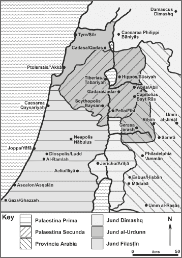

*图 4.1。Bassān/Scythopolis、Fil/Pella 和 Jarash/Gerasa 周地区地图，显示了晚罗马和早期伊斯兰省结构（Alan Walmsley）。*

在本节中，我们利用了来自多种来源的档案和近期证据（主要是考古证据），以进一步支持一种与某些领域仍然流行的“黑暗时代否定主义”相径庭的观点。我们倾向于采用一种更具建设性和启示性的长期方法，并从社区和社会韧性的角度对其进行评估。我们的关注重点是贝桑（Baysān）、菲勒（Fil）和杰拉什（Jarash）的三个地区（trichōra），它们横跨了从富产且具有战略意义的约旦北河谷到约旦东部山区（Jabal Ajlūn）（图 4.1）。通过在回顾过去工作的同时，意识到当时盛行的亲帝国主义、亲殖民和亲种族主义范式，并结合当代方法和广泛的考古发现，我们分析了三个以悠久历史、公民自豪感、社会相关性和自给自足传统闻名的“普通”地区的适应能力。在一个社会发展高度活跃时期，它们的历史为社区韧性策略以及随之而来的具体成功失败提供了坦诚的见解。

### 公元 749 年前后的贝桑和菲l

贝桑和菲l 坐落在约旦北河（贝桑山谷）广阔肥沃地带的两侧（西岸和东岸），遥遥相对（图 4.2）。从古代到英国托管统治时期，这些地理位置优越的中心是密不可分的。^(31)得益于热带气候、充足的水源、丰富但复杂地形以及与海陆的广泛联系，这两座城市都经历了三个三千多年的城市历史，这种历史在希腊化时期到早期伊斯兰时期的城市建立之前，都体现在各自占据主体地位的古老 `tall`（考古丘）上；因此，城市认同是常态（图 4.3）。

在两座城市中，曾被称为西基托波利（Scythopolis）的贝桑因其长期的商业和政治优势脱颖而出，并在五世纪左右被任命为二巴勒斯坦（Palaestina Secunda）的首府。从公元一至三世纪开始，在原有 `tall` 南侧起伏的山谷处不稳定的地形上，发生了一系列当地石材市政建设，而该 `tall` 的顶部在几个世纪前已被平，用于修建祭奉阿克拉奥斯宙斯（Zeus Akraios）的寺庙群（[图 4.4 [21]](#10_chapter04.xhtml_fig4.4), 图 4.5）。^(32)作为主要的十级同盟城市，西基托波利配备了所有所需的市政设施，以创造出一个全新的且令人深刻的“古典化”城市核心，其中神庙、剧院、小音乐厅、浴场、喷泉、巴西利卡、广场、广场和纪念碑拥挤在空间内（图 4.6）。与杰拉什的单条长轴线街道不同，这里布局了四条不相连的铺设柱廊街道，形成了一系列错落有致的城市景观，并兼具庆祝和功能性的商店及纪念碑为主。在这些街道中，由挖掘者命帕拉迪乌斯街（[图 4.4 [3]](#10_chapter04.xhtml_fig4.4)）形成了主干道，在轴线方向将剧院与 `tall` 脚下的神庙入口连接起来，同时提供了通高处阿克拉奥斯宙斯神庙的不受阻的直线视线。除了创造了公共奇观外，其目的还在为商业生活提供一个集中焦点。

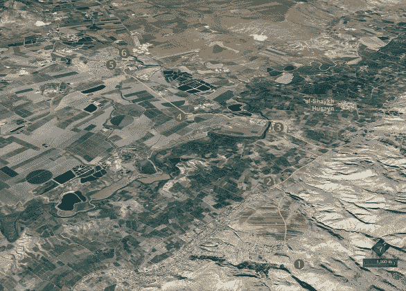

*图 4.2. 贝桑和菲l 之间的地形，显示了通过谢赫·赛义恩 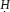usayn 越口的陆路。注意所有高度测量均为负值（海平面以下）。(1) 菲l，-39 米（tall 顶部）；(2) 约旦河谷底部（al-Ghawr），-202 米；(3) 谢赫·赛义恩 usayn 越口，-274 米；(4) 尼姆鲁德（Ayn Nimrud），-246 米；(5) 现代贝桑，-125 米；(6) 罗马和早期伊斯兰城市，-151 米（下城）（底图：谷歌地球，2021 年 8 月 20 日）。*

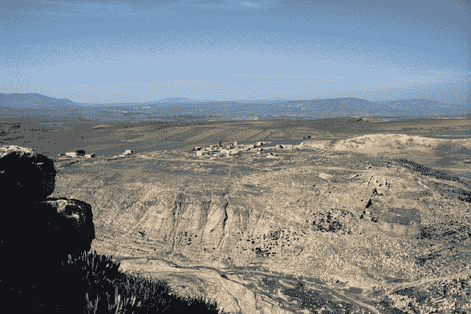

*图 4.3. Wādī al-Jirm、菲l 的 tall 以及远处的红土 abaqah，俯瞰约旦北河谷；左侧远处的贝桑（Alan Walmsley 拍摄）。*

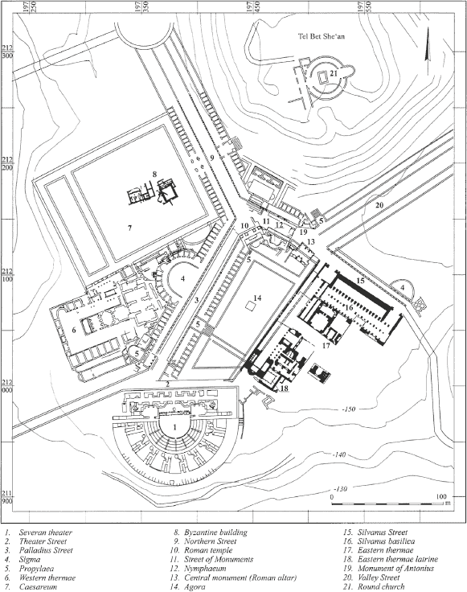

*图 4.4. 贝桑中心地图（节自 R. Bar-Nathan 和 W. Atrash，《贝桑》，第 5 页，图 1.3）。*


从公元四世纪到八世纪中期，一系列持续的修复、改建和新建筑更新了城市的组成部分，而其他区域则出现了收缩。363 年的两次地震对建筑的破坏加速了这一进程。^(33)对现有纪念碑的修复，如喷泉（[图 4.4 [12]](#10_chapter04.xhtml_fig4.4)）、浴场（[图 4.4 [17]](#10_chapter04.xhtml_fig4.4)）以及宏伟柱廊（[图 4.4 [16]](#10_chapter04.xhtml_fig4.4)），仅限于满足社会、商业需求的建筑。^(34)相比之下，不必要的元素随着时间被更符合社区需求并有助于盈利的新结构取代。例如，一个带廊的广场取代了罗马时代的广场和巴西利卡（[图 4.4 [14]](#10_chapter04.xhtml_fig4.4)）。在中心区域之外，也发生了纪念碑更换。马场被改为剧场，^(35)而 `tall` 上大神庙的遗迹缩小为基础，并在公元四世纪末至五世纪初被一座巴西利卡教堂取代。^(36)也许是在那时，但可能更晚，一条从 `tall` 西北角开始的新铺设道路通往顶部的一个围墙宗教建筑群。^(37) 再次在后来，很可能在七世纪，巴西利卡遭到严重破坏，并被一座圆形教堂取代（[图 4.4 [21]](#10_chapter04.xhtml_fig4.4)），巴西利卡的部分幸存墙体并入其中。^(38)

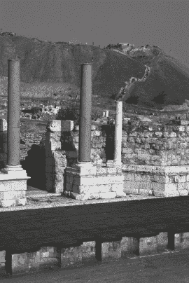

*图 4.5. 贝桑下城（纪念性区域）之上的 tall，前景是部分修复的剧院（Alan Walmsley 拍摄）。*

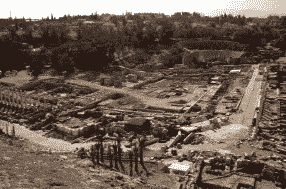

*图 4.6. 贝桑中心的街道和建筑（挖掘者命名）。右侧（西侧）是帕拉迪乌斯街（[图 4.4 [3]](#10_chapter04.xhtml_fig4.4)），前景是纪念碑街；中心是广场；背景（南侧）是塞维里剧场；广场左侧（东侧）是东浴场；正左侧是西尔万斯街和后来的西尔万斯巴西利卡；从 tall 向南的视角（Alan Walmsley 拍摄）。*

五世纪和六世纪的其他发展产生了类似的影响，它们重新调整了城市区域的形态、功能和命运，其主要重点是维持和改善城镇的财务状况和城市地位，或补偿损失。除了街道和相关商店的修复和升级外，拜珊（Baysān）还委托了新的公共建筑，特别是位于城镇西部街道的一座大型浴场（[图 4.4 [6]](#10_chapter04.xhtml_fig4.4)）（始于五世纪，六世纪早期扩建），以及紧邻其后在 506-507 年间插入的带有商店的半圆形广场（[图 4.4 [4]](#10_chapter04.xhtml_fig4.4)），但这是以牺牲二世纪的剧场（Odeon）为代价的。(39) 剧场的改造也发生在费费勒和杰拉什（Jarash），其中费费勒的剧场可能是由于瓦尔迪·阿尔-杰尔姆（Wādī al-Jirm）地下水位上升而被迫的，那里剧场、相邻的浴场、推测的论坛和其他市政建筑都集中在该处（[图 4.7 [3]](#10_chapter04.xhtml_fig4.7)）(40) 为了补偿这些重要市政结构的损失，他们通过建造一座宏大的阶梯从西侧通往费费勒的中心教堂，重新规划了市中心的布局，并允许在曾经主要的北部入口处增设了一个新的市场。(41)

然而，这两个城市最显著的增长发生在远离中心区域区域，例如在拜珊*山*（*tall*）南方的高丘上，那里马场周围的居住区获得了一条新街道和额外的住房。值得注意的是，为了承认拜珊作为二塞勒斯巴斯斯坦省（Palaestina Secunda）省会首的高地位，人们开始修建一条全长 4.8 公里的围墙，以连接多达六座罗马时期的独立门楼，这些门最初是作为城市边界道路的标记建造的。这些围墙可能建于五世纪，在六世纪前半叶被修复或完工。然而，到那时，城镇已经扩展到到处是自己的教堂和犹太教堂的城外“郊”。(42)

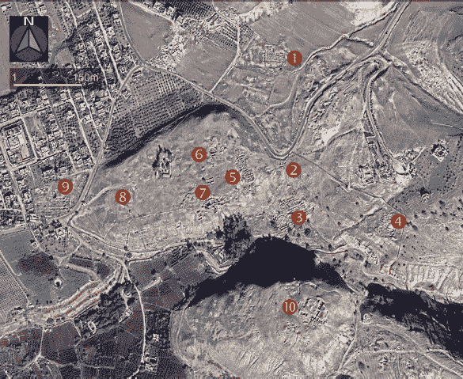

图 4.7. 749 年前后伊斯兰时期费费勒的特征。注意所有高度测量均为负值（海平面以下）。[1] 早期伊斯兰商业中心[客栈]（khan），由两个院落组成，八世纪至十世纪（已部分发掘），-44 米；[2] 庭院式住宅，在 659 年地震中受损，-43 米；[3] 中心教堂和剧场，-54 米，其西侧（左侧）是泥沙淤严重的瓦尔迪·阿尔-杰尔姆河，-60 米；[4] 东部教堂，在 659 年地震中受损，可能在 749 年地震中被毁，-20 米；[5] 六世纪早期东部*山*（*tall*）居住区，659 年地震受损，749 年被毁，南部有九世纪重建的证据，-42 米；[6] 极度磨损的区域表面、地板、石墙残迹和深垃圾坑，年代可追溯至八/九世纪至十一世纪，-38 米；[7] 具有晚十世纪至十一世纪光泽装饰玻璃的建筑，在数字上方是一座可能建于十二世纪的晚期清真寺，-43 米；[8] 西部居住区（发掘后回填），在 749 年被毁，-51 米；[9] 西部教堂，有早期地震（可能是 659 年）的证据，随后在 749 年遭受严重破坏，-60 米；[10] 位于塔勒·阿尔-图丁山（Tall al-u山顶的治安和行政驻地，于 659 年被毁且未重建，-2 米（底图：Google Earth，2021 年 8 月 20 日）。

Tsafrir 和 Foerster 在描述六世纪中期以后拜珊的城市环境时，评论了六世纪前几十年后新建筑项目的明显下降。(43) 用韧性理论术语来说，社会经济系统中的暂停通常意味着一个很长的“保护”期（K 阶段），但并非“衰退”。(44) 从物质和社会崩溃的视角来看待，Tsafrir 和 Foerster 观察到，纪念建筑遭受了“掩盖”和“侵占”，基础设施“恶化”并被“掠夺”，而这个曾经繁华的社区商业枢纽昔日的辉荣正“有机地”被不受监管的商业活动所吞噬，包括污染性的陶器制造和布匹生产。建筑遭受了“忽视”，空间被征用，市政系统“瓦解”——这一切都因自然灾害而加剧。(45) 参考肯尼迪的模范文章描述了 Tsafrir 和 Foerster 所描述的新建筑项目的明显下降。

如前所述，七世纪和八世纪是充满挑战的时期，但拜珊和费费勒成功应对了最艰难的时刻。

鉴于该地挖掘的规模，659 年地震对贝桑山（Baysān）的严重影响尤为明显。正如 Fil 一样，震后重建计划侧重于腾出空间并启动公民复兴计划，以应对对城市基础设施重建、经济机会以及社区归属感复兴的预期。

一个具有启发性的案例是西尔瓦努斯街（Silvanus Street）六世纪市政大教堂的完全坍塌（[Fig. 4.4 [16]](#10_chapter04.xhtml_fig4.4)），取而代之的是在街道南侧一排排位于拱形柱廊后的 20 家新商店（Fig. 4.8）。^(55) 从南侧柱廊处倒塌的大门中发现的两块马赛克铭文确认，这些建筑是由哈里发希沙姆·本阿卜·阿尔-马利克（在位 724–743 年）委托建造，并由约旦山区（Jund al-Urdunn）的总督`amīr`执行的。^(56)

其他因构造运动而变得过时且脆弱的公共建筑失去了其原有功能的任何残迹；相反，它们的价值体现在可重复使用的建筑石上，以及作为便于交通和水源的大型陶器和亚麻作坊的理想位置。通过这样，剧院（[Fig. 4.4 [1]](#10_chapter04.xhtml_fig4.4)）、东、西浴场（[Fig. 4.4 [17 and 6]](#10_chapter04.xhtml_fig4.4)）、广场（[Fig. 4.4 [14]](#10_chapter04.xhtml_fig4.4)）以及之前的凯撒大区（[Fig. 4.4 [7]](#10_chapter04.xhtml_fig4.4)）都被赋予了与其原始角色无关的新用途。

与此同时，街道上的商业活动得以维持，新的商店收回了废弃区域并填充了开放区域，狭窄街道不平的石路被重新铺设，以适应工作动物——骡、驴、马、牛和骆驼——的蹄子和脚，并保护它们携带的珍贵货物。^(57) 因此，街道上的碎石和泥土层往往是刻意的干预，而非衰落的标志。

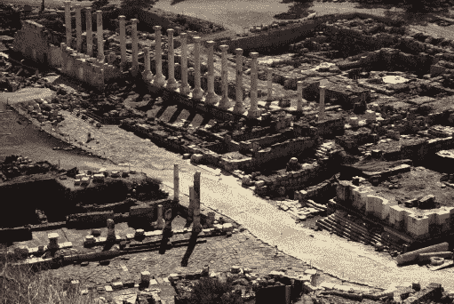

图 4.8。西尔瓦努斯街商店街修复后的柱廊，由哈里发希沙姆·本*阿卜·阿尔-马利克（死于 743 年）委托（Alan Walmsley 拍摄）。*

似乎并不是所有的灾难和不幸都能完全归因于地震。在贝桑山，喷泉（[Fig. 4.4 [12]](#10_chapter04.xhtml_fig4.4)）对面的商店在 6 至 7 世纪间的某时候遭受了火灾，而附近的结构也同样遭受了火灾和遗弃的影响。^(58)

同一场火灾可能吞噬了`tall`山顶的巴西利大教堂，但考虑到所需的力量，重大灾难（如 659 年地震）是更有可能的原因。^(59) 部分由于，随后的圆形教堂简化的建筑在 Fil 中也有反映，^(60)这表明重建由于忠诚度的转变而受阻，因为居住区内的社区教堂和修道院在 6 世纪后期到 8 世纪成为了社会生活的中心，并因此成为财政资源的重点。^(61)

在这些改变的情况下下，贝桑山萎缩的山顶教堂不再坐落于充满宏伟市政纪念碑的山谷，而是望向一片断塌遗迹的景观，这些遗迹与被抛弃的异教过去相连，而在约五个世纪后，它们被认为只适合容纳令人窒息的工业及其工人。与此同时，贝桑山市政的功能中心已转移到更温和的南部高原，并一直留在了那里。

贝桑山的“希沙姆”市场揭示了中央和省级政府在 659 年地震后干预并维持经济生计及其所支撑社区的刻意图。^(62) 然而，尚不清楚是否有进一步的城市更新计划，这种计划在贝桑山的动力可能是微弱的，因为在 7 世纪早期，abariyah 已被提升为约旦区的省会，从而从声望和投资的增加中受益。^(63)

无论如何，事件迅速赶过了任何预期计划，因为在九十年后的 749 年，贝桑山因剧烈地震导致城市结构、经济生产力和社区福祉遭受了灾难性的损失，地震的震中位于贝桑山盆地/提比利亚亚湖地区。^(64) 这种地方不可逆转的损失和对社区的强制破坏造成了深远的社会财务痛苦，邻近城镇 Fil、Jadar、abariyah、Sūsiyah/Hippos 的损害进一步加剧了这一点。^(65)考古显示，尽管贝桑山和 Fil 的社区遭受了打击，但在这次“严重且突然”的灾难后，社会依然完整、资产丰富并具有重建动力。面对不可逆转改变的地物理和环境现实，一系列实用策略的实施不仅修复了满目疮伤的景观，还缓解了家庭层面的创伤和损失，使人们留了下来。

749 年地震受害者遭受的被困之恐惧和惨死死亡，通过对 Fil 主土丘东端发掘的六栋多层住宅得到了生动记录（[Fig. 4.7 [5]](#10_chapter04.xhtml_fig4.4)）。上层墙壁重的泥砖向内坍塌填充了底层房间，在此过程中困住了动物（从牛类到马科动物、鸡和猫）以及至少五人到十人的人类，所有人都在自然可怕的发作中措手无策。^(66) 一栋房屋的大部分着火，导致两个受害者碳化。后来，没有对尸体进行明显的挖掘尝试，也没有取出贵金属币等珍贵物品，^(67) 也没有发现挖掘坍塌部分的证据。被埋在废墟中的死者的持续提醒，会唤起痛苦的记忆，并让幸存者产生的无力感、失去感和无法释怀。一段时间内，可能是几十年，这些致命的情绪抑制了在`tall`上的重新定居，但定居确实回归了。在 1987 年的挖掘季节，发现了一个深粪坑，里面充满了陶瓷、金属、骨骼、玻璃和蛋壳发现物（[Fig. 4.7 [6]](#10_chapter04.xhtml_fig4.4)），而最近在`tall`上证实了广泛的 9 世纪至 11 世纪居住层（[Fig. 4.7 [7]](#10_chapter04.xhtml_fig4.4)）；这些发现仅触及边缘。^(68)

749 年地震的一个实质性结果是贝桑（Baysān）了一次重新规划的城市设计，这是约七个世纪以来的首次，这种设计几乎完好地持续到 11 世纪，但其元素一直延续到了授权时期（Mandate times）。^(69) 这一新城市规划最引人注目的方面是其对所谓“后古典现代主义”的激进倾斜。它采纳了一个关于功能性城镇构成的完全不同的概念，建立在一种城市预期之上：支持行政、军事和居住需求，并主要占据一个封闭的高地，同时在下方下方留有额外的、可扩展的空间，用于城市、商业和社区活动。灾难中诞生了一个新的贝桑，尽管物理上发生了蜕变，但在社会、政治和经济上仍与它的母省约尔旦朱辖区（Jund al-Urdunn）深度整合。在这种情况下，韧性理论中的释放域（`Ω-phase`，通常等同于“崩溃”）在一场灾难性事件及其后续影响中得到了应对，其最终结果为贝桑带来了几个世纪的持续成功。

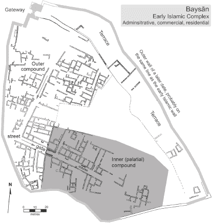

*图 4.9 贝桑 749 年地震后行政建筑群的平面图，约 8 世纪后期至 11 世纪（基于 G. M. Fitzgerald，《Beth-Shan Excavations 1921–23》折页图，由 Alan Walmsley 修改）。*

## 这个新贝桑的独特城市特征是什么？

1921 年 6 月到达遗址进行第一个季节时，C. S. 菲舍尔（Fisher）注意到“在山顶上，晚期堡垒的痕迹清晰可见”，^(70) 堡垒由石砌的环绕墙和外门组成，包围着土丘的顶部。在解释随后的挖掘工作时（这些工作完全移除了 `tall` 的上层部分），菲舍尔表示，这道墙曾围护着一个围绕`Z 型`中心主干道布置的大型建筑群，这某种程度上让人联想到“市中心”商业中心的错落街道（图 4.9）。入口通过此前曾通往教堂的同一条接入道路，止于现在现有一扇后期大门的地方。^(71) 从那里开始，一条街道向东南方向斜坡向上，然后突然向右直角转弯（向西南方向），继续直向上通往山顶，延伸超过 80 多米，然后再次向左直角转弯（向东南方向），在 25 米后到达第二扇大门，大门上带有早期伊斯兰黎凡特（al-Shām）接待门处常见的长条石凳。 从这扇大门开始，沿着同样的轨迹，一条长约 70 米的街道穿过至少六座装饰精美、规模巨大的庭院式建筑，所有建筑都位于山顶的最高点，并被环绕墙包围。

菲舍尔识别出了该建筑群的本质：一个二分制的行政中心，带有商业和居住区，并在 `tall` 的高处以一座宫殿作终。^(72) 通常人们认为其起源于倭麦亚时期，但这一方便的假设经不起推敲。^(73) 从圆形教堂倒塌后后被掩埋的单体石柱上，粗略刻有阿拉伯语和希伯来语铭文必然早于二分制建筑群的建造，但考虑到铭文的朝向（长度方向），它们也晚于教堂的崩溃。在五根刻文石柱中，四根位于建筑群下方，而一根则横卧在宫殿轴线街的一堵墙附近。后者是刻文最多的一根，有五行阿拉伯语和两行希伯来语。其中一条阿拉伯铭文记录的日期为 `190 H (公元 806 年)`，考虑到它们共同的风格和历史，这一日期被认为适用于所有的铭文。因此，这些石柱要求的建筑群建造日期介于 749 年地震与 9 世纪初之间。此外，马扎尔（Mazar）在讨论行政建筑群的建造日期时提出了一个重要的观察，即：宾夕法尼亚博物馆或希伯来大学的挖掘工作都没有在 `tall` 上观察到地震的“任何明显迹象”，这进一步支持了其建造日期在 749 年圆形教堂毁灭之后。^(74) 后期对二分制建筑群的建筑修改以及陶器、石板碗、灯具和金属制品等大量发现，证明了长期的居住史，可能一直持续到 11 世纪。^(75)

## 随着对早期伊斯兰时期考古兴趣的增加

随着 20 世纪 80 年代对早期伊斯兰时期考古兴趣的加强，注意力回到了贝桑及其在约尔旦朱辖区的地位。正如前面提到的，马扎尔在 `tall` 上进行的再次挖掘发现了额外信息，加强了对菲舍尔发现的理解。^(76) 在南部高原，新发现揭示了一个活跃的地震后重建计划，其日期由铭文定为`753`年和`794/795`年，后者来自一座社区清真寺。^(77) 考古发掘了从 8 世纪中后期到 11 世纪持续使用的巨型住宅，以及一座可能的堡垒。大约同一时期，人们在山谷中被地震摧毁的旧城镇掩埋区域上方建造了房屋，且未参考地震前的布局（图 4.10），这表明土地权已不再适用。^(78)

## 与贝桑相比

与贝桑相比，在 749 年地震后在结构和社会层面的社区重建程度尚不清楚。^(79) 尽管如此，2080 年代的初步工作发现了旨在恢复作为功能区地位的重建策略的明确证据。在 1979 年至 1982 年间遇到“非凡的 8 世纪庭院住宅”后，确信 749 年后的居住是可能的，^(80) 开始寻找可能挑战当时流行的“遗弃”范式的证据。^(81) “遗弃”完全说不通，仅仅是忽视几个世纪活动的借口。1985 年季节，在 `tall` 东北侧开阔易达的山谷中对石质结构进行了探与，随后在 1988–1990 年和 1993 年进行了更大规模的挖掘，结果发开了两个由街道隔的大矩形建筑群（[图 4.7 [1]](#10_chapter04.xhtml_fig4.7)）。^(82) 著名的东部建筑群由中心庭院四周的多个房间组成，从西侧进入，这种平面让人联想到驿站（khan）。可能存在二楼是因为入口通道与庭院交汇处有一个宽敞且平缓上升的楼梯。这里有两个主要的居住时期，第二个时期的特征是房间空间的重新配置以及活动转向了玻璃制造。主要产品是带有埃及风格压印纹饰的光滑饮用杯，这种风格在 9 世纪到 10 世纪广受欢迎。玻璃器像陶器一样，与从 `tall` 上 8 世纪中期地震沉积物中发现的器相比相比设计上截然不同，这表明在近乎毁灭后的两个或几个世纪里，在文化和经济上取得了多么巨大的进步。

*图 4.10. Baysān 749 年后位于谷街（Valley Street）地震破坏层之上的建筑（[图 4.4 [20]](#10_chapter04.xhtml_fig4.4)）；左侧可见底部的破坏层（Alan Walmsley）。*

## 公元 749 年前 Jarash


Jarash——我们的第三个案例研究——展示了与 Baysān 和 Fil 截然不同的轨迹。尽管 Jarash 根据宗教信仰、经济策略和城市优先事项不断产生的需求不断进行自我改造，但我们也发现其跨越该城镇一个多世纪历史的高度未中断的连续性。^(83) Jarash 经历过瘟疫和地震等多次重大灾难，但没有哪一次像 749 年地震那样对这座城市（或学术界的想象）产生如此巨大的影响。在接几页中，将总结 Jarash 的城市发展，重点介绍 749 年地震之前的布局和用途，以及当地居民在灾后重建中所采用的策略。^(84)

Jarash 位于约旦北部丘陵地区 Fil 以东南约 40 公里处，该地区自然泉和农业潜力巨大。^(85) Jarash 的定居历史可以追溯到公元前 8000 年左右，在现代城市南端的 Tall Abū uwwān 出土了新石器时代大型遗址遗迹。^(86) 青铜时代和铁器时代的定居点集中在 Jarash 南部，但在公元前 7 世纪之后没有留下任何痕迹。^(87) 考古证据表明，Jarash 的城市历史始于公元前 2 世纪，在金流河（Chrysorrhoas）岸边建立了一座名为安提俄克的城镇。^(88) 该定居点以宙斯神庙的早期形态和军营山（[图 4.11 [25] 位于 22 以南](#10_chapter04.xhtml_fig4.11)）为中心，^(89) 向北延伸至后来的南横街（也称为南德库曼斯街），那里发现了一套顺着 Jarash 自然轮线且早于罗马时期街道网的街道系统。^(90)

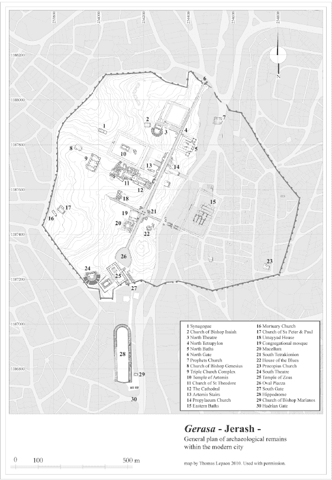

*图 4.11. Jarash 地图，显示了城市的主要纪念建筑（© Thomas Lepaon）。*

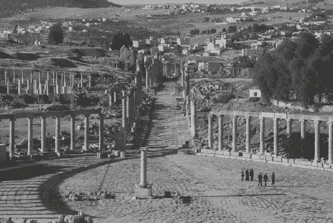

*图 4.12. 从高处的宙斯神庙向北望去，前景是椭圆形广场和 Jarash 的轴线街道（作者）。*

Jarash 与其他十城波列（Decapolis）城市一样，在公元 1、2 世纪经历了大规模的建筑热潮，城镇大部分著名的纪念建筑都是在此期间建造的。城市精英投入巨资，将 Jarash 造成一个罗马化的行省城镇，方法是建造沿着柱廊大道组织的纪念性建筑群，走廊旁布满了商店和公共喷泉，并在大型开放广场处交汇（图 4.12）。在这一时期发生的一些主要建筑活动包括：163 年重建后的宙斯神庙的落成（[图 4.11 [25]](#10_chapter04.xhtml_fig4.11)）；城镇轴线街道（也称为 Cardo 街）的一系列喷泉，其中喷水池（Nymphaeum，位于[图 4.11 上的 [12]](#10_chapter04.xhtml_fig4.11)）最为精美；以及南北剧场（[图 4.11 [24 和 3]](#10_chapter04.xhtml_fig4.11)）、市场（Macellum，[图 4.11 [20]](#10_chapter04.xhtml_fig4.11)）以及东西浴场（[图 4.11 [22 和 5]](#10_chapter04.xhtml_fig4.11)）的建造。^(91) 城镇南入口凯旋门上的铭文纪念了皇帝哈德良在 129–130 年冬天访问 Jarash（[图 4.11 [30]](#10_chapter04.xhtml_fig4.11)）。^(92) 相邻的大马场（[图 4.11 [28]](#10_chapter04.xhtml_fig4.11)）的建造也可能为了纪念这一事件。^(93)

## 从四世纪到六世纪

从四世纪到六世纪，Jarash 经历了城市景观的剧变。基督教的制度化和四世纪国家的兴起为 Jarash 引入了广泛变化。基督教最直接的结果是两座神庙被逐渐废弃，并在从四世纪到七世纪建立了二十多座教堂和神龛——其中已知最晚的是 Genesius 教（[图 4.11 [8]](#10_chapter04.xhtml_fig4.11)）的马赛克。^(94) Jarash 的两座大神庙原有用途被终止。

相反，宙斯神庙变成了一个采石场，里面设有一个石工作坊，建筑石料被重新切割使用。^(95) 神庙的其他部分作为附近陶瓷窑的废弃场。^(96)

其他纪念建筑也偏离了原有用途。例如，大马场在四世纪或五世纪停止作为赛场后，有了多种用途。围绕该结构北、东、西侧的看台（cavea）被转化为多种用途，有些作为制革厂（在市场内也有发现）和陶瓷制造工作坊。^(97)

四世纪到六世纪 Jarash 的转型不仅涉及既有建筑的重新利用，还涉及整个街区的重新规划。例如，雅典忒斯神庙东南侧的区域经过重新开发，建造了一座巨大的教堂群，包括大教堂、圣西奥多尔教堂、喷泉庭、神职人员宿舍以及由主教 Placcus 于 454–455 年建造的浴场。^(98) 浴场可能取代了位于东侧（穿越 Serapion Passage）的早期浴室设施，该处现在被用于玻璃制造。^(99) 附近的另一座建筑被重新利用，以安装工业级石锯。^(100)

在西北和西南地区，根据罗马时期的网格系统规划了新街道。例如，一条宽 8 米的街道从圣科斯马与圣达米安、圣乔治和圣约翰三合教堂向西南山丘延伸了 300 米。^(101)

与 Baysān/Scythopolis 的开发情况类似，动荡的七世纪主要表现为现有城市结构的巩固，而非新建筑的增加。尽管 602–630 年和 634 年的波斯及阿拉伯人征服分别对城镇的物理结构没有产生直接的负面影响，但七世纪似乎是一个对城市结构的资金投资转向维护而非新建的时期——从韧性理论的术语来说，这些发展标志着“保护”（K 阶段）的实施。

634–638 年的阿拉伯人征服不仅带来了统治者的更迭，还带来了新宗教信仰的出现。随着倭麦哈里发王朝（661–750 年）的巩固，新政府和宗教议程的影响开始在哈里发王朝的城市中心显现。新帝国宗教的引入对杰拉什（Jarash）基督教社区的物质文化没有产生立即影响。相反，杰拉什部分（但并非所有）教堂马赛克地板上仔细移除人物肖像的证据，证实了这些宗教建筑一直使用到 8 世纪上半叶。

同样，来自城镇其他地方的考古证据不仅表明现有做法的延续，还表明了建筑环境的重新投资。例如，手工业活动在已投入生产的区域有所扩张，在阿尔忒弥斯神庙区（[Fig. 4.11 [10]）和北剧院（[Fig. 4.11 [3]）建造了陶器窑。在阿尔忒弥斯神庙后面，对正在翻修的结构的发掘提供了 8 世纪上半叶一个看似居住区的快照。这些例子共同成了早期伊斯兰时期杰拉什的图景：这是一个在社区和私人规模上都经历了城市重新投资的时期。

### 八世纪与集清真寺

八世纪，城镇商业中心南北轴线街道与南方横向街道交汇处也建造了一座集清真寺（[Fig. 4.13]）。该清真寺取代了一座浴室，该浴室从 4 世纪起一直使用，直到其日益严重的损坏导致停止使用，建筑最终被拆除为清真寺的建造让路。

杰拉什集清真寺基于大马士革大清真寺的布局，后者建于 8 世纪上半叶，哈里发阿尔瓦利德·本·阿卜杜勒·马里克（统治 705–715 年）统治时期。艾兰·沃尔姆斯利（Alan Walmsley）建议其建造于 8 世纪第二季度，即哈里发希沙·本·阿卜杜勒·马里克（统治 724–743 年）时期。

清真寺面积约为 43 比 38 米。从南方街道通过一个近 2 米宽的门进入，通向带柱廊的庭院。清真寺南部的三分之一设有一个带屋顶的祈祷厅，中央有一个壁龛（`mihrab`）。

### 749 年的地震

749 年，在仅使用了几十年后，这座清真寺连同杰拉什的大部分城市结构被一次或多次大规模地震所破坏。地震造成的破坏以及随后的建筑停止在杰拉什全城都有详尽记载，导致学者们假设该城镇已完全废弃——这种情绪直到今天仍然存在。杰拉什西北部的发掘通常确定在 8 世纪中期之后停止活动。这在北剧院、阿尔忒弥斯庙区和门廊教堂（Propylaeum Church）及其周边，以及向西阿尔忒弥斯神庙后的高原和南方横向街道的路段都是清晰可见的。

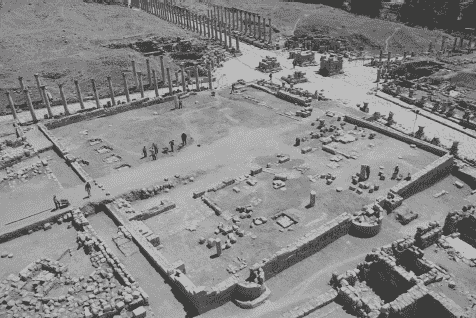

图 4.13。位于杰拉什轴线街道与南方横向街道交汇处的倭麦/阿拔斯时期集清真寺（© Alan Walmsley/Islamic Jarash Project）。

然而，注意的是，全城发现了零星的地震后活动证据。其中包括在北剧院发现的钱币窖（包含一枚公元 894 年的图尼纳纳币），以及在剧院外墙东南方发现的 9 至 11 世纪房屋。市场（Macellum）阿拔斯时期占用的某些痕迹增加了证据，陶器的发现也暗示了宙斯神庙内存在某些持续活动。

然而，关于 749 年后持续居住的证据，最有力的无疑是杰拉什两条主干道交汇处的商业和宗教中心以及西南地区。近期对杰拉什西南地区的考古调查表明，该区域对于维持城市生活的中心功能至关重要，因此，修复城镇的资金投资和投入重建的努力都集中在这里。

### 749 年后的重建

749 年地震后，清真寺按照原有的尺寸进行了重建，但其主入口被封堵了，中央的 `mihrab` 亦是如此。相反，在清真寺东侧的轴线街道上建造了一个新入口，同时在清真寺西墙上开了一个较小的门，通往带柱廊的庭院，门内侧旁设了洗礼设施。

祈祷厅被分为两部分，西端隔出了一个较小的区域。在缩短的祈祷厅中央建造了一个新的 `mihrab`，在西侧围墙处又增加了一个。在某个时期，庭院的东北内角处增加了一座宣礼塔。清真寺重建后，在其东侧立面增了商店，位于新入口正南方，以及跨过轴线街道的东侧。在这里，一座可能曾作为行政用途的大建筑利用早期建筑的墙壁作为地基进行了重建。

清真寺的重新布局不仅标志着 749 年后建筑环境的大量投入，还让我们能够识别出南方横向街道西段重要性的下降。相反，清真寺现在从市场（东侧）和居住区（西侧）进入。

在较晚的时期，清真寺规模进一步缩小，仅利用祈祷厅西端的小围墙。通过一条自沿清真寺西侧南北的小巷的阶梯进入，而另一座楼梯则通往屋顶，可能是为了方便宣礼。

位于南向横街北侧、清真寺对面的“伍麦亚德之家”（The Umayyad House）也经历了类似的演变。其原始结构建于 7 世纪中期，曾用于商业和手工业目的。^(117) 在 749 年地震后，基础和幸存的墙体经过了修缮和划分，创建了更小的结构单元。^(118) 该建筑在 9 世纪的最后一段居住期包含了几座陶瓷窑的建造。^(119)

清真寺与邻近的商业区通过两条街道与西南部的山顶相连（图 4.14）。在 749 年之后，人们观察到伍麦亚德之家之外尤其是南向横街的南段，该街道一直被持续使用，但 阿拔斯时期定居点的主街遵循了不同的路线。杰拉什（Jarash）西南区从西南向东北延伸的罗马时代之前的街道在几个世纪中一直被持续使用，在 阿拔斯时期，它作为连接山顶居住区与定居点商业及宗教中心的主干道。在这里——与贝桑（Baysān）和费尔（Fili）不同——杰拉什展示了一个跨越一千多年的城市连续性的罕见案例。

来自西南山顶居住区的证据证实，“在 749 年地震发生后不久，在私人、社区和公共层面都投入了大量的努力，用于重建和修缮房屋、社区以及集会清真寺”。^(120) 到目前为止，在九个探槽的发掘工作记录了具有居住性质的建筑，并配有用于收集水的水池（可能是重新利用了之前建筑的）。到目前发掘的居住结构展示了丰富的物质文化，这体现在一系列物品、高质量的陶瓷餐具，以及由改用的普罗科涅斯大理石建造的建筑特征上。^(121) 749 年地震后，镇中心和杰拉什西南山顶清真寺、商店及居住结构的重建，标志着韧性理论在经历突发破坏性事件（Ω 阶段）触发后的重组（α 阶段）。

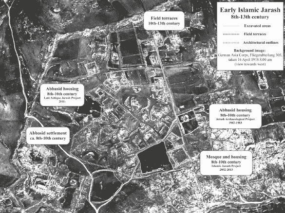

图 4.14。证实的 8 世纪至 10 世纪居住分布，以及当代 阿拔斯定居点和后期梯田的建议范围。注意沿南向横街南侧的建筑密集，以及从山顶向清真寺延伸的西南东北街道（© Rune Rattenborg（背景图由谢德国考古研究所中央档案馆、西奥多尔·维甘德遗作，航拍编号 452。经许可使用））。

由 ^{14}C 定年法支持的陶瓷证据表明，山顶地区在 9 世纪或 10 世纪被遗弃，可能是因为一系列灾难。一栋房屋在火灾发生导致屋顶坍塌后被遗弃。另一栋房屋在地震后被遗弃。大量生活用品的回收证实了这两栋房屋在坍塌时均在使用中。

此时，来自清真寺及其邻近居住结构的考古证据表明，该镇的西部区域逐渐向其原始中心收缩。清真寺继续使用但规模缩小了，而杰拉什稳步地从一个城市定居点转变为一个强调城内农业的乡村社区。^(122) 我们可以从航空照片（图 4.14）中追溯农业发展的范围，并在杰拉什西南区一条南北向街道的发掘中也证实了这一点。^(123) 用于这些农田的土壤并非自然积累的，而是为了耕作而特意沉积的。山顶的发掘中也形成了类似的局面，地层显示有高达 50 厘米的土壤被沉积并平整，以支持农业发展。将如此大量的土壤运到镇内周围是一项令人壮举，需要巨大的社区努力和对定居点持续发展的愿景。

## 结论：考古记录中的灾后复兴

在多次面临突发且可怕的环境灾难和人类灾难时，贝桑、费尔和杰拉什这些联系社区进行了深耕，并成功找到了重建基础设施和更新社交网络的方法，从而得以生存。尽管这三个城市对 749 年毁灭性地震的反应各异，但它们都展现了响应、适应和创新的能力，通过聚集资源（人力和资金）来克服灾难。

贝桑是快速恢复的典范，尽管附近的 abariyah 表现得更好。旧贝桑被掩埋，新贝桑取而代之，但其特征是山顶完全重新构思的城市景观，同时对山顶东部的旧功能区进行了保留和改造，这一切都在一个世纪左右完成。对于费尔来说，恢复的速度似乎滞后了，但仍建造了一座驿站（khan），并在山顶建造了更多基础设施。物品的质量、手工艺生产和建筑规模指向了一个位于城市中心的聚焦社区，该中心可能拥有一座清真寺。在杰拉什，考古学家已发现地震导致城镇北部区域的大规模破坏和随后的废弃，但在宗教和商业中心，建筑不仅被原样替换，而且还根据这些核心结构对城市生活持续发展的重要性以及其资助者（不容忽视的）预算进行了改进和装饰。

在我们对贝桑（Baysān）、Fiabaqat Fal）考古项目的持续支持与鼓励，特别感谢该局前任局长 Ghazi Bisheh 博士为这些项目提供的独到见解和实际帮助。

Louise Blanke 感谢以下资助机构对杰拉什实地调查（fieldwork）工作给予的慷慨支持：位于大马革的丹麦研究所、Lorne Thyssen 古代世界主题研究基金、杰拉德·阿弗雷·怀恩莱特基金、巴拉卡信托基金（Barakat Trust）、用于丹麦巴勒斯坦研究的 H. P. Hjerl Hansen 资助基金、丹麦王皇家科学院和艺术学院、C. L. Davids 基金和 Elizabeth Munksgaards 基金。

Alan Walmsley 感谢安曼英国学院的工作人员以及宾夕法尼亚大学在提供访问宏伟的贝桑（Baysān）档案方面的慷慨帮助，特别感谢 Renata Holod 教授、Robert Ousterhout 教授以及高级档案员 Alex Pezzati。特别感谢 Andy Reyes 和 Miranda Williams 允许引用故 Judith Judith McKenzie 关于斯科西波利（Scythopolis）的出版前文本。Fil（佩拉）的挖掘主要由堪培拉的澳大利亚研究委员会资助。

## 参考文献

- Abu-Khafajah, S. and R. Miqdadi, ‘Prejudice, military intelligence, and neoliberalism: examining the local within archaeology and heritage practices in Jordan’, [Contemporary Levant](https://www.example.com/journal/contemporary-levant) 4.2 (2019): 92–106.
- Agady, S., M. Arazi, B. Arubas, S. Hadad, E. Khamis and Y. Tsafrir, ‘Byzantine shops in the Street of the Monuments at Bet Shean (Scythopolis)’ in L. V. Rutgers (ed.), *What Athens Has to Do with Jerusalem: Essays on Classical, Jewish, and Early Christian Art and Archaeology in Honor of Gideon Foerster*, Interdisciplinary Studies in Ancient Culture and Religion (Leuven, 2002), pp. 423–506.


- Ambraseys, N. N., *Earthquakes in the Mediterranean and Middle East: A Multidisciplinary Study of Seismicity up to 1900* (Cambridge, 2009).

- Amitai-Preiss, N., A. Berman and S. Qedar, ‘The coinage of Scythopolis-Baysan and Gerasa-Jerash’, [Israel Numismatic Journal](https://www.example.com/is-numismatic-journal) 13 (1994–1999): 133–51, pls. 17–22.

- Avni, G., ‘“From Polis to Madina” revisited – urban change in Byzantine and Early Islamic Palestine’, [Journal of the Royal Asiatic Society](https://www.example.com/jr-royal-asiatic-society) 21.3 (2011): 301–329.

- Avni, G., *The Byzantine-Islamic Transition in Palestine: An Archaeological Approach*, Oxford Studies in Byzantium (Oxford, 2014).

- al-Balādhurī, transl. P. K. Hitti, *The Origins of the Islamic State: Being a Translation from the Arabic Accompanied with Annotations Geographic and Historic Notes of the Kitâb Fut al-Buldân of al-Imâm Abu-l ʿAbbâs Amad Ibn-Jâbir al-Balâdhuri*, Khayats Oriental Reprints 11 (Beirut, 1966).

- Ball, W., J. Bowsher, I. Kehrberg, A. Walmsley and P. Watson, ‘The North Decumanus and North Tetrapylon at Jerash: an archaeological and architectural report’ in F. Zayadine (ed.), *Jerash Archaeological Project 1981–1983* (Amman, 1986), pp. 351–409.

- Bar-Nathan, R., ‘The pottery assemblage: introduction’ in R. Bar-Nathan and W. Atrash (eds.), *Baysān: The Theater Pottery Workshop*, IAA Reports 48 (Jerusalem, 2011), pp. 205–214.

- Bar-Nathan, R. and W. Atrash, *Baysān: The Theater Pottery Workshop*, IAA Reports 48 (Jerusalem, 2011).

- Barghouti, A., ‘Urbanization of Palestine in Hellenistic and Roman Times’, *Studies in the History of Jordan* 1 (1982): 209.

- Bell, G. L., *The Desert and Sown (1907).

- Bessard, F., ‘The urban economy in southern Syria from the seventh century to the end of Umayyads’ in L. Lavan (ed.), *Local Economies? Regional Production and Exchange in Antiquity*, Late Antique Archaeology 10 (Leiden, 2013), pp. 377–421.

- Blanke, L., ‘Abbasid Jerash Reconsidered: Suburban Life at Jerash over the longue durée’ in A. Lichtenberger and R. Raja (eds.), *Jerash: 110 Years of Excavation,* Jarash Papers 1 (Turnhout, 2018), pp. 39–58.

- Blanke, L., ‘(Re)constructing Jerash: history, historiography’ in E. Fowden, S. Çağatay, and L. Blanke (eds.), *Cities as Palimpsests? Responses to Antiquity* (Oxford, 2022), pp. 351–370.

- Blanke, L., ‘Changing cityscapes in central Jerash – between Antiquity and Abbasid period’, *Annual of the Department of Jordan* 54 (2011): 311–327.

- Blanke, L., ‘The southwest of the Umayyad mosque’, *Annual of Antiquities of Jordan* 57 (2015): 229–238.

- Blanke, L., H. Barnes, K. Brunner, M. Broendgaard, L. Goos, R. Kneiß, A. Mellah, R. Pappalardo, D. Pilz and A. Vernet, ‘Excavation and magnetic prospection in Jerash’s southwest district: the first two seasons of the Late Antique Jerash Project’, *Annual of the Department of Jordan* 60 (Forthcoming).

- Blanke, L., H. Barnes, K. Brunner, J. Martínez Jiménez, L. Lodwich, P. T. Nagy, R. Pappalardo, R. Rattenborg, H. Strehle, A. Vernet, M. Whiting and R. Whiting, ‘A millennium of unbroken habitation in Jerash’s southwest district: The 2017 season of the Late Antique Jerash Project’, *Annual of the Department of Jordan* 61 (Forthcoming).

- Bowes, K., [*Housing in Late Antiquity. From Palaces to Shops*], *Journal of Late Antiquity* 1.2 (2008): 383–385.

- Bradtmöller, M., S. Grimm and J. Riel-Salvatore, ‘Resilience theory in archaeological practice – an annotated review’, *Quaternary International* 446 (2017): 3–16.

- Braemer, F., ‘Two campaigns of excavations on the ancient tell of Jerash’, *Annual of the Department of Jordan* 31 (1987): 525–530.

- Brinkmann, V. and W. Hornbostel, *Bunte Götter, die Farbigkeit antiker Skulptur; Museum für Kunst und Gewerbe Hamburg, 4\. April bis 1\. Juli 2007* (Hamburg, 2007).

- Brizzi, M., D. Sepio and D. Baldoni, ‘2002–2009 年杰拉什的意大利发掘：阿尔忒忒弥斯神庙东门楼区域与“门廊教堂建筑群”’，*约旦文物局年报* 54 (2010): 345–369。

- Clark, V. A. and J. M. C. Bowsher, ‘杰拉什北剧院：建筑与考古 1982–1983。第二部分，罗马剧院的考古学’收于 F. Zayadine (编)，*杰拉什考古项目 1981–1983*（安曼，1986），第 231–247 页。

- Cooper, J. and P. Sheets, *应对突发环境变化：来自考古学的答案*（布尔德，2012 年）。

- Crowfoot, J. W., ‘基督教教堂’收于 C. H. Kraeling (编)，*杰拉沙：十城联盟之城*（新哈文，1938 年），第 171–264 页。

- Crowley, D. and J. Pavitt (编), *冷战现代设计：设计 1945–1970*（伦敦，2008 年）。

- da Costa, K., M. O’Hea, L. D. Mairs, R. T. Sparks and P. Boland, ‘晚期古代佩拉的新新：：悉尼大学在第 XXXV 区的 1997 年发掘*’，*约旦文物局年报* 46 (2002): 503–534。

- Di Segni, L., ‘巴勒斯坦（*Palaestina*）与阿拉伯（*Arabia*）省建筑的 4–7 世纪铭文文献记录’收于 J. H. Humphrey (编)，*罗马与拜占庭时代的中东*，罗马考古杂志补充丛书 31（波特茅斯，1999 年），第 149–178 页。

- Di Segni, L., ‘巴勒斯坦和阿拉伯省的晚期古代铭文：现实与变’收于 K. Bolle, C. Machado and C. Witschel (编)，*晚期古代的铭文文化*，海德尔堡古代历史贡献与铭文研究 60（斯图加特，2017 年），第 287–320 页，图表见第 609–615 页。

- Duval, N., ‘建筑表现’收于 M. Piccirillo and E. Alliata (编)，*Umm al-Rasas ‒ Mayfaah I：圣斯蒂凡诺建筑群的发掘*，方济会圣经研究会丛书主要卷 28（耶路撒冷，1994 年），第 165–230 页。

- Edwards, P. C., S. J. Bourke, K. Da Costa, J. Tidmarsh, A. G. Walmsley and P. M. Watson, ‘悉尼大学 1988 年在佩拉（Tabaqat Fahl）第十季发掘的初步报告*’，*约旦文物局年报* 34 (1990): 57–93。

- Finster, B., ‘安贾 I 的研究：关于安贾建筑的初步报告*’，*BAAL – 黎巴嫩考古与建筑杂志* 7 (2003 年): 209–244。

- Fisher, C. S., ‘贝尚发掘日记。1921 年季（5 月 11 日–10 月 19 日），未出版报告，宾夕法尼亚大学考古与人类学博物馆’（1921 年）。

- Fisher, C. S., ‘贝尚的教堂*’，*博物馆杂志* 15.3 (1924 年): 171–189。

- Fisher, C. S., ‘基督教时期的建筑’收于 C.H. Kraeling (编)，*杰拉沙：十城联盟之城*（新哈文，1938 年），第 265–294 页。

- Fisher, G., ‘皇帝、政治与瘟疫：罗马与贾法尼德王朝，570–585’’收于 D. Genequand and C. Robin (编)，*贾法尼德王朝：为拜占庭服务的阿拉伯国王（基督教纪 6 世纪）：（巴黎会议记录，2008 年 11 月 24–25 日）*，*东方与地中海* 17（巴黎，2015 年），第 223–237 页。

- Fitzgerald, G. M., *1921–23 年贝特尚发掘：阿拉伯与拜占庭层位*（费城，1931 年）。

- Gawlikowski, M., ‘南侧主干道旁的居住区’收于 F. Zayadine (编)，*杰拉什考古项目，1981–1983*（安曼，1986–1989 年），第 107–136 页。 

- González Ruibal, A. (编), *重申考古学：超越现代性的陈调*，考古导向（Routledge，2013 年）。

- Graf, D. F., ‘希腊化与十城联盟’，*ARAM* 4.1 (1992 年): 1–48 页。

- Grigoratos, I., V. Poggi, L. Danciu and G. Rojo, ‘死海转换层带周围的历史地震更新参数目录’，*地震学杂志* 24.4 (2020 年): 803–832 页。

- Guidoboni, E., A. Comastri and G. Traina, *10 世纪以前地中海地区的地震目录*（罗马，1994 年）。

- Henley, D. and H. G. C. Schulte Nordholt (编), *东南亚的环境、贸易与社会：长时段视角*，语言与民族研究所论文集 300（莱登，2015 年）。

- Hennessy, J. B., A. W. McNicoll, T. F. Potts and A. G. Walmsley, ‘佩拉第二季发掘的初步报告*’，*约旦文物局年报* 25 (1981 年): 267–309 页。

- Johns, J., ‘长时段：约旦南国家与定居点’收于 E. L. Rogan and T. Tell (编)，*村庄、草原与国家：现代约旦的起源*（伦敦，1994 年）。

- Kark, R. and S. J. Frantz, ‘贝都因、阿卜杜·哈米德与锡太主义：1831–1948 年的贝尚地区’，*以色列研究* 15.2 (2010 年): 49–79 页。 

- Katz, O., R. Amit, Yagoda, N. Porat and B. Medvedev, ‘加利海第四纪地震与滑坡，死海转换层：古地震分析’，*以色列科学杂志* 58 (2009 年): 275–294 页。

- Kehrberg, I. and A. Ostrasz, ‘杰拉沙/杰拉什剧场的古代墓葬*’，*约旦文物局年报* 58 (2017 年): 181–213 页。

- Kehrberg-Ostrasz, I., ‘杰拉什拜占庭陶工及其器皿：6 世纪剧场工厂的生产规模’，*历史与考古研究* 10 (2009 年): 493–512 页。

- Kehrberg-Ostrasz, I., ‘从底层看杰拉什。第二部分：晚期古代的城市生活方面’收于 A. Lichtenberger and R. Raja (编)，*杰拉什的考古与历史：发掘 110 年*，杰拉什论文集 1（特恩霍，2018 年），第 119–130 页。

- Kennedy, D., ‘罗马杰拉沙的身份：一种考古方法’，*地中海考古* 11 (1998 年): 39–70 页。 

- Kennedy, D., *杰拉沙与十城联盟：虚拟岛屿*（西北约旦，伦敦，2007 年）。

- Kennedy, H., ‘从城邦到麦地那：晚期古代与早期伊斯兰的城市变迁’，*过去与现在* 106 (1985 年): 3–27 页。

- Kennedy, H., ‘杰拉沙与西提波利：比勒凡特地区拜占庭城市的权力和赞助主义’，*东方学报* 52 (2000 年): 199–204 页。

- Khalidi, R., ‘巴勒斯坦人与 1948 年：失败的内在原因’收于 E. L. Rogan, A. Shlaim and E. W. Said (编)，*巴勒斯坦战争：重写 1948 年历史*，剑桥中东研究 15（剑桥，2001 年），第 12–36 页。

- Khamis, E., ‘贝尚奥麦亚市场的两处墙面马赛克铭文’，*东方与非洲学院学报* 64.2 (2001 年): 159–176 页。

- El Khouri, L. and M. Omoush, ‘2011 年发掘季加拉（乌姆凯斯）的阿拔斯王朝占领’，*地中海考古与年代学* 15.2 (2015 年): 11–25 页。

- Kraeling, C. H., ‘杰拉沙的历史’收于 C. H. Kraeling (编)，*杰拉沙：十城联盟之城*（新哈文，1938 年），第 27–69 页。 

- Kraemer, C. J., *内萨纳发掘：第 3 卷，非文学莎草*（普林斯顿，1958 年）。

- Lepaon, T., ‘十城联盟杰拉沙的浴场建筑：初步观察’，*叙利亚* 85 (2008 年): 51–70 页。

- Lewit, T., ‘对晚期古代东地中海村庄的观点：社区韧性理论视角’，*晚期古代研究* 4.1 (2020 年): 44–75 页。

- Lichtenberger, A. and R. Raja, ‘中伊斯兰时期的杰拉什。通过西北区的新证据连接文献与考古’，*德国巴勒斯坦协会杂志* 132 (2016 年): 63–81 页。

- Lichtenberger, A. and R. Raja (编), *中伊斯兰时期杰拉什（9 世纪至 15 世纪）：阿尤王朝马木鲁克定居点的考古与历史*，杰拉什论文集 3（特恩霍，2018 年）。


Lichtenberger, A. and R. Raja, ‘定义边界：奥麦亚向阿拔斯的过渡与公元 749 年杰拉什地震’收于 A. Lichtenberger and R. Raja (编)，*重新审视拜占庭与奥麦亚杰拉什*，杰拉什论文集 4（特恩霍，2019 年），第 265–286 页。

Lichtenberger, A., R. Raja, C. Eger, G. Kalaitzoglou 和 A. Højen Sørensen，《杰拉什新出土的一座私人住宅：重新审视从晚期古代到早期伊斯兰时期物质文化的连续性与演变方面》，*Antiquité Tardive* 24 (2016): 317–359。

Liebieghaus 和 V. Brinkmann，《色彩中的神灵：古代的多彩绘画》，（法兰克福，2020）[‘数字化’]。[访问地址：[buntegoetter.liebieghaus.de/en/](http://buntegoetter.liebieghaus.de/en/)]（访问 2021 年 8 月 7 日）。

Little, L. K.（编辑），《瘟疫与古代的终结：541–750 年大流行病》（剑桥，2007）。

Macaulay, R. 和 R. Beny,《废墟之乐》（伦敦，1977）。

March, C.,，“杰拉什宙斯神庙高层建筑元素在拜占庭时期的重新利用”，*Syria* 81 (2004): 147–176。

Marco, S., M. Hartal, N. Hazan, L. Lev 和 M. Stein，“公元 749 年地震、死海转型层的考古学、历史与地质学”，*Geology* 31.8 (2003): 665–668。

Martin, R. 和 P. Sunley，“路径依赖与区域经济演变”，*Journal of Economic Geography* 6.4 (2006): 395–437。

Mazar, A.（编辑），《贝特谢珊遗址发掘 1989–1996 年。第 1 卷，从晚青铜时代 IIB 到中世纪时期》（耶路撒冷，2006）。

McGovern, T. H.,，“前言”，收于 J. Cooper 和 P. Sheets（编辑），《生存突发环境变化：考古学的答案》（波尔德，，2012），第 vii–xii 页。

McNicoll, A. W.,，“东教堂，V 区”，收于 A. W. McNicoll（编辑），《约旦佩拉 2：悉尼大学与奥斯斯特学院在佩拉的联合发掘（1982–1985 年）的第二次中期报告》，地中海考古补充系列 2（悉尼，1992），第 153–163 页。

Michalopoulos, S. 和 E. Papaioannou（编辑），《历史的长远经济与政治阴影。第 1 卷，全球视野》（伦敦，2017）。

Moralee, J.,，“圣西奥多的石头：基督教化杰拉什中对异教过去的毁性破坏”，*Journal of Early Christian Studies* 14.22 (2006): 183–215。

Mordechai, L. 和 M. Eisenberg，“拒绝灾难：查士丁尼瘟疫的案例”，*Past & Present* 244.1 (2019): 3–50。

al-Nahar, M.,，“约旦杰拉什阿布苏瓦万新器时代遗址”，收于 A. Lichtenberger 和 R. Raja（编辑），《杰拉什的考古与历史》，杰拉什论文集 1（特恩豪特：2018），第 7–14 页。

Nol, H.,，“阿什凯隆 8：伊斯兰与十字军时期，特蕾西·霍夫曼著”[书评]，*Journal of Islamic Archaeology* 7.2 (2021): 230–231 页。

Norris, F. H., S. P. Stevens, B. Pfefferbaum, K. F. Wyche 和 R. L. Pfefferbaum，“作为比喻、理论、能力集和防灾准备策略的社区韧性”，*American Journal of Community Psychology* 41.1 (2008): 127–150 页。

Northedge, A，《罗马与伊斯兰时期安曼的研究：C C.-M. 贝内特夫人的发掘和其他调查。第 1 卷，历史、遗址与建筑》，英国学会考古专著 3（牛津，1992）。

Oosterlynck, S.,，“路径依赖：政治经济学视角”，*International Journal of Urban and Regional Research* 36.1 (2012): 158–165 页。

Orlandi, N，《无真之眼：为何视觉不是认知过程》（牛津，2014）。

Ostrasz, A. A.,，“杰拉什马场：1982–1987 年发掘与研究报告”，*Syria* 66.1 (1989): 51–77 页。

Pappalardo, R，“晚期古代杰拉什项目：陶器数据的初步结果”，收于 A. Lichtenberger 和 R. Raja（编辑），《重新审视拜占庭与倭麦的杰拉什》，杰拉什论文集 4（特恩豪特，2019），第 195–227 页。

Parapetti, R，“罗马杰拉什的建筑与城市空间”，*Mesopotamia: Rivista di Archeologia* 18–19 (1983): 37 页。

Parapetti, R., M. V. Fontana, R. Pierobon, M. C. Bitti 和 M. L. Lazzarini，“1982–83 年杰拉什项目中的意大利活动”，收于 F. Zayadine（编辑），《1981–1983 年杰拉什考古项目》（安曼，1986），第 167–203 页。

Piccirillo, M，《约旦的马赛克》，美国东方研究中心 1 (1993)。

Pickett, J，“古代之后的水：东地中海地区水利设施的后世（300–800 年）”，博士论文，宾夕法尼亚大学（2015）。

Plieninger, T. 和 C. Bieling（编辑），《韧性与文化景观：理解与管理人类塑造的环境》（剑桥，2012）。

Rasson-Seigne, A.-M. 和 J. Seigne，“杰拉什的三处封闭陶器”，收于 A. Lichtenberger 和 R. Raja（编辑），《重新审视拜占庭与倭麦的杰拉什：转型》（特恩豪特，2019），第 159–193 页。

Rattenborg, R 和 L. Blanke，“伊斯兰时代的杰拉什（公元 700 年起）”，*Levant* 49 (2017): 31–32 页。

Redman, C，“网站”，[访问地址：[asu.edu/person/redman](http://asu.edu/person/redman)]。

Redman, C，“考古学中的韧性”，*American Anthropologist* 107.1 (2005): 70–77 页。

Redman, C. 和 A. Kinzig，“韧性是否应该分开？”，*Ecology and Society* 19.2 (2014): 37 页。

Robinson, E. 和 E. Smith，“圣经研究与阿拉伯地区”，*Studies in the Archaeology of Israel and Neighboring Lands*。

Sahner, C，“关于哈德良在 129/30 年冬季杰拉什的初步研究”，*Age of Islam* 94 (2017): 第 56 页。

Schaefer, J 和 R. K. Falkner，“倭麦王朝的杰拉什”，收于 F. Zayadine（编辑），《1981–1983 年杰拉什考古项目》（安曼，1986），第 411–459 页。

Seigne, J，“杰拉什的宙斯神庙”，*Syria* 62 (1985): 287–295 页。

Seigne, J，“古代杰拉什的德卡波利”，*ARAM Periodical* 4 (1992): 183–195 页。

Seigne, J，“一个省份城市的城市规划”，*Studies in the Archaeology of Israel and Neighboring Lands* (1992): 第 331–341 页。

Seigne, J，“杰拉什的六世纪水动力坊”，*Annual of the Department of Antiquities* 26 (2002): 第 205–213 页。

Seigne, J，“对杰拉什水资源的一些初步观察”，收于 H.-D. Bienert 和 J. Häser（编辑），《堤坝与水渠：中东水资源考古，1999 年 6 月 15–20 日在佩特拉瓦迪穆萨行的国际会议》（拉赫登，2004），第 173–185 页。

Seigne, J，“杰拉什的喷泉与引水系统”，*Syria* 85 (2008): 35–50 页。

Seigne, J，“对古代杰拉什街道的一些观察”，收于 P. Ballet, N. Dieudonne-Glad 和 C. Saliou（编辑），《古代与地中海东部的街道：定义、规划与演变》（雷讷，2009），第 169–184 页。

Seigne, J，“哈德良为何在 129/30 年冬季留在杰拉什？”，收于 A. Lichtenberger 和 R. Raja（编辑），《杰拉什的考古与历史：110 年发掘》，杰拉什论文集 1（特恩豪特，2018），第 207–214 页。

Shboul, A. M. H. 和 A. G. Walmsley，“从拜占庭到早期伊斯兰统治时期叙利亚-巴勒斯坦的身份与自我形象：阿拉伯基督徒与穆斯林”，收于 G. Clarke（编辑），《古代东中海地区的认同》，地中海考古 11（悉尼，1998），第 255–287 页。

Shoemaker, S. J，《早期伊斯兰巴勒斯坦三个基督教殉道：凯比得彼得殉道、圣马萨二十殉道者殉道、新殉道者罗马斯殉道》，东方基督教文本（普罗沃，2016）。

Silberman, N. A，“雷鸣声：巴勒斯坦考古学中的波斯与穆斯林征服形象”，收于 S. R. Wolff（编辑），纪念 Douglas L. Esse，《以色列及其邻近土地考古研究》（芝加哥，2001），第 611–623 页。

Simpson, I., 《杰拉什的市场建筑：公元 6 至 9 世纪四柱神庙的商业转型》，，收录于 K. Bartl 和 A. R. Moaz (编)，*《住宅、城堡、定居点：从晚期古代到伊斯兰早期比拉德阿尔沙姆的转型过程。2006 年 11 月 5–6 日于大马士斯召开国际会议论文集》*，Orient-Archäologie 24 (Rahden, 2008), 第 115–124 页。

Smith, M. E., 《考古学家的实证城市理论》，，*《考古方法与理论期刊》*18.3 (2011): 167–192。

Smith, R. H. and L. P. Day, 《十城联盟的佩拉：第 2 卷，伍斯特斯特学院对第 9 区市中心区发掘的最终报告，1979–1985》 (Wooster, 1989)。

Stathakopoulos, D., 《乡村的死亡：关于饥荒和流行病影响的一些思考》，，*《晚期古代》* (Antiquité Tardive) 20 (2012): 105–114。

Taylor, J. G., 《视觉历史：一种被忽视的长时期资源》，，收录于 D. Henley 和 H. G. C. Schulte Nordholt (编)，*《东南亚的环境、贸易与社会》* (Leiden, 2015), 第 181–202 页。

*韧性联盟* (The Resilience Alliance) [访问地址：[www.resalliance.org/](http://www.resalliance.org/)] (访问于 2021 年 11 月 9 日)。

*韧性连接网络* (The Resilience Connections Network) [访问地址：[www.resilienceconnections.org/](http://www.resilienceconnections.org/)] (访问于 2021 年 11 月 9 日)。

Tomich, D., 《历史时间的秩序：长时期与微观史》，，*《年鉴》* (Almanack) 2 (2011): 52–65。

Tsafrir, Y., 《关于 749 年地震日期的进一步说明》，收录于 G. C. Bottini, L. D. Chrupcała 和 J. Patrich (编)，*《知识与智慧：纪念莉亚·迪·塞尼的考古与历史论文》*，Studium Biblicum Franciscanum Collectio Maior 54 (Milano, 2014), 第 111–120 页。

Tsafrir, Y. and G. Foerster, 《巴勒斯坦公元 749 年“安息年地震”的年代测定》，*《伦敦东方与非洲研究学院公报》* (Bulletin of the School of Oriental and African Studies) 55 (1992): 231–235。

Tsafrir, Y. and G. Foerster, 《从斯基托波利斯到贝桑——城市化的不断变迁》，收录于 G. R. D. King 和 A. Cameron (编)，*《拜占庭与早期伊斯兰时期的中东 II：土地利用与定居模式》*，Studies in Late Antiquity and Early Islam (Princeton, 1994), 第 95–115 页。

Tsafrir, Y. and G. Foerster, 《四世纪至七世纪斯基托波利斯-贝谢珊的城市化》，，*《杜巴斯顿橡树论文集》* (Dumbarton Oaks Papers) 51 (1997): 85–146。

Uscatescu, A. and T. Marot, 《晚期拜占庭和早期伊斯兰时期杰拉什的古老市场（Macellum）：考古证据》，收录于 I. Thuesen 和 A. Walmsley (编)，*《第二届古代近东考古学国际会议论文集》*第 2 卷 (Bologna, 2016), 第 281–306 页。

Uscatescu, A. and M. Martín Bueno, 《杰拉什市场（约旦杰拉什/Jarash））：从市场广场到工业区》，*《美国东方研究学院公报》* (Bulletin of the American Schools of Oriental Research) 307 (1997): 67–88。

Uscatescu, A. and M. Martín Bueno, 《杰拉什市场（Macellum）的捐助者与修复者》，收录于 A. Lichtenberger 和 R. Raja (编)，*《杰拉什的考古与历史：发掘 110 年》*，Jarash Papers 1 (Turnhout, 2018), 第 215–240 页。

van Breda, A. D., 《韧性理论的批判性回顾及其对社会工作的意义》，，*《社会工作》* (Social Work) 54.1 (2018): 1–18。

Vriezen, K. J. H., 《大露台上的 I 区》，收录于 K. J. H. Vriezen 和 U. Wagner-Lux (编)，*《加达拉-乌姆库斯，II：罗马-拜占庭露台上的双联教堂及街道发掘》*，德国巴勒斯坦协会论文集集 (Abhandlungen des Deutschen Palästinavereins) 30/2 (Wiesbaden, 2015), 第 6–29 页。

Walmsley, A. G., 《伊斯兰征服后的佩拉（公元 635 年–约 900 年）：文学与考古证据的汇合》，，*《地中海考古》* (Mediterranean Archaeology) 1 (1988): 142–159。

Walmsley, A. G., 《7 世纪至 9 世纪间法赫勒（佩拉）的社会经济体制》，收录于 P. Canivet 和 J. Reyais (编)，*《从拜占庭到伊斯兰的叙利亚》* (国际会议集), 第 249–261 页。

Walmsley, A. G., 《1979–1990 年约旦佩拉（Pella）的考古发掘》，收录于 J. Seedy 和 A. Walmsley (编)，*《考古钱币》*, 第 57–66 页。

Walmsley, A. G., 《伊斯兰时期的村落驱动因素》，收录于 J. Lefort 和 J. Sodini (编)，*《拜占庭 8 世纪的村落》*, 第 511–522 页。

Walmsley, A. G., 《长时期的佩拉遗址》，收录于 L. Lavan 和 T. Putzeys (编)，*《物质性》* (Materiality), 29 (2005), 第 239–272 页。

Walmsley, A. G., 《8 世纪的伊斯兰时的杰拉什建筑》，收录于 J. F. Haldon (编)，*《叙利亚的考古测定》* (Debates, 2010), 第 395–437 页。

Walmsley, A. G. and K. Damgaard, 《约旦第 7 世纪至 8 世纪的城市化》，收录于 A. Lichtenberger 和 R. Raja (编)，*《杰拉什的考古与历史：发掘 110 年》* (Jarash Papers 1, 2018), 第 241–272 页。

Walmsley, A. G., 《杰拉什的伊斯兰时期真寺》，，*《古物学》* (Antiquity) 79 (2005), 80。

Walmsley, A. G., 《1993 年佩拉（Pella）的第 11 和第 12 季发掘》，*《约旦考古年》* (Annual of the Antiquities of Jordan) 40 (1996): 165–313。

此处避开了考古学之外的韧性理论，特别是在社会理论领域，韧性理论在该领域被指支持新自由主义观点；参见 van Breda，“对韧性理论的批判性回顾》，1–18。Norris 等人*讨论了使用“韧性”一词来理解个人、社区及大型社会在创伤中生存的适应特性的内在局限性，并承认“这个术语可能会在这里留下来”（128）。

初步讨论见 Walmsley 的*早期伊斯兰时期的叙利亚*，11, 146–147。


McGovern，“序言”，vii–xii, vii；详情请参阅韧性联盟（Resilience Alliance）网站 [www.resalliance.org/](http://www.resalliance.org/)，该网站托管了许多出版物；还有位于 [www.resilienceconnections.org/](http://www.resilienceconnections.org/) 的韧性连接网络（Resilience Connections Network）。

Redman，“考古学中的韧性理论”，70–77；Redman 和 Kinzig，“过去景观的韧性”。

Redman，“可持续性与韧性应该结合吗”。

例如 Cooper 和 Sheets 的*在突发环境变化中生存*；Henley 和 Schulte Nordholt 的*东南亚的环境、贸易与社会*；Plieninger 和 Bieling 的*韧性与文化景观*。

Redman，“可持续性与韧性应该结合吗”，1，因为“每种方法中的基本假设不同，甚至相互矛盾”。

Redman，“机构网站”。

Redman，“可持续性与韧性应该结合吗”，5。

Redman 和 Kinzig，“过去景观的韧性”。

Redman，“可持续性与韧性应该结合吗”，以及 González Ruibal 的*重申考古学*。

Shatha Abu-Khafajah 和 Riham Miqdadi 对约旦的遗产与考古学关系进行了深度评估，追踪了从殖民排斥向更具包容性的参与的历史转变，但“指导性”结构仍在微妙地制约当地层面更广泛的参与；Abu-Khafajah 和 Miqdadi，“偏见、军事情报与新自由主义”，92–106。

McGovern，“序言”，vii。

Walmsley，“Achim LICHTBERGER, Rubina RA（编），*重新审视拜占庭与奥麦叶王朝的杰拉*”。

如 Nol 所述，“阿什凯龙 8”，231。

历史的“洗白”跨越了物质和认知领域；请注意 Brinkmann 和 Hornostel 在*彩色的神灵*中概述的其负面影响和固执的坚持；以及 Liebieghaus 和 Brinkmann 的网站“有颜色的神灵”。

Nol，“阿什凯龙 8”，231。

Bradtmöller 等人*，“考古实践中的韧性理论”，3–16。

Piccirillo，*约旦的马赛克*。

源自丰富的钱币和陶瓷证据；Amitai-Preiss 等人*，“钱币”；Bar-Nathan，“陶器组合”，205–214。后者位于杰拉什以北，由 Gadara 和 Abila 组成；见 Shoemaker 的*三次殉道*，33, 43–45。安曼被分配给迪马士克军（Jund Dimashq）是因为其作为麦地与大马士克之间主要道路的地位，这一行动确保了它的未来。

Shboul 和 Walmsley，“身份与自我形象”，255–287。

Fisher，“皇帝、政治与瘟疫”，223–237；Little 的*瘟疫与古代的终结*；Mordechai 和 Eisenberg，“拒绝灾难”，3–50；Stathakopoulos，“乡村的死亡”，105–114；以及一种可能的流行病大集体埋葬，Kehrberg 和 Ostrasz，“古代墓葬”，189–194。总体而言，对于瘟疫的性质、范围和影响，观点仍然保持谨慎。

关于四至六世纪类似的社区韧性，见 Lewit 的“一种观点”，44–75。

在 Bell 的*沙漠与耕种地*以及 Macaulay 和 Beny 的*废墟的乐趣*中被广为人知；尽管带有严重的偏见，但两者仍然广受青睐。关于考古学的缺陷，见 Silberman 的“雷鸣般的大军”，611–623。

Graf，“希腊化与十城城联盟”，13。正如 Robinson 和 Smith 在*巴勒斯坦圣经研究 3*（324–326）中所述，三个约旦河渡口连接了这两个城镇；断裂发生在 1948 年，Khalidi，“巴勒斯坦人与 1948”，13–14；Kark 和 Frantzman，“贝都因人、阿卜杜·哈米德二世、英国土地定居与锡安主义”，49。

关于 20 世纪 80 年代和 90 年代贝尚（Baysān）发掘工作的详细但过时的描述，可以在 Tsafrir 和 Foerster 的“斯凯托波斯的城市化”，85–146 中找到；关于近期改变叙事的发现，一个简明且的描述见于 Avni 的*拜占庭-伊斯兰的过渡*，55–71；另见 Avni 的比较研究“重新审视‘从城邦到麦地那’”，301–329。此外，Bar-Nathan 和 Atrash 的*贝尚*最终报告中的详细描述也至关重要。

Tsafrir 和 Foerster，“斯凯托波斯的城市化”，108–116，指出“修复工作强调了罗马城市的延续性和保护”，114；Avni 正确地认为这一事件促进了贝尚城市形态已存在的变革压力，Avni 的*拜占庭-伊斯兰的过渡*，59, 65。关于地震的猛烈，见 Ambraseys 的*地震》，148–151；Grigoratos 等人*，“更新目录”，823（Mw = 6.5）；Guidoboni 等人*，《目录*，264–267；Zohar 等人*，“重新列表”，798（平均值 = 6.7 “强”）。

对城市认同的欣赏将市政美学的理解扩展到了晚期，如乌姆拉（Umm al-Ra）所示；Duval，“建筑表现”，165–230。此外，重建任务的巨大将使市政资助者面临保留还是放弃的决策。

2 世纪末 3 世纪初杰拉什竞技场在 4 世纪部分坍塌后经历了类似的重新设计；见 Ostrasz，“杰拉萨的竞技场”，73。

Tsafrir 和 Foerster，“斯凯托波斯的城市化”，109，将圆形教堂的日期定为 5 世纪末至 6 世纪初，但这似乎不太可能。

Tsafrir 和 Foerster，“斯凯托波斯的城市化”，浴场 113,117,119,130–132，广场 116,121–122。

从 6 世纪初开始，石材开始从音乐厅（odeum）中被拆除；在 7 至 8 世纪初，`ima cavea`（观众席）被填平，上方建造了一家铁器店；Smith and Day, `Pella 2`, 4–8, 28–33；Jarash：5 世纪末/6 世纪初见其转变为非民用（市政）功能，随后在 7 世纪和 8 世纪设立了陶器作坊；Clark and Bowsher, ‘The Jerash north theatre’, 231–247.

Walmsley, ‘The social and economic regime at Fihl’, 253，7 世纪之交；Smith and Day, `Pella 2`, 66–68, 79–82, 90–94, 7 世纪初。

Tsafrir and Foerster, ‘Urbanism at Scythopolis’, 100–104.

Tsafrir and Foerster, ‘Urbanism at Scythopolis’, 101, 106, 116–118, 135–146.

Bradtmöller *et al.*, ‘Resilience theory in archaeological practice’.

Tsafrir and Foerster, ‘From Scythopolis to Baysân’, 109–115; Tsafrir and Foerster, ‘Urbanism at Scythopolis’, 136–146；值得注意的是，Tsafrir and Foerster 并不打算详细涵盖伊斯兰时期，因此默认采用一种盛行的范式并不令人意外。

Kennedy, ‘From Polis to Madina’, 3–27; Kennedy, ‘Gerasa and Scythopolis’, 199–204。正是由于人们对 Kennedy 关于“古典城市主义终结”之的一站式回顾指南的盲目接受，使他的论文获得了极高的信誉。欲读修订版，请参阅 Avni, ‘“From Polis to Madina” revisited’.

Bar-Nathan and Atrash, `Baysān`, 1–15 中的概述至关重要，它重置了对 7 世纪和 8 世纪 Baysān 的理解。本文中的日期可能有所不同，但顺序保持一致。

Bar-Nathan and Atrash, `Baysān`, 7.

Walmsley, ‘Pella/Fihl’, 143, 146, 148。历史上，拜占与穆斯林盟友之间最早的（可能是公元 635 年）的冲突之一发生在这些小镇附近的约旦河河谷，随后 Fihl 在此后通过条约投降；al-Balādhurī 译自 Hitti, `The Origins of the Islamic State`, 176–177.

Ambraseys, `Earthquakes`, 221–222; Grigoratos *et al*., ‘An updated parametric catalog’, 823 (`Mw = 6.2/6`，余震); Guidoboni *et al.*, `Catalogue`, 357–358; Zohar *et al.*, ‘Reappraised list’, 798, fig. 3 (`AvM = 6.6` “强级”).

Walmsley, ‘The social and economic regime at Fihl’. 254–255; Walmsley, ‘Households at Pella’. 250–251.

Smith and Day, `Pella 2`, 79–82, 90–94；地震破坏可能因 `wādī`（干谷）冲刷增加而加剧，这通常与多种环境和人为有关，Walmsley, ‘The village ascendant’, 519–520.

Watson and Tidmarsh, ‘Pella/Tall al-Husn excavations 1993’, 303.

da Costa *et al*., ‘New light on late antique Pella’, 518, 525–527.

Tsafrir and Foerster, ‘Urbanism at Scythopolis’, 138–139。拱形街道柱廊也出现在 8 世纪初的约旦，即黎巴农谷的一处新建筑；Finster, ‘Researches in Jericho’, 210–212.

Harris, ‘Two wall mosaic inscriptions’, 159–176；南侧柱廊位于市场后墙旁，是第二座建筑的一部分；柱廊和门廊面向的结构尚不明确。

Wilkinson, `Jerusalem`, 32, 106，推车和马车很罕见；骆驼起了主要作用：Kraemer, `Excavations at Nessana. Volume 3`, 209–211；Jarash 和 Fihl 有记载用碎石、土和灰泥对街道进行修复性：Hennessy *et al.*., ‘Preliminary report’, 299–300；Weiss, ‘Sepphoris’, 202.

Agady *et al.*., ‘Byzantine shops’, 430–432 和 442–444.

529 年叛乱期间教堂被焚毁的说法不可信，尽管这常被视为 Baysān 灾难的原因，因为在被烧的商店中发现的硬币年代晚于该事件。

Fihl 东教堂的低标准维修（很可能发生在同一场地震之后）在美学上“惨触心”，柱子较短，且中殿敞向蓝天；参见 McNicoll, ‘The East Church’, 160–163.

由于财政改革导致教会财政削弱：Walmsley, ‘Coinage’, 27–29；社区教会建筑转向住宅郊区和村庄，Di Segni, ‘Epigraphic documentation’, 149–178；Di Segni, ‘Late antique inscriptions’, 287–320.

Baysān 的一种布局在实际上与之前的拜占庭时期相似；Tsafrir and Foerster, ‘Urbanism at Scythopolis’,119.

关于从 8 世纪起迅速扩张，参阅 Avni, `The Byzantine-Islamic Transition`, index.

这场年代不定的地震普遍被考古学家认为发生在 749 年 1 月 18 日，Tsafrir and Foerster, ‘The Earthquake of the Sabbatical Year’, 231–235；Tsafrir, ‘Further notes’, 111–120。地震学家存在分歧：Ambraseys, `Earthquakes`, 230–238, 746；Grigoratos *et al.*, ‘An updated parametric catalog’, 821–823 (`Mw = 7.0`)；Guidoboni *et al.*, `Catalogue`, 366–370: 749；Zohar *et al.*, ‘Reappraised list’, 798, fig. 3: 749 (`AvM = 7.2` “严重级”，“造成大量生命损失”）。关于是否存在两次或更多地震尚无定论。Ambraseys 倾向于认为在 746–757 年期间至少发生了三场甚至更多地震，`Earthquakes`, 234.

Katz *et al.*., ‘Quaternary earthquakes and landslides’, 275–294；Marco *et al.*., ‘Archaeology, history, and geology’, 665–668. Jadar：El Khouri and Omoush, ‘The Abbasid occupation at Gadara’, 11–25；Vriezen, ‘Area I’, 14–15.

Walmsley, ‘Households at Pella’.在 247–250 页，文中涉及了 Fihl 749 年地震的其他显著证据地点，特别是之前提到的中央教堂建筑群和受害者区域（9 号区域），还有西教堂和东教堂（1 号和 5 号区域），以及主丘上的第二个住宅区（8 号区域）。在第 250 页使用了“抢劫”（robbing）和“掠夺”（looting）等词；这些词已不再是 Walmsley 的考古词汇。

Walmsley, ‘Islamic Coins’, 59–60, 147–149.

Edwards *et al.*., ‘Preliminary report’, 81–86（坑），O’Hea 在 da Costa *et al.*., ‘New light on late antique Pella’, 523–525 中提到了彩绘伊斯兰玻璃；McPhillips, 私人通信.

Avni, `The Byzantine-Islamic Transition`, 65–68 提供了 8 世纪中期至 11 世纪 Baysān 的精确描述。

Fisher, ‘Dairy [sic] of Beisan Excavations’, 6–7.

Mazar 认为外围墙年代晚于早期的伊斯兰结构，因为它紧挨着晚期大门；Mazar, `Excavations at Tel Beth-Shean`, 44–46.这留下了关于可能存在早期外围墙的问题。

该建筑群与安曼城堡上 8 世纪的宫殿式布局高度契合；详见 Northedge 的*罗马与伊斯兰时代的安曼研究*，第 7 章、第 11 章。

正如 Avni 在《拜占庭与伊斯兰的过渡》中第 66–68 页的简洁表述。

Mazar，《贝特-谢安特尔遗址发掘》，第 44 页。

宾夕法尼亚大学考古与人类学博物馆的贝特-谢安档案馆所藏的出土文物，比 Fitz 在《1921–23 年贝特-尚山发掘》中发表的小规模藏品范围更广。

Mazar，《贝特-谢安特尔遗址发掘》，第 12 页，表 1.1，第 42–44 页。

清真寺工程所体现的主动性可以被视为进一步支持该双部分行政建筑群建于 8 世纪晚期的证据。

Avni，《拜占庭与伊斯兰的过渡》，第 65–66 页。

尽管 20 世纪 80 年代取得了进展，但在 80 年代之后，对菲尔伊斯兰时期时期的关注已不再是首要任务。

Bowes，“*晚期住房*[书评]》，第 385 页。

Johns，“*长久历史》，第 1–3 页，第 30–31 页。必须存在某些迹来解释后期 8 世纪和 9 世纪文化遗存的存在；Smith 和 Day，《佩拉 2》，第 50–52 页，第 118–119 页。曾经常见的外来游牧者和占地者在古代之后使用（滥用）所谓被遗弃的考古遗址的观点，正受到关于起源、所有权和殖民野心的当代问题的挑战，这种遗产依然存在。

Walmsley 等，“第 11 和第 12 挖掘季”，第 210–231 页。

类似案例请参见本卷 Whiting 的文章。

这部分地面内容也涵盖在 Blanke 的《（重）建格拉什》以及 Rattenborg 和 Blanke 的《伊斯兰时代的格拉什》中。

我们对格拉什历史的理解几乎完全基于在城镇西部发现的考古遗迹。关于河流东侧的城市定居点几乎无所知，因为格拉什的这部分一直是现代居住的焦点。

al-Nahar，“新石器时代遗址”。另见 Braemer 在“两次发掘活动”中对格拉什早期定居历史的讨论。

Braemer，“两次发掘活动”，第 527 页。

Braemer，“两次发掘活动”；Kennedy，“罗马时代格拉萨的身份”，第 55 页。Gerasa 这一名称是该城市闪姆特语名称（Jarash）的希腊语版本，在它的整个历史中一直持续使用。关于格拉什两个古代名称的词源，请参见 Kraeling 的《格拉萨的历史》，第 27 页，注释 3。


Kraeling，《格拉萨的历史》，第 28–34 页；Uscatescu 和 Martín Bueno，“格拉萨的古肉类市场”，第 67 页；Zayadine，“格拉什项目”。目前仅出土了少数早于罗马时期的结构（主要在宙斯神庙附近），但 2017 年对西南山丘的发掘揭示了可能通往喀斯特泉水的罗马前进入点，同时也提供了希腊化时期墓地的证据。参见 Martínez Jiménez 和 Paparlardo 在 Blanke 等人的《千年的连续居住》中的贡献。另见 Seigne 的《罗马与拜占庭时代的格拉什》，关于宙斯神庙和希腊化时期城镇的发展。

# 第 10 章

最近在 2019 年，Lichtenberger 和 Raja 对伊斯兰时期杰拉什项目（Islamic Jarash Project）对一座大规模阿拔斯时期重建清真的解释性提出了质疑。他们还对南部横街北侧伍麦亚德住宅的挖掘结果表示怀疑，该结果记录了直到第九世纪的持续使用情况。Lichtenberger 和 Raja 表示：“目前，我们需要回到这一观点，即 749 年的地震确实对杰拉什产生了灾难性的影响，如果说有什么幸存下来，那也只是这座昔日辉煌城市的缩影。”Lichtenberger 和 Raja，“定义边界”，第 282 页。

北剧院：Ball et al.，“北德库曼斯路”，第 365 页；Clark 和 Bowsher，《杰拉什北剧院》；阿尔耳忒弥斯神区和门楼教堂：Brizzi et al.，“在杰拉什的意大利考古”，第 357–358 页；阿尔耳忒弥斯神庙后的高原：参见，例如 Lichtenberger 和 Raja，“定义边界”；南部横街：Barghouti，“巴勒斯坦和约旦的城市化”，第 219–221 页。

Clark 和 Bowsher，《杰拉什北剧院》，第 237–238 页，241–243 页。

市场（Macellum）：Uscatescu 和 Martín Bueno，“杰拉萨的市场”，第 82–84 页；Uscatescu 和 Marot，“杰拉萨的古代市场”，第 297–299 页；宙斯神庙：Bessard，“城市经济”，第 411 页及图 14。

其中部分地面内容也涵盖在 Blanke 的《（重）建杰拉什》以及 Rattenborg 和 Blanke 的《伊斯兰时代的杰拉什》中。另见 Blanke，“重新审视阿拔斯杰拉什”；Blanke et al.，“晚期古代杰拉什项目的 2011 年度”；Blanke et al.，“挖掘与磁力勘探”；Blanke et al.，“千年的连续居住”；Pappalardo，“晚期古代杰拉什项目”。

本段摘自 Walmsley，“伊斯兰时期杰拉什的城市主义”，第 248–250 页。

Blanke et al.，“杰拉什市景观的变迁”；Rattenborg 和 Blanke，“伊斯兰时代的杰拉什”。

关于市场，参见 Simpson，“杰拉什的市场建筑”。关于居住区，参见 Rattenborg 和 Blanke 的《伊斯兰时代的杰拉什》，以及 Blanke 关于西南部山丘使用情况的报告。

Gawlikowski，“一个居住区”，第 111 页。

Gawlikowski，“一个居住区”，第 114–115 页。

Gawlikowski，“一个居住区”，第 117 页。

Rattenborg 和 Blanke，“伊斯兰时代的杰拉什”，第 13 页。

Javier Martínez Jiménez 在现场鉴定出一块大理石板为普罗康尼索大理石。另见 Blanke et al.，“千年的连续居住”。

Blanke et al.，“晚期古代杰拉什项目的 2011 年度”；Lichtenberger 和 Raja，“中伊斯兰时期的杰拉什”；Lichtenberger 和 Raja，《中伊斯兰时期的杰拉什》。

Barghouti，“巴勒斯坦和约旦的城市化”。

# 第 5 章

## 罗曼式时期南部高卢晚期古代城市的韧性

*Javier Martínez Jiménez*

城市永远不会完工或完美；它们始终处于不断的转型之中。如今，不仅仅是像伦敦和巴黎这样繁忙的城市处于永久翻修中：即使是安静的剑桥（即使在目前的封锁期间）看起来也像一个永不停歇的施工工地（“Cranebridge”）。利西尼乌斯早在四世纪就抱怨过他亲爱的安提俄克：“城市里总有建筑在进行：有些建筑已经达到了屋顶高度，有些只盖了一半，或者刚奠下地基，或者正在挖掘。”建筑的建造和重建阶段是城市通常节律的一部分。尽管如此，要改变人们对城市的感知形象仍然困难。城市中物理上已经消失的某些元素可以通过许多方式保留在集体记忆中，例如地名（这些名字自 1845 年起就不在那里了）。从这个意义上说，与特定空间相关的记忆的存存凸显了城市的韧性。

定期冲击城市的“城市更新”时刻是这种发展的良好范例，当新政权或利益相关方试图修改城市布局以促进新理想时。第一世纪西欧社区对罗马文化的适应，或者在先领土上建立伍麦亚德哈发国，仅仅是这种政治动机行为的两个例子。在千年之交，南部高卢发生了类似的教会纪念碑性转型，即拆除了古典城市最后仍在使用的结构——五、六世纪的早期基督教教堂。在 11 和 12 世纪，这些遗迹中的大部分走向了终结。有些被直接遗弃了，另一些则完全按照模仿罗马建筑的新罗曼式风格进行了重建（因此有了其贴切的名称 `opus romanum`），但没有一个建筑在这一时期依然完好无存——这与拉文纳或罗马的晚期罗马巴西利卡形成了鲜明对比。此外，这不仅是用一种显而易见且独特的风格取代了旧的罗马建筑；还对这些教堂进行了大规模的重新奉献，从早期基督教崇拜转向新的崇拜。

在本章中，我想论证早期基督教建筑是晚期古代环境的一部分，即使它们不再属于罗马政治领域，它们的设计和建筑技术也是罗马式的，因此从中世纪的角度来看，它们属于古典过去，并带有其所有的意识形态意义。从这个意义上说，这一时期对罗马过去（基督教和异教）建筑的拆除和重建并不是古代的断裂，而是被视为 11 世纪出现的城市权力斗争的结果，是对古典遗产的恢复和保护（升级）。负责这一建设阶段的城市神职人员通过这些早期基督教联系，特意强调了其与晚期古代过去的联系，在原址以其模仿的 `opus romanum` 风格重建了教堂（保留了该地点及其相关的集体记忆），但引入了新的崇拜，以强调教会作为城市权力的重要性——特别是针对新兴的市民阶级。

为了这一目的，我将关注 11 世纪和 12 世纪期间高卢南部的一些城市（艾克斯、阿尔勒、波尔尔多、里昂、马赛、纳尔贡、尼姆和图卢斯；图 5.1）。这些都是古老的定居点，在考古学和文献记载中均广为人知。本章将首先介绍中世纪盛期时期教堂和圣人奉献的变化，引入相关数据并进行初步的年代学评估。随后将提出一系列假设，试图从建筑、人类学和政治角度解释为何会发生这些变化。最后，在最后一节将提供一个概述，阐述这如何被解释为一种意识的社区重新定义行为，即在千年禧后的背景下，晚期古代被选作参考的过去。

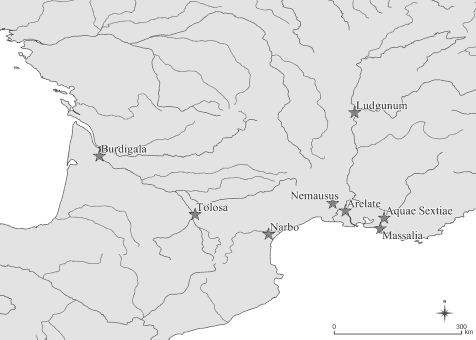

*图 5.1. 高卢南部地图，显示了所研究城市的位置（作者绘制）。*

## 晚期古代与罗曼式教堂

高卢城市的物理基督教化始于 4 世纪末，但直到 5 世纪和 6 世纪，这些建筑才在高卢城市景观中变得真正具有纪念碑意义且引人注目。通过这样，教堂和其他基督教建筑被插入罗马城市景观中，成为古代城市最后一个纪念碑式的阶段。⁸

这些罗马教堂以其巴西式布局为普遍特征，拥有多个（一个、三个、五个）中殿和一个半圆龛，圣体祭坛位于半圆龛内。⁹

### 早期殉道堂与主教区

最早的教堂通常是 `martyria`（殉道堂），即纪念殉道者死亡或安葬之处，它们倾向于位于城市之外（罗马法禁止在 `pomerium` 或神圣边界内埋葬）。位于阿尔勒阿利斯坎普（Alyscamps）的圣热内尼乌斯殉道圣龛及其相关的墓地就是一个完美的例子（图 5.2）。这是一般规律，尽管也存在其他郊外墓葬巴西式教堂，例如纳尔贡的洛姆巴德封闭巴西式（Clos de la Lombarde），它们仅仅作为墓葬区存在，没有已知的殉道联系。

在 5 世纪，这些教堂被扩建或重建，以容纳日益增长的信徒和朝圣者的到来。到 6 世纪，新的教堂出现在墙内，远离与殉道崇拜直接相关的地点。这些新教堂变成了主教座巴西式教堂，即主教的驻地，并且往往更大、更具纪念碑意义，标志着主教在晚期古代城市管理中的高级公民地位。¹⁰ 有时这些大主教教堂占据中心位置（位于广场上方或旁边），并且经常被构成主教辖的各种建筑包围（包括辅助建筑，如宫殿、大厅和洗礼堂）。¹¹ 主教区与广场之间的这种拓扑连接进一步突显了主教及其相关的法神职人员的政治角色，将他的行动基地定位于帝国市政权力的传统位置：通过关联获得合法性。

### 教堂的年代分布

已知共有 69 座前罗曼式时期的教堂。这 69 座教堂分布均匀：

- 艾克斯：8（¹²）
- 阿尔勒：10（¹³）
- 波尔尔多：6（¹⁴）
- 里昂：13（¹⁵）
- 马赛：9（¹⁶）
- 纳尔贡：10（¹⁷）
- 尼姆：7（¹⁸）（注：原文提到尼姆为 7 座）
- 图卢斯：6（¹⁹）

其中大多数可以确定定位于晚期古代到 6 世纪之间，尽管一些较晚的无法更准确地确定。

## 向罗曼风格的演变

这些教堂在 8 世纪和 9 世纪之前很大程度上保持不变，直到那时增加了塔楼和地下室等次要元素。然而，在此之前，所有的修改都是增建或扩大建筑。²⁰

只有从 11 世纪开始，我们看到的不仅是增建，而是完全重建。罗曼式阶段的普遍特征是：

- 新技术（例如使用新凿的石材和桶形拱顶）
- 新布局（带有地下室和横廊的三中廊巴西式建筑）
- 新的装饰风格（包括雕刻拱门和柱头）

这种南部罗曼式风格（图 5.3）与伊比利亚半岛的风格有关，同时它似乎也吸收了莱茵 10 世纪的新教堂以及意大利的影响。²¹

## 转型总结

晚期古代巴西式教堂向中世纪盛期的转型可以用以下数据总结。在这项研究考虑的 69 座教堂中：

- 58%被重建为全新的罗曼式阶段（46%确定，12%可能），这完全消灭了之前的晚期古代建筑。
- 7%在千年禧之前被废弃。
- 31%可能在 11 世纪和 12 世纪被废弃（图 5.4a 和 b）。

剩下的教堂似乎以各种形状或形式延续到中世纪后期，但没有延续到现代早期。这是这些城市纪念碑式景观的一次重大转型，因为这些巴西式建筑是古典罗马传统内建造的最后建筑。只有城墙和一些神庙（如波尔德多的杜泰尔柱，或尼姆的卡拉角神庙），以及 `arènes`（竞技场建筑，如尼姆、波尔尔多或阿尔勒的竞技场，图 5.5）似乎保留到了这一时期及之后，这在很大程度上是因为它们被赋予了作为防御工事或住所的新功能。

在晚期古代巴西式建筑中，很大比例在罗曼式时期之前（7%）或期间（31%）被遗弃的建筑，最初都是墓葬巴西式教堂。位于纳尔贡的 `Clos de la Lombarde` 巴西教堂建于 4 世纪，于 8 世纪被遗弃，这也许是考古学上的最佳范例，但马赛的 `Rue Malaval` 和 `Alcazar` 巴西教堂也同样具有启示意义。这些建筑通常只通过考古才为人知，这表明可能存在更多此类建筑。无论如何，这些结构的遗弃表明了丧葬“惯习”（`habitus`）的变化，因为从 10 世纪开始，墓葬很大程度上转向了组织的墓地，教堂内部的墓葬变得减少（且更具选择性）。

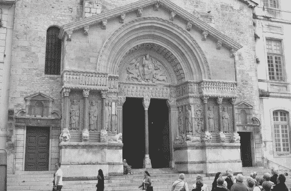

*图 5.3. 阿尔的圣罗菲穆大教堂正面，普罗旺斯罗曼式的典型范例（作者）。*

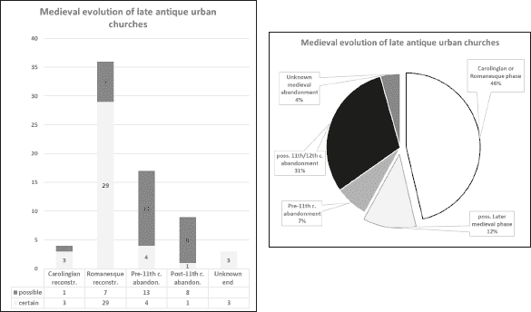

*图 5.4a-b：图表显示了中世纪后期被拆除和重建的晚期古代教堂的百分比（作者）。*

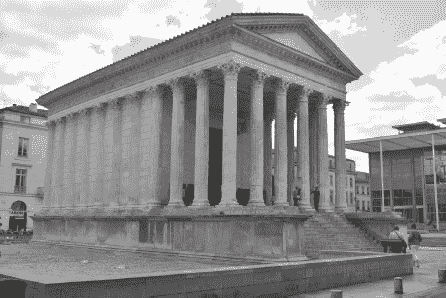

*图 5.5. 尼姆的方形神殿（作者）。*

这一时期 58%的城市教堂得到了重建，在某种程度上可以归因于仪式和礼仪的变化。到 11 世纪，教堂内部空间的使用（以及与之相关的仪式）已经发生了变化，使得晚期罗马风格的半后圆形巴西式教堂变得过时，甚至格格不入。朝圣重要性的增加以及多个祭坛（用于私人和同时进行的弥撒）的激增，要求教堂空间具有更复杂的内部布局，包括前廊、中庭、放射状小拜堂以及半后圆形周围的走廊。这种同质化在某种程度上是作为对格高利改革的回应而推动的，该改革将罗马仪式确立为规范，并取代了先前的当地礼仪。旧的罗马风格巴西式教堂很难满足这些需求。虽然在中世纪早期对这些元素进行过某种程度的尝试，但它们是添加在现有建筑之上的；而为了部署所有元素（以适应当天的礼仪需求），与其在现有教堂上修补和扩建，不如开始新建更具可行性，也更具政治意义。阿尔的圣罗菲穆和图卢兹的圣萨图宁（这两者都是通往圣地亚哥之路上的关键站点，其本身也是朝圣地）是最好的例子。

从我们现代的角度来看，这种通过破坏来重建的过程似乎是一种断裂和替代，甚至是对古代城市视觉记忆的拒绝，但事实上，情况恰恰相反。重建（特别是像模仿罗马形式的罗曼式风格）是连续性的直接宣告。

## 作为连续性的重建

罗曼式是一种“全方位风格”，也就是说，它扩展到了建筑之外，包括雕塑和绘画，其旨在通过图像向大众传播基督教教义。或许是在这种更新的精神下，城市中的罗马基督教纪念碑成为了目标，以便通过视觉向大众传播基督教叙事。然而，这并不能完全解释为什么晚期古代巴西式教堂是被替代，而不是像在此之前的常态那样修复和扩建。

从纯建筑的角度来看，这些教堂的重建是可以理解的，因为它们需要取代旧且可能已经损坏的建筑。最初的巴西式教堂从初并不是为了永恒而建造的（这是我们应该完全摒弃的现代建筑观点），到 11 世纪时它们已经有四五百年的历史。这些教堂像大多数其他晚期古代建筑一样，最初是用灰浆砌的碎石（`petit appareil`）、回收材料和低质量石灰砂浆建造的，因此它们并不像帝国早期的罗马建筑（以等号石石筑和火山灰“混凝土”为特征）那样坚固或耐用。它们很容易受到损坏，早在 6 世纪，图尔的格列留就提到过许多晚期罗马结构在地震、火灾和简单的自然老化中倒塌。

从 5 世纪起，主教们似乎承担了保护旧市政建筑的责任，他们的关注点自然延伸到了教堂。例如，9 世纪的里昂主教莱德拉德（Leidrad）重建了晚期古代的殉道者教堂，这是该市最重要的教堂之一，旨在纪念 2 世纪在该市受害殉道的 48 名基督徒，那里同时也作为该市晚期古代主教群的安息之地。在与这些案例相关的叙述中，往往存在一种底层的修辞，将建筑的衰败与道德的沦落等同，因此重建和修理被呈现为社区重新的机会，同时凸显了建造者的领导和典范作用。

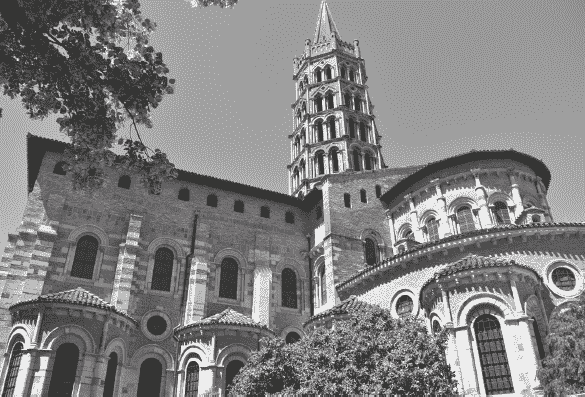

*图 5.6. 图卢兹的圣萨图宁（作者）。*

至于“为什么”巴西式教堂在原址重建，很清楚，在法律上在旧结构上方建造比寻找新地点更方便，即使仅仅是因为那块地已经是教会的财产。此外，到这一时期，城市地区建筑稠密，因此重新使用同一块地可能表明城市内部缺乏建筑的开放空间，或者由于教会建造者缺乏资源、权力或意愿清理房屋。然而，在另一个层，这种做法也是对“功能性”连续性的声明，即使这需要平整之前的结构，这似乎比对土地的世俗拥有更重要更有意义。至少从礼仪的角度来看，没有必要让教堂保留在原址。在古典异教崇拜中，神庙的圣洁与其位置有关，因为地点与神灵之间存在直接联系，但基督教崇拜场所并非如此（上帝无处不在，圣遗也可以移动）。但在殉道者遗迹的情况下，情况要复杂得多，因为这些教堂是为了纪念埋葬地点（例如，马赛的圣维克多或阿尔的圣热内修斯）或实际殉道发生的地点（图卢兹拉内博德的圣萨图宁教堂）。但大多数其他教堂（特别是大主教区建筑群及其刻意选择的中心位置）与其位置并没有实际的神圣联系。

然而，将教堂保留在原址对于城市居民来说至关重要，因为教堂在他们的认知地图中是中心焦点。认知地图可以被理解为对城市运作方式（或者准确地说是对城市的结构和理解方式）的“心理图像”，由与特定地点相关的情感和记忆组成。³³ 大多数互动场所为社区产生了更多相关的记忆，因此在理解城市的概念布局方面发挥着更突出的作用，并对凝聚社区至关重要。市场广场、社交场所或与公共仪式相关的建筑是这些感知地图中的“热点”。³⁴ 教堂完美地契合了这些类别，它们作为当地的地标，将共享的公共空间定义为宗教和民事集会的场所，³⁵ 以及张贴官方公告的地方。³⁶ 将教堂保留在物理位置强化了它在认知地图中的地位，并巩固了它在当地社区的角色。这种做法在乡村也通过改革修道院和乡村教区的延伸得到了呼应。³⁷

在现代人看来，很难理解这种被声称具有连续性和恢复性的重建过程，因为很明显这暗示了对建筑遗产的改变和破坏。³⁸ 然而，从历史角度来看，建筑的重建总是从这种“延续主义”的角度来看待的。这是一项记忆练习：纪念并保持对原始建筑的记忆。³⁹ 视觉上的抹除和结构上的断层通过对位置的保留以及“这无非是修复”的说法被方便地回避了——它们是社区认知地图中至关重要的标记，而新建筑尊重了这种建构的社会感知。这表明，在罗马世界，重建几乎被视为一种升级、一种改进；⁴⁰ 这一概念贯穿了晚期古代（正如 Wallace-Hadrill 在本书关于卡西多鲁斯的章节中所证明的那样）直到中世纪。⁴¹

考虑到古典和后古典时期的态度是从建筑连续性的角度来理解这些替换，强调了地点在城市认知地图中的重要韧性，我倾向于以类似的术语来看待罗曼式阶段。⁴² 重建后的教堂作为一种建筑，强调并突出了 `Church`（教会）作为机构的连续性，使其因其在晚期古代的当地起源以及与城市社区的联系而脱颖。此外，考虑到米迪地区（Midi）城市在视觉上的纪念碑性（例如 `arènes` 竞技场）以及行政上（通过西哥哥特法典的罗马法）明显的罗马特征，以及在这些重建中对罗马雕刻和装饰石元素的广泛利用，如果这些罗曼式建筑被用来声称对罗马城市的恢复，也并不为奇。⁴³

晚期古代神圣景观的韧性和保护意愿似乎显而易见。然而，仔细观察这些重建教堂的奉献名称可以发现，在另一个层面上存在着与过去的意识性断裂，仿佛与罗马过去的物理连接还不足以巩固这些建筑项目背后教会精英在当地的主导地位。即使从所有目的而言，这些新教堂与它们所取代的建筑是 `same`（相同）的，但新的奉献名称揭示了对古代城市社区的不同态度。

## 新圣人的崇拜


虽然晚期古代教堂的破坏及其被新的罗曼式教堂取代可以被解释为对古典过去的认知连续和建筑模仿，以及晚期古代城市景观的韧性，但事实仍然是，这些教堂中的许多被重新奉献了。对旧罗马圣人崇拜的放弃标志着晚期古代与高级中世纪城市社区之间清晰且意识的断裂，而且这种断裂是由推动重建的主教阶层人员领导的。观察这些数据，罗曼式重建中有很大比例（36%）被重新奉献给了不同的主保圣（Fig. 5.7, Table 5.2）。虽然这使得 57% 的旧晚期古代崇拜仍保留在新建筑中，但考虑到在这些世纪中被遗弃的教堂，只有三分之一（33%）的原始晚期古代奉献名称存过了中世纪。^(44)

圣人崇拜是定义中世纪城市社区的重要部分。^(45) 随着第四世纪帝国基督教化，对特定圣人的尊崇取代了异教的公民崇拜，而后者（最终）被遗弃了。这些早期圣人曾是殉道者或最早当地基督教社区的成员，他们的行为（或殉道典范）既是效仿的模范，也是他们城市在天堂的代表。虽然这些殉道者并不一定是早期崇拜的重新表述（*即*，异教人物的基督教版本），他们履行了相同的作用，并可以定义为祖先或英雄崇拜，因为这些圣人为社区提供了一个基督教的参考点。^(46) 随着时间的推移，这些殉道者积累了更多的力量，通常作为信徒的保护者出现。这进一步加强了圣人与其世俗信徒之间的联系。

```
[144-01.jpg]
图 5.7。罗曼式时期重新奉献教堂的百分比图（作者）。

表格 5.2。罗曼式时期更改奉献名称的教堂列表。
[144-02.jpg]
```

正如我们看到的，大多数重建的罗曼式教堂（57%）保留了它们的晚期古代奉献名称。然而，如果我们仔细观察这些圣人，会立即发现延续到中世纪的晚期古代崇拜通常是全基督教世界认可的通用人物，因为他们包含了使徒（约翰、彼得、保罗、安德烈），^(47) 圣玛利亚、大天使米迦或外国殉道者（斯提芬）。这些圣人的通用性不仅在于他们的古老，还在于他们作为基督亲眼见证者的非常直接联系。他们的故事在整个基督教世界是为人知并共享的，因为它们是新约的一部分。对于当地圣人来说情况未必如此，他们的圣传可能没有广泛传播或流通。来自晚期罗马圣人的遗骸也很少。^(48) 因为早期基督教高卢最初没有太自己的当地圣人和殉道者，因此许多圣人在六世纪被“发明”了，否则必须从国外获得并交换遗骸。图卢斯的圣萨图努斯和图尔的圣马丁是显著的例外，具有很强的当地内涵。^(49) 然而，到了十一和十二世纪，有了许多“较新的”当地圣人：拥有保存遗物的优秀人物，与当地神职人员（如主教、僧侣或院院长）有关，取代了早期的殉道者。

如果我们仔细观察示例（表 5.2），可以清楚地看到这种从非地方性圣徒和殉道者（斯蒂芬，^(50)马丁，^(51)文森特，^(52)尤拉利亚^(53)）向地方性主教和通用圣徒（特洛菲穆斯，^(54)卢普斯^(55)和乔治^(56)）的转变。阿尔尔的案例是一个典型的例子：该教会在晚期古代时期曾奉献给斯蒂芬，但在 11 世纪 50 年代的罗马式重建期间，圣座教士之一的莱蒙·德·蒙特雷东将半神话色彩的一世纪主教特洛菲穆斯的遗骸从阿尔西坎墓地迁到了新建成的主座堂，改变了它的奉献对象。更引人注目的是地方殉道者的替代。在图卢兹的案例中，12 世纪从萨图尔努斯到彼得和杰拉德（后者是位主教）的转变，仅仅是对“殉道者之地”（`locus martyrialis`）的重新奉献，因为主要的崇拜场所（墓葬地）保留了最初的奉献对象——直到今天如此.^(57) 在阿尔尔，我们发现的是相反的情况，303 年格内西乌斯殉道所在的那根柱子保留了其奉献对象，而他的安息地被重新奉献给了主教奥诺拉图斯（死于 429 年左右）。(58) 同样，在尼姆，11 世纪，由主教彼得·埃尔门戈德和贝尔特朗·德·蒙特雷东建立的罗马式教会，取代了奉献给当地出生主教卡斯托里乌斯（死于*c.* 420 年左右）的四世纪地方殉道者鲍德利乌斯的六世纪教堂。^(59) 与此同时，在阿克斯，五世纪殉道者米特里斯的所在地（`locus`）被一座奉给圣母玛利亚的教会所取代。^(60) 甚至在此期间未重建的教堂也被重新奉献了：上述提到的里昂莱德拉德的殉道者圣殿被交给了圣尼凯提乌斯的崇拜，这位六世纪的主教曾将那里变成了一座主教陵寝。^(61) 这些转变只能解释为：与早期崇拜相关的晦涩或次要故事，被更现代、更强大的圣徒形象所取代，这些人物更好地反映了主教精英阶层的利益。

这些晚期古代圣徒主教的崇拜提供了许多较老、更晦涩的地方圣徒所无法提供的优势。在某些情况下，异教时期圣徒的故事在语境上可能被认为是过时的，在时间上非常遥远，或者甚至对后来的编纂者来说难以理解，这使得他们不像后期的中世纪早期圣徒更具吸引力。^(62) 晚期古代圣徒的故事设定在更熟悉的主教和伯爵背景下，而不是法官和角兽斗背景。此外，这些主教圣徒的故事被讲述是因为它们的叙事价值（一位地方主教保护他的羊群），而不是在面对异教徒多数群体时被用作基督教生活的典范。^(63) 在阿尔尔，主教奥诺拉图斯被迫祈求殉道者格内西乌斯的代祷，以拯救参加游行的人免从坍塌的桥上掉落。对于当地教会来说，这种向罗马时期圣徒主教和道院的转变自然是对他们的一种自赞；这是一种强调教会精英在城市社区内部作用的方式，将城市以前的宗教和政治赞助人呈现为当今的神圣保护者。在一个圣徒身份尚未由教皇确认的时期，^(64) 中世纪盛期的主教们来说，将他们最显赫的先驱提升为圣徒（或巩固他们的崇拜）是非常方便的。这种转变的影响自然是，神圣主教的力量证明了教会精英在教皇支持的“上帝休战协议”范围之外的世俗权力的合理性。

通过强调地方教会及其神职人员（特洛菲穆斯、奥诺拉图斯、卡斯托里乌斯）从罗马时期就开始在天地为社区提供保障，中世纪盛期的主教们可以疏远世俗贵族对那些殉道者的任何主张——这些殉道者曾是公民社区的地方成员（鲍德利乌斯、格内西乌斯、米特里斯），但在教会结构之外。这样做，地方教会可以在贵族、主教和新兴市民阶级之间的城市冲突时期加强其地位。^(65) 虽然修复和更新“罗马式”（即晚期古代的）纪念碑是对连续性的主张以及与过去的合法性联系，但这些新的晚期古代主教崇崇拜的引入，强调了某些过去比其他过去更有用。

## 千禧年后重新定义城市权力

正如我们看到的，11 世纪和 12 世纪广泛的建筑活动（包括重建和新建筑）不仅仅是建筑完整性不稳定或丧葬习惯改变的结果。晚期古代的罗马式重建代表了由主教精英策划的新城市阶段，在这个阶段，对古代建筑的模仿和对功能空间的保护变成了与过去的联系，有助于巩固他们的地位。但为什么恰恰在那个点城市神职人员推动了这一建设阶段呢？

以图卢兹的萨图尔努斯大殿堂为例（图 5.6），^(66) 彼得·罗杰主教早在 1030 年就决定拨款未来重建这座晚期古代的殉道者大殿，但萨图尔努斯教士与主教座堂教士（他们反对建设）之间的紧张推迟了工程的开始。两个教团都寻求内部和外部政治支持：教皇、图卢兹伯爵和阿基坦尼公爵都参与了这场冲突。最终在 1074 年，伊扎恩主教（他本人曾是圣图尔努斯教堂的院长）启动了该工程项目，工程在 1096 年教皇乌尔班二世圣献教会后仍在继续。在这个特定案例中，教会的重建最初是为了容纳更多朝圣者并遵守罗马礼仪，但它也是萨图尔努斯教士反对主教座堂教士的一种权力举动，这只是 11 世纪和 12 世纪普遍存在的城市冲突之一。在 5 世纪到 11 世纪之间，城市保留了作为中心地经济枢纽的重要性，但规模比早期的罗马时期小得多。公民机构和市政管理在哥特人的塞提马尼亚和法兰克领土继续存在，尽管皇家官员（伯爵）和主教似乎是其中主要的参与者。^(67) 很难评估随后的加洛林时期城市的政治相关性，或者在那个时刻城市社区是如何组织的，但看起来主教和世俗贵族成为了市政政治中的主要参与者。^^(68)

在千禧年之后，随着伊斯兰和维京人掠夺的结束，高卢南部的城市经历了一段扩张和经济增长时期。这些城市很快成为军事化贵族（被称为 `caballarii` 或 `chevaliers`）、伯爵和城市教职人员（主教）之间权力斗争的舞台。诚然，主教区教职人员和圣歌队大部分由城市精英组成，这些人为 `caballarii` 提供了兵源，但他们属于不同的阶层：前者是 `clerici`（教职人员），后者是 `plebs militaris`（军事平民），两者偶尔会产生冲突。作为中间阶层群体，他们在反对像伯爵这样强大的土地领主贵族时是团结在一起的。法国王室充分利用这些内部冲突，通过提拔和支持受教廷支持的主教区精英，加强了其在南部城市的弱势地位，因为这些精英可以利用“上帝的和平与休战”来调解世俗政治事务。这最终导致了骑士们的沉默以及他们对圣歌队成员的反对，因此主教们反过来促进了针对 `plebs popularis`（平民）或 `burgenses`（市民）的市政机构的发展，以对抗骑士。

在这种三方平衡中，主教及其圣歌队成员率先在政治诉求中利用了古城及其纪念碑式的遗迹。我们已经在 11 世纪 50 年代的阿尔尔遇到雷蒙·德·蒙特雷登（Raimon de Montredon），在 11 世纪的尼姆遇到彼得·埃尔门戈德（Peter Ermengaud）和伯特兰·德·蒙特雷登（Bertrand de Montredon），但名单上还可以添加更多名字，例如图卢兹的主教伊扎恩（Izarn），他在 1074 年主持了圣图尔尼努斯教堂的重建；或者执事里科（Richo），1064 年在里昂做了同样的事。

通过广泛的建筑计划，教会精英以四种不同的方式将自己呈现市政社区的领袖。首先，他们通过重建晚期古代的教堂来“保护”罗马过去，从而证明其的合法性。使用模仿性的 `opus romanum`（罗马式）——带有圆拱和科林斯式柱头——所带来的连续感和恢复感，以及对城市神圣景观中关键地点的翻新，强调了主教作为城市人口赞助者的角色。恢复罗马过去（即使从现代学术角度来看那是晚期古代的）在 11 和 12 世纪仍然具有强烈的意识形态意义，而且晚期古代时期聚集的城市热点在五个世纪后仍然具有相关性。其次，这些教堂的修复诉诸于城市居民的连续感和地方认同感，但罗曼式的建筑语言具有更广泛、更普世的内涵，因为它能与改革后的教会联系起来，这清楚地表明主教既代表了他们的城市，也代表了整个罗马教会。第三，推广与城市教会有直接联系的圣人，提醒信徒们主教作为城市保护者和救星的长期角色，并在无意中边缘化了同样创造过神迹但与教会没有联系的当地人物。最后，在罗曼式第一波和第二波浪期间，教堂（重）建的快速甚至具有竞争性的扩张，可以被解释为相邻城市和竞争性主教之间的同类政体互动。为了进一步强调这一点，在我们所有的案例研究中（除一个外），晚期古代的大教堂在罗曼式时期都被重建并扩建（在纳博隆是唯一的例外，这是在晚期以哥特式风格开始的，但从未完成）。但这不仅仅是一场建筑上的竞争：阿尔尔圣歌队将罗曼式大教堂献给特罗菲穆斯（Trophimus），据报道他是彼得直接派遣的，这成为了阿尔尔声称其为高卢首座主教座的基础，而这一头衔在 11 世纪被授予了里昂。

通过对公共建筑计划的垄断以及通过仔细选择要推广的圣人形象，城市教会可以声称为城市人口造福，并利用其（被感知的）罗马过去的相关性和有效性，这种方式是城市贵族无法竞争的的。但其他的市政权力很快做出了反应。

在阿尔尔、艾克斯、图卢兹和纳博隆，当地的 `caballarii` 通过利用罗马城门或浴场建造塔楼、坚固的房屋和城市城堡展示了他们的权力；而在尼姆，`milites arenarum`（沙地士兵）则将剧场的西哥特式城堡变成了他们的堡垒。骑士们没有参与修复旧罗马/晚期古代建筑以供原用途，可以解释为：他们在市政事务中身份的合法性来自于他们与法兰克和西哥特贵族的联系（虚构或真实），这种联系由旧的加洛林特权证实，而不是像教会那样来自罗马公民秩序。市民也会随着领事团和公社的发展发展自己的建筑，但这将得得晚，且通常是哥特式风格（在纳博隆和阿尔尔可见，见图 5.8，尽管世俗教会青睐罗曼式，但这并非独占）。市民还试图通过将建筑位于公地图上的“热点”来提出合法性主张，例如在尼姆（卡拉角神庙）或阿尔尔（广场），尽管对这些空间的占用似乎并没有伴随着代表或恢复古老罗马秩序的诉求。

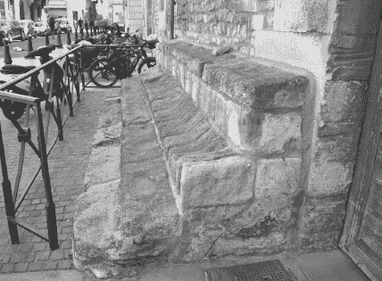

*图 5.8 位于阿尔尔旧罗马广场上的世俗市政管理长椅（作者）。*

## 结论

12 世纪末，构成高卢南部繁忙城市特征的新建纪念碑式景观，是一段相对短暂且密集的建筑活动的结果，在此期间，古城最后的活跃遗迹（晚期古代教堂）被取代了。这些晚期罗马遗迹的拆除、遗弃和破坏在我们看来似乎是与晚期古代的断裂，但事实恰恰相反。这种重建不仅仅是替代：它被视为保护、延续和改进。从人类学的角度来看，由于这些建筑作为城市社区认知地图中地标的重要作用，意味着只要作为教堂的功能得到了保留，它仍然是那座古老的罗马教堂。它是一座完全的新建筑这仅仅是表面上的区别。功能和位置的连续性至关重要，它强调了晚期古代城市景观的韧性，因为同样的崇拜活动中心（以及相关的社交互动）整个中世纪一直保留至今。当然，基督教成分是背后的主要原因，而其他罗马过去元素（如竞技场或城墙）的幸存，更多是因为它们规模巨大和多样化的再利用，而不是因为对古代功能的持续保护。

重建古代教堂是城市神职人员巩固其地方权力、以对抗市民和骑士阶层要求的方式之一。首先，重建教堂展示了他们对城市社区的承诺。此外，在建筑中使用罗曼式建筑语言（如圆拱、琢石石砌结构和类似于“科林斯式”的柱头）是他们声称继承罗马过去的一种方式，并伴随着随之而来的所有合法性。罗曼式还强调了当地教会与罗马教皇之间的联系。

但罗马过去也也被那些反对主教区控制的市政政党所主张。`caballarii`（骑士阶层）扎根于圆形剧场和浴场，而市民阶层则在罗马神庙和广场上建立了他们的议会大厅。在罗马过去如此鲜明的城市中（例如南高尔地区），古代元素可以被许多人所利用。这就是为什么许多教堂被重新奉献。放弃和边缘化罗马早期时期某些殉道者和圣人的崇拜是一个意识到的决定，因为他们可以被整个城市所主张；通过选择提拔圣化的主教和院长，11 世纪和 12 世纪的主教们选择将他们自己中的一人提升为主保圣。主教们选择宣传神圣神职人员的故事，是因为他们的神圣保护不能被平民所夺取。在这方面，教堂的重建与古代城市社区产生了一次有趣的断裂，我们在此再次发现，晚期古代已成为过去最能反映千年后当下价值观的时期。

## 致谢

本文是在 Andrew Wallace-Hadrill 教授（剑桥大学古典文学系）领导的“古代城市影响项目”框架下编写的。该项目获得了欧洲研究委员会（ERC）根据欧盟“地平线 2020”研究与创新计划提供的资助（拨款协议号 693418）。我要感谢 Sam Ottewill-Soulsby 给予无尽的帮助，并感谢 Francisco Moreno、Lydia Allué 以及匿名评审员提供的有用且深思的意见。

## 参考文献

### 初手文献

Cassiodorus, *Variae*, ed. T. Mommsen, MGH AA 12 (Berlin, 1894).

*Chronicon de Lanercost*, ed. J. Stevenson (Edinburgh, 1839).

CSLA = 晚期古代圣徒崇拜数据库 [网址:[www.csla.history.ox.ac.uk](http://www.csla.history.ox.ac.uk)]（访问于 2021 年 10 月 21 日）。

Dionysius of Halicarnassus, *Antiquitates Romanae*, ed. and transl. E. Cary, LCL 319 (Cambridge, 1937).

Gregory of Tours, *Historiae*, ed. B. Krusch and W. Levison, MGH SS rer Merov. 1 (Hannover, 1951).

Libanius, *Orationes*, transl. A. Norman (Liverpool, 2000).

*Novellae Justiniani*, ed. P. Krueger, Corpus Iuris Civilis 3 (Berlin, 1915).

Pliny, *Naturalis Historia*, ed. and transl. B. Radice, LCL 59 (Cambridge, 1969).

Tacitus, *Historiae*, ed. and transl. Clifford H. Moore, LCL 111 (Cambridge, 1925).

### 副手文献

Adam, J.-P., *Roman Building. Materials and Techniques* (London, 1994).

Assénat, M., ‘Le rayonnement de la ville’ in R. Andréani (ed.), *Nouvelle histoire de Nîmes* (Toulouse, 2006), pp. 55–76.

Aubert, M. and S. Goubet, *Romanesque Cathedrals and Abbeys of France* (London, 1966).

Aurell i Cardona, M., ‘Le comte, l’aristocratie et les villes de Provence’ in X. Barral i Altet (ed.), *Catalunya i meridional a l’entorn de’any mil* (Barcelona, 1991), pp. 150–59.

Aurell i Cardona, M., ‘La chevalerie urbaine en Occitanie (fin Xe - début XIIIe)’ in C. Gauvard (ed.), *Actes des congrès de la Société des Historiens Médiévistes de l'Enseignement Supérieur. élites urbaines au Moyen Âge* (Rome, 1996), pp. 71–18.

Barbier, J., *Archives oubliées du haut Moyen Âge. Les gesta municipalia en Gaule franche (VIe–IXe siècle)* (Paris, 2014).

Barral i Altet, X., ‘Le paysage architectural de l’an Mil’ in R. Derlot (ed.), *La France de l’an Mil* (Paris, 1990), pp. 169–84.


Barral i Altet, X., ‘Monuments et espace urbain dans le Midi de la France’ in X. Barral i Altet (ed.), *Catalunya i meridional a l’entorn de’any mil* (Barcelona, 1991), pp. 302–05.

（后续重复部分：The Romanesque. Towns, Cathedrals, and Monasteries*）

Barral i Altet, X., *The Romanesque. Towns, Cathedrals, and Monasteries*.

Barral i Altet, X., *The Romanesque. Towns, Cathedrals, and Monasteries*.

Barral i Altet, X., *The Romanesque. Towns, Cathedrals, and Monasteries*.

Barral i Altet, X., *The Romanesque. Towns, Cathedrals, and Monasteries*.

Barral i Altet, X., *The Romanesque. Towns, Cathedrals, and Monasteries*.

Barral i Altet, X., *The Romanesque. Towns, Cathedrals, and Monasteries*.

Barral i Altet, X., *The Romanesque. Towns, Cathedrals, and Monasteries*.

Barral i Altet, X., *The Romanesque. Towns, Cathedrals, and Monasteries*.

Barral i Altet, X., *The Romanesque. Towns, Cathedrals, and Monasteries*.

Barral i Altet, X., *The Romanesque. Towns, Cathedrals, and Monasteries*.

Barral i Altet, X., *The Romanesque. Towns, Cathedrals, and Monasteries*.

Barral i Altet, X., *The Romanesque. Towns, Cathedrals, and Monasteries*.

Barral i Altet, X., *The Romanesque. Towns, Cathedrals, and Monasteries*.

Barral i Altet, X., *The Romanesque. Towns, Cathedrals, and Monasteries*.

Barral i Altet, X., *The Romanesque. Towns, Cathedrals, and Monasteries*.

Barral i Altet, X., *The Romanesque. Towns, Cathedrals, and Monasteries*.

Barral i Altet, X., *The Romanesque. Towns, Cathedrals, and Monasteries*.

Barral i Altet, X., *The Romanesque. Towns, Cathedrals, and Monasteries*.

Barral i Altet, X., *The Romanesque. Towns, Cathedrals, and Monasteries*.

Barral i Altet, X., *The Romanesque. Towns, Cathedrals, and Monasteries*.

Barral i Altet, X., *The Romanesque. Towns, Cathedrals, and Monasteries*.

Barral i Altet, X., *The Romanesque. Towns, Cathedrals, and Monasteries*.

Barral i Altet, X., *The Romanesque. Towns, Cathedrals, and Monasteries*.

Barral i Altet, X., *The Romanesque. Towns, Cathedrals, and Monasteries*.

Barral i Altet, X., *The Romanesque. Towns, Cathedrals, and Monasteries*.

Barral i Altet, X., *The Romanesque. Towns, Cathedrals, and Monasteries*.

Barral i Altet, X., *The Romanesque. Towns, Cathedrals, and Monasteries*.

Barral i Altet, X., *The Romanesque. Towns, Cathedrals, and Monasteries*.

Barral i Altet, X., *The Romanesque. Towns, Cathedrals, and Monasteries*.

Barral i Altet, X., *The Romanesque. Towns, Cathedrals, and Monasteries*.

Barral i Altet, X., *The Romanesque. Towns, Cathedrals, and Monasteries*.

Barral i Altet, X., *The Romanesque. Towns, Cathedrals, and Monasteries*.

Barral i Altet, X., *The Romanesque. Towns, Cathedrals, and Monasteries*.

Barral i Altet, X., *The Romanesque. Towns, Cathedrals, and Monasteries*.

Barral i Altet, X., *The Romanesque. Towns, Cathedrals, and Monasteries*.

Barral i Altet, X., *The Romanesque. Towns, Cathedrals, and Monasteries*.

Barral i Altet, X., *The Romanesque. Towns, Cathedrals, and Monasteries*.

Barral i Altet, X., *The Romanesque. Towns, Cathedrals, and Monasteries*.

Barral i Altet, X., *The Romanesque. Towns, Cathedrals, and Monasteries*.

Barral i Altet, X., *The Romanesque. Towns, Cathedrals, and Monasteries*.

Barral i Altet, X., *The Romanesque. Towns, Cathedrals, and Monasteries*.

Barral i Altet, X., *The Romanesque. Towns, Cathedrals, and Monasteries*.

Barral i Altet, X., *The Romanesque. Towns, Cathedrals, and Monasteries*.

Barral i Altet, X., *The Romanesque. Towns, Cathedrals, and Monasteries*.

Barral i Altet, X., *The Romanesque. Towns, Cathedrals, and Monasteries*.

Barral i Altet, X., *The Romanesque. Towns, Cathedrals, and Monasteries*.

Barral i Altet, X., *The Romanesque. Towns, Cathedrals, and Monasteries*.

Barral i Altet, X., *The Romanesque. Towns, Cathedrals, and Monasteries*.

Barral i Altet, X., *The Romanesque. Towns, Cathedrals, and Monasteries*.

Barral i Altet, X., *The Romanesque. Towns, Cathedrals, and Monasteries*.

Barral i Altet, X., *The Romanesque. Towns, Cathedrals, and Monasteries*.

Barral i Altet, X., *The Romanesque. Towns, Cathedrals, and Monasteries*.

Barral i Altet, X, *The Romanesque. Towns, Cathedrals, and Monasteries*.

Barral i Altet, X., *The Romanesque. Towns, Cathedrals, and Monasteries*.

Barral i Altet, X., *The Romanesque. Towns, Cathedrals, and Monasteries*.

Barral i Altet, X., *The Romanesque. Towns, Cathedrals, and Monasteries*.

Barral i Altet, X., *The Romanesque. Towns, Cathedrals, and Monasteries*.

Barral i Altet, X., *The Romanesque. Towns, Cathedrals, and Monasteries*.

Barral i Altet, X., *The Romanesque. Towns, Cathedrals, and Monasteries*.

Barral i Altet, X., *The Romanesque. Towns, Cathedrals, and Monasteries*.

Barral i Altet, X., *The Romanesque. Towns, Cathedrals, and Monasteries*.

Barral i Altet, X., *The Romanesque. Towns, Cathedrals, and Monasteries*.

Barral i Altet, X., *The Romanesque. Towns, Cathedrals, and Monasteries*.

Barral i Altet, X., *The Romanesque. Towns, Cathedrals, and Monasteries*.

Barral i Altet, X., *The Romanesque. Towns, Cathedrals, and Monasteries*.

Barral i Altet, X., *The Romanesque. Towns, Cathedrals, and Monasteries*.

Barral i Altet, X., *The Romanesque. Towns, Cathedrals, and Monasteries*.

Barral i Altet, X., *The Romanesque. Towns, Cathedrals, and Monasteries*.

Barral i Altet, X., *The Romanesque. Towns, Cathedrals, and Monasteries*.

Barral i Altet, X., *The Romanesque. Towns, Cathedrals, and Monasteries*.

Barral i Altet, X., *The Romanesque. Towns, Cathedrals, and Monasteries*.

Barral i Altet, X., *The Romanesque. Towns, Cathedrals, and Monasteries*.

Barral i Altet, X., *The Romanesque. Towns, Cathedrals, and Monasteries*.

Cazes, Q. 与 D. Cazes, *图卢斯的圣图尔宁教堂：从萨图尔宁到罗马式艺术的杰作* (图卢斯, 2008)。

Chédeville, A., “决定性变革前夕的城市现象”，收于 X. Barral i Altet（编），*千年之法国的纪念碑式景观* (巴黎, 1987)，第 63–72 页。

Curchin, L., “晚期古代希斯尼亚公民领袖的作用”，*Studia Historica. Historia Antigua* 32 (2014): 281–304 页。

Cushing, K. G., *11 世纪的改革与教皇权* (曼彻斯特, 2020)。

de Filipo, R., “古代图卢斯砖石建筑概览”，收于 M. Bendala, C. Rico 和 L. Roldán（编），*罗马时代的砖块及其衍生产品*，罗马建筑专著第 4 卷 (马德里, 1999)，第 235–264 页。

Débax, H., “1100 年前后的南部贵族阶”，收于 H. Débax（编），*罗马式时期的贵族、艺术与建筑* (圣米歇尔-德-库萨, 2005)，第 7–20 页。

Defries, D., *11 世纪佛兰德的过去建构：圣维诺克的圣徒传记*，博士论文 (俄亥俄州大学, 2004)。

Delong, E., *纳尔刚与纳尔博纳斯地区*，高卢考古地图 11/1 卷 (巴黎, 2002)。

Diniz, L., *从晚期古代到中世纪早期的基督教化与宗教身份：高卢、希斯尼亚和英国的比较史*，博士论文 (维也纳大学, 2017)。

Doulan, C., *波尔多*，高卢考古地图 33/2 卷 (巴黎, 2013)。

Duval, Y., P.-A. Fevrier 与 J. Guyon. *艾克斯与布吕尼恩教区（第二纳尔博纳斯与阿尔卑斯山区）*，高卢城市基督教地形学第 2 卷 (巴黎, 1986)。

Esmonde Cleary, S., *公元 200–500 年的罗马西方世界：一项考古学研究* (剑桥, 2013)。

Fernández, D., *西伊比利亚的贵族阶级与国家，公元 300–600 年* (费城, 2017)。

Fortes, M., “祖祖先崇拜中的虔诚”，*大英伦和爱尔兰皇家人类学会杂志* 91.2 (1961): 166–191 页。

Gayraud, M., *从起源到 3 世纪末的古代纳尔刚*，纳尔博纳斯考古杂志第 8 卷 (巴黎, 1981)。

Grava, Y., “新平衡（11 世纪至 13 世纪）”，收于 R. Andréani（编），*尼姆新史* (图卢斯, 2006)，第 85–102 页。

Greenhalgh, M., *中世纪罗马古迹的存续* (伦敦, 1989)。

Gupta, A. 与 J. Ferguson, “超越文化：空间与差异的政治”，*文化人类学* 7.1 (1992): 6–23 页。

Guyon, J., “图卢斯，维西特王国的首都是”，收于 G. Ripoll（编），*王室所在地，公元 400–800 年* (巴塞罗那, 2000)，第 241–266 页。

Guyon, J., “圣贝尔特朗-德-孔明日的基督教大教堂：独特的建筑还是‘化石’？”，收于 P.-A. Février（编），*从古代到中世纪（弗勒茹朱会议记录，2001 年 4 月 7 日）* (艾克斯普罗旺, 2004)，第 2–21 页。

Guyon, J. 与 M. Heijmans, *普罗旺斯的晚期古代：基督教的诞生* (阿尔勒, 2013)。

Hartmann-Virnich, A., “早期罗马式宗教建筑评述 (1030–1100 年)”，*Hortus Artium Medievalium* 6 (2000): 35–64 页。

Heijmans, M., *晚期古代的阿尔勒：双城阿雷拉斯时期*，法国学院丛书第 34 卷 (罗马, 2004)。

Hershkowitz, P., *普鲁登修斯、希斯尼亚与晚期古代基督教：视觉文化与圣徒崇拜* (剑桥, 2017)。

Humphries, M., “城市与晚期古代的意义”，*布里尔古代史研究视角* 2.4 (2019): 1–112 页。

Jaspert, N., “奥古斯丁改革：一场在平民信仰与教会之间的运动”，收于 *格列高利改革及其在基督教世界的影响，11-12 世纪*，埃斯特拉第 32 次会议记录 (潘普洛纳, 2006)。

Kaymaz, I., “城市景观”，收于 M. Ozyavuz（编），*景观建筑的进展* (里耶卡, 2013)。

Kerrick, S., “使徒的继承者：早期诺曼迪圣徒传中的公爵权力”，收于 R. Berkhoffer, A. Cooper 和 A. Kosto（编），*中世纪欧洲的权力* (伦敦, 2005)，第 11–24 页。

Koziol, G., *上帝和平* (利兹, 2018)。

Lalli, M., “城市身份：理论、测量与发现”，*环境心理学杂志* 12 (1992): 285–303 页。

Lambrinou, L., “古代遗迹及其保护：帕特农神庙东侧的研究”，收于 M. Miles（编），*建筑手册* (伦敦, 2016)，第 526–546 页。


# 参考文献

Lauranson-Rosaz, C., “千年南部的罗马性”，收于 R. Derlot（编），*千年法国* (巴黎, 1990)，第 49–74 页。

Laurence, R., S. Esmonde Cleary 与 G. Sears, *罗马西方城市：公元前 250 年–公元 250 年* (剑桥, 2011)。

Le Mer, A.-C 与 C. Chomer, *里昂*，高卢考古地图 69/2 卷 (巴黎, 2007)。

Lesné-Ferret, M., “12-13 世纪塞普蒂曼镇的执事制度”，收于 K. Reyerson 和 J. Drende（编），*中世纪法国的城市与乡村：1000–1500 年*，中世纪地中海第 18 卷 (莱登, 1998)，第 3–22 页。

Lester, M., “早期中世纪希斯尼亚及之外的礼仪身份”，*西哥特学术会议集* 2 (2017): 114–130 页。

Lifshitz, F., “史学中的政治：11 世纪卢昂主教的记忆”，*历史与记忆* 10.2 (1998): 118–137 页。

Lipka, M. *罗马诸神* (莱登, 2009)。

Loseby, S., “晚期古代高卢城市的衰落与变”，收于 J.-U. Krause 和 C. Witschel（编），*晚期古代城市：衰落还是变革？* (斯图加特, 2006)，第 96–104 页。

Loseby, S., “墨洛维法兰西城市的作用”，收于 B. Effros 和 I. Moreira（编），*墨洛维世界手册* (牛津, 2020)，第 583–611 页。

Magnou-Nortier, E., *8 至 11 世纪南部的世俗社会与教会* (图卢斯, 1974)。

Martínez Jiménez, J., “重复、修复与重建：后罗马西班牙的运行中水渠”，收于 B. Jervis 和 A. Kyle，*凑过就补：妥协的考古学*，英国考古报告国际第 2408 卷 (牛津, 2012)，第 26–44 页。

Martínez Jiménez, J., I. Sastre de Diego 与 C. Tejerizo, *伊比利亚半岛 300–850 年：考古学视角*，晚期古代与早期中世纪希斯尼亚第 6 卷 (阿姆斯特丹, 2018)。

Maurin, L., *波尔多教区*，高卢城市基督教地形学第 7 卷 (巴黎, 1998)。

McHaffie, M., “11 世纪法国的法律与暴力”，*过去与现在* 238.1 (2018): 3–41 页。

Miller, M. *主教宫：中世纪意大利的建筑与权威* (伦敦, 2000)。

Moreno Martín, F., “布拉加教区格列高利改革背景下的迪米奥石棺”，收于 C. Varela Fernandes（编），*中世纪的图象与礼仪* (里斯本, 2016)，第 179–210 页。

Nicholas, D. *中世纪城市的增长：从晚期古代到 14 世纪初* (伦敦, 1997)。

Packard, D. *12 世纪的欧洲：一篇性文章* (阿姆斯特斯特, 1973)。

Patterson, L. *吟游诗人的世界：中世纪奥克语社会，公元 1100 年–公元 1300 年* (剑桥, 1993)。

Pohl, W., “引言：早期中世纪的罗马性——多重身份”，收于 W. Pohl, C. Gantner, C. Grifoni 和 M. Pollheimer-Mohaupt（编），*罗马性的转型：早期中世纪地区与身份*，千年研究第 71 卷 (柏林, 2018)，第 3–40 页。

Poly, J.-P. *879–1166 年的普罗旺斯与封建社会：对南部所谓封建结构的研究* (巴黎, 1976)。

- Reglero de la Fuente, C., 〈西欧西班牙语王国中的主教及其教区所在地：XI-XII 世纪》，收录于*格列高利改革及其对西方基督教世界的影响，XI-XII 世纪。埃斯特拉第 32 届中世纪研究研讨会议论文*（帕尔多纳，2006 年），第 195–288 页。

- Renfrew, C. 与 J. Cherry, *同类政治互动与社会政治变革*（剑桥，1986 年）。

- Riess, F., *晚期古代的纳博讷及其领土：从西哥汪特人到阿拉伯人*（伦敦，2013 年）。

- Rivet, A., *纳博纳斯西亚省：罗马时期的南部高卢地区*（伦敦，1988 年）。

- Rothé, M.-P. 与 H. Tréziny, *马赛赛及其周边地区*，《高卢考古地图图集》第 13/3 册（巴黎，2005 年）。

- Sabrié, M. 与 R. Sabrié, *纳博讷的伦巴德人庭：东北部门的公共与私人空间*，《罗马考古与历史》第 12 卷（蒙塔尼亚克，2001 年）。

- Salarch, J., 〈西班牙人：迁往欧洲的西班牙哥特人（VIII-X 世纪〉，《加泰罗尼亚历史研究协会公告》第 20 期（2009 年）：31–50 页。

- Sastre de Diego, I., *晚期古代与高中世纪西班牙语教堂的祭坛*，《英国考古报告国际系列》第 2503 卷（牛津，2013 年）。

- Scheid, J., *神灵、国家与个人*，第二版（费城，2016 年）。

- Silva, S. 〈圣徒之墓：罗曼式世纪期间的虔诚、庄严感与装饰〉，收录于*中世纪：历史杂志*第 10 期（2009 年）：93–129 页。

- Siwicki, C., *帝国罗马时期的建筑修复与遗产*（牛津，2019 年）。

- Smith, J. 与 R. Aranha, 〈认知地图作为评估人们对地方依恋感的方法，《地理评论*（2020 年）：1–21 页。

- Solier, Y., *纳博讷伦巴德人庭的早期基督教巴西大教堂：考古框架、遗迹与器物*，《纳博讷考古杂志》第 23 卷（纳博讷，1991 年）。

- Steadman, L., C. Palmer 与 C. Tilley, 〈祖先崇拜的普遍性，《民族学》第 35.1 期（1996 年）：63–76 页。

- Thomas, E. 与 C. Witschel, 〈构建重构：拉丁西部罗马重建铭文的诉求与现实》，收录于*罗马英国学院论文集*第 60 期（1992 年）：135–177 页。

- van Andringa, W., 〈公元二世纪宗教与帝国城市的整合：共同宗教语言的创造〉，收录于 J. Rüpke（编），*罗马宗教指南*，布莱克古代世界丛书（牛津，2007 年），第 83–95 页。

- van der Grinten, E. F., *中世纪文献中的艺术史学元素：分析性研究*（海牙，1969 年）。

- Wirth, J., 〈改革的局限性〉，收录于 J. Wirth，《*罗曼时期的图像*（巴黎，1999 年），第 333–378 页。

- Wolfe, M., *围墙城镇与法国的塑造：从中世纪到早期现代*（纽约，2009 年）。

- Zadora-Rio, E. 〈7-12 世纪法国和英国早期中世纪景观中教堂墓地与教区地的形成：重新审视，《中世纪考古》第 47.1 期（2003 年）：1–19 页。

# 注释

- ^(1) 吕巴西尼乌，《演说集》，11.227。

- ^(2) “但矿井浴场现在是超市了，”Max Boyce 唱道。

- ^(3) Laurence 等人，《罗马西方的城市》。

- ^(4) Martínez Jiménez 等人，《伊比利亚半岛》，第 276–300 页。

- ^(5) *兰纳科斯特编史*，不不日期，1296 年：“确实，那座大教堂没有用罗马风格装饰……它是为了圣洁的威尔弗里德的事业而奉献的”（参见 van der Grinten, *Elements of Art Historiography*，第 7 页）。

- ^(6) 参见 Pohl，“引言”和 Humphries，“晚期古代的城市及其意义”。

- ^(7) 参见 Reglero de la Fuente，“主教与教区所在地”，第 220–223 页。

- ^(8) 参见 Esmonde Cleary, *罗马西方*；Guyon 与 Heijmans, *晚期古代*。

- ^(9) 关于考古或礼仪，请参见 Sastre de Diego, *祭坛*。

- ^(10) Esmonde Cleary, *罗马西方*，第 174–181 页；Martínez Jiménez 等人，《伊比利亚半岛》*，第 161–168 页。

- ^(11) Miller，《主教宫殿》。

- ^(12) Bouet，《私人浴场》，第 127 页；Duval 等人，《艾克斯与布吕恩教区》*，第 24–28 页；Esmonde Cleary, *罗马西方*；Greenhal, *罗马古物的存续*；Guyon 与 Heijmans, *晚期古代*，第 101–103 页。

- ^(13) Biarne 等人，《维纳与阿尔尔教区》，，第 80–84 页；Bromwich，《罗马遗迹》；Esmonde Cleary, *罗马西方*；Guyon 与 Heijmans, *晚期古代*，第 173–179 页；Rothé 与 Tréziny, *马赛*；Heijmans，《阿尔尔》，第 262、295–301 页。

- ^(14) Barraud 与 Gaidon，“波尔多”；Barraud 与 Caillabet-Duloum，“波迪加拉”；Maurin，《波尔多教区》，第 29 页；Doulan，《波尔多》，第 57、181 页。

- ^(15) Beaujard，《里昂教区》，，第 22–33 页；Bonnet 与 Reynaud，“日内瓦与里昂”；Esmonde Cleary, *罗马西方*，第 168–175 页；Greenhal, *罗马古物的存续*，第 168 页；Le Mer 与 Chomer，《里昂》，第 338–344、403–406、441–443、460–467、506–513、647–657 页。

- ^(16) Biarne 等人，《维纳与阿尔尔教区》，第 129–133 页；Bromwich，《罗马遗迹*，第 176 页；Esmonde Cleary, *罗马西方*；Guyon 与 Heijmans, *晚期古代*，第 103、115–125 页；Rothé 与 Tréziny, *马赛*，第 423–467、566–571、581–597 页。

- ^(17) Barral i Altet 与 Fevrier，《纳博讷教区》，，第 20–22 页；Bromwich，《罗马遗迹*，第 88 页；Delong，《纳博讷与纳博讷地区*，第 395–396 页；Gayraud，《古代纳博讷*；Riess，《纳博讷*，第 82–121 页；Sabrié 与 Sabrié, *伦巴德人庭*；Solier,*早期基督教巴西大教堂*。

- ^(18) Barral i Altet 与 Fevrier，《纳博讷教区》，，第 58–60 页；Assénat，“城市的影响”；Grava，“新的平衡”；Rivet，《纳博纳斯西亚省*》，，第 165 页。

- ^(19) Barral i Altet 与 Fevrier，《纳博讷教区》，，第 31–32 页；Boudartchouk 与 Arramonc，“元老广场的记忆”；Caille,*圣玛利亚“拉多拉德”*；de Filipo，“建筑简览”，，第 253 页；Esmonde Cleary, *罗马西方*；Guyon，“图卢兹”，第 226 页。

- ^(20) Barral i Altet，“建筑景观”，，第 178 页；Brenk，“早期中世纪意大利的大座教堂”；Caillet，“法国大座教堂”；Moreno Martín，“杜米奥的石棺”。

- ^(21) Barral i Altet, *罗曼式建筑*，第 13–24 页。

- ^(22) Solier,*早期基督教巴西大教堂*。

- ^(23) Rothé 与 Tréziny, *马赛*，，第 566–571、581–597 页；Guyon 与 Heijmans, *晚期古代*，，第 120–125 页。

- ^(24) 这些古老巴西大教堂的废弃，与在晚期古代并非圣化土地上建造的新城市教区教堂形成了鲜明对比，例如马赛的圣罗伦斯教堂（现存）或在尼姆和阿尔尔圆形剧场内建造的教堂（现已消失）：Barral i Altet，“建筑与城市空间”；Caille，“城市的扩张”。关于墓葬习惯的转变，请参见 Silva, 〈圣徒之墓〉和 Zadora-Rio, 〈教堂墓地的形成〉。

- ^(25) Brenk，“早期中世纪意大利的大座教堂”，，第 22 页；Caillet，“法国大座教堂” 。

- ^(26) 可作为社区定义强有力陈述的局部礼仪：Lester，“地图绘制”；参见 Aubert 与 Goubet, *罗曼式大座教堂*，，第 18–23 页；Chédeville，“城市现象”；Magnou-Nortier, *世俗社会*，，第 468–472 页。参见 Moreno Martín，“杜米奥的石棺”以获取更新后的参考文献。

# 正文

2019 年 4 月巴黎圣母院的惨剧火灾为这一点提供了一个完美的警示。

Adam，《罗马建筑》（*Roman Building*）；Bromwich，《罗马遗迹》（*The Roman Remains*）；Esmonde Cleary，《罗马西方地区》（*The Roman West*）。

例如，图尔图里，《史》（*Historiae*），5.6, 5.33, 8.15, 10.18。从考古学角度看，这可以在圣贝尔特朗-德-孔明日大教堂得到体现：Guyon，“圣堂”（‘La basilique’）。

Loseby，“衰落与变革”；Martínez Jiménez，“重新、修理与重建”。

此外，这座新大教堂还重新奉献给了里昂殉道者之一的尼塞提乌斯：Biarne 等人，《维昂与阿尔勒的教区》（*Provinces ecclésiastiques de Vienne et d’Arles*），32。

参见 Lipka，《罗马神灵》（*The Roman Gods*），15–21, 27–28。

Lalli，“与城市相关的身份认同”（‘Urban-related identity’）；Smith and Aranha，“认知地图”（‘Cognitive mapping’）。

Gupta and Ferguson，“超越文化”（‘Beyond culture’）；Kaymaz，“城市景观”（‘Urban landscapes’）。

参见 Nicholas，《中世纪城市的兴起》（*The Growth of the Medieval City*），87–88。

《查士丁尼尼新法典》（*Novellae Justiniani*）8，序言。

Jaspert，“奥古斯丁的改革”（‘La reforma agustiniana’）。

参见 Lambrinou，“古代遗迹”（‘Ancient ruins’）和 Siwicki，《建筑修复》（*Architectural Restoration*）。

例如，卡皮托林朱庇比特神庙的不同迭代版本（普林尼，《自然史》（*Naturalis Historia*），7.138；塔西佗，《史》（*Historiae*），3.72.3），罗穆卢斯的草屋（狄奥尼尼奥乌斯，《罗马古迹》（*Antiquitates Romanae*），1.79）或哈德良的[阿格里帕]万神殿，后者保留了原始铭文。在犹太语境下，同样的情况适用于所罗门圣殿的连续重建。

Thomas and Witschel，“构建性重建”（‘Constructing reconstruction’）。

卡西奥多鲁斯，《文集》（*Variae*），4.51.2。

Bouchard，《重写圣徒传》（*Rewriting Saints*），38–43。

Lauranson-Rosaz，“南方南部的罗马性”（‘La romanité du Midi’），52–58, 64；Hartmann-Virnich，“关于建筑的注释”（‘Remarques sur l’architecture’），37–41。

参见来自意大利的类似案例：Brenk，“中世纪早期意大利的大教堂”（‘The cathedrals of early medieval Italy’）。

Scheid，《神灵》（*The Gods*），105；van Andringa，“宗教与城市的整合”（‘Religions and the integration of cities’），86–93；Bartlett，《死者为何》（*Why Can the Dead*），129–132。

Fortes，“祖先崇拜中的虔诚”（‘Pietas in ancestor worship’）；Lipka，《罗马神灵》（*The Roman Gods*）；Steadman 等人，“祖先崇拜的普遍性”（‘The universality of ancestor worship’）。

当然，彼得和保罗与罗马及教皇廷有非常紧密的联系，这鼓励了他们的崇拜活动以加强对意大利以外教会的控制。

Bouchard，《重写圣徒传》（*Rewriting Saints*），2013。

CSLA, `S000289`；参见 Hershkowitz，《普鲁登留斯》（*Prudentius*），88，特别是第 3 章。

CSLA, `S000020`。

CSLA, `S000050`。

CSLA, `S000290`。

CSLA, `S000407`。

CSLA, `S000607`。

CSLA, `S002174` (?)。

CSLA, `S000259`。

Boudartchouk and Arramonc，“大广场的回忆”（‘Le souvenir du Capitolium’）。

Guyon and Heijmans，《晚期》（*L’Antiquité tardive*），60。参见 CSLA, `S000263` (Genesius) 和 `S000438` (Honoratus)。

Grava，“新自由民”（‘Les nouveauxilibres’）。参见 CSLA, `S000383`。

CSLA, `S001288`。

Le Mer and Chomer，《里昂市》（*Lyon*），341–343。


Bouchard，《重写圣徒传》（*Rewriting Saints*），54, 213–217；Defries，《构建过去》（*Constructing the Past*），450–457；Diniz，《基督教化与宗教身份认同》（*Christianisation and Religious Identity*），60。

Bouchard，《重写圣徒传》（*Rewriting Saints*），38–42；Kerrick，“使徒的继承者”（‘Heirs to the Apostles’）；Lifshitz，“史学的政治”（‘The politics of historiography’）。

Bartlett，《死者为何》（*Why Can the Dead*），57–59。

Barton，“狂热的愤怒”（‘Zealous Anger’）；Boone，《中世纪欧洲》（*Medieval Europe*），232–234。

Cazes and Cazes，《图卢斯的圣埃尔宁》（*Saint-ernin de Toulouse*）。

Barbier，《被遗忘的档案》（*Archives oubliées*）；Curchin，“市民领袖的作用”（‘The role of civic leaders’）；Fernández，《贵族与国家》（*Aristocrats and Statehood*），165–170；Loseby，“城市的作用”（‘The role of the city’）。

Boone，《中世纪欧洲》（*Medieval Europe*），221–222。

Nicholas，《中世纪城市的兴起》（*The Growth of the Medieval City*），65；Caille，“城市扩张”（‘L’élan urbain’）。

Aurell i Cardona，“伯爵”（‘Le comte’）；McHaffie，“法律与暴力”（‘Law and violence’）。

Cushing，《改革与教皇廷》（*Reform and Papacy*）；Koziol，《上帝之和平》（*The Peace of God*）；Magnou-Nortier，《世俗社会》（*La société laïque*）；Poly，《普罗旺斯与封建社会》（*La Provence et la société féodale*），172–207 和 524–525，带有类似的免责说明。

Boone，《中世纪欧洲》（*Medieval Europe*）。

对 19 世纪拿不勒斯现代化的研究完全忽视了“尼亚波利斯”（Neapolis）对城市更新的重要性。因此，本章同时有助于拿不勒斯的现代化史和拿不勒斯的古典接受史。后者的研究尤其不足，最近出版的著作*Remembering Parthenope*在某种程度上弥补了这一问题。在跨越从古代到现在的章节中，贡献者对“古典拿不勒斯的形象如何以及为何根据议程在几个世纪中被创造、增强和塑造”进行了“历时性的探索”。他们的目标是挑战一种持续的范式，即拿不勒斯是北方“贫穷、粗俗、从属的姊妹”。

在本文中，我采取了类似的方法，探索了写于 1860 年至 1914 年间创作的三篇文章。每篇文章都提供了一个观察拿不勒斯现代化过程中关键时刻的窗口。第一篇涉及统一后，拿不勒斯卫生部长`Marino Turchi`提出的改革建议。`Turchi`受到`尼亚波利斯`的现代性的启发，认为这段过去为拿不勒斯提供了一个模型。他认为，拆除和新的水系统可以恢复这一模型。第二篇文章是一部为纪念一条新输水道而写的专著，它给人一种印象，新的建筑计划通过水源重新将拿不勒斯与尼亚波利斯联系在了一起。改革者还利用这一时刻在纸面上“修复”了古代`Aqua Claudia`的物理遗迹。古代和现代输水道在伙伴关系中结合在一起，这种关系强化了拿不勒斯在经历了几个世纪的野蛮后重新文明的印象。正如第三篇也是最后的文本所示，这种拿不勒斯与尼亚波利斯之间的平行关系对于 1914 年的卫生部长`Orazio Caro`来说仍然至关重要。`Caro`面对公共卫生改革失败后的不稳定局面，重述了拿不勒斯的历史。他还指出，`尼亚波利斯`作为一座健康的城市，在今天已经得到了恢复。在这里，古代城市的理念再次被唤起，以证明`Turchi`的建议已经完成；拿不勒斯既古老又是现代的，是文明且整洁的。首先，要重要的是通过建立驱动 19 世纪城市改革的动态机制，将这些文本置于适当的欧洲语境中。

## 十九世纪城市的罗马、现代性与文明

19 世纪西方城市的城市健康与笔直的街道和洁净的水系统有关。根据对疾病的瘴气理论，良好的道路对于空气流通至关重要。在`John Snow`传播了霍乱病产生于水中而非“坏气”的理论之后，新水系统的重要性日益增加。拿不勒斯作为意大利最大的城市，缺乏这两种基础设施。正如历史学家`Frank Snowden`所讨论过的，这座城市遭受了持续的霍乱流行。与此同时，西欧各国的政府正如`Thomas Osborne`所主张的那样，通过响应医学知识来保护他们的城市并展示了良好的治理；而 18 世纪的政府通过纪律准则强调对公共卫生的承诺，19 世纪则“将问题转化为水和对城镇的妥善管理”。将适当的管理与这些基础设施联系起来，也为分类和目录城市建立了一个框架；因此，要被归类为“现代”，城市需要拥有水系统和整洁的道路。这样的城市也可以被称为“文明的”。没有此类系统的城市在逻辑上被归类为政府不力的产物，通常被想象为拥有蜿蜒巷弄并滋生疾病的城市。拿不勒斯符合这一类，而这些感知赋予了改革重视。这座城市是一个矛盾。正如一位记者为《晚报》撰写道：

“拿不勒斯总是一座*独特的*（sui generis）城市，其特点是奇异，而且是美丽的。在很多地方它是肮脏的，在很多地方是极其可怕的；狭小空间内人和物的聚集是难以言喻的；水的缺乏及其糟糕的显而易见……尽管如此，这座城市总是充满魅力、美丽、诱人且迷人的。”

面对这些问题的改革者在过去的城市中寻求规划解决方案，这些城市提供了实践模型和先例。他们通过自己对公共卫生和古代罗马的认知来解释历史文明，罗马在西方传统中一直被认为是文明的巅峰，成为了一个极具文明的模型。对于那些受过古典教育的资产阶级精英工程师、建筑师和医人员来说，罗马道路、水利和污水系统提供了古代现代性的显著指示。通过维护希腊-罗马文献中包含的理念，同时在罗马文明上投影出反映他们自身的工业和商业，这些人赞美了古代的“洁白”和整洁；他们选择忽视其他特质，特别是古代文化中不实际或宗教方面。因此，对城市健康的现代理解塑造了对历史城市和文明的描写。某些城市看起来比其他的“更文明”，而罗马的理念与现代城市达到了某种程度的同义。

巴黎，一个被拿不勒斯理想化的城市，将罗马作为现代化的模型。如果我们想为拿不勒斯创建一个适当的语境，就必须简要考察巴黎改革的动态。拿破仑三世和`Eugène Haussmann`男爵在 1853 年至 1870 年间改变了巴黎。正如`Richard Etlin`所写的，这两个人都希望巴黎既是一个“华丽的空间”，又是一个“卫生的空间”。在巴黎的传统中，罗马体现了这些价值观，并已经为一系列君主提供了城市模型；因此，`Haussmann`认为，“[罗马]习俗和道德所达到的完美程度”将“罗马民族”置于“不仅是古代人口，而且是现代人口”的顶端。巴黎的基础设施在象征上与帝国罗马联系在一起；从 1783 年起专门为为霍霍和监视而建造的大道（*boulevards*），同时以皇帝形象的直线使城市卫生化和古典化。同样，输水道和下水道使得巴黎成为了“现代罗马”。关键点是，在`Haussmann`之前，正如`David Pinkney`所示，输水道并不是巴黎“成为罗马”的要求。巴黎人从塞纳河取水，但`Haussmann`注意到将洁净的水源与文明联系起来的新标准，以及罗马在这方面可以提供的模型。他和工程师`Eugène Belgrand`（他编写了关于巴黎水系统和水源的五卷本研究）通过引用`Strabo`的话，将罗马重新定义为拥有道路、输水道和下道的城市。正如`Haussmann`所主张的，结论是，如果城市能通过输水道从极远的地方获得水源，巴黎才能自称是“本世纪的罗马”。罗马与巴黎之间的这种对比利用了变革；`Duis`输水道（1865 年）是第一条为巴黎带来泉水的输水道，`Vanne`输水道随后于 1870 年建成。

至关重要的是，巴黎的现代性是建立在罗马理念之上的，而非当地卢提亚（Lutetia）的罗马过去。卢提亚在这一时期中被完全遗忘了。尽管提供清洁水的行为本身可能标志着巴黎水务实践的辉煌复兴——因为卢提亚确实有一条引水道——但奥斯曼或贝尔格兰都没有主张这种“回归罗马思想”将巴黎与其罗马过去联系起来。事实上，正如考古学家科林·琼斯（Colin Jones）所证明，卢提亚在现代化过程中被摧毁了。也许巴黎的起源故事并不是一个现代城市想要引用或恢复的东西；在斯特拉博（Strabo）的记载中，卢提亚的名字据说源于代表泥土的 `lutum`，符合该城市的所在地特征。这危险地反映了当时对巴黎臭且肮脏的批评，将其描述为“病态城市”、“病态巴黎”（Paris malade），并带有比意义上的“肿胀”。此外，斯特拉博描述巴黎人（Parisii）是“生活在宁静状态并服从罗马人的民族”之一。这与巴黎的志向不符。卢提亚被“遗忘”了；这种过去与奥斯曼和拿破仑希望巴黎成为的整洁、文明和帝国式城市格格不入。新的基础设施使巴黎成为了政府定义的“罗马”；因此，一本医学指南所说，“`泥泞岛`（Île fangeuse）……巴黎人居住的地方……为我们现在来参观的华丽豪华的巴黎让了路……这经历了巨大的动荡。但巴黎不是一蹴而就的。”这一章节说明了对那不勒案例研究具有两个特别重要的点：巴黎展示了一个现代、清洁、美丽且具有纪念碑性的城市如何以罗马理念为榜样；其基础设施通过与这一文明的象征性联系获得了更高的声望。其次，巴黎并没有将这些基础设施与当地的罗马过去联系起来。相反，那不勒（Neapolis）在那不勒更新的建议中占据重要地位，我们将转向这一点。

## 马里诺·图尔基与改革建议

统一后几十年的更新由马里诺·图尔基（Marino Turchi，1808–1890）开创。他当时被誉为那不勒卫生运动之父，他的工作现在被认为是后续改革的基础，尽管没有人评价过他建议中更具象征意义的元素。图尔基在担任市政卫生委员会成员协助公共工程委员会的同时，对该市进行了多项主要研究。尽管他不是那不勒人，但他将那不勒作为自己的收养城市，并于 1848 年当选为议会议员。图尔基是一位民族主义自由主义者，支持在独立战争中驱逐波旁王朝。他投身政治生活，并在创立卫生研究所的同年担任了三十名政官之一，并成为那不勒大学的卫生学教授。从 1860 年起，图尔基积极实施改革，一个例子是卡波迪蒙特（Capodimonte）的工人阶级住房。他的第一部著作 `Sulla Igiene della città di Napoli`（1862）是对该市及其缺点的调查，写于当时改革似乎从属于解决沉重的意大利统一运动（Risorgimento）债务和维持普遍秩序。图尔基旨在激励市政当局承担全城更新的责任。他表示他的目标是让那不勒“配得上在文明欧洲最卓越的城市之中”。

19 世纪的那不勒并不被视为文明欧洲的城市之一。正如尼尔森·莫（Nelson Moe）所示，那不勒长期一直位于“南方”的“想象地理学”之中。这种划分产生了莫所称的针对该城市的“负面意识形态电荷”。尽管波旁王朝在促进那不勒的工业进步、教育和卫生方面做出了许多努力，但意大利人和外国人都认为，那不勒人已因持续的糟糕统治而变成了野蛮人。那不勒不是意大利的；那不勒是非洲的，正如第一位皮埃蒙特南方总督给卡米洛·坎维尔（Camillo Cavour）的信中所写：“多么野蛮！这不是意大利！这是非洲：与这些农民相比，贝都因人是文明的巅峰。”这种“野蛮”也与种族和气候因素有关；1886 年，英国旅行者萨缪尔·罗塞尔·福布斯（Samuel Russell Forbes）将那不勒人描述为“东方与希腊的混合”，以此刻画为现代世界的局外人。对于福布斯来说，这种异域的混合产生了“无知和迷信[作为]精神的主要特征”。因此，展现“希腊性”可能带有负面含义。例如，罗纳德·米克（Ronald Meek）在他对野蛮社会的研究中讨论了古希腊人如何与塔希提人太近以至于不能被认为是文明的。那不勒人如何看待他们的希腊身份超出了本文的范围，但这种对“希腊性”和“意大利性”的焦虑可能塑造了回望罗马时期那不勒的欲望。例如，那不勒政治家阿尔贝尔托·马格耶里（Alberto Marghieri，1852–1937）强调，那不勒虽然是“希腊腊的，但没有任何那些后来与其创始人名字联系在一起的缺陷”。

罗马在那不勒的知识分子传统中具有复杂的含义。在 18 世纪，正如梅丽莎·卡拉雷苏（Melissa Calaresu）所示，那不勒史学将罗马入侵视为开启几个世纪压迫性统治的时刻。历史学家认为，在罗马人之前，那不勒是独立的。罗马人之后，这座城市相继被哥特人、诺曼人、安仁家族、阿拉贡贡人和西班牙总督统治。罗马入侵代表了外来干预，导致了良好管理的终结；因此，历史学家贬低罗马，并回到萨姆尼人（Samnites）作为政治和经济更新的自主模型。这种对那不勒历史的解释反映了当时的反教皇政治，并支持了新的波旁王朝。然而，同一王朝后来又通过挖掘庞贝和赫尔库拉姆在希腊-罗马过去中寻求声望，这使得那不勒进入了大旅行游（Grand Tour）的路线。当意大利王国宣布时，强调当地的古代过去仍然是有益的，因为这在欧洲和国家背景下都具有象征资本。历史学家继续强调那不勒（Neapolis）的理念，即使其地面上的遗迹寥少。

那不勒斯（Neapolis）的形象是在学者巴尔托洛梅奥·卡帕索（Bartolommeo Capasso）写的两篇十九世纪文本中重建的。在卡帕索之前，主教多梅尼科·罗马内利（Domenico Romanelli）曾试图“以最严谨的态度搜遍了所有隐秘的角落”，但难以对这座包含物质遗迹的古代城市进行彻底的研究([41])。两人主要根据文学来源工作，这些来源在几个世纪以来被那不勒斯分子重新解读。卡帕索出版了大量关于那不勒斯中世纪和古代的历史著作。他的著作《古那不利遗址与帕莱波利*》（1855）试图寻找城市的起源，随后由朱利奥·德·佩特拉（Giulio De Petra）遗作出版了《希腊罗马时代的那不利》（1905），这本书对那不勒斯及其文化生活提供了更全面的想象。这项研究包含了第一份由那不勒斯人制作的那不勒斯考古平面，我们稍后会回到。

这座城市坐落在高处，下方是港口，并由最坚固的墙守护，根据一位历史学家的说法，这些墙展示了建造这座城市的古代人的力量。我们不谈论装饰城市的宏伟建筑，以免偏离主题；我们只想提到西西罗（见*Pro. Rab. Post. C. X.*）将她命名为“最著名的城市”，后来，朱利叶安（见*Misopog.*）也称其为“人口最稠盛的城市”，因此我们注意到，[在罗马时期]，这座城市并不像许多人所暗示的那样规模很小([42])。

1855 年，卡帕索对那不勒斯缺乏纪念碑式遗迹的情况解释道，他“将不会提到装饰城市的宏伟建筑，以免偏离主题”。那不勒斯确实拥有古代遗迹，但它们已被其他结构所吸收([图 6.1]）。双子星神庙（Temple to the Dioscuri）仅剩下两根柱子；这些柱子成了圣保罗教堂的一部分。附近，安提卡利亚（Anticaglia）的砖墙和可能的剧院遗迹也表明了罗马城市的存在([43])。卡帕索还描述了庞蒂罗西（Ponti Rossi）可见的一条输水道([44])。这条水道在古代被认为是`Aqua Claudia`，它源自阿韦利诺（Avellino）附近的塞里诺之泉，跨越惊人的 89 公里到达那不勒斯([45])。它已不再运作，但在古代，这条输水道还供应奥古斯塔为米森姆（Misenum）帝国舰队建造的`Piscina Mirabilis`([46])。这些遗迹在城市指南中也被突出，被广泛认为与城市之外的遗址有关，强化了城市遗址的“古代性”([47])。

改革者回望那不勒斯的这一形象，是因为意大利、文明与罗马之间的联系，使得罗马时期成为一个理想且相关的过去。我们可以通过回到图尔基（Turchi）及其改革建议来进一步探讨。图尔基认为，通过重新开发那不勒斯，那不勒斯可以把自己塑造成一个文明的现代欧洲城市。他认为应该通过从零开始重建那不勒斯来重塑那不勒斯。这种悖论是现代主义项目的特征，正如罗杰·格里芬（Roger Griffin）所描述的那样，这些项目受到“混沌与（新）秩序、绝望与希望、衰败与新生、毁灭与创造的辩证法”的影响([48])。然而，在转向那不勒斯之前，图尔基讨论了巴黎——这座城市提供了一个辉煌且现代的模型。他在 1855 年作为代表派往巴黎参加万世博览会，“为了研究那个极其文明的大都市所实施的主要卫生改革”([49])。正如他在“欧洲其他城市的命运，我们的命运”章节中所解释的那样，图尔基认为那不勒斯应该遵循巴黎的范例([50])。巴黎是一个拥有下水道和笔直道路的城市，水道即将建成。这为良好的卫生确立了标准；他声称“只有一个欧洲城市的复兴是如此紧迫且宏大，以至于像是一个奇迹”([51])。巴黎还象征着强有力自治政府下的城市更新。他惊讶于游客会发现波旁王朝时期的巴黎已消失；他们会发现一个新的巴黎，拿破仑·波拿巴特的城市，即“大皇帝”。游客将“无限地赞美`市政厅`（Municipio）的智慧、权力和高贵的灵感”，而拿破仑则是“世纪的名字”([52])。这种转变表明，那不勒斯也可以通过拆毁城市并在“罗马”模板上进行重新开发，为波旁统治画上句号。

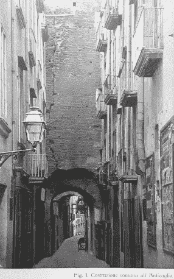

图 6.1. “罗马剧场的遗迹”，出自 B. Capasso 的著作*Napoli Greco-Romana Esposta nella Topografia e Nella Vita Opera Postuma di Bartolommeo Capasso*。那不勒斯本土历史协会编辑（*那不勒斯，1905 年*），图 1。*


然而，与奥斯曼不同，图尔基建议那不勒斯应该按照其罗马过去的形象进行拆除和重建。正如他在《对那个[古代]时期那不勒斯的描述》中所暗示的，那不勒斯与现代城市的理念是兼容的；它的名字甚至预示了这种关系。正如图尔基所称，“第二次，理由毫不亚于第一次，[那不勒斯]将被称为`nuova`（新的），甚至是`nuovissima`（最新的）”。([53])。正如卡帕索描述的，“库迈人受到可怕瘟疫的折磨，在神谕的命令下，通过再次重建城市逃脱了这场灾难；因此城市被命名为`Napoli`，即——新城市”。([54])。这个故事为当今深受霍乱困扰的城市提供了一个极佳的寓言。图尔基还强调了那不勒斯在`foedus aequanum`（公元前 326 年）之后的文化繁荣，这是一项罗马与那不勒斯之间的条约，后来允许那不勒斯在获得殖民地位的帝国时期仍保持半独立状态。他的章节《那不勒斯：省会城市不再是首都》，详细描述了一个维吉尔在此创作《埃涅阿史》的古代城市；那不勒斯因“健康和学习的原因”而被青睐为“优雅与文明的所在地”([55])。文学记录自然关注了这些元素，正如洛伦佐·米莱蒂（`Lorenzo Miletti`）最近分析的，因为它主要是拉丁语。拉丁作家明确了那不勒斯拥有希腊-罗马的复合身份，并强调这座城市是精英闲暇（`otium`）场所([56])。对于图尔基来说，这是有益的，因为健康和学习日益成为 19 世纪精英旅行的主要动力([57])。因此，他讲述了古代访问那不勒斯的“贵族和罗马参议员”的故事。

对于一个在存在期间从未经历过野蛮时代、拥有最遥远起源的民族，由于其在思想和知识史上占据了最大且最有效的地位，他们被赋予了怎样的使命呢？……我们将再次完全配得上我们的公民起源，正如罗马在那个时代在那不勒斯找到了其对待其他南方城市最安全的盟友和最明智的建议，意大利也将有一天发现一种强大的经济和知识力量，这种力量与其他部分相结合，将使其交付给上帝召唤它的命运。^[59]

在这次关于“那不勒斯的经济与知识未来”的会议上，`Marghieri`特别排除了野蛮过去的可能性，将这座城市描述为罗马的兄弟。他将那不勒斯称为“安全的盟友”，提醒了他的同时代人，那不勒斯在社会战争（公元 91-87 年）中接受了罗马公民，这带来了意大利的罗马统一。在这里，罗马与那不勒斯“在其时代”的伙伴关系界定了那不勒斯在王国解体后作为南方顾问的角色，因此，那不勒斯受到赞誉是因为这段过去提供了一种将那不勒斯置于现代意大利的手段。正如`Turchi`所问：“谁不预见辉煌的未来呢？”^[60]

最终，对那不勒斯的理想化与当时的那不勒斯形成了对比，这种对比促成了变革。如果说奥斯曼是将巴黎与罗马对比，那么这里那不勒斯与罗马时代的那不勒斯之间的对比就是关键。`Turchi`在结束他的建议时指出，只有当城市经过彻底的改建，那不勒斯才能成为那不勒斯。他提到了公元 64 年的罗马大火，据称是由尼禄皇帝引发的，这为他提供了一个有用的例子。正如`Turchi`所描述的，那不勒斯曾是一座健康的城市，因为尼禄皇帝没有将其化为灰烬。事实上，“如果这座城市不健康，尼禄绝不会特意选择那不勒斯作为他艺术光辉的所在地”。^[61] 然而，尼禄现在无疑会烧掉那不勒斯；这座城市不再像这种理想状态。那不勒斯就像尼禄所摧毁的那座城市一样，那里“旧建筑的畸形和狭窄蜿蜒的道路”触犯了他。^[62] `Turchi`能够将罗马大火重塑为衰落的必要良药；他的尼禄对罗马状况的回应是“对艺术的某种品味，一种审美感”。他还确定了“让城市更清洁、更健康的需求”。^[63] 大火是建立“一个秩序良好、具有更好规则和比例的计划”的手段。^[64] 这种解释显然偏离了苏埃德著作中那个穿着剧院服装、在火焰歌唱声中入神的人物。^[65] 因此，通过将那不勒斯理想化，`Turchi`为拆除找到了正当性，并为新基础设施找到了逻辑。现代那不勒斯将再次成为一个全新的、自治城市——那不勒斯——从布局到供水系统都是如此。^[66]

学术界未能将`Turchi`对那不勒斯的强调与随后几十年内那不勒斯所发生的变化联系起来。城市被赋予了洁净的水系统，大部分区域根据网格化规划进行了重新开发（见[图 6.2]）。这一时期被称为“城市改造”（`Risanamento`），是意大利第一次国家资助的卫生运动（约公元 1884-1910 年）。当时，这无疑被认为是`Turchi`思想的延续。^[67] 负责那不勒斯供水系统的工程师将《建议》（`Proposte`）描述为所有后续研究的基础，“在他身上展现了我们城市‘城市改造’的先驱”。^[68] 因此，我们应该将“城市改造”视为更广泛的文化背景和时间线的一部分；正如`Carla Giovannini`、`Adolfo Gambardella`和`Rossella Rossi`所指出的那样，这些倡议确实遵循了巴黎的范例。^[69] 但古城的理念驱动并界定了改革；它也为变化赋予了地方性和象征性的意义。下一节将转向塞里诺引水道，为这些思想提供更多背景。塞里诺引水道同样标志着那不勒斯的“复兴”。

## 那不勒斯引水道

因此，这些长期讨论的结果将是一个部分完整的水力系统，因其水源充足且卓越而称得上是“完美”的（`perfettissimo`），其输送方式对于其效果具有无可比拟的实用性，并作为其基础和基石的纪念性修复而显得光彩夺目。^[70]

`Turchi`对净水的建议最完整地包含在他的《论水与下水道》（`Sulle Acque e Cloache`，1863）中。^[71] 在这里他借鉴了业余考古学家兼工程师`Felice Abate`的著作，后者自 1840 年一直致力于恢复古老的克劳迪亚水道。^[72] `Abate`获得了市议会的资助来挖掘和检查古代结构；他得出结论，沿着`Montuoro`平原可以使用 41 公里。^[73] 他认为那不勒斯应该“适应罗马的智慧，即从远处的泉水中引水”，这句话是他从巴黎的建议中改编的。^[74] 那不勒斯引水道项目有其自身的悠久历史；这一方案曾被波旁王朝和西班牙人提过，但未见成功。^[75] 然而，正因如此，那不勒斯应该恢复并非显而易见。正如`Abate`所认为的，市议会可以完成“它的文明化工作，消除过去时代的无知和耻辱，而城市却在恶臭和不健康中腐烂”。^[76]

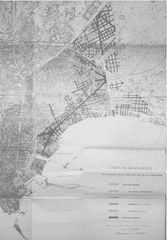

*图 6.2 “城市改造计划细节，显示了那不勒斯上方将建造的重新开发区（深色）”，出自 A. Marghieri 著作，《那不勒斯的城市改造》（Il Risanamento di Napoli）。在市政议员 Alberto Marghieri 教授语言学协会的会议。附：关于那不勒斯和帕莱波利遗址的历史研究，Bartolommeo Capasso（1889）。*

`Abate`延续了一种被`John Santore`称为“悲剧世纪”的叙事传统。不同时期那不勒斯历史学家识别出一个“辉煌的过去”，而将中间时期视为“衰败”。^[77] 正如`Abate`所述的，“随着罗马帝国的灭亡，以及所有文明的灭绝，引水道的外部部分遭受了野蛮人的破坏和时间的不公”。^[78] 在那不勒斯，这与外国统治时期相重合，那种统治导致了野蛮；因此“旧有的无知和糟糕的管理导致了那不勒斯最糟糕的状况，由于饮用水。”^[79] `Abate`将那不勒斯人的野蛮行为与其水源和系统联系起来：一个“野蛮的井水系统”，“[il] barbaro sistema dei pozzi”。^[80] 因为被迫从“肮脏河流”中饮水，那不勒斯市民陷入了痛苦的深渊。^[81] 因此，罗马的衰落和引水道的丢失导致了那不勒斯的野蛮。重建这一古代系统将意味着良好的治理和向文明的“回归”。

`Abate`的提议被搁置了，因为从字面上来说修复`Aqua Claudia`是不切实际的。^[82] 然而，政府继续强调对塞里诺水源的象征性修复，在古代与现代结构之间创造出一种联系，我们可以通过第二个文本来考察这种关系：为了纪念塞里诺而编写的专著。`L’Acquedotto di Napoli`于 1883 年出版，旨在庆祝计划于 1885 年通车的塞里诺引水桥。与`Proposte`不同，这部专著针对的是城市以外的读者，是为 1883 年的都灵博览会制作的。那不勒斯在两年前的米兰博览会上并未亮相，当时《Estafette》在巴黎对此的评价为“新意大利最伟大的事件之一”。^[83] 因此，官方指南得出结论，那不勒斯人被波旁王朝“培养得……对一切新事物都充满疑虑和漠然”。^[84] 而这部专著恰恰相反；它证明了那不勒斯选择了巴黎等现代城市所采用的罗马模式。^[85] 在国家博览会上向皮埃蒙特人展示这座引水桥，说明了那不勒斯领先于米兰和都灵。^[86]

### 专著的作者

该文本正式由`Società Veneta`撰写，这是一个负责建造引水桥的匿名合作社。^[87] 尽管这部专著是许多后续研究的主要素材材料，但尚未有人确定其作者。有两位贡献者的身份是确定的；第一位是`Abate`，他的挖掘工作被引用过。我提议第二位作者是威尼斯民族主义者`Paolo Fambri`（1827–1897）。`Fambri`支持统一，并在 19 世纪 70 年代成为威尼斯右翼的杰出领袖。负责监督施工工程的工程师`Francesco Verneau`在自己的施工报告的一处脚注中将`Fambri`归功为作者。^[88] `Fambri`还是一名记者，曾在那不勒斯主办`La Patria`，并与反波旁流亡者`Ruggiero Bonghi`一起在都灵创办了`La Stampa`。他还在民族主义杂志`Rassegna Nazionale`上又发表了两篇关于这座引水桥的文章，赞扬了书中那部“巨型专著”。^[89] 如果`Fambri`是作者，那么他对那不勒斯引水桥的观点很可能受到了其殖民主义理解的影响，即罗马、意大利和文明的理念与概念是相互关联的。正如我们将会看到的，这座引水桥被神化为这些特征的象征，是以牺牲其他历史为代价的。

### 与 Aqua Claudia 的比较

`L’Acquedotto di Napoli`以对`Aqua Claudia`的描述开头。现代引水桥在字面上与这座古代建筑毫无关系；它沿着不同的路线，通过压力管道运行。正如`Uberto Potenza`所强调的，这使得它与“帕尔特诺普引水桥”“几乎完全相同”。^[90] 然而，`Claudia`的历史赋予了现代引水桥更远的意义；作者可以证明——正如`Abate`已经论证的那样——那不勒斯“修复”了古代城市的一个元素。将这两段历史结合在一起的决定可以与巴黎的事件相比，奥斯曼的工程师`Belgrand`在开始编写巴黎供水史时，也是从罗马引水桥的历史开始的。`Belgrand`也宣布巴黎即将“回归罗马方法”，因此“对我来说，从研究古代城市（特别是罗马）的卫生系统开始编写巴黎的卫生工程史是自然的”。^[91] 像巴黎一样，在那不勒斯，罗马水利方法的历史通过简单的对比提升了城市的地位。然而，在那不勒斯，城市复兴了某项实践和水源的想法，也营造了一种辉煌重生的印象：一个全新的、改进后的那不勒斯（`Neapolis`）。

### 罗马过去的构建

最终，`L’Acquedotto di Napoli`为那不勒斯提供了关于声望罗马过去的进一步证据。它本身就是一种修复；这部专著证明了它对`Claudia`的描述性，因为这座纪念碑显然没有得到适当的学术关注。事实并非如此；`Capasso`最近才讨论过这座引水桥。^[92] 在这里，引水桥已经与各种修复它的提议被一起讨论过。^[93] 尽管如此，作者仍自认为提供了关于一个“奇怪的是，直到今天没有人用心写过”的主题的信息。^[94] 在`Frontinus`、`Vitruvius`、`Pliny`、`Favretti`、`Pleni`、`Belidor`、`Montucla`、`Bossut`、`Libri`、`Lanciani`中没有任何一个字，在无限的学术词典中甚至在对话中也没有。^[95] 正如他所论的，`Claudia`甚至没有出现在《大英百科全书》中，该书在考虑罗马之后“直接进入意大利以外的罗马建筑，而对引水桥字字未提”。^[96] 这种愤慨是那不勒斯思维的特征；在另一部新历史`Napoli nella storia dell’Italia`中，`Nicola Nisco`抱怨“总体来说我们的历史是如此痛苦地被遗忘”。^[97] 这些写者重述了那不勒斯的历史，以反驳像`Ferdinand Gregorovius`这样的历史学家，后者在 1854 年访问那不勒斯时写道，这种状况反映了“其王朝的不稳定与变迁”，以及那不勒斯人的被动性。^[98] 这部专著提供了一座纪念碑。作者重构了那不勒斯，声称“在这里我们必须比任何时候都强大地重建所有的奇迹，因为记忆会消逝，遗迹会消失”。^[99]

为了在罗马时代的那不勒斯与现代那不勒斯之间建立联系，作者首先必须证明`Claudia`实际上是罗马的。^[100] 他致力于否定两种可能性：第一，“这项伟大工程经常在没有任何历史依据的情况下归功于伦巴人”，这会将它放在公元 6 世纪。第二，引水桥是萨姆尼人的，这是`Capasso`和一位名为`Francesco Crescitelli`的 18 世纪历史学家的观点。^[101] `Crescitelli`成为了作者的对手。`Crescitelli`写作时，萨姆尼人提供了一种吸引人的政治模式，他拒绝了“那些想要将所有辉煌完全归于罗马的人”。^[102] 可能是他引用了`Pontanus`，后者将引水桥归于`Claudius`——使用的`fistulae`并没有将`Claudius`与此联系起来。或者是`Boccaccio`，他根据`Suetonius`关于`Piscina Mirabilis`的模糊引用，提出了`Nero`作为替代方案。^[103] 在 19 世纪，并没有支持任何一位皇帝的真实证据。在专著中，作者接受了这些证据，并通过应用他时代的偏见提出了支持罗马的论点。从假设萨姆尼人是一个游牧部落因此无法遵守适当卫生出发，他推断他们不需要引水桥。肮脏的`Sabato`水对于“第一批半野蛮的萨姆尼人来说是完全可以饮用的”。^[104] 因此他坚持认为引水桥是由罗马皇帝建造的，并强调那不勒斯是由罗马主导的。^[105]

无论是在克劳狄斯·奥古斯都还是克劳狄斯·尼禄统治时期，罗马都统治着我们，而且是如此剧烈！在罗马统治的任何时刻，考虑到其有理由为自己的别墅和臣民利益（无论是否存在争端），而对塞里诺水系进行这种划分，是自然且合理的。^[106]

重新构想这两位皇帝统治下的那不勒斯，呈现出一个积极的形象。这无疑反映了当时的政治背景，即与罗马的联系意味着一种未来。尽管在波旁王朝时期，萨姆尼特人被认为是那不勒斯人最有吸引力的政治模型；但到了 19 世纪，他们不再是这样的模型了。^[107] 出于此，`克雷西泰利`对萨姆尼特人的热情被认为是“奇异地自豪且充满激情”，作者拒绝接受他的理论，但表示“尽管如此，让我们尊重它”。^[108] 这可能也解释了为什么作者忽略了`卡帕索`，`卡帕索`否定了上述概述的证据，并认为该结构“早于罗马的征服”。^[109] 这本专著改写了这些阐释，并将那不勒斯（`Neapolis`）与那不勒斯（`Naples`）重新联系在一起，进入了一个赋予城市文化声望的图像网络：特别是庞贝和帝国舰队（Fig. 6.3）。^[110]

从遥远的古代开始……那不勒斯凭借罗马无所不能的力量，也通过克劳狄引水渠输送了[水]，现在它正通过这一新的引水渠来修复它，其在宏伟程度上绝不逊色，且在容量上远胜前者。^[111]

历史无缝地过渡到对现代引水道的描述，创造了一个时间线，为那不勒斯的演变和“转型”提供了更大的信度。新引水渠证明了`阿巴特`（`Abate`）所写的那样，提供清洁水的艺术“在我们时代复兴了，并达到了比古代更高的高度，因为它深受思想征服和现代文明的影响而变得更加丰富”。^[112] 历史通过赞美罗马建筑是一项“具有惊人毅力的杰作”（用数吨的铅横跨山脉），预示了它将被新的引水渠所取代，后者拥有虹管、炸药和铁管（Fig. 6.4）。^[113]

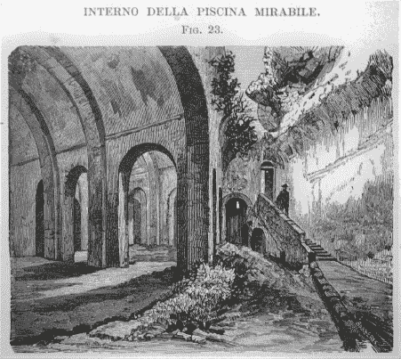

*图 6.3. 奇迹水池（Piscina Mirabilis）内部。威尼托亚协会 (1883 年) 20. 罗马英国学院图书馆，特藏馆，689.NAP.F.11.*

`法姆布里`同样声称，塞里诺水“远非重新重现其罗马式的生活，而是被置了一旁，让位于一个明显更理性、更经济且更强大的供水者”。^[114] 这种竞争在工程师之间很常见；`维尔诺`（`Verneau`）也认为罗马人受到了阻碍，但他们对荣耀有着“不小的贡献”。^[115] `安东尼奥·达梅利奥`（`Antonio d’Amelio`）断言：“引水系统和污水系统没有理由羡慕古罗马建筑，无论是在坚固性还是质量上”。^[116] 总之，即使新引水渠“与罗马引水渠没有任何共同点”，因为它通过一条新隧道引流了`乌尔丘奥利`（`Urciuoli`）泉水（Fig. 6.5），但这种想法仍然存在：那不勒斯正以一种“进化后”的版本被“修复”。^[117] 我们应该意识到，对那不勒斯的研究毫无疑问记录了这种新的、理想的伙伴关系。`弗兰茨·坎贾亚诺`（`Franz Cangiano`）在他名为《古代那不勒斯》（`Napoli Antica`）书中写道，“事实是，今天这项自豪的工程已经更新，在几个世纪之后，那不勒斯再次喝上了塞里诺的清水”。^[118]

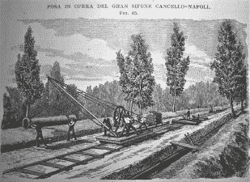

*图 6.4. “现代技艺”的引入。威尼托亚协会 (1883 年) 74. BSR 图书馆，特藏馆，689. NAP.F.11.*


总之，古代引水渠通过新系统的建设获得了新的关注，它也与之变得不可分割。对塞里诺引水渠的宣传使其故事广为人知。有两万人为了这一盛事来到那不勒斯；其中五万聚集在普莱比西托广场（`Piazza del Plebiscito`）的屋顶和阳台上，观看意大利国王和王后。当玛格丽特王后（`Queen Margherita`）挥动手帕时，广场中心的喷泉在炮火声中喷出了一股高达 33 米的水柱。在托莱莱多大街（`via Toledo`），一个阳台位置要价 50 法，相当于现在的 150 英镑。^(119) 翁贝尔托国王（`King Umberto`）宣布道：“我的预期很大，但这项`罗马`作品超越了它”。^(120) 在国外，引水渠的消息传到了《悉尼早晨报》（`Sydney Morning Herald`），该报报道这座城市新从古代的朱利安引水渠供水，“该水渠从塞里诺（现在被称为萨巴提亚）延伸到那不勒斯和米塞诺”。^(121) 《早报》宣布，水将感激地废除了老谚语“看了那不勒斯再死”。它对这句谚语的误读（原意是在看到那不勒斯后就可以死去）表明了清洁水对定义城市的力量。正如法姆布里在《评论》（`Rassegna`）文章结尾那样：“数据非常有活力且富有雄辩。在参观了乡村和城市的这项工程后，朱塞佩·朱斯蒂（`Giuseppe Giusti`）^(122) 不再称我们为‘靴子上的小矮人’。我们强烈地感到即使从技术上说，也是真正的男人。我会说是健壮的男人。”^(123)

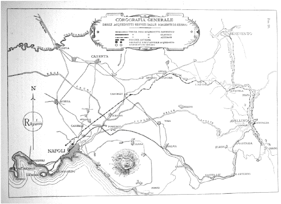

*图 6.5. 现代引水渠（上）与古代引水渠（下）的对比。威尼托亚协会 (1883 年) 图 28. BSR 图书馆，特藏馆，689.NAP.F.11.*

## 奥拉肖·卡罗与那不勒斯的卫生演变

那不勒斯在美好的古代所饮用的水，正是几个世纪后在经历了无数牺牲和深入研究后最终获得的水。罗马人的天才闪耀着与军事勇气相称的公民智慧，他们知道如何收集塞里诺美丽、清新且清澈的水，汇一条宏伟的引水渠中，其遗迹至今仍揭示了我们先辈多样而复杂的智慧。^(124)

水渠落成后的几十年里被被称为`Risanamento`（城市改造），重点在于“抬高街道水平、修建宽阔道路、新建筑、扩张城市以及对供水系统进行全面重建”。那不勒斯卫生展是意大利首个此类展览，将那不勒斯视为城市转型的典范。历史学家弗兰克·斯诺登（`Frank Snowden`）在他最近的研究中表明，政府如何通过建立这一“卫生武器库”基础设施来给市民心理安全感。他忽略了“尼不亚波斯（`Neapolis`）已经恢复”这一观点对于维护这些新基础设施是有效的至关重要。相反，这些基础设施存在问题；尽管投入了大量资金并进行了破坏，`Risanamento` 对那不勒斯居民本身的作用微乎其微，导致了社会动荡和政治不稳定。水渠正是这些问题的典型体现；《邮报》（`Corriere`）报道道：“塞里诺水渠已成为那不勒斯的一大灾难”；在许多案例中的一个，“水渗透导致`Tribunali`街的一家油炸店倒塌，老板也随之被埋”。当 1910 年霍乱再次袭来时，新政府和卫生部长奥拉齐·卡罗（`Orazio Caro`）试图掩盖这场疫情，并辩称`Risanamento` 是成功的。

卡罗于 1914 年写了他的著作《`Evoluzione Igienica`》（卫生演变），旨在记录“现代那不勒斯所有的卫生工程”。斯诺登将这项工作总结为“一个一直误导以后对该主题讨论的巨大谎言”，这是显而易见的，因为对`Risanamento` 的主要研究依赖于卡罗的叙述。斯诺登关注统计数据，却忽略了卡罗为了这些数据而编写的三部历史；这些历史再次向我们展示了尼不亚波斯已经重新开发的观点对于政治事件是多么重要。卡罗开始创作了《希腊-罗马那不勒斯》（`Napoli Greco-Romana`，1905），由`Capasso`研究，并在死后出版。这部历史讨论了从古代到现在的那不勒斯，随后是一部关于`Risanamento` 的历史。第三部也是最后一部历史通过讨论塞里诺水渠，结束了那不勒斯的“卫生演变”。这些叙述表明，图尔基（`Turchi`）的愿景已经实现：尼不亚波斯已经恢复。

### 尼不亚波斯的考古重建

卡罗对尼不亚波斯的描述基于一篇文本，因为现代化正在摧毁这座古城。正如出版了`Capasso`研究的那不勒斯考古学家朱利奥·德·佩拉（`Giulio De Petra`）所解释的：

当那不勒斯的转型随着`Risanamento`工程开始时，巴托洛梅奥·卡帕索（`Bartolommeo Capasso`）对这项宏伟工程为城市带来的卫生、经济和审美上的改进感到高兴；然而，他无法不带悲哀地想到许多即将被抹除和破坏的记忆。因此，在拆除镐夺走一切之前，他提议通过一系列专著来[*复兴*（`ravvivare`）]过去的记忆，在这些著作中他提到了道路、建筑和纪念碑。

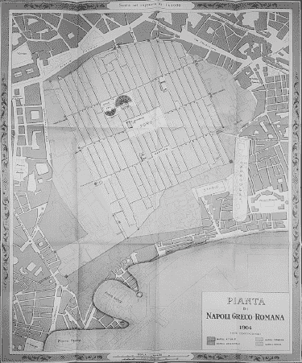

图 6.6. 《希腊-罗马那不勒斯》，尼不亚波斯的第一份考古规划，由`Giulio De Petra`制作，以配合`B. Capasso`的`Napoli Greco-Romana Esposta nella Topografia e Nella Vita Opera Postuma di Bartolommeo Capasso`。由那不勒斯国家历史协会出版（那不勒斯，1905 年）。

卡罗随后调整了这项关于古代那不勒斯的研究，以强化`Risanamento` 及其目标。他的历史为改变提供了背书，因为它将尼不亚波斯和那不勒斯视为同一座城市；这自然表明`Risanamento` 将那不勒斯恢复到了她辉煌的罗马式健康。首先，他消除了古城与现代城之间的任何区别。正如他所写的，得益于`Capasso`的研究，“我们现在可以与城市的古老居民生活在一起，并参与他们的生活……在城市的中心和边缘，与其它在时间和空间中的各种命运同频跳动”。接下来，卡罗描述尼不亚波斯时，就好像它是按照与现代那不勒斯相同的意图规划的；他看着古代的网格，看到一个“审美的、卫生的、战略性的”规划，其中的房子“并不高，但清新、宽敞且舒适”。正如他所总结的，“因此，一座这样建造和规划的城市，不仅是一个审美的建筑，而且也是一个卫生的建筑”（图 6.6）。

关键点在于，德·佩拉制作的尼不亚波斯规划本身是一个高度规范化的虚构，受到现代城市规划的影响。马里奥·那波利（`Mario Napoli`）显示，德·佩拉发明了这座城市的边界，就好像它的建造完全没有考虑地形一样——就像一座十九世纪的城市。此外，德·佩拉之所以能产出规划是因为`Risanamento` 的拆除揭露了古城的部分；正如德·佩拉所写的，“`Risanamento` 导致了许多近期作品和历史时期并不重要的作品的拆除，这承诺将对古代希腊-罗马时期尼不勒斯的研究提供巨大帮助”。总之，`Risanamento` 造成的破坏源于“那不勒斯应该按照尼不亚波斯的形象进行重建”这一理念。正是这种破坏促成了尼不亚波斯的考古重建。这两个过程的同步性加强了古城与现代城之间的平行关系，这正是现代主义者、甚至是考古学家所渴望的。正如考古学家维托奥·斯皮纳佐拉（`Vittorio Spinazzola`）所说：

今天，这就是`città nuova, la città giovane`（新城，年轻的城市），从那不勒斯的首批居民命名这座城市（这是一个征兆吗？）`Neapolis, città nuova`以来，已经过去了二十五个世纪。

在《`Evoluzione`》中，`Caro`通过对比那不勒斯（`Neapolis`）与那不勒斯（`Naples`），为摧毁理想城市提供了他自己的理由。在他看来，宗教统治带来了野蛮和落后。对于`Caro`来说，“悲剧的几个世纪”始于罗马人之后，当时宗教偏见使生活远离了体育锻炼、频繁的沐浴以及对形式和线条的美学追求……将生活降低到了想象中最不卫生的状况]((140)）。这种政政的改变产生了一个“拥挤、狭窄、曲折且缺乏光线的城市]((141)）。因此，那不勒斯“丧失了古代的健康，成为传染病和流行病的易受目标]((142)）。`Caro`的解释反映了公共卫生改革者中一种普遍但非统一的反教士倾向，他们试图废除宗教实践]((143)）。这种偏见可能体现在`Risanamento`（重建）过程中，正如`Capasso`和`Giancarlo Alisio`所讨论的，有三座教堂被拆除]((144)）。`Caro`不愿看到古代文化的宗教方面，他利用这一点来解释“衰落”。通过将“颓废”作为一种框架，`Caro`能够将宗教建筑描述为不值得保留——这一论点证明了`Risanamento` 的目标以及医学理论带来这一改变的作用]((145)）。与此同时，其他人编写了自己的专著并在集体记忆中保护被毁的内容]((146)）。

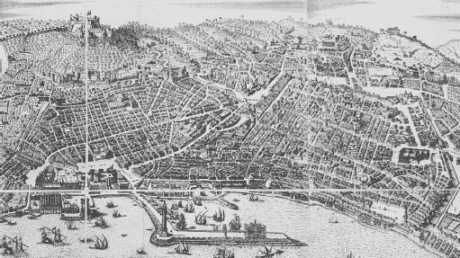

*图 6.7，《`Pianta ed Alzata della Città di Napoli`》。`Paolo Petrini`, 1748。英国图书馆，24045.*

此外，`Caro`指出`Neapolis`直到从未从这种野蛮状态中恢复。因此，他能够认为罗马时期之后执行的所有城市规划计划（其中许多与过去几十年实施的计划相似）是不重要的且值得取消的。例如，在 16 世纪，西班牙总督`Don de Toledo`引入了一条纪念碑式的道路和一个与`Risanamento` 采取的惊人相似的军事网格。这些在`Paolo Petrini`于 1748 年制作的那不勒斯地图上可见(图 6.7)(147)）。西部的西班牙区似乎镜像了东部的古代网格规划，产生了蝴蝶效应。

`Caro`拒绝接受西班牙是以卫生和公共利益为核心进行规划的。他驳了官方历史学家`Domenico Parrino`所描绘的文学描述，认为那是一幅“美好的粉画”。同样，在他看来，波旁时期的改进是他们虚荣工程的必然结果，而非对公共卫生的支持。`Caro`将波旁城市描述为对那不勒斯人需求的最后痛苦误读。意不奇的是，他认为那不勒斯的衰落和压迫随着`Risanamento` 的结束。在这里，这些充满争议的拆迁被呈现为美好的回归，而非“野蛮”的统治]((149)）。`Neapolis`之后丧失的文明回归，改写了此前政府在连接这一希腊罗马过去时同样进行现代化的城市规划计划。我们可以对比`Abate`如何指出，净水将“消除过去时代的无知和耻辱……而城市却在恶臭和不健康中腐烂]((150)）。

重述那不勒斯的历史建立了两个理想之间的关系：古代城市与现代城市。两者之间的比较确保了霍乱再次威胁政府稳定时，`Risanamento` 方法的有效性。因此，在《`Evoluzione`》中，`Caro`论证输水水道保护了城市]((151)）。由罗马人完成的结构“带着一种强大而宏伟的心态”、“凭借奇妙的智慧和技术”以及“真正的拉丁式坚毅”，在今天却是“以一种配得上古人的方式”建造的]((152)）。这种水也具有准护符的性质；古代人饮用它也“拯救了塞壬古城免受许多疾病和流行病的侵害]((153)）。他得出结论，排水工程、输水水道和`Risanamento` “恢复了那不勒斯的古代传统健康]((154)”。`Neapolis`和`Naples`是同一个地方；这一观点支撑了现代化，并指明那不勒斯是一个健康的城市，尽管事实恰恰相反。因此，`Caro`的历史向我们展示了思考现代化中的一条持续线索。

## 结论

本文证明`Neapolis`不仅仅是一个城市规划问题。古代城市的记忆通过公众关注得以复苏。对于这些作家来说，与古代过去的接触并不是一种怀旧或被动的赞美。总之，如果不讨论过去，我们就无法理解那不勒斯的现代性。

## 参考文献

### 初手文献

- `Caesar`, *Gallic Wars*, ed. and transl. `W. A. McDevitte` and `W. S. Bohn`. Harper’s New Classical Library (New York, 1869).

- `Cicero`, *For Rabirius Postumus*, ed. `C. D. Yonge` (London, 1891).

- `Julian`, *Misopogon*, ed. and transl. `W. C. Wright`, LCL 29 (Cambridge, 1913).

- `Livy`, *History of Rome*, ed. and transl. `B. O. Foster`, LCL 191 (Cambridge, 1926).

- `Procopius`, *Gothic Wars*, transl. and ed. `H. B. Dewing`, LCL 107 (Cambridge, 1916).

- `Strabo`, *Geography*, ed. and transl. `L. Jones`, LCL 49 (Cambridge, 1932).

- `Suetonius`, *Life of Nero*, ed. and transl. `J. C. Rolfe`, LCL 31 (Cambridge, 1914).

- `Tacitus`, *Annals XII-XVI,* ed. and transl. `C. Moore` and `J. Jackson`, LCL 249 (Cambridge, 1981).

### 二手文献

- Anonymous, ‘L’Esposizione giudicata all’estero’, *L’Esposizione di Milano* 19/20 (1881): 150–151.

- Anonymous, ‘Un Giorno a Napoli’, *Corriere della Sera*, 13–14 August 1884.

- 匿名，《那不勒斯的君主们》，《晚报》（`Corriere della Sera`），1885 年 5 月 11 日。

- 匿名，《那不勒斯的君主们》，《晚报》（`Corriere della Sera`），1885 年 5 月 12 日。

- 匿名，《我们的罗马信件》，《悉尼晨早报》（`The Sydney Morning Herald`），1885 年 6 月 27 日周六。

- 匿名，《那不勒斯省与西西里省卫生新闻》，《晚报》（`Corriere della Sera`），1887 年 9 月 19 日。

- 匿名，《国立卫生博览会官方目录》（那不勒斯，1900 年）。

- `Abate, F.`，《那不勒斯市公共用水：关于恢复克劳迪斯水道的想法》（那不勒斯，1840 年）。

- `Abate, F.`，“关于那不勒斯市新饮用水的问题：给那不勒斯市长的报告”，未出版报告，1863 年 5 月 27 日。

- `Abate, F.`，《关于克劳迪斯水道的研究及为那不勒斯市提供饮水的规划：给那不勒斯市长的报告 / 致 Felice Abate》（那不勒斯，1864 年）。

- `Alisio, G.` 那不勒斯与改造：城市结构的修复》（那不勒斯，1980 年）。

- `Arthur, P.` 那不勒斯：从罗马城到城国家：考古学视角》，罗马英国学院考古专著第 12 卷（伦敦，2002 年）。

- `Atkinson, G.`，“Eugène Belgrand 1810–1878：土木工程师、地质学家和水文学先驱》，《工程与技术史研究新科门学会》69.1 (1993): 97–127。

- `Belgrand, E.`，《巴黎地下工程。第一卷。初步研究。塞纳河。雨水、泉水及流水的机制。对农业的应用》（巴黎，1873 年）。

- `Belgrand, E.`，《巴黎地下工程。第二卷。第一部分。水。引言。罗马水道》（巴黎，1875 年）。

- `Bond, S.`，“给古代雕像涂白：古代世界的白色、种族主义与色彩”，“福布斯杂志》，2017 年 4 月 27 日 [可用于：[www.forbes.com/](http://www.forbes.com/)]（访问日期：2019 年 11 月 21 日）。

- `Bond, S.` 为什么我们需要开始用色彩眼光看待古代世界，《Hyperallergic》，2017 年 6 月 7 日 [可用于：[hyperallergic.com/](http://hyperallergic.com/)]（访问日期：2019 年 11 月 21 日）。

- `Calaresu, M.` 十八世纪晚那不勒斯史学中的古代罗马形象，《思想史杂志》（`Journal of the History of Ideas`）58.4 (1997): 641–661。

- `Cangiano, F.` 古代那不勒斯：历史与考古研究》（那不勒斯，1885 年）。

- `Capasso, B.` 关于那不勒斯与帕莱波利的古代遗址：疑问与推测》（那不勒斯，1855 年）。

- `Capasso, B.` 在巴托洛梅奥·卡帕索地形与作品遗作中呈现的希腊罗马化那不勒斯。那不勒斯故乡协会出版》（那不勒斯，1905 年）。

- `Caro, O.` 那不勒斯的卫生演变（历史摘要——观察与建议——统计数据）（那不勒斯，1914 年）。

- `Coates-Stephens, R.` 中世纪早期罗马的供水》，见 `C. Bruun` 和 `A. Saastamoinen`（编），《技术、意识形态、水：从弗鲁尼纽到文艺复兴及以后》，芬兰罗马学院文献第 31（罗马，2003 年），第 81–115 页。

- `Colucci, G. P.`“奥斯古图水道的水”，见 `G. Colucci Pescatori`, `E. Cuozzo` 和 `F. Barra`（编），《阿韦利诺与伊尔皮尼亚插图史》（普拉托拉·塞拉，1996 年），第 129–144 页。

- `D’Ambra, R.` 插图古代那不勒斯：含 118 幅色石版画》（那不勒斯，1889 年）。

- `D’Amelio, A.` 那不勒斯卫生博览：卫生工程部门”，“卫生工程”（`Ingegneria Sanitaria`）12 (1900): 105–125。

- `Davies, P.` 共和时期罗马的污染、得体与城市主义》，见 `M. Bradley` 和 `K. R. Stow`（编），《罗马、污染与得体：永恒之城从古代到现代的污垢、疾病与卫生》（剑桥，2012 年），第 67–80 页。

- `De Cesare, R.` 博览会上的南方意大利，《米兰博览会》（`L’Esposizione di Milano`）33.4 (1881): 258–259。

- `De Giorgi, F.` 细菌与圣水：20 世纪初教会的卫生，《当代》（`Contemporanea`）2 (1999): 435–461。

- `Duval, P.` 卢泰西：法国之都》（巴黎，1993 年）。


- Esposito, C. *地下：两千年的发掘*（那不勒斯，2018 年）。

- Etlin, R. *象征空间：法国启蒙及其遗产*（芝加哥，1994 年）。

- Fambi, P. *塞里诺的水*，《评论》（*La Rassegna*），A, 27, 8 (1886): 473。

- Fambi, P. *那不勒斯的水*，《评论》（*La Rassegna*）。A, 8 (1886): 92–110。

- Fusco, S. *那不勒斯的改造：左翼协会报告，1884 年 11 月*（那不勒斯）。

- Gambardella, A. *现代那不勒斯*，见 E. Manzo（编），《更新的城市：历史与人文科学之间的分析视角》（米兰，2013 年），第 257–267 页。

- Giovannini, C. *改造城市：19 世纪末的卫生乌托邦*（米兰，1996 年）。

- Giuliani, G. *现代意大利的种族、国家与性别*（伦敦，2019 年）。

- Greaves, S. *1860–1914 年那不勒斯的霍乱与城市更新*，见 C. Decker 和 M. Gharipur（编），《流行病城市：传染病如何塑造城市》（芝加哥，2021 年）。

- Gregorovius, F. *西西利亚：19 世纪那不勒斯*（伦敦，1914 年）。

- Griffin, R. *现代主义与法西斯主义：墨索里尼与希特勒时代的开启*（纽约，2007 年）。

- Gyr, U. *旅游史：通往现代的道路*，《欧洲史》（*European History*）24 (2010) [可用于：`ieg-ego.eu/threads/europe-on-the-road/the-history-of-tourism`]（访问日期：2021 年 11 月 5 日）。

- Halbwachs, M. *空间与集体记忆*，见 M. Halbwachs（编），《集体记忆》（*The Collective Memory*）（纽约，1950 年），第 1–15 页。

- Hall, T. *欧洲首都规划：19 世纪的城市发展*（伦敦，1997 年）。

- Hamlin, C. “霍乱的强制”：良好疾病的神话与良水的到来，《美国公共卫生杂志》（*American Journal of Public Health*）99.11 (2009): 1946–1954。

- Harvey, D. *现代性的巴黎*（伦敦，2006 年）。

- Haussmann, E. *巴黎水报告：塞纳省长提交市政委员会*（巴黎，1854 年）。

- Haussmann, E. *巴黎水第二报告：塞纳省长提交市议会，1858 年 7 月 16 日*（巴黎，1858 年）。

- Hughes, J. 和 C. Buongiovanni（编），*记忆帕尔忒珀：从古代至今对那不勒斯的接受*（牛津，2015 年）。

- Johnson-Laird, P. N. *心理模型与人类推理*，《美国科学院院》（*Proceedings of the National Academy of Sciences*）107.43 (2010): 18243–18250。

- Jones, C. *西奥多·瓦克与奥斯曼巴黎的现代考古学*，《皇家历史学会传输》（*Transactions of the Royal Historical Society*）17（12 月）：57–183。

- Koch, T. *绘制地图：早期医学地图中的空气、健康与场所*，《地图视角》（*Cartographic Perspectives*）52 (2005): 4–27。

- Kudlick, C. J. *革命后巴黎的霍乱：一部文化史*（伯克利，1996 年）。

- La Società Veneta per Imprese e Costruzioni Pubbliche，《那不勒斯水道》（巴萨诺，1883 年）。

- Labanca, N. *Paolo Fambi*，《特雷卡尼意大利人物传记》（*Treccani. Dizionari Biografico degli Italiani*）44 (1994) [可用于：`www.trecani.it/enciclopedia/paolo-fambri_(28Dizionario-Biografico%29/`]。

- Lupo, S. *南部历史、南方问题、南方主义*，《南方杂志》（*Meridiana*）32 (1998): 17–52。

- Mack Smith, D. *意大利的形成，1796–1866*（伦敦，1988 年）。

- MacMaster, N. *欧洲种族主义：1870–2000*（纽约，2001 年）。

- Malatesta, M. *专业人士与绅士：当代欧洲的职业史*（图林，2006 年）。

- Marghieri, A., *Il Risanamento di Napoli. Conferenza al Circolo Filologico del Prof. Alberto Marghieri, assessore comunale. Aggiuntovi, Lo studio storico, Sul vero sito di Napoli e Palepoli di Bartolommeo Capasso. Con una tavola illustrativa* (Naples, 1889).

- Masden, J. M., ‘Looking in from the outside: Strabo’s attitude towards the Roman people’, in D. Dueck (ed.), *The Routledge Companion to Strabo* (London, 2017), pp. 35–44.

- Meding, H. *Paris médical, Vade-mecum des médecins étrangers, renseignements historiques, statistiques, administratifs et scientifiques* (Paris, 1852–1853).

- Meek, R., *Social Science and the Ignoble Savage* (Cambridge, 2011).

- Miletti, L., ‘Setting the agenda: the image of Classical Naples in Strabo’s `Geography` and other ancient literary sources’ in J. Hughes and C. Buongiovanni (eds.), *Remembering Parthenope. The Reception of Classical Naples from Antiquity to the Present* (Oxford, 2015), pp. 19–39.

- Moe, N., *The View from Vesuvius: Italian Culture and the Southern Question* (London, 2006).

- Montuono, G. M., ‘L’Acquedotto Romano del Serino e la Città di Napoli’ in F. Starace, G. Cantone and C. Robotti (eds.), *L’Acqua e L’Architettura. Acquedotti e fontane nel regno di Napoli.* Studi su Architetture Ambienti e Citta del Mezzogiorno d’Italia, 8 (Lecce, 2002), pp. 75–103.

- Moorman, E., ‘Guides in the Vesuvius area eternalised in travelogues and fiction’, *Rivista di Studi Pompeiani* 14 (2003): 31–48.

- Morley, N., ‘Decadence as a theory of history’, *New Literary History* 35 (2004): 573–585.

- Napoli, M., *Napoli Greco-Romana* (Naples, 1959).

- Nisco, N., *Napoli nella storia dell’Italia nuova. Monografia pubblicata dal Municipio di Napoli* (Naples, 1889).

- Nobile, G., *Un Mese a Napoli. Descrizione della Citta di Napoli e delle sue Vicinanze. Divisa in XXX Giornate. Vol. I.* (Naples, 1863).

- Olivari, T. (ed.), *La Biblioteca di Garibaldi a Caprera. Prefazione di Giorgio Montecchi* (Milan, 2014).

- Osborne, T. ‘Security and vitality: drains, liberalism and power in the nineteenth century’ in A. Barry, T. Osborne and N. Rose (eds.), *Foucault and political reason. Liberalism, neo-liberalism and rationalities of government* (London, 1996), pp. 99–123.

- Parisi, R., ‘Verso una città salubre. Lo spazio produttivo a Napoli tra storia e progetto’, *Meridiana* 42 (2001): 53–74.

- Parisi, R. and I. Zilli, ‘Acqua, aria, terra, fuoco. Immagini per una Storia Ambientale di Napoli’ in I. Zilli (ed.), *La natura e la città. Per una storia ambientale di Napoli fra ‘800 e ‘900* (Naples, 2004), pp. 241–273.

- Pinkney, D. H., *Napoleon III and the Rebuilding of Paris* (Princeton, 1958).

- Potenza, U., ‘L’acqua di Serino e l’acquedotto Augusteo. Breva nota dal Dott. Ing. Uberto Potenza’, (undated): 1–7. [available at: `docplayer.it/40851192-L-acqua-di-serino-e-l-acquedotto-augusteo.html`](http://docplayer.it/40851192-L-acqua-di-serino-e-l-acquedotto-augusteo.html)] (accessed 21 November 2019).

- Profumo, A., *Le fonti ed i tempi dell’incendio Neroniano* (Rome, 1905).

- Quine, M., *Italy’s Social Revolution* (New York, 2002).

- Romanelli, D., *Antica Topografia Istorica del Regno di Napoli dell’Abate Domenico Romanelli* (Naples, 1815).

- Rossi, R., ‘Il Risanamento di Napoli: il rettifilo’, *Paesaggio Urbano* 2.8 (1991): 99–101.

- Russell Forbes, S., *Rambles in Naples. An Archeological and Historical Guide to the Museums, Galleries, Villas, Churches, and antiquities of Naples and its Environs*, 3rd ed. (London, 1886).

- Russo, V., ‘La Cura del Patrimonio Costruito di Uso Pubblico. Istituzioni, Regolamenti e Prassi a Napoli tra Cinque e Settecento’, *Storia Urbana* 37 (2014): 5–74.

- Marghieri, A., *Il Risanamento di Napoli. Conferenza al Circolo Filologico del Prof. Alberto Marghieri, assessore comunale. Aggiuntovi, Lo studio storico, Sul vero sito di Napoli e Palepoli di Bartolommeo Capasso. Con una tavola illustrativa* (Naples, 1889).

- Masden, J. M., ‘Looking in from the outside: Strabo’s attitude towards the Roman people’, in D. Dueck (ed.), *The Routledge Companion to Strabo* (London, 2017), pp. 35–44.

- Meding, H. *Paris médical, Vade-mecum des médecins étrangers, renseignements historiques, statistiques, administratifs et scientifiques* (Paris, 1852–1853).

- Meek, R., *Social Science and the Ignoble Savage* (Cambridge, 2011).

- Miletti, L., ‘Setting the agenda: the image of Classical Naples in Strabo’s `Geography` and other ancient literary sources’ in J. Hughes and C. Buongiovanni (eds.), *Remembering Parthenope. The Reception of Classical Naples from Antiquity to the Present* (Oxford, 2015), pp. 19–39.

- Moe, N., *The View from Vesuvius: Italian Culture and the Southern Question* (London, 2006).

- Montuono, G. M., ‘L’Acquedotto Romano del Serino e la Città di Napoli’ in F. Starace, G. Cantone and C. Robotti (eds.), *L’Acqua e L’Architettura. Acquedotti e fontane nel regno di Napoli.* Studi su Architetture Ambienti e Citta del Mezzogiorno d’Italia, 8 (Lecce, 2002), pp. 75–103.

- Moorman, E., ‘Guides in the Vesuvius area eternalised in travelogues and fiction’, *Rivista di Studi Pompeiani* 14 (2003): 31–48.

- Morley, N., ‘Decadence as a theory of history’, *New Literary History* 35 (2004): 573–585.

- Napoli, M., *Napoli Greco-Romana* (Naples, 1959).

- Nisco, N., *Napoli nella storia dell’Italia nuova. Monografia pubblicata dal Municipio di Napoli* (Naples, 1889).

- Nobile, G., *Un Mese a Napoli. Descrizione della Citta di Napoli e delle sue Vicinanze. Divisa in XXX Giornate. Vol. I.* (Naples, 1863).

- Olivari, T. (ed.), *La Biblioteca di Garibaldi a Caprera. Prefazione di Giorgio Montecchi* (Milan, 2014).


Osborne, T. ‘Security and vitality: drains, liberalism and power in the nineteenth century’ in A. Barry, T. Osborne and N. Rose (eds.), *Foucault and political reason. Liberalism, neo-liberalism and rationalities of government* (London, 1996), pp. 99–123.

Parisi, R., ‘Verso una città salubre. Lo spazio produttivo a Napoli tra storia e progetto’, *Meridiana* 42 (2001): 53–74.

Parisi, R. and I. Zilli, ‘Acqua, aria, terra, fuoco. Immagini per una Storia Ambientale di Napoli’ in I. Zilli (ed.), *La natura e la città. Per una storia ambientale di Napoli fra ‘800 e ‘900* (Naples, 2004), pp. 241–273.

Pinkney, D. H., *Napoleon III and the Rebuilding of Paris* (Princeton, 1958).

Potenza, U., ‘L’acqua di Serino e l’acquedotto Augusteo. Breva nota dal Dott. Ing. Uberto Potenza’, (undated): 1–7. [available at: `docplayer.it/40851192-L-acqua-di-serino-e-l-acquedotto-augusteo.html`](http://docplayer.it/40851192-L-acqua-di-serino-e-l-acquedotto-augusteo.html) (accessed 21 November 2019).

Profumo, A., *Le fonti ed i tempi dell’incendio Neroniano* (Rome, 1905).

Quine, M., *Italy’s Social Revolution* (New York, 2002).

Romanelli, D., *Antica Topografia Istorica del Regno di Napoli dell’Abate Domenico Romanelli* (Naples, 1815).

Rossi, R., ‘Il Risanamento di Napoli: il rettifilo’, *Paesaggio Urbano* 2.8 (1991): 99–101.

Russell Forbes, S., *Rambles in Naples. An Archeological and Historical Guide to the Museums, Galleries, Villas, Churches, and antiquities of Naples and its Environs*, 3rd ed. (London, 1886).

Russo, V., ‘La Cura del Patrimonio Costruito di Uso Pubblico. Istituzioni, Regolamenti e Prassi a Napoli tra Cinque e Settecento’, *Storia Urbana* 37 (2014): 5–74.

译文：

- Marghieri, A., *那不勒斯的整治。在阿尔贝托·马格耶里教授哲学学协会举行的会议。补充：关于那不勒斯真实址以及巴托洛梅奥·卡萨索的帕莱波（Palepoli）的研究。附插图*（那不勒斯，1889）。

- Masden, J. M., ‘从外部审视：斯特拉博对罗马人的态度》，收于 D. Dueck（编），*鲁特奇斯特拉博指南*（伦敦，2017），第 35–44 页。

- Meding, H. *医学巴黎：外国医生的手册，历史、统计、行政及科学信息*（巴黎，1852–1853）。

- Meek, R., *社会科学与卑劣的野蛮人*（剑桥，2011）。

- Miletti, L., ‘设定议程：斯特拉博《地理志》及其他古代文献来源中古典那不勒斯的形象》，收于 J. Hughes 和 C. Buongiovanni（编），*记忆帕尔忒诺珀：从古代到现代古典那不勒斯的接受*（牛津，2015），第 19–39 页。

- Moe, N., *来自维苏威火山的视界：意大利文化与南方问题*（伦敦，2006）。

- Montuono, G. M., ‘塞尔里诺的罗马输水桥与那不勒斯市》，收于 F. Starace, G. Cantone 和 C. Robotti（编），*水与建筑：那不勒斯王国的输水桥与喷泉。*意大利南部建筑环境与城市研究，第 8 （莱切，2002），第 75–103 页。

- Moorman, E., ‘在游记和小说中被永恒化的维苏威火山地区导游》，*庞贝研究杂志*第 14 期（2003）： 31–48 页。

- Morley, N., ‘作为历史理论的衰落》，*新文学史*第 35 期（2004）： 573–585 页。

- Napoli, M., *希希罗马那不勒斯*（那不勒斯，1959）。

- Nisco, N., *新意大利历史中的那不勒斯。那不勒斯市政府出版的专著*（那不勒斯，1889）。

- Nobile, G., *那不勒斯的一个月：那不勒斯市及其周边描述。分为三十天。第一卷。*（那不勒斯，1863）。

- Olivari, T.（编），*加里巴尔迪在卡普雷拉的图书馆。乔乔乔·蒙泰基的序言*（米兰，2014）。

- Osborne, T. ‘安全与活力：十九世纪的排水系统、自由主义与权力》，收于 A. Barry, T. Osborne 和 N. Rose（编），*福柯与政治理性：自由主义、新自由主义与治理的理性*（伦敦，1996），第 99–123 页。

- Parisi, R., ‘走向健康城市。历史与规划之间那不勒斯的生产空间》，*梅里迪亚杂志*第 42 期（2001）： 53–74 页。

- Parisi, R. 和 I. Zilli, ‘水、气、土、火。那不勒斯环境史图像》，收于 I. Zilli（编），*自然与城市：19 世纪与 20 世纪之间那不勒斯环境史研究*（那不勒斯，2004），第 241–273 页。

- Pinkney, D. H., *拿破仑三世与巴黎的重建*（普林斯顿，1958）。

- Potenza, U., ‘塞尔里诺的水与奥古斯塔输水桥。乌伯托·波滕策工程师博士的简短笔记’，（未标注日期）： 1–7 页。[可访问地址：`docplayer.it/40851192-L-acqua-di-serino-e-l-acquedotto-augusteo.html`](http://docplayer.it/40851192-L-acqua-di-serino-e-l-acquedotto-augusteo.html)（访问日期：2019 年 11 月 21 日）。

- Profumo, A., *尼禄火灾的源源与时代*（罗马，1905）。

- Quine, M., *意大利的社会革命*（纽约，2002）。

- Romanelli, D., *多梅尼科·罗马内利主教的《那不勒斯王国古代历史地理学》*（那不勒斯，1815）。

- Rossi, R., ‘那不勒斯的整治：直轴道路》，*城市景观*第 2.8 期（1991）： 99–101 页。

- Russell Forbes, S., *在那不勒斯漫步：那不勒斯及其周边博物馆、画廊、别墅、教堂和古迹的考古历史指南*，第 3 版（伦敦，1886）。

- Russo, V., ‘公共用途建筑遗产的维护。五至七世纪那不勒斯的机构、条例与实践》，*城市史*第 37 期（2014）： 5–74 页。

19. 来源，参见 Belgrand，《Les travauz souterrains de Paris, vol. 1*。斯特拉波，《*Geography*，5.3.8，被 Belgrand 引用于 *Les travaux souterrains de Paris, vol. 2*，14。关于 Belgrand，请参见 Atkinson，‘Eugène Belgrand 1810–1878’。

20. 奥斯曼，《*Second Mémoire sur les eaux de Paris*，11, 22。

21. Pinkney，《Napoleon III*，121–123。

22. Pinkney，《Napoleon III*。

23. Belgrand，《*Les travaux souterrains de Paris, vol. 2*，2。

24. 参见 Jones，‘Theodore Vacquer and the Archaeology of Modernity in Haussmann’s Paris’。

25. Kudlick，《*Cholera in post-Revolutionary Paris*，13–15, 36–38。

26. 斯特拉波，《*Geography*，4.3。对比凯撒，《*Gallic Wars*，6.3, 7.57。

27. 参见 Duval，《*De Lutèce oppidum à Paris capitale de la France*。

28. Meding，《*Paris médical*，38。

29. Turchi 被 Parisi 和 Zilli 提及，见‘Acqua, aria, terra, fuoco’，120。

30. 马里诺·图尔基（1808 年 5 月 31 日至 1890 年 3 月 3 日）出生于切耶蒂的杰斯帕莱纳。他学习自然科学和医学。Turchi，《Della Italia Igienica*，137。加里巴尔底读过图 urch 基的作品，Olivari，《La Biblioteca di Garibaldi*。

31. 关于经济债务和自由改革计划，参见 Quine，《*Italy’s Social Revolution*，36 起。关于统一的参考书，参见 Mack Smith，《*The Making of Italy*。

32. Turchi，《Della Italia Igienica*，78。

33. Moe，《*The View from Vesuvius*，164；Lupo，“*Storia del Mezzogiorno*”；Snowden，《*Naples in the Time of Cholera*，40；MacMaster，《*Racism in Europe*。关于交叉性批判，参见 Giuliani，《*Race, Nation and Gender*，31–38。

34. 路易吉·卡洛·法里尼写给坎维尔的信，1860 年 10 月 27 日。引用自 Moe，《*The View from Vesuvius*，165。同样，皮埃蒙特议会主席乔瓦尼·兰扎声称：“那不不勒斯人几个世纪以来习惯了冷酷、停滞和腐败政府的统治，缺乏一切公共精神……北方意大利人的艰巨任务是在文明和政治上重塑南方意大利人。” 引用自 Moe，《*The View from Vesuvius*，153。

35. 罗塞尔·福布斯，《*Rambles in Naples*，28。

36. Meek，《*Social Science*，217。

37. Marghieri，《*Napoli nel suo avvenire economico e intellettuale*，24。

38. 在古代，在公元六世纪被库迈人建立为希腊城市后，那不不勒斯被萨尼人征服并居住。

39. Calaresu，‘Images of ancient Rome’，642–643。

40. 于 1748 年。这导致那不不勒斯在 1839 年获得了意大利第一条铁路。感谢评审员。Moormann，‘Guides in the Vesuvius area’。

41. Romanelli，《*Antica Topografia Istorica*。

42. Capasso，《*Sull’antico sito di Napoli e Palepoli*，12。Capasso 提到了西西罗，《*Rabirius Postumus*》和 Julian，《*Misopogon*》。

43. Capasso，《*Sull’antico sito di Napoli e Palepoli*，4-5。

44. Capasso，《*Sull’antico sito di Napoli e Palepoli*，22–23。

45. Capasso，《*Sull’antico sito di Napoli e Palepoli*，22–25。Italo Sgobbo 和 Olga Elia 在法西斯时期正确地将该工程归功于奥古斯丁。Sgobbo，‘L’acquedotto della Campania’，75–97。

46. 关于该水道的最新研究，参见 Esposito，《*Il sottosuolo di Napoli*。

47. Nobile，《*Un Mese a Napoli*》；Moormann，‘Guides in the Vesuvius area’。

48. Griffin，《*Modernism and Fascism*，54, 97。

49. 《*Rivista Internazionale d’Igiene*》，1890 年 4 月。引用自 Turchi，《*Della Italia Igienica*，137。

50. Turchi，《*Sulla igiene pubblica della città di Napoli*，xv, 122。

51. 供水系统在巴黎“正被认真对待”。Turchi，《*Sulla igiene pubblica della città di Napoli*，36。

52. Turchi，《*Sulla igiene pubblica della città di Napoli*，127。

53. 对 *Nea-polis* 含义的双关语。Turchi，《*Sulla igiene pubblica della città di Napoli*，126。

54. Capasso，《*Sull’antico sito di Napoli e Palepoli*，3。对比 Miletti，“Setting the agenda”。 

55. Turchi，《*Sulla igiene pubblica della città di Napoli*，33。同样的理由被 Marghieri 重复，《*Napoli nel avvenire economico e intellettuale*，24–25。

56. Miletti，“Setting agenda”。

57. Turchi，《*Sulla igiene pubblica della città di Napoli*，205；Gyr，“The history of tourism”。

58. 皇家法令第 395 号，1898 年 9 月 4 日。Nisco，《*Napoli nell’Italia nuova*，5。

59. Marghieri，《*Napoli nel avvenire economico e intellettuale*，38–39。

60. Turchi，《*Sulla igiene pubblica della città di Napoli*，203。

61. Turchi，《*Sulla igiene pubblica della città di Napoli*，126。

62. Turchi 引用了拉丁语，“由于旧建筑的变形和街道的狭窄，他焚烧了城市”：苏西元，《*Nero*，6.1。Turchi，《Della Italia Igienica*，78。

63. Turchi，《*Sulla igiene pubblica della città di Napoli*，128。这种解读可能通过塔西的叙述得到了加强，火灾提供了“一片开阔的土地和广阔的视野”。塔西，《*Annals*，15.40.1。译自 Jackson。

64. Attilio Profumo 后来重新评估了尼禄大火。尼禄利用城市的变形作为借口，清理位于奥皮安山的金宫旁的土地。当罗马焚毁时，人们躲避在纪念性建筑中，目睁睁看着自己的城市消失。苏西元的叙述重点强调了对“古老领袖房屋”中记忆的抹除。正如苏西元，《*Nero*》，20.2, 38.1–2。

65. Turchi，《*Sulla igiene pubblica della città di Napoli*，203。

1864 年向市政议会重新提交，议会拨款 4000 杜元给 Abate，用于研究克劳迪水水道、计算可用水量，并对萨巴托谷的建筑进行评估（1861）。Abate, `Delle acque pubbliche della Città di Napoli`; Abate, ‘Sulla quistione delle nuove acque potabili per la città di Napoli’; Abate, `Studii sull’acquidotto Claudio`。Turchi 在他的建议中提到了 Abate。Turchi, `Sulla igiene pubblica della città di Napoli`, 36.

Abate, `Studii sull’acquidotto Claudio`, 31–33.


Abate 使用了 Belgrand 的说法，表示“巴黎市政会对罗马的智慧致敬”。Abate, `Studii sull’acquidotto Claudio`, 73–74.

Pietro Antonio Lettieri 于 1560 年为西班牙总督 Don Pedro de Toledo 进行了他的研究。正如 `Società` 所列出的，第一项研究是由 Colonello del Genio Lavega 和工程师 de Bottis 完成的。第二次是在工程师 Giuliano de Fazio 和埃尔科莱考古学院（Accademia Ercolanese di Archeologia，1824）指导下，结论是古代水水道确实存在，修复它是有用的。

Abate, `Studii sull’acquidotto Claudio`, 52。这是错误的；在法国和西班牙统治时期，城市维护和供水属于“La Cura del Patrimonio Costruito”。

Santore, `Modern Naples`, xxxi.

在那不勒，这部分是真实的——将领 Belisarius 在 537 年通过水水道入侵过。Procopius, `Gothic Wars`, 5.10.14–16。同样在 Caro, `L’Evoluzione Igienica di Napoli`, 80–81 中也有。

Abate, `Studii sull’acquidotto Claudio`, 10。这是关于罗马城市的标准历史，由文艺复兴时期进行了整合，该历史强调哥特入侵入侵后的几个世纪其特征是“遗忘”了古城特别是其水利实践。关于罗马早期中世纪供水系统以及对这一叙述的质疑，参见 Coates-Stephens 《The water supply of early medieval Rome》。

Abate, `Studii sull’acquidotto Claudio`, 3.

Abate, `Studii sull’acquidotto Claudio`, 10.

La Società Veneta, `L’Acquedotto di Napoli`, 26–27.

Anonymous, ‘L’Esposizione giudicata all’estero’, 150–151.

De Cesare, ‘Il Mezzo Giorno all’Esposizione’, 258–259.

Abate, `Studii sull’acquidotto Claudio`, 56.

Giovannini, `Risanare le città`.

水水道建设的故事非常复杂。它由意大利人建造，但水本身归法国人所有。合同于 1873 年 6 月 28 日授予了工程师 Mamby 和 Roberti，他们的公司在 1878 年 4 月被 General Credit and Discount 公司代替。General Credit and Discount 将合同转交给了巴黎的 Compagnie Generale des Eaux pour L’Etranger。1878 年 4 月 30 日，该公司成立了实际上是法国公司的那不勒水务有限公司（The Naples Water Works Company Limited）。该公司随后于 1881 年 1 月 30 日在意大利成立，名为那不勒水利工程股份公司（Società Anonima pei Lavori Idraulici della Citta di Napoli）。它负责技术方案。La Società Veneta 实际上建造了那不勒水水道。这家公司由 Vincenzo Stefano Breda 于 1872 年在帕多瓦创立。在那不勒斯，Breda 在 1881 年至 1885 年间指导了建造水水道的工程师团队。营工工作由那不勒斯工程师 Gaetano Bruno 和 Francesco Verneau 监督。Verneau 在 `L’Acquedotto di Napoli` 中提供了最完整的记录。

Verneau, `L’Acquedotto di Napoli`, 44.

Fambri, ‘Le acque di Serino’；Fambri, ‘L’acquedotto di Napoli’。Fambri 还在关于科学、体育与人类性格之间的联系方面发表了大量著作。作品包括`Il carattere` (1879)、`De nessi tra l’idealità e la moralità` (1879)、`Volgarizzamento delle scienze` (1886)、`I criteri del bene` (1890)、`Il positivismo nella scienza nella vita e sulla fisica` (1992) 以及 `La ginnastica` (1895)。Treccani 提供了书目，Labanca, ‘Paolo Fambri’。

Potenza, ‘L’acqua di Serino e l’acquedotto Augusteo’, 1–7。另见 Montuono, ‘L’Acquedotto del Serino’，这种区别并不明显。

Belgrand, `Les Travaux Souterrains de Paris`, vol. 2., 3.

Capasso, `Sull’antico sito di Napoli e Palepoli`, 22–24.

Capasso, `Sull’antico sito di Napoli e Palepoli`.

La Società Veneta, `L’Acquedotto di Napoli`, 2.

La Società Veneta, `L’Acquedotto di Napoli`, 2.

La Società Veneta, `L’Acquedotto di Napoli`, 2.

Nisco, `Napoli nella storia dell’Italia`.

Gregorovius, `Siciliana`, 53.

La Società Veneta, `L’Acquedotto di Napoli`, 2.

其某一段明显比另一段老。这部分被称为“萨尼特段”。上段在三世纪得到修复，这解释了差异。该水水道建于公元一世纪。Colucci, `Fontis Augustei Aquaus`, 141.

La Società Veneta, `L’Acquedotto di Napoli`, 3.

La Società Veneta, `L’Acquedotto di Napoli`, 9.

作者后来引用了艺术家 Paolo Paoli，他的文本实际上强调，“这两种观点都是不可接受的；一个是因为没有理由；另一个是因为理由太弱。这些管道可能属于任何水利工程，可能是旧的替代，或者在某种程度上更为现代。”引用自‘Siciliarum Heirus Regi … Fausto Connubii cum M. Carolina Lothar. Austriaca …’,La Società Veneta, `L’Acquedotto di Napoli`, 18.

La Società Veneta, `L’Acquedotto di Napoli`, 11.

La Società Veneta, `L’Acquedotto di Napoli`, 11.

La Società Veneta, `L’Acquedotto di Napoli`, 10–11.

Calaresu, `Images of ancient Rome`.

La Società Veneta, `L’Acquedotto di Napoli`, 9.

Capasso, `Sull’antico sito di Napoli e Palepoli`, 23.

“塞尔里诺石碑”（Lapide di Serino）澄清了庞贝并非由奥斯古斯水道提供。Sgobbo, ‘L’acquedotto romano della Campania’.

La Società Veneta, `L’Acquedotto di Napoli`, 2.

Abate, `Studii sull’acquidotto Claudio`, 5.

Abate, `Studii sull’acquidotto Claudio`, 52.

Fambri, ‘Le acque di Serino’, 473.

Verneau, `L’Acquedotto di Napoli`, 38.

D’Amelio, ‘L’Esposizione d’igiene,’ 105.

# 第 6 章

Claudia 引水自 Acquaro 和 Pelosi 泉水；Urciuoli 的水则来自附近的另一个泉水。`La Società Veneta`, `L’Acquedotto di Napoli`, 21。甚至有人怀疑 Serino 泉水是否真的被利用过。Verneau, `L’Acquedotto di Napoli`, 98。

Cangiano, `Napoli Antica`, 82。

“I Sovrani a Napoli”，`Corriere della Sera`, 1885 年 5 月 11 日。通过 [www.historicalstatistics.org/Currencyconverter.html](http://www.historicalstatistics.org/Currencyconverter.html) 获取金价进行换算。

“I Sovrani a Napoli”，`Il Corriere della Sera`, 1885 年 5 月 12 日。

“Our Rome Letter”，`The Sydney Morning Herald`, 1885 年 6 月 27 日，周六。

Giuseppe Giusti (1809–1850)。意大利北部讽刺作家。

Fambri, ‘L’acquedotto di Napoli’, 110。

Caro, `L’Evoluzione Igienica di Napoli`, 6。

Marghieri, `Il Risanamento di Napoli`, 3; Fusco, `Sul Risanamento di Napoli`。关于城市改造（Risanamento）的历史，见 Russo-Maugeri, `Napoli: contributi allo studio della città`, 第 1, 2 卷；Alisio, `Napoli e il Risanamento`。

Parisi, ‘Verso una città salubre’；匿名 `Catalogo Ufficiale`。

Rossi, ‘Il Risanamento di Napoli’, 99–101 简要概述。关于城市改造失败的当代记载，见 Serao, `Il Ventre di Napoli`。关于被毁的喷泉，见 Schiatarella, `Immagine di una città`。

‘Notizie Sanitarie della provincia di Napoli e della Sicilia’，`Corriere della Sera,` 1887 年 9 月 19 日。

Snowden, `Naples in the Time of Cholera`, 295–296。

Caro, `L’Evoluzione Igienica di Napoli`。

Snowden, `Naples in the Time of Cholera`, 250。Russo 完成的关于城市改造的主要研究紧随 Caro 之后。

Capasso 编写了文本但在完成前去世。由考古学家 Giulio de Petra 在遗后进行了修订并出版，他还绘制了那不利斯的地图。

Giulio De Petra, in Capasso, `Napoli Greco-Romana`, 前言。

Caro, `L’Evoluzione Igienica di Napoli`, 2。

Caro, `L’Evoluzione Igienica di Napoli`, 2。

Caro, `L’Evoluzione Igienica di Napoli`, 2。

Napoli, `Napoli Greco-Romana`。

Giulio De Petra, in Capasso, `Napoli Greco-Romana`, x。

Spinazzola, ‘Il nome di Napoli’, 33。

Caro, `L’Evoluzione Igienica di Napoli`, 8。

Caro, `L’Evoluzione Igienica di Napoli`, 9。

Arthur（`From Roman Town to City-State`）在分析物质记录方面做出了许多贡献。正如 Arthur 所解释的，城市空间被遗弃，社会水平有所衰落。

见 De Giorgi `Batteri e Acqua`。

Alisio, `Napoli e il Risanamento`, 94。

见 Morley `Decadence as a theory`。Turchi, `Importanza Estensione`。

Halbwachs, `Space and collective memory`；D’Ambra, `Napoli Illustrata`。

Paolo Petrini (1670–1722)是一位出版商。Petrini `Representation and Self-Perception`。

Domenico Parrino (1642–1716) 是那不勒斯编辑。`Teatro eroico, e politico de’ Regno Ferdinando il Cattolico` 分三卷出版，于 1692–1694 年间，并于 1730 年、1775 年重版。

Marghieri 同样声称`[此之前的]只是建筑工程`。Marghieri, `Il Risanamento di Napoli`, 16。

Abate, `Studii sull’acquotto`, 52。在法国统治时期这是错误的，见 Russo `La Cura del Costito`。

Caro, `L’Evoluzione Igienica di Napoli`, 16。见 Greaves `Cholera, the aqueduct and urban renewal`。

Caro, `L’Evoluzione Igienica di Napoli`, 76。

Caro, `L’Evoluzione Igienica di Napoli`, 76。

Caro, `L’Evoluzione Igienica di Napoli`, 100。

Griffin, `Modernism and Fascism`, 54–55。

# 第 7 章

## 从普鲁到布尔萨：奥斯曼首都的重塑

作者：Suna Çağaptay

献给 Alessandra Ricci

“什么是城市？它是如何存在的？它进一步经历了什么过程：它履行了什么功能：它完成了哪些过程？”

Aquaro 和 Pelosi 泉水；Urciuoli 的水则来自附近的另一个泉水。在整个历史中，布尔萨在火灾、地震和军事劫掠之后不断地进行改造和重建，这些事件都对其城市织理和物质文化造成了不可估量的损害。其中两个灾难性事件尤为突出：1855 年的地震，地震后的修复尝试从根本上改变了建筑环境的城市特征；以及 1958 年的火灾，摧毁了下城大部分商业区。

在本文，我关注 1958 年火灾后布尔萨市（奥斯曼帝国的首个首都）的规划与历史保护。火灾发生后，意大利建筑师兼城市规划师 Luigi Piccinato 提出了一份总体规划，试图通过其细致的重新开发维护历史布尔萨的精神。与之前的许多项目一样，由于经济和政治上的挫折，该计划仅部分实现。尽管 Piccinato 的计划从未完全执行，但它作为一个时刻而值得关注：在当时，布尔萨的古代城市被回想起并承认，人们渴望在整体语境下保护这座城市。在本章中，我将首先回顾之前的规划尝试（例如 1924 年 Carl Lörcher 提出的方案或 1938–1940 年 Henri Prost 的方案）如何为 Piccinato 的工作奠定基础，并讨论他在灾难性事件、不当的修复与规划尝试以及不可预测的人口和经济变化的背景下，是如何感知和想象布尔萨的。由于物理和意识形态因素，希腊罗马城市在我的讨论中几乎缺席；取而代之的是，早期奥斯曼城市被视为“古代”城市。

在 20 世纪之交，城市规划和城市更新的概念成为生产“现代”城市的新工具，用于解决工业增长带来的问题。城市规划和城市更新不仅被视为塑造和组织建筑环境的方式，也被被视为现代化的手段。随着这些理念的出现，一种保护与维护的理念运而生。正如米歇尔·兰普拉科斯（Michele Lamprakos）所讨论的那样，人们对纪念碑“时代价值”（age value）的艺术史解释产生了兴趣。这一术语最初是由奥地利艺术史学家阿洛伊斯·里格尔（Alois Riegl）在他 1903 年名为《现代纪念碑的崇拜：其特征与起源》的立法文件中提出的。它意味着不仅考虑建筑本身，还考虑了它们建造的背景、周围环境以及文化和历史景观。虽然这种学术关注保护了各种历史背景免遭拆除，但它将“城市的大部分景观变成了一座纪念碑”。里格尔旨在为奥匈匈帝国的文化遗产保护提供立法建议，他成为第一个提出文化遗产价值和保护理论的人物。


2001 年，法国领先建筑历史学家弗朗索瓦·肖瓦（Françoise Choay）在《历史纪念碑的发明》（*The Invention of the Historic Monument*）中阐述了里格尔的“时代价值”理论。该著作首次于 1992 年以《遗产寓喻》（*L’allégorie du patrimoine*）出版，探讨了遗产术语下的定义以及艺术史和考古学学科是如何讨论遗产的。肖瓦研究过去的方法主要是分类、归类以及对启蒙时期对象的描述。肖瓦还讨论了“历史城市”是如何与现代城市形成对比而被构的，现代城市是为了适应增长而在历史城市中发生的破坏的结果。这种对“历史城市”的发明围绕着现代化的尝试，包括破坏性事件，因此老城区受到了技术进步和生活方式改变的挑战。我们所说的“历史城市”在几个世纪里一直是充满活力社会的核心以及公民和社会生活的舞台。本论文关注的是布尔萨（Bursa）对历史城市的重新发明。

## 城市框架：布尔萨的城市织理

布尔萨起源于古城普鲁萨（Prousa），它坐落在奥林匹斯山脚下。普鲁萨由普鲁萨斯一世（Prousias I）于公元前 3 世纪建立，其令人惊叹的自然和人造卫城被 5 世纪的历史学家奥罗修斯（Orosius）赞誉为“最坚固的城市”（`unitissima civitas`）。它的城墙最初建于希腊化时期（公元前 3 世纪晚期到 2 世纪初），并不断重建，正如公元 1、2 世纪以及 7 世纪和 13 世纪的铭文所所示。从东向西延伸的古代主干道（`decumanus maximus`）一直保存完。。在罗马时期的城市发展通过两位杰出人物的信件和演说向我们展示：小普林尼（Pliny the Younger）和狄奥（Dio）。小普林尼在公元 113 年至 115 年间被任命为提尼亚和庞图斯总督，他曾与特拉真皇帝（在位期：公元 98–117 年）通信，信中报告了浴场和神庙的情况，尽管他没有明确说明地点。

演说家和哲学家狄奥（Dio，`c`.公元 40–115 年）是普鲁萨人，他希望建造一条柱廊街以增强城市景观，并与罗马东部的安提俄竞争；这引发了围绕取代旧城市织理的紧张局。狄奥想建造防御工事、柱廊街、工作坊、造船厂和港口，将城市范围延伸到城外，一直到达北面 25 公里处的马尔马拉拉海。在这一时期，铭文证据也表明了`agoranomos`（市场管理员）和`gymnasiarch`（体育管理员）的存在，即负责组织节庆和体育活动的人。从 3 世纪开始，普鲁萨的疗愈水经常受到拜占庭皇帝的访问。位于奥林匹斯山上的修道院居住着逃避圣像破坏运动（726–787 年和 814–842 年）的圣像破坏者。

这座城市曾是一个城外拥有繁荣城市生活的城市，由于 13 世纪末奥斯曼人入侵的加剧，它局限于卫城的墙内。尽管有这些防御，奥斯曼人在 1326 年经过为期十年的围攻后征服了这座城市（图 7.1）。在奥尔罕（Orhan）统治期间（在位期：1324–1361），位于古典普鲁萨之上的拜占庭城市织理被重新利用。例如，奥尔罕将一个修道院建筑群变成了父亲奥斯曼（Osman，奥斯曼的同名创始人）以及他自己的墓。。同一建筑群的另一部分根据奥斯曼的征服惯例变成了城市里的第一座周五清真寺。

在同一轮转换中，内堡内对应典型的晚期拜占庭城市宫殿或行政区的建筑群被重新利用，位于卫城外的浴场也是如此。奥尔罕还开始利用城外区域来进一步推进他的建筑赞助，包括建造一个`külliye`（由以修道院-清真寺为中心的苏尔丹社会宗教和商业功能组成的建筑群）。穆拉德一世（Murad I，在位期：1361–1389）移至城市中心西部，那里盛产自古典时期以来就闻名的温泉。巴耶叶齐德一世（Bayezid I，在位期：1389–1402）移至城市东部，在曾拥有大片花园和果园的地区建造他的`külliye`，在布尔萨的景观上留下了个人和王朝的印记。

紧贴奥林匹斯山脚的城市发展，在 1402 年帖木儿人劫掠后，又建造了两个`külliye`建筑群：穆罕梅德一世（Mehmed I，在位期：1413–1421）建造了绿建筑（在土耳其学术界称为 Yeşil，以其`cuerda seca`瓷砖命名），穆拉德二世（Murad II，在位期：1421–1444；1446–1451 年）在卫城西北部的平原上建造了一个以此命名的建筑群。尽管在 1360 年代被穆拉德一世征服后，埃迪尔（Adrianople）取代了布尔萨成为正式首都，但布尔萨仍然是纪念首都，其形象在 14 和 15 世纪奥斯曼苏丹时期得到了复兴。

地形现实要求在东西轴线上促进城市发展；上述每一位苏尔丹都利用这种地形在景观上留下了他们的苏尔丹和王朝遗产，同时也强调了被围墙包绕的卫城与平原之间的历史联系。每个建筑群的选址以一种利用景观的方式让人了古典和晚期古代城市的选址策略（图 7.2）。由于坐落在山顶或建在略微抬高的地区周围，每个苏尔丹建筑群都通过其选址和城市框架创造了一个版本的普鲁萨（Prousa）卫城。卫城内及外的`külliyes`中新建的建筑（除了巴耶叶德和穆罕默德一世的修道院清真寺外）采用了交替的砖石结构和装饰细节，这种技术植根于当地的拜占庭作坊实践，为这种复古主义态度增添了另一层意义.^(21)

正如早期的奥斯曼布尔萨是围绕被重新利用的拜占庭普鲁萨结构兴起的一样，新的苏尔丹社区也利用拜占庭城市的紧邻环境在当下呈现过去。因此可以看出，希腊罗马城市从早期奥斯曼城市结构（以及更晚期的城市版本）中的消失，是几个世纪城市积累、转型和干预的结果。因此，布尔萨被视为原始的奥斯曼城市，布尔萨的重塑者在建造他们的首都城市时将过去奥斯曼化，这座城市代表了早期奥斯曼建筑最丰富的组合之一。事实上，布尔萨是第一个将帝国印记刻在景观上的首都。1855 年地震后，现任苏尔丹阿卜杜麦麦德一世（在位 1839–1861）的外长 Keçecizade Fuad Paşa 据报道曾说：“唉，奥斯曼的`dîbaces` [字面意思是开头，或序言] 被毁了。”^(22) 这表明，从现有的古典和拜占庭结构中兴起的布尔萨，在奥斯曼城市的谱系中被视为“古老”城市。正是这种“祖传”属性取代了早期奥斯曼布尔萨背景下所谓的普鲁萨元素。

### Piccinato 之前：布尔萨早期的规划尝试

尽管经历了多次围困、火灾和地震，布尔萨几乎总是保持着其独特的城市结构，将奥斯曼化的过去与奥斯曼现在交织在一起。直到 1855 年的地震，那次地震夷平了大部分卫城以及早期奥斯曼时期开发的其他社区。^(23) 受此地震影响，当 Ahmed Vefik Paşa 担任布尔萨总督时，Suphi Bey 在 1862 年绘制了共和国以前的布尔萨第一份城市规划。

阿哈迈德·维菲克此前曾任奥斯曼宫廷驻巴黎大使，在那里，他接触了为拿破仑三世服务的奥斯曼男爵的城市规划理想.^(24) 阿哈迈德·维菲克利用 1855 年地震实现了他遵循奥斯曼理想创建一个现代城市的梦想。他命令开放两条街道，将城市的商业和宗教核心与行政民事核心连接起来。几年后，他的规划尝试得到了苏尔丹的干预，苏尔丹阿卜杜尔阿齐在 1861 年访问该市时，命令拓宽并改善几条通往城市的道路.^(25) 这些尝试在某种程度上有助于清晰区分新旧。因为旧城通常与疾病和不卫的生活方式联系在一起，而且对高效汽车交通的需求日益增长，^(26)，新社区在历史中心周围形成，而旧社区则被掏空（`eventrement`）。

阿哈迈德·维菲克还邀请了在奥莱勒勒杜（Viollet-le-Duc）门下过的法国建筑师 Leon Parvillée 来协助改造、翻新和规划。Parvillée 修复了奥斯曼国家创始人奥斯曼和奥尔罕的墓，以及穆罕默德一世的绿色建筑群。Parvillée 在汇集建筑图纸和立面图方面发挥了作用，以便通过他 1874 年出版的`Architecture et decoration turques au XV siècle`向欧洲学术界介绍奥斯曼建筑遗产.^(27) 这样，布尔萨成为了奥斯曼帝国中这种类型早期规划努力的先驱。

不仅是布尔萨在奥斯曼帝国最后一个世纪经历了重大的城市转型。由于 1839 年坦齐姆特改革（Tanzimat）的宣布，许多其他城市也经历了类似的变化。改革的目的有两个：其一目标是维护和保护帝国所有公民的权利，无论其宗教或民族背景如何；其次是引入一系列影响城市问题和市政管理的规定.^(28) 这些改革的政治特征基于重新加强对帝国边界的权力，特别依靠城市作为城市节点的作用来对被统治者进行有效控制。有关城市问题的立法（如拓宽街道或禁止死胡同），目的是避免伊斯坦布尔和塞萨洛尼等城市发生火灾蔓延，也是单纯为了更新而实施的，正如帝国边缘的城市如大马士革和开所示的那样.^(29)

1924 年，作为新一轮规划浪的一部分，布尔萨收到了第一份总体规划，与安卡拉（新兴土耳其共和国的新首都）等其他城市一样。在布尔萨的情况下，一位名为 Carl Lörcher 的德国建筑师和规划师利用`garden-city model`（花园城市模型）绘制了围墙的老城以及主轴道路和交叉街道的规划.^(30) 该模型旨在将奥斯曼人在 1326 年征服的卫城作为博物馆文物进行保护和突出，并让城市的其他部分在其周围生长.^(31)

1938 年至 1944 年间，法国建筑师和城市规划师 Henri Prost 被邀请来到布尔萨，恢复 19 世纪建立的东西轴线规划.^(32) Prost 此前曾为土耳其城市提供保护和规划策略，其中伊斯坦布尔和伊兹米尔最为著名.^(33) 他的布尔萨之遵循遵循了`linear planning`（线性规划），与在伊斯坦布尔不同，他在那里的目标不仅是保护建筑，还要保护整个历史社区。在伊斯坦布尔，Prost 遵循五个原则：保护古遗迹、改善和维护基础设施、扩大并整合现有道路网、实施分区规划以及保护城市的城市特征.^(34) 然而在布尔萨，他保护历史结构的方法更具选择性。

Prost 在城市东部选择了三个建筑群进行保护，即绿顶陵墓（位于梅赫穆德一世的 `külliye` 内，图 7.3））、巴耶叶德一世的 `külliye` 和埃米尔苏丹清真寺。他划分了城市的四个方向边界，将工业区和铁路路线与居住区隔离开，并建议保护浴室建筑群将其改造为水疗酒店^(35)。根据 Tülin Vural 的说法，Prost 对布尔萨的城市规划遭到了褒贬不一。一方面，他保护历史建筑以及将居住与工业分离的目标赢得了赞誉；但他决定拓宽街道以给汽车交通留出空间，破坏了民俗建筑和历史建筑的实例，留下了不可逆转的影响。^(36)

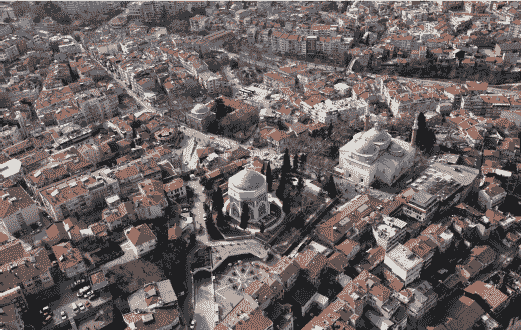

*图 7.3。绿顶陵墓和绿顶建筑群的鸟视图（布尔萨大都会）。*

### Piccinato 作为城市规划师的培训

上述早期的规划尝试促成了 Luigi Piccinato 的工作^(37)，他在 1958 年火灾后（图 7.4）被邀请提供规划建议，那场火灾几乎摧毁了下城的整个商业中心。Luigi Piccinato（1899–1983）师师出身。在职业早期，他的城市规划工作涵盖了具有历史意义的意大利城市，如布雷西亚、马泰拉、那不勒斯和罗马。他写了多部关于城市规划和历史保护的重要著作，包括`Urbanistica medioevale`（中世纪城市规划）（1943 年）、`La strada come strumento di progettazione urbanistica`（作为城市规划工具的道路）（1960 年）以及`La progettazione urbanistica, la città come organismo`（城市规划与作为有机体的城市）（1988 年），这些著作培养了数代建筑师和城市规划师。他在布尔萨的工作利用他在`Urbanistica medioevale` 中讨论的城市规划理论和视角。

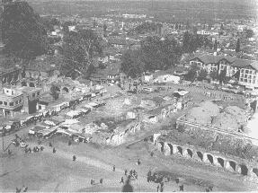

*图 7.4。1958 年火灾后的商业区（布尔萨大都会）。*

Piccinato 在 Gustavo Giovanonni（1873–1947）门下学习，后者是历史建筑、城市市中心、城市增长和功能重组研究的先驱。Giovannoni 是建筑和历史保护领域的关键人物。凭借土木工程、城市卫生以及艺术史的学位，Giovannoni 能够兼任城市规划师和学者等多重身份。他研究处于自然环境中的建筑，并提出了一种针对特定场地的城市保护方法，而他在起草 1931 年《修复历史古迹雅典斯宪章》时所付出的努力使其名声远扬。1927 年至 1935 年间，他在罗马的撒真萨大学教授纪念碑修复课程。^(38)

在 Piccinato 对次要建筑类型的态度中，可以看到 Giovannoni 影响的回响。次要建筑与纪念性建筑不同，包括使用不耐用材料建造的民俗建筑实例。对于 Giovannoni 而言，有必要将实践扩展到更广泛的城市尺度来扩大建筑修复的范围。Giovannoni 主要关注的不是单个建筑、教堂或修道院，而是关注建筑与包裹它们的城市空间之间的关系。^(39)在他的著作中，Giovannoni 强调要理解建成环境与其历史背景的关系，并通过科学方法保护这种关系。他同时也反驳孤立纪念碑的做法（法语学术界中称为 `isolement` 和 `dégagement`）以及风格的同质化。他认为，通过消除增建物（`superfetazioni`），历史环境将得到增强，从而产生审美上愉悦的环境。^(40) Giovannoni 这种认为每个城市的历史特征可能与新城市的特征不兼容的理解方法，塑造了 Piccinato 的思维，并反映在他规划的作品中（布尔萨是其之一）。

Giovannoni 也是历史保护术语的领先人物。他从林业术语中借用了 `diradamento edilizio`（疏化）一词，他的同代人 Camillo Sitte 也使用了这个词。^(41) 他将其应用于：老城可以通过最小方式进行修改，以适应现代生活的需求。老城不被认为适合工业区，因为它不具备所需的宽敞空间，以及在城市新区域或边缘可以实现的规划城市扩张潜力。相反，老城应该是日常生活和社交交流的焦点。通过这种方式，老城得以保留，并在周围增加新城以构筑老城。他对历史背景中环境、功能、传统和审美价值的认可，演化出一种新型城市规划师，他称之为“整合建筑师”（`architetto integrale`）——即带来这种“实现建成环境的艺术与技术融合”的人。^(42)

Giovannoni 热衷于观察和保护过去的碎片，对他而言，这些碎片既保留使用价值也具有遗产价值（他被认为创造了“城市遗产”一词），并且作为更大城市化的关键元素整合到文化保护项目中。^(43) 这种将城市遗产视为来自过去、由建筑和自然环境组成的整体的原则，形成了 Piccinato 理解的核心：每个历史建筑（无论是纪念性的还是民俗的）及其文化和自然环境都应该同等的关注和照顾。

Piccinato 对城市历史层次的深刻理解使他能够处理本国城市中复杂的城市织理。他在 1954 年获得了`Premio Nazionale Olivetti per l’Urbanistica`（奥利利国家城市规划奖），这在很大程度上归功于他以一种富有成果的方式把握了“城市规划的历史问题性和创作实践方面”。^(44) 他的工作也受到了意大利以外的关注。他的职业包括三个不同时期的重大城市规划项目和总体规划：1925–1932 年、1954–1968 年和 1978–1981 年。^(45) 他在土耳其的时间与第二个时期对应，这通常被认为是 Piccinato 从实践和理论角度来看产出最多的时期。^(46)

### Piccinato 眼中的布尔萨

“……我从你的声音中听到了让城市活起来的隐形原因，通过这些原因，也许它们在死后后能够再次复活”。^(47)

在皮琴纳托（Piccinato）到达布尔萨之前，他曾在伊斯坦布尔花时间从事规划工作。在伊斯坦布尔，他与普罗斯特（Prost）合作，重新启动了普罗斯特该城市的规划。随后，在 1958 年火灾之后，他受邀为布尔萨制定一份规划。20 世纪 50 年代初，在意大利城市清理项目实施二十年后，布尔萨和伊斯坦布尔正经历着类似的城市转型。随着阿德南·曼德雷斯（Adnan Menderes）当选（他于 1950 年至 1960 年担任总理），针对这两座城市的新城市清理项目已提上日程。新政府通过拆除大量历史建筑以开辟笔直的、大道和开放空间，旨在让伊斯坦布尔重回辉煌。其目标是强调伊斯坦布尔这座奥斯曼遗产，因为在安卡拉宣布为土耳其共和国首都后，伊斯坦布尔已经失去了其作为奥斯曼帝国首都的曾经身份。只有通过清理大道两侧、开辟主道并创造许多公共空间（*espaces libres*）才能实现这一目标。邀请非土耳其城市规划师是曼德雷斯将其设的让伊斯坦布尔再次壮丽美丽的拆迁项目合法化的手段^(48)

普罗斯特在 1936 年至 1950 年间住在伊斯坦布尔。他的计划包括拆除历史建筑以容纳大型大道、分区和充足的开放空间.^(49) 直到 1950 年，他对伊斯坦布尔的规划得以实施。民主党在地方选举中以压倒性多数获后，新的民族主义氛围导致普罗斯特被贴上该市外国标签，并被批评为不了解其动态，以及没有与当地城市规划师和建筑师合作。伊斯坦布尔市政议会成员决定，由于这些计划是“错误且乌托邦式的假设”，仅部分执行其规划。结果是，普罗斯特的合同在 1950 年被终止了^(50)

从 1950 年至 1956 年，普罗斯特对伊斯坦布尔的规划由一组土耳其官员和专家进行了审查和修订。1956 年通过的新征收法允许由曼德雷斯执政的政府扩大城市规划行动，延伸到安卡拉、伊兹密尔和布尔萨等城市。因此，随着城市发展法规的变化，1957 年阿德南·曼德雷斯再次邀请了亨利·普罗斯特同皮琴纳托和格格（Högg）审查他对伊斯坦布尔的规划^(51) 皮琴纳托被任命负责伊斯坦布尔大都会与城市扩张和交通相关的规划活动，^(52)，而格格将担任市政府的城市规划顾问。目标是修订普罗斯特的规划，并对几个月前开始的城市拆迁进行重建。当普罗斯特忙于说服政治家和规划师时，皮琴纳托的规划理念得到了认可^(53)

### 皮琴纳托在布尔萨的城市规划

当伊斯坦布尔经历这一系列转型（首先是 1936 年至 1950 年的普罗斯特，然后是 1957 年至 1960 年的格格和皮琴纳托）时，布尔萨的主规划在 1958 年火灾之前主要由普罗斯特负责。随后皮琴纳托于 1960 年接管了规划工作。

观察这座城市时，皮琴纳托对其作为城市规划师的经历写了一篇文章：

布尔萨拥有大量的纪念、建筑和自然价值，世界上很少有城市能与之媲美。它们的保护和发展应该是规划的首要考虑问题。我们必须注意，不仅要保护每一个纪念碑，而且要保护它们所在的整个环境……房屋、花园、大树、景观；这些才是赋予纪念性作品本身规模的关键元素^(58)

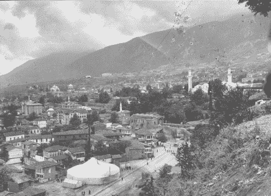

*图 7.5 20 世纪 50 年代后期从老城望向旧城的景观（布尔萨大）。*


让皮琴纳托赞叹的不仅是建筑环境，还有这座城市提供的迷人景观：“它确实必须以最强力的手段维持：布尔萨脚下大谷的景观，并仅作为农业用途，这构成了城市的要素元素，其财富的主要来源以及其美的根本原因。”^(59)

基于皮琴纳托过去在具有历史重要织理的城市工作的经验，他在开初就指出，“在 19 世纪上半叶之前，市中心是完美无缺的，广场商业区周围环绕着一团错乱不齐的道路”。^(60) 在皮琴纳托富有诗意的文字中，人们得以欣赏到布尔萨市中心“那深色屋顶的海洋，点缀着无尽的圆顶，这一切被壮观的植被所遮挡，巨大的丝柏树和巨型梧桐树构成了果园、街道、庭院、墓地，保护着绿色布尔萨免受阳光直射”^(图 7.5)^(61) 这些行文强调了皮琴纳托对城市建筑遗产的欣赏，包括古典、拜占庭和早期奥斯曼层层。

`Piccinato` 仔细对地面上的可见遗迹（或其缺失）进行了清点，并建立了相应的理解。例如，在他的著作中，他提到了拜占庭时期，在提醒我们希腊和罗马对于城市理想形态的理念后，他质疑了城市在希腊和罗马时期可能性的样貌。他问道：“它是否有一个规律的规划，暗示了前希波达米斯时期理性主义的图式化，还是执行了某种后希波达米斯式的、带有广场和柱廊的城市主题？而神庙和神圣之地又在哪里呢？”]^(62) 他还建立了一个关于奥斯曼首都如何从拜占庭时期的城市遗迹中兴起的模型。拜占庭城市，尤其是随后的土耳其城市，宏伟地展示了城市复制以及随后对古代城市贬值的现象。通过接纳或重新利用前时期的城市织理，奥斯曼人能够“在旧城旁边创建一个新城：属于他们自己的新城”。^(63)

`Piccinato` 看出了理解多层历史织理影响的重要性，并认为为了让更具纪念性的建筑可见而忽视那些耐久性较差、非纪念性的建筑是错误的。正如前面提到的，他批评了 19 世纪早期的城市规划和重建尝试，^(64) 包括亨利·普鲁斯特（`Henri Prost`）的城市设计方案。普鲁斯特的计划于 1938 年至 1944 年间实施，试图通过调整布尔萨的道路来适应机车交通，并在绿色陵墓等历史纪念碑周围创建由轴线道路环绕的开放区域。^(([65) 然而，普鲁斯特试图通过让绿色陵墓更加可见，以便从市中心欣赏其景观——这遵循了常见的`dègagement`（留空间）做法——不仅阻碍了位于奥林匹斯山谷的 `Gökdere` 之美（该地是该市最美、最如画的景点），还让绿色陵墓（如图 7.3 所示）看起来像“一个罐头罐”。^(66) `Piccinato` 在此处的讽刺评论是观察到普鲁斯特的规划在拆除绿色陵墓周围建筑时，未能承认这座城市的丘陵地形特征（毕竟布尔萨并非巴黎）。

事实上，在 1855 年地震后，在艾哈迈德·维菲基·帕夏亚（`Ahmed Vefik Paşa`）的领导下，该城市发生的其他城市更新和规划尝试也屈从于维菲基的愿望，即根据前面提到的坦齐马特（`Tanzimat`）改革创建一个现代化的、西化的城市。由于没有考虑到城市的文化背景，新的大林大道被开辟，挡路的的木质房屋被拆除。对于 `Piccinato` 来说，这些规划干预如此彻底，以至于完全改变了城市。正如他所坚持的，在修复尝试之前：“一切都是完好无损、完整且平衡的。在那一刻，一位激情且智慧的城市规划者可以让布尔萨成为一个典范城市，模仿五世纪前土耳其人的做法，他们知道如何在拜占庭人和旧城旁边创建一个新城和属于他们自己的新城。”^(67)

### Piccinato 在布尔萨的规划方法

在一个中东城镇进行城市规划，并不意味着需要特别努力从技术角度去理解特定问题并寻求技术及法律手段的解决方案，而是要让自己沉浸、认同并生活在一个完全不同的世界里。^^(68)

这段引言有助于解释了为什么 `Piccinato` 对布尔萨的历史时期采取了整体方法，而不是强调某一个时期。他敏锐地欣赏到了城市的`独特性`（`sui generis`）精神（图 7.6），他说道：

> 布尔萨体现了小亚细历史的大部分，其现状结构表明这是一个全方位的城市规划问题；其城市和乡村景观的丰富性，其纪念碑（从希腊和拜占庭城墙到 14 世纪的清真寺及小型建筑特征，再到温泉），以及从工业发展到本世纪不明智的拆迁工程，皆如此。^^(69)

正如讨论过的，`Piccinato` 非常熟悉由 19 世纪和 20 世纪初几代规划者主导的城市规划，这些规划严重依赖于“城市美化”理念，包括创建卫生环境、保留开放空间和保护。^(70) 在他看来，拓宽的街道网络、大型公园以及对历史轮廓的“如画式保护”是此前城市规划概念的关键部分。^(71) 但 `Piccinato` 认为这些之前的尝试存在缺陷，包括没有考虑城市的整体背景，以及在孤立的情况下使城市现代化。他曾开玩笑地表示，想要写城市规划等同于做体操。根据鲁本·阿贝尔·比安基（`Ruben Bianchi`）的说法，由于这些及其他原因，`Piccinato` 对布尔萨的主规划不像普鲁斯特等人的规划那样是“乌托邦式的”。它也非没有可能实现的纯“学术修辞”。^(72) 换句话之，他的方法并不是为了创造一个浪漫化的布尔萨形象、强调统一的建筑立面或优先考虑某种风格而非其他风格。相反，`Piccinato` 强调城市及其景观的美感和历史价值，旨在增强其美感并保护其历史遗产。

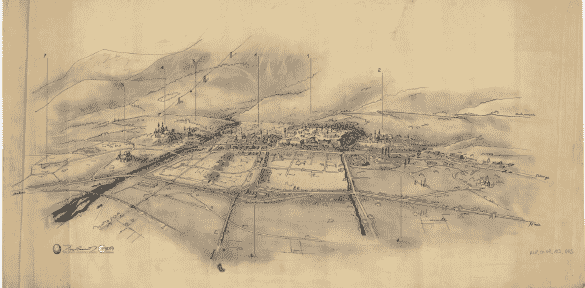

*图 7.6 Piccinato 绘制的布尔萨全景（来自罗马罗马彼真大学 Luigi Piccinato 档案馆）。图例：(1) 旧城；2) Muradiye；3) 绿色清真寺；4) 苏丹；5) 巴耶叶德；6) 商业区；7) 新住宅；8) 新商业区；9) 公共公园和体育中心。*

在布尔萨，`Piccinato` 致力于让历史市中心不受工业活动干扰，除非大规模拆除以为主要基础设施和更快的接入点留地。这遵循了乔瓦诺尼（`Giovannoni`）的观点，即在任何城市规划尝试之前承认城市的历史织理。`Piccinato` 似乎也受到了帕里克·盖德斯（`Patrick Geddes`，1854–1932）的启发，这位以规划爱丁堡、柏林以及印度城市而闻名的英国生物学家和规划师。盖德斯推广了“保守手术”的理念，建议尽量少拆除历史织理，以适应现代化城市的需求，并建议在自然和地理背景下观察历史。^(73) 与普鲁斯特等人不同，`Piccinato` 不是通过拆除来扩大空间给具有历史意义的建筑呼吸空间，而是倾向于保护次建筑细节，并在必要破坏时，仅在经过适当科学研究和记录后，以现实且可行的方式进行。^(74)

对于皮钦纳托（`Piccinato`）来说，理解城市动态的最佳方式是出去生活在某个地方并进行观察，而不是留在工作室画图纸。但像普罗斯（`Prost`）或任何其他城市规划师一样，皮钦纳托对城市问题进行了系统性的分析，并用地图和图表支持他的分析。他的地图特别标出了早期奥斯曼 `külliyes`（建筑群单元）。他还考虑了过去的政府法律。例如，他将景观作为历史城市一部分的观点，可以追溯到 1939 年的《塞维-乔瓦尼法案》和 1942 年的《城市规划法》。《塞维-乔瓦尼法案》由皮钦纳托的教授古斯塔沃·乔瓦尼（`Gustavo Giovannoni`）参与起草，它引入了景观作为保护更大城市和自然历史织理工具的理念。1942 年的《城市规划法》强调了历史中心与城市其他部分之间的严格划分。^(75) 根据该法，首要任务是在较大的背景下确定历史中心的边界，然后对这一区域给予特殊关注，超越了仅仅保护立面和建筑细节，转而保护和维护与中心相关的城市模式，如建筑、建筑之间的空间以及街道。

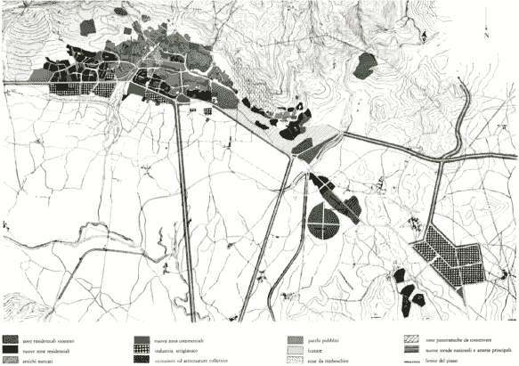

*图 7.7. 皮钦纳托的功能分区规划（罗马路易吉·皮钦纳托档案馆 (ALP)，罗马萨比恩萨大学）。*

皮钦纳托对布尔萨（`Bursa`）历史价值的观察与尊敬的城市历史学家斯皮罗·科斯托夫（`Spiro Kostof`）的著作产生了共鸣。科斯托夫在 1967 年的写作中提出，历史学家应该在“整体语境”中分析建筑。^(76) 科斯托夫的四角方法如下：“由于建筑的‘统一性’，而完整地研究每座建筑；从更广泛的物理意义上观察建筑（后来被称为“环境”）；主张所有的古代建筑都值得研究，因为它们构成了一个社区；以及审视对理解建筑至关重要的非物理方面。”^(77) 科斯托夫对人口稠的历史城市中拆除意义的讨论，以及通过二元对立对城市织理的解读（有机发展的中世纪城市 vs. 古典时期网格规划城市，小规模开发 vs. 纪念碑式中央规划），进一步将他的思想与皮钦纳托的思想联系在一起。

皮钦纳托非常渴望将布尔萨识别为一个独立的城市，而不是与他之前工作过的任何欧洲/意大利城市混淆。我们可以看到，他产生的思想以及从管理欧洲希腊罗马城市经验中中学的教训，是如何应用于布尔萨这种完全不同类型的历史城市的。首先，他敏锐地看到为什么布尔萨应该被以不同的方式对待。尽管材料上令人印象深刻的统一赋予了这座城市特征，但在中世纪欧洲城市的均匀环境中，布尔萨（与几乎每个中东城市一样）显然是双层结构的。换句话说，从公元前二世纪建立到转变为奥斯曼帝国首都，布尔萨的纪念碑式建筑使用坚固的材料形成城市织理和住宅建筑的立面，而使用耐用性较差的材料形成城市环境的背景。这两层并列的结构形成了皮钦纳托所说的 `duplicazione`（重复）。这种重复构成了皮钦纳托分区的核心（`Fig. 7.7`）。对他而言，它们共存并形成了一个有意义的环境。

皮钦纳托还讨论了 19 世纪欧洲城市中保护、城市更新和规划尝试的误导性本质，这强烈呼应了他的导师乔瓦尼（`Giovannoni`）严厉批评的内容——单独挑出纪念碑（`diradamento edilizio`）并创造风格上的同质化。他哀叹为了修建新道路或拓宽现有道路而对历史织理的破坏。^(78) 他引用了米兰的经验，即轴线道路和监管城市规划无法适应汽车流量的增长，并指出在布尔萨，在阿哈迈德·维菲基·帕夏（`Ahmed Vefik Paşa`）时期开辟的、以其名字命名的大道必须拓宽 70 米。^(79) 其他有很多城市规划尝试的城市，如米兰、佛罗伦萨和巴黎也经历了类似的问题：

几乎所有的欧洲城市都被肢解并崩溃了，或或少地落入了铁镐^(80)之下，铁镐划开了再无法愈合的巨大伤口。巴黎，这座世界文化大都市崩溃了；米兰被毁；甚至佛罗伦萨也被分裂了，教堂被孤立，笔直的大道和道路被画。布尔萨未能逃脱命运。^(81)

在对 `il piccone risanotore`（字面意思是“治愈之镐”）的负面引用中，皮钦纳托暗示了他的作为建筑师和城市规划师的政治倾向。这个术是由贝尼·墨索索尼（`Benito Mussolini`）作为意大利城市清理项目的一部分推广的。^(82) 正如斯皮罗·科斯托夫所讨论过的，1924 年至 1932 年间，罗马、佛罗伦萨、米兰和热那亚有数千座建筑被拆除。这些清理项目被称为 `sventramenti`（掏空或剖腹）。该术本身通常与奥斯曼的 `éventration`（该词本身源自 `éventrement`）有关，^(83) 这是十九世纪决策者和城市规划师常见的清理做法。与一战后未来主义者的情绪相结合，铅笔画的大道和悬浮在空间中的建筑群变成了创建“现代城市”的初始组成部分。凭借城市历史层次和环境的整体视角，皮钦纳托回避了这种思考方式。

### 皮钦纳托的建议

皮钦纳托在 1958 年烧毁市中心商业区的火灾后仅两年来到这里。最初作为修复 `hans`（客栈）的计划，很快变成了一个完整的总体规划，旨在对对具有宗教和商业价值的历史纪念碑以及本土建筑案例提供修复和保护。他受城市规划与重建部的邀请，与建筑师 `Emin Canpolat` 指导下工作的城市规划师和建筑师团队合作。在他的项目中，他强调了城市更新（`rinovamento urbano`）、保护（`conservazione`）和修复（`risanamento`）的方面，并讨论了土耳其建筑法规。皮钦纳托致力于研究布尔萨本土建筑的细节。他的计划确实旨在强调布尔萨著名的旧木结构和泥砖房屋的建筑和文化价值，并提出了一项保护和修复计划，以确保它们不会因分区和法规案的压力而被拆除。^(84) 皮钦纳托对本土和当地价值的兴趣是他几乎在所有项目中都强调过的。1971 年在设计意大利拉齐奥大地区的萨巴迪亚（`Sabaudia`）城市时，他写道：“通过萨巴迪亚……它具体地表达了对国家农村价值新意识的获得。”^(85)

正如皮琴纳托（`Piccinato`）的主张，在布尔萨，商业区首先建立在古代城墙之外，那里成为了下城的核心。随着奥尔罕（`Orhan`）的`külliye`位于卫城墙外的选址，一个皇室核心得到了提升，模仿了安纳托利亚希腊化城市的模式；它甚至可以与罗马帝国广场相提并，作为商业、社会和司法活动的中心。因此，从奥尔罕时期开始，下城成为了布尔萨奥斯曼化的终极象征。该地区成为商业活动的焦点，即运输以及货物的销售与交换，这一功能在共和国时期也延续了下来。

世纪以来，下城区`han`复合群的建设、扩张和布局有助于在商人和当地居民之间营造出一种生机勃勃的商业景象。当商业区在 1958 年被火灾摧毁时，人们迫切需要修复该地区，以确保这座城市的历史片段得以保留并继续照常运作。皮琴纳托根据布尔萨居民的认知来保护商业区，而不是使用抽象或美学的方式来保护过去，重新发明了布尔萨早期的奥斯曼城市。商业区本身有七个`hans`，两个在北部，五个在南部，被带顶大巴集的长轴线分开。这里的建筑最初建于 14 和 15 世纪，并在随后的几年里进行了改造。皮琴纳托的城市更新或保护计划如下：他建造了一个覆盖大巴集的拱顶结构，这条轴线便成为了整个商业区的骨干，将所有的`hans`连接在一起。该区域的老建筑得到了修复。那些不再履行功能或停止运作的建筑被分配了新功能，或恢复了它们以前的功能，例如小型浴场。车辆交通仅允许在商业建筑群周围通行。

在完成商业区的修复后，皮琴纳托开始手布尔萨 1960 主规划。为了实现这一目标，皮琴纳托进行了一系列统计计算，研究了社区和人口统计，分析了城市的增长潜力，并考虑了工业和商业活动以及移民问题。布尔萨的主规划是按 1:5,000 的比例绘制的。皮琴纳托建议城市应沿着安卡拉–布尔萨–穆达尼亚（`Ankara–Bursa–Mudanya`）道路发展；也就是说，以东西轴线呈线性布局，遵循奥斯曼人建造的社会宗教复合体的轴线。从市中心的旧道路轴线将被保留，向西向东延伸，并结束于各自的社会宗教复合体和社区。为了支持这种发展，他计划在位于城市东缘的安卡拉路沿发展小型工业，并建议在穆达尼亚路沿建立一个组织工业区。

皮琴纳托的方法是将整个城市视为一个有机的、存活的实体，他利用功能分区规划来实现他的愿景。他识别了各个区域并赋予每个区域一个功能；计划的一个重要方面是定义商业区、城市服务，并建立一个连接这一有机体的功能性和理性的交通网络。他的功能分区确定了十九个区域，遵循以下指导原则：

*   以有机的方式组织整个城市，并识别区域和地区以促进线性发展

*   识别并改进构成城市特征的环境（历史纹理、纪念碑、城市和乡村景观）

*   定义劳动力市场、城市服务和社会机构（手工艺、工业、车站、仓库等）

*   建立一个理性的道路网络，高效地连接并服务整个有机体

在《布尔萨规划经验》（`L’esperienza del piano di Bursa`）的结语中，皮琴纳托指出：“绿色布尔萨正在路途中：这是保护其历史统一性、外观和建筑的方法；这是构建一个更健康、更现代、更丰富秩序的方法。我希望我对许多意大利城市也能这么说。”他看到了城市和乡村景观的丰富性，反过来也将浴场、工业区和未开发区域纳入了他的主规划中。他希望在他的规划体系的帮助下，`Yeşil Bursa`（字面意思是“绿色布尔萨”）能够保持其历史凝聚力和建筑遗产。

## 失败与成功

根据皮琴纳托的建议，土耳其首个组织工业区于 1966 年在布尔萨开。。然而，组织工业区的建立给这座城市带来了巨大的移民压力，这使得皮琴纳托规划中的人口和密度预测失效了。布尔萨靠近伊斯坦布尔，，以及组织工业区的建立吸引了工业家和工人阶级。随着他们搬迁业务，大量人口涌入。该项目的主要缺点之一是未能预判到这种人口增长。在皮琴纳托到来之前，布尔萨在 1957 年的人口为 136,528。皮琴纳托估计 1980 年人口将达到 250,000，但该城市的人口到 1975 年就已经达到了 350,000。这种惊增长是因为主规划项目失败导致的伊斯坦布尔工业去中心化。反，布尔萨居民开始向平原扩散，城市的平原变成了非法建筑的中心。

尽管皮琴纳托的主规划在 1960 年获得了土耳其发展和住房部的批准，但从未实现。然而，他的计划为未来几年主规划的保护策略奠定了基础。皮琴纳托意识到过去规划的问题，例如普鲁特（`Prost`）忽视丘陵地形的错误，他处理布尔萨的方法与普鲁特截然不同。他欣赏布尔萨老城的特质。他的工作是分析性的，并且理解了旨在展望城市增长的投机机制，他通过根据不同功能将城市划分为区域来考虑这一点。与普鲁特不同，皮琴纳托的目标不是将城市呈现为博物馆展品，或提供城市历史时期的抽空快照。相反，皮琴纳托试图证明记忆、事件、人物和自然元素被嵌入在过去，因此与布尔萨的空间、街道和纪念碑相关联。他是那个时代的城市规划师，受到乔瓦尼尼（`Giovannoni`）和格德斯（`Geddes`）的启发，似乎对历史城市有一种鲁斯金式（`Ruskinesque`）的方法。皮琴纳托希望在其环境中保护布尔萨的历史纪念碑，而不是“冻结在时间中的无形纪念碑”。

今天访问布尔萨（`Bursa`）的游客可以看到相当程度的城市扩张：如今的城市已经扩张越了罗马、拜占庭和奥斯曼时期存在的线性轴。城市继续履行其作为主要商业镇的角色，涵盖了居住区、生产汽车、羊毛和丝绸的私人及国有工厂、预留的农业生产用地以及促进冬夏季旅游的地区。任何对今日布尔萨熟悉的人可能会想，那位意大利规划师如何看待政府资助的、在市中心涌而出的混凝土住宅楼——这些建筑阻挡了几乎每一处景观。然而，尽管由于人口已接近 250 万，且城市已成为仅次于伊斯坦布的重要工业枢纽，布尔萨依然保留着一种神秘而鼓人入目的氛围，其不断变化的城市织理和依然存在于城市之中的层次感。

## 致谢

我感谢 `Sam Ottewill-Soulsby` 和 `Javier Martínez Jiménez` 将我收入书中，并感谢他们建设性的批评意见。我还要感谢两位匿名评审员，他们的评论和建议对我改进这篇作品提供了极大帮助。我想将此作品献给 `Alessandra Ricci`，她是我的第一任老师，随后在多年里一直是我的导师、同事和朋友。她总是激励我跳出我最初接受训练时的那些年代、地理和概念去思考。我还要感谢布尔萨大市政府对本书章节所用视觉资料提供的热心协助。

## 参考文献

### 初级文献

`Orosius`, `Paulus Orosius`. *Historiae adversus Pagamos*, Vol. 6. ed. `M. S. Marzak` (Lubbock, 2014).

## 二级文献


Akınar, İ. Y., ‘The rebuilding of İstanbul revisited: Foreign planners in the early Republican period’, *New Perspectives on Turkey* 50 (2014): 59–92.

Ambraseys, N. and C. Finkel, *The Seismicity of Turkey and Adjacent Areas. A Historical Review, 1500–1800* (Istanbul, 1985).

Arnaud, J.-L., ‘Modernization of the cities of the Ottoman Empire (1800–1920)’ in S. K. Jayyusi, R. Holod, A. Petruccioli and A. Raymond (eds.), *The City in the Islamic World*, vol. II (Leiden, 2008), pp. 953–976.

Arslanoğlu, E., ‘Regulation of the general master plan, project: Architect Luigi Piccinato’, *Event Journal* (2004): 36–54.

Aslanoğlu, R. A., *Kent, Kimlik, Küreselleşme* (Bursa, 1998).

Bandarin, F. and R. van Oers, *The Historic Urban Landscape: Managing Heritage in an Urban Century* (Oxford, 2012).

Baykal, K., *Tarihte Bursa Yangınları* (Bursa, 1948).

Bekker–Nielsen, T., *Urban Life and Local Politics in Roman Bithynia: The Small World of Dion Chrysostomos* (Aarhus, 2008).

Bianchi, R. A., ‘The work of Luigi Piccinato in Islamic countries 1925–1981’, *Environmental Design: Journal of the Islamic Environmental Design* 8–9 (1990): 184–191.

Bilsel, C., ‘Ideology and urbanism during the early Republican period: Two master plans for Izmir and scenarios of modernization’, *Journal of the Faculty of Architecture* 16.12 (1996): 13–60.

Bilsel, C., ‘Les transformations d’Istanbul’: Henri Prost's planning of Istanbul (1936–1951)’, *A/Z Istanbul Technical University Journal of Architecture* 8.1 (2011): 100–116.

Bilsel, C. and P. Pinon (eds.), *From the Imperial Capital to Republican Modern City: Henri Prost's Planning of Istanbul (1936–1951)* (Istanbul, 2010).

Bozdoğan, S. and E. Akcan, *Turkey: Modern Architectures in History* (2012).

Calvino, I., *Invisible Cities*, transl. W. Weaver (London, 1974).

Çağaptay, S., *The First Ottoman Capital: The Religious, Architectural and Social History of Bursa* (London, 2020).

Çakıcı Alp, S., ‘A century of transformation within historic city of Bursa, a UNESCO heritage site in Turkey, via historic maps and plans’ in Ö. Öztürk (ed.), *Proceedings of CPUD ‘17 II. International City Planning and Urban Design*.

Çelik, Z., *Displaying the Orient: Architecture of Nineteenth-Century World's Fairs* (Berkeley, 1992).

Choay, F., *The Modern City: Planning in 19th Century*, transl. M. Hugo and G. R. Collins (New York, 1969).

Choay, F., *The Invention of the Historic Monument*, transl. L. M. O'Connell (Cambridge, 2001).

De Sessa, C., *Luigi Piccinato, architetto* (Bari, 1985).

Denny, W. B., ‘Quotations in and out of context: Ottoman art and orientalist painting’, *Muqarnas* 10 (1993): 219–230.

Dostoğlu, N. and T. Vural, ‘The role of Western planners in transformation of Bursa from a traditional city to a metropolitan center’, in H. Turgut and P. Kellett (eds.), *Traditional Environments in a New Millennium: Professional Practice* (2002), pp. 239–245.

Dostoğlu, N. and T. Vural, ‘Lcher, Prost ve Piccinato'nun Bursa'daki kentsel gelişime’, *Bursa Yaşam Dergisi* (2004): 122–126.

Ersoy, A., ‘Architecture and the search for Ottoman origins in the Tanzimat Period’, *Muqarnas* 24 (2007): 79–102.

Ersoy, A., *Architecture of the Late Ottoman Imaginary* (Ashgate, 2015).

Forster, K. W. and Ghirardo, ‘The modern cult of monuments: Its character and origins’, *Oppitions* 25 (1982): 21–51.

Gascón, M., ‘Gustavo Giovanni on planning in historic towns’, *Context* 152 (2017): 29–31.

Geddes, P., *Cities in Evolution* (London, 1915).

Giovannoni, G., ‘Vecchie città edil nuova’, *Nuova Antologia* 48.995 (2013): 449–472.

Giovannoni, G., *Vecchie città edil nuova* (Turin, 1931).

Godoli, E. and Giacomelli, *Architetti e ingegneri dal Levante al Magreb, 1848–1945* (Florence, 2005).

Gurrieri, F. (ed.), *Teoria e cultura del restauro dei monumenti dei centri antichi* (Florence, 1977).

Gül, M., *The Emergence of Modern İstanbul: Modernization of a City* (London, 2009).

Hatuka, T. and R. Kallus, ‘The myth of place-making: stitching and unstitching Atarim Square in Tel Aviv’, *The Journal of Architecture* 12.2 (2007): 147–164.

Haussmann, G. É., *Mémoires du Baron Haussmann* (Paris, 1890).

Hénard, E., *Études sur l'architecture et les transformations de Paris* (Paris, 1982).

Howard, E., *Garden Cities of To-morrow: A Peaceful Path to Reform* (London, 1946).

Jacobs, J., *The Death and Life of American Cities* (New York, 1961).

Jokilehto, J., *A History of Conservation* (Oxford, 2001).

Lamprakos, M., ‘The idea of the historic city’, *Change over Time* 4.1 (2014): 8–38.

Kallis, A., ‘The third Rome of Fascism’, *The Journal of Modern History* 84.1 (2012): 40–79.

Kostof, S., ‘Architectural history and the student architect: A symposium’, *Journal of the Society of Architectural Historians* 26.3 (1967): 189–191.

Kostof, S., ‘His majesty the pick: The aesthetics of demolition’, *Design Quarterly* 118/119 (1982): 32–41.

Kostof, S., *The City Assembled: The Elements of Urban Form Through History* (London, 1992).

Kuran, A., ‘A spatial study of Three Ottoman capitals: Bursa, Edirne and Istanbul’, *Muqarnas* 13 (1996): 114–131.

Küçükali, U. F., ‘Risk caused by the spatial formation of the city of Bursa (Turkey) in historical process, current development plans, and land usages based on the development plan’, *First Annual Interdisciplinary Conference, 24–26 April 2013, Azores, Portugal* (Skopje, 2013), pp. 376–385.

Malusardi, F., *Luigi Piccinato e l'urbanistica moderna* (Rome, 1993).

Mumford, L., *The City in History: Its Origins, Its Transformations, and Its Prospects* (San Diego, 1961).

Olsen, D., ‘The process of urban embellishment’ in D. Olsen, *The City as a Work of Art: London, Paris, Vienna* (London, 1986), pp. 82–85.

Pancaroğlu, O., ‘Architecture, landscape, and the patronage in Bursa: The Making of an Ottoman Capital City*, *Turkish Studies Association Bulletin* 20.1 (1995): 40–55.

Piccinato, L., ‘L'esperienza del piano di Bursa’, *Urbanistica* 36/37 (1961): 110–136.

Piccinato, L., *Urbanistica medioevale* (Bari, 1978).

Picon, A., *Architects and Engineers in the Age of Enlightenment*, transl. M. Thom (Cambridge, 1992).

Pitt, E. M., ‘Cities on the periphery: Urbanization in Bithynia, Pontus, and Paphlagonia under the Roman Empire’, PhD Dissertation, UC Berkeley (2016).

Riegl, A., ‘Der Moderne Denkmaltus: Sein Wesen und seine Enstehung’ (Vienna, 1903).

Sabatino, M., *Pride in Modesty: Modernist Architecture and the Tradition of Vernacular Architecture* (Toronto, 2011).

Semes, S., ‘New design in old cities: Gustavo Giovannoni on architecture and conservation’, *Change over Time* 7.2 (2017): 212–233.

St. Laurent, B., ‘Léon Parvillée, His Role as Restorer of Bursa's Monuments after the 1855 Earthquake and his Contribution to the Exposition Universelle of 1867’ in J.-L. Bacqué- Grammont and H. Batu (eds.), in *L'Empire ottoman; la République de Turquie et del la France* (Istanbul and Paris, 1986), pp. 247–282.

St. Laurent, B., ‘Un amateur de théâtre: Ahmed Vefik pacha et le remodelage de Bursa dans le dernier tiers du XIXe siècle’ in P. Dumont and F. Georgeon (eds.), Villes ottomanes à la fin de l'Empire (Paris, 1992), pp. 95–113.

Tekeli, İ., ‘Nineteenth-century transformation of İstanbul area’ in P. Dumont and F. Georgeon (eds.), Villes ottomanes à la fin de l'Empire (Paris, 1992), pp. 33–47.

Tekeli, İ., *The Development of the Istanbul Metropolitan Area: Urban Administration and Planning* (Istanbul, 1994).

Vural, T., ‘Tarihsel süreklilik içinde Bursa Kapalıçarşı ve Hanlar Bölgesi’ in C. Çiftçi (ed.), *Bursa'nın Kentsel ve Mimari Gelişimi* (Bursa, 2007), pp. 289–309.

Vural, T., ‘Bursa'nın kentsel gelişimi ve Piccinato Planı’ in Y. Oğuzoğlu (ed.), *Bursa Şehrinin Gelişmesi ve Kentsel Planlama Kültürü* (Bursa, 2008), pp. 95–102.

Yerasimos, S., ‘İstanbul and its westernization process’ in S. Yerasimos (eds.), *İstanbul: World City* (Istanbul, 1996), pp. 48–53.


Zucconi, G., *La città contesa: Dagli ingegneri sanitari agli urbanisti, 1885–1942* (Milan, 1988).

Zucconi, G., ‘Gustavo Giovannoni: Vecchie città ed edilizia nuova, 1931: Un manuale mancato’ in P. Di Biagi (eds.), *I Classici dell’Urbanistica Moderna* (Rome, 2002), pp. 57–70.

Zucconi, G., ‘Gustavo Giovannoni: A theory and practice of urban conservation’, *Change over Time* 4.1 (2014): 76–91.

^(1) Mumford, *City in History*, 3.

^(2) Denny, ‘Quotations in and out of context’, 219–230. 关于 1855 年地震后的修复，参见 Ersoy, *Architecture and the Late Ottoman*, 131–137; Ersoy, ‘Architecture and the search for Ottoman origins’, 123, 137–139; St. Laurent, ‘Léon Parvillée’, 247–282; St. Laurent, ‘Un amateur de théâtre’, 103. 关于该时期的概述，参见 Çelik, *Displaying the Orient*, 96–98.

^(3) Dostoğlu and Vural, ‘Lörcher, Prost ve Piccinato’nun’, 122–126; Dostoğlu and Vural, ‘The role of Western planners’, 239–245; Çakıcı Alp, ‘A century of transformation’, 15–34. 关于 Lörcher 受田园城市启发的模式，参见 Bozdoğan and Akcan, *Turkey: Modern Architectures in History*, 28–29.

^(4) Akpınar, ‘The rebuilding of İstanbul revisited’, 62.

^(5) Akpınar, ‘The rebuilding of İstanbul revisited’.

^(6) Riegl, ‘Der Moderne Denkmaltus’，另见 Forster 和 Ghirardo 的译文 ‘The modern cult of monuments’, 21–51.

^(7) Lamprakos, ‘The idea of the city’, 9.

^(8) Lamprakos, ‘The idea of the city’.

^(9) Jokile, *A History of Conservation*, 215.

^(10) Choay, *The Invention of the Historic Monument*, 50–55.

^(11) 关于 Choay 的 *The Invention of the Historic Monument* 的概述，参见 Lamprakos, ‘The idea of the city’, 13 和 27.

^(12) Paulus Orosius, *Historiae adversus Paganos*, 2.23.

^(13) 最初引用自 Bekker–Nielsen, *Urban Life*, 53. 关于作为奥斯曼之前的城墙及其改造的分析，参见 Çağaptay, *The First Ottoman Capital*, 25–46.

^(14) Bekker-Nielsen, *Urban Life*, 21–22, 119–145, 268–269. 关于 Prousa 的概述，参见 Çağaptay, *The First Ottoman Capital*, 14–15, 30–33, 104–105.

^(15) 关于这些人物的铭文证证，参见 Pitt, ‘Cities on the periphery’, 29–30, 125.

^(16) Çağaptay, *The First Ottoman Capital*, 14–15 和 31.

^(17) Çağaptay, *The First Ottoman Capital*, 34–46.

^(18) Çağaptay, *The First Ottoman Capital*, 30–33.

^(19) Çağaptay, *The First Ottoman Capital*.

^(20) Kuran, ‘Three Ottoman capitals’, 114–131，特别是 114–118; Pancaroğlu, ‘Architecture, landscape, and the patronage’,特别是 40, 41–42, 和 45；关于奥斯曼早期布尔萨城市变革的进一步讨论，参见 Çağaptay, *The First Ottoman Capital*, 79–95.

^(21) Çağaptay, *The First Ottoman Capital*, 92–94.

^(22) Çağaptay, *The First Ottoman Capital*, 18.

^(23) 此列表仅包含城市内的重大火灾。完整列表参见 Baykal, *Tarihte Bursa Yangları*, 见。关于震源在布尔萨的地震列表，参见 Ambraseys 和 Finkel, *The Seismicity of Turkey and Adjacent Areas*, 见。

^(24) Ersoy, *Architecture and the Late Ottoman*, 131–137; Ersoy ‘Architecture and the search for Ottoman origins’, 123, 137–139; St. Laurent, ‘Léon Parvillée’, 247–282; St. Laurent, ‘Un amateur de théâtre’, 103; Choay, *The Modern City*, 10–11, 16; Kostof, *The City Assembled*, 57–59, 156. 关于该时期的概述，参见 Picon, *Architects and Engineers*.

^(25) St. Laurent, ‘Un amateur de théâtre’, 103.

^(26) Zucconi, *La città contesa*, 30–35; Kostof, *The City Assembled*, 266. 关于 19 世纪城市改革中卫生的重要性，见本卷中的 Greaves。

^(27) Parvillée 在奥斯曼政府为 1873 年维也纳世览会委托的 *Usul-u Mi‘mari-i Osmani* 或 *L’architecture ottomane* 的准备工作中也发挥了重要作用。进一步讨论参见 Ersoy, *Architecture and the Late Ottoman*, 131–137.

^(28) Tekeli, ‘Nineteenth-century transformation of İstanbul area’, 38; Yerasimos, ‘İstanbul and its westernization process’, 48–53.

^(29) Arnaud, ‘Modernization of the cities’, 957–981.

^(30) 关于田园城市模式，参见 Howard, *Garden Cities of To-morrow*, 50–57.

^(31) 见上述第 2 和第 3 条。

^(32) 同上。

^(33) 关于 Prost 在伊斯坦布尔的前景规划议程及进一步参考文献，参见 Tekeli, *The Development of the Istanbul Metropolitan Area*, 172–176; Tekeli, ‘Nineteenth-century transformation of İstanbul area’, 33–47; Akpınar, ‘The rebuilding of İstanbul revisited’, 78–89; Bilsel and Pinon, *From the Imperial Capital to the Republican Modern City*, 15–47; Gül, *The Emergence of Modern İstanbul*, 98–106; 关于伊兹米尔，参见 Bilsel, ‘Ideology and urbanism’, 13–60.

36. Vural, ‘Bursa’nın kentsel gelişimi’, 96–97.

37. 关于 Luigi Piccinato 的其他城市规划与建筑设计项目，重点关注中世纪城市罗罗伦斯、那不勒斯火车站、佩斯卡拉的体育场，以及罗马和德塞萨的道路规划，请参阅 `Luigi Piccinato, architetto`, 23, 25, 167 和 171；Malusardi, `Luigi Piccinato e l’urbanistica moderna`, 110–114。

38. 关于 Giovannoni 职业生涯的近期概述，请参阅 Zucconi, ‘Gustavo Giovannoni’, 76–91; Gascón, ‘Gustavo Giovanonni on planning in historic towns’, 29–31; Semes, ‘New design in old cities’, 212–233; Kallis, ‘The third Rome of Fascism’, 40–79; Bianchi, ‘The work of Luigi Piccinato’, 184–191; Gurrieri, `Teoria e cultura del restauro`, *passim*。关于其出版物的关键样本，请参阅 Giovannoni, ‘Vecchie città ed edilizia nuova’, 449–472; Giovannoni, `Vecchie città ed edilizia nuova`, ch. 10。

39. 同上。

40. Zucconi, ‘Gustavo Giovannoni’, 76–91，特别是第 88 页和脚注 23，以供进一步讨论。

41. 关于“建筑稀疏化”（diradamento edilizio）理论，参阅 Giovannoni, `Vecchie città ed edilizia nuova`, ch. 10。Giovannoni 的方法遵循 Camillo Sitte (1843–1903) 的“文化主义”原则，正如 Choay 在 `The Modern City`, 42–44 和 115–120 中提到的，这旨在将历史整合到城市规划中。

42. 关于审美、功能和环境保护与保护存的历史背景，请参阅 Choay, `The Modern City`, 15–26; Choay, `The Invention of the Historic Monument`, 84–94, 117–37；关于更近期概述，请参阅 Lamprakos, ‘The idea of the historic city’, 8–38。

43. 关于“城市遗产”一词归于 Giovannonni，请参阅 Bandarin and van Oers, `The Historic Urban Landscape`, 14（引用了 Choay, `The Invention of the Historic Monument`），以及 Kallis, ‘The third Rome of Fascism’, 52–53（引用了 Zucconi, ‘Gustavo Giovannoni: Vecchie città’, 57–70）；Semes, ‘New design in old cities’, 215–221。

44. 关于 Giovannoni 作品中与历史价值相关的讨论，请参阅 Zucconi, ‘Gustavo Giovannoni: Vecchie città’, 57–70; Zucconi, ‘Gustavo Giovannoni’, 76–91; Semes, ‘New design in old cities’, 214–217; Kallis, ‘The third Rome of Fascism’, 40–79。

45. Malusardi, `Luigi Piccinato e l’urbanistica moderna`, 110–114。

46. 关于他在意大利的职业生涯，见此文第 35 条和第 36 条。在 1925–1932 年于土耳其工作之前，Piccinato 曾在利比亚的的黎波、孟加齐和托布鲁克，以及阿布鲁佐、布雷西亚和福贾贾工作过。1978 年至 1981 年，他在阿尔及利亚和以色列工作。更多参考文献请参阅：Bianchi, ‘The work of Luigi Piccinato’, 184–191; Godoli and Giacomelli, `Architetti e ingegneri italiani`, 288–292; Hatuka and Kallus, ‘The myth of informal place-making’, 147–164。

47. Calvino, `Invisible Cities`, 135–136。

48. Tekeli, `The Development of the Istanbul Metropolitan Area`, 122 和 135; Tekeli, ‘Nineteenth-century transformation of İstanbul area’, 33–47; Akpınar, ‘The rebuilding of İstanbul revisited’, 78 和 87，脚注 90；Bilsel, ‘Les transformations d’Istanbul’, 100–116; Gül, `The Emergence of Modern İstanbul`, 140–171。

49. 同上。

50. 关于 Prost 计划未能实施的原因，见文第 31 条和第 80 条，Gül, `The Emergence of Modern İstanbul`, 134–136。

51. Tekeli, `The Development of the Istanbul Metropolitan Area`, 171, 176–177 和 181–190; Tekeli, ‘Nineteenth-century transformation of İstanbul’, 33–47; Bilsel, `Les transformations d’Istanbul’, 100–116; Akpınar, ‘The rebuilding of İstanbul’, 78; Gül, `The Emergence of Modern İstanbul`, ch. 6。

52. 关于他在伊斯坦布尔的工作，参阅 Bianchi, ‘The work of Luigi Piccinato’, 189。

53. 见上文第 48 条。

54. Bianchi, ‘The work of Luigi Piccinato’, 189。

55. Gül, `The Emergence of Modern İstanbul`, 94。

56. Gül, `The Emergence of Modern İstanbul`.

57. Gül, `The Emergence of Modern İstanbul`, 125–126 和 128。

58. Bianchi, ‘The work of Luigi Piccinato’, 184–186。

59. Piccinato, ‘L’esperienza del piano di Bursa’, 113. 以上均为译译。

60. Piccinato, ‘L’esperienza del piano di Bursa’, 112.

61. Piccinato, ‘L’esperienza del piano di Bursa’.

62. Piccinato, ‘L’esperienza del piano di Bursa’, 112–113.

3.. Piccin,,,  111。

64. 见文第 3 条和第 24 条。

65. Dostoğlu and Vural, ‘Lörcher, Prost ve Piccinato’nun’, 122–126; Dostoğlu and Vural, ‘The role of Western planners’, 239–245。

66. Piccinato, ‘L’esperienza del piano di Bursa’, 113.

67. Piccinato, ‘L’esperienza del piano di Bursa’, 112.

68. Piccinato, ‘L’esperienza del piano di Bursa’, 110。

69. Piccinato, ‘L’esperienza del piano di Bursa’, 110。

70. Piccinato, ‘L’esperienza del piano di Bursa’, 110。


71. 关于这三点作为城市规划组成部分的讨论，参阅 Hènard, `Études sur l’architecture et les transformations de Paris`, 17; Olsen, ‘The process of urban embellishment’, 82–85。

72. Bianchi, ‘The work of Luigi Piccinato’, 184. 关于城市规划者对历史织的乌托邦态度的批判，参阅 Jacobs, `The Death and Life of Great American Cities`, 7 和 13。

73. 关于他的规划思想和城市问题研究，参阅 Geddes, `Cities in Evolution`, *passim*。

74. Bianchi, ‘The work of Luigi Piccinato’, 186–189.

75. Zucconi, ‘Gustavo Giovannoni’, 76–91, 85。

76. Kostof, `Architectural history and the student architect`, 189–191.

77. Kostof, ‘Architectural history and the student architect’.

78. Piccinato, ‘L’esperienza del piano di Bursa’, 113.

79. Piccinato, ‘L’esperienza del piano di Bursa’, 112.

80. Piccinato, ‘L’esperienza del piano di Bursa’, 113.

81. 原文引用 Piccinato, ‘L’esperienza del piano di Bursa’, ‘…sotto il piccone che apriva le grandi ferite mai più rimarginate’, 112–113。

82. Piccinato, ‘L’esperienza del piano di Bursa’, 112–113; Kostof, `His majesty the pick`, 9–22.

83. Haussmann, `Mémoires du Baron Haussmann`, 54.

84. Piccinato, ‘L’esperienza del piano di Bursa’, 130–131. 此处必须注意到，结合 1951 年不动产与古迹高级委员会的建立，1957 年通过的《发展条例》规定拆除注册建筑对环境构成了危险。

85. Sabatino, `Pride in Modesty`, 154.

86. Piccinato, ‘L’esperienza del piano di Bursa’, 110–112.

^(87) 见上述注 3。Çağaptay, *The First Ottoman Capital*, 25, 104–105.

^(88) 欲了解 Piccinato 对商业区干预的概览，参见 Vural, ‘Tarihsel süreklilik içinde’, 289–309; Vural, ‘Bursa’nın kentsel gelişimi’, 95–102; Çakıcı Alp, ‘A century of transformation’, 25–26。北侧的商队（hans）包括：埃米尔、Coccoon、铜匠市场，以及一座浴室；南侧则有 Geyve、米市、马车匠、集市（Bedesten）、Fidan、Yeni Hal 以及 Sipahi 和另一座浴室。

^(89) Piccinato, ‘L’esperienza del piano di Bursa’, 117–119.

^(90) Dostoğlu and Vural, ‘Lörcher, Prost ve Piccinato’nun’, 122–126; Dostoğlu and Vural, ‘The role of Western planners’, 239–245; Vural, ‘Tarihsel süreklilik içinde’, 289–309; Vural, ‘Bursa’nın kentsel gelişimi’, 95–102.

^(91) 关于每个区域的详细讨论及地图，请参见 Piccinato, ‘L’esperienza del piano di Bursa’, 133 以及图 80–82。

^(92) Piccinato, ‘L’esperienza del piano di Bursa’, 136.

^(93) Piccinato, ‘L’esperienza del piano di Bursa’, 116–119.

^(94) Piccinato, ‘L’esperienza del piano di Bursa’, 136.

^(95) Piccinato, ‘L’esperienza del piano di Bursa’; Aslanoğlu, *Kent, Kimlik, Küreselleşme*, *passim*; Arslanoğlu, ‘Regulation of the general master plan’, 36–40.

^(96) Arslanoğlu, ‘Regulation of the general master plan’, 36–40.

^(97) Dostoğlu and Vural, ‘Lörcher, Prost ve Piccinato’nun’, 122–126; Dostoğlu and Vural, ‘The role of Western planners’, 239–245; Arslanoğlu, ‘Regulation of the general master plan’, 36–40; Çakıcı Alp, ‘A century of transformation’, 15–34。欲了解城市空间形成的近期读物，参见 Küçükali, ‘Risk caused by the spatial formation’, 376–385。

^(98) 见上述注 90 和 97。关于 Piccinato 之后的规划尝试，参见 Çakıcı Alp, ‘A century of transformation’, 26–32。

^(99) Piccinato, ‘L’esperienza del piano di Bursa’, 113.

^(100) Choay, *The Invention of the Historic Monument*, 120–121.

# 重塑的城市

# 第 8 章

## 记忆这座玫瑰红之城：宗教、朝圣与拜占庭佩特拉的塑造

*Marlena Whiting*

位于约旦南部的古代纳巴泰首府佩特拉（Petra），坐落于周围石灰岩丘陵中一簇呈现出各种红色调的扭曲砂岩露头层之间。其自然环境的戏剧性色彩和独特性使其成为一个特殊的地方。该遗址是一个跨越文化的记忆中心，始于公元前 13 世纪至 2 世纪的以东人（Edomites）、公元前 1 世纪至后的纳巴泰人（Nabataeans），一直延伸到基督徒、犹太人、撒马利亚人和穆斯林与《旧约圣经》中出口事件相关的共同宗教遗产。这种景观对于这些群体来说都具有持久的神圣意义；但城市作为宗教空间的功能有所不同，反而与世俗权威联系得更紧密。公元前 1 世纪至以后出现的城市，是部分通过宗教实践、建筑、仪式和公职来组织公民和政治生活的方式。宗教空间成为社会和价值观的重要指标。宗教演变，特别是 4 世纪起基督教的兴起，成为观察城市社区如何理解其过去以及与建筑和自然环境关系的视角。

从公元 3 世纪末到 5 世纪初，佩特拉及其周边均有异教和基督教社区的记载。书面文献可能会描绘这两组之间的冲突，但考古证据表明了一种逐渐皈依和材料利用的模式，而非暴力对抗。基督教佩特拉的公民并没有直接与其古典纪念碑建筑互动。事实上，现在让佩特拉闻名的寺庙和墓面可能在 4 世纪之前就被当地社区拒绝为外来元素。相反，佩特拉通过将其周围景观与《旧约圣经》中的事件联系起来，被纳入普世基督教叙事。这些过程产生的不同影响体现在市中心的遗址和郊区的哈鲁恩山（Jabal Hūn）圣地上；这两个遗址的对比展示了佩特拉公民适应宗教和社会变化的全面图景。

## 城市及其后地：佩特拉与哈鲁恩山

佩特拉是纳巴泰王国的首都，这些游牧阿拉伯商人统治的领域在鼎盛时期（公元前 3 世纪至公元 2 世纪）从阿拉伯半岛延伸到地中海，最北到达叙利亚南部（图 8.1）。从公元前 1 世纪开始，佩特拉转变为一个高度城市化的定居点。地理学家斯特拉波（Strabo）对石屋的华丽和土地的农业肥沃程度进行了评论。^(1) 公元前 1 世纪至公元 1 世纪，在纳巴泰国王统治的巅峰时期以及公元 106 年被罗马帝国兼并后，该城市的人口估计为 3 万人。^(2) 佩特拉拥有一个作为希腊化、罗马化城市所需的全部城市设施：剧院、喷泉、游乐园、浴室、宫殿和城市别墅，以及柱廊街上的商店（图 8.2）。^(3) 佩特拉的市中心包含几座纪念性宗教建筑。这些包括位于柱廊街西端的卡斯尔宾特（Qasr al-Bint）神庙及其圣区、位于北侧山谷坡上的翼狮座神庙，以及所谓的“大庙”。^(4) 佩特拉壮丽的山谷和山区景观通过其著名的岩凿墓、崖壁龛和山顶“高地”被神圣化。

公元 363 年 5 月 19 日的地震在佩特拉的传说中是一次重大的分水岭事件，在考古记录中也留下了印记。当时的文献记载，该城市超过半的地区被毁，并被认为永远没有复原。然而，自 20 世纪 90 年代以来，系统发掘的与该城市拜占庭阶段相关的建筑推翻了这一假设。这些建筑包括一座大座堂、一个主教建筑群以及其他小堂和教堂。瓮罐墓（The Urn Tomb）拥有俯瞰城市的古典化墓葬立面，它在 446 年被改造成一座教堂，这证明了佩特拉的基督教徒与异教过去遗迹互动的一种方式。最具意义的是，考古学家在佩特拉主教堂的一间侧室内发掘出了一份追溯到 6 世纪的纸草档案，保存了与该市一个显赫家族相关的各种法律和财务文件。虽然这座城市可能没有 4 世纪中叶之前那么奢华，但它仍然具有区域和跨区域的重要意义。它具有政治重要性，首先是阿拉伯比亚省的`metropolis`（大教区中心），后来成为第三巴勒斯坦（Palaestina Tertia）的省会。它还成为一个区域宗教中心（于公元 451 年提升为大教区），派遣主教参加宗教会议。

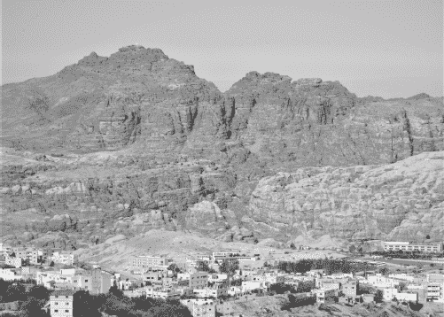

*图 8.3。从现代城市瓦迪穆萨（Wādī Mūsā）向西看到的哈鲁山（Jabal Hārūn）（Judith McKenzie/Manar al-Athar）。*

来自佩特拉市中心的证据与位于宏伟市中心西南 5 公里的郊区山顶神庙哈鲁山（Jabal Hārūn）的考古工作形成了互补。这座山是佩特拉地区最高的山峰，海拔约`c`. 1300 米。它具有独特的轮廓，有两个山峰和一个高原。这些特征使其成为佩特拉居民宗教兴趣的逻辑焦点，其历史可以追溯到纳巴泰时期，甚至更早。这座山坐落在佩特拉城市的后陆地，在公元前第一世纪至公元第一世纪的扩张期间，为城市提供了农产品和建筑材料。在佩特拉生产的陶器以及城市精英的赞助表明，该遗址是城市经济宗教环境的一部分，尽管物理上并不属于城市核心。

在两个山峰中较高的一个顶部有一座建于 14 世纪的伊斯兰神庙，现被称为哈伦之墓（阿拉伯语为 Hārūn），内部设有一个大理石石碑和一个地下墓室。该建筑融合了拜占庭元素，即`opus sectile`（嵌石铺）地面。地表的陶器和在岩石上刻有的用于倾倒祭酒的所谓“杯槽”（cupmarks）表明，山上的宗教活动可以追溯到纳巴泰时期。然而，特别引人关注的是山峰西侧较低高原上发掘的宗教建筑群。那里的发掘显示了一处公元 1 世纪的纳巴泰圣所，后来被并入一个庞大的围墙基督教修道院复合体（`coenobium`）和朝圣中心。该基督教复合体建于 5 世纪中后期，一直作为宗教用途直到 9 世纪；关于该遗址修道士的最后文字记载源于 11 世纪的一份朝圣记述。这座神庙在其纳巴泰、基督教和伊斯兰阶段都属于佩特拉城市更广泛宗教环境的一部分，正如考古证据和佩特拉地区现代居民的朝圣实践所证明的那样。哈鲁山上显而的宗教用途变化与佩特拉本身发生的文化转变密切相关，这些转变是晚期古代宗教动荡的一部分，这些动荡不仅产生了新的宗教崇拜形式，还产生了对纪念性空间和公民空间的新态度。

## 佩特拉的异教、基督教与社会

晚期古代基督教兴起并成为罗马帝国主导宗教的宏大故事在东中海其他地区也为人知，这在佩特拉同样适用：4 世纪初有异教实践的证据，文献告诉我们这种做法一直持续到 5 世纪。到 4 世纪末，神庙空空了，5 世纪开始建造教堂。但佩特拉在这一宏大叙事上有两点不同：首先，纳巴泰宗教的特征可能表明，神庙废弃的原因并非基督教化。其次，363 年地震破坏层的特定考古信息提供了一个可以判定年代的界限，似乎暗示了异教的早早结束；但这与基督教文献记载相矛盾，后者宣称异教在 5 世纪仍在活跃地、甚至是狂热地持续。

将“纳巴泰”宗教视为单一实体是不恰当的，因为纳巴泰王国领土内所崇拜的神灵身份存在相当的局部差异。总体而言，崇拜集中在一个至高神身上，其属性和性别随情况而异，但其主要影响范围是肥产年度循环和自然世界的元素，特别强调雨水和风暴。后来与纳巴泰统治者联系在一起的主神是杜沙拉（Dushara）。他是纳巴泰王室的守护神，被各种崇拜为植物神、风暴神和太阳重生神。人们认为佩特拉的女儿神庙（Qasr al-Bint）是献给杜沙拉的，而对面的翼狮神庙将是献给他的女性对应神的，但这些认同是推测性的。

纳巴泰人倾向于以无偶像的形式崇拜他们的神，即“圣贝石”（betyls）。圣贝石是石板，可以是未加装饰的，也可以刻有风格化的人形标记（如眼睛）。圣贝石在整个纳巴泰历史时期都一直在使用。它们不仅在庙宇中被尊崇，也可以在开放空间被崇拜。圣贝石通常刻在崖面上，但也可以放置在名为`motab`的基座上作为独立的石块，这些基座有时出现在所谓的“高处祭坛”。佩特拉最著名的是贾贝尔·阿尔·马德巴赫（Jabal al-Madhbah）的高处祭坛，那里有一个`motab`、排水沟和一个三联式宴会厅（triclinium），三面都设有长椅，用于祭祀盛宴，通常与纳巴泰圣所有关。

哈鲁恩山（Jabal Hārūn）似乎直到 363 年仍在进行着异教崇拜，它可能被视为一个“高处”，与其山顶的位置和自然特征在神圣上联系在一起。最老的纳巴泰建筑（可能是一座带有祭坛的神庙）朝向东南方向（`Fig. 8.4](#15_chapter08.xhtml_fig8.4)`）。这可能是为了对准春分日的第一缕阳光（纳巴人的新年），由于主峰的遮挡，这束光线在正东的地平线上是不可见的.^(16) 这种对齐也为了尊重一个显著的自然特征——基岩中的一条裂缝或隙。这条裂缝长近 2 米，最宽处达 6 米，形成了一个天然水池。在纳巴泰时期，人们通过扩大地下室并增加沉淀池和导流雨水的通道，对其进行了刻意的强化。^(17) 这个水池很可能常年满水，因此具有了神迹/神性的色彩，就像神圣泉一样（`Fig. 8.5](#15_chapter08.xhtml_fig8.5)`）。^(18) 公元 1 世纪后期到 2 世纪初，核心建筑周围增加了一个带廊的庭院和一系列房间。其中一个房间看起来像是一个宴会厅（triclinium）。^(19) 这一建筑群在 2 世纪和 3 世纪进一步扩张，南部增设了房间。这些房间可能被用作额外的聚集空间，同时也用于农产品的储存和加工，这反映了人们对年度耕作循环宗教性的重视，不仅是农村定居点，佩特拉日益增长的城市人口也依赖于此。^(20)

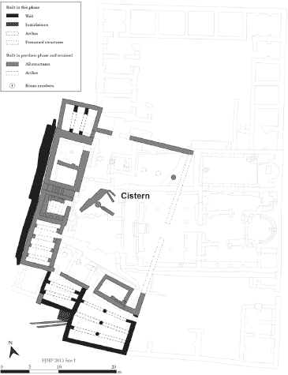

*图 8.4。哈鲁恩山纳巴泰建筑的平面图（芬兰哈鲁恩山项目）。*

纳巴泰人挪用、吸收并调整了他们认为时髦或与其神灵相关的视觉元素，以用他们特有的方式继续崇拜这些神。一些“外来”神被独立崇拜，例如埃及女神伊西斯（Isis），她在整个地中海地区都很受欢迎。^(21) 纳巴泰王国的宗教也能够容纳不同地区的宗教崇拜差异，从北阿拉伯的独特宗教文化到叙利亚南部的当地众神。对这些神灵的崇拜一直持续到公元 4 世纪。随着纳巴泰人的贸易网络使他们与希腊化和罗马的影响产生日益增加接触，纳巴泰人日益采用用人类形象表现其神灵的趋势，融合了罗马、希腊、埃及和近东肖像的元素。例如，在佩特拉，杜沙拉（Dushara）被描绘为宙斯，也被描绘为狄奥尼索，因为他与丰产有关。

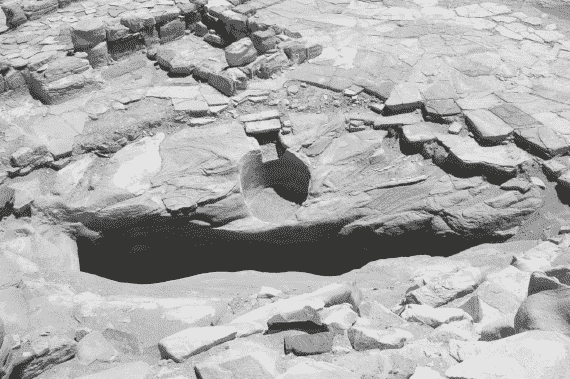

*图 8.5。哈鲁恩山天然水池的景视图（Kai Juntunen）。*

这种表现形式的多样性和区域差异在过去导致了这样解释：认为所有这些“外来”神实际上是在平等地位上被崇拜的，纳巴泰宗教是折衷主义和融合主义的。^(22) 这种解释已逐渐不再青睐。罗伯特·文宁（Robert Wenning）将纳巴泰宗教总结为“关联性的”而非“融合主义的”，总结为“一神论的/一神崇拜的”而非“多神论的”。在这种解释中，`e.g.*`希腊化神灵的肖像表现是与某个纳巴泰最高主神相关的属性，而且最高主神的身份也取决于当地的背景。因此，在佩特拉，杜沙拉具有宙斯（风暴之神）和狄奥尼索（丰产之神）的属性，但同样的属性和功能在位于北 70 公里的赫尔贝特特-塔努尔（Khirbet et-Tannūr）神庙中，与一个（通过铭文确定为）埃多曼风暴神科斯（Qōs）的最高主神相关。^(23)

重要的是，在公元 5 世纪之前，对圣石（betyls）的崇拜从未被完全取代，这导致人们认为，受希腊化东部影响的人格化艺术是一种自上而下的创新；首先源于纳巴泰统治者，然后是寻求表现得像罗马人的当地精英。^(24) 希腊化的雕塑——主要是建筑装饰而非独立的立塑————已从佩特拉纪念碑意义的市中心的神庙中出土；这些建筑，并进一步推导出在其中举行的仪式，可能是一种自上而下的强制施加，从未完全取代涉及圣石和高处的更传统的仪式。^(25)


佩特拉市中心的纪念性神庙在 363 年的地震中受损且未曾重建。哈鲁恩山的神庙、赫尔贝特特-塔努尔神庙及其附近的定居点赫尔贝特德-达里赫（`Khirbet edh-Dharīh`）也是如此。然而，沃尔特·沃德（Walter Ward）认为，佩特拉城市的公民神庙（卡斯尔·宾特/`Qasr al-Bint`、“大庙”和狮子神庙）在 363 年地震之前就已经不再使用了。^(26) 卡斯尔·宾特和“大庙”都有由风积沙土和冲积沉积物形成的废弃层。这些沉积物的年代在“大庙”为 2 世纪后期，在卡斯尔·宾特则为 3 世纪初/4 世纪初（它们位于主庙被毁之后）。^(27) 狮子神庙没有废弃层，表明它一直使用到 363 年，但之后没有重建。佩特拉中心神庙的表面废弃与我们从基督教作者那里了解矛盾，他们提到直到 5 世纪佩特拉仍有“狂热的”异教崇拜。^(28)

这种表面差异的关键在于：神庙中的公共崇拜可能被视为自上而下对当地宗教实践的施加，而在其他活动场所（如高处），更传统的圣石崇拜和崇拜实践可能延续了下来。特别是卡斯尔·宾特，与统治权和外部权威密切相关。首先，据测它是供奉给纳巴泰皇室主神杜沙拉的神庙。在罗马兼并后，对纳巴泰皇室和精英的镇压，可能影响了与皇室及其神庙陵墓相关的崇拜。兼并后出现了一定的动荡，但在 2 世纪和 3 世纪期间，佩特拉开始积累荣誉称号，标志着其精英对罗马的忠诚。^(29) 160 年代，在卡斯尔·宾特圣域（`temenos`）的西墙建造了一个半圆形结构，里面包含了献给罗马皇室的雕塑和铭文。^(30) 在圣域内还发现了与军队（驻守波斯特拉的第三塞琉尼军 `legio III Cyrenaica`）相关的铭文。^(31) 因此，卡斯尔·宾特神庙群废弃的解释，可以首先从对纳巴泰精英崇拜的镇压中寻找，以及由于整个 4 世纪期间禁止祭祀和异教崇拜的其他方面，以及基督教观念对皇帝神性的重新定义，导致罗马皇帝崇拜失去了意义。^(32)

另一方面，像 `Jabal Hārūn` 或 `Khirbet et-Tannūr` 这样的山顶遗址拥有神庙结构（在 `Khirbet et-Tannūr` 则具有古典风格的崇拜像），一直使用到 4 世纪中期，因为它们的神圣权威源于其在景观中的位置，这与关联政治权威的市神庙不同。`Khirbet et-Tannūr` 在 363 年后被遗弃了——这是因为与之相关的定居点 `Khirbet edh-Dharīh` 在那时也被遗弃了。然而，佩拉仍然有人居住，有证据表明在 5 世纪中期教堂和修道院建成之前，`Jabal Hārūn` 曾有零星的崇拜，但在 363 年后，无论是在城市还是郊区，都没有证据表明存在重建异教建筑的努力。

虽然在 4 世纪异教神庙被废弃并不罕见，但 363 年的破坏层为佩拉遗弃情况的断年提供了特定性，这是不寻常的。尽管这一过程在整个 4 世纪都是不可阻挡的，但直到 391 年异教祭祀才被正式禁止，在 4 世纪末之前，神庙只有在皇帝的明确命令下才能被拆除（(33)）。此外，佩拉主神庙缺乏祭祀活动的直接证据，这与我们在文献中读到的关于异教持续存在的描述是不一致的。这可能是因为缺乏维修资源，因为市中心的民用建筑（包括水利管理）也受到了类似的影响。也可能是活动是以一种不会留下明显可断年代的考古痕迹的方式或地点进行的，例如在像 `Jabal al-Matbah` 这样的高处（那里没有遗存的地层堆积物），或者在 `Jabal Hārūn`（那里的大大多数可断年代的材料在教堂群建成之前被清理掉了）。尽管如此，虽然 `Jabal Hārūn` 的考古证据是分散的，但散落的遗迹确实表明该遗址在 363 年地震后继续作为仪式场所被使用（(34)）。参与仪式活动的人是异教徒还是基督徒尚不清楚。根据文献记载，基督徒在 3 世纪末就已经对 `Jabal Hārūn` 提出了主张，但我们推测异教仍然在包括 `Jabal Hārūn` 在内的“高地”遗址持续。挖掘者将这些证据解释为共存而非冲突或剧烈变迁（(35)）。

某些活动也可能从公共空间转移到了私密空间。这也许就是 4 世纪末 `Qasr al-Bint` 发生的情况。在主神庙被遗弃后，在 2 世纪的皇室纪念碑旁建造了一系列房间（(36)）。这些房间的组合表明它们具有家庭用途并是一个骨骼加工工作坊。然而，在住宅的地下室内有几个通常在宗教背景下发现圣石（`betyls`）和灯。挖掘者将该空间描述为“une autel domestique”（一个家庭祭坛），它反映了与前几个神庙公共仪式完全不同的做法，甚至可能是“秘密异教”的例子，仪式是在秘密中进行的（(37)）。该建筑被故意摧毁了：圣石被撞倒，灯被砸碎，建筑被点火。

4 世纪的文学文献一致认为异教仍然强盛。凯撒利亚的优西比在 4 世纪初写作时提到佩拉的持续（“充满了沉浸在魔鬼错误的迷信者”），尽管他也提到那里已经建造了教堂（(38)）。最晚到 343 年，佩拉已成为一个主教座（(39)）。索西美门在描写 383 年左右发生的事件时，将佩拉列在阿拉伯和腓尼基的城市中，这些城市热衷地战斗保护自己的神庙（(40)）。鉴于官方基督教社群和活跃的异教社群同时存在，有时认为基督徒与异教徒之间发生宗教冲突是不可避免的（(41)）。

佩拉异教徒和基督徒之间活动的迹象来自 4 世纪末的一部迷信与异端汇编《Panarion》，该书由坚定的正统派塞拉米的伊庇法尼乌斯编写。第一部分涉及在亚历山大、佩拉和埃卢萨对处女 Kore 的崇拜。伊庇法尼乌斯说，在佩拉，Kore 被崇拜为一个名为 Chaamou 的处女，她是主神杜萨雷斯（出生于冬至）的母亲（(42)）。伊庇法尼乌斯认为这是对基督教耶稣处女怀孕信仰的刻意模仿，为了制造混乱。然而，现代学者认为，Chaamou 传说并非受基督教启发的创新，而是反映了伊斯兰以前阿拉伯更古老的传统（(43)）。

伊庇法尼乌斯的第二个反对是对佩拉基督徒的投诉。伊庇法尼乌斯指责他们被欺骗或误导，制作了摩西的像并崇拜它（(44)）。对于坚决反对偶像崇的伊庇法尼乌斯来说，这代表了偏离基督教正统、近乎异端的行为。

关于这座城市最终皈依基督教的故事，反映了一种务实的宗教态度，而非深信不疑的教条。

在五世纪的《叙利亚巴尔萨马传》（*Life of Barsauma the Syrian*）中，性格好斗且热衷于破坏犹太教堂和神庙的巴尔萨马来到佩特拉，城门对他关闭了。这座城市已经遭受了四年的旱。巴尔萨马承诺雨水将降临；雨水确实如倾盆般而下，摧毁了城墙。异教祭司皈依了基督教。(45)降雨和水在佩特拉基督教化的记忆中占据如此重要的地位，并不意外。纳巴泰宗教的主要目的似乎是季节性地安抚神灵，以确保降雨和作物生长。对我而言，拥抱能够提供结束干旱雨水的神性，与其说是某种文化转变的信号，不如说是证明了公元前一世纪就已经显出来的信仰体系的灵活性和内在的实用主义。有趣的是，这些元素（特别是与降雨相关的元素）直到今天仍是佩特拉地区民间宗教活动的一部分。(46)

## 考古学证据与共存

文献来源似乎表明四世纪佩特拉的异教徒和基督教徒是共存。那么考古证据呢？我们已经看到，在 363 年地震之后没有重建神庙的证据。然而，直到五世纪中期，还没有关于建造教堂的确凿证据，也没有来自四世纪末之前的初步证据。(47)基督徒可能已经在使用废弃的墓穴进行崇拜，而 446 年对“瓮墓”（`Urn Tomb`）的正式奉圣反映了这种做法。在佩特拉的其他墓葬建筑中（如`ed-Deir`）发现了十字形涂鸦，这可能是该空间被用于会众崇拜或隐士居住洞穴的证据。(48)

## 圣像破坏与雕塑损坏

佩特拉神庙和墓地中的一些希腊化人物雕塑遭到了某种蓄意的破坏。这种圣像破坏暗示了宗教冲突，但这些损坏很难确定年代。在帝国的其他地区，基督徒曾对塑像实施过一系列亵渎计划，通常是因为对恶魔或超自然力量的恐惧。(49) 然而，对于佩特拉这一特定案例，认为雕塑损坏于异教徒与基督教徒之间冲突的观点在年代学上是最弱的。损坏可能追溯到更早，作为纳巴泰人对引入神灵形象化的反击，这导致了神庙作为崇拜场所被遗弃。(50)

然而，许多被毁容的胸像位于 363 年破坏水平之上（下方是完好的），因此损坏不太可能发生在该日期之前。(51) 来自一世纪和二世纪纳巴泰建筑装饰墙板的人物胸像被重新用作“佩特拉教堂”（`Petra Church`）的普通建筑块。这些脸部非常磨损，且位于墙壁的最上层，原本是不可见的。少数胸像被刻意毁容，但它们位于塌石堆的最顶层，很可能是在建筑倒塌后被毁的。(52)

因此，这些损坏可能是八、九世纪圣像破坏运动的一部分，这场运动导致了整个地区（包括哈鲁恩山 `Jabal Hārūn`）教堂马赛克中活体形象的改变。(53) 另一个反对将圣像破坏定于基督教化时期的观点是：“佩特拉教堂”南侧走廊的地铺日期于六世纪中期，其中包含了古典化的季节化身和“海洋神”（`Oceanus`），如果在一代人之前佩特拉的基督教徒对类似的图像有过剧烈反应，这将显得不寻常。(54)

## 卡斯尔·比尼特的破坏

根据硬币证据，卡斯尔·比尼特（`Qasr al-Bint`）地下贝提尔室的破坏被追溯到四世纪末/五世纪初。挖掘者由于发现了几件武器碎片（例如匕首、箭箭、、复合弓碎片），假定其终结是暴力的，并明确将其与《巴尔萨马传》中提到的事件联系起来。(55) 然而，《传记》中并未提到对佩特拉异教建筑的蓄意破坏——如果真的发生了，作者理应会提到，因为这符合巴尔萨马在巴勒斯坦其他地区的作案模式，也符合作者的圣人传写作计划。(56) 该房间的破坏可能是基督徒通过暴力手段完成的，也可能是异教徒作为其皈依过程的一部分进行的蓄意抹除或去圣仪式。

## 哈鲁恩山的去圣化

在哈鲁恩山（`Jabal Hārūn`）存在明显的异教空间去圣化过程。当纳巴泰结构在五世纪中期并入基督教修道院时，那个可能是异教圣所的房间被刻意用石板和石块填回且未再次使用。(57) 这可能是新基督占有者为了去圣该空间的蓄意行为，也可能是异教徒的去圣行为。旧纳巴泰结构的其他房间被用于生产，以及僧侣生活和用餐的住所。

因此，佩特拉的四世纪以 363 年的地震破坏、公共建筑的中断以及异教与基督教徒的共存期为特征，并在五世纪（正如帝国其他地区）随着基督教的胜利和基督教纪念碑的建造达到顶峰。基督教可能是外部权威和寻求特权的当地精英对佩特拉人民的一种自上而下的强加吗？最早的基督教礼拜空间源于 446 年将所谓的“皇家墓”之一——瓮墓（`Urn Tomb`）改为教堂。(58) 墓穴后墙上刻了一个龛和两个侧龛（见图 8.6）。左侧龛的一处彩色铭文记录了这项工程并提供了日期。铭文还提到，该空间的奉圣由主教和执事监督，并有驻在佩特拉或其附近的军事部队“特提奥德马队”（`numerus Tertiodmatarum`）在场。(59) 这些宗教和军事官员的出现是中央集权和权威的有力宣言。执事甚至主教可能是佩特拉精英阶层的成员，尽管在那个时期外地人担任此类职位也是常见的。相比之下，这支部队可能完全由城外人组成。(60) 这支部队在公元 400 年前后的《荣誉表》（*Notitia Dignitatum*）中并未提及，该时期城市内部也没有提到任何军事遣队。(61) 军队的进入是为了平息可能的动乱，还是为了为奉圣盖上帝国印章？

## 引言

在瓮墓教堂（`Urn Tomb` church）奉圣五年后的 451 年，佩特拉被提升为大主教区。佩特拉教堂和位于北脊的蓝色小礼堂建造于 5 世纪中叶，很可能是为了庆祝城市的新地位而建造的；蓝色小礼堂可能是主教宫的一部分.^(62)。

佩特拉的居民并没有将神庙遗迹改为教堂，而是在神庙所在的干谷（`wadi`）底部北侧的山脊上建造了新教堂（Fig. 8.7）。北脊上的教会建筑建造在更早的纳巴泰-罗马结构之上，其中包括一些第一世纪的竖井墓。其他建筑被解释为居住区的一部分，尽管也有人认为在罗马晚期，这些建筑具有军事功能（作为哨点和兵营）。^(63)。旧神庙似乎在很大程度上被忽视了，或者被用作建筑石的采石场。一方面，在基督教化的人中，忽视废弃的神庙建筑是非常普遍的，这通常是因为迷信神庙里有恶魔。直到六世纪，直接将神庙建筑改为教堂的情况非常罕见。^(64)。397 年 la 法律允许拆除神庙以获取建筑材料；建筑材料的回收似乎在 5 世纪发生在`Qasr al-Bint`，而 5、6 世纪似乎在“大神庙”的下层`temenos` 进行了石灰焚烧和倾倒活动。^(65)。在佩特拉教堂，重新利用了来自各种早期建筑的石块，包括上述提到的某些带有人像雕刻的石块。大部分石块并非用于展示，用于主入口门框的装饰石块除外。^(66)。主门框装饰有精美的花卉浮雕象限，其布局看起来模糊呈十字形，因此它们被选中可能是因为其基督教的解释，而非与过去的任何联系（Fig. 8.8）。这些花卉浮雕堆叠在一个带有花环头像的浮雕上，代表狄奥尼索斯游行或戏剧面具。这些脸部在五世纪就已经磨损得很严重，这些石块在被合并时可能并没有考虑其原始含义。^(67)。

## 城市发展与环境因素

将城市的宗教重心迁徙至北脊的选择可以从象征意义上解释为构建新社区身份的一部分。然而，考虑到城市的洪水防御在 363 年的地震中似乎遭到损坏且从未修复，这种迁徙使得古典城市中心所在的`Wādī Mūsā` 谷容易受到山洪的威胁。^(68)。除了 363 年的地震外，佩特拉还遭受了其他自然灾害，包括进一步的地震以及可能的四世纪末/五世纪初洪水，洪水可能在神庙所在的干谷底部沉积了大量沉积物。^(69)。这解释了为什么五世纪的基督教建筑（如佩特拉教堂、山脊教堂和蓝色小礼堂）建造在较高地上。城市中心的其他纪念碑，如喷水池（`nymphaeum`），同样在 363 年后没有被修复。神庙区逐渐变成了一个工业区，尽管柱廊街上的商业活动一直持续到七世纪中叶。^(70)。尽管佩特拉作为`metropolis`（大都会）和“第三巴勒斯坦”（`Palaestina Tertia`）省首府具有很高的地位，但支撑公元前/公元后几个世纪其建筑计划的远距离贸易收入似乎已经枯竭，可能没有资金用于大规模的城市设施更新计划，这也恰恰反映了向资助基督教施捐主义作品（`euergetism`）作品的文化转变。^(71)。古典时代晚期的经济活动似乎依赖于邻近地区的农业。^(72)。

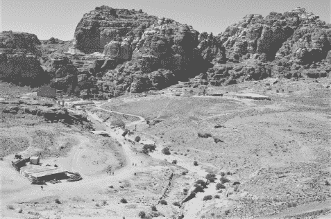

*图 8.7。佩特拉纪念性城市中心向西的景观。左侧可见`Qasr al-Bint`的屹立遗迹；白色顶篷处标记了佩特拉教堂的位置（Marlena Whiting）。*

## 经济与赞助

在这种农业经济中，教会和修道院是重要的土地所有者。他们也是城市精英赞助的对象。这在`Jabal Hārūn` 表现得很清楚。修道院（“我们的主大祭司亚伦之家”）被提到是佩特拉名人`Obodianos`遗嘱的受益者，他的家族也在该址的一处铭文中被提到。^(73)。这种财富和赞助的影响在五世纪中叶修道院建筑群的建造中显而可见。教堂、小礼堂以及南北院是同时建造的，作为大型朝圣中心统一大计划的一部分执行。教堂是一座三中廊巴西式建筑，规模与同期建造的佩特拉大教堂相似。^(74)。这里还有一个洗礼小礼堂，因此该建筑群从开始就旨在不仅为修道社区提供服务。建造了两个大型院落，北部一个作为朝圣客栈，南部一个院落被确定为修道院的额外房间（Fig. 8.9a），此外建筑群的西部部分重新利用了纳巴泰结构。

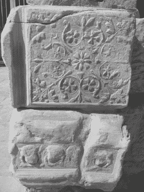

*图 8.8。佩特拉教堂门框中的重复利用石块（Sean Leatherbury/Manar al-Athar）。*

最初拜占庭建筑的宏大规模与其后的状态形成了对比（图 8.9b）。该建筑建筑群，特别是教堂和礼拜堂，在 6 世纪中后期遭受了严重的火灾。教堂和礼拜堂虽然经过重建，但规模缩小了。教堂的西端被改造成了一个露天中庭，但巴西利式的内部空间实际上缩减了一半。^(75) 北庭院的主门被封堵，切断了朝圣者明显的进入路径。^(76)

然而，中庭西侧的外门廊（`exo-narthex`）受委托制作了一幅形象图案马赛克地面，这显示了人们对圣所装饰的持续赞助。由于地震，教堂持续遭受损坏，并经历了了日益笨拙的维修。在 8 世纪初至中期，马赛克中的人物和动物形象遭受了圣像破坏的损坏，但这种破坏方式非常小心，以保留马赛克作为教堂的一部分。^(77)

到 8 世纪中期，教堂最终被弃用于礼拜活动（可能是由于 749 年的地震，那次地震也可能破坏了佩特拉教堂），但礼拜堂一直一直使用到 9 世纪，而教堂和建筑群的其他区域则被用于居住目的和小规模生产。到 10 世纪时，该建筑群已不再进行维修，唯一的活动似乎与回收建筑材料有关。在巴德林一世统治下的十字军战士所撰写的文学文献提到，1100 年哈鲁恩山（`Jabal Hārūn`）有僧侣存在；1217 年，一位前往西奈的基督徒朝圣者观察到哈鲁恩山顶有一座教堂，并说那里住着两个希腊僧侣。^(78) 马木鲁克苏丹拜巴尔斯（Baibars）在 1276 年访问亚伦墓的记录中没有提到该地有任何教堂或僧侣。^(79)

这种逐渐收缩的过程在佩特拉市中心也有所反映，尽管新的考古发现不断改变这一图景。尽管规模缩小了，但有证据表明佩特拉本身在伊斯兰时期一直存在持续的定居活动，而在曾作为佩特拉后地的定居点也有更有有力的证据，例如瓦迪穆萨镇（`Wādī Mūsā`）或贝伊达（`Bayda`）。^(80)

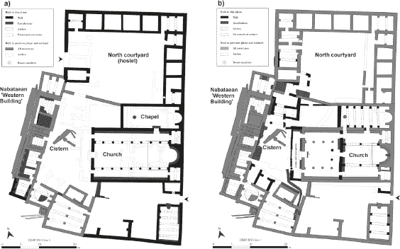

*图 8.9 哈鲁恩山修道院建筑群 5 世纪（a）和 9 世纪（b）的平面（芬兰哈鲁恩山项目）。*

佩特拉周边及哈鲁恩山修道院的长期存在，与 363 年地震后衰落和遗弃的叙述，以及基督教从未在该地区建立稳固足点的说法相矛盾。相反，佩特拉的公民有许多代人来适应并习惯基督教信仰。在此期间，城市的外观和纪念碑的态度发生了很大变化，但与环境的关系（尤其是带有宗教色彩的景观的关系）以改变了但仍然可识别的形式保留了下来。这不仅通过宗教实践实现，还通过将佩特拉嵌入一个更大的叙事中——即基督教世界（`oikumene`）的叙事。

## 佩特拉与圣地

正如我们看到的，佩特拉基督徒与这座古城互动与其纳巴泰纪念遗迹几乎没有关系，这些遗迹通常没有被挪用，仅作为建筑材料的来源。相反，佩特拉的基督教身份来自于将其与普世传统和信仰联系起来。佩特拉的主主教大多是正统的支持者，并对君士坦丁堡忠诚。^(81)


关于圣徒和殉道者的崇拜，现有证据也表明佩特拉被整合进了更广泛的崇拜网络中。佩特拉教堂献给圣母，在 431 年以弗所会议之后，她的崇拜非常盛行。^(82) 目前尚不知当地殉道者，但有证据证实了对一位亚细亚殉道者的尊崇。奥比亚诺斯（`Obodianos`）的遗嘱提到一所属于“圣且胜利的殉道者库里科斯（`Kyrikos`）”的医院（`xeneon`），这可能是亚细亚塔尔苏的小殉道者`Kyrikos`，他的崇拜在叙利亚、巴勒斯坦和埃及有广泛记载。^(83) `Kyrikos`似乎是 6 世纪佩特拉的一个重要人物，除了奥比亚诺斯遗嘱中提到的医院外，在附近的扎达卡顿（`Zadakathon`/`Sadaqa`）村还有一座纪念殉道者的教堂，亚伦修道院的院长与这位殉道者同名。^(84)

一方面，佩特拉的基督教身份依赖于采用普世基督教的一元素，如对圣母玛利亚的尊崇和殉道者的崇拜。另一方面，佩特拉本身通过将其景观与旧约中的事件（特别是出埃及）联系起来，被纳入了基督教叙事中。这种联系标志着与近期希腊化主义的刻意决裂。引用设定纳巴泰人之前的时代（即以民人时代）的故事，是为了表达基督教对景观的主张——这种主张早于纳巴泰异教徒，并延伸至希腊化城市。

《圣地地理》（`Onomastikon`）是由凯撒利亚的尤塞比斯在公元 295 年左右用希腊语编写的圣经地点指南，并在 4 世纪后期由杰罗姆进行了翻译和注释。该文本将两个圣经事件与佩特拉市以及一座被确认为何律山（很可能是哈鲁恩山）联系在一起。

凯撒利亚的尤塞比斯对何律山给出了如下条目：“或亚伦去世的山，位于佩特拉附近，直到今天那里还有那块流出水的岩石。”^(85) 杰罗马在七八十年后的《地点志》（`Liber locorum`，也称为`De situ`）中采取了相同的观点：“或亚伦去世的山，位于佩特拉附近，直到今天那里还有那块摩西击打并为百姓提供水的石头。”^(86) 佩特拉及周边山脉与亚伦在何律山去世安葬的联系源于犹太传统，我们的首次记载来自公元 1 世纪弗拉维乌斯·约瑟夫斯所著的《犹太古史》。^(87)

将亚伦去世的何罗山（`Mount Hor`）定为击石之处，与圣经记载不符，但这似乎并没有阻碍这两位教父接受当地传说作为定论。“直直到今天”（`ἐν ᾧ καὶ εἰς ἔτι νῦν δείκνυται`; `ubi usque ad praesentem diem ostenditur`）这一表述具有重要意义。它表明在三世纪末，当优西比乌收集信息时，佩特拉已经有一个基督教社群，而且该地正因其圣经关联而受到崇拜。正如我们所看到的，当时的佩特拉远未完全基督教化，甚至遭到了优西比乌本人的批评，认为它是异教仪式场所。^(88) 这表明，关于特定地点的当地故事，以及与更广泛的普世性基督教主题和叙事建立的关联，是塑造基督教社群宗教身份的关键要素，使他们能够在当时仍然盛行异教信仰的佩特拉中脱颖而出。

这种这种关联很可能源于当地传说（可能受到犹太传统的启发），因为佩特拉并非唯一声称是摩西击岩石出水之处。在早期拜占时期的朝圣记述和行程中，我们发现了至少其他四个提到的地点。埃格利亚（`Egeria`，活跃于公元 381-384 年）写道，她被带到了利维亚斯（`Livias`）附近的地方：“从岩石中流出的水，摩西在以色列人口渴时给他们的水”。^(89) 特奥多西乌斯的朝圣行程（追溯到 6 世纪上半叶）也提到：“这利维亚斯就是摩西用杖棒击岩石的地方，水就流了出来”。^(90) 另外两位作者将该地位于西奈。大约在 570 年撰写的《皮亚琴扎朝圣者》提到：“穿过沙漠[向南]后，我们在第八天到达了摩西从岩石中引水的地方”。^(91) 隐士埃庇法尼乌斯（7 世纪）将事件放在西奈半岛西岸的拉伊托（`Raitho`）。^(([92)

击石出水地点的繁多，可以部分但并非完全归因于《旧约》中有两次这样的事件。第一个记载见于`出埃及记 17:1–7`。西奈提到的地点可能与这第一个事件有关。第二个事件（`民数记 20:10–11`）发生在米利亚之后、亚伦去世之前。在这一事件中，摩西和亚伦违背了神的指示，直接导致他们被拒绝进入圣地。在古代晚晚期的朝圣想象中，将这一事件与亚伦的死亡和安葬，以及对应许地的观点和摩西的死亡联系是有意义的，正如埃格利亚所的那样。

从朝圣者的角度考虑，后期世俗信仰对《旧约》事件的解释也很重要。在对`哥林多后书 10:4`中出埃及记的释书中，使徒保罗提到了“那跟从他们的磐石，就是基督”。撇开基督论的阐释暂不谈，岩石在沙漠中跟随以色列人的这一想法似乎源于犹太对出埃及记的解释。最早的提到出现在伪斐洛（`Pseudo-Philo`）1 世纪中后期的《圣经古事集》中（大致与保罗同时代），提到了一口“跟从他们的井”。^(93) 这个故事在古代晚期的犹太*米德拉什*（`midrash`）和民间传说中变得复杂：那口井或岩石是赐给米利雅的神圣礼物，它跟随以色列人，每当他们需要时就提供水。在她去世后，水枯竭了，导致摩西击打它让水流出来，并引发了神的愤怒。与米利雅相关的移动岩石的最早证明可追溯到公元 225 年。^(([94) 到 5 世纪时，犹太传统中流传着这块岩石（米利雅之井）停留在提比利亚亚湖并可以在那里看到的说法，在后来的拉比文献中，它还是一个治愈之地。这些故事在古代晚期的巴勒斯坦流传，并显然影响了保罗对出埃及记的解释，以及特特土利安、奥古斯丁甚至优西比乌等其他早期基督教作者。^(([95) 基督教朝圣者对这块岩石有什么预设信念？他们会预期看到活的岩石喷出水，就像地下水通过结晶岩石缝隙渗出的自然现象，或者是哈鲁恩山（`Jabal Hārūn`）常年满溢的水池吗？^(([96) 或者他们会预期看到一块可以滚过沙漠的小块岩石？

对于圣经的严格准确性似乎并不是建立某处遗迹为*圣地*（`locus sanctus`）的关键考量。^(([97) 方便性以及与圣经描述之处的表面相似性通常就足以确保一个地点的受欢迎和神圣性：向朝圣者展示符合他们阅读圣经所预期的内容。^^(([98) 因此我们看到，尽管有优西比乌和杰罗姆的权威，何罗山（可能是哈鲁恩山）并未被普遍接受为击石之事的“官方”地点。西奈各地的地点都与出埃及记的事件紧密相连，如燃烧荆的显现和十诫的颁达。西奈是一个非常受欢迎的地方，特别是对于那些对圣地和埃及进行大型旅行的朝圣者而言。另一方面，利维亚斯是位于耶路撒冷到雅各和约旦河延伸行程的一部分。部分朝圣者会跨越约旦河，访问如尼波山的摩西纪念碑，甚至是死海的地点，因此将击石事件纳入与摩西生平相关的地点中是合理的。

哈鲁恩山和佩特拉在这方面处于劣势，因为它们既不在热门景点附近，也不在繁忙的路线上。到拜占时期，连接红海阿伊拉（`Aila`）与叙利亚南部波斯特拉（`Bostra`）的 2 世纪路线“新罗马大道”不再作为区域性公路，而是被穿越内格夫沙漠连接红海和中海的路线所取代（我们的许多朝圣者曾穿越那里）。^^(([99) 从瞭塔和道路发现可以看出，佩特拉和哈鲁恩山周围的交通路线在纳巴泰罗马时期得到了良好维护，在罗马晚期也是如此。拜占时期的证据较少，这与整体情况相符，^^(100) 并符合佩特拉作为长途贸易市场作用的衰落。从 6 世纪以后，前往西奈的大多数朝圣流量似乎通过内格夫，从瓦拉巴谷西部进入。如果从瓦拉巴谷到哈鲁恩山的山口没有得到维护，这可能会阻止除最虔诚的朝圣者之外将哈鲁恩山纳入他们的朝圣行程中。^(101) 单单前往佩特拉的行程就会比主朝圣路线绕道二三天，更不用说额外花一天往返山上远足了。

该遗址未能像最初建造者和赞助者希望的那样吸引朝圣，这一点在修道院布局的变化中显而易见。大型教堂和拜堂建筑群规模的缩小，以及在建成后不久对客栈空间的重新利用，可以解释为它们建造的初衷是希望吸引大量从未到来的朝圣者。在后期阶段，一座较小的教堂和重新配置的客栈（可能位于东南角）可能就已经足够。

然而，即使该遗址从未成功吸引过大量远途朝圣者，它在当地社区也发挥了重要作用。尽管最初对基督教圣经的引用可能是基督教社区为了与异教邻居区分开来的手段，但随着越来越多的人成为基督教徒，重点可能发生了变化。上述讨论的埃庇法纽乌斯《`Panarion`》中的段落可能暗示了佩特拉居民之间的混合习俗，这些做法将对古老异教仪式的记忆融入了基督教的崇拜中。

与哈鲁恩山（`Jabal Hārūn`）相关的不同宗教传统中反复出现的“水”这一主题表明，无论宗教传统如何，该地点在确保年度降雨的宗教仪式中占有重要地位。水是纳巴泰亚崇拜的一个重要方面，在沙漠中这并不意外，它是对丰产这一大崇拜的一部分。除了哈鲁恩山天然水窖的明显意义外，该地区的其他发现也表明水是该地崇拜的关键方面。这些包括哈鲁恩山脚下的一处似乎奉给`Isis`（伊西斯）的神龛，在岩石自然出水的地方有一尊石刻女神胸像。在现代民俗传统中，佩特拉当地的贝都因人呼唤哈鲁恩（亚伦）以及雨之母的形象来祈雨。水在这一建筑群的基督教阶段也发挥了重要作用：首先，水窖被保留并暴露出来，位于朝圣复合体中显眼的位置，所有人可见。在教堂内部发现的一段铭文中提到了水，该铭文引用了`Psalm 23:9`（“荣耀的神大雷轰，主在水之上”）。

## 经济与社会角色

为为当地朝圣提供神圣焦点外，修道院作为土地所有者和雇主也是当地经济的重要因素。修道院和圣地还可以作为社会福利场所发挥重要的社会作用。治愈可以来自祈祷或圣物，也可以通过提供医疗护理来实现。在哈鲁恩山，这些方面通过一段来自`Psalm 91`的彩绘铭文得到了暗示，这在其他文中已知`inter alia`（此外）与防御疾病有关。此外还发现了一个被解释为圣骨匣的物体；访客可以通过触摸圣骨匣及其可能供奉的任何圣物来获得祝福。

水窖中的水可能被认为具有神圣属性。发现的几个铜合金刮勺可能是医疗器械，暗示了更具实用性的医疗护理。`Obodianos`的遗嘱暗示了修道院对非修道院社区社会福利的重要性，遗嘱中向亚伦修道院和`Kyrikos`的`xeneon`捐赠了合并捐赠。虽然`xeneon`可以是一座朝圣客栈，但在遗嘱编写的六世纪后半叶，该词已演变为医疗设施，应被视为照顾城市贫民、病人以及周边地区人士的慈善基金。

`Obodianos`对医院和修道院的共同赞助表明，它们在社区中发挥了类似的作用。也许亚伦修道院有自己的医疗设施，或者它管理着位于佩特拉的`xeneon`。这可以与另一个“朝圣”修道院进行对比，即死海东部`Deir ʿAin ʿAbata`的罗特修道院。集体墓葬（包括年幼儿童的墓）表明了修道院对当地社区（特别是附近城市`Zoara`的居民）的重要性，它是一个关怀和治愈的场所。

## 存存与崇拜

亚伦修道院被使用了几个世纪。这可以归功于它是对佩特拉居民而言具有当地重要意义的神龛，而非大圣地的某个`locus sanctus`（圣地）。由于距离城市只有几小时路程，因此不需要过夜住宿。如果崇拜的焦点是亚伦，他的墓位于修道院范围之外的山顶，那里有一座小拜堂。朝圣者和游客进入修道院可能受到限制，但他们仍然会捐赠、遗赠，并为修道院的福祉做出的贡献。

当地居民可能深信，这里就是《民数记》中描述的击石出水的唯一真实地点。从纳巴泰时期到如今的民俗活动，哈鲁恩山崇拜中反复出现的各种元素，证明了当地与该地之间的联系是多么深固。

## 结论

佩特拉从一个纳巴泰/罗马大都市向基督教城市的转变，是通过一种新的记忆空间和仪式的方式完成的。纳巴泰/罗马时期的大型公共神庙在 363 年地震后没有重建，并且可能在此之前就已经废弃。尽管如此，对异教习俗的记忆（如对圣石的崇拜）可能渗透到了基督教的崇拜中。

## 致谢

感谢 Javier Martínez Jiménez 和 Sam Ottewill-Souby 邀请我在 2018 年利兹中世纪会议上进行演讲，并将我的工作纳入此卷。感谢 Zbigniew Fiema 和 Johannes Hahn 慷慨地分享他们的文章副本。我将本文献给 Judith McKenzie (1957–2019) 的纪念，是她对佩特拉的热爱和对其宗教过去的着迷开启了我这一课题的研究。

## 参考文献

### 首要文献

- Antoninus Placentinus, `Itinerarium`, ed. P. Geyer, `CCSL 175` (Turnhout, 1965).

- `Codex Theodosianus`, ed. and transl. C. Pharr (Princeton, 1952).

- Diodorus Siculus, `Bibliotheca historica`, ed. and transl. R. M. Geer `LCL 390` (Cambridge, 1954).

- Egeria, `Itinerarium`, ed. P. Geyer, `CCSL 175` (Turnhout, 1965), trans. J. Wilkinson (Warminster, 1999).

- Epiphanius, `Panarion`, transl. P. Amidon (Oxford, 1990).

- 埃皮法尼乌斯（`Epiphanius Hagiopolita`），《游记》，H. Donner 编本，*ZDPV* 87 (1971): 42–91。J. Wilkinson 译（Warminster, 2002）。

- 尤西比乌斯，《对以赛亚的注释》（*Commentarium in Isaiam*），M. J. Hollerich 译（Oxford, 1999）。

- 尤西比乌斯，《地名录》（*Onomasticon*），R. Notley 和 Z. Safrai 编并译（Leiden, 2005）。

- 沙特尔富尔歇（`Fulcher of Chartres`），《耶路撒冷史》（*Historia Hierosolymitana*），H. Hagenmeyer 编（Heidelberg, 1913）。

- 杰罗姆，《关于希伯来之地位置与名称的书》（*De situ et nominibus locorum Hebraicorum liber*），E. Dekkers 和 A. Gaar 编，`Clauis Patrum Latinorum 581a`（Steenbrugge, 1961）。

- 约瑟夫（`Josephus`），《犹太古史》（*Antiquitates Iudaicae*），H. Thackeray 和 R. Marcus 编并译，`LCL 490`（Cambridge, 1930）。

- P. Petra = Frösén, J., A. Arjava, M. Lehtinen, L. Koenen, J. Kaimio, M. Kaimio, R. W. Daniel, M. Buchholz 和 T. Gagos，《佩特拉纸草卷 I–V》（*The Petra Papyri I–V*），美国东方研究中心出版物 4–8（Amman, 2002–2018）。

- 伪斐斐洛（`Pseudo-Philo`），《圣经古事》（*Liber Antiquitatum Biblicarum*），L. Feldman 译（New York, 1971）。

- 索西美尼（`Sozomen`），《教会史》（*Historia Ecclesiastica*），J. Bidez 和 G. C. Hansen 编（Berlin, 1960）。

- 斯特拉博（`Strabo`），《地理志》（*Geographica*），H. L. Jones 编并译，`LCL 241`（Cambridge, 1930）。

- 德土西安（`Tertullian`），《论耐心》（*De patientia*），J. Borleffs 编，`CCSL 1`（Turnhout, 1954），第 297–318 页。

- 西奥多西乌（`Theodosius`），《论圣地位置》（*De situ Terrae Sanctae*），P. Geyer 编，`CCSL 175`（Turnhout, 1965），第 113–125 页。

- 泰特马（`Thetmar`），《前往圣地之路》（*Iter ad Terram Sanctam*），T. Tobler 编（St Gallen and Bern, 1851）。

### 二级文献

- Bartlett, J. R., “纳巴泰宗教”，收录于 K. D. Politis（编），《纳巴泰人的世界》（*The world of the Nabataeans*）（Stuttgart, 2007），第 55–78 页。

- Bedal, L., K. L. Gleason 和 J. G. Schryver，“佩特拉花园与水池复合体，2007 年与 2009 年”，《约旦遗迹部门年报》（*Annual of the Department of Antiquities of Jordan*）55 (2011): 313–328 页。

- Ben David, C., “从佩特拉到瓦迪阿拉拉巴的古代路线”，收录于 M. Lavento 和 P. Kouki（编），《佩特拉——亚伦山。III 考古调查》（*Petra – The Mountain of Aaron. III The Archaeological Survey*）（Helsinki, 2013），第 273–280 页。

- Bikai, P. M., “拜占庭时期佩特拉的教堂，《近东考古学》（*Near Eastern Archaeology*）65.4 (2002): 271–276 页。

- Bikai, P. M., “佩特拉北脊项目，《约旦历史与考古研究》（*Studies in the History and Archaeology of Jordan*）8 (2004): 59–64 页。

- Bikai, P. M. 和 M. A. Perry，“佩特拉北脊 1 号和 2 号墓：初步报告，《美国东方研究学院公报》（*Bulletin of the American Schools of Oriental Research*）324 (2001): 59–78 页。

- Bowersock, G. W., 《罗马阿拉伯比亚》（*Roman Arabia*）（Cambridge, 1994）。

- Bowersock, G. W., “阿拉伯比亚和三巴勒斯坦的多神教与一神教，《敦斯巴顿橡树论文》（*Dumbarton Oaks Papers*）51 (1997): 1–10 页。

- Brock, S. P., “一封归于耶路撒冷西里关于重建圣殿的信，《伦敦大学东方与非洲学院公报》（*Bulletin of the School of Oriental and African Studies, University of London*）40.2 (1977): 267–286 页。

- Browning, I., 《佩特拉》（*Petra*）（London, 1973）。


Brünnow, R. E. 和 A. von Domaszewski，《基于 1897 年和 1998 年两次旅行描述的阿拉伯比亚省，以及 R.E. Brünnow 和 A. v. Domaszewski 对早期旅行者的述述》（Strassburg, 1904）。

Caseau, B., “神圣景观”，收录于 G. W. Bowersock, P. Brown 和 O. Grabar（编），《晚期古代：后古典世界指南》（*Late Antiquity: A Guide to the Postclassical World*）（Cambridge, 1999），第 21–59 页。

圣人崇（Cult of Saints），记录 `E03663` = Nowakowski, P. (2017). 《争议解决记录 E03663》（*Record of the Settlement of a dispute E03663*）。[网址：`csla.history.ox.ac.uk/record.php?recid=E03663`]（访问于：2020 年 1 月 30 日）。

圣人崇（Cult of Saints），记录 `S00007` = Nowakowski, P. (2017). 圣人崇（The Cult of Saints）。《基里科斯/西里库斯与尤莉塔/朱莉塔，孩子与母亲，塔尔苏斯的殉道者》（*Kyrikos/Cyricus and Ioulitta/Julitta, Child and Mother, Martyrs of Tarsus）。[网址：`csla.history.ox.ac.uk/record.php?recid=S00007`]

Fiema, Z. T., “约旦南部的图瓦内与新特拉亚纳路（*Via Nova Traiana*）：关于 1992 年的短记，《约旦遗迹部门年报》（*Annual of the Department of Antiquities of Jordan*）37 (1993)。

Fiema, Z. T., “附录 I：分阶段总结”，收录于 Z. T. Fiema, C. Kanellopoulos, T. Waliszewski, R. Schick 和 P. M. Bikai（编），《佩特拉教堂》（*The Petra Church*）（Amman, 2001），第 437 页。

Fiema, Z. T., “拜占庭时期佩特拉——重新评估”，收录于 T. Burns 和 J. Eadie（编），《晚期古代的城市中心》（*Urban Centers in Late Antiquity*）（East, 2001），第 111–134 页。

Fiema, Z. T., “拜占庭时期佩特拉的重新发现”，收录于 J. Humphrey（编），《罗马东方：新发现》（*Roman and Byzantine: New Discoveries*）（, 2002），第 191–252 页。

Fiema, Z. T., “6 世纪佩特拉后地的军事存在”，收录于 J. Freeman，《在安曼举行的第三次阿拉伯研究会议》（*Arabian Studies*）（, 2002），第 131–136 页。

Fiema, Z. T., “佩特拉的院的圣地”，收录于 2000 年 9 月 20 日举行的圣地会议（*Holy Land*, 2002），第 59–78 页。

Fiema, Z. T., “Jabal Hūn 的修道院”，收录于 2011 年举行的阿拉伯研究会议（*Arabian Studies*）（, 2012），第 27–37 页。

Fiema, Z. T., “佩特拉修道院的铭文”，收录于 Z. T. Fiema 和 J. Frösön（编），《纳巴泰人的圣地与修道院》（*The Nabataean Sanctuary and the Byzantine Monastery*）（Helsinki, 2016），第 387–393 页。此处此处。

Fiema, Z. T., “Jabal Hūn 遗址：1000 年的延续”，收录于 Z. T. Fiema, J. Frösön 和 M. Holappa（编），《纳巴泰人的圣地与修道院》（*The Nabataean Sanctuary and the Byzantine Monastery*）（Helsinki, 2016），第 539–582 页。

Fiema, Z. T., “佩特拉的拜占庭时期”，收录于 W. Ward（编），《罗马东方：考古历史》（*Roman and Byzantine: Archaeological History*）（, 2017），第 27–291 页。

Fiema, Z. T. 和 M. Comte，“`09` 遗址”，收录于 Z. T. Fiema 编，《佩特拉的考古项目》（*The Archaeological Project*）（Helsinki, 2008），第 177–186 页。

Glueck, N., 《神灵与海豚：纳巴泰人的故事》（*Deities and Dolphins: The Story of the Nabataeans）（New York, 1965）。

Hahn, J., “结论：圣历史之间的巴苏马”，收录于 J. Hahn 和 V. Menze（编），《流浪圣：巴苏马生平、基督教苦修与晚期巴勒斯坦宗教冲突》（*The Wandering Holy Man: The Life of Barsuma, Christian Asceticism, and Religious Conflict in Late Antique Palestine*）（Oakland, 2020），第 166–180 页。

Hamarneh, B. 和 K. Hinkkanen，“赛赛克”，收录于 Z. T. Fiema 和 J. Frösön（编），《佩特拉的考古项目：第一卷，教堂与学院》（*The Archaeological Project in Jordan. Vol. 1, the Church and Chapel*）（Helsinki, 2008），第 247–262 页。

Healey, J. F., 《纳巴泰人的宗教：概论》（*The Religion of the Nabataeans: A Conspectus*），希腊罗马世界宗教（Leiden, 2001）。

Hertell, E., P. Kouki, A. Eklund, M. Lavento, S. Silvonen 和 H. Ynnilä，“总结与结语”，收录于 M. Lavento 和 P. Kouki（编），《佩特拉——亚伦山。III 考古调查》（*Petra – The Mountain of Aaron. III The Archaeological Survey*）（Helsinki, 2013），第 333–340 页。

Isaac, B. H., 《帝国的边界：东方的罗马军队》（*The Limits of Empire: The Roman Army in the East*）（Oxford, 1992）。

Isaac, B. H., 《罗马帝国东部的军队：波斯战争与拜占庭省份的防御》，收于 A. Cameron, L. Conrad 和 G. King（编），*拜占庭与早期伊斯兰中东 III：国家、资源与军队。晚期与早期伊斯兰第三次研讨会论文*（普林斯顿，1995 年），第 125–155 页。

Issar, A. S., 《击石成岩必有水流：气候变化、水资源与圣经之地之历史*，斯普林格地理简明丛书（海德堡，2013 年）。

Joukowsky, M. S., 《纳巴泰佩特拉：引言》，《美国东方学院公报》第 324 期（2001 年）：1–4。

Joukowsky, M. S., 《佩特拉大庙：遗址与挖掘的考古背景：布朗斯大学在约旦佩特拉大庙的发掘，1993–2007 年》（普罗维登斯，2007 年）。

Joukowsky, M. S., 《佩特拉大庙的惊喜：回顾》，《约旦历史与考古研究》第 10 期（2009 年）：291–331。

Joukowsky, M. S. 和 J. J. Basile, 《佩特拉大庙拼图中的更多碎片》，《美国东方学院公报》第 324 期（2001 年）：43–58。

Juntunen, K., 《蓄水池（L1 壕沟）》，收于 Z. T. Fiema, J. Frösén 和 M. Holappa（编），*佩特拉——亚伦山 II：纳巴泰圣所与拜占庭修道院*（赫尔辛基，2016 年），第 64–66 页。

Kouki. P., 《城市的后陆：从纳巴泰-罗马时期到早期伊斯兰时期佩特拉地区的农村定居点与土地利用》（赫尔辛基，2012 年）。

Kouki, P. 和 S. Silvonen, 《仪式遗址》，收于 M. Lavento 和 P. Kouki（编），*佩特拉——亚伦山。III 考古调查*（赫尔辛基，2013 年），第 301–322 页。

Kristensen, T. M., 《神性的创造与破除：晚期古代对异教雕塑的回应》（奥尔胡斯，2013 年）。

Lahelma, A. 和 Z. T. Fiema, 《从女神到先知：约旦佩特拉附近亚伦山 2000 年的延续》，《提梅诺斯：北欧比较宗教期刊》，44.2（2008 年）：191–222。

Lahelma, A., J. Sipilä 和 Z. T. Fiema, 《西部建筑区》，收于 Z. T. Fiema, J. Frösén 和 M. Holappa（编），*佩特拉——亚伦山 II：纳巴泰圣所与拜占庭修道院*（赫尔辛基，2016 年），第 17–63 页。

Lindner, M., 《佩特拉与纳巴泰王国：古代阿拉伯民族的生存空间、历史与文化》（慕尼黑，1997 年）。

McKenzie, J., 《佩特拉的建筑》（牛津，1990 年）。

McKenzie, J., 《建筑与分阶段》，收于 J. McKenzie（编），*约旦赫尔贝特-埃-坦努尔的纳巴泰神庙：内尔森·格鲁克 1937 年挖掘的最终报告*（纽约，2013 年），第 39–188 页。

McKenzie, J., 《赫尔贝特-埃-坦努尔与佩特拉的偶像破坏》，收于 J. McKenzie（编），*约旦赫尔贝特-埃-坦努尔的纳巴泰神庙：内尔森·格鲁克 1937 年挖掘的最终报告*（纽约，2013 年），第 269–290 页。

McKenzie, J., 《引言》，收于 J. McKenzie（编），*约旦赫尔贝特-埃-坦努尔的纳巴泰神庙：内尔森·格鲁克 1937 年挖掘的最终报告*（纽约，2013 年），第 1–38 页。

McKenzie, J. 和 A. T. Reyes, 《宗教实践》，收于 J. McKenzie（编），*约旦赫尔贝特-埃-坦努尔的纳巴泰神庙：内尔森·格鲁克 1937 年挖掘的最终报告*（纽约，2013 年），第 231–268 页。

Miettunen, P., 《哈鲁恩山（Jabal Hārūn）：历史、过去的探索、纪念碑与朝圣》，收于 Z. T. Fiema 和 J. Frösén（编），*佩特拉——亚伦山：芬兰约旦考古项目。第一卷，教堂与小堂*（赫尔辛基，2008 年），第 27–45 页。

Miettunen, P., 《我们的祖先是贝都因人。记忆、身份认同与变化：约旦南部圣地的案例》，博士论文，赫尔辛基大学（2013 年）。

Mikkola, E., A. Lahelma, Z. T. Fiema 和 R. Holmgren, 《教堂与小堂：数据与分阶段演变》，收于 Z. T. Fiema 和 J. Frösén（编），*佩特拉——亚伦山：芬兰约旦考古项目。第一卷，教堂与小堂*（赫尔辛基，2008 年），第 99–176 页。

Miller, T., 《拜占庭帝国的医院》（巴尔的摩，1997 年）。

Nau, F., 《根据巴苏玛的塞奥（423 年至 438 年）的历史片段，《犹太研究杂志》第 83 期（1927 年）：184–206。

Nehmé, L., J. T. Milik 和 R. Saupin, 《佩特拉考古地图》（巴黎，2012 年）。

Paradise, T., 《佩特拉的大洪水：公元 4–5 世纪的证据，《文物部报》第 55 期（2011 年）：43–56。

Paradise, T., 《约旦佩特拉的建筑朝向与太阳的关系：墓葬的初步分析，《文物部报》第 58 期（2014 年）：1–6。

Patrich, J., 《东西方的纳巴泰艺术：一种方法评估》，收于 K. D. Politis（编），*纳巴泰的世界*（斯图加特，2007 年），第 79–102 页。

*佩特拉——亚伦山*卷 I–III Fiema, Z. T., J. Frösén, M. Holappa, M. Lavento 和 P. Kouki（编），2008–2016。

Politis, K., 《约旦 Deir‘Ain 的洛修道院》，收于 F. Daim 和 J. Drauschke（编），*拜占庭——中世纪的罗马帝国*（美因茨，2011 年），第 155–180 页。

Price, S., 《皇帝崇拜》，收于 G. W. Bowersock, P. Brown 和 O. Grabar（编），*晚期古代：后古典世界指南*（剑桥，1999 年），第 510 页。

Rapp, C., 《晚期古代的圣主教：转型时代的基督教领导力，古典遗产的转型》（伯克莱，2013 年）。

Reid, S. K., 《小庙：约旦佩特拉的罗马帝国建筑》（皮斯卡塔韦，2005 年）。

Renel, F., 《佩特拉 Qasr Al-Bint 区域的遗弃：新元素，《约旦历史与考古研究》第 11 期（2013 年）：349–358 页。

Roche, M., 《小像、雕塑与浮雕》，收于 Z. T. Fiema, C. Kanellopoulos, T. Waliszewski, R. Schick 和 P. M. Bikai（编），*佩特拉教堂*（安曼，2001 年），第 350–358 页。

Russell, K. W., 《公元 363 年 5 月 19 日的地震，《美国东方学院公报》第 238 期（1980 年）：47–64。

Al-Salameen, Z. 和 Falahat, H., 《19 世纪末到 20 世纪初瓦迪穆萨的宗教实践与信仰，《约旦历史与考古杂志》第 3 期（2009 年）：175–204。

Sartre, M., 《佩特拉与南部纳巴泰：瓦迪哈哈萨到阿拉喀湾。约旦铭文。第四卷，叙利亚希腊与拉丁铭文》，第 21 卷（巴黎，1993 年）。

Schick, R., 《佩特拉教会史》，收于 Z. T. Fiema, C. Kanellopoulos, T. Waliszewski, R. Schick 和 P. M. Bikai（编），*佩特拉教堂*（安曼，2001 年），第 1–7 页。

Schmid, S. G., 《从哈雷塔斯到兼并：佩特拉与纳巴泰人》，收于 J. Frösén 和 Z. T. Fiema（编），*佩特拉：被遗忘与重新发现的城市*（赫尔辛基，2002 年），第 44–59 页。

Schmid, S. G., 《Sara Karz Reid《小庙：约旦佩特拉的罗马皇帝崇拜建筑》书评，《美国考古杂志在线》，112.3（2008 年）[访问地址：`www.ajaonline.org/book-review/571`]（2021 年 11 月 3 访问）。

Schmid, S. G., 《从纳巴泰宗教建筑视角对西部建筑的评价》，收于 Z. T. Fiema, J. Frösén 和 M. Holappa（编），*佩特拉——亚伦山 II：纳巴泰圣所与拜占庭修道院*（赫尔辛基，2016 年），第 67–74 页。

Schmid, S. G., Z. T. Fiema, P. Bienkowski 和 B. Kolb, 《佩特拉纳巴泰国王的宫殿》，收于 L. Nehmé 和 L. Wadeson（编），*聚焦纳巴泰人：佩特拉当前的考古研究。2011 年 7 月 29 日阿拉伯研究特别分会论文集*（牛津，2012 年），第 73–99 页。

Sherman, M., 《寻找所有者的井：利用新颖断言评估晚期古代米德拉希中米利亚亚形象的过度详述》，博士论文，加州大学圣地亚分校（2006 年）。

Shiyyab, A.,‘约旦佩特拉市中心的最新发现：初步挖掘报告’，《地中海考古与年代测量学》 14.1 (2014): 103–118。

Sinibaldi, M.,‘十字军时期佩特拉地区的定居：历史与考古证据的总结’载于 M. Sinibaldi, K. Lewis, B. Major 和 J. A. Thompson (编)，*中世纪黎凡特岸的十字军景观：拉丁东部的考古与历史*（卡迪夫， 2016），第 81–102 页。

Sipilä, J., *从帝国决策过程视角下的省份领土重组：晚期罗马阿拉伯地区和三巴勒斯坦地区作为案例的研究*（赫尔辛基， 2009）。

Tholbecq, L., S. Delcros 和 N. Paridaens,‘Khubthah 山的“高地”：对佩特拉一个纳巴泰-罗马郊区的新见解’，《罗马考古杂志》 27 (2014): 374–391。

Vaelske, V.,‘佩特拉的伊西斯：年代学与地理方面’载于 M. Mouton 和 S. G. Schmid (编)，*岩石上的男人：纳巴泰佩特拉的形成*（柏林， 2013），第 351–361 页。

Waliszewski, T.,‘马赛克’载于 Z. T. Fiema, C. Kanellopoulos, T. Waliszewski, R. Schick 和 P. M. Bikai (编)，*佩特拉教堂*（阿曼， 2001），第 219–270 页。

Ward, W. D.,‘公元 363 年地震与南段旦旦公共异教的终结’，《晚古代期刊》 9.1 (2016): 132–170。


Wenning, R.,“佩特拉的贝提（betyls）”，《美国东方学院公报》324 (2001): 79–95。

Wenning, R.,“佩特拉的大女神：对证据的批判性回顾”载于 Z. T. Fiema, J. Frösén 和 M. Holappa (编)，*佩特拉——亚伦二的山：纳巴泰圣所与拜占庭修道院*（赫尔辛基，2016），第 511–538 页。

Wenning, R 和 U. Hübner,“来自佩特拉的纳巴泰胸雕——两项新发现”，《德国巴勒斯坦协会杂志》120.2 (2004): 157–181。

Whiting, M.,“晚古代近东的修道院旅店”载于 Z. T. Fiema, J. Frösén 和 M. Holappa (编)，*佩特拉——亚伦二的山：纳巴泰圣所与拜占庭修道院*（赫尔辛基，2016），第 108–113 页。

Wiegand, T., *西奈岛：德土其文物保护司令部的科学出版物*（柏林，1920）。

Wilkinson, J., *十字军东征前的耶路撒冷圣者*（华明斯特，2002）。

Ynnilä, H.,“FJHP 调查区域的古代路线”载于 M. Lavento 和 P. Kouki (编)，*佩特拉——亚伦的山：III 考古调查*（赫尔辛基，2013），第 253–272 页。

Zayadine, F.,“埃及与纳巴泰之间的骆驼路线和 1276 年拜巴尔苏丹前往佩特拉的航行”载于 A. Hadidi (编)，*约旦历史与考古研究* II（阿曼，1985），第 159–174 页。

Zayadine, F.,“佩特拉 Qasr Al-Bint 圣殿区的凹室（关于发现一座大理石胸雕的说明）”，《叙利亚》79 (2002): 207–215。

^(1) 斯特拉博，《地理记》，16.4.26，这与狄奥多鲁斯·西库斯的《通史》，19.94.2–10 中描述的公元前第 4 世纪纳巴泰人的游牧习惯形成对比。关于纳巴泰社会的转型，参见 Bowersock，《罗马阿拉伯》，16–27, 60–61。

^(2) Joukowsky，“纳巴泰佩特拉：引言”，2。

^(3) 概览请参见 Schmid，“从哈瑞塔斯到兼并”和 Fiema，“佩特拉及其后地”。关于最近的挖掘结果，请参见 Bedal *et al.*，“佩特拉花园与水池复合体”（游乐园），Tholbecq *et al.*，“Khubthah 山的“高地””；Shiyyab，“最新发现”；Joukowsky，《佩特拉大神庙》，200–211（浴场）；Schmid *et al.*，“宫殿”（宫殿）。

^(4) “大神庙”的功能尚存争议。凹形座椅表明它曾具有公民功能（例如 `bouleterion`）。它的功能也随着时间发生了变化，可能是在公元 106 年罗马合并之后。Joukowsky 和 Basile，“更多”，52–54。

^(5) Brock，“信”，276。Browning 在关于佩特拉的通俗书中将拜占庭时期描述为贫困且沉闷的，“毫无希望”。

^(6) 关于 363 年地震，参见 Russell，《地震》。关于与拜占庭佩特拉相关的考古和历史数据，请参见 Fiema，“佩特拉及其后地”。

^(7) Frösén，“佩特拉纸纸”；Frösén *et al.*，*佩特拉纸草* I–V。

^(8) 佩特拉最初位于阿拉伯省，但在公元 392 年转属于巴勒斯坦第一省，随后在公元 409 年转属于巴勒斯坦第三省。Sipilä，《省份领土重组》，166–174。关于城市的称号，参见 Fiema，“佩特拉的军事存在”，276–277。

^(9) 城市与后地的关系在 Jabal Hārūn 斜坡的发现中可见：农业和采矿活动的增加表明对日益增长中心的支撑，而来自佩特拉的制成品证实了这种互惠关系。Hertell *et al.*，“总结”，337。

^(10) Brünnow 和 von Domaszewski，《阿拉伯》，422；Wiegand，《西奈岛》，142；Kouki 和 Silvonen，“仪式遗址”，308。

^(11) 关于该遗址及其环境的最终报告，请参见 *佩特拉——亚伦的山* 卷–III。

^(12) Miettunen，“Jabal Hārūn”，38–43；al-Salameen 和 Falahat，“宗教实践”。

^(13) Bartlett，“纳巴泰宗教”，68。

^(14) 关于贝提（betyls），参见例如 Wenning，“佩特拉的贝提”。

^(15) McKenzie，《佩特拉建筑》，172；Nehmé *et al.*，《地图》，49–50。关于宴厅（triclinia），参见 McKenzie 和 Reyes，“宗教实践”，242。

^(16) 参见 Paradise，“佩特拉纳巴泰建筑中太阳对齐的重要性”。Khirbet et-Tannūr 的神庙对准分分日的正东日出。McKenzie，“引言”，30。

^(17) Fiema，“重塑神圣”，30–31，图 3；关于水池的挖掘报告和分析，参见 Juntunen，《水池》。

^(18) Fiema，“Jabal Hārūn 遗址”，542。

^(19) Lahelma *et al.*，“西部建筑区”，25；Schmid，“备注”，68–69。

^(20) Kouki，《城市的后地》，124。

^(21) 例如，Vaelske，《佩特拉的伊西斯》。

^(22) Glueck，《神灵与海豚》，359–360。关于作为纳巴泰宗教有用术语的融合合主义对比同化，参见 Healey，《宗教》，14–16。

^(23) Wenning，“大女神”，511–512。

^(24) Obodas III（公元前 30–9 年统治）和哈瑞塔四世（公元前 8 年–公元 40 年统治）按希腊化风格建造（Patrich，“纳巴泰艺术”，99）。在 Malichus II（公元 39–70 年统治）和 Rabbel II（公元 70–106 年统治）统治期间，出现了一种对希腊化风格（作为罗马扩张意图的代表？）的反抗，以及向无像装饰的回归（Wenning 和 Hübner，“纳巴泰胸雕”，161，注 25）。

^(25) Patrich 认为在纳巴泰文化中存在反对偶像的宗教禁止，但对非形象崇像的偏好并不一定那样正式，“纳巴泰艺术”，97–101。

^(26) Ward，“公共异教的终结”，139–147。

^(27) Joukowsky，“惊喜”，294；Renel，“遗弃”，351。

^(28) Nau，“叙利亚人巴尔萨马”，187；Sozomen, *Historia Ecclesiastica*（教会史），7.15.11。

^(29) Fiema，“佩特拉的军事存在”，276–277。

^(30) 在“大庙”附近发掘的一座小庙可能也与皇帝崇拜有关。Reid, *Small Temple*，但请参见 Schmid 对《*The Small Temple》的评论以了解证据的质量。

^(31) Zayadine，“Qasr Al-Bint 圣区的回廊”；Fiema，“佩特拉的军事存在”，278。

^(32) Price，“皇帝崇拜”，510。另见 Bowersock，“多神教与一神教”，7。

^(33) 禁止祭祀：*狄奥西斯法典》（Codex Theodosianus），16.10.10。参见 Caseau，“圣景观”关于整个第四世纪神庙去神圣化的过程，29–31。

^(34) 这些证据包括陶瓷和玻璃，以及一个碳 14 测定为公元 390 年（±45 年）的橄榄核，Lahelma *et al.*，“西部建筑区”，34–36。

^(35) Lahelma *et al.*，“西部建筑区”，34；Fiema，“重塑神圣”，33–34；Fiema，“哈鲁恩山遗址”，548。

^(36) Renel，“遗弃”，353–357。

^(37) Fowden，“宗教社区”，87。

^(38) 伊西比, *Commentarium in Isaiam*（以赛亚书注释），2.23, 42.11。

^(39) 佩特拉主教阿斯特里留斯被记载为参加了塞尔迪卡会议。Schick，“教会史”，1。

^(40) Sozomen, *Historia Ecclesiastica*（教会史），7.15.11，“προθύμως ὑπερμάχοντο”（预备战斗），尽管这并不意味着字面上的暴力。

^(41) *例如*，Fiema，“佩特拉的军事存在”，280；对于更和和的解释，请参见 Bowersock，“多神教与一神教”。

^(42) 伊庇法尼乌斯, *Panarion*（万药），49.22.11。

^(43) 伊庇法尼乌斯在细节上并不完全可靠；毕竟他写的是一部基督教护教著作，而非民族志。他可能包含了一些不再被活跃崇拜的教派，或者为了符合他的修辞目的而加工了细节。关于 Chaamou 的历史性，请参见 Wenning，“大女神”，514。

^(44) 伊庇法尼乌斯, *Panarion*，55.1.9。

^(45) Nau，“叙利亚人巴尔萨马”，187。Nau 将这一轶事的时间定在公元 419 年至 422 年之间。

^(46) 参见 Lahelma and Fiema，“从女神到先知”；Miettunen, *Our Ancestors Were Bedouin*,145–146。

^(47) 所谓“山脊教堂”（位于纪念性市中心上方北脊上三座教堂中最北的一座）的发掘者倾向于将其建造年代定在较早，即“363 年地震后不久”，Bikai，“拜占时期佩特拉的教堂”，271。这一断代依据是在位于北脊北墙支撑结构中的一个密封堆积物中发现了一盏灯。这盏灯的年代被定为“公元 4 世纪后期”，Bikai and Perry，“佩特拉北脊墓地”，59。虽然年代无法进一步缩小，但山脊教堂可能在瓮棺墓以及 5 世纪中叶北脊上其他教堂建造之前就已经建成，并非不可能。

^(48) Schick，“教会史”，5。

^(49) 关于这一现象，参见 Kristensen, *Making and the Gods*。

^(50) 论点的摘要，请参见 McKenzie，“圣像破坏”，278–279；Patrich，“纳巴泰艺术”；Wenning and Hübner，“纳巴泰石刻”，161, n. 25。

^(51) 佩特拉的年代学以及 Khirbet et-ann 的证据表明，363 年地震期间的对象未遭受圣像破坏，这支持了损坏较晚的观点。考虑到雕塑和拜占庭地面受损的方式具有明显的形态相似性，McKenzie 倾向于将年代定在 8 和 9 世纪，McKenzie，“圣像破坏”，273–279, 281–287。

^(52) Roche，“小雕像”，355–356。

^(53) Hamarneh and Hinkkanen，“马赛克”，256–259。

^(54) Waliszewski，“马赛克”，247–259。

^(55) Renel，“遗弃”，356–358。

^(56) Nau，“叙利亚人巴尔萨马”，187。关于《巴尔萨马传》作为历史来源的可靠性，参见 Hahn，“结论”。共识是该文本包含历史事实，为了支持某些神学观点进行了润色。

^(57) Lahelma *et al.*，“西部建筑区”，39。

^(58) 瓮棺墓可能最初建于公元 1 世纪。McKenzie, *The Architecture of Petra*（佩特拉建筑），144–147。

^(59) 半室左侧的铭文提供了日期以及监督工程的主教和执事的名字。IGL 21.4 = Sartre, *Inscriptions de la Jordanie*（约旦铭文）IV,81–84, n. 50.“Ἐπì τοῦ ὁσιοτάτου Ἰάσονος ἐπισκό/που Θ(εο)ῦ χάριτι ἠγι/άσθη ὁ τοπὸς τῇ ε΄ Lou ἒ(τους) τμα΄ παρόντος νμέ/ρου τῶν γενναιο/ τάτων [Τερτιοδαλμα]/τ[ῶ]ν καὶ ΊJulιανοῦ διακόνου...ώζοντ’ =“在最神圣主教亚松时期，蒙神之恩，此地于 Loos 月五日，公元 341 年[=公元 446 年 7 月 24 日]祝圣，最英勇的*Tertiodarum**numerus*在场，执事 Julianus……救主”；Isaac，“军队”，138–139；Fiema，“农村的军事存在”，133。

^(60) 关于晚古代主教和神职人员的社会起源，参见 Rapp, *Holy Bishops*,183–207。*numerus* 是边防军的一个单位，其士兵从行省（Palaestina I–III）招募，但不一定来自城市本身。Isaac, *Limits*，206–207。

^(61) Fiema，“佩特拉的军事存在”，281。

^(62) Bikai，“拜占时期佩特拉的教堂”，272–273；Fiema，“附录 I”，437。

^(63) Fiema，“附录 I”，437；军事：Bikai，“北脊项目”，59, 61。

^(64) Caseau，“圣景观”，32–33。主要的例外是君士坦丁的教堂，*例如*位于耶路撒冷和马马里的教堂。关于居住在神庙和崇拜塑像中的鬼，参见第 33–34 页。

^(65) *狄奥西斯法典*，15.1.36；Fiema，“重新评估”，113–114；Renel，“遗弃”，351。

^(66) Roche，“小雕像”，357。

^(67) Roche，“小雕像”，357。

^(68) Fiema，“重新评估”，114。

^(69) Paradise，“大洪水”。

^(70) Fiema，“重新评估”，113。

^(71) Fiema，“重新评估”，117。

^(72) Kouki, *Hinterland of a City*,129–130。修道院作为土地主：Kouki, *Hinterland of a City*，132–133。

进入该建筑群的唯一通道是南院的一扇门。修道院的公共区域和私人区域可能是反转的，北院作为僧侣的居所。Whiting，“修道院旅舍”，110。

Hamarneh 和 Hinkkanen，“马赛克”，249–255。

沙特斯的富尔彻，*Historia Hierosolymitana*，2.5.9；Thetmar，*Iter ad Terram Sanctam*，14–15；Frösén 和 Miettunen，“文学、神话与传说”，13–14。

Al-Nuwayri，《智慧者在文学艺术上的追求》（阿拉伯语原文及英文译文出版于 Zayadine 的《商队之路》，172–173）；Frösén 和 Miettunen，“文学、神话与传说”，15。

Sinibaldi，“定居”，92, 96。

Schick，“教会史”，2。

佩特拉纸草提到将名为“佩特拉教堂”的教堂献给“我们的[圣福且神洁的]圣母，[最荣耀的上帝之（圣母）]和永远贞洁的[玛利亚]”，*P.Petra* 5.55，第 52 行。

圣人崇拜，记录 E03663；记录 S00007；Frösén，“佩特拉纸草”，22。

*P.Petra* 4.39；*P.Petra* 5.55。

优西比乌，《地名志》，“Ὥρ. ὄρος ἐν ᾧ τελευτᾷ Ἀαρὼν πλησίion Πέτρας πόλεως, ἐν ᾧ καὶ εἰς ἔτι νῦν δείκνυται ἡ ἐπὶ Μωϋσέως ῥεύσασα πέτρα.’”

杰罗姆，《De situ》，“即亚伦在此去世的山上，位于佩特拉城附近，直到今天还能看到那块被摩西击过的岩石，他借此为民提供了水。”

约瑟夫，《犹太人古史》，4.82–83。参阅 Frösén 和 Miettunen，“文学、神话与传说”中的 10–11 页讨论。

优西比乌，《以赛亚书注释》，2.23, 42.11。

埃格里亚，《Itinerarium》，10.8–9，“你想看从岩石中流出的水吗？那是摩西在以色列人口渴时给他们的水。如果你有精力在约六英里处转弯，你就可以。”

西奥多西乌，《De situ Terrae Sanctae》，19，“……从那里流出一条大河，灌溉了整个利维亚。”

安东尼斯·普拉森提努斯，《Itinerarium》，“从那里出发一天的路程，我们到达霍勒布……”，37 —— 这表明它位于北部，可能是西奈山的北部或东北部（Wilkinson 在《耶路撒朝圣者》第 311 页将霍勒布等同于穆萨山东侧的 Jabal ed-Deir）。

埃庇法尼纽斯·圣地学者，《Itinerarium》，20，“离开那里后，他[摩西]继续前往莱伊。那里七百位父亲被野蛮人杀害。那个地方就是摩西击过的岩石，水从那里喷涌而出。”

伪保罗，《Liber Antiquitatum Biblicarum》，10.7。

参阅 Sherman，《一口寻找主人的井》，58 页，表 III-A-2。

特土土良，《De patientia》，5；而优西比乌在《以赛亚书注释》中 2.23.42.11 认为整个佩特拉城就是基督那块岩石。

水地质学家 Issar 认为，圣经故事可能反映了现代西奈贝都因人的做法：通过识别晶质岩石（花岗岩）中填充了较软物质的裂隙来提取水，并钻孔或击打软物质直到水渗出来。Issar，《Strike the Rock》，121–123。

例如，在拜占时期被庆祝为马赛路斯村的遗址（基督在此隐装身份与门徒会面）是尼科波利城，这是一个完全不同的地点，但方便地位于通往海岸的沿线之一。

这确实符合 Jabal Hārūn（哈伦山）：这座山独特的形状、其高原和山顶在视觉上与圣经中的名称 Hor-hor 非常吻合，该名称的意思（除其他含义外）是“山之上的山”。

Fiema，“Tuwaneh”。

Frösén 和 Miettunen，“文学、神话与传说”，11；Ynnilä，“古代路线”。

参阅 Ynnilä，“古代路线”第 265 页关于该时期 Jabal Hārūn 周围路线的记载。Ben David，“来自佩特拉的古代路线”。

Whiting，“修道院旅舍”，10。

Khirbet et-Tannūr，那里有一处铭文提到对当地泉水女神的奉。McKenzie，“建筑与阶段”，87–89。

Lindner，《Petra und das Königreich der Nabatär》，291–292；Kouki 和 Silvonen，“祭祀场所”，309。


Al-Sal much 和 Falahat，“宗教实践”，183–184；Miettunen，《Our Ancestors Were Bedouin>，145–146。

城市经济生活的火花从古老的城市传递给年轻的城市……这些生命纽带可能会延伸——尽管有时显得极其脆弱，但从未中断……追溯到塔尔塔胡尤克（Çatal Hüyük）本身并向远延伸，回到塔尔塔胡尤克未知的祖先。

### 第一座城市的概念

对于雅各布斯（Jacobs）来说，塔尔塔胡尤克的遗址不仅提供了支持她“城市化早于农业”这一观点的证据，而且被视为当今现存所有城市的直系祖先。(6) 城市的黎明奠定了其永恒的特征，这一概念被《石石记》的作者们用于幽默效果，他们将作品中同名角色居住的“贝德石城”（Bedrock）描述为“第一座城市”，作为 20 世纪 60 年代美国郊区的镜子。(7)

对于对穆姆福德（Mumford）和雅各布斯而言，重要的是那些他们认为定义了所有城市并始于最遥远过去的城市理想。在这些叙述中，史前的`urbanism` 提供了一种手段，通过剥离后期城市积累的非必要层次和复杂性，来触及城市的核心。本书关注城市思想是如何被保留的，也关注它们是如何被调整和遗弃的。城市是不断演化的结构，除非它们已经死亡，这对于赋予城市生命的思想还是对于其物理景观都是如此。阻止这种演化是杀死细胞的最好方式之一。然而，当人们将原始的城市化实体化时，他们揭示了许多自己对城市看法的内容。通过识别第一座城市的本质，这些作家告诉我们，他们认为自己所处城市的核心是什么。这种通过阅读其最早的祖先来解读现代城市的智力倾向，为理解过去的人如何通过对城市首次开发的叙述来将城市视为一个概念提供了一个潜在的途径。

### 起源性叙事与中世纪历史

通过关注从“无城市状态”到“有城市状态”的转变，这些起源性叙事的作者们提供的信息不仅关于他们对第一座城市的看法，也反映了他们对同时时代城市的观点。正如这所暗示的，人们对城市起源的记忆塑造了他们更广泛的城市化概念，并被这些概念所塑造。对这些神话的调查提供了一个机会，去思考人们对城市更广泛的想法。(8) 这对于中世纪早期的西方尤为有价值，因为那个时期极度缺乏关于城市理论的文献。本章考察了早期中世纪拉丁语世界是如何处理第一座城市的，从塞维利亚的伊西多尔（Isidore of Seville，卒于 636 年）开始，随后重点关注了利西约的弗雷丘尔主教（Bishop Frechulf of Lisieux，卒于 850/852 年）在 9 世纪 80 年代编写的通史。

弗雷丘尔是一个很有用的案例研究，因为他博览群书且在加罗林王朝帝国内具有影响力，他为第一座座城市的潜在用途提供了一个有趣的例子。正如后文将出现的，弗雷丘尔的第一座城市很大程度上借鉴了古典的第一座城市，尽管为了他自己九世纪的语境进行了调整。这样做是非常惊人的，因为通过这样做，他冒着与基督教圣经、因此与公认的历史叙事相矛盾的风险，这是一种极具争议的行为。他之所以能这样做，部分是因为加罗林时期对古典文学兴趣的爆发，另一部分是因为弗雷丘尔作为编辑的才华。他费心运用这些神话，说明他对于调和他所拥有的希腊-罗马文本与圣经文本有着真正的兴趣，以创造一部基督教通史叙述。(9) 这显得尤为引人注目，因为与本书几乎所有其他章节不同，弗雷丘尔对古代城市的使用并非源于与古代城市物理遗迹的频繁或密集的接触。正如我们将看到的，弗雷丘尔成功地利用了这些在异教背景下出现的城市化起源概念，用以加强他历史中的基督教信息。

## 塞维利亚的伊西多尔与词源学

为了证明弗雷丘尔文本的新颖性和精艺，首先考虑一个早期的拉丁基督教作家例子是有帮助的，即塞维利亚的伊西多尔。伊西多尔的《词源学》（`Etymologies`）为那个时期作家所掌握的圣经和古典叙述提供了一个窗口。这位七世纪主教所汇编的古典和教父知识宝库，在中世纪早期世界是无处不在。(10) 该书中讨论的众多问题中，包括关于第一座城市的问题，伊西多尔在文中告诉我们：

```
在大洪水之前，凯因建立了第一座城市，并以他的儿子伊诺克（Enoch）命名命名，他用自己的后裔填充了那座城市。(11)
```

这是圣经和教父传统中的城市起源。伊西多尔的这一评估引用了长期的权威，特别是《创世记》4:17。(12) 奥古斯丁在《上帝之城》（`De Civitate Dei`）第 15 卷中投入大量精力强调了由第一个杀手建立的城市的重要性，因为随后的地上城市都染了血。(13) 对于希比主教来说，伊诺克城不仅是原始的城市，而且是他通过“地上之城”与“天上之城”这一核心概念解读人类历史的关键点。(14) 奥古斯丁对凯因建立的城市的关注对后世思想产生了极其远的影响。(15) 凯因的城市出现在大格列利的释义著作《约记》（`Moralia in Job`）中。(16) 在伊西多尔之后，贝德（Bede）将伊诺克城纳入他广传的《编史》（`Chronica Minora`）中，奠定了它在历史叙事中的地位。(17) 基于这些强大的权威，凯因创造城市的知识被广泛接受。

尽管有这一传统，但仔细阅读《词源学》揭示出伊西多尔著作中的不确定性比预期的要多得多。(18) 伊西多尔提出了一个普遍观察，即“我们经常发现谁负责建立城市存在分歧”，并以罗马为例。(19) 在稍后的位置，他讨论了`oppidum`（城镇）一词，他在那里呈现了一个完全不同的人类定居点发展叙述：

```
起初人们赤裸且无防备，没有猛兽的保护，没有躲避寒冷的居所，人与人之间也不够安全。最后，他们凭借天生的智慧，在住在洞穴和森林掩处后，用树枝和茅草搭建了小屋，以便生活更安全，因为那些可能造成伤害的人无法进入。这就是城镇的起源。(20)
```

伊西多尔在这里引用了一种完全不同的城市发展解释，这种解释源于希腊-罗马古典传统。他的灵感来自四世纪语法学家塞尔维乌斯（Servius）汇编的维吉尔《埃涅阿》注释，这让他注意到了墙在定义`oppidum`时的重要性。(21)

与中世纪早期拉丁语西方对凯因之城的讨论不同，关于第一座城市演变的古典概念并没有一个单一清晰的传承路线。相反，人们可以从许多不同但相关的思想中汲取灵感。其核心是希腊罗马对第一座城市起源的理解将其视为文明进程的一部分，通过这一过程，人类从原始野蛮人变成了复杂文明的成员。这通常被视为一种积极的发展，正如柏拉图和亚里士多德的著作中所述。在赫西俄的叙事中，也可以被解释为通往痛苦的道路。对于奥维德在其《变形记》中，区分银时代与之前的黄金时代的特征之一，就是人类离开了洞穴的自然庇护，建立的定居点的兴起。

这两种关于城市出现的竞争模型——圣经模型和古典模型——可能会引起晚期古代基督教作者的紧张情绪。公元二世纪，安提俄的大主教特奥菲洛斯（Theophilos）攻击了质疑凯因之城首要地位的异教徒。拉克坦提斯（Lactantius）谴责那些认为城市的发展是原始人为了保护自己免受自然元素侵害而产生的结果的人，称之为“胡话……不配人类的智慧。这些贫穷又可怜的人，竟然将他们的愚蠢记录在文字中！”到了中世纪早期，以诺之城成为第一座城市的主导模型。

尽管如此，古老的希腊罗马文明城市仍然存存，这通过伊西多（Isidore）对城镇起源的讨论得到了证明。要理解伊西多如何区分由凯因建立的 `civitas` 与由于相互保护而发展的 `oppidum` 是存在困难的，这种困难源于伊西多使用术语时的不精确。塞维利亚主教首先对比了 `civitas` 和 `urbs`，后者“是实际建筑的名称，而 `civitas` 的不是石头，而是居民”。`civitas` 是一个人的社区或 `societas`（社会）。这种显而易见的区别在紧后的一句话中又被削弱了，在在那句话中，`urbs` 被描述为三类 `societas` 或社区之一，介于家庭和国家之间，这两个类别都是由人而非建筑定义的。在对 `urbs` 一词的解释中，伊西多暗示了墙对其外部定义的重要性。

紧接着是对对 `oppidum` 的讨论：

```
有人说 oppidum 这个词源于其墙壁的“对立”（oppositio）；另人说源于对财富的积聚（ops），因此它被加固了；还有人说是因为居住在其中的社区（societas）对对敌人提供了相互的支持（ops）。
```

这里有趣的是，在这三个定义特征中，第一个强调了墙壁的重要性，其方式类似于环绕着他的 `urbs` 的墙壁；而第三个则指向一个共同体，让人联起构成 `civitas` 的那种社区。伊西多的城市与城镇概念之间的实质性重叠，指向了凯因第一座城市的历史与城镇的有机发展之间存在潜在的流动性。伊西多通过将文明模型作为城镇而非城市的起源，成功地包含了这两种观点，尽管其结果显得相当笨拙。尽管如此，他将具有非常有影响力，正如下一节将证明的那样。

## 加洛洛王朝背景

弗雷库尔（Frechulf）在加洛世界上并不是唯一对第一座城市感兴趣，许多人将《词源学》（`Etymologies`）作为他们调和圣经与古典过去的模型。在由弗雷库尔的老师、注释家拉巴努斯（Hrabanus Maurus，卒 856）于 840 年代为德意志路易十四撰写的百科全书《自然界》（`De rerum naturis`）中，关于城市发展的讨论与许多其他内容一样，直接取自伊西多。拉巴努斯在第 14.1 节“公共建筑”（`De aedificiis publicis`）中将以诺之城从城市的章节分开，而是将其放在百科全书的开头 2.1 节，作为对圣经族长进行词源讨论的一部分。他将伊西多关于城镇形成的描述放在他文本中较晚的位置，与关于定居点和公共建筑的材料放在一起。因此，咨询拉巴努斯寻求定居点信息的读者并不一定会遇到凯因，而只会得到古典诠释，这表明在他脑海中，单一的以诺之城与更广泛的城市现象之间存在划分。

这是令人震惊的，因为拉巴努斯也意识到一种解释，这种解释将凯因之城视为伊西多关于定居点发展是防御敌对世界手段的解释的例子。大约在 796 年，拉巴努斯的老师约克的阿尔库因（Alcuin of York，卒 804）回答了一系列关于《创世记》的问题。他注意到凯因是一个流浪者，被敌人包围无法定居，“或许因此，他建立了一座城市以便在其中得救。”这有助于解释永恒游民凯因与以诺之城创始人凯因之间明显的矛盾。它也调和了伊西多关于第一座城市的两种模型。原始人类首先发展城市是为了保护自己免受外部危险，没有哪个早期人类比凯因更需要保护。阿尔库因熟悉伊西多，即使这位百科全书作者并没有特别出现在阿尔库因的脑海中，他的注释提供了另一个有趣的例子，说明以诺之城如何以一种类似于第一座城市古典解释的方式被理解。考虑到阿尔库因深厚的学识，如果他熟悉这些记载也并不意外。阿尔库因的《创世记问题》（`Questions on Genesis`）广传，他对凯因之城的解释被其他人重复，包括拉巴努斯在他自己的《创世记注释》（`Commentary on Genesis`）中。拉巴努斯尽管在《自然界》中将这两种模型分开，可能表明他认为凯因之城只与圣经材料的讨论相关，而与城市这一主题更广泛的探讨无关。

正如这所暗示的，Frechulf 是一项关注城市主义起源的知识传统的继承者，并处于一个试图从碎片化的知识材料中构建连贯叙事的语境之中。Frechulf 活跃在中世纪与古代互动的重要时期，即所谓的“加洛林文艺复兴”。^(39) 出于对神职人员正确教育的考虑，加洛林王朝赞助了一项宏大的学习计划，汇集了全欧洲的学者并建立了教学中心。其成果包括书籍的抄写与传播，九世纪留存了 9,000 本拉丁语书籍，而此前所有世纪的总和仅为 1,800 本。^(40) 虽然抄写的主要重点是基督教著作，但一些异教徒作者的文本也被保留了下来。我们所知的古典文献库中，绝大多数最早的现存抄本可追溯到加洛林时代。^(41) 学学者们并不满足于仅仅做抄写员。过去的知识被汇成实用的形式，并应用于圣经注释、诗歌、语法和地理学中。^(42) 思考这一时刻的一种方式或许是从韧性理论的角度来审视它，将其视为文化重组与利用的时刻，此时知识资源被重新发现，并通过提供获取和注释使其变得可用。^(43)

在从这一繁荣中获益的文学体裁中，最重要的首过于过于 Frechulf 所青睐的体裁：历史写作。^(44) 古代过去对加洛林的读者和作家具有极大兴趣，他们使用了广泛的古代和晚期古代文献来源。除了具有普遍兴趣外，古人的事迹提供了道德教训和警告，同时也作为上帝在世界上运作作用的范例。^(45) 奥罗西乌对该时期的许多历史作家（包括 Frechulf）具有极大的影响，他关于四个帝国（巴比伦、马其顿、迦太基和罗马）的历史体系自然地引发了人们对古代帝国的兴趣。^(46) 该时期的地理著作显示出对巴比伦和迦太基等城市的敏锐兴趣。^(47) 在 800 年查理大帝加冕为皇帝，以及将其帝国赞誉为古代遗产继承者的庆典背景下，罗马的过去变得尤为相关。^(48) 结果是，古代拉丁语文本不仅比过去几个世纪任何时候都更容易获得，而且更有可能被视为读者所所属的共同传统的一部分。^(49)

这是一个有意识的基督教学习项目，在处理异教神话时必须保持谨慎。加洛林时期的作家与希腊罗马的文明叙事之间可能存在复杂的关系。奥尔良的西多夫在 7 世纪 90 年代撰写 `Opus Caroli regis contra synodum` 时，反对偶像崇拜，谴责了“那些往往遵循诗人虚幻寓言的画家们”。^(50) 这些故事不被视为真实的，因为“尽管所有这些都包含在异教文学中，但它们与圣经完全是异的”。^(51) 在这些神话中包含了普罗米修斯的故事：

```
难道这不违背圣经吗？他们描绘了普罗米修斯用粘土变成没有生命的人，同一个普罗米修斯被提升到天之守护之中，当他注视天界时，用茴芬茎触碰菲布斯的轮子，偷走了火，并触摸了他所塑造的人的胸膛，从而赋予了他们生命？
```

^(52)

西多夫在这里清楚地表达了他认为古典神话对人类社会早期历史的价值。但这里还有许多更为模糊的内容。西多夫是否真的熟悉任何普罗米修斯的画作尚不清楚。这段文字似乎是一个巨大的希腊罗马神话清单的一部分，从贝勒洛丰到武尔甘，主要源自第一位教会神话学家塞维利亚的伊西多，以及像普罗米修斯一样，源自福尔根提乌斯的 `Mythologies`。^(53) 即使西多夫在对比圣经时降低了此类故事的价值，但他仍然沉浸于等同于展示其博学的*力作*（tour de force）之中。像西多夫这样的人看重古典故事的知识，即使他否定这些故事作为历史的任何价值。尽管如此，西多夫的话指向了在使用此类神话时涉及的一些潜在张力，以及 Frechulf 在利用此类材料时选择去应对的张力。

## 丧失的纯真

尽管面临这些挑战，Frechulf 成功地在他的 `Universal History` 中将文明城市与凯因之城结合在一起，方式比早期的尝试要满意得多。关于 Frechulf 的职业生涯很难说很多。^(54) 他来自现今的德国中部或南部，在 824/825 年左右被任命为利西虞主教，在此之前在富尔达担任过修士。他为虔诚的路易效力，曾于 825 年被皇帝派遣前往罗马执行任务，并在 829 年参加了一场改革会议。^(55) 后来，他担任了罢权的兰斯大主教埃博的看守。^(56) Frechulf 所处的或至少渴望进入的圈子，从他将历史第二卷献给路易的妻子朱迪特可以推断出来。Frechulf 的通信者包括宰相赫利沙尔和 Frechulf 的老师哈拉巴努斯·马乌罗斯。^(57)

## 十部史

### Frechulf 于 9 世纪 20 年代写的 `Twelve Books of Histories` 是通史纪的一个范例。^(58) 他在给查理大帝的信中将他的著作描述为“从世界开始到法兰克人在高卢统治的书”。^(59) 他的 `History` 被分为两部分，第一部分从创世开始到耶稣降生结束，第二部分一直持续到 607 年的波尼法斯三世。^(60) Frechulf 编写这部 `History` 有多个目的。在一封写给虔诚的路易之妻朱迪特的信中，他建议这部历史对她的儿子查理大帝是有用的，将其作为君主的镜鉴。^(61) 相比之下，在随第一部分的给赫利沙尔的信中，他将历史的构思归功于他的通信者。Frechulf 写道，赫利沙尔曾告诫他要“勤奋搜集古代圣经和世俗作者的卷轴，并简要清晰地收集所有与历史真相相关的内容”。^(62)

正如这所暗示的，Frechulf 的历史是对现有材料的精心编纂。Frechulf 被解读为遵循了奥古斯丁的体系，通过“两个城”即天城与地上城的棱镜来阐释历史。格雷姆·沃德（Graeme Ward）等人的近期研究使这一观点变得复杂，证明了 Frechulf 对材料的选择往往以有趣的方式扩展了奥古斯丁的愿景。Frechulf 花了大量时间讨论亚伯拉罕之前的时期，他对凯因城的处理为进一步研究这一问题提供了一个极佳的手段。

Frechulf 对第一座城市的思考始于奥古斯丁对凯因城的描述，其中很大一部分他源于或根据图兰克的克劳狄《创世记注释》（`Commentarii in Genesim`）的解读。Frechulf 选择的材料出自《上帝之城》（`De Civitate Dei`）中的一段，书中比洛主教试图为以诺城的物理真实性辩护。奥古斯丁的主要困难在于，正如亚历山大的斐洛很久以前就观察到的那样，一个由仅一个人组成的城市的想法是荒谬的。凯因的新定居点居民相当稀乏，特别是考虑到现存的人口大部分是在凯因犯罪后有理由恨他的人。

Frechulf 开始考虑第一座城市时，是从奥古斯丁对凯因城的描述开始的，其中很大一部分他源于或根据图兰克的克劳狄《创世记注释》解读。Frechulf 选择的材料出自《上帝之城》中的一段，书中比洛主教试图为以诺城的物理真实性辩护。奥古斯丁的主要困难在于，正如亚历山大的斐洛很久以前就观察到的那样，一个由仅一个人组成的城市的想法是荒谬的。凯因的新定居点居民相当稀乏，特别是考虑到现存的人口大部分是在凯因犯罪后有理由恨他的人。他引用了西西罗《共和论》中的观点：

```
一个由纽带在一起的人组成的城市，而非仅仅由一个人建立。
```

奥古斯丁的主要困难在于，一个由仅一个人组成的城市的想法是荒谬的。

凯因的新定居点居民相当稀乏，特别是考虑到现存的人口大部分是在凯因犯罪后有理由恨他的人。奥古斯丁解决这一问题的方法是认为：一个由纽带在一起的人组成的城市，而非仅仅由一个人建立。

凯因的新定居点居民相当稀乏，特别是考虑到现存的人口大部分是在凯因犯罪后有理由恨他的人。奥古斯丁解决这一问题的方法是认为：一个由纽带在一起的人组成的城市，而非仅仅由一个人建立。

凯因的新定居点居民相当稀乏，特别是考虑到现存的人口大部分是在凯因犯罪后有理由恨他的人。奥古斯丁解决这一问题的方法是认为：一个由纽带在一起的人组成的城市，而非仅仅由一个人建立。

凯因的新定居点居民相当稀乏，特别是考虑到现存的人口大部分是在凯因犯罪后有理由恨他的人。奥古斯丁解决这一问题的方法是认为：一个由纽带在一起的人组成的城市，而非仅仅由一个人建立。


凯因的新定居点居民相当稀乏，特别是考虑到现存的人口大部分是在凯因犯罪后有理由恨他的人。奥古斯丁解决这一问题的方法是认为：一个由纽带在一起的人组成的城市，而非仅仅由一个人建立。

凯因的新定居点居民相当稀乏，特别是考虑到现存的人口大部分是在凯因犯罪后有理由恨他的人。奥古斯丁解决这一问题的方法是认为：一个由纽带在一起的人组成的城市，而非仅仅由一个人建立。

凯因的新定居点居民相当稀乏，特别是考虑到现存的人口大部分是在凯因犯罪后有理由恨他的人。奥古斯丁解决这一问题的方法是认为：一个由纽带在一起的人组成的城市，而非仅仅由一个人建立。

凯因的新定居点居民相当稀乏，特别是考虑到现存的人口大部分是在凯因犯罪后有理由恨他的人。奥古斯丁解决这一问题的方法是认为：一个由纽带在一起的人组成的城市，而非仅仅由一个人建立。

凯因的新定居点居民相当稀乏，特别是考虑到现存的人口大部分是在凯因犯罪后有理由恨他的人。奥古斯丁解决这一问题的方法是认为：一个由纽带在一起的人组成的城市，而非仅仅由一个人建立。

凯因的新定居点居民相当稀乏，特别是考虑到现存的人口大部分是在凯因犯罪后有理由恨他的人。奥古斯丁解决这一问题的方法是认为：一个由纽带在一起的人组成的城市，而非仅仅由一个人建立。

凯因的新定居点居民相当稀乏，特别是考虑到现存的人口大部分是在凯因犯罪后有理由恨他的人。奥古斯丁解决这一问题的方法是认为：一个由纽带在一起的人组成的城市，而非仅仅由一个人建立。

凯因的新定居点居民相当稀乏，特别是考虑到现存的人口大部分是在凯因犯罪后有理由恨他的人。奥古斯丁解决这一问题的方法是认为：一个由纽带在一起的人组成的城市，而非仅仅由一个人建立。

凯因的新定居点居民相当稀乏，特别是考虑到现存的人口大部分是在凯因犯罪后有理由恨他的人。奥古斯丁解决这一问题的方法是认为：一个由纽带在一起的人组成的城市，而非仅仅由一个人建立。

凯因的新定居点居民相当稀乏，特别是考虑到现存的人口大部分是在凯因犯罪后有理由恨他的人。奥古斯丁解决这一问题的方法是认为：一个由纽带在一起的人组成的城市，而非仅仅由一个人建立。

凯因的新定居点居民相当稀乏，特别是考虑到现存的人口大部分是在凯因犯罪后有理由恨他的人。奥古斯丁解决这一问题的方法是认为：一个由纽带在一起的人组成的城市，而非仅仅由一个人建立。

凯因的新定居点居民相当稀乏，特别是考虑到现存的人口大部分是在凯因犯罪后有理由恨他的人。奥古斯丁解决这一问题的方法是认为：一个由纽带在一起的人组成的城市，而非仅仅由一个人建立。

凯因的新定居点居民相当稀乏，特别是考虑到现存的人口大部分是在凯因犯罪后有理由恨他的人。奥古斯丁解决这一问题的方法是认为：一个由纽带在一起的人组成的城市，而非仅仅由一个人建立。

凯因的新定居点居民相当稀乏，特别是考虑到现存的人口大部分是在凯因犯罪后有理由恨他的人。奥古斯丁解决这一问题的方法是认为：一个由纽带在一起的人组成的城市，而非仅仅由一个人建立。

凯因的新定居点居民相当稀乏，特别是考虑到现存的人口大部分是在凯因犯罪后有理由恨他的人。奥古斯丁解决这一问题的方法是认为：一个由纽带在一起的人组成的城市，而非仅仅由一个人建立。

凯因的新定居点居民相当稀乏，特别是考虑到现存的人口大部分是在凯因犯罪后有理由恨他的人。奥古斯丁解决这一问题的方法是认为：一个由纽带在一起的人组成的城市，而非仅仅由一个人建立。

凯因的新定居点居民相当稀乏，特别是考虑到现存的人口大部分是在凯因犯罪后有理由恨他的人。奥古斯丁解决这一问题的方法是认为：一个由纽带在一起的人组成的城市，而非仅仅由一个人建立。

凯因的新定居点居民相当稀乏，特别是考虑到现存的人口大部分是在凯因犯罪后有理由恨他的人。奥古斯丁解决这一问题的方法是认为：一个由纽带在一起的人组成的城市，而非仅仅由一个人建立。

凯因的新定居点居民相当稀乏，特别是考虑到现存的人口大部分是在凯因犯罪后有理由恨他的人。奥古斯丁解决这一问题的方法是认为：一个由纽带在一起的人组成的城市，而非仅仅由一个人建立。

凯因的新定居点居民相当稀乏，特别是考虑到现存的人口大部分是在凯因犯罪后有理由恨他的人。奥古斯丁解决这一问题的方法是认为：一个由纽带在一起的人组成的城市，而非仅仅由一个人建立。

凯因的新定居点居民相当稀乏，特别是考虑到现存的人口大部分是在凯因犯罪后有理由恨他的人。奥古斯丁解决这一问题的方法是认为：一个由纽带在一起的人组成的城市，而非仅仅由一个人建立。

凯因的新定居点居民相当稀乏，特别是考虑到现存的人口大部分是在凯因犯罪后有理由恨他的人。奥古斯丁解决这一问题的方法是认为：一个由纽带在一起的人组成的城市，而非仅仅由一个人建立。

凯因的新定居点居民相当稀乏，特别是考虑到现存的人口大部分是在凯因犯罪后有理由恨他的人。奥古斯丁解决这一问题的方法是认为：一个由纽带在一起的人组成的城市，而非仅仅由一个人建立。

凯因的新定居点居民相当稀乏，特别是考虑到现存的人口大部分是在凯因犯罪后有理由恨他的人。奥古斯丁解决这一问题的方法是认为：一个由纽带在一起的人组成的城市，而非仅仅由一个人建立。

凯因的新定居点居民相当稀乏，特别是考虑到现存的人口大部分是在凯因犯罪后有理由恨他的人。奥古斯丁解决这一问题的方法是认为：一个由纽带在一起的人组成的城市，而非仅仅由一个人建立。

凯因的新定居点居民相当稀乏，特别是考虑到现存的人口大部分是在凯因犯罪后有理由恨他的人。奥古斯丁解决这一问题的方法是认为：一个由纽带在一起的人组成的城市，而非仅仅由一个人建立。

凯因的新定居点居民相当稀乏，特别是考虑到现存的人口大部分是在凯因犯罪后有理由恨他的人。奥古斯丁解决这一问题的方法是认为：一个由纽带在一起的人组成的城市，而非仅仅由一个人建立。

凯因的新定居点居民相当稀乏，特别是考虑到现存的人口大部分是在凯因犯罪后有理由恨他的人。奥古斯丁解决这一问题的方法是认为：一个由纽带在一起的人组成的城市，而非仅仅由一个人建立。

凯因的新定居点居民相当稀乏，特别是考虑到现存的人口大部分是在凯因犯罪后有理由恨他的人。奥古斯丁解决这一问题的方法是认为：一个由纽带在一起的人组成的城市，而非仅仅由一个人建立。

凯因的新定居点居民相当稀乏，特别是考虑到现存的人口大部分是在凯因犯罪后有理由恨他的人。奥古斯丁解决这一问题的方法是认为：一个由纽带在一起的人组成的城市，而非仅仅由一个人建立。

凯因的新定居点居民相当稀乏，特别是考虑到现存的人口大部分是在凯因犯罪后有理由恨他的人。奥古斯丁解决这一问题的方法是认为：一个由纽带在一起的人组成的城市，而非仅仅由一个人建立。

凯因的新定居点居民相当稀乏，特别是考虑到现存的人口大部分是在凯因犯罪后有理由恨他的人。奥古斯丁解决这一问题的方法是认为：一个由纽带在一起的人组成的城市，而非仅仅由一个人建立。

凯因的新定居点居民相当稀乏，特别是考虑到现存的人口大部分是在凯因犯罪后有理由恨他的人。奥古斯丁解决这一问题的方法是认为：一个由纽带在一起的人组成的城市，而非仅仅由一个人建立。

凯因的新定居点居民相当稀乏，特别是考虑到现存的人口大部分是在凯因犯罪后有理由恨他的人。奥古斯丁解决这一问题的方法是认为：一个由纽带在一起的人组成的城市，而非仅仅由一个人建立。

凯因的新定居点居民相当稀乏，特别是考虑到现存的人口大部分是在凯因犯罪后有理由恨他的人。奥古斯丁解决这一问题的方法是认为：一个由纽带在一起的人组成的城市，而非仅仅由一个人建立。

凯定定定定点稀乏，特别是考虑到现存的人口大部分口凯因凯因有理由有理由的人。奥。斯斯解决斯解决解决是认为是一个：一个纽纽纽带带的人城市城市，仅仅仅仅建立一个人建立。

凯因的新定居点居民相当稀乏，特别是考虑到现存的人口大部分是在凯因犯罪后有理由恨他的人。奥古斯丁解决这一问题的方法是认为：一个由纽带在一起的人组成的城市，而非仅仅由一个人建立。

凯因的新定居点居民相当稀乏，特别是考虑到现存的人口大部分是在凯因犯罪后有理由恨他的人。奥古斯丁解决这一问题的方法是认为：一个由纽带在一起的人组成的城市，而非仅仅由一个人建立。

凯因的新定居点居民相当稀乏，特别是考虑到现存的人口大部分是在凯因犯罪后有理由恨他的人。奥古斯丁解决这一问题的方法是认为：一个由纽带在一起的人组成的城市，而非仅仅由一个人建立。

凯定定定定点稀稀稀乏，特别是考虑到现存的人口大部分口凯因凯因有理由有理由的人。奥。斯解决解决解决是认为是一个：一个纽纽纽带带带的人城市城市，仅仅仅仅建立一个人建立建立。

凯因的新定居点居民相当稀乏，特别是考虑到现存的人口大部分是在凯因犯罪后有理由恨他的人。奥古斯丁解决这一问题的方法是认为：一个由纽带在一起的人组成的城市，而非仅仅由一个人建立。

凯因的新定居点居民相当稀乏，特别是考虑到现存的人口大部分是在凯因犯罪后有理由恨他的人。奥古斯丁解决这一问题的方法是认为：一个由纽带在一起的人组成的城市，而非仅仅由一个人建立。

凯因的新定居点居民相当稀乏，特别是考虑到现存的人口大部分是在凯因犯罪后有理由恨他的人。奥古斯丁解决这一问题的方法是认为：一个由纽带在一起的人组成的城市，而非仅仅由一个人建立。

凯定定定定点稀稀稀乏，特别是考虑到现存的人口大部分口凯因凯因有理由有理由的人。奥。斯解决解决解决是认为是一个：一个纽纽纽带带带的人城市城市，仅仅仅仅建立一个人建立建立。

凯因的新定居点居民相当稀乏，特别是考虑到现存的人口大部分是在凯因犯罪后有理由恨他的人。奥古斯丁解决这一问题的方法是认为：一个由纽带在一起的人组成的城市，而非仅仅由一个人建立。

凯因的新定居点居民相当稀乏，特别是考虑到现存的人口大部分是在凯因犯罪后有理由恨他的人。奥古斯丁解决这一问题的方法是认为：一个由纽带在一起的人组成的城市，而非仅仅由一个人建立。

凯因的新定居点居民相当稀乏，特别是考虑到现存的人口大部分是在凯因犯罪后有理由恨他的人。奥古斯丁解决这一问题的方法是认为：一个由纽带在一起的人组成的城市，而非仅仅由一个人建立。

凯定定定定点稀稀稀乏，特别是考虑到现存的人口大部分口凯因凯因有理由有理由的人。奥。斯解决解决解决是认为是一个：一个纽纽纽带带带的人城市城市，仅仅仅仅建立一个人建立建立。

凯因的新定居点居民相当稀乏，特别是考虑到现存的人口大部分是在凯因犯罪后有理由恨他的人。奥古斯丁解决这一问题的方法是认为：一个由纽带在一起的人组成的城市，而非仅仅由一个人建立。

凯因的新定居点居民相当稀乏，特别是考虑到现存的人口大部分是在凯因犯罪后有理由恨他的人。奥古斯丁解决这一问题的方法是认为：一个由纽带在一起的人组成的城市，而非仅仅由一个人建立。

凯因的新定居点居民相当稀乏，特别是考虑到现存的人口大部分是在凯因犯罪后有理由恨他的人。奥古斯丁解决这一问题的方法是认为：一个由纽带在一起的人组成的城市，而非仅仅由一个人建立。

凯定定定定点稀稀稀乏，特别是考虑到现存的人口大部分口凯因凯因有理由有理由的人。奥。斯解决解决解决是认为是一个：一个纽纽纽带带带的人城市城市，仅仅仅仅建立一个人建立建立。

正如这所暗示的，Frechulf 的历史是对现有材料的精心编纂。Frechulf 被解读为遵循了奥古斯丁的体系，通过“两个城”即天城与地上城的棱镜来阐释历史。格雷姆·沃德（Graeme Ward）等人的近期研究使这一观点变得复杂，证明了 Frechulf 对材料的选择往往以有趣的方式扩展了奥古斯丁的愿景。Frechulf 花了大量讨论亚伯拉罕之前的时期，他对凯因城的处理为进一步研究这一问题提供了一个极佳的手段。

Frechulf 对第一座城市的思考始于奥古斯丁对凯因城的描述，其中很大一部分他源于或根据图兰克的克劳狄《创世记注释》（`Commentarii in Genesim`）解读。Frechulf 选择的材料出自《上帝之城》（`De Civitate Dei`）中的一段，书中比洛主教试图为以诺城的物理真实性辩护。奥古斯丁的主要困难在于，正如亚历山大的斐洛很久以前就观察到的那样，一个由仅一个人组成的城市的想法是荒谬的。凯因的新定居点居民相当稀乏，特别是考虑到现存的人口大部分是在凯因犯罪后有理由恨他的人。他引用了西西罗《共和论》中的观点：

```
一个由纽带在一起的人组成的城市，而非仅仅由一个人建立。
```

奥古斯丁解决这一问题的方法是认为：一个由纽带在一起的人组成的城市，而非仅仅由一个人建立。

Frechulf 将约瑟斯对第一座城市的希腊-罗马模型与犹太模型的融合整合进奥古斯丁提供的框架内，从而创造了一个统一的叙事。以诺城成为了文明毁灭性过程的化身，最终导致了人类的苦难与腐败。Frechulf 深意识到约瑟斯所引用的传统非常广泛，这一点从他使用的下一部分材料可以推断出来，那是《哲学慰藉》中的诗歌，由波爱修斯在 523/524 年被狄奥里克国王囚禁期间创作。在经历了几个世纪的沉寂后，《慰藉》在 8 世纪后期重新流行，并被阿尔库因所采纳。(79) 它成为了与阿琛加洛林宫廷相关的学者们的关键文本。在《哲学慰藉》中，波爱修斯遵循了传统做法，在散文中穿插诗歌。这些诗句是加洛林王朝世界中最为广为人知的部分，经常被用作教学文本，许多法兰克学生背诵了它们。(80)

Frechulf 使用的诗歌出现在《哲学慰藉》第 2 ，紧接一段散文，在散文中，哲学女神劝告波爱修斯不要贪婪吝啬。波爱修斯不追求积累财富，而应该信任自然的恩赐，为他提供生活的必需品。(81) 随后波爱修斯用诗歌支持了这一观点，哀悼一个失去的黄金时代，那个时代的人与自然和谐相处，生活简单，没有“贪婪的炭火”，开头如下：

```
Blessed was that age so long ago
When people willingly placed trust
In fields that never let them down.
No enervating luxury
Prevailed, and appetites were mild
And satisfied by piles of acorns.
```

(82)

这是对奥古斯丁时代诗人中常见主题的一种极其标准的处理方式，将对乡村生活快乐的庆祝与对迷失天堂的渴望结合在一起，其方式类似于维吉尔、霍拉斯和提布鲁卢斯。(83)

Frechulf 清楚地意识到他加入历史中的的是一个异教传说，尽管它是由一位基督徒哲学家撰写的。在文中，Frechulf 通过从约瑟斯过渡到波爱修斯，解释说接下来的内容是“希腊和拉丁哲学家”的解释。(84) 尽管他在叙述材料前指名了约瑟斯，但他并没有指明波爱修斯的身份，而是称其为一位“按照他们的（异教的）思维方式写作的人”。(85) 这种严谨的措辞表明，他预见了包含这段段落可能面临的批评，尽管他声称自己的使命是将异教学术与基督教知识结合起来。(86) 韵律对 Frechulf 的重要性也从这一事实看出：这是他历史中唯一一处引用波爱修斯的地方，暗示了其使用的特殊意义。(87)

波爱修斯的诗歌补充了 Frechulf 早的材料。强调贪婪是冲突与痛苦的根源，扭曲了与自然的精细平衡，揭示了诺城灾难政权中的主题。凯因对财富的渴望促使他发动战争夺取他人的财产。他奢华的生活方式反过来又引发其他人模仿。通过展示这些不同传统之间的这种契合，Frechulf 增强了所有不同部分的可信度。这种对摘录的巧妙组合表明，尽管 Frechulf 在其历史的前部分依赖约瑟斯，但他并没有盲目地采纳这位犹太历史学家，而是深思熟虑地挖掘出了主题上的相似之处。

波爱修斯的黄金时代是一个没有城市的时代，因为“柔软的草地确保了安稳的睡眠……巨大的松树提供了阴凉”。(88) 通过将其与约瑟斯的掠夺性暴君放在一起，Frechulf 为凯因城增加了一个新维度，在这个维度中，诺城的建立成为人类丧失纯真的关键转折。Frechulf 成功地结合了用于发展第一座城市的圣经和古典模型。结果是一个强大的叙述，将凯因之城与文明更广泛的发展联系在一起。它还确定了历史第一卷的核心动态，即基督道降临前人类经验的黑暗。(89)

Frechulf 并非独自认为可以使用古典传统的图像来思考加洛林世界文明的起源，这一点从 830 年代在图尔制作的《穆捷格兰瓦尔圣经》（BL Add MS 10546 f.5v）中亚当和夏娃的描写也得到了印证。(90) 在这里，人类人类被描绘在逐出伊甸园之后，夏娃坐在一个凉亭里，莫菲特观察到，这个凉亭与维特鲁威对人类建筑结构的描述有惊人的相似之处，维特鲁威声称“他们竖起叉形立柱，在中间编织树枝，用泥土覆盖了整个”。(91) 维特鲁威将“人类结社的开始”以及第一城市的出现归功于“火的发现”，作为人类相互学习过程的一部分。(92) 这种对维特鲁威的回响是否刻意并不清楚。圣经中的插图可能源于晚期古代模型，因此相似性可能是偶然的。尽管如此，它用源自基督教之前的服装来包裹创世记的内容是非常有趣的。文明起源的圣经叙述可以在九世纪法兰克以一种类似于希腊罗马式的方式被想象出来。

上帝首先需要通过严厉的惩罚和智慧的先知来驯服他的造物，然后他们才能准备好接受“话”。这种粗放教育的一部分是社会社区的发展，城市由此应运而生。优西比乌（Eusebius）利用同样的希腊-罗马城市传统，将其作为波提修斯（Boethius）的文明进程的一部分，但他并没有将其视为腐败，而是将城市视为一种积极的发展，是上帝塑造人类使其符合设计计划的一部分。弗雷库夫（Frechulf）几乎肯定熟悉这段文字，但他选择不使用它，可能是因为这不符合他对城市早期发展的愿景。这种对人类社会兴起的正面描绘，与他所构建的关于城市及其其他元素作为人类衰落时刻的叙事是矛盾的。弗雷库夫并非简单地将所有可能的来源堆在一起，而是选择将奥古斯丁的因之城与波提修斯的失落乐园相结合，创造出一个统一且连贯的叙述。


弗雷库夫在讨论完因之城后，也没有放弃这一主题。在他对第一座城市的描述中，弗雷库夫利用约瑟夫（Josephus）将城市化的开始与暴政的兴起联系起来。这并非约瑟夫在其《古史》（`Antiquities`）中探索这一理念的唯一。他对尼姆罗德（Nimrod）和巴别塔的描述也发展了这些主题。约瑟夫是第一个将这位强大的猎人与塔联系起来的人之一。尼姆罗德利用他人民的骄傲夺取权力，鼓励他们反抗上帝，“并一点一点将局面变成了暴政”。为了防止上帝用另一场洪水毁灭他们，他决定“建造一座比水所能及的高度更高的塔”。这就是巴别塔，“而他们筑塔的地方现在被称为巴比伦，是因为最初原本清晰的语言变得混乱了”。因此，约瑟夫将一个反抗上帝的不公正统治者与与因之呼应的大型建筑工程联系在了一起。随后，他引用了一位西比尔（Sibyl）来支持这个故事。

弗雷库夫在此事上长篇引用了约瑟夫的观点，只缩减了对塔本身的描述。但他添加了一些材料，使得这座塔看起来更像一座城市。他用引用《创世记》（`Genesis`）的段落打断了约瑟夫的文字，例如`11.8`，它将巴别描述为一个“城”。随后，弗雷库夫在引用西比尔之后，接了一段地理性的附注，引用了《创世记》`10.11`，在书中尼姆罗德是示拿（Shinar）地区阿拉恰（Aracha）、阿哈特（Achat）和卡伦纳（Calennae）的创始人。弗雷库夫利用杰罗姆（Jerome）将这些地方等同于埃德萨（Edessa）、尼西比（Nisibis）和塞琉西亚（Seleucia）。弗雷库夫认为尼姆罗德的工作建立了一座城市，并非孤例。奥古斯丁写道尼姆罗德时，他是巴比伦的创始人。塞维利亚的伊西多（Isidore of Seville）将尼姆罗德描述为洪水后的第一位城市建设者，“洪水之后，巨人尼姆罗德首先建立了美索不达米亚城市巴比伦”。阿尔库因（Alcuin）在他的《创世记问题》（`Questions on Genesis`）中对此发表了评论，在回答“塔和城市是一个实体还是两个实体”的问题时，指出塔位于巴比伦城内。通过借鉴这一背景，弗雷库夫能够深化约瑟夫的观点，让这位法兰克学者能够扩展城市建立与人类腐败之间的联系，从而加强了贯穿其历史书前半部分的叙事。

## 结论

总而言之，弗雷库夫在《普世通史》（`Universal History`）中对以诺之城的描述，为我们了解他对人类社会中城市发展的理解提供了一个迷人的窗口。在弗雷库夫的历史中，城市是文明进程的一部分，将人类从自然界幸福的无知中带出来。作为人类日益狡诈的症状之一，它是暴君用来圈禁和强制的工具，以实现他的残忍和贪婪。对他而言，古代城市人类人类人类的标志。但弗雷库夫的叙述也作为一个宝贵的案例，展示了卡洛林王朝的学者如何巧妙地调和他所继承的多种传统。

## 参考文献

### 初手文献

- **Alcuin**, `Questions on Genesis`, ed. J.P. Migne, PL 107, col.439C–col.670B (Paris, 1844–1855).
- **Anicius Manlius Severinus.
- **Eusebius**, `Ecclesiastical History`, ed. E. Schwartz, T. Mommsen (Berlin).
- **Frechulf**, `Epistola ad Hrabanum de Pentateucho Commentando`, `Frechulfi Lexoviensis Opera Omnia`, ed. M. I. Allen, CCCM 169 (Turnhout, 2002).
- **Frechulf**, `Historiarum Libri XII`, `Frechulfi Lexoviensis Opera Omnia`, ed. M. I. Allen, CCCM 169 (Turnhout, 2002).
- **Frechulf**, `Prologus ad Karolum Calvum regem in libellos Flavii Vegeti Renati de militare nuper emendatos`, `Frechulfi Lexoviensis Opera Omnia`, ed. M. I. Allen, CCCM 169 (Turnhout, 2002).
- **Gregory the Great**, `Moralia in Job`, ed. M. Adriaen, CCSL 143 (Turnhout, 1979).
- **Hrabanus Maurus**, `De rerum naturis`, ed. J.-P. Migne, PL 111, col. 9‒614 (Paris, 1844–1855).
- **Hrabanus Maurus**, `Questions on Genesis`, ed. J.P. Migne, PL 107, col.439C–col.670B (Paris, 1844–1855).
- **Jerome**, ‘Hebraicae Quaestiones in Libro Geneseos’, `Opera I: Opera Exegetica I`, ed. P. de Lagarde, CCSL 72 (Turnhout, 1959), pp. 1–56.
- **Isidore**, `Etymologiarum sive Originum`, ed. W. M. Lindsay (Oxford, 1911).
- **Aristotle**, `Politics`, transl. H. Rackham, LCL 213 (Cambridge).
- **Augustine**, `De Civitate`, ed. B. Dombart, CCSL 48 (Turnhout, 1955).
- **Bede**, `Chronica Minora`, ed. T. Mommsen, MGH AA 13 (Berlin).
- **Claudius of Turin**, `Commentarii in Genes in tres libros`, ed. J.P. Migne, PL 50, 893–1048 (Paris, 1844–1855).
- **Cicero**, `De Re Publica`, transl. C.W. Keys, LCL 28 (Oxford).
- **Fulgentius**, `Opera`, ed. R. Helm (Stuttgart, 1970).

约瑟法，《*拉丁语版约瑟法。第一卷：引言与文本。犹太史：第 I–V 卷*》，F. Blatt 编（哥本哈根，1958）。

拉克但提乌斯，《Divinarum institutionum libri septem. Fasc 3, Libri V et VI*》，E. Heck 和 A. Wlosok 编（柏林，2009）。A. Bowen 和 P. Garnsey 译，《神圣学院教程》（利物浦，2003）。

马乌斯·塞尔维乌斯·奥诺拉图斯，《维吉尔〈埃涅伊德》注释》，G. Thilo 和 H. Hagen 编（莱比锡，1881）。

奥维德，《变形记，第一卷：第 1–8 卷*》，F. J. Miller 译，G. P. Goold 校订，LCL 42（剑桥，1916）。

亚历山大的斐左洛，“关于因的后裔与他的流逐》，《论基路伯。亚伯与因的祭礼。优者胜于劣者。论因的后裔与流逐。论巨人。》，F. H. Colson 和 G. H. Whitaker 译（剑桥，1929），第 323–442 页。

柏拉图，“普塔哥拉拉”，《拉喀德。普塔哥拉拉。游门。欧绪德墨墨》，W. R. M. Lamb 译，LCL 165（剑桥，1924），第 85–258 页。

奥良的提道，《Opus Caroli regis contra synodum*》，A. Freeman 编，MGH Conc 2 Suppl 1（汉诺威，1998）。

提奥菲洛斯，《致奥托利库姆》，R. M. Grant 编并译（牛津，1970）。

维特鲁威，《建筑十书》，F. Granger 编，LCL 251（剑桥，1931）。

## 二级文献

Alberi, M.,，“阿尔库因‘基督教帝国（*Imperium Christianum*）概念的演变”，收于 J. Hill 和 M. Swan 编，《社区、家庭与圣徒：中世纪早期欧洲权力模式》（特恩霍特，1998），第 3–17 页。

Allen, M. I.,，“序言”，收于《弗雷丘尔主教全集（Frechulfi Lexoviensis Episcopi Opera Omnia）*》，M. I. Allen 编，CCCM 169（特恩霍特，2002），第 11–271 页。

Allen, M. I.,，“300–1000 年通史：起源与西方发展”，收于 D. M. Deliyannis 编，《中世纪史学》（莱登，2003），第 17–42 页。

Attridge, H. W.,，《约瑟法斯〈犹太古史（Antiquitates Judaicae）》中圣经历史的解释》（密西苏拉，1976）。

Bischoff, B.,，《查理曼时代的手稿与图书馆》，M. Gorman 译并编（剑桥，1994）。

Blackwood, S.,，《作为诗歌礼仪的修斯提欧斯慰藉》（牛津，2015）。

Borst, A.,，《别塔的建造：关于语言与民族起源及多样性的观点史》（斯图加特，1957）。

Brown, V.,，“费里埃的卢普斯对波提欧斯韵律的看法”，收于 J. J. O’Meara 和 B. Naumann 编，《拉丁语字体与字母：A.D. 400–900》（莱登，1976），第 63–79 页。

Bullough, D. A.,，“阿尔库因的文化影响：手稿证据”，收于 L. A. J. R. Houwen 和 A. A. MacDonald 编，《约克的阿尔库因：加洛林宫廷的学者》（格罗宁根，1998），第 1–26 页。

Bullough, D. A.,，《阿尔库因：成就与声》（莱登，2004）。

Chesnut, G. F.,，“优塞比乌、奥古斯丁、奥罗西乌与后期的教父及中世纪基督教历史学家”，收于 H. W. Attridge 和 G. Hata 编，《优塞比乌、基督教与犹太教》（莱登，1992），第 687–713 页。

Contreni, J. J.,，“加洛林文艺复兴”，收于 J. J. Contreni，《加洛林学术、大师与手稿》（阿尔德尔绍特，1992）。

Contreni, J. J.,，“加洛林文艺复兴：教育与文学文化”，收于 R. McKitterick 编，《剑桥中世纪史史 2》（剑桥，1995），第 709–757 页。

DeGregorio, S.,，“比德与旧约”，收于 S. DeGregorio 编，《剑桥比德伴侣》（剑桥，2010），第 127–141 页。

De Jong, M.,，“作为教会（*ecclesia*）的帝国：哈巴努斯·毛鲁斯与统治者的圣经历史（*historia*）”，收于 Y. Hen 和 M. Innes 编，《中世纪早期的过去运用》（剑桥，2000），第 191–226 页。

Droge, A. J.,，《荷马还是摩西？：文化史的早期阐释》（图宾根，1989）。

Evans, R. A. H.,，“教导读者天上的之事”：加洛林历史”，载于《教会史》，第 55（2019）：56–71 页。

Evans, R. A. 和 R. McKitterick，“图尔的奥罗西乌斯的加洛林式选本”，收于 R. Kramer 和 G. Ward 编，《史学与身份.III》（剑桥，2021），第 123–153 页。

Fear, A. T. 和 J. Wood（编），《塞维利亚的伊西多及其在中世纪早期的接受：知识的传递》（阿姆斯特丹，2016）。

Feldman, L. H.,，“约瑟法斯‘人类衰落门户’中的希腊化倾向”，收于 J. Neusner 编，《古代宗教：致拉姆斯德论文集》（莱登，1968），第 336–353 页。

Felten, F. J.（编），《拉巴努斯·毛鲁斯：一位加洛林学者的足迹，美因茨主教》（美因茨，2006）。

Ferguson, A. B.,，《古代：对英国史史的认知》（杜勒姆，1993）。

Foster, B. R.,，《缪斯之前：阿卡德文学选集》，第 2 版（1996）。

Fowler, D.,，“塞尔维乌斯对维吉尔注释”，收于 C. Martindale 编，《剑桥维吉尔伴侣》（1997），第 73–78 页。

Fox, M.,，“释经者阿尔库因：《创世记提问集（*Quaestiones in Genes*）》的著作’”，收于 C. Chazelle 和 B. Edwards 编，《加洛林时代的圣经研究》（特恩霍特，2003），第 39–60 页。

Frye, N.,，《权力的词汇：对圣经与文学的第二研究》，M. Dolzani 编（多伦特，2008）。

Ganz, D.,，“加洛林帝国中的书籍与加洛林小字的传播”，收于 R. McKitterick 编，《剑桥中世纪史 2》（剑桥，1995），第 786–808 页。

Gibson, M. T.,，“加洛林学校中的波提欧斯”，载于《皇家历史学会交易》第 32（1982）：43–56 页。

Gordon, R. P.,，“有争议的命名法：因、以 noch 与《创世记》1–11 章中的城市”，收于 J. K. Aitken 和 H. F. Marlow 编，《希伯来圣经中的城市：批判、文学与释经方法》（伦敦，2018），第 164–181 页。

Gorman, M. M.,，“图尔的劳的《创世记》注释与虔诚皇帝时期治下的圣经研究”，载于《镜鉴》第 72（1997）：279–329 页。

Grant, R. M.,，“优塞比乌思想中作为基督教准备的文明”，收于 F. Church 和 T. George 编，《教会史中的连续性》（莱登，1979），第 62–70 页。

Griffiths, P.,，“优塞比乌与世俗性（*saeculum*）”，收于 J. Wetzel 编，《奥古斯丁的上帝城》（剑桥，2014），第 33–54 页。

Hartmann, W.,，《加洛林时期的会议》（帕德博恩，1989）。

Henderson, J.,，《伊西多留的中世纪世界：真实》（剑桥，2007）。

Inowlocki, S.,，“约瑟法斯巴别叙事的重写（创 11:9）”，“犹太研究杂志》第 37（2006）：169–191 页。

Jacobs, J.,，《城市的经济》（纽约，1970）。

Johnson, A. P.,，《优塞比乌》（伦敦，2014）。

Kelly, C.,，“优塞比乌与旧约历史”，收于 C. Kelly、R. Flower 和 M. S. Williams 编，《古代非古典传统的方案卷 1》（剑桥，2010），第 13–27 页。

Kofsky, A.,，《反对异教的优塞比乌》（莱登，2000）。

Kotzur, H.（编），，《拉巴努斯·毛鲁斯：一位加洛林学者的足迹》（美因茨，2006）。

McKitterick, R., 《卡洛林王朝巡游中的古代史》，收于 W. Pohl, M. Diesenberger 和 B. Zeller（编），*早期中世纪研究的新路径——总结与展望*（维也纳，2018 年），第 217–224 页。

McKitterick, R. 与 G. Ward, 《早期中世纪犹太人的历史知识》，收于 Y. Hen 和 T. F. X. Noble（编），*野蛮人与犹太人：犹太人与犹太教：中世纪西的犹太人与犹太教*（特恩霍特，2018 年），第 231–256 页。

Mégier, E., 《亚伯拉罕之前的圣经历史是历史学家的课题吗？圣杰罗姆、圣奥古斯丁与利西弗雷库普《史》（*historiae*中的历史性标准》，收于 R. Berndt 和 M. Fédou（编），*中世纪教父的接受：教会传统的演变*II 卷（明斯特，2013 年），第 1057–1073 页。

Mellaart, J., 《土耳其的一座新器时代城市，《科学美国人》第 210 期（1964 年）：94–104。

Mellinkoff, R., 《因的印记》（（伯克利，1981 年）。

Merrills, A. H., 《晚期古代的历史与地理》（（剑桥，2005 年）。

Moffitt, J. F., 《卡洛林伊甸中的维特鲁威：《穆蒂埃-格兰瓦尔圣经》中的创世记循环，《来源：艺术史笔记》（Source: Notes in the History of Art）第 12 期（1992 年）：7–12。

Morlet, S., 《凯撒利亚尤西比《教会史》（*Histoire ecclésiastique*）的引入（I, II–IV）：遗传、文学与修辞研究，《奥古斯丁与教父研究杂志》（Revue d’études augustiniennes et patristiques）第 52 期（2006 年）：57–94。

Mulders, E., 《爱的形象的动态：基督教百科全书背景下的古代爱之神》，收于 C. Giliberto 和 L. Teresi（编），*学习的边界：早期中世纪百科全书知识的传递*（鲁汶，2013 年），第 43–61 页。

Mumford, L., 《历史中的城市：其起源、演变与展望》（伦敦，1961 年）。

Murdoch, B., 《中世纪流行圣经：中世纪创世记的扩张》（剑桥，2003 年）。

Nees, L., 《被染污的斗篷：卡洛林宫廷的赫尔拉克勒与古典传统》（费城，1991 年）。

Nelson, J. L., 《虔诚者路易与与秃查查宫廷的历史写作》，收于 A. Scharer 和 G. Scheibelreiter（编），*早期中世纪的史学史》（维也纳，1994 年），第 435–442 页。

O’Daly, G., 《波爱修斯的诗歌》（伦敦，1991 年）。

O’Loughlin, T., 《教师与破译者：拉丁创世记传统，430–800》（特恩霍特，1999 年）。

Pohl, W. 与 I. Wood, 《文化记忆与过去的资源》，收于 R. McKitterick, S. Meeder 和 C. Gantner（编），*早期中世纪欧洲的过去资源》（剑桥，2015 年），第 1–12 页。


Pollard, R. M., 《“希格西伯”的《毁灭记》（*De Excidio*）与早期中世纪对约瑟夫的接受，《旅行者》第 46 期（2015 年）：65–100。

Pollard, R. M., 《弗拉维乌斯·约瑟夫：早期中世纪最古典的史学家》，收于 E. Screen 和 C. West（编），*编写早期中世纪西部》（剑桥，2018 年），第 15–32 页。

Price, J. J., 《约瑟夫》，收于 A. Feldherr 和 G. Hardy（编），《牛津历史写作史第一卷：起源到公元 600 年》（牛津，2015 年），第 219–243 页。

Rajak, T., 《约瑟夫与犹太人的“考古学》，收于《犹太人与希腊、罗马的对话：文化与社会互动研究》（波士顿，2002 年），第 241–255 页。

Redman, C.L., 《考古学中的韧性理论，《美国人类》第 107 卷（2005 年）：70–77。

Rogers, R., 《安条的西奥俄斯：二世纪主教的生活与思想》（兰姆，牛斯福德，2000 年）。

Schreckenberg, H., 《古代与中世纪弗拉维乌·约瑟夫传统》（莱登，1972 年）。

Schrör, M., 《兰斯大主教波的崛起与衰落》，收于 M. Becher 和 A. Plassmann（编），《早期中世纪的宫廷争端》（哥廷根，2011 年），第 203–222 页。

Scott, J. C., 《反潮流而行：早期国家的历史》（纽哈文，2017 年）。

Shaw, B. D., 《食肉者、饮奶者：古代牧民意识形态，《历史》（Ancient History）第 13/14 期（1982/1983 年）：5–31。

Sherman, P. M., 《巴别塔翻译：创世记第一章》（莱登，2013 年）。

Staubach, N., 《基督教时代：利西弗库库的世界史，《早期中世纪研究》（Frühmittel Studien）第 33 期（1995 年）：167–206。

Teeuwen, M., 《被异教诗人和哲学家诱惑：早期中世纪的可疑学习，《学习的边界：早期中世纪百科全书知识的传递》（鲁汶，2013 年），第 63–79 页。

van Toorn, K. 与 P. W. van der Horst, 《尼米洛之前与之后，《哈佛评论》第 8 期（1990 年）：1–29。

Ward, G., 《通往罗马之路？利西弗库普与奥罗西乌，《早期中世纪欧洲》第 22 期（2014 年）：992–505。

Ward, G., 《领导力：利西弗库普《史》中的君士丁与狄奥多西》，收于 R. McKitterick, S. Meeder 和 C. Gantner（编），《早期中世纪欧洲的过去资源》（剑桥，2015 年），第 68–84 页。

Ward, G., 《利西弗库普《史》中的结尾》，收于 R. Kramer, H. Reimitz 和 G. Ward（编），《史学与身份第三卷：卡洛林方法》（特恩霍特，2021 年），第 291–315 页。

- Foster, 《缪斯之前》，第 1 卷，3.17，350–401，381–382。
- 奥古斯丁, 《上帝国》（*De Civitate Dei*）第 15.5，“正如希腊人所说的 ἀρχετύῳ”，457。
- Mumford, 《历史中的城市》，第 4 卷，569。
- Mellaart, 《土耳其的一座新器时代城市》，94。
- Jacobs, 《城市的经济》，178。
- Jacobs, 《城市的经济》，18–19，69。
- Lieber, 《石器现代主义》，7。
- Ferguson, 为不同时期所作，《极古代》（*Utter Antiquity*）。
- Pohl 和 Wood, 《文化记忆与过去的资源》。
- Fear 和 Wood, 《塞维利亚奥古斯丁及其在早期中世纪的接受》。
- 伊西多, 《词源学》（*Etymologiarum*），15.1.3 “洪水之前，因以他儿子的名字在奈德建立了以诺克城，并用他的后代人口充斥了这座城市。”Barney 译，《塞维利亚奥古斯丁的词源学》。
- “因知道他的妻子，她怀孕并生了以诺。他造了一城，并按儿子的名字给这座城命名——以诺。”对该段落的解读，Gordon，《争议的命名法》，165–170。
- 奥古斯丁, 《上帝国》第 15.1：“因此，从那对个人类父母中，先出生的是因，属于人类之城；后出生的是亚伯，属于上帝之国……因此关于因的记载是，他造了城；但亚伯像个客居一样没有造城”，453–454；Griffiths，《世俗性与世纪时代》（*saeculum*），33–54。
- Martin, 《奥古斯丁政治哲学中的两座城市》，196。
- O’Loughlin, 《教师与破译者》，81。
- 大格里高利, 《约伯记道德》（*Moralia in Job*），1.6.6 “因此，记载第一个因在地上建造了一座城，是为了清楚地表明他在地上奠定了根基，而他与天上国是局外的”，288；8.54 “由此，因称他的长子以诺，并用他的名字命名他所造的城”，454；2.16.10 “因此，记载第一个因在地上建造了一座城，他显然被证明是个客居，因为他在地上奠定了根基，而他与永恒之国是局外的”，807。
- 贝德, 《小编史》（*Chronica Minora*） “由于那些恶人只满足于当下的忠诚，因所确立的城不是在第七代，而是在长子以诺那里被奉圣的”，251；DeGregorio，《贝德与旧约》，127–141。

# 18 Henderson，《塞维利亚的伊西多尔的中世纪世界》（*The Medieval World of Isidore of Seville*），174。

# 19 伊西 ore，《词源学》（*Etymologiarum*）， 15.1.2：‘如果如此大城市的确切理由尚不明确，那么对他人的意见产生怀疑也不为奇。’

# 20 伊西多尔，《词源学》（*Etymologiarum*）， 15.2.5–6：‘起初，人类赤裸且脆弱，既没有针对野兽的防御，也没有抵御寒暑的避难所，人与人之间也并不十分安全。最后，他们凭借自然的本能，在洞穴和森林的遮蔽下搭建起棚小屋，用茅草和芦苇织成房屋，以此使生活更安全，防止那些可能伤害他们的人进入。这就是城镇的起源，因为它们提供了食物，所以被称为“城镇（oppida）”。’

# 21 塞尔维乌，《维吉尔〈埃涅德〉注释》（*Commentary on the Aeneid of Vergil*）， 9.605：‘某些城镇与村庄和城堡的大小区别开来：有些通过围墙、护沟或其他防御工事封闭区域；有些是由建筑构成的，那里有神庙、议会、广场和围墙；有些城镇因围墙的对峙而得名；或是因为那里挤满了人；或是由于那些防御工事而聚集了资源。’ 关于该注释，见 Fowler，《塞尔维乌的维吉尔注释’（The Virgil commentary of Servius），73–78。

# 22 参见 Lovejoy 和 Boas，《古代的原始主义与相关思想》（*Primitivism and Related Ideas in Antiquity*）。

# 23 柏拉图，《普罗泰戈拉篇》（*Protagoras*），322c-d；亚里士多德，《政治学》（*Politics*）I 1252b。关于公民社区与文明，见 Shaw，“食肉者，饮奶者”（Eaters of flesh, drinkers of milk），5–31。

# 24 奥维德，《变形变形记》（*Metamorphoses*）， 1.120–121，‘冰雪被风紧紧系着落下；起初降落在房屋中；房屋便成了洞穴。’

# 25 塞奥菲洛斯，《致奥托利库斯》（*Ad Autolycum*）， 2.30–31；Droge，《荷马还是摩西？》（*Homer or Moses?*），119；Rogers，《安提俄的特奥菲洛斯》（*Theophilus of Antioch*），7。

# 26 拉克坦提斯，《神圣学院》（*Divinarum institutionum*）， 6.10.16：‘噢，人类是不体格的天性，竟然带来了这些荒谬，这些可怜又不幸的人竟然将自己的愚蠢记录在文字和记忆中！’，568；Bowen 和 Garnsey 译，《神学院》（*Divine Institutes*），351。

# 27 伊西多尔，《词源学》（*Etymologiarum*）， 15.2.1：‘城市本身是围墙，而国家并非岩石，而是居民。’

# 28 伊西多尔，《词源学》（*Etymologiarum*）， 15.2.2。

# 29 伊西多尔，《词源学》（*Etymologiarum*）， 15.2.3–4。

# 30 伊西多尔，《词源学》（*Etymologiarum*）， 15.2.5：‘有些城镇因围墙的对峙而得名；有些因隐藏的资源，因为它是有防御的；有些则是为了让居住其中的居民在对抗敌人时提供相互的食物。’

# 31 赫巴努斯·毛留（Hrabanus Maurus），《自然本质》（*De rerum naturis*）， 14.1, col.375C–376D。关于赫巴努斯·毛留见 Felten，《赫巴努斯·毛留：学者》（Hrabanus Maurus: Gelehrter）；Kotzur，《拉巴努斯·毛留》（Rabanus Maurus）。

# 32 赫巴努斯，《自然自然本质》（*De rerum naturis*）， 2.1.1 33A。

# 33 赫巴努斯，《自然本质》（*De rerum naturis*）， 14.1 375C。

# 34 Fox，“释经家阿尔库因”（Alcuin the exegete）， 40, 脚注 6。

# 35 阿尔库因，《创世记的提问与回答》（*Interrogationes et Responsiones in Genesin*）：‘他[因为如此]建立了一个国家，为了被保存。’，col.525D。

# 36 Mellinkoff，《该的印记》（*The Mark of Cain*），47。

# 37 Bullough，《阿尔库因》（*Alcuin*），271–272。

# 38 赫巴努斯·毛留，《创世记疑问》（*Questions on Genesis），col.507A；Bullough，“阿尔库因的影响”（Alcuin’s influence），1–26；Fox，“释经家阿尔库因”（Alcuin the exegete），43。

# 39 引言见 McKitterick，《加洛林文化》（*Carolingian Culture*）；Contreni，“加洛林文艺兴”（The Carolingian Renaissance），59–74；Contreni，“加洛林文艺兴：教育与文学文化”（The Carolingian Renaissance: education and literary culture），709–757。

# 40 Ganz，“加洛林帝国的书籍生产”（Book production in the Carolingian empire），786。

# 41 见 Bischoff，《手稿与图书馆》（Manuscripts and Libraries）。

# 42 De Jong，“作为**教会**的帝国”（The empire as **ecclesia**），191–226。

# 43 Redman，“考古学中的韧性理论”（Resilience theory in archaeology），72–73。

# 44 Nelson，“虔诚与查理皇帝”（History of the Pious and Charles the Bald），335–42；McKitterick，《历史》（History*）。

# 45 Evans，“古代史”（Ancient History），56–71。

# 46 Merrills，《历史 deHistory*），217–224；Evans 和 McKitterick，“罗马地理”（Roman geography），123–153。

# 47 Lozovsky，“民族学”（ethnography），325–364。

# 48 Alberi，“加洛林文艺兴”（The Carolian Renaissance），152–154。

# 49 Ward，“终结感”（The sense of an ending），293。

# 50 Theodulf，《查理之作》（*Opus Caroli*），3.23。

# 51 Theodulf，《查理之作》（*Opus Caroli*），3.23, 442。

# 52 Theodulf，《查理之作》（*Opus Caroli*），3.23, 443–445。

# 53 Theodulf，《查理之著作》（*Opus Caroli*），3.23, 444。

# 54 Allen，“导言”（Prolegomena），11–18。

# 55 Hartmann，《公会》（*Die Synoden*），181。

# 56 Schrör，“兴起与衰”（Aufstieg und Fall），203–222。

# 57 Frechulf，《致赫巴努斯的信》（*Epistola ad Hrabanum*），17, 20。

# 58 Allen，“通史”（Universal history），300–1000。

# 59 Frechulf，“致秃王查理的序言”（Prologus ad Karolum Calvum regem），729。

# 60 Ward，“终结感”（The sense of an ending），291–315。

# 61 Ward，“领导力课程”（Lessons in leadership），68–84。

# 62 Frechulf，《史》（*Historiarum*），1, Prol., 18。

# 63 Frechulf，《史》（*Historiarum*），18, 20。

# 64 Staubach，《基督教时代》（*Christiana tempora*），167–206。

# 65 Ward，“条条大道通罗马吗？”（All roads lead to Rome?），492–505。

# 66 Mégier，“亚伯拉罕之前的圣经史”（L’histoire biblique pré‐abrahamique），1064–1069。

# 67 Claudius of Turin，《创世记注释》（*Commentarii in Genesim*），920；Gorman，“创世记注释”（The Commentary on Genesis），279–329。

# 68 亚历山大的斐洛，《因的后裔与其流放》（On the Posterity of Cain and his Exile），355。

### 69 奥古斯丁，*De Civitate Dei*，15.8：‘quia nec constitui tunc ab uno poterat civitas, quae nihil est aliud quam hominum multitudo aliquo societatis vinculo conligata’，464；参见西西罗，《*De Re Publica*》，6.9.13：‘acceptius quam concilia coetusque hominum iure sociati, quae civitates appellantur’，464。

### 70 卡西西多鲁斯，*Institutiones*，1.17.1, 55–56。

### 71 McKitterick，*History and Memory*，39–50；Pollard，‘Flavius Josephus’，15–32。关于约瑟夫文献流传的经典研究仍为 Schreckenberg 的 *Die Flavius-Josephus-Tradition*。参见近期 Pollard 的《“希格西普斯”的 *De Excidio*》，65–100。

### 72 Rajak，‘约瑟夫与犹太人的“考古学”’，241–255；Price，‘约瑟夫’，223–229。

### 73 Allen，‘Prolegomena’，204, 282–285。关于 Frechulf 对约瑟夫的使用，参见 McKitterick 和 Ward 的‘Knowledge of the History’，249–250。


### 74 Frechulf，*Histories*，1.1.9：‘Multam peragrans terram cum sua uxore Cain collocatus in loco qui Naida nuncupatur, ibique moratus est, quo eius etiam filii nati sunt. At vero poenam illam non habuit pro emendatione sed ad incrementum et ad libidinem suo potius nutriuit in corpore, licet cum iniuria secum commorantium hanc haberet. Augens domum multitudine pecuniarum ex rapinis et violentia congestarum, ad luxuriam quoque et latrocinia suos inuitans familiares, quorum doctor in scelestis studiis erat, et simplicitatem quidem cum qua prius uiuebant homines, ad inuentionem mensurarum et ponderum permutauit, integramque eorum vitam ex earum rerum ignorantia ad callidatem corruptionemque perduxit. Terminos terrae primus posuit, ciuitatesaque constituit murisque muniuit, illicque suos coegit couenire domesticos. Hanc vero civitatem ab Enoch seniore filio suo Enocham appellauit’，37；参见约瑟夫，《*The Latin Josephus*》，1.2.60–62, 131。

### 75 Allen，‘Prolegomena’，208。

### 76 Attridge，*The Interpretation of Biblical History*，126。

### 77 Feldman，‘约瑟夫对人类衰落刻画中的希腊化倾向’，336–353。

### 78 Frechulf，*Histories*，1.1.9, 36。

### 79 Gibson，‘卡洛林王朝学校中的波提欧斯’，43–56。

### 80 Brown，‘费里埃斯的卢普斯论波提欧斯的格律’，63–79。

### 81 O’Daly，*The Poetry of Boethius*，144–145；Blackwood，*The Consolation of Boethius*，102–105。

### 82 Frechulf，‘Historiarum’，1.1.10, 38；波提欧斯，《De consolatione philosophiae*》，2, Metre 5，‘Felix nimium prior aetas contenta fidelibus aruis nec inerti perdita luxu, facili quae sera solebat/ieiunia soluere glande,’，45。译自自 Harpur，《*Fortune’s Prisoner*，44。

### 83 O’Daly，*The Poetry of Boethius*，179–188。

### 84 Frechulf，‘Historiarum’，1.1.10，‘philosophi Grecorum atque Latinorum’，37。

### 85 Frechulf，‘Historiarum’，1.1.10，‘Secundum quorum opinionem quidam ex nostris suum’，38。

### 86 这种紧张关系被 Allen 在‘Prolegomena’，202 中提到。关于卡洛林时期对古典知识接受的模糊性，参见 Nees 的 *A Tainted Mantle*；Mulders 的‘The dynamics of the image of love’以及 Teeuwen 的‘Seduced by poets and philosophers’，43–61, 63–79。

### 87 Allen，‘Prolegomena’，282。

### 88 波提欧斯，《De consolatione philosophiae*》，2, Metre 5，‘Somnos dabat herba salubres […] altbras pinus’，45；Harpur，《*Fortune’s Prisoner*，44；Frechulf，《*Histories*》，1.1.10, 38。

### 89 Ward，‘*The sense of an ending*’，296–297。

### 90 Moffitt，‘卡洛林伊甸中的维特鲁威’，7–12。

### 91 维特鲁威，《De Architectura*》，2.1.3，‘primumque furcis erectis et virgulas interpositis luto parieterunt’，80。

### 92 维特鲁威，《De Architectura*》，2.1.2，‘ergo cum propter ignis inventionem conventus apud homines’，78。

### 93 Allen，‘*Universal history 300–1000*’，41–42。

### 94 参见例如，Frechulf，‘Historiarum’，2.1.7, 451, 2.3.16, 601；McKitterick 和 Ward 的‘Knowledge of the History’，250。

### 95 Chesnut，‘优西比乌、奥西修斯’，687–713；McKitterick，《*History and Memory*》，226–233, 235–243。

### 96 Allen 在 *Frechulf Lexoviensis*，327–330 中提供了有用的概述。

### 97 Kofsky，《*Eusebius of Caesarea Against Paganism*》，100–101。

### 98 优西比乌，《*Ecclesiastical History*》，1.2.19：‘ferino magis ac beluino ritu oberrantes non urbes ad societatem, non mores ad honestatem, non leges ad vitae iustitiam teuuere. artium vero disciplinarque apud eos et totius philosophiae ne ipsum nomen habebatur, sed agrestes quidam et vagi per deserta nullis sedibus vagabantur’，23。Morlet 认为这些材料首次出现在《*L’introduction de l’Histoire ecclastique*》的福音证明中，91–92，但这一点受到了 Johnson（《*Eusebius*》，19–20）的挑战。

### 99 优西比乌，《*Ecclesiastical History*》，1.2.23, 25, 27。

### 100 Grant，‘*Civilization as a preparation for Christianity*’，62–70；Kelly，‘*The shape of the past*’，13–27。

### 101 Inowlocki，‘约瑟夫对巴别叙事的改写’，169–191；Sherman，《*Babel’s Tower Translated*》，153–194。

### 102 van Toorn 和 van der Horst，‘Nimrod before the Bible’，16–20。

### 103 约瑟夫，《*The Latin Josephus*》，1.4.2：‘Et cognatos sui generis ad causam tyrannidis adduxit’，137。

### 104 约瑟夫，《*The Latin Josephus*》，1.4.2：‘Ob quam rem edendam altiorem suade, aqua non posset ascendere’，138。

### 105 约瑟夫，《*The Latin Josephus*》，1.4.3：‘Locus autem Babylon vocatur, dicta propter confusionem’。

### 106 关于作为暴君的尼罗德，参见 Frye，《*Words with Power*，163。

### 107 约瑟夫，《*The Latin Josephus*》，1.4.3, 138。

### 108 Frechulf，‘Historiarum’，1.1.10, 38。

### 109 Frechulf，‘Historiarum’，1.1.28：‘et cessaverunt aedificare civitat’。

### 110 Frechulf，‘Historiarum’，1.1.28：‘Fuit autem principium regni ejus Babylon, et Aracha, Achat, et Calenna in terra Sennaar. Aracha autem haec est Edisse civitas. Achat, quae nunc dicitur Nisibin, Calenna, postea verso nomine, a Seleuco rege est Seleucia’，60–61。

### 111 耶罗，《*Hebraicae Quaestiones*》，10.8：‘Regnavit autem et in Arach, hoc est in Edessa, et in Achad, quae nunc dicitur Nisobis: et in Chalanne, quae postea verso nomine a Seleuco rege est Seleucia’，13。

### 112 Murdoch，《*The Medieval Popular Bible*》，127–148。关于巴别塔传说最完整的研究仍为 Borst 的 *Der Turmbau von Babel*。

### 113 奥古斯丁，《*De Civitate Dei*》，16.4, 504–505, 16.11, 514–515。

### 114 伊西多鲁，《*Etymologiarum*》，15.1.4：‘Primus post diluvium Nembroth gigans Babylonem urbem Mesopotamiae fundavit.’

^(115) 阿库因（Alcuin），*Interrogationes et Responsiones in Genesin*，“是一座塔还是一座城市，还是都有？”，533C；Fox，“注释经经者阿库因”，39–60；Major，*Undoing Babel*，128–132。

^(116) 关于此概念的现代版本，请参见 Scott 的著作《反主流》（Against the Grain）。

# 第 10 章

## 记忆从晚古代到伊斯兰时期的古伊朗城市：哈姆扎·阿尔·伊斯法罕尼与萨珊王朝的《王之书》

*Edward Zychowicz-Coghill*

当你站在法尔斯省（Fārs）的心脏地带——纳什罗斯塔（Naqsh-e Rostam）的悬崖下，那是古代的波斯。你会看到一系列巨大的岩石浮雕，描绘着伊朗的萨珊王朝皇帝：他们比真人高大，正在行进、骑马、比武、受封。这些人物的神态如梦幻般；一位皇帝面对一位神灵，两人都骑着马，双腿垂在马下的地面上，比例由于赞助这些创作的人所拥有的原始力量而扭曲。加冕时刻那种永恒的、标志性的静止，与骑马冲撞的剧烈冲击形成对比：丝带和旗帜在骑手身后呼啸作响，马的腿在全速奔跑时绷得比猎豹还要宽，一名被矛穿的骑兵被定格在死亡瞬间，连同他的马一起头朝地坠落，翻入遗忘之境。这些王权的形象充满了粗犷的力量和即时感：肩膀宽阔，双二头肌和胸肌隆起，但其中也有幽灵。一位埃拉米特国王独自地、无人问津地，在一千年前被雕刻在这里，正凝视着傲然站在群臣之中的巴赫拉姆二世（Bahram II）。然而，最伟大的幽灵属于阿美尼王朝的皇帝，他们巨大的陵墓高耸在萨珊浮雕之上。通往大里一斯（Darius）、薛薛西克斯（Xerxes）和阿尔塔薛西克斯（Artaxerxes）陵墓的大门在支撑上方板的的立柱后开启，那些板上显示了皇帝们庄严地站在火坛前，位于王权翅翼符号之下，站在由代表帝国各民族的数十个人物举起的巨大王座平台上。

纳什罗斯塔距离波斯波斯（Persepolis）约 4 英里，那是阿美尼王朝波斯皇帝（公元前 550–330 年）的王朝中心，并靠近后来的赫苏丹（Takht Ipsum），后者是萨珊王朝（公元 224–651 年）的原始基地，在整个统治时期一直保持着宗教和仪式上的重要性。马修·卡尼帕（Matthew Canepa）已经展示了，早期萨珊人在纳什罗斯塔委托的岩石浮雕如何与早期的阿美尼王朝雕刻的图像和布局相互作用，将该地转化为“两个王朝视觉文化、建筑和仪式的协调融合：在某种意义上，将它们完全模糊了”。^(1) 在这里，晚古代的萨珊王朝试图在古代阿美尼王朝的物质遗产中铭刻自己，正如沙普尔一世（Shapur I）将他的功绩（*res gestae*）刻在该地的阿美尼风格石塔——“琐罗亚斯坦窟”（Kaʿba-ye Zardosht）上一样。这不仅发生在纳什罗斯塔。311 年，另一位沙普尔（一位萨珊王子）在附近波斯波斯的大里一世宫殿门框上刻了一段铭文，就在大里一世创始铭文旁边。这段铭文告诉读者，这位王子“祝福了他的父亲和祖父。他祝福了万之王沙普尔[二世]，祝福了自己和建造这座建筑的人”，然后请求上帝记住他们所有人。^^(2) 古代波斯首府和建造它的无名统治者，在萨珊王朝的王室自我形象中占据着强力的地位。

波斯古代的影响并没有随着 7 世纪阿拉伯征服伊拉克和伊朗而结束：伊朗史诗传统在伊斯兰文化中延续了下来。伊本·伊斯哈格（Ibn Isāq，卒于 767 年），穆哈马德的首位伟大传记作家，对《古兰经》中对“古代传说”（aāīr-al-awwaliyyīn）的多次反驳进行了注释，认为这些指的是穆哈默德时期波斯故事讲述者的神话波斯英雄埃斯凡迪亚尔（Esfandyar）和鲁斯姆（Rostam）的故事。^^(3) 当阿拔王朝（公元 750–1258 年）在库库珊伊斯兰化伊朗人的支持下掌权时，该王朝事实创始人哈里发阿尔-曼苏尔（al-Mansur）建造了他完美的圆形首都巴格达，模仿了萨珊王朝创始人阿尔德斯希尔（Ardeshir）的圆城。^^(4) 从 8 世纪中叶开始，伊朗行政官员和宫廷将中波斯语宫廷文学、礼仪和历史翻译成阿拉伯语，开启了伊斯兰文学中使用萨珊统治者作为君主行为典范的长期趋势。^^(5) 随着阿拔王朝在 9 世纪和 10 世纪分裂，伊朗的新地区领主通过采用萨珊王衔并声称是萨珊或其他古代波斯统治者的后裔。^(6)这样一个王朝是布伊王朝（Būyids），一个来自伊朗北部的家族，他们在 90 年代和 40 年代建立了一个涵盖大部分伊拉克和伊朗的国家，并声称是萨珊皇帝的后裔。960 年代，布伊王朝的埃米尔鲁克·阿尔-道拉（Rukn al-Dawla）和他的儿子奥·道拉（ud al-Dawla）铸造金币，描绘了他们戴着萨珊风格的王冠，上面刻有中波斯语的万之王（*shāhāshāh*）和萨珊式的神授荣耀（*khwarrah*）。^^(7) 对这种伊斯兰前波斯头衔和装饰的兴趣自然导致了对古代波斯遗迹的兴趣。在 344 年（公元 955–956 年）两次，一次是在前往伊斯法罕平定叛乱途中，另一次返回希拉兹的途中，奥·道拉路过了波斯波斯。每次情况下，他在大里一世宫殿留下了一段阿拉伯语铭文，就在那段 311 年所刻的中波斯语铭文旁边，宣布他曾让他朗读了古代遗迹中的铭文。^^(8) 在其中一次提到，他说明他的铭文师是一位琐罗亚教祭司，可以读懂这段赞美“建造这座建筑的人”的萨珊铭文。但大里一斯本人留下的铭文是晦涩的，因为它们是用古波斯语、埃拉米语和巴比伦语写的。奥·道拉对这座城市的非萨珊起源如何看？又为什么认为将自己刻入这种与伊朗遗迹互动的传统是有意义的？要思考这些问题，我们必须考虑他可能询问什么样的人，以及他们如何理解伊朗的古代。幸运的是，我们有一部完成于 350 年（公元 961 年）的历史，就在奥·道拉铭文完成后六年，写在伊斯法罕市——那里正是奥·道拉创作这些铭文时正前往的地方。这位学者与奥·道拉的联系通过他将其中著作献给埃米尔而得到了证实。

哈姆扎·阿尔·伊斯法罕尼与***《世界王与先知编年史》***


amza al-Ifahani 是一位来自伊斯法罕的学者，伊斯法罕本身是一个古老的定居点，也是伊朗中部的主要城市之一。他于 280/893 年出生，死于 350/960 年代。虽然伊斯法罕是他的家乡，但已知他曾前往巴格达，在那里与当时的几位最著名的学者学习。在他早年时期，伊斯法罕在阿拔斯哈里发的直接控制和名义上以其名义统治的军阀之间来回。然而，在 323/935 年，当amza 仅仅四十出头时，这座城市落入了布齐耶王朝（Būyids）手中，这比他们将势力扩张到巴格达早十年，从而结束了如今傀儡哈里发的政治权威。作为一名文学家和学者，amza 寻求这些强大新埃米尔的赞助。这从他将至少一本书献给 ʿAud al-Dawla 可以看出，后者是最强大的布齐耶王朝统治者，其统治标志着该王朝的巅峰。我们之前看到的正是这位埃米尔，他在波斯波利斯的王室铭文长长史书中刻下了自己的名字。因此，我们可以将 amza 及其作品置于伊朗政治重申主导地位的时刻，当时这种运动通过求助于波斯遗产来使新的伊斯兰政治现实和关系合法化。

这一立场通过我们所知的 amza 的著作得到了证实，这些著作显示出他对波斯历史、语言和文化的特别关注。除了他的世界史外，他据传写过一部（已失传的）《伊斯法罕史》，以及关于诗歌、谚语和词汇学的著作。一位传记作家 Yāqūt al-amawi（卒于 626/1229）声称，amza 是“他时代关于波斯语最有学识的人，而且在波斯语言行方面是无可比拟的”。尽管如此，他似乎只写过阿拉伯语，并没有参与新波斯语（New Persian）的萌芽发展——即当代的高级波斯语，它融合了西部和东部伊朗特征并用阿拉伯字母书写——这种语言在他生活期间更靠东的地方发生。amza 主张重新发明波斯语作为文学语言，而是寻找方法论证波斯语对阿拉伯语言和文学的贡献。因此，在他的*Muwāzana bayna -l-ʿarabī wa-l-ʿajamī*（《阿拉伯语与波斯语比较》）中，关于这两种语言的相对优势，amza 竭力（有时显得很牵强）为阿拉伯词汇寻找波斯语词源。同样，在他的*al-Durra al-fākhira fī -l-amthāl al-sāʾira*（《珍贵的珍珠：现流通的谚语》）中，他系统地收集了阿拉伯诗句，他声称这些诗句实际上是波斯语谚语的“翻译”。因此，有人认为，amza 并不是挑战作为上帝之书语言的阿拉伯语的神圣地位及其精英用来通过诗歌展示受教育程度和口才的这种威望表达形式，而是伊朗知识分子中的一员，他们通过“将他们所知的波斯智慧与他们所表现的阿拉伯语口才相结合”来寻找利用其波斯文化资本的方法。

amza 对波斯历史和文化的明确兴趣，导致了现代和中世纪的指控，认为他是“舒鲁比运动”（*shuʿūbiyya*）的一部分，这是一场反对阿拉伯优越论和例外论观念的亲波斯反应运动。中世纪传记作家 Al-Qifī（卒于 646/1248）写道，amza“被指波斯沙族主义并密谋反对阿拉伯人他是否能被正确地视为波斯狂热分子，学者们一直在争论，一些学者反对 Al-Qifī，认为他在作品中“表现出完全意识到阿拉伯人文化角的重要性”。另一方面，Andrew Peacock 甚至得出结论认为——根据 amza 包含的解释伊斯兰出现并预测“阿拉伯统治衰落”的占星预言——他不仅是亲波斯的，而且实际上是一个秘密琐罗亚教教徒。然而，考虑到其他人将他视为什叶派，且中世纪传记作家并未对其琐罗亚教教提出任何指控，这一说法似乎过分了。我们认为得出结论说我们没有强有力证据表明 amza 是什么类型的穆斯林，而对其秘密内心信仰的推测是合理的。

他的*Tarīkh sinī... wa-l-anbiyʾ*（《大地之王与先知纪史》）结合了前伊斯兰时期和伊斯兰历史，以构建一个从创世到他那个时代的完整计时。为此，他详细记录了他能找到关于前伊斯兰时期波斯、希腊-罗马、以色列和阿拉伯历史中国王、先知或其他统治者继承的详细信息。他在可能的情况下尝试同步这些历史，同时对这些历史内部及历史之间的年代差异感到无奈。因此，对于他的以色列年代纪法，他咨询了巴格达的一位犹太学者，以及一本由犹太作者编写的书。在希腊-罗马历史方面，他使用了一本在巴格达由希腊语翻译的书，并安排让伊斯法罕的一个拜占庭俘虏持有的希腊历史为其同步口译。

尽管如此，他对世界及其人民继承自萨珊王朝地理学的观点，从字面上讲是以波斯为中心的，声称“居住地……被分为七大民族：中国人、印度人、黑人、柏柏尔人、罗马人、土耳其人和亚美人。亚美人，即波斯人，位于这些王国的中心”。反映这种波斯中心主义，他的历史从波斯统治者开始，并投入在他们身上的空间比其他前伊斯兰民族更多，共有 43 页，而希腊-罗马历史只有 14 页，以色列历史只有 7 页，而来自伊拉克、叙利亚、也门和中部阿拉伯的四系前伊斯兰阿拉伯统治者总共占 39 页。因此，尽管对多种古代遗产感兴趣，但显然对于 amza 来说，波斯过去是需要理解的主要古代遗产。

虽然 amza 对波斯历史的特殊兴趣早已为人知，但尚未被人注意到他在波斯历史叙述中对城市和城市建设所角的特殊作用。衡量这一点的一个粗略标准是：amza 在关于波斯历史的章节中，“城市”一词出现的频率是其希腊-罗马和以色列历史章节的两倍，至少是其阿拉伯统治历史章节的五倍以上。（(25)）。至少对于他的波斯历史，我们知道 amza 对源材料的选择具有很强的选择性：在关于波斯第三任君王贾姆希德（Jamshid）的条目中，他提到“传记类书中充满了关于他的故事，但我选择不提它们，免得这一章太长”。（(26)）。阿塔巴里（Al-tabarī）使用了类似的来源，且与 amza 在巴格达一起学习，在其历史的现代英文译本中，关于伊斯兰之前的波斯历史占据了约三百三十页，而 amza 的阿拉伯语版仅占四十三页。（(27)）。因此我们必须得出结论，amza 作为当时最顶尖的学者之一，主动选择在他相对简练的通史中，让城市成为古代波斯叙述的重要组成部分。但他关于古代波斯城市的信息的来源何在？他为何选择将其纳入对世界历史的整体记录？

## 翻译古代波斯过去：国王、城市与文明的起源

amza 的波斯历史从“始人”凯尤马尔斯（Kayumars，（(28)）一直延续到最后的萨珊皇帝亚兹德格德三世（Yazdegerd III，公元 632–651 年在位）被穆斯林征服者杀死。它按照国王的统治时期组织，分为四个连续的王朝。在前面的子章节中，他根据三个不同的来源列出了每个王朝的统治者及其在位时长，最后给出了每个统治期的顺序历史。amza 告诉我们，他是根据八份独立的手稿（`nusakh`）进行工作的，这些手稿可能是从中波斯语原稿翻译或汇编成阿拉伯语，涉及波斯国王或特别是萨珊王朝的历史或传记。这些作品的翻译者/编者都有名字，包括其他来源中为人知的波斯语译阿拉伯语翻译，甚至还有一位琐罗亚教祭司。（(29)）。amza 关于以色列和希腊-罗马历史的章节表明了他从非阿拉伯来源获取真实（尽管有时不完美）信息的关注，而且他的波斯国王名单与其他许多声称依赖于中波斯语文本的早期伊斯兰历史紧密契合。（(30)）。因此，没有理由怀疑他的信息内容间接源于萨珊时期撰写的中波斯语文本，并通过翻译成阿拉伯语进行了重新加工。（(31)）。

传统观点认为，所有关于伊斯兰之前波斯历史的详尽早期伊斯兰阿拉伯和新波斯语叙述都依赖于一部单一、宫廷编写的名为《列王之书》（`Khwadāynāmag`（`Book of Kings`））的大型波斯国王史，写于六世纪或七世纪早期。（(32)）。然而，更有可能的是，我们将《列王之书》本身视为“对每个国王相当简短且枯燥的描述，列出了他的在位年份、可能的一些王座演讲或格言、对城市和圣火建立的提及，以及统治期间主要的（积极的）事件，如重大胜利”。（(33)）。我们在阿塔巴里等伊斯兰历史学家以及最终在费尔道斯的《列王诗》（`Shāhnāmah`）中看到的较长的波斯历史叙述，是作者利用其他文本中的“关于特定人物（尤其是国王）及其英雄事迹的史诗叙事”传统来补充这些基础信息的结果。（(34)）。虽然 amza 可能借鉴并从此类文本中进行了挑选，但 amza 的古代波斯史似乎紧贴于原始的、简洁的《列王之书》，对晚期古代萨珊王朝关于萨珊人及其前代王朝的思想进行了相对忠实的接纳和重新加工。

因此，尽管认同像 amza 这样的历史学家创造性地参与了这一传统，但萨珊王朝的历史视角限制了早期穆斯林人对古代伊朗历史的了解。这一传统从一种自我夸大和自我合法化的王朝视角涵盖了萨珊时期的历史。相比之下，它简短地提过了安息-帕尔提亚时期（约公元前 247 年–公元 224 年在位）的统治时期，将其定性为亚历山大征服灾难后伊朗分裂的时期。这里描述的统治时期与帕尔提亚历史充其量仅是大致的对应。（(35)）。然而，随着对亚历山大征服前伊朗历史的表述，这种“国家史”与我们所知的真实伊朗历史完全脱节了。除了保留了亚历山征服了一位名叫达拉亚（Dārā，即大流士）的国王这一事实外，阿契美尼王朝被抹除了，取而代之的是发现了一个名为凯亚德（Kayanids）的国王王朝，而在他们之前还有毕什达德（Pishdadids），他们的统治将我们带回人类的开端。

这些凯亚德和毕什达德国王并非历史实证的统治者，而是《阿维斯陀》（Avesta）神圣历史中的人物，阿维斯陀是公元前第一千年早期编写的琐罗亚教经典，在萨珊时期被编成文字。（(36)）。这种对阿契美尼王朝显而易见的“遗忘”一直是学术辩论的话题。图拉杰·达雅（Touraj Daryaee）最近强调，不记得阿契美尼王朝是萨珊王朝的一种意识的意识形态选择，并指出如果萨珊王朝想要纪念他们，关于阿契美尼王朝的知识进入萨珊时期有多种潜在的传播渠道。（(37)）。他认为，这种对阿契美尼历史的压制是萨珊王朝对安息王朝（萨珊王朝取代的王朝）尝试的回应——安息王朝通过声称是阿契美尼王朝的后裔并在图像创作中越来越多地引用阿契美尼形象，试图成为继承者。（(38)）。相比之下，从公元四世纪后期开始，我们看到萨珊人将自己呈现为这些神话凯亚德的继承者，在钱币上使用了阿维斯陀或晚期帕尔提亚时期史诗中与他们相关的术语，如 `ram shahr`（“维护领地和平者”）或 `khwarrah`（“王权光辉”），并使用 `kay` 作为王室称号。虽然同期的第三世纪铭文显示，第一位萨珊统治者阿尔德希尔（Ardeshir）自称自己源自“神灵”，但到萨珊王朝中期，该王朝反而声称是这些凯亚德国王的后裔。达雅将这种变化与更广泛的晚期古代现象联系起来，即国家宗教经典中的记载开始主导古代的历史想象，正如圣经历史和旧约的王权模式掩盖了拜占庭的古希腊历史一样。（(39)）。

凯亚王朝的历史是萨珊王朝的一个实用的意识形态支柱。在内部，它可以被呈现为一个理想的伊朗政治统一时期，这种统一随着亚历山大的征服而丧失，又被萨珊王朝所恢复。在外部，凯亚王朝的历史为萨珊人的地缘政治世界观提供了一种起源：西方有罗马帝国，北方和东方有突厥中国国家，他们注定要报复这些王国奠基者的古老背叛，并重新实现普遍的伊朗统治。因此，在将萨珊王朝的普遍史叙述翻译成阿拉伯语时，早期伊斯兰历史学家正在回收拜教神圣历史的内容，而这些内容曾被萨珊王朝重新加工，成为其帝国计划的合法性基础。

这种翻译必须处理对古代伊朗历史人物和事件的竞争性理解。正如 Yuhan Vevaina 所证明的那样，像 `Kay Khosrow` 这样的凯亚王朝人物可以在伊斯兰早期汇编的琐罗教中期波斯语文中找到，他在阿维斯塔语中展现出启示性的角色，即征服 `Wāy`（有限时间的化身）的人，并复活古代伊朗史诗英雄，参加将战胜死亡并开启末日的末世对抗。不同的穆斯林群体对这些人物的琐罗教宗教内涵有不同程度的认知，对讲述这些故事的宽容程度也不同。一些穆斯林历史学家，如 `al-Yaʿqūbī`，注意到关于这些人物的超自然传说，但称其为可恶，并声称“智慧与知识的波斯人……从未将此类事情视为真实或事实”。因此，他拒绝对这些统治者提供任何真实的记载，简单地列出他们，然后转向萨珊王朝。相比之下，`Al-Arabī` 似乎对讲述古波斯的神话故事相当随和。其他人，如 `al-Dīnawarī`，试图通过删略圣经和古代伊朗的神圣历史来保留他们中某种神圣意义，他认为圣经中的 `Arpachshad` 就是波斯人的 `Jamshid`，`Nimrod` 是 `Feraydun`，`David` 是 `Kay Khosrow`，而 `Nebuchadnezzar` 是 `Kay Lohrasp` 的表兄弟。相比之下，`amza alfahānī` 将圣经和波斯古代历史保持得很清楚，除了偶尔尝试将两者进行年代同步。但与 `al-Yaʿqūbī` 不同，他选择挽救与 `Pishdadid` 和 `Kayanid` 君王相关的历史。然而，他这样做并没有包含 `al-Yaʿqūbī` 明确拒绝的那些传说——关于蛇肩魔性的暴君和处于隐匿状态的不朽统治者。相反，正如拜占庭编史者通过将希腊传统的异教神呈现为人类统治者来使其神话化一样，他也剥离了他们故事中的超自然元素。

`amza` 为神话古波斯国王寻找可接受角色的一种途径是通过“第一”这一主题，即对新实践的创新，这是九、十世纪一个流行的阿拉伯史学话题。`amza` 讲述了这些统治者如何发明了文明的基础并发展了王权的国家机器，这些任务大致分配在 `Pishdadid` 和 `Kayanid` 君王之间。因此，我们被告知第一任国王 `Hushang Pishdad` “创新”了（`abdaʿa`）铁的开采以及将其制成武器和制造工具。也许是将这种金属的发展与人类对其他掠食者的领先地位联系起来，我们也被告知他创立了狩猎狮，这是古代近东肖像学中歌颂的王权的原型。在他继任者 `Tahmures` 在世期间，人们开始制作神像并将祖先当作神来崇拜，同时也发展了禁食的习俗，尽管国王对这些异端创新不直接负责。据说 `Feraydun` 本人发明了驱邪护身符和解毒药，创立了医学科学，识别了药用植物并首次育种了驴。下一位 `Pishdadid` 君王 `Manuchehr` 是第一个从山里带来香料植物并种植第一座园林的人。随着 `Kayanids` 的到来，进步的故事转向了国家的发展。在他们的第一位国王 `Kay Qobad` 统治期间，`amza` 告诉我们人们开始耕作土地，从中缴纳什一税以资助军队的供应。`Kay Lohrasp` 制定了第一个军事名册，建造了第一批亭阁，并任命他的边疆总督（`marzbāns`）配备宝座和手镯。最后的这类记载告诉我们 `Darab son of Bahman` 建立了邮路、马匹和驿站邮递系统。显然，`amza` 的技术发展模型是自上而下由国王领导的。William McCants 认为，这种关于国王“第一”的说法源于萨珊宫廷文学，旨在扩张皇室权威。通过选择将这些“第一”纳入他们的著作中，早期伊斯兰历史学家复制了声称文明和治理具有君主制波斯起源的起源说，而当时新的、非阿拉伯伊斯兰统治者和权贵正在伊朗崛起，并声称是萨珊王朝甚至是凯亚王朝或皮什达王朝的后裔。

`amza` 一致归于这些古代国王的另一项活动（贯穿于他们对文明和治理技术的发展中）是他们在城市及其内部的建设。几乎每个著名的国王都据报道兴建了城市，以至于城市建设似乎是古代王权的卓越活动，远胜军事远征或其他任何事情。当我们把 `amza` 的叙述与其他依赖类似传统的文本进行比较时，这一点尤为显著。例如，费尔多斯西的《史诗》保留了大量关于 `Kay Kavus` 的叙述，其中包括对马赞德兰恶魔王国的征战，以及对埃及和北非洲更平庸国王的描述。然而，`amza` 关于他统治的所有都是关于他在巴比伦建造的一座巨大纪念碑。显然，在 `amza` 对古代波斯统治的高度选择性画像中，优先考虑任何关于城市建设的材料，以及技术、文化和治理发展的注释。

这种对城市建设的关注伴随着对古代波斯国王挖掘水道的次要兴趣，其中包括欧亚的大河：

```
是 Manuchehr 挖掘了幼格拉河和印度河（比幼格拉河大），并引流了幼格拉河和底格里斯河的大河。
```

费尔杜西的著作是詹姆斯·C·斯科特所说的“农业国家意识形态”的典型范例，这种观点认为波斯国王的统治早于城市的建立，甚至早于在古代景观中开辟这些河流。这是一种关于人类文明景观起源的完全以人类为中心且以国家为中心的愿景，它颠倒了历史上的可证实过程：即美索不达米亚的河流湿地孕育了定居生活，随后是灌溉和农业的强化，以及在很久之后才出现的国家发展。^[61]

这些国王赞助的城市并非以抽象形式呈现，而是被命名为费尔杜西笔下伊朗的活城，它们在叙事中的出现声称其自古以来便存在。^[62] 他的叙述似乎有一种规律，费尔杜西赋予了作为伊朗王室所在地的城市最远的古老性。因此，我们被告知地球上的第一位国王胡尚（Hushang）是在阿什库尔（Akhshr费尔杜西告诉我们那里被名为`būm shāh`，波斯语意为“国王之地”。胡尚的继承者塔姆穆斯（Tahmures）建造了巴比伦城和马鲁（Marw）要塞。在一些手稿中[写道]他建造了`Kardīndād`，那是阿拉丁七座城市之一……在伊斯法罕，他建造了两座宏伟建筑，一个被称为`Mahrīn`，另一座被称为`Sārwayh`。此后 Mahrīn 成为该建筑下方农村地区的名称，那里曾被称为`Kūk`。至于`Sārwayh`，在几千年后，它被杰伊（Jayy [伊斯法罕的主城]）的城墙包围。这两处遗迹依然屹立。^[64]


阿什库尔作为阿契美德王朝的礼仪首都、帕提王朝时期法尔斯省（Parsis）的首府，以及萨珊王朝的故乡，被赞颂为王权的原始所在地。古代地位次于其的是后世时代的大首都：巴比伦，其名声通过《圣经》和琐罗斯德教传统传入伊斯兰传说；^[65]以及阿拉丁（al-Madāʾin），西方学术界称为特斯西封（Ctesiphon），安息王朝后萨珊王朝的首都。^[66] 费尔杜西在这些基础上增加了马鲁（伊朗的第一个伊斯兰首都，也是带来阿巴斯王朝上台的革命中心）以及他自己的城市伊斯法罕，显示出某种地方性的自豪感。这些城市并非作为王朝更替的偶然产物或人类历史潮汐的一部分而出现，而是与波斯国王发明文明是同期的，像铁器、工具和偶像崇拜一样古老。含蓄地，从这些地方统治的伟大帝国被呈现为在原始古代波斯国王之后相继建立的，汲取了依然可见其遗迹的古老遗产。

正如我们预期的那样，鉴费尔杜西将城市建设视为波斯王权的象征，城市是他构建其历史主叙事的关键，而这段叙事源于他翻译的萨珊传统：波斯国王为了抵御西方的希腊-罗马力量（`al-Rūm`）和东方的突厥-中国力量而维护伊朗完整性的战斗。^[67] 在费尔杜西对萨珊前国王的叙述中，东方的威胁由“突厥阿夫拉亚布”（Afrasyab the Turk）对伊朗的入侵和征服来代表，他在更长的波斯史诗传统中是著名的（Pishdadid）和凯亚尼（Kayanid）国王的东方宿敌。对伊朗的影响在阿夫拉亚布摧毁整个城市河流世界中得到了阐述，而这些城市的建造被呈现为伊朗正统统治的果实：

```
在他统治伊朗的岁月里，阿夫拉亚布继续摧毁城市，粉碎堡垒，阻塞河流，用泥土堵塞水道，填平井泉。在他统治的第五年，人们开始遭受旱灾，并持续到他统治结束，因为水源在他统治期间干涸了。耕地无人耕种，田野变得毫无价值，直到阿夫拉亚布被上帝制约。
```

^[68]

城市的命运与土地本身紧密相关：它们的毁灭是统治不当的首要标志，威胁着伊朗作为人类栖居地的生存能力。正确秩序的倒置表现为合法国王从城市与田野的文明景观中被驱逐：“阿夫拉亚布将他从王位上赶走，并将他禁锢在 abaristan茂密森林中”。^[69] 一旦阿夫拉亚布被击败，通过神圣干预，新国王对城市的关注完成了土地脆弱健康的恢复：

```
当扎维（Zav）成为国王时，他命令修复阿夫拉亚布破坏的城市和堡垒，疏浚他阻塞的水道，并废除人民的土地税和赋税。土地繁荣了，恢复到了之前的最佳状态。
```

^[70]

费尔杜西古代历史叙事中文明的第二个大威胁来自西方。亚历山帝结束了凯亚尼王朝，并试图通过将伊朗划分给许多小国来限制其力量，“以至于他们之间产生敌意和仇恨，对彼此的关注让他们无法转向遥远处的人”。^[71] 这段叙事将第一萨珊国王阿尔德希尔（Ardeshir）塑造为这个分裂伊朗的救星。我们被告知阿尔德希尔“不喜欢他们王国之间的有害反对，尽管他们对宗教起源意见一致”，他推断这可能是曾经统一或友好（ulfa）的结果。此外，我们了解到在询问精通宗教（dīn）和主权（mulk）的宫学者后，阿尔德希尔被告知：“古代国王王国的事务之所以保持良好秩序，是因为王权集中在一个人们一致服从的人身上”，这导致了对宗教的尊崇、财产的丰饶以及对敌人的镇压。^[72]

亚历山大对伊朗统治的有害本质，通过他对这些城市造成的破坏再次得以体现。亚历山大入侵伊朗的意图双重地表现为“对波斯贵族和名士的杀害”以及“对城市和堡垒的破坏[**takhrīb*]”。这后来再次表述为“杀害领袖和贵族”以及“给所有城市和堡垒带来普遍性的毁灭”。^(74) 在后一种情况下，亚历山大的破坏行为因他焚烧波斯宗教和科学著作而彻底定格，尽管在此之前他将科学著作翻译成希腊语和科普特语，并运往亚历山大，从而追随了萨珊王朝声称希腊科学起源于波斯的传统。^(75)

在整个《历史》（*Taʾrīkh*）中，amza 将全伊朗各地归因于亚历山大的遗迹与这种文化流失感联系在一起：我们被告知，他摧毁的一座古桥无法修复，只能在上方重新建造；一位萨珊国王在一座旧城的废墟上建立了一座新城，而那座旧城被亚历山大彻底歼灭，以至于名字都被遗忘了。^(76) 在两种情况下，建筑或城市最终都得到了重建，但存在知识或技术的断层，这呼应了亚历山大作为古代波斯智慧、哲学和文学伟大破坏者的角色。

在amza 的文本中，亚历山大的报应也与他对城市的破坏隐含地联系在一起：我们了解到从印度返回的途中，他在库姆城病倒了：“他的疾病在途中持续，并在到达巴比伦之前去世，而他已将巴比伦变成了一堆尘土”。^(77) 在将亚历山大魔化时，amza 遵循了琐罗亚斯特教/萨珊王朝的观点，这种观点与较新的伊斯兰传统形成对比，后者将亚历山大等同于《古兰经》中的杜尔卡尔奈（Dhū-l-Qarnayn），并将他恢复为一个理想的波斯和伊斯兰统治者。^(78) amza 显然清楚这一传统，以及关于亚历山大在伊朗建立城市的传说，但他完全拒绝了它们：

> 根据说书者在历史书中发现的内容，他在伊朗境内建造了十二座城市，并将它们命名为亚历山大，分别在伊斯法罕、赫拉特、马尔夫、撒马尔罕、索格迪、巴比伦和迈桑各建造一座，并在伊拉克的冲积平原建造了四座。但这个故事没有任何依据，因为他是一个破坏者，而不是建设者。^(79)

amza 在讨论亚历山大（*kharraba*、*takhrīb*、*mukharrib*）时，始终使用与废墟相关的术语（*kharāb*），而这些术语在其他处被预留给阿夫拉亚布和尼布西尼撒等其他暴君人物，这证实了他正在表达一个程序性的观点。

相比之下，萨珊王朝后期宫廷传播这些主题非常有道理。理查德·佩恩（Richard Payne）认为，后期萨珊人加强强制权根源于一种特定的领土化形式：“一套跨越广阔地理空间的围墙、防御定居点和灌溉系统”。^(87)

将城市赞助视为统治者理想的一部分，这种重要性也符合更广泛的 66 世纪晚期古代背景。此时，拜占庭的帝国形象与纪念碑式建筑和城市的建立紧密相连，正如皇帝查士丁尼的宏大赞美诗《普罗科匹斯的《建筑记》》所关注的那样。恰恰这一时期被描述为萨珊王朝与拜占庭宫廷之间“外交交流的巅峰”，我们知道 `Khosrow Anushirvan` 曾将拜占庭城市的人口迁往伊拉克新建成的一座城市，那座城市配备了拜占庭的设施，并被明确命名为“优于安提约”。鉴于此，很难否认萨珊统治者们也参与了一场竞争性的城市赞助帝国话语。因此，在`amza 的十世纪《史》`中强调神话中的古代波斯统治者对城市的建立，并在他关于历史的宏大叙事中将城市作为关键符号使用，似乎很可能是对与拜占庭的对话中发展出的晚期萨珊帝国宣传元素的某种间接接收和再利用。

如果 `ʿʿ al-Dawla` 确实读过 `amza 关于古代波斯王权的记载`（考虑到 `amza` 曾为他献过另一部作品，并以布王朝的崛起结束这部历史，这是可能的），似乎布王朝的统治者留了此。`ʿʿ al-Dawla` 随后通过一系列城市赞助和灌溉计划来巩固他在整个伊朗和伊拉的合法统治地位，足以令任何凯亚王朝国王感到自豪。这其中很大一部分集中在巴格达，即`ʿʿ al-Dawla 被哈里任命为万军统帅`的所在地，这座城市在经历了一段动荡的混乱时期后变得衰落了许多。作为回应，他资助了建筑、街道和清真寺的修复，并命令被破坏财产的所有者进行维修，同时提供贷款帮助他们这样做。他还修筑了一条主要的新运河，并恢复了巴格达及其后陆的许多水道。在更东边，在他原始领土 `Fārs`，他再次筑坝拦截并建造了大型灌溉系统。在 `Fārs` 的首都设拉子，`ʿʿ al-Dawla` 建造了一座带有花园、溪流和图书馆的宫殿，当时的观察者 `al-Muqaddasī` 认为无与伦比。他不满足于此，挖掘了一条巨大的引水渠将这座宫殿与几英里外的新城（*madīna*）连接起来，在其周围种植巨大的花园，并将工匠转移那里，使其成为纺织生产中心。这座城市像许多萨珊统治者建立的城市一样，以他的名字命名为 `Fannā Khusraw`，追溯了他的萨珊和凯亚王朝祖先 `Khosrow Anushirvan` 和 `Kay Khosrow`。在像 `amza` 这样的史书中，`ʿʿ al-Dawla` 获得了素材，将他伟大的新工程呈现为在伊朗人古代核心地区正统波斯统治的恢复。

## 十世纪伊朗与古代城市的邂逅

古代波斯城市在十世纪的伊朗不仅是用来叙述或模仿的对象。它在物理上也可以被发现。正如我们所看到的，`amza` 并没有简单列出古代波斯国王的建城和建筑工程。他尽可能地将他们的活动与贯穿伊拉克、伊朗和中亚的实际地点和遗迹联系起来，这些地方在他时代仍然可以找到。他通过主张这些不同地点和纪念碑具有共同起源——即萨珊神话历史传统中凯亚王朝和皮什达德王朝国王的产物——将这些多样化的地点和遗迹聚集在一起。因此，巴格达之外一个阿拉伯语称为 `al-ʿAqarqūf` 的建筑（我们现在知道它是`公元前 1400 年左右`由美索不达米亚卡萨王朝建造的齐尔吉拉特），被 `amza` 鉴定为 `Kay Kavus` 在巴比伦建造的“高耸入云的建筑”。位于土耳其曼 `Marw` 城堡和城门之间的处古代建筑被归于波斯古代的大敌——图兰统治者 `Afrasyab`。位于 `Fārs` 省（波斯）中心的真实的阿契美德时期的波斯波斯遗址被归于凯亚王朝女王 `Homay Jahrāzād`，据说她请技艺高超的罗马匠建造了这些建筑。这种认同的广阔地理范围有助于勾勒出一个慷的原始波斯王国领土概念。

有时，这种将古代国王与现代遗迹联系的意愿会导致对过去建筑的亲眼观察。在关于萨珊历史的部分，`amza` 报道说，在`Shapur II 军事上击败他的罗马对手后，他规定罗马人应当修复他们在波斯造成的破坏`。此外，原本用土砖和粘土砂浆建造的受损建筑应用火砖和石膏砂浆进行修复。`amza` 结论说，这解释了为什么 `Jundīshābūr` 城的墙半是土砖，另一半是火砖。`Jundīshābūr` 的直交布局（作为“优于安提约”的城市之一）被解释为是由罗马俘虏按照棋盘的八格布局建造的。过去可见的遗迹为 `amza` 声称讲述在这些情况下比他写作六世纪或更久以前的事件提供了权威性，而他的叙述则使现在的物质现实变得合理。同样，`amza 声称波斯传统中的第三任国王 Jamshid 在库泰西福底格里斯河上建造了一座奇妙的大桥`，这一说法得到了事实的支持，因为桥拱的基础在他时代仍然存在，导致水手在水水位较低时避开它们。

这些主张中的某些可能看起来很不可思议。现代考古学对许多此类结构产生了对我们来说远具说服力的解释。然而，我们仍然可以将 amza 的陈述解读为某种前现代考古学的产物。雅尼斯斯·哈米拉基斯（Yannis Hamilakis）曾认为研究“本土考古学”的可行性：即“涉及另一个时代事物的局部、通俗的话语和实践”，这些实践“构成了对物质性和时间性的替代性参与，能教会我们很多知识”。^(100) amza 不能被视为一名本土考古学家，因为他用当时的科学语言对跨越伊朗及其他地区的遗址和历史进行写作。然而，根据哈米拉基斯对考古学的定义——即“涉及过去物质物品的话语和实践”，他仍然在从事考古学工作。^(101) 他对古代遗址和对象的识别是他生产一种对伊朗过去的总体性、权威性理解的一部分，而这本身也是他通过翻译波斯历史和智慧来构建新的阿拉伯-伊斯兰知识的更广泛项目的一部分。他的重点不在这些遗迹的局部意义和用途上，而是将对城市创始者的特定识别插入到一个更广泛的民族故事中：即波斯王权继承的连贯叙述。通过这样做，amza 将那些未知的、易被遗忘的或狭隘的局部过去的遗迹转化为共同历史的具体遗存，为受过教育的波斯人提供了一种方案，让他们以一种共同的方式解读自己的城市景观，赋予他们一个共同的过去，并让他们有机会展示对古代波斯神话兼历史的知识。

我们很幸运，amza 为我们提供了一个实例，说明了这种与古代的遭遇是如何运作的，或者至少他是如何表现这种遭遇发生的。在他的《史》（*Taʾrīkh*）末尾一个关于自然灾害和其他奇特的章节中，他告诉我们：

```
在 350 年（公元 961–962 年），杰伊市[位于伊斯法罕]内一座名为 Sārwayh 的建筑的一侧坍塌了。这发现了一个房间，里面装有大约五十袋羊皮纸。上面写着一种以前没有人见过的字体。还不知道这些东西是什么时候储存在这栋建筑里的。我被问及对我们这座奇妙宫殿的历史了解多少，于是我向人们展示了一本占星术家阿布·马沙尔·阿尔-巴尔基（Abū Maʿshar al-Balkhī）的书，那是《天文表差异书》的译本，他在书中说……^(102)
```

amza 随后引用了阿布·马沙尔（卒于 886 年）书中的一段长引，解释说 Sārwayh 是古代波斯国王建造的一座图书馆，为了给后世保存他们的科学知识（*ʿulūm*）。^(103) 他们通过将这些文本写在发现于 Sārwayh 的羊皮纸条上确保了这些文本的保存。

无论其真实起源为何，一旦阿布·马沙尔（Abū Maʿshar）将其翻译成阿拉伯语并记录下来，这种病因学再次成为像 安姆扎（amza）这样的学者展示过去知识的资源。面对他无法阅读的古代文献，安姆扎并没有接受这些文献是不可知的，而是根据自己的教育背景对它们的历史进行了他可能的推断。他并没有简单地告诉观众萨尔瓦赫（Sārwayh）是由塔穆尔斯（Tahmures）建造的。相反，他亲手将阿布·马沙尔的书带到对话者面前（`akhrajtu ilā arati-l-nāsi kitāban li-Abī Maʿshar*`）。与伊斯兰先知圣传统中那些重视不经提示而记忆和背诵的知识的宗教学者（`muaddithūn`）不同，安姆扎将阿布·马沙尔的书作为其解释的道具——一个解释这些文献的文本——这展现了一种不同的戏剧性。即使他无法为观众翻译这些古籍，他至少可以将阿布·马沙尔的阿拉伯语（其表面上是中波斯语的翻译）翻译成流畅的口语化波斯语。因此，这座古代城市的遗迹让他这样的学者有机会站在这些翻译的门槛上——处于中波斯语、阿拉伯语、当代波斯语和未知的古代语言之间——并将自己呈现为原始知识和历史的守护者，这种角色根根于对声称跨越时间和语言具有连续谱系的文本的拥有和复制。安姆扎的`Taʾrīkh`本身也是这一传统的一部分，当然强调了其对波斯语翻译的依赖。正如我们从这个例子中看到的，这种自我定位不仅来源于萨珊王朝的王室史，还有其他学科的文本，例如阿布·马沙尔关于占星术的作品^(105)。

安姆扎藏品的故事还有一个最后的转折。伊本·阿尔·纳迪姆（Ibn al-Nadīm）在他伟大的目录和文学史《Fihrist》中，在他关于“哲学家记载、古代科学以及关于它们的著作”的章节里，引用了安姆扎关于萨尔瓦赫的故事^(106)。但伊本·阿尔·纳迪姆增加了一个关于伊斯法罕考古的故事，而安姆扎并未提到这一故事。他告诉我们：

```
我亲眼目睹了，在公元 340 年（即公元 950 年代），阿布·奥·法l 伊本·阿尔·阿米德（Abū-l-... Ibn al-ʿAmīd）向这里送了一些在伊斯法罕城墙内箱子里发现的破损文件。它们是希腊语的，所以关注此类事情的人——例如尤annā（Yuannā）等人——翻译了它们。文件中包含了士兵的名字和他们的生活津贴金额。这些文件有极其难闻的腐味，至于你会像避开皮革厂一样远离它们。但当它们在巴格达停留一段时间后，它们干燥并发生了变化，气味消失了。直到今天，我们的老师阿布·苏莱曼（Abū Sulaymān）还有其中一些。^(107)
```

这个故事本身并不不可信：萨珊人自己认为伊斯法罕是由亚历山大大建立的，杰（Jayy，希腊语：`Gabae`），伊斯法罕的堡垒有着塞琉王朝的历史，而希腊语一直持续到帕提亚时期。^(108)

如果伊本·阿尔·纳迪姆记录的发现与安姆扎描述的不同（正如不同的日期所暗示的），那么从伊斯法罕遗址发现古代文献并不是寻常事件。如果随着古建筑的拆除或倒塌，经常遇到晦涩的纸张和书籍，人们就能理解这些遗迹如何成为古代知识持续和存在的象征。它也向我们展示了其他高知名人物试图利用古代文物赋予的文化价值。伊本·阿尔·阿米德是布齐王朝（Būyid）统治者鲁克·阿尔·道拉（Rukn al-Dawla）、阿ud al-Dawla（ʿĀud）和穆阿亚德·阿尔·道拉（Muʾayyad al-Dawla）的宰相^(109)。如果安姆扎能在伊斯法罕找到希腊语翻译员，我怀疑宰相也可以，但他选择派遣这些发现以引起巴格达知识沙龙的兴趣。这些人发现发现的是一份军事名单而非亚里士多德或盖伦的新作，无疑感到失望。尽管如此，这段轶事为哈米拉基斯（Hamilakis）考古学定义中早期伊斯兰社会的进一步元素提供了引人入胜的侧面描写：除了解释这些文物的直接尝试之外，阿布·苏莱曼在伊本·阿尔·纳迪姆撰写《Fihrist》时拥有其中一些文件（在发现约四年后），这暗示了这些奇珍的收集和可能还有展示的实践^(110)

与整个希腊-罗马历史一样，早期的伊斯兰作者并未费力去铭铭希腊-罗马城市，尽管许多穆斯林正居住在叙利亚、埃及、北非和西班牙的前希腊-罗马城市中。即使像阿姆扎（Amza）这样对接触罗马过去有异常兴趣的历史学家，试图将来自“罗马人”（al-Rūm）的历史知识翻译成阿拉伯语，他所使用的来源也没有详述城市在历史中的作用。


萨珊王朝的历史文化观点被更广泛地吸收进了伊斯兰传统。虽然这种观点主要关注君主和宫廷，但阿姆扎·伊斯法罕尼（Amza al-Isfahani）的波斯历史很大程度上基于中世纪波斯语`Khwadāynāmag`的阿拉伯语译本，向我们展示了晚期萨珊王朝已将城市建设视为王权的标志和合法化行为之一。

在萨珊王朝的波斯统治历史中，他们强调自己的城市建设以及王朝创始者的城市建设，但也将这种关注投射回神话领域，即最初的阿维斯塔语中的凯叶王朝（Kayanid）和皮什达德王朝（Pishdadid）的君主。通过这种方式，他们产生了一种文明起源的愿景，将原始波斯国王归功于技术和文化的发展、文明世界水道的建立，以及整个伊朗、伊拉克和中亚城市的建造。相反，他们将这些城市和水道的悲惨成为叙述伊朗在受东方土厥中国国王（阿夫拉西亚卜）和西方希腊-罗马国王（亚历山大）统治时遭受的误治和暴政的关键手段之一。因此，伊朗城市的状况被呈现为良好管理的试金石。

阿姆扎·伊斯法罕尼在这一萨珊史学构想发展出来三四百年后，选择将其复制作为他世界编年史的开篇幕。阿姆扎是在布齐王朝（Būyids）时期写作的，在阿姆扎作品完成前的十年里，布齐王朝对他们新领土的古代过去表现出特别兴趣，并以萨珊王权的伪装来展示他们的统治。他无疑想通过一份权威、简洁的萨珊历史愿景汇编，引起新波斯政治精英的兴趣，并向他们展示在亚历山大之后的分裂状态后，伊朗重新统一的宏大叙事。然而，通过将这一叙事与贯穿于伊拉克、伊朗和中亚可见的过去物质残留联系起来，他正在进行一种前现代的考古学，为像他这样的受过教育的精英提供了一把钥匙，让他们将古代城市景观解读为追溯到时间黎明的、共同且持续遗产的有意义符号。

## 参考文献

### 主要文献

- Darmesteter, J., *The Zend-Avesta. Part II. The Sîrôzahs, Yasts, and Nyâyis* (Oxford, 1883), F. Max Müller (编), *The Sacred Books of the East* 第 23 卷。

- `Denkard`, 译自 D. P. Sanjānā 和 R. E. Kohiyār, *The Dinkard: 原始 Pahlavi（帕赫莱维语）文本；亦有古吉拉特语和英语翻译；精选词汇的注释和词表* (孟买, 1874–1928)。

- Al-Dīnār, Abū Isfahani b. Dawūd, `Kitāb al-akhbār al-Dīnār`, 译自 M. R. J. Bonner, *阿布·伊斯法罕尼萨珊诸王之史学研究*，牛津大学 (2014)。

- Dodge, B. (编及译), *The Fihrist of al-Nadim: 十世纪穆斯林文化概览* (纽约, 1970)。

- Ferdowsi, Abū-l-Qāsim, *Shahname: 波斯王之书*, 译自 D. Davis (纽约, 2016)。

- 阿姆扎·伊斯法罕尼，伊本·, `Taʾrīkh mulūk al-arbiyā` (贝鲁特, 1961)。

- Hoyland, R., *波斯人三部阿拉伯编年史史: 从古代晚期到伊斯兰早期的波斯过去的传承* (利物浦, 2018)。

- Ibn Ishaq, *穆哈默德传传: 伊沙克《Sīrat Rasūl Allah》译本*, 译自 A. Guillaume (牛津, 1967)。

- Ibn al-Nadim, Abū-l-Faraj Muhammad b. Ishaq al-Baghdād, `al-Fihrist`, 编自 I. Ramaḍ (贝鲁特, 1997)。

- Ibn Qutayba, Abū Muhammad Abd Allah b. Muslim al-Dīn, *阿拉伯人的优越性*, 编自 J. Montgomery 和 P. Webb, 译自 S. Savant 和 P. Webb (纽约, 2017)。

- Al-Muqaddasi, Shams al-Dīn Abū Abd Allah Muhammad b., *地区划分 (The Best Divisions for the Regions)*, 译自 B. Collins (雷丁, 2001)。

- Al-Qifī, Jamāl-Dīn Abū-l-Hasan Alī b. Yūsuf, `Inbāh al-ruwat ʿal anbā al-nubāt`, 4 卷, 编自 Muhammad Abū-l-Fajr Ibrāīm (开罗, 贝鲁特, 1982)。

- `Šahrestāniī Erānsahr: 一部关于晚期地理、史诗和历史的中世纪波斯语文本: 英语和波斯语译文及注释`, 编及译 Touraj Daryaee (科斯塔梅萨)。

- Al-Tabārī, Abū Jafar Muhammad b. Jarīr, *Al-Tabārī史: 注译本*, 编自 I. Abbas, C. E. Bosworth, J. Lassner, F. Rosenthal 和 E. Yar-Shater, 40 卷 (奥巴尼, 1989–2007)。

- West, E., *Pahlavi Texts. 奇迹* (牛津, 1897), F. Max Müller (编), *The Sacred Books of the East* 第 4 卷。

- Al-Yaqūī, Ibn Wāhi, Abū-l-Abbās Ahmad b. Abī Yaqūb, *伊本瓦希的作品: 英语译本*, 编自 M. Gordon, C. Robinson, E. Rowson 和 M. Fishbein, 3 卷 (莱丹, 2018)。

### 二手文献

- Adang, C., ‘阿姆扎·伊斯法罕尼的编年史’, *Jerusalem Studies in Arabic* 32 (2006): 286–310。

- Bernards, M., ‘Abū Maʿshar’, 在 K. Fleet, G. Krämer, D. Matringe, J. Nawas 和 E. Rowson (编), *Encyclopaedia of Islam THREE* (莱丹, 2007)。

- Blair, S., *早期伊斯兰伊朗碑* (莱丹, 1992)。

- Bosworth, C. E., ‘Mardāwīj’, 在 E. van Donzel, B. Lewis 和 C. Pellat (编), *Encycl 兰百科*, 第二版 (莱丹, 1960–1993)。

- Bosworth, C. E., ‘早期伊斯兰伊朗的统治遗产与对王朝联系的寻找’, *Iran* 11 (1973): 51–62。

- Bosworth, C. E., *新伊斯兰王朝: 编年与谱系手册* (爱丁堡, 1996)。

- Burnett, C., ‘Abū Maʿshar’, 在 K. Fleet, G. Krämer, D. Matringe, J. Nawas 和 E. Rowson (编), *Encyclopaedia of Islam THREE* (莱丹, 2007)。

- Busse, H., ‘布齐王朝时期波斯王权的复兴’, 在 D. Richards (编), *Islamic Civilisation, 950–1150* (牛津, 1973), pp. 47–69。

- Cameron, A., *普罗科普提斯与六世纪*（伦敦，1985）。

- Canepa, D., *地球之双眼：罗马与萨珊王朝伊朗之间的王权艺术与仪式*（伯克利，2009）。

- Canepa, D., 〈早期萨珊王朝伊朗的记忆技术：阿契美德遗址与萨珊认同〉》，载于《美国考古学杂志》114 (2010): 563–596。

- Dąbrowa, E., 〈希腊语：帕提帝国的语言】，收录于 E. Dąbrowa（编），*希腊-帕提亚研究：希腊人与帕提人之间的政治与文化关系*（威斯斯巴登，2011），第 153–163 页。

- Daryaee, T., 〈萨珊世界中的理想君主：阿尔达克斯希尔·伊·帕巴甘还是胡苏罗·阿诺沙格-鲁万？〉，载于《古代伊朗》5 (2003): 33–46。

- Daryaee, T., 〈古代晚期波斯对过去的建构〉，载于《历史：古代史杂志》55 (2006): 493–503。

- Daryaee, T., 〈古代晚期伊朗的史学研究】，收录于 A. Ansari（编），*对伊朗的认知：从中世纪波斯到伊斯兰兰共和国的历史、神话与民族主义*（伦敦，2014），第 65–76 页。

- Daryaee, T., 〈萨珊王朝的三位一体世界观：从古代晚期伊朗的历史到史诗〉，收录于 T. Daryaee（编），*晚期古代时期背景下的萨珊伊朗*（欧尔文因，2018），第 65–78 页。

- Donohue, J., *伊拉克的布韦希王朝（334H./945 至 403H./1012）：为未来塑造制度*（莱顿，2003）。

- Edwell, P., 〈萨珊王朝与罗马及拜占庭的互动】，收录于 D. Potts（编），*古伊朗手册*（牛津，2013），第 840–855 页。

- El-Cheikh, N., *阿拉伯人眼中的拜占庭*（剑桥，伦敦，2004）。

- Elsner, J., 〈普罗科普提斯〈建筑赞记》中的建筑修辞法】，收录于 L. James（编），*拜占庭文化中的艺术与文本*（剑桥，2007），第 33–57 页。

- Gabrieli, F. 〈Ibn al-Mu!affaʿ】，收录于 E. van Donzel, B. Lewis 和 C. Pellat（编），*伊斯兰百科全书*第二版（莱顿，1960–1993）[访问地址：[`dx.doi.org/10.1163/1573-3912_islam_SIM_3304`](http://dx.doi.org/10.1163/1573-3912_islam_SIM_3304)]（2021 年 11 月 4 日访问）。

- Gutas, D., *希腊思想，阿拉伯文化*（伦敦，1998）。

- Hämeen-Anttila, J., *《王名书》：中波斯语之书*（莱顿，2018）。

- Hamilakis, Y., 〈奥斯曼时期希腊的本土考古学】，收录于 Z. Bahrani, Z. Çelik 和 E. Eldem（编），*争夺过去：奥斯曼帝国的考古史，1753–1914*（伊斯塔布尔，2011），第 49–69 页。

- Huff, D., 〈考古证据背景下萨珊王朝的形成与意识形态】，收录于 V. Curtis 和 S. Stewart（编），*萨珊时代：伊朗的构想：第三卷*（伦敦，2008），第 31–59 页。

- Jeffreys, E., 〈拜占庭编年史家对古代史的态度〉，载于《拜占庭》49 (1979): 199–238。

- Jeffreys, E., 〈马拉拉斯斯的世界观】，收录于 E. Jeffreys, B. Croke 和 R. Scott（编），*〈约翰·马拉拉斯斯研究〉*（悉尼，1990），第 55–66 页。

- Kabir, M., *巴格达的布韦希王朝（334/946–447/1055）*（加尔加答，1964）。

- Kaldellis, A., *凯撒亚的普罗科普提斯：古代末期的暴政、历史与哲学*（费拉德尔法尼亚，2004）。

- Kellens, J., 〈〈阿维斯陀〉作为历史史料：凯亚德王朝的名单〉，载于《古代匈牙利文献》24 (1976): 37–49。

- Key, A., 〈从波斯语转向阿拉伯语】，收录于 A. Korangy, R. Mottahedeh, W. Granara 和 W. Thackston（编），*伊斯兰语言学、历史与哲学论文集*（柏林，2016），第 93–140 页。

- Kraemer, J., *伊斯兰复兴时期的人文主义：文化复兴*（莱顿，1993）。

- Lloyd, S., 〈Aqar Quf; Aqar Dur〉，载于*格罗夫艺术在线*（2003）。

- Madelung, W., 〈布韦希王朝对“山山之王”称号的采纳与〈“迪兰姆的统治”〉，载于《近东研究杂志》18 (1969): 84–108。

- Manteghi, H., *波斯传统中的亚历山大：历史与传说*（伦敦，2018）。

- McCants, W., *开世之神，发明的国家：从古代到伊斯兰的征服*（普林斯顿，2012）。

- Miles, G., 〈布韦希王子阿尔-道瓦拉的肖像〉，载于《美国钱币学学会》11 (1964): 283–293。

- Morony, M. 和 D. J. Wasserstein, 〈Mulūk al-if’〉，收录于 E. van Donzel, B. Lewis 和 C. Pellat（编），*伊斯兰百科全书*第二版（莱顿，1960–1993）[访问地址：[`dx.doi.org/10.1163/1573-3912_islam_SIM_3304`](http://dx.doi.org/10.1163/1573-3912_islam_SIM_3304)]（2021 年 11 月 4 日访问）。

- Mottahedeh, R., 〈古代晚期对传统的重塑〉，收录于 A. Ansari 和 S. Sayeed（编），*古代晚期的转型与传统**，第 247–267 页。

- Neusner, J., 〈帕提的史学〉，载于《古代文献》3 (1963)。

- Nöldeke, T., *〈帕提史诗〉*（柏林）。

- Nortedge, A., 〈古代晚期的城市化〉，收录于 F. Flood 和 G. Nelson（编），*古代晚期的建筑艺术*（霍布肯，2017），第 155–176 页。

- Pourshati, P., 〈古代晚期的国家〉，收录于 T. Bernheimer 和 A. Silverstein（编），*古代晚期的伊斯兰*（2015）。

- Payne, R., 〈古代晚期的帝国领土化〉，收录于 C. Ando 和 S. Richardson（编），*古代晚期的基础设施*（奥克兰，2017），第 179–217 页。

- Peacock, A., 〈古代晚期的萨珊史料〉，收录于 E. Herd 和 S. Stewart（编），*古代晚期的伊朗*（伦敦，2012），第 59–75 页。

- Simpson, S. J., 〈萨珊城市：帝国城市经济与建筑环境的考古视角〉，收录于 E. Sauer（编），*萨珊波斯：罗马与欧亚草原之间*（爱丁堡，2017），第 21–50 页。

- Stoneman, R., K. Erickson 和 I. Netton（编），*〈波斯与东方的亚历山大传奇〉*（格罗宁根，2012）。

- Tor, D., 〈前伊斯兰时期王权的深远影响：对抗还是同化〉，收录于 T. Bernheimer 和 A. Silverstein（编），*古代晚期：东方视角*（沃西敏斯特斯特，2012），第 145–163 页。

- Rubin, Z., 〈古代晚期伊斯兰的萨珊史料〉，收录于 E. van Donzel, B. Lewis 和 C. Pellat（编），*伊斯兰百科全书*第二版（莱顿，1960–1993）[访问地址：[`dx.doi.org/10.1163/1573-3912_islam_SIM_3304`](http://dx.doi.org/10.1163/1573-3912_islam_SIM_3304)]（2021 年 11 月 4 日访问）。

- Schippmann, K., 〈安息亚二世：安息亚王朝〉，收录于*伊斯兰百科全书*（纽约，1996–）[访问地址：[`www.iranica.org/articles/arsacids-ii`](http://www.iranica.org/articles/arsacids-ii)]（2021 年 11 月 4 日访问）。

- Scott, J. C., *反麦粒：早期国家的深层历史*（纽哈文，伦敦，2017）。

- Shahbazi, 〈史学二：前伊斯兰时期〉，收录于*伊斯兰百科全书*（纽约，1996–）[访问地址：[`www.iranica.org/articles/historiography-ii`](http://www.iranica.org/articles/historiography-ii)]（2021 年 11 月 4 日访问）。

- Shaked, S., 〈第一人、第一王：关于闪米特-伊朗融合与伊朗神话转变的笔记〉，收录于 G. Stroumsa, S. Shaked 和 Shulman（编），*Gilgul：献给 R. J. Zwi Werblow 的宗教史转型、革命与持久性研究*（莱顿，1987），第 143–158 页。

- Treadwell, L., ‘*Shāhānshāh and al-Malik al-Mu’ayyad*: 萨曼王朝与布齐王朝时期伊朗权力的合法化》，收于 F. Daftary 和 J. Meri (编), *Culture and Memory in Medieval Islam: Essays in Honour of Wilferd Madelung*（伦敦, 2003 年），第 318–337 页。

- Van Bladel, K., ‘Abū Sahl Ibn Nawbakht（活跃于约公元 770–809 年）的阿拉伯语科学史及其波斯语语来源》，收于 F. Opwis 和 D. Reisman (编), *Islamic Philosophy, Science, Culture, and Religion: Studies in Honor of Dimitri Gutas*（莱登，波士顿， 2012 年），第 41–62 页。

- Vevaina, Y., ‘‘古径已深，而王未现……’《列王纪》与琐亚斯德神话史诗传统中的口头性与文本性》，收于 J. Rubanovich (编), *Orality and Textuality in the Iranian World: Patterns of Interaction across the Centuries*（莱登, 2015 年），第 169–190 页。

- Weinfield, P., *The Islamic Alexander: 阿拉伯与波斯文学中的宗教与政治主题*，博士论文，哥伦比亚大学（2008 年）。


Wendell, C., “巴格达：*世界形象*及其他奠基传说”，《国际中东研究期刊》第 2 期（1971 年）：99–128 页。

Whitby, M., “普罗科匹斯的《建筑志》：一种赞颂视角”，《晚期古代》第 8 期（2001 年）：45–57 页。

Whitcomb, D., “重新审视从‘沙赫里斯坦’到麦地那”，《欧亚研究》第 16 期（2018 年）：77–99 页。

Wiesehöfer, J., “萨珊王朝的国王、宫廷与王室代表”，收于 A. Spawforth（编），*The Court and Court Society in Ancient Monarchies*（剑桥，2007 年），第 58–81 页。

Yarshater, E., “伊朗民族史”，收于 E. Yarsjater（编），*The Cambridge History of Iran. Volume 3: 塞琉鲁德、帕提亚与萨珊王朝，第一部分*（剑桥，2008 年），第 359–478 页。

^(1) Canepa, “记忆技术”, 587。

^(2) Canepa, “记忆技术”, 589。

^(3) 古经 6:25, 8:31, 16:24, 23:83, 25:5, 27:68, 46:17, 68:15, 83:13 对应 *asāīr al-awwaliīn*（先贤）。关于解释，参见 Ibn Isāq，《穆罕默德传》，Guillaume 译, 136, 162–163 页。Ibn Isāq 的解释可能更能说明波斯传说在他那个时代流传之广，而非正如 Hämeen-Anttila 所论证的那样（见《Khwadāynāmag》, 176–177 页），尽管若要实证主义解读，请参见 Omidsalar，《诗学与政治》, 40–44 页。

^(4) Northedge, “早期伊斯兰城市化”, 165 页；Wendell, “巴格达”, 119–120 页。关于这些圆城，参考文献见 Simpson, “萨珊城市”, 24–27 页；Whitcomb, “从沙赫里斯坦到麦地那”, 82–85, 90–93 页。

^(5) Gabrieli, “Ibn al-Muaffaʿ”；Tor, “长影”, 155–163 页。

^(6) Tor, “长影”, 149–155 页；Bosworth, “统治的遗产”；Madelung, “头衔*Shāhānshāh*”；Treadwell, “*Shāhānshāh and al-Malik al-Mu’ayyad*”。

^(7) Donohue, 《布齐王朝》,23–27 页；Miles, “布齐王子的画像”。

^(8) Blair, 《纪念铭》,32–35 页。

^(9) al-Jibāl 省的一部分，大致相当于古典米底亚，东南部与法尔斯/波斯接壤，南部是胡齐斯坦，西部是伊拉克，北部是阿塞拜疆，西北部是库拉珊。

^(10) 他出生时，伊斯法罕可能是杜拉菲德埃长国的一部分，在 284–897 年回到阿拔斯控制，尽管在约公元 319/931 年处于齐亚尔王朝的统治下。参见 Bosworth，《新伊斯兰王朝》,153, 166–167 页；Bosworth, “Mardāwī”。

^(11) Key 在“从波斯语到阿拉伯语”中提到 108 页。关于 Abu-Dawla，参见 Donohue，《布齐王朝》,65–85 页；Kraemer, 《伊斯兰复兴中的人文主义》,272–285 页。

^(12) 关于布齐王朝和波斯王权的思想，参见 Busse, “波斯王权的复兴”, 56–64 页，尽管 Busse 对波斯王权持有不可变的且敌视伊斯兰的观点。

^(13) 引用自 Yāqūt al-Hamawi（卒于 626/1229 年）的《Udab》，见 Key, “从波斯语到阿拉伯语”,113 页。

^(14) 参见 Rosenthal 对“amza-fahān”的注释；Pourshariati, “萨珊王朝的地理”,118 页。

^(15) Key, “从波斯语到阿拉伯语”,112–116 页，引自 132–133 页。

^(16) Al-Qifī，《Inbāh》,1.370:。关于 *shuūbiyya* 的讨论，参见 Ibn Qutba，《阿拉伯人的卓越》序言 xiv–xvii，以及该书的参考文献。

^(17) Pourshariati, “萨珊王朝的地理”,117–118 页汇总了各种观点，她支持 Goldziher 关于他是一个 *shuūbī* 的看法，同时也注意到 Mittwoch 和 Brocklemann 没有明显的反阿拉伯偏见。引用来自 Rosenthal，“amza-fahān”，但他立场中立。关于作为偏执的 *shuūbī*，参见 Ibn Qutba，《阿拉伯人的卓越》序言。

^(18) Peacock, “早期波斯历史学家”,62–65 页。当他暗示 amza 仅为阿拉伯和伊斯兰历史“留了空间”时，过度强调他对波斯历史的关注。实际上，amza 在这些主题上花了 110 页，而关于伊斯兰以前的伊朗仅占 43 页。

^(19) Adang, “列以色列人的纪法”,287 页。

^(20) 例如在 amza 的《Taʾrīkh》第 9 页，他称波斯纪法是“混乱且不可靠的”，归咎于在带有模糊数字脚本的语言之间的传播。

^(21) Adang, “列以色列人的纪法”,289 页。

^(22) amza, *Taʾrīkh*,55–56, 61 页。两本书都被描述为 *rūmiyya*（“罗马语”），这很可能是希腊语，尽管 amza 在谈论亚历山大为希腊人翻译古代波斯智慧时使用了希腊语的特定阿拉伯术语 *yūnāniyya*，同书第 34, 37 页。叙利亚语编年也是可能的来源，但我们本应期望 amza 使用术语 *suryānī*，该术语他在书中多次出现，同书第 7, 72, 73 页。

在这一点上，他是早期伊斯兰历史学家的典型。Al-abarī（死于 923 年）是 `amza` 在巴格达结识的人，他花费了约 330 页撰写波斯国王，而对整个希腊-罗马历史几乎只用了几页（如果我们不排除亚历山的话，他在波斯历史中扮演了重要角色，并作为古兰经中的人物 `Dhū-l-Qarnayn` 被纳入神圣历史）。

关于波斯历史，见 al-abarī，History*, 1.344–345, 348–354; 2.1–10; 3.19–30, 112–118; 4.1–20, 43–55, 71–78, 81–85, 96–112; 5.1–74, 82–162, 252–268, 285–324, 381–412。对比 `ibid.`，4.96 对 `Seleucus` 和 `Antiochus` 的简要提及，以及 `ibid.`，126–127 的罗马皇帝列表。Al-Dīnawarī（约死于 900 年）*al-Akhbār al-iwāl* 仅将罗马统治者提到波斯国王的敌手，而后者是其叙述的核心。Al-Yaʿqūbī 在其历史书中花了 30 页描写波斯国王，见 *Works*，450–479；相比之下，关于希腊-罗马统治者仅用了 4 页（`ibid.`，ii, 431–434），尽管他对医学、哲学和天文学领域希腊作者的处理占据了 77 页，远超这些政治关注内容（`ibid.`，359–428, 440）。关于拜占庭过去的阿拉伯语历史知识，见 El Cheikh，*Byzantium Viewed by the Arabs*，111–120。

“城市”一词在波斯历史章节在 43 页内出现了 72 次，平均每页 1.67 次。相比之下，该词在其希腊-罗马历史中仅使用了 11 次（0.78 次/页），在以色列人历史中使用了 6 次（0.86 次/页），在伊斯兰以前的阿拉伯人历史中使用了 6 次（15 次/页），在其共 71 页的伊斯兰时期历史章节中使用了 22 次（31 次/页）。这种提及次数的优势尽管我在计数中排除了复数形式 `al-madʾin`（“城市们”），该词也常用作专有名词指波斯首都特底西封，因此会偏曲计数结果。*Taʾrīkh*，27。页码参考见注释 15。鉴于波斯国家历史人物在中世纪波斯语、阿拉伯语和新波斯语中的拼写差异，我通过遵循 Dick Davis 翻译的费尔多道斯英文版《Shahnameh》中的拼写来避免混淆。*Taʾrīkh*，10。

Adang（302 页得出结论，“amza 对以色列人和早期犹太人历史的描述是中世纪穆斯林学者产生的最准确的描述之一。”通过查阅 Hoyland 的 *Three Arabic Chronicles*，可以将 amza 的列表与其他两个早期伊斯兰历史学家进行简单比较。）

关于 amza 来源的讨论，见 Hämeen-Anttila 的 *Khwadāynmag*，59–100，该书现已取代 Rubin 的“amza al-Isfahānī’s Sources”。amza 的描述与萨珊王朝史学之间的确切对应程度无法定论，因为我们没有存世的萨珊时期中世纪波斯语手稿。确实存有显然基于晚期古代文学的中世纪波斯语文本汇集。然而，这些文本中没有严格的历史学著作，最早的日期的中世纪波斯语跋记来自 1020 年的巴格达，而汇集本身似乎是在九世纪制作的。它们保留的文本显然包含了对伊斯兰统治两个世纪后萨珊祥教社区现状的回应。因此，它们最好被理解为早期伊斯兰时期的文化产物，与 amza 等阿拉伯语和新波斯语文本同期，并借鉴了类似的资源库。见 Vevaina，“Orality and textuality”，特别是 172, 185。作为一个例子，*Sahrestānīhā ī Erānšahr*（Daryaee 编并译）是一部主要是萨珊晚期古代的地理文本，尽管如此它包含了阿拉伯城市麦加和麦地那（萨珊人可能并无知），以及在伊斯兰时期建立的城市库法和巴格达，见 26, 28。

这一观点由 Nöldeke 在 *Das iranische Epos* 中提出，并作为例如 Shahbazi 在“Historiography”（359）中对 amza 描述的支持。

Hämeen-Anttila, *Khwadāynmag*，226–227。Hoyland, *Three Arabic Chronicles* 在 amza 的 *Khwadāynmag* 是单篇文本还是 amza 的 *Khwadāynmag* 方面存在差异。（注：此处原文似乎存在重复片段，已按逻辑处理翻译。）

[45] Al-Dīnawarī, `al-Akhbār al-`iwāl`, 278, 284–286, 298–299, 304–305.

[46] 例如 `amza`, `Taʾrīkh`, 28 中的注释，它告诉我们哪些波斯国王在亚伯拉罕、摩西、所罗门、尼布乌东德尼撒和基督时期统治过。

[47] `amza` 记载的古代波斯国王的唯一超自然神迹是凯·霍斯劳（Kay Khosrow）杀死了一头巨蛇或龙 (`tinnīn`），`amza`, `Taʾrīkh`, 31。关于希腊的欧洲化论（euhemerism），见 Jeffreys, ‘Attitude of Byzantine chroniclers’, 223–224 以及 Jeffreys, ‘Malalas’ world view’, 62。

[48] 关于这一修辞，见 Bernards, ‘Awāʾil’, 附参考文献。

[49] `amza`, `Taʾrīkh`, 26 (Ūshang Fīshdād)。关于波斯帝国图像中的狮子，见 Busse, ‘Revival of Persian kingship’, 54–55，以及狮子对 `amza` 的布匿王朝赞助者 ʿĀ`ud al-Dawla 的特殊意义以及他对萨珊王朝祖先的声称，同上, 60–61。

[50] `amza`, `Taʾrīkh`, 27.

[51] `amza`, `Taʾrīkh`, 29.

[52] `amza`, `Taʾrīkh`, 29.

[53] `amza`, `Taʾrīkh`, 30.

[54] `amza`, `Taʾrīkh`, 31.

[55] `amza`, `Taʾrīkh`, 32–33.

[56] McCants, `Founding Gods`, 114, 以及更广泛的 105–118。现存的中世纪波斯语传统对特定文化实践和技术的起源者做出了主张，然而它倾向于将这些归功于国王出现之前的波斯神话原始人物。例如，见 `Denkard`, bk. 3, ch. 209，由 Sanjānā 和 Kohiyār 译为 `The Dinkard`。另见 `Denkard`, bk. 7, ch. 1.11–16，见 West, `Pahlavi Texts`, vol. 5, 6–8，其中第一个人类 Mashye 和 Mashyāne 在此发挥了主要作用。McCants 认为，这些是由琐罗斯德教祭司阶层产生的文化起源说。

[57] McCants, `Founding Gods`, 115–116.

[58] 在亚历山大帝之前的十七位波斯国王中，有十二位被归功于这样的建筑。例外是胡尚（Hushang），尽管据说他在斯塔赫（Ist`akhr）城加冕，该城市因此命名为 Būm Shāh（意为“王之土地”），以及费拉代敦（Feraydun）、曼彻赫尔（Manuchehr）、凯·库巴德（Kay Qobad）和凯·洛哈拉斯（Kay Lohrasp）。

[59] 关于波斯传统中凯·卡武斯（Kay Kavus）的详尽叙述，见 Ferdowsi, `Shahnameh`, 142–280，相比之下 `amza`, `Taʾrīkh`, 30。

[60] 同上, 29：美索不达米亚上游注入底格里斯的两 Zab 河也被认为是国王扎夫（Zav）建造的，而其他统治者被描述为创造或引流伊拉克和伊朗的河流，同上, 30, 35。

[61] Scott, `Against the Grain`, 43–96, 16–137.

[62] `amza` 通常报告一个城市的原始名称及其现代名称，例如由凯·戈什塔普（Kay Goshtasp）和凯·阿尔德斯（Kay Ardes）建造的城市，`amza`, `Taʾrīkh`, 31–32。

[63] 严格来说，它距离阿契美德王朝仪式性首都波波利斯的遗址三英里，但在阿拉伯文献中通常与波波利斯可以通用，见 Mottahede, ‘Eastern travels’, 253。

[64] `amza`, `Taʾrīkh`, 26–27.

[65] 关于琐罗斯德教来源中的巴比伦——其建造通常与扎赫哈克（al-Zahhak）而非塔赫穆尔斯（Tahmures），见 Van Bladel, ‘Arabic history of science’, 52–56。

[66] `amza` 告诉我们塔赫穆尔斯的继承者贾姆希德（Jamshid）规划了提西封（Ctesiphūn）城，他将其描述为构成麦丁（al-Madāʾin）的七座城市中最大的，`Taʾrīkh`, 27。

[67] Darya, ‘Tripartite Sasanian vision’. `amza` 描述了三个力量之间的世界划分，以及对第一位波斯国王伊拉杰（Īraj）所犯的不公，`Taʾrīkh`, 28–29。

[68] `amza`, `Taʾrīkh`, 29.

[69] `amza`, `Taʾrīkh`, 29.

[70] `amza`, `Taʾrīkh`, 30.

[71] `amza`, `Taʾrīkh`, 34.

[72] `amza`, `Taʾrīkh`, 36.

[73] `amza`, `Taʾrīkh`, 183.

[74] `amza`, `Taʾrīkh`, 34. 同上, 37。

[75] 如 Gutas 在 `Greek Thought`, 34–45 中的讨论，以及 Van Bladel, ‘Arabic history of science’, 56–62。

[76] `amza`, tākh, 27（贾姆希德在麦丁建造的桥），39（沙普二世建造的未知城市）。亚历山大毁了另一座由霍马伊·雅扎德（Homay Jahrāz）建造的城市，见同上, 32，尽管在这种情况下名称仍然为人知。

[77] `amza`, `Taʾrīkh`, 33.

[78] 关于“伊斯兰”和“波斯”亚历山大的著作有很多。例如见 Weinfield, `The Islamic Alexander`；Manteghi, `Alexander the Great in the Persian Tradition`；Stoneman 等人的 `The Alexander Romance`。

[79] `amza`, `Taʾrīkh`, 33-4.

[80] 关于与亚历山大相关的 `kh-r-b` 衍生词，见同上 27, 32, 34, 39, 64；阿夫西亚布（Afrāsiyāb），30；尼布乌东德尼撒，28, 31, 69, 72, 73；以及罗马或阿拉伯入侵者，38（两次），41, 58。

[81] 该叙述列出了库巴德建造的七座城市，并在开启霍斯劳的章节时（在描述了他的服饰后）说他“建造了一些城市”，在列举两座之后说他他还建造了其他城市，同上, 44–5。

[82] 从沙普尔之子荷尔兹德到库巴德之父亲费鲁兹（Fayrūz）统治时期（约公元 270–457 年），共有十二次统治，`amza` 只提到了一位统治者，沙普二世建造了一座城市。


我们知道有一部名为`Ayādgār ī Sahrīhā`（*城市回忆录*）的文本，它显然出自萨珊王朝，而另一部名为`Sahrestānīhā-ī Erān-šahr`（*伊朗诸城*）的文本确实流传了下来，尽管在早期伊斯兰时期修订时增加了一些阿巴斯时期的增补。后者是一部简单的城市地名，列出了各城市的建造者，包括`amza`所记载的许多凯叶王朝（Kayanid）和皮什达德王朝（Pishdadid）人物，并分为四个部分的区域方案，这似乎反映了萨珊王朝的行政地理和某种雄心勃勃的领土主张。这似乎正是`amza`在其关于古代城市建造者的主张中可能使用的来源。然而，将`amza`的`Taʾrīkh`与`Sahrestānīhā`进行对比发现，两者对城市建造者的归属几乎完全不符。两部文本之间唯一的共同点是几座由第一、第二任萨珊统治者阿尔德希尔（Ardeshir）和沙普尔（Shapur）建立的城市，所有这些城市的名称都包含了建造者的名字；鉴于这些文本在其他地方存在分歧，这种一致性似乎依赖于推断而非共同传统。因此，这一对比反驳了Hämeen-Anttila（已承认）的推测，即`Sahrestānīhā`可能源自其著作《诸王之书》（`Khwadāynāmag`）中的第 227 页。

这种对`Khawadāynāmag`的刻画遵循了对该著作最全面的研究中的观点，即Hämeen-Anttila的《Khwadāynāmag》。他在书中页指出：“`amza`似乎非常紧地遵循了`Khwadāynāmag`的阿拉伯语译本，而这些译本是我们最可靠且信息最详尽的权威”。关于Hämeen-Anttila对`amza`来源的讨论，见同书 59–100 页；关于`amza`本人的著作，见 117–121 页；关于`Khwadāynāmag`的性质，见 223–232 页。Rubin在《amza al-Ishfahānī的来源》中认为，`amza`是基于各种文本的译本工作的，这些文本共同构成了`Khwadāynāmag`体裁。然而，Hämeen-Anttila的著作有效地反驳了这一命题，他指出`amza`的是`Khwadāynāmag`的不同“手稿”而非“版本”，而且`amza`注意到的它们之间的差异主要与年代（即年份）有关，而非内容。读者发现Hämeen-Anttila的主张具有说服力：源自`Khwadāynāmag`的阿拉伯文本之间更显著的差异，源于加入了一些关于特定波斯国王和英雄的独立史诗叙事元素，这些叙事据说曾在阿拉伯语翻译中流传过。

`amza`称al-Ayyāk在巴比伦建造了一处“居所”（`dār`），而al-tabari和al-Dīnawarī则同意他在那里建立了一个名为`ūb`或`awb`的定居点，见al-tabari，《历史》（`History`），2.6；al-Dīnawarī，《纪事》（`al-Akhbār al-tiwāl`），282。`amza`关于Manuchehr挖掘了幼发拉河、引流了伊拉克的其他河流并在更东处挖掘了一条河流的说法，在al-tabari，《历史》，3.24中有所对应。tabari对Afrasyab暴政（破坏建筑并阻止河流流动）以及Zav在此之后恢复伊朗的描述与`amza`高度匹配，见al-tabari，《历史》，3.113, 114–115。al-tabari关于Zav从山上引入园艺植物的描述（同上，3.115）似乎是`amza`所归于Manuchehr的同一段落。al-tabari以类似的方式描述了Kayqad建立税收以资助军队。tabari对Kayus新城的讨论也可能受到`amza`所归于Manuchehr的同一段落的启发。al-tabari和al-Dīnawarī同意Kaygosht建造了达拉布（Darab），见al-tabari，《历史》，3.11。al-tabari，《历史》描述了从山上引入园艺植物的情况（同上，3.115），这似乎是`amza`所归于Manuchehr的同一段落。al-tabari，《历史》，3.11。（等一下，让我重新格式化）。

`Khwadāynāmag`, 227.

`Khwadāynāmag`, 182.

`Khwadāynāmag`, 223–232.

`Khwadāynāmag`体裁。

`Khwadāynāmag`.

`Khwadāynāmag`.

`Khwadāynāmag`, 227.

（注：由于源文本中的变量因图像标签产生了一些损坏的字符，我已根据提供的上下文清理了阿拉伯语名称和术语。）

96. amza, *Taʾrīkh*, 32. amza将这些结构称为“Iakr的宫殿”（*mamāni Iakhr*），并赋予其波斯语名称`Hazār Sitūn`，意为“千柱”，这一名称在波斯波里斯有所记载，并指了三个不同的地点：一个邻邻Iakr，另外两个分别位于通往`Dārābjird`省（向南）和`Khurāsān`省（向北）的路上。使用的术语是*madraja*，可以指山间的道路，可能暗示了波斯波里斯和纳格什·罗斯塔姆的山峦背景。

97. amza, *Taʾrīkh*, 41.

98. amza, *Taʾrīkh*, 39.

99. amza, *Taʾrīkh*, 27–28.

100. Hamilakis, ‘Indigenous archaeologies’, 49.

101. amza, *Taʾrīkh*, 52.

102. amza, *Taʾrīkh*, 151.

103. amza, *Taʾrīkh*, 151–153.

104. Abū Maʿshar，其占星著作现存，并在伊斯兰世界和拉丁基督教世界均有影响，他声称传授了三位赫尔墨斯传承的古代知识，其中波斯第一位国王胡尚（Hushang）是第一个，参见Burnett, ‘Abū Maʿshar’。

105. Tahmures对`Sārwayh`的建立也出现在amza在其*Taʾrīkh*中对其统治时期的记载。

106. Ibn al-Nadīm, *Fihrist*, 297–299。另见Dodge, *Fihrist*, 576–579中的译文。

107. Ibn al-Nadīm, *Fihrist*, 299.

108. tr. Daryaee, 28; Hansman, ‘ISFAHAN’, *EIr*; Dąbrowa, ‘Greek: A language of the Parthian Empire’;关于早期的萨珊王朝希腊铭文，见Huyse, ‘EPIGRAPHY ii. Greek inscriptions from ancient Iran’, *EIr*.

109. Donohue, *Buwayhid Dynasty*, 23–24; Dodge, *Fihrist*, 958.

110. Hamilakis, ‘Indigenous archaeologies’, 61将“收集、加工、重新语境化、展览以及在某些情况下崇拜的实践”以及解释与说明构成了“奥斯曼希腊的本土考古学”。

# 第 11 章：古人的痕迹：中世纪阿拉伯地理传统中马格里布的伊斯兰前纪念

*Amira K. Bennison*

来自安达卢斯（al-Andalus）和马格里布（Maghrib）的中世纪穆斯林人，根据他们周遭可见或所闻的地理现实，以及他们所处的当代伊斯兰世界来观察过去文明的遗迹，而这些遗迹与他们已隔了几个世纪。人们通常认为，中世纪穆斯林叙事中对功能的误认、起源的想象性神话以及其他“错误”表明存在一种无知状态，现代西方学术界有能力“纠正”这种状态。然而，本章基于这样一个前提：考虑到伊斯兰世界的中世纪穆斯林如何应对日益遥远的过去及其痕迹会更有成效。

对于马格里布而言，变化的穆斯林-基督教边界、在更集权的帝国时刻与去中心化阶段之间的波动、与东方土地和政体的关系，以及他们沉浸其中的阿拉伯伊斯兰文化，都可能塑造了他们的叙述。

十世纪至十一世纪的安达卢斯和马格里布地理学家较晚采用了本质上是阿拔斯王朝的形式。然而，随着穆拉比特德（Almoravid）和穆瓦希德（Almohad）帝国的兴起，马格里布获得了新的伊斯兰中心地位，这种地位在 12 世纪后期达到巅峰后逐渐衰落。在十一至十二世纪的这一窗口内，写了若干部完全或部分涉及马格里布著名的西方伊斯兰地理著作，虽然它们通常不直接涉及政治问题，但受到了马格里布作为帝国枢纽兴起的影响。尽管安达卢斯和马格里布的作家借鉴了早期的地理来源（包括伊斯兰东方的巨著）并与其具有共同特征，我将主要关注在这一特定时期（1050 年至 1200 年）创作的三部西方伊斯兰著作，在此期间，西方伊斯兰地理学的繁荣与帝国雄心正相并行。

第一部作品是Abū Ubayd Abd Allāh al-Bakrī的*Kitāb al-Masālik wa’l-Mamālik*。Al-Bakrī（1094 年去世）在安达卢斯的阿尔梅里亚撰写了他的地理著作，他是所谓的“足上谈兵”地理学家之一，其作品是“引用性的”而非“经验性的”。他最重要的来源之一是Muhammad b. Yūsuf al-Warrāq（973 年去世），后者的原作已失传，Ducène认为他的贡献主要体现在对这些早期材料的保护。

我将提到的第二部著作是Abū ʿAbd Allāh Muammad al-Idrīsī的*Kitāb Nuzhat al-Mushtāq fī Ikhtirāq al-Āfāq*（《穿越疆界的视觉喜悦》），^(5)传统上通常被定于 1154 年，尽管这可能是错误的.^(6) 关于al-Idrīsī（卒于*约* 1165–1166 年或更晚）的大许多信息，包括他的出生地和成长环境，仍不明确。他是ammūd德王朝的后裔，这是一支马格里布血统，他们声称通过Idrīs b. ʿAbd Allāh溯源于先知，并在 11 世纪初建立过横跨直布布罗陀海峡的短暂哈里发国。al-Idrīsī的父亲定居在西西里，作者可能就出生在那里，尽管他对东部安达卢斯（al-Andalus）和伊弗青（Ifrīqiya）的熟悉导致了人们对此点的猜测。^(7) al-Idrīsī在西西里国王罗杰二世的宫廷获得了一个职位，并可能继续为其儿子威廉一世服务。这使得他对基督教与穆斯林的关系以及诺曼人入侵北非持有微妙的态度。al-Idrīsī编写他的地理著作是为了给这位基督教西西里国王的一个银质地球提供补充，他作品宽广的、如清单式的范围意味着他对马格里布的细节描述往往不如al-Bakrī详细，但他确实更新并补充了前任对伊弗青的形象描述。^(8)一个重大的变化是凯鲁万的衰落和游牧业的兴起，这通常被归于游牧阿拉伯部落从埃及向西的移动。^(9) 这些影响在al-Idrīsī的著作中表现得非常清楚，书中提到了伊斯兰帝国的毁灭与衰落及其遗迹，以及遥远的伊斯兰教以前过去的遗存。

第三，我将考虑*Kitāb al-Istibār fī ʿAjāʾib al-Amār*（《奇迹之国之书》）。^(10)我们对这本书的作者了解相对较少，他初步确定为Muammad b. ʿAbd Rabbihi（卒于 1205 年），^(11) 除了知道他来自马拉喀什，并且在哈里发Abū Yūsuf Yaʿqūb（位位 1184–1198 年）统治期间是穆哈德（Almohad）帝国的仆人之外。与许多其他地理著作一样，写于 1191 年左右的*Kitāb al-Istibār*的大部分内容^(12)来源于早期来源，特别是al-Bakrī的作品，可能还有另一位未知的十二世纪早期作者。^(13)尽管如此，它包含了许多与 12 世纪末穆哈德对伊斯兰教以前观点相关的新信息片段，且作者访问了他所描述的许多地方，为这种引用、汇编传统增加了新的经验材料，使得*Kitāb al-Istibār*成为比有时认为的更有价值的作品。此外，穆哈德使命被构想为伊斯兰本身的更新，并将帝国视为新的伊斯兰中心地带，以一种尚未充分分析或理解的方式影响了文学和宗教生产。Ibn ʿAbd Rabbihi是Ibn Jubayr同时代的人，近期对后者*rila*（旅行游）的分析注意到，穆哈德哈里发Abū Yūsuf Yaʿqūb将穆哈德哈里发理念扩展为对普世哈里发的主张，效仿了大马士革和科尔多的倭麦德王朝，而对后者的怀旧在安达卢斯和马格里布仍然存在。^(14)Ibn ʿAbd al-Rabbihi的作品正是这种帝国宗教政治环境的产物。^(15)

这些著作中提到的伊斯兰以前遗址包括城市及其城墙、桥梁、引水道、宫殿和堡垒、奇观建筑以及教堂或神庙。^(16) 有时它们的描述看起来是准确的，有时看起来是虚幻或模糊的，有时又与较晚的伊斯兰时代建筑并列。本章将讨论这些中世纪文本中对伊斯兰以前过去的普遍处理方法，然后分析一些遗址是如何被描的。我将首先关注这组作者如何重构伊斯兰以前的过去，要么通过赋予它们与古代近东先知、英雄和国王相关的深远历史来增强重要伊斯兰城市的声望，要么提供一种*memento mori*（死亡警示）或关于伟大无事的教训（ʿibra）。其次，我将考虑他们对过去文明技术性的认可，以及与伊斯兰时代相比的奇迹（ʿajāʿib）。这第二个方面包含了对珍贵文物再利用赞叹，也包含了相对于基督教建筑和文物的胜利主义，这种现象在伊比利亚岛的 11 世纪和 12 世纪被穆斯林反向见。

## 中世纪马格里布阿拉伯叙事中的伊斯兰以前过去

穆斯林与伊斯兰以前过去的关系是模糊的。一方面，它被认为是Jāhiliyya，即“无知时代”，这导致宗教学者对其文化产物持有怀疑。然而，随着不同背景的人皈依新信仰，他们带来了自己的文化遗产，负面的宗教态度并未阻止阿巴斯王朝哈里发周围的宫廷赞助将希腊语、波斯语和梵语知识翻译成阿拉伯语，作为古典阿拉伯-伊斯兰科学和文化的基础。

尽管地理和历史写作并没有立即被穆斯林认可为古代或伊斯兰衍生的“科学”，但他们需要绘制启示景观和伊斯兰帝国的地图，相对于先驱来定位伊斯兰的兴起，更务实地识别、管理和征收领土——总之，是在穆斯林活动的物理空间上建立一种*grille d’intelligibility*（理解力网格）。^(17)伊斯兰成就被视为历史的巅峰，虽然很少详细或精确地处理，但伊斯兰以前的过去是一个必要的背景，通过其与不断变化的伊斯兰现状的关系获得意义。

正如Zayde Antrim指出的，“场所话语”在早期伊斯兰阿拉伯写作中以多种形式出现，从诗集中对家园的出现和思念，到这些体裁出现后地理文本和历史纪书中对城市、路线和王国的描述。^(18)尽管伊斯兰现状自然主导了这种话语，但伊斯兰以前的过去出现在源自伊斯兰以前阿拉伯诗的陈词中、对领土使用拜占庭或萨珊的行政术语中，或基于圣经先例的城市起源神话中。在对地理书中如何描述城市的总结中，Antrim捕捉到了这种关系的色彩：

```
城市在地理想象中从神圣历史的废墟中建立，其先知们——正如他们走过的土地和建造的建筑一样——触及了人性和神性，转瞬即逝，向着救赎努力，但在道路上蹒跚——并崩塌。
```

^(19)

阿拔斯翻译运动时期产生了一些阿拉伯术语，这些术语被用于描述伊斯兰之前的民族及其文明，其中就`awwal`（复数`awāʾil`）一词，它传达了先前的、第一的原始感。该术语可以指穆斯林社区的“先驱”，也可以同样指那些“先于”穆斯林的人，或“古人”（`qudamāʾ`），无论是在伊斯兰东方土地的希腊-罗马人还是波斯人，这含蓄地将穆斯林与其非穆斯林的先驱者（在许多情况下是他们真正的祖先）联系在一起。^(20) 在本文讨论的中世纪马格里布文献中，`awwal`或较少出现的`awāʾil`通常指代那些先于穆斯林的人，即具有*旧政权*意义上的“古人”或先辈。

另一个偶尔出现的术语是`Rūm`或“罗马人”，指代基督教以前的罗马帝国以及基督教的东罗马帝国（或拜占庭），两者在北非都有显著足迹。有时通过给`Rūm`加上“古代”或“第一”等来区分两者。例如，阿尔-伊德里西在描述东阿尔及利亚的君士坦丁时，提到了一座由“古代罗马人”（`al-rūm al-awwal`）建造的建筑。^(21) 在西马格里布和安达卢斯地区，`Rūm`也可以泛指基督徒；伊本·阿卜德·拉比希将西西里岛的诺曼人和黎凡的十字军战士描述为`Rūm`，而非法兰人（`ifrānj`），后者是当时常用的另一个术语。^(22) 对该地区过去和现在居民及统治者的认同，既包含了对差异的承认，也包含了对特定术语含义的模糊处理。^(23)

尽管伊斯兰之前的过去在所研究的作品中是一种切性的存在，但它并不是作者的重点，在对地理的整体叙述中起的作用极其其微，这一特征在马格里布地区比伊斯兰世界其他地区可能更为明显。^(24) 阿尔巴克里、阿尔-伊德里西和伊本·阿卜德·拉比希主要关注为旅行者、商人及其赞助者提供信息。的作品按照路线安排，记录了从一个贸易城镇、港口或停留点到另一个点的旅行天数（`marala`）。地形、动植物、农产品、当地计量单位、人口、部落关系及其习俗被优先于历史（无论是伊斯兰的还是伊斯兰之前的）。当包含历史论述时，伊斯兰征服时代获得最多关注，随后是与他们（重新）建立的城市密切相关的伊斯兰王朝信息，如凯鲁万、巴尼马德（Bammād）、费斯和西吉尔马萨。

古代和过去的帝国所获得的关注不过是转瞬即逝、公式化的观察，将它们的遗迹编织进北非的地形中，作为奇迹（`ʿajāʾib`）和稀有物（`gharāib`）。某些引用仅仅承认一个地方的伊斯兰之前阶段。然而，一些确实拥有伊斯兰之前历史的城市完全从其伊斯兰生存的角度被描述，这表明可见遗迹可能依然存在。^(25) 切尔谢尔（`Marsā Sharshāl`）是朱巴二世克利奥帕拉·塞勒涅的首都之一，就是一个例子。尽管阿尔-巴克里注意到那里有一座“宏大的无人古人之城”，但他没有给出进一步的描述，尽管 16 世纪的非洲人和随后的旅行者曾指出这些遗迹非常广泛且令人震撼。^(26) 这种早期现代兴趣的复兴很可能反映了在中世纪居住阶段之后，移民对该穆斯林城镇的重新居住。


相比之下，受关注最多的伊斯兰之前遗址遗迹位于主要的伊斯兰定居点或首都附近，如突尼斯、加夫萨、君士坦丁、塞塔和丹吉尔，或者足够靠近路线以值得评论，如莱普提马萨（利比亚）。这三位地理学家都采用一套固定的常用短语来总结伊斯兰之前对 11 至 12 世纪马格里布的影响，无处不在的集合名词`āthār`（痕迹、遗迹），有时使用`kharāʾib`（被毁的地方、废墟）来描述乡村荒废或人口稀少的遗址，而非嵌入当代城市结构中的遗迹。阿尔-巴克里这样描述莱普提马萨：

> “在特里波和沙鲁斯之间有五天的路程，它们之间有拉布达要塞（莱普提马萨），古代建筑，使用石灰抹石石建造，周围有奇妙的古代遗迹和废墟。”^(27)

与伊斯兰之前时代认同的城市和地点通过一组特定的但并非完全排他的形容词进一步限定，这些形容词围绕古代、永恒和华丽的概念，如`qadīm`/`qadīma`（旧或古代）以及`azalī`/`azaliyya`（字面意思是“永恒”或“持久”的形容词，它传达了一个地方跨越世纪的、没有精确日期或信息的深厚连续历史）。例如，阿尔-伊德里西描述突尼斯（Tunes）为“历史书中称为 Tarshīsh 的古代、永恒的要塞”。^(29) 尽管`qadīm`脱离`azalī`可能暗示未知的年代和伊斯兰起源，但一些由穆斯林建立的定居点（如费斯）被明确描述为`mudath`或“现代”，与具有古代遗产的城市形成了对比，即使这些“现代”遗址可能拥有伊斯兰之前的阶段。^(30)

大多数描述都会接着提到城市内古代人的遗迹（`fīhā āthār li’l-awwal`），或其伊斯兰教之前的建筑（`bināʾ`或`bunyān al-awwal`）。偶尔，这些陈词滥调的语句会加上额外的形容词，如巨大的（`kabīr`）、伟大或强大的（`ʿazīm`）、精美或高贵的（`jalīl`）以及高耸（`shāmikh`）。对于少数遗址，作者对现存遗迹和特定建筑、建筑材料及其建筑特征进行了更详尽的描述。这些描述中，石墙（`sūr min akhr`或`ajāra`）、精美的石工（`akhr mukam`）、大理石（`rukhām`）、拱门/穹顶（`aqbāʾ`、`anāyā*`）、廊道/柱廊（`āzāj`）、水池和盆（`ahārīj`）以及引水渠（`qanāt`、`qanāṭir`）是这些“古代人”的标志。正如我们对罗马斗兽场或突尼斯的杰姆（Thysdrus）圆形剧场感到惊叹一样，作为古典建筑特征的整齐列柱和拱门，对于中世纪马格里比穆斯林来说显然标志着伊斯兰教之前的过去。其他修辞还包括对古代建筑完好如初的描述（仿佛劳动者刚刚放下工具），以及某些遗址无尽的奇迹。接下来的章节将考虑这些描述中的部分内容，以及它们在中世纪马格里比作家的文本世界中不同的“运作”方式。

## 构建过去的神话与教训

中世纪马格里比作家是阿拉伯-伊斯兰文人网络的一部分（涵盖过去与现在），他们在表现伊斯兰教之前的过去及其物质遗存时，使用了与伊斯兰东方先辈和同辈类似的惯例。他们将伊斯兰教理解为摩西、其他圣经先知和耶稣所受启示的再次更新，并将阿拉伯人和柏柏尔人视为共享古老的近东闪米特血缘，这种观点鼓励他们将伊斯兰教之前的城市置于这一框架内，而不是相对于希腊-罗马过去来定位它们。安特姆（Antrim）观察到，对于许多城市，大量的名称（包括伊斯兰教之前的名称）起到了增强该地声望和重要性的作用，创始神话以及在传说中融入古代的（通常是圣经）典故也是如此。

尽管在所讨论的中世纪马格里比叙事中并不常见，但对圣经前身和伊斯兰教之前名称的文本援用，可以作为标记城市当代重要性的一种方式。上述将突尼斯与塔尔希希斯（Tarshīsh）的错误认同就是这种惯例的例子，而塞塔（Sabta）是由诺亚的一个名为萨布特（Sabt）的孙子建立的神话也是如此。同样，加费萨（Gafsa, Qafsa, Capsa Justiniana）周围建造的“工艺精良的坚固石墙”被归功于圣经皇帝尼姆罗德（Nimrod）的一个奴隶，阿尔-巴克里（al-Bakrī）称其为 Shantiyān，伊本·阿卜·拉比希（Ibn ʿAbd Rabbihi）称其为 Shaybān。尼姆罗德在伊斯兰传统中是一个强大但傲慢的君主，亚伯拉罕提醒他上帝的终极力量，因此他是显赫王室赞助的合适象征，也提醒人们上帝拥有创造和毁灭的不可质疑的力量，即使是古代最壮丽的城市也可能走向毁灭。

最能引发这种反思的遗址是迦特（Qarājanna, Carthago），它虽已荒废但令人印象深刻，且距离突尼斯和伊弗里亚（Ifrīqiya）人口稠密的沿海平原足够近，成为详细描述和神话历史讨论的对象。迦特还作为伊斯兰教之前帝国的缩影，其历史元素被转化到了阿拉伯文学著作中，可能也存在于伊弗里亚人口的脑海中（其中仍有部分比例的人是基督徒）。迦特主教区的最后一次提到出现在 11 世纪末。在德斯兰（De Slane）对其法语译的《王国与之路》（*Kitāb al-Mamālik wa’l-Masālik*）北非部分的脚注中，德斯兰暗示阿尔-巴克里引用伊本·阿尔-贾扎尔（Ibn al-Jazzār，一位 10 世纪末至 11 世纪初的凯鲁万医学医生）权威的迦特古代历史混乱版本显示了其判断力糟糕。然而，他故事的更广泛范围与上述关于中世纪伊斯兰社会神圣历史重要性的观点是一致的。近期学者指出，阿尔-巴克里还参考了拉丁语来源，如塔西佗的《年史》和奥罗西乌斯的《史》，表明这些著作以阿拉伯语译本的形式在安达卢斯流传。

阿尔-巴克里在开始描述时评论道，迦特是由国王迪杜恩（Dīdūn）建立的，尽管迪杜恩的名字与《埃涅德》中迦特的创始人兼女王狄多（Dido）之间的相似性暗示了古典神话的痕迹，但迪杜恩是男性性别，并通过由于他是大卫的同代人这一时代错误的断言被插入了圣经叙事中。根据伊本·阿尔-贾扎尔的权威，阿尔-巴克里随后提供了另一种报告：这座城市是由阿德族（ʿĀd）的遗民建造的，上帝因他们拒绝《古兰经》中的先知胡德（Hūd）而用烈风摧毁了他们。当这个版本的迦特陷入废墟时，是由尼姆罗德的一个孙子（而非奴隶）重建的，后者负责了引水渠。阿尔-巴克里以布匿战争期间迦特的第二次毁灭作为故事的结尾，生动地描述了汉尼拔（Hannibal）和西庇（Scipio）之间的战斗，这些内容源自拉丁传统。伊德·里西（Al-Idrīsī）在其对迦特的描述中省略了历史介绍，而伊本·阿卜·拉比希则以一种修改的形式呈现了阿尔-巴克里的故事，重点关注汉尼拔和西庇。

尽管文中只是暗示而未明说，但神的手在这些关于迦基的历史及其戏剧性覆灭的记载随处可见，为中世纪穆斯林人所看到的宏伟壮丽的废墟赋予了意义。对`ʿĀd`的随带提及唤起了《古兰经》和圣经中的观念：古代城市和社区遭受突如其来的神圣毁灭，是因为他们拒绝了被派遣给他们的先知，并且过度看重世俗成就。^(44) `Ibn Khaldūn`是一位著名的不带感情的评论者，他认为城市的灭亡有经济、社会和政治原因；作为突尼斯人，他对迦基的遗迹了如指掌，他在讨论纪念碑与王朝权力之间的关系时，提到了`ʿĀd`和`Thamūd`，隐含地引导读者关注这一《古兰经》叙事。^(45) 此后，他明确提到了`Thamūd`的命运，报道先知将某些岩石居所认定为`Thamūd`的居所，并警告道：“不要进入那些伤害自己人的居所。只要因恐惧而哭泣，以免降临他们身上的不幸也降在你们身上。”^(46) 在`al-Bakrī`的叙述中（在`Kitāb al-Istibār`中重述），当汉尼拔听到罗马军队正威胁迦基时，他说：“我本想从地球上铲除罗马人，但我想天上的真神 [*ilāh al-samāʾ*] 另有打算！”^(47)

此外，迦基与`Gafsa`一样与`Nimrod`联系在一起，加强了对人类力量的暗示，但也表现了这种力量在上帝面前的脆弱性。与谢莱在《奥西曼迪亚斯》中对美农巨像的回应类似，前伊斯兰时期的遗迹因此可以构成一个关于人类权力转瞬即逝和强者必然覆灭的警示性故事。`Ibn Khaldūn`十四世纪著名的历史著作`Kitāb al-ʿIbar`标题可以翻译为*教训之书*，它对政权兴衰轮替的叙述隐含地考虑了这种命运之轮转动的意义以及机制。“将过去视为教训”的概念也出现在`afwān b. Idrīs`（卒于 1202 年）对萨贡托（Sagunto）剧场的描述中，称其为“警告的克白”（*kaʿbat al-ʿibra*），这种不寻常的说法将麦加`aram al-Sharīf`的绕行空间与剧场相提并论，但隐含地对比了前者所提供的精神慰藉，与后者通过建造此地的文明的消亡和被遗弃所提供的教训或告诫。^(48)

这些教训可能跨越前伊斯兰时代和伊斯兰时代。以`Gafsa`的纪念性围墙为例，由于被神话地归功于`Nimrod`的奴隶，`Ibn ʿAbd Rabbihi`补充说，这道久经考验的墙已被`Almohads`（穆瓦希德王朝）摧毁，只剩下基座和一座塔来证明其精良宏伟的建造，从而利用围墙的长寿和坚固来赞美他自己的主人——`Almohads`王朝的权力，因为他们在建造自己的西部伊斯兰哈里发帝国时，有力量摧毁某种“永恒”之物。这让人们联想到`ʿAbbāsid`王朝哈里发`al-Manūr`在试图决定是否摧毁位于薛福（Ctesiphon）的萨珊王朝`Tāq-i Kisra`时面临的困境，以及他最终未能将其拆除的故事。^(49)

然而，前伊斯兰遗址的命运以及人们从中可能获得的教训，并不是中世纪马格里布作家深层情感的源泉。模糊的神话历史背景以及与所描述事件之间的时间距离，阻碍了穆斯林的自我庆慰或哀悼。用于纪念性遗迹的词`āthār`在阿拉伯诗歌中带有情感色彩，它指的是爱人随族人离开后留下的营地痕迹，标志着悲伤、失去和虚幻。这种哀伤和毁灭的语调确实出现，但仅当描述的遗迹是伊斯兰时期被毁的城镇和城市时。最著名的例子出现在对征服时期穆建立的`Qayrawān`的描述中。虽然`al-Bakrī`在十一世纪对`Qayrawān`写了充满自信且赞美的记载，但随后城市的衰落导致`al-Idrīsī`写了一首引用诗歌的怀旧哀歌。^(50)

> `Qayrawān`城是首都之首，它是西方最大的城市，人口最密集、最繁荣、建筑最精美……然后上帝——愿受赞颂——赐予了阿拉伯人它的权力，自然灾害战胜了它，现在只剩下磨灭的遗迹 [*alāl dārisa*] 和被毁的痕迹 [*āthār āmisa*]。^(51)

较近的基督教过去与更遥远的异教时代扮演了不同的角色，主要作为七世纪后半叶穆斯林征服北非传奇的衬托。位于直布罗陀海峡的`Ceuta`（Sabta, Septem）的描述提到了`Tāriq b. Ziyād`在 711 年入侵安达卢斯时所发挥的积极作用，并提到了它的古代历史和可见的纪念碑。^(52) 相比之下，阿尔及利亚中部的城镇`Tahūda`或`Tahūdha`（Sidi Okba, Thabudeos）——“一座用精美石材建造、拥有巨大围墙的大城”，因其在传奇穆斯林将`ʿUqba b. Nāfiʿ`与马格里布国王或首领`Kasīla`对决中的作用而显得不祥。^(53) 在经历一系列战斗后，`Kasīla`在公元 683 年在`Tahūda`外击败并杀死了`ʿUqba`，这是先知曾预言的灾难，使该镇变得不祥，但随后因`ʿUqba`墓的存在而获得了救赎。^(54)

在这些文本中，对伊斯兰以前纪念碑提及的最引注目的特点是它们引发了人们的惊奇之情。在为了娱乐和教化目的而编写的地理类书中，“奇迹”（`ʿajīb`）可能指的是我们所认为的幻想和神话元素，例如奇异怪兽、会说话的雕像，或是位于伊斯兰世界边缘遥远地区的神秘青铜城市。^(57) 然而，它同样可以指类似于古代世界七大奇迹的景观，例如亚历山大灯塔，它代表了人类智慧与成就的巅峰。在这些文本中，与`ʿajāʾib`（奇迹）押韵且近义的对应词是`gharāʾib`（奇观、稀有），它源自词根`gh-r-b`，意为奇异、惊讶和赞叹，这种组合在同类体的其他作品中也十分常见。

伊本·阿卜德·拉比希（Ibn ʿAbd Rabbihi）在其著作《大城奇迹调查书》（*The Book of Investigation into the Wonders of Great Cities*）的标题中强调了“奇迹”的重要性，其中最重要的是展示了精湛技术的古代城市建筑群。可以将其分为三个大类：首先是桥梁、高水桥和其他水利设施；其次是宫殿、堡垒和城墙；第三是如圆形剧场、剧院和马场等景观性建筑。在许多情况下，这些类别通过向宫殿供水、建筑结构的感知一致性、建筑的重复利用与重新改造、功能的误认，以及它们在所描述遗址中的共同存在而重叠。

虽然马格里布（Maghrib）部分地区河流和季节性降水较为充足，但炎热干燥的夏季确保了淡水供应对于伊斯兰政权来说是与其前任者同样重要的考量。维持定期供水以供农业灌溉、人口营养以及祷前的礼净沐浴，具有政治和宗教意义，并被视为明君的标志。因此，中世纪穆斯林对前人留下的渠道、高水桥、水库和水窖感到着迷并不意外。同样，喀太基（Carthage）及其周围的水利工程也是穆斯林人崇拜的焦点。阿尔·巴克里（Al-Bakrī）提到了喀太基附近的比尔杰·阿比·苏莱曼（Burj Abī Sulaymān）的一个水库，并补充道：

```
[在我们时代]，它周围环绕着 1700 座屹立的拱门和数量类似的坍拱门。从贾法拉泉引入喀太基的水通过一条巨大的通道进入这座建筑，通道长达几天，在某些地方隐藏在地下，在其他地方则架在多层水桥 *qanāir fawqa qanāir* 上直插云霄。(58)
```

伊本·阿卜德·拉比希引用了阿尔·巴克里的文字并进行了扩展，以强调该遗址的奇特。

```
在世界奇观 [ʿajāʾib al-dunya] 中，包含了曾从贾法泉（Jafān spring）引水经过五日路程到达喀太基城的渠道结构。这是一条巨大的通道，曾携带足以驱动五座或更多水磨坊的水。它的宽度约八掌（span），水深约一半寻（fathom）。有时在海拔地区它消失在地下，当它穿过低洼地时，则架在多层水桥上，高度几乎与云齐。它是地球上最奇妙的 [aghrab] 建筑之一。市中心有一个大型水库，在我们时代周围环绕着约 1800 座拱门，不包括那些被毁的拱门。(59)
```

康斯坦丁堡（Constantine, Qusanīna, Cirta/Constantina）的桥跨越了城镇所在的岩石岬角周围的深谷，也引发了人们的反复评论。^(60) 阿尔·巴克里首先康斯坦丁堡是一个被河流环绕的“大型、古代、繁荣的城市”，然后描述了这座桥。

```
河流峡谷……从四周环绕着康斯坦丁堡，像一条环绕的项链……城市有两个门，西边的米拉门和东边的桥门。这道桥是最惊叹的建筑结构 [min aʿjab al-bināʾāt] 之一，因为它的高度约一百个鲁沙肘（dhirāʿ rushāshī）。它是罗马建筑，层层叠叠的拱桥，上方又是三拱桥，最上方是一个位于峡谷边缘的屋顶结构 [bayt]，以便进入城市。这座结构被称为“跨越处” [ʿubūr]，因为它悬浮在空中。(61)
```

阿尔·伊德里西（Al-Idrīsī）对康斯坦丁堡提供了更多细节，指出它只能从西部轻松到达，那里有罗马建筑，包括一座宫殿和一座景观性建筑，旁边还有伊斯兰墓地。^(62) 他接着描述了这座桥：

```
河流峡谷从四周环绕着康斯坦丁堡，像一条环绕的项链……城市有两个门，西边的米拉门和东边的桥门。这道桥是最惊叹的建筑结构 [min aʿjab al-bināʾāt] 之一，因为它的高度约一百个鲁沙肘。(63) 它是罗马建筑，上拱叠下拱，横跨峡谷的拱数为五座。(64)
```

伊本·阿卜德·拉比希对康斯坦丁堡的古代建筑群增加了自己充满热情且个人化的描述，并与喀太基进行了明确对比。

```
[它]是一座巨大的、繁荣的、古代的、永恒的城市，拥有许多遗迹。水通过类似于喀太基的水桥引入。它还有像喀太基那样巨大的水库。
```

随后他将康斯坦丁堡位于深谷岩石岬角的地理位置与比利利亚半岛的龙（Ronda）进行了对比，尽管后者难以进入且更具戏剧性，河流之声在峡谷中回响，随后描述了那座标志性的桥。

```
古人在这一深谷上架起了一座巨大的桥，实际上是三层层叠在一起，悬浮在空中，靠近峡谷顶部，通往城市并连接到城门。在桥上紧邻城门的地方，他们建造了一座拱形建筑，居民称之为 ʿAbūr，即天狼星（Sirius），因为它看起来悬浮在空中。当你在这座桥的中间跨越另一岸时，你会觉得自己像在空中飞行，看到深谷底部奔腾流流的大河水看起来像是一条小溪。(65)
```

他以这样陈述结尾：君士坦丁是“世界奇迹之一”（*ʿajāʾib al-ʿālam*），他本人曾到过那里，视察了纪念碑，并在许多地方沉思“古人的遗迹”。^(66) 有的是，他补充了一句隐晦的评论，称他这样做是有目的的（*ghara!*），这让我们不禁推测，据传穆瓦希德哈里哈法阿布·尤苏夫·雅库布（据被从科尔尔多附近的纳赫拉城（Madīnat Zahrāʾ）收集古典雕塑）是否曾命令他的官员调查古代遗迹，以寻找类似的物品。^(67) 这种对十二世纪观察和描述过去的动机暗示，让我们回到了中世纪地理学家工作的背景。穆瓦希德人是一个具有自我意识的帝国主义马格里布政权，穆瓦希德哈里们启动了雄心勃勃的城市建设计划，其中包括开发带有大型水库的郊区庄以及新的城市建筑群，这些建筑有时用`ʿajīb`和`gharīb`这对形容词来描述。^(68) 因此，穆瓦希德对伊斯兰教之前成就的认可是在一种文化自信的氛围进行的，类似于八至九世纪阿拔斯王朝巴格达所表现出的氛围。

与卡太和君士坦丁显而易见的史前工程成就相比，伊斯兰方面的对比是凯鲁万（Qayrawān）的水库系统（`marājil`或`mawājil`），阿尔-巴克里在 11 世纪后期该城衰落之前对其进行了描述。根据阿尔-巴克里的说法，为新的穆斯林定居点提供水库的项目由倭麦德哈里希沙姆·本·阿卜杜·马利克发起，并由阿格拉布王朝（一个阿拔斯任辖王朝）完成，他在文中提到的成就与法里基亚（Ifrīqiya）的伊斯兰前罗马遗迹同样惊人。尽管他提到了十五个水库，但他集中在两个上：


最大且最华丽的[水库]是阿布·伊布拉希姆·本·穆罕默德·本·阿格拉布在突尼斯门附近的，它是圆形的且规模巨大。中心是一座八角塔，顶部有一个观察室，四面开放，立在十一根没有间隙的支撑柱上。^(69) 这个观察室的面积约为`2 *dhirāʿ` [1.75 米]。伊本·阿格拉布过去常乘坐一艘名为“切割快艇”的船到达这个亭阁。^(70) 与这个水库相连的高拱廊，层层叠叠。齐亚达拉赫在这个水库西部建造了一座宫殿。北部，它连接着另一个名为“喷泉”的美丽水库，当河流泛滥时，水流汇入。当流量减小，一旦喷泉的水位在两个水库之间的闸门上升了两英尺，水就会被引入大水库。这个水库是一个构造精妙的奇迹。而[法蒂姆哈里法]乌拜德拉说：“我从未在东方见过法里基有像这两样东西，突尼斯门的水库和拉卡达市的宫殿。”^(71)

伊本·阿卜·拉比希对阿尔-巴克里的描述给了更清晰、更短的总结，或许得益于观察，尽管正如我们从阿尔-德里西的哀中所看到的，凯鲁万在 12 世纪后期已经陷入艰难。这些对穆斯林建造的凯鲁万水库的描述让人不禁联想到对古典建筑的描述，同时也唤起了类似的建筑形式；对高拱门（`aqbāʾ`）一个叠在另一个拱廊（`azaj`）之上的提到暗示了一座输水桥，而整个建筑既被称为“奇妙的”也被称为“卓越的”，如上所述，`ʿajīb` 和 `gharīb` 这对形容词经常被用来标志古代技术的精湛。因此，这种语言本身就产生了这两个阶段的成就之间的对比与相似性，并赞扬了后者，而没有损害前者。

其他各种类型的宏伟结构也因其强度、尺寸和对大理石的豪华使用而受到关注。它们的功能对中世纪穆斯林地理学家来说有时并不，他们将某些结构识别为宫殿或堡垒，另一些识别为景观建筑，即使它们的形状相似。例如，在卡太，阿尔-巴克里及其继者描述了一群“宫殿”和一个“剧院”，这可能对应于圆形剧场、剧院和竞技马场。^(72) 伊本·阿卜·拉比希扩展了阿尔-巴克里对其中一个“宫殿”的描述，可能是竞技马场：^(73)

> 曾有一座俯瞰大海的强大宫殿名为库米斯（`Qūmis`），它是[卡太]最奇妙的事物之一，它建造在大理石石柱上，石柱有凹槽且洁白如雪，尺寸如此之大，以至于十二个人可以站在柱子顶部，中间还放一张桌子用于食物或饮料。其中一根柱子的周长约为三十指宽，直插极高，其他柱子面对着它们。整座宫殿由层层叠叠的拱门建成，工艺极其精湛，建造极其完美。^(74)

同样，位于杰姆（El Djem）的圆形剧场（现是突尼的标志性建筑）被识别为宫殿卡拉姆（`Qarajam`），并与卡希纳（`Kāhina`）的传说融合——这位公元 7 世纪反对入侵穆斯林的当地女王，通过其别名被称为“卡希纳宫”。在这里，当地神话和/或利用似乎胜过了对该结构原始功能的承认，尽管地理学家对其圆形形状显而易见。^(75) 大理石与宫廷建筑和权力密切相关，这可能促使地理学家联系穆斯林宫殿来思考此类场所。

然而，在多处，中世纪地理学家确实将遗迹识别为一种与伊斯兰城市环境相对陌生的建筑类型，即`dār malʿab`。这是一个用于大型娱乐空间（如露天剧场、剧院和马场）的通用术语，涵盖了用于某种“游戏”的开放区域`malʿab`以及环绕它的宏大上层结构`dār`。这个词汇源于伊斯兰东部，似乎是由阿尔-巴克里（`al-Bakrī`）引入西方伊斯兰词汇库的。(77) 一或多位地理学家提到苏斯（`Sūsa`, Hadrumetum/Justinianopolis）的一处`dār malʿab`，(78) 君士坦丁、提贝萨（`Tibassā`, Theveste）^(79) 以及阿尔及尔（`Madīnat Jazāʾir Banī Mazghannā`, Icosium）^(80) 等地。然而，最受关注的`dār malʿab`是迦太地的，它再次作为中世纪马格里布想象中最重要的古代遗址出现。阿尔-巴克里、阿尔-德里西和伊本·阿布德·拉比希对其进行了详细描述，他们都提到了它的当地名称`iyātir`，这显然源于拉丁语`theatrum`或希腊语`theatron`。(81)

### 阿尔-巴克里：

迦太地最惊讶的是一个他们称为“剧场”的`dār malʿab`，它由柱子上的拱门建成，顶部覆有环绕竞技场的类似柱廊。墙壁上描绘了各种动物和各行业的从业者，以及风的形象：东风的面孔`al-abā`宣告着喜讯，而西风的面孔[`al-Dabbūr`]则显得忧郁。^(82)

### 阿尔-德里西：

今天存在一些著名的罗马建筑遗迹，例如剧场，就其精湛程度在世界建筑中无与伦比。这座剧场由约五十个拱门组成圆圈，每个拱门的宽度超过三十。在拱门与下一个拱门之间，有四个跨度。(83r*]，在伊斯兰时代，其工艺和精湛程度……(84)

### 伊本·阿布德·拉比希：

迦太地有一个他们称为“剧场”的`dār malʿab`，它由柱子上的拱门建成，顶部覆有环绕竞技场的类似柱廊。墙壁上描绘了各种动物和各行业的从业者，以及风的形象：东风的面孔`al-abā`宣告着喜讯，而西风的面孔[`al-Dabbūr`]则显得忧郁。^(82)

尽管记录穆斯林在伊比利亚半岛等冲突地区重新夺回城镇的编年史使用了激昂的词汇，并将对清真寺的清理与基督徒使用对其造成的“污染”相提，但在地理著作中，对于穆斯林将教堂改造成清真寺的自豪感却较为含蓄。然而，在描述在穆斯林建筑中重复使用基督教建筑的石材和柱子时，流露出了更强烈的胜利主义色彩。这类最广为人知的故事之一见于阿尔-巴克里（`al-Bakrī`）对凯拉鲁万大真寺建造过程的记载，尽管该记载存在几处年代上的漏洞，但仍传达了 11 世纪对伊斯兰教战胜基督教的自豪。^(93)

[凯拉鲁万大真寺的]第一任创始人和其`miḥrāb`（龛）的选址是ʿUqba b. Nāfiʿ，随后`Ḥasān` [b. Nuʿmān]摧毁了它，仅留下了`miḥrāb`，他用两根带有黄色花纹的红色柱子重建了它。观察者称他们从未见过类似的柱子，这些柱子取自古人在现今今称为 al-Qaysariyya 的地方（位于`Ṣarb`市场）建造的一座教堂。人们说，君士坦丁的主人曾要求在这些柱子运往大真寺之前，用与其等重的黄金进行交换，但他们最终用它们装饰了大真寺。每一个看到这些柱子的人都说，在任何国家都没有见过可以与之相比的东西。^(94)

从本章的角度来看，这段记载中最值得关注的元素是柱子的独特性、它们据称来自附近的一座教堂，以及拜占庭皇帝（被蔑视地描述为“君士坦丁的主人”）对其价值的认可。在这里，这些不寻常的紫岩柱子依然环绕着凯拉鲁万大真寺的`miḥrāb`，成为了伊斯兰教战胜基督教的象征。不仅教堂被剥夺了财宝，拜占庭皇帝本人也曾为柱子讨价，但被伊弗里基亚的倭王朝总督`Ḥasan b. Nuʿmān`拒绝了，他拥有拒绝的权力，并理解将柱子置于大真寺的象征价值超过其等重的黄金。

正如马赫富德（`Mahfoudh`）指出的，更务实的记载出现在阿尔-马利基（`al-Mālikī`）的`Riyāḍ al-Nufūs`中，书中提到在格拉布王朝 Ziyādat Allāh 统治期间，柱子是从一座名为 Qamūniya 的拜占庭要塞墟上运来的。^(95)这拉大了基督教时期和伊斯兰时期使用的年代差距，并引入了实用元素，取代了阿尔-巴克里更具意识形态色彩的描述——这符合他将凯拉鲁万定位为伊弗里基亚标志性伊斯兰首都的立场，或许也了他作为一个安达卢斯穆斯林对基督教与穆斯林关系的二元对立观点。这也表明了几个世纪以来场所和材料的反复利用随着随着推移，宏伟建筑、宫殿和教堂变成了堡垒和清真寺。这种利用模式改变了人们对材料的认知，逐渐赋予了早期伊斯兰材料与古代遗迹相同的声望。虽然伊弗里基亚的格拉布王朝和哥尔多瓦的倭王朝对重新利用整个地中海各地的古代`spolia`（建筑材料）感到自豪，但在马格里布的穆拉维德王朝和穆哈德王朝继承者则平衡了对前伊斯兰过去的引用与有意识地对倭王朝文物的重新利用，这同样表达了他们留下帝国印记的愿望。^(96)这在 12 世纪末 Ibn ʿAbd Rabbihi 写作时达到了顶峰。

## 结论

古人的痕迹在中世纪的马格里布随处可见，表现为乡村地区壮观的废墟遗址，以及村庄、城镇和城市大小不等的墙体和建筑碎片。许多清真寺和宫殿包含了重新使用的大理石柱子和镶板，或者坐落在之前的教堂、住宅和堡垒遗址之上。世纪马格里布作者如何选择描述这些内容，在程度上取决于阿拉伯伊斯兰文学的惯例，以及对穆斯林在上帝计划所决定的神圣历史中地位的普遍理解。材料从一代地理学家到另一代地理者的重复，在 11 和 12 世纪强化了这些惯例，而跨马格里布的某些路线的延续鼓励了人们对特定一组遗址的关注，其中伊弗里基亚的古首都迦尔太和其伊斯兰化身的凯拉鲁万处于居前地位，尽管凯拉鲁万在这一时期实际上经历了种种变迁。

中世纪马格里布地理学家经常担任古董和偶然访问者的角色，对精湛的工艺和引人目的结构进行评论，为自己的时代偶尔汲取教训，并在对马格里布古人痕迹日益客观的审视中，引用了神话和当地传说。这些遗址中最吸引注意的物质方面是那些能引起对过去建造者智慧的持久赞叹和惊奇的部分，即水利工程以及大型宫殿和休闲空间。在一个墙壁通常由夯土或压实的类混凝土碎料砌成的时期，古代墙壁和其他建筑的精细切割石材脱颖而出，多层拱廊也是如此，无论是作为引水桥还是剧场的一部分。白色大理石作为伊斯兰宫殿中广泛使用的奢侈材料也吸引了关注，正如被地理学家归为奇迹且未引起任何反感的其他形象表现一样。伊斯兰征服本身涉及与基督教“`Rūm`”的冲突，某些遗址是根据征服战斗和古代教堂改为清真寺的传说而被记忆的，这种现象在作者所在的时代由于地中海基督教与伊斯兰力量的变化而发生了相反。此外，用“`Rūm`”指代过去和现在的基督教对手，在古代到十十二世纪之间创造了本不那么明显的连续性。然而，政权开始利用其穆斯先驱的遗产，而非那些已退入民俗和神话世界的建筑。

## 致谢

感谢 Impact of the Ancient City 团队提供的许多研讨会和对话，这些塑造了本章的思想；感谢本章的匿名评审员提供的意见和补充参考文献，使我能够加强并完善我的论点。

## 参考文献

### 手手

ʿAbd al-Wāḥid al-Marrākushī，*al-Muʿjub fī Talkhīṣ Akhbār al-Magrib*，ed. Muḥammad Saʿīd al-ʿAriyān (Casablanca, 1978).

al-Bakrī（Abū ʿUbayd Abd Allāh），*Description de l’Afrique Septentrale par Abou-Obeid-El-Bekri*，阿拉伯文本，ed. Baron Mac Guckin de Slane (Algiers, 1857).

al-Bakrī（Abū ʿUbayd Abd Allāh）的译法文/法语版，*Description de l’Afrique Septentrale par Abou-Obeid-El-Bekri*，法语文本，译. Baron Mac Guckin de Slane (Algiers, 1913).

Ibn ʿAbd Rabbihi, Muammad，*Kitāb al-Istibār fī Ajāʾib al-Amār*，校：Saʿd Zaghlūl ʿAbd al-amīd（亚历山大，1958）。

Ibn ʿIdhārī, Abū’l-ʿAbbās Ahmad b. Muammad，*al-Bayān al-Mughrib fī Akhbār al-Andalus wa’l-Maghrib*，校：G. S. Colin, E. Lévi-Provençal, ʿAbd Allāh Muhammad ʿAlī，4 卷（贝鲁特，2009）。

Ibn Khaldūn，*The Muqaddimah: An Introduction to History*，译：F. Rosenthal，3 卷（纽约，1958）。

al-Idrīsī, Abū ʿAbd Allāh Muhammad b. Muammad，*Opus Geographicum (Nuzhat al-Mushtāq)*，第 1-4 辑，校：E. Cerulli 等人（那不勒，1975）。

Leo Africanus，*The History and Description of Africa*，校：Robert Brown，译：J. Pory（剑桥，2010），第二卷，第四章。

Orosius，*Seven Books of History against the Pagans*，译：A. T. Fear（利物浦，2010）。

Al-Tabari，*The History of al-Tabari*，第 29 卷，*Al-Manur and al-Mahdī*，校并译：H. Kennedy（奥巴尼，1990）。

## 次级参考文献

Antrim, Z.，*Routes and Realms: The Power of Place in the Early Islamic World*（牛津，2012）。

Bennison, A. K.，*The Almoravid and Almohad Empires*（爱丁堡，2016）。

Caiozzo, A.，“Images des vestiges préislamiques de l’Ifrîqiya chez les géographes arabes d’époque médiievale，”于*Anabases* 9 (2009): 127–145。

Clarke, N.，*The Muslim Conquest of Iberia: Medieval Arabic Narratives*（伦敦，2012）。

de Felipe, H.，“Berber leadership and genealogical legitimacy: the Almoravid case，”于 S. Savant and H.de Felipe（编），*Genealogy and Knowledge in Muslim Societies*（爱丁堡，2014），第 55–70 页。

Dejugnat, Y.，“Voyage au centre du monde. Logiques, narratives et cohérence du projet dans la Rila d’Ibn Jubayr，”于 H. Bresc and E. Tixier du Mesnil（编），*Géographes et Voyageurs au Moyen Âge*（南泰尔，2010），第 163–206 页。

Devecka, M.，*Broken Cities: A Historical Sociology of Ruins*（巴尔的摩，2020）。

Ducène, J.-C.，“al-Bakrī, Abū ʿUbayd，”于 K. Fleet, G. Krämer, D. Matringe, J. Nawas and E. Rowson（编），*Encyclopaedia of Islam THREE*（莱登，2007）[可用于：`dx.doi.org/10.1163/1573-3912_ei3_COM_24503`]（访问日期：2021 年 11 月 4 日）。

Elices Ocón, J.，“Roma quanta fuit, ipsa ruina docet. Teatros, circos y anfiteatros y su recepción en al-Andalus，”于 S. Panzram（编），*Oppidum – Civitas – Urbs. Städteforschung auf der Iberischen Halbinsel zwischen Rom und al-Andalus*（明斯特，2017），第 131–156 页。

Ferré, A.，“Les sources du “Kitāb al-masālik wa-l-mamālik” d’Abū ʿUbayd al-Bakrī，”于*Ibla* 49 (1986): 185–214。

Lapiedra, E.，*Cómo los musulmanes llamaban a los cristianos hispánicos*（瓦伦西亚，1997）。

Levtzion, N.，“The twelfth-century Anonymous *Kitab al-Istibār*: A history of a text，”于*Journal of Semitic Studies* 24 (1979): 201–217。

Mahfoudh, F.，“La Grande Mosquée de Kairouan: Textes et contexte archologique，”于 G. Anderson, C. Fenwick and M. Rosser-Owen（编），*The Aghlabids and their Neighbors: Art and Material Culture in Ninth-Century North Africa*（莱登，2018），第 163–189 页。

al-Nadim, Abū’l-Faraj Muhammad b. Ismaq，*Kitāb al-Fihrist*，校：A. Said（伦敦，2009）。

Nef, A.，“Al-Idrīsī: Un complément biographique，”于 H. Bresc and E. Tixier du Mesnil（编），*Géographes et Voyageurs au Moyen Âge*（南泰尔，2010），第 53–66 页。

Oman, G.，“Al-Idrīsī，”于 E. van Donzel, B. Lewis and C. Pellat（编），*Encyclopaedia of Islam*,第三版（莱登，1960-1993）[可用于：`dx.doi.org/10.1163/1573-3912_ei3_COM_24503`]（访问日期：2021 年 11 月 4 日）。


Penelas, M., “Modos de reutilización en la historiografia: El kitāb al-masālik wa-mamālik al-Bakrī,” 于 P. Toubert and P. Moret（编），*historiografia*（马德里，2009）。

Prevost, V., “Les communautés chrétiennes d’Afrique du Nord,” 于 *Histoire Sociales* 22.4 (2007): 1099–1120。

Ibn ʿAbd Rabbihi, Muammad，*Kitāb al-Istibār fī Ajāʾib al-Amār*，校：Saʿd Zaghlūl ʿAbd al-amīd（亚历山大，1958）。

Ibn ʿIdhārī, Abū’l-ʿAbbās Ahmad b. Muammad，*al-Bayān al-Mughrib fī Akhbār al-Andalus wa’l-Maghrib*，校：G. S. Colin, E. Lévi-Provençal, ʿAbd Allāh Muhammad ʿAlī，4 卷（贝鲁特，2009）。

Ibn Khaldūn，*The Muqaddimah: An Introduction to History*，译：F. Rosenthal，3 卷（纽约，1958）。

al-Idrīsī, Abū ʿAbd Allāh Muhammad b. Muammad，*Opus Geographicum (Nuzhat al-Mushtāq)*，第 1-4 辑，校：E. Cerulli 等人（那不勒，1975）。

Leo Africanus，*The History and Description of Africa*，校：Robert Brown，译：J. Pory（剑桥，2010），第二卷，第四章。

Orosius，*Seven Books of History against the Pagans*，译：A. T. Fear（利物浦，2010）。

Al-Tabari，*The History of al-Tabari*，第 29 卷，*Al-Manur and al-Mahdī*，校并译：H. Kennedy（奥巴尼，1990）。

## 次级参考文献

Antrim, Z.，*Routes and Realms: The Power of Place in the Early Islamic World*（牛津，2012）。

Bennison, A. K.，*The Almoravid and Almohad Empires*（爱丁堡，2016）。

Caiozzo, A., “Images des vestiges préislamiques de l’Ifrîqiya chez les géographes arabes d’époque médiievale,” 于 *Anabases* 9 (2009): 127–145。

Clarke, N.，*The Muslim Conquest of Iberia: Medieval Arabic Narratives*（伦敦，2012）。

de Felipe, H., “Berber leadership and genealogical legitimacy: the Almoravid case,” 于 S. Savant and H. de Felipe（编），*Genealogy and Knowledge in Muslim Societies*（爱丁堡，2014），第 55–70 页。

Dejugnat, Y., “Voyage au centre du monde. Logiques, narratives et cohérence du projet dans la Rila d’Ibn Jubayr,” 于 H. Bresc and E. Tixier du Mesnil（编），*Géographes et Voyageurs au Moyen Âge*（南泰尔，2010），第 163–206 页。

Devecka, M.，*Broken Cities: A Historical Sociology of Ruins*（巴尔的摩，2020）。

Ducène, J.-C., “al-Bakrī, Abū ʿUbayd,” 于 K. Fleet, G. Krämer, D. Matringe, J. Nawas and E. Rowson（编），*Encyclopaedia of Islam THREE*（莱登，2007）[可用于：`dx.doi.org/10.1163/1573-3912_ei3_COM_24503`]（访问日期：2021 年 11 月 4 日）。

Elices Ocón, J., “Roma quanta fuit, ipsa ruina docet. Teatros, circos y anfiteatros y su recepción en al-Andalus,” 于 S. Panzram（编），*Oppidum – Civitas – Urbs. Städteforschung auf der Iberischen Halbinsel zwischen Rom und al-Andalus*（明斯特，2017），第 131–156 页。

Ferré, A., “Les sources du “Kitāb al-masālik wa-l-mamālik” d’Abū ʿUbayd al-Bakrī,” 于 *Ibla* 49 (1986): 185–214。

Lapiedra, E.，*Cómo los musulmanes llamaban a los cristianos hispánicos*（瓦伦西亚，1997）。

Levtzion, N., “The twelfth-century Anonymous *Kitab al-Istibār*: A history of a text,” 于 *Journal of Semitic Studies* 24 (1979): 201–217。

Mahfoudh, F., “La Grande Mosquée de Kairouan: Textes et contexte archologique,” 于 G. Anderson, C. Fenwick and M. Rosser-Owen（编），*The Aghlabids and their Neighbors: Art and Material Culture in Ninth-Century North Africa*（莱登，2018），第 163–189 页。

al-Nadim, Abū’l-Faraj Muhammad b. Ismaq，*Kitāb al-Fihrist*，校：A. Said（伦敦，2009）。

Nef, A., “Al-Idrīsī: Un complément biographique,” 于 H. Bresc and E. Tixier du Mesnil（编），*Géographes et Voyageurs au Moyen Âge*（南泰尔，2010），第 53–66 页。

Oman, G., “Al-Idrīsī,” 于 E. van Donzel, B. Lewis and C. Pellat（编），*Encyclopaedia of Islam*, 第三版（莱登，1960-1993）[可用于：`dx.doi.org/10.1163/1573-3912_ei3_COM_24503`]（访问日期：2021 年 11 月 4 日）。

Penelas, M., “Modos de reutilización en la historiografia: El kitāb al-masālik wa-mamālik al-Bakrī,” 于 P. Toubert and P. Moret（编），*historiografia*（马德里，2009）。

Prevost, V., “Les communautés chrétiennes d’Afrique du Nord,” 于 *Histoire Sociales* 22.4 (2007): 1099–1120。


Ibn ʿIdhārī, Abū’l-ʿAbbās Ahmad b. Muammad，*al-Bayān al-Mughrib fī Akhbār al-Andalus wa’l-Maghrib*，校：G. S. Colin, E. Lévi-Provençal, ʿAbd Allāh Muhammad ʿAlī，4 卷（贝鲁特，2009）。

Ibn Khaldūn，*The Muqaddimah: An Introduction to History*，译：F. Rosenthal，3 卷（纽约，1958）。

al-Idrīsī, Abū ʿAbd Allāh Muhammad b. Muammad，*Opus Geographicum (Nuzhat al-Mushtāq)*，第 1-4 辑，校：E. Cerulli 等人（那不勒，1975）。

Leo Africanus，*The History and Description of Africa*，校：Robert Brown，译：J. Pory（剑桥，2010），第二卷，第四章。

Orosius，*Seven Books of History against the Pagans*，译：A. T. Fear（利物浦，2010）。

Al-Tabari，*The History of al-Tabari*，第 29 卷，*Al-Manur and al-Mahdī*，校并译：H. Kennedy（奥巴尼，1990）。

## 次级参考文献

Antrim, Z.，*Routes and Realms: The Power of Place in the Early Islamic World*（牛津，2012）。

Bennison, A. K.，*The Almoravid and Almohad Empires*（爱丁堡，2016）。

Caiozzo, A.，“Images des vestiges préislamiques de l’Ifrîqiya chez les géographes arabes d’époque médiievale，”于*Anabases* 9 (2009): 127–145。

Clarke, N.，*The Muslim Conquest of Iberia: Medieval Arabic Narratives*（伦敦，2012）。

de Felipe, H.，“Berber leadership and genealogical legitimacy: the Almoravid case，”于 S. Savant and H.de Felipe（编），*Genealogy and Knowledge in Muslim Societies*（爱丁堡，2014），第 55–70 页。

Dejugnat, Y.：“Voyage au centre du monde. Logiques, narratives et cohérence du projet dans la Rila d’Ibn Jubayr，”于 H. Bresc and E. Tixier du Mesnil（编），*Géographes et Voyageurs au Moyen Âge*（南泰尔，2010），第 163–206 页。

Devecka, M.，*Broken Cities: A Historical Sociology of Ruins*（巴尔的摩，2020）。

Ducène, J.-C.，“al-Bakrī, Abū ʿUbayd，”于 K. Fleet, G. Krämer, D. Matringe, J. Nawas and E. Rowson（编），*Encyclopaedia of Islam THREE*（莱登，2007）[可用于：`dx.doi.org/10.1163/1573-3912_ei3_COM_24503`]（访问日期：2021 年 11 月 4 日）。

Elices Ocón, J.，“Roma quanta fuit, ipsa ruina docet. Teatros, circos y anfiteatros y su recepción en al-Andalus，”于 S. Panzram（编），*Oppidum – Civitas – Urbs. Städteforschung auf der Iberischen Halbinsel zwischen Rom und al-Andalus*（明斯特，2017），第 131–156 页。

Ferré, A.，“Les sources du “Kitāb al-masālik wa-l-mamālik” d’Abū ʿUbayd al-Bakrī，”于*Ibla* 49 (1986): 185–214。

Lapiedra, E.，*Cómo los musulmanes llamaban a los cristianos hispánicos*（瓦伦西亚，1997）。

Levtzion, N.，“The twelfth-century Anonymous *Kitab al-Istibār*: A history of a text，”于*Journal of Semitic Studies* 24 (1979): 201–217。

Mahfoudh, F.：“La Grande Mosquée de Kairouan: Textes et contexte archologique，”于 G. Anderson, C. Fenwick and M. Rosser-Owen（编），*The Aghlabids and their Neighbors: Art and Material Culture in Ninth-Century North Africa*（莱登，2018），第 163–189 页。

al-Nadim, Abū’l-Faraj Muhammad b. Ismaq，*Kitāb al-Fihrist*，校：A. Said（伦敦，2009）。

Nef, A.，“Al-Idrīsī: Un complément biographique，”于 H. Bresc and E. Tixier du Mesnil（编），*Géographes et Voyageurs au Moyen Âge*（南泰尔，2010），第 53–66 页。

Oman, G.，“Al-Idrīsī，”于 E. van Donzel, B. Lewis and C. Pellat（编），*Encyclopaedia of Islam*，第三版（莱登，1960-1993）[可用于：`dx.doi.org/10.1163/1573-3912_ei3_COM_24503`]（访问日期：2021 年 11 月 4 日）。

Penelas, M..,"Modos de reutilización en la historiografia: El kitāb al-masālik wa-mamālik al-Bakrī，”于 P. Toubert and P.Moret（编），*historiografia*（马德里，2009）。

Prevost, V..,"Les communautés chrétiennes d’Afrique du Nord，”于*Histoire Sociales* 22.4 (2007): 1099–1120。

## 22 *Kitāb al-Istibār*, 130. Lapiedra 探讨了用于描述基督人的阿拉伯语词汇（包括正面和负面含义），*Cómo los musulmanes llamaban a los cristianos hispánicos*。

## 23 Caiozzo, ‘Vestiges préislamiques’, 133.

## 24 Caiozzo, ‘Vestiges préislamiques’, 128–130.

## 25 Siraj 对中世纪阿拉伯文献提到的西马格里布地区古代遗址进行了调查，并对文献和考古证据及其矛盾进行了详尽分析。Siraj, *Tingitane*.

## 26 al-Bakrī, *Description de l’Afrique*, 阿拉语版，81；法语版，165。非洲的利奥（Leo Africanus），*Description of Africa*, 第 2 卷第 4 部，679。朱巴二世和克莉奥帕拉·塞琳的第二个都是是位于现代摩洛哥的沃尔卢比利斯（Volubilis），其描述同样非常简略。

## 27 al-Bakrī, *Description de l’Afrique*, 阿拉语版，9；法语版，26。

## 28 这个词典并非 11 和 12 世纪所有，类似的公式也出现在早期的东方地理著作和后来的著作中。Caiozzo, ‘Vestiges préislamiques’, 134.

## 29 al-Idrīsī, *Opus Geographicum*, 第 1–4 辑，285。突尼斯与塔尔希希什（Tarshīsh）的对应关系也出现在 al-Bakrī的 *Description de l’Afrique*中，阿拉伯语版，37；法语版，80。

## 30 *Kitāb al-Istibār*, 108。Siraj, *Tingitane*, 597–616。

## 31 例如，伊本·阿卜·拉比希（Ibn ʿAbd Rabbihi）用这一短语描述阿什古尔（Arshgūl）、加夫萨（Gafsa）、君士坦丁（Constantine）、塞蒂夫（Sétif）、塔胡达（Tahūda），*Kitāb al-Istibār*, 134, 150, 165, 166, 174。

## 32 例如，al-Bakri 用这一表述描述莱普提斯马纳（Lepcis Magna）、加贝斯（Gabes）、加夫萨（Gafsa），*Description l‘Afrique*, 阿拉语版，9, 17；法语版，26, 41, 100。

## 33 Caiozzo, ‘Vestiges préislamiques’, 138–140.

## 34 关于柏柏尔人的谱谱，参见 Shatzmiller, ‘The myth of the Berbers’；de Felipe, ‘Berber leadership’。

## 35 Antrim, *Routes and Realms*, 35–38.

## 36 Siraj, *Tingitane*, 479.

## 37 al-Bakrī, *Description de l’Afrique*, 阿拉语版，47；法语版，100；*Kitāb al-Istibār*, 150.

## 38 al-Bakrī, *Description de l’Afrique*, 法语版，91 注 2。

## 39 Caiozzo, ‘Vestiges préislamiques’, 136。另见 Ferré, ‘Les sources du Kitāb al-masalik wa-l-mamlik’；Penelas, ‘Modos de reutilización en la historiografia’。

## 40 Al-Bakrī, *Description de l’Afrique*, 阿拉语版，41，法语版，89。

## 41 《古兰经》41:13–16。《古兰经》中多次提到阿德（ʿĀd）、穆德（Thamūd）及类似社区的消灭。

## 42 Al-Bakrī, *Description de l’Afrique*, 阿拉语版，42–43；法语版，90–3。参见 Fear, *Orosius*, 194–195.

## 43 Ibn ʿAbd Rabbihi, *Kitāb al-Istibār*, 121–122.

## 44 关于伊斯兰教将废墟视为警示的观点，请参见 Devecka, *Broken Cities*, 第 3 章。

## 45 伊本·赫勒杜恩，*The Muqaddimah*, 第 1 卷，356。丹吉尔的建立在民间也被归功于阿德人。Siraj, *Tingitane*, 486–487。

## 46 伊本·赫勒杜恩，*The Muqaddimah*, 第 1 卷，359。

## 47 al-Bakrī, *Description de l’Afrique*, 阿拉语版，43；法语版，92；*Kitāb al-Istibār*, 122。De Slane 将该阿拉伯语解释为巴勒沙明（Baal Shamīn）的翻译。这种情感与奥罗西乌斯在其史书第 4 卷中表达的相似。Fear, *Orosius*, 189.

## 48 Elices Ocón, ‘Teatros, circos y anfiteatros’, 145–146。Elices Ocón 将该短语解释为指示剧院是一个“朝圣”之地。

## 49 Antrim, *Routes and Realms*, 60。Kennedy, *The History of al-abarī*, 第 29 卷，4–5。

## 50 Yann Dejugnat 观察到伊本·朱拜尔（Ibn Jubayr）的 *Rila* 中借鉴了 *qaīda* 结构的元素，其中废墟是巴格达的另一座穆斯林建立的城市，在 12 世纪被认为正处于“衰落”中。Dejugnat, ‘Voyage au centre du monde’, 173.

## 51 al-Idrīsī, *Opus Geographicum*, 第 1–4 辑，284。al-Idrīsī 提到的阿拉伯人是希希勒部落（Banū Hilāl）和苏莱姆部落（Banū Sulaym），他们在 11 世纪迁入了伊斯西洼（Ifrqiya）。

## 52 al-Bakrī, *Description de l’Afrique*, 阿拉语版，103；法语版，204；*Kitāb al-Istibār*, 138.

## 53 al-Bakrī, *Description de l’Afrique*, 阿拉语版，72；法语版，148–151；*Kitāb al-Istibār*, 174.

## 54 Al-Muizz 命令一支军队亵毁那座坟墓，但被阻止了。

## 55 Caiozzo, ‘Vestiges préislamiques’, 139.

## 56 al-Bakrī 和伊本·阿卜·拉比希都提到了突尼斯的水池，尤其是夜晚，他们带着几个同伴进入，并听到了内部恐怖的回声。

## 57 Clarke, *Muslim Conquest*, 70–83.

## 58 al-Bakrī, *Description de l’Afrique*, 阿拉语版，44；法语版，95。

## 59 *Kitāb al-Istibār*, 123–124.

## 60 桥梁和引水道在阿拉伯语中均被称为 `qanara` 或 `qanāir`，因此地理学家将它们归为同一类。

## 61 al-Bakrī, *Description de l’Afrique*, 阿拉语版，63；法语版，131–132.

## 62 考虑到他的普通西西里主助人，al-Idrisī 将君士坦丁的圆形剧场与西西里的“图尔马”（Thurma）相比较，可能是陶罗马米尼姆（Taormina）或特尔米尼伊梅塞（Termini Imerese）。

## 63 一个 `dhirāʿ` 大约 0.6 米。

## 64 al-Idrīsī, *Opus Geographicum*, 第 1–4 辑，265–266.

## 65 *Kitāb-Istib*, 165–166。有人可能认为该阿拉伯词是 `ʿubūr`，意为平庸的“穿越”，而非 `ʿabūr`（天狼星），后者 al-Bakrī 未曾提到过。

## 66 *Kitāb al-Istibār*, 166.

## 67 Ibn ʿIdhārī, *al-Bayān al-Mughrib*, 第 4 卷，275；Bennison, *Almoravid and Almohad Empires*, 106–107.

## 68 Bennison, *Almoravid and Almohad Empires*, 319.

## 69 随后是一段关于水池注水时测量的晦涩短语。编辑的旁注注释说此处的文本“显然已损坏”。al-Bakrī, *Description de l’Afrique*, 阿拉语版，26。

# 第 12 章：奥林匹翁的记忆仪式

## 阿拉伯语术语为 *zallāj*

阿拉伯语术语 *zallāj* 指箭箭的疾翔和流畅的移动。我将其翻译为“切割者”（Cutter），指一艘“切开”水面的快船。Ibn ʿAbd Rabbihi 通过省略对船只的描述改变了这一含义，称该亭子字面上的距离是从水库边缘到一支射出的箭的距离。*Kitāb al-Istibār*, 115。

* al-Bakrī, *Description de l’Afrique*, 阿拉伯语，26；法语，59–60。

* Elices Ocón, ‘Teatros, circos y anfiteatros’, 135.

* Caiozzo, ‘Vestiges préislamiques’, 139.

* *Kitāb al-Istibār*, 123; al-Bakrī, *Description de l’Afrique*, 阿拉伯语，44；法语，94。


* “它的周长一英里，由长约 25 跨的石块建成。其离空高度为 24 *qāma* [一个 *qāma*，即人的身高，6 英尺]。内部从底部到顶部是阶梯状的。入口是拱门，一叠一叠，工艺极其精湛。” al-Bakrī, *Description de l’Afrique*, 阿拉伯语，31；法语，69。
* *Kitāb al-Istibār*, 130.
* Elices Ocón, ‘Teatros, circos y anfiteatros’, 133–134.
* al-Bakrī, *Description de l’Afrique*, 阿拉伯语，34；法语，75。
* *Kitāb al-Istibār*, 162.
* al-Bakrī, *Description de l’Afrique*, 阿拉伯语，66；法语，136；*Kitāb al-Istibār*, 132.
* Elices Ocón, ‘Teatros, circos y anfiteatros’, 135.
* al-Bakrī, *Description de l’Afrique*, 阿拉伯语，43；法语，93。
* 根据 Lane 的《*Lexicon》，*ʿam* 和 *ʿiāda* 都可能指木制支撑物，后者指门柱或门框。尚不清楚 al-Idrīsī在这里指的是哪种结构或材料。
* al-Idrīsī, *Opus Geographicum*, fasc. 1–4, 286–287.
* *Kitāb al-Istibār*, 122.
* 见 Prevost, ‘Communautés chrétiennes autochtones’
* al-Bakrī, *Description de l’Afrique*, 阿拉伯语，54；法语，116。
* al-Bakrī, *Description de l’Afrique*, 阿拉伯语，76；法语，155–156。
* Bennison, *Almoravid and Almohad Empires*, 165–166.
* 这当然不是匿名的。这片位于城市与乡村之间的边缘空间一直是基督徒的舞台。
* al-Bakrī, *Description de l’Afrique*, 阿拉伯语，57；法语，137；*Kitāb al-Istibār*, 132.
* al-Bakrī, *Description de l’Afrique*, 阿拉伯语，22–23；法语，52–53。
* Mahfoudh, ‘La Mosquée de Kairan’, 169.
* Rosser-Owen, ‘Spolia in medieval Morocco’, 178.

## 第 12 章：奥林匹翁的记忆仪式

### Elizabeth Fowden

在一部关于记忆与遗忘的著作中，这项关于奥林匹翁（`Olympieion`）的研究聚焦于我感兴趣的仪式，我想提出两个问题：第一个是地形如何形成记忆产生的基质，第二个是看似矛盾的记忆是如何共存的。奥林匹翁是一座墓地、神庙、浴场群、教堂、作坊、脱场、*musalla*（祈祷场所）、考古遗址：该区域有着三千年的历史。在追踪这一郊区演变的过程中，本研究重点关注对该地区的本土解释与外来解释之间的互动，以及文字记忆与表演性记忆之间的互动。这片位于城市与乡村之间的边缘空间是一个一幕一幕非凡事件交织的舞台——从德乌卡留及其妻子幸存的原始洪水，到为所罗门及其新娘建造的悬浮在柱子顶端的精灵宫殿，再到如今新异教、正教基督教与考古崇拜的并存。

#### 本地记忆的自然与传说起源

在一段著名的文字，柏拉图描绘了苏格拉底和斐德鲁斯在伊利索斯河（`Ilissos` river）的树木和神庙间漫步谈论爱，那里河流正流经雅典城墙。斐德鲁斯上午在靠近奥林匹翁（奥林匹宙神庙）的一所房子里度过，正沿着乡村小路去散散步，途中遇见了苏格拉底，后者建议他们沿着河走。斐德鲁斯欣喜地赞同了这一想法：“那么，今天我没穿鞋真是太幸运了——当然，你总是这样。最简单的方法是直接在溪里走；这样我们还能打湿脚，这非常舒服，尤其是在这个时刻和季节。”在通往那棵遮荫茂密的梧桐树的路上（他们将在那里阅读并讨论斐德鲁斯刚刚听过的关于爱的演说），他们经过了一系列远古的神庙——献给北风波雷亚（雅典宜人的气候正如此依赖他），以及河神阿刻洛俄斯和仙女们。

这些传说及其相关的崇拜活动构成了当地记忆的自然起源，而这些记忆亦是城市宗教环境的基础。雅典的山顶上环绕着许多古老的崇拜遗址，男女在此处向宙斯祈祷，宙斯从根本上说至少从原始几何时期起就是一位天气神。位于米提托斯山（`Mt Hymettos`）最高脊上的“雨水”宙斯/`Zeus Ombrios`崇拜遗址直到罗马晚期仍间歇性地活跃着。(2) 山脚下的泉水滋养了如今很大程度上被埋没的`Ilissos`河，并通过季节性径流或猛烈洪水塑造了奥林匹斯宙斯神区的环境；那里聚落着许多供奉自然神的相互相连的神庙，且恰好位于山脉及其资源与城市最直接接触的地方。而宙斯的城市化并没有抹除他在风暴天空中的前史记忆。(3)

修昔西德在描述定义早期雅典的自然地形及相关古代崇拜时，已经关注到了卫城山作为城市核心与`Ilissos`区域之间的这种相互关系。这种古老关系的迹象是卫城山上的`雅典`及其他神灵的神庙，以及位于卫城山外南部区域的奉献神庙——即奥林匹斯宙斯庙、提亚阿波波罗庙、盖亚（`Gea`，大地）庙以及位于沼地的迪奥尼索庙。(4) 修昔西德通过对在迪奥尼索神庙举行的古代“花神节”（`Anthesteria`）活动富有深意义的提及，证实了该地区的深远历史。对于这位雅典历史学家来说，卫城山和`Ilissos`附近的神庙群构成了城市原始空间身份的两个节点：一是一个覆盖着石灰岩的山丘，另一个是一个由山间泉水汇养的河谷。

修昔西德接着在同一区域提到了`Ilissos`河上的重要喷泉，古代被称为`Callirrhoe`，并阐述了它在当地宗教仪式中的地位。`Olympieion`神区曾与水资源各种联系在一起，(5)，目前的考古挖掘正在调查哈德里安时期围墙（`peribolos`）内的水利。但在罗马水利工程出现很久以前，神区就包含了城市最受推崇的圣地之一——那是原始洪水退去的缝隙，洪水的两个幸存者是德乌卡里昂（`Deucalion`）和他的妻子珀瑞哈（`Pyrrha`）。修昔西德之后五五年后，帕留尼奥斯在《希腊志》中提到雅典人有一种观点，认为位于`Olympieion`附近的德乌卡里昂墓证明了他曾居住在他们的城市，并是宙斯神庙的最初创始人。(6) 发现的属于亚迈锡尼时期、原始几何时期和几何时期的墓葬证实了该地区使用的古老性。(7) 德乌卡里昂、`Olympieion`神区与水源充足的城市边缘之间的关联，说明了城市的历史记忆是如何通过围绕城市空间边缘的传说和相关仪式保存下来的。1672 年，最近访问雅典的耶稣会修士雅克·保罗·巴宾（`Jacques Paul Babin`）将`Olympieion`（当时被称为哈德里安宫）描述为“城市和小河之间的一片田”，证实了该神区相对于城市的边缘定位在几个世纪中并没有发生根本性变化。(8)

我们不应忘记，地名也可以追溯到遥远的过去。响彻雅典的以`-ssos`和`-ttos`结尾的地名——米提托山（`Mount Hymettos`）、`Ilissos`河、利卡贝托斯山（`Mount Lykabettos`）以及位于`Olympieion`上游且在河对岸的阿德托斯（`Ardettos`）山丘——被认为是希腊化之前的遗存。无论这些证据是见于公元前 5 世纪，还是公元 12 世纪或 15 世纪，我们的文献证据都不足以证明`Hymettos`和`Ilissos`的使用持续了超过千年，但这并非不可能。(9) 确确实保留下来的是`Ilissos`到`Olympieion`区域作为一个汇聚点的特征，那里的山水汇成河流，地面从河流向东北向卫城升起。除了其几乎不可攻破的卫垒外，雅典下城在整个历史中并非都有完好的围墙。(10) 有意义的是，当有墙时，`Olympieion`区域位于外侧东南边缘，被包含在围墙内或外——无论是公元前 5 世纪的西米士阿里墙（`Themistoclean` wall）、公元 3 世纪的瓦莱里尼墙（`Valerian` wall），还是 1778 年建造的`Haseki`墙，后者巧妙地将现成的哈德里安门（`Gate of Hadrian`）作为通往`Ilissos`区域道路的侧门（`kameroporta`）。(11) 城墙并非僵化的边界，其渗透性对于理解该区域在整个历史中的空间意义至关重要。该城市这部分的各种墙迹仍有待妥善调查，(12) 但已有足够的信息——例如在`Olympieion`北部的西米士阿里墙处有一扇门，在哈德里安围墙以南有另一扇门——以理解该神区沿城市与乡村活动线布局的关键特征。(13) 无论不同历史时期的变化如何，城墙的作用并不是限制，而是增强了城市居民对`Olympieion`区域作为靠近自然资源的开放聚集地的用途，以及其纪念碑化、仪式化的基督教和穆斯林转型提醒。我们将在本章的第二部分回到这一点。首先，我想考虑更广阔的`Olympieion`神区及其包含的内容（见图 12.1](#19_chapter12.xhtml_fig12)）。

## 引入的城市记忆

正如常一样，我们依赖外来访客提供的比当地文献更详尽的这一复杂多层次空间的描述。而且如 usual，该地区的考古工作是以文本为驱动的，主要是利用帕留奥斯的描述来解释在切开“古典后期”堆积物后发现的东西，而通常没有太多记录。但不存在中立的观察者。帕留奥斯作为一位致力于讲述当地传说的雅典访问者，有自己特定的视角，试图剔除罗马对当地空间的入侵。在奥林匹斯宙斯神庙与`Ilissos`河之间的坡地岩石地上，有一群古代文献提到的神庙，也是现代考古挖掘的对象：盖亚（`Gea`）圣域（`temenos`），以及供奉克罗诺斯（`Chronos`）、瑞亚（`Rhea`）、泛希腊宙斯（`Zeus Panhellenios`）和太阳阿波罗（`Apollo Delphinios`）。(14) 为了理解消除和重申记忆的动机，我们需要关注帕留奥斯对神庙的描述以及哈德里安与其建立的关系。


*图 12.1。匿名人士，“新雅典。摩略亚”。从米提托斯山坡上望去，前景是`Ilissos`河和`Olympieion`神区，背景是卫城和下城，创作于 1687 年以前。笔、棕墨、墨水渲染和水彩。弗朗索瓦·罗杰·德·盖尼埃尔（1642–1715）收藏，编号 6460（法国国家图书馆）。*

哈德良在雅典曾度过了三个冬天，分别在公元 124/125 年、128/129 年和 131/132 年。可能在他最后一次访问期间，他建立了**泛希腊同联盟**（`Panhellenion`），并重新奉献了奥林匹亚宙斯神殿，这在公元前 515 年左右毕士斯特拉提德家族试图将这片早已古老的遗址纪念化失败后的六个世纪之后。(15) 早已，毕士斯特拉提德家族的记忆已被抹除，他们那在波斯人掠夺城市时受损的未完神庙被用作其他建筑工程的石料，最著名的便是米斯托克利墙。（(16) 在哈德良时期的形态中，神庙有一百零四根科林斯柱。如今在东南角幸存有十三根，东北角附近三根，其中一根在 1852 年的一场风暴中倒塌，横在地上像一节断裂的脊椎。哈德良小心保护神圣区域内的古代崇拜空间，他用一面巨大的 `peribolos` 墙将其围合。帕乌桑尼亚斯在神殿建成后仅十五年就参观了奥林匹亚。

蒂姆·惠特什（`Tim Whitmarsh`）将帕乌桑尼亚斯对该区域的描述分析为文化差异的空间表达。帕乌桑尼亚斯通过将罗马人的介入仅仅视为意义核心的前奏（核心是希腊且古老的），限制了其影响。（17) 例如，祭拜者在进入奥林匹亚宙斯神殿内部之前，会经过立在外的罗马雕像。帕乌桑尼亚斯使用单数形式 `peribolos`（“区域”）来表示涵盖他真正感兴趣的整个神圣区域，即希腊语 `archaia`（“古迹”），他以典型的堆叠方式列出了它们：一座青铜宙斯、一座克罗诺斯和瑞亚神庙，以及一个名为“奥林匹亚”的盖亚 `temenos`。正如我们注意到的，帕乌桑尼亚斯对狄俄卡翁特别关注：“雅典人说，古老的奥林匹亚宙斯神庙是由狄俄卡翁建造的，他们引用了一处离现庙不远的墓碑作为狄俄卡翁曾住在雅典的证据。”([18) 帕乌桑尼亚斯记载，在神庙最受尊敬的特征中，甚至有一个地方，“他们说在狄俄卡翁时期发生洪水后，水顺着这张床流出，他们每年都会向里面撒入混合蜂蜜的麦粉”。([19) 帕乌桑尼亚斯将核心区域表现为古代神圣场所、物体及伴随仪式长期孕育的积累。

但帕乌桑尼亚斯在收集信息是有辨别性的。正如惠特什观察到的，记忆与遗忘是抵抗的形式，旨在抵抗罗马试图垄断此前以多个古代 `希腊` 崇拜场所为特征的区域。这种抵抗的一部分是帕乌桑尼亚斯遗漏了大门及其铭文，这些特征是一个持续使用的古代空间特征，与他偏好的解释相冲突。简短的铭文位于门洞上方。在面对卫城的一侧写着：ΑΙΔ' ΕΙΣΙΝ ΑΘΗΝΑΙ ΘΗΣΕΩΣ Η ΠΡΙΝ ΠΟΛΙΣ（“这是雅典，忒修斯的古城”）。在面对奥林匹亚的的一侧写着：ΑΙΔ' ΕΙΣ' ΑΔΡΙΑΝΟΥ ΚΟΥΧΙ ΘΗΣΕΩΣ ΠΟΛΙΣ（“这是哈德良的城，而非忒修斯的”）。通过采用修昔底德的概念化，我们看到这座建在非常古老的道路上的大门，如何将从卫城到城市南部地区的长期过渡纪念化。甚至有人认为这道大门框定了古老的广场（`agora`）。(20) 但帕乌桑尼亚斯不愿意也不感兴趣将忒修斯和哈德良放在同一个框架内，无论是政治、神话还是纪念意义上的。从城市历史的角度来看，这道大门并非任意或表面的强加，而是标记了城市与郊区之间功能和符号的转变。作为一个局外人，帕乌桑尼亚斯对城市构想为相互关联空间的兴趣或能力都不如当地人。

帕乌桑尼亚斯的遗忘行为导致了 17 世纪和 18 世纪欧洲古董学家之间的巨大混乱，他们试图将他的《希腊志》作为实地考察发现的指南，并在必要时与当地传统相结合，以理解他们所看到的东西。问题在于，帕乌桑尼亚斯可以将他的描述压缩到模糊的地步，正如他在描述奥林匹亚宙斯神庙时那样，将其压缩在对哈德良在雅典其他一些资助行为描述的末尾——例如，一座奉给赫拉和泛希腊宙斯的神庙（据他说那里藏有书籍），以及一座健身房。结果是，在经历了詹姆斯·斯图亚特（`James Stuart`）和尼古拉斯·雷维特（`Nicholas Revett`）花了几代人的时间，才明白当地被称为“哈德良宫”的地方实际上是帕乌桑尼亚斯的奥林匹亚宙斯神殿。(21) 到那时，宙斯早已从当地记忆中消失了。哈德良因可见的铭文而被当地人记住，而宙斯却被遗忘，这一事实是一个奇妙的讽刺，考虑到哈德良表现出了不典型的谦逊，省略了将自己描绘成神庙中与宙斯共同受崇拜的神灵 `synnaos`。（(22)

这座神庙何时被为人是宫殿已不可知。19 世纪挖掘和城市发展的破坏性风格，为我们给后古典时期区域及周边环境留下了惨淡的考古记录。孜孜不倦的挖掘日志和考古报告研究者查拉兰博斯·布拉斯（`Charalambos Bouras`）曾宣布：“奥林匹神庙（`Olympieion`）不远处的一个区域与伊利索斯河（`Ilissos`）河床密切相关，现代对物理环境的破坏使得未来的考古工作毫无希望。”^(23) 奥林匹神庙北部的状况也几乎不好到哪里。在那里，由于 1896 年奥运运会会修建道路期间仓促进行的挖掘，一个“大型中世纪定居点”在没有任何记录的情况下被移除。”^(24) 20 世纪 60 年代，特雷普斯（`Threpsiades`）和特夫洛斯（`Travlos`）在这一北部进行了挖掘，并将遗迹部分确定为中拜占庭和法兰克时期。”^(25) 改变与适应的迹象随处可见，但我们没有任何当地人或外人的文献来帮助我们理解该地区仍然大量的古城遗迹是如何被解读和转换的。早在五或六世纪，`peribolos`（围墙）以北就建造了一座早期基督教巴西利卡教堂。除了该空间在中拜占庭时期（10 至 12 世纪）之前很久就停止作为教堂使用外，因为有人在教堂地面堆积的碎片中埋藏了一小堆七世纪的硬币外，关于它的生活几乎无法重建。”^(26) 另一座巴西利卡建在克洛斯和瑞亚（`Kronos and Rhea`）神庙遗址上，但到了中拜占庭时期，其作为教堂的功能已被墓地接管，而该区域更广泛地被耗水作坊所吸收。”^(27) 在伊利索斯河西岸也发现了基督教化的证据，那里在五世纪中期建造了一座纪念当地主教莱奥尼德斯（`Leonides`）的地下殉道者圣龛，它在中拜占庭和现代早期一直在使用，并一直保留在早期基督教伊利索斯巴西利卡之下。”^(28) 伊利索斯河东岸的另一座教堂取代了阿忒弥斯·阿格特拉（`Artemis Agrotera`）神庙，这是一个早期的转换，在 1778 年被毁之前曾在不同时期被重新改造。”^(29) 目前尚不清楚教堂是在何处宙斯神庙内部建造的。奥林匹宙斯神庙石柱上仍可见不同高度的切割痕，这是持续使用的痕迹。最早的欧洲访问者注意到一座“位于柱间”的教堂，将其归于圣乔治和圣尼古拉斯，并在约翰·特夫洛斯（`John Travlos`）1456–1687 年的地图上将其归于圣约翰。”^(30) 雅克·保罗·巴宾（`Fr Jacques Paul Babin`）在 1672 年提到，“在这些四根柱子之间有一个小而完全完好的希腊小拜堂，但它从未关闭，他们并不使用它。”^(31)

但该遗址作为宫殿的实际状态并不清楚。该遗址作为宫殿的实际状态并不清楚。该遗址作为宫殿的实际状态并不清楚。该遗址作为宫殿的实际状态并不清楚。该遗址作为宫殿的实际状态并不清楚。该遗址作为宫殿的实际状态并不清楚。该遗址作为宫殿的实际状态并不清楚。该遗址作为宫殿的实际状态并不清楚。该遗址作为宫殿的实际状态并不清楚。该遗址作为宫殿的实际状态并不清楚。该遗址作为宫殿的实际状态并不清楚。


雅典于 1458 年被并入奥斯曼帝国。在我们第一次对该区域进行奥斯曼描述时，两个世纪的适应与征用已经重塑了这一空间。虽然考古并未发现任何关于该建筑在该时期生活的迹，但我们拥有两份关于该地区重构后的奥斯曼形式的描述——比其他任何时期的描述都要多。奥斯曼旅行者兼朝圣者埃夫利亚·切莱比（Evliya Çelebi）于 1668 年访问了雅典（39），并在他的十卷《游记》（`Seyahatname`）中对这座城市进行了详细记载。埃夫利亚融合了阿拉伯、波斯和希腊元素，形成了对其主题的独特奥斯曼式叙述。在对神话联想的积累中——唤起所罗门和贝尔基斯（示巴女王）、古尔兰经中的沙达德以及萨珊王朝的库斯罗瓦——埃夫利亚容纳多重记忆的能力，类似于保叙尼阿斯在神庙区域积聚原始希腊崇拜，以确立该地的神圣深度。在埃夫利亚的情况下，他的描述可能刻意排除了基督教的记忆和实践，而这些在当时占多数的基督教城市中仍然非常普遍。埃夫利亚在描述雅典的开头解释道：“雅典的原始建造者是所罗门，愿他平安！”（40）。在所罗门娶贝尔基斯后，他命令神灵（jinn）为新娘在一个名为“特马沙利克”（Temaşalık，该词字面意思是“亭阁”或“剧场”，通常泛指古代建筑）的地方。埃夫利亚解释说，这座高耸的建筑是所罗门送给贝尔基斯的礼物。但对于这样一个古老的奇迹，仅有一个联想是不够的，埃夫利亚还将该建筑与“多柱伊拉姆花园”相提，这是对《古尔兰经》第 89 章 7 节的引用，他在描述城市时经常使用这一引用，遵循了描述宏伟古代建筑时公认的文学惯例。（41）

古代宫殿废墟通常被想象为由柱子支撑的（42），因此埃夫利亚·切莱比选择将这一古尔兰经典故应用于已严重破败但依然令人壮观的奥林匹亚宙神庙（其柱子和过梁上方留有结构遗迹），是非常贴切的。埃夫利亚解释说，所罗门命令神灵建造宫殿，拥有“库斯罗瓦式的斑花柱和拱顶以及高耸的圆顶”。（43）显然，埃夫利亚并不是在描述他所看到的，而是通过双重运用唤起过去辉煌的文学手法，来强调他所观察之物的奇特。他还提到了来自他那个时代的最后一个信息，即该区域曾作为一个露天清真寺，雅典人在此祈求降雨，即求雨仪式`salat al-istisqa`ʾ。（44）在我们考虑了对奥林匹亚神庙的第二个奥斯曼描述后，我们将回到这一评论。

## 马哈穆德·埃芬迪的希腊伊斯合成

与埃夫利亚·切莱比不同，我们的第二位奥斯曼作家并非经过雅典的旅行者，而是一个在雅典、哈尔基斯和底比斯有家族的当地穆斯林，马哈穆德·埃芬迪（Mahmud Efendi），他前往伊斯坦布尔学习，回到后成为雅典穆 fti。在 18 世纪的前三十年，马哈穆德·埃芬迪间断收集材料并用奥斯曼土耳其撰写雅典史，题为《贤者城史》（45）。在两位当地祭司的帮助下（翻译希腊语、拉丁语和“法兰西”作者的作品），马哈穆德将希腊和伊斯兰的历史与神话相结合，并结合个人观察和当地传统，创造了从亚当建立到凯克罗普斯（Çarūpū）统治的希腊-伊斯兰雅典史。他将某些来源列为希罗多德、修昔底德和普鲁塔塔克。（46）。马哈穆德将这些叙述织入奥斯曼史学传统，在这一传统中，传说和经文都起着真实的作用。

马哈穆德关于哈德良（他称之为 Enderyanu）的页面是这样开头的：

```
一位名叫 Enderyanu 的宏伟君主，罗马国王之一，来到这里，由于城市气候宜人水源充足，停留了相当长……他为雅典城贡献了一些精美的建筑。特别是 Enderyanu 建造了一座无与伦比的宫殿，至今仍被称为贝尔基斯的王座。它是如此巨大……它是以装饰性的魅力和纯粹的艺术建造的，这在当时是无与伦比的；所有观者都充满了钦佩和惊讶。（47)
```

在马哈穆德的描述中，我们没有发现埃夫利亚对所罗门或库斯罗瓦的直接引用。他找到的考古-史学解决方案是将伊斯兰的“贝尔基斯王座”与对哈德良的当地记忆融合。对此他加入了个人经验，提到“该地区清新的空气极其舒适轻盈”。（48）马哈穆德描述了建筑在哈德良时代的模样，在长篇巴洛克式的描述中记录了它的建筑特征和材料——特别是“纯白大理石”、“青铜格子、青铜门和青铜窗扇”、黄水晶（`zeber`）、高圆顶大厅、带凳的小房间以及双楼梯。到目前为止，这段描述看起来是虚幻的，因为它描述的不是他所看到的，而是受成熟的阿拉伯和波斯文学习惯所激发的想象，这种习惯尤其体现在描述卓越建筑的“城市美德”传统中。（49）但可能还有更多内容，在我们研究马哈穆德文本和来源的阶段，还太早无法排除他从其所接触的其他文本中获取了信息。（50）在描述了建筑的珍贵材料和建筑复杂性后，马哈穆德提到“宫殿内部设计并建造了宝库室和图书馆”，并继续描述了各种异物、护身符、青铜板以及“存放在当时尚在宫殿内建造的图书馆中的书籍”。。（51）

古代建筑被想象为原始智慧书籍的存放地，这在中世纪阿拉伯文学中很常见；其中一种奥斯曼传统声称亚里士多德的书曾储存在雅典的一所“著名的教堂”里。（52）但在这种语境下，马哈穆德对哈德良宫殿图书馆的坚持增加了一种可能性：得益于他的祭司翻译，他可能甚至知道保叙尼阿斯对哈德良“存放书籍”房间的提及。（53）我们已经注意到保叙尼阿斯对哈德良多次恩惠的压缩叙述是如何误导早期的古物学者的。在对宙神庙的描述之后，保叙尼阿斯将赫拉神庙和泛希腊宙神庙的暗示、弗里几亚大理石柱、柱廊、雕像和书籍房间混为一。保叙尼阿斯对所有哈德良建筑的刻意压缩，是否也影响了马哈穆德将两座哈德良建筑——图书馆和神庙——混合，因为他期望在贝尔基斯王座中发现图书馆精美的房间和装饰？

显然，这种建议目前必须停留于推测，在我们充分理解马赫穆德（Mahmud）对希腊作者具有智力创造力的“接纳”之前，还需要更多的工作。即使在他对《贤者城史》（History of the City of Sages）研究的早期阶段，我们也意识到马赫穆德是一个对持续使用的古雅典遗碑的观察者；他关心的不是孤立和抛弃不想要的、被蔑视的甚至看似矛盾的记忆，而是将这些记忆合成为他在不断堆积的奥斯曼式现实中通过经验所感知的复杂城市过去。在许多方面，马赫穆德的《城史》与欧洲人的记载一样具有文学性且基于文本，仅允许极少数关于当代实践的目击观察渗透其中。但在描述的末尾，马赫穆德为他的观众做出了一个难忘的对比，将他对帕特农神清真寺（威尼斯轰炸之前）与雅索菲亚（Ayasofya）的类比并列：“上院门上的拱门依然在位：它如此宽，可以并排容下四或五载货物。它的体积和跨度与支撑伊斯坦布清真寺圆顶的拱门相当。在上述描述的柱中，有十九根幸存，其形状和尺寸等同于宣塔”。^(54)

在结束对波乌桑尼亚斯（Pausanias）将哈德里的创新排除在场区意义核心之外的研究后，惠特马尔什（Whitmarsh）评论道，“过去是一个叙事库，它们以不同的方式讲述故事”。在本章的第一部分，我们一直在考虑保留奥林匹亚神庙（Olympieion）过去记忆的多种书面叙事。但过去的记忆和确认不仅通过言说，还通过行动来实现；通过个人和社区在特定时期、特定地点并以特定方式如何演绎他们与过去的关系。在第二部分中，我们把过去视为一个以不同方式讲述故事的`rituals`库。为了理解这一宝库到今天所经历的调制，我们必须回到自然环境和记忆的体验层面。^(55)

### 边界地形

起初，我将奥林匹亚神庙场区界定为一个门户，应该根据其对自然地形和城市的双重取向来理解。从实践上说，正如早期的素描家和现代摄影师所发现的那样，奥林匹亚神庙提供了一个观察卫城山的绝佳视角。该位置还提供了足够的空间来做出陈述——这一事实被佩西斯特拉提德家族（Peisistratids）和那些试图完成神庙的人所理解，也被继而成功的哈德里亚所知晓。在城市边缘，场区及其周边提供了安全以及空间、自然资源以及易达性，所有这些特征在空间和隐喻上都赋予了该区域一种过渡性的特征。^(56)

### 雅典的奥斯曼草坪（musalla）

边界地形的一个例子是大多数奥斯曼城市的共同特征，即`musalla`或`namazgah`，这是一个露天的祈祷场所，几乎没有或完全没有建筑特征，用于各种需要空间的广泛活动。这是一个整个社区聚在一起祈祷的地方。`musalla`的原型是麦地那城墙外的一点，穆罕默德在两个重大节日开始时在那里进行祈祷，从而建立了一个从摩洛哥到中亚的整个伊斯兰世界所遵循的先例，在伊朗和印度证实了更多建筑上更为复杂的例子。^(57) 简化到最基本的程度，`musalla`只能有一个指示祈祷方向的`mihrab`（米龛）。这可以是独立式的，也可以靠在墙上或嵌入墙内。在安纳多尔，一个幸存的石质`mihrab`和`minber`（宣坛）例子位于安纳多尔·希萨尔（Anadolu Hisar），那是巴雅齐德一世（Bayazid I）建造的堡垒，带有 17 世纪的增建；另一处石质`mihrab`和`minber`存在于盖尔朱·梅哈迈德·帕夏（Gürcü Mehmed Paşa）1625 年建立的 Okmeydan，由艾哈迈德三世（Ahmed III）于 1715 年修复。^(58) 在另一个例子中，在首都之外，砖块和石砌的 16 世纪`musalla`基卜拉墙今日存在于索非的洛泽内茨（Lozenetz）区。^(59) `mihrab`可以配有一个`minber`或讲坛，从远处就可以看到和听到，有时信徒祈祷的空间被垫为一个低平台。根据早期传统，雨祷不是在先知的清真寺内进行的而是在户外的麦地那`musalla`，这种做法在其他地方也得到了广泛证实。^(60) 其他记录的与城外相关的活动还包括处决和死者的服务。`musalla`可能邻近甚至等同于一个脱粒场，一个象征丰饶转化的场所，唤起了边界空间与生死之间的联系。^(61)

### 罕见的中世纪草坪

随着城市扩张到城墙之外，大多数中世纪和现代早期的`musalla`被吸收和覆盖，新的草坪出现在新的城市边界之外由于很少有伊斯兰建筑历史学家研究过雅典，^(62) 人们忽略了尽管城市在现代经历了不受控的扩张，但其`musalla`因其作为考古遗址而无意中保留到今天。从记录其存在的少数绘图来看，雅典的`musalla`属于相对简单的类型，似乎有一个融合的`minber`和`mihrab`，并用一个矮墙划分祈祷空间，尽管这在所有描绘中并未出现。它位于神庙旁边，朝东南方向，向伊利索斯河（Ilissos）峡谷延伸。建立`musalla`对城市产生了双重影响。它满足了实际需求，还通过复制先知的首次城外清真寺确立了城市的伊斯兰身份。通过对先知的仪式性回忆，在这个空间上烙印了一层新的记忆，`musalla` 成为雅典景观伊斯兰化和奥斯曼化的一部分，特别是城市最独特的空间之一。我们在文学和想象层面见证这一过程，埃利亚亚·切莱比（Evliya Çelebi）将废弃的神庙认认为贝尔基斯王座（Throne of Belkis）。对古典过去的记忆（通常以基督教化的形式存在）在古城中心最为密集，在那里我们发现了埃利亚亚将建筑与古希腊哲学家或国王的热热认同——亚里士多德、柏拉图、毕达哥拉斯和当然的亚历山大，这些人都被奥斯曼文化遗产所接纳。但当他移动到城市边缘和提卡乡村时，他所唤起的记忆和关联明显少源于希腊世界，而更多源于《古兰经》和伊斯兰传统。^(63)

在我们考察`musalla`（露天清真寺）现存的绘画之前，让我们引用埃夫利亚·切莱比利（Evliya Çelebi）的原话。在介绍了贝尔基斯王座后，埃夫利亚提到：“如今这里是雅典的公共祈祷场所。城里的穆斯林人全武装来到这里祈雨和参加两个节日；因为这里几乎没有穆斯林人了——这座城市已留给了不教徒。这是一个值得一观的景象，一座露天的祈祷宫殿，其高耸的柱子令人赞美之口舌不穷。”^(64) 在 `musalla` 携带武器确实是被允许的，既是因为该地区经常被出战士兵使用，也是因为这种在城墙外整个城市社区的聚集被认为具有重大的安全风险。但在 `musalla` 携带武器也可能涉及娱乐，正如在希拉士等地，那里有射箭练习的记录。^(65) 1675 年，乔治·吉莱（George Guillet）将该空间描述为土耳其人练习马术的“林荫”。^(66) 我们可能会想起阿凯阿奥利公爵，根据 15 世纪的*雅典剧场与学校*记载，他前往皇家居所区寻求娱乐，并在卡利罗埃泉的伊利西索斯河沐浴。^(67) 这种多种用途在奥林匹亚神庙（Olympieion）附近的汇是 `musalla` 的典型特征，特别是当像雅典那样，它靠近水源以供净礼，并拥有良好的视野时。1810 年，拜伦勋族的旅伴约翰·卡姆·霍布斯（John Cam Hobhouse）在描写奥林匹亚神庙时写道：“这些大理石遗迹孤独的宏伟或许比雅典任何其他景观都更令人印象深刻，土耳其人似乎也用尊重和钦佩的目光注视它们。我经常看到他们成群结队地坐在柱子长长的阴影里的毯子上。”^(68)

不仅是因为边缘位置提供了供大型聚集的空间或可用水，古代建筑的庄严和神圣声誉也促使它被选为雅典的 `musalla`。1674 年，在埃夫利亚访问不到十年后，路易十四驻奥斯曼帝国的大使查尔斯·马里里·弗朗索瓦·奥利尔（Charles-Marie-François Olier），诺因特尔侯爵访问了这座城市。^(69) 由他随从的一位艺术家绘制的两幅该区域图画存了下来，作为我们对穆斯林圣地最早的视觉呈现。两幅画都包含了东南端的一个矩形祈祷围。第一幅图展示了 `musalla` 的更广泛背景，其位于城外的设置以及与伊利西索斯山谷和希梅托斯山（其水源，位于更东方向）的相邻关系（图 12.3）。

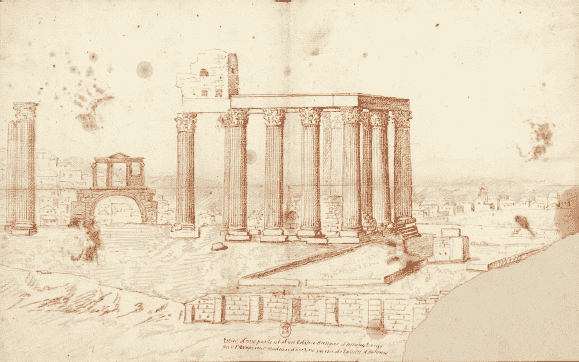

*图 12.3。诺因特尔的画家，《由哈德里亚皇帝建造的雅典一处门及一座古建筑图》，1674 年，红黑铅笔，26.6 × 45 厘米（法国国家图书馆，版画馆，Fc 3a 册本（特藏书），无页码，第 28 页（法国国家图书馆，版画馆））。*

更详细的画作不仅显示了矮墙，还显示了结合在一起的 `mihrab`（米哈白）和 `minber`（讲经台），它们很可能是用就地发现的回收大理石制成的。不仅是埃夫利亚，欧洲访客也观察到了神圣空间的使用。与其他同时期的欧洲访客一样，商人伯纳德·兰道尔夫（Bernard Randolph）描述了他遇到的古代遗迹，但他对现状的关注却与众寻常。他对雅典的描述包含了这一段关于奥林匹亚神庙区域的文字，该区域当时被称为哈德里亚宫殿：

```
在城堡的东南部有十七根大理石柱，是一百二十根中的剩余部分，皇帝哈德里亚曾在此建造了他的宫殿：在一些朝向东方的柱子上，可以看到地基的一部分。这些柱子是由纯白色大理石制成的，带有蓝色的波浪纹和涡卷纹，高五十英尺，周长十九半英尺。周围地面非常平坦，据说那里以前铺了大理石板。紧邻这些柱子的东侧有一块方形土地，用矮墙围着，里面是绿色的：那里保持得非常光滑，没有石头；在南端靠近墙的地方有一个高（通过两个台阶）约两英尺的地方，形状几乎像一个宝座。在开斋（Byram）期间，土耳其人来到这里，他们的伊玛目或牧（坐在高台上）向他们讲道，向他们展示世界的虚幻、皇帝的伟大以及奥斯曼军队的英勇，最后以为大苏丹祈祷结束，引起听众的三声整齐的呼应，并大声喊道“阿门”。
```^(70)

兰道夫生动的描述增加了实用的细节：那里被清理得没有石头，因为与其他 `musalla` 不同，祈祷的封闭空间并不是抬高的。围围墙和阶梯式 `minber` 都可能已被拆除，奥斯曼起义后的考古记录中没有留下痕迹。在兰道夫描述的一三十五年后，霍布斯从伊利西索斯方向描述了 `musalla`：“在山谷上方是一处土耳其喷泉遗迹；附近有一个白色大理石讲台，伊玛目经常在此向聚集的人群演说。”^(71) 但翻开他 1813 年版*阿尔巴尼亚之旅*的彩色版画，看到的是剥落的奥林匹亚神庙，没有任何“白色大理石讲台”。

霍布斯对该区域还有更多描述。他和一位旅行伙伴约翰·加尔特（John Galt）都描述了 1810 年的严重旱灾以及在 `musalla` 的集体祈雨，这与埃夫利亚的报告一致。加尔特在 1810 年 3 月 13 日的信中写道：

```
对作物的担忧已变得普遍，一些虔诚的土耳人每天清晨在奥林匹亚神庙遗址处祈祷，当旱灾持续时他们聚集在那里。
```^(72) 在近两周后的一封信中，干旱依然持续，粮价持续上涨，加尔特记录道：

```
现在安排了连续九天的公共祈雨，今天已经开始了。前三天分配给土耳其人，接下来三天给阿拉伯人和奴隶，最后三天分配给基督徒。
```^(73) 他继续描述了

我见过或听过的最奇特的仪式之一。一群母羊和羔羊被驱到祈祷者附近，在演讲结束后不久，羔羊与母羊分开，所有站立着的土耳人开始大声而深情地祈求。此时，分开的羊群也开始咩叫。很难用语言向你们传达这种简单而有力的伴奏效果，在我看来，它远胜于基督教会所有管器用铅和皮革的做作。

^(74)

在此地连续进行了九天的祈祷和神圣仪式，其中三天献给穆斯林教徒，三天献给基督徒，最后三天则献给外来人和奴隶。人们聚集在深谷中、玉米地上以及石柱下。穆斯林教士为所有人祈求，所有阶层和信仰的集会似乎被认为都参与了祈祷；但通过一种巧妙的安排，这些动物的生灵似乎在顺应土耳其人的请求——因为正当戴着头巾的朝拜者们整齐划一地俯地并呼唤他们神的名字时，聚集在附近的一群刚从母羊群中分离出来的羔羊开始咩叫，并得到了母羊的回应。我不知道是否有人被这种计诡骗了；但虔诚的穆斯林教徒或许相信，羊的痛苦与基督徒的诉苦同样值得为人知，也同样可能引起神性的怜悯。(76)

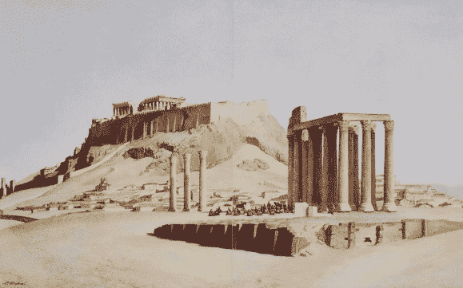

图 12.4. 路易·杜普雷（Louis Dupré），《奥林匹亚宙斯神庙与雅典卫城》，1819 年，收于 L. Dupré，《雅典与君士坦丁尔之旅》（巴黎，1825 年），第 22 页（雅典美国古典研究学院，格纳纳迪乌斯图书馆）。

霍布豪斯（Hobhouse）的描述强化了这一点：奥林匹神庙（Olympieion）区域由其哈德良时期的`peribolos`围墙严格界定，属于延伸至伊利苏斯河（Ilissos）的更广阔地形。在危机时期，位于这一可扩展区域的`musalla`（露天祈祷场）达到了最大容量，使得“人们聚集在深谷中、玉米地上以及石柱下”。我们对`musalla`使用状态的唯一描绘是在 1810 年目睹求雨仪式后几年才绘制的。路易·杜普雷的画作（图 12.4）灵感来源于他 1819 年的访问，显示了围墙内有一群较小的朝拜者，在`minber`（讲坛）顶部可以看到伊玛姆的头巾。(77)

杜普雷的同代人廉·利克上校（Colonel William Leake）是古典雅典最伟大的地形学家之一，他忠实地表现了古代遗迹的现状，并在`peribolos`东南角画了一个看起来比杜普雷笔绘的更破败的`minber`。利克是否认出它是一个讲坛很难推测，尽管它可能并没有引起他太久的，因为在随附文字中他的重点是古代遗迹。(78)


考古学家约翰·特夫洛斯（John Travlos）对雅典地形拥有无与伦比的历史概述，他在 20 世纪 60 年代在该区域进行过发掘。在讨论奥斯曼时期的城市发展时，他提到了埃夫利亚亚·切莱比（Evliya Çelebi）提到的户外祈祷空间，并对这种“惊人的巧合”发表评论：穆斯林人选择在“传统上与德俄卡里翁洪水相关”的同一个地点祈求雨。(79) 但如果正如本研究认为的那样，这与其说是巧合，不如说是特殊朝向与人类开发利用的典型结合：如果我们从区域位置的角度来看待建筑，这里是通往伊利苏斯河的门户，在突如其来的雨中，河流已知会暴涨成凶猛的洪流；这里附近的许多其他建筑都与水有关——从罗马浴场到中世纪的染色设施，再到奥斯曼的求雨场。记忆的断层是巨大的。我们对奥斯曼时期使用该区域的了解比任何其他时期都多。除了波波·萨尼亚斯（Pausanias）提到雅典人在裂缝处提供燕麦饼之外，否则我们对那种仪式一无所知。如果能找到一个在奥斯曼时期之前提到该地区基督徒求雨仪式的来源，似乎一点也不巧合或意外。根据我们对中世纪东正教实践的了解，我们可以完全合理地想象，求雨游行可能绕着宏伟石柱间建造的简陋教堂进行过。关于基督徒使用该区域的唯一已知传说似乎源于对在残存拱梁石上方建造的拙劣结构的推测。有人声称它是基督柱上行者的栖息地，(80)，也有人称它是德尔维修士的空灵家园，(81)，甚至是由黑精守护的宝藏存放库。^^(82) 更严谨的考古研究已将其确定为城市防御中的一个观测塔。^^(83)

## `musalla`的消失

尽管由于文学和考古证据的匮乏，我们对奥林匹神庙累积的过去的接触非常有限，但从幸存的内容中，我们敏锐地意识到这些证据在多程度上取决于观察者的眼光和兴趣。廉·利克对古典遗迹的狭隘关注是欧洲访问者的典型特征，尽管他可能是其中最有学识的。早在 19 世纪初以前，访问者就在他们的书面描述和描绘视角中忽略了当代的特征。有时他们会插入他们想象的特征，创造出一种想象记忆的表演，他们甚至可能将自己插入其中。在奥林匹神庙设置的这种做法示例具有特殊意义，因为在当代穆斯林（和基督徒）祈祷的地方，艺术家强加了一种东方主义的幻想。从素描师转变为旅行艺术家（*artiste-voyageur*）的路易·弗朗索瓦·卡萨（Louis-François Cassas）在 18 世纪 80 年代访问了雅典，作为捕捉东方遗迹这一宏伟计划的一部分。十年后，他根据记忆画了数幅雅典景观，将当代城市作为背景，表现了他自己与古代过去和东方现在融合的邂逅——在这种融合中，女性看起来像女像柱，而男性看起来像通用的东方流氓（图 12.5）。他们都没有穿当地的雅典服饰。^^(84)

他将自己异域化邂逅的场景安置在真实的穆斯林和基督徒聚集求雨的地方。他用自己的私人幻想抹去了当代的用途。在我们失去`musalla`的所有物理痕迹之前，它已经在卡萨和其他艺术家的作品中由于他们对雅典的描绘没有当地空间而从记忆中被抹除了。

## 结论

作为城市与乡村之间的交汇之地，奥林匹亚神庙（Olympieion）区域是一个关于“城市宗教”丰富的案例研究，其中“宗教变化是由空间与不同代理人、临时居民、自愿与非自愿移民、居民与管理者、依靠宗教生活或利用宗教来实现自身希望的人之间持续的互动构成的”。^(85) 在奥林匹亚神庙周围空间创造各自意义的“不同代理人”包括：从亚细亚访问的帕桑尼亚、在神区及其周围建造教堂的当地基督徒、在巨大的石柱可见范围内从伊利索斯河（Ilissos）取水的当地工人、旅行者埃夫利亚·切莱莱比（Evliya Çelebi，他将一种古兰经化和伊斯兰化的古代遗迹视角引入了神区）、剥离当地传说并重新赋予现在被视为“纪念碑”之建筑原始意义的欧洲游客、在此祈求降雨的雅典各当地穆斯林和基督徒，以及试图综合这些观点的当地穆夫提马哈穆德·埃菲森迪（Mahmud Efendi）。空间与那些赋予空间意义的各方之间的互动具有不容忽视的竞争性，即使我们的证据无法帮助我们详述每个变化背后的特定冲突。

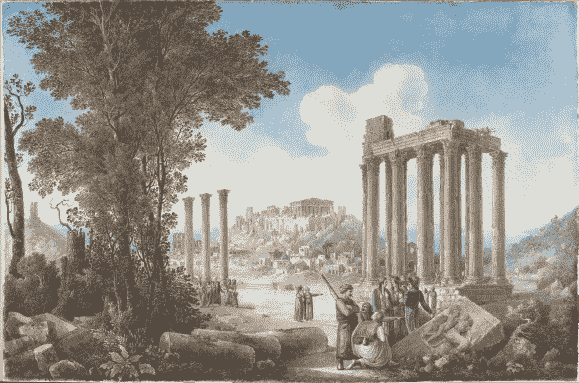

*图 12.5. 路易·弗朗索瓦·卡萨斯，《雅典卫城与奥林匹亚宙斯神庙》，纸上水彩，67 × 103 cm（伊斯坦布尔佩拉博物馆，苏纳和伊南·基拉奇基金会东方绘画收藏）。*

作为结论，我想补充 `musalla`（祷场）的另一种用途，即处决和埋葬，以及另一组至今在奥林匹亚神庙区域仍“利用宗教来实现自身希望”的城市宗教人士。这种用途未在任何已知的奥林匹亚神庙图书中记载，但也许我们一直没有寻找它。

在 1675 年出版的雅雅的描述中（部分基于当地方济会士对该城市的描述），乔治·吉列提到哈德良行宫附近有一处土耳墓，当地称为“Ta Mnimouria”。^(86)20 世纪初，人们解读了神庙东南角一根柱子上的刻文。上面写着：`1771 Ἰουλίου 9 ἀποκεφαλίσθη ὁ Πακνανᾶς`（“1771 年 7 月 9 日 Paknanas 被斩首”）。^(87)米克尔·帕克纳斯（Michael Paknanas）或 Baknanas 是一个贫穷的园丁，他骑着驴在雅典周边的村庄卖货物。一天，雅典总督派在城门巡逻的男子指控米克尔向叛乱分子提供火药。米克尔被关禁、经过多日的审问和酷刑，最终被公开处决。当地传说讲述，在黑暗的掩护下，米克尔的教父下了他的尸体，刻下了铭文，并带了一件血迹衣服作为纪念，纪念这位年轻殉道者在面对反复迫使其改教的压力时表现出的骄傲抵抗。关于他在奥斯曼执行者手下殉道的记载记录于《新殉道者录》（New Martyrology）中，由圣山的尼科德莫斯（Nikodemos the Hagiorite）汇编 6 月 30 日的条目并于 1794 年首次出版。^(88)20 世纪初，雅典历史学家德梅里奥斯·坎布罗格卢斯（Demetrios Kambouroglous）将这段铭文纳入“石中故事”之中。

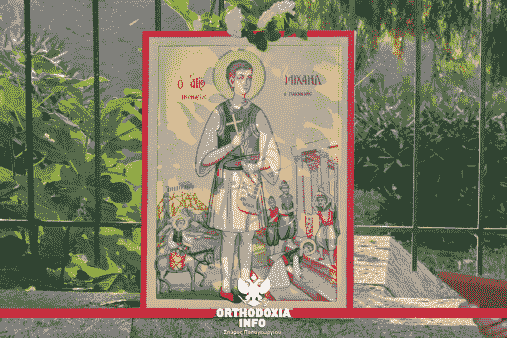

*图 12.6. 雅典新殉道者圣米克尔·巴克纳斯圣像（斯罗斯·帕帕盖尔乔乌，正教信息网）。*

近年来，得益于伊利索斯河旁、古代卡里俄珀泉（Callirrhoe fountain）遗址附近的圣福特伊尼教堂（St. Photeini）教区祭父马西莫斯·卡帕斯（Fr Maximos Kappas）修士的努力，这位新殉道者的记忆在当地传统尊崇的其殉道与埋葬之地得到了复兴。^^(89)自 2014 年以来，马西莫斯修士获得了考古部门的许可，在圣米克尔·巴克纳斯瞻日于奥林匹亚神庙区域内举行露天弥撒。^^(90)已经制作了几幅描绘新殉道者在神庙台阶上被处决的新圣像（图 12.6）。

图中圣米克尔所在的所在地位于穆斯林祈祷场附近，或者附近有其他穆斯林坟墓的事实，并不是参与该崇拜传播的人在考古遗址处讲述的叙事或执行的仪式。卡萨斯在米克尔殉道不到十年后访问了该地，但考虑到他的兴趣，我们可以相当确定他没有注意到那座无标记的坟墓，即使它是可见的。^^(91)现代圣像与卡萨斯一样，选择性（或忽视了）穆斯林的细节，而倾向于强调古代遗迹；他们也同样对土耳其处刑者和米克尔本人的刻板化服装有偏好，而不是对当地细节的任何关注。^^(92)如今维护的考古遗址与配合马西莫斯复兴殉道记忆的圣像呈现出一个荒凉的、几乎被抹除的空间，尽管他在采访中提到这里曾是人们集市公共场所。^^(93)目前，由于刻文柱和假设的坟墓区域被围起来以保护正在进行的保护工程，崇拜只能在一定距离外。马西莫斯修士希望有一天能将圣遗从当地传统认为的柱旁安息地转移到附近的圣福特伊尼教堂。马西莫斯解释道，这样，新殉道者就能在更合适、更易到达的环境中获得他应有的崇拜。

圣米克尔故事中突出的当地古迹主题，也出现在教堂正中朝西门上方门楣的圣福特伊尼圣像上。这令人惊讶，因为她正是福音书中耶稣在井边与她交谈的撒马利亚妇女，根据传统，她在洗后取了福特伊尼的名字。在她的圣像学中，她被描绘在城市面前，但这里紧伊利索斯河的强大吸引力促使圣像画家加入了当地色彩。圣福特伊尼作为一名祈祷者，站在哈德良门和右侧奥林匹亚神庙石柱之间，左侧是雅典的红瓦瓦房屋。然而，在培养与古代城市关联的同时，另一种关联被中和了。《斐德鲁斯》中提到的潘神神庙位于教堂上游，但现在教堂所在地也是潘神的圣地，有耐心的访客仍能辨认出模糊的浮雕装饰。^^(94)画在教堂旁岩石上的巨大蓝色十字架可以被视为试图驱逐这些基督教之前的记忆的尝试，而教堂区域入口处的告示牌则强制了该遗址考古记忆的共存。

这带我们回到了起始的伊利索斯河（Ilissos），以及苏格拉底结束对话的祈祷：“噢亲爱的潘神和此地的所有神灵，请赐我内在的美丽。”^(95) 晚期柏拉图主义者、普鲁克洛斯的学生亚历山大的赫尔米亚斯（Hermias），曾在 5 世纪初柏拉图学院的院长叙里俄斯（Syrianos）在雅典教导他解读《斐德篇》。他对《斐德篇》的注释特别关注了对话中城市、奥林匹亚神区（Olympieion）与伊利索斯河之间的背景。赫尔米亚斯唤起了苏格拉底教学与他与随者沿着这一过渡地形移动之间的游行式联系；在这一过程中，苏格拉底通过实践展示了如何辨别特定的、局部神灵与哲学家始终追求的智性真理之间的联系。^^(96) 地方纪念与空间关联的精神潜力再不能如此深刻了。

“离题的化身”是卡尔·加林斯斯基（Karl Galinsky）对记忆的描述。^^(97) 我们完全可以将这一系列被唤回的抹除与遗忘描述为“离题中的离题”，正如我们所追踪的雅典这一原始极轴的多种用途：从丢卡留翁之墓，到哈德良时期的奥林匹亚宙斯神庙，再到它重新变为一个围绕柱廊教堂聚集的中世纪社区，再到一座经典的奥斯曼`musalla`（祈祷室），一个考古遗址，以及现在新殉道者园丁迈克尔·巴克纳纳斯（Michael Baknanas）的崇拜中心。在一个皮肤上刻满无尽变化与适应痕的城市里，奥林匹亚神区脱颖而出。由于其边缘性的地形，该神区不仅是一个具有深厚历史的地方，更是一个蜕变空间；当地居民即使在“一种破碎荒废与腐朽的状态”下，^(98)也利用这些古代结构作为一种离题式城市身份产出的固定参考点，这种产出植根于许多等待被唤回并重塑的记忆，以适应不断发展的城市需求。

## 致谢

本项目获得了欧洲联盟“地平线 2020”研究与创新计划下欧洲研究委员会（ERC）的资金资助（资助协议编号 693418）。托马斯·辛莱尔（Thomas Sinclair）对马哈穆德·埃芬迪（Mahmud Efendi）作品的翻译得到了格达·亨克尔基金会的慷慨资助。本论文的早期版本曾在剑桥、乌普萨拉、牛津和隆演讲过。我想感谢：内巴哈特·阿夫乔卢（Nebahat Avcıoğlu）在我 2018 年 10 月剑桥大学艺术史系讲座后对`musalla`的评论；Wendy Pullan、Alessandra Ricci 和 Max Sternberg 在关于墙体、边缘与孔隙性的讨论；Manolis Korres 和 Marianna Koromila 对奥林匹亚神区“后世”的阐释；Niki Sakka 和 Vicky Georgopoulou 在奥林匹亚考古址的讨论；John Papadopoulos 他的地理学博识；Dimitris Loupis 多年来对埃夫利亚·切莱比（Evliya Çelebi）和马哈穆德·埃芬迪的讨论；以及 Suna Çağaptay、Garth Fowden、Niki Sakka、Andrew Wallace-Hadrill、合编辑以及匿名评审员对本章倒数第二稿的意见。我对此处呈现的内容负全部责任。

## 参考文献

### 主要文献

Pausanias, *Description of Greece*, ed. and transl. W. H. S. Jones, LCL 93 (Cambridge, 1918).

Plato, *Phaedrus*, ed. J. Burnet, vol. 2 (Oxford, 1901); transl. A. Nehamas and P. Woodruff, in J. M. Cooper (ed.), *Plato: Complete Works* (Indianapolis, 1997), pp. 506–556.

Strabo, *Geography*, ed. and transl. S. L. Radt (Göttingen, 2002–2011).

Thucydides, *History of the Pelopnesian War*, ed. J. Romilly and R. Weil (Paris, 1953–1972).

#### 次要文献

Ameen, A. M., ‘The Küçük Cami of Athens: Some considerations in the light of travellers’ works’, *Turcica* 47 (2016): 73–95.

Anderson, B., ‘Forgetting Athens’ in B. Anderson and F. Rojas (eds.), *Antiquarianisms*: *Contact, conflict, comparison* (Oxford, 2017), pp. 189–209.

Arnaud, L., ‘Néo-martyrs orthodoxes: Michel d'Athènes et Angelis d’Argos’, *Échos d’Orient* 16 (1913): 396–408.

Arrigoni, E., ‘Fasti attico-Salomonici ed Atene islamica. Il periegeta turco Evliya Celebì (sec. XVII) e la reinterpretazione del paesaggio archeologico della campagna attica’ in G. Botta (ed.), *Studi geografici sul paesaggio* (Milan, 1989), pp. 47–91.

Babin, J.-P., ‘Relation de la ville d’Athènes’, in J. Spon (ed.), *Relation de l’état présent de l’état*

Baltz, D., ‘Springs, sanctuaries and `aquctscts` in `Phaedrus`: `Phaedrus` ... (此处略)

- Fowden, E. K.，《帕特农神庙、伯里克与所罗门王：希腊奥斯曼考古想象的案例研究》，载《拜占庭与现代希腊研究》42 (2018): 261–274。

- Fowden, E. K.，帕特农清真寺、所罗门王与希腊圣贤》，收于 M. Georgopoulou 和 K. Thanasakis（编），《奥斯曼雅典：考古学、地形学、历史》（雅典，2019），第 261–274 页。

- Fowden, E. K，《从马丁·克鲁修斯到斯特戈·马基里尼斯的奥斯曼雅典肖像》，收于 E. K. Fowden, S. Çağaptay, E. Zychowicz-Coghill 和 L. Blanke（编），《作为重写本的城市？东中海城市主义对古代的回应》（牛津，2022），第 155–197 页。

- Fraser, E. A，《地中海的遭遇：欧洲与奥斯曼帝国之间的艺术家，1774–1839》（大学公园，大学出版社，2017）。

- Galinsky, K，《引言》，收于 K. Galinsky 和 K. Lapatin（编），《罗马帝国的文化记忆》（洛杉矶，2015），第 1–22 页。

- Galt, J，《来自黎凡的信函：包含对希腊社会状况、习俗、观点和贸易，以及群岛若干主要岛屿的观察》（伦敦，1813）。

- Greene, M，《爱丁堡希腊史：1453 年至 1768 年》（爱丁堡，2015）。

- Gruber, S. D.保加利亚选定的穆斯林历史遗迹与遗址》，建筑学院出版物全列表。论文第 98 号（2010）。[可用于：`surface.syr.edu/arc/98`]（访问日期：2021 年 11 月 8 日）。

- Guillet, G，《古今雅典，以及当时土耳其帝国的现状，包含苏丹穆罕默德四世的生平，大维齐尔科普鲁·阿赫梅德·帕夏的事。坎迪尼围战期间土耳其营地发生的事件。以及门户事务的其他细节。附带 Guillet 先生绘制的雅典地图》（巴黎，1675）。

- Gündüz, F，“Okmeydanı》，载于《土耳其宗教事务基金会伊斯兰百科全书》，第 33 卷（伊斯坦布尔，2007），第 339–340 页。

- Hasluck, F. W，《苏丹统治下的基督教与伊斯兰教》，共 2 卷（牛津，1929）。

- Hekimoglou, E，《水利史：提提地区水资源管理历史》（雅典，2014）。

- Hillenbrand，“Muallā（真主）”，于 E. van Donzel, B. Lewis 和 C. Pellat（编），《伊斯兰百科全书》，第二版（莱登，1960-93），第 7 卷，第 659 页。

- Hobhouse, J. C，《穿越阿尔巴尼亚及土耳其其他省份前往君士坦丁堡之旅，1809 年至 1910 年间》（伦敦，1813）。

- Kaldellis, A，《帕特农神庙：雅典的古典主义与朝圣》（剑桥，2009）。

- Kambouroglous, D，《雅典人史》（雅典，1889）。

- Kambouroglous, D，《雅典历史纪念》（雅典，1889）。

- Kambouroglous, D，“新殉道者花园”，载于《Estia》（1913 年 1 月 17 日），第 1–2 页。

- Karidis, D，《1456 年至 1920 年的雅典：奥斯曼统治下的城镇：城市，一篇历史随笔》（牛津，2014）。

- Kiel, M，《根据雅典“费特希耶清真寺”重新审视奥斯曼建筑中的四叶草平面》，载于《Muqarnas》19 (2002): 第 109–122 页。

- Kiel, M，“雅典”，收于 K. Fleet, G. Krämer, D. Matringe, J. Nawas 和 E. Rowson（编），《伊斯兰百科全书》（莱登，2007）[可用于：`dx.doi.org/10.1163/1573-3912_ei3_COM_2658`]（访问日期：2016 年 9 月 29 日）。

- Koder, J 和 F. Hild，《希腊与塞萨利亚》，载于《帝国图表》I（维也纳，1975）。


- Kolovos, E，“在坎达卡的围城者后方：埃瓦斯·切伦姆比的军事回应》，载于《克里特纪事》39 (2019): 第 357–379 页。

- Langdon, M. K，《希梅托山上的宙斯圣所》，载于《Hesperia》补充卷 16（普林斯顿，1976）。

- Leake, W. M，《雅典地形及若干遗迹》（伦敦，1821）。

- Legrand, L，《尼古拉斯·德·马尔托尼前往耶路撒冷（1394-1395）》，载于《东方评论》3 (1895): 第 566–669 页。

- Leonard, J，“雅典未知的柱居修士”，载于《Greece Is》，2019 年 3 月 19 日[可用于：`www.greece-is.com/stylite-monks-the-unknown-column-dwelling-holy-men-of-athens/`]（访问日期：2021 年 11 月 8 日）。

- Loupis, D，《1668-1671 年的希腊、伯罗尼尼斯与爱琴海诸岛》，第三版（雅典，2005）。

- Mahmud Efendi，《城市历史》，托普卡普皇宫宝藏编号 1411。

- Marchiandi, D，《雅典南部地区与伊利索河谷》，收于 E. Greco（编），《雅典地形：从起源到 3 世纪的城市发展》，第 II 卷（雅典-帕斯，2011），第 369–509 页。

- Martin-McAulife, S. L 和 J. K. Papadopoulos，“框架胜利：萨拉米、雅典卫城与古广场》，载于《建筑历史学会杂志》71 (2012): 第 332–361 页。

- Meyer, G，“不是雅典而是埃皮达罗斯：关于雅各布·斯庞发表的铭文以及钱币学家让·瓦尚的希腊之旅》，载于《希腊研究杂志》125.1 (2012): 第 289–295 页。

- Mulder, S，“伊斯兰社会对古代当地的想象”，“国际伊斯兰建筑期刊》6 (2017): 第 229–254 页。

- Neuenkirchen，《古兰经 89.6-8 中的圣经元素及其注释》，载于《阿拉伯语》60 (2013)。

- Northedge, A，“网格化城镇”，收于 R. Rose-Redwood 和 L. Bigon（编），《网格世界：城市选集》（查姆，2018），第 37–54 页。

- Palaiokassa, N. D，“米哈伊尔·帕克纳斯”，载于《新殉道者词典》，第 3 卷（雅典，1994），第 354–358 页。

Spon, J. (编)，*雅典城现状报告：这座希腊古都，自 3400 年前起便已落成于今*（里昂，1674）。

Spon, J.，*在意大利、达尔马提亚、希腊及黎凡特的旅行，于 1675 年和 1676 年间*，2 卷（阿姆斯特丹，1678）。

Stuart, J. way N. Revett，*雅典古迹*，4 卷（伦敦，1762–1816）。

Tanoulas, T., *Τὰ Προπύλαια τῆς Ἀθηναϊκῆς Ἀκρόπολης κατὰ τὸν Μεσαίωνα*（中世纪雅典卫城前门），2 卷（雅典，1997）。

Tanoulas, T.,〈重新审视奥斯曼统治时期雅典的两份文献：维也纳匿名文献与巴萨诺德尔格拉帕的卫城视角》，收录于 M. Georgopoulou 和 K. Thanasakis（编），*奥斯曼时期的雅典：考古、地形、历史*（雅典，2019），第 49–65 页。

*雅典剧院与学校* (*Tὰ θέατρα καὶ τὰ διδασκαλεῖα τῶν Ἀθηνῶν*)，亦称为*维也纳匿名文献》，影印本，带有 de Laborde 的转录及法语翻译，*Athènes aux XVe, XVIeet XVIIe siècle*（巴黎，1854），1.15–31。

Theocharaki, A. M.,〈雅典古城墙回路：其路线的演变与建筑阶段〉，载于《赫斯佩里亚》第 80 期（2011）：第 71–156 页。

Theocharaki, A. M., *Τὰ ἀρχαῖα τείχη τῶν Ἀθηνῶν*（雅典古城墙）（雅典，2015）。

Threpsiades, I. and I. Travlos，〈雅典-阿提卡古迹。对奥林匹山的初步发掘（1961)〉，载于《考古简报》第 17 期（1961–1962）：B΄1, 第 9–14 页。

Thürmer, J., *Ansichten von Athen und seinen Denkmahlen*（雅典及其纪念性景观）（罗马，1823–1824）

Tölle-Kastenbein, R.，*雅典的奥林匹亚神殿*（科隆，1994）。

Travlos, J.*，*Ποleοδομική εξέλιξις των Αθηνών*（雅典的城市演变），第二版（雅典，1993 [第一版 1960]）。

Travlos, J., *Pictorial Dictionary of Ancient Athens*（古雅典图解）（纽约，1971）。

Tsigakou, F.-M.,〈希腊独立战争的视觉叙事〉载于 P. M. Kitromilidis 和 C. Tsoukalas（编），*希腊革命：批判性字典*（剑桥，2021），第 622–639 页。

Tunalı, G.，*另一种希腊主义吗？通过希腊渠道对古雅典的征用，其反映在《Tarih-i Medinetü’l-Hukema》中*，博士论文，鲁尔波鸿大学（2013）。

Tunalı, G.，〈18 世纪对古希腊的看法：马哈穆德·埃芬迪与《Tarih-I Medinetü’l-Hukema》的创立〉收录于 M. Georgopoulou 和 K. Thanasakis（编），*奥斯曼时期的雅典：考古、地形、历史*（雅典，2019），第 97–121 页。

Tzavella, E.，*中中世纪拜占庭阿提卡的城市与乡村景观（公元 4 世纪至 12 世纪）*，博士论文，伯明翰大学（2012）。

Vernon, F.,〈东地中海旅行日记〉，MS/73，伦敦皇家学会图书馆（未出版日记，1675–1676）。

Wachsmuth, C.，*Die Stadt Athen im Altertum*（古代雅典城），2 卷（莱比锡 1874，1890）。

Watt, M.,〈“伊拉姆”〉载于 E. van Donzel, B. Lewis 和 C. Pellat（编），*伊斯兰百科全书*第二版（莱登，1960–1993），第 2 卷，第 1270 页。

Webb, P.,〈“伊拉姆”〉载于 K. Fleet, G. Krämer, D. Matringe, J. Nawas 和 E. Rowson（编），*伊斯兰百科全书第三卷*（2019）。

Wensinck, A.J.,〈“Muallā”〉载于 E. van Donzel, B. Lewis 和 C. Pellat（编），*伊斯兰百科全书*第二版（莱登，1960–1993），第 7 卷，第 658–659 页。

Wheler, G., *A Journey into Greece*（希腊之旅）（伦敦，1682）。

Whitmarsh, T.,〈帝国与反抗记忆学：帝国希腊文化中的记忆、遗忘与*periegesis*（游记）〉载于 K. Galinsky 和 K. Lapatin（编），*罗马帝国的文化记忆*（洛杉矶矶，2015），第 49–64 页。

Willers, D., *Hadrians panhellenisches Programm. Archäologische Beiträge zur Neugestaltung durch Hadrian*（哈德良的泛希腊计划：哈德良重建城市的考古贡献）（巴塞尔，1990）。

Zisis, Ε., *Η μαγική τοπογραφία των Αθηνών: Οι προλήψεις, οι δεισιδμονίες και παράδοξες ιστορίες της μεσαικής πόλης*（雅典的神地理：这座城市的预言、传说与意外的历史）（雅典，2017）。

柏拉图 *Phaedrus* 229a–230d，Nehamas 和 Woodruff 译 *Listening to the Cicadas*（倾听蝉鸣），1–12。Chiotis 〈“春天”〉。Fowden，关于帕尼托斯山上宙斯神殿的罗马用途，见 Palaiokassa-Kopitsa 和 Vivliodetis 〈“圣地”〉，关于 Hymettos 遗。Langdon, *Sanctuary of Zeus*（宙斯神殿），79–81,84–87,100–106。Thucydides *History of the Peloponnesian War*（伯罗奔尼撒战争史），2.15。Hekimoglou, *Υδάτινη ιστογραφ*（古代地理），37–41,66–71。Pausanias, *Description of Greece*（希腊志记），1.18–8。Strabo *Geography*（地理志）9.4 也提到狄俄卡留的墓在雅典。Travlos, *Ποleοδομική ἐξλιξις*（城市演变），32 n.4；Dimitriadou, *Early Athens*（古雅典），31–42,97–98,421–424,图 51,图 52 以及 Papadopoulos *Ceramicus Redivivus*（古代陶器），297–302，关于该地区的古代性以及 Thucydides 的证言。Babin, *Relation*（报告），44–45。Koder and Hild *Hellas und Thessalia*（希腊与色萨洛尼亚），174（赫梅托斯），174–175（伊利索）；Tzavella, *Urban and Rural Landscape*（城市与乡村景观），56, n. 309。Hymettos 出现在 *The Theatres and the Schools of Athens* 第 2 段，其为十五世纪的累积文本：de Laborde *Athènes*（雅典），1.17；Tanoulas, Τὰ *Προπύλαια*（前门），1.43–44,58；Tanoulas 〈重新审视》。古城是否有围墙仍是一个激烈争议的话题，因为没有清晰的证据存世：Theocharaki 〈古城墙回路〉，71–76；Theocharaki *Αρχαία τείχη*（古城墙），27–37；Dimitriadou *Early Athens*（古雅典），212–225；Hekimoglou, Υδάτινη ιστογραφ*（古代地理），73–75；Papadopoulos 〈古城墙〉。Theocharaki *Αρχαία τείχη*（古城墙），图谱及 37–39。Theocharaki 〈古城墙回路〉，88,130,132：米斯提底尼墙（Th56）位于奥林匹亚神殿西侧的“门”；瓦莱里尼墙段（V16）位于奥林匹亚神殿区的南部。Theocharaki *Αρχαία τείχη*（古城墙），275–276；Bouras, *Byzantine Athens*（拜占时雅典），30。Travlos, *Pictorial Dictionary*（图解字典），101,图 130，奥林匹亚神殿南部的圣地地图；291,图 379，伊利索地区平面；291,图 380，奥林匹亚神殿及周边平面；Marchiandi 〈L’area meridionale della città〉（城市南部区域），369–395,423–426,430–434。Pausanias, *Description of Greece*（希腊志记），1.18；Papahatzis, *Παυσανίου Ελλάδος Περιήγησις*（帕乌萨尼斯的希腊游记），1.270–276；Bevier 〈Olympieion〉；Travlos *Pictorial Dictionary*（图解字典），402–411,图 380–381,521–531；Boatwright *Hadrian and the Cities*（哈德良与城市），144–157；Willers *Hadrians panhellenisches Programm*（哈德良的泛希腊计划），26–53；Marchiandi 〈L’area meridionale della città〉（城市南部区域），特别 369–395,449–476。Archaiologiki Etaireia 在 1886 年至 1907 年在该区域赞助挖掘；Travlos 和 Threpsiadis 在 60 年代恢复了工作。关于旧图纸和照片，见 Tölle-Kastenbein, *Das Olympieion in Athen*。Travlos, *Ποleleμικ도μική ἐξλιξις*（城市演变），44–46,48。Whitmarsh 〈Mnemonology〉（记忆学），51–56。Pausanias, *Description of Greece*（希腊志记），1.18.8，Jones 译。Travlos, *Ποleοδομική ἐξλιξις*（城市演变），46，将盖亚的圣域置于皮提亚阿波罗之上；Papahatzis, *Παυσανίου Ελλάδος Περιήγησις*（帕乌萨尼斯的希腊游记），276 n. 5 推测狄俄卡留的墓可能在那个圣域内，且距离裂缝不远；Marchiandi 〈L’area meridionale della città〉（城市南部区域），463–465。Pausanias, *Description of Greece*（希腊志记），1.18.7，Jones 译。

## 21

Stuart and Revett, *Antiquities*, 1.38–39（约翰·乔治·Trans 费特在 1674 年预见了这一身份，但尚未发表：Wachsmuth, *Die Stadt Athen*, 1.70–71）。大多数早期的旅行者报告了其当地名称“宫殿”，同时也称之为哈德里亚列柱或石柱，例如：Guillet, *Athènes*, 266；Spon, *Voyage*, 2.168；Wheler, *Journey*, 370–371；Francis Vernon 绘制了一幅简单的平面图，显示了 19 根柱子和神庙的东南角，标记为“8 月 27 日，哈德里亚列柱”[1675]，见页面顶部中间，获取自：[pictures.royalsociety.org/image-rs-17324](http://pictures.royalsociety.org/image-rs-17324)。

### 22

Boatwright, *Hadrian and the Cities*, 153.

### 23

Bouras, *Byzantine Athens*, 99.

### 24

Bouras, *Byzantine Athens*, 97–98.

### 25

Travlos, *Πολεοδομ much εξέλιξις*, 142–144，简要描述了奥林匹亚神庙附近的五座早期基督教教堂。Threpsiades and Travlos，“Ἀρχαιότητες Ἀθηνῶν–Ἀττικῆς’, 13–14.

### 26

Bouras, *Byzantine Athens*, 98，附注 715。

### 27

Bouras, *Byzantine Athens*, 99。Threpsiades and Travlos，“Ἀρχαιότητες Ἀθηνῶν–Ἀττικῆς’, 13.

### 28

Bouras, *Byzantine Athens*, 210.

### 29

Bouras, *Byzantine Athens*, 45, 95；Marchiandi, ‘L’area meridionale della città’, 490–494。参见 Pausanias, *Description of Greece*, 1.19.5–6 关于伊利索斯河神庙的内容。

### 30

Travlos, *Πολεοδομική εξέλιξις*，图 X 将该教堂标识为 ῞Αγ.᾽Ιωάννης στις Κολῶνες；Spon, *Voyage*, no. 32 在他的雅典平面图中将其标识为“Agios Georgios sur les colonnes”；Francis Vernon 在其未发表的日记第 28r 页中，于 1675 年 10 月 16 日记录了一处铭文“at αγιο Νικόλα at Adrian’s pillars”[确切转录]。

### 31

Babin 在 *Relation* 中提到，“在这些四根柱子之间有一座完全完整的*Chapelle des Grecs（希腊人小礼堂）”，但它从未关闭过，他们也不使用它”，45。

### 22

在 *Relation* 无名的序言中，Spon 将其包含的图画归于 Vaillant，关于他参见 Meyer,‘Non pas Athènes mais Épidaure’。

### 33

Bouras, *Byzantine Athens*, 120–121，附图 65，这是一张显示发掘工作坊的照片；背景是位于伊利索斯河对岸的圣 Photeini 教堂，右侧是横跨伊利索斯河床的现代桥。

### 34

Zisis, Η *μαγική τοπογραφία των Αθηνών*, 61–92，收集了关于奥林匹亚神庙的广泛材料，包括考古研究和当地传说。

### 35

Fol. 96r。Legrand,‘Relation du pèlerinage’, 651；Paton, *Chapters*, 32–33.

### 36

Bodnar,‘Athens in April 1436: Part II’,195。当地匿名文献例外地将这些柱子标识为欧里庇得剧场：Wachsmuth, *Die Stadt Athen*, 742–743。

### 37


*Theatres and the Schools of Athens*，第 6 段，参见 Laborde, *Athènes*, 1.19；Tanoulas, ‘Reconsidering’；Tanoulas, *Τὰ Προύλαι*, 1.58。Crusius, *Turcograecia*, 7, 18, 461。在 Crusius 未发表的日记中，有一张雅典草图，是与出生于雅典的修士 Daniel Palaiologos 对话所得。可能是对 Kabasil 关于三城说的修正，Crusius 用希腊语写道“这是一座城市而非三座”：UBT, Mh 466, vol. III, fol. 302。关于草图，参见 Calis, ‘Reconstructing’，以及 Fowden, ‘Portraits’。

### 39

Evliya 访问的时间有时计算为 1667 年（例如 Kiel, ‘Athens’）。根据手抄本，正确的日期为 1668 年，参见 Kolovos, ‘Σὰ μετόθεν πολιορκτῶν τοῦ Χάνδα’, 359，以及 Loupis, *Ἐβλιὰ Τσεμπί, Ὁδοιρικὸ στὴνἙλλάδα (1668–1671)*。

### 40

Evliya Çelebi, *Seyahatname*, 8.13（Dankoff and Kim, 278–279，Thomas Sinclair 调整）。关于 Evliya 的雅典，参见 Fowden, ‘The Parthenon Mosque’, 70–78。

### 41

Cobb, ‘Iram’, 559；Watt, ‘Iram’, 1270；Webb, ‘Iram’；Neukirchen, ‘Biblical elements’。

### 42

Wheler, *Journey*, 370 表达了他的怀疑。Hasluck, *Christianity and Islam*, 1.199。

### 43

Evliya Çelebi, *Seyahatname*, 8.118（Dankoff and Kim, 288）。

### 44

Fahd, ‘Istiskaʾ’, 4.269–270；Boratav, ‘Istiskaʾ’, 4.271。

### 45

Mahmud Efendi, *Tarih-i Medinetü’l Hukema*；参见 Tunalı, *Another kind of Hellenism?*；Fowden, ‘The Parthenon, Pericles and King Solomon’。

### 46

Tunalı, *Another kind of Hellenism?*, 89 以及 Tunalı, ‘An 18th-century take’, 99。

### 47

Mahmud Efendi, *Tarih-i Medinetü’l Hukema* 220a–220b，Thomas Sinclair 译；Tunalı, *Another kind of Hellenism?*, 63–64。

### 48

Mahmud Efendi, *Tarih-i Medinetü’l Hukema*, 221a，Sinclair 译。

### 49

参见 Cobb, ‘Virtual sacrality’，特别是 35–41，这是一个以伊斯兰化叙利亚为中心的文献研究。关于穆斯林对古代迹的不同概述及参考文献，参见 Mulder, ‘Imagining localities of antiquity’，特别是 240–246。

### 50

关于他的来源，参见 Tunalı, *Another kind of Hellenism?*, 89–102，以及 Tunalı, ‘An 18th-century take’，特别是 98–99。Thomas Sinclair 计划对 Mahmud Efendi 可能的早期现代欧洲及古代文学来源进行研究。

### 51

Mahmud Efendi, *Tarih-i Medinetü’l Hukema*, 221b，Sinclair 译。

### 52

Nev’i Efendi, ‘Yield of’, 77；Sariyannis, ‘Ancient history’。

### 53

Pausanias, *Description of Greece*, 1.18.9，Jones 译。注意 `οἰματα ἐνταθστιν ὁρόφῳ καὶ λαβάστῳ` 中的其他相似之处。

### 54

Mahmud Efendi, *Tarih-i Medinetü’l Hukema*, 221a，Sinclair 译。

### 55

Raja and Rüpke, ‘Appropriating religion’，特别是 14。

### 56

Pullan, ‘Spatial discontinuities’, 19–20。

### 57

Northedge, ‘Early Islamic urbanism’, 157。

### 58

Gündüz, ‘Okmeyı’, 339–340。感谢 Suna Çaaptay 提供这一参考。

### 59

Gruber, ‘Selected Muslim historic monuments’, 65。假设同一面墙上贴有一个木制 *minber*（讲经台）。感谢 Elias Kolovos 引我注意索非的 `musalla`（祈祷场所）。

### 60

参见 Hasluck, *Christianity and Islam*, 1.324–325 示例。

### 61

Wensinck。

### 62

Kiel 的“四叶草平面”是一个显著的例外，但它并不与奥林匹亚神庙的 `musalla` 有关。

### 63

Arrigoni, ‘Fasti attico-Salomonici’，特别是 62–63。

### 64

Evliya 使用波斯语 `namazgah` 而不是阿拉伯语的 `musalla`。

### 65

Hillenbrand。

^(66) Guillet, *Athènes*, 267–268。

^(67) *The Theatres and the Schools of Athens*, 第 7 段，de Laborde, *Athènes*, 1.19；Tanoulas, ‘Reconsidering’。

^(68) Hobhouse, *Journey through Albania*, 信 22, 322；Hasluck, *Christianity and Islam*, 1.134 附注 7。

^(69) 见 Nointel, Fowden, ‘Portraits’。

^(70) Randolph, *Present State of the Morea*, 22–23，保留了原始拼写。

^(71) Hobhouse, *Journey through Albania*, 信 22, 321–324 关于奥林匹俄神殿及周边，保留了原始拼写。

^(72) Galt, *Letters from the Levant*, 167，保留了原始拼写。

^(73) Kambouroglous, *Ἱστορία*, 3.125–126，以及 Kambouroglous, *Μνημεῖα*, 1.312。

^(74) 完整描述写于 1813 年 3 月 26 日，请见 Galt, *Letters from the Levant*, 227–229。

^(75) Pouqueville, *Voyage de la Grèce*, 5.83。

^(76) Hobhouse, *Journey through Albania*, 信 22, 323 [误印为 332]。

^(77) 同一年，Joseph Thürmer 在 *Ansichten von Athen* 中通过图 9 描绘了奥林匹俄神殿，地面是草草起伏的，并有玩玩的东方人物，而非祈祷围栏光秃平坦的土地。

^(78) Leake, *Topography of Athens*, 图 7, “从伊利苏斯河左岸眺望现今雅典卫城南景”。

^(79) Travlos, *Ποleοδομική εξέλιξις*, 210。Travlos 在第 209 页两次将露天祈祷场描述为寺庙的“西南侧”，但在图 144 的图图中正确地描述为“东南侧”。除了这些现代早期的描绘外，没有关于 *musalla*（祈祷场所）位置的证据。Cohen, ‘Explosions and expulsions’, 90–92；Zisis, Η *μαγική τοπογραφία των Αθηνών*, 65, 附注 15。

^(80) Bouras, “所谓的雅典柱修修士室”；Kaldellis, *Christian Parthenon*, 171–172。现代新闻让这些传说得以延续：Leonard, ‘Stylite Monks’。

^(81) Byzantios, *Ἡ Κωσσταντινούπολις*, 2.94, 脚注 3，对隐士传说的一种伊斯兰式解读，据我所知，这在关于该建筑用途的讨论中并未提及。这一版本的来源是博学的历史学家语言学家 Skarlatos Byzantios，他在 19 世纪中叶居住在雅典，当时柱修传说仍在流传。这个神秘结构由考古学家于 1870 年拆除。法国国家图书馆的 Gravier d’Ortières 专辑包含一幅罕见的插图，可能源于 17 世纪 80 年代，见：`gallica.bnf.fr/ark:/12148/btv1b525117604/f378.item`。

^(82) Dodwell, *Classical and Topographical Tour*, 389–390，他在 1805 年至 1806 年间访问了雅典，报告了柱修传说以及在现场与一位老阿尔巴尼亚妇女的相遇，她将那个砖石结构称为“黑人的居所”。

^(83) Bouras, *Byzantine Athens*, 22；Bouras, “所谓的雅典柱修修士室”。

^(84) 感谢 Benjamin Anderson 寄给我的一份 Anderson 和 Rojas 著作 *Antiquarianisms*。Anderson 在 ‘Forgetting Athens’ 中对 Cassas 描绘的启发性讨论，分享了欧洲观众对清真的盲点；见 205, 附注 5 Cassas 的类似画作。见 Fraser, *Mediterranean Encounters*, 47–94。

^(85) Jörg Rüpke, ‘宗教与城市’, 2018 年 5 月 5 日在布达佩斯中欧大学的演讲；参见 Rüpke, ‘Religion als Urbanität’。参见 Rose-Redwood, ‘Genealogies of the grid’, 49, 关于古代城市形态的挑战。

^([86]) Guillet, *Athènes*, 262–267；在不同期的地图上，奥林匹俄神殿区域墙外标记有一处“土耳其墓”。

^(87) Kambouroglous, *Μνημεῖα*, 1.192；Kambouroglous, ‘Νεομάρτυρια της’, 1。

^(88) 有许多简略版本提到：每年有十二奥林匹俄神灵崇拜者获得官方许可进入寺庙唱赞歌；见 Perantonis, ‘Μιχαή Πακνανάς’, 354–358；还有 Arnaud, ‘Néo-martyrs orthodoxes’, 396–400；Ferousi, *Μιχαή Μπακνανάς*。关于新殉，见 Greene, *Edinburgh History of the Greeks*, 146–151。

^(89) Marchiandi, ‘L’area meridionale della città’, 476–483。

^(90) 其他群体声称拥有主权：每年有十二奥林匹俄神的崇拜者进入寺庙唱赞歌。

^(91) 东南角的土地并不特别适合安葬，且没有此类安葬的考古记录。

^(92) 因为没有找到新殉者的画像，Maximos 牧师委托了三幅新画，参考了 18 世纪画像中的服装细节。这三幅画保存在圣 Photoini 教堂（私人委托）。另一幅新画见于图 12.6。

^(93) 从 19 世纪中期到 20 世纪中期，这一开放空间继续用于多种用途，正如 *musalla* 一样，从市场到跳舞场所再到咖啡馆。插图见 Karidis, *Athens from 1456*, 图 IV.37 以及 Tsigakou, ‘Visual narration’, 635, 图 29。遵循这一传统，2001 年在现场表演了 Vangelis 的合唱交响乐 *Mythodea*。

^(94) Travlos, *Pictorial dictionary*, 289, 296, 图 386 和 387；Marchiandi, ‘L’area meridionale della città’, 484–486；Chiotis, ‘Springs’。

^(95) Plato, *Phaedrus*, 279b–c, Nehamas 和 Woodruff 译。

^(96) Baltzly, ‘Journeys in Plato’s *Phaedrus*’。

^(97) Galinsky, ‘Introduction’, 12。

^(98) Dodwell, *Views in Greece*, 对其画作“奥林匹俄宙神庙与伊利苏斯河”的描述。

# 第 13 章

## 后记：新时代下的古代城市

*Javier Martínez Jiménez 和 Sam Ottewill-Soulsby*

2017 年春天，“古代城市影响项目”的成员们对比利亚半岛进行了一次研究旅行。在这次远征中，我们有很多有机会探索并理解在不同历史阶段与活体相互作用的各种纪念碑。我们访问了几个城市（urbes），并与它们的城市社区（civitates）生活在一起，不出意料的是，很快就变得明显，这些城市与它们的古代过去保持着持续的联系，既包括可见的纪念碑，也包括无形的思想、故事和期待。自然地，大发现时代及其曼努尔式建筑在里斯本非常突出，而倭马亚德哈里发王朝似乎定义了哥尔多城。更出意外的是，在加的，腓尼基时期是最受青睐的阶段。也许我们作为旅行学者，可能天生倾向并经过训练去观察这些与古典过去的联系；在城市肌理的每一个角落、缝隙中解读古代；但在大多数情况下，这些都是城市通过市政当局推广和强调的元素——这些是城市想要记住的元素，主要是因为它们证明了持久性和相关性。

这一点在梅里达（Mérida）得尤为明显。

西班牙梅里达市是在奥古斯塔皇帝时期在瓜迪亚纳河交汇处建立的一座老兵殖民地。今天，它以其罗马剧院（大部分在 20 世纪 10 年代重建）和国家罗马考古学博物馆而闻名于世。罗马桥的桥头曾是是桥门（`Porta Pontis`）的所在地，它是这座市的主入口，也是殖民地的象征。这座大门的象征意义如此（它出现在帝国时期的当地硬币上），以至于当倭麦亚王朝需要镇压西班牙伊索利亚-罗马-哥特族当地人的持续叛乱时，埃米尔下令摧毁了城墙和大门，并在该城市旧符号的所在地建造了一座新堡垒。事实上，塞塔达要塞（`alcazaba`）的纪念碑文写道：

“奉上帝之名，仁慈者，怜悯者。愿上帝的祝福与护佑顺从上帝的人。埃米尔阿布杜尔·拉赫曼[II 世]，阿尔-哈卡姆之子——愿上帝赐他荣耀——命令建造这座堡垒（`hisn`）作为顺从者的避难所，由他的总督（`amil`）阿布杜拉·本·库莱布·本·塔拉巴，以及他的仆人（`mawla`）和首席建筑师（`sahib al-bunyan`）凯尔·本·穆卡比斯，于公元 220 年后拉比月最后[=公元 835 年 4 月]建造。”

在这种情况下，“顺从上帝的人”和“顺从者”指的是驻守在那里的倭麦亚军队，而非梅里达的公民。`alcazaba`的建造是为了保护守军而非城市，它是用被拆除的、定义了当地身份的罗马和西哥特哥遗迹残骸建造而成的。倭麦亚权力与梅里达居民之间这种刻意的疏离，自然地通过对当地符号（大门）的破坏，以及在大门遗址上强加一个新秩序的提醒（`alcazaba`，见图 13.1）而得到了进一步强化。

通往要塞塞的加固通道最终被拆除了。多年来，`Porta Pontis`的位置和要塞塞的入口一直由一个加油站标示，但在 1997 年，该地区被重新开发，变成了一个环岛，并装饰了一座狼和双胞胎的雕像。带有罗穆卢斯和西里穆斯的卡匹托林母狼像被立起，上面刻有铭文，赞美了“罗马城[将其给了]梅里达城，奥古斯塔埃梅里塔”，^(1)这表达了一个明确的政治声明，梅里达的居民作为这些原始定居者的后裔，庆祝了他们的罗马过去。这种象征性的联系也是其他拥有自己卡匹托林母狼的城市所共有的，例如塔拉戈纳（Tarragona）和塞戈维亚（Segovia），^(2)，还有像萨贡托（Sagunto）这样充满希望的城市，想要通过其议会向罗马请求一座狼与双胞胎雕像来宣称对罗马过去的拥有权。^(3)有了这只母狼，这座城市的罗马起源记忆得以恢复，其古老性得到了赞誉。梅里达建立了一种直接且自觉的联系，忽略了重要的罗马后时期哥特过去以及显而易见的伊斯兰阶段。这种做法是在倭麦亚要塞入口被拆毁的遗址上进行的，这一事实可能并非出于恶意，但它是一个刻意的选择。

```
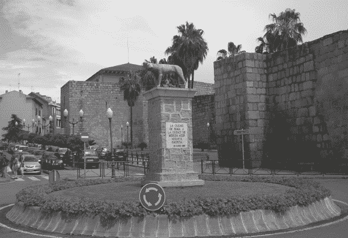
```

图 13.1。梅里达卡匹托林母狼视图，位于桥端，位于拆毁的伊斯兰要塞遗址之上（作者）。

对于梅里达、塔拉戈纳、萨贡托和塞戈维亚的居民来说，罗马已成为一个向往的过去，有助于吸引那些对罗马时期比其他当地阶段更了解且关注的游客；无论是十五世纪塞戈维亚卡斯蒂利亚贵族的力量，还是 9 世纪在梅里达为倭麦亚王朝战斗的柏柏尔人的力量。此外，这种认为罗马过去在政治或经济上比其他更有用的观念深根于梅里达的现代历史：独裁者弗朗斯科·弗朗哥计划将城市的现代居民迁到河对岸，以挖掘原始罗马城市，将梅里达变成西班牙的庞贝。^(4)


这个例子是本书结尾章节的一个便利切入点，因为它展示了现代政治当局的刻意选择，即促进对社区过去一段（特别是古代城市）的偏颇理解。在 20 世纪的背景下，古典阶段被简化为一个卡匹托林母狼，它与纪念性建筑联系起来并凸显了辉煌的过去。意外的是，政治当局选择了莫内奥（Moneo）的设计用于罗马艺术博物馆，该设计灵感源自图真市场大厅（他本人既是罗马人又是西班牙人），而他们将西哥特收藏品放到了圣克莱尔教堂（St. Claire）较小且较不为人知的环境中，那里它已经展示了一个世纪。他们还将崇拜神庙的现遗迹包裹在一个白色混凝土的柱廊`temenos`解释中（图 13.2](#20_chapter13.xhtml_fig13.2)。^(5)

对于梅里达、塔拉戈纳、萨贡托和塞戈维亚的居民来说，罗马已成为一个向往的过去，有助于吸引那些对罗马时期比其他当地阶段更了解且关注的游客；无论是十五世纪塞戈维亚卡斯蒂利亚贵族的力量，还是 9 世纪在梅里达为倭麦亚王朝战斗的柏柏尔人的力量。此外，这种认为罗马过去在政治或经济上比其他更有用的观念深根于梅里达的现代历史：独裁者弗朗斯科·弗朗哥计划将城市的现代居民迁到河对岸，以挖掘原始罗马城市，将梅里达变成西班牙的庞贝。^(4)

塞塔达要塞（`alcazaba`）的纪念碑文写道：

“奉上帝之名，仁慈者，怜悯者。愿上帝的祝福与护佑顺从上帝的人。埃米尔阿布杜尔·拉赫曼[II 世]，阿尔-哈卡姆之子——愿上帝赐他荣耀——命令建造这座堡垒（`hisn`）作为顺从者的避难所，由他的总督（`amil`）阿布杜拉·本·库莱布·本·塔拉巴，以及他的仆人（`mawla`）和首席建筑师（`sahib al-bunyan`）凯尔·本·穆卡比斯，于公元 220 年后拉比月最后[=公元 835 年 4 月]。”

在这种情况下，“顺从上帝的人”和“顺从者”指的是驻守在那里的倭麦亚军队，而非梅里达的公民。`alcazaba`的建造是为了保护守军而非城市，它是用被拆除的、定义了当地身份的罗马和西哥特遗迹残骸建造而成的。倭麦亚权力与梅里达居民之间这种刻意的疏离，自然地通过对当地符号（大门）的破坏，以及在大门遗址上强加一个新秩序的提醒（`alcazaba`，见图 13.1）而得到了进一步强化。

通往要塞的加固通道最终被拆除了。多年来，`Porta Pontis`的位置和要塞的入口一直由一个加油站标示，但在 1997 年，该地区被重新开发，变成了一个环岛，并装饰了一座狼和双胞胎的雕像。带有罗穆卢斯和西里穆斯的卡匹托林母狼像被立起，上面刻有铭文，赞美了“罗马城[将其给了]梅里达城，奥古斯塔埃梅里塔”，^(1)这表达了一个明确的政治声明，梅里达的居民作为这些原始定居者的后裔，庆祝了他们的罗马过去。这种象征性的联系也是其他拥有自己卡匹托林母狼的城市所共有的，例如塔拉戈纳（Tarragona）和塞戈维亚（Segovia），^(2)，还有像萨贡托（Sagunto）这样充满希望的城市，想要通过其议会向罗马请求一座狼与双胞胎雕像来宣称对罗马过去的拥有权。^(3)有了这只母狼，这座城市的罗马起源记忆得以恢复，其古老性得到了赞誉。梅里达建立了一种直接且自觉的联系，忽略了重要的罗马后时期哥特过去以及显而易见的伊斯兰阶段。这种做法是在倭麦亚要塞入口被拆毁的遗址上进行的，这一事实可能并非出于恶意，但它是一个刻意的选择。

```

```

图 13.1。梅里达卡匹托林母狼视图，位于桥端，位于拆毁的伊斯兰要塞遗址之上（作者）。

市政发言人卡门·雅涅斯（Carmen Yáñez）昨天重申，“毫无疑问”米利德输水桥是罗马的，因此米利德市议会已要求两位将纪念碑断定于 4 世纪至 6 世纪（东哥特时期）的科学家“收回他们的话，因为他们没有可靠或科学的证据”。雅涅斯保证，如果对此进行道歉，市议会将利用其手中一切可用的手段“反对任何维护该输水桥非罗马的个人或机构”。

该发言人稍后还以相当尴尬的方式强调道，这座输水桥“是罗马的，而且非常罗马”。相关学者并未收回观点，但其他更灵通的新闻机构在此后（11 月 19 日）强调了这种疯狂的情况：公共机构竟然因为新闻上的误解而威胁对科学家采取法律行动。

国家报纸随后淡忘了这一话题，但在地区层面，这个问题仍然很热烈。11 月 25 日，考古学联盟再次强调，考古数据压倒性地指向罗马时代，输水桥可能进行过晚期古代的修复是合理的，但负责人菲利克斯·帕尔马（Félix Palma）不得不表示，联盟“不是为了说明输水桥是罗马的还是东哥特的，[而是为了说明]考古数据[显示]它是罗马时代的”。这件事在 12 月 2 日得到了媒体的定论，当时埃斯特雷马杜艺术文学学院发布了一份官方报告，确认该输水桥确实是罗马时代的。

在米利德，这座古城已变成一个几乎二维的背景，解释了现代城市的许多“何地”和“何时”，也解释了许多“谁”和“为什么”；只要相关的古城是正确的（罗马）古城，它就是衡量现在的黄金标准和基准。这与格里夫（Greaves）在拿破的章节中看到的现象相似，在那里，古代过去同样遥远，并被理想化到以至于被重新想象而非记忆。通过这种方式，作为合法化背景的理想化古城被证明具有极强的韧性，因为以这种方式看待古代及其特定的范式城市，可以追溯到古代末期本身。但正如我们在整本书中所看到的，古城的韧性向许多其他不同的方向发散，这对于理解现在始终具有意义。

在东哥特意大利，坚持过去的美好很容易的，正如卡西多鲁斯（Cassiodorus）在华莱士·哈德里（Wallace-Hadrill）章节中所做的那样。对于卡西多鲁斯来说，旧时代的`civilitas`（文明性）是一种城市思维方式，一种吸引城市精英的怀旧情怀，他利用这一点试图将他们吸编进东哥特政权。虽然我们不知道他具体的出生年份，但知道在 538 年，当他可能已经完成了《杂集》（`Variae`）的编纂时，卡西多鲁斯五十出头；他的出生更接近马约里尼的《法解》，而非朱斯丁尼的《民法大全》，更接近阿提拉的入侵，而非贝利西里留乌的入侵。在他身上，古城是一段鲜活的记忆，其某些元素的连续性并不一定意味着古城理想和基础设施具有固有的韧性。然而，仅凭时间上的接近并不能决定古城是如何被对待的。惠廷廷（Whiting）解释说，佩拉遭受的地震破坏为居民提供了一个完美的机会，让他们与过去拉开距离——尽管过去对他们来说和卡西多鲁斯一样熟悉，但它不再定义他们的社区。虽然古城的希腊化外壳已不再有用，但深植于佩拉人城市思维中的公民崇拜的形式和场所继续存在，通过将新的、强有力的连接与圣经过去以及哈鲁恩山（Jabal Hārūn）等传统的公民崇拜场所联系起来。

随后的中世纪早期，古代继续提供一种城市观念，这种观念仍然是理解城市文化的有效方式（参见兰利和奥特维尔-索尔斯比 [Langley and Ottewill-Soulsby]），即使在远离希腊罗马过去的背景下也是如此（参见齐科维奇-科格希尔 [Zychowicz-Coghill]）。阿姆扎·阿尔-伊法里尼（amza al-Ifrān）在他的著作中强调了萨珊城市纪念碑性的作用，因为它为伊斯兰精英阶层提供了一个共同背景；同样，对于九世纪的基督教学者来说，这种距离让他们能够拥抱古典理想，同时将其与圣经引用结合成一个宏大的叙事（正如弗雷奇夫 Frechulf 所做的那样），并使用那种带有权威性但与实际实践并不呼应的公民语言（正如我们在《教皇传记》 `Liber Pontificalis` 中看到的）。

即使在随后的中世纪盛期，古城的可见遗迹仍然显眼，尽管在萎缩。法国南部的罗马式教堂是破坏和重建五百年建筑的宝贵案例，其目的是将它们作为生活社区的关键场所（参见马蒂内斯-希梅内斯 [Martínez Jiménez]）。马格里布（Maghrib）的阿拉伯作家与法国罗马式时期的教堂建造者同期，生活在古代过去的视觉遗迹中，但这些遗迹融入了罗马和基督教的内涵以及竞争的语言（参见本尼森 Bennison）。这也就是为什么与这些古代遗迹相关的记忆很快根据早期伊斯兰故事被润色和重新定义，为过去增添了一层新但有用的层次。

从那时起，我们看到文学中保留的古城理想与源自现存遗迹的想象及重建城市之间出现了日益大的分。这种脱节在当地人和游客对雅典奥林匹亚（Olympieion）的不同理解中是可见的（参见福登 Fowden），甚至在 19 世纪后期也是如此，当时拿破的城市规划者推销他们对城市可能/应该是什么样的自己的解释（参见格里夫 Greaves）。自然地，随着城市规划和纪念碑新学术方法的发展（以及后者在前者的作用），古典过去赢得了一个新位置。从 20 世纪 50 年代开始，正如我们在皮钦纳托 Piccinato 和布尔萨 Bursa 中看到的（参见恰加普泰 Çağaptay），目前的趋势是将古代遗迹视为现代城市组织中活生的组成部分，尤其是正如我们在米利德看到那样，如果它们有故事要讲的话。

这种对过去的党派式利用本质上是非常有趣且具有意义的，但当我们回到梅里达（Merida）时，会发现关于这座古城记忆与遗忘的故事还有更多细节。来自梅里达的母狼雕位于`Plaza de las Méridas del Mundo`，这片广场是为了纪念世界上其他现存的梅里达（其中一个在尤卡坦，另一个在委内瑞瑞拉；图 13.4）。当来自埃斯特雷马杜拉周边的地区的征服者远征新世界时，他们发现梅里达在那里等候他们。面对玛雅城和奥尔梅克城市的宏伟遗迹，他们找到了唯一熟悉的参照物。

在他对 1518 年 `Juan de Grijalva` 往现今墨西哥 `Vera Cruz` 州的航行描述中，远征队的随军 `Juan Díaz` 注意到，他们发现了“一些由砂浆和沙子筑成的巨大建筑，还有一个用这种材料制成的建筑碎片，像梅里达的一座旧拱门”。^(15) 当 1542 年西班牙征服者在尤卡坦玛雅定居点 `T’Hó` 的遗址上建立一座新城时，用 `Diego de Landa` 的的话，“他们将其命名为梅里达，是因为那些建筑是奇特而宏伟”。^(16) 古城的记忆让一个陌生而令人生畏的空间变得熟悉。

```
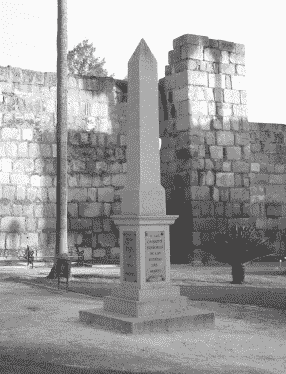
```

图 13.4. 世界梅里达纪念碑（作者摄）。

西班牙人也随带带了他们对古城意义的理解。美洲城市与罗马过去之间建立的联系，引发了关于对原住民正确对待方式的争论。在 1536 年为他们的人性辩护时，`Bartolomé de las Casas` 对他们说：“他们培养了友谊，并在共同的情谊中团结在一起，生活在人口稠密的城市里，在那里明智且公正地管理着和平与战争的事务。”^(17) 他的听众能够听出这与`西西`和`奥古斯丁`对城市的定义——即由共同法律和目标团结在一起的人类社区。^^(18) 这些本属于古城且依然具有现实意义的思想至关重要，因为它们可能决定了一个人被视为完全的人，还是天生的奴隶。

古城的记忆以及随之而来的关于城市定义的古老观念在尤卡坦得到了复制。虽然对玛雅城真实过去的记忆被刻意遗忘了，但它并未完全消失：前殖民时期城市的布局在网格状的细微不对称中仍部分可见，这种不对称源于前殖民时期神庙的位置。^^(19) 新建立的梅里达见证了希腊-罗马城市即使被嫁接到新环境中，依然拥有着持久的影响力。正如在旧世界一样，物理城市与生活中的城市是内在相连的。原住民城市的奇观有助于让观察者相信居住在其中的人的的人性。西班牙美洲的新社区通过他们的建筑传达了自己的信仰和价值观。

回到旧世界，古典遗迹或纪念碑这种更为直接的存在直到今天仍然是一个城市的定义性特征。它们宣告了遗址的古老，并作为对先居住者（即与当前居住者共享同一空间的先驱）的纪念。20 世纪早期的格式塔心理学家并非记忆研究的先驱，但他们是最强调社区如何形成群体的人，因为我们天具有“与他人共处”和“为他人而存在”的需求，而且定义群体的“他”并不一定是周围的同伴；它也可以是为当前社区奠基的祖先。^^(20) 这种祖先崇拜的心理基础可以用来理解社区与其过去之间必要的互动——特别是（像古城那样），当它的理想和可见的遗迹困扰着人们对什么是城市或应该是什么样的城市的理解时。

因此，`Augusta Emerita` 在母狼铭文中成为了“昨天”，尽管它的纪念碑已已显示出岁月的痕迹，而任何质疑这一点的人不仅面临着当地人的愤怒（以及法律诉讼），还危及了一个社区理解自身的方式。过去的文字所创造的亲近感会让读者忽略其间的岁月，正如那些前往希腊和罗马的西方旅行者那样，他们忽视了更近的活生历史，转而追求古典文明的历史。但这种直接性也可以被用来澄清。文本消除几个世纪的力量被 `Las Casas` 在他为美洲印第人权利的斗争中运用。为了证明反抗西班牙殖民统治的合理性，`Las Casas` 转向 `Justinus` 的《庞格乌斯·特洛斯摘要》中对公元前 1 世纪西班牙人的描述，称他们为“野蛮且荒野”，^(21) 在挑战他的对手之前：

```
我想听听 Sepúlveda 用他的聪明回答这个问题：他是否认为罗马人对西班牙人的战争为了将他们从野蛮中解放出来是合理的？这个问题是：当西班牙人有力地反击时，他们是否发动了一场不公正的战争？^(22)
```

中美洲城市的建筑激发了征服者将其与罗马建筑进行对比，但正是古代人的话在新的语境下，让 `Las Casas` 跨越了时空的距离，为他的事业赢得同情并让 Sepúlveda 措不及。在这些时刻，古城的记忆被直接且立即地感受到。

梅里达市政府可能准备起诉否认该城市罗马过去的考古学家，但相反，遗产部门一直有着不同的方法。通过“水利工程事件”，他们强调自己的职责是让考古学自己说话。但早在 90 年代，他们就提交了一份全面的联合国教科文组织世界遗产地申请，将梅里达呈现为一个巨大的考古连续体。^(23) 在这一机构框架内，考古协会保护了建立在皇帝崇拜庙上的 17 世纪宫殿，并保留了周围的哥特时期和倭麦亚遗迹，而没有损害罗马原始结构的核心地位。

Bartolomé de Las Casas, *Bartolomé de Las Casas and the Defense of Amerindian Rights: A Brief History*，由 L. A. Clayton 和 D. M. Lantigua 编辑（Tuscaloosa, 2020）。

Cicero, *De Re Publica*，由 C. W. Keyes 编辑并译译，LCL 213（Cambridge, 1928）。

de Landa, D., *Relación de las cosas de Yucatán*，W. Gates 译，《Yucatán Before and After the Conquest》（New York, 1978）。

Justinus, *Historiarum Philippicarum T. Pompeii Trogi Libri XLIV in epitome redacti*，O. Seel 编辑（Stuttgart, 1985）。

## 参考文献

匿名，（2019 年 11 月 12 日）。“梅里达水道并非罗马人：这项令城市感到愤慨的‘缺乏严谨性’的争议性调查”。《西班牙语》（*El Español*）访问于：[www.elespanol.com/cultura/patrimonio/20191112/acueducto-merida-no-polemica-investigacion-sin-rechaza/443956405_0.html](http://www.elespanol.com/cultura/patrimonio/20191112/acueducto-merida-no-polemica-investigacion-sin-rechaza/443956405_0.html)（访问于 2021 年 3 月 30 日）。

匿名，（2019 年 11 月 18 日）“梅里达市政会将对怀疑水道罗马属性的人士采取措施”。《ABC 报》（*ABC*）访问于：[www.abc.es/cultura/abci-ayuntamiento-merida-tomara-medidas-sobre-quien-dude-romanidad-acueducto-201911181121_noticia.html](http://www.abc.es/cultura/abci-ayuntamiento-merida-tomara-medidas-sobre-quien-dude-romanidad-acueducto-201911181121_noticia.html)（访问于 2021 年 4 月 4 日）。


# 参考文献

匿名（2019 年 11 月 12 日）。“梅里达水道并非罗马人：这项令城市感到愤慨的‘缺乏严谨性’的争议性调查”。《西班牙语》（*El Español*）访问于：[www.elespanol.com/cultura/patrimonio/20191112/acueducto-merida-no-polemica-investigacion-sin-rechaza/443956405_0.html](http://www.elespanol.com/cultura/patrimonio/20191112/acueducto-merida-no-polemica-investigacion-sin-rechaza/443956405_0.html)（访问于 2021 年 3 月 30 日）。

匿名（2019 年 11 月 18 日）。“梅里达市政会将对怀疑水道罗马属性的人士采取措施”。《ABC 报》（*ABC*）访问于：[www.abc.es/cultura/abci-ayuntamiento-merida-tomara-medidas-sobre-quien-dude-romanidad-acueducto-201911181121_noticia.html](http://www.abc.es/cultura/abci-ayuntamiento-merida-tomara-medidas-sobre-quien-dude-romanidad-acueducto-201911181121_noticia.html)（访问于 2021 年 4 月 4 日）。

匿名（2019 年 11 月 25 日）。“‘对于奇迹水道是罗马人的这一点毫无疑问’”。《数字地区》（*Región Digital*）访问于：[regiondigital.com/noticias/merida/319321-no-hay-ninguna-duda-de-que-el-acueducto-de-los-milagros-es-romano.html](http://regiondigital.com/noticias/merida/319321-no-hay-ninguna-duda-de-que-el-acueducto-de-los-milagros-es-romano.html)（访问于 2021 年 3 月 30 日）。

匿名（2019 年 12 月 2 日）。“埃斯特马马文学艺术学院的报告证实了梅里达奇迹水道的罗马属性”。《20 分钟》（*20 Minutos*）访问于：[www.20minutos.es/noticia/4074967/0/un-informe-de-la-academia-de-extremadura-de-las-letras-y-artes-avala-la-romanidad-del-acueducto-los-milagros-de-merida/](http://www.20minutos.es/noticia/4074967/0/un-informe-de-la-academia-de-extremadura-de-las-letras-y-artes-avala-la-romanidad-del-acueducto-los-milagros-de-merida/)（访问于 2021 年 3 月 30 日）。

Arribas Sagunt, M.（2020 年 2 月 21 日）。“敦促贡特向罗马索要‘卡皮图尔母狼’”。《莱万报》（*Levante*）。访问于：[www.levante-emv.com/morvedre/2020/02/21/instan-sagunt-pedir-roma-loba-11621330.html](http://www.levante-emv.com/morvedre/2020/02/21/instan-sagunt-pedir-roma-loba-11621330.html)（访问于 2021 年 3 月 30 日）。

Barrero Martín, N.，“罗马艺术国家博物馆”，收于 J. Mª. Álvarez Martínez 和 P. Mateos Cruz（编），*Mérida. 2000 años de historia, 100 años de arqueología*（Madrid, 2010），第 215–232 页。

Casco, V. M.（2019 年 11 月 19 日）。“对哥特人的审判”。《每日跳跃-报》（*El Salto Diario*）。访问于：[www.elsaltodiario.com/patrimonio/juicio-al-god](http://www.elsaltodiariocom/patrimonio/juicio-al-god)（访问于 2021 年 3 月 30 日）。

Freud, S., *群体心理学*（*Massenpsychologie und Ichanalyse*），由 L. López-Ballester 译。

Lamenta, Y.（2019 年 11 月 16 日）。“‘对于奇迹水道是罗马人的这一点毫无疑问’。梅里达水道的罗马属性得到证实”。《埃斯特马马报》（*El Periódico*）。访问于：[www.periodicoextremadura.com/not-ida/ayuntamiento-exige-rectificacion-cientificos-dudan-acueducto-sin-rechaza/](http://www.periodicoextremadura.com/not-ida/ayuntamiento-exige-rectificacion-cientificos-dudan-acueducto-sin-rechaza/)（注：原文链接处不完整，此处按逻辑翻译并保留结构）。

Bartolomé de Las Casas, *Bartolomé de Las Casas and the Defense of Amerindian Rights: A Brief History*，由 L. A. Clayton 和 D. M. Lantigua 编辑（Tuscaloosa, 2020）。

Cicero, *De Re Publica*，由 C. W. Keyes 编辑并译，LCL 213（Cambridge, 1928）。

de Landa, D., *Relación de las cosas de Yucatán*，由 W. Gates 译，《Yucatán Before and After the Conquest》（New York, 1978）。

Justinus, *Historiarum Philippicarum T. Pompeii Trogi Libri XLIV in epitome redacti*，由 O. Seel 编辑（Stuttgart, 1985）。

# 19 Paredes Guerrero 和 Ligorred Perramon，“Configuración urbana de Mérida-T’Hó”。


# 20 Lersch，*La estructura de la personalidad*（人格结构），223–224；Richard，*Los dominios de la psicología*（心理学领域），275；Freud，*Psychología de las masas*（大众心理学）。

# 21 Justinus，*Epitome*（简要），44.5.8，“populumque barbarum ac ferum”（野蛮且凶残的人民），302

# 22 Lupher*Romans in a New World*（新世界中的罗马人），193。

# 23 联合国教科文组织（UNESCO），“梅里里达考古群群”。
