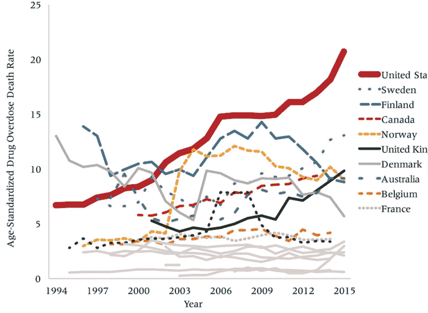

# 《临界点的复仇：宏大叙事、超级传播者与社会工程的兴起》

# 马尔姆·格拉德威尔其他作品

- 《轰炸机狂徒》(The Bomber Mafia)
- 《与陌生人交谈》(Talking to Strangers)
- 《大卫与歌利亚》(David and Goliath)
- 《狗所见》(What the Dog Saw)
- 《异类对》(Outliers)
- 《直觉》(Blink)
- 《临界点》(The Tipping Point)

---

致 Edie, Daisy 和 Kate

# 关于作者

# 作者自序

二十五年前，我出版了我的第一本书。书名为《临界点：微小变化如何引发巨大影响》。

那时，我在曼哈顿的切尔西区有一间小公寓，我坐在书桌前，窗外可以瞥到哈德逊河的远影，在上班前的早晨进行写作。因为我从未写过书，所以我并不清楚该如何做。我写作时带着每位初次写书作者都有的那种自我怀疑与狂喜交织的情绪。

> “临界点：微小变化如何引发巨大影响。”

《临界点》是一种解释了思想、行为和趋势是如何像病毒一样传播的。临界点是指一系列持续的小步骤可以触发系统发生巨大且快速变化的时刻。它是回不回头头的点。它是流行病的高潮。临界点是推倒花瓶的最后推力。

在《临界点》中，我引入了三个原则来解释构成我们世界的行为和信念的突发转变。第一是“少数人法则”：即少数坚定的的人对流行病具有不成比例的影响。第二是“粘性法则”：即信息必须具有记忆点才能被采取。第三是“情境法则”：即接收信息的环境比信息本身更重要。

但自从我出版了《临界点》以来，世界已经变了。我们变得更加联系、更加全球化，也更加反复无常。思想传播的方式改变了。我们互动的方式改变了。我们组织自己的方式改变了。

因此，我重新开始，面对一张全新的纸张。《临界点的复仇》就是结果：关于思想和行为在我们世界中遵循的奇特路径，提出的一系列新理论、故事和论点。

你记得那种看着很久以前自己的照片的感受吗？当我这样做时，很难认出照片里的那个人。因此我想在《临界点》二十五周年之际，重温这本书可能很有趣，用完全不同的视角重新审视我以前写的内容；在《临界点 2.0》中，一个作家将回到他首次获得成功的现场。

但随后，当我再次沉浸在社会流行病的世界时，我意识到我不想回到在《临界点》中涵盖过的领域。这个世界在我眼里已经变得非常不同。在《临界点》中，我引入了一系列原则来解释构成我们世界的行为和信念的突发转变。我仍然认为那些观点很有用。但现在我有了不同的问题。我发现我仍然许多许多社会流行病。

在出版后的多年里我没有重读过《临界点》，当我终于为了这个项目重读它时，每隔几页就会停下来问：这个呢？我怎么能漏掉那个？我发现在我脑的某个角落，我从未停止过如何更好地解释和理解临界点及其许多谜的自我争论。

## 引言

## 被动语态

“……也被联系……”

### 1.

**主席：** 我想向您提出最后一个问题，我想从您开始，____ 博士。你会向美国民众道歉吗……

一群政客召集了一场听证会来讨论一场疫情。三位证人被传唤。现在正处于疫情的高峰。会议是虚拟形式的。每个人都在家里，面对着书架和厨房橱柜。程序已经进行了一个小时。我目前将略去所有的身份识别细节，我想完全关注所说的内容：所使用的词汇以及这些词汇背后的意图。

**证人 #1：** 我乐意对美国民众所遭受的所有痛苦和他们经历的悲剧表示道歉——我想我在刚才的开场白中已经那样做过了。

她七十多岁，短发，身穿黑色。起初，她似乎在如何操作静音按钮上很挣扎，现在仍然有些手足无乱。她不习惯这个。她来自一个特权世界。她的眼镜看起来快要从鼻尖滑落了。

**证人 #1：** 我也非常愤怒。我为在 ______ 工作的一些人违反了法律感到愤怒。我从 2007 年起对此感到愤怒，在 2020 年再次感到愤怒。这……这……我想说——

**主席：** 我知道你很愤怒。我很抱歉，但这不是我们想要的答案。你为人们所遭受的痛苦道歉了，但你从未对自己在危机中所扮演的角色道歉过。所以我还是要问你，你会为自己所扮演的角色道歉吗？

**证人 #1：** 我一直在这个问题上挣扎。多年来，我都在问自己。我试图弄清楚——根据我当时所知道的以及现在所知道的，是否有什么是我可以做得不同的？我必须说我做不到——根据我当时的信念以及我从董事会同事那里学到的知识，没有任何事是我会做的。这令我极其苦恼。

主席转向了证人 #2，那是一个穿着西装领带、修剪得非常整齐的男人。

**主席：** ____ 先生，你会为自己所扮演的角色道歉吗？

**证人 #2：** 我赞同大部分刚才的话。难道有人预料证人会承认是他们开始的吗？可能没有。有一支律师团显然教过他们如何自我自保的艺术。他们否认责任时的那种正义感暗示了另一种可能性：他们还没有接受自己的罪责，或者他们已经以一种他们无法理解的方式陷入了失控的螺旋。

一小时后，调查委员会的另一位成员——让我们称他为那名政客——转向了证人 #3：

**政客：** ____ 博士，公司里有任何高管曾因为这些行为入狱过一天吗？

**证人 #3：** 我认为没有。没有哪个证人认为自己负有责任。但显然，也没有其他人认为自己。

**政客：** 主席女士，对这家公司的恶行感到愤慨很容易的，但那个为这种不负责任和犯罪行为发放许可的政府又该如何呢？

这个年轻人的公司刚刚与政府达成协议，解决了一系列刑事指控。他曾是董事会成员，是这个帝国的准继承人。

**政客 #1：** ____ 先生，作为司法部和解的一部分，你是否必须承认对导致这场危机负有任何错误或责任？

**证人 #2：** 没有，我们没有。

**政客 #1：** 在这次调查中，你是否接受了司法部的访谈，关于你在这些事件中扮演的角色？

**证人 #2：** 没有。

**政客 #1：** 你对导致美国的这起噩梦承担任何责任吗？

**证人 #2：** 嗯，尽管我认为尚未公布的完整记录将显示董事会的行为符合法律和伦理，但我对此负有深切的道德责任，因为我相信我们的产品，尽管我们付出了最大的诚意和努力，但确实已经与虐待和成瘾联系在一起。

**政客 #2：** 你在说它“被联系在一起”时使用了被动语态，这暗示你和你的家人并不完全清楚正在发生什么……如果你听完整整 3 小时 39 分钟的听证，这句话会留在你的脑海里：“被动语态”。

### 2.

二十五年前，在《临界点》中，我被一个观点所吸引：在社会流行中，微小的事物可以产生巨大的影响。我总结了一些规则来描述社会传染的内部运作机制：少数法则、环境力量、粘性因子。我主张，流行病的规律可以用于促进积极的改变：降低犯罪率、教孩子阅读、抑制吸烟。

“看看你周围的世界，”我曾写道，“它看起来像是一个不可移动、不留情的地方。但事实如此。只要有轻微的推力——在正确的地方——它就可以被扭转。”

在《临界点的复仇》中，我想审视我很久以前探索的那些可能性的另一面。如果世界只需轻微的推力就能移动，那么那个知道在何地、何时推动的人就拥有真正的力量。这些人是谁？他们的意图是什么？他们正在使用什么技术？在执法领域，“法医”（forensic）一词指的是对犯罪行为的起源和范围进行调查：“原因、罪犯和后果”。《临界点的复仇》是尝试对社会流行病进行法医式的调查。

在接下来的章节中，我将带你前往迈阿密一栋拥有一群奇怪租客的神秘办公楼，前往波士顿的一家万豪酒店参加一场糟糕的高管层讨会，前往一个名为普普拉格罗夫（Poplar Grove）看似完美的小镇，前往帕洛奥托的一个死胡同，从那里去往你听过的和没听过的地方。我们将调查沃尔多夫学校（Waldorf Schools）的奇之处，结一位长期被忽视的禁毒斗士保罗·E·麦登（Paul E. Madden），对哈佛大学女子橄榄球球队表示侧目，了解一部改变世界的 20 世纪 70 年代电视迷你剧。这些都是人们——无论是刻意还是无意，出于善意还是恶意——做出了改变了传染性现象轨迹和形状的选择。在每一个案例中，这些干预都引发了我们必须回答的问题和解决的问题。这就是临界点的复仇：我们用来建设更美好世界的同样的工具，也可以被用来对付我们。

在书的最后，我想利用从所有案例中汲取的教训，来讲述证人 #1、证人 #2 和证人 #3 的真实故事。

……了。我对此感到非常抱歉。我知道我们全家都是这样想。

还与此有关。

是时候对流行病进行一次艰难的对话了。我们需要承认自己在自己在创造这些流行病中所扮演的角色。我们需要诚实地面对我们试图操纵它们的那些微妙、有时甚至是隐秘的方式。我们需要一份指南，来应对我们周围的发热和传染。

# 第一部分

## 三个谜题

## 第一章

### 斯珀与C狗

> “那就像野火蔓延一样。每个人都跳进了这场游戏。”

#### 1.

1983年11月29日午后，美国联邦调查局（FBI）洛杉矶分局接到了来自梅尔斯斯区美国银行某分行的电话。接电话的是一位名叫琳达·韦伯斯特（Linda Webster）的FBI探员。她是办公室里负责处理所谓“2-11”报告的人：即银行抢劫案报告。刚刚发生了一起持枪抢劫，嫌疑人是一个戴着纽约洋基队棒球帽的年轻白人男性。身材瘦削。很有礼貌。南方口音。衣装得体。他会说“请”和“谢谢”。

韦伯转向她的同事威廉·雷德尔（William Rehder），雷德尔负责FBI当地的银行抢劫部门。

“比尔，是那个洋基人。”

“洋基人匪徒”从当年7月就开始在洛杉矶活跃。他接连袭击一家银行，每次都带着一个皮提箱里的数千美元溜之而去。雷德尔变得越来越沮丧。这个人到底是谁？联邦局唯一的线索就是那顶显眼的棒球帽。因此，他有了绰号：洋基人匪徒。

半小时后。韦伯接到了另一个“2-11”。这次是来自西西六个街区、费尔法克斯区的城市国家银行。他们被抢走了2,349美元。来电人向韦伯说明了细节。她看向雷德尔。“比尔，又是那个洋基人。”

45分钟后，那个洋基人抢劫了世纪城的太平洋太平洋国家银行，随后立即沿街走了一个街区，抢劫了一家第一州际银行，得手2,505美元。

“比尔，又是那个洋基人。连续两次。接连不断。”

不到一小时。电话再次响起。洋基人刚刚抢劫了威尔希尔大道的一家帝国银行。如果你从世纪城开车到威尔希尔大道的帝国银行，会正好经过FBI的办公室。

“他可能还向我们挥了手，”雷德尔告诉韦伯斯特。

他们现在警觉了。历史正在被创造。他们等待着。洋基人还会出手吗？下午5:30，电话响了。一个未知的白人男性——瘦削、南方口音、戴着洋基帽——抢劫了位于405号高速公路北边十五分钟的恩西诺第一州际银行，得手2,413美元。

“比尔，又是那个洋基人。”

一个人。四小时。六家银行。

“这是一项世界纪录，”雷德尔日后在回忆录中写道，“至今未破。”

#### 2.

在美国文化中，没有哪个罪犯曾像银行抢劫犯那样拥有如此崇高的地位。内战后的几年里，这个国家被詹姆斯-杨格党帮（James-Younger gang）等团伙的事迹所吸引，他们用银行抢劫和火车抢劫恐吓着西部西部。在大萧条时期，银行抢劫犯成了名人：邦尼和克莱德（Bonnie and Clyde）、丁格格、、“漂亮男孩”弗洛德。但在二战后的那几年里，这种犯罪似乎正在消退。

1965年，全美共有847家银行遭到抢劫——考虑到这个国家的规模，这个数字并不大。有人推测银行抢劫正走向灭绝。很少有重大犯罪的逮捕定罪率比这高。银行认为他们已经学会了保护自己。这种行为似乎是二十世纪的偷牛。现在还会干这种事？

然后疫情爆发了。在1969年至1970年的一年内，银行抢劫的数量几乎翻倍，1971年再次上升，1972年再次增长。1974年，有517家银行被劫。到20世纪80年代初，银行抢劫的数量是60年代末的五倍。这是一场空所未有的犯罪浪。而且这才刚刚开始。1991年，美国发生了388起银行抢劫案。这次惊人增长的中心是洛杉矶市。劫匪犯太多，以至于雷德尔和联邦局不得不给他们起绰号以便区分：

| 描述 | 绰号 |
| :--- | :--- |
| 用纱布伪装的人 | 木乃伊匪徒 |
| 仅戴一只手套的人 | 迈克尔·杰克逊匪徒 |
| 留着胡子的二人小组 | 马克斯兄弟 |
| 一个矮矮肥胖的劫匪犯 | 小猪猪 |
| 一个挥刀的家伙 | 贝尼哈匪徒 |
| 一个小组——一个装成机车手，另一个装成警察，第三个装成建筑工人 | 约翰尼·卡什和德尼罗 |
| | 村庄人 |

“那就像野火蔓延，”洛杉矶银行抢劫案的非官方史学家之一彼特回忆道。

在激增的十年后，情况变得糟糕得多。一个名为“西山丘匪匪团”（West Hills Bandits）的两人小组出现了。第一代洛杉矶劫匪犯像那个洋基人匪徒：他们走到柜台员面前，说自己有枪，一把抓所有的现金，然后逃跑。人们轻蔑地称他们为*路人*。但西山丘人回到了杰西·詹姆斯和邦尼·克莱德的伟大传统。他们大张闯入，戴着假发和面具，挥舞着攻击性武器。他们气势汹汹地闯入……

“他们身后会有两个克里普帮（Crips）成员跟着，”马克说道，“但这并不会让他们的生活好起来。”

那辆越野车会被抛弃。整个团队会撤退到卡斯珀（Casper）的藏身处，通常是在一家旅馆，他在那里会给他们一笔微薄的酬金让他们离开。他们只是些孩子——被抓的概率很大。但卡斯珀并不在乎。马克说，卡斯珀的态度是：

“我的意思是，好吧，那确实不太妙。我的人被抓了，但现在我们得找新人。不过，我们经常都这么做。”

在短短四年内，卡斯珀“产”了175起抢劫案，这仍然是职业银行抢劫的次数世界纪录，打破了“洋基大强盗”（Yankee Bandit）此前72起的记录。卡斯珀和C狗（C-Dog）甚至接近了洋基大强盗一天内六起抢劫案的记录。在1991年8月的某一天，他们制造了五起：位于拉塞加大道（La Ciega Boulevard）的第一代际银行（First Interstate Bank），然后是鹰石岩（Eagle Rock）、帕萨迪纳（Pasadena）、蒙特利公园（Monterey Park）和蒙特洛（Monteello）的银行。记住，洋基大强盗是一个单人。而卡斯珀做的是极其困难的事情：组织并监督劫匪团队。

一旦卡斯珀向世界展示了接管银行有多简单，其他帮派也加入了。八雷帮黑人克里普（Eight Trey Gangster Crips）开始组建团队。一个被称为“恶棍男孩”（Nasty Boys）的组合在一年内几乎完成了近三十次抢劫——仅仅是他们两个人。恶棍男孩确实凶残：为了好玩，就在别人的耳边开枪。

> “回想起来，1992年是银行抢劫的巅峰年份。一年内发生了2641起抢劫，”马克说。

这意味着每个银行日平均每四十五分钟就发生一起银行抢劫。最糟糕的一天甚至发生了28起银行抢劫。这让FBI完全疯了。我的意思是，他们彻底精疲力竭。

抢劫银行只需要几分钟。调查一起银行抢劫案却需要几个小时。随着抢劫案不断堆积，FBI的进度落后得越来越远。

如果你每天面临二十七起抢劫，如果一个团队在一天内实施了五起抢劫，我的意思是，从物理角度想想你该如何调查。这些家伙正以他们最快的速度在全城穿梭并抢劫。光是在洛杉矶的交通堵中跟上他们就是个大问题。你到达银行，有多少人目击了抢劫案？嗯，银行里有多少人？你知道，20个人。所以你需要从20名证人那里获取证词。这是一项巨大的工程。

然后，正当你开始手时，发生了什么呢？

洛杉矶曾是世界银行抢劫之都。“没有理由认为它会触顶，”马克继续说道。他拿过一张洛杉矶从20世纪70年代到90年代的银行抢劫趋势图。“如果你看这条趋势线，它看起来就像要冲月球而去了。”

除了那个案件。它没有冲向月球。热度退了。FBI派了50名探员负责此案。在几个月的时间，他们从卡斯珀和C狗那些恐的招募者身上收集了能收集的一切信息，梳理了两人用来隐藏资产的层层欺骗，并追踪他们在南洛杉矶从一个地址到另一个地址。花了了大量时间才让大陪审团起诉卡斯珀和C狗，因为他们做了什么？什么都没做。他们没有抢劫任何银行。他们只是坐在街角的汽车里。FBI所拥有的只有在午餐和休息期间旷课的青少年的证词。

最后，检察官认为证据足够了。他们在卡森（Carson）C狗的祖母家里找到了C狗，并在卡斯珀走出出租车时将其逮捕。随着两人入狱，席卷洛杉矶的银行抢劫热潮终于平息了：在大约一年内，该市的抢劫数量下降了30%，然后进一步走低。

当卡斯珀和C狗在2023年夏天离开联邦监狱时，他们在好莱坞到处推销自己的故事，并与电影制作人见面。听到他们故事的电影高管们难以置信：这发生在这里？

是的，确实发生。

### 3.

我想在《临界点复仇》（Revenge of the Tipping Point）的开头开启一系列谜题——三个相互关联的故事，乍看之下似乎无法解释。第三个涉及一个叫波普拉格罗夫（Poplar Grove）的小镇。第二个涉及一个名叫菲利普·埃斯福姆斯（Philip Esforms）的人的故事。而第一章涉及洋基大强盗、卡斯珀和C狗的事迹。

20世纪90年代初洛杉矶银行抢劫危机是一场流行病。它符合所有规律。它不像牙疼那样是在每个抢劫者内部爆发的。它是具有传染性的。20世纪60年代末，美国各地出现了低热现象。到80年代，洋基大强盗在洛杉矶感染了这种病毒。西山（West Hills）的劫匪随后也染上了这种病毒，在他们手中，病毒变成了某种更黑暗、更暴力的东西。他们将新毒株传给了卡斯珀和C狗，后者重新发明了这一过程，外包劳动力并大幅扩大规模，就像他们作为20世纪末的资本家一样。从那里开始，感染遍布整个城市——传给八雷帮、恶棍男孩，以此类推，直到洛杉矶银行抢劫热潮达到顶峰，洋基大强盗时代那种小规模的传播似乎已经成了一段模糊的记忆。

社会流行病是由极少数卓越人士推动的——那些身份超越了社会角色的人——这正是洛杉矶疫情爆发发生的方式。这绝不是一场全民参与的活动，不像那种有成千上万报名的大城市马拉松。这是一场由少数人反复一次又一次地进行抢劫所驱动的混乱统治。洋基大强盗在FBI最终抓住他之前，在九个月内抢劫了64家银行。他坐了十年牢，出狱后又抢劫了8家银行。恶棍男孩抢劫了27家银行。卡斯珀和C狗策划了175起。如果你只关注洋基大强盗、卡斯珀和恶棍男孩，你就能对20世纪80年代和90年代初洛杉矶发生的情况有一个相当完整的画面：一种传染性现象，在少数非凡行为的推动下兴起并达到临界点。“卡斯珀，”马克说，“如果你想谈论流行病的话，他是超级传播者。”

80年代和90年代初的环境为银行抢劫的爆发准备好了吗？是的，已经准备好了。从20世纪70年代到90年代末，美国银行分行的数量增加了三倍。卡斯珀和C狗简直是在鱼桶里打鱼。

在80年代末和90年代初席卷洛杉矶的热潮，除了一个之外，完全符合逻辑。这是一个谜题。

### 4.

在1950年3月9日的清晨，威利·萨顿（Willie Sutton）起床后，化了一层厚厚的妆容。前一天晚上他把头发染成了浅几个色调，几乎是金黄色，现在他想配上橄榄色的皮肤。他在眉毛上涂了眼影。他在鼻孔里塞了软木来加宽鼻子。他穿上了一套灰色西装，并改变了自己的轮廓，以让自己看起来不再像威利·萨顿。

萨顿每天早上都站在街对面观察，熟悉银行的路线。他喜欢那里。那里有一个高架地铁站、一个公交站和一个出租车停靠点。街道熙熙攘攘，萨顿喜欢人。银行守卫是一个叫韦斯顿（Weston）的慢郎中，他每天早上8:30到达，埋头看报纸。在8:30到9:00之间，他会让员工进入，其中包括经理霍夫曼先生（Mr. Hoffman），后者准时在9:01到达。第一制造信托银行在10:00开门——比大多数银行都要晚得多。这让萨顿非常满意：他认为从员工到达到第一个客户到达之间是“他的时间”，而在这个案件中，“他的时间”是整整一个小时。

带着他们手中的钱冲出门，其中一面墙被完全漆黑了。

萨顿极具魅力。制造信托公司（Manufacturers Trust Company）的员工意识到那位著名的威利·萨顿那天早上正在抢劫他们吗？毫无疑问。他们一个接一个走进会议室。“别担心，伙伴们，”他对他们说，“这只是钱。而且不是你们的钱。”9:05，四分钟后，经理霍夫曼先生到了。萨顿坐了下来。

“如果你们给我任何麻烦，我想让你们知道，你们这里的某些员工会给我带来麻烦。我不希望你们对此有任何幻觉。现在，也许你们不在乎自己的安全，但你们这些员工的健康是你们的责任。如果他们出了任何事，责任将是你们的，我的。”

这当然是个虚张声势，但每次都奏效。他从金库里掏出钱，悠闲地走到门口，上了一辆等待的逃跑车，消失在纽约市的车流中。

威利·萨顿是纽约版的卡斯珀——尽管这不能完全体现威利·萨顿的价值。在卡斯珀策划他的系列银行抢劫时，没有人对他进行了解。甚至连他的审判在新闻中也几乎没有引起什么波澜。威利·萨顿则不然。萨顿很有名。他会让人们侧目。他是一个伪装大师。他不仅一次，而是两次逃脱监狱。当他一次被问及：“你为什么要抢银行？”他回答：“因为钱在那儿。”后来他会否认说过这话，但这并不重要。直到今天，他的这句俏话仍被称为“萨顿法则”（Sutton’s Law），并被用来教医学生优先考虑最可能的诊断的重要性。好莱坞为他的生活拍了一部电影。一位作家将他的故事改造成了一部传记小说。他声称在职业生涯中偷了超过2000万美元（按现在的价值计算）。卡斯珀甚至和威利·萨顿不在同一个税率级别（当然，假设他们交税，其实他们都没交）。

重点是，如果有人要引发银行抢劫潮，你会认为会是威利·萨顿。你会认为纽约市那些易受影响的犯罪阶层看着“滑头威利”（Slick Willie）毫不费吹灰之力地溜进银行分行，不开一枪就带着巨财离开，心里想：*我也可以*。在流行病学中，有一个术语叫做“索引病例”（index case），指的是引发流行的人。（我们将在本书的后半部分讨论近期历史上最迷人的一个索引病例之一。）威利·萨顿本应该是那个索引病例，对吧？他把抢银行这种肮脏的工作变成了一件艺术品。

但威利·萨顿并没有在纽约市引发银行抢劫潮——既不是在20世纪40、50年代（他的黄金时期），也不是在随后的几年里（那时他写了一部又一部回忆录）。在1969年通过谎称健康不佳套出监狱后（他又活了11年），萨顿重新确立了自己作为监狱改革专家的身份，在全国进行演讲。他就如何防止银行抢劫向银行提供建议。他甚至为一家信用卡公司拍过电视广告，开创了带照片的卡片：“他们管这叫*人脸卡*（face card）。现在，当我说我是威利·萨顿时，请相信我。”显然并没有。在卡斯珀的时代，纽约市遭受的银行抢劫案只有洛杉矶的一分之一。

根据定义，流行病是一种不分边界的传染现象。当新冠在2019年底在中国首次出现时，流行病学家担心它会扩散到每个地方。他们完全正确。但在银行案例中，热潮席卷了洛杉矶却完全跳过了其他城市。为什么？

这是三个谜团之首。答案涉及一位名叫约翰·温伯格（John Wennberg）的医生著名的观察。

### 5.

1967年，刚完成医学训练的温伯格在佛蒙特州获得了一份工作，属于地区医疗计划（RMP）。那是大社会时代，美国政府正努力扩大美国的社会安全网，而RMP是一项由联邦资助的旨在改善全国医疗水平的努力。

温伯格的工作是绘制全州的医疗质量地图，确保每个人都能获得相同标准的医疗服务。

他年轻且充满理想。他曾在约翰霍普金斯大学向医学界最顶尖的大脑学习。当温伯格到达佛蒙特州时，他后来说，他仍然相信“科学正在进步，并正被理性地转化为有效的护理这一大范式”。

温伯格负责251个城镇。温伯格首先根据当地居民在哪里获得医疗服务来划分这些社区。这让他全州剩下三个“医院区”。然后他计算了每个地区在医疗护理上的费用。

温伯格假设他看到的将是：在佛蒙特州某个偏远、资金紧张的角落，支出很低。根据同样的逻辑，在像伯灵顿（Burlington）这样富裕的社区——州最大的城市，佛蒙特大学和查姆普兰学院所在地，那里的医院最新、最先进，医生更有可能在名牌医学院接受过训练——支出会更高。

他完全错了。是的，不同医院区之间的支出确实存在差异。但这些差异并不小。它们是巨大的。而且它们并不遵循任何显而易见的逻辑。正如温伯格所说，它们没有“韵律或理由”。

| 弥德伯里，佛蒙特 | 兰多夫 |
| :--- | :--- |
| **社会经济特征** | 98% | 97% |
| **出生于佛蒙特或新罕布什尔** | 59% | 61% |
| **居住20或40年** | 47% | 47% |
| **贫困收入以下** | 20% | 23% |
| **有医疗保险** | 84% | 84% |
| **常就医地点** | 97% | 99% |
| **患病率** | 23% | 23% |
| **最近限制活动** | 5 | 4 |
| **去年住院超过2周** | 4 | 5 |

### 接触医生

| 年内接触医生 | 73% | 73% |

### 医疗护理利用率

| 每1000人住院次数 | 132 | 220 |
| 每1000人手术次数 | 49 | 80 |
| 联邦医疗B部分支出 | 92 | 142 |

斯顿（Sutton）极具魅力。制造信托公司（Manufacturers Trust Company）的员工意识到那位著名的威利·斯顿（Willie Sutton）那天早上正在抢劫他们吗？毫无疑问。他们一个接一个走进会议室。“别担心，伙伴们，”他对他们说，“这只是钱。而且不是你们的钱。”9:05，四分钟后，经理霍夫曼先生（Mr. Hoffman）到了。斯顿坐了下来。

“如果你们给我任何麻烦，我想让你们知道，你们这里的某些员工会给我带来麻烦。我不希望你们对此有任何幻觉。现在，也许你们不在乎自己的安全，但你们这些员工的健康是你们的责任。如果他们出了任何事，责任将是你们的，我的。”

这当然是个虚张，但每次都奏效。他从金库里掏出钱，悠闲地走到门口，上了一辆等待的逃跑车，消失在纽约市的车流中。

威利·斯顿是纽约版的卡斯珀（Casper）——尽管这不能完全体现威利·斯顿的价值。在卡斯珀策划他的系列银行抢劫时，没有人对他进行了解。甚至连他的审判在新闻中也几乎没有引起什么波澜。威利·斯顿则不然。斯顿很有名。他会让人们侧目。他是一个伪装大师。他不仅一次，而是两次逃脱监狱。当他一次被问及：“你为什么要抢银行？”他回答道：“因为钱在那儿。”后来他会否认说过这话，但这并不重要。直到今天，他的这句俏话仍被称为“斯顿法则”（Sutton’s Law），并被用来教医学生优先考虑最可能的诊断的重要性。好莱坞为他的生活拍了一部电影。一位作家将他的故事改造成了一部传记小说。他声称在职业生涯中偷了超过2000万美元（按现在的价值计算）。卡斯珀甚至和威利·斯顿不在同一个税率级别（当然，假设他们交税，其实他们都没交）。

重点是，如果有人要引发银行抢劫潮，你会认为会是威利·斯顿。你会认为纽约市那些易受影响的犯罪阶层看着“滑头威利”（Slick Willie）毫不费吹之力地溜进银行分行，不一枪就带着巨财离开，心里想：*我也可以*。在流行病学中，有一个术语叫做“索引病例”（index case），指的是引发流行的人。（我们将在本书的后半部分讨论近期历史上最迷人的一个索引病例之一。）威利·斯顿本应该是那个索引病例，对吧？他把抢银行这种肮脏的工作变成了一件艺术品。

但威利·斯顿并没有在纽约市引发银行抢劫潮——既不是在20世纪40、50年代（他的黄金时期），也不是在随后的几年里（那时他写了一部又一部回忆录）。在1969年通过谎称健康不佳说出监狱后（他又又活了11年），斯顿重新确立了自己作为监狱改革专家身份，在全国进行演讲。他就如何防止银行抢劫向银行提供建议。他甚至为一家信用卡公司拍过电视广告，开创了带照片的卡片：“他们管这叫*人脸卡*（face card）。现在，当我说我是威利·斯顿时，请相信我。”显然并没有。在卡斯珀的时代，纽约市遭受的银行抢劫案只有洛杉矶的一分之一。

根据定义，流行病是一种不分边界的传染现象。当新冠在2019年底在中国首次出现时，流行病学家担心它会扩散到每个地方。他们完全正确。但在银行案例中，热潮席卷了洛杉矶却完全跳过了其他城市。为什么？

这是三个谜团之首。答案涉及一位名叫约翰·温伯格（John Wennberg）的医生著名的观察。

## 5.

1967年，刚完成医学训练的温伯格在佛蒙特州获得了一份工作，属于地区医疗计划（RMP）。那是大社会时代，美国政府正努力扩大美国的社会安全网，而RMP是一项由联邦资助的旨在改善全国医疗水平的努力。

温伯格的工作是绘制全州的医疗质量地图，确保每个人都能获得相同标准的医疗服务。

他年轻且充满理想。他曾在约翰霍普金斯大学向医学界最顶尖的大脑学习。当温伯格到达佛蒙特州时，他后来说，他仍然相信“科学正在进步，并正被理性地转化为有效的护理这一大范式”。

温伯格负责251个城镇。温伯格首先根据当地居民在哪里获得医疗服务来划分这些社区。这让他全州剩下三个“医院区”。然后他计算了每个地区在医疗护理上的费用。

温伯格假设他看到的将是：在佛蒙特州某个偏远、资金紧张的角落，支出很低。根据同样的逻辑，在像伯灵顿（Burlington）这样富裕的社区——州最大的城市，佛蒙特大学和查姆普兰学院所在地，那里的医院最新、最先进，医生更有可能在名牌医学院接受过训练——支出会更高。

他完全错了。是的，不同医院区之间的支出确实存在差异。但这些差异并不小。它们是巨大的。而且它们并不遵循任何显而易见的逻辑。正如温伯格所说，它们没有“韵律或理由”（rhyme or reason）。

我们发现，小区域差异并非源于患者希望医生他们做什么，而是源于医生想对患者做什么。

那么，为什么医生在不同地方的行为如此不同呢？这仅仅关乎金钱吗？也许洛杉矶有更多人拥有那种针对激进治疗患者的保险奖励。不，这似乎也无法解释这种现象。

如果这只是随机偶然的呢？毕竟，医生也是人。而人的信仰在各地各不相同。也许洛杉矶是一个恰巧聚集了许多激进医生执业的地方，而明尼阿波利斯则是一个恰巧那里极少这类医生的地方。

不！

随机性意味着激进的医生会遍布全国，其模式随着每年的流逝而起伏。随机性意味着每家医院都有不同的医生组合，代表了对行医实践理念的采样。那里会有一个史密斯医生，他总是切除桃体；有一个琼斯医生，他从不切除；还有一个麦克当纳医生，他的做法介于两者之间。但这并不是温伯格（Weinberg）年前发现的。他发现发现的是“医疗集群”，即一个医疗区内的医生会形成共同的身份，仿佛他们都被同一种传染性思想感染了。

“这是一个关于‘物以相类’的谜题，”达特茅大学的经济学家乔纳·斯金纳（Jonathan Skinner）说道，他是温伯格工作的继承之一。“好吧，医生有不同的意见……人们对有效的方法产生意见……但问题是，这个地区的特性导致了某些人在平均情况下以一种方式行医？”

“是水里的某种东西吗？”

## 6.

小区域差异随后成为了医学研究人员的一种痴迷。关于它的书籍层出不穷。学者们整天都在研究它。但令人着迷的是，这种无法解释的差异模式是如何出现在医疗领域之外的。让我给你们举个例子。

加利福尼亚州维护着公共数据库，记录了该州任何中学的七级学生接种建议疫苗的比例：水痘、麻疹、腮腺炎、风疹、麻痹等。如果你粗略看一眼清单（这是一份很长的清单），看起来似乎非常直接。加州绝大多数公立学校的孩子都接种了所有疫苗。私立学校的孩子呢？私立学校往往规模更小、更奇特。那里是否会有更多差异？让我们来看看。

以下是从旧金山东部康特拉科斯塔县（Contra Costa County）部分私立小学随机选取的接种率。

- 施洗者约翰（St. John the Baptist）—100%
- 圣索布兰特基督教学校（St Sobrante Christian School）—100%
- 康特拉科斯塔犹太日学校（Contra Costa Jewish Day School）—100%

清单还在继续。康特拉科斯塔县有很多小学，那里在那里似乎非常致力于保护孩子免受传染病的侵害。

- 圣佩佩图亚（St. Perpetua）—100%
- 西西圣圣（St. Catherine of Siena）—100%

等等。有一所学校非常不同。

- 东湾沃尔多夫学校（East Bay Waldorf）—42%

42%？这是一个巧合——一个对一致模式的偶然偏差吗？

让我们看看埃尔多县（El Dorado County）的私立学校，它们在字母顺序上排在康特拉科斯塔县之后。

- G.H.S. 学院—94%
- 圣三一学校（Holy Trinity School）—100%

然后，精彩的在后面

- 雪松泉沃尔多夫学校（Cedar Springs Waldorf）—36%

让我们试试洛杉矶。大多数中学像该州其他地方的一样，接种率在90%到100%之间。但再次出现了一个例外，位于城市西侧帕西太平洋·帕利塞德（Pacific Palisades）的华华社区。

- 西侧沃尔多夫学校（Westside Waldorf）—22%

如果你从未听过沃尔多夫学校，它们是2世纪初由奥地利教育家鲁道夫·斯坦纳（Rudolf Steiner）发起的一场运动。沃尔多夫学校规模小且昂贵，专注于“全人”教育——培养学生的创造力和想象力。加利福尼亚州有许多所沃尔多夫学校，主要是幼儿园和小学。

这里是索诺马县（Sonoma County）：

- 圣文森多小学（St. Vincent de Paul）—100%
- 林肯谷基督教学校（Rincon Valley）—100%
- 索诺马日学校（Sonoma Day School）—94%
- 圣尤金（St. Eugene）—97%
- 圣罗丝（St. Rose）—100%
- 萨默菲尔德学校（Summerfield School）—24%

加州在2010年代发生过两次麻疹爆发。在2015年，加州禁止了“非医疗”豁免。换句话说，如果你在没有政府干预的情况下，你必须查看2015年的数据。但洛杉矶的支付模式与其他任何城市并没有本质不同。

疫苗怀疑症是小区域差异。

当我们观察一次传染性事件时，我们假设其路径是疯狂且无常的。

温伯格一眼就能看出这种模式。但洛杉矶100%的学校并没有疯狂且无常。

这引出了我们要的第二个问题。

这种现象的技术术语是支付模式。一个100%公民都按服务付费（医生为所做的每件事获报）的城市，与一个100%公民都加入了“管理医疗”（医院和医生的费用是固定的）的城市相比，其模式将会不同。

但洛杉矶的支付模式与其他任何城市并没有本质不同。

还有其他学校的接种率高达：

- 橙县沃尔多夫学校（Waldorf School of Orange County）—44%
- 萨克拉门托沃尔多夫（Sacramento Waldorf）—46%
- 圣地亚哥沃尔多夫学校（Waldorf School of San Diego）—20%
- 旧金山沃尔多夫学校（San Francisco Waldorf）—53%
- 圣克鲁斯沃尔多夫（Santa Cruz Waldorf）—60%
- 塞拉沃尔多夫（Sierra Waldorf）—58%
- 东湾沃尔多夫（East Bay Waldorf）—42%

## 第二章

### 迈阿密的问题

> “他会抽一口大麻，然后从早上八点到中午之间，他会洗数百万美元。”

### 1.

法官阁下，我站在你们面前是一个谦卑且破碎的人……我失去了我爱和关心的一切……我毁了我的婚姻。我伤害了我的孩子，我三个美丽的孩子。我让年迈的父母遭受了巨大的痛苦。除了我自己，无从怪罪。

2019年9月12日。联邦法院。陪审团判定菲利普·埃斯福姆斯（Philip Esforms）犯下了美国历史上最大的医疗保险诈骗案之一。现在被告正向法官请求仁慈。

自从2016年7月入狱以来，我减轻了五十多磅。我的身体已是以前的躯壳。我的脚部循环不良。我的膝盖肿胀。我患了皮肤病。在过去的三十七个月里，我没有感受过阳光。

政府对埃斯福姆斯养老院网络的调查持续多年。审判持续了近八周。陪审团听取了关于贿赂、假发票、回扣、洗钱、256个独立账户以及有关医生的证词。他的亲信戴着麦克风，记录了埃斯福姆斯指挥其庞大帝国的无数录音。

录像带将我描绘成一个为了走捷径而无畏后果的人，一个对他周围所有的好事都无动于的人，一个表现得好像规则不适用于他的人。我对我所做的一切承担责任。

然后，他哭了起来。

### 2.

总有一天，某一天，会把 Esforms 案拍成一部伟大的电影。它拥有好莱坞想要的所有元素。首先是 Esforms 本人——他皮肤黝黑，长得像电影明星一样帅，简直是保罗·纽曼的翻胞胎。他开着一辆价值 160 万美元的法拉利 Aperta，戴着价值 36 万美元的瑞士手表，乘坐私人喷气飞机横跨整个海岸。陪审团被告知了他在豪华酒店房间里遇到过的许多美女，他的尖叫发作，凌晨前的电话，以及他坚持将现金称为“意大利宽面条（fettuccine）”。他被描述为“痴迷的”和“可能患有双极情感”，是一个“没日夜夜打电话的人，你得开车到处绕去找他，他把人逼疯的人，他尽全力推挤他们，他对发生的一切事都感到不满的人。

那是他自己的律师在说的话。

Philip Esforms 会遵守安息日，然后在午夜，当宗教对工作的禁令解除后，他会去他的养老院，双重检查一切运作是否符合他的意愿。他有两个儿子，尽管在体育方面都符合预期，但他决定长子应该成为大学篮球界的明星。如果你在 YouTube 上搜索，你可以找到视频，他那矮矮的儿子在无数专业教练和训练师的注视下，尽职地进行训练。

“他对孩子的严厉程度大得令人难以想象，”Esforms 的律师罗伊·布莱克（Roy Black）说，“就像对待一支全职球队。”布莱克继续道：

“我的意思是，他对这件事非常痴迷。他会和他们一起出差。然后他会寻找犹太教堂附近的酒店，这样他们周六就能走去犹太教堂。他会掌控他们生活中的每一个微小细节，因为他就是那样的人。他就像……”

布莱克停顿了一下寻找合适的词：“‘直升机家长’根本比不上。这家伙简直是一整支该死的空军。”

布莱克在漫长的职业生涯中代表过各种被指控的毒贩、诈骗犯、洗钱者和骗子，但他似乎并不喜欢与 Philip Esforms 相处的经历。

“我的意思是，[Philip]，他想主导辩护，但这显然没让他做到。他精力非常集中，”布莱克说，“我会和他聊天，你知道的，一聊就是好几个小时，当我离开联邦封锁区时已经湿透了，回家洗个澡。我需要吃点安定类（Valium）之类的药物。”

坐在法庭上的是 Philip 的父亲。

审判中充满了关于狂欢派和拉斯维加斯之行的故事。它有一段想当维多利亚秘密模特的短暂戏份。它有一段奇怪的支线情节，Philip 用一大袋现金贿赂宾夕法尼亚大学的篮球教练，以招募他的儿子 Moe 加入大学篮球队。它有两个全明星证人，德尔加多 兄弟（Delgado brothers）。其中一人体重 540 磅（约 245 公斤），和女朋友生了一个孩子，然后为了方便，把那个女孩住在自己妻子名下一处公寓里。（德尔加多兄弟很擅长处理复杂的局面。）如果你读完那 9,757 页审判笔录，这样的时刻多到让你觉得这已成常态：

Q：从什么时候开始的？

检察官正在询问政府的众多证人之一关于涉及一家名为 ATC 的公司的相关医疗欺诈。

A: 2002 年，当我获得我的提供者编号时。

Q：ATC 向医保（Medicare）开具了多少账？

A $2.05 亿美元。

Q：以及……你每月支付给不同提供者的回扣总额是多少？

A：金额一路上升到每月 30 万到 30 万美元之间。

“我的意思是，[Philip]，他想主导辩护，但这显然没让他做到。他精力非常集中，”布莱克说，“我会和他聊天，你知道的，一聊就是好几个小时，当我离开联邦封锁区时已经湿透了，回家洗个澡。我需要吃点安定类（Valium）之类的药物。”

（注：此处原文出现部分重复及乱码，已按要求翻译逻辑处理）

后续内容重复了关于 Philip Esforms 的描述。

### 3.

让我们回到华福学校（Waldorf schools）。华福学校最明显的解释是它吸引了对疫苗持敌态的父母。但当人类学家伊莉莎·索布洛（Elisa Soblo）研究华福学校时，她发现事实如此。“人们来学校并不是为了寻找一个不种疫苗的地方，”她说。当然，她继续说道，有些人确实是这样。但模式是反过来的。“人们在那里学到了一种行为或态度，”她说。她注意到那些有多个孩子的家庭很有趣。“如果你带着一个三岁的孩子来幼儿园，然后你建立家庭并决定留下来，你的其他孩子接种疫苗的情况就会减少。”

华福学校对其成员施加了魔力，你在华福待的时间越长，这种魔力对你的影响就越深。

那么这种魔力是如何运作的呢？考虑以下华福校友的证词，摘自一段为华福学校制作的宣传视频（我是随机选择的，YouTube 上有很多类似的视频）。视频由一些年轻、优秀的职业人士讲述他们在华福学校中学到的东西。例如，这里的 Sarah：

“华福学校带给你的是，它绝对赋予了你对世界完全的好奇心。这种孩子般的、对学习的渴望以及对万事的好奇，而不是被压扁装进箱子里。”

下一个是 Aurora：

“华福学校的意义在于，他们教你如何学习。他们不仅教你如何学习，还教你如何想要学习，创造了这种寻找所需答案和寻求所需信息的欲望和能力。”

华福学校培养学生对世界产生好奇心的方式是很奇妙的。但你可以看到这种想法如何让人们走向一些奇怪的方向。

给孩子接种疫苗的父母是那些服从医学界专业意见的人。我能准确告诉你疫苗是如何作用的，以及我的孩子在注射后免疫系统会发生什么变化吗？不能。但我意识到在这个领域有很多人比我懂得多，我信任他们的判断。相比之下，成为华福社区的一员会鼓励那些不信任专家判断的人，并没有足够的信心来独立处理这些棘手的话题。在视频中，一位名叫埃里克（Erik）的电影制作人说：

“我可以降落在任何地方并立即进入状态，完全没有任何停顿……这种被允许做某事的自信，是华多夫（Waldorf）真正赋予我们的东西。”

视频的最后一段话来自莎拉（Sarah）。她表示，读华多夫学校“会带给你一点‘超级英雄情结’。”然后她眨了眨眼睛。“这是把你的孩子送去那里的唯一危险。”

请记住，华多夫的父母并不只与其他华多夫父母社交。他们生活在一个充满了同事、朋友和邻居的世界里，这些人人都强烈认为儿童接种疫苗是个好主意。毫无疑问，华多夫父母一直能听到反对的声音。每当他们带孩子去看医生时，儿科医生看他们的眼神就像看他们疯了一样。但对他们大多数人来说，这些外部压力并不重要。

“他们生病了吗？是的，”一位自称“华多夫之妈妈”（The Waldorf Mom）的博主写道。她谈论的是在选择不给孩子按照推荐计划接种之后发生的事情。

“有一个圣诞节，我们发现自己正因为水痘处于自我隔离中（那个季节能错过所有的社交活动真是一种享受！）。对于较小的那个孩子，病情表现得非常典型，他身上还留下了几个坑作为印记。

对于我的大儿子来说，病情非常轻，好像就从他身上溜而过了。几年后，当学校里的其他孩子患上这种病时，他患了带状疱疹。事实上，经历一次完全的疾病是有帮助的。你经历了它，克服了它，就结束了。

“当然，有一种简单的方法可以保护你的孩子免受带状疱疹——在1到10分的疼痛等级中，这通常是9分或10分——那就是让他们接种水痘疫苗。”

华多夫妈妈继续写道。她也没有接种百日咳疫苗。你猜怎么着？她的孩子得了百日咳。

“我们经历过最严重的疾病是百日咳。孩子们是从另一个和我们在海滩度过一个下午的孩子那里感染的。当时我们住在加利福尼亚，那仍然是我生命中最艰难、最痛苦的经历之一。我的儿子从未病得那么严重。我的大儿子打过两针DPT疫苗，虽然也病了，但并没那么痛苦。如果我早知道会什么样，我会接种疫苗吗？也许吧。但现在它已经过去了，我更有信心我的儿子们对这种疾病有着最好的保护。

在这一系列皮肤凹坑、带状疱疹发作和虚弱性百日咳的艰难过程中，有一件事一直支撑着她。

“我的孩子也有华多夫教育作为我们的后盾，所以有很多日常艺术和创造力、室内外游戏，以及一种没有压力的学习教育，支持着他们的成长。我选择不接种，但我确保尽我所能给予他们支持。”

华多夫的魔力无论源自何处都是非常强大的。

让我给你们举另一个例子，这次直接来自小区域差异的研究。如果你有心脏问题，你的心脏科医生可以使用的工具之一是心导管。导管是一种塑料管——长度略超过3英尺，约2毫米。导管被插入动脉或静脉，并小心地穿入心脏，用于诊断心脏和血管问题。但就像所有实用的医疗工具一样，不同城市之间医生使用它的频率存在巨大差异。例如，看看美国，在1998年至2012年期间，心脏导管术的领先城市是科罗拉多州的博尔德。如果你在博尔德发生心脏病发作，你有75.3%的会接受“心脏导管检查”。而在名单底端的是纽约州的布法罗，那里的导管使用率仅为23.6%。此时，我怀疑小区域差异的案例已经失去了震撼力。但值得指出的是，这种差异是巨大的。在这一时期，在布法罗接受心脏病发作治疗的意义与在另一个地方接受的意义完全不同。

这有一个显而易见的解释。“我从我的窗户就能看到湖对岸的加拿大伊特利埃堡，布法罗大学心脏科主任维杰·艾耶尔说。艾耶尔认为，这不可避免地受到了他那大得多的邻居的影响。他说，在那几年里，布法罗的心导管率更接近（比如）伦多，而不是纽约市。他说，另一个例子是一种被称为“径向插入”的技术。在很长一段时间里，心脏科医生选择股动脉作为导管的切入点：那是流经大腿的动脉。但在20世纪80年代后期，一位名叫卢西恩·勒波的加拿大心脏科医生开始使用不同的切入点：“桡”动脉，即流经手腕的动脉。径向入更难掌握，但事实证明副作用少得多，对患者容易得多，能降低死亡率，并让人们更快出院。布法罗在其他美国城市之前采纳了这项创新。“有两个医生从伦多来，并携带了这项技能。另一个人去蒙特利尔学习这项技能，因为他觉得它很有价值，”艾耶尔说，“我在2004年和2005年在[布法罗]接受培训，当时全美国径向手术的比例可能在10%的左右，”艾耶尔继续道，“当国家其他地方只做10%时，我们已经做了70%。”

加拿大医学在许多方面与美国医学大不同。加拿大实行全民医疗，而不是混乱的私人保险网络。2022年，美国医疗支出占其总值的17.3%。而在加拿大，这一数字是12.2%——低了约三分。在加拿大，人们更强调昂贵的干预是否值得。（这也是为什么加拿大医生如此迅速采用径向入的另一个原因：它比从大腿插入便宜得多。）换句话说，布法罗就是布法罗，是因为“加拿大性”跨过了尼加拉河并渗透了那里的医院。在医疗方面，布法罗就像一个省。但博尔德呢？它离加拿大边界有数百英里。博尔德将会不同。

现在这里变得有趣了。几年前，经济学家大卫·莫利特好奇：如果一个心脏科医生从博尔德搬到布法罗会发生什么？

新办公室看起来和你的旧办公室没两样，你接触到的技术和药物与在布法罗时完全一模一样。你看到的患者表现出的问题和症状，与你以前执业时的患者完全相同。一切基本上是一样的！只是现在当你向窗外看去时，看到的不再是落基山脉，而是加拿大。一夜之间，你变成了一个非常接近典型的布法罗心脏病专家的人。“这并不是真的关于学习什么有效，”莫利特说，“这更多关于环境的影响。”

当那位拉比说菲利普·埃斯福姆斯发生了某些变故后他搬到了迈阿密，他指的就是这个。他实际上是在说，他的朋友相当于那些出现在布法罗的心脏病医生，或者是那些把孩子送入华德福学校的家长。每个社区都有自己的故事，而这些故事是传染的。

实际上，“故事”这个词并不完全准确。更好的词是“林冠层”。林冠层是森林中上部的叶层，林冠层的大小、密度和高度影响着森林地面深处每一个物种的行为和发育。我认为，小区域的差异——例如华德福学校与其他学校的区别，以及博尔德与布法罗的不同之处——更像是一种林冠层，而不是一个故事。它不是某种被刻进每个居民脑中的显性东西。林冠层是由高空中的方式构成的，在很多情况下它们在我们的意识之外。我们倾向于忘记林冠层，因为我们太关注面前和周围的生活了。但林冠层被证明是非常、非常强力的。

所以，第二个谜题是：迈阿密的林冠层是什么，它对菲利普·埃斯福姆斯施加了什么咒？它又是从哪里来的？

## 4.

医疗保健——美国政府为美国老年人运行的医疗保险系统——覆盖了6700万人，每年支出超过9000亿美元。它创建于1965年，那些心怀不轨之的人很快意识到，这样一个规模、拥有如此巨大资金的计划代表着一个黄金机会。

成为医疗保健提供者首先并不难。你在线上申请一个国家提供者标识符——这是一个十位数，你用它向政府开具服务费用，并作为提供者的身份使用。

“这是一个基于信任的系统，”阿兰·梅迪纳说。梅迪纳是埃斯福姆斯案的首席检察官。他在司法部高层工作了十多年，负责追踪医疗保健欺诈案件，他可能比任何人都了解这个系统是如何被操纵的内部细节的。

“你填写这些表格，在背面上你保证：‘我将遵守医疗保健的规则，’”他说。“你做了一个承诺。信任从那里开始。”

“要进行医疗保健欺诈，你需要三基本件事，”梅迪纳继续说道，“你需要患者，对吧？如果你有患者，你就需要医疗专业人员。你需要护士。你需要愿意签署一份医疗保健会信任并核实的医嘱的医生。你有了医生，也有了患者，[但]你仍然做不到，因为你需要第三步。你需要文件。你需要伪造的记录。

医疗保健欺诈的世界本质上是对“虚假患者/医生/文件”组合的一系列无尽创意的变体。有时他们直接从互联网上偷取医生的NPI。有时你合法地提供了某种服务，但开具了极其奢侈的费用。有时你甚至根本不忙。你开始，比如办一家物理康复机构。你招募患者说他们受伤了（而实际上并没有），把他们送到一个医生那里，医生同意为了回扣而开具康复处方，并伪造医疗记录说你对患者进行了一项你实际上什么都没做的流程。但如果医疗保健总部的某人产生了怀疑呢？如果你在医疗保健注册表上写了某人的名字和地址，而那人现在出国了呢？医疗保健向你的这家来路的公司付款，你立即撤走资金，这样银行就不会产生怀疑。做这种事的好伙伴是毒贩。毒贩有大量的现金想带出国外。你需要现金来给医生或医院回扣。还有一个新兴的远程医疗领域，那里的规则说你不需要实际见到患者就能获得治疗他们的报酬。在新冠期间，当远程医疗开始松动，医疗保健欺诈走上了街头。这些方案的多样性变得越来越有创意——以至于任何一年医疗保健欺诈的总额估计在1000亿美元左右。而这场疫情的震源是——一直是——迈阿密。在追踪医疗保健欺诈的业务中长大就像在贫民窟长大。我的意思是，我奶奶——她最近去世了——会被招募人员找上。

当联邦政府开始认真打击医疗保健问题时，它组成了特殊的区域“打击小组”，结合了联邦调查局、美国检察官办公室以及卫生与人类服务部监察长办公室的探员。第一支打击小组位于迈阿密。也许描述他们选择迈阿密最简单的方法是下面这张图表，它显示了2003年佛罗里达州设备的支出。

| 城市 | 金额 |
| :--- | :--- |
| 布拉登顿，佛罗里达州 | 211.07 |
| 克莱尔沃特，佛罗里达州 | 233.56 |
| 福特劳代尔，佛罗里达州 | 198.24 |
| 福特迈尔斯，佛罗里达州 | 190.9 |
| 盖尼斯维尔，佛罗里达州 | 283.25 |
| 哈逊，佛罗里达州 | 228.26 |
| 杰克斯维尔，佛罗里达州 | 249.44 |
| 莱兰德，佛罗里达州 | 287.2 |
| 奥卡拉，佛罗里达州 | 238.54 |
| 奥兰多，佛罗里达州 | 241.93 |
| 奥蒙德滩，佛罗里达州 | 190.36 |
| 帕拿马城，佛罗里达州 | 321.42 |
| 彭萨科，佛罗里达州 | 260.36 |
| 萨沃塔，佛罗里达州 | 189.87 |
| 圣彼得堡，佛罗里达州 | 294.91 |
| 塔哈西，佛罗里达州 | 222.25 |
| 坦帕，佛罗里达州 | ... |

帕拿马城是名单中最高的，为321.42。最低的是萨沃塔，为189.87。这是一个巨大的差异，如果你是一个调查员，你可能会问，为什么帕拿马城在轮椅等设备上的支出比萨沃塔高出70%？但其他地方看起来都很正常：福特劳代尔、杰克斯维尔、奥兰多都在200范围内。但等等，我还没给你们迈阿密的数字。准备好了吗？1234.73。

迈阿密的故事是从哪里来的？如果你和一百个迈阿密人交谈，你会得到一百个不同的答案。但最有说服力的解释可能是被称为“1980年理论”。它来自尼古拉斯·格里芬的一本迷人的书《危险的一年》。

格里芬的观点大致是：在20世纪70年代，迈阿密是一个小小的、沉闷的、挣扎的南方城市。它作为一个冬季度假避风港，但仅仅旅行就带走了许多游客。奥兰多成了该州最大的景点。迈阿密很危险。迈阿密海是一片破旧的酒店。当迈阿密的商业领袖考虑如何恢复他们的社区时，他们的模型总是那些成功的美国城市。他们渴望成为亚特兰大那样的区域商业中心，像夏洛特那样的银行中心，拥有杰克斯维尔那样的内陆港。

但，格里芬认为，1980年发生了三件独立事件，让迈阿密变成了完全不同的样子。第一是毒资。佛罗里达南部的毒品交易曾是一种小生意，小经营者通过船从加勒比海运大麻进入佛罗里达群岛。然后市场突然剧烈转向了拉丁美洲古柯因。到20世纪70年代末，岱县（迈阿密所在地）地下经济的规模估计达到110亿美元。20%的房地产交易是全现金，这意味着买家他们带着装满钞票的健身包出现在结账现场。在20世纪80年代的某段三年里，在汽车上的总支出几乎是杰克逊维尔和坦帕市（该州另外两个大城市）支出总和十倍。1980年，一名美国国税局探员估计，有12个人在迈阿密的银行每人存入了2.5亿至5亿亿美元的资金。

“我认为那年的关键在于，首先，美国机构是如何迅速被外国——或者说我们称之为——金钱所侵蚀的，因为这本质上就是这样，”格里芬说。可卡因贸易让这座城市的银行系统成为了国际毒品集团的帮凶。

格里芬说，这种腐败随后渗透到了刑事司法系统中。“谋杀部门完全被可卡因腐败了。”一家与走私者有交道的银行将一名前市行政官员招进了自己的名单。警察冲进毒贩的老窝并偷走他们的货物。格里芬继续道，“这一切都发生在谋杀率飙升三百倍的同时。这座城市已经失控了。1979年冬天，一名年轻人在引导警察进行高速追逐后被警察殴打，并在几天后于医院去世。一群警察被带上法庭。当他们被无罪释放时，迈阿密的黑人区爆发了愤怒，引发了美国历史上最糟糕的种族骚乱之一。白人区的迈阿密人成千上万地逃离，跨越县界前往堡特劳德代尔、博卡拉顿等等其他地方。”

那个春天——1980年4月——菲德尔·卡斯特罗决定开放他国家的边境。格里芬称这是那一年发生的最“疯狂”的事情之一。“迈阿密的人口结构几乎在一夜之间发生了变化。我不认为美国其他城市发生过这种情况，你进入一个城市时还觉得它基本上还是可以被称为盎格鲁人的城市。”

这些事件中的任何一个都足以让一座城市为之震动。迈阿密遭遇了多次创伤性事件，它们产生了相同的效果：它们动摇了支撑这座城市几代的制度和做法，并将其从根基上动摇了。

“有一个这一切交汇的点，”格里芬说，“那是1980年的春天。你可以看这六周的时间，所有这些事情像同一个月里发生的三场飓风一样袭击了这座城市。”

1980年春天，当地报纸《迈阿密快报》的一位专栏作家问迈阿密市长，这座城市将如何应对。

是否存在饱和点？一个社区如何应对局面？我把这个问题问给了迈阿密市长莫里斯·费雷。

“就像波士顿应对19世纪70年代大量爱尔兰人涌入的方式一样，”他回答道。

那是怎么做的？

“他们没有应对。”

他们没有应对。迈阿密并没有吸收那三场地震级的事件并像以前一样继续下去。迈阿密变成了一个不同的地方。

那么，如果你是一个搬到迈阿密的人，会发生什么？如果你在1980年以前过来，没什么没什么。你只是搬到了另一个相对普通的南方城市，比如杰克逊维尔、坦帕或佐治亚州南部的某地。但如果你在1980年搬进来呢？现在你搬到了一个机构权威——即多年来建立的模式和做法的稳定影响——已经破碎的地方。

1980年是一个臭名昭彰的哥伦比亚洗钱者艾萨·卡坦·卡辛的巅峰之。他以前停在迈阿密市比斯凯大道的一家银行前，叫保安过来，让他提着两个装有数十万现金的巨大提箱进入银行。卡辛每天都这样做。

“我认为那年的记录是3.28亿美元，全是提进去的。我的意思是……银行得派五个人通宵工作来数钱，”格里芬说，“而且当然，假装这里什么事都没发生。这简直太太极了。”

如果你的晨间惯例在1980年的任何一个工作日让比斯凯大道陷入瘫痪，那就是你将看到的景象：一个开红色雪佛兰汽车的罪犯在银行门前双排停车，在银行的帮助下卸下他正在洗钱的数百万美元。你不认为这会改变你看待世界的方式吗？

“这会直接转化为三十后的医疗保险欺诈吗，你知道的？我不知道，但拥有那些并不那么稳固的机构似乎是游戏的一部分，”格里芬说，“你知道，这在下面到处都是。当你在这里收到超速单，警察会告诉你别交。他会说：‘哦，便宜得多……如果你给我我表哥的诊所打电话，只要六十美元他就会来。你的驾照上没有分……’在这里就是这么运作。”

## 6.

在佛罗里达州一个阳光明的日子里，我去了北迈阿密的医疗欺诈打击小组总部，与经营迈阿密办公室的奥马尔·佩雷斯·艾巴以及他的同事之一费尔南多·波拉斯坐在会议室里。他们都很年轻，说西班牙语，语言之间切换无缝。他们对他们接触的犯罪分子带着一种戏谑和道德上的不可信。我告诉我想听听迈阿密的故事。

“所以，阿尔弗雷多·鲁伊斯这个洗钱者，”佩雷斯开始说。

洗钱在欺诈世界是一件大事，显而易见。一旦医疗保险支付了钱，你就需要尽快将资金从银行账户中转出去，在打击小组找到你并没收它之前。

而且他每天早上醒来——这是他对我们说的话。他会抽根大麻烟，然后在早上八点到中午之间，他会洗掉数百万。佩雷斯指向天花板。

由于打击小组要关闭的那些空壳公司，显然在四楼。

鲁伊斯拥有一个12x10英尺房间的办公室，大门从外面锁着。他的工作是签支票。显然他签了足够多的，所以他被遗弃了。另一次，当HIV注射案件盛行时，骗子们聚集无浪汉，把他们运到诊所，注射维生素B2，告诉医疗保险那是昂贵的药物。迈阿密很大的一部分显然是，想象一下。

波拉斯似乎对这种胆量报以勉强的钦佩。鲁伊斯开着一辆25万美元的兰基尼乌鲁士，并不断更换颜色，这让他很难追踪。（乌鲁士看起来就像漫威电影里的道具。这种车出现在迈阿密。）

“我们在比尔特莫酒店抓到了他，”佩雷斯说。我们当然是抓到了。

佩雷斯说，其他其他地区——特别是洛杉矶——偶尔会在某些医疗保险活动类别上超过迈阿密。但有一种特征性的廉耻感，一种格格不外的张扬让迈阿密脱颖而出。

请记住，这是一个相对较小建筑的平面图。“我是2007年来这里的。我可能来过这个建筑三十次，”佩雷斯在我们走进去时说。长中央走廊的每扇门上都有一个小小的、标准的牌子

波拉斯指向其中一扇门。“好的。这里是家庭健康机构。”他一边说，一边微微翻了个白眼。那根本不是一家家庭护理机构。这怎么可能呢？它只有和一个孩子的卧室一样大。走廊再往里一点是一个像大衣柜大小的“医疗中心”，然后是医生办公室、康复设施等等。

在一座有几十间医疗诊室的大楼里，你本该能看到患者的。每一块牌子都写着办公时间，周一到周五，而我们是在周一的上午晚时候到的。大家都去哪儿了？

我们在扇门前停下。“它是开着的。这应该是个经营场所，”Perez 说说道，“直接探头进去看看是什么情况就行。”我把门开了一道缝。一个老人坐在办公桌后，他抬起头，显得有些吃惊，仿佛他无法想象会有人打扰他。“这些办公室里，每个只有一个人，”Perez 说，“而且我们并不一定指望有生意。”

在建筑物的墙壁上，管理层贴了一些精美照片的海报，下面写着励志的话语，如——“相信并成功。勇气并不总是咆哮。有时，它是深夜里那个轻微的声音在说：我明天还会尝试。”

两个探员大大笑起来。

“而且他们确实做到了！”Perez 大喊道。

“当你的理赔获得批准时！”Porras 说。

这是一个到处是门面的办公室。联邦医疗保险要求所有提供者必须有实体经营场所，而丰登博莱的态度似乎是，不值得费力让一切看起来很合规。

我们回到车里，开了五分钟到达一家附属于酒店的“商品市场”。那是一个两楼的室内商场，长长的走廊两旁布满了小店面。一楼面向服装行业，出售纽扣、拉链和样品。二楼被改造成了一个医疗保健购物场。我们在一间带有大窗户的空办公室前停下。窗户上贴着大海报，宣传着医疗康复服务。门是开着的。里面有一张办公桌、一张桌子、一台打印机和一个没插插头的电话。墙上挂着廉价的19世纪复制版画。公告板上有这家公司的文书：患者权利宣言、公司的联邦医疗保险授权书，以及一张列有公司董事、行政主管、企业合规官和办公室经理的组织架构图。看起来很正规。直到我仔细观察组织架构图，发现每个方框——董事、行政主管、企业合规官、办公室经理——下面都是同一个名字。他们在商品市场的无颜无耻和在丰登博莱时完全一样。

我们所知的是，有些交包式的运营。

这间办公室看起来是刻意布置过的，连办公桌上整齐排列的名片架也是如此。Perez 走到隔壁，与一个在自称医疗服务公司的前台接待处工作的女性聊天。他预感到她根本不知道自己为什么在那儿。果不其然，当他问她在那儿做什么时，那个女人说她什么也不知道。

Perez 去过商品市场的次数和他去过丰登博莱办公广场的次数一样。“我很惊讶他们没在哪儿贴我们的照片：‘如果你看到这些哥们走过来，别让他们进去’”

与此同时，Porras 正在打打电话，要求特击小组的某人查查那家挂着19世纪版画的公司的联邦医疗保险账单号。

“噢，来了，”他读着短信说，“为了给你提供个情况。在这里。2022年第一、第二季度账单了500万美元，收了120万美元。之后就再没账单了。他们走了。他们撤了营地，去了下一家。他们甚至懒得收拾办公室。”

“你们知道，我执管着整个州，对吧？”Perez 说，“所以我在坦帕、西棕榈滩、奥兰多、杰克斯逊维都有办公室。我们意识到那里的骗局和这里不同。那里要露骨得多。在佛罗里达南部，这种手段要直面而来得多。”

### 1.

当我和 Perez、Porras 在迈阿密开车时，我问起他们关于一个名叫里克·斯科特（Rick Scott）的人。我没预期他们会回答这个问题——对于联邦政府的员工来说，这个问题太敏感了。但我可以猜他们在想什么，因为你人在迈阿密，在迈阿密的阴影下工作，不去思考里克·斯科特这样的人对菲利普·埃斯姆斯（Philip Esformes）这样的人产生的影响。

斯科特曾是大型全国营利性医院连锁机构 Columbia/HCA 的首席执行官。1997年，联邦探员搜查了斯科特的公司。在调查的第一波中，五名公司高管被要求在大陪审团面前作证。他们来自公司的哪个部门？你可以猜到：佛罗里达州。斯科特在案中并未被指控。但他被迫在耻辱中辞职。几年后，Columbia/HCA 承认了14项重罪——涉及向医生回送回扣、虚假账单、与其他提供者达成非法交易，等等——最终支付了当时创纪录的17亿美元民事和解金。

斯科特在离开 HCA 后搬到了哪里？你也能猜到：佛罗里达州。几年后，他决定竞选……你猜得没错：佛罗里达州州长，他在那里担任了两届，然后去代表……是的，佛罗里达州进入了美国参议院。在菲利普·埃斯姆斯经营一项涉及回扣、虚假账单和非法交易的十亿美元规模骗局的某些几年里，

于是他们找到了一家医院合作伙伴：位于南迈阿密的拉肯金社区医院（Larkin Community Hospital）。

**Q**: 告诉我们拉肯金医院有什么吸引人的之处。

**Willy Delgado**: 呃，他们很好相处。他们的任务标准非常松散。

**Q**: 你说的*很好相处*是什么意思？

**A**: 好的。如果你要在医院收病人，当你去急诊室时，你会发现获得一张床有多困难……如果患者能走路、或者很稳定、甚至可以在家里接受某些护理——他们就会让你回家。但拉肯金的理念是……

我想你可以推断出“拉肯金的理念是”：一种*松散*的任务标准。

拉肯金的人会获得回扣。作为回报，他们会把病人送到 Esforms 养老院，让他们一直住到离开那个 Esforms 辅助生活设施。当他们从那里离开后，德尔加多兄弟会接他们去进行辅助服务。然后，如果时机恰好，病人会被输送回拉肯金：一台永动机的医疗保险欺诈机器，最终向医疗保险公司索赔了超过 10 亿美元，其动力是成千上万装在购物袋里的现金、周末的拉斯维加斯之旅，以及“手笔很松”的医生们。

Esforms 偏执且要求严苛。他是个咆哮者。Gaby Delgado 担任他的司机和助理。Esforms 会在凌晨 5 点给 Gaby 打电话下达每日指令。他随身至少携带两个手机，会在车里给父亲打电话，提供他们每家设施的每日人数。最后，随着特击小组（Strike Force）的逼近，年轻的 Esforms 变得偏执。他让 Gaby Delgado 脱光身体在泳池边与他会面，并开始就“空椅子防御法”的优点进行演讲。

**Gaby Delgado**: 我第一次听到这个术语是 Phil 说的。他告诉我：“Gaby，你可以用一种叫‘空椅子’的东西。”我说：“那是什么，Phil？我不知道那是什么。”他说：“意思是你坐在哥面前，你知道的，你可以随心所欲说任何话。他……你知道的不在那里。所以这就是空椅子。”

- **Q**: 被告有没有建议过你兄弟应该去哪些地方？

- **A**: 而且我们还————他说，你得重整你的脸，做整形手术等等。但他提到的地方之一是，他说，你可以去以色列。我哥哥就像，你知道的，对他发火了，以色列，你知道的，我一到以色列你就会让我死掉。[Philip] 在那里有关系……

正如我说的，这可以拍成一部很棒的电影。英俊的反派，开着法拉利在迈阿密海滩穿梭，在不同女朋友之间切换，凌晨 5 点大声下命令，试图维持他的永动机机器运转。但话说回来，可能不，因为这个故事只有在迈阿密才合逻辑。

即使是审判本身——故事中秩序和理性应该接管的地方——也很快陷入了“迈阿密式的”深渊。控方和辩方就律师与客户特权问题爆发了激烈的侧写战，产生了一个子案件，不知由于如何一路上了最高法院。金·卡戴珊对这整个乱子发了推文（当然她发了）。而 Morris Esforms 因为在公共旁听席大喊“他是个骗子！”被踢出法庭，而他的儿子正坐在被告席上，被扭成了一个大结。

在审判期间，Philip Esforms 坚持自己是无辜的。他拒绝考虑控辩交易，这本可以免他于入狱。直到判刑听证会，他一句辩护的话都没说。他只是坐在那里，而 Willy 和 Gaby 德尔加多为他挖好了坟墓。

- **A**: Philip 总是告诉我们他手里有底牌……有一天他告诉我他有关系可以让事情消失。

顺便说一下，他确实做到了。我们看到事情消失了……

**Q:** 让我停在那儿。所以他的意思是——或者说你理解他的意思是**他手里有底牌……？** 是什么？

**A:** 呃，他说他有一些政府关系。有一个叫 Jeremy 的人，和政府有关。我发现——我哥哥告诉我他向一项总统竞选捐了巨款。所以他总是拿出来显摆。

Willy Delgado 在 2019 年 2 月在联邦法庭宣誓证了这些话。2020 年 12 月，正在服 5 年刑的 Philip Esforms 刑期被唐纳德·特朗普减免。

唐纳德·特朗普离开白宫后去了哪里？南佛罗里达。当然的。

- 要澄清的是，Esforms 一家人并不绝对正直。他们在伊利诺伊州与州法规发生过几次相对轻微的冲突。但规模比不上在迈阿密发生的那些。

- 同样应该指出的是，这并不意味着你在波尔德发心脏病比在布法罗要好。相反，心导管术非常昂贵。它有自己的风险。几乎没有证据表明你在布法罗死于心脏病的几率比在波尔德高。如果非要这么说，可以认为：如果每个人的心脏病发作都被运到纽约州西部治疗，那臭名昭彰且昂贵的美国医疗系统将得到极大改善，我们可以把省下的钱用于鼓励高血压患者吃得更好、多运动。

- 他们曾经发现过价值 5000 美元的临时药店。“你可以买到四块肥皂。你留几副眼镜……

“我们并不是我们所提供的。”

“一家公司赚了 2 亿美元，却不知道该怎么度过每一天。“她是一所高中的音乐老师。那个糟糕的[海滩]……大家都去上班。”

而且每个人都有家庭。Richard 说，“100%”的第一次搬进这个社区的人都有孩子。这是一个家庭小镇。

“他是搞 IT 的，在家办公，”Richard 说，想起他上周卖掉的一栋房子。那个糟糕的[城市]公立学校系统把他赶走了，他们正在寻找一个可以养家并让孩子上公立学校的安全区域。购入：75 万美元。”

卖家离开社区了吗？没有。他们留下了。他们只是想在附近换更大的房子。

这里没有联排住宅。我不知道具体数字，但我推测超过 90% 的房主住在自己的家里。所以我们没有公寓。我们没有租房。我们没有吸引任何类型多样性的低端住房。因此，这里变成了一个非常同质化的居住地，这可能就是那里有一个“良好的价值观体系”的原因。

成绩，良好的运动风精神，一直到他们能进入的最优秀的大学。这种……

他停顿了一下，寻找一个最体面的表达方式，因为尽管他对自己的小镇有着深厚的情感，但小镇的某些东西显然让他感到有些不安……“一种同窗的感觉”。

### 2.

我不会告诉你们查德所在的那个小镇的名字。你可以猜，但你几乎肯定会错。顺便说一下，查德的名字并不叫查德。调查了这个小镇发生之事情的两位研究人员将其称为“波普拉树林”（Poplar Grove），这个名字中规中矩。其中一位社会学家，塞斯·阿布鲁廷（Seth Abrutyn）说：“我完全没有听说过这个社区。它不在我的关注范围内。”

这也不难怪。波普拉树林不是那种会登上头条新闻的地方。如果你开车经过高速公路，你并不会停下来——而这正是波普拉树林居民所希望的。但你几乎肯定知道一个像波普拉树林这样的小镇。它是美国那种紧密联系的富裕社区的非常典型范例。

“它只是让我想起了关于美国小镇的神话，在那里，一切都围绕学校和学校的体育活动，”阿布鲁廷说，“很多青少年和成年人告诉我们他们是如何认识邻居的，他们可以去任何人的家里。我的意思是，它听起来真的很像世外桃源……似乎是个养孩子的好地方。”

阿布鲁廷和他的同事安娜·穆勒（Anna Mueller）一起研究了波普拉树林。当他们第一次去那里时，他们都是孟斯大学的社会学助理教授，刚刚开始职业生涯。他们是偶然得知这个小镇的。穆勒在 Facebook 上和某人进行了讨论。“在跟我聊完之后，她说：‘你能和我妈妈聊聊吗？’于是我就和她妈妈聊了天。”

那位母亲住在穆勒和阿布鲁廷后来称之为波普拉树林的镇子上。穆勒对这次对话感到非常震惊，她坐飞机尽可能快地赶到了那里。然后她又回了，这次带着阿布鲁廷，随着他们越来越被那里发生的戏剧所吸引，他们一次又一次回来。

“天哪，那里太美了，”穆勒说，“就像一个具有极强自我意识的风景社区。人们对自己来自波普拉树林感到非常自豪。”那里的高中是该州最好的之一。列举任何运动，他们都获得过冠军。“孩子们出的戏剧表演太精彩了，”穆勒说。

距离波普拉树林几英里外有一个穆勒和阿布鲁廷称为安内斯戴尔（Annesdale）的小镇，同样美丽。但那里有很多公寓，有很多黑人和西班牙裔。房子更便宜，安内斯戴尔高中也不像波普拉树林那样名列前茅。“我不送我的孩子去，”一位家长告诉穆勒和阿布鲁廷，“那里没什么问题，但波普拉树林。”如果你的孩子在波普拉树林长大，他们几乎没有可能偏离每一个中产阶级父母希望孩子走过的道路：活跃、受欢迎、在学校努力学习，做出通向更好生活的选择——然后，当然，回到波普拉树林。穆勒和阿布鲁廷最终写了一本关于他们在波普拉树林经历的书，书名为《压力下的生活》（Life Under Pressure），这是一部引人入胜且令人不安的学术著作，他们在书中写道：

波普拉树林人命名他们共同价值观时的那种清晰度和一致性有时是不可思议的。“我们”是一个贯穿始终的回调。“当我们想到波普拉树林时，”一个青少年的母亲伊丽莎白分享道，“我们想到的是成就，我们谈论的是学术成就，我们谈论的是体育成就。”

这里有一个叫香农（Shannon）的青少年：

- 我们的社区非常亲密……每当我走在街上，我都会向每一个认识的人打招呼，甚至是成年人，因为我认识他们一辈子了。这是一个巨大的支持网络……

香农在波普拉树林长大的。那里一直是那样。一个叫伊莎贝尔（Isabel）的年轻女性告诉穆勒和阿布鲁廷：

- 如果我受伤了，我知道我可以去任何一条街……得到我需要的。不一定非要父母。我只要哭着摔破了膝盖走进[任何一房子]，他们会帮助我……我爱我们感受到的这种社区感。

到此为止，我们探讨了这样一个观点：社会流行病并不是狂野且不受控的。它们附着于特定的地方。菲利普·埃斯福（Philip Esforms）和迈阿密的故事告诉我们，地方的力量来自于社区自己给自己讲述的故事。在本章中，我想采取这两个观点并增加第三个问题：如果流行病受到社区居民所创造的“大叙事”（overstories）的影响，那么从什么种意义上说，社区对困扰我们的热病和传染负责？第三个难题。

### 3.

在波普拉树林危机发生的一代之前，动物园世界发生了另一个奇异相似的危机。说动物园危机本该为波普拉树林的父母提供警告是有些过分了，因为这两个世界之间遥不可及。只有在事后回顾时，这种相似性才变得清晰。

这场危机始于20世纪70年代。全世界的动物园开始投入越来越多的资源在圈养环境下繁殖它们的动物种群。逻辑很清楚：为什么要费大劲去野外捕捉动物呢？日益增长的保育运动也支持育种计划。这一新策略非常成功——但有一个巨大的例外：猎豹。

“它们很少有后代，”国立研究所的遗传学家奥布莱恩（O’Brien）说。猎豹在几千年前经历过基因瓶颈，整个物种都源自极少数个体。这意味着它们在遗传上是完全相同的。

“它们很少有后代，”奥布莱恩继续说道，“即使在圈养环境下，精子数量也很低。精子本身也是畸形的。”

团队开始测试这个假设。如果你将一头动物的皮肤移植到另一种动物身上，接收者的身体会排斥它。它会在两周内变黑脱落。但如果你取一块皮肤，比如一个同卵双胞胎的皮肤移植到另一个身上，它就会成功。捐者的免疫系统会认为那块皮肤是自己的。这是终极测试。

移植物很小——一寸一寸地缝在猫胸侧，用缠绕在猫身体上的弹性绷带保护起来。首先，团队给一些猎豹移植了来自家猫的皮肤，以确保动物会排斥猫皮肤：它发炎，然后坏死。然后团队移植了其他猎豹的皮肤。发生了什么？什么都没有！它们被接受了，”奥布莱恩说，“就像它们是同卵双胞胎一样。”

“符合所有数据的数据不到一百个，也许少于五十个，”奥布莱恩说。事实上，猎豹的数量可能曾减少到只剩一只怀孕的母豹。而那些少数孤独猎豹能够生存的唯一方法，就是克服大多数哺乳动物对本能的抑制：姐妹必须与兄弟交配，堂兄弟必须与堂妹交配。该物种最终反弹了，但仅仅通过同一组基因的无尽复制。猎豹依然壮丽。但现在，每一只猎豹都代表着完全相同的壮丽。

奥布莱恩写了一本关于他遗传学家职业生涯的回忆录，名为《猎豹之泪》，这指的是猎豹脸上消失的痕迹，这些痕迹让它们看起来像是在哭泣：

> “想象在欧洲南方某处有一只年轻的母豹，她爬进一个温暖的洞穴度过严酷的寒冬。当她和她的幼崽在春天爬出来时，它们面对的是一个不同的世界，在那里，猎豹和该地区的顶级掠食者都消失了，成为了全球大灭杀的受害者……我的幻想勾勒出那只母豹眼中的泪水，这种想象将在从那时起每一只猎豹的眼睛下方留下一道无法抹灭的泪痕。”

生物学家用来描述个体差异被磨平、每个生物都遵循相同发育路径的环境的词是“单栽培”（monoculture）。

单栽培是稀见的；大多数自然系统的默认状态是多样性。只有当某些事情（无论是故意的还是偶然的）打破自然秩序时，单栽培才会出现——例如，当一群富裕的父母创建一个完美反映他们对成就和卓越追求的社区时。杨树林（Poplar Grove）的父母们想要一种单栽培，直到他们意识到单栽培——即使是看起来完美的单栽培——是有代价的。流行病偏爱单栽培。

### 4.

让阿布鲁廷（Abrutyn）和穆勒（Mueller）震惊的第一件事之一，是杨树林高中所有的学生听起来都一样。听听他们采访的一个女孩娜塔莉（Natalie）的话：

“就像，我的成绩单上有四个B，我丢死了脸。我不想告诉朋友们我的成绩，因为每个人都是全优生。”

杨树林学校太小、太闭塞了，似乎只有一种对话方式。走廊里的八卦全关于成就。另一个学生萨曼莎（Samantha）告诉他们：

“噢，是选课注册时间了——下学期你要上几门AP课程？噢，是体育运动会时间了——下学期你要加入哪个队？噢，你们的队进了决赛——你们拿第一了没？你打什么位置？”……这些都是非常正常的对话。

阿布鲁廷和穆勒对高压中产阶级文化非常熟悉。他们是大学教授。像他们这样的人几乎发明了高压中产阶级文化。但在他们的经验中，父母对孩子的期望与孩子自己（至少是部分孩子）对自己的渴望之间通常存在差距。在杨树林学校，这种差距并不存在。阿布鲁廷说：

“有一种非常明确的特定类型，孩子们没有多少其他方式变得与众不同……而且压力来自四方。它来自学校，学校想要维持它的高排名。它来自父母，他们担心孩子无法进入他们希望孩子进去的学校。它也来自孩子们，你知道的，他们总是需要上四五门AP课。”

这种想法——即孩子们没有多少其他方式变得与众不同——很奇怪，因为当然，高中传统上是一个年轻人发现自己可以如何变得不同的地方。看看下面的图表。这是1990年对中西部一所大型高中进行的一项调查结果。（如果你在那个时代上过高中，这些数据会感到非常熟悉。）数百名学生被要求列出组成他们学校的不同“群体”，并描述每个群体的性格。数字代表符合最左侧一列描述的群体百分比。

如果你在1990年代之前或之后上学，各个群体的名称可能不同，但模式是相同的。这就是一个典型高中的样子。有非常喜欢学校的孩子群体，也有讨厌学校的孩子群体。有吵闹且扰乱秩序的群体，也有刻苦且安静的群体。而这种多样性非常有用：青少年正试图弄清楚自己是谁，而一个拥有广泛群体的学校能给他们最好的机会找到让他们感到舒服的同伴。（例如，有一些迷人的研究表明，加入像哥特或朋克这类群体的孩子——他们的装扮和打扮方式令人惊讶，甚至令人反感——是害羞的。他们的打扮方式让别人害怕与他们说话，因为他们也害怕别人。哥特造型就像一套盔甲。）

| 衣着与打扮 | 毒品客 | 边缘人 | 正常 | 人气 | 强硬 | 杂项 |
| :--- | :--- | :--- | :--- | :--- | :--- | :--- |
| 整洁干净 | 16 | 7 | 8 | 32 | 10 | 3 | 21 |
| 休闲、运动风 | 52 | 24 | 8 | 51 | 21 | 18 | 29 |
| 时髦 | 31 | 6 | 1 | 16 | 59 | 4 | 15 |
| 粗犷凌乱 | 1 | 57 | 30 | 1 | 8 | 66 | 18 |
| 没品味 | 0 | 5 | 51 | 1 | 1 | 5 | 11 |
| 社交性 | | | | | | | |
| 扰乱 | 2 | 68 | 5 | 1 | 13 | 75 | 1 |
| 不上道 | 2 | 4 | 78 | 16 | 6 | 4 | 25 |
| 友好 | 50 | 13 | 6 | 74 | 25 | 9 | 43 |
| 圈子化 | 45 | 11 | 8 | 7 | 54 | 10 | 17 |
| **学习态度** | | | | | | | |
| 享受、努力 | 49 | 1 | 14 | 41 | 50 | 2 | 27 |
| 积极 | 45 | 10 | 30 | 53 | 31 | 10 | 35 |
| 随缘吧 | 4 | 22 | 38 | 5 | 9 | 23 | 22 |
| 讨厌学校 | 0 | 65 | 14 | 1 | 9 | 62 | 13 |
| **课外活动参与** | | | | | | | |
| 高 | 53 | 1 | 3 | 33 | 49 | 1 | 23 |
| 中 | 45 | 10 | 21 | 61 | 34 | 11 | 39 |
| 低 | 1 | 89 | 76 | 6 | 16 | 88 | 38 |

该高中调查的作者之一布拉德福·布朗（Bradford Brown）有一张图表，用于在他研究的学校中“定位”关键群体，我将其在这里仅仅是因为它对正常高中生活的这种简单（且幽默）的描绘。

| 精英生* | * 运动员 |
| :--- | :--- |
| * 学霸 | * 帮派 |
| * 书呆 | 滑板少年 |
| | * 朋克 |

但在一个单一化的世界中，你放弃的是韧性。如果在构成那两个图表所描述的高中的许多亚文化中的某一个发生了问题，感染将很难扩散到任何其他亚文化。学校里的群体之间隔得太远了：每个群体都有自己的一套文化抗体，这使得传染病体很难在不受侵扰的情况下穿过整个学校的人口。

相比之下，单一栽培对外部威胁没有任何内部防御。一旦感染进入围墙，就没有什么东西能阻止它。

理查德是一个比任何人都了解`Poplar Grove`的房产经纪，他很清楚这一点。他选择住在那里，并把女儿送到邻近的`Annesdale`上学，那是许多`Poplar Grove`夫人不起的小镇。“这是一个父母的决定，”他说。

我觉得那里更像“现实世界”。而且压力没有那么大。`Poplar Grove`以这种必须非凡的高压力而闻名。要成为乐队里最好的。要成为最好的篮球运动员……你必须去`MIT`。你得，你知道的，我的意思是，那种追求极致的氛围非常真实。那是他们名声的一部分。我妈妈是`Poplar Grove`的一名中学老师，她会提到家长走进来，她给了孩子一个B，而他们却道歉说这会毁掉孩子进入常春藤盟的机会。

他谈论的是`Abrutyn`和`Mueller`达成共识的同一件事：压力。

这种压力是明显的，就像你能感觉到它一样。我们不愿意让我们的孩子陷入其中。我听到了。我的意思是，当我去房源预约时：“你们为什么要搬家？”“压力实在太大了。我的孩子不适应。这是一个社交绞肉机。”我的意思是，这是众所周知。你可以问任何人。

理查德说他认识`Poplar Grove`高中的校长。我问他校长对压力怎么看。

“她说：‘那些父母简直疯了。’”

### 5.

1982年，在`Stephen O’Brien`在`俄勒冈野生动物游园`（`Wildlife Safari`）开始进行皮肤实验的几个月前，游园决定增加它的猎豹收藏。

“我当时开车去萨克拉门托，从萨克拉门托动物园带了两猎豹，”`Melody Roelke-Parker`回忆道。罗尔克-帕克是负责游园猎豹的兽医。

“它们叫`Toma`和`Sabu`。它们看起来足够健康。没有任何异常。我们把它们带回来，可能在一个周内，它们就被加入了我们主要的猎豹繁殖群。”

罗尔克-帕克喜欢猎豹。在它们的妈妈抛弃它们后，她实际上自己抚养了两只幼豹。

“所以我家里有两只猎豹，这太棒了，因为它们会呼噜、会亲偎，会把你从床上挤开。看着这些大家伙你可能想不到这些，但和它们生活在一起是一场梦。我是它们的家人……我每天来来回去上班。它们会坐在座位上，坐得非常直并亲偎，你知道的，它们的头全是……看着高速公路上人们在那儿恐慌或失措的样子真的很有趣。

野生动物游园的猎豹群就像她的大家庭，所以其中一头来自萨克拉门托的新猎豹身上发生的事情是如此令人心痛。

“两个月后，其中一头雄性的倒下了。我们当时想：‘这到底是怎么回事？’我们把它们送回我们的诊所并进行了全面的检查。”诊断结果是肾衰竭。猎豹死了。

好吧，这看起来有点奇怪，因为它看起来相当健康，但显然，当动物移动到一个新的社会结构、新的喂养方案等等时，会有很大的压力。所以我想这只是个个例。

但罗尔克-帕克注意到群中的其他猎豹也开始生病了。

“[它们]开始出现各种非特异性的腹泻和[奇怪的]牙龈病。比如如果它们对你嘶嘶，你会看到牙龈完全发炎并出血。”这些猫科动物变得精神萎靡。“它们开始大量减轻体重……我们对它们的口腔进行培养，发现了奇怪的细菌，不得不给它们服用红霉素来试图治疗口腔感染。但我不知道那是怎么回事。我完全没头绪。”

一只猎豹病得太严重，罗尔克-帕克不得不对它实施安乐死。她进行了了解剖。

当我打开它的腹腔时，我发现了这些黄色、粘稠、丝状的……这种被称为猫传染性腹膜炎（`FIP`）疾病的典型症状，这种病在家猫中广为人知，但从未在猎豹身上报告过。

`FIP`，正如它的名称一样，是一种冠病毒——是几十年后会对人类造成巨大伤害的`COVID`病毒株的亲戚。在家猫身上很少致命。但对于猎豹来说，它是毁灭性的。罗尔克-帕克经常对游园所有的猎豹进行血检，她回去开始检查样本中是否有`FIP`抗体。在`Toma`和`Sabu`到达之前，她的猎豹没有显示出任何`FIP`迹象。在它们到达之后，几乎所有人都死了。那两只加州的猫引发了一场小规模流行。

感染后大约八个月，动物开始死亡，然后它们就开始了，你知道的，爆发了，那真的……太可怕了。十六个月[以下]的猫死了百分之八十。

这是一场屠杀。动物进入了一个新的结构，但当动物移动到一个新的社会结构、新的喂养方案时，压力是巨大的。所以我想这只是个个例。

但罗尔克-帕克注意到群中的其他猎豹也开始生病了。

“[它们]开始出现各种非特异性的腹泻和[奇怪的]牙龈病。比如如果它们对你嘶嘶，你会看到牙龈完全发炎并出血。”这些猫科动物变得精神萎靡。“它们开始大量减轻体重……我们对它们的口腔进行培养，发现了奇怪的细菌，不得不给它们服用红霉素来试图治疗口腔感染。但我不知道那是怎么回事。我完全没头绪。”

一只猎豹病得太严重，罗尔克-帕克不得不对它实施安乐死。她进行了了解剖。

当我打开它的腹腔时，我发现了这些黄色、粘稠、丝状的……这种被称为猫传染性腹膜炎的疾病的典型症状，这种病在家猫中广为人知，但从未在猎豹身上报告过。

`FIP`，正如它的名称一样，是一种冠病毒——是几十年后会对人类造成巨大伤害的`COVID`病毒株的亲戚。在家猫身上很少致命。但对于猎豹来说，它是毁灭性的。罗尔克-帕克经常对游园所有的猎豹进行血检，她回去开始检查样本中是否有`FIP`抗体。在`Toma`和`Sabu`到达之前，她的猎豹没有显示出任何`FIP`迹象。在它们到达之后，几乎所有人都死了。那两只加州的猫引发了一场小规模流行。

（注：提供的OCR文本在后期包含大量的重复和碎片化的句子。我根据连贯的内容重构了叙事流。）

六个月后，`Alice`的一位同学兼队友，名叫`Zoe`的女孩从同一座桥上跳了下去。她没有幸存。四个月后，`Zoe`和`Alice`的同学`Stephen`用枪结束了自己的生命。这个社区现在经历了三次自杀尝试和两次死亡。七年过去了，人们可能会认为这只是一个插曲。但随后在三周内又发生了两起自杀事件——两个都是男孩。接着，一个名叫`Kate`的“人气”女孩，她与两个男孩关系亲密，也从`Alice`和`Zoe`跳过的同一座桥落下。或许最好让`Mueller`和`Abrutyn`来描述接下来发生的事情：

在`Kate`去世不到一年，出现了另一个更大的自杀潮：`Charlotte`和她的三位亲密男性朋友在六周内自杀身。从那时起，`Poplar Grove`每年至少有一名青少年或成年人自杀。某些年份，该社区承受了多次自杀死亡事件。许多孩子尝试自杀。在2005年至2016年的这十年里，仅有约2000名学生的`Poplar Grove`高中失去了四名自杀的少女（如果算上一个刚转出`PGHS`的女孩就是五名）、两名中学生以及至少十二名近期的毕业生。

从统计学上来说，一所2000人的学校，“正常”自杀率应该是十年一或两次死亡。`Poplar Grove`远超于这个数字。初中学生会听到高中发生的自杀事件。然后他们进入高中，又经历了另一轮循环。人们搬到`Poplar Grove`是因为他们认为这里是安全的——是逃避笼罩在许多美国社区上的暴力和不确定性的避难所。这就是为什么自杀疫情如此令人惊讶。这种事怎么会在这里发生？但它不应该让人惊讶。`Poplar Grove`是一个单一文化区——像是一条没有出口的长直公路。

当第一次死亡发生时，它是一个异常。当它再次发生时，它成了一个担忧。但当它一次又一次地发生时，它就以一种最具毁灭性的方式——变成了常态化。

“在四次自杀潮中的至少三次里，都有一位非常显眼的高地位学生，他们非常符合`Poplar Grove`青年的理想形象，”`Abrutyn`说，“你知道的，比如一个参加了三个赛季的运动明星，可能是其中某项运动的队长，拥有4.0的平均绩分，性格开朗。许多自杀的青少年看起来非常完美，然后就这么消失了。所以这有点像是：‘如果他们这种环境下无法活下来，我该怎么办呢？’”

## 7.

1983年，`Melody Roelke-Parker`离开俄勒冈州去支持佛罗里达洲豹。佛罗里达几乎没有剩下的洲豹，该州想要找到重建种群的方法。她加入了一个洲豹捕猎队。他们使用猎犬在佛罗里达南部的沼泽中追踪这些猫科动物，并将它们追上树上。

“我记得第一年我们只捕到了四只猫，”罗尔-帕克回忆道。

这非常困难。我不理解的是，试图捕捉这些洲豹的压力简直爆表，因为它们太珍贵了。它们在树上四十英尺高，你必须评估它们的年龄、健康状况和身体状况。

团队中的一名成员会爬上树，猫正紧张地躲在上面。

我必须弄清楚给这只猫用多少药，让它不会从树上掉下来，但它[必须]足够醉，以至于不会爬树的人。

目标是用网罩住洲豹并将其缓慢降到地面，然后对动物进行全面的体检，采集血液和皮肤样本，给它戴上电子项，并将其放回野外。“很早就变得明显的是，这些动物已经古老了，”罗尔-帕克说，“没有幼体。没有幼崽。雌性正处于生殖衰老的边缘。我们会从雄性身上收集精子：95%的精子是畸形的。”

团队很快意识到，洲豹已经经历了一个瓶颈，就像猎豹一样，但经历了多个瓶颈。第一次是更新世纪末期大型哺乳动物的大灭绝。然后在20世纪，试图向北移动的南美洲豹在试图穿越狭窄的`马拿马地峡`时，被占据领地的洲豹阻挡了。不再有新成员加入佛罗里达的基因库。更糟的是，豹的主要猎物曾是鹿，但佛罗里达的鹿群被猎人杀光殆尽。洲豹沦为吃`簴鼠`。它们营养不良。剩余的几只被迫近亲繁殖，结果导致一个又一个遗传缺陷开始累积。洲豹完全没有任何遗传多样性。

“有一次捕获中带进了幼崽，”罗尔-帕克回忆道。

“当我去评估它们时（大约在它们被捕获一个月后），他们发现那只雄性的阴囊坏了。他没有睾子，我开始大谈特说我们失去它了。我们有了没有睾子的雄性，而且现在到处都显示出心脏缺陷、心杂音。从生物学上说，我们简直是撞了墙。这些猫正处于命悬一线。灭绝正发生我的我的眼之前。”

1992年，所有参与拯救佛罗里达洲豹战斗的人聚集在佐治亚州边界的一栋老庄园房子里。罗尔-帕克和`O’Brien`在那里，还有其他三十个人。`O’Brien`记得那是紧张的几天，充满了倾听、摆姿、批评、斗争和妥协。由`O’Brien`领导的派系主张引入新鲜血液。德克萨斯美狮是洲豹的近亲，遗传多样性是后者的十倍。

私人养殖者们勃勃不已。他们说：“让我们让野外洲豹和我们圈养的动物交配吧。”认为佛罗里达洲豹本身可能存在内在缺陷的想法对他们来说是荒谬的。佛罗里达洲豹可是州花！*

最后，会议达成了协议。八只雌性美狮将从德克萨斯州运往大柏树沼泽（`Big Cypress Swamp`）。德克萨斯遇见了佛罗里达，转型开始了。这两个群体开始杂交。在一次难忘的经历中，一个德克萨斯母亲和一个佛罗里达父亲的后代进入了一个被另一只洲豹占据的区域。“所以猜猜怎么着？”`Roelke`说道。他的繁殖能力强得惊人。我们至少知道有108只幼崽是他生的。他变得像狗一样多产，”`O’Brien`说，“他注意到杂交后更大、更强。洲豹被救了。曾经洲豹的数量只有几十只，现在超过了一百只。为了生存，它必须变成另一种东西——德克萨斯和佛罗里达的杂交种。”

学习是我们学校的核心使命，我们在`Poplar Grove`相信，所有学生都能、也将学习。我们创造了一个提供卓越教学和学习的环境，使所有学生都能以负责任的态度参与我们这个多元化且不断变化的世界。我们的使命是……提供一个积极且具有挑战性的环境，让所有学生在学术、社交、情感和体能上获得成功……我们共同实现并维持了一种尊重、支持和高期待的氛围。

校长说，学校的老师们“有才华且勤奋”。他们努力创造“具有挑战性且相关性”的课程。

这一切都反映了我们的信念：学习是一个终身过程，而`Poplar Grove`是一个让我们“为了教学而教学，为了教学而教学”的地方。

顺便说一下，我骗了你们。那不是`Poplar Grove`高中校长的寄语，而是`Poplar Grove`一所小学的校长的寄语。单质化在`Poplar Grove`开始得很早。顺便提一下，`Mueller`和`Abrutyn`现在搬到了科罗拉多州，在那里的一所高中工作，那里的某种流行病可能更严重。

> * 《压力下的生活》（`Life Under Pressure`）中有很多这类事情。一位母亲说：“他们是缩水版的大人。他们需要上所有的`AP`课程，而你得做运动……你得想好一切，这样才能进入理想的大学，你最好进入那所大学，这样就能找到理想的工作。我经常听到他们说：‘哦，我的孩子在参加这项运动，我们计划好应对[那个冲击]，我们晚上十点才能吃上晚饭，我们总是在外面吃。’或者‘我的孩子到凌晨1点或2点还在做作业。’” 我上过加拿大安大略西南地区的一所小镇公立学校。只有大约20%的学生进入了四年制大学。大多数高中后继续深造的人都读了当地的社区学院。我们是梦想进入职业联赛的冰球运动员，然而在我模糊的记忆中，那支球队输掉了很多比赛，然后有一群人深冬时节挤聚在一个小院子里抽烟，似乎对做任何事情都不感兴趣。我毕业那年，学校年鉴上最显眼的俱乐部是“冷漠的拖延者”（`Apathetic Procrastinators`），那是五个比较受欢迎的男孩组成的群体，他们拍了自己躺在各种极度厌倦状态下的照片：“冷漠的拖延者度过了非常成功的一年。活动包括：无……”（我隐约怀疑`Poplar Grove`没有类似的学生团体。）自20世纪70年代后期以来，`Poplar Grove`的运动队共获得了121次州级冠军。在我就读的某所高中，这个数字是3次。对我来说，`Poplar Grove`听起来很可怕。

* 事实证明，私下繁殖的洲豹远非“纯血种”。`Roelke-Parker`对圈养的动物进行了`DNA`分析。它们是杂交种——来自各地的豹子混合体。

† 与此同时，该州领先的环保倡导者`Marjory Stoneman Douglas`谴`Roelke-Parker`参与的豹子追踪项目是“疯了”。他们为什么要用狗追踪豹子，把它们赶上树，用麻醉剂射它们，并给它们戴上追踪圈？她辩论道：“我认为任何了解豹子的人都知道，带项圈的豹子和不带项圈的豹子不是一回事。它是一只野生动物，是一只猫，而且是敏感的猫，我们认为项圈对它有害，我不明白为什么它不有害。”她说：“让动物自己待着吧，离大沼远点。一切都会好的。” 显然，一切并不好：如果你放过洲豹并保持牠的纯血性，它们注定会灭绝。

# 第二部分

## 社会工程师

## 第四章

## 魔幻的第三者

> “我会说，根据我的经验，这其中绝对存在着某个转折点。”

1.

`Palo Alto`是硅谷的心脏，`Stanford University`和`Sand Hill Road`所在地，许多开启计算机时代的风险投资公司总部设于此。城市的东部和北部——以及周边的`Menlo Park`和`Atherton`小镇——其街道和房屋像美国任何地方一样美丽。然而，还有另一个`Palo Alto`。在某些地区，社区景观看起来与1950年代相比几乎没有变化。如果你从`Embarcadero`路右转进入`Greer`路，然后继续通过`俄勒冈高速公路`和`Amarillo`大街，你就会到达一段被遗忘的历史：`Lawrence Lane`。或者，在它短暂成名的几年里被称为`Lawrence Tract`。

`Lawrence Lane`是一个死胡同。沿巷及周边街道共有25个地块。一些原始房屋保留至今：单层双卧或三卧的小型平屋，每栋面积约为1,000到1,500平英尺，配有车库和简朴的草坪——这是二战后时期在加州北部大规模建造的廉价住房。

从一开始，`Lawrence Lane`就与那个时代的所有其他平屋住宅区不同。它有规定。

2.

在20世纪50年代，美国许多大城市面临着问题。非洲美国人正大量离开南方，试图逃避经济上的挫败和`Jim Crow`法的严压。然而，还有另一个`Palo Alto`。在某些地区，社区景观看起来与1950年代相比几乎没有变化。如果你从`Embarcadero`路右转进入`Greer`路，然后继续通过`俄勒冈高速公路`和`Amarillo`大街，你就会到达一段被遗忘的历史：`Lawrence Lane`。或者，在它短暂成名的几年里被称为`Lawrence Tract`。（等等，我看到OCR文本在101-102页有重复。我将根据提供的文本逻辑重新处理。）

在20世纪50年代，美国许多大城市面临着问题。非洲美国人正大量离开南方，试图逃避经济上的挫败和`Jim Crow`法的严压。然而，还有另一个`Palo Alto`。在某些地区，社区景观看起来与1950年代相比几乎没有变化。如果你从`Embarcadero`路右转进入`Greer`路，然后继续通过`俄勒冈高速公路`和`Amarillo`大街，你就会到达一段被遗忘的历史：`Lawrence Lane`。或者，在它短暂成名的几年里被称为`Lawrence Tract`。（自我纠正：提供的101-102页OCR文本包含大量重复和乱码。我将在保持叙述流畅的同时清理这些部分。）

在20世纪50年代，美国许多大城市面临着问题。非洲美国人正大量离开南方，试图逃避经济上的挫败和`Jim Crow`法的严压。然而，还有另一个`Palo Alto`。在某些地区，社区景观看起来与1950年代相比几乎没有变化。如果你从`Embarcadero`路右转进入`Greer`路，然后继续通过`俄勒冈高速公路`和`Amarillo`大街，你就会到达一段被遗忘的历史：`Lawrence Lane`。或者，在它短暂成名的几年里被称为`Lawrence Tract`。（事实上，查看101-102页的源，文本是两个不同故事的混合。我将按原文形式处理文本，但删除明显的OCR伪迹。）

在20世纪50年代，美国许多大城市面临着问题。非洲美国人正大量离开南方，试图逃避经济上的挫败和`Jim Crow`法的严压。然而，还有另一个`Palo Alto`。在某些地区，社区景观看起来与1950年代相比几乎没有变化。如果你从`Embarcadero`路右转进入`Greer`路，然后继续通过`俄勒冈高速公路`和`Amarillo`大街，你就会到达一段被遗忘的历史：`Lawrence Lane`。或者，在它短暂成名的几年里被称为`Lawrence Tract`。（等等，提供的101-102页OCR文本是两个不同背景（`Palo Alto`和住房研究）的混合。我将按提供的格式输出文本，但清理分页符。）

最终决定：提供的101-102页文本是两个不同书籍的损坏。我将清理句子并呈现文本。在20世纪50年代，美国许多大城市面临着问题。非洲美国人正大量离开南方，试图逃避经济上的挫败和`Jim Crow`法的严压。然而，还有另一个`Palo Alto`。在某些地区，社区景观看起来与1950年代相比几乎没有变化。如果你从`Embarcadero`路右转进入`Greer`路，然后继续通过`俄勒冈高速公路`和`Amarillo`大街，你就会到达一段被遗忘的历史：`Lawrence Lane`。或者，在它短暂成名的几年里被称为`Lawrence Tract`。（事实上，我将只提供OCR中的文本，移除页面标签并修复拼写错误。）

临界点存在。一旦超过了那个点，他们就不会再留在黑人邻居中间了。

一个临界点。`Grodz`说他从房地产经纪人那里听到这个说法，他们想让白人房主搬出城市社区：“房地产运营者为了黑人过度拥挤带来的更高收益，在私下里自由地谈论‘倾斜一栋建筑’或‘倾斜一个社区’。在20世纪50年代末和20世纪60年代初的一段时间里，如果你使用那个短语，人们完全明白你的意思。（而且我很喜欢它，甚至把它借用作我第一本书的书名）。临界点是一个阈值：当某个看起来不可动摇的——已经持续了世世代代的东西——在一夜之间转变为另一种东西的时刻。

### 临界点的刻意工程化

临界点可能是无意中达到的。我们可以偶然发现它们。流行病通过其自身不懈的、传染性的能量达到临界点。但在接下来的几章中，我想探索临界点是如何被刻意设计工程化的。显然，人们在群体超过某个神秘临界质量点时的行为，与在低于该点一点的群体中表现不同。那么，如果你确切知道那个魔法点在哪里呢？或者——更好的是——如果你有一种方法可以操纵群体的大小，使其恰好处于临界点之下或恰好处于其之上呢？迈阿密和波普拉格罗夫（Poplar Grove）是无意中为流行病打开大门的地方。我说的是更进一步：刻意地策划传染行为的进程。我知道这听起来很有戏剧性。但事实是，各种类型的人都在参与这种社会工程——而且他们对于自己的所为并不总是诚实的。

### 3. 罗莎贝斯·莫斯·坎特与象征性人物

思考临界点影响的先驱是一位名叫罗莎贝斯·莫斯·坎特（Rosabeth Moss Kanter）的社会学家。在20世纪70年代，坎特开始为一家总部位于纽约的大型工业公司提供咨询。该公司拥有一支300人组成的销售队伍，全部是男性。但这是他们第一次雇佣了一些女性加入销售团队，令他们惊讶的是，这些女性的表现并不好。他们想知道为什么。

坎特带着她的笔记本出现了，开始仔细地采访这些女性。她慢慢意识到，问题不在于能力。问题也不是公司存在某种功能失调的组织文化。她与人的交流得越多，就越意识到，这些女性仅仅在公司的群体比例上存在问题。

公司的销售队伍遍布全国。一个典型的外地办公室要有十二名销售人员，这意味着，全公司只有大约20名女性，一个典型的销售团队就有十个男性和一个女性。坎特的结论是，在一个有十个男性的办公室里，要成为唯一的女性真的非常困难。那些女性告诉坎特，即使是她们也感到正被审视，因为自己的异质，她们也感到没有被看到。她们觉得自己被周围的男性刻板化了。她们只能是大写W的“女性”（Women）——即男性同事对女性所持有的所有刻板印象的代表。

“她们没有同伴群体，”坎特回忆道，“她们被变成了符号。她们必须代表自己的整个类别，而不仅仅是她们自己。”当你成为少数群体的一部分时，你就是一个象征性人物（token）。做一个象征性人物并不容易。

坎特在一篇现在很有名的文章报告了她的发现，但标题具有误导性：《比例对群体生活的影响：倾斜的性别比例和对象征性女性的反应》。研究中没有任何一个象征性人物需要努力才能让自己的存在被注意到，”坎特写道，但她确实需要努力让自己的成就被注意到。在销售队伍中，女性发现她们的专业能力可能被她们的外表掩盖，从而产生了额外的表现压力。

坎特意识到，真正重要的不是一个群体是否被整合，而是整合的程度。“我觉得那真的是问题所在，”她说，“你是孤单一人，还是有许多像你一样的人？”

如果销售团队全是女性，那么……

白人占据了公司前十五个高位的全部。她回忆道：“几乎所有人身穿蓝色或灰色的西装，搭配白色衬衫和丝绸领带，留着短发或光头。他们喝着百事、调配饮料和利酒。大多数人会打高尔夫、钓鱼、打网球、徒步和跑步。有些人聚在一起一起狩猎鹌鹑。很多人结婚了有孩子。我不相信他们的妻子有任何人在家里以外工作。”我想你们能猜到接下来发生了什么。2006年，凭借野心、决心、努力和智慧的共同作用，努伊（Nooyi）被任命为公司首席执行官——成为第一位拥有印度裔背景的世界500强公司掌舵人。（我对这种白手起家逆袭的故事毫无抵抗力。）

但再次一次，努伊故事中一个非常具体的瞬间引起了我的注意：对她被任命为CEO的反应。那次公告是一场文化事件。它登上了头条。她记得，媒体“对于热衷于庆祝我作为女性和印度裔移民的异域风情感到兴奋”，但这种方式对她来说毫无意义。她写道：

> 我穿着纱丽（sari）亮相，有时还光脚。自从二十五年前在芝加哥布斯·艾伦汉密尔公司（Booz Allen Hamilton）实习以来，我就没有穿过纱丽上班。
>
> 至于光脚？只有当像其他人一样，在辛苦工作的一天结束后踢掉鞋子时如此。
>
> 在我接手工作时，《华尔街日报》有一篇标题为《百事新CEO不把她的意见封存在瓶子里》的文章，在第一段描述我穿着纱丽，并通过歌唱《Day-O》来庆祝哈里·贝拉方特（Harry Belafonte）。

贝拉方特是著名的西印度群岛歌手兼演员，加里普索歌曲《Day-O》是他最著名的单曲。印度人？西印度人？显然，他们殊为一谈。“事实上，”努伊继续说道，

> 我简短地介绍了贝拉方特先生，在2005年的一次多元化与包容活动上，我们作为一个小组一起唱了《Day-O》。我穿着一套西装，戴着我标志性的飘逸围巾。也许他们认为那是纱丽。

当你是同类中的唯一者时，世界无法以你的面目看待你。坎特（Kanter）写道：“一个类别中足够的数量才能让一个人的身份从‘符号’转变为‘完全群体成员’？”除非我们知道群体动态何时发生，否则我们无法将局外人从符号化的压力中解放出来：

> 需要进行定量分析，以精确记录互动发生转变的时间点，因为有足够的“异类”已成为某个小组的成员……应该调查精确的转折点。

那么，让我们来调查吧。

### 4. “魔力三人”与董事会的临界点

20世纪50年代后期，社区组织者索尔·阿林斯基（Saul Alinsky，当时是该国最重要的政治人物之一）在美国民权委员会面前作了证词。该小组正在调查“白人外迁”（white flight），阿林斯基的整个演讲都致力于弄清白人外迁的转折点的重要性。

> 任何认真思考过这个问题的人都知道，一定存在某种公式。他们谈论种族或族群平衡；有时他们只是谈论如何“稳定”社区；有时他们谈论比例。“平衡”、“稳定”、“比例”、“百分比”都指的是一个数字百分比或“配额”……事实是，无论你如何称呼这种百分比或配额程序，它得到了许多黑人和白人领袖的认同……
>
> 任何认真思考过这个问题的人都会谈论数字百分比。

“几年前在种族暴乱期间，”他继续说道，“我有机会和一些白人领袖交谈。”

阿林斯基在芝加哥的后院场（Back of the Yards）社区工作，那里多年来一直是东欧人的据点地。

> 我对他们说：“假设你们知道人口中有5%是黑人，而且你们确定这个比例会保持在那个数字。你们会允许黑人和平地居住在这里，不被隔离，而是分散在整个社区中吗？”
>
> 男人们骚动起来。“记住，”我说，“大约百分之五，不再多。你们会接受那种情况吗？”
>
> 他们交换了困惑的眼神。随后，暴徒首领说道：“先生，”他说，“如果我们能有5%或多一点，但我们非常确定，我是指确无疑地，那就是全部了——你无法想象我们会如何趋之若鹜！买下来吗？那是天堂！我已经搬了两次家了，收拾家人，把孩子转到别的学校，卖了房子并在上面亏了许多钱——我知道当黑人开始进入一个社区时，意味着这个社区完了；那里将完全变成黑人世界。是的，你们的想法会是个梦。”

所以5%是可以的。这安全地处于转折点之下。能更高吗？

> “一些白人可能会不情愿地接受10到15%的融合，《纽约时报》的一位记者在1959年写道。所以，也许15%也可以。在阿林斯基发言的同一听证会上，委员会向一家大型房地产公司的高管征求意见。他说他的公司开了一栋名为“草原之岸”（Prairie Shores）的十九层公寓楼，那里四分之三是白人，十分之一是黑人。“我可以毫无保留地告诉你们，”他说，“这栋建筑按照75比25的白黑比例运行，没有任何遇到任何种的困难。”所以也许25%仍然低于转折点。

但能增加到30%吗？来自费城和纽约的人发表了意见。华盛顿系统的负责人说不行。一位女性记得她所属的董事会邀请了一组外部审计师进行演示时发生的情况。

> 他们进入房间。他们走过会议室的一侧，与每个人握手。与我左边的两个家伙儿握了手，跳过了我，然后与下一个人握了手。他们离开了。小组开始讨论他们的演示，我说：“我必须中断一下。你们注意到发生了什么吗？”

正如坎特所预测的那样。当一个女性孤单一人，她作为女性的身份非常突出，但作为一个个人却变得隐形。

> “增加第二个女性显然有帮助，”研究继续写道。但仍然不够：
>
> 当三位或更多女性共同担任董事会成员时，魔力似乎就会出现。

九个人中的三个。神奇的第三人！我必须承认，起初我很难接受这个结论。在这样一个规模的群体中，两个局外人和三个局外人真的有很大区别吗？但当我开始联系担任过大公司董事会的女性时，我听到了完全相同的内容。这就是企业家辛德·辛迪·卡西（Sukhinder Cindy Cassidy），她对数字的价值深信不疑，以至于创立了一个名为Boardlist的组织来帮助女性进入董事会。

> “所以三个是正确的数字吗？”她说，“我不确定，但我知道存在这样一个数字，那个人不再因为其差异而显得与众不同，因为房间里这样的人太多了，以至于你根本不会考虑这一点。”
>
> 她说，一个人会感到孤独。两个人感觉像是一段友谊。但三个人就是一个团队。
>
> 所以我的直觉是，三也许是魔力数字。因为我觉得三个人会让你觉得足够。就像，在一个部落中存在一种微妙的平衡，你可以更完全地做自己……存在某个临界点，在那里足够了。

这里是凯蒂·米蒂克（Katie Mitic），她也是多届公司董事会的资深成员。

> 我会说，绝对有，我的经验中存在某个临界点。

她曾参与过各种人数的董事会：一个、两个、三个，以及三个以上的女性。是三个人产生了最大的差异。

> 我感到更舒适、更有自信去说我想说的话，做我想做的事……在某种积极意义上变得不再那么“特殊”。因此，我觉得自己是对话中的另一个声音，而不是“女性身份的凯蒂”……我更像“产品专家凯蒂”，或者“消费者互联网专家凯蒂”。

如果你观察一个由七个男性和两个女性组成的董事会，从外面看，它和一个由六个男性和三个女性组成的董事会并没有区别，不是吗？但事实确实如此。这就是米蒂克和辛格（Singh）所说的——存在一个点，董事会的文化会突然发生转变。米蒂克说，她曾加入一个她是唯一女性的董事会，然后目睹了一个、另一个，第三个女性的加入。她自己对事情变化如此之快感到惊讶。

> 老实说，我并不真正理解它会产生什么影响……这让我变得更容易是合理的，但我认为我并没有理解会达到什么程度。

这就是为什么我们称之为“魔力三人”（Magic Third）。

### 5. 普遍法则与群体动态实验

我认为我们可以更进一步。我认为我们可以把“魔力三人”称为普遍法则。（或者至少是非常接近普遍的）。关于这一点的最佳证据之一来自宾夕法尼亚大学教授戴蒙·森托拉（Damon Centola）的研究。森托拉是受坎特（Kanter）呼吁“调查”临界点启发的众多学者之一。

森托拉想出了一个非常巧妙的方法来确定群体动态中关键转折发生在何处。他创建了一个在线游戏，并进行了无数次迭代。一群人——假设是三十个人——被分成小组，组成十五个两个人的小组。每组看到一张照片，并被要求为照片中的人物输入一个建议的名字。

想象一下，这一对是你和我，我们看到一张照片，我输入了“杰夫（Jeff）”。游戏的运作方式是，我们同时输入答案，所以你在不知道我的答案的情况下输入你的答案。我们实际上是盲目的。你输入了“艾伦（Alan）”。然后，在我们输入答案后，我们会看到是错过了还是匹配上了，并随机与新的人重新匹配。过程重新开始。进入新的配对，然后是另一个配对，不断循环，直到游戏结束。

现在，正如你可以想象的，立即匹配上的概率是微乎其微。即使照片是一个容易识别的“类型”——比如一个盲目的蓝眼女性，或者一个戴着头巾的东印度男性——我们认为有几百个名字可能适合那个长相的人。所以，我们可能在第一轮、第二轮，甚至第三轮都不会匹配。如果真的发生了的话，将需要很长时间——对吧？

错了。在大概第十五轮左右，名字上达成了共识。

> “非常快，”森托拉说，“我们在多个规模上进行了这种测试——针对二十四、五十和一百名[参与者]。而且这种常态显现的过程在所有规模上都是一样的……与预期相比，这快如闪电。”

为什么游戏结束得这么快？因为人类非常非常擅长发现规范——即就他们如何思考某事达成一致的工作。

所以当我输入“杰夫”而你输入“艾伦”时，我知道我已经把“杰夫”植入了你的记忆，你也知道你已经把“艾伦”植入了我的记忆，我们两人现在在下一轮中都更有可能使用这两个名字之一。我们在这些早期轮中配对的其他每个人也是如此。“杰夫”和“艾伦”现在存在于以太之中。而当你最终偶然匹配成功时——当你输入“杰夫”而你的搭档同样输入了“杰夫”——你就再也不会回去了。

> “只要有一个行之通的结果，你可能就会一直输入杰夫、杰夫、杰夫，”森托拉说，“因为这是获得成功的最大概率。”

关于实验的这部分还有很多可以说的——以及它说明了我们所有人的状态。（作为人类，我们真的很想要对互动规则达成一致！）但让我们把这些放在一边，转向第二个关键阶段——这类实验总有一个圈套。

森托拉让一组研究生加入游戏，并给出了非常具体的指令：他们要充当异议者。一旦小组对名字达成共识，每个人都在输入杰夫、杰夫、杰夫，异议者被要求打破阵营。他们要违背杰夫的趋势，并开始反复使用一个不同的名字。假设那个名字是“佩德罗（Pedro）”。这就是森托拉好奇的：需要多少个异议者不断输入“佩德罗”这个名字才能打破共识？

少数群体是如何被感知的。回想欧苏拉·伯恩（Ursula Burns）和因德拉·努伊（Indra Nooyi）。施乐和百事不需要文化移植。前者的道路非常简单且显而易见：他们需要在高层领导职位上更多像伯恩和努伊那样的女性，直到达到临界点。

我们现在对黑人女性来说达到那个点了吗？没有。如果有另一个来自贫民窟的黑人女性成为某家传奇美国公司的CEO，你可以打赌，这将引发一系列关于才华、泼辣、打破规矩的黑人女性的新闻。但南亚人已经达到了一个转折点。在努伊接手百事可乐后的近二十年里，大量长得像她一样的人涌入了美国企业的高层。2022年，一家媒体统计了领导60家财富500强企业的印度裔背景的CEO，其中包括IBM、微软和谷歌。在科技领域，印度裔高管的比例甚至更高。在2023年3月，星巴克任命拉克斯曼·纳拉辛姆（Laxman Narasimhan）为新任CEO后，《华尔街日报》发表了一篇人物简介，却一个字没有提到纳拉辛姆出生于印度这一事实。在努伊和纳拉辛姆之间，美国文化看待印度裔美国人的方式发生了根本性的变化。某种东西发生了。

### 6. 劳伦斯地块：走向临界点但不跨越

在20世纪40年代后期，一个名为“帕洛阿尔托公平委员会”（Palo Alto Fair Play Committee）的团体开始关注他们所在镇的住房状况。非洲美国人正搬入该地区，他们少数可以居住的地方之一是城市旧城区拉莫纳街上的一段拥挤地带。公平委员会的成员们环顾四周，看到了其他美国城市面临的新兴危机，并希望帕洛阿尔托与众不同。

> “我们并没有对解决住房问题抱幻想，但我们想做点什么，”该小组的领导者格尔达·艾森伯格（Gerda Isenberg）多年后说道。“对于如何建立它，我比月亮上的人还没主意。会议是那么令人沮丧。我的律师说我们应该放弃。”

但该小组坚持了下来。公平委员会的另一位成员是斯坦福大学的黑人研究生保罗·劳伦斯（Paul Lawrence），他被授权寻找一些土地。他在市郊一个奶牛场附近发现了一块地。价格是2500美元。小组的十名成员每人出250美元。他们将这块土地划分为24个住宅用地和一个公园，并制定了一套规则。

地块内的住宅将一分为三份，严格遵守“魔力三分法则”（Law of the Magic Third）：白人、黑人和亚洲人各相等。黑人所有者只能卖给黑人买家，白人所有者只能卖给白人买家，以此类推。根据约定，黑人占劳伦斯地块居民的比例永远不会超过三分之一。社区将谨慎地走向临界点，但他们不会跨越它。

街道两旁盖起了一排小平房。第一批搬进去的是埃特塞尔和里奥·米尔斯（Ethel and Leo Miles），他们是黑人。第二个家庭是伊莉莎白和丹·达纳（Elizabeth and Dan Dana），他们是白人。第三个家庭是梅尔巴和里罗·吉（Melba and Leroy Gee），他们是亚洲人。为了最大限度地增加不同种族之间的接触，任何两个同一种族的家庭不能住在一起。

这些家庭每月聚一次会。他们安排社交活动。男士们一起去狩猎。“当我刚搬进来时，这块地触动了我，”一位成员说。“各种肤色的邻居都过来了，搬起我的家具，开始帮我搬进去。邻居女孩子们带我妻子去喝茶，而男士们帮我修理房子。”

那是20世纪50年代：在美国的某些地区，白人种族主义者焚烧那些敢于住在他们附近的黑人的房屋，在他们的草坪上焚烧十字架，向他们的窗户扔石头。劳伦斯地块正试图向世界展示不同种族可以和谐相处。

正如其中一位最初的小组成员写道：

> “我们这些参与导致社会态度和结构改变的人，往往会对我们所努力的理论化性质感到沮丧……一次成功的演示比一百次演讲更有效。我们中一些在民权领域工作的人，在帕洛阿尔托启动这个小小的住房项目时，就想到了这一点。”

但这个实验是可持续的吗？劳伦斯巷两侧的邻居并不认为如此。劳伦斯地块试图将白人、黑人和亚洲人放在一起。这能维持多久？帕洛阿尔托如何避免白人逃离？“有些人非常反对，说我们正在建造一个‘黑人鬼的棚屋镇’，”艾森伯格回忆道。“我接到了几个不悦的电话。”周围街道的一些人威胁要卖掉他们的房子。作为回应，劳伦斯地块的居民试图安抚邻居。这不会重演底特律、芝加哥和亚特兰大发生的情况——只要黑人搬入，白人就会搬出。他们有规则。只要这些规则有效，劳伦斯巷的人们认为，这个社区是稳定的。

> “我只是一个找房子的家伙，”居民之一、黑人学校教师威利斯·威廉姆斯（Willis Williams）说道。“租金太高了，因为我是黑人，我们在其他地方提供的棚屋太糟糕了……我感受到了地块的隔离，但那是不同类型，一种有益的类型。这是一种温和歧视的实践，以防止恶性歧视的发生。”

这就是严肃对待临界点。如果某项工作在特定数字附近确实发生了剧烈转变，那么你必须绝对确保你永远不会达到那个数字。

劳伦斯地块的成员在实验开始后不久就在这个问题上接受了考验。其中一个所有者决定出售劳伦斯巷沿线剩余的空地之一。

> “那块地属于一个白人，他们决定放弃它，”纳（Nan Lucas）说道。纳在那个块地上长大的，现在正在写关于那次实验的历史。

### 注释

* 然后他继续道：“在芝加哥……”
* 如果你从未读过任何社会学著作，Kanter 的文章是一个极佳的起点。它写得非常精彩。
* Yosso 的小组使用了早期儿童纵向研究（ECLS）的数据。ECLS 是 20 世纪 90 年代后期的一项里程碑式研究，它对从幼儿园到五年级的全国儿童样本进行了追踪，记录了他们的家庭背景、测试成绩、学校以及任何有助于理解其智力与心理发展的其他信息。
* “许多居民将其描述为一个安全的地方，因为在那个时代，学校对黑人或任何亚洲人来说绝对不是一个友好的地方，”卢卡斯说，“所以在那条小巷里，人们才开始相互理解。”他继续说道：
> 这些父母身上有趣的地方在于，你知道的，他们似乎真的试图创造一个后种族社会，让他们的孩子在成长过程中不会对此那么敏感。[他们] 试图摆脱那种必须不断思考自己身份的观念。
* 在 20 世纪 50 年代后期，随着所谓的“良性配额”理念在全国范围内传播，每个人都面临着某种程度的这种困境。你真的可以在消除歧视的过程中通过歧视来实现吗？活动家索尔·阿林斯基曾为捍护良性配额发表过一次动人人心的演讲，他承认：

我觉得有些讽刺的是，我作为一个犹太教徒，竟然应该站在公共场合对一种配额制度表示赞赏。过去，配额被用作剥夺我这种信仰的人本应拥有的机会和权利的手段，但过去已经过去了。在一个人身上是不公正的工具，在另一个人身上就可以服务正义。

他部分指的是 20 世纪 20 年代 30 年代，许多精英学校对招收犹太人的数量设有配额。*真尴尬*。但阿林斯基和劳伦斯地段（Lawrence Tract）的成员一样，不知道其他方法来建立整合社区：

## 第五章

## 哈佛女子橄榄球队的神秘案件

“那种感觉是学生运动员为社区带来了特别的东西。”

### 1.

在很久以前的一个大风大秋日，普林斯顿大学校园某处荒僻的运动场上举行了一场橄榄球赛。主队穿着黑橙色球服。客队穿着白色。几个观众站在球场的一侧，队伍站在另一侧——每支队伍都有一个存放装备的小开放帐篷。对于无法到场的人，`YouTube` 上提供了直播。

正在检查网络连接。看起来没问题。我们开始直播了。已经有六位观众了。欢迎。

解说员读着球员的名字：Eva、Brogan、Maya、Tiahna、Skylar、Elizabeth、Zoë、Caroline——以此类推。观众和球员被警告不要参与任何“种族主义”的、恐同性恋的的或恐跨性别恐惧的歧视，以及其他恐吓行为。国歌奏响。比赛开始了。

普林斯顿的校队橄榄球计划才成立两年。他们大多数是从高中的网球和排球手运动员转型而来的：只有少数人拥有真正的橄榄球经验。解说员指出，哈佛队不同。

哈佛队的阵容非常深厚，有很多人长期都在打橄榄球了。

哈佛在进入比赛前保持不败胜绩，在赛季早些时候，他们横扫了如奎尼皮亚克大学、美国国际学院和夏洛特皇后大学等学校。去年哈佛对阵普林斯顿时，他们以 102 比 0 的比分获胜。哈佛很强。

下雨了——起初很小，然后变大。场地变得湿滑。球员们淋透了。观众们散落在边线，在伞下挤在一起。

由 Courtney Taylor 踢出，带着大部分普林斯顿队的球员向 22 码线推进……

另一位解说员插道……第二阶段进攻。

解说完全是橄榄球术语，对于不懂这项运动的人来说完全无法理解。

Eva Rankin 上场了……被 Brooke Bears 扑倒。Jordan 冲去了。变向，支撑很好，没有进攻了，由 Chloe Headland 领衔前场，带着两名老虎队球员冲进了五米线内。

比赛开始两小时后，结束了。

力量和距离很好，方向稍微偏偏右，还有自由球的判罚。这是最后一次动作。你们今天的最终比分是哈佛 60 比 普林斯顿 5。

但再次，最终比分是哈佛 61 比老虎队 5。

如果你恰好遇到了普林斯顿对阵哈佛的比赛，你可能会享受这一个小时左右的激烈竞争。但很快地——随着大雨倾下，你站在空旷的边线上——你可能也会问自己一个冒昧的问题：到底哈佛为什么要有一支校队女子橄榄球队？

哈佛为其学生提供了极大量的运动机会。它有五十多个校园运动俱乐部。该学校参加的第一组校队体育项目也比美国任何其他大学都多。在哈佛，一个有运动细胞的女孩可以参加第一组篮球、越野、剑击、曲球、高尔夫、冰球、长橄球、轻量赛艇、帆船、滑雪、足球、壁球、游泳、跳水、网球、田径、排球和水球。我们想到了像密歇根大学这样的州立大强校。在哈佛，一个有运动细胞的女孩可以参加第一组篮球、越野、剑击、曲球、高尔夫、冰球、长橄球、轻量赛艇、帆船、滑雪、足球、壁球、游泳、跳水、网球、田径、排球和水球。

接着，Mortára 看了那些排名较低的学生的情况。

随后你会在“学术排名 2”中看到一些有趣的现象：对于没有哈佛背景的普通人来说，录取率为 10%。而对于校友后、院长名单成员以及教授或教员工的子女，学术排名 2 的录取率为 50%。这是一个 5 倍的差距。

他停顿了一下，然后补充道：

再次，运动员几乎总是能录取。我已经告诉过你们了；我不打算说了。

他继续说道：

在学术排名 3 时，只有 2.4% [被录取]，对于普通人来说机会真的非常小。但如果你的父母读过哈佛，或者你的祖父母、叔叔舅给哈佛捐了大量资金，那么你的录取机会就会高出七半倍：18%。

在下方的学术排名 4，普通组中几乎没有人被录取。但在这里，校友后、院长名单成员以及教授或教员工的子女仍有 3.5% 的人进入。

最后，他得出了结论：

这反映出，对于这个群体来说，学术排名实际上并不像录取那么重要……这种影响在运动员身上体现得最为深刻……正如我所说，他们几乎总是被录取。

**运动员总是会被录取的。**

很容易为一个令人信服（尽管是愤世嫉俗的）解释，说明为什么哈佛会对某些类学生给予特殊优。校友和富人喜欢给像哈佛这样的学校捐钱。哈佛喜欢有很多钱。因此，对哈佛来说，给这两群人的子女提供便利是一笔划算的买卖。为教授的子女提供特殊优惠也有某种程度的合理性：这是让教授们开心的简单方法。而不合理的是，为什么运动员应该和另外三个群体并并论。

《哈佛红华报》（*Harvard Crimson*）中包含过这样的段落：

来自法国的 Victor Cruin（22届毕业生）是哈佛壁球球队的成员，他表示，当 2017 年他在新西兰陶朗加参加世界青少年壁球锦标赛时，首次与一位大学教练取得了联系。

> “教练一路来到新西兰去观察学生，然后从中选出几个人，询问他们，并如果他们的成绩足够好就给他们一个名额，”Cruin 说道。

新西兰，陶朗加！擅长壁球的人有什么特别的，值得特意去地球另一端吗？而且——更重要的是——这种给予壁球运动员的优待，远大于给予那些非天赋型学生的优待？给予那些玩壁球、橄榄球和航船的人的优势，意味着进入这个世界上最有声誉大学的最简单方法不是成为你学校里最好的学生，而是成为你学校里最优秀的运动员。

在哈佛诉讼期间，该学校长期的招生院长威廉·菲茨兹尔斯（William Fitzsimmons）被要求为他大学对运动员那种令人费惑的态度辩护。

问：关于运动员有很多讨论。为什么哈佛要给运动员加分？

菲茨兹尔斯看起来和听起来都是个典型的哈佛人：他拥有教育学博士学位，鬓角处有一有一抹显眼的灰发。他一定预料到了问题的到来。很难相信他没有接受过如何回答这个问题的指导。但让我们听听他的答案。

菲茨兹尔斯：出于几个原因。之一是，让人们，让我们所有的学生聚集在一起，你知道的，为了竞技比赛建立了一种我认为许多学生期待并认为他们应得的社区精神。它真的以一种特定且关键的方式统一了整个机构。

这种回答是你可以从阿拉巴马大学或俄亥俄州立大学的体育主任那里预到的，在那里，有 8 万或更多学生以及社区支持者通常会在周六下午去看大学橄榄球赛。那才叫社区。菲茨兹尔斯主要在谈论航海、击剑和水球等孤独的运动。普林斯顿的那场橄榄球赛几乎没有观众。这怎么能建立“社区感”呢？

菲茨兹尔斯还没说完：

现在我们最大的州是加州。第四大是德克萨斯州。第六大是佛罗里达州。所以如果你是一个来自这些地区的孩子，你想去一个美国人通常认为的具有大学氛围的地方。因此，拥有充满活力的体育传统并让人们聚集在一起，对我们吸引各种学生的能力有很大影响。

再次。这意味着哈佛不需要担心它的“吸引”学生的能力：这所大学吸引了如此多的学生，以至于只能录取申请者的 3.4%！更有甚，这个来自加州、德克萨斯州或佛罗里达州的虚构人物是谁？

菲茨兹尔斯尝试了最后一次。

另一部分是，那些获得高水平运动专长（如果你想用这个词的话）的人通常有一种投入、动力和能量，这些特质在大学期间及之后往往对他们受益匪浅。

菲茨兹尔斯还没有回答那个问题！没有人会否认你可以在运动场中学到宝贵的教训，这些教训会转化为你的生活和职业。问题在于，为什么哈佛如此看重通过运动获得的“投入”和“动力”，远胜于通过写小说或解决困难的二次方程获得的“投入”和“动力”。而且，更重要的是，他们如此看重运动版的动力，以至于会远赴世界尽头去寻找那些在雨中或在孤立球场上玩危险游戏的年轻女性。

增加犹太人的数量，或者用更主观的标准取代他们，以产生预期的结果。

经过激烈辩论，哈佛决定采取“更主观的标准”这一路线。招生办公室被赋予了极大的权力来决定谁录取或不录取。申请者被要求提供推荐信并列出课外活动。突然之间，你暑假做了什么、你的申请随文有多说服力、或者你父母的朋友中谁可以为你的人格担保，变得变得重要。哈佛创建了复杂的评分系统来评估无形资产。它开始进行面试，哈佛可以面对面录取申请者。而且它第一次对新生级规模设定了严格限制——这一切都是为了防止正如洛威尔（Lowell）校长所说的，“犹太人比例的危险增加。”

需要注意的是，洛威尔并不是想关闭所有犹太人的大门，就像他那个时代的南方人对所有黑人关闭学校大门一样。他感兴趣的是限制犹太人的数量。“一家因招收犹太人而毁灭的夏季酒店面临命运，不是因为他们招收的犹太人品格不好，而是因为他们赶走了外族，而当外族离开后，他们也随之离开，”洛威尔写给一位朋友。“这种情况发生在我一位在纽约学校的朋友身上，他从原则上认为应该招收犹太人，但几年后发现自己已经没有学校了。招收太多犹太人，犹太人就会赶走外族。”洛威尔本质上是在说他在防止白人外流（white flight）。

> 哈佛的职责是接收同样多的男孩，他们

坎特（Kanter）认为比例失调是一个问题：她希望增加少数群体的数量，直到他们能够做自己，并对群体文化产生完全的影响。相比之下，洛威尔希望将少数群体保持在临界点以下。他想设计招生过程，让犹太人保持在偏态分布的低端。

随着时间的推移，哈佛对犹太人的这种敌意逐渐消失了。在 2001 年，该校甚至任命了第一位犹太人校长。但洛威尔改革的基本结构仍然没有改变。正如《被选染者》的作者卡拉贝尔（Karabel）所说，洛威尔——为我们创造了现在我们理所当然的独特招生程序。”他教给了他的继者们永生不忘的教训：他向他们展示了如何控制哈佛的群体比例。

看看下面这些图表，它们可以窥见洛威尔对随后的管理者的指令产生的持久影响。它们展示了在哈佛和加州理工学院（Caltech，20 世纪 90 年代和 2013 年全球最难进入的少数学校之一）入学的亚洲裔人数。让我们从加州理工开始。

- 1992: 25.2%
- 1993: 26.9%
- 1994: 29.8%
- 1995: 29.1%
- 1996: 27.6%
- 1997: 27.4%
- 1998: 24.1%
- 1999: 24.3%
- 2000: 24.9%
- 2001: 24.5%
- 2002: 27.2%
- 2003: 31.1%
- 2004: 31.1%
- 2005: 33.0%
- 2006: 37.4%
- 2007: 38.1%
- 2008: 39.8%
- 2009: 39.9%
- 2010: 39.4%
- 2011: 38.8%
- 2012: 39.6%
- 2013: 42.5%

加州理工学院是一个采用高度择优录取程序的学校。他们不会与运动员、校友或捐赠者的子女玩任何私下的招生游戏。如果你依赖于更加优优的招生过程，你就无法控制你的群体比例。这就是为什么加州理工的亚洲裔人数波动很大。亚洲裔比例最初占学生总数的四分之一，在两年内跃升至近 30%，稍微下降后，在世纪之替后再次飙升。到 2013 年，它达到了 42.5%。今天接近 45%。

加州理工经历了哥伦比亚大学 100 年前经历的变化。一个新的族群到达了美国，他们的孩子决心在这个孩子国家的精英选拔中取得成功。有什么方法可以预测一代后加州理工会什么样？没有！加州理工并没有试图控制它的群体比例。如果突然大批尼日利亚移民涌入美国，他们的孩子遵循了之前犹太人和亚洲裔儿子们相同的路径，某一天加州理工的西非裔人口可能与亚洲裔人口一样高。（这不是捏造：目前尼日利亚移民的人均研究生学位超过美国任何其他群体。）

现在看看哈佛在同一时期的亚洲裔入学人数。

- 1992: 19.1%
- 1993: 20.6%
- 1994: 18.3%
- 1995: 18.4%
- 1996: 17.5%
- 1997: 17.4%
- 1998: 17.0%
- 1999: 17.2%
- 2000: 17.1%
- 2001: 16.4%
- 2002: 16.3%
- 2003: 16.2%
- 2004: 17.1%
- 2005: 17.6%
- 2006: 14.3%
- 2007: 15.4%
- 2008: 16.7%
- 2009: 17.0%
- 2010: 15.6%
- 2011: 17.2%
- 2012: 17.7%
- 2013: 18.0%

## 哈佛录取（按种族/裔的百分比）

| 种族/裔 | 2014 | 2013 | 2012 | 2011 | 2010 | 2009 | 2008 | 2007 | 2006 |
| :--- | :--- | :--- | :--- | :--- | :--- | :--- | :--- | :--- | :--- |
| 非洲裔美国 | 11.9% | 11.5% | 10.2% | 11.8% | 11.3% | 10.8% | 10.7% | 10.5% | |
| 西班牙裔 | 13.0% | 11.5% | 11.2% | 12.1% | 10.3% | 10.9% | 9.7% | 9.8% | |
| 亚洲裔 | 19.7% | 19.9% | 20.7% | 17.8% | 18.2% | 17.6% | 18.5% | 19.6% | |
| 原住民美国人 | 1.9% | 2.2% | 1.7% | 1.9% | 2.7% | 1.3% | 1.3% | 1.4% | |
| 白人及其他 | 53.5% | 54.9% | 56.2% | 56.4% | 57.5% | 59.4% | 59.5% | 58.1% | 60.6% |

加州理工的数据是当一个机构不在乎比例时的结果。哈佛的数据是当一个机构在乎时的结果。哈佛亚洲裔比例多年来基本不变。事实上，哈佛所有人的比例基本上保持不变。看最后一行，哈佛只有一个群体超过了“三分之一”。

所以，为什么哈佛要费力增加一支女子橄榄球队？显而易见。校运动是哈佛维持其群体比例的一种机制。

### 3

几年前，有一个离奇案件专门针对精英大学和体育这个问题。它涉及到一个名叫阿明恩·库里（Amin Khoury）的富人，据称他用棕色纸袋给乔治大学的网球教练送了 18 万美元现金。戈登·库里想把他的女儿招募为校队网球运动员。库里知道精英学校“运动员能进去”，因此他以完美的逻辑相信，这是他女儿进入名牌大学的可靠途径。

审判过程异常有趣，涉及许多尴尬的电子邮件和短信、一家高级餐厅的醉酒夜晚，以及各种招生和体育官员在证人席上局促不安的表现。作为一个高等教育腐败的案例，“美国诉库里案”确实无与伦比。审判中听到的证词对于理解大学如何利用体育操纵其群体比例非常有帮助。

审判进行到一半时，控方传了一名乔治大学的前校队网球运动员出庭。我们叫她简（Jane）。她在华盛顿特区外的一所顶级私立学校读高中，那里的年度学费高达 5 万美元。简是一个非常优秀的高中网球运动员。

- ：你的全国排名是多少？
- 答：我的全国排名是全第 52 位。
- ：你说你来自马里兰州，对吗？
- 答：嗯。
- ：那么在马里兰州内呢？
- 答：我是马里兰州第一名。

如果你熟悉青少年网球，你就会知道成为该州的第一名需要多大的努力。

**检察官：** 你来自哪里？你在哪所学校读的高中？

**简：** 我在马里兰州的贝塞达读霍尔顿-阿尔姆斯学校（Holton-Arms）。我每天早早离开高中，去马里兰大学附近的大学公园帕克网球中心。那里有一个学院。我每天训练三小时，然后进行一小时的健身。

简的证词得出的是，每天投入四小时打网球需要巨资。简的父亲是一家律师事务所的合伙人。他必须有。她的女儿正努力在青少年网球领域取得成功。

Laurel Springs 是网球家庭最常用的在线学校。初中费用约为 4,000 到 6,000 美元，高中费用约为 7,000 到 9,000 美元……对于希望进入顶尖大学的家庭，配合 Laurel Springs 的额外辅导平均花费为 7,000 美元。

对于大多数家庭来说，网球拍每年大约花费 900 美元。穿线的费用在 800 到 2,500 美元之间。鞋子每年花费 500 到 1,800 美元，此外还有几千美元用于购买衣服、球包、手胶等。

把所有这些费用都加起来，你就能明白了了：除非你出生于富裕家庭，住在乡村高夫俱乐部附近，并且至少有一位父母有足够的时间开车遍遍全国参加比赛，并招募和管理那支你成功所需的由教练、训练师、物理治疗师和导师组成的“小军队”，否则在高中阶段很难成为国家级的网球选手。

而 Jane 的家人在她的网球事业上投入这么多之后，回报又是什么呢？Jane 从未在职业巡赛中打过比赛。她并不优秀。但她掌握了一项可以受用一生的美丽运动，这绝非小事。更重要的是，她被许多非常顶尖的大学录取。她选择了乔治敦大学。

在 Jane 收集完证言后，控方传唤了乔治敦大学负责网球队的招生官 Meg Lysy。

- **问：网球招募学生的典型流程是怎样的？**

**答：** 在截止日期之前，教练会带上成绩单，并出示 SAT 或 ACT 成绩说：“这些学生是我关注的招募对象。”我的工作就是审查并查看学术准备情况，然后说：“好的，你可以招募这个学生，没问题。”或者“不，你不能招募这个学生。”

在某些情况下，Lysy 会被考虑运动员的学术资格表示怀疑。如果他们的网球水平足够好，她愿意做出妥协。

- **问：Gordie [Gordon Ernst] 会说，你知道的，‘这个球员将改变我的球队。这个球员太强大了。’在这种情况下，我们可能会录取学术成绩略低、或低于我们预期的人，因为这会产生影响。**

- **问：为了验证招募学生的网球能力，你做过什么？**

**答：** 我什么都没做过。

**问：你依靠什么来确信招募学生的网球能力？**

**答：** 依靠教练的话。

**问：你为什么依靠教练的话？**

**答：** 嗯，因为他的工作是当网球教练，招募并引进人才。而我的角色是查看成绩单和学术准备情况。

对于普通的准大学毕业生来说，录取过程涉及极其详尽的反复审查和考虑——论文、成绩单、推荐信、招生会议室里漫长的争论。但如果你是一个网球选手，就不如此。在这种情况下，一切取决于教练想要。如果教练认为 Jane 不是一个优秀的网球选手，她能进入乔治敦大学吗？可能不会。Lysy 对这一点很明确。

- **问：网球招募学生的成绩与乔治敦大学典型的录取学生相比如何？**

**答：** 低得多。

**问：网球招募学生的标准化考试成绩与乔治敦大学典型的录取学生相比如何？**

**答：** 低得多。

**问：为什么乔治敦大学愿意接受成绩和标准化考试分数较低的网球招募学生？**

**答：** 这种感觉是运动员为社区（比如像乔治敦这样的大学）带来了特别的东西。你知道的，他们带来了人才。他们带来了自豪。你知道，每个人都想表现出色。而且乔治敦大学的体育项目在全国范围内享有誉，这对学生和校友来说非常兴奋。

哈佛大学院长 Fitzsimmons 给出的答案简直完全没有说服力！运动员为社区带来了特别的东西。真的吗？听听 Jane 描述加入网球队的要求吧。

- **问：你们在乔治敦大学每周练习几天？**

**答：** 周一到周五。

**问：你们都练得非常刻苦吗？**

**答：** 绝对是。训练包括，你知道的，场内和场外。所以包括每周二到三次的举重，以及周一到周五每天的网球练习。

**问：你们是全年训练的，还是季节性的？**

**答：** 几乎是全年训练的。我们在感恩节之后到假期结束期间有一个休息。所以当我们开始第二学期时，那里就是我们的主赛季。

**问：你们有时会为了比赛去旅行吗？**

**答：** 是的。在主赛季和春季非常频繁。此外在秋季，我们还在全国参加几场锦标赛。

**问：你们会为了练习或去比赛而旷课吗？**

**答：** 绝对会。我们会偶尔练习——抱歉，是旷课，Donovan，取决于锦标赛或比赛在哪里，缺几天或只一天。这取决于地点。

如果这些网球选手从未在社区里待过任何时间，那么很难相信他们“为社区带来了特别的东西”。为什么乔治敦大学如此乐意为了那些把时间花在某处练习场上反击球的人而妥协自己的录取标准？一个真正优秀的网球选手有什么特别的？我已经给你们答案了：真正优秀的网球选手特别之处在于，他们出生于富裕家庭，住在乡村高夫俱乐部附近，并且至少有一位父母有足够的时间开车遍全国参加比赛，并招募和管理那支你成功所需的由教练、训练师、物理治疗师和导师组成的“小军队”。

后卫就读于多伦多最好的女私立学校之一。那位明星半后卫来自不列颠哥伦比亚省的一所精英寄宿学校。其中一名球员在纽泽西长大，但每年都在加利福尼亚的一个国家橄榄球“发展计划”接受训练；另一人曾在一家橄榄球俱乐部打过球，在一个名为完美的“乡村俱乐部路”的建筑群中练习；还有一人是美国美国参议员的女儿。这对姐妹曾在萨克拉门托郊区的一支橄榄球队打过球——就像许多为美国精英学校服务的体育高中一样，它们在其网站上列出了学生被录取并参加校队橄榄球的大学。

- 西点学院
- 波多因学院
- 布朗大学
- 达特茅斯学院
- 加州大学伯克利分校
- 加州大学圣地亚戈分校
- 哈德大学

### 4.

2012年10月，美国最高法院在*费舍诉德克萨斯大学*一案中进行了口头辩论。口头辩论是每一个最高法院案件的核心。它们在位于第一街、面对美国国会大厦的法院中央大厅举行——这是一间宏伟的新古典主义复兴风格的房间，拥有44英尺的天花板和24根意大利大理石多立克柱。双方律师站起身，接受九位坐在前方高升红木桌子后的法官席的质问。

此案涉及一名名叫阿比盖尔·费舍（Abigail Fisher）的学生，她曾被德克萨斯大学拒绝录取。她提起诉讼，声称“她的”名额被给了一个资质较低的少数裔学生。学校通过罗贝丝·坎特（Rosabeth Kanter）的观点进行反驳：德克萨斯方面辩称，他们只需要少数的外来人士。大学需要确保少数裔，以便这些群体对学校的多样性做出实质性贡献。大学需要达到黑人和西班牙裔人数的“临界点”——但据称，如果像录取阿比盖尔·费舍那样，他们就无法实现这一点。

费舍案是对几十年来许多美国学校实行的平权行动所面临的最严峻法律挑战之一。法庭上挤满了人。费舍的律师还没说出一句话，法官们就用接一个的问题打断了他。此案的后果是巨大的。

然后轮到大学了。学校的律师是格雷戈里·加尔（Gregory Garre）。

**加尔先生**：谢谢你，首席法官先生，请法允许：出于两个优先考虑的原因，提交在你们面前的录取计划根据本法院的先例是合宪的……

加尔说完一句话就被中断了。如果大学要提出罗贝丝·坎特式的观点，那么法官就有罗贝丝·坎特式的问题。坎特曾著名的写道：“应该调查具有挑战性的临界点”。这项指令让那些试图弄清楚需要多少女性才能改变公司董事会，或者需要多少个异见者才能推翻共识的人得以行动。当德州称之为少数裔学生的临界点时，法官们立即产生疑问：*你们是如何定义临界点的？*

**罗伯茨首席法官**：那个数字是多少？你们努力实现的大学中美国人和西班牙裔的临界点是多少？

**加尔先生**：法官大人，我们没有这个……

**罗伯茨首席法官**：那么我们该如何判断这个计划是否针对该目标进行了量身定制？

德克萨斯大学相信临界点。但它不想说出认为认为临界点可能是什么。

**罗伯茨首席法官**：我理解根据我们的先例，你们的工作是确定你们对种族的使用是否针对紧迫利益进行了量身定制。你们所认定的紧迫利益是在德克萨斯大学达到少数裔人数的临界点，但你们不告诉我临界点是多少。我该如何完成我们的先例所说我应该做的工作？

**加尔先生**：法官大人，什么——本法院的先例所说的临界点是一个代表性不足的学生所处的环境——

**罗伯茨首席法官**：我知道你们说什么，但我们什么时候才能知道你们已经达到了临界点？

罗伯茨又问了几次。随后是一段尴尬的沉默，安东尼·肯尼迪（Anthony Kennedy）法官插了话。

**肯尼迪法官**：假设——你根据自己的经验，为临界点确定了一个数值类别、一个标准、一个数字标记：它是X%。在录取过程中，录取官会检查他们接近这个数值的程度

**加尔先生**：不。不，法官大人，我们没有这样做。

为什么密歇根州和德克萨斯州不想定义他们所说的*临界点*？答案再次显而易见：因为他们知道，如果这样做，就会很清楚，他们的少数裔人口距离达到阈值还远得及。2008年，当阿比盖尔·费舍诉德克萨斯大学奥斯汀分校时，非洲裔人占学校人口的约4%。这意味着每25人的班级大约有一名黑人学生；在那种情况下，少数裔学生很难达到罗贝丝·坎特那种感到舒适和自信的阈值。

现在，如果德州想诚实，他们会说类似的话：

> 在德克萨斯大学，我们相信多样性原则。但不遗憾，我们无法提供一个让少数裔学生最有机会感到舒适和自信的环境。如果那种经历对你来说，我们建议你去另一所学校。

或者：

> 在德克萨斯大学，我们相信多样性原则。作为对这一承诺的表达，我们将向德克萨斯州的另一机构捐赠巨款，在那里少数裔群体可以更有效地达到临界点。

但在现实世界中，没有哪个大学会说那样的话。相反，德克萨斯大学让其律师坐下，并给了他们严格的指示：告诉最高法院我们深致力于。

**罗伯茨首席法官**：那个数字是多少？你们努力实现的大学中美国人和西班牙裔的临界点是多少？

**加尔先生**：法官大人，我们没有这个……

**罗伯茨首席法官**：那么我们该如何判断这个计划是否针对该目标进行了量身定制？

**罗伯茨首席法官**：我理解根据我们的先例，你们的工作是确定你们对种族的使用是否针对紧迫利益进行了量身定制。你们所认定的紧迫利益是在德克萨斯大学达到少数裔人数的临界点，但你们不告诉我临界点是多少。我该如何完成我们的先例所说我应该做的工作？

**加尔先生**：法官大人，什么——本法院的先例所说的临界点是一个代表性不足的学生所处的环境——

**罗伯茨首席法官**：我知道你们说什么，但我们什么时候才能知道你们已经达到了临界点？

罗伯茨又问了几次。随后是一段尴尬的沉默，安东尼·肯尼迪法官插了话。

**肯尼迪法官**：假设——你根据自己的经验，为临界点确定了一个数值类别、一个标准、一个数字标记：它是X%。在录取过程中，录取官会检查他们接近这个数值的程度

**加尔先生**：不。不，法官大人，我们没有这样做。

为什么密歇根州和德克萨斯州不想定义他们所说的*临界点*？答案再次显而易见：因为他们知道，如果这样做，就会很清楚，他们的少数裔人口距离达到阈值还远得及。2008年，当阿比盖尔·费舍诉德克萨斯大学奥斯汀分校时，非洲裔人占学校人口的约4%。这意味着每25人的班级大约有一名黑人学生；在那种情况下，少数裔学生很难达到罗贝丝·坎特那种感到舒适和自信的阈值。

现在，如果德州想诚实，他们会说类似的话：

> 在德克萨斯大学，我们相信多样性原则。但不遗憾，我们无法提供一个让少数裔学生最有机会感到舒适和自信的环境。如果那种经历对你来说，我们建议你去另一所学校。

或者：

> 在德克萨斯大学，我们相信多样性原则。作为对这一承诺的表达，我们将向德克萨斯州的另一机构捐赠巨款，在那里少数裔群体可以更有效地达到临界点。

但在现实世界中，没有哪个大学会说那样的话。相反，德克萨斯大学让其律师坐下，并给了他们严格的指示：告诉最高法院我们深致力于。

**斯利亚法官**：我们可能应该停止称它为那样。

最后，法院中最尖刻刻的成员安东尼·斯利亚（Anton Scalia）开口了。

**斯利亚法官**：我们可能应该停止称它为那样。*

在那个时刻，整个法庭爆发了紧张的笑声。半多世纪以前，土地主会的成员们聚会并讨论是否将他们的空地租给一个白人家庭或一个黑人家庭。*皮诉弗格格森*案。土地主会必须“权衡实验的价值与潜在租户的需求和福利”。在这两个目标之间做出决定是容易的。但如果你想利用临界点来服务社会工程，那是你必须做的事。你必须决定你将在多大程度上捍卫一个数字。

但在*费舍案*中，准确的问题出现在最高法院面前，即高等教育面临的最具争议的问题之一的宪法问题。现在真的。来自国家领先教育机构的非常高明的律师……

2022年，最高法院审理了另一起平权行动案件，*公平录取学生诉哈佛学院主席及校员*。到那时，法院对美国大学及其拒绝捍卫的可以作为整个录取体系基础的数字失去了耐心。法院摊了手，宣布所有基于种族的平权行动计划均违宪。

当最高法院发表意见时，哈佛大学发表了一份愤怒的声明。“我们确认了，”学校说，

> 为了让领导者应对复杂的世界，哈佛大学必须招收并培养这样学生：他们的身体反映了并经历了人类经验的多个侧面。构成我们身份的每一个部分，没有任何部分是无关紧要。
>
> 哈佛必须始终是一个机会之地，一个大门对那些长期以来被排斥在外的人敞开的地方，一个让许多人有机会实现他们父母或祖辈无法实现的梦想的地方。

这需要一位耶稣会士才能理解这句话中的多重意蕴。但让我们试一试。当大学说“构成我们身份的每一个部分没有任何部分是无关紧要”时，我们可以假设它指的是它的这种决心，即哈佛应该始终是一个只有少数群体能处于“魔幻三分之一”（Magic Third）之上的地方。当它把哈佛称为一个“许多人有机会实现他们父母或祖辈无法实现的梦想”的机构时，我们可以假设它在对针对校友子女的特殊优待开一个微小的内部玩笑。（他们的意思是恰恰相反：一个许多人有机会重圆父母和祖辈曾梦想过的梦想的地方。）而当哈佛表示它的学生群体代表“人类经验的多个侧面”时，我们可以假设它指的是学校所付出的巨大努力，以确保其高比例的学生群体已经在美国的俱乐部式球场上为哈佛体验做好了充分准备。

如果你不认为社会工程已悄然成为美国精英阶层的核心活动之一，那你没有在关注。

- * 库萨里（Khusary）获得了。如果你好奇为什么，我邀请你听听我专门为这个主题做的播客。[修正历史（Revisionist History）链接 TC...]

- 当我们考虑到大型大学体育时，我们关注的是篮球和橄榄球等高热门运动。那些显然不是俱乐部运动，后者在竞争方面具有同样的经济障碍。但橄榄球和篮球仅占哈佛等学校所进行运动的一小部分。

- 以下是德克萨斯州律师在辩护时可能说的话：“最高法院在某某案件（加州大学校会诉巴基案）中引用种族因素言论禁止了我们这样做。如果我们承诺一个数字，我们将明确违反那项裁决。我们会输掉官司。”

- 全是胡说八道。首先，法院要求那个数字——如果它觉得自己的先前的裁决禁止它要求此类数字，它就不会要求。大学也完全可以引用坎特的工作，或任何其他关于群体比例的研究，并说他们正在调查其如何适用于自己。但他们没有这样做。他们表现得像个傻瓜。

## 第六章

## 索引先生与万里特爆发

> “我们假设它是由一个人引入的。”

### 1.

2020年2月26日，生物技术公司Biogen在波士顿市中心附近的万里特长堤酒店（Marriott Long Wharf）举行了其年度领导力招待活动。Biogen总部位于附近的剑桥。该公司有8000名员工，其中175人被邀请来到波士顿，从公司世界各地的设施飞这里。会议于周三上午在海景宴会厅（Harbor View Ballroom）早餐开始，那里可以俯瞰水景。几个月没见面的、或仅通过电话或电子邮件联系过的同事们握手、拥抱、凑近彼此在嘈杂的人声中仔细听对方交谈。那天晚上，在几个街之外的州立厅（State Room）举行了晚宴和鸡尾酒，公司在那里颁发了卓越服务奖。气氛高昂。利润和收益都在增长。一系列极具前景的治疗方案正在开发中。周四下午，会议结束，参会者散去——回到机场或回到波士顿各地的家中。

回想起来，所有与策划和组织会议相关的人都意识到这本不应该发生。那时是2020年2月下旬。那个有着尴尬名称“SARS-CoV-2”的病毒是全新的。它于去年12月出现在中国中部的武汉市，并刚刚开始在欧洲和世界其他地方零星出现。

它会演变成巨大的变故吗？几乎二十年前，COVID的一个近亲——被称为SARS（非非）曾在中国南部出现，令卫生官员惊恐不已。但SARS在世界其他地区造成广泛破坏之前就平息了。人们可能认为这只是另一个虚假警报。大流行初期的标志性事件——口罩封锁、口罩令、颠覆全球生活的社交距离规定、深夜里无止境的警报声——还在几周和几个月之后。在2020年2月，既有乐观者也有悲观者，Biogen的领导团队就在乐观者之中。直到会议后的那个周末，其中一名高管前往波士顿市中心的马萨诸塞总医院（Massachusetts General Hospital）抱怨有类似流感的症状。很快，另一位参加过会议的人也有这种感觉，然后是另一个又一个，直到大约有五十个人病倒了。

到周一，Biogen的领导层警觉了。一封邮件发送给每个参加过会议的人，告诉他们如果感到不适就去看医生。周二，团队联系了马萨诸塞州卫生部。接着，在周四，在欧洲两名员工检测结果呈阳性后，Biogen通知了所有员工，公司正面临疫情爆发。那天晚上，公司建议波士顿的所有人员不要去马萨诸塞总医院检测。Biogen的员工“正在压垮急诊室”，医院警察警告说，他们将拒绝任何来自公司的人进入。

每个人都在拼命遏制病毒，但到那时已经太晚了。几位参加过万里特会议的人直接去了波士顿的另一场会议，在库普利广场广场（Copley Place）。现在，那场会议的人也开始病了。另一位高管从波士顿飞往佛罗里达州的纳帕尔，参加由普华道永（PWC）举办的会议。在那里期间他也病了：头痛、发热。他感染了其他人吗？

接着是德克萨斯州，Biogen在外的三角区（Research Triangle）那里有1450名员工。三角区的员工从波士顿回来，周一去上班，然后开始病了。他们感染了多少个人？卫生官员与Biogen之间开始往来邮件。北卡罗来纳州长也介入了。从那以后情况进一步恶化，因为大家意识到万里特会议上的许多人已经感染了COVID。

### 2.

波士顿地区首例已知COVID病例于1月31日检出。一名在马萨诸塞大学留学的中国学生从疫情发地武汉飞回波士顿。他在隔离规定和对华旅行禁令生效前返回。在落在波士顿后，他的检测结果呈阳性。那是

在途中花费了大约三十小时：至少，从武汉到上海，上海到巴黎，巴黎到波士顿的洛根机场。

那是疫情爆发的早期。没有人采取那种在一个月后变得司空见惯预防措施。那名学生落在洛根机场。排队等入境检查。从洛根机场出发前往他在波士顿的公寓。他回到了那里吗？也许没有。

如果他回了，他们肯定没有戴口罩，也没有练习社交距离。这无疑是一场正在酝酿的公共卫生灾难。

但事实并非如此。那名学生没有感染任何人。事实上，整个事件平淡无奇，以至于市公共卫生委员会的执行主任还特意告诉人们不要担心：“现在，我们没有要求波士顿居民采取任何不同的做法，”里塔·尼维斯（Rita Nieves）说，“普通大众的风险仍然很低。”

五周后，剑桥布罗德（Broad Institute）的一群科学家想出了如何建立首批用于处理新冠检测的实验室之一。这使他们能够分析诊断出的每位患者的新冠病毒遗传特征，从而使他们创建了一张关于新冠病毒如何在波士顿地区扩散的巨型。在这些早期几个月里，他们发现至少有120次有人将新的新冠毒株带入波士顿大都会。然而，在这些情况下，只有一小部分扩散到了其他地方。即使是这些，大部分也局限在一个范围内。

最严重的爆发之一发生在生物健（Biogen）会议一个月后，在当地的一家养老院。该养老院几乎所有的97名居民都感染了新冠病毒。其中24人去世。三分之一的员工也生病了。该设施遭受了严重破坏。但那个特定的毒株在养老院之外还造成了任何损害吗？并没有。那里是一个人来人往的地方，但一种传染性极强且致命性极高、足以消灭养老院整层楼的毒株，对外部世界几乎没有产生什么影响。它扩散了，但没有失控。在那那些几个月里的波士顿，只有一次爆发符合那种描述：在万豪长码头（Marriott Long Wharf）举行的生物健会议。

布罗德研究所新冠研究团队成员、传染病专家雅各布·勒梅尤（Jacob Lemieux）说：

> “关于最初病例之间的关联性，这些信息不断传出来，我们开始把两个、两个、两个点串联起来……数据中的这个特征就摆在我们面前，所以其中许多早期病例之间相互关联，并与这次会议相连。”

源自万豪会议的病例具有独特的遗传特征——一种被称为 `C2416T` 的突变。在生物健会议之前，这种突变在美国从未见过，事实上，它在此之前只在法国的两个老年患者中出现过。因此，仅仅通过追踪 `C2416T` 毒株（生物健毒株）在人群中的传播路径，勒梅尤和他的同事就能感受到这一单一事件产生了多大的影响。

> “当我们发布结果时，《波士顿环报》（Boston Globe）打电话给我们说：‘哇，那真的很有趣，’”勒梅尤继续说道。
>
> “但是，你知道的，有多少人会受到此影响？”我们说：‘天哪，我们不知道。我的意思是，很多。’他们说：‘那么多少算多？’我们说：‘嗯，你知道的，很多……’我们有一个内部估算，并与[他们]分享了，第二天[它就登上了]《波士顿环报》的头版：‘科学家表示，商务会议导致2万人感染’或类似的报道。

事实证明，那个估算保守得令人发指。随着世界各地的科学家报告流传的新冠病毒毒株的遗传特征，他们绘制的生物健病毒扩散地图变得越来越。`C2416T` 扩散到了各处：美国29个州；远至澳大利亚、瑞典和斯洛伐克等国家。

> 人们正在上传来自世界各序列，我们可以看到这种特征……事实证明，那个看起来很高的最初估算实际上非常低。事实上，可能有几十万人因为从这次活动开始的传播链而被感染。

最终的估算是，生物健会议导致了超过30万例感染。它是如何开始的呢？

> “我们假设，”勒梅尤说，“是由一个人引入的。”

单场会议导致了超过30万例感染，全部追溯到一个人。那个人到底有什么特别的？

### 3.

到目前为止，我们观察了疫情的两个要素。第一个是宏观背景。宏观背景为地面发生的一切投射了阴影。第二个元素是群体比例。群体中人的混合决定了该群体何时以及是否爆发。这两个要素在波普拉格罗夫自杀潮中都得到了体现。波普拉格罗夫有其特定的宏观背景——一种极端的成就价值观——这产生了毁灭性的副作用。它的群体比例也是完全错误的。这是一个单一文化。它需要替代性的身份，让那些被学校规范淹没的学生可以在其中找到避风港。

但其中一位研究波普拉格罗夫的社会学家塞斯·阿布鲁廷说：

> “在至少三个集群中，都有一个非常显眼的高地位学生，他们非常符合波普拉格罗夫青少年的理想……许多自杀去世的青少年看起来很完美，然后就消失了。所以这有点像是：‘好吧，如果他们无法在这种环境下生存，我又如何呢？’”

波普拉格罗夫自杀潮的引擎之一是那些引发学校自杀集群的学生具有特殊地位：他们在学校阶层结构中占据重要位置。我谈到了这个临界点的想法。我称之为少数法则。我们面临的许多社会问题是极不对称的——意味着数量很少。我的意思是，真的很小。让我给你们举个例子。多年前，我去见了一个名叫唐纳德·斯泰德曼的名士（他于2016年去世）。他是丹佛大学的化学家，也是一位天才发明家。他的发明之一是一种复杂的装置，利用红外线来测量和分析汽车排放。我飞往丹佛见他，我们开车沿着高速公路。在斯皮尔大道出口处，斯泰德曼将他的发明连接起来。我们坐在那里，观察了一个小时。斯泰德曼说，那些少数汽车是主要的原因。“假设一辆车是十五岁的，”斯泰德曼告诉我，“显然，车越老，越可能坏掉。”坏意思是任何故障——燃料注入催化剂。我们坐在那里，观察了一个小时。

只需要让前 1% 的污染者改为电动汽车吗？污染量将同样减少。

在唐纳德·斯泰德曼发明他的魔法装置近四十年后，几乎所有人都同意唐纳德·斯泰德曼的观点。那么自从斯泰德曼开始在路边设立测试点以来，丹佛发生了什么？什么都没有。科罗拉多州仍然要求大多数司机进行定期的排放检查，而丹佛的空气质量——在 2000 年代还相当不错——在过去的十年里变差了。

城市空气污染是“少数人”引起问题的完美范例。但我们表现得好像这个问题是由我们所有人共同引起的一样。没有人愿意针对这种不对称采取行动，这也不难理解原因：只要挑出几个大污染源，会让那些担心丹佛空气质量的人的工作变得困难得多。如果被拦下的人比例上地贫穷怎么办？如果他们负担不起修理汽车怎么办？如果他们不遵守，你要没收他们的汽车吗？如果警察在被要求执行反污染法时感到畏缩怎么办？如果环保组织自采取行动，拿过一个斯泰德曼箱，并在司机路过时开始羞辱他们怎么办？

从“问题属于我们所有人”的立场转变为“问题是由我们中的少数人引起的”的立场是非常困难的。显然，我们被这种困难所震慑，以至于我们宁愿呼吸脏空气。

在本书的这一章节中，我们处理了那些出于善意的社会工程尝试如何遭遇了无法解决的问题：如果拯救一个致力于帮助黑人的社区的唯一方法是拒之黑人怎么办？哈佛大学的橄榄球队是第二类社会工程问题的例子：当机构悄悄操纵其数据以维持少数人的特权时，我们该怎么办？但在这里，我想描述一个更令人生畏的问题，它正发生于我们的未来。技术将赋予我们识别谁是那少数特殊人的能力——不仅是在丹佛的路边，而且在各种地方，包括疫情爆发初期的大型酒店会议室。

## 我们将对这些信息做什么？

### 4.

病毒和流行病由许多不同的小组研究，具有许多不同的视角。公共卫生领域的人对疾病如何影响特定人群感兴趣。病毒学家对实际感染病原体的细节感兴趣。免疫学家对身体如何应对外源性因子感兴趣。这仅仅是一个开始。从那里开始，各个专业又分为亚专业，而亚专业又进一步分为微专业。世界上有成千上万份学术期刊，这让你感觉到科学已经变得多么碎片化。有时，这些不同领域会相互交流并阅读对方的作品。更多时候，它们并没有交流，一个角落发生的事情可能被另一个领域工作的科学家无法察觉。在 COVID 的情况下，这非常像研究气溶胶的小群科学家。

气溶胶是漂浮在空气中的微小颗粒。它们有几十亿个。有些是自然的，有些是人造的。气溶胶科学家通常是工程师或化学家。唐纳德·斯泰德曼就是一个气溶胶专家。他对测量汽车排出的微型颗粒感兴趣。这是一个经典的气溶胶课题。另一个是：当你在锅里煎培根时，那种迷人的气味是由什么组成的？锅中升起的所有颗粒都有害的吗？它们有多大？它们去哪里？如果你打开抽油机，抽油机能起作用吗？

该领域的领先期刊是《气溶胶科学与技术》。在万豪酒店疫情爆发一个月多后，该期刊邀请了几位领先的气溶胶专家对席卷全球的神秘流行病发表见解。

他们的论文于 2020 年 4 月初发表，与一篇标题为“湿度、密度和进口吸入效率修正提高了西北印度-恒河平原郊区站点现场校准期间低成本传感器的精度”的文章并列。该论文题为《冠状病毒大流行与气溶胶：COVID-19 通过呼出颗粒传播吗？》。可以说，气溶胶领域之外很少有人读过它——这很遗憾，因为《气溶胶科学与技术》是最早正确描述 COVID 疫情的主要科学出版物之一。

论文的发起者威廉·里斯滕帕，他在加利福尼亚大学戴维斯分校任教。里斯滕帕接受的是化学工程师训练，他在 2008 年偶然开始研究人类疾病。“我发现了一位非常有名的流行病学家写的关于豚鼠携带的流感之间空气传播疾病传播的论文，”他说。这篇论文很有趣，但在他看来是不完整的。里斯滕帕说，它分析了整个问题，但从未问过气溶胶专家自然会提出的问题。“你知道的——有流体流动吗？有速度吗？它是向哪个方向运动的？诸之类的。”

他的意思是，流行病学家感兴趣的是豚猪是否在没有任何身体接触的情况下互相传染流感。但他们似乎并不知道这是如何发生的——而对于一个气溶胶专家来说，“如何发生”才是关键。因此，里斯滕帕开始涉足人类疾病领域，但是从一个化学工程师的角度来看。当你说话或打喷嚏时，你呼出了空气。空气中到底有什么？

> “你见过你的声带吗？在开始深入研究这个之前，我不知道，”他说。“但喉科医生都使用喉镜这意味着你基本上把一根光纤插入鼻子里，这样你就能看到你的声带了。”

> “在为期两天的会议上，有数百人被感染了。在社交场合对着别人咳嗽是非常令人尴尬的，那么一个人是如何可能对数百人咳嗽的呢？”

但如果新冠肺炎是通过空气传播的，那么这一切就说得通了。传播新冠肺炎只需要呼吸和说话。百生物医药案的核心人物只是某一个在万豪酒店大大且通风不畅的会议室里进行演讲的人。Ristenpart 和他的合著者们写道：“说话声音越大，产生的气溶胶颗粒就越多。”一个正处于新冠肺炎感染中心的人站在整个会议面前，在整整四十分钟的时间里释放出带有致命病毒的气溶胶颗粒。我们已经解释过“超级传播者事件”。但我们真的解释清楚了吗？

因为如果病毒是通过密闭房间内说话和呼吸如此简单的方式传播的，为什么没有出现过像万豪酒店会议那样的数千病例呢？我们之所以知道百生物疫情，是因为它是一个孤立事件。

为什么它是孤立的？

### 5.

20世纪 70 年代初，纽约州罗彻斯特郊的一所小学发生了一场麻疹疫情。由于有60 人生病，当地卫生官员感到不得不启动调查。他们收集了医疗记录，分析了学校地图，计算了通风系统的工作原理，弄清楚了谁坐校车回家，谁没坐，以及每个感染儿童在教室里的座位。通过这些，他们能够重建病毒的传播路径。他们获悉，疫情分成了两波。第一波有 28 名学生被感染，这 28 个人最终将病毒传给了另外 31 个孩子。这部分很正常。你会从别人那里感染麻疹。你的父母会让你留在家中直到感染过去。迟早，疫情都会平息。

但随后他们发现了一些奇怪的事情。这与第一波 28 名小学生生病的方式有关。感染源源于一个人：一个二年级的女孩。她的病例完全不合常理。她没有坐校车上学，调查人员认为那里是最可能发生传播的地方之一。她也没有只感染自己班级的学生（这通常是传染病毒传播的可能场景）。相反，她感染了跨越 14 个不同教室的孩子。在流行病学家用于理解麻疹等疾病传播的模型中，假设是每个感染者将病毒传给他人的概率大致相同。但这个小女孩让这个假设变成了一个笑话：要解释那次无法解释的第一波感染，唯一的办法就是她呼出的病毒颗粒比典型患者多出十倍。

> “我们对索引病例与后续病例之间感染力可能存在一个数量级差异的可能性深感感兴趣，”调查人员写道。

可以说，用“深感兴趣”来描述已经太轻描写了。

这种想法——即某些人擅长感染他人——在科学界被认可花费了很长时间。多年来，医学文献中一直有零散的报告，无异于流行病学中的“UFO 观测报告”。但没有人知道如何处理这类病例。它们无法轻易融入现有的关于流行病如何运作的模型。“超级传播者”这个词直到 20 世纪 70 年末才开始经常使用，尽管如此，这个概念仍然停留在理论阶段。有太多未解决的问题。大家都明白，比如一个身高 6 英尺5、体重 275 磅的男人对传播呼吸道病毒的威胁要比一个 100 磅的女性大。他的肺大得多！身高和体重无法解释为什么一个二年级女孩呼出的麻疹颗粒比她的同学多十倍。

罗彻斯特的医生们困惑了。他们知道谁是他们的超级传播者，却无法弄清楚是什么让她与众不同。

引入气溶胶。

气溶胶世界最重要的工具之一是空气动力学粒径仪，或 APS 机器。它是一个带有漏斗的箱子。它相当于唐纳德·斯特德曼发明的测量汽车排放量的魔术盒。如果你向它吹气，从你嘴里出来的空气会通过一系列激光，激光会计算你呼吸中每个气溶胶颗粒的数量并测量其大小。因此，William Ristenpart 的实验室聚集了 48 名志愿者，让他们向 APS 机器吹气。研究对象重复元音音。他们调高和降低声音。他们进行了“发声练习”。研究人员证实了多年来那些 UFO 观测报告所暗示的：他们的样本中有一小部分人的数据极其离谱。

> “这就是我们所说的‘超级发射者’，”Ristenpart 说，“在……相同的观测音量下，某些人释放的气溶胶多出整整一个数量级。”他继续道：“我们完全不知道。如果我回到最初，我可能会假设：不同人的分布大小不同。但我没猜到人与人之间会有一个数量级的差异。”

另一位领先的气溶胶专家、哈佛大学的大卫·爱德华兹发现了这种模式。他没有关注说话。他旅行到北卡罗来纳州的阿什维尔和密歇根州的格兰拉皮斯，并测量了每个城市一组人的呼吸情况。他最终测试了 194 人。绝大多数人都是低传播者：他们很难感染任何人。但有 34 个人被爱德华兹称为“高产者”。在这 34 人中，有 18 人是超级高传播者，其中他们平均每升呼出的颗粒数达到了惊人的 3,545 个——是最大规模低传播者群体的 20 多倍。

最后，在流行结束之际，出现了决定性的证据。作为“挑战性研究”的一部分，英国研究人员故意感染了 36 名自愿志愿者以新冠肺炎。他们都很年轻且健康。他们都在相同时间暴露于相同剂量的病毒株。随后所有人被隔离在医院里，使研究人员能够监测每种症状和生命体征。Ristenpart 和爱德华兹测量的是未被感染的普通人相比，英国的研究首次观察了感染后的情况。他们发现了什么？他们检测到的所有病毒颗粒中，整 86% 来自两个人。

空气传播病毒并不遵循“少数法则”。它们遵循“极少数、极少数法则”。

### 6.

气溶胶学家所识别的并非某种随机、偶尔发生在某人身上的现象。“由于不明原因，某些个体是‘言语发射者’，他们释放的气溶胶颗粒比平均水平多出一个数量级，”Ristenpart 和他的同事在他们的《气溶胶科学与技术》宣言中写道。也就是说，某种个体——比如罗彻斯特那个女孩——由于遗传构造会产生大量的气溶胶颗粒。

William Ristenpart 认为，超级传播者可能是某些人其唾液具有异常特质：他们的唾液比常更有弹性、更有粘性——更厚、更粘。因此，当他们打破声带上的液体桥时，就会产生更多的气溶胶。

大卫·爱德华兹则认为，个体差异——至少在呼吸释放的颗粒方面——可能被水分充足这种如此简单的事情所放大。

> “你的上呼吸道就像一个洗车房，”他解释道，“进入你上呼吸道的空气就像一辆汽车。”

当洗车房正常工作时，你呼吸空气中的绝大多数微粒会被冲掉。

> “如果你保持水分充足，你的上呼吸道会捕捉病原体，它们会在 20 分钟或一小时内进入你的肠道被你吞下……并以这种方式排出，”爱德华兹说道。“但当你脱水时，洗车房里没有水了。”由于洗车功能失效，病毒颗粒等物质就会绕过你上呼吸道的清洁过程并进入肺部。这就是为什么脱水会让你更容易感染感冒、流感和新冠病毒：当你呼气时，这些病毒颗粒会释放出来——而现在你不仅可能感染病毒，还可能传播它。这些颗粒撞击你干燥的呼吸道，并分解成浓缩的泡沫状喷雾，就像巨浪击中海滩一样。这就是你每升达到3545个颗粒的原因。

那么，哪些人的上呼吸道容易脱水呢？当爱德华查看他的呼吸数据时，他发现气溶胶产生量最大的预测因素是年龄和体重指数。

年龄越大，越容易脱水。体重越重，越容易脱水。而且当你感染 COVID-19 时，通常会发生脱水。事实证明，这三组人的共同点是脱水问题。

我们不知道这些解释中哪一种（如果有的话）是正确的。但可以肯定，总有一天科学家会知晓，而这一发现将创造一个工业级规模的困境，这种困境正就像我们在面对唐纳德·斯泰德曼的路边排放计划时所面临的困境。利用这些知识来控制未来流行病进程的诱惑，将像当年劳伦斯教区和哈佛大学面临的那样巨大。只是这一次，产生的后果将更加糟糕。

如果年龄和肥胖真的是超级传播的两个最大预测因素呢？这是否意味着在流行病期间，乘客会拒绝坐在飞机上肥胖的人旁边？如果答案是粘稠的唾液，而有人发明了一种十项测试来衡量某人是否处于前99百分位数呢？餐厅、电影院或教堂是否有权要求每个人在门口进行唾液测试——然后拒绝那些结果处于极端值的人进入？

斯泰德曼在回答他的反对者时会说，这些异议都是合理的，但在某个特定时刻，丹佛市必须决定自己对清理空气有多认真。这对于下一种致命的气溶胶病毒来说也是如此。我们必须决定为了拯救生命愿意做到何种程度。

在他们的发现总结中，这个英国研究小组写道：

> 预测或识别可能是高病毒排放者的人（甚至在他们感染之前）是有意义的，因为可以优先对其采取干预措施以阻止传播。

这句话——下一次寻找超级传播者将是“有意义的”——是一种极其保守的说法。它绝对非常有意义。

## 7.

我认为我们现在可以对2020年2月26日在马里特长码头发生的情况提出一个理论了。

我们有一个正处于新冠感染高峰的人，参加了一个拥挤的会议。我们不知道马里特酒店病例的真实姓名，但为了简单起见，让我们假设他是一个男性，并称他为索引先生。（描述任何疾病爆发源头的人的术语是`病例/index case`）。

索引先生是一个超级传播者。当然，他并没有意识到这一点。没有人知道。在他生活的大部分时间里，这并没有什么影响，或者至少没有人注意到，比如当他得流感时，每个人都得了流感。但现在，他携带了一种致命的病毒。

C2416T——他携带的病毒首次在法国被发现。所以让我们进一步假设索引先生在百时的西欧业务部门工作。他在离开波士顿之前刚刚感染。当时他仍处于潜伏期，所以他没有在飞机上感染任何人。但那班航班很长：将近九小时。他没有喝足够的水，因为他不想反复去洗手间。也许他喝了一杯酒——酒精会加速脱水——然后睡着了。飞机上空气干燥众所周知，这并没有让情况好转。他降落了。在长队中等待通过入境检查。

呼吸十二小时的干燥空气就能让你上呼吸道的水分系统“下调”，而在他飞行和漫长等护照之间，索引先生已经远过了脱水成为影响因素的界点。颗粒撞击你干燥的呼吸道，并分解成浓缩的泡沫状喷雾，就像巨浪击中海滩一样。这就是你每升达到3545个颗粒的原因。

那么，哪些人的上呼吸道容易脱水呢？当爱德华查看他的呼吸数据时，他发现气溶胶产生量最大的预测因素是年龄和体重指数。

年龄越大，越容易脱水。体重越重，越容易脱水。而且当你感染 COVID-19 时，通常会发生脱水。事实证明，这三组人的共同点是脱水问题。

我们不知道这些解释中哪一种（如果有的话）是正确的。但可以肯定，总有一天科学家会知晓，而这一发现将创造一个工业级规模的困境，这种困境正就像我们在面对唐纳德·斯泰德曼的路边排放计划时所面临的困境。利用这些知识来控制未来流行病进程的诱惑，将像当年劳伦斯教区和哈佛大学面临的那样巨大。只是这一次，产生的后果将更加糟糕。

如果年龄和肥胖真的是超级传播的两个最大预测因素呢？这是否意味着在流行病期间，乘客会拒绝坐在飞机上肥胖的人旁边？如果答案是粘稠的唾液，而有人发明了一种十项测试来衡量某人是否处于前99百分位数呢？餐厅、电影院或教堂是否有权要求每个人在门口进行唾液测试——然后拒绝那些结果处于极端值的人进入？

斯泰德曼在回答他的反对者时会说，这些异议都是合理的，但在某个特定时刻，丹佛市必须决定自己对清理空气有多认真。这对于下一种致命的气溶胶病毒来说也是如此。我们必须决定为了拯救生命愿意做到何种程度。

在他们的发现总结中，这个英国研究小组写道：

> 预测或识别可能是高病毒排放者的人（甚至在他们感染之前）是有意义的，因为可以优先对其采取干预措施以阻止传播。

这句话——下一次寻找超级传播者将是“有意义的”——是一种极其保守的说法。它绝对非常有意义。

我认为我们现在可以对2020年2月26日在马里特长码头发生的情况提出一个理论了。

我们有一个正处于新冠感染高峰的人，参加了一个拥挤的会议。我们不知道马里特酒店病例的真实姓名，但为了简单起见，让我们假设他是一个男性，并称他为索引先生。（描述任何疾病爆发源头的人的术语是`病例/index case`）。

索引先生是一个超级传播者。当然，他并没有意识到这一点。没有人知道。在他生活的大部分时间里，这并没有什么影响，或者至少没有人注意到，比如当他得流感时，每个人都得了流感。但现在，他携带了一种致命的病毒。

C2416T——他携带的病毒首次在法国被发现。所以让我们进一步假设索引先生在百时的西欧业务部门工作。他在离开波士顿之前刚刚感染。当时他仍处于潜伏期，所以他没有在飞机上感染任何人。但那班航班很长：将近九小时。他没有喝足够的水，因为他不想反复去洗手间。也许他喝了一杯酒——酒精会加速脱水——然后睡着了。飞机上空气干燥众所周知，这并没有让情况好转。他降落了。在长队中等待通过入境检查。

呼吸十二小时的干燥空气就能让你上呼吸道的水分系统“下调”，在他飞行和漫长等护照之间，索引先生已经远过了脱水成为影响因素的界点。颗粒撞击你干燥的呼吸道，并分解成浓缩的泡沫状喷雾，就像巨浪击中海滩一样。这就是你每升达到3545个颗粒的原因。

那么，哪些人的上呼吸道容易脱水呢？当爱德华查看他的呼吸数据时，他发现气溶胶产生量最大的预测因素是年龄和体重指数（BMI）。

年龄越大，越容易脱水。体重越重，越容易脱水。而且当你感染`COVID-19`时，通常会发生脱水。事实证明，这三组人的共同点是脱水问题。

我们不知道这些解释中哪一种（如果有的话）是正确的。但可以肯定，总有一天科学家会知晓，而这一发现将创造一个工业级规模的困境，这种困境正就像我们在面对唐纳德·斯泰德曼的路边排放计划时所面临的困境。利用这些知识来控制未来流行病进程的诱惑，将像当年劳伦斯教区和哈佛大学面临的的那样巨大。只是这一次，产生的后果将更加糟糕。

如果年龄和肥胖真的是超级传播的两个最大预测因素呢？这是否意味着在流行病期间，乘客会拒绝坐在飞机上肥胖的人旁边？如果答案是粘稠的唾液，而有人发明了一种十项测试来衡量某人是否处于前99百分位数呢？餐厅、电影院或教堂是否有权要求每个人在门口进行唾液测试——然后拒绝那些结果处于极端值的人进入？

斯泰德曼在回答他的反对者时会说，这些异议都是合理的，但在某个特定时刻，丹佛市必须决定自己对清理空气有多认真。这对于下一种致命的气溶胶病毒来说也是如此。我们必须决定为了拯救生命愿意做到到何种程度。

在他们的发现总结中，这个英国研究小组写道：

> 预测或识别可能是高病毒排放者的人（甚至在他们感染之前）是有意义的，因为可以优先对其采取干预措施以阻止传播。

这句话——下一次寻找超级传播者将是“有意义的”——是一种极其保守的说法。它绝对非常有意义。

我认为我们现在可以对2020年2月26日在马里特长码头发生的情况提出一个理论了。

我们有一个正处于新冠感染高峰的人，参加了一个拥挤的会议。我们不知道马里特酒店病例的真实姓名，但为了简单起见，让我们假设他是一个男性，并称他为索引先生。（描述任何疾病爆发源头的人的术语是`病例/index case`）。

索引先生是一个超级传播者。当然，他并没有意识到这一点。没有人知道。在他生活的大部分时间里，这并没有什么影响，或者至少没有人注意到，比如当他得流感时，每个人都得了流感。但现在，他携带了一种致命的病毒。

`C2416T`——他携带的病毒首次在法国被发现。所以让我们进一步假设索引先生在百时（Biogen）的西欧业务部门工作。他在离开波士顿之前刚刚感染。当时他仍处于潜伏期，所以他没有在飞机上感染任何人。但那班航班很长：将近九小时。他没有喝足够的水，因为他不想反复去洗手间。也许他喝了一杯酒——酒精会加速脱水——然后睡着了。飞机上空气干燥众所周知，这并没有让情况好转。他降落了。在长队中等待通过入境检查。

呼吸十二小时的干燥空气就能让你上呼吸道的水分系统“下调”，在他飞行和漫长等护照之间，索引先生已经远过了脱水成为影响因素的界点。颗粒撞击你干燥的呼吸道，并分解成浓缩的泡沫状喷雾，就像巨浪击中海滩一样。这就是你每升达到3545个颗粒的原因。

个体之间的差异，是因为水分需求取决于代谢率、身体表面积和体重。水分循环率随着 BMI 的增加由于能量需求增加、食物摄入增加以及代谢产量的提高而增加。

- 在他的《传播规则：事物为何传播以及为何停止》一书中，流行病学家亚当·库查尔斯基（Adam Kucharski）写道：“将风险人群视为特殊或不同，会助长一种‘他们与我们’的对态度。”他说，关注超级传播者是危险的，“会导致隔离和污名化。”他是对的！问题在于，自然并不遵循政治上便利的进程。

# 第三部分

## 树之

## 第七章

## 洛杉矶幸存者俱乐部

“我从来没有提过大屠杀，甚至对我自己的孩子也如此。”

### 1.

第二次世界大战爆发时，弗雷德·迪亚门（Fred Diament）被送往柏林外的萨克豪森集中营，随后被送往奥斯威辛。当时他只有十五岁。他是所谓的“低编号”，意味着他是第一批被送往营的人之一。弗雷德的父亲被被打死，他的哥哥被吊死。他在集中营里忍受了五个冬天，在奥斯威辛的地下抵抗运动中战斗，在1945年从奥斯威辛的死亡死亡中幸存，在前往巴勒斯坦的船上遇到了未来的妻子，参加了以色列独立战争，参加了1956年的西奈伊战役，搬到洛杉矶，在晚上完成了本科学位，并升为一家女装公司的首席执行官。他身高只有五英尺四，但他表现得像个巨人。每个人都叫他弗雷迪。

“弗雷迪非常生气，”瑞秋尔·利斯戈戈（Rachel Lithgow）说。她在为史蒂芬·斯皮尔伯格的大屠杀基金会工作时，在洛杉矶结识了弗雷迪以及他的大屠杀幸存者圈。“他也很有趣。他的幽默感惊人。很幽暗。你知道的，他会把那里称为‘名为奥斯威辛的乡村俱乐部’。”

弗雷迪的好朋友是齐格里德·哈尔莱希（Siegfried Halreich）。他们曾一起关在萨克豪森和奥斯威辛。“西格（Sig）是奥斯威辛抵抗运动的领导人之一，因为他在战前是一名药剂，所以担任犯人的医生。他在1960年搬到洛杉矶，在圣塔莫尼卡开了一家定制框店。他和弗雷迪形影不离。“这就像看着拉尔夫·克拉登和诺顿吵架。他们每天做的就是聚在一起争论。”

“噢，你完全不知道，”利斯戈戈说，“她是我的秘书。在一个逾越节（Pesach）期间我们正在寄邮件，我们都在那儿。”

逾越节是犹太节，犹太人不吃发酵饼。玛莎（Masha）是一个虔诚的犹太人。“玛莎在哪？玛莎在哪？我走进一个闲置的办公室——因为是逾越节——我打开门，她就在那里，拿着一个汉士堡。

汉士堡就像这样——这是能想象到的最不符合教规（nonkosher）的食物。

“我当时就像这样——利斯戈戈做了一个恐惧的手势——她说‘把门关上’。于是我进来并在身后关了门，她说‘听着，你。我是个好犹太人。我从死亡死亡和斑疹热中生存了下来……难道我因为我们的祖先在沙漠中流浪就该被隔离两周吗？’我只是盯着她看，她说‘现在立刻滚出这个办公室。如果你告诉任何人你看到我在这里了，包括我丈夫，我会杀了你。’我就慢慢地退了出去’”

弗雷迪、西格和玛莎是洛杉矶幸存者俱乐部的核心。他们晚上在好莱坞高中一起上英语课。消息很快传开了，更多来自全市各地的幸存者加入了他们。一位老师注意到了他们，并给了他们教室空间。

“他们慢慢开始在彼此身上[看到了自己的影子]，你知道的，”利斯戈戈说。

他们会在下课后开始聚在一起聊天。然后他们开始带着东西出现。比如，“这是我母亲的最后一张照片。”。“这是我从伯根-贝尔森被营救时穿的[囚犯]制服。我不能扔掉，但我不能让它在我家里多留一秒。我们不知道该怎么办。”

于是朱特（Jumat）联系了他在`洛杉矶犹太联合会`认识的一个人。但无论那是谁，迪亚门——利斯戈戈永远没搞清楚是谁——告诉他们，他们应该把备忘录做成一个小展览。

他们带上了所有的各种，并在《洛杉矶时报》上登了一块小广告，说，你知道的，“大屠杀幸存者正在展示他们的物品。如果你想在周日的X到Y点之间去联合会，他们将进行展示。”成千上万的人出现了。然后幸存者们想，“天哪，我们这里有些大不得。”

洛杉矶犹太联合会在其位于威尔特夏大道的大楼一楼为他们提供了一些空间。他们将其命名为“殉道者纪念馆”。它于1961年开放。这是美国第一座大屠杀博物馆。多年后，利斯戈戈成为了它的执行主任。

在接后的几十年里，他们变成了利斯戈戈所说的“威尔特夏大道的游牧者”，从一个狭小的空间搬到另一个。他们总是缺钱或欠租金，但他们坚持了下来。时间推移，他们的想法传遍了美国，以至于现在几乎每个美国主要城市都有大屠杀纪念馆或博物馆：纽约、达拉斯、芝加哥、休斯顿……

当你离开博物馆时，脑中可能会产生一个问题，但它本身也有其意义：一个如此规模的故事可以被重写和重新构想，以改变那些人的思考和感受的方式吗？

我相信答案是肯定的。我们甚至可以点出对上世纪最伟大的树之修订之一负责的人。

但我们操得太早了。

我们对大屠杀的记忆——用历史学家彼得·诺维克（Peter Novick）的话说——拥有一种奇怪的“节奏”。第一次大战最具代表性的小说可能是埃里希·马里亚·雷马克的《西线战场的无声响》。它售出了数百万册，并被翻译成几十种语言。它于1928年出版——在战争结束十年后。那种记忆的“节奏”具有典型性。美国在1973年从越南撤出。关于这场战争的、文化影响力最大的两部电影——《猎鹿人》和《末日之》——分别于1978年和1979年上映。到1982年，华盛顿特区的国家广场上已经竖立了一座全规模的越南战争纪念碑。

但大屠杀并非如此。在20世纪50年代，有一部广受欢迎——尽管基调诡异地乐观——百老汇音乐剧《安妮日记》，它持续了近两年，随后又被拍成电影。在20世纪60年代，西德尼·卢梅特（Sidney Lumet）拍摄了一部广受好评的电影《当铺者》，讲述讲述了一个集中营幸存者的故事。这部电影在票房上仅获得平平，一些犹太人团体还呼吁抵制它。这里零星还有少数其他小说和电影，但没有在文化上产生重大影响的作品。问题不在于人们否认大屠杀、声称它从未发生，而是因为他们并不知道这件事。或者他们知道但不想谈论。

1961年，享誉的哈佛大学历史学家H·斯图亚特·休斯（H. Stuart Hughes）出版了《当代欧洲：一部史》，这是一本关于关于914年至20世纪50年代期间欧洲发生情况的详尽描述。在522页的内容中，休斯从未用过“大屠杀”这个词。他只提了三次集中营发生的事情：在第229页的一句话、第237页的一个段落，以及331页的两个段落。休斯将更多的篇幅给了古典作曲家阿尔诺德·勋恩伯格（Arnold Schoenberg）以及无调性音乐和十二音阶的兴起。

次年，即1962年，萨缪尔·莫里森（Samuel Morrison）和亨利·康马格（Henry Commager）出版了他们两卷本教材的更新版《美国共和国的增长》。莫里森在其职业生涯中获得过两次普利策奖。康马格被认为是战后时代最重要的美国历史学家之一。如果你在20世纪50年代和60年代是美国任何地方的一名大学生……

但证据是确凿的，根据希特勒命令杀死的平民总数超过了六百万。而那个极少数幸存者之一的可怜故事——德国女孩安妮·弗兰克（Anna Frank）的日记，比起战后庄严的审判，可能更多地让世界相信了纳粹教义中固有的仇恨。

到此为止，他们就结束了这个问题，转而开始描述罗斯福总统前往他位于乔治亚州温泉泉（Warm Springs）的避暑别墅。别管什么“安妮·弗兰克”实际上是安妮·弗兰克（Anne Frank）。尽管她出生在德国在技术上是准确的，但她在写日记时住在阿姆斯特丹，因为她的家人逃离了纳粹，而这似乎是一个相关的信息。而且看在份上，她是犹太人——如果你忽略了这部分，你就错过了整个“安妮”故事的重点。

“对‘奥斯威辛’或‘集中营’的引用很少，”历史学家同时也是大屠杀幸存者的格德·科尔曼（Gerd Korman）在1970年写道，当时他读了十多本战后时代的顶尖当代史书籍。

一位美国历史教科书作者特意在他的“集中营”旁边加上了（古巴的），随后在回顾二战期间的美国和欧洲事务时，一直坚持没有提到这个词或营地名称。另一本书复印了一张犹太看守窗户的照片，窗上用白漆涂着符号和“达豪”（Dachau）这个关键词，但无论是索引还是正文都没有揭示达豪对于那个商人“被送往哪里”。

在二战期间，对于发生的事情，很多人甚至不知道有大屠杀的。即使在犹太社区内部，对于发生的事情也存在一种排斥。对于犹太幸存者，对于发生的事情也存在一种排斥。对于犹太幸存者，对于发生的事情也存在一种排斥。对于犹太幸存者，对于发生的事情也存在一种排斥。对于犹太幸存者，对于发生的事情也存在一种排斥。

“要做吗？”

克莱因回答道：“我们应该做。”

塞格尔斯坦留着红色的胡须，戴着一副巨大的方框眼镜。他体态肥胖且按捺不住。他穿着碎花衬衫的休闲装，纽扣解得很低。他的职业始于广告业。曾经在NBC《周六夜现场秀》播出早期，该节目的创始人洛恩·迈克斯曾找到塞格尔斯坦并威胁要退出。对于能做什么和不能做什么与老板之间无止的斗争让迈克斯感到沮丧和精疲力竭。塞格尔斯坦安静地听着。然后，在一次伟大的电视咆哮中，他告诉迈克斯他不会离开的：

> “如果你仔细阅读你的合同，上面说节目的长度是90分钟。成本是X。这就是预算。那里没有任何地方说过它必须是优秀的。如果你如此机械化且动力驱动，至于感到要那样强迫自己做得更好，那就别来跟我们说你受到了不公正的对待，因为你正试图把它做好，而我们在阻碍你。因为我们从没有要求过把它做好。你的神经质对我们来说是额外奖励。我们的工作是撒谎、欺骗和偷窃——而你的工作是做节目。”

克莱因每天早上都开着他的奔驰去接塞格尔斯坦。（门卫以为克莱因是塞格尔斯坦的司机。）塞格尔斯坦曾这样评价克莱因：“除了基础之外，我和他意见一致。”克莱因是两人中更有知识分子气息。他以说美国一半的观众都是“白痴”而闻名；当被追问这一估计时，克莱因更加坚决，并暗示他们可能全是白痴。他以推广所谓的“最小反感节目理论”（或 LOP）而闻名，该理论认为电视节目的成功取决于它冒犯了多少人。克莱因还创造了“jiggle”（抖动）一词来描述他的竞争对手ABC频道过度性化的内容。

这些人并不是具有原则性意识形态日程的人。他们是理解美国时代精神的人。他们的工作是知道公众想要什么——而他们非常擅长此。塞格尔斯坦在奥斯威辛失去了一个舅舅、一个姨妈和三个表堂兄弟。他知道欧洲发生了什么。当欧尔温·塞格尔斯坦指向窗户的书并转向保罗·克莱因时，他的意思是：“我们是否认为美国公众终于准备好听听这些了？”克莱因的回答意味着：“我想他们准备好了。”

那次对话的结果是迷你剧《大屠太大屠杀：魏斯家族的故事》。它讲述了魏斯家族——一个富有的柏林犹太人家庭——以及新崛起的纳粹官员埃里克·多夫的故事。该剧由詹姆斯·伍兹和年轻的梅丽·斯特里普主演。制作花费了600万美元——这在当时是一笔巨款——拍摄时间超过了100天。大部分内容是在奥地利的毛陶豪森集中营遗址拍摄的。

梅丽·斯特里普后来提到在真实的死亡营遗址拍摄“对我来说太强烈了”。那是极其艰辛的。她接着说道：

> “转角处有一个农场……”

导演马尔文·乔姆斯基聘佣了一群群众演员扮演营地囚犯。他警告他们，他们必须脱掉衣服并被机枪打死。

> “当我们拍摄这一幕时……”

他说：“马尔文先生，你是在为电影编造这些，这并没发生过。”我们当时有一位持有武器许可的先生……一位军人，我用我最好的德语对他说：“格拉夫先生’，我说‘Ist das war oder nicht?（这是真的还是假的？）’所有的目光都直视他，他想了想，说：‘Ja, das ist war（是的，那是真的）。’所有的孩子，那些年轻的孩子，都大哭着跑开了。

又一次一次，乔姆斯基不得不面对当地剧组的怀疑情绪。他们远道来到奥地利北部，为了在真实的集中营遗址拍摄，但剧组仍然无法相信故事是真实的。他们看着营地被解放时拍摄的照片摇摇头。乔姆斯基记得他们说：

> “这些全都是美国摄影师或英国摄影师伪造的。全是伪造的、编造的，从未发生过。从未发生过。贝尔根-贝尔森[集中营]的尸堆从未发生过。”

这部迷你剧的最终剪辑时长九半小时，比NBC预期的要长得多。电视台很紧张，因为它在当年早些时候刚播过另一部长篇迷你剧，关于马丁·路德·金的，那是一场收视上的灾难。《大屠杀》在NBC连续四晚晚上播出。这里是第二集中的一个场景。节目没有对纳粹的“最终解决方案”进行粉饰。

两名德国军官走向一片草地，那里挖好了一个大坑。我们看到十二个人挤在一起，赤身裸体，颤抖着。

一名士兵转向其中一名军官，布洛贝尔上校。

士兵：“今天没什么收获，长。村子已经清理干净了。”

第二名军官埃里克·多夫上尉指着不远处的一群镇民。他是SS的高层，从柏林来视察的。

多夫：“中士，那些是平民吗？”

士兵：“乌克兰人，长。他们喜欢看。”

多夫：“那个摄影师和拍电影的人是谁？”

布洛贝尔上校：“为了营团档案……”

（此处原文重复剧本内容，已省略重复部分）

两名德国军官走向一片草地，那里挖好了一个大坑。我们看到十二个人挤在一起，赤身裸体，颤抖着。

一名士兵转向其中一名军官，布洛贝尔上校。

士兵：“今天没什么收获，长。村子已经清理干净了。”

第二名军官埃里克·多夫上尉指着不远处的一群镇民。他是SS的高层，从柏林来视察的。

多夫：“中士，那些是平民吗？”

士兵：“乌克兰人，长。他们喜欢看。”

多夫：“那个摄影师和拍电影的人是谁？”

布洛贝尔上校：“为了营团档案……”

（此处对话结束）

布洛贝尔：“不是真的还是假的。”

布洛贝尔：“这是真的还是假的？这是真的还是假的。”

布洛贝尔：“很好，很好。两枪足够了。”多夫上尉。“祖鲁战士说，一个人在用血洗过长矛之前不能称之汉子。”

显示“大屠杀”一词使用情况的图表显示，在1978年初，这个词从几乎不使用变成了无处不在。《大屠杀》迷你剧是什么时候播出的？1978年4月16日。

### 4.

我意识到，今天很难接受电视节目可以改变世界这一观点。观众在流媒体服务和视频游戏之间被切割成成百上份。例如，2010年代最受欢迎的喜剧是《大爆炸理论》，一部关于住在帕萨迪纳的一群聪明科学家的剧集。它播了十二季，在其中七个季节里，它是电视上收视率最高的情景喜剧。当《大爆炸理论》剧集在2019年春季收官时，它吸引了1800万观众，占美国观众的5.4%。5.4%？有许多美国人在看《大爆炸理论》结局时，认为月球登陆是一个骗局。

但一个世代以前，电视完全是完全不同的故事。1983年情景喜剧《M*A*S*H》的剧集结局——那个时代的《大爆炸理论》——吸引了1.06亿观众。那超过了美国公众的45%。如果你在2月的黄金时段走在美国的任何地方

1983年3月28日，当《M*A*S*H》的最后一集“晚安、告别与阿门”播出时，街道上应该是空无一人。这就是力量。

“那个时期，流行文化由三个电台主导，每个电台的热门节目吸引的观众是当今任何节目都无法企及的，”南加州大学（USC）学者拉里·格罗斯说，他研究电视影响力已有半世纪。

电视上最受欢迎的节目比今天的超级碗还要成功。它们常年聚集起这样的观众——老人和小孩；少数裔；受过教育的；没受过教育的；男性、女性等等。这是一个大熔炉……它就像是前工业时代的宗教，整个社区聚集在一起吸收这些信息。

格罗斯和他的几位同事曾进行过一项迷人的研究，以证明那个时代的电视是如何做到的。他分析了一大群人的反应，这些人被问及对世纪70年代最受关注的种族问题感受如何，例如：为了融合，是否应该让学生使用新学校？在租赁或出售房屋时是否允许根据种族进行歧视？是否应该制定反对跨族婚姻的法律？在每一个问题上，自由派、温和派和保守派之间的分歧都很大。这并不意外。但随后格罗斯仔细观察了这些群体中经常看电视的人的反应。在大多数情况下，自由派、温和派和保守派只有在不怎么看电视的情况下才会对敏感问题产生强烈的分歧。但无论什么意识形态的人，只要看的电视越多，他们就越开始达成共识。当一大群人日复一日地观看同样的故事时，这会将他们聚在一起。

“这并不是媒体为了达到某种效果而在推这个按钮，”格罗斯说，“而是媒体在创造关于世界运作方式……以及‘规则是什么’的文化意识。”电视上讲述的故事塑造了人们思考的类型、他们进行的对话、他们看重的东西以及他们摒弃的东西。这种共同经历是如此强大且具有变革性，以至于知道某人看了多少电视，比知道他们上一次选举投了谁票更能预测他们如何看待当前的问题。“我总是喜欢引用这位苏格兰作家安德鲁·弗莱彻的一句话，”格罗斯说，“如果我能为一个国家谱写歌曲，我不在乎是谁来制定他们的法律。”*

我们需要更多地关注我们正在歌唱的歌曲。

### 5.

回到20世纪50年代后期好莱坞高中的洛杉矶“幸存者俱乐部”。他们是一群人——仍然很年轻——经历了一场惨痛的经历。很容易想象这样一种场景：这群幸存者对他们所经历的事情会有数百万种不同的反应。有些人想告诉世界；另一些人则想向前看。但这里并没有这种差异：在战后岁月里，他们有一种共同的共识，即不提这件事。

这就是历史学家诺维克在提到大屠杀记忆中那种奇异的“节奏”时表达的意思。他谈论的是“宏大叙事”（overstory）的影响。那个宏大叙事是关于什么的？诺维克写到了美国犹太委员会（AJC）在二战结束之夕召开的一场会议。他们邀请了当时一些顶尖的学者，试图学习如何对抗在整个欧洲范围内产生可怕后果的针对犹太人的仇恨。专家委员会的共识是，反犹太主义源于对犹太人弱性的感知：在这种观点看来，反犹太者是一种报复性的欺凌者，捕食无助者。正如AJC负责人所解释的那样，犹太组织因此应当：

避免将犹太人表现为软弱、受害和遭受苦的……需要消除或至少减少关于受害的犹太人的恐怖故事……我们必须使犹太人的形象正常化……战争英雄的故事是非常棒的……犹太人应该被表现得像其他人一样，而不是与众不同。犹太软弱的形象必须被消除。

20世纪40年代后期，曾有一个在纽约市建立大屠杀纪念碑的提议。“在三个不同的场合——分别是1946年、1947年和1948年——美国犹太委员会、反诽谤联盟、美国犹太人大会、犹太劳工委员会和犹太战争老兵协会的代表们一致拒绝了这一想法——并实际上否决了这项倡议，，”诺维克写道，“他们担心这样的纪念碑会导致美国人将犹太人视为受害者：它将成为‘对犹太民族软弱和无防备的永久纪念’；它将‘不符合犹太人的利益’。”

这种态度完全可以理解。这是必要的。西格·哈尔布赖于1959年从克利夫兰搬到洛杉矶，部分原因是为了逃避他感到对他过去的一种压迫性的关注。“问题，问题，太多的问题了。我不想谈论我经历过的，”他说。你能怪他吗？当幸存者俱乐部第一次聚在一起时，他们对大屠杀的讨论是私下的。那是那种你只能和有共同经历的人才能进行的交谈。

“他们互相谈论此，”博物馆馆长利斯戈说，“但那里仍有挥不去的火焰，还有一些……我必须直说，但他们某种程度上对此感到羞耻。他们为自己的口音感到羞耻。他们为孩子们在学校剧目中没有祖父母或家庭成员感到羞耻，而其他几乎每个孩子都有。我不知道为什么这对他们来说变成了内化，但确实是了。出于某种原因，他们对此感到羞耻。”

那是幸存者所秉持的宏大叙事：发生的事情太令人难以受了，唯一的道路就是向前。与此同时，那些没有经历过的人有自己的宏大叙事。60年代的教科书将大屠杀降级为几句话，这些书是由那些懂得政治、经济和统计等他们专业素材的历史学家编写的。但他们缺乏捕捉这种经历的语言或想象力。

战后哈尔布赖曾担任艾森豪威尔将军的翻译（当时他是欧洲盟军最高司令官）。艾森豪威尔注意到了哈尔布赖身上的集中营纹身——68233，问道：“当他们在你手臂纹上这个数字时，很疼吗？”

哈尔布赖想：“天哪，美国人是什么样的人？他们看到了这一切，满地都是尸体，死人……结果他问这疼吗？”后来我明白了，他完全没有概念。对于美国人来说，面对这种事情很奇怪。”艾森豪威尔不知道如何谈论他的一切。

在被考虑和消化后，格罗夫（Grove）关闭了。历史学家们忽视了这一主题。幸存者们不想谈论它。好莱坞很大程度上保持沉默。在德国，足球队在废弃的集中营遗址上训练。全美国只有洛杉矶的威尔希尔大道旁有一座临时博物馆，一群难民在那里存放了他们不忍留在家里的纪念品。战争期间的大屠杀似乎从未在德国发生过，对全世界看来，它似乎将成为一个脚注——而且似乎无能能改变这一事实。

但话又回来，迈阿密在1979年经历了三次冲击，从此不再复往。波普拉格罗夫（Poplar Grove）曾是一个避风港，后来却不是。来自博尔德的心脏科医生来到布法罗，突然变成了一个完全不同的心脏科医生。也许那个时刻应该问的问题不是世界看待大屠杀的方式是否可以被改变，而是如何改变。

### 6.

于是，在威尔希尔大街的那个小角落，幸存者俱乐部开启了他们微型博物馆的大门。

> “我想他们很震惊，竟然有人在乎，”利索戈（Lithgow）说。“我想他们对人们的关注感到非常震惊。而且有人对听他们说话感兴趣。”

但人们确实感兴趣，大屠杀幸存者们意识到，确实可以讲述那些无法言说的事情。他们武器上的纹身不再是令人羞耻的。重温记忆并不是软弱的表现。

在接下来的二十年里，这个想法开始缓慢蔓延，从威尔希尔大街一直遍布全国。在芝加哥郊区，一位名叫泽夫·魏斯（Zev Weiss）的大屠杀幸存者试图说服大学开设大屠杀课程。起初，他遇到的是“回避、推迟和普遍的不兴趣”，后来才被记住。但他没有放弃。他走遍全国向大学游说，有时甚至睡在车里。他出现在教授的办公室里，坚持要求他们在课程中涵盖大屠杀内容。“他的某些要求有些极端，”一位朋友回忆起魏斯时道，“他不是那种容易与之争论的人。在泽夫提问之前，直接说‘好’要简单得多。”

20世纪70年代中期，犹太团体协助国会通过了《杰克逊-万尼克修正案》，这部法律迫使苏联做出了曾被认为不可思议的事：放宽其移民规则，允许成千上万的俄罗斯犹太人移民以色列和美国。正如一位历史学家所说，这是“自豪的、强有力的犹太特殊主义”的胜利。随后，在1977年，一群新纳粹分子申请许可证，要在伊利诺伊州的斯基基（Skokie）游行，那里是一个犹太人密集的芝加哥郊区。小镇没有忽略游行——这是第一反应——而是反击。美国犹太社区内部发生了某种变化，正是这种变化导致保罗·克莱因（Paul Klein）和欧尔温·塞格尔斯坦（Irwin Segelstein）在书店橱窗前停下，做出了命运的决定。

这两部电视节目并没有等待是否能在犹太社区之外发现类似的波动。他们没有采取保守态度，也没有小心翼翼地绕开话题。他们创造了现代史上最具有毁灭性、最直率的历史研讨会节目。节目从1978年4月16日开始，连续四晚播出，1.2亿人——全国的一半人口——收看了节目。

在德国，《大屠杀》（Holocaust）次年1月播出，效果更加震撼。节目在深夜播出，接近午夜结束，在一个关注度不高的地区电视台网络上——尽管如此，到结束时仍有1500万西德人（占该国约四分之一）收看了节目。它被称为“70年代德国电视事件”。杂志和报纸刊登了《大屠杀》的特刊和专栏。成千上万的观众（有些人流着泪）给当地电视台打来电话。新纳粹组织在科布伦茨（Koblenz）和明斯特（Münster）的电视台放置了炸弹，试图阻止节目播放。满怀愧疚的老兵威胁自杀。一名前党卫军官员报告，看了第二集后，他的妻子和四个孩子称他为“老纳粹”并抛弃了他。在德国，对前罪犯的诉讼期限即将过期。在《大屠杀》之后，西德联邦议会改变了主意，废除了诉讼期限。正如一位德国记者所说：

“《大屠杀》以一种德国知识分子无法做到的方式震撼了希特勒后的德国。没有其他电影能让犹太通往毒气室的痛苦之路如此生动……只有这一次，也是因为《大屠杀》，绝大多数人才才知道‘犹太问题的最终解决方案’这一可怕而空洞的公式背后真相是什么。”

如今，在比辛根（Bisingen），旧营地遗址有一座正式的博物馆，这是全德国建立的数千座大屠杀纪念馆和博物馆之一。

## 7.

在《大屠杀》播出多年后，前NBC电视主管赫伯特·洛塞尔（Herbert Schlosser）接受了关于节目如何播出的采访。他是克莱因和塞格尔斯坦的老板。洛塞尔给予了应有的认可——他只是上层领导——但例外一点。在该剧的最早讨论中，剧本曾被命名《大屠杀》。但当剧本完成后，这个词消失了。毕竟在20世纪70年代中期，它并没有特殊的意义。

“有一天，他们带着一叠那么高的剧本来到我的门口，”洛塞尔回忆道，“我做了一点贡献……我读了剧本。但我注意到节目并不叫《大屠杀》。它叫《魏斯家族》（The Family Weiss），那是剧中经历过大屠杀的家族的名字。看那份美国博物馆的名单：1978年后，每个人都用这个术语。威尔希尔大道上的那家博物馆从‘殉道者博物馆’变成了‘洛杉矶大屠杀博物馆’。为什么？因为一个电视高管觉得它比《魏斯家族》听起来更好，”他指示制片人，“叫它《大屠杀》吧。”

首字母大写且未加修改的“大屠杀”（Holocaust）一词，已成为对这场悲剧变得敏感的美国社会中希特勒犹太人灭绝的公认指代。

| 节目 | 年份 | 收视人数（百万） | 决赛观众占比 |
| :--- | :--- | :--- | :--- |
| 《妙陆部队》 | 1983 | 106 | 45.5 |
| 《欢乐终场》 | 1994 | 80.4 | 30.9 |
| 《老友记》 | 1998 | 76 | 27.5 |
| 《朋友》 | 2004 | 52.5 | 17.9 |
| 《大爆炸理论》 | 2019 | 18 | 5.4 |

- 确切引用是：“让我为一个国家谱写歌曲，我不在乎是谁来制定它的法律。”

- 20世纪50年代有一部非常受欢迎的电视节目名为《今日皇后》（Queen for a Day），节目中女性向观众讲述自己的不幸经历，然后由观众投票出“获胜者”并加冕为皇后。在其中一集中，获胜者是一个比肯瑙集中营的幸存者，她说：“每当我低头看着左手臂上的纹身时，我就会想起那可怕的过去……如果我的纹身能被去掉就好了。”她赢了，节目还付钱帮她去除了纹身。

## 第八章

### 在枫树大道度过光阴

> “我是故意把车开出道路的。”

#### 1.

1995年，在苏联崩溃仅四年后，政治哲学家提米尔·库兰（Timur Kuran）写了一篇名为《未来惊喜的必然性》的著名文章。

“知识分子在许多事情上存在分歧，因此在东欧共产主义倒台后随之出现的许多争议并不异常，”库兰写道，“奇的是，我们对这样一个事实达成了共识：这场重大的颠覆让世界措手不及。”

库兰列举了一系列可能预见到革命即将发生但没有预见的人名单。首先是“记者、外交官、政治家、未来学家和学者”，这些专家的工作本是理解世界事务。他们写文章时表现得完全措手无策。那么东欧的普通人呢？在柏林墙倒塌后不久，东德进行了一项民调查：“一年前你们预料到会有这样和平的革命吗？”百分之五的人——微不足道——说“是的，但没有那么快。”而剩下的其他人——占受访者的四分之三——表示他们完全震惊。

库兰继续写道。那么共产领导层呢？他们的权力和生计取决于对本国状况的了解。他们无所知。甚至是异见人士——那些整整一代都在为克服苏联而战的人——也被冷了一击。库兰指出，剧作家瓦茨拉夫·哈维尔（Vaclav Havel）后来成为捷克共和国民主化进程的首批领导人之一，他在1978年写了一篇名为《无权力者的力量》的文章，在文中正确地预测了苏联帝国并没有表面看起来那么坚不可摧。他说，这个帝国可以通过“社会运动”、“民事骚动的爆发”或“看似统一的权力结构内部的剧烈冲突”被推翻。哈维尔的结论具有惊人的预见性：“如果[更光明的未来]早已在这里了，仅仅是因为我们自己的盲目和软弱阻止了我们从内在看到它，并阻止了我们发展它呢？”

但当哈维尔预测的革命真正开始发生时，发生了什么？他没有看到。当苏联领导人米哈伊尔·戈尔巴乔夫来到捷克斯洛伐克演讲时（这是俄罗斯愿意放松对其卫星国控制的最早期迹象之一），哈维尔看到同胞为戈尔巴乔夫欢呼感到极其愤怒。

> “我感到难过；我们这个国家从未吸取教训。它曾多少次把希望放在某些外部力量身上，认为这些力量会解决他们的问题……然而我们又在这里了，犯了完全相同的错误。他们似乎认为戈尔巴乔夫是来解放我们的……”

这些人比任何人都更了解东欧的历史和文化。知识分子读过所有重要的书籍，衡量了切可以衡量的一切。东欧人民每天生活在苏联统治下。异见人士在他们记忆的范围内一直在为自由而战。作为一个群体，他们并无不晓。但库兰的观点是，革命（无论大小）有某些特性让我们感到困惑：当一群人在狂热中聚集在一起，突然改变他们的行为方式或信仰时，我们突然变得无言或理解。“库兰写道：“在1917年2月俄罗斯革命发生前几周，这场战斗的建筑师弗拉基米尔·列宁曾暗示，俄罗斯伟大的爆发在遥远的未来，他活不到那一天。”那是他自己的革命！

我认为，迈阿密的故事和《大屠杀》剧集为我们提供了关于为何我们总是感到惊讶的部分答案。宏观叙事（Overstories）比表面看起来要波动得多。但在本章中，我想探讨第二个原因——我认为这能进一步解释我们长久的困惑。我们错过了变化的信号，是因为我们在错误的地方寻找它们。任何在21世纪初成长的人都经历了一个这种盲性的教科书级案例：同性婚姻之战。

#### 2.

在20世纪80年代初伊万·沃尔森（Evan Wolfson）进入哈佛法学院后，他读了历史学家约翰·波斯韦尔（John Boswell）写的一本学术著作《基督教、社会宽容与同性恋》。当时沃尔森二十多岁，刚从西非的和平团服役回来。他一直知道自己是同性恋，“我是说，我一直知道我是同性恋，但那时开始想象公开生活会是什么样的。”波斯韦尔的书开启了他的眼界。沃尔森从波斯韦尔那里学到，“同性恋并非一直是这样，不同的社会对待和理解方式也不同。”他发现这个信息充满了希望：“如果它曾经不同过，现在也可以再次不同。”他开始思考需要什么才能改变世界看待同性恋的方式。

我问自己，好吧，在我们社会中教会和支持爱情的核心结构是什么？当然，在我们的社会中，几乎所有的结构都是婚姻。所以我决定，通过争取婚姻、主张婚姻，我们将发出我们是平等的、值得的最有力声明。沃尔森认为，婚姻将成为转型的引擎，改变异性恋对同性恋的认知。

在今天可能很难体会到沃尔森当时的结论是有多么激进。同性婚姻根本不是任何社会或政治议程的一部分。那个时代完全没有婚姻应该延伸到同性伴侣的想法。

对装扮的热、对食物的痴迷、对勒索的倾向，以及冒险的性行为。

接着是这些。鲁本在书中的叙述方法是提出一系列问题，然后给出简短的回答：

那些多年一直幸福在一起生活的同性恋人怎样？

他们怎样？他们是同性恋群体中极其稀有的异鸟。而且，“快乐”那部分还有待观察。与一个女汉（butch）和她的女王之间的对话相比，夫妻之间最激烈的争论也不过是一首激情的爱情十四诗。生活在一起？是的。快乐吗？殊几如此。

这些“婚姻”中不符合幸福的另一部分是，双方从未停止过“巡街（cruising）”。他们可能会一起建立家庭，但阴茎的游行通常会持续不断进行。只是这一次还额外加入了嫉妒、威胁、发脾气和相互背叛。对他们两人仁慈的是，他们这段关系的寿命非常短暂。

如果整整一代人都是这样看待同性恋人生活的，那么到底该如何争取婚姻平等呢？如果社会其他大众认为你们会这样对待他们最重要的社会制度，他们又怎么会允许你们分享它呢？沃尔夫森决定把同性婚姻作为他的法学院论文题目。但他找不到愿意与他合作的教学院导师。

> “我去了一些自由派和更有同情的教职员那里。他们口口一致地说了‘不’，”他回忆道。他们都是看着大卫·鲁本长大的。沃尔夫森所说的话听起来很荒谬。“他们认为这要么太难了……要么是一个不值得的目标。”——沃尔夫森离开了法学院，多年来一直在基层奋斗，努力改变州级法律。但无论同性恋活动人士取得了什么进展，都会遭遇反弹，其顶点是乔治·W·布什总统在2004年2月发表了他任期内最著名的演讲之一：

布什总统：男女的结合是最持久的人类制度，在所有文化和每种宗教信仰中都受到尊重和鼓励。长期的经验告诉人类，夫妻对彼此的爱和服务的承诺促进了儿童的福利和社会的稳定。

布什站在国家面前说——够了。

婚姻不能脱离其文化、宗教和自然属性，否则将削弱其对社会的良好影响。

今天，我敦促国会尽快通过并提交各州批准一项我们的宪法修正案，定义并保护婚姻为一男一女夫妻的结合。

一个接一个州议会通过了他们的州宪法修正案，使同性婚姻变得不可能。在活动人士中，一种阴云笼罩了他们。“有很多退缩、放弃、减慢速度的呼声，甚至来自该运动中的一些关键人物，”沃尔夫森回忆道。人权运动的领袖敦促要谨慎。美国参议员迪安·费因斯坦也是这项运动的长期盟友。“整个问题已经变得太重、太快、也太早了，”她说。

2004年是多年心血崩塌的一年。

“（运动中）有很多人真的非常绝望，”马特·科尔斯说，他在加州大学旧金山法学院任教，当时是同性恋权利斗争的领袖。

那些主要关注国会或主要关注州立会的组织真的、**真的**、**真的**认为这完全没有任何进展。

活动人士在新泽西州的泽西市举行了一次峰会议，那里就在曼哈顿的对面。他们共同为自己的运动制定了一项长期计划。谨慎。审慎。深思。他们决定缓慢移动，在州一级开展，并从他们认为有立足点的地方开始。他们将逐步进行，从争议最小的想法开始——承认伴侣关系，然后是民权。只有当他们赢了那两战斗后，才会争取最大的奖励：婚姻的自由。

科尔斯说，如果你问过他认为在每个美国州赢得婚姻平等需要多久，他会毫不犹豫地回答。

“在2005年……我说过二十到二十五年。”他停顿了一下。“但也许是三十或四十年。”

他和所有的活动人士都是错的。在十年之内，对同性婚姻的反对意见就消失了。萨莎·恩森伯格写了《订婚》（*The Engagement*），这是关于婚姻平等斗争的权威历史，他将这场胜利称为“我一生中美国公众舆在某一问题上最重要的转变”。他继续说道：

在十五、十六年里，支持率增加了一个多倍。而且这种情况发生在异常的人口统计和政治群体中。是年轻人、老年人、白人、黑人、拉丁裔、福音派，所有人都在朝着同一个方向转变。

在战斗激烈的时刻，活动人士并没有理解胜利其实近在咫尺。引用提穆尔·库兰（Timur Kuran）的话：知识分子在许多事情上意见不一，因此同性婚姻斗争之后发生的许多争议并不寻常。值得注意的是，我们对这一事实几乎达成了共识：这一重大转折让世界措手不及。

他们一直在所有错误的地方寻找变化的迹象。所以，让我们回去重看一遍。

### 3.

电视电影《枫树大道上的度日时光》（*Doing Time on Maple Drive*）于1992年在福克斯网络首播。它获得了三项艾美奖奖提名，这意味着它被认为高于普通的电视节目。它讲述了卡特一家的故事，他们住在美丽社区的富人。父亲是一个成功的餐厅经营。他和妻子有三个孩子：一个已婚女儿和两个儿子——其中最小的马特是金家子，英俊、聪明，还是耶鲁大学的毕业生。在电影的开头场景，马特带他的未婚妻见家人。但随着故事的发展，事情变得复杂起来。马特隐藏着一个秘密：他是同性恋。

压力与俱增。家人的期望让他无法承受。马特感到被困住了。他决定唯一的出路是结束自己的生命。他把车开出路面，但他活了下来。后果是这个家庭的转折点。他们必须最终面对真相并接受马特的本性。

这部电影对出柜的挣扎以及接受的重要性进行了有力的探索。它提醒我们，即使在最困难的时期，也有改变的希望。

电视并不是在告诉我们思考什么，而是在告诉我们如何思考。那些节目的隐含规则又是什么？一个成功的女性几乎是一个年长、白人、异性恋且单身的女性。

“所以，如果你是一个女性主义者，你就不能结婚，”，”学者波妮·道（Bonnie Dow）争论道，她写过一本非常精彩的书，分析了这一波电视节目。

“如果你是一个女性主义者，你就不能要孩子……这种假设是你拥有那样的政治立场……如果你愿意公开坚信女性平等，那么对你来说，建立一段功能性的关系将非常困难。这就是规则之一。”

这些节目将女性的进步严格定义为事业上的成功，即定义为“像男人一样获得成功”。道继续说：

“这关乎拥有与男性相同的机会。这关乎实现被允许实现的成就，这无疑在某种程度上抹杀了承认女性不同之处的所有可能性，首先，是因为她们会繁衍，并且可能需要不同的工作环境。

这些节目营造的氛围是模糊且矛盾的，这是一种关于女性权利思考方式，它强调了女性为了在职业上成功而做出的巨大牺牲。沉浸在《玛丽·泰勒的摩尔秀》（The Mary Tyler Moore Show）或《时光守护》（One Day at a Time）中并不会让你变成女性主义者；它同样让你变成一个认为如果你想要孩子和家庭，女性主义就是不可能实现的人。”

所以，让我们回到《枫树大道上的时光》（Doing Time on Maple Drive）。我们看到一部电视电影，它的上映正是像埃万·沃尔夫森（Evan Wolfson）这样的人开始为同性婚姻而斗争。这样的故事——在那个时代，有数量惊人的许多以同性恋为主题的电视电影——对这项事业是有帮助还是有害呢？

波妮·道也对这个问题进行了分析。她发现在20世纪80年代和90年代的同性恋叙事中存在一套植根的规则，就像在女性主义喜剧剧中发现的规则一样。

- 规则1：同性恋人士绝不是那些表面上*关于同性恋*的节目的中心。从事实来说，这意味着同性恋角色在连载剧中只出现一次——只是一个小配角。道写道，当他们扮演更大的角色时，“叙事往往是关于他们的性取向如何如何影响他们与异性恋角色、朋友、家人和同事的关系。”

- 规则2：同性恋者的性取向不是一个偶然事实。它是他们生活中唯一的定义性且使其复杂的因素。正如道所说，同性恋角色“变成了一个在他们的异性恋朋友生活中必须被解决的问题。”电影历史学家维托·鲁索（Vito Russo）曾列出从20世纪10年代到80年代初电影中同性恋角色去世的所有方式。他数出了43个死去的同性恋角色。其中27个被谋杀。一个被阉割，另一个死于老龄。这就是将同性恋视为一个待解决的问题的意思。

- 规则3：同性恋角色只被孤立地看待。道说：“同性恋角色很少与其他同性恋角色作为一个群体出现。因此他们倾向于没有同性恋朋友。他们倾向于不去同性活动。”这可能是三个规则中最重要的一个，因为这是埃万·沃尔夫森和其他同性恋活动家多年斗争的巨大障碍：同性恋角色只被孤立地看待——文化并不接受同性恋能够建立真正的关系。正如大卫·鲁本（David Reuben）所说，同性恋生活仅仅是一场“阴茎的游行”。

那么，我们在《枫树大道上的时光》中发现了什么？初看之下，这部电影似乎帮助了同性婚姻的事业：它是关于一个家庭如何处理马特（Matt）的秘密身份，是诚实、痛苦且充满爱的。但事实上，它并没有帮助，因为它实际上是波妮·道三条规则的体现：

首先，《枫树大道上的时光》并不是一部关于成为同性恋意味着什么的电影。它是一部关于作为一个异性恋并发现你认识的人是同性恋意味着什么的电影。在马特发生事故后，情节基本上涉及他向生活中的每一个人告知他的秘密身份。而情节的驱动力是*他们*对马特消息的反应，而不是马特对他们的反应。

其次，成为同性恋是一个待解决的问题。马特试图自杀，因为他无法接受自己的性取向事实。在一个场景中，他对他母亲说：“这不是我选择的。”马特接着说道：

“你认为我会选择变得和别人这么不一样吗？你认为我会选择让你和爸爸这么难过吗？你认为我会选择失去像艾莉森那样美丽又完美的人吗？那艾滋呢？我的意思是，假设有人想成为同性恋。他们现在会想成为同性恋吗？”

甚至马特也认为他的同性恋身份是一个待解决的问题！到底谁会选择成为同性恋？

顺便说一下，关于艾滋的那句词是唯一提到了更广泛世界中其他同性恋男女可能的情况——填充了道的第三规则，“同性恋角色只被孤立地看待。”我们得知马特有一个前男友凯尔（Kyle）。但我们看到的凯尔只是他来医院看望马特的转瞬即逝的时刻。

道的观点是，在20世纪70、80和90年代，这是流行文化中最影响力的媒介处理同性恋倾向的方式。像《枫树大道上的时光》这样的电影对同性恋生活的公开敌意，正如《你一直想要的一切》（Everything You Always Wanted）对同性恋生活的公开敌意一样……（注：此处原文存在OCR重复和错误，已按逻辑要求处理翻译内容）。

他们在那一刻许下了誓言。

**赞助者1号：**来吧，你们，亲一下怎么样？

**人群齐喊：**亲吻！亲吻！亲吻！亲吻！亲吻！亲吻！

他们看着彼此心想：*也许这行得通。* 格蕾丝决定亲吻。

**格蕾丝：**什么都没有？哪怕一点？

**威尔尔：**抱歉。不，这……嗯。

现在，如果你看过《威尔尔与蕾丝》（Will & Grace），我确定你也会同意 Kohan 和 Mutnick 的设定非常聪明。剧集本身也非常有趣。但从表面上看，它似乎并没有什么革命性。它是一个关于曼哈顿公寓里一群单身年轻人的情景剧——就像同代极其受欢迎的另外两个电视喜剧剧《老友》和《朋友》一样。在剧集的策划和执行过程中，Kohan 和 Mutnick 磨平了每一个棱角，以免得罪广告商和观众。他们选用埃里克·马科比（Eric McCormick）饰演他们的同性恋主角威尔尔。马科比在现实生活中是异性恋。他长相符合大众审美。他的角色威尔尔是一名企业律师——根据 20 世纪 90 年代代的刻板印象，这种职业并不像同性恋者*。

第一季的导演是吉米·伯罗斯（Jimmy Burrows），他是一位好莱坞老兵，执导过 70 年代以来几乎每一部情景剧：《菲利斯》、《罗德斯》、《太阳第三行》、《朋友》、《弗雷泽》。伯罗斯后来回忆道：

“我知道同性恋对于美国中产阶级来说有多难接受。所以我告诉 Max 和 David，*我认为我们应该在第一年让美国人相信威尔尔会改悔并和格蕾丝结婚。*因为这就是剧的核心。这部剧关于一种关系，一种没有性爱的性关系。让我们威尔尔和格蕾丝在聊天时接吻……他们看起来像丈夫夫妻。

在试播剧中亲一下……让我们在最后一集、婚礼篷（chuppah）下亲一下。”

《威尔尔与蕾丝》是一个关于同性恋男人的剧。但伯罗斯想确保在开始时威尔尔看起来不要太同性恋。

当《威尔尔与蕾丝》首次播出时，同性恋群体中的一些人讨厌这部剧——恰恰是因为这个原因。评论界也对其不屑一顾。学术期刊上的一篇批评文章标题为《酷儿电视节目毫无酷儿之处》，指出我们从未见过威尔尔和另一个男人共处一张床。就此而言，该剧很少提到艾滋病流行，尽管它是在危机最严峻时期播出的。在剧集首播时，《纽约时报》称其为“绝对平凡”。评论继续写道：

“这些演员非常合拍，但却被剧本困住了，这些剧本假设让威尔尔和格蕾丝完美地一起玩《2.5万美元金字塔》是聪明的。而且他们周围还围着一群讨厌的配角，包括威尔尔的同性恋朋友杰克（肖·海耶斯），一个在打扑克牌时哼唱跳舞的傻瓜。杰克展示了所有可能的刻板举止，好让威尔尔可以完全避开；这有多大胆量？”

没错。这就是对《威尔尔与蕾丝》的定论——这部剧大胆的设定被稀释得太厉害了，以至于与许多其他轻浮电视情景剧无异。对《威尔尔与蕾丝》的共识证明是错误的。这部剧实际上具有深层的颠覆性。为什么？因为它打破了道（Dow）的所有不成文。

- 同性恋角色是叙事的核心？检查。没有威尔尔和杰克，故事就无法进行。

- 同性恋不是“需要解决的问题”？检查。同性恋者与其他同性恋聚在一起？检查。

《威尔尔与蕾丝》传达的信息实际上是：看看威尔尔。一个幽默、成功、迷人的男人。他有能力爱和被爱。他由与周围人之间持久的关系所定义。他很正常。而且他恰好是同性恋。

“我们知道，我们的剧中心有一个公开出柜的同性恋男人，这让我们赢了，”Mutnick 说，“这就是我们如何慢慢向美国公众灌输这个‘同性恋阴谋’的。”

他在开玩笑。但也有一部分如此。

### 5.

在第 4 章中，我谈到了在戴蒙·森托拉（Damon Centola）的名字游戏中发现的临界点奇特动态。森托拉想知道有多少个“异见者”才能打破多数人达成的共识。他的答案是：不需要很多。一旦任何群体中有 25% 的成员开始推行一个新的“名字”，小组的其余就会迅速摊牌并跟从。这种变化不是渐进的。并不是说你在 20% 时有一些叛变者，在 22% 时有几个，最后在 25% 时你赢得了所有人。在达到 25% 之前，什么都没有发生——在那之后，一切都发生了。

思考一下这种变化的心理学。“如果你恰好低于那个临界点——你处于 20%——你不知道自己离目标有多近，”森托拉说。在一个有 20 个人的游戏中，有 4 个“异见者”没有任何产生影响。但当他再增加一个——让局外人达到魔力的 25% 门槛时——共识突然发生了转折。“你不知道[仅仅靠]一两个个人就能触发临界点，”他说。如果变化是渐进的，你可以看到自己正越来越接近目标——当你到达目标时不会感到惊讶。但如果什么都没有发生，然后一切都发生了，你就处于一种奇怪的境地：在漫长无进展的进展期感到沮丧，在一切转折的瞬间感到震惊。

这就是这种变化的心理学。“如果你恰好低于那个临界点——你处于 20%——你不知道自己离有多近，”森托拉说。在一个有 20 个人的游戏中，有 4 个“异见者”没有任何产生影响。但当他再增加一个——让局外人达到魔力的 25% 门槛时——共识突然发生了转折。“你不知道[仅仅靠]一两个个人就能触发临界点，”他说。如果变化是渐进的，你可以看到自己正越来越接近目标——当你到达目标时不会感到惊讶。但如果什么都没有发生，然后一切都发生了，你就处于一种奇怪的境地：在漫长无进展的进展期感到沮丧，在一切转折的瞬间感到震惊。

这就是这种变化的心理学。“如果你恰好低于那个临界点——你处于 20%——你不知道自己离有多近，”这些演员非常合拍，但却被剧本困住了，这些剧本假设让威尔尔和格蕾丝完美地一起玩《2.5万美元金字塔》是聪明的。而且他们周围还围着一群讨厌的配角，包括威尔尔的同性恋朋友杰克（肖·海耶斯），一个在打扑克牌时哼唱跳舞的傻瓜。杰克展示了所有可能的刻板举止，好让威尔尔可以完全避开；这有多大胆量？”

# 第四部分

## 结论

## 第九章

## 宏叙事、超级传播者与群体比例

> “奥西康是我们通往月球的票。”

### 1.

罂粟是一种长着长茎的美花。它盛开后，花瓣凋落，露出一个像鸡蛋大小的果实，里面充满了浓稠的黄色汁液。几千年来，这种汁液一直是人类着迷的对象——正如一位历史学家所说，它是一个化学的宝库，“含有糖类、蛋白质、氨、乳胶、树脂、植物蜡、脂肪、硫酸和乳酸、水、没甲酸以及广泛的生物碱。

将汁液干燥并将其吸入，你就能得到鸦片：王国曾因鸦片而兴衰。通过从汁液这种复杂的化合物混合物中提取碱类，可以获得更有价值的东西。在19世纪初，德国药剂师弗里德里希·塞尔图纳（Friedrich Sertürner）分离出了罂粟中的第一种碱类。他将其命名为*吗啡*（morphium）或*吗啡*（morphine），以希腊梦神摩耳菲斯命名命名。吗啡能缓解疼痛并产生一种愉快的快感。它也具有极强的成瘾性。

罂粟的另一份礼物是可因，由一位名叫皮埃尔·让·罗比凯（Pierre Jean Robiquet）的法国人于1832年分离出来。在大约事后的40年后，英国化学家C.R.莱特（C. R.Wright）在炉子上将吗啡和乙酸酐的混合物煮沸了几个小时，试图寻找一种不成瘾的阿片类药物。他的产物最终被命名为*海因*，并在一段时间内曾被誉为吗啡的完美替代品。

接着在1916年，两个德国化学家利用一种与可因相似的碱类——华碱（thebaine）进行重新合成，研发出一种他们称为奥西康酮（oxycodone）的东西。奥西康酮从未像它的表兄弟海因和吗啡那样声名狼臭——直到在其发现80年后，当时一家名为辉德制药（Purdue Pharma）的公司对其进行了重新构想。辉德将奥西康酮包装成高剂量的缓释片。该公司以比以往任何营销镇痛药物的人更有热情和胆量在全球范围内推广他们的产品，并将其命名为奥西康（OxyContin）。我敢打赌你听过它。它已成为历史上最臭名昭著的处方药。

这本书始于两个匿名公司高管在国会委员会之前的证词。如果你现在还没猜到，这些高管属于创立了辉德并向世界提供了奥西康的那个家族：萨克勒家族（the Sacklers）。正是辉德三位创始人兄弟之一的女儿凯特·萨克勒（Kathe Sackler）在被及她家族在阿片类危机中所扮演的角色时说道：

“我试图弄清楚根据我当时所知的（而不是我现在所知的，是否有什么是我可以做得不同的做法。我不得不说，我做不到——我找不到任何我本可以不同做法的事情……”

另一位在国会委员会发言的萨克勒人是大卫·萨克勒（David Sackler），一位创始人兄弟的孙子。在凯特·萨克勒否认对阿片类危机的任何责任后，大卫·萨克勒是如何说的？

“我对此负有深远的道德责任，因为我相信尽管我们付出了最大的意愿和努力，我们的产品已经与滥用和成瘾产生了关联。”

产生了关联。

他使用了被动语态。

# 在《转折点反击》（Revenge of the Tipping Point）中

我一直认为这种疏离和否定太常见了。我们退到一种立场，认为流行病是神秘的，我们无力影响它们，并对它们的发展不承担任何责任。波普拉格罗夫（Poplar Grove）的父母退缩在哀伤中。我们看着迈阿密，说服自己与任何其他城市没有区别，对美国公众在同性婚姻问题上的态度转变感到惊讶。但在每一个案例中，事实证明我们都是的。

所以，让我们回到起点，阿片类危机。让我们从波普拉格罗夫、迈阿密、劳伦斯农场（Lawrence Tract）、哈佛大学、大屠杀以及《威尔与葛蕾丝》中汲取教训——关于超级传播者、群体比例和宏叙事的教训——来理解奥西康引发的混乱。

我们现在能理解导致阿片类流行的决定和处境了吗？我认为可以。

## 2.

在 2019 年 3 月版的学术期刊《人口与发展评论》（Population and Development Review）上，有一篇由杰西卡·Y·霍（Jessica Y. Ho）的人口学家写的文章：“国际视角下的当代美国药物过量流行”。在文章中间有一张图表。它显示了从 1994 年至 2015 年，高收入国家药物过量死亡数，这是历史上最严重的过量危机开始的时期。该数字显示的是每十万男性的死亡率。（紧随其后的女性图表——基本相似。）

你不需要仔细研究图表就能理解它告诉了我们什么。全球工业化国家在阿片类药物方面有着完全不同的经历。

丹麦和芬兰最初面临着群体中最严重的问题之一；加拿大、英国和澳大利亚的危机持续恶化，但他们的数字仍然落后于世界领先者。法国的问题几乎没有记录。你看到最底部那丛几乎没有超过零刻度的灰色线条了吗？那是奥地利、意大利、德国、日本、荷兰、葡萄牙、西班牙和瑞士。他们从未发生过阿片类危机。只有一个国家发生过阿片类危机。

麦登正值四十出头，满身正义之气。他脑袋很大，留着双下巴，金发向后梳理：显得傲慢、笨重且守旧。他凭借着野心和道德信念攀爬上政治阶梯。

受大麻影响的人可能会认为自己是如此渺小，以至于不敢跨过路缘石走上马路；他们可能觉得自己体型巨大，拥有超常的力量和激情，并在那种状态下犯下与其本性完全相悖的罪。

那是麦登在写他最感兴趣的话题之一：非法毒品的危害。

时间、空间和距离被抹除了；他可能正以每小时八十英里的速度开车却认为自己只开了二十英里，红灯可能看起来像绿灯，而[向他冲来或朝他驶来的汽车似乎有一英里远。这种状态下的人驾驶机器的结果是不难想象的。

麦登喜欢用某种夸张的修辞说话。事情从不是“糟糕”，而是“邪恶”。非法毒品不会妥协使用者，它们摧毁他。鸦片和海洛因成瘾者“丧失了对卫生的感知，并在心理上丧失了分辨是非的能力。”在加利州内部，麦登扮演的角色与他著名的同时代人物——FBI 局长 J·埃德加·胡佛相似。他是执法部门的公众面孔。你可以在报纸上看到他的照片，他坐在一大堆违禁的可卡因旁边。你可以在广播里听到他的声音，他警告来自墨西哥、中国或日本的非法毒品正入侵加利州。

> 晚上好，女士们、先生们。我不知道还有比打击毒品集团更困难的工作了，我从未见过。

特别困难的工作是搜捕一个毒品贩卖团伙，包括其中的幕后主脑。

麦登因人们大量购买含吗因的兽用药物而逮捕他们，他怀疑这些药物在街上转卖。他搜查了停泊在旧山港的日本货轮，没收了数袋可卡因，并敦促华盛顿的高层采取外交行动。他听说农民在种植罂粟种子，并心在想：如果那些种子不是用来做凯撒卷的呢？如果它们被挪用于生产鸦片呢？麦登像是一股旋风般的狂热分子，一个最高等级的狂热者，是后来一系列充满戏剧性的美国禁毒斗士中的先驱之一。

然而，保罗·E·麦登真正的执念并非海外的非法毒品，而是医生开出的止痛药。麦登最大的担心是合法药物被用于非法目的。不道德的医生在肆无忌惮地发放阿片类药物。罪犯在伪造处方并在街上转卖药物。于是，麦登想出了一个优雅的解决方案：他列出了所有的罂粟果实——吗因、鸦片、柯碱，以及为了稳妥起见列出的其他几种药物——并说服加利福州议会在该州的《健康与安全法》中增加一项修正案，该法案被称为第 2606 号议会法案，并于 1939 年 6 月 6 日在参议院通过。关键条款位于第 11166.06 节。每当医生为其中一种阿片类药物开具处方时，他或她必须使用由麦登毒品执法局提供的特殊处方笺。

处方空白页应在特殊的纸张上打印，每张表格上应标明书籍序列号，每张表格也应有连续编号。

每个处方空白页应一式三份打印，其中一张空白页装在书中，以便于取下，而另外两张空白页应打孔以便取下。

关键词是“一式三份”。麦登特殊处方笺上的每一页处方都附带两份碳复副本。底部的副本必须由开方医生保留至少两年。第二份用于药房的记录。最后一份副本必须在月底前直接邮寄给毒品执法局。

在“一式三份制”成为法律后不久，麦登发现了他的第一个备受关注的案件。这涉及旧金山的一位名叫内坦·豪斯曼（Nathan Housman）的医生。豪斯曼出身富豪，是一个花花公子，他在市场街华华的福德大厦（Flood Building）拥有一个办公室——直到今天，那里仍是旧金山市中心最美的办公楼之一。豪斯曼人迹不正。几个月前，他曾出现在一起轰动性的案件中，该案件涉及一项巨额遗产信托，一位富有遗孀被发现遗弃在街头，这是一场伪装的肇事事故。但引起麦登注意的案件围绕阿尔玛·伊丽莎白·布拉克（Alma Elizabeth Black）展开，报纸将其描述为“一名被豪斯曼治疗了十七年的疾病患者，而根据他的要求进行的尸检未能发现该疾病”。内坦·豪斯曼对布拉克的“治疗”是吗因。在布拉克去世后，她将全部财产——据某些报告，按今天的价值计算超过 100 万万美元——留给了……内坦·豪斯曼。

麦登的探员冲进了豪斯曼位于城市招标区（Tenderloin）埃迪街的当地药房。他们在那里发现了豪斯曼，正在疯狂地从药剂师的吗因处方上上抄。“我们的探员发现了豪斯曼医生为 200 名不同患者开具的 345 份处方，”麦登宣布道，“对我们记录的检查显示，其中只有四份处方告知了我们的办公室。这是不可容谅的情况。”于是，豪斯曼被捕并被起控。但不是因为谋杀或医疗过错——而是因为没有按一式三份提交布拉克夫人的吗因处方。

> “我多次向豪斯曼医生索要记录，每次豪斯曼医生都说他没有，”麦登的一位调查员在审判中作证道。“他说他不知道自己应该保留这些记录。”

豪斯曼最终进了圣昆丁监狱。对于加利州的每一位医生来说，他的被定罪传达了一个信息：麦登是认真的的。他并不认为加利州所有的医生都像豪斯曼那样糟糕。但麦登认为加利州有像豪斯曼这样异常的医生足以造成巨大的损害，他想利用豪斯曼来传递这一信息。

到目前本书为止，我们观察了故事产生的各种方式。在波普拉格夫（Poplar Grove），上层故事源于多年中产阶级父母对孩子的推动。迈阿密之所以形成，是因为 20 世纪 70 年代末一系列异常事件：古巴难民的涌入、可卡因的兴起以及种族冲突。对于我们对大屠杀的理解，电视剧似乎起了巨大的作用。

保罗·麦登的文件柜初看似乎并不属于同一类别。但随着麦登在多次演讲和公开露面前越来越多地提到他的新计划，他原本简单的想法开始演变成更大的东西。开具处方的行为曾是医生与患者之间的私人交易。现在它是一项公共行为，具有真实的后果。

1943 年，夏威夷州通过了麦登“一式三份规则”的一个版本。

十八年后，其他州也效效仿，紧随其后的是爱达荷州、纽约州、罗德岛州、德克萨斯州和密歇根州。一个人的独特抗争运动变成了一场全国性的现象。全国各州开始翻找医生的药柜，并告诉他们，涉及到这种药、那种药和那种药时，“你们不能任由他们自作自灭。”一项政策演变成了一层覆盖层（overstory）。

五十年过去了。接着，第二次危机出现了。

## 4.

罗塞尔·波特诺伊（Russell Portenoy）在纽约市郊的约纳克斯长大，出生于工人阶级家庭。他是家里第一个上大学的人，而且他才华横溢：富有魅力、充满动力、具有创新精神。医学院毕业后，他在纽约的阿尔伯特·爱因斯坦医学院进行住院医生，在那里遇到了一位名叫 Ron·坎纳（Ron Kanner）的教授医生。

> “我清楚地记得见到他，他是个充满活力的人，”波特诺伊在 2003 年年后国际疼痛研究协会的口述史中说道，“我问他是做什么的，他说他研究疼痛。我笑了起来说：‘这太蠢了，因为疼痛是一种症状，而不是疾病。你不能那样治疗。’他向我保证，不，实际上你完全可以治疗一种症状。”

波特诺伊对坎纳的最初反应是当时医学界的主流观点。如果有人背部不好而剧痛，你就试图修复他们的背部；如果癌症患者感到疼痛，你就聚焦于治疗癌症。疼痛是底层问题的表现。但坎纳属于一个群体，他们认为这种方法是落后的——如果有人由于任何原因感到疼痛，你就应该治疗疼痛。

对于波特诺伊来说，与导师的第一次会面是一次灵魂顿悟。他坚信，因为医学将疼痛视为症状而非问题本身，他的职业正在让患者遭受不必要的痛苦。医生需要认真对待疼痛，这意味着，波特诺伊认为，他们不应该害怕开处阿片类药物。

在访谈中，波特诺伊会讲述这样的故事，关于一个遭受严重“丛集性”头痛折磨的患者：

> 他在剧痛中完全失能生活了八年。多次看急诊，多次住院。后来他被转诊给我，我给了他一种阿片类药物并加大了剂量，他就不痛了。他已经两年没有疼痛了。那感觉就像他经历过地狱，现在又活了。
>
> 他无法抑制的情绪之一是愤怒。他一直提到之前的神经内科医生，那实际上是一个头痛专家，他懂很多，但不知道可以使用阿片类药物。我认识这个人，他是个非常棒的人，完全不想要让那个男人受苦，也绝不会叫他硬扛。他只是拥有的工具有限，并且不知道可以寻求其他工具。我认为这在现实中是非常真实的现象。

波特诺伊热爱阿片类药物。他们称之为“大自然的礼物”。他在 1993 年告诉《纽约时报》，这些药物“可以使用很长时间，副作用很少……而且成瘾和滥用不是问题。”后来他减敛了这种热情，但仅是略微。他的基本信念是，你不能像治疗喉炎那样治疗患者——即通过教科书中可以找到的方案。疼痛是无形的、主观的且独特的。他说治疗疼痛是“一点科学，很多直觉，以及大量的艺术”。他认为长期服用高剂量阿片类药物会带来成瘾风险吗？当然——对某些患者而言。但他坚信这个群体非常小——小于所有患者的百分分之一，而且认为，一位周到的医生应该能够区分哪些患者对阿片类药物有效，而哪些则不会。

波特诺伊 2003 年与国际疼痛研究协会的口述史持续了近三个半小时，通过随后二十年发生的事实来阅读它——非常引人入胜。

> 比方说，你来你的办公室。他二十二岁，从年前手术后膝盖一直有创伤后疼痛。
>
> 你问了他一些问题。你发现他在大学期间对大麻有使用问题，且周末仍在使用，他的父亲和哥哥有酒精依赖家族史，他的手臂和背部有纹身，他告诉他疼痛非常剧烈。与其他疼痛综合征的疗法相比，你会将阿片类药物置于什么位置？
>
> 相比之下，如果你有一个七十五岁的女性，患有多个关节的严重骨关节炎，曾患出血性溃疡，来主诉疼痛，而你的病史显示该患者六年来滴酒不沾，没有成瘾家族史，她告诉她她宁愿做任何事也不愿吃止痛药，你会把这个人的阿片治疗尝试置于什么位置？
>
> 你得是个相当愚蠢的临床医生才会说：“噢，是的，他们都是首选，或者都是最后。”这完全不符合逻辑。

这就是波特诺伊的“覆盖层（overstory）”。他主张，旧的覆盖层错失了重点。麦登（Madden）的人们过度担心一少数不负责任的医生可能造成的伤害——像世界上的内森·豪斯曼（Nathan Housman）那样的人——结果是他们施加了限制，导致该行业其他的人无法处理疼痛。“我们想说的是，”他辩论道，“医生必须感到被授权且舒适，认为可以为了合法的医疗目的使用这些药物。”麦登的人担心的是少数危险的人；而波特诺伊关注的是大多数正直的人。

波特诺伊成了一个明星。为了招募他，曼哈顿的贝斯以色列医疗中心建立了一个专门的疼痛中心。看他的预约名单要等上四个月。他经常出现在新闻中或发表演讲。他被称为“疼痛之王”。与此同时，麦登派惊恐地注视着。

1991 年春天，国家药物滥用研究所（NIDA）在马里兰州郊举行了一场小型会议。白宫的有人怀疑这种处方是否应成为国家性要求，因此 NIDA 被要求进行调查。研究所聚集了所有可能了解该问题的人，邀请他们来到 NIDA 总部的一家酒店。波特诺伊当然在场。（在那那些年，没有他在场就无法举行关于止痛药的会议）。他发表了长篇论述。他说，他担心处方不足的风险。与会的还有制药行业代表、州医学委员会和公共健康小组。报告被陈述，小组成员激烈争论。最后，一位名叫杰拉德·迪斯（Gerald Deas）、在纽约市一个困难社区工作的非裔医生站了起来，对着波特诺伊的人挥了挥拳头。“我希望任何反对这种处方的人都能跟我去看看这些规定正在拯救生命的现实世界，”他说。讨论变得激烈起来。

除了在康涅狄格州有一名为普瑞制药（Purdue Pharma）的无名药公司之外。

## 5.

普瑞已经在止痛药领域经营了多年，拥有一种名为 MS Contin 的缓释吗啡片剂。MS Contin 主要用于晚期癌症患者，在疗养院或居家使用。这是一门好生意，但规模较小。经营普瑞的萨克勒家族（Sackler family）有着更大的野心。他们将重心转向了盐可酮。通常情况下，盐可酮会与乙酰氨基或阿司匹林结合。这分别是 Percet 和 Percodan 的成分，这种组合让盐可酮更难滥用，因为如果摄入过多的乙酰氨基，会对肝脏造成严重损害。一些研究人员将其称为“节流开关”（这就是为什么通常治疗腹泻的阿片二苯酸酯总是与阿托品混合，而后者在大剂量下是有毒的：试图通过二苯酸酯获得快感的人将付出代价）。普瑞的第一项创新是去掉了盐可酮中的乙酰氨基“节流开关”。

随后，普瑞提高了药物的剂量。Percet 和 Percodan 各含有 5 毫克盐可酮。普瑞决定一种特殊的缓释片剂，这意味着患者不需要每隔几小时吞一次药并忍受服用阿片类药物带来的波动，而是在整天内接受均匀、稳定的剂量来缓解疼痛。他们将这种重新包装的止痛药命名为 OxyContin，并立即着手打破强效止痛药仅留给癌症患者的长期医学惯例。普瑞想向所有人推销它。背痛了？用 OxyContin。刚拔完智齿？用 OxyContin。

在普瑞总部，这种新药是人们兴奋的焦点。一位萨克勒兄弟之一说：“OxyContin 是我们通往月球入场券。”

1995 年春天，普瑞聘佣了一家名为 Groups Plus 的市场研究公司。当时 OxyContin 距离获得 FDA 最终批准还有几个月，普瑞希望规划其营销策略。Groups Plus 在新泽西州的福特利（Fort Lee）、德克萨斯州的休斯顿和康涅狄格州的威斯特波特（Westport）与医生进行了五轮会议。这些医生包括全科医生、外科医生和风湿免疫科医生，他们都经常开具止痛药。普瑞想知道医生对他们这种高剂量、缓释阿片类药物想法的想法。

首先来的是好消息。非癌症疼痛——这个普瑞想要攻克的未开发市场——事实证明是医生执业的重要组成部分。医生希望有更多的治疗选择。Groups Plus 表示：“在讨论‘理想’止痛药物的概念时，大家达成了共识，[焦点小组的医生]希望能够获得麻醉类药物的疗效，而无需担心副作用或成瘾。”关于没有副作用或成瘾的那部分并没有困扰到普瑞：他们只需要让销售代表撒个谎，说 OxyContin 不具有成瘾性。报告继续写道：“根据我们的判断，普瑞绝对有机会……为 OxyContin 建立一项重大的业务。”

接着是了坏消息。与休斯顿医生的会议是一场灾难。为什么？德克萨斯州是一个“三联处方州”（triplicate state）。休斯顿的医生是在法律下公开生活的。

三联法律似乎对医生的药物使用行为产生了显著影响。具体而言，德克萨斯州的小组显示，几乎没有使用二类麻醉药物来治疗非癌症疼痛的情况。

二类药物（Class II or Schedule 2）是那些如果使用不当可能会产生问题的药物的专业术语，例如 Percocet、Percodon 或柯因。OxyContin 也将被列为二类药物，而休斯顿的医生开具这些药物的“每年少于五次……如果有的话”。报告继续说道：

> [休斯顿]医生不希望为政府提供任何弹药来质疑他们在疼痛管理方面的医疗方案。政府质疑他们判断的仅仅是一个念头，就在焦点小组室的医生中引起了高度的焦虑。

由于表格细节以及需要抄送处单的各种人员，书写三联处方比其他方式更麻烦。在可以避免这种额外努力的程度范围内，他们会尝试遵循替代方案。

焦点小组报告长达 70 页，反复回到这一点。三联处方州和非三联处方州就像天夜之别。

非三联处州（新泽西州）的[全科医生]和外科医生表示，极有可能使用 OxyContin 选择性治疗非癌症疼痛，康涅狄格州的风湿免疫科医生也认为它在他们的执业中有一席之地。然而，三联州州的医生对该产品完全不热情……

然后是：

> 在这些在治疗非癌症疼痛中使用二类麻醉药物的三联处方州医生中，我们的研究表明，他们每年开具的处方绝对数量非常小，可能不足以证明任何单独的营销努力。

普瑞的管理层阅读了 Groups Plus 的报告并认真对待。OxyContin 的发布——这是医学界见过的最复杂、最激进的药物营销活动之一——针对的是没有三联法律的州。因此，纽约州没有大力推销。但西弗吉尼亚州可以。伊利诺伊州不行。但印第安纳州可以。加利福尼亚州不行。但内华达州可以。德克萨斯州和爱达荷州不行。但俄克拉马州和田纳西州可以——结果是阿片类疫情并没有平等地袭击整个美国。相反，它变成了局部差异变化的完美案例。阿片类药物只在那些没有三联计划或法律教条来约束它们的州大量倾临。

让我们再次看看阿片类药物的消费者。这些都是没有三联计划的州：

| 州 | 消费量（每 10 万人） |
| :--- | :--- |
| 内华达州 | 1019.9 |
| 西弗吉尼亚州 | 1011.6 |
| 田纳西州 | 938.3 |
| 俄克拉马州 | 884.9 |
| 特拉华州 | 881.1 |

这是同年的人均消费量：

| 州 | 消费量（每 10 万人） |
| :--- | :--- |
| 伊利诺伊州 | 366 |
| 纽约州 | 441.6 |
| 加利福尼亚州 | 450.2 |
| 德克萨斯州 | 453.1 |
| 爱达荷州 | 561.1 |

进一步借数据，差异更大。以下是外科医生开具阿片类药物的意愿程度。时间为 2013 年至 2016 年：

| 地区 | 开具量最高的 10% |
| :--- | :--- |
| 西部 | 741 (8.7%) |
| 东北部 | 745 (8.8%) |
| 中部 | 1854 (21.8%) |
| 南部 | 5170 (60.8%) |

# 阿片类危机的叙事与超级传播者

哇。思考一下这多么了不起。在二战前的几年里，旧金山一位夸张、自我推销的药物战士提出了一个主意，让加利福尼亚州的医生使用特殊的止痛药处方单，并带有两份副本。这种简单的行政干预演变成了一个叙事：一个关于阿片类药物不同的故事，使医生在开药时停下来思考。而这种叙事是有说服力，以至于半年后普瑞在三联州测试其新药时，撞上了一堵墙。叙事非常重要。你可以创造它们。它们可以传播。它们是强大的。而且可以持续几十年。

加利福尼亚州写了三联处方——而马萨诸塞州没有。正是那些复印件拯救了数千人的生命。

看看现在的阿片类危机，这场危机早已从奥柯康（OxyContin）转向了芬太尼，后者属于实验室制造的新型阿片类药物，并可以很容易被非法复制。“三联处方法”并不适用于中国或墨西哥的毒枭以及他们的美国分销商。因此，你可能会认为三联处方州与非三联州之间的差异现在已经消失了。错了！如果普瑞的销售代表在 20 世纪 90 年代后期和 21 世纪初让你走上了某条道路，那么在销售代表离开很久后，你仍然会留在那条道路上。

“我们看到非三联州的过量死亡人数增加非常快，”阿尔珀特说，“而三联处方州的增长要慢得多，这些趋势在发布二十年后仍在持续。”

在阿片类危机期间，三联处方州的经济增长更为强劲。那里的婴儿健康状况更好。对儿童的忽视较少。劳动参与率更高。噢，记得保尔·马登提到的成瘾者“区分是非的能力”吗——那种马登式的言论今天还让我们翻白眼吗？这里是经济学家沈勇波（Yongbo Sim）在比较三联州和非三联州犯罪率后的结论：

> “我发现，在奥柯康上市期间，非三联州的财产犯罪（增长12%）和暴力犯罪（增长25%）与实行三联处方政策的州（三联州）相比都有相对上升。”

在他们的分析中，经济学家习惯于看到一或两个百分点的差异。25% 是闻所未闻的。“这绝对是一个巨大的影响，”沈继续道，“老实说，当我第一次得到这个结果时，我自己也不太相信。”

无论保尔·马登现在在何处，他都在看着我们并说：我早就告诉你们了。

## 6. 超级传播者

现在让我们转向疫情的第二个要素：超级传播者。

2002 年，享誉的咨询公司麦肯锡（McKinsey & Company）的期刊发表了其明星顾问之一马丁·埃林（Martin Elling）的一篇长文。文章标题为《充分利用制药销售部门的力量》，其主题是制药公司向医生销售产品的方式。多年来，药企简单地将国家划分为地区，让销售代表向其负责区域内的医生推销产品。如果你有一家拥有心脏医生的公司，你就会建立一个覆盖全国每家医院心脏科医生的销售团队。埃林在写文章时，美国有近 90,000 名药公司销售代表，这个数字在之前的六年里翻了一番。该行业已经建立了一支影响医生的军队，但埃林说这种策略并没有起作用。

“美国制药公司，”他写道，“几十年来一直依赖‘弹球巫师’式的销售模式：销售代表在医生办公室之间来来跳跳，希望能抓住医生的碎片时间，并影响他们开具何种药物。”

埃林发现这种方式太随意的。医院正让销售代表接触其医生变得越来越困难。老花招——请医生吃吃大喝、送礼物和资助旅行——正招致批评。销售代表们也精疲力竭。埃林写道，这个系统是“昂贵的、效率低下且充满不满的”。

他继续写：

……医生们感到被围困了。处方量最高的医生表示，他们现在收到的销售代表电话是十年前的三到五倍……一位医生抱怨这种情况‘正变得令人无法忍受’，代表们‘知识更少，推销更强势’。根据我们的调查，几乎 40% 的医生办公室现在限制了每天接待销售代表的数量。

该怎么办？埃林说，解决方案是销售代表理解并不是所有医生都是一样的。制药公司必须学会如何“细分”医生。在同一家医院相邻办公室工作的两名骨科医生，他们开具的药物数量和种类可能存在巨大差异。某些医生的价值确实高于其他。一个三十五岁且开方速度适中的医生，其价值远高于一个六十五岁且开具大量药物的医生。六十五岁的老人不会改变他的行医习惯，而且他就要退休了。为什么要在他身上浪费精力？三十五岁的还有增长空间。

相反，埃林提议，药企应该利用个人医生的处方习惯，对每位医生的“终身价值”进行精细估计。更重要的是，埃林说，你必须“确定[医生在若干问题上的]属性……”对于“若干问题”的具体含义，他含糊其辞，但任何了解世界的人都知道他什么意思。销售代表通常年轻且非常有吸引力。某些医生确实会对这种关注做出反应。一家了解这些“高反应者”身份的药公司可以走得很远。这是一个激进的论点——一个打破了制药行业几十年惯例的论点。而一家公司，以及所有其他公司注意到了这一点：普瑞德制药（Purdue Pharmaceutical）。

普瑞德在 2013 年给麦肯锡打了电话。一个顾问团队从纽约开车位于康涅狄格州的普瑞德总部。萨克勒家族向麦肯锡解释说公司正处于危机之中。奥柯康的销售额已从上市第一年的 4900 万飙升到 2005 年的 10 亿美元。但增长引擎停滞了。司法部刚刚指控普瑞德误导医生关于奥柯康的成瘾性，并对该公司处以了制药行业历史上最大的罚款之一。奥柯康的声誉正在受损。其他制造商正在密谋，而且价格更便宜。

麦肯锡的第一条建议非常直率：“奥柯康超过 50% 的主要电话是打给低分位数（0-4 分位数）处方者的。”这完全不合逻辑。图表底部那群在六个月内只敢开具一两次奥柯康的医生，是来自马登州的医生。或者是那些对没有“州开关”的高剂量阿片类药物保持直觉警惕的医生。

也许他们也是脾气古怪的老医生，固步成封，不愿采用新药。麦肯锡说，忽略他们吧。你们需要的是顶端的“超级传播者”。普瑞德听从了。

“普瑞德通过一套积分系统授予积分，并对那些在总销售拜访中拥有‘超级核心’或‘核心处方医生’比例最高的销售代表发放奖金。这是针对普瑞德提起的许多刑事诉讼中的一份，当时该公司最终因其行为而遭到了问责。普瑞德反复向其销售人员强调：‘只关注核心和超级核心的选定处方医生。’”

接着，麦肯锡说：你们需要进一步关注这些‘核心’和‘超级核心’，找出那些最容易被销售代表说服的人。他们指的是那些试图建立诊所的年轻医生，或者是忙到没时间管奥司康（OxyContin）声誉中那些令人担忧细节的医生，或者仅仅是由于某种原因而喜欢与销售代表共处时间的医生。

看看普瑞德在听取麦肯锡的建议后几年里是如何改变策略的。这是田纳西州奥司康销售拜访的总数，该州并非三重复制州，但长期以来一直是普瑞德的肥沃市场。

在2007年至2016年间，奥司康销售代表访问医生的次数增加了近五倍。而且并不是针对田纳西州的每一位医生；这五倍的增长是针对那些超级传播者的。

在第6章中，我们讨论过超级传播者与我们其他人有着本质不同：他们的生理结构中有一种内在特性，使他们能够产生比其他人多出几个数量级的病毒。普瑞德发现，他们的超级传播者也是如此：他们大脑构造与大多数医生不同。当普瑞德的销售代表淡化成瘾风险——提出一种荒谬的主张，称药物进入血液的速度缓慢、缓慢且平稳，意味着它不会产生导致依赖的欣快快感时——这些超级传播者相信了他们。当很明显奥司康正被滥用时——当人们只是在磨碎奥司康药片并吸入粉末，在一次眩晕的冲动中获得十二小时量的阿片类药物时——超级传播者却漠无表情，或不知情。超级传播者认为，随心所欲地发放药物就是医生要做的事。

### 普瑞德在田纳西州的销售拜访

普瑞德在田纳西州的目标之一是迈克尔·罗德斯（Michael Rhodes），他在纳什维尔北部经营一家疼痛诊所。2007年，他开出了297份奥司康处方。这让他进入了“核心”名单。因此，当地的普瑞德代表开始拜访他，带他吃晚餐，送他礼物。在罗德斯的执照最终被吊销之前，他曾与普瑞德代表面见过126次——这是我们所知道的，因为正如田纳西州检察长对普瑞德提起的刑事诉状所述，“有迹象表明，普瑞德访问他的次数比拜访记录中反映的要频繁。”

在这种关注下，罗德斯像玫瑰一样绽放了。他在2008年开出了1082份奥司康处方。现在他不再是‘核心’了，他是“超级核心”。他在2009年开出了1204份处方，2010年开出了1307份——持续不断，呈稳定的上升螺旋。诉状中继续写道：“在田纳西州医学审查委员会于2013年5月22日对其执照实施限制性缓考后，普瑞德甚至访问了罗德斯医生31次。”

大多数医生会对销售代表这种痴迷的关注感到恼火。他们很忙。他们有病人要看。他们有家庭。他们为什么要愿意花这么多时间和某个试图教他们如何工作的人吃午饭或晚餐——而且那甚至没上过医学院？罗德斯的反应恰恰相反。

有一次，普瑞德对“核心”和“超级核心”如何回应销售拜访进行了分析。普瑞德发现，如果你不拜访他们，他们开出的奥司康处方数量就会断崖式下跌。与大多数医生不同，超级核心不喜欢被销售人员忽略。如果你一年访问他们一到四次，他们的处方量仍然在下降。如果你一年访问他们八次、十二次、十六次，处方量仍然在下降。超级核心想要爱，而这种频率根本不够。

于是，销售代表继续拜访迈克尔·罗德斯。从普瑞德的销售笔记中可以看出，罗德斯的诊所一片狼藉。他被指控保险诈骗。有报告显示他的病人中有过量死亡病例。他很匮乏且无助。“当我坐在他的办公室里时，办公室门外有两个病人在斗刀，”一名销售代表报告道，“（罗德斯）说他有很多病人说他们的医生把病人推给他，是因为那些医生不能开任何麻醉剂，但他可以，他问我为什么那些医生不能开。他说那天早上的接诊量是40个人……”

一个上午40个病人？

2014年5月，该销售代表和普瑞德地区经理“拜访了罗德斯医生……并继续鼓励他开更多处方，尽管他表示反对。”地区经理随后给销售代表交了一份赞誉有加报告：

> 很好交付了洞察 #16，建立了建设性的张力。医生消除了‘回避疼痛管理’的反对。很好地将他重新引导到适合奥司康的患者身上，因为他仍在看疼痛患者。

总而言，从2006年到2016年，奥司康销售代表访问医生的次数增加了近五倍。而且并不是针对田纳西州的每一位医生；这五倍的增长是针对那些超级传播者的。

在第6章中，我们讨论过超级传播者与我们其他人有着本质不同：他们的生理结构中有一种内在特性，使他们能够产生比其他人多出几个数量级的病毒。普瑞德发现，他们的超级传播者也是如此：他们大脑构造与大多数医生不同。当普瑞德的销售代表淡化成瘾风险——提出一种荒谬的主张，称药物进入血液的速度缓慢、缓慢且平稳，意味着它不会产生导致依赖的欣快快感时——这些超级传播者相信了他们。当很明显奥司康正被滥用时——当人们只是在磨碎奥司康药片并吸入粉末，在一次眩晕的冲动中获得十二小时量的阿片类药物时——超级传播者却漠无表情，或不知情。超级传播者认为，随心所欲地发放药物就是医生要做的事。

## 7. 群体比例的变化

阿片类危机分三幕展开。第一幕是普瑞德决定避免那些遵循“麦登主张”的州。第二幕始于麦肯锡对“少数人法则”的魔鬼般的重新解读。第三幕可能是最具灾难性的。那是危机的群体比例发生变化时。

阿片类危机的最后一章在没有张静的情况下开始的。2010年夏天，普瑞德发布了一份简短的公告。旧的奥司康将被淘汰。它将由公司称为奥司康OP的药物取代。OP看起来完全一样。成分也一样。与之前的版本不同，它无法被磨成粉末并吸入。它的质地像软糖一样。成瘾者可以磨碎普瑞德的药片并获得十二小时量的单次快感的日子结束了。

“那时，大家都认为这会有帮助，”兰德库的经济学家大卫·鲍威尔（David Powell）说。一些成瘾者可能会尝试转向另一种药物，但许多人会直接停止——这样喂养危机的新病人源源就会慢下来。哪里还会

他们去哪里了？使用奥施康（OxyContin）的人并不认为自己是传统的成瘾者。在某些情况下，他们是社区中拥有工作、房产和地位的人，他们只是被鲁莽地接触了奥施康。诚然，海因能带给他们与奥施康无异的高快感，但这些人并不是，也不是那种想要涉足非法毒品市场的人。

“我知道怎么弄到奥施康，”Powell继续说道，“我只要找个医生编个理由就行。我完全不知道怎么弄到海因。对吧？这很重要。而且人们认为……对于滥用奥施康的人来说，说‘我要出去找怎么弄海因’，这并不符合常理。这是一个巨大的跨越。”

事实证明，这根本不是什么巨大的跨越。

那些欢迎普瑞德改革的人认为，有药物问题的人使用他们使用的任何药物是有理由的。那个每天下午在社区酒吧里静静喝醉的酒鬼，并不会滑进停车场去注射海因。即使在阿片类药物中，也存在区别：有的人吸入，有的人注射，还有人只是吞下药片。当时的假设是，阿片类危机的群体比例是相对固定的，这意味着如果你严打某类用户，问题的整体规模就会缩小。

但事实证明这种想法是极其错误的。这些群体完全没有固定。从劳伦斯契约（Lawrence Tract）、哈佛大学悠久的历史以及 Rosabeth Kanter 和 Damon Centola 等学者的研究中，我们了解到了什么？流行病对群体比例的变化极其敏感。

请看下面的图表。它显示了三类如奥施康之类的阿片类药物的过量死亡率。第二列是海因。第三列是如芬太尼之类的合成阿片类药物。

### 美国涉及阿片类药物的过量死亡率，按类型分类，1999–2020（改革前）

（每10万人的死亡人数）

| 年份 | 常用处方阿片类药物（天然及半合成阿片类药物和吗啡） | 海因 | 不包括吗啡的合成阿片类镇痛剂 |
|---|---|---|---|
| 1999 | 1.3 | 0.7 | 0.3 |
| 2000 | 1.4 | 0.7 | 0.3 |
| 2001 | 1.7 | 0.6 | 0.3 |
| 2002 | 2.3 | 0.7 | 0.4 |
| 2003 | 2.7 | 0.7 | 0.5 |
| 2004 | 3.1 | 0.6 | 0.6 |
| 2005 | 3.4 | 0.7 | 0.6 |
| 2006 | 4.1 | 0.7 | 0.9 |
| 2007 | 4.5 | 0.8 | 0.7 |
| 2008 | 4.6 | 1.0 | 0.8 |
| 2009 | 4.6 | 1.1 | 1.0 |
| 2010 | 5 | 1.0 | 1.0 |

这些是奥施康改革前阿片类危机的群体比例。如你所见，死于奥施康等药物的人数是死于海因和芬太尼的人数的五倍以上。虽然听起来很奇怪，但如果你必须经历一场阿片类药物流行病，这些是你想要看到的群体比例：希望大多数用户依赖处方药。处方药流行病是由一家在法律范围内运营的公司驱动的，对股东负责，并受政府机构监管。处方者是医疗专业人员。公司与医生之间的每笔交易、医生与患者之间的每笔交易都有记录。保险公司（公共和私立）为用户报销费用。当出现问题时，我们知道他们出了问题。我们有可以推动的杠杆。我们可以找到超级传播者医生并试图阻止他们，追踪他们的患者并试图帮助他们。最终，诉讼和刑事诉讼的压力使普瑞德制药（Purdue Pharma）破了产。

但改革做了什么？它改变了这些比例。出乎所有人意料的是，无法粉碎奥施康药片的处方药用户转而选择了海因和芬太尼。看看改革后同样的相同统计数据。

### 美国涉及阿片类药物的过量死亡率，按类型分类，1999–2020（改革后）

（每10万人的死亡人数）

| 年份 | 常用处方阿片类药物（天然及半合成阿片类药物和吗啡） | 海因 | 不包括吗啡的合成阿片类镇痛剂 |
|---|---|---|---|
| 2011 | 5.1 | 1.4 | 0.8 |
| 2012 | 4.7 | 1.9 | 0.8 |
| 2013 | 4.6 | 2.7 | 1.0 |
| 2014 | 4.9 | 3.4 | 1.8 |
| 2015 | 4.9 | 4.1 | 3.1 |
| 2016 | 5.4 | 4.9 | 6.2 |

| 年份 | 数值1 | 数值2 | 数值3 |
| ---- | ----- | ----- | ----- |
| 2017 | 5.4   | 4.9   | 9.0   |
| 2018 | 4.7   | 4.7   | 9.9   |
| 2019 | 4.4   | 4.4   | 11.4  |
| 2020 | 5.1   | 4.1   | 17.8  |

处方药死亡——这三害中较轻的——在接下来的十年里略有上升。但海因导致的致命性过量死亡人数到2017年增加了50%。而芬太尼致死人数增加了22倍，从一个基本上是舍入误差变成了一个让之前任何阿片类危机都相形见绌的问题。

现在成瘾者变成了客户。保险公司不再为他们的药物买单。用户必须找到钱来维持他们的成瘾。他们购买的是某些阴暗工厂生产的产品，里面掺杂了不知道是什么的东西。他们不再打呼噜了。现在他们开始注射，而注射的危险性是百倍。脏针会导致艾滋病毒或肝炎、脓肿和感染。海因的使用最初很便宜。但最终变得更昂贵了，因为成瘾者使用的药物更多，而且质量极不均匀，这付出了巨大的代价。

如果你必须经历一场阿片类药物流行病，这些是你想要看到的群体比例：希望大多数用户依赖处方药。处方药流行病是由一家在法律范围内运营的公司驱动的，对股东负责，并受政府机构监管。处方者是医疗专业人员。公司与医生之间的每笔交易、医生与患者之间的每笔交易都有记录。保险公司（公共和私立）为用户报销费用。当出现问题时，我们知道他们出了问题。我们有可以推动的杠杆。我们可以找到超级传播者医生并试图阻止他们，追踪他们的患者并试图帮助他们。最终，诉讼和刑事诉讼的压力使普瑞德制药（`Purdue Pharma`）破了产。

但改革做了什么？它改变了这些比例。出乎所有人意料的是，无法粉碎奥施康药片的处方药用户转而选择了海因和芬太尼。

医生们。像`迈克尔·罗德`（`Michael Rhodes`）这样的人并没有通过美国医学杂志来核实他们青睐的销售代表的说法。

因此，`奥瑞康`（`OxyContin`）多获得了十年的寿命。更多患者产生了成瘾。在街头，它被称为“阿片类药物中的劳斯莱斯”，因为它能产生如此丝滑的快感。`辉瑞`加大力度。核心版和加强版予以回应。`奥瑞康`的销售额达到每年30亿美元。随后配方进行了调整，使得药片几乎无法被粉碎和吸入，而用户在过去的十年中一直这样做。于是，`奥瑞康`成瘾的人转而使用海因。接着，他们从海因转向芬太尼。最后，他们从芬太尼转向上述所有物质的混合，混合镇静剂、兽用药以及任何随手可得。到21世纪20年代初，这场始于1996年`奥瑞康`上市的阿片类药物疫情，每年夺走了近7万美国人的生命。

在流行病爆发二十年后，这个数字应该是下降的，而不是上升。

“我一直在试图弄清楚，根据我当时的所知，而不是我现在的所知的，是否有什么是我可以做些不同的做法，”`凯瑟·萨克勒`（`Kathe Sackler`）说道。记得书开头提到的那句话吗？她接着说：“我必须说，我做不到。”

这很难接受。但我们告诉自己的那个故事同样难以接受——即我们对周围的疫情不负任何责任——它们是凭空出现的，它们应该总是让我们感到意外。

疫情是有规律的。它们有边界。它们受到大叙事（`overstories`）的影响——而我们正是创造这些大叙事的人。它们的大小和临界点的位置会发生。它们是由少数人推动的，而这些人是可以识别的。控制疫情所需的工具就放在桌子上，就在我们面前。我们可以让那些无廉的人拿走它们。或者我们可以自己挑选，并用它们来建立一个更好的世界。

- 这并不是他们第一次合作。`辉瑞`在2004年首次聘请了`麦肯锡`。
- 正如`辉瑞`经常的情况一样，这还有动机。最初的`奥瑞康`即将失去专利保护，这意味着更便宜的仿制药将侵蚀它的销量。公司需要一个新版本与竞争对手区分开来。

## 致谢

伟大的经济学家`阿尔伯特·奥·希尔斯曼`（`Albert O. Hirschman`）曾道：

> 创造力总是让我们感到惊喜；因此，我们永远无法寄希望于它，在它发生之前我们甚至不敢相信它。换句话说，我们不会有意识地参与那些成功显然需要创造力出现的任务。因此，我们能够充分发挥创造性资源的唯一方法，就是误判任务的性质，将其向自己呈现为比其实际结果更具常规性、更简单、或对真正的创造力要求更高的任务。

在撰写这本书时，我一直在思考`希尔斯曼`的话。我开始的想法是，在《临界点》（`The Tipping Point`）出版二十五周年之际，对其进行一次快速简单的回顾。我想，*噢，这会很轻松。* 但写到一半时，我意识到我想写一本全新的书。我之所以由于误判了任务的性质，才充分发挥了我的“创造性资源”。感谢你，`阿尔伯特`，一如既往地解释了事物运作的真相。

我亲爱的`雅各·魏斯伯格`（`Jacob Weissberg`）是建议我回归《临界点》的人。谢谢你，`雅各`。

一路上，我得到了许多慷慨且富有洞察力的同事的帮助。`塔莉·姆登`（`Tali Emden`）为我找到了无数事情。在我所有的研究请求主题行中，我使用一个简称：“魔法力量”。`塔莉`拥有魔法。`妮娜·劳伦斯`（`Nina Lawrence`）协助了百次采访。（当我看到`妮娜`在摄影室玻璃另一侧高兴地点头时，我知道我找对了方向）。`亚当·格兰特`（`Adam Grant`）、`本·纳达夫-哈弗里`（`Ben Naddaf-Hafrey`）、`伊洛洛斯·林林顿`（`Eloise Lynton`）、`戴夫·沃特沙夫特`（`Dave Wirtshafter`）、`马拉·高恩卡尔`（`Mala Gaonkar`）和`查尔斯·兰道夫`（`Charles Randolph`）都读了初稿，并给了我极其有用的建议。

`阿雅·穆奇尼克`（`Asya Muchnick`），我在`Little, Brown`出版社的编辑，读了无数遍稿，以至于我开始担心她的精神状态——她每读一次，书就会变得更好。谢谢你，`阿雅`。`雅尔·高德法因`（`Jael Goldfine`）精彩地核实了所有事实，我的文字编辑`艾兰·法洛`（`Allan Fallow`）让这一切变得合情合理。我现在的经纪人和我写原版《临界点》时的一样：`蒂娜·本内特`（`Tina Bennett`）。你是最好的，`蒂娜`。感谢`普希金工业`（`Pushkin Industries`）的所有同事，在我写书期间忍受了我的频繁缺席。

最重要的是感谢我的家人——`凯特`（`Kate`）、`艾迪`（`Edie`）和`黛西`（`Daisy`）。你们是我每天早上起床的原因，也是我在最黑暗的日子里也能感受到阳光的原因。

## 笔记

## 引言：被动语态

可以在2020年12月17日的听证会上，在众议院监督与改革委员会阅读`大卫·萨克勒`（`David Sackler`）、`凯瑟·萨克勒`（`Kathe Sackler`）以及`辉瑞`制药首席执行官`克雷格·兰道`（`Craig Landau`）的证词。你也可以在监督委员会民主党人的YouTube页面上查看完整的视频录像。

书面转字稿请参阅 `https://www.govinfo.gov/content/pkg/CHRG-116hhrg43010/html/CHRG-116hhrg43010`

## 第一部分：三个谜题

### 第一章：卡斯与狗

在`卡斯`（`Casper`）和`狗`（`Dog`）被捕后，洛杉矶银行抢劫案的下降在`莱因霍德`（`Reinhold`）的《洛杉矶“骗局”》（`Los Angeles ‘Fains’`）中有所报道。还有一张关于1983年至1995年洛杉矶银行抢劫案的有用图表，出自`布兰塔尼·梅希亚`（`Brittany Mejia`）的《洛杉矶银行抢劫犯去哪了？》（`What happened to L.A. bank robbers?`）（《洛杉矶时报》，2024年3月14日）。

他于1952年因该罪被捕，相关存档在他们的网站上：

`https://www.nydailynews.com/2016/02/18/the-day-willie-the-actor-sutton-prolific-bank-robber-was-arrested-in-brooklyn-in-1952/`

在他1953年的回忆录《我，威利·萨顿：我们这个时代最胆大之银行抢劫犯和监狱越狱犯的个人故事》（与`昆廷·雷诺尔兹斯`合写）中，`萨顿`声称他曾从银行偷取了200万美元——相当于如今的约2000万美元。

美国国家医学图书馆的“科学人物像”（`Profiles in Science`）系列收藏中对林登·约翰逊政府的区域医疗计划提供了详尽的概述，`文恩伯`（`Wennberg`）正是在该计划开始了对小区域差异的开创性研究。

`https://profiles.mlm.nih.gov/spotlight/rm`

如果你读过`文恩伯`关于佛特蒙州医疗保健的原始小区域差异研究，它发表在1973年的《科学》杂志上，标题为：“医疗保健中的小区域出版”（`Science` 182, 1973年12月14日: 1102–08）。该论文可以在达特茅斯数字共享库上读到：

`https://digitalcommons.dartmouth.edu/cgi/viewcontent.cgi?article=3596&context=coaf` 如果不想读整篇论文，该研究（以及`文恩伯`的职业）在《达特茅斯医学》（`Dartmouth Medicine`）的两篇不同文章中有很好的总结，其中一篇是`Maggie Mahar`在2007年秋季刊撰写的，另一篇是`Shannon Brownie`在2013年秋季刊撰写的。两者均可在线：

`https://dartmed.dartmouth.edu/winter07/braheart.pdf` 和 `https://dartmed.dartmouth.edu/fall13/pdf/from_pariah_to_pioneer.pdf`

`文恩伯`关于`斯托夫`（`Stowe`）和`沃特伯里`（`Waterbury`）的引用摘自《与差异斗争》（`Wrestling with Variation`），这是他在2004年接受《健康事务》（`Health Affairs`）杂志的采访，可在 `Academia.edu` 获取：

`https://www.academia.edu/18579681/Wrestling_With_Variation_An_Interview_With_Jack_Whennberg`

比较佛特蒙州`米德伯里`（`Middlebury`）和新罕布什尔州`兰道夫`（`Randolph`）的数据是为`文恩伯`1977年的论文《消费者对医疗保健小区域差异贡献的测试》（发表于《缅州医学协会杂志》，`Journal of the Maine Medical Association` 68, no. 8: 275–79）。后来在`文恩伯`2010年的书籍《追踪医学：研究人员对医疗保健的探索》中得到了分析，第一章中比较这些城市的图表就在书中。你可以在这里查看论文：`https://core.ac.uk/download/pdf/231133032.pdf`

`文恩伯`与其他研究人员一起发现，在医疗支出的差异中，“患者需求对解释差异并不重要”。他们2019年的研究发表在《美国经济学杂志：经济政策》（`American Economic Journal: Economic Policy`）11, no. 1 (192–221)，可在美国医学图书馆在线获取：`https://www.ncbi.nlm.nih.gov/pmc/articles/PMC7444804/`

患者生命最后两年的医生就诊率取自《达特茅斯图谱》（`Dartmouth Atlas`）的“慢性病护理”（`Care for Chronically Ill`）数据集。你可以在2008年至2019年的纵向数据表中找到这些数字，数据是按`HRR`（医院转诊区域）计算的。具体来说，我看了2019年美国（`HRR 999`）、洛杉矶（`HRR 56`）和明尼阿利斯（`HRR 251`）的J列（去世者最后两年的医生就诊次数）。`https://data.dartmouthatlas.org/eol-chronic/#longitudinal`

加州中学的接种率在加州公共卫生部网站上。我查看了2012–2013年7年级学生的接种数据。`https://eziz.org/assets/docs/shotsforschool/2012-13CA7GradeData.pdf`

其他年份和年级可以在此处查看：`https://www.cdph.ca.gov/Programs/CID/DCDC/Pages/Immunization/School/tk-12-reports.aspx`

你可以在疾病控制中心（`CDC`）的网站上查看关于迪士尼麻疹疫情的报告，以及2014年加州此前的疫情报告：`https://www.cdc.gov/mmwr/preview/mmwrhtml/mm6406a5.htm` 和 `https://www.cdc.gov/mmwr/preview/mmwrhtml/mm6316a6.htm`

维基百科对2015年的“反瓦尔多夫”法律有很好的概述，该法律消除了学校疫苗接种要求的个人信仰豁免：`https://en.wikipedia.org/wiki/California_Senate_Bill_277`

### 第二章：迈阿密的麻烦

遗憾的是，`菲利普·埃斯福姆斯`（`Philip Esformes`）陪审团审的大部分笔录并未免费公开。我购买了它们（很贵）。而且文件量太大，无法在这里复刻。但《纽约时报》发表了多个摘录，包括2019年9月12日的判刑听证会，`埃斯福姆斯`在会上提供了开启本章的恐惧证词。`利普斯卡拉比`（`Rabbi Lipskar`）和`埃斯福姆斯`的律师`霍华·斯雷布尼克`（`Howard Srebnick`）在听证会上对`埃斯福姆斯`发表了观点。`https://int.nyt.com/data/documenttools/2019-09-12/sentencing-hearing/`

## 第一章：引言与数据来源

比较佛特蒙州米德伯里（Middlebury）和新罕布什尔州兰道夫（Randolph）的数据是为文恩伯1977年的论文《消费者对医疗保健小区域差异贡献的测试》（发表于《缅州医学协会杂志》，Journal of the Maine Medical Association 68, no. 8: 275–79）。后来在文恩伯2010年的书籍《追踪医学：研究人员对医疗保健的探索》中得到了分析，第一章中比较这些城市的图表就在书中。你可以在这里查看论文：https://core.ac.uk/download/pdf/231133032.pdf

文恩伯与其他研究人员一起发现，在医疗支出的差异中，“患者需求对解释差异并不重要”。他们2019年的研究发表在《美国经济学杂志：经济政策》（American Economic Journal: Economic Policy）11, no. 1 (192–221)，可在美国医学图书馆在线获取：https://www.ncbi.nlm.nih.gov/pmc/articles/PMC7444804/

患者生命最后两年的医生就诊率取自《达特茅斯图谱》（Dartmouth Atlas）的“慢性病护理”（Care for Chronically Ill）数据集。你可以在2008年至2019年的纵向数据表中找到这些数字，数据是按HRR（医院转诊区域）计算的。具体来说，我看了2019年美国（HRR 999）、洛杉矶（HRR 56）和明尼阿利斯（HRR 251）的J列（去世者最后两年的医生就诊次数）。https://data.dartmouthatlas.org/eol-chronic/#longitudinal

加州中学的接种率在加州公共卫生部网站上。我查看了2012–2013年7年级学生的接种数据。https://eziz.org/assets/docs/shotsforschool/2012-13CA7GradeData.pdf

其他年份和年级可以在此处查看：https://www.cdph.ca.gov/Programs/CID/DCDC/Pages/Immunization/School/tk-12-reports.aspx

你可以在疾病控制中心（CDC）的网站上查看关于迪士尼麻疹疫情的报告，以及2014年加州此前的疫情报告：https://www.cdc.gov/mmwr/preview/mmwrhtml/mm6406a5.htm 和 https://www.cdc.gov/mmwr/preview/mmwrhtml/mm6316a6.htm

维基百科对2015年的“反瓦尔多夫”法律有很好的概述，该法律消除了学校疫苗接种要求的个人信仰豁免：https://en.wikipedia.org/wiki/California_Senate_Bill_277

## 第二章：迈阿密的麻烦

遗憾的是，菲利普·埃斯福姆斯（Philip Esforms）陪审团审的大部分笔录并未免费公开。我购买了它们（很贵）。而且文件量太大，无法在这里复刻。但《纽约时报》发表了多个摘录，包括2019年9月12日的判刑听证会，埃斯福姆斯在会上提供了开启本章的恐惧证词。利普斯卡拉比（Rabbi Lipskar）和埃斯福姆斯的律师霍华·斯雷布尼克（Howard Srebnick）在听证会上对埃斯福姆斯发表了观点。https://int.nyt.com/data/documenttools/2019-09-12/sentencing-hearing/

此处，后来在文恩伯2010年的书籍《追踪医学：研究人员对医疗保健的探索》（Tracking Medicine: A Researcher’s Quest to Understand Health Care）中得到了分析，第一章中比较这些城市的图表就在书中。

1997年被命令在大陪审团面前出现的Columbia/HCA高管名单由（俄克拉荷马市）*Journal Record*杂志报道：https://journalrecord.com/1997/08/allegations-lead-to-lessons-in-legal-lingo/。你可以在司法部2003年关于该公司和解的新闻稿中读到更多关于针对Columbia/HCA的欺诈案的信息，该新闻稿将其称为“美国历史上最大的医疗欺诈案”：

https://www.justice.gov/archive/opa/pr/2003/June/03_civ_386.htm

PolitiFact对2010年民主党一次攻击的核查中也有关于该案件的良好入门，该攻击指控斯科特在2010年州长竞选期间涉嫌医疗欺诈：

https://www.politifact.com/article/2010/jun/11/rick-scott-and-fraud-columbiahca/

你可以在《特朗普特赦背后：一个特殊准入案例》（Kenneth P. Vogel, Eric Lipton, and Jesse Drucker, *New York Times*,2020年12月24日）中读到Esformes的法律历程。

https://www.nytimes.com/2020/12/24/us/politics/trump-pardon-clemency-access.html

CNBC报道了最高法院拒绝了Esformes停止审判的上诉，以及他最终的有罪认防止了第二次审判：https://www.cnbc.com/2023/12/15/trump-clemency-recipient-philip-esformes-loses-supreme-court-bid.html

## 第三章：波普拉林（POLAR GROVE）

我在Anna S. Mueller和Seth Abrutyn的《压力下的生活：青少年自杀的社会根源及对策》（牛津出版社，2024）中了解了波普拉林。波普拉林的居民（事实上，关于该镇自杀危机的大部分信息）来自那本书，或来自我与Mueller和Abrutyn的单独对话。

动物园员和圈养繁殖计划的历史，以及猎豹和佛罗里达豹繁殖危机的故事，源自Stephen O’Brien的《猎豹之泪：我们动物祖先的遗传秘密》（St. Martin’s Griffin, 2005），特别是第二章（“猎豹之泪”）和第四章（“生命的奔跑——佛罗里达豹”）。

关于“单一种栽培”（monoculture）一词的概述，请参见《牛津英语字典》中该词的事实：

https://www.oed.com/dictionary/monoculture_n?tl=true#:~~text=The%20earliest%20known%20use,Etymons%3A%20mono%2D%20comb

青少年描述社交群体（运动员、吸毒者、精致学生等）的调查取自他们位于中西部的一所高中，源自《多个群体与多种生活方式：青少年对同伴群体刻板印象的认知》，这是B. Bradford Brown, Mary Jane Lohr和 Carla Trujillo的论文，发表在《青少年行为与社会：读本》（麦格希尔出版社，第4版，1990年）。

学生对不同社会群体间社交距离感知的图表源自Brown1996年2月的论文，《可见性、脆弱性、发展与背景：更全面理解青少年期同伴排斥的要素》（发表于《早期青少年杂志》第16卷，第1期）。

引用那位“大发雷霆”的私人育种者的话出自豹类生存计划的创始人Don Shaw。该引文可以在1993年8月2日期的（福特迈尔斯）*News-Press*杂志的第28页找到，可在Newspapers.com查看。

## 第二部分：社会工程师

## 第四章：神奇第三者

劳伦斯地块（Lawrence Tract）的地图可以在Nanosh Lucas的网站查看，该网站收集了关于该项目的大多数公共研究和文章：https://www.lawrencract.com/

1957年费城德国斯敦一位白人房主将房子卖给一个黑人家庭的故事（包括她邻居的引用），源自Chester Rapkin和William Grisbury的《种族混合地区的住房需求：社区变化的性质研究》，这是一份为种族与住房委员会和费城重建局编写的研究报告（加州大学出版社，1960年），特别是第140–41页。

关于底特律塞尔伍德（Russell Woods）社区种族人口统计的数据来自宾夕法尼亚大学设计学院研究生的一份报告，名为《塞尔伍德-纳丁公园：战术性保护计划》。可以在在线查看：https://www.upenn.edu/sites/default/uploads/Detroit_Book_June2019-compressed-min_compressed%20%281%29.file

我在20世纪60年代和70年代亚特兰大白人人口变化的数据（以及绰号“忙于无仇意的城市”）位于Kevin Kruse的《白人潮：亚特兰大与现代保守主义的形成普普林斯大学出版社，2005年）的第5页。

Saul Alinksy1959年5月5日在美国权利委员会的证词在第771页。“不要误会”这句话出自Alinksy之口。

CNBC报道了最高法院拒绝了Esformes停止审判的上诉，以及他最终的有罪认防止了第二次审判：https://www.cnbc.com/2023/12/15/trump-clemency-recipient-philip-esformes-loses-supreme-court-bid.html

“社会习俗中临界点的证据，”《科学》杂志第360卷，第6393期：1116–19。）关于 Centola 2015 年的研究，请参见：https://www.pnas.org/doi/full/10.1073/pnas.1418838112#abstract；关于他2018 年的研究，请参见：https://www.researchgate.net/publication/325639714_Experimental_evidence_for_tipping_points_in_social_convention

关于整合如何影响黑人学生数学成就的分析，请参见：“对 W.E.B. Dubois 假设的批判种族理论测试：黑人学生需要独立的学校吗？”Tara J. Yosso, William A. Smith, Daniel G. Solórzano 和 Man Hung，《种族、族裔与教育》第25卷，第4期（2012年10月）：1–19。

https://www.tandonline.com/doi/full/10.1080/13613324.2021.1984099

他们的研究利用了1998–99学年幼儿园班的早期儿童纵向研究计划数据（ECLS-K），你可以在此处查看：https://nces.ed.gov/ecls/Kindergarten.asp

《宾州今日》中对这一切也有一个方便的总结：https://penntoday.upenn.edu/news/damon-centola-tipping-point-large-scale-social-change

你可以在帕洛阿尔托历史（Palo Alto History）阅读关于 Ramona 街黑人社区的内容（以及帕洛阿尔托的住房隔离问题）：https://www.paltoohistory.org/discrimination-in-palo-alto.php

关于劳伦斯地块（Lawrence Tract）开发的许多细节源自对 Gerda Isenberg 的口述史，她是帕洛阿尔托公平游戏委员会（有时被称为公平游戏委员会）的创始人之一，特别是第66–71页。该访谈由加利福尼亚园艺口述史系列于1990年和1991年进行，由加利福尼亚大学摄会于1991年出版，并可以在线获取：https://digitalassets.lib.berkeley.edu/rohoia/ucb/text/nativeplantsnurse001isenrich.pdf

许多居民的引言源自《半岛时报-观察报》（The Peninsula Times-Tribune）中 Loretta Green 的故事，“三十年来发生了很多事”（1980年3月31日）。https://static1.squarespace.com/static/6110410394c5a42a59b83b98/t/6304fcbe009a22475e9da1/1661210572767/loretta-green.foot

关于那个打破了种族比例的故事，在 Richard Meister 的《平等的实验室：帕洛阿尔托的跨种族住房实验》（刊于《前线》杂志，1957年）以及 Dorothy Strowger 的《劳伦斯地块：跨种族生活的实验室》（这是她1955年11月本科社会学课程的期末论文）中都有记载。（我不知道 Strowger 就读的大学。）

## 第五章：哈佛女子橄榄球队的神秘案件

我在章节开头描述的普林斯顿阵哈佛的女子橄榄球赛于2023年10月14日举行。我引用的带旁白的直播可以在 YouTube 上查看：https://www.youtube.com/watch?v=EblkDEn1eXE

你可以在此处查看哈佛女子橄榄球队2023–2024赛季的战绩：https://gocrimson.com/sports/womens-rugby/schedule/2023-24

有关2023年运动队伍最多的大学列表，请访问https://sportsbrief.com/other-sports/35102-which-college-sports-teams-united-america/

《UCLA法学评论》文章《被误解的种族与特权：最高法院平权行动案（及其他）中的体育与选拔性录取》（2023年6月6日）中的图1包含一张精英公立和私立大学学生占本科生百分比的柱状图。在这里，你会看到哈佛让密歇根形逊色。

2012年，《哈佛红报》（The Harvard Crimson）刊登了 Samantha Lin 和 Justin C. Wong 关于女子校队橄榄球成立的公告，“哈佛女子橄榄球被列为正式运动”。另一篇专题文章是2019年的，报道了建队的招募过程。https://www.thecrimson.com/article/2012/11/8/harvard-womens-rugby-varsity-sport/ 和 https://www.thecrimson.com/article/2019/1/23/rugby-2018-feature/

ALDCs占哈佛学生体的30%这一统计数据在多年来的各种 SFFA（公平录取学生协会）文件中被反复提及。索尼娅·索托马约尔法官（Justice Sonia Sotomayor）在 SFFA 诉哈佛大学校长及成员案的最高法院判决意见书中第44页中提到了这一点。参见https://www.supremecourt.gov

Mortara 和 Fitzimmons 都在哈佛法院辩护了2018年的案件。《哈佛红报》发表了关于该审判的详细报告：https://www.thecrimson.com/article/2018/10/8/harvard-trial.

https://www.nytimes.com/2020/04/12/us/coronavirus-biogen-boston-superspreader.html

关于北卡罗来纳州研究三角（Research Triangle）分支疫情的更多细节，参考《新闻与观察者》的《Biogen RTP员工在新冠冠病毒检测呈阳性后居家》（Zachary Eanes，2020年3月9日）以及《三角商业杂志》的《邮件显示，北卡罗来纳官员在应对 Biogen 超级传播会议病例时表现出紧迫感》（Lauren Ohnesorge，2021年6月1日）。

https://www.newsobserver.com/news/business/article241025271.html

https://www.bizjournals.com/triangle/news/2021/06/01/nc-biogen-cases-how-state-officials-reacted.html

波士顿首例 COVID 病例的故事参考 Lisa Kashinsky 所写的《UMass 波士顿学生感染新冠冠病毒；马萨诸塞州首例》（波士顿 de报，2020年2月1日）以及波士顿市官网的一份新闻稿。https://www.nbcnews.com/news/us-news/coronavirus-8th-u-s-n1123096-and

https://www.boston.gov/news/first-case-2019-coronavirus-confirmed-boston

你可以在该机构网站的一篇文章中了解布罗德研究所（Broad Institute）是如何建立其大规模应急诊断检测实验室的：https://www.broadinstitute.org/news/how-broad-institute-converted-clinical-processing-lab-scale-code-19-testing-facility

Jacob Lemieux 及其同事对 Biogen 疫情、C2416T 毒株以及 COVID-19 经由 Biogen 传播的研究，可以在他们的文章《波士顿 SARS-CoV-2 的系统发育分析强调了超级传播事件的影响》（《科学》杂志第 371 卷第 6529 期，2020年12月10日）：

https://www.science.org/doi/10.1126/science.abe3261

关于我与 Donald Stedman 往丹佛之旅的更多细节，出现在我在《纽约客》上关于此的故事《百万富翁马里》（2006年2月5日）：https://www.newyorker.com/magazine/2006/02/13/million-dollar-murray

“1983 年以后制造的调汽车每英里排放 1 克一氧化碳，”Stedman 在 1997 年告诉美联社的 Andrew Bowser，“而旧车每英里排放约 10 到 20 克”。至于“粗污染大户？”，他们“每英里排放约 100 克”。参见 https://www.upi.com/Archives/1996/03/27/Donald-H-Stedman-monitor-how-much-exhaust-is/4961827902800/

# 第三部分：林冠

# 第七章：洛杉矶幸存者俱乐部

Fred Diament 的传记和引言来自两个不同的口述史，一份是 1983 年代表加州大学洛杉矶分校犹太杀记录档案中心做的，另一份是同市的西蒙·魏斯哈尔中心做的。但他出现在美国犹太杀纪念博物馆的在线档案中：

https://collections.ushmm.org/search/catalog/irn503585

https://collections.ushmm.org/search/catalog/irn513291

他的生在 Elaine Woo 在《洛杉矶时报》上写的讣中得到了很好的总结：“Fred Diament，81 岁；犹太杀幸存者教了人们许多相关知识”（2004年11月28日），文中还提到了他在萨克豪森（Sachsenhausen）会见 Sig Halbreich：https://www.latimes.com/archives/la-xpm-2004-nov-28-me-diament28-story.html

你可以在 1992 年代表美国犹太杀纪念博物馆进行的口述史中了解更多关于 Sig Halbreich 的信息，以及他在《洛杉矶时报》上的讣告：“Siegfried Halbreich 逝世享98 岁；犹太杀幸存者曾讲述他的经历”（Elaine Woo，2008年9月21日）。

Halbreich 的口述史，请参见 https://collections.ushmm.org/search/catalog/irn505567；他的讣告请参见 https://www.latimes.com/local/obituaries/la-me-halbreich21-2008sep21-story.html?utm_source=pocket_reader

关于马莎·洛恩（Masha Loen）的引言和信息来源于她在美国大屠杀纪念博物馆的口述史，以及瑞秋·利特戈（Rachel Lithgow）在《犹太杂志》上为洛恩写的讣文：“洛杉矶大屠杀博物馆最后一位在世创始人马莎·洛恩去世”（2016年9月8日）。口述史请参见 https://collections.ushmm.org/search/catalog/irn504632；阅读洛恩的讣文，请访问 https://jewishjournal.com/los-angeles/189643/

这段关于我所谓的“洛杉矶幸存者俱乐部”的历史，很大程度上源于我与美国犹太历史协会执行主任、洛杉矶大屠杀博物馆前任主任瑞秋·利特戈的对话。

赫尔什·格里克（Hersh Glick）《游击队歌》（Zog nit keyn mol）的译文取自维基百科：https://en.wikipedia.org/wiki/Zog_nit_keyn_mol

彼得·诺维克（Peter Novick）《美国生活中的大屠杀》（*The Holocaust in American Life*, Houghton Mifflin, 1991）在本章中多次被引用。诺维克关于大屠杀历史与记忆的“奇异节奏”的评论出自该书第1页。他关于《新领袖》（New Leader）个人随笔的引用（其中没有一篇提到大屠杀）出现在第105和第106页。诺维克在第121–123页引用了犹太人委员会（AJC）负责的话。这位德国记者的观察可以在第213页。

如果你访问H·斯图特·休斯（H. Stuart Hughes）《当代欧洲：1965年以的历史》（*Contemporary Europe: A History from 1965*）第六版的索引（该书由Prentice-Hall公司于1961年首次出版），你可以在“犹太人”目下找到这些段落，以及对阿诺尔德·勋伯格（Arnold Schoenberg）的提及。

我审阅了萨缪尔·E·莫里森（Samuel E. Morison）和亨利·S·康马格（Henry S. Commager）1962年版《美国共和国的增长》（*The Growth of the American Republic*, Oxford University Press）第二卷。那个写错安·弗兰克（Anne Frank）名字的引用段位于第839页。

格德·科尔曼（Gerd Korman）在他1970年的文章《美国教科书中的沉默》中调查了战后历史教科书中对大屠杀的提及。该文章可以通过康奈尔大学ILR学院的数字共享在线获取：https://core.ac.uk/download/pdf/5122084.pdf

瑞妮·费尔斯通（Renée Firestone）的引言和传记来源于她的口述史片段，该片段可在南州大学（USC）大屠杀基金会网站获得：https://sfi.usc.edu/playlist/renee-firestones-playlist

莉迪亚·布德戈（Lidia Budgor）的引言来源于她在USC大屠杀基金会的口述史；遗憾的是，它并未公开。

这张显示大写“Holocaust”与小写“holocaust”使用率增加的图表，来自史夫·魏斯（Steve Weiss）在《新共和国》（*The New Republic*）上的文章《“Holocaust”变成“The Holocaust”：词源之谜》（2015年5月17日）。https://newrepublic.com/article/121807/when-holocaust-became-holocaust

弗里斯（Freiss）的图表是基于对公开纸质媒体数据库的词搜索。

关于保罗·克莱恩（Paul Klein）和欧尔温·斯泰尔斯坦（Irwin Stelstein）在路过商店橱窗外的二战书籍后深受启发而制作《大屠杀》的轶事，出自凯·加德拉拉（Kay Gardella）在《纽约每日新闻》上的一篇文章（1978年4月30日）。它可以在Newspapers.com上查看：https://www.newspapers.com/image/483140056/?match=1&terms=irwin%20segelstein%2C%20paul%20klein%20holocaust

我通过一些文章了解了斯泰尔斯坦，例如《纽约时报》的电视栏：“西尔曼从雇佣欧尔温·斯泰尔斯坦开始”（1978年6月10日）以及《波士环报》的“一位幸存的高管”（1978年6月19日）：https://www.nytimes.com/1978/06/10/archives/tv-silverman-starts-by-hiring-irwin-segelstein-mourning-becomes.html 和 https://www.newspapers.com/image/436701993/?match=1&terms=paul20klein%2C20irwin%20segelstein%20holocaust

我还通过《华盛顿邮报》电视评论员汤姆·谢姆斯（Tom Shales）的专栏“快速制作的法律电影”了解了克莱恩，该文章于1981年5月6日发表在《内华达州纪报》上：https://www.papers.com/image/1012369783/?match=1&terms=irwin%20segelstein%20paul%20klein%20mercedes。上述同样的《波士顿环报》文章“一位幸存的高管”，在塞斯·希西埃尔（Seth Schiesiel）为克莱恩写的讣文《保罗·L·克莱恩，69岁，按需付费电视频道的开发者》（《纽约时报》，1998年7月13日）中，讲述了克莱恩那个“最不令人反感的节目”。电视评论员谢姆斯还对克莱恩做过一期专题报道，题为《程序员的格准则》（《华盛顿邮报》，1977年12月6日）。https://www.nytimes.com/1998/07/13/business/paul-l-klein-69-a-developer-of-pay-per-view-tv-channels.html 和 https://www.newspapers.com/image/436701993/?match=1&terms=paul20klein%2C20irwin%20segelstein%20holocaust

关于西德对大屠杀的反响和影响的细节见维尔纳·索洛斯（Werner Sollors）的《西德电视上的“大屠杀”：哀悼（不）可能？》，发表于《马萨诸塞评论》第20卷第2期（1979年夏季），第377–86页。https://www.jstor.org/stable/25088965

NBC的赫尔伯特·施洛克（Herbert Schlocker）在他在与电视学院基金会的口述史（第7部分）中提到了大屠杀的一个新名称。https://interviews.televisionacademy.com/interviews/herbert-s-schlocker?clip=96441#interview-clips

# 第八章：枫大道时光

提米尔·库兰（Timur Kuran）的文章《未来革命性惊喜的不可避免性》最初发表于《美国社会学杂志》第100卷第6期（1995年5月：1528–51），可在JSTOR上阅读全文：https://www.jstor.org/stable/2782680

瓦茨拉夫·哈维尔（Vaclav Havel）1978年的论文《无权力者的力量》可以通过国际非暴力冲突中心在线查阅。该文由约翰·凯恩（John Keane）翻译成英文，并出版了名为《人民的力量：中东欧反对国家的公民》（Routledge出版社，1985年）的书。https://www.nonviolent-conflict/wp-content/uploads/1979/01/the-power-of-the-powerless.pdf

哈维尔在他1987年的论文《会见戈尔巴乔夫》中，责备了他的同胞欢迎了苏联总统米哈伊尔·戈尔巴乔夫。详见威廉·M·布林顿（William M. Brinton）和阿兰·辛因泽勒（Alan Rinzler）著的《没有武力或谎言：1989–90年中欧革命的之声》第266页（Mercury House出版社，1990年）。

大卫·鲁本（David Reuben）1969年的原版著作《关于性，你一直想知道的一切》（*但你不敢问*）由麦凯公司出版。引文摘自第8章“男性同性恋”（129–51页）。可以在互联网档案馆（Internet Archive）查看版本：https://archive.org/details/in.ernet.dli.2015.38746/page/n141/mode/1up

鲁本的赞誉在两篇文章中被提到，一篇发表于《芝加哥论坛报》（名为《*你一直想知道关于大卫·鲁本博士的一切*》，1999年2月23日），另一篇发表于《洛杉矶时报》（名为《独特的感官：理查德·巴赫、玛拉贝尔·摩根和大卫·R·鲁本每人都写过一本畅销书。然而，尽管随后做出了努力，他们都逐渐淡出了*光灯焦点*》，S. J. Diamond，1993年2月1日）。https://www.chicagotribune.com/1999/02/23/everything-you-always-wanted-to-know-david-reuben/ 和 https://www.latimes.com/archives/la-xm-1993-02-01-vw-992-story.html?utm_source=pocket_shared

乔治·布什总统在2004年2月的演讲中，宣布他支持一项旨在禁止同性婚姻的宪法修正案，可以在CNN上阅读：https://www.cnn.com/2004/ALLPOLITICS/02/24/elec04.pres.bush.transscript/

维基百科页面是对该修正案的良好概述，该修正案从未通过：https://en.wikipedia.org/wiki/Federal_Marriage_Amendment

关于西德对大屠杀的反响和影响的细节见维尔纳·索洛斯（Werner Sollors）的《西德电视上的“大屠杀”：哀悼（不）可能？》，发表于《马萨诸塞评论》第20卷第2期（1979年夏季），第377–86页。https://www.jstor.org/stable/25088965

NBC的赫尔伯特·施洛克（Herbert Schlocker）在他在与电视学院基金会的口述史（第7部分）中提到了大屠杀的一个新名称。https://interviews.televisionacademy.com/interviews/herbert-s-schlocker?clip=96441#interview-clips

# 第八章：枫大道时光

提米尔·库兰（Timur Kuran）的文章《未来革命性惊喜的不可避免性》最初发表于《美国社会学杂志》第100卷第6期（1995年5月：1528–51），可在JSTOR上阅读全文：https://www.jstor.org/stable/2782680

瓦茨拉夫·哈维尔（Vaclav Havel）1978年的论文《无权力者的力量》可以通过国际非暴力冲突中心在线查阅。该文由约翰·凯恩（John Keane）翻译成英文，并出版了名为《人民的力量：中东欧反对国家的公民》（Routledge出版社，1985年）的书。https://www.nonviolent-conflict/wp-content/uploads/1979/01/the-power-of-the-powerless.pdf

哈维尔在他1987年的论文《会见戈尔巴乔夫》中，责备了他的同胞欢迎了苏联总统米哈伊尔·戈尔巴乔夫。详见威廉·M·布林顿（William M. Brinton）和阿兰·辛因泽（Alan Rinzler）著的《没有武力或谎言：1989–90年中欧革命的之声》第266页（Mercury House出版社，1990年）。

大卫·鲁本（David Reuben）1969年的原版著作《关于性，你一直想知道的一切*（*但你不敢问*）由麦凯公司出版。引文摘自第8章“男性同性恋”（129–51页）。可以在互联网档案馆查看版本：https://archive.org/details/in.ernet.dli.2015.38746/page/n141/mode/1up

鲁本的赞誉在两篇文章中被提到，一篇发表于《芝加哥论坛报》（名为《*你一直想知道关于大卫·鲁本博士的一切*》，1999年2月23日），另一篇发表于《洛杉矶时报》（名为《独特的感官：理查德·巴赫、玛拉贝尔·摩根和大卫·R·鲁本每人都写过一本畅销书。然而，尽管随后做出了努力，他们都逐渐淡出了光灯焦点》，S. J. Diamond，1993年2月1日）。https://www.chicagotribune.com/1999/02/23/everything-you-always-wanted-to-know-david-reuben/ 和 https://www.latimes.com/archives/la-xm-1993-02-01-vw-992-story.html?utm_source=pocket_shared

乔治·布什总统在2004年2月的演讲中，宣布他支持一项旨在禁止同性婚姻的宪法修正案，可以在CNN上阅读：https://www.cnn.com/2004/ALLPOLITICS/02/24/elec04.pres.bush.transscript/

维基百科页面是对该修正案的良好概述，该修正案从未通过：https://en.wikipedia.org/wiki/Federal_Marriage_Amendment

迪安·费因斯坦（Dianne Feinstein）的“过量、太快太早”可以在迪恩·E·墨菲（Dean E. Murphy）关于《纽约时报》的报道《一些民主党人指责他们自己人》（2004年11月5日）中找到。https://www.nytimes.com/2004/11/05/politics/campaign/some-democrats-blame-one-of-their-own.html

邦尼·道（Bonnie Dow）对《玛丽·泰勒·摩尔秀》、《菲尔洛斯》、《莫德》、《罗达》等电视节目中女性形象和女性主义的分析，源于她的著作《黄金时段女性主义：1970年以来电视、媒体文化与女性运动》（宾夕法尼亚大学出版社，1996年）。她对电视上同性恋角色的规定可以在她2010年的论文《艾伦、电视与男同恋和女同恋可见性的政治》中找到（《媒体传播批判研究》第18卷，第2期：123–40。http://ereserve.library.utah.edu/Annual/COMM/7460/Shugart/ellen.pdf

维托·鲁索（Vito Russo）对酷儿角色的死亡统计摘自他那本插图精美的书籍《胶片衣橱》（Harper & Row出版社，1981年）；你可以在第347–49页的“讣”中找到它。网上可以提供免费版本：https://backend.ecstaticstatic.com/wp-content/uploads/2021/05/The-Celluloid-Closet.pdf

吉米·伯罗斯（Jimmy Burrows）在接受电视学院基金会的采访中谈到了他的计划，让美国一直猜测《威尔与格蕾丝》是否会在一起。该引言大约从27:30开始：https://interviews.televisionacademy.com/interviews/james-burrows/clip=82224#interview-clips

里克·桑托（Rick Santor）在2013年的中西部领导力会议上感谢《威尔与格蕾丝》推动了中西部同性婚姻的进展：https://www.youtube.com/watch?v=yGT4ZMv

莎莎·伊森伯格（Sasha Issenberg）的书《参与：一个世纪的婚姻》（Pantheon出版社，2021年）认为《威尔与格蕾丝》推动了同性婚姻。

# 第四部分： 第九章：故事、扩散

马丁（Martin）关于鸦片的历史见于《鸦片：历史》（1999年）。马丁的1969年原版大卫·鲁本的《关于性，你一直想知道的一切*（*但你不敢问*）由麦凯公司出版。引文摘自第8章“男性同性恋”（129–51页）。可以在互联网档案馆查看版本：https://archive.org/details/in.ernet.dli.2015.38746/page/n141/mode/1up

鲁本的赞誉在两篇文章中被提到，一篇发表于《芝加哥论坛报》（名为《*你一直想知道关于大卫·鲁本博士的一切*》，1999年2月23日），另一篇发表于《洛杉矶时报》（名为《独特的感官：理查德·巴赫、玛拉贝尔·摩根和大卫·R·鲁本每人都写过一本畅销书。然而，尽管随后做出了努力，他们都逐渐淡出了光灯焦点》，S. J. Diamond，1993年2月1日）。https://www.chicagotribune.com/1999/02/23/everything-you-always-wanted-to-know-david-reuben/ 和 https://www.latimes.com/archives/la-xm-1993-02-01-vw-992-story.html?utm_source=pocket_shared

乔治·布什总统在2004年2月的演讲中，宣布他支持一项旨在禁止同性婚姻的宪法修正案，可以在CNN上阅读：https://www.cnn.com/2004/ALLPOLITICS/02/24/elec04.pres.bush.transscript/

维基百科页面是对该修正案的良好概述，该修正案从未通过：https://en.wikipedia.org/wiki/Federal_Marriage_Amendment

迪安·费因斯坦的“过量、太快太早”可以在迪恩·E·墨菲（Dean E. Murphy）关于《纽约时报》的报道《一些民主党人指责他们自己人》（2004年11月5日）中找到。https://www.nytimes.com/2004/11/05/politics/campaign/some-democrats-blame-one-of-their-own.html

邦尼·道（Bonnie Dow）对《玛丽·泰勒·摩尔秀》、《菲尔洛斯》、《莫德》、《罗达》等电视节目中女性形象和女性主义的分析，源于她的著作《黄金时段女性主义：1970年以来电视、媒体文化与女性运动》（宾夕法尼亚大学出版社，1996年）。她对电视上同性恋角色的规定可以在她2010年的论文《艾伦、电视与男同恋和女同恋可见性的政治》（《媒体传播批判研究》第18卷，第2期：123–40）中找到。http://ereserve.library.utah.edu/Annual/COMM/7460/Shugart/ellen.pdf

维托·鲁索（Vito Russo）对酷儿角色的死亡统计摘自他那本插图精美的书籍《胶片衣橱》（Harper & Row出版社，1981年）；你可以在第347–49页的“讣”中找到它。网上可以提供免费版本：https://backend.ecstaticstatic.com/wp-content/uploads/2021/05/The-Celluloid-Closet.pdf

吉米·伯罗斯（Jimmy Burrows）在接受电视学院基金会的采访中谈到了他的计划，让美国一直猜测《威尔与格蕾丝》是否会在一起。该引言大约从27:30开始：https://interviews.televisionacademy.com/interviews/james-burrows/clip=82224#interview-clips

里克·桑托（Rick Santor）在2013年的中西部领导力会议上感谢《威尔与格蕾丝》推动了中西部同性婚姻的进展：https://www.youtube.com/watch?v=yGT4ZMv

莎莎·伊森伯格（Sasha Issenberg）的书《参与：一个世纪的婚姻》（Pantheon出版社，2021年）认为《威尔与格蕾丝》推动了同性婚姻。

# 第四部分：第九章：故事、扩散

马丁（Martin）关于鸦片的历史见于《鸦片：历史》（1999年）。马丁的1969年原版大卫·鲁本的《关于性，你一直想知道的一切*（*但你不敢问*）由麦凯公司出版。引文摘自第8章“男性同性恋”（129–51页）。可以在互联网档案馆查看版本：https://archive.org/details/in.ernet.dli.2015.38746/page/n141/mode/1up

2018年3月的报告由布兰迪斯大学处方药物监测中心编写，题为《处方药物监测计划历史》。参见 https://www.opj.gov/ncjrs/virtual-library/abstracts/history-prescription-drug-monitoring-programs

我关于罗塞尔·波滕诺伊（Russell Portenoy）的历史资料取自他迷人的口述史，该史料可以从国际疼痛研究协会的“疼痛历史实录”下载。我引用了第7、19和第29页的内容。参见 https://www.iasp-pain.org/50th-anniversary/history-of-pain-transcripts/

波滕诺伊关于疼痛治疗是“一点科学、大量的直觉和大量的艺术”的引言，位于巴里·迈尔（Barry Meier）的著作《止痛药物：欺骗的帝国与美国阿片类药物流行的的起源》（随机房屋，Random House，2018年）的第22页。他关于“大自然的馈赠”的引言出现在帕特里克·拉登·基夫（Patrick Radden Keefe）发表在《纽约客人》上的文章《建立疼痛帝国的家族》（2017年10月23日）中。在伊莉莎白·罗森塔尔（Elisabeth Rosenthal）为《纽约时报》撰写的报道文章《疼痛患者在麻醉剂中找到的是缓解而非成瘾》（1993年3月28日）中，波滕诺伊对阿片类药物所谓的“副作用很少”发表了看法。参见：

https://www.newyorker.com/magazine/2017/10/30/the-family-that-built-an-empire-of-pain-and

https://www.nytimes.com/1993/03/28/us/patients-in-pain-find-relief-not-addiction.html

美国国立药物滥用研究所（NIDA）出版了一本关于1991年马里兰三联处方计划会议的专著，题为《处方药物流向控制系统对医疗实践和患者护理的影响》。书中包含了波滕诺伊和格拉尔德·迪斯（Gerald Deas）的贡献。https://archives.nida.nih.gov/sites/default/files/monograph131.pdf

关于“三联处方州的数量减少到五个”，请参见阿比·阿尔伯特（Abby Alpert）、威廉·N·埃文斯（William N. Evans）、伊丹·M·J·利伯（Ethan M. J. Lieber）和大卫·鲍威尔（David Powell）发表在《经济学季刊》第137卷第2期（2022年5月）上的文章《阿片类药物危机的起源及其持久影响》。参见 https://www.ncbi.nlm.nih.gov/pmc/PMC9272388/#FN14

我关于强生制药的历史大部分内容来自巴里·迈尔的《止痛药物》，包括对新配方和Groups Plus的描述。“通往月球的票”引言位于第41页。

关于“调节开关”的解释引自玛丽·F·埃文斯（Mary F. Evans）、马马修·C·哈里斯斯（Matthew C. Harris）和劳伦斯·M·凯斯勒（Lawrence M. Kessler）发表在《美国经济政策期刊：经济政策》2014年第4期（2022年11月）第192–231页的文章《缓解阿片类药物危机的风险：对儿童虐待和忽视的影响》。https://www.aeae.org/articles?id=10.1257/pol.20200301#:text=Our%20results%20suggest%20count%20with,to20most%20Access%20PDMP%20implementation

由强生制药委托并由Groups Plus进行的1995年焦点小组研究，在2001年的民事诉讼案“McCulloch诉强生制药”中公开。你可以在 Scribd上查看：https://www.scribd.com/document/440306799/Purdue-focus-group-documents?secret_password=0jVgiWk1VXSR2dnIVqqb4#

顶级阿片类药物处方者的地理分布源自《美国骨科科学院杂志》中的文章《医疗保险人群中骨科医生的阿片类药物处方：近期趋势、潜在并发症和高处方者的特征》（Venkat Boddapati等，2020年8月）。https://www.researchgate.net/publication/346351712_Opioid_Prescriptions_by_Orthopaedic_Surgeons_in_a_Medicare_Population_Recent_Trends_Complications_and_Characteristics_of_High_Prescribers

沈勇波（Yongbo Sim）对三联处方州和非三联处方州犯罪率的分类分析出现在《国际法律与经济评论》第7卷（2023年6月）的文章中《阿片类药物对犯罪的影响：来自奥瑞康康引入的证据》。

https://www.sciencedirect.com/science/article/pii/S0144188223000145

恩吉·齐义丹（Engy Ziedan）和罗伯特·凯斯特纳（Robert Kaestner）在为国家经济研究局编写的工作论文《处方阿片药物和处方阿片类药物控制政策对婴儿健康的影响》中探讨了阿片类药物对婴儿健康的影响。https://www.nber.org/papers/w26749

关于忽视儿童，参见金贤一（Hyunil Kim）、宋恩姬（Eun-Jee Song）和莉莉安·温德莎（Liliane Windsor）发表在《美国骨科精神医学杂志》第93卷第5期（2023年5月）第375–88页的文章《2009–2018年美国县级阿片类药物处方与儿童受待报告关系的纵向变化》。

https://www.ncbi.nih.gov/pmc/articles/PMC10527856/

——如果该药物没有重新配方，反事实性的过量率将如何——参见他与 Rosalie Pacula 合作的论文《奥瑞康康重新配方对药物过量的演变影响》，发表于《美国健康经济学杂志》第7卷第1期（2021年冬季）：41–67页。

https://www.ncbi.nlm.nih.gov/pmc/articles/PMC8460090/

美国涉及阿片类药物的过量死亡图表（1999年至2022年按年度）出现在美国国家药物滥用研究所标题为“药物过量死亡率”的网页上：https://nida.nih.gov/research-topics/trends-statistics/overdose-death-rates

# 关于作者

马尔科·格拉威尔（Malcolm Gladwell）是七本《纽约时报》畅销书的作者，分别是《临界点》、《瞬间》、《异类》、《狗看到了什么》、《大卫与歌利亚》、《与陌生人交谈》以及《炸弹黑手》。他还是 Pushkin Industries 的联合创始人，这是一家音频内容公司，制作了《修正历史》（Revisionist History）等其他播客和有声书。他出生于英国，在加拿大长大，现与家人以及一只名为 Biggie Smalls 的猫生活在纽约郊外。

通往知识与文化的门户。人人皆享。

z-library.se singlelogin.re go-to-zlibrary.se single-login.ru

官方 Telegram 频道

Z-Access

https://wikipedia.org/wiki/Z-Library
