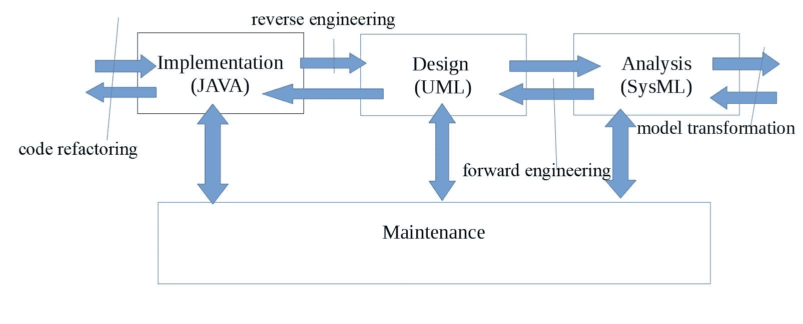
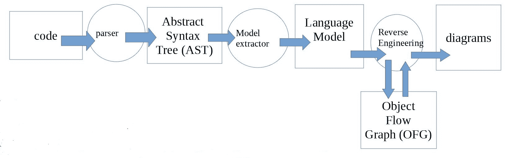
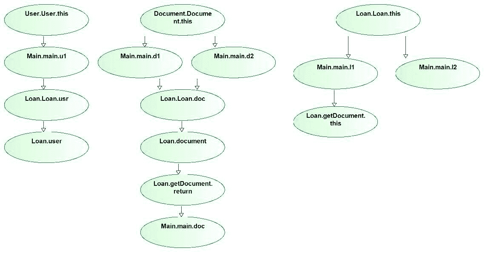
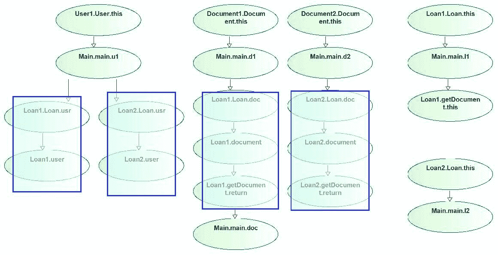
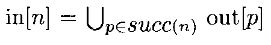

# 库系统逆向工程（第1版）：从 Java 代码到 UML 图表


## 第 1 章：逆向工程概念

### 1.1 维护问题与解决方案

维护问题与解决方案：

**问题：**

维护非常昂贵。

**解决方案：**

通过从代码到图表的逆向工程进行重构，通过模型转换来重构系统，然后从图表到代码进行正向工程，通过代码重构来重构系统。

**收益：**

维护不再昂贵。

**缺点：**

无法捕获某些类型的信息，且复杂的过程无法完全自动化。

**方法：**

通过指针分析进行面向对象的代码分析，通过数据结构（对象流图）和算法（流传播）。

### 1.2 系统开发生命周期 (SDLC)

系统开发生命周期 (SDLC)：



### 1.3 逆向工程工具架构

逆向工程工具架构：



**注：**

**模型 (Model)**：数据的抽象形式（类模型）（当分析源代码并从中提取不同的高层视图时，可以采用不同的视角）。

**图表 (Diagram)**：存储在 XML 文件中的数据的具体形式，该文件用于通过编程语言修改数据，并用于在不同系统之间传输数据时的兼容性（类图、对象图、交互图、状态图和包图）（每个包最多包含 10 个实体以确保图表的可读性）（通过逆向工程从代码恢复的单个图表是不够的。相反，需要获得一组互补的视图以满足不同的程序理解需求）。

### 1.4 面向对象的代码分析

面向对象的代码分析：

**类型：**

* **静态 (static)**：对所有输入或无输入产生结果。
* **动态 (Dynamic)**：对单个输入产生结果，且仅适用于完整且可执行的系统。

**静态面向对象代码分析：**

对数据流敏感但对控制流不敏感。这意味着数据流表示在`OFG`中，但控制流则没有。这意味着完全不影响数据流的指令（如控制流语句）可以被安全地忽略。这意味着具有相同数据流但不同控制流的代码将产生相同的分析结果。这是由于计算复杂性和面向对象程序的性质。

### 1.5 指针分析

指针分析：

获取指针和程序位置之间运行时可能存在的任何指向关系的静态近似；同样地，在考虑面向对象程序时，会分析引用变量与对象之间的关系。

### 1.6 对象流图 (OFG) 数据结构

对象流图 (OFG) 数据结构：

是一种用于表示涉及对象的所有数据流的数据结构。

**类型：**

* **对象不敏感 (Object insensitive)**：用于区分属于不同类的两个位置，当系统不完整（如`Main`类）时使用。
* **对象敏感 (Object sensitive)**：用于区分属于同一类但不同类实例（对象）的两个位置，当系统可用（如`Main`类）时使用。相比对象不敏感，它能更准确地捕获代码片段中发生的数据流，因为信息沿不同对象传播时不会发生混合。

### 1.7 流传播算法

流传播算法：

一种通过`OFG`传播信息以分析程序行为并恢复所感兴趣的设计视图的算法。

**类型：**

* **流/上下文不敏感 (flow/context insensitive)**：无法区分不同的语句，计算复杂度较低，其性能在大型软件系统中扩展良好。
* **流/上下文敏感 (flow/context sensitive)**：可以区分不同的语句，计算复杂度高，性能在大型软件系统中扩展性佳；产生的结果比流/上下文不敏感更准确，因为结果适用于每个程序语句，而不是像不敏感模式那样适用于整个程序。

### 1.8 构建不敏感与敏感 OFG 的产生规则以及正向和反向流传播

构建不敏感与敏感 OFG 的产生规则以及正向和反向流传播：

**分配语句：**

`( x = new c (a k) )`

`===> edges : { (a’k,f’k),(cs’.this,x’) }`

`===> forward : gen [cs.this] = {c}, gen [x] = {ci}`

**具体代码：**

```java
// class Library, method borrowDocument
Loan Loan = new Loan(user);
// 第一个 Loan 用于接口
// 第二个 Loan 用于容器
// 第三个 Loan 用于对象（包含插入到容器和从容器中提取的方法）
```

**抽象代码：**

`Library.borrowDocument.loan = new Loan (Library.borrowDocument.user)`

**OFG 边：**

`{ (Library.borrowdocument.user, Loan.Loan.usr), (Loan.Loan.this, Library.borrowdocument.loan) }`

**仅在提取并更改第二个节点时进行插入。**

**赋值语句：**

`( x = (c)y )`

`===> edges : { y’,x’ }`

`===> backward : gen[y] = {c}`

**具体代码：**

```java
// class Library, method addLoan
User user = loan.getUser();
```

**抽象代码：**

`Library.addLoan.user = loan.getUser.return`

**OFG 边：**

`{ (loan.getUser.return, Library.addLoan.user) }`

**方法调用：**

`( [x=] (c)y.m(ak) )`

`===> edges : { (y’,m’.this),(a’k,f’k),(m’.return,x’) }`

`===> backward : gen[m.return] = {c}`

**具体代码：**

```java
// class Library, method borrowDocument
addLoan(loan);
```

**抽象代码：**

`Library.borrowdocument.this.addLoan(Library.borrowdocument.loan)`

**OFG 边：**

`{ (Library.borrowdocument.this, Library.addLoan.this), (Library.borrowdocument.loan, Library.addLoan.loan) }`

**注：**

* 不带复制的对象不敏感 OFG（`’`），以及
* 带复制的对象敏感 OFG（`‘`）。
* `c`：类名
* `cs`：类构造函数
* `(c)`：类型转换
* `x,y`：程序位置
* `a`：类属性名
* `m`：方法名
* `ak`：实际参数
* `fk`：形式参数
* `gen[n]`：生成流信息项
* `‘`：复制
* `ci`：对象标识符
* `in[n],out[n]`：输入和输出流信息
* `kill[n]`：阻止元素进一步传播
* `n`：节点
* `pred(n)`：节点的前节点集
* `succ(n)`：节点的后继节点集

## 第 2 章：通过示例进行逆向工程

### 2.1 对象不敏感与敏感 OFG 示例

对象不敏感与敏感 OFG 示例：

示例：为图书系统构建对象不敏感和敏感 OFG？

**具体代码：**

```java
// class Main
public static void main (String arg[ ]){//假设的方法
User u1 = new User(“bilal”, “ “, “ “);
```

```java
Document d1 = new Document(“software engineering”);

Loan l1 = new Loan (u1,d1);

Document d2 = new Document(“software maintenance”);

Loan l2 = new Loan (u1,d2);

Document doc = l1.getDocument( );
```

#### 抽象代码：（对象不敏感 OFG）

`Main.main.u1 = new User ()`

OFG 边：`{ (User.User.this,Main.main.u1) }`

`Main.main.d1 = new Document()`

OFG 边：`{ (Document.Document.this, Main.main.d1) }`

`Main.main.l1 = new Loan(Main.main.u1, Main.main.d1)`

OFG 边：`{ (Main.main.u1,Loan.Loan.usr), (Main.main.d1,Loan.Loan.doc ), (Loan.Loan.usr, Loan.user), (Loan.Loan.doc,Loan.document), (Loan.document, Loan.getDocument.return), (Loan.Loan.this, Main.main.l1) }`

`Main.main.d2 = new Document()`

OFG 边：`{ (Document.Document.this, Main.main.d2) }`

`Main.main.l2 = new Loan(Main.main.u1, Main.main.d2)`

OFG 边：`{ (Main.main.u1,Loan.Loan.usr), (Main.main.d2,Loan.Loan.doc ), (Loan.Loan.usr, Loan.user), (Loan.Loan.doc,Loan.document), (Loan.document, Loan.getDocument.return), (Loan.Loan.this, Main.main.l2) }`

`Main.main.doc = l1.getDocument.return`

OFG 边 `{ (Main.main.l1, Loan.getDocument.this), (Loan.getDocument.return, Main.main.doc) }`

#### 对象敏感 OFG（驱动类）



#### 抽象代码：（对象敏感 OFG）

`Main.main.u1 = new User ()`

OFG 边：`{ (User1.User.this,Main.main.u1) }`

`Main.main.d1 = new Document()`

OFG 边：`{ (Document1.Document.this, Main.main.d1) }`

`Main.main.l1 = new Loan(Main.main.u1, Main.main.d1)`

OFG 边：`{ (Main.main.u1,Loan1.Loan.usr), (Main.main.d1,Loan1.Loan.doc ), (Loan1.Loan.usr, Loan1.user), (Loan1.Loan.doc,Loan1.document), (Loan1.document, Loan1.getDocument.return), (Loan1.Loan.this, Main.main.l1) }`

`Main.main.d2 = new Document()`

OFG 边：`{ (Document2.Document.this, Main.main.d2) }`

`Main.main.l2 = new Loan(Main.main.u1, Main.main.d2)`

OFG 边：`{ (Main.main.u1,Loan2.Loan.usr), (Main.main.d2,Loan2.Loan.doc ), (Loan2.Loan.usr, Loan2.user), (Loan2.Loan.doc,Loan2.document), (Loan2.document, Loan2.getDocument.return), (Loan2.Loan.this, Main.main.l2) }`

`Main.main.doc = l1.getDocument.return`

OFG 边 `{ (Main.main.l1, Loan1.getDocument.this), (Loan1.getDocument.return, Main.main.doc) }`

#### 对象敏感 OFG（驱动类）



框：为每个分配的对象复制了方法体。

### 2.2 前向和反向流传播示例

正向和反向流传播的示例：

示例：为库系统制作正向和反向流传播？

#### 具体代码：

```java
class Main{
  Static Library lib = new Library( );
  public static void addUser(String cmd) {
  String args[] = getArgs (cmd);
  if (args.length < 3) return;
  User user = new User (args [0] , args[1], args [2] );
  lib.addUser(user);
  System.out.println("Added user: " + user.getCode() + " - " + user .getName());
  }
}
```

#### 抽象代码：（对象不敏感 OFG）

`Main.lib = new Library()`

OFG 边 `{(Library.Library.this,Main.lib)}`

`Main.addUser.user = new User()`

OFG 边 `{(User.User.this,Main.addUser.user)}`

`Main.lib.addUser(Main.addUser.user)`

OFG 边 `{(Main.addUser.user,Library.addUser.user)}`

#### 具体代码：//class Library

```java
public boolean addUser(User user) {
  if (!users.containsValue(user)) {
  users.put(new Integer(user.getCode()), user);
    return true;
  }
  return false;
}
```

#### 抽象代码：

`Library.users = Library.addUser.user`

OFG 边 `{(Library.addUser.user,Library.users)}`

#### 具体代码：//class Library

```java
public List searchByTitle(String title) {
  List docsFound = new LinkedList();
  Iterator i = documents.values().iterator();
  while (i.hasNext()) {
  Document doc = (Document)i.next();
    if (doc.getTitle().indexOf(title) != -1) {
    docsFound.add(doc);
    }
  }
  return docsFound;
}
```

#### 抽象代码：

`Library.searchByTitle.i = documents`

OFG 边 `{(documents,Library.searchByTitle)}`

`Library.searchByTitle.doc = (Document)i`

OFG 边 `{(i,Library.searchByTitle)}`

`Library.searchByTitle.getTitle( )`

OFG 边 `{(this,Library.searchByTitle)}`

`Library.searchByTitle.docsFound = Library.doc`

OFG 边 `{(doc,Library.searchByTitle)}`

`Library.searchByTitle.return = Library.docsFound`

OFG 边 `{(docsFound,Library.searchByTitle)}`

#### 对象不敏感 OFG（带正向和反向传播的驱动类）


* 属性 `users` 包含 `User`
* 属性 `documents` 包含 `Document`

### ce：软件演化与维护一种实践者的方法

## 第 3 章：逆向工程细节

页码 170

注意的是，软件逆向工程是一个复杂的工程，工具可以支持但不能完全自动化。任何逆向工程项目都需要大量的人工干预。


### 参考：面向对象代码的逆向工程


### 前言

自从第一个软件系统建立以来，关于如何记录软件一直存在争论。有些人希望我们编写自然语言描述，有些人希望我们准备正式规范，还有人希望我们通过设计文档，其他人通过用例来描述软件。这样做的问题是，除非与代码同步维护，否则这些很快就会失效。维护不同的视图变得非常昂贵且容易出错。视图倾向于分离并变得不一致。本书作者为这一长期问题提供了一个简单的解决方案。只需要维护和演进源代码。系统的所有其他信息都从源代码获取。这需要从源代码生成完整的 UML 图。这样，设计文档将始终反映系统的真实情况，而不是文档记录者认为系统应该是怎样的。设计与实现之间不存在任何不一致。书中介绍的技术证明了设计文档可以并且从代码中提取，因为这是最便宜且最可靠的方法。使用的方法是逆向工程，目标是 C++、C# 或 Java 面向代码。根据最新的 UML 标准从代码生成类图、对象图、交互图和状态图。由于方法是自动化的，因此没有额外成本。点击即可提供设计文档。这种方法是多年研究的结果，对系统的记录方式产生深远影响。除了源代码本身，只需要开发和维护另一个视图，即以领域特定语言形式的用户视图。每个应用程序领域都必须有自己的语言来描述应用程序。

# 前言

在通往代码的路上，由于复杂的 IT 系统几乎总是通过试错法开发的，这些文档仅具有过渡性质。

一旦代码存在，这些文档就变得过时且多余了。从那时起，可以从代码本身产生成本更低、质量更好的文档。这种方法与极端编程（extreme programming）的实践相一致并支持它。

当然，这存在一些缺点，因为某些类型的信息没有捕获在代码中，因此逆向工程无法获取它们。例如，仍然需要一个测试断言（test oracle）——即用于测试的对象。这个东西就是领域特定规范，通过它推导出面向应用程序的测试用例。技术测试用例可以从生成的 `UML` 图中导出。通过这种方式，实现的系统将与根据规范定义的系统进行验证。如果没有从代码中提取的 `UML` 图，将没有充分的比较依据。

出于这些及其他原因，本书强烈推荐所有开发和维护面向对象的软件系统的人阅读。他们应该意识到自动化后文档的可能性和局限性。随着当前一代的 OO 系统成为未来的遗留系统，这在未来几年将变得越来越重要。它们所包含的实现知识可能仅存在于源代码中，除了逆向工程外，没有其他手段重新获取。

## 概述

表示面向对象软件系统的组织和行为的图可以帮助开发者理解它并评估修改的影响。然而，此类图往往是不可用的，或者与代码不一致。因此，从代码中提取是一个极具吸引力的选择。

本书代表了面向对象代码分析逆向工程研究的领先水平。它描述了从代码中恢复几种替代视图的算法，以及可以用于这些可视化的某些技术。

在软件演变过程中，高层描述的可用性是非常理想的，以支持程序理解和变更影响分析。事实上，要实施变更的位置可以通过高层视图来指导。此类视图中实体之间的依赖关系指示了连锁效应的比例。

然而，通常情况下，软件演变期间提供的图与代码不一致，或者——更常见的是——根本没有生成过任何图。在这种背景下，能够直接从代码逆向工程出设计图是关重要的。逆向工程图是实际代码组织和对象之间实际交互的真实表示。程序员从此类图转换到代码时，不会面临任何错配或缺失。

## 背景与协作

书中介绍的材料基于我们与 `CERN`（欧洲核子研究中心）合作期间开发的技术。在 `CERN`，大型对撞撞机上运行的下一代实验工作已提前开始，因为这些实验在设备、团队和涉及的软件上代表了重大挑战。我们与 `CERN` 合作引入了软件质量保证工具，其中包含一种逆向工程工具。

## 支持的图

书中描述算法涉及对以下图的逆向工程：

*   **类图**：在存在弱类型容器和接口的情况下提取类与类的关系，这些接口会阻止精确获取所引用对象的实际类型。

*   **对象图和交互图**：恢复系统中实例化类的对象之间的关联关系，以及它们之间交换的消息。

*   **状态图**：从状态和状态转换的角度对每个类的行为进行建模。

*   **包图**：识别包以及包之间的依赖关系。

## 技术框架

所有算法共享一个共同的代码分析框架。该框架的基础原理是静态地（不执行代码）通过在程序中发生的对象流的图表示中执行适当数据的传播来派信息。为此目的定义的数据结构被称为`对象流图`（`OFG`）。它允许跟踪对象从创建到其赋值给程序变量的生命周期。

`UML`（统一建模语言）被选择为呈现逆向工程结果的图形化语言。这一选择的动力是 `UML` 已成为面向对象开发中设计图表示的标准。然而，对 `UML` 的选择绝无限制性，因为从代码中恢复的相同信息可以用不同的图形或非图形格式提供给用户。

逆向工程方法的一个广为人知的问题是当结果规模和复杂性过高时如何过滤结果。由于恢复的图旨在供人类检查，因此展示模式应显式地考虑人类的认知局限性。如聚焦、分层结构化以及元素爆炸/合并等技术将专门针对某些图类型引入。

## 动机

从事逆向工程领域的研究社区产生了大量关于技术和工具的知识，这些工具可以在软件演变期间用于支持程序理解。作者认为，向前迈的重要一步是在处理特定子主题的综合性书中出版迄今取得的成就。

这本关于面向对象代码逆向工程的书正是沿着这一方向。作者们长期以来在该领域发表了多篇研究论文，并在研究社区中非常活跃。书中描述的技术和算法代表了当前的领先水平。

逆向工程旨在支持程序理解，通过利用源代码作为关于程序组织和行为的主要信息源，并提取一组以图的形式提供给程序员的潜在有用的视图。在分析源代码并从中提取不同的高层视图时，可以采用替代的视角。重点可以放在结构、行为、内部状态或文件的物理组织上。仅通过逆向工程从代码中恢复的单张图是不够的。相反，需要获取一组互补的视图，解决不同的程序理解需求。

在本章中，描述了逆向工程在软件系统生命周期中的作用。程序理解和影响分析活动在现有系统的演变过程中是核心。这两项活动都可以从逆向工程图等程序知识源中获益。

后续章节介绍的逆向工程技术将参考书中使用的示例程序进行描述。在本章中，介绍了并注释了该示例程序。然后，为后续章节的对象提供了示例程序的的一些图，展示了它们从程序员角度来看的实用性。书的其余部分包含了如何从源代码恢复这些图的算法细节。

在软件系统的生命周期中，维护阶段是最长且最昂贵的阶段。从软件第一个版本交付开始 [35]，维护阶段的持续时间远长于初始开发阶段。在此期间，软件将不断地进行更改和增强。因此，用“软件演化”来描述整个生命周期（参见第 2 页）更为合适，在整个周期中，初始开发只是现有系统为空的特殊用例。

软件演化的特征是系统源代码的存在。因此，软件演化的典型活动是响应变更请求实现程序更改。变更可能旨在纠正软件（纠正性维护）、添加功能（完善性维护）、使软件适应变化的环境（适应性维护），或对对其进行重构以利于未来的维护（预防性维护）[35]。

在软件演化过程中，对软件系统行为最可靠且准确的描述是其源代码。事实上，设计图往往已经过时或根本缺失。这种宝贵的信息库可能无法直接回答关于系统的所有问题。反向工程技术提供了一种提取系统高视图的方法，这些视图总结了程序语句所执行计算的某些相关方面。反向工程图支持程序理解以及重构和可追溯性。

当处理现有代码库时，程序更改的微过程可以分解为定位更改、评估影响和实施更改。所有此类活动都取决于关于被修改程序的可用知识。在这方面，反向工程技术提供了有用的支持。反向工程工具提供了关于被维护系统的有用高层信息，从而帮助程序员定位要修改的组件。此外，连接反向工程图中实体的关系（依赖关系、关联关系等）为更改的影响提供了线索。通过追踪此类关系，可以获得可能受更改影响的实体集。

面向对象的编程在维护阶段给软件工程师带来了特殊的挑战问题。相应地，必须对反向工程技术进行定制以解决这些问题。例如，面向对象程序的行为源于程序中分配的各个之间发生的交互。相关的指令可能分散在多个类中，每个类单独在本地只执行非常有限的工作，并将其余部分工作委托给其他类。反向工程图捕获了类/对象之间的这种协作，并将它们总结在一个单一、紧凑的视图中。然而，恢复关于此类协作的准确信息是一项特殊挑战，需要对现有的反向工程方法进行重大改进 [48, 100]。

当对软件系统进行分析以提取信息时，根本选择是在静态分析和动态分析之间进行。动态分析需要一个跟踪工具来保存程序执行期间被操作的对象和分发的方法信息。通过这种方式可以反向工程的图是部分的。它们对于程序给定的单次执行（具有给输入值）是有效的，并且不能轻松地推广到具有任何输入（参见第 3 页）的任何执行程序行为。此外，动态分析仅对于完整的、可执行的系统是可能的，而在面向对象编程中，产生在不同上下文中重用的不完整类集是常有的。相反，静态分析产生的结果对于所有执行和所有输入都是有效的。另一方面，静态分析可能过于保守。事实上，确定一条静态上可能的路径是否可行是不可判的，即是否存在一个允许该路径被遍历的输入值。静态分析可能会保守地假设某些路径是可执行的，而实际上它们并非如此。因此，它可能会产生不存在输入值的结果。在接下来的章节中，将针对每种特定的图表讨论这两种方法的优缺点，并在一个可执行的示例上进行说明。

UML（统一建模语言）[7, 69] 已成为用图表形式表示面向对象系统的标准图形语言。其规范最近由对象管理组（OMG）标准化 [1]。UML 已被多家软件公司采用，其理论方面是多项研究的主题。由于这些原因，UML 被选择为书中描述的反向工程技术输出的图形表示。然而，对 UML 的选择绝非限制：虽然从代码反向工程的信息可以用不同的图形（或非图形）形式表示，但用于产生这些信息的底层分析方法可以在替代环境中不变地复用，只需用其他描述语言替换 UML 即可。

反向工程技术必须考虑的重要问题是可用性。由于恢复的视图是面向人类而非计算机，因此它们必须与人类的认知能力兼容。这意味着只有当图表保持较小尺寸时，才能传递有用信息（10 个实体可能还可以，100 个开始就太多了，1000 个会让图表变得不可读）。可以采用多种方法来支持可视化和导航模式，使反向工程信息具有可用性。这些方法从关注系统的部分到展开/折叠或放大/缩小操作，或者提供一个由详细视图补充的整体导航图。在接下来的章节中，将根据生成的特定图表描述临时方法。

第 4 页，旨在理解此应用的程序员可能会有以下问题：

- 系统的整体结构是怎样的？

- 借用文档时哪些对象会被更新？

- 哪些类负责检查给定文档是否可以被给定用户借用？

- 如何处理最大借用数量？

- 文档归还，图书馆的状态会发生什么变化？

让我们假设以下变更请求（完善性维护）：当文档不可借用时，用户可以预留它，如果它未被其他用户预留。当文档归还图书馆时，如果有与文档关联的预留用户，将联系该用户。用户可以借用已提供的文档，也可以取消预留。在两种情况下，此操作后文档的预留将被删除。

负责实现该功能的程序员对系统可能有以下问题：

- 系统的整体结构需要任何更改吗？

- 哪些类需要协作来实现预留功能？

第 5 页- 对现有功能是否存在可能的副作用？

- 归还文档的程序应该做哪些更改？

- 文档的新状态是如何描述的？

- 新的借用规则与现有规则之间是否存在交互？

在接下来的章节中，我们将看到从代码反向工程出的 UML 图如何帮助回答上述列出的程序理解和影响分析问题。

第 18 页

用于逆向工程这些图表的大多数静态分析共享一种代码表示，称为`对象流图`（Object Flow Graph`，`OFG`）。这种数据结构将在第 2 章介绍。本章包含了构建 `OFG` 的规则，并引入了一种通用流传播算法，用于推断程序对象的属性。针对特定属性定义了该通用算法的特化版本。

第 21 页

`对象流图` (`OFG`) 是后续章节描述的静态分析的基础程序表示。`OFG` 允许追踪对象信息的流向：从分配语句创建对象，到对象赋值给变量，直到将对象存储在类字段中或在方法调用中使用它们。

`OFG` 中传播的信息类型各异，这取决于所采用的分析的目的。例如，当分析被定义为静态确定比对象声明中类型更精确的对象类型时，通过强制转换表达式转换的对象类型可以是被传播的信息。因此，在本章中描述了一种流传播算法，并对正在处理的对象信息进行了通用指示。

在本章的第一节中，Java 语言被简化为一种抽象语言，该语言保留了所有与对象流相关的特征，同时舍弃了其他语法细节。这种语言是定义 `OFG` 的基础，其节点和边根据第 2.2 节给出的规则构建。对象可能会流向分析程序的外部。例如，一个对象可能会流入库容器，稍后从从中提取。第 2.3 节处理了 `OFG` 中此类外部对象流的表示。第 2.4 节描述了在 `OFG` 上运行通用流传播算法。第 2.5 节考虑了对象不敏感和对象敏感 `OFG` 之间的区别。下一节将给出 `eLib` 程序的 `OFG` 构建细节。本章以对相关工作的讨论结束。

对 Java 程序进行以从代码逆向工程出设计图的静态分析是数据流敏感的，但控制流不敏感的。这意味着具有不同控制流但相同数据流的程序在第 22 页与相同的分析结果相关。数据流敏感性和控制流不敏感是通过参考名为`对象流图` (`OFG`) 的程序表示来定义分析来实现的。控制流不敏感的后果是 `OFG` 的构建可以相对于 Java 语言的简化抽象版本进行描述。所有引用数据流的 Java 指令在抽象语言中都有正确的表示，而完全不影响数据流的指令被安全地忽略了。因此，所有的控制流语句（条件语句、循环等）都不是简化语言的一部分。此外，在抽象语言中，名称解析也被简化了。所有标识符都具有完全的作用域名，其前面是一个由点分隔的包含性包、类和方法的列表。通过这种方式，永远不会发生名称冲突。

选择数据流敏感/控制流不敏感的程序表示主要出于两个原因：计算复杂性和面向对象程序的“本质”。正如在第 2.4 节讨论的，控制流不敏感算法的理论计算复杂性和实际性能远优于控制流敏感的对应算法。此外，面向对象代码的结构通常对数据流施加的约束比控制流更多。例如，当从使用某个类的应用程序移动到另一个应用程序时，方法调用的顺序可能会改变，而复制和传播对象引用的可能方式保持稳定。因此，对于实际方法调用序列未知的面向对象代码，采用控制流不敏感/数据流敏感的分析算法是有意义的，这些算法保留了处理对象引用的方式。

图 2.1 显示了简化版 Java 语言的抽象语法。Java 程序 `P` 由零个或多个声明 (`D`) 组成，随后是零个或多个语句 (`S`)。由于控制流不敏感性，声明和语句的实际顺序无关。包、类和方法的嵌套结构被完全扁平化了。例如，属于不同方法的语句没有被分成不同的组。然而，完整的作用域在名称中被显式保留（见下文）。因此，可以对数据元素进行细粒度的识别，而对控制元素则不如此（控制流不敏感性）。将给定的 Java 程序转换为其抽象语言表示是一项简单任务，可以完全自动化完成。可以使用程序转换工具来实现这一目标。

声明有三种类型：属性声明（产生式 (2)）、方法声明（产生式 (3)）和构造函数声明（4）。属性声明仅由属性完全的作用域名组成，即由点分隔的包列表，随后是一个由点分隔的第 23 页类列表，最后是属性标识符。方法声明由完全的作用域方法名 `m`（构建方式类似于类属性名 `a`），随后是形式参数列表 `f1,…fk`。转化，每个形式参数 `fi` 都有 `m`（完全的作用域方法名）作为前缀，参数标识符作为点分隔的后缀。构造函数具有与方法类似的抽象语法，用类名 (`<cid>`) 代替方法名 (`<mid>`)）。声明不包含类型信息，因为构建 OFG 不需要这些信息。

第 24 页

语句三种类型（见图 2.1）：分配语句（产生式 (5)）、赋值语句（产生式 (6)）和方法调用（产生式 (7)）。

所有语句的左侧 `x`（方法调用可选）是程序位置。赋值语句的右侧 `y` 以及方法调用的目标也是程序位置。程序位置 (`<progloc>`) 是局部变量、类属性或方法参数。前者的结构与形式参数相同：点分隔的包/类前缀，随后是方法标识符，最后是变量标识符。属性访问链被替换为最后一个字段，且具有完全的作用域（例如 `a.b.c` 变为 `B.c`，假设 `b` 是类 `B` 的属性，且类 `B` 包含字段 `c`）。分配和方法调用中的实际参数 `a1,…ak` 也是程序位置 (`<progloc>`)。终止程序位置的变量标识符 (`<vid>`) 有两个特殊值：`this` 表示指向当前指针，`return` 表示方法的返回值。非对象类型的程序位置（包括形式和实际参数，例如 int 变量）在所选的程序表示被省略，因为它们与任何对象流无关。

第 25 页

条件语句和返回语句已被跳过，

假设所有程序实体的名称都是唯一的。这就是为什么

为什么在抽象语法中，包、类、方法和变量标识符（`<pid>`, `<cid>`, `<mid>`, `<vid>`）使用的是标识符而不是它们的名称？鉴于 Java 程序的源代码，总是可以对其进行转换，使其名称变为唯一的 [30]。属于同一类的重载方法名可以增加一个递增的整数后缀以使其唯一。对于具有相同名称的不同类的方法，也可以这样做。调用语句也会相应地进行转换。被调用的方法（或方法）可以通过所有静态类型兼容的可能性进行解析。

### 对象流图 (OFG)

对象流图（OFG）是一个二元组 `(N, E)`，由一组节点 `N` 和一组边 `E` 组成。对于每个程序位置（即根据图 2.1 中的定义，局部变量、属性或形式参数），都会在 OFG 中添加一个节点。

根据图 2.2（右侧）中指定的规则向 OFG 中添加边。这些边代表了在被分析程序中发生的数据流。OFG 边的集合 `E` 包含所有且仅包含由图 2.2 中至少一条规则产生的所有对。

当调用构造函数或方法时（分别为语句 (5) 和 (7)），会建立连接每个实际参数 `ai` 到其对应的形式参数 `fi` 的边。在调用构造函数的情况下，由 `cs.this` 引用的（`cs` 是通过 `new c(…)` 调用的构造函数）新创建与相关赋值的左侧 `x` 配对（参见语句 (5)）。在调用方法的情况下，目标对象 `y` 在被调用方法内部变为 `m.this`，生成边 `(y,m.this)`，而方法 `m` 返回的值（如果有）则流向左侧 `x`（配对 `(m.return,x)`）。

OFG 中的边解释了程序中发生的所有数据流。虽然其中某些与特定的 Java 指令（如赋值或方法调用）相关，但另一些则可能与库类的使用有关。每当库类引入从变量 `x` 到变量 `y` 的数据流时，都必须在 OFG 中包含一条边 `(x,y)`。

### 容器与数据流

引入额外的外部数据流的库类分类由容器表示。抽象地说，容器对象提供了两种改变程序中数据流的基本操作：`insert`（向容器中添加对象）和 `extract`（访问之前插入到容器中的对象）。

因此，对于带有容器的程序，OFG 构建中需要处理的两个基本情况如下：


1. `c.insert(x);`

2. `x = c.extract();`

其中`c`是容器，`x`是对象。在第一情况下，存在从对象`x`到容器`c`的数据流，而在第二种情况下，数据流是反的。相应地，OFG 中引入了以下边：

1. `c.insert(x);` `(x,c) ∈ E`

2. `x = c.extract();` `(c,x) ∈ E`

在存在以下赋值时，OFG 中也会引入相同的边：

1. `c = x;`

2. `x = c;`

出于此原因，在我们所采用的抽象程序表示中，与容器对象相关的插入和提取方法通过将相关语句转换为赋值语句（如上述所示）来处理。

### 外部数据流

其他可能影响 OFG 中节点和边的外部数据流示例还与动态加载的使用（例如通过 Java 反射）以及对用其他语言编写的模块的访问（例如通过 Java Native 接口 JNI）有关。在这些情况下，只要对外部流像上述处理容器那样进行（手动的）建模，仍然可以对数据流进行半自动化分析。用户需要参与指定发生此类流的代码片段，以及受其影响的程序位置。本节未显式讨论的其他语言特性（如异常处理和多线程）需要较小的扩展（例如识别`throw-catch`链 [76]），而这些扩展是可以完全自动化的。

### 流传播算法

OFG 代表了所有涉及对象的数据流。因此，可以利用它来分析程序的行为，沿着对象可能传播的相同流路径传播适当的信息。

在接下来的章节中，将给出一些需要传播的信息类型的示例。对象被强制转换的类型就是其中一个例子。在给定程序点分配对象是另一个例子。然而，通常情况下可以假设从集合`V`取的某些有趣信息正沿着 OFG 传播。相应地，可以给出一个流传播算法，它不依赖于`V`中的特定元素。图 2.3 甚至显示了通用流传播算法的伪代码。它是 [2] 中描述的流分析框架的具体实例，应用于 OFG 而不是控制流图。OFG 的每个节点`n`分别在`in[n]`和`out[n]`集合中存储传入和流出的流信息，这些集合最初为空。此外，每个节点`n`生成包含在`gen[n]`集合中的流信息项集，并防止`kill[n]`集合中的元素在节点`n`之后进一步传播。

传入流信息从节点`n`的前驱节点获取，是各自`out`集合的并（正向传播）。对于某些分析，按照反向沿着 OFG 边传播流信息可能是恰当的（反向传播）。这是通过收集后继节点`out`集合的传入信息来实现的。

换句话说，伪语句 7 变为：

```

```

在反向传播的情况下。传入流信息（`in[n]`）通过移除`kill[n]`集合中的元素并添加`gen[n]`中的元素转换为流出信息`out[n]`。流信息在 OFG 内部反复传播，直到达到不动点：任何 OFG 节点中均没有传入或流出的信息发生变化。

假设 OFG 中传播的流信息有一个上界，图 2.3 中的算法被确保在多项式时间内收敛。通过选择 OFG 中节点的适当排序，可以极大提高实际性能。在没有循环的情况下，最佳排序是由于图边诱导的偏序。当存在循环时，良好的策略是在考虑循环后的节点之前，在循环内部传播流信息。

图 2.3 中的算法产生的解决方案具有以下属性：对于所有产生 OFG 中表示的数据流的程序执行都是有效的。由于 OFG 的定义是为了考虑所有静态可能的数据流，因此得到的解决方案是保守的（安全的），因为不会在任何由 OFG 路径表示的时间发生数据流。然而，通常无法在静态上判断某条路径是否可行（即它对于某些输入是否可以实际执行）。因此，算法产生的解决方案可能是过度保守的，因为它允许在不可行的路径上进行流传播。因此，如果某个节点处存在流信息，可能存在某种程序执行实际产生了它；而如果不存在，则可以确保没有任何执行能够产生它。

根据图 2.1 中的抽象语法，类属性、方法名、程序位置等都是在类级别上作用域的。这意味着它

当两个位置属于不同的类（例如，两个类属性）时，是可以区分开的；但当它们属于同一个类但属于不同的类实例（对象）时，则无法区分。换句话说，根据第 2.2 节给定的规则构建的 OFG 是对象不敏感（object insensitive）。虽然这对于某些分析可能是可以的，但在某些情况下，区分属于不同对象的位置的能力可能会大幅提高分析结果。

### 对象敏感型 OFG

通过为所有非静态程序名分配对象作用域而非类作用域，可以构建对象敏感的 OFG（属于静态方法的静态属性和程序位置保持类作用域）。

对象可以通过它们的分配点静态地识别，因此在对象敏感的 OFG 中，非静态类属性和方法（包括它们的参数和局部变量）会为每个静态识别出的对象进行复制。在语法上，代码中的对象分配点由图 2.1 中类为 (5) 的语句确定。对于每个这样的分配点，都会创建一个对象标识符，并对被分配对象的类中的所有属性和方法进行该标识的复制。被复制的程序位置成为 OFG 中不同的节点。

当位置具有对象敏感性时，OFG 边的构建变得更加复杂。例如，在存在方法调的情况下，只有当已知当前对象（由`this`指向）以及作为调用目标的引用变量所指向的对象时，才能确定 OFG 边的源和目标。第 4 节提供了推断此类信息的算法细节。

对象敏感性对 OFG 准确性的影响在于实现了更细粒度的边构建，从而导致信息沿着数据流进行更精确的传播。事实上，在对象敏感的 OFG 中，信息在不同对象之间传播时不会发生混合。

对象敏感 OFG 构建的主要难点在于对变量引用的对象进行静态估计。当通过引用变量访问/调用属性或方法时，这些信息都是必须的。事实上，相关的边连接了由指向的对象限定作用域的位置。

为了构建对象敏感的 OFG，可以通过在 OFG 上定义流传播来获取程序变量可能引用的对象信息，旨在静态估计引用的对象。这是第 4 节的主题。然而，用于此目的的算法假设 OFG 本身。因此，我们存在相互依赖。这可以通过增量地构建 OFG 边来解决。

相反，所有的 OFG 节点可以从一开始就开始构建。最初，所有的分配点都与对象标识符相关，用于限定非静态程序位置的作用域。这产生了所有 OFG 节点的集合。至于边，在此阶段只能构建内部边，即涉及构造函数/方法参数或局部变量的边，这些边会为每个对象作用域进行复制。

方法的调用和类属性的访问需要了解变量以及特殊位置`this`所引用的对象。此类信息通过第一轮流传播进行近似。在传播结束时，可以使用流传播确定的相关变量所指向的对象，向 OFG 中添加方法调用和属性访问的边。通过这种方式获得的新版本的 OFG（包括了由上一次流传播结果产生的边），可以获得对变量所指向对象的更好的估计。OFG 的精化可以继续进行，直到产生一个稳定的版本（需要注意的是，增量式构建是单调的，即边可能会被添加，但永远不会被删除）。

只有在整个程序可用（包括`main`）的情况下，才能完整构建对象敏感的 OFG，因为所有涉及对象的所有分配点都必须是分析代码的一部分。在面向对象的编程中，情况可能并非如此，因为经常会产生不完整的系统，并且类经常在不同的上下文中重用。在这些情况下，对象不敏感的 OFG 构建可能更为合适。

### 指针分析

OFG 和相关的流传播算法基于对指针分析的研究。指针分析的目标是获取指针与程序位置之间在运行时可能存在的任何指向关系（points-to relationship）的静态近似。同样，在考虑面向对象的程序时，会分析引用变量与对象之间的关系。

指针分析算法可以分为流/上下文敏感 [21, 47, 60] 和流/上下文不敏感 [3, 81]。流/上下文敏感算法产生细粒度且准确的结果，因为它确定了在每个程序语句处都都有效的指向关系。此外，还可以区分不同的调用上下文。然而，这些方法所涉及的计算复杂度很高，在实践中，它们的性能无法扩展到大型软件系统。流/上下文不敏感算法的复杂度较低且扩展性良好。另一方面，它们产生的结果适用于整个程序，且它们推导出的指向关系无法通过语句或调用上下文进行区分。流/上下文敏感分析是相对于程序的控制流图 [2] 定义的，而流/上下文不敏感算法在语句级别上定义分析语义。

### 开发中的逆向工程

本章处理与在面向对象的软件开发过程中采用逆向工程技术的实际问题。工具的支持和集成是关注关注之一。本章包含了对实现前几节介绍技术的工具通用架构的一些考虑。还提供了对现有支持和当前逆向工程实践的综述。

一旦建立了自动的逆向工程基础设施，就必须对软件演化过程进行调整，以便无缝集成新提供的功能。这涉及到修订软件维护微过程中的主要活动。为程序理解提供的支持类型已经详细描述（参见第 1 节，eLib 示例）。本章描述了将逆向工程工具集成到开发过程中对其他活动的影响，通过重新考虑 eLib 程序和第 1 节中概述的变更请求。

本章结构如下：第 8.1 节描述了用于面向对象代码的逆向工程工具的主要模块。逆向工程图表可以用于变更定位和实现以及变更影响分析。它们在 eLib 程序中的用法见第 8.2 节。作者对潜在的

第 8.3 节提供了对当前实践的改进，并参考了新的编程语言和开发流程。最后，在本章的最后一节注释了相关工作。

第 156 页

## 算法的实现

前章节描述的算法的实现受实际考虑因素的影响，例如目标语言、可用库、结果图的图形格式等。然而，可以设计一种通用的架构，并在每个特定案例中实例化。在这种架构中，功能被分配给不同的模块，以便将主任务分解为可管理的、定义良好的子任务。反之，每个模块都需要根据实际实现构建的具体设置进行特化处理。

图 8.1 显示了组成逆向工程工具的模块所执行的主要处理步骤。第一个模块`Parser`负责处理源编程语言的语法。它包含了定义所分析语言的文法。它解析源代码并构建与文法产生式关联的推导树。更优的是采用推导树的更高层级视图，以便将后续模块与目标语言语法定义中所做的特定选择解耦。具体来说，每个文法产生式中使用的中间非终符变化很大，这很大程度上取决于`parser`处理歧义的方式（例如，自底向上和自顶向下的解析器所需的非终符组织方式完全不同）。因此，将推导树转换为更抽象的程序树表示，称为`抽象语法树` (`AST`)，是方便的。在这种程序表示中，中间非终符链被压缩，仅表示语言的主要语法类别 [2]。

## 语言模型

`AST`是一种反映代码句法结构的程序表示。然而，逆向工程工具基于对源代码略有不同的视图。在本章的剩余部分中，这种视图被称为逆向工程工具所假设的语言模型。在语言模型中，可以安全地忽略几个语法细节。例如，分隔语句块的标记（大括号、`begin`、`end`等）是无关的，而关注的信息是语句序列的实际存在。第 157 页

因此，在语言模型中，如语句块和参数的分隔符、参数列表和语句序列的分隔符等标记是不存在的。另一方面，`AST`中未显式表示的信息在语言模型中直接可用。例如，表达式中涉及的每个变量都与其声明关联。每个方法调用都会根据被调用方法的所有类型兼容定义进行解析。每个类都与其超类以及它实现的接口相关联。此类交叉引用不是通过像`AST`那样的普通标识符获得的，而是指向语言模型中被引用元素的链接。例如，如果`class A`继承`class B`，则`class A`的`AST`包含一个指向标识符`B`的`extends`子句的子节点，而在语言模型中，`class A`的模型元素与`class B`的模型元素之间存在关联。下面将详细描述一个 Java 语言的（简化版）语言模型示例。负责从输入程序的`AST`构建语言模型的模块是`Model Extractor`（见图 8.1）。

基于输入程序的语言模型，可以执行逆向工程算法以恢复备选的设计视图。输出是一组显示给用户的图表。在某些情况下，需要对逆向工程算法作为输入的语言模型进行进一步的抽象。例如，前章节中描述的大多数（但不是所有）技术要求目标面向对象程序中的数据流被抽象为一种名为`对象流图` (`OFG`) 的数据结构。这种数据结构在`Reverse Engineering`模块内部构建，并被所有依赖于它的算法共享。`OFG`内部适当信息的流传播会导致感兴趣的设计视图的恢复。这些视图被转换为可选的图形格式，以便最终用户能够对其可视化。

由于逆向工程技术跨度很大，取决于要恢复的高级信息类型，因此设计一个支持所有备选算法的通用语言模型非常重要。反之，每个算法可能有一个与语言模型本身不同的源代码的内部表示。然而，对语言模型的主要要求是逆向工程算法工作和（可能）构建自身内部数据结构所需的所有信息必须在语言模型中可用。因此，语言模型在上述架构中起着关键的核心作用，应该被仔细设计。图 8.2 给出了 Java 语言的此类模型示例。仅显示了最重要的实体（出于空间考虑），没有指示它们的属性。

## Java 语言模型示例

Java 源文件包含在名为`package`的命名空间内的类定义。反之，包可以嵌套。因此，Java 语言模型中的顶层实体第 158 页（见图 8.2，左侧）是`package`，`package`实体中的自包含关系表示嵌套。最终，包包含类（图 8.2 中从包到类的包含关系）。实体`package`的主要属性是它的名称，这唯一地标识了它。

`class`实体的属性包括名称、可见性以及其超类、实现的接口等。被包含在类内部的实体是类成员。因此，`class`实体连接到`attribute`实体和`method`实体。此外，类可以嵌套在类内部。这就是从`class`实体发出的自包含的原因。

`attribute`实体具有如名称、类型、可见性、初始化等属性。同样，`method`实体具有名称、形式参数、返回类型、可见性等属性。每个方法的体在语言模型中表示为语句序列（图 8.2 中从方法到语句的包含关系）。

语句可以是不同的类型。其中一些在图 8.2 中列出，通过继承关系与其抽象语句相连。条件语句用于`if`和`switch`等结构。在它们的属性中，它们持有指向测试条件中所用表达式实体的引用（图 8.2 中未显示）。`if`条件语句有一个`then`部分和一个`else`部分，它们反过来是语句序列（类似于方法体）。`switch`语句与一系列`case`相关联，每个`case`包含相应的执行语句。循环语句包括`while`、`for`和`do-while`循环。它们的主要属性是测试条件（表达式实体，图 8.2 中未显示）和循环体（语句序列）。`for`循环还有初始化部分和增量部分。

赋值语句有两个主要部分，左侧和右侧。虽然后者是一个通用的表达式，但前者必须是

最终引用一个位置。这是通过将其限制为一元表达式，而不是通用表达式来实现的。

第 159 页

调用语句涉及一个解引用链（初级表达式），最终指向作为调用目标的对象。其他重要属性包括被调用方法的名称、实际参数列表（表达式列表）以及指向语言模型中所有类型兼容的方法的链接。在调用库方法的情况下，该调用被标记为库调用。

当方法内部的控制流被中断以向调用者返回值时，会遇到一个`return`语句。该实体的主要属性是定义返回值的表达式。

在图 8.2 出空间原因未展示的实体和关系中，最重要的一个是`expression`（表达式）实体，它涵盖了该语言支持的所有数学表达式，并可能与方法调用交织。表达式实体的子层级结构与大多数编程语言（无论是过程式还是面向对象的）中的层级结构非常相似。

根据图 8.2 模型所表示的信息足以构建给定源代码的 OFG（对象流图），并能够进行所有其他不依赖于 OFG 且在前面的章节中描述的分析。因此，它可以作为反向工程模块中实现的所有反向工程技术所利用的基础表示。

第 170 页

作者的观点是，关于程序的所有信息都应该在源代码中。从纯观察的角度来看，软件演化的已知影响——即源代码与程序其他信息源之间逐渐不一致——意味着只有源代码是可靠的。因此，事实上，程序的大部分信息都在源代码中。在规范方面，可以采取第 171 页的事实：一切应该是代码的一部分（包括设计、文档等）。

### 视角

第一种视角为反向工程在未来的软件开发中提供了核心作用。尽管这门学科是为了遗留系统的问题而产生的，但现代编程范式（如面向对象）并没有消除与程序理解和修改相关的问题。如书中描述的，面向对象系统的理解问题与传统软件不同，但反向工程具有解决这些问题的潜力。

第二种视角将程序的所有相关信息集中在单一源代码中，源于极限编程 (XP) [36]。在这种方法论中，有限的精力投入设计，而设计文档随着时间的推移被放弃。当工程师转向实现时，设计信息的缺失通过配对编程、持续执行重构以及测试用例的描述得到了缓解。反向工程可以在对象之间的交互组织方面做出重要贡献 [93]。在 XP 设置中，这是一个相当困难的任务。如书中讨论的，可以从源代码中自动提取许多图。

### 未来趋势

观察新兴的编程语言和范式，我们可以假设反向工程的作用将会增加。编程语言倾向于演进以维护关于程序行为的精确信息。现代编译器依赖这些信息执行多种检查、优化和转换。这类信息的示例包括泛型（genericity）和元数据（例如注解），它们包含在 Java 语言 1.5 版本中。切面编程 [40] 和内省能力（例如 Java 反射）正朝着相同的方向发展，支持程序内部单元的可编程接口。

这一切具有双重影响。一方面，它简化了反向工程，因为源代码变成了一个丰富的信息库，可以通过工具自动查询。另一方面，它使得设计直接编码在程序中（并由编译器检查），而不是通过静态或动态分析推断。从代码中轻松提取的准确图将使反向工程变得更有吸引力，更接近 XP 的愿景——即一切都在源代码中。事实上，维护和演进多个系统描述过于昂贵且容易出错。通过关注第 172 页的源代码作为唯一信息源，可以降低成本并避免视图不一致导致的错误。

第 156 页

(Image00009.jpg)

(Image00010.jpg) 第 23 页

(Image00011.jpg) 第 26 页

(Image00012.jpg)

(Image00013.jpg) 第 158 页

(Image00014.jpg) (Image00015.jpg)

(Image00016.jpg) (Image00017.jpg)

(Image00018.jpg) 将第 7 行改为向前传播

# 第 4 章：案例研究（库系统）

## 4.1 CASE 工具

CASE 工具：建模器：Eclipse，编译器：JDK

库系统执行：

(Image00019.jpg)

## 4.2 源代码

源代码：


```java
Main.java
import java.util.*;
import java.io.*;

class Main {
    static Library lib = new Library();

public static void printHeader() {
        System.out.println("COMMANDS:");
        System.out.println("addUser name, phone");
        System.out.println("addIntUser name, phone, id");
        System.out.println("rmUser userId");
        System.out.println("addBook title, authors, ISBN");
        System.out.println("addReport title, ref, authors");
        System.out.println("addJournal title");
        System.out.println("rmDoc docId");
        System.out.println("borrowDoc userId, docId");
        System.out.println("returnDoc docId");
        System.out.println("searchUser name");
        System.out.println("searchDoc title");
        System.out.println("isHolding userId, docId");
        System.out.println("printLoans");
        System.out.println("printUser userId");
        System.out.println("printDoc docId");
        System.out.println("exit");
    }

    public static String[] getArgs(String cmd) {
        String args[] = new String [0] ;
        String s = cmd.trim();
        if (s.indexOf(" ") != -1) {
            s = s.substring(s.indexOf(" "));
            args = s.trim().split(",");
            for (int i = 0 ; i < args.length ; i++)
                args[i] = args[i] .trim() ;
        }
        return args;
    }

    public static void addUser(String cmd) {
        String args[] = getArgs (cmd);
        if (args.length < 3) return;
        User user = new User (args [0] , args[1], args [2] );
        lib.addUser(user);
        System.out.println("Added user: " + user.getCode() +
" - " + user .getName());
    }

    public static void addIntUser(String cmd) {
        String args[] = getArgs (cmd);
        if (args.length < 4) return;
        User user = new InternalUser(args[0] , args[1], args [2] , args[3]);
        lib.addUser(user);
        System.out.println("Added user: " + user.getCode() +
" - " + user.getName());
    }

    public static void rmUser(String cmd) {
        String args[] = getArgs (cmd);
        if (args.length < 1) return;
        User user = lib.getUser(Integer.parseInt(args[0]));
    }
}
```

```java
if (lib.removeUser(Integer.parseInt(args[0]))) {
    System.out.println("Removed user: " + user.getCode() + " - " + user.getName());
}

public static void addBook(String cmd) {
    String args [] = getArgs(cmd);
    if (args.length < 3) return;
    Document doc = new Book(args[0], args[1], args[2]);
    lib.addDocument(doc);
    System.out.println("Added doc: " + doc.getCode() + " - " + doc.getTitle());
}

public static void addReport(String cmd) {
    String args[] = getArgs(cmd);
    if (args.length < 3) return;
    Document doc = new TechnicalReport(args[0], args[1], args[2]);
    lib.addDocument(doc);
    System.out.println("Added doc: " + doc.getCode() + " - " + doc.getTitle());
}

public static void addJournal(String cmd) {
    String args [] = getArgs(cmd);
    if (args.length < 1) return;
    Document doc = new Journal(args[0]);
    lib.addDocument(doc);
    System.out.println("Added doc: " + doc.getCode() + " - " + doc.getTitle());
}

public static void rmDoc(String cmd) {
    String args [] = getArgs(cmd);
    if (args.length < 1) return;
    Document doc = lib.getDocument(Integer.parseInt(args[0]));
    if (lib.removeDocument(Integer.parseInt(args[0])))
        System.out.println("Removed doc: " + doc.getCode() + " - " + doc.getTitle());
}

public static void borrowDoc(String cmd) {
    String args[] = getArgs(cmd);
    if (args.length < 2) return;
    User user = lib.getUser(Integer.parseInt(args[0]));
    Document doc = lib.getDocument(Integer.parseInt(args[1]));
    if (user == null || doc == null) return;
    if (lib.borrowDocument(user, doc))
        System.out.println("New loan: " + user.getName() + " - " + doc.getTitle());
}

public static void returnDoc(String cmd) {
    String args[] = getArgs(cmd);
    if (args.length < 1) return;
    Document doc = lib.getDocument(Integer.parseInt(args[0]));
    if (doc == null) return;
    User user = doc.getBorrower();
    if (user == null) return;
    if (lib.returnDocument(doc))
        System.out.println("Loan closed: " + user.getName() + " - " + doc.getTitle());
}

public static void searchUser(String cmd) {
    String args [] = getArgs(cmd);
    if (args.length < 1) return;
    List users = lib.searchUser(args[0]);
    Iterator i = users.iterator();
    while (i.hasNext()) {
        User user = (User)i.next();
        System.out.println("User found: " + user.getCode() + " - " + user.getName());
    }
}

public static void searchDoc(String cmd) {
    String args[] = getArgs(cmd);
    if (args.length < 1) return;
    List docs = lib.searchDocumentByTitle(args[0]);
    Iterator i = docs.iterator();
    while (i.hasNext()) {
        Document doc = (Document)i.next();
        System.out.println("Doc found: " + doc.getCode() + " - " + doc.getTitle());
    }
}

public static void isHolding(String cmd) {
    String args[] = getArgs(cmd);
    if (args.length < 2) return;
    User user = lib.getUser(Integer.parseInt(args[0]));
    Document doc = lib.getDocument(Integer.parseInt(args[1]));
    if (lib.isHolding(user, doc))
        System.out.println(user.getName() + " is holding " + doc.getTitle());
    else
        System.out.println(user.getName() + " is not holding " + doc.getTitle());
}

public static void printUser(String cmd) {
    String args[] = getArgs(cmd);
    if (args.length < 1) return;
    User user = lib.getUser(Integer.parseInt(args[0]));
    if (user != null)
        user.printInfo();
}

public static void printDoc(String cmd) {
    String args [] = getArgs(cmd);
    if (args.length < 1) return;
    Document doc = lib.getDocument(Integer.parseInt(args[0]));
    if (doc != null)
        doc.printInfo();
}

public static void dispatchCommand(String cmd) {
    if (cmd.startsWith("addUser")) addUser(cmd);
    if (cmd.startsWith("addIntUser")) addIntUser(cmd);
    if (cmd.startsWith("rmUser")) rmUser(cmd);
    if (cmd.startsWith("addBook")) addBook(cmd);
    if (cmd.startsWith("addReport")) addReport(cmd);
    if (cmd.startsWith("addJournal")) addJournal(cmd);
    if (cmd.startsWith("rmDoc")) rmDoc(cmd);
    if (cmd.startsWith("borrowDoc")) borrowDoc(cmd);
    if (cmd.startsWith("returnDoc")) returnDoc(cmd);
    if (cmd.startsWith("searchUser")) searchUser(cmd);
    if (cmd.startsWith("searchDoc")) searchDoc(cmd);
    if (cmd.startsWith("isHolding")) isHolding(cmd);
    if (cmd.startsWith("printUser")) printUser(cmd);
    if (cmd.startsWith("printDoc")) printDoc(cmd);
}

public static void main(String args[]) {
    // Implementation logic here
}
```

```java
public void printDocumentInfo(Document doc) {
    doc.printInfo();
}
```

### Loan.java

```java
class Loan {
    User user;
    Document document;

    public Loan(User usr, Document doc) {
        user = usr;
        document = doc;
    }

    public User getUser() {
        return user;
    }

    public Document getDocument() {
        return document;
    }

    public boolean equals(Object obj) {
        Loan loan = (Loan)obj;
        return user.equals(loan.user) &&
               document.equals(loan.document);
    }

    public void print() {
        System.out.println("User: " + user.getCode() +
        " - " + user .getName() +
        " holds doc: " + document.getCode() +
        " - " + document.getTitle());
    }
}
```

### Document.java


```java
import java.util.*;
class Document {
    int documentCode;
    String title;
    String authors;
    String ISBNCode;
    Loan loan = null;
    static int nextDocumentCodeAvailable = 0;

    public Document(String tit) {
        title = tit;
        ISBNCode = "";
        authors = "";
        documentCode = Document.nextDocumentCodeAvailable++;
    }

    public boolean equals(Object obj) {
        Document doc = (Document)obj;
        return documentCode == doc.documentCode;
    }

    public boolean isAvailable() {
        return loan == null;
    }

    public boolean isOut() {
        return ! isAvailable() ;
    }

    public boolean authorizedLoan(User user) {
        return true;
    }

    public User getBorrower() {
        if (loan != null)
            return loan.getUser();
        return null;
    }

    public int getCode() {
        return documentCode;
    }

    public String getTitle() {
        return title;
    }

    public String getAuthors() {
        return authors;
    }

    public String getISBN() {
        return ISBNCode;
    }

    public void addLoan(Loan ln) {
        loan = ln;
    }

    public void removeLoan() {
        loan = null;
    }

    protected void printAuthors() {
        System.out.println("Author(s): " + getAuthors());
    }

    protected void printHeader() {
        System.out.println("Document: " + getCode() +
        " - " + getTitle());
    }

    protected void printAvailability() {
        if (loan == null) {
            System.out.println("Available.");
        } else {
            User user = loan.getUser();
            System.out.println("Hold by " + user.getCode() +
            " - " + user .getName());
        }
    }

    protected void printGeneralInfo() {
        System.out.println("Title: " + getTitle());
        if (!getISBN().equals(""))
            System.out.println("ISBN: " + getISBN());
    }

    public void printInfo() {
        printHeader();
        printGeneralInfo();
        printAvailability();
    }
}
```

### Book.java

```java
class Book extends Document {
    public Book(String tit, String auth, String isbn) {
        super(tit);
        ISBNCode = isbn;
        authors = auth;
    }

    public void printInfo() {
        printHeader() ;
        printAuthors();
        printGeneralInfo();
        printAvailability();
    }
}
```

### TechnicalReport.java

```java
class TechnicalReport extends Document {
    String refNo;
    public TechnicalReport(String tit, String ref, String auth) {
        super(tit);
        refNo = ref;
        authors = auth;
    }

    public boolean authorizedLoan(User user) {
        return false;
    }

    public String getRefNo() {
        return refNo;
    }

    protected void printRefNo() {
        System.out.println("Ref. No.: " + getRefNo());
    }

    public void printInfo() {
        printHeader() ;
        printAuthors();
        printGeneralInfo() ;
        printRefNo() ;
    }
}
```

### Journal.java

```java
class Journal extends Document {
    public Journal(String tit) {
        super(tit);
    }

    public boolean authorizedLoan(User user) {
        return true;
    }
}
```

### User.java

```java
import java.util.*;
class User {
    int userCode;
    String fullName;
    String address;
    String phoneNumber;
    Collection<Loan> loans = new LinkedList();
    static int nextUserAvailable = 0;

    public User(String name, String addr, String phone) {
        fullName = name;
        address = addr;
        phoneNumber = phone;
        userCode = User.nextUserAvailable++;
    }

    public boolean equals(Object obj) {
        User user = (User)obj;
        return userCode == user.userCode;
    }

    public boolean authorizedUser() {
        return false;
    }

    public int getCode() {
        return userCode;
    }

    public String getName() {
        return fullName;
    }

    public String getAddress() {
        return address;
    }

    public String getPhone() {
        return phoneNumber;
    }

    public void addLoan(Loan loan) {
        loans.add(loan);
    }

    public int getLoans() {
        return loans.size();
    }

    public void printInfo() {
        System.out.println("User: " + getCode() +
        " - " + getName() +
        " - Address: " + getAddress() +
        " - Phone: " + getPhone());
    }
}
```
