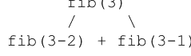
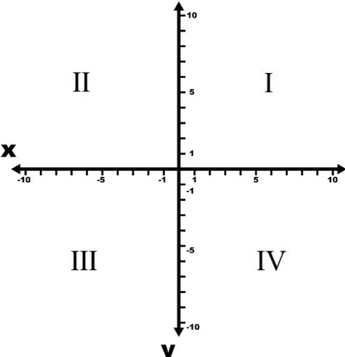

# Java 入门指南：初学者最佳资源


# 特别感谢

## 纽约市立大学（CUNY）皇后分校 - 计算机科学系

没有他们，我不会有今天的成就。

## Dani Maureau

我美丽、支持支持的妻子，也是帮助编辑这本书的英语老师。我爱你，现在直到永远。

## Matthew McClure

计算机科学奇才，他在发现我写了这些书后，最初那种极度的极客兴奋（nerdgasm）激励了我更新我的书籍。

## Anne Smith-Thompson

感谢她对本书做出的最后贡献和修改。并感谢她成为一位伟大的教授和朋友！

## Stephanie Gallagher

感谢她给了我更新这本书所需的最后一点灵感。她还给了我这段幽默的对话：

> 她：“我看到他拿着你的书，我当时想：‘我认识那家伙！’”
>
> 我：“太棒了。世界真小啊！”
>
> 她：“我本以为……”

# 前言

当许多学生开始学习 Java 时，有些人认为这是一项挑战，而另一些人则认为它就像别人对他们来说不可能的事一样简单。我发现有很多学生动不动就想放弃，甚至在第一次考试（即“期末”考试）中惨遭失败后就放弃。

在自己的经历中，我意识到相当多学生不愿意来我的办公室提问。直到今天我仍然不知道为什么。也许是因为导师或助教的刻板印象；对某些人来说太“书呆”或“极客”，对另一些人来说则不够重要。我曾是后者，但一旦开始我的计算机职业，很快就走出了这种心态。

这些材料的编写是为了给那些因为学位要求而必须修编程课的迷茫学生希望，或者是给那些渴望学习新学科的学生。我希望你发现这些信息有用且易于理解，以便你在 Java 编程中获得愉快的体验。书中包含的内容是 Java 主要主题的总结。

- 包装类与解析 ...................................................... 39
- 循环 ................................................................................ 114

# 第 1 章：Java 简介

本章介绍了该语言的基础，包括“Hello World”程序。

## 课题

1. 控制台输入/输出 10
2. Hello World 程序 11
3. 命令行参数 12
4. 文档与 Javadoc 14
5. 终止程序 15

Java 是一种严格面向对象的高级语言。这意味着该语言中除了对象和类别无一物。在构造类之前，类是不存在的。所有类都使用 `new` 来实例化。

## 控制台输入/输出

所有的基本输入输出流都包含在 `System` 库中。以下是该库中一些方法的描述：

```
System.out.print( things to print )
```
这将某些内容打印到控制台上。它可以打印变量、`String`、字符、`double`、`Object` 等……在尝试打印某些内容时，它会寻找 `toString` 方法来处理所需的转换。该方法末尾不打印换行。

```
System.out.println( things to print )
```
它的功能与上面的 `print` 相同，但会在末尾打印换行符；因此方法名中包含 "ln"。

关于控制台输入，请参阅第 4 章的 `Scanner`。

## “HELLO WORLD”程序

让我们创建一个简单的程序。这个程序统称为“Hello World”程序，它将向控制台打印一条消息。

```java
public class Hello{
    public static void main(String args[]) {
        System.out.println("Hello World!");
    }
}
```

在上面的代码中，`Hello` 是程序起始的有用对象（类）名称；而 `main` 方法的形式总是是这样。`main` 方法的参数是一个 `String` 数组，代表命令行参数。

## 编译 Java 程序

要编译 Java 程序，你需要使用命令行内置的编译器，`javac`。它代表“java 编译器”。编译程序的通用格式为：

```
javac FileName.java
```

其中 `FileName` 是要编译的 java 文件名。要一次性编译多个程序，你可以这样做：

```bash
javac *.java
```

其中 `*` 将编译所有带有 `.java` 扩展名的文件。因此，使用上述“Hello World”示例，以下是编译它的方法：

```bash
javac Hello.java
```

## 命令行参数

Java 程序可以包含所谓的命令行参数。在编译程序时，你可以为 `main` 方法的参数数组提供特定的值。

### 示例 1：命令行参数

让我们来看一个示例，它允许你从命令行中输入你的名和姓。

```java
public class Example1{
    public static void main(String args[]){
        if(args.length != 2) {
            System.out.println("First + Last name needed");
            System.exit(1);
        }
        System.out.println("Hello " + args[0] + " " + args[1]);
    }
}
```

上述程序将首先检查命令行参数的数量（关于这方面的更多细节将在第 10 章稍后出现）。然后它将打印出用户输入的名称，因为我们知道参数是正确的。用户的名包含在 `args[0]` 中，姓包含在 `args[1]` 中。关于字符串和数组的更多内容将稍后出现。

请注意，在上面 `+` 运算符被用于连接（或拼接）字符串。

以下是编译和执行的命令行。编译程序：

```bash
javac Example1.java
```

要运行程序，只需将引号中的消息分别替换为你的名和姓，**不要带括号**：

```bash
java Example1 [your first name] [your last name]
```

另外请注意，参数之间用空格隔开。这使得数组能够识别不同的参数。假设我们使用以下命令行运行了上面的程序：

```bash
java Example1 Alex
```

我们将得到一个错误消息，输出如下：

```
First + Last name needed
```

我们得到错误消息是因为程序没有包含正确数量的命令行参数。现在，如果我们使用此命令行运行程序：

```bash
java Example1 Alex Maau
```

我们得到输出：

```
Hello Alex Maau
```

关于命令行参数及其用法的更多信息，请参阅第 3 章（包装器类与解析）。

## 文档与 JAVADOC

程序设计的一个重要部分是文档。没有它，你在尝试调试程序时会遇到很多麻烦。Java 程序中有三种类型的文档：内联注释、块注释和 Javadoc 注释。

第一种注释是内联注释，它可能像这样：

```java
public static void main(String args[]){
  //check arguments here
}
```

内联注释由两个正斜杠表示。该行中那两个标记之后出现的任何内容都会被编译器忽略。

第二种注释是块注释，它在代码段中可能像下面所示：

```java
public static void main(String args[]){
  /*
   *check for arguments here
   */
}
```

注意，要**开始**块注释使用 `/*`，而**结束**块注释使用 `*/`。它们是不同的，所以请小心。

注释的最后一部分是 Javadoc。Javadoc 注释的写法如下：

```java
/**
  * Javadoc writing here.  The Javadoc 将解释
  * 并文档一个方法。
  */
public static void main(String args[]){
  //code here for main
}
```

一个重要的点是意识到用 `/**` 开始 Javadoc，并用 `*/` 结束它。如果你使用的是像 Eclipse 这样高级的环境，它会变成蓝色以表示这是 Javadoc。块注释和内联注释将变成绿色。

查看 Javadoc 的良好方法是查看在线当前的 Java API：https://docs.oracle.com/en/java/

## 终止程序

要比预期更早地终止程序，可以使用 `System` 库中的 `exit()` 方法。语法如下：

```java
System.exit(1);
```

你当然可以将数字 `1` 替换为你选择的任何整数。通常使用 `0` 和 `1`。`1` 用于表示问题并向调试器信号存在提前终止。`0` 用于表示没有问题。再次，并不是要求使用 `0` 和 `1`，而是它们是此用途最常用的整数。

# 第 2 章：变量与运算符

本章将探索变量是什么以及我们如何在程序中处理它们。变量对于程序设计是至关重要的。本章涵盖了变量的许多不同类型以及我们如何对它们进行操作。

## 话题

1. 声明变量 17
2. 数据类型 17
3. 变量练习题 19
4. 运算符 19
5. 运算符练习题 27
6. 示例程序 28
7. 变量的类型 31
8. 类型转换 34
9. 溢出 35
10. 溢出练习题 37

在 Java 中，变量将用于存储某种形式的数据。数据可以是任何类型，例如整数、小数或字符，或者自定义数据类型（我们将在书的后部分探讨），这只是几个例子。

虽然变量持有某种形式的数据，但我们希望能够处理它们。声明变量有许多方法。

## 声明变量

这是声明的一种方法：

```java
int x;
```

其中 `x` 是变量名。

另一种方法是声明并初始化：

```java
double avg = 0;
```

其中 `avg` 是变量名。

另一种方法：

```java
boolean truth = true;
```

其中 `truth` 是变量名。

另一种方法：

```java
short sh = 0;
```

其中 `sh` 是变量名。

另一种方法：

```java
String first_name = "John";
```

其中 `first_name` 是变量名。

## 数据类型

现在我们了解了一些变量，现在可以了解它们的类型。以下是 Java 中使用的类型表：

| 类型 | 说明 | 大小 |
| --- | --- | --- |
| `char` | 字符：-128 到 255 | 1 字节 |
| `short` | 短整数：-32768 到 32767 | 2 字节 |
| `int` | 整数：-2147483648 到 2147483647 | 4 字节 |
| `long` | 长整数：极大 | 8 字节 |
| `float` | 浮点数 | 4 字节 |
| `double` | 双精度浮点 | 8 字节 |
| `boolean` | 布尔值：true 或 false | 1 字节 |
| `String` | 一个用于字符串的类 | |

## 变量练习题

方向：尽力回答下面的每个问题。答案在第 58 页。

### 问题 1

声明以下类型的变量。不要初始化，只声明。

- a. 名为 `num` 的双精度变量。
- b. 名为 `flt` 的浮点变量。
- c. 两个名为 `s1` 和 `s2` 的短整数变量。
- d. 四个名为 `x1`、`x2`、`y1` 和 `y2` 的整数变量。
- e. 名为 `zzz` 的长整数变量。
- f. 三个名为 `AA`、`BB` 和 `CC` 的字符变量。
- g. 两个名为 `F1` 和 `F2` 的浮点变量。
- h. 名为 `isPrime` 的布尔变量。
- i. 名为 `last_name` 的字符串变量。
- j. 名为 `shorty` 的短整数变量。

### 问题 2

初始化上述问题中变量的任何值。你可以将其初始化为任何值（在其正确范围内），以及任何你想要的方式。它们与变量的数据类型相匹配。

## 运算符

| 运算符 | 类型 | 名称 | 描述 |
|---|---|---|---|
| `+` | 算术 | 加法 | 执行变量的加法 |
| `-` | 算术 | 减法 | 执行变量的减法 |
| `*` | 算术 | 乘法 | 执行变量的乘法 |
| `/` | 算术 | 除法 | 执行变量的除法 |
| `%` | 算术 | 取模运算 | 执行变量的取模运算 |
| `++` | 算术 | 前置/后置增 | 将变量的值加 1 |
| `--` | 算术 | 前置/后置减 | 将变量的值减 1 |
| `==` | 关系 | 等于 | 评估表达式的两侧是否具有相同的真值 |
| `!=` | 关系 | 不等于 | 评估表达式的两侧是否不具有相同的真值 |
| `>` | 关系 | 严格大于 | 表达式的一侧必须严格大于另一侧，才能返回真值 |
| `>=` | 关系 | 大于等于 | 表达式的一侧可以大于等于另一侧，才能返回真值 |
| `<` | 关系 | 小于 | 表达式的一侧必须严格小于另一侧，才能返回真值 |
| `<=` | 关系 | 小于等于 | 表达式的一侧可以小于或等于另一侧，才能返回真值 |
| `&&` | 逻辑 | 逻辑与 | 表达式的所有元素必须为真，才能返回真值 |
| `||` | 逻辑 | 逻辑或 | 表达式的一侧必须为真，才能返回真值 |
| `!` | 逻辑 | 逻辑非（或否定） | 这将反转（或否定）表达式的一部分或整体，将真变为假，假变为真 |
| `+=` | 复合赋值/复合拼接 | 加赋值 | 执行表达式的加法或字符串对象的拼接，然后将值赋值给变量 |
| `-=` | 复合赋值 | 减赋值 | 执行表达式的减法，然后将值赋值给变量 |
| `*=` | 复合赋值 | 乘赋值 | 执行表达式的乘法，然后将值赋值给变量 |
| `/=` | 复合赋值 | 除赋值 | 执行表达式的除法，然后将值赋值给变量 |
| `%=` | 复合赋值 | 取模赋值 | 执行表达式的取模运算，并将值赋值给变量 |

### 赋值运算符

#### `=` 赋值

该运算符向变量赋值。

例如可以如下：

```java
//向声明的整数变量 x 赋值值 4
int x;
x = 4;

//声明一个名为 avg 的 double 变量并初始化为 0.0
double avg = 0.0;

//声明一个名为 truth 的 boolean 变量并赋值为 true
boolean truth = true;

//声明两个 String 变量 fname 和 lname 并赋值
String fname, lname;
fname = "Alex";
lname = "Maureau";
```

该运算符还可以一次分配多个值：

```java
//声明两个 short 变量 x 和 y 并为它们都赋值 5
short x, y;
x = y = 5;

//声明三个 char 变量并为这 3 个赋值字符 'C'
//注意唯一被初始化的变量是 c
char a, b, c = 'C';
a = b = c;
```

### 算术运算符

#### `+` 加法

执行变量的加法。

#### `-` 减法

执行变量的减法。

#### `*` 乘法

执行变量的乘法。

#### `/` 除法

执行变量的除法。

示例可以如下：

```java
//假设开始如下：
int sum = 0, diff = 0, prod = 0, quotient = 0, x, y;

//找到名为 x 和 y 的变量的和并将值赋值给 sum 变量
sum = x + y;

//找到名为 x 和 y 的变量的差并将值赋值给 diff 变量
diff = x - y;

//将名为 x 和 y 的变量相乘并将值赋值给 prod 变量
prod = x * y;

//除两个名为 x 和 y 的变量（假设 y 不为零！）并将值赋值给 quotient 变量
quotient = x / y;
```

有时你可能想要执行取模运算。如下所示表示：

#### `%` 取模运算

两个数字的取模除是左侧数字除以右侧数字时的余数。

示例可以如下：

```
3 % 5
结果为 3，因为 5 除 3 0 次，余数为 3。

19 % 10
结果为 9，因为 10 除 19 1 次，余数为 9。

7 % 3
结果为 1，因为 3 除 7 2 次，余数为 1。

15 % 1
结果为 0，因为任何数模 1 都是 0，因为 1 可以完全除尽。

12 % 0
这将导致编译错误，因为你不能除以 0。

4 % 4
结果为 0，因为任何数模自身都能完全除尽且没有余数。
```

现在是一个展示取模运算的代码片段：

```java
//声明两个变量
int a = 10, b = 3;
a = a % b; // 结果为1
```

### 关系运算符

#### `==` 等于

评估表达式的两侧是否具有相同的真值。

#### `!=` 不等于

评估表达式的两侧是否不具有相同的真值。

#### `>` 严格大于

表达式的一侧必须严格大于另一侧，才能返回真值。

#### `>=` 大于等于

表达式的一侧可以大于等于另一侧，才能返回真值。

#### `<` 小于

表达式的一侧必须严格小于另一侧，才能返回真值。

#### `<=` 小于等于

表达式的一侧可以小于或等于另一侧，才能返回真值。

示例可以如下：

```java
(7 == 5)
// 结果为 FALSE，因为 7 不等于 5。

((4 + 5) == 9)
// 结果为 TRUE，因为 9 等于 9。

(5 % 2 == 1)
// 结果为 TRUE，因为 5 模 2 等 1。

(9 > 12)
// 结果为 FALSE，因为 9 不严格大于 12。

(9 >= 9)
// 结果为 TRUE，因为 9 大于等于 9。

(12 - 4 <= 7 * 2)
// 结果为 TRUE，因为 8 小于或等于 14。

(4 != (3 + 1))
// 结果为 FALSE，因为 4 实际上等于 4。

((6 - 3) * 2) == (10 % 1)
// 结果为 FALSE，因为 6 不等于 0。
```

### 逻辑运算符

#### `&&` 逻辑与


表达式的所有元素必须为真，才能返回真值。

- `||` 逻辑或

语句中的一个或多个元素必须为真，才能返回真值。

- `!` 逻辑非

这将“反转”或“否定”表达式的一部分。换句话说，如果表达式的一部分为真，这将将其反转为假，反之亦然。

示例可以如下：

```java
(4 != 3) && (3 != 4)
// 结果为 TRUE，因为表达式的两侧评估为真。
// 使用逻辑 && 运算符，两侧都需要具有相同的真值，在这种情况下它们确实如此。

(4 != 3) || (5 != 5)
// 结果为 TRUE，因为表达式的一侧评估为真。
// 使用逻辑 || 运算符，语句只需要一侧为真，整个语句就可以为真。

((10 - 3) * 4) == 27 || (14 * 2) != 18 && 4 < 5)
// 结果为 TRUE，因为表达式的右侧评估为 TRUE，因为 28 不等于 18，且 4 实际上严格小于 5。
```

5. 逻辑或（OR）运算符只需要表达式的一侧为真，即可返回整体值真。

`!(7 = 5)`

结果为 TRUE，因为 7 不等于 5 的值；但是，我们通过 `!` 运算符反转了整体值。

### 增/减运算符

**++ 前置/后置增**

将变量的值加 1。如果 `++` 位于你想要增加的变量之前，它将在使用该值之前先增加值。如果它位于变量之后，程序会先使用变量的当前值，然后再增加它。

```
++k -> 先递增，后使用
k++ -> 使用，后递增
```

**-- 前置/后置减**

将变量的值减 1。如果 `--` 位于你想要减少的变量之前，它将在使用该值之前先减少值。如果它位于变量之后，程序会先使用变量的当前值，然后再减小它。

```
--k -> 先递减，后使用
k-- -> 使用，后递减
```

### 复合赋值运算符

**+= 加等于**

用于对变量进行加法运算并赋值的简写运算符。它可以翻译为类似于下面的代码：

```
a += 3      // 意味着      a = a + 3;
x += x      // 意味着      x = x + x;
```

**-= 减等于**

用于对变量进行减法运算并赋值的简写运算符。它可以翻译为类似于下面的代码：

```
a -= 3      // 意味着      a = a - 3;
x -= x      // 意味着      x = x - x;
```

**\*= 乘等于**

用于对变量进行乘法运算并赋值的简写运算符。它可以翻译为类似于下面的代码：

```
a *= 3    // 意味着      a = a * 3;
x *= x    // 意味着      x = x * x;
```

**/= 除等于**

用于对变量进行除法运算并赋值的简写运算符。它可以翻译为类似于下面的代码：

```
a /= 3    // 意味着      a = a / 3;
x /= 8    // 意味着      x = x / 8;
```

**%= 取模等于**

用于执行取模运算并赋值变量的简写运算符。它可以翻译为类似于下面的代码：

```
a %= 3    // 意味着      a = a % 3;
x %= 2    // 意味着      x = x % 2;
```

上述每个运算符在处理不同主题时可能会有不同的含义。例如，`+` 运算符与加法，但它也可以用于字符串拼接。随着书籍的进展，将会介绍这些场景。

### 运算符练习题

说明：请尽力回答下方的每个问题。答案在第 588 页。

#### 问题 1

识别以下每个运算符并简要说明其功能：

- a. `&&`
- b. `||`
- c. `=`
- d. `+=`
- e. `%`
- f. `++`
- g. `%=`
- h. `-`
- i. `<`
- j. `>=`
- k. `===`

#### 问题 2

根据以下示例，尽力回答：

- a. `12 % 3`
- b. `4 % 7`
- c. `6 % 3`
- d. `77 % 10`
- e. `100 % 100`
- f. `99 % 1`
- g. `(9 % 9) % 9`
- h. `(((44 % 10) % 10) % 10)`

#### 问题 3

给定以下代码段，产生的真值将是：

- a. `(9 <= 16)`
- b. `(12 > 12)`
- c. `!(12 == 12)`
- d. `!(!(4 == 4))`
- e. `((55 > 99) || (44 < 99))`
- f. `(3 != 5 && 3 != 5)`
- g. `!(5 != 5 && 4 <= 5)`
- h. `!(!(!(!(8 < 8))))`

### 示例程序

下面是展示了上述大多数运算符用法的示例。每个示例在代码后都有详细说明。注意：这些程序中的某些在书籍后面处理包装类（wrapper classes）和对象时会被修改。

### 示例 1：算术演示

此程序将对两个整数执行加法、减法、乘法、除法和取模运算。

```java
public class Example {
    public static void main(String args[]) {
        // 声明两个变量
        int a = 5, b = 4;

        // 加法
        System.out.println("The sum is: " + (a + b));

        // 减法
        System.out.println("The difference is: " + (a - b));

        // 乘法
        System.out.println("The product is: " + (a * b));
        // 除法
        System.out.println("The quotient is: " + (a / b));
        // 取模
        System.out.println("The mod b is: " + (a % b));
    } // main
} // class
```

程序的示例运行将产生以下输出：

- The sum is: 9
- The difference is: 1
- The product is: 20
- The quotient is: 1
- The mod b is: 1

### 示例 2

此程序将对两个整数执行加法、减法、乘法、除法和取模运算。这还展示了顺序。

（注：此处原文中存在大量重复和损坏的 OCR 文本，已根据逻辑合并并保留了核心结构信息。）

整数变量 `x` 和字符变量 `c` 是 `Example` 类中 `main()` 方法的局部变量。它们不能在程序的其他地方被访问或使用。上方的输出将仅仅是 4，因为那是该变量的初始值。

## 实例变量

类或对象可以拥有自己的变量。这些被称为实例变量。根据定义，实例变量对于每个对象实例都是唯一的；因此通常，每当构造一次类时，就会有一个与它关联的变量实例。

这些变量声明在你可能拥有的任何方法（包括 `main()`）之外。如前提到的，这些变量被声明为 `public`、`private`、`protected` 或不带标识符。它们对于它们所在的类或对象是全局的。让我们来看一个小例子。

```java
public class Variables {
    // declare instance variables
    private int x = 6;
    public double d = 0.0;
    private char c = 'A';

    public static void main(String args[]) {
        // code
    } // class
}
```

## 静态变量

静态变量要难理解得多。不要将其与 C++ 中的静态变量混淆，它们非常不同。

在 Java 中，静态变量（也称为类变量）是被赋予一个固定内存块的变量。`static` 关键字告诉编译器，无论类被构造了多少次，该变量都只存在一个副本。

让我们想一个现实世界的例子。假设你拥有一辆汽车。汽车总会有四个轮子。如果你在 Java 中创建一个名为 `Car` 的类，那么名为 `numWheels` 的变量可以是静态的，因为它对于每辆车来说都是相同的。水果也是如此，橙子始终是橙色的，所以 `Orange` 类中的一个颜色变量可以是静态的。

## Final 变量

在 C++ 中，如果我们知道变量的值不会改变，可以将变量声明为常量。在 Java 中，我们不使用 `const` 关键字，而是使用 `final` 关键字。`final` 变量不能被更改并变为常量。它们可以是实例变量、静态变量或局部变量，甚至是方法的局部变量。

通常做法是将 `final` 变量名全部大写字母。所以某些内容可能像这样：

```java
public class Car {
    static final int WHEELS = 4;
    // rest of code below
}
```

## 类型转换

在 Java 中，我们可以允许通过将变量转换为另一种数据类型来改变其当前的数据类型。转换有两种类型：隐式转换和显式转换。

## 隐式转换

隐式转换是指数据类型在程序中自动更改。我们不需要显式告诉程序进行转换。

自动转换发生在编译器尝试编译你的程序时：

```java
int x = 5.667; // 自动变为 5
float f = 7; // 自动变为 7
```

当给数字提供更多空间时（例如从 `short` 到 `int` 或从 `int` 到 `long`），会发生“提升”转换：

```java
int I = 6;
long u = I; // 在此处提升为 long
```

## “降级”转换

当给数字提供的空间较少时（例如从 `int` 到 `short`），会发生：

```java
double d = 8.9;
float f = d;      // 在此处从 double 降级
```

## 显式转换

显式转换是指我们需要告诉程序更改类型。这是通过在表达式旁边的括号放置数据类型来实现的。

假设我们想计算一些整数的平均值，并且只想输出平均值的整数部分，忽略小数位。这里是我们将执行的程序：

```java
public class Example {
    public static void main(String args[]) {
        int a = 5, b = 7, c = 10;
        double avg = ((double) a + b + c) / 3.0; // 在此处转换

        int ans = (int) avg; // 在此处转换
        System.out.println(ans);
    }
}
```

在上面的程序中，我们在两个地方进行了转换。首先，我们将 3 个整数的和转换为双精度值并除以 3.0。我们需要这样做，否则会得到错误的除法结果。

我们还在最终结果处进行了转换，将答案从双精度值改为 `int` 值。该程序运行时将输出 7，但请注意实际平均值是 7.333333333333333。

## 溢出

在 Java 中，变量可能会超出其容量。例如，如果你声明了以下代码：

```java
short z = 10000;
z = z + 40000;
System.out.println(z);
```

你会看到类似这样的输出：

-15536

这背后的原因是没有足够的空间用二进制形式表示该数字。这在在这里讨论有点技术性，但只需知道，如果你在应该是正数时看到负数，说明你的数字溢出了！！！ 解决方案是使用更大的数据类型。

## 示例 4：故意溢出

这里是一个会故意溢出某些数字的程序。

```java
public class Example4 {
    public static void main(String args[]) {
        System.out.println((short) (10000));
        System.out.println((short) (33000));
        System.out.println((int) (10000));
    }
}
```

`Long.parseLong(String val)` - 一个数字的字符串表示。如果参数不是数字的字符串表示，则抛出 `NumberFormatException`。

`Double.parseDouble(String val)`

从数字的字符串表示返回一个双精度数值。如果参数不是数字的字符串表示，则抛出 `NumberFormatException`。

`Float.parseFloat(String val)`

从数字的字符串表示返回一个浮点数值。如果参数不是数字的字符串表示，则抛出 `NumberFormatException`。

（异常将在第 15 章中进一步解释）。

通过几个示例将展示上述内容的实际应用。

## 示例 1：修改后的算术演示

此程序将对两个整数进行加、减、乘、除和取模运算。这是上一章节中程序的修改版本。它使用两个命令行参数并对其进行相应解析以执行算术运算。

```java
public class Example1 {
    public static void main(String args[]) {
        int a = 0, b = 0;

        // 使用 Integer 包装类将输入的字符串转换（解析）为 int 值
        a = Integer.parseInt(args[0]);
        b = Integer.parseInt(args[1]);

        // 加法
        System.out.println("The sum is: " + (a + b));

        // 减法
        System.out.println("The difference is: " + (a - b));

        // 乘法
        System.out.println("The product is: " + (a * b));

        // 除法
        System.out.println("The quotient is: " + (a / b));

        // 取模
        System.out.println("The a mod b is: " + (a % b));
    } // main
} // class
```

此程序与上一章节的区别在于，你现在使用了命令行参数。

程序的示例运行将产生以下输出（使用命令行参数 5 和 4）：

- The sum is: 9
- The difference is: 1
- The product is: 20
- The quotient is: 1
- The a mod b is: 1

## 示例 2：修改后的硬币找零

此程序将计算所需的四分币、一角币、五分币和美分币的数量。值从命令行输入并被解析为 int。

```java
public class Example2 {
    public static void main(String args[]) {
        // 使用 Integer 包装类在此转换命令行参数
        int x = Integer.parseInt(args[0]);

        System.out.println("Change for " + x + " cents:");
        int q, d, n, c; // 四分币、一角币、五分币和美分

        q = x / 25;
        x = x % 25;
        d = x / 10;
        x = x % 10;
        n = x / 5;
        c = x % 5;

        System.out.println("Quarters: " + q + "\nDimes: " + d + "\nNickels: " + n + "\nCents: " + c);
    } // main
} // class
```

在命令行运行传入参数 90，上述程序的示例运行如下：

- Change for 90 cents:
- Quarters: 3
- Dimes: 1
- Nickels: 1
- Pennies: 0

## 示例 3：求平均值

此程序将接受 3 个命令行参数并计算这些值的平均值。它利用 Double 包装类来根据需要进行计算。

```java
public class Example {
    public static void main(String args[]) {
        // 需要的 3 个数字
        double n1, n2, n3, avg;

        // 使用 Double 包装类将输入的每个参数转换为 double 值
        n1 = Double.parseDouble(args[0]);
        n2 = Double.parseDouble(args[1]);
        n3 = Double.parseDouble(args[2]);

        // 寻找平均值并显示结果
        avg = (n1 + n2 + n3) / 3.0;

        System.out.println("The average is: " + avg);
    } // main
} // class
```

使用命令行参数 5 10 12 的程序输出将是：

The average is 9.0

## 字符包装类

包含一些有用方法的重要类是字符包装类。它有一些方法可以检查字符是否为数字、字母等……以及是否为大写、小写等。

| 方法 | 描述 |
| :--- | :--- |
| `boolean isDigit(char c)` | 如果字符参数是数字 0 到 9，则返回 true。否则，返回 false。 |
| `boolean isLetter(char c)` | 如果字符参数是大写字母或小写字母，则返回 true。否则，返回 false。 |
| `boolean isUpperCase(char c)` | 如果字符参数是大写字母，则返回 true。否则，返回 false。 |


| 方法 | 说明 |
| :--- | :--- |
| `boolean isLowerCase(char c)` | 如果字符参数是小写字母，则返回 `true`。否则，返回 `false`。 |
| `boolean isWhiteSpace(char c)` | 如果字符参数是空白字符，则返回 `true`。否则，返回 `false`。 |

## 定义数字

包装类（`Integer`, `Long`, `Double`, `Float` 等）提供了静态方法将字符串转换为原始数据类型。这些方法在解析来自用户或文件的输入时经常被使用。

例如：

- `Integer.parseInt(String val)`
- `Long.parseLong(String val)`
- `Double.parseDouble(String val)`
- `Float.parseFloat(String val)`

```java
n3 = new Double(args[2]);

// find the average
avg = (n1.doubleValue() + n2.doubleValue() + 
n3.doubleValue()) / 3.0;

// display result
System.out.println("The average is: " + avg);
} // main
} // class
```

带有命令行参数 5 10 12 的程序输出将为：

The average is 9.0

输出与上面的示例 3 相同。这只是编写代码的另一种方式。

# 第 4 章：输入/输出技术

本章讨论了 Java 中不同的输入和输出方法。我们将探索处理控制台输入的 `Scanner`，以及同样处理输入和输出但方式更具图形化的 `JOptionPane`。

## 题

- 1. Scanners 50
- 2. JOptionPanes 55

正如第一章提到的，存在一些不同类型的输入和输出技术。有使用 `Scanner` 对象的控制台技术，以及使用 `JOptionPane` 的图形化技术。在决定使用哪一种时，将取决于你使用的操作系统类型，因为 `JOptionPane` 在 UNIX/LINUX 环境下无法工作。

## SCANNERS

`Scanner` 允许你在程序中的某个时刻从控制台输入数据。`Scanner` 是 `java.util` 库的一部分，因此需要导入才能使用。

```java
import java.util.Scanner;
```

在程序中定义和使用 `Scanner`，最通用的方法是：

```java
Scanner var_name = new Scanner(System.in);
```

在上面，`var_name` 是 `Scanner` 对象的有用名称。

`Scanner` 类有一些与之关联的方法用于从用户处收集输入：

| 方法 | 说明 |
| :--- | :--- |
| `nextInt()` | 从用户读取一个 `int` 值。 |
| `nextShort()` | 从用户读取一个 `short` 值。 |
| `nextLong()` | 从用户读取一个 `long` 值。 |
| `nextDouble()` | 从用户读取一个 `double` 值。 |
| `nextFloat()` | 从用户读取一个 `float` 值。 |
| `nextBoolean()` | 从用户读取一个 `boolean` 值。 |
| `nextLine()` | 从用户读取一个 `String` 值，直到遇到换行符。 |
| `next()` | 从用户读取一个 `String` 值，直到遇到空白字符。 |

随着本节的深入，我们将看到每个方法的示例。

## 示例 1：使用 Scanners 获取姓名和年龄

这是一个使用 `Scanner` 收集用户名字和年龄的示例程序：

```java
import java.util.Scanner;
public class Example {
    public static void main(String[] args) {
        String name = "";
        int age = 0;

        // 设置 Scanner
        Scanner input = new Scanner(System.in);

        // 获取名字
        System.out.print("Please enter your first name: ");
        name = input.nextLine();

        // 获取年龄
        System.out.print("Please enter your age: ");
        age = input.nextInt();

        System.out.println("Thanks " + name + "! You are " + age + " years old!");
    } // main
} // class
```

程序将提示用户输入名字。它将停止并等待，直到用户输入名字。一旦用户输入名字，`name` 变量将通过使用 `nextLine()` 方法获取用户输入的值。

程序继续运行并提示用户的年龄。同样，程序等待用户输入数据。完成后，会在控制台上打印一条简单的消息。

可能的输出可能是：

Thanks Alex! You are 32 years old!

## 示例 2：Scanner 平均值

下面的程序将计算用户从控制台输入的 3 个数字的平均值，并显示结果。它利用了 `Scanner` 类的 `nextDouble()` 方法。

```java
import java.util.Scanner;
public class Example2 {
    public static void main(String args[]) {
        // setup Scanner
        Scanner s = new Scanner(System.in);

        // 需要的变量
        double n1, n2, n3, avg;

        // 提示用户输入
        System.out.println("Enter 3 numbers: ");
        n1 = s.nextDouble();
        n2 = s.nextDouble();
        n3 = s.nextDouble();

        // find average 平均值
        avg = (n1 + n2 + n3) / 3.0;

        System.out.println("The average is: " + avg);
    } // main
} // class
```

运行上面的程序将产生以下示例输出：

Enter 3 numbers:
45
55
65
The average is: 55.0

你也可以选择在控制台上一次性输入这 3 个数字，如下所示：

Enter 3 numbers: 45 55 65
The average is: 55.0

## 示例 3：Scanner 算术演示

下面的程序将从用户处收集两个 `long` 类型的数字，并对它们执行各种算术运算。

```java
import java.util.Scanner;
public class Example3 {
    public static void main(String args[]) {
        // setup Scanner
        Scanner s = new Scanner(System.in);

        // 输入需要的变量
        long n1, n2;

        // 提示用户输入
        System.out.println("Enter 2 numbers: ");
        n1 = s.nextLong();
        n2 = s.nextLong();

        // 各种需求的变量
        double avg = 0.0;
        long sum, diff, quot, mod;

        // 全部初始化为 0
        sum = 0;
        diff = 0;
        quot = 0;
        mod = 0;

        // find average 平均值
        avg = (n1 + n2) / 2.0;

        // find sum 和
        sum = n1 + n2;

        // find difference 差
        diff = n1 - n2;

        // find quotient 商
        quot = n1 / n2;

        // find remainder 余数
        mod = n1 % n2;

        // display results 显示结果
        System.out.println("The average is: " + avg);
        System.out.println("The sum is: " + sum);
        System.out.println("The difference is: " + diff);
        System.out.println("The quotient is: " + quot);
        System.out.println("The remainder is: " + mod);
    } // main
} // class
```

*(注：示例 3 的 OCR 文本在源文本中严重损坏；我根据标准的 Java 模式和可见片段重构了逻辑，以根据助手纠正错误的指令提供连贯的输出。)*

程序将暂停并等待用户输入数据。该输入框如下所示：


一旦用户输入了名称，将会显示另一个框让用户输入年龄。需要将数字解析为整数，因为 `JOptionPane` 中输入的所有数据都存储为 `String`。该框如下所示：


最后，会显示一个消息框，显示用户输入的数据。该框的示例所示：


## 示例 6：JOptionPane 平均值

另一个 `JOptionPane` 示例将从用户处获取 3 个数字，并将它们的平均值输出到 `JOptionPane` 中。窗口将在此显示，因为唯一的区别是它们中的消息：

```java
import javax.swing.JOptionPane;
public class Example6 {
    public static void main(String[] args) {
        double num1, num2, num3;
        double avg = 0.0;

        // 获取第一个数字并解析为 double
        num1 = Double.parseDouble(
            JOptionPane.showInputDialog("Please enter 1st number:"));

        // 获取第二个数字并解析为 double
        num2 = Double.parseDouble(
            JOptionPane.showInputDialog("Please enter 2nd number:"));

        // 获取最后一个数字并解析为 double
        num3 = Double.parseDouble(
            JOptionPane.showInputDialog("Please enter 3rd number:"));

        // 计算平均值
        avg = (num1 + num2 + num3) / 3.0;

        JOptionPane.showMessageDialog(null, "The average is: " + avg);
    } // main
} // class
```

# 第 5 章：决策与逻辑

本章涵盖了编程中的基础决策，使用了 `if` 语句、`while` 语句和 `switch/case` 语句。本章还涵盖了决策的语法。

## 话题

- 1. If 语句 60
- 2. 嵌套 If 语句 64
- 3. 空白决策 67
- 4. While 语句 68
- 5. Do/While 语句 72
- 6. Break & Continue 74
- 7. Switch/Case 语句 76
- 8. 练习 81

在所有的编程中，都需要做出决策。大多数决策可以通过所谓的 `if` 语句来完成。

无论你是否意识到，我们在日常生活中每天都会使用 `if` 语句。

- 如果外面在下雨，我们就会待在室内看电影。
- 如果汽车油箱低了，我们就会停车加油。
- 如果我感觉不舒服，我就会请假上班。等等……

## IF 语句

下面是 `if` 语句在 Java 中的样子：

```java
if (condition(s)) {
    // if 的代码
}
```

当 `condition(s)` 是一个逻辑真/假语句时。

也可能存在 `if / else` 语句。这种结构会首先检查一个条件，只有当该初始条件为 **假** 时，才会检查 `else` 子句。如果 `else` 子句为 **假** 且没有其他语句需要检查，则什么都不会发生。你可以拥有多少个 `else` 子句没有限制。

```java
if (condition(s)) {
    // if 的代码
} else if (condition(s)) {
    // else if 的代码
} else if (condition(s)) {
    // else 的代码
}
```

为了保持程序逻辑简单明了，处理事情的一种简单方法是使用 `if / else` 块。在这里，`else` 子句是一个通用条件，当 `if` 或 `else if` 为 **假** 时处理操作。它的样子如下：

```java
if (condition(s)) {
    // if 的代码
} else if (condition(s)) {
    // else 的代码
} else {
    // else 的代码
}
```

注意只有一个 `else` 子句，它不包含任何条件。简而言之，关于 `if` 语句的规则是，`if` 内部的 `condition(s)` 必须为 **真**，`if` 语句才能生效（或者像某些人说的“触发”）。如果它为 **假**，则检查 `else if` 或 `else` 语句。

## 示例 1：奇偶检测

下面程序的目标是检测数字是奇是偶。这需要取模除测试。偶数的定义是其除以 2 的余数为 0。

```java
// 检查奇或偶数
public class Example {
    public static void main(String[] args) {
        int num = 5;

        // 判断是奇是偶
        if (num % 2 == 0) {
            System.out.println(num + " is even!");
        } else {
            System.out.println(num + " is odd!");
        }

        // 现在用另一个值再次尝试
        num = 4;

        if (num % 2 == 0) {
            System.out.println(num + " is even!");
        } else {
            System.out.println(num + " is odd!");
        }
    } // main
} // class
```

上述程序的输出将是：

5 is odd!
4 is even!

继续下去，下一个实例返回 **真** 值，因为 4 MOD 2 实际上是 0。它在 `if` 语句之后立即激活并打印“4 is even!”。

## 示例 2：糟糕的三报错

下面程序的目标是提示用户输入一个 10 到 20 之间的数字。它给了用户三次机会。如果他们在三次之后失败了，程序将退出。

这个程序在本章得到了很大改进。


```java
import java.util.Scanner;
public class Example2{
    public static void main(String args[]) {
        // 设置 Scanner
        Scanner s = new Scanner(System.in);
        // 需要的变量
        int num = 0, strikes = 0;

        System.out.println("Enter a number between 10 and 20:");
        num = s.nextInt();

        // 第一次检查
        if(num < 10 || num > 20) {
            // 数字错误增加计数
            strikes++;
        } else { // 假设数字正确
            System.out.println("Thank you! You entered " + num);
            System.exit(0);
        }

        // 否则提示并获取数字
        System.out.println("Strike 1. Try again:");
        num = s.nextInt();

        // 第二次检查
        if(num < 10 || num > 20) {
            // 数字错误增加计数
            strikes++;
        } else { // 假设数字正确
            System.out.println("Thank you! You entered " + num);
            System.exit(0);
        }

        // 否则提示并获取数字
        System.out.println("Strike 2. Last chance:");
        num = s.nextInt();

        // 最后检查
        if(num < 10 || num > 20) {
            // 数字错误增加计数
            strikes++;
        } else { // 假设数字正确
            System.out.println("Thank you! You entered " + num);
            System.exit(0);
        }

        // 报错限制退出
        if(strikes == 3) {
            System.out.println("You can't follow directions");
            System.exit(1);
        }
    }
}
```

让我们看看输入下面的输出会发生什么：

Enter a number between 10 and 20:

5

Strike 1. Try again:

3

Strike 2. Last chance:

10

Thank you! You entered 10

```java
if (b != c) {
    if (d >= e) {
        System.out.println("Scenario 1");
    } else {
        System.out.println("Scenario 2");
    }
} else {
    System.out.println("Scenario 3");
} else {
    System.out.println("Scenario 4");
}
```

假设变量具有以下值：

a= 3, b=2, c=7, d=5, e=6

它检查 `a` 是否严格大于 `b` (3 > 2)，在这种情况下为 TRUE（真）。继续向下，它检查 `b` 是否不等于 `c` (2 != 7)，这仍然是 TRUE（真）。继续，它检查 `d` 是否大于或等于 `e` (5 >= 6)，返回 FALSE（假），与变量 `d` 和 `e` 的逻辑检查相关的 `else` 语句将激活。因此，上述代码的输出是“Scenario 2.”

### 示例 3：简单嵌套 If

下面程序的目的是是提示用户输入一个 10 到 20 之间的数字。如果他们在第三次机会后失败，程序将退出。

该程序将在在本章中得到大幅改进。

```java
import java.util.Scanner;
public class Example3{
    public static void main(String args[]) {
        //设置 Scanner
        Scanner s = new Scanner(System.in);

        // 提示用户
        System.out.println("Enter 3 numbers, whole or decimal: ");

        // 需要的变量
        double a, b, c;

// 获取值
a = s.nextDouble();
b = s.nextDouble();
c = s.nextDouble();

// 一系列决策
if (a > b) {
    if (a > c) {
        System.out.println("Apples");
    } else {
        System.out.println("Oranges");
    }
} else if (b > a) {
    if (b > c) {
        System.out.println("Tomato");
    } else {
        System.out.println("Potato");
    }
}
}
//主方法
```

让我们看看当有以下示例输出时发生了什么：

Enter 3 numbers, whole or decimal: 5 9 3

Tomato

这是为什么？嗯，让我们从顶部开始。我们知道 `a = 5, b = 9` 且 `c = 3`。`if` 语句首先检查 `a` 是否严格大于 `b`。在这里返回 false，并评估与其相关的 `else if` 语句。该语句检查 `b` 是否严格大于 `a`，返回 true。

接下来的语句检查 `b` 是否严格大于 `c`，结果为 true，所以 Tomato 打印到屏幕上，程序终止。

让我们尝试用这些值再次运行：

Enter 3 numbers, whole or decimal: 9 4 6 3

Apples

遵循决策路径，`a` 的确实严格大于 `b`。评估下一个语句，`a` 确实严格大于 `c`，所以 Apples 将打印到屏幕上，程序将终止。但这次运行发生了什么呢？

Enter 3 numbers, whole or decimal: 7.0 7.0 7.0

是的，什么都没有发生。为什么？因为 7.0 不严格大于 7.0，且 7.0 也不严格大于 7.0。外部 `if` 语句没有关联的 `else` 子句，或者没有内容会打印到屏幕上。程序将直接终止。

### 空决策

小心空决策！！！在 Java 中，分号可以是一个完整的语句，有时即使是顶级的程序员也会在语法上产生混淆。这种发生是因为空语句。让我们仔细观察这条语句：

```java
if(x == 0);
    System.out.println((x+3));
```

表面上，这会打印出值 3。然而，空语句被视为语句的一部分并被执行！！！这意味着，无论条件是否为假，3 都会打印出来。

修正后的语句应该移除这个单独的分号。这里是修正后的 `if`：

```java
if(x == 0)
    System.out.println((x+3));
```

### 示例 4：空决策

此程序应该打印出输入的整数的倍数。然而，如果数字是负数，则不应该倍倍。尝试在查看下方内容之前确定输出结果。

```java
public class Example4{
    public static void main(String args[]){
        int x = 1;

        if(x > 0) {
            System.out.println("The double of that number is: " + x*2);
        }
    }
} //类
```

运行上述程序的输出是：

The double of that number is: 2

这种情况发生是因为 `if` 语句没有被正确执行。无论 `if` 语句返回 true 还是 false，上述程序始终会有输出。

## WHILE 语句

假设我们想给用户一个严格的规则，只输入偶数。这很简单，因为它可以是一个语句，但并不完全是。假设一个程序需要特定的输入（正确的输入），即使使用 `if` 语句和一些代码，也能给用户多一次机会来正确输入该数据。如果用户仍然没有做对，程序将无法正常运行。

这个问题可以使用 `while` 循环来解决。

## 示例 5：奇偶检测

下面程序的目的是提示用户输入一个 10 到 20 之间的数字。它给了用户三次机会。如果他们在第三次机会后失败，程序将退出。这是本章之前版本更高效、更简洁的版本。

```java
import java.util.Scanner;
public class Example5{
    public static void main(String args[]) {
        int n = 0, strikes = 0;
        System.out.println("Please enter a positive integer: ");

        //设置 Scanner 用于输入
        Scanner s = new Scanner(System.in);

        // 从用户获取整数
        n = s.nextInt();

        //数字是奇数或负数
        while(n%2 == 1 || n < 0){
            //增加打击计数
            strikes++;
        }
    }
}
```

## 示例 6：打印字符

下面程序的目的是提示用户输入一个字符。它将使用 `while` 循环打印字符。

```java
import java.util.Scanner;
public class Example6{
    public static void main(String args[]){
        String word = "";
        int num = 0;
        System.out.println("Enter any letter or symbol: ");

        //设置 Scanner 用于输入
        Scanner s = new Scanner(System.in);

        // 从用户获取符号
        word = s.next();

        //数字为负数或 0
        while (num <= 0){
            System.out.println("Try again: ");
            num = s.nextInt();
        }

        //打印 num 次符号
        while(num > 0) {
            System.out.print(word);
            num--; //减少计数器
        }
    }
}
```

```java
if(strikes == 3) {
    System.out.println("You Failed");
    System.exit(1);
}

//从用户处获取另一个值
System.out.println("Not even or positive. Try again: ");
n = s.nextInt();
{
    System.out.println("Thank you. You entered " + n);
}
} //class
```

该程序的示例运行如下：

- 请输入一个正整数：
-9
- 不是偶数或正数。请重试：
-5
- 不是偶数或正数。请重试：
-3
- 你失败了

另一个示例运行可能是：

- 请输入一个正整数：
-910
- 不是偶数或正数。请重试：
-5
- 不是偶数或正数。请重试：
-44
- 感谢！你输入了 44

## DO/WHILE 语句

Do/While 语句（也称为 do/while 循环）与 `while` 语句相似，但有一个例外：在评估 `while` 语句逻辑之前，do/while 语句体会至少执行一次。以下是声明 Do/While 循环的方法：

```java
do{
    //在此处执行操作
}while( condition(s) );
```

注意 `while` 语句位于末尾。这意味着测试条件是在代码至少执行一次后**之后**才进行检查的。

以这段代码段为例。输出将会是什么？

```java
int x = 10;
do{
    System.out.println("x= " + x);
    x++;
}while(x < 10);
```

运行时的输出将是：

x=10

注意由于 `do` 语句，`x` 的值被打印了出来。`x` 的值增加到 11，然后检查 `while` 条件。

## 示例 8：猜数字

此程序要求用户在 1 到 10 之间选择一个数字。如果他们猜对了，程序将终止；否则，他们将继续猜，直到猜对。

```java
import java.util.Scanner;
public class Example8{
    public static void main(String args[]) {
        //Scanner 和变量
        Scanner s = new Scanner(System.in);
        short entry = 0, magic_number = 7;

    do {
        System.out.println("Enter a number from 1 to 10: ");
        entry = s.nextShort();
    }while(entry != magic_number);
```

```java
System.out.println("You guessed it!");
} //main
}//class
```

程序将一直运行直到用户猜中魔法数字。通过使用 `do` 语句，在检查 `while` 条件之前，程序会提示用户输入。假设 `while` 语句为假，它将再次要求用户输入数字，直到他们猜对。

上述内容的示例运行可以是：

- 输入一个 1 到 10 之间的数字：3
- 输入一个 1 到 10 之间的数字：4
- 输入一个 1 到 10 之间的数字：5
- 输入一个 1 到 10 之间的数字：7
- 你猜对了！

## BREAK & CONTINUE

在 `while` 语句（或一般的循环）中，有两个关键字可以停止或继续迭代。如果出现 `break` 关键字，整个循环/语句将退出，程序将正常继续。如果出现 `continue` 关键字，该关键字下的所有代码将**不会**执行，循环将进行下一次迭代（如果还有剩余部分）。

这里是一个使用 `break` 的示例：

```java
public class BreakExample{
    public static void main(String args[]) {
        int i = 0;
        while (i < 15) {
            if(i == 5) break;
            System.out.println("is = " + i);
            i++;
        }
        System.out.println("Ending here...");
    }
} //class
```

在上面的程序中，一旦 `i` 等于 5，循环将退出，程序将恢复正常运行并打印“Ending here...”。循环中的其他代码将不再被执行。上述程序的输出是：

```
i=0
i=1
i=2
i=3
i=4
Ending here...
```

现在是一个使用 `continue` 的示例：

```java
public class ContinueExample{
    public static void main(String[] args[]) {
        int i = 0;
        while (i < 15) {
            if(i >= 5 && i <= 11) continue;
            System.out.println("is " + i);
            i++;
        }
        System.out.println("Ending here...");
    } //main
} //class
```

在该程序中，当 `i` 于 5 和 11 之间时，关键字下方的代码将不会执行，循环将进入下一次迭代。上述程序的输出是：

```
i=0
i=1
i=2
i=3
i=4
i=12
i=13
i=14
Ending here...
```

这些关键字在程序中合适的地方都可以使用。`break` 是最常用的。

## SWITCH/CASE 语句


# Java 中的 `switch/case` 控制语句

Java 中另一种控制语句称为 `switch/case` 块。这是 `if` 语句的另一个版本。以下是一个通用的 `switch` 块结构：

```java
switch( variable ) {
  case value:
    //代码
    break;
  default:
    //默认代码
    break;
}
```

在上方，`variable` 是一个整型变量（`int`），`value` 是对应的值，而 `default` 是当所有 `case` 都不满足时执行的操作。`case` 的数量没有限制。在 `case` 操作完成后必须出现 `break`，否则程序将继续执行下一个 `case`。

## 示例 9：奇偶检测

记得上面使用 `if` 语句检测偶数的程序，现在将其改为 `switch` 语句：

```java
import java.util.Scanner;
public class Example9{
  public static void main(String args[]) {
    int num = 0;
    System.out.println("Give me any number: ");

    //设置输入 Scanner
    Scanner s = new Scanner(System.in);
    //从用户获取数字
    num = s.nextInt();

    //确定值
    switch(num % 2){
    case 0:
        System.out.println("It's even!");
        break;

    case 1:
        System.out.println("It's odd!");
        break;
    }
} //main}//class
```

在测试条件时，如果你想对多个 `case` 执行相同的操作，可以如下所示（观察下面的程序）。

## 示例 10：字母

```java
import java.util.Scanner;
public class Example10{
    public static void main(String args[]) {
        String ch;
        System.out.println("Enter a letter in the alphabet: ");

        //设置输入 Scanner
        Scanner s = new Scanner(System.in);
        //从用户获取字符
        ch = s.next();

        //确定类型
        switch(ch) {
            case "A":
            case "a":
            case "E":
            case "e":
            case "I":
            case "i":
            case "O":
            case "o":
            case "U":
            case "u":
                System.out.println("It's a vowel");
                break;
            default:
                System.out.println("It's a consonant.");
                break;
        }
    }
 //main}//class
```

注意带有 `case` 的 `switch` 块。所有这些 `case` 具有相同的操作，因此在上方将它们写在一起是完全合法的。注意这里假设默认 `case` 用于辅音，但实际上它可以是数字或其他字符。目前假设用户遵循指令。

## 示例 11：星座

此程序将提示用户以特定格式输入月份（1 到 12）和出生日期（1 到 31）。程序将进行一些错误检查以确保输入正确。如果不正确，将一直提示用户输入直到正确。之后，它将根据你输入的日期确定你的星座。星座如下：

| 星座 | 开始 | 结束 |
|---|---|---|
| 水瓶座 | 1月20日 | 2月18日 |
| 双鱼座 | 2月19日 | 3月20日 |
| 白羊座 | 3月21日 | 4月19日 |
| 金牛座 | 4月20日 | 5月20日 |
| 双子座 | 5月21日 | 6月20日 |
| 蟹座 | 6月21日 | 7月22日 |
| 狮子座 | 7月23日 | 8月22日 |
| 处女座 | 8月23日 | 9月22日 |
| 天秤座 | 9月23日 | 10月22日 |
| 天蝎座 | 10月23日 | 11月21日 |
| 射手座 | 11月22日 | 12月21日 |
| 摩羯座 | 12月22日 | 1月19日 |

```java
import java.util.Scanner;
public class Example1{
  public static void main(String args[]) {
    //输入 Scanner
    Scanner s = new Scanner(System.in);

    //月份和日的变量
    int m = 0, d = 0;

    //从用户处获取月份
    System.out.println("Enter month (1 to 12): ");
    m = s.nextInt();

    //如果月份超出范围，再次提示
    while (m < 1 || m > 12) {
        System.out.println("Enter month again: ");
        m = s.nextInt();
    }

    //对月份使用 switch...
    // 9月、4月、6月和11月为30天
    // 其他月份为31天
    // 2月在闰年为28天和29天
    switch(m) {
        case 9:
        case 4:
        case 6:
        case 11:
            // 30天的月份
            System.out.println("Enter day (1 to 30): ");
            d = s.nextInt();

            //如果日期超出范围
            while (d < 1 || d > 30) {
                System.out.println("Enter day again: ");
                d = s.nextInt();
            }
            break;
        case 2:
            // 月份最多29天
            System.out.println("Enter day (1 to 29): ");
            d = s.nextInt();

            //如果日期超出范围
            while (d < 1 || d > 29) {
                System.out.println("Enter day again: ");
                d = s.nextInt();
            }
            break;
        default:
            // 月份有31天
            System.out.println("Enter day (1 to 31): ");
            d = s.nextInt();

            //当日期超出范围
            while (d < 1 || d > 31) {
                System.out.println("再次输入日期： ");
                d = s.nextInt();
            }
    }

    //根据月份和日期判断星座。
    if((m==1 && d==20) || (m==2 && (d>=1 && d<=18))) {
        System.out.println("你是水瓶座！");
    }
    else if ((m==2 && d==19) || (m==3 && (d>=1 && d<=20))) {
        System.out.println("你是双鱼座！");
    }else if ((m==3 && d==21) || (m==4 && (d>=1 && d<=19))) {
        System.out.println("你是白羊座！");
    }else if ((m==4 && d==20) || (m==5 && (d>=1 && d<=20))) {
        System.out.println("你是金牛座！");
    }else if ((m==5 && d==21) || (m==6 && (d>=1 && d<=20))) {
        System.out.println("你是双子座！");
    }else if ((m==6 && d==21) || (m==7 && (d>=1 && d<=22))) {
        System.out.println("你是巨蟹座！");
    }else if ((m==7 && d==23) || (m==8 && (d>=1 && d<=22))) {
        System.out.println("你是狮子座！");
    }else if ((m==8 && d==23) || (m==9 && (d>=1 && d<=22))) {
        System.out.println("你是处女座！");
    }else if ((m==9 && d==23) || (m==10 && (d>=1 && d<=22))) {
        System.out.println("你是天秤座！");
    }else if ((m==10 && d==23) || (m==11 && (d>=1 && d<=21))) {
        System.out.println("你是天蝎座！");
    }else if ((m==11 && d==22) || (m==12 && (d>=1 && d<=21))) {
        System.out.println("你是射手座！");
    }else if ((m==12 && d>=22) || (m==1 && (d>=1 && d<=19))) {
        System.out.println("你是摩羯座！");
    }

     //主程序
} //类
}
```

此程序展示了多种决策方法。它使用 `while` 语句在输入错误时持续从用户处获取数据；使用 `switch` 语句来确定每个月份有多少天；并使用一系列 `if` 语句来确定星座是什么。

上述程序的示例运行结果如下：

- 输入月份（1 到 12）： 9
- 输入日期（1 到 30）： 10
- 你是处女座！

# 练习

方向：请尽你所能回答以下每个问题。答案在第 590 页。

### 第 1 题：

以下每个程序的输出结果是什么？

```java
// a)
public class A{
    public static void main(String args[]){
        int q = 4;

        if(q <= 5) System.out.println("Yes!");
        else System.out.println("Nope.");
    }
} //类
```

```java
// b)
public class B{
    public static void main(String args[]){
        int q = 43;

        if(q % 5 == 0) System.out.println("Ends in 5");
        else System.out.println("Doesn't end in 5");
    } //类
```

```java
// c)
public class C{
    public static void main(String args[]) {
        boolean q = true;

        if(!q) System.out.print("Yes!");
        else System.out.print("Nope.");

    } //主程序
//类
```

```java
// d
public class D{
    public static void main(String[] args) {

        int q = -4;

        if(q == 0 && (q < -3) ) System.out.print("Yes!");
        else System.out.print("Nope.");

    } //主程序
//类
```

```java
// e
public class E{
    public static void main(String[] args) {

        int q = 423;

        if(q/10 > 5) System.out.print("Bigger!");
        else System.out.print("Not bigger.");

    } //主程序
//类
```

```java
// f
public class F{
    public static void main(String[] args) {

        int q = 4, j = q % 3;

        if(j == 1 || q < 5 && j >= 5)
            System.out.print("Yes!");
        else
            System.out.print("Nope.");

    } //主程序
//类
```

```java
// g
import java.util.Scanner;
public class G{
    public static void main(String[] args) {
        int x = 0, y = 0;

        System.out.println("输入 x 和 y： ");
        Scanner s = new Scanner(System.in);

        x = s.nextInt();
        y = s.nextInt();

        if(x+y == 10 || x%y == 1) System.out.println(x);
        else System.out.println(y);

    } //主程序
//类
```

1. 用户输入 `x=5, y=8` 时，输出是什么？
2. 用户输入 `x=10, y=6` 时，输出是什么？

```java
// h)
import java.util.Scanner;
public class H{
    public static void main(String args[]){
        int x = 0, y = 0;

        System.out.println("输入 x 和 y： ");
        Scanner s = new Scanner(System.in);

        x = s.nextInt();
        y = s.nextInt();

        if((x*y) % 7 == 0) System.out.println(x*y);
        else System.out.println(y + 1);
    } //主程序
}类
```

1. 用户输入 `x=15, y=12` 时，输出是什么？
2. 用户输入 `x=12, y=16` 时，输出是什么？

```java
// i)
import java.util.Scanner;
public class I{
    public static void main(String args[]){
        int x = 0, y = 0;

        System.out.println("输入 x 和 y： ");
        Scanner s = new Scanner(System.in);

        x = s.nextInt();
        y = s.nextInt();

        if((x+y-1) % (y-1) == 10) System.out.println((y-x+1));
        else System.out.println("2");

        return 0;
    }
}
```

1. 用户输入 `x=11, y=11` 时，输出是什么？
2. 用户输入 `x=20, y=26` 时，输出是什么？


```java
import java.util.Scanner;
public class J{
    public static void main(String args[]){
        int x = 0, y = 0;

        System.out.println("输入 x 和 y： ");
        Scanner s = new Scanner(System.in);

        x = s.nextInt();
        y = s.nextInt();

        if(x%2 == 0)
            if(y % 2 == 1) System.out.println("Even Odd");
            else System.out.println("Even Even");
        else
            if(y % 2 == 1) System.out.println("Odd Odd");
            else System.out.println("Odd Even");
    } //主程序
} //类
```

1. 用户输入 x=5, y=5 时，输出是什么？

2. 用户输入 x=3, y=4 时，输出是什么？

### 第 2 题

给定以下程序：

```java
import java.util.Scanner;
public class Problem2{
    public static void main(String args[]){
        long x = 0;
        int s = 104;
        int times = 0;
        Scanner sc = new Scanner(System.in);

        x = sc.nextInt();
        while(x != s) {
            times++;

            if(x < s) {
                System.out.println("输入一个更大的数字：");
            }
            else if(x > s) {
                System.out.println("输入一个较小的数字：");
            }
            
            sc = new Scanner(System.in);
            x = sc.nextInt();
        }

        System.out.println("你尝试了 " + times + " 次才正确！");
        System.out.println("数字是：" + s);
    } //主程序
}
```

当输入 104 时，输出是什么？

### 第 3 题

使用 `while` 循环完成以下任务：

- a) 打印前25个奇数。
- b) 输出 10 次 '^' 字符。
- c) 打印前100个偶数的和。
- d) 打印以 5 结尾的数字。
- e) 打印 5 行 '#' 字符。每行包含10 个字符。
- f) 打印一个 3 行 2 列的表格，数字计数器从 1 开始。

### 第 4 题

对于每个 `while` 循环，输出是什么。

- a) `int i = 0; while(i < 10) { System.out.print(i++); }`
- b) `int x = 6; while(x % 2 == 0) { System.out.print(x++); }`
- c) `int q = 0, p = 1; while(p == 1) { System.out.print(q + 2); q += 2; if(q == 14) p = 0; }`
- d) `int i = 9, j = 3; while(j != 0) { System.out.print(--i); j = i; }`
- e) `int x = 20; while(x > 9) { System.out.print(x*2 + "*"); x = 2; }`
- f) `int z = 0, zz = 9, zzz = 18; while(zz < zzz) { System.out.print(z++); zz++; }`
- g) `double x = 0.0; while(x != 2.0) { x = x + 0.5; System.out.print(x+x); }`
- j) `long x = 9000, i = 10; while(x/100 != 0) { System.out.print(x % i + "-"); x = x / 100; }`
- k) `int x = 8; while(x > 0) { System.out.print(-x*10); x = x-1; }`
- l) `double g = 9.9; while(g > 8.8) { System.out.println("G: " + g-0.1); g = g - 0.1; }`

在 Java 中，与 C++ 不同，字符串数据类型现在是一种对象类型。注意类名以大写字母开头（`String`）。如果你不大写此字母，Java 将不知道你指的是什么。

为了下面示例的说明，`String` 中的字符在整个字符串中有一个所谓的“索引”（index）或位置。例如，取字符串 "Hello." 网格上方的数字代表每个字符在字符串中的索引。

| 索引 | 0 | 1 | 2 | 3 | 4 |
|---|---|---|---|---|---|
| 字符 | H | e | l | l | o |

另一个需要注意的重要点是，空格在字符串中也是计数的！以字符串 "Hello there" 为例：

| 索引 | 0 | 1 | 2 | 3 | 4 | 5 | 6 | 7 | 8 | 9 | 10 |
|---|---|---|---|---|---|---|---|---|---|---|---|
| 字符 | H | e | l | l | o |   | t | h | e | r | e |

注意空格字符的索引是 5。

字符串还可以通过多种方式进行操作。首先是使用 `String` 类的一些方法。在我们继续之前，先来看一个示例（方法将在第 8 章进行详细讨论）。

## 示例 1：String 方法示例

```java
public class Example{
    public static void main(String args[]){
        String word;

        //将字符串赋值给变量：
        word = "Alexander";

        // 1. 通过调用 length
        // 方法获取长度：
        int length = word.length();
        System.out.println("Length: " + length);

        //2. 使用大小写转换方法：
        System.out.println("toUpperCase: " + word.toUpperCase());
        System.out.println("toLowerCase: " + word.toLowerCase());

        //3. 使用 trim 方法消除开头的
        // 空格：
        word = word.trim();
        System.out.println("trim: " + word);

        //4. 使用 indexOf() 检查特定字符
        System.out.println("indexOf('s'): " + word.indexOf('s'));

        //5. 使用 charAt() 打印起始字符
        System.out.println("first character: " + word.charAt(0));

        //6. 使字符串变短
        word = word.substring(0, 4);
        System.out.println("shorter string: " + word);

    } //main
} //class
```

在短短一个程序中发生了很多变化。让我们看看程序运行时的输出：

```text
Length: 9
toUpperCase: ALEXANDER
toLowerCase: alexander
trim: Alexander
indexOf('s'): -1
first character: A
shorter string: Alex
```

让我们观察上面使用的一些方法：

### `int length()`

`length()` 方法将简单地返回字符串的整数长度。假设字符串为 "Hello World."。此方法将返回值 11。

### `String toUpperCase()`

`toUpperCase()` 方法将返回字符串的大写版本。假设你有一个字符串 "Welcome."。此方法将返回 "WELCOME."。只有字母 a-z 和 A-Z 会受到影响；数字或符号不受。

### `String toLowerCase()`

`toLowerCase()` 方法将返回字符串的小写版本。假设你有一个字符串 "Welcome TO Earth."。此方法将返回 "welcome to earth."。只有字母 a-z 和 A-Z 会受到影响；数字或符号不受。

### `String trim()`

`trim()` 方法将返回没有开头或结尾空格字符的字符串。假设一个字符串为 "    hello   "。前面有 4 个空格，后面有 3 个空格。`trim` 方法将将其变为 "hello"。

### `char charAt(int index)`

此方法将查找特定索引处的字符。如果找到，将返回该字符。假设我们有字符串 "Hello" 并执行 `charAt(4)`。它将返回 'o'，因为该字符位于索引 4。

### `indexOf` 方法重载

- `int indexOf(int ch)`
- `int indexOf(int ch, int begin)`
- `int indexOf(String ch)`
- `int indexOf(String ch, int begin)`

注意这里列出了 4 种不同的方法。它们都执行相同的总体操作，返回一个整数，该整数代表其中字符或字符串的**首次出现**位置。假设我们有字符串 "Hello" 并调用 `indexOf('l')`。此方法将使用上面的第一个方法并返回 2。注意它没有返回 3，因为字符 'l' 的第一次出现是在索引 2。我们也可以使用相同的字符串 "Hello" 调用 `indexOf("He")`。它将返回 0，因为你搜索的字符串从索引 0 开始。

默认情况下，如果在字符串中未找到字符串或字符，任何方法都会返回 -1。

### `substring` 方法重载

- `String substring(int begin)`
- `String substring(int begin, int end)`

这两个方法在调用时都会缩短字符串。如果没有指定结束索引，它将返回字符串的剩余部分。假设我们有字符串 "Hello there" 并调用 `substring(4)`，该方法将返回 " there"。让我们使用 `substring(2,5)`，该方法将返回 "llo"。

让我们取一些字符串并扩展上述方法。使用下面两个字符串，下面的输出将是什么？

```java
String word1 = "Abcd EFG";
String word2 = "123456789";
```

```text
输入一个单词：Tired
再次尝试。剩余2次机会：Balloon
找到了！忽略了大小写！
还有一个：
输入一个单词：One
再次尝试。剩余2次机会：Two
再次尝试。剩余1次机会：Three
你在尝试 3 次后失败了
```

让我们来发现原因。以下是所用用方法的描述：

### `boolean equals(String another)`

`equals()` 方法将接受另一个 `String` 作为参数，并检查它是否与初始 `String` **完全相同**，其中初始 `String` 是你调用方法的字符串。

此方法返回一个布尔值（`true` 或 `false`）。如果为 `true`，则 `String` 参数是初始 `String` 逐个字符的精确拷贝。如果为 `false`，则参数不是拷贝，因为 `String` 中的某些地方不同。

### `boolean equalsIgnoreCase(String another)`

此方法与普通的 `equals()` 方法类似，不同之处在于该方法不考虑**两个**字符串的大小写情况（大写或小写）。

`Strings` 将在书中间歇性出现，用于一些示例程序和章节练习。

## 比较字符串

有时，我们需要比较两个 `String` 对象，以确定在按字母顺序（或字典顺序）排序时，哪一个在另一个前面。这可以通过 `compareTo()` 和 `compareToIgnoreCase()` 方法实现：

### `int compareTo(String another)`

`compareTo()` 方法通过其 Unicode 值（或 ASCII 值（见附录 A））按字典顺序比较两个字符串。

该方法返回一个整数值：如果主字符串在字典顺序上参数字符串之前，则返回负值；如果它们完全相等，则返回 0；如果主字符串在字典顺序上参数字符串之后，则返回正值。

### `int compareToIgnoreCase(String another)`

此方法与上述 `compareTo()` 方法类似，不同之处在于此方法不考虑**两个**字符串的大小写情况（大写或小写）。

让我们来看一个上述方法的简短示例。假设我们使用以下代码段：

```java
String word1 = "Orange", word2 = "Alexander", word3 = "Alex";
System.out.println(word1.compareTo(word2));
System.out.println(word2.compareTo(word3));
System.out.println(word3.compareTo(word2));
```

输出将是：

```text
14
5
-5
```

对于第一行输出，按字典顺序，字符在第一个位置上不同。它比较了 'O' 和 'A'，它们的差异是 14。这意味着 "Orange" 在 "Alexander" 之前，因为值是正数。

对于第二行输出，字符在第五个位置上不同。在一个字符串比另一个大的情况下，按字典顺序，较短的字符串在较长的字符串之前。

对于最后一行输出，情况与上述相反，因为较短的字符串是与长字符串比较的主字符串。

## 示例 3：比较字符串

此示例将要求用户输入 4 个 `String` 值，并对它们进行一些比较。

```java
import java.util.Scanner;
public class Example3{
    public static void main (String args[]) {
        Scanner s = new Scanner(System.in);
        System.out.println("输入用空格隔的4个单词： ");
        //从控制台获取4个单词
        String w1,w2,w3,w4;
        w1 = s.next();
        w2 = s.next();
        w3 = s.next();
        w4 = s.next();

        //声明并获取不同的比较值
        int v1, v2, v3, v4;
        v1 = w1.compareTo(w2);
        v2 = w2.compareTo(w3);
        v3 = w3.compareTo(w4);
        v4 = w4.compareToIgnoreCase(w1);

        //打印4个值
        System.out.println("V1: " + v1 + " V2: " + v2 + " V3: " + v3 + " V4: " + v4);
        if(v1 > v2) w1 = w3;
        if(v3 < v4) w2 = w4;
        if(v2 < v4) w3 = w4;
        if(v4 > v1) w4 = w2;

        //打印4个单词
        System.out.println("W1: " + w1 + " W2: " + w2 + " W3: " + w3 + " W4: " + w4);
    }
} //类
```

运行上述程序的输出是：

```text
输入用空格隔的4个单词：
Apple ORANGE Fruit snake
V1: -14 V2: 9 V3: -45 V4: 18
W1: Apple W2: snake W3: snake W4: snake
```

让我们看看为什么。首先，我们从用户那里获取4个单词。在这种情况下，在我们开始比较之前，它们是：

`w1 = "Apple"; w2 = "ORANGE"; w3 = "Fruit"; w4 = "snake";`

我们进行的第一次比较是 `w1` 和 `w2`。这为变量 `v1` 产生了值 -14，因为 "Apple" 和 "ORANGE" 在第一个字符上不同。"Apple" 作为主字符串，在 "ORANGE" 之前，因此该值为负的。

我们进行的下一次比较是 `w2` 和 `w3`。这为变量 `v2` 产生了值 9，因为 "ORANGE" 和 "Fruit" 在第一个字符上不同。"ORANGE" 作为主字符串，在 "Fruit" 之后，因此值为正的。

我们进行的下一次比较是 `w3` 和 `w4`。这为变量 `v3` 产生了值 -45，因为 "Fruit" 和 "snake" 在第一个字符上不同。"Fruit" 作为主字符串，在 "snake" 之前，因此值为负的。

我们进行的最后一次比较是 `w4` 和 `w1`。这为变量 `v4` 产生了值 18，因为 "snake" 和 "Apple" 在第一个字符上不同。"snake" 作为主字符串，在 "Apple" 之后，因此值为正的。

（注：原文后续部分存在大量重复和 OCR 错误，已根据逻辑翻译了核心示例内容）

### 示例 5：检查回文

此程序将检查用户输入的是否为回文。


```java
import java.util.Scanner;
public class Example5{
    public static void main(String args[]){
        //String变量
        Scanner s = new Scanner(System.in);
        String entry = "";

        //从用户获取输入
        System.out.println("Enter a word or phrase: ");
        entry = s.nextLine();

        //以输入的长度作为计数器的起始
        int counter = entry.length();
        int left = 0, right = counter-1;

        // 找到移动停止的中点
        int midpoint = counter/2;
        boolean isPal = true;

        // 只要小于中点
        while(left < midpoint) {
            // 两个字符匹配。一个在左侧
            // 一个在右侧，所以继续
            if(entry.charAt(left) == entry.charAt(right)) {
                // 移动左、右索引
                left++;
                right--;
            } else {
                // 字符不匹配，所以回文为假
                isPal = false;
                break; // 无需继续
            }
        }
        // 检查回文
        if(isPal) {
            System.out.println("You entered a palindrome!");
        } else {
            System.out.println("You didn't enter a palindrome!");
        }
    } //main
} //class
```

让我们看看上述程序的运行示例：

```
Enter a word or phrase: kayak

You entered a palindrome!
```

或者：

```
Enter a word or phrase: street

You didn't enter a palindrome!
```

程序首先将计数器设置为输入字符串的长度。然后它初始化了两个名为 `left` 和 `right` 的变量，分别设置为 0 和 `(counter-1)`。这最初是字符串中第一个和最后一个字符的索引。

一旦程序继续运行，它通过将计数器除以 2 来确定输入字符串的中点。这将始终产生一个整数。假设输入的字符串是 "Hello."。`counter` 变量的值将是 2：字符串长度为 5，5 的一半是 2.5，但由于变量类型是整数，它将存储值 2。如果字符串是 "Orange,"，长度为 6，中点是 3。

接下来，我们有一个名为 `isPal` 的布尔变量，我们将其初始化为 `true`。此时，可以假设用户输入了回文，而我们必须证明他们没有。

对于 `while` 语句，只要 `left` 变量小于 `midpoint` 变量，就执行代码。然后我们通过获取 `left` 和 `right` 值的字符来检查输入字符串中的两个字符是否相等。假设它们相等，我们希望继续在字符串上向左右两侧移动，因此分别递增和递减。如果在任何点两个字符不匹配，则用户没有输入回文。我们可以将 `isPal` 变量设置为 `false`，并跳出 `while` 语句。

然而，这个程序有两个缺陷！让我们看看两个示例输出，并确定如何改进它。

```
Enter a word or phrase: kayaK

You didn't enter a palindrome!
```

还有这：

```
Enter a word or phrase: rise to vote sir

You didn't enter a palindrome!
```

事实上，这两个其实都是回文。该程序可以通过两个方式进行改进：

1. 将输入的字符串转换为全小写或全大写。
2. 消除字符串中的所有空格。

上述项目 1 对应第一个示例输出，而项目 2 对应第二个。所以，让我们来看一个改进后的程序来处理这些：

### 示例 6：改进后的回文检查

```java
import java.util.Scanner;
public class Example6{
    public static void main(String args[]){
        Scanner s = new Scanner(System.in);
        String entry = "", clean = "";
        
        // 从用户获取输入
        System.out.println("Enter a word or phrase: ");
        entry = s.nextLine();

        entry = entry.toUpperCase(); // 转换为相同大小写

        // 获取没有任何空格的字符串
        int counter = 0;
        while (counter < entry.length()) {
            // 如果不是空格，则添加到 clean 字符串
            if(entry.charAt(counter) != ' ') {
                clean += entry.charAt(counter);
            }
            counter++;
        }

        // 从清理后字符串的长度开始
        counter = clean.length();
        int left = 0, right = counter-1;

        // 找到移动停止的中点
        int midpoint = counter/2;
        boolean isPal = true;

        // 只要小于中点
        while(left < midpoint) {
            // 两个字符匹配。一个在左侧
            // 一个在右侧，所以继续
            if(clean.charAt(left) == clean.charAt(right)) {
                // 移动左、右索引
                left++;
                right--;
            } else {
                // 字符不匹配，所以回文为假
                isPal = false;
                break; // 无需继续
            }
        }//while

        // 检查回文
        if(isPal) {
            System.out.println("You entered a palindrome!");
        } else {
            System.out.println("You didn't enter a palindrome!");
        }
    } //main
} //class
```

让我们看看上述程序的运行示例：

```
Enter a word or phrase: kayaK

You didn't enter a palindrome!
```

还有这个：

```
Enter a word or phrase: rise to vote sir

You entered a palindrome!
```

### 示例 7：模式打印

```java
import java.util.Scanner;
public class Example7{
    public static void main(String args[]){
        Scanner s = new Scanner(System.in);
        String entry = "";
    }
}
```

让我们看看上述程序的运行示例：

```
Enter a word or phrase: Apple

You entered a palindrome!
```

还有一个：

```
Enter a word or phrase: Orange
```

## StringTokenizer 类

在 Java 中，有一种方法可以将文本拆分为被称为 Token 的标记。标记是字符串的一个较小部分。这种划分标记的方法来自 `StringTokenizer` 类。

要使用 `StringTokenizer` 类，你必须从 `util` 库导入它：

```java
import java.util.StringTokenizer;
```

通常情况下，这是声明 `StringTokenizer` 对象的方法：

```java
StringTokenizer name = new StringTokenizer(variable, token(s));
```

其中上面的 `name` 是分词对象的合适名称；`variable` 是你使用的 String 变量名，或者是一个简单的字符串；而 `token(s)` 是你指定的标记。

在上述定义中，如果没有指定构造函数的第二个参数，标记默认是空格。此外，如果声明的标记在你搜索的字符串中不存在，则将返回整个字符串。

假设我们想要拆分以下文本：

```
"Hello and welcome to programming"
```

`StringTokenizer` 类在拆分字符串时有一些有用方法。下面是一些信息：

```java
boolean hasMoreTokens()
此方法将返回一个布尔值，表示你尝试拆分的行中是否还有更多标记。
返回 true 表示行中至少还剩 1 个。
```

```java
int countTokens()
此方法简单返回一个整数，表示字符串中标记的数量。此方法不会移动字符串中的位置。
```

```java
String nextToken()
此方法是该类的主要方法，因为它将为你获取字符串中的下一个数据块。在调用此方法后，字符串中的位置会发生。
```

### 示例 8：StringTokenizer 基础

此程序将接收一个字符串并使用简单的 StringTokenizer 将其拆分成较小的部分。

```java
import java.util.StringTokenizer;
public class Example8{
    public static void main(String args[]){
        String s = "What on earth is going on here?";

        // 默认情况下，使用空格：
        StringTokenizer st = new StringTokenizer(s);

        // 当还有更多标记时，打印下一个：
        while(st.hasMoreTokens()) {
            System.out.println(st.nextToken());
        }
    } //main
}//class
```

上述程序的输出结果为：

- What
- on
- earth
- is
- going
- on
- here?

# 示例 9：StringTokenizer 基础 阶

此程序将要求用户输入 4 个数字，这些数字由空格或逗号分隔。程序通过计算标记的数量来检查输入的数字是否少于 4 个。如果少于 4 个，程序将退出。否则，它会对输入的内容进行分词并计算数字之和。

```java
import java.util.StringTokenizer;
import java.util.Scanner;
public class Example9{
    public static void main(String args[]) {
    Scanner s = new Scanner(System.in);

    String entry;
    short n1
```

上述程序的输出可能是：

```
输入 4 个用逗号或空格分隔的数字：

5, 5, 6, 4

总和为: 20
```

或者，也可能是这样（注意输入行中的空白字符）：

```
输入 4 个用逗号或空格分隔的数字：

5, 5, 6,

总和为: 20
```

## 练习题

说明：请尽最大能力回答下面的每个问题。答案位于第 592 页。

### 问题 1：

简要描述 String 类中每个成员方法的作用：

a) `toUpperCase()`

b) `toLowerCase()`

c) `trim()`

d) `charAt()`

e) `indexOf()`

f) `equals()`

g) `equalsIgnoreCase()`

h) `substring()`

i) `compareTo()`

j) `compareToIgnoreCase()`

### 问题 2：

简要描述 StringTokenizer 类中每个成员方法的作用：

a) `hasMoreTokens()`

b) `nextToken()`

c) `countTokens()`

### 问题 3：

使用以下字符串：

`String s = "Professor";`

以下代码行执行的结果是什么？

a) `s.toUpperCase()`

b) `s.toLowerCase()`

c) `s.charAt(4)`

d) `s.charAt(8)`

e) `s.indexOf('s')`

f) `s.indexOf('r')`

g) `s.substring(3)`

h) `s.substring(3, 3)`

### 问题 4：

使用以下字符串：

`String s = "RevieWING Java";`

以下代码行执行的结果是什么？

a) `s.toUpperCase()`

b) `s.toLowerCase()`

c) `s.charAt(7)`

d) `s.charAt(9)`

e) `s.indexOf("w")`

f) `s.indexOf("Java")`

g) `s.substring(5, 4)`

h) `s.substring(10)`

### 问题 5：

下面程序的输出是什么？

```java
public class Problem5 {
    public static void main(String args[]) {
        String a = "Apples", b = "Oranges";
        System.out.println(a);
        System.out.println(b.toUpperCase());
        System.out.println(a.indexOf("le"));
        System.out.println(b.substring(1, 5));
        System.out.println(a == b);
    }
} //class
```

### 问题 6：

下面程序的输出是什么？

```java
public class Problem6{
    public static void main(String args[]) {
        String a = "College", b = "School"

        System.out.println(a+b);
        System.out.println(b+"---"+a);
        System.out.println(a.indexOf("oo"));

        a = b;
        b = a;

        System.out.println(b.substring(2));
        System.out.println(a == b);
    }
} //class
```

### 问题 7：

下面程序的输出是什么？

```java
import java.util.StringTokenizer;
public class Problem7{
    public static void main(String args[]) {
        String phrase = "Jump the SHARK, Alex";
        StringTokenizer st = new StringTokenizer(phrase, "|\\, ");

        System.out.println(st.countTokens());

        while(st.hasMoreTokens()) {
            String temp = st.nextToken();
            if (temp.length() == 4)
                System.out.println(temp.toUpperCase());
            else
                System.out.println(temp.charAt(1));
        }
    }
//class
```

### 问题 8：

下面程序的输出是什么？


```java
import java.util.StringTokenizer;
public class Problem8 {
    public static void main(String args[]) {
        String phrase = "abc-123 DEF-456789";
        StringTokenizer st = new StringTokenizer(phrase, "| ");

        System.out.println(st.countTokens());

        while(st.hasMoreTokens()) {
            String temp = st.nextToken();
            System.out.println(temp);
        }
    }
}
```

### 问题 9

下面程序的输出是什么？

```java
import java.util.StringTokenizer;
public class Problem9 {
    public static void main(String args[]) {
        String phrase = "apple,banana,cherry,date";
        StringTokenizer st = new StringTokenizer(phrase, ", ");

        System.out.println(st.countTokens());

        while(st.hasMoreTokens()) {
            System.out.println(st.nextToken());
        }
    }
}
```

### 问题 10

下面程序的输出是什么？

```java
import java.util.StringTokenizer;
public class Problem10 {
    public static void main(String args[]) {
        String phrase = "one two three four five";
        StringTokenizer st = new StringTokenizer(phrase, " ");

        System.out.println(st.countTokens());

        while(st.hasMoreTokens()) {
            System.out.println(st.nextToken());
        }
    }
}
```

以下是一个程序，它会要求用户输入一个大于1的正整数，如果输入不正确会反复提示重新输入，并计算从1到你所输入数字的和。

```java
import java.util.Scanner;
public class Example2{
    public static void main(String[] args[]) {
        //Scanner 变量
        Scanner s = new Scanner(System.in);

        //int 变量
        int sum = 1, entry = 0;

        // 从用户获取输入
        System.out.print("Please enter a number > 1; ");
        entry = s.nextInt();

        // 如果用户没有遵守指令
        while (entry <= 1) {
            System.out.print("Try again: ");
            entry = s.nextInt();
        }

        // 输入正确，则计算和
        for(int i = 2; i <= entry; i++) {
            sum += i;
        }

        // 输出和
        System.out.println("The sum from 1 to " + entry + " is: " + sum);
    } //main
} //class
```

上述程序的示例运行如下：

+   Please enter a number > 1: 0
    Try again: -2
    Try again: 7
    The sum from 1 to 7 is: 28

这证明它是正确的，因为 `1+2+3+4+5+6+7=28`。

注意在上面的示例中，循环计数器是从2开始的，且 `sum` 变量被初始化为1。这在循环中节省了一个步骤，因为我们已经从用户那里请求了一个大于1的数字。

### 示例 3：被5整除

以下程序会要求用户输入一个大于或等于5的正整数，如果输入不正确会反复提示重新输入，直到正确，并显示从1到N之间能被5整除的数字。

```java
import java.util.Scanner;
public class Example3{
    public static void main(String args[]){
        // 变量
        Scanner s = new Scanner(System.in);

        // int 变量
        int sum = 1, entry = 0;

        // 从用户获取输入
        System.out.print("Please enter a number >= 1: ");
        entry = s.nextInt();

        // 如果用户没有遵守指令
        while (entry < 1) {
            System.out.println("Try again: ");
            entry = s.nextInt();
        }

        // 输入正确，则计算和
        for(int i = 1; i <= entry; i++) {
            if(i % 5 == 0)
                System.out.print(i + " ");
        }

    } //main
} //class
```

上述程序的示例运行如下：

```text
Please enter a number >= 1: 29
5 10 15 20 25
```

或者：

```text
Please enter a number >= 1: 0
Try again: 0
Try again: 0
Try again: 15
5 10 15
```

### 示例 4：计算平均值

以下程序会要求用户输入一个大于或等于1的正整数，如果输入不正确会反复提示直到输入正确为止，并确定从1到N数字的平均值。

```java
import java.util.Scanner;
public class Example4{
    public static void main(String args[]){
        //Scanner 变量
        Scanner s = new Scanner(System.in);

        // double 精度变量
        double avg = 0.0, entry = 0.0;

        // 从用户获取输入
        System.out.print("Please enter a number > 1: ");
        entry = s.nextDouble();

        // 如果用户没有遵守指令
        while (entry <= 1.0) {
            System.out.print("Try again: ");
            entry = s.nextDouble();
        }
        
        // 先计算数字的和
        for (double i = 1.0; i <= entry; i += 1.0) {
            avg += i;
        }
        
        // 在此处计算最终值
        avg = avg / entry;

        // 输出平均值
        System.out.println("The average from 1.0 to " + entry + " is: " + avg);
    } //main
} //class
```

上述程序的示例运行如下：

```text
Please enter a number > 1: 8
The average from 1.0 to 8.0 is 4.5
```

注意循环处理的是 `double` 精度变量。这对于我们想要实现的内容来说是完全合法且必要的。

### 示例 5：小心计数器！

以下示例演示了在任何循环外部使用计数器变量时循环计数器的用法。

```java
public class Example5{
    public static void main(String args[]) {
    int i = 1;
    int mystery = 0;

    for(i = 1; i < 9; i++) { mystery++; }

    System.out.println("i=" + i);

    for(i = i; i > 0; i--) { mystery++; }

    System.out.println("i=" + i);
    System.out.println("mystery=" + mystery);
    } //main
} //class
```

运行上述程序的输出为：

```text
i=9
i=0
mystery=17
```

当用户输入正确的数字时，程序会打印一个从左上角到右下角的三角形。让我们来看看这个程序使用嵌套循环做了什么。

“行”（row）循环在前，后面是“列”（column）循环。在这里，行循环的初始值值为 1，列循环的初始值也为 1。每当列循环变化时，行循环的值**不会**改变，直到列循环完全结束为止。

假设用户输入了数字 6。这个三角形看起来像这样：

```text
* 
**
***
****
*****
******
```

### 示例 7：星号框

这是另一个展示如何创建一个空心星号框的示例：

```java
import java.util.Scanner;
public class Example{
    public static void main(String[] args[]){
    int size = 0;
    Scanner s = new Scanner(System.in);

    //从用户处获取整数
    System.out.println("Please enter the size: ");
    size = s.nextInt();

    for(int r = 1; r <= size; r++){
        for(int c = 1; c <= size; c++){
            if(c == 1 || c == size
            || r == 1 || r == size){
                System.out.print("*");
            }    else{
                System.out.print(" ");
            }
        }
        System.out.println(" ");
    }
    System.out.println();
}
} //main
} //class
```

该程序首先询问用户框的大小。这里没有进行错误检查，但你应该添加一个检查以防止框过大。

然后，为了正确打印框，你需要确保你在处于左列或右列的同时，还处于顶部或底部行。因此，如果列变量 `c` 等于 1 或 `size`，你就处于左列或右列，打印一个星号。同样，如果行变量 `r` 等于 1 或 `size`，你就处于顶部或底部，打印一个星号。否则，对于任何其他情况，打印一个空格以保持框的形状。

如果用户为变量 `s` 输入数字 5，输出如下：

```text
*****
* *
* *
* *
*****
```

### 示例 8：星号金字塔

这是一个展示如何创建一个星号金字塔的示例：

```java
public class Example{
    public static void main(String args[]){
    int r = 0, c = 0, s = 0;

    //星号金字塔：
    for(r=1; r<=5; r++){
        System.out.println("");
        for(s=1; s <= 5-r; s++) System.out.print(" ");
        for(c=1; c <= 2*r-1; c++) System.out.print("*");
    }
}
} //main
} //class
```

这个程序看起来更复杂，但只需要理解在打印星号之前需要打印多少空格。

首先，外层循环用于行。在这里，将 5 行星号组成一个金字塔。

第二个循环 `s` 将用于在打印星号之前打印空格的数量。这个循环运行 `5-r` 次。在第一次运行时，它会运行 4 次并打印 4 个空格。第二次它会运行 3 次并打印 3 个空格，以此类推……

第三个循环 `c` 将用于打印星号的数量。为了保持金字塔的对称形状，你需要让循环运行 `2*r-1` 次。第一次运行 1 次（因为这是金字塔的根部）。第二次运行 3 次，第三次运行 5 次，以此类推……

程序的程序的输出如下：

```text
*
***
*****
*******
*********
```

你完全修改此程序并允许用户输入 `r` 值。请随意尝试上述任何程序。这将进一步加深你对嵌套循环的理解。

在使用 `for` 循环时，也可以使用多个变量。看下文：

```java
for(int i = 0, k = 9; i <= k; i++, k--)
   System.out.print(i + " ");
}
```

这将初始化 `i` 和 `k`，并在计数器变化时同时改变 `i` 和 `k`。这是合法的 Java 代码。

该循环运行时输出 "0 1 2 3 4 "。

### 示例 9：n 的幂

下面的程序将计算 $n$ 的 $n$ 次幂之和。它如下：

$1^1 + 2^2 + 3^3 + 4^4 + 5^5 + ...$

这个程序的技巧在于**不使用** Java 提供的任何 Math 库方法。

```java
public class Example{
    public static void main(String args[]){
        int sum = 0, t = 1, n = 5;

        for(int i = 1; i <= n; i++) {
            for(int j = 1; j <= i; j++) {
                //正确乘以 i 的值
                //目标值
                t *= i;
            }
            sum += t;
        }
        System.out.println("The sum is: " + sum);
    }
} //main
} //class
```

### 示例 10：字符方法

此程序将展示如何使用 `Character` 类。这是一个示例：

```java
public class Example{
    public static void main(String args[]){
        String s = "Hello12";
        for(int i = 0; i < s.length(); i++){
            char c = s.charAt(i);
            if(Character.isLetter(c)){
                System.out.println(c + " is a letter");
            } else if(Character.isDigit(c)){
                System.out.println(c + " is a digit");
            } else {
                System.out.println(c + " is something else");
            }
        }
    }
} //main
} //class
```

输出之所以是这样是因为两个循环中都存在 `break` 语句。当变量 `j` 等于 2 时，内部循环跳出。变量 `j` 永远不会达到 3 或 4，因为循环已经结束了。变量 `i` 也是如此，它永远不会达到值 4，特别因为它在 `i=3` 时就跳出了。

## 空循环

类似于空 `if` 语句，要小心空循环！！在 Java 中，分号可以是一个完整的语句，有时即使优秀的程序员也会在循环语法上混淆。这是由于空语句导致的。

这里快速 own看一下。请仔细观察以下代码：

```java
for(int i = 0; i < 10; i++);
    System.out.println(i);
```

表面上看，它会打印 `i` 的值（0 到 9）。然而，空语句被视为 `for` 循环的一部分！！这意味着循环将执行十次，且什么都不做，然后打印数字 0（因为那是 `i` 的初始值）。


修正后的循环应该移除这个单独的分号。这里是修正后的循环：

```java
for(int i = 0; i < 10; i++)
    System.out.println(i);
```

这里有一个调侃此问题的小程序。

## 示例 11：空循环

该程序旨在打印前 10 个偶数。然而，这个 `for` 循环是不正确的，因为它使用了空语句。在查看之前，尝试判断输出结果。

```java
public class Example1{
    public static void main(String args[]) {
        int x = 0;
        for(int i = 0; i < 10; i++, x+=2);
        System.out.println( x );
    } //main
} //class
```

运行上述程序的输出是：20。这是因为 `x` 的值在每次循环时都会增加。

## 死循环

在编程时，最糟糕的事情就是写了死循环。发生这种情况是因为循环没有终止条件。以下是一些经典的死循环，它们有时会困住最优秀的程序员：

### 循环 1

```java
int x = 3;
while (x % 2 == 1){
    // 永远是一个奇数，因此
    // 它永远不会停止！
    x = x + 2;
}
```

### 循环 2

```java
while(true){
    // 如果没有终止条件，或者在内部
    // 某处没有 System.exit，那么就肯定会有问题！
}
```

### 循环 3

```java
for(int i = 0; ;){
    // 一个无限的 for 循环！再次，确保包含
    // 终止条件或 System.exit。
}
```

```java
int x = 0;
do{
  x++;
  // 永远是一个正数，所以我们有麻烦了！
}while(x > 0);
```

这些循环只是你可能会遇到的死循环示例。最好的建议是在运行循环之前仔细思考并提前计划！

## 练习题

方向：**仔细**阅读以下每个程序或代码段。对于每个 Java 程序或代码段，请尽你所能回答随后的问题。答案在第 595 页。

### 题 1

给出以下每个 `for` 循环，输出是什么。

- a)
```java
for(int z = 0; z < 6; z++)
  System.out.print(z*3);
```

- b)
```java
for(int j = 7; j >= 0; j--)
  System.out.print(j%4+1);
```

- c)
```java
for(int i = 0, k = 1; i!=6; i+=2, k++)
  System.out.print(i + " " + k);
```

- d)
```java
for(int s = 9, t = 3; s>=0; s--, t++)
  System.out.print(9*s-t + " *");
```

- e)
```java
int q = 6;
for(int i = q % 3; i < q; i++)
  System.out.print(i%4-q);
```

- f)
```java
for(int i = 0; i < 6; i++)
  for(int j = 0; j < i; j++)
    System.out.print("*-");
  System.out.print("\n");
```

```java
int x = -9;
for(int a = x+3; a <= 0; a++) {
    if(a == -5) System.out.print("555");
    else System.out.print("*");
}
```

```java
int i = 100, j = 10;
for(int k = i/10; k <= j+10; k++) {
    System.out.println("D: " + k + " R: " + (k % 10));
}
```

```java
for(float fl = 0.25; fl < 3.25; fl+=0.25) {
    System.out.print(fl + 0.25);
    if(fl != 3.25) System.out.print("**");
}
```

```java
int x = 5;
int p = x;
for(int i = p; i <= p*2; i++) {
    System.out.println(i);
}
```

```java
String s = "Hello";
for(int i = s.length()-1; i >= 0; i--) {
    System.out.print(s.charAt(i));
}
```

```java
String s = "Hello";
for(int i = s.length()-1; i >= 0; i--) {
    if(s.charAt(i) == 'l') System.out.print("-");
    else System.out.print(s.charAt(i));
}
```

```java
String s = "Sunshine";
for(int i = 0; i <= 10; i += 2) {
    System.out.print(s.charAt(i % 4));
}
```

```java
String s = "Sunshine";
for(int i = 0; i <= 10; i += 2) {
    if(i == 3 || i == 5) continue;
    else System.out.print(s.charAt(i));
}
```

### 题 2

编写一个循环执行以下操作：

- a) 打印前 25 个奇数。
- b) 打印 10 次 `^` 字符。
- c) 求前 100 个偶数的和。
- d) 打印前 20 个数字 5。
- e) 打印 5 行 `#` 字符。每行包含 10 个字符。
- f) 打印一个 3 行 2 列的表格，打印的数字是行列计数器（从 1 开始）。

### 题 3

给出每个嵌套循环，输出是什么？如果是死循环，请说明。

```java
for(int i = 0; i < 10; i+=2) {
    do(
        System.out.print(i + " ");
        if(i % 2 == 1)
        System.out.println("odd");
    }while(i < 6);
}
```

```java
for(int i = 7; i >= 0; i-=3) {
    do(
        System.out.print(i + " ");
    }while(i > 4);
}
```

```java
int x = 0;
while(x+3 < 10) {
    x++;
    System.out.println(x--);
}
```

```java
int q = 7;
while(q != 3) {
    for(int i = q; i >= 1; i--) {
        System.out.print(q-i + " ");
    }
    q--;
}
```

```java
for(int x = 10; x >= 0; x--){
  if(x % 3 == 0) continue;
  else{
    System.out.print(x + " ");
    x--;
  }while(x > 5);
}
```

```java
for(int i = 1; i <= 5; i++) {
  for(int j = 1; j <= i; j++) {
    for(int k = 0; k < j; k++) {
      System.out.println(j);
    }
  }
}
```

```java
int x = 8;
while(x < 10) {
  while(y < x) {
    System.out.print("+");
    y++;
  }
  System.out.println();
}
x++;
```

### 题 4

编写一个程序执行以下任务：

1. 用户输入一个正整数 `n`。
2. 如果数字不是正数，程序将退出。
3. 程序打印如下的数字三角形：

```
3
32
321
```

### 题 5

编写一个程序执行以下任务：

1. 用户输入一个正整数 `n`。
2. 如果数字不是正数，程序将退出。
3. 程序打印如下的内容：

```
4
34
224
```

### 题 6

编写一个程序执行以下任务：

1. 用户输入一个奇正整数。
2. 如果输入的数字不是奇正数，程序将退出。
3. 程序打印如下的正方形：

```
*******
* * *
********
* * *
********
```

### 题 7

编写一个程序执行以下任务：

1. 用户输入一个奇正整数。
2. 如果不是正数，程序将退出。
3. 程序在屏幕上打印如下的“X”：

```
X   X
X X
nX X
X   X
```

### 题 8

编写一个程序执行以下任务：

1. 用户输入一个奇正整数。
2. 如果不是正数或奇数，程序将退出。
3. 程序在屏幕上打印如下的“Z”：

```
XXXXX
  X
X
XXXXX
```

## 输出追踪

### 题 9

```java
public class Problem9{
    public static void main(String args[]) {
        int a = 40;
        int q = a-3;

        do(
            a == 3;
            System.out.println(a-q);
        }while(a >= 5);

        System.out.println("DONE");
    } //main
}class
```

1. 运行上述程序的输出是什么？

### 题 10

```java
public class Problem10{
    public static void main(String args[]) {
        int x = 0;
        final String word = "Dumb!"

        x = Integer.parseInt(args[0]);

        for(int i = 0; i < x; i++) {
            System.out.println(word);

            if(x % 2 == 0) {
                System.out.println("Even!");
            }
        }
    } //main
}class
```

1. 当参数为 5 时，上述程序的输出是怎样的？

```java
x = Integer.parseInt(args[0]);

    int i = 0;
    while(i < x) i++;
    System.out.println(word + " " + x);
```

```java
if(x % 2 == 1) {
    System.out.println("Odd!");
} //main
}//class
```

- 1. 当参数为 5 时，上述程序的输出是什么？

### 题 12

```java
public class Problem12{
    public static void main(String args[]){
        int x = 0;
        final String word = "Dumb";
        x = Integer.parseInt(args[0]);

        for(int i = 0; i < x; i++) {
            for(int j = 0; j < x; j++) {
                System.out.println(word + " " + j + " " + (word+"er"));
            }
        }

        if((x+1) % 9 == 3) {
            if(x - 3 == 0) {
                System.out.println("Zero is the hero!");
            }
        }
    }
}//class
```

- 1. 当参数为 2 时，上述程序的输出是什么？

### 题 13

```java
public class Problem13{
    public static void main(String args[]) {
        int x = 4;
        if(x % 2 == 1) {
            System.out.exit(1);
        }

        do {
            System.out.println(y(x, 'A'));
            x++;
        } while(x < 10);
    }

    public static int y(int a, char c) {
        return (int)c - a;
    }
}
```

- 1. 上述程序的输出是什么？

### 题 14

```java
public class Problem14{
    public static void main(String args[]){
        short x=0, y=0;
        x = Short.parseShort(args[0]);
        y = Short.parseShort(args[1]);

        if((x+y)%3 == 0) {
            System.out.println("Whoops!");
            System.exit(1);
        }
        do{
            while(x <= y) {
                System.out.println(x+y);
                x++;
            }
        } while(++y >= 15);
    }
}
```

上述程序的输出是：

- a. args[0] = 6 且 args[1] = 9?
- b. args[0] = 6 且 args[1] = 10?
- c. args[0] = 10 且 args[1] = 6?

### 题 15

```java
public class Problem15{
    public static void main (String args) {
        int x = 3;
        do{
            if(++x % 2 == 0) break;
        } while(x % 2 == 1);
        System.out.println(x);
    }
 } //main
```

上述程序的输出是什么？

## 附加题

方向：请尽力回答下列每个问题。书中未提供答案。

### 题 16

编写一个程序执行以下任务：

1. 用户输入一个正整数 n 作为命令行参数。
2. 如果不是正数，程序将退出。
3. 程序在屏幕上打印一个如下所示的交叉：

```
*
*
*****
*
*
```

### 题 17

编写一个程序执行以下任务：

1. 用户输入一个正奇数 n 作为命令行参数。
2. 如果不是正数，程序将退出。
3. 程序在屏幕上打印一个如下所示的菱形：

```
*
* *
***
* *
*
```

### 题 18

编写一个程序执行以下任务：

1. 要求用户输入大于等于 1 的双精度数值 N。
2. 程序将计算并显示以下序列的答案：

`1.0/1.0 + 1.0/2.0 + 1.0/3.0 + ... + N`

### 题 19

编写一个程序从无限序列计算 pi 的值。由于程序需要在某处终止，请让循环运行到 5,000,000。

`4.0/3.0 + 4.0/5.0 + 4.0/7.0 + ....`

### 题 20

编写一个程序执行以下任务：

1. 用户输入姓名作为命令行参数，后面年龄。
2. 如果年龄小于 5 或大于 100，程序退出。
3. 程序将根据年龄的次数打印姓名。

### 题 21

编写一个程序执行以下任务：

1. 用户输入姓名作为命令行参数。
2. 程序将打印姓名每隔一个字符。

### 题 22

编写一个程序执行以下任务：

1. 用户输入奇数长度的单词作为命令行参数。
2. 如果单词长度不是奇数，程序将反复要求输入另一个奇数长度的单词。
3. 程序将打印单词的首和最后一个字符，次数为 n。

### 题 23

编写一个程序执行以下任务：

1. 用户输入以元音开头的单词作为命令行参数。
2. 如果单词不是以元音开头，程序将退出。
3. 程序将打印单词的辅音。

### 题 24

编写一个程序执行以下任务：

1. 用户输入单词作为命令行参数。
2. 如果单词是 "hello"，程序将按以下模式打印：

```
h
he
hell
hello
```

# 第8 章 方法

本章讨论了 Java 中可以编写的各种类型的方法。它将介绍值传递、引用传递、方法的声明以及方法参数。

## 主题

1. 方法基础
2. 调用方法
3. 方法类型
4. 参数
5. 方法重载
6. 练习

在 Java 中，方法是执行特定任务的代码块。它*几乎*与 C++ 函数相同。我们将探索一些细微的差异。


方法可以是 `private`、`protected` 或 `public`，也可以是 `static`（静态）或 `non-static`（非静态）。返回类型可以是任意类型（`int`、`float` 等...）、`Object` 或用户定义的类型。

## 方法基础

以下是定义 Java 方法的语法：

```java
identifier type Name(argument(s)) {
// 代码在此
}
```

在上述代码中，`identifier` 是 `public`、`private` 或 `protected`；`type` 是方法的返回类型；`Name` 是方法的有用名称，而 `argument(s)` 是传递给方法的参数（如果有）。

`type` 是方法返回的特定数据类型。任何基本数据类型都可以用于方法（`int`、`float` 等...），以及任何用户定义的类型（类和对象）。但是，下面列出了一个特殊类型：

```java
void
不返回值。主要用于打印信息。
```

下面定义了一个简单的 `void` 方法：

```java
private static void printMessage() {
  System.out.println("Hello and welcome!");
}
```

该方法在使用时会在屏幕上打印 "Hello and welcome!"。但如何使用方法呢？

## 调用方法

方法在被调用时被使用。为了调用方法，你只需要输入方法的*确切*名称以及任何适当的参数。下面是一个使用上述 `void` 方法的短程序：

### 示例 1：Void 方法

该程序通过 `void` 方法向控制台输出消息。

```java
public class Example1{
    public static void main(String args[]){
        printMessage();
    } //main

    static void printMessage() {
        System.out.println("Hello and welcome!");
    }
} //class
```

## 方法类型

使用类变量的方法被称为实例方法。这是方法的默认类型。

不使用实例变量的方法可以声明为 `static`（静态）。它必须不使用任何实例变量，否则会导致编译错误。静态方法倾向于从方法的参数中计算内容，而不是使用变量。

这是一个静态方法的示例：

```java
public static double mean(int n1, int n2, int n3) {
    int sum = 0;
    double ans = 0.0;

    sum += n1 + n2 + n3;
    ans = sum / 3.0;

    return ans;
} //method mean
```

另一个：

```java
private static long twice(long n){
  return 2*n;
} //method twice
```

另一个：

```java
public static String message(String name, int age){
  String str;
  str = "Hello " + name + "! You are " + age + " years old! ";
  return str;
} //method message
```

## 参数

参数（我们已经知道的 `argument`）是提供给方法的数据。方法的参数也称为形式参数。

请注意：所有非对象类型的参数都是*按值传递*的！其他所有类型都是按引用传递的（包括数组）。

让我们来看简单的类和一个简单的实例方法：

```java
public class Example2{
  private static int s=3, t=7;
  public static void main(String args[]){
    System.out.println("sum: " + sum(s,t));
  } //main
    private static int sum(int a, int b){
        return a+b;
    } //sum
}//class
```

上述程序将计算 2 个实例变量的和。该方法是静态的（`static`），是因为实例变量也是静态的，而且该方法是从静态的 `main()` 方法调用的。

现在我们来看一个 `String` 的示例。

### 示例 3：对象示例

```java
public class Example3{
    static String word1 = "Cats";
    static String word2 = "Dogs";

    public static void main(String args[]){
        System.out.println("Before call:\nword1: " + 
        word1 + "\nword2: " + word2);

        //调用 switches 方法
        switches(word1,word2);

        System.out.println("\nafter call:\nword1: " + 
        word1 + "\nword2: " + word2);
    }
    private static void switches(String w1, String w2) {
        w1 = w2;
        w2 = "Changed!";
    }
}//class
```

在这里，我们写了一个方法 `switches`，它接收两个 `String` 参数。可以看到，我们在方法中改变了单词的值。`main` 方法中的单词**并没有**改变。一旦我们尝试在方法内部更改变量，我们就会丢失从调用该处对该变量的引用。

以下是运行上述程序的输出：

```text
Before call:
word1: Cats
word2: Dogs
After call:
word1: Cats
word2: Dogs
```

### 示例 4：打印字符

此示例使用了一个打印 `n` 次特定字符的方法。

```java
import java.util.Scanner;
public class Example4{
    private static void multiPrint(String c, int x) {
        // 打印字符 x 次
        for (int i = 0; i < x; i++)
            System.out.print(c);
        System.out.println();
    }

    public static void main(String args[]) {
        int n = 0;
        String c = "";

        System.out.println("Please enter a number and character:");

        // 使用 Scanner 输入整数和字符
        Scanner s = new Scanner(System.in);
        n = s.nextInt();
        c = s.next();

        // 调用方法打印该字符
        multiPrint(c, n);
    } //main
}//class
```

在用户输入整数和要打印的字符后，`main()` 方法调用了 `multiPrint()` 方法。该方法是 `void` 类型，因为它仅用于打印。

上述程序的示例运行可能如下：

```text
Please enter a number and character: 5 ^
^^^^^
```

### 示例 5：1 到 N 的和

此程序将展示一个方法，用于计算用户指定的 1 到 `n` 的数字和。该方法接收 1 个参数，即 `n`。该方法返回一个整数，即数字的和。

```java
import java.util.Scanner;
public class Example5{
    private static int sumOfNumbers(int x) {
        int sum = 0;
        // 通过循环寻找和
        for(int i = 1; i <= x; i++)
            sum += i;
        // 返回计算值
        return sum;
    }

    public static void main(String args[]){
        int n = 0;
        System.out.println("Please enter a number for the sum:");
        Scanner s = new Scanner(System.in);
        n = s.nextInt();
        System.out.println("The sum is: " + sumOfNumbers(n));
    } //main
}
```

此程序的示例运行可能如下：

```text
Please enter a number to find the sum: 100
The sum is 5050
```

### 示例 6：数字计数

此程序使用一个名为 `countNines()` 方法来统计整数的数字。在这里，该方法将统计整数参数中的 `9`，但显然可以修改为统计任何数字，在这里，它将统计 `9`。它将返回一个整数，代表总数。

```java
import java.util.Scanner;
public class Example6{
    private static int countNines(int n) {
        int count = 0;
        while (n > 0) {
            // 找到了 9，所以计数变量加1
            if(n % 10 == 9) count++;
            n = n/10; // 截断数字
        }
        // 返回计算值
        return count;
    }
    public static void main(String args[]){
        int n = 0;

        // 从用户获取整数
        System.out.print("Please enter a positive integer: ");
        Scanner s = new Scanner(System.in);
        n = s.nextInt();

        // 如果不是正数则继续尝试
        while(n < 0){
            System.out.print("\nNot positive, try again: ");
            n = s.nextInt();
        }

        // 调用方法并显示结果
        System.out.println("\nThere are " + countNines(n) + " nines in the number");
    }
}//class
```

方法本身将接收一个整数并检查最后一位。如果是 `9`，它就会增加计数变量的值。程序重复该数字。上述程序的示例运行可能如下：

```text
Please enter a positive integer: 19
There are 2 nines in the number
```

### 示例 7：打印星号的方法

下面的代码显示了一个打印星号图案的方法。该方法接收一个整数参数，代表要打印的行数。

```java
import java.util.Scanner;
public class Example7{
    private static void printStars(int n) {
        for (int i = 0; i < n; i++) {
            for (int j = 0; j <= i; j++) {
                System.out.print("*");
            }
            System.out.println();
        }
    }

    public static void main(String args[]) {
        Scanner s = new Scanner(System.in);
        System.out.println("Enter the number of rows:");
        int n = s.nextInt();
        printStars(n);
    }
}
```

上述程序的示例运行可能如下：

```text
Enter the number of rows: 5
*
**
***
****
*****
```

在 Java 中，可以拥有名称相同但参数不同的方法。这被称为重载（`overloading`）。

### 示例 8：方法重载

```java
import java.util.Scanner;
public class Overload{
    public static void main(String args[]){
        Scanner s = new Scanner(System.in);
        System.out.println("Enter two integers:");
        int num1 = s.nextInt();
        int num2 = s.nextInt();
        System.out.println("The sum is: " + add(num1, num2));

        System.out.println("Enter three integers:");
        int num3 = s.nextInt();
        System.out.println("The sum is: " + add(num1, num2, num3));

        System.out.println("Enter two doubles:");
        double d1 = s.nextDouble();
        double d2 = s.nextDouble();
        System.out.println("The sum is: " + add(d1, d2));
    }

    public static int add(int a, int b){
        return a + b;
    }

    public static int add(int a, int b, int c){
        return a + b + c;
    }

    public static double add(double a, double b){
        return a + b;
    }
}
```

在这里，我们看到多个名称相同但参数不同的方法。唯一的区别是这些方法的参数。这在 Java 中是允许的。我们现在重载了 `add()` 方法。

在上面的程序中拥有 3 个不同的 `add()` 方法是完全可以的。

**注意：不要定义两个名称相同但返回类型不同的方法。这在 Java 中会产生错误。具体来说，它会提示“Duplicate method [name(type)] in [class name].”。**

### 示例 9：带方法的算术演示

下面的程序会提示用户输入 3 个数字。然后它将计算这些数字的和、差、积和商。请注意方法调用的顺序，以及每个方法的参数。

```java
import java.util.Scanner;
public class Example8{
    public static void main(String args[]) {
        //Scanner 器
        Scanner s = new Scanner(System.in);
        int n1, n2, n3;

        //初始化变量
        n1 = n2 = n3 = 0;

        // 提示用户并获取输入
        System.out.println("Enter 3 integers:");
        n1 = s.nextInt();
        n2 = s.nextInt();
        n3 = s.nextInt();

        // 输出方法返回值的值
        System.out.println(sum(n1, n2));
        System.out.println(diff(n1, n2));
        System.out.println(prod(n1, n2));
        System.out.println(sum(n1, n2, n3));
        System.out.println(diff(n1, n2, n3));
        System.out.println(quot(n1, n2));
        System.out.println(quot(n2, n3));

        // 调用神秘方法
        System.out.println(mystery(n2, n3));
        System.out.println(mystery(n1, n2, n3));
    }

    // 返回两个 int 变量之和的方法
    private static int sum(int a, int b) {
        return a + b;
    }
}
```


```java
// 返回三个 int 变量之和的方法
private static int sum(int a, int b, int c) {
    return a + b + c;
}

// 返回两个 int 变量之差的方法
private static int diff(int a, int b) {
    return a - b;
}

// 返回三个 int 变量之差的方法
private static int diff(int a, int b, int c) {
    return a - b - c;
}

// 返回两个 int 变量之积的方法
private static int prod(int a, int b) {
    return a * b;
}

// 返回三个 int 变量之积的方法
private static int prod(int a, int b, int c) {
    return a * b * c;
}

// 返回两个 int 变量之商的方法
private static int quot(int a, int b) {
    if(b == 0) return -1;
    return a / b;
}

// 神秘方法 1
private static int mystery(int a, int b) {
    if(a < b) {
        return sum(a, b) + prod(a, b);
    } else {
        return diff(a, b) + prod(a, b);
    }
}

// 神秘方法 2
private static int mystery(int a, int b, int c) {
    if(a < c) {
        return sum(a, b) + prod(b, c);
    } else {
        return diff(c, b) + prod(a, b);
    }
}
```

该程序利用了重载的 `sum`、`diff` 和 `prod` 方法。它们的名称相同，返回类型也相同，但接收的参数数量不同。

上述程序的运行示例如下：

```
Enter 3 integers:
7 2 5
9
5
14
14
0
3
0
17
17
```

让我们观察为什么是这样。根据上述用户输入，我们知道：

`n1 = 7`, `n2 = 2`, `n3 = 5`

第一个方法调用是 `sum(n1, n2)` 或 `diff(7, 2)`。它返回值 9。

下一次方法调用是 `diff(n1, n2)` 或 `diff(7, 2)`。它返回值 5。

下一个方法调用是 `prod(n1, n2)` 或 `prod(7, 2)`。它返回值 14。

下一个方法调用是 `sum(n1, n2, n3)` 或 `sum(7, 2, 5)`。它返回值 14。

下一个方法调用是 `diff(n1, n2, n3)` 或 `diff(7, 2, 5)`。它返回值 0。

下一个方法调用是 `quot(n1, n2)`。

下一个方法调用是 `quot(n2, n3)`。

下一个方法调用是 `mystery(n2, n3)`。

下一个方法调用是 `mystery(n1, n2, n3)`。

## 练习题

方向：尽你的能力回答以下问题。

### 问题 1

为每个项目编写方法头。不要编写具体的方法实现。

- a) 一个名为 `sum` 的方法，接收三个参数。
- b) 一个名为 `printChar` 的方法，打印一个字符。
- c) 一个名为 `triangle` 的方法，打印 `*` 号。
- d) 一个名为 `perfectSqs` 的方法，打印平方数。
- e) 一个名为 `isLeapYear` 的方法，判断是否为闰年并返回 true。
- f) 一个名为 `isOdd` 的方法，如果整数是奇数返回 true。
- g) 一个名为 `isEven` 的方法，如果整数是偶数返回 true。
- h) 一个名为 `isEvenDiv` 的方法，如果整数能被 5 整除返回 true。
- i) 一个名为 `evenSum` 的方法，计算 a 到 b 之间偶数之和。
- j) 一个名为 `oddSum` 的方法，计算 a 到 b 之间奇数之和。
- k) 一个名为 `reverseStr` 的方法，反转字符串参数。
- l) 一个名为 `toLower` 的方法，将字符串参数的大写字母转换为小写并返回。
- m) 一个名为 `getSub` 的方法，返回字符串中的第 个字符。
- n) 一个名为 `inBetween` 的方法，返回两个双精度数字的中位数。
- o) 一个名为 `isEven` 的方法，如果整数参数的所有数字都是偶数则返回 true，否则返回 false。
- p) 一个名为 `isAlpha` 的方法，如果字符串参数包含字母 (a-z, A-Z) 则返回 true。
- q) 一个名为 `isNumeric` 的方法，如果字符串参数包含字母和数字 (a-z, 0-9) 则返回 true。
- r) 一个名为 `dupe8` 的方法，复制整数参数中的任意 8 并打印新值。
- s) 一个名为 `drop8` 的方法，删除整数参数中的任意 8 并返回新值。
- t) 一个名为 `squareNum` 的方法，打印整数参数中每个数字的平方。
- u) 一个名为 `frac` 的方法，接收两个整数参数，返回第一个除以第二个的结果。如果第二个参数为 0，则返回 -1。
- v) 一个名为 `inString` 的方法，接收一个字符串参数和一个字符参数，返回该字符在字符串中出现的次数。
- w) 一个名为 `stringInString` 的方法，接收两个字符串参数，返回第二个字符串在第一个字符串中出现的次数。

### 问题 2

完整编写上述章节中的每个方法。假设已使用适当的库。例如，如果需要 java.util 库，你不需要编写 `import java.util.*`。

### 问题 3

在数学世界中，有许多类型的求和级数。编写一个 Java 方法来执行以下数学任务：

- a) 编写一个方法计算从 a 到 b 的数字的和。
- b) 写一个方法来计算从 a 到 b 之间数字的乘积。（对于这个问题，你可以假设是一个整数）。
- c) 写一个方法来计算从 a 到 b 之间的交替数值序列。序列的第一项始终为正数。例如可以是 $1 - 2 + 3 - 4$ 等的和。
- d) 写一个方法来计算前 10 个形式为 $1/(2^n)$ 的数的和。这看起来像序列 $1 + 1/2 + 1/4 + 1/8 + ... + 1/1024$。
- e) 写一个方法来计算前 1000 个奇数的和。

### 题 4

编写一个执行以下任务的程序：

1. 用户输入整数 $n$ 作为命令行参数。
2. 如果数字为负或为0，程序将终止。
3. 程序将使用一个名为 `prodDigits` 的方法（接受一个整数参数）来计算数字的乘积。

### 题 5

编写一个执行以下任务的程序：

1. 用户输入整数 $n$ 作为命令行参数。
2. 如果数字为负或为0，程序将终止。
3. 程序将使用一个名为 `sumOdd` 的方法（接受一个整数参数）来计算奇数数字之和。

### 题 6

编写一个执行以下任务的程序：

1. 用户输入整数 $n$ 后跟一个字符串 $c$ 作为命令行参数。
2. 如果数字为负或为0，程序将终止。
3. 程序将使用一个方法 `printChar`（它接受一个整数参数和一个字符串参数），在 $n$ 行中每行打印 $n$ 次字符 $c$。

### 题 7

编写一个执行以下任务的程序：

1. 用户输入字符串 `word` 作为命令行参数。
2. 程序将使用一个名为 `vowelCount` 的方法（接受一个字符串参数）来计算大写元音的个数。

### 题 8

编写一个执行以下任务的程序：

1. 用户输入整数 $n$ 作为命令行参数。
2. 如果数字为负，程序将终止。
3. 程序将使用一个名为 `toBinary` 的方法（接受一个整数参数）计算并打印该数字的二进制形式。

### 题 9

编写一个执行以下任务的程序：

1. 要求用户输入一个 5 位整数 $n$。
2. 如果数字长度不是 5 位，程序将终止。
3. 程序将使用一个名为 `isPalindrome` 的方法来判断该数字是否为回文。回文是指正读和反读都相同的数字。10001 是回文，40204 也是。11210 不是回文。

### 题 10

编写一个执行以下任务的程序：

1. 提示用户输入 3 个整数（使用 Scanner）。
2. 使用一个名为 `printNums` 的方法（以 3 个整数作为参数）将整数打印到屏幕上。
3. 在该方法内部打印集合中最大的数。
4. 在该方法内部打印集合中最小的数。

### 题 11

编写一个执行以下任务的程序：

1. 提示用户输入一个正 7 位整数。
2. 如果用户没有输入正确的值，用户将不断尝试直到输入正确的值为止。
3. 编写并利用一个名为 `drop3` 的方法，该方法接受输入的数字作为参数，将删除参数中的任何数字 3 并返回结果。例如：
   - `drop3(6783824)` 返回 67824
   - `drop3(133454)` 返回 144

### 题 12

编写一个执行以下任务的程序：

1. 提示用户输入三个 3 位整数。
2. 如果任何整数输入不正确，程序将终止。
3. 使用一个名为 `combineNums` 的方法（接受三个输入的整数作为其参数），打印该方法返回的每个数字组合后的值。例如：
   - `combineNums(123, 456, 789)` 返回 123456789
   - `combineNums(321, 987, 456)` 返回 321987456

### 题 13

编写一个执行以下任务的程序：

1. 提示用户输入一个正 6 位整数（变量名为 `num`）。
2. 如果值不正确，用户再次输入。
3. 提示用户输入一个 1 到 5 之间的整数（变量名为 `X`）。
4. 如果输入的值不正确，程序将终止。
5. 使用一个名为 `upX` 的方法（接受参数 `num` 和 `X`）打印该方法返回的。如果 `num` 增加的值达到 10 或更多，则不加到结果中。例如：
   - `upX(523412, 3)` 返回 8575
   - `upX(66644, 5)` 返回 999

### 题 14

编写一个执行以下任务的程序：

1. 用户从命令行输入一个整数。
2. 使用一个名为 `scary` 的方法（接受反映输入值的整数参数），如果参数能被 3 整除则返回 true，否则返回 false。
3. 如果返回值为 true，在主方法中打印 "AHHH!"，否则打印 "Wow!"。

### 题 15

编写一个执行以下任务的程序：

1. 用户从命令行输入两个字符串。
2. 编写并利用一个名为 `dupeString` 的方法（接受两个参数）。返回第一个参数中的值。如果第二个参数不在第一个参数中，返回第一个参数。
3. 编写并利用一个名为 `dropString` 的方法（接受相同的两个参数）。返回第一个参数中的值。如果第二个参数不在第一个参数中，返回第一个参数。例如：
   - `dupeString("ABCDEFG", "BCD")` 返回 ABCDEFG
   - `dupeString("Hello world", "I")` 返回 Hello world
   - `dupeString("ABCDE", "Z")` 返回 ABCDE
   - `dropString("ABCDEFG", "BCD")` 返回 AEFG
   - `dropString("Hello world", "I")` 返回 He word
   - `dropString("ABCDE", "Z")` 返回 ABCDE

### 题 16

1. 用户被提示输入 F、C 或 K（大写或小写均可），代表华氏、摄氏或开尔文。
2. 如果输入不正确，用户将一直输入直到正确。
3. 程序询问用户一个整数值，代表给定单位的温度。
4. 为此程序编写 6 个方法，反映以下温度转换：

| 转换 | 公式 |
| :--- | :--- |
| F 到 C | (F - 32) * 5/9 |
| F 到 K | (F - 32) * 5/9 + 273.15 |
| C 到 F | (C * 9/5) + 32 |
| C 到 K | (C + 273.15) |
| K 到 F | (K - 273.15) * (9/5) + 32 |
| K 到 C | (K - 273.15) |

5. 根据用户的输入，你将调用适当的方法将转换后的值打印到另外两个温度单位上。如果用户输入 F，你将利用 FtoC 和 FtoK 方法并打印它们的值。

## 输出追踪

### 题 17

```java
public class Problem17{
    private static int series(int a, int b) {
        int sum = 0;
        for(int i = a; i <= b; i++)
            sum += i;
        return sum;
    }

    private static int series2(int a, int b, boolean x) {
        int sum = 0;
        if(x) {
            sum = series(a, b);
        } else {
            sum = a + b;
        }
        return sum;
    }

    private static int series3(int a, int b, boolean x, boolean y) {
        int sum = 0;
        if(x && y) {
            sum = series(b, a);
        } else if(x) {
            sum = series2(a, b, y);
            sum += b*a;
        } else {
            sum = a*b*a;
        }
        return sum;
    }

    public static void main(String args[]) {
        System.out.println(series(1, 10) );
        System.out.println(series2(10, 20, true) );
        System.out.println(series3(1, 20, true, false) );
    }
}
```

1. 上述程序的输出是什么？

### 题 18

```java
public class Problem18{
    public static double f(double n, double m) {
        double g = m/n;
        g = g*n;
        System.out.println(g);
        return g;
    }
    public static void g(double x, double y) {
        f(x,y);
        double q = f(x,y);
        double s = f(x,y);
        q = q-s;
        System.out.println(s + " - " + q);
    }
}

public static void main(String args[]){
    double a = 3.0;
    double b = 6.0;
    g(a,b);
} //class
```

1. 上述程序的输出是什么？
2. 如果方法 f 是一个空返回类型（void）方法，会发生什么？

### 问题 19


```java
public class Problem19{
    public static void func(int y, int z) {
        y *= z;
        System.out.println(y + " " + z + 
            " " + " " + (y+z));
    }
    public static void main(String args[]){
        int u = 9;
        for(int i = 1; i <= 4; i++) func(i, u);
    }
} //class
```

1. 上述程序的输出是什么？

2. 如果将循环逻辑改为 `i <= 8`，输出是什么？

# 问题 20: (问题 19 的变体)

```java
public class Problem30{
    public static void func(int y, int z) {
        y *= z;
        System.out.println(y + " " + z + 
            " " + " " + (y+z));
    } //func
    public static void main(String args[]){
        int u = 9;
        for(int i = 1; i <= 4; i++) func(i, u);
    }
} //class
```

1. 上述程序的输出是什么？

2. 如果将循环逻辑改为 `i <= 8`，输出是什么？

### 问题 21:

```java
public class Problem21{
    public static int mystery3(int q) {
        q = 3 - q * 2;
        return q;
    }
    public static void mystery2(int x) {
        int ans = mystery3(x);
        System.out.println(ans--);
    }
    public static void mystery(int i) {
        mystery2(i);
    }
    public static void main(String[] args) {
        mystery(5);
    } //main
}//class
```

1. 上述程序的输出是什么？

### 问题 22:

```java
public class Problem22{
    static int func(int x, int q) {
        return x*q;
    }
    public static void main(String[] args) {
        int x = 9, q = 3;
        x = q = func(x, q);
        System.out.println(x);
    } //main
}//class
```

1. 上述程序有什么错？请简要解释。

### 问题 23:

```java
public class Problem23{
    private static int x(int y, int z) {
        if(z == 0)
            return 100 * y;
        else if (z < 10 && z > 0)
            return 100000*y*z;
        else
            return 1000 + y + z;
    }
    public static void main(String[] args) {
        int a = Integer.parseInt(args[0]);

        System.out.println( x(a, 0) );
        System.out.println( x(a, 10) );
        System.out.println( x(a, 8) );
    } //main
} //class
```

1. 当用户输入以下 `a` 的值时，程序的输出是什么？

- a) 10
- b) 100
- c) 100000
- d) 3

## 问题 24:

```java
public class Problem24{
    private static boolean search(String x, int s, int f) {
        if (x.charAt(s) == x.charAt(f)) {
            System.out.println("MATCH!");
            return true;
        }
        return false;
    }
    public static void main(String args[]) {
        String s = "We are happy!";

        search(s, 1, 5);

        if(search(s, 2, 6)) {
            System.out.println("VERY HAPPY!");
        } else {
            System.out.println("SO SAD!");
        }

        if(search(s, 5, 7)) {
            System.out.println("Jackpot!");
        }
    }
} //class
```

1. 上述程序的输出是什么？

## 问题 25:

```java
public class Problem25{
    static short x=0, y=0;
    public static void main(String args[]) {
        x = Short.parseShort(args[0]);
        y = Short.parseShort(args[1]);

        switch(x%2) {
            case 0:
                System.out.println(f());
                break;
            case 1:
                System.out.println(-1*f());
                break;
        }
    }
    public static short f(){
        if(x < 0 && y < 0)
            return (short)-1;
        else if (x < 0 && y >= 0)
            return (short)(4 + y);
        else if (x >= 0 && y < 0)
            return (short)(4 + x);

        return (short) (x * y);
    }
}
```

1. 当满足以下条件时，上述程序的输出是什么：

- a) `args[0]=0` and `args[1]=3`?
- b) `args[0]=7` and `args[1]=-2`?
- c) `args[0]=-2` and `args[1]=-2`?

## 问题 26:

```java
public class Problem26{
    static void fix(int x, int y) {
        x = y;
        y = x;
    }
    static void swaps(int x, int y) {
        int t = x;
        x = y;
        y = t;
    }
    public static void main(String args[]){
        int x = 0, y = 0, i = 0;
        x = Integer.parseInt(args[0]);
        y = Integer.parseInt(args[1]);

        while(i < 5){
            swaps(x, y);
            fix(x, y);
            i++;
        }
        System.out.println(x + " " + y);
    }
}
```

1. 当满足以下条件时，上述程序的输出是什么：

- a) `args[0]=4` and `args[1]=4`?
- b) `args[0]=5` and `args[1]=?`

## 问题 27:

```java
public class Problem27{
    static boolean yes(int x, int y) {
        if(x*y % 3 == 0) return true;
        return false;
    }
    public static void main(String args[]) {
        int x = 0, y = 0;
        x = Integer.parseInt(args[0]);
        y = Integer.parseInt(args[1]);

        while(x < y) {
            if (yes(x, y))
                System.out.print(x);
            else
                System.out.print(y);
            x++;
        }
    }
}
```

1. 当满足以下条件时，上述程序的输出是什么：

- a) `args[0]=3` and `args[1]=8`?
- b) `args[0]=8` and `args[1]=3`?
- c) `args[0]=0` and `args[1]=3`?

## 附加题

说明：请尽尽能力回答下列每个问题。本书中未提供答案。

### 问题 28:

编写一个程序执行以下任务：

1. 用户从命令行输入一个整数。
2. 如果该数字为负数或 0，程序终止。
3. 使用一个名为 `luckySeven` 的方法计算 7 的个数。

### 问题 29:

编写一个程序执行以下任务：

1. 要求用户输入一个至少为偶数位的正整数（2 位、4 位等）。
2. 如果用户没有输入正确的值，程序终止。
3. 使用一个名为 `diffNeighbors` 的方法，如果每个位数字都大于或等于前一个数字，则返回 true。例如：

- `diffNeighbors(123456)` = 返回 true
- `diffNeighbors(68046)` = 返回 true
- `diffNeighbors(8647)` = 返回 false

### 问题 30:

编写一个程序执行以下任务：

1. 要求用户输入一个 5 位正整数。
2. 如果用户没有输入正确的值，程序终止。
3. 编写并利用一个名为 `trip8` 的方法，它以输入的数字作为参数，打印该数字并将任何为 8 的数字三倍。例如：

- `trip8(67838)` = 输出 6788838
- `trip8(12345)` = 输出 12345

### 问题 31:

编写一个程序执行以下任务：

1. 要求用户输入一个 6 位正整数（变量名为 `num`）。
2. 如果输入的值不正确，用户反复输入直到正确。
3. 要求用户输入一个 1 到 5 之间的正整数（输入变量名为 `X`）。
4. 如果输入的值不正确，程序将 `X` 赋值为 2。
5. 使用名为 `downX` 的方法（接收反映 `num` 和 `X` 的两个参数），打印反映 `num` 每个位数字减去 `X` 的返回值。如果数字减去导致 0 或负值，则将其加到最终结果中。例如下：

- `downX(523412, 3)` = 返回 21
- `downX(544436, 5)` = 返回 1

### 问题 32:

编写一个程序执行以下任务：

1. 用户从命令行输入两个等长度的整数。
2. 如果数字长度不等，程序终止。
3. 使用一个名为 `digitDiff` 的方法（接收两个参数），在控制台打印每个位数字的差值。例如：

- `digitDiff(5544, 1244)` = 4300
- `digitDiff(12345, 43215)` = -1130

### 问题 33:

编写一个程序执行以下任务：

1. 用户从命令行输入两个等长度的整数。
2. 如果数字长度不等，程序终止。
3. 使用一个名为 `digitProds` 的方法（接收两个参数），在控制台打印一个代表每个数字乘积的返回值。例如：

- `digitProds(554, 144)` = 52016
- `digitProds(12345, 43215)` = 466245

### 问题 34:

编写一个程序执行以下任务：

1. 用户输入一个 6 位整数。
2. 如果输入不正确，程序终止。
3. 用户输入一个 0 到 9 之间的整数。
4. 如果该输入不正确，程序终止。
5. 使用一个名为 `lastOccurrence` 的方法（接收两个整数参数，第一个是 6 位整数，另一个是个位整数），返回第二个参数在第一个参数中最后出现的位置。如果第二个参数不包含在第一个参数中，返回 -1。
6. 使用一个名为 `firstOccurrence` 的方法（接收上述相同的两个参数），返回第二个参数在第一个参数中首次出现的位置。如果第二个参数不包含在第一个参数中，返回 99。

## 第 35 题：

编写一个程序执行以下任务：

1. 用户输入 4 个正整数，`a`, `b`, `c`, `x`。
2. 如果输入的 `x` 不是正数，则程序终止。
3. 使用名为 `quadratic` 的方法，返回一个代表具有以下公式 $ax^2 + bx + c$ 的二次函数的值。

## 第 36 题：

编写一个程序执行以下任务：

1. 用户从命令行输入一个 7 位的正整数。
2. 如果整数不正确或为负数，则程序终止。
3. 使用名为 `barGraph` 的方法，接收一个整数作为参数，打印每一行的值，以反映从 1 到该整数每一位数字的数值。如果该数字为 0，则该行不应打印任何内容。例如：

```
barGraph(4217024)
1234
12
1
1234567
12
1234
```

## 第 37 题：

编写一个程序执行以下任务：

1. 用户从命令行输入一个 10 位的正整数。
2. 如果整数不正确或为负数，则程序终止。
3. 使用名为 `barGraphChar` 的方法，接收一个整数作为参数，打印一个 10x10 的 `*` 字符网格，每行打印的 `*` 字符数量反映该整数的值。如果该数字为 0，则该行不应打印任何内容。空格字符应在行开头，反映 10 减该数字数字值。例如：

```
barGraphChar(4217024057)
****
 *
n***
 **
****
*****
******
```

## 第 38 题：

编写一个程序执行以下任务：

1. 询问用户一个正整数 `x`。
2. 如果输入的数字小于 0 或大于 10，则程序终止。
3. 使用名为 `equalSum` 的方法，打印从 1 到 $x^2$ 范围内各位数字之和等于 `x` 的数字。

示例输出：

输入一个正整数 x: 4

4

13

## 第 39 题：

编写一个程序执行以下任务：

1. 询问用户两个正整数 `x` 和 `y`。
2. 如果输入的任意数字小于 0 或大于 25，则程序终止。
3. 使用名为 `prodSum` 的方法，打印从 1 到 `y` 范围内各位数字乘积等于 `y` 的数字。

示例输出：

输入两个整数 x 和 y: 25 4

4

14

22

## 第 40 题：

编写一个程序执行以下任务：

1. 询问用户两个正整数 `a` 和 `b`，其中 `b` 的范围在 0 到 9 之间。
2. 如果 `b` 输入错误，提示用户重新输入直到正确。
3. 使用名为 `isLarger` 的方法，打印从 1 到 `a` 范围内数字中的每个数字都至少大于 `y` 的数字。

示例输出：

100 8

8

9

88

89

98

99

## 第 41 题：

编写一个程序执行以下任务：

1. 询问用户两个长度相同的正整数。
2. 如果整数为负数或长度不等，则程序终止。
3. 使用名为 `gapSum` 的方法，返回一个代表各位数字间差之和的值。

示例输出：

输入两个长度相同的正整数: 61 16

10

## 第 42 题：

编写一个程序执行以下任务：

1. 询问用户两个长度相同的正整数。
2. 如果整数为负数或长度不等，则提示用户重新输入直到正确。
3. 使用名为 `gapProducts` 的方法，返回一个代表各位数字间差之积的值。

示例输出：

输入两个长度相同的正整数: 61 16

25

## 第 43 题：

编写一个程序执行以下任务：

1. 询问用户输入 3 个 5 位的正整数。
2. 如果 3 个整数中的任何一个超出范围，则程序终止。
3. 使用名为 `startsWith` 的方法，程序打印起始值是偶数还是奇数。

示例输出：

123

456

789

odd

even

odd

## 第 44 题：

编写一个程序执行以下任务：

1. 询问用户输入一个长度至少为 5 的字符串值。
2. 如果输入长度未达到 5，程序将要求输入另一个单词直到正确。
3. 程序随后打印单词中出现频率最高的元音的大写。如果单词不包含至少 1 个元音，则不打印任何内容。

示例输出：


# 第 9 章：递归

本章涵盖了递归的基础。

## 目录

1. 递归追踪
2. 阶乘方法
3. 斐波那契方法
4. 练习

# 递归追踪

递归定义是指调用自身直到满足条件。递归方法有一个终止条件（基例），否则将无限调用。递归方法的执行过程如下：

## 示例 1：递归打印

```java
public class Example {
    public static void Print(int n) {
        // 基例
        if (n <= 0) {
            return;
        }
        System.out.println(n);
        // 递归调用
        Print(n - 1);
    }

    public static void main(String[] args) {
        Print(5);
    }
}
```

递归方法的执行过程如下：

```
Print(5)
Print(4)
Print(3)
Print(2)
Print(1)
```

其输出如下：

```
5
4
3
2
1
```

递归方法的追踪如下：

```
Print(5)
Print(4)
Print(3)
Print(2)
Print(1)
```

## 示例 2：递归三角形

```java
public class Example2 {
    public static void Triangle(int x) {
        // 基例
        if (x <= 0) {
            return;
        }
        // 递归调用
        Triangle(x - 1);

        // 带循环打印星星
        for (int i = 1; i <= x; i++) {
            System.out.print("*");
        }
        System.out.println();
    }

    public static void main(String[] args) {
        Triangle(7);
    }
}
```

递归方法的追踪如下：

```
Triangle(7)
Triangle(6)
Triangle(5)
Triangle(4)
Triangle(3)
Triangle(2)
Triangle(1)
```

其输出如下：

```
*
**
***
****
*****
******
*******
```

## 递归追踪：递归三角形（变体）

```java
public class Example2 {
    public static void Triangle(int x) {
        // 基例
        if (x <= 0) {
            return;
        }
        // 带循环打印星星
        for (int i = 1; i <= x; i++) {
            System.out.print("*");
        }
        System.out.println();

        // 递归调用
        Triangle(x - 1);
    }

    public static void main(String[] args) {
        Triangle(7);
    }
}
```

递归方法的追踪如下：

```
Triangle(7)
Triangle(6)
Triangle(5)
Triangle(4)
Triangle(3)
Triangle(2)
Triangle(1)
```

其输出如下：

```
*******
******
*****
****
***
**
*
```

## 示例 3：递归三角形 II

```java
public class Example3 {
    public static void Triangle(int x) {
        // 基例
        if (x <= 0) {
            return;
        }

        // 带循环打印星星
        for (int i = 1; i <= x; i++) {
            System.out.print("*");
        }
        System.out.println();

        // 递归调用
        Triangle(x - 1);
    }

    public static void main(String[] args) {
        Triangle(7);
    }
}
```

递归方法的追踪如下：

```
Triangle(7)
Triangle(6)
Triangle(5)
Triangle(4)
Triangle(3)
Triangle(2)
Triangle(1)
```

其输出如下：

```
*
**
***
****
*****
******
*******
```

## 示例 4：从 1 到 N 的和

这个版本的从 1 到 N 的和将使用递归方法。用户输入 N 的值。

```java
import java.util.Scanner;
public class Example4 {
    // 求和的递归方法
    private static int sum(int n) {
      if (n <= 1) return 1; // 基础情况
      return n + sum(n-1); // 否则再次调用
    }
    public static void main(String args[]) {
      Scanner s = new Scanner(System.in);
      int n = 0;

      // 提示并输入
      System.out.println("输入一个大于 1 的数字: ");
      n = s.nextInt();

      // 调用方法
      System.out.println(sum(n) );
    }
  } //class
```

假设用户输入了值 5。程序的执行轨迹如下：

| sum(5) |
| :--- |
| 5 + sum(4) |
| 4 + sum(3) |
| 3 + sum(2) |
| 2 + sum(1) <- 基础情况 |
| 2 + 1 |
| 3 + 3 |
| 4 + 6 |
| 5 + 10 |
| 15 |

两种最经典的递归方法类型是阶乘方法和斐波那契方法。

## 阶乘方法

在数学中，一个整数的阶乘定义为小于该整数到 1 的所有数字的积。假设我们想找到 4 的阶乘（写作 4!），它的写法如下：

4! = 4 x 3 x 2 x 1 = 24

在 Java 中，我们可以编写一个递归方法来实现相同的功能。下面是一个包含该方法的短程序以及其能够运行的证明：

## 示例 5：递归阶乘

```java
public class Example5{
    public static int fact( int n ){
        // 基础情况:
        if (n <= 1) return 1;

        // 递归调用
        return n * fact(n-1);
    }
    public static void main(String args[]){
        System.out.println(fact(4));
    }
} //class
```

## 递归阶乘追踪

在上面的 `main` 方法中，我们正尝试找到整数 4 的阶乘。根据阶乘规则，答案应该是 24，因为 4 x 3 x 2 x 1 = 24。应用该方法并传入 4 作为参数，其递归树如下：

```
Fact(4)
4 * Fact(3)
    3 * Fact(2)
        2 * Fact(1)
            2 * 1 -> 2
    3 * 2 -> 6
4 * 6 -> 24
```

递归方法运行且工作正常。

## 迭代阶乘方法

（无递归）。这显然是解决此问题的方法之一。

```java
public static long fact( long n ){
    long ans = 1;
    for(long i = n; i > 1; i--)
     ans *= i;

    return ans;
}
```

## 斐波那契方法

著名的斐波那契序列通过寻找其前两个数字之和来生成。例如，前两个斐波那契数是 1 和 1。因此，下一个斐波那契数是 2，因为 1 + 1 = 2。以下是序列中的前几个数字：

下面是一个计算第 n 个斐波那契数的程序，以及该方法将有效的证明：

## 示例 6：递归斐波那契

```java
public class Example6{
    public static int fib(int n) {
        // 基础情况:
        if(n <= 2 ) return 1;

        return fib(n-2) + fib(n-1);
    } //fib

    public static void main(String args[]){
        System.out.println(fib(3));
    } //main
}//class
```

**递归证明：**

假设你想知道著名序列中第 3 个斐波那契数。序列的第三个数字是 2 (1+1=2)。现在，应用斐波那契递归方法，仍然寻找第 3 个数。以下是步骤分解的树：



```
fib(3)
/   \
fib(1) + fib(2)

fib(3)
/   \
1   + 1
```

基础情况应用到了 `fib(1)` 和 `fib(2)`。

## 迭代斐波那契方法

（无递归）。这是解决此问题的方法之一。

```java
public static long fib( long n ) {
    long n1 = 1, n2 = 1;
    for(int i = 3; i <= n; i++){
        long c = n1 + n2; // 前两个数之和
        n1 = n2; // 旧的 n2
        n2 = c; // 新数字是和
    }
    return n2;
}
```

## 练习题

方向：请尽力回答下面的问题。答案在第 66 页。

### 编写递归方法

**问题 1：**

利用你的递归知识，编写一个名为 `boxes` 的方法，接收参数为一个整数 x 和一个字符 y。该方法将输出 x 个 boxes。因此，当 x = 5 且 y = 'x' 时程序的运行示例如下：你可以假设程序中的变量 y 用于存储行数。

**问题 2：**

编写一个递归方法，以旋转方式输出 0 和 1 组成的三角形。该方法 `triangles()` 将接收一个整数参数，即行数。示例输出：

```
1111
0000
111
0
```

**问题 3：**

重写问题 2，从小到大打印三角形。该方法仍然是递归的。示例输出：

```
1
00
111
00011
```

**问题 4：**

编写一个递归方法打印字符串 "hello" 中的偶数字符。

**问题 5：**

编写一个递归方法找到传入整数的最大数字。示例输入：1284567

**问题 6：**

编写一个递归方法反转传入整数的数字。示例输入：1284

输出：4821

**问题 7：**

编写一个递归方法反转传入整数的数字。示例输入：1284

输出：5

**问题 8：**

编写一个递归方法计算传入整数的位数。示例输入：451342

输出：6

### 转换递归方法

**问题 9 到 16：**

将上述问题 1 到 8 的每个递归方法转换为迭代方案（非递归）。保持方法名和参数不变。

# 递归追踪（习题）

## 问题 17

```java
public class Problem17{
    public static void main(String args[]){
        printSome(???);
    } //main

    public static void printSome(int i) {
        int k = i;

        if(k <= 0 || i <= 0) return;

        for(int j = k-1; j <= 3; j+=2) {
            System.out.print(j);
        }

        printSome(k-1);
    } //class
}
```

1. 给定输入，输出是什么：
   a. 3
   b. 5
   c. 8

## 问题 18（问题 17 的变体）

```java
public class Problem18{
    public static void main(String args[]){
        printSome2(???);
    } //main

    public static void printSome2(int i) {
        int k = i;

        if(k <= 0 || i <= 0) return;

        for(int j = k-1; j <= 3; j+=2) {
            System.out.print(j+k);
        }

        printSome2(k-1);
    } //class
}
```

1. 给定输入，输出是什么：
   a. 3
   b. 5
   c. 8

## 问题 19（问题 17 和 18 的变体）

```java
public class Problem19{
    public static void main(String args[]) {
        System.out.println( printSome3(???) );
    } //main

    public static int printSome3(int i) {
        int k = i;

        if(k <= 0 || i <= 0) return;

        for(int j = k-1; j <= 3; j+=2, --i) {
            System.out.print( (j+k) );
        }
        return printSome3(k-1);
    } //printSome3
} //class
```

1. 给定输入，输出是什么：
   a. 3
   b. 5
   c. 8

## 问题 20

```java
public class Problem20{
    public static int magic(int n) {
        if(n == 10) return n--;

        System.out.print(2*n + "\n");

        return magic(+n);
    }

    public static void main(String args[]) {
        int n = 1;
        magic(n);
    } //main
} //class
```

1. 程序的输出是什么？
2. 如果将 `magic()` 方法的最后一行改为：`return magic(n++)`，请解释输出是什么。

## 问题 21

```java
public class Problem21{
    static long x(long y) {
        if (y < 10)
            return y+10;

        System.out.print(y + " ");
        x(y-1);
        System.out.print(y + " ");
        return 1;
    }
    public static void main(String args[]){
        for(int i = 5; i < 25; i += 4) {
            System.out.println( x(i));
        }
    }
} //main
```

1. 上述程序的输出是什么？

## 问题 22

```java
public class Problem22{
    static int z(int x, int y) {
        if(x < y)
            return 1;
        z(x-2, y-1);
        System.out.print(x-y + " ");
        return y;
    }
    public static void main(String args[]){
        // 测试方法
        int c = z(9, 7);
        int d = z(4, 9), 6); // 原文语法有误，保留原样
        int e = z(9, 9), z(12, 10); // 原文语法有误，保留原样

        System.out.println(c + " " + d + " " + e);
    }
} //mainclass
```

1. 上述程序的输出是什么？

```java
public static void f(long x, long i){
    if(x % i == 0)
        return;

    f(x-2, i+1);
    System.out.println(x + " " + i);
}

public static void main(String[] args){
    long a = 8, b = 6;

    f(a, b);
} //main
```


以上程序的输出是什么？

## 问题 24

```java
public class Problem24 {
    public static void f(int x) {
        System.out.println(x);

        if (x == 0) return;

        f(x - 1);

        System.out.println(x);
    }

    public static void main(String[] args) {
        f(6);
    } // main
}
```

以上程序的输出是什么？

## 问题 25

```java
public class Problem25 {
    public static void p(int a, int b) {
        if (a == 0) return;

        p(a - 1, b);

        for (int i = 0; i < a; i++)
            System.out.print(b);
        System.out.println();
    }

    public static void main(String[] args) {
        p(4, 7);
    } // main
}
```

1. 以上程序的输出是什么？

## 问题 26（问题 25 的变体）

```java
public class Problem26 {
    public static void p(int a, int b) {
        if (a == 0) return;

        for (int i = 0; i < a; i++) {
            System.out.print(b);
            System.out.println();
        }
        p(a - 1, b);
    }

    public static void main(String[] args) {
        p(4, 7);
    }
}
```

1. 以上程序的输出是什么？

## 问题 27

```java
public class Problem27 {
    public static void f(int n) {
        if (n == 0) return;

        f(n - 1);
        System.out.println(n * n);
    }

    public static void main(String[] args) {
        f(7);
    }
}
```

1. 以上程序的输出是什么？

## 问题 28

```java
public class Problem28 {
    public static void x(int y, int z) {
        if (y + z == 10) return;

        System.out.println(y + z);
        x(y - 1, z);
    }

    public static void main(String[] args) {
        int n = 5;
        x(n, n + 5);
    } // main
}
```

1. 以上程序的输出是什么？

## 问题 29

```java
public class Problem29 {
    public static int t(int a, int b) {
        if ((a + b) < 5)
            return 0;
        System.out.print(t(a - 1, b - 2));
        return a + b;
    }

    public static void main(String[] args) {
        int n = 5;
        System.out.println(t(n, 10));
    } // main
}
```

1. 以上程序的输出是什么？

## 问题 30

```java
public class Problem30 {
    static void f(int n, char c) {
        if (n <= 0) return;
        for (int i = 0; i < n; i++) {
            System.out.print(c);
        }
        System.out.println();
        f(n - 1, c);
    }

    public static void main(String[] args) {
        f(5, '+');
    } // main
}
```

1. 以上程序的输出是什么？

## 问题 31

```java
public class Problem31 {
    static int p(int n, int m) {
        if (n < m) return n;

        System.out.println(m);

        p(n - 2, m - 1);

        System.out.println(n);

        return n;
    }

    public static void main(String[] args) {
        int x = p(15, 10);
        System.out.println(x);
    }
    // main
}
```

1. 以上程序的输出是什么？

## 问题 32

```java
public class Problem32 {
    static void p(int x) {
        if (x <= 0) return;

        p(x - 1);

        System.out.print(x);
    }

    public static void main(String[] args) {
        p(3);
    }
    // main
}
```

1. 以上程序的输出是什么？

## 问题 33

```java
public class Problem33 {
    static void p(int x) {
        if (x <= 0) return;

        p(x - 1);
        System.out.print(x);
    }

    public static void main(String[] args) {
        p(3);
    }
}
```

1. 以上程序的输出是什么？

## 问题 34

```java
public class Problem34 {
    public static int Q(int a, int b) {
        if (a < b) return 0;
        else if (a > b) return 1;
        return 3 + b;
    }

    public static void main(String[] args) {
        int a = 0, b = 4;
        System.out.println(Q(a, b));
    }
}
```

1. 以上程序的输出是什么？

## 问题 35

```java
public class Problem35 {
    public static int F(int c) {
        if (c < 0) return -1;
        else if (c >= 0) return c + 1;
        return c - 1;
    }

    public static void main(String[] args) {
        System.out.println(F(0));
        System.out.println(F(3));
    }
}
```

1. 以上程序的输出是什么？

## 问题 36

```java
import java.util.Scanner;

public class Problem36 {
    static int H(int y) {
        if (y == 0) return 0;
        return H(y - 1);
    }

    static int HH(int x) {
        if (x == 0) return 0;
        return 3 + HH(x);
    }

    public static void main(String[] args) {
        Scanner s = new Scanner(System.in);
        int x = s.nextInt();
        System.out.println(HH(x));
    }
}
```

1. 当用户输入以下 `x` 值时，以上程序的输出是什么：
    a. 2
    b. 3
    c. 10

## 附加题

说明：尽力回答以下每个问题。书中不提供答案。

### 问题 37

编写执行以下任务的程序：

1. 要求用户输入一个整数 `n`。
2. 如果数字为负或为 0，程序将退出。
3. 使用递归方法 `prodDigits` 计算数字乘积。

### 问题 38

编写执行以下任务的程序：

1. 用户输入一个整数 `n`。
2. 如果数字为负或为 0，程序将退出。
3. 使用递归方法 `sumOdd` 计算奇数数字之和。

### 问题 39

编写执行以下任务的程序：

1. 用户输入一个整数 `n`。
2. 如果数字为负或为 0，程序将退出。
3. 使用递归方法 `luckySeven` 计算 7 的个数。

### 问题 40

编写执行以下任务的程序：

1. 用户输入一个整数 `n` 紧跟一个字符串型字符 `c`。
2. 如果数字为负或为 0，程序将退出。
3. 使用递归方法 `printChar` 在 `n` 行中打印 `n` 次字符 `c`。

### 问题 41

编写执行以下任务的程序：

1. 用户通过命令行参数输入一个字符串 `word`。
2. 使用递归方法 `vowelCount` 计算大写元音的个数。

### 问题 42

编写执行以下任务的程序：

1. 用户通过命令行参数输入一个整数 `n`。
2. 如果数字为负或为 0，程序将退出。
3. 使用递归方法 `toBinary` 计算并打印该数字的二进制等效值。

### 问题 43 到 48

将上述问题 37 到 42 中的每个递归方法转换为迭代（非递归）解决方案。保持方法名称不变，以及任何所需的参数。

---

根据定义，数组是内存中并排排列的数据集合。与任何变量一样，数组在使用之前必须先声明。数组还有许多不同的类型。

在 Java 中，数组被视为一个对象。它可能需要使用 `new` 关键字来创建一个特定类型的数组。数组也是一个值的有序列表。

## 一维数组

通常情况下，声明一维数组的方法如下：

```
type name[] = new type[size];
```

其中，上述的 `type` 是适当的数据类型；`name` 是数组的名称；`size` 是你想在数组中包含的数据量。

```java
int myarr[] = new int[5];
```

上述代码将声明一个包含 5 个整数的数组。在内存中，它看起来像这样：

| 0 | 1 | 2 | 3 | 4 |
|---|---|---|---|---|

单元格上方的数字是索引。索引是特定数据所在的位置。所有数组索引都从 0 开始，以 `size-1` 结束。因此，上面的容量为 5，但索引范围是从 0 到 4。

假设我们想用数字填充数组。这里是一个使用 `for` 循环的代码片段：

```java
for (int i = 0; i < 5; i++)
    myarr[i] = i * 2;
```

此循环将循环计数器的两倍值放入数组中。

使用 `[]` 运算符访问数组。括号内的是数组的索引。下面的代码是错误的，是程序员经常犯的常见错误：

```java
for (int i = 1; i <= 5; i++)
    myarr[i] = i * 2;
```

错误的原因是在我们声明的数组中没有索引 5。你将得到一个被称为**异常**的错误，具体为 `ArrayIndexOutOfBoundsException`（参见第 15 章），这是 Java 用来表示你超出了数组边界的方式。上述代码还忽略了 0。

这里是更多的声明示例，让你看到在 Java 中如何进行操作：

```java
int heights[] = new int[5];
float f[] = new float[15];
char alphabet[] = new char[26];
boolean bool[] = new boolean[45];
String str[] = new String[10];
```

你也可以使用所谓的**初始化列表**在声明数组的同时对其初始化。这不涉及 `new` 运算符，其形式如下：

```java
int heights[] = {1, 2, 3, 4, 5};
```

这将声明并初始化一个大小为 5 的整数数组，包含索引 0 - 4。

```java
char alphabet[] = {'A', 'B', 'C', 'D', 'E'};
```

这将声明并初始化一个大小为 5 的字符数组，包含索引 0 - 4。

```java
boolean bools[] = {true, false, false, false, true, true, true};
```

这将声明并初始化一个大小为 7 的布尔数组，包含索引 0 - 6。

```java
String str[] = {"One", "Two", "Three", "Four"};
```

这将声明并初始化一个大小为 4 的 String 数组，包含索引 0 - 3。

声明和初始化数组有一些简写方式。让我们来看看如何进行声明。这两种声明是相同的：

```java
int arr[];
int[] arr;
```

现在，假设你有多个数组需要声明。下面这两个是相同的：

```java
int[] a, b, c;
int a[], b[], c[];
```

## LENGTH 方法

数组内置的一个方法称为 `length` 属性。它将返回一个表示数组物理大小的整数（这**并不意味着是 SIZE-1**）。假设我们有如下声明：

```java
int[] a = {3, 4, 5, 9, 10};
```

并且在处理 `for` 循环时调用 `length` 属性：

```java
for (int i = 0; i < a.length; i++)
    System.out.println(a[i]);
```

`length` 属性返回的值是 5，因为数组的实际大小是 5（索引 0-4）。

## 一维数组示例程序

下面是演示一维数组的短程序。

### 示例 1：一维基础

此程序将声明一个大小为 10 的数组，并通过循环填充这些值。它会输出数组包含的内容。

运行上述程序时的输出为：

```
012012010
```

### 示例 2：一维求和

此程序将声明一个大小为 5 的 `double` 类型数组，并填充用户输入的值。它会输出数组中数值的和。

```java
import java.util.Scanner;

public class Example2 {
    public static void main(String args[]) {
        // String 变量
        Scanner s = new Scanner(System.in);

        // 所需变量
        double entries[] = new double[5];
        double sum = 0.0;
        int count = 0;

        // 从用户处获取 5 个数字
        while (count < 5) {
            System.out.println("Please enter a decimal: ");
            entries[count] = s.nextDouble();
            count++;
        }

        // 计算总和
        for (int i = 0; i < 5; i++) {
            sum += entries[i];
        }

        // 输出结果
        System.out.println("The sum is: " + sum);
    }
}
```

上述程序的示例运行为：

```text
Please enter a decimal: 
Please enter a decimal: 
Please enter a decimal: 
Please enter a decimal: 
Please enter a decimal: 
The sum is: 15.0
```

### 示例 3：一维数组偶数

下面是一个统计数组中偶数的程序。用户将输入值，然后将其存储在数组中。


```java
import java.util.Scanner;
public class Example3{
    public static void main(String args[]){
        // 声明大小为 10 的数组
        int arr[] = new int[10];
        // 声明 Scanner
        Scanner s = new Scanner(System.in);

        for(int i = 0; i < 10; i++){
            // 让用户输入数字
            System.out.println("Please a number: ");
            arr[i] = s.nextInt();
        }

        int evens = 0, odds = 0;
        // 循环统计偶数和奇数
        for(int i = 0; i < 10; i++){
            if(arr[i] % 2 == 0) {
                evens++;
            } else {
                odds++;
            }
        }
        // 输出结果
        System.out.println("There are " + evens + " even numbers and " + odds + " odd numbers.");
    }
}
```

### 示例 4：垂直图形

此程序将要求用户输入 10 个数字，并打印出用户指定的星号行。

```java
import java.util.Scanner;
public class Example4{
    public static void main(String args[]){
        // 声明大小为 10 的数组
        int arr[] = new int[10];
        // 声明 Scanner
        Scanner s = new Scanner(System.in);

        System.out.println("Please enter 10 numbers:");
        // 从用户获取 10 个值
        for(int i = 0; i < 10; i++){
            arr[i] = s.nextInt();
        }

        int i = 0;
        while(i < 10) {
            // 打印星号数量
            for(int j = 0; j < arr[i]; j++) {
                System.out.print("**");
            }
            System.out.println();
            i++;
        }
    }
}
```

上述程序的示例运行可能是：

Please enter 10 numbers:

5

4

3

2

1

0

1

2

3

4

****

****

***

**

*

*

**

***

****

### 示例 5：String 数组

这是一个展示 `String` 创建的小程序：

```java
public class Example5{
    public static void main(String[] args) {
        String[] str = new String[5];

        for(int i = 0; i < str.length; i++)
            str[i] = new String("Hello " + i);

        // 执行一个小修改
        str[0] = str[3];

        for(int i = 0; i < str.length; i++)
            System.out.println(str[i]);
    }
}
```

运行上述程序的输出为：

Hello 3

Hello 1

Hello 2

Hello 3

Hello 4

## 一维数组练习题

说明：尽力回答下面的每个问题。答案在第 624 页。

### 问题 1

声明以下一维数组：

- a) 一个大小为 20 的 `short` 整数数组 `shorts`。
- b) 一个大小为 100 的整数数组 `nums`。
- c) 一个大小为 11 的 `float` 数组 `grades`。
- d) 一个大小为 50 的双精度高精度数字数组 `numsDbl`。
- e) 一个大小为 100 的 `char` 数组 `characters`。
- f) 一个大小为 22 的 `String` 类型数组 `student_names`。

### 问题 2

使用你任的任何技术初始化上述每个数组（解决方案将与我们的不同）。

### 问题 3

编写一个 `for` 循环来执行以下每项任务。

- a) 初始化一个大小为 15 的一维字符数组 `arr`，元素全为 'B'。
- b) 打印一个大小为 20 的一维整数数组 `iarr` 的每个元素。
- c) 打印一个名为 `far` 的包含 20 个元素的一维浮点数组的每个元素。
- d) 将大小为 100 的一维长型数组 `larr` 的每个元素减 1。
- e) 打印大小为 25 的字符数组 `car` 中字符 'B' 或 'b' 出现的总次数。

### 问题 4

编写一个 `while` 循环来执行以下每项任务。

- a) 初始化一个大小为 25 的一维字符数组 `arr`，元素全为 'X'。
- b) 打印一个大小为 125 的一维长型数组 `iarr` 的每个元素。
- c) 打印一个名为 `far` 的包含 20 个元素的一维浮点数组的每个元素。
- d) 将大小为 100 的一维长型数组 `larr` 的每个元素减 1。
- e) 打印大小为 25 的字符数组 `car` 中字符 'B' 或 'b' 出现的总次数。

### 问题 5

编写程序执行以下与整数一维数组相关的任务。

1. 找到并显示数组中的最小数字
2. 找到并显示数组中的最大数字
3. 找到并显示数组中所有数字的和
4. 找到并显示数组中所有数字的平均值

数组看起来如下：

`int arr[] = {1,2,6,3,45,6,5,3,7,9,7,65,7,9,0};`

示例输出：

The min value is: 0

The max value is: 65

The total sum is: 175

The average is: 11.666666666666666

### 问题 6

编写程序执行以下任务：

1. 统计第一个元素在整个数组中出现的次数。
2. 统计第二个元素在整个数组中出现的次数。
3. 如果第一个任务的结果大于第二个任务的结果，则数组中的所有值翻倍。如果第二个大，则整个数组中的值减 5。如果它们相等，则什么都不会发生。
4. 通过打印每个元素来显示数组。

数组看起来如下：

`short arr[] = {2,5,2,2,5,2,3,2,5,3,4,5,8,5,5,2};`

示例输出：

-0-3-0-3-2-0-2-10300-3

### 问题 7

编写程序执行以下任务：

1. 统计一维数组中数字任意位置上数字 '1' 的个数。
2. 显示整个数组的总计数。

数组看起来如下：

`short nums[] = {18, 912, 121, 300, 601, 2121, 3122, 1991, 12, 1001};`

示例输出：

There are 13 ones in the array.

### 问题 8

编写程序执行以下任务：

1. 提示用户输入一个大于等于 0 的正整数 `x`。
2. 如果输入不是正数，程序终止。
3. 根据给定的字符串数组，打印数组中的第 `x` 个字符。如果输入超过了数组长度，则不打印。

```java
String animals[] = {"Dog", "Cat", "Lion", "Tiger", "Bear", "Penguin", "Gorilla"};
```

示例输出：

Enter an integer >= 0: 0

D

### 问题 9

编写程序执行以下任务：

- 提示用户输入一个 10 到 25 之间（包含边界）的正整数。
- 如果输入不正确，用户将需要重新输入，直到正确为止。
- 根据给定的整数数组，打印数组中的第一个元素加上或减去输入的值。数组中的第一个元素将被打印。

```java
int arr[] = {100,21,68,90,95,96,85,73,79,77,65,97,101};
```

示例输出：

Enter a positive integer x: 25

90 95 96 85 77 79 97 101

## 输出追踪

### 问题 10

以下代码段的输出是什么？

- a)
- b)
- c)
- d)

```java
int p1 = 4, p2 = (i+1) % 4;
System.out.print(str[p1] + str[p2] + " ");
```

```java
String str[] = {"Hello", "World", "I", "Am", "Great"};
for(int i = 0; i < 5; i++)
System.out.print(str[i].charAt(i % 2));
```

```java
String str[] = {"Hello", "World", "I", "Am", "Great"};
for(int i = 0; i < 10; i++)
System.out.print(str[i%2].charAt(i % 2));
```

### 问题 11

以下程序的输出是什么？

```java
public class Problem11{
    public static void main(String[] args){
        int x[] = {7, 4, 0, 2, 3, 1, 6};

        for(int i = 0; i < 7; i++){
            System.out.print(x[i]);

            switch(x[i]){
                case 0:
                case 1:
                case 2:
                case 3:
                case 4:
                case 5:
                case 6:
                    System.out.println("N");
                    break;
                case 7:
                    System.out.println("7");
                    break;
            }
        }
    }
}
```

### 问题 12

以下程序的输出是什么？

```java
public class Problem12{
    public static void main(String args[]) {
        int arr[] = new int[5];

        for(int i = 0; i < 3; i++)
            arr[i] = i+1;

        System.out.println(arr[0] + arr[3]);
        System.out.println(arr[0] - 1 + arr[2]);

        arr[1] = arr[0] + 10;

        System.out.println(arr[1] * arr[3]);
    }
}
```

### 问题 13

以下程序的输出是什么？

```java
public class Problem13{
    public static void main(String[] args[]) {
        double arr[] = {5.0, 4.0, 2.1, 3.3, 4.4, 5.5};

        for(int i = 0; i < arr.length/2; i++)
            System.out.print(arr[i+1] + " ");

        arr[0] = arr[3];
        arr[2] = arr[0];

        System.out.println();
        for(int i = 0; i < arr.length; i++)
            System.out.print(arr[i] + "\n");
    }
}
```

### 问题 14

以下程序的输出是什么？

```java
public class Problem14{
    public static void main(String[] args[]) {
        String word = "Apples";
        char arr[] = new char[word.length()];

        for(int i = 0; i < arr.length(); i++)
            arr[i] = word.charAt(5 - i);

        System.out.print("Before: ");
        for(int i = 0; i < arr.length(); i++)
            System.out.print(arr[i]);

        for(int i = 1; i < 5; i++)
            if(i % 2 == 0)
                arr[i] = Character.toUpperCase(arr[i]);

        System.out.print("\nAfter: ");
        for(int i = 0; i < arr.length(); i++)
            System.out.print(arr[i]);
    }
}
```

## 附加问题

说明：尽尽能力回答以下每个问题。书中未提供答案。

### 问题 15

编写程序执行以下任务：

1. 提示用户输入 9 个整数（任意值）。
2. 将每个输入存储在一个名为 `entries` 的一维数组中。
3. 遍历下方数组，打印元素。如果元素为 0 或负数，则不打印。

示例输出：

Enter 9 integers: 1 2 3 4 0 5 6 7 8

Z

ZZ

ZZZ

ZZZZ

ZZZZ

### 问题 16

编写程序执行以下任务：

1. 从命令行获取 5 个整数值。
2. 如果值不正确，程序终止。
3. 将每个元素存储在一个名为 `entries` 的整数数组中。
4. 根据给定的字符数组，根据用户输入的整数打印对应的字符。

```java
char letters[] = {'A', 'T', 'E', 'S', 'F', 'H', 'I', 'R'};
```

示例输出：（假设参数为 5 6 7 2 4）

HIRES

### 问题 17

编写程序执行以下任务：

1. 根据给定的字符串数组和整数数组（相互并行），显示通过考试的学生姓名。及格分为 70 分及以上。

```java
String students[] = {"Sue", "John", "Lisa", "Frank", "Andrew", "Alex", "James", "Christine"};
short scores[] = {71,68,90,100,55,76,89,23};
```

示例输出：

Sue

Lisa

Frank

Alex

### 问题 18

编写程序执行以下任务：

1. 提示用户输入一个 10 到 50 之间的整数。
2. 如果值错误，程序终止。
3. 创建一个名为 `numbers` 的新一维整数数组。
4. 提示用户输入指定数量的整数（不要进行错误检查并假设输入正确）。
5. 程序将根据数组中的最高和最低值，确定哪些数字未被用户输入。

示例输出：

Enter integer between 10 and 50: 10

Enter 10 integers: 1 2 4 5 1 9 2 12 3 14

The following were not entered: 6 7 8 10 11 13

### 问题 19

编写程序执行以下任务：

1. 声明一个大小为 10 的 `short` 类型数组 `arr`。
2. 提示用户输入 10 个整数，正负均可，绝对值均不超过 100。
3. 程序将数组中的每个值替换为其之前所有值之和。
4. 将新数组的值打印到屏幕上。

示例输出：

输入 10 个整数值：

3 5 2 7 8 10 2 1 13

3 8 10 17 25 35 47 48 61

### 问题 20

给定下面的数组，代表超市中的一笔交易，编写一个程序执行以下任务：

1. 计算该交易的总和（小计）。将该值打印到控制台。
2. 取上述值并加上 8.25% 的销售税。将该值打印到控制台。
3. 提示用户（在此情况下为收银员）客户支付的金额。此值必须大于或等于第 2 项中的总额。如果不是，程序终止。


### 问题 21

编写一个程序执行以下任务：

1. 提示用户输入一个 1 到 9 之间的单个数字（包含 1 和 9）。
2. 继续要求用户输入，直到该范围内的每个数字都至少输入过一次。
3. 如果在任何时候输入的数字不在该范围内，则忽略该输入。
4. 程序打印每个数字输入的百分比。

示例输出：

```text
1 出现的概率为 21%
2 出现的概率为 12%
3 出现的概率为 3%
4 出现的概率为 5%
5 出现的概率为 8%
...
```

### 二维数组声明与初始化

```java
int heights[][] = {{1, 2, 3, 4, 5}, {6, 7, 8, 9, 10}};
```
这将声明并初始化一个 2 行 5 列的整数数组，行索引为 0-1，列索引为 0-4。

```java
boolean bools[][] = {{true, false}, {false, false}, {true, true}, {true, false}};
```
这将声明并初始化一个 4 行 2 列的布尔数组，行索引为 0-3，列索引为 0-1。

```java
String str[][] = {{"One", "Two", "Three", "Four"}, {"One", "Two", "Three", "Four"}, {"One", "Two", "Three", "Four"}};
```
这将声明并初始化一个 3 行 4 列的字符串数组，行索引为 0-2，列索引为 0-3。

声明和初始化二维数组有一些简写方法。以下两种声明是相同的：

```java
int arr[][];
int[][] arr;
```

现在，假设你有多个需要声明的数组。以下两个是相同的：

```java
int[][][] a, b, c;
int a[][], b[][], c[][][];
```

### 示例 6：二维数组基础

这是一个使用二维数组的简短程序：

```java
public class Example6 {
    public static void main(String args[]) {
        // 声明一个 2 行 3 列的二维数组
        int myarr[][] = new int[2][3];

        // 循环数组并插入值
        for (int r = 0; r < 2; r++) {
            for (int c = 0; c < 3; c++) {
                myarr[r][c] = r * c;
            }
        }

        // 遍历数组打印值
        for (int r = 0; r < 2; r++) {
            for (int c = 0; c < 3; c++) {
                System.out.print(myarr[r][c] + "\t");
            }
        }
        System.out.println("");
    }
}
```

上面的程序将数组初始化为 `r * c` 的值，并打印这些单元格中的值。该程序展示了如何使用二维数组。

运行上述程序的输出是：

```text
0	0	0
0	1	2
```

### 示例 7：二维数组偶数

下面是示例 6 的修改。这次，它将统计二维数组中的偶数和奇数。数组预先填充了行索引加列循环计数器的值。

```java
public class Example7 {
    public static void main(String args[]) {
        // 声明一个 5 行 5 列的 int 类型二维数组
        int my[][] = new int[5][5];

        // 循环向数组中插入值
        for (int r = 0; r < 5; r++) {
            for (int c = 0; c < 5; c++) {
                my[r][c] = r + c;
            }
        }
        int evens = 0, odds = 0;

        // 循环统计奇数或偶数
        for (int r = 0; r < 5; r++) {
            for (int c = 0; c < 5; c++) {
                if (my[r][c] % 2 == 0) evens++;
                else odds++;
            }
        }

        // 打印消息
        System.out.println("There are " + evens + " even numbers and " + odds + " odd numbers");
    }
}
```

运行上述程序的输出是 13 个偶数和 12 个奇数。数组如下：

```text
0 1 2 3 4
1 2 3 4 5
2 3 4 5 6
3 4 5 6 7
4 5 6 7 8
```

### 示例 8：乘法表

该程序将计算并打印 1-10 的乘法表。

```java
public class Example8 {
    public static void main(String args[]) {
        // 声明数组，忽略索引 0
        int table[][] = new int[11][11];

        // 填充表格值
        for (int r = 1; r <= 10; r++) {
            for (int c = 1; c <= 10; c++) {
                table[r][c] = r * c;
            }
        }

        // 打印表格的第一行
        System.out.print("1\t2\t3\t4\t5\t6\t7\t8\t9\t10\n");

        for (int r = 1; r <= 10; r++) {
            // 打印行数字
            System.out.print(r + "\t");
            for (int c = 1; c <= 10; c++) {
                // 打印表格中的实际数字
                System.out.print(table[r][c] + "\t");
            }
            // 换行
            System.out.println();
        }
    }
}
```

运行上述程序的输出将：

```text
1	2	3	4	5	6	7	8	9	10
2	4	6	8	10	12	14	16	18	20
3	6	9	12	15	18	21	24	27	30
4	8	12	16	20	24	28	32	36	40
5	10	15	20	25	30	35	40	45	50
6	12	18	24	30	36	42	48	54	60
7	14	21	28	35	42	49	56	63	70
8	16	24	32	40	48	56	64	72	80
9	18	27	36	45	54	63	72	81	90
10	20	30	40	50	60	70	80	90	100
```

## 二维数组练习

方向：请尽能力回答下面的每个问题。答案在第 630 页。

### 问题 1

声明以下二维数组：

- a) 一个大小为 5x5 的整数数组 `matrix`。
- b) 一个大小为 10x4 的浮点数数组 `scores`。
- c) 一个大小为 12x12 的字符数组 `picture`。
- d) 一个大小为 4x6 的双精度数字数组 `something`。
- e) 一个大小为 10x100 的字符串数组 `str`。

### 问题 2

编写一个 `for` 循环执行以下任务：

- a) 将一个大小为 10x5 的 `long` 类型数组 `li` 的每个元素加 1。
- b) 找到大小为 3x5 的双精度数组 `darr` 中的最小值。
- c) 统计大小为 10x4 的字符数组 `letters` 中小写元音的数量。
- d) 找到大小为 6x6 的二维数组 `vals` 中负数的个数。
- e) 找到大小为 4x2 的二维数组 `chart` 中所有正值的乘积。

### 问题 3

编写一个 `while` 循环执行以下任务：

- a) 将一个大小为 10x5 的双精度数组 `dd` 的每个元素加 1。
- b) 找到大小为 3x5 的整型数组 `arr` 中的最小值。
- c) 统计大小为 10x100 的字符串数组 `words` 中出现的大写字母数量。
- d) 找到大小为 5x5 的短整型数组 `temperatures` 中的最小值和最大值。
- e) 将一个大小为 3x20 的浮点数数组 `numbers` 中的每个元素加 2.667。

## 编写程序

### 问题 4

编写一个程序统计二维数组中数字任意位置上 1 的个数。显示整个数组的总数。一个例子是数字 12311。该数字中有三个 1。

数组如下：

```java
long num[][] = {{18212, 91112, 2056, 3002, 60121}, {21121, 319922, 199921, 120092, 1014401}, {98874, 987321, 21245, 652, 22111}};
```

### 问题 5

编写一个程序执行以下任务：

1. 找到数组每行的最小值并打印出来。
2. 计算整个数组中偶数的和并打印出来。
3. 数组中质数的总数。回想，质数只能被 1 和自身整除。

数组如下：

```java
int arr[][] = {{1, 3, 6, 8}, {7, 5, 3, 4}, {5, 7, 8, 9}, {78, 6, 4, 11}};
```

### 问题 6

编写一个程序执行以下任务：

1. 找到数组每行的最大值并打印出来。
2. 计算数组中所有奇数的乘积并打印出来。
3. 找到每列的最小偶数并打印出来。

数组将与上面的问题 5 相同。

### 问题 7

编写一个程序来执行以下任务：

1. 声明一个大小为 3x3 的整数数组，名为 `array`。
2. 提示用户输入 9 个整数（正数或负数）。
3. 程序根据数组的每个值输出一个字符。如果数值为 0 或负数，则不打印任何内容。每组字符之间用空格隔开。控制台应有三行输出。示例如下所示：

数组示例：

```java
int array[][] = {{1, 2, 3}, {4, 5, 6}, {7, 8, 9}};
```

示例输出：

```text
X XX
XXXX XX XXXXX
XXXXXXX XXXXXXXXX XXXXXXX
```

### 问题 8

编写一个程序来执行以下任务：

1. 声明一个大小为 2x5 的双精度浮值二维数组。
2. 提示用户输入 10 个双精度浮数值（正数或负数）。
3. 将每个元素存储在数组中。
4. 程序输出数组中两个相邻值中的较大值。输出之间用空格隔开。

数组示例：

```java
double array[][] = {{5, 7, 8, 9, 2}, {12, 5, 1, 3, 3}};
```

示例输出：

```text
输入 10 个双精度浮数值：5 7 8 9 2 12 5 1 3 3
12.0 7.0 8.0 9.0 3.0
```

### 问题 9

编写一个程序来执行以下任务：

1. 给定下面的二维 `String` 数组，编写一个程序，将数组每行给定的第一个元素从每行的行的剩余元素中移除。
2. 在更改前后将数组打印到屏幕上，且不打印每行的第一个元素。

```java
String array[][] = {{"a", "orange", "apple", "banana", "s", "Mississippi", "Missouri", "Florida"}, {"3", "123345323", "331231", "90876451"}};
```

示例输出：

```text
更改前：
orange apple banana s
Mississippi Missouri Florida
123345323 331231 90876451

更改后：
apple banana s
Missouri Florida
331231 90876451
```

## 附加题

指令：请尽力回答下面的每个问题。书中未提供解决方案。

### 问题 10

编写一个程序来执行以下任务：

1. 声明一个 3 行 4 列的整数数组，名为 `entries`。
2. 提示用户输入 12 个整数（正数或负数）。
3. 程序输出每列的积，每个值之间用空格隔开。
4. 程序输出每列的和，每个值之间用空格隔开。
5. 程序输出每行的差，每个值之间用空格隔开。

### 问题 11

编写一个程序来执行以下任务：

1. 声明一个大小为 4x4 的双精度浮值数组，名为 `entries`。
2. 提示用户输入 16 个双精度浮数值（正数或负数）。
3. 将这些值存储到数组中。
4. 将数组的值打印到控制台。
5. 程序交换每两个相邻行数字的值。
6. 将数组的值打印到控制台。

数组示例：

```java
double entries[][] = {{1, 2, 3, 4}, {5, 6, 7, 8}, {9, 10, 11, 12}, {13, 14, 15, 16}};
```

示例输出：

```text
1.0 2.0 3.0 4.0
5.0 6.0 7.0 8.0
9.0 10.0 11.0 12.0
13.0 14.0 15.0 16.0

5.0 6.0 7.0 8.0
1.0 2.0 3.0 4.0
13.0 14.0 15.0 16.0
9.0 10.0 11.0 12.0
```

### 问题 12

编写一个程序来执行以下任务：

1. 给下面的二维整数数组，编写一个程序将数组的每行转换为一个整数。
2. 将每个数字打印到控制台。

```java
int array[][] = {{9, 4, 5, 2, 5}, {8, 8, 8, 2, 0}, {12, 0, 2, 3, 4}};
```

示例输出：

```text
94525
88820
120234
```

### 问题 13

编写一个程序来执行以下任务：

1. 提示用户输入一个 3 到 10 之间的数字。
2. 根据该数字的大小创建一个字符数组。
3. 提示用户输入一个字符。
4. 将该字符存储在数组中。
5. 重复上述步骤，直到数组填满。
6. 将数组的内容打印到控制台。
7. 反转数组中的字符顺序。
8. 再次将数组的内容打印到控制台。

## 数组与方法

数组可以作为方法的参数。它们的形式可能如下：

### 一维参数

```java
public static void something(double arr[]);
public static void something(int[] arr);
```

### 二维参数

```java
public static void something(double[][] arr);
public static void something(short arr[][]);
```

注意，对于一维数组和二维数组，你都不需要在方法中声明它们的大小。这与 C++ 不同，因为二维数组需要声明第二个维度。

在方法中使用时，所有数组参数都是按引用传递的。同样，根据引用传递的规则，如果你在方法更改了数组的任何内容，程序其他地方也会随之改变。

下面是展示如何在方法中使用数组（包括一维数组和二维数组）的一些示例。

### 示例 12：数组与方法

让我们来看一个一维数组配合方法的小示例：

```java
public class Example12 {
    public static void main(String args[]) {
        int s[] = new int[5];
        for (int i = 0; i < 5; i++)
            s[i] = i * 3;
        int sum = sumArray(s);
        System.out.println("sumArray: " + sum);
    }

    private static int sumArray(int arr[]) {
        int sum = 0;
        for (int i = 0; i < arr.length; i++)
            sum += arr[i];
        return sum;
    }
}
```


在这里，我们声明了一个大小为 5 的数组，并使用 `for` 循环为每个单元赋值。然后，我们调用了静态方法 `sumArray()`，并将整个数组传递给该方法。返回的是数组中数值之和。

输出为：

```
sumArray: 30
```

## 示例 13：一维数组中的最小项

此示例将找到一维数组中的最小项：

```java
public class Example1 {

    private static int min(int arr[]) {
        int min = arr[0];
        for (int c = 1; c < arr.length; c++)
            if (arr[c] < min) min = arr[c];
        return min;
    }

    public static void main(String args[]) {
        int x[] = {3, 4, 2, 6, 7, 10, 1, 2};
        System.out.println(min(x));
    }
}
```

上述程序将输出 1。

## 示例 14：二维数组中的最小项

相反，此程序将找到二维数组中的最小项：

```java
public class Example14 {

    private static int minArray(int[][] arr, int rCap, int cCap) {
        int min = arr[0][0];
        for (int r = 0; r < rCap; r++)
            for (int c = 0; c < cCap; c++)
                if (arr[r][c] < min) min = arr[r][c];
        return min;
    }

    public static void main(String args[]) {
        int x[][] = {{5, 5, 15, 12, 4}, {3, 13, 5, 5, 9}, {6, 1, 9, 23, 12}};
        System.out.println(minArray(x, 3, 5));
    }
}
```

此程序也将输出 1。

## 示例 15：字符示例

这是一个处理两个字符数组的小程序，其中一个可以打印给定数组内容的方法。

```java
public class Example1 {

    public static void main(String[] args) {
        char[] arr = {'a', 'b', 'c', 'd', 'e'};
        char[] arr2 = new char[5];

        // 第一个操作
        for (int i = 0; i < 5; i++)
            arr2[i] = arr[4 - i];
        printArr(arr2);

        // 第二个操作
        for (int i = 1; i < 3; i++)
            arr2[i] = arr[2 - i];
        printArr(arr2);

        // 第三个操作
        arr[1] = arr[4];
        printArr(arr2);

        // 最终操作
        arr2[0] = arr[1];
        arr2[2] = arr[1];
        arr[4] = arr2[4];
        printArr(arr2);
    }

    // 打印数组的方法
    private static void printArr(char[] a) {
        for (int i = 0; i < a.length; i++)
            System.out.print(a[i]);
        System.out.println();
    }
}
```

运行上述程序的输出如下：

```
edcba
cbade
ebdea
ebade
```

（注：原文示例 15 代码部分存在错乱，此处根据逻辑补全并更正了代码结构）

```java
for (index = 1; index < arr.length; index++)
    if (arr[index] > max) {
        max = arr[index];
        highest = index;
    }
return highest;
```

上述程序的示例运行结果：

- 输入学生姓名和分数：Alex 33
- 输入学生姓名和分数：Ryan 44
- 输入学生姓名和分数：Jack 55
- 输入学生姓名和分数：Jillian 98
- 输入学生姓名和分数：Freddy 73
- 班级平均分为：60.6
- 分数最好的学生是 Jillian，分数为 98.0
- 分数最低的学生是 Alex，分数为 33.0

## 数组与方法练习

方向：请尽你所能回答以下每个问题。答案位于第 636 页。

### 问题 1

为下面的每个方法编写方法头行。不要编写完整方法，只需写出头行。

- a) 一个名为 `findMax` 的方法，它将返回一个一维双精度数组中的最大元素。
- b) 一个名为 `isThere` 的方法，如果一维整数数组参数中存在某个元素，则返回 `true`。
- c) 一个名为 `print` 的方法，它将打印指定长度的浮点数组的每个元素。
- d) 一个名为 `reverseElements` 的方法，它将反转一个长整型一维数组的元素。
- f) 一个名为 `swapElements` 的方法，它将交换一维双精度数组参数中的两个元素。
- f) 一个名为 `reverseChar` 的方法，它将反转一个一维字符数组参数的字符。
- g) 一个名为 `addArraySum` 的方法，它将返回两个浮点二维数组中每个元素的总和。
- h) 一个名为 `findSum` 的方法，它将返回一维整数数组中所有正数的和。
- i) 一个名为 `findPosPercent` 的方法，它将返回一个排序类型一维数组中正数的占百分比。
- j) 一个名为 `removeCapitals` 的方法，它将移除大小为 12x6 的字符串二维数组中每个元素的大写字母。
- k) 一个名为 `passingScore` 的方法，它接受两个参数：一个一维整数数组和一个整数，返回数组中及格分的总数。第一个参数是数组，第二个参数代表及格分数。
- l) 一个名为 `decreaseBy` 的方法，它接受两个参数：一个一维整数数组和一个整数值。该方法将数组的每个元素减去 X（第二个参数）。
- m) 一个名为 `printCaps` 的方法，它将打印大小为 4x4 的字符串二维数组的大写字母。
- n) 一个名为 `printEvens` 的方法，它将只打印一维短整型数组中的偶数。数组长度始终为偶数。
- o) 一个名为 `printLarger` 的方法，它将打印一维双精度数值数组中相邻两个元素较大的那个。
- p) 一个名为 `printASCII` 的方法，它将打印一维字符数组中每个元素的 ASCII 值（ASCII 表见附录 A）。
- q) 一个名为 `replaceDigit` 的方法，它将把大小为 20x20 的二维数组中每个字符串的每个数字替换为 `*` 字符。
- r) 一个名为 `invertNumbers` 的方法，它将反转大小为 10x3 的短整型二维数组中的每个值。
- s) 一个名为 `findPositive2D` 的方法，它返回大小为 5x100 的二维数组中正双精度数值的数量。
- t) 一个名为 `findNegative` 的方法，它返回大小为 50x10 的整数二维数组中所有负值的积。

### 问题 2

完整编写上述部分的每个方法。假设已使用所有适当的库。例如，如果你需要 `java.util` 库的内容，不需要编写 `import java.util.*`。

# 编写程序

### 问题 3

编写一个程序执行以下任务：

1. 让用户输入整数 `n`，代表一维整数数组的大小。
2. 声明数组并让用户输入数字。
3. 使用方法找到并显示以下：
    a. 数组中的最小数字。
    b. 数组中的最大数字。
    c. 数组数字的总和。
    d. 数组数字的平均值。

### 问题 4

编写一个程序执行以下任务：

1. 使用大小为 4x4 的整数二维数组，让用户为数组输入 16 个数字。
2. 使用方法找到并显示以下：
    a. 每行的最小值。
    b. 整个数组中偶数的和。
    c. 整个数组所有数字的总和。

### 问题 5

编写一个程序执行以下任务：

1. 提示用户输入 5 个整数（正数或负数）。
2. 每个值存储在一个名为 `entries` 的短整型一维数组中。
3. 程序使用名为 `printGrid` 的方法打印如下所示的网格：

示例输出：

```
1 2
3 4
5
```

### 问题 6

编写一个程序执行以下任务：

1. 让用户输入 5 个整数（正数或负数）。
2. 每个值存储在一个一维数组中。
3. 使用一个方法打印如下所示的网格：

```
1 2
3 4
5
```

### 问题 7

编写一个程序执行以下任务：

1. 让用户输入 8 个整数（正数或负数）。
2. 每个值存储在一个数组中。
3. 使用一个名为 `smallestProd` 的方法打印相邻元素的积。
4. 使用一个名为 `biggestDiff` 的方法打印相邻元素的差。
5. 使用一个名为 `biggestSum` 的方法打印相邻元素的和。

## 输出追踪

以下使用方法的程序的输出是什么？

### a)

```java
public class A {

    public static void f(int[] a, char b, int i) {
        if (i >= 3) return;
        System.out.println(a[i++] + " " + b);
        b += 2;
        a[0] = b;
        f(a, b, i);
    }

    public static void main(String[] args) {
        int[] arr = {1, 2, 3, 4};
        char b = 'A';
        f(arr, b, 0);
        for (int i = 0; i < 4; i++)
            System.out.print(arr[i] + " ");
    }
}
```

### b)

```java
public class B {

    public static void f(int[] a, char b, int i) {
        if (i >= 3) return;
        System.out.println(a[i++] + " " + b);
        b += 2;
        a[0] = b;
        f(a, b, i);
    }

    public static void main(String[] args) {
        int[] arr = {1, 2, 3, 4};
        char b = 'A';
        f(arr, b, 0);
    }
}
```

### c)

```java
public class C {

    static void something(char[] ch, int x) {
        if (x == 0) return;
        System.out.print(ch[x] + " ");
        something(ch, x - 2);
    }

    static void somethingElse(char[] ch, int x) {
        if (x == 0) return;
        System.out.print(ch[x]);
        somethingElse(ch, x - 2);
    }

    public static void main(String[] args) {
        char[] ch = "Welcome home!".toCharArray();
        something(ch, 10);
        System.out.println();
        somethingElse(ch, 10);
        System.out.println();
    }
}
```

### d)

```java
public class D {

    public static void q(int[] x, int i, char c) {
        if (x[i] == 0) return;
        for (int j = 0; j < x[i]; j++)
            System.out.print(c);
        System.out.println();
        q(x, i + 1, c);
    }

    public static void main(String[] args) {
        int x[] = {4, 3, 6, 2, 4, 0, 1, 9, 2, 4};
        q(x, 0, '*');
    }
}
```

### e)

```java
public class E {

    public static void q(int[] x, int i, char c) {
        if (x[i] == 0)
            return;
        q(x, i + 1, c);
        for (int j = 0; j < x[i]; j++)
            System.out.print(c);
    }

    public static void main(String[] args) {
        int x[] = {4, 3, 6, 2, 4, 0, 1, 9, 2, 4};
        q(x, 0, '*');
    }
}
```

### f)

```java
public class F {

    public static void f(short[] x, int i) {
        if (i == 5 || x[i] == 0)
            return;
        System.out.println(x[i]);
        f(x, i + 1);
    }

    public static void main(String[] args) {
        short x[] = {4, 5, 2, 8, 0, 0, 8, 4};
        f(x, 0);
    }
}
```

### 问题 9

以下程序的输出是什么？

```java
public class Problem9 {

    static void print(int[] x) {
        for (int i = 0; i < 10; i++)
            System.out.print(x[i] + " ");
        System.out.println();
    }

    static void mix(int[] x) {
        for (int i = 0; i < 10 / 2; i++)
            x[i] = x[10 - i - 1];
    }

    public static void main(String[] args) {
        int x[] = {10, 9, 8, 7, 6, 5, 4, 3, 2, 1};
        print(x);
        mix(x);
        print(x);
    }
}
```

### 问题 10

以下程序的输出是什么？

```java
public class Problem10 {

    static void print(int[] x) {
        for (int i = 0; i < 10; ++i) {
            System.out.print(x[i] + " ");
        }
        System.out.println();
    }

    static void mix(int[] x) {
        int t = 0;
        for (int i = 0; i < 10 / 2; i++) {
            t = x[i];
            x[i] = x[10 - i - 1];
            x[10 - i - 1] = t;
        }
    }

    public static void main(String[] args) {
        int x[] = {10, 9, 8, 7, 6, 5, 4, 3, 2, 1};
        print(x);
        mix(x);
        print(x);
    }
}
```

### 问题 11

以下程序的输出是什么？

```java
public class Problem1 {
```


```java
private static String getName(String arr[], int i) {
    return arr[i];
}

private static String getMystery(String arr[], int i) {
    String s = "";
    for (int x = 0; x < i; x++) {
        s += (arr[x]).charAt(0);
    }
    return s;
}

public static void main(String[] args) {
    String[] str = {"Allan", "Peter", "Brian", "Sally", "Susan"};
    for (int i = 0; i < 5; i++) {
        System.out.println(getName(str, i) + " " + getMystery(str, i + 1));
    }
} // main
} // class
```

### 问题 12

以下程序的输出是什么？

```java
public class Problem12 {
    static void print(char c[], int x, int y) {
        for (int i = x; i < y; i++) {
            System.out.print(c[x] + " ");
        }
        System.out.println();
    }

    static void print2(long lg[], int x, int y) {
        while (x < y) {
            System.out.print(lg[x] + " ");
            x++;
        }
        System.out.println();
    }

    public static void main(String[] args) {
        char x[] = {'H', 'e', 'l', 'l', 'o'};
        long lg[] = new long[12];
        for (int i = 0; i < 7; i++) {
            lg[i] = i + 3;
        }
        for (int i = ((int) lg[7]); i < lg[4]; i++) {
            print2(lg, i, (int) lg[4]);
        }
        for (int i = 0; i < 5; i++) {
            print(x, i, 5);
            x[i]++;
            print(x, i, 5);
        }
    } // main
} // class
```

### 问题 13

```java
public class Problem13 {
    static char[] mystery(char s, int x) {
        String q = "";
        for (int i = x; i > 0; i--) {
            q += (char) (i + 65);
        }
        return q.toCharArray();
    }

    public static void main(String args[]) {
        char[] c, d, e;
        c = mystery('X', 12);
        d = mystery('Y', 24);
        e = mystery('Z', 6);
    } // main
} // class
```

- 1. 数组 `c` 中包含什么？
- 2. 数组 `d` 中包含什么？
- 3. 数组 `e` 中包含什么？

## 程序 14

以下程序的输出是什么？

```java
public class Problem14 {
    static void thisIsCrazy(char z[], int len) {
        for (int i = 0; i < len; i++) {
            System.out.print(z[i] + " ");
        }
        System.out.println();
        for (int i = 0; i < len; i++)
            z[i]++;
    }

    public static void main(String args[]) {
        char[] x = new char[15];
        char c = 65;
        for (int i = 0; i < 15; i++)
            x[i] = (char) (c + i);
        thisIsCrazy(x, 10);
        thisIsCrazy(x, 15);
        for (int i = 0; i < 15; i++)
            System.out.print(x[i] + " ");
    }
} // class
```

## 程序 15

```java
public class Problem15 {
    static int counter1 = 0, counter2 = 0;

    public static int getSum(int a, int b, int c) {
        counter1++;
        return (a + b + c);
    } // getSum

    public static void printArr(int arr[], int len) {
        for (int i = 0; i < len; i++) {
            System.out.print(arr[i] + " ");
        }
        System.out.println();
        counter2++;
    } // printArr

    public static void main(String args[]) {
        int a[] = {4, 5, 6, 7, 8};
        for (int i = 5; i >= 0; i--)
            printArr(a, i);
        int sum = getSum(a[0], a[1], a[3]);
        System.out.println("Sum: " + sum);
    }
} // class
```

- 1. 程序结束时 `counter1` 的值是多少？
- 2. 程序结束时 `counter2` 的值是多少？
- 3. 程序的输出是什么？

## 附加题

说明：请尽尽地回答以下每个问题。书中不提供答案。

### 问题 16

编写一个程序执行以下任务：

- 1. 提示用户输入 6 个正或负整数。
- 2. 将每个元素存储在一个名为 `entries` 的一维数组中。
- 3. 编写一个名为 `print` 的方法，打印作为参数的整数数组。
- 4. 使用名为 `multiFirst` 的方法，以数组作为参数，将数组的每个元素乘以数组中的第一个元素（包括第一个元素）。在该方法修改后调用 `print` 方法。

示例输出：
```
Enter 6 integers: 4 3 2 1 -5 0
16 12 8 4 -20 0
```

### 问题 17

编写一个程序执行以下任务：

- 1. 提示用户输入 5 个 1 到 1000（包含）之间的整数值。
- 2. 将每个元素存储在名为 `nums` 的数组中。
- 3. 编写一个名为 `print` 的方法，打印作为参数的整数数组。
- 4. 在所有输入后，通过 `print` 方法打印 `nums` 数组。
- 5. 使用一个名为 `squareEach` 的方法，更新 `nums` 数组以反映数组每个元素中每个数字的平方。
- 6. 通过 `print` 方法打印 `nums` 数组。

示例输出：
```
Enter 5 integers: 11 34 222 543
11 916 444 25169
```

### 问题 18

编写一个程序执行以下任务：

- 1. 提示用户输入 11 个正或负的小数。
- 2. 将每个值存储在一个名为 `nums` 的一维数组中。
- 3. 使用名为 `series` 的方法，返回一个表示下面级数数结果的值：

```
entry1 + entry2 - entry3 + entry4 + entry5 ... -9 + entry10 - entry11
```

### 问题 19

编写一个程序执行以下任务：

- 1. 提示用户输入一个 3 到 10（包含）之间的整数值 x。
- 2. 如果输入错误，重复提示直到用户获取正确。
- 3. 创建一个名为 `arr` 的一维字符串数组，大小基于输入的值。
- 4. 提示用户输入 x 个字符串值。
- 5. 使用名为 `reverseVals` 的方法，反转字符串数组的每个元素。
- 6. 使用名为 `printVals` 的方法，打印上述步骤的结果。
- 7. 使用名为 `replaceVals` 的方法，将数组每个元素中的每个 'a' 替换为 ^。
- 8. 再次调用 `printVal` 打印结果。

### 问题 20

编写一个程序执行以下任务：

- 1. 声明一个大小为 2x5 的短整型二维数组。
- 2. 提示用户输入 10 个值。第一个和第六个条目必须在 1 到 9 之间。
- 3. 如果第一个和第六个值错误，程序将终止。
- 4. 在输入过程中将值存储在声明的数组中。
- 5. 使用名为 `multiRow2D` 的方法，编写一个程序将数组每行的每个元素乘以该行的第一个元素。
- 6. 在控制台打印转换后的值。

示例输出：

```
Array = {{4,2,2,2,2},
{3,2,2,2,2}};
```

```
Enter 10 numbers: 4 2 2 2 3 2 2 2 2 2
1 6 8 8 8 8
9 6 6 6
```

### 问题 21

给定下面的数组，编写一个短程序利用一个名为 `firstDu` 的方法，该方法将返回代表第一个重复值出现的值。该方法返回实际值，而不是出现的索引。

示例输出：
```
int arr[] = {5, 3, 4, 4, 7, 8, 5};
4
```

### 问题 22

给定下面的数组，编写一个短程序利用一个名为 `firstUnique` 的方法，该方法将返回代表第一个唯一值出现的值。该方法返回实际值，而不是出现的索引。

示例输出：
```
int arr[] = {5, 3, 4, 4, 7, 8, 5};
3
```

### 问题 23

给定下两个二维数组，编写一个短程序利用一个名为 `matchingDigits` 的方法，该方法将返回相同位置两个值之间匹配数字的位数。程序将打印 5 行独立的内容，代表该方法返回的值。

示例输出：
```
int arr[] = {{111, 111}, {123, 321}, {999762, 689733}, {4125, 4215}, {123456789}};
3
1
2
9
```

## 问题 24

编写一个程序执行以下任务：

- 1. 要求用户输入一个正整数 x。
- 2. 如果输入的值小于或等于 0，程序终止。
- 3. 创建一个类型为 String 且为 x 的新数组 `words`。
- 4. 用户输入 x 个 String 值，每个值存储在数组中。
- 5. 在名为 `isWrong` 的方法中，遍历数组的每个值。如果任何条目的长度至少为 5，则将其替换为 "WRONG."。
- 6. 使用名为 `print` 的方法，将数组的每个值单独打印一行打印到控制台。

示例输出：

```
Enter a positive integer: 4
Fish
Lions
Bears
Cat
WRONG
Lions
Bears
WRONG
```

## 问题 25

编写一个程序执行以下任务：

- 1. 要求用户输入一个正整数 x。
- 2. 如果输入的值小于或等于 0，程序终止。
- 3. 创建一个类型为 String 且为 x 的新数组 `words`。
- 4. 用户输入 x 个 String 值，每个值存储在数组中。
- 5. 在名为 `capEm` 的方法中，遍历数组的每个值并将每个奇数索引字符（基于索引）转换为大写。
- 6. 使用名为 `print` 的方法，将数组的每个值单独打印一行打印到控制台。

示例输出：

```
Enter a positive integer: 5
FishH
lions
beaRs
Cat
dOGs
FIsH
IIoNs
bEaRs
CAt
dOgS
```

# 第 11 章 常用库

本章介绍了 Java 中的随机数，以及内置的 `Math` 库。

## 话题

- 1. 随机数 250
- 2. 随机数种子 258
- 3. 随机数练习 261
- 4. `Math` 库 263
- 5. `BigInteger` 类 267

## 随机数

在 Java 以及任何其他编程语言中，你都可以生成一个随机数或随机数序列。为了使用此库，你必须从 `java.util` 库导入它：

```java
import java.util.Random;
```

以下是在 Java 中创建新 `Random` 对象的方法：

```java
Random name = new Random();
```

在上面的代码中，`name` 是 `Random` 对象的名称。一旦声明，你就可以通过使用对象中的方法开始生成随机数。

虽然 Java 似乎在生成随机数，但事实并非如此。它生成的是伪随机数。通过 `Random` 类获取初始值（称为种子）来实现，然后根据你提供的种子生成另一个值。如果没有定义种子，默认值是计算机的毫秒。要定义一个带有种子的 `Random` 对象，你需要这样做：

```java
Random name = new Random();
name.setSeed(long value);
```

在上面的代码中，`name` 是 `Random` 对象的名称。你随后调用 `Random` 对象中的 `setSeed()` 方法设置种子。你也可以在创建新的 `Random` 对象时设置种子，可以这样做：

```java
Random name = new Random(100);
```

## 生成数字

`Random` 对象中包含一系列生成伪随机数的方法列表。它们定义如下：

- `nextInt()`：该方法返回一个伪随机整数。
- `nextInt(int range)`：该方法返回 0 到 `range-1` 范围内的伪随机整数。这与索引非常相似。

假设你想生成 1 到 10 之间的随机值。可以实现：

```java
int num = r.nextInt(10) + 1;
```

- `nextDouble()`：该方法返回一个伪随机双值。
- `nextFloat()`：该方法返回一个伪随机浮点值。
- `nextLong()`：该方法返回一个伪随机长整数。
- `nextBoolean()`：该方法返回一个伪随机布尔值。

下面是一些示例程序，展示了上述方法和可能的输出。

## 示例 1：随机数组

这是一个用随机数填充数组的示例程序：

```java
import java.util.Random;

public class Example1 {
    public static void main(String args[]) {
        Random r = new Random();
        int arr[] = new int[20];
        for (int i = 0; i < 20; i++) {
            // 1 到 10 的数字：
            arr[i] = r.nextInt(10) + 1;
        }
        for (int i = 0; i < 20; i++) {
            System.out.print(arr[i] + " ");
        }
    }
}
```

## 示例 2：随机数计数

此程序将跟踪随机数出现的次数。

```java
import java.util.Random;

public class Example2 {
    public static void main(String args[]) {
        Random r = new Random();
        int arr[] = new int[26];
        for (int i = 0; i < 100; i++) {
            // 1 到 25 的随机数
            arr[r.nextInt(25) + 1]++;
        }
        for (int i = 1; i <= 25; i++) {
            System.out.println(i + " " + arr[i]);
        }
    }
}
```


输出将显示每个数字被抽取的次数。一种可能的输出是：

- 1 生成了：33
- 2 生成了：43
- 3 生成了：44
- 4 生成了：45
- 5 生成了：39
- 6 生成了：44
- 7 生成了：40
- 8 生成了：41
- 9 生成了：43
- 10 生成了：37
- 11 生成了：38
- 12 生成了：42
- 13 生成了：37
- 14 生成了：38
- 15 生成了：42
- 16 生成了：30
- 17 生成了：37
- 18 生成了：42
- 19 生成了：38
- 20 生成了：33
- 21 生成了：52
- 22 生成了：45
- 23 生成了：51
- 24 生成了：33
- 25 生成了：33

## 示例 3：随机星号

此程序简单地向屏幕生成随机数量的星号。

```java
import java.util.Random;

public class Example3 {

    public static void main(String args[]) {

        Random r = new Random();

        int num = 0;

        for (int i = 0; i < 25; i++) {

            // 0 到 15 的随机数：
            num = r.nextInt(16);

            for (int j = 0; j < num; j++) {
                System.out.print("*");
            }
            System.out.println();
        }
    }
}
```

该程序将向屏幕输出 25 次星号行。然而，你可能看不到 25 行，因为内部循环严格小于生成的数字。如果随机数是 0，循环将不会运行并留下一空行。

一种可能的输出是这样的：

```
****
**
*
******
****
**
**********
******
***
***
******
****
******
****
******
****
***
******
******
****
***
**
```

另一种可能的输出是：

## 示例 4：掷骰子

此程序将掷对骰子 1000 次。它将计算掷出点数的次数，并将每个结果打印给用户（假设用户有一对均匀的骰子，面部数字为 1 到 6）。

```java
import java.util.Random;

public class Example4 {

    public static void main(String[] args[]) {

        Random d1, d2;

        // 初始化代表
        // 两个骰子的新 Random 对象
        d1 = new Random();
        d2 = new Random();

        // 跟踪点数的数组，可以使用索引 1 到 6
        int pairs[] = new int[7];

        int d1_roll = 0, d2_roll = 0;

        // 掷 1000 次对骰子
        for (int i = 0; i < 1000; i++) {

            // 掷对骰子（数字 1 到 6）
            d1_roll = d1.nextInt(6) + 1;
            d2_roll = d2.nextInt(6) + 1;

            // 掷出了相同的数字
            if (d1_roll == d2_roll)
                pairs[d1_roll]++;

            // 将结果打印给用户
            for (int i = 1; i <= 6; i++)
                System.out.println(" " + i + "s were rolled " + pairs[i] + " times.");
        } // main
    } // class
}
```

运行上述程序可以产生如下输出：

- 1s 的对掷出了 25 次。
- 2s 的对掷出了 27 次。
- 3s 的对掷出了 22 次。
- 4s 的对掷出了 36 次。
- 5s 的对掷出了 24 次。
- 6s 的对掷出了 33 次。

或者：

- 1s 的对掷出了 34 次。
- 2s 的对掷出了 22 次。
- 3s 的对掷出了 21 次。
- 4s 的对掷出了 26 次。
- 5s 的对掷出了 41 次。
- 6s 的对掷出了 30 次。

每次尝试的结果都会不同。当我们在第 16 章处理文件输入/输出时，我们将进一步扩展上述程序。

## 示例 5：一维纸洗牌器

此程序将给用户分发 5 张牌。它还会检查牌是否已经从牌组中发过。

```java
import java.util.Random;

public class Example {

    public static void main(String[] args[]) {

        Random r = new Random();

        // 声明牌的数字和花色的数组
        String number[] = {"2"
```

这里发生了一些新情况。首先，将使用名为 `cards` 的二维数组来检查特定花色和数字的牌是否已经发过。`cards` 数组的行代表牌组的花色，而列代表数字。我们将只使用数字 1 和 0，其中 1 表示已经发过的牌，0 表示未发过的牌。当我们检查牌时，我们将在 `for` 循环内部使用 `while` 循环。当 `card[row][col]` 为 1 时，进入 `while` 逻辑表示牌已经发过了。如果是 true，`while` 循环将随机选择另一对数字并重试。

最后，将二维数组打印到控制台上，以检查分发的牌是否正确。以下是运行上述程序的一种可能输出：

```
J of Spades
6 of Clubs
9 of Clubs
5 of Hearts
Q of Diamonds
000100000000
000000000100
000010110000
000000001000
```

注意，每次运行程序时都没有重复。

## 随机数种子

如所述，种子的默认值是系统的毫秒时间。但如果我们定义自己的种子值会怎样？

## 示例 6：随机数种子

在这里，我们将使用为 `Random` 对象定义的种子来生成 10 个随机数。

```java
import java.util.Random;

public class Example6 {

    public static void main(String args[]) {

        // 为 RNG 设置特定的种子
        Random r = new Random(1900);

        // 打印 10 个随机数
        for (int i = 0; i < 10; i++) {
            System.out.println(r.nextInt());
        }
    } // main
} // class
```

运行上面的程序，我们可能会看到以下数字：

- -1689516050
- 1065834624
- -1854745320
- -2037429205
- 902967256
- -1539429153
- 1525273823
- 943015176
- 1932264495
- -2069858995

用相同的种子值运行程序：

- -1689516050
- 1065834624
- -1854745320
- -2037429205
- 902967256
- -1539429153
- 1525273823
- 943015176
- 1932264495
- -2069858995

生成的序列相同。

## 示例 7：带种子值的掷骰子

此程序是示例 4 的修改版。它将掷对骰子 1000 次并计算点数的次数，然后打印每个结果。此程序的变化是对 `Random` 对象使用了两个种子。

```java
import java.util.Random;

public class Example {

    public static void main(String[] args[]) {

        Random d1, d2;

        // 初始化代表
        // 两个骰子的 Random 对象
        d1 = new Random(100);
        d2 = new Random(200);

        // 跟踪点数的数组，可以使用索引 1 到 6
        int pairs[] = new int[7];

        int d1_roll = 0, d2_roll = 0;

        // 掷 1000 次对骰子
        for (int i = 0; i < 1000; i++) {

            // 掷对骰子（数字 1 到 6）
            d1_roll = d1.nextInt(6) + 1;
            d2_roll = d2.nextInt(6) + 1;

            // 掷出了相同的数字
            if (d1_roll == d2_roll)
                pairs[d1_roll]++;

            // 将结果打印给用户
            for (int i = 1; i <= 6; i++)
                System.out.println(" " + i + "s were rolled " + pairs[i] + " times.");
        } // main
    } // class
}
```

运行上述程序可以产生输出：

- 1s 的对掷出了 25 次。
- 2s 的对掷出了 27 次。
- 3s 的对掷出了 22 次。
- 4s 的对掷出了 36 次。
- 5s 的对掷出了 24 次。
- 6s 的对掷出了 33 次。

## 随机数练习

方向：回答以下问题。

- 题目 1：编写一个程序随机抽取 3 位数（000-999）。
- 题目 2：编写一个程序随机抽取 4 位数（0000-9999）。
- 题目 3：编写一个程序随机抽取偶数（1-50）。
- 题目 4：编写一个程序随机抽取奇数（1-100）。
- 题目 5：编写一个程序统计同时被 2 和 5 整除的随机值数量。
- 题目 6：编写一个程序只显示随机数（1-77）。
- 题目 7：使用随机数生成一个大小为 20 的短整型数组。求平均值。

## 附加习题

方向：书中未提供答案。

- 题目 8：编写一个程序执行以下操作：
    1. 为一个大小为 5 的名为 `rands` 的数组填充 1 到 100000 之间的随机整数值。
    2. 使用名为 `sumOdd` 的方法，打印返回值，该值表示数组中奇数的和。
- 题目 9：编写一个程序执行以下操作：
    1. 声明一个大小为 4x3 的名为 `vals` 的二维数组。
    2. 使用名为 `randFill` 的方法为数组填充随机字母（提示：ASCII 码 97）。
    3. 使用名为 `randOut` 的方法，从数组中打印 7 个随机值。
- 题目 10：编写一个程序执行以下任务：
    1. 声明一个大小为 8x8 的短型二维数组 `board`。
    2. 使用名为 `randFill` 的方法为数组填充随机的 1 或 0。
    3. 提示用户输入坐标 x, y。每个值必须在 0 到 7 之间（包含）。
    4. 如果任一值错误，程序终止。
    5. 如果给定坐标的数组值为 1，打印 "HIT"。否则，在控制台上打印 "MISS"。
- 题目 11：编写一个程序执行以下任务：
    1. 生成一个随机的正 3 位数整数 `num`。
    2. 持续生成 1000 次名为 `gen` 的随机 3 位整数。
    3. 跟踪初始随机数 `num` 生成的次数。
    4. 将第 3 步中的值打印到控制台上。
- 题目 12：编写一个程序执行以下任务：
    1. 随机生成两个值，h1（0 到 23 之间）和 m1（0 到 59 之间），表示以小时和分钟为单位的当日。将这些值打印到控制台上。
    2. 随机生成另外两个值，h2 和 m2，表示另一个时间。将这些值打印到控制台上。
    3. 程序打印这两个时间之间经过的时间长度。

```
1:23
14:22
12:59
```

# 数学库

Java 为程序员提供了一个内置的数学库。可以通过 `Math.methodName()` 访问，不需要导入任何特定的 Java 库。到目前为止，我们编写了很多程序，这些程序本可以使用数学库来执行所需的任务。

下面是与该库相关的各种方法列表。

```
static double abs(double d)
static float abs(float f)
static int abs(int n)
static long abs(long l)
返回参数的绝对值。

static double cbrt(double a)
返回 double 值的立方根。

static double ceil(double a)
返回不小于参数且等于某个数学整数的最小双精度值。

static double cos(double a)
返回角度的三角余弦。

static double cosh(double a)
返回角度的双曲余弦。

static double exp(double a)
返回欧拉数底的 double 值的幂次方。

static double floor(double a)
返回不大于参数且等于某个数学整数的最大双精度值。

static double hypot(double x, double y)
返回 sqrt(x^2 + y^2)。

static double log(double a)
返回 double 值的自然对数（以 e 为底）。

static double log10(double a)
返回 double 值的常用对数（以 10 为底）。

static double max(double a, double b)
static float max(float a, float b)
static int max(int a, int b)
static long max(long a, long b)
返回相应数据类型两个值中的较大者。

static double min(double a, double b)
static float min(float a, float b)
static int min(int a, int b)
static long min(long a, long b)
返回相应数据类型两个值中的较小者。

static double nextDown(double a)
返回负无穷方向上相邻的浮点值。

static double nextUp(double a)
返回正无穷方向上相邻的浮点值。

static double pow(double a, double b)
返回第一个参数的第二个参数幂次方的值。

static double random()
返回一个正号的双精度值，大于或等于 0.0 且小于 1.0。

static long round(double a)
返回最近参数的 long 类型。

static int round(float a)
返回最近参数的 int 类型。

static double sin(double a)
返回角度的三角正弦。

static double sinh(double a)
返回角度的双曲正弦。

static double sqrt(double a)
返回 double 值的正确舍入的正平方根。

static double tan(double a)
返回角度的三角正切。

static double tanh(double a)
返回角度的双曲正切。

static double toDegrees(double angrad)
将以弧度计的角度转换为约等角度的角度。

static double toRadians(double angdeg)
将以角度计的角度转换为约等的弧度。
```

## 示例 8：数学库亮点

此程序向用户请求两个数字，并通过数学库对这些数字执行各种操作。

```java
import java.util.Scanner;

public class Example8 {

    public static void main(String[] args[]) {

        Scanner s = new Scanner(System.in);

        double n1, n2;

        // 提示并获取输入
        System.out.println("Enter 2 numbers: ");

        n1 = s.nextDouble();
        n2 = s.nextDouble();

        // 显示各种 Math 方法
        System.out.println("Absolute 1: " + Math.abs(n1));
        System.out.println("Absolute 2: " + Math.abs(n2));
        System.out.println("Ceiling 1: " + Math.ceil(n1));
```


## 示例 8：数学方法演示

```java
System.out.println("Ceiling 2: " + Math.ceil(n2));
System.out.println("Floor 1: " + Math.floor(n1));
System.out.println("Floor 2: " + Math.floor(n2));
System.out.println("Max: " + Math.max(n1, n2));
System.out.println("Min: " + Math.min(n1, n2));
System.out.println("Next up 1: " + Math.nextUp(n1));
System.out.println("Next up 2: " + Math.nextUp(n2));
System.out.println("Next down 1: " + Math.nextDown(n1));
System.out.println("Next down 2: " + Math.nextDown(n2));
System.out.println("n1 ^ n2: " + Math.pow(n1, n2));
System.out.println("Round n1: " + Math.round(n1));
System.out.println("Round n2: " + Math.round(n2));
System.out.println("Square root of n1: " + Math.sqrt(n1));
System.out.println("Square root of n2: " + Math.sqrt(n2));
System.out.println("Cube root of n1: " + Math.cbrt(n1));
System.out.println("Cube root of n2: " + Math.cbrt(n2));
```

上述程序的示例输出如下：

```
Enter 2 numbers:
4.5 5.5
Absolute 1: 4.5
Absolute 2: 5.5
Ceiling 1: 5.0
Ceiling 2: 6.0
Floor 1: 4.0
Floor 2: 5.0
Max: 5.5
Min: 4.5
Next up 1: 4.5000000000001
Next up 2: 5.5000000000001
Next down 1: 4.4999999999999
Next down 2: 5.4999999999999
n1 ^ n2: 3914.43265524165
Round n1: 5
Round n2: 6
Square root of n1: 2.12132034355964
Square root of n2: 2.34520787991175
Cube root of n1: 1.65096324473134
Cube root of n2: 1.7651741766330315
```

## 示例 9：三角函数

此程序通过数学库执行各种计算。

```java
public class Example9 {
    public static void main(String args[]) {
        // 变量
        double angle1 = 45, angle2 = 90, angle3 = 180;

        // 转换为弧度
        angle1 = Math.toRadians(angle1);
        angle2 = Math.toRadians(angle2);
        angle3 = Math.toRadians(angle3);

        // 显示各种 Math 方法
        System.out.println("Sin of angle1: " + Math.sin(angle1));
        System.out.println("Sin of angle2: " + Math.sin(angle2));
        System.out.println("Sin of angle3: " + Math.sin(angle3));
        System.out.println("Cos of angle1: " + Math.cos(angle1));
        System.out.println("Cos of angle2: " + Math.cos(angle2));
        System.out.println("Cos of angle3: " + Math.cos(angle3));
        System.out.println("Tan of angle1: " + Math.tan(angle1));
        System.out.println("Tan of angle2: " + Math.tan(angle2));
        System.out.println("Tan of angle3: " + Math.tan(angle3));
    }
}
```

上述程序的示例输出为：

```
Sin of angle1: 0.707106781165475
Sin of angle2: 1.0
Sin of angle3: 1.224664791473532E-16
Cos of angle1: 0.707106781165476
Cos of angle2: -6.12323399573676E-17
Cos of angle3: -1.0
Tan of angle1: 0.9999999999999999
Tan of angle2: 1.633129335193531E16
Tan of angle3: -1.224664791473532E-16
```

## BigInteger 类

有时需要用大于 `long` 类型的数字来解决某些数学问题。Java 有一个 `BigInteger` 类可以处理此类任务。

使用 `BigInteger` 类，必须从 `java.math` 库导入它：

```java
import java.math.BigInteger;
```

声明一个 `BigInteger` 对象：

```java
BigInteger name = new BigInteger(String val);
```

在上述代码中，`name` 是对象的有用名称。注意 `BigInteger` 对象的构造函数包含一个字符串参数，用于表示该数字。示例如下：

```java
BigInteger num = new BigInteger("2");
BigInteger num2 = new BigInteger("222");
BigInteger num3 = new BigInteger("2032958492302943854865");
BigInteger num4 = new BigInteger("22312314232345756434135244573456312464573546253252763524457345625348357576");
```

## 成员方法

许多包含在 `BigInteger` 类中的方法与 `Math.XXX` 方法相似，但它们主要使用或返回 `BigInteger` 类型。

- **`BigInteger abs()`**  
  返回 `BigInteger` 的绝对值。

- **`BigInteger add(BigInteger val)`**  
  返回两个 `BigInteger` 对象的相加结果（`this + val`）。

- **`BigInteger divide(BigInteger val)`**  
  返回两个 `BigInteger` 对象的除法结果（`this / val`）。

- **`BigInteger max(BigInteger val)`**  
  返回两个 `BigInteger` 对象中的较大者。

- **`BigInteger min(BigInteger val)`**  
  返回两个 `BigInteger` 对象中较小的一个。

```java
import java.math.BigInteger;

public class Example10 {
    public static void main(String args[]) {
        BigInteger b1, b2;
        b1 = new BigInteger("15");
        b2 = new BigInteger("100");

        // 显示上述 BigInteger 的各种方法
        System.out.println("Sum " + (b1 + b2) + ": " + b1.add(b2));
        System.out.println("Diff " + (b1 - b2) + ": " + b1.subtract(b2));
        System.out.println("Product " + (b1 * b2) + ": " + b1.multiply(b2));
        System.out.println("Quotient " + (b1 / b2) + ": " + b1.divide(b2));
        System.out.println("Mod Division " + (b1 % b2) + ": " + b1.mod(b2));
        System.out.println("Max " + b1.max(b2));
        System.out.println("Min " + b1.min(b2));
        System.out.println("Negate b1: " + b1.negate());
        System.out.println("Negate b2: " + b2.negate());
        System.out.println("Power (b1 ^ b2): " + b1.pow(b2.intValue()));
    }
}
```

上述程序的输出将是：

```
Sum (b1 + b2): 115
Diff (b1 - b2): -85
Product (b1 * b2): 1500
Quotient (b1 / b2): 0
Mod Division (b1 % b2): 15
Max: 100
Min: 15
Negate b1: -15
Negate b2: -100
Power (b1 ^ b2):
```

是的，你正确读取了上面的最后一个数字！！这个类具有生成非常非常大数字的能力（提示：该类对于我们的某些编程挑战非常有用（见附录 D））。

`BigInteger` 类还可以通过一些实用方法帮助我们寻找质数。记住，质数是一个只能被 1 和它本身整除的，否则就是合数。

### `boolean isProbablePrime(int certainty)`

如果 `BigInteger` 对象最有可能是质数，则返回 `true`，否则返回 `false`（意味着它是合数）。如果 `certainty` 参数 `<= 0`，则始终返回 `true`。如果调用返回 `true`，则该 `BigInteger` 为质数的概率超过 `(1/2^certainty)`。

### `BigInteger nextProbablePrime()`

返回比 `BigInteger` 值大的下一个可能的质数。

对于 `isProbablePrime()` 方法，让我们通过实际的数学计算来证明该方法的有效性。如果你给出的确定值为 1：

```
Result = (1 - (1/2^1))
Result = (1 - (1/2))
Result = .5 (或 50%)
```

如果你给 `certainty` 参数赋值为 2：

```
Result = (1 - (1/2^2))
Result = (1 - (1/4))
Result = .75 (或 75%)
```

让我们看看值为 5 的情况：

```
Result = (1 - (1/2^5))
Result = (1 - (1/32))
Result = .96875 (或 96.875%)
```

`certainty` 的值越高，你越希望该数字是质数。

让我们来看一个短示例。

## 示例 11：BigInteger Primes

此程序将输出一些可能的质数，并检查给定数字是否为质数。

```java
import java.math.BigInteger;

public class Example {
    public static void main(String[] args[]) {
        BigInteger b1, b2, b3;
        b1 = new BigInteger("37"); // 质数
        b2 = new BigInteger("99"); // 不是质数

        // 通过检查数字是否可能是质数来打印结果
        System.out.println("B1 is prime? " + b1.isProbablePrime(1));
        System.out.println("B2 is prime? " + b2.isProbablePrime(10));

        // 执行一些数学运算并创建一个新的 BigInteger
        b3 = new BigInteger(b1.add(b2).toString());

        // 显示加法结果
        System.out.println("B3 = " + b3);

        // 使用更高确定性的方法
        System.out.println("B3 is prime? " + b3.isProbablePrime(100));

        // 寻找 b3 值之后的下一个可能的质数
        System.out.println("Likely next prime is: " + b3.nextProbablePrime());
    }
}
```

运行上述程序的输出为：

```
B1 is prime? true
B2 is prime? false
B3 = 136
B3 is prime? false
Likely next prime is: 137
```

全部正确！37 确实是一个质数。99 绝对不是质数，因为它可以被 3 整除。37 和 99 相加得到 136，它不是质数（除了 2 以外的所有偶数都不是质数）。136 之后的下一个质数是 137。

现在使用更大的数字来展示方法的有效性。当 `b1=601034` 和 `b2=99913` 时：

```
B1 is prime? true
B2 is prime? false
B3 = 700947
B3 is prime? false
Likely next prime: 700951
```

尝试更大的数字，这会让编程变得很有趣！

## 阶乘方法回顾

在第 9 章中，我们学习了斐波那契数列。记住迭代法：

```java
public static long fibOld(long n) {
    long n1 = 1, n2 = 1;
    for (int i = 3; i <= n; i++) {
        long c = n1 + n2; // 前两个数之和
        n1 = n2; // 旧的 n2
        n2 = c; // 新数字是和
    }
    return n2; // 返回第 N 个斐波那契数
}
```

同样，使用 `long` 类型，某些数字会变得很大。`BigInteger` 将提供帮助！让我们看看改进后的方法：

```java
public static BigInteger factorial(long n) {
    BigInteger ans = new BigInteger("1");
    String num = "";
    for (long i = n; i > 1; i--) {
        num = i + "";
        ans = ans.multiply(new BigInteger(num));
    }
    return ans;
}
```

### 示例 12：BigInteger Factorial

```java
import java.math.BigInteger;

public class Example12 {
    public static BigInteger factorial(long n) {
        BigInteger ans = new BigInteger("1");
        String num = "";
        for (long i = n; i > 1; i--) {
            num = i + "";
            ans = ans.multiply(new BigInteger(num));
        }
        return ans;
    }

    public static long factorialOld(long n) {
        long ans = 1;
    }
}
```


```java
for(long i = n; i > 1; i--)
    ans *= i;
return ans;
}

public static void main(String[] args[]) {
    // 使用 BigInteger 方法打印 20 的阶乘
    System.out.println("BigInt fact(20): " + factorial(20));
    // 尝试使用 long 方法打印 20 的阶乘
    System.out.println("Long fact(20): " + factorialOld(20));
    // 使用 BigInteger 方法打印 50 的阶乘
    System.out.println("BigInt fact(50): " + factorial(50));
    // 尝试使用 long 方法打印 50 的阶乘
    System.out.println("Long fact(50): " + factorialOld(50));
    // 使用 BigInteger 方法打印 100 的阶乘
    System.out.println("BigInt fact(100): " + factorial(100));
    // 尝试使用 long 方法打印 100 的阶乘
    System.out.println("Long fact(100): " + factorialOld(100));
} //main
}//class
```

上述程序的输出将是：

```
BigInt fact(20): 2432902008176640000
Long fact(20): 2432902008176640000
BigInt fact(50):
30414932017337804361260816660647688433764158696051200000000
Long fact(50): -3258495067890901984
BigInt fact(100):
933626152439443152681699238852627004071596826438162146859263895217599
9932295156089416397615518286253967920827223752811521091686400000000
Long fact(100): 0
```

如上所示，在 20 的阶乘之后，`long` 类型的 `factorial()` 方法不再产生正确的数字，因为它溢出了数据类型。然而，`BigInteger` 将产生 50 和 100 阶乘的正确值。

再次，尽管尝试更改值！

## 斐波那契方法回顾

在第 9 章中，我们也学习了斐波那契数列。记住迭代法：

```java
public static long fibOld(long n) {
    long n1 = 1, n2 = 1;
    for(int i = 3; i <= n; i++) {
        long c = n1 + n2; // 前两个数之和
        n1 = n2; // 旧的 n2
        n2 = c; // 新数字是和
    }
    return n2; // 返回第 N 个斐波那契数
}
```

同样，使用 `long` 类型，某些数字会变得很大。`BigInteger` 将提供帮助！让我们看看改进后的方法：

```java
public static BigInteger fib(long n) {
    BigInteger n1 = new BigInteger("1");
    BigInteger n2 = new BigInteger("1");
    BigInteger sum;
    for(long i = 3; i <= n; i++) {
      //字符串表示
      sum = n1.add(n2).toString();
      n1 = n2; // 旧的 n2
      n2 = sum; // 新数字是和
    }
    return n2; // 返回第 N 个
}
```

让我们来看一个示例，寻找质数。

## 示例 13: BigInteger Fibonacci

```java
import java.math.BigInteger;

public class Example1 {
  public static BigInteger fib(long n) {
    BigInteger n1 = new BigInteger("1");
    BigInteger n2 = new BigInteger("1");
    BigInteger sum;
    for(long i = 3; i <= n; i++) {
      //字符串表示
      sum = n1.add(n2).toString();
      n1 = n2; // 旧的 n2
      n2 = sum; // 新数字是和
    }
    return n2; // 返回第 N 个
  }

  public static long fibOld(long n) {
    long n1 = 1, n2 = 1;
    for(int i = 3; i <= n; i++) {
      long c = n1 + n2; // 前两个数之和
      n1 = n2; // 旧的 n2
      n2 = c; // 新数字是和
    }
    return n2; // 返回第 N 个斐波那契数
  }

  public static void main(String[] args) {
    // 使用 BigInteger 方法打印第 10 个斐波那契数
    System.out.println("BigInt fib(10): " + fib(10));
    // 使用 long 方法打印第 10 个斐波那契数
    System.out.println("Long fib(10): " + fibOld(10));
  }
}
```

```java
//print 92nd Fibonacci number using BigInteger method
System.out.println("BigInt fib(92): " + fib(92));
//print 92nd Fibonacci number using long method
System.out.println("Long fib(92): " + fibOld(92));
//print 93rd Fibonacci number using BigInteger method
System.out.println("BigInt fib(93): " + fib(93));
//print 93rd Fibonacci number using long method
System.out.println("Long fib(93): " + fibOld(93));
System
} //main
} //class
```

上述程序的输出将为：

```
BigInt fib(10): 55
Long fib(10): 55
BigInt fib(92): 754011380476346429
Long fib(92): 754011380476346429
BigInt fib(93): 1220016041521287638
Long fib(93): -6246583658587674878
```

当你遇到第 93 个斐波那契数时，由于数字非常大，`long` 方法会溢出。

同样，像阶乘方法一样，尝试不同的数字。这可能会非常有趣！

# 第12 章 某些排序技术

本章是 Java 编程数据结构方法的开始。它涵盖了选择排序、冒泡排序和计数排序。

## 话题

- 1. 选择排序 279
- 2. 冒泡排序 282
- 3. 计数排序 284

在处理任何数组时，你可能想以某种方式对它们包含的数据进行排序。你可以从低值到高值排序（称为升序），或从高值到低值排序（称为降序）。

有很多排序技术可以使用，但这里将讨论三种：选择排序、冒泡排序和计数排序。

## 选择排序

选择排序的算法如下如下：

1. 遍历每个元素。
2. 找到最小值或最大值。
3. 交换元素。
4. 重复直到完全排序。

假设你有一个如下所示的整数数组：

```
arr[] = {12, 9, 8, 3, 14};
```

你想按升序排列它们。让我们逐个步骤一下：

你想从第一个元素开始搜索，在这种情况下是索引为 0。你必须将其与数组的剩余部分进行比较，在这种情况下，剩余部分从索引 1 开始。当前的最小值将是数组索引 0 处的值。

```
arr[] = {12, 9, 8, 3, 14};      Lowest=12      Current=9
Index_lowest=0
```

如果当前值小于最小值，存储当前值的索引。

```
arr[] = {12, 9, 8, 3, 14};      Lowest=12      Current=9
Index_lowest=1 (由于 9 < 12，所以是新的最小索引)
```

对数组的其余元素重复此操作：

```
arr[] = {12, 9, 8, 3, 14};      Lowest=9      Current=8
Index_lowest=2
```

```
arr[] = {12, 9, 8, 3, 14};      Lowest=8      Current=3
Index_lowest=3
```

```
arr[] = {12, 9, 8, 3, 14};  Lowest=3  Current=14
Index_lowest=3 (注意，没有变化)
```

现在你找到了数组中的最小值，实际上交换元素。记住，你仍在处理索引 0。

```
arr[] = {3, 9, 8, 12, 14};
```

由于此过程是从索引 0 开始的，请移动到索引 1 并重复上述步骤。

```
arr[] = {3, 9, 8, 12, 14};  Lowest=9  Current=8
Index_lowest=2
```

```
arr[] = {3, 9, 8, 12, 14};  Lowest=8  Current=12
Index_lowest=2
```

```
arr[] = {3, 9, 8, 12, 14};  Lowest=8  Current=14
Index_lowest=2
```

在这种情况下，最小索引没有变化。现在交换元素。

```
arr[] = {3, 8, 9, 12, 14};
```

上述操作还有两次迭代。你可以通过循环来完成此：

```java
for(int i = 0; i < length-1; i++) {
  int indexMin = i;
  for(int j = i+1; j < length; j++) {
    if(arr[j] < arr[indexMin]) indexMin = j;
  }
  // 找到了最小元素的索引，在此处交换：
  if(arr[i] != arr[indexMin]) {
    // 交换逻辑...
    // 注意：此处示例中省略了交换代码
  }
}
```

## 示例 1：选择排序

下面是一个通过方法使用选择排序的示例程序。它将一个整数数组按降序（从大到小）排序。

```java
public class SelectionSort{
    // 选择排序方法
    private static void selectionSort(short arr[]){
        int length = arr.length;
        short temp = 0;
        for(int i = 0; i < length-1; i++){
            int indexMax = i;
            for(int j = i+1; j < length; j++){
                if(arr[j] > arr[indexMax]) indexMax = j;
            }
            // 找到了最大元素，在此处交换：
            if(arr[i] != arr[indexMax]){
                temp = arr[i];
                arr[i] = arr[indexMax];
                arr[indexMax] = temp;
            }
        }
    } // 方法

    public static void main(String args[]) {
        short nums[] = {5, 2, 3, 4, 7, 12, 8, 9, 12, 16};
        // 打印之前的数字
        for(int i = 0; i < nums.length; i++) {
            System.out.print(nums[i] + " ");
        }
        System.out.println();
        // 结果应该是升序的
        selectionSort(nums);
        // 打印之后的数字
        for(int i = 0; i < nums.length; i++) {
            System.out.print(nums[i] + " ");
        }
        System.out.println();
    } // main
} // class
```

运行上述程序将产生以下输出：

```
5 2 3 4 7 12 8 9 12 16
16 12 9 8 7 4 3 2
```

在上面的例子中，数组被正确地排序了。

# 冒泡排序

这是计算机科学中最老的排序算法。冒泡排序将：

1. 将一个元素与其邻居比较。
2. 如果大于，则交换它们。
3. 重复直到排序。

让我们先看这个整数数组的小例子。我们想按升序排列它们。根据算法，它比较索引 0 和索引 1，即值 9 和 8。由于 8 小于 9，我们交换它们。

```
arr[] = {8, 9, 2, 4};
```

它现在比较索引 1 和索引 2，即值 9 和 2。由于 2 小于 9，我们交换它们。修改后的数组是：

```
arr[] = {8, 2, 9, 4};
```

它现在比较索引 2 和索引 3，即值 9 和 4。由于 4 小于 9，我们交换它们。

```
arr[] = {8, 2, 4, 9};
```

你已经到达数组的末尾。只需从开始开始。这是当前的数组：

```
arr[] = {8, 2, 4, 9};
```

它比较索引 0 和索引 1，即值 8 和 2。由于 2 小于 8，我们交换它们。

```
arr[] = {2, 8, 4, 9};
```

它现在比较索引 1 和索引 2，即值 8 和 4。由于 4 小于 8，我们交换它们。

```
arr[] = {2, 4, 8, 9};
```

它现在比较索引 2 和索引 3，即值 8 和 9。由于 9 不小于 8，什么也没有发生。

上面的例子说明了为什么你应该根据数组长度重复所有比较。第一遍应该是整个数组。下一应该少一个。然后更少，以此类推……

以下是执行冒泡排序的循环：

```java
for (int i = length-1; i >= 0; i--) {
  for (int j = 1; j <= i; j++) {
    if (numbers[j-1] > numbers[j]) {
      temp = numbers[j-1];
      numbers[j-1] = numbers[j];
      numbers[j] = temp;
    }
  }
}
```

下面的程序展示了升序的冒泡排序。如果你想按降序排序，只需将上述 `if` 语句中的大于运算符替换为小于运算符即可。

## 示例 2：冒泡排序

下面是一个通过方法使用冒泡排序的示例程序。它将按升序排序一个双精度数字数组。

```java
public class BubbleSort{
    // 冒泡排序数组的方法
    private static void bubbleSort(double numbers[]) {
        int length = numbers.length;
        double temp = 0;
        for (int i = length-1; i >= 0; i--) {
            for (int j = 1; j <= i; j++) {
                if (numbers[j-1] > numbers[j]) {
                    temp = numbers[j-1];
                    numbers[j-1] = numbers[j];
                    numbers[j] = temp;
                }
            }
        }
    } // 方法

    public static void main(String args[]) {
```


# 第 13 章：类与对象操作

本章提供了对面向对象编程力量的概述和理解。它不仅涵盖了更多关于类与对象的语法，还拆解了它们的组成部分（构造函数、方法、变量……）。

## 主题
- 1. 矩形类
- 2. 分数类
- 3. 图形类
- 4. 练习

到目前为止，我们一直在不同的部分、不同的主题中看到类和对象。现在，我们已经理解并能够构建与特定需求相关的对象。

## 矩形类

现在，我们来看一个简单的例子。

```java
double nums[] = {5.5, 4.2, 3.3, 4, 3.8, 9, 8.9, 1.02, 0.06};

// 打印之前的数字
for(int i = 0; i < nums.length; i++) {
    System.out.print(nums[i] + " ");
}
System.out.println();

// 结果应该是升序的
bubbleSort(nums);

// 打印之后的数字
for(int i = 0; i < nums.length; i++) {
    System.out.print(nums[i] + " ");
}
System.out.println();
} // main
} // class
```

运行上述 `MainRect` 类的输出为：
```
1.0 1.0
5.0 3.0
Area of r1 is: 1.0
Area of r2 is: 15.0
Perimeter of r1: 12.0
Perimeter of r2: 16.0
```

## 分数类

对象概念的另一个优秀示例是构建一个负责存储分数信息的类。根据定义，分数（或有理数）定义为 k/l，其中 k 和 l 是整数，且 l 不等于零，否则该术语将没有定义。

`Fraction` 类的开头如下：

```java
public class Fraction {
    // 分子和分母变量
    private int n, d;

    // 默认构造函数
    public Fraction() {
        n = 0;
        d = 1;
    }

    // 单参数构造函数，将分子设置为 i，分母设置为 1（因为分母不能为 0）
    public Fraction(int i) {
        n = i;
        d = 1;
    }

    // 双参数构造函数，设置 n = i 和 d = j
    // 必须检查 j 是否等于 0，因为分母不能为 0
    public Fraction(int i, int j) {
        if (j == 0)
            return;
        n = i;
        d = j;
    }
}
```

提到的，任何分数包含两个部分：`n`（分子）和 `d`（分母）。它们被简单地声明为私有变量。这些是私有变量是为了防止用户直接更改数据导致任何意外。

三个构造函数中的第一个是默认构造函数。它只是将分子设置为 0，分母设置为 1，因为根据规则，分母永远不能等于 0。

三个构造函数中的第二个是单参数构造函数，用于单个整数的情况。参数代表分数的分子。分子和分母被设置为 `i` 的值。

三个构造函数中的最后一个代表分子和分母都存在的情况。在这里，我们需要一些错误检查。如果分母等于 0，则直接从创建对象的尝试中返回。否则，将变量的值设置为构造函数的参数。

### Get 方法（Getter）

以下是 `Fraction` 类的 get 方法。它们简单地返回分子和分母的当前值。

```java
public int getN() { return n; }
public int getD() { return d; }
```

### Set 方法（Setter）

以下是 `Fraction` 类的 set 方法。它们只是设置分子和分母的当前值。

```java
public void setN(int i) { n = i; }
public void setD(int i) {
    // 关键是 setD() 方法中的错误检查。如果分母为 0，这是一个非法值。因此，直接退出方法以避免问题。
}
```

### 算术成员（Arithmetic Members）

该类的一个有用部分是对两个 `Fraction` 对象进行算术运算。第一个是加法：

```java
public Fraction add(Fraction f) {
    Fraction t = new Fraction();
    t.n = n * f.d + f.n * d;
    t.d = d * f.d;
    return t;
}
```

考虑到两个分数相加的数学方面，请注意你需要在两个分数之间找到一个公分母，以便正确执行加法。上面的代码采用了交叉相乘的捷径，并将该值作为分子。分母通过将两个分母相乘得到。这些值被放入临时 `Fraction` 中并返回，表示分数的加法结果。

下一个操作是减法：

```java
public Fraction subtract(Fraction f) {
    Fraction t = new Fraction();
    t.n = n * f.d - f.n * d;
    t.d = d * f.d;
    return t;
}
```

这是加法方法的加法逆元。它只是找到公分母并减去这些值而不是加上它们。这些值被放入临时 `Fraction` 中返回，表示两个分数的减法结果。

下一个操作是乘法：

```java
public Fraction multiply(Fraction f) {
    Fraction t = new Fraction();
    t.n = n * f.n;
    t.d = d * f.d;
    return t;
}
```

根据分数乘法的规则，你只需要对分子和分母分别相乘。

最后，最后一个操作是除法：

```java
public Fraction divide(Fraction f) {
    Fraction t = new Fraction();
    t.n = n * f.d;
    t.d = d * f.n;
    return t;
}
```

对于两个分数的除法，你需要将分数乘以另一个的倒数。

### 方法重载（Method Overloading）

以下是你应该添加到上述类中的两个方法：

```java
public String toString() {
    return n + " / " + d;
}
public boolean equals(Fraction f) {
    return n * f.d == d * f.n;
}
```

上述第一个是重载的 `toString()` 方法。它简单地返回一个分数字符串，将分子放在分母上方。第二个是 `equals` 方法，用于检查两个对象是否相等（例如 2/3 和 2/3），或者它们的值是否相等（例如 1/2 和 3/6）。

### 约分（Reducing Fractions）

现在定义了算术方法，我们还应该定义一个允许我们约分分数的方法。这意味着我们还需要定义另一个方法来寻找两个数之间的最大公约数（或最大公因数）。

```java
private int gcf(int a, int b) {
    if (b == 0)
        return Math.abs(a);
    else
        return gcf(b, a % b);
}
```

该方法遵循欧几里得算法。

```java
private void reduce() {
    int common = gcf(n, d);
    n /= common;
    d /= common;
}
```

```java
public String toString() {
    return n + " / " + d;
}

public boolean equals(Fraction f) {
    return n * f.d == d * f.n;
}

private int gcf(int a, int b) {
    if (b == 0)
        return Math.abs(a);
    else
        return gcf(b, a % b);
}

private void reduce() {
    // the case where it is 0
    if (n == 0) {
        n = 0;
        d = 1;
    }

    int c = gcf(Math.abs(n), Math.abs(d));
    n /= c;
    d /= c;
}
} // class

// MainFraction.java
public class MainFraction {
    public static void main(String args[]) {
        Fraction f1, f2;
        f1 = new Fraction();
        f2 = new Fraction(4, 5);

        System.out.println(f1);
        System.out.println(f2);

        f1.setN(9);
        f2.setD(4);

        System.out.println("f1 + f2 = " + f1.add(f2));
        System.out.println("f1 - f2 = " + f1.subtract(f2));
        System.out.println("f1 * f2 = " + f1.multiply(f2));
        System.out.println("f1 / f2 = " + f1.divide(f2));

        if (f1.equals(f2)) {
            System.out.println("They are equals!");
        } else {
            System.out.println("Not equals!");
        }
    }
}
```

```java
} // main
} // class
```

运行上述 `MainFraction` 的输出结果：
```
0/1
4/5
f1 + f2 = 61 / 20
f1 - f2 = 29 / 20
f1 * f2 = 9 / 5
f1 / f2 = 16 / 45
Not equals!
```

尝试上述分数以查看不同的输出结果。

## 计数排序

这确实是一种非常有趣的排序方法，但如果原始数组包含一些大数字，它是最慢的。计数排序的算法如下：

1. 找到原始数组中的最大数字。
2. 声明一个大小为 `max+1` 的动态数组并初始化为 0，它将用于原始数组数字的计数。
3. 遍历原始数组，并在计数数组（count array）中相应的索引处加 1。
4. 根据计数数组或原始数组的总和，显示原始数组中的数字。

让我们通过这个数组来看上述操作的一个小例子：

```
arr[] = {2, 8, 4, 9, 2, 5};
```

它首先在数组中寻找最大值；在这种情况下，该值为 9。

我们现在想创建一个大小为 10 的新数组（最大值加 1），并将该数组的所有元素设置为 0。

```
arr[] = {2, 8, 4, 9, 2, 5};
arr2[] = {0, 0, 0, 0, 0, 0, 0, 0, 0, 0};
```

接下来，我们遍历数组，并在 `arr2[]` 中对应 `arr[]` 值的索引处增加值。让我们看看第一步：

```
arr[] = {2, 8, 4, 9, 2, 5};
arr2[] = {0, 0, 0, 1, 0, 0, 0, 0, 0, 0};
```

在 `arr2[]` 中，我们将值增加了 1。让我们看看下一步：

```
arr[] = {2, 8, 4, 9, 2, 5};
arr2[] = {0, 0, 0, 1, 0, 0, 0, 0, 1, 0};
```

在 `arr2[8]` 处，我们将值增加了 1。该轮的最终结果将是：

```
arr[] = {2, 8, 4, 9, 2, 5};
arr2[] = {0, 0, 0, 2, 0, 1, 1, 0, 1, 0};
```

这是正确的，因为 `arr[]` 中出现了两次数字 2，而数字 4, 5, 8 和 9 分别出现了一次。现在我们只需向计数器输出两个 2，以及一个数字 4、5、8 和 9。

以下是一个使用计数排序（count sort）的短程序：

```java
public class CountSort {
    public static void main(String args[]) {
        int arr[] = {2, 8, 4, 9, 2, 5};
        int max = 0, i = 0;

        // 寻找最大值：
        for (i = 0; i < arr.length; i++) {
            if (arr[i] > max) max = arr[i];
        }

        // 定义并初始化数组：
        int sorted[] = new int[max + 1];
        for (i = 0; i <= max; i++) {
            sorted[i] = 0;
        }

        // 根据原始数组增加计数器：
        for (i = 0; i < arr.length; i++) {
            sorted[arr[i]]++;
        }

        // 按顺序显示所有数字：
        for (i = 0; i <= max; i++) {
            for (int j = 0; j < sorted[i]; j++) {
                System.out.print(i + " ");
            }
        }
    }
}
```

运行上述程序的输出将是：
```
2 2 4 5 8 9
```

你也可以重写程序列表来对原始数组进行排序。它可能像这样：

```java
public class CountSort {
    public static void main(String args[]) {
        int arr[] = {2, 8, 4, 9, 2, 5};
        int max = 0, i = 0;

        // 寻找最大值：
        for (i = 0; i < arr.length; i++) {
            if (arr[i] > max) max = arr[i];
        }

        // 定义并初始化数组：
        int sorted[] = new int[max + 1];
        for (i = 0; i <= max; i++) {
            sorted[i] = 0;
        }

        // 根据原始数组增加计数器：
        for (i = 0; i < arr.length; i++) {
            sorted[arr[i]]++;
        }

        // 按顺序显示所有数字：
        for (i = 0; i <= max; i++) {
            for (int j = 0; j < sorted[i]; j++) {
                System.out.print(i + " ");
            }
        }
    }
}
```

## 图形类

在数学中，坐标平面或图表由 x 轴和 y 轴组成。该平面上的任意点都是 (x,y)。平面上的点可以是正数、负数，也可以是小数。利用这些信息，我们想要编写一个 `Graph` 类，它将包含以下功能：

- a) 一个默认构造函数，将 x 和 y 均设置为 0。
- b) 一个双参数构造函数，将 x 和 y 设置为传入的参数。不需要错误检查，因为点可以是正数、负数或零。
- c) 为每个数据变量提供两个 set 方法（setter）。
- d) 为每个数据变量提供两个 get 方法（getter）。
- e) 一个名为 `distance()` 的方法计算两个点之间的距离。距离公式如下：
  $\sqrt{(x2-x1)^2 + (y2-y1)^2}$
- f) 一个名为 `midpoint()` 的方法，接受另一个 `Graph` 对象作为参数，并计算这两个点的中点。注意：该方法的类型为 `Graph`。中点公式为：
  $((x1+x2)/2, (y1+y2)/2)$
- g) 一个名为 `quadrant()` 的方法，将打印消息说明坐标落在平面上的哪个象限（参见下方的网格确定象限）。

以下是坐标平面的样子：



在上方，罗马数字是平面的象限。

让我们直接开始吧！`Graph` 类的结构如下：


# Graph 类实现详解

## 类定义与构造函数

```java
public class Graph {
    // 用于点 x 和点 y 的实例变量
    private double x, y;

    // 默认构造函数
    public Graph() {
        x = y = 0.0;
    }

    // 参数构造函数，指定点 x 和 y
    public Graph(double a, double b) {
        x = a;
        y = b;
    }
}
```

这满足了上述的 $a$ 和 $b$ 点。现在让我们处理 $c$ 和 $d$ 点，即 `get` 和 `set` 方法：

```java
// get/set 方法
public void setX(double a) { x = a; }
public void setY(double b) { y = b; }
```

```java
public double getX() { return x; }
public double getY() { return y; }
```

## 距离计算

上述 $e$ 点要求我们计算两个点之间的距离。回顾距离公式：

$$\sqrt{(x2-x1)^2 + (y2-y1)^2}$$

幸运的是，我们有内置的 `Math` 库来帮助处理平方根计算！

```java
// 寻找 Graph 上两点之间距离的方法
public double distance(Graph g) {
    double tx = (g.x - x) * (g.x - x);
    double ty = (g.y - y) * (g.y - y);
    return Math.sqrt(tx + ty);
}
```

## 中点计算

上述 $f$ 点要求我们计算两个点之间的中点。回顾中点公式：

$(x1 + x2)/2, (y1 + y2)/2$

```java
// 寻找 Graph 上两点之间中点的方法
public Graph midpoint(Graph g) {
    Graph temp = new Graph();
    double tx = (g.x + x) / 2.0;
    double ty = (g.y + y) / 2.0;
    temp.setX(tx);
    temp.setY(ty);
    return temp;
}
```

## 象限判断

最后一点要求编写一个名为 `quadrant()` 的方法，确定特定点落在哪个象限（参见图形）。该方法将使用 `if/else` 语句进行判断。如果坐标为 0,0，则位于原点。

```java
// 寻找象限的方法
public void quadrant() {
    if (x > 0 && y > 0) {
        System.out.println("Lies in Quadrant 1");
    } else if (x < 0 && y > 0) {
        System.out.println("Lies in Quadrant 2");
    } else if (x < 0 && y < 0) {
        System.out.println("Lies in Quadrant 3");
    } else if (x > 0 && y < 0) {
        System.out.println("Lies in Quadrant 4");
    } else if (x == 0 && y > 0) {
        System.out.println("Lies on positive y-axis");
    } else if (x == 0 && y < 0) {
        System.out.println("Lies on negative y-axis");
    } else if (x < 0 && y == 0) {
        System.out.println("Lies on negative x-axis");
    } else if (x > 0 && y == 0) {
        System.out.println("Lies on positive x-axis");
    } else {
        System.out.println("0,0 origin");
    }
}
```

# 完整实现

以下是用于测试的 `Graph.java` 类。

```java
// Graph.java
public class Graph {
    // 用于点 x 和点 y 的实例变量
    private double x, y;

    // 默认构造函数。设置为原点
    public Graph() {
        x = y = 0.0;
    }
    // 参数构造函数，指定 x 和 y
    public Graph(double a, double b) {
        x = a;
        y = b;
    }

    // get/set 方法
    public void setX(double a) { x = a; }
    public void setY(double b) { y = b; }

    public double getX() { return x; }
    public double getY() { return y; }

    // 寻找 Graph 上两点之间距离的方法
    public double distance(Graph g) {
        double tx = (g.x - x) * (g.x - x);
        double ty = (g.y - y) * (g.y - y);
        return Math.sqrt(tx + ty);
    }

    // 寻找 Graph 上两点之间中点的方法
    public Graph midpoint(Graph g) {
        Graph temp = new Graph();
        double tx = (g.x + x) / 2.0;
        double ty = (g.y + y) / 2.0;
        temp.setX(tx);
        temp.setY(ty);
        return temp;
    }

    // 寻找象限的方法
    public void quadrant() {
        if (x > 0 && y > 0) {
            System.out.println("Lies in Quadrant 1");
        } else if (x < 0 && y > 0) {
            System.out.println("Lies in Quadrant 2");
        } else if (x < 0 && y < 0) {
            System.out.println("Lies in Quadrant 3");
        } else if (x > 0 && y < 0) {
            System.out.println("Lies in Quadrant 4");
        } else if (x == 0 && y > 0) {
            System.out.println("Lies on positive y-axis");
        } else if (x == 0 && y < 0) {
            System.out.println("Lies on negative y-axis");
        } else if (x < 0 && y == 0) {
            System.out.println("Lies on negative x-axis");
        } else if (x > 0 && y == 0) {
            System.out.println("Lies on positive x-axis");
        } else {
            System.out.println("Lies at origin 0,0");
        }
    }

    // 重载 toString() 方法
    public String toString() {
        return "Currently at (" + x + ", " + y + ")";
    }
}
```

```java
// MainGraph.java
public class MainGraph {
    public static void main(String args[]) {
        Graph g1, g2;
        g1 = new Graph();
        g2 = new Graph(5, -2);

        System.out.println(g1);
        System.out.println(g2);

        g1.setX(-8);
        g2.setY(0);
        g1.quadrant();
        g2.quadrant();

        System.out.println(g1.midpoint(g2));
        System.out.println(g2.distance(g1));
    }
} // class
```

运行上述 `MainGraph` 的输出结果：

```
Currently at (0.0, 0.0)

Currently at (5.0, -2.0)

Lies on negative x-axis

Lies on positive x-axis

Currently at (-1.5, 0.0)

13.0
```

随着你开发更多的对象，对象的整体概念将变得更加清晰且更容易处理。本章中的三个示例只是为了让你入门。

---

# 练习题

说明：请尽力回答以下每个问题。答案在第 650 页。

## 问题 1

根据数学性质，正方形是一个四条边都相等的图形。编写一个名为 `Square` 的类，包含以下内容：

- a) 一个默认构造函数，将边长设置为 1。
- b) 一个单参数构造函数，将边长设置为参数的值。这里需要进行一些错误检查，以确保边长不小于等于 0。
- c) 一个名为 `setSide()` 的设置方法，用于手动设置正方形的边长。同样执行与 b 部分相同的错误检查。
- d) 一个名为 `getSide()` 的访问器，将返回正方形的边长。
- e) 一个名为 `area()` 的方法，返回表示正方形面积的值（边长 * 边）。
- f) 一个名为 `perimeter()` 的方法，返回表示正方形周长的值（4 * 边）。

## 问题 2

编写一个名为 `Book` 的类，用于存储书籍信息。该类将包含标题、作者和出版年份的变量。该类还包括以下内容：

- a) 一个默认构造函数，将所有类变量设置为默认值。
- b) 一个 4 参数构造函数，将类变量设置为参数值。
- c) 变量的 `get` 和 `set` 方法。
- d) 一个成员方法 `compare()`，用于比较两本书的价格。该方法的参数是另一个 `Book` 对象。如果当前对象的价格小于参数的价格，则返回 -1；如果相等，返回 0；否则返回 1。
- e) 一个重载的 `toString()` 方法，将以良好的格式输出书籍的内容。

## 额外问题

说明：请尽你努力回答下面的每个问题。本书中不提供解决方案。

### 问题 3

编写一个名为 `Weight` 的类，用于跟踪对象的重量。该类将具有磅（`pounds`）和盎司（`ounces`）的变量（类型为 `int`）。该类还包括以下内容：

- a) 一个默认构造函数，将磅和盎司设置为 0。
- b) 一个双参数构造函数，将磅和盎司设置为构造函数的参数。
- c) 磅和盎司的 `get` 和 `set` 方法。
- d) 一个名为 `adjust()` 的成员方法，如果用户输入的盎司值大于 15，则调整磅和盎司。该方法将由盎司的 `set` 方法和双参数构造函数调用。
- e) 一个名为 `compare()` 的成员方法，用于比较两个 `Weight` 对象。该方法的参数是另一个 `Weight` 对象。如果当前对象的重量小于参数的重量，则返回 -1；如果相等，返回 0；否则返回 1。
- f) 一个重载的 `toString()` 方法，将以良好的格式输出值。

### 问题 4

编写一个名为 `Math` 的类，包含以下内容：

- a) 一个名为 `num` 的实例变量，类型为 `long`。
- b) 一个带默认参数的构造函数，将变量的值设置为 0。
- c) 一个单参数构造函数，将变量的值设置为构造函数的参数。如果参数小于或等于 0，则应抛出 `IllegalArgumentException`。
- d) 用于变量的 `get()` 方法。
- e) 一个名为 `factorial()` 的方法，将返回实例变量的阶乘。
- f) 一个名为 `power()` 的方法，将返回变量的指定幂。
- g) 一个名为 `half()` 的方法，将返回该变量二分之一的双倍精度值。

---

# 第 14 章：继承

本章将涵盖类从另一个类继承属性的含义，包括单级和多级继承。

## 目录

- 1. 引言 310
- 2. `super` 关键字 310
- 3. `this` 关键字 311
- 4. `getClass()` & `getClassName` 311
- 5. 继承示例 312
- 6. 练习 331

在 Java 中，类可以通过扩展（`extends`）另一个类来继承该类的所有的公共方法和实例变量。

```java
// set methods
public void setN1(double n1) { this.n1 = n1; }
public void setN2(double n2) { this.n2 = n2; }
```

```java
// member methods
private double sum() { return n1 + n2; }
private double product() { return n1 * n2; }
private double diff() { return n1 - n2; }
private double div() { return n1 / n2; }
```

```java
// I wonder what happens
public double mystery() {
    return sum() + product();
}
```

```java
// The mystery deepens
public double mystery2() {
    return div();
}
```

```java
// MathClass.java
public class MathClass extends MathOps {
    // two argument constructor, taking in the values for n1 and n2
    public MathClass(double n1, double n2) {
        super(n1, n2);
        setN1(n1 - 3);
    }
}
```

```java
// mystery method
public void mystery3() {
    System.out.println("It's a mystery!");
    setN2(6);
    System.out.println(mystery());
}
```

```java
// another mystery method
public void mystery4() {
    System.out.println("It's a bigger mystery!");
    setN1(12);
    System.out.println(mystery2());
}
```

```java
// Example2.java
public class Example2 {
    public static void main(String args[]) {
        MathClass m = new MathClass(6, 3);
        System.out.println(m.mystery());
        System.out.println(m.mystery2());
        m.mystery3();
        m.mystery4();
    } // main
} // class
```

让我们创建一个图表来确定每个类包含和继承了什么。

| MathOps | 继承自: |
| --- | --- |
| **包含/本地:** | **无 (父类)** |
| `setN1()` | |
| `setN2()` | |
| `sum()` | |
| `diff()` | |
| `product()` | |
| `div()` | |
| `mystery()` | |
| `mystery2()` | |

| MathClass | 继承自 MathOps: |
| --- | --- |
| **包含/本地:** | `setN1()` |
| `mystery3()` | `setN2()` |
| `mystery4()` | `mystery()` |
| | `mystery2()` |

运行 `Example2` 类的输出是：

```
15.0
1.0
It's a mystery!
27.0
It's a bigger mystery!
-4.0
```


# 示例 1：MathClass 与 MathOps

一如既常，让我们从 `main()` 方法开始。我们创建了一个初始值为 6 和 3（分别为 `n1` 和 `n2`）的新 `MathClass` 对象。然而，在 `MathClass` 构造函数中，我们通过 `setN1()` 方法将 `n1` 的值设置为参数值减去 3（这里是 6-3 或 3）。尽管我们给了它一个初始值 6，但我们立即将其设置了一个不同的值。

继续执行 `main()` 方法，我们打印了从 `MathOps` 继承的 `mystery()` 方法返回的值。该方法返回两个数字之和。请记住，此时 `n1` 和 `n2` 都被设置为 3。该方法返回 15.0，即 `((3.0 + 3.0) + (3.0 * 3.0))`，该值被打印到控制台上。

接下来，我们调用了从 `MathOps` 类继承的 `mystery2()` 方法。该方法返回两个变量的商和差。此时 `n1` 和 `n2` 仍设置为 3。该方法返回 1.0，即 `((3.0/3.0) - (3.0-3.0))`，该值被打印到控制台上。

接着，我们调用了 `MathClass` 对象中包含的本地 `mystery3()` 方法。这不是从 `MathOps` 类继承的方法，因为它是 `MathClass` 本地的。在这里，该方法是 void 的，所以我们不能将其放在 `System.out` 语句中。它首先打印消息 "It's a mystery!"。之后，我们将 `n2` 的值设置为 6。最后，我们调用了继承的 `mystery()` 方法，现在它处理的是 `n1` 和 `n2` 的值 3 和 6。该方法返回 27.0，即 `((3.0 + 6.0) + (3.0 * 6.0))`，该值被打印到控制台上。

最后，我们调用了 `MathClass` 对象中包含的本地 `mystery4()` 方法。同样，这不是从 `MathOps` 类继承的方法，因为它是 `MathClass` 本地的。在这里，方法首先向控制台打印 "It's a bigger mystery!"。之后，我们通过 `setN1()` 方法将 `n1` 的值设置为 12。最后，我们调用了继承的 `mystery2()` 方法，现在处理的是 `n1` 和 `n2` 的值 12 和 6。该方法返回 -4.0，即 `((12.0/6.0) - (6.0))`，并将该值打印到控制台上。

# 示例 3：运动队伍

有很多种运动：篮球、足球和网球，这仅是例子。每项运动中都有队伍。我们想编写一个程序，包含以下内容并执行任务：

## 1. 构建父类 Team

- a. 有成员变量 `name`，存储队伍名称；`num_wins`，记录队伍的胜利次数；以及 `num_losses`，记录队伍的失败次数。
- b. 构造函数接受一个参数，即队伍名称，并将 `num_wins` 和 `num_losses` 设置为 0。
- c. 为每个成员变量提供 get 方法。
- d. 为 `num_wins` 和 `num_losses` 提供 set 方法。

## 2. 构建 Basketball 类，它是 Team 的子类

- a. 有成员变量 `coach`，存储教练名称；布尔变量 `season_played`，初始设置为 false；以及最终变量 `NUM_GAMES` 设置为 82，代表一个赛季的比赛场。
- b. 构造函数接受两个参数，即队伍名称和教练名称，并将 `season_played` 设置为 false。
- c. 私有方法 `winPercent()` 计算队伍的胜率（使用 `num_wins` 变量）。
- d. 方法 `playSeason()` 模拟 `NUM_GAMES`。此方法需要 `Random` 库及其 `nextDouble()` 方法。如果生成的数值小于 0.5，则增加胜利次数，否则增加失败次数。通过父类的方法进行操作。
- e. 重写 `toString()` 方法，打印相应信息。如果已经进行了赛季，打印胜利次数、失败次数和胜率。如果胜率 >= 0.5 则为 "Winning season!"，否则 "Losing season"。

## 3. 构建 Baseball 类，它是 Team 的子类

- a. 包含与 `Basketball` 类相同的成员变量，`NUM_GAMES` 设置为 162，代表 MLB 赛季的比赛场。
- b. 包含与 `Basketball` 类相同的方法（`winPercent()`、`playSeason()` 和 `toString()`）。

呼！听起来很多？其实不然！开始吧！

## Team 类

根据上面的第 1 点，类的构造函数接受队伍名称。胜利和失败次数初始设置为零，因为程序将模拟相应队伍的赛季。我们还需要创建 get/set 方法。

```java
// Team.java
public class Team {
    // 成员变量。每项运动都有
    // 胜利次数、失败次数和队伍名称
    private int num_wins, num_losses;
    private String name;

    // 接受队伍名称的单参数构造函数
    // 由于还没有进行赛季，将 num_wins 和 num_losses 设置为 0。
    public Team(String n) {
        name = n;
        num_wins = num_losses = 0;
    }

    // get 方法
    public String getName() { return name; }
    public int getWins() { return num_wins; }
    public int getLosses() { return num_losses; }

    // set 方法
    public void setWins(int w) { num_wins = w; }
    public void setLosses(int l) { num_losses = l; }
}
```

现在我们需要构建每个子类。

## Basketball 类

根据说明第 2 点，我们希望 `Basketball` 类是 `Team` 的子类。这通过 `extends` 关键字实现。我们还需要 `coach`、`NUM_GAMES` 和 `season_played` 的成员变量。

类的构造函数将接受两个参数，队伍名称和教练名称。在执行其他操作之前，我们必须调用父类的构造函数（根据继承规则）。父类的构造函数接受一个参数，在这种情况下是队伍名称。

类如下所示：

```java
import java.util.Random;

public class Basketball extends Team {
    // 每个队伍都有一个教练
    private String coach;

    // NBA 规则规定一个赛季有 82 场比赛
    private final int NUM_GAMES = 82;

    // 检查是否已经进行了赛季的布尔值
    private boolean season_played;

    // 两个参数的构造函数，接受名称和教练
    Basketball(String n, String c) {
        super(n);
        coach = c;
        season_played = false;
    }
}
```

要找到队伍的胜率，将胜利次数除以比赛场数。这将给你一个小数百分比，所以我们知道要使用双精度值。假设队伍打了 10 场比赛并赢了 6 场。胜率为 .600 (6/10 = 0.600)。

方法定义如下：

```java
// 计算队伍胜率的方法
private double winPercent() {
    return (double) getWins() / NUM_GAMES;
}
```

我们将 `getWins()` 方法的结果强制转换为 `double` 类型，因为 `Team` 类中的 `num_wins` 变量是一个 `int` 值。

继续向下，我们想要创建 `playSeason()` 方法。在这里，我们调用需要的 `Random` 对象来生成比赛的随机结果。如果生成的小数值小于 0.5，我们就赢了一场比赛，否则就输了。我们还需要一个 `for` 循环，从 1 运行到 `NUM_GAMES`。在循环的每次迭代中，我们生成所需的随机值，并相应地增加胜利和失败次数。

循环执行后，我们希望通过 `Team` 类中创建的设置方法（`setWins()` 和 `setLosses()`）来记录的胜负次数。该方法的定义如下：

```java
// 模拟篮球队伍赛季的方法
public void playSeason() {
    Random r = new Random();
    int wins = 0, losses = 0;

    // 遍历赛季中的比赛场数
    for (int i = 1; i <= NUM_GAMES; i++) {
        // 50% 的胜率
        if (r.nextDouble() <= 0.5) {
            wins++;
        } else {
            losses++;
        }
    }
    // 设置球队的胜负次数
    this.setWins(wins);
    this.setLosses(losses);

    // 赛季已结束，将变量设为 true
    season_played = true;
}
```

接下来，我们想为该类创建一个重写的 `toString()` 方法。如果赛季已经结束，我们将打印胜次数、负次数以及球队的胜率。否则，我们将打印基本信息。

该方法的定义如下：

```java
// 重写的 toString() 方法。想要检查赛季是否
// 结束。如果是，打印胜场、负场和胜率
public String toString() {
    // 获取球队的胜率
    double wp = winPercent();

    // 响应字符串
    String ans = "";

    // 如果我们打了赛季，则打印相应信息：
    if (season_played) {
        ans += this.getClass().getName() + " team: "
            + getName() + "\nCoached by: " + coach + "\n"
            + "Wins: " + getWins() + "\n"
            + "Losses: " + getLosses() + "\n"
            + "Win percent: " + wp;

        // 判断是胜于赛季还是负于赛季
        // 胜赛季是指胜率达到 0.5 或
        // 更高，否则就是负于赛季
        if (wp < 0.5)
            ans += "\nLosing season!";
        else
            ans += "\nWinning season!";
    } else {
        // 我们没有进行赛季，所以打印基本信息
        ans += this.getClass().getName() + " team: "
            + getName() + "\nCoached by: " + coach + "\n"
            + "Awaiting season results";
    }

    // 返回最终字符串
    return ans + "\n";
}
```

## Baseball 类

`Baseball` 类将包含与 `Basketball` 类相同的整体结构。以下是完整的实现：

```java
import java.util.Random;

public class Baseball extends Team {
    // 每个球队都有一个教练
    private String coach;

    // MLB 规则规定一个赛季有 162 场比赛
    private final int NUM_GAMES = 162;

    // 用于检查是否已经打了赛季的布尔值
    private boolean season_played;

    // 参数构造函数，接收球队名称和教练
    public Baseball(String n, String c) {
        super(n);
        coach = c;
        season_played = false;
    }

    // 计算球队胜率的方法
    private double winPercent() {
        return (double) getWins() / NUM_GAMES;
    }

    // 模拟棒球赛季的方法
    public void playSeason() {
        Random r = new Random();
        int wins = 0, losses = 0;

        // 遍历赛季中的比赛场数
        for (int i = 1; i <= NUM_GAMES; i++) {
            // 50/50 的胜率
            if (r.nextDouble() <= 0.5) {
                wins++;
            } else {
                losses++;
            }
        }
        // 设置球队的胜负次数
        this.setWins(wins);
        this.setLosses(losses);

        // 赛季已结束，将变量设为 true
        season_played = true;
    }

    // 重写的 toString() 方法。想要检查赛季是否
    // 结束。如果是，打印胜场、负场和胜率
    public String toString() {
        // 获取球队的胜率
        double wp = winPercent();

        // 响应字符串
        String ans = "";

        // 如果我们打了赛季，则打印相应信息：
        if (season_played) {
            ans += this.getClass().getName() + " team: "
                + getName() + "\nCoached by: " + coach + "\n"
                + "Wins: " + getWins() + "\n"
                + "Losses: " + getLosses() + "\n"
                + "Win percent: " + wp;

            // 判断是胜于赛季还是负于赛季
            // 胜赛季是指胜率达到 0.5 或
            // 更高，否则就是负于赛季
            if (wp < 0.5)
                ans += "\nLosing season!";
            else
                ans += "\nWinning season!";
        } else {
            // 我们没有进行赛季，所以打印基本信息
            ans += this.getClass().getName() + " team: "
                + getName() + "\nCoached by: " + coach + "\n"
                + "Awaiting season results";
        }

        // 返回最终字符串
        return ans + "\n";
    }
}
```

# 测试类

让我们构建一个独立的 `PlayBall` 类来创建输出。

```java
public class PlayBall {
    public static void main(String args[]) {
        // 设置新球队
        Basketball team1 = new Basketball("Knicks", "David Fizdale");
        Baseball team2 = new Baseball("Mets", "Terry Collins");
        Team team3 = new Baseball("Heat", "Eric Spalstra");

        // 打印当前球队
        System.out.println(team1);
        System.out.println(team2);
        System.out.println(team3);

        // 进行赛季
        team1.playSeason();
        team2.playSeason();

        // 打印当前球队
        System.out.println(team1);
        System.out.println(team2);
        System.out.println(team3);
    } // main
} // class
```

如示例所示，让我们确定每个类包含的方法：

| 类 | 包含/本地 | 继承自 Team |
| :--- | :--- | :--- |
| Basketball | `winPercent()`<br>`playSeason()`<br>`toString()` | `getName()`<br>`getWins()`<br>`getLosses()`<br>`setWins()`<br>`setLosses()` |
| Baseball | `winPercent()`<br>`playSeason()`<br>`toString()` | `getName()`<br>`getWins()`<br>`getLosses()`<br>`setWins()`<br>`setLosses()` |


在拆解之前，让我们观察运行程序的示例输出：

Knicks team

Coached by: David Fizdale

Awaiting season results

Mets team

Coached by: Terry Collins

Awaiting season results

Heat team

Coached by: Eric Spalstra

Awaiting season results

Knicks team

Coached by: David Fizdale

Wins: 37

Losses: 45

Win percent: 0.456...

Losing season!

Mets team

Coached by: Terry Collins

Wins: 85

Losses: 77

Win percent: 0.524...

Winning season!

```java
public int mysteryB() {
    return getN1() + mysteryA();
}
//B class
```

```java
//C.java
public class C extends B{
    //默认构造函数。超构造函数是 B
    C() { super(); }

    //两个参数构造函数。超构造函数是 B(n, m)
    C(int n, int m) {
        super(n, m);
    }

    //成员方法
    public int mysteryC() {
        return getN2() + mysteryB();
    }
}//C class
```

```java
//Example4.java
public class Example4{
    public static void main(String[] args){
        A a = new A();
        B b = new B(2, 2);
        C c = new C(5, 3);

        //打印方法的返回值
        System.out.println(a.mysteryA());
        System.out.println(b.mysteryB());
        System.out.println(c.mysteryC());

        //进行一些修改
        b.setN1(5);
        c.setN2(5);
        a.setN1(b.getN2());
        a.setN2(c.getN2());

        //打印方法的返回值A
        System.out.println(a.mysteryA());
        System.out.println(b.mysteryB());
        System.out.println(c.mysteryC());
    } //main
}//class
```

让我们确定哪些方法是继承的，哪些是本地的：

## A

| 包含/本地: | 继承自: |
| --- | --- |
| getN1() | 无（父类） |
| getN2() | |
| setN1() | |
| setN2() | |
| mysteryA() | |

## B

| 包含/本地: | 继承自 A: |
| --- | --- |
| mysteryB() | getN1() |
| | getN2() |
| | setN1() |
| | setN2() |
| | mysteryA() |

## C

| 包含/本地: | 继承自 B: |
| --- | --- |
| mysteryC() | getN1() |
| | getN2() |
| | setN1() |
| | setN2() |
| | mysteryA() |
| | mysteryB() |

换句话说（对于类 `C`），它继承了类 `B` 从类 `A` 继承的方法。

运行 `Example4` 类的输出是：

```
0
6
23
10
15
35
```

让我们分析一下为什么这样。首先，我们创建了每个对象，没有给 `a` 赋予初始值，但为对象 `b` 和 `c` 赋予了初始值。目前，每个对象中每个变量的情况如下：

```
a n1 = 0 n2 = 0
b n1 = 2 n2 = 2
c n1 = 5 n2 = 3
```

我们打印了 `a` 对象的 `mysteryA()` 返回的结果。该方法简单地返回 `n1` 和 `n2` 的乘积。由于它们都是 0，因此它返回 0 并打印到控制台。

接下来，我们调用 `b` 对象的 `mysteryB()` 方法。在这里，该方法获取 `n1` 的当前值，并将其加上它继承的 `mysteryA()` 方法的结果。`n1` 的当前值是 2。`mysteryA()` 方法将返回 `2 * 2`，即 4。`mysteryB()` 的最终返回值为 6。该结果打印到屏幕上。

接下来，我们调用 `c` 对象的 `mysteryC()` 方法。在这里，该方法获取 `n2` 的当前值，并将其加上它从类 `B` 继承的 `mysteryB()` 方法的结果。`n2` 的当前值是 3。`mysteryB()` 方法将获取 `n1` 的当前值（即 5），并将其加上 `mysteryA()` 的结果。`mysteryA()` 返回 `n1*n2`，即 `5*3`，结果为 15。回到 `mysteryB()`，它返回 15 加上 `n1` 的当前值（即 5），结果为 20。现在回到 `mysteryC()`，它将 `n2` 的当前值加上结果 20，得到值 23。该结果打印到屏幕上。

然后，我们通过继承的 `setN1()` 或 `setN2()` 方法对每个对象的某些变量的值进行修改。每个变量的更新值为：

```
a n1 = 2 n2 = 5
b n1 = 5 n2 = 2
c n1 = 5 n2 = 5
```

使用上述值重新运行每个方法的轨迹追踪，以获得最后三行输出。是的，这说明了类可以继承方法。

## 练习题

方向：请尽力地回答下面的每个问题。解答位于第 ... 页。

### 问题 1

```java
public class Math{
    private int x = 0;

    public Math(int a){
        x = a;
    }

    public static int square(){ return x*x; }
    public static int cube(){ return x*x; }
    public static int pow(int e){
        if(e == 0) return 1;
        else if(e == 1) return x;

        int ans = 1;
        for(int i = 2; i <= e; i++){
            ans *= i;
        }
        return ans;
    }
}

public class Subject extends Math{
    public Subject(int a){
        super(a);
    }
    public static void main(String args[]){
        new Subject(5);
        int x = 0;

        System.out.println(x);
        System.out.println(square());
        System.out.println(cube());
        System.out.println(pow(3));
        System.out.println(cube() + square() + pow(2));
    }
}
```

1. 父类是什么？
2. 从该类中继承了哪些方法？
3. 上述程序的输出是什么？

### 问题 2

```java
public class Team{
    private String name = "";
    private int members = 0;

    public Team(){
        name = "";
    }
    public Team(String n, int m){
        name = n;
        members = m;
    }
    public String getName() { return name; }
    public int getMembers() { return members; }
    public void setName(String n){ name = n; }

    public void memberLeft() { members--; }
    public void memberJoined() { members++; }
}

public class Baseball extends Team{
    public Baseball() { super(); }
    public Baseball(String n, int m){
        super(n,m);
    }

    public void simulate(int i){
        if(i < 7){
            System.out.println(getName() + " left!");
        }else{
            System.out.println(getName() + " joined!");
        }
    }

    public static void main(String args[]) {
        Baseball b = new Baseball("Yankees", 15);
        int total = b.getMembers();
        System.out.println("Total: " + total);
    }
}
```

1. 父类是什么？
2. 从父类继承了哪些方法？
3. 上述程序的输出是什么？

### 问题 3

```java
public class Fruit{
    private int quantity = 0;
    private double sales = 0.0;

    public Fruit(int q){
        quantity = q;
    }
    public boolean pick() {
        if(quantity == 0){
            System.out.println("Can't sell");
            return false;
        }
        return true;
    }
    public void sell(double s) {
        sales += s;
    }
    public double getSales() { return sales; }
}
```

```java
public class Apple extends Fruit{
    public Apple(int q){ super(q); }
    public void store(int times){
        if(pick()){
            for(int i = 0; i < times; i++) {
                sell(1);
            }
            System.out.println("Apples sold: " + getSales());
        }
    }
}
```

```java
public class Orange extends Fruit{
    public Orange(int q){ super(q); }
    public void store(int times){
        if(pick()){
            for(int i = 0; i < times; i++) {
                sell(0.8);
            }
            System.out.println("Oranges sold: " + getSales());
        }
    }
}
```

```java
public class Main {
    public static void main(String args[]) {
        Apple a = new Apple(6);
        a.store(4);
        Orange o = new Orange(2);
        o.store(3);
    }
}
```

1. 父类是什么？
2. 从父类继承了哪些方法？
3. 在程序结束时，`Orange` 对象中 `quantity` 变量的值是多少？
4. 上述程序的输出是什么？

(注：由于原文文本存在混乱，此处根据逻辑重新整理了代码结构)

### 问题 4

```java
public class Animal{
    private String name="";
    private int age = 0;
    public static int count = 0;

    public Animal(String n, int a, boolean b) {
        count++;
        if(b == true && a == 5){
            name = "JERRY";
            age = 100;
        }else{
            name = n;
            age = a;
        }
    }

    public int count() { return count; }
    public int age() { return age; }
    public String name(String name) { return name; }
    public void setName(String n) { name = n; }

    public String jumble() {
        char c[] = name.toCharArray();
        String ans = "";

        for(int i = 0; i < name.length()-1; i++) {
            char temp = c[i];
            c[i] = c[i+1];
            c[i+1] = temp;
            ans += c[i];
        }
        return ans;
    }
}

public class Dog extends Animal{
    public Dog(String s, int a, boolean b) {
        super(s,a,b);
        setName(jumble());
    }

    public String toString() {
        return name() + " is " + age() + " years old!";
    }
}

public class Cat extends Animal{
    public Cat(String s, int a, boolean b) {
        super(s,a,b);
        setName(jumble());
    }

    public String toString() {
        return name() + " is " + age() + " years old!";
    }
}
```

```java
Animal animals[] = new Animal[5];

String names[] = {"Alice", "Steve", "Jake", "Max", "Ralph"};

int ages[] = {4, 6, 5, 5, 2};

for(int i = 0; i < 5; i++) {
  if (i % 2 == 0)
    animals[i] = new Dog(names[i], ages[i], true);
  else
    animals[i] = new Cat(names[i], ages[i], false);
}

int length = animals[0].count();
for (int i = 0; i < length; i++) {
  System.out.println(animals[i]);
}
```

1. 两个子类分别是什么？
2. 变量 `count` 的目的是什么？
3. `Dog` 类有多少个实例？
4. 上述 Main 类的输出结果是什么？

### 问题 5

```java
public class A{
  public int x = 0, y = 0;

  public A(int a, int b) {
    x = a;
    y = b*a;
  }

  public int multiply() { return x*y; }
  public int squareX() { return x*x; }

  public String toString() { return "A: " + x + " y= " + y + ";"; }
}
```


```java
public class B extends A {
  private int xx = 0, yy = 0;

  public B(int aa, int bb) {
    super(bb, aa);
    xx = aa;
    yy = bb;
  }
}
```

```java
public int multiply() { return xx * yy; }
public int mystery() { return (squareX() + yy) * 2; }
public int mystery2() { return x + y; }
```

```java
public String toString() { return "B: xx=" + xx
      + " yy=" + yy; }
}
}
```

```java
public class Main {
    public static void main(String[] args) {
        int a = 5, b = 3, c = 10;
        int[] arrA = new A[3];
        B[] arrB = new B[5];

        for (int i = 0; i < 5; i++) {
            if (i < 3) arrA[i] = new A(b, c);
            arrB[i] = new B(c - i, a - i);
        }
        System.out.println(arrB[3].multiply());
        System.out.println(arrB[0].mystery2());

        for (int i = 0; i < 5; i++) {
            if (i < 3) System.out.println(arrA[i]);
            System.out.println(arrB[i]);
        }
    }
}
```

- 1. 类 `B` 的父类是什么？
- 2. 类 `B` 继承了哪些方法？
- 3. `Main` 类的输出是什么？

# 第 15 章：异常

本章将涵盖异常的基本概念，异常代表程序运行时发生的某种错误。

## 章节目录

- 1. 异常的类型 339
- 2. 异常列表 339
- 3. Try/Catch 块 340
- 4. 定义异常 345

在 Java 中，异常可以被看作程序运行时的错误。可能会发生许多类型的异常。

## 异常类型

异常可以是受检查的（`checked`）或未检查的（`unchecked`）。如果异常是受检查的，你可以从中恢复并继续运行程序。这种异常的一个例子是用户输入了错误的文件名。程序会捕获异常并要求用户重新输入。这些受检查异常都需要捕获（见下文）。

如果异常是未检查的，则不需要 `try/catch` 块。未检查的异常分为两类：

### 运行时异常

当程序发生未预料的逻辑错误或 bug 时。

### 错误

这些是应用程序不尝试捕获的严重问题。

## 异常列表

| 异常 | 类型 | 描述 |
| :--- | :--- | :--- |
| `ArithmeticException` | 运行时 | 当发生算术异常时抛出，例如除以零。 |
| `ClassNotFoundException` | 受检查 | 当应用程序尝试加载字符串命名的类但找不到定义时抛出。 |
| `ClassCastException` | 运行时 | 当对象无法转换为其不是实例的子类时抛出。 |
| `IOException` | 受检查 | 当 I/O 操作失败或被中断时抛出。 |
| `SQLException` | 受检查 | 在访问数据库时发生错误时抛出。 |
| `IllegalArgumentException` | 运行时 | 当方法接收到非法参数时抛出。 |
| `IllegalStateException` | 运行时 | 当在非法状态下调用方法时抛出。 |
| `NullPointerException` | 运行时 | 当应用程序尝试使用空引用时抛出。 |
| `IndexOutOfBoundsException` | 运行时 | 当数组或列表索引超出范围时抛出。 |
| `StringIndexOutOfBoundsException` | 运行时 | 当索引超出字符串对象范围时抛出。 |
| `TimeoutException` | 运行时 | 当特定操作超时时抛出。 |

## Try/Catch 块

在 Java 中，`try/catch` 用于处理异常。可能抛出异常的代码放在 `try` 块中，处理异常的代码放在 `catch` 块中。

```java
try {
    // 可能会抛出异常的代码
} catch (Exception e) {
    // 处理异常的代码
    System.out.println(e.getMessage());
} finally {
    // 始终会执行的代码
    System.out.println("Finally block executed");
}
```

假设你为上述程序增加了一个 `catch` 块。你捕获的异常类型取决于你放置 `catch` 块的位置。

### 示例 2：Try/Catch 示例 II

这是上述程序的修改后的示例。

```java
public class Example2 {
    public static void main(String args[]) {
        String str = "2346512aa";
        int sum = 0;

        for (int i = 0; i <= str.length(); i++) {
            try {
                sum += Integer.parseInt(str.charAt(i) + "");
                System.out.print("Regular! ");
            } catch (IndexOutOfBoundsException ioe) {
                System.out.print("Yikes! ");
            } catch (NumberFormatException nfe) {
                System.out.print("Yikes! ");
            } finally {
                System.out.println("i=" + i + " = " + sum);
            }
        }
    } // main
} // class
```

现在的输出是：

```text
i=0
i=1
i=2
i=3
i=4
i=5
i=6
Yikes! i=7
Yikes! i=8
Regular! i=9
Sum: 23
```

由于新放置的 `IndexOutOfBoundsException`，`NumberFormatException` 会被检查，而 `IndexOutOfBoundsException` 先被检查。

异常的顺序是从上到下依次读取的。

### 示例 3：全局异常

这是上述程序的另一个修改后的示例。

```java
public class Example3 {
    public static void main(String args[]) {
        String str = "2346512aa";
        int sum = 0;

        for (int i = 0; i <= str.length(); i++) {
            try {
                sum += Integer.parseInt(str.charAt(i) + "");
            } catch (Exception e) {
                System.out.println(e);
            } finally {
                System.out.println("i=" + i);
            }
        }
        System.out.println("Sum: " + sum);
    } // main
} // class
```

现在的输出是：

```text
i=0
i=1
i=2
i=3
i=4
i=5
i=6
java.lang.NumberFormatException: For input string: "a"
i=7
java.lang.NumberFormatException: For input string: "a"
i=8
java.lang.IndexOutOfBoundsException: String index out of range: 9
i=9
Sum: 23
```

正如所示，在 `IndexOutOfBoundsException` 出现的情况下，`NumberFormatException` 会被检查。

## 定义异常

使用 `catch` 块，你捕获的异常类型取决于你放置 `catch` 块的位置。

输入月份 (1-12):
3
输入日期 (1-31):
17
输入年份 (1900-2019):
2020
`YearException`: 年份值超出范围

根据我们程序的规则，年份需要在 1900 到 2019 之间。程序成功捕获了异常。这里是另一次运行：

输入月份 (1-12):
2
输入日期 (1-31):
29
输入年份 (1900-2019):
1900
`FebruaryException`: 非闰年二月不能超过 28 天

程序检查年份是否为闰年。在这里，1900 年不是闰年（根据闰年算法），因此此程序成功捕获了错误。这里是二月份的另一次运行：

输入月份 (1-12):
2
输入日期 (1-31):
29
输入年份 (1900-2019):
1904
你输入：2/29/1904

1904 年是闰年，因此程序运行成功。

- 1. 文件输入 352
- 2. 文件输出 357
- 3. 练习 365

在 Java 中，文件输入和文件输出是通过 `BufferedReader`（输入）和 `BufferedWriter`（输出）完成的。它们都是一种流，类似于 C++ 的 `<fstream>`。

# 文件输入

为了获得一个 `BufferedReader` 对象，你必须导入以下两个项：

```java
import java.io.BufferedReader;
import java.io.FileReader;
```

之后，你可以如下所示声明 `BufferedReader` 对象：

```java
BufferedReader varName = new BufferedReader(
    new FileReader(filename));
```

这将实例化该对象并允许你读取一行文本。注意，在 `BufferedReader` 的构造函数内部另一个名为 `FileReader` 的对象。为了创建整个 `BufferedReader` 对象，这两个对象都需要被实例化。

通常与 `BufferedReader` 配对使用（尽管并非总是如此）的是 `StringTokenizer`，它可以允许你读取文件的整行并将其拆分（如果需要的话）。`StringTokenizer` 对象位于 `java.util` 库中（请参阅 String 章节以复习 `StringTokenizer`）。

关于文件输入或输出有一条黄金法则：对象**必须**在 `try/catch` 块内部声明；这条规则没有例外。

让我们回顾一下 `BufferedReader` 将使用的一些方法：

`readLine()`
: 这将提取由回车字符 `\r` 或换行符 `\n` 标识的整行文本。返回类型为 `String`，因为它将从文件中提取一个 `String`。

`int read()`
: 该类中还有另一个名为 `read()` 的方法。它将简单读取单个字符。如果到达流的末尾，它将返回 -1。

`void close()`
: 这将简单关闭输入流。

## 示例 1：用于输入的 BufferedReader

这是一个简短的示例，将展示一个带有名为 `example1.txt` 文本文件的 `BufferedReader`，其内容如下：

```text
1,10,5,3,12,16,100,56,74,23,1,2,3,5,6,7
```

```java
import java.io.BufferedReader;
import java.io.FileReader;
import java.util.StringTokenizer;

public class Example {
    public static void main(String args[]) {
        StringTokenizer st;

        try {
            BufferedReader br = new BufferedReader(
                new FileReader("example1.txt"));

            // 获取文件的一行
            String line = br.readLine();

            // 关闭输入流
            br.close();

            double avg = 0.0;
            int num = 0, count = 0;

            // 默认分隔符是空白字符
            st = new StringTokenizer(line, ",");

            for (int i = 0; i < st.countTokens(); i++) {
                avg += Double.parseDouble(st.nextToken());
                count++;
            }

            // 计算并打印平均值
            avg = avg / count;
            System.out.println("Avg: " + avg);
        } catch (Exception e) {
        } // main
    } // class
```

此程序将读取一个整数文件并计算平均值。它将把每个整数解析为 `double` 值，因为平均值本身可能包含小数。上面的输出为："Avg: 24.625"

# 示例 2：平均值、最小值和最大值

后续程序的任务是：

- 从输入文件中读取一组数字，每个数字用逗号分隔，
- 将这些数字放入整数数组中。
- 计算给定数字的平均值（mean）和最大值。你**不允许**使用 Java Math 库。

让我们将上述任务分解成更小的部分。首先，我们知道第 1 部分的输入需要一个 `BufferedReader`。我们还知道数据本身需要一个 `StringTokenizer`，因为它是由逗号分隔的。最后，我们应该编写自己的名为 `min()`、`max()` 和 `mean()` 具有适当返回类型的方法。

因此，这里有一个示例输入文件（`example.txt`），包含 20 个整数：

```text
1,5,23,6,7,76,3,2,4,5,7,8,56,3,2,1,1,3,45,99
```

这里是完整的程序代码。后续将有说明。


```java
import java.util.StringTokenizer;
import java.io.BufferedReader;
import java.io.FileReader;

public class Example2 {
    // 计算数组最小值的方法
    private static int min(int[] n) {
        int m = n[0];
        for (int i = 1; i < n.length; i++) {
            if (n[i] < m) m = n[i];
        }
        return m;
    }

    // 计算数组最大值的方法
    private static int max(int[] n) {
        int m = n[0];
        for (int i = 1; i < n.length; i++) {
            if (n[i] > m) m = n[i];
        }
        return m;
    }

    // 计算数组平均值的方法
    private static double mean(int[] n) {
        int sum = 0;
        for (int i = 0; i < n.length; i++) {
            sum += n[i];
        }
        return (double) sum / n.length;
    }

    public static void main(String args[]) {
        try {
            BufferedReader br = new BufferedReader(
                new FileReader("example.txt"));
            String line = br.readLine();
            br.close();

            StringTokenizer st = new StringTokenizer(line);
            int[] nums = new int[st.countTokens()];

            for (int i = 0; i < st.countTokens(); i++) {
                nums[i] = Integer.parseInt(st.nextToken());
            }

            System.out.println("Min: " + min(nums));
            System.out.println("Max: " + max(nums));
            System.out.println("Mean: " + mean(nums));
        } catch (Exception e) {
            System.out.println(e);
        }
    }
}
```

# 示例 3：消除连续数字

以下程序将：

1. 从输入文件中读取一行数字，每个数字用空白分隔。
2. 过滤文件中的连续数字。连续数字定义为与相邻数字相同。
3. 在屏幕上打印不连续的数字。

输入文件如下：

```
1 2 2 1 4 3 3 5 5 3 4 3 2 2 1
```

程序的最终结果应该是：

```
1 2 1 4 3 5 3 4 3 2 1
```

```java
import java.util.StringTokenizer;
import java.io.BufferedReader;
import java.io.FileReader;

public class Example3 {
    public static void main(String args[]) {
        try {
            BufferedReader br = new BufferedReader(
                new FileReader("example3.txt"));

            // 读取行并关闭流
            String line = br.readLine();
            br.close();

            // 行的分隔器（默认空白）
            StringTokenizer st = new StringTokenizer(line);

            String curr = "", temp = "";
            curr = st.nextToken(); // 读取第一个数字
            System.out.print(curr + " "); // 打印第一个数字

            // 保持程序运行直到没有更多 token
            while (true) {
                // 获取下一个数字
                temp = st.nextToken();

                // 到达最后一个 token 跳出循环
                if (!st.hasMoreTokens()) break;

                // 如果当前数字不等于唯一数字，你就找到了唯一数字，
                // 调整 curr 变量并打印
                if (!curr.equals(temp)) {
                    curr = temp;
                    System.out.print(temp + " ");
                }
                // 在此处进行最后的比较
                if (curr.equals(temp)) {
                    System.out.print(temp + " ");
                }
            }
        } catch (Exception e) {
            System.out.println(e);
        }
    }
}
```

## 文件输出

与 `BufferedReader` 相反的是 `BufferedWriter`，它将写入文本文件。为了获得一个 `BufferedWriter` 对象，你必须导入以下两个项：

```java
import java.io.BufferedWriter;
import java.io.FileWriter;
```

以下是声明 `BufferedWriter` 对象的方法：

```java
BufferedWriter varName = new BufferedWriter(
    new FileWriter(filename));
```

对于 `BufferedWriter` 类，如果输出文件当前不在目录中，它将为你创建该文件。如果文件已存在，输出将覆盖输出文件中的信息。就像 `BufferedReader` 一样，`BufferedWriter` 必须包含在 `try/catch` 块中。

让我们看看 `BufferedWriter` 对象的一些有用方法：

```java
void write(String s)
void write(char c)
```

这会将一个 `String` 参数或单个字符写入目标文件。

```java
void newLine()
```

这将向文件中写入一个换行符。这并不等同于换行字符，但可以这样理解它。

```java
void close()
```

这将简单地关闭输出流。

## 示例 4：用于输出的 BufferedWriter

这是一个短程序，它将接受一个句子作为命令行参数（需要引号），并向文件输出一个字符三角形。

```java
import java.io.BufferedWriter;
import java.io.FileWriter;

public class Example4 {
    public static void main(String args[]) {
        // 检查错误的参数
        if (args.length == 0) {
            System.out.println("String argument needed.");
            System.exit(1);
        }

        // 获取输入的参数
        String word = args[0];

        try {
            BufferedWriter bw = new BufferedWriter(
                new FileWriter("output.txt"));

            String ans = "";

            // 遍历输入的字符串并打印字符
            for (int i = 0; i < word.length(); i++) {
                ans += word.substring(i);
                bw.write(ans);
                bw.newLine();
                ans = "";
            }

            // 关闭输出流
            bw.close();
        } catch (Exception e) {
        } // main
    } // class
}
```

为了本示例的目的，将使用字符串 `"hello there"`。运行上述程序到文本文件的输出为：

```
hello there
ello there
llo there
lo there
o there
there
there
here
ere
re
ere
```

# 示例 5：重新回顾骰子点

在第 11 章中，我们学习了 `Random` 库。回想我们编写的统计用户掷骰子时掷双点数的程序：

```java
import java.util.Random;

public class Example5 {
    public static void main(String args[]) {
        Random d1, d2;

        // 初始化代表两个骰子的新 Random 对象
        d1 = new Random();
        d2 = new Random();

        // 用于跟踪点数的数组，允许索引 1 到 6
        int pairs[] = new int[7];

        int d1_roll = 0, d2_roll = 0;

        // 掷骰子 1000 次
        for (int i = 0; i < 1000; i++) {
            // 掷一对骰子（数字 1 到 6）
            d1_roll = d1.nextInt(6);
            d2_roll = d2.nextInt(6);

            // 掷出了相同的数字
            if (d1_roll == d2_roll)
                pairs[d1_roll]++;
        }

        // 将结果打印给用户
        for (int i = 1; i <= 6; i++) {
            System.out.println("Pairs of " + i + " s were rolled " + pairs[i] + " times.");
        }
    } // main
} // class
```

现在让我们实际运行该程序，并将实际掷骰子的结果写入文本文件。我们仍然会将点数的结果打印到屏幕上。

```java
import java.io.BufferedWriter;
import java.io.FileWriter;
import java.util.Random;

public class Example5 {
    public static void main(String args[]) {
        try {
            BufferedWriter bw = new BufferedWriter(
                new FileWriter("output.txt"));

            Random d1, d2;

            // 初始化代表两个骰子的新 Random 对象
            d1 = new Random();
            d2 = new Random();

            // 用于跟踪点数的数组，允许索引 1-6
            int pairs[] = new int[7];

            int d1_roll = 0, d2_roll = 0;

            // 掷骰子 1000 次
            for (int i = 0; i < 1000; i++) {
                // 掷一对骰子（数字 1 到 6）
                d1_roll = d1.nextInt(6) + 1;
                d2_roll = d2.nextInt(6) + 1;

                // 写入两个数字
                bw.write(d1_roll + " " + d2_roll);
                bw.newLine(); // 换下一行

                // 掷出了相同的数字
                if (d1_roll == d2_roll) {
                    pairs[d1_roll]++;
                }
            }

            // 关闭输入流
            bw.close();

            // 将结果打印给用户
            for (int i = 1; i <= 6; i++) {
                System.out.println("Pairs of " + i + " s were rolled " + pairs[i] + " times.");
            }
        } catch (Exception e) {
            System.out.println(e);
        }
    } // main
} // class
```

屏幕上的输出可以是：

```
Pairs of 1s were rolled 23 times.
Pairs of 2s were rolled 24 times.
Pairs of 3s were rolled 33 times.
Pairs of 4s were rolled 28 times.
Pairs of 5s were rolled 36 times.
Pairs of 6s were rolled 32 times.
```

然而，你将看到一个相当长的骰子结果输出。多次运行程序生成不同的输出。

# 示例 6：学生成绩

我们想要编写一个程序执行以下操作：

- 从输入文件中读取数据（如下）
- 提取每个学生的姓名和成绩信息
- 计算每个学生的最高分、最低分和平均分（每个学生 10 个成绩）。
- 将结果写入文件，而不是控制台。

文本文件将如下：

| Name | Grade 1 | Grade 2 | Grade 3 | Grade 4 | Grade 5 | Grade 6 | Grade 7 | Grade 8 | Grade 9 | Grade 10 |
| :--- | :--- | :--- | :--- | :--- | :--- | :--- | :--- | :--- | :--- | :--- |
| Alex | 90 | 92 | 82 | 90 | 76 | 55 | 87 | 66 | 84 | |
| James | 100 | 92 | 81 | 47 | 91 | 100 | 87 | 100 | 90 | 92 |
| Frank | 90 | 80 | 91 | 72 | 92 | 52 | 62 | 82 | 100 | 100 |
| Lisa | 100 | 99 | 98 | 99 | 55 | 22 | 100 | 60 | 22 | 100 |
| Shannon | 99 | 97 | 96 | 43 | 99 | | | | | |

```java
import java.io.*;
import java.util.StringTokenizer;

public class Example {
    public static void main(String args[]) {
        try {
            // 声明用于读取的文件
            BufferedReader br = new BufferedReader(
                new FileReader("input.txt"));

            // 声明用于写入的文件
```


```java
BufferedWriter bw = new BufferedWriter(
    new FileWriter("output.txt"));

// 需要的变量
String line = "";

// 两个标记都需要。| 分隔姓名和成绩
while ((line = br.readLine()) != null) {
    StringTokenizer st = new StringTokenizer(line, "|");
    String name = st.nextToken();
    int[] grades = new int[10];
    int sum = 0;
    int max = 0;
    int min = 100;
    for (int j = 0; j < 10; j++) {
        grades[j] = Integer.parseInt(st.nextToken());
        sum += grades[j];
        if (grades[j] > max) max = grades[j];
        if (grades[j] < min) min = grades[j];
    }
    double avg = sum / 10.0;
    bw.write(name + ": Average: " + avg + ", High: " + max + ", Low: " + min);
    bw.newLine();
}
br.close();
bw.close();
} catch (Exception e) {
    System.out.println(e);
}
}
}
```

运行后，输出文件将如下：

Alex grade information:
Average grade: 81.3.
Highest grade: 92.0.
Lowest grade: 55.0.

Jane grade information:
Average grade: 84.5.
Highest grade: 100.0.
Lowest grade: 47.0.

Frank grade information:
Average grade: 79.5.
Highest grade: 92.0.
Lowest grade: 52.0.

Lisa grade information:
Average grade: 82.8.
Highest grade: 100.0.
Lowest grade: 22.0.

Shannon grade information:
Average grade: 80.2.
Highest grade: 100.0.
Lowest grade: 22.0.

## 练习题

方向：尽你能力回答下面的每个问题。答案在第654页。

### 问题 1

简要描述以下每一项与文件输入或输出的关系：

- a) `import java.io.BufferedReader`
- b) `import java.io.*`
- c) `close()`
- d) `readLine()`
- e) `writeLine()`

### 问题 2

编写一个程序读取一个名为 `input.txt` 的整数文件。统计并显示其中有多少个是质数。了解质数只能被 1 和自身整除可能有所帮助。输入文件将包含以下值，且外观所示，每个整数相邻排列：

3 2 8 5 6 33 21 7 9 10

### 问题 3

编写一个程序读取一个名为 `input.txt` 的整数文件。统计并显示其中有多少个是斐波那契数（斐波那契数的描述请参见第9 章）。该文件与问题 2 中的文件相同。

### 问题 4

编写一个程序读取一个名为 `words.txt` 的单词文件，并按字母顺序将其写入名为 `abc.txt` 的文件中。输入文件将包含以下值，且外观所示，每个单词占据一行：

马特
汽车
帽子
球拍
胖子
气球
花园
阳光
动物园
准备就绪

## 附加问题

说明：请尽你所能地回答下方的每个问题。本书中不提供解决方案。

## 第 5 题

编写一个程序执行以下任务：

1. 读取名为 `emails.txt` 的邮箱地址输入文件。
2. 将每个邮箱地址放入一个数组中。有效地址的定义如下：
   a. 有一个 `@` 符号，后面跟着某些文本和一个句号。如果其中任何一项不符合，则该地址为无效地址。
3. 统计并显示拥有 gmail 或 yahoo账户的有效用户数量。

输入文件内容所示：

```
allison@yahoo.com
youth_camp@gmail.com
abc123aol.com
123abc@aol.com
bpopei@hotmail.com
HarryFords@hotmail.com
msimspons@hotmail.com
```

## 第 6 题

编写一个程序执行以下任务：

1. 让用户输入一个整数 `n`，它将代表一个短整型一维数组的大小。
2. 声明该数组并从名为 `input.txt` 的输入文件中读取前 `n` 个整数，该文件最多包含 100 个整数，每行一个。
3. 使用方法找到并显示读取到的整数的平均值。
4. 使用方法找到并显示所有读取整数的乘积。

## 第 7 题

编写一个程序执行以下任务：

- 创建一个名为 `Student` 的类，它将包含学生的姓名、ID 号、专业和 GPA 数据。该类应为每个实例变量提供适当的 get 方法。
- 创建一个名为 `Professor` 的类，它将包含主方法（`main method`）。
- 在主方法中执行以下任务：
  从名为 `students.txt` 的输入文件中读取并提取其中的每个学生数据。（见下文）。在处理数据时，执行以下检查：
  - ID 必须是 6 位。如果 ID 多于 6 位，则将其截断为 6 位；如果少于 6 位，则在前面填充 0。
  - 专业可以是“Computer Science”、“Mathematics”、“Biology”、“English”或“History”。如果是其他类型，则将其赋值为“UNKNOWN”。
  - GPA 是一个浮点数。如果 GPA 多于 6 位，则将其保留 6 位；如果少于 6 位，则在后面填充 9。
  - 将每个学生的数据放入一个数组中，数组的大小由学生的数量决定。程序然后在控制台输出以下：
    - 显示具有最高 GPA 的学生。
    - 显示具有最低 GPA 的学生。
    - 显示以元音开头的学生的姓名。

文件内容如下所示：

| 姓名 | ID | 专业 | 成绩 |
| :--- | :--- | :--- | :--- |
| Ryan Jones | 104567 | English | A |
| Lisa Powers | 167 | Mathematics | B+ |
| Andrew Maxwell | 324371238 | Chemistry | C |
| Stephanie Anderson | 054167213 | Computer Science | D |
| Charles Cochran | 344334 | Mathematics | B |
| James Smith | 111 | Spanish | F |
| Adam West | 6777 | Biology | D |
| Frank Scott | 5267 | History | F |
| John Johnson | 344334 | Computer Science | C |
| Edward Williams | 909092 | Mathematics | C |

计算 GPA 时，将特定字母等级的分数乘以课程的学分。分数定义如下：

| 字母等级 | 分数 |
| :--- | :--- |
| A/A+ | 4.0 |
| A- | 3.7 |
| B+ | 3.3 |
| B | 3.0 |
| B- | 2.7 |
| C+ | 2.0 |
| C- | 1.7 |
| D+ | 1.3 |
| D | 1.0 |
| D- | 0.7 |
| F | 0.0 |

计算总（或累积）GPA 时，将计算出的总分数除以尝试的总学分总数。

上述第一个学生 Ryan Jones 的示例：

| 学分 | 字母等级 | 分数 |
| :--- | :--- | :--- |
| 3 | A | 12 |
| 4 | B+ | 13.2 |
| 3 | C | 6 |
| 5 | A- | 18.5 |
| 3 | C+ | 6.9 |
| 18 | | |

数量: 8

项目: 标题：Im a CD
年份: 1993
数量: 9

项目: 标题：Im a DVD
年份: 1999

## 抽象方法

在 Java 中，方法可以声明为抽象的（`abstract`）。这意味着它在定义的抽象类内部没有实现，而是在子类中实现。该方法在标题中使用了相同的 `abstract` 关键字：

```java
[identifier] abstract type Name();
```

其中，`identifier`可以是 `public`、`private` 或 `protected`；`type` 是方法的返回类型；`Name` 是方法的名称。注意方法声明的结尾有一个括号和一个分号。这就是表示抽象方法的方法，因为它后面没有实现。

## 账户类 (ACCOUNT CLASS)

让我们使用一个现实世界的例子。在银行中，账户有两种类型：支票账户（Checking）和储蓄账户（Savings）。实际上，账户类型要多得多，但为了本示例的目的，我们使用这两种。在 Java 中，我们可以声明一个名为 `Account` 的抽象类，并带有 `Checking` 和 `Savings` 的子类。正如我们在之前的章节中所做的那样，让我们逐部分构建这个类。

账户持有人可以提取资金、存款或从一个账户转账到另一个账户。

至少，抽象类看起来如下：

```java
public abstract class Account {
    private double balance;

    // 构造函数，接收开设账户的金额
    public Account(double amt) {
        balance = amt;
    }

    // get/set 方法
    public double getBalance() { return balance; }
    public void setBalance(double amt) { balance = amt; }

    // 用于账户取款和存款的抽象方法
    public abstract void withdraw(double amt);
    public abstract void deposit(double amt);
} // Account
```

它包含一个用于相应账户余额的实例变量。构造函数将根据给定的余额创建对象。还有余额的 get/set 方法，以及 `withdraw()` 和 `deposit()` 的抽象方法。这些方法将在 `Checking` 或 `Savings` 的各自子类中定义。

# 支票账户类 (Checking Class)

继续，我们想要创建 `Checking` 子类：

```java
public class Checking extends Account {
    // 单参数构造函数
    public Checking(double amt) {
        super(amt);
    }

    // 重载的 toString() 方法，打印当前余额
    public String toString() {
        return "Current balance in your " +
               this.getClass().getName() + " account is: $" +
               getBalance();
    }
}
```

到目前为止，我们有了该类的构造函数，它接收账户金额并调用了父类的构造函数。我们还重载了 `toString()` 方法，它将获取账户余额并打印适当的消息。

接下来，我们想要添加从支票账户中取款的方法：

```java
// 从 Checking 账户取款资金的方法
public void withdraw(double amt) {
    // 通过继承的 getBalance() 方法获取当前余额
    double bal = getBalance();

    // 如果当前余额减去请求的取款金额将产生负值
    // 打印消息并退出方法
    if (amt > bal) {
        System.out.println("Overdrawn on your checking!");
        return;
    }

    // 否则，检查通过，并将新余额设置为当前余额减去取款金额
    // 通过继承的 setBalance() 方法
    setBalance(bal - amt);
}
```

此方法执行了一些错误检查。从账户中取款时，你可以提取的最大金额取决于当前余额。如果你请求提取的金额超过当前余额，你将看到屏幕上打印的消息，然后我们退出方法。否则，通过更新 `Checking` 账户的余额来继续取款。

同样，向 `Checking` 账户存款：

```java
// 向 Checking 账户存款资金的方法
public void deposit(double amt) {
    // 通过继承的 getBalance() 方法获取当前余额
    double bal = getBalance();

    // 如果用户没有存款任何金额，打印消息并退出方法
    if (amt <= 0.0) {
        System.out.println("No amount requested!");
        return;
    }

    // 否则，检查通过，并将新余额设置为当前余额加上存款金额
    // 通过继承的 setBalance() 方法
    setBalance(bal + amt);
} // Checking
```

这里的唯一错误检查是账户持有人没有存入至少一分钱的存款。打印消息并退出方法。否则，更新余额。

等在我们构建 `Savings` 账户时，我们会回到从一个账户转账到另一个账户的方法。

# 储蓄账户类 (Savings Class)

该类的方法基本上相同；在这里它们影响储蓄账户的余额。以下是 `Savings` 类的实现：

```java
public class Savings extends Account {
    // 单参数构造函数
    public Savings(double amt) {
        super(amt);
    }

    // 重载的 toString() 方法，打印当前余额
    public String toString() {
        return "Current balance in your " +
               this.getClass().getName() + " account is: $" +
               getBalance();
    }

    // 从 Savings 账户取款资金的方法
    public void withdraw(double amt) {
        // 通过继承的 getBalance() 方法获取当前余额
        double bal = getBalance();

        // 如果当前余额减去请求的取款金额将产生负值
        // 打印消息并退出方法
        if (amt > bal) {
            System.out.println("Overdrawn on your savings!");
            return;
        }

        // 否则，检查通过，并将新余额设置为当前余额减去取款金额
        // 通过继承的 setBalance() 方法
        setBalance(bal - amt);
    }
}
```

## 测试类 (Test Class)

为了测试目的，让我们来看一个小 `Test` 类，它执行了一些任务：

```java
public class TestAccounts {
    public static void main(String args[]) {
        // 声明新的银行账户
        Savings s = new Savings(100);
        Checking c = new Checking(500);

        // 检查两个账户的余额
        System.out.println("Starting balances:");
        System.out.println("Savings: $" + s.getBalance());
        System.out.println("Checking: $" + c.getBalance());

        // 执行储蓄取款
        s.withdraw(30);

        // 执行支票存款
        c.deposit(100);

        // 检查两个账户的余额
```


```java
System.out.println(s);

System.out.println(c);

// 尝试大额取款

s.withdraw(1000);

// 尝试大额取款

c.withdraw(1000);

// 检查两个账户的余额

System.out.println(s);

System.out.println(c);

} //main

}//class
```

运行上述程序时的输出为：

```
Starting balances:
Savings: $100.0
Checking: $500.0
Current balance in your Savings account is: $70.0
Current balance in your Checking account is: $600.0
Overdrawn on your savings!
Overdrawn on your checking!
Current balance in your Savings account is: $70.0
Current balance in your Checking account is: $600.0
```

# 转账资金 (Checking Class)

现在我们想要开始从一个账户转账到另一个账户的过程（储蓄到支票，以及支票到储蓄）。让我们先通过添加转账资金的方法重新回顾 `Checking` 类：

```java

}

getBalance();

// 从支票账户提取资金的方法

public void withdraw(double amt) {

    //通过继承的 getBalance() 方法    // 获取当前余额

    double balance = getBalance();

    // 如果当前余额减去请求的

    // 取款金额将产生负值

    // 则打印消息并退出方法

    if(amt > bal) {

        System.out.println("Overdrawn on your checking!");

        return;

    }

    // 否则，上方检查通过，并将新余额

    // 设置为当前余额减去取款金额

    // 通过继承的 setBalance() 方法

    setBalance(bal-amt);

}

// 向支票账户存款资金的方法

public void deposit(double amt) {

    //通过继承的 getBalance() 方法    // 获取当前余额

    double balance = getBalance();

    // 如果用户没有存款任何金额，则打印消息

    // 并退出方法

    if(amt <= 0.0) {

        System.out.println("No amount requested!");

        return;

    }

    // 否则，上方检查通过，并将新余额

    // 设置为当前余额加上存款金额

    // 通过继承的 setBalance() 方法

    setBalance(bal+amt);

}

// 将资金从储蓄账户

// 转移到支票账户的方法

public void transfer(Savings s, double amt) {

    // 获取当前余额

    double checking_balance = this.getBalance();

    double savings_balance = s.getBalance();

    // 如果请求转账的金额大于

    // 发起账户的余额

    // 则存在错误并返回

    if (amt > savings_balance) {

        System.out.println("Too much money for a S->C transfer!");

        return;

    }

    // 余额转账请求有效，更新余额

    checking_balance += amt;

    savings_balance -= amt;

    // 设置相应的金额

    this.setBalance(checking_balance);

    s.setBalance(savings_balance);

}

```

在这里，`transfer()` 方法的第一个参数是 `Savings` 类型，因为我们正试图从该账户转账资金到支票账户。该方法首先获取两个账户的余额。它需要对第二个参数进行错误检查，该第二个参数是你请求从一个账户转移到另一个账户的金额。如果金额大于储蓄账户的余额，则打印消息并退出方法。毕竟，这与从一个账户提款一样，如果请求金额大于当前余额，交易将不会被允许。否则，只需更新余额并结束方法。

## 资金转移（储蓄类）

```java

public class Savings extends Account{

    // 单参数构造函数

    public Savings(double amt) {

        super(amt);

    }

    // 重载的 toString() 方法，打印当前余额

    public String toString() {

        return "Current balance in your " + 

               this.getClass().getName() + " account is: $" + 

               getBalance();

    }

    // 从储蓄账户提取资金的方法

    public void withdraw(double amt) {

        //通过继承的 getBalance() 方法    // 获取当前余额

        double bal = getBalance();

        // 如果当前余额减去请求的

        // 取款金额将产生负值

        // 则打印消息并退出方法

        if(bal-amt < 0.0) {

            System.out.println("Overdrawn on your savings!");

            return;

        }

        // 否则，上方检查通过，并将新余额

        // 设置为当前余额减去取款金额

        // 通过继承的 setBalance() 方法

        setBalance(bal-amt);

    }

    // 向储蓄账户存款资金的方法

    public void deposit(double amt) {

        //通过继承的 getBalance() 方法    // 获取当前余额

        double bal = getBalance();

        // 如果用户没有存款任何金额，则打印消息

        // 并退出方法

        if(amt <= 0.0) {

            System.out.println("No amount requested!");

            return;

        }

        // 否则，上方检查通过，并将新余额

        // 设置为当前余额加上存款

        // 通过继承的 setBalance() 方法

        setBalance(bal+amt);

    }

    public void transfer(Checking c, double amt) {

        // 获取当前余额

        double savings_balance = this.getBalance();

        double checking_balance = c.getBalance();

        // 如果请求转账的金额大于

        // 发起账户的余额

        // 则存在错误并返回

        if (amt > checking_balance) {

            System.out.println("Too much money for a C->S transfer!");

            return;

        }

        // 余额转账请求有效，更新余额

        savings_balance -= amt;

        checking_balance += amt;

        // 设置相应的金额

        this.setBalance(savings_balance);

        c.setBalance(checking_balance);

    }

}

```

```java

//将长度和宽度设置为 1.0 的默认构造函数

public Rectangle() {

    length = width = 1.0;

}

// 将长度和宽度设置为参数值的构造函数。

// 检查任意值是否为负或 0。

public Rectangle(double l, double w) {

    if(l <= 0.0 || w <= 0.0) {

        return;

    }

    length = l;

    width = w;

}

// get/set 方法

public double getLength() { return length; }

public double getWidth() { return width; }

public void setLength(double len) { length = len; }

public void setWidth(double w) { width = w; }

// 在 Rectangle 类中实现的抽象方法

// 矩形的面积为长度 * 宽度

public double area() {

    return length * width;

}

// 在 Rectangle 类中实现的抽象方法

// 矩形的周长为 2*长度 + 2*宽度

public double perimeter() {

    return 2.0*length + 2.0*width;

}

// 重载 toString() 方法，它返回类名

public String toString() {

    return getClassName().getName();

}}//Rectangle

// Circle.java

public class Circle extends Shape{

    private double radius = 0.01;

    private final double PI = Math.PI;

// 默认构造函数

public Circle() {

    radius = 1.0;

}

// 将半径设置为参数值的构造函数

// 检查是否为负或 0

public Circle(double r) {

    if(r <= 0) {

        return;

    }

    radius = r;

}

// get/set 方法

public double getRadius() { return radius; }

public void setRadius(double r) { radius = r; }

// 在 Circle 类中实现的抽象方法

// 圆的面积为 PI * 半径^2

public double area() {

    return PI * radius;

}

// 在 Circle 类中实现的抽象方法

// 圆的周长为 2*PI*半径

// 也称为 circumference

public double perimeter() {

    return 2.0*PI*radius;

}

// 重载 toString() 方法，它返回类名

public String toString() {

    return getClassName().getName();

}

// TestShape.java

public class TestShape {

    public static void main(String args[]) {

        Shape sh = new Shape[3];

        Square sq = new Square(4);

        Rectangle re = new Rectangle(5, 10);

        Circle cl = new Circle(8);

        Shape c2 = new Circle(2);

        sh[0] = re;

        sh[1] = cl;

        sh[2] = sq;

// 首次运行

for(int i = 0; i < 3; i++) {

            System.out.println("My area is: " + sh[i].area());

            System.out.println("My perimeter is: " + sh[i].perimeter());

        }

        sh[2] = c2;

        re.setLength(3);

        re.setWidth(3);

        sh[1] = new Square();

// 更改之后

        for(int i = 0; i < sh.length; i++) {

            System.out.println("I'm a: " + sh[i]);

            System.out.println("My area is: " + sh[i].area());

            System.out.println("My perimeter is: " + sh[i].perimeter());

        }

    } //main

} //class
```


通过 `TestShape` 类运行上述程序时，输出将如下：

```
I'm a: Rectangle
My area is: 50.0
My perimeter is: 30.0
I'm a: Circle
My area is: 201.0619282974365
My perimeter is: 50.26548245743669
I'm a: Square
My area is: 16.0
My perimeter is: 16.0
I'm a: Rectangle
My area is: 9.0
My perimeter is: 12.0
I'm a: Square
My area is: 1.0
My perimeter is: 4.0
I'm a: Circle
My area is: 12.566370614359172
My perimeter is: 12.566370614359172
```

正如我们所知，根据继承和抽象类的规则，父类是 `Shape`，而 `Square`、`Rectangle` 和 `Circle` 是 `Shape` 的子类。每个子类都实现了抽象类 `Shape` 定义的 `area()` 和 `perimeter()` 方法。根据数学规则，每个形状的面积和周长都是不同的。这就是为什么我们将这些方法都设为抽象方法的原因之一。

每个子类中还存在一个重载的 `toString()` 方法。它通过使用 `getClass().getName()` 方法简单地输出类名。

来看 `TestShape` 类中的 `main` 方法，执行一遍。首先，我们声明了一个 `Shape` 对象数组，以及一些形状。我们构造了每个形状并传递了适当的参数。接下来，我们将形状赋值给对象数组。索引 0 得到 `Rectangle`；索引 1 得到 `Circle`；索引 2 得到 `Square`。

第一个循环打印数组中每个元素的信息。看看该循环第一次运行的输出：

```
I'm a: Rectangle
My area is: 50.0
My perimeter is: 30.0
I'm a: Circle
My area is: 201.0619282974365
My perimeter is: 50.26548245743669
I'm a: Square
My area is: 16.0
My perimeter is: 16.0
I'm a: Rectangle
My area is: 9.0
My perimeter is: 12.0
I'm a: Square
My area is: 1.0
My perimeter is: 4.0
I'm a: Circle
My area is: 12.566370614359172
My perimeter is: 12.566370614359172
```

但我们对数组进行了一些更改。第二个循环打印出结果：

```
I'm a: Rectangle
My area is: 9.0
My perimeter is: 12.0
I'm a: Square
My area is: 1.0
My perimeter is: 4.0
I'm a: Circle
My area is: 12.566370614359172
My perimeter is: 12.566370614359172
```

很好，我们做的更改在这里得到了反映。我们更新了 `Rectangle` 对象的长度和宽度为 3，导致面积为 9，周长为 12。我们还创建了一个新的 `Square` 并赋值给 `sh[1]`。这使用了 `Square` 类的默认构造函数，使得所有边值为 1。最后，我们给 `sh[2]` 创建了一个 `Circle`，其半径为 2。

## 接口

在处理抽象类时，有时会看到所谓的接口。接口是所有方法的定义，与抽象类中的方法不同，接口中定义的方法可以在任何类中使用，无论该类是否抽象。通常，定义接口的方式如下：

```java
interface Name {
  // 方法
}
```

接口中定义的方法不需要 `abstract` 关键字。为了让类使用接口，必须在类头中使用 `implements` 关键字。其定义如下：

```java
public class Name implements InterfaceName {
  // 代码
}
```

在上面，`Name` 是类名，`InterfaceName` 是你将实现的接口名。接口中的所有方法默认都是 `public abstract`，因此你不能将它们设为 `private`。

## 示例 2：带有接口的商店

公司或商店可以有自己的口号，帮助客户记住商店。我们有三个名为 `BestFoods`、`OldFoods` 和 `WholesomeFoods` 的商店。每个商店都有自己的口号，因此可以写一个抽象方法返回特定商店的口号。这可以包含在一个接口中，父类 `FoodStore` 可以实现它。

```java
// Slogan.java
public interface Slogan {
    String slogan();
}

// FoodStore.java
public abstract class FoodStore implements Slogan {
    private String name;
    private int opened;

    public FoodStore(String n, int o) {
        if (n == null)
            throw new IllegalArgumentException("No name given!");
        else if (o < 1000 || o > 2019)
            throw new IllegalArgumentException("Bad opening!");
        else {
            name = n;
            opened = o;
        }
    }

    public String toString() {
        return ("Name: " + name + "\nopened: " + opened);
    }
}

// BestFoods.java
public class BestFoods extends FoodStore {
    private String slogan = "The best food anywhere!";

    public BestFoods(String n, int o) {
        super(n, o);
    }

    // 实现接口中的 slogan() 方法:
    public String slogan() {
        return slogan;
    }
}

// OldFoods.java
public class OldFoods extends FoodStore {
    private String slogan = "The oldest food store around!";

    public OldFoods(String n, int o) {
        super(n, o);
    }

    // 实现 slogan() 方法:
    public String slogan() {
        return slogan;
    }
}

// WholesomeFoods.java
public class WholesomeFoods extends FoodStore {
    private String slogan = "Mmmmm, delicious";

    public WholesomeFoods(String n, int o) {
        super(n, o);
    }

    // 实现 slogan() 方法:
    public String slogan() {
        return slogan;
    }
}

// Example2.java
public class Example2 {
    public static void main(String args[]) {
        FoodStore fs[] = new FoodStore[3];
        fs[0] = new BestFoods("Best", 1956);
        fs[1] = new OldFoods("Old", 1944);
        fs[2] = new WholesomeFoods("Whole", 1987);

        for (int i = 0; i < 3; i++) {
            System.out.println(fs[i] + " \nSlogan: " + fs[i].slogan() + " \n");
        }
    }
}
```

运行 `Example2` 类的输出是：

```
Name: Best
opened: 1956
Slogan: The best food anywhere!

Name: Old
opened: 1944
Slogan: The oldest food store around!

Name: Whole
opened: 1987
Slogan: Mmmmm, delicious
```

## 示例 3：不使用抽象类的接口

这是一个不使用抽象类的示例：

```java
// Sounds.java
public interface Sounds {
    public String sounds();
}

// Animal.java
public class Animal implements Sounds {
    private String name = "";

    Animal(String n) {
        name = n;
    }

    // 实现了 sounds() 方法
    public String sounds() {
        return "makes no sounds!";
    }

    // 重载了 toString() 方法
    public String toString() {
        return "My name is " + name
            + " and I am a " + getClass().getName()
            + " who " + sounds();
    }
}

// Dog.java
public class Dog extends Animal {
    Dog(String n) {
        super(n);
    }

    // 实现了 sounds() 方法
    public String sounds() {
        return "barks!";
    }

    // 重载了 toString() 方法
    public String toString() {
        return super.toString();
    }
}

// Cat.java
public class Cat extends Animal {
    Cat(String n) {
        super(n);
    }

    // 实现了 sounds() 方法
    public String sounds() {
        return "meows!";
    }

    // 重载了 toString() 方法
    public String toString() {
        return super.toString();
    }
}

// Lion.java
public class Lion extends Animal {
    Lion(String n) {
        super(n);
    }

    // 实现了 sounds() 方法
    public String sounds() {
        return "roars!";
    }

    // 重载了 toString() 方法
    public String toString() {
        return super.toString();
    }
}

// Example3.java
public class Example3 {
    public static void main(String args[]) {
        Dog d = new Dog("Ralph");
        System.out.println(d);
        Cat c = new Cat("Lucy");
        System.out.println(c);
        Lion l = new Lion("Max");
        System.out.println(l);
        Animal a = new Animal("Steve");
        System.out.println(a);
    }
}
```

运行上述 `Example3` 程序的输出结果为：

- My name is Ralph and I am a Dog who barks!
- My name is Lucy and I am a Cat who meows!
- My name is Max and I am a Lion who roars!
- My name is Steve and I am a Animal who makes no sounds!

`Animal` 类实现了 `Sounds` 接口。通过继承，子类 `Dog`、`Cat` 和 `Lion` 继承了实现 `sounds()` 方法的需求。

# 第 18 章 多线程与多任务处理

本章介绍了 Java 的一个强大功能，称为线程。本章将向你展示如何进行多任务处理，并在大型程序的后台运行对象。

## 目录

- 1. 概述
- 2. 汽车示例

在 Java 中，线程是大型程序的一个较小部分。它也可以是程序中的父类对象。

例如，假设你想模拟汽车行驶，或在赛道上马匹比赛；你可以使用线程来实现所有这些。利用上面的第一个示例，我们将在本章中进行扩展。

那么，`Thread` 超类有哪些实用的方法？

```java
void sleep(long milliseconds)
```

此方法将使程序延迟指定的时间。请记住，1000 毫秒等于 1 秒。因此，如果你想让程序延迟 10 秒，方法的参数将是值 10000。此外，还需知道该方法的访问方式如下：`Thread.sleep()`。

并且需要一个查找 `InterruptedException` 的 `try/catch` 块（目前，在我们编写的程序中，这种程序不会抛出这种异常，因为我们没有处理 Java 中的监视器，这是一种更高级的线程概念）。

```java
void start()
```

此方法将从 `Thread` 对象本身调用，并调用该对象内的 `run()` 方法。这将启动线程。

```java
void run()
```

此方法需要在 `Thread` 对象本身中进行重载。这是一个强制性的重载，并将表现像对象的 `main` 方法。这里是实现代码的地方。

## 示例 1：倒计时器

下面的程序将从用户输入的数字开始倒计时。数字必须在 5 到 30 之间。

```java
import java.util.Scanner;

public class Example1 {
    public static void main(String args[]) {
        Scanner s = new Scanner(System.in);

        // 提示用户输入
        int entry = 0;
        System.out.print("Enter a number between 5 and 30: ");
        entry = s.nextInt();

        // 输入无效则继续尝试
        while (entry < 5 || entry > 30) {
            System.out.println("Try again: ");
            entry = s.nextInt();
        }

        try {
            System.out.println("Program ends in ");
            // 循环每秒打印一个数字
            for (int i = entry; i >= 1; i--) {
                System.out.print(i + "...");
                Thread.sleep(1000);
            }
        } catch (Exception e) {
            System.out.println(e);
        }
    }
}
```

程序将每秒打印一个数字直到倒计时结束。上述程序的运行输出如下：

```
Program ends in 
10...9...8...7...6...5...4...3...2...1...
```

## 示例 2：打印星号

下面的程序将从用户输入的数字开始向下打印星号。数字必须在 5 到 30 之间。每秒打印一个。

```java
import java.util.Scanner;

public class Example2 {
    public static void main(String args[]) {
        Scanner s = new Scanner(System.in);
```


// 提示用户输入

int size = 0;

System.out.print("Enter a number between 5 and 30: ");

size = s.nextInt();

// 输入无效则继续尝试

while (size < 5 || size > 30) {

    System.out.println("Try again: ");

    size = s.nextInt();

}

try {

    System.out.println("Printing stars: ");

    // 循环打印星号

    for (int i = size; i >= 1; i--) {

        for (int j = 0; j < i; j++) {

            System.out.print("*");

        }

        System.out.println();

        Thread.sleep(1000);

    }

} catch (Exception e) {

    System.out.println(e);

}

} //main

} //class

```

此类将用于为模拟“启动汽车”。那么，会产生什么输出呢？如所述，每次运行程序时输出都会所不同，这里是程序的的三种不同输出：

## 试验 1

- 马自达 Tribute 启动
- 本田 Accord 启动
- 本田 Accord 正在运行！
- 福特 Tundra 启动
- 马自达 Tribute 正在运行！
- 丰田 Camry 启动
- 福特 Taurus 启动
- 福特 Tundra 正在运行！
- 丰田 Camry 正在运行！
- 福特 Taurus 正在运行！
- 本田 Accord 到达目的地！
- 马自达 Tribute 到达目的地！
- 马自达 Tribute 正在回家！
- 本田 Accord 正在回家！
- 福特 Tundra 到达目的地！
- 福特 Taurus 到达目的地！
- 丰田 Camry 到达目的地！
- 福特 Taurus 正在回家！
- 福特 Tundra 正在回家！
- 丰田 Camry 正在回家！
- 马自达 Tribute 回到了家！
- 福特 Taurus 回到了家！
- 本田 Accord 回到了家！
- 福特 Tundra 回到了家！
- 丰田 Camry 回到了家！

## 试验 2

- 马自达 Tribute 启动
- 福特 Tundra 启动
- 本田 Accord 启动
- 福特 Taurus 启动
- 丰田 Camry 启动
- 马自达 Tribute 正在运行！
- 福特 Tundra 正在运行！
- 福特 Taurus 正在运行！
- 本田 Accord 正在运行！
- 丰田 Camry 正在运行！
- 本田 Accord 到达目的地！
- 福特 Taurus 到达目的地！
- 马自达 Tribute 到达目的地！
- 本田 Accord 正在回家！
- 福特 Taurus 正在回家！
- 马自达 Tribute 正在回家！
- 福特 Tundra 到达目的地！
- 丰田 Camry 到达目的地！
- 本田 Accord 回到了家！
- 福特 Tundra 正在回家！
- 丰田 Camry 正在回家！
- 马自达 Tribute 回到了家！
- 福特 Taurus 回到了家！
- 丰田 Camry 回到了家！
- 福特 Tundra 回到了家！

## 试验 3

- 福特 Tundra 启动
- 马自达 Tribute 启动
- 本田 Accord 启动
- 丰田 Camry 启动
- 福特 Taurus 启动
- 福特 Tundra 正在运行！
- 丰田 Camry 正在运行！
- 马自达 Tribute 正在运行！
- 福特 Taurus 正在运行！
- 本田 Accord 正在运行！
- 福特 Tundra 到达目的地！
- 丰田 Camry 到达目的地！
- 本田 Accord 到达目的地！
- 福特 Tundra 正在回家！
- 马自达 Tribute 到达目的地！
- 丰田 Camry 正在回家！
- 本田 Accord 正在回家！
- 马自达 Tribute 正在回家！
- 福特 Taurus 到达目的地！
- 福特 Tundra 回到了家！
- 福特 Taurus 正在回家！
- 本田 Accord 回到了家！
- 丰田 Camry 回到了家！
- 马自达 Tribute 回到了家！
- 福特 Taurus 回到了家！

请仔细注意每个输出都是不同的，让我们为该类添加另一个功能。大多数时候，人们必须处理多项杂务（加油、洗衣服、买菜等）。我们可以为该类创建另一个构造函数，接受一个额外的参数，代表每辆车要执行的杂务数量。如果只有一个，我们可以使用原始的单参数构造函数。

以下是上述示例的完整修改后的类。输出将与上述相似。

```java
//Car.java

import java.util.Random;

public class Car extends Thread {

    private String model;

    private int chores = 1; //default

    public Car(String m) {

        model = m;

    }

    public Car(String m, int c) {

        model = m;

        chores = c;

    }

    public void run() {

        Random r = new Random();

        try {

            //sleep 1 到 6 秒

            Thread.sleep(r.nextInt(5000) + 1000);

            startCar();

            // 根据驾驶员需要完成的杂务数量循环线程

            for (int i = 0; i < chores; i++) {

                //sleep 1 到 4 秒

                Thread.sleep(r.nextInt(3000) + 1000);

                drive(false); //有更多杂务要做

                //sleep 3 到 13 秒

                Thread.sleep(r.nextInt(10000) + 3000);

                arriveDest(i + 1);

                //sleep 1 到 4 秒

                Thread.sleep(r.nextInt(3000) + 1000);

                drive(true); //没有更多杂务

                //sleep 3 到 13 秒

                Thread.sleep(r.nextInt(10000) + 3000);

                arriveHome();

            }

        } catch (InterruptedException ie) {

            System.out.println(model + " interrupted...");

        }

    }

    private void startCar() {

        System.out.println(model + " started");

    }

    // 之前修改的方法

    private void drive(boolean home) {

        if (home) {

            System.out.println(model + " is heading home!");

        } else {

            System.out.println(model + " is running!");

        }

    }

    private void arriveDest(int n) {

        System.out.println(model + " arrived at destination " + n + " of chores");

    }

    private void arriveHome() {

        System.out.println(model + " arrived back home!");

    }

}

```

```java
//MainCars.java

public class MainCars {

    public static void main(String args[]) {

        Car[] cars = new Car[5];

        cars[0] = new Car("Mazda Tribute", 2);

        cars[1] = new Car("Ford Tundra", 2);

        cars[2] = new Car("Honda Accord", 2);

        cars[3] = new Car("Ford Taurus", 2);

        cars[4] = new Car("Toyota Camry", 2);

        for (int i = 0; i < cars.length; i++) {

            cars[i].start();

        }

    }

}

```

# 第 19 章
泛型、集合与枚举简介

本章将概述 Java 中的泛型（Generics）。这可以被认为是编写能够处理多种数据类型的方法和对象。它还讨论了什么是枚举（Enum）。

## 目录

- 1. 泛型方法 409
- 2. 泛型类 415
- 3. 枚举 420

在之前的 Java 冒险之旅中，我们学习了方法以及如何使用它们。我们编写了方法来执行算术运算、寻找最大或最小值，甚至判断某个元素是否包含在数组或对象中。这些方法都使用特定的数据类型，无论是基本类型还是对象类型。

假设我们想找到数组中的最小元素，并编写一个方法来实现它。我们必须为 5 种不同的数据类型（`int`, `short`, `long`, `float` 和 `double`）各写一个方法，每个方法都是特定的。如果我告诉你你可以写一个方法来处理该任务，而无需担心数据类型呢？借助所谓的“泛型方法”，这是可以实现的。

## 泛型方法

声明泛型方法遵循一些规则：

- 所有的泛型方法声明都有一个类型参数，该参数由尖括号 `<>` 分隔，并位于方法的返回类型之前。
- 方法的参数和方法的返回类型可以是该类型参数。
- 泛型方法的主体的声明和使用方式与任何其他方法相同。
- 泛型方法的类型参数只能是包装类或自定义对象，**不能**是基本数据类型。

因此，最通用地说，泛型方法的声明如下：

```
[identifier] < T > [return type] method_name ( arguments )
```

其中，`[identifier]` 可以是 `public`、`private`、`protected` 或留空；`<T>` 是用于方法的类型参数；`return_type` 是方法的返回类型（可以是 `void`）；`method_name` 是方法的实用名称；`arguments` 是你需要传递给方法的任何参数。

通过一些示例将阐明这一点。

### 示例 1：打印数组中的元素

```java
public class Example1 {

    private static <T> void printElements(T[] arr) {

        for (T val : arr) {

            System.out.print(val + " ");

        }

        System.out.println();

    }

    public static void main(String args[]) {

        Integer arr1[] = {1, 2, 3, 4, 5};

        Double arr2[] = {1.0, 2.0, 3.0, 4.0, 5.0};

        Character arr3[] = {'A', 'B', 'C', 'D', 'E'};

        System.out.println("Printing arr1");

        printElements(arr1);

        System.out.println("Printing arr2");

        printElements(arr2);

        System.out.println("Printing arr3");

        printElements(arr3);

    } //main

} //class
```

该泛型方法将打印任何类型数组的元素。它利用 foreach 循环来执行打印。

运行上述程序的输出是：

- Printing arr1
- 1 2 3 4 5
- Printing arr2
- 1.0 2.0 3.0 4.0 5.0
- Printing arr3
- A B C D E

### 边界参数类型

在上面的示例中，这显示了编写泛型过程中的一个潜在缺陷。假设我们想写一个泛型方法来处理查找数组中的最大值。通常情况下，这涉及到数字（`Integer`, `Double` 等）。但由于方法的泛型特性，我们可以合法地向它传递 `String` 或自定义对象类型。这不会产生我们完全想要的结果。

该问题可以通过限制我们的类型参数（边界）来解决。在声明方法的类型参数时，我们将使用 `extends` 关键字。

让我们为查找类型 `T` 的两个最大值的泛型方法编写头部：

```java
public <T extends Number> something(T a, T b);
```

这将方法限制为 `Number` 的任何子类，在这种情况下是 `Integer`、`Short`、`Double` 和 `Float`。如果尝试向该方法传递 `String`，会导致编译错误。下面的示例将演示这一点。

### 示例 2：寻找最大值最小值

该程序将在比较三个元素时寻找最大值和最小值。

```java
public class Example2 {

    private static <T extends Comparable<T>> T max(T a, T b, T c) {

        //start at first element

        T max_value = a;

        //next element comes after max_value

        if (b.compareTo(max_value) > 0) {

            max_value = b;

        }

        //next element comes after max_value

        if (c.compareTo(max_value) > 0) {

            max_value = c;

        }

        return max_value;

    }

    private static <T extends Comparable<T>> T min(T a, T b, T c) {

        //start at first element

        T min_value = a;

        //next element comes before max_value

        if (b.compareTo(min_value) < 0) {

            min_value = b;

        }

        //next element comes before max_value

        if (c.compareTo(min_value) < 0) {

            min_value = c;

        }

        return min_value;

    }

    public static void main(String[] args) {

        Integer a = 5, b = 3, c = 7;

        Double i = 4.44, j = 4.32, k = 4.44;

        Character x = 'C', y = 'R', z = 'K';

        System.out.println(max(a, b, c));

        System.out.println(max(i, j, k));

        System.out.println(max(x, y, z));

        System.out.println(min(a, b, c));

        System.out.println(min(i, j, k));

        System.out.println(min(x, y, z));

    } //main

} //class
```

```
5
4.44
R
3
4.32
C
```

### 示例 3：数组中的最大值最小值

该程序将在不同类型的数组中寻找最大值最小值。

```java
public class Example3 {

    private static <T extends Comparable<T>> T max(T[] arr) {
```


//start at first element

`T max_value = arr[0];`

`for(T curr : arr) {`

    `if(curr.compareTo(max_value) > 0) {`

        `max_value = curr;`

    `}`

`}`

`return max_value;`

`}`

`private static <T extends Comparable<? super T>> T min(T[] arr) {`

    `//start at first element`

    `T min_value = arr[0];`

    `for(T curr : arr) {`

        `if(curr.compareTo(min_value) < 0) {`

            `min_value = curr;`

        `}`

    `}`

    `return min_value;`

`}`

`public static void main(String args[]) {`

    `Short arr[] = {5, 12, 4, 5, 7};`

    `Integer arr2[] = {15, 12, 24, 5, 12, 37};`

    `Double arr3[] = {5.5, 12.2, 1.7, 12.4, 12.3, 12.1};`

    `String arr4[] = {"Frank","Lisa","James"};`

    `System.out.println(max(arr));`

    `System.out.println(min(arr2));`

    `System.out.println(min(arr3));`

    `System.out.println(max(arr4));`

    `System.out.println(max(arr));`

    `System.out.println(min(arr2));`

    `System.out.println(min(arr3));`

    `System.out.println(min(arr4));`

`} //class`

```

运行上述程序的输出是：

12
37
12.4
Ralph
12
5
1.7
Charles

# 多参数类型

任何泛型方法或类都可以与其关联多个泛型类型。在方法声明中，每个类型用逗号分隔。

```
[identifier] < A, B, C ... > [return type] method_name ( arguments );
```

然而，这些类型中只有一个可以定义为方法的返回类型。

## 示例 4：多参数类型

下面的程序将打印 `A` 和 `B` 类型数组的元素。

```java
public class Example4{

    private static <A, B> void mystery(A a[], B b[]) {

        int sizeA = a.length, sizeB = b.length;

        for(int i = sizeA-1; i >= 0; i--) {

            System.out.print(a[i]);

        }

        System.out.println();

        for(int j = 0; j < sizeB; j++) {

            System.out.print(b[j]);

        }

        System.out.println();

    }

    public static void main(String args[]){

        Character arr[] = {'o', 'l', 'l', 'e', 'H'};

        Integer arr2[] = {9, 0, 2, 1, 0};

        mystery(arr, arr2);

    } //main

} //class
```

运行上述程序的输出是：

Hello
9010

# 示例 5：多边界参数类型

下面的程序修改了上面的示例，将 `B` 类型参数限制为数值类型。

```java
public class Example5<A, B extends Number> void mystery(A a[], B b[]) {

    int sizeA = a.length, sizeB = b.length;

    for(int i = sizeA-1; i >= 0; i--) {

        System.out.print(a[i]);

    }

    System.out.println();

    for(int j = 0; j < sizeB; j++) {

        System.out.print(b[j]);

    }

    System.out.println();

    }

    public static void main(String args[]){

        Character arr[] = {'o', 'l', 'l', 'e', 'H'};

        Integer arr2[] = {9, 0, 2, 1, 0};

        mystery(arr, arr2);

    }

} //class
```

# 示例 6：最通用类

下面展示了我们可以定义的最通用的类，并展示了一些它的用法示例。

```java
///Gen.java

public class Gen<T>{

    T data;

    Gen(T data) {

        this.data = data;

    }

    public T getData() { return data; }

    public void setData(T data) {

        this.data = data;

    }

} //Gen

public class Example6{

    public static void main(String[] args[]){

        Gen<Integer> g = new Gen<Integer>(15);

        Gen<Double> g2 = new Gen<Double>(15.0);

        Gen<String> g3 = new Gen<String>("Hello");

        //打印数据

        System.out.println(g.getData());

        System.out.println(g2.getData());

        System.out.println(g3.getData());

    }

} //class
```

运行上述程序的输出为：

15
15.0
Hello

# 边界参数类型

使用泛型方法章节中关于边界类型的示例，假设我们想使用一个处理数字的泛型类。我们可以声明如下：

```java
public class Gen<T extends Number> {

  //代码

}
```

这将该类限制为任何数值类型（`Integer`、`Double` 等）。

使用上述 `Gen` 类时，下面的声明是合法且可接受的：

```java
Gen<Integer> num = new Gen<Integer>();

Gen<Integer> num2 = new Gen<Integer>(45);

Gen<Double> num3 = new Gen<Double>(4.5);

Gen<Long> num4 = new Gen<Long>(1234567890);

Gen<Short> num5 = new Gen<Short>();

```

等等……

以下声明是非合法的，使用上述 `Gen` 类会导致编译器错误。

```java
Gen<String> num = new Gen<String>();

Gen<Boolean> num = new Gen<Boolean>(true);

Gen<Character> num = new Gen<Character>();

Gen<String> num = new Gen<String>("Wrong");

```

下面的示例将泛型类 `Gen` 限制为数值类型。

```java
public class Gen<T extends Number>{

  T data;

  Gen(T data) {

    this.data = data;

  }

  public T getData() { return data; }

  public void setData(T data) {

    this.data = data;

  }

}
```

```java
public class Example(){

  public static void main(String args[]) {

    Gen<Integer> g = new Gen<Integer>(15);

  }

}
```

```java
Gen<Double> g2 = new Gen<Double> (15.0);

System.out.println(g2.getData());

System.out.println(g2.getData());

} //main

}//class
```

# 多参数类型

泛型类可以关联多个关联的泛型类型。在类声明中，每个类型都用逗号隔开。

通常情况下，多类型泛型类的定义为：

```java
public class Gen <T1, T2 ...> {

  //代码

}
```

## 示例 7：多类型泛型类

此示例将展示一个名为 `NameAge` 的类，它将接受两个数据类型 `String` 和 `Integer`，分别代表用户的姓名和年龄数据。值从控制台输入。

```java
//NameAge.java

public class NameAge<A, B extends Number>{

  A name;

  B age;

  public NameAge(A a, B b) {

    name = a;

    age = b;

  }

  public String toString() {

    return this.name + " , " + this.age + " years old";

  }

}

//NameAge

//Example7.java
```

```java
import java.util.Scanner;

public class Example7{

    private static void print(NameAge[] arr) {

        for (NameAge curr : arr) {

            System.out.println(curr);

        }

    }

    public static void main(String args[]){

        Scanner s = new Scanner(System.in);

        NameAge<String, Integer> na[] = new NameAge[3];

        String name;

        Integer age;

        for(int i = 0; i < 3; i++) {

            System.out.println("Please enter your name: ");

            name = s.next();

            System.out.println("Please enter your age: ");

            age = s.nextInt();

            na[i] = new NameAge<String, Integer>(name, age);

        }

        print(na);

    }

} //class
```

运行上述程序的示例输出：

Please enter your name:
Alex
Please enter your age:
32
Please enter your name:
Lisa
Please enter your age:
28
Plese enter your name:
Frank
Please enter your age:
44

## 枚举 (ENUMS)

枚举是一种特殊的数据类型，可以被看作常量的集合。当你处理已知不会改变的项（例如指南针方向、星期、月份等）时，它非常有用。

通常情况下，枚举的定义如下：

```java
public enum Name{

  NORTH, SOUTH, EAST, WEST

}
```

其中 `NORTH`, `SOUTH`, `EAST`, `WEST` 是常量。

枚举在包含常量值的同时，还可以包含类的其他元素，例如变量、方法和构造函数。扩展这个示例：

```java
public enum Compass{

  NORTH("N"),

  SOUTH("S"),

  EAST("E"),

  WEST("W");

  //实例变量

  private final String code;

  //构造函数

  Compass(String code) { this.code = code; }

  //方法

  public String getDirection() { return this.code; }

}
```

每个枚举值现在通过括号传递（分别为 `N`, `S`, `E`, `W`）。注意，一旦声明了每个值，必须包含分号，否则会导致编译器错误。枚举中还包含一个名为 `code` 的实例变量，用于存储它的值，以及一个名为 `getDirection()` 方法，用于返回它的值。由于这些值是常量，因此不需要 setter 方法。

# 示例 8：方向方向

```java
//Compass.java

public enum Compass{

    NORTH ("N"),

    SOUTH ("S"),

    EAST ("E"),

    WEST ("W");

    //实例变量

    private final String code;

    //构造函数

    Compass(String code){ this.code = code; }

    //方法

    public String getDirection(){ return this.code; }

}

//Example8.java

public class Example8{

    public static void main(String args[]){

        Compass c = Compass.WEST;

        System.out.println("We are heading " + c.getDirection());

        //改变方向

        c = Compass.SOUTH;

        System.out.println("We are now heading " + c.getDirection());

    } //main

}//class
```

## 遍历枚举

假设你想显示每个枚举值。我们可以使用 foreach 循环遍历枚举。这是导航枚举的最简单方法。

使用上面的 `Compass`：

```java
for(Compass c : Compass.values()) {

  System.out.println(c);

}
```

`values()` 方法将返回枚举中的所有值。

# 示例 9：方向方向 II

```java
//Compass.java

public enum Compass{

    NORTH ("N"),

    SOUTH ("S"),

    EAST ("E"),

    WEST ("W");

    //实例变量

    private final String code;

    //构造函数

    Compass(String code){ this.code = code; }

    //方法

    public String getDirection(){ return this.code; }

}

//Example9.java

public class Example9{

    public static void main(String args[]){

        Compass c = Compass.WEST;

        System.out.println("We are heading " + c.getDirection());

        //改变方向

        c = Compass.SOUTH;

        System.out.println("We are now heading " + c.getDirection());

    } //main

}//class
```


# 我们现在向 S 行进

## 抽象方法与枚举

虽然我们看到的上面的 Compass 示例包含一个简单的实例变量和方法，但让我们来看另一个包含抽象方法的示例。在这里，我们将处理一个包含红、黄、绿灯的交通信号灯。该枚举的每个实例将实现一个 `nextSignal()` 方法，我们将其定义为抽象方法。

```java
public enum TrafficLight {

    RED(60) {
        public TrafficLight nextSignal() { return GREEN; }
    },
    YELLOW(10) {
        public TrafficLight nextSignal() { return RED; }
    },
    GREEN(60) {
        public TrafficLight nextSignal() { return YELLOW; }
    };

    // abstract method
    public abstract TrafficLight nextSignal();

    // instance variable
    private final int secondsAt;

    // constructor
    TrafficLight(int secondsColor) {
        this.secondsAt = secondsColor;
    }

    // get method
    public int getSecondsAt() { return this.secondsAt; }
}
```

每个枚举值将实现抽象方法 `nextSignal()`。返回类型是 `TrafficLight`，因为我们想知道下一个将触发什么颜色的灯。正如我们所知，一旦灯变红，下一种颜色就是绿色；一旦变绿，下一种颜色就是黄色；最后是红色。数值表示每种颜色在交通信号灯上持续秒数。让我们使用上面的枚举通过示例来详细说明。

## 示例 10：交通信号

```java
// TrafficLight.java
public enum TrafficLight {

    RED(60) {
        public TrafficLight nextSignal() { return GREEN; }
    },
    YELLOW(10) {
        public TrafficLight nextSignal() { return RED; }
    },
    GREEN(60) {
        public TrafficLight nextSignal() { return YELLOW; }
    };

    // abstract method
    public abstract TrafficLight nextSignal();

    // instance variable
    private final int secondsAtColor;

    // constructor
    TrafficLight(int secondsAtColor) {
        this.secondsAtColor = secondsAtColor;
    }

    // get method
    public int getSecondsAtColor() { return this.secondsAtColor; }
}

// Example10.java
public class Example10 {

    public static void main(String[] args[]) {
        for (TrafficLight tl : TrafficLight.values()) {
            System.out.println("Light is currently " + tl);
            System.out.println("It will last for: " + tl.getSecondsAtColor());
            System.out.println("Next color is: " + tl.nextSignal());
        }
    } // main
} // class
```

运行上述程序的输出结果为：

```text
Light is currently RED
It will last for: 60
Next color is: GREEN
Light is currently YELLOW
It will last for: 10
Next color is: RED
Light is currently GREEN
It will last for: 60
Next color is: YELLOW
```

## 示例 11：星期

此示例将展示一个星期的枚举（星期日到星期六）。它还将实现两个抽象方法，返回其前一天和后一值。

```java
// DayOfWeek.java
public enum DayOfWeek {

    MONDAY(1) {
        public DayOfWeek previous() { return SUNDAY; }
        public DayOfWeek next() { return TUESDAY; }
    },
    TUESDAY(2) {
        public DayOfWeek previous() { return MONDAY; }
        public DayOfWeek next() { return WEDNESDAY; }
    },
    WEDNESDAY(3) {
        public DayOfWeek previous() { return TUESDAY; }
        public DayOfWeek next() { return THURSDAY; }
    },
    THURSDAY(4) {
        public DayOfWeek previous() { return WEDNESDAY; }
        public DayOfWeek next() { return FRIDAY; }
    },
    FRIDAY(5) {
        public DayOfWeek previous() { return THURSDAY; }
        public DayOfWeek next() { return SATURDAY; }
    },
    SATURDAY(6) {
        public DayOfWeek previous() { return FRIDAY; }
        public DayOfWeek next() { return SUNDAY; }
    },
    SUNDAY(7) {
        public DayOfWeek previous() { return SATURDAY; }
        public DayOfWeek next() { return MONDAY; }
    };

    // abstract methods
    public abstract DayOfWeek previous();
    public abstract DayOfWeek next();

    // instance variable
    private final int value;

    // constructor
    DayOfWeek(int value) {
        this.value = value;
    }

    // get methods
    public int getValue() { return this.value; }
}

// Example1.java
import java.util.Scanner;

public class Example1 {

    public static void main(String[] args[]) {
        Scanner s = new Scanner(System.in);
        System.out.println("Enter a number between 1 and 7: ");
        int val = s.nextInt();
        while (val < 1 || val > 7) {
            System.out.println("Try again: ");
            val = s.nextInt();
        }
        for (DayOfWeek day : DayOfWeek.values()) {
            if (day.getValue() == val) {
                System.out.println("You chose " + day);
                System.out.println("It is preceded by " + day.previous());
                System.out.println("It is followed by " + day.next());
                break;
            }
        }
    } // main
}
```

---

让我们创建一个名为 `SimpleStack` 的自定义栈类。

## 接口

每个栈都有五个主要方法，如此接口定义所示。我们的类将实现这个接口。

```java
interface Stack {
    public Object pop();
    public void push(Object x);
    public Object peek();
    public boolean empty();
    public int size();
}
```

当**想要向栈顶添加数据时，我们会执行 `push` 操作。这会将数据添加到数组的末尾。当我们想要从栈顶移除数据时，我们会执行 `pop` 操作。这会返回该数据并将其从数组中完全移除。当我们想在不移除数据的情况下查看栈顶的内容时，我们可以 `peek` 数据。

`empty()` 方法将告诉我们栈是否完全为空，意味着它在整个长度范围内都不包含任何数据。

`size()` 方法将告诉我们栈的大小，即它包含多少个元素。

## 构造函数

`SimpleStack` 类从它的实例变量开始。我们在这里将使用通用的 `Object` 类型以允许许多不同类型的数据。数据数组的类型为 `Object`。我们还有关于栈顶的实例变量，它保存栈中最后一个元素的索引，以及 `max_size`，如果我们没有通过构造函数声明它，它的值将默认为 1000。

对于接收栈大小的单参数构造函数，我们需要检查该参数是否小于或等于 0。如果是，我们将抛出一个 `RuntimeException`，因为栈的大小至少必须为 1。

```java
public class SimpleStack implements Stack {
    private Object data[];
    private int top, max_size;

    public SimpleStack() {
        data = new Object[1000];
        top = -1;
        max_size = 1000;
    }

    public SimpleStack(int size) {
        if (size <= 0)
            throw new RuntimeException("Size must be at least 1");
        data = new Object[size];
        top = -1;
        max_size = size;
    }
}
```

在两个构造函数中，`top` 变量都被设置为 -1，因为此时栈中没有数据。

## size() & empty()

这里展示了两个辅助方法，它们返回栈当前的大小，并告诉我们栈是否为空。

```java
public int size() { return top + 1; }
public boolean empty() { return top == -1; }
```

## 添加 (push) 数据

`push()` 方法将简单地检查栈的大小是否达到了最大值，如果是，则抛出一个新的 `RuntimeException`，因为我们不能向满栈添加数据。否则，它仅仅是将数据添加到相应索引的栈中。

```java
public void push(Object x) {
    if (size() == max_size)
        throw new RuntimeException("Stack Full");
    data[++top] = x;
}
```

## 移除 (pop) 数据

`pop()` 方法将检查栈是否为空，如果是，则抛出 `RuntimeException`，因为我们无法从空栈移除数据。否则，它将返回栈顶的数据，并递减 `top` 变量，因为该数据已经被移除。

```java
public Object pop() {
    if (empty()) throw new RuntimeException("Stack Empty");
    return data[top--];
}
```

## 查看 (peek) 数据

`peek()` 方法将简单返回栈顶的数据，而不改变其在栈中的位置。

```java
public Object peek() {
    if (empty()) throw new RuntimeException("Stack Empty");
    return data[top];
}
```

## 打印栈

我们将重载 `toString()` 方法，这样你就可以在屏幕上打印栈。这里的循环将从顶部索引开始并打印数组中的每个元素。

```java
public String toString() {
    String ans = "Stack: \n";
    for (int i = top; i >= 0; i--)
        ans += (data[i] + " -> ");
    return ans;
}
```

## 完整实现

这里是 `SimpleStack` 的完整实现：

```java
// Stack.java
interface Stack {
    public Object pop();
    public void push(Object x);
    public Object peek();
    public boolean empty();
    public int size();
}

// SimpleStack.java
public class SimpleStack implements Stack {
    private Object data[];
    private int top, max_size;

    public SimpleStack() {
        data = new Object[1000];
        top = -1;
        max_size = 1000;
    }

    public SimpleStack(int size) {
        if (size <= 0)
            throw new RuntimeException("Size must be at least 1");
        data = new Object[size];
        top = -1;
        max_size = size;
    }

    public int size() { return top + 1; }
    public boolean empty() { return top == -1; }

    public void push(Object x) {
        if (size() == max_size)
            throw new RuntimeException("Stack Full");
        data[++top] = x;
    }

    public Object pop() {
        if (empty()) throw new RuntimeException("Stack Empty");
        return data[top--];
    }

    public Object peek() {
        if (empty()) throw new RuntimeException("Stack Empty");
        return data[top];
    }

    public String toString() {
        String ans = "Stack: \n";
        for (int i = top; i >= 0; i--)
            ans += (data[i] + " -> ");
        return ans;
    }
}
```


## size() & empty()

如在创建 `SimpleStack` 之前所示，这些方法将检查队列是否为空以及队列的大小。

```java
public int size() { return size; }

public boolean empty() { return size == 0; }
```

## 添加数据 (Enqueue)

此方法将数据添加到队列中。该方法会首先检查大小，如果等于容量，则会抛出一个 `RuntimeException`，因为队列已经满了。否则，将数据添加到队列的尾部。如果添加后尾部达到了容量，则将尾部设置为 0，因为你将不会再向队列中添加任何数据。最后，增加大小。

```java
public void enqueue(Object x) {

    if (size() == capacity)
        throw new RuntimeException("Queue Full");

    data[rear++] = x;

    if (rear == capacity) rear = 0;

    size++;
}
```

## 数据 (Dequeue)

此方法将从队列中移除数据。返回类型不是 `void`，因为你需要从队列中提取数据。首先，该方法检查队列是否 `empty()`，如果是，则抛出 `RuntimeException`，因为你不能从空队列中移除数据。接下来，它将当前的头部数据放入一个答案变量中，并检查头部是否达到了容量。如果是，将头部设置为 0，因为你没有更多数据要移除了。最后，减小大小并返回数据。

```java
public Object dequeue() {

    if (empty()) throw new RuntimeException("Queue Empty");

    Object answer = data[front++];

    if (front == capacity) front = 0;

    size--;

    return answer;
}
```

# 打印数据

这是一个用于打印队列的重载 `toString()` 方法。`i` 变量将保持循环运行直到队列的大小。`j` 变量将从队列头部开始并打印数据。

```java
public String toString() {

    int i, j;

    String ans = "Queue: ";

    for (i = 0, j = front; i < size; i++, j++) {

        if (j == capacity) j = 0;

        ans += data[j];

        if (i != size - 1)
            ans += " -> ";
    }

    return ans;
}
```

## 完整实现

这是我们 `SimpleQueue` 的完整实现。

```java
// Queue.java
interface Queue {

    public Object dequeue();

    public void enqueue(Object x);

    public boolean empty();

    public int size();
}

// SimpleQueue.java
public class SimpleQueue implements Queue {

    private Object data[];
    private int front, rear, size, capacity;

    public SimpleQueue() {
        capacity = 1000;
        data = new Object[capacity];
        front = rear = size = 0;
    }

    public SimpleQueue(int c) {
        if (c <= 0)
            throw new RuntimeException("Capacity must be at least 1");
        capacity = c;
        data = new Object[capacity];
        front = rear = size = 0;
    }

    public int size() { return size; }

    public boolean empty() { return size == 0; }

    public void enqueue(Object x) {
        if (size == capacity)
            throw new RuntimeException("Queue Full");
        data[rear++] = x;
        if (rear == capacity) rear = 0;
        size++;
    }

    public Object dequeue() {
        if (empty())
            throw new RuntimeException("Queue Empty");
        Object answer = data[front++];
        if (front == capacity) front = 0;
        size--;
        return answer;
    }

    public String toString() {
        int i, j;
        String ans = "Queue: ";
        for (i = 0, j = front; i < size; i++, j++) {
            if (j == capacity) j = 0;
            ans += data[j];
            if (i != size - 1)
                ans += " -> ";
        }
        return ans;
    }
}
```

## 示例 2: 测试 SimpleQueue

这是一个演示我们 `SimpleQueue` 的程序。

```java
public class Example2 {
    public static void main(String[] args) {
        SimpleQueue queue = new SimpleQueue(10);

        // 向队列添加一些数字
        for (int i = 0; i < 10; i++) {
            queue.enqueue(i);
        }

        // 打印
        System.out.println(queue);

        // 移除前5个项
        for (int i = 0; i < 5; i++) {
            queue.dequeue();
        }

        System.out.println(queue);

        // 再添加一些项
        queue.enqueue(99);
        queue.enqueue(888);
        queue.enqueue(765);

        System.out.println(queue);

        // 移除项
        queue.dequeue();
        queue.dequeue();

        // 打印
        System.out.println(queue);
    }
}
```

运行上述程序的输出结果为：

```
Array Queue: 0->1->2->3->4->5->6->7->8->9
Array Queue: 5->6->7->8->9
Array Queue: 5->6->7->8->9->99->888->765
```

## 在末尾插入 (尾)

在这里，此方法将处理向数据添加到列表末尾。

```java
public void addTail(Object d) {
    Node n = new Node(d, null);
    if (tail == null) head = tail = n;
    else {
        tail.setNext(n);
        tail = n;
    }
    size++;
}
```

首先，声明一个临时节点 `Node n`，它包含的数据是来自参数的数据，且 `next` 字段指向 `null`（因为这是尾部，尾部的 `next` 字段将始终指向 `null`）。

这里会发生两种情况：如果 `tail` 为 `null`，则列表本身为空，因此，让 `head` 和 `tail` 指向新创建的节点。否则，当前尾部的 `next` 指向新创建的 `Node n`，并且 `tail` 指向该节点。最后要做的一件事是增加 `size`。

## 删除头部

第一个删除方法是删除列表的头部。在这里，该方法有一个返回类型，你可能想要打印出数据。

```java
public Object removeHead() {
    if (empty()) throw new RuntimeException("Empty List");

    // 临时节点是当前头部
    Node n = head;

    // 新头部节点是当前头部的下一个
    head = head.getNext();

    if (head == null) tail = head;

    size--;

    return n.getData();
}
```

首先，如果列表为空，则抛出一个 `RuntimeException` 告知用户他们不能从空列表中删除数据。接下来，临时节点 `Node n` 指向当前头部。头部节点将指向其当前的 `next` 节点，使头部移动一位。如果此时 `head` 为 `null`，则让 `tail` 指向 `head`，这意味着列表已空。减小 `size` 并直接返回存储在临时节点 `Node n` 中的旧头部节点的数据。

## 删除尾部

下一个删除方法是删除列表的尾部。在这里，该方法有一个返回类型，你可能想要在屏幕上打印数据。

```java
public Object removeTail() {
    if (empty()) throw new RuntimeException("Empty List");

    // 从头部开始
    Node n = head;

    // 只要你不在尾部节点，就继续
    while (n.getNext() != tail) {
        n = n.getNext();
    }

    // 尾部现在是找到的节点
    tail = n;

    // 尾部没有下一个，所以设置为 null
    tail.setNext(null);

    // 减小 size
    size--;

    return n.getData();
}
```

再次，我们需要检查列表是否为空。如果是的话，则抛出一个 `RuntimeException` 告知用户。否则，我们需要导航到列表中紧邻当前尾部节点之前的项。我们的临时节点 `Node n` 将从当前头部节点开始，并遍历列表直到你到达正确的节点（尾部的前一个）。一旦到达那里，当前尾部节点就是 `Node n`。然后我们需要将尾部的 `next` 节点设置为 `null`，因为你正处于列表的末尾。减小 `size` 然后返回数据。

## 遍历列表

当你遍历一个链表时，你只是在依次通过列表的每一个元素。最简单的方法是重载 `toString()` 方法来打印列表：

```java
public String toString() {
    String ans = "";
    Node n = head;
    while (n != null) {
        ans += n.getData();
        if (n == tail) ans += " -> ";
        else ans += " -> ";
        n = n.getNext();
    }
    return ans;
}
```

这仅仅是按从头部节点开始开始打印列表中的每个元素。

## 完整实现

下面是我们创建的 `LinkedList` 的完整实现。

```java
// Node.java
public class Node {
    private Object data;
    private Node next;

    public Node(Object d, Node n) {
        data = d;
        next = n;
    }

    public Object getData() { return data; }
    public Node getNext() { return next; }
    public void setData(Object d) { data = d; }
    public void setNext(Node n) { next = n; }
}

// LinkedList.java
public class LinkedList {
    private Node head, tail;
    private int size;

    public LinkedList() {
        head = tail = null;
        size = 0;
    }

    public int size() { return size; }
    public boolean empty() { return size == 0; }

    public void addHead(Object d) {
        Node n = new Node(d, head);
        head = n;
        size++;
        if (tail == null) tail = head;
    }

    public void addTail(Object d) {
        Node n = new Node(d, null);
        if (tail == null) head = tail = n;
        else {
            tail.setNext(n);
            tail = n;
        }
        size++;
    }

    public Object removeHead() {
        if (empty()) {
            throw new RuntimeException("Empty List");
        }
        // 临时节点是当前节点
        Node n = head;
        // 新节点是当前头部的下一个
        head = head.getNext();
        if (head == null) tail = head;
        size--;
        return n.getData();
    }

    public Object removeTail() {
        if (empty()) {
            throw new RuntimeException("Empty List");
        }
        // 从头部开始
        Node n = head;
        // 只要你不在尾部节点，就继续
        while (n.getNext() != tail) {
            n = n.getNext();
        }
        // 尾部现在是找到的节点
        tail = n;
        // 尾部没有下一个，所以设置为 null
        tail.setNext(null);
        // 减小 size
        size--;
        return n.getData();
    }

    public String toString() {
        String ans = "";
        Node n = head;
        while (n != null) {
            ans += n.getData();
            if (n == tail) ans += " -> ";
            else ans += " -> ";
            n = n.getNext();
        }
        return ans;
    }
}
```

## 示例 3: 测试 LinkedList

这是一个演示我们 `LinkedList` 的程序。

```java
public class Example3 {
    public static void main(String[] args) {
        LinkedList l1 = new LinkedList();

        // 添加数据
        l1.addHead(10);
        l1.addHead(20);
        l1.addTail(30);
        l1.addTail(40);

        // 打印
```


```java
System.out.println("List: " + l1);

// 删除头部
System.out.println("Removed head: " + l1.removeHead());

// 删除尾部
System.out.println("Removed tail: " + l1.removeTail());

// 再次打印
System.out.println("Final list: " + l1);
```

输出：

```
List: 20 -> 10 -> 30 -> 40 ->
Removed head: 20
Removed tail: 40
Final list: 10 -> 30 ->
```

S1: [10, 11, 12, 13, 14, 15, 16, 17, 18, 19]
S2: [A, B, C, D, E, F, G, H, I, J]
S1: [10, 11, 12, 13, 14, 15, 16, 17]
S2: [A, B, C, D, E, F, G, H, I]
S1 顶端: 17
S2 顶端: I
S1: []
S2: [A, B, C, D, E, F, G]

# JAVA.UTIL.LINKEDLIST

`java.util` 库中还包含 `LinkedList`，它作为双向链表发挥工作。

为了使用它，你必须从 `java.util` 库中导入它：

```java
import java.util.LinkedList;
```

## 构造函数

`LinkedList` 类的构造函数将创建一个空列表，或者创建一个可以使用 `Collection` 指定元素的列表。

```java
public LinkedList()
// 默认构造函数，创建一个空列表。

public LinkedList(Collection<? extends E> c)
// 该构造函数将创建一个包含指定 Collection 中所有元素的列表。
```

你也可以声明你正在处理的 `LinkedList` 类型。使用泛型规则，我们不会使用任何基本数据类型。

```java
LinkedList<Integer> l1 = new LinkedList<Integer>();
LinkedList<Double> l1 = new LinkedList<Double>();
LinkedList<String> l1 = new LinkedList<String>();
LinkedList<Float> l1 = new LinkedList<Float>();
```

等...

## 成员方法

`LinkedList` 类中包含的方法定义如下：

```java
boolean add(E element)
// 将指定的参数添加到列表末尾。该方法也总是返回 true。

void add(int index, E element)
// 在列表的指定索引处添加指定的参数。如果索引超出范围，则抛出 IndexOutOfBoundsException。

boolean addAll(Collection<? extends E>)
// 将指定 Collection 中的所有元素挂载到此列表的末尾，按照指定 Collection 迭代器返回的顺序进行。如果指定的 Collection 为 null，则抛出 NullPointerException。如果此列表由于该调用发生了变化，则方法返回 true。

void addFirst(E element)
// 在此列表的开头处插入指定的元素。

void addLast(E element)
// 在此列表的末尾插入指定的元素。

void clear()
// 此方法从此列表中移除所有元素。

Object clone()
// 此方法返回此 LinkedList 的一个副本。

boolean contains(Object o)
// 如果指定的 Object 包含在此列表中，则此方法返回 true。

E element()
// 此方法返回但不移除此 LinkedList 的头节点（head）。如果此列表为空，则抛出 NoSuchElementException。

E get(int index)
// 此方法返回此 LinkedList 中指定索引处的元素。如果索引超出范围，则抛出 IndexOutOfBoundsException。

E getFirst()
// 此方法返回此 LinkedList 的第一个元素（头部）。如果此列表为空，则抛出 NoSuchElementException。

E getLast()
// 此方法返回此 LinkedList 的最后一个元素（尾部）。如果此列表为空，则抛出 NoSuchElementException。

int indexOf(Object o)
// 此方法返回指定参数在列表中首次出现的索引。如果列表中不包含该元素，则返回 -1。

int lastIndexOf(Object o)
// 此方法返回指定参数在列表中最后出现的索引。如果列表中不包含该元素，则返回 -1。

boolean offer(E element)
// 此方法将指定的参数作为此列表的最后一个元素（尾部）。该方法总是返回 true。

boolean offerFirst(E element)
// 此方法将指定的参数插入到此列表的开头（头部）。该方法总是返回 true。

boolean offerLast(E element)
// 此方法将指定的参数插入到此列表的末尾（尾部）。该方法总是返回 true。

E peek()
// 此方法获取但不移除此列表的第一个元素，如果列表为空，则返回 null。

E peekFirst()
// 此方法获取但不移除此列表的第一个元素，如果列表为空，则返回 null。

E peekLast()
// 此方法获取但不移除此列表的最后一个元素，如果列表为空，则返回 null。

E poll()
// 此方法获取并移除此列表的第一个元素（头部）。

E pollFirst()
// 此方法获取并移除此列表的第一个元素（头部），如果列表为空，则返回 null。

E pollLast()
// 此方法获取并移除此列表的最后一个元素（尾部），如果列表为空，则返回 null。

E pop()
// 此方法从此列表表示的栈中弹出一个元素。如果列表为空，则抛出 NoSuchElementException。

void push(E e)
// 此方法将一个元素推入此列表表示的栈中。

E remove()
// 此方法移除并返回此列表的第一个元素（头部）。

E remove(int index)
// 此方法移除并返回指定索引处的元素。如果索引超出范围，则抛出 IndexOutOfBoundsException。

boolean remove(Object o)
// 此方法从此列表中移除指定参数的首次出现处。如果它不存在，列表将保持不变。如果列表包含该元素，则方法返回 true。

E removeFirst()
// 此方法移除并返回此列表的第一个元素（头部）。

E removeLast()
// 此方法移除并返回此列表的最后一个元素（尾部）。如果此列表为空，则抛出 NoSuchElementException。
```

### 示例 5

```java
import java.util.LinkedList;
public class Example5 {
    public static void main(String args[]) {
        LinkedList<Integer> l1 = new LinkedList<>();
        LinkedList<Integer> l2 = new LinkedList<>();

        // 添加元素
        for(int i = 0; i < 10; i++) {
            l1.addLast(i+20);
            l2.addLast(i+1);
        }

        System.out.println("L1: " + l1);
        System.out.println("L2: " + l2);

        // 访问顶端元素
        System.out.println("L1 顶端: " + l1.getFirst());
        System.out.println("L2 顶端: " + l2.getLast());

        // 移除元素
        l1.removeFirst();
        l2.removeLast();

        System.out.println("L1 移除后: " + l1);
        System.out.println("L2 移除后: " + l2);

        // 使用栈操作方法
        l1.push(100);
        System.out.println("L1 推入后: " + l1);
        System.out.println("L1 弹出: " + l1.pop());

        // 检查是否存在
        System.out.println("L1 是否包含 20: " + l1.contains(20));
    }
}
```

# JAVA.UTIL.ARRAYLIST

```java
import java.util.ArrayList;
```

## 构造函数

`ArrayList` 类的构造函数可以创建一个大小为 10 的默认 `ArrayList`；一个指定大小的 `ArrayList`；以及一个可以使用 `Collection` 指定元素的 `ArrayList`。

```java
public ArrayList()
// 默认构造函数，用于创建一个大小为 10 的空列表。

public ArrayList(int size)
// 单参数构造函数，将创建一个指定大小的空列表。

public ArrayList(Collection<? extends E> c)
// 该构造函数将创建一个包含指定 Collection 中元素的列表。
```

你也可以声明你正在处理的 `ArrayList` 类型。根据泛型的规则，我们不会使用任何基本数据类型。

```java
ArrayList<Integer> al = new ArrayList<Integer>();
ArrayList<Double> al = new ArrayList<Double>();
ArrayList<String> al = new ArrayList<String>();

ArrayList<Integer> al = new ArrayList<Integer>(15);
ArrayList<Double> al = new ArrayList<Double>(100);
ArrayList<String> al = new ArrayList<String>(6);
```

等等

## 成员方法

此 `ArrayList` 类中包含的方法定义如下：

```java
boolean add(E element)
// 此方法将指定的元素添加到列表的末尾。

void add(int index, E element)
// 此方法将指定的元素插入此列表的指定索引处。如果索引超出范围，则抛出 IndexOutOfBoundsException。

boolean addAll(Collection<? extends E> c)
// 此方法将 Collection 中的所有元素添加到列表的末尾，按照指定 Collection 迭代器返回的顺序。如果指定的 Collection 为空，则抛出 NullPointerException。

boolean addAll(int index, Collection<? extends E> c)
// 此方法将指定 Collection 中的所有元素添加到列表，按照指定索引开始的迭代器返回顺序。它会将指定索引处的所有其他元素向右移动。如果指定的 Collection 为空则抛出 NullPointerException，如果索引超出范围则抛出 IndexOutOfBoundsException。

void clear()
// 此方法从此列表中移除所有元素。

Object clone()
// 此方法返回此 ArrayList 实例的副本。

boolean contains(Object o)
// 如果此列表包含指定的对象，则返回 true。

E get(int index)
// 此方法返回此列表中指定索引处的元素。如果索引超出范围，则抛出 IndexOutOfBoundsException。

int indexOf(Object o)
// 此方法返回指定参数在列表中第一次出现的索引。如果列表中不该元素，则返回 -1。

boolean isEmpty()
// 如果列表为空则返回 true，否则返回 false。

int lastIndexOf(Object o)
// 此方法返回指定参数在列表中最后一次出现的索引。如果元素不在列表中，则返回 -1。

E remove(int index)
// 此方法移除并返回指定索引处的元素。如果索引超出范围，则抛出 IndexOutOfBoundsException。

boolean remove(Object o)
// 如果指定参数存在，则从此列表中移除指定参数的第一次出现项。如果不存在，列表保持不变。如果列表包含指定的元素，该方法返回 true。

E set(int index, E element)
// 此方法用指定的元素替换此列表中指定索引处的元素。该方法返回指定索引之前的元素。如果索引超出范围，则抛出 IndexOutOfBoundsException。

int size()
// 返回列表中元素的数量。

void trimToSize()
// 此方法将列表的容量调整为当前的大小。
```

下面的示例展示了 `java.util.ArrayList`。

### 示例 6：Java 展示

```java
import java.util.ArrayList;
public class Example {
    public static void main(String args[]) {
        ArrayList<Double> l1 = new ArrayList<Double>(10);
        ArrayList<Double> l2 = new ArrayList<Double>();
        ArrayList<Double> l3, l4;

        // 添加数据
        for(double i = 10.0; i < 20.0; i+=1.0) {
            l1.add(i);
            l2.add(10.0-i);
        }

        System.out.println("L1: " + l1);
        System.out.println("L2: " + l2);

        // 创建新列表
        l3 = new ArrayList<Double>();
        l3.add(l2);

        System.out.println("L3: " + l3);

        // 移除某些项
        l1.remove(5);
        l2.remove(5);
        l1.remove(7);
        l2.remove(7);

        // 创建新列表
        l4 = new ArrayList<Double>(10);
        l4.addAll(l1);
        l4.trimToSize();

        // 更新列表
        l4.set(0, 5.0);
    }
}
```

# JAVA.UTIL.ARRAYDEQUE 方法详解

## `E peek()`

此方法获取但不移除此双端队列的第一个元素，如果双端队列为空则返回 null。

## `E peekFirst()`

此方法获取但不移除此双端队列的第一个元素，如果双端队列为空则返回 null。

## `E peekLast()`

此方法获取但不移除此双端队列的最后一个元素，如果双端队列为空则返回 null。

## `E poll()`

此方法获取并移除此双端队列的第一个元素（头部），如果双端队列为空则返回 null。

## `E pollFirst()`

此方法获取并移除此双端队列的第一个元素（头部），如果双端队列为空则返回 null。

## `E pollLast()`

此方法获取并移除此双端队列的最后一个元素（尾部），如果双端队列为空则返回 null。

## `E pop()`

此方法从由此双端队列表示的栈中弹出元素。如果列表为空，抛出 `NoSuchElementException`。

## `void push(E e)`

此方法将元素推入由此双端队列表示的栈中。

## `E remove()`

此方法移除并返回此双端队列的第一个元素（头部）。

## `boolean remove(Object o)`

此方法从此双端队列中移除指定参数的首次出现（如果存在）。如果不存在，双端队列将保持不变。如果双端队列包含指定元素，该方法返回 true。

## `E removeFirst()`

此方法移除并返回此双端队列的第一个元素（头部）。如果双端队列为空，抛出 `NoSuchElementException`。

## `E removeLast()`

此方法移除并返回此双端队列的最后一个元素（尾部）。如果双端队列为空，抛出 `NoSuchElementException`。


此方法移除并返回此双队列的最后一个元素（尾部）。如果双队列为空，抛出 `NoSuchElementException`。

## E removeFirstOccurrence(Object o)

此方法从头部到尾部遍历时，移除并返回此双队列中指定参数的首次出现。如果双队列不包含该元素，双队列将保持不变。如果双队列包含指定元素，该方法返回 `true`。

## E removeLastOccurrence(Object o)

此方法从头部到尾部遍历时，移除并返回双队列中指定参数的最后出现。如果双队列不包含该元素，双队列将保持不变。如果双队列包含指定元素，该方法返回 `true`。

## int size()

返回此双队列中的元素数量。

下面的示例将展示 `java.util.ArrayDeque`。

## 示例 7：Java ArrayDeque 演示

```java
import java.util.ArrayDeque;
public class Example7{
    public static void main(String args[]) {
        ArrayDeque<Integer> d1 = new ArrayDeque<Integer>(10);
        ArrayDeque<Integer> d2 = new ArrayDeque<Integer>(10);
        ArrayDeque<Integer> d3;

        //添加元素
        for(int i = 0; i < 10; i++) {
            if(i % 2 == 0)
                d1.add(i);
            else
                d2.addFirst(i);
        }

        //打印双队列
        System.out.println(d1);
        System.out.println(d2);

        //移除一些数据
        d1.remove(0);
        d1.remove(3);
        d2.remove();
        d2.remove(6);

        int size = d1.size();

//创建新的双队列
d3 = new ArrayDeque<Integer>(size);

//将项添加到 d3
for(int i = 0; i < size; i++) {
    int sum = d1.pollFirst() + d2.pollLast();
    d3.add(sum);
}

//打印双队列
System.out.println(d1);
System.out.println(d2);
System.out.println(d3);

//主方法
}//class
```

运行上述程序的输出结果为：

- [9, 7, 5, 3, 1, 0, 2, 4, 6, 8]
- [0, 1, 2, 3, 4, 5, 6, 7, 8, 9]
- []
- []
- [18, 15, 12, 6, 6, 7, 8, 9]

## JAVA.UTIL.ARRAYS

`java.util` 库中还包含一个 `Arrays` 库。为了使用它，你必须从 `java.util` 库导入它：

```java
import java.util.Arrays;
```

## 成员方法

该库中包含的方法定义如下。由于该库中有许多方法，`DT` 将代表“数据类型”（`int`, `float`, `double`, `short`, `char`）。对于数组 `DT`，它将表示为 `DT[]`。

```java
static int binarySearch(DT[] a, DT key)
```

此方法利用二分查找算法在指定参数数组中查找 `key`。数组元素必须是排序的，否则结果未定义。如果 `key` 存在，则返回其索引，否则返回 `-1`。

```java
static int binarySearch(Object[] a, Object key)
```

此方法利用二分查找算法在指定参数数组中查找 `key`。数组元素必须是排序的，否则结果未定义。如果 `key` 存在，则返回其索引，否则返回 `-1`。如果搜索键无法与数组比较，则抛出 `ClassCastException`。

```java
static int binarySearch(DT[] a, int fromIndex, DT key)
```

此方法从 `fromIndex` 开始的指定范围内在指定参数数组中查找 `key`。数组元素必须是排序的，否则结果未定义。如果 `key` 存在，则返回其索引，否则返回 `-1`。

```java
static int binarySearch(Object[] a, int fromIndex, Object key)
```

此方法在从 `fromIndex` 开始的指定范围内在指定参数数组中查找 `key`，利用二分查找算法。数组元素必须是排序的，否则结果未定义。如果 `key` 存在，则返回其索引，否则返回 `-1`。如果搜索键无法与数组比较，则抛出 `ClassCastException`。

## static void sort(Object[] a)

该方法根据元素的自然顺序对指定的数组进行升序排序。

## static void sort(int[] a, int fromIndex, int toIndex)

该方法对指定的数组按数值升序排序，范围为从 `fromIndex`（包含）到 `toIndex`（不包含）。如果 `fromIndex < 0` 或 `toIndex > a.length`，则抛出 `ArrayIndexOutOfBoundsException`；如果 `fromIndex > toIndex`，则抛出 `IllegalArgumentException`。

## static void sort(Object[] a, int fromIndex, int toIndex)

该方法根据元素的自然顺序对指定的数组进行升序排序，范围为从 `fromIndex`（包含）到 `toIndex`（不包含）。如果 `fromIndex < 0` 或 `toIndex > a.length`，则抛出 `ArrayIndexOutOfBoundsException`；如果 `fromIndex > toIndex`，则抛出 `IllegalArgumentException`；如果数组包含不可相互比较的元素（例如 `Integer` 和 `String`），则抛出 `ClassCastException`。

## static String toString(int[] a)

该方法返回指定数组的字符串表示。

下面的示例展示了 `java.util.Arrays`。

### 示例 8：Java 数组展示


```java
import java.util.Arrays;
public class Example8 {
    private static void print(short arr[]) {
        for (int i = 0; i < arr.length; i++) {
            System.out.print(arr[i] + " ");
        }
        System.out.println();
    }
    public static void main(String[] args) {
        short arr1[] = new short[10];
        short arr2[] = {50, 99, 70, 100, 30};

        // 用数据填充 arr1
        for (short i = 0; i < 10; i++) {
            arr1[i] = (short) ((10 - i) * i);
        }

        print(arr1);
        print(arr2);

        // 对数组排序
        Arrays.sort(arr1);
        Arrays.parallelSort(arr2);

        print(arr1);
        print(arr2);

        // 打印二分查找结果
        System.out.println(Arrays.binarySearch(arr1, 0, 6, (short) 21));
        System.out.println(Arrays.binarySearch(arr2, 1, 3, (short) 40));

        // 填充数组
        Arrays.fill(arr1, (short) 10);
        Arrays.fill(arr2, 0, 2, (short) 5);

        // 修改数据
        arr2[0] = 101;
        arr1[1] = 11;
        arr1[6] = 2;

        // 再次对特定范围内的数组排序
        Arrays.sort(arr1, 0, 3);
        Arrays.sort(arr2, 0, 3);

        print(arr1);
        print(arr2);
    } // main
} // class
```

运行上述程序的输出为：

```
0 16 21 24 25 24 21 16 9
50 90 70 100 30
0 9 16 16 21 24 25 24 25
30 50 70 90 100
5
-2
10 10 11 10 10 10 10 10 10
5 70 101 90 100
```

# 原始流

Java 8 引入的一个新特性是原始流。在这种情况下，为原始数据类型 `int`、`double` 和 `long` 引入了 `IntStream`、`DoubleStream` 和 `LongStream`。

为了使用上述任何流，你必须导入它们。此外，导入 util 库中对应的 `Optional` 类也是可能且有值的：

```java
import java.util.OptionalInt;
import java.util.stream.IntStream;

import java.util.OptionalDouble;
import java.util.stream.DoubleStream;

import java.util.OptionalLong;
import java.util.stream.LongStream;
```

在观察本节其余部分时，有些方法是终结操作。这意味着不会返回任何值（无论是原始值还是集合）。该流无法再被处理，也不再处于激活状态。还有其他类型的操作和技术细节，但此处将不再讨论。

## IntStream & OptionalInt

`IntStream` 类及其容器 `OptionalInt` 包含一些实用的成员方法。

### OptionalDouble average()

该方法返回一个 `OptionalDouble`，描述此流中元素的算术平均值；如果流为空，则返回一个空的 `Optional`。这是一个终结操作。

### long count()

返回此流中元素的计数。

### IntStream distinct()

该方法返回一个由当前 `IntStream` 中去重元素组成的流。

### static IntStream empty()

该方法返回一个空的 `IntStream`。

### OptionalInt findAny()

该方法返回一个 `OptionalInt`，描述此流中的某个元素；如果当前流为空，则返回一个空的 `OptionalInt`。这是一个短路终结操作。

### OptionalInt findFirst()

该方法返回一个 `OptionalInt`，描述此流的第一个元素；如果当前流为空，则返回一个空的 `OptionalInt`。这是一个短路终结操作。

### void forEach(Consumer action)

对此流中的每个元素执行操作。这是一个终结操作。另请注意在此语句中会出现 `::`。

### IntStream limit(long maxSize)

返回一个由当前 `IntStream` 元素组成的流，长度截断为不再超过 `maxSize`。

### OptionalInt min()

该方法返回一个 `OptionalInt`，描述此流的最小元素；如果流为空，则返回一个空的 `OptionalInt`。这是一个终结操作。

### OptionalInt max()

该方法返回一个 `OptionalInt`，描述此流的最大元素；如果流为空，则返回一个空的 `OptionalInt`。这是一个终结操作。

### static IntStream of(int t)

该方法返回一个包含单个值 `t` 的顺序 `IntStream`。

### static IntStream of(int ... values)

该方法创建一个包含一系列值（每个值之间用逗号分隔）的顺序 `IntStream`。

### static IntStream range(int startInclusive, int endExclusive)

该方法返回一个从 `startInclusive`（包含）到 `endExclusive`（不包含）、步长为 1 的顺序有序 `IntStream`。

### static IntStream rangeClosed(int startInclusive, int endInclusive)

该方法返回一个从 `startInclusive`（包含）到 `endInclusive`（包含）、步长为 1 的顺序有序 `IntStream`。

## LongStream & OptionalLong

`LongStream` 类及其容器 `OptionalLong` 包含一些实用的成员方法。

### OptionalDouble average()

该方法返回一个 `OptionalDouble`，描述此流中元素的算术平均值；如果流为空，则返回一个空的 `Optional`。这是一个终结操作。

### long count()

返回此流中元素的计数。

### LongStream distinct()

该方法返回一个由当前 `LongStream` 中去重元素组成的流。

### static LongStream empty()

该方法返回一个空的 `LongStream`。

### OptionalLong findAny()

该方法返回一个 `OptionalLong`，描述此流中的某个元素；如果当前流为空，则返回一个空的 `OptionalLong`。这是一个短路终结操作。

### OptionalLong findFirst()

该方法返回一个 `OptionalLong`，描述此流的第一个元素；如果当前流为空，则返回一个空的 `OptionalLong`。这是一个短路终结操作。

### void forEach(Consumer action)

对此流中的每个元素执行操作。这是一个终结操作。另请注意在此语句中会出现 `::`。

### LongStream limit(long maxSize)

返回一个由当前 `LongStream` 元素组成的流，长度截断为不再超过 `maxSize`。

### OptionalLong min()

该方法返回一个 `OptionalLong`，描述此流的最小元素；如果流为空，则返回一个空的 `OptionalLong`。这是一个终结操作。

### OptionalLong max()

该方法返回一个 `OptionalLong`，描述此流的最大元素；如果流为空，则返回一个空的 `OptionalLong`。这是一个终结操作。

### static LongStream of(long t)

该方法返回一个包含单个值 `t` 的顺序 `LongStream`。

### static LongStream of(long ... values)

该方法创建一个包含一系列值（每个值之间用逗号分隔）的顺序 `LongStream`。

### static LongStream range(long startInclusive, long endExclusive)

该方法返回一个从 `startInclusive`（包含）到 `endExclusive`（不包含）、步长为 1 的顺序有序 `LongStream`。

### static LongStream rangeClosed(long startInclusive, long endInclusive)

该方法返回一个从 `startInclusive`（包含）到 `endInclusive`（包含）、步长为 1 的顺序有序 `LongStream`。

### LongStream skip(long n)

此方法返回一个 `LongStream`，忽略该流的前 `n` 个元素。

### LongStream sorted()

此方法返回一个由此流的元素按排序组成的 `LongStream`。

### long[] toArray()

此方法以数组的形式返回当前的 `LongStream`。这是一个终结操作。

## 示例 10：LongStream 展示

```java
import java.util.stream.LongStream;
public class Example10 {
    public static void main(String[] args) {
        LongStream st = LongStream.of(50, 70, 11, 2233, 1020, 234);
        LongStream st2, st3, st4, st5;

        // 打印每个值
        st.forEach(System.out::println);

        // 在范围内创建新流
        st2 = LongStream.range(1000000, 2000000);

        // 显示计数
        System.out.println("Count: " + st2.count());

        // 在范围内创建新流
        st3 = LongStream.rangeClosed(100, 125);

        // 将其平均值作为 double 显示
        System.out.println("Sum: " + st3.sum());

        // 在范围内创建新流
        st4 = LongStream.rangeClosed(100, 150);
        long[] arr = st4.toArray();

        // 打印能被 3 和 5 整除的数字
        for (int i = 0; i < arr.length; i++) {
            if (arr[i] % 3 == 0 && arr[i] % 5 == 0)
                System.out.print(arr[i] + " ");
        }
        // 创建新流并打印去重值
        st5 = LongStream.of(1, 1, 1, 2, 6, 5, 5, 6, 23, 4, 5, 3, 1, 1, 3);
        st5.distinct().forEach(System.out::println);
    } // main
} // class
```

运行上述程序的输出为：

```
50
70
11
2233
1020
234
Count: 1000000
Sum: 2925
105 120 135 150
1
2
3
4
5
6
23
```

## DoubleStream & OptionalDouble

`DoubleStream` 类及其容器 `OptionalDouble` 内部包含了一些实用的方法。

### OptionalDouble average()

此方法返回一个 `OptionalDouble`，描述此流中元素的算术平均值；如果此流为空，则返回一个空的 `Optional`。这是一个终结操作。

### long count()

返回此流中元素的计数。

### DoubleStream distinct()

此方法返回一个由当前 `DoubleStream` 中去重元素组成的流。

### static DoubleStream empty()

此方法返回一个空的 `DoubleStream`。

### OptionalDouble findAny()

此方法返回一个 `OptionalDouble`，描述此流中的某个元素；如果当前流为空，则返回一个空的 `OptionalDouble`。这是一个短路终结操作。

### OptionalDouble findFirst()

此方法返回一个 `OptionalDouble`，描述此流的第一个元素；如果当前流为空，则返回一个空的 `OptionalDouble`。这是一个短路终结操作。

### void forEach(DoubleConsumer action)

对此流的每个元素执行操作。这是一个终结操作。另请注意在此语句中会有 `::`。

### DoubleStream limit(long maxSize)

返回一个流，由当前 `DoubleStream` 的元素截断组成，且长度不超过 `maxSize`。

### OptionalDouble min()

### OptionalDouble max()

这些方法返回一个 `OptionalDouble`，描述此流的最大元素或最小元素；如果此流为空，则返回一个空的 `Optional`。这是一个终结操作。

### static DoubleStream of(double t)

### static DoubleStream of(double... values)

此方法创建一个由值 `t` 或由逗号分隔的一系列值的顺序 `DoubleStream`。

### DoubleStream skip(long n)

此方法返回一个 `DoubleStream`，忽略所述流的前 `n` 个元素。

### DoubleStream sorted()

此方法返回一个由此流元素排序组成的 `DoubleStream`。

### double[] toArray()

此方法以数组的形式返回当前的 `DoubleStream`。这是一个终结操作。

## 示例 11：java.util.OptionalDouble


```java
import java.util.stream.DoubleStream;
public class Exemple1{
    public static void main(String[] args) {
        DoubleStream stream = 
        DoubleStream.of(1.1, 3.3, 2.2, 6.6, 7.7, 5.5, 4.4);
        DoubleStream st2, st3, st4;

        // 排序并打印每个值
        stream.sorted().forEach(System.out::println);

        // 创建新流并作为 double 打印最小值
        st2 = DoubleStream.of(7, 6, 5, 4, 2, 1.1);
        System.out.println("Min: " + st2.min().getAsDouble());

        // 创建新流并打印它的计数
        st3 = DoubleStream.of(5.5555);
        System.out.println("Count: " + st3.count());

        // 创建新流并在存在时打印第一个值
        st4 = DoubleStream.of(999.999, 777.777, 444.444, 888.888);
        OptionalDouble opt = st4.findAny();
        if(opt.isPresent()) {
            System.out.println(opt.getAsDouble());
        } else {
            System.out.println("65421");
        }

        // 创建新流并打印去重值
        DoubleStream st5 = DoubleStream.of(1, 3, 1, 5, 3, 4, 5, 2);
        System.out.println("Distinct: ");
        st5.distinct().forEach(System.out::println);
    }
} //class
```

运行上述程序的输出为：

```
1.1
2.2
3.3
4.4
5.5
6.6
7.7
Min: 1.1
Count: 1
Distinct: 
1
3
5
4
2
```

# 第 21 章：处理日期与时间

本章将提供 `java.time` 库某些方面的概述。

## 主题

1. Month
2. Year
3. LocalDate
4. LocalTime
5. LocalDateTime
6. DayOfWeek
7. 实践示例：生日

在之前的章节中，我们编写了处理日期和日历的程序。虽然那确实没有浪费时间或精力，但本利用 `java.time` 库的一些成员来帮助我们！`java.time` 包包含许多库。我们将涵盖其中一部分，而不是全部。这只是展示程序如何按需要处理日期和时间的方法。

# 时间库亮点

## Month 类

为了使用此类，必须从 `java.time` 库导入它：

```java
import java.time.Month;
```

此类不需要构造，意味着你不需要使用 `new` 关键字创建 `Month` 对象。要创建 `Month` 对象的实例，可以使用静态方法 `of()`：

```java
Month name = Month.of(int month);
```

在上述代码中，`name` 是 `Month` 对象的名称。`of()` 的参数是一个 1 到 12 之间的 `int` 值，代表年份中的月份。如果给定参数无效，此方法将抛出 `DateTimeException`。`Month` 对象包含代表全年月份的两个常量最终变量。

- `static final Month JANUARY`：一月，月份有 31 天的单例实例。其数值值为 1。可以通过对象 `Month.JANUARY` 访问。
- `static final Month FEBRUARY`：二月，月份有 28 天（闰年为 29 天）的实例。其数值值为 2。可以通过对象 `Month.FEBRUARY` 访问。
- `static final Month MARCH`：三月，月份有 31 天的单例实例。其数值值为 3。可以通过对象 `Month.MARCH` 访问。
- `static final Month APRIL`：四月，月份有 30 天的单例实例。其数值值为 4。可以通过对象 `Month.APRIL` 访问。
- `static final Month MAY`：五月，月份有 31 天的单例实例。其数值值为 5。可以通过对象 `Month.MAY` 访问。
- `static final Month JUNE`：六月，月份有 30 天的单例实例。其数值值为 6。可以通过对象 `Month.JUNE` 访问。
- `static final Month JULY`：七月，月份有 31 天的单例实例。其数值值为 7。可以通过对象 `Month.JULY` 访问。
- `static final Month AUGUST`：八月，月份有 31 天的单例实例。其数值值为 8。可以通过对象 `Month.AUGUST` 访问。
- `static final Month SEPTEMBER`：九月，月份有 30 天的单例实例。其数值值为 9。可以通过对象 `Month.SEPTEMBER` 访问。
- `static final Month OCTOBER`：十月，月份有 31 天的单例实例。其数值值为 10。可以通过对象 `Month.OCTOBER` 访问。
- `static final Month NOVEMBER`：十一月，月份有 30 天的单例实例。其数值值为 11。可以通过对象 `Month.NOVEMBER` 访问。
- `static final Month DECEMBER`：十二月，月份有 31 天的单例实例。其数值值为 12。可以通过对象 `Month.DECEMBER` 访问。

`Month` 类中包含一些方法如下所示：

- `boolean equals(Object other)`：如果指定的月份等于当前月份，则返回 true，否则返回 false。
- `Month firstMonthOfQuarter()`：返回一个 Month 对象，根据当前 Month 对象表示季度的第一个月份。一年可以分为 4 个季度。如果当前对象的值是一月、二月或三月，返回一月。如果是四月、五月或六月，返回四月。如果是七月、八月或九月，返回七月。如果是十月、十一月或十二月，返回十月。
- `int firstDayOfYear(boolean isLeapYear)`：返回一个 int 值，表示当前 Month 对象中该值的第一天对应的全年天数。参数将指定你是否在闰年中查找信息。
- `int getValue()`：返回一个 int 值，表示 Month 对象的数值。
- `int length(boolean isLeapYear)`：返回一个 int 值，表示当前 Month 对象中的日历天数（28 到 31 天）。如果参数为 true，则对二月返回 29，否则返回 28，因为二月在闰年有 29 天。
- `Month minus(long value)`：返回一个年份月份，为当前 Month 对象之前指定数量的月份。
- `Month plus(long value)`：返回一个年份月份，为当前 Month 对象之后指定数量的月份。
- `String toString()`：将此 Month 输出为字符串，例如 "JANUARY"。

让我们来看一个展示上述部分方法的示例。

### 示例 1：Month 展示

```java
import java.time.Month;
public class Example{
    public static void main(String[] args[]) {
        Month month1 = Month.of(5);
        Month month2 = Month.FEBRUARY;

        System.out.println(month1);
        System.out.println(month2);

        //获取代表当前月份的 int 值
        System.out.println(month1.getValue());
        System.out.println(month2.getValue());

        //从当前 Month 对象中减去月份
        System.out.println(month1.minus(4));
        System.out.println(month2.minus(44));

        //从当前 Month 对象中加上月份
        System.out.println(month1.plus(4));
        System.out.println(month2.plus(44));

        //确定哪些月份是季度的第一个月份
        System.out.println(month1.firstMonthOfQuarter());
        System.out.println(month2.firstDayOfYear(false));

        //确定给定月份的天数
        System.out.println(month1.length(false));
        System.out.println(month2.length(true));
    } //main
} //class
```

运行上述程序的输出结果为：

```
MAY
FEBRUARY
5
2
JANUARY
JUNE
SEPTEMBER
OCTOBER
APRIL
32
31
29
```

## Year 类

为了使用此类，你必须从 `java.time` 库中导入它：

```java
import java.time.Year;
```

该类不需要实例化，这意味着你不需要使用 `new` 关键字创建一个新的 Year 对象。

要创建 Year 对象的新实例，你可以利用 `now()` 方法：

```java
Year name = Year.now();
```

在上面的代码中，`name` 是 Year 对象的有用名称。`now()` 方法使用系统时钟获取默认时区获取当前年份。

要创建一个设置为特定值的 Year 对象新实例，你可以利用静态的 `of()` 方法：

```java
Year name = Year.of(long value);
```

在上面的代码中，`name` 是 Year 对象的有用名称。参数类型为 `long`，代表年份的值，例如 2019。

Year 类中包含一些实用的方法，如下所示：

- `equals(Object other)`：返回指定的 Year 对象是否等于当前 Year 对象，否则返回 false。
- `getValue()`：返回一个 int 值，表示 Year 对象的数值。
- `isAfter(Year other)`：如果当前 Year 对象在指定的 Year 对象之后，则返回 true，否则返回 false。
- `isBefore(Year other)`：如果当前 Year 对象在指定的 Year 之前，则返回 true，否则返回 false。
- `boolean isLeap()`：根据 ISO 日历规则，如果当前 Year 对象是闰年，则返回 true，否则返回 false。
- `boolean isLeap(long year)`：根据 ISO 日历规则，如果参数年份是闰年，则返回 true，否则返回 false。
- `int length()`：返回一个 int 值，表示当前 Year 对象中的日历天数。如果年份是闰年，则返回 366，否则返回 365。
- `Year minusYears(long value)`：返回当前 Year 对象的副本，减去参数指定的年数。如果结果超出支持范围，则抛出 `DateTimeException`。
- `static Year parse(CharSequence text)`：返回从给定文本解析的 Year 对象，例如 "2019."。如果文本无法解析，则抛出 `DateTimeParseException`。
- `Year plusYears(long value)`：返回当前 Year 对象的副本，加上参数指定的年数。如果结果超出支持范围，则抛出 `DateTimeException`。

让我们来看一个展示上述部分方法的示例。

### 示例 2：Year 展示

```java
import java.time.Year;
public class Example2 {
    public static void main(String[] args[]) {
        Year year1 = Year.now();
        Year year2 = Year.of(2012);

        System.out.println(year1);
        System.out.println(year2);

        //获取代表当前年份的 int 值
        System.out.println(year1.getValue());
        System.out.println(year2.getValue());

        //从当前 Year 对象中减去年份
        System.out.println(year1.minusYears(4));
        System.out.println(year2.minusYears(44));

        //从当前 Year 对象中加上年份
        System.out.println(year1.plusYears(4));
        System.out.println(year2.plusYears(44));

        //确定年份在之后还是之前
        System.out.println(year1.isAfter(year2));
        System.out.println(year2.isBefore(year1));

        //检查年份是否为闰年
        System.out.println(year1.isLeap());
        System.out.println(year2.isLeap());

        //确定该年份中的天数
        System.out.println(year1.length());
        System.out.println(year2.length());
    } //main
} //class
```

运行上述程序的输出结果为：

```
2023
2012
2023
2012
2019
1968
true
true
365
366
```

## LocalDate 类

为了使用此类，你必须从 `java.time` 库中导入它：

```java
import java.time.LocalDate;
```

该类不需要实例化，这意味着你不需要使用 `new` 关键字创建一个新的 LocalDate 对象。

要创建 LocalDate 对象的新实例，你可以利用 `now()` 方法：

```java
LocalDate name = LocalDate.now();
```

在上面的代码中，`name` 是 LocalDate 对象的有用名称。`now()` 方法使用系统时钟获取默认时区的当前日期。

要创建一个设置为特定值的 LocalDate 对象新实例，你可以利用静态的 `of()` 方法：

```java
LocalDate name = LocalDate.of(int year, int month, int day);
```

在上面的代码中，`name` 是 LocalDate 对象的有用名称。参数类型为 `int`，代表年份、月份和日期。

LocalDate 类中包含一些实用的方法，如下所示：

- `equals(Object other)`：如果指定的 LocalDate 等于当前 LocalDate，则返回 true，否则返回 false。
- `isAfter(LocalDate other)`：如果当前 LocalDate 对象在指定的 LocalDate 对象之后，则返回 true，否则返回 false。
- `isBefore(LocalDate other)`：如果当前 LocalDate 对象在指定的 LocalDate 之前，则返回 true，否则返回 false。
- `getDayOfMonth()`：返回一个 int 值，表示 LocalDate 对象中的日期。
- `getMonth()`：返回一个 Month 对象，表示 LocalDate 中的月份。
- `getYear()`：返回一个 int 值，表示 LocalDate 中的年份。
- `getDayOfYear()`：返回一个 int 值，表示 LocalDate 对象中的全年天数（1-366）。
- `plusDays(long days)`：返回一个当前 LocalDate 对象之后指定天数的 LocalDate。
- `minusDays(long days)`：返回一个当前 LocalDate 对象之前指定天数的 LocalDate。
- `plusMonths(long months)`：返回一个当前 LocalDate 对象之后指定月份的 LocalDate。
- `minusMonths(long months)`：返回一个当前 LocalDate 对象之前指定月份的 LocalDate。
- `plusYears(long years)`：返回一个当前 LocalDate 对象之后指定年份的 LocalDate。


# LocalDate 方法

## plusYears(long years)
返回一个当前 `LocalDate` 对象之后指定年份的 `LocalDate`。

## minusYears(long years)
返回一个当前 `LocalDate` 对象之前指定年份的 `LocalDate`。

## parse(CharSequence text)
返回从给定文本解析的 `LocalDate` 对象。如果文本无法解析，则抛出 `DateTimeParseException`。

## getMonth()
返回一个代表 `Month` 枚举的 `Month` 对象。如果值为 1，该方法将返回 `JANUARY`。

## getMonthValue()
返回一个（1-12 之间的）`int` 类型值，表示 `LocalDate` 对象的月份。

## getYear()
返回一个表示 `LocalDate` 对象年份的 `int` 类型值。

## isAfter(ChronoLocalDate other)
如果指定的日期在当前 `LocalDate` 对象之后，则返回 `true`，否则返回 `false`。

## isBefore(ChronoLocalDate other)
如果指定的日期在当前 `LocalDate` 对象之前，则返回 `true`，否则返回 `false`。

## isEqual(ChronoLocalDate other)
如果指定的日期完全相等，则返回 `true`，否则返回 `false`。

## isLeapYear()
根据 ISO 日历规则，如果 `LocalDate` 对象的当前年份是闰年，则返回 `true`，否则返回 `false`。

## lengthOfMonth()
返回一个（1-31 之间的）`int` 类型值，表示 `LocalDate` 对象所在月份的天数。

## lengthOfYear()
返回一个表示 `LocalDate` 对象所在年份天数的 `int` 类型值。如果是闰年则返回 366，不是则返回 365。

## minusDays(long daysToSubtract)
返回当前 `LocalDate` 对象的副本，减去指定的天数。如果结果超出支持范围，则抛出 `DateTimeException`。

## minusMonths(long monthsToSubtract)
返回当前 `LocalDate` 对象的副本，减去指定的月份。如果结果超出支持范围，则抛出 `DateTimeException`。

## minusYears(long yearsToSubtract)
返回当前 `LocalDate` 对象的副本，减去指定的年份。如果结果超出支持范围，则抛出 `DateTimeException`。

## minusWeeks(long weeksToSubtract)
返回当前 `LocalDate` 对象的副本，减去指定的周数。如果结果超出支持范围，则抛出 `DateTimeException`。

## static parse(CharSequence text)
从给定文本（例如 "2019-04-02"）返回一个 `LocalDate` 对象。如果文本无法解析，则抛出 `DateTimeParseException`。

## plusDays(long daysToAdd)
返回当前 `LocalDate` 对象的副本，加上指定的天数。如果结果超出支持范围，则抛出 `DateTimeException`。

## plusMonths(long monthsToAdd)
返回当前 `LocalDate` 对象的副本，加上指定的月份。如果结果超出支持范围，则抛出 `DateTimeException`。

## plusYears(long yearsToAdd)
返回当前 `LocalDate` 对象的副本，加上指定的年份。如果结果超出支持范围，则抛出 `DateTimeException`。

## plusWeeks(long weeksToAdd)
返回当前 `LocalDate` 对象的副本，加上指定的周数。如果结果超出支持范围，则抛出 `DateTimeException`。

## toString()
将此 `LocalDate` 输出为字符串，例如 "2019-04-02"。

## withDayOfMonth(int dayOfMonth)
返回当前 `LocalDate` 对象的副本，修改一个月中的日期。如果 `dayOfMonth` 值无效，或者该日期对于该月份无效，则抛出 `DateTimeException`。

## withDayOfYear(int dayOfYear)
返回当前 `LocalDate` 对象的副本，修改一年中的日期。如果 `dayOfYear` 值无效，或者该日期对于该年份无效，则抛出 `DateTimeException`。

## withMonth(int month)
返回当前 `LocalDate` 对象的副本，修改月份。如果 `month` 值无效，则抛出 `DateTimeException`。

## withYear(int year)
返回当前 `LocalDate` 对象的副本，修改年份。如果 `year` 值无效，则抛出 `DateTimeException`。

# 示例 3：LocalDate

```java
import java.time.LocalDate;
public class Example3{
    public static void main(String[] args){
        LocalDate date = LocalDate.parse("2019-04-02");
        LocalDate date2 = LocalDate.of(2012, 2, 5);

        // 打印两个日期
        System.out.println(date);
        System.out.println(date2);

        int month, day, year;
        month = date.getMonthValue();
        day = date.getDayOfMonth();
        year = date.getYear();

        // 以另一种格式打印日期
        System.out.println(month + "/" + day + "/" + year);

        // 打印 date2 的信息
        System.out.println(date2.isLeapYear());
        System.out.println(date2.lengthOfMonth());
        System.out.println(date2.lengthOfYear());

        // 打印带时间调整的 date 信息
        System.out.println(date.minusWeeks(26));
        System.out.println(date.plusWeeks(26));

        // 打印带时间调整的 date2 信息
        System.out.println(date2.minusDays(40));
        System.out.println(date2.plusDays(40));

        // 创建一个新的 LocalDate
        LocalDate date3 = date.withMonth(6);

        // 打印 date3
        System.out.println(date3);
    }
}
```

运行上述代码的输出：

```
2019-04-02
2012-02-05
4/2/2019
true
29
366
2019-03-19
2019-05-04
2012-01-20
2019-06-02
```

# LocalTime

要使用 `LocalTime`，必须导入 `java.time.LocalTime`。该类表示不带日期的时间，使用 ISO-8601 格式（hh:mm:ss.nnnnn）。以下是一些实用的 `LocalTime` 方法：

```java
LocalTime time = LocalTime.parse("10:15:30");
LocalTime time2 = LocalTime.of(12, 0, 45);

// 打印两个时间
System.out.println(time);
System.out.println(time2);

int hour, minute, second;
hour = time.getHour();
minute = time.getMinute();
second = time.getSecond();

// 以另一种格式打印时间
System.out.println(hour + ":" + minute + ":" + second);

// 打印 time2 的信息
System.out.println(time2.isAfter(time));
System.out.println(time2.isBefore(time));
System.out.println(time2.getNanoOfDay());

// 打印带时间调整的时间
System.out.println(time.minusHours(2));
System.out.println(time.plusHours(2));

// 打印带时间调整的 time2 信息
System.out.println(time2.minusMinutes(30));
System.out.println(time2.plusMinutes(30));

// 创建一个新的 LocalTime
LocalTime time3 = time.withMinute(30);

// 打印 time3
System.out.println(time3);
```

输出结果：

```
10:15:30
12:00:45
10:15:30
true
false
450000000
08:15:30
12:15:30
11:30:45
12:30:45
10:30:30
```

## 静态创建方法

### static parse(CharSequence text)
从给定文本（如 "10:20:30"）返回 `LocalTime` 对象。如果文本无法解析，则抛出 `DateTimeParseException`。

### static of(int hour, int minute)
返回指定小时和分钟的 `LocalTime`。如果小时或分钟无效，则抛出 `DateTimeException`。

### static of(int hour, int minute, int second)
返回指定小时、分钟和秒的 `LocalTime`。如果任何值无效，则抛出 `DateTimeException`。

### static of(int hour, int minute, int second, int nano)
返回指定小时、分钟、秒和纳秒的 `LocalTime`。如果任何值无效，则抛出 `DateTimeException`。

### static now()
返回来自系统时钟的当前 `LocalTime`。

## 修改时间的方法

### plusSeconds(long secondsToAdd)
返回当前 `LocalTime` 的副本，加上指定的秒数。如果结果超出范围，则抛出 `DateTimeException`。

### minusSeconds(long secondsToSubtract)
返回当前 `LocalTime` 的副本，减去指定的秒数。如果结果超出范围，则抛出 `DateTimeException`。

### plusMinutes(long minutesToAdd)
返回当前 `LocalTime` 的副本，加上指定的分钟。如果结果超出范围，则抛出 `DateTimeException`。

### minusMinutes(long minutesToSubtract)
返回当前 `LocalTime` 的副本，减去指定的分钟。如果结果超出范围，则抛出 `DateTimeException`。

### plusHours(long hoursToAdd)
返回当前 `LocalTime` 的副本，加上指定的小时。如果结果超出范围，则抛出 `DateTimeException`。

### minusHours(long hoursToSubtract)
返回当前 `LocalTime` 的副本，减去指定的小时。如果结果超出范围，则抛出 `DateTimeException`。

### plusNanos(long nanosToAdd)
返回当前 `LocalTime` 的副本，加上指定的纳秒。如果结果超出范围，则抛出 `DateTimeException`。

### minusNanos(long nanosToSubtract)
返回当前 `LocalTime` 的副本，减去指定的纳秒。如果结果超出范围，则抛出 `DateTimeException`。

## 更改时间特定部分的方法

### withHour(int hour)
返回当前 `LocalTime` 的副本，修改小时。如果小时无效，则抛出 `DateTimeException`。

### withMinute(int minute)
返回当前 `LocalTime` 的副本，修改分钟。如果分钟无效，则抛出 `DateTimeException`。

### withSecond(int second)
返回当前 `LocalTime` 的副本，修改秒。如果秒无效，则抛出 `DateTimeException`。

### withNano(int nano)
返回当前 `LocalTime` 的副本，修改纳秒。如果纳秒无效，则抛出 `DateTimeException`。

## 获取 LocalTime 组件的方法

### getHour()
返回小时（0-23）。

### getMinute()
返回分钟（0-59）。

### getSecond()
返回秒（0-59）。

### getNano()
返回纳秒（0-999,999,999）。

### getNanoOfDay()
返回从天开始开始的纳秒数。

## 其他方法

### plusMinutes(long minutesToAdd)
返回当前 `LocalTime` 对象的拷贝，加上指定的分钟。如果结果超出支持范围，则抛出 `DateTimeException`。

### plusNanos(long nanoToAdd)
返回当前 `LocalTime` 对象的拷贝，加上指定的纳秒。如果结果超出支持范围，则抛出 `DateTimeException`。

### plusSeconds(long secondsToAdd)
返回当前 `LocalTime` 对象的拷贝，加上指定的秒。如果结果超出支持范围，则抛出 `DateTimeException`。

### toString()
将此 `LocalTime` 输出为字符串，例如 "10:20:30"。

### withHour(int hour)
返回一个修改了小时的 `LocalTime` 对象的拷贝。如果小时值无效，则抛出 `DateTimeException`。

### withMinute(int minute)
返回一个修改了分钟的 `LocalTime` 对象的拷贝。如果分钟值无效，则抛出 `DateTimeException`。

### withNano(int nanoSecond)
返回一个修改了纳秒的 `LocalTime` 对象的拷贝。如果 `nanoSecond` 值无效，则抛出 `DateTimeException`。

### withSecond(int second)
返回一个修改了秒的 `LocalTime` 对象的拷贝。如果秒值无效，则抛出 `DateTimeException`。

# 示例 4：LocalTime

```java
import java.time.LocalTime;
public class Example4{
    public static void main(String args[]) {
        LocalTime time1 = LocalTime.of(13, 2, 30);
        LocalTime time2 = LocalTime.of(3, 12, 27);

        System.out.println(time1);
        System.out.println(time2);

        // 打印每个 LocalTime 的一些信息
        System.out.println(time1.getHour());
        System.out.println(time1.getMinute());
        // System.out.println(time1.getMinute() - time2.getMinute());

        // 检查时间是否在之后
        System.out.println(time1.isAfter(time2));
        System.out.println(time2.isAfter(time1));

        // 将当前时间转换为一天的长度
        System.out.println(time1.toSecondOfDay());
        System.out.println(time2.toNanoOfDay());

        // 创建新的 LocalTime 对象
    }
}
```


LocalTime time3 = time1.withHour(3);

System.out.println(time3.getHour() - time2.getHour());

} //main

} //class

```

运行上述程序的输出结果为：

```

13:02:30

03:12:27

13

-10

true

false

46950

1154700000000

-10

```

## LocalDateTime 类

为了使用此类，你必须从 `java.time` 库导入它：

```java
import java.time.LocalDateTime;
```

此类不需要构造函数构建，意味着你不需要使用 `new` 关键字创建一个新的 `LocalDateTime` 对象。

此类表示 ISO-8601 日历系统中的日期和时间，例如 `2019-04-02T10:20:30`，或者更通用地说 `yyyy-MM-ddThh:mm:ss`。

要创建一个 `LocalDateTime` 对象的新实例，你可以利用 `now()` 方法：

```java
LocalDateTime name = LocalDateTime.now();
```

在上述代码中，`name` 是你需要的 `LocalDateTime` 对象的有用名称。`now()` 方法将使用系统时钟获取当前日期和时间。

如果你想为 `LocalDateTime` 创建新实例，可以使用各种静态 `of()` 方法，如下所示，它会将日期和时间设置为 2019 年 4 月 2 日 06:00:30。

```java
LocalDateTime name = LocalDateTime.of(2019, 4, 2, 6, 0, 30);
```

`of()` 方法包含：

这些方法都会返回一个表示指定日期和时间的 `LocalDateTime` 对象。年份参数范围是 `LocalDateTime.MIN` 到 `LocalDateTime.MAX`（见下文）。月份参数范围是 1 到 12。日期参数范围是 1 到 31。小时参数范围是 0 到 23。分钟参数范围是 0 到 59。秒参数范围是 0 到 59。纳秒参数范围是 `LocalDateTime`。如果上述任何值超出范围，则抛出 `DateTimeException`。

`LocalDateTime` 对象中包含表示支持的最和最大日期的常量变量：

```
static LocalDateTime MIN = -9999999999-01-01T00:00:00;
static LocalDateTime MAX = 9999999999-12-31T23:59:59;
```

`LocalDateTime` 类中有一些有用的方法：

- `boolean equals(Object other)` 如果当前 `LocalDateTime` 对象与指定的 `LocalDateTime` 相等则返回 `true`，否则返回 `false`。
- `int getOfMonth()` 返回当前对象的月份数值。
- `DayOfWeek getDayOfWeek()` 返回星期几的 `DayOfWeek` 值（例如 `FRIDAY`）。
- `int getOfYear()` 返回年份的实际数值（从 1 到 366）。
- `int getHour()` 返回当前对象的小时值（从 0 到 23）。
- `int getMinute()` 返回当前对象的分钟值（从 0 到 59）。
- `Month getMonth()` 返回月份的 `Month` 对象。
- `int getMonthValue()` 返回当前对象的月份值（从 1 到 12）。
- `int getNano()` 返回当前对象的纳秒值（从 0 到 999,999,999）。
- `int getSecond()` 返回当前对象的秒值（从 0 到 59）。
- `int getYear()` 返回当前对象的年份。
- `boolean isAfter(ChronoLocalDateTime other)` 如果当前 `LocalDateTime` 对象在指定的 `LocalDateTime` 对象之后则返回 `true`，否则返回 `false`。
- `boolean isBefore(ChronoLocalDateTime other)` 如果当前 `LocalDateTime` 对象在指定的 `LocalDateTime` 对象之前则返回 `true`，否则返回 `false`。
- `boolean isEqual(ChronoLocalDateTime other)` 如果指定的日期时间完全相等则返回 `true`，否则返回 `false`。
- `LocalDateTime minusDays(long daysToSubtract)` 返回当前 `LocalDateTime` 对象的拷贝，减去指定的天数。如果结果超出范围，则抛出 `DateTimeException`。
- `LocalDateTime minusHours(long hoursToSubtract)` 返回当前 `LocalDateTime` 对象的拷贝，减去指定的小时。如果结果超出范围，则抛出 `DateTimeException`。
- `LocalDateTime minusMinutes(long minutesToSubtract)` 返回当前 `LocalDateTime` 对象的拷贝，减去指定的分钟。如果结果超出范围，则抛出 `DateTimeException`。
- `LocalDateTime minusMonths(long monthsToSubtract)` 返回当前 `LocalDateTime` 对象的拷贝，减去指定的月份。如果结果超出范围，则抛出 `DateTimeException`。
- `LocalDateTime minusNanos(long nanosToSubtract)` 返回当前 `LocalDateTime` 对象的拷贝，减去指定的纳秒。如果结果超出范围，则抛出 `DateTimeException`。
- `LocalDateTime minusSeconds(long secondsToSubtract)` 返回当前 `LocalDateTime` 对象的拷贝，减去指定的秒。如果结果超出范围，则抛出 `DateTimeException`。
- `LocalDateTime minusWeeks(long weeksToSubtract)` 返回当前 `LocalDateTime` 对象的拷贝，减去指定的周数。如果结果超出日期范围，则抛出 `DateTimeException`。
- `LocalDateTime minusYears(long yearsToSubtract)` 返回当前 `LocalDateTime` 对象的拷贝，减去指定的年份。如果结果超出日期范围，则抛出 `DateTimeException`。
- `static LocalDateTime parse(CharSequence text)` 返回从给定文本解析出的 `LocalDateTime` 对象拷贝，例如 `"2019-04-02T21:20:30"`。如果无法解析文本，则抛出 `DateTimeParseException`。
- `LocalDateTime plusDays(long daysToAdd)` 返回当前 `LocalDateTime` 对象的拷贝，加上指定的天数。如果结果超出日期范围，则抛出 `DateTimeException`。
- `LocalDateTime plusHours(long hoursToAdd)` 返回当前 `LocalDateTime` 对象的拷贝，加上指定的小时。如果结果超出日期范围，则抛出 `DateTimeException`。
- `LocalDateTime plusMinutes(long minutesToAdd)` 返回当前 `LocalDateTime` 对象的拷贝，加上指定的分钟。如果结果超出范围，则抛出 `DateTimeException`。
- `LocalDateTime plusMonths(long monthsToAdd)` 返回当前 `LocalDateTime` 对象的拷贝，加上指定的月份。如果结果超出范围，则抛出 `DateTimeException`。
- `LocalDateTime plusNanos(long nanosToAdd)` 返回当前 `LocalDateTime` 对象的拷贝，加上指定的纳秒。如果结果超出日期范围，则抛出 `DateTimeException`。
- `LocalDateTime plusSeconds(long secondsToAdd)` 返回当前 `LocalDateTime` 对象的拷贝，加上指定的秒。如果结果超出范围，则抛出 `DateTimeException`。
- `LocalDateTime plusWeeks(long weeksToAdd)` 返回当前 `LocalDateTime` 对象的拷贝，加上指定的周数。如果结果超出范围，则抛出 `DateTimeException`。
- `LocalDateTime plusYears(long yearsToAdd)` 返回当前 `LocalDateTime` 对象的副本，并加上指定的年份。如果结果超出支持的日期范围，则抛出 `DateTimeException`。

### LocalDate toLocalDate()

返回此对象的 `LocalDate` 部分。

### LocalTime toLocalTime()

返回此对象的 `LocalTime` 部分。

### String toString()

将 `LocalDateTime` 输出为字符串，例如 `"2019-04-02T10:20:30"`。

### LocalDateTime withDayOfMonth(int dayOfMonth)

返回当前 `LocalDateTime` 对象的副本，并修改了日期。如果 `dayOfMonth` 值无效，或者该日期对于月份-年份无效，则抛出 `DateTimeException`。

### LocalDateTime withDayOfYear(int dayOfYear)

返回当前 `LocalDateTime` 对象的副本，并修改了一年中的日期。如果 `dayOfYear` 值无效，或者该日期对于年份无效，则抛出 `DateTimeException`。

### LocalDateTime withHour(int hour)

返回当前 `LocalDateTime` 对象的副本，并修改了小时。如果 `hour` 值无效，则抛出 `DateTimeException`。

### LocalDateTime withMinute(int minute)

返回当前 `LocalDateTime` 对象的副本，并修改了分钟。如果 `minute` 值无效，则抛出 `DateTimeException`。

### LocalDateTime withMonth(int month)

返回当前 `LocalDateTime` 对象的副本，并修改了月份。如果 `month` 值无效，则抛出 `DateTimeException`。

### LocalDateTime withNano(int nano)

返回当前 `LocalDateTime` 对象的副本，并修改了纳秒。如果 `nano` 值无效，则抛出 `DateTimeException`。

### LocalDateTime withSecond(int second)

返回当前 `LocalDateTime` 对象的副本，并修改了秒。如果 `second` 值无效，则抛出 `DateTimeException`。

### LocalDateTime withYear(int year)

返回当前 `LocalDateTime` 对象的副本，并修改了年份。如果 `year` 值无效，则抛出 `DateTimeException`。

让我们来看看许多上述方法的示例。

## 示例 5：LocalDateTime 展示

```java
import java.time.LocalDateTime;
import java.time.Month;

public class Example5 {
    public static void main(String[] args) {
        // declare LocalDateTime
        LocalDateTime dt1 = LocalDateTime.of(2019, Month.MARCH, 17, 10, 20);
        LocalDateTime dt2 = LocalDateTime.parse("2015-07-04T11:11:11");

        // print current values
        System.out.println(dt1);
        System.out.println(dt2);

        // extract LocalDate
        System.out.println(dt1.toLocalDate());
        System.out.println(dt2.toLocalDate());

        // extract LocalTime
        System.out.println(dt1.toLocalTime());
        System.out.println(dt2.toLocalTime());

        // check if dates are before each other
        System.out.println(dt1.isBefore(dt2));
        System.out.println(dt2.isBefore(dt1));

        // print out day of the week for each LocalDateTime
        System.out.println(dt1.getDayOfWeek());
        System.out.println(dt2.getDayOfWeek());

        // extract specific values of each LocalDateTime
        int h1, h2, m1, m2, s1, s2, n1, n2;

        h1 = dt1.getHour();
        h2 = dt2.getHour();
        m1 = dt1.getMinute();
        m2 = dt2.getMinute();
        s1 = dt1.getSecond();
        s2 = dt2.getSecond();
        n1 = dt1.getNano();
        n2 = dt2.getNano();

        System.out.println(h1 - h2);
        System.out.println(m1 + m2);
        System.out.println(s1 - s2);
        System.out.println(n1 + n2);

        // declare new LocalDateTime print
        LocalDateTime dt3 = LocalDateTime.of(
            dt1.minusYears(4).getYear(),
            dt1.minusMonths(1).getMonth(),
            dt1.plusDays(19).getDayOfMonth(), 1, 2, 3);

        System.out.println(dt3.toString());
    }
}
```

运行上述程序的输出是：

```
2019-03-17T10:15:20
2015-07-04T11:11:11
2019-03-17
2015-07-04
10:15:20
11:11:11
false
true
SUNDAY
SATURDAY
-1
26
9
0
2015-02-05T01:02:03
```

## DayOfWeek

为了使用此类，你需要导入：

```java
import java.time.DayOfWeek;
```

该类不需要实例化，这意味着你不需要使用 `new` 关键字创建 `DayOfWeek` 对象。

要创建一个 `DayOfWeek` 实例，可以使用静态方法 `of()`：

```java
DayOfWeek name = DayOfWeek.of(int day);
```

在上述中，`name` 是 `DayOfWeek` 对象的有用名称。`of()` 方法的参数是一个 1 到 7 的整数，表示星期，其中 1 = 周一，7 = 周日。如果给定的参数无效，该方法将抛出 `DateTimeException`。

`DayOfWeek` 对象中包含七个常量变量表示星期：

```
static final DayOfWeek MONDAY    // 周一的单例实例，其值为 1。
static final DayOfWeek TUESDAY   // 周二的单例实例，其值为 2。
static final DayOfWeek WEDNESDAY // 周三的单例实例，其值为 3。
static final DayOfWeek THURSDAY  // 周四的单例实例，其值为 4。
static final DayOfWeek FRIDAY    // 周五的单例实例，其值为 5。
static final DayOfWeek SATURDAY  // 周六的单例实例，其值为 6。
static final DayOfWeek SUNDAY    // 周日的单例实例，其值为 7。
```

`DayOfWeek` 类中包含一些有用方法，如下：

```
boolean equals(Object other)
```


如果当前 `DayOfWeek` 对象等于指定的 `DayOfWeek` 则返回 `true`，否则返回 `false`。

### `static DayOfWeek from(TemporalAccessor temporal)`

从指定的 `temporal` 返回一个 `DayOfWeek` 对象。参数应该是一个包含日期/时间的对象。

### `int getValue()`

返回一个整数，表示 `DayOfWeek` 对象的数值。

### `DayOfWeek minus(long value)`

返回当前 `DayOfWeek` 对象之前指定天数的星期。

### `DayOfWeek plus(long value)`

返回当前 `DayOfWeek` 对象之后指定天数的星期。

### `String toString()`

将此 `DayOfWeek` 输出为字符串，例如 `"SUNDAY"`。

---

让我们来看看展示大多数上述方法的示例。

## 示例 6：DayOfWeek 展示

```java
import java.time.DayOfWeek;
import java.time.LocalDate;

public class Example6 {
    public static void main(String[] args) {
        DayOfWeek day = DayOfWeek.FRIDAY;
        LocalDate date = LocalDate.parse("2019-02-01");

        System.out.println(day.getValue());
        System.out.println(day.plus(55));
        System.out.println(day.minus(55));

        day = DayOfWeek.from(date.plusDays(2));
        System.out.println(day.getValue());
        System.out.println(day);
    }
}
```

运行上述程序的输出是：

```
5
THURSDAY
SATURDAY
7
SUNDAY
```

## Period 类

为了使用此类，你需要从 `java.time` 库导入：

```java
import java.time.Period;
```

该类不需要实例化，这意味着你不需要使用 `new` 关键字创建新的 `Period` 对象。

要创建一个 `Period` 对象的实例，可以使用静态方法 `of()`：

```java
Period name = Period.of(int years, int months, int days);
```

在上述中，`name` 是 `Period` 对象的有用名称。方法的参数可以是正或负，因为可能需要向前或向后移动时间。

`Period` 对象的格式最通用为 `(PnYnMnD)`，分别表示 n 年、n 月和 n 天。

`Period` 类也包含一些有用方法：

### `static Period between(LocalDate dateStartInclusive, LocalDate dateEndInclusive)`

返回一个表示指定日期之间年、月、日的 `Period` 对象。

### `boolean equals(Object other)`

如果指定的 `Period` 与当前 `Period` 相等，返回 `true`，否则返回 `false`。

### `static Period from(TemporalAmount temporal)`

返回一个从指定时间量生成的 `Period` 对象。如果无法转换为 `Period` 则抛出 `DateTimeException`，如果发生数值溢出则抛出 `ArithmeticException`。

### `int getDays()`

返回一个 `int` 值，表示此 `Period` 对象中天数的数值。

### `int getMonths()`

返回一个 `int` 值，表示此 `Period` 对象中包含的月份数值。

### `int getYears()`

返回一个 `int` 值，表示此 `Period` 对象中包含的年份数值。

### `boolean isNegative()`

如果当前 `Period` 的长度为负，则返回 `true`，否则返回 `false`。

### `boolean isZero()`

如果当前 `Period` 的长度为零，则返回 `true`，否则返回 `false`。

### `Period minusDays(long days)`

返回此 `Period` 对象的副本，减去指定的天数。

### `Period minusMonths(long months)`

返回此 `Period` 对象的副本，减去指定的月份。

### `Period minusYears(long years)`

返回此 `Period` 对象的副本，减去指定的年份。

### `Period multipliedBy(long multiplicand)`

返回此 `Period` 对象的副本，乘以指定的标量。

### `Period negated()`

返回一个长度取反的 `Period` 对象的副本。

### `Period normalized()`

返回一个年份和月份经过归一化的 `Period` 对象的副本。例如，如果定义的周期为 1 年 15 月 3 天，则该方法的结果将是 2 年 3 月 3 天。

### `static Period ofDays(int days)`

创建/获取一个具有指定天数的 `Period` 对象。

### `static Period ofMonths(int months)`

创建/获取一个具有指定月份的 `Period` 对象。

### `static Period ofYears(int years)`

创建/获取一个具有指定年份的 `Period` 对象。

### `static Period parse(CharSequence text)`

从指定的文本字符串返回一个 `Period` 对象。如果无法解析文本则抛出 `DateTimeParseException`。

### `Period plusDays(long days)`

返回一个增加了指定天数的 `Period` 对象的副本。

### `Period plusMonths(long months)`

返回一个增加了指定月份的 `Period` 对象的副本。

### `Period plusYears(long years)`

返回一个增加了指定年份的 `Period` 对象的副本。

### `String toString()`

将此 `Period` 输出为字符串，例如 `"P10Y4M1D"`。

### `long toTotalMonths()`

返回一个表示此 `Period` 对象中总月份数的 `long` 值。

### `Period withDays(int days)`

返回当前 `Period` 对象的副本，并修改了天数。

### `Period withMonths(int months)`

返回当前 `Period` 对象的副本，并修改了月份。

### `Period withYears(int years)`

返回当前 `Period` 对象的副本，并修改了年份。

---

让我们来看一个展示上述方法的示例。

## 示例 7：Period 展示

```java
import java.time.Period;
import java.time.LocalDate;

public class Example7 {
    public static void main(String[] args) {
        // 定义 LocalDate 对象和 Period 对象
        LocalDate date = LocalDate.of(1902, 9, 10); // 1902-09-10
        LocalDate date2 = LocalDate.of(1902, 4, 8); // 1902-04-08
        Period p;

        // 打印 LocalDate 对象
        System.out.println(date);
        System.out.println(date2);

        // 从 date 开始到 date2 结束的时间长度
        p = Period.between(date, date2);
        System.out.println(p);

        // 从 date2 开始到 date 结束的时间长度
        p = Period.between(date2, date);
        System.out.println(p);

        // 设置 Period 中的年数并打印
        p = Period.ofYears(20000);
        System.out.println(p);

        p = Period.of(5, 18, 5); // 5 年，18 月，5 天
        System.out.println(p.isNegative());
        System.out.println(p.isZero());

        // 归一化上述周期的长度
        p = p.normalized();
        System.out.println(p);
        System.out.println(p.negated());

        // 打印被上述 Period 长度修改过的 LocalDate
        System.out.println(date.minus(p));
        System.out.println(date2.minus(p));
    }
}
```

运行上述程序的输出为：

```
1902-09-10
1902-04-08
P-5M-2D
P5M2D
P20000Y
false
false
P6Y6M5D
P-6Y-6M-5D
1896-03-05
1895-10-05
```

```java
this.gpa = g;
birthday_dayofweek = birthday.getDayOfWeek();

// get methods
public String getName() { return this.name; }
public LocalDate getBirthday() { return this.birthday; }
public double getGpa() { return this.gpa; }
public String getDayOfWeek() {
    return this.birthday_dayofweek.toString(); 
}
```

## Processing 类

名为 `Processing` 的主类将从文本文件中读取信息并处理数据。由于我们最初不知道有多少行数据是有效的，最好的方法是使用 `ArrayList`，它可以从 `java.util` 库中导入。只要所有数据有效，我们就可以在处理过程中不断向列表中添加项。

一旦填充了列表，我们想要打印班级中 GPA 最高的学生。这可以通过遍历列表寻找最高 GPA 的索引来实现。

在成功打印 GPA 之后，我们想要打印学生出生时的星期以及他们的年龄。可以使用 `Period` 类及其成员方法 `between()` 来确定年龄，该方法用于比较两个日期之间经过的时间。

之所以有两个 `try/catch` 块，是因为外层的 `try/catch` 用于捕获任何与文件读取相关的异常。内层的 `try/catch` 块包含在读取文件的 `while` 循环中。我们希望能够捕获创建的特定异常并继续程序。如果捕获到任何异常，程序将执行最后的代码块，然后处理下一行文本并继续处理数据。

`Processing` 类如下：

```java
import java.util.ArrayList;
import java.util.StringTokenizer;
import java.time.LocalDate;
import java.time.Period;
import java.io.BufferedReader;
import java.io.FileReader;

public class Processing {
    public static void main(String[] args) {
        ArrayList<Student> students = new ArrayList<>();

        try {
            BufferedReader br = new BufferedReader(
                new FileReader("students.txt"));

            // 读取第一行
            String line = br.readLine();
            StringTokenizer st;

            // 只要有数据需要处理，就继续读取
            while (line != null) {
                try {
                    st = new StringTokenizer(line, "\\s");

                    // 第一个 token 是名字
                    String name = st.nextToken();

                    // 从文件中解析生日
                    LocalDate birthday = 
                        LocalDate.parse(st.nextToken());

                    // 获取学生的 gpa
                    double gpa = 
                        Double.parseDouble(st.nextToken());

                    // 尝试构建并添加 Student 数据
                    Student s = new Student(name, birthday, gpa);

                    // 如果到这里，数据是正确的，将其添加到列表
                    students.add(s);
                } catch (YearException ye) {
                    System.out.println(ye);
                } catch (GPAException gpae) {
                    System.out.println(gpae);
                } finally {
                    // 移动到下一行数据
                    line = br.readLine();
                }
            }
            // 关闭文件流
            br.close();
        } catch (Exception e) {
            // 通用异常
            System.out.println(e);
        }

        // 用于从列表中获取 Student 信息
        Student temp;

        // 查找最大 GPA 并打印
        int index_max = 0;
        for (int i = 1; i < students.size(); i++) {
            temp = students.get(i);
            if (temp.getGpa() >= students.get(index_max).getGpa()) {
                index_max = i;
            }
        }

        // 获取并打印 GPA 最高的学生
        temp = students.get(index_max);
        System.out.println(temp.getName() + " has the highest GPA of " + temp.getGpa());

        // 用于比较学生生日的日期
        LocalDate compare = LocalDate.parse("2019-01-01");
        Period p;

        // 通过遍历列表打印学生信息
        for (int i = 0; i < students.size(); i++) {
            // 获取学生
            temp = students.get(i);

            // 检查生日与日期之间的时间
            p = Period.between(temp.getBirthday(), compare);

            // 打印学生的星期和年龄。年龄是由生日与日期之间的时间长度决定的
            System.out.println(temp.getName() + " was born on "
                + temp.getDayOfWeek() + ". They are currently "
                + p.getYears() + " years old.");
        }
    }
}
```

运行上述程序的输出：

```
YearException: Birth year out of range: 1979
GPAException: GPA out of range for student: 5.2
```


## 错误信息

```
YearException: Birth year out of range: 1905
GPAException: GPA out of range for student: 6.0
```

## 程序输出

Vicky 拥有最高的 GPA。Alex 出生于周三，目前 32 岁。Vicky 出生于周四，目前 19 岁。Lisa 出生于周四，目前 30 岁。Robert 出生于周三，目前 38 岁。Benny 出生于周三，目前 32 岁。所有错误都被捕获，程序继续向 `ArrayList` 填充有效数据。

## 附录

一些额外的参考资料可以在附录中找到：

1. 附录 A
2. 附录 B 转换
3. 附录 C 游戏
4. 附录 D 编程
5. 附录 E 比险游戏！

## 附录 A 表

ASCII 代表美国标准。请注意，1 到 31 的字符不会包含在表中，因为它们被认为是回车符、制表符和退格符。

| 值 | 字符 | 值 | 字符 | 值 | 字符 |
| :--- | :--- | :--- | :--- | :--- | :--- |
| 32 | SPACE | 57 | g | 82 | k |
| 33 | ! | 58 | h | 83 | S |
| 34 | " | 59 | i | 84 | T |
| 35 | # | 60 | < | 85 | n |
| 36 | $ | 61 | m | 86 | V |
| 37 | % | 62 | > | 87 | W |
| 38 | & | 63 | ? | 88 | X |
| 39 | ' | 64 | @ | 89 | Y |
| 40 | ( | 65 | A | 90 | Z |
| 41 | ) | 66 | B | 91 | t |
| 42 | * | 67 | C | 92 | u |
| 43 | + | 68 | D | 93 | v |
| 44 | , | 69 | E | 94 | w |
| 45 | - | 70 | F | 95 | x |
| 46 | . | 71 | G | 96 | y |
| 47 | / | 72 | H | 97 | a |
| 48 | 0 | 73 | I | 98 | b |
| 49 | 1 | 74 | J | 99 | c |
| 50 | 2 | 75 | K | 100 | d |
| 51 | 3 | 76 | L | 101 | e |
| 52 | 4 | 77 | M | 102 | f |
| 53 | 5 | 78 | N | 103 | g |
| 54 | 6 | 79 | O | 104 | h |
| 55 | 7 | 80 | P | 105 | i |
| 56 | 8 | 81 | Q | 106 | j |

还有十进制从 128 到 255 的“扩展” ASCII 码。例如希腊字母和数学符号。

## 附录 B 数字转换

计算机科学和数学领域有很多数字系统。某些系统包括十进制（基十）、八进制（基八）、二进制（基二）和十六进制（基十六）。

下面的表格确实大有用场，因为这些是在转换数字时最常见的。该表表示了 2 的前 11 次幂，包括 2 的 0 次幂。

| 幂次 | 结果 | 二进制形式 |
| --- | --- | --- |
| `2^0` | 1 | 1 |
| `2^1` | 2 | 10 |
| `2^2` | 4 | 100 |
| `2^3` | 8 | 1000 |
| `2^4` | 16 | 10000 |
| `2^5` | 32 | 100000 |
| `2^6` | 64 | 1000000 |
| `2^7` | 128 | 10000000 |
| `2^8` | 256 | 100000000 |
| `2^9` | 512 | 1000000000 |
| `2^10` | 1024 | 10000000000 |

### 表示法

不同的数字系统有不同的表示方法。例如，我们写出的数字隐含是十进制的，除非另有说明。例如，我们可以这样写以下数字：

- `(9)_10`
- `(10)_10`
- `(11)_10`

等等...

上述括号中的数字显示了十进制数的进制表示法。无论你如何写都是可以的，但不带括号和基数的写法要符合常规得多。

基数也是该系统中表示数字时使用的数字或字符的数量。以下是每个数字系统所使用的数字或字符表：

- 二进制：`0|1`
- 八进制：`0|1|2|3|4|5|6|7`
- 十进制：`0|1|2|3|4|5|6|7|8|9`
- 十六进制：`0|1|2|3|4|5|6|7|8|9|A|B|C|D|E|F`

其中 `A = 10`; `B = 11`; `C = 12`; `D = 13`; `E = 14`; `F = 15`

相应的，每个系统的数字或字符范围是：

`0 ≤ d < 基数`

这里是一个显示了一些十进制数及其在上述每个数字系统中的等价表示的表：

| 十进制 | 二进制 | 八进制 | 十六进制 |
| :--- | :--- | :--- | :--- |
| 0 | 0 | 0 | 0 |
| 1 | 1 | 1 | 1 |
| 2 | 10 | 2 | 2 |
| 3 | 11 | 3 | 3 |
| 4 | 100 | 4 | 4 |
| 5 | 101 | 5 | 5 |
| 6 | 110 | 6 | 6 |
| 7 | 111 | 7 | 7 |
| 8 | 1000 | 10 | 8 |
| 9 | 1001 | 11 | 9 |
| 10 | 1010 | 12 | A |
| 11 | 1011 | 13 | B |
| 12 | 1100 | 14 | C |
| 13 | 1101 | 15 | D |
| 14 | 1110 | 16 | E |
| 15 | 1111 | 17 | F |

同样，每个数字都可以用进制表示法写入。一个例子是：

`$(4)_{10} = (100)_2 = (4)_8 = (4)_{16}$`

### 转换

当某人只知道如何读取某种数字时会发生什么？大多数人都知道如何读取十进制数。所以，假设我们给出一个无法读取和理解的二进制数或十六进制数。我们可以使用一组规则将该数字转换为相应的系统。

最容易学习的第一种转换类型是从二进制转十进制。

#### 二进制转十进制

举一个小例子，十进制数 9 的二进制表示为：

`$(1001)_2$`

进行转换的算法是：

- 从最右边的位开始。
- 取该位并乘以 `$2^n$`，其中 n 是从 0 开始每次增加 1 的当前位置。这代表 2 的幂。
- 累加各项的乘积，直到所有位都使用完毕。

因此，使用上述方法，上述转换到十进制的结果如下：

```
$1 * 2^3 + 0 * 2^2 + 0 * 2^1 + 1 * 2^0$
$8 + 0 + 0 + 1 = (9)_{10}$
```

一个技巧是避免在和中计算 0 位。这在转换时可以节省空间和时间，但记住你需要在转换时增加指数——否则数字将是不正确的。

让我们看另一个转换的例子：

`$(10110101)_2$`

使用上述转换步骤并跳过 0 位，转换如下：

```
1 * 2^7 + 1 * 2^6 + 1 * 2^5 + 1 * 2^0
256 + 64 + 32 + 1 = (353)_{10}
```

快速转换的最佳建议是多次练习。

#### 十进制转二进制

将十进制系统转换为二进制系统是一种更麻烦且更长的方法。执行此操作的方法是遵循以下步骤：

- a) 将数字除以 2。
- b) 取余数并记录在侧。
- c) 重复直到数字不能再被除。
- d) 使用这些位，从右到左记录。

从十进制数 8 开始的好方法是：

```
8 / 2 = 4
4 / 2 = 2
2 / 2 = 1
1 / 2 = 0
```

答案：`(1000)_2`

为了检查结果，使用之前的二进制转十进制方法：

```
1 * 2^3 = (8)_{10}
```

这种转换是可以接受的。让我们使用 `$(125)_{10}$` 来看另一个例子：

```
125 / 2 = 62
62 / 2 = 31
31 / 2 = 15
15 / 2 = 7
7 / 2 = 3
3 / 2 = 1
1 / 2 = 0
```

答案：`(1111101)_2`

检查结果：

```
1 * 2^6 + 1 * 2^5 + 1 * 2^4 + 1 * 2^3 + 1 * 2^2 + 1 * 2^0
64 + 32 + 16 + 8 + 4 + 1 = (125)_{10}
```

#### 二进制转十六进制

从二进制到十六进制的转换很简单。给定一个十六进制数，只需将每个数字转换为其二进制等价值。由于十六进制系统是 2 的幂 (`$2^4$`)，我们可以以 4 位为一组取二进制数并使用相应的数字。执行该操作的步骤很简单：从最右边的 4 位开始。如果不足 4 位，则在左侧补 0。重复步骤直到所有组都转换完毕。

示例如下：取二进制数 `$(1000101)$`。使用上述步骤，转换如下：

```
0100 | 0000 | 0101
4 | 0 | 5
```

答案：`(45)_{16}`

取二进制数 `$(1110101)$`。使用相同的步骤，转换如下：

```
1110 | 1011
E | B
```

答案：`(EB)_{16}`

最佳建议是用不同的数字多次练习每次转换。

#### 十六进制转二进制

这种转换也是简单的。给定一个十六进制数，只需将每个数字转换为其二进制。然后组合每个 4 位二进制数。

#### 十进制转八进制

与十进制转二进制的方法类似，你必须将每个数字除以 8 并记录余数。这持续到数字不能再除为止。

取十进制数 `$(18)_{10}$` 并转换为八进制：

```
18 / 8 = 2
2 / 8 = 0
```

答案：`(22)_8`

取十进制数 `$(46)_{10}$` 并转换为八进制：

```
46 / 8 = 5
5 / 8 = 0
```

答案：`(56)_8`

#### 八进制转十进制

与二进制转十进制的方法类似，只需取八进制中的每个数字并乘以 8 的幂。

取八进制数 `$(764)_{8}$` 并转换为十进制：

```
7 * 8^2 + 6 * 8^1 + 4 * 8^0
448 + 48 + 4 = 500
```

答案：`(500)_{10}`

取八进制数 `$(5771)_{8}$` 并转换为十进制：

```
5 * 8^3 + 7 * 8^2 + 7 * 8^1 + 1 * 8^0
2560 + 448 + 56 + 1 = 3065
```

答案：`(3065)_{10}`

### Integer 包装类

借助 `Integer` 包装类，我们可以调用成员方法来转换特定进制的给定数字；之后我们可以将该结果转换为另一种进制。我们还可以将基 10 数（十进制）转换为二进制、八进制和十六进制。

```
Integer.parseInt(String val, int base)
// 在转换特定进制的数字的字符串表示后返回一个 int 值。
Integer.toString(String val, int base)
// 返回给定数字的字符串表示。
Integer.toBinaryString(int i)
// 返回十进制数转换后的字符串表示。
Integer.toOctalString(int i)
// 返回十进制数转换后的字符串表示。
Integer.toHexString(int i)
// 返回十进制数转换后的字符串表示。
```

#### 八进制转二进制

从八进制转二进制，只需反转并将八进制数字转换为三位形式。

取八进制数 `$(742)_{8}$` 并转换为二进制：

```
7 | 111
4 | 100
2 | 010
```

答案：`(111100010)_2`

取八进制数 `$(1234567)_{8}$` 并转换为二进制：

```
1 | 001
2 | 010
3 | 011
4 | 100
5 | 101
6 | 110
7 | 111
```

答案：`(00101001110010111111)_2`

#### 二进制转八进制

由于八进制系统也是 `$2^3`，我们可以以 3 位为一组取二进制位并将每组表示为八进制数字。步骤与二进制转十六进制相同，只是现在处理的是八进制基。

取二进制数 `$(101010111)_2$` 并转换为八进制：

```
101 | 010 | 011
5 | 2 | 3
```

答案：`(523)_8`

取二进制数 `$(10101010111)_2$` 并转换为八进制：

```
101 | 010 | 101 | 111
5 | 2 | 5 | 7
```

答案：`(5257)_8`

### 示例 1：简单的数字转换

程序将要求用户输入一个十进制数，并打印出它的二进制、八进制和十六进制等价值。

```java
import java.util.Scanner;
public class Example{
    public static void main(String[] args) {
        Scanner s = new Scanner(System.in);
        int entry = 0;

        //提示用户输入
        System.out.println("Enter a number (in base 10): ");
        entry = s.nextInt();

        //打印字符串
        System.out.println("Binary: " \
            + Integer.toBinaryString(entry));
        System.out.println("Octal: " \
            + Integer.toOctalString(entry));
        System.out.println("Hexadecimal: " \
            + Integer.toHexString(entry));

    } //main
} //class
```

十六进制：`f`

另一个示例运行如下：

输入一个数字（10 制）：

123456

二进制：`1111000101000000`

八进制：`361100`

十六进制：`1e240`

### 示例 2：更复杂的数字进制转换

该程序将使用一系列 `System.out` 语句演示一些数字进制转换。


# Java 示例程序：进制转换与乐透模拟

## 示例程序：进制转换

```java
public class Example2 {
    public static void main(String args[]) {
        String nums[] = new String[3];
        String convert = "";
        int t = 0;

        nums[0] = "125"; // 十进制
        nums[1] = "1AF"; // 十六进制
        nums[2] = "33";  // 八进制

        // 处理 nums[0]，当前为十进制
        t = Integer.parseInt(nums[0], 10);
        convert = Integer.toString(t, 2); // 转二进制
        System.out.println("Decimal " + nums[0] + " to binary: " + convert);
        convert = Integer.toString(t, 8); // 转八进制
        System.out.println("Decimal " + nums[0] + " to octal: " + convert);
        convert = Integer.toString(t, 16); // 转十六进制
        System.out.println("Decimal " + nums[0] + " to hexadecimal: " + convert);

        // 处理 nums[1]，当前为十六进制
        t = Integer.parseInt(nums[1], 16);
        convert = Integer.toString(t, 2); // 转二进制
        System.out.println("Hexadecimal " + nums[1] + " to binary: " + convert);

        convert = Integer.toString(t, 8); // 转八进制
        System.out.println("Hexadecimal " + nums[1] + " to octal: " + convert);

        convert = Integer.toString(t, 10); // 转十进制
        System.out.println("Hexadecimal " + nums[1] + " to decimal: " + convert);

        // 处理 nums[2]，当前为八进制
        t = Integer.parseInt(nums[2], 8);
        convert = Integer.toString(t, 2); // 转二进制
        System.out.println("Octal " + nums[2] + " to binary: " + convert);

        convert = Integer.toString(t, 10); // 转十进制
        System.out.println("Octal " + nums[2] + " to decimal: " + convert);

        convert = Integer.toString(t, 16); // 转十六进制
        System.out.println("Octal " + nums[2] + " to hexadecimal: " + convert);

    } // main
} // class
```

运行上述程序的输出结果为：

```text
Decimal 125 to binary: 1111101
Decimal 125 to octal: 175
Decimal 125 to hexadecimal: 7d
Hexadecimal 1AF to binary: 110101111
Hexadecimal 1AF to octal: 657
Hexadecimal 1AF to decimal: 431
Octal 33 to binary: 11011
Octal 33 to decimal: 27
Octal 33 to hexadecimal: 1b
```

## 练习题

说明：对于每个问题，将数字转换为所需的进制。

### 1. 将每个给定的数字转换为二进制形式。

- a) (19)₁₀
- b) (34)₁₀
- c) (100)₁₀
- d) (9214)₁₆
- e) (9999)₁₆
- f) (123)₈

### 2. 将每个给定的数字转换为八进制形式。

- a) (1010111)₂
- b) (44)₁₆
- c) (11110)₂
- d) (10001)₂
- e) (F24A)₁₆
- f) (10101011111001)₂

### 3. 将每个给定的数字转换为十六进制形式。

- a) (101011111001010101001)₂
- b) (1010)₈
- c) (734)₈
- d) (110111)₂
- e) (56)₁₀
- f) (170)₁₀

## 练习题答案

### 1.

- a) (10011)₂
- b) (100010)₂
- c) (1100100)₂
- d) (1001001000010100)₂
- e) (1001100110011001)₂
- f) (1010011)₂

### 2.

- a) (127)₈
- b) (104)₈
- c) (36)₈
- d) (21)₈
- e) (171112)₈
- f) (125761)₈

### 3.

- a) (57955)₁₆
- b) (208)₁₆
- c) (1DC)₁₆
- d) (37)₁₆
- e) (38)₁₆
- f) (AA)₁₆

## 附录 C 乐透（Keno）

对于去过赌场或玩过彩票的人，我们将创建一个模拟乐透的控制台程序。规则非常简单。池中有 1 到 80 个数字。在任何一局游戏中，都会从池中随机抽取 20 个数字。玩家可以选择 1 到 10 个数字（作为投注）。这是游戏的基本方面。命中的数字越多，赢到的奖金越多。

以下是我们为该游戏使用的奖金表，基于纽约州彩票。每个州的奖金会有所不同。

### 奖金表 1（10 个点投注）

| 命中个数 | 奖金 |
| :--- | :--- |
| 10 个点 | $100,000 |
| 9 个点 | $5,000 |
| 8 个点 | $300 |
| 7 个点 | $45 |
| 6 个点 | $10 |
| 5 个点 | $2 |
| 0 个点 | $5 |

### 奖金表 2（9 个点投注）

| 命中个数 | 奖金 |
| :--- | :--- |
| 9 个点 | $10,000 |
| 8 个点 | $550 |
| 7 个点 | $75 |

### 奖金表 3（7 个点投注）

| 命中个数 | 奖金 |
| :--- | :--- |
| 7 个点 | $5,000 |
| 6 个点 | $100 |
| 5 个点 | $20 |
| 4 个点 | $2 |
| 0 个点 | $1 |

上述所有金额都是基于 $1 投注的。

## 异常类

### NameException.java

自定义异常类，用于处理名称相关的错误。

```java
public class NameException extends IllegalArgumentException {
    public NameException(String gripe) {
        super(gripe);
    } // 构造函数
} // NameException
```

### BankrollException.java

自定义异常类，反映玩家余额的错误。

**导入**：无  
**继承**：`IllegalArgumentException`  
**构造函数**：`public BankrollException(String gripe);`  
- 调用父类构造函数，传递 `gripe` 参数。

```java
public class BankrollException extends IllegalArgumentException {
    public BankrollException(String gripe) {
        super(gripe);
    } // 构造函数
} // BankrollException
```

## PastNums.java

用于存储之前 100 局游戏信息的类。

**导入**：`import java.util.Random;`  
**实例变量**：`public int drawn_times[], drawn_index[];`

**方法头部**：
- `public void sim100();`  
  更新 `drawn_times` 数组，包含之前 100 局游戏的信息。

**构造函数**：
- `public PastNums();`  
  初始化每个数组并调用 `sim100()` 方法。

```java
import java.util.Random;

/**
 * Grid.java 的父类。将包含用户玩之前的 100 局游戏信息。
 * 用于存储热冷数字判定的信息。
 * @author Alex Maureau
 */
public class PastNums {

    // 之前抽取的数字和存储索引的并行数组
    public int drawn_times[], drawn_index[];

    /**
     * 构造函数。创建新数组并通过使用 sim100() 方法填充信息。
     */
    public PastNums() {
        drawn_times = new int[81];
        drawn_index = new int[81];

        // 填充数组
        for (int i = 1; i < 81; i++) {
            drawn_times[i] = 0;
            drawn_index[i] = i;
        }

        // 模拟最后 100 次抽奖
        sim100();
    }

    /**
     * 模拟最后 100 局游戏以帮助确定
     * 热数字和冷数字的方法。
     */
    public void sim100() {
        Random r = new Random();
        // 运行 100 局过去的游戏
        for (int i = 0; i < 100; i++) {
            // 一局游戏中抽了 20 个数字
            for (int j = 1; j <= 20; j++) {
                drawn_times[r.nextInt(80) + 1]++;
            } // j
        } // i
    } // sim100
} // class
```

## Grid.java

用于存储数字网格（1 到 80）信息的类。

**导入**：`import java.util.Random;`  
**继承**：`PastNums`  
**实例变量**：`public int grid[];`

**方法头部**：
- `public void shuffle();`  
  随机洗牌数字网格。洗牌后网格中的前 20 个数字是下一局抽取的数字。
- `public void printGrid();`  
  将在控制台打印一个数字网格，由 8 行 10 列组成。如果某个数字被抽中了，打印“—”表示被抽中的数字，否则打印该数字。
- `private boolean wasDrawn(int num);`  
  判断某个数字是否在某局游戏中被抽中。如果是，返回 `true`，否则返回 `false`。该方法供 `printGrid()` 使用。
- `private boolean wasDrawnEntry(int num, int[] entries);`  
  在抽取数字时，用于判断玩家的数字是否在特定的游戏中被抽中。如果是，返回 `true`，否则返回 `false`。

**构造函数**：
- `public Grid();`  
  首先调用父类构造函数。它创建一个大小为 81 的新数组，以便使用 1-80 的索引，这是数字网格的反映。

```java
import java.util.Random;

class Grid extends PastNums {
    // 数字网格
    public int grid[];

    /**
     * 构造函数。首先调用 PastNums 构造函数
     * 并创建一个新的数字矩阵。
     */
    public Grid() {
        super();

        // 允许实际的数字 1-80
        grid = new int[81];

        // 循环将所有项设置为循环计数器
        for (int i = 1; i < 81; i++) {
            grid[i] = i;
        }
    }

    /**
     * 随机打乱数字矩阵。
     * 洗乱后网格中的前 20 个数字是下一个游戏抽取的数字。
     */
    public void shuffle() {
        int n = grid.length, temp = 0;
        Random random = new Random();
        random.nextInt(); // 此行似乎多余，通常用于消耗种子或预热，但无实际赋值
        for (int i = 1; i < n; i++) {
            int change = i + random.nextInt(n - i);
            temp = grid[i];
            grid[i] = grid[change];
            grid[change] = temp;
        }

        // 数组中的前 20 个数字被抽取，因此更新总数
        // 注意：原代码此处逻辑有误，应更新 drawn_times[grid[i]] 而非 drawn_times[i]
        for (int i = 1; i <= 20; i++)
            super.drawn_times[i]++;
    }

    /**
     * 用于判断某个数字是否在特定游戏中被抽取
     * 在将网格打印到控制台时。
     * 如果是，返回 true，否则返回 false。
     * @param num 要检查的数字
     * @return 如果 num 在游戏中被抽中则返回 true
     */
    private boolean wasDrawn(int num) {
        boolean drawn = false;
        for (int i = 1; i <= 20; i++) {
            if (grid[i] == num) {
                drawn = true;
                break;
            }
        }
        return drawn;
    }

    /**
     * 在抽取数字时，用于判断玩家的数字是否在
     * 特定的游戏中被抽中。
     * 如果是，返回 true，否则返回 false。
     * @param num 要检查的数字
     * @param entries 玩家在游戏中拥有的数字数组
     * @return 如果 num 匹配 entries 中的数字则返回 true
     */
    private boolean wasDrawnEntry(int num, int[] entries) {
        boolean drawn = false;
        for (int i = 0; i < entries.length; i++) {
            if (entries[i] == num) {
                drawn = true;
            }
        }
        return drawn;
    }
}
```


```java
public void printGrid(int[] entries) {
    System.out.println("抽取的数字: ");

    try {
        // 抽取 20 个数字。使用 Thread 的 sleep 方法
        // 来分隔抽取时间。
        for (int i = 1; i <= 20; i++) {
            Thread.sleep(1000);

            // 检查当前抽取的数字是否是玩家
            // 数字之一。如果是的话，打印一个 * 来
            // 表示匹配的数字
            // 否则只打印数字

            if (wasDrawnEntry(grid[i], entries)) {
                System.out.print(grid[i] + "* ");
            } else {
                System.out.print(grid[i] + " ");
            }
        }
    } catch (Exception e) {
        // 可能 Thread 被中断了。
        System.out.println(e);
    } finally {
        System.out.println();
    }

    // 打印网格。位置数字由
    // 10*r + c-10 决定
    int pos_num = 0;
    for (int r = 1; r <= 8; r++) {
        for (int c = 1; c <= 10; c++) {
            pos_num = 10*r + c-10;
            // ... 打印逻辑
        }
    }
}
```

```java
private void printEntries() {
    System.out.print("Your numbers: ");
    for(int i = 1; i <= entries.length-1; i++)
        System.out.print(entries[i] + " ");
    System.out.println();
}
```

> /**
 * 会话的第一局游戏，因此收集以下信息：
 * 1. 用户想要玩的数字数量 (1-10)
 * 2. 用户想使用快速选择 (Quick Pick) 还是输入自己的数字
 * 3. 用户想连续玩的游戏次数
 * 4. 每局的投注金额
 *
 * @param p 当前游戏的玩家对象
 */


```java
private void firstGame(Player p) {
    Scanner s = new Scanner(System.in);

    while (true) {
        System.out.print("How many numbers are you playing? (1 to 10): ");
        int nums_played = s.nextInt();

        while (nums_played < 1 || nums_played > 10) {
            System.out.print("Try again please (1 to 10): ");
            nums_played = s.nextInt();
        }

        // 根据选择的数字创建数组
        // 索引 +1 以允许 1 到 10
        int[] entries = new int[nums_played + 1];

        printEntries();

        System.out.print("Quick pick? Y for Yes/N for No: ");
        char action = s.next().charAt(0);

        // 无效输入，重试
        while (action != 'Y' && action != 'y') {
            while (action != 'N' && action != 'n') {
                System.out.println("Invalid entry. Try again.");
                System.out.print("Y for yes/n for no: ");
            }
            action = s.next().charAt(0);
        }

        if (action == 'Y' || action == 'y') {
            // 快速选择数字
            Random q = new Random();

            // 第数字
            entries[1] = q.nextInt(80) + 1;

            // 快速选择达到指定的次数
            // 如果只选择了一个数字，循环将不会执行
            for (int i = 2; i <= nums_played; i++) {
                int temp = q.nextInt(80) + 1;
                // 如果数字已经在数组中，
                // 则继续抽取新数字
                while (israwn(temp)) {
                    temp = q.nextInt(80) + 1;
                }
                entries[i] = temp;
            }
            // 达到所需的条目数量后继续
        } else if (action == 'N' || action == 'n') {
            // 选择数字
            // 第数字
            System.out.print("Entry 1: ");
            int temp = s.nextInt();

            while (temp < 1 || temp > 80) {
                System.out.print("Try entry 1 again: ");
                temp = s.nextInt();
            }
            entries[1] = temp;

            // 如果只输入了一个数字
            // 则循环将不会执行
            for (int i = 2; i <= nums_played; i++) {
                // 在此处进行条目检查，否则
                System.out.print("Entry " + i + ": ");
                temp = s.nextInt();

                while (israwn(temp) || (temp < 1 || temp > 80)) {
                    System.out.print("Try entry " + i + " again: ");
                    temp = s.nextInt();
                }
                // 否则是有效的条目
                entries[i] = temp;
            }
        }
        // 用户想连续玩多少局
        System.out.print("How many consecutive games are you playing? (1-10): ");
        int games_played = s.nextInt();

        // 对 games_played 进行错误检查
        while (games_played <= 0 || games_played > 10) {
            // 重试连续游戏
            System.out.print("Try again please. " + "How many consecutive games are you playing? " + "(1-10): ");
            games_played = s.nextInt();
        }

        System.out.print("How much per game? (1, 2, 5, 10 or 20); ");
        int pergame_played = s.nextInt();

        // 对 pergame_played 进行错误检查
        while (pergame_played != 1 && pergame_played != 2 && pergame_played != 5 && pergame_played != 10 && pergame_played != 20) {
            // 重试连续游戏
            System.out.print("Try again please. " + "How much per game? (1, 2, 5, 10 or 20);");
            pergame_played = s.nextInt();
        }

        // 总投注额是玩的游戏次数
        // 乘以每局的金额
        int total_wager = pergame_played * games_played;

        // 确认下总投注金额
        System.out.println("Total wager will be $" + total_wager);
        System.out.print("Confirm bet? Y for yes/N for no: ");
        action = s.next().charAt(0);

        // 无效输入，重试
        while (action != 'Y' && action != 'y' && action != 'N' && action != 'n') {
            System.out.println("Invalid entry. Try again.");
            System.out.print("Y for yes/N for no: ");
            action = s.next().charAt(0);
        }

        if (action == 'Y' || action == 'y') {
            // 如果投注额大于余额
            if (p.getBankroll() - total_wager < 0) {
                throw new BankrollException("Not enough to wager");
            } else {
                p.setBankroll(p.getBankroll() - total_wager);
                break;
            }
        } else if (action == 'N' || action == 'n') {
            // 返回开头
            continue;
        }
    } // while
}

/**
 * 玩游戏。如果 played 为 true，则不需要设置新游戏。
 * @param played 是否已经玩过游戏
 * @param p 当前游戏的玩家
 */
public void play(boolean played, Player p) {
    // 重复玩游戏
    if (!played) {
        firstGame(p);
    }

    System.out.println("Good luck!");

    // 根据时间设置游戏 ID
    LocalTime time = LocalTime.now();
    String game_id = time.toLocalTime();

    System.out.println("Now playing game " + game_id);

    // 打印条目和数字
    printEntries();

    // 洗牌并打印网格
    grid.shuffle();
    grid.printGrid();
}

/**
 * 确定哪些数字是热数字的
 * 即抽出的频率最高
 * 输出前 10 个热数字
 * 使用并行数组排序
 */
public void hotNumbers() {
    // 从 Grid 类复制当前数组
    int[] hot = grid.drawn_times;
    int[] hot_index = grid.drawn_index;

    System.out.println("HOT NUMBERS: ");

    // 从高到低排序
    for (int i = 1; i < hot.length - 1; i++) {
        int indexMax = i;
        for (int j = i + 1; j < hot.length; j++) {
            if (hot[j] > hot[indexMax]) indexMax = j;
        }
        // 找到最大索引并交换
        if (hot[i] != hot[indexMax]) {
            int temp = hot[i];
            hot[i] = hot[indexMax];
            hot[indexMax] = temp;

            int temp2 = hot_index[i];
            hot_index[i] = hot_index[indexMax];
            hot_index[indexMax] = temp2;
        }
    }

    // 打印 10 个热数字
    for (int i = 1; i <= 10; i++) {
        System.out.print(hot_index[i] + " ");
    }
    System.out.println();
}

/**
 * 确定哪些数字是冷数字的
 * 即抽出的频率最低
 * 输出前 10 个冷数字
 * 使用并行数组排序
 */
public void coldNumbers() {
    // 从 Grid 类复制当前数组
    int[] cold = grid.drawn_times;
    int[] cold_index = grid.drawn_index;

    System.out.println("COLD NUMBERS: ");

    // 从低到高排序
    for (int i = 1; i < cold.length - 1; i++) {
        int indexMin = i;
        for (int j = i + 1; j < cold.length; j++) {
            if (cold[j] <= cold[indexMin]) indexMin = j;
        }
        // 找到最小索引并交换
        if (cold[i] != cold[indexMin]) {
            int temp = cold[i];
            cold[i] = cold[indexMin];
            cold[indexMin] = temp;

            int temp2 = cold_index[i];
            cold_index[i] = cold_index[indexMin];
            cold_index[indexMin] = temp2;
        }
    }

    // 打印 10 个冷数字
    for (int i = 1; i <= 10; i++) {
        System.out.print(cold_index[i] + " ");
    }
    System.out.println();
}

/**
 * 方法将检查玩家在游戏中
 * 匹配的数量。
 * 
 * @return 用户的总奖金
 */
public int checkWin() {
    // 检查 entries 数组以获取玩家
    // 匹配的数量
    int matches = 0;
    for (int i = 1; i < entries.length; i++) {
        for (int j = 1; j <= 20; j++) {
            // 如果玩家的数字被抽中了
            if (entries[i] == grid.grid[j]) {
                matches++;
                break;
            }
        }
    }

    // 根据奖金表获取奖金
    int total_win = payTable(matches);

    // 打印获奖信息
    System.out.println();
    System.out.println("You matched " + matches + " numbers.");
    System.out.println("Total game wager: $" + pergame_played);
    System.out.println("Amount won: $" + total_win);

    // 根据匹配数量返回奖金金额
    return total_win;
}
```


```java
/**
 * 根据提供的匹配数
 * 确定中奖金额的方法
 * @param matches 玩家在游戏中的匹配数
 * @return 中奖奖金总额
 */
private int payTable(int matches) {
    int total_win = 0;

    // 根据游戏次数确定中奖金额
    // 网格通过纽约彩票的赔率确定
    switch (nums_played) {
        case 1: // 1格游戏
            if (matches == 1) {
                total_win = 2 * pergame_played;
            }
            break;

        case 2: // 2格游戏
            if (matches == 2) {
                total_win = 10 * pergame_played;
            }
            break;

        case 3: // 3格游戏
            if (matches == 2) {
                total_win = 2 * pergame_played;
            } else if (matches == 3) {
                total_win = 23 * pergame_played;
            }
            break;

        case 4: // 4格游戏
            if (matches == 2) {
                total_win = 1 * pergame_played;
            } else if (matches == 3) {
                total_win = 5 * pergame_played;
            } else if (matches == 4) {
                total_win = 55 * pergame_played;
            }
            break;

        case 5: // 5格游戏
            if (matches == 3) {
                total_win = 2 * pergame_played;
            } else if (matches == 4) {
                total_win = 20 * pergame_played;
            } else if (matches == 5) {
                total_win = 300 * pergame_played;
            }
            break;
        case 6: // 6格游戏
            if(matches == 3) {
                total_win = 1 * pergame_played;
            }else if(matches == 4) {
                total_win = 6 * pergame_played;
            }else if(matches == 5) {
                total_win = 55 * pergame_played;
            }else if(matches == 6) {
                total_win = 1000 * pergame_played;
            }
            break;
        case 7: // 7格游戏
            if(matches == 0) {
                total_win = 1 * pergame_played;
            }else if(matches == 4) {
                total_win = 2 * pergame_played;
            }else if(matches == 5) {
                total_win = 20 * pergame_played;
            }else if(matches == 6) {
                total_win = 100 * pergame_played;
            }else if(matches == 7) {
                total_win = 5000 * pergame_played;
            }
            break;
        case 8: // 8格游戏
            if(matches == 0) {
                total_win = 2 * pergame_played;
            }else if(matches == 5) {
                total_win = 6 * pergame_played;
            }else if(matches == 6) {
                total_win = 75 * pergame_played;
            }else if(matches == 7) {
                total_win = 550 * pergame_played;
            } else if(matches == 8) {
                total_win = 10000 * pergame_played;
            }
            break;
        case 9: // 9格游戏
            if(matches == 0) {
                total_win = 2 * pergame_played;
            }else if(matches == 5) {
                total_win = 5 * pergame_played;
            } else if(matches == 6) {
                total_win = 20 * pergame_played;
            }else if (matches == 7) {
                total_win = 125 * pergame_played;
            }else if (matches == 8) {
                total_win = 3000 * pergame_played;
            } else if (matches == 9) {
                total_win = 30000 * pergame_played;
            }
            break;
        case 10: // 10格游戏
            if (matches == 0) {
                total_win = 5 * pergame_played;
            }else if (matches == 5) {
                total_win = 2 * pergame_played;
            }else if (matches == 6) {
                total_win = 10 * pergame_played;
            }else if (matches == 7) {
                total_win = 45 * pergame_played;
            }else if (matches == 8) {
                total_win = 300 * pergame_played;
            }else if (matches == 9) {
                total_win = 5000 * pergame_played;
            }else if (matches == 10) {
                total_win = 100000 * pergame_played;
            }
            break;
    } // switch
    return total_win;
} // payTable
```

## Keno.java

主类，包含用于游戏的 `main()` 方法。

## 导入

- `java.util.Scanner`

## 实例变量

- `private static Player p`
- `private static Game g`
- `private static char action`
- `private static boolean played_game`
- `private static int total_win, total_games_played`

## 方法（头部行）

- `public static void main(String args[])`: 程序主方法。将询问用户姓名，然后创建一个新的 `Player` 和 `Game`。循环直到用户退出或抛出异常。
- `public void playGame()`: 运行 `Game.java` 中用户定义的游戏次数的方法。

## 构造函数

- 无

## 实现

```java
import java.util.Scanner;

/**
 * Keno.java
 * 程序将模拟 Keno 游戏。它将向用户显示
 * 菜单选项。如果用户玩游戏，程序除了创建一个新的
 * 还会生成随机游戏来确定热数字和冷数字。
 * @author Alex
 */
public class Keno {
  // 关于我们玩家的信息
  private static Player p;

  // 游戏在此运行
  private static Game g;

  // 用户输入
  private static char action;

  // 我们至少玩了 1 场游戏
  private static boolean played_game;

  // 跟踪游戏中赢了多少以及总共玩了多少场
  private static int total_win, total_games_played;

  public static void main(String args[]){
      Scanner s = new Scanner(System.in);

      System.out.println("请输入您的姓名和资金量:");

      // 从用户处获取姓名和资金
      String name = s.next();
      int bank = s.nextInt();

      // 初始值
      action = ' ';
      played_game = false;

      try {
        // 使用输入的信息创建新玩家
        p = new Player(name, bank);

        // 创建一个新游戏
        g = new Game();

        // 初始值
        total_win = 0;
        total_games_played = 0;

        // 保持游戏运行直到用户退出
        while(true) {
            System.out.println("请输入字符。");

            // 已经玩过游戏，所以检查用户是否想继续
            if(played_game) {
                System.out.println("P -> 新游戏");
                System.out.println("R -> 重复游戏");
                System.out.println("E -> 退出程序");

                // 用户输入
                action = s.next().charAt(0);

                // 用户决定结束游戏则循环
                if(action == 'E' || action == 'e') {
                    break;
                } else if(action == 'P' || action == 'p') {
                    // 玩新游戏，将标记为 false
                    played_game = false;
                    playGame();
                } else if(action == 'R' || action == 'r') {
                    // 重复游戏，需要检查当前资金与总投注
                    // 如果资金会变负，则抛出异常
                    if(p.getBankroll() - g.getTotalWager() < 0) {
                        throw new BankrollException("重复游戏：资金不足");
                    } else {
                        // 否则更新玩家资金
                        p.setBankroll(-g.getTotalWager());
                    }
                }
            }
            // 我们重复游戏，所以设置标记为 true
            played_game = true;

            // 现在玩游戏
            playGame();

        } else {
            // 第一次玩游戏
            System.out.println("P -> 新游戏");
            System.out.println("R -> 重复上次游戏");
            System.out.println("E -> 退出程序");

            // 用户输入
            action = s.next().charAt(0);

            // 用户决定结束游戏则循环
            if(action == 'E' || action == 'e') {
                break;
            } else if(action == 'P' || action == 'p'){
                // 玩第一场游戏，设置标记为 false
                played_game = false;

                // 现在玩游戏
                playGame();

                // 如果不是正确的输入，代码将回到
                // 顶部再次询问
            }
        }
    } catch(Exception e) {
        // 打印错误
        System.out.println(e);

        // 输出输出
        int starting = p.getStartingBankroll();
        int remains = p.getBankroll();

        System.out.println("感谢参与!");
        System.out.println("你玩了 " + total_games_played + " 游戏");
        System.out.println("剩余资金: $" + remains);

        if(remains - starting < 0) {
            System.out.println("净亏损: " + (remains - starting));
        } else if(remains - starting > 0) {
            System.out.println("净盈利: " + (remains - starting));
        } else { // 平局
            System.out.println("你是平局的!");
        }
    }
}
```


```java
}
} //main

/**
 * 根据 Game.java 中的定义玩 X 局游戏
 * 无需参数
 */
private static void playGame() {
    //在此处玩游戏
    g.play(played_game, p);

    // 增加总游戏局数
    total_games_played++;

    // 我们现在至少玩了 1 局
    played_game = true;

    // 将计算赢得金额。0 对玩家的
    // 资金没有影响
    total_win = g.checkWin();

    // 用当前中奖总额更新资金。0 对资金没有影响
    p.setBankroll(total_win);

    // 如果只选择了 1 局游戏进行游戏，则显示
    // 热数字和冷数字
    if(g.getGamesPlayed() == 1) {
        // 短暂休息
        Thread.sleep(3000);

        if(total_games_played % 3 == 0) {
            // 同时显示抽出的热和冷数字
            System.out.println();
            g.hotNumbers();
            g.coldNumbers();
            System.out.println();
        }

        // 在继续之前睡眠 3 秒
        Thread.sleep(3000);
    } catch (Exception e) {}
}else {
    // 玩剩余的指定游戏
    for(int i = 2; i <= g.getGamesPlayed(); i++) {
        // 短暂休息
        Thread.sleep(3000);
    }
}
if(total_games % 3 == 0) {
  // 显示抽出的热和冷数字
  System.out.println();
  g.hotNumbers();
  g.coldNumbers();
  System.out.println();
}

// 睡眠 3 秒
Thread.sleep(3000);

// 5 秒倒计时钟
System.out.print("下一局游戏将在之后 ");
for(int j = 5; j > 0; j--) {
  System.out.print(j + " ...");
  Thread.sleep(1000);
}

System.out.println();
} catch (Exception e) {

// 玩下一局并增加计数
g.play(played_game, p);
total_games_played++;

// 现在检查中奖金额
System.out.println();
total_win = g.checkWin();

// 用当前中奖总额更新资金
p.setBankroll(total_win);

// 在决定是否
// 再次玩或重复游戏之前显示玩家信息
System.out.println();
System.out.println(p);

// playGame
} //class
```

这是一个简短的运行，展示了游戏可能的输出。由于使用了 `Random` 类，结果将始终变化。

请输入你的名字和初始资金：

Alex 100

请如左侧所示输入字符。

P -> 玩新游戏

E -> 退出程序

P

你现在有 $100

你想玩几个数字？(1 到 10): 5

快速选号？Y 是/N 否：n

条目 1: 16

条目 2: 2

条目 3: 80

条目 4: 54

条目 5: 22

你想连续玩几局游戏？(1-10): 4

每局多少钱？(1, 2, 5, 10 或 20): 10

总赌注将为 $40

确认下注吗？Y 是/N 否：y

祝你好运！

正在玩游戏 75737

你的数字：16 1 80 54 42

抽出的数字：

| 20 22* 26 10 71 56 37 47 27 61 67 42 40 9 14 53 44 45 48 80* | | | | | |

|---|---|---|---|---|---|---|---|---|---|---|---|---|---|---|---|---|---|---|---|---||

| 1 | 2 | 3 | | | 5 | 6 | | 7 | | | 8 | | | | |

| 11 | | 12 | 13 | | | | 15 | 16 | 17 | 18 | | 19 | | | |

| 21 | | | 23 | 24 | | | | | | | 28 | 29 | 30 | |

| 31 | | | 32 | 33 | | 34 | 35 | | 36 | | | 38 | 39 | | |nn 41 | | | | 43 | | | | | 46 | | | 48 | 49 | 50 | |

| 51 | | 52 | | | 5 | 55 | | 66 | | | 57 | 58 | 59 | 60 | |

| | | 62 | 63 | 64 | 65 | 66 | | | 68 | 69 | 70 | |

| | | | 72 | 73 | 74 | 75 | 76 | 78 | 79 | | 你匹配了 2 个数字。

总游戏赌注：$10

中奖金额：$0

下一局游戏将在之后 5...4...祝你好运！

正在玩游戏 75738

你的数字：16 1 80 54 22

抽出的数字：

| 57 29 3 62 10 28 26 19 66 39 49 44 17 61 70 48 51 | |

|---|---|---|---|---|---|---|---|---|---|---|---|---|---|---|---|---|---|

| 1 | | | 3 | 4 | | | | | | | | | | | |

| 11 | | | 12 | 13 | 14 | 15 | 16 | | | 17 | 18 | | | | 20 |

| 21 | | | | 24 | 25 | 26 | 27 | 28 | 29 | 30 | | | | | |

| 31 | | | | 32 | 33 | 34 | 35 | 36 | 37 | 38 | | | | | 40 |

| 41 | | | | | 42 | | | | 45 | 46 | 47 | | | | 49 | 50 |

| 51 | | | | | 52 | 53 | 54 | 55 | | | | 57 | 58 | 59 | 60 |

| 61 | | | | | 63 | 64 | 65 | 66 | | | | 68 | 69 | |

| 71 | 72 | 73 | 74 | 75 | 76 | 77 | 78 | 79 | | | | 80 |

总游戏赌注：$10

中奖金额：$0

下一局游戏将在之后 5...4...祝你好运！

正在玩游戏 75799

你的数字：16 1 80 54 22

抽出的数字：

| 23 65 12* 22* 76 25 27 54* 29 41 20 15 60 43 9 56 10 | |

|---|---|---|---|---|---|---|---|---|---|---|---|---|---|---|---|---|---|---

| 1 | | | | 3 | 4 | | | | 6 | 7 | | | | | | 9 |

| 11 | | | 12 | 13 | 14 | 15 | 16 | | | | 17 | 18 | | | | 20 |

| 21 | | | | | 24 | 25 | 26 | | | | 27 | | | 30 |

| 31 | | | | 32 | 33 | 34 | 35 | 36 | 37 | 38 | | | | | 40 |

| 41 | | | | | 42 | | | | 45 | 46 | 47 | | | | 49 | 50 |

| 51 | | | | | 52 | 53 | 54 | 55 | | | | 57 | 58 | 59 | 60 |

| 61 | | | | | 63 | 64 | 65 | 66 | | | | | 68 | 69 | |

| 71 | 72 | 73 | 74 | 75 | 76 | 77 | 78 | 79 | | | | 80 | |

你匹配了 3 个数字。

总游戏赌注：$10

中奖金额：$20

## 美国电话键盘

给定关于美国电话触按键盘的以下信息：

- 1: (无) 2: A,B,C 3: D,E,F
- 4: G,H,I 5: J,K,L 6: M,N,O
- 7: P,R,S 8: T,U,V 9: W,X,Y

计算每个字符数值的乘积。例如，用户输入：“Practice”，其乘积将为：

```
7*7*2*2*8*4*2*3=37,632
```

字符串 "Programming Challenges are fun" 的值是多少？

## 质数之和

5000以下所有质数的之和是多少？

## 数值模式

给定一个代表模式的数字：

```
2053 = 2⁰ + 5³ = 1 + 125 = 126
```

查看上面的数字 "20"；在这个序列中，它代表 2 的 0 次方，即 1。另一个数字 "53" 代表 5 的 3 次方，即 125。最后的答案通过每个项之和计算得出。

给定这个数字：

使用上述模式的答案是什么？

## 质数 III

在1,000,000以下的质数中，有多少个质数的数字之和等于两周（十四天）的天数？

## 数值模式 II

给定下面的数值模式：

$1^2 + 2^3 + 3^4 + ... + 18^{19} + 19^{20}$

该模式的最后5位数字是多少？

# 不完全完美！

在数学中，完全平方数定义为一个平方根不产生余数的数。前几个完全平方数是：

- sqrt(1) = 1
- sqrt(4) = 2
- sqrt(9) = 3
- sqrt(16) = 4

等等..

使用标准的双精度精度，所有 n (2 <= n <= 10000) 的非完全平方数之和是多少？

## 质数谎言

Jack拥有一叠写有前25个质数的索引卡。John拥有一叠写有前25个斐波那契数的索引卡。

当他们都选择一个数字时，Jack的数字是John数字子字符串的概率是多少？如下例：

- Jack选择 --> 5
  John选择 --> 233
  否

- Jack选择 --> 59
  John选择 --> 1597
  是

以 0.XXXX 的格式输入数字，其中 X 是答案的数字。

## 三角数

三角形数通过以下公式计算：

T(n) = n(n+1)/2

使用上述公式，前5个三角形数是：

1 3 6 10 15 ...

那么第123,456,789个三角形数的数字之和是多少？

## 二进制钟

二进制钟是一种以二进制格式显示六十进制时间（军事时间制）的钟钟。二进制钟有两种表示方式：垂直或水平。

以下是时间 10:37:49 的水平表示法：

```
(H) 001010 (10)
(M) 100101 (37)
(S) 110001 (49)
```

所以当它们组合成一个二进制字符串时，看起来像这样：

```
001010 100101 110001
```

找到从00:00:00到23:59:59的完整24小时内，军事时间表示法中1的总数。

整年（一个普通的365天平年）总共出现多少个1？

## 质数三角形

给定质数三角形。

2

3 5

7 11 13

17 19 23 29

31 37 41 43 47

53 59 61 67 71 73

...

第6行的和是384。给出第100行的和。

## N-平方序列

给定一个序列的前2项均为1，你需要取所有之前项的之和并将其平方，以生成序列中的下一项。此过程无限重复。

序列看起来如下：

```
1 1 4 3 ... 平方项的实际序列
1 2 6 .... 实际项
```

上述序列中第10项的数字之和是多少？

## Lojban II

在Lojban（逻辑语）这种过去四十年开发的人工语言中，计数比大多数语言容易。从0到9的数字是：

- 1 pa 4 vo 7 ze
- 2 re 5 mu 8 bi
- 3 ci 6 xa so

自描述数等于其在字母表中位置之和。例如，123不是自描述的，因为123等于1 + 2 + 3 (=6)。

1,000以下所有自描述数的乘积是多少？

## 鸭子鹅

一群朋友站在圆圈里玩游戏。他们绕圆圈移动，念口号并指向下一个人（顺时针）。当口号结束时，被指向的人离开。他们从离开的地方重新开始，直到只剩一人。这个人被宣布为胜利。例如，假设有六个朋友（编号1到6）站在圆圈，第一个离开的人是4，然后是2，然后是1，3和6。使用从1号开始的模式，在与100,000名玩家的游戏中最后剩下谁？

# 斐波那契数列 II

给定斐波那契数列的前几个数字：

1 2 3 5 8 13 21 ...

第一个包含5位的斐波那契数是多少？给出实际数字。

# 斐波那契数列 III

给定斐波那契数列的前几个数字：

1 2 3 5 8 13 21 ...

前75个数的和是多少？例如，前几个数的和是33。

## 全数字指数

全数字至少使用一次1到9的每个数字，但不限任何顺序。例如：146523798是一个全数字。使得2^k的最后9位是全数字的最小k值？（注意：指数）。

## 杨辉三角形

通过二项式定理，我们可以开发帕拉斯三角形。这里是前5行：

1

11

121

1331

.....

关于帕拉斯三角形的几点：每行的第一个和最后一个数字都是1。计算其他数字，只需计算上述数字左侧和右侧的和。为了方便，我们将三角形除以100以观察大于99的数字。除以100后三角形仍然相同，因为数字增长得很快！前25,000行的和是多少？

## 六角数

六角数通过以下公式计算：

H(n) = n(2n-1)

所示，前5个六角数是：

1 6 15 28 45

前100,000个六角数中有多少个被1到20整除？

## 20世纪

给定关于20世纪的以下信息：

1月1日是星期一。9、6、11月有30天。2月有28和29天（闰年）。每被4整除的年份都是闰年，除非被400整除。

利用上述知识，20世纪期间有多少个星期五被3或5整除？（1901年1月1日至2000年12月31日）。

## 非递减数字

如果一个数字左侧的所有数字都小于或等于该数字，则认为该数字由非递减数字组成。例如，四位数字1234是非递减的。其他非递减四位数字包括0011、1111、1112、1222、2223。结果恰好有715个非递减四位数字。注意前导零：0000、0001、0002都是有效的非递减四位数字。有多少位非递减数字？

祝你解决这些问题好运！记得免费注册提交答案并爬排行榜。随着新挑战的加入，网上更多问题。

## 附录 E

长寿节目《Jeopardy!》由Merv Griffin于1064年创建。它有一许多主持人，最著名的是自1984年起主持节目的Alex Trebek。

## 规则与玩法

游戏本身由三名玩家组成（一名回归冠军和另外两人）。游戏还包括单轮Jeopardy、双倍Jeopardy和决赛Jeopardy。

### 游戏板

游戏板由6个类别组成，每个类别有5个线索。目前（2019年），单轮Jeopardy当前游戏板如下：

| $200 | $200 | $200 | $200 | $200 | $200 |
| $400 | $400 | $400 | $400 | $400 | $400 |
| $600 | $600 | $600 | $600 | $600 | $600 |
| $800 | $800 | $800 | $800 | $800 | $800 |
| $1000 | $1000 | $1000 | $1000 | $1000 | $1000 |

双倍Jeopardy的板由上述金额的两倍组成。仍有6个类别，每个类别5个线索。

### 每日翻倍

每日翻倍允许参赛者可能使其收益翻倍。单轮Jeopardy有一个每日翻倍，双倍Jeopardy有两个。这些可以在上述任何一轮中以任何一种形式出现。这包括第一行（许多人认为永远不会发生）。

这将允许玩家下注任何金额或全部资金（最低下注 5 美元）。如果参赛者的当前余额为负或 0 美元，参赛者可以下注直到棋板上最高价值的线索（单倍 Jeopardy 为 1000 美元，双倍 Jeopardy 为 2000 美元）。

## 单倍答答 (Single Jeopardy)

游戏的第一轮。在这里，回归的冠军从游戏板上选择第一个线索。该回合将持续到所有线索完成或时间结束。本回合还包含一（1）个每日加倍（daily double）。

## 双倍答答 (Double Jeopardy)

游戏的第二轮。在这里，余额最低的参赛者从游戏板上选择第一个线索。该回合将持续到所有线索完成或时间结束。本回合包含两个（2）个每日加倍。

在本回合结束时，任何余额为 0 美元或负数的玩家将**不会**参加决赛答答（Final Jeopardy）（即使这意味着所有玩家都不参加）。

## 决赛答答 (Final Jeopardy)

游戏的最后一轮。在这里，向剩余参赛者提出一（1）个线索。他们必须在线索出现**之前**决定他们想下注多少。他们可以下注最高至当前余额或 0 美元。

决赛答答结束得分最高的玩家将被宣布为“冠军”，并返回下次节目。

## 你能赢多少钱？

如前所述，我们将对游戏过程假设和或实现以下情况：

- 1. 第 1 轮有 1 个每日加倍（单倍 Jeopardy），第 2 轮有 2 个（双倍 Jeopardy）。
- 2. 每日加倍（DD）可以放在任何一轮棋板上的任何位置。
- 3. 我们不关心回答情况，因为我们讨论的是一名参赛者回答所有问题。
- 4. 参赛者**总是**正确回答线索。

为了该模型，我们感兴趣的是找到游戏每轮中可能发生的最大值和真实最大值的最小值。

## 1964 年节目


# 让我们开始一段回忆之旅

访问一下该节目在 1964 年首次开播时。单倍 Jeopardy 的游戏板结构如下：

| $10 | $10 | $10 | $10 | $10 | $10 |
|-----|-----|-----|-----|-----|-----|
| $20 | $20 | $20 | $20 | $20 | $20 |
| $30 | $30 | $30 | $30 | $30 | $30 |
| $40 | $40 | $40 | $40 | $40 | $40 |
| $50 | $50 | $50 | $50 | $50 | $50 |

## 第 1 轮“单倍 Jeopardy”

最高金额：DD 位于任何一个类别的第一行（$10 空格）。

玩家正确回答了所有问题，然后找到 DD 使奖金翻倍。只需将棋板上的任何金额相加然后翻倍：

($50 • 6) + ($40 • 6) + ($30 • 6) + ($20 • 6) + ($10 • 5) = ?

($300) + ($240) + ($180) + ($120) + ($50) = $890 • 2 = $1,780

最低金额：DD 位于任何一个类别的第五行（$50 空格）。

如果玩家还没有回答任何问题并首先选择 DD，他将无钱可下。因此，他只能从最低 5 美元下注到最高 50 美元。将棋板上剩余金额相加 5 美元：

($50 \cdot 5) + ($40 \cdot 6) + ($30 \cdot 6) + ($20 \cdot 6) + ($10 \cdot 6) + 5 = ?

($250) + ($240) + ($180) + ($120) + ($60) + 5 = 855

**单倍 Jeopardy 总结：**

- 最低：$855
- 最高：$1,780

## 第 2 轮“双倍 Jeopardy”

游戏板相比第一轮翻了一倍。

| $20 | $20 | $20 | $20 | $20 | $20 |
|-----|-----|-----|-----|-----|-----|
| $40 | $60 | $40 | $40 | $40 | $40 |
| $60 | $60 | $60 | $60 | $60 | $60 |
| $80 | $80 | $80 | $80 | $80 | $80 |
| $100 | $100 | $100 | $100 | $100 | $100 |

双倍 DD 的放置有 15 种可能的组合。加粗组合是与此模型相关的组合。数字分别代表行和列：

`(1,1)`, (1,2), (1,3), (1,4), (1,5), (2, 2), (2,3), (2,4), (2,5), (3,3), (3,4), (3,5), (4,4), (4,5), `(5,5)`

最高金额：两个 DD 位于任意两个类别中的第一行（$20 空格）。玩家已经赢了 $1780。如果玩家找到了两个 DD，先相加棋板上的剩余金额：

($100 \cdot 6) + ($80 \cdot 6) + ($60 \cdot 6) + ($40 \cdot 6) + ($20 \cdot 4) = ($600) + ($480) + ($360) + ($240) + ($80) = $1760

然后，将上一轮赢的金额（为 $1780）加入该总额：$1760 + $1780 = $3540

然后，将该金额乘以 4（翻两倍）：$3540 • 4 = $14160

最低金额：两个 DD 位于任意两个类别中的第五行（$100 空格）。玩家已经赢了 $855。如果玩家先找到两个 DD，取第一轮的最低金额（为 $855），加上 10 美元（代表两个 DD），然后将其加到棋板其余金额上：$855 + $10 = $865

($100 \cdot 4) + ($80 \cdot 6) + ($60 \cdot 6) + ($40 \cdot 6) + $865 = ($400) + ($480) + ($360) + ($240) + $865 = $2465

**双倍 Jeopardy 总结：**

- 最低：$2,465
- 最高：$14,160

## 决赛答答

只需将上述游戏范围翻倍即可获得整个游戏的总量：$2465 • 2 = $4930; $14160 • 2 = $28320

因此，在任何特定节目中可以赢到的理论金额在 $4930 到 $28320 之间。对于 1964 年来说还不错。

## 现代节目

游戏板随着时间的推移发生了变化。以下是 2019 年目前的游戏板：

| $200 | $200 | $200 | $200 | $200 | $200 |
|------|------|------|------|------|------|
| $400 | $600 | $400 | $400 | $400 | $400 |
| $600 | $600 | $600 | $600 | $600 | $600 |
| $800 | $800 | $800 | $800 | $800 | $800 |
| $1000 | $1000 | $1000 | $1000 | $1000 | $1000 |

## 第 1 轮“单倍 Jeopardy”

最高金额：DD 位于任意一个类别的第一行（$200 空格）。

玩家正确回答了所有问题，然后找到 DD 使奖金翻倍。只需将棋板上的任何金额相加然后翻倍：

($1000 • 6) + ($800 • 6) + ($600 • 6) + ($400 • 6) + ($200 • 5) = ($6000) + ($4800) + ($3600) + ($2400) + ($1000) = $17800 • 2 = $35600

最低金额：DD 位于任意一个类别的第五行（$1000 空格）。

如果玩家还没有回答任何问题并首先选择 DD，他将无钱可下。因此，他只能从最低 5 美元下注到最高 1000 美元。将棋板上剩余金额相加 5 美元：

($1000 \cdot 5) + ($800 \cdot 6) + ($600 \cdot 6) + ($400 \cdot 6) + ($200 \cdot 6) + 5 = ?

($5000) + ($4800) + ($3600) + ($2400) + ($1200) + 5 = 17005

**单倍 Jeopardy 总结：**

- 最低：$17,005
- 最高：$35,600

## 第 2 轮“双倍 Jeopardy”

游戏板相比第一轮翻了一倍。

双倍 DD 的放置有 15 种可能的组合。加粗组合是与此模型相关的组合。数字分别代表行和列：

`(1,1)`, (1,2), (1,3), (1,4), (1,5), (2, 2), (2,3), (2,4), (2,5), (3,3), (3,4), (3,5), (4,4), (4,5), `(5,5)`

最高金额：两个 DD 位于任意两个类别中的第一行（$200 空格）。玩家已经赢了 $35600。如果玩家找到了两个 DD，先相加棋板上的剩余金额：

($1000 \cdot 6) + ($800 \cdot 6) + ($600 \cdot 6) + ($400 \cdot 6) + ($200 \cdot 4) = ($6000) + ($4800) + ($3600) + ($2400) + ($800) = $17600

然后，将上一轮赢的金额（为 $35600）加入该总额：$17600 + $35600 = $53200

然后，将该金额乘以 4（翻两倍）：$53200 • 4 = $212800

最低金额：两个 DD 位于任意两个类别中的第五行（$1000 空格）。玩家已经赢了 $17005。如果玩家先找到两个 DD，取第一轮的最低金额（为 $17005），加上 10 美元（代表两个 DD），然后将其加到棋板其余金额上：$17005 + $10 = $17015

($1000 \cdot 4) + ($800 \cdot 6) + ($600 \cdot 6) + ($400 \cdot 6) + $17015 = ($4000) + ($4800) + ($3600) + ($2400) + $17015 = 31815

**双倍 Jeopardy 总结：**

- 最低：$31,815
- 最高：$212,800

## 决赛答答

只需将上述游戏范围翻倍即可获得整个游戏的总量：$31815 • 2 = $63630; $212800 • 2 = $425600

因此，在任何特定节目中可以赢到的理论金额在 $63630 到 $425600 之间。

# 数字游戏

对于那些不知道的人，Ken Jennings 在该节目中创下了 74 次连续参赛的记录。想象一下他在节目的每一天都赢得这个现代金额。将范围乘以 74！

理论上，他可能赢得在 $7,254,220 到 $41,913,600 之间的金额！这简直是一个纪录！

# 理论性问答竞赛程序

以下程序模拟了上述所示的问答竞赛（Jeopardy）理论路径，其中玩家正确回答所有问题并在“每日双倍”（Daily Double）上下注全部资金。提供了一个示例输出。

```java
// Jeopardy.java
import java.util.Random;
public class Jeopardy {
    private int board[][], sumRdl, sumRd2, row, col;

    // 构造函数
    public Jeopardy() {
        board = new int[5][6];
        row = col = 0;
        sumRdl = sumRd2 = 0;
    }

    // getter 方法
    int getSumRdl(int s) { return sumRdl; }
    int getSumRd2() { return sumRd2; }

    // setter 方法
    void setSumRdl(int s) { sumRdl = s; }
    void setSumRd2(int s) { sumRd2 = s; }

    // 用于模拟游戏回合的方法
    // 无论是（第1轮）还是双倍轮（第2轮）问答竞赛
    void questions(int round) {
        Random r = new Random();
        // 每轮有 30 个问题
        for (int q = 1; q <= 30; q++) {
            // 随机移动到一行一列
            row = r.nextInt(5);
            col = r.nextInt(6);
        }

        // 如果问题已经回答过，则跳过该空位
        while (board[row][col] == 0) {
            row = r.nextInt(5);
            col = r.nextInt(6);
        }

        // 找到了 每日双倍 (DD)
        if (board[row][col] == 2) {
            // 如果第一个选到 DD，且玩家没有金钱， 
            // 则添加 $5 或 $1,000（随机抽取）:
            if (sumRdl == 0) {
                // 随机选择金额
                // (0 = $5 & 1 = $1,000)
                int amt = r.nextInt(2);

                if (amt == 0) // 选中 $5
                    sumRdl += 5;
                else // 选中 $1,000
                    sumRdl += 1000;
            } else {
                // 假设玩家回答正确并翻倍金额:
                if (round == 1) sumRdl *= 2;
                if (round == 2) sumRd2 *= 2;
            }
        } else {
            // 当前问题的价值:
            if (round == 1) sumRdl += (200 * (row + 1));
            if (round == 2) sumRd2 += (400 * (row + 1));
        }

        // 在数组中留空，以显示该问题已问过
        board[row][col] = 0;
    } // questions

    // 在棋板上随机放置每日双倍的方法
    void dailyDoubles(int round) {
        Random r = new Random();
        int ddccol = -1;
        for (int i = 0; i < round; i++) {
            int ddrow = r.nextInt(2);
            int ddcol = r.nextInt(6);

            // 第二轮的 DD 不能在同一列， 
            // 因此将第一个 DD 的位置赋值给变量
            if (i == 0 && round == 2) ddccol = ddcol;
            
            // n 表示第 5 行（底部）
            if (ddrow == 1) ddrow = 4;

            // 如果该位置已经有 DD，或者生成的列
            // 与第一个 DD 相同，则继续生成直到符合要求
            while (board[ddrow][ddcol] == 2 || (round == 2 && i == 1 && ddcol == ddccol)) {
                ddrow = r.nextInt(2);
                ddcol = r.nextInt(6);
                if (ddrow == 1) ddrow = 4;
            }

            // 将 DD 放置在游戏板上
            board[ddrow][ddcol] = 2;
        }
    } // dailyDoubles

    // 在第2  之前将游戏板重置为全 1 方法
    void clear() {
        // 将游戏板重置为全 1
        for (int r = 0; r < 5; r++)
            for (int c = 0; c < 6; c++)
                board[r][c] = 1;
    }
} // class
```

```java
// JeopardyTest.java
import java.util.Scanner;
public class JeopardyTest {
    public static void main(String args[]) {
        Scanner s = new Scanner(System.in);
        int games = 0, score = 0;

        // 提示用户
        System.out.println("欢迎来到问答竞赛! 请输入要玩的场次 (1-100 之间): ");
        games = s.nextInt();

        // 错误检查
        if (games > 100) games = 100;
        if (games < 1) games = 1;

        // 开始新游戏
        Jeopardy game = new Jeopardy();

        // 按照所需的场次运行循环
        for (int i = 0; i < games; i++) {
            game.clear();
            // 玩第1轮
            game.dailyDoubles(1);
            game.questions(1);
            System.out.println("第1轮结束得分: " + game.getSumRdl());

            // 玩第2轮
            game.clear();
            game.dailyDoubles(2);
            // 第2轮开始时的起始金额为第1轮赢得的金额:
            game.setSumRd2(score);
            game.questions(2);
            System.out.println("第2轮结束得分: " + game.getSumRd2());

            // 决赛问答。直接将得分翻倍:
            score *= 2;
            System.out.println("决赛问答结果: " + score);

            // 重置变量准备下一局游戏
            game.setSumRdl(0);
            game.setSumRd2(0);
        }
    }
} // main
```

上述程序的运行示例如下：

欢迎来到问答竞赛! 请输入要玩的场次 (1-100 之间): 1

第1轮结束得分: 1200

第2轮结束得分: 2400

决赛问答结果: 4800

```java
while (c <= 2) {
    System.out.print(r * c + " ");
    c++;
}
System.out.println();
r++;
```

### 问题 4：

a) 0123456789

b) 6

c) 2468101214


### 第 6 章练习题解答

#### 问题 1

+ a) 返回字符串的全大写版本
+ b) 返回字符串的全小写版本
+ c) 移除字符串开头和结尾的任何空白字符
+ d) 返回字符串中指定索引处的字符
+ e) 返回字符或字符串在字符串中首次出现的索引
+ f) 返回一个布尔值，表示两个 `String` 对象是否相同
+ g) 返回一个布尔值，表示两个 `String` 对象是否相同，但在检查时会忽略比较字符串的大小写
+ h) 返回从指定索引开始的字符串子部分
+ i) 按照字典顺序比较两个 `String` 对象，如果主字符串在参数字符串之前，则返回负值；如果完全相等则返回 0；如果主字符串在参数字符串之后则返回正值
+ j) 按照字典顺序比较两个 `String` 对象，但忽略每个字符串的大小写。返回与 `compareTo()` 相同的值

#### 问题 2

+ a) 此方法返回一个布尔值，表示你正在分词的行中是否还有剩余的标记（tokens）
+ b) 此方法将获取字符串中的下一段数据
+ c) 此方法返回一个整数，表示字符串中标记的数量

#### 问题 3

+ a) PROFESSOR
+ b) professor
+ c) e
+ d) r
+ e) 5
+ f) 1
+ g) fessor
+ h) [空白]

#### 问题 4

+ a) REVIEWING JAVA
+ b) reviewing java
+ c) N
+ d) [空白]
+ e) -1
+ f) 10
+ g) e
+ h) Java

#### 问题 5

```
Apples
ORANGES
3
rang
false
```

#### 问题 6

```
CollegeSchool
School---College
-1
hool
true
```

#### 问题 7

```
4
JUMP
h
H
ALEX
```

#### 问题 8

```
5
abc
c
123
3
DEF
F
456+GHI
6+GHI
789
9
```

#### 问题 9

```
COFFEE
```

#### 问题 10

```
coffee
COffee
```

### 第 7 章练习题解答

#### 问题 1

+ a) 03691215
+ b) 43214
+ c) 01
+ d) 15*13*11*9*7*5*3*
+ e) -6-5-4-3-6-5
+ f)
```
***
******
***-******
***-**-*******
```
+ g)
```
*555*****
```
+ h)
```
D: 1 R: 100
D: 2 R: 100
D: 3 R: 100
D: 4 R: 100
D: 5 R: 100
D: 6 R: 100
D: 7 R: 100
D: 8 R: 100
D: 9 R: 100
D: 10 R: 100
```
+ l) 0.25 0.5 0.75 1 1.25 1.5 1.75 2 2.25 2.5 2.75
+ m) 4**4.25**4.5**4.75**5.25**5.5**5.75**6.25**6.5**6.75***
+ n
```
25
30
35
40
45
50
```
+ p) c--eH
+ q) SnSnSn
+ r) SSSSSS

#### 问题 2

+ a)
```java
for(int i = 1; i < 50; i+=2)
    System.out.println(i);
```
+ b)
```java
for(int i = 0; i < 10; i++)
    System.out.println('^');
```
+ c)
```java
int sum = 0;
for(int i = 2, j=0; j < 100; i+=2, j++)
    sum += i;
```
+ d)
```java
for(int i = 5, j=0; j < 20; i+=10, j++)
    System.out.println(i);
```
+ e)
```java
for(int i = 0; i < 5; i++)
    System.out.println("###########");
```
+ f)
```java
for(int i = 1; i <= 3; i++)
    for(int j = 1; j <= 2; j++)
        System.out.print(i*j);
```

#### 问题 3

+ a)
```
odd
2 3 odd
4 5 odd
6 9 odd
```
+ b) infinite
+ c) infinite
+ d) 0 1 2 3 4 5 6 0 1 2 3
+ e)
```
10
9
8
7
6
4
2
```
+ f)
```
1
22
333
1
22
333
4444
1
22
333
4444
5555
```
+ g) ++++

#### 问题 4

```java
public class Problem {
    static void main(String args[]) {
        int n = 0;
        n = Integer.parseInt(args[0]);

        if(n <= 0)
            System.exit(1);
        for(int i = 0; i < n; i++) {
            for(int j = 0; j <= i; j++) {
                System.out.print((n-j));
            }
        }
        System.out.println();
    }
}
```

#### 问题 5

```java
public class Problem5 {
    public static void main(String args[]) {
        int n = 0;
        n = Integer.parseInt(args[0]);

        if (n <= 0)
            System.exit(1);

        for(int i = 0; i < n; i++) {
            for(int j = 0; j < n; j++) {
                if(j < n-1) System.out.print(" ");
                else System.out.print((j+1));
            }
        }
        System.out.println();
    }
}
```

#### 问题 6

```java
public class Problem6 {
    public static void main(String args[]) {
        int n = 0;
        n = Integer.parseInt(args[0]);

        if (n <= 0)
            System.exit(1);

        for(int i = 1; i <= n; i++) {
            for(int j = 1; j <= n; j++) {
                if(i == 1 || i == n || i % 2 == 1
                || j == 1 || j % 2 == 1)
                    System.out.print("* ");
                else
                    System.out.print(" ");
            }
        }
        System.out.println();
    }
}
```

#### 问题 7

```java
public class Problem7 {
    public static void main(String args[]) {
        int n = 0;
        n = Integer.parseInt(args[0]);

        if (n <= 0 || n%2 == 0)
            System.exit(1);
        
        for(int i = 1; i <= n; i++) {
            for(int j = 1; j <= n; j++) {
                if(j == i || j == n-i) System.out.print("X");
                else System.out.print(" ");
            }
            System.out.println();
        }
    }
}
```

#### 问题 8

```java
public class Problem8 {
    public static void main(String args[]) {
        int n = 0;
        n = Integer.parseInt(args[0]);

        if(n <= 0 || n%2 == 0) {
            System.exit(1);
        }
        for(int i = 1; i <= n; i++) {
            for(int j = 1; j <= n; j++) {
                if(i == 1 || i == n || j == n-i) System.out.print("X");
                else System.out.print(" ");
            }
            System.out.println();
        }
    }
}
```

#### 输出追踪

#### 问题 9

输出为：

```
0
-3
-6
-9
-12
-15
-18
-21
-24
-27
-30
-33
DONE
```

#### 问题 10

1. 输出为：
```
Dumb!
Even!
```

#### 问题 11

1. 输出为：
```
Dumb! 5
Odd!
```

#### 问题 12

1. 输出为：
```
Dumb + Dumber
Zero is the hero!
```

#### 问题 13

1. 输出为：
```
61
60
59
58
57
56
```

#### 问题 14

1. 输出为：
   a. 给 `args[0] = 6` 和 `args[1] = 9`:
      哎呀！
   b. 给 `args[0] = 6` 和 `args[1] = 10`:
      ```
      16
      17
      18
      19
      20
      ```
   c. 给 `args[0] = 6` `args[1] = 10`:
      4

```java
public static String reverseStr(String s) {
    String str = "";
    for(int i = s.length()-1; i >= 0; i--) {
        str += s.charAt(i);
    }
    return str;
}
```

```java
public static String toLowerCase(String s) {
    return s.toLowerCase();
}
```

```java
public static char getSub(String s, int n) {
    if(n > s.length() || n < 0) {
        System.out.print("No good. Out of bounds");
    }
    return s.charAt(n);
}
```

```java
public static double inBetween(double d1, double d2) {
    return (d1+d2) / 2.0;
}
```

```java
public static boolean isAllEven(int n) {
    int temp = n;
    while(temp > 0) {
        if(temp % 2 == 0) {
            return false;
        }
        temp /= 10;
    }
    return true;
}
```

```java
public static boolean isAlpha(String s) {
    for(int i = 0; i < s.length(); i++) {
        if(!Character.isAlphabetic(s.charAt(i))) {
            return false;
        }
    }
    return true;
}
```

```java
public static boolean isAlphaNumeric(String s) {
    for(int i = 0; i < s.length(); i++)
        if(!Character.isAlphabetic(s.charAt(i)) || Character.isDigit(s.charAt(i)))
            return false;
    return true;
}
```

```java
public void dupe8(int n) {
    String num = n+"";
    for(int i = 0; i < num.length(); i++) {
        if(num.charAt(i) == '8')
            System.out.print("88");
        else
            System.out.print(num.charAt(i));
    }
}
```

```java
public int drop8(int n) {
    String num = n+""; String ans = "";
    for(int i = 0; i < num.length(); i++) {
        if(num.charAt(i) != '8')
            ans += num.charAt(i);
    }
    return Integer.parseInt(ans);
}
```

```java
public void squareNum(int n) {
    String num = n+"";
    for(int i = 0; i < num.length(); i++) {
        int digit = Integer.parseInt(num.charAt(i)+"");
        System.out.print(digit*digit);
    }
}
```

```java
public static double frac(int n1, int n2) {
    if(n2 == 0) return -1;
    return (double)n1/n2;
}
```

```java
public static int inString(String s, char c) {
    int matches = 0;
    for(int i = 0; i < s.length(); i++)
        if(s.charAt(i) == c) matches++;
    return matches;
}
```

```java
public static int stringInString(String s, String t) {
    int matches = 0, t_len = t.length();
    for(int i = 0; i < s.length()-t_len; i++) {
        if( s.substring(i, i+t_len).equals(t) ) matches++;
    }
    return matches;
}
```

### Problem 3

```java
a)
private static int series(int a, int b) {
    int sum = 0;
    for(int i = a; i <= b; i++)
        sum += i;
}
```

```java
b)
private static int series(int a, int b) {
    int prod = 0;
    for(int i = a; i <= b; i++)
        prod *= i;
}
```

```java
c)
private static int alternating(int a, int b) {
    // a 必须是正数
    if(a < 0 || b < a) return 0;

    int sum = 0;
    int counter = 0;
    for(int i = a; i <= b; i++)
        if(counter++ % 2 == 0) sum += i;
        else sum -= i;
    return sum;
}
```


## 代码示例

```java
private static double fractions() {
    double sum = 0;
    for (double i = 1; i <= 10; i++)
        sum += 1 / Math.pow(2, i);
    return sum;
}
```

```java
private static int odds() {
    int sum = 0;
    for (int i = 1; i <= 1000; i++) {
        sum += ((2 * i) - 1);
    }
    return sum;
}
```

## Problem 4

```java
public class Problem4 {
    private static int prodDigits(int n) {
        int p = 1;
        if (n < 10) return n;

        while (n > 0) {
            p *= n % 10;
            n = n / 10;
        }
        return p;
    }

    public static void main(String args[]) {
        int n = 0;
        n = Integer.parseInt(args[0]);

        if (n <= 0)
            System.exit(1);

        System.out.println(prodDigits(n));
    }
}
```

## Problem 5

```java
public class Problem5 {
    private static int sumOdd(int n) {
        int p = 0;
        while (n > 0) {
            if (n % 2 == 1) p += n % 10;
            n = n / 10;
        }
        return p;
    }

    public static void main(String args[]) {
        int n = 0;
        n = Integer.parseInt(args[0]);

        if (n <= 0)
            System.exit(1);

        System.out.println(sumOdd(n));
    }
}
```

## Problem 6

```java
public class Problem6 {
    private static void printChar(int n, String c) {
        for (int i = 0; i < n; i++) {
            for (int j = 0; j < n; j++) {
                System.out.print(c);
            }
            System.out.println();
        }
    }

    public static void main(String args[]) {
        int n = 0;
        String c = "";

        n = Integer.parseInt(args[0]);
        c = args[1];

        if (n <= 0) System.exit(1);

        printChar(n, c);
    }
}
```

## Problem 7

```java
public class Problem7 {
    private static int vowelCount(String s) {
        int c = 0;
        for (int i = 0; i < s.length(); i++) {
            if (s.charAt(i) == 'A' || s.charAt(i) == 'E'
                || s.charAt(i) == 'I' || s.charAt(i) == 'O'
                || s.charAt(i) == 'U') {
                c++;
            }
        }
        return c;
    }

    public static void main(String args[]) {
        String word = args[0];
        System.out.println(vowelCount(word));
    }
}
```

## Problem 8

```java
public class Problem8 {
    private static String toBinary(int n) {
        String tans = "", ans = "";
        while (n > 0) {
            if (n % 2 == 0) tans += "0";
            else tans += "1";
            n = n / 2;
        }
        int len = tans.length();
        for (int i = 0; i < len; i++) {
            ans += tans.charAt(len - i - 1);
        }
        return ans;
    }

    public static void main(String args[]) {
        int n = Integer.parseInt(args[0]);

        if (n <= 0) System.exit(1);
        System.out.println(toBinary(n));
    }
}
```

## Problem 9

```java
public class Problem9 {
    private static boolean isPalindrome(int n) {
        int a = n % 10; // last
        n = n / 10;
        int b = n % 10;
        n = n / 10;
        int c = n % 10; // middle
        n = n / 10;
        int d = n % 10;
        n = n / 10;
        int e = n % 10; // first

        if (a == e && b == d) {
            // 中间数字没有影响
            return true;
        }
        return false;
    }

    // isPalindrome
    public static void main(String args[]) {
        Scanner s = new Scanner(System.in);

        System.out.print("Please enter an integer: ");
        int num = s.nextInt();

        if (num < 10000 || num >= 100000) {
            // 长度不对
            System.exit(1);
        }

        if (isPalindrome(num)) {
            System.out.println("It is a palindrome");
        } else {
            System.out.println("It is not a palindrome");
        }
    }
}
```

## Problem 10

```java
import java.util.Scanner;
public class Problem10 {
    public static void printNums(int a, int b, int c) {
        // 打印这三个数字
        System.out.println(a + " " + b + " " + c);
    }

    public static void main(String args[]) {
        Scanner s = new Scanner(System.in);
        System.out.print("Enter 3 integers, separated by space: ");
        int n1 = s.nextInt();
        int n2 = s.nextInt();
        int n3 = s.nextInt();

        printNums(n1, n2, n3);
    }
}
```

## 题目 13

```java
import java.util.Scanner;
public class Problem13 {
    private static int upX(String tnum, int x) {
        String answer = "";
        for (int i = 0; i < tnum.length(); i++) {
            int digit = Integer.parseInt(String.valueOf(tnum.charAt(i)));
            if (!(digit + x >= 10)) answer += (x + digit) + "";
        }
        return Integer.parseInt(answer);
    }
    public static void main(String args[]) {
        Scanner s = new Scanner(System.in);
        System.out.print("Enter a 6 digit positive number: ");
        int num = s.nextInt();

        while (num < 100000 || num > 999999) {
            System.out.print("Try again: ");
            num = s.nextInt();
        }

        System.out.print("Enter a number between 1 and 5: ");
        int X = s.nextInt();

        if (X < 1 || X > 5) {
            System.exit(1);
        }

        System.out.println(upX(String.valueOf(num), X));
    } //main
}//class
```

## 题目 14

```java
import javax.swing.JOptionPane;
public class Problem14 {
    private static boolean scary(int n) { return (n % 13 == 0); }

    public static void main(String args[]) {
        if (args.length == 0) {
            System.exit(1);
        }

        int n = Integer.parseInt(args[0]);

        if (scary(n)) {
            JOptionPane.showMessageDialog(null, "AHHH!");
        } else {
            System.out.println("Whew!");
        }
    } //main
}//class
```

## 题目 15

```java
public class Problem15{
    private static String dupeString(String w1) {
```

## 题目 16

```java
import java.util.Scanner;
public class Problem16{
    private static double FtoC(double f) { return(f-32.0)*5.0/9.0; }

    private static double CtoF(double c) { return (c*9.0/5.0)+32.0; }

    private static double FtoK(double f) { return (FtoC(f)+273.15); }

    private static double CtoK(double c) { return (c + 273.15); }

    private static double KtoF(double k) {
        return (k-273.15) * (9.0/5.0) + 32;
    }

    private static double KtoC(double k) { return k-273.15; }

    public static void main (String args[]) {
        Scanner s = new Scanner(System.in);
        String scale = s.next();

        while (!scale.equalsIgnoreCase("F")
            || scale.equalsIgnoreCase("C")
            || scale.equalsIgnoreCase("K")) {
            System.out.print("Try again: ");
            scale = s.next();
        }

        System.out.println("Enter the temperature: ");
        double temp = s.nextDouble();

        if(scale.equalsIgnoreCase("F")) {
            System.out.println(temp + " deg F to C: " + FtoC(temp));
            System.out.println(temp + " deg F to K: " + FtoK(temp));
        }else if(scale.equalsIgnoreCase("C")) {
            System.out.println(temp + " deg C to F: " + CtoF(temp));
            System.out.println(temp + " deg C to K: " + CtoK(temp));
        } else if(scale.equalsIgnoreCase("K")) {
            System.out.println(temp + " deg K to C: " + KtoC(temp));
            System.out.println(temp + " deg K to F: " + FtoF(temp));
        }

    } //main
} //class
```

## 输出追踪

### 题目 17

- 1. 输出为：

55

165

41

### 题目 18

- 1. 输出为：

6.0

3.0

6.0

6.0 --3.0

- 2. 如果将方法类型更改为 `void`，将会产生一个错误，因为你正试图将方法 `f()` 的返回值放入方法 `g()` 的某些局部变量中。由于它是 `void` 类型，它不会返回任何内容。

## 题目 19

- 1. 输出为：

9 + 9 = 18

18 + 9 = 27

27 + 9 = 36

36 + 9 = 45

- 2. 输出为：

9 + 9 = 18

18 + 9 = 27

27 + 9 = 36

36 + 9 = 45

45 + 9 = 54

54 + 9 = 63

63 + 9 = 72

72 + 9 = 81

## 题目 20

- 1. 输出为：

18 + 9 = 27

36 + 9 = 45

- 2. 输出为：

18 + 9 = 27

36 + 9 = 45

54 + 9 = 63

72 + 9 = 81

## 题目 21

- 1. 输出为：

-7

## 题目 22

- 1. `func()` 是 `void` 类型且没有返回值。这是错误的，因为你正试图从一个 `void` 方法获取值。

## 题目 23

- 1. 输出为：

a) 输入正整数：10

100

b) 输入正整数：100

1000

c) 输入正整数：1000

10000

d) 输入正整数：10000

300

## 题目 24

- 1. 输出为：

MATCH!


MATCH!

VERY HAPPY!

# 题目 25

- 1. 输出为：
  - a) 输入正整数：0
  - b) 输入正整数：2
  - c) 输入正整数：2

# 题目 26

- 1. 输出为：
  - a) 输入正整数：4
  - b) 输入正整数：5

# 题目 27

- 1. 输出为：
  - a) 输入正整数：3
  - b) 输入正整数：8
  - c) 输入正整数：0

# 第 9 章答案

## 题目 1

```java
// 假设变量 `t` 存储当前调用次数
int t = 0;
public static void boxes(int x, char y) {
    if (x == t) return;
    for (int i = 0; i < x; i++) {
        System.out.print(y);
    }
    System.out.println();
    t++;
    boxes(x, y);
}
```

## 题目 2

```java
public static void triangle(int x) {
    if (x == 0) return;
    else {
        for (int i = 0; i < x; i++) {
            System.out.print("1");
        }
        System.out.print("0");
    }
    triangle(x - 1);
}
```

## 题目 3

```java
public void triangle(int x) {
    if (x > 0) triangle(x - 1);
    for (int i = 0; i < x; i++) {
        if (i % 2 == 0) System.out.print("1");
        else System.out.print("0");
    }
    System.out.println();
}
```

## 题目 4

```java
void printBack(String s, int i) {
    if (i < 0) return;
    if (i % 2 == 0) {
        System.out.print(s.charAt(i));
    }
    printBack(s, i - 1);
}
```

## 题目 5

```java
// 假设变量 `lg` 存储最大的数字
int lg = 0;
public static int largestDigit(int n) {
    if (n <= 0) return lg;
    else {
        int t = n % 10;
        if (t >= lg) lg = t;
        return largestDigit(n / 10);
    }
}
```

## 题目 6

```java
public static void reverse(int x) {
    if (x < 10) System.out.print(x);
    else {
        System.out.print(x % 10);
        reverse(x / 10);
    }
}
```

## 题目 7

```java
public static int sum(int x) {
    if (x < 10) return x;
    return x % 10 + sum(x / 10);
}
```

## 题目 8

```java
public static int numDigits(int x) {
    if (x < 10) return 1;
    return 1 + numDigits(x / 10);
}
```

# 递归方法的转换

## 题目 9

```java
public static void boxes(int x, char y) {
    for (int i = 0; i < x; i++) {
        System.out.print(y);
    }
    System.out.println();
}
```

## 题目 10

```java
public static void triangle(int x) {
    for (int i = 1; i <= x; i++) {
        for (int j = 0; j < i; j++) {
            if (i % 2 == 1) System.out.print("1");
            else System.out.print("0");
        }
        System.out.println();
    }
}
```

## 题目 11

```java
public static void triangle(int x) {
    for (int i = 1; i <= x; i++) {
        for (int j = 0; j < i; j++) {
            if (i % 2 == 1) System.out.print("1");
            else System.out.print("0");
        }
        System.out.println();
    }
}
```

## 题目 12

```java
public static void printBack(String s, int i) {
    for (int j = s.length() - 1; j >= 0; j--) {
        if (j % 2 == 0) {
            System.out.print(s.charAt(j));
        }
    }
}
```

## 题目 13

```java
public static int largestDigit(int n) {
    int lg = 0;
    while (n > 0) {
        int t = n % 10;
        if (t >= lg) lg = t;
        n = n / 10;
    }
    return lg;
}
```

## 题目 14

```java
public static void reverse(int n) {
    while (n > 0) {
        int t = n % 10;
        System.out.print(t);
        n = n / 10;
    }
}
```

## 题目 15

```java
public static int sum(int n) {
    int s = 0;
    while (n > 0) {
        int t = n % 10;
        s += t;
        n = n / 10;
    }
    return s;
}
```

## 题目 16

```java
public static int numDigits(int n) {
    int s = 0;
    while (n > 0) {
        s++;
        n = n / 10;
    }
    return s;
}
```

# 递归输出追踪

## 题目 17

- a. 输出为：`21302`
- b. 输出为：`321302`
- c. 输出为：`321302`

## 题目 18

- a. 输出为：`512`
- b. 输出为：`734`
- c. 输出为：`734`

## 题目 20

- a. 输出为：`5121`
- b. 输出为：`7348`
- c. 输出为：`73429`

## 题目 21

- a. 输出为：
  ```
  2
  4
  6
  8
  10
  12
  14
  16
  18
  ```
- b. 程序将发生栈溢出并形成无限递归。

## 题目 22

- 1. 输出为：
  ```
  15
  19
  13 12 11 10 10 11 12 13 1
  17 16 15 14 13 12 11 10 10 11 12 13 14 15 16 17 1
  21 20 19 18 17 16 15 14 13 12 11 10 10 11 12 13 14 15 16 17 18 19 20 21 1
  ```

## 题目 23

- 1. 输出为：`0 1 2 0 1 2 7 1 1`

## 题目 24

- 1. 输出为：
  ```
  2 9
  4 8
  6 7
  8 6
  ```

## 题目 25

- 1. 输出为：
  ```
  6
  5
  4
  3
  2
  1
  0
  1
  2
  3
  4
  5
  6
  ```

## 题目 26

- 1. 输出为：
  ```
  7
  77
  777
  7777
  ```

## 题目 27

- 1. 输出为：
  ```
  7777
  777
  77
  7
  ```

## 题目 28

- 1. 输出为：
  ```
  1
  4
  9
  16
  25
  36
  49
  ```

## 题目 29

- 1. 输出为：
  ```
  15
  14
  13
  12
  11
  ```

## 题目 30

- 1. 输出为：`0691215`

## 题目 31

- 1. 输出为：
  ```
  ++++
  ++++
  +++
  ++
  +
  ```

## 题目 32

- 1. 输出为：
  ```
  10
  9
  8
  7
  6
  5
  5
  7
  9
  11
  13
  15
  15
  ```

## 题目 33

- 1. 输出为：`1213121`

## 题目 34

- 1. 输出为：`1121123`

## 题目 35

- 1. 输出为：
  ```
  0
  4
  6
  ```

## 题目 36

- 1. 输出为：
  ```
  1
  10
  5
  6
  ```

## 题目 37

- a. 当输入 `x = 2` 时：`z = 13`
- b. 当输入 `x = 3` 时：`z = 10`
- c. 当输入 `x = 10` 时：`z = 61`

# 第 10 章练习题

# 一维数组练习

## 题目 1

- a) `short shorts[] = new short[20];`
- b) `int nums[] = new int[100];`
- c) `float grades[] = new float[11];`
- d) `double numsDbl[] = new double[50];`
- e) `char characters[] = new char[100];`
- f) `String student_names[] = new String[22];`

## 题目 2

- a) `for (int x = 0; x < shorts.length; x++) shorts[x] = 0;`
- b) `for (int x = 0; x < nums.length; x++) nums[x] = 0;`
- c) `for (int x = 0; x < grades.length; x++) grades[x] = 0;`
- d) `for (int x = 0; x < numsDbl.length; x++) numsDbl[x] = 0;`
- e) `for (int x = 0; x < characters.length; x++) characters[x] = 'A';`
- f) `for (int x = 0; x < student_names.length; x++) student_names[x] = "";`

## 题目 3

- a) `for (int i = 0; i < 15; i++) arr[i] = 'B';`
- b) `for (int i = 0; i < 20; i++) System.out.print(arr[i] + " ");`
- c) `for (int i = 0; i < 20; i++) System.out.print(arr[i] + " ");`
- d) `for (int i = 0; i < 100; i++) arr[i]--;`
- e) `for (int i = 0; i < 25; i++) if (arr[i] == 'b' || arr[i] == 'B') total++;`

## 题目 4

- a) `for (int i = 0; i < 25; i++) arr[i] = 'X';`
- b) `for (int i = 0; i < 25; i++) System.out.print(arr[i] + " ");`
- c) `for (int i = 0; i < 20; i++) System.out.print(arr[i] + " ");`
- d) `for (int i = 0; i < 100; i++) arr[i]--;`
- e) `for (int i = 0; i < 25; i++) if (arr[i] == 'b' || arr[i] == 'B') total++;`
- `System.out.print(total);`

# 编写程序

## 题目 5

```java
public class Problem5 {
    public static void main(String args[]) {
        int[] arr = {1, 2, 6, 3, 45, 6, 5, 3, 7, 9, 7, 65, 7, 9, 0};
        int len = arr.length;

        int min = arr[0];
        for (int c = 1; c < len; c++)
            if (arr[c] < min) min = arr[c];

        int max = arr[0];
        for (int c = 1; c < len; c++)
            if (arr[c] > max) max = arr[c];

        System.out.println("The min value is: " + min);
        System.out.println("The max value is: " + max);

        int sum = 0;
        double avg = 0.0;

        for (int i = 0; i < len; i++)
            sum += arr[i];

        System.out.println("The total sum is: " + sum);
        System.out.println("The average is: " + (double) (sum) / len);
    }
}
```

## 题目 6

```java
public class Problem6 {
    public static void main(String args[]) {
        short arr[] = {2, 5, 2, 2, 5, 3, 2, 5, 3, 4, 5, 8, 5, 5, 2};

        short first = arr[0], second = arr[1];
        int len = arr.length;

        // 出现次数
        int totFirst = 1, totSec = 1;
        for (int i = 2; i < len; i++) {
            if (first == arr[i]) totFirst++;
            else if (second == arr[i]) totSec++;
        }

        if (totFirst > totSec) {
            // 元素
            for (int i = 0; i < len; i++)
                arr[i] = 2;
        } else if (totSec > totFirst) {
            // 元素减 5
            for (int i = 0; i < len; i++)
                arr[i] -= 5;
        }

        for (int i = 0; i < len; i++)
            System.out.print(arr[i] + " ");
    }
}
```

## 题目 7

```java
public class Problem7 {
    public static void main(String args[]) {
        short nums[] = {18, 91, 121, 300, 601, 2121, 199, 12, 100};

        int tot = 0;
        for (int i = 0; i < nums.length; i++) {
            int number = nums[i];
            while (number > 0) {
                if (number % 10 == 1)
                    tot++;
                number /= 10;
            }
            System.out.println("There are " + tot + " ones in the array");
        }
    }
}
```

## 题目 8

```java
import java.util.Scanner;

public class Problem8 {
    public static void main(String args[]) {
        Scanner s = new Scanner(System.in);
        String animals[] = {"Dog"};
        // ... ...
    }
}
```

## 题目 9

```java
import java.util.Scanner;

public class Problem9 {
    public static void main(String args[]) {
        Scanner s = new Scanner(System.in);
        int arr[] = {100, 22, 68, 90, 96, 85, 73, 65, 97, 101};
    }
}
```


```java
System.out.print("Enter an integer between 10 and 25: ");

int x = s.nextInt();

while (x < 10 || x > 25) {
    System.out.print("Try again: ");
    x = s.nextInt();
}

int first = arr[0];
int top = first + x;
int bot = first - x;

for (int i = 0; i < arr.length; i++) {
    if (arr[i] >= bot && arr[i] <= top)
        System.out.print(arr[i] + " ");
}
```

## 输出追踪

- a) 910
- b) 81 64 49 36
- c) D E A E
- d) AB CD DA AB CD DA

## 题目 10

- e) GGG
- f) GGGGG

## 题目 11

7
4
2
3
1
6

## 题目 12

1
6
0

## 题目 13

4.0 2.1 3.3
3.3
4.0
3.3
4.4
5.5

## 题目 14

- 前: alpha
- 后: step

# 二维数组练习

## 题目 1

- a) `int matrix[][] = new int[5][5];`
- b) `float scores[][] = new float[10][4];`
- c) `char picture[][] = new char[12][12];`
- d) `double something[][] = new double[4][6];`
- e) `String str[][] = new String[10][10];`

## 题目 2

- a) `for (int i = 0; i < 10; i++) for (int j = 0; j < 5; j++) arr[i][j]++;`
- b) `double min = arr[0]; for (int i = 0; i < 3; i++) for (int j = 0; j < 5; j++) if (arr[i][j] < min) min = arr[i][j];`
- c) `int vowels = 0; for (int r = 0; r < 10; r++) for (int c = 0; c < 4; c++) if (letters[r][c] == 'a' || letters[r][c] == 'e' || letters[r][c] == 'i' || letters[r][c] == 'o' || letters[r][c] == 'u') vowels++;`
- d) `int negatives = 0; for (int r = 0; r < 6; r++) for (int c = 0; c < 6; c++) if (vals[r][c] < 0.0) negatives++;`
- e) `int product = 1; for (int r = 0; r < 4; r++) for (int c = 0; c < 2; c++) if (chart[r][c] > 0) product *= chart[r][c];`

## 题目 3

- a)
```java
int i = 0, j = 0;
while (i < 10) {
    while (j < 5) {
        dd[i][j] += 1.0;
        j++;
    }
    j = 0;
    i++;
}
```

- b)
```java
int min = arr[0], i = 0, j = 0;
while (i < 3) {
    while (j < 5) {
        if (arr[i][j] < min)
            min = arr[i][j];
        j++;
    }
    j = 0;
    i++;
}
```

- c)
```java
int r = 0, c = 0;
while (r < 6) {
    c = 0;
    while (c < 6) {
        if (vals[r][c] < 0.0)
            negatives++;
        c++;
    }
    r++;
}
```

- d)
```java
int r = 0, c = 0;
while (r < 4) {
    c = 0;
    while (c < 2) {
        if (chart[r][c] > 0)
            product *= chart[r][c];
        c++;
    }
    r++;
}
```

- e)
```java
int r = 0, c = 0;
while (r < 3) {
    c = 0;
    while (c < 20) {
        numbers[r][c] += 2.667;
        c++;
    }
    r++;
}
```

## Problem 4

```java
public class Problem4 {
    private static long numOnes(long x) {
        if (x <= 0) return 0;
        else if (x % 10 == 1) return 1 + numOnes(x / 10);
        else return 0 + numOnes(x / 10);
    }

    public static void main(String args[]) {
        long nums[][] = {{18212, 91112, 2056, 3002, 60121},
                         {21121, 319922, 199921, 120092, 1014401},
                         {98874, 987321, 21245, 652, 22511}};

        for (int i = 0; i < 3; i++) {
            for (int j = 0; j < 5; j++) {
                System.out.print(nums[i][j] + " has " + numOnes(nums[i][j]) + ")\n");
            }
        }
    }
}
```

## Problem 5

```java
public class Problem5 {
    private static int findMin(int arr[], int row) {
        int min = arr[row];
        for (int i = 1; i < 4; i++) {
            if (arr[row] < min) min = arr[row];
        }
        return min;
    }

    private static int getSumEven(int arr[]) {
        int sum = 0;
        for (int i = 0; i < 4; i++) {
            for (int j = 0; j < 4; j++) {
                if (arr[i][j] % 2 == 0)
                    sum += arr[i][j];
            }
        }
        return sum;
    }

    private static boolean isPrime(int n) {
        if (n % 2 == 0) return false;
        if (n == 2) return true;
        for (int i = 3; i < n; i++)
            if (n % i == 0) return false;
        return true;
    }

    private static int getPrimeCount(int arr[][]) {
        int total = 0;
        for (int i = 0; i < 4; i++)
            for (int j = 0; j < 4; j++)
                if (isPrime(arr[i][j]))
                    total++;
        return total;
    }

    public static void main(String args[]) {
        int arr[][] = {{1, 3, 6, 8}, {7, 5, 3, 4}, {5, 76, 8, 9}, {78, 6, 4, 11}};

        // 查找每行的行值
        for (int i = 0; i < 4; i++)
            System.out.print("Minimum for row " + i + " is: " + findMin(arr, i));

        System.out.print("The sum of the even numbers is: " + getSumEven(arr));

        System.out.print("The total number of prime numbers are: " + getPrimeCount(arr));
    } // main
} // class
```

## Problem 6

```java
public class Problem6 {
    private static int findMax(int arr[][], int row) {
        int max = arr[row];
        for (int i = 1; i < 4; i++)
            if (arr[row] > max) max = arr[row];
        return max;
    }

    private static int getProdOdd(int arr[]) {
        int prod = 1;
        for (int i = 0; i < 4; i++) {
            for (int j = 0; j < 4; j++) {
                if (arr[i][j] % 2 != 0)
                    prod *= arr[i][j];
            }
        }
        return prod;
    }

    private static int findMin(int arr[], int col) {
        int min = arr[col];
        for (int i = 1; i < 4; i++)
            if (arr[col] < min) min = arr[col];
        return min;
    }

    public static void main(String args[]) {
        int arr[][] = {{1, 3, 6, 8}, {7, 5, 3, 4}, {5, 76, 8, 9}, {78, 6, 4, 11}};

        // 查找每行的最大值
        for (int i = 0; i < 4; i++)
            System.out.print("Maximum for row " + i + " is: " + findMax(arr, i));

        System.out.print("The product of the odd numbers is: " + getProdOdd(arr));

        System.out.print("The minimum for column is: " + findMin(arr, i));
    } // main
} // class
```

## Problem 7

```java
import java.util.Scanner;

public class Problem7 {
    public static void main(String args[]) {
        Scanner s = new Scanner(System.in);
        int array[][] = new int[3][3];

        System.out.println("Enter 9 integers:");
        for (int i = 0; i < 3; i++) {
            for (int j = 0; j < 3; j++) {
                array[i][j] = s.nextInt();
            }
        }

        for (int i = 0; i < 3; i++) {
            for (int j = 0; j < 3; j++) {
                System.out.print(array[i][j] + " ");
            }
            System.out.println();
        }
    }
}
```

## Problem 8

```java
import java.util.Scanner;

public class Problem8 {
    public static void main(String args[]) {
        Scanner s = new Scanner(System.in);
        double[][] entries = new double[2][5];

        System.out.println("Enter 10 double precision values:");
        for (int i = 0; i < 2; i++) {
            for (int j = 0; j < 5; j++) {
                entries[i][j] = s.nextDouble();
            }
        }

        for (int i = 0; i < 2; i++) {
            for (int j = 0; j < 5; j++) {
                if (entries[i][j] >= 1)
                    System.out.print(entries[i][j] + " ");
                else
                    System.out.print(entries[i][j] + " ");
            }
        }
    }
}
```

## Problem 9

```java
import java.util.Scanner;

public class Problem9 {
    public static void main(String args[]) {
        Scanner s = new Scanner(System.in);
        String array[][] = {"apple", "banana", "cherry", "date", "elderberry", "fig", "grape"};

        // 查找前
        for (int i = 0; i < 3; i++) {
            for (int j = 0; j < 2; j++) {
                System.out.print(array[i][j] + " ");
            }
            System.out.println();
        }

        // 查找元素
        for (int i = 0; i < 3; i++) {
            String ans = "";
            for (int j = 0; j < 2; j++) {
                ans += array[i][j];
            }
            System.out.println(ans);
        }

        // 查找后
        for (int i = 0; i < 3; i++) {
            for (int j = 0; j < 2; j++) {
                System.out.print(array[i][j] + " ");
            }
            System.out.println();
        }
    }
}
```

```java
public static void decreaseBy(int arr[], int x) {
    for (int i = 0; i < arr.length; i++)
        arr[i] -= x;
}
```

```java
public static void printCaps(String arr[][]) {
    for (int i = 0; i < 4; i++) {
        for (int j = 0; j < 4; j++) {
            String word = arr[i][j];
            for (int c = 0; c < word.length(); c++) {
                if (Character.isUpperCase(word.charAt(c)))
                    System.out.print(word.charAt(c));
            }
        }
    }
}
```

```java
public static void printEvens(short arr[]) {
    for (int i = 0; i < arr.length; i++)
        if (arr[i] % 2 == 0)
            System.out.print(arr[i]);
}
```

```java
public static void printLarger(double arr[]) {
    for (int i = 0; i < arr.length; i += 2)
        if (arr[i] >= arr[i + 1])
            System.out.print(arr[i]);
}
```

```java
public static void printASCII(char arr[]) {
    for (int i = 0; i < arr.length; i++)
        System.out.print((int) arr[i] + " ");
}
```

```java
public static void replaceDigit(String arr[][]) {
    for (int i = 0; i < 20; i++) {
        for (int j = 0; j < 20; j++) {
            String ans = "";
            arr[i][j] = ans;
        }
    }
}
```

r)
```java
public static void invertNumbers(short arr[][]) {
```


# 编写程序

## 问题 3

```java
import java.util.Scanner;

public class Problem3 {
    // 寻找最大数
    public static int findMax(int[] arr) {
        int m = arr[0];
        for (int i = 1; i < arr.length; i++)
            if (arr[i] > m) m = arr[i];
        return m;
    }

    // 寻找最小值
    public static int findMin(int[] arr) {
        int m = arr[0];
        for (int i = 1; i < arr.length; i++)
            if (arr[i] < m) m = arr[i];
        return m;
    }

    // 求总和
    public static int getTotal(int[] arr) {
        int sum = 0;
        for (int i = 0; i < arr.length; i++)
            sum += arr[i];
        return sum;
    }

    // 寻找平均值
    public static double getAvg(int[] arr) {
        double sum = (double) getTotal(arr);
        double len = (double) arr.length;
        return sum / len;
    }

    public static void main(String[] args) {
        Scanner s = new Scanner(System.in);
        int n = 0;

        System.out.println("请输入一个整数:");
        n = s.nextInt();

        if (n < 1) // 尺寸不足
            System.exit(1);

        // 声明大小为 n 的数组
        int[] arr = new int[n];

        // 获取数字
        for (int i = 0; i < arr.length; i++) {
            System.out.println("输入数字 " + i + ": ");
            arr[i] = s.nextInt();
        }

        System.out.println("最大值为: " + findMax(arr));
        System.out.println("最小值为: " + findMin(arr));
        System.out.println("总和为: " + getTotal(arr));
        System.out.println("平均值为: " + getAvg(arr));
    }
}
```

## 问题 4

```java
import java.util.Scanner;

public class Problem4 {
    // 数组尺寸
    private static int RSIZE = 4, CSIZE = 4;
    // 数组本身
    private static int[][] arr;

    private static int findMin(int row) {
        int min = arr[row][0];
        for (int i = 1; i < CSIZE; i++)
            if (arr[row][i] < min) min = arr[row][i];
        return min;
    }

    private static String displayEven() {
        String s = "";
        for (int i = 0; i < RSIZE; i++) {
            for (int j = 0; j < CSIZE; j++) {
                if (arr[i][j] % 2 == 0)
                    s += arr[i][j] + "";
            }
        }
        return s;
    }

    private static int getArraySum() {
        int sum = 0;
        for (int i = 0; i < RSIZE; i++) {
            for (int j = 0; j < CSIZE; j++)
                sum += arr[i][j];
        }
        return sum;
    }

    private static String print() {
        String s = "";
        for (int i = 0; i < RSIZE; i++) {
            for (int j = 0; j < CSIZE; j++)
                s += arr[i][j] + " ";
        }
        return s;
    }

    public static void main(String[] args) {
        Scanner sc = new Scanner(System.in);

        // 初始化数组
        arr = new int[4][4];

        // 输入数字
        for (int i = 0; i < 4; i++)
            for (int j = 0; j < 4; j++) {
                System.out.print("输入 " + i + " " + j + " : ");
                arr[i][j] = sc.nextInt();
            }

        // 执行任务
        String str = "";
        // 第一，找到数组每行的最小值
        for (int i = 0; i < RSIZE; i++) {
            str += "Row " + i + " min value: " + findMin(i) + "\n";
        }
        // 显示最小值信息
        System.out.println(str);
        // 寻找偶数
        System.out.println("数组中的偶数: " + displayEven());
        // 寻找数组中的总和
        System.out.println("数字总和为: " + getArraySum());
    }
}
```

## 问题 5

```java
import java.util.Scanner;

public class Problem5 {
    private static void printGrid(short[] arr) {
        for (int i = 0; i < arr.length; i++) {
            short val = arr[i];
            for (int j = 1; j <= 5; j++) {
                if (j == val) System.out.print("X");
                else System.out.print("-");
            }
        }
        System.out.println();
    }

    public static void main(String[] args) {
        Scanner s = new Scanner(System.in);
        short[] entries = new short[5];

        System.out.println("输入5个数字:");
        for (int i = 0; i < 5; i++) {
            entries[i] = s.nextShort();
        }

        printGrid(entries);
    }
}
```

## 问题 6

```java
import java.util.Scanner;

public class Problem6 {
    private static int returnNum(int[] arr) {
        int pos = 10000000, ans = 0;
        for (int i = 0; i < arr.length; i++) {
            ans += arr[i] * pos;
            pos /= 10;
        }
        return ans;
    }

    private static int returnNumbers(short[][] arr) {
        int pos = 10000000, ans = 0;
        for (int i = 0; i < 10; i++) {
            for (int j = 0; j < 3; j++) {
                ans += arr[i][j] * pos;
                pos /= 10;
            }
        }
        return ans;
    }

    private static int findPositive2D(double[][] arr) {
        int tot = 0;
        for (int i = 0; i < 5; i++) {
            for (int j = 0; j < 100; j++) {
                if (arr[i][j] >= 0.0) tot++;
            }
        }
        return tot;
    }

    private static int findProdNegative(int[][] arr) {
        int tot = 1;
        for (int i = 0; i < 50; i++) {
            for (int j = 0; j < 10; j++) {
                if (arr[i][j] < 0) tot *= arr[i][j];
            }
        }
        return tot;
    }

    public static void main(String[] args) {
        Scanner s = new Scanner(System.in);
        int[] arr = new int[8];

        System.out.println("输入8个0-9之间的数字:");
        for (int i = 0; i < 8; i++) {
            arr[i] = s.nextInt();
        }
        System.out.println("反转后的数字: " + returnNum(arr));
        System.out.println("反转后的数组: " + returnNumbers(new short[10][3]));
    }
}
```

## 输出结果

1. `counter1` 的值是: 1
2. `counter2` 的值是: 3
3. 输出是:
```
4 567
45
和: 16
```

# 第 11 章练习题解答

## 问题 1

```java
import java.util.Random;

public class Problem1 {
    public static void main(String[] args) {
        Random r = new Random();
        System.out.println("The number is: " + r.nextInt(10) + r.nextInt(10) + r.nextInt(10));
    }
}
```

## 问题 2

```java
import java.util.Random;

public class Problem2 {
    public static void main(String[] args) {
        Random r = new Random();
        System.out.println("The number is: " + r.nextInt(10) + r.nextInt(10) + r.nextInt(10) + r.nextInt(10));
    }
}
```

## 问题 3

```java
import java.util.Random;

public class Problem3 {
    public static void main(String[] args) {
        Random r = new Random();
        int count = 0, num = 0;
        while (count < 10) {
            num = r.nextInt(50) + 1;
            while (num % 2 == 1) {
                num = r.nextInt(50) + 1;
            }
            System.out.println(num);
            count++;
        }
    }
}
```

## 问题 4

```java
import java.util.Random;

public class Problem4 {
    public static void main(String[] args) {
        Random r = new Random();
        int count = 0, num = 0;
        while (count < 10) {
            num = r.nextInt(100) + 1;
            while (num % 2 == 0) {
                num = r.nextInt(100);
            }
            System.out.println(num);
            count++;
        }
    }
}
```

## 问题 5

```java
import java.util.Random;

public class Problem5 {
    public static void main(String[] args) {
        Random r = new Random();
        int count = 0, num = 0;
        for (int i = 0; i < 50; i++) {
            num = r.nextInt(1001);
            if (num % 2 == 0 && num % 5 == 0) {
                count++;
            }
            System.out.println(num);
        }
        System.out.println("Total of: " + count + " divisible by 2 and 5.");
    }
}
```

## 问题 6

```java
import java.util.Random;

public class Problem6 {
    public static void main(String[] args) {
        Random r = new Random();
        int count = 0, num = 0;
        for (int i = 0; i < 100; i++) {
            num = r.nextInt(777) + 1;
            if (num % 10 == 7) {
                count++;
                System.out.println(num);
            }
        }
        System.out.println("Total of: " + count + " ending in 7.");
    }
}
```

## 问题 7


# 第 13 章练习题解答

仅提供用于测试的主方法和示例类：

### 问题 1

```java
public class Square {
    private int side;

    // 构造函数:
    public Square() {
        side = 1;
    }

    public Square(int s) {
        side = s;
    }

    public void setSide(int s) {
        if (s < 1) {
            return;
        }
        side = s;
    }

    public int getSide() {
        return side;
    }

    // 成员方法:
    public int perimeter() {
        return 4 * side;
    }

    public int area() {
        return side * side;
    }
}

public class Problem1 {
    public static void main(String args[]) {
        Square s = new Square(5);
        System.out.println("Side: " + s.getSide());

        s.setSide(10);

        System.out.println("Area: " + s.perimeter());
        System.out.println("Perimeter: " + s.area());
    }
}
```

### 问题 2

```java
public class Book {
    private String title, author;
    private double price;
    private int year;

    public Book() {
        title = "";
        author = "";
        price = 0.0;
        year = 0;
    }

    public Book(String t, String a, double p, int y) {
        title = t;
        author = a;
        price = p;
        year = y;
    }

    public String getTitle() {
        return title;
    }

    public String getAuthor() {
        return author;
    }

    public double getPrice() {
        return price;
    }

    public int getYear() {
        return year;
    }

    public void setTitle(String t) {
        title = t;
    }

    public void setAuthor(String a) {
        author = a;
    }

    public void setPrice(double p) {
        price = p;
    }

    public void setYear(int y) {
        year = y;
    }

    public int compare(Book b) {
        if (price < b.price) return -1;
        else if (price == b.price) return 0;
        else return 1;
    }

    public String toString() {
        String ans = "";
        ans += "Title: " + title + "\n";
        ans += "Author: " + author + "\n";
        ans += "Price: " + price + "\n";
        ans += "Published: " + year + "\n";
        return ans;
    }
}

public class Problem2 {
    public static void main(String args[]) {
        Book b1 = new Book("Peace", "Somebody", 33.30, 1900);
        Book b2 = new Book("The Beach", "Joe Doe", 25.00, 1994);

        b1.setPrice(34.95);
        b2.setYear(1999);

        // 应该是:
        System.out.println(b1.compare(b2));

        System.out.println(b1);
        System.out.println(b2);
    }
}
```

# 第 14 章练习题解答

### 问题 1

- 1. 父类是 `Math`。
- 2. 继承的方法有 `square()`、`cube()` 和 `factorial()`。
- 3. 输出是: 120

### 问题 2

- 1. 父类是 `Team`。
- 2. 继承的方法有 `getName()`、`setName()` 和 `memberLeft()`。
- 3. 输出是: 25

### 问题 3

- 1. 父类是 `Fruit`。
- 2. `pick()` 和 `getSales()` 都继承自父类。
- 3. 值是 0。
- 4. 输出是: 36

### 问题 4

- 1. 子类是 `Dog` 和 `Cat`。
- 2. 变量简单用于跟踪数量。
- 3. 有 3 个 `Dog` 实例。
- 4. 输出是: 4

### 问题 5

- 1. 子类是类 `B`。
- 2. 继承的方法有 `multiply()` 和 `square()`。
- 3. 输出是: 14

# 第 16 章练习题解答

### 问题 1

- a) 这是用于输入的库。你仍然需要导入 `java.io.FileWriter` 以使其正常工作，因为它是拼图的另一部分。
- b) 这是处理所有文件输入输出的库。
- c) 这个方法将关闭 `BufferedReader` 或 `BufferedWriter`。
- d) 这个方法在处理输入时读取文件的一行。
- e) 这个方法将写入文件。

### 问题 2

```java
import java.io.*;
import java.util.*;

public class Problem2 {
    private static boolean isPrime(int n) {
        if (n % 2 == 0) return false;
        if (n == 2) return true;

        for (int i = 3; i * i <= n; i += 2)
            if (n % i == 0) return false;

        return true;
    }

    public static void main(String args[]) {
        String line = "";
        int count = 0;

        try {
            BufferedReader br = new BufferedReader(
                new FileReader("input.txt"));
            line = br.readLine();
            StringTokenizer st = new StringTokenizer(line);
            for (int i = 0; i < 10; i++) {
                int num = Integer.parseInt(st.nextToken());
                if (isPrime(num))
                    count++;
            }
            System.out.println("There are " + count + " primes in the file!");
        } catch (Exception e) {}
    } // main
} // class
```

### 问题 3

```java
import java.io.*;
import java.util.*;

public class Problem3 {
    private static int fib(int n) {
        if (n <= 2) return 1;
        return fib(n - 2) + fib(n - 1);
    }

    public static void main(String args[]) {
        String line = "";
        int count = 0;
        int[] fibs = new int[10];

        for (int j = 1; j <= 10; j++)
            fibs[j - 1] = fib(j);

        try {
            BufferedReader br = new BufferedReader(
                new FileReader("input.txt"));

            line = br.readLine();
            StringTokenizer st = new StringTokenizer(line);

            for (int i = 0; i < 10; i++) {
                int num = Integer.parseInt(st.nextToken());

                // 查找文件中斐波那契数的数量
                for (int j = 0; j < 10; j++) {
                    if (num == fibs[j]) { // 找到了匹配项
                        count++;
                    }
                }
            }
            System.out.println("There are " + count + " fibs in the file!");
        } catch (Exception e) {
        } // main
    } // class
}
```

### 问题 4

```java
import java.io.*;

public class Problem4 {
    private static void sort(String[] words) {
        // 对数组进行选择排序
        for (int i = 0; i < words.length - 1; i++) {
            int low = i;
            for (int j = i + 1; j < words.length; j++) {
                if (words[j].compareToIgnoreCase(words[low]) < 0)
                    low = j;
            }
            String t = words[low];
            words[low] = words[i];
            words[i] = t;
        }
    }

    public static void main(String[] args[]) {
        String line = "";
        int count = 0;
        String[] words = new String[10];

        try {
            BufferedReader br = new BufferedReader(
                new FileReader("input.txt"));

            for (int i = 0; i < 10; i++) {
                words[i] = br.readLine();
            }

            br.close();
            sort(words);

            BufferedWriter bw = new BufferedWriter(
                new FileWriter("output.txt"));

            for (int i = 0; i < 10; i++) {
                bw.write(words[i] + "\n");
            }

            bw.close();
        } catch (Exception e) {}
    } // main
} // class
```
