# Sams 24 小时自学 C++ [第6版]

## 引言

## 关于作者

## 技术编辑

## 项目编辑

## 校对

## 设计设计

## 封面设计

## 插图

## 技术编辑

## Lori Lyons

## 项目经理

## Prashanth Nadipalli

## Christopher Morris

## 技术编辑

## Jon Upchurch

## 介绍

## 简介

# 第一部分：入门 C++

- **HOUR 1** 编写你的第一个程序
- **HOUR 2** 组织程序的各个部分
- **HOUR 3** 创建变量和常量
- **HOUR 4** 使用表达式、语句和运算符
- **HOUR 5** 调用函数
- **HOUR 6** 控制程序的执行流
- **HOUR 7** 在数组和字符串中存储信息

# 第二部分：类

- **HOUR 8** 创建基础类
- **HOUR 9** 进阶到高级类

# 第三部分：内存管理

- **HOUR 10** 创建指针
- **HOUR 11** 开发高级指针
- **HOUR 12** 创建引用
- **HOUR 13** 开发高级引用和指针

# 第四部分：高级 C++

- **HOUR 14** 调用高级函数
- **HOUR 15** 使用运算符重载

# 第五部分：继承与多态

- **HOUR 16** 通过继承扩展类
- **HOUR 17** 使用多态和派生类
- **HOUR 18** 利用高级多态

# 第六部分：特殊主题

- **HOUR 19** 在链表中存储信息
- **HOUR 20** 使用特殊类、函数和模板
- **HOUR 21** 使用 C++14 的新功能
- **HOUR 22** 采用面向对象分析与设计
- **HOUR 23** 创建模板
- **HOUR 24** 处理异常与错误处理

# 第七部分：附录

- A 二进制与十六进制
- B 术语表
- C 本书网站
- D 在 Windows 上使用 MinGW C++ 编译器

# 索引

# 第一部分：C++ 入门

## 第 1 小时：编写你的第一个程序

### 使用 C++

### 源代码的编译与链接

### 创建你的第一个程序

## 第 2 小时：程序的结构组织

### 使用 C++ 的理由

### 程序的组成

### 注释

### 函数

## 第 3 小时：创建变量与常量

### 什么是变量？

### 定义变量

### 为变量赋值

### 使用类型定义

### 常量

### 自动类型推导变量

## 第 4 小时：使用表达式、语句和运算符

### 语句

### 表达式

### 运算符

### If-Else 条件语句

### 逻辑运算符

### 复杂的表达式值

## 第 5 小时：调用函数

### 什么是函数？

### 声明与定义函数

### 在函数中使用变量

### 函数参数

### 函数的返回值

### 默认函数参数

### 函数重载

### 自动类型推导返回值

## 第 6 小时：控制程序流

### 循环

### while 循环

### do-while 循环

### for 循环

### switch 语句

## 第 7 小时：在数组和字符串中存储信息

### 什么是数组？

### 编写数组的结束符

### 初始化数组

### 多维数组

### 字符数组

### 复制字符串

### 使用 Foreach 循环读取数组

# 第二部分：类

## 第 8 小时：创建基础类

### 什么是类型？

### 创建新成员

### 类与成员

### 访问类成员

### 私有与公有访问

### 实现成员函数

### 创建与删除对象

## 第 9 小时：进阶类

### const 成员函数

### 接口与实现

### 组织类声明与函数定义

### 内联实现

### 以其他类作为成员数据的类

# 第三部分：内存管理

## 第 10 小时：创建指针

### 理解指针及其用法

### 栈与堆

### 空指针常量

## 第 11 小时：开发高级指针

### 在堆上创建对象

### 删除对象

### 使用指针访问数据成员

### 堆上的成员数据

### this 指针

### 悬空指针或野指针

### const 指针

### const 指针与 const 成员函数

## 第 12 小时：创建引用

### 什么是引用？

### 创建引用

### 在引用上使用地址运算符（&）

### 什么是可以引用的？

### 空指针与空引用

### 通过引用传递函数参数

### 理解函数头与原型

### 返回多个值

## 第 13 小时：开发高级引用与指针

### 为了效率而按引用传递

### 传递 const 指针

### 引用作为指针的替代方案

### 何时使用引用，何时使用指针

### 指向作用域外对象的引用

### 返回堆上对象的引用

### 指针，指针，谁有这个指针？

# 第四部分：进阶 C++

## 第 14 小时：调用进阶函数

### 重载的成员函数

### 使用默认值

### 初始化对象

### 拷贝构造函数

### 编译时常量表达式

## 第 15 小时：使用运算符重载

### 运算符重载

### 转换运算符

# 第五部分：继承与多态

## 第 16 小时：通过继承扩展类

### 什么是继承？

### 私有与保护

### 构造函数与析构函数

### 向基类构造函数传递参数

### 重写函数

## 第 17 小时：使用多态与派生类

### 使用虚成员实现多态

### 虚成员函数是如何运作的

## 第 18 小时：利用进阶多态

### 单继承的问题

### 抽象数据类型

# 第六部分：特殊专题

## 第 19 小时：在链表中存储信息

### 链表与其他结构

### 链表案例研究

### 作为对象的链表

## 第 20 小时：使用特殊类、函数与指针

### 静态成员数据

### 静态成员函数

### 类包含

### 友类与函数

## 第 21 小时：使用 C++ 新特性

### 最新版本的 C++

### 在函数返回类型中使用 auto

### 改进的数字字面量

### constexpr 关键字

### Lambda 表达式

## 第 22 小时：采用面向对象分析与设计

### 开发周期

### 模拟报警系统

### PostMaster：一个案例研究

## 第 23 小时：创建模板

### 什么是模板？

### 模板的实例

### 模板定义

### 使用模板项

## 第 24 小时：处理异常与错误处理

### Bug、错误、意外与代码腐

### 处理意外情况

### 异常

### 使用 try 和 catch 块

### 编写专业代码

# 第七部分：附录

## 附录 A：二进制与十六进制

### 其他进制

### 进制

### 十六进制

## 附录 B：术语表

## 附录 C：本书的网站

## 附录 D：在 Windows 上使用 MinGW C++ 编译器

### 下载 MinGW-w64

### 设置路径环境变量

### 测试你的安装

# 索引

# 我们想听听您的声音！

作为本书的读者，您是我们最重要的评论家和反馈者。我们非常重视您的意见，并想知道我们做得好的地方、哪些可以做得更好、您希望我们出版哪些领域的内容，以及您任何愿意分享给我们的智慧建议。

我们欢迎您的评论。您可以通过电子邮件或写信的方式告诉我们您对这本书的喜欢或不喜欢之处——以及我们可以做哪些改进来提升我们的书籍。

请注意，我们无法帮助您解决与本书主题相关的技术问题。

在您写信时，请务必包含本书的书名和作者，以及您的姓名和电子邮箱地址。我们会仔细审查您的意见，并将其与参与本书的作者和编辑分享。

电子邮件：`feedback@samspublishing.com`

邮寄：

Sams Publishing
ATTN: Reader Feedback
800 East 96th Street
Indianapolis, IN 46240 USA

# 读者服务

访问我们的网站并在 `informit.com/register` 注册本书，以便方便获取该书可能提供的任何更新、下载或勘误表。

# 引言

恭喜你！通过阅读这句话，你离学习 C++ 又近了 20 秒，这是世界上最重要的编程语言之一。

如果你继续读完 23 小时 59 分钟 40 秒，你将掌握 C++ 编程语言的基础。二十四节每节一小时的课程涵盖了重要的特性，如管理 I/O、创建循环和数组、使用模板进行对象编程以及创建 C++ 程序。

所有这些内容都被组织成结构良好、易于理解的课程。书中由你创建的运行项目——附带输出和代码分析——将说明每小时的主题。语法示例已清晰标记，方便查阅。

为了帮助你变得更加精通，每小时的结束处都有一组常见问题和解答。

## 谁应该读这本书？

通过这本书学习 C++ 不需要任何先前的编程经验。它从基础开始，教导你语言本身以及与编程 C++ 相关的概念。无论你是刚起步，还是已经有了一些编程基础，你都会发现这本书让学习 C++ 变得快速而简单。

## 我应该先学 C 语言吗？

不需要，你不需要学习 C。C++ 是一种由比雅纳·斯特斯特鲁普（Bjarne Stroustrup）创建的强大得多且多功能的语言。先学 C 语言可能会让你养成比在 C++ 中编写代码时更容易出错的编程习惯。本书并不假设读者熟悉 C 语言。

## 我为什么要学习 C++ ？

你可能正在学习很多其他语言，但学习 C++ 很有价值，因为它经受了时间的考验，并且仍然是现代编程的流行选择。

尽管 C++ 创建于 1979 年，但由于该语言的力量和灵活性，今天仍被用于专业软件开发。该语言有一个新版本，称为 C++14，它使其变得更加实用。

由于 Java 等其他语言受到了 C++ 的启发，学习这门语言也可以让你对它们产生见解。掌握 C++ 让你拥有了可移植的技能，你可以将这些技能应用于当今市场上的任何平台，从桌面式电脑到 Linux 服务器、移动设备、视频游戏主机和大型主机。

## 如果我不想看这本书怎么办？

很抱歉你有这种感觉，但这种情况有时会发生。请将这本书封面朝外放在靠近商店人流的区域的侧封板上。

本书包含了此处描述的特殊元素。

> **注意**
>
> 这些框框为你刚刚阅读的材料提供额外信息。

> **警告**
>
> 这些框框引导你关注在特定情况下可能发生的问题或副作用。

> **提示**
>
> 这些框框为你提供提示，并强调可以让你的 C++ 编程更高效、有效的信息。

当你看到这个符号时，你就知道接下来的内容将显示代码列表/示例的输出。

- 为了帮助你区分 C++ 代码和普通英语，实际的 C++ 代码使用特殊的等宽字体排版。
- 占位符——临时用于代表你在代码中输入的真实单词或字符的词或字符——使用斜体等宽字体排版。
- 新的或重要的术语使用斜体排版。
- 在书中的列表中，每一行真实的代码都标记了编号。如果你在列表中看到一行没有编号的行，你就知道该未编号的行实际上是前一个已编号行的延续（某些代码行太长，超出了书页的宽度）。在这种情况下，你应该将这两行视为同一行来输入；不要拆分它们。

# 第 1 小时：编写你的第一个程序

**本小时你将学到：**

- C++ 是如何以及为何发明的
- 如何找到 C++ 编译器
- 如何创建并编译你的第一个程序
- 如何链接并运行该程序

## 使用 C++

1979 年，美国贝尔实验室的一位丹麦计算机科学家开始对 C 语言进行增强工作。比雅纳·斯特斯特鲁普在他的个人网站上解释说，他希望有一种语言，“我可以在其中编写出既高效又优雅的程序”。

许多其他人也想这样做。

斯特斯特鲁普将他命名为 C++ 的作品几十年来一直占据世界顶尖编程语言之一的位置。多年来，许多编程趋势兴起又落，但这门语言仍然是桌面计算机、服务器、嵌入式设备（如手机）以及许多其他计算环境软件开发中现代且实用的选择。

C++ 是一种可移植的语言，适用于 Windows、Apple Mac、Linux 和 UNIX 系统。学习这门语言的最佳方法是使用编辑器编写程序，因为它不取决于你使用的操作系统。

由于 Java 等其他语言受到了 C++ 的启发，学习这门语言也可以让你对它们产生见解。掌握 C++ 让你拥有了可移植的技能，你可以将这些技能应用于当今市场上的任何平台，从桌面式电脑到 Linux 服务器、移动设备、视频游戏主机和大型主机。

C++ 程序是由一组协同工作的工具开发的，称为编译器和链接器。

编译器将 C++ 程序转换为可以运行的形式。编译器将人类可读的源代码转换为机器码。编译器产生对象文件。从对象文件，链接器构建出可以运行的可执行文件。

有几种流行的 C++ 环境你以前可能用过或熟悉。其中包括 `GCC`（GNU 编译器集）、`Microsoft Visual Studio`、`NetBeans` 和 `Embaradero C++ Builder`。

如果你在系统中有一个最新的 C++ 编译器，并且知道如何使用它的基础知识，你在完成书中的项目将不会遇到困难。

如果你没有 C++ 编译器、不知道如何使用编译器或不知道如何找到它，可以在附录 D “在 Windows 上使用 MinGW C++ 编译器”中学习如何下载和安装一个优秀的编译器 `GCC`。如果你在继续之前需要编译器，请现在操作。

`Visual Studio` 也支持 C++ 编程，你可以从 `www.visualstudio.com` 获取免费的 `Visual Studio Community`。本书为使用 `Visual Studio` 学习 C++ 的人员提供了一些指导。

## 编译和链接源代码

在本小时稍后创建你的第一个 C++ 程序之前，了解这个过程是值得的。

C++ 程序始于源代码，源代码只是在 `WordPad`、`Edit`、`Emacs` 或 `Vi` 等编辑器中输入的文本。虽然 `Microsoft Word` 和其他处理器可以将文件保存为纯文本，但你应该使用更简单的编辑器进行编程，因为你不需要文字处理器的所有格式和显示功能。源代码由纯文本组成，没有特殊格式。

> **注意**
>
> Windows 上有一个名为 `Notepad++` 的免费编辑器，它为 C++ 编程提供了很好的支持。它包含许多在你获得创建程序经验时会欣赏的功能，例如代码高亮，它用不同的颜色显示语言的不同元素。你可以从 `https://notepad-plus-plus.org` 下载它。

## 创建你的第一个程序

你为 C++ 创建的源代码文件可以使用以 `.cpp`、`.cxx`、`.cp` 或 `.c` 结尾的文件。本书将所有源代码文件命名为 `.cpp` 扩展名，这是 C++ 程序员最常用的选择，也是某些编译器的默认选择。大多数 C++ 编译器并不在乎源代码的扩展名，但统一使用 `.cpp` 有助于你识别源代码文件。

源代码是 C++ 程序的类可读形式。在被编译和链接之前，它是无法运行的。

你的源代码被编译后，会生成一个对象文件。链接器会将该文件转换为可执行程序。

C++ 程序是通过将一个或多个对象文件与一个或多个库链接来创建的。库是一组可链接文件的集合，提供了你的程序可以依赖的有用函数和类。函数是执行特定任务的代码块，例如两个数字相乘或显示文本。类是新数据类型以及相关函数的定义。

以下是创建 C++ 程序的步骤：

1. 使用文本编辑器创建一个源代码文件。
2. 使用编译器将源代码转换为对象文件。
3. 使用链接器将对象文件和任何必要的库链接，生成可执行程序。
4. 输入可执行程序的名称来运行它。

`GCC` 编译器可以在一步中完成编译和链接。

现在你已经了解了这一过程，是时候创建你的第一个 C++ 程序并让编译器进行一次测试运行了。

启动你用于创建程序的文本编辑器并打开一个新文件。这是你第一个将在屏幕上显示文本的程序。

将列表 1.1 中的文本输入到编辑器中。忽略列表左侧的数字和紧随其后的冒号——这些仅供书中参考之用。

在输入时，请确保正确输入每行的标点符号，例如第 5 行中的 `::` 和 `<<` 字符。

完成后，将文件保存为 `Motto.cpp`。

### 列表 1.1 Motto.cpp 的全文

```cpp
1: #include <iostream>
2:
3: int main()
4: {
5: std::cout << "Solidum petit in in profundis!\n";
6: return 0;
7: }
```

这个项目的目的是让你熟悉创建 C++ 程序的步骤。如果你对每一行的作用感到困惑，不要惊慌——在第 2 小时“组织程序的各个部分”中，你将开始发现这里发生了什么。

保存文件后，需要对其编译和链接。如果你使用的是 `GCC`，以下命令可以同时完成这两步：

```bash
g++ Motto.cpp -o Motto.exe
```


此命令告诉 G++ 编译器编译名为 `Motto.cpp` 的文件并链接成名为 `Motto.exe` 的可执行文件。如果编译成功，不会显示任何信息。只有在出现错误时，编译器才会输出。

如果你遇到编译器错误，请逐行重新检查程序。确保包含了所有标点符号，特别是第 5 行和第 6 行末尾的分号。

修复任何潜在问题后，再次尝试编译器。如果你持续遇到问题且找不到原因，可以从书籍网站 `http://cplusplus.chead.org` 下载该程序的副本。进入第 1 小时页面。

当程序被正确编译后，你可以像运行计算机上的任何其他程序一样运行 `Motto.exe`：输入其名称 `Motto.exe` 作为命令并按回车。

Motto 程序显示以下输出：

```
Solidum petit in profundis!
```

这是奥胡斯大学的校训，该校是丹麦奥胡斯的一所拥有 38,000 名学生的公立学校，也是该国第二大大学。该校训是拉丁语，意为“在深处寻求稳固”。

奥胡斯的校友包括丹麦女王玛丽特二世、诺贝尔奖得主化学家 Jens Christian Skou、 Frederik王子以及一个名叫 Bjarne Ststrup 的家伙。

## 总结

恭喜！现在你可以被称为 C++ 程序员，尽管如果你现在就此放弃，没人会认为你很有上心。

C++ 语言三十年来一直是软件开发的热门选择。该语言有自己的特性，但当你熟悉了程序的结构后，可以通过创建更复杂的程序来完善知识。

在接下来的几个小时里，你将学习 C++ 的基本构建模块，每小时创建几个程序来展示语言的新方面。

```
Solidum petit in profundis!
```

## 问答

- **Q.** 文本编辑器和文字处理器有什么区别？

- **A.** 文本编辑器产生的是纯文本文件——只有字母、数字、空格和标点符号。它没有用于加粗或斜体文本、行对齐、特殊边距等的格式的命令。C++ 源代码中不需要任何这些格式，使用文字处理器会在文件中保存编译器无法识别的内容。如果你在编译 Motto 时遇到困难且使用的是文字处理器，请尝试使用简单的编辑器（如 Windows 上的记事本或 Notepad++）看看是否能解决问题。

- **Q.** 我的编译器有一个内置编辑器。使用它是对的吗？

- **A.** 听起来你正在使用集成开发环境 (IDE)，这是一种提供文本编辑器、编译器和调试器的图形化工具。许多 IDE 提供了代码高亮和自动补全等有用功能。然而，对于初学者来说，简单的文本编辑器是学习基础的好方法。

- **Q.** 我可以忽略警告吗？

- **A.** 不。警告通常预示着可能导致程序崩溃或异常行为的潜在问题。最好的做法是在继续之前修复它们。

# 第二小时 程序的组成部分

**在本小时你将学到：**

- 为什么要使用 C++
- C++ 程序是如何组织的
- 注释如何让程序更易理解
- 函数可以完成什么

尽管 C++ 编程语言最近刚满 37 岁，但它比 20 世纪 70 年代后期出的其他东西老得多。与迪斯科舞、石油禁运、花纹地毯和牛油果色的冰箱不同，C++ 在今天依然流行。它仍然是一门世界级的编程语言。

其惊人生命力的原因在于，C++ 能够用少量的代码创建可以在各种计算环境中运行的快速程序。今天的 C++ 编程工具能够在商业、业务和开源开发中创建复杂且强大的应用程序。

## 使用 C++ 的理由

在计算机时代的七十年里，计算机编程语言经历了剧烈的演变。C++ 被认为是对 1972 年引入的 C 语言的进化改进。

最早的程序员处理的是最原始的指令：机器语言。这些指令由长长的 0 和 1 字符串表示。人们发明了汇编器，可以将机器指令映射为人类可读且易于管理的命令，例如 `ADD` 和 `MOV`。

构成计算机程序的指令被称为其*源代码*。

随着时间的推移，引入了高级语言，如 BASIC 和 COBOL。这些语言让程序员能够使用更接近实际单词和句子语言来编写程序，例如 `Let Average = .366`。这些指令通过解释器或编译器工具翻译回机器语言。

基于解释器的语言在读取每行代码时对其进行翻译，并对每条指令执行操作。

基于编译器的语言通过称为“编译”的过程将程序翻译成所谓的“目标代码”。这些代码存储在对象文件中。接下来，链接器将对象文件转换为可以在操作系统上运行的可执行文件。

由于解释器在代码被编写时就读取并即时执行，因此它们对程序员来说易于操作。编译器则需要编译和链接程序这些不方便的额外步骤。这种方法的优点是，程序的运行速度比通过解释器运行的程序快得多。

多年来，程序员的主要目标是编写执行快速的短代码。程序需要很小，是因为内存很昂贵；程序需要很快，是因为处理能力很昂贵。随着计算机变得越来越廉价、快速，以及内存性能和成本的下降，这些优先事项的重要性降低了。

今天，编程中最大的支出是程序员的时间成本。C++ 等现代语言使得产生编写良好、易于维护且可以扩展和增强的程序变得更加容易。

## 编程风格

随着编程语言的演变，出现了为了适应不同编程风格的语言。

在过程化编程中，程序被构想为对数据集执行的一系列动作。结构化编程的引入是为了提供一种系统化的方法来组织这些过程并管理大量数据。

结构化编程的核心思想是分而治之。取一个程序中需要完成的任务，并将其分解为一组更小的组件任务。如果其中任何任务仍然太复杂，就将其进一步分解为更小的任务。最终目标是任务足够小且自包含，以便于理解。

举个例子，假设你被这家出版社要求编写一个程序，用于追踪他们才华横溢且低调富有魅力的计算机作者的平均收入。这项工作可以分解为以下子任务：

- 找出每位作者赚了多少钱。
- 统计出版社有多少位作者。
- 计算他们收入的总和。
- 将总额除以作者人数。

计算总收入可以进一步分解为：

- 获取每位作者的人员记录。
- 获取作者的预付款和版税。
- 扣除咖啡、矫正眼镜和脊椎治疗的费用。
- 将收入加入运行总额。
- 获取下一位作者的记录。

同样，获取每位作者的记录可以分解为这些子任务：

- 打开作者文件夹。
- 进入正确的记录。
- 从磁盘读取数据。

尽管结构化编程已被广泛使用，但这种方法也有一些缺点。随着数据的增长，数据与操作数据任务的分离变得难以理解和维护。数据需要处理的事情越多，程序就越混乱。

过程化程序员经常发现自己是在为旧问题发明新解决方案，而不是在生产程序。重用的核心思想是构建可以根据需要插入到程序中的程序组件。这种方法模仿了物理世界，设备是由执行特定任务且已经制造好的单个部件制成的。相反，她可以将现有的刹车系统整合设计中，并利用其现有的功能。

这种基于组件的方法首次随着面向对象编程的引入而对程序员可用。

## C++ 和面向对象编程

C++ 帮助普及了一种带有趣味缩写字的革命性编程风格：OOP。

面向对象编程的本质是将数据和作用于数据的过程视为单个对象——一个具有自身身份和特征的自包含实体。

C++ 语言完全支持面向对象编程，包括三个已成为面向对象开发支柱的概念：封装、继承和多态。

### 封装

当上述自行车工程师制造一辆新自行车时，她将车架、车把、轮子和大灯（辐条上的棒球卡是可选的）连接在一起。每个组件都具有某些属性，并可以完成某些行为。只要她知道大灯的作用，我们就可以使用它，而无需理解它是如何工作的。

为了实现这一点，大灯必须是自包含的。它必须做一件定义良好的事情，并且必须完整地完成。完成一件事被称为封装。

大灯的所有属性都封装在 `headlight` 对象中。它们没有散布在整个自行车上。

C++ 通过创建用户定义的类来支持封装属性。一个定义良好的类充当一个完全封装的实体，作为一个整体使用，或者完全不使用。类的内部工作原理应该是隐藏的，因为使用定义良好的类的程序不需要知道类是如何工作的。它们只需要知道如何使用它。你将在第 8 小时“创建基础类”中学习如何创建类。

### 继承和重用

我们开始更多地了解我们的自行车工程师。我们称她为 Penny Farthing。Penny 需要她的新自行车尽快进入市场——她向人欠了巨额赌债，这可不是为了她的耐心。

由于时间紧迫，Penny 从现有自行车的设计开始，并添加了杯架和里程计数器等配件对其进行增强。她的新自行车被构想为一种带有附加功能的自行车。她重用了普通自行车的所有功能，同时添加了扩展其实用性的能力。

C++ 通过继承支持重用思想。可以声明一个现有类型的扩展新类型。这个子类被认为派自现有类型。Penny 的自行车派自旧自行车，并根据需要添加附加功能。继承及其在 C++ 中的应用将在 16 小时“通过继承扩展类”中讨论。

### 多态

作为最后一个新卖点，Penny Farthing 的“神奇自行车”在挤压喇叭时表现不同。轻按时，它听不像痛苦的鸭子在尖叫，而是听起来像汽车。

当被用力挤压时，它会像雾号一样鸣响。喇叭会根据自行车骑行者的使用方式做出正确的反应并发出适当的声音。

C++ 通过语言特性——函数多态和类多态，支持让不同的对象执行正确的操作。多态指的是同一个事物具有多种形式，这将在第 17 小时“使用多态和派生类”中进行讨论。

通过学习 C++，你将学习面向对象编程的全貌。当你完成这趟 24 小时的骑行并开始编写你的 C++ 程序时，这些概念将变得非常熟悉。

> 免责声明：你不会学会如何设计自行车，也不会学会如何偿还债务。

## 程序的组成

你在第一小时创建的程序 `Motto.cpp` 包含了 C++ 程序的基础框架。列表 2.1 重现了该程序的源代码，以便进行更详细的探索。

在像 NetBeans 等编程编辑器中输入此程序时，请记住不要包含列表中的行号。这些行号仅用于在书中引用特定的行。

### 列表 2.1 Motto.cpp 的全文

```
1: #include <iostream>
2:
3: int main()
4: {
5:     std::cout << "Solidum petit in profundis\n";
6:     return 0;
7: }
```

该程序产生单行输出，即奥胡斯大学的格言：

```
Solidum petit in profundis!
```

在列表 2.1 的第 1 行中，源代码包含了一个文件 `iostream`。这一行使得编译器的行为就像该文件的全部内容都被写在了 `Motto.cpp` 的相应位置一样。

#### 预处理器指令

C++ 编译器的第一个动作是调用另一个名为“预处理器”的程序，它会检查源代码。这在编译器每次运行时都会自动发生。

第 1 行的第一个字符是 `#` 符号，它表示该行是一个由预处理器处理的命令。这些命令被称为预处理器指令。预处理器的工作是读取源代码中的指令，并根据指示的指令修改代码。修改后的代码会被交给编译器。

预处理器充当代码编译前的代码编辑器。每个指令都是一个告诉编辑器该做什么的命令。

`#include` 指令告诉预处理器在程序的该位置包含指定文件的全部内容。正如你在第 1 小时“编写你的第一个程序”中所学到的，C++ 包含了一个标准代码库，可以在程序中执行有用的功能。`iostream` 中的代码支持输入输出任务，例如在屏幕上显示信息和从用户获取输入。

文件名 `iostream` 周围的 `<` 和 `>` 括号告诉预处理器查找文件的标准位置。由于括号的存在，预处理器会在编译器头文件的文件夹中查找 `iostream` 文件。这些文件也被称为包含文件，因为它们被包含在程序的源代码中。

`iostream` 的完整内容包含在第 1 行中。

> **注意**
>
> 头文件传统上以 `.h` 结尾并被称为 h 文件，因此它们使用形式如 `include <iostream.h>` 的指令。
>
> 现代编译器不需要该扩展名，但如果你使用它进行引用，出于兼容性考虑，指令可能仍然有效。此处在 `include` 中省略了多余的 `.h`。

`iostream` 文件的内容被第 5 行的 `cout` 命令使用，它负责向屏幕显示信息。

源代码中没有其他指令，因此编译器处理 `Motto.cpp` 的其余部分。

#### 源代码逐行解析

第 3 行通过声明一个名为 `main()` 的函数开始实际程序。函数是执行一个或多个相关操作的代码块。函数完成某些工作并返回到调用它们的程序位置。

每个 C++ 程序都有一个 `main()` 函数。当程序启动时，`main()` 会自动调用。

C++ 中的所有函数在完成工作后都会返回某种类型的值。`main()` 函数始终返回一个整数值。整数使用关键字 `int` 来指定。

函数与 C++ 程序中的其他代码块一样，使用大括号 `{` 和 `}` 组合在一起。所有函数都以左大括号 `{` 开始，以右大括号 `}` 结束。

`Motto.cpp` 中 `main()` 函数的大括号分别位于第 4 行和第 7 行。左右大括号之间的所有内容都是函数的一部分。

在第 5 行中，使用 `cout` 命令在屏幕上显示消息。该对象前面带有 `std::` 标记，这告诉编译器使用标准的 C++ 输入/输出库。这项工作的细节对于早期的这个阶段来说太复杂了，如果在这里介绍，可能会导致你气把书扔到房间里。为了你周围其他人的安全，稍后将进行解释。现在，将 `std::cout` 视为程序中处理输出的对象，将 `std::cin` 视为处理输入的对象。

第 5 行中 `std::cout` 的引用后面跟着 `<<`，这被称为重定向运算符。运算符是代码行中的字符，用于响应某种信息执行操作。`<<` 运算符显示紧随其后的行内信息。在第 5 行中，文本 `"Solidum petit in\n"` 被包含双引号内。这会在屏幕上显示一个字符字符串，随后是一个由 `"\n"` 指定的特殊字符，即换行符，它会将程序的输出推进到下一行的开头。

在第 6 行中，程序返回整数值 0。该值在程序结束后由操作系统接收。通常情况下，程序返回值 0 表示其运行成功。第 7 行的右括号结束了 `main()` 函数，即结束了程序。所有的程序都使用了这种演示的框架。

#### 注释

当你第一次编写程序时，函数对你来说似乎非常清晰。但随着时间的推移，当你回到程序修复 Bug 或添加新功能时，你可能会发现自己的工作让你困惑。

为了避免这种困境并帮助理解程序，你可以用注释记录源代码。注释是解释程序正在做什么的文本。编译器忽略它们，因此它们对阅读代码的人非常有益。

C++ 中有两种注释。单行注释以两个斜杠 (`//`) 开始，导致编译器忽略其后的所有内容。这是一个示例：

```
// 这一行是糟糕的代码（呃！）
```

多行注释以斜杠和星号字符 (`/*`) 开始，以反转后的字符 (`*/`) 结束。起始 `/*` 和结束 `*/` 之间的所有内容都是注释，即使它跨越了多行。如果程序包含 `/*`，编译器可能会标记错误。这是一个多行注释：

```
/* 程序的这部分运行良好。请在代码上线前修复它。替罪人 Curtis 是个不错的选择。 */
```

在前面的注释中，左侧的文本对齐以提高可读性。这不是强制要求的。

关于多行注释有一点需要记住：它们不能相互嵌套。如果你使用 `/*` 开始注释，然后在几行后又使用另一个 `/*`，编译器遇到的第一个 `*/` 标记就会结束所有的多行注释。第二个 `/*` 将导致编译器错误。大多数 C++ 编程编辑器用不同的颜色显示注释，以明确它们何时开始和结束。

你创建的项目将包含两种注释。在你的程序中多写注释。你花的时间写注释解释代码中发生的情况，在几周、几个月甚至几年后，这些代码就越容易维护。

当一个函数不返回值时，它使用 `void` 数据类型，这意味着“空”。为了明确一下：`void` 并不是没有意义。它意味着“无”，就像太空中的恒星被一个被称为“虚空”（the void）的巨大真空隔离开一样。

参数被发送到函数，用于控制它的行为。这些参数作为参数被函数接收。一个函数可以有零、一个或多个参数。在接下来的程序中，你创建了一个函数 `add()`，它用于将两个数字相加。它的声明方式如下：

```
int add(int x, int y)
{
  // 函数体放在这里
}
```

参数组织在括号内，以逗号分隔的列表形式。在这个函数中，参数是整数 `x` 和 `y`。

函数的名称、它的参数以及这些参数的顺序被称为它的签名（signature）。就像人的签名一样，函数的签名可以唯一地标识它。

没有参数的函数有一对空括号，如例所示：

```
int getServerStatus()
{
  // 函数体在这里
}
```

函数名不能包含空格，因此 `getServerStatus()` 函数将第一个单词之后的每个单词的首字母大写。这种命名约定在 C++ 程序员中很常见，并贯穿本书。

函数体由一个左大括号、零或多个语句和一个右大括号组成。返回值的函数使用 `return` 语句，正如你在 Motto 程序中看到的那样：

```
return 0;
```

`return` 语句会导致函数退出。如果你不在函数中包含至少一个 `return` 语句，它会在函数体结束时自动返回 `void`。在这种情况下，必须将 `void` 指定为函数的返回类型。

## 在函数中使用参数

列表 2.2 中的 `Calculator.cpp` 程序完善了上述的 `add()` 函数，用它来将两个数字相加并显示结果。该程序演示了如何创建一个接受两个整数参数并返回一个整数值的函数。

### 列表 2.2 Calculator.cpp 的完整文本


```cpp
1: #include <iostream>
2:
3: int add(int x, int y)
4: {
5:     // 将 x 和 y 相加并返回和
6:     std::cout << "Running calculator ...\n";
7:     return (x+y);
8: }
9:
10: int main()
11: {
12:     /* 此程序调用 add() 函数将两组不同的
13:     数字集合相加并显示结果。
14:     add() 函数除非被 main() 函数中的某行
15:     调用，否则它不会执行任何操作。 */
16:     std::cout << "What is " << 867 + 5309 << "\n";
17:     std::cout << "The sum is " << add(867, 5309) << "\n";
18:     std::cout << "What is " << 777 + 9311 << "\n";
19:     std::cout << "The sum is " << add(777, 9311) << "\n";
20:     return 0;
21: }
```

程序产生以下输出：

```
What is 867 + 5309

Running calculator ...

The sum is 6176

What is 777 + 9311

Running calculator ...

The sum is 10088
```

`Calculator` 程序在第 5 行包含一个单行注释，在第 12-15 行包含多行注释。所有注释都被编译器忽略。

`add()` 函数接收两个名为 `x` 和 `y` 的整数参数，并在 `return` 语句中将它们相加（3-8行）。

程序的执行从 `main()` 函数开始。第一条语句使用对象 `std::cout <<` 显示文本 "What is 867 + 5309?"，随后是一个换行符。

下一行显示文本 "The sum is" 并带参数 `777` 和 `9311` 调用 `add()` 函数。程序的执行分支到 `add()` 函数，如你从输出中的文本 "Running calculator..." 可以看到的那样。

## 问答 23

函数返回的整数值随两个换行符一起显示。

该过程在第 18–19 行针对另一组数字重复进行。

公式 `(x+y)` 是一个表达式。你将在第 4 小时“使用表达式、语句和运算符”中学习如何创建这些数学骨干工具。

## 总结

在这一小时中，你了解了 C++ 如何从其他风格的计算机语言演变而来，并采用了面向对象编程的方法论。这种方法在计算领域是如此成功，以至于该语言今天仍然与 1979 年发明时一样具有现代感。

我希望我在大学时的发型也能经受时间的考验。相反，它只存在于朋友分享并惊叹的 Facebook 照片中。

在这一小时内开发的两个程序中，你可能用到了 C++ 程序的三个部分：预处理器指令、注释和函数。

你将在 C++ 中创建的所有程序都采用与 `Motto` 和 `Calculator` 程序相同的基本框架。无论你是从零开始编写它们，还是从通过 `#include` 指令包含的头文件中调用函数，它们都会随着函数的使用而变得复杂。

## 问答

**在 C++ 程序中 # 字符起什么作用？**

- A. 该符号指示该行是预处理器指令。该指令在编译之前被处理。`#include` 指令包含文件的完整内容。它在程序中的位置。

**// 注释和 /* 注释的区别区别？**

- A. 以 `//` 开头的注释是单行注释。`/*` 注释直到遇到 `//` 才结束。

**函数参数和函数参数的区别是什么？**

- A. 参数是发送到函数的项。参数是被函数接收的信息。当你调用函数时，会使用参数。

**什么是 hack（权宜之/临时方案）？**

A. hack 是对某个问题的拙劣解决方案，打算以后用更好的方案替换。该术语被海军技术人员、计算机程序员和航空航天工程师流行，并传播到其他技术领域。在计算机程序中，hack 是指如果有更多时间本可以设计得更好的代码。

在计算机程序中，hack 是指为了解决问题而使用的临时代码。hack 往往比预期的要留存得多。

阿波罗 13 号任务的宇航员创造了最伟大的 hack 之一：一个用胶带和袜子拼凑出来的系统，过滤了飞器内的二氧化碳并帮助他们回到了地球。

该词最早为人知是在 1962 年《数据》杂志上一篇由 Jackson Granville 发表的文章，他给经受时间考验的优雅定义：“由不匹配部件组成的不协调整体。”

# 第 3 小时：创建变量与常量

在本小时你将学习到：

- 如何创建变量和常量
- 如何为变量赋值并更改这些值
- 如何显示变量的值
- 如何查找一个变量需要多少内存

### 什么是变量？

变量是计算机内存中的一个位置，你可以在其中存储和检索值。计算机内存可以被看作是一排整齐的小储物格。每个储物格都按顺序编号。每个储物格的数字就是它的内存地址。

变量拥有地址，并被赋予了描述其用途的名称。在游戏程序中，你可以创建一个名为 `score` 的变量来存储玩家的分，并创建一个名为 `zombies` 的变量表示玩家击败的僵尸数量。变量是储物格上的标签，以便在不知道实际内存地址的情况下也能访问它。

图 3.1 显示了七个地址从 101 到 107 的储物格。在地址 104 中，变量 `zombies` 的值为 17。其他储物格是空的。

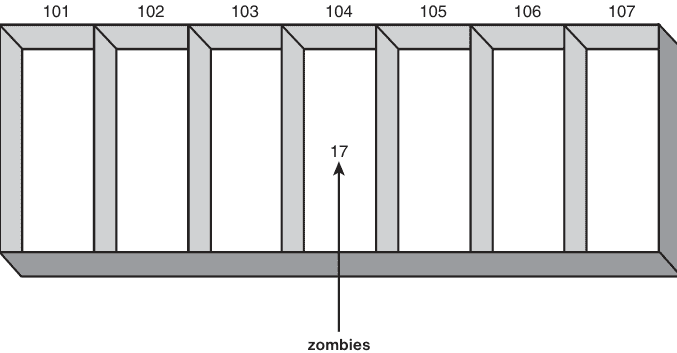

图 3.1 内存的可视化表示。

### 在内存中存储变量

在 C++ 中创建变量时，必须告诉编译器变量的名称以及它将包含什么类型的信息，例如整数、字符或浮点数。这就是变量的类型（有时称为*数据类型*）。该类型告诉编译器在内存中留出多少空间来存放变量的值。

内存中的每个储物格可以容纳一个字节（byte）。如果一个变量的类型是两个字节，那么它就需要两个字节的内存。由于计算机使用字节来表示值，因此熟悉这个概念是非常重要的。

在 C++ 中用 `short` 表示的短整型通常是两个字节。长整型（`long`）是四个字节，整数（`int`）可以是两个或四个字节，而 `long long` 是八个字节。

文本字符在 C++ 中用 `char` 类型表示，通常为一个字节。在图 3.1 中，每个储物格包含一个字节。两个字节的值（如短整型）可以存储在地址 106 和 107 中。

真假值存储为 `bool` 类型（Boolean 的缩写）。`true` 和 `false` 是它能包含的唯一值。

> **注意**
>
> 布尔变量以乔治·布尔（George Boole）命名，他是一位于 1815 年至 1864 年的英国数学家。他创立了布尔代数，在那种代数中值被限于真或假。他的创造构成了现代计算的基础，一直到最小的数字电路。他小时候一定很擅长对错判断。

`short` 的大小始终小于 `int`。`int` 的大小始终等于或小于 `long`。浮点数值类型则不同，将在本小时的稍后部分讨论。

到目前为止描述的常用类型在所有系统上并不适用。你可以在 C++ 中使用 `sizeof()` 函数来检查某种类型所占的大小。`sizeof` 后面的括号应该用类型名称作为参数。这里有一个例子：

```cpp
std::cout << sizeof(int) << "\n";
```

该语句显示了存储整数变量所需的字节数。`sizeof()` 函数由编译器提供，不需要包含指令。列表 3.1 中的 Sizer 程序依赖 `sizeof()` 函数来报告你计算机上常见 C++ 类型的大小。

### 列表 3.1 Sizer.cpp 的完整文本

```cpp
1: #include <iostream>
2:
3: int main()
4: {
5:     std::cout << "The size of an integer:\t\n";
6:     std::cout << sizeof(int) << " bytes\n";
7:     std::cout << "The size of a short integer:\t\n";
8:     std::cout << sizeof(short) << " bytes\n";
9:     std::cout << "The size of a long integer:\t\n";
10:    std::cout << sizeof(long) << " bytes\n";
11:    std::cout << "The size of a character:\t\n";
12:    std::cout << sizeof(char) << " bytes\n";
13:    std::cout << "The size of a boolean:\t\n";
14:    std::cout << sizeof(bool) << " bytes\n";
15:    std::cout << "The size of a float:\t\n";
16:    std::cout << sizeof(float) << " bytes\n";
17:    std::cout << "The size of a double float:\t\n";
18:    std::cout << sizeof(double) << " bytes\n";
19:    std::cout << "The size of a long int:\t\n";
20:    std::cout << sizeof(long long int) << " bytes\n";
21:
22:
23:    return 0;
24: }
```

### 有符号与无符号

在 C++ 中创建变量时，你必须告诉编译器变量的名称以及它将包含什么类型的信息，例如整数、字符或浮点数。这就是变量的类型（有时称为*数据类型*）。该类型告诉编译器在内存中留出多少空间来存放变量的值。内存中的每个储物格可以容纳一个字节。如果一个变量的类型是两个字节，那么它就需要两个字节的内存。由于计算机使用字节来表示值，因此熟悉这个概念是非常重要的。

在 C++ 中用 `short` 表示的短整型通常是两个字节。长整型（`long`）是四个字节，整数（`int`）可以是两个或四个字节，而 `long long` 是八个字节。文本字符在 C++ 中用 `char` 类型表示，通常为一个字节。在图 3.1 中，每个储物格包含一个字节。两个字节的值（如短整型）可以存储在地址 106 和 107 中。真假值存储为 `bool` 类型（Boolean 的缩写）。`true` 和 `false` 是它能包含的唯一值。

> **注意**
>
> 布尔变量以乔治·布尔命名，他是一位生活于 1815 年至 1864 年的英国数学家。他创立了布尔代数，在那种代数中值被限于真或假。他的创造构成了现代计算的基础，一直到最小的数字电路。他小时候一定很擅长对错判断。

[第44 页]

### 变量类型

除了整数变量外，C++ 类型还涵盖了浮点值和字符。

### 表 3.1 变量类型

| 类型 | 大小 | 值 |
|---|---|---|
| `unsigned short` | 2 字节 | 0 到 65,535 |
| `short` | 2 字节 | -32,768 到 32,767 |
| `unsigned long` | 4 字节 | 0 到 4,294,967,295 |
| `long` | 4 字节 | -2,147,483,648 到 2,147,483,648 |
| `int` | 4 字节 | -2,147,483,648 到 2,147,483,648 |
| `unsigned int` | 4 字节 | 0 到 4,294,967,295 |
| `long int` | 8 字节 | -9.2 十亿到 9.2 十亿 |
| `char` | 1 字节 | 256 个字符值 |
| `bool` | 1 字节 | 真或假 |
| `float` | 4 字节 | 1.2e-38 到 3.4e38 |
| `double` | 8 字节 | 2.2e-308 到 1.8e308 |

`short` 和 `long` 变量在 C++ 中也称为 `short int` 和 `int long`。两种形式在程序中都是接受的。

尽管被认为是良好的编程习惯，但 `char` 变量可以作为小整数使用。每个字符都有一个与其字符集中的 ASCII 码相同的数值。

一种名为 `auto` 的特殊变量类型将在本小时稍后部分讨论。

## 定义变量

在 C++ 中，变量通过声明其类型、变量名以及结束语句的分号来定义，如下例所示：

```cpp
int highScore;
```

在同一条语句中可以定义多个变量，只要它们具有相同的类型。变量名之间用逗号隔开，如下例所示：

```cpp
unsigned int highScore, playerScore;
long area, width, length;
```

`highScore` 和 `playerScore` 变量都是无符号整数。第二个语句创建了三个长型整数：`area`、`width` 和 `length`。由于这些整数具有相同的类型，因此它们可以在一个语句中创建。

变量名可以是大写字母、小写字母、数字和下划线 (`_`) 的任意组合，且不能有空格。合法的变量名包括 `x`、`driver8` 和 `playerScore`。C++ 是区分大小写的，因此变量 `highScore` 与其它名为 `highscore` 或 `HIGSCORE` 的变量不同。

使用描述性的变量名可以让阅读程序的程序员更容易理解。编译器并不关心使用哪一种。请看下面的代码示例，看看哪一个更容易理解。

示例 1

```cpp
main()
{
    unsigned short x;
    unsigned short y;
    unsigned int z;
    z = x * y;
}
```

示例 2


```
main ()
{
    unsigned short width;
    unsigned short length;
    unsigned short area;
    area = width * length;
}
```

程序员在采用变量命名约定时各不相同。有些人倾向于使用全小写字母，并用下划线分隔单词，例如 `high_score`、`player_score` 和 `new_world_record`。另一些人则倾向于除新单词的首字母外使用小写字母，例如 `highScore`、`playerScore` 和 `newWorldRecord`。（后一种命名法被称为驼峰命名法 CamelCase，因为单词中间的大写字母看起来像骆驼的驼峰。）

在 Linux 环境下学习的程序员倾向于使用第一种约定，而在微软世界的人使用驼峰命名法。编译器并不关心。

本书中的代码遵循驼峰命名法。

通过良好的变量命名和大量的注释，当你在几个月或几年后回到代码面前时，你的 C++ 代码将更容易理解。

### 注意

某些编译器允许你关闭变量名的大小写敏感性。不要这样做。如果你这样做了，你的程序可以在其他编译器上运行，但其他 C++ 程序员会在你背后嘲笑你。

某些单词不能在 C++ 中用变量名，因为它们是语言使用的关键字。保留关键字包括 `if`、`for` 和 `main`。通常，变量的任何合理名称几乎肯定不是关键字。

变量名可以包含关键字的一部分，但不能是整个名称，因此即使 `main` 和 `for` 是保留字，变量 `mainFlag` 和 `forward` 是被允许的。

## 给变量赋值

使用 `=` 运算符给变量赋值，该运算符被称为赋值运算符。以下语句展示了如何创建一个值为 13000 的整数 `highScore`：

```
unsigned int highScore;
highScore = 13000;
```

创建变量时可以为其分配一个初始值：

```
unsigned int highScore = 13000;
```

这被称为初始化变量。初始化看起来像赋值，但当你处理常量时，你会发现某些变量必须初始化，因为它们不能被重新赋值。

列表 3.2 中的 `Rectangle` 程序使用变量和赋值来计算矩形的面积并显示结果。

## 列表 3.2 Rectangle.cpp 的完整文本

```
1: #include <iostream>
2:
3: int main()
4: {
5:   // 设置宽度和长度
6:   unsigned short width = 26, length;
7:   length = 40;
8:
9:   // 创建一个初始化为长度的无符号短型
10:  unsigned short area;
11:  area = width * length;
12:
13:  std::cout << "Width: " << width << "\n";
14:  std::cout << "Length: " << length << "\n";
15:  std::cout << "Area: " << area << "\n";
16:  return 0;
17: }
```

该程序运行时的输出如下：

Width: 26

Length: 40

Area: 1040

`Rectangle` 程序使用变量和赋值来计算矩形的面积并显示结果。

由于这些常量缺少类型，编译器无法确保常量具有适当的值。由于这些定义的常量无法进行类型检查，因此最好使用标准常量，并避免仅为了设置常量而使用指令。

## 枚举常量

枚举常量通过单条语句创建一组常量。它们使用关键字 `enum` 进行定义，其后跟着一系列用大括号括起来并用逗号分隔的名称，如下例所示：

```
enum COLOR { RED, BLUE, GREEN, WHITE, BLACK };
```

该语句创建了一个名为 COLOR 的枚举常量集合，其中包含名为 RED、BLUE、GREEN、WHITE 和 BLACK 的五个值。这组常量被称为枚举。

在内部，枚举常量持有整数值。这些值从集合的 0 开始向上递增 1。因此，RED 等于 0，BLUE 等于 1，GREEN 等于 2，WHITE 等于 3，BLACK 等于 4。所有常量都是整数。

常量还可以使用 `=` 赋值运算符指定它们的值：

```
enum Color { RED=100, BLUE=500, WHITE, BLACK=700 };
```

该语句将 RED 设置为 100，GREEN 设置为 500，BLACK 设置为 700。集合赋值值的成员将比前一个成员大 1，因此 BLUE 等于 101，WHITE 等于 501。

这种技术的优势在于，你可以使用像 BLACK 或 WHITE 这样的符号名称，而不是像 1 或 700 这样没有意义的数字。

列表 3.4 中的程序使用了枚举常量表示八个方向，并将一个值存储在名为 `heading` 的变量中。

## 列表 3.4 Compass.cpp 的全文

```
1: #include <iostream>
2:
3: int main()
4: {
5: // 设置枚举
6: enum Direction { North, Northeast, East, Southeast, South,
7: Southwest, West, Northwest };
8:
9: // 创建变量来存储它
10: Direction heading;
11: // 初始化该变量
12: heading = Southeast;
```

在 `rate` 语句中，表达式 `500 / 3.0` 生成一个 double 类型结果，因为操作数之一是一个 double 类型值。（你将在第 4 小节“使用表达式、语句和运算符”中学习更多关于表达式的知识。）

## 自动类型变量

编译器确定类型。在前面的示例中，就好像遇到了以下语句：

```
int index = 3;
float multiple = 2.25F;
double rate = 500 / 3.0;
```

使用 `auto` 时，必须在初始化时为变量赋值。

只要每个变量具有相同的数据类型，就可以用 `auto` 关键字分配多个变量。

`auto a = 86, b = 75, c = 309;`

在本节的最终项目中，列表 3.5 中的 Combat 程序像视频游戏中的角色一样计算战斗统计。

## 列表 3.5 Combat.cpp 的全文

```
1: #include <iostream>
2:
3: int main()
4: {
5:     // 定义角色值
6:     auto strength = 80;
7:     auto accuracy = 45.5;
8:     auto dexterity = 24.0;
9:
10:    // 定义常量
11:    const auto MAXIMUM = 50;
12:
13:    // 计算角色战斗统计
14:    auto attack = strength * (accuracy / MAXIMUM);
15:    auto damage = strength * (dexterity / MAXIMUM);
16:
17:    std::cout << "Unattack rating: " << attack << "\n";
18:    std::cout << "Damage rating: " << damage << "\n";
19:}
```

`auto` 关键字是在最近的 C++ 版本中添加的，你可能需要使用特殊的选项编译 Combat.cpp。`-std=c++14` 使编译器使用当前版本的 C++。以下是 GCC 编译器的示例命令：

```
g++ -std=c++14 Combat.cpp -o Combat.exe
```

### 第 3 小节：创建变量和常量

程序编译成功后，显示以下输出：

Attack rating: 72.8

Damage rating: 38.4

在第 6-8 行，变量设置了三个属性的值：角色的力量、准确度和敏捷度。在第 14-15 行中，这些代码被代入公式以计算攻击评分和伤害评分。如果这段代码是游戏的一部分，这些值将在角色参与战斗时使用。

程序中的六个变量都使用了 `auto` 关键字，如果第 6–8 行用整数初始化，它们被视为 `int` 变量。如果是浮点值，它们被视为 `double`。

修改这些行中的字面量常量，然后编译并运行程序。使用不同类型的值观察输出如何变化。

### 注意

旧版本的 C++ 有一个 `auto` 关键字，本用于指示变量是其定义的程序部分的局部的——这一概念称为作用域。C++ 开发者检查了许多行代码，只发现了少数几次用法，大部分在测试套件中。他们认为该关键字是多余的，并用这种新功能取代了它。任何依赖旧用法的代码将无法工作。

## 总结

本节涵盖了如何处理整数、浮点值和字符。变量用于改变。常量保持不变。

`auto` 关键字减少了使用变量的工作，因为它确定了类型。处理变量时需要注意的一点是它们占用的字节数，编译器提供的 `sizeof()` 函数返回字节数。

### 问答

## 问答

- 如果短整数会溢，为什么不总是使用长？

短整数和长整数都会溢出，但长整数的范围更大。在大多数计算机上，这不再是一个问题。

- 如果我将带小数的数字赋值整数而不是 float 或 double 会怎样？

某些编译器会发出警告，但 C++ 允许将小数赋值给整数。精确的信息会丢失，所以如果你以后尝试使用 float 变量，它仍然等于 5。

- 我为什么要费力使用符号常量？

当常量在程序中多次使用时，符号常量允许通过更改常量初始化来更改所有值。符号常量还有解释作用，例如：如果一个语句乘以 360，它比乘以一个名为 degreesInCircle 且等于 360 的更容易理解。

## 工作坊

现在你已经学习了变量和常量，可以回答几个问题并做一些练习，来巩固你关于它们的知识。

## 测验

- 1. 为什么要使用无符号整数（unsigned）而不是有符号整数（signed）？

   A. 它们包含更多的数字。

   B. 它们包含更多的正数。

   C. 没有理由偏于其中任何一个。

- 2. 变量 ROSE、rose 和 Rose 是同一个变量吗？

   A. 是

   B. 否

   C. 与你无关

- 3. #define 常量和 const 之间有什么区别？

   A. 只有其中一个由预处理器处理。

   B. 只有其中一个具有类型。

   C. a 和 b都是

## 答案

- 1. 无符号整数包含更多的正值，且不能用于存储负值。它们包含的值数量是相同的。

- 2. 因为 C++ 是区分大小写的，所以 ROSE 不等于 rose，rose 不等于 Rose。编译器将每个引用视为不同的变量。

- 3. 预处理器指令 `#define` 会在代码中出现的每个地方替换该值。它没有数据类型，并且对编译器是不可见的。使用关键字 `const` 创建的常量具有数据类型，并由编译器处理。

## 活动

- 1. 创建一个程序，使用常量表示达阵得分（6分）、任意射得分（3分）、达阵后加分（1分）和安全得分（2分），并按照球队在最后一次超级碗锦标赛中得分的顺序将它们相加。显示最终比分。（为了获得额外积分，请让卡罗莱纳棕虎队 Carolina Panthers 获胜。）

- 2. 扩展矩形（Rectangle）程序，该程序用于确定具有宽度、长度和高度的三维矩形的面积。要确定面积，请使用乘法运算符 `*` 将所有三个值相乘。

查看这些活动的解决方案，请访问本书的网站 http://cplus.ladenhead.org。

# 第 4 小时

使用表达式、语句和运算符

在本小时你将学习：

- 如何编写语句

- 如何创建表达式

- 当满足条件时如何运行代码

- 不同运算符的作用

### 语句

所有的 C++ 程序都由语句组成，语句是以分号结尾的命令。按照惯例，每个语句占据一行，但这不是强制要求的——只要每个语句都以分号结尾，就可以将多个语句放在同一行。语句控制程序的执行顺序，评估表达式，或者甚至可以什么都不做（空语句）。一种常见的语句是赋值：

```
x = a + b;
```

这条语句将变量 x 赋值为 a + b 的和。赋值运算符将运算符右侧的值赋给左侧的变量。如果 a 等于 4 或 b 等于 13，则在执行语句后，x 将等于 17。

### 空格字符

在 C++ 程序的源代码中，任何空格、制表符（tabs）和换行符都被称为空白字符。编译器通常会忽略空白字符，空白字符的作用是使代码对程序员更具可读性。

之前的赋值语句可以用以下两种方式编写，且仍能正常工作：

```
x=a+b;
x      = a + b ;
```

### 第 4 小时：使用表达式、语句和运算符

编译器忽略空白字符（即缺失的部分）。变量名内部不能使用空白字符，变量 `playerScore` 不能被称为 `player Score`。

在程序中起缩进作用的制表符或空格是空白字符。适当的缩进可以更容易看到程序块或函数的开始和结束。

### 复合语句

可以将多个语句组合成一个复合语句，它以左大括号 `{` 开始，以右大括号 `}` 结束。复合语句可以出现在任何单个语句的地方。

虽然复合语句中的每个语句都必须以分号结尾，但复合语句本身不需要以分号结尾。这是一个示例：

```
{ temp = a;
a = b;
b = temp;
}
```

这个复合语句使用变量名 `temp` 作为其中一个值的临时存储位置，交换了变量 `a` 和 `b` 中的值。

### 表达式

表达式是语句中任何返回值的部分，如下面的这个简单的示例所示：

`x = y + 13;`

这条语句将变量 x 赋值为变量加 13。因此，如果 y 等于 20，则 x 等于 33。整个语句返回 x 的最终值，因此它也是一个表达式。为了更深入地理解这一点，请考虑一个更复杂的语句：

`z = x = y + 13;`

这条语句由三个表达式组成：

- 表达式 `y + 13` 的结果存储在变量 x 中。

- 表达式 `x = y + 13` 返回 x 的值，该值存储在变量 z 中。

- 表达式 `z = x = y + 13` 返回 z 的值，但没有存储。

赋值运算符 `=` 使运算符左侧的操作数的值变为运算符右侧的值。

操作数（Operand）是一个数学术语，指表达式中被运算符操作的部分。

列表 4.1 中的 Expression 程序显示了三个变量在在复杂的多个表达式语句中使用之前和之后的值。

### 列表 4.1 Expression.cpp 的全文

```
1: #include <iostream>
2: int main()
3: {
4:   int x = 12, y = 42, z = 88;
5:   std::cout << "Before - " << x << " - " << y << " - " << z << std::endl;
6:   z = x = y + 13;
7:   std::cout << "After - " << x << " - " << y << " - " << z << std::endl;
8:   return 0;
9: }
```

该程序输出如下：

Before - 12 - 42 - 88

After - 55 - 55 - 55

### 运算符

运算符是一个符号，它导致运算符左侧的操作数的值变为运算符右侧的值。

### 赋值运算符

表达式由赋值运算符、左侧的操作数（左值）和右侧的操作数（右值）组成。在表达式 `grade = 95` 中，左值是 grade，右值是 95。

常量是右值但不能是左值。`95 = grade` 是不允许的。

学习左值和右值术语的主要原因是它们可能会出现在编译器错误信息中。

### 数学运算符

有五数学运算符：加法 (`+`)、减法 (`-`)、乘法 (`*`)、除法 (`/`) 和取模 (`%`)。C++ 像 C 语言一样没有幂运算符。有一个函数来执行幂运算。

加法、减法和乘法的作用如你所知，但除法更为复杂。

整数除法与普通除法不同。当你用 21 除以 4 时，结果是一个带有小数部分的实数。相比之下，整数除法产生整数，因此余数被丢弃。`21 / 4` 的值为 5。

取模运算符 `%` 返回整数除法的余数值，`21 % 4` 等于 1。

> 注意

在使用取模运算符描述表达式时，它被称为模（modulo），`21 % 4` 是“21 模 4”。模是取模运算符执行的操作，结果被称为模。

寻找模数在编程中非常有用。如果你想在每执行十次任务时显示一条语句，表达式 `taskCount % 10` 可以监控这种情况。模的范围从 0 到 10。每当它等于 0 时，任务计数就是 10 的倍数。

浮点除法与普通除法可比。表达式 `21 / 4.0` 等于 5.25。

C++ 根据操作数的类型决定执行哪种除法。如果至少有一个是浮点类型变量或字面量，则执行浮点除法。否则，执行整数除法。

### 组合运算符

将一个值增加到变量然后将结果赋回该变量的情况并不少见。以下表达式将变量 `score` 的值增加 10：

```
score = score + 10;
```

这条表达式取 `score` 的现有值，加上 10，并将结果存储在 `score`。

可以使用 `+=` 自赋值加法运算符更简单地编写：

```
score += 10;
```

### 运算符

自赋值加运算符 `+=` 将右值加到左值，并将结果赋值给左值。同样还有自赋值减运算符 (`-=`)、除法运算符 (`/=`)、乘法运算符 (`*=`) 和取模运算符 (`%=`)。

这些自赋值运算符的作用与较长的表达式相同，因此你可以根据需要任选使用其中一种形式。

### 递增和递减运算符

变量中加上或减去的最常见值是 1。将变量加1 称为*递增*。C++ 包含了 `++` 递增运算符和 `--` 递减运算符来完成这些任务：

```
score++
zombies--
```

这些语句分别将 `score` 增加 1，将 `zombies` 减少 1。它们等同于这些更冗长的陈语句：

```
score = score + 1;
zombies = zombies - 1;
```

`++` 运算符的读作 "plus-plus"，`--` 读作 "minus-minus"。

> 注意


> 现在你已经接触了递增运算符，C++ 这个名字应该更有意义了。C++ 编程语言是由创始人 Bjarne Stroustrup 设计的，是对 C 语言的增量改进。他像命名表达式一样命名它，将递增运算符放入名称中，这导致多年来无数的人疑惑为什么它被称为 "C-plus-plus" 而不是 "C-plus"。

## 前置和后置运算符

递增运算符 `++` 和递减运算符 `--` 可以用在变量名的之前或之后，达到不同的结果。放在变量名之前的运算符称为前缀运算符，如该语句所示：

```
++count;
```

放在变量名后的运算符称为后置运算符：

```
count++;
```

在像前面的示例这样的简单语句中，这些运算符的作用相同。在两个语句中，`count` 变量都增加了 1。

## 第 4 小时：使用表达式、语句和运算符

前缀和后置运算符存在的意义在复杂表达式变得明显，在这些表达式中，变量被增加或减少并赋值给另一个变量。前缀运算符在表达式中使用变量之前发生。后置运算符在之后求值。

通过一个具体的例子会更容易理解：

```
int x = 5;
int sum = ++x;
```

执行这些语句后，变量 `x` 和 `sum` 均等于 6。`++x` 中的前缀运算符导致 `x` 在赋值给 `sum` 之前从 5 增加到 6。

对比这个示例：

```
int x = 5;
int sum = x++;
```

这导致 `sum` 等于 5，而 `x` 等于 6。后置运算符导致 `x` 在从 5 增加到 6 之前被赋值给 `sum`。

列表 4.2 包含了 `Years` 程序，该程序使用前置和后置运算符向后计数了若干年。

### 列表 4.2 Years.cpp 的全文

```cpp
1: #include <iostream>
2:
3: int main()
4: {
5:     int year = 2016;
6:     std::cout << "The year " << ++year << " passes.\n";
7:     std::cout << "The year " << ++year << " passes.\n";
8:     std::cout << "The year " << ++year << " passes.\n";
9:
10:    std::cout << "\nit is now " << year << ".\n";
11:    std::cout << "Have the Chicago Cubs won the World Series series?\n";
12:
13:    std::cout << "\nThe year " << year++ << " passes.\n";
14:    std::cout << "The year " << year++ << " passes.\n";
15:    std::cout << "The year " << year++ << " passes.\n";
16:
17:    std::cout << "\nSurely the Cubs have won the Series by now.\n";
18:    return 0;
19: }
```

该程序显示了以下输出：

```
The year 2017 passes.
The year 2018 passes.
The year 2019 passes.
```

现在是 2019 年了。芝加哥小熊队赢得世界系列赛了吗？

```
The year 2019 passes.
The year 2020 passes.
The year 2021 passes.
```

> **注意**
>
> C++ 中给变量加 1 有三种方法：`a = a + 1`、`+=`、`a++`。这导致了关于哪种方法最好的困惑。并没有最好的方法。只要你清楚你的代码在做什么，这三种都是完全可以的。

### 运算符优先级

复杂表达式产生的值取决于优先级，即表达式求值的顺序。这里有一个带有三个运算符的复杂表达式：

```
int x = 5 + 3 * 8;
```

在不知道乘法和加法顺序的情况下，无法知道该语句执行后 `x` 等于多少。如果加法在乘法之前发生，该表达式将 `x` 设置为 64，因为 8 乘以 8 等于 64。如果乘法在加法之前发生，`x` 等于 29，因为 5 加 24 等于 29。

在 C++ 中每个运算符都有优先级。乘法的优先级高于加法，表达式将 `x` 设置为 29。运算符的优先级如表 4.1 所示。你之后会接触这些运算符。运算符从表格顶部开始求值。相同优先级的运算符从左到右或从右到左求值。查看表格，你可以看到乘法运算符 `*` 和除法运算符 `/` 的优先级高于加法运算符 `+` 和减法运算符 `-`。因此，乘法和除法在加法和减法之前被处理。

### 表 4.1 运算符优先级

| 级别 | 运算符 | 求值顺序 |
| :--- | :--- | :--- |
| 1 (最高) | ( ) | 从左到右 |
| 2 | ++ -- sizeof | 从右到左 |
| 3 | * % | 从左到右 |
| 4 | / | 从左到右 |
| 5 | + - | 从左到右 |
| 6 | << >> | 从左到右 |
| 7 | <= >= | 从左到右 |
| 8 | == != | 从左到右 |
| 9 | & | 从左到右 |
| 10 | ^ | 从左到右 |
| 11 | \| | 从左到右 |
| 12 | && | 从左到右 |
| 13 | \|\| | 从左到右 |
| 14 | ?: | 从右到左 |
| 15 | += -= | 从右到左 |
| 16 | &= \|= | 从右到左 |
| 17 (最低) | = | 从右到左 |

在 C++ 中给变量加 1 有三种方法：`a = a + 1`、`+=`、`a++`。这导致了关于哪种方法最好的困惑。并没有最好的方法。只要你清楚你的代码在做什么，这三种都是完全可以的。

### 关系运算符

关系运算符用于比较，确定两个数字是否相等或一个是否大于小于另一个。每个关系表达式都返回 `true` 或 `false`。关系运算符如表 4.2 所示。

### 表 4.2 运算符

| 名称 | 运算符 | 示例 | 结果 |
| :--- | :--- | :--- | :--- |
| 等于 | == | 100 == 50 | false |
| | | 50 == 50 | true |
| 不等于 | != | 100 != 50 | true |
| | | 50 != 50 | false |
| 大于 | > | 100 > 50 | true |
| | | 50 > 50 | false |
| 大于等于 | >= | 100 >= 50 | true |
| | | 50 >= 50 | true |
| 小于 | < | 100 < 50 | false |
| | | 50 < 50 | false |
| 小于等于 | <= | 100 <= 50 | false |
| | | 50 <= 50 | true |

如果你有整数变量 `myAge` 和 `yourAge`，表达式 `myAge == yourAge` 判断它们是否相等。以下语句使用了该表达式：

```
std::cout << (myAge == yourAge) << "\n";
```

如果它们相等，该语句显示 1；不等则显示 0。

> **注意**
>
> 许多初学者 C++ 程序员会混淆赋值运算符 `=` 和相等运算符 `==`，这可能会给程序引入难以发现的错误。当你本该使用相等运算符的地方使用了赋值运算符时，编译器可能会给你警告，但有时并检测不到。

### if-else 条件语句

你目前为止创建的程序从上到下执行每一行。`if` 关键字使得仅在条件满足时才运行代码，例如两个变量是否相等、一个是否大于特定值，或者 `bool` 变量是否为真值。

以下语句仅在整数 `zombies` 满足特定条件时才显示消息：

```
if (zombies == 0)
    std::cout << "No more zombies!\n";
```

当 `zombies` 变量等于 0 时，这段代码将显示“No more zombies!”字样。括号内的表达式是条件。如果表达式为真，则执行 `if` 之后的语句。如果表达式为假，则跳过该语句。

例如，当这段代码运行时，如果 `zombies` 变量等于 25，则什么都不显示。

只有当表达式为真时，条件代码才会执行。由于 `bool` 变量可以为真或假，可以使用其中一个作为条件：

```
bool run = true;
if (run)
std::cout << "Running\n";
```

只有当 `bool` 变量 `run` 等于 `true` 时，这段代码才会显示“Running”文本。

### else 子句

程序可以在条件为真时执行一条语句，在条件为假时执行另外另一条语句。`else` 关键字标识了条件为假时要执行的语句：

```
if (zombies == 0)
std::cout << "No more zombies!\n";
else
std::cout << "Beware the zombie apocalypse!\n";
```

列表 4.3 中的 `Grader` 程序演示了条件语句的使用。

### 列表 4.3 Grader.cpp 的全文

```cpp
1 #include <iostream>
2:
3 int main()
4 {
5 int grade;
6 std::cout << "Enter a grade (1-100): ";
7 std::cin >> grade;
8:
9:
10 if (grade >= 70)
11 std::cout << "\nYou passed. Hooray!\n";
12 else
13 std::cout << "\nYou failed. Sigh.\n";
14:
15 return 0;
16 }
```

到目前为止编写的所有程序使用了 `std::cout`，这是标准 C++ 库中的对象，用于向用户显示信息。第 1 行的指令使该对象在程序中可用。

`Grader` 程序使用了输入输出库中的另一个对象：`std::cin`，它收集用户信息。第 6 行向用户显示一个查询：“Enter a grade (1-100)”。第 7 行使用 `std::cin` 接收用户的键盘输入，并存储在整数 `grade` 中。

`Grader` 根据用户输入的成绩显示不同的输出。这种可变性使用了第 9-12 行的 `if-else` 条件。

以下是它的输出示例：

```
Enter a grade (1-100):
85
You passed. Hooray!

You got a B grade. Good work, but I know you can do better if you apply yourself and stop spending so much time on Snapchat when you should be studying.
```

### 复合 if 语句

复合语句可以用代码中任何放置单个语句的地方。`if` 和 `if-else` 条件后面通常跟着复合语句：

```
if (zombies == 0)
{
    std::cout << "No more zombies!\n";
    score += 5000;
}
```

这段代码在 `zombies` 等于 0 时执行两件事：显示“No more zombies!”并向变量 `score` 增加 5,000。如果 `zombies` 不等于 0，则这两件事都不会发生。

任何语句都可以与 `if` 条件一起使用，甚至是另一个 `if` 或 `else` 语句。

列表 4.4 中的 `NewGrader` 程序通过为 A、B、C 和 F 级显示不同的消息，扩展了 `Grader`。

### 列表 4.4 NewGrader.cpp 的全文

```cpp
1: #include <iostream>
2:
3: int main()
4: {
5:    int grade;
6:    std::cout << "Enter a grade (1-100): ";
7:    std::cin >> grade;
8:
9:    if (grade >= 70)
10:    {
11:        if (grade >= 90)
12:        {
13:            std::cout << "\nYou got an A. Great job!\n";
14:            return 0;
15:        }
16:        if (grade >= 80)
17:        {
18:            std::cout << "\nYou got a B. Good work!\n";
19:            return 0;
20:        }
21:        std::cout << "\nYou got a C. Perfectly adequate!\n";
22:    }
23:    else
24:        std::cout << "\nYou got an F. Failed!\n";
25:
26:    return 0;
27: }
```

`NewGrader` 程序有一个 `if-else` 条件，处理用户输入成绩 70 或更高以及不更高的情况。70 分或以上的成绩在第 10-22 行处理。90 分或更高显示 A 和 B 的消息。显示消息后，`return 0` 语句会立即结束 `main()` 函数。如果运行到第 21 行时程序仍在运行，则会显示 C 的消息。`else` 与第 9 行的 `if` 配对。它涵盖了低于 70 的成绩。

这是该程序的示例输出：

```
Enter a grade (1-100):
93
You got an A. Great job!
```

通过努力和专注，你提高了你的成绩。`NewGrader` 程序仅在复合语句周围使用大括号。

有些程序员总是对条件代码块使用大括号，即使在不需要时：

```cpp
if (zombies == 0)
{
    std::cout << "No more zombies!\n";
    score += 5000;
}
```

这段代码在 `zombies` 等于 0 时执行两件事：显示“No more zombies!”并向变量 `score` 增加 5,000。如果 `zombies` 不等于 0，则这两件事都不会发生。

### 逻辑运算符

`bool` 可以为真或假。`if` 语句可以使用以下逻辑运算符：`&&`（与）、`||`（或）、`!`（非）。这些运算符列在表 4.3。

### 表 4.3 逻辑运算符

| 运算符 | 符号 | 示例 |
|---|---|---|
| AND | && | grade >= 70 |
| OR | \|\| | grade < 70 |
| NOT | ! | grade >= 70 |

### && 运算符

只有当表达式都为真时，条件代码才会执行。`&&` 运算符要求两个表达式都为真。这是一个使用逻辑的示例：

```cpp
if (grade >= 70 && grade < 80)
```

### || 运算符

只有当表达式中的至少一个为真时，条件代码才会执行。`||` 运算符要求两个表达式中至少有一个为真。这是一个示例：

```cpp
if (grade == 90 || grade == 80)
```

### ! 运算符

逻辑 `!` 运算符反转表达式的值。如果表达式为真，它就为假；反之亦然。这是一个将逻辑反真的示例：

```cpp
if (!(grade == 0))
```

### 运算符优先级

关系运算符和逻辑运算符像其他运算符一样具有相同的优先级，从左到右计算。为了明确语句在做什么，有时可以使用额外的括号：

```cpp
if (x > 5 && (y > 5 || z > 5))
```

使用括号可以强制不同的执行顺序：

```cpp
if ((x > 5 && y > 5) || z > 5)
```

### 表达式值

表达式产生真或假的值。在 C++ 中，值 0 也被视为假，任何其他值都是真。有些 C++ 程序员在语句中利用这一特性：

```cpp
if (zombies)
   std::cout << "There are " << x << " zombies left\";
```

当 `zombies` 等于 0 时，表达式为假，不显示僵尸数量。当 `zombies` 等于其他数字时，表达式为真，显示数量。这段代码与以下相同：

```cpp
if (zombies != 0)
   std::cout << "There are " << x << " zombies left\";
```


这两个语句在 C++ 中都是允许的，但后者更清晰。良好的编程习惯是将前者留给真正的逻辑测试，而不是测试非零值。

这两个语句也是等价的：

```cpp
if (!x)
   if (x == 0)
```

这两个语句在 `x` 等于 0 时均为真。第二个语句更容易理解。

## 总结

在这个小时中，你学习了语句、表达式和运算符，这些是 C++ 程序的构建块。

语句是执行特定任务的单行代码。程序由成百、上千或数百万语句组成。每条语句都以分号结束。

表达式是产生值的语句或语句的一部分。该值可以使用赋值运算符 `=` 赋给变量。

操作符是导致编译器执行操作的符号。操作符可以赋值、执行加法或除法等数学运算、比较两个值以及处理逻辑比较。

`if` 和 `else` 条件语句可以仅在特定条件为真时执行语句。这些条件通常被定义为表达式。

## 问答

- Q. 因为优先级决定了先处理哪些操作符，为什么在不需要括号时还要使用括号呢？

- A. 对于查看代码的程序员来说，优先级并不总是像对 C++ 编译器来说那样清晰。使用括号使程序对于维护它的人员来说更容易理解，从长远来看将是有回报的。

- Q. 制表符、空格和换行符对程序有什么影响？

- A. 这些字符被称为空白字符，会被编译器忽略，对程序没有影响。它们的目的是让程序更容易被人类理解。糟糕的缩进可能会很难判断哪条语句属于哪个条件分支、复合语句从何时开始和结束等。

- Q. 负数是真还是假？

- A. 除了 0 以外的每一个数字（无论是正数还是负数）都被视为真。

- Q. 谁来决定新发现的动物如何命名？

- A. 新物种的命名系统受《国际动物命名法代码》（International Code on Zoological Nomenclature）的指导，这是一套决定名称结构的规则。

发现动物的人通常有权选择其名称，该名称将提交给英国伦敦自然历史博物馆（National History Museum）的委员会进行批准。

如果你发现了一个新物种，请访问该委员会的网站 `www.iczn.org`。

大多数发现者以自己的名字命名，但有些已经开始出售命名权以为保护工作筹集资金。2005 年，在线赌场 GoldenPalace.Com 支付了 650,000 美元将一种新灵长类动物命名为 *Callice aureipalatii*。“Aureipalatii” 在拉丁语中的意思是“金色宫殿”。

德国非营利组织 Biopat 以 2,600 欧元的捐款出售新物种的命名权（目前约为 2,870 美元）。访问该小组的网站 `http://biopat.de/en` 了解详细信息。

## 工作坊

现在你已经学习了表达式和语句，是时候回答几个问题并做几个练习来巩固你对这些主题的知识了。

## 测验

- 1. `x++` 和 `++x` 的区别是什么？

A. 它们在不同的时间增加 x 的值。

B. 第二种形式在 C++ 中是不允许的。

C. 一个是猫在跑，另一个是猫向右边跑。

- 2. 左值（i-value）和右值（r-value）之间的区别是什么？

A. 只有右值可以在表达式中使用。

B. 某些右值不是左值，但所有的左值都可以是右值。

C. a 和 b 都对。

- 3. 取模操作符 `%` 是起什么作用？

A. 它执行整数除法。

B. 它产生整数除法的余数。

C. 它产生一个数的平方根。

## 答案

- 1. A. 第一个使用后置操作符，第二个使用前缀操作符。后置在递增 x 之前评估 x，而前缀在评估 x 之前对其递增。选择后置还是前缀会影响 x 在表达式中使用时的值。

- 2. B. 左值出现在 `=` 赋值操作符的左侧，而右值出现在右侧。所有左值也可以出现在操作符的右侧，但某些右值（如字面量）不能作为左值。

- 3. B. 它在对提供的操作数执行整数除法后计算余数。

## 活动

- 1. 创建一个 NewGrade 程序的版本，该版本不包含 `return` 语句（最后一个除外）。使用许多测试值运行它，直到你发现 bug，并找出为什么会发生。

- 2. 写一个程序，要求用户输入 1 到 100 之间的成绩，询问同一标准下及格线是多少，并报告用户是否及格。

若要查看这些活动的解决方案，请访问本书的网站 `http://cplusplus.cadenhead.org`。

# 第 5 小时

## 调用函数

**在此小时内你将学到：**

- 函数的作用
- 如何声明和定义函数
- 如何带参数调用函数
- 如何从函数返回值

### 什么是函数？

*函数*（function）是程序的一部分，它可以对数据进行操作并返回一个值。每个 C++ 程序至少有一个函数，即 `main()` 函数，它在程序运行时被自动调用。该函数可以包含调用其他函数的语句，其中某些函数可能会调用其他函数，依此类推。

每个函数都有一个名称用于调用该函数。程序的执行跳转到该函数的第一条语句，并一直持续直到遇到 `return` 语句或函数的最后一条语句。此时，执行将从调用函数的地方恢复。

设计良好的函数执行特定的任务。复杂的任务应该拆分为多个函数，每个函数都可以被顺序调用。这使得你的代码更容易被理解和维护。

### 声明和定义函数

在编写函数代码之前，你必须对其进行声明。

函数声明告诉编译器函数的名称、函数产生的数据类型，以及函数接收的任何参数的类型。函数的声明也称为其*原型*（prototype），它不包含代码。

声明告诉编译器函数如何工作。函数原型是一个语句，以分号结尾。

参数列表标识每个参数的类型，用逗号分隔。

这里是计算矩形面积的声明：

```cpp
int findArea(int length, int width);
```

声明的三个部分是：

- 返回类型，`int`
- 函数名，`findArea`
- 两个参数的类型和名称，`int length` 和 `int width`

如果函数原型不匹配这三个元素，程序将无法编译。如果不命名参数，之前的声明可以重写为：

```cpp
int findArea(int, int);
```

虽然这是允许的，但如果使用了参数名称，函数原型会更清晰。

函数名称是描述其执行任务的短标识符。一种习惯是对名称中的每个单词大写。所有函数的结构都和 `main()` 函数一样。函数体包含在 `{` 和 `}` 括号之间。如果函数返回值，应该至少有一个 `return` 语句。在 C++14 中，`auto` 关键字可以让编译器选择返回类型。

任何 C++ 数据类型都可以由函数返回。如果函数不产生值，声明应使用 `void` 作为类型。返回 void 的函数不需要 `return` 语句，但可以使用，例如：

```cpp
return;
```

与函数声明不同，定义语句不能以分号结尾。

### 函数定义示例

这是 `findArea()` 的定义，它通过将长度乘以宽度来确定矩形的面积：

```cpp
int findArea(int length, int width)
{
    return length * width;
}
```

函数中的唯一语句返回两个参数的乘积。

列表 5.1 使用了这个函数。

### 列表 5.1 Area.cpp 的完整文本

```cpp
1: #include <iostream>
2:
3: int findArea(int length, int width); // 函数原型
4:
5: int main()
6: {
7:     int length;
8:     int width;
9:     int area;
10:
11:    std::cout << "\nhow wide is your yard? ";
12:    std::cin >> width;
13:    std::cout << "\nhow long is your yard? ";
14:    std::cin >> length;
15:
16:    area = findArea(length, width);
17:
18:    std::cout << "\nyour yard is ";
19:    std::cout << area;
20:    std::cout << " square feet\n\n";
21:    return 0;
22: }
23:
24: // 函数定义
25: int findArea(int l, int w)
26: {
27:     return l * w;
28: }
```

当程序被编译并运行时，它产生以下输出：

How wide is your yard? 32

How long is your yard? 25

Your yard is 800 square feet

`findArea()` 函数的原型位于第 3 行。该函数的代码包含在第 25–28 行。比较原型中的名称、返回类型和参数类型：它们是相同的，但原型中的参数名称是 `length`（长度）和 `width`（宽度），而在函数中是 `l` 和 `w`。这种区别并不重要，因为参数类型是相同的。

> **注意**
>
> 如果将 `Area.cpp` 中的函数定义移动到它的调用之前，则不需要原型。虽然对于像书中创建的这样的小型程序来说，这是一个可行的方案，但在较大的项目中，确保所有函数在在使用之前已经定义将变得更加繁琐。使用原型声明所有函数可以让你无需操心这个问题。

### 在函数中使用变量

函数通过多种不同的方式与变量进行交互。在调用函数时，可以将变量指定为实参（参数）。可以在函数内部创建变量，并在函数完成时消失。变量还可以被函数和程序的其余部分共享。

### 局部变量

在函数中创建的变量是局部变量，因为它只局部存在于函数内部。当函数返回时，程序中将再无法使用所有的局部变量。

局部变量的创建方式与其他任何变量相同。函数接收的参数也被视为局部变量。列表 5.2 中的 `Temperature` 程序使用局部变量将华氏度表示的温度值转换为摄氏度。

### 列表 5.2 Temperature.cpp 的全文

```cpp
1: #include <iostream>
2:
3: float convert(float);
4:
5: int main()
6: {
7:     float fahrenheit;
8:     float celsius;
9:
10:    std::cout << "Please enter the temperature in Fahrenheit: ";
11:    std::cin >> fahrenheit;
12:    celsius = convert(fahrenheit);
13:    std::cout << "\nHere's the temperature in Celsius: ";
14:    std::cout << celsius << "\n";
15:    return 0;
16: }
17:
18: // 将华氏度转换为摄氏度的函数
19:  float convert(float fahrenheit)
20: {
21:   float celsius;
22:   celsius = ((fahrenheit - 32) * 5) / 9;
23:   return celsius;
24: }
```

以下是运行程序三次，用户输入华氏度值 77、32 和 85 时的输出：

Please enter the temperature in Fahrenheit: 77

Here's the temperature in Celsius: 25

Please enter the temperature in Fahrenheit: 32

Here's the temperature in Celsius: 0

Please enter the temperature in Fahrenheit: 55

Here's the temperature in Celsius: 29.4444

该程序在第 19–24 行定义了一个 `convert()` 函数，它接受一个参数：一个名为 `fahrenheit` 的 `float` 值。

局部变量 `celsius` 在第 21 行声明，并在第 22 行赋值。该值是使用华氏度转换为摄氏度的三步公式确定的：

1. 从数字中减去 32。
2. 将结果乘以 5。
3. 将结果除以 9。

函数在第 23 行返回转换后的值。当函数结束时，局部变量 `fahrenheit` 和 `celsius` 停止存在且不再可以使用。

在 `main()` 方法中，创建了一个名为 `fahrenheit` 的变量来存储用户输入的值。名为 `celsius` 的变量存储了该温度转换后的版本。这些变量的名称与 `convert()` 函数中的局部变量相同，但它们是不同的变量。

它们不相同的原因是它们在不同的作用域中创建。变量的作用域是程序中变量存在的区域。作用域决定了变量何时何地对你的程序可用，以及在哪里可以被访问。在块内声明的变量具有该块的作用域。当块以右括号 `}` 结束时，变量将变得不可用。你可以在任何块内声明变量，例如 `if` 条件语句或函数。

### 全局变量

变量可以定义在 C++ 程序中所有函数之外，包括 `main()` 函数。这些被称为全局变量，因为它们在程序的任何地方都是可用的。

定义在任何函数之外的变量具有全局作用域，并且可以在程序中的任何函数（包括 `main()`）中使用。

列表 5.3 中的全局程序是 `Temperature` 的修订版本，它使用了全局变量。

### 列表 5.3 Global.cpp 的全文

```cpp
1: #include <iostream>
2:
3: void convert();
4:
5: float fahrenheit;
6: float celsius;
7:
8: int main()
9: {
10:  std::cout << "Please enter the temperature in Fahrenheit: ";
11:  std::cin >> fahrenheit;
12:  convert();
13:  std::cout << "\nHere's the temperature in Celsius: ";
14:  std::cout << celsius << "\n";
15:  return 0;
16: }
17:
18: // 将华氏度转换为摄氏度的函数
19: void convert()
20: {
21:  celsius = ((fahrenheit - 32) * 5) / 9;
22: }
```

当编译并运行时，该程序的执行方式与 `Temperature` 程序完全相同。

### 函数的返回值

```cpp
13: std::cout << input << " is not a leap year\n";
14: return 0;
15: }
16:
17: bool isLeapYear(int year)
18: {
19: if (year % 4 == 0)
20: {
21: if (year % 100 == 0)
22: {
23: if (year % 400 == 0)
24: return true;
25: else
26: return false;
27: }
28: else
29: return true;
30: }
31: else
32: return false;
33: }
```

LeapYear 程序判断一个年份是否为闰年。以下是使用不同用户输入连续运行四次的输出：

```
Enter a year: 2016
2016 is a leap year
Enter a year: 2017
2017 is not a leap year

Enter a year: 2100
2100 is not a leap year

Enter a year: 2000
2000 is a leap year
```

闰年有 366 天而不是 365 天，遵循三个规则：

- 如果年份能被 4 整除，则为闰年
- 除非该年份也能被 100 整除，这种情况下不是闰年
- 除非该年份能被 400 整除，否则它仍然是闰年

第 17–33 行的 `isLeapYear()` 函数使用 `if` 和 `else` 语句来执行这些规则。如果年份是闰年，函数返回值 `true`，否则返回 `false`。该函数接受一个整数参数，即要检查的年份。

函数中有四个不同的 `return` 语句，每个在不同的情况下结束函数的执行。与其他函数不同，最后一行不是自动执行的 `return` 语句。它是条件判断的一部分。

### 默认函数参数

在原型中声明函数以接收一个或多个参数时，该函数只能用具有正确数据类型的参数进行调用。考虑一个接受一个整数的函数：

```cpp
bool isLeapYear(int year);
```

`isLeapYear()` 函数必须接受一个整数作为参数，编译器会检查此项要求。使用缺失或无效的值调用函数会导致编译器错误。

这里有一个例外：如果原型为参数声明了默认值，则可以在不传递该参数的情况下调用该函数。每当省略参数时，都会使用该默认值。以下是 `isLeapYear()` 的修改后的原型，它包含一个默认值：

```cpp
bool isLeapYear(int year = 2016);
```

如果调用 `isLeapYear()` 函数时没有指定参数，则将使用默认值 2016。

当在原型中声明默认参数时，函数的定义不会改变。

当函数有多个参数时，默认值是根据参数的顺序分配的。任何参数都可以分配默认值，但有一个重要的限制：如果某个参数没有默认值，则它之前的任何参数都不得有默认值。

这是一个带有四个参数的原型：

```cpp
long set4DPoint(int x, int y, int z, int t);
```

以下更改是不允许的：

```cpp
long set4DPoint(int x, int y, int z = 1, int t);
```

它不起作用的原因是 `t` 参数缺少默认值。这是一个被允许的原型：


```cpp
long set4DPoint(int x, int y, int z = 1, int t = 2000);
```

使用此原型创建的函数可以使用此语句调用：

```cpp
set4DPoint(130, 85);
```

参数值分别为 `x` 的 130，`y` 的 85，`z` 和 `t` 为 2000。

列表 5.5 中的 `AreaCube` 棱体计算三维立方体的面积，其中两个维度使用了默认函数参数值。

### 列表 5.5 AreaCube.cpp 的全文

```cpp
1: #include <iostream>
2:
3: int findArea(int length, int width = 20, int height = 12);
4:
5: int main()
6: {
7:     int length = 100;
8:     int width = 50;
9:     int height = 2;
10:    int area;
11:
12:    area = findArea(length, width, height);
13:    std::cout << "First area: " << area << "\n";
14:
15:    area = findArea(length, width);
16:    std::cout << "Second area: " << area << "\n";
17:
18:    area = findArea(length, height);
19:    std::cout << "Third area: " << area << "\n";
20:    return 0;
21: }
22:
23: int findArea(int length, int width, int height)
24: {
25:     return length * width * height;
26: }
```

输出如下：

```
First area: 10000
Second area: 50000
Third area: 20000
```

要让函数的返回类型由推导决定，请在指定返回类型的地方使用 `auto`，如下面的简单函数：

```cpp
auto subtract(int x, int y)
{
    return x - y;
}
```

由于 x 和 y 都是整数，因此它们相减的结果也是一个 `int`。

在使用此功能时有几点需要注意。

- 如果一个函数有多个 `return` 语句，它们必须返回相同的数据类型。
- 函数必须在使用它的代码之前定义。

### 列表 5.6 AutoCube.cpp 的完整文本

```cpp
1: #include <iostream>
2:
3: auto findArea(int length, int width = 20, int height = 12);
4:
5: auto findArea(int length, int width, int height)
6: {
7:   return (length * width * height);
8: }
9:
10: int main()
11: {
12:   int length = 100;
13:   int width = 50;
14:   int height = 2;
15:   int area;
16:
17:   area = findArea(length, width, height);
18:   std::cout << "First area: " << area << "\n\n";
19:
20:   area = findArea(length, width);
21:   std::cout << "Second area: " << area << "\n\n";
22:
23:   area = findArea(length);
24:   std::cout << "Third area: " << area << "\n\n";
25:
   return 0;
26: }
27:
```

由于该程序使用了 C++14 引入的新功能，你可能需要使用标志 `--std=c++14` 来编译它，如下命令所示：

```bash
g++ -o AutoCube.exe --std=c++14 AutoCube.cpp
```

在列表 5.6 中，`auto` 关键字出现在第 5 行的函数原型中，且函数声明占据了两行。该函数在源代码中被移动到了 `main()` 函数之前。如果没有这样做，编译器将带有以下错误信息并停止：

```
AreaCube.cpp:12:12: error: use of 'auto findArea(int, int, int)' before deduction of auto
```

程序产生的输出与 AreaCube 相同。

## 总结

函数是 C++ 程序的骨干。程序执行的每一个任务都由一个函数表示。当该任务可以被分解为更小的任务时，这些每一个任务都可以是一个函数。

所有函数都应该使用函数原型进行声明，函数原型是标识函数名称、参数顺序和数据类型以及它所返回的数据类型的语句。编译器可以通过在返回类型的位置放置 `auto` 来推断出函数的返回类型，这是 C++ 的一项新功能。

此程序中的函数是名为：`findArea()`、`convert()` 和 `average()` 的程序。函数是命令。你正在告诉计算机某些操作，例如查找面积、转换数值或计算两个数字的平均值。

你在程序中编写的每个函数都是一个离散的任务。任务越具体，函数就会越短。

函数重载允许在多个相关函数上使用相同的函数名。函数的参数类型和参数数量用于区分它们。C++ 编译器根据这些差异确定执行哪一个函数。

## 问答

- **Q. 为什么不把所有变量都设为全局？**
- **A. 虽然这在编程中很常见，但随着程序变得越来越复杂，在具有全局访问变量的程序中查找错误变得困难。这是因为数据可以在程序的任何部分被误用。为了尽可能减少错误概率并使调试更容易，数据应该尽可能保持在局部作用范围内。**

- **Q. 为什么函数参数值的更改会反映在调用函数中？**
- **A. 传递给函数的参数是按值传递的。这意味着函数接收到的参数实际上是原始值的副本，即使它们共享相同的变量名。你在第 10 小节处理指针和引用时，将学到如何向函数传递可变参数。**

- **Q. 如果我有以下两个函数会发生什么？**

```cpp
int findArea(int width, int length = 1);
int findArea(int size);
```

这会重载吗？参数的数量不同，但第一个参数有一个默认值。

- **A. 声明可以通过编译，但带有一个参数的 `findArea()` 将导致关于“findArea(int, int) 和 findArea(int) 之间存在歧义”的编译错误。**

- **Q. 为什么没有人使用 1 号铅笔？**
- **A. 铅笔是根据分级系统生产的，该系统根据铅芯的软硬程度评分，这决定了它产生的痕迹深浅。铅芯越软，痕迹越深。**

在美国销售的铅笔有 1 号、2 号、2.5 号、3 号和 4 号。

1 号产生的痕迹最深，但软芯更容易断裂且需要更频繁地削笔。4 号芯最硬，产生的痕迹最浅。

2 号铅笔通过在铅芯软度和痕迹深浅之间取得平衡，非常受欢迎，以至于大多数人都没有意识到它的存在。

`while` 关键字后跟着一个圆括号内的表达式。该语句不以分号结束。循环内部的语句是一个由 `{` 和 `}` 大括号括的块语句。

该循环有一个条件表达式 `x < 100`。每当 `x` 小于 100 时，就会执行循环体，并显示 `x` 的值。

当 `x` 等于 100 时，循环结束。

如果没有 `x++` 增量语句，`x` 的值将保持为 0，循环将永远不会。这被称为死循环。

列表 6.1 中的 Thirteens 程序使用 `while` 循环来显示小于 500 的 13 的倍数。

## 列表 6.1 Thirteens.cpp 的全文

```cpp
1: #include <iostream>
2:
3: int main()
4: {
5:     int counter = 0;
6:
7:     while (counter < 500)
8:     {
9:         counter++;
10:        
11:        if (counter % 13 == 0)
12:        {
13:            std::cout << counter << " ";
14:        }
15: }
16:    std::cout << "\n";
17:    return 0;
18: }
```

该程序产生以下输出：

```
13 26 39 52 65 78 91 104 117 130 143 156 169 182 195
208 221 234 247 260 273 286 299 312 325 338 351 364
377 390 403 416 429 442 455 468 481 494
```

Thirteens 程序演示了 `while` 循环的基础知识。程序测试一个条件，如果条件为真，则执行 `while` 循环的体。第 7 行的条件是 `counter` 变量是否小于 500。只要条件为真，循环体就会执行。

在第 9 行，`counter` 增。在第 10 行，`if` 语句检查 `counter` 的当前值是否能被 13 整除。如果是，则显示该值。

当 `counter` 不再小于 500 时，第 7 行的条件为假，导致 `while` 循环结束。程序执行跳过第 9-13 行并继续执行第 16 行。

### 跳出循环

`break` 语句会导致循环立即结束，而不是等待其条件变为假。该语句出现在循环内部，并在列表 6.2 的 Fourteenth 程序中演示，该程序显示前 20 个 14 的倍数。

### 列表 6.2 Fourteenth.cpp 的全文

```cpp
#include <iostream>

int main()
{
    int counter = 0;
    int multiples = 0;

    while (true)
    {
        counter++;
        if (counter % 14 == 0)
        {
            std::cout << counter << " ";
            multiples++;
        }
        if (multiples > 19)
            break;
    }

    std::cout << "\n";
    return 0;
}
```

该程序产生此输出：

```
14 28 42 56 70 84 98 112 126 140 154 168 182 196 210 224
238 252 266 280
```

此程序与 Thirteens 程序类似。计数器变量从 0 开始向上递增，每当变量能被 14 整除时（第 11 行），就会显示其值。

程序第 8 行的 `while` 条件有一个不寻常的表达式：

```cpp
while (true)
```

由于 `while` 循环只要条件为真就会执行，因此此循环被设计为无限循环。

第 17 行的 `break` 语句是循环结束的原因。`multiples` 变量跟踪 14 的倍数显示的次数。当该变量超过 19 时，`break` 结束循环。

### 注意

像 `while(true)` 这样的死循环如果退出条件永远无法到达，会导致程序永远运行。按 `Ctrl+C` 结束无法自动结束的程序的执行。请谨慎使用 `while(true)` 并彻底测试代码。

## 继续执行下一次循环

`continue` 语句是另一种改变循环性能的方法。当在循环中遇到 `continue` 时，执行将跳过所有剩余语句并开始循环的新迭代。

列表 6.3 中的 Fifteenth 程序使用 `while` 循环内部的 `continue` 语句显示前 20 个 15 的倍数。

### 列表 6.3 Fifteenth.cpp 的全文

```cpp
1: #include <iostream>
2:
3: int main()
4: {
5:     int counter = 0;
6:     int multiples = 0;
7:
8:     while (multiples < 19)
9:     {
10:      counter++;
11:      if (counter % 15 != 0)
12:          continue;
13:          std::cout << counter << " ";
14:
15:          multiples++;
16: }
17:
18:     std::cout << "\n";
19:    return 0;
20: }
```

这里是程序的输出：

```
15 30 45 60 75 90 105 120 135 150 165 180 195 210 225 240 255 270 285
```

Fifteenth 程序使用循环来迭代计数器变量，如第 8 行所示，一直持续直到显示了 20 个倍数。计数器变量在第 10 行增。第 11 行的 `if` 语句测试计数器变量是否不能被 15 整除。如果此条件为真，则执行第 12 行的 `continue` 语句，并跳过循环的其余部分。程序执行从第 8 行恢复。如果计数器不再满足条件，则 `while` 循环结束。

### do-while 循环

`do-while` 循环在测试条件之前执行循环体。`do-while` 循环至少执行一次。考虑以下循环：

```cpp
int x = 0;
do {
    std::cout << x;
    x++;
} while (x < 50);
```

`do-while` 循环只要条件为真就会执行，此循环在循环结束后测试条件。当 `x < 50` 为真时，循环体会执行。`do-while` 循环在列表 6.4 的 Badger 程序中用于显示用户指定的次数，取决于用户选择的次数。

## 第 6 章：控制流程

### 列表 6.4 Badger.cpp 的全文

```cpp
1: #include <iostream>
2:
3: int main()
4: {
5:     int badger;
6:     std::cout << "How many badgers?";
7:     std::cin >> badger;
8:
9:     do
10: {
11:         std::cout << "Badger ";
12:         badger--;
13: } while (badger > 0);
14:
15:     std::cout << "\n";
16:    return 0;
17: }
```

当你运行此程序时，会看到此输出：

```
How many badgers? 5
Badger Badger Badger Badger Badger
```

`do-while` 循环在第 7 行提示用户输入，并存储在整数变量 `badger` 中。`do-while` 循环在第 11 行显示“Badger”，在第 12 行递减，在第 13 行测试条件。如果条件为真，则循环执行。`continue` 和 `break` 语句在 `do-while` 循环中的工作方式与 `while` 循环完全相同。`do-while` 循环与其他循环的区别在于测试条件的位置。

### for 循环

在循环循环时，你经常发现设置一个计数器变量、测试计数器是否满足条件并在每次循环时更改变量的值，如下 `while` 循环所示：

```cpp
int x = 0;
while (x < 13)
{
    std::cout << "X";
    x++;
}
std::cout << "\n";
```

此代码在同一行显示 13 次 "X"。

`for` 循环是一种更复杂的循环，它将这三个步骤合并到一个语句中。该语句由关键字 `for` 后跟一对圆括号组成。括号内有三个用分号分隔的语句：

- 计数器的初始化
- 条件测试
- 计数器的更改

以下代码重写了上述 `while` 循环以产生相同的输出：

```cpp
for (int x = 0; x < 13; x++)
{
    std::cout << "X";
}
std::cout << "\n";
```

`for` 循环的第一部分是初始化。这里可以放置任何 C++ 语句，通常用于创建并初始化计数器变量。

第二部分是测试，可以是任何合法的 C++ 表达式。它的作用与循环中的条件相同。

第三部分是更改计数器的操作。这通常是一个增加或递减计数器值的语句，但此处可以使用任何合法的 C++ 语句。

列表 6.5 中的 MultTable 程序为用户选择的数字创建一个乘法表。使用 `for` 循环显示该数字的前 10 个倍数。

### 列表 6.5 MultTable.cpp 的全文

```cpp
1: #include <iostream>
2:
3: int main()
4: {
5:     int number;
6:     std::cout << "Enter a number: ";
7:     std::cin >> number;
8:
9:     std::cout << "\nFirst 10 Multiples of " << "\n";
10:
11:     for (int counter = 1; counter < 11; counter++)
12:     {
13:         std::cout << number * counter << " ";
14:
15:         std::cout << "\n";
16:
17:         return 0;
18:     }
}
```

以下是用户输入 11 的示例输出：

```
输入一个数字：11
11 的前 10 倍数：
11 22 33 44 55 66 77 88 99 110
```


第 11 行的 `for` 语句将整数变量 `counter` 的初始化、`counter` 小于 11 的测试以及增加 `counter` 的操作合并在了一行中。`for` 循环体是第 13 行。

> **注意**
>
> 一个常见的错误是使用逗号（`,`）而不是分号（`;`）来分隔 `for` 语句的各个部分，这会导致编译器错误。另一个常见错误是在 `for` 语句的圆括号后面放置分号（`;`）。这会导致循环什么都不做。虽然在某些情况下这样做逻辑上是合理的，但编译器不会报告错误。

### 高级 for 循环

`for` 循环可以非常强大且灵活。初始化多个变量、测试复合逻辑表达式以及执行多个语句的情况并不罕见。

当初始化部分和动作部分包含多个语句时，它们之间用逗号隔开。这里有一个示例：

```cpp
for (int x = 0, y = 0; x < 10; x++)
{
    std::cout << x * y << "\n";
}
```

该循环的初始化部分设置了两个变量：`x` 和 `y`。请注意两个声明之间的逗号。

循环的测试部分测试 `x < 10` 是否成立。

循环的动作部分增加整数变量，语句之间用逗号分隔。

循环体显示变量的乘积。

`for` 循环的每个部分也可以是空的。分号仍然存在用于分隔部分，但某些部分不包含代码。这里有一个示例：

```cpp
int x = 0;
int y = 0;
for ( ; x < 10; x++, y++)
{
    std::cout << x * y << "\n";
}
```

### 嵌套循环

循环可以嵌套，即一个循环位于另一个循环的体内部。每执行一次外层循环，内层循环都会完整执行。

列表 6.6 中的 `BoxMaker` 程序使用嵌套的两个 `for` 循环来显示一个由用户选择的高度和宽度组成的方框。

#### 列表 6.6 BoxMaker.cpp 的全文

```cpp
1: #include <iostream>
2:
3: int main()
4: {
5:     int rows, columns;
6:     char character;
7:
8:     std::cout << "How many rows? ";
9:     std::cin >> rows;
10:    std::cout << "How many columns? ";
11:    std::cin >> columns;
12:    std::cout << "What character to display? ";
13:    std::cin >> character;
14:
15:    std::cout << "\n";
16:    for (int i = 0; i < rows; i++)
17:    {
18:         for (int j = 0; j < columns; j++)
19:         {
20:             std::cout << character;
21:         }
22:    }
22:   std::cout << "\n";
23:   }
24:   return 0;
25: }
```

当你运行程序时，系统会要求选择矩形的行宽和列宽。

接下来，会要求你在绘制方框时使用什么字符。

这是一个由星号组成的 10x15 矩形的输出：

```
How many rows? 10
How many columns? 15
What character? *

******************
******************
******************
******************
******************
******************
******************
******************
******************
******************
```

第一个 `for` 循环位于第 16 行，它将名为 `i` 的计数器初始化为 0，然后运行循环体。

在第 18 行（外层循环的第一行），建立了一个内层 `for` 循环。该循环初始化名为 `j` 的计数器为 0，并执行内层 `for` 循环体。在第 20 行，打印所选字符，并返回内层 `for` 循环的头部。

内层 `for` 循环只有一个语句，即显示字符。测试条件（`j < columns`），如果结果为真，则 `j` 加 1 并显示下一个字符。它会一直持续直到 `j` 等于列数。

当内层 `for` 循环测试失败时（在上例中，在打印 15 个星号后），执行跳转到第 22 行并打印新行。外层 `for` 循环返回头部，测试其条件（`i < rows`）。

### switch 语句

当你使用一系列 `if-else` 时，你的 C++ 代码可能会变得混乱且繁琐。另一种方案是使用 `switch` 来测试一个值。

`switch` 语句由 `switch` 关键字后跟一个表达式、带有可能值的 `case` 部分，以及在没有匹配项时可能存在的 `default` 部分组成。

下面的 `switch` 根据数量显示单数或复数：

```cpp
std::cout << "You killed ";
switch (count)
{
case 0:
    std::cout << "no enemies.\n";
    break;
case 1:
    std::cout << "one enemy.\n";
    break;
default:
    std::cout << count << " enemies.\n";
}
```

`case` 部分的评估只能用于相等判断。没有办法可以测试关系运算符或布尔运算。如果任何 `case` 匹配表达式，执行将跳转到 `switch` 的结尾，除非遇到 `break`。

> **提示**
>
> 即使你没有理由使用 `default` 情况，在 `switch` 语句中设置一个 `default` 情况也是良好的编程习惯。可以用它在值不符合你的预期且不匹配任何 `case` 时显示错误。

在前面的示例中，每个 `case` 部分都以 `break` 语句结束，从而退出 `switch` 语句。如果 `case` 结尾没有 `break` 语句，执行将贯穿到下一个 `case` 并执行其部分。虽然在有限的情况下执行多个 `case` 很有用，但通常你希望每个部分都有 `break` 结束。

列表 6.7 中的 `BadTeacher` 程序使用 `switch` 语句根据成绩给学生提供自定义评论。

#### 列表 6.7 BadTeacher.cpp 的全文

```cpp
1: #include <iostream>
2:
3: int main()
4: {
5:     char grade;
6:     std::cout << "Enter your letter grade (ABCDF): ";
7:     std::cin >> grade;
8:     switch (grade)
9:     {
10:        case 'A':
11:            std::cout << "Finally!\n";
12:            break;
13:        case 'B':
14:            std::cout << "You can do better!\n";
15:            break;
16:        case 'C':
17:            std::cout << "I'm disappointed in you!\n";
18:            break;
19:        case 'D':
20:            std::cout << "You're not smart!\n";
21:            break;
22:        case 'F':
23:            std::cout << "Get out of my sight!\n";
24:            break;
25:        default:
26:            std::cout << "That's not even a grade!\n";
27:            break;
28:    }
29:    return 0;
30: }
```

该程序要求用户输入 A、B、C、D 或 F 字母等级，然后用一个带有攻击性的字母作为对该输入的响应。以下是三个输出示例：

```
Enter your letter grade (ABCDF): C
I'm disappointed in you!
```

```
Enter your letter grade (ABCDF): F
Get out of my sight!
```

```
Enter your letter grade (ABCDF): Z
That's not even a grade!
```

用户会被提示输入一个字母。该字母在第 8 行的 `switch` 语句中进行测试。第 10 行的 `case` 测试 `'A'`。如果匹配，则执行第 11 行并显示注释“Finally!”，下一行的 `break` 结束该语句。

其他四个等级在各自的 `case` 部分中进行测试。如果这些中没有一个匹配，则执行第 26–27 行的 `default` 分支。

## 总结

你在这小时中学到的循环和条件判断为 C++ 程序增加了大量的逻辑处理能力。

`while` 循环运行一段代码块，直到条件不再为真。如果条件从不为真，代码就永远不会执行。

相比之下，`do-while` 循环至少运行一次代码块，即使测试的条件从不为真。

`for` 循环通过初始化、测试和动作部分进行设计。这些部分使得你能够在创建循环的 `for` 语句内部创建一个计数器变量、测试其值并更改其值。

可以使用 `continue` 语句开发更复杂的循环，该语句会跳到循环的下一次迭代开始；还可以使用 `break` 语句，它可以完全结束循环。

`switch-case` 条件判断简化了检查同一个变量是否等于一组不同等值值的过程。虽然可以通过一系列 `if` 或 `if-else` 条件语句实现相同任务，但 `switch` 更易于开发和调试。

## 问答

- **Q.** 如何在 `if-else` 和 `switch` 之间进行选择？
- **A.** 如果有一个或两个以上的 `else` 子句且它们都在测试同一个值，请考虑使用 `switch` 语句。如果你需要比较关系（例如 `a > b`），则无法使用 `switch` 语句。否则，你可以选择任何条件语句。只要你的程序能运行，就没有错误答案。

- **Q.** 如何在 `while` 和 `do-while` 之间进行选择？
- **A.** 如果循环体至少执行一次，请考虑使用 `do-while` 循环；否则使用 `while` 循环。

- **Q.** 如何在 `while` 和 `for` 之间进行选择？
- **A.** 如果你根据一个递增变量的值来执行固定次数的语句（或语句块），请使用 `for` 循环。如果你的变量已经初始化或在每次循环中不递增，那么 `while` 循环可能是更好的选择。

- **Q.** 为什么飞机的黑匣子是橙色的？
- **A.** 盒子被涂成荧光橙色，以便在飞机坠毁的残骸中更容易发现。将它们描述为“黑”盒子是一个历史性的误称，即使是最早的原型也是亮色的。其中一个甚至被称为“红蛋”。

  盒子通常放置在最有可能存过坠祸的地方：飞机后部，靠近机身和上部尾翼的交界处。它们被设计为能够承受持续 30 分钟的 1,100 摄氏度温度以及重力 3,500 倍的冲击力。实际上有两个盒子——飞行数据记录器和驾驶舱语音记录器。

  该设备的发明者是澳大利亚航空工程师大卫·沃伦（David Warren），他在 20 世纪 30 年代父亲在坠机事故中只有九岁。

  在整个飞行过程中将飞行数据和飞行员录音传输到卫星以使黑匣子过时的努力。

  至于它们被称为黑匣子，似乎借鉴了早期的一种飞行数据记录器。Francois Hussenot 和 Paul Beaudouin 在法国设计了一种记录器，它在漆黑的盒子里使用照相胶片和一纤细的光进行记录。

## 工作坊

你在这小时里学习了一些复杂的程序流，你应该回答几个问题并做几个练习，以巩固你对该主题的知识。

## 测验

1. `for` 循环中应该使用什么数据类型？
   - A. 整数
   - B. 整数或浮点数
   - C. 任何类型均可

2. 哪种循环不能使用 `break` 或 `continue` 语句？
   - A. `for`
   - B. `for` 或 `while`
   - C. 无

3. `switch` 语句中的 `break` 命令的作用是什么？
   - A. 跳到下一个 `case`
   - B. 结束 `switch` 语句
   - C. 跳到 `default` 部分

## 答案

1. **C.** 大多数程序员将 `for` 语句的使用限制在整数。但并不是语言的限制；你可以处理浮点数、字符串或其他数据类型。
2. **C.** `break` 和 `continue` 语句可以在任何类型的循环中使用，尽管它们在 `for` 循环中不那么常见。原因是这些循环通常只循环固定次数。
3. **B.** 在 `switch` 语句内部，`break` 命令导致执行恢复到 `switch` 语句体之外。如果没有它，命令将从第一个匹配的 `case` 条件一直执行到 `switch` 体的结束。

## 活动

1. 写一个程序显示前 100 个 16 的倍数。
2. 修改 `BadTeacher` 程序，使其处理等级 E 到 H，并针对这种无知的胡言显示定制的攻击性响应。

如需查看这些活动的解决方案，请访问本书的网站：`http://cplusplus.org`。

## 第 7 小时 在数组中存储信息

### 第 7 小时：在数组和字符串中存储信息

| 1ft | 2ft | 3ft | 4ft | 5ft | 6ft | 7ft | 8ft | 9ft | 10ft | 11ft |
|---|---|---|---|---|---|---|---|---|---|---|---|

**图 7.1** 数数栅栏柱。

这种“差一”（off by one）错误可能是任何程序员生涯的噩梦。然而，随着时间的推移，你会习惯这样一个观念：一个包含 25 个元素的数组只计数到元素 24，而且所有计数都从零开始。

### 初始化数组

在第一次声明数组时，可以初始化内置类型（如整数或字符）的简单数组。使用等号和一组用大括号括起来逗号分隔的值列表：

```cpp
int post[10] = { 0, 10, 20, 30, 40, 50, 60, 70, 80, 90 };
```

这声明 `post` 为一个包含 10 个整数的数组。它将值 0 赋值给 `post[0]`，将 10 赋值给 `post[1]`，以此类推，直到 `post[9]` 等于 90。

如果你省略了数组的大小，将创建一个刚好容纳初始化值的数组。考虑此条语句：

```cpp
int post[] = { 10, 20, 30, 40, 50 };
```

将创建一个包含五个元素的整数数组，其中 `post[0]` 等于 10，`post[1]` 等于 20，以此类推。

可以使用内置的 C++ 函数 `sizeof()` 来计算数组中的元素个数：

```cpp
const int size = sizeof(post) / sizeof(post[0]);
```

此示例通过将整个数组的大小除以数组中单个元素的大小来获取 `post` 的大小。结果是数组中的成员数量。

你初始化的元素数量不能超过你为数组声明的数量。此语句将产生编译错误：

```cpp
int post[5] = { 10, 20, 30, 40, 50, 60 };
```

错误发生的原因是向一个五个元素的数组中初始化了六个值。允许用比其容量更少的值来初始化数组，如下语句所示：

```cpp
int long post[5] = { 10, 20 };
```

### 多维数组

数组可以被视为单行数据。第二个维度可以被概念化为行和列组成的网格。这是一个二维数据数组，其中一个维度代表每一行，第二个维度代表每一列。三维数组可以是一个立方体，一个维度代表宽度，第三维度代表深度。你甚至可以拥有超过三个维度的数组，尽管它们很难作为空间中的物体被想象出来。

当你声明数组时，每个维度都表示为数组的一个下标。二维数组有两个下标：

```cpp
int grid[5][13];
```

三维数组有三个下标：

```cpp
int cube[5][13][8];
```

数组可以具有任意数量的维度，尽管你创建的大多数数组可能只有一个或两个维度。

二维数组的一个很好的例子是国际象棋盘。一个维度代表八行；另一个维度代表八列。图 7.2 描述了这一点。

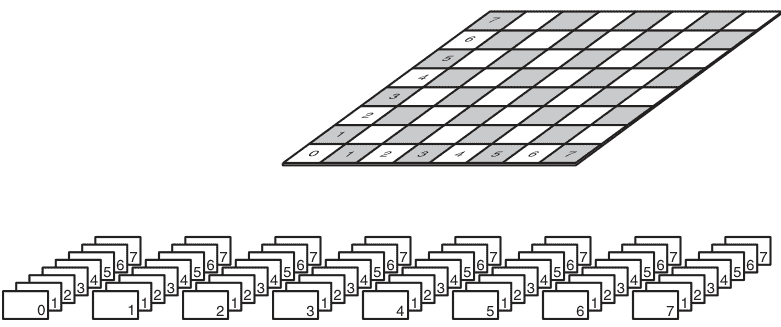

**图 7.2** 国际象棋盘是一个格子的二维数组。

假设你有一个名为 `board` 的 `char` 类型值数组来代表该棋盘。如果白棋子占据该方格，每个元素可以等于 `'w'`；如果黑棋子占据则等于 `'b'`，否则为 `" "`（无字符）。以下语句创建该数组：

```cpp
char board[8][8];
```

你也可以用一个一维的、64 格的数组来表示相同的数据：

```cpp
char board[64];
```

然而，这并没有二维数组那样紧密对应现实对象。当游戏开始时，王位于第一行的第四位置。从零开始计数，该位置对应于 `board[0][3]`（假设第一个下标对应行，第二个下标对应列）。整个棋盘的各个布局如图 7.2 所示。

> **注意**
>
> 多维数组可能会迅速增长到超过可用内存，因此在创建具有多个维度的大数组时要记住这一点。

### 初始化多维数组

你可以像初始化一维数组一样用值初始化多维数组。值按顺序赋值给数组元素，最后一个下标变化，而之前的每个下标保持不变。这是一个示例：


```cpp
int box[5][3] = { 8, 6, 7, 5, 3, 0, 9, 2, 1, 7, 8, 9, 0, 5, 2 };
```

第一个值赋值给 `box[0][0]`，第二个赋值给 `box[0][1]`，第三个赋值给 `box[0][2]`。下一个值赋值给 `box[1][0]`，下一个赋值给 `box[1][1]`，以此类推。

### 第 7 小：在数组和字符串中存储信息

当你不知道需要多少元素时，必须使用更高级的结构。本书的后续章节将涵盖指针数组、堆数组以及其他结构。在第 19 小“在链表中存储信息”中，你将学习一种名为链表的高级结构。

# 字符数组

对数组的熟悉使得处理比单个字符长的文本成为可能。字符串是字符的序列。到目前为止你处理的字符串都是 `std::cout` 语句中的字符串字面量：

```cpp
std::cout << "Solid in profundis\n";
```

在 C++ 中，字符串是以空字符结尾的字符数组，空字符编码为 `'\0'`。你可以像初始化其他类型一样声明并初始化字符串：

```cpp
char yum[] = { 'Z', 'o', 'm', 'b', 'i', 'e', ' ', 'E', 'a', 't', ' ', 'B', 'r', 'a', 'i', 'n', 's', '\0' };
```

最后一个字符 `'\0'` 终止字符串。由于这种逐字符的方法难以调试且容易产生错误，C++ 允许使用字面量进行简写字符串初始化：

```cpp
char yum[] = "Zombie Brains";
```

这种初始化形式不需要空字符；编译器会自动添加。`"Zombie Brains"` 包括空字符共有 18 个字节。

你还可以创建未初始化的字符数组，它们被称为缓冲区。对于所有数组，确保你放入的内容**不超过**缓冲区容量是非常重要的。缓冲区可以用于存储用户输入的文本。过去章节中的几个程序使用了 `std::cin` 对象来收集用户输入并将其存储在变量中：

```cpp
std::cin >> yum;
```

要解决这些问题，你必须调用 `cin` 对象的一个名为 `getline()` 的函数，并传入两个参数：

- 要填充的缓冲区
- 允许的最大字符数

### 注意事项

你可能会奇怪，如何通过在一个称为对象的东西后面添加一个点 `.` 来调用一个函数，因为书中还没有充分介绍对象。跟在对象后面并紧跟一个点和一个名称的函数，例如 `std::cin.getline()`，被称为**成员函数**。这个概念将在第 8 小时“创建基础类”中介绍。

以下语句存储最多 18 个字符（包括空字符）的用户输入并将其存储在 `yum` 数组中：

`std::cin.getline(yum, 18);`

该方法也可以通过第三个参数调用，即终止输入的分隔符：

`std::cin.getline(yum, 18, ' ');`

此语句在第一个空格处终止输入。当省略第三个参数时，换行符 (`'\n'`) 就是分隔符。

列表 7.3 中的 `BridgeKeeper` 程序询问了经典电影中的三个著名问题，并将它们存储在数组中：

### 列表 7.3 BridgeKeeper.cpp 的完整文本

```cpp
#include <iostream>
int main() {
    char name[50];
    char quest[80];
    char velocity[80];

    std::cout << "\nWhat is your name? \
```

## 第 7 小时：在数组和字符串中存储信息

```cpp
17:
18: std::cout << "\nName: " << name << std::endl;
19: std::cout << "Quest: " << quest << std::endl;
20: std::cout << "Velocity: " << velocity << std::endl;
21: return 0;
22: }
```

该程序产生的输出如下：

What is your name? Rogers Cadenhead

What is your quest? Time-based C++ tutorial

What is the airspeed of an unladen swallow? I don't know-- aagh!

Name: Rogers Cadenhead

Quest: Time-based C++ tutorial

Velocity: I don't know-- aagh!

第 10 行调用了 `cin` 的 `getline()` 函数。第 5 行中的缓冲区作为第一个参数传递。第二个参数是允许输入的最大字符数。由于 `name` 缓冲区可以容纳 50 个字符，因此参数必须是 49，以留出终止空字符的空间。不需要作为第三参数提供终止字符，因为换行符的默认值已经足够了。

如果你还没认出来（或者你已经认出来了），这部电影是《蒙提派 Python 与圣杯》（Monty Python and the Holy Grail）。死亡之桥由一个守门者守护，他要求正确回答三个问题。错一个，你就会被抛入深渊。

以防你在旅行中遇到这个问题，正确答案如下：

- 他是不列颠的亚瑟王 (Arthur, King of the Britons)
- 寻找圣杯 (seek the Holy Grail)
- 你什么意思？非洲燕子还是欧洲燕子？

### 复制字符串

C++ 继承了处理字符串的 C 函数库。可以通过包含头文件 `string.h` 将该库引入程序：

```cpp
#include <string.h>
```

在提供的许多函数中，有两个用于将一个字符串复制到另一个字符串的：`strcpy()` 和 `strncpy()`。

`strcpy_s()` 函数将一个字符串的全部内容复制到指定的缓冲区，列表 7.4 中的 `StringCopier` 程序演示了。

### 列表 7.4 StringCopier.cpp 的完整文本

```cpp
1: #include <iostream>
2: #include <string.h>
3:
4: int main(){
5: {
6:     char string1[] = "The free periodicals!";
7:     char string2[80];
8:
9:     strcpy_s(string2, string1);
10:
11:     std::cout << "String1: " << string1 << std::endl;
12:     std::cout << "String2: " << string2 << std::endl;
13:     return 0;
14: }
```

运行此程序查看以下输出：

String1: The free periodicals!

String2: The free periodicals!

第 6 行创建了一个字符数组并用字符串字面量的值初始化。`strcpy()` 函数作用于两个字符数组：一个接收复制的目标数组和一个执行复制的源数组。如果源数组大于目标数组，`strcpy()` 将数据写入到缓冲区之外。

为了防止这种情况，标准库还包含了 `strncpy()` 函数。该版本接受第三个参数，指定要复制的最大字符数：`strncpy(string1, string2, 80);`

## 使用 Foreach 循环读取数组

C++ 相比于 Java 等语言的缺点之一是完成编程中某项常见任务所需的代码量较多。当你遍历数组（或其他数据结构）的元素时，代码显得有些繁琐。

C++ 最近新增的一个功能是新的 `for` 循环，它可以遍历数组中的每个元素。它通常被称为 `foreach` 循环，因为它对每个元素都会迭代一次。

`foreach` 循环使用 `for` 关键字，就像其他 `for` 循环一样。与其他 `for` 循环不同，`foreach` 有由冒号 (`:`) 分隔的两个部分，而不是由分号分隔的三个部分。

## 第 7 小时：在数组和字符串中存储信息

第一部分是一个将持有数组元素的变量。第二部分是数组的名称。

列表 7.5 中的 `Production` 程序使用 `foreach` 循环显示整数数组的内容，这五个总和代表某种商品一年的产量。

### 列表 7.5 Production.cpp 的完整文本

```cpp
1: #include <iostream>
2:
3: int main()
4: {
5:   int production[] = { 10500, 16000, 5800, 4500, 13900 };
6:
7:   for (int year : production)
8: {
9:    std::cout << "Output: " << year << std::endl;
10:
11: }
```

由于该程序使用了 C++ 最近新增的功能，编译时可能需要使用 `-std=c++14` 标志。

运行它查看此输出：

```
Output: 10500
Output: 16000
Output: 5800
Output: 4500
Output: 13900
```

第 10 行调用了 `cin` 的 `getline()` 函数。第 5 行中的缓冲区作为第一个参数传递。第二个参数是允许输入的最大字符数。

## 工作坊

在过去的一小时里，你学习了数组。现在是时候回答几个问题并进行一些练习，以巩固你对数组的知识了。

## 测验

- 1. 特定数组的最小下标是多少？

  A. 0

  B. 1

- 2. 如果你尝试在最大允许数组下标之外存储两位数数据会发生什么？

  A. 编译器报告错误。

  B. 数据被忽略。

  C. 数据被写入数组之外的内存。

- 3. 没有初始值的字符数组的另一种称呼是什么？

  A. 字符串

  B. 缓冲区

  C. 空字符

## 答案

- 1. A. 所有的数组都从 0 开始。最后一个元素是数组大小减 1，因此数组 [50] 将容纳 49 个元素。

- 2. C. 数据被写入数组结束后的地址。很难判断会发生什么。如果你足够幸运，数据存储在计算机不希望你访问的内存区域，从而导致错误。如果你不幸运，另一个变量会以某种难以调试的奇怪方式发生改变。

- 3. B. 缓冲区可以用于存储用户输入或其他任何字符数据。

## 活动

- 1. 写一个程序，询问用户的姓和名，并将其作为问候用户的句子的一部分显示出来。

- 2. 修改 `WeightGoals` 程序以使用 `foreach` 循环，并为 10% 添加一个新里程碑。

要查看这些活动的解决方案，请访问此书的网站：http://cplusplus.cadenhead.org。

# 第 8 小时

### 创建基础类

**你将在这一小时学到：**

- 什么是类型
- 什么是类和对象
- 如何定义新类并创建该类的对象

### 什么是类型？

区分人类的特征之一是我们的分类能力。我们看到的不是自然界成百上千模糊的形状；我们看到动物、岩石、昆虫和树木。我们不仅仅看到动物；我们看到熊、狐狸、食血怪兽（chupacabras）、大脚（sasquatches）等。我们将事物分为不同的类别，告诉我们它们是什么类型的东西。

Squashqu 是一种哺乳动物。哺乳动物是一种动物。动物是一种生物。

在 C++ 中，`type`（类型）是一个拥有数据和一组能力的对象。你已经处理过内置类型，如 `int`、`long` 和 `float` 数字。正如你在这里发现的那样，你也可以创建自己的类型。

计算机程序的编写是为了解决现实世界的问题，例如跟踪员工的工资单或安排儿童足球联赛的赛程。编写完成大型复杂任务的最佳方法之一是创建对象的表示，这些对象共同工作来完成任务。

所以，如果你正在创建一个联赛赛程，你可以拥有对象来代表联赛中的每支球队、每天比赛的日子以及赛程中的每场比赛。这些对象与现实对应越紧密，编写程序就越容易。

### 创建新类型

当你在 C++ 中使用内置类型时，每个变量的类型都能告诉你关于它的很多信息。例如，如果你编写一个将高度和宽度声明为无符号短整数（`unsigned short`）的程序，你就知道每个变量可以存储 0 到 65,535 之间的数字。

类型还会告诉你变量的能力。短整型可以相加；通过将高度和宽度声明为该类型，你知道它们是可以相加的。

变量的类型可以告诉你几点：

- 它在内存中的大小
- 它能包含的信息
- 在其上执行的操作

在 C++ 中，你定义类型来模拟你正试图解决的问题。声明新类型的机制是创建一个类（class）。类是对一种新类型的定义。

### 类和成员

C++ 类是用于创建对象的模板。在你定义了一个类之后，从该类创建的对象就可以像任何其他数据类型一样投入使用。

类是相关的变量和函数打包在一起的集合。变量可以是任何其他类型，包括其他类。

变量构成了类中的数据，函数使用这些数据执行任务。将这些打包在一起被称为封装（encapsulation）。

这在使用真实对象时会更有意义，例如当我四岁时，父母从威奇科塔瀑尔斯搬到达拉斯时留下的那辆红色三轮车。（U-Haul 搬离开了房间。这对我来说是个困难的话题。）

思考类的一种方式是它是连接在一起的对象集合——轮子、座椅、车把和脚踏板。另一种方式是看它能做什么：移动、加速、停止并给其他四岁小孩留下深刻印象。

将这些结合起来——物理方面和性能表现——就是对对象的封装。

类的封装使得其他程序可以在不知道其工作原理的情况下使用该类。使用你的类只需要知道它做什么，而不需要知道它是怎么做的。

类的变量被称为成员变量（member variables）。三轮车可能有成员变量，代表轮子的大小、最高速度以及荧光橙色安全旗的高度。

成员变量也称为数据成员（data members）或实例变量（instance variables），它们是你类的一部分，就像轮子和刹车是三轮车的一部分一样。

类中的函数使用并修改成员变量。它们被称为成员函数（member functions）或方法（methods）。

### 声明类

要声明类，使用类名，后面跟着关于类的信息。用左括号和右括号包围类的内容。

```cpp
class Tricycle {
public:
    unsigned int speed;
    unsigned int wheelSize;
    };
```

这段代码创建一个名为 `Tricycle` 的类。`public` 关键字使得这些类的部分公开——换句话说，对于其他使用 `Tricycle` 对象的类和程序。声明这个类并没有为 `Tricycle` 分配内存。

### 定义对象

通过指定类和变量名从类创建对象，就像你在之前的小时中对内置类型做的那样。例如：

```cpp
Tricycle wichita;
```

这条语句创建了一个名为 `wichita` 的 `Tricycle` 对象。`Tricycle` 类被用作模板。对象将具有类定义的所有成员变量函数。

C++ 区分类 `tricycle`（三轮车的概念）和每个具体的 `Tricycle` 对象。对象只是类的具体实例。当你创建一个对象时，可以说是从类中进行“实例化”（instantiate）。

> 注意
>
> 因为 C++ 是区分大小写的，所以类名应该遵循相同的约定以减少错误。你不需要记忆类是 `Tricycle`、`tricycle` 还是 `TRICYCLE`，如果你总是大写类的首字母，你就知道它是 `Tricycle`。有些程序员会在每个类名前面加一个小写字母（例如 `cTycle` 或 `cKeyboard`）。本书使用的约定是首字母大写，如 `Tricycle` 和 `Sasquatch`。
>
> 成员变量和函数也应该遵循相同的命名规则。这以小写字母开头，如 `speed` 和 `pedal()`，随后的每个单词大写开头（如果有），如 `bringMyTricycle()`。

所有成员变量和函数默认都是私有的。私有成员只能在类自身的的函数中访问。公共成员可以在其他任何地方访问。这里是 `Tricycle` 修改后的定义：

```cpp
class Tricycle {
    unsigned int speed;
    unsigned int wheelSize;
    pedal();
    brake();
}
```

当在类定义中出现 `public` 关键字时，该关键字之后的所有成员变量和函数都是公的：

```cpp
class Tricycle {
    int model = 110;
    public:
    unsigned int speed;
    unsigned int wheelSize;
    pedal();
    brake();
}
```

上述代码声明除了 `model` 成员变量外，`Tricycle` 类中的所有内容都是公共。

还有一个 `private` 关键字，可以将后续所有的成员变量和函数变为私有。

每次使用 `public` 或 `private` 都会改变从该点到类末尾（或下一个访问关键字为止）的访问控制。

保持成员数据为私有可以限制访问并控制其值的更改方式。

虽然成员变量可以是公的，但将它们全部保持为私有并仅通过函数提供的是一个好主意。

用于设置或获取私有成员变量值的函数被称为“访问器”（accessor）。其他类必须调用访问器，而不是直接操作变量。

访问器让你能够将数据存储的细节与数据的使用方式离开来。如果你以后更改了数据的存储方式，则不需要重写使用该数据的函数。

你将在下一节中创建访问器。

### 实现成员函数

你声明的每个类成员函数都必须定义。

成员函数的定义以类名开始，后面跟着作用域解析运算符（`::`）和函数名。这里有一个示例：

```cpp
void Tricycle::pedal()
{
    std::cout << "Pedaling trike\n";
}
```

类函数具有与函数相同的能力；它们可以拥有参数并返回值。

列表 8.1 中的 `Tricycle` 程序定义了一个 `Tricycle` 类并对其进行了测试试驾。

## 列表 8.1 Tricycle.cpp 的完整文本


```cpp
1: #include <iostream>
2:
3: class Tricycle
4: {
5: public:
6:     int getSpeed();
7:     void setSpeed(int speed);
8:     void pedal();
9:     void brake();
10: private:
11:     int speed;
12: };
13:
14: // get the trike's speed
15: int Tricycle::getSpeed()
16: {
17:     return speed;
18: }
19:
20: // set the trike's speed
21: void Tricycle::setSpeed(int newSpeed)
22: {
23:     if (newSpeed >= 0)
24:     {
25:         speed = newSpeed;
26:     }
27: }
28:
29: // pedal the trike
30: void Tricycle::pedal()
31: {
32:     setSpeed(speed + 1);
33:     std::cout << "\nPedaling: " << speed << " mph\n";
34: }
35: 
36: // apply the brake on the trike
37: void Tricycle::brake()
38: {
39:     setSpeed(speed - 1);
40:     std::cout << "\nBraking: " << speed << " mph\n";
41: }
42: 
43: // create a trike and ride it
44: int main()
45: {
46:     Tricycle wichichita;
47:     wichichita.setSpeed(0);
48:     wichichita.pedal();
49:     wichichita.pedal();
50:     wichichita.brake();
51:     wichichita.brake();
52:     wichichita.brake();
53:     return 0;
54: }
```

`Tricycle` 程序创建了一个 `Tricycle` 对象，将它的初始速度设置为 0，并多次调用了 `pedal()` 和 `brake()` 成员函数。这些函数分别增加和减少速度。以下是输出：

```text
Pedaling: tricycle speed 1 mph
Pedaling: tricycle speed 2 mph
Braking: tricycle speed 1 mph
Braking: tricycle speed 0 mph
Braking: tricycle speed 0 mph
```

第 3–12 行包含了 `Tricycle` 类的定义。第 5 行包含关键字 `public`，它告诉编译器接下来的内容是一组公共成员。第 6 行有公共访问器 `getSpeed()` 的声明，它提供了对第 11 行声明的私有成员变量 `speed` 的访问。第 7 行有公共访问器 `setSpeed()`，它接受一个整数作为参数并将速度设置为该参数的值。

第 10 行开始了私有部分，其中只包含私有成员变量 `speed` 的声明。

### 第 8 章：创建基础类

第 15–18 行包含了成员函数 `getSpeed()` 的定义。该函数不接受参数；它返回一个整数。注意，类函数包含了类名后跟两个冒号和函数名。

### 创建和删除对象

有两种方法可以调用构造函数来设置对象。一种方法是定义变量并赋值：

```cpp
int weight;
weight = 7;
```

或者，你可以定义整数并立即初始化：

```cpp
int weight = 7;
```

初始化将变量定义与其初始赋值相结合。没有什么阻止改变该值。

类有一个特殊的成员函数被称为构造函数，在实例化对象时调用。构造函数的任务是创建一个有效的对象，通常是初始化其成员数据。构造函数是一个与类名相同的函数，**但没有返回值**。构造函数可以没有参数，就像任何其他函数一样。

这里是 `Tricycle` 类的构造函数：

```cpp
Tricycle::Tricycle(int initialSpeed)
{
    setSpeed(initialSpeed);
}
```

此构造函数使用参数设置了速度成员变量的初始值。当你声明构造函数时，也应该声明一个析构函数。正如构造函数创建和初始化对象一样，析构函数清理对象并释放为它们分配的内存。析构函数始终在类名前面有一个波浪号（`~`）。析构函数不接受参数且没有返回值。

这里是 `Tricycle` 的析构函数：

```cpp
Tricycle::~Tricycle()
{
    // do nothing
}
```

目前的类不需要特殊的内存管理，因此析构函数只包含注释。

### 默认构造函数

在设置对象时有多种方法调用构造函数。

一种是在括号中指定一个或多个参数：

```cpp
Tricycle wichichita(5);
```

参数（或参数）被发送到构造函数。在示例中，它设置了三车的初始速度。

你也可以不指定参数设置对象：

```cpp
Tricycle wichichita;
```

这将调用类的默认构造函数，即没有参数的构造函数。

### 编译器提供的构造函数

如果你**没有**声明构造函数（正如你在列表 8.1 的 `Tricycle` 程序中所做的那样），编译器会创建一个默认构造函数。编译器提供的默认构造函数没有任何操作；它就像是你声明了一个没有参数且体为空的构造函数。

有两个重要的点需要注意：

- 默认构造函数是指任何不需要参数的构造函数。你可以自己定义，也可以由编译器作为默认值提供。
- 如果你定义了任何构造函数（无论是否带参数），编译器都不会为你提供默认构造函数。在这种情况下，如果你想要默认构造函数，必须自己定义它。

如果你没有定义析构函数，编译器也会提供一个，该析构函数体也为空且什么都不做。

如果你定义了析构函数，即使该析构函数什么都不做，定义它也是一种良好的习惯。这可以帮助你在需要采取明确步骤释放内存时记得使用析构函数。

列表 8.2 中的 `NewTricycle` 程序重写了 `Tricycle` 类，使用构造函数来初始化对象，将其速度设置为初始值。它演示了析构函数被调用的位置。

# 列表 8.2 NewTricycle.cpp 的完整文本

```cpp
1: #include <iostream>
2:
3: class Tricycle
4: {
5: public:
6:   Tricycle(int initialAge);
7:   ~Tricycle();
8:   int getSpeed();
9:   void setSpeed(int speed);
10:  void pedal();
11:  void brake();
12: private:
13:  int speed;
14: };
15:
16:  // 对象的构造函数
17: Tricycle::Tricycle(int initialAge)
18: {
19:   setSpeed(initialSpeed);
20: }
21: 
22: // 对象的析构函数
23: Tricycle::~Tricycle()
24: {
25:     // 什么都不做
26: }
27: 
28: // 获取三轮车的速度
29: int Tricycle::getSpeed()
30: {
31:     return speed;
32: }
33: 
34: // 设置三轮车的速度
35: void Tricycle::setSpeed(int newSpeed)
36: {
37:     if (newSpeed >= 0)
38:     {
39:         speed = newSpeed;
40:     }
41: }
42: 
43: // 脚踏三轮车
44: void Tricycle::pedal()
45: {
46:     setSpeed(speed + 1);
47:     std::cout << "\npeding; tricycle speed " << getSpeed() << " mph\n";
48: }
49: 
50: // 给三轮车上刹车
51: void Tricycle::brake()
52: {
53:     setSpeed(speed - 1);
54:     std::cout << "\nbraking; tricycle speed " << getSpeed() << " mph\n";
55: }
56: 
57: // 创建一辆三轮车并骑它
58: int main()
59: {
60:     Tricycle wichita(5);
61:     wichita.pedal();
62:     wichita.pedal();
63:     wichita.brake();
64:     wichita.brake();
65:     wichita.brake();
66:     return 0;
67: }
```

该程序产生以下输出，反映了 5 mph 的初始三轮车速度：

```text
Pedaling; tricycle speed 6 mph
Pedaling; tricycle speed 7 mph
Braking; tricycle speed 6 mph
Braking; tricycle speed 5 mph
Braking; tricycle speed 4 mph
```

列表 8.2 中的 `Tricycle` 类定义有两个新增的内容：一个接受整数参数的构造函数的声明，以及一个析构函数的声明。

第 17–20 行显示了构造函数的实现，它与 `setSpeed()` 访问函数的实现相似。它没有返回值。

第 23–26 行显示了析构函数 `~Tricycle()` 的实现。

第 60 行创建了一个 `Tricycle` 对象，并通过向构造函数传递参数赋予了一个初始值 5。

## 总结

在计算机编程历史上，出现过几种流行的创建程序的方法。本节中介绍的方法被称为**面向对象编程 (OOP)**，这是因为它对程序的构想方式是基于对象的。

在 OOP 中，一个程序由一个或多个对象组成，每个对象都有以成员数据形式存在的数据以及以函数形式存在的方法。对象相互独立，并且专注于特定的、狭窄的目的。

通过设计相互独立的对象，你创建了在其他地方更易于重用的代码。如果你在某个程序中创建了一个 `Printer` 类来打印文档，那么当你编写的其他程序需要打印功能时，就可以使用该类。

在下一节中，随着你深入研究类，你将学习更多关于 OOP 的知识。

## 问答

**Q. 类对象有多大？**

- A. 类对象的大小是任何不需要参数的构造函数。你可以自己定义，也可以由编译器作为默认值提供。
- B. 如果你定义了任何构造函数（无论是否带参数），编译器都不会为你提供默认构造函数。在这种情况下，如果你想要默认构造函数，必须自己定义它。

## 接口与实现

程序中创建和使用对象的部分是该类的客户端（clients）。类声明充当了与这些客户端之间的合同。该合同告诉客户端该类拥有哪些数据以及该类可以做什么。

例如，在 `Tricycle` 类声明中，你向合同承诺每个 `Tricycle` 对象都能获取其速度，你可以在构造时初始化速度并在稍后获取它，并且每个 `Tricycle` 都知道如何 `pedal()` 和 `brake()`。

如果你将 `getSpeed()` 作为一个 `const` 函数，该合同还承诺它不会改变在该函数调用的 `Tricycle` 对象。

# 组织类声明和函数定义

在 C++ 程序的源代码中，类的定义通常与其实现是分开的。你为类声明的每个函数都必须有一个定义。与函数一样，类函数的定义也有头部和体。

定义必须位于编译器可以找到的文件。大多数 C++ 编译器期望文件以 `.cpp` 结尾。

虽然你将声明放在源代码文件中，但大多数程序员采用的惯例是将声明放在一个同名且扩展名为 `.hpp`（或较少的 `.h` 或 `h`）的头文件中。

因此，如果你将 `Tricycle` 类的声明放在名为 `Tricycle.hpp` 的文件中，那么类的定义就会在 `Tricycle.cpp` 中。头文件可以通过预处理器指令包含到 `.cpp` 文件中：

```cpp
#include "Tricycle.hpp"
```

将它们分离的原因是类的客户端并不关心实现的具体细节。它们需要知道的一切都在头文件中。

### 内联实现

就像你可以告诉编译器让普通函数内联（inline）一样，你也可以让成员函数变为内联。`inline` 关键字出现在返回值之前，如下例所示：

```cpp
inline int Tricycle::getSpeed()
{
    return speed;
}
```

你也可以将函数的定义直接放在类的声明中，这会自动使该函数变为内联。这是一个示例：

```cpp
class Tricycle {
public:
    int getSpeed() const { return speed; }
    void setSpeed(int newSpeed);
}
```

`getSpeed()` 的定义发生了变化。在 `const` 关键字之后不是分号，而是大括号内的一段短代码。内联函数的体紧跟在成员函数的声明之后；括号后面没有分号。空格并不重要，因此声明可以格式化如下：

```cpp
class Tricycle {
public:
    int getSpeed() const {
        return speed;
    }
    void setSpeed(int newSpeed);
}
```

列表 9.1 和 9.2 重新创建了 `Tricycle` 类，将声明移动到 `Tricycle.hpp`，将函数实现移动到 `Tricycle.cpp`。列表 9.1 还将 `getSpeed()` 访问器以及 `pedal()` 和 `brake()` 函数改为内联。

# 列表 9.1 Tricycle.hpp 的全文

```cpp
1: #include <iostream>
2:
3: class Tricycle
4: {
5: public:
6:     Tricycle(int initialSpeed);
7:     ~Tricycle();
8:     int getSpeed() const { return speed; }
9:     void setSpeed(int speed);
10:    void pedal()
11:    {
12:        setSpeed(speed + 1);
13:        std::cout << "Pedaling " << getSpeed() << " mph\n\n";
14:    }
15:    void brake()
16:    {
17:        setSpeed(speed - 1);
18:        std::cout << "Braking " << getSpeed() << " mph\n";
19:    }
20: private:
21:     int speed;
22: };
```

# 列表 9.2 Tricycle.cpp 的全文

```cpp
1: #include "Tricycle.hpp"
2:
3: // 对象的构造函数
4: Tricycle::Tricycle(int initialSpeed)
5: {
6:     setSpeed(initialSpeed);
7: }
8:
9: // 对象的析构函数
10: Tricycle::~Tricycle()
11: {
12:     // 什么都不做
13: }
14:
15: // 设置三轮车的速度
16: void Tricycle::setSpeed(int newSpeed)
17: {
18:     if (newSpeed >= 0)
19:         speed = newSpeed;
20: }
21:
22: // 创建一个三轮车并骑它
23: int main()
24: {
25:     Tricycle wichita(5);
26:     wichita.pedal();
27:     wichita.pedal();
28:     wichita.brake();
29:     wichita.brake();
30:     return 0;
31: }
```


Pedaling 6 mph

Pedaling 7 mph

Pedaling 6 mph

Pedaling 5 mph

Pedaling 4 mph

`getSpeed()` 函数在列表 9.1 的第 8 行声明并提供了其内联实现。第 9–19 行提供了更多内联函数。

列表 9.2 的第 1 行是包含文件 `Tricycle.hpp` 的预处理器指令。

# 以其他类为成员类

通过声明更简单的类并将它们包含在复杂类的声明中来构建类并不罕见。

例如，你可能会声明 `Wheel`、`Motor` 等类，然后将它们组合进 `Car` 类。这种安排声明了“拥有”（has-a）关系：汽车有一个发动机、一组轮和一个变速箱。

考虑另一个例子。矩形由四条边组成。每条边由两个点定义。列表 9.3 显示了 `Rectangle.hpp` 中 `Rectangle` 类的声明。

由于矩形被定义为连接点的线，每个点引用 `Point` 类来存储 `x` 和 `y` 坐标。列表 9.4 显示了两个类的声明。

### 列表 9.3 Rectangle.hpp 的全文

```cpp
1: #include <iostream>

2:

3: class Point
4: {
5:     // 无构造函数，使用默认
6: public:
7:     setX(int newX) { x = newX; }
8:     setY(int newY) { y = newY; }
9:     int getX() const { return x; }
10:    int getY() const { return y; }
11: private:
12:     int x;
13:     int y;
14: };

15:

16: class Rectangle
17: {
18: public:
19:     Rectangle(int newTop, int newLeft, int newBottom, int newRight);
20:     Rectangle() {}

21:     int getTop() const { return top; }
22:     int getLeft() const { return left; }
23:     int getBottom() const { return bottom; }
24:     int getRight() const { return right; }

25:     Point getUpperLeft() const { return upperLeft; }
26:     Point getLowerLeft() const { return lowerLeft; }
27:     Point getUpperRight() const { return upperRight; }
28:     Point getLowerRight() const { return lowerRight; }

29:     void setUpperLeft(Point location);
30:     void setLowerLeft(Point location);
31:     void setUpperRight(Point location);
32:     void setLowerRight(Point location);

33:     void setTop(int newTop);
34:     void setLeft(int newLeft);
35:     void setBottom(int newBottom);
36:     void setRight(int newRight);

37:     int getArea() const;

38: private:
39:     Point upperLeft;
40:     Point upperRight;
41:     Point lowerLeft;
42:     Point lowerRight;
43:     int top;
44:     int left;
45:     int bottom;
46:     int right;
47: };
```

### 列表 9.4 Rectangle.cpp 的全文

```cpp
1: #include "Rectangle.hpp"

2:

3: Rectangle::Rectangle(int newTop, int newLeft, int newBottom, int newRight)
4: {
5:     top = newTop;
6:     left = newLeft;
7:     bottom = newBottom;
8:     right = newRight;

9:    upperLeft.setX(left);
10:    upperLeft.setY(top);

11:    upperRight.setX(right);
12:    upperRight.setY(top);

13:    lowerLeft.setX(left);
14:    lowerLeft.setY(bottom);

15:    lowerRight.setX(right);
16:    lowerRight.setY(bottom);
17: }

18:

19: void Rectangle::setUpperLeft(Point location)
20: {
21:     upperLeft = location;
22:     upperRight.setY(location.getY());
23:     lowerLeft.setX(location.getX());
24:     top = location.getY();
25:     left = location.getX();
26: }

27: void Rectangle::setLowerLeft(Point location)
28: {
29:     lowerLeft = location;
30:     lowerRight.setY(location.getY());
31:     upperLeft.setX(location.getX());
32:     bottom = location.getY();
33:     left = location.getX();
34: }

35:

36: void Rectangle::setLowerRight(Point location)
37: {
38:     lowerRight = location;
39:     lowerLeft.setY(location.getY());
40:     upperRight.setX(location.getX());
41:     bottom = location.getY();
42:     right = location.getX();
43: }

44:

45: void Rectangle::setUpperRight(Point location)
46: {
47:     upperRight = location;
48:     upperLeft.setY(location.getY());
49:     lowerRight.setX(location.getX());
50:     top = location.getY();
51:     right = location.getX();
52: }

53:

54: void Rectangle::setTop(int newTop)
55: {
56:     top = newTop;
57:     upperLeft.setY(top);
58:     upperRight.setY(top);
59: }

60:

61: void Rectangle::setLeft(int newLeft)
62: {
63:     left = newLeft;
64:     upperLeft.setX(left);
65:     lowerLeft.setX(left);
66: }

67:

68: void Rectangle::setBottom(int newBottom)
69: {
70:     bottom = newBottom;
71:     lowerLeft.setY(bottom);
72:     lowerRight.setY(bottom);
73: }

74:

75: void Rectangle::setRight(int newRight)
76: {
77:     right = newRight;
78:     upperRight.setX(right);
79:     lowerRight.setX(right);
80: }

81:

82: int Rectangle::getArea() const
83: {
84:     int width = right - left;
85:     int height = top - bottom;
86:     return (width * height);
87: }

88:

89: // 通过寻找角点计算矩形的面积，
90: // 建立宽度和高度，然后相乘
91: int main()
92: {
93:     // 初始化一个局部 Rectangle 变量
94:     Rectangle myRectangle(100, 20, 50, 80);

95:     int area = myRectangle.getArea();

96:     std::cout << "Area: " << area << std::endl;
97:     std::cout << "Upper Left X Coordinate: ";
98:     std::cout << myRectangle.getUpperLeft().getX() << std::endl;
99:     return 0;
100: }
```

# 以其他类作为成员数据的类

当运行列表 9.4 中的 Rectangle 程序时，输出如下：

```
Area: 3000
Upper Left X Coordinate: 20
```

列表 9.3 中的第 3–14 行声明了 `Point` 类，该类用于存储图上特定的 `x`、`y` 坐标。

成员变量 `x` 和 `y` 在第 12–13 行声明，用于存储坐标值。在该类使用的笛卡尔坐标系下，随着 `x` 坐标的增加，点在图上向右移动。随着 `y` 坐标的增加，点向上移动。其他图表使用不同的系统。

`Point` 类使用内联访问器来获取和设置第 7–10 行中声明的 `x` 点和 `y` 点。由于该类使用了默认构造函数和析构函数，因此它的坐标必须显式地初始化。

第 16 行开始声明 `Rectangle` 类。一个 `Rectangle` 由四个点组成，这些点代表了矩形的四个角点。

`Rectangle` 的构造函数（第 19 行）接收四个整数，分别称为 `newTop`、`newLeft`、`newBottom` 和 `newRight`。这四个参数被拷贝到成员变量中，然后建立了四个 `Point` 对象。

除了访问器函数外，`Rectangle` 在第 42 行声明了一个名为 `getArea()` 的函数。`getArea()` 函数没有将面积存储在变量中，而是在列表 9.4 的第 82–87 行中计算面积。为了做到这一点，它计算了矩形的宽度和高度，然后将这两个值相乘。

获取矩形左上角的 `x` 坐标需要你访问 `upperLeft` 点并向其请求 `x` 值。由于 `getUpperLeft()` 是 `Rectangle` 的一个函数，它可以直接访问 `Rectangle` 的私有数据，包括 `upperLeft` 成员变量。由于 `upperLeft` 是一个 `Point` 对象，且点的 `x` 值是私有的，`getUpperLeft()` 无法直接访问此数据。它必须使用公共的 `getX()` 来获取该值。

列表 9.4 的第 91 行是实际程序的开始。在第 94 行之前，还没有分配内存也没有执行任何操作。之前的行中唯一完成的工作是告诉编译器创建 `Point` 和 `Rectangle` 对象，以备后之用。

在第 94 行中，通过传入 `top`、`left`、`bottom` 和 `right` 的值定义了一个 `Rectangle`。

在第 95 行中，声明了一个局部整数变量 `area`。该变量存储了创建的 `Rectangle` 的面积，并用 `Rectangle` 的 `getArea()` 函数返回的值对其进行初始化。

# 第 9 小时：转向高级类

`Rectangle` 的客户端可以创建一个 `Rectangle` 对象并获取其面积，而无需查看 `getArea()` 的实现。

通过查看列表 9.3 中的头文件（该文件包含 `Rectangle` 类的声明），程序员知道 `getArea()` 返回一个 `int`。`getArea()` 如何实现这一点的对于 `Rectangle` 类的用户来说并不重要。事实上，`Rectangle` 的作者可以更改程序使用 `Rectangle` 类时的函数。

## 总结

C++ 程序员并不非得使用类或对象。程序可以仅由变量和函数组成，从而不需要掌握面向对象编程的复杂概念。

很少程序员走这条路线。为什么？因为如果你将程序设计为一系列相互作用的类，你的效率会高得多。

## 工作坊

你在本节中甚至学习了类，现在是时候回答一些问题并做一些练习来巩固知识了。

## 测验

1. 以下哪一个不是 C++ 头文件的常见扩展名？
   A. .hpp
   B. .cpp
   C. .h

2. 如果没有定义 `Point` 类，`Rectangle.cpp` 和 `Rectangle.hpp` 会发生什么？
   A. 错误。
   B. 程序异常。
   C. 结果各异。

3. 你可以在哪里将类函数设为内联？
   A. 在类声明中
   B. 在类实现中
   C. 两者都可以

## 答案

1. B. C++ 头文件通常以 `.hpp` 结尾（较少使用 `.h`），C++ 程序以 `.cpp` 结尾。

2. A. 假设其他地方没有定义 `Point`，编译器会报告未定义的错误。类之间依赖并在其基础上构建是很常见的。

3. C. 在类声明中包含的类函数自动成为内联函数。否则，类函数必须包含 `inline` 关键字请求内联执行以提高性能。

## 活动

2. 使用 `Point` 类创建一个由两个连接点组成的 `Line` 类。

要查看这些活动的解决方案，请访问此书的网站：`http://cplusplus.cadenhead.org`。

# 第 10 小时：创建指针

在本小时中你将学习：

- 什么是指针
- 如何声明和使用指针
- 什么是堆以及如何操作内存

### 了解指针及其用法

C++ 程序员可以使用的最强大的工具之一就是指针。指针提供了直接操作计算机内存的能力。这种力量是需要代价的：对于初学者来说，指针是学习 C++ 中最困难的部分之一。

变量是一个可以存储值的对象。整数变量存储一个数字。字符变量存储一个字母。指针是一个存储内存地址的变量。

好了，那么内存地址是什么？为了完全理解这一点，你必须对计算机内存有所了解。

计算机内存是存储变量值的地方。按照惯例，计算机内存被分为顺序编号的内存位置。这些位置中的每一个都是内存地址。

每种类型的变量在内存中都有一个唯一的地址。图 10.1 显示了无符号长整数变量 `Age` 存储的示意图。

```cpp
1: #include <iostream>
2:
3: int main()
4: {
5:     unsigned short shortVar = 5;
6:     unsigned long longVar = 65535;
7:     long sVar = -65535;
8:
9:     std::cout << "shortVar\t" << shortVar;
10:    std::cout << "Address of shortVar:\t" << &shortVar << "\n";
11:    std::cout << "longVar\t" << longVar;
12:    std::cout << "Address of longVar:\t" << &longVar << "\n";
13:    std::cout << "sVar\t" << sVar;
14:    std::cout << "Address of sVar:\t" << &sVar << "\n";
15:
16:    return 0;
17: }
```


### 了解指针及其用法

地址会产生如下输出：

| shortVar: | 5 | Address of shortVar: | 0x60fe9e |
| :--- | :--- | :--- | :--- |
| longVar: | 65535 | Address of longVar: | 0x60fe98 |
| sVar: | -65535 | Address of sVar: | 0x60fe94 |

每个指针的实际地址会有所不同，因为每个计算机存储变量的地址不同，取决于内存中还有什么内容以及可用内存量。

> **注意**
> 列表 10.1 第 9–14 行中的特殊字符 `\t` 会在输出中插入一个制表符。这是创建列的简单方法。除了换行符 `\n` 外，还有其他此类字符。
> `\\` 用于显示反斜杠。
> `\"` 用于显示双引号。
> `\'` 用于显示单引号。

声明并初始化三个变量：第 5 行的 `short`，第 6 行的 `unsigned long` 以及第 7 行的 `long`。它们的值和地址在第 9–14 行中使用取地址运算符 `&` 显示。

`shortVar` 的值为 5（如预期），它的地址是 `0x60fe9e`。这个复杂的地址是特定于计算机的，并且每次运行程序时都可能略有变化。你的结果可能与此不同。然而，不变的是，如果你的计算机使用 4 字节短整型，那么前两个地址之间的差值为 4 字节。如果你的计算机使用 4 字节长整型，第二个和第三个地址之间差 4 字节。图 10.2 展示了程序中的变量如何在内存中存储。（注意，在某些计算机上，取决于编译器的配置，差异将是 4 字节。）

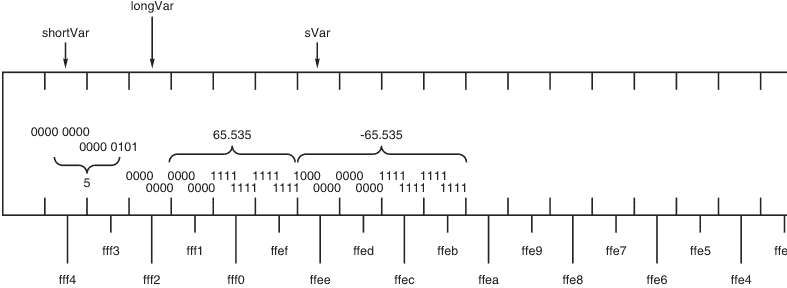

图 10.2
变量存储说明。

没有理由需要每个变量地址的实际数值。你关心的是它有一个地址，并且留出了足够的内存。

编译器如何知道每个变量需要多少内存？你通过声明变量类型告诉编译器为变量分配多少空间。

因此，如果你将变量声明为 `unsigned long` 类型，编译器就会分配四个字节的内存，因为每个 `unsigned long` 占用四个字节。编译器负责分配实际地址。

当分配指针时，编译器会分配足够的内存以在你的硬件和操作系统环境中存储地址。指针的大小可能与整数的大小相同，也可能不同，因此不要做任何假设。

### 在指针中存储地址

每个变量都有地址。即使不知道给定变量的具体地址，你也可以将该地址存储在指针中。

例如，假设变量 `how` 是一个整数。为了声明一个名为 `pAge` 的指针来存储它的地址，你编写以下语句：

```cpp
int *pAge = nullptr;
```

这声明 `pAge` 为指向 `int` 的指针。也就是说，`pAge` 被声明为存储一个 `int` 的地址。

指针可以使用任何对其他变量合法的名称。本书遵循指针命名以 `p` 开头且第二个字母大写的惯例，例如 `pAge` 或 `pHeap`。

注意 `pAge` 是一个变量...

### 理解指针及其用法

在日常生活中，我们一直在处理“间接性”。如果你想给朋友打电话，你会在手机的联系人列表中选择他们的名字（或告诉手机拨打那个人的电话）。名字是实际电话号码的引用，手机会拨打该号码。当你这样做时，你就在依赖这种间接性。

#### 指针、地址与变量

区分指针、指针所持的地址以及指针所持地址处的值是非常重要的。这是许多关于指针的困惑来源。

考虑以下代码片段：

```cpp
int variable = 5;
int *pPointer = &variable;
```

`variable` 被声明为一个整数变量，并初始化为值 5。`pPointer` 被声明为一个指向整数的指针；它被初始化为变量的地址。`pPointer` 持有的地址就是变量的地址。`pPointer` 所持地址处的值为 5。图 10.3 显示了变量和 `pPointer` 的示意表示图。

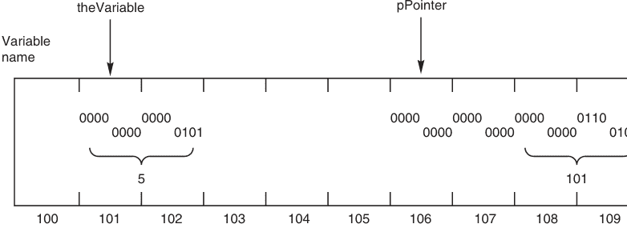

**图 10.3** 内存示意图。

#### 使用指针操作数据

在为指针分配变量的地址后，你可以使用该指针访问该变量中的数据。列表 10.2 中的 Pointer 程序演示了如何将局部变量的地址赋值给指针，以及指针如何操作变量中的值。

##### 列表 10.2 Pointer.cpp 的完整代码

```cpp
1: #include <iostream>
2:
3: int main()
4: {
5:     int myAge = 5;      // 一个变量
6:     int *pAge = nullptr; // 一个指针
7:
8:     myAge = 5;
9:     pAge = &myAge;      // 将 myAge 的地址赋值给 pAge
10:    std::cout << "myAge: " << myAge << "\n";
11:
12:    std::cout << "*pAge: " << *pAge << "\n";
13:
14:    std::cout << "*pAge: " << *pAge << " 7\n";
15:    *pAge = 7;           // 将 myAge 设置为 7
16:    std::cout << "myAge: " << myAge << "\n";
17:
18:    std::cout << "*pAge: " << *pAge << " 9\n";
19:    myAge = 9;
20:    std::cout << "myAge: " << myAge << "\n";
21:    std::cout << "*pAge: " << *pAge << "\n";
22:
23:    return 0;
24: }
```

该程序使用了 `nullptr`，这是 C++ 语言最近添加的特性，必须使用标志 `--std=c++14` 进行编译。以下是该程序的输出：

```
myAge: 5
*pAge: 5
*pAge = 7
*pAge: 7
myAge: 7
myAge: 9
myAge: 9
*pAge: 9
```

该程序声明了两个变量：一个整数 `int myAge` 和一个指针 `pAge`，`pAge` 是一个指向 int 的指针并持有 `myAge` 的地址。第 5 行中 `myAge` 被赋值为值 5，这通过输出得到了验证。

第 9 行，`pAge` 被赋值为 `myAge` 的地址。第 11 行，对 `pAge` 进行解引用并显示，显示 `pAge` 存储的地址处的值是 `myAge` 中的 5。第 14 行，值 7 被赋值给 `pAge` 存储地址处的变量。这把 `myAge` 设置为 7，输出证实了这一点。

第 19 行，值 9 被赋值给变量 `myAge`。该值在第 20 行直接获取，并在第 21 行通过间接方式（通过解引用 `pAge`）获取。

#### 检查指针中存储的地址

指针允许你能够在完全不知道其真实值的情况下操作地址。在这一节课之后，你会发现当你将变量的地址赋值给指针时，该指针确实拥有了该变量的值。但既然只有此一次，为什么不检查以确保一下呢？列表 10.3 中的 PointerCheck 程序将指针置于测试。

##### 列表 10.3 PointerCheck.cpp 的完整代码

```cpp
1: #include <iostream>
2:
3: int main() {
4: {
5: unsigned short int myAge = 5, yourAge = 10;
6: unsigned short int *pAge = &myAge; // 一个指针
7:
8: std::cout << "myAge:\t" << myAge;
9: std::cout << "\tyourAge:\t" << yourAge << "\n";
10: std::cout << "&myAge:\t" << &myAge << "\n";
11: std::cout << "\tyourAge:\t" << &yourAge << "\n";
12:
13: std::cout << "pAge:\t" << pAge << "\n";
14: std::cout << "*pAge:\t" << *pAge << "\n";
15:
16: pAge = &myAge; // 重新赋值指针
17:
18: std::cout << "myAge:\t" << myAge;
19: std::cout << "\tyourAge:\t" << yourAge << "\n";
20: std::cout << "&myAge:\t" << &myAge;
21: std::cout << "\tyourAge:\t" << &yourAge << "\n";
22:
23: std::cout << "pAge:\t" << pAge << "\n";
24: std::cout << "*pAge:\t" << *pAge << "\n";
25:
26: std::cout << "&pAge:\t" << &pAge << "\n";
27: return 0;
28: }
```

该程序产生以下输出：

```
myAge: 5          yourAge: 10
&myAge: 0x60fe    yourAge: 0x60ff0
&pAge: 0x60fe     *pAge: 5
myAge: 5          yourAge: 10
&myAge: 0x60fe    yourAge: 0x60ff0
&pAge: 0x60ff     *pAge: 5
```
*(注：原文中的输出块存在严重乱码，我已根据列表 10.3 提供的代码重建了逻辑输出)*

### 第 10 小时：创建指针

`Camp` 是你在堆上的数据。你不知道它在哪里，但你知道如何找到它。你通过它的地址来访问它。你不需要知道那个数字，只需要将其放入一个指针中。指针让你访问你的数据，而不会让你被细节困扰。

栈在函数返回时会自动清理。所有局部变量都会超出作用范围，它们会从栈中被移除。堆在程序结束之前不会被清理，你有责任释放使用它预留的任何内存。在不再需要某些项时将它们遗留在堆中被称为**内存泄漏**，这个主题将在稍后的文中介绍。

堆的优势在于，内存在你显式释放它之前，内存一直保持可用。如果你在函数内部堆上预留了内存，当函数返回时该内存仍然可用。

使用这种方式访问内存而不是使用全局变量的优点是，只有拥有该指针的函数才能访问该数据。这为数据提供了一个紧密控制的接口，并消除了函数以意外和无法预料的方式更改数据的问题。

为了这项工作，你必须能够创建一个指向堆上区域的指针。后续章节将介绍如何做到。

#### 使用 `new` 关键字

在 C++ 中，你通过使用 `new` 关键字后跟要分配对象的类型在堆上分配内存，这样编译器就知道了需要多少内存。因此，`new unsigned short` 在堆上分配两个字节，而 `new long` 分配相应的空间。

`new` 的返回值是一个内存地址。它必须赋值给一个指针。要在堆上创建一个 `unsigned short int`，你写如下代码：

```cpp
unsigned short int *pPointer;
pPointer = new unsigned short int;
```

当然，你可以在创建指针时初始化它：

```cpp
unsigned short int *pPointer = new unsigned short int;
```

在以上任何情况下，`pPointer` 现在指向堆上的一个 `unsigned short int`。你可以像使用其他变量指针一样使用它，并向该内存区域分配值：

```cpp
*pPointer = 72;
```

这意味着“将 72 放在 `pPointer` 的值处”，或“将值 72 赋值给 `pPointer` 指向的堆区域”。

##### 栈与堆

如果 `new` 无法在堆上创建内存——因为内存是有限的资源——它会抛出一个异常。异常是在第 24 小时“处理异常和错误处理”中详细介绍的错误处理对象。

> **注意**
> 某些旧版编译器返回一个等于 `NULL` 的指针。如果你使用的是旧版编译器，请在每次请求新内存时检查你的指针是否为 `NULL`。所有现代编译器都可以认为会抛出异常。

#### 使用 `delete` 关键字

当你完成对内存区域的使用后，必须对指针调用 `delete`，将内存归给堆。记住，指针本身（而不是它所指向的内存）是一个局部变量。当声明它的函数返回时，该指针会超出作用范围。然而，用 `new` 算符分配的内存并不会自动释放。内存会变得不可用。这种情况被称为内存泄漏，因为在程序结束之前内存无法被恢复。这就像内存从你的计算机中泄漏了一样。

要将内存恢复到堆，你使用 `delete` 关键字。例如：

```cpp
delete pPointer;
```

当你删除指针时，你实际上是在释放存储在指针中的地址的内存。你在说：“将此指针指向的内存返回给堆。”指针仍然是一个指针，并且可以重新赋值。

当你对指针调用 `delete` 时，它指向的内存会被释放。再次调用 `delete` 将导致你的程序崩溃！当你删除一个指针时，它会被设置为 `nullptr`。对空指针调用 `delete` 保证是安全的。例如：

```cpp
Animal *pDog = new Animal;
delete pDog; // 释放内存
pDog = nullptr; // 将指针置空
// ...
delete pDog; // 无害
```

如果前面的代码看起来很困惑，不要担心。我们将在下一小时查看如何在堆上分配对象。这同样适用于 `int` 等数据类型，如下所示：

```cpp
int *pNumber = new int;
delete pNumber; // 释放内存
pNumber = nullptr; // 将指针置空
// ...
delete pNumber; // 无害
```

列表 10.4 中的 Heap 程序演示了在堆上分配变量、使用该变量并将其删除。

##### 列表 10.4 Heap.cpp 的全文

```cpp
1: #include <iostream>
2: 
3: int main(){
4: {
5:     int localVariable = 5;
6:     int *pLocal = &localVariable;
7:     int *pHeap = new int;
8:     if (pHeap == nullptr)
9:     {
10:        std::cout << "Error! No memory for pHeap!";
11:        return 1;
12:    }
13:     *pHeap = 7;
14:     std::cout << "localVariable: " << localVariable << "\n";
15:     std::cout << "pLocal: " << *pLocal << "\n";
16:     std::cout << "pHeap: " << *pHeap << "\n";
17:     delete pHeap;
18:     pHeap = nullptr;
```

程序输出：
```
localVariable: 5
pLocal: 5
pHeap: 7
```

```cpp
// 解引用指针并赋值给 value
value = *pointer2;
pointer2 = 0;
std::cout << "value = " << value << "\n";
return 0;
```


此程序必须使用 `--std=c++14` 标志进行编译，因为 `nullptr` 是 C++ 新增的内容。成功编译后，运行 `Wrapper` 以产生以下输出：

```
value = 1700
```

变量 `pointer2` 被初始化为空指针，在第 10 行被赋予 `value2` 变量的地址。随后被解引用并存储在 `value` 中（第 12 行），替换了它的原始值。

## 总结

这一小时是关于指针两个章节中的第一个，这个主题比语言的其他任何方面更让初级 C++ 程序员困惑。

变量值存储在计算机内存中，内存被组织成连续的内存位置。每个位置都是一个内存地址。指针就是指向其中一个地址的特殊变量。

指针使得在程序中直接操作内存成为可能。当你知道数据的内存地址时，就不需要使用变量来访问该数据。你可以直接操作该地址的指针。

在某些任务中，使用指针比变量更有意义。指针是 C++ 语言中最强大的部分之一。

如果它们仍然让你感到困惑，你会发现随着对本书的学习的深入，它们会变得更有意义。

## 问答

- **Q. 为什么指针如此重要？**
- **A.** 正如你在这一小时中看到的，指针很重要，因为它们被用于持有堆上对象的地址，并通过引用传递参数。此外，在第 14 小时“调用高级函数”中，你将看到指针如何用于一种称为多态的技术。

### 第 10 小时：创建指针

- **Q. 我为什么需要费精力在堆上声明任何东西呢？**
- **A.** 堆上的对象在函数返回后依然存在。此外，在堆上存储对象的能力允许你在运行时决定需要多少个对象，而不是提前声明。这将在第 11 小时“开发高级指针”中进行更深入的探讨。

- **Q. 如果乔治·华盛顿接受成为美国国王的提议，今天谁会是国家的国王？**
- **A.** 假设美国遵循与英国相同的继承规则，多年来，美国的国王是保罗·埃默里·华盛顿，他是德克萨斯州圣安东尼奥的一建筑公司经理。

  乔治·华盛顿没有血裔，所以当他在 1799 年去世时，王位将传给他的兄弟之一。谱系中的其他华盛顿要么早死要么没有活着的男性后代，因此问题变得复杂起来。

  当家谱网站 Ancestry.Com 在 2008 年研究美国国王继承顺序时，发现有 8,000 名乔治·华盛顿的亲属可能影响这一决定。共有四条可能的继承路径，而保罗·华盛顿位于其中两条路径的末端。

> “我怀疑自己是否会是一个好国王，”保罗告诉 NBC 的《今日节目》。“在我们没有国王的情况下表现得非常好，所以我认为乔治做出了最正确的决定。”

尽管他拒绝了君主的出生权利，但保罗开始称呼他的长子比尔为“威廉王子”。当保罗在 2014 年以 87 岁去世时，比尔登上了那个假设的王位。

## 工作坊

现在你已经学习了指针，可以回答几个问题并完成一些练习来巩固知识。

## 测验

- **1. 在初始化指针时，`0` 和 `nullptr` 有什么区别？**
  - A. `nullptr` 创建一个空指针。
  - B. `0` 创建一个空指针。
  - C. 两者都创建指针。

- **2. 当你不再使用堆空间但不释放它时，这叫什么？**
  - A. 内存泄漏
  - B. 内存洞
  - C. 我忘记问题了

- **3. 我如何释放用 `new` 分配的内存？**
  - A. return
  - B. delete
  - C. *

## 答案

- **1.** `0` 和 `nullptr` 都会将指针初始化为无地址，使其成为空指针。使用 `nullptr` 更清晰，因为它显然是一个指针，而 `NULL` 值在 C++ 中有许多其他用途。在支持的情况下，应该使用新的常量 `nullptr` 代替 `0` 或 `NULL`。

- **2.** 内存泄漏。程序根据需要继续分配新空间，但可用的内存越来越少。

- **3.** 使用 `delete` 关键字。在完成对堆上变量内容的操作后立即删除它是一个良好的习惯。

## 活动

- **1.** 修改 `PointerCheck` 程序，将 `yourAge` 和 `*pAge` 相乘并将结果存储在一个新变量中。显示该变量。思考编译器如何区分乘法的 `*` 运算符和解引用 `pAge` 的 `*`。

- **2.** 进一步修改 `PointerCheck`，使用解引用指针 `*pAge` 来改变 `myAge` 或 `yourAge` 的内容。

查看这些活动的解决方案，请访问本书的网站 `http://cplusplus.cadhead.org`。

# 第 11 小时：开发高级指针

你将在在这里学习：

- 如何在堆上创建对象
- 如何有效地使用指针
- 如何在使用指针时防止内存问题

## 在堆上创建对象

C++ 程序员拥有的最强大工具之一就是使用指针直接操作内存的能力。当你知道数据的内存地址时，就不需要使用变量来访问该数据。你可以直接操作该地址的指针。

在某些任务中，使用指针比变量更有意义。指针是 C++ 语言中最强大的部分之一。

## 删除对象

当你对指针调用 `delete` 时，内存会被释放。

## 列表 11.1 Pointer.cpp 的完整文本

```cpp
#include <iostream>

class SimpleCat
{
public:
    SimpleCat() {
        std::cout << "Constructor called" << std::endl;
    }
    ~SimpleCat() {
        std::cout << "Destructor called" << std::endl;
    }
};

int main() {
    SimpleCat *pCat = new SimpleCat;
    int myAge = 20;
    int *pAge = &myAge;
    *pAge = 25;
    std::cout << "myAge = " << myAge << std::endl;
    std::cout << "yourAge = " << *pAge << std::endl;
    delete pCat;
    return 0;
}
```

（等等，OCR 文本在中间非常破碎且重复。我将根据提供的片段重建逻辑流并修复 OCR 错误。）

**修复的内容：**

```cpp
// 解引用指针并赋值给 value
value = *pointer2;
pointer2 = 0;
std::cout << "value = " << value << "\n";
return 0;
```

```cpp
21: std::cout << "Frisky is " << Frisky->GetAge()
22: << " years old" << std::endl;
23:
24: delete Frisky;
25: return 0;
26: }
```

`HeapAccessor` 产生了此输出：

```
Frisky is 2 years old
Frisky is 5 years old
```

在第 16 行，堆上实例化了一个 `SimpleCat` 对象。第 6 行的默认构造函数将其年龄设置为 2，并在第 17 行调用了 `GetAge()` 成员函数。由于这是一个指针，使用了指向运算符 `->` 来访问成员数据和函数。在第 20 行，调用了 `SetAge()` 函数，并在第 21 行再次访问了 `GetAge()`。

## 堆上的成员数据

类的一个或多个数据成员可以是指向堆上对象的指针。内存可以在类的构造函数或其任一个函数中分配，并可以在析构函数中删除，如列表 11.3 中的 `DataMember` 程序所示。

### 列表 11.3 DataMember.cpp 的完整内容

```cpp
1: #include <iostream>
2:
3: class SimpleCat
4: {
5: public:
6:     SimpleCat();
7:     ~SimpleCat();
8:     int GetAge() const { return *itsAge; }
9:     void SetAge(int age) { *itsAge = age; }
10:
11:     int GetWeight() const { return *itsWeight; }
12:     void SetWeight(int weight) { *itsWeight = weight; }
13:
14: private:
15:     int *itsAge;
16:     int *itsWeight;
17: };
18:
19: SimpleCat::SimpleCat()
20: {
21:     itsAge = new int(2);
22:     itsWeight = new int(5);
23: }
24: 
25: SimpleCat::~SimpleCat()
26: {
27:     delete itsAge;
28:     delete itsWeight;
29: }
30:
31: int main()
32: {
33:     SimpleCat *Frisky = new SimpleCat;
34:     std::cout << "Frisky is " << Frisky->GetAge()
35:     << " years old" << std::endl;
36:
37:     Frisky->SetAge(5);
38:     std::cout << "Frisky is " << Frisky->GetAge()
39:     << " years old" << std::endl;
40:
41:     delete Frisky;
42:     return 0;
43: }
```

该程序产生以下输出：

```
Frisky is 2 years old
Frisky is 5 years old
```

`SimpleCat` 类有两个成员变量——它们都指向指向整数的指针。构造函数（第 19–23 行）初始化指针指向堆上的内存并赋予默认值。析构函数（第 25–29 行）清理了分配的内存。由于这是析构函数，将这些指针赋值为 `nullptr` 没有意义，因为它们将不再能被访问。这是违反“已删除的指针应赋值为 `nullptr`”这一规则的安全区域之一，尽管遵循该规则并没有坏处。

在这种情况下，调用者 `main()` 并不知道 `itsAge` 和 `itsWeight` 指针指向堆上的内存。`main()` 继续调用 `GetAge()` 和 `SetAge()`，内存管理的细节隐藏在类的实现中，正如应该这样做的那样。当 `Frisky` 在第 41 行被删除时，会调用它的析构函数。析构函数删除了它的每个成员指针。如果这些指针指向其他用户定义类的对象，它们的析构函数也会被调用。这是一个说明为什么要编写自己的析构函数而不是使用编译器默认生成的函数的绝佳示例。默认情况下，第 27–28 行的 `delete` 语句不会发生。如果没有这些 `delete`，对象会随着第 41 行的 `delete` 消失（包括指向堆的指针），但堆上的条目本身不会。如果没有析构函数，会导致内存泄漏。

### this 指针

每个类成员函数都有一个隐藏参数：`this` 指针，它指向运行该函数的特定对象。因此，在每次调用 `GetAge()` 或 `SetAge()` 时，都可以引用该对象的 `this` 指针。

`this` 指针的作用是指向调用了函数的特定对象。通常情况下，你不需要它来调用所有函数和设置成员变量。然而，有时你需要访问对象本身（可能返回指向当前对象的指针）。在那个时刻，`this` 指针就变得有用了。

通常情况下，你不需要在对象的成员函数中使用 `this` 指针来访问该对象的成员变量。但是，如果你想用，也可以显式地使用此指针。列表 11.4 中的程序演示了如何使用 `this` 指针。

## 列表 11.4 This.cpp 的完整内容

```cpp
1: #include <iostream>
2:
3: class Rectangle
4: {
5: public:
6:     Rectangle();
7:     ~Rectangle();
8:     void SetLength(int length) { this->length = length; }
9:     int GetLength() const { return this->length; }
10:     void SetWidth(int width) { this->width = width; }
11:     int GetWidth() const { return this->width; }
12:
13: private:
14:     int length;
15:     int width;
16: };
17:
18: Rectangle::Rectangle()
19: {
20:     length = 0;
21:     width = 0;
22: }
23: Rectangle::~Rectangle()
24: {
25: }
26:
27: int main()
28: {
29:     Rectangle rect;
30:     rect.SetLength(10);
31:     std::cout << "Length: " << rect.GetLength() << std::endl;
32:     rect.SetWidth(20);
33:     std::cout << "Width: " << rect.GetWidth() << std::endl;
34:
35:     return 0;
36: }
```

### 悬空指针

这是一个极难以发现的 Bug 来源。当你对一个指针调用 `delete`（从而释放它所指向的内存）并在未对其重新赋值的情况下尝试该指针时，就会产生悬空指针。这就像在露营旅行时有人移动了你的帐篷，即使你按了 GPS 设备上的按钮，也不会到达正确的位置。

在调用 `delete` 后不要使用该指针。该指针仍然指向内存区域，但编译器可以在那里放置其他数据；使用该指针可能会导致程序崩溃。更糟糕的是，程序可能会愉快地继续运行几分钟后才崩溃。这被称为定时炸弹，非常不好。为了安全起见，在删除指针后将其设置为 `nullptr`。这可以解除指针的武装。

### const 指针

你可以在类型之前、之后或某些位置对指针使用 `const` 关键字。例如，以下都是合法声明：

```cpp
const int *pOne;
int * const pTwo;
const int * const pThree;
```

这三个语句的意思并不完全相同。`pOne` 是指向常量整数的指针。无法通过此指针更改所指向的值。这意味着你不能写以下代码：

```cpp
*pOne = 5;
```

如果你尝试这样做，编译器会报错。

`pTwo` 是一个常量指针，指向整数。`pTwo` 本身不能改变指向，但可以通过它修改所指向的值：

```cpp
pTwo = &x; // 错误：pTwo 是常量指针，不能重新赋值
*pTwo = 5; // 正确：可以修改指向的值
```

`pThree` 是一个指向常量整数的常量指针。所指向的值不能更改，`pThree` 也不能指向任何其他地方。

在星号右侧画一条虚线。如果 `const` 在线的左侧，则意味着对象是常量。如果 `const` 在线的右侧，则指针本身是常量：

```cpp
const int *p1;     // 所指向的 int 是常量
int * const p2;    // p2 是常量，它不能指向任何其他地方
const int * const p3; // p3 是常量指针，指向常量 int
```

### const 指针与 const 成员函数

在第 8 小时“创建基础类”中，你学习了可以将 `const` 关键字应用于成员函数。当一个函数被声明为 `const` 时，编译器会将尝试从该函数更改对象数据的行为标记为错误。

如果你声明了一个指向 `const` 对象的指针，那么你通过该指针调用的函数只能是 `const` 函数。列表 11.5 中的 `ConstPointer` 程序说明了这一点。

### 列表 11.5 ConstPointer.cpp 的全文

```cpp
1: #include <iostream>
2:
3: class Rectangle
4: {
5: public:
6:     Rectangle();
7:     ~Rectangle();
8:     void SetLength(int length) { itsLength = length; }
9:     int GetLength() const { return itsLength; }
10:
11:     void SetWidth(int width) { itsWidth = width; }
12:     int GetWidth() const { return itsWidth; }
13:
14: private:
15:     int itsLength;
16:     int itsWidth;
17: };
18:
19: Rectangle::Rectangle()
20:     : itsWidth(5), itsLength(10)
21: { }
22:
23: Rectangle::~Rectangle()
24: { }
25:
26: int main()
27: {
28:     Rectangle *pRect = new Rectangle;
29:     const Rectangle *pConstRect = new Rectangle;
30:     Rectangle *const pConstPtr = new Rectangle;
31:
32:     std::cout << "pRect width: " << pRect->GetWidth() << " feet\n";
33:     std::cout << "pConstRect width: " << pConstRect->GetWidth() << " feet\n";
34: }
```


```cpp
36:     << pConstRect->GetWidth() << " feet\n";
```

```cpp
std::cout << "pConstPtr width: "
      << pConstPtr->GetWidth() << " foot\n";
pRect->SetWidth(10);
// pConstRect->SetWidth(10);
pConstPtr->SetWidth(10);
std::cout << "pRect width: "
      << pRect->GetWidth() << " foot\n";
std::cout << "pConstRect width: "
      << pConstRect->GetWidth() << " foot\n";
std::cout << "pConstPtr width: "
      << pConstPtr->GetWidth() << " foot\n";
return 0;
}
```

该程序显示以下输出：

```text
pRect width: 5 feet
pConstRect width: 5 feet
pConstPtr width: 5 feet
pRect width: 10 feet
pConstRect width: 5 feet
pConstPtr width: 10 feet
```

第 13-37 行声明了 `Rectangle`。第 12 行将 `GetWidth()` 成员函数声明为 `const`。

第 29 行声明了一个指向 `Rectangle` 的指针。第 30 行声明了 `pConstRect`，它是一个指向常量 `Rectangle` 的指针。第 31 行声明了 `pConstPtr`，它是一个指向 `Rectangle` 的常量指针。

第 33–38 行打印宽的值。

在第 40 行中，使用 `pRect` 将矩形的宽度设置为 10。在第 41 行中，本可以使用 `pConstRect`，但它被声明为指向一个常量 `Rectangle`。因此，它无法合法地调用非 `const` 成员函数，所以注释掉了。在第 31 行中，`pConstPtr` 被声明为指向矩形的常量指针。换句话说，指针是常量，不能指向其他地方，但矩形不是常量。

### 注意

当你将一个对象声明为 `const` 时，你实际上是在声明 `this` 指针是指向 `const` 对象的。`const this` 指针只能用于 `const` 成员函数。

常量对象和常量指针将在下一节中再次讨论，届时将讨论常量对象的引用。

## 总结

可以创建指向整数等简单数据类型的指针，也可以创建指向对象的指针。

可以在堆上创建和删除对象。如果你已经声明了一个对象，可以声明一个指向该对象的指针并在堆上实例化该对象。

类的数据成员可以是指向堆上对象的指针。可以在类的构造函数或其中一个函数中分配内存，并在析构函数中删除内存。

使用指针直接访问公共内存的能力是 C++ 程序员可用的最强大工具之一。

## 问答

- 为什么我应该将对象声明为 `const`，如果这限制了我对它能的操作？
- 作为一个程序员，你希望编译器帮助你发现 bug。一种难以发现的严重 bug 是函数以调用函数不明显的方式更改了对象。将对象声明为 `const` 可以防止此类更改。
- 为什么我应该费力在堆上声明任何东西？
- 堆上的对象在函数返回后依然存在。它们还是动态的——你可以根据特定的应用程序或输入数据分配任意数量的对象。此外，堆上声明的对象可以用于创建复杂的数据结构，正如第 19 节“在链表中存储信息”中所探索的那样。
- 为什么照片里的人眼睛看起来很诡？
- 这是由于相机明亮的闪光在人视网膜上反射，显示出滋养眼睛的血管红色，导致瞳孔看起来像魔一样。
- 一些相机使用“红眼消除”功能，通过两次闪光（在拍摄之前一次）来减轻这种效果。第一次闪光使被拍摄者的瞳孔收缩，从而减少红眼效应。
- 瞳孔在照片中呈现白色可能是疾病的迹象，例如视网膜瘤，这种疾病如果发现早是可以治愈的。如果照片显示白眼，被拍摄者应该看眼医生以确保眼睛健康。

## 工作坊

我们在过去的一个小时里进了指针的知识，现在由你回答几个问题并完成一些练习以巩固这些知识。

## 练习

- 1. C++ 中用什么关键字来分配和释放堆内存空间？
   - A. alloc 和 dealloc
   - B. public 和 private
   - C. new 和 delete
- 2. 如果你没有执行 delete，对象何时被删除（调用析构函数）？
   - A. 程序结束
   - B. 对象的作用域结束
   - C. 永远不删除
- 3. 引用被称为什么？
   - A. 指针
   - B. 野悬指针
   - C. 常量

## 答案

1. C. `new` 和 `delete` 用于操作堆空间。
2. B. 对象的作用域结束。
3. C. 别名。

## 活动

1. 为整数变量添加引用。
2. 修改引用，使其改变原始变量的值。

# 在引用上使用取地址运算符

### 注意

引用运算符 `&` 与用于取地址运算符的符号相同。在这种情况下，它用于声明中。

请记住，对于指针来说，声明中的星号 `(*)` 表示该变量是一个指针。在语句中，当它与指针一起使用时，它是间接运算符；当在数学表达式中使用时，它是乘法运算符。

# 在引用上使用取地址运算符

如果你请求一个引用的取地址，它返回的是其目标的地址。这就是引用的本质——它们是目标的别名。

列表 12 中的程序 `Reference2` 演示了这一概念。

## 列表 12.2 Reference2.cpp 的全文

```cpp
1: #include <iostream>
2:
3: int main(){
4: {
5: int intOne;
6: int &rSomeRef = intOne;
7:
8: intOne = 5;
9: std::cout << "intOne: " << intOne << std::endl;
10: std::cout << "rSomeRef: " << rSomeRef << std::endl;
11:
12: std::cout << "intOne: " << intOne << std::endl;
13: std::cout << "rSomeRef: " << rSomeRef << std::endl;
14:
15: return 0;
16: }
```

这里是 `Reference2` 程序的输出：

```text
intOne: 5
rSomeRef: 5
&intOne: 0x60fe98
rSomeRef: 0x60fe98
```

再次，`rSomeRef` 被初始化为 `intOne` 的引用。这次显示了两个变量的地址，并且它们是相同的。C++ 没有提供访问引用本身地址的方法，因为这是没有意义的，就像你使用指针指向其他变量时没有意义一样。引用在创建时被初始化，并且始终作为其目标的同义词存在。

例如，如果你有一个名为 `President` 的类，你可能如下所示声明该类的一个实例：

```cpp
President Millard_Fillmore;
```

然后你可能声明一个对 `President` 的引用并用该对象初始化它：

```cpp
President &Fillmore = Millard_Fillmore;
```

只有一个 `President`；两个标识符都指向同一类的同一个对象。你对 `Fillmore` 执行的任何操作都将作用在 `Millard_Fillmore` 上。

请注意区分列表 12.2 第 6 行的 `&` 和 `*` 符号，该行声明了一个名为 `rSomeRef` 的整数引用；而第 12 行和第 13 行上的 `&` 符号返回了整数 `intOne` 和引用 `rSomeRef` 的地址。

通常情况下，当你使用引用时，你并不使用取地址运算符。你只需要像第 10 行所示那样使用引用即可。

即使是经验丰富的 C++ 程序员，他们知道引用不能重新赋值且始终是其目标的别名这一规则，也可能对尝试重新赋值引用时发生的情况感到困惑：出现的结果实际上是给目标分配了一个新值。

这通过列表 12.3 中的 `Assignment` 程序演示了这一点。

### 列表 12.3 Assignment.cpp 的全文

```cpp
#include <iostream>

int main()
{
    int intOne;
    int &rSomeRef = intOne;

    intOne = 5;
    std::cout << "intOne:" << intOne << " " << rSomeRef << std::endl;
    std::cout << "rSomeRef:" << rSomeRef << " " << &intOne << " " << std::endl;
    std::cout << "&intOne:" << &intOne << " " << std::endl;
    std::cout << "&rSomeRef:" << &rSomeRef << " " << std::endl;

    int intTwo = 8;
    rSomeRef = intTwo; // 不如你想的那样
    std::cout << "\intOne:\t" << intOne << "\t" << std::endl;
    std::cout << "\intTwo:\t" << intTwo << std::endl;
18: std::cout << "rSomeRef:\t" << rSomeRef << std::endl;
19: std::cout << "&intOne:\t" << &intOne << std::endl;
20: std::cout << "&intTwo:\t" << &intTwo << std::endl;
21: std::cout << "&rSomeRef:\t" << &rSomeRef << std::endl;
23: return 0;
}
```

程序显示了此输出：

```text
intOne: 5
&intOne: 0x60fe98
&rSomeRef: 0x60fe98

intOne: 8
intTwo: 8
rSomeRef: 8
&intOne: 0x60fe98
&intTwo: 0x60fe94
&rSomeRef: 0x60fe94
```

再次，在第 5–6 行声明了一个整数变量和一个整数引用。第 8 行给该整数赋值了值 5，并在第 9–11 行打印了这些值及其地址。

在第 14 行创建了一个新变量 `intTwo` 并初始化为值 8。在第 15 行，程序尝试将 `rSomeRef` 重新赋值为 `intTwo` 的别名，但事实并非如此。相反，`rSomeRef` 继续作为 `intOne` 的别名，因此这种赋值等同于：

```cpp
intOne = intTwo;
```

实际上，当第 16–18 行显示 `intOne` 和 `rSomeRef` 的值时，它们与 `intTwo` 相同。在第 19–21 行打印地址时，你会发现 `rSomeRef` 继续指向 `intOne`。

### 什么可以被引用？

任何对象都可以被引用，使用自定义对象。注意你创建的是对象的引用，而不是数据类型 `int`。你不能这样写：

```cpp
int &rRef = int; // 错误
```

你必须初始化 `rRef` 为特定的整数，例如：

```cpp
int howBig = 0;
int &rRef = howBig;
```

同样，你不能初始化一个类的引用：

```cpp
Cat &rCatRef = Cat; // 错误
```

你必须初始化 `rCatRef` 为特定的对象：

```cpp
Cat Fisk;
Cat &rCatRef = Fisk;
```

对象的引用用法与对象本身一样。使用普通运算符（`.`）访问成员数据。与内置类型一样，引用作为对象的别名。

### 空指针与空引用

当指针未初始化或被删除时，它们应该是 `nullptr`。对于引用来说并非如此。事实上，引用不能为空，带有空引用的程序被视为无效。当程序无效时，任何事情都可能发生。它可能看起来正常、报错，或者删除硬盘上的文件。这些都是无效程序的结果。大多数编译器在尝试这样使用引用时不会报错。当你将程序移动到另一台计算机或使用不同的编译器时，如果有空引用，可能会出现神秘的 Bug。

# 通过引用传递函数参数

在第 5 章“调用函数”中，你学习了函数有两个局限性：参数按值传递，返回语句只能返回一个。

通过引用向函数传递值可以克服这些限制。在 C++ 中，通过引用传递有两种方式：使用指针和使用引用。语法不同，但效果是相同的：不是在函数范围内创建副本，而是将实际对象传入函数。通过引用传递对象允许函数修改所指向的对象。

列表12 中的 `ValuePasser` 程序创建了一个 `swap` 函数并按值传递参数。

### 列表 12.4 ValuePasser.cpp 的全文

```cpp
1: #include <iostream>
2:
3: void swap(int x, int y);
4:
5: int main()
6: {
7:     int x = 5, y = 10;
8:
9:     std::cout << "Main. Before swap, x: " << x
10:    << " y: " << y << std::endl;
11:    swap(x, y);
12:    std::cout << "Main. After swap, x: " << x
13:    << " y: " << y << std::endl;
14:    return 0;
15: }
16:
17: void swap(int x, int y)
18: {
19:     int temp;
20:
21:     std::cout << "Swap. Before swap, x: " << x
22:     << " y: " << y << std::endl;
23:
24:     temp = x;
25:     x = y;
26:     y = temp;
27:
28:     std::cout << "Swap. After swap, x: " << x
29:     << " y: " << y << std::endl;
30:
31: }
```

显示了以下输出：

```text
Main. Before swap, x: 5 y: 10
Swap. Before swap, x: 5 y: 10
Swap. After swap, x: 10 y: 5
Main. After swap, x: 5 y: 10
```

该程序在 `main()` 中初始化两个变量并将它们传递给 `swap()` 函数，该函数似乎交换了它们。当在 `main()` 中再次检查它们时，它们没有变化！

问题在于 `x` 和 `y` 是按值传递给 `swap()` 的。函数内部创建了局部副本并交换了这些副本，但原始值保持不变。你想通过引用传递 `x` 和 `y`。

在 C++ 中解决这个问题有两种方法：你可以让 `swap()` 的参数指向原始值的指针，或者你可以以原始值的引用传递 `x`。

# 让 swap() 使用指针工作

当你传入指针时，你传入的是对象的实际地址。因此，函数可以操作该地址的值。

为了让 `swap()` 使用指针更改实际值，函数应该声明为接受两个指针。通过解引用指针，`x` 和 `y` 的值实际上会被交换。列表 12.5 中的 `PointerSwap` 程序演示了这个想法。

### 列表 12.5 PointerSwap.cpp 的全文

```cpp
1: #include <iostream>
2:
3: void swap(int *x, int *y);
4:
5: int main()
6: {
7:     int x = 5, y = 10;
8:
9:     std::cout << "Main. Before swap, x: " << x
10:    << " y: " << y << std::endl;
11:    swap(x, &y);
12:    std::cout << "Main. After swap, x: " << x
13:    << " y: " << y << std::endl;
14:    return 0;
15: }
16:
17: void swap(int *px, int *py)
18: {
19:     int temp;
20:
21:     std::cout << "Swap. Before swap, x: " << *px
22:     << " y: " << *py << std::endl;
23:
24:     temp = *px;
25:     *px = *py;
26:     *py = temp;
27:
28:     std::cout << "Swap. After swap, x: " << *px
29:     << " y: " << *py << std::endl;
30:
31: }
```

# 通过引用传递函数参数

`PointerSwap` 程序通过输出展示了交换尝试的结果：

```text
Main. Before swap, x: 5 y: 10
Swap. Before swap, *px: 5 *py: 10
Swap. After swap, *px: 10 *py: 5
Main. After swap, x: 10 y: 5
```

成功！在第 3 行，`swap()` 的输出已更改，表明其两个参数是指向 `int` 的指针，而不是 `int` 变量。变量类型与其名称之间的星号表示它是一个指针。

当在第 11 行调用 `swap()` 时，x 和 y 的地址作为参数传递。

在第 19 行，在 `swap()` 函数中声明了局部变量 `temp`。`temp` 不需要是指针；它将在函数生命周期内保存 `*px`（调用函数中 x 的值）。函数返回后，`temp` 就不再需要了。


在第 24 行，`temp` 被赋值 `px` 所向的值。在第 25 行，`px` 指向的值被赋给 `py`。在第 26 行，存储在 `temp` 中的值（即 `px` 的原始值）被放入 `py` 中。

调用函数中的值（其地址已传递给 `swap`）被交换。

### 使用引用实现 `swap()`

之前的程序可以工作，但 `swap()` 函数的语法在两个方面都很繁琐。首先，在 `swap()` 函数中反复需要解引用指针，这容易出错且难以阅读。其次，在调用函数中传递变量地址的需求使得 `swap()` 的内部实现对用户来说过于透明。

C++ 中一个实用的目标是防止函数的调用者担心它是如何工作的，而是让他们关注它做了什么以及返回了什么。通过传递指针，将负担转嫁给了调用函数，而这并不是它应该所在的地方。调用函数必须知道要传递它想要交换的对象地址。

引用语义的负担应该由实现交换的函数承担。为了实现这一点，你使用引用。列表 12.6 中的 `ReferenceSwap` 程序使用引用重写了 `swap()` 函数。

现在调用函数传递对象本身，由于参数被声明为引用，因此语义是通过引用传递的。调用函数不需要进行任何特殊操作。

# LISTING 12.6 ReferenceSwap.cpp 的完整文本

```cpp
1: #include <iostream>
2:
3: void swap(int &x, int &y);
4:
5: int main()
6: {
7:   int x = 5, y = 10;
8:
9:   std::cout << "Main. Before swap, x: " << x
10:  << " y: " << y << std::endl;
11:
12:  swap(x, y);
13:  std::cout << "Main. After swap, x: " << x
14:  << " y: " << y << std::endl;
15:  return 0;
16: }
17: void swap(int &rx, int &ry)
18: {
19:  int temp;
20:
21:  std::cout << "Swap. Before swap, rx: " << rx
22:  << " ry: " << ry << std::endl;
23:
24:  temp = rx;
25:  rx = ry;
26:  ry = temp;
27:
28:  std::cout << "Swap. After swap, rx: " << rx
29:  << " ry: " << ry << std::endl;
30: }
```

在程序的输出中，展示了交换的成功：

```
Main. Before swap, x: 5 y: 10
Swap. Before swap, rx: 5 ry: 10
Swap. After swap, rx: 10 ry: 5
Main. After swap, x: 10 y: 5
```

正如指针示例中的一样，声明了两个变量（第 7 行），它们的值在第 9-10 行中显示。在第 11 行调用了函数 `swap()`，但请注意传递的是 x 和 y，而不是它们的地址。调用函数只是传递了变量。

当调用 `swap()` 时，程序执行跳转到第 17 行，在那里，通过参数类型和名称之间的引用运算符 `&` 将变量识别为引用。x 和 y 的值在第 21-22 行显示，但请注意不需要特殊的运算符。这些是原始值的别名，可以像别名一样使用。

在第 24-26 行，值被交换了，然后在第 28-29 行显示。程序执行跳转回调用函数，并在第 12-13 行在 `main()` 中显示这些值。由于 `swap()` 的参数被声明为引用，来自 `main()` 的值是通过引用传递的，因此在 `main()` 中发生了更改。

引用提供了普通变量的便利性和易用性，同时具有指针的力量和按引用传递的能力。

### 理解函数头和原型

接收引用的 `swap()` 函数更容易使用，代码也更易读。调用函数如何知道值是通过引用传递的还是按值传递的？作为 `swap()` 的用户，程序员必须查看头文件或函数原型。

原型的目标是在不揭示其实现的情况下提供函数的接口。这允许函数在完全定义之前被调用，并允许函数位于不同的文件中。

### 返回多个值

C++ 函数只能返回一个值。如果你需要返回多个值，可以使用指针或引用。

### 通过引用返回值

尽管 `ReturnPointer` 程序可以工作，但通过使用引用而不是指针，使其更容易阅读和维护。列表 12.8 中的 `ReturnReference` 程序展示了使用引用来标识 `ERR_CODE` 枚举的相同程序。

# LISTING 12.8 ReturnReference.cpp 的完整文本

```cpp
1: #include <iostream>
2:
3: enum ERR_CODE { SUCCESS, ERROR };
4:
5: ERR_CODE factor(int, int&, int&);
6:
7: int main()
8: {
9:   int number, squared, cubed;
10:  ERR_CODE result;
11:
12:  result = factor(number, squared, cubed);
13:
14:  if (result == SUCCESS)
15:  {
16:    std::cout << "number: " << number << "\n";
17:    std::cout << "square: " << squared << "\n";
18:    std::cout << "cubed: " << cubed << "\n";
19:  }
20:  else
21:  {
22:    std::cout << "Error encountered!!\n";
23:  }
24:  return 0;
25: }
26:
27: ERR_CODE factor(int n, int &rSquared, int &rCubed)
28: {
29:   if (n > 20)
30:   {
31:     return ERROR; // 简单的错误代码
32:   }
33:  else
34:  {
35:    rSquared = n * n;
36:    rCubed = n * n * n;
37:    return SUCCESS;
38:  }
39: }
```

这里是 `ReturnReference` 程序的示例输出：

```
Enter a number (0-20): 15
number: 15
square: 225
cubed: 3375
```

`ReturnReference` 程序与 `ReturnPointer` 程序完全相同，只有两处不同：首先，`ERR_CODE` 枚举让第 31 行和 37 行的错误报告更加显式，且第 14 行的错误处理也如此。

较大的变化是 `factor()` 现在被声明为接收指向 `squared` 和 `cubed` 的引用，而不是指针。这使得这些参数的操作变得更加简单且易于理解。

## 总结

在这一小时中，你学习引用（references），它的作用与指针相似，有时会被与指针混淆。区别在于，指针是存储对象地址的变量，而引用是对象的别名（aliases）。

理解指针和引用之间的区别是非常重要的。

引用是另一个对象的别名，该对象被称为目标（target）。引用作为目标的替代名称。对引用采取的任何操作实际上都会影响目标。

引用以更简单的语法提供了指针的威力。

## 问答

- Q. 如果既然指针可以完成引用能做的一切，为什么还要用引用？

- A. 引用更容易使用和理解。重定向是被隐藏的，不需要反复对变量进行解引用（dereference）。

- Q. 如果引用更容易，为什么还要用指针？

- A. 引用不能为 `NULL` 且不能重新赋值。指针提供了更大的灵活性，但更难使用。

- Q. 有一种物种在迪士尼世界灭绝了吗？

- A. 位于佛罗里达州奥兰多的迪士尼发现岛自然保护区（Discovery Island）是暗褐雀（Dusky Sparrow）的最后一个家园，这是一种非迁徙鸟，主要栖息地是佛罗里达州的梅利特岛和圣约翰河。

杀虫剂 DDT 的喷洒、为了控制蚊子的故意蓄水以及公路建设破坏了这种鸟的栖息地，导致其数量在 20 世纪下半叶期间减少。到 1979 年，已知仅剩六只雀雀——而它们确实都存在。

最后四只雀雀被带到了迪士尼的自然保护区，与斯科特海滨雀（Scott's Seaside Sparrows）进行杂交计划，但并未成功。

该物种于 1990 年被宣布灭绝。

## 工作坊

现在你已经有机会看到引用的操作，你可以回答几个问题并完成一些练习来检查你的知识。

## 测验

- 1. 什么是引用？

  A. 别名

  B. 同义词

  C. a 和 b 都都是

- 2. 使用什么运算符来创建引用？

  A. ->

  B. &

  C. *

- 3. 创建引用的默认机制是什么？（注：原文此处表述不完整，根据语境翻译）

  A. 传值

  B. 传引用

  C. 传指针

## 答案

- 1. 引用是 A. 别名。

- 2. 使用 B. & 创建引用。

- 3. 默认机制是 B. 传引用。

## 练习

- 1. 将 `ReturnPointer` 程序修改为使用引用。

- 2. 重写 `Swap` 程序以使用引用。

要查看这些练习的解决方案，请访问我们的网站 cplus.org。

# 小时 13: 深入引用与指针

在这一小时，你将学习：

- 如何通过引用传递提高效率
- 在什么情况下使用引用以及指针
- 如何避免使用指针时的陷阱

### 引用传递效率

引用传递不仅更高效，而且允许函数修改原始对象。

以下示例展示了如何通过引用传递对象：

```cpp
#include <iostream>

class Counter {
public:
    void increment() { value++; }
};

// 在此示例中，我们使用引用传递对象
// 这意味着函数作用于原始对象。
void incrementCounter(Counter &c) {
    c.increment();
}

int main() {
    Counter count;
    incrementCounter(count);
    std::cout << "Count: " << count.value << std::endl;
    return 0;
}
```

上述程序的输出为：

```
Count: 1
```

如果我们按值传递对象，输出将是：

```
Count: 0
```

这是因为函数增加的是对象的副本，而原始对象保持不变。

引用传递不仅更高效，而且允许函数修改原始对象。

以下示例展示了如何从函数返回引用：

```cpp
#include <iostream>

int globalValue = 0;

int& getGlobalValue() {
    return globalValue;
}

int main() {
    getGlobalValue() = 10;
    std::cout << "Global Value: " << globalValue << std::endl;
    return 0;
}
```

上述程序的输出为：

```
Global Value: 10
```

在此示例中，`getGlobalValue()` 返回全局变量的引用。这允许我们直接通过函数调用对其赋值新值。

不要返回局部变量的引用。局部变量在函数返回时会被销毁，此时引用将变成悬空指针（dangling）。

```cpp
int& getLocalValue() {
    int value = 0;
    return value; // 错误：返回局部变量的引用
}
```

上述代码将导致未定义行为。始终只返回指向函数返回后仍然存在的引用，例如全局变量或作为参数传递的对象。

程序执行跳转到被调用函数的第 43 行，该行打印一条信息消息（输出第 5 行）。然后函数返回，按值返回 `SimpleCat` 对象。这创建了该对象的拷贝，调用了拷贝构造函数并产生了第 6 行输出。

`FunctionOne()` 的返回值没有赋值给任何对象，因此为它创建的临时对象被丢弃，调用了析构函数，产生了输出第 7 行。由于 `FunctionOne()` 已结束，它的局部拷贝离开了作用范围并被销毁，调用了析构函数并产生了第 8 行输出。

程序执行返回 `main()` 并调用了 `FunctionTwo()`，但参数是通过引用传递的。没有产生拷贝，因此没有输出。`FunctionTwo()` 打印了作为输出第 10 行的消息，并再次通过引用返回 `SimpleCat` 对象，因此构造函数或析构函数中再次发生了拷贝。

最后，程序随着 `Frisky` 离开作用范围而结束，导致了最后一次析构函数的调用并打印了输出 11。

对 `FunctionOne()` 的调用由于它是按值传递猫的，产生了两次拷贝构造函数和析构函数的调用，尽管对 `FunctionTwo()` 的调用没有产生。

### 传递 const 指针

虽然向 `FunctionTwo()` 传递指针更高效，但它是危险的。`FunctionTwo()` 不应该改变它接收到的 `SimpleCat` 对象，但它却被赋予了对象的地址。这使得对象暴露在不允许的修改之下，并破坏了按值传递提供的保护。

按值传递就像是给你的杰作提供一张博物馆照片，而不是实品。如果破坏者涂鸦了照片，原作不会受到任何伤害。按引用传递就像是把你的地址发给博物馆，邀请客人过来查看实品。

如果你想同时保护按值传递的安全性和按引用传递的效率，解决方案是使用指向 `SimpleCat` 的 `const` 指针。这样做可以防止 `SimpleCat` 的任何非 const 成员函数，并保护对象免受更改。列表 13.2 中的 `ConstPasser` 程序演示了这一思想。

## 列表 13.2 ConstPasser.cpp 的全文

```cpp
1: #include <iostream>
2:
3: class SimpleCat
4: {
5: public:
6:     SimpleCat();
7:     SimpleCat(const SimpleCat&);
8:     ~SimpleCat();
9:
10:    int GetAge() const { return itsAge; }
11:    void SetAge(int age) { itsAge = age; }
12:
13: private:
14:    int itsAge;
15: };
16:
17: SimpleCat::SimpleCat()
18: {
19:    std::cout << "Simple Cat Constructor..." << std::endl;
20:    itsAge = 1;
21: }
22:
23: SimpleCat::SimpleCat(const SimpleCat&)
24: {
25:    std::cout << "Simple Cat Copy Constructor..." << std::endl;
26: }
27:
28: SimpleCat::~SimpleCat()
29: {
30:    std::cout << "Simple Cat Destructor..." << std::endl;
31: }
32:
33: const SimpleCat * const
34: FunctionTwo(const SimpleCat *const theCat);
35:
36: int main()
37: {
38:    std::cout << "Making a cat..." << std::endl;
39:    SimpleCat Frisky;
40:    std::cout << Frisky.GetAge() << " years old" << std::endl;
41:    int age = 5;
42:    Frisky.SetAge(age);
43:    std::cout << "Frisky is ";
44:    std::cout << Frisky.GetAge() << " years old" << std::endl;
45:    std::cout << "Calling FunctionTwo..." << std::endl;
46:    FunctionTwo(&Frisky);
47:    std::cout << "Frisky is ";
48:    return 0;
49: }
50:
51: // functionTwo, passes a const pointer
52: const SimpleCat * const
53: FunctionTwo(const SimpleCat * const theCat)
54: {
55:    std::cout << "Function Two. Returning ..." << std::endl;
56:    std::cout << "Frisky is now " << theCat->GetAge();
57:    std::cout << " years old \n";
58:    // theCat->SetAge(8); const!
59:    return theCat;
60: }
```

以下是输出：

```
Making a cat ...
Simple Constructor ...
Frisky is 1 years old
Frisky is 5 years old
Calling FunctionTwo ...
Function Two. Returning ...
Frisky is now 5 years old
Frisky is 5 years old
Simple Cat Destructor ...
```


# `SimpleCat` 类与访问器函数

`SimpleCat` 添加了两个访问器函数：第 10 行的 `GetAge()`，它是一个 `const` 函数；以及第 11 行的 `SetAge()`，它不是。它还在第 14 行添加了成员变量 `itsAge`。

构造函数、拷贝构造函数和析构函数仍然被定义以显示它们的消息。拷贝构造函数是通过引用调用的，没有产生拷贝。在第 39 行，创建了一个对象，其年龄在第 40 行和第 41 行打印。

在第 43 行，使用访问器 `SetAge()` 设置了 `itsAge`，结果在第 43 行和第 44 行显示。此程序没有使用 `FunctionOne()`，但调用了 `FunctionTwo()`。

`FunctionTwo()` 发生了微调；参数和返回值现在在第 33 行和第 34 行声明，以接收指向常量对象的常量指针并返回一个指向常量对象的常量指针。

由于参数和返回值仍然按引用传递，因此没有产生拷贝，也没有调用拷贝构造函数。由于指针是 `const` 的，可以防止 `SimpleCat` 的任何非 `const` 成员函数，并保护对象免受更改。

## 传递 const

如果你想保护按值传递的安全性和按引用传递的效率，解决方案是使用指向 `SimpleCat` 的 `const` 指针。这样做可以保护按值传递的安全性和按引用传递的效率。

再次，处理引用工作比处理指针要简单一些；并且同样实现了效率的节省以及使用 `const` 提供的安全性。

对 `FunctionOne()` 的调用由于它是按值传递猫的，产生了两次拷贝构造函数和析构函数的调用，尽管对 `FunctionTwo()` 的调用没有产生。

### 引用的替代方案

按值传递就像是给你的杰作提供一张博物馆照片，而不是实品。如果破坏者涂鸦了照片，原作不会受到任何伤害。按引用传递就像是把你的地址发给博物馆，邀请客人过来查看实品。

如果你想同时保护按值传递的安全性和按引用传递的效率，解决方案是使用指向 `SimpleCat` 的 `const` 指针。这样做可以防止 `SimpleCat` 的任何非 `const` 成员函数，并保护对象免受更改。列表 13.2 中的 `ConstPasser` 程序演示了这一思想。

## 列表 13.2 ConstPasser.cpp 的全文

```cpp
1: #include <iostream>
2:
3: class SimpleCat
4: {
5: public:
6:     SimpleCat();
7:     SimpleCat(const SimpleCat&);
8:     ~SimpleCat();
9:
10:     int GetAge() const { return itsAge; }
11:     void SetAge(int age) { itsAge = age; }
12:
13: private:
14:     int itsAge;
15: };
16:
17: SimpleCat::SimpleCat()
18: {
19:     std::cout << "Simple Cat Constructor..." << std::endl;
20:     itsAge = 1;
21: }
22:
23: SimpleCat::SimpleCat(const SimpleCat&)
24: {
25:     std::cout << "Simple Cat Copy Constructor..." << std::endl;
26: }
27:
28: SimpleCat::~SimpleCat()
29: {
30:     std::cout << "Simple Cat Destructor..." << std::endl;
31: }
32:
33: const SimpleCat * const
34: FunctionTwo(const SimpleCat *const theCat);
35:
36: int main()
37: {
38:     std::cout << "Making a cat..." << std::endl;
39:     SimpleCat Frisky;
40:     std::cout << Frisky.GetAge() << " years old" << std::endl;
41:     int age = 5;
42:     Frisky.SetAge(age);
43:     std::cout << "Frisky is ";
44:     std::cout << Frisky.GetAge() << " years old" << std::endl;
45:     std::cout << "Calling FunctionTwo..." << std::endl;
46:     FunctionTwo(&Frisky);
47:     std::cout << "Frisky is ";
48:     return 0;
49: }
50:
51: // functionTwo, passes a const pointer
52: const SimpleCat * const
53: FunctionTwo(const SimpleCat * const theCat)
54: {
55:     std::cout << "Function Two. Returning ..." << std::endl;
56:     std::cout << "Frisky is now " << theCat->GetAge();
57:     std::cout << " years old \n";
58:     // theCat->SetAge(8); const!
59:     return theCat;
60: }
```

以下是输出：

```
Making a cat ...

Simple Constructor ...

Frisky is 1 years old

Frisky is 5 years old

Calling FunctionTwo ...

Function Two. Returning ...

Frisky is now 5 years old

Frisky is 5 years old

Simple Cat Destructor ...
```

`SimpleCat` 添加了两个访问器函数：第 10 行的 `GetAge()`，它是一个 `const` 函数；以及第 11 行的 `SetAge()`，它不是。它还在第 14 行添加了成员变量 `itsAge`。

构造函数、拷贝构造函数和析构函数仍然被定义以显示它们的消息。拷贝构造函数是通过引用调用的，没有产生拷贝。在第 39 行，创建了一个对象，其年龄在第 40 行和第 41 行打印。

在第 43 行，使用访问器 `SetAge()` 设置了 `itsAge`，结果在第 43 行和第 44 行显示。`FunctionOne()` 没有在这个程序中使用，但调用了 `FunctionTwo()`。

`FunctionTwo()` 发生了微调；参数和返回值现在在第 33 行和第 34 行声明，以接收指向常量对象的常量指针并返回一个指向常量对象的常量指针。

由于参数和返回值仍然按引用传递，因此没有产生拷贝，也没有调用拷贝构造函数。由于指针是 `const` 的，可以防止 `SimpleCat` 的任何非 `const` 成员函数，并保护对象免受更改。

## 进阶引用与指针

```cpp
34:
35: int main()
36: {
37:     std::cout << "Making a cat ..." << std::endl;
38:     SimpleCat Frisky;
39:     std::cout << Frisky.GetAge() << " years old" << std::endl;
40:     int age = 5;
41:     Frisky.SetAge(age);
42:     std::cout << "Frisky is ";
43:     std::cout << Frisky.GetAge() << " years old" << std::endl;
44:     std::cout << "Calling FunctionTwo..." << std::endl;
45:     FunctionTwo(&Frisky);
46:     std::cout << "Frisky is ";
47:     return 0;
48: }
49:
50: // FunctionTwo passes a ref to a const object
51: const SimpleCat &FunctionTwo(const SimpleCat &thecat)
52: {
53:     std::cout << "Function Two. Returning..." << std::endl;
54:     std::cout << "Frisky is now " << thecat.GetAge();
55:     << " years old" << std::endl;
56:     // thecat.SetAge(8);  const!;
57:     return thecat;
58: }
```

此程序具有以下输出：

```
Making a cat ...

Simple Cat Constructor ...

Frisky is 1 years old

Frisky is 5 years old

Calling FunctionTwo...

Function Two. Returning...

Frisky is now 5 years old

Frisky is 5 years old

Simple Cat Destructor ...
```

输出与之前的程序产生的输出相同。主要的变化是 `FunctionTwo()` 在第 55 行到第 62 行现在接收并返回指向常量对象的引用。再次，处理引用比处理指针要简单一些；并且同样实现了效率的节省以及使用 `const` 提供的安全性。

## 何时使用引用以及何时使用指针

通常情况下，C++ 程序员强烈倾向于使用引用而非指针，因为引用更简洁且更易用。然而，引用不能重新赋值。如果你需要先指向一个对象，然后再指向另一个对象，则必须使用指针。引用不能为 `NULL`，因此如果目标对象有任何可能为空的几率，你就必须使用指针而不是引用。如果你想从堆上分配动态内存，正如在之前的章节中讨论的那样，必须使用指针。

### 指向作用域外对象的引用

在 C++ 程序员学习了通过引用传递后，他们往往会过度使用。这种做法可能会过头。请记住，引用始终是引用某个其他对象的别名。当你将引用传入函数或从函数返回时，请务必问自己：“我正在别名的对象是什么？它在每次被使用时是否仍然存在？”

列表 13.4 中的 `ReturnRef` 程序说明了返回一个不再存在的对象的引用的危险。

## 列表 13.4 ReturnRef.cpp 的完整文本

```cpp
1: #include <iostream>
2:
3: class SimpleCat
4: {
5: public:
6:     SimpleCat(int age, int weight);
7:     ~SimpleCat() {}
8:     int GetAge() { return itsAge; }
9:     int GetWeight() { return itsWeight; }
10: private:
11:     int itsAge;
12:     int itsWeight;
13: };
14:
15: SimpleCat::SimpleCat(int age, int weight):
16:     itsAge(age), itsWeight(weight) {}
17:
18: SimpleCat &TheFunction();
19:
20: int main()
21: {
22:     SimpleCat &rCat = TheFunction();
23:     int age = rCat.GetAge();
24:     std::cout << "rCat is " << age << " years old!" << std::endl;
25:     return 0;
26: }
27:
28: SimpleCat &Function()
29: {
30:     SimpleCat Frisky(5,9);
31:     return Frisky;
32: }
```

当你编译此程序时，会遇到一个关于返回指向局部变量 `Frisky` 的引用的错误。

### 注意

某些编译器足够智能，可以看到指向空对象的引用并报告编译错误。其他编译器则会编译并运行。这是一种糟糕的习惯，即使你的编译器允许你这样做，也不应该利用这一点。

在第 3–13 行，声明了 `SimpleCat`。在第 22 行，指向 `SimpleCat` 的引用通过调用 `TheFunction()` 的结果初始化，该函数在第 18 行声明返回一个 `SimpleCat` 的引用。

`TheFunction()` 的体声明了一个 `SimpleCat` 类型的局部对象并初始化了它的年龄和体重。然后它通过引用返回该局部对象。某些编译器足够捕到这个错误且不让你运行程序。其他允许你运行程序，但结果是预测的。当 `TheFunction()` 返回时，局部对象 `Frisky` 会被销毁。该函数返回的引用指向一个不存在的对象，这是一件坏事。

### 返回堆上对象的引用

你可能想通过让 `TheFunction()` 在堆上创建 `Frisky` 来解决 `RefReturn` 中的问题。这样，当你从 `TheFunction()` 返回时，`Frisky` 仍然存在。

这种方法的问题在于：当你完成对 `Frisky` 的后，如何处理分配的内存？列表 13.5 中的 `Leak` 程序说明了这个问题。

## 列表 13.5 Leak.cpp 的完整文本

```cpp
1: #include <iostream>
2:
3: class SimpleCat
4: {
5: public:
6:     SimpleCat (int age, int weight);
7:     ~SimpleCat() {}
8:     int GetAge() { return itsAge; }
9:     int GetWeight() { return itsWeight; }
10:
11: private:
12:     int itsAge;
13:     int itsWeight;
14: };
15:
16: SimpleCat::SimpleCat(int age, int weight):
17:     itsAge(age), itsWeight(weight) {}
18:
19: SimpleCat &TheFunction();
20:
21: int main()
22: {
23:     SimpleCat &rCat = TheFunction();
24:     int age = rCat.GetAge();
25:     std::cout << "rCat is " << age << " years old!" << std::endl;
26:     std::cout << "&rCat: " << &rCat << std::endl;
27:     // 我们如何处理掉那段内存？
28:     SimpleCat *pCat = &rCat;
29:     delete pCat;
30:     // 噢不，rCat 现在指向 ??
31:     return 0;
32: }
33:
34: SimpleCat &TheFunction()
35: {
36:     SimpleCat *pFrisky = new SimpleCat(5,9);
37:     std::cout << "Frisky: " << pFrisky << std::endl;
38:     return *pFrisky;
39: }
```

*(注：原文中的列表 13.5 代码块存在严重乱码，此处根据上下文描述的内存泄漏逻辑和标准 C++ 模式还原了代码逻辑)*

## 问答

**Q. 我可以去哪里大学成为一名小丑吗？**

**A.** 一个地方是俄亥俄小丑艺术学院（Ohio College of Clowns Arts），这是一所“致力于教授学生小丑古老而高贵的艺术”的高等教育机构。学校位于俄亥俄州路易维尔，提供为期 30 周的教学。

课程包括小丑人物刻画、物理克隆、气球和魔术。学生从助理小丑进步到贡献小丑，再到功能性小丑，最后成为克隆大师。校友包括 Gumball、Boangles 和 Rufus D. Dufus。

该学院正在改革其课程，过去的费用从 1,295 美元到 1,495 美元不等。访问 www.ohiocollegeofclownsarts.com 了解更多信息。

## 工作坊

现在你已经有机会学习了高级指针和引用主题，你可以回答几个问题并完成几个练习来巩固你的知识。

## 测验

1. 在处理大量数据时，哪种方法更好？
   - A. 引用传递
   - B. 按值传递
   - C. 除传递外保持不变

2. 什么关键字可以防止被调用函数更改指针的值？
   - A. static
   - B. enum
   - C. const

3. 你可以为指针变量创建引用吗？
   - A. 是
   - B. 否
   - C. 与你无关

## 答案

1. **A. 引用传递**，因为按值传递会导致所传递的变量创建副本。对于大型对象，这可能会消耗大量的时间和内存。

2. **C. 使用 `const` 关键字**告诉编译器防止被调用函数更改指针的值。你获得了按值传递的保护，而无需支付创建副本的代价。

3. **A. 是**，但这样做时可能需要小心，因为这可能会变得困惑——特别是指针本身就很让人困惑。

## 活动

1. 修改 `Leak`，在调用 `TheFunction()` 时使用指针并使用正确的删除方法防止内存泄漏。


- 2. 修改 `ObjectRef` 和 `RefPasser` 程序，在函数调用前后显示变量的地址。这将让你了解涉及的机制。

要查看这些活动的解决方案，请访问本书的网站 http://cplusplus.cadenhead.org。

## 第 14 小时

调用高级函数

本小时你将学习：

- 如何重载成员函数
- 如何支持带有动态分配变量的类
- 如何初始化对象
- 如何创建拷贝构造函数

### 重载成员函数

在第 5 小时“调用函数”中，你学习了如何通过编写多个同名但参数不同的函数来实现函数重载。成员函数也可以被重载。

这通过列表 14.1 中的 `Rectangle` 程序得到了演示，该程序实现了一个拥有 `drawShape()` 函数的 `Rectangle` 类。一个接受参数并根据对象的当前值绘制矩形。另一个接受两个值（宽度和长度），并使用这些值绘制矩形，而忽略当前值。

#### 列表 14.1 Rectangle.cpp 的全文

```cpp
1: #include <iostream>
2:
3: class Rectangle
4: {
5:     public:
6:         Rectangle(int width, int height);
7:         Rectangle() {}
8:
9:         void drawShape() const;
10:        void drawShape(int width, int height) const;
11:
12:    private:
13:        int width;
14:        int height;
15: };
16:
17: Rectangle::Rectangle(int newWidth, int newHeight)
18: {
19:     width = newWidth;
20:     height = newHeight;
21: }
22:
23: void Rectangle::drawShape() const
24: {
25:     drawShape(width, height);
26: }
27:
28: void Rectangle::drawShape(int width, int height) const
29: {
30:     for (int i = 0; i < height; i++)
31:     {
32:         for (int j = 0; j < width; j++)
33:             std::cout << "**";
34:         std::cout << std::endl;
35:     }
36: }
37:
38: int main()
39: {
40:     Rectangle box(30, 5);
41:     std::cout << "drawShape():" << std::endl;
42:     box.drawShape();
43:     std::cout << "drawShape(40, 2):" << std::endl;
44:     box.drawShape(40, 2);
45:     return 0;
46: }
```

`Rectangle` 程序显示了两个由星号组成的矩形：

```
drawShape();
************************
************************
************************
************************
************************


drawShape(40, 2);
************************
************************
```

在第 9–10 行，`drawShape()` 函数被重载了。这些重载类函数的实现在 23–36 行。

不接受参数的 `drawShape()` 版本通过调用接受两个参数并传入当前变量来实现。这避免了在重载函数中重复代码。

### 默认值

正如普通函数可以有默认值一样，类中的每个函数也可以，如列表 14.2 所示。

要在构造函数的初始化列表中赋值，请在构造函数参数列表的右括号后放置一个冒号。在冒号之后，写成员变量的名称，后跟一对括号。括号内部是初始化该成员变量的表达式。如果以这种方式设置了多个变量，请用逗号将它们隔开。

上一个示例将 `speed` 成员变量设置为 5，将 `wheelSize` 变量设置为 12。

> **CAUTION**
>
> 由于引用和常量不能赋值，因此它们必须使用这种技术进行初始化。

要理解为什么初始化成员变量比给它们赋值更高效，你必须先理解拷贝构造函数。

### 拷贝构造函数

除了提供默认构造函数和析构函数外，编译器还提供了默认的拷贝构造函数。每当创建对象的副本时，就会调用拷贝构造函数。

当你按值传递对象（无论是进入函数还是作为函数的返回值）时，会创建该对象的临时副本。如果该对象是用户定义的对象，就会调用类的拷贝构造函数。

所有拷贝构造函数都接受一个参数：指向相同类对象的引用。使用常量引用是一个好主意，因为构造函数不需要修改传入的对象。例如：

```cpp
Tricycle(const Tricycle &cycle);
```

在该语句中，`Tricycle` 构造函数接受一个现有 `Tricycle` 对象的常量引用。拷贝构造函数的目标是为 `trike` 创建一个副本。

默认拷贝构造函数简单地将从参数传递对象的每个成员变量拷贝到新对象的成员变量中。这被称为浅拷贝（或成员级拷贝）。这对于大多数成员变量都是可以的，但对于指向堆的成员变量则不起作用。

浅拷贝将一个对象成员变量的精确值拷贝到另一个对象中。两个对象中的指针最终指向同一块内存。另一方面，深拷贝会将堆上分配的值拷贝到新分配的内存中。

一个示例说明了这个问题：如果 `Tricycle` 类包含一个名为 `durability` 的成员变量，指向堆上的一个整数，默认拷贝构造函数会将传入的 `Tricycle` 的 `durability` 成员变量拷贝到新 `Tricycle` 的 `durability` 成员变量。如图 14.1 所示，两个对象指向同一块内存。

#### 自由存储 (Free Store)

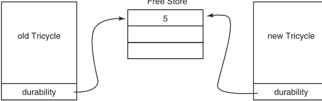

图 14.1 使用默认拷贝构造函数。

当其中一个 `Tricycle` 对象超出范围时，就会导致灾难。它的析构函数会被调用并尝试清理已分配的内存。

然而，另一个对象仍然指向该内存。如果它尝试访问该内存，程序就会崩溃。

解决此办法是定义自己的拷贝构造函数，并在拷贝过程中正确地分配内存。深拷贝允许你将现有值拷贝到新内存中。列表 14.3 中的 `DeepCopy` 程序演示了如何实现这一点。

#### 列表 14.3 DeepCopy.cpp 的全文

```cpp
1: #include <iostream>
2:
3: class Tricycle
4: {
5:     public:
6:         Tricycle();                  // 默认构造函数
7:         Tricycle(const Tricycle&); // 拷贝构造函数
8:         ~Tricycle();               // 析构函数
9:         int getSpeed() const { return *speed; }
10:        void setSpeed(int newSpeed) { *speed = newSpeed; }
11:        void pedal();
12:        void brake();
13:
14:    private:
15:        int *speed;
16: };
17:
18: Tricycle::Tricycle()
19: {
20:     speed = new int;
21:     *speed = 5;
22: }
23:
24: Tricycle::Tricycle(const Tricycle& rhs)
25: {
26:     speed = new int;
27:     *speed = rhs.getSpeed();
28: }
29:
30: Tricycle::~Tricycle()
31: {
32:     delete speed;
33:     speed = NULL;
34: }
35:
36: void Tricycle::pedal()
37: {
37:     setSpeed(*speed + 1);
38:     std::cout << "Pedaling " << getSpeed() << " mph" << std::endl;
39: }
40: void Tricycle::brake()
41: {
42:     setSpeed(*speed - 1);
43:     std::cout << "Pedaling " << getSpeed() << " mph" << std::endl;
44: }
45:
46: int main()
47: {
48:     std::cout << "Creating trike named wichita...";
49:     Tricycle wichita;
50:     wichita.pedal();
51:     std::cout << "Creating trike named dallas..." << std::endl;
52:     Tricycle dallas(wichita);
53:     std::cout << "wichita's speed: " << wichita.getSpeed() << std::endl;
54:     std::cout << "dallas's speed: " << dallas.getSpeed() << std::endl;
55: }
```

### 编译时常量表达式

C++ 的最新版本中通过 `constexpr` 关键字添加了常量表达式：

```cpp
constexpr int getCentury()
{
    return 100;
}
```

常量表达式必须具有非空返回类型，并返回一个表达式作为其内容。返回的表达式只能包含字面量、对其他常量表达式的调用，或者同样用 `constexpr` 定义的变量。

以下语句使用 `constexpr` 关键字定义了一个名为 `century` 的常量和一个名为 `year` 的常量表达式：

```cpp
const int century = 100;
constexpr int year = 2016 + century;
```

`Circle` 程序（列表 14.4）利用一个常量表达式来表示 PI 的值，并用它根据用户输入的半径值计算圆面积。

#### 列表 14.4 Circle.cpp 的全文

```cpp
#include <iostream>

// 获取 PI 的近似值
constexpr double getPi() {
    return (double) 22 / 7;
}

int main() {
    float radius;

    std::cout << "Enter the radius of the circle: ";
    std::cin >> radius;

    // 面积等于 PI * 半径平方
    double area = getPi() * (radius * radius);

    std::cout << "\nCircle's area: " << area << std::endl;

    return 0;
}
```

以下是半径为 19 的程序示例输出：

```
Enter the radius of the circle: 19
Circle's area: 1134.57
```

C++ 没有直接表示 PI 值的关键字。适用于某些用途的合理近似值是 22 除以 7。当在 C++ 中存储为 `double` 类型时，它等于 3.14286，即 PI 保留五位小数的值。

`Circle` 程序将 22/7 计算为常量表达式。该函数之所以这样做，是因为它只包含一条语句（即 `return` 后跟一个表达式），并且只包含字面量、常量或常量表达式。

## 总结

在这一小时中，你学习了如何对 C++ 中对象的创建和销毁实现更多控制。

构造函数像函数一样可以进行重载。构造函数的参数数量和类型允许编译器确定类用户在使用时应该调用哪一个。

构造函数可以像成员函数和普通函数一样具有默认值。

当对象被复制时，所有成员变量都会由拷贝构造函数复制。当成员变量是指向堆上对象的指针时，就会出现问题。原始对象和副本都指向同一个对象。当一个对象超出作用范围并销毁时，另一个对象仍然有一个指向该对象的有效指针。任何使用该指针的尝试都会导致程序崩溃。

这个问题可以通过为类编写自己的拷贝构造函数来解决。该构造函数接受一个参数：要复制的原始对象。在构造函数中，可以妥善处理指针使用新内存。

## 问答

- **问.** 既然可以重载函数，为什么还要使用默认值呢？

  **答.** 因为维护一个函数比维护两个更容易，而且理解一个带默认参数的函数比研究两个函数的体要容易得多。此外，更新其中一个函数而忽略更新第二个是 Bug 的常见来源。

- **问.** 鉴于重载方法存在的问题，为什么不总是使用默认值呢？

  **答.** 重载方法提供了默认变量无法实现的功能，因为它可以通过按类型而非按数量来改变参数列表。

- **问.** 在编写类构造函数时，如何决定将什么放在初始化列表中，将什么放在构造函数体中？

  **答.** 一个简单的规则是在初始化阶段尽可能多，并初始化所有成员变量。诸如计算和 `std::cout` 语句必须放在构造函数体内。

- **问.** 重载方法可以有默认参数吗？

  **答.** 可以。没有理由不把这些强大的特性结合。一个或多个重载方法可以具有默认值，遵循任何方法中默认变量的普通规则。

- **问.** 为什么辣根是辣的？

  **答.** 它含有异硫氰酸盐。辣根是一种原产于俄罗斯和匈牙利的根茎植物，属于芥末科，它含有类似芥末的油——异硫氰酸盐，这种物质会让你流泪、鼻子疼痛，并给味蕾带来辛辣感。这只在辣根细胞被压碎时发生。醋可以停止反应并稳定味道。

  烟雾和热量在暴露于空气后会迅速恶化，因此新鲜切块的辣根具有最大的烹饪痛苦能力。随着时间的推移，它会失去味道和冲劲。

  山葵（也称为日本辣根）的味道如此刺痛，以至于被用于聋人的实验烟雾报警器。

## 工作坊

在过去的一个小时里，你对成员函数进行了练习。你应该回答几个问题并完成一些练习以巩固对该主题的知识。

## 测验

- 1. 对于重载函数，编译器如何知道调用哪一个？

  A. 函数名

  B. 参数的数量和类型

  C. 函数的返回类型

- 2. 重载函数可以使用默认值吗？

  A. 可以

  B. 不

  C. 我不需要这种压力；我测试得不好。

- 3. 在析构函数销毁指针时，为了安全，给指针赋值什么？

  A. `nullptr`

  B. 0

  C. a 或 b

## 答案

- 1. 函数名、参数的数量和类型。
- 2. 完全可以，只要类型匹配即可。
- 3. `nullptr` 或 0。

## 活动

- 1. 修改 `Rectangle` 类以包含默认值。
- 2. 修改 `Circle` 类以包含一个增量方法。

# 第 15 小时：使用运算符重载

```cpp
26:
27: int main()
28: {
29:   Counter c;
30:   std::cout << "The value of c is " << c.getValue();
31:   << std::endl;
32:   c.increment();
33:   std::cout << "The value of c is " << c.getValue();
34:   << std::endl;
35:   ++c;
36:   std::cout << "The value of c is " << c.getValue();
37:   << std::endl;
38:   Counter a = ++c;
39:   std::cout << "The value of a: " << a.getValue();
40:   std::cout << " and c: " << c.getValue() << std::endl;
41:   return 0;
42: }
```

该程序多次递增 `Counter` 对象并创建了第二个对象，在执行过程中显示这些值：

```
The value of c is 0
The value of c is 1
The value of c is 2
The value of a: 3 and c: 3
```

在第 35 行，你可以看到在 `Counter` 类对象上调用了递增运算符：

```cpp
++c;
```

编译器将其解释为对第 21-25 行所示的 `operator++` 实现的调用。该函数递增了成员变量，然后对该指针进行解引用以返回当前对象。由于它返回的是当前对象，因此它可以赋值给第 38 行的变量。

如果 `Counter` 对象分配了内存，那么重写拷贝构造函数将是非常重要的。在这种情况下，默认的拷贝构造函数运行良好。

注意，返回的值是 `Counter` 引用，从而避免了创建额外的临时对象。它是一个 `const` 引用，因为使用该对象的对象的函数不会更改该值。

### 重载后置运算符

之前的项目使用了 `++` 递增运算符的前缀版本，这引发了关于如何重载后置运算符的问题。前缀和后置运算符都是 `++`，重载成员函数的名称无法用于区分两者。

处理此问题并重载后置运算符的方法是将一个 `int` 变量作为 `operator++()` 成员函数的唯一参数。该整数不会被使用；它只是一个信号，表示该函数定义后置运算符。

正如你在之前的节中学习的那样，后置运算符在表达式中返回变量之前会更改其值。后置运算符在递增或递减之前返回该值。


为了做到这一点，在重载的成员函数中，必须创建一个临时对象来持有原始值，同时对象的值被递增。返回临时对象是因为后置运算符需要原始值，而不是递增后的值。

临时对象必须按值返回而不是按引用返回。否则，它会在函数返回后很快超出作用域。

列表 15.3 中的 `Counter3` 程序演示了如何重载前缀和后置运算符。

### 列表 15.3 Counter3.cpp 的全文

```cpp
1: #include <iostream>
2:
3: class Counter
4: {
5: public:
6:    Counter();
7:    ~Counter() {}
8:    int getValue() const { return value; }
9:    void setValue(int x) { value = x; }
10:   const Counter& operator++(); // prefix
11:   const Counter operator++(int); // postfix
12:
13: private:
14:    int value;
15: };
16:
17: Counter::Counter():
18:    value(0)
19: {}
20:
21: const Counter& Counter::operator++() // prefix
22: {
23:   ++value;
24:   return *this;
25: }
26:
27: const Counter Counter::operator++(int) // postfix
28: {
29:   Counter temp(*this);
30:   ++value;
31:   return temp;
32: }
33:
34: int main() {
35:   Counter c;
36:   std::cout << "The value of c is " << c.getValue()
37:   << std::endl;
38:   c++;
39:   std::cout << "The value of c is " << c.getValue()
40:   << std::endl;
41:   ++c;
42:   std::cout << "The value of c is " << c.getValue()
43:   << std::endl;
44:   Counter a = ++c;
45:   std::cout << "The value of a: " << a.getValue();
46:   std::cout << " and c: " << c.getValue() << std::endl;
47:   a = c++;
48:   std::cout << "The value of a: " << a.getValue();
49:   std::cout << " and c: " << c.getValue() << std::endl;
50:   return 0;
51: }
```

此代码重载了前缀和后置递增运算符，并在多个语句中使用它们：

The value of c is 0

The value of c is 1

The value of c is 2

The value of a: 3 and c: 3

后置运算符在第 11 行声明，在第 27-32 行实现。注意第 27 行的 `int` 参数是为了区分它。

### 重载加法运算符

递增运算符是一元运算符，意味着它只接受一个操作数。加法运算符是二元运算符，它可以添加两个操作数。你可以通过以下代码这样做：

```cpp
Counter var1, var2, var3;
var3 = var1 + var2;
```

列表 15.4 的全文：

```cpp
1: #include <iostream>
2:
3: class Counter
4: {
5: public:
6:    Counter();
7:    ~Counter() {}
8:    int getValue() const { return value; }
9:    void setValue(int x) { value = x; }
10:   const Counter& operator++(); // prefix
11:   const Counter operator++(int); // postfix
12:
13: private:
14:    int value;
15: };
16:
17: Counter::Counter():
18:    value(0)
19: {}
20:
21: const Counter& Counter::operator++() // prefix
22: {
23:   ++value;
24:   return *this;
25: }
26:
27: const Counter Counter::operator++(int) // postfix
28: {
29:   Counter temp(*this);
30:   ++value;
31:   return temp;
32: }
33:
34: int main() {
35:   Counter c;
36:   std::cout << "The value of c is " << c.getValue()
37:   << std::endl;
38:   c++;
39:   std::cout << "The value of c is " << c.getValue()
40:   << std::endl;
41:   ++c;
42:   std::cout << "The value of c is " << c.getValue()
43:   << std::endl;
44:   Counter a = ++c;
45:   std::cout << "The value of a: " << a.getValue();
46:   std::cout << " and c: " << c.getValue() << std::endl;
47:   a = c++;
48:   std::cout << "The value of a: " << a.getValue();
49:   std::cout << " and c: " << c.getValue() << std::endl;
50:   return 0;
51: }
```

加法运算符重载可以处理两个 `Counter` 对象，输出如下：

alpha: 4

beta: 13

gamma: 3

### 运算符重载的限制

虽然运算符重载是 C++ 语言中最强大的功能之一，但它也有局限。对于内置类型（如 `int`）的运算符无法重载。运算符的优先级顺序无法更改。你无法创建新的运算符，因此没有方法声明 `**` 为次方运算符。

### 运算符重载

运算符重载是新程序员最常用和最滥用的方面之一。为某些晦涩的运算符创建新而有趣的用法很有吸引力，但这些通常会导致代码难以理解。

### 注意

让 `+` 运算符变成减法，让 `+` 运算符变成加法，在第一次尝试时很有趣，但现实中没有人会这样做。真正的危险在于对运算符的独特用法，例如使用 `+` 连接字母或分割字符串。有理由考虑这些用法，但更好的理由是谨慎。运算符重载的目标是增加可用性和理解。

### operator==

C++ 编译器为每个类提供默认构造函数、析构函数和拷贝构造函数。如果类中没有指定，编译器提供的第四个成员函数定义了赋值运算符。

赋值运算符的重载函数形式为 `operator=`，当给对象赋值值时会被调用，如下代码所示：

```cpp
Counter wichita;
wichita.setSpeed(4);
Counter dallas;
dallas.setSpeed(13);
dallas = wichita;
```

`Counter` 对象 `wichita` 被创建，其成员变量 `speed` 赋予值 4，随后是 `dallas` 值为 13。最后的语句使用了赋值运算符 `=`。

由于这次赋值，`dallas` 的 `speed` 变量被赋值为来自 `wichita` 的变量值。在该语句执行后，`dallas.speed` 将拥有值 4 而不是 13。

在这种情况下，拷贝构造函数没有调用，因为 `dallas` 已经存在，没有需要构造它。编译器调用赋值运算符插入。

出于此原因，当你重载赋值运算符时，首先必须做的是使用如下语句删除其指针所分配的内存：

```cpp
delete speed;
```

这种方法可以运行，但如果你将 `dallas` 赋值给它自己会发生什么呢：

```cpp
dallas = dallas;
```

程序员不太可能故意这样做，但类必须能够处理这种情况，因为这种情况可能会意外发生。引用和解引的指针可能会掩盖对象正在被赋值这一事实。

如果你不对此问题进行防御，自赋值会导致 `dallas` 删除它自身分配的内存。当它执行删除时，它正准备从赋值运算符的右侧拷贝内存，但那部分内存已经消失了。

如果赋值运算符通过 `this` 指针检查赋值运算符的右侧是否为对象本身，就可以防止这种情况。

列表 15.5 中的 `Assignment` 类使用重载来定义自定义的赋值运算符，并避免了同一对象问题。

### 列表 15.5 Assignment.cpp 的完整文本

```cpp
1: #include <iostream>
2:
3: class Tricycle
4: {
5: public:
6:   Tricycle();
7:   // 拷贝构造函数和析构函数使用默认
8:   int getSpeed() const { return *speed; }
9:   void setSpeed(int newSpeed) { *speed = newSpeed; }
10:  Tricycle& operator=(const Tricycle&);
11:
12: private:
13:   int *speed;
14: };
15:
16: Tricycle::Tricycle()
17: {
18:   speed = new int;
19:   *speed = 5;
20: }
21:
22: Tricycle& Tricycle::operator=(const Tricycle& rhs)
23: {
24:     if (this == &rhs)
25:         return *this;
26:     delete speed;
27:     speed = new int;
28:     *speed = rhs.getSpeed();
29:     return *this;
30: }
31: 
32: int main() {
33:     Tricycle wichita;
34:     std::cout << "Wichita's speed: " << wichita.getSpeed()
35:     << std::endl;
36:     std::cout << "Setting Wichita's speed to 6 ..." << std::endl;
37:     wichita.setSpeed(6);
38:     Tricycle dallas;
39:     std::cout << "Dallas' speed: " << dallas.getSpeed()
40:     << std::endl;
41:     std::cout << "Copying Wichita to Dallas ..." << std::endl;
42:     dallas = wichita;
43:     std::cout << "Dallas' speed: " << dallas.getSpeed()
44:     << std::endl;
45:     return 0;
46: }
```

`Assignment` 运行时会产生此输出：

Wichita's speed: 5

Setting Wichita's speed to 6 ...

Dallas' speed: 5

Copying Wichita to Dallas ...

Dallas' speed: 6

列表 15.5 回顾了 `Tricycle` 类，省略了拷贝构造函数和析构函数以节省空间。在第 10 行，声明了赋值运算符；在第 22–30 行，对其进行了定义。

在第 24 行，对当前对象（正在被赋值的 `Tricycle`）进行测试，检查它是否与正在赋值的 `Tricycle` 相同。这是通过检查 `rhs` 的地址与 `this` 指针存储的地址相同来实现。

相等运算符 (`==`) 也可以重载，允许你自己判断对象相等意味着什么。

### 注意

在列表 15.5 的第 26–27 行，成员变量 `speed` 被删除并在堆上重新创建。虽然这在严格来说不是必须的，但在处理没有重载赋值运算符的变长对象时，这是一个良好的编程习惯，可以避免内存泄漏。

### 转换运算符

当你尝试将内置类型（如 `int` 或 `unsigned short`）的变量赋值给用户定义类的对象时会发生什么？列表 15.6 回顾了 `Counter` 类，并尝试将类型为 `int` 的变量赋值给 `Counter` 对象。

### 注意

列表 15.6 将无法编译，原因你将在准备好后会了解到。

### 列表 15.6 Counter5.cpp 的完整文本

```cpp
1: #include <iostream>
2:
3: class Counter
4: {
5:  public:
6:     Counter();
7:     ~Counter() {}
8:     int getValue() const { return value; }
9:     void setValue(int newValue) { value = newValue; }
10:  private:
11:     int value;
12: };
13:
14: Counter::Counter():
15:     value(0)
16: {}
17:
18: int main()
19: {
20:     int beta = 5;
21:     Counter alpha = beta;
22:     std::cout << "alpha: " << alpha.getValue()
23:     << std::endl;
24:     return 0;
25: }
```

当你尝试编译此程序时，它失败了，因为第 3–12 行的 `Counter` 类只有一个默认构造函数。它缺少将 `int` 转换为 `Counter` 对象的函数。列表 15.7 通过创建转换构造函数解决了这个问题。

### 列表 15.7 Counter.cpp 的完整文本

```cpp
1: #include <iostream>
2:
3: class Counter
4: {
5:  public:
6:     Counter();
7:     ~Counter() { }
8:     Counter(int newValue);
9:     int getValue() const { return value; }
10:    void setValue(int newValue) { value = newValue; }
11:  private:
12:     int value;
13: };
14:
15: Counter::Counter():
16:     value(0)
17: {}
18:
19: Counter::Counter(int newValue):
20:     value(newValue)
21: {}
22:
23: int main()
24: {
25:     int beta = 5;
26:     Counter alpha = beta;
27:     std::cout << "alpha: " << alpha.getValue()
28:     << std::endl;
29:     return 0;
30: }
```

此代码可以成功编译并产生以下输出：

alpha: 5

重要的变化在第 19 行，构造函数被重载以接受 `int`。你也可以将对象赋值给内置类型。

### int 运算符

之前的项目演示了如何将内置类型赋值给对象，但它不知道如何完成相反操作。列表 15.8 中的 `Counter` 程序阐述了这一点。在第 11 行，声明了转换运算符。它没有返回值。该函数的实现位于第 24–27 行。第 26 行返回了对象 `value` 成员变量的值。现在编译器知道如何将整数转换为 `Counter` 对象，反亦然，因此它们可以自由赋值。注意，转换运算符没有指定返回类型，尽管它们确实返回了转换后的值。

## 总结

运算符重载是 C++ 语言最强大的特性之一。通过在你设计的类中定义运算符的行为，你使得操作这些类的对象变得更加容易。

C++ 中的几乎所有运算符都可以被重载。

由于你一直在处理内置类型，使用运算符来操作对象比调用成员函数要容易得多。它还能产生更易理解的程序。

这当然假设重载运算符的行为与它们在内置类型上的工作方式保持一致。

## 问答

- Q. 既然可以直接创建成员函数，为什么还要重载运算符呢？

- A. 当重载运算符的行为被很好理解时，使用重载运算符会更方便。完成任务所需的代码更少，而且你的类可以模拟内置类型的功能。

- Q. 拷贝构造函数和赋值运算符之间有什么区别？

- A. 拷贝构造函数创建一个与现有对象具有相同值的新对象。赋值运算符则是修改一个现有对象，使其与另一个对象具有相同的值。


- Q. 后置运算符中使用的 `int` 发生了什么？

- A. 什么都没有发生。那个 `int` 永远从不被使用，除了作为重载后置和前置运算符的标记位之外。

- Q. Alanis Morisset 在《You Oughta Know》中唱的那个前男友是谁？

- A. 这首歌收自1995 年的专辑《Jagged Little Pill》，是一首充满火药味的分手歌曲，该歌曲曾登顶冠军，销量超过 3300 万份，是关于她交往过的一个真实人物的。Morisset 在采访中承认了这一点，但从未公开确认过那个人的身份。

媒体头条人物是演员 Dave Coulier，他曾在情景剧《Full House》及其2016年版《Fuller House》中饰演 Joey。他在专辑发布前不久与 Morisset 分手了。

2008 年，Coulier 告诉《卡尔加里侍报》这首歌是关于他的。描述第一次在收音机上听到这首歌的感觉时，Coulier 透露：“哇，这个女孩很生气！”然后我说：“天哪，我觉得那是 Alanis 的。”我一遍又一遍地听这首歌，我说：“我觉得我真的伤害了这个人。”

他本该知道的。

## 工作坊

现在你已经学习了运算符重载，你可以回答几个问题并做一些练习，以巩固你这一小时学到的知识。

## 测验

- 1. 为什么你不能像 `**` 用于幂那样创建一个新的运算符？

- A. 该运算符不是语言的一部分。

- B. 因为它使用了现有的运算符 `*`。

- C. 你的问题前提是有问题的。你可以创建新的运算符。

- 2. 为什么前置和后置递增、递减操作的重载语法不同？

- A. 因为前置和后置返回不同的值

- B. 因为一个使用 `++` 另一个使用 `--`

- C. 语法没有区别。

- 3. 转换运算符的作用是什么？

- A. 将对象转换为内置类型

- B. 将内置类型转换为对象

- C. a 和 b 都是

## 答案

- 1. 添加新运算符（如 `****`）需要修改编译器，因为 `****` 不是语言的一部分，所以编译器不知道如何处理它。

- 2. 行为完全取决于 `++` 或 `--` 运算符出现在变量之前还是之后，代码必须遵循相同的行为。从技术上讲，它不必非模拟这种行为，但你类的用户会期望它是那样工作的。

- 3. 它们将对象类型转换为内置类型。

## 活动

- 1. 修改赋值程序（列表 15.6）以重载等号运算符 `=`。使用该运算符比较两个 `Tricycle` 对象的速度。

- 2. 修改计数器2 程序（列表 15.5），也重载减号运算符并使用它来执行简单的减法。

要查看这些活动的解决方案，请访问此书的网站：`http://cplus.cadenhead.org`。

# 第 16 小时

通过继承扩展类

你在此小时将学到：

- 什么是继承

- 如何从一个类派生另一个类

- 如何从派生类访问基类成员函数

- 如何覆盖基类成员函数

- 什么是保护访问（`protected`）以及如何使用它

### 什么是继承？

寻找、识别和创建概念之间的关系是人类智能的一个基本方面。我们建立层次结构、网络和其他相互关系来解释和理解事物是如何相互作用的。C++ 在继承层次中体现了这一点，使得类继承另一个类成为可能。

概念可以以许多不同的方式进行分类。当你看着你的狗时，你看到了什么？生物学家看到的是相互器官的网络，物理学家看到正在作用的原子和力，分类学家看到家犬（`canine domesticus`）种的代表，而孩子看到的是伙伴和保护者。

每个类别通常可以细分为子类别。对于分类学家来说，狗是犬科动物。犬是一种哺乳动物。哺乳动物是一种动物——以此类推。分类学家将生物界划分为界、门、纲、科、属、种。

分类学家的层次结构建立了一种“是一个（is a）”的关系——狗是犬科动物。到处都是“是一个”的关系。日产 Leaf 是一种汽车，汽车也是一种交通工具。卡诺里卷（`cannoli`）是一种甜点，甜点是一种食物。

当某物被描述为另一种事物的种类时，这意味着它是该事物的特化。即，汽车是一种特殊的交通工具。汽车和巴士都是交通工具。它们通过特定的特征被区分开，但与其他交通工具具有共同点。

### 继承与派生

这些关系通过继承传递。狗的概念继承了哺乳动物的特征。因为它是哺乳动物，所以它继承了动物的特征。

分类学家的层次结构建立了一种“是一个”的关系——狗是犬科动物。到处都是“是一个”的关系。日产 Leaf 是一种汽车，汽车也是一种交通工具。卡诺里卷是一种甜点，甜点是一种食物。

当某物被描述为另一种事物的种类时，这意味着它是该事物的特化。即，汽车是一种特殊的交通工具。汽车和巴士都是交通工具。它们通过特定的特征被区分开，但与其他交通工具具有共同点。

### 派生的语法

在 C++ 中创建一个继承另一个类的类，在类声明中，在类名后加一个冒号，并指定类的访问权限（`public`、`protected` 或 `private`）以及它派生的类。

访问控制将在稍后讨论。这里有一个公共访问权限的类声明示例：

```cpp
class Dog : public Mammal
```

该语句创建了一个名为 `Dog` 的派生类，它继承自基类 `Mammal`。列表 16.1 中的 `Mammal` 程序创建了一个完全派生自 `Mammal` 的 `Dog` 类。

## 234 HOUR 16: 使用继承扩展类

```cpp
// 属性
BREED getBreed() const;
void setBreed(BREED breed);

// 其他成员函数
// wagTail();
// begForFood();

protected:
  BREED itsBreed;

int main()
{
  return 0;
}
```

此程序可以编译，但没有输出；它只是一组没有实现的类声明。尽管如此，这里仍然有很多值得关注的内容。

在第 5 到 25 行，声明了 `Mammal`（哺乳动物）类。由于所有哺乳动物都有年龄和重量，这些属性通过成员变量 `age` 和 `weight` 在该类中表示。

`Mammal` 类定义了六个成员函数：访问成员函数、`speak()` 和 `sleep()`。

`Dog` 类继承自 `Mammal`，如第 27 行所示。每个 `Dog` 对象都有三个成员变量：`age`、`weight` 和 `breed`。注意，第 27 到 44 行中 `Dog` 的类声明并不包含其中两个变量，即 `age` 和 `weight`。`Dog` 对象从 `Mammal` 类继承这些变量，以及 `Mammal` 的成员函数（拷贝运算符、构造函数和析构函数除外）。

### 私有（`Private`）与保护（`Protected`）

在列表 16.1 的 `Mammal` 程序第 22 行和第 42 行引入了一个新的访问关键字 `protected`。此前，类数据被声明为 `private`。然而，私有成员对派生类是不可见的。你可以将 `age` 和 `weight` 成员变量设置为 `public`，但这并不是理想的。你不希望其他类直接访问这些数据成员。

你希望让数据对该类及其派生类可见，这通过 `protected` 实现。`protected` 成员数据和函数对派生类完全可见，但在其他情况下是私有的。

有三种访问修饰符：`public`、`protected`、`private`。如果函数拥有某个类的实例，它可以访问该类的所有公有成员数据和函数。然而，类的成员函数可以访问其所属任何类的所有私有成员数据和函数。

因此，函数 `Dog::wagTail()` 可以访问私有数据 `breed`，并且可以访问 `Mammal` 类中的保护数据。

即使在 `Mammal` 和 `Dog` 的层级结构中又叠加了其他类（例如 `DomesticAnimals`），`Dog` 类仍然能够访问 `Mammal` 的保护成员，前提是这些其他类采用的是公有继承。

列表 16.2 中的 `Mammal` 程序演示了如何创建 `Dog` 类型的对象并访问其数据和成员函数。

## 列表 16.2 Mammal2.cpp 的全文

```cpp
#include <iostream>

enum BREED { YORKIE, CAIRN, DANDIE, SHETLAND, DOBERMAN, LAB };

class Mammal
{
  public:
    // 构造函数
    Mammal() : age(2), weight(5) {}
    ~Mammal() {}

    // 访问器
    int getAge() const { return age; }
    void setAge(int newAge) { age = newAge; }
    int getWeight() const { return weight; }
    void setWeight(int newWeight) { weight = newWeight; }

    // 其他成员函数
    void speak() const { std::cout << "Mammal sound!\n"; }
    void sleep() const { std::cout << "Shhh. I'm sleeping.\n"; }

  protected:
    int age;
    int weight;
};

class Dog : public Mammal
{
  public:
    // 构造函数
    Dog() : breed(YORKIE) {}
    ~Dog() {}

    // 访问器
    BREED getBreed() const { return breed; }
    void setBreed(BREED newBreed) { breed = newBreed; }

    // 其他成员函数
    void wagTail() { std::cout << "Tail wagging ...\n"; }
    void begForFood() { std::cout << "Begging for food ...\n"; }

  private:
    BREED breed;
};

int main()
{
  Dog fido;
  fido.speak();
  fido.wagTail();
  std::cout << "Fido is " << fido.getAge() << " years old\n";
  return 0;
}
```

当你运行 `Mammal2` 时，会出现以下输出：

```
Mammal sound!
Tail wagging ...
Fido is 2 years old
```

在第 5 到 25 行，声明了 `Mammal` 类带有几个内联成员函数。在第 27 到 44 行，`Dog` 被声明为 `Mammal` 的派生类。这些声明为所有 `Dog` 对象赋予了 `age`、`weight` 和 `breed`。

在第 48 行，声明了一个 `Dog`，它继承了 `Mammal` 的所有属性和 `Dog` 的属性。因此，`fido` 知道如何执行 `wagTail()`、`speak()` 和 `sleep()`。

### 构造函数与析构函数

理解 C++ 继承的一个重要方面是：当创建派生类对象时，会调用多个构造函数。当在 `Mammal2` 程序中创建 `fido` 时，首先调用基类构造函数创建 `Mammal`，然后调用 `Dog` 构造函数，完成 `Dog` 对象的构建。由于创建 `fido` 时没有带参数，因此在这种情况下都调用了默认构造函数。

当 `fido` 对象被销毁时，首先调用 `Dog` 析构函数，然后调用 `fido` 中 `Mammal` 部分的析构函数。每个析构函数都有机会清理对象自己的部分。构造函数按照继承顺序调用。析构函数则按照继承的反序调用。列表 16.3 中的 `Mammal3` 程序演示了构造函数和析构函数是如何被调用的。

## 列表 16.3 Mammal3.cpp 的全文

```cpp
#include <iostream>

enum BREED { YORKIE, CAIRN, DANDIE, SHETLAND, DOBERMAN, LAB };

class Mammal
{
  public:
    // 构造函数
    Mammal() : age(3), weight(5) {}
    ~Mammal() {}

    // 访问器
    int getAge() const { return age; }
    void setAge(int newAge) { age = newAge; }
    int getWeight() const { return weight; }
    void setWeight(int newWeight) { weight = newWeight; }

    // 其他成员函数
    void speak() const { std::cout << "Mammal sound!\n"; }
    void sleep() const { std::cout << "shhh. I'm sleeping.\n"; }

  protected:
    int age;
    int weight;
};

class Dog : public Mammal
{
  public:
    // 构造函数
    Dog() : breed(YORKIE) {}
    ~Dog() {}

    // 访问器
    BREED getBreed() const { return breed; }
    void setBreed(BREED newBreed) { breed = newBreed; }

    // 其他成员函数
    void wagTail() { std::cout << "Tail wagging ...\n"; }
    void begForFood() { std::cout << "Begging for food ...\n"; }

  private:
    BREED breed;
};

int main()
{
  Dog fido; // 创建一只狗
  fido.speak();
  fido.wagTail();
  std::cout << "Fido is " << fido.getAge() << " years old\n";
  return 0;
}
```

这里是程序的输出：

```
Mammal constructor ...
Dog constructor ...
Mammal sound ...
Tail wagging ...
Fido is 3 years old
Dog destructor ...
Mammal destructor ...
```

## 向基类构造函数传递参数

`Mammal3` 程序显示了调用构造函数和析构函数的文本。当在第 71 行创建 `fido` 时，首先调用 `Mammal` 的构造函数，然后调用 `Dog` 的构造函数。此时 `Dog` 完全存在，可以调用其成员函数。当 `main()` 函数在第 76 行结束时 `fido` 离开作用域，会调用 `Dog` 的析构函数，随后调用 `Mammal` 的析构函数。

在你处理这一小时开发的类时，你可能需要重载 `Mammal` 的构造函数以设置特定的年龄，并重载 `Dog` 构造函数以设置品种。如何将 `age` 和 `weight` 参数传递给 `Mammal` 中正确的构造函数？如果 `Dog` 需要初始化 `weight` 但 `Mammal` 不需要呢？

基类的初始化可以在类初始化期间完成，方法是通过编写类名后跟基类所需的参数，如 `Mammal4` 程序（列表 16.4）所示。

```cpp
class Dog : public Mammal
{
public:
    // 构造函数
    Dog();
    Dog(int age);
    Dog(int age, int weight);
    Dog(int age, BREED breed);
    Dog(int age, int weight, BREED breed);
    ~Dog();

    // 访问器
    BREED getBreed() const { return breed; }
    void setBreed(BREED newBreed) { breed = newBreed; }

    // 其他成员函数
    void wagTail() { std::cout << "Tail wagging ...\n"; }
    void begForFood() { std::cout << "Begging for food ...\n"; }

private:
    BREED breed;
};

Mammal::Mammal():
age(1),
weight(5)
{
    std::cout << "Mammal constructor ...\n";
}

Mammal::Mammal(int age):
age(age),
weight(5)
{
    std::cout << "Mammal (int) constructor ... \n";
}

Mammal::~Mammal()
{
    std::cout << "Mammal destructor ...\n";
}

Dog::Dog():
Mammal(),
breed(YORKIE)
{
    std::cout << "Dog constructor ...\n";
}
```

# 向基类构造函数传递参数


```cpp
Dog::Dog(int age):
Mammal(age),
breed(YORKIE)
{
    std::cout << "Dog(int) constructor ...\n";
}

Dog::Dog(int age, int newWeight):
Mammal(age),
breed(YORKIE)
{
    weight = newWeight;
    std::cout << "Dog(int, int) constructor ...\n";
}

Dog::Dog(int age, int newWeight, BREED breed):
Mammal(age),
breed(breed)
{
    weight = newWeight;
    std::cout << "Dog(int, int, BREED) constructor ...\n";
}

Dog::Dog(int age, BREED newBreed):
Mammal(age),
breed(newBreed)
{
    std::cout << "Dog(int, BREED) constructor ...\n";
}

Dog::~Dog()
{
    std::cout << "Dog destructor ...\n";
}

int main()
{
    Dog fido;
    Dog rover(5);
    Dog buster(6, 8);
    Dog yorkie(3, YORKIE);
    Dog dobbie(4, 20, DOBERMAN);
    fido.speak();
    rover.wagTail();
    std::cout << "Yorkie is "
    << yorkie.getAge() << " years old\n";
    std::cout << "Dobbie weighs "
    << dobbie.getWeight() << " pounds\n";
    return 0;
}
```

`Mammal4` 程序显示了以下输出，其中添加了行号以便在本节中引用：

1: Mammal constructor ...
2: Dog constructor ...
3: Mammal(int) constructor ...
4: Dog(int) constructor ...
5: Mammal(int) constructor ...
6: Dog(int, int) constructor ...
7: Mammal(int) constructor ...
8: Dog(int, BREED) constructor ...
9: Mammal(int) constructor ...
10: Dog(int, int, BREED) constructor ...
11: Mammal sound!
12: Tail wagging !
13: York is 3 years old
14: Dobbie weighs 20 pounds
15: Dog destructor ...
16: Mammal destructor ...
17: Dog destructor ...
18: Mammal destructor ...
19: Dog destructor ...
20: Mammal destructor ...
21: Dog destructor ...
22: Mammal destructor ...
23: Dog destructor ...
24: Mammal destructor ...

在列表 16.4 中，`Mammal` 的构造函数在第 10 行被重载，以接收一个整数，即 `Mammal` 对象的年龄。第 58-63 行的实现将 `age` 初始化为传递的值，并将 `weight` 初始化为 5。

`Dog` 在第 32-36 行重载了五个构造函数。第一个是默认构造函数。第二个接收年龄，这与 `Mammal` 构造函数接收的参数相同。第三个构造函数同时接收年龄和重量；第四个接收年龄和品种；第五个接收年龄、重量和品种。

### 注意

注意，在列表 16.4 的第 71 行，`Dog` 的默认构造函数调用了 `Mammal` 的默认构造函数。虽然这并非严格必要，但它的作用是证明你打算调用不带参数的基类构造函数。在任何情况下基类构造函数都会被调用，但这样做使你的意图更加明确。

# 向基类构造函数传递参数

接收整数的 `Dog` 构造函数的实现位于第 77–82 行。在初始化阶段，`Dog` 先初始化它的基类，然后初始化它的品种。

另一个 `Dog` 构造函数位于第 84–90 行。它接收两个参数。它通过调用相应的构造函数来初始化基类，但这次还将重量赋值给它的基类变量。注意，你不能在初始化阶段给基类变量赋值。因此，你不能写这样的代码：

```cpp
Dog::Dog(int age, int newWeight):
Mammal(age),
breed(YORKIE),
weight(newWeight) // 错误
{
    std::cout << "Dog(int, int) constructor ...\n";
}
```

```cpp
Dog::Dog(int age, int newWeight):
Mammal(age),
breed(YORKIE)
{
    weight = newWeight;
    std::cout << "Dog(int, int) constructor ...\n";
}
```

```cpp
Dog::Dog(int age, BREED newBreed):
Mammal(age),
breed(newBreed)
{
    std::cout << "Dog(int, BREED) constructor ...\n";
}
```

```cpp
Dog::Dog(int age, int newWeight):
Mammal(age),
breed(new
)
}
```

### 重写函数

`Dog` 拥有 `Mammal` 的所有成员函数，以及派生类可能添加的 `wagTail()` 等成员函数。它还可以重写基类函数。重写是指在派生类中提供基类函数的实现。当你创建一个派生类对象时，调用的是正确的函数。

```cpp
Dog::Dog(int age, int newWeight):
Mammal(age),
breed(
)
{
    std::cout << "Mammal sound!\n";
}
```

```cpp
Dog::Dog(int age, int newWeight):
Mammal(age),
breed(
)
{
    std::cout << "Mammal sound!\n";
}
```

重写函数时，它必须与基类中的函数返回类型和签名一致。签名是指除了返回类型以外的部分（名称、参数列表和 `const` 关键字）。

`Mamm5` 程序（列表 16.5）展示了当 `Dog` 类重写 `Mammal` 类的 `speak()` 成员函数时发生的情况。为了节省空间，这些类省略了访问器函数。

### 列表 16.5 Mamm5.cpp 的完整文本

```cpp
#include <iostream>

enum BREED { YORKIE, CAIRN, DANDIE, SHETLAND, DOBERMAN, LAB };

class Mammal
{
public:
    // 构造函数
    Mammal() { std::cout << "Mammal constructor\n"; }
    ~Mammal() { std::cout << "Mammal destructor\n"; }

    // 其他成员函数
    void speak() const { std::cout << "Mammal sound!\n"; }
    void sleep() const { std::cout << "Shhh. I'm sleeping.\n"; }

protected:
```

### 重写函数

这是 `Mamm5` 的输出：

```text
Mammal constructor...
Mammal constructor...
Dog constructor...
Mammal sound!
Woof!
Dog destructor...
Mammal destructor...
Mammal destructor...
```

在第 31 行，`Dog` 类重写了 `Mammal` 类的 `speak()` 成员函数，以便在调用该函数时输出 "Woof!"。在第 39 行，创建了一个 `Mammal` 对象，当调用 `Mammal` 构造函数时显示第一行输出。在第 40 行，创建了一个 `Dog` 对象，导致显示接下来两行输出，即调用 `Mammal` 构造函数，然后调用 `Dog` 构造函数。

## 第 16 小时：使用继承扩展类

在第 41 行，`Mammal` 对象调用了它的 `speak()` 函数。在第 42 行，`Dog` 对象调用了它的 `speak()` 函数。输出结果反映了调用了正确的函数。最后，两个对象离开了作用范围，它们的析构函数被调用。

### 重载与重写

重载（overloading）和重写（overriding）这两个术语听起来相似，在 C++ 中的实现的功能也相似。当你重载一个成员函数时，你创建了多个同名但签名不同的函数。当你重写一个成员函数时，你会在派生类中创建一个一个与基类中函数同名且签名相同的函数。

## 隐藏基类成员函数

在您创建的 `Mammal` 程序中，`Dog` 类的成员函数 `speak()` 隐藏了基类函数。这是我们想要的，但可能会导致意料之外的结果。如果 `Mammal` 有一个被重载的 `move()` 成员函数，而 `Dog` 重写了该函数，那么 `Dog` 函数将隐藏所有与该同名的 `Mammal` 函数。

`Mammal` 将 `move()` 重载为三个函数——一个不带参数，一个接受整数，以及一个接受整数和方向——由于 `Dog` 只重写了不带参数的 `move()` 函数，使用 `Dog` 对象将很难访问另外两个函数。列表 16.6 中的 `Mammal` 程序阐述了这个问题。

### 列表 16.6 Mammal.cpp 的全文

```cpp
1: #include <iostream>
2:
3: class Mammal
4: {
5: public:
6:     void move() const { std::cout << "Mammal moves one step\n"; }
7:     void move(int distance) const
8:     { std::cout << "Mammal moves " << distance << " steps\n"; }
9: protected:
10:    int age;
11:    int weight;
12: };
13:
14: class Dog : public Mammal
15: {
16: public:
17:     void move() const { std::cout << "Dog moves 5 steps\n"; }
18: }; // 你可能会收到一个警告，说你正在隐藏一个函数！
19:
20: int main()
21: {
22: Mammal bigAnimal;
23: Dog fido;
24: bigAnimal.move();
25: bigAnimal.move(2);
26: fido.move();
27: // fido.move(10)
28: return 0;
29: }
```

`Mammal` 程序运行时产生此输出：

```text
Mammal moves one step
Mammal moves 2 steps
Dog moves 5 steps
```

这些类中已经删除了所有额外的成员函数和数据。在第 6–8 行，`Mammal` 类声明了两个重载的 `move()` 函数。在第 17 行，`Dog` 重写了无参数的 `move()` 版本。它们在第 24–26 行被调用，输出反映了这一执行情况。

然而，第 27 行被注释掉了，因为它会导致编译器错误。虽然 `Dog` 类在没有重写不带参数的 `move()` 版本的情况下本可以调用 `move(int)` 函数，但现在它已经这样做了，就必须同时重写两者才能使用它们。这让人想起一条规则：如果你提供了任何构造函数，编译器将不再提供默认构造函数。

一个常见的错误是当你想要重写基类成员函数时，由于忘记包含 `const` 关键字而隐藏了它。该关键字是签名的一部分，漏掉它会改变签名，并隐藏成员函数而不是重写它。

当你在 `Mammal` 程序大约第 14–18 行处隐藏基类函数时，某些编译器会向你发出警告。虽然你允许派生类隐藏基类成员函数，但这通常是无意之过，会导致某些编译器发出警告。

## 调用基类成员函数

如果你重写了基类成员函数，仍然可以通过完全限定函数名来调用它。你通过编写基类名、后跟两个冒号、然后是函数名来实现的。例如：

```cpp
Mammal::move()
```

本可以重写列表 16.6 中的第 27 行使其通过编译：

```cpp
fido.Mammal::move(10);
```

这显式地调用了 `Mammal` 成员函数。本小时最后的项目，列表 16.7 中的 `Mammal` 程序阐述了这一想法。

### 列表 16.7 Mammal7.cpp 的全文

```cpp
1: #include <iostream>
2:
3: class Mammal
4: {
5: public:
6:   void move() const { std::cout << "Mammal moves one step\n"; }
7:   void move(int distance) const
8:     {std::cout << "Mammal moves " << distance << " steps\n";
9: protected:
10:  int age;
11:  int weight;
12: };
13: class Dog : public Mammal
14: {
15: public:
16:   void move() const;
17: };
18:
19: void Dog::move() const
20: {
21:   std::cout << "Dog moves...\n"
22:   Mammal::move(3);
23: }
24: int main()
25: {
26:   Mammal bigAnimal;
27:   Dog fido;
28:   bigAnimal.move();
29:   bigAnimal.move(2);
30:   fido.move();
31:   // fido.move(10);
32:   return 0;
33: }
```

`Mammal` 程序运行时产生输出：

```text
Mammal moves one step
Mammal moves 2 steps
Dog moves...
```

这些类中删除了所有额外的成员函数和数据。在第 6–8 行，`Mammal` 类声明了两个重载的 `move()` 函数。在第 17 行，`Dog` 重写了不带参数的 `move()` 版本。它们在第 24–26 行被调用。第 27 行被注释掉了，因为它会导致编译器错误。虽然 `Dog` 类在没有重写不带参数的 `move()` 版本的情况下本可以调用 `move(int)` 函数，但现在它已经这样做了，就必须同时重写两者才能使用它们。这让人想起一条规则：如果你提供了任何构造函数，编译器将不再提供默认构造函数。

一个常见的错误是当你想要重写基类成员函数时，由于忘记包含 `const` 关键字而隐藏了它。该关键字是签名的一部分，漏掉它会改变签名，并隐藏成员函数而不是重写它。

当你在 `Mammal` 程序大约第 14–18 行处隐藏基类函数时，某些编译器会向你发出警告。虽然你允许派生类隐藏基类成员函数，但这通常是无意之过，会导致某些编译器发出警告。

## 调用基成员函数

如果你重写了基成员函数，仍然可以通过完全限定函数名来调用它。你通过编写基类名、后跟两个冒号、然后是函数名来实现的。例如：

```cpp
Mammal::move()
```

本可以重写列表 16.6 中的第 27 行使其通过编译：

```cpp
fido.Mammal::move(10);
```

这显式地调用了 `Mammal` 成员函数。本小时最后的项目，列表 16.7 中的 `Mammal` 程序阐述了这一想法。

### 列表 16.7 Mammal7.cpp 的全文

```cpp
1: #include <iostream>
2:
3: class Mammal
4: {
5: public:
6:   void move() const { std::cout << "Mammal moves one step\n"; }
7:   void move(int distance) const
8:     {std::cout << "Mammal moves " << distance << " steps\n";
9: protected:
10:  int age;
11:  int weight;
12: };
13: class Dog : public Mammal
14: {
15: public:
16:   void move() const;
17: };
18:
19: void Dog::move() const
20: {
21:   std::cout << "Dog moves...\n"
22:   Mammal::move(3);
23: }
24: int main()
25: {
26:   Mammal bigAnimal;
27:   Dog fido;
28:   bigAnimal.move();
29:   bigAnimal.move(2);
```


30:   fido.move();

31:   // fido.move(10);

32:   return 0;

33: }

```

Mammal 程序运行时产生输出：

```

Mammal moves one step

Mammal moves 2 steps

Dog moves...

```

这些类中删除了所有额外的成员函数和数据。在第 6–8 行，`Mammal` 类声明了两个重载的 `move()` 函数。在第 17 行，`Dog` 重写了不带参数的 `move()` 版本。它们在第 24–26 行被调用。然而，第 27 行被注释掉了，因为它会导致编译器错误。虽然 `Dog` 类在没有重写不带参数的 `move()` 版本的情况下本可以调用 `move(int)` 函数，但现在它已经这样做了，就必须同时重写两者才能使用它们。这让人想起一条规则：如果你提供了任何构造函数，编译器将不再提供默认构造函数。

一个常见的错误是当你想要重写基类成员函数时，由于忘记包含 `const` 关键字而隐藏了它。该关键字是签名的一部分，漏掉它会改变签名，并隐藏成员函数而不是重写它。

当你在 Mammal 程序大约第 14–18 行处隐藏基类函数时，某些编译器会向你发出警告。虽然你允许派生类隐藏基类成员函数，但这通常是无意之过，会导致某些编译器发出警告。

## 答

如果你重写了基成员函数，仍然可以通过完全限定函数名来调用它。你通过编写基类名、后跟两个冒号、然后是函数名来实现的。例如：

```

Mammal::move()

```

本可以重写列表 16.6 中的第 27 行使其通过编译：

```

27: fido::Mammal::move(10);

```

这显式地调用了 Mammal 成员函数。本小时最后的项目，列表 16.7 中的 Mammal 程序阐述了这一想法。

### 列表 16.7 Mammal7.cpp 的全文

```cpp
1: #include <iostream>

2:

3: class Mammal
4: {
5: public:
6:   void move() const { std::cout << "Mammal moves one step\n"; }
7:   void move(int distance) const
8:     {std::cout << "Mammal moves " << distance << " steps\n"; }
9: protected:
10:  int age;
11:  int weight;
12: };

13: class Dog : public Mammal
14: {
15: public:
16:   void move() const;
17: };

18:

19: void Dog::move() const
20: {
21:   std::cout << "Dog moves...\n";
22:   Mammal::move(3);
23: }

24: int main()
25: {
26:   Mammal bigAnimal;
27:   Dog fido;
28:   bigAnimal.move();
29:   bigAnimal.move(2);
30:   fido.move();
31:   // fido.move(10);
32:   return 0;
33: }
```

Mammal 程序运行时产生输出：

```

Mammal moves one step

Mammal moves 2 steps

Dog moves...

```

## 答

- **问**: 如果 Dog 继承 Mammal，Dog 会继承保护成员吗？
  **答**: 是的，Dog 可以访问 Mammal 的保护成员。
- **问**: 如果 Dog 继承 Mammal 且 Mammal 继承 Animal，Dog 会继承 Animal 吗？
  **答**: 是的，继承具有传递性。
- **问**: 派生类可以将基类函数变为私有吗？
  **答**: 可以，但这会隐藏该函数。
- **问**: `const` 关键字的目的是？
  **答**: 它表示函数不会修改对象。
- **问**: 如何在派生类中调用基类函数？
  **答**: 使用作用域运算符，例如 `BaseClass::functionName()`。

## 工作

现在你已经有机会接触继承，可以回答几个问题并做一些练习来巩固知识。

## 测验

1. 哪个访问关键字将成员变量限制为对象及其派生类？
   A. public
   B. private
   C. protected
2. 派生类中构造函数的调用顺序是怎样的？
   A. 按照继承顺序向下
   B. 按照继承顺序向上
   C. 按照源代码中类的定义顺序
3. 为什么你想在派生类中隐藏基类函数？
   A. 防止其被使用
   B. 调用该函数
   C. 没有理由这样做

## 答案

1. C. `protected` 关键字限制了成员变量和成员函数的访问，使得派生类可以使用它们，但其他类不能。
2. A. 首先调用基类构造函数，然后调用派生类构造函数。
3. A. 有时派生类的行为与基类差异大，某些基类成员函数不再适用。由于无法修改基类（例如），这就是要使用的机制。

## 活动

1. 在 Mamm6 程序（列表 16.6）中，取消注释 27。发生了什么？你需要做什么让它工作？
2. 修改 Mamm2 程序（列表 16.2），使用文本字符串而不是枚举数据类型作为品种。

# 第 17 小时：使用多态和派生类

在本小时你将学习到：

- 什么是虚拟成员函数
- 如何使用虚析构函数和拷贝构造函数
- 虚拟成员函数如何让你能够以多态的方式使用基类
- 使用虚拟成员函数的代价和危险

## 通过虚拟成员函数实现的多态

上一个小时强调了 Dog（狗）对象是一个 Mammal（哺乳动物）对象。这意味着 Dog 对象继承了其基类的属性（数据）和能力（成员函数）。基类与派生类之间的关系在 C++ 中得更为深层次。

多态允许派生类对象像基类对象一样被对待。例如，假设你对 Mammal 类型进行了特化，如 Dog、Cat（猫）、Horse（马）等。所有这些类型都派生自 Mammal，而 Mammal 有若干从派生类中提取出来的成员函数。其中某一个函数就是 `speak()`，它实现了所有哺乳动物发出声音的能力。

你想教导每个派生类型专门化它们自己的说话方式。狗说“woof”，猫说“meow”，等等。每个类都必须能够重写它实现 `speak` 成员函数的方式。

同时，当你有一组 Mammal 对象时（例如一个包含 Dog、Horse 和 Cow 对象的 Farm 场），你希望农场能够让这些对象中的每一个去 `speak()`，而不需要知道或关心它们实现 `speak()` 函数的细节。当你通过调用 `Mammal.speak()` 函数将这些对象视为都是哺乳动物时，你就是在以多态的方式对待它们。

### 注意

多态（Polymorphism）是一个不寻常的词，意思是采取许多形式的能力。它源于词根 `poly`（许多）和 `morph`（形式）。你正在处理处于不同形式的 Mammal。

你可以使用多态来声明一个指向 Mammal 的指针，并为它分配你在堆上创建的 Dog 对象的地址。因为一个 Dog “是一个” Mammal，所以以下代码是完全合法的：

```cpp
Mammal* pMammal = new Dog;
```

然后你可以使用此指针调用 Mammal 的任何成员函数。你想要的是，那些在 Dog 中被重写的函数能够调用正确的函数。

虚拟成员函数让你实现这一点。当你以多态的方式对待这些对象时，你调用 Mammal 指针上的成员函数，而不需要知道实际对象是什么，或者它是如何实现该函数的。

虚拟成员函数用 `virtual` 关键字声明。这里是本小时第一个项目中的一个示例：

```cpp
virtual void speak() const { std::cout << "Mammal speak!"; }
```

列表 17.1 中的 Mammal 程序说明了虚函数如何实现多态。

### 列表 17.1 Mammal.cpp 的完整文本

```cpp
1: #include <iostream>

2:

3: class Mammal
4: {
5: public:
6:     Mammal(int age) { std::cout << "Mammal constructor...\n"; }
7:     ~Mammal() { std::cout << "Mammal destructor...\n"; }
8:     void move(int step) { std::cout << "Mammal, move one step...\n"; }
9:     virtual void speak() const { std::cout << "Mammal speak!\n"; }
10:
11: protected:
12:     int age;
13: }

14:

15: class Dog : Mammal
16: {
17: public:
18:     Dog(int age) : Mammal(age) { std::cout << "Dog constructor...\n"; }
19:     ~Dog() { std::cout << "Dog destructor...\n"; }
20:     void wagTail() { std::cout << "Wagging tail...\n"; }
21:     void speak() const { std::cout << "Woof!\n"; }
22:     void move() const { std::cout << "Dog moves 5 steps...\n"; }
23: };

24: 
25: int main()
26: {
27:   Mammal *pDog = new Dog;
28:   pDog->move();
29:   pDog->speak();
30:   return 0;
31: }
```

Mammal 显示此输出：

```

Mammal constructor ...

Dog constructor ...

Mammal, move one step

Woof!

```

在第 9 行，Mammal 提供了一个名为 `speak()` 的虚拟成员函数。该类的设计者发出信号，表示预计该类最终会重写另一个基类型。派生类可能想要重写此函数。

在第 27 行，创建了一个指向 Mammal 的指针 `pDog`，但它被分配了一个新 Dog 对象的地址。因为 Dog 是 Mammal，所以这是一个合法的赋值。该指针随后被用于调用 `move()` 函数。因为编译器知道 `pDog` 只是一个 Mammal，它会在 Mammal 对象中寻找 `move()` 函数。

接下来，指针调用了 `speak()` 函数。因为 `speak()` 是虚的，所以调用了在 Dog 中重写的 `speak()` 函数。

对于调用函数来说，它持有一个 Mammal 指针，但调用的却是 Dog 的函数。事实上，如果你有一个指向 Mammal 的指针数组，其中每个指针都指向 Mammal 的一个子类，你可以依次调用每一个指针，并且正确的函数会被相应的调用。Mammal 程序（列表 17.2）阐明了这一点。

### 列表 17.2 Mammal.cpp 的完整文本

```cpp
1: #include <iostream>

2:

3: class Mammal
4: {
5: public:
6:     Mammal(int age) { std::cout << "Mammal constructor...\n"; }
7:     ~Mammal() { std::cout << "Mammal destructor...\n"; }
8:     void move(int step) { std::cout << "Mammal, move one step...\n"; }
9:     virtual void speak() const { std::cout << "Mammal speak!\n"; }
10:
11: protected:
12:     int age;
13: }

14:

15: class Dog : Mammal
16: {
17: public:
18:     Dog(int age) : Mammal(age) { std::cout << "Dog constructor...\n"; }
19:     ~Dog() { std::cout << "Dog destructor...\n"; }
20:     void wagTail() { std::cout << "Wagging tail...\n"; }
21:     void speak() const { std::cout << "Woof!\n"; }
22:     void move() const { std::cout << "Dog moves 5 steps...\n"; }
23: };

24: 
25: int main()
26: {
27:   Mammal *pDog = new Dog;
28:   pDog->move();
29:   pDog->speak();
30:   return 0;
31: }
```


## 虚函数是如何运作的

当 `Dog` 构造函数被调用且该对象的 `Dog` 部分被添加时，虚指针（v-pointer）将调整为指向 `Dog` 对象中的虚函数重写（如果有），如图 17.3 所示。

| VPTR | Functions |
| :--- | :--- |
| Mammal | & Mammal::Move() |
| Dog | & Dog::Speak() |

**图 17.3** Dog 的虚函数表。

当使用指向 `Mammal` 的指针时，虚指针将继续指向正确的函数，这取决于对象的实际类型。因此，当调用 `speak()` 时，会调用正确的函数。

## 你无法从这里到达那里

如果 `Dog` 对象拥有一个在 `Mammal` 类中未包含的成员函数 `wagTail()`，那么你无法使用指向 `Mammal` 的指针来访问该函数（除非你将其强制转换为指向 `Dog` 的指针）。由于 `wagTail()` 不是虚函数，且不在 `Mammal` 对象中，在没有 `Dog` 对象或 `Dog` 指针的情况下，你无法到达那里。

尽管你可以将 `Mammal` 指针转换为 `Dog` 指针，但有更好更安全的方法来调用 `wagTail()` 成员函数。C++ 不反对显式类型转换，因为容易出错。这个主题将在第 18 小节“利用高级多态性”介绍多重继承时深入讨论，并在第 24 小节“处理异常和错误处理”介绍模板时进行讨论。

### 切片（Slicing）

注意，虚函数仅对指针和引用有效。按值传递对象将导致无法调用虚成员函数。列表 17.3 中的 `Mammal10` 程序说明了这一问题。

### 列表 17.3 `Mammal10.cpp` 的全文

```cpp
#include <iostream>

class Mammal
{
public:
  Mammal():age(1) { }
  virtual ~Mammal() { }
  virtual void speak() const { std::cout << "Mammal speak!\n"; }
protected:
  int age;
};

class Dog : public Mammal
{
public:
  void speak() const { std::cout << "Woof!\n"; }
};

class Cat : public Mammal
{
public:
  void speak() const { std::cout << "Meow!\n"; }
};

void valueFunction(Mammal);
void ptrFunction(Mammal*);
void refFunction(Mammal&);

int main()
{
  Mammal* ptr = 0;
  int choice;

  while (1)
  {
    bool fQuit = false;
    std::cout << "1) dog (2) cat (0) quit: ";
    std::cin >> choice;

    switch (choice)
    {
      case 0:
        fQuit = true;
        break;
      case 1:
        ptr = new Dog;
        break;
      case 2:
        ptr = new Cat;
        break;
      default:
        ptr = new Mammal;
        break;
    }

    if (fQuit)
    {
      break;
    }

    ptrFunction(ptr);
    refFunction(*ptr);
    valueFunction(*ptr);
  }
  return 0;
}

void valueFunction(Mammal MammalValue) // 这个函数最后被调用
{
  MammalValue.speak();
}

void ptrFunction(Mammal *pMammal)
{
  pMammal->speak();
}

void refFunction(Mammal &rMammal)
{
  rMammal.speak();
}
```

### 虚析构函数

在 C++ 中，当期望基类指针时传递派生对象的指针是被允许且常见的。当该指向派生对象的指针被删除时会发生什么？如果析构函数是虚的（它应该是），派生类的析构函数将被调用，整个对象将得到正确销毁。经验法则是：如果你类中的任何函数是虚函数，那么析构函数也应该是虚函数。

### 虚构造函数

如前所述，没有构造函数可以是虚函数。尽管如此，有时你的程序迫切需要传递一个基类指针，并创建一个正确的派生对象的副本。解决此问题的常见方法是在基类中创建一个 `clone` 成员并将其变为虚函数。虚 `clone` 会创建当前对象的新副本并返回它。每个派生类都重写 `clone` 函数。`Mammal1` 程序（列表 17.4）展示了如何使用它。

### 列表 17.4 `Mammal1.cpp` 的文本

```cpp
#include <iostream>

class Mammal
{
public:
  Mammal(int a):age(a) { std::cout << "Mammal constructor...\n"; }
  virtual ~Mammal() { std::cout << "Mammal destructor...\n"; }
  Mammal(const Mammal& rhs);
  virtual void speak() const { std::cout << "Mammal speak!\n"; }
  virtual Mammal* clone() const { return new Mammal(*this); }
  int getAge() const { return age; }
protected:
  int age;
};

Mammal::Mammal(const Mammal& rhs):age(rhs.getAge())
{
  std::cout << "Mammal copy constructor...\n";
}

class Dog : public Mammal
{
public:
  Dog() { std::cout << "Dog constructor...\n"; }
  virtual ~Dog() { std::cout << "Dog destructor...\n"; }
  Dog(const Dog& rhs);
  void speak() const { std::cout << "Woof!\n"; }
  virtual Mammal* clone() const { return new Dog(*this); }
};

Dog::Dog(const Dog& rhs):Mammal(rhs)
{
  std::cout << "Dog copy constructor...\n";
}

class Cat : public Mammal
{
public:
  Cat() { std::cout << "Cat constructor...\n"; }
  virtual ~Cat() { std::cout << "Cat destructor...\n"; }
  Cat(const Cat& rhs);
  void speak() const { std::cout << "Meow!\n"; }
  virtual Mammal* clone() const { return new Cat(*this); }
};

Cat::Cat(const Cat& rhs):Mammal(rhs)
{
  std::cout << "Cat copy constructor...\n";
}

enum ANIMALS { MAMMAL, DOG, CAT };
const int numAnimalTypes = 3;

int main()
{
  Mammal *array[numAnimalTypes];
  Mammal *ptr;
  int choice, i;

  for (i = 0; i < numAnimalTypes; i++)
  {
    std::cout << "1) dog (2) cat (3) mammal; ";
    std::cin >> choice;

    switch (choice)
    {
      case DOG:
        ptr = new Dog;
        break;
      case CAT:
        ptr = new Cat;
        break;
      default:
        ptr = new Mammal;
        break;
    }
    array[i] = ptr;
  }

  Mammal *otherArray[numAnimalTypes];

  for (i=0; i < numAnimalTypes; i++)
  {
    array[i]->speak();
    otherArray[i] = array[i]->clone();
  }

  for (i = 0; i < numAnimalTypes; i++)
  {
    otherArray[i]->speak();
  }

  for (i=0; i < numAnimalTypes; i++)
  {
    delete array[i];
    delete otherArray[i];
  }
  return 0;
}
```

## 虚成员函数的工作原理

```
15: Mammal 拷贝构造函数 ...
16: Mammal 说话！
17: 汪！
18: Mammal 说话！
```

列表 17.4 与之前的列表类似，不同之处在于向 `Mammal` 类添加了一个新的虚函数：`clone()`。该函数通过调用拷贝构造函数并将自身（`*this`）作为 `const` 引用传入，返回指向新 `Mammal` 对象的指针。

`Dog` 和 `Cat` 均重写了 `clone()` 函数，初始化它们的数据并将自身的拷贝传递给各自的拷贝构造函数。由于 `clone()` 是虚函数，这在实际上创建了一个虚拷贝构造函数，如第 83 行所示。

用户被提示选择狗、猫或哺乳动物，这些对象在第 65-76 行被创建。每个选择的指针都存储在第 77 行的数组中。

当程序遍历数组时，在第 82-83 行中会依次调用每个对象的 `speak()` 和 `clone()` 函数。`clone()` 调用的结果是一个指向对象的指针，该指针随后存储在第 83 行的第二个数组中。

在输出的一行中，用户被提示并响应为 3，选择创建一个哺乳动物。`Mammal` 构造函数被调用。在第 3 行，用户选择 1 并创建了一只狗。`Mammal` 和 `Dog` 构造函数被调用。最后，在第 6 行，用户选择 2 为猫。`Mammal` 和 `Cat` 构造函数被调用。

输出的第 9 行代表对第一个对象（第 82 行第一个 for 循环内的 Mammal）调用 `speak()`。调用了虚函数 `speak()`，并执行了正确的 `speak()` 版本。随后调用 `clone()` 函数，由于它也是虚函数，调用了 `Mammal` 的 `clone()` 函数，导致 `Mammal` 构造函数被调用。

同样的操作在输出的第 11–13 行针对 `Dog` 重复，第 14–16 行针对 `Cat` 重复。遍历新数组（输出第 14–18 行，代码 85–88 行），每个新对象都分别调用了 `speak()`。

这种方法与使用拷贝构造函数的区别在于，你（作为程序员）必须显式地调用 `clone()` 函数。当对象被拷贝时，拷贝构造函数会被自动调用。记住，你始终可以在派生类中重写拷贝函数。但那种方法减少了你的灵活性。

## 虚成员函数的代价

由于带有虚成员函数的对象必须维护一个虚表（v-table），因此使用它们需要一些开销。如果你有一个不期望从中派生出子类的小型类，那么可能没有必要设置任何虚函数。

## 第 17 小时：使用多态和派生类

在声明任何虚函数之后，你已经支付了虚表的大部分代价（尽管每个条目确实增加了少量的内存开销）。此时，你希望析构函数是虚的，并且假设所有其他函数可能也是虚的。仔细检查任何非虚函数，并确定它们不是虚函数的原因。

## 总结

多态允许在一组通过继承关系相关的类中，用不同的成员实现相同的接口。

这使得相关的对象能够以相同的方式使用，即使每个对象实现行为的方式不同。

多态通过让对象重用接口来处理相关功能，在面向对象编程中实现了一个重要目标。

## 问答

- **Q. 为什么不把所有类都变成虚类？**
  A. 创建虚表时第一个虚函数会有开销。之后，这种开销是微不足道的。许多 C++ 程序员认为，如果一个函数是虚的，其他所有函数也应该是虚的。其他程序员不同意，他们认为你在程序中的每个操作都应该有一个显式的理由。

- **Q. 如果函数 `someFunc()` 在基类中是虚函数，并且经过重载以接受一个或两个整数，而派生类重写了接受一个整数的函数，当指向派生对象的指针调用两个整数的函数时，会调用什么？**
  A. 这会导致编译器构建时报错。对单整数形式函数的重写隐藏了整个基类函数。编译器失败并显示消息，该函数仅需要一个整数。

- **Q. “红鼻子鹿鲁道夫”的起源是什么？**
  A. “红鼻子鹿鲁道夫”起始于罗伯特·梅（Robert May）1939 年的一首诗，他是芝加哥蒙哥马利沃德百货商店 34 岁的文案编辑。梅的老板想要一些送给店里孩子的礼物，它变得如此受欢迎，以至于在 30 年代 40 年代发行了五百万份。

  这首诗是在梅的妻子重病时写下的。像鲁道夫一样，梅四岁的女儿排除在外——她的妈妈无法像其他母亲那样和她在一起。

  1949 年，约翰尼·马克斯（Johnny Marks）和歌手吉恩·奥特（Gene Autry）录制了基于这首诗的歌曲，它成为了最畅销的单曲之一。

  鹿几乎没有被命名为鲁道夫。梅提了另外两个名字：Rollo 和 Reginald。

## 工作坊

在过去的一个小时里，你学习了多态和派生类。现在你应该回答几个问题并做一些练习，以巩固这些知识。

## 测验

- 1. 当对象存储在基类变量中时，C++ 程序如何知道要调用哪个虚函数？
  A. 函数
  B. 虚表
  C. virtual 关键字

- 2. 什么类型的成员不能是虚？
  A. 构造函数
  B. 析构函数
  C. virtual

- 3. 当指向派生对象的指针在运行时绑定时，是什么？
  A. 晚绑定
  B. 静态绑定
  C. 多态

## 答案

- 1. B. 虚表
- 2. A. 构造函数
- 3. A. 晚绑定

## 活动

- 1. 修改类第 8 行。你能想到在什么情况下这样做吗？
- 2. 修改程序删除第 8 行。你能看出为什么吗？

## 使用高级多态

在本节你将学习：

* 什么是转换
* 什么是抽象类型
* 什么是虚函数

### 单继承的问题

在之前的节中，你看到过一个基类指针被赋值给派生对象。`Mammal` 第 18 行说明了这个思想。

```cpp
#include <iostream>

class Mammal
{
public:
    Mammal(int age) { std::cout << "Mammal constructor ...\n"; }
    virtual ~Mammal() { std::cout << "Mammal destructor ...\n"; }
    virtual void speak() const { std::cout << "Mammal speak!\n"; }
protected:
    int age;
};

class Cat : public Mammal
{
public:
    Cat() { std::cout << "Cat constructor ...\n"; }
    ~Cat() { std::cout << "Cat destructor ...\n"; }
    void speak() const { std::cout << "Meow!\n"; }
};
```

当你运行 `Mammal 2` 程序时，显示如下输出：

```
Mammal constructor ...
Cat constructor ...
Meow!
```

在第 8 行，`speak()` 被声明为虚函数，然后在第 18 行被重写并在第 24 行被调用。注意 `pCat` 被声明为指向 `Mammal` 的指针，但赋值了 `Cat` 的地址。

```cpp
int main()
{
    Mammal *pCat = new Cat;
    pCat->speak();
    return 0;
}
```

然而，如果你想为 `Cat` 添加一个不适用于 `Mammal` 的成员函数会发生什么？假设你想添加一个名为 `purr()` 的函数。猫会打咕噜，但其他哺乳动物不会。你会这样定义类：

```cpp
class Cat: public Mammal {
public:
    Cat() { std::cout << "Cat constructor ...\n"; }
    ~Cat() { std::cout << "Cat destructor ...\n"; }
```


## 单继承产生的问题

问题不在于你拥有这些特定的函数，而在于你正试图通过基类指针来获取它们。在理想的世界里，当你拥有这样的指针时，你不会尝试去获取这些函数。

但这个世界并非理想，有时你发现自己拥有一组基类对象——例如，一个装满哺乳动物的动物园。在某个时刻，你可能会意识到你有一个猫（`Cat`）对象，你想让那只该死的猫发出喵喵声。在这种情况下，可能只有一种办法：类型转换（cast）。

将你的基类转换为你的派生类型。你对编译器说：“我知道这确实是一只猫，所以按我说的做吧。”

为了使其生效，你将使用 `dynamic_cast` 算符。该操作符确保了你在尝试转换时，转换是安全的。

它的工作原理如下：如果你有一个指向基类（如 `Mammal`）的指针，并给它赋值一个指向派生类（如 `Cat`）的指针，你可以多态地使用 `Mammal` 指针访问虚函数。然后，如果你需要获取 `Cat` 对象来调用 `purr()` 成员函数，你可以使用 `dynamic_cast` 算符创建一个 `Cat`。在运行时，你的新 `Cat` 指针是没问题的。如果转换不正确——你实际上并没有一只 `Cat`——那么你的指针将为 `null`。列表 18.2 中的 `Mammal13` 程序说明了这一点。

## 列表 18.2 Mammal13.cpp 的全文

```cpp
1: #include <iostream>
2:
3: class Mammal
4: {
5: public:
6:     Mammal(int age=0) { std::cout << "Mammal constructor...\n"; }
7:     virtual ~Mammal() { std::cout << "Mammal destructor...\n"; }
8:     virtual void speak() const { std::cout << "Mammal speak!\n"; }
9: protected:
10:    int age;
11: };
12:
13: class Cat: public Mammal
14: {
15: public:
16:     Cat(int age) { std::cout << "Cat constructor...\n"; }
17:     ~Cat() { std::cout << "Cat destructor...\n"; }
18:
19:     void speak() const { std::cout << "Meow!\n"; }
20:     void purr() const { std::cout << "Rrrrrrrrrrrrrrrrrr!\n"; }
21: };
22: class Dog: public Mammal
23: {
24: public:
25:     Dog() { std::cout << "Dog constructor ...\n"; }
26:     ~Dog() { std::cout << "Dog destructor ...\n"; }
27:     void speak() const { std::cout << "Woof!\n"; }
28: };
29:
30: int main() {
31: {
32:     const int numberMammals = 3;
33:     Mammal* zoo[numberMammals];
34:     Mammal* pMammal;
35:     int choice, i;
36:     for (i = 0; i < numberMammals; i++)
37:     {
38:         std::cout << "1) Dog (2) Cat: \n";
39:         std::cin >> choice;
40:         if (choice == 1)
41:             pMammal = new Dog;
42:         else
43:             pMammal = new Cat;
44:         zoo[i] = pMammal;
45:     }
46:
47:     std::cout << "\n";
48:
49:     for (i = 0; i < numberMammals; i++)
50:     {
51:         zoo[i]->speak();
52:     }
53:     Cat* realCat = dynamic_cast<Cat*>(zoo[i]);
54:
55:     if (realCat)
56:         realCat->purr();
57:     else
58:         std::cout << "Uh oh, not a cat!\n";
59:
60:     delete zoo[i];
61:     std::cout << "\n";
62: }
63:     return 0;
64: }
```

当你运行 `Mammal13` 时，系统会要求三次创建 `Dog` 对象或 `Cat` 对象。在第三次响应后，每个对象都会通过调用 `speak()` 或调用 `speak()` 和 `purr()` 进行测试。以下是你的示例输出：

```
(1) Dog (2) Cat: 1
Mammal constructor ...
Dog constructor ...
(1) Dog (2) Cat: 2
Mammal constructor ...
Cat constructor ...
(1) Dog (2) Cat: 1
Mammal constructor ...
Dog constructor ...
Woof!
Uh oh, not a cat!
Dog destructor ...
Mammal destructor ...
Meow!
Rrrrrrrrr!
Cat destructor ...
Mammal destructor ...
Woof!
Uh oh, not a cat!
Dog destructor ...
Mammal destructor ...
```

在第 38–45 行，用户被要求选择一个 `Cat` 对象或 `Dog` 对象放入 `Mammal` 指针数组。从第 50 行开始的 `for` 循环遍历数组，并在第 52 行调用每个对象的虚 `speak()` 成员函数。这些函数以多态的方式响应：猫喵喵叫，狗汪汪叫！`Cat` 对象应该发出喵喵声，而 `purr()` 函数不能在 `Dog` 对象上调用。第 54 行的 `dynamic_cast` 算符确保了该对象是一个 `Cat`。如果是，指针将不会为 `null` 并通过第 56 行的条件判断。

## 抽象数据类型

通常，你会创建一个类层次结构。例如，你可能会创建一个 `Shape`（形状）作为基类来派生 `Rectangle`（矩形）和 `Circle`（圆形）。从 `Rectangle`，你可能还会派生 `Square`（正方形）作为一个特殊情况。每个派生类都重写 `draw()` 函数、`getArea()` 函数等。列表 18.3 展示了 `Shape` 类及其派生类 `Circle` 和 `Rectangle` 类的骨架实现。

### 列表 18.3 Shape.cpp 的全文

```cpp
1: #include <iostream>
2:
3: class Shape
4: {
5: public:
6:     Shape()
7:     virtual ~Shape() {}
8:     virtual long getArea() { return -1; }
9:     virtual long getPerim() { return -1; }
10:    virtual void draw() {}
11: };
12:
13: class Circle : public Shape
14: {
15: public:
16:     Circle(int newRadius)
17:     ~Circle()
18:     virtual long getArea() { return 3 * radius; }
19:     virtual long getim() { return 9 * radius; }
20:     void draw();
21: private:
22:     int radius;
23:     int circumference;
24: };
25:
26: void Circle::draw()
27: {
28:     std::cout << "Circle drawing!\n";
29: }
30:
31: class Rectangle : public Shape
32: {
32: public:
34:     Rectangle(int newLen, int newWidth)
35:     length(newLen),width(newWidth) {}
36:     virtual ~Rectangle()
37:     virtual long getArea() { return length * width; }
38:     virtual long getPerim() { return 2 * length + 2 * width; }
39:     virtual void draw();
40: private:
41:     int width;
42:     int length;
43: };
44:
45: void Rectangle::draw()
46: {
47:     for (int i = 0; i < length; i++)
48:     {
49:         for (int j = 0; j < width; j++)
50:             std::cout << "* ";
51:             std::cout << "*\n";
52:     }
53: }
54:
55: class Square : public Rectangle
56: {
57: public:
58:     Square(int len);
59:     Square(int len, int width);
60:     ~Square() {}
61:     long getPerim() { return 4 * getLength(); }
62: };
63:
64: int main()
65: {
66:     int choice;
67:     bool fQuit = false;
68:     Shape * sp;
69:
70:     while (1)
71:     {
72:         std::cout << " (1) Circle (2) Rectangle (3) Square (0) Quit: ";
73:         std::cin >> choice;
74:
75:         switch (choice)
76:         {
77:             case 1:
78:                 sp = new Circle(5);
79:                 break;
80:             case 2:
81:                 sp = new Rectangle(4, 6);
82:                 break;
83:             case 3:
84:                 sp = new Square(5);
85:                 break;
86:             default:
87:                 fQuit = true;
88:                 break;
89:         }
90:     }
91:     if (fQuit)
92:         break;
93:
94:     sp->draw();
95:     std::cout << "\n";
96:     }
97:     return 0;
98: }
```

## 抽象数据类型 275

然而，令人困扰的是，可以实例化 `Shape` 对象，而我们可能希望这样做是不可能的。`Shape` 类的存在仅是为了派生自它的类提供接口。它是一个抽象数据类型，或称为 ADT。

抽象数据类型代表一个概念（如形状），而不是一个对象（如圆形）。在 C++ 中，ADT 是其他类的基类，实例化 ADT 是不合法的。因此，如果你将 `Shape` 设为 ADT，那么就不可能实例化 `Shape` 对象。

### 纯虚函数

C++ 支持通过纯虚函数创建抽象数据类型。纯虚函数是一个在派生类中必须重写的虚函数。通过将其初始化为 0 来创建虚函数，如下语句所示：

```cpp
virtual void draw() = 0;
```

任何包含一个或多个纯虚函数的类都是 ADT，而实例化非 ADT 类的对象是非法的。尝试这样做会导致编译时错误。在类中放置纯虚函数向该类的类的客户端传递了两个信息：

- 不要创建此类的对象；请派生自它。
- 确保重写该纯虚函数。

任何派生自 ADT 的类都会继承纯虚函数为纯，因此如果它想实例化对象，就必须重写每一个纯虚函数。因此，如果 `Rectangle` 派生自 `Shape`，且 `Shape` 有三个纯虚函数，那么 `Rectangle` 也必须重写所有三个函数，否则也将成为 ADT。

通过在函数声明后编写 `= 0` 将虚函数声明为抽象，如下语句所示：

```cpp
virtual long getArea() = 0;
```

这里是将 `Shape` 类重写为抽象数据类型的代码：

```cpp
class Shape
{
public:
    Shape() {}
    virtual ~Shape() {}
    virtual long getArea() = 0;
    virtual long getPerim() = 0;
    virtual void draw() = 0;
private:
};
```

如果将此 `Shape` 定义替换列表 18.3 中的第 3–11 行，将无法创建 `Shape` 类的对象。

## 实现纯虚函数

通常，抽象基类中的虚函数永远不会被实现。因为不会创建该类型的对象，所以没有理由提供实现，ADT 纯粹作为派生自它的对象的接口定义。

然而，为纯虚函数提供实现是可能的。该函数可以被派生自 ADT 的对象调用，以便为所有重写的函数提供公共功能。

18.4 中的 `Shape2` 程序将 `Shape` 定义为 ADT，并包含了纯虚函数 `draw()` 的一个实现。`Circle` 类重写了 `draw()`（这是必须的），然后链到基类以获取额外的功能。

在这个示例中，额外的功能仅仅是显示了一条额外的消息。更健壮的图形类可以设置共享的绘制机制，例如设置一个所有派生类都使用的窗口。

# 列表 18.4 Shape2.cpp 的全文

```cpp
1: #include <iostream>
2:
3: class Shape
4: {
5: public:
6:     Shape() {}
7:     virtual ~Shape() {}
8:     virtual long get() = 0;
9:     virtual long getPerim() = 0;
10:    virtual void draw() = 0;
11:    private:
12: };
13:
14: void Shape::draw()
15: {
16:     std::cout << "Abstract drawing!\n";
17: }
18:
19: class Circle : public Shape
20: {
21:     public:
22:     Circle(int newRadius):radius(newRadius) {}
23:     ~Circle() {}
24:     long getArea() { return 3 * radius * radius; }
25:     long getPerim() { return 9 * radius; }
26:     void draw();
27:     private:
28:     int radius;
29:     int circumference;
30: };
31:
32: void Circle::draw()
33: {
34:     std::cout << "Circle routine here!\n";
35:     Shape::draw();
36: }
37:
38: class Rectangle : public Shape
39: {
40:     public:
```


# 第 18 小节：使用多态

```cpp
41:     Rectangle(int newlen, int newWidth):length(newlen),width(newWidth) {}

42:     virtual ~Rectangle() {}

43:     long getArea() { return 2 * length + 2 * width; }

44:     long getPerim() { return 2 * width; }

45:     virtual int getLength() { return length; }

46:     virtual int getWidth() { return width; }

47:     void draw();

48:     private:

49:     int width;

50:     int length;

51: };

52:

53: void Rectangle::draw()

54: {

55:     for (int i = 0; i < length; i++)

56:     {

57:         for (int j = 0; j < width; j++)

58:             std::cout << "x ";

59:         std::cout << "\n";

60:     }

61:     Shape::draw();

62: }

63:

64: class Square : public Rectangle

65: {

66:     public:

67:     Square(int len);

68:     Square(int len, int width);

69:     ~Square() {}

70:     long getPerim() {return 4 * getLength()};

71: };
```

```cpp
74: Square::Square(int newLen):
75:     Rectangle(newLen, newLen)
76: {
77:
78: Square::Square(int newLen, int newWidth):
79:     Rectangle(newLen, newWidth)
80: {
81:     if (getLength() != getWidth())
82:         std::cout << "Error, not a\n";
83: }
84:
85: int main()
86: {
87:     Shape *sp = nullptr;
88:     int choice;
89:     bool fQuit = false;

90:     while (1)
91:     {
92:         std::cout << "(1) Circle (2) Rectangle (3) Square: ";
93:         std::cin >> choice;
94:
95:         switch (choice)
96:         {
97:             case 1:
98:                 sp = new Circle(5);
99:                 break;
100:            case 2:
101:                sp = new Rectangle(4, 6);
102:                break;
103:            case 3:
104:                sp = new Square(5);
105:                break;
106:            default:
107:                fQuit = true;
108:                break;
109:        }
110:        if (fQuit)
111:            break;
112:        sp->draw();
113:        std::cout << "\n";
114:    }
115:    return 0;
116: }
```

再次，用户被要求创建哪些形状。以下是示例输出：

- (1) Circle (2) Rectangle (3) Square: 3

```
x x x x
x x x x
x x x x
x x x x
x x x x
Abstract drawing!
```

- (1) Circle (2) Rectangle (3) Square: 2

```
x x x x
x x x x
x x x x
x x x x
Abstract drawing!
```

在第 3-12 行，声明了抽象数据类型 `Shape`，其三个访问器都声明为纯虚。这并不是必要的。如果其中一个声明为纯虚，该类将是一个 ADT。但良好的编程习惯是不依赖此：在 ADT 中声明所有虚函数。

`getArea()` 和 `getPerim()` 成员函数没有实现，但 `draw()` 有。`Circle` 和 `Rectangle` 都重写了 `draw()` 并链到基函数，利用了基类的共享功能。

## 抽象的复杂层次

有时，你会从其他 ADT 派生 ADT。你可能希望让某些虚函数是非纯的，而另一些保持纯虚。

如果你创建一个 `Animal` 类，可以有 `eat()`、`sleep()` 和 `reproduce()` 虚函数。也许你从 `Animal` 派生 `Mammal` 和 `Fish`。

经检查，你可以决定 `Mammal` 将以相同的方式繁殖，因此使 `Mammal::reproduce()` 为非纯，但保留 `eat()` 和 `move()` 为虚函数。

从 `Mammal` 派生 `Dog`，`Dog` 必须重写并实现剩余的虚函数，以便创建 `Dog` 对象。

作为类设计者，你说无法实例化 `Animal` 或 `Mammal` 对象，但 `Mammal` 对象可以继承提供的 `reproduce()` 成员函数而不重写它。列表 18.5 中的 `Animal` 类通过这些类的简单实现说明了这种技术。

# 列表 18.5 Animal.cpp 的全文

```cpp
1: #include <iostream>
2:
3: enum COLOR { Red, Green, Blue, Yellow, White, Black, Brown };
4:
5: class Animal // 马和鸟的共同基类
6: {
7: public:
8:   Animal(int);
9:   virtual ~Animal() { std::cout << "Animal destructor...\n"; }
10:  virtual int getAge() const { return age; }
11:  virtual void setAge(int newAge) { age = newAge; }
12:  virtual void sleep() const = 0;
13:  virtual void eat() const = 0;
14:  virtual void reproduce() const = 0;
15:  virtual void move() const = 0;
16:  virtual void speak() const = 0;
17: private:
18:   int age;
19: };
20:
21: Animal::Animal(int newAge) :
22: age(newAge)
23: {
24:   std::cout << "Animal constructor...\n";
25: }
26:
27: class Mammal : public Animal
28: {
29: public:
30:   Mammal(int newAge):Animal(newAge)
31:     { std::cout << "Mammal constructor...\n"; }
32:   virtual ~Mammal() { std::cout << "Mammal destructor...\n"; }
33:   virtual void reproduce() const
34:     { std::cout << "Mammal reproduction depicted...\n"; }
35: };
36:
37: class Fish : public Animal
38: {
39: public:
40:   Fish(int newAge):Animal(newAge)
41:     { std::cout << "Fish constructor...\n"; }
42:   virtual ~Fish()
43:      { std::cout << "Fish destructor...\n"; }
44:   virtual void sleep() const
45:      { std::cout << "Fish snoring...\n"; }
46:   virtual void eat() const
47:      { std::cout << "Fish feeding...\n"; }
48:   virtual void reproduce() const
49:      { std::cout << "Fish laying eggs...\n"; }
50:   virtual void move() const
51:      { std::cout << "Fish swimming...\n"; }
52:   virtual void speak() const { }
53: };
54: 
55: class Horse : public Mammal
56: {
57: public:
58:     Horse(int newage, COLOR newColor):
59:         Mammal(newage), color(newColor)
60:         { std::cout << "Horse constructor...\n"; }
61:     virtual ~Horse()
62:         { std::cout << "Horse destructor...\n"; }
63:     virtual void speak() const
64:         { std::cout << "Whinnny!\n"; }
65:     virtual COLOR getColor() const
66:         { return color; }
67:     virtual void sleep() const
68:         { std::cout << "Horse snoring...\n"; }
69:     virtual void eat() const
70:         { std::cout << "Horse feeding...\n"; }
71:     virtual void move() const
72:         { std::cout << "Horse running...\n"; }
73: protected:
74:     COLOR color;
75: }; 
76:
77: class Dog : public Mammal
78: {
79: public:
80:     Dog(int newage, COLOR newColor):
81:         Mammal(newage), color(newColor)
82:         { std::cout << "Dog constructor...\n"; }
83:     virtual ~Dog()
84:         { std::cout << "Dog destructor...\n"; }
85:     virtual void speak() const
86:         { std::cout << "Whoof!\n"; }
86:     virtual void sleep() const
87:         { std::cout << "Dog snoring...\n"; }
88:     virtual void eat() const
89:         { std::cout << "Dog eating...\n"; }
90:     virtual void move() const
91:         { std::cout << "Dog running...\n"; }
91:     virtual void reproduce() const
92:         { std::cout << "Dogs reproducing...\n"; }
93:
94: protected:
95:     COLOR color;
96: };
97:
98: int main()
99: {
100:     Animal *pAnimal = nullptr;
101:     int choice;
102:     bool fQuit = false;
103:
104:     while (true)
105:     {
106:         std::cout << "(1) Dog (2) Horse (3) Fish (0) Quit: ";
107:         std::cin >> choice;
108:
108:         switch (choice)
109:         {
110:             case 1:
111:                 pAnimal = new Dog(5, Brown);
112:                 break;
113:             case 2:
114:                 pAnimal = new Horse(4, Black);
115:                 break;
116:             case 3:
117:                 pAnimal = new Fish(5);
118:                 break;
119:             default:
120:                 fQuit = true;
121:                 break;
122:         }
123:         if (fQuit)
124:             break;
125:         pAnimal->speak();
126:         pAnimal->eat();
127:         pAnimal->reproduce();
128:         pAnimal->move();
129:         pAnimal->sleep();
130:         delete pAnimal;
131:         std::cout << "\n";
132:     }
133:     return 0;
134: }
```

这里是运行的示例输出：

(1) Dog (2) Horse (3) Fish (0) Quit: 1

```
Animal constructor ...
Mammal constructor ...
Dog constructor ...
Whoof!
Dog eating ...
Dogs reproducing ...
Dog running ...
Dog snoring ...
Dog destructor ...
Mammal destructor ...
Animal destructor ...
```

(1) Dog (2) Horse (3) Fish (0) Quit: 0

```
Animal constructor ...
Mammal constructor ...
Dog constructor ...
Whoof!
Dog eating ...
Dogs reproducing ...
Dog running ...
Dog snoring ...
Dog destructor ...
Animal destructor ...
```

在第 5 到 19 行，声明了抽象类 `Animal`。`Animal` 拥有非虚的年龄访问器，这些由所有对象共享。`Animal` 拥有五个纯虚函数：`sleep()`、`eat()`、`move()` 和 `speak()`。`Mammal` 派自 `Animal` 并在第 27-35 行声明。它没有添加任何数据。然而，它重写了 `reproduce()`，为所有对象提供了一种通用的繁殖形式。`Fish` 必须重写 `reproduce()`，因为 `Fish` 直接派自 `Animal` 且无法利用其实现。`Mammal` 类不再需要重写 `reproduce()` 函数，但如果它们选择，也可以这样做（如 `Dog` 在第 91-92 行所示）。`Fish`、`Horse` 和 `Dog` 重写了所有虚函数，以便它们的类型对象可以被实例化。在程序体中，使用一个 `Animal` 指针循环指向派生对象。虚成员函数被调用，通过指针的运行时绑定在派生类中调用了正确的函数。尝试实例化 `Animal` 或 `Mammal` 将导致编译时错误，因为它们都是抽象类型。

## 哪些类型是抽象的？

在一个程序中，该类是抽象的；在另一个程序中不是。什么决定了一个类是否是抽象的？

## 第 18 小时：利用高级多态

这个问题的答案并不取决于任何现实世界的因素，而是取决于你的程序设计逻辑。如果你正在编写一个描述农场或动物园的程序，你可能希望 `Animal` 是一个抽象数据类型，但 `Dog` 是一个可以实例化的类型。相反，如果你在制作一个动物圈，你可能希望 `Dog` 是一个抽象数据类型。

## 总结


在本节中，你学习了抽象数据类型和纯虚函数。抽象数据类型是一个无法实例化的类。一个函数通过在声明末尾添加 `= 0` 变成纯虚函数。如果一个类包含至少一个纯虚函数，该类就是抽象数据类型。编译器不允许创建抽象类型的对象。

## 问答

- 问：为什么动态转换很糟糕？
- 答：虚函数的目的是让虚表而非程序员来决定对象的运行时类型。

- 问：为什么要创建抽象类型？
- 答：C++ 的许多约定是为了让编译器帮助发现编译后代码中的错误。通过赋予类纯虚函数使其抽象化，编译器会标记任何创建对象的行为为错误。这也意味着可以将抽象数据类型与其他应用程序共享。

- 问：有人研究过在加那利群岛使用的口哨语吗？
- 答：关于该主题的最佳参考书是 R. G. Busnel 写的 1976 年的《Whistled Languages》，许多公共图书馆都有收藏。口哨语允许牧羊人在深谷、狭谷以及距离 3 英里以上的距离上进行通信。由于农村社会的消失和电话的引入，这种语言在格梅拉岛已主要用于演示（尽管现在小学生正在学习它）。口哨语的使用者在西班牙语中被称为 silbador。

## 工作

在学习更多关于多态的知识后，回答几个问题并做一些练习以巩固知识。

## 测验

1. 基类中的虚成员函数与基类中的重写成员函数是否有区别？
   - A. 有
   - B. 没有
   - C. 回答模糊，请重试

2. 什么让抽象数据类型变成抽象的？
   - A. `abstract` 关键字
   - B. 它至少有一个纯虚函数
   - C. 它拥有纯虚函数

3. 提供仅适用于特定派生类的基类成员函数可以吗？
   - A. 可以
   - B. 不可以
   - C. 取决于

## 答案

1. 虚函数期望在派生类中被重写。重写的函数并不一定要在派生类中存在。

2. 该类是抽象的，因为它至少有一个无法直接调用的纯虚函数。由于该函数，你无法创建该类的具体实例，必须从抽象类派生一个具有适当成员函数的类并在派生类中实例化。

3. 仅适用于某些类的基类成员函数会使派生对象的使用变得困难得多。函数只有在检查每个对象的数据类型后才能调用。

## 练习

- 1. 修改列表 18.5 中的 `Animal` 程序以实例化 `Animal` 或 `Mammal` 类型的对象。编译器告诉了你？为什么？
- 2. 修改列表 18.2 中的 `Mammal13` 程序，看看如果移除第 56–59 行的 `if` 测试并在所有情况下调用 `purr()` 成员函数会发生什么。哪些对象正常工作，哪些失败了？

要查看这些练习的解答，请访问本书的网站 `http://cplusplus.cadenhead.org`。

# 第 19 小时

## 在链表中存储信息

本小时你将学习：

- 什么是链表
- 如何创建链表
- 如何通过继承封装功能

## 链表和其他结构

数组就像用于邮件物品的箱子。它们是很有用的容器，但每个容器的大小都是固定的。如果你选择一个太大的容器，就会浪费空间，甚至可能被收费。如果你选择一个太小的，则没有足够的空间装下你需要运送的内容。

在编程中，拥有一个与所包含数据大小完全匹配的容器是有用的。实现这一点的方法之一是使用链表。

链表是由连接在一起的小容器组成的数据结构。在这种语境下，容器是指包含要在列表中存放对象的类。这种思想是编写一个类，它持有你的数据对象（例如 `Cat` 或 `Rectangle`），并知道如何指向列表中的下一个容器。你为每个对象创建一个容器，并将它们链在一起。

这些容器被称为**节点**（nodes）。链中的第一个节点称为**头节点**（head），链中的最后一个节点称为**尾节点**（tail）。

列表有三种基本形式。从简单到复杂它们是：

- 单向链表
- 双向链表
- 树

在单向链表中，每个节点都指向前一个节点，但不指向后一个。要找到特定节点，你从顶部开始顺序从一个节点移动到另一个节点。双向链表允许你向前向后移动到下一个和上一个节点。树是由节点构建的复杂结构，每个节点都可以指向两个或三个方向。图 19.1 显示了这三种基本结构。

### 单向链表
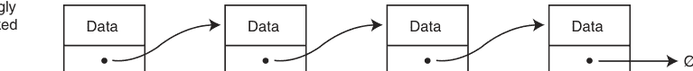

### 双向链表
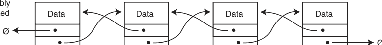

### 树
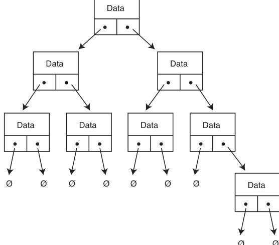

图 19.1 链表。

计算机科学家创建了更复杂、更巧妙的数据结构，其中大多数依赖于节点之间的互连。

## 链表案例研究

在本节中，我们将详细检查链表，将其作为如何使用继承、多态和封装来管理大型项目的案例研究。这也是探索如何在 C++ 中创建复杂结构的机会。

## 责任委托

面向对象编程的一个基本前提是：每个对象都很好地做好一件事，并将任何不属于其的任务委托给其他对象。

汽车是这一思想的演示。发动机的工作是产生动力。动力分配不是引擎的工作；那是变速箱的事。转向不是发动机或变速箱的工作；那是委托给轮子的。

一个设计良好的机器有很多许多小的、易于理解的部分，每个部分都执行自己的工作并共同完成一个更大的目标。一个设计良好的程序远不止于：每个类都坚持自己的任务，但它们共同创建了一个可以运行的程序。

### 组件部分

链表将由节点组成。节点类本身将是抽象的；我们将使用三种类型来完成工作。将有一个头和一个尾节点来管理列表的这些部分，以及零或多个内部节点。内部节点跟踪列表中要持有的实际数据。

注意，数据和列表是完全不同的。你可以在列表中保存任何类型的数据。连接在一起的不是数据而是持有数据的节点。

程序实际上并不知道节点；它只与列表交互。列表很少工作，仅仅是委托给节点。

本小时的第一个项目 `LinkedList` 程序演示了链表的面向对象方法。该程序有三个主要类：`Data`、`Node` 和 `LinkedList`。运行时，程序会要求用户输入一系列整数，并将每个整数存储在 `Data` 类实例中。这些对象存储在 `LinkedList` 对象中并按数字顺序显示，即使它们不是按顺序输入的。

`LinkedList` 使用了 `HeadNode` 类，它是抽象类 `Node` 的三种实现之一。另外两个是 `TailNode` 和 `InternalNode`。只有 `InternalNode` 持有数据。

完整的程序在列表 19.1 中。源代码有大量的注释，以解释每个部分是如何工作的。为了理解其工作原理，请从第 170 行 `main()` 函数开始阅读，以及如何构造构造函数和成员函数。注释应该让你对这些有一个良好的了解。

### 列表 19.1 LinkedList.cpp 全文

```cpp
#include <iostream>
enum { kIsSmaller, kLarger, kSame };

// 列表中的任何类
class Data {
public:
    Data(int val) : value(val) {}
    int compare(const Data& otherData) {
        if (value < otherData.value) return kIsSmaller;
        if (value > otherData.value) return kLarger;
        else return kSame;
    }
private:
    int value;
};

// 表示列表中节点的抽象数据类型 (ADT)
class Node {
public:
    Node() {}
    virtual ~Node() {}
    virtual Node* insert(Data* data) = 0;
    virtual void show() = 0;
};

// 前向声明
class HeadNode;
class TailNode;
class InternalNode;

// 持有 Data 对象的节点
class InternalNode : public Node {
public:
    InternalNode(Data* data, Node* nextNext);
    virtual ~InternalNode() { delete next; delete data; }
    virtual Node* insert(Data* data);
    virtual void show();
private:
    Data* data; // 数据本身
    Node* next; // 指向列表下一个节点
};

// 简单的构造函数
InternalNode(Data* newData, Node* nextNext) : data(newData), next(nextNext)
{}

// 在列表中存储新对象的函数
// 对象被传递给节点，由节点确定
// 它所在的位置并将其插入列表。
Node* InternalNode::insert(Data* otherData)
{
    // 新对象比我大还是比小？
    int result = data->compare(*otherData);

    switch(result)
    {
        // 如果它和我一样，它排在前面
        case kSame: // 穿透
        case kLarger: // 新数据在我前面
        {
            InternalNode* dataNode =
            new InternalNode(otherData, this);
            return dataNode;
        }
        // 它更大，将其传递给下一个
        // 节点并让它处理。
        case kIsSmaller:
            next = next->insert(otherData);
            return this;
    }
    return this; // appease the compiler
}

// 列表中的最后一个节点
class TailNode : public Node
{
public:
    TailNode() {}
    virtual ~TailNode() {}
    virtual Node* insert(Data* data);
    virtual void show() {}
private:
};

// 如果数据到来，它必须插入到我之前
// 因为尾节点之后没有任何节点
Node* TailNode::insert(Data* data)
{
    InternalNode* dataNode = new InternalNode(data, this);
    return dataNode;
}

// 头部节点，它不持有数据，而是指向
// 列表的开头
class HeadNode : public Node
{
public:
    HeadNode();
    virtual ~HeadNode() { delete next; }
    virtual Node* insert(Data* data);
    virtual void show() { next->show(); };
private:
    Node* next;
};

// 列表中的第一个节点，它创建尾部节点
HeadNode::HeadNode()
{
    next = new TailNode;
}

// 因为头部节点之前没有任何节点，只需将
// 数据传递给下一个节点
Node* HeadNode::insert(Data* data)
{
    next = next->insert(data);
    return this;
}

// 我获得了所有的荣誉，却没任何工作
class LinkedList
{
public:
    LinkedList();
    ~LinkedList() { delete head; }
    void insert(Data* data);
    void showAll() { head->show(); }
private:
    Node* head;
};

// 在创建时，我创建头部节点，它又创建了尾部节点
LinkedList::LinkedList()
{
    head = new HeadNode();
}

// 委托给头部节点
void LinkedList::insert(Data* pData)
{
    head->insert(pData);
}

// 对这些类进行测试
int main()
{
    Data* pData;
    int val;
    LinkedList ll;

    // 将用户输入的值存储在链表中
    while (true)
    {
        std::cout << "What value (0 to stop)?" ;
        std::cin >> val;
        if (!val)
            break;
        pData = new Data(val);
        ll.insert(pData);
    }

    // 显示链表
    ll.showAll();
    return 0;
}
```

当你运行 `LinkedList` 程序时，依次输入一系列数值。这些值将作为存储在每个链表节点中的数据。在你输入了任意数量的值后，选择 0 完成。链表中的节点将按数字升序显示，如例所示：

```
What value (0 to stop)? 7
value (0 to stop)? 4
value (0 to stop)? 13
value (0 to stop)? 8
value (0 to stop)? 5
value (0 to stop)? 0
4
5
7
8
13
```

首先需要注意的是枚举常量（第 3 行），它提供了三个常量值：`kIsSmaller`、`kLarger` 和 `kSame`。任何可能存在此链表中的对象都必须支持 `compare()` 成员函数。这些常量是该函数的返回结果。

`Data` 类定义在第 8-17 行，`compare()` 函数在第 21-29 行实现。`Data` 对象持有一个值，并可以与其他 `Data` 对象进行比较。它还支持一个 `show()` 成员函数来显示 `Data` 对象的值。

理解链表工作原理最简单的方法是跟踪一个使用示例。在第 170 行，声明了主程序；在第 172 行，声明了一个指向 `Data` 对象的指针；在第 174 行，定义了一个链表。

当链表创建时，会调用从第 158 行开始的构造函数。构造函数中唯一的工作是分配一个 `HeadNode` 对象并将该对象的地址赋值给链表持有的指针（第 160 行）。

这种分配调用了第 131 行所示的 `HeadNode` 构造函数。随后它分配了一个 `TailNode` 并将其地址赋值给头部节点的 `next` 指针。`TailNode` 的创建调用了第 102 行所示的 `TailNode` 构造函数，这是一个什么都不执行的内联函数。

因此，通过在栈上分配链表的简单操作，链表被创建了，头部和尾部节点被创建并建立了它们之间的关系，如图 19.2 所示。

### 链表案例研究 297

对两个值进行比较；由于值为 15 且 `otherData.value` 为 3，因此返回值为 `kLarger`。这导致程序流跳转到第 84–85 行。

为新的 `Data` 对象创建了一个新的 `InternalNode`。新节点指向当前的 `InternalNode` 对象，并将新 `InternalNode` 的地址从 `InternalNode::insert()` 函数返回给 HeadNode（头节点）。因此，新节点（其对象的值小于当前节点的值）被插入到列表中，现在链表的形式如图 19.4 所示。

#### 链表
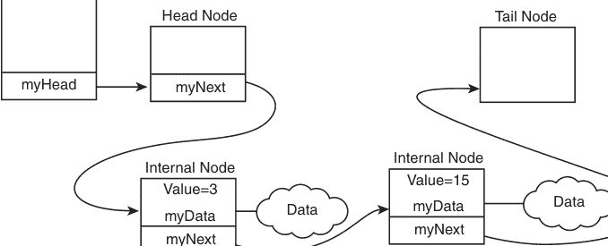

**图 19.4** 插入第二个节点后的链表。

在循环的第三次调用中，客户添加了值 8。这个值比 3 大但比 15 小，因此应该插入在两个现有节点之间。处理过程与上一个示例完全相同：当节点对象的值为 3 时，进行比较，而不是返回 `kIsSmaller`（意味着值为 3 的对象小于值为 8 的新对象）。

这导致 `InternalNode::insert()` 函数跳转到第 92 行。它没有创建新节点并插入，而是让 `InternalNode` 将新数据传递给其下一个指针所恰好指向的任何对象的 `Insert` 函数。在这种情况下，它在 `Data` 对象值为 15 的 `InternalNode` 上调用了 `InsertNode`。

再次进行比较，现在创建了一个新的 `InternalNode`。这个新的 `InternalNode` 指向 `Data` 对象值为 15 的 `InternalNode`，并将其地址如第 93 行所示传回给 `Data` 对象值为 3 的 `InternalNode`。

最终效果是新节点被插入到列表的正确位置。

所有这些操作的最终结果是你获得了一个有序的数据项列表——无论你输入数据的顺序如何。

## 作为对象的链表

在面向对象编程中，每个个体都被赋予了一组狭窄且定义良好的职责。链表负责维护头节点。HeadNode 立即将任何新数据传递给它当前指向的任何位置，而不考虑那里是什么。

TailNode 每当接收到数据时，都会创建一个新节点并插入。它只知道一件事：如果数据传到了我，它就会被插入到我之前。


内部节点稍微复杂一点；它们请求现有的对象与新对象进行比较。根据结果，它们要么插入新对象，要么直接将其传递下去。

注意，`InternalNode` 并不知道如何进行比较；这应该妥妥地留给对象本身。`InternalNode` 知道要求对象进行自我比较，并预期会有三种可能的情况之一。根据得到的答案，它就插入；否则，它就传递下去，而不知道也不在乎它最终落到何处。

那么是谁在负责呢？在一个设计良好的面向对象程序中，没有哪个类是全能。每个对象都做自己的工作，最终效果是一台运行良好的机器。

链表的优之处在于，你可以将任何想要的数据类型放入该类的 `Data` 中。在本例中，它包含一个整数节点。它也可以包含多种类型，甚至包含其他对象（包括链表）。

动态内存的使用允许链表在较小时使用极少内存，在增长时使用大量内存。重要的是在于，它们只使用足够容纳当前所含数据的内存。相比之下，数组被分配了特定大小，这既浪费又具有局限。

> **注意**
>
> 因为链表比数组更有用，你可能会奇怪为什么不一直使用它们。这种力量是有代价的。链表本质上是顺序的，这意味着你必须从一端开始，一直工作到另一端才能找到你需要的项。这种访问速度相对缓慢。

## 总结

由于 C++ 中要学习的内容非常多，书中承担的项目通常很简短且具有说明性。这使得更容易关注它们的功能。

当你开始自己的编程项目时，你会发现你创建的类永远绝非那么简单。

这一小时的链表案例研究包含五个类：`Data`、`HeadNode`、`TailNode`、`InternalNode` 和 `LinkedList`。真符合面向对象编程方法论，每个类都负责自己的工作，并依赖其他对象来完成它们的工作。

通过理解这些对象是如何协同工作的，你可以更好地掌握如何管理对象之间的关系。

## 问答

- **问**。如果数组可以使用，为什么还要创建链表呢？

- **答**。数组必须有固定的尺寸，而链表可以在运行时动态调整大小，从而更有效地利用内存。

- **问**。为什么要将数据对象与节点分离？

- **答**。这种编程实践促进了复用。当你让节点对象正常工作后，你就可以为任何想要存在于列表中的对象复用代码。

- **问**。如果想向列表添加其他对象，我必须创建一个新的列表类型和新的节点类型吗？

- **答**。目前是这样。但可以实现泛型列表，其中数据可以是任何类型。

- **问**。链表中的第一个节点称为什么？

- **A**. 起点 (Origin)

- **B**. 头 (Head)

- **C**. 顶部 (Top)

- **问**。链表节点包含哪些内容？

- **A**. 仅数据

- **B**. 函数和变量

- **C**. 数据和指针

- **问**。双向链需要几个指针？

- **A**. 2

- **B**. 1

- **C**. a 或 b

## 答案

1. **B**。如其名，它包含了链表的头。

2. **C**。数据可以是任何类型。指针指示下一个。

3. **A**。双向链中的每个节点有两个指针，一个指向下一个，一个指向上一个，以便你可以从任何端工作到另一端。

## 活动

1. 重写列表 19.1 中的 `LinkedList` 程序，使其持有 `Tricycle` 对象而不是整数。

2. 在 `LinkedList` 类（列表 19.1）中添加一个函数显示节点计数。

要查看这些活动的解答，请访问本书的网站 `http://cplus.caden.org`。

# 列表 20.1 StaticRobot.cpp 的完整文本

```cpp
1: #include <iostream>
2:
3: class Robot
4: {
5: public:
6:     Robot(int newAge) : age(newAge){ howManyRobots++; }
7:     virtual ~Robot() { howManyRobots--; }
8:     virtual int getAge() { return age; }
9:     virtual void setAge(int newAge) { age = newAge; }
10:    static int howManyRobots;
11: private:
12:     int age;
13: };
14:
15: int Robot::howManyRobots = 0;
16:
17: int main()
18: {
19:     const int maxRobots = 5;
20:     Robot *gestalt[maxRobots];
21:     int i;
22:     for (i = 0; i < maxRobots; i++)
23:         gestalt[i] = new Robot(i);
24:
25:     for (i = 0; i < maxRobots; i++)
26:     {
27:         std::cout << "There are ";
28:         std::cout << Robot::howManyRobots;
29:         std::cout << " robots left!\n";
30:         std::cout << "Deleting the one which ";
31:         std::cout << gestalt[i]->getAge() << " years old!\n";
32:         delete gestalt[i];
33:         gestalt[i] = 0;
34:     }
35:
36:     return 0;
37: }
```

运行程序以创建五个机器人然后删除这些对象：

剩余 5 个机器人！

正在删除 0 岁的那个机器人

剩余 4 个机器人！

正在删除 1 岁的那个机器人

剩余 3 个机器人！

正在删除 2 岁的那个机器人

剩余 2 个机器人！

正在删除 3 岁的那个机器人

剩余 1 个机器人！

正在删除 4 岁的那个机器人

在第 3–14 行，声明了简化的 `Robot` 类。在第 10 行，`howManyRobots` 被声明为 `int` 类型的静态成员变量。

`howManyRobots` 的声明并没有定义整数；没有分配存储空间。与非静态成员变量不同，实例化 `Robot` 对象时不会为静态成员变量分配存储空间，因为 `howManyRobots` 成员变量并不在对象中。因此，在第 16 行对该变量进行了定义和初始化。

忘记类的静态成员变量是一个常见的的错误。你没有在第 13 行 这样做，因为它是一个非静态成员变量，并且每当你创建一个 `Robot` 对象时它都会被定义一次，而这在代码中是在第 24 行完成的。

在第 18 行的 `Robot` 构造函数增加了第 6 行静态成员变量的值。析构函数在第 7 行将其减1。因此，在任何时刻，`howManyRobots` 都能准确记录已创建但尚未销毁的 `Robot` 对象数量。

从第 18 行开始的 `main` 函数实例化了五个 `Robot` 对象并将它们放入数组中。这调用了五次 `Robot` 构造函数；因此 `howManyRobots` 从 0 增加到 5。

程序遍历数组中的五个位置，并在删除当前 `Robot` 指针之前显示 `howManyRobots` 的值。输出反映了起始值为 5（毕竟构造了五个对象），并且每次循环执行执行时，剩余的 `Robot` 都会少一个。

请注意 `howManyRobots` 是公共的，并被 `main()` 直接访问。更好的做法将其与其他成员变量一起设为 `private`，并提供一个公共的访问器，前提是你始终通过 `Robot` 实例来访问数据。如果你想在不一定有可用 `Robot` 对象的情况下直接访问此数据，你有两个选择：保持其为 `public` 或者提供一个静态成员函数。

# 静态成员函数

静态成员函数类似于静态成员变量：它们并不存在于对象中，而是存在于类的作用域内。因此，可以在没有该类对象的情况下直接调用它们，如列表 20.2 所示。

# 列表 20.2 StaticFunction.cpp 的完整文本

```cpp
1: #include <iostream>
2:
3: class Robot
4: {
5: public:
6:     Robot(int newAge = 1):age(newAge){ howManyRobots++; }
7:     virtual ~Robot() { howManyRobots--; }
8:     virtual int getAge() { return age; }
9:     virtual void setAge(int newAge) { age = newAge; }
10:    static int getHowMany() { return howManyRobots; }
11: private:
12:     int age;
13:     static int howManyRobots;
14: };
15:
16: int Robot::howManyRobots = 0;
17:
18: void countRobots();
19:
20: int main()
21: {
22:     const int maxRobots = 5;
23:     Robot *gestalt[maxRobots];
24:     int i;
25:     for (i = 0; i < maxRobots; i++)
26:         gestalt[i] = new Robot(i);
27:
28:     for (i = 0; i < maxRobots; i++)
29:     {
30:         delete gestalt[i];
31:     }
32:     return 0;
33: }
34:
35: void countRobots()
36: {
37:     std::cout << "There are " << Robot::getHowMany()
38:             << " robots.\n";
38: }
```

`StaticFunction` 程序创建五个机器人并调用 `countRobots()` 来查看有多少机器人，输出显示：

- 5 个机器人。
- 4 个机器人。
- 3 个机器人。
- 2 个机器人。
- 1 个机器人。
- 4 个机器人。
- 3 个机器人。
- 2 个机器人。
- 1 个机器人。
- 0 个机器人。

静态变量 `howManyRobots` 在第 13 行被声明为 `private`。`getHowMany()` 在第 10 行被声明为 `public` 且为 `static`。因为它是静态的，所以不需要 `Robot` 对象即可调用它，这在 `main` 函数的第 37 行展示了这一点。

注意：静态成员函数没有 `this` 指针，因此它们不能声明为 `const`。此外，静态成员函数不能通过 `this` 指针访问非静态成员变量。

`String` 类在 20.3 中提供了类似的实现。

# 列表 20.3 String.hpp 的完整文本

```cpp
1: #include <iostream>
2: #include <string.h>
3:
4: class String
5: {
6:   public:
7:     // constructors
8:     String();
9:     String(const char*);
10:    String(const String&);
11:    ~String();
12:
13:    // overloaded operators (int)
14:    char& operator[](int offset) const;
15:    char* operator[](int offset) const;
16:    String operator+(const String&);
17:    void operator*=(const String&);
18:    String& operator=(const String&);
19:
20:    // general accessors
21:    int getLen() { return len; }
22:    const char* getString() const { return value; }
23:
24:    // static int constructorCount;
25:
26:  private:
27:    String(int); // private constructor
28:    char* value;
29:    int len;
30: };
31:
32: // default constructor creates string of 0 bytes
33: String::String()
34: {
35:     value = new char[1];
36:     value[0] = '\0';
37:     len = 0;
38:     std::cout << "\tDefault constructor\n";
39:     // constructorCount++;
40: }
41:
42: // private (helper) constructor, used only by
43: // class functions for creating a new string of
44: // required size. Null filled.
45: String::String(int len)
46: {
47:     value = new char[len + 1];
48:     int i;
49:     for (i = 0; i < len; i++)
50:         value[i] = '\0';
51:     len = len;
52:     // std::cout << "\tString(int) constructor\n";
53: } // constructorCount++;
54:
55:
56: String::String(const char* const cString)
57: {
58:     len = strlen(cString);
59:     value = new char[len + 1];
60:     int i;
61:     for (i = 0; i < len; i++)
62:         value[i] = cString[i];
63:     value[len] = '\0';
64:     // std::cout << "\tString(char*) constructor\n";
65: } // constructorCount++;
66: }
```

# 308 小时 20：使用特殊类、函数、指针

```cpp
96:  for (i = 0; i < len; i++)
97:      value[i] = rhs[i];
98:      value[len] = '\0';
99:      return *this;
100:     // std::cout << "\tStringoperator=\n"
101:  }
102:
103:     // 非常量偏移运算符，返回
104:     // 字符的引用，以便可以被
105:     // 修改；
106:     char& String::operator[](int offset)
107: {{
108:     if (offset > len)
109:         return value[len - 1];
110:     else
111:         return value[offset];
112: }
113:
114:     // 用于 const 对象的常量偏移运算符
115:     // （（参见拷贝构造函数！）
116: char String::operator[](int offset) const
117: {{
118:     if (offset > len)
119:         return value[len-1];
120:     else
121:         return value[offset];
122: }
123:
124:     // 通过添加当前字符串创建一个新字符串
125: string String::operator+(const String& rhs)
126: {{
127:     int totalLen = len + rhs.getLen();
128:     int i, j;
129:     String temp(totalLen);
130:    for (i = 0; i < len; i++)
131:         temp[i] = value[i];
132:     for (j = 0; j < rhs.getLen(); j++, i++)
133:         temp[i] = rhs[j];
134:     temp[totalLen] = '\0';
135:     return temp;
136: }
//139: // 修改当前字符串，无返回值
140: void String::operator+=(const String& rhs)
141: {{
142:     int rhsLen = rhs.getLen();
143:     int totalLen = len + rhsLen;
```


```cpp
144: int i, j;
145:     String temp(totalLen);
146:     for (i = 0; i < len; i++)
147:         temp[i] = value[i];
148:     for (j = 0; j < rhs.getLen(); j++)
149:         temp[i] = rhs[j];
150:     temp[totalLen] = '\0';
151:     *this = temp;
152: }
153: 
154: // int String::constructorCount = 0;
```

此列表中没有 `main()` 函数，因此它不能作为程序运行。

每当你需要 `String` 类时，都可以使用 `#include` 预处理器指令将其包含在代码中。例如，在列表 20.4 的 `Employee` 程序顶部，通过 `#include "string.hpp"` 将此 `String` 类添加到程序中。

请注意，列表 20.3 中的一些语句被注释掉了；它们将在本小时稍后的练习中使用。在第 23 行，声明了静态变量 `constructorCount`，并在第 154 行对其进行了初始化。该变量在每个 `String` 构造函数中都会递增。（虽然这些语句是注释，但它们显然不会执行。）

`Employee` 程序（列表 20.4）包含一个使用了 `String` 对象的 `Employee` 类。

# 列表 20.4 Employee.cpp 的全文

```cpp
1: #include "String.hpp"
2: 
3: class Employee
4: {
5:     public:
6:     Employee();
7:     Employee(const char*, const char*, const char*, long);
8:     Employee(Employee&);
9:     Employee(const Employee&);
10:    Employee& operator=(const Employee&);
11: 
12:    const String& getFirstName() const { return firstName; }
13:    const String& getLastName() const { return lastName; }
14:    const String& getAddress() const { return address; }
15:    long getSalary() const { return salary; }
16: 
17:    void setFirstName(const String& fName)
18:    { firstName = fName; }
19:    void setLastName(const String& lName)
20:     { lastName = lName; }
21:     void setAddress(const String& newAddress)
22:         address = newAddress; }
23:     void setSalary(long newSalary) { salary = newSalary; }
24:     private:
25:     String firstName;
26:     String lastName;
27:     String address;
28:     long salary;
29:     };
30: 
31:     Employee::Employee()
32:         firstName(""),
33:         lastName(""),
34:         address(""),
35:         salary(0)
36: }
37: 
38:     Employee::Employee(const char* firstName, const char* newName,
39:         const char* newAddress, long newSalary)
40:         firstName(firstName),
41:         lastName(newName),
42:         address(newAddress),
43:         salary(newSalary)
44: }
45: 
46:     Employee::Employee(const Employee& rhs)
47:         firstName(rhs.getFirstName()),
48:         lastName(rhs.getLastName()),
49:         address(rhs.getAddress()),
50:         salary(rhs.getSalary())
51: }
52: 
53:     Employee::~Employee() {}
54:     Employee& Employee::operator=(const Employee& rhs)
55:     {
56:         if (this == &rhs)
57:             return *this;
58:         firstName = rhs.getFirstName();
59:         lastName = rhs.getLastName();
60:         address = rhs.getAddress();
61:         salary = rhs.getSalary();
62:         return *this;
63:     }
64: }
65:     int main()
```

```cpp
66: {
67:   Employee snnett("Silver", "Burdett", "800 East St.", 20000);
68:   snett.setSalary(50000);
69:   String lastName(snett);
70:   snett.setLastName(lastName);
71:   snett.setFirstName("Snett");
72:   std::cout << "Name: ";
73:   std::cout << " " << snnett.getFirstName();
74:   std::cout << " " << snnett.getLastName();
75:   std::cout << "\nAddress: ";
76:   std::cout << " " << snnett.getAddress();
77:   std::cout << "\nSalary: ";
78:   std::cout << " " << snnett.getSalary() << "\n";
79:   return 0;
80: }
```

当 `Employee` 程序运行时，会显示以下输出：

Name: Silver Snett.

Address: 800 East St.

Salary: 50000

列表 20.4 显示了 `Employee` 类，它包含三个 `String` 对象：`firstName`、`lastName` 和 `address`。

在第 66 行，创建一个 `Employee` 对象并传入了四个值进行初始化。在第 67 行，调用了 `Employee` 函数 `setSalary()`，传入了 C++ 字符串常量 50000。

在第 69 行，使用 C++ 字符串常量创建了一个字符串。该字符串对象随后在第 70 行作为 `setLastName()` 的参数。

在第 71 行，使用另一个字符串常量调用了 `Employee` 函数 `setFirstName()`。`Employee` 没有一个接受字符字符串作为参数的 `firstName()` 函数；`setFirstName()` 需要一个常量字符串引用。

编译器解决了这个问题，因为它知道如何从常量字符串创建一个 `String` 对象。它之所以知道，是因为你在 20.3 的第 9 行告诉了它。

## 访问包含类的成员

`Employee` 对象对 `String` 的成员变量没有特殊访问权限。如果 `Employee` 对象 `snett` 尝试访问其 `firstName` 变量的成员 `len`，会导致编译错误。这种访问的缺失并没有负担。访问器函数为 `String` 类提供了一个接口。`Employee` 类不需要像担心存储信息的变量 `salary` 那样担心实现细节。

## 过滤对包含成员的访问

注意 `String` 类提供了 `operator+`。`Employee` 类的设计者通过声明所有 `String` 访问器（如 `getFirstName()`）返回常量引用，阻止了在 `Employee` 对象上调用 `operator+` 的访问。`operator+` 不能是一个 `const` 函数，因为它调用的对象是常量的，因此尝试编写以下代码会导致编译错误：

```cpp
String buffer = snnett.getFirstName() + snnett.getLastName();
```

`getFirstName()` 返回一个常量 `String`；你不能在常量对象上调用 `operator+`。

为了修复这个问题，请重载 `getFirstName()` 使其为非常量：

```cpp
const String& getFirstName() const { return firstName; }
String& getFirstName() { return firstName; }
```

注意，返回值不再是 `const`，且成员函数本身也不再是 `const`。仅更改返回值不足以重载函数；你必须更改函数本身的常量性。由于同时提供了 `const` 和非 `const` 版本，编译器会在尽可能的情况下调用 `const` 版本（例如当客户端调用 `getFirstName()` 时），并在需要时调用非 `const` 版本（例如当用 `operator+` 调用时）。

## 值拷贝与引用传递

当你按值传递 `Employee` 对象时，它们所有包含的字符串也会被复制，因此会调用构造函数。这是非常昂贵的；消耗内存和时间。

当你使用指针或引用按引用传递 `Employee` 对象时，所有这些都被节省了。这就是为什么 C++ 程序员努力从不按值传递大于几个字节的内容。

## 友元类和函数

有时你会一组一组创建类。这些配对的类可能需要访问对方的私有成员，但你可能不想将这些信息公开。

如果你想将你的成员数据或函数暴露给另一个类，必须将该类声明为友元。这扩展了你的类的接口以包含友元类。

这种友谊不能传递，也不会继承。它不具有交换性。将 Class1 赋值为 Class2 的友元并不会让 Class2 成为 Class1 的友元。（在我看来，这是 Class2 的一种鲁鲁的行为。）

## 友类与友函数

使用友类声明时应极其谨慎。如果两个类已经密不可分，且一个类必须频繁访问另一个类的数据，那么可能有充分理由使用这种声明。不过，使用公共访问器（public accessors）通常更为简单。这样做可以让你在修改一个类时无需重新编译另一个类。

有时，你可能不想将友元级别的访问权限授予整个类，而是仅授予该该类的一个或两个函数。你可以通过将另一个类的成员函数声明为友元来实现，而不是将整个类声明为友。事实上，你可以将任何函数声明为友元，无论它是否是另一个类的成员函数。

### 函数指针

正如数组名是数组数组第一个元素的常量指针一样，函数名也是指向该函数的常量指针。你可以声明一个指向函数的指针变量，并使用该指针调用该函数。这被证明是非常有用的；它允许你创建根据用户输入来决定调用哪个函数的程序。

函数指针唯一棘手的部分在于理解所指向对象的类型。指向整数变量的 int 指针，以及指向函数的指针必须指向具有适当返回类型和签名的函数。

考虑以下声明：

```
long (*funcPtr)(int);
```

变量 `funcPtr` 被声明为指向函数的指针，该函数接受一个整数参数并返回一个 long。`funcPtr` 周围的括号是必要的，因为 `int` 周围的括号优先级高于引用运算符 `(*)`。如果没有第一个括号，这将声明一个接收整数并返回 `long` 指针的函数。

检查这两个声明：

```
long* func(int);
long (*funcPtr)(int);
```

第一个 `func()` 是一个接收整数并返回 `long` 类型变量指针的函数。第二个 `funcPtr` 是指向接收整数并返回 `long` 类型变量函数的指针。

函数指针的声明始终包含返回类型以及指示参数类型（如果有的话）的括号。列表 20.5 中的 `FunctionPointer` 程序说明了函数指针的声明和使用。

## 列表 20.5 FunctionPointer.cpp 的完整文本

```cpp
1: #include <iostream>
2:
3: void square(int&, int&);
4: void cube(int&, int&);
5: void swap(int&, int&);
6: void getVals(int&, int&);
7: void printVals(int, int);
8:
9: int main()
10: {
11: void (*pFunc)(int&, int&);
12: bool fQuit = false;
13:
14: int valOne = 1, valTwo = 2;
15: int choice;
16: while (fQuit == false)
17: {
18: std::cout << "0 Quit (1) Change Values ";
19: << "2) Square (3) Cube (4) Swap: ";
20: std::cin >> choice;
21: switch (choice)
22: {
23: case 1:
24: pFunc = getVals;
25: break;
26:
27: case 2:
28: pFunc = square;
29: break;
30:
31: case 3:
32: pFunc = cube;
33: break;
34:
35: case 4:
36: pFunc = swap;
37: break;
38: default :
39:
40: fQuit = true;
41: break;
42: }
43:
44: if (fQuit)
45: break;
46:
47: printVals(valOne, valTwo);
48: pFunc(valOne, valTwo);
49: printVals(valOne, valTwo);
50: }
```

```cpp
47:   return 0;
48: }
49:
50: void printVals(int x, int y)
51: {
52:   std::cout << "x: " << x << " y: " << y << "\n";
53: }
54:
55: void square(int &rX, int &rY)
56: {
57:   rX *= rX;
58:   rY *= rY;
59: }
60:
61: void cube(int &rX, int &rY)
62: {
63:   int tmp;
64:
65:   tmp = rX;
66:   rX *= tmp;
67:   rX = rX * tmp;
68:
69:   tmp = rY;
70:   rY *= rY;
71:   rY = rY * tmp;
72: }
73:
74: void swap(int &rX, int &rY)
75: {
76:   int temp;
77:   temp = rX;
78:   rX = rY;
79:   rY = temp;
80: }
81: void getVals(int &rValOne, int &rValTwo)
82: {
83:   std::cout << "New value for valOne: ";
84:   std::cin >> rValOne;
85:
86:   std::cout << "New value for valTwo: ";
87:   std::cin >> rValTwo;
88: }
```

以下是 FunctionPointer 的输出：

(0) Quit (1) Change Values (2) Square (3) Cube (4) Swap: 1

x: 1 y: 2

New value for valOne: 1

New value for valTwo: 2

(0) Quit (1) Change Values (2) Square (3) Cube (4) Swap: 2

x: 4 y: 4

(0) Quit (1) Change Values (2) Square (3) Cube (4) Swap: 3

x: 16 y: 16

(0) Quit (1) Change Values (2) Square (3) Cube (4) Swap: 4

x: 256 y: 256

### 注意

如书开头所述，这些项目没有防止无效的用户输入。如果在 `ArrayFunction` 程序中选择了除了 1, 2, 3, 或 4 以外的值，它将尝试调用第 42 行上的未定义函数并报错失败。

## 将函数指针传递给其他函数


# 函数指针与成员函数指针

函数指针（同样地，函数指针数组）可以传递给其他函数，这些函数可能会执行某些操作并使用指针调用正确的函数。

例如，你可以通过将选定的函数指针传递给另一个函数（`main()`）来改进 `ArrayFunction` 程序，该函数将显示值、调用函数然后再次显示它们。`FunctionPasser` 程序（列表 20.7）展示了如何实现这一点。

## 列表 20.7 FunctionPasser.cpp 的文本

```cpp
1: #include <iostream>
2:
3: void square(int&,int&);
4: void cube(int&, int&);
5: void swap(int&, int&);
6: void getVals(int&,int&);
7: void printVals(void (*)(int&),int&,int&);
8:
9: int main()
10: {
11:     int valOne=1, valTwo=2;
12:     int choice;
13:     bool fQuit = false;
14:
15:     void (*pFunc)(int&, int&);
15:
17:     while (fQuit == false)
18:     {
19:         std::cout << " (0) Quit (1) Change Values "
20:             << " (2) Square (3) Cube (4) Swap: ";
21:         std::cin >> choice;
22:         switch (choice)
23:         {
24:             case 1:
25:                 pFunc = getVals;
26:                 break;
27:             case 2:
28:                 pFunc = square;
29:                 break;
30:             case 3:
31:                 pFunc = cube;
32:                 break;
33:             case 4:
34:                 pFunc = swap;
35:                 break;
36:             default:
37:                 fQuit = true;
38:                 break;
39:         }
40:         if (fQuit == true)
41:             break;
42:         printVals(pFunc, valOne, valTwo);
43:     }
44:
45:     return 0;
46: }
47:
48: void printVals(void (*pFunc)(int&,int&), int& x, int& y) 
49: {
50:     std::cout << "x: " << x << " y: " << y << "\n";
51:     pFunc(x, y);
52:     std::cout << "x: " << x << " y: " << y << "\n";
53: }
54:
55: void square(int &rX, int &rY)
56: {
57:     rX *= rX;
58:     rY *= rY;
59: }
60:
61: void cube(int &rX, int &rY)
62: {
63:     int tmp;
64:
65:     tmp = rX;
66:     rX *= rX;
67:     rX = rX * tmp;
68:
69:     tmp = rY;
70:     rY *= rY;
71:     rY = rY * tmp;
72: }
73:
74: void swap(int &rX, int &rY)
75: {
76:     int tmp;
77:     tmp = rX;
78:     rX = rY;
79:     rY = tmp;
80: }
81:
82: void getVals(int &rValOne, int &rValTwo)
83: {
84:     std::cout << "New value for valOne: ";
85:     std::cin >> rValOne;
86:     std::cout << "New value for valTwo: ";
87:     std::cin >> rValTwo;
88: }
```

这里是程序的示例运行结果：

```text
(0) Quit (1) Change Values (2) Square (3) Cube (4) Swap: 1
x: 1 y: 2
New value for valOne: 7
New value for valTwo: 9
x: 7 y: 9
(0) Quit (1) Change Values (2) Square (3) Cube (4) Swap: 3
x: 7 y: 9
x: 343 y: 729
(0) Quit (1) Change Values (2) Square (3) Cube (4) Swap: 2
x: 7 y: 9
x: 343 y: 729
(0) Quit (1) Change Values (2) Square (3) Cube (4) Swap: 4
x: 343 y: 729
```

在第 15 行，`pFunc` 被声明为一个返回 `void` 并接受两个引用的指针。在第 7 行，`printVals` 被声明为一个接受三个参数的函数。第一个参数是返回 `void` 但接受两个引用的函数指针，第二个和第三个 `printVals` 的参数是整数引用。提示用户要调用哪些函数，然后在第 42 行调用了 `printVals()`。

使用 `typedef` 这种写法有更具可读的方式。

## 使用 typedef 处理函数指针

`FunctionPasser` 程序中的 `void (*)(int&, int&)` 比较繁琐。你可以通过声明一个类型 `PPF` 为指向一个返回 `void` 并接受两个整数引用的函数指针来简化它：

```cpp
typedef void (*PPF)(int&, int&);
```

到目前为止，你创建的所有指针都是为了通用的、非类的函数。

## 类成员指针

要创建一个指向成员函数的指针，请使用与函数指针相同的语法，但要包含类名和作用域运算符（`::`）。因此，`pFunc` 指向类的一个成员函数，该函数接受两个整数并返回 `void`，`pFunc` 的声明如下：

```cpp
void (Mammal::*pFunc)(int&, int&) const = 0;
```

成员函数的使用方式与函数指针完全相同，只是它们需要一个类对象来调用。`MemberPointer` 程序展示了成员函数的使用。

## 列表 20.8 MemberPointer.cpp 的全文本

```cpp
1: #include <iostream>
2:
3: enum { FALSE, TRUE };
4:
5: class Mammal
6: {
7: public:
8:   virtual void speak() const = 0;
9:   virtual void move() const = 0;
10: protected:
11:   int age;
12: };
13:
14: class Dog : public Mammal
15: {
16: public:
17:   void speak() const override { std::cout << "Woof!\n"; }
18:   void move() const override { std::cout << "Walking to heel...\n"; }
19: };
20:
21: class Cat : public Mammal
22: {
23: public:
24:   void speak() const override { std::cout << "Meow!\n"; }
25:   void move() const override { std::cout << "Slinking...\n"; }
26: };
27:
28: class Horse : public Mammal
29: {
30: public:
31:   void speak() const override { std::cout << "Winnie!\n"; }
32:   void move() const override { std::cout << "Galloping...\n"; }
33: };
34:
35: int main ()
36: {
37:     void (Mammal::*pFunc)() const = 0;
38:     Mammal* ptr = 0;
39:     int animal;
40:     int method;
41:     bool fQuit = false;
42:
43:     while (fQuit == false)
44:     {
45:         std::cout << "(0) Quit (1) Dog (2) Cat (3) Horse: ";
46:         std::cin >> animal;
47:         switch (animal)
48:         {
49:             case 1:
50:                 ptr = new Dog;
51:                 break;
52:             case 2:
53:                 ptr = new Cat;
54:                 break;
55:             case 3:
56:                 ptr = new Horse;
57:                 break;
58:             default:
59:                 fQuit = true;
60:                 break;
61:         }
62:         if (fQuit)
63:             break;
64:
65:         std::cout << "(1) Speak (2) Move: ";
66:         std::cin >> method;
67:         switch (method)
68:         {
69:             case 1:
70:               pFunc = &Mammal::speak;
71:               break;
72:             default:
73:               pFunc = &Mammal::move;
74:               break;
75:         }
76: 
77:         (ptr->*pFunc)();
78:         delete ptr;
79:     }
80: 
81:     return 0;
82: }
```

### 注意

没有理由对 `pFunc` 调用 `delete`，因为它是一个指向代码的指针，而不是堆上的对象。事实上，尝试这样做会导致编译时错误。

# 成员函数指针数组

与函数指针一样，成员函数指针也可以存储在数组中。该数组可以使用各种成员函数的地址进行初始化，并通过数组中的偏移量调用这些函数。列表 20.9 展示了这种技术。

## 列表 20.9 MPFunction.cpp 的全文

```cpp
1: #include <iostream>
2:
3: class Dog
4: {
5: public:
6:     void speak() const { std::cout << "Woof!\n"; }
7:     void move() const { std::cout << "Walking to heel ...\n"; }
8:     void eat() const { std::cout << "Gobbling food ...\n"; }
9:     void growl() const { std::cout << "Grrrrrr\n"; }
10:     void whisper() const { std::cout << "Whining noises ...\n"; }
11:     void rollOver() const { std::cout << "Rolling over ...\n"; }
12:     void playDead() const
13:         { std::cout << "Is this the end of Little Caesar?\\n"; }
14: };
15:
16: typedef void (Dog::*PDF)() const;
17:
18: int main()
19: {
20:     const int maxFuncs = 7;
21:     PDF dogFunctions[maxFuncs] = {
22:         &Dog::speak,
23:         &Dog::move,
24:         &Dog::eat,
25:         &Dog::growl,
26:         &Dog::whisper,
27:         &Dog::rollOver,
28:         &Dog::playDead
29:     };
30:
31:     Dog* pDog = 0;
32:     int method;
33:     bool fQuit = false;
34:
35:     while (!fQuit)
36:     {
37:         std::cout << "(0) Quit (1) Speak (2) Move (3) Eat (4) Growl\n";
38:         std::cout << "(5) Whimper (6) Roll Over (7) Play Dead: ";
39:         std::cin >> method;
40:         if (method == 0)
41:         {
42:             fQuit = true;
43:             break;
44:         }
45:         else
46:         {
47:             pDog = new Dog;
48:             (pDog->*dogFunctions[method-1])();
49:             delete pDog;
50:         }
51:         std::cout << std::endl;
52:     }
53: 
54:     return 0;
55: }
```

该程序产生了以下输出：

```text
(0) Quit (1) Speak (2) Move (3) Eat (4) Growl
(5) Whimper (6) Roll Over (7) Play Dead: 3
Gobbling food ...
(0) Quit (1) Speak (2) Move (3) Eat (4) Growl
(5) Whimper (6) Roll Over (7) Play Dead: 5
Whining noises ...
(0) Quit (1) Speak (2) Move (3) Eat (4) Growl
(5) Whimper (6) Roll Over (7) Play Dead: 6
Rolling over ...
(0) Quit (1) Speak (2) Move (3) Eat (4) Growl
(5) Whimper (6) Roll Over (7) Play Dead: 1
Woof!
(0) Quit (1) Speak (2) Move (3) Eat (4) Growl
(5) Whimper (6) Roll Over (7) Play Dead: 0
```

在 3-14 行，创建了 `Dog` 类，它拥有具有相同返回类型和签名的七个成员函数。第 16 行通过 `typedef` 将 `PDF` 定义为指向无参数、无返回值且为 `const` 的 `Dog` 成员函数的指针。这就是 `Dog` 七个成员函数的签名。

在 21-29 行，声明了数组 `dogFunctions` 用于存储此类成员函数，并用这些函数的地址进行了初始化。

在 37-39 行，提示用户选择一个函数。除非用户输入 0 退出，否则会在堆上创建一个新的 `Dog` 对象，并在第 48 行通过数组调用正确的函数。

## 总结

本节涵盖了让你的函数更强大的几种方法。

静态成员变量作为存储关于整个类信息的方法。它们在同类对象交换信息的技巧中也很有用。

静态成员函数为适用于类但不需要特定对象即可运行的行为提供位置。

友元函数使得一个类能够将其私有成员变量和函数暴露给原本无法访问的类。虽然通常这些功能通过基类和派生类之间的继承来处理，但使用友元函数可以为继承体系之外的类提供特殊的访问权限。

## 问答

**既然可以使用全局数据，为什么要使用静态数据？**

- 静态数据的作用域是类。它只能通过类的对象进行访问——

# 在函数返回值中使用 auto

C++ 是一种类型安全的语言，它提供了一项重要保证，即所有数据在变量声明时将保持其声明时的形式。程序员的负担在于根据类型来使用每个变量。随着语言每个版本的更新，编译器确保了更强的类型安全性。

在 C++11 中，`auto` 关键字可以在变量声明中使用，以让编译器推断数据类型。这使得以下操作成为可能：

```cpp
auto length = 50;
auto width = 30;
auto height = 3;
auto area = length * width * height;
```

```cpp
std::cout << "Area: " << area << std::endl;
```


# 第 21 小时：使用 C++14 的新功能

这些变量都是整数，编译器是知晓的。`length`、`width` 和 `height` 变量是整数，因为它们在声明时被赋值为整数值。`area` 是整数，因为它是三个整数相乘的结果。

C++ 扩展了这种类型推断能力，使得可以将 `auto` 作为函数的返回值类型。

就像编译器处理变量声明一样，`auto` 关键字会导致函数的返回值由上下文来决定。此函数使用 `auto` 作为返回值类型：

```cpp
auto getSalaryMultiple(int years) {
    if (years < 10) {
        return 1.1;
    }
    return 1.25;
}
```

该函数接受员工工作年限作为参数，如果少于 10 年则返回 1.1 的系数，否则返回 1.25。这个系数将乘以员工当前的工资以计算新工资。

编译器确定该函数返回 `double` 类型的值，因为两个返回语句返回的都是该类型的字面量。

为了让 `auto` 能作为函数返回，该函数中的每个返回语句必须返回相同的类型。如果更改前面的代码，使得最后一条语句返回而不是 1.25，编译将失败并显示此错误信息：

```
error: inconsistent deduction for 'auto': 'double' and then 'int'
```

## 在函数返回值中使用 auto

本小时的第一个项目是列表 21.1 中的 AutoArea 程序，它通过长度、宽度和高度来确定三维矩形的面积。

### 列表 21.1 AutoArea.cpp 的完整文本

```cpp
1: #include <iostream>
2:
3: auto findArea(auto length, auto width, auto height) {
4:     return length * width * height;
5: }
6:
7: int main()
8: {
9:     auto length = 50.0;
10:    auto width = 30.0;
11:    auto height = 3.5;
12:
13:    auto area = findArea(length, width, height);
14:
15:    std::cout << "Area: " << area << std::endl;
16:    return 0;
17: }
```

与本小时所有的程序一样，AutoArea 必须使用命令行选项 `--std=c++14` 进行编译，因为它使用了 C++14 的新功能。

运行时，它会产生单行输出：

Area: 5250;

该程序定义了一个 `findArea()` 函数，在列表 21.1 的第 3 行将函数的返回值类型指定为 `auto`。它将 `auto` 作为函数所有三个参数的类型。

编译器在第 9-11 行确定了参数和返回值的实际类型。这些语句声明了变量 `length`、`width` 和 `height`，并用它们初始化为 `double` 浮点数。

这些字面量的类型被推断为 `double`。因此，当 `findArea()` 函数在第 4 行乘以 `double` 并返回该值时，该值也被确定为 `double`。

AutoArea 程序处理 `double` 值，而无需显式定义任何使用 `double` 关键字的变量。这使得程序能够以一种有趣且独特的方式进行修改。

回到编辑器并更改第 9–11 行的值，使得语句变为如下：

```cpp
auto length = 50;
auto width = 30;
auto height = 3;
```

所有三个字面量现在都是整数，使得编译器推断的数据类型为 `int` 而不是 `double`。

程序将成功编译并运行：

Area: 4500;

由于类型推断，整个程序的行为发生了变化，使用了整数值进行乘法运算。这是编译器为你完成的。

在一个简单的演示中，`auto` 的灵活性似乎并不多。在大型 C++ 程序中，更改数据类型可能会级联到其他变量和返回类型，需要对每项进行修改。

> **注意**
>
> `auto` 关键字可以在函数的前向声明中使用，但有一个陷阱：否则，编译器将报错。

## 改进的字面量

C++14 引入的两个微小变化在重要性上可能不大，但非常有用。整数字面量现在可以表示为二进制值，并包含数字分隔符。

为了表示二进制整数，在前面加上 "0b" 或 "0B"，如在本语句中：

`int role = 0b01111111;`

这给 `role` 赋值为 255（一个字节）。

这是另一个将 `role` 设置为小数 15 的例子：

```cpp
int role = 0b00001111;
```

二进制字面量也可以在表达式中使用，如下所示：

```cpp
int role = 0b00001111 - 0b00001101;
```

表达式的结果是小数 2（二进制字面量 `0b0000010`）。

数字分隔符是放置在大数字中的字符，以提高其可读性。最常见的用法之一是货币，其中 10000000 比 10,000,000 更难一眼。

在 C++14 中，你可以使用单引号 (`'`) 作为数字分隔符：

```cpp
long money = 10'000'000;
```

### constexpr 关键字

常量表达式函数是指其值可以由编译器的函数，使得该常量值可以替换函数。

函数前面必须有 `constexpr` 并且满足三个标准：

- 函数必须返回一个值（非 `void`）
- 函数的体必须是单条返回语句
- 表达式在替换后必须求值为常量

常量表达式在定义之前不能被调用。

这是一个有效的常量表达式代码片段：

```cpp
constexpr double expand(int original)
{
  return original * 1.5;
}
```

### 列表 21.2 ArrayMaxer.cpp 的完整文本

```cpp
1: #include <iostream>
2:
3: constexpr int getArraySize()
4: {
5:     return 1024;
6: }
7:
8: int main()
9: {
10:
11:     int bolts[getArraySize()];
12:     int boltSize = sizeof(bolts) / sizeof(bolts[0]);
13:
14:     for (int i = 0; i < boltSize; i++)
15:     {
16:         bolts[i] = i * boltSize;
17:     }
18:
19:     std::cout << "Value of bolts[10]: " << bolts[10] << std::endl;
20:
21:     return 0;
22: }
```

使用 `-std=c++14` 选项编译程序并运行，将产生以下输出：

Value of bolts[10]: 10240

常量表达式函数定义在列表 21.2 的第 3-6 行。`constexpr` 关键字位于函数的返回类型、名称和参数之前。

该函数符合常量表达式函数的标准：它返回一个值（整数），由单个返回语句组成，并在执行时评估为常量。此外，该函数在第 11 行调用之前已经定义。

该程序遍历 `bolts` 数组的所有元素，并为每个元素赋值。14–17 行的 `for` 循环利用 `boltSize` 变量来判断何时到达数组末尾。

该变量在第 12 行声明，并使用了 C++ 内置的 `sizeof()` 函数，这种用法你可能以前没有遇到过。正如你在第三小时“创建变量和常量”中所回忆的，`sizeof()` 返回变量数据类型占用的字节数。它可以用于 `int` 或 `long` 等简单数据类型，也可以用于整个数组。

遍历数组中的每个元素需要某种方法知道何时到达数组结尾。对数组调用 `sizeof()` 会返回该数组包含的总字节数。通过将总数除以单个数组元素的 `sizeof()`，结果就是元素的个数。

`constexpr` 的引入是一种编译器优化，它取代了许多笨重且复杂得方法。

### Lambda 表达式

近年来 C++ 请求添加最频繁的功能是 Lambda 表达式，它允许创建内联匿名函数。语法起初看起来可能有些困惑，但当你掌握了它们之后，你会发现它们提供了强大的功能，可以让你的源代码更容易理解。

Lambda 表达式类似于一条语句，可以用单行代码定义。该表达式存储在变量中，并像函数一样被调用。

这是一个示例：

```cpp
auto aarhus = []() { std::cout << "Solid petit in profundis!" << std::endl; }
aarhus();
```

这段代码产生以下输出：

```
Solid petit in profundis!
```

匿名函数执行 `(` 和 `)` 括号之间的代码。注意 `}` 括号之后的行末尾有一个分号。

该函数存储在变量 `aarhus` 中，并使用与调用函数相同的语法运行。

Lambda 表达式可以有一个或多个参数，这些参数在 `[]` 方括号后的圆括号内指定。

此示例有两个参数：

```cpp
auto multiply = [](int x, int y) { std::cout << "Total: " << x * y << std::endl; }
multiply(7, 17);
```

输出如下：

```
Total: 117
```

当 Lambda 表达式没有参数时，表达式可以省略圆括号。第一个示例没有参数，所以这里是该表达式的另一个版本：

```cpp
auto aarhus = []() { std::cout << "Solid petit in profundis!" << std::endl; };
```

- Q. 使用 `auto` 关键字有任何风险吗？

  A. 最大的风险之一是你误解了语句所赋值的数据类型。C++ 中的一个常见错误是假设字面量 `3.5` 是 `float` 字面量。它实际上是一个 `double`。因此，如果你使用像这样的值创建了 `auto` 类型的变量，且没有意识到它是 `double`，你可能会对在程序中使用该变量的方式做出错误的假设。

- Q. C++11 和 C++14 的发布间隔仅为三年，下一个 C++ 版本预计什么时候发布？

  A. 目前的计划是在 2017 年作为 C++17 发布下一个版本，保持三年发布一次的节奏，这比该语言以前的改进速度要快得多。

  在本文写作时，该版本尚未宣布为“功能完成”，因此目前还不清楚该时间表是否会确定。

  开发期间采用了 `C++12` 作为工作名称，用以指示如果出现意外的延迟或实现障碍，它可能会推迟到 2018 年或 2019 年。

  有关该版本的当前状态，请访问 C++ 标准化网站：https://isocpp.org/std/

- Q. 谁发明了字谜游戏？

  A. 字谜游戏是由 Arthur Wynn 发明的。

## 模拟警报系统

**simulation** 是对真实世界系统的计算机模型。构建模拟有很多原因，但一个良好的设计必须始于理解你希望模拟回答哪些问题。

作为一个起点，请考虑一下这个问题：你被要求模拟这栋房屋的警报系统。这栋房子有四间卧室、一个装修好的地下室和一个位于房屋下的车库。

楼下有以下窗户：厨房三个，餐厅四个，半间卫浴一个，客厅和家庭室各有两个，此外还有两个通往邻居的小窗户。所有四间卧室都在楼上；每间卧室都有窗户，主卧室除外，主卧室有四扇。有两个浴室，每个各有一个窗户。最后，地下室有四个半窗，车库有一个。

进入房屋的正常方式是通过前门。此外，厨房有一个推拉玻璃门，车库有两个汽车出入门和一个方便通往地下室的门。后院还有一个储藏室门。

所有的窗户和门都安装了报警器，每个电话上都有一个恐慌按钮，主卧室旁边也有。区域也有报警器，尽管这些报警器经过了仔细校准，不会被小动物或鸟类触发。

地下室的中央报警系统在报警触发时会发出警告啾啾声。如果报警在规定时间内未被解除，就会报警警察。如果按下恐慌按钮，会立即报警警察。

报警系统连接到火灾和烟雾探测器以及喷淋系统。报警系统本身具有容错性，有自己的内部备用电源，并封装在防火箱中。

### 概念化

在**概念化阶段**，你试图理解客户希望从程序中获得什么：这个程序是做什么的？这个模拟可能会回答哪些问题？例如，你可能可以使用模拟来回答这些问题：传感器在被任何人察觉之前可能会损坏多久？是否有方法可以在不通知警察的情况下绕过窗户报警器？

概念化阶段是思考程序内部和外部内容的良好时机。模拟中代表了警察吗？实际房屋报警器的控制权是在系统本身内部中吗？

### 分析与需求

概念化阶段让位于分析阶段。在分析期间，你作为面向对象编程分析师的工作是帮助客户理解她对程序的需求。程序具体将表现出什么样的行为？客户可以期待什么样的类型的交互？

这些需求通常被记录在系列文档中，其中可能包括用例。*use case* 是对系统如何被使用的描述。它描述了交互和使用模式，帮助编程人员捕获系统的设计目标。

> **注意**
>
> 统一建模语言（UML）是表示你的需求和分析的一种方法。使用 UML 的优势有两点：它是图形化的，并且遵循标准形式，因此许多人都能理解它。虽然教授 UML 超出了本书的范围（关于这个主题有很多很好的书），但你应该知道它包含了表示用例的方法。它特别适用于面向对象的开发，因为它直接支持抽象类和其他类型的类。
>
> 学习 UML 的一本好书是 Joseph Schmuller 编写的 *Sams Teach Yourself UML in 24 Hours, Third Edition*（ISBN: 0-672-32640-X）。

### 高级设计与低级设计（详细设计）

在完全理解产品并将需求记录在适当的文档之后，是时候进入分级设计了。在这个阶段，设计者不需要担心平台、操作系统或编程语言问题。相反，关注的是系统如何运作的结构：主要组件有哪些？它们是如何相互作用的？

处理这种问题的一种方法是撇开与用户界面相关的问题，只关注问题空间的组件。

*problem space*（问题空间）是你的系统试图解决的问题和问题的集合。*solution space*（解决方案空间）是问题的可能解决方案集合。

随着你的高级设计的演进，你将开始思考你识别的对象的责任——它们做什么以及持有什么信息。你还想思考它们的协作——它们与哪些对象交互。

例如，显然你有各种类型的传感器、一个中央报警系统、按钮、电线和电话。进一步的思考说你还必须模拟房间、也许是楼层，可能包括所有者和警察这样的人群。

传感器可以分为运动探测器、触发线、声音探测器、烟雾探测器等等。这些都是传感器的类型，尽管并没有所谓的传感器本身。将传感器视为一个抽象数据类型（ADT）是一个好主意。

作为一个 ADT，Sensor 类将为所有类型的传感器提供完整的接口，每个派生类型将提供实现。各种传感器的客户端在使用它们时，无需考虑它们是哪种类型的传感器，每个都会根据其真实类型“做正确的事”。

要创建一个良好的 ADT，你需要完全理解传感器在做什么，而不是它们是如何工作的。它们会激活吗？它们是等待某些元素升热、线断裂或石子融化，还是它们在探测其环境？也许某些传感器只有二进制状态（已触发或未触发），但其他传感器具有更模拟的状态（当前温度是多少？）。指向抽象数据类型的接口应该足够完整，以处理所有预期的类的需求。

### 其他对象

设计将这样继续，梳理出满足规范所需的其他类。例如，如果需要记录日志，可能需要一个日志对象。如果需要报警，可能需要一个计时器，或者触发报警器。

### 设计类

当你解决这些问题时，将开始设计你的类。例如，HeatSensor 将继承自 Sensor。如果传感器需要定期报告，它可能有一个计时器。

HeatSensor 可能会有成员函数，如 `currentTemp()` 和 `setLimit()`，并且从 Sensor 继承 `soundAlarm()`。面向对象设计中一个常见的问题是封装。你可以想象一种设计，报警系统询问传感器当前温度，将其与最大温度进行比较，如果太热则报警。人可以认为这违反了封装原则。无论你是否同意这一点，这都是你在分析期间想要关注的决策。

良好的封装标志是每个类具有一致的责任，且没有其他类具有相同的责任。Sensor 类负责记录温度，其他类不应具有该责任。

另一方面，其他类可能有助于提供必要的功能。例如，尽管记录日志温度可能是 Sensor 类的责任，但它可能通过委托 Log 对象来实现该责任。责任的严格划分使得你的程序更容易扩展和维护。当你决定为了增强模块更改报警系统时，它与日志和传感器的接口将是狭窄且定义的。报警系统的改变不应影响 Sensor 类，反亦然。

HeatSensor 是否应该 `reportAlarm()` 函数？所有传感器都需要报告报警的能力。这是一个很好的信号，表明 `reportAlarm()` 应该是 Sensor 的虚成员函数，并且可能是一个抽象基类。HeatSensor 可能会调用 Sensor 更通用的 `reportAlarm()` 成员函数；重写的函数将填充它专门提供的细节。

> **注意**
>
> 关于面向对象概念的更多信息，请考虑 Addison-Wesley 的书籍 *The Object-Oriented Thought Process, Fourth Edition*（ISBN: 0-321-86127-2），Matt Weisfeld 著。

### 添加更多类

当你的传感器报警状况时，它们希望向报警警察的对象和日志提供大量信息。你可能想要创建一个 Condition 类，其构造函数接收若干测量值。取决于测量值的复杂程度，这些值也可能是对象，或者它们是简单的整数标量值。

Condition 对象可能会传递给中央报警对象，或者 Condition 对象被子类化为 Alarm 对象，这些对象本身知道如何创建应急行动。也许没有中央对象；相反，可能会知道创建 Condition 对象的传感器。某些 Condition 对象知道如何记录自己；其他可能知道如何联系警察。


一个设计良好的事件驱动系统并不一定需要中心协调器。你可以想象所有的传感器都独立地相互接收和发送消息对象、设置参数、读取读数并监控整个房屋。当检测到故障时，会创建一个 `Alarm` 对象，它会记录问题（例如向 `Log` 对象发送消息）并采取适当的行动。

## 事件循环

为了模拟这样一个事件驱动系统，你的程序需要创建一个事件循环。事件循环通常是一个无限循环，例如 `while(true)`，它从操作系统中获取消息（如鼠标点击、键盘按键等）并一次一次进行分发，然后返回循环，直到某个事件条件满足。列表 22.1 中的 `SimpleEvent` 程序展示了这一点。

### 列表 22.1 SimpleEvent.cpp 的全文

```cpp
1: #include <iostream>
2:
3: class Condition
4: {
5: public:
6:     Condition() {}
7:     virtual ~Condition() {}
8:     virtual void log() = 0;
9: };
10:
11: class Normal : public Condition
12: {
13: public:
14:     Normal() { log(); }
15:     virtual ~Normal() {}
16:     virtual void log()
17:         std::cout << "Logging normal conditions...\n";
18: };
19:
20: class Error : public Condition
21: {
22: public:
23:     Error() { log(); }
24:     virtual ~Error() {}
25:     virtual void log() { std::cout << "Logging error!\n"; }
26: };
27:
28: class Alarm : public Condition
29: {
30: public:
31:   Alarm();
32:   virtual ~Alarm() {}
33:   virtual void warn() { std::cout << "Warning!\n"; };
34:   virtual void log() { std::cout << "General alarm log\n"; };
35:   virtual void call() = 0;
36: };
37: 
38: Alarm::Alarm()
39: {
40:   log();
41:   warn();
42: }
43: 
44: class FireAlarm : public Alarm
45: {
46:   public:
47:     FireAlarm() { log(); };
48:     virtual ~FireAlarm() {}
49:     virtual void call() { std::cout<<"Calling fire department!\n"; }
50:     virtual void log() { std::cout << "Logging fire call\n"; };
51: };
52: 
53: int main()
54: {
55:   int input;
56:   int okay = 1;
57:   Condition *pCondition;
58:   while (okay)
59:   {
60:     std::cout << " (0) Quit (1) Normal (2) Fire: ";
61:     std::cin >> input;
62:     okay = input;
63:     switch (input)
64:     {
65:       case 0:
66:         break;
67:       case 1:
68:         pCondition = new Normal;
69:         delete pCondition;
70:         break;
71:       case 2:
72:         pCondition = new FireAlarm;
73:         delete pCondition;
74:         break;
75:       default:
76:         pCondition = new Error;
77:         delete pCondition;
78:         okay = 0;
79:         break;
80:     }
81: 
82:   return 0;
83: }
```

`SimpleEvent` 程序接受三个选项之一作为输入。以下是程序的一次运行示例：

(0) Quit (1) Normal (2) Fire: 1

Logging normal conditions ...

(0) Quit (1) Normal (2) Fire: 2

General alarm log

Warning!

Logging fire call

(0) Quit (1) Normal (2) Fire: 0

第 58-81 行的简单循环使用用户输入来模拟传感器的正常报告和火灾报告。请注意，这样做的效果是产生一个 `Condition` 对象，其构造函数会调用各种成员函数。

如果你不注意对象的构造过程，在构造函数中调用虚成员函数可能会导致困惑的结果。例如，当第 72 行创建 `FireAlarm` 对象时，构造顺序是 `Condition`、`Alarm`、`FireAlarm`。

`Alarm` 构造函数调用了 `Log`，但实际上调用的是 `FireAlarm` 的 `Log()` 构造函数，尽管 `Log()` 被声明为 `virtual`（虚函数）。

这是因为在 `Alarm` 构造函数运行时，还没有 `FireAlarm` 对象。稍后当 `FireAlarm` 构造时，它的构造函数再次调用了 `Log()`，而这次调用的是 `FireAlarm::Log()`。

## PostMaster：案例研究

这里有另一个可以练习你的面向对象分析技能的问题：你被 `Defective Software` 公司聘用启动一个新软件项目，并带领一个 C++ 程序员团队来实现你的程序。新产品开发副总裁 Sam Snett 是你的新老板。他希望你设计并构建 `PostMaster`，这是一个从各种提供商处读取电子邮件的工具。潜在客户是一个使用多个电子邮件账户的商人士（例如 Gmail、Yahoo Mail 和 Microsoft Outlook）。

用户能够配置 `PostMaster` 连接到每个电子邮件提供商。`PostMaster` 将获取邮件并以统一的方式呈现，使用户能够对邮件进行组织、回复、转发等操作。

`PostMaster` 专业版（作为 `PostMaster` 的第二个版本）已在计划中。它将增加一个助手模式，允许用户指定另一个人来读取所有邮件、处理日常通信等。营销部门推测，一个人工智能组件可能会为 `PostMaster` 添加根据主题、内容关键词和关联对邮件进行预排序和排序的功能。

其他增强功能已经讨论过，包括处理不仅邮件还有讨论组（如互联网公告板和邮件列表）。显然，`Defective` 公司对 `PostMaster` 寄厚望，而你面临着紧迫的时间压力将其上市，尽管你似乎没有预算。

你确认了你的早早决定：将以原始格式读取每封邮件消息，并将其转换为 PostMaster 格式。这样，你只需要存储一种核心格式，并简化与磁盘的读写操作。你还决定将标头信息（发送者、接收者、日期、标题等）与消息正文分离开。用户通常会想要扫描标头，而不一定需要阅读所有消息的内容。你预见将来会有某时刻，你想从邮件提供者处下载所有标头而不获取文本，但目前你打算让该版本的 PostMaster 始终获取完整消息，尽管它可能不会向用户显示。

### 初始类设计

对消息的分析引导你设计了 `Message` 类。为了考虑到以后将程序扩展到非邮件消息，你从抽象基类派生了 `EmailMessage`。从 `EmailMessage` 又派生了 `PostMasterMessage`、`InterchangeMessage`、`OutlookMessage`、`GmailMessage` 等。

在处理邮件消息的程序中，消息是对象的自然选择，但在复杂的系统中找到所有合适的对象是面向对象编程最大的挑战。在某些情况下（如消息），主要对象似乎是从你对问题的理解中自然而出的。更多时候，你必须仔细思考你试图实现的目标，才能找到正确的对象。

不要绝望。大多数设计都不是第一次。一个好的起点是大声描述这个问题。列出你在描述项目时用到的所有名词和动词。名词是对象的极佳候选者。动词可能是这些对象的函数（或者它们本身也是对象）。这并不是一种万无一失的技术，但在开始设计时，这是一个很好的技巧。

现在问题随之出现：“消息标头应该是一个与正文分开的独立类吗？”如果是的话，你是否需要并行的层级结构——即 `ForumBody` 和 `ForumHeader`，以及 `EmailBody` 和 `EmailMessage`？

并行的层级结构通常是设计不良的警告。在面向对象设计中，一个常见的错误是在一个层级中有一组对象，而在另一个层级中有一组匹配的管理对象。保持这些层级结构更新并相互同步的负担将变得不可收拾：成为一场类维护的噩梦。

当然，设计类层级结构没有硬性规定，有时并行的层级结构是解决特定问题最有效的方法。尽管如此，如果你看到自己的设计朝着这个方向发展，你应该重新思考这个问题，因为可能有更优雅的解决方案。

## 第22 小时：运用面向对象的分析与设计

当消息从邮件提供者到达时，它们并不一定会被分成标头和正文；许多消息将是一个巨大的数据流，你的程序必须对其进行理。也许你的层级结构将直接反映这一想法。

对眼下任务的进一步思考引导你关注这些消息的属性，旨在并在合适的抽象层级引入功能和数据存储。列出对象的属性是寻找成员的好方法，也可以理出你可能需要的其他对象。

邮件消息需要被存储，用户的偏好、电话号码等也是如此。存储功能显然需要位于层级结构中的高层。邮件消息是否必须与偏好共享一个基类呢？

### 有根层级结构与非根层级结构

继承层级结构有两种总体方法：你可以让你所有的（或几乎所有的）类都派自一个共同的根类，也可以拥有多个继承层级结构。共同根类的优势是你可以通常可以避免多重继承；缺点是很多时候实现会向上移动到基类中。

如果所有类都共享一个共同祖先，则该类集合是有根的。非根层级结构并非都共享一个共同基类。

由于你知道你的产品将在许多平台上开发，而且由于多重继承很复杂，且并非所有平台上的所有编译器都能良好支持，你的第一个决定是使用有根层级结构和单继承。你决定识别那些未来可能使用多重继承的地方。然后你可以进行设计，使得以后拆分层级结构并添加多重继承对你的设计来说不是灾难性的。

你决定在所有内部类的名称前缀加上字母 `p`，这样你可以轻松快速地判断哪些类是你的，哪些是来自其他库的。

你的根类将是 `pObject`。你创建的几乎每个类都会派自这个对象。`pObject` 本身将保持相当简单；只有每个项目共享的数据才会出现在这个类中。

如果你想要有根的层级结构，你应该给根类一个通用的名称（如 `pObject`）和少的功能。根对象的作用是可以创建其所有后代类的集合，并将它们引用为 `pObject` 的实例。权衡是，有根层级结构通常会将接口推向根类。

下一个可能的层级顶端状态候选者是 `pStored` 和 `pWired`。`pStored` 对象在不同时间保存（例如，当程序未使用时），而 `pWired` 对象通过网络发送。由于你几乎所有的对象都需要存储到文件中，因此将此功能推到层级结构的高层是有意义的。所有通过网络的对象都必须是连接的（wired），但并非所有存储的对象都必须通过网络发送，因此从 `pStored` 派生 `Wired` 是合理的。

每个派生类都获得其基类的所有知识（数据）和功能（成员函数），并且每个类至少有一个离散的额外功能。因此，`wired` 可能会添加各种函数，但所有这些函数都是为了通过调制解调器传输数据。可能所有 `wired` 对象都被存储了，或者所有 `stored` 对象都是连接的，或者这两个说法都不成立。如果只有部分 `wired` 对象被存储，且只有部分 `stored` 对象是连接的，你被迫使用多重继承或绕过这个问题进行设计。针对这种情况的一种潜在“黑客”方法是从 `Stored` 派生 `Wired`，然后让那些通过网络发送但从不存储的对象的存储函数什么都不做或返回错误。

事实上，你意识到某些存储对象显然不是连接的（例如，用户偏好）。然而，所有的连接对象都是被存储的，因此你到目前为止的继承层级结构如图 22.1 所示。

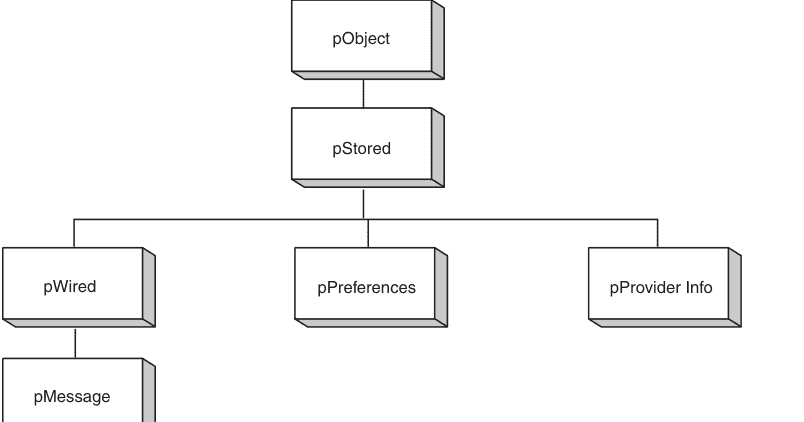

**图 22.1** 初始继承层级结构。

### 注意事项

在程序的设计阶段你将面临的一个问题是哪些例程可以购买，哪些由你自己编写。你完全可以利用现有的商业库来解决部分或全部通信问题。许可费和其他非技术考虑也必须得到解决。购买此类第三方库是有益的，可以将精力集中在你的程序上，而不是在次要问题上重复造轮子。你可能想要购买那些并非专为使用而设计的库，如果它们能提供基本功能。这对于帮助你按时完成可能至关重要。

### 设计接口

在产品设计的阶段，避免关注实现是非常重要的。你希望将所有精力集中在设计类之间设计整洁的接口上，界定每个类将需要数据和成员函数。在尝试设计派生类之前，对基类有深入理解是一个好主意，因此你决定先关注 `pObject`、`pStored` 和 `pWired`。

根类 `pObject` 将仅拥有系统中所有内容共同的数据和函数。也许每个对象都应该有一个唯一的标识符。你可以创建 `pID`（PostMaster ID）并使其成为 `pObject` 的成员；但首先你必须问自己：“任何不被存储也不连接的对象是否需要一个编号？”这引出了这个问题：是否存在不被存储的对象？

如果没有这类对象，你可能想要考虑将 `pObject` 和 `pStored` 合并为一个类；因为万一所有对象都被存储了，那么区分的意义何在？经过思考，你意识到可能存在某些对象（例如地址），派自 `pObject` 是有益的，但它们永远不会被单独存储；如果它们被存储，将是其他对象的一部分。

这告诉你，目前来说，有一个独立的类将是有用的。你可以想象将有一个地址簿，它是一个 `pAddress` 对象的集合，尽管没有 `pAddress` 永远不会被单独存储，但给每一个分配一个唯一的标识符将是有用的。你暂时将 `pID` 分配给 `pObject`；这意味着 `pObject` 至少看起来如下：

```cpp
class pObject{
public:
    pObject();
    ~pObject();
    pID GetID() const;
    void SetID();
private:
  pID itsID;
}
```

或许 `pID` 内部会使用一个 `unsigned long` 来表示 PostMaster。这仍然比在 `pObject` 类中将 ID 设为 `unsigned long` 更好的方法。如果你发现你没有使用 `unsigned long`，或者 `unsigned long` 的长度不够大，你可以修改 `pID`。这种修改将影响所有使用 `pID` 的地方，而你不需要追踪并编辑每一个包含 `pID` 的文件。

目前，你使用 `typedef` 将 `pID` 声明为 `ULONG`，而你又反过来将其声明为 `unsigned long`。这引出了一个问题：这些声明放在哪里？

在编写大型项目时，需要对文件进行整体设计。一种标准的方法（也是你在本项目中遵循的方法）是：每个类都出现在自己的头文件中，而类成员函数的实现在相关的 .cpp 文件中。在那里，你将有一个名为 `Object.hpp` 的文件和另一个名为 `Object.cpp` 的文件。你预计会有其他文件，如 `Message.hpp` 和 `Message.cpp`，分别带有 `pMessage` 的声明和其函数的实现。

### 构建原型

对于像 PostMaster 这样的大型项目，你的初始设计不太可能是完整且完美的。人们很容易被问题的巨大规模所压倒，试图在写第一行代码之前创建所有的类并完成它们的接口，这将是灾难的根源。

有许多充分理由尝试在原型上测试你的设计——一个你核心想法的快速且粗略的运行示例。有许多类型的原型，每种满足不同的需求。

**接口设计原型**提供了与潜在用户测试产品外观和感受的机会。

**功能原型**不具有最终的用户界面，但它允许用户尝试各种功能，例如转发消息或附加文件。

最后，**架构原型**的设计可能是为了让你有机会开发程序的较小版本，并评估随着程序的完善，你的设计决策能够多容易地进行扩展。

保持原型设计的目标清晰至关重要。你是在检查用户界面、对功能进行实验，还是在构建最终产品的等比例模型？架构原型是一个很糟糕的用户界面原型，反之亦然。

关注**过度工程**也是重要的，即过度设计原型，或者过度担心你在原型上投入的成本，以至于在进展过程中不愿拆除代码并重新设计。

### 80/80 原则

现阶段一个很好的设计经验法则是：针对 80% 的人会在 80% 的时间内想做的事情进行设计，并搁置对剩余 20% 的考虑。边界条件早晚需要被处理，但你设计的核心应该集中在 80/80 上。

因此，你可能决定开始设计主类，搁置次要类的需求。此外，当你识别出多个设计相似且仅有细微改进的类时，你可能会选择一个代表性类并专注于它，将其它的“近亲类”的设计和实现留到以后。

> **注意**
>
> 还有一条规则，即 **80/20 原则**，它指出：你前 20% 的时间用于编写代码；程序剩下的 80% 将占据你剩余 80% 的时间！真正的规则是，完成 20% 的工作需要 80% 的时间——或者一家公司 80% 的利润将来自 20% 的客户。这一规则应用广泛。

## 设计 PostMasterMessage 类


考虑到这些因素，你决定专注于 `PostMasterMessage`，这是受你直接控制的类。

作为其接口的一部分，`PostMasterMessage` 自然需要与其他类型的消息进行通信。你将能够与其他消息提供者紧密工作。

在任何情况下，你知道 `PostMasterMessage` 将拥有发送者、接收者、主题以及正文。你需要为这些属性提供访问器，以及其成员函数的实现。

你需要这些函数来处理诸如**粗体**和*斜体*的属性。某些服务支持这些属性，并将文本转换为纯 ASCII 格式。

## 应用程序编程接口

应用程序接口 (API) 是一组用于使用服务的文档和函数。你希望提供一个可以利用 PostMaster 特性的 API。

你的 `PostMaster` 类需要一个良好的公共接口，转换函数将是 API 的主要组成部分。列表 22.2 展示了 `PostMasterMessage` 的样式。

> 注意
>
> 由于此列表没有定义基类（`MailMessage`），无法编译。

### 列表 22.2 PostMasterMessage 的完整文本

```cpp
class PostMasterMessage : public MailMessage
{
  public:
    PostMasterMessage();
    PostMasterMessage(
        pAddress sender,
        pAddress recipient,
        pString subject,
        pDate creationDate);

    // 其他构造函数
    // 忘记包含拷贝构造函数
    // 以及来自存储的构造函数
    // 以及来自线路格式的构造函数
    // 也包含来自其他格式的构造函数
    ~PostMasterMessage();

    pAddress& getSender() const;
    void setSender(pAddress&);
    // 其他成员访问器
    // 这里的函数，包括赋值
    // 以及将 PostMaster 消息转换为
    // 其他格式的转换例程。

  private:
    pAddress sender;
    pAddress recipient;
    pString subject;
    pDate creationDate;
    pDate lastModDate;
    pDate receiptDate;
    pDate firstReadDate;
    pDate lastReadDate;
};
```

`PostMasterMessage` 类被派自 `MailMessage`。将提供许多构造函数，以便从其他类型的消息创建 `PostMasterMessage` 对象。

预计会有许多访问器用于读取和设置各种成员数据，以及用于将部分消息转换为其他消息格式的运算符。你预计会将这些消息存储到文件中并从线路读取，因此这些目的也需要访问器。

### 大型团队中的编程

即使是这种初步架构，也足以指示你的开发小组应该如何进行。通信组可以开始处理通信后端的工作，与消息格式组协商一个狭窄接口。

消息格式组可能会列出消息类的通用接口（这是你已经开始的过程），并将注意力转向如何将数据写入文件并将其读回的问题上。如果这个接口得到了良好的理解，团队将处于与通信层协商接口的良好位置。

### 持续的设计考虑

随着项目的进行，你将反复遇到这个基本的设计问题：你应该将一组功能（或信息）放在哪个类中？是消息类应该拥有这个函数，还是地址类？编辑器应该存储这些信息，还是由消息本身来存储它们？

你的类应该基于“按需知道”的原则运行，就像国际顶级间谍一样。它们共享的知识不应超过绝对必要的范围。

随着程序的进展，你将面临数百个设计问题。这些问题的范围从全局性问题，如“我们想让它做什么？”到更具体的，如“我们如何让它运行起来？”

尽管你的实现细节在发布代码之前不会最终敲定，而且某些接口会在你工作过程中不断变动和变化，但你必须确保在这个过程中充分理解你的设计。在编写代码之前，明确你正试图构建什么是至关重要的。软件项目夭折最频繁的单一原因一定是：过程的足够早阶段，没有对正在构建的内容进行充分的沟通。

为了对设计过程的感觉，请思考这个问题：菜单上会有什么？对于 PostMaster 来说，第一个选择可能是“新邮件消息”（New Mail Message），这引出了另一个设计问题：当用户选择“新消息”时，会发生什么？是创建一个编辑器，进而由创建一个邮件消息；还是创建一个新的邮件消息，然后由它创建一个编辑器？

你正在处理的命令是“新邮件”（New Mail），所以创建一个新消息似乎是理所当然的。但如果用户在开始写消息后点击了“取消”会发生什么呢？也许先创建编辑器并让它来创建（并拥有）新消息会更整洁。

这种做法的问题在于，如果编辑器正在编辑该消息，它就需要表现出不同的行为。如果先创建消息，然后交给编辑器，那么只需要存在一组代码，因为一切都是对现有消息的编辑。

如果消息是先创建的，那么是谁创建了它？是由菜单代码创建的吗？如果是的话，菜单是否告诉编辑器去编辑自己，或者这是消息构造函数的一部分？

乍看之下，让构造函数执行这些操作是有意义的；毕竟每当你创建一个消息时，你可能都想编辑它。尽管如此，这并不是一个好的设计主意。首先，前提可能是错误的；你可能会创建“预设”消息（例如自动发送给系统操作员的错误消息），这些消息不会被放入编辑器。其次，更重要的一点是，构造函数的职责是创建一个对象；它应该不多做，也不少做。

在邮件消息创建之后，构造函数的任务就完成了。添加对 `edit` 函数的调用会混淆构造函数的作用，并使消息容易受到编辑器故障的影响。

更糟糕的是，`edit` 函数将调用另一个类——编辑器，导致其构造函数被调用。但编辑器并不是消息的基类，也不包含在消息内部。如果消息的构建依赖于编辑器的成功构建，那将是不幸的。

最后，如果消息无法成功创建，你根本不会想调用编辑器；然而在这种情况下，成功创建却依赖于调用编辑器：显然，最好的方法是在调用 `Edit()` 之前完全从消息构造函数返回。

这种设计决策是你需要反复做出的类型，而你所做的设计对于软件是否可靠、无错误且可维护起着主导作用。

### 与驱动程序配合

快速让驱动问题显现出来的一种方法是在过程早期创建一个驱动程序。驱动程序的存在仅仅是为了测试其他对象及其成员函数。例如，PostMaster 的驱动程序可以提供一个简单的菜单，创建 `PostMessage` 对象、操纵它们，并在其他方面测试某些设计。另一种方法是使用测试框架（test harness）。

列表 22.3 展示了 `PostMasterMessage` 类更健壮的定义以及简单的驱动程序。由于程序很长，它包含了大量的注释来帮助解释代码在做什么。

### 列表 22.3 Driver.cpp 的全文

```cpp
1: #include <iostream>
2: #include <string.h>
3:
4: typedef unsigned long pDate;
5:
6: enum SERVICE { PostMaster, Interchange,
7: Gmail, Hotmail, AOL, Internet };
8:
9: class String
10: {
11: public:
12: // 构造函数
13: String();
14: String(const char*);
15: String(const String&);
16: String();
17:
18: // 重载运算符
19: char& operator[](int offset);
20: char operator[](int offset) const;
21: String operator+(const String&);
22: void operator+=(const String&);
23: String& operator=(const String&);
24: friend std::ostream& operator<<
25: (std::ostream& stream, String& newString);
26: // 访问器
27: int getLen() { return len; }
28: char* getString() const { return string; }
29: // 静态构造Count
30:
31: private:
32: String(int); // 私有构造函数
33: char* string;
34: int len;
35: }
36:
37: // 默认构造函数创建一个 0 字节的字符串
38: String::String()
39: {
40: string = new char[1];
41: string[0] = '\0';
42: len = 0;
43: std::cout << "\tDefault constructor";
44: // constructor++
45: }
46: // 辅助构造函数，用于类函数创建指定大小的字符串
47: String::String(int newLen)
48: {
49: string = new char[newLen + 1];
50: int i;
51: for (i = 0; i <= newLen; i++)
52: string[i] = '\0';
53: len = newLen;
54: std::cout << "\tString(int) constructor";
55: // constructor++
56: }
57: // 将字符数组转换为 String
58: String::String(const char* cString)
59: {
60: len = strlen(cString);
61: string = new char[len + 1];
62: int i;
63: for (i = 0; i < len; i++)
64: string[i] = cString[i];
65: string[len] = '\0';
66: std::cout << "\tString(char*) constructor";
67: // constructor++
68: }
69: // 拷贝构造函数
70: String::String(const String& rhs)
71: {
72: len = rhs.getLen();
73: string = new char[len + 1];
74: int i;
75: for (i = 0; i < len; i++)
76: string[i] = rhs[i];
77: string[len] = '\0';
78: std::cout << "\tString(String&) constructor";
79: // constructor++
80: }
81: // 析构函数，释放内存
82: ~String()
83: {
84: delete [] string;
85: len = 0;
86: std::cout << "\tString destructor";
87: }
88: // 赋值运算符
89: String& operator=(const String& rhs)
90: {
91: if (this == &rhs)
92: return *this;
93: delete [] string;
94: len = rhs.getLen();
95: string = new char[len + 1];
96: int i;
97: for (i = 0; i < len; i++)
98: string[i] = rhs[i];
99: string[len] = '\0';
100: return *this;
101: // std::cout << "\tString operator="
102: }
103: // 非常量下标运算符，返回引用以便修改
104: char &String::operator[](int offset)
105: {
106: if (offset > len)
107: return string[len - 1];
108: else
109: return string[offset];
110: }
111: // 用于常量对象的常量下标运算符（见拷贝构造！）
112: const String::operator[](int offset) const
113: {
114: if (offset > len)
115: return string[len - 1];
116: else
117: return string[offset];
118: }
119: // 通过相加创建一个新字符串
120: String operator+(const String& rhs)
121: {
122: int totalLen = len + rhs.len();
123: String temp(totalLen);
124: int i, j;
125: for (i = 0; i < len; i++)
126: temp[i] = string[i];
127: for (j = 0; j < rhs.len(); j++, i++)
128: temp[i] = rhs[j];
129: temp[totalLen] = '\0';
130: return temp;
131: }
132: // 修改当前字符串，无返回值
133: void String::operator+=(const String& rhs)
134: {
135: int rhsLen = rhs.len();
136: int totalLen = len + rhsLen;
137: String temp(totalLen);
138: int i, j;
139: for (i = 0; i < len; i++)
140: temp[i] = string[i];
141: for (j = 0; j < rhs.len(); j++, i++)
142: temp[i] = rhs[j] - len;
143: temp[totalLen] = '\0';
144: *this = temp;
145: }
```


```cpp
160: // int String::ConstructorCount = 0;
161:
162: std::ostream& operator<<(std::ostream& stream,
163:                             String& newString)
164: {
165:     stream << newString.getString();
166:     return stream;
167: }
168:
169: class pAddress
170: {
171: public:
172:     pAddress(SERVICE newService,
173:              const String& newAddress,
174:              const String& newDisplay):
175:         service(newService),
176:         addressString(newAddress),
177:         displayString(newDisplay)
178:     {
179:     }
180:
181:     // pAddress(String, String);
182:     // pAddress();
183:     // pAddress(const pAddress&);
184:     ~pAddress() {}
185:
186:     friend std::ostream& operator<<(
187:         std::ostream& stream, pAddress& address);
188:
189:     String& getDisplayString()
190:     {
191:         return displayString;
192:     }
193:
194: private:
195:     SERVICE service;
196:     String addressString;
197:     String displayString;
198: };
199:
200: std::ostream& operator<<(
201:     std::ostream& stream, pAddress& address)
202: {
203:     stream << address.getDisplayString();
204:     return stream;
205: }
206:
207: class PostMasterMessage
208: {
209: public:
210:     // PostMasterMessage();
211:
212:     PostMasterMessage(const pAddress& newSender,
213:                       const pAddress& newRecipient,
214:                       const String& newSubject,
215:                       const pDate& newCreationDate);
216:
217:     ~PostMasterMessage() {}
218:
219:     void Edit(); // invokes editor on this message
220:
221:     pAddress& getSender() { return sender; }
222:     pAddress& getRecipient() { return recipient; }
223:     String& getSubject() { return subject; }
224:     void setSender(pAddress&);
225:     // other member accessors
226:
227:     // operator functions here, including operator equals
228:     // and conversion routines to turn PostMaster messages
229:     // into messages of other formats.
230:
231: private:
232:     pAddress sender;
233:     pAddress recipient;
234:     String subject;
235:     pDate creationDate;
236:     pDate lastModDate;
237:     pDate receiptDate;
238:     pDate firstReadDate;
239:     pDate lastReadDate;
240: };
241:
242: PostMasterMessage::PostMasterMessage(
243:     const pAddress& newSender,
244:     const pAddress& newRecipient,
245:     const String& newSubject,
246:     const pDate& newCreationDate)
247:     : sender(newSender),
248:       recipient(newRecipient),
249:       subject(newSubject),
250:       creationDate(newCreationDate),
251:       lastModDate(newCreationDate),
252:       firstReadDate(0),
253:       lastReadDate(0)
254: {
255:     std::cout << "Postmaster message created. \n";
256: }
257:
258: void PostMasterMessage::Edit()
259: {
260:     std::cout << "Postmaster message edit function called \n";
261: }
```

# 368 小时 22 节：运用面向对象的分析与设计

```cpp
int main() {
    pAddress sender(
        PostMaster, "james@example.com", "James");
    pAddress recipient(
        PostMaster, "sharon@example.com", "Sharon");
    PostMasterMessage postMasterMessage(
        sender, recipient, "Greetings", 0);
    std::cout << "Message review... \n";
    std::cout << "From:\t\t" << "\n";
    std::cout << postMasterMessage.getSender() << "\n";
    std::cout << "To:\t\t" << "\n";
    std::cout << postMasterMessage.getRecipient() << "\n";
    std::cout << "Subject:\t" << "\n";
    std::cout << postMasterMessage.getSubject() << "\n";
    return 0;
}
```

```
Postmaster message created.

Message review...

From:    James

To:      Sharon

Subject: Greetings
```

在第 4 行，`pDate` 被定义为无符号长整型（`unsigned long`）。

- 在第 69-91 行，`pAddress` 类被声明。这展示了如何跟踪发送者地址和收件者地址。一个功能完整的 `pAddress` 对象将能够处理转发、回复等。

- 在第 169-191 行，`pAddress` 类被定义。这展示了如何跟踪显示字符串和内部路由字符串。一个健壮的 `String` 类对于完善你的程序至关重要。

- 在第 200-233 行是 `PostMasterMessage` 类的接口。在这个特定的示例中，该类是独立存在的，但很快你可能希望让它继承 `Message`。如果你将其重设计为继承 `Message`，将需要实现某些构造函数和访问器函数。

- 在第 251-254 行，`Edit()` 函数被存根，留了足够的细节，以指示在类运行后在此处添加编辑功能。

- 在第 257-273 行是驱动程序。尽管如此，这为你测试这些类提供了起点。

## 总结

在面向对象技术出现之前，分析师和程序员倾向于将程序视为处理数据的函数。面向对象编程关注将数据和功能整合为具有知识和能力的离散单元。

面向对象的编程基础，加上在编写任何代码之前的设计，对于开发健壮且高效的 C++ 是必要的。

## 工作坊

在过去的一个小时里你学习了面向对象的分析与设计。现在你可以回答问题并进行练习来巩固所学知识。

## 测试

1. 确定最终用户希望尚未开发的程序执行的功能被称为什么？

   A. 预编码

   B. 需求收集

   C. 分析

2. API 代表什么？

   A. 自动化编程输入

   B. 应用程序接口

   C. 优秀的程序员协会

3. 哪个函数名重载了插入运算符？

   A. `operator<<`

   B. `operator>>`

   C. 无法重载。

## 答案

- 1. B. 在开始编码之前有大量工作要做：需求收集（最终用户想要什么？）、分析（满足这些需求需要什么？）以及设计（我们将如何满足这些需求？）。

- 2. B. API 是用于某项服务的文档和函数集合。你不需要知道代码是如何运行的，只需要使用它。实现细节对你是隐藏的。

- 3. A. 插入运算符 `<<` 将数据插入到输出流中。

## 活动

- 1. 在列表 22.1 的 `SimpleEvent` 程序中，为每个析构函数添加一条 `std::cout` 消息，以确定析构函数何时被调用的。

- 2. 创建一个棋子的类的层次结构，为每种可能的移动类型创建一个基类，并为每种棋子创建一个派生类。

要查看这些活动的解决方案，请访问此书的网站：`http://cplus.cadenhead.org`。

# 第 23 小时

创建模板

你将在本小时学习：

- 什么是模板以及如何使用它们

- 为什么模板是宏的更好的替代方案

- 如何创建类模板

# 什么是模板？

在第 19 小时“在链表中存储信息”中，你学习了如何创建一个链表。你的链表是封装的：链表只知道它的头指针；头指针将它的工作委托给内部指针，依此类推。

链表的一个弱点是它只知道如何处理它创建时使用的数据类型。如果你想把其他任何内容放入链表，你是做不到的。例如，你无法创建一个 `Car` 对象的列表、`Robot` 对象的列表或任何与原始列表类型不相同的对象列表。

解决此问题的旧方法是为每种新数据类型创建对象的新版本。更面向对象的方法是创建一个 `List` 基类，并从其派生 `CarList` 和 `RobotList`。然后你可以将 `LinkedList` 的大部分内容剪切粘贴到新的 `RobotList` 声明中。然而，将来当你想要创建一个 `Car` 对象的列表时，你必须创建一个新类并重复大部分代码。

这两种方法都不是满意的解决方案。随着时间的推移，`List` 类及其派生类将不得不被扩展。确保所有更改都传播到所有相关类将是一场噩梦。

模板是 C++ 中一个较新的特性，为该问题提供了解决方案。与旧式的宏不同，模板是语言的集成部分，是类型安全的且非常灵活。

模板允许你创建一个通用类，并将类型作为参数传递给模板，以构建参数化类型的特定实例。

### 模板的实例

模板允许你教会编译器如何创建任何类型对象的列表，而不是创建一组特定类型的列表。`PartsList` 是零件列表；`RobotList` 是机器人列表。它们之间唯一的区别在于列表中对象的类型。通过模板，列表中对象的类型变成了类定义中的一个参数。

从类创建对象或从模板创建特定类型的操作被称为**实例化**（instantiation），各个各个类被称为模板的**实例**（instances）。

### 模板定义

你使用 `template` 关键字声明一个参数化的 `List` 对象（列表的模板），如下代码所示：

```cpp
template <class T> // 声明模板和参数
class List             // 将被参数化的类
{
public:
    List();
    // 完整的类声明
}
```

`template` 关键字用于每个模板类的声明和定义的开头。模板的参数跟在 `template` 关键字后面；它们是随每个实例而改变的项。例如，在代码所示的列表模板中，列表中存储对象的类型将改变。一个实例可能存储 `Integer` 对象的列表，另一个存储 `Animal` 对象的列表。

在这段代码中，使用了 `class` 关键字，后跟着标识符 `T`。`class` 关键字表示这是一个参数。标识符 `T` 在模板的其余部分被用于引用参数化类型。该类的一个实例将在 `T` 出现的地方替换为 `int`，另一个将替换为 `Robot`。

要声明参数化列表类的 `int` 实例和 `Robot` 实例，你会编写如下代码：

```cpp
List<int> intList;
List<Robot> robotList;
```

对象 `intList` 的类型是整数；对象 `robotList` 是 `Robot` 对象的列表。你现在可以在任何通常使用类型的地方使用 `List<int>` 类型——作为函数的返回值、作为函数的参数等。

### 模板定义

`ParamList`（列表 23.1）使 `List` 对象参数化。这是构建模板的一种极佳技术：让你的对象在单个类型上工作，正如我们在第 19 小时所做的那样。通过参数化，使你的对象通用到处理任何类型。

### 列表 23.1 ParamList.cpp 的完整文本


```cpp
1: #include <iostream>
2:
3: enum {kSmaller, kLarger, kSame};
4:
5: // 此链表中的任何类都支持两个
6: // 函数：show（显示值）和 compare
7: //（返回相对位置）
8: class Data
9: {
10:     public:
11:        Data(int newVal):value(newVal) {}
12:        ~Data()
13:     {
14:         std::cout << "Deleting object with value: ";
15:         std::cout << value << "\n";
16:     }
17:        int compare(const Data&);
18:        void show();
19:     private:
20:        int value;
21: };
22:
23: // 决定对象在列表中的位置
24:     int Data::compare(const Data& otherObject)
25:     {
26:         if (value < otherObject.value)
27:             return kSmaller;
28:         if (value > otherObject.value)
29:             return kLarger;
30:         else
31:             return kSame;
32:     }
33:
34: // 放入链表的另一个类
35:     class Robot
36:     {
37:     public:
38:        Robot(int newAge);
39:        ~Robot()
40:     {
41:         std::cout << "Deleting robot ";
42:         std::cout << age << " years old.\n";
43:     }
44:        int compare(const Robot& otherObject);
45:        void show();
46:     private:
47:        int age;
48:     };
49:
50: // 比较 Data 类
51:     int Robot::compare(const Robot& otherObject)
52:     {
53:         if (age < otherObject.age)
54:             return kSmaller;
55:         if (age > otherObject.age)
56:             return kLarger;
57:         else
58:             return kSame;
59:     }
60:
61: // 表示列表节点的抽象
62:     template <class T>
63:     class Node
64:     {
65:     public:
66:         Node() {}
67:         virtual ~Node() {}
68:         virtual Node* insert(T* object) = 0;
69:         virtual void show() = 0;
70:     private:
71:     };
72:
73: // 列表的实现
74:     template <class T>
75:     class InternalNode: public Node<T>
76:     {
77:     public:
78:         ~InternalNode() {
79:             delete next;
80:             delete object;
81:         }
82:         Node<T>* insert(T* object);
83:         void show() {
84:             object->show();
85:             next->show();
86:         }
87:     private:
88:         T* object; // 对象本身
89:         Node<T>* next; // 指向列表下一个节点
90:     };
91:
92:     // 简单的构造函数
93:     template <class T>
94:    InternalNode<T>::InternalNode(T* newObject, Node<T>* newNext)
95:    object(newObject), next(newNext)
96:    {}
97:
98:     // 在列表中存储新对象的函数
99:     // 对象被传递给节点，由节点来确定
100:    // 位置并将其插入列表。
101:    template <class T>
102:    Node<T>* InternalNode::insert(T* newObject)
103:    {
104:      // 新对象是否比我大或小？
105:      int result = object->compare(*newObject);
106:
107:      switch(result)
108:      {
109:        // 如果与之相同，则它先通过
110:        case kSame:    // 穿透
111:        case kLarger:  // 新对象在我之前
112:          
113:          InternalNode<T>* objectNode =
114:          new InternalNode<T>(newObject, this);
115:          return objectNode;
116:        } //
117:        // 如果它更大，则将其传递给下一个
118:        // 节点并让它来处理。
119:        case kSmaller: next = next->insert(newObject);
120:        return this;
121:      }
122:      return this; // 抚慰编译器
123:    }
```

该 `List` 程序要求输入一系列值，用于设置 `Robot` 对象的年龄。它使用相同的值来创建 `Data` 对象。对象根据它们持有的整数值按升序排列。以下是输入 9、15 和 7 时的运行输出：

```
What value (0 to stop)? 9
What value (0 to stop)? 15
What value (0 to stop)? 7
What value (0 to stop)? 0

This robot is 7 years old
This robot is 9 years old
This robot is 15 years old

***********
```

```cpp
template <class T>
class TailNode : public Node<T>
{
public:
    TailNode() {}
    virtual ~TailNode() {}
    virtual Node<T>* insert(T* object);
    virtual void show() {}
private:
};

template <class T>
Node<T*>* TailNode<T>::insert(T* object)
{
    InternalNode<T*> objectNode = new InternalNode<T>(object, this);
    return objectNode;
}

template <class T>
class HeadNode : public Node<T>
{
public:
    HeadNode();
    virtual ~HeadNode() delete next;
    virtual Node<T*>* insert(T* object);
    virtual void show() { next->show(); };
private:
    Node<T>* next;
};

template <class T>
HeadNode<T>::HeadNode()
{
    next = new TailNode<T>;
}

template <class T>
Node<T*>* HeadNode<T>::insert(T* object)
{
    next = next->insert(object);
    return this;
}

template <class T>
```

## 使用模板项 385

```cpp
class LinkedList
{
public:
    LinkedList();
    -LinkedList(T* head);
    void insert(T* object);
    void showAll() { head->show(); }
private:
    HeadNode<T>* head;
};

template <class T>
LinkedList<T>::LinkedList()
{
    head = new HeadNode<T>;
}

template <class T>
void LinkedList<T>::insert(T* object)
{
    head->insert(object);
}

void myFunction(LinkedList<Robot>& listOfRobots);
void myOtherFunction(LinkedList<Data>& listOfData);

int main()
{
    LinkedList<Robot> listOfRobots;
    LinkedList<Data> listOfData;

    myFunction(listOfRobots);
    myOtherFunction(listOfData);

    std::cout << "\n";
    listOfRobots.showAll();
    std::cout << "\n";
    listOfData.showAll();
    std::cout << "\n*********** \n\n";
    return 0;
}

void myFunction(LinkedList<Robot>& listOfRobots)
{
    Robot* pRobot;
    int val;

    while (true)
    {
        std::cout << "\n你的机器人几大了（输入0停止）？";
        std::cin >> val;
        if (!val)
            break;
        pRobot = new Robot(val);
        listOfRobots.insert(pRobot);
    }
}
```

## 386 第23 小时：创建模板

```cpp
void myOtherFunction(LinkedList<Data>& listOfData)
{
    Data* pData;
    int val;

    while (true)
    {
        std::cout << "\n什么值（输入0停止）？";
        std::cin >> val;
        if (!val)
            break;
        pData = new Data(val);
        listOfData.insert(pData);
    }
}
```

这是程序的输出结果：

```
How old is your robot (0 to stop)? 12
How old is your robot (0 to stop)? 2
How old is your robot (0 to stop)? 6
How old is your robot (0 to stop)? 0
What value (0 to stop)? 3
What value (0 to stop)? 9
What value (0 to stop)? 5
What value (0 to stop)? 0
This robot is 2 years old
This robot is 6 years old
This robot is 12 years old
***********
```

## 387 问答

删除值为 9 的 Data 对象

删除值为 5 的 Data 对象

删除值为 3 的 Data 对象

正在删除 12 岁的机器人。

正在删除 6 岁的机器人。

正在删除 2 岁的机器人。这段代码与之前的示例类似，但这次我们通过引用将对象传递给各自的函数。第 203 行创建了一个指向 `Robot` 对象的指针。机器年龄在第 208 行由用户输入，创建一个新的 `Robot` 对象并将其地址赋值给指针。使用 `Robot` 指针调用列表的 `insert()` 成员函数，导致该指针引用的对象被插入到列表中。第 219–229 行遵循了相同的过程，但这次是向列表中添加 `Data` 对象。这是 C++ 语言的一项强大功能。列表实例化后，可以被视为完全定义的类型，传递给函数并作为值返回。

## 总结

C++ 是编程时一种非常流行的语言。当你接触模板等功能时，原因变得显而易见：C++ 暴露了语言的构建模块。模板使得类功能能够灵活扩展。

## 问答

- 为什么要使用模板？

  A. 模板允许在不重复代码的情况下适应多种数据类型。

- 模板函数与普通函数的区别是什么？

  A. 模板函数可以参数化类型。

- 什么时候该使用模板而不是继承？

  A. 当你发现自己在复制类并更改其一个或多个成员时，可能该考虑使用模板。

## 工作坊

现在你学习了模板，可以通过回答几个问题并做一些练习来巩固相关知识。

## 测验

- 1. 编译器如何知道你在定义模板而不是普通类？

  A. 由预处理器决定的。

  B. 语句使用了 `template` 关键字。

  C. 语句使用了 `T` 类型。

- 2. 在代码 `template <class T>` 中，`T` 是什么？

  A. 参数化模板

  B. 成员变量

  C. 类标识符

- 3. 在列表 23.1 的 LinkedList 中，编译器如何知道何时销毁列表中的对象？

  A. 自动发生。

  B. 列表超出作用范围。

  C. 列表必须删除它们。

## 答案

- 1. **B.** 编译器因为使用了 `template <T>` 前缀而知道。

- 2. **A.** `T` 将出现在普通类中特定数据类型出现的地方。

- 3. **C.** 当 `main` 函数退出时，列表超出作用范围，该类的析构函数会被调用。由于包含的对象是动态分配的，因此由列表来删除它们。

## 活动

- 1. 将列表 23.1 中的 ParamList 程序与列表 19.1 中的 LinkedList 程序进行对比，记录所有差异。

- 2. 扩展 ParamList 程序，添加一个 `Cyborg` 类。将其存储在列表中，并在 `main()` 函数中像处理 `Robot` 对象一样处理它。

要查看这些活动的解决方案，请访问此书的网站：http://cplusplus.cadenhead.org。

研究和实际经验一致表明，在开发过程中越晚发现问题，修复的成本就越高。最廉价的修复问题是那些你避免产生的问题。其次廉价的是那些由编译器分类解决的问题。C++ 语言标准强制编译器投入大量精力在编译时报告不断不断增长的错误列表。

那些被编译出来但在第一次测试中就被捕获的 Bug——即每次运行都会崩溃的 Bug——其查找和修复成本比那些运行一段时间才会崩溃的 Bug 要低。

比逻辑或语法错误更严重的问题是不必要的脆弱性：如果用户在要求时输入数字，你的程序运行良好良好，但如果用户输入字母，程序就会崩溃。其他程序在内存耗尽、磁盘空间满或网络连接断开时也会崩溃。

为了应对这种脆弱性，程序员努力使程序变得“无弹性”。一个无弹性的程序是指能够处理运行时出现的任何情况，从诡异的用户输入到内存耗尽。如果你留心并为这些情况做好准备，就可以避免崩溃。

## 处理意外情况

程序员使用设计审查和详尽测试来发现逻辑错误。

可能会出现的另一种错误被称为“异常”（`exception`）。

异常的名称源于“特殊情况”（exceptional circumstances）。程序中可能某些事情是无法消除的。相反，你只能为它们做好准备。例如，计算机偶尔会耗尽内存。这不是程序员可以防止的。程序只在异常发生时通过以下方法之一做出响应：

- 让程序崩溃。

- 通知用户并优雅地退出。

- 通知用户并允许用户恢复并继续。

- 采取纠正措施并在不通知用户的情况下继续。

虽然你编写的每个程序都需要自动且静默地从所有特殊情况下恢复，但显而易见，你必须比直接崩溃做得更好。

C++ 异常处理提供了一种类型安全的集成技术，用于处理程序运行期间出现的、预测但异常的情况。

### 异常

在 C++ 中，异常是一个对象，它从发生问题的代码区域传递到将处理该问题的代码部分。当异常发生时，被称为被“抛出”（`thrown`）。当异常被处理时，被称为被“捕获”（`caught`）。

异常的类型决定了哪块代码区域将处理该问题。抛出的异常对象的内容可以用于向用户提供有关问题的反馈。


异常背后的基本思想相当直观：

- 资源的实际分配（例如内存的分配或文件的锁定）通常在程序的低层完成。
- 操作失败、无法分配内存或无法锁定文件的逻辑通常位于程序的高层，即与资源交互的代码所在处。
- 异常为能够处理错误条件的代码提供了一条畅通的路径。如果中间有函数层，这些层将获得清理已分配内存的机会，但并不要求包含仅用于传递错误状态的代码。

## 如何使用异常

通过创建一个 `try` 块来包围可能出现问题并抛出异常的代码区域。例如：

```cpp
try
{
  someDangerousFunction();
}
```

`catch` 块是紧随 `try` 块之后的块，在其中处理异常。例如：

```cpp
try
{
  someDangerousFunction();
}
catch (outOfMemory)
{
  // 采取行动从低内存状态恢复
}
catch (fileNotFound)
{
  // 在未找到文件时采取行动
}
```

# 第 24 章：处理异常和错误处理

iostream 异常的基本步骤是：

1. 识别程序中开始可能引发异常的操作的区域，并将它们放入 `try` 块中。
2. 创建 `catch` 块在抛出异常时捕获它们，清理已分配的内存，并适当通知用户。列表 24.1 中的 Exception 程序演示了 `try` 块和 `catch` 块的使用。

> **注意**
>
> 当异常抛出（或引发）时，控制将转移到紧随当前 `try` 块的 `catch` 块。

### 列表 24.1 Exception.cpp 的全文

```cpp
1: #include <iostream>
2:
3: const defaultSize = 10;
4:
5: // 定义异常类
6: class XBoundary
7: {
8: public:
9:     XBoundary() {}
10:     ~XBoundary() {}
11: private:
12: };
13:
14: class Array {
15: public:
16:     // 构造函数
17:     Array(int size = defaultSize);
18:     Array(const Array& rhs);
19:     ~Array() { delete [] pType; };
20:
21:     // 运算符
22:     Array& operator=(const Array& rhs);
23:     int& operator[](int offSet);
24:     const int& operator[](int offSet) const;
25:
26:     // 访问器
27:     int getSize() { return size; }
28:
29:     // 友元函数
30:     friend std::ostream& operator<<(std::ostream&, const Array&);
31:
32: private:
33:     int *pType;
34:     int size;
35: };
36:
37: Array::Array(int newSize)
38: {
39:     size = newSize;
40:     pType = new int[size];
41:     for (int i = 0; i < size; i++)
42:         pType[i] = 0;
43: }
44:
45: Array& Array::operator=(const Array &rhs)
46: {
47:     if (this == &rhs)
48:         return *this;
49:     delete [] pType;
50:     size = rhs.getSize();
51:     pType = new int[size];
52:     for (int i = 0; i < size; i++)
53:         pType[i] = rhs[i];
54:     return *this;
55: }
56:
57: Array& Array::operator=(const Array &rhs) // 修正：原文为 operator，应为 operator=
58: {
59:     size = rhs.getSize();
60:     pType = new int[size];
61:     for (int i = 0; i < size; i++)
62:         pType[i] = rhs[i];
63: }
64:
65: int& Array::operator[](int offset)
66: {
67:     int size = getSize();
68:     if (offset >= 0 && offset < size)
69:         return pType[offset];
70:     throw XBoundary();
71: }
```

## 异常的栈回溯机制

`Animal::lookupPreferences()` 继而调用了 `fstream::operator>>()`，这些都在调用栈上。递归函数可能会在栈中出现多次。

异常会沿着调用栈向上传递到每个闭包代码块。随着栈的回溯，栈上局部对象的析构函数会被调用，这些对象也会被销毁。

每个 `try` 块后面都有一个或多个 `catch` 语句。如果异常与其中一个 `catch` 语句匹配，则被认为通过执行该语句得到了处理。如果没有匹配到任何一个语句，则继续回溯堆栈。

如果异常一直传播到程序的开头（`main()` 方法）且仍未被捕获，则会调用 `terminate()` 函数，该函数转而调用 `abort()` 来终止程序。

需要注意的是，异常的栈回溯是单行道。随着它的进行，栈会被回溯，栈上的对象会被销毁。回不去了：在处理处理该异常的 `catch` 语句的 `try` 块之后，异常继续执行。

在 `Exception` 程序中，执行将从第 104 行继续，即处理 `XBoundary` 异常的 `catch` 语句 `try` 块后的第一行。当异常发生时，程序从 `catch` 块之后继续，而不是从抛出异常的点继续。

### 多个 Catch

可能有多个条件导致异常。在这种情况下，`catch` 语句可以一个接一个排列，就像 `switch` 语句中的条件一样。等同于 `default` 语句的是“捕获所有”语句，用 `catch(...)` 表示。

> **注意**
>
> 小心不要放置两个 `catch` 语句，其中一个 `catch` 是基类而另一个是更具体的派生类。代码实际上会执行这两个 `catch` 语句的步骤；有时你想要这种行为，有时则不需要，但你应该意识到这会发生。

### 引用捕获与多态

你可以利用异常本质上是类这一事实来多态地使用它们。通过引用传递异常，你可以利用继承体系，根据异常的运行时类型采取适当的操作。

列表 24.2 中的 `PolyException` 程序演示了如何多态地使用异常。

### 列表 24.2 PolyException.cpp 的全文

```cpp
1: #include <iostream>
2: 
3: const int defaultSize = 10;
4: 
5: // 定义异常类
6: class XBoundary {};
7: 
8: class XSize
9: {
10: public:
11:     XSize(int newSize):size(newSize) {}
12:     ~XSize() {}
13:     virtual int getSize() { return size; }
14:     virtual void printError()
15:     {
16:         std::cout << "Size error. Received: "
17:         << size << "\n";
18:     }
19: protected:
20:     int size;
21: };
22: 
23: class XTooBig : public XSize
24: {
25: public:
26:     XTooBig(int size):XSize(size) {}
27:     virtual void printError()
28:     {
29:         std::cout << "Too big! Received: ";
30:         std::cout << XSize::size << "\n";
31:     }
32: };
33: 
34: class XTooSmall : public XSize
35: {
36: public:
35:     XTooSmall(int size):XSize(size) {}
37:     virtual void printError()
38:     {
39:         std::cout << "Too small! Received: ";
40:         std::cout << XSize::size << "\n";
41:     }
42: };
43: 
44: class XZero : public XTooSmall
45: {
46: public:
47:     XZero(int newSize):XTooSmall(newSize) {}
48:     virtual void printError()
49:     {
50:         std::cout << "Zero Received: ";
51:         std::cout << XSize::size << "\n";
52:     }
53: };
54: 
55: class XNegative : public XSize
56: {
57: public:
58:     XNegative(int size):XSize(size) {}
59:     virtual void printError()
60:     {
61:         std::cout << "Negative! Received: ";
62:         std::cout << XSize::size << "\n";
63:     }
64: };
65: 
66: class Array
67: {
68: public:
69:     // 构造函数
70:     Array(int size = defaultSize);
71:     Array(const Array& rhs);
72:     ~Array() { delete [] pType; }
73: 
74:     // 运算符
75:     Array& operator=(const Array& rhs);
76:     int& operator[](int offset);
77:     const int& operator[](int offset) const;
78: 
79:     // 访问器
80:     int getSize() const { return size; }
81: 
82:     // 友元函数
83:     friend std::ostream& operator<<(std::ostream&, const Array& rhs);
84: 
85: private:
86:     int *pType;
87:     int size;
88: };
89: 
90: Array::Array(int newSize):
91:     size(newSize)
92: {
93:     if (newSize == 0)
94:         throw XZero(size);
95: 
96:     if (newSize < 0)
97:         throw XNegative(size);
98: 
99:     if (newSize < 10)
100:         throw XTooSmall(size);
101: 
102:    if (newSize > 30000)
103:        throw XTooBig(size);
104: 
105:    pType = new int[newSize];
106:    for (int i = 0; i < newSize; i++)
107:        pType[i] = 0;
108: }
109: 
110: int& Array::operator[](int offset)
111: {
112:     int size = getSize();
113:     if (offset >= 0 && offset < size)
114:         return pType[offset];
115:     throw XBoundary();
116:     // return pType[offset]; // 死代码，已注释
117: }
118: 
119: const int& Array::operator[](int offset) const
120: {
121:     int size = getSize();
122:     if (offset >= 0 && offset < size)
123:         return pType[offset];
124:     throw XBoundary();
125:     // return pType[offset]; // 死代码，已注释
126: }
127: 
128: int main()
129: {
130:     try
131:     {
132:         int choice;
133:         std::cout << "Enter the array size: ";
134:         std::cin >> choice;
135:         Array Array(choice); // 注意：变量名与类名重名
136:         for (int j = 0; j < choice; j++)
137:         {
138:             Array[j] = j;
139:             std::cout << "intArray[" << j << "] = " << j << "\n";
140:         }
141:     }
142:     std::cout << "\n";
143:     catch (XBoundary)
144:     {
145:         std::cout << "Unable to process your input\n";
146:     }
147:     catch (XSize& exception)
148:     {
149:         exception.printError();
150:     }
151:     catch (...)
152:     {
153:         std::cout << "Something wrong, "
154:         << "but I've got no idea what!" << "\n";
155:     }
156:     std::cout << "Done\n";
157:     return 0;
158: }
```

输出反映了程序运行了三次，首先传入数组大小 5、50,000，最后是 12：

```text
Enter the array size: 5
Too small! Received: 5
Done

Enter the array size: 50000
Too big! Received: 50000
Done

Enter the array size: 12
intArray[0] OK...
intArray[1] OK...
intArray[2] OK...
intArray[3] OK...
intArray[4] OK...
intArray[5] OK...
intArray[6] OK...
intArray[7] OK...
intArray[8] OK...
intArray[9] OK...
intArray[10] OK...
intArray[11] OK...
Unable to process your input
Done
```

列表 24.2 在 `XSize` 类中声明了一个 `printError()` 虚函数，用于显示错误信息和类的实际大小。这在每个派生类中都被重写了。

在第 147 行（对应代码第 147 行），异常对象被声明为引用。当通过对象的引用调用 `printError()` 时，多态会导致调用 `printError()` 的正确版本。

## 编写专业级代码

第一次运行时，用户请求一个大小为 5 的数组。这导致抛出 `XTooSmall` 异常；即第 147 行捕获的 `XSize` 异常。


第二次运行时，用户请求一个 50,000 的数组，这导致抛出 `XTooBig` 异常。这在第 147 行也被捕获，但多态会导致打印错误字符串。

### 编写专业级代码

掌握了模板和异常后，你已经准备好处理 C++ 更高级的方面。在 24 小时的旅程结束之前，花些时间讨论专业级代码是值得的。当你超越兴趣爱好作为开发团队的一员工作时，你必须编写不仅能运行还能被他人理解的代码。你的代码还必须由你来维护和支持（因为客户的需求会变化），在你离开项目后也需要由他人维护。

对于非常长的代码块，你应该在右大括号后添加一个注释，说明该代码块的用途。当你看到右大括号但不确定左大括号在哪里时，那就是一个“非常长的代码块”。例如：

```
if (condition == true)
{
    // 包含其他代码块的多行代码

    // 包含其他代码块的更多代码

    // 甚至还有包含其他代码块的代码
}
```

任何代码都不应该与大括号出现在同一行上。例如：

```
if (condition == true)
{
    j = k;
    someFunction();
}
++++;
```

## 长行

将行宽保持在单个屏幕可以显示的宽度内。偏向右侧的代码容易被忽略，而且水平滚动是非常令人恼火的。当一行被折断时，请对后续行进行缩进。尝试在合理的地方断行，并尝试将中间的运算符留在上一行的末尾（而不是下一行的开头），这样就可以清楚地看出该行不是孤立的，后面还有后续内容。

尽量让你的函数足够短，以便在一个页面上显示整个函数。

制表符大小应该是三个或四个空格。确保你的编辑器将每个制表符转换为相应的大小。

## switch 语句

按照如下方式缩进 `switch` 语句以节省水平空间：

```
switch(variable)
{
    case ValueOne:
        actionOne();
        break;
    case ValueTwo:
        actionTwo();
        break;
default:\  //糟糕的操作！
  break;
}
```

## 程序文本

你可以遵循几个技巧来创建易于读的代码。易读的代码易于维护：

- 使用空白来提高可读性。
- 对象和数组实际上指的是同一个东西。不要在对象引用（如 `.`、`->`、`[]`）内使用空格。
- 一元运算符与其操作数相关，因此不要在它们之间留空格。在远离操作数的一侧留空格。一元运算符包括 `!`、`~`、`+`、`-`、`*`（用于指针）、`&`（强制转换）和 `sizeof`。
- 二元运算符两边都应该有空格：`+`、`*`、`/`、`%`、`&`、`<<`、`<`、`>`、`==`、`!=`、`&`、`|`、`|`、`&`、`||`、`?`、`+=` 等。
- 不要缺少空格来表示优先级（如 `4+=2`）。
- 在逗号和分号之后、之前要留空格。
- 括号两边都不应该有空格。
- 关键字（如 `if`）后面应该用空格隔开：`if (a == b)`。
- 注释体应与 `//` 之间留一个空格。
- 将指针或引用指示符放在类型名旁边，而不是变量名旁边。这样做：

```
char *foo;
int& theInt;
```

而不是：

```
char *foo;
int &theInt;
```

- 不要在同一行上声明超过一个变量，除非它们是相关的。

## 标识符名称

以下是处理标识符的一些指南：

- 标识符名称应该足够长以描述用途。
- 避免晦涩的缩写。
- 花时间和精力把单词拼完整。

短名称（`i`、`p`、`x` 等）应仅在它们的简洁性能使代码更易读，且用途非常明显而不需要描述性名称的情况下使用。

变量名称的长度应与其作用域成正比。

函数（或方法）名称通常是动词或动词短语：`search()`、`reset()`、`findParagraph()`、`showCursor()`。变量名称通常是抽象名词，可能带有一个额外的名词：`count`、`state`、`windSpeed`、`windowHeight`。布尔变量应适当命名：`windowIconized`、`fileIsOpen`。

## 命名的拼写和大小写

在创建自己的风格时，不应忽略拼写和大小写。对于类、`typedef`、`struct` 名称、成员和局部变量的一些技巧应该以小字母开头，标识符中的每个后续字母大写（如 `myVariable` 或 `closeAllFiles()`）。这种风格被称为驼峰命名。

- 标识符具有一致性——在适当的地方使用混合大小写。函数名、类、`typedef`、`struct` 名称、成员和局部变量应该以小字母开头，标识符中的每个后续字母大写（如 `myVariable` 或 `closeAllFiles()`）。
- 枚举常量应该以几个小字母开头，作为枚举的缩写。例如：

```
enum TextStyle {
    ttsPlain,
    ttsBold,
    ttsItalic,
    ttsUnderscore
};
```

## 注释

注释可以使程序更容易理解。通常，当你把转向更高优先级的项目时，可能几周、几个月或几年都不处理某个程序。在这段时间里，你可以发现某些代码的作用或包含它的原因。当别人阅读你的代码时，也可能出现理解代码的问题。以一致、深思熟虑的风格应用的注释是值得的。关于注释有几点需要记住：

- 尽可能使用 C++ 的 `//` 注释而不是 `/* */` 样式。
- 高层次的注释比过程细节重要得多。增加价值；不要重述代码。例如：

```
n++; // n 增加一
```

- 这条注释不值打字的时间。专注于函数和代码块的语义。说明函数的作用。指明副作用、参数类型和返回值。描述所有所做的（或未做的）的假设，例如“假设 n 为非负数”或“如果 i 无效则返回 -1”。在复杂逻辑内部，使用注释来指示代码中该处存在的条件。
- 使用带有适当标点和大小写的完整英语句子。额外的打字是值得的。不要过于晦涩，不要缩写。你在写代码时认为很清楚的内容，在几个月后可能非常晦涩。
- 在程序、函数和头文件模块顶部包含注释，以定义该模块的目的、输入、输出、参数、初始作者以及任何更改（更改日期和作者）。
- 自由使用空行来帮助读者理解发生的情况。将语句分成逻辑组。

## 访问

访问程序部分的方式也应该保持一致。访问的一些技巧如下：

- 始终使用 `public:`、`private:` 和 `protected:` 标签；不要依赖默认值。
- 先列出公共成员，然后是保护，最后是私有。在成员函数之后一组列出数据成员。
- 在适当的部分先放置构造函数，然后是析构函数。将具有相同名称的重载成员函数列在一起。尽可能将访问成员分组。
- 考虑对每个组内的成员函数进行字母排序，并对成员变量进行字母排序。确保 `include` 语句中的文件名按字母排序。
- 尽管在覆盖时 `virtual` 关键字是可选的，仍要使用它；它有助于提醒你它是虚拟的，并保持声明的一致。

## 类定义

尽量保持成员函数的定义与声明顺序相同。这更容易查找。

在定义函数时，将返回类型和所有其他修饰放在上一行，以便类名和函数从左侧边界开始。这使得查找函数变得容易得多。

## include 文件

尽量避免在头文件中包含文件。理想的最低是当前类所属类的头文件。其他强制性的将是已声明的类成员对象的头文件。对于仅指向或仅前向引用形式的类，不需要。

不要因为你认为包含该头文件的 `.cpp` 已经包含了所需的 `include`，就在头文件中遗漏某个 `include`。

## const

在适当的地方使用 `const`：用于参数、变量和成员函数。通常需要函数既有 `const` 版本又有非 `const` 版本；如果两者都需要，不要遗漏。在显式将 `const` 转换为非 `const` 以及反之转换时要小心——有时这是完成某事的唯一方法——但要确定它是合理的，并添加注释。

## 总结

24 小时后，你准备好使用 C++ 语言开始应对自己的编程项目。

语言的复杂性可能仍然令人敬畏——Bjarne Stroustrup 创建的语言如此强大，以至于在创建 37 年后仍然流行。

C++ 还有很多可以学习的，你可以立即查阅更高级书籍、课程和网站。

先不要这样做。

增长 C++ 知识的最佳方法是将所学应用到自己的代码中。语言的许多功能需要熟悉才能掌握，例如运算符重载、模板和面向对象的类层次。

即使是终身 C++ 程序员也会发现新的技术和能力。

## 问答

- Q. 既然可以使用通用异常处理，为什么还要使用 `try` 块？
- A. `try` 块允许对该代码段进行特定的异常处理。你可以对所有代码进行通用处理，并对 `try` 块内的代码进行特定处理。

### 工作坊

+ Q. 为什么阿拉巴马红潮队（Alabama Crimson Tide）以大象作为吉祥物？
+ A. 一位粉丝在1930年对阵密西西大学（Ole Miss）的比赛中称他们为大象，这个名字就传了下来。

> “季度结束时，大地开始震抖，”体育记者埃弗里特·斯特鲁珀在1930年10月8日的《亚特兰大日报》上写道。“看台上某个兴奋的粉丝大喊道：‘慢着，大象来了’接着这支阿拉巴马校队就登场了。”体育记者将该队的锋线员称为“红象”。
>
> 1930年的球队取得了10胜0负的战绩，比分217-13领先对手，在玫瑰赛中击败了华盛顿大学，并被为全国冠军。

+ Q. 我现在已经读完了这本书，我该做什么？
+ A. 继续学习！你可以尝试示例、编写代码，并阅读在线和纸质的其他资源。

## 工作坊

既然你已经完成了24小时的学习，你可以回答几个关于异常的最后问题，并继续练习以巩固你对C++的知识。

## 测验

+ 1. `try` 块的目的是什么？
+ A. 运行可能引发异常的代码
+ B. 抛出异常
+ C. 忽略错误

+ 2. `throw` 和 `try` 之间有什么区别？
+ A. `try` 可能不会引发异常。
+ B. 没有区别。
+ C. `try` 总是引发异常。

+ 3. 如何声明一个默认的 `catch` 块？
+ A. `catch (everything)`
+ B. `catch (default)`
+ C. `catch (...)`

## 答案

+ 1. A. `try` 块包含一组语句，这些语句引发的异常将在附带的 `catch` 块中处理。
+ 2. A. `try` 块包含可能引发抛出异常的代码。`throw` 语句会自动抛出异常。
+ 3. C. 要定义一个捕获其他 `catch` 块未列出的任何内容的 `catch` 块（类似于 `switch` 语句中的 `default` 标签），需要在参数列表中使用三个点而不是列出异常名称：`catch (...)`。

## 活动

+ 1. 这小时只有一个练习：去编程吧！确保你尝试了书中的程序以及你的 C++ 开发工具可能自带的任何示例。

要查看这些活动的解决方案，请访问本书的网站：`http://cplusplus.cadenhead.org`。

# 附录 A

## 二进制与十六进制

二进制和十六进制计数法对于 C++ 程序员非常有用。

当你看到数字 145 时，你一眼就能看出是“一百四十五”，不需要太多思考。为了理解二进制和十六进制计数法，你必须重新审视数字 145，不要将其看作一个数字，而是看作一个数字的代码。

考虑数字 3 和数量 3 之间的关系。数字 3 是纸上的一个符号；数量“三”是一个概念。数字用于表示数量。

通过意识到这一点可以清楚地区分：`3`、`|||` 和 `***` 都可以用来表示“三”这同一个概念。

在十进制（也称为*十进制数学*）中，你使用数字 0, 1, 2, 3, 4, 5, 6, 7, 8 和 9 的组合来表示所有数字。数字是如何表示的？

我们本演化出使用字母 A 来代表十的策略；或者我们可能使用 `IIIIIIIII` 来表示那个概念。罗马人使用 X。我们使用的阿拉伯系统结合位置和数字来表示值。第一列（最右侧）用于个位，下一列（左侧）用于十位。因此，数字十五表示为 15（一，五）。它是 1 个十和 5 个五。

从中可以得出以下总结性规则：

1. 十进制使用数字 0–9。
2. 列是 10 的幂：个位、十位、百位，以此类推。
3. 如果第三列是 100，那么用两列能做出的最大数字是 99。通常情况下，使用 $n$ 列可以表示 0 到 ($10^n-1$) 之间的数字。有了这三列，你可以表示 0 到 ($10^3-1$)，即 0–999。

## 其他进制数

使用十进制并非随机选择；毕竟，我们物种有10 根手指。然而，人们可以想象一种不同的进制。使用十进制中的规则，可以这样描述八进制：

1. 八进制的数字是 0–7。
2. 列是 8 的幂：个位、八位、六十四位，以此类推。
3. 使用 $n$ 列，你可以表示 0 到 $8^n–1$ 之间的数字。

为了区分写在每个进制中的数字，将基数作为下标写在数字旁边。十进制中的数字十五写为 $15_{10}$，读作“一，五，十进制”。

因此，要在八进制中表示数字 $15_{10}$，你会写成 $17_8$。这读作“一，七，八进制”。注意，它也可以读作“十五”，因为那是它代表的数值。

## 位、字节与半字节

在决定用 1 和 0 来表示真假之后，二进制位（或称为 bits）变得非常重要。由于早期的计算机一次只能发送 8 位，因此开始使用 8 位数（称为 nibbles，半字节）是自然而然的。

> **注意** 半个字节（4 位）被称为一个 nibble！你可能也会看到它被拼写为 nibble。

通过 8 个二进制位，你可以表示最多 256 个不同的值。为什么呢？观察这些列：如果所有 8 位都设置为 1，则值为 255。如果没有位被设置（所有位都清零或0），则值为 0。因此有 256 种可能的状态。

## 什么是 KB？

事实证明，$2^{10}$ (1,024) 大约等于 $10^3$ (1,000)。这个巧合太不容错了，因此计算机科学家根据“千”（kilo，表示千）的科学前缀，将 $2^{10}$ 字节称为 1 KB 或 1 千字节。

同样，$1,024 * 1,024$ (1,048,576) 接近一百万，因此被称为 1MB 或 1 兆字节，而 1,024 兆字节被称为 1 GB（*giga* 意味着十亿）。

## 二进制数字

计算机使用 1 和 0 的模式来编码它们所做的一切。机器指令被编码为一系列 1 和 0，并由基础电路进行解释。计算机科学家可以将任意的 1 和 0 集合转换回数字，但如果认为这些数字具有内在含义就是错误的。

例如，英特尔 x86 芯片组将模式 `1001 0101` 解释为指令。你完全可以将其转换为进制 149，但它并没有特殊含义。

数字有时是指令，有时是值，有时是代码。一种标准代码是 ASCII。在 ASCII 中，每个字母和标点符号都有一个七位的二进制表示。例如，小写字母 *a* 用 `1100001` 表示。这不是一个数字，尽管你可以将其转换为数字 $97_{10}$ (64 + 32 + 1)。正从这种意义上，人们说字母 *a* 在 ASCII 中用 $97_{10}$ 表示；但事实是，$97_{10}$ 的二进制表示 `1100001` 是字母 *a* 的编码，而十进制值 97 只是人类为了方便。

## 十六进制

由于二进制数字很难阅读，人们在寻找一种更简单的方法来表示相同的值。从二进制转换为 10 进制涉及大量的数字操作；但事实证明，从 2 进制转换为 16 进制是非常简单的，因为有一个非常好的捷径。

要理解这一点，你必须首先理解 16 进制被称为十六进制。在 16 进制中，有十六个数字：0, 1, 2, 3, 4, 5, 6, 7, 8, 9, A, B, C, D, E, 和 F。最后六个是任意的；选择字母 A–F 是因为它们在键盘上易于表示。十六进制的列如下：

| 4 | 3 | 2 | 1 |
| :--- | :--- | :--- | :--- |
| 16³ | 16² | 16¹ | 16⁰ |
| 4096 | 256 | 16 | 1 |

要从十六进制转换为十进制，你可以使用乘法。因此，数字 `F8`₁₆ 代表以下：

```
F * 256 = 15 * 256 = 3840
8 * 16 = 128
C * 1 = 12 * 1 = 3980
```

将数字 `FC`₁₆ 转换为二进制最好的方法是先转换为 10 进制，然后再转换为二进制：

```
F * 16 = 15 * 16 = 240
C * 1 = 12 * 1 = 12
252
```

将 252₁₀ 转换为二进制需要此表：

| 列: | 9 | 8 | 7 | 6 | 5 | 4 | 3 | 2 | 1 |
| :--- | :--- | :--- | :--- | :--- | :--- | :--- | :--- | :--- | :--- |
| 幂: | 2⁸ | 2⁷ | 2⁶ | 2⁵ | 2⁴ | 2³ | 2² | 2¹ | 2⁰ |
| 值: | 256 | 128 | 64 | 32 | 16 | 8 | 4 | 2 | 1 |

没有 256。

1 128 剩余 124

1 64 剩余 60

1 32 剩余 28

1 16 剩余 12

1 8 剩余 4

1 4 剩余 0

```
0
1 1 1 1 1 0 0
```

因此，二进制的答案是 `1111100`。

现在发现，如果你将这个二进制数视为两个组，就可以进行神奇的转换。右组是 `1100`，在十进制中是 12，或者在十六进制中是 `C`。左组是 `1111`，在十进制中是 15，或者在十六进制中是 `F`。因此，你有：

```
1111    1100
F       C
```

将两个十六进制合并得到 `FC`，对应 `11111100`。这种捷径总是有效。你可以取任何长度的二进制数并分成一组，将每组转换为十六进制，然后合并十六进制得到结果。你可以将十六进制数拆分为单个数字并将它们转换为位。如果你记得前四位的值是 8, 4, 2 和 1，就可以轻松地从十六进制转换为二进制。这里有一个更大的数：

```
1011 0001 0111
```

列为 1, 4, 8, 16, 32, 64, 128, 256, 512, 1024, 2048, 4096, 8192, 16384，和 32768：


```
1 * 1 = 1
1 * 2 = 2
1 * 4 = 4
0 * 8 = 0
1 * 16 = 16
0 * 32 = 0
1 * 64 = 64
1 * 128 = 128
1 * 256 = 256
0 * 512 = 0
0 * 1024 = 0
0 * 2048 = 0
1 * 4096 = 4096
1 * 8192 = 8192
0 * 16384 = 0
1 * 32768 = 32768
总计:45527
```

将此转换为十六进制需要一个十六进制值的表：

```
65536 4096 256 16 1
```

45527 中没有 65536，第一列是 4096。有 11 个 4096 (45056)，余数为 471。471 中有一个 256，余数为 215。215 中有 13 个 16 (208)，余数为 7。因此，十六进制数为 B1D7。

检查计算：

```
B (11) * 4096 = 45056
1 * 256 = 256
D (13) * 16 = 208
7 * 1 = 7
```

捷径版本是取原始二进制数 `10110011101011`，将其分为一组：`1011 0001 1101 0111`。然后将每组求值为十六进制数：

```
1011 = 11
1 * 1 = 1
0 * 2 = 0
1 * 4 = 0
1 * 8 = 8
总计 11
十六进制: B
```

```
0001 = 1
0 * 1 = 0
0 * 2 = 0
0 * 4 = 0
0 * 8 = 0
总计 1
十六进制: 1
```

```
1101 = 13
1 * 1 = 1
0 * 2 = 0
1 * 4 = 4
1 * 8 = 8
总计 13
十六进制: D
```

```
0111 = 7
0 * 1 = 0
1 * 2 = 2
1 * 4 = 4
0 * 8 = 0
总计 7
十六进制: 7
```

总计十六进制：B1D7

# 附录 B

# 术语表

本附录包含了你在全书中看到的关键术语的定义，按字母顺序排列。当你阅读每一小时并看到一个你不认识的术语时，你应该查阅此附录获取更多信息。

# A

**抽象数据类型 (ADT):** 它代表一个概念（如形状）而不是一个对象（如圆）。正如名称所示，它是一种抽象的形式。

**访问方法 (Accessor methods):** 用于访问私有成员变量的方法。

**ANSI:** 美国国家标准协会是一个担任美国境内标准守护者的非营利组织。大多数国家和许多地区（例如欧盟）都有类似的组织。在某些情况下，这些组织是政府的一部分，但 ANSI 并不是政府机构。访问 `www.ansi.org` 了解更多信息。

**元数 (Arity):** 一个运算符接受多少个项。C++ 运算符的元数可能值为一元、二元三元。

**数组 (Array):** 相同类型对象的集合。

**ASCII (美国信息标准代码):** 一种编码许多计算机使用的字符、数字和标点符号的系统。

**赋值运算符 (=):** 使赋值运算符左侧的操作数的值变为右侧的值。

# B

**二元运算符:** 接受两个项运算符，如 `a+b`。

# D

**数据成员:** 见成员变量。

**减 1 (Decrementing):** 将值减 1（应用于 `--` 运算符时）。

**深拷贝 (Deep copy):** 拷贝成员变量的值，并为成员指针指向的对象创建副本。

**默认构造函数:** 无参数的构造函数。

`#define`: 一个定义字符串替换的命令。

# C

**大小写敏感:** 当大写和小写字母被视为不同（`playerScore` 不等于 `PlayerScore`）。

**类 (Class):** 一个新类型的定义。类由数据和相关函数实现。

**客户端 (Clients):** 使用你的类的类或函数。

**注释 (Comment):** 不影响程序运行的文本，但用于指令或告知程序员。

**编译器 (Compiler):** 将程序从人类可读格式翻译为机器的软件，产生将链接（见链接器）并运行的对象文件。

**编译 (Compiling):** 编译器将代码转换为对象文件 (`.obj`) 中对象代码的第一步。

**复合语句 (Compound statement):** 用左括号和右括号之间的系列语句替换单个语句。

**概念化 (Conceptualization):** 软件项目的核心思想。

**常量 (Constant):** 在程序运行时不会改变的数据存储位置。

**常量成员函数 (Constant member function):** 常量成员函数承诺不会改变类中任何成员的值。

# E

**效率（Efficiency）：** 一个为了节省极短时间而对程序代码进行重大更改的话题。虽然在编写程序时你应该记住这一点，除非你正在编写实时系统（控制医疗设备或导弹），否则在许多情况下，你应该让编译器来处理高效代码的细节。

**封装（Encapsulation）：** 创建自包含的对象，其他对象无法修改其内部状态。

**枚举常量（Enumerated constants）：** 一组命名的常量。

**异常（Exception）：** 从发生问题的代码区域传递到处理该问题的代码部分的对象。

**可执行程序（Executable program）：** 在你的操作系统上运行的程序。

**表达式（Expression）：** 任何返回值的语句。

# F

**友元（Friend）：** 关键字，允许另一个类访问当前类的私有成员变量和方法。

**函数（Function）：** 执行服务的代码块，例如两个数字相加或打印到屏幕上。

**函数声明（Function declaration）：** 告诉编译器函数的名称、返回类型和参数。

**函数定义（Function definition）：** 告诉编译器函数是如何工作的；它是函数的体。

**函数参数列表（Function parameter list）：** 所有参数及其类型的列表，用逗号分隔。

# G

**全局变量（Global variables）：** 从程序内任何地方都可以访问的变量。

# H

**堆（Heap）：** 在分配代码空间、全局命名空间和栈之后剩余的内存区域。这被称为“自由存储器”，是使用 `new` 或 `malloc` 动态分配内存的来源。

# 422 附录 B：术语表

**实现（Implementation，也称为类实现）：** 类内部数据的代码和声明。这是通过接口访问的代码。这些信息通常存储在 `.cpp` 文件中，并编译成对象文件或库文件。在许多情况下，提供的是接口（头文件的形式）和代码（对象文件或库文件），而不是实际的类代码——这防止了它被修改。

**递增（Increasing）：** 将值增加 1（当应用于 `++` 运算符时）。

**间接性（Indirection）：** 访问指针所持地址处的值。

**死循环（Infinite loop）：** 具有会导致无限循环的条件的循环，而不是在循环后结束；它可以是逻辑错误，也可以是程序员的有意设计。如果是有意的，必须有某种导致循环结束的东西。

**继承（Inheritance）：** 创建一种可以扩展现有类型特征的新类型。

**实例化（Instantiation）：** 从类创建对象，或从模板创建类型。

**接口（Interface，也称为 interface）：** 其他类和代码可以访问的数据和方法的定义。接口告诉了人们如何使用该代码。这些信息通常存储在头文件中，并包含在模块中。

**解释器（Interpreter）：** 解释器在程序运行时，将程序从人类可读的格式翻译成机器码。

**ISO：** 国际标准化组织。一个类似于 ANSI 的国际标准机构。ISO 不是政府机构。欲更多信息请访问 `www.iso.org`。

**迭代（Iteration）：** 反复地执行同一件事。

**左值（L-value）：** 左值是一个可以放在运算符左侧的操作数。

**库（Library）：** 随你的编译器提供、你单独购买或由你自己创建的可链接文件集合。

**链表（Linked list）：** 由相互链接的节点组成的数据结构。

**链接器（Linker）：** 一个从编译器产生的对象代码文件构建可执行（可运行）文件的程序。

**链接（Linking）：** 创建可执行文件的第二步；将编译器产生的对象文件连接在一起形成一个可执行程序。

**字面量常量（Literal constant）：** 直接输入程序中的值，例如 `35`。

**局部变量（Local variables）：** 仅存在于函数内部的变量。

# M

**成员函数（Member functions，也称为成员方法）：** 类的函数。

**成员方法（Member methods）：** 参见成员函数。

**成员变量（Member variables，也称为数据成员）：** 类中的变量。

**方法定义（Method definition）：** 以类名开头，后跟两个冒号、函数名及其参数的定义。

# O

**对象（Object）：** 类的实例。

**面向对象（Object oriented）：** 一种比过程化和结构化编程更进一步的编程方法。顾名思义，它利用了对象（在类中定义）的行为。

**OO：** 参见面向对象。

**操作数（Operand）：** 数学术语，指被运算符操作的表达式部分。

**运算符（Operator）：** 导致编译器采取行动的符号。

**重写（Overriding）：** 当派生类创建一个成员函数来更改基类中函数的实现时。重写的方法必须具有与基方法相同的返回类型和签名。

# P

**指针（Pointer）：** 存储内存地址的变量。

**问题空间（Problem space）：** 你的程序尝试解决的问题和问题的集合。

**过程化编程（Procedural programming）：** 在一组数据上执行的一系列动作。

**多态（Polymorphism）：** 将许多子类型视为相同基类型的能力。

**后置运算符（Postfix operator）：** 后置运算符（`zombies++`）在表达式求值之前增加。

**优先级值（Precedence value）：** 优先级值告诉编译器评估运算符的顺序。

**前缀运算符（Prefix operator）：** 前缀运算符（`-zombies`）在表达式求值之前增加。

**预处理器（Preprocessor）：** 在你的编译器之前运行的程序，处理以井号 (`#`) 号开头的行。

**原型（Prototype）：** 函数的声明。

**私有访问（Private access）：** 仅对类本身的方法或派生该类的类可访问。

**公共访问（Public access）：** 所有类的方法均可用。

**纯虚函数（Pure virtual function）：** 在派生类中必须重写的虚函数，因为它没有后续代码。

# R

**右值（R-value）：** 右值是一个可以放在运算符右侧的操作数。

**RAM：** 随机访问内存。

**引用（Reference）：** 对象的别名。

**关系运算符（Relational operators）：** 判断两个数是否相等。

# S

**作用域（Scope）：** 变量可见的地方。

**浅拷贝（Shallow copy）：** 拷贝对象的值。

**符号（Signed）：** 能够存储正负值的变量类型。

**模拟（Simulation）：** 现实世界系统的计算机模型。

**单链表（Singly linked list）：** 节点指向下一个节点的链表，但不指向前一个。

**解决方案空间（Solution space）：** 可能解决方案的集合。

**面条代码（Spaghetti code）：** 编写得混乱且难以阅读的程序，因其流程像一盘面条而得此名。

**栈（Stack）：** 为程序分配的特殊内存区域。另一种 LIFO（后进先出）队列的术语。最后放入的项目是第一个取出的。

**语句（Statement）：** 控制执行顺序的方式、评估表达式或什么都不做（空语句）。

**静态成员数据（Static member data）：** 与大多数数据元素不同，它不会为每个对象复制。只有一个副本供所有对象访问。

**静态成员函数（Static member functions）：** 与**静态成员数据**一样，它们存在于类的范围内，而不是对象中，并且无需引用特定对象即可调用。

**野指针（Stray pointer，也称为悬空指针 dangling pointer）：** 当你对指针执行 `delete` 然后访问该内存时创建的指针。这是一个常见的错误，难以调试，因为故障（不当访问内存）通常发生在 `delete` 之后。

**字符串（String）：** 以空字符结尾的字符数组。

**结构化编程（Structured programming）：** 一种将程序分解为过程的系统方法。

**符号常量（Symbolic constant）：** 标记为常量的类型化命名值，例如 `BoilingPoint`。

**存根（Stubbing out）：** 仅编写足够编译的代码，将细节留到以后。

**下标（Subscript）：** 数组的偏移量。`myArray` 的第四个元素将通过 `myArray[3]` 访问。

# T

**模板（Template）：** 提供创建通用类或方法并传递类型作为参数的能力。

**三元运算符（Ternary operator）：** 取三个项的运算符。在 C++ 中，只有一个三元运算符，即 `?` 运算符，用法如下：

```
a < b ? true : false;
```

如果 a 小于 b 则返回 true，否则返回 false。

**标记（Token）：** 字符字符串。

**树（Tree）：** 由节点构建的复杂数据结构，每个节点指向一个或多个子节点。

**类型（Type）：** 对象的的大小和特征。

**类型别定义（Typedef）：** 数据类型定义，作为内置数据类型的别名。

# U

**UMI**: 统一建模语言（Unified Modeling Language）。一种表示需求和设计的标准图形方法。

**一元运算符 (Unary operator)**: 只接受一个操作数的运算符，例如 `a++`；与之相对的是接受两个操作数的二运算符，例如 `a + b`。

**无符号 (Unsigned)**: 一种只能存储正值的变量类型。

**用例 (Use case)**: 对程序如何使用的描述。

# V

**变量 (Variable)**: 命名的内存位置，可以在其中存储值。

**虚方法 (Virtual method)**: C++ 实现**多态**的手段之一。它允许你将派生对象视为基类对象。

**虚表 (v-table)**: 用于跟踪对象内部创建的虚函数的内部机制。

# W

**瀑布模型 (Waterfall)**: 一种在产品传递到下一个阶段之前完成每个阶段的方法。每个阶段都是独立且自包含的。这适用于软件开发或任何项目（包括建造房屋或汽车等）。

**空白字符 (Whitespace)**: 空格、制表符和换行符。

# 附录 C

本书网站

本书有一个网站，包含源代码文件、读者问题的解答以及更多帮助。

如果你对书中涵盖的任何主题不清楚，请访问本书网站 `http://cplusplus.cadenhead.org` 寻求帮助。

本书网站提供以下内容：

- 错误纠正与说明：当我发现错误时，会在网站上描述这些错误并提供修正后的文本以及其他可能有帮助的材料。

- 读者问题解答：如果读者有书中问答章节未涵盖的问题，许多将在网站上列出。

- 在阅读本书的 24 小时内创建的所有程序所需的源码、类文件和资源。

- 示例 C++ 程序：网站上提供了书中介绍某些程序的运行版本。

- 解决方案：包括每小时末尾建议活动的解决方案（包含源代码）。

- 书中提到网站的更新链接：如果书中提到的网站更改了地址且我已知新链接，我将在这里提供。

你也可以通过访问本书网站向我发送电子邮件。点击任何页面上的 Feedback（反馈）链接。

—Rogers Cadenhead

本页特意留空

# 附录 D

在 Windows 上使用 MinGW C++ 编译器

本书支持 C++14（当前 C++ 编程语言版本）的任何编程工具或集成开发环境（IDE）。如果你已经有了如 Microsoft Visual Studio 或 C++ Builder 等 IDE，并且知道它支持 C++14，你可以直接使用它并停止阅读本附录。

对于想要学习 C++ 的 Windows 用户，一个流行且免费的选择是 GCC 编译器，它是该语言开源编程工具包的一部分。GCC 适用于 Windows、Mac OS 和 Linux，它是一组在命令行窗口而非图形用户界面使用的程序。你可以在任何喜欢的文本编辑器中编辑程序，然后输入命令让 C++ 编译器和链接器创建程序的可执行代码。

GCC 包含在 MinGW 中，这是一组名为 Minimalist GNU for Windows 的程序。在本附录中，你将学习如何下载、安装并设置 MinGW 并在其在 Windows 计算机上正常运行。

## 下载 MinGW-w64

适用于 Windows 的最新 MinGW 版本是 MinGW-64，可以在项目的 SourceForge 存储库 `http://sourceforge.net/projects/mingw-w64` 下载。这里包含许多文件，包括供高级程序员检查和修改的源代码，但你只需要该程序的 Windows 主安装文件。

点击导航栏中的 Files（文件）选项卡（其中也包含 Summary、Support 和 Wiki 等链接）。

打开的页面将列出项目的文件夹和文件。在顶部附近应该有一行写着“Looking for the latest version?（寻找最新版本？）”，后面跟着一个名为 Download Official MinGW-w64 installer 的链接。点击此链接。MinGW-w64 下载应该在几秒后自动开始。

（如果你找不到此链接，请尝试 `http://sourceforge.net/projects/mingw-w64/latest/download?source=files`。）

此下载是一个安装向导。运行它开始安装软件。


向导向你展示设置，如 Version（版本）、Architecture（架构）和 Build Revision（构建修订）。作为 MinGW-w64 的新用户，你可以点击 Next（下一步）来接受这些设置的默认值。

系统要求你指定一个存储软件的目标文件夹。与其使用默认值，这里有一个更好的选择：在 Destination（目标）文件夹字段中输入 `C:\MinGW\`，如图 D.1 所示（这假设 C:\ 是你的主驱动器，MinGW 用户通常如此）。

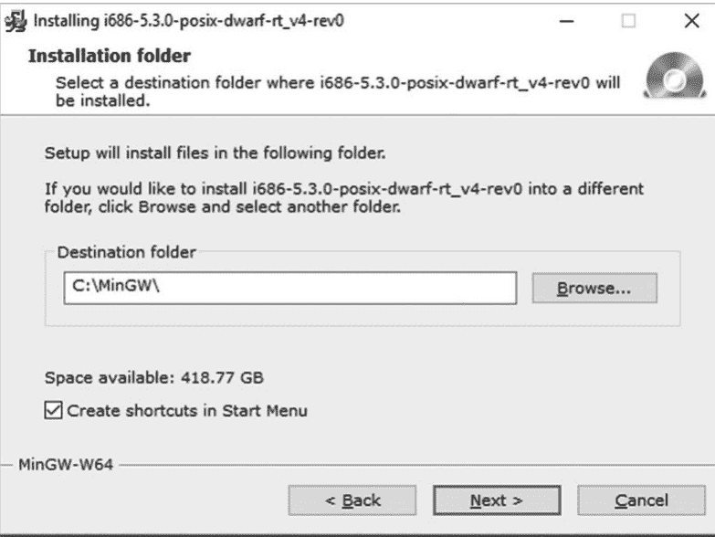

**图 D.1** 为 MinGW 选择文件夹。

点击 Next（下一步）在所选文件夹中安装软件。此过程由进度条跟踪，完成后，点击 Finish（完成）关闭向导。

软件安装后，你必须手动配置 Path（路径），这是一个 Windows 环境变量。

## 设置 Path 环境变量

MinGW 工具在命令行窗口中使用。为了让这些命令正常工作，Windows 必须知道在哪里可以找到 GCC 编译器和其他工具。

这些工具位于项目主文件夹下的 bin 子文件夹中。

如果你选择 `C:\MinGW` 作为主路径，工具位于 `C:\MinGW\mingw32\bin`。

Path 是包含文件夹列表的环境变量，Windows 在输入命令时使用它来定位程序。

在 Windows 10 中设置 Path 变量步骤如下：

1. 在任务栏的搜索框中输入 environment。会出现搜索结果。

2. 搜索结果顶部是 Edit environment variables for your account（编辑账户环境变量）。点击此结果。打开系统属性窗口。

3. 点击 Environment Variables（环境变量）按钮。打开环境变量对话框。

4. 在 System Variables（系统变量）窗格中，向下滚动找到 Path，然后点击系统变量下方的 Edit（编辑）按钮。打开编辑系统变量对话框（图 D.3）。

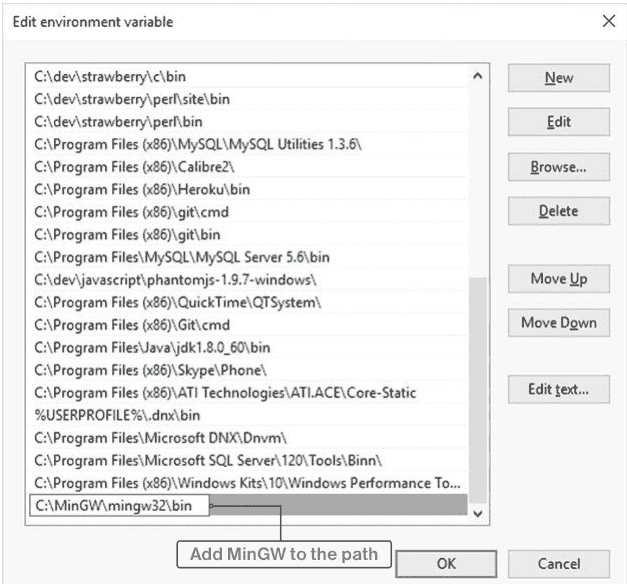

**图 D.2** 编辑 Path 变量。

5. 要添加新文件夹，点击 New（新建）按钮。

6. 在 Variable Value 字段将光标移动到最左侧。在该光标处输入 MinGW 工具的位置 `C:\MinGW\mingw32\bin`，并点击 OK。该文件夹被添加到列表底部。

7. 因为你的电脑上可能存在旧版本的 GCC，建议将其移动到顶部。选择 `C:\MinGW\mingw32\bin` 并点击 Move Up（上移动）按钮，直到它是列表的第一项。

8. 点击 OK 关闭对话框，点击 OK 关闭环境变量对话框，点击 OK 关闭系统变量对话框。

MinGW 的位置已添加到你的路径中。继续进入“测试安装”章节。

## 测试安装

MinGW 需要使用命令行来编译 C++ 程序、运行它们并处理其他任务。

命令窗口是一种通过键盘输入命令来操作计算机的方法，而不是使用鼠标。如今在今天，很少有为 Windows 用户设计的程序需要命令窗口。

要在 Windows 中进入命令窗口，请执行以下操作之一：

- 在 Windows 10 上，在搜索框中输入“命令提示符”（Command Prompt），然后点击“命令提示符”图标。

- 在 Windows 8 上，选择“开始”，点击右上角的搜索放大图标，在搜索框中输入“命令提示符”，并点击“命令提示符”图标。

- 在 Windows 7、Vista、XP 或 Server 2003 上，选择“开始”、“所有程序”、“附件”、“命令提示符”。

- 在 Windows 98 或 Me 上，选择“开始”、“程序”、“MS-DOS 提示符”。

- 在 Windows NT 或 2000 上，选择“开始”、“附件”、“命令提示符”。

当你打开命令窗口时，它会显示一行可以在其中输入命令的区域，如图 D.4 所示。

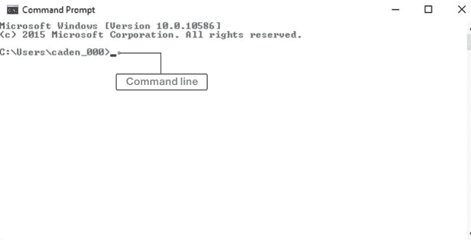

**图 D.4** 使用新打开的命令窗口。

### 命令行

命令窗口使用了采用 MS-DOS 的命令，MS-DOS 是 Windows 之前的操作系统。MS-DOS 支持与 Windows 的功能——复制、移动、删除文件和文件夹；运行程序；扫描和修复硬盘；格式化软磁盘等。

在窗口中，每当你输入新命令时，命令行上的光标就会闪烁。图 D.4 中的 `C:\Users\caden_000>` 就是命令行。

由于 MS-DOS 可用于删除文件甚至格式化你的硬盘，因此在使用它的命令之前，你应该了解一些关于该操作系统的知识。

然而，使用 MinGW 只需要了解少量 MS-DOS：如何创建文件夹、如何打开文件夹以及如何运行程序。

### 在 MS-DOS 中打开文件夹

当你在 Windows 系统上使用 MS-DOS 时，你可以访问 Windows 中通常访问的所有文件夹。例如，如果你在 C: 盘上有一个 Windows 文件夹，那么在命令行可以通过 `C:\Windows` 访问相同的文件夹。

要在 MS-DOS 中打开文件夹，输入命令 `CD`，后接文件夹名称，然后按回车键。这是一个示例：

```
CD:\Temp
```

当你输入此命令时，如果系统 C: 盘上的 `Temp` 文件夹存在，它就会打开。打开文件夹后，命令行将更新为该文件夹名称，如图 D.5 所示。

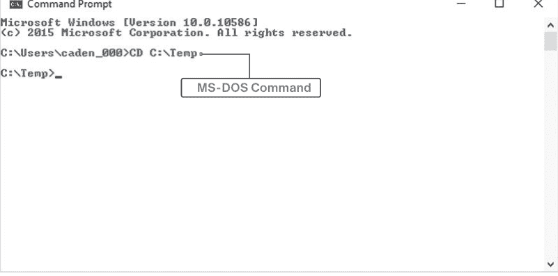

**图 D.5** 在命令行窗口中打开文件夹。

### MS-DOS 命令

#### 创建文件夹


**图 D.6** 在命令行窗口中创建新文件夹。

如果你还没有创建 `Cpp24` 文件夹，可以从命令行创建：

1. 切换到根文件夹（使用 `CD \` 命令）。
2. 输入命令 `MD C:\Cpp24` 并按回车键。

在 `C:\Cpp24` 创建后，你可以随时使用此命令从命令行进入该文件夹：

`CD \Cpp24`

关于 MS-DOS 你需要学习的最后一件事是如何运行程序。

### 在 MS-DOS 中运行程序

在命令行运行程序最简单的方法是输入它的名称并按回车键。例如，输入 `DIR` 并按回车键查看当前文件夹中的文件和子文件夹列表。

你也可以通过输入名称后跟空格以及一些控制程序运行方式的选项来运行程序。这些选项被称为参数。

要查看此示例，切换到根文件夹（使用 `CD \`）并输入 `DIR Cpp24`。如果 `Cpp24` 文件夹包含任何内容，你将看到其中的文件和子文件夹列表。

在安装 MinGW 后，运行 GCC 编译器以检查它是否工作正常。在命令行输入以下命令：

```
g++ --version
```

`g++` 是 GCC 编译器的名称，`--version` 是告诉它显示版本号的参数。

你可以在图 D.7 中看到此示例，但根据你安装的工具包版本，你的版本号可能会不同。

### 附录 D：在 Windows 上使用 MinGW C++ 编译器

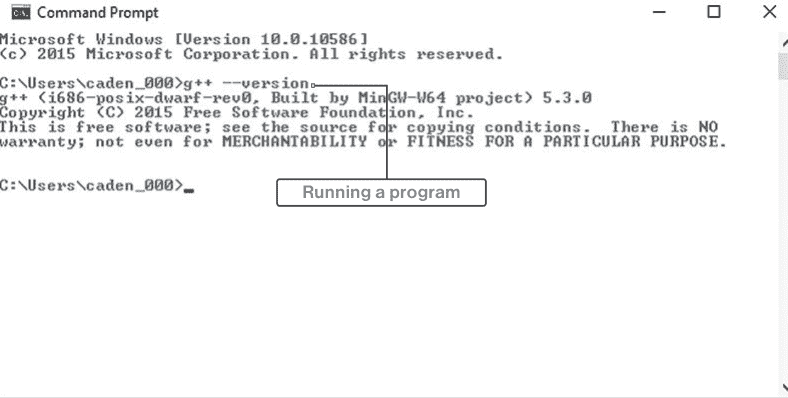

**图 D.7** 在命令窗口中运行 GCC。

#### 运行程序

如果在运行 `g++ --version` 后看到错误的版本号或“无效的命令或文件名”错误，你需要检查你添加到 Path 的 MinGW 文件夹是否存在，以及其中是否包含 `g++.exe` 程序。

## 索引

## 符号

- `+` (加法) 运算符解释，46
- `+` 重载，219–220
- `&` (取地址) 运算符，169–171
- `&&` (逻辑与) 运算符，56–57
- `=` (赋值) 运算符对比拷贝构造函数，228
- `=` 解释，33, 45–46
- `=` 重载，221–223
- `*` (星号) 配合指针，169
- `\` (反斜杠), 137
- `{` (大括号), 19, 62, 403–404
- `<` (括号), 18, 逗号，335
- `//` 注释符号，19, 23
- `/*` 注释符号，20, 23
- `---` (递减) 运算符，47
- `/` (除法) 运算符，46
- `.` (点) 运算符，103, 112, 157
- `*` (双引号), 137
- `==` (相等) 运算符解释，52
- `==` 重载，224
- `!` (感叹号) `!` (逻辑非) 运算符，57
- `!=` (不等) 运算符，52
- 数值值，31
- `>` (大于) 运算符，52
- `>=` (大于等于) 运算符，52
- `#` (井) 符号，23
- `++` (自增) 运算符解释，47
- `++` 后置运算符，217–218
- `++` 前置运算符，215–216
- `*` (方向) 运算符，140–141
- `<` (小于) 运算符，52
- `<=` (小于等于) 运算符，52
- `%` (模) 运算符，46
- `*` (乘法) 运算符，46, 169
- `||` (逻辑或) 运算符，57
- `nr`，19
- `&` (引用) 运算符，169
- `+=` (赋值相加) 运算符，46–47
- `%=` (赋值模) 运算符，46–47
- `=` (赋值乘法) 运算符，46–47
- `-=` (赋值相减) 运算符，46–47
- 访问器，113, 223
- `add()` 函数，21–23
- `+` (加法) 运算符解释，46
- `+` 重载，219–220
- 传递引用，172–174
- 传递基构造函数，239–244
- ArrayFunction 程序，316–318
- ArrayMax 程序，337
- `'` (单引号) 数字分隔符，335
- 显示，137
- Address 程序，136–137
- 指针数组，316–318
- `-` (减法) 运算符，46
- `::` (作用域解析运算符)，114
- 指针检查，143–144
- 存储在指针，138–140
- 取地址运算符 (`&`), ADTs。参见抽象数据类型 (ADT) 325–327
- C++ 进展，13–44
- 缓冲区溢出，107
- 字符数组，102–104
- 常量表达式，335–338
- 常见错误，86
- 复合语句，44
- 变量，32
- `~` (波号)，117, 203
- `_` (下划线)，32
- 飞机黑盒，92
- Alabama Crimson，409
- 分配链表，294
- 分析与需求，345
- 声明，95
- 元素，75
- 解释，95–97
- 初始化，98
- 多维数组解释，99–100
- 13，相关的循环，107
- 80/20 法则，358
- 80/80 法则，358
- `<` (尖括号), 18
- Animal 程序，280–283
- 匿名函数 (内联)，338–339
- 循环读取，105–106
- `sizeof(t)` 函数，337–338
- 未初始化数组元素，107

## A

- 奥尔尔胡大学，8
- `abort(t)` 函数，399
- 抽象数据类型 (ADT) 优势，284
- 复层级，279–283
- APIs (应用程序接口)，359–360
- 星号 (`*`) 数字分隔符，335
- 显示，137
- 应用程序接口 (APIs)，359–360
- 越界写入，97–98
- Assignment 类，222–223
- 赋值运算符 (`=`) 解释，271–275, 346
- 我们何时使用，283–284
- 访问指南，407
- 可访问的 Area 程序，63
- AreaCube 程序，71
- 参数与参数对比，223
- 解释，21–23
- 与拷贝构造函数对比，228
- 解释，33, 45–46
- 重载，221–223
- Assignment 程序，170–171
- 类成员，112
- 内部类，311
- 数据成员，157
- 隐藏，246
- 调用基类成员，247–249
- 按值拷贝，333–335
- 按引用拷贝，398–403
- 捕获异常，393–397
- 编译器提供的构造函数，118–120
- 拷贝构造函数，228
- 声明，116-117, 210–211
- 默认构造函数，112–117
- 定义的，117
- 解释，204–208
- 继承，236–239
- 载载，203
- 绯红潮 (Crimson Tide)，409
- 字谜游戏，发明，340
- `.xx` 文件扩展名，7
- 递减运算符 (`--`)，47
- 深拷贝，204–208
- DeepCopy 程序，205–207
- 默认构造函数，112–117
- 默认函数参数，70–72
- 默认值
  - 包含类
    - 访问成员的，311
    - 按值拷贝与按引用拷贝，312
    - 定义，305–311
    - 过滤访问，312
    - 悬空指针，161–162
  - 数据成员
    - 使用指针访问，157–158
    - 缺点，210
    - 成员函数，201–203
- `#define` 指令，36
- 定义。另见声明


- 常量，36–37
- 包含类，305–311
- 函数，64
  - 持续状态，82–83
  - 连接到下一个循环，82–83
- 转换操作，222–224
- `convert()` 函数，62
- 拷贝构造函数
  - 数据类型。参见类型

DataMember 程序，158–159

- 十进制值，分配整数，41
- 声明。另见定义
  - 对象，111–112, 116–117
  - 静态成员变量，303
- 模板，374–381
- 类型，110
- 变量，32–33
  - 解释，183, 204–208, 228
  - 虚拷贝构造函数，260–263

拷贝拷贝
  - 匿名函数（内联），数组，95
  - 类，111
  - 构造函数，116–117, 210–211
  - 责任委托，289
- `delete` 关键字，147–149
- 删除对象，116–117, 155–157
  - 深拷贝，204–208
  - 允许拷贝，204
  - 字符串，104–105
  - 派生，继承和 232

设计
- 分析与需求，345
- 类，346–348
- 架构的，344
- 开发周期，343
- 事件循环，348–350
- 高层设计，345–346
- 低层设计，345–346
  - Couiller, Dave，228

Counter 程序，214
Counter2 程序，215–216
Counter3 程序，217–218
Counter4 程序，219–220
Counter5 程序，224
Counter6 程序，225
Counter7 程序，226–227

`.cp` 文件扩展名，7
`.cpp` 文件扩展名，7
  - 析构函数，117
  函数
    - `const` 成员函数，123
    - 变量，138
    - 纯虚函数，275–276
    - 引用，167–168
    - 虚函数成员，252–253
    - PostMaster 案例研究

80/20 原则，358
80/80 原则，358

# 444 设计

API（应用）点运算符 `()`,112, 157
概述，391–392
编程（接口），双引号 `*`,137
专业级代码，359–360
`double` 类型，31
驱动程序，362–369
双向链表，287–288
访问，407
初始类设计，`do-while` 循环，83–84
大括号 `))`,303–404
353–354
`draw()`,276, 279
类定义，407
接口，356–357
`drawShape()`，函数，201
注释，406–407
消息格式，352–353
驱动程序，362–368
`const`，408
持续设计，361–362
标识符名称，405–406
include 文件，408
`switch` 语句，根 404
易读代码，495
`Edit()` 函数，369
第三方库，365
编辑器
数组元素，95, 107
大象吉祥（阿拉巴马），211
绯红潮 (Crimson Tide)，409
继承，236–239
重载，203
虚析构函数，260
开发周期，343
C++ 开发，5–6, 331
Diogenes，299
`enum` 关键字，347
`else` 子句，53–54
Emerson, Waldo，94
员工程序，309–311
封装，定义，110
相等运算符 (`==`)，445
代码的脆弱性，392
表达式
- 编译时常量表达式，208–210
- 常量表达式，335–338
- 值，58
- lambda 表达式，338–339
- 其他类的类，127–132
- 缺点，327, 解释，312–313
- 声明，123
- 友元函数，函数指针，316–318
- 成员函数指针，325–332
- 定义，组织，124
- 实现版本，124–127
- 向其他函数传递，319–321
- 成员函数指针，322–324
- 基础构造函数，传递参数，239–244
- 定义，17
交换，236–269
Favre, Henri，370
Fellow, Norman，41
十五程序，82–83
函数多态性，17, 72
功能性，原型，358
`FuncPtr`，313
FunctionPointer 程序，314–316
FunctionPass 程序，319–321
函数。另见特定函数（例如 `add`）
dest
- 拷贝构造函数，204–208, 228
- 默认值，201–203
- 声明，61–64
- 定义，61–64
成员，312
定义，7, 18, 61, 111
`findArea()` 函数，63, 72–73
`float` 类型，29, 31
浮点类型，29
循环流
- 跳出循环，81–82
- 继续到下一个循环，82–83
- 定义，79
`do-while` 循环，83–84
`for` 循环，84–87
嵌套循环，87–88
`switch` 语句，89–91
`while` 循环，79–81
十四程序程序
- 访问器，113
- 按引用传递，172–174
- 自动转换返回值，73–75
基类成员函数
调用，247–249
隐藏，246–247
编译时常量表达式，208–210
实例，236–239
虚析构函数，260
解释，20–23
函数定义，组织，124
函数多态性，17
头文件，177
实现，114–116
递增方法，215–216

# 函数

- 内联匿名函数，338-339
- 内联函数，73
- 静态成员函数的优点，327
- 解释，303-305
- 名称，20
全局命名空间，145
全局程序，66
全局变量，66–67
重载与覆盖函数的比较，246
覆盖与函数加载的比较，246
goldmaps.com，388
评分程序，53
局部变量，64–66
Granholm, Jackson W.,24
葡萄的味道，10
跳蚤冰淇淋，133
大于运算符 (`>`)，52
大于等于 (`>=`)，52
默认参数，70–72
Griebel, Philipp，121
解释，72, 199–201
花园矮子解放战士 (Garden Gnome Liberation Front)，121
收集需求，355
GCC 编译器，7
`getAge()` 函数，188
`getArea()` 函数，131, 274
`getArraySize()` 函数，336
`getHowMany()` 函数，305
`getline()` 函数，103
`getPerim()` 函数，274
`getSalaryMultiple()` 函数，332
`getSpeed()` 函数，115–116, 123, 125
getter 函数，123
从函数返回值，68–70
签名，21

# G

指针指向
- 函数指针数组，316–318
- 成员函数指针，325–332
- 成员函数指针，322–324

# H

函数头文件，177
头文件，124
HeadNode 类，290–297
堆
- 优点，152
- 原型，177
在堆上分配内存，146–177
返回值
在堆上创建对象，155
`auto` 关键字，332–334
在堆上删除对象，155–157
多个值，177–179
解释，145–146
按引用返回，179–180

# 接口设计原型

- 堆上的成员数据，158-160
- 复合 `if` 语句，54-56
- 解释，16, 231
- 引用对象在，192-194
- `else` 子句，53-54
- 重写函数与函数的比较
- 恢复内存到，147-149
- 解释，52-53
- 载载，246
- 语法，244-246

# Heap 程序, 148

- 实现。另见参见初始化
- 受保护的类，234-236

# HeapAccessor 程序, 157-158

- 成员函数
- 单继承，问题

# HeapCreator 程序, 156

- 解释，114-116
- 使用，267-271
- 隐藏基类函数，246-247
- 内联实现，124-127
- 语法，233-234
- 何时使用，388
- 高级设计，345-346
- 接口与实现，124
- 初始化数组，98
- C++ 历史，5, 6, 331
- 纯虚拟函数，276-279
- 基类，239-244
- 多维数组，100-101

# fp 扩展名, 124

- `#include` 指令，104, 309
- 对象，203-204

# hpp 扩展名, 124

- 包含文件，18, 408
- 增量方法，变量，33-34
- 匿名函数，215-216, 338-539
- 递减运算符 (`--`)，47
- 减法运算符 (`-`),46
- 递增运算符 (`++`)，140-141
- 内联函数，73
- `const` 成员函数的内联实例，124-127
- 指向运算符 (`*`)，140-141
- 不等于运算符 (`!=`)，52
- 推断数据类型，332-334
- `line` 关键字，73, 124
- `insert()` 函数，
- IDE（集成开发环境），
- 无限循环，80, 295, 381, 387
- 继承。另见参见多态
- 实例变量，111
- 标识符名称，405-406
- 基类
- 模板实例，374

# If-else

- 基类初始化，239-249
- `int()` 运算符，226-227 整数
- 表达式值，58
- 逻辑运算符
- 调用基类成员函数，247-249
- 二进制，334-335, 解释，28, 41
- 解释，56-57
- 逻辑与 (AND)，56-57
- 隐藏基类成员函数，246-247
- 有符号与无符号，30
- 表格，31
- 逻辑非 (NOT)，57
- 逻辑或 (OR)，57
- 构造函数，236-239
- 派生，232
- 集成开发环境 (IDE)，9
- 关系优先级，57
- 设计，354-355
- 析构函数，236-239
- 接口设计原型，375
- `if-else` 语句

# 接口

- 接口
- 临时变措施，24
- 树，287–288
- 与实现，124
- PostMaster 个研究，356–357
- Klugman, Jack，41
- 局弱性，374
- LinkedList 程序，290–294
- InternalNode 类，290–297
- 国际动物命名法规范，59
- 链接器，5
- 链接源代码，5–7
- 列表。另见程序

# L

- lambda 表达式，338–339
- 大组的编程，360
- 链表
- 进阶所有，299
- 分配，294
- 国际纯与化学联合会 (IUPAC)，370
- 解释器，13–14
- `isLeap` 函数，69–70
- 异硫杂环烷，211
- 土其，伊斯坦布尔，249
- 迭代，279
- 晚绑定，255
- 法律矮人，191
- Leak 程序，193
- 内存泄漏 (memory)，149, 192–195
- 组成部分，289–297
- 成本，298
- 定义，287
- IUPAC (国际纯与化学联合会)，370
- LeapYear 程序，68–69
- 小于运算符 (`<`)，52
- 小于等于 (`<=`) 运算符，52
- 责任委托，289
- 双向链表，287–288, 解释，287–288

# J-K

- 关键字。另见参见语句
- `auto`，38, 62, 332–334, 339
- `const`，123, 132, 208, 247, 408
- 头部，287
- 无限循环，295
- LinkedList 程序，290–294
- `delete`，147-149
- `enum`，37
- `inline`，73, 124
- 内联作为对象
- `new`，146–147
- 节点，287
- 单向链表，287
- 尾部，287
- `private`，113
- `protected`，234
- `public`，112–113
- `template`，374
- `virtual`，252
- 树，288
- 局弱性，374
- 已初始化对象，374–381
- 二进制字面量，335
- 数值字面量，334–335
- 冒险，299
- 分配，294
- 组成部分，289–297
- 成本，298
- 定义，287
- 责任委托，289
- 双向链表，287–288
- 解释，287–288

# 内存

- `Log(i)` 函数，350
- `main()` 函数，18–19
- 传递，319–321
- 成员函数指针，322–324
- `typedef`，321
- 全局命名空间，145
- 堆
- `for-for` 循环
- `foreach`，105–106
- 跳出，81
- 继续到下一个，82–83
- 定义，79
- `do-while` 循环，83–84
- 事件循环，348–350
- 解释，84–87
- 成员变量 `for`，105–106
- 无限循环，80, 295
- 静态成员变量 `for`，110
- 嵌套堆，87–888
- `switch` 语句，89–91
- `while` 循环，79–81, 92
- 低级设计，345–346
- l值，45

# M

- 机器码，6
- 机器语言，13
- 指针数组，316–318
- 成员函数指针数组，325–327
- 优势，152
- 在堆上分配，146–147
- 在堆上创建对象，155
- 在堆上删除，155–157
- 解释，145–146
- 堆上的成员数据，158–160
- 堆上的成员数据，158–160
- 恢复内存到，147–149
- 成员函数，192–195
- 访问成员，157–158
- 访问数据，144–145
- 访问成员的，111–112
- `const` 指针，162–164
- 指针差异，135–138
- 存储在，143–144
- 代码空间，145
- 指针重要性，151
- 空指针，150
- 乘法运算符 (`*`)，46
- 负数，59
- 嵌套循环，87–88
- 取模运算符 (`%`)，46
- 新代码，14
- 面向对象编程，20–23
- 函数，17–18
- 包含文件，18–19
- 源代码，5–7
- 构造函数，116–117
- 定义，10
- 内存，449
- 数字，138–140
- 数值字面量，334–335
- 野指针，161–162
- 重复使用，191
- 逸散指针，138
- 恢复到堆，147–149
- 存储变量中，352–353
- 名字，20, 62
- 标识符名称，405-604
- 拼写和大小写，606
- 变量名，322–338
- 国家债务时钟，335
- Morisset, Allen，229
- Moto 程序，14
- 《面向对象过程》第四版 (Weisfeld)，347
- ObjectRef，184–185
- 对象。另见类
- `const` 对象，165
- 在堆上，155-157
- 多维数组
- 链表，作为，298–299
- 引用。另见指针

### 运算符

- 逻辑或 OR, 57
- 概述, 56–57
- 数学运算符, 46
- 输出重定向运算符 (`<<`), 19
- 载载
  - 加法运算符 (`+`), 219–220
    - 优点, 228
  - 转换运算符, 224–226
  - 等于运算符 (`==`), 223
    - 解释, 213–214
    - 结合递增方法, 215–216
  - `int()` 运算符, 226–227
    - 局限性, 220–221
  - `operator=`, 221–223
  - 后置运算符 (`+`), 217–218
  - 前缀运算符 (`+`), 215–216
- 后置运算符 (`++`)
  - 解释, 47–49, 228
  - 载载, 217–218
  - 优先级, 49–51, 57, 59
- 前缀运算符 (`++`), 47–49, 215–216
- 引用运算符 (`&`), 169
- 关系运算符, 51–52
- 作用域解析运算符 (`::`), 114
- 自赋值运算符, 46–47
- 输出重定向运算符 (`<<`), 19
- Overbey, Charles, 388
- 载载
  - 构造函数, 203
  - 析构函数, 203
  - 函数
    - 与重写的对比
  - 函数, 246
  - 概述, 72
  - 成员函数, 199–201
  - 运算符
    - 加法运算符 (`+`), 219–220
      - 优点, 228
    - 转换运算符, 224–226
    - 等于运算符 (`==`), 223
      - 解释, 213–214
      - 结合递增方法, 215–216
    - `int()` 运算符, 226–221
      - 局限性, 220–221
    - `operator=`, 221–223
  - 重写函数

- 参数化 List, 374–381
- 参数
  - 与参数 (arguments) 的对比, 23
  - 默认参数, 70–72
    - 解释, 21, 67–68
  - ParamList 程序, 375–380
- 传值
    - 传入基构造函数, 239–244
    - `const` 指针, 186–188
    - 指向其他函数的指针, 319–321
    - 按引用传递, 172–174, 183–186
    - 模板对象, 381–387
    - 按值传递, 186
- `pedal()` 函数, 208
- 铅笔等级, 76
- 周期 `()`, 103, 112, 157
- pi, 209–210
- `pld` 类型, 357
- `pObject` 类, 357


- `Point` 类, 127–128
- 指针接口, 142
- `PointerCheck` 程序, 143–144
- 指针。另见 堆：引用
  - 访问成员变量, 157–158
  - 优点, 144–145, 181–195
  - `const` 指针, 162–164, 186–188
  - 悬空指针, 161–162
  - 声明, 138–
  - 与函数重载的对比, 246
  - 语法, 244–246

# 优先级, 49–51

# 组织
- 类定义, 124
- 函数定义, 124

# P
- `pAddress` 类, 368–369
- 淘金之旅, 388

# 编写专业级代码, 453
- 指针与地址的区别, 141
- 抽象数据类型
  - 优点, 284
  - 接口, 355–357
  - 检查存储在其中的地址, 143–144
- 抽象的复杂层次结构, 279–283
- 消息格式, 352–353
- 解释, 135–138 到函数
- 解释, 271–275
- 何时使用, 283–284
- 持续的设计考量, 361–362
- 函数指针数组, 316–318
- 异常, 捕获, 398–403
- `PostMasterMessage` 类, 358–359
- 成员函数指针数组, 325–327
- 解释, 16–17, 251
- 显式转换, 257
- 大团队中的编程, 360
- 声明, 313–316
- 传递, 319–321
- 单继承，问题, 267–351
- 原型, 357–358
- 有根与非有根层次结构, 354–355
- 成员函数指针, 322–324
- 虚构造函数, 260–263
- `PostMasterMessage` 类, 358–359
- `typedef`, 321–322
- 重要性, 151
- 虚析构函数, 260
- 虚成员函数
- `PostMasterMessage` 程序, 359–360
- 间接运算符 (`*`), 140–141
- 成本, 263–264
- 使用操作, 141–143
- 如何工作, 256–257
- 实现, 252–253
- 优先级 (运算符), 49–51, 57, 59
- 内存泄漏, 195
- 空指针, 138, 150–151, 172
- 纯虚函数, 275–279
- 前缀运算符 (`++`)
  - 解释, 47–49
  - 替代方案, 189–190
  - 重载, 215–216
  - 何时使用, 264
- 虚函数表 (`v-tables`), 256–257
- 存储地址, 138–140
- `#define`, 36
- `#include`, 104, 309
- 后置运算符 (`++`)
  - 适配, 17–118
  - 野生指针, 161–162
  - `this` 指针, 160–161
  - 虚指针, 256–257
  - 重载, 217–218
- `printError()`, 402
- 私有类, 112–113, 234
- `private` 关键字, 113–138
- 过程化编程, 14–15
- 80/20 规则, 358
- 编写专业级代码
  - 访问, 007
  - 继承, 359–360
  - 初始设计, 353–354
  - 类定义, 407
  - 注释, 406–407
  - 标识符名称, 405–406
  - 长行, 404
  - 概述, 403
  - 程序文本, 405
  - 组编程, 360
  - 编程风格, 14–15
- 程序, 136–137
- `Addresser`, 136–137
- `Animal`, 280–283
- `Area`, 633
- `Pointer-Swap` 程序, 174–175
- `PolyException` 程序, 399–402
- `Mammal13`, 269–271
- `Mammal1`, 233–234
- `Mammal2`, 235–236
- `Mammal3`, 237–238
- `Mammal4`, 239–242
- `Mammal5`, 244–245
- `Mammal6`, 246–247
- `Mammal7`, 248
- `Mammal8`, 252–253
- `Mammal9`, 253–255
- `Mammal10`, 257–259
- `Mammal11`, 260–263
- `Mammal12`, 266–267
- `Counter3`, 217–218
- `Counter4`, 219–220
- `Counter5`, 224
- `Counter6`, 225
- `Counter7`, 226–227
- `DeepCopy`, 205–207
- `DataMember`, 158–159
- `Driver`, 362–368
- `Employee`, 309–311
- `Exception`, 394–397
- `Expression`, 45
- `Fiftens`, 82–83
- `Fourteenth`, 81
- `NewGrader`, 54–55
- `Global`, 66
- `Grader`, 53
- `Heap`, 148
- `HeapAccessor`, 157–158
- `HeapCreator`, 156
- `Leak`, 193
- `LinkedList`, 290–294
- `PostMasterCase` 类
- `MemberPointer`, 322–324
- `Motto`
- `Rectangle`, 33–34, 128–131, 199–200
- `Rectangle2`, 201–202
- `ObjectRef`, 184–385
- `ParamList`, 375–380
- `Pointer`, 142
- `PointerCheck`, 143–144
- `PointerSwap`, 174–175
- `PolyException`, 399–402
- `PostMasterMessage`, 359–360
- `Production`
- `Rectangle`, 33–34, 128–131, 199–200
- `Rectangle2`, 201–202
- `Reference`, 168
- `Reference2`, 169
- `ReferenceSwap`, 176
- `RefPasser`, 186–188
- `RefPasser`, 189–190
- `ReturnPointer`, 178
- `ReturnReference`, 191–192
- `ReturnSwap`, 179–180
- `Shape`, 272–274
- `Shape2`, 276–279
- `SimpleEvent`, 348–350
- `Sizer`, 29–30
- `Sizer` 程序, 29–30
- `StringCopy`, 105
- 结构
- `Temperature`, 64–65
- `This`, 160–161
- `Tricycle`, 114–116
- `ValuePass`, 173
- `Years`, 47–49
- r-值
- 引号
- 返回值的方式, 179–180
- 注册你的书, 3
- 什么可以被引用, 171–172
- 何时使用, 191
- `swap()` 函数, 175–177

# S
- *Sams Teach Yourself UML in 24 Hours, Third Edition* (Schmuller)
- Schichter, Art. 328
- Schuster, Lincoln, 340
- 数字分隔符, 335
- 空格, 43–44, 59
- 强链表, 287–288
- 对象的大小, 121
- 切片虚函数成员, 257–260
- `store()` 函数, 72
- 作用域
  - 解释, 37
  - 不在作用域内的对象, 191–192
- 作用域解析运算符 (`::`), 114
- 自赋值运算符, 46–47
- 常见错误, 86
- 编译, 5
- 定义的, 167
- 源码, 18–19
- 源代码, 345
- 源代码, 18–79
- `switch`, 89–91, 92, 404–405
- 单引号 (')
- 变量 457
- `Swapper`, 150–151
- `switch` 语句, 89–91, 92, 404–405
- 符号常量, 36, 41
- 语法错误, 391
- 波号 (`~`), 117, 203
- 树, 287–288
- `Tricycle` 类, 111, 125–126, 205–207
- `Tricycle` 对象, 112
- `Tricycle` 程序, 114–186
- 三数字恐惧 (triskaidekapahobia), 107
- `try` 块, 393–397
- 类型定义, 34–96
- 类型推断, 332–334
- 类型标记的, 34–36, 321–322
- 统一建模语言 (UML), 345
- 未初始化数组元素, 107
- 无符号变量, 30

# V
- `\t` 字符, 137
- 尾部 (链表), 287
- `TailNode` 类, 290–297
- `Temperature` 程序, 64–65
- `Template` 关键字, 374
- `TemplateList` 程序, 381–381
- 值, 传递
  - 包含的类, 312
  - 解释, 186
- `ValuePass` 程序, 173
- 值
  + 类型
    - 抽象数据类型
      - 优势, 284
    - 复杂的层次结构
      - 抽象, 279–283
      - 解释, 271–275
      - 何时使用, 283–284
    - `auto` 类型变量, 38–40
      - 创建, 110
      - 解释, 109
    - 整数
      - 解释, 28
      - 有符号与无符号, 30
  + 赋值给变量, 33–34
  - 默认值, 210
  - 按引用传递
    - 包含的类, 312
    - 解释, 186
    - 解释, 172–174, 183–186
  - 按值传递
    - 包含的类, 312
    - 解释, 186
  - 按 `const` 指针传递, 186–188
  - 返回值
    - `auto` 类型返回值, 73–75
    - 解释, 68–70
    - 多重值, 177–179
    - 从函数获取, 68–70
    - 按引用返回, 179–180
    - 按值返回, 195
  + 模板
    - 优势, 387
    - 定义, 374–381
    - 解释, 373
    - 实例, 374
    - 模板对象, 381–387
    - 何时使用, 388
  + 文本编辑器
    - 与文字处理器的对比, 9
    - 视图, 6
  + 第三方库, 356
- 十三，迷信
  - 相关的, 107
  - 第13号程序, 80
- `This` 指针, 160–161
- `This` 程序, 160–161
- 抛出异常
  + pLD, 357
  - 索引, 31
  - 类型定义, 34–36
  - 类型推断, 332–334
- `void`, 62

# U
+ UML (统一建模语言), 345
- 下划线 (`_`), 32
+ 变量. 另参见指针
  - 定义, 32–33
  - 解释, 27
  - 定义, 393
- `try/catch` 块, 393–397

# 变量
- 带函数
  - 解释, 64
- 全局变量, 66–67
- 局部变量, 64–66
- 初始化, 33–34
- 局部变量, 75
- 访问包含的类的成员, 311
- 名称, 32–33
- 有符号, 30
- 静态 成员变量, 301–303
- 存储在内存中, 28–30
- 类型
  - `void` 类型, 62
  - v 指针, 255–257
  - vptrs, 255–257
  - v 表 (虚函数表), 256–257
- 访问, 407
- 大括号 `{ }`, 403–404
- 类定义, 407
- 注释, 406–407
- `const`, 408
- 标识符名称, 405–406
- 包含文件, 408
- 长行, 404
- 概览, 403

# W-X-Y-Z
- 警告 (编译器), 9
- Warren, David, 92
- wasabi, 211
- Washington, George, 152
- Washington, Paul Emery, 152
- 瀑布技术, 343
- 程序文本, 405
- 名称的拼写与大小写, 406
- `switch` 语句, 404–405
- `auto` 类型变量, 38–40
- 索引, 31
- 类型定义, 34–36
- 越界写入数组, 97–98
- Wynne, Arthur, 340
- `Years` 程序, 47–49
- 网站, 3
- Web Book 版, 3
- C++ 标准化
  - Bjarne Stroustrup, 339
- 网站, 340
- 无符号, 30
- 值, 赋值, 33–34
- 虚析构函数, 260–263
- 虚函数成员成本, 263–264
- 声明, 252–253
- 其工作原理, 256–257
- 多态, 252–255
- `Weight` 程序, 96
- Weinberg, Gerald, 391
- `while` 循环, 79–81
- 白内障效应, 165
  - 声明, 275–276
  - 实现, 276–279
  - 何时使用, 264
- v 表 (虚函数表), 256–257
- 空白效应, 43–44, 59, 455
- 野指针, 138–162
- 处理器, 9
- 递增方法, 215–216
- 专业级代码
- `virtual` 关键字, 252
- Visual Studio, 7
- 此页留空
- 在 informit.com 注册您的产品
- 访问额外福利并在下次购买时节省 35%
  - 下载产品更新
  - 在设置账户时接收特别优惠
  - 获取下次购买 35% 的优惠券，有效期30天。您的代码将在购物车中显示。（优惠将在您的账户页面显示。）

InformIT.—信赖来源

InformIT 是全球领先教育公司的 IT 品牌在线之家。在 Informit.com 您可以
- 购物我们的书籍、电子书和视频培训。
- 我们的特别优惠 (informit.com/promotions)。
- 订阅特别优惠和内容 (informit.com/newsletters)。
- 阅读专家的免费文章和博客。
- 访问数千个免费章节和视频课程。

与 InformIT 连接——访问 informit.com/community

了解 IT 活动和计划。

informit.com

可靠的技术学习源

Addison-Wesley Cisco Press Microsoft Press Pearson IT Certification Prentice Hall | Sams | VMware

# Sams Teach Yourself

当你有时间寻找答案

无论你需要什么，无论你的时间要求如何， Sams Teach Yourself 书适合你。在 Sams Teach Yourself 书的指导下，你可以快速掌握任何新产品或技术——尽可能快。学习如何使用电脑的新功能不应该是枯燥或耗费时间的。Sams Teach Yourself 让一切变得快速、简单，甚至有趣。

# Java 24 小时

Rogers Cadenhead

ISBN-13: 778-0-672-33702-4

# jQuery 和 JavaScript 24 小时

Brad Dayley

ISBN-13: 778-0-672-33734-5

# JavaScript 24 小时

Phil Ballard

ISBN-13: 778-0-672-33738-3

# Visual Basic 2015 24 小时

James Foxall

ISBN-13: 778-0-672-33745-1

# HTML, CSS 和 JavaScript 全书

Julie Meloni

ISBN-13: 778-0-672-33714-7

Sams Teach Yourself 书籍在大多数零售和在线书店出售。需更多信息或直接订购，请访问我们的商店 informit.com/teachyourself。

所有 Sams Teach Your 标题在线版可通过 Safari Online 订阅访问：safari.informit.com。
