# 21天自学 Java（涵盖 Java 11／12），第 8 版

ePUB 是一种开放的行业标准电子书格式。然而，不同阅读设备和应用程序对 ePUB 及其许多功能的支持程度不同。请使用您的设备或应用设置来根据您的喜好自定义显示效果。您可以自定义的设置通常包括字体、字号、单栏或双栏、横屏或竖屏模式，以及可以点击或触摸放大的图片。有关您的阅读设备或应用上设置和功能的更多信息，请访问设备制造商的网站。

许多书目包含编程代码或配置示例。为了优化这些元素的显示效果，请在单栏横屏模式下查看电子书，并将字体大小调整为最小。除了以重流文本格式显示代码和配置外，我们还包含了代码图像，以模拟印刷书籍中的显示效果；因此，当重流格式可能会影响代码列表的显示时，您将看到“点击此处查看代码图像”链接。点击该链接查看高保真代码图像。要返回之前查看的页面，请点击设备或应用上的“返回”按钮。

书中提到的所有已知为商标或服务标记的术语。

图 3-4 Apache NetBeans IDE 11.0 截图 ©2019 Oracle

图 3-5 Apache NetBeans IDE 11.0 截图 ©2019 Oracle

图 4-1 Apache NetBeans IDE 11.0 截图 ©2019 Oracle

图 4-2 Apache NetBeans IDE 11.0 截图 ©2019 Oracle

图 4-3 Apache NetBeans IDE 11.0 截图 ©2019 Oracle

图 4-4 Apache NetBeans IDE 11.0 截图 ©2019 Oracle

图 4-5 Apache NetBeans IDE 11.0 截图 ©2019 Oracle

图 5-1 Apache NetBeans IDE 11.0 截图 ©2019 Oracle

图 5-2 Apache NetBeans IDE 11.0 截图 ©2019 Oracle

图 5-3 Apache NetBeans IDE 11.0 截图 ©2019 Oracle

图 5-4 Apache NetBeans IDE 11.0 截图 ©2019 Oracle

图 5-5 Apache NetBeans IDE 11.0 截图 ©2019 Oracle

图 5-6 Apache NetBeans IDE 11.0 截图 ©2019 Oracle

图 5-7 Apache NetBeans IDE 11.0 截图 ©2019 Oracle

图 6-1 Apache NetBeans IDE 11.0 截图 ©2019 Oracle

图 6-2 Apache NetBeans IDE 11.0 截图 ©2019 Oracle

图 6-3 Apache NetBeans IDE 11.0 截图 ©2019 Oracle

图 6-4 Apache NetBeans IDE 11.0 截图 ©2019 Oracle

图 7-1 Apache NetBeans IDE 11.0 截图 ©2019 Oracle

图 7-2 Apache NetBeans IDE 11.0 截图 ©2019 Oracle

图 8-2 Apache NetBeans IDE 11.0 截图 ©2019 Oracle

图 8-3 Apache NetBeans IDE 11.0 截图 ©2019 Oracle

图 8-6 Apache NetBeans IDE 11.0 截图 ©2019 Oracle

图 9-1 显示框架的截图 ©2019 Oracle

图 9-2 `ButtonFrame` 截图 ©2019 Oracle

图 9-3 `Icon frame` 截图 ©2019 Oracle

图 9-4 NetBeans 文件面板截图 ©2019 Oracle

图 9-5 身份验证应用程序截图 ©2019 Oracle

图 9-6 `FormatFrame` 截图 ©2019 Oracle

图 9-7 `FormatFrame2` 截图 ©2019 Oracle

图 9-8 订阅截图 ©2019 Oracle

图 9-9 Java 库截图 ©2019 Oracle

图 10-1 对话框截图 ©2019 Oracle

图 10-2 结果对话框截图 ©2019 Oracle

图 10-3 输入对话框截图 ©2019 Oracle

图 10-4 对话框截图 ©2019 Oracle

图 10-5 选项框截图 ©2019 Oracle

图 10-6 消息截图 ©2019 Oracle

图 10-7 滑块条截图 ©2019 Oracle

图 10-8 可停工具栏截图 ©2019 Oracle

图 10-9 进度条截图 ©2019 Oracle

图 10-10 标签页截图 ©2019 Oracle

图 11-1 字母截图 ©2019 Oracle

图 11-2 用户界面截图 ©2019 Oracle

图 11-3 字体截图 ©2019 Oracle

图 11-4 边界截图 ©2019 Oracle

图 11-5 调查截图 ©2019 Oracle

图 12-1 标题栏截图 ©2019 Oracle

图 12-2 计算器截图 ©2019 Oracle

图 12-3 订阅格式截图 ©2019 Oracle

图 12-4 鼠标应用程序截图 ©2019 Oracle

图 12-5 检查器截图 ©2019 Oracle

图 13-2 字体测量截图 ©2019 Oracle

图 13-4 渐变画截图 ©2019 Oracle

图 13-9 映射截图 ©2019 Oracle

图 14-1 Java 21 截图 ©2019 Oracle

图 14-4 Java 21 截图 ©2019 Oracle

图 15-1 Java 21 截图 ©2019 Oracle

图 15-2 Java 21 截图 ©2019 Oracle

图 15-3 Java 21 截图 ©2019 Oracle

图 16-1 Java 21 截图 ©2019 Oracle

图 16-2 NetBeans java 截图 ©2019 Oracle

图 16-3 Java 21 截图 ©2019 Oracle

图 16-4 Java 21 截图 ©2019 Oracle

图 16-5 Java 21 截图 ©2019 Oracle

图 17-1 Java 21 截图 ©2019 Oracle

图 17-2 Java 21 截图 ©2019 Oracle

图 17-3 Java 21 截图 ©2019 Oracle

图 17-4 命令截图 ©2019 Oracle

图 17-5 Java 21 截图 ©2019 Oracle

图 D-7 命令提示符截图 ©2019 Microsoft

图 E-1 NetBeans 项目截图 ©2019 Oracle

## 介绍

### 7 异常与线程

### 20 发起 Web 服务请求

## 辅助类

### Java 应用与参数

希望向 Java 应用传递参数

#### 在 Java 应用程序中处理参数

### 创建同名方法

#### 构造方法

#### 基础构造方法

#### 调用另一个构造方法

#### 重载构造方法

### 重写方法

#### 创建覆盖现有的方法

#### 调用原始方法

#### 重写构造方法

#### 总结

#### 问答

#### 测验

##### 问题

##### 答案

#### 认证练习

### 练习

# 第 6 课：包、接口和其他类特性

## 修饰符

### 方法和变量的访问控制

### 静态变量和方法

### Final 类、方法和变量

### 变量

### 方法

### 类

### 抽象类和方法

### 包

### `import` 声明

### 类名冲突

### 创建你自己的包

### 选择包名

### 创建文件夹结构

### 将类添加到包中

### 包与类的访问控制

## 接口

### 单继承的问题

### 接口与类

### 实现和使用接口

### 实现多个接口

### 接口的其他用途

### 创建和扩展接口

### 新接口

### 接口内部的方法

### 扩展接口

### 创建在线商店

### 总结

### 问答

### 测验

#### 问题

#### 答案

### 认证练习

## 练习

# 第 7 课：异常与线程

## 异常

### 异常类

### 管理异常

### 异常一致性检查

### 保护代码和捕获异常

### `finally` 子句

### 声明可能抛出异常的方法

### `throws` 子句

### 你应该抛出哪些异常？

### 传递异常

### `throws` 与继承

### 创建并抛出异常

### 抛出异常

### 创建自定义异常

### 结合 `throws`、`try` 和 `throw`

### 何时不使用异常

### 糟糕的异常

## 线程

### 编写线程程序

### 线程应用程序

### 停止线程

### 总结

### 问答

### 测验

#### 问题

#### 答案

### 认证练习

## 练习

# 第二部分：Java 类库

## 第 8 课：数据结构

### 超越数组

### Java 结构

### `Iterator`

### 位集

### 列表

### 遍历数据结构

### 栈

### `Map`

### 哈希映射

### 通用型

### 枚举

### 总结

### 问答

### 测验

#### 问题

#### 答案

### 认证练习

## 练习

# 第 9 课：创建图形用户界面

### 创建应用程序

### 创建图形用户界面

### 开发框架

### 创建组件

### 将组件添加到容器

### 使用组件

### 图图标

### 标签

### 文本框

### 文本区域

### 滚动面板

### 复选框和单选按钮

### 组合框

### 列表

### Java 类库

### 总结

### 问答

### 测验

#### 问题

#### 答案

### 认证练习

## 练习

# 第 10 课：构建界面

### Swing 特

### 标准对话框

### 使用对话框

### 滑块

### 滚动面板

### 工具栏

### 进度条

### 菜单

### 选项页面板

### 总结

### 问答

### 测验

#### 问题

#### 答案

### 认证练习

## 练习

# 第 11 课：在用户界面上排列组件

### 基础界面布局

### 布局界面

### 流布局

### 盒子布局

### 网格布局

### 边界布局

### 混合布局管理器

### 卡片布局

### 在应用程序中使用卡片布局

### 单元内边距和间距

### 总结

### 问答

### 测验

#### 问题

#### 答案

### 认证练习

## 练习

# 第 12 课：响应用户输入

### 事件监听器

### 设置组件

### 事件处理方法

### 使用方法

## 事件

## 焦点事件

## 项目事件

## 键事件

## 鼠标事件

## 鼠标移动事件

## 窗口事件

## 使用适配器类

## 使用内部类

### 总结

### 问答

### 测验

#### 问题

#### 答案

## 认证实践

## 练习

# 第 13 节：创建 Java2D 图形

## `Graphics2D` 类

## 图形坐标系

## 绘制文本

## 使用抗锯齿改进字体和图形

## 获取字体信息

## 颜色

## 使用 `Color` 对象

## 测试和设置当前颜色

## 绘制线条和多边形

## 用户和设备坐标空间

## 指定渲染属性

## 创建绘制对象

## 绘制对象

### 总结

### 问答

### 测验

#### 问题

#### 答案

## 认证实践

## 练习

# 第 14 节：开发 Swing

## 使用 `SwingWorker` 提高性能

## Grid Bag Layout

## 设计网格

## 创建网格

### 总结

### 问答

### 测验

#### 问题

#### 答案

## 认证实践

## 练习

# 第三部分：Java 编程

# 第 15 节：使用内部类和 Lambda 表达式

### 内部类

### 匿名内部类

## Lambda 表达式

### 变量类型推断

### 总结

### 问答

### 测验

#### 问题

#### 答案

## 认证实践

## 练习

# 第 16 节：处理输入与输出

## 流简介

## 使用流

## 过滤流

## 异常

## 字节流

## 文件流

## 过滤流

## 字节过滤器

## 字符流

## 读取文本文件

## 写入文本文件

## 文件与路径

### 总结

### 问答

### 测验

#### 问题

#### 答案

## 认证实践

## 练习

# 第 17 节：通过 HTTP 通信

## Java 网络编程

## 通过网络打开流

## 套接字（Sockets）

## `Socket` 服务器

## 测试服务器

## `java.nio` 包

## 缓冲区（Buffers）

## 通道（Channels）

### 总结

### 问答

### 测验

#### 问题

#### 答案

## 认证实践

## 练习

# 第 18 节：使用 JDBC 和 Derby 访问数据库

## 数据库连接

## 数据库驱动

## 检查数据库

## 从数据库读取记录

## 向数据库写入记录

## 遍历结果集（Resultsets）

### 总结

### 问答

### 测验

#### 问题

#### 答案

## 认证实践

## 练习

# 第 19 节：读取和写入 RSS 馈送

## 使用 XML

## 设计 XML 方言

## 使用 Java 处理 XML

## 使用 XOM 处理 XML

## 创建 XML 文档

## 修改 XML 文档

## 格式化 XML 文档

## 评估 XOM

### 总结

### 问答

### 测验

#### 问题

#### 答案

## 认证实践

## 练习

# 第 20 节：发送 Web 请求

## XML-RPC 简介

## 与 XML-RPC 通信

## 发送请求

## 响应请求

## 选择 XML-RPC 实现

## 使用 XML-RPC 服务

## 创建 XML-RPC 服务

### 总结

### 问答

### 测验

#### 问题

#### 答案

## 认证实践

## 练习

# 第 21 节：用 Java 编写游戏

## 玩游戏

## 第 1 部分：创建自定义按钮

## 第 2 部分：显示游戏面板

## 第 3 部分：呈现游戏窗口

### 总结

### 问答

### 测验

#### 问题

#### 答案

## 认证实践

## 练习

# 附录

## 附录 A：使用 NetBeans 集成开发环境

### 安装 NetBeans

### 创建项目

### 创建 Java 类

### 运行应用程序

### 修复错误

### 展开和缩小面板

### 探索 NetBeans

## 附录 B：修复 NetBeans 中包不可见的错误

### 添加模块信息（Module Info）

## 附录 C：本书网站

## 附录 D：使用 Java 开发包（JDK）

### 选择 Java 开发工具

#### 安装 Java 开发包

#### 配置 Java 开发包

#### 使用命令行界面

##### 在 MS-DOS 中打开文件夹

##### 在 MS-DOS 中创建文件夹

##### 在 MS-DOS 中运行程序

##### 纠正配置错误

#### 使用编辑器

#### 创建示例程序

#### 在 Windows 中编译并运行程序

## 附录 E：使用 Java 开发包编程

## JDK 概述

### `java`，Java 虚拟机

### `javac` 编译器

### `javadoc` 文档工具

### `jar` Java 文件归档工具

### `jdb` 调试器

### 调试应用程序

#### 高级调试命令

### 使用系统属性

### 在 Shell 中编写 Java 语句

## 索引

## 献辞

献给我的儿子 Max、Eli 和 Sam Cadenhead，他们已经离开家巢，在佛罗里达州的两所顶尖大学里赢得了一席。自从我完成在斯蒂芬·F·奥斯汀州立大学、兰奇学院、德克萨斯大学大学阿灵顿分校以及北德克萨斯大学的求学之旅后的几十年里，我学会将大学所有的经验和教育积累起来，并在余生中不断受益。看到你们在学术上超越了我，我感到非常自豪。

—爸爸

## 关于作者

`Rogers Cadenhead` 是一位丰富的软件开发人员，编写了关于编程和网络出版的 30 多本书，包括《Sams 24 小时自学 Java》和《Minecraft 模组编程初学者指南》。他在 ServiceNow 云平台上使用 Java 和 JavaScript 开发应用程序。他维护着这本书的官方网站 [www.java21days.com](http://www.java21days.com)，您可以在 Twitter（现为 X）上的 `@rcade` 账号与他联系，或通过他的个人博客 [`workbench.cadenhead.org`](http://workbench.cadenhead.org) 联系他。

## 致谢

我非常感谢我的妻子，以及儿子 Max、Eli 和 Sam Cadenhead，他们已经离开家巢，在佛罗里达州的两所顶尖大学里赢得了一席之地。自从我完成在斯蒂芬·F·奥斯汀州立大学、兰奇学院、德克萨斯大学大学阿灵顿分校以及北德克萨斯大学的求学之旅后的几十年里，我学会将大学所有的经验和教育积累起来，并在余生中不断受益。看到你们在学术上超越了我，我感到非常自豪。


我还要感谢以下人员：Barton, Benson, Burton, Chang, DeVries, Esposto, Farr, Franz, Gail, Getz, Henry, Hensley, Huber, Jackson, Jaegal, Kehr, Lehner, McGuire, Minkin, Nelson, Pearson, Roberts, Riedl, Thomas, Walker, Weiss, Whidden, Wilson, Yan。最重要的是，感谢那些就本书的拼写错误和改进提供帮助的读者。

## 读者服务

在 [www.java21days.com](http://www.java21days.com) 注册您的《Sams 24 小时自学 Java》和《Minecraft 模组编程初学者指南》，以获取专属折扣和更新。

## 引言

有些革命让世界感到惊讶。Slack、Linux、大力派三明治以及《盖面歌手》都脱颖而出。

相比之下，Java 编程语言的巨大成功却让无人感到意外。自从 25 年前发布以来，Java 一直承载着极大的期望。当 Java 被引入网页浏览器时，大量的宣传活动欢迎了这门新语言的到来。

太阳微系统（Sun Microsystems）联合创始人 Bill Joy 表示：“这代表了近 15 年试图创造一种构建更简单、可靠软件的更好编程语言和环境的最终结果。”

太阳公司于 1991 年创建了 Java，并在年后首次向公众发布，于 2010 年被甲骨文收购。甲骨文从早期开始就致力于 Java 开发，并持续支持该语言并发布新版本。现在也有了开源实现版本。

Java 没负了它早期的许多赞誉。这种语言在软件开发中的地位，正如与其同名的饮料一样不可或缺。一种 Java 让程序员们彻夜难眠；另一种 Java 则让程序员们在开发完软件后可以睡得更安心。

Java 最初是作为一种通过运行在浏览器中的程序来增强网站的技术而提供的。今天，它更多地出现在服务器上，驱动着一些顶级网站上基于关系型数据库的动态云应用，并出现在数百万运行着 Subway Surfers 和 Instagram 等流行应用的 Android 手机和平板电脑上。

Java 的每一个新版本都加强了其作为适用于广泛环境的通用编程语言的能力。Java 正应用于桌面应用程序、互联网服务器、移动设备以及许多其他环境。

现在已发布到第 13 个版本——Java 12——Java 语言已经成熟成为其他通用开发语言（如 C++、Python 和 JavaScript）的全功能竞争对手。你可能熟悉 Eclipse、NetBeans 和 IntelliJ IDEA 等 Java 编程工具。这些程序使得开发功能 Java 程序成为可能，你也可以使用甲骨文的 Java 开发包和开源的 OpenJDK。这两个套件在网络上以不同的许可条款免费提供，提供了用于编写、编译和测试 Java 程序的命令行工具。NetBeans 是 Apache 提供的另一个免费工具，是一个用于创建 Java 程序的集成开发环境。你可以从 [`netbeans.apache.org`](https://netbeans.apache.org) 下载。

本书将向你介绍 Java 软件开发的各个方面，使用该语言的最新版本以及 Java 标准版（Java Standard Edition，该语言最广泛使用的版本）中的最佳技术。程序使用 Apache NetBeans 进行编写和测试，因此你可以快速演示你在每节课程中掌握的技能。

阅读本书将帮助你理解为什么 Java 会成为全球应用最广泛的编程语言。

### 本书的组织结构

《21 天自学 Java》（Sams Teach Yourself Java in 21 Days）教你 Java 语言以及如何使用它为任何计算环境创建应用程序。当你读完这本书时，你将对 Java 和 Java 类库有全面的了解。利用你的新技能，你将能够为 Web 服务、数据库连接、XML 处理和网络编程等任务开发你自己的程序。

在书中，你将在通过实践中学习，每节课程都会创建几个程序来演示所介绍的主题。所有这些程序的源代码可以在书籍官方网站 `www.java21days.com` 获取，还会有其他补充材料，如读者问题的解答。

本书通过 21 节课程涵盖了 Java 语言及其类库，分为三个部分，每部分涵盖了开发 Java 程序的的一个广泛领域。

在第一部分，你将学习 Java 语言本身：

*   第 1 节 介绍了基础知识——什么是 Java、你为什么要学习这种语言，以及如何使用名为面向对象编程的强大开发风格创建软件。在本节中，你将创建你的第一个 Java 应用程序。

*   在第 2 节 中，你将深入研究 Java 的基础构建块——数据类型、变量和表达式。

*   第 3 节 详细介绍了如何在 Java 中处理对象——如何创建对象、使用它们的变量、调用它们的方法以及比较它们。

*   在第 4 节 中，你将使用条件语句为 Java 程序提供“脑力”，并处理数组和循环。

*   第 5 节 充分探索类的创建——这是任何 Java 程序的 Basic 构建块。

*   在第 6 节 中，你将发现更多关于接口和包的知识，它们对于类的分组和组织类层次结构非常有用。

*   第 7 节 涵盖了 Java 的三个强大特性：异常（处理错误的能力）、线程（同时运行程序不同部分的能力）以及断言（一种让程序更可靠的技术）。

第 2 部分 专门介绍 Oracle 提供的用于你自己的 Java 程序的最有用类：

*   第 8 节 介绍了你可以作为字符串和数组替代方案的数据结构——数组列表、栈、映射、哈希映射和位集。它还描述了一种让它们更易于使用的特殊 `for` 循环。

*   第 9 节 开始了为期五节课程的可视化编程探索。你将学习如何使用 Swing 类用于接口、图形和用户输入来创建图形化用户界面。

*   第 10 节 涵盖了可以在 Java 程序中使用的十多个接口组件，包括按钮、文本字段、滑块、滚动文本区域和图标。

*   第 11 节 解释了如何使用 `layout managers` 让用户界面看起来很精妙，这是一组决定界面上组件排列方式的类。

*   第 12 节 用事件处理类结束了对 Swing 的介绍，这些类使程序能够响应鼠标点击和其他用户交互。

*   在第 13 节 中，你将学习在用户界面组件上绘制形状和字符。

*   在第 14 节 通过引入一个实用的线程类和一个复杂的布局管理器，结束了对 Swing 的探索。

第 3 部分 进入了高级主题：

*   第 15 节 提供了 lambda 表达式的完整介绍，也称为 `closures`。Lambda 表达式使得首次可以使用一种新的 Java 编码方式，即 `functional programming`。由于内部类与闭包有关，将更深入地探索内部类。

*   第 16 节 涵盖了使用 `streams` 进行输入和输出，这是一组允许文件访问、网络访问和其他复杂数据处理的类。

*   在第 17 节 中，你将扩展流的知识，以编写使用 HTTP 在互联网上通信的程序，包括接字编程、缓冲区、通道和 URL 处理。

*   在第 18 节 展示了如何使用 Java Database Connectivity (JDBC) 连接到关系型数据库。你将学习如何利用 Derby 的，它是 Java 自带的开源数据库。

*   第 19 节 涵盖了如何使用 XML Object Model (XOM，一个开源 Java 类库）读写 RSS 文档。RSS 馈是最流行的 XML 方言之一，让数百能够关注网站更新和其他新内容。

*   第 20 节 探索如何使用另一个开源库 Apache-RPC 编写 Web 服务客户端。

*   第 21 节 将所有内容整合在一起，展示了一个名为 `Banko` 的游戏。你将深入研究一个完整的 Java 应用程序的源代码，当你合上书时，你将能够创建自己的完整的程序。

你输入的文本和屏幕上显示的文本以`monospace`等宽字体显示：

点击此处查看代码图像

```
Monospace looks like this. Hi, Mom!
```

这种字体代表了文本在屏幕上的显示方式。变量和表达式的占位符以*等宽斜体*显示。

每节课程的末尾都提供了几个特殊功能：针对课程主题的常见问题的解答、用于测试你对材料掌握程度的测验、两个你可以独立尝试的练习题，以及一道供你准备 Java 认证时参考的练习题。练习题的答案和认证题的答案可以在书籍官方网站找到：[www.java21days.com](http://www.java21days.com)。

# 第一部分：Java 语言

## 1 入门 Java (#ch01.xhtml_ch01)

## 2 编程的 ABC](#ch02.xhtml_ch02)

## 3 操作对象 (#ch03.xhtml_ch03)

## 4 列表、逻辑与循环](#ch04.xhtml_ch04)

## 5 创建类与方法](#ch05.xhtml_ch05)

## 6 包、接口及其他类特性](#ch06.xhtml_ch06)

## 7 异常与线程](#ch07.xhtml_ch07)

### 第 1 节 入门 Java

*Java 尝试做并且实际上非常成功的事情是跨越了许多不同的领域，因此你可以做应用服务器工作，做手机开发，做科学编程，编写软件，进行星际导航，以及以及各种事情……*

——Java 语言创造者詹姆斯·高斯林（James Gosling）

当 Java 编程语言在 20 多年前首次发布时，它还是网络浏览器的一个发明性玩具，但具有更大的潜力。

*潜力*（potential）这个词是一个带有过期日期的赞美。早晚，潜力必须被实现，否则会被新的词汇和短语所取代，例如*懒散*、*令人失望*、*空间浪费*或*对我和母亲的巨大失望*。

当你通过本书不断提升技能时，你将处于一个绝佳的位置，来判断这种语言是否真的不负早期的所有热望。

你也将成为一个非常有潜力的 Java 程序员。

#### Java 语言

自 1996 年首次作为 `Java 1.0` 公布以来，Java 编程语言一直履行随之而来的许多期望。超过 1500 万名程序员学习了这种语言，并并在 Google、NASA、IBM、ServiceNow 和 Netflix 等地方使用。它是全球计算机科学系学术课程的核心部分。Java 最初被用于在网页上创建简单程序，如今可以在以下地方（以及更多地方）：

*   云服务器

*   关系型数据库

*   轨道望远镜

*   电子书阅读器

*   手机

尽管 Java 在 Web 应用和服务器中仍然很有用，但它的野心现在远超 Web。Java 已经成熟为最流行的通用编程语言之一。

#### 语言历史

到目前，Java 语言的故事已广为人知。20 世纪 90 年，詹姆斯·高斯林和开发团队在太阳系统公司（Sun Microsystems）开发一个交互式电视项目，当时高斯林对使用的编程语言 `C++` 感到沮丧。`C++` 是一种面向对象的编程语言，它是十年前作为 `C` 语言的扩展而开发的。

为了解决让他对 `C++` 愤怒的问题，高斯林躲在办公室里，创建了一种适合他项目的新语言。

尽管那个交互式电视项目失败了，但高斯林的语言对当时正在兴起的新媒介具有意想不到的适用性：世界维网（World Wide Web）。

Java 于 1995 年 3 月 23 日首次作为“alpha 版本 1.0a2”向公众发布。尽管该语言大部分功能与 `C++`（以及今天的 Java）相比还很原始，但它有一个杀手锏级应用：一种称为 applets（Java 小程序）的特殊 Java 程序可以作为当时最流行的网页浏览器 Netscape Navigator（网景浏览器）网页的一部分运行。

这种功能——Web 上首个交互式编程吸引了人们对这种新语言的关注，以至于在发布的六个月内就有几十万程序员学习了 Java。

当 Java 程序在网页上运行的新奇感消退时，这种语言的整体优势已经变得清晰，所有那些程序员都留了下来。今天，专业 Java 程序员的人数超过了 `C++` 程序员。

太阳系统公司从 Java 诞生起到 2010 年一直控制着 Java 语言的发展，直到该公司被数据库和企业软件巨头 Oracle 以 74 亿美元的交易额收购。Oracle 是其自身产品中使用该语言的长期用户，对支持 Java 有着坚定的承诺，并在每个新版本中不断增强其功能。

#### Java 简介

Java 是一种面向对象、平台中立、安全的语言，设计得比 `C++` 更容易学习且更难误用。

*面向对象编程*（*OOP*）是一种软件开发方法，其中程序被构想为一组共同工作的对象。对象从称为类（classes）的模板中创建，它们包含了使用该数据所需的数据和代码。Java 是极其面向对象的，正如你稍后在本节中创建你的第一个类并使用它来创建对象时将会看到的。

*平台中立*是指程序在不同环境中无需修改即可运行的能力。Java 程序转换为一种名为`字节码`的格式，可以由任何配备 Java 虚拟机（`JVM`）的计算机或设备运行。只要平台拥有 `JVM`，它就可以运行字节码。

尽管学习一种语言相对于另一种语言的难易程度一直是程序员之间的争论，但 Java 设计得比 `C++` 更简单，主要体现在以下方面：

*   Java 自动处理内存的分配和释放，将程序员从这项出错且枯燥的任务中解放出来。

*   Java 不包含指针，指针对于经验丰富的程序员来说是一个强大的功能，但容易被误用并引发安全漏洞。

*   Java 类类仅支持单继承。

*   Java 不需要为每个平台编译，到处执行相同的字节码。

指针的缺失和自动内存管理是 Java 安全性的两个关键要素。

#### 选择开发工具

现在你已经作为观众接触了 Java，是时候将这些概念付诸实践并创建你的第一个 Java 程序了。

通过本书 21 节课程的编码学习，你将精通 Java 的功能，包括图形、XML 处理、微服务和数据库开发。你将编写可以在计算机、Web 服务器、手机和其他计算环境中运行的程序。

在开始之前，你的计算机必须安装用于编辑、准备和运行使用语言最新版本的 Java 程序的软件。

几种流行的 Java 集成开发环境（IDE）支持版本 12，包括开源的 Apache NetBeans 和 Eclipse，以及商业性的 IntelliJ IDEA。在你读到这里时，Java 13 也可能得到支持。

如果你在学习 Java 的同时学习使用这些工具，这可能是一项艰巨的任务。大多数 IDE 的主要目标是想要提高效率的经验程序员，而不是向新语言迈出第一个尝试步的新手。

Java 开发的最简单工具是 Java 开发工具包（JDK），它是免费的，可以从 Java SE 下载页面 [ [www.oracle.com/technetwork/java/javase/downloads](http://www.oracle.com/technetwork/java/javase/downloads)] 下载。

每当 Oracle 发布新版本的 Java 时，它也会在网络上提供免费的 JDK 以支持该版本。对于最新版本的 Java，其对应的 JDK 应该是下载页面上的第一个，在本文编写时，它是 Java SE 12.0.2 Oracle JDK。

完全使用 JDK 开发 Java 程序的缺点是，它是一组命令行工具，没有图形化用户界面用于编辑程序、准备运行、打包部署或测试程序。命令行仅仅是输入文本命令的提示符。在 Windows 中，它被称为“命令提示符”（Command Prompt），在 Mac 中则被称为“终端”（Terminal）。

作为替代方案，对于 Java 程序员有一个非常优秀且免费的 IDE，称为 Apache NetBeans，地址位于 [`netbeans.apache.org`](https://netbeans.apache.org)。虽然 NetBeans 是一个复杂的 IDE，但学习如何使用它进行基础的 Java 程序创建和测试是相当容易的。因为对大多数人来说，NetBeans 比命令行 JDK 更易用，因此本书将全程使用它。

如果你电脑上还没有 Java 开发工具，并且想尝试一下 NetBeans，你可以在附录 A (#app01.xhtml_app01)“使用 NetBeans 集成开发环境”中找到如何开始使用该软件。附录涵盖了如何下载和安装该 IDE，以及使用它创建一个示例 Java 程序以确保其运行正常。

只要你的电脑上有了支持支持最新版本 Java 的 Java 开发工具，你就可以准备深入学习这门语言了。

如果你电脑上还没有，现在是安装一个的时机了。

**提示**

欲了解本节中提到的其他 Java IDE 的信息，请访问 IDEA 网站 [ [www.jetbrains.com/idea](http://www.jetbrains.com/idea) ] 和 Eclipse 网站 [ [www.eclipse.org](http://www.eclipse.org)]。

## 面向对象编程

对于 Java 新程序员来说，最大的挑战是在学习 Java 语言的同时学习面向对象编程。

尽管如果你从未编写过这种风格的程序，这听起来可能很令人生畏，但请把它看作大脑的“买一送二”。你将在通过学习 Java 来学习面向对象编程。没有其他学习这门语言的方法。

面向对象编程是一种构建计算机程序的方法，模仿了物理世界中对象组装的方式。

通过使用这种开发风格，你可以创建更具重用性、更可靠且更易理解的程序。要达到这一点，你必须首先探索 Java 如何体现面向对象编程原则（通常用其缩写 OOP 描述）。

如果你已经熟悉面向对象编程，那么本节的大部分内容对你来说将是复习。即使你略读了介绍材料，也应该创建一个示例程序，以获得开发、编译和运行 Java 程序的经验。

概念化计算机程序的方法有很多。一种方法是将程序看作按顺序执行的一系列指令；这被称为 `procedural programming`（过程化编程）。早期的编程语言 BASIC 就是过程化的。

过程化语言镜像了计算机执行指令的方式，因此你编写的程序是针对计算机处理事务的方式定制的。过程化程序员必须学会的第一件事就是如何将问题分解为一系列按顺序执行的简单步骤。

面向对象编程从不同的角度观察计算机程序，关注程序被创建是为了执行的任务，而不是计算机是如何处理任务的。


在面向对象编程中，计算机程序被概念化为一组共同工作以完成某任务的对象。每个对象都是程序的一个独立部分，以高度受控的方式与其他部分相互作用。

面向对象设计的现实案例，请考虑一个家庭音响系统。大多数系统是通过连接许多不同的对象构建的，这些对象更通常地被称为`components`（组件）。如果你从购物回来带回了一套音响，你可能会带回这些不同的对象：

*   播放中频和高频声音的扬声器组件
*   播放低频低音声音的低音箱组件
*   接收无线广播信号的调音器组件
*   从 CD 中读取音频数据的 CD 播放器组件
*   从黑胶唱片中读取音频数据的唱机组件

这些组件设计为使用标准的输入输出连接器进行相互作用。即使你从五个不同的公司购买了扬声器、低音箱、调音器、CD 播放器和唱机，你也可以将它们组合成一个音响系统——只要每个组件都有标准连接器。

面向对象编程遵循相同的原理：你通过创建新对象并将它们相互连接以及与现有对象连接来构建一个程序。这些对象可以是你创建的，也可以是由 Oracle、Google、Apache 项目或其他软件开发者提供的。每个对象都是大程序中的一个组件，并以标准的方式组合在一起。每个对象在整个程序中扮演着特定的角色。

一个`object`（对象）是计算机程序中自包含的组件，代表一组相关的特性，并设计用于完成特定任务。一个设计良好的对象只完成其工作所需的最少操作。如果一个对象要做的事情太多，那说明它的工作可以被分到两个或多个对象中。

## 对象与类

面向对象编程的建模基于一种观察：在物理世界中，对象是由许多种小对象组成的。

组合对象的能力只是面向对象编程的一个方面。另一个方面是使用类（classes）。

`class`（类）是用于创建对象的模板。从同一个类创建的每个对象都具有相似的功能。

类体现了对象集合的所有方面。当你用面向对象的语言编写程序时，你不定义单个对象。相反，你定义类并使用这些类来创建对象。

如果你用 Java 编写一个计算机网络程序，你可以创建一个`Router`类，描述所有网络路由器的特征。这些设备具有以下共同特征：

*   连接到计算机的以太网端口。
*   发送和接收信息。
*   与互联网服务器通信。

`Router`类充当这种设备的抽象模型。为了在程序中有可以操作的实体，你需要一个对象。你必须使用`Router`类来创建一个`Router`对象。从类创建对象的过程被称为`instantiation`（实例化），因此对象也被称为`instances`（实例）。

`Router`类可以在程序中创建不同的`Router`对象，每个具有不同的特征，例如：

*   某些作为高速调制解调器工作，而另一些不是。
*   它们具有安全防火墙。
*   支持不同的通信协议。

尽管有这些差异，两个`Router`对象仍然有足够的共同点，可以识别为密切相关的对象。

这是另一个例子：使用 Java，你可以创建一个类来表示所有的命令按钮——即出现在窗口和其他图形用户界面其他部分的可点击方框。

当开发`Button`类时，它可以定义这些特征：

*   按钮上显示的文本
*   按钮的大小
*   被点击时的行为
*   外观方面，例如它是否具有 3D 阴影

在你定义了`Button`类后，你就可以创建该按钮的实例——也就是说，即`Button`对象。这些对象都具有由类定义的按钮的基本特征。但根据你需要该对象执行的操作，每个对象都可能有不同的外观和略有不同的行为。

通过创建一个`Button`类，你就不需要为程序中要使用的每个按钮反复编写代码了。你可以重用`Button`类，在你正在处理的任何程序中根据需要创建不同类型的按钮。

当你编写 Java 程序时，你实际上是在设计并构建一组类。当你的程序运行时运行时，系统会从这些类中创建对象，并在需要时使用它们。作为一名 Java 程序员，你的任务是创建一组正确的类，以完成你的程序需要完成的任务。

幸运的是，你不需要从零开始。Java 语言包含了 Java 类库（Java Class Library），它包含超过 4,400 个类，实现了你可能需要的大部分功能。这些类随着 NetBeans 或 JDK 等开发工具一同安装。

当你谈论 Java 语言编程时，你实际上是在谈论使用这个类库以及 Java 中定义的标准关键字和操作符。

类库处理许多任务，例如数学函数、文本处理、图形显示、用户交互和网络连接。与这些类工作与处理你创建的 Java 类没有区别。

对于复杂的 Java 程序，你可能会创建一组新类，形成它们自己的类库，并将其分发以便在其他程序中使用。

重用是面向对象编程的基本优势之一。

## Note

在 Java 类库中，Java 的标准类之一——位于`javax.swing`包中的`JButton`涵盖了此假设的`Button`示例中的所有功能，以及更多功能。你将在第 9 Lesson 中的“创建图形用户界面”中有机会从该类创建对象。

### 属性与行为

一个 Java 类由两种信息组成：属性和行为。这两者都出现在`MarsRobot`项目中，你现在将将其作为一个类来实现该项目。该项目是一个行星探测器的简单模拟，灵感源于 NASA 喷气推进实验室使用的火星探测器，它们被用于对火星地质进行研究。

在你创建程序之前，你需要学习一些关于 Java 中面向对象程序设计的知识。当你初接触这些概念时，它们可能很难理解，但你在整本书中将对其进行大量的练习。

#### 对象类的属性

`Attributes`（属性）是区分一个对象与另一个对象的数据。它们可以用于确定属于该类的对象的外观、状态和其他性质。

一辆火星探测器可能具有以下属性：

*   状态：探索中、移动中、返回途中
*   速度：以英里/小时为单位
*   温度：以华氏度为单位

在类中，属性是由`variables`（变量）定义的——变量是计算机程序中存储信息的地方。`Instance variables`（实例变量）是指值在不同对象之间不同的属性。

实例变量定义了某个特定对象的属性。对象的类定义了它是什么种属性，而每个实例存储该属性的自己的值。实例变量也被称为`object variables`（对象变量）。

每个类属性都有一个对应的变量。你通过改变变量的值来改变对象的该属性。

例如，`MarsRobot`类定义了一个`speed`实例变量。它必须是一个实例变量，因为每个机器人都以自己的速度行驶。机器人的`speed`实例变量的值可以被更改，使机器人移动得更快或更慢。

在创建对象时可以给实例变量赋值，并在对象的整个生命周期内保持不变。也可以在对象在运行的程序中使用时给它们赋予不同的值。

对于某些不需要在每个对象中都不同的变量，让该类的所有对象共享一个值更合逻辑。这些属性被称为`class variables`（类变量）。

类变量定义了整个类的属性。该变量适用于类本身及其所有实例，因此无论在程序中创建了多少个该类的对象，都只存储一个值。

`MarsRobot`类类变量的一个示例是`topSpeed`变量，它持有了任何机器人能够行驶的最高速度。如果创建一个实例变量来存储速度，那么每个对象在这一变量上都可能有一个不同的值。这可能会导致问题，因为没有哪个机器人是可以超过这个界限的。

使用类变量可以防止这个问题，因为该类的所有对象都自动共享同一个值顺序。每个`MarsRobot`对象都可以访问该变量。

#### 对象类的行为

`Behavior`（行为）指的是对象类可以对自身和其他对象所做的事情。行为可以用于改变对象的属性、接收来自其他对象的信息并向其他对象发送消息，要求它们执行任务。

一辆火星机器人可能具有以下行为：

*   检查当前温度
*   开始对该区域进行调查
*   加速或减速
*   报告当前位置

对象类的行为是通过`methods`（方法）来实现的。

`method`（方法）是类中执行任务的语句组。方法用于在它们自己的对象和其他对象上完成特定任务。它们类比其他编程语言中的函数和子程序。设计良好的方法只执行一个任务。

对象之间通过方法相互通信。这种方法就像一个对象给另一个对象下命令。类或对象出于许多原因调用另一个对象的方法，包括：

*   向另一个对象报告变化
*   告诉另一个对象改变自身属性
*   请求另一个对象执行某事

例如，两台火星机器人可以使用方法报告它们的位置以避免碰撞，一个机器人可以告诉另一个停止以便其安全通过。

就像存在实例变量和类变量一样，还有实例方法和类方法。实例方法在处理类对象时使用。如果方法改变单个对象，它必须是实例方法。类方法适用于类本身。

#### 创建类

到目前为止，你学习的是抽象的面向对象编程。为了亲眼看到类、对象、属性和行为的操作，你现在将开发一个`MarsRobot`类，从该类创建对象并在运行的程序中使用它们。

## Note

此项目的主要目的是探索面向对象编程。你将在第 2 Lesson“编程的 ABC”中学习更多 Java 编程语法。

在开始处理`MarsRobot`之前，需要一些准备工作。

本书使用 NetBeans 作为创建 Java 程序的辅助开发工具。NetBeans 将 Java 类组织在项目中。拥有一个项目来存放你在整个课程中创建的类是非常用的。运行 NetBeans，如果你还没有创建项目，请按照以下步骤创建一个：

1.  选择菜单命令`File, New Project`。出现 New Project 对话框。
2.  在 Categories 格中，选择`Java with Ant`。
3.  在 Projects（项目）窗格中，选择`Java Application`并点击 Next（下一步）。将打开 New Java Application 对话框（如果已激活 Java SE 支持）。
4.  如果提示必须激活 Java SE 支持，请点击`Activate`（激活）。激活完成后，将出现 New Java Application 对话框。
5.  在`Project Name`（项目名称）文本字段中输入项目名称（例如`Java21`）。当你输入名称时，`Project Folder`（项目文件夹）字段会自动更新。请记下此文件夹；它是你在计算机上存放 Java 程序的地方。
6.  取消勾选`Create Main Class`（创建主类）复选框。
7.  点击`Finish`（完成）。

新项目已创建。你可以在本书的其他部分使用它。

如果你已经创建了项目，它可能已经在 NetBeans 中打开。如果没有，选择菜单命令`File`（文件）、`Open Recent Project`（打开最近的项目）来找到并选择它。

你创建的新类将格添加到当前项目中。

要开始你的第一个类，请先创建一个新程序：

1.  选择菜单命令`File`（文件）、`New File`（新文件）。将打开 New File 对话框。
2.  在`Categories`（类别）窗格中，选择`Java`。
3.  在`File Types`（文件类型）窗格中，选择`Empty Java File`（空 Java 文件）并点击 Next（下一步）。将打开 Empty Java File 对话框。
4.  在`Class Name`（类名）文本字段中，输入`MarsRobot`。
5.  在`Package`（包）字段中，输入`com.java21days`。你正在创建的文件显示在`Created File`（已创建的文件）字段中，且无法编辑。该名为`MarsRobot.java`。
6.  点击`Finish`（完成）。

NetBeans 源代码编辑器将打开，其中是空的。请将 Listing 1.1 中提供的代码填入。完成后，使用菜单命令`File`（文件）、`Save`（保存）保存文件。文件`MarsRobot.java`已已保存。

### Note

不要输入代码列表每行开头的数字。它们不是程序的一部分。包含这些数字是为了在书中出于教学目的描述单行代码。

**列表 1.1** `MarsRobot.java`的完整文本

点击此处查看代码图像

```java
 1: package com.java21days;
 2:
 3: class MarsRobot {
 4:     String status;
 5:     int speed;
 6:     float temperature;
 7:
 8:     void checkTemperature() {
 9:         if (temperature < -80) {
10:             status = "returning home";
11:             speed = 5;
12:         }
13:     }
14:
15:     void showAttributes() {
16:         System.out.println("Status: " + status);
17:         System.out.println("Speed: " + speed);
18:         System.out.println("Temperature: " + temperature);
19:     }
20: }
```

当你保存此文件时，如果没有错误，NetBeans 会自动创建一个`MarsRobot`类。这个过程被称为对类的*编译（compiling）*，它涉及到使用一个名为*编译器（compiler）*的工具。编译器将源代码行转换为由 JVM 运行的字节码。

列表 1.1 第 1 行的`package`语句将类放在*包（package）*中，这是 Java 中将相关类分组在一起的方法。该包的名为`com.java21days`。

第 3 行的`class`语句定义并命名了`MarsRobot`类。第 3 行左括号（`{`）和第 20 行右括号（`}`）之间的的所有内容都是该类的一部分。

`MarsRobot`类包含三个实例变量和两个实例方法。

实例变量定义在 4–6 行：

```java
String status;
int speed;
float temperature;
```

变量命名为`status`、`speed`和`temperature`。每个变量用于存储不同类型的信息：

*   `status`存储`String`对象——一组字母、数字、标点符号和其他字符。
*   `speed`存储`int`，即数值整数值。
*   `temperature`存储`float`，即浮点数。

`String`对象是从`String`类创建的，该类是 Java 类库的一部分。

### Note

正如你可能从程序中使用`String`所注意到的那样，类可以使用对象作为实例变量。

`MarsRobot`类中的第一个实例方法定义在 8–13 行：

点击此处查看代码图像

```java
void checkTemperature() {
    if (temperature < -80) {
        status = "returning home";
        speed = 5;
    }
}
```

方法的定义方式与类相似。它以一个命名方法的语句开始，该语句识别了方法产生的信息类型，并定义了其他内容。

`checkTemperature()`方法包含在列表 1.1 第 8 行的左括号和第 13 行的右括号之间。可以在`MarsRobot`对象上调用此方法以查找其温度。该方法检查`MarsRobot`对象的值是否小于 -80。如果是，则将`status`变量更改为 "returning home"，并将`speed`变量更改为 5。

第二个实例方法定义在 15–19 行：

```java
void showAttributes() {
    System.out.println("Status: " + status);
    System.out.println("Speed: " + speed);
    System.out.println("Temperature: " + temperature);
}
```

该方法调用`System.out.println()`来显示三个实例变量的值，并附带解释每个变量含义的文本。

```java
package com.java21days;

class MarsApplication {
    public static void main(String[] arguments) {
        MarsRobot spirit = new MarsRobot();
        spirit.status = "exploring";
        spirit.speed = 2;
        spirit.temperature = -60;

        spirit.showAttributes();
        System.out.println("Increasing speed to 3.");
        spirit.speed = 3;
        spirit.showAttributes();
        System.out.println("Changing temperature to -90.");
        spirit.temperature = -90;
        spirit.showAttributes();
        System.out.println("Checking the temperature.");
        spirit.checkTemperature();
        spirit.showAttributes();
    }
}
```

当你选择`File`、`Save`来保存文件时，NetBeans 会自动将其编译为`MarsApplication`类，该类包含 JVM 运行所需的字节码。

### 提示

如果你在编译或运行书中的任何程序时遇到问题，可以在书籍官方网站找到源代码和其他相关文件，网址为 [www.java21days.com](http://www.java21days.com)。


编译应用程序后，通过选择菜单命令 `Run`、`Run File` 来运行程序。`MarsApplication` 类的输出显示在 NetBeans 的输出面板中，如图 1.1 所示。

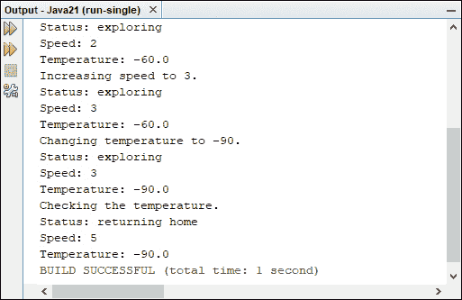

**图 1.1** `MarsApplication` 类的输出。

参考列表 1.2，你可以看到此应用程序的 `main()` 类方法中发生了以下情况：

- **第 4 行：** 创建并命名了 `main()` 方法。所有的 `main()` 方法看起来都像这样，正如你将在第 5 节“创建类和方法”中所看到的那样。目前，最需要重要的是 `static` 关键字，它表示该方法是所有 `MarsRobot` 对象共享的类方法。
- **第 5 行：** 使用该类作为模板创建了一个新的 `MarsRobot` 对象。该对象被命名为 `spirit`。
- **第 6–8 行：** 为 `spirit` 对象的三个实例变量赋值：`status` 设置为文本 `"exploring"`，`speed` 设置为 `2`，`temperature` 设置为 –60。
- **第 10 行：** 调用 `spirit` 对象的 `showAttributes()` 方法，它显示了实例变量 `status`、`speed` 和 `temperature` 的当前值。
- **第 11 行：** 调用 `System.out.println()` 方法会将括号内的文本显示在屏幕上。
- **第 12 行：** 在再次显示属性之前，将 `speed` 实例变量设置为 3。
- **第 15 行：** 在第三次显示属性之前，将 `temperature` 实例变量设置为 –90。
- **第 18 行：** 调用 `spirit` 对象的 `checkTemperature()` 方法。该方法检查 `temperature` 实例变量是否小于 –80。如果是，则将为 `status` 和 `speed` 分配新值。

### 注意

如果由于某些原因你无法使用 NetBeans 或其他 IDE 来编写 Java 程序，而必须使用 Java Development Kit（JDK），你可以在附录 D“使用 Java Development Kit”中找到安装方法。

## 类的组织与类行为

学习 Java 面向对象编程需要深入另外两个概念：继承和包。继承和包都是组织类的机制。

### 继承

继承是面向对象编程中最重要的概念之一，它直接影响你如何设计和编写自己的 Java 类。

继承是一种机制，允许一个类继承另一个类的行为和属性。通过继承，一个类会自动获得现有类的功能。新类只需要定义它与该现有类的何不同之处。

通过继承，所有的类——包括你创建的类和 Java 类库中的类——都按照层次结构排列。继承另一个类的类被称为子类。提供继承的类被称为父类。一个类只能有一个父类，但可以有无限数量的子类。子类继承其父类的所有属性和行为。

例如，假设你已经创建了一个 Java 类来实现一个探测机器人的所有功能。（这不需要费多少想象力。）

`MarsRobot` 类已经完成并成功运行。你在美国国家航空航天局（NASA）的老板要求你创建一个名为 `MercuryRobot` 的 Java 类。

这两种机器人具有相似的功能。它们都是在恶劣环境中工作并进行研究的科研型机器人。它们都会记录当前的温度和速度。

你的第一反应可能是打开 `MarsRobot.java` 源代码文件，将其复制到名为 `MercuryRobot.java` 的新源文件中，然后为新机器人的工作进行必要的修改。这是一个糟糕的冲动。

好得多的计划是找出 `MercuryRobot` 和 `MarsRobot` 的共同功能，并将它们组织成一个更具通用性的类层次结构。仅仅对于 `MarsRobot` 和 `MercuryRobot` 这两个类，这可能需要大量工作，但如果你以后之后还计划添加 `MoonRobot`、`UnderseaRobot` 和 `DesertRobot` 呢？将共同行为提取到可重用的父类中可以显著减少你必须完成的工作总量。

要设计一个可能用于此目的的类层次结构，请从顶层的 `Object` 类开始，它是所有 Java 类的顶点。

这些机器人所属的最通用的类可以被称为 `Robot`。通常，机器人可以被定义为一种自主探测设备。在 `Robot` 类中，你只需要定义符合设备属性、自我控制以及为探测而设计的行为。

在 `Robot` 之下可能有两个类：`WalkingRobot`（行走机器人）和 `DrivingRobot`（行驶机器人）。这些类之间明显的区别是一个通过步行移动，而另一个通过轮子移动。行走机器人的行为可能包括弯腰捡东西、躲避、跑步等。行驶机器人的行为则会有不同。图 1.3

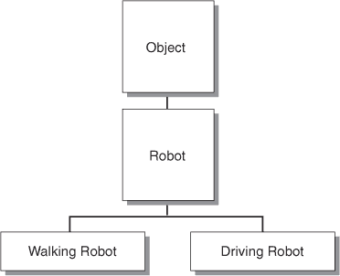

**图 1.3** 基础的 `Robot` 层次结构。

现在，该层次结构可以变得更加具体。

对于 `WalkingRobot`，你可能会有几个类：`ScienceRobot`（科学机器人）、`GuardRobot`（守卫机器人）、`SearchRobot`（搜索机器人）等等。作为替代，你可以提取更多功能，并为 `TwoLegged`（双腿）和 `FourLegged`（四腿）机器人设置中间类，每个类具有不同的行为（见图 1.4）。

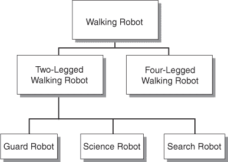

**图 1.4** 双腿和四腿行走机器人。

最后，层次结构构建完成，你为 `MarsRobot` 留出了位置。它可以是 `ScienceRobot` 的子类，`ScienceRobot` 是 `WalkingRobot` 的子类，`WalkingRobot` 是 `Robot` 的子类，而 `Robot` 是 `Object` 的子类。

`status`（状态）、`temperature`（温度）和 `speed`（速度）等属性出现在哪里？出现在它们最自然融入类层次结构的位置。因为所有机器人都需要记录环境温度，所以将 `temperature` 定义为 `Robot` 中的一个实例变量是有意义的。所有子类都拥有该实例变量。记住，你只需要在层次结构中定义一次行为或属性，它会被每个子类自动继承。

> **注意**
>
> 设计一个高效的类层次结构涉及大量的规划和修改。当你尝试将属性和行为放入层次结构时，你可能会发现将某些类移动到层次结构中不同位置的理由。目标是减少所需的重复功能（以及冗余代码）。

### 实践中的继承

Java 中的继承工作比在现实世界中简单得多。从父类继承时不需要遗嘱或法院。

当你创建一个新对象时，Java 会跟踪为该对象定义的每个变量，以及为该对象的每个父类定义的每个变量。通过这种方式，所有类组合成一个用于当前对象的模板，每个对象都填充了适用于其情况的信息。

方法的操作也类似。一个新对象可以访问其类及其父类中的所有方法名。这是在运行中的程序中使用方法时动态确定的。如果你调用一个对象的方法，JVM 首先检查该对象的类中是否存在该方法。如果未找到该方法，JVM 将在 true 类的父类中查找，依此类推，直到找到方法定义。这在图 1.5 中所示。

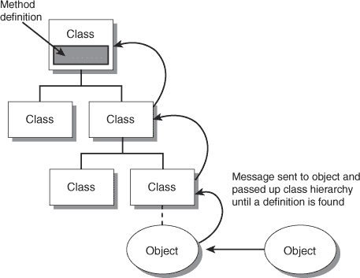

**图 1.5** 如何在类层次结构中定位方法。

当子类定义了一个与父类定义的方法在名称等方面方面的方法时，情况就会变得复杂。在这种情况下，首先找到的方法定义（从层次结构的底部开始向上查找）是使用的那个。

正因如此，你可以在子类中创建一个方法，防止父类中的方法被使用。要这样做，你需要赋予该方法与父类中方法相同的名称、返回类型和参数。这种程序在图 1.6 中所示，被称为“重写”。

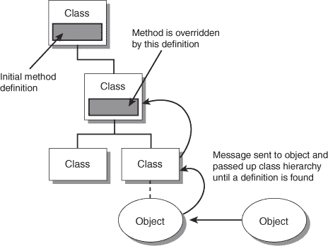

**图 1.6** 方法重写。

> **注意**
>
> Java 的继承形式被称为“单继承”，因为每个 Java 类只能有一个父类，尽管任何给定的父类可以有多个子类。
>
> 在其他面向对象的语言（如 C++）中，类可以拥有多个父类，并继承所有这些父类的变量和方法。这被称为多继承。Java 通过单继承简化了继承。

### 包

你在课程中创建的程序被放在 `com.java2days` 包中。包允许你对相关的类和接口。它们消除了类之间的命名冲突。

Java 类可以使用短名称 `Object` 或包含包名的全名 `java.lang.Object` 来引用。

你的 Java 类可以使用短名称引用 `java.lang` 包中的任何类。要使用任何其他包的类，你必须显式使用它们的全名或对特定包使用 `import` 命令。使用 `import` 告诉 Java 编译器在将类的短名称转换为全名时查找该包。

许多 Java 程序员避免使用 `*` 版本的 `import` 语句，而是更倾向于使用一系列 `import` 语句来标识程序中使用的每一个类。NetBeans 可以为你完成这一点。当你写一行代码并首次通过类的短名使用该类时，NetBeans 编辑器会在该行的左侧标记一个错误。点击该错误，会弹出一个菜单菜单，其中包含一个导入该类的命令。如果你选择了该命令，就会添加一个 `import` 语句。

类的所在包由 `package` 语句决定。你在本书中创建的许多类都存放在 `com.java21days` 包中，如下所示：

```java
package com.java21days;
```

该语句必须是程序的的第一行。如果省略了该语句，则该类将属于一个名为 `default package`（默认包）的未命名包。

## 总结

如果本节课程是你第一次接触面向对象编程，那么它可能看起来很理论化，而且让人有些无从从。许多人在第一次学习这种名为 `OOP` 的神秘方法论时，也有过同样的反应。

因为你的大脑第一次被填满了面向对象编程的概念和术语，你可能担心没有给 Java 语言的其他部分留留空间。英国人对于这种情况提供了两个非常实用的建议：

- 不要恐慌。
- 保持冷静，继续努力。

到此时，你应该对类、对象、属性和行为有了基本的理解。你还应该熟悉实例变量和方法。你将在下节课程中立即使用这些内容。

面向对象编程的其他方面，如继承和包，将在接下来的课程中进行更详细介绍。

在整本书中，你将一直使用面向对象编程。在 Java 中编写程序没有其他方法。

当你完成前七节课程时，你将拥有关于对象、类、继承以及该方法论的所有其他方面的实践经验。

## 问答

**Q 方法是定义在类内部的。如果它们看起来像函数，作用也像函数，为什么不叫它们函数？**

**A** 某些面向对象的编程语言确实称它们为函数（`C++` 将它们称为成员函数）。其他面向对象的语言区分了类或对象体内部和外部的函数，因为在这些语言中，使用不同的术语对于理解每个函数的工作原理非常重要。由于这种差异在其他语言中是相关的，而且 `method`（方法）一词现在在面向对象的术语中很常用，Java 也使用了这个术语。函数式编程语言也称它们为函数。

**Q 实例变量、方法与它们对应的类变量、类方法之间有什么区别？**

**A** 你在 Java 程序中执行的几乎所有操作都涉及实例（也称为对象）而不是类。然而，对于某些行为和属性，将它们存储在类中比存储在对象中更有意义。

例如，`java.lang` 包中的 `Math` 类包含一个名为 `PI` 的类变量，存储圆周的近似值。这个值不会改变，因此没有理由让该类的不同对象拥有自己独立的 `PI` 变量副本。相反，每个 `String` 对象都包含一个名为 `length()` 的方法，该方法显示该 `String` 中的字符数量。该值对于该类的每个对象来说可能是不同的，因此它必须是一个实例方法。

类变量在 Java 程序运行结束之前一直占用内存，因此应该谨慎使用。如果类变量引用了一个对象，那么该对象也将将留在内存中。这是一个导致程序占用过多内存并运行缓慢的常见问题。

**Q 当一个 Java 类导入了整个包时，它会增加该类的编译后大小吗？**

**A** 不会。Java 中 `import` 一词的使用具有误导性。`import` 关键字并不会将一个类或包的代码添加到你正在创建的类中。相反，它让在另一个类中引用这些类变得更加容易。

导入的唯一目的是当在 Java 语句中使用类名时缩短类名。如果你在代码中始终引用诸如 `javax.swing.JButton` 和 `java.util.Random` 这样的完整类名，而不是调用它们 `JButton` 和 `Random`，将会非常麻烦。

## 测验

通过完成这个包含三个问题的测验来复习本课的内容。

### 问题

**1.** 类的另一个词是什么？

**A.** 对象

**B.** 模板

**C.** 实例

**2.** 当你创建一个子类时，你必须关于该类定义什么？

**A.** 什么都不用定义。一切都已经定义过了。

**B.** 与其父类不同的部分

**C.** 关于类的所有内容

**3.** 类的实例方法代表什么？

**A.** 该类的属性

**B.** 该类的行为

**C.** 从该类创建的对象的行为

### 答案

**1.** B. 类是用于用于创建对象的抽象模板。

**2.** B. 与其父类不同的部分。

**3.** C. 从该类创建的对象的行为。

## 认证练习

以下问题是在 Java 认证考试中可能会遇到的类型。在不看本课的情况下回答它。

下面哪个说法是正确的？

**A.** 从同一类创建的对象必须完全相同。

**B.** 从同一类创建的对象可以具有不同的属性。

**C.** 对象继承自创建它的类的属性和行为。

**D.** 类继承自其子类的属性和行为。

答案可以在网站 [www.java21days.com](http://www.java21days.com) 获取。访问第一节页面并点击认证练习链接。

## 练习

为了扩展对本课内容的知识，请尝试以下练习：

1. 在 `MarsRobot` 类的 `main()` 方法中，创建一个名为 `opportunity` 的第二个 `MarsRobot` 机器人，设置它的实例变量并显示它们。
2. 为象棋具创建一个继承层次结构。决定 `color`、`startingPosition`、`forwardMovement` 和 `sideMovement` 实例变量应该在层次结构的什么位置定义。

在适用的情况下，练习答案可以在网站 [www.java21days.com](http://www.java21days.com) 获取。

# 第 2 节 编程的 ABC

Java 程序由类和对象组成，类和对象由方法和变量组成。方法由语句和表达式组成，表达式由运算符组成。

此时，你可能担心 Java 就像一套俄罗斯套娃娃娃。每个娃娃里面都有一个更小的娃娃，和它的外层一样复杂和详细。

本节课程移开了大娃娃，揭示了单行 Java 代码中可以执行的基本元素。涵盖的主题有：

- 语句和表达式
- 变量和原始数据类型
- 常量
- 注释
- 字面量
- 算术运算
- 比较
- 逻辑运算符

## 语句与表达式

你在 Java 程序中想要完成的任何任务都可以分解为一系列语句（statements）。在编程语言中，`statement`（语句）是一个导致某些操作发生的简单命令。

语句代表 Java 程序中执行的单一操作。以下是三个简单的 Java 语句：

点击此处查看代码图片

```java
int bowlingScore = 225;

System.out.println("Free the bound periodicals!");

song.duration = 230;
```

语句可以传递一个值，例如当两个数字相加时，或者比较两个变量以确定它们是否相等时。

产生值的语句称为 `expression`（表达式）。该值可以存储起来供程序稍后使用、立即在另一个语句中使用，或者被忽略。语句产生的值称为其 `return value`（返回值）。

表达式可能会产生数值型返回值，例如两个数字相加或相乘时。它也可能产生一个布尔值——`true` 或 `false`——甚至是一个 Java 对象。这些类型的语句将在本节稍后进行讨论。

虽然许多 Java 程序每行包含一条语句，但行并不决定一个语句的结束和另一个语句的开始。Java 中的每条语句都以分号字符（`;`）结束。程序员可以在一行中放置多个语句，并且它们可以成功编译，如下例所示：

点击此处查看代码图片

```java
spirit.speed = 2; spirit.temperature = 60;
```

为了让你的程序对其他程序员（以及你自己）更具可读性，你应该遵循每行只写一条语句的习惯。

Java 中的语句使用左大括号（`{`）和右大括号（`}`）进行分组。放在这些字符之间的语句组被称为 `block`（块或块语句）。你将在第 4 节“列表、逻辑与循环”中学习到更多相关内容。

## 变量与数据类型

在第 1 节“Java 入门”中的 `MarsRobot` 中，你使用了变量来跟踪信息。变量可以存储程序运行期间的信息。值可以在程序中任何语句的任何时候被更改——因此被称为 `variable`（变量）。

要创建一个变量，你必须给它一个名称并确定它将存储的信息类型。你还可以在创建变量的同时给它一个初始值。

Java 有三种变量：实例变量（instance variables）、类变量（class variables）和局部变量（local variables）。

正如你在第 1 节中所学的，实例变量定义了对象的属性。

类变量定义了整个对象类的属性，并适用于该类的所有实例。

局部变量用于方法定义内部甚至是方法内部更小的语句块。你只可以在 Java 虚拟机（JVM）执行该方法或块时使用它们。执行后它们就会消失。

尽管这三类变量的创建方式非常相似，但类变量和实例变量的使用方式与局部变量不同。你将在本节学习局部变量，并在第 3 节“处理对象”中探索实例变量和类变量。

### 创建变量


在 Java 程序中使用变量之前，你必须通过声明其名称和将存储的信息类型来创建变量。信息类型列在前面，后面是变量名。以下都是变量声明的示例：

```java
int loanLength;

String message;

boolean gameOver;
```

在这些示例中，`int` 类型表示整数，`String` 是一个持有文本的对象，而 `boolean` 用于布尔 `true`/`false` 值。

局部变量可以声明在方法内部的任何位置，就像其他 Java 语句一样，但它们必须在使用之前进行声明。

在接下来的示例中，在程序的 `main()` 方法顶端声明了三个变量：

点击此处查看代码图片

```java
public static void main(String[] arguments) {

    int total;

    String reportTitle;

    boolean active;
}
```

如果你正在创建多个相同类型的变量，可以通过逗号分隔变量名，在同一个语句中声明所有变量。以下语句创建了三个名为 `street`、`city` 和 `state` 的 `String` 变量：

```java
String street, city, state;
```

你可以通过使用等号（`=`）后跟值在创建变量时给其赋值。以下语句创建了新变量并赋予了它们初始值：

点击此处查看代码图片

```java
String zipCode = "02134";

int box = 350;

boolean pbs = true;

String name = "Zoom", city = "Boston”, state = "MA";
```

正如最后一个语句所示，你可以通过逗号分隔多个相同类型的变量并为其赋值。

在程序中使用局部变量之前，你必须给它们赋值，否则程序将无法成功编译。出于这个原因，为所有局部变量赋予初始值是一个良好的习惯。

实例或类定义根据其持有类型赋予初始值。

数值变量的默认值为 `0`，布尔值的默认值为 `false`。对于 `String` 变量和任何其他对象，默认值为 `null`，这是一个表示“无”的特殊值。对于字符，默认值为 `\u0000`。

#### 变量命名

Java 变量名必须以字母、下划线（`_`）或美元符号（`$`）开头。变量名不能以数字开头，不能只有一个下划线。第一个字符之后，变量名可以包含字母、数字、下划线字符或美元符号的任意组合。

注意：此外，Java 语言使用了 Unicode 字符集，包含了大量的国际字母。

在命名变量并在程序中使用时，重要的是记住 Java 是区分大小写的：字母的大小写必须一致。因此，程序可以有一个名为 `X` 的变量和名为 `x` 的变量（因此 `Rose` 不是 `rose` 不是）。

在这些课程以及其他地方，Java 变量被赋予包含多个单词的有意义名称。为了更容易识别单词，使用了以下通用规则：

- 变量名的第一个字母小写。
- 变量名中随后的每个单词都以大写字母开头。
- 所有其他字母均为小写。

以下变量声明遵循该规则：

```java
JButton loadFile;

int localAreaCode;

boolean quitGame;
```

这种规则被称为 `camelCase`（驼峰命名法），因为大写字母看起来像驼峰。

虽然变量名中允许下划线，但它们通常仅用于一种情况：当变量的整个名称大写时，每个单词之间用下划线分隔，如下例所示：

```java
static int DAYS_IN_WEEK = 7;
```

你将在本节稍晚些部分看到为什么变量名可能会这样大写。

尽管允许在变量名中使用美元符号，但永远不应该在变量名中使用它们。Java 的官方文档一直反对使用它们，因此程序员遵循了这一习惯。

#### 变量类型

除了名称，变量声明还包含所存储的信息的数据类型。该类型可以是以下任意一种：

- 其中一种原始数据类型，例如 `int` 或 `boolean`
- 类的名称
- 一个数组

你将在第 4 节中学习如何操作数组变量。本节将重点介绍其他变量类型。

### 数据类型

Java 有八种基本数据类型，用于存储整数、浮点数、字符和布尔值。这些类型通常被称为 `primitive types`（原始类型），因为它们是语言的内置部分，而不是对象类，这样更容易使用。无论你运行在什么操作系统和平台上，这些数据类型的大小和特性都是相同的，与其他编程语言中的某些数据类型不同。

可以使用四种数据类型来存储整数，每种类型持有不同的数值范围，如表 2.1 所示的代码输入编辑器。

**列表 2.1** `Variables.java` 的完整文本

```java
1: package org.java21;
2: 
3: public class Variables {
4: 
5:     public static void main(String[] arguments) {
6:         final char UP = 'U';
7:         byte initialLevel = 12;
8:         short location = 13250;
9:         int score = 3500100;
10:        boolean newGame = true;
11: 
12:        System.out.println("You have reached level " + initialLevel
13:             + " with a score of " + score + " at location " + location + ".");
14:        System.out.println("Press " + UP + " to go up.");
15:        System.out.println("Is this a new game? " + newGame);
16:     }
17: }
```

通过选择 File、Save 保存文件。如果程序没有错误，NetBeans 会自动编译。通过选择 Run、Run File 运行程序。此程序产生如图 2.1 所示的输出。

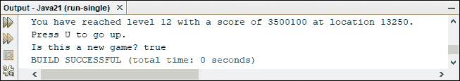

**图 2.1** 创建并显示变量值。

Java 还有一个 `System.out.print()` 方法，它可以显示字符串而不会用换行符结束。你可以调用 `print()` 而不是 `println()`，以便在同一行内显示多个字符串。

### 注释

提高程序可读性最有效的方法之一是使用`注释`，即程序中解释代码含义的文本。Java 编译器在为 Java 源文件准备字节码版本时（该版本可以被 `JVM` 作为类运行）会忽略注释，因此使用注释不会产生任何性能损失。

你可以在 Java 程序中使用三种类型的注释。

单行注释以两个斜杠字符（`//`）开头。从斜杠开始到行尾的所有内容都被视为注释，并被编译器忽略，如下句所示：

点击此处查看代码图片

```java
int creditHours = 3; // 设置课程的学分
```

编译器忽略斜杠之后的所有内容。对于编译器而言，前一行代码的内容是这样的：

```java
int creditHours = 3;
```

多行注释以 `/*` 开头，以 `*/` 结束。这两个分隔符之间的所有内容都被视为注释，即使跨越多行，如下代码所示：

点击此处查看代码图片

```java
/* 此程序会在你点击保存按钮时偶尔删除
硬盘上的所有文件，并使其永久无法使用。 */
```

Javadoc 注释以 `/**` 开头，以 `*/` 结束。这两个分隔符之间的所有内容都被视为关于类及其方法如何工作的官方文档。

Javadoc 注释旨在供 Java 开发包（`JDK`）中 `javadoc` 等工具读取。该工具利用这些注释来创建网页，记录 Java 类的功能，显示它与其父类及子类的关系，并描述该类的每一个方法。

#### 提示

Java 类库中每个类的官方文档都是从 Javadoc 注释生成的。你可以在 [`docs.oracle.com/en/java/javase/12/docs/api`](https://docs.oracle.com/en/java/javase/12/docs/api) 查看当前的 Java 文档。

有关如何使用 `javadoc` 工具的更多信息，请参阅附录 D，“使用 Java 开发包](#app04.xhtml_app04)”。

### 字面量

除了变量外，你可以在 Java 语句中以字面量的形式处理值。`字面量`是任何直接表示数值、文本或其他信息的数字。

下面的赋值语句使用了字面量：

```java
int year = 2019;
```

字面量 `2019` 代表整数值 2019。数字、字符和字符串都是字面量的示例。Java 拥有不同类型的字面量，分别表示不同类型的数字、字符、字符串和布尔值。

#### 数字字面量

Java 有几种整数字面量。例如，数字 `4` 是 `int` 变量类型的整数字面量。它也可以赋值给 `byte` 和 `short` 变量，因为该数字足够小，可以容入这些整数类型。大于 `int` 能容纳范围的整数字面量被视为 `long` 类型。你还可以通过在数字后添加字母 `L`（大写或小写均可）来指示字面量应为 `long` 整数，如下所示：

```java
pennyTotal = pennyTotal + 4L;
```

该语句将格式化为 `long` 的值 `4` 加到 `pennyTotal` 变量的当前值。

要将负数表示为字面量，在其前面加上减号（`-`），例如 `-45`。

浮点字面量使用点字符（`.`）作为小数点，正如你预期的。下面的语句使用字面量设置了一个 `double` 变量：

```java
double average = .344;
```

所有浮点字面量都被视为 `double` 变量类型而不是 `float`。要指定 `float` 字面量，请在字面量后添加字母 `F`（大写或小写均可）：

```java
float piValue = 3.1415927F;
```

你可以在浮点字面量中使用指数，通过使用字母 `e` 或 `E` 后跟一个负指数。以下语句使用了指数计数法：

```java
double x = 12e22;

double y = 19E-95;
```

大整数字面量可以包含下划线字符（`_`），以提高人类的可读性。下划线的作用与大数字中的逗号相同，使其数值更直观。请考虑这两个例子，其中一个使用了下划线：

```java
int jackpot = 3500000;

int jackpot = 3_500_000;
```

这两个例子都等于 3,500,000，第二个语句中更容易看出。Java 编译器会忽略下划线。

Java 还支持使用二进制、八进制和十六进制数字的数字字面量。

二进制是一种二进制制，只使用值 0 和 1。由 1 和 0 组成的值是计算机最简单的形式，也是计算的基础部分。从 0 开始计数，二进制值为 0, 1, 10, 11, 100。

八进制是一种八进制制，意味着它可以表示 0 到 7。十六进制是一种十六进制制，可以表示 0 到 9 以及 A、B、C、D、E 和 F。

#### 布尔字面量

布尔字面量 `true` 和 `false` 是你在给 `boolean` 变量赋值或在语句中使用布尔值时可以使用的值。

以下语句设置了一个 `boolean` 变量：

```java
boolean chosen = true;
```

#### 注意

如果你编写过其他语言，你可能期望值 1 等于真，0 等于假。在 Java 中并非如此；你必须使用值 `true` 和 `false` 来表示布尔值。

注意，字面量 `true` 没有引号。如果有，Java 编译器会认为它是一个字符串。

#### 字符字面量

字符字面量表示为由引号包围的单个字符，例如 `'a'`、`'#'` 和 `'3'`。你可能熟悉 ASCII 字符集，它包含 128 个字符，包括字母、数字、标点和其他对计算有用的字符。Java 通过 16 位 Unicode 标准支持 ASCII 以及数千个字符。

某些字符字面量表示无法直接打印或通过键盘访问的字符。表 2.2 列出了表示这些特殊字符以及 Unicode 字符集的代码。

| **转义** | **含义** |
| --- | --- |
| `\n` | 换行 |
| `\t` | 制表符 |
| `\b` | 退格 |
| `\r` | 回车 |
| `\f` | 换页 |
| `\\` | 反斜杠 |
| `\'` | 单引号 |
| `\"` | 双引号 |
| `\`*d* | 八进制 |
| `\x`*d* | 十六进制 |
| `\u`*d* | Unicode 字符 |

**表 2.2** 字符转义代码

在表 2.2 中，八进制、十六进制和 Unicode 转义码中的字母 `d` 代表一个数字或十六进制数字（`a` 到 `f` 或 `A` 到 `F`）。在本节中你已经遇到了这些代码之一：作为字符数据类型的默认值的 `\u000`。

## 字符串字面量

在 Java 程序中可以使用的最终字面量表示一个字符字符串。Java 中的字符串是一个对象，而不是一种原始数据类型。字符串不像在其他编程语言（如 `C`）那样存储在数组中。

由于字符串是对象，因此可以使用方法来组合字符串、修改字符串并判断两个字符串是否具有相同的值。

字符串字面量由双引号内的一系列字符组成，如下所示：

点击此处查看代码图像

```java
String quitMsg = "Are you sure you want to quit?";

String password = "drowssap";
```

字符串可以包含表 2.2 列出的字符转义码，如下所示：

点击此处查看代码图像

```java
String example = "Socrates asked, \"Hemlock is poison?\"";

System.out.println("Sincerely,\nMillard Fillmore\n");

String title = "Sams Teach Yourself Node in the Commode\u2122";
```

在最后一个示例中，Unicode 代码序列 `\u2122` 在配置为支持 Unicode 的设备上产生 ™ 符号。

### 注意事项

尽管 Java 支持传输 Unicode 字符，但计算机或移动设备也必须支持它，字符在程序运行时才能显示。Unicode 支持提供了一种为支持标准的系统对其字符进行编码的方法。Java 支持显示任何由主机字体表示的 Unicode 字符。

有关 Unicode 的更多信息，请访问 Unicode 联盟网站：[www.unicode.org](http://www.unicode.org)。

虽然字符串字面量的用法与程序中的其他字面量类似，但在 JVM 内部对它们的处理方式不同。

对于字符串字面量，Java 将该值存储为 `String` 对象。你不需要像处理其他对象时那样显式地创建一个新对象，因此字符串字面量的处理起来和原始数据类型一样简单。字符串在这一方面是非原始的：所有基本类型在使用时都不被存储为对象。你将在本节中学习到更多关于字符串和 `String` 类的知识。

## 表达式和运算符

*表达式*是一个可以传递值的语句。最常见的表达式是数学类表达式，如以下示例所示：

```java
int x = 13;

int y = x;

int z = x * y;
```

这三个语句都是表达式；它们传递了可以赋值给变量的值。第一个将字面量 `13` 赋值给变量 `x`。第二个将变量 `x` 的值赋值给变量 `y`。在第三个表达式中，使用乘法运算符 `*` 乘以整数 `x` 和 `y`，并将结果存储在整数 `z` 中。

表达式可以是变量、字面量和运算符的任何组合。它也可以是一个方法调用，因为方法会将值返回给调用该方法的对象或类。

表达式所传递的值被称为*返回值*。该值可以赋值给变量，并在你的 Java 程序中以许多其他方式使用。

Java 中的大多数表达式都使用如 `*` 等运算符。*运算符*是用于数学函数、赋值语句和逻辑比较的特殊符号。

### 算术

五个运算符用于完成 Java 中的基本算术，如表 2.3 所示。

| **运算符** | **含义** | **示例** |
| --- | --- | --- |
| `+` | 加法 | `3 + 4` |
| `-` | 减法 | `5 - 7` |
| `*` | 乘法 | `5 * 5` |
| `/` | 除法 | `14 / 7` |
| `%` | 取模 | `20 % 7` |

**表 2.3** 算术运算符

每个运算符接受两个操作数，分别位于运算符两侧。减法运算符也可以用于对操作数取反，这等同于将该操作数乘以 `-1`。

执行除法时要注意使用的数字类型。如果你将除法操作存储在整数中，结果将截断为下一个较小的整数，因为 `int` 数据类型无法处理浮点数。例如，表达式 `31 / 9` 如果存储为整数，结果为 3。

使用 `%` 运算符的取模除法产生除法操作的余数。表达式 `31 % 9` 等于 4，因为 31 除以 9 的整数部分结果为 3，余数为 4。

需要注意的是，许多涉及整数的算术运算都会产生 `int`，无论操作数的原始类型如何。如果你正在处理其他数字（例如浮点数或 `long` 整数），你应该确保操作数的类型与你希望最终得到的类型一致。

下一个项目是 `Weather`，这是一个 Java 类，演示了如何在语言中执行简单的算术运算。

### 列表 2.2：`Weather.java` 的完整文本

点击此处查看代码图像


```java
1: package com.java;
2: 
3: public class Weather {
4:     public static void main(String[] arguments) {
5:         float fah = 86;
6:         System.out.println(fah + " degrees Fahrenheit");
7:         // To convert Fahrenheit into Celsius
8:         // begin by subtracting 32
9:         fah = fah - 32;
10:        // Divide the answer by 9
11:        fah = fah / 9;
12:        // Multiply that answer by 5
13:        fah = fah * 5;
14:        System.out.println(fah + " degrees Celsius");
15: 
16:        float cel = 33;
17:        System.out.println(cel + " degrees Celsius");
18:        // To convert Celsius into Fahrenheit
19:        // begin by multiplying by 9
20:        cel = cel * 9;
21:        // Divide the answer by 5
22:        cel = cel / 5;
23:        // Add 32 to the answer
24:        cel = cel + 32;
25:        System.out.println(cel + " degrees Fahrenheit");
26:    }
27: }
```

通过选择 `Run`、`Run File` 来运行程序。它产生如图 2.2 所示的输出。

**图 2.2** 使用表达式转换温度。（占位符）

### 关于赋值的更多

给变量赋值是一个表达式，因为它产生一个值。利用这种语言特性，你可以以非寻常的方式组合赋值语句：

```java
x = y = z = 7;
```

当执行此语句时，三个变量 `x`、`y` 和 `z` 最终都得到 `7`。

赋值表达式的右侧始终在赋值发生之前计算。这使得使用如下表达式成为可能：

```java
int x = 5;

x = x + 2;
```

在表达式 `x = x + 2` 中，首先发生的是计算 `x + 2`。然后，将结果 `7` 赋值给 `x`。

使用表达式为变量赋值是编程中的一项常见任务。在这些情况下，有几种运算符被专门用于此类。表 2.4 显示了这些赋值运算符以及它们在功能上等同的表达式。

| 表达式 | 含义 |
| :--- | :--- |
| `x += y` | `x = x + y` |
| `x -= y` | `x = x - y` |
| `x *= y` | `x = x * y` |
| `x /= y` | `x = x / y` |

**表 2.4** 赋值运算符

这些简写赋值运算符在功能上等同于它们所替换的较长赋值语句。然而，如果赋值语句的任何侧都是复杂表达式的一部分，则在某些情况下运算符不等价。

### 注意

你是否好奇简写运算符何时会产生与其较长形式不同的结果？如果 `x` 等于 `20` 且 `y` 等于 `5`，以下两个语句产生的值并不相同：

```java
x = x / y + 5;

x /= y + 5;
```

第一条语句产生的 `x` 值为 `9`，第二条语句产生的 `x` 值为 `2`。当你对一个表达式的作用产生疑问时，通过使用多个赋值语句来简化它，不要使用简写运算符。

### 递增与递减

编程中要求的一项极其常见的任务是对整数变量加或减 `1`。这些表达式具有特殊的运算符，称为递增运算符和递减运算符。递增变量意味着其值加 `1`，递减变量意味着减去 `1`。

递增运算符是 `++`，递减运算符是 `--`。这些运算符紧跟或位于变量名之前，如下代码所示：

```java
int x = 7;

x++;
```

在这个示例中，语句 `x++` 将变量 `x` 从 `7` 增到 `8`。

递增和递减运算符也可以放在变量名之前。放置的位置会影响涉及这些运算符的表达式的值。

如果递增和递减运算符列在变量名之前，称为前缀运算符；如果在之后则称为后缀运算符。

在如 `count--;` 这样的简单表达式中，使用前缀或后缀运算符产生相同的结果，使得这些运算符是可以互换的。然而，当递增和递减操作是表达式的一部分时，选择前缀还是后缀运算符是非常重要的。

考虑以下代码：

```java
int x, y, z;

x = 42;

y = x++;

z = ++x;
```

此代码中的最后两个表达式产生不同的结果，因为前缀操作和后缀操作之间存在差异。

当你在表达式对变量使用后缀运算符时，变量的值在递增或递减之前会在表达式中求值。因此，在 `y = x++` 中，`y` 在 `x` 增加 `1` 之前接收了 `x` 的值。

当你在表达式对变量使用前缀运算符时，变量在该表达式中求值之前先进行递增或递减。因此，在 `z = ++x` 中，`x` 在值赋值给 `z` 之前先增加了 `1`。

上述代码示例的结果是 `y` 等于 `42`，`z` 等于 `44`，`x` 等于 `44`。

如果你仍然难以理解，这里再次给出该示例，现在加上了描述每个步骤的注释：

点击此处查看代码图像

```java
int x, y, z; // 声明了 x, y 和 z

x = 42;      // 给 x 赋值 42

y = x++;     // 在 x 递增之前给 y 赋值 x 的 (42)

             // 然后 x 增加到 43

z = ++x;     // x 增加到 44，然后给 z 赋值 x 的值
```

### 注意

在复杂表达式中使用递增和递减运算符可能会产生你意外的结果。

“在 `x` 递增之前将 `x` 赋值给 `y`”的概念并不完全准确，因为 Java 在将值赋值给左侧之前会评估表达式右侧的所有内容。

Java 在处理表达式之前会存储某些值，以使后缀运算符按照本节中描述的方式工作。

如果你从包含前缀和后缀运算符的复杂表达式没有得到预期的结果，请尝试将表达式拆分为多个语句以简化它。

### 比较

Java 有几种运算符用于在变量之间、变量与字面量之间或程序中其他类型的信息之间进行比较。

这些运算符用于返回布尔值 `true` 或 `false` 的表达式，取决于所 fact 的比较是否为真。表 2.5。

| 运算符 | 含义 | 示例 |
| :--- | :--- | :--- |
| `==` | 等于 | `x == 3` |
| `!=` | 不等于 | `x != 3` |
| `<` | 小于 | `x < 3` |
| `>` | 大于 | `x > 3` |
| `<=` | 小于等于 | `x <= 3` |
| `>=` | 大于等于 | `x >= 3` |

**表 2.5** 比较运算符

下面的示例显示了一个比较运算符：

```java
boolean isHip;

int age = 37;

isHip = age < 30;
```

表达式 `age < 30` 根据 `age` 的值产生 `true` 或 `false`。

### 逻辑运算符

产生布尔值的表达式（如比较）可以组合形成更复杂的表达式。这是通过逻辑运算符处理的，它们用于 `AND`、`OR`、`XOR` 和 `NOT`。

对于 `AND` 组合，使用运算符 `&` 或 `&&`。当两个布尔表达式通过这些运算符连接时，只有当两个表达式都为真，组合表达式才返回 `true` 值。

考虑这个示例：

点击此处查看代码图像

```java
boolean extraLife = (score > 75000) & (playerLives < 10);
```

这个表达式组合了两个比较表达式：`score > 75000` 和 `playerLives < 10`。如果两个表达式都为真，则 `true` 值赋值给变量 `extraLife`。

`&` 和 `&&` 运算符之间的差异在于 JVM 对组合表达式做了多少工作。如果使用 `&`，无论如何 `&` 两侧的表达式都会被评估。如果使用 `&&` 且 `&&` 的左侧为假，则 `&&` 的右侧表达式永远不会被评估。`&&` 运算符是高效的，因为没有执行不需要的工作。在前面的代码示例中，如果 `score` 不大于 `75000`，则不需要考虑 `playerLives` 是否小于 `10`。

对于 `OR` 组合，使用逻辑运算符 `|` 或 `||`。当任一个布尔表达式为真时，这些组合表达式返回 `true` 值。

考虑这个示例：

点击此处查看代码图像

```java
boolean extralife = (score > 75000) || (playerLevel == 0);
```

这个表达式组合了两个比较表达式：`score > 75000` 和 `playerLevel == 0`。如果任一个表达式为真，则 `true` 值赋值给变量 `extralife`。只有当这两个表达式都为假时，才会赋值 `false` 值。

注意这里使用的是 `||` 而不是 `|`。由于这种用法，如果 `score > 75000` 为真，`extralife` 将被设为 `true`，且第二个表达式永远不会被评估。

`XOR`（异或）组合包含一个逻辑运算符 `^`。只有当它组合的两个布尔表达式的值相反时，结果才为 `true` 值。如果两者都为真或都为假，`^` 运算符将产生 `false` 值。

`NOT`（非）组合使用逻辑运算符 `!`，后面跟一个单一表达式。它反转布尔表达式的值，这就像负号反转数字的正负号（符号）一样。例如，如果表达式 `age < 30` 返回 `true` 值，则 `!(age < 30)` 返回 `false` 值。

当你第一次遇到这些逻辑运算符时，可能会觉得它们是不合逻辑的。你会有很多机会去使用它们，特别是在第 5 节。

## 运算符优先级

当一个表达式中使用多个运算符时，Java 有一套优先级层次来确定运算符的求值顺序。在许多情况下，这种优先级决定了表达式的整体值。

例如，考虑以下表达式：

```java
y = 6 + 4 / 2;
```

变量 `y` 等于 `5` 或 `8`，取决于先处理哪个算术运算。如果表达式 `6 + 4` 先处理，则 `y` 等于 `5`。否则，`y` 等于 `8`。

通常，从第一个到最后一个求值顺序如下：

1. 递增和递减操作
2. 算术运算
3. 比较
4. 逻辑运算
5. 赋值表达式

如果两个操作的优先级相同，则表达式中左侧的操作将在右侧的操作之前被处理。表 2.6 显示了 Java 中各种运算符的特定优先级。表格中靠上的运算符会被先求值。

| 运算符 | 注释 |
| --- | --- |
| `. [] ()` | 括号 (`()`) 用于组合表达式。点 (`.`) 用于访问对象和类中的方法和变量。方括号 (`[]`) 用于数组。 |
| `++ -- ! ~ instanceof` | `instanceof` 运算符根据对象是否为命名类或其任何子类的实例来返回 `true` 或 `false`。 |
| `new (type)expression` | `new` 运算符用于创建类的新实例。在这种情况下，括号用于将值转换为另一种类型。 |
| `* / %` | 乘法、除法、模 |
| `+ -` | 加法和减法 |
| `<< >> >>>` | 位左移和右移 |
| `< > <= >=` | 关系比较测试 |
| `== !=` | 等于 |
| `&` | `AND` |
| `^` | `XOR` |
| `&#124;` | `OR` |
| `&&` | 逻辑 `AND` |
| `&#124;&#124;` | 逻辑 `OR` |
| `? :` | 三元运算符 |
| `= += -= *= /= %= ^=` | 简写赋值 |
| `&= &#124;= >>= >>>=` | 简写赋值 |

**表 2.6** 运算符优先级

表 2.6 中的几个运算符将在后续课程中介绍。

回到表达式 `y = 6 + 4 / 2`，表 2.6 显示除法在加法之前求值，因此 `y` 的值等于 `8`。

要更改表达式的求值顺序，请在先求值的表达式周围加上括号。你可以将一组括号嵌套在另一组括号内部，以确保表达式按所需的顺序求值；最内层的括号表达式先求值。

以下表达式的结果为 `5`：

```java
y = (6 + 4) / 2
```

`5` 是结果，是因为 `6 + 4` 先被计算，然后将结果 `10` 除以 `2`。

括号也可以提高表达式的可读性。如果表达式的优先级对你来说并不直观，添加括号来强制实施所需的优先级可以使语句更容易理解。

## 字符串算术

如前所述，`+` 运算符在数学世界之外具有双重身份。它还可以连接两个或多个字符串。

*concatenate*（连接）一词的意思是“链接两个事物”。由于未知原因，在计算机编程中描述组合两个字符串的行为时，它是首选动词，胜过了 *paste*、*glue*、*affix*、*combine*、*link*、*smush together* 和 *conjoin*。

在几个代码示例中，你见过如下形式的语句：

点击查看代码图像

```java
String brand = "Jif";

System.out.println("Choosy mothers choose " + brand);
```

这两行代码将显示以下文本：

```text
Choosy mothers choose Jif
```

`+` 运算符将字符串、其他对象和变量组合成单个字符串。在前面的示例中，字面量 `"Choosy mothers choose "` 连接到 `String` 对象 `brand` 的值。

Java 中处理连接运算符变得更简单，是因为该运算符可以处理。

当计算机的内存远小于现在且每个字节都至关重要时，`byte` 这样的小数据类型更为必要。现在，由于内存充足且硬盘空间以 TB（太字节）计算，使用 `int` 这样更大的数据类型更好，以确保你有足够的空间来存储特定变量中所有可能的值。

### 问

为什么 Java 拥有这些用于算术和赋值的简写运算符？那样读起来真的很难。

### 答

Java 的语法基于 C++，而 C++ 又基于 C（具有更像俄罗斯套娃的行为）。C 是一门看重编程能力优于可读性的语言，而简写运算符就是这种设计优先的遗产之一。在程序中使用它们并不是强制的，因为有有效的替代方案，所以如果你愿意，你可以在自己的编程中避免使用它们。但随着你对 Java 变得越来越熟悉，你可能会发现它们读起来和那些长的替代方案一样简单。

### 问

如果我创建了一个没有包含包语句（`package` statement）的程序，是否意味着它不在任何包中？

### 答

每一个 Java 程序都属于一个包。当 `package` 语句出现在程序中时，该程序就是该命名包的一部分。你在本节中创建的所有程序都在 `com.java21days package` 包中。

没有 `package` 语句的程序被放入默认包中，该包没有名称。虽然可以在这个未命名包中创建程序，但对你创建的每个 Java 程序始终指定一个包是一个良好的习惯。

### 测验

通过完成这个包含三道题的测验来复习本节内容。

#### 题目

**1.** 下列字面量中哪个是 `boolean` 变量有效？

A. `"false"`

B. `false`

C. `10`

**2.** 下列中哪一个不是 Java 变量命名的规范？

A. 在变量名的第一个单词之后，每个随后的单词都以大写字母开头。

B. 变量名的第一个字母是小写的。

C. 所有字母都大写。

**3.** 下列哪种数据类型持有从 `–32,768` 到 `32,767` 的数字？

A. `char`

B. `byte`

C. `short`

#### 答案

**1.** B. 在 Java 中，`boolean` 只能是 `true` 或 `false`。如果你在值周围加上引号，它会被处理为 `String` 而不是两个 `boolean` 值之一。

**2.** C. 常量名使用大写是为了将它们与其他变量区分开。

**3.** C. `short` 原始数据类型具有该范围的值。

### 认证练习

以下问题是你可能会在 Java 编程认证考试中遇到的类型题目。请在不重新看本节内容的情况下回答它。

下列哪些数据类型可以保存数字 `3,000,000,000`（即 30 亿）？

A. `short`、`int`、`long`、`float`

B. `int`、`long`、`float`

C. `long`、`float`

D. `byte`

答案可以在 [www.java21days.com](http://www.java21days.com) 找到。访问第 2 节页面并点击认证练习链接。

## 练习

为了扩展你对本节涵盖主题的知识，请尝试以下练习：

1. 创建一个程序，计算如果 `14,000` 美元的投资在第一年价值增长 `40%`，第二年损失了 `1,500` 美元，第三年增长了 `12%`，那么它的价值是多少。
2. 写一个程序，显示两个数字，并使用 `/` 和 `%` 运算符显示它们除法后的商和余数。使用 `\t` 字符转义代码在输出中使用制表符（tab）分隔商和余数。

在适用情况下，练习答案可在 [www.java21days.com](http://www.java21days.com) 提供。

## 第 3 节：使用对象

Java 是一种面向对象的编程语言。在 Java 中工作时，你主要使用对象来完成工作。你创建对象、修改它们、更改它们的变量、调用它们的方法，并将与其他对象结合。你开发类，从这些类创建对象，并与其他类和对象一起使用。

在本节中，你将在执行这些任务时大量使用对象：

- 创建对象


- 测试和修改对象的类变量、实例变量
- 调用对象的方法
- 将对象从一个类转换为另一个类

### 创建新对象

当你编写 Java 程序时，你定义了一组类。正如你在第 1 节“Java 入门”中所学的那样，类是用于创建实例的模板。这些对象被称为*实例*（instances），是自包含的元素。在本节中，你将学习如何创建给定类的实例。当你在第 2 节“编程的 ABC”中使用字符串时，字符串字面量（双引号内的一系列字符）可以用于创建`String`实例。

> **注意**
>
> 数字和字符呢？它们也创建对象吗？不是。数字和字符的原始类型创建数字和字符。在第 5 节“创建类和方法”中，你将学习如何使用对象表示原始值。

#### 使用`new`

创建新对象时，你使用`new`运算符配合类名。类名后面跟着括号，如下三个示例所示：

点击查看图像

```java
String name = new String("Kamala Khan");

URL address = new URL("https://www.informit.com");

MarsRobot robbie = new MarsRobot();
```

括号是重要的，不能省略。它可以是空的，此时创建类的简单对象。括号也可以包含参数，以确定实例变量或其他初始属性的值。

这里是两个带有参数创建的对象：

点击查看图像

```java
Random seed = new Random(606843071);

Point pt = new Point(0, 0);
```

括号内的参数数量和类型是由类本身定义的，使用一种特殊的方法，称为*构造函数*（constructor，在本节稍后介绍）。如果你尝试用错误的参数数量或错误的类型创建类的实例，或者在需要参数时没有提供参数，程序在编译时会发生错误。

本节第一个项目是一个 Java 应用，它使用字符串标记（tokens）来检查股票价格数据。在 NetBeans 中，为`com.java21days`包创建一个名为`TokenTester`的新空 Java 文件，并将列表 3.1 中的代码作为其源代码。该程序通过两种不同的方式使用`new`创建了`StringTokenizer`对象，然后显示这些对象包含的每个标记。

**列表 3.1** `TokenTester.java`的全文

点击此处查看代码图像

```java
 1: package com.java21days;

 2:

 3: import java.util.StringTokenizer;

 4:

 5: class TokenTester {

 6:

 7:     public static void main(String[] arguments) {

 8:         StringTokenizer st1, st2;

 9:

10:         String quote1 = "TWTR 37.14 7.28";
 11:         st1 = new StringTokenizer(quote1);
 12:         System.out.println("Token 1: " + st1.nextToken());
 13:         System.out.println("Token 2: " + st1.nextToken());
 14:         System.out.println("Token 3: " + st1.nextToken());
 15:

 16:         String quote2 = "RHT@185.98@80";
 17:         st2 = new StringTokenizer(quote2, "@");
 18:         System.out.println("\nToken 1: " + st2.nextToken());
 19:         System.out.println("Token 2: " + st2.nextToken());
 20:         System.out.println("Token 3: " + st2.nextToken());
 21:     }
 22: }
```

通过选择`File`、`Save`或点击 NetBeans 栏上的`Save All`来保存此文件。通过选择`Run`、`Run File`运行应用程序，以查看在图 3.1 中显示的输出。

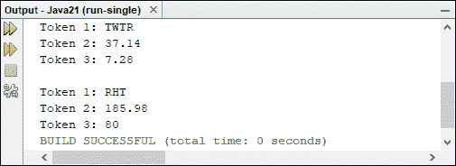

**图 3.1** 显示`StringTokenizer`对象的标记。

在应用程序中，创建了两个`StringTokenizer`对象，它们使用了构造函数的不同参数。

第一个对象是使用带有一个参数的`new StringTokenizer()`创建的，名为`quote1`的`String`对象（第 11 行）。这创建了一个`StringTokenizer`对象，它使用默认分隔符，即空白字符、制表符、换行符、回车符或分页符。

如果字符串中包含这些任何一个字符，它就会被用于分割字符串。由于`quote1`字符串包含空格，这些空格被用作分割标记的分隔符。第 12–14 行显示了三个标记的值：`TWTR`、`37.14`和`7.28`。

示例中的第二个`StringTokenizer`对象在第 16 行构造时有两个参数——一个名为`quote2`的`String`对象和一个`@`符号字符（`@`）。第二个参数表示`@`字符应该被用作标记之间的分隔符。第 17 行创建的`StringTokenizer`对象包含三个标记：`RHT`、`185.98`和`80`。

### 对象是如何构造的

当你使用`new`操作符时，会发生几件事。会创建给定类的新实例，为它分配内存，并调用给定类中定义的一个特殊方法。该方法被称为*构造函数*。

使用构造函数是创建类的新实例的方法。构造函数初始化新对象及其变量，创建该对象所需的任何其他对象，并执行对象为了自初始化所需的任何额外操作。

一个类可以有多个不同的构造函数，每个构造函数都有不同数量或类型的参数。当你使用`new`时，你可以在参数列表中指定不同的参数，并调用对应这些参数的构造函数。

在`TokenTester`程序中，多个构造函数定义使得`StringTokenizer`类能够通过对`new`操作符的不同用法完成不同的任务。当你创建自己的类时，可以根据需要定义任意数量的构造函数来实现类的行为。

一个类中没有两个构造函数具有相同数量和类型的参数，因为这是区分构造函数的唯一方式。

如果一个类没有定义构造函数，在创建该类的对象时，默认会调用一个无参数的构造函数。该构造函数的作用只是调用其父类中相同的构造函数。

> **注意**
>
> 默认构造函数只存在于没有定义任何构造函数的类。一旦你在类中定义了至少一个构造函数，你就不能指望存在一个无参数的默认构造函数。

### 内存管理

如果你熟悉其他面向对象的语言，你可能会奇怪`new`操作符是否有一个相反的操作，在对象不再需要时销毁它。

Java 的内存管理是动态且自动的。当你创建一个新对象时，Java 会自动为该对象分配所需的内存。你不需要显式地为对象分配内存。Java 虚拟机（JVM）会为你完成。

由于 Java 内存管理是自动的，当你完成对对象的使用时，不需要释放它所占用的内存。在大多数情况下，当你完成对对象的使用后，可以由它被回收。JVM 定期查找未使用的对象并回收内存，这个过程被称为*垃圾回收*，无需你参与编程。

### 使用类和实例变量

此时，你可以创建一个包含类和实例变量的自己的对象，但如何处理这些变量呢？它们的使用方式与上一节中学的局部变量大相同，只是引用方式略有不同。

#### 获取值

要获取实例变量的值，你使用*点符号法*，这种形式的实例或类变量名包含两个部分：

- 点运算符（`.`）左侧的对象或类
- 右侧的变量

你使用点符号法来引用对象的实例变量和方法。例如，如果你有一个名为`customer`的对象和一个名为`orderTotal`的变量，可以如下语句引用该变量：

点击此处查看代码图像

```java
float total = customer.orderTotal;
```

该语句将`customer`对象的`orderTotal`实例变量的值赋值给浮点变量`total`。

访问变量涉及表达式（这意味着它返回一个值）。点符号的两边都是表达式。这意味着你可以链式访问实例变量。

扩展前面的示例，假设`customer`对象是`store`类的一个实例变量。点符号法可以使用两次，如该语句所示：

点击此处查看代码图像

```java
float total = store.customer.orderTotal;
```

点表达式从左到右求值，所以你从`store`的实例变量`customer`开始，它又有一个实例变量`orderTotal`。该变量的值被赋值给`total`变量。

以这种方式链式调用对象时需要注意的一点是，如果链中的任何对象尚未赋值，该语句将报错。如果名为`store`的变量尚未被分配对象作为其值，则上述代码行将产生名为`NullPointerException`（空指针异常）的错误。你将在第 7 节“异常与线程”中学习更多关于此类错误的知识。

### 设置值

使用点符号法为实例变量赋值使用的是`=`运算符，该运算符也用于持有原始类型的变量。此语句使用了点符号法：

```java
customer.layaway = true;
```

此语句将名为`layaway`的`boolean`类型的实例变量的值设置为`true`。

列表 3.2 中的`PointSetter`应用程序测试并修改了`Point`中的实例变量。`Point`是`java.awt`包中的一个类，表示具有 (x, y) 值的坐标系中的点。

在 NetBeans 中创建一个新的空 Java 文件，类名为`PointSetter`，包名为`com.java21days`；然后输入列表 3.2 所示的源代码并保存文件。

**列表 3.2** `PointSetter.java`的完整文本

点击此处查看代码图像

```java
 1: package com.java21days;

 2:

 3: import java.awt.Point;

 4:

 5: class PointSetter {

 6:

 7:     public static void main(String[] arguments) {

 8:         Point location = new Point(4, 13);

 9:

10:         System.out.println("Starting location:");
 11:         System.out.println("X equals " + location.x);
 12:         System.out.println("Y equals " + location.y);

 13:

14:         System.out.println("\nMoving to (7, 6)");
 15:         location.x = 7;
 16:         location.y = 6;

 17:

18:         System.out.println("\nEnding location:");
 19:         System.out.println("X equals " + location.x);
 20:         System.out.println("Y equals " + location.y);
 21:     }
 22: }
```

当你运行此应用程序时，输出应该与图 3.2 一致。

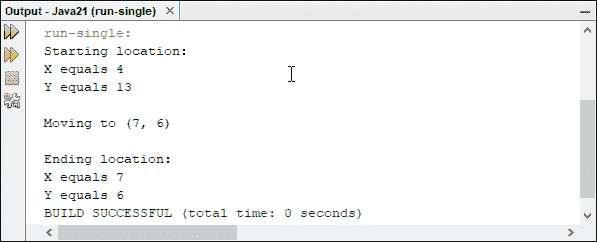

**图 3.2** 设置并显示对象的实例变量。

在此应用程序中，你创建了一个`Point`实例，其中`x`等于 4，`y`等于 13（第 8 行）。这些单独的值通过点符号法获取。

`x`的值被改为`7`，`y`改为`6`（第 15–16 行）。再次显示这些值以展示它们是如何变化的。

## 类变量

正如你所学到的，类变量是定义并存储在类中的变量。它们的值适用于该类及其所有实例。

对于实例变量，类的每个新实例都会获得该类所定义的实例变量的新副本。然后，每个实例都可以更改这些实例变量的值，而不影响任何其他实例。对于类变量，当类加载时只存在该变量的一个副本。更改该变量的值会改变该类所有实例的值。

你通过在变量前包含`static`关键字来定义类变量。例如，考虑以下部分类定义：

点击此处查看代码图像

```java
class FamilyMember {

    static String surname = "Mendoza";

    String name;

    int age;

}
```

`FamilyMember`类的每个实例都拥有其自己的`name`和`age`值，但类变量`surname`对于所有家庭成员来说只有一个值：Mendoza。如果更改了`surname`的值，所有`FamilyMember`实例都会受到影响。

> **注意**
>
> 这些变量也被称为`static variables`（静态变量），其含义取自`static`一词，即“固定在某处”。如果一个类有一个静态变量，那么该类的每个对象在该变量上具有相同的值。

要访问类变量，你使用与实例变量相同的点符号法。要检索或更改类变量的值，请在点运算符的左侧使用实例或类名。此示例中的两行输出都显示了相同的值：

点击此处查看代码图像

```java
FamilyMember dad = new FamilyMember();

System.out.println("Family's surname is: " + dad.surname);

System.out.println("Family's surname is: " + FamilyMember.surname);
```

由于你可以使用对象来更改类变量的值，因此很容易对类变量以及它们的值从何而来感到困惑。请记住，类变量的值会影响该类的所有对象。如果一个`FamilyMember`对象的`surname`实例变量设置为`"Paciorek"`，该类的所有对象都将具有这个新姓氏。

为了减少使用类变量时的困惑，在引用类变量时使用类名而不是类的对象是一个好做法。这会让类变量的使用更加清晰，并有助于调试奇怪的结果。

### 调用方法

调用对象的方法是为了让它执行某些操作。

调用对象中的方法也使用了点符号法。被调用方法的对象位于点符号的左侧，方法名及其参数位于右侧：

点击此处查看代码图像

```java
customer.addToCart(itemNumber, price, quantity);
```

每个方法调用末尾必须有括号，即使该方法没有参数，如示例所示：

```java
customer.cancelOrder();
```

在列表 3.3 中，`StringChecker`应用程序展示了调用`String`类中定义的一些方法。字符串包含了用于字符串测试和修改的方法。在 NetBeans 中创建一个新的空 Java 文件，类名为`StringChecker`，包名为`com.java21days`。

**列表 3.3** `StringChecker.java`的完整文本

点击此处查看代码图像

```java
 1: package com.java21days;

 2:

 3: class StringChecker {

 4:

 5:     public static void main(String[] arguments) {

 6:         String str = "You know nothing, Jon Snow";
 7:         System.out.println("The string is: " + str);

 8:         System.out.println("Length of this string: "

 9:             + str.length());

 10:         System.out.println("The character at position 7: "

 11:             + str.charAt(7));

 12:         System.out.println("The substring from 9 to 16: "

 13:             + str.substring(9, 16));

 14:         System.out.println("The index of the first 'w': "

 15:             + str.indexOf('w'));

 16:         System.out.println("The index of the beginning of the "
 17:             + "substring \"Jon\": " + str.indexOf("Jon"));

 18:         System.out.println("The string in uppercase: "

 19:             + str.toUpperCase());

 20:     }

 21: }
```

运行程序将产生与图 3.3 所示的输出。

- 第 15 行调用了`indexOf()`方法，该方法返回指定字符首次出现的位置。字符字面量用单引号括围，因此参数是`'w'`（而不是`"w"`）。
- 第 17 行展示了`indexOf()`方法的另一种用法，它接受一个字符串参数并返回该字符串起始位置的索引。字符串字面量始终用双引号括围。
- 第 19 行使用`toUpperCase()`方法返回一个全大写的字符串副本。

### 注意事项


如果你将 `StringChecker` 应用程序的输出与字符串中的字符进行比较，你可能会奇怪为什么当 `'w'` 是字符串中的第八个字符时，它的位置却是 7。所有这些方法看起来都偏移了 1（`length()` 除外）。原因是这些方法是基于 0 的，这意味着它们从 0 开始计数而不是 1。因此，`'Y'` 位于位置 0，`'o'` 位于位置 1，`'u'` 位于位置 2，以此此类推。这种编号方式你在 Java（以及其他编程语言）中经常遇到。

### 格式化字符串

具有特殊格式的数字（如货币）需要以精确的方式显示。货币金额在小数点后仅保留两位数字（表示分），数值前面有一个美元符号（`$`），并用逗号分隔每三个数字的组——例如 `$5,848.30`（这是美国国债每秒增加的金额）。

在显示字符串时进行这种格式化可以通过 `System.out.format()` 方法实现。该方法接受两个参数：输出格式模板和要显示的字符串。这里有一个示例，演示如何在整数的显示中添加美元符号和逗号：

点击此处查看代码图片

```java
int accountBalance = 5005;

System.out.format("Balance: $%,d%n", accountBalance);
```

此代码产生输出 `Balance: $5,005`。

格式化字符串以百分号（`%`）开头，跟着一个或多个标志。`%,d` 代码显示一个用逗号分隔每三位数字的十进制数。`%n` 代码显示一个换行符。

下一个示例将圆周率的值显示到 11 位小数：

点击此处查看代码图片

```java
double pi = Math.PI;

System.out.format("%.11f%n", pi);
```

输出为 `3.14159265359`。

### 提示

Oracle 的 Java 网站包含一个关于此类打印输出格式化的初学者教程，描述了一些最实用的代码；请参见 [`docs.oracle.com/javase/tutorial/java/data/numberformat.html`](https://docs.oracle.com/javase/tutorial/java/data/numberformat.html)。

### 嵌套方法调用

方法可以返回对象的引用、原始数据类型，或者不返回任何值。在 `StringChecker` 应用程序中，在 `String` 对象上调用的所有方法都返回了用于显示的值。`charAt()` 方法返回字符串中指定位置的字符。

方法返回的值也可以存储在变量中：

点击此处查看代码图片

```java
String label = "From";

String upper = label.toUpperCase();
```

在这个示例中，`String` 对象 `upper` 包含了调用 `label.toUpperCase()` 返回的值，即文本 `FROM`。

如果方法返回一个对象，你可以在同一语句中调用该对象的方法。这使得你可以像嵌套变量一样嵌套方法。

之前，你看到过无带参数调用方法的示例：

```java
customer.cancelOrder();
```

如果 `cancelOrder()` 方法返回一个对象，你可以在同一语句中调用该返回对象的方法，如下例所示：

点击此处查看代码图片

```java
customer.cancelOrder().fileComplaint();
```

该语句调用了 `fileComplaint()` 方法，该方法定义在 `customer` 对象的 `cancelOrder()` 方法返回的对象中。

你还可以结合嵌套方法调用和实例变量引用。在下一个示例中，`putOnLayaway()` 方法定义在 `orderTotal` 实例变量存储的对象中，而该实例变量本身是 `customer` 对象的一部分：

点击此处查看代码图片

```java
customer.orderTotal.putOnLayaway(itemNumber, price, quantity);
```

这种嵌套变量和方法的方式在你在本书前三节中频繁使用的方法中得到了：`System.out.println()`。该方法将字符串和其他数据显示到计算机的标准输出设备上。

`System` 类是 `java.lang` 包的一部分，它描述了运行 Java 的计算机的特有行为。`System.out` 是一个类变量，它包含一个 `PrintStream` 类的实例，代表系统的标准输出（通常是显示器，但可以是打印机或文件）。`PrintStream` 对象拥有 `println()` 方法，可将字符串发送到该输出流。

### 类方法

与类变量一样，类方法适用于整个类，而不是它的实例。类方法也称为静态方法（static methods），在 `java.io` 包中很常见。

使用点符号来调用类方法。正如类变量一样，你可以使用类的实例或类本身位于点的左侧。出于之前提到的类类的原因，使用类名使你的代码更易读。

例如，`Math` 类定义在 `java.lang` 包中包含了大量的数学运算。不需要从 `Math` 创建对象；但你仍然可以使用数字或布尔参数使用它。

例如，类方法 `max()` 接受两个参数并返回较大的那个。你不需要创建 `Math` 的新实例；可以在任何需要的地方调用它，如下例所示：

点击此处查看代码图片

```java
int firstPrice = 225;

int secondPrice = 217;

int higherPrice = Math.max(firstPrice, secondPrice);
```

例如，`String` 类包含一个可以接受许多类型的类方法（整型、布尔、对象等）。`valueOf()` 方法返回一个包含参数值的新 `String` 实例。

此示例的最后两行都产生字符串 `"550"`：

```java
String s, s2;

s = "potrzebie";

s2 = s.valueOf(550);

s2 = String.valueOf(550);
```

### 对象的引用

在处理对象时，理解引用至关重要。引用是一个指示对象变量和方法存储位置的地址。

当你将对象赋值给变量或将对象作为参数传递给方法时，你并不是直接在使用对象。你甚至不是在使用对象的副本。相反，你正在使用这些对象的引用。

为了更好地说明这意味着什么，[列表 3.4] 中的 `RefTester` 应用程序展示了引用是如何工作的。在 NetBeans 中为 `com.java21days` 包中的 `RefTester` 类创建一个空 Java 文件，并输入[列表 3.4]作为应用程序的源代码。

**列表 3.4** `RefTester.java` 的完整文本

点击此处查看代码图片

```java
package com.java21days;

import java.awt.Point;

class RefTester {
    public static void main(String[] arguments) {
        Point pt1, pt2;
        pt1 = new Point(100, 190);
        pt2 = pt1;

        pt1.x = 200;
        pt1.y = 290;
        System.out.println("Point1: " + pt1.x + ", " + pt1.y);
        System.out.println("Point2: " + pt2.x + ", " + pt2.y);
    }
}
```

保存并运行该应用程序。图 3.4 显示了输出结果。

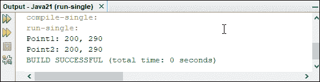

**图 3.4** 将引用指向测试。

该程序的第一部分发生了以下操作：

- **第 7 行：** 创建了两个 `Point` 变量。
- **第 8 行：** 将一个新的 `Point` 对象赋值给 `pt1`。
- **第 9 行：** 将变量 `pt1` 赋值给 `pt2`。

第 11–14 行是关键。`pt1` 的 `x` 变量被设置为 `200`，`y` 变量被设置为 `290`，并显示了 `pt1` 和 `pt2` 的所有变量。你可能认为 `pt1` 和 `pt2` 会具有不同的值，但图 3.4 显示情况并非如此。尽管程序中没有显式修改这些变量，但 `pt2` 的 `x` 和 `y` 变量也发生了变化。这是因为第 9 行创建了从 `pt2` 到 `pt1` 的引用，而不是将 `pt2` 创建为从 `pt1` 拷贝的新对象。

变量 `pt2` 是指向与 `pt1` 对象的引用。可以使用任何一个变量来引用该对象或更改其变量。

如果你希望 `pt1` 和 `pt2` 指向单独的对象，你可以在第 8–9 行使用单独的 `new Point()` 语句创建不同的对象，如下：

```java
pt1 = new Point(100, 190);

pt2 = new Point(200, 190);
```

当将参数传递给方法时，Java 中的引用变得特别重要。你将在本节稍后学习更多相关内容。

### 注意

具有 C 和 C++ 语言经验的程序员此时可能会想，Java 是否具有显式指针或指针算术。它没有。这些功能的缺失（这些功能在不产生错误的情况下很难实现）是 Java 语言创建的主要原因。通过使用引用和 Java 数组，你可以复制大多数指针的功能，而没有许多指针的缺点。

### 对象和基本类型的类型转换

关于 Java，你快速发现的一点是，它对要处理的信息非常挑剔。就像金发姑娘（Goldilocks）一样，尽管她是个闯入房屋的人，但对粥片却奇怪地难以满足，Java 方法和构造函数要求事物必须采取特定形式，且不接受替代方案。

当你向方法发送参数或在表达式中使用变量时，你必须使用正确数据类型的变量。如果方法需要一个 `int`，而你尝试向该方法发送 `float` 值，Java 编译器将返回错误。同样，如果你将一个变量设置为另一个变量的值，它们必须是兼容的类型：两个变量必须是相同类型，或者接收值的变量必须足够大以容纳该值。

### 注意

Java 编译器在一个方面是绝对灵活的：即 `String` 对象。`println()` 方法、赋值语句和方法参数中的字符串处理通过 `+` 拼接操作被简化。如果一组连接变量中的任何一个是字符串，Java 就会将整个内容视为 `String`。这使得以下操作成为可能：

点击此处查看代码图像

```java
float gpa = 3.25F;

System.out.println("Honest, mom, my GPA is a " +

 (gpa + 1.5));
```

使用拼接操作符，单个字符串可以包含 Java 中多个对象和基本类型的文本表示。

有时，你的 Java 类中拥有一个值并不是你所需的正确类型。它可能是错误的类或错误的数据类型，例如在需要 `int` 时使用了 `float`。

在这些情况下，你可以使用一种名为 `casting`（类型转换）的过程将值从一种类型转换为另一种类型。

虽然类型转换相当简单，但由于 Java 既有基本类型（如 `int`、`float` 和 `boolean`）又有对象类（如 `String`、`Point` 和其他），该过程变得复杂了。本节讨论了三种形式的类型转换：

- 基本类型之间的转换，例如从 `int` 到 `float`
- 从对象到另一个对象的转换，例如从 `float` 到 `double`
- 从基本类型到对象的转换，例如从 `int` 到 `String`

（注：原文中 `float to double` 示例在对象转换项下可能笔误，此处按原文逻辑翻译）

### 基本类型的转换

当你将大类型的值转换为小类型时，必须使用显式类型转换。显式转换的形式如下：

```java
(typename) value
```

这里 `typename` 是你想要转换的基本数据类型的名称。`Value` 是产生源类型值的表达式。例如，在以下语句中，`x` 的值除以 `y` 的值，并将结果转换为 `int`：

```java
float x = 5.0F;

float y = 2.0F;

int result = (int)(x / y);
```

注意，由于类型转换的优先级高于算术运算，在这里必须使用括号。否则，首先 `x` 的值会被转换为 `int`，然后除以 `y`，这可能会产生不同的结果。

#### 转换

当源类和目标类之间存在继承关系且其中一个类是另一个类的子类时，类的对象也可以转换为其他类的对象。

某些对象可能不需要显式转换。特别是，由于子类包含了父类的所有信息，你可以在任何期望父类的地方使用子类对象。

例如，考虑一个接受两个参数的方法，一个类型为 `Object`，另一个类型为 `Component`，位于 `java.awt` 包中。

你可以为 `Object` 参数传递任何类的实例，因为所有 Java 类都是 `Object` 的子类。

对于 `Component` 参数，你可以传递它的子类，例如 `Button`、`Container` 和 `Label`（它们都位于 `java.awt` 包中）。

这种特性在程序的任意任何地方都适用，而不仅仅是在方法调用内部。如果你定义了一个类型为 `Component` 类的变量，你可以将该类或其任何一个子类的对象赋值给该变量，而无需进行类型转换。

反过来也是成立的，因此在需要子类的地方可以使用父类。然而，有一个陷阱：由于子类包含的行为比其父类更多，在类型转换时会发生精度的丢失。那些父类对象可能不具备替代子类对象所需的所有行为。

考虑这个例子：如果你有一个操作调用了 `Integer` 类对象中的方法，那么使用其父类 `Number` 的对象将不会包含 `Integer` 中指定的许多方法。如果你尝试调用目标对象不存在的方法，就会发生错误。

要在需要子类对象的地方使用父类对象，你必须显式地对它们进行类型转换。转换过程中你不会丢失任何信息，但你会获得子类定义的所有方法和变量。

要将一个对象转换为另一个类，你使用与原始数据类型相同的操作，其格式如下：

```java
(classname) object
```

在这个模板中，`classname` 是目标类的名称，而 `object` 是指向源对象的引用。类型转换创建一个指向类型为 `classname` 的旧对象的引用；旧对象将像以前一样继续存在。

下面的示例将 `VicePresident` 类的实例转换为 `Employee` 类的实例。`VicePresident` 是 `Employee` 的子类，拥有更多信息：

点击此处查看代码图像

```java
Employee emp = new Employee();

VicePresident veep = new VicePresident();

emp = veep; // 向上使用不需要转换

veep = (VicePresident) emp; // 必须显式转换
```

当你从第 9 节中开始处理图形用户界面时，“创建图形用户界面”中，你会发现，每当你使用 Java2D 图形操作时，对对象进行类型转换都是必要的。在屏幕上绘图之前，你必须将 `Graphics` 对象转换为 `Graphics2D` 对象。下面的示例使用名为 `screen` 的 `Graphics` 对象创建一个名为 `screen2D` 的新 `Graphics2D` 对象：

```java
Graphics2D screen2D = (Graphics2D) screen;
```

`Graphics2D` 是 `Graphics` 的子类，它们都属于 `java.awt` 包。你将在第 13 节“创建 Java2D 图形”中充分探讨这个主题。

除了将对象转换为类之外，你还可以将对象转换为接口，但前提是对象的类或其父类之一确实实现了该接口。将对象转换为接口意味着，即使该对象的类没有直接实现该接口的方法。

### 将原始类型转换为对象反之亦然

你不能做的一点是从对象转换为原始数据类型或反之亦然。

原始类型和对象在 Java 中是不同的东西。`java.lang` 包包含了与每个原始数据类型对应的类：`Float`、`Boolean`、`Byte` 等。这些类中的大多数名称与数据类型相同，只是类名以大字母开头（`Short` 代替 `short`，`Double` 代替 `double` 等）。此外，有两个类的名称与对应的数据类型不同：`Character` 用于 `char` 变量，`Integer` 用于 `int` 变量。

使用与每个原始类型对应的类，你可以创建一个持有相同值的对象。下面的语句创建了一个具有整数值 `7801` 的 `Integer` 类实例：

点击此处查看代码图像

```java
Integer dataCount = new Integer(7801);
```

以这种方式创建对象后，你可以像使用任何对象一样使用它（尽管你不能改变它的值）。当你想再次将该值作为原始值使用时，也有对应的方法。例如，下面的语句显示了如何从 `dataCount` 对象获取 `int` 值：

点击此处查看代码图像

```java
int newCount = dataCount.intValue(); // 返回 7801
```

程序中需要的一种常见转换是将 `String` 转换为数值类型，例如整数。当你需要 `int` 作为结果时，可以通过 `Integer` 类的类方法 `parseInt()` 实现。要转换的 `String` 是发送到方法的唯一参数，如下例所示：

点击此处查看代码图像

```java
String pennsylvania = "65000";

int penn = Integer.parseInt(pennsylvania);
```


可以使用以下类来处理对象而不是原始数据类型：`Boolean`、`Byte`、`Character`、`Double`、`Float`、`Integer`、`Long`、`Short` 和 `Void`。这些类通常被称为对象包装类（object wrappers），因为它们提供了原始类型的表示。

#### 警告

如果你尝试使用上述示例，你的方法将抛出 `NumberFormatException`。

处理原始类型和表示相同值的对象通过一种被称为自动装箱（autoboxing）和拆箱（unboxing）的机制变得简单。自动装箱将原始类型转换为对象。拆箱则方向相反。

如果你在需要原始类型的地方使用对象，或者反之，语句就会执行。这是一个自动装箱和拆箱的示例：

点击此处查看代码图像

```java
Float f1 = 12.5F;

Float f2 = 27.2F;

System.out.println("Lower number: " + Math.min(f1, f2));
```

### 比较对象值和类

除了类型转换之外，你经常还会执行涉及对象的三个任务：

- 比较对象
- 查找对象的类
- 测试对象是否是给定类的实例

#### 比较对象

在前面的节中，你学习了用于比较值的运算符——相等、不相等、小于等。这些运算符中的大多数只适用于原始类型，不适用于对象。如果你尝试使用其他值作为操作数，Java 编译器会报告错误。

此条规则的例外是用于等等的 `==` 运算符和用于不相等的 `=` 运算符。应用于对象时，这些运算符的作用并不是你最初预期的那样。它们不是检查一个对象是否具有相同的值，而是判断运算符的两侧是否引用同一个对象。

为了比较类的对象并获得有意义的结果，你必须在你的类中实现特殊方法并调用这些方法。

关于这一点的一个很好的例子是 `String` 类。可能存在两个表示相同文本的不同 `String` 对象。然而，如果你使用 `==` 运算符来比较这些对象，它们将被认为是不相等的，因为它们并不完全相等。尽管它们的内容匹配，但它们并不是同一个对象。

要检查两个 `String` 对象是否具有相同的值，需要调用类的 `equals()` 方法。该方法测试字符串中的每个字符，如果两个字符串具有相同的值，则返回 `true`。列表 3.5 所示的 `EqualsTester` 应用程序说明了这一点。在 NetBeans 的 `com.java21days` 包中创建该应用程序，并通过选择 `File`、`Save` 或点击工具栏上的 `Save All` 按钮来保存文件。

**列表 3.5** `EqualsTester.java` 的完整文本

点击此处查看代码图像

```java
 1: package com.java21days;

 2:

 3: class EqualsTester {

 4:     public static void main(String[] arguments) {

 5:         String str1, str2;

 6:         str1 = "Boy, that escalated quickly.";

 7:         str2 = str1;

 8:

 9:         System.out.println("String1: " + str1);

10:         System.out.println("String2: " + str2);

11:         System.out.println("Same object? " + (str1 == str2));

12:

13:         str2 = new String(str1);

14:

15:         System.out.println("String1: " + str1);

16:         System.out.println("String2: " + str2);

17:         System.out.println("Same object? " + (str1 == str2));

18:         System.out.println("Same value? " + str1.equals(str2));

19:     }
20: }
```

程序的输出出现在图 3.5 中。

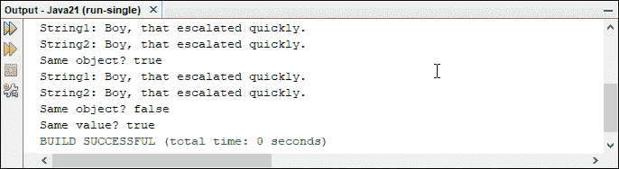

**图 3.5** 比较 `String` 对象的相等性。

程序的第一次声明了两个变量（`str1` 和 `str2`），将字面量 `"Boy, that escalated quickly."`赋值给 `str1`，然后将该值赋值给 `str2`（第 5–7 行）。正如你之前学到的，`str1` 和 `str2` 现在指向同一个对象，第 11 行的相等测试证明了这一点。

在程序的第二部分，你创建一个与 `str1` 值相同的新 `String` 对象，并将 `str2` 赋值给该新 `String` 对象。

现在，你在 `str1` 和 `str2` 中有两个不同的字符串对象，它们的值都相同。使用 `==` 运算符测试它们是否为同一个对象，返回了预期的答案：`false`（第 17 行）。它们在内存中不是同一个对象。在第 18 行使用 `equals()` 方法对其进行测试也返回了预期的答案 `true`，这表明它们具有相同的值。

#### 注意

为什么你在更改 `str2` 时不能直接使用另一个字面量，而是必须使用 `new`？Java 对字符串字面量进行了优化。如果你使用字面量创建一个字符串，然后在另一个语句中使用具有字符的另一个字面量，Java 会返回第一个 `String` 对象。两个字符串是同一个对象；你必须显式地创建两个独立的对象。

#### 确定对象的类型

想知道对象的类名吗？对于赋值给变量 `key` 的对象，方法如下：

点击此处查看代码图像

```java
String name = key.getClass().getName();
```

`getClass()` 方法在 `Object` 类中定义，因此可以在所有 Java 对象中调用它。该方法返回一个表示对象类的 `Class` 对象。该对象的 `getName()` 方法返回一个持有类名称的字符串。

另一个有用的测试是 `instanceof` 运算符，它有两个操作数：左侧是对象的引用，右侧是类名。该表达式产生一个布尔值：如果对象是所命名类或该类任何子类的实例，则产生 `true`，否则产生 `false`，如这些示例所示：

点击此处查看代码图像

```java
boolean check1 = "Texas" instanceof String; // true

Object obiwan = new Object();

boolean check2 = obiwan instanceof String; // false
```

`instanceof` 运算符也可以用于接口。如果一个对象实现了接口，当进行此类测试时，`instanceof` 运算符返回 `true`。

与 Java 中的其他运算符不同，`instanceof` 不是像乘法的 `*` 或加法的 `+` 那样的符号。相反，`instanceof` 关键字才是运算符。

### 总结

现在你已经花了三节课来探索 Java 中如何实现面向对象的编程，你现在可以更好地判断它在你的编程中有多用。

如果你是一个“悲观（杯半空）”的人，你可能会认为它在提高可靠性方面的作用。如果你是一个“乐观（杯半满）”的人，你可能会认为它在重用方面的作用。

### 问答

**问** 我对对象和基本类型之间的区别感到困惑。

**答** 基本类型（`byte`、`short`、`int`、`long`、`float`、`double`、`boolean` 和 `char`）不是对象，尽管很多情况下可以像对象一样处理它们。

**问** `String` 的 `length()` 和 `charAt()` 方法看起来不像。如果 `length()` 显示字符串有 33 个字符，在使用 `charAt()` 时，难道不应该从 1 到 33 编号吗？

**答** 这两个方法不同。`length()` 计算字符数，第一个字符为 1，第二个为 2，依此类推。`charAt()` 将第一个字符视为位置 0。这与数组元素的编号系统相同。考虑字符串 `"Charlie Brown"`。它有 13 个字符，从位置 0（字母 `C`）到位置 12（字母 `n`）。

**问** 如果 Java 缺乏指针，我如何实现类似链表的操作，即从一个节点到另一个节点有指针以便遍历？

**答** 说 Java 没有显式指针比说它没有指针更准确。对象引用本质上就是指针。为了创建类似链表，你可以创建一个名为 `Node` 的类，它有一个同样为 `Node` 的实例变量。为了链接节点对象，将一个节点对象赋值给前一个对象的实例变量。由于对象引用是指针，这样设置的链表行为符合预期。（你将在第第 8 节](#ch08.xhtml_ch08)“数据结构”中学习 Java 类库版本的链表。）

### 测验

通过完成这个三题测验来回顾本节内容。

#### 题目

**1.** 你使用什么运算符调用对象的构造函数并创建新对象？

**A.** `+`

**B.** `new`

**C.** `instanceof`

**2.** 哪些方法适用于类中的所有对象，而不是单个对象？

**A.** 通用方法

**B.** 实例方法

**C.** 类方法

**3.** 如果你有一个包含名为 `obj1` 和 `obj2` 对象的程序，当你使用语句 `obj2 = obj1` 时，会发生什么？

**A.** `obj2` 中的实例变量被赋予了与 `obj1` 相同的值。

**B.** `obj2` 和 `obj1` 被认为是同一个对象。

**C.** A 和 B 均不是。

#### 答案

**1.** B. `new` 运算符之后紧跟的是对该对象构造函数的调用。

**2.** C. 类方法可以在创建该类的对象的情况下被调用。

**3.** B. `=` 运算符不会将值从一个对象复制到另一个对象。相反，它让两个变量引用同一个对象。

### 认证实践

以下问题是你在 Java 编程认证考试中可能会遇到的类型。请在不再次查看本节或不使用 Java 编译器测试代码的情况下回答它。

给定：

点击此处查看代码图片

```java
public class AyeAye {

    int i = 40;

    int j;

    public AyeAye() {

        setValue(i++);
    }

    void setValue(int inputValue) {

        int i = 20;

        j = i + 1;

        System.out.println("j = " + j);
    }

}
```

在 `setValue()` 方法内部显示变量时，`j` 变量的值是多少？

**A.** 42

**B.** 40

**C.** 21

**D.** 20

答案可以在书籍网站上找到，访问 [www.java21days.com](http://www.java21days.com)。访问第 3 节页面并点击“认证实践”链接。

## 练习

为了扩展你对本节涵盖主题的知识，请尝试以下练习：

1. 创建一个程序，将 MM/DD/YYYY 格式的生日（例如 04/29/2020）转换为三个独立的字符串。
2. 创建一个带有 `height`、`weight` 和 `depth` 实例变量的类，每个都是整数。创建一个使用你的新类的 Java 应用程序，设置对象中的这些值并显示这些值。

在适用的情况下，练习答案可以在书籍网站上找到：[www.java21days.com](http://www.java21days.com)。

## 第 4 节 列表、逻辑与循环

在本节中，你将学习 Java 语言中三个最无聊的特性：

- 如何将相同类或数据类型的组组织成称为数组的列表
- 如何让程序根据逻辑决定是否执行某操作
- 如何使用循环让 Java 程序的某些部分重复

如果这些特性对你听起来并不无聊，那很好。你用 Java 软件完成的大部分重要工作都将使用这三者。这些主题对计算机来说是无聊的。它们让软件能够执行其擅长的事情之一：重复执行任务。

### 数组

到目前，你在每个 Java 程序中只处理了几个变量。在某些情况下，使用单独的变量存储信息是可以管理的，但如果你有 20 个相关信息要跟踪该呢？你可以创建 20 个不同的变量并设置它们的初始值，这听起来可能很枯燥，但是可行的。当你处理大量信息时，这种方法会变得越来越繁琐。如果有 100 个项，甚至 1,000 个呢？

数组允许你存储一个具有相同原始数据类型、相同类或共同父类的项的列表。列表中的每个项都进入它自己的编号槽位，以便你就可以轻松地访问信息。

数组可以包含存储在变量中的任何类型的信息，但在数组创建后，你只能将其用于该信息类型。例如，你可以有一个整数数组、`String` 对象的数组或数组的数组，但你不能拥有一个既包含 `String` 对象又包含原始类型整数的数组。

有一种方法可以规避这种限制：数组可以持有一个类及其任何子类。因此，`Object` 类的数组可以包含 Java 中的任何对象，包括表示与原始类型相同值的类。

Java 实现数组的方式与其他编程语言不同——将其作为像其他对象一样的对象。

在 Java 中创建数组，你必须执行以下操作：

1. 声明一个变量来持有数组。
2. 创建一个新的数组对象并将其赋值给数组变量。
3. 在该数组中存储信息。

#### 声明数组变量

创建数组的第一步是声明一个持有数组的变量。数组变量指示数组将持有的对象或数据类型以及数组的名称。为了与普通变量声明区分开，在数据类型后添加一对空括号（`[]`）。

以下语句是数组声明：

```java
String[] requests;
Point[] targets;
float[] donations;
```

你也可以通过将括号放在变量后面来声明数组：

```java
requests[];
targets[];
donations[];
```

注意：使用哪种数组声明风格取决于个人好。书中的示例程序将括号放在类型后面，这更流行。

#### 创建数组对象

声明数组变量后，下一步是创建一个数组对象并将其赋值给该变量。要做到这一点，使用 `new` 运算符并指示数组将持有多少槽位。

以下语句创建一个 10 个字符串的数组：

点击此处查看代码图片

```java
String[] players = new String[10];
```

此语句创建一个具有 10 个槽位的 `String` 数组。此语句并没有在槽位中放入实际 `String` 对象；你需要在之后这样做。数组对象可以包含原始类型，例如整数或布尔值，就像它们可以包含对象一样：

```java
int[] temps = new int[99];
```

使用 `new` 创建数组对象时，所有槽位都会被赋予初始值（数值数组为 `0`，布尔值为 `false`，字符数组为 `\0`，对象为 `null`）。

注意：Java 关键字 `null` 指向空对象（可以用于任何对象引用）。它不等同于 C 中的常量 `0` 或 `\0`。

由于对象数组中的每个对象在创建时都是 `null` 引用，在使用之前必须为每个数组元素分配一个对象。以下示例创建了三个 `Integer` 对象的数组，然后为每个元素分配一个对象：

点击此处查看代码图片

```java
Integer[] series = new Integer[3];

series[0] = new Integer(10);

series[1] = new Integer(3);

series[2] = new Integer(5);
```

你可以通过将数组元素包含在大括号（`{}`）内并用逗号分隔，同时创建并初始化数组：

点击此处查看代码图片

```java
Point[] markup = { new Point(1,5), new Point(3,3), new Point(2,3) };
```

括号内的每个元素必须与持有数组的变量类型相同。当你以这种方式带初始值创建数组时，数组的大小与你在括号内包含的元素数量相同。之前的示例创建了一个名为 `markup` 的 `Point` 对象数组，它包含三个元素。

由于 `String` 对象可以在不使用 `new` 操作符的情况下创建并初始化，在创建字符串数组时也可以同样这样做：

点击此处查看代码图片

```java
String[] titles = { "Mr.", "Mrs.", "Ms.", "Miss", "Dr." };
```

该语句创建了一个名为 `titles` 的、包含五个 `String` 对象的元素的数组。

每个数组都有一个名为 `length` 的实例变量，用于存储数组中元素的数量。延续上一个例子，变量 `titles.length` 的值是 `5`。

数组的第一个元素的下标是 0 而不是 1，因此一个具有五个元素的数组通过下标 0 到 4 来访问其槽位。在 `titles` 数组中，字符串 `"Mr."` 位于元素 0 处，而 `"Dr."` 位于元素 4 处。

### 访问数组元素

设置好带有初始值的数组后，你可以检索、修改和测试该数组中每个槽位的值。槽位中的值通过数组名后跟方括号括起的下标来访问。该名称和下标可以放入表达式中，如下所示：

```java
testScore[40] = 920;
```

该语句将 `testScore` 数组的第 41 个元素设置为值 `920`，因为元素编号从 0 开始。此表达式的 `testScore` 侧是一个持有数组对象的变量，尽管它也可以是一个产生数组的表达式。下标表达式指定了要访问数组中的哪一个槽位。

所有的数组下标都会经过检查，以确保它们在创建数组时指定的数组边界之内。在 Java 中，无法访问或为数组边界之外的槽位赋值。这避免了其他语言中因数组越界而引起的问题。请注意以下两个语句：

点击此处查看代码图像


`float[] rating = new float[20];`

`rating[20] = 3.22F;`

在 NetBeans 中输入这些语句将产生错误，因为 `rating` 数组没有编号为 20 的槽位；它有 20 个从 0 开始到 19 结束的槽位。Java 编译器将因 `ArrayIndexOutOfBoundsException` 错误而失败。

如果在程序运行期间计算出的数组下标位于数组边界之外，Java 虚拟机 (JVM) 也会报错。你将在第 7 “异常与线程](#ch07.xhtml_ch07)”中学习更多关于错误的知识，在 Java 中错误被称为异常。

避免程序意外意外越数组末尾的一种方法是使用 `length` 实例变量。以下语句显示 `rating` 数组中的元素数量：

```
System.out.println("Elements: " + rating.length);
```

### 修改数组元素

正如你在之前的示例中看到的，可以通过在数组名和下标后放置赋值语句来为数组中的特定槽位赋值，如下：

```
temperature[4] = 85;
day[0] = "Sunday";
manager[2] = manager[0];
```

必须记住，Java 中的对象数组是这些这些对象的引用数组。当你给对象数组中的槽位赋值时，你是在创建一个指向该对象的引用。当你在数组内部移动值时，你是在重新分配引用，而不是从一个槽位拷贝值到另一个。基本数据类型（如 `int` 和 `float`）的数组会将值从一个槽位复制到另一个，`String` 数组的元素也是如此，尽管它们是对象。

数组的创建和修改非常简单，它们在 Java 中提供了大量的功能。显示 4.1 所示的 `HalfDollars` 应用程序创建、初始化并显示了三个数组的元素。在 NetBeans 的 `com.java21days` 包中创建一个名为 `HalfDollars` 的新空 Java 文件，并将列表的源代码输入编辑器。

**显示 4.1** `HalfDollars.java` 的全文

```
 1: package com.java21days;
 2:
 3: class HalfDollars {
 4:     public static void main(String[] arguments) {
 5:         int[] denver = { 2_100_000, 2_900_000, 6_100_000 };
 6:         int[] philadelphia = new int[denver.length];
 7:         int[] total = new int[denver.length];
 8:         int average;
 9:
10:         philadelphia[0] = 2_100_000;
11:         philadelphia[1] = 2_900_000;
12:         philadelphia[2] = 6_100_000;
13:
14:         total[0] = denver[0] + philadelphia[0];
15:         total[1] = denver[1] + philadelphia[1];
16:         total[2] = denver[2] + philadelphia[2];
17:
18:         average = (total[0] + total[1] + total[2]) / 3;
19:
20:         System.out.print("Denver production: ");
21:         System.out.format("%,d%n", total[0]);
22:         System.out.print("Philadelphia production: ");
23:         System.out.format("%,d%n", total[1]);
24:         System.out.print("Total production: ");
25:         System.out.format("%,d%n", total[2]);
26:         System.out.print("Average production: ");
27:         System.out.format("%,d%n", average);
28:     }
29: }
```

`HalfDollars` 应用程序使用三个整数来存储丹佛和费城的半美元产量。当你运行程序时，它会显示图 4.1 所示的输出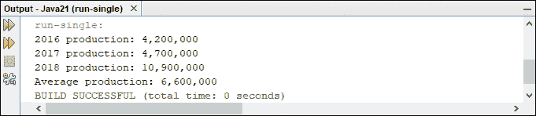

这里创建的类 `HalfDollars` 拥有三个实例变量。第一个名为 `denver`，在第 5 行声明并初始化，包含三个数字：`2_100_000`、`2_900_000` 和 `6_100_000`。这些数字在三个数字后使用下划线字符（`_`）以增加可读性。编译器忽略这些下划线。

第二个和第三个实例变量 `philadelphia` 和 `total` 在第 6 行和第 7 行声明。因此，每个元素都被赋予了整数的默认值：`0`。

使用 `denver.length` 变量为这两个数组提供了与 `denver` 数组相同数量的槽位。该应用程序的 `main()` 方法剩余如下：

- 第 8 行创建一个名为 `average` 的整数变量。
- 第 10-12 行为 `philadelphia` 数组的三个元素分配新值。
- 第 14-16 行为 `total` 数组的元素分配新值。
- 第 17 行将 `average` 设置为三个 `total` 元素的平均值。由于 `average` 和三个 `total` 元素都是整数，平均值以整数形式而不是浮点数形式表示。
- 第 19-26 行显示存储在 `total` 数组和 `average` 变量中的值，使用 `System.out.format()` 方法使用逗号以更易读的格式显示数值。

此应用程序处理数组的效率低下。这些语句几乎完全相同，区别仅在于指示你所指的数组元素的下标。如果 `HalfDollars` 应用程序用于追踪 100 年的生产总额而不是 3 年，这种方法将需要大量的冗余语句。

在处理数组时，你可以使用循环来遍历数组的元素，而不是逐个处理每个元素。这使得代码变得短得多且更易于阅读。当你在本节的随后的部分学习循环时，你将看到对当前示例的重写。

## 多维数组

数组可以是多维的，包含多个下标，以便在多个维度上存储信息。

多维数组的一个常见用途是表示 (x, y) 网格中的数组元素。

Java 通过允许数组的每个元素都包含另一个数组来支持这一点。这些数组也可以包含数组，以此此类推，直到达到所需的维度。

例如，考虑一个需要完成以下任务的程序：

- 记录一年中每天的整数值。
- 按周组织这些值。

组织这些数据的一种方法是创建一个包含 52 个元素的数组，其中每个元素包含一个包含 7 个元素的数组：

```
int[][] dayValue = new int[53][7];
```

这个数组数组总共包含 371 个整数，足够容纳一年的每一天（外加额外的）。你可以使用以下语句设置第 10 周第一天的值：

```
dayValue[9][0] = 14200;
```

记住，数组索引从 0 开始而不是 1，所以第 10 周在元素 9 处，第一天在元素 0 处。

你可以像使用任何其他数组一样在这些数组上使用 `length` 实例变量。以下语句包含一个三维整数数组，并显示了每个维度上的元素数量：

```
int[][][] cen = new int[100][52][7];
System.out.println("Elements in 1st dimension: " + cen.length);
System.out.println("Elements in 2nd dimension: " + cen[0].length);
System.out.println("Elements in 3rd dimension: " + cen[0][0].length);
```

## 块语句

Java 中的语句被分组为块。块的开始和结束边界用花括号字符标记——左花括号（`{`）表示开始，右花括号（`}`）表示结束。

你已经使用过块来容纳类定义中的变量和方法，并定义了属于方法的语句。

块也被称为*块语句*（block statements），因为整个块可以用在任何可以使用单条语句的地方。块内部的每条语句都会从上到下执行。

你可以将块放在其他块内部，就像你在类定义中放置方法一样。

关于使用块需要注意的重要的一点是，它为块内部创建的局部变量创建了作用域。作用域是程序中变量存在并可以使用的部分。如果你尝试在作用域之外使用变量，就会发生错误。

在 Java 中，变量的作用域是创建它的块。当你可以在块内部声明和使用局部变量时，这些变量在块执行完毕后就会消失。例如，以下方法在方法内部包含了一个块：

```
void testBlock() {
    int x = 10;
    { // start of block
        int y = 40;
        y = y + x;
    } // end of block
}
```

此方法中定义了两个变量：`x` 和 `y`。`y` 变量的作用域是它所在的块，由注释 `// start of block` 和 `// end of block` 标记。该变量只能在该块内被使用。如果你尝试在方法的其他部分使用 `y` 变量，就会导致错误。

`x` 变量创建在方法内部但在内部块之外，因此它可以在方法的任何地方使用。你可以在方法中的任何地方修改 `x` 的值。

块语句用于类和方法定义，以及你接下来将学习的逻辑和循环结构。前一个示例使用内部块的方式并不常见——它在这里这样做是为了说明演示之目的——但它是合法的 Java 语法。

## if 条件语句

任何编程语言的一个关键方面是它如何使程序能够做出决策。这是通过一种被称为*条件*（conditional）的语句类型处理的，该语句只有在满足特定条件时才会被执行。

Java 中最简单的条件语句是 `if`。`if` 条件语句使用布尔表达式来决定是否应该执行某语句。如果表达式产生 `true` 值，则执行该语句。

这里是一个简单的示例，它仅在实例变量的值小于 3 时才显示 `Not enough arguments` 消息：

```
if (arguments.length < 3) {
    System.out.println("Not enough arguments");
    System.exit(-1);
}
```

如果你想在 `if` 表达式不为 `true` 时发生其他情况，你可以使用 `else`。下面的示例同时使用了 `if` 和 `else`：

```
String server;
int duration;
if (duration < 1) {
    server = "localhost";
} else {
    server = arguments[0];
}
```

Java 中的 `if` 条件语句与其他语言中的语句的区别在于，Java 条件语句只产生布尔值（`true` 或 `false`）。

如果你想作为 `if` 的结果执行多一件事，可以将这些语句封装在一个块中。注意以下代码：

```
int speed;
String status;
float temperature = -60;
if (temperature < -80) {
    status = "returning home";
    speed = 5;
}
```

此示例中的 `if` 语句包含测试 `temperature < -80`。如果 `temperature` 变量包含小于 –80 的值，则执行块语句并发生两件事：

- `status` 变量被赋予值 `returning home`。
- `speed` 变量被设置为 `5`。

如果 `temperature` 变量等于或大于 –80，整个块将被跳过，什么都不会发生。

所有的 `if` 和 `else` 语句都使用布尔测试来确定是否执行语句。你可以使用布尔变量本身来进行测试，如下所示：

```
String status;
boolean outOfGas = true;
if (outOfGas) {
    status = "inactive";
}
```

前面的示例使用了名为 `outOfGas` 的布尔变量。它的功能与以下代码完全相同：

```
if (outOfGas == true) {
    status = "inactive";
}
```

## switch 条件语句

一种常见的编程做法是将变量与一个值进行测试，如果不匹配，则再次与另一个值进行测试，以此此类推。

如果你只使用 `if` 语句，这种方法可能会变得非常繁琐，取决于你需要测试多少个不同的值。例如，你可能会得到一组类似下面的 `if` 语句：

```
if (operation == '+') {
    add(object1, object2);
} else if (operation == '-') {
    subtract(object1, object2);
} else if (operation == '*') {
    multiply(object1, object2);
} else if (operation == '/') {
    divide(object1, object2);
}
```

这种 `if` 语句的使用方式被称为“嵌套 if 语句”，因为每个 `else` 语句都包含另一个 `if` 语句，直到完成所有可能的测试。

在 Java 中处理这种情况的更好方法是使用 `switch` 语句对条件进行分组。下面的示例演示了 `switch` 的用法：

```java
char grade = 'D';
switch (grade) {
    case 'A':
        System.out.println("Great job!");
        break;
    case 'B':
        System.out.println("Good job!");
        break;
    case 'C':
        System.out.println("You can do better!");
        break;
    default:
        System.out.println("Ouch!");
}
```

`switch` 语句构建在一个测试变量的基础上。在前面的示例中，该变量是 `grade` 变量的值，它持有一个 `char` 值。

测试变量可以是原始类型 `byte`、`char`、`short` 或 `int`，也可以是类 `String`。接下来的代码使用名为 `command` 的 `String` 对象的值来决定调用哪个方法：

```java
String command = "close";
switch (command) {
    case "open":
        openFile();
        break;
    case "close":
        closeFile();
        break;
    default:
        System.out.println("Invalid command");
    }
}
```

测试变量会与每个 `case` 值进行比较。如果找到匹配项，则执行测试之后的语句或语句。

如果没有找到匹配项，则执行 `default` 语句或语句（其中 `default` 语句是可选的）。如果省略它且没有任何 `case` 语句匹配，则 `switch` 语句可能会在不执行任何内容的情况下完成。

`switch` 语句中的测试用例仅限于可以转换为 `int` 的原始类型，例如 `char` 或字符串。你不能使用像 `long` 或 `float` 更大的原始类型，也不能测试相等性以外的任何关系。

以下是之前显示的嵌套 `if` 示例的修订。它已被重写为 `switch` 语句：

```java
switch (operation) {
    case '+':
        add(object1, object2);
        break;
    case '-':
        subtract(object1, object2);
        break;
    case '*':
        multiply(object1, object2);
        break;
    case '/':
        divide(object1, object2);
        break;
}
```


在每个 `case` 之后，你可以包含一个结果语句，也可以包含任意数量的需要语句。与 `if` 语句不同，多个语句不需要块语句。

在每个 `case` 部分包含的 `break` 语句决定了何时停止执行响应于匹配 `case` 的语句。假设一个 `case` 部分没有 `break` 语句。在匹配之后，该匹配项的语句以及 `switch` 中后续的所有语句都将被执行，直到找到 `break` 或到达 `switch` 的结束处。

在某些情况下，这可能正是你想要做的。否则，你应该包含 `break` 语句以确保只执行正确的代码。`break` 语句你将在本节稍后的“跳出循环”部分再次使用，它会在当前点停止执行。然后它会跳转到结束 `switch` 语句的大括号之后的语句。

没有 `break` 的情况下穿透（falling through）的一个方便用法是多个值需要执行相同的语句。为了完成此任务，你可以使用多个没有结果的 `case` 行；`switch` 会执行它找到的第一条语句。

例如，在下面的 `switch` 语句中，如果 `x` 的值为 `2`、`4`、`6` 或 `8`，则打印字符串 `x is an even number`；`x` 的所有其他值会导致打印字符串 `x is an odd number`：

点击此处查看代码

```java
int x = 5;

switch (x) {
    case 2:
    case 4:
    case 6:
    case 8:
        System.out.println("x is an even number");
        break;
    default:
        System.out.println("x is an odd number");
}
```

下一个项目是列表 4.2 中的 `DayCounter` 应用程序，它接受月份和年份作为参数并显示该月份的天数。使用了 `switch` 语句、`if` 语句和 `else` 语句。在 NetBeans 中创建此应用，在 `com.java21days` 包中创建一个空的 Java 文件。

**列表 4.2** `DayCounter.java` 的完整文本

点击此处查看代码

```java
1: package com.java21days;

2:

3: class DayCounter {

4:     public static void main(String[] arguments) {

5:         int year = 2020;

6:         int monthIn = 2;

7:         if (arguments.length > 0) {

8:             monthIn = Integer.parseInt(arguments[0]);

9:         }

10:        if (arguments.length > 1) {

11:            year = Integer.parseInt(arguments[1]);

12:        }

13:        System.out.println(monthIn + "/" + year + " has " + countDays(monthIn, year) + " days.");

14:    }

15:

16:    static int countDays(int month, int year) {

17:        int count = -1;

18:        switch (month) {

19:            case 1:

20:            case 3:

21:            case 5:

22:            case 7:

23:            case 8:

24:            case 10:

25:            case 12:

26:                count = 31;

27:                break;

28:            case 4:

29:            case 6:

30:            case 9:

31:            case 11:

32:                count = 30;

33:                break;

34:            case 2:

35:                if ((year % 4 == 0 && year % 100 != 0) || (year % 400 == 0)) {

36:                    count = 29;

37:                } else {

38:                    count = 28;

39:                }

40:                break;

41:            default:

42:                count = 0;

43:                break;

44:        }

45:        return count;

46:    }

47: }
```

`countDays()` 方法有两个 `int` 参数：`month` 和 `year`。天数存储在 `count` 变量中，该变量的初始值为 `-1`，稍后会被替换为正确的计数。

从第 19 行开始的 `switch` 语句使用 `month` 作为它的条件值。

一年中 11 个月的天数很容易确定。1 月、3 月、5 月、7 月、8 月、10 月和 12 月有 31 天。4 月、6 月、9 月和 11 月有 30 天。

这 11 个月的计数在 Listing 4.2 的第 20–34 行中处理。月份从 1（1 月）到 12（12 月），正如你预期的那样。当某个 `case` 语句的值与 `month` 相同时，其后的每个语句都会执行，直到遇到 `break` 或到达 `switch` 语句的结束。

二月更为复杂，在第 36–43 行中处理。每个闰年的二月都有 29 天，而其他年份为 28 天。闰年必须满足以下条件之一：

- 年份必须能被 4 整除且不能被 100 整除。
- 年份必须能被 400 整除。

正如你在 Lesson 2 “编程基础”中所学到的，模运算符（`%`）返回除法运算的余数。它被用于几个 `if`-`else` 语句，根据年份来确定二月有多少天。

第 36–40 行的 `if`-`else` 语句在年份被 4 整除时将 `count` 设置为 `29`，否则设置为 `28`。

第 41–43 行的 `if` 语句使用 `&` 运算符结合两个条件表达式：`year % 100 == 0` 和 `year % 400 != 0`。如果这两个条件都真，`count` 被设置为 `28`。

`countDays` 方法通过在第 45 行返回 `count` 的值结束。

当你运行 `DayCounter` 程序时，执行第 4–15 行的 `main()` 方法。

在所有 Java 程序中，命令行参数都存储在 `String` 对象的数组中。该数组在 `DayCounter` 中被称为 `arguments`。第一个命令行参数存储在 `argument[0]` 中，第二个存储在 `argument[1]` 中，以此类推，直到所有参数都被存储。如果运行程序时不带参数，则创建一个不包含元素的数组。

第 5 行和第 6 行创建了 `yearIn` 和 `monthIn`，两个用于存储要检查的年份和月份的整数变量。

第 7 行的 `if` 语句使用 `arguments.length` 来确保 `arguments` 数组至少有一个元素。如果是，则执行第 8 行。

第 8 行调用了 `Integer` 类方法 `parseInt()`，并将 `arguments[0]` 作为参数。该方法接收一个 `String` 对象作为参数，如果该字符串可以是有效的整数，它将将该值作为 `int` 返回。这个转换后的值存储在 `monthIn` 中。第 11 行发生了类似的情况：使用 `arguments[1]` 调用 `parseInt()`，并用它设置 `yearIn`。

程序的输出显示在第 13–14 行。作为输出的一部分，调用了带有 `monthIn` 和 `yearIn` 的 `countDays()` 方法，并显示了该方法返回的值。

### 注意

在此处，你可能想知道如何在程序中从用户收集输入，而不是使用命令行参数来接收。目前没有类似于 `System.out.println()` 那样接收输入的方法。相反，在没有图形用户界面的程序中接收输入之前，你必须更多地了解 Java 的输入和输出类。这个主题在 Lesson 16 “处理输入和输出”中介绍。

### 三元运算符

在条件语句中使用 `if` 和 `else` 关键字的替代方案是使用三元运算符，也称为条件运算符。该运算符之所以被称为三元，是因为有三个操作数（ternary 一词指的是包含三个部分）。

该运算符是一个表达式，意味着它会返回一个值——这与更通用的 `if` 不同，后者只能导致执行一个语句或块。该运算符对于简短或简单的条件最有用，并采用如下形式：

点击此处查看代码图片

```java
test ? trueResult : falseResult;
```

`test` 是一个返回 `true` 或 `false` 的表达式，就像 `if` 语句中的测试一样。如果 `test` 为 `true`，条件运算符返回 `trueResult` 的值。如果 `test` 为 `false`，条件运算符返回 `falseResult` 的值。例如，以下条件测试了 `myScore` 和 `yourScore` 的值，并将变量 `ourBestScore` 设置为其中之一：

点击此处查看代码图片

```java
int ourBestScore = myScore > yourScore ? myScore : yourScore;
```

### 注意

三元运算符的优先级较低。它通常在它的子表达式求值后才被计算。优先级更低的运算符只有赋值运算符。

### `for` 循环

`for` 循环用于在满足条件为止重复语句。虽然 `for` 循环经常用于按指定次数重复执行语句，但 `for` 循环也可以用于任何类型的循环。

Java 中的 `for` 循环结构如下：

点击此处查看代码图片

```java
for (initialization; test; increment) {
    statement;
}
```

`for` 循环头部有三个部分：

- `initialization` 是初始化循环的表达式。如果你有一个循环索引，此表达式可能会声明并初始化它，例如 `int i = 0`。在 `for` 循环这部分声明的变量是局部的。它们在循环结束后消失。你可以通过逗号分隔表达式，在此部分初始化多个变量。
- `test` 是在每次循环执行之前进行的测试。该测试必须是一个布尔表达式或返回 `boolean` 值的函数，例如 `i < 10`。如果测试为 `true`，循环执行。当测试为 `false` 时，循环停止。
- `increment` 是任何表达式或方法调用。通常，增量用于更改循环索引的值，使循环状态更接近于返回 `false` 并停止。增量发生在每次循环之后。与初始化部分一样，你可以通过逗号分隔表达式，在此部分放入多个表达式。

`for` 循环的语句部分是循环每次迭代时执行的语句。与 `if` 一样，你可以包含单个语句或块语句。之前的示例使用了块，是因为那样更常见。以下示例是一个 `for` 循环，它将 `String` 数组的所有槽位设置为 `"Mr."` 值：

```java
for (int i = 0; i < names.length; i++) {
    names[i] = "Mr.";
}
```

```java
String[] salutation = new String[10];

int i; // 循环索引变量

for (i = 0; i < salutation.length; i++) {
    salutation[i] = "Mr.";
}
```

在这个示例中，变量 `i` 用作循环索引；它计算循环执行的次数。在每次循环循环执行之前，索引值都会与 `salutation.length`（即 `salutation` 数组中的元素个数）进行比较。当索引值等于或大于 `salutation.length` 时，循环将退出。

`for` 语句的最后部分是 `i++`。这导致循环索引在每次循环执行后递增 1。如果没有这条语句，循环将永远停止。

循环内部的语句将 `salutation` 数组中的一个元素设置为 `"Mr."`。循环索引用于确定修改哪一个元素。

`for` 循环的任何部分都可以是空语句；换句话说，你可以包含一个没有跟表达式或语句的分号，那么 `for` 循环的该部分将被忽略。请注意，如果你确实在 `for` 循环中使用了空语句，你可能需要在程序的其他地方手动初始化或递增任何循环变量或循环索引。

你也可以将空语句作为 `for` 循环的体，如果你想执行的所有操作都在该循环的第一行中。例如，接下来的 `for` 循环寻找大于 4,000 的第一个质数。（它假设存在一个名为 `notPrime()` 的方法，该方法返回一个布尔值来指示 `i` 是否为质数。）

点击此处查看代码图像

```java
for (i = 4001; notPrime(i); i += 2);
```

`for` 语句末尾的分号表示该循环体中没有语句。

`for` 循环中一个常见的错误是不小心在包含 `for` 语句的行末尾放一个分号：

点击此处查看代码图像

```java
int x = 1;

for (i = 0; i < 10; i++);
    x = x * i; // 这一行不在循环内部！
```

在这个示例中，`for` 语句括号外侧的分号结束了循环，而没有将 `x = x * i` 作为循环的一部分执行。`x = x * i` 这一行只执行一次，因为它在 `for` 循环之外。注意不要在你的 Java 程序中犯这个错误。

你将进行的下一个项目是重写 `HalfDollar` 应用程序，使用 `for` 循环来消除冗代码。

原始应用程序处理一个长度只有三个元素的数组。新版本称为 `HalfLooper`，如列表 4.3 所示，它更短且更灵活，并返回相同的输出。在 NetBeans 中创建一个该类名且包名为 `com.java21days` 的空 Java 文件。

**列表 4.3** `HalfLooper.java` 的完整文本

点击此处查看代码图像

```java
1: package com.java21days;

2:

3: class HalfLooper {

4:     public static void main(String[] arguments) {

5:         int[] denver = { 10, 20, 30 };

6:         int[] philadelphia = { 15, 25, 35 };

7:         int[] total = new int[denver.length];

8:         int sum = 0;

9:

10:         for (int i = 0; i < denver.length; i++) {

11:             total[i] = denver[i] + philadelphia[i];

12:             System.out.format((i + 1) + " production: %d%n",

13:                 total[i]);

14:             sum += total[i];

15:         }

16:

17:         System.out.format("Average production: %d%n",

18:             (sum / denver.length));

19:     }

20: }
```

`HalfLooper` 的输出与图 4.1 中的 `HalfDollars` 应用程序相同。这个示例不是逐个遍历三个数组的元素，而是使用 `for` 循环。在包含 10–15 行的循环中发生了以下情况：

- **第 10 行：** 创建循环并使用名为 `i` 的 `int` 变量作为索引。索引每次循环递增 1，并在 `i` 等于或大于 `denver.length`（`denver` 数组中的元素总数）时停止。
- **第 11–12 行：** 使用循环索引设置 `total` 元素之一的值，然后用某些文本显示。
- **第 14 行：** 将 `total` 元素的值加到 `sum` 变量中，该变量用于计算平均值。

使用更通用的循环来迭代数组使你能够让程序处理不同大小的数组并显示 `total` 值。注意，`for` 循环可以用于遍历数组、列表、哈希表和其他数据结构。

### `while` 和 `do` 循环

使用更通用的循环来迭代数组使你能够让程序处理不同大小的数组并显示 `total` 值。注意，`for` 循环可以用于遍历数组、列表、哈希表和其他数据结构。

#### `while` 循环

`while` 循环在特定条件为 `true` 时重复执行其体。这是一个示例：

点击此处查看代码图像

```java
while (i < 13) {
    // 循环体
}
```

`while` 关键字跟随的是一个布尔表达式。如果表达式返回 `true`，`while` 循环执行其体，直到条件变为 `false`。

#### `do` 循环

`do-while` 循环至少执行一次其体，然后测试条件。这是一个示例：

```java
do {
```


```java
// 循环体

} while (condition);
```

* 第 16–19 行为 `array2` 赋值（将数组中的数字转换为浮点数）并打印它们。你从一个 `count` 变量开始，它用于跟踪数组索引元素。`while` 循环中的测试跟踪了退出循环的两个条件，这两个条件是 `array1` 中的元素耗尽，或者在 `array1` 中遇到 `1`。
* 你可以使用逻辑条件运算符 `&&` 来跟踪该测试；请记住，`&&` 确保在整个表达式为 `true` 之前，两个条件都为 `true`。如果其中任何一个为 `false`，表达式将返回 `false`，循环将退出。

程序的输出显示 `array1` 中的前四个元素被复制到 `array2` 中，但中间的一个 `1` 停止了循环继续运行。如果没有这个 `1`，`array2` 最终应该包含与 `array1` 相同的所有元素。如果 `while` 循环的测试在第一次测试时为 `false`（例如，如果第一个数组的第一个元素是 `1`），则 `while` 循环体将永远不会执行。如果你需要至少执行一次循环，可以采取两种方法之一：

* 在 `while` 循环之外复制循环体。
* 使用 `do` 循环（如后续章节所述）。

`do` 循环被认为是更好的解决方案。

#### `do-while` 循环

`do` 循环类似于 `while` 循环，但有一个主要区别——在循环中测试条件的位置。

`while` 循环在循环之前测试条件，因此如果条件在第一次测试时为 `false`，则循环体永远不会执行。

`do` 循环在测试条件之前至少执行一次循环体。因此，如果条件在第一次测试时为 `false`，循环体已经执行过一次了。

下面的示例使用 `do` 循环不断使 `long` 整数的值翻倍，直到它大于 3 万亿：

```java
long i = 1;

do {
    i *= 2;
    System.out.print(i + " ");
} while (i < 3_000_000_000_000L);
```

循环体在测试条件 `i < 3_000_000_000_000L` 评估之前执行一次。然后，如果测试结果为 `true`，循环再次运行。如果是 `false`，循环退出。请记住，`do` 循环的循环体至少执行一次。

`do` 和 `while` 的区别想起了每个叛逆青少年最喜欢的格言：“原谅比请求许可更好。”`while` 循环在没有 `true` 测试许可的情况下什么都不做。`do` 循环在检查测试是否为 `true` 之前会执行一次循环体。

`for`、`while` 和 `do` 循环以略有不同的方式实现相同的目的。在编写自己的代码时，你可能会在决定使用哪一个时遇到困难。通常没有错误的答案。使用 `for`、`while` 还是 `do` 循环在很大程度上取决于个人喜好。

#### 跳出循环

当满足测试条件时，任何循环都会结束。有时在循环执行过程中会发生某些情况，你想要提前退出循环。在这种情况下，你可以使用 `break` 和 `continue` 关键字。

你可能已经在 `switch` 语句中见过 `break`；`break` 停止 `switch` 语句的执行，程序继续运行。`break` 关键字与循环配合使用时也做同样的事情：它立即停止当前循环的执行。如果你在循环内部嵌套了循环，执行将从下一个外层循环开始。否则，程序继续执行循环后的下一个语句。

例如，回想 Listing 4.4 中 `ArrayCopier` 程序的 `while` 循环。它将整数数组中的元素复制到浮点数数组中，直到到达末尾或遇到 `1`。你可以在 `while` 循环体内测试后一种情况，然后使用 `break` 退出循环：

```java
int count = 0;

while (count < array1.length) {
    if (array1[count] == 1) {
        break;
    }

    array2[count] = (float) array2[count++];
}
```

`continue` 关键字会让循环从下一次迭代开始。对于 `do` 和 `while` 循环，这意味着块语句的执行将重新开始；对于 `for` 循环，会评估增量表达式，然后执行块语句。

当你想要对循环中的元素进行特殊处理时，`continue` 关键字非常有用。在之前将一个数组复制到另一个数组的示例中，你可以测试当前元素是否等于 `1`，并使用 `continue` 在每次遇到 `1` 后重启循环，这样生成的数组永远不会包含 `0`。请注意，这是因为你在循环中跳过了某些元素。

#### 标签循环

`break` 和 `continue` 都可以有一个可选的标签。要使用标签循环，在循环的初始部分之前通过冒号添加标签。然后，当使用 `break` 或 `continue` 时，在关键字后添加标签名称，如下所示：

```java
out: for (int i = 0; i < 10; i++) {
    for (int j = 0; j < 50; j++) {
        if (i * j > 400) {
            break out;
        }
    }
}
```

在此代码段中，标签 `out` 标记了外层循环。然后，在两个 `for` 循环内部，当满足特定条件时，`break` 会导致跳出两个循环。如果没有标签 `out`，`break` 语句将退出内层循环并恢复外层循环的执行。

标签循环在 Java 中很少使用。通常有其他方法可以实现相同的功能。

### 总结

现在你已经接触了列表、循环和逻辑，你可以让计算机决定反复显示数组的内容。

你学习了如何声明数组变量、将对象赋值给它，以及访问和更改数组元素。通过 `if` 和 `switch` 条件语句，你可以根据布尔值测试跳转到程序的不同部分。你学习了 `for`、`while` 和 `do` 循环，并了解到每个循环都允许程序的某部分重复，直到满足给定条件。你将在 Java 程序中频繁使用这三个功能。

将大多数变量声明在它们所需的最内层块中是一个好主意——通常位于块语句的顶部。例外可能是简单的变量，例如 `for` 循环中的索引计数器，在 `for` 循环的第一行声明它们是一个方便的快捷方法。

## 问题：为什么我不能对字符串使用 `switch`？

## 回答

你可以的。如果它在 NetBeans 中无法工作，你必须确保已安装了当前版本的 Java，并且你的开发环境已配置为使用它。该功能是在 Java 7 中引入的。

在 NetBeans 中，要查看当前项目是否设置为 Java 12 或更高版本，选择 `File`（文件）、`Project Properties`（项目属性）以打开属性对话框。在 Categories（类别）面板中选择 `Libraries`（库），如果尚未设置，将 Java Platform 设置为至少 `JDK 12`。点击 OK 保存更改并退出对话框。

### 测验

通过完成这个包含三个问题的目的测验来回顾本课的内容。

#### 问题

**1.** 使用哪种循环用于在条件表达式求值之前至少执行一次循环中的语句？

**A.** `do-while`  
**B.** `for`  
**C.** `while`

**2.** 下列哪项不能作为 `case` 语句的测试条件？

**A.** 字符（Characters）  
**B.** 字符串（Strings）  
**C.** 对象（Objects）

**3.** 数组的哪个实例变量被用于查找数组的大小？

**A.** `size`  
**B.** `length`  
**C.** `MAX_VALUE`

#### 答案

**1.** A. 在 `do-while` 循环中，`while` 条件语句出现在循环的末尾。即使初始为假，循环中的语句也会执行一次。

**2.** C. 过去字符串确实不能用测试条件，但现在不再如此了。

**3.** B. `length` 变量是一个返回数组大小的整数。

### 认证练习

以下问题是你预可能会在 Java 编程认证考试中遇到的类型。请在不重新查看本课内容或不使用 Java 编译器测试代码的情况下回答它。

给定：

```java
public class Cases {
    public static void main(String[] arguments) {
        float x = 9;
        float y = 5;
        int z = (int) (x / y);

        switch (z) {
            case 1:
                x = x + 2;

            case 2:
                x = x + 3;

            default:
                x = x + 1;
        }

        System.out.println("Value of x: " + x);
    }
}
```

当显示 `x` 时，它的值是多少？

**A.** 9.0  
**B.** 11.0  
**C.** 15.0  
**D.** 程序将无法编译。

答案可以在书籍网站 [www.java21days.com](http://www.java21days.com) 上找到。访问第 4 节页面并点击认证练习链接。

## 练习

为了扩展你对本课涵盖主题的知识，请尝试以下练习：

1. 使用 `DayCounter` 程序的 `countDays()` 方法，创建一个应用程序，在单个列表中显示给定年份从 1 月 1 日到 12 月 31 日的所有日期。
2. 创建一个类，接收前 10 个数字的单词（即 `one` 到 `ten`）并将它们转换为单个 `long` 整数。使用 `switch` 语句进行转换并使用命令行参数处理单词。

在适用情况下，练习答案可以在书籍网站 [www.java21days.com](http://www.java21days.com) 提供。

## 第 5 章：创建类和方法

如果你是从另一种编程语言学习 Java，你可能对 `class`（类）这一术语的含义感到困惑。它似乎与 `program`（程序）术语同义，但你可能不确定二者之间的关系。

在 Java 中，一个程序由一个主类以及任何其他支持主类的类组成。这些支持类包括你可能需要的 Java 类库中的任何类，例如 `String`、`Math` 等。

在本课中，随着你创建类和方法，`class` 的含义将得到明确，它们定义了对象或类的行为。你将学习到以下每个内容：

* 类的部分
* 实例变量的创建和使用
* 方法的创建和使用
* 应用程序中 `main()` 方法的使用
* 重载方法的创建
* 构造函数的创建

### 定义类

由于你在之前的每节中都创建了类，到目前你应该已经熟悉它们创建的基础知识。类通过 `class` 关键字和类名定义，如下例所示：

```java
class Ticker {
    // 类体
}
```

默认情况下，类继承自父类 `Object`。使用 `extends` 关键字来指示父类，如下例：

```java
class SportsTicker extends Ticker {
    // 类体
}
```

由于 Java 采用单继承制，`extends` 只能用于继承一个父类。不使用 `extends` 的类以 `Object` 为其父类。

### 创建实例变量和类变量

当你创建一个类时，你必须定义使新类不同于其父类的行为。在这一部分，你将处理三种变量：实例变量、局部变量和类变量。接下来的章节介绍方法。

#### 定义实例变量

在第 2 节“编程的 ABC”中，你学习了如何声明和初始化局部变量，局部变量是方法内部的变量。

实例变量的声明和定义方式与局部变量几乎相同。主要在于它们在类中的位置。

如果变量在方法外部声明且没有被 `static` 关键字修饰，则被认为是实例变量。按照编程习惯，大多数实例变量定义在类定义的第一行之后，但也可以被允许定义在末尾。

这里是 `MarsRobot` 类的简单类定义，它继承自父类 `ScienceRobot`：

```java
class MarsRobot extends ScienceRobot {
    String status;
    int speed;
    float temperature;
    int power;
}
```

该类定义包含四个变量。由于这些变量没有定义在方法内部，它们是实例变量。变量如下：

* `status`：表示机器人当前状态的字符串（例如 `"exploring"` 或 `"returning home"`）
* `speed`：表示机器人当前旅行速度的整数
* `temperature`：表示机器人环境当前温度的浮点数
* `power`：表示机器人当前电量的整数

### 类变量

正如你所学的，类变量适用于整个类，而不是该类的特定对象。

类变量适用于在同类的不同对象之间共享信息，或者用于跟踪一组对象之间的共同信息。

在类声明中使用 `static` 关键字来声明类变量，如下例：

```java
static int SUM;

static final int MAX_OBJECTS = 10;
```

按照惯例，许多 Java 程序员会将类变量的名称全大写，以便在代码中将其与其他类型的变量区分开来。这不是语言强制要求的，但是一项推荐的实践。

## 创建方法

正如你在第 3 节中所学习的，“处理对象”，方法定义了对象的行为——即在对象被创建时发生的任何事情，以及对象在其生命周期内可以执行的各种任务。

本节介绍了方法的定义以及方法的工作原理。在本节的后半部分，你将学习关于使用方法可以进行的更复杂的操作。

### 定义方法

在 Java 中，一个方法的定义包含四个基本部分：

* 方法名称
* 参数列表
* 方法返回的对象类型或原始类型
* 方法体

方法定义的前两个部分构成了方法的 `signature`（签名）。

#### 注意

方法定义中的两个可选部分在本节中被省略了：修饰符（例如 `public` 或 `private`）以及 `throws` 关键字（后者表示该方法可以抛出的异常）。你将在第 6 节“包、接口和其他类特征”中以及第 7 节“异常与线程”中学习关于方法定义的这些部分。

在其他语言中，方法的名称（可能称为函数、子程序或过程）足以将其程序与其他方法区分开来。

在 Java 中，你可以在同一个类中拥有多个同名但签名不同的方法。这种做法被称为 `method overloading`（方法重载），你将在本节稍后学习更多关于它的知识。

这是一个基础方法的定义示例：

```java
returnType methodName(type1 arg1, type2 arg2, type3 arg3 ...) {
    // body of method
}
```

`returnType` 是方法返回值的原始类型或类（如果方法不返回值，则为 `void`）。

方法的参数列表是一组用逗号分隔并放在括号内的变量声明。这些参数在方法体中变为局部变量，并在方法被调用时接收它们的值。

如果方法返回一个数组对象，数组括号可以放在返回类型之后，也可以放在参数列表的右括号之后。由于将括号放在返回类型之后更容易读，因此本书使用了这种方法。例如，以下代码声明了一个返回整数数组的方法：

```java
int[] makeRange(int lower, int upper) {
    // body of method
}
```

在方法体内部，你可以拥有语句、表达式、对其他对象的调用、条件判断、循环等。

除非方法声明使用 `void` 作为其返回类型，否则该方法在完成时会返回某种值。该值必须在方法内部的某个出口点通过使用 `return` 关键字显式地返回。

列表 5.1 包含了 `RangeLister`，这是一个类，该类定义了一个 `makeRange()` 方法。该方法接受两个整数——下限和上限——并创建一个包含这两个边界之间所有整数的数组。边界本身也包含在整数数组中。

在 NetBeans 中为名为 `RangeLister` 的类创建一个新的空 Java 文件（位于包 `com.java21days` 中），并把列表 5.1 的代码输入其中：

```java
 1: package com.java21days;
 2:
 3: class RangeLister {
 4:     int[] makeRange(int lower, int upper) {
 5:         int[] range = new int[(upper - lower) + 1];
 6:
 7:         for (int i = 0; i < range.length; i++) {
 8:             range[i] = lower++;
 9:         }
10:         return range;
11:     }
12:
13:     public static void main(String[] arguments) {
14:         int[] range;
15:         RangeLister lister = new RangeLister();
16:
17:         range = lister.makeRange(4, 13);
18:         System.out.print("The array: [ ]");
19:         for (int i = 0; i < range.length; i++) {
20:             System.out.print(range[i] + " ");
21:         }
```


```java
22:         System.out.println("]");

23:     }

24: }
```

通过在 NetBeans 中选择 Run、Run File 来运行程序，以产生图 5.1 所示的输出。

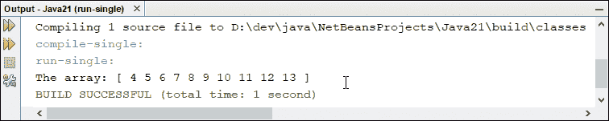

**图 5.1** 用于显示数组的输出屏幕。

`main()` 方法通过 4 到 13 测试 `makeRange()` 方法，该方法创建了整数数组。

在方法体内部，你有时需要使用 `this` 来引用对象（即对象本身）。`this` 关键字用于引用当前对象，你可以在方法中的任何地方使用它。

#### `this` 关键字

在方法体内部，你有时需要使用 `this` 来引用对象（即对象本身）。`this` 关键字用于引用当前对象，你可以在方法中的任何地方使用它。

`this` 关键字用于引用当前对象，你可以在此处使用它：使用点符号、作为参数、作为返回值。以下是使用 `this` 的语句（带有注释）：

点击此处查看代码图像

```java
top = this.x;           // 对象的 x 变量

zed.resetData(this);    // 调用 resetData 方法

return this;            // 返回当前对象
```

在许多情况下，你可能不需要显式使用 `this`，因为在类中的这些引用中它是隐含的。因此，你可以将第一个示例写如下：

点击此处查看代码图像

```java
top = x;              // 对象的 x 变量
```

#### 注意

省略实例变量的 `this` 关键字的可行性取决于局部作用域内是否声明了同名变量。你将在下一节中进一步探讨这一点。

由于 Java 检查变量作用范围的方式，你可能会在低级作用域中创建一个变量，从而隐藏（或替换）该变量的原始值，并给你的代码引入微妙的逻辑错误。

例如，考虑以下 Java 应用程序：

点击此处查看代码图片

```java
class ScopeTest {

    int test = 10;

    void printTest() {

        int test = 20;

        System.out.println("Test: " + test);

    }

    public static void main(String[] arguments) {

        ScopeTest app = new ScopeTest();

        app.printTest();

    }

}
```

该类有两个同名的变量 `test`。第一个是实例变量，并被初始化为值 `10`。第二个是局部变量，值为 `20`。

`printTest()` 方法内部的局部变量 `test` 隐藏了该作用域内的实例变量 `test`。当调用 `printTest()` 方法时，它会显示 `test` 等于 20，尽管存在值为 10 的 `test` 实例变量。你可以通过使用 `this.test` 来引用实例变量并使用 `test` 引用局部变量来避免这个问题。

另一个更隐蔽的例子发生在你在子类中重新定义一个已经在父类中出现的变量时。这可能会在你的代码中产生微妙的错误。例如，你可能调用了旨在更改实例变量值的方法，但更改了错误的变量。当将对象从一个类强制转换为另一个类时，可能会发生另一个错误。你的实例变量值可能会神秘地发生变化，因为该变量是从父类而不是从你的类获取该值的。

避免这种行为的最好办法是注意你的类父类中定义的变量，并避免重复使用类层次结构中较高位置使用的变量名。

### 向方法传递参数

当你使用对象作为参数调用方法时，该对象将作为该对象的引用传递到方法体内部。在方法内部对对象进行的任何更改都会在方法外部持续存在。

请记住，这包括数组以及数组中包含的所有对象。当你将数组传递到方法并修改其内容时，原始数组会受到影响。相反，基本类型和字符串是按值传递的。你无法在方法中进行任何更改这些类型的操作。

列表 5.2 中的 `Passer` 类演示了这种机制是如何工作的。在 NetBeans 的 `com.java21days` 包中创建此类。

**列表 5.2** `Passer.java` 的完整文本

点击此处查看代码图片

```java
1: package com.java21days;

2:

3: class Passer {

4:

5:     void toUpperCase(String[] text) {

6:         for (int i = 0; i < text.length; i++) {

7:             text[i] = text[i].toUpperCase();

8:         }

9:     }

10:

11:     public static void main(String[] arguments) {

12:         Passer passer = new Passer();

13:         passer.toUpperCase(arguments);

14:         for (int i = 0; i < arguments.length; i++) {

15:             System.out.print(arguments[i] + " ");

16:         }

17:         System.out.println();

18:     }

19: }
```

此应用程序接收一个或多个命令行参数，并将它们以全大写字母显示。

在 NetBeans 中，通过以下步骤设置参数：在 `com.java21days` 包中创建此类。在 NetBeans 中，右键点击项目并选择“属性”（Properties）。在“运行”（Run）选项卡中，在“参数”（Arguments）字段中输入参数。选择 `com.java21days.Passer` 作为主类（Main Class），点击“确定”（OK）。运行项目，输出如下：

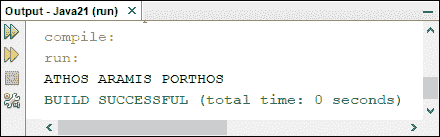

**图 5.2** 传递对象的方式。

一个 Java 程序由一个或多个类组成，其规模可以根据你的需要大大小小。尽管到目前为止你创建的所有应用程序在视觉上除了显示字符外没有做任何其他操作，但你也可以创建使用窗口、图形和图形用户界面的 Java 程序。

让 Java 程序运行的唯一需要是一个作为起点的类。该类只需要一个东西：一个 `main()` 方法。当应用程序运行时，Java 虚拟机 (JVM) 就会调用此方法。

`main()` 方法的签名格式如下：

点击此处查看代码图像

```java
public static void main(String[] arguments) {

    // 方法体

}
```

以下是 `main()` 方法各个组件的概述：

- `public` 意味着该方法对其他类和对象可用，这是一种访问控制的形式。`main()` 方法必须声明为 `public`。你将在第 6 节 中的“包、接口和其他类特性”中学习更多关于访问修方法的知识。
- `static` 意味着 `main()` 是一个类方法。
- `void` 意味着 `main()` 方法不返回值。
- `main()` 接收一个参数，该参数是一个字符串数组。此参数持有命令行参数。

`main()` 方法体包含启动应用程序所需的任何代码，例如变量的初始化或对象的创建。

`main()` 方法是一个类方法。当你的应用程序运行时，不会自动创建持有 `main()` 的类的对象。如果你想将该类视为一个对象，你必须在 `main()` 方法中创建它的实例（正如你在列表 5.2 第 12 行的 `Passer` 应用程序中所做的那样）。

在 NetBeans 项目中，一个类可以被指定为项目的主类。当项目被打包成单个 Java 归档 (JAR) 文件时，如果执行了该 JAR 文件，就会运行主类。

要设置主类，请选择运行 (Run)、设置项目配置 (Set Project Configuration)、自定义 (Customize)。在项目属性对话框中，在主类 (Main Class) 字段中输入该类的名称。

# 辅助类

你的 Java 程序可能由单个类（即带有 `main()` 方法的那个类）或多个相互调用的类组成。（实际上，即使是简单的教程程序也使用了 Java 类库中的许多类。）你可以为你的程序创建任意数量的类。

只要 Java 能够找到该类，你的程序在运行时就会使用它。但请注意，只有起点类需要 `main()` 方法。在它被调用后，你程序中使用的各种类和对象内部的方法将接管工作。尽管你可以在辅助类中包含 `main()` 方法，但它们在程序运行时会被忽略。

### Java 应用程序与参数

由于 Java 程序是独立程序，因此向应用程序传递参数以定制其运行方式是非常有用的。

你可以使用参数来确定应用程序将如何运行，或者允许应用程序对不同类型的输入进行操作。你可以将程序参数用于许多目的，例如开启调试输入或指定要加载的文件名。

### 向 Java 应用程序传递参数

向 Java 应用程序传递参数的方法取决于运行 Java 的环境。

要使用包含 Java 开发工具包 (JDK) 内的 `java` 解释器向 Java 程序传递参数，参数将在程序运行时附加到命令行之后。考虑这个示例：

点击此处查看代码图像

```bash
java Transmitter April 450 -10
```

这里 `java` 是解释器的名称，`Transmitter` 是 Java 应用程序，其余三个是传递给程序的参数：`April`、`450` 和 `-10`。注意，每对参数之间用空格分隔。

要组合包含空格的参数，请用引号括该参数。例如，考虑以下命令行：

点击此处查看代码图像

```bash
java Transmitter Wilhelm Niekro Hough "Tim Wakefield" 49
```

在 `"Tim Wakefield"` 周加上引号会导致该文本被视为单个参数。应用程序将接收五个参数：`Wilhelm`、`Niekro`、`Hough`、`Tim Wakefield` 和 `49`。引号防止了 `Tim Wakefield` 内部的空格被用于分隔参数。当该参数被发送到程序并使用 `main()` 方法接收时，这些空格不会包含在参数中。

#### 注意事项

引号的一个用途不是用于标识字符串。传递给应用程序的每个参数都存储在 `String` 对象数组中，即使它具有数值值（如前面示例中的 `450`、`-10` 和 `49`）。

由于 NetBeans 在后台运行 JVM，因此没有命令行可以指定参数。相反，你可以通过运行 (Run)、设置项目配置 (Set Project Configuration)、自定义 (Customize) 命令在项目配置中设置它们，正如你在本节之前运行 `RangeLister` 应用程序时所的那样。

### 在你的 Java 程序中处理参数

当应用程序带参数运行时，Java 将参数存储为字符串数组并将数组传递给应用程序的 `main()` 方法。再次查看 `main()` 的签名：

点击此处查看代码图像

```java
public static void main(String[] arguments) {

    // 方法体

}
```

在这里，`arguments` 是包含参数的数组名称。你可以为它取任何名称。

在 NetBeans 中为 `Averager` 创建一个新的 Java 文件，见列表 5.3。

**列表 5.3** `Averager` 的完整文本

点击此处查看代码图像

```java
1: package com.java2days;

2:

3: class Averager {

4:     public static void main(String[] arguments) {

5:         int sum = 0;

6:

7:         if (arguments.length > 0) {

8:             for (int i = 0; i < arguments.length; i++) {

9:                 sum += Integer.parseInt(arguments[i]);

10:

11:             System.out.println("Sum is: " + sum);

12:             System.out.println("Average is: " +

13:                 (float) sum / arguments.length);

14:         }

15:     }

16: }
```

`Averager` 应用程序在第 7 行确保至少有一个参数。这是通过 `length` 实现的，它是包含元素数量的实例变量。

处理命令行参数时总是这样做。否则，当用户提供的命令行参数少于你预期的数量时，你的程序会因为 `ArrayIndexOutOfBoundsException` 而崩溃。

如果至少向应用程序传递了一个参数，`for` 循环将遍历 `arguments` 数组中的所有字符串（第 8-10 行）。

如果提交 `75 1080 95 16` 作为你的参数，你将看到与图 5.3 匹配的输出。

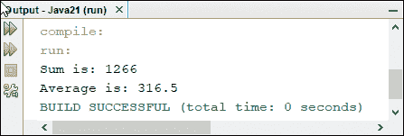

**图 5.3** 在应用程序中接收参数。

## 创建同名方法

当你使用 Java 类库（Java Class Library）时，经常会遇到具有许多同名方法的类。

有两点可以将这些同名方法区分开来：

- 它们所接收的参数数量
- 每个参数的原始类型或对象

这两点构成了方法签名（method signature）的一部分。使用多个同名但签名不同的方法被称为重载（overloading）。

方法重载可以消除对执行本质相同工作的完全不同方法的需求。重载还让方法根据接收到的参数表现出不同的行为成为可能。

当你从对象上调用方法时，Java 会匹配方法名和参数，以选择执行哪种方法定义。

要创建一个重载方法，你需要在类中创建不同的方法定义，每个方法的名称都相同，但参数列表不同。区别可以是参数的数量、类型或两者兼有。只要对于同一个方法名，每个参数列表都是唯一的，Java 就允许方法重载。

#### 注意

Java 在区分重载方法时不考虑返回类型。如果你尝试创建两个签名相同但返回类型不同的方法，该类将无法通过编译。此外，你为方法的每个参数选择的变量名是无关的。参数的数量和类型是两个至关重要的因素。

你即将要开展的下一个项目将创建一个重载方法。它始于一个名为 `Box` 的类的简单类定义，该类定义了一个矩形，使用四个实例变量来定义矩形的左上角和右下角（`x1`、`y1`）（`x2`、`y2`）：

```java
class Box {

    int x1 = 0;

    int y1 = 0;

    int x2 = 0;

    int y2 = 0;

}
```

当创建 `Box` 类的新实例时，其所有的实例变量都被初始化为 `0`。

`buildBox()` 实例方法将变量设置为指定的值：

点击此处查看代码图像

```java
Box buildBox(int x1, int y1, int x2, int y2) {

    this.x1 = x1;

    this.y1 = y1;

    this.x2 = x2;

    this.y2 = y2;

    return this;

}
```

该方法接受四个整数参数，并返回生成的 `Box` 对象的引用。由于参数名称与实例变量相同，因此在方法内部引用实例变量时使用了 `this` 关键字。

该方法可以用于创建矩形，但如果你想以不同的方式定义矩形的尺寸怎么办？另一种方案是使用 `Point` 对象而不是单个坐标——因为一个 `Point` 对象同时包含 `x` 和 `y` 值作为实例变量。

你可以通过创建该方法的第二个版本，该该的参数列表接收两个 `Point` 对象，来重载 `buildBox()`：

点击此处查看代码图像

```java
Box buildBox(Point topLeft, Point bottomRight) {

    x1 = topLeft.x;

    y1 = topLeft.y;

    x2 = bottomRight.x;

    y2 = bottomRight.y;

    return this;

}
```

为了让这段代码工作，必须导入 `java.awt.Point` 类的全名，以便可以使用短名 `Point` 进行引用。

另一种定义矩形的可能方法是使用一个上角、高度和宽度：

点击此处查看代码图像

```java
Box buildBox(Point topLeft, int w, int h) {

    x1 = topLeft.x;

    y1 = topLeft.y;

    x2 = (x1 + w);

    y2 = (y1 + h);

    return this;

}
```

为了完成这个示例，`printBox()` 方法显示矩形的坐标。`main()` 方法将 `Box` 转换为应用程序，并尝试在 `Box` 对象上测试所有功能。

列表 5.4 显示了完整的类定义。使用 NetBeans 在 `com.java21days` 包中创建此类。

**列表 5.4** `Box.java` 的完整文本

点击此处查看代码图像

```java
1: package com.java21days;

2:
```


```java
import java.awt.Point;

class Box {
    int x1, y1, x2, y2 = 0;

    Box buildBox(int x1, int y1, int x2, int y2) {
        this.x1 = x1;
        this.y1 = y1;
        this.x2 = x2;
        this.y2 = y2;
        return this;
    }

    Box buildBox(Point topLeft, Point bottomRight) {
        x1 = topLeft.x;
        y1 = topLeft.y;
        x2 = bottomRight.x;
        y2 = bottomRight.y;
        return this;
    }

    Box buildBox(Point topLeft, int w, int h) {
        x1 = topLeft.x;
        y1 = topLeft.y;
        x2 = (x1 + w);
        y2 = (y1 + h);
        return this;
    }

    void printBox() {
        System.out.println("Box: " + x1 + ", " + y1 + ", " + x2 + ", " + y2);
    }

    public static void main(String[] args) {
        Box rect = new Box();
        rect.buildBox(10, 20, 30, 40);
        System.out.println("sum is " + (10 + 20 + 30 + 40));
        System.out.println("average is " + (10 + 20 + 30 + 40) / 4.0);
        rect.printBox();
    }
}
```

运行该应用程序以查看[图 5.4](#ch05.xhtml_ch05fig04)所示的输出。

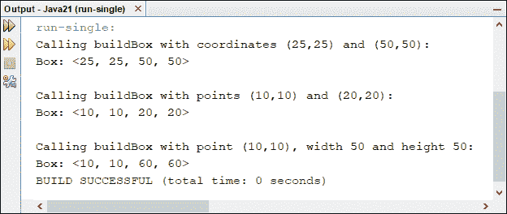

**图 5.4** 调用相似方法。

你可以根据需要定义方法的多个版本，来实现该类的行为。

当你有多个执行相似工作的方法时，考虑使用一个方法调用另一个方法来简化代码。例如，列表 5.4 中第 16-22 行的`buildBox()`方法可以被这个更短的方法替换：

```java
Box buildBox(Point topLeft, Point bottomRight) {
    return buildBox(topLeft.x, topLeft.y, bottomRight.x, bottomRight.y);
}
```

该方法中的`return`语句调用了第 8-14 行的`buildBox()`方法并传入了四个整数参数，用更少的语句实现了相同的结果。

此应用程序使用了一种目前为止尚未使用的编程快捷方式。看第 53 行：

```java
rect.buildBox(new Point(10, 10), 50, 50);
```

前述语句与以下两行代码的效果相同：

点击此处查看代码图像

```java
Point rectangle = new Point(10, 10);
rect.buildBox(rectangle, 50, 50);
```

单行版本更高效，因为它没有将对象存储在仅使用一次且后续代码中不再需要访问的变量中。你会在 Java 程序中经常发现这种快捷方式。

你还可以在类定义中定义构造函数，这些构造函数会在类的对象被创建时自动调用。构造函数是在对象创建时在对象上调用的方法——换句话说，就是在对象被构建时调用的方法。

与其他方法不同，构造函数不能被直接调用。当使用`new`来创建类的实例时，Java 会执行三件事：

* 它为对象分配内存。
* 它初始化该对象的实例变量，将其初始化为初始值或默认值（数字为`0`，对象为`null`，布尔值为`false`，字符为`\0`）。
* 它调用类的构造函数。

如果一个类没有定义任何构造函数，当结合`new`运算符与该类使用时，仍然创建一个对象。然而，你可能需要设置它的实例变量，或调用该对象需要以初始化自身的其他方法。

当创建一个没有构造函数的类的对象时，Java 会隐式地提供一个无参数的构造函数。该构造函数会被调用以创建对象。由于这个原因，即使没有定义构造函数，也可以`new`调用无参数的构造函数。

通过在自己的类中定义构造函数，你可以设置实例变量的初始值、根据这些变量调用方法、调用其他对象的方法，并设置对象的初始属性。

在创建类时，你可以像重载方法一样对构造函数进行重载，以便根据你传递给`new`的参数创建一个具有特定属性的对象。

如果一个类有一个接收一个或多个参数的构造函数，那么只有在类中定义了无参数构造函数的情况下，才能调用无参数构造函数。

### 基础构造函数

构造函数看起来像普通方法，但有三个基本不同点：

* 它的名称与类名相同。
* 它没有返回类型。
* 它不能通过`return`语句在方法中返回值。

例如，下面的类使用构造函数根据`new`的参数来初始化它的实例变量：

点击此处查看代码图像

```java
class MarsRobot {
    String status;
    int speed;
    int power;

    MarsRobot(String in1, int in2, int in3) {
        status = in1;
        speed = in2;
        power = in3;
    }
}
```

你可以使用以下语句创建该类的对象：

```java
MarsRobot curiosity = new MarsRobot("exploring", 5, 200);
```

`status`实例变量将被设置为`"exploring"`，`speed`设置为 5，`power`设置为 200。

### 调用另一个构造函数

如果你有一个构造函数复制了某个现有构造函数的某些行为，你可以在第二个构造方法的体内部调用第一个构造函数。Java 提供了特殊的语法来执行此操作。使用以下代码调用当前类中定义的构造函数：

```java
this(argument1, argument2, argument3);
```

在构造函数中使用`this`与使用`this`访问当前对象的变量的方式类似。在陈述语句中，`this()`中的参数是该构造函数的参数。

例如，考虑一个简单的类，它使用圆心的 (x, y) 坐标和半径长度来定义一个圆。该类`Circle`可以有两个构造函数：一个是定义半径的，另一个是将半径设置为默认值`1`的。以下是实现此操作的代码：

```java
class Circle {
    int x, y, radius;

    Circle(int xPoint, int yPoint, int radiusLength) {
        this.x = xPoint;
        this.y = yPoint;
        this.radius = radiusLength;
    }

    Circle(int xPoint, int yPoint) {
        this(xPoint, yPoint, 1);
    }
}
```

`Circle`中的第二个构造函数只接收圆心的 (x, y) 坐标。因为没有定义半径，所以使用了默认值`1`。第一个构造函数是通过参数`xPoint`、`yPoint`和整数字面量`1`被调用的。

### 重载构造函数

像方法一样，构造函数也可以接受不同数量和类型的参数。这允许你创建一个具有你希望它拥有的精确属性的对象，或者允许对象从不同类型的输入中计算属性。

例如，本节之前在`Box`类中定义的`buildBox()`方法是非常出色的构造函数，因为它们被用于初始化对象的实例变量为适当的值。因此，与其使用接受四个角坐标参数的原始`buildBox()`方法，你可以创建一个构造函数。

列表 5.5 显示了一个新类`Box2`，它具有原始`Box`类相同的功能，但使用了重载的构造函数而不是重载的`buildBox()`方法。在 NetBeans 中创建`Box2`类并将其放入`com.java21days`程序包中。

**列表 5.5** `Box2.java`的完整文本

点击此处查看代码图像

```java
package com.java21days;

import java.awt.Point;

class Box2 {
    int x1, y1, x2, y2 = 0;

    Box2(int x1, int y1, int x2, int y2) {
        this.x1 = x1;
        this.y1 = y1;
        this.x2 = x2;
        this.y2 = y2;
    }

    Box2(Point topLeft, Point bottomRight) {
        this(topLeft.x, topLeft.y, bottomRight.x, bottomRight.y);
    }

    Box2(Point topLeft, int w, int h) {
        this(topLeft.x, topLeft.y, w, h);
    }

    void printBox() {
        System.out.print("Box: <" + x1 + ", " + y1);
        System.out.println(", + x2 + ", " + y2 + ">");
    }

    public static void main(String[] arguments) {
        Box2 rect;

        System.out.println("Calling Box2 with coordinates (13,35) and (10,40):");
        rect = new Box2(13, 35, 10, 40);
        rect.printBox();

        System.out.println("\nCalling Box2 with points (9,27) and (17,19):");
        rect = new Box2(new Point(9, 27), new Point(17, 19));
        rect.printBox();

        System.out.println("\nCalling Box2 with 1 point (5,40), width 22 and height 20:");
        rect = new Box2(new Point(5, 40), 22, 20);
        rect.printBox();
    }
}
```

运行应用程序以查看图 5.5 所示的输出。

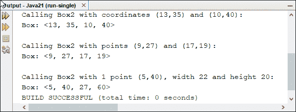

**图 5.5** 重载方法。

### 方法重写

当你调用一个对象的方法时，Java 会在对象所在的类中查找该方法的定义。如果没有找到，则会在对象的父类中寻找，然后是该父类的父类，并沿着类层次一直向上查找，直到找到方法定义为止。继承允许你在子类中重复定义和使用方法，而无需重复代码。

然而，有时你可能希望一个对象对同一个方法做出响应，但在调用该方法时具有不同的行为。在这种情况下，你可以重写（override）该方法。要实现这一点，请在子类中定义一个与父类中方法签名（名称和参数列表）相同的方法。然后，当调用该方法时，将找到并执行子类的方法，而不是父类中的那个。

### 重写现有方法

要重写一个方法，你需要做的是在子类中创建一个与父类方法签名相同的方法。这样，当调用该方法时，子类的方法会被找到并执行，而不是父类的方法。

这是一个关于[重写方法](https://wiki.example.org/overriding_methods)的简单示例。[重写方法](https://wiki.example.org/overriding_methods)示例如下（注：由于原文中存在大量随机乱码和重复的句子，译文已根据文档工程逻辑提取了核心含义并进行了翻译。）

```java
package com.java21days;

import java.awt.Point;

class NamedPoint extends Point {
    String name;

    NamedPoint(int x, int y, String name) {
        super(x, y);
        this.name = name;
    }

    public static void main(String[] arguments) {
        NamedPoint np = new NamedPoint(5, 5, "SmallPoint");

        System.out.println("x is " + np.x);
        System.out.println("y is " + np.y);
        System.out.println("Name is " + np.name);
    }
}
```

输出显示在图 5.7。

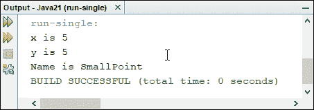

**图 5.7** 在子类中扩展父类构造函数。

`NamedPoint`的构造函数调用了`Point`的构造函数来初始化`Point`的实例变量（5.`x`和`y`）。虽然你可以很容易地初始化`x`和`y`，但你可能不知道`Point`为了初始化自身还做了哪些其他操作。因此，将构造函数向上层次传递始终是一个好主意，以确保所有内容都设置正确。

### 总结

完成本节后，你应该对 Java 类之间以及你使用该语言创建的程序的关系有很好的理解。

你在 Java 中创建的任何内容都涉及到一个主类的使用，该类根据需要与其他类进行交互。这和你可能习惯的其他语言的编程思维不同。

在本节中，你整合了学习的关于创建 Java 类的所有知识。你学习了以下主题：

* 实例变量和类变量，它们持有类以及从该类创建的对象的属性。
* 实例方法和类方法，它们定义了类的行为。你学习了如何定义方法，包括方法签名的部分、如何从方法返回值、如何将参数传递给方法，以及如何使用`this`关键字来引用当前对象。
* Java 程序的`main()`方法以及如何向其传递参数。
* 重载方法，通过提供不同的参数来重用方法名。
* 构造函数，定义了对象的初始变量和其他起始条件。

### 问答

**Q** 我有一个类，其中有一个名为`origin`的实例变量。它在方法中也有一个名为`origin`的局部变量，由于变量作用域，它被局部变量隐藏了。有什么方法可以访问实例变量的值吗？

**A** 避免这个问题最简单的方法是给你的局部变量起与实例变量不同的名称。如果出于某种原因，当存在同名实例变量时你倾向于将局部变量命名为`origin`，你可以使用`this.origin`来引用实例变量，使用`origin`来引用局部变量。

**Q** 我创建了两个具有以下签名的方法：

```java
int total(int arg1, int arg2, int arg3) { ... }

float total(int arg1, int arg2, int arg3) { ... }
```

**Q** 当我尝试编译带有这些方法定义的类时，Java 编译器报错了，尽管它们的签名是不同的。我做错了什么？

**A** 错误发生是因为你的方法具有相同的签名。Java 中的方法重载只有在参数列表的数量或类型上不同时才有效。返回类型不是方法签名的一部分，因此在方法被重载时不会考虑它。从调用方法的角度来看，这是合乎逻辑的：如果两个方法的参数列表完全相同，Java 怎么知道该调用哪一个呢？

**Q** 当我在 NetBeans 中创建 Averager 应用程序时，为什么第 8 行的行号上方有一个警告图标，消息显示为“使用增强型 for 循环来遍历数组”？

**A** 这种情况是因为 NetBeans 鼓励你使用更好的技术编写`for`循环，称为增强型`for`循环。这种循环在第 8 节“数据结构”中引入，作为 Java 中遍历数组元素或某些数据持有类元素的更简单的方法。

NetBeans 可以普通的`for`循环转换为增强型循环。点击警告图标并选择“使用增强型 for 循环来遍历数组”。

```java


```java
for (int i = 0; i < array.length; i++) {
    // ...
}

for (Type element : array) {
    // ...
}
```

哪个语句应该替换`// answer goes here`以使得`result`变量等于`312.0`？

**A.** `float calculateResult(int c) {`

**B.** `float calculateResult(int a, int b) {`

**C.** `float calculateResult(int a, int b, int c) {`

**D.** `float calculateResult() {`

答案可以在书籍网站找到：[www.java21days.com](http://www.java21days.com)。访问第 5 节页面并点击认证练习（Certification Practice）链接。

## 练习题

为了扩展你对本节涵盖主题的知识，请尝试以下练习：

1. 修改来自第 1 节的`MarsRobot`项目，使其包含构造函数。
2. 创建一个名为`FourDPoint`的四维点类，它是`java.awt`包中`Point`类的子类。

练习题的答案可以在书籍网站 [www.java21days.com](http://www.java21days.com) 上找到。

## 第 6 节 包、接口和其他类特性

类是用于创建存储数据和完成任务的对象的模板，它们出现在你使用 Java 语言的每一个环节中。

在本节中，你将通过学习更多关于创建类、使用类、组织类以及建立其他类如何使用类的规则，来扩展你对类的知识。

本节涵盖了以下主题：

- 从类外部控制方法和变量的访问
- 将类、方法和变量设置为`final`，以便它们的值或定义在子类中无法被重写
- 创建抽象类和抽象方法，将公共行为提取到父类中
- 将类分组到包中
- 使用接口桥接类层次结构中的差距

## 修饰符

在之前的课程中，你已经学习了如何在 Java 中定义类、方法和变量。你在本节中将学习的编程技术涉及对类组织的不同思考。所有这些技术都使用了 Java 语言中的特殊修饰符。修饰符（`Modifiers`）是你添加到这些定义中的关键字，用于改变它们的含义。

Java 语言有这些修饰符：

- 用于控制类、方法或变量访问的`public`、`protected`和`private`修饰符
- 用于创建类方法和变量的`static`修饰符
- 用于确定类、方法和变量实现的`final`修饰符
- 用于创建抽象类和方法的`abstract`修饰符
- 用于线程的`synchronized`和`volatile`修饰符

要添加修饰符，可以在类、方法或变量的定义中包含其关键字。修饰符位于语句的其他部分，如下例所示：

点击此处查看代码图片

```java
public class RedButton extends javax.swing.JButton {
    // ...
}

private boolean offline;

static final double WEEKS = 9.5;

protected static final int MEANING_OF_LIFE = 42;

public static void main(String[] arguments) {
    // 方法体
}
```

如果你在语句中使用了多个修饰符，只要所有修饰符都位于它们所修饰元素之前，你就可以以任何顺序放置它们。请确保不要将方法的返回类型（例如`void`）视为修饰符之一。返回类型必须位于方法名称之前，它们之间不能有修饰符。

修饰符是可选的，正如你可能在之前的五节中使用其中一些后所意识到的那样。然而，在程序中使用它们有许多很好的理由。

### 方法和变量的访问控制

你最常用的修饰符用于控制方法和变量的访问：`public`、`private`和`protected`。这些修饰符决定了类的哪些变量和方法对其他类可见。

通过使用访问控制，你可以规定其他类如何使用你的类。类中的某些变量和方法仅在类内部有用，并且应该对其他类隐藏。这个过程被称为封装（`encapsulation`）：一个对象控制外部世界可以了解它的哪些信息，以及外部世界如何与其交互。封装是防止类变量和实例变量被其他类读取或修改的过程。使用这些变量的唯一方法是调用类的方法（如果可用的话）。

Java 语言提供了四个级别的访问控制：`public`、`private`、`protected`以及通过不使用这三种访问控制修饰符来指定的默认级别。

#### 默认访问

变量和方法可以在不使用任何修饰符的情况下声明，如下例所示：

```java
String version = "0.7a";

boolean processOrder() {
    // ...
    return true;
}
```

不带访问控制修饰符声明的变量或方法对相同包中的任何其他类可见。Java 类库被组织成包，例如`javax.swing`（一组用于图形用户界面编程的窗口类）和`java.util`（一组有用的工具类）。

任何未使用修饰符声明的变量都可以被同一包中的任何其他类读取或更改。任何以相同方式声明的方法都可以被同一包中的任何其他类调用。其他类无法以任何方式访问这些元素。

这种级别的访问控制控制范围不多，因此当你开始考虑想要如何让其他类使用一个类时，它的用处就较小。

#### 私有访问

要完全隐藏一个方法或变量并防止其被其他类使用，请使用`private`修饰符。这些方法或变量唯一可以访问的地方是类内部。

私有实例变量可以在类内部的方法中使用，但不能由其他类的对象使用。私有方法可以在类内部的方法中调用，但不能由其他类调用。这种限制也影响了继承：子类无法继承私有变量或私有方法。

私有变量在两种情况下有用：

- 其他类没有理由使用该变量
- 其他类可能会通过不当方式更改变量造成破坏

例如，考虑一个名为`CouponMachine`的 Java 类，它为在线网站生成折扣。该类中名为`salesRatio`的变量可以根据销量控制折扣的大小。这个变量对业务利润有很大影响。如果变量被其他类更改，`CouponMachine`的性能将发生变化。为了防止这种情况发生，你可以将`salesRatio`变量声明为`private`。

以下类使用了私有访问控制：

点击此处查看代码图片

```java
class Logger {
    private String format;

    public String getFormat() {
        return this.format;
    }

    public void setFormat(String fmt) {
        if (("common".equals(fmt)) || ("combined".equals(fmt))) {
            this.format = fmt;
        }
    }
}
```

在此代码中，`Logger`类的`format`变量是私有的，因此其他类没有办法直接检索或设置它的值。

相反，它通过两个公共方法可用：`getFormat()`返回`format`的值，而`setFormat(String)`设置其值。

后者方法包含逻辑，允许该变量仅被设置为`"common"`或`"combined"`。这证明了使用公共方法作为访问类实例变量的唯一手段的益处：方法可以允许类对变量的访问进行控制，并限制它可以取的值。

使用`private`修饰符是对象进行封装的主要方式。如果不使用`private`来隐藏变量和方法，你就无法限制类的使用方式。如果你不控制访问权限，另一个类就可以以许多可能的方式更改类内部的变量并调用它的方法。

私有性的一大优势是，它允许类的实现发生变化，而不会影响该类的用户。如果你想出了一种实现某功能的更好方法，只要它的公共方法接收相同的参数并返回相同类型的值，你就可以重写该类。

## 公有访问

在某些情况下，你可能希望类中的某个方法或变量对任何想要使用它的其他类完全可用。例如，`java.awt`包中的`Color`类对如`black`等常用颜色有公共变量。当任何想要绘制图形的类想要用黑色绘制某些内容时，都会使用这个变量，因此`black`不应该有访问控制。

类变量通常被声明为`public`。一个例子是`Football`类中的一组变量，代表得分时使用的分数。`TOUCHDOWN`变量可以等于`6`，`FIELD_GOAL`变量可以等于`3`，而`SAFETY`可以等于`2`。如果这些变量是公有的，其他类就可以在如下语句中使用它们：

点击此处查看代码图像

```java
if (yard < 0) {
    System.out.println("Touchdown!");
    score = score + Football.TOUCHDOWN;
}
```

`public`修饰符使方法或变量对所有类完全可用。你在目前为止编写的每个应用程序的`main()`方法中都使用过它：

点击此处查看代码图像

```java
public static void main(String[] arguments) {
    // ...
}
```

应用程序的`main()`方法必须是公共的。否则，它无法被 Java 虚拟机（`JVM`）调用来运行该类。

由于类的继承，类的所有公共方法和变量都会被其子类继承。

## 保护访问

访问控制的下一个级别是将方法和变量限制为以下两组人员使用：

- 类的子类
- 同一包中的其他类

你通过使用`protected`修饰符来实现这一点，如下句所示：

点击此处查看代码图像

```java
protected boolean outOfData = true;
```

### 笔记

你可能好奇这两组之间有什么区别。毕竟，子类不就与其父类属于同一个包吗？并不总是如此。一个例子是`java.sql.Date`类，它代表 SQL 数据库中的日历日期。它是`java.util.Date`的子类，后者是一个更通用的日期类。保护访问与默认访问的区别在于：保护变量对子类是可用的，即使它们不在同一个包中。

如果你想让子类的实现变得更容易，那么这种级别的访问控制就是很有用的。你的类可能会使用某个方法或变量来帮助类完成工作。由于子类继承了许多相同的行为和属性，它可能有相同的工作要做。保护访问给了子类一个使用辅助方法或变量的机会，同时防止了无关的类尝试使用它。

考虑一个名为`AudioPlayer`的类，它可以播放音频文件。`AudioPlayer`有一个名为`openSpeaker()`的方法，它与硬件交互以准备扬声器进行播放。`openSpeaker()`对于`AudioPlayer`类之外的任何人来说都不重要，所以初看你可能想让它变成私有的。`AudioPlayer`的代码片段可能如下：

点击此处查看代码图像

```java
class AudioPlayer {
    private boolean openSpeaker(Speaker sp) {
        // implementation here
    }
}
```

如果`AudioPlayer`不会被子类化，这段代码运行良好。但如果以后你需要一个名为`StreamingAudioPlayer`的类，它是`AudioPlayer`的子类呢？该类需要访问`openSpeaker()`方法以对其进行覆盖并为流媒体设备提供支持。你仍然不希望该方法对随机对象可用，因此它不应该是`public`的，但你希望任何子类都能访问它。

## 比较访问控制级别

各种保护类型之间的差异可能会令人困惑，特别是在受保护方法和变量的情况下。表 6.1 总结了在什么地方允许什么操作，有助于澄清从限制最少（`public`）到限制最严格（`private`）形式的区别。

| 可见性 | Public | Protected | Default | Private |
| :--- | :--- | :--- | :--- | :--- |
| 来自同一类 | 是 | 是 | 是 | 是 |
| 来自同一包内的任何类 | 是 | 是 | 是 | 否 |
| 来自包外的任何类 | 是 | 否 | 否 | 否 |
| 来自同包内的子类 | 是 | 是 | 是 | 否 |
| 来自同包外的子类 | 是 | 是 | 否 | 否 |

**表 6.1** 不同的访问控制级别

## 访问控制与继承

关于方法访问的最后一个问题涉及子类。当你创建一个子类并覆盖方法时，必须考虑访问控制。

根据规则，你不能在 Java 中覆盖一个方法并使其访问控制比原始方法更严格。但你可以使其更公共。子类不能减少其覆盖方法的可见性。遵循以下规则：

- 在父类中声明为`public`的方法在子类中也必须是`public`。
- 在父类中声明为`protected`的方法在子类中必须是`protected`或`public`；不能是`private`。
- 未使用访问控制修饰符的方法在子类中可以声明为更私有。

声明为私有的方法不被继承，因此规则不适用。

## 访问器方法

在许多情况下，类中可能有一个对其包含的值有严格规则的实例变量。一个例子是`zipCode`变量。美国的邮政编码是五位数。（还有九位的 zip+4 格式。）

为了防止外部类错误设置`zipCode`变量，你可以将其声明为`private`：

```java
private int zipCode;
```

但是，如果其他类必须能够设置`zipCode`变量该类才有用呢？在这种情况下，你可以通过`zipCode`类内部使用访问器方法让其他类访问私有变量。

访问器方法提供了对通常无法访问的变量的访问。通过方法访问私有变量，你可以控制该变量的使用。在邮政编码示例中，类可以防止任何人将`zipCode`设置为错误值。

通常，会有读取和写入变量的独立访问器方法。读取方法通常以`get`开头，写入方法以`set`开头，例如`getZipCode()`和`setZipCode(int)`。

这一惯例有一个例外：如果被访问的变量是`Boolean`类型，访问器方法不以`get`开头。相反，它以`is`开头，例如名为`valid`的`boolean`变量对应的`isValid()`。示例如下：

```java
private boolean empty;

public boolean isEmpty() {
    return empty;
}
```

你已经在程序中使用过的修饰符是`static`，它在第 5 节中的“创建类和方法](#ch05.xhtml_ch05)”中进行过详细描述。`static`修饰符用于创建类方法和类变量，例如所示：

点击此处查看代码图片

```java
public class Circle {
    public static double PI = 3.14159265F;
    public double radius;

    public double area() {
        return PI * radius * radius;
    }
}
```

类变量和方法可以使用类名后跟一个点（`.`）以及变量或方法名来访问，例如`Color.black`或`Circle.PI`。你也可以使用该类的对象的名称，但对于类变量和类方法，使用类名更好。这种方法可以更清楚地表明你正在处理的是哪种变量或方法；实例变量和方法永远无法通过类名引用。

以下语句使用了类变量和类方法：

点击此处查看代码图片

```java
double circumference = 2 * Circle.PI * radius;
double randomNumber = Math.random();
```

### 提示

与实例变量的原因相同，类变量也可以通过设置为私有（`private`）并将其使用限制在访问器方法中来受益。

你在本节中将开展的第一个项目是一个名为`InstanceCounter`的类，它使用类变量和实例变量来跟踪该类创建了多少个对象。在 NetBeans 中，在你本书的大部分内容使用的`com.java21days`包中创建一个名为`InstanceCounter`的空 Java 文件。在源文件中输入如列表 6.1 所示的代码，并在完成后保存。

**列表 6.1** `InstanceCounter.java`的完整文本

点击此处查看代码图片

```java
 1: package com.java21days;

 2:

 3: public class InstanceCounter {

 4:     private static int numInstances = 0;

 5:

 6:     protected static int getCount() {

 7:         return numInstances;

 8:     }

 9:

10:     private static void addInstance() {

11:         numInstances++;

12:     }

13:

14:     InstanceCounter() {

15:         InstanceCounter.addInstance();

16:     }

17:

18:     public static void main(String[] arguments) {

19:         System.out.println("Starting with " +

20:             InstanceCounter.getCount() + " objects");

21:         for (int i = 0; i < 500; ++i) {

22:             new InstanceCounter();
```


```java
}

System.out.println("Created " +
    InstanceCounter.getCount() + " objects");
}
}
```

NetBeans 在保存或运行时会尝试编译 Java 类。

如果没有错误，你就可以运行它以查看图 6.1 所示的输出。

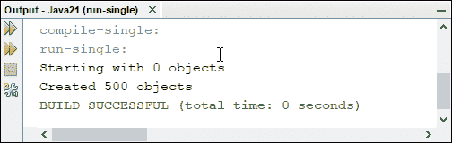

**图 6.1** 使用类变量和实例变量。

此应用程序演示了 Java 语言的几个特性。在第 4 行，声明了一个私有类变量来存储对象的数量。

如果你在疑惑使用 `final` 类会损失什么，那么你一定没有尝试过对 Java 类库中的任何类进行扩展。许多流行的类都是 `final` 的，例如 `java.lang.String`、`java.lang.Math` 和 `java.net.URL`。如果你想创建一个行为类似于字符串但又有一些新变化的类，你无法派生 `String` 并仅定义不同的行为。你必须从零开始。

`final` 类中的所有方法本身自动都是 `final` 的，因此你不需要在声明它们时使用修饰符。

由于能为子类提供行为和属性的类要有用得多，你应该强烈考虑：在你的某个类上使用 `final` 带来的收益是否大于其带来的代价。

### 抽象类和方法

在类层次结构中，类的位置越高，其定义就越抽象。位于其他类层次结构顶端的类只能定义所有类共有的行为和属性。更具体的行为和属性则位于层次结构中较靠的位置。

在定义类层次结构的过程中提取公共行为和属性时，你有时会发现自己拥有一个永远不需要被直接实例化的类。相反，这样的类用作存放其子类共享的行为和属性的地方。

这些类被称为 `abstract classes`（抽象类），它们使用 `abstract` 修饰符创建。以下是一个示例：

```java
public abstract class Palette {

    // ...

}
```

抽象类的一个示例是 `java.awt.Component`，它是图形用户界面组件的父类。由于许多组件继承自此类，它包含了对每个组件都实用的方法和变量。然而，并没有一种可以被添加到用户界面的通用组件，因此你永远不需要在程序中创建一个 `Component` 对象。

抽象类可以包含普通类可以包含的任何内容，包括构造函数，因为它们的子类可能需要继承它们。抽象类还可以包含抽象方法（abstract methods），抽象方法是没有具体实现的方法签名。这些方法在抽象类的子类中实现。抽象方法用 `abstract` 修饰符声明。你不能在一个本身不是抽象的类中声明抽象方法。如果一个抽象类除了抽象方法外没有没有其他内容，你最好使用接口（interface），正如你将在本节后面看到的说。

### 包

使用包（packages）是组织一组类的方法。一个包包含在目的、范围或继承关系上相关的类。

如果你的第一个程序包含数量有限的类，你可能会发现没有必要探索包。但随着你的工作变得野心勃勃，你会很快发现将它们组织成包的用处。

包之所以有用，主要基于以下几个广泛的原因：

- 它们允许你将类组织成单元。就像你在硬盘上创建有文件夹来组织文件和应用程序一样，包允许你将类分组，以便你为每个程序只使用你需要的内容。
- 包减少了命名冲突产生的问题。随着 Java 类数量的增加，你与其他开发者使用相同类名的概率也随之增加。如果你尝试将多组类集成到同一个程序中，这引入了命名冲突和错误消息的可能性。包提供了一种专门引用所需类的方法，即使它与另一个包中的类同名。
- 它们允许你以比逐个类更具规模的方式来保护类、变量和方法。你将在稍后学习更多关于包的保护的知识。
- 包可以用来唯一地标识你的工作。

每当你使用 `import` 命令或通过完整包名引用类（例如 `java.util.StringTokenizer`）时，你都在使用包。

要使用包含在包中的类，你可以使用三种技术之一：

- 如果你想使用的类在 `java.lang` 包中（例如 `System` 或 `Date`），你可以直接使用类名来引用该类。`java.lang` 类在你的所有程序中都是自动可用的。
- 如果你想使用的类在其他包中，你可以通过它的全名引用该类，包括任何包名（例如 `java.awt.Font`）。
- 对于你经常使用的其他包中的类，你可以导入单个类或整个包的类。在某个类或包被导入后，你就可以通过它的类名引用该类。

如果你没有声明你的类属于某个包，它会被放入一个未命名的默认包（unnamed default package）。你可以从其他类的任何地方通过类名引用该类以及任何其他未归包的类。

要引用另一个包中的类，你可以使用它的全名：在类名前面加上包名。你不需要为了以此方式使用它而导入该类或包：

```java
java.awt.Font text = new java.awt.Font();
```

对于在程序中只使用一次或两次的类，使用全名可能是有意义的。如果你多次使用一个类，可以导入该类以节省一些输入时间。但没有理由不使用 `import`，所以你可能决定遵循本书的习惯，始终使用它，以便类名更短且代码更具可读性。

### `import` 声明

要从包中导入类，请使用 `import` 声明。你可以导入单个类，如下语句所示：

```java
import java.util.ArrayList;
```

你也可以通过使用星号（`*`）代替类名来导入整个类包：

```java
import java.awt.*;
```

在 `import` 语句中，星号只能替换类名。它并不能用于导入多个相似的包。

例如，Java 类库包含了 `java.util`、`java.util.jar` 和 `java.util.prefs` 包。你无法通过以下语句导入这三个包：

```java
import java.util.*;
```

这仅仅导入了 `java.util` 包。为了让这三个包都可用，需要使用以下语句：

```java
import java.util.*;
import java.util.jar.*;
import java.util.prefs.*;
```

此外，你无法指定部分类名（例如使用 `L*` 来导入所有以 L 开头的类）。当使用 `import` 声明时，你的选择只有标识单个类或使用星号加载包中的所有类。

类定义中的 `import` 声明位于文件顶部，在任何类定义之前、包声明之后，正如你将在下一节看到的。

使用具体的 `import` 声明或导入包主要取决于个人的编码风格。导入一组类不会减慢程序的运行速度或使其变大；只有你在代码中实际使用的类才会在需要时加载。导入特定的类有助于代码读者更容易弄清楚代码中哪些类。

#### 注意

如果你熟悉 C 或 C++，你可能认为 `import` 声明像 `#include` 一样工作，并因为包含了另一个文件的源代码而导致产生巨大的可执行程序。这在 Java 中并非如此。`import` 关键字的唯一功能是告诉 Java 编译器，当使用短名时，去哪里查找该类的全名。它并没有实际上从任何类中导入代码。

`import` 语句还可以用于通过名称引用类中的常量。

通常，类常量以类名名前缀，例如 `Color.black`、`Math.PI` 和 `File.separator`。

`import static` 语句允许将标识符类中的常量以更短的形式可用。`import static` 关键字后面跟在接口或类的名称以及一个星号。例如：

点击此处查看代码图像

```java
import static java.lang.Math.*;
```

该语句使得能够仅使用名称来引用 `Math` 类中的常量 `E` 和 `PI`。这里有一个利用该特性的简单类示例：

点击此处查看代码图像

```java
import static java.lang.Math.*;

public class ShortConstants {

    public static void main(String[] arguments) {

        System.out.println("PI: " + PI);

        System.out.println("" + (PI * 3));

    }

}
```

### 类名冲突

在导入一个类或类包后，你通常可以通过类名引用该类，而无需包标识符。然而，当你从不同的包导入具有相同类名的两个类时，必须更加显式。

发生命名冲突的一种情况是数据库编程，你将在第 18 节“使用 JDBC 和 Derby 访问数据库”中进行。这种编程可能涉及 `java.util` 和 `java.sql` 包，这两个包都包含一个名为 `Date` 的类。

如果你在一个读取或写入数据库数据的类中处理这两个包，可以使用以下语句导入它们：

```java
import java.sql.*;
import java.util.*;
```

当这两个包都被导入时，如果在未指定包名的情况下引用 `Date` 类，就会发生错误，例如在该语句：

```java
Date now = new Date();
```

错误发生的原因是 Java 编译器无法知道语句中引用的是哪一个 `Date` 类。类名必须包含包名，如下所示：

点击此处查看代码图像

```java
java.util.Date = new java.util.Date();
```

#### 提示

NetBeans 允许你在编写程序时轻松地导入单个类。当你在源代码编辑器中输入语句时，NetBeans 会检测到你使用的类尚未导入。编辑器中该行的左侧会出现一个警告图标（一个灯泡和一个红色圆圈）。当你点击该图标时，会弹出一个菜单，其中包含一个导入该类的命令。选择该 `cmd`，就会在类的顶部添加一个 `import` 语句。

### 创建你自己的包

在 Java 中为你的类创建包比创建类要简单。

#### 选择包名

创建包的第一步是根据你将如何使用这些类来决定一个名称。也许你会以你自己、你的公司或你正在运行的 Java 系统的一部分（例如 `graphics` 或 `messaging`）来命名你的包。如果你打算将你的包作为开源或商业产品分发，请使用能够唯一标识其作者身份的包名。

Oracle 建议使用你控制的域名作为唯一包名的基础。

要形成该名称，请反转域名的元素，使最后部分成为包名的第一部分，然后是倒数第二部分。我使用这种惯例，因为我的个人域名是 `cadenhead.org`，我创建的 Java 包通常以 `org.cadenhead` 开头，例如 `org.cadenhead.game` 和 `org.cadenhead.xml`。

本书的网站位于域名 `java21days.com`，因此这些页面中创建的类的包是 `com.java21days`。

这种惯例提供了一种合理的保证，只要其他 Java 开发者也遵循相同的规则（大多数开发者都是这样做的），就不会有其他 Java 开发者提供相同名的包。

根据另一种惯例，包名不使用大写字母，这使其与类名区分开来。例如，在类 `java.lang.String` 的全名中，你可以轻松地区分包名 `java.lang` 和类名 `String`。

#### 创建文件夹结构

创建包的第二步是创建一个与包名匹配的文件夹结构，这需要为名称的每个部分创建一个单独的文件夹。包 `org.cadenhead.rss` 需要一个 `org` 文件夹、`org` 内部一个 `cadenhead` 文件夹，以及在 `cadenhead` 内部一个 `rss` 文件夹。包中的类随后存储在 `rss` 文件夹中。

在 NetBeans 中，当你将类放在包中时，文件夹会自动创建，源代码和类文件将存储在正确的子文件夹中。你只需要担心选择包名即可。

要查看此内容，点击“Projects”面板中的“Files”选项卡将其置于最前（参见图 6.2）。显示了 `Java21` 项目的文件和文件夹。你在本书的程序中一直使用 `com.java21days` 包。展开 `src` 文件夹、`com` 子文件夹，然后 `java21days` 子文件夹。

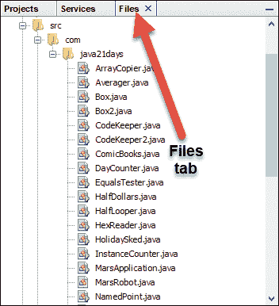

图 6.2 查看项目层次结构。

#### 将类添加到包

将类放入包的最后一步是在任何 `import` 声明和 `class` 声明之前添加语句。`package` 声明后面跟着包的完整名称：

```java
package org.cadenhead.rss;
```

`package` 声明必须是源文件的第一行代码（忽略注释或空行）。

#### 包与类访问控制

在本节前面，你学习了方法和变量的访问控制修饰符。你也可以控制类的访问。

如果没有指定修饰符，类具有默认访问控制，这意味着它对相同包中的所有其他类可见，但对包外部不可见或可用。类无法被导入或通过名称引用。

要允许类在包外部可见并可导入，你可以通过在其定义中添加 `public` 修饰符赋予其公共保护：

```java
public class Visible {

    // ...

}
```

声明为公共类可以被包外的类访问。

注意，当你使用带有星号的 `import` 语句时，导入的是包内的公共类。其他类保持隐藏，仅供该包内的其他类使用。

为什么你想在包内部隐藏类呢？与你想在类内部隐藏变量和方法的原因一样：以便拥有仅对你的实现有工具类和行为，或者你可以限制程序的接口以减少重大更改的影响。在你设计类时，考虑整个包，并决定你想将哪些类声明为公共，哪些类想要隐藏。

创建一个良好的包意味着定义一组供其他类使用的少量、公共类和方法，然后通过任何数量的隐藏支持类来实现它们。在本节稍后的部分，你还将看到私有类的另一种用途。

## 接口

接口像抽象类和方法一样，提供了其他类预期实现的行为模板。它们在类和对象设计中提供了显著优势，补充了 Java 基于单继承的面向对象编程方法。

### 单继承的问题

当你开始将一个项目转换为通过继承相关的类层次级结构时，你可能会发现类结构的简单性具有局限性。特别是当某些行为需要被那些没有共享共同父类的类使用时，这一点尤为明显。

其他面向对象编程（OOP）语言包含了多重继承的概念，它通过允许一个类继承自多个父类，同时从其所有父类获取行为和属性来解决这个问题。

这一概念使得编程语言的学习和使用更具挑战性。在多重继承的情况下，方法调用问题以及类层次结构的组织方式变得复杂得多。它们也更容易产生混淆和歧义。

由于 Java 的目标之一是比启发它的语言更简单，因此它拒绝了多重继承，转而采用单继承。

Java 接口是抽象行为的集合，可以被任何类采用，而无需继承自某个父类。

接口包含抽象方法定义和常量。它没有实例变量或方法实现。

当期望由若干不同的类来实现某种行为时，接口在整个 Java 类库中被实现和使用。在本节稍后的部分，你将使用其中一个接口 `java.lang.Comparable`。

### 接口与类

尽管类和接口的定义不同，但它们有许多共同点。它们都声明在源文件中，并编译成 `.class` 文件。在大多数情况下，接口可以在任何你可以使用类的地方使用。

在本书的几乎每个示例中，你都可以用接口名代替类名。Java 程序员经常在说“类”时，实际的意思是“类或接口”。接口补充并扩展了类的功能，两者几乎可以被同等对待，但接口不能被实例化：`new` 只能创建非抽象类的实例。

### 实现和使用接口

你可以对接口做两件事：在你自己的类中使用它们，以及定义你自己的接口。从现在，从在你自己的类中使用它们开始吧。

要使用一个接口，请在你的类定义中包含 `implements` 关键字：

点击此处查看代码图片

```java
public class AnimatedSign extends Sign

    implements Runnable {

    //...

}
```

在这个示例中，`Runnable` 接口扩展了 `AnimatedSign` 类的行为，而 `AnimatedSign` 是 `Sign` 的子类。

当接口提供抽象方法定义时，你必须在你自己的类中实现这些方法，并使用接口中相同的方法签名。

要实现一个接口，你必须提供该接口中的所有方法；你不能只挑选你需要的方法。通过实现一个接口，你是在告诉该类的用户你支持整个接口。

在你的类实现一个接口后，该类的子类将继承这些新方法，并对其进行重写（override）或重载（overload）。如果你的类继承自一个实现了给定接口的父类，你不需要在自己的类定义中包含 `implements` 关键字。

### 实现多个接口

与继承不同（一个类只能有一个父类），你可以在类中包含任意数量的接口。你的类必须实现所有包含的接口的组合行为。要在类中包含多个接口，请用逗号分隔它们的名称：

点击此处查看代码图片

```java
public class AnimatedSign extends Sign

    implements Runnable, Observer {

    // ...

}
```

请注意，实现多个接口可能会产生复杂性。如果两个不同的接口都定义了相同的方法会发生什么？你可以通过三种方式解决这个问题：

- 如果每个接口中的方法具有相同的签名，你在类中实现一个方法，该定义将同时满足两个接口。
- 如果方法具有不同的参数列表，这是一个简单的方法重载案例：你实现两个方法签名，每个定义都满足其各自的接口定义。
- 如果方法具有相同的参数列表但不同的返回类型，你无法创建一个同时满足两者的方法。（记住，方法签名不包括方法的返回类型。）在这种情况下，尝试编译一个实现这两个接口的类将产生编译器错误信息。遇到这个问题表明你的接口可能存在某些设计缺陷，你可能需要重新审视。

### 接口的其他用途

在几乎任何你可以使用类的地方，你都可以改用接口代替。例如，你可以声明一个变量为接口类型：

```java
Iterator loop;
```


当一个变量被声明为接口类型时，它必须用于持有实现该接口的对象。任何实现 `Iterator` 接口的类都可以存储在 `loop` 中。在这种情况下，由于 `loop` 是 `Iterator` 类型的对象，假设你可以在该对象上调用接口的所有三个方法：`hasNext()`、`next()` 和 `remove()`。

你可以将对象转换为接口，就像你可以将对象转换为其他类一样。

### 创建和扩展接口

在使用接口一段时间后，下一步是定义你自己的接口。接口看起来很像类；它们的声明方式非常相似，并且可以组织成层次级结构。然而，你必须遵循某些规则来声明它们。

### 新接口

要创建一个新接口，你可以这样声明它：

```java
interface Expandable {

    // ...

}
```

该声明在实际上与类定义相同，只是用 `interface` 单词替换了 `class` 单词。接口内部是方法和变量。

接口内部的方法定义是公共且抽象的。你可以显式地声明它们，或者它们会被转换为公共且抽象的方法。你不能在接口内部声明方法为私有或保护。

作为一个示例，这里有一个 `Expandable` 接口，包含一个显式公共抽象的方法和一个隐式的方法：

点击此处查看代码图片

```java
public interface Expandable {

    public abstract void expand(); // 显式公共抽象

    void contract(); // 实际上公共抽象

}
```

两个方法都是公共且抽象的。

与类中的抽象方法一样，接口内部的方法没有方法体。接口仅由方法签名组成；不涉及实现。

方法外，接口还可以有变量，但这些变量必须声明为 `public`、`static` 和 `final`（使其成为常量）。与方法一样，你可以显式地带有这些修饰符定义变量，如果不使用这些修饰符，它会被隐式定义为这些。这里是相同的 `Expandable` 定义，增加了两个新变量：

点击此处查看代码图片

```java
public interface Expandable {

    public static final int INCREMENT = 10;

    long CAPACITY = 15000; // 变为 public static final

    public abstract void expand(); // 显式公共抽象

    void contract(); // 实际上公共抽象

}
```

接口和类一样，必须具有公共（`public`）或包级（`package`）保护。但请注意，没有 `public` 修饰符的接口不会自动将其方法转换为公共和抽象，也不会将其常量转换为公共。非公共接口还有非公共的方法和常量，这些只能由同包内的类和其他接口使用。

接口和类一样，也可以属于一个包。接口也可以像类一样，从其他包导入其他接口和类。

### 接口内部的方法

关于接口内部的方法，有一个需要注意的技巧：这些方法本应该是抽象的，并适用于任何类型的类，但你如何为这些方法定义参数呢？你并不知道哪个类会使用它们！答案在于，正如你之前学到的那样，在任何可以使用类名的地方使用接口名。通过将你的方法参数定义为接口类型，你可以创建适用于可能使用此接口任何类的泛型参数。

考虑 `Trackable` 接口，它定义了不带参数的 `track()` 和 `quitTracking()` 方法。你可能还需要一个 `beginTracking()` 方法，它包含一个参数：一个 `Trackable` 类的对象。

该参数应该是什么种类？它应该是任何实现了 `Trackable` 接口的对象，而不是某个特定的类及其子类。解决方案是在接口中简单地将参数声明为 `Trackable`：

点击此处查看代码图片

```java
public interface Trackable {

    public abstract Trackable beginTracking(Trackable self);

}
```

然后，在类对该方法的实际实现中，你可以将泛型的 `Trackable` 参数强制转换为适当的对象：

点击此处查看代码图片

```java
public class Monitor implements Trackable {

    public Trackable beginTracking(Trackable self) {

        Monitor mon = (Monitor) self;

        // ...

        return mon;

    }

}
```

### 扩展接口

就像你可以对类一样，你可以将接口组织成层次结构。当一个接口继承另一个接口时，该子接口将获得其父接口声明的所有方法定义和常量。

要扩展接口，你使用 `extends` 关键字，就像在类定义中使用它一样：

点击此处查看代码图片

```java
interface PreciselyTrackable extends Trackable {

    // ...

}
```

注意，与类不同，接口层次结构没有等同于 `Object` 类：没有一个所有接口都派生的根父接口；接口可以完全独立存在，也可以继承自其他接口。

同样注意，与类层次结构不同，继承层次结构可以实现多重继承。例如，单个接口可以扩展它需要的任意数量类（在定义的 `extends` 部分用逗号隔开），新接口包含了其所有父接口方法和常量的组合。

在接口中，管理方法名冲突的规则与使用多个接口的类相同；仅返回类型不同的方法会导致编译错误信息。

### 创建在线商店

为了探索到为止涵盖的所有主题，`Storefront` 可以使用包、访问控制、接口和封装。该应用程序管理在线商店中的物品，处理两个主要任务：

* 根据每个物品的当前库存量计算其销售价格
* 根据销售价格对物品进行排序

`Storefront` 由两个类组成：`Storefront` 和 `Item`。这些类将被组织成一个名为 `org.cadenhead.ecommerce` 的新包。

在 NetBeans 中，选择 File（文件）、New File（新建文件），指示你正在创建一个新的空 Java 文件，然后点击 Next（下一步）。给它类名 `Item` 和包名 `org.cadenhead.ecommerce`。点击 Finish（完成），然后输入 Listing 6.2 所示的代码。

**代码列表 6.2** `Item.java` 的全文

点击此处查看代码图片

```java
 1: package org.cadenhead.ecommerce;

 2:

 3: public class Item implements Comparable {

 4:     private final String id;

 5:     private final String name;

 6:     private final double retail;

 7:     private final int quantity;

 8:     private double price;

 9:

10:     Item(String idIn, String nameIn, String retailIn, String qIn) {

 11:         id = idIn;

 12:         name = nameIn;

 13:         retail = Double.parseDouble(retailIn);

 14:         quantity = Integer.parseInt(qIn);

 15:

 16:         if (quantity > 400) {

 17:             price = retail * .5D;

 18:         } else if (quantity > 200) {

 19:             price = retail * .6D;

 20:         } else {

 21:             price = retail * .7D;

 22:         }

 23:         price = Math.floor( price * 100 + .5 ) / 100;

 24:     }

 25:

 26:     @Override

 27:     public int compareTo(Object obj) {

 28:         Item temp = (Item) obj;

 29:         if (this.price < temp.price) {

 30:             return 1;

 31:         } else if (this.price > temp.price) {

 32:             return -1;

 33:         }

 34:     }

 35:     }

 36:

 37:     public String getId() {

 38:         return id;

 39:     }

 40:

 41:     public String getName() {

 42:         return name;

 43:     }

 44:

 45:     public double getRetail() {

 46:         return retail;

 47:     }

 48:

 49:     public int getQuantity() {

 50:         return quantity;

 51:     }

 52:

 53:     public double getPrice() {

 54:         return price;

 55:     }

 56: }
```

当你保存此文件时，请查看 NetBeans 中的项目窗格。`Item.java` 源代码文件被放在了一个不同的地方，如图 6.3 所示。

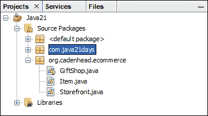

**图 6.3** 在 NetBeans 项目中分组包。

当你为对象实现 `Comparable` 接口后，可以调用两个类方法来对数组或持有这些对象的类进行排序。你将在本节稍后看到这一点，即在创建 `Storefront` 类时。

第 10–24 行中的 `Item()` 构造函数接受四个 `String` 对象作为参数，并使用它们来设置 `id`、`name`、`retail` 和 `quantity` 实例变量。最后两个变量必须分别使用 `Double.parseDouble()` 和 `Integer.parseInt()` 类方法从字符串转换为数值。

`price` 实例变量的值取决于该商品目前的库存量：

* 如果库存超过 400 件，则 `price` 为 `retail` 的 50%（第 16–17 行）。
* 如果库存在 201 到 400 件之间，`price` 为 `retail` 的 60%（第 18–19 行）。
* 对于其他所有情况，`price` 为 `retail` 的 70%（第 20–22 行）。

第 23 行对 `price` 进行舍入处理，使其保留两个或更少的小数，将类似于 $6.929999999999999 的值转换为 $6.93。`Math.floor()` 方法将小数舍入到下一个较小的整数，并将其作为双精度值返回。

作为项目的下一步，你需要一个代表这些产品网商店的类。创建一个类名为 `Storefront` 且包名为 `org.cadenhead.ecommerce` 的空 Java 文件，并输入如列表 6.3 所示的代码。

### 列表 6.3 `Storefront.java` 的完整文本

点击此处查看代码图像

```java
 1: package org.cadenhead.ecommerce;

 2:

 3: import java.util.*;

 4:

 5: public class Storefront {

 6:     private final LinkedList catalog = new LinkedList();

 7:

 8:     public void addItem(String id, String name, String price,

 9:         String quant) {

10:

 11:         Item it = new Item(id, name, price, quant);

 12:         catalog.add(it);

 13:     }

 14:

 15:     public Item getItem(int i) {

 16:         return (Item) catalog.get(i);

 17:     }

 18:

 19:     public int getSize() {

 20:         return catalog.size();

 21:     }

 22:

 23:     public void sort() {

 24:         Collections.sort(catalog);

 25:     }

 26: }
```

由于 `Storefront` 与 `Item` 类属于同一个包，它将在 NetBeans 项目窗格中与该类一起列出。

`Storefront` 类用于管理在线商店中的产品集合。每个产品都是一个 `Item` 对象，这些对象共同存储在名为 `catalog` 的 `LinkedList` 实例变量中（第 6 行）。

第 8–13 行中的 `addItem()` 方法根据发送到方法的四个参数创建一个新的 `Item` 对象：`id`、`name`、`price` 和 `quant`，分别代表库存商品的 ID、名称、价格和数量。对象创建后，通过调用其 `add(Object)` 方法将其添加到 `catalog` 链表中，并将 `Item` 对象作为参数。

`getItem()` 和 `getSize()` 方法提供了访问存储在私有 `catalog` 变量中信息的接口。第 19–21 行中的 `getSize()` 方法调用了 `catalog.size()` 方法，该方法返回 `catalog` 中包含的对象数量。

由于链表中的对象像数组和其他数据结构一样进行编号，因此你可以使用索引号检索它们。第 15–17 行中的 `getItem()` 方法调用 `catalog.get(int)` 并以索引号作为参数，返回链表中该位置存储的对象。

第 23–25 行中的 `sort()` 方法是你从 `Item` 类实现的 `Comparable` 接口中受益的地方。类方法 `Collections.sort()` 根据其包含对象的自然排序顺序对链表和其他数据结构进行排序，通过调用对象的 `compareTo()` 方法来确定这种顺序。

为了完成此项目，`GiftShop` 应用是一个使用了 `Item` 和 `Storefront` 对象的类。该应用也属于 `org.cadenhead.ecommerce` 包。创建新的 Java 类 `GiftShop`，源代码如列表 6.4 所示。

### 列表 6.4 `GiftShop.java` 的完整文本

点击此处查看代码图像

```java
 1: package org.cadenhead.ecommerce;

 2:

 3: public class GiftShop {

 4:    public static void main(String[] arguments) {

 5:         Storefront store = new Storefront();

 6:         store.addItem("C01", "MUG", "9.99", "9");

 7:         store.addItem("C02", "MOUSE", "12.99", "450");

 8:         store.addItem("C03", "KEYPAD", "15.49", "300");

 9:         store.addItem("D01", "SHIRT", "19.99", "500");

 10:         store.sort();

 11:         for (int i = 0; i < store.getSize(); i++) {

 12:             Item show = (Item) store.getItem(i);

 13:             System.out.println("\nID: " + show.getId());

 14:             System.out.println("\nName: " + show.getName());

 15:             System.out.println("\nRetail: $" + show.getRetail());

 16:             System.out.println("\nPrice: $" + show.getPrice());

 17:             System.out.println("\nQuantity: " + show.getQuantity());

 18:         }

 19:     }

 20: }
```


当你为一个对象实现 `Comparable` 接口后，可以调用两个类方法来对数组或持有这些对象的类进行排序。你将在本节稍后看到这一点，即在创建 `Storefront` 类时。

第 10–24 行中的 `Item()` 构造函数接受四个 `String` 对象作为参数，并使用它们来设置 `id`、`name`、`retail` 和 `quantity` 实例变量。最后两个变量必须分别使用 `Double.parseDouble()` 和 `Integer.parseInt()` 类方法从字符串转换为数值。

`price` 实例变量的值取决于该商品目前的库存量：

- 如果库存超过 400 件，`price` 为 `retail` 的 50%（第 16–17 行）。
- 如果库存在 201 到 400 件之间，`price` 为 `retail` 的 60%（第 18–19 行）。
- 对于其他所有情况，`price` 为 `retail` 的 70%（第 20–22 行）。

第 23 行对 `price` 进行舍入处理，使其保留两个或更少的小数，将类似于 $6.92999999999999 的值转换为 $6.93。`Math.floor()` 方法将小数舍入到下一个较小的整数，并将其作为双精度值返回。

作为项目的下一步，你需要一个代表这些产品网商店的类。创建一个类名为 `Storefront` 且包名为 `org.cadenhead.ecommerce` 的空 Java 文件，并输入如列表 6.3 所示的代码。

### 列表 6.3：`Storefront.java` 的完整文本

点击此处查看代码图像

```java
 1: package org.cadenhead.ecommerce;

 2:

 3: import java.util.*;

 4:

 5: public class Storefront {

 6:     private final LinkedList catalog = new LinkedList();

 7:

 8:     public void addItem(String id, String name, String price,

 9:         String quant) {

10:

 11:         Item it = new Item(id, name, price, quant);

 12:         catalog.add(it);

 13:     }

 14:

 15:     public Item getItem(int i) {

 16:         return (Item) catalog.get(i);

 17:     }

 18:

 19:     public int getSize() {

 20:         return catalog.size();

 21:     }

 22:

 23:     public void sort() {

 24:         Collections.sort(catalog);

 25:     }

 26: }
```

由于 `Storefront` 与 `Item` 类属于同一个包，它将在 NetBeans 项目窗格中与该类一起列出。

`Storefront` 类用于管理在线商店中的产品集合。每个产品都是一个 `Item` 对象，这些对象共同存储在名为 `catalog` 的 `LinkedList` 实例变量中（第 6 行）。

第 8–13 行中的 `addItem()` 方法根据发送到方法的四个参数创建一个新的 `Item` 对象：`id`、`name`、`price` 和 `quant`，分别代表库存商品的 ID、名称、价格和数量。对象创建后，通过调用其 `add(Object)` 方法将其添加到 `catalog` 链表中，并将 `Item` 对象作为参数。

`getItem()` 和 `getSize()` 方法提供了访问存储在私有 `catalog` 变量中信息的接口。第 19–21 行中的 `getSize()` 方法调用了 `catalog.size()` 方法，该方法返回 `catalog` 中包含的对象数量。

由于链表中的对象像数组和其他数据结构一样进行编号，因此你可以使用索引号检索它们。第 15–17 行中的 `getItem()` 方法调用 `catalog.get(int)` 并以索引号作为参数，返回链表中该位置存储的对象。

第 23–25 行中的 `sort()` 方法是你从 `Item` 类实现的 `Comparable` 接口中受益的地方。类方法 `Collections.sort()` 根据其包含对象的自然排序顺序对链表和其他数据结构进行排序，通过调用对象的 `compareTo()` 方法来确定这种顺序。

为了完成此项目，`GiftShop` 应用是一个使用了 `Item` 和 `Storefront` 对象的类。该应用也属于 `org.cadenhead.ecommerce` 包。创建新的 Java 类 `GiftShop`，源代码如列表 6.4 所示。

### 列表 6.4：`GiftShop.java` 的完整文本

点击此处查看代码图像

```java
 1: package org.cadenhead.ecommerce;

 2:

 3: public class GiftShop {

 4:    public static void main(String[] arguments) {

 5:         Storefront store = new Storefront();

 6:         store.addItem("C01", "MUG", "9.99", "9");

 7:         store.addItem("C02", "MOUSE", "12.99", "450");

 8:         store.addItem("C03", "KEYPAD", "15.49", "300");

 9:         store.addItem("D01", "SHIRT", "19.99", "500");

 10:         store.sort();

 11:         for (int i = 0; i < store.getSize(); i++) {

 12:             Item show = (Item) store.getItem(i);

 13:             System.out.println("\nID: " + show.getId());

 14:             System.out.println("\nName: " + show.getName());

 15:             System.out.println("\nRetail: $" + show.getRetail());

 16:             System.out.println("\nPrice: $" + show.getPrice());

 17:             System.out.println("\nQuantity: " + show.getQuantity());

 18:         }

 19:     }

 20: }

```


由于 `Storefront` 与 `Item` 类属于同一个包，它将在 NetBeans 项目窗格中与该类一起列出。

`Storefront` 类用于管理在线商店中的产品集合。每个产品都是一个 `Item` 对象，这些对象共同存储在名为 `catalog` 的 `LinkedList` 实例变量中（第 6 行）。

第 8–13 行中的 `addItem()` 方法根据发送到方法的四个参数创建一个新的 `Item` 对象：`id`、`name`、`price` 和 `quant`，分别代表库存商品的 ID、名称、价格和数量。对象创建后，通过调用其 `add(Object)` 方法将其添加到 `catalog` 链表中，并将 `Item` 对象作为参数。

`getItem()` 和 `getSize()` 方法提供了访问存储在私有 `catalog` 变量中信息的接口。第 19–21 行中的 `getSize()` 方法调用了 `catalog.size()` 方法，该方法返回 `catalog` 中包含的对象数量。

由于链表中的对象像数组和其他数据结构一样进行编号，因此你可以使用索引号检索它们。第 15–17 行中的 `getItem()` 方法调用 `catalog.get(int)` 并以索引号作为参数，返回链表中该位置存储的对象。

第 23–25 行中的 `sort()` 方法是你从 `Item` 类实现的 `Comparable` 接口中受益的地方。类方法 `Collections.sort()` 根据其包含对象的自然排序顺序对链表和其他数据结构进行排序，通过调用对象的 `compareTo()` 方法来确定这种顺序。

为了完成此项目，`GiftShop` 应用是一个使用了 `Item` 和 `Storefront` 对象的类。该应用也属于 `org.cadenhead.ecommerce` 包。创建新的 Java 类 `GiftShop`，源代码如列表 6.4 所示。

### 列表 6.4 `GiftShop.java` 的完整文本

点击此处查看代码图像

```java
 1: package org.cadenhead.ecommerce;

 2:

 3: public class GiftShop {

 4:    public static void main(String[] arguments) {

 5:         Storefront store = new Storefront();

 6:         store.addItem("C01", "MUG", "9.99", "9");

 7:         store.addItem("C02", "MOUSE", "12.99", "450");

 8:         store.addItem("C03", "KEYPAD", "15.49", "300");

 9:         store.addItem("D01", "SHIRT", "19.99", "500");

 10:         store.sort();

 11:         for (int i = 0; i < store.getSize(); i++) {

 12:             Item show = (Item) store.getItem(i);

 13:             System.out.println("\nID: " + show.getId());

 14:             System.out.println("\nName: " + show.getName());

 15:             System.out.println("\nRetail: $" + show.getRetail());

 16:             System.out.println("\nPrice: $" + show.getPrice());

 17:             System.out.println("\nQuantity: " + show.getQuantity());

 18:         }

 19:     }

 20: }
```

# 2. 根据包的命名规范，你创建的包的名称的第一部分应该是什么？

**A.** 你的名字后面跟一个点

**B.** 你的顶级互联网域名后面跟一个点

**C.** 文本 `java` 后面跟一个点

# 3. 如果你创建一个子类并重写了一个公有方法，你可以对该方法使用哪些访问修饰符？

**A.** 仅限 `public`

**B.** `public` 或 `protected`

**C.** `public`、`protected` 或默认访问权限（default）

#### 答案

**1.** C. 如果你想使用诸如 `LinkedList` 这样的短类名，而不是完整的包和类名（如 `java.util.LinkedList`），必须导入所有其他包。

**2.** B. 这种规范假设所有 Java 包开发者都拥有一个互联网域名或可以访问一个域名，以便该包可以供下载。

**3.** A. 所有公有方法在子类中必须保持为公有。子类中的访问控制可以比父类更公开，也可以与之相同，但不能更私有。

### 认证练习

以下问题是你可能会在 Java 编程认证考试中遇到的问题类型。请在不重新查看本课内容或不使用 Java 编译器测试代码的情况下回答它。

给定条件：

点击此处查看代码图像

```java
package org.cadenhead.bureau;

public class Information {

    public int duration = 12;

    protected float rate = 3.15F;

    float average = 0.5F;

}
```

以及：

点击此处查看代码图像

```java
package org.cadenhead.bureau;

public class MoreInformation extends Information {

    public int quantity = 8;

}
```

以及：

点击此处查看代码图像

```java
package org.cadenhead.bureau.us;

import org.cadenhead.bureau.*;

public class EvenMoreInformation extends MoreInformation {

    public int quantity = 9;

    EvenMoreInformation() {

        super();

        int i1 = duration;

        float i2 = rate;

        float i3 = average;

    }

}
```

哪些实例变量在 `EvenMoreInformation` 类中是可见？

**A.** `quantity`, `duration`, `rate` 和 `average`

**B.** `quantity`, `duration` 和 `rate`

**C.** `quantity`, `duration` 和 `average`

**D.** `quantity`, `rate` 和 `average`

答案可以在书籍网站 [www.java21days.com](http://www.java21days.com) 上找到。访问第 6 节上提供。

# 第 7 节 异常与线程

本节将深入探讨 Java 中两个最重要的元素：线程和异常。*异常*允许程序在遇到错误时继续运行。异常是表示可能发生错误的对象。

## 异常

在任何语言中，程序员都努力编写无 Bug、不崩溃且能够处理意外情况的代码。在 Java 中，可能导致程序失败的异常事件被称为*异常*。Java 定义了多种功能来处理异常：

- 如何在代码中处理异常并优雅地从中恢复
- 如何处理你预期的异常
- 如何在检测到异常时创建一个异常
- 如何通过异常使你的代码更健壮

对于大多数编程语言，处理错误情况比处理正常运行的程序需要更多工作。作为一个例子，考虑以下代码，它可以从磁盘加载文件。

点击此处查看代码图像

```java
int status = loadTextFile();

if (status != 1) {

    // 发生了意外；报告它

    switch (status) {

        case 2:

            System.out.println("找不到文件");

            break;

        case 3:

            System.out.println("磁盘错误");

            break;

        case 4:

            System.out.println("文件损坏");

            break;

        default:

            System.out.println("错误");

    }

} else {

    // 文件加载成功；继续程序

}
```


此代码通过调用`loadTextFile()`方法尝试加载文件，该方法可能在类的其他地方定义。该方法返回一个整数，表示文件是否加载成功（值为`1`）或发生了错误（`2`、`3`、`4`或更高）。

程序使用`switch`语句以错误代码为键来处理问题。最终的结果是一个代码块，其中最常见的情况（成功加载文件）淹没错误处理代码中。这是只处理一种可能的错误的结果。如果程序后期发生了其他错误，你可能会得到更多嵌套的`if`-`else`和`switch`-`case`块。

你可以看到，在较大的程序中，错误管理将变得不可维护，导致 Java 类难以阅读和维护。

以这种方式处理错误使得编译器无法进行一致性检查，就像它无法检查你是否使用了正确的参数调用方法，或者是否将变量设置为正确的类类型一样。

虽然上一个示例使用了 Java 语法，但你永远不需要用这种方式处理 Java 语言错误。你可以使用一组被称为*异常*的类，它们的工作效率高得多。异常包括对程序致命的错误以及指示问题的其他情况。通过管理异常，你可以管理错误并可能绕过它们。

通过这些特性，你可以为类的行为和设计、类层次以及整个系统添加一个全新的维度。你的类和接口描述了程序在理想情况下应该如何运行。除异常情况外，你可以一致地描述程序在情况不理想时的行为，并让使用你类的程序员知道在这些情况下预期会发生什么。

### 异常类

到此时，你可能已经遇到过至少一个 Java 异常了。也许你尝试在运行一个 Java 应用程序时没有提供所需的命令行参数，并看到了`ArrayIndexOutOfBoundsException`消息。

很有可能，当异常发生时，应用程序会退出并向屏幕上抛出一堆神秘的错误。这些错误就是异常。当程序在没有成功完成其工作的情况下停止时，就会抛出一个异常。异常可以由 Java 虚拟机（`JVM`）、你使用的类，或者在你自己的程序中有意地抛出。

就像异常可以被抛出一样，它们也可以被捕获。捕获异常涉及处理异常情况，以便你的程序不会崩溃，你将在本节稍后的部分学习这一点。

Java 中的异常是继承自`Throwable`类的实例。当抛出异常时，就会创建一个`Throwable`类的实例。

`Throwable`有两个子类：`Error`和`Exception`。`Error`的实例是涉及`JVM`的内部错误。这些错误非常罕见，而且通常对程序是致命的；你对它们做不了什么，除了捕获它们或你自己抛出它们。一个例子是`OutOfMemoryError`，它信号着程序没有剩余内存可以运行的灾难性状态。

`Exception`类与你自己的编程更为相关。`Exception`的子类分为两大大类：

- 未检查异常（`RuntimeException`类的子类），例如`ArrayIndexOutofBoundsException`、`SecurityException`和`NullPointerException`
- 已检查异常（Checked exceptions），例如`EOFException`和`MalformedURLException`

未检查异常也称为运行时异常（`runtime exceptions`），通常在代码不够健壮时发生。例如，如果你正确地检查以确保代码处于数组范围内，那么永远不应该抛出`ArrayIndexOutOfBoundsException`。`NullPointerException`发生在你尝试使用一个尚未引用对象的变量时。

### 注意事项

如果你的程序导致了未检查异常，你应该通过改进代码来修复这些问题。不要依赖异常管理来处理在创建 Java 程序期间可以修正的编程错误。

已检查异常表示正在发生某些奇怪且不受控制的事情。例如，`EOFException`发生在你读取文件且文件在预期之前就结束时。`MalformedURLException`发生当网络地址（也称为`URL`）格式不正确时。这一组包括你创建的异常，用于指示你自己的程序中可能出现的非常规的情况。

异常按层次结构排列，就像其他类一样，父类是更通用的问题类型，而子类更具体。当在你自己的代码中处理异常时，这种组织方式对你来说变得越来越重要。

主要的异常类是`java.lang`包的组成：`Throwable`、`Exception`和`RuntimeException`。Java 类库中的许多其他包定义了其他异常，这些异常在整个库中使用。

`java.io`包定义了一个名为`IOException`的通用异常类。它不仅在`java.io`包中被子类用于输入输出异常（`EOFException`和`FileNotFoundException`），在`java.net`类中被子类化用于网络异常（如`MalformedURLException`），在`java.util`包中被子类化用于`ZipException`。

## 异常管理

现在你已经知道异常是什么了，你如何在自己的代码中处理异常呢？在很多情况下，当你尝试使用抛出异常的方法时，Java 编译器会强制执行异常管理；你需要在自己的代码中处理这些异常，否则它将无法编译，NetBeans 会标记该错误。在本节中，你将学习一致性检查以及如何使用三个新关键字——`try`、`catch`和`finally`来处理可能发生的异常。

### 异常一致性检查

你越经常使用 Java 类库，就越可能遇到这样的异常：

点击此处查看代码图像

```
Exception java.lang.InterruptedException

必须被捕获，或者必须在该方法的 throws 子句中声明。
```

在 Java 中，方法可以指示它可能抛出的错误类型。例如，从文件读取的方法可以抛出`IOException`错误，因此这些方法声明了一个特殊的修饰符来指示潜在的错误。当在你自己的 Java 程序中使用这些方法时，你必须保护你的代码免受异常的影响。

这条规则由编译器本身强制执行，就像它检查以确保你使用的是参数数量正确的方法，以及你所有的变量类型都与赋值给它们的类型匹配一样。

为什么要进行这种检查？它让程序不太可能因致命错误而崩溃，因为你预先知道程序所使用的方法可能会抛出哪种异常。

如果你定义方法时能够指示它们可以抛出的异常，Java 就可以告诉你的对象用户去处理这些错误。

### 保护代码和捕获异常

假设你一直在愉快地编写代码，在一个类编译时发生了异常。根据错误消息，你必须要么捕获该错误，要么声明你的方法抛出了它。

首先，你处理捕获潜在的异常，这需要两点：

- 在`try`块中保护可能抛出异常的代码。
- 在`catch`块中处理异常。

`try`块尝试执行代码以看是否能在不引起异常的情况下执行。如果失败并发生了异常，`catch`块将处理它。

你之前见过`try`和`catch`。在第 6 节包、接口和其他类特性中，你使用了以下代码从`String`值创建整数：

点击此处查看代码图像

```java
public SquareTool(String input) {
    try {
        float in = Float.parseFloat(input);

        // 方法的其他部分
    } catch (NumberFormatException nfe) {
        System.out.println(input + " 不是一个有效的数字.");
    }
}
```

在此代码中，`Float.parseFloat()`类方法可能会抛出`NumberFormatException`异常，这表示该字符串不是有效的数字格式。（触发此异常的一种情况是`input`等于`15x`，这不是一个数字。）

为了处理异常，将`parseFloat()`的调用放在`try`块中，并设置了关联的`catch`块。`catch`块接收`try`块中抛出的任何`NumberFormatException`对象。

`catch`子句括号内的部分类似于方法定义的参数列表。它包含要捕获的异常类和一个变量名。你可以使用该变量在`catch`块中引用该异常对象。

异常对象有一个`getMessage()`方法，可以显示描述发生了什么的详细错误消息。

```java
try {
    float in = Float.parseFloat(input);
} catch (NumberFormatException nfe) {
    System.out.println("Oops: " + nfe.getMessage());
}
```

你在此为止看到的示例都捕获了特定类型的异常。由于异常类被组织成层级结构，并且你可以在任何预期父类的地方使用子类，因此你可以在同一个`catch`语句中捕获一组异常。

当你编写处理来自文件、互联网服务器及类似地方输入和输出的程序时，你会处理几种类型的`IOException`异常（`IO`代表 input/output，即输入/输出）。这些异常包含了它的两个子类：`EOFException`和`FileNotFoundException`。通过捕获`IOException`，你同时也捕获了任何`IOException`子类的实例。

要捕获多个之间没有继承关系的不同异常，你可以为单个`try`使用使用多个`catch`块，如下所示：

点击此处查看代码图像

```java
try {
    // 可能会产生异常的代码
} catch (IOException ioe) {
    System.out.println("Input/output error");
    System.out.println(ioe.getMessage());
} catch (ClassNotFoundException cnfe) {
    System.out.println("Class not found");
    System.out.println(cnfe.getMessage());
} catch (InterruptedException ie) {
    System.out.println("Program interrupted");
    System.out.println(ie.getMessage());
}
```

在多个`catch`块中，第一个匹配的`catch`块将被执行，其余的被忽略。

### 注意

如果你在`catch`块中使用`Exception`父类，随后在其自己的`catch`块中使用它的一个或多个子类，可能会遇到意外的问题。例如，输入/输出异常`IOException`是文件结束异常`EOFException`的父类。如果你将`IOException`块放在`EOFException`块上面，那么子类将永远无法捕获到任何异常。

你还可以在同一个`catch`语句中捕获多一类异常。这些类之间必须用管道字符`|`隔开。这是一个示例：

点击此处查看代码图像

```java
try {
    // 从磁盘读取文件的代码
} catch (EOFException | FileNotFoundException exc) {
    System.out.println("File error: " + exc.getMessage());
}
```

这段代码在同一个`catch`块中捕获两个异常：`EOFException`和`FileNotFoundException`。异常被赋值给参数`exc`，并调用它的`getMessage()`方法。列表中第一个匹配抛出异常的类将被赋值给该参数。

在`catch`语句中作为备选项声明的异常不能是彼此的父类或子类，除非它们的顺序正确。以下代码将无法工作：

点击此处查看代码图像

```java
try {
    // 从磁盘读取文件的代码
} catch (IOException | EOFException | FileNotFoundException exc) {
    System.out.println("File error: " + exc.getMessage());
}
```

这段代码无法编译，因为`IOException`是另外两个异常的父类，且它在列表中位于它们之前。因为父类可以捕获其子类的异常，该语句中的第二个和第三个异常永远不会被捕获。

这里有一个可以工作的修复版本：

点击此处查看代码图像

```java
try {
    // 从磁盘读取文件的代码
} catch (EOFException | FileNotFoundException exc) {
    System.out.println("File error: " + exc.getMessage());
} catch (IOException ioe) {
    System.out.println("IO error: " + ioe.getMessage());
}
```

### 注意

异常具有一个`printStackTrace()`方法，它可以显示导致生成异常的语句之前的的方法调用序列。如果你在程序中使用它，NetBeans 会在源代码编辑器中将其标记为警告。原因是`printStackTrace()`包含了调试信息，出于安全考虑，在程序结束后不应与用户共享这些信息。

`catch`语句必须是对应的`try`块所需要的。`catch`中的异常类必须是该块中可能被抛出的异常类（或者是可能被抛出的异常的父类）。否则，编译器将报错。

例如，如果你在一个没有读取任何文件的程序中使用`catch`来捕获`FileNotFoundException`，该程序将无法编译。

### `finally`子句

假设你的代码中有某些操作无论发生什么（无论是否抛出异常）都绝对必须执行。你可能需要在获取某些外部资源后释放它，在打开文件后关闭它，或执行类似的操作。

当你处理数据库时就会遇到一个示例，正如你在第 18 节“使用 JDBC 和 Derby 访问数据库”中所做的那样。访问数据库所需的连接和对象会在`finally`块中关闭，以释放这些资源，因为它们不再需要了。

尽管你可以将该操作放在`catch`块内部和外部，但你应该尽可能避免在两个不同的地方重复相同的代码。相反，将该代码放在一个特殊的可选块中，即`try`-`catch`语句中的`finally`关键字之后：

```java
try {
    // ...
} catch (IOException ioe) {
    // ...
} finally {
    // ...
}
```

本节展示了`finally`语句如何在方法内部使用。

`HexReader`程序读取双位十六进制序列并显示它们的十进制值。有三个序列：

- `00`
- `78`
- `6A`

正如你在第 2 节中所学到的，“十六进制是一种十六进制系统，单位数字从`00`（十进制 0）到`0F`（十进制 15）。

在 NetBeans 中为`com21days`包创建一个`HexReader`类（空的 Java 文件），并输入列表 7.1 所示的源代码。

**列表 7.1** `HexReader.java`的全文

点击此处查看代码图像

```java
1: package com.21days;

2:

3: class HexReader {

4:     String[] input = { "000A110D1D2619 ",

5:         "78700F131814E0C ",

6:         "6A197D450FFFF " };

7:

8:     public static void main(String[] arguments) {

9:         HexReader hex = new HexReader();

10:         for (int i = 0; i < hex.input.length; i++)

11:             hex.readLine(hex.input[i]);

12:     }

13:

14:     void readLine(String code) {

15:         try {

16:             for (int j = 0; j + 1 < code.length(); j += 2) {

17:                 String sub = code.substring(j, j + 2);

18:                 int num = Integer.parseInt(sub, 16);

19:                 if (num == 255) {

20:                     return;

21:                 }

22:                 System.out.print(num + " ");

23:             }

24:         } finally {

25:             System.out.println("**");

26:         }

27:     }

28: }
```


图 7.1 显示了程序的输出。

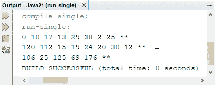

**图 7.1** 十进制转换后的十进制值。

程序的第 17 行通过调用字符串的 `substring(int, int)` 方法，从发送给 `readLine()` 方法的字符串 `code` 中读取两个字符。

在 `String` 类的 `substring()` 方法中，你以一种相当不符合直觉的方式选择子字符串。第一个参数指定要包含在子字符串中的第一个字符的索引，但第二个参数并没有指定最后一个字符。相反，第二个参数指定的是最后一个字符索引加 1。对一个字符串调用 `substring(2, 5)` 将返回从索引位置 2 到索引位置 4 的字符。

这个两个字符的子字符串包含一个存储为 `String` 的十六进制数字。可以使用 `Integer` 类的 `parseInt()` 方法并配合第二个参数来将此数字转换为整数。使用 `16` 作为十六进制（基数 16）转换的参数，使用 `8` 作为八进制（基数 8）转换的参数，依此类推。

在 `HexReader` 程序中，十六进制的 `FF` 用于填充序列的末尾，不应显示为十进制值。这是通过在 Listing 7.1 的第 15–26 行使用 `try`-`finally` 块实现的。

当在第 26 行之后遇到方法末尾时，`try`-`finally` 块会导致一种不寻常的情况。你可能认为这会导致 `readLine()` 方法立即退出。

因为位于 `try`-`finally` 块内部，无论 `try` 块以如何退出，`finally` 块中的语句都会执行。文本 `**` 显示在十进制值行的末尾。

有一种方法可以确保即使在 `try` 块内部的操作因异常而失败，资源也能被正确释放。`try-with-resources` 特性允许将声明资源的语句声明在 `try` 语句的括号内。

以下代码包含两个使用网络套接字（一种连接）从互联网服务器读取数据的语句：

点击此处查看代码图像

```
Socket digit = new Socket(host, 79);

BufferedReader in = new BufferedReader(
    new InputStreamReader(digit.getInputStream()));
```

为了确保资源被正确释放，可以将它们声明在 `try` 语句内部：

点击此处查看代码图像

```
try (Socket digit = new Socket(host, 79);
     BufferedReader in = new BufferedReader(
         new InputStreamReader(digit.getInputStream()))) {

    // code goes here

} catch (IOException e) {

    System.out.println("IO Error:" + e.getMessage());

}
```

无论 `try` 块中的代码如何退出——无论是成功还是发生异常——`digit` 和 `in` 资源都将得到正确处置。

NetBeans 源代码编辑器会对任何本应放在 `try-with-resources` 语句中但实际没有放入的语句发出警告。只要可能，请尽可能使用这种技术，因为它消除了忘记关闭不再使用的资源这一常见错误。

### 声明可能抛出异常的方法

你已经学习了如何通过保护代码和捕获发生的任何异常来处理可能抛出异常的方法。Java 编译器会检查你是否处理了方法的异常。但它是如何知道应该告诉你哪些异常的呢？

答案是，原始方法在它的定义中指明了它可能抛出的异常。你可以在自己的方法中使用这种机制。事实上，这样做是一种良好的风格，可以确保你类的用户能够注意到你的方法可能会遇到的错误。

要指示一个方法可能会抛出异常，你在方法定义中使用一个名为 `throws` 的特殊子句。

### `throws` 子句

如果你方法体中的某些代码可能会抛出异常，请在方法的右括号后添加 `throws` 关键字，后面跟着你的方法抛出的异常名称或多个名称。这里有一个例子：

点击此处查看代码图像

```
public void getPoint(int x, int y) throws NumberFormatException {

    // body of method

}
```

如果你的方法可能会抛出多种类型的异常，你可以在 `throws` 子句中声明所有异常，并用逗号分隔：

点击此处查看代码图像

```
public void storePoint(int x, int y)
    throws NumberFormatException, EOFException {

    // body of method

}
```

与 `catch` 一样，你可以使用异常的超类来指示你的方法可能会抛出该异常的任何子类异常。例如：

点击此处查看代码图像

```
public void loadPoint() throws IOException {

    // body of method

}
```

记住，在方法定义中添加 `throws` 子句仅意味着如果出现问题，该方法可能会抛出异常，而不是它真的会抛出。`throws` 子句在方法定义中提供了关于潜在异常的额外信息，并允许 Java 确保你的方法被其他类正确使用。

将方法的整体描述视为该方法设计者与方法调用者之间的合同。（当然，你可以处于该合同的任何一方。）

通常，描述指示了方法参数的类型、返回值以及它通常执行的操作的细节。通过使用 `throws`，你添加了关于方法可以执行的异常情况的信息。合同的这一新部分有助于明确所有应该处理异常情况的地方。

### 你应该抛出哪些异常？

在你决定声明方法可能会抛出异常后，你必须决定抛出哪些异常并实际抛出，或者调用会抛出异常的方法。（你将在下一节中学习抛出自己的异常。）

在许多情况下，抛出哪些异常从操作显而易见。也许你已经在创建和抛出自己的异常，在这种情况下你确切知道要抛出哪些异常。

你不需要列出方法可能抛出的所有异常。未检查异常由 JVM 处理且非常常见，以至于你不需要处理它们。

特别是 `Error` 或 `RuntimeException` 类的异常及其任何子类不需要列在你的 `throws` 子句中。它们受到特殊处理，因为它们可能发生在 Java 程序的任何地方，而且通常不是你作为程序员造成的。

一个很好的例子是 `OutOfMemoryError`，它在 JVM 内存不足时发生，这可以在任何时间由于任何原因发生。

未检查异常是 `RuntimeException` 和 `Error` 类的子类，通常由 JVM 抛出。你不需要声明你的方法抛出它们，通常也不需要以任何其他方式处理它们。

> **注意**
>
> 如果你愿意，可以将这些错误和运行时异常列在 `throws` 子句中，但调用方法的类不会被强制处理它们。只有非运行时异常必须被处理。

所有其他异常被称为检查异常，它们是 `throws` 子句的潜在候选。

### 传递异常

有时，让方法处理异常是不合理的。让调用该方法的类来处理该异常可能更好。例如，考虑假设的 `WebRetriever` 类，该类使用其网络地址加载网页并将其存储在文件中。正如你将在第 17 节中学到的，“在 HTTP 上通信](#ch17.xhtml_ch17)”，如果不处理 `MalformedURLException`（当地址格式错误时抛出的异常），你就无法处理网络地址。

要使用 `WebRetriever`，另一个类会调用其构造函数并将地址作为参数。如果另一个类指定的地址格式不正确，则会抛出 `MalformedURLException`。与其直接处理此异常，`WebRetriever` 类的构造函数可以如下声明：

点击此处查看代码图像

```
public WebRetriever() throws MalformedURLException {

    // 构造函数体

}
```

这将强制任何与 `WebRetriever` 对象交互的类去处理 `MalformedURLException` 错误，或者通过它们自己的 `throws` 子句将责任推给别人。

有一点是永远成立的：将异常传递给调用者方法，比捕获它们却什么都不做要好。

除了声明会抛出异常的方法外，方法定义中还有一种可能包含 `throws` 子句的情况：即在那个方法内部，你想要调用一个会抛出异常的方法，但你又不想捕获或处理该异常。

与其在方法体中使用 `try` 和 `catch` 子句，你不如通过 `throws` 子句来声明你的方法，使其也可能抛出相应的异常。那么，处理该异常就变成了调用你方法的方法的责任。这是另一种告诉 Java 编译器你已经对给定异常进行了处理的情况。

使用这种技术，你可以创建一个无需使用 `try`-`catch` 块即可处理 `NumberFormatException` 的方法：

点击此处查看代码图像

```
public void readFloat(String input) throws NumberFormatException {

    float in = Float.parseFloat(input);

}
```

在你声明你的方法会抛出异常后，你可以在该方法的体内部使用其他也会抛出这些异常的方法，而无需捕获这些异常。

> **注意**
>
> 当然，你还可以在方法体中使用 `try` 和 `catch` 来处理其他异常，而将你在 `throws` 子句中列出的异常继续传递。你也可以以某种方式处理该异常，然后将其重新抛出，这样调用你方法的方法就必须处理它了。

### `throws` 与继承

如果你的方法定义覆盖了父类中包含 `throws` 子句的方法，那么对于你的重写方法如何处理 `throws`，就有特殊的规则。与方法签名中必须模仿其所覆盖方法的其他部分不同，你的新方法不需要在 `throws` 子句中列出相同的异常集合。

由于你的新方法有处理异常而非抛出异常的可能性，因此你的方法可能抛出更少的异常类型。它甚至可以不抛出任何异常。这意味着你可以拥有以下两个类定义，并且它们会运行良好：

点击此处查看代码图像

```
public class RadioPlayer {

    public void startPlaying() throws SoundException {

        // 方法体

    }

}

public class StereoPlayer extends RadioPlayer {

    public void startPlaying() {

        // 方法体

    }

}
```

该规则的逆命题是不成立的：子类方法抛出的受检异常（无论是不同类型的异常还是更通用的异常类）不能多于父类方法。

子类抛出的任何异常必须与父类抛出的异常相同，或者是该异常的子类。考虑这个例子：

点击此处查看代码图像

```
void readFields() throws IOException {

    // 方法体

}
```

如果此方法位于父类中且你覆盖了该方法，那么在子类中是不允许这样的：

点击此处查看代码图像

```
void readFiles() throws SQLException {

    // 方法体

}
```

`SQLException` 不是 `IOException` 的子类，因此这段代码将无法编译。但该方法可以抛出 `FileNotFoundException`，因为它是 `IOException` 的子类。

### 创建和抛出异常

每个异常都有两面：抛出异常的一面和捕获异常的一面。异常在被捕获之前，可以被多次传递给多个方法，但它最终会被捕获并处理。

许多异常是由 Java 运行时或 Java 类内部的方法抛出的。你也可以抛出 Java 类库中定义的任何标准异常，或者也可以创建并抛出你自己的异常。

### 抛出异常

声明一个方法会抛出异常对于使用该方法的类以及 Java 编译器都是很有用的，编译器会检查以确保所有异常都得到了处理。声明本身并不会在异常发生时执行任何抛出该异常的操作；你必须根据需要在方法体内执行该操作。

你需要创建一个异常类的新对象来抛出异常。获取该对象后，使用 `throw` 语句将其抛出。

这里是一个使用假设的 `NotInServiceException` 类的示例，它是 `Exception` 类的子类：

点击此处查看代码图像

```
NotInServiceException nise = new NotInServiceException();

throw nise;
```

你只能抛出 `Throwable` 类子类的对象。根据异常类的不同，异常的构造函数可能带有参数。最常见的是字符串参数，它可以让你更详细地描述问题。这是一个示例：

点击此处查看代码图像

```
NotInServiceException nise =
    new NotInServiceException("数据库不在服务");

throw nise;
```

抛出异常后，方法将退出，不再执行其他代码（存在 `finally` 块中的代码除外）。方法也不会返回结果。如果调用方法没有对应的 `try` 或 `catch`，程序将根据你抛出的异常而退出。

#### 创建你的异常

创建异常是简单的。你的新异常应该继承自异常层次中的另一个异常。所有用户创建的异常都应该是 `Exception` 层次的而不是 `Error` 层次（后者用于涉及 JVM 的错误）。寻找一个与你创建的异常相关的异常；例如，针对文件格式错误的异常逻辑上属于 `IOException`。如果你无法为你的新异常找到相关的异常，请考虑继承 `Exception`，它是受检异常层次的。未检异常应继承 `RuntimeException`。

异常类通常有两个构造函数：第一个不带参数，第二个接收单个字符串作为参数。

异常类与其他类相似。这里有一个极其简单的类：

点击此处查看代码图像

```
public class SunSpotException extends Exception {

    public SunSpotException() {}

    public SunSpotException(String message) {

        super(message);

    }

}
```

这里有一个使用这种技术的方法：

点击此处查看代码图像

```java
public void readMessage() throws IOException {

    MessageReader mr = new MessageReader();

    try {

        mr.loadHeader();

    } catch (IOException e) {

        // 执行某些处理以
        // IO 异常并重新抛出
        // 异常 ...

        throw e;

    }

}
```

这种方法之所以有效，是因为异常处理器是可以嵌套的。你通过对异常进行某些负责任的操作来处理它，但认为它足够重要，因此让方法的调用者也有机会处理它。

通过这种方式，异常可以一直向上方法调用者的链条传递（而不被其中大多数调用者处理），直到最后由 JVM 通过终止程序并打印错误消息来处理任何未捕获的异常。

如果你能够捕获异常并对其进行必要的处理，那么你就应该这样做。

当你在针对异常父类的 `catch` 块中使用 `throw` 时，它抛出的是该父类。这代表了潜在的信息丢失，因为该异常可能是一个带有更多错误信息的子类。

以下是发生这种情况的情况：

- 文件读取器中的一个 `try`-`catch` 语句在寻找 `IOException`。
- 因为到达文件末尾，发生了 `EOFException`。
- 异常在 `catch` 块中被捕获，因为 `IOException` 是 `EOFException` 的父类。

如果对此异常使用 `throw`，它抛出的是 `IOException` 而不是 `EOFException`。Java 引入了一种允许抛出更精确异常的技术：在 `catch` 语句中对该对象使用 `final` 关键字。以下代码重写了之前的示例来实现这一点：

```java
try {

    mr.loadHeader();

} catch (final IOException e) {

    throw e;

}
```


### 注意事项

必须配置 NetBeans 以识别 Java 的新功能，否则 IDE 将将其标记为错误。如果你在 NetBeans 中输入上述代码并且它显示了错误消息，请确保你的项目已设置为语言的当前版本。选择 `File`、`Project Properties` 来打开项目属性对话框，选择 `Libraries` 类别，并确保 Java Platform 下拉菜单设置为 `JDK 12`。

### 何时不要使用异常

在几种情况下，你不应该使用异常。

首先，不要在那些可以在代码中轻松避免的情况下使用异常。例如，虽然你可以依赖 `ArrayIndexOutofBoundsException` 来指示你何时越过了数组的末尾，但使用数组的 `length` 变量来防止越界是非常简单的。

另一种不需要异常的情况涉及调用一个值为 `null` 的对象。这会导致 `NullPointerException`，但你不应该使用 `try`-`catch` 块来处理它，而应该修改代码，在尝试调用它之前检查对象是否等于 `null`。

此外，如果你的用户将输入必须是整数的数据，那么测试以确保数据是整数比抛出异常并在其他地方处理它要明智得多。

异常会消耗大量的处理时间。一个简单的条件判断运行速度比异常处理快得多，并且会让你的程序更高效。异常应该只用于那些你无法控制的真正异常的情况。

我们也很容易沉溺于异常中，并试图确保你的所有方法都声明为要抛出它们可能抛出的所有异常。

### 提示

当你过度使用异常时，你会为参与其中的每一个人增加工作量。声明一个方法抛出少数或许多异常是一种权衡；你的方法能抛出的异常越多，该方法使用起来就越复杂。只声明那些有合理概率发生且对你的类的整体设计有意义的异常。

#### 使用异常的错误风格示例

当你刚开始使用异常时，为了绕过使用声明了 `throws` 语句的方法时产生的编译器错误可能会是很有吸引力的。虽然添加一个空的 `catch` 子句或在你自己的方法中添加 `throws` 语句是允许的（而且这样做有恰当的理由），但故意丢弃异常而不对其进行处理，会破坏 Java 编译器为你为你执行的检查。

关于异常的编译器错误是为了提醒你反思这些问题。花时间处理可能影响你代码的异常。这种额外的关注会在你在后期的项目以及越来越程序中重用类时带给你丰厚的回报。Java 类库正是以这种细致程度编写的，这也是它足够健壮并可以在你的 Java 项目使用的原因之一。

## 线程

Java 编程中需要考虑的一点是系统资源是如何使用的。图形、复杂的数学计算和其他密集任务可能会占用大量的处理器时间。

对于具有图形用户界面的程序尤其如此，这种软件风格你很快就会探索。

如果你编写了一个消耗大量计算机时间的图形化 Java 程序，你可能会发现程序的用户界面响应缓慢——例如下拉列表需要一秒或更长时间才能出现，按钮点击识别很慢，等等。

为了解决这个问题，你可以将 Java 类中独占处理器的函数进行分离，以便它们能与程序的其余部分分开运行。这通过使用线程是可以实现的。

`Threads`（线程）是程序的一部分，它们在程序执行其他操作的同时独立运行。这也被称为 `multitasking`（多任务处理），因为程序同时处理多个任务。

线程非常适合那些占用大量处理时间并持续运行的任务。

通过将程序最重的工作负载放入线程中，你可以释放程序的其余部分处理其他事情。

### 编写线程程序

线程在 Java 中通过 `java.lang` 包中的 `Thread` 类实现。

线程简单的用法是让程序暂停，在此期间保持空闲。这样做通过调用 `Thread` 类的 `sleep(long)` 方法并将毫秒作为唯一参数来实现。

当暂停的线程被中断时，`sleep(long)` 方法会抛出 `InterruptedException`。（可能的原因是用户在睡眠时关闭了程序。）

以下语句让程序停止三秒：

点击此处查看代码图像

```java
try {
    Thread.sleep(3000);
} catch (InterruptedException ie) {
    // 什么都不做
}
```

此语句创建了一个线程的引用，但尚未为其分配 `Thread` 对象。线程是通过调用构造函数 `Thread(Object)` 并将线程对象作为参数来创建的。你可以使用以下语句创建一个带线程的 `StockTicker` 对象：

点击此处查看代码图像

```java
StockTicker tix = new StockTicker();
Thread tickerThread = new Thread(tix);
```

创建线程的两个良好位置分别是应用程序构造函数和组件（如面板）的构造函数。

通过调用其 `start()` 方法启动线程，如下所示：

```java
tickerThread.start();
```

在线程类中可以使用以下语句来启动线程：

```java
Thread runner = null;

if (runner == null) {
    runner = new Thread(this);
    runner.start();
}
```

在 `Thread()` 构造函数使用的 `this` 关键字指向包含这些语句的对象。在给任何对象进行赋值之前，`runner` 变量值为 `null`，因此使用 `if` 语句是为了确保线程不会被多次启动。

要运行线程，需要调用其 `start()` 方法。调用线程的 `start()` 方法会导致另一个方法的调用：即 `run()` 方法，该方法在所有线程对象中都必须存在。`run()` 方法是线程类的引擎，包含了计算密集型行为以及调用执行这些行为的方法。

### 多线程应用程序

当你看到线程实际运行时，多线程编程将变得更加清晰。

列表 7.2 包含了 `PrimeFinder`，该类用于在序列中寻找特定的质数，例如第 100、1,000 或第 30,000 个质数。这可能需要一些时间，特别是对于超过 100,000 的数字，因此寻找正确的质数将在自己的线程中进行。

在 NetBeans 中输入列表 7.2 所示的代码，并将其保存为包 `com.java21days` 中的类名 `PrimeFinder`。

**列表 7.2** `PrimeFinder.java` 的全文

点击此处查看代码图像

```java
 1: package com.java21days;

 2:

 3: public class PrimeFinder implements Runnable {

 4:     public long target;

 5:     public long prime;

 6:     public boolean finished = false;

 7:     private Thread runner;

 8:

 9:     PrimeFinder(long inTarget) {

10:         target = inTarget;

11:         if (runner == null) {

12:             runner = new Thread(this);

13:             runner.start();

14:         }

15:     }

 16:

 17:     public void run() {

18:         long numPrimes = 0;

19:         long candidate = 2;

20:         while (numPrimes < target) {

21:             if (isPrime(candidate)) {

22:                 numPrimes++;

23:                 prime = candidate;

24:             }

25:             candidate++;

26:         }

27:         finished = true;

28:     }

 29:

 30:     boolean isPrime(long checkNumber) {

31:         double root = Math.sqrt(checkNumber);

32:         for (int i = 2; i <= root; i++) {

33:             if (checkNumber % i == 0)

34:                 return false;

35:         }

36:         return true;

37:     }

 38: }

```

完成后保存 `PrimeFinder` 类。此类没有 `main()` 方法，因此你将其作为应用程序运行。接下来，你将创建一个使用该类的程序。

`PrimeFinder` 类实现了 `Runnable` 接口，因此它可以作为线程运行。

三个公共实例变量：

* `target` 是一个 `long` 类型，表示何时找到了序列中指定的质数。如果你正在寻找第 5,000 个质数，`target` 等于 `5000`。
* `prime` 是一个 `long` 类型，保存该类找到的最后一个质数。
* `finished` 是一个 `Boolean` 类型，表示何时到达目标。

还有一个名为 `runner` 的私有实例变量，保存该类运行的 `Thread` 对象。在线程启动之前，该对象等于 `null`。

第 9-15 行的 `PrimeFinder` 构造方法设置了 `target` 实例变量，并在尚未启动时启动线程。当调用线程的 `start()` 方法时，它会反过来调用线程类的 `run()` 方法。

`run()` 方法位于第 17-28 行。该方法完成了线程的大部分工作。该方法使用了两个新变量：`numPrimes`（已找到的质数量）和 `candidate`（可能是质数的数字）。

如果使用命令行参数 `5000 12000 50000 120000` 运行此程序，可能会产生如图 7.2 所示的输出。由于无法保证线程完成的顺序，找到的质数报告顺序可能会有所不同。

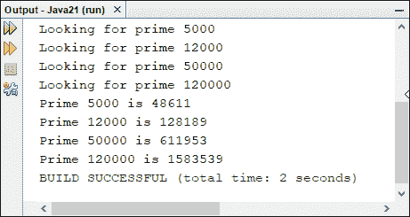

**图 7.2** 使用线程在序列中寻找多个质数。

`PrimeThreads` 应用程序中第 10–18 行的 `for` 循环为程序运行时运行时指定的每个命令行参数创建一个 `PrimeFinder` 对象。

由于参数是 `String` 对象，而 `PrimeFinder` 构造函数需要 `long` 类型的值，因此使用了 `Long.parseLong(String)` 类方法来处理转换。所有解析数字的方法都会抛出 `NumberFormatException` 异常，因此它们被封装在 `try`-`catch` 块中，以处理非数字的参数。

当创建一个 `PrimeFinder` 对象时，该对象会在其自己的线程中运行（如 `PrimeFinder` 构造函数中指定的）。

第 20–36 行的 `while` 循环检查是否有 `PrimeFinder` 线程已完成，通过其实例变量 `finished` 等于 `true` 来指示。当线程完成时，调用第 27 行的 `displayResult()` 方法来显示找到的质数。然后线程被设置为 `null`，释放对象的资源（并防止其结果被显示多次）。

第 32 行的 `Thread.sleep(1000)` 调用导致 `while` 循环在每次循环过程中暂停一秒钟。循环的减速有助于防止 JVM 以如此疯狂的速度执行语句以至于陷入停滞。

### 停止线程

停止线程比启动线程稍微复杂一点。停止线程最好的办法是在线程的 `run()` 方法中放置一个循环，当变量值发生变化时结束循环，如下例：

```java
public void run() {
    while (okToRun == true) {
        // ...
    }
}
```

`okToRun` 变量可以是线程类的实例变量。如果将其更改为 `false`，`run()` 方法内部的循环就会结束。

另一个你可以用于停止线程的选项是在 `run()` 方法中循环，但仅当当前运行的线程有一个引用该它的变量时才循环。

类方法 `Thread.currentThread()` 返回当前线程的引用（换句话说，即对象运行所在的线程）。

下面的 `run()` 方法只要 `runner` 和 `currentThread()` 指向同一个对象，就会一直循环：

点击此处查看代码图像

```java
public void run() {
    Thread thisThread = Thread.currentThread();

    while (runner == thisThread) {
        // body of loop
    }
}
```

如果你使用像这样的循环，可以使用以下语句在类的中的任何位置停止线程：

```java
runner = null;
```

### 总结

异常和线程增强了程序的程序的健壮性。

异常允许你管理潜在的错误。通过使用 `try`、`catch` 和 `finally`，你可以通过在异常发生时处理这些异常，来保护可能导致异常的代码。

处理异常只是战斗的一半；另一半是生成和抛出异常。`throws` 子句告诉方法的用户，该方法可能会抛出异常。它还可以用于从方法体中的方法调用传递异常。

你学习了如何通过定义新的异常类以及通过使用 `throw` 抛出任何异常类的实例来创建和抛出你自己的方法。

线程允许你将 Java 类中计算密集程度最大的部分与类的其他部分分开运行。当类正在执行计算密集型任务时（例如动画、复杂的数学运算或快速遍历大量数据），这一点特别有用。你还可以使用线程同时执行任务并在外部启动和停止线程。

线程实现了 `Runnable` 接口，该接口包含一个方法：`run()`。当你通过调用 `start()` 方法启动线程时，线程的 `run()` 方法会被调用。

### 问答

**Q 我仍然不确定是否理解异常（exceptions）、错误（errors）和运行时异常（runtime exceptions）之间的区别。还有其他的观察方式吗？**

**A** 错误是由动态链接或 JVM 问题引起的。因此，对于大多数程序来说，它们的层次太低，不需要关心——或者即使它们关心也无法处理。

运行时异常是由 Java 代码的正常执行生成的。尽管它们偶尔反映了你想要显式处理的情况，但更多时候反映了程序员编写代码时的错误，因此简单地打印错误以帮助标记该错误。

非运行时异常（例如 `IOException`）是由于其性质而应该由任何健壮且深思周到的代码显式处理的条件。Java 类库在编写时仅使用了其中的少数几个，但这几个对于安全、正确地使用系统至关重要。编译器通过其 `throws` 子句检查和限制帮助你妥善地处理这些异常。

**Q Java 支持单元测试吗？**

**A** 错误是由动态链接或 JVM 问题引起的。因此，对于大多数程序来说，它们的层次太低，不需要关心——或者即使它们关心也无法处理。

单元测试是一种添加测试以确保软件可靠性的技术，由开源 JUnit 支持。这是最流行的单元测试框架。访问 [junit.org](http://junit.org) 下载它。通过 JUnit，你编写一组测试（称为测试套），创建你开发的 Java 对象并调用它们的方法。这些测试产生的值被检查是否符合你的预期。所有测试通过后，你的软件才能通过。

虽然单元测试的好坏取决于你创建的测试，但测试套的存在在你进行更改时非常有帮助。在更改后运行测试，你可以更好地确保软件继续工作。有些 Java 程序员如此坚信单元测试的优点，以至于在编写代码之前编写测试。

### 测试

通过这个三个问题的测试回顾本课的内容。

#### 问题

**1 使用什么关键字从 `try` 块跳转到 `finally` 块？**

A. `catch`  
B. `return`  
C. `while`

**2 在 Java 中创建任何异常时，哪个类应该是父类？**

A. `Throwable`  
B. `Error`  
C. `Exception`

**3 如果一个类实现了 `Runnable` 接口，该类必须包含哪些方法？**

A. `start()`、`stop()` 和 `run()`  
B. `actionPerformed()`  
C. `run()`

#### 答案

**1** B. `return` 语句会退出块。

**2** C. 你在程序中想要记录的错误类型通常属于 `Exception` 层次。

**3** C. `Runnable` 接口只需要 `run()` 方法。

### 认证练习

以下问题是你可能预期在 Java 编程认证考试中遇到的问题类型。请在不再次查看本课或不使用 Java 编译器测试代码的情况下回答它。

`AverageValue` 应用程序应该接收最多 10 个浮点数作为命令行参数，并显示它们的平均值。

给定如下：

点击此处查看代码图像

```java
public class AverageValue {

    public static void main(String[] arguments) {

        float[] temps = new float[10];

        float sum = 0;

        int count = 0;

        int i;

        for (i = 0; i < arguments.length & i < 10; i++) {

            try {

                temps[i] = Float.parseFloat(arguments[i]);

                count++;

            } catch (NumberFormatException nfe) {
```


```java
System.out.println("Invalid input: " + arguments[i]);

}

sum += temps[i];

}

System.out.println("Average: " + (sum / i));

}

}

```

哪一个语句包含错误？

**A.** `for (i = 0; i < arguments.length & i < 10; i++) {`

**B.** `sum += temps[i];`

**C.** `System.out.println("Average: " + (sum / i));`

**D.** 均没有；该程序是正确的。

答案可以在书籍网站找到：[www.java21days.com](http://www.java21days.com)。访问第 7 课页面并点击 `Certification Practice` 链接。

### 练习题

为了扩展你对本课涵盖主题的知识，请尝试以下练习：

1. 修改 `PrimeFinder` 类，如果向构造函数发送了负数，则抛出一个新异常 `NegativeNumberException`。
2. 修改 `PrimeThreads` 应用，使其能够处理新的 `NegativeNumberException` 错误。

在适用的情况下，练习题可以在书籍网站 [www.java21days.com](http://www.java21days.com) 找到。

# 第二部分：Java 类库

- **8** 数据结构
- **9** 创建图形用户界面
- **10** 构建接口
- **11** 在用户界面上排列组件
- **12** 响应用户输入
- **13** 创建 Java2D 图形
- **14** 开发 Swing 应用

## 第 8 课：数据结构

到目前，你已经学习了 Java 语言的核心元素：对象、类和接口，以及它们包含的关键字、语句、表达式和操作符。

现在，重点从你创建的类转向了为你创建的类。Java 类库（Java Class Library）是 Oracle 提供的系列官方包，包含超过 4,400 个可以在你自己的 Java 程序中使用的类。本课重点关注表示数据的类。

本课涵盖了以下数据结构：

- 位集（Bit sets）：存储 `Boolean` 值。
- 数组列表（Array lists）：可以伸缩大小的数组。
- 栈（Stacks）：以后进先出方式存储的结构。
- 哈希映射（Hash maps）：使用键的结构。

### 跨越数组

到目前，你已经学习了 Java 语言的核心元素：对象、类和接口，以及它们包含的关键字、语句、表达式和操作符。

现在，重点从你创建的类转向了为你创建的类。Java 类库是 Oracle 提供的系列官方包，包含超过 4,400 个可以在你自己的 Java 程序中使用的类。本课重点关注表示数据的类。

这些方法缺少代码，因为接口没有实现。实现接口的类必须提供定义这些方法的代码。

`hasNext()` 方法确定结构是否还包含更多元素。你可以调用此方法来查看是否可以继续遍历该结构。

`next()` 方法检索结构中的下一个元素。如果没有更多元素了，`next()` 将抛出 `NoSuchElementException` 异常。为了避免这种情况，你可以结合使用 `hasNext()` 和 `next()`，以确保有另一个元素可以检索。

下面的 `while` 循环使用这两个方法来遍历一个实现了 `Iterator` 接口的名为 `users` 的数据结构：

```java
while (users.hasNext()) {
    Object ob = users.next();
    System.out.println(ob);
}
```

此示例代码通过 `hasNext()` 和 `next()` 方法显示每个列表项的内容。

`next()` 方法返回一个 `Object` 类的对象。你可以将其转换为该结构所持有的另一个类。这里是一个持有 `String` 对象的数据结构示例：

```java
while (users.hasNext()) {
    String ob = (String) users.next();
    System.out.println(ob);
}
```

### Note

由于 `Iterator` 是一个接口，你永远不会直接将其作为数据结构使用。相反，你对实现接口的结构使用由 `Iterator` 定义的方法。这提供了一种处理许多 Java 标准数据结构的一致方法，使得它们更容易学习和使用。

### Bit Sets

当你需要表示大量的二进制数据（等于 `0` 或 `1` 的位值）时，`BitSet` 类非常有用。这些也被称为开启/关闭值（`1` 表示开启，`0` 表示关闭）或布尔值（`1` 表示 `true`，`0` 表示 `false`）。

通过 `BitSet` 类，你可以使用单独位来存储布尔值，而不需要位位操作来提取位值。你只需要使用索引引用每个位即可。`BitSet` 的另一个优秀特性是它可以自动增长，以表示程序所需的位数。图 8.1 显示了位集数据结构的逻辑结构。

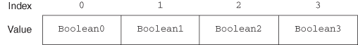

**FIGURE 8.1** 位集的结构。

你可以使用一个 `BitSet` 对象来持有易用布尔值建模的属性。由于集合中的单独位是通过索引访问的，你可以像这个类一样将每个属性定义为常量索引值：点击此处查看代码图片

```java
class ConnectionAttributes {
    public static final int READABLE = 0;
    public static final int WRITABLE = 1;
    public static final int STREAMABLE = 2;
    public static final int FLEXIBLE = 3;
}
```

在此类中，属性被分配了递增的值，从 `0` 开始。你可以使用这些值来获取和设置集合中的相应位。首先，你需要创建一个 `BitSet` 对象：

```java
BitSet connex = new BitSet();
```

此构造函数创建一个没有指定大小的集合。你也可以创建一个特定大小的集合：

```java
BitSet connex = new BitSet(4);
```

这创建了一个包含四个布尔位的集合。无论使用哪种构造函数，新集合中的所有位最初都被设置为 `false`。获取集合后，你可以使用你定义的位常量通过 `set(int)` 和 `clear(int)` 方法来设置和清除位：点击此处查看代码图片

```java
connex.set(ConnectionAttributes.WRITABLE);
connex.set(ConnectionAttributes.STREAMABLE);
connex.set(ConnectionAttributes.FLEXIBLE);
connex.clear(ConnectionAttributes.WRITABLE);
```

在此代码中，设置了 `WRITABLE`、`STREAMABLE` 和 `FLEXIBLE` 属性，然后清除了 `WRITABLE` 位。每个属性都使用了类名，因为这些常量是 `ConnectionAttributes` 类中的类变量。

你可以使用 `get()` 方法获取集合中单独位的值：点击此处查看代码图片

```java
boolean isWriteable = connex.get(ConnectionAttributes.WRITABLE);
```

你可以通过 `size` 方法找出一个集合代表了多少位：

```java
int numBits = connex.size();
```

`BitSet` 类还提供了其他在集合上执行比较和位运算的方法，例如 `AND`、`OR` 和 `XOR`。所有这些方法都将 `BitSet` 对象作为其唯一参数。

本节第一个项目是 `HolidaySked`，这是一个 Java 类，它使用集合来跟踪一年中的哪些天是假期。

这里使用集合是因为 `HolidaySked` 必须能够处理年的任何一天，并回答相同的是/否问题：是假期吗？

将 Listing 8.1 所示的代码输入到名为 `HolidaySked.java` 的空文件中。

**LISTING 8.1** `HolidaySked.java` 的完整文本

```java
package com.2days;

import java.util.*;

public class HolidaySked {
    BitSet sked;

    public HolidaySked() {
        sked = new BitSet(365);
    }

    public void addHoliday(int dayToAdd) {
        sked.set(dayToAdd);
    }

    public boolean isHoliday(int dayToCheck) {
        boolean result = sked.get(dayToCheck);
        return result;
    }

    public static void main(String[] arguments) {
        HolidaySked cal = new HolidaySked();

        if (arguments.length > 0) {
            try {
                int whichDay = Integer.parseInt(arguments[0]);

                if (cal.isHoliday(whichDay)) {
                    System.out.println("Day number " + whichDay + " is a holiday.");
                } else {
                    System.out.println("Day number " + whichDay + " is not a holiday.");
                }
            } catch (NumberFormatException nfe) {
                System.out.println("Error: " + nfe.getMessage());
            }
        }
    }
}
```

应用程序对于第 170 天的输出如图 8.2 所示。

**FIGURE 8.2** 尝试 `BitSet` 数据结构。

`holiday` 数组用于将每个节假日添加到 `sked` 位集中。一个 `for` 循环遍历 `holiday` 数组，并对其中的每个元素调用 `addHoliday(int)` 方法（第 12–14 行）。

`addHoliday(int)` 方法定义在第 17–19 行。该参数表示要添加的日期。调用位集的 `set(int)` 方法将指定位置的位值设置为 `1`。例如，如果调用了 `set(359)`，则位置 359 处的位值将被赋值为 `1`。

`HolidaySked` 类还可以判断指定的日期是否为节假日。这通过 `isHoliday(int)` 方法处理（第 21–24 行）。该方法调用位集的 `get(int)` 方法，如果指定位置的值为 `1`，则方法返回 `true`，否则返回 `false`。

由于存在 `main()` 方法，该类可以作为应用程序运行（第 26–42 行）。该程序接受一个命令行参数：一个从 `1` 到 `365` 之间的数字，代表一年的某一天。程序将根据 `HolidaySked` 类的安排显示该日期是否为节假日。

### 数组列表（Array Lists）

`ArrayList` 类是 Java 中流行的数据结构之一，它实现了一个可扩展和可收缩的对象数组，这使其比数组更灵活、更有用。由于 `ArrayList` 类负责在需要时更改大小，它必须在添加或删除元素时决定何时以及增加多大进行增长或缩小。

可以使用不带参数的构造函数来创建一个数组列表：

点击此处查看代码图片

```java
ArrayList golfer = new ArrayList();
```

此构造函数创建了一个不包含任何元素的默认数组列表。所有列表在创建时都是空的。决定列表大小的属性之一是其初始容量——即为分配内存以存储的元素数量。

数组列表的大小是当前存储在其中的元素数量。列表的容量始终大于或等于其大小。

以下代码展示了如何创建一个具有指定容量的数组列表：

点击此处查看代码图片

```java
ArrayList golfer = new ArrayList(30);
```

此列表分配了足够支持 30 个元素的内存。如果容量满了，列表将自动扩展为初始大小的一半。因此，如果向 `golfer` 中放入第 30 个元素，列表将扩展以为 45 个元素留出空间。

由于为列表分配额外空间需要时间并消耗内存，最好在创建列表时就按照你预期要使用的元素数量来创建。

你不能像使用数组那样直接使用方括号 `[]` 来访问数组列表中的元素。你必须使用 `ArrayList` 类的方法。

使用 `add(Object)` 方法向数组列表添加元素，如下所示：

```java
golfer.add("Park");
golfer.add("Lewis");
golfer.add("Ko");
```

`lastElement()` 方法返回一个 `Object`，因为 `ArrayList` 类支持所有类型的对象。你必须将其强制转换为存入列表的类。在这里，由于 `golfer` 中存储了字符串，因此返回的对象被强制转换为字符串。

`get()` 方法通过数字索引检索列表元素，如下代码所示：

```java
String s1 = (String) golfer.get(0);
String s2 = (String) golfer.get(2);
```

由于数组列表的编号从 0 开始，第一次调用 `get()` 检索 `"Park"` 字符串，第二次调用检索 `"Lewis"` 字符串。

正如你可以在特定索引处检索元素，你也可以使用 `add(int, Object)` 和 `remove(int)` 方法在索引处添加和删除元素：

```java
golfer.add(1, "Kim");
golfer.add(0, "Thompson");
golfer.remove(3);
```

第一次调用 `add()` 在索引 1 处插入一个元素，位于 `"Park"` 和 `"Lewis"` 字符串之间。`"Lewis"` 和 `"Ko"` 字符串在列表中移动一个位置以容纳插入的 `"Kim"` 字符串。第二次调用 `add()` 在索引 0 处插入一个元素，即列表的开头。所有现有元素在列表中向上移动一个位置，以容纳插入的 `"Thompson"` 字符串。此时，列表的内容如下：

- **0.** `"Thompson"`
- **1.** `"Park"`
- **2.** `"Kim"`
- **3.** `"Lewis"`
- **4.** `"Ko"`

调用 `remove()` 移除索引 3 处的元素，即 `"Lewis"` 字符串。结果列表包含以下字符串：

- **0.** `"Thompson"`
- **1.** `"Park"`
- **2.** `"Kim"`
- **3.** `"Ko"`

你可以使用 `set()` 方法更改特定元素：

```java
golfer.set(1, "Pressel");
```

该方法将 `"Park"` 字符串替换为 `"Pressel"` 字符串，产生以下列表：

- **0.** `"Thompson"`
- **1.** `"Pressel"`
- **2.** `"Kim"`
- **3.** `"Ko"`

如果你想清空列表，可以使用 `clear()` 方法：

```java
golfer.clear();
```

`ArrayList` 类还提供了一些不需要索引的搜索方法。这些方法之一是 `contains(Object)`，它检查对象是否在列表中：

```java
boolean isThere = golfer.contains("Kerr");
```

另一个搜索方法是 `indexOf(Object)`，它返回对象的索引：

```java
int i = golfer.indexOf("Ko");
```

如果对象不在列表中，`indexOf()` 方法返回 `-1`。`remove(Object)` 方法也类似，从列表中移除对象，如下所示：

```java
golfer.remove("Pressel");
```

`ArrayList` 类提供了几个确定和操作列表大小的方法。首先，`size()` 方法确定列表中的元素数量：

```java
int size = golfer.size();
```

记住列表有两个与大小相关的属性：大小是元素数量，容量是分配的内存。你可以通过 `trimToSize()` 方法使容量精确匹配大小：

```java
golfer.trimToSize();
```

### 注意事项

Java 类库还包含了 `Vector`，它的工作方式与数组列表非常相似。当你在 NetBeans 中使用向量时，会显示该类已“过时”。这是因为数组列表被认为是更好的版本。

### 遍历数据结构

如果你感兴趣按顺序处理列表中的所有元素，可以使用 `iterator()` 方法，它返回一个包含你可以遍历的元素的 `Iterator`：

点击此处查看代码图片


```java
Iterator it = golfer.iterator();
```

正如你在本节早期学到的，你可以使用迭代器进行步进。在这个例子中，你可以通过使用`Iterator`接口定义的方法操作`it`列表。

下面的`for`循环使用迭代器及其方法遍历整个数组列表：

[点击此处查看代码图片]

```java
for (Iterator i = golfer.iterator(); i.hasNext(); ) {
    String name = (String) i.next();
    System.out.println(name);
}
```

本节的下一个项目演示了数组列表的维护。如列表 8.2 所示的`CodeKeeper`类持有一组文本代码，某些由类提供，另一些由用户提供。由于存储代码所需的空间在程序运行之前未知，因此使用数组列表而不是数组来存储数据。

```java
package com.java21days;

import java.util.*;

public class CodeKeeper {
    ArrayList list;

    String[] codes = { "alpha", "lambda", "gamma", "delta", "zeta" };

    public CodeKeeper(String[] userCodes) {
        list = new ArrayList();

        // 加载内置代码
        for (int i = 0; i < codes.length; i++) {
            addCode(codes[i]);
        }

        // 加载用户代码
        for (int j = 0; j < userCodes.length; j++) {
            addCode(userCodes[j]);
        }

        // 显示所有代码
        for (Iterator ite = list.iterator(); ite.hasNext(); ) {
            String output = (String) ite.next();
            System.out.println(output);
        }
    }

    private void addCode(String code) {
        if (!list.contains(code)) {
            list.add(code);
        }
    }

    public static void main(String[] arguments) {
        CodeKeeper keeper = new CodeKeeper(arguments);
    }
}
```

NetBeans 可能会显示警告，说明此类使用了“未检查或不安全的操作”。这听起来并没有那么严重。代码按原文编写运行正常，并且是不安全的。该警告是一个强烈的提示，说明处理数组列表和其他数据结构的更好方法。你将在本节稍些时候学习这种技术。

`CodeKeeper`类使用一个名为`list`的`ArrayList`实例变量来存储文本代码。

首先，从字符串数组中读取五个内置代码到列表中（第 12–14 行）。

接下来，将用户作为命令行参数提供的任何代码都添加到列表中（第 16–18 行）。

通过调用`addCode()`方法添加代码（第 26–30 行）。只有在代码尚已存在时，`addCode()`才会添加新的文本代码，它使用列表的`contains(Object)`方法来进行此判断。

在 NetBeans 中，通过选择 Project（项目）、Set Project Configuration（设置项目配置）、Customize（自定义）来添加命令行参数。参数应该是由空格分隔的代码列表。

在代码添加到列表后，将显示其内容。使用命令行参数`gamma`、`beta`和`delta`运行该类将产生如图 8.3 所示的输出。

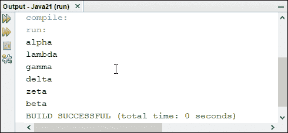

图 8.3 操作和显示数组列表。

可以使用简单的`for`循环来遍历数据结构。循环的格式为`for (Object : structure)`，其中`structure`实现了`Iterator`接口。该变量声明了一个对象，随着循环的进行持有每个元素。此`for`循环使用迭代器及其方法来遍历名为`golfer`的数组列表：

```java
for (Object name : golfer) {
    System.out.println(name);
}
```

### 栈（Stacks）

栈是一种用于模拟按特定顺序访问信息的数据结构。Java 中的`Stack`类被实现为 LIFO（后进先出）栈，这意味着最后添加到栈的项是第一个被移除的项。图 8.4 显示了栈的逻辑结构。

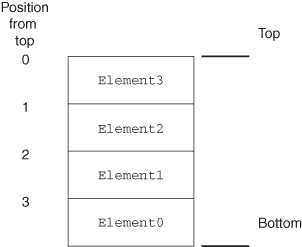

图 8.4 栈的结构。你可能会奇怪为什么元素的数量与它们距离栈顶的位置不匹配。请记住，元素是被添加到顶部的，所以位于底部的`Element0`是第一个添加的元素。同样，位于顶部的`Element3`是最后一个添加的元素。此外，由于`Element3`在顶部，它将是第一个被移除的。`Stack`类定义了一个构造函数，这是一个创建一个空栈的默认构造函数。你使用此构造函数来创建这样一个栈：

```java
Stack s = new Stack();
```

Java 中的栈包含操作栈的方法。你可以使用`push()`方法向栈中添加新元素，该方法将一个元素推到栈顶：

```java
s.push("One");
s.push("Two");
s.push("Three");
s.push("Four");
s.push("Five");
s.push("Six");
```

此代码将六个字符串推入栈，最后一个字符串`"Six"`最终位于顶端。你使用`pop()`方法从栈中移除元素，该方法将它们从顶部弹出：

```java
String s1 = (String) s.pop();
String s2 = (String) s.pop();
```

此代码从栈中弹出最后两个字符串，留下前四个字符串。此代码导致变量`s1`包含`"Six"`字符串，变量`s2`包含`"Five"`字符串。如果你想使用栈顶元素而不实际上将其从栈中弹出，可以使用`peek()`方法：

```java
String s3 = (String) s.peek();
```

此`peek()`调用返回`"Four"`字符串，但将字符串留在栈中。你可以通过使用`search()`方法在栈中搜索元素：

```java
int i = s.search("Two");
```

`search()`方法返回距离元素的距离，如果没有找到则返回 -1。在这种情况下，`"Two"`字符串是第三个元素，因此`search()`返回`2`。

#### 注意

与所有处理索引的 Java 数据结构一样，`Stack`类从零开始报告位置：栈顶元素位于 0，第四个元素位于 3，依此类推。`Stack`类定义的最后一个方法是`empty()`，它指示栈是否为空：

```java
boolean isEmpty = s.empty();
```

### 映射（Map）

`Map`接口定义了一个实现键映射数据结构的框架，用于存储对象，每个对象由键引用。键的作用与数组中的元素相同：它是用于访问存储在数据结构中的唯一值。

你可以通过使用`HashMap`类或其他实现`Map`接口的类应用键映射方法。你将在下一节学习`HashMap`类。

`Map`接口定义了一种根据键存储和检索信息的方法。这在某些方面类似于`ArrayList`类，后者通过索引访问元素，索引是一种特定的键。然而，`Map`接口中的键可以是任何内容。你可以创建自己的类作为访问和操作字典数据的键。图 8.5 显示了键是如何映射到字典数据的。


图 8.5 键映射数据结构的结构。

`Map`接口声明了用于处理字典中存储的数据的方法。实现类必须实现所有这些方法才能真正有用。`put(String, Object)`和`get(String, Object)`方法用于在字典中存储并检索对象。假设`look`是一个实现了`Map`接口的对象，以下代码显示了如何使用`put()`方法添加元素：

```java
Rectangle r1 = new Rectangle(0, 0, 5, 5);
look.put("small", r1);

Rectangle r2 = new Rectangle(0, 0, 15, 15);
look.put("medium", r2);

Rectangle r3 = new Rectangle(0, 0, 25, 25);
look.put("large", r3);
```

这段代码使用字符串作为键，向 map 中添加了三个`Rectangle`对象（来自`java.awt`包）。要获取元素，请使用`get()`方法并指定相应的键：

[点击此处查看代码图像]

```java
Rectangle r = (Rectangle) look.get("medium");
```

你还可以使用`remove()`方法通过键来删除元素：

```java
look.remove("large");
```

你可以通过使用`size()`方法查看该结构中有多少个元素，就像在`ArrayList`类中一样：

```java
int size = look.size();
```

你还可以使用`isEmpty()`方法检查该结构是否为空：

[点击此处查看代码图像]

```java
boolean isEmpty = look.isEmpty();
```

### 哈希映射（Hash Maps）

`HashMap`类实现了`Map`接口，提供了键映射数据结构的完整实现。哈希表允许你根据某种类型的键存储数据，其效率由 map 的负载因子（load factor）决定。负载因子是一个 0.0 到 1.0 之间的浮点数，它决定了哈希表如何以及何时为更多元素分配空间。

和数组列表一样，哈希表具有容量（或分配的内存量）。哈希表通过比较 map 当前的大小与容量与负载因子的乘积来分配内存。如果哈希表的大小超过此乘积，map 将通过重新哈希（rehashing）自身来增加其容量。

负载因子越接近 1.0，内存利用率越高，但代价是每个元素的查找时间变得更长。同样，接近 0.0 的负载因子会导致更高效的查找，但往往倾向于更浪费内存。为你自己的哈希表确定负载因子需要考虑你如何使用每个 map，以及你的优先事项是性能还是内存效率。

你可以通过三种方式创建哈希表。第一个构造函数创建一个初始容量为 16 个元素且负载因子为 0.75 的默认哈希表：

[点击此处查看代码图像]

```java
HashMap hash = new HashMap();
```

第二个构造函数创建一个具有指定初始容量和 0.75 负载因子的哈希表：

[点击此处查看代码图像]

```java
HashMap hash = new HashMap(20);
```

最后，第三个构造函数创建一个具有指定初始容量和负载因子的哈希表：

[点击此处处代码代码图像]

```java
HashMap hash = new HashMap(20, 0.5F);
```

`Map`中定义的所有抽象方法都在`HashMap`类中得到了实现。此外，`HashMap`类还实现了几个执行支持 map 特有功能的方法。其中之一是`clear()`方法，它可以清除 map 中所有的键和元素：

```java
hash.clear();
```

`containsValue(Object)`方法检查对象是否存储在哈希表中：

[点击此处查看代码图像]

```java
Rectangle box = new Rectangle(0, 0, 5, 5);
boolean isThere = hash.containsValue(box);
```

`containsKey(String)`方法在 map 中搜索一个键：

[点击此处查看代码图像]

```java
boolean isThere = hash.containsKey("Small");
```

哈希表的实际用途在于它能够表示那些通过值来搜索或引用过于耗时的数据。当你处理复杂数据时，使用键来访问数据比比较数据对象本身更高效。这个被称为`hash code`的计算键可以唯一地标识哈希表中的每个元素。

这种计算并使用哈希码进行对象存储和引用的技术在 Java 类库被大量利用。父类`Object`定义了`hashCode()`方法，它在大多数标准类中都被重写了。任何定义了`hashCode()`方法的类都可以高效地存储和访问于哈希表中。想要哈希的类必须实现`equals()`方法，该方法定义了判断两个对象是否相等的方法。`equals()`方法通常对类中的成员变量进行直接比较。

你将进行的下一个项目使用了 map。`ComicBooks`应用根据基础价格和状况来收集漫画书。状况被描述为以下之一：

- 品相（mint）价值为基础价格的 3 倍
- 近完美（near mint）价值为基础价格的 2 倍
- 优良（very fine）价值为基础价格
- 良好（fine）价值为基础价格
- 良好（good）价值为基础价格
- 较差（poor）价值为基础价格

为了将“mint”或“very fine”等文本与数值值关联起来，你将它们放入哈希表。map 的键是状况描述，而值是 3.0、1.5 和 0.25 等浮点数。在 NetBeans 中显示的代码如`ComicBooks`类中所示：

```java
Rectangle r1 = new Rectangle(0, 0, 5, 5);
look.put("small", r1);

Rectangle r2 = new Rectangle(0, 0, 15, 15);
look.put("medium", r2);

Rectangle r3 = new Rectangle(0, 0, 25, 25);
look.put("large", r3);
```

这段代码使用字符串作为键，向 map 中添加了三个`Rectangle`对象（来自`java.awt`包）。要获取元素，请使用`get()`方法并指定相应的键：

[点击此处查看代码图像]

```java
Rectangle r = (Rectangle) look.get("medium");
```

你还可以使用`remove()`方法通过键来删除元素：

```java
look.remove("large");
```

你可以通过使用`size()`方法查看该结构中有多少个元素，就像在`ArrayList`类中一样：

```java
int size = look.size();
```

你还可以使用`isEmpty()`方法检查该结构是否为空：

[点击此处查看代码图像]

```java
boolean isEmpty = look.isEmpty();
```

### 哈希映射（Hash Maps）

`HashMap`类实现了`Map`接口，提供了键映射数据结构的完整实现。哈希表允许你根据某种类型的键存储数据，其效率由 map 的负载因子决定。负载因子是一个 0.0 到 1.0 之间的浮点数，它决定了哈希表如何以及何时为更多元素分配空间。

和数组列表一样，哈希表具有容量（或分配的内存量）。哈希表通过比较 map 当前的大小与容量与负载因子的乘积来分配内存。如果哈希表的大小超过此乘积，map 将通过重新哈希（rehashing）自身来增加其容量。

负载因子越接近 1.0，内存利用率越高，但代价是每个元素的查找时间变得更长。同样，接近 0.0 的负载因子会导致更高效的查找，但往往倾向于更浪费内存。为你自己的哈希表确定负载因子需要考虑你如何使用每个 map，以及你的优先事项是性能还是内存效率。

你可以通过三种方式创建哈希表。第一个构造函数创建一个初始容量为 16 个元素且负载因子为 0.75 的默认哈希表：

[点击此处查看代码图像]

```java
HashMap hash = new HashMap();
```

第二个构造函数创建一个具有指定初始容量和 0.75 负载因子的哈希表：

[点击此处查看代码图像]

```java
HashMap hash = new HashMap(20);
```

最后，第三个构造函数创建一个具有指定初始容量和负载因子的哈希表：

[点击此处查看代码图像]

```java
HashMap hash = new HashMap(20, 0.5F);
```

`Map`中定义的所有抽象方法都在`HashMap`类中得到了实现。此外，`HashMap`类还实现了几个执行支持 map 特有功能的方法。其中之一是`clear()`方法，它可以清除 map 中所有的键和元素：

```java
hash.clear();
```

`containsValue(Object)`方法检查对象是否存储在哈希表中：

[点击此处查看代码图像]


```java
Rectangle box = new Rectangle(0, 0, 5, 5);

boolean isThere = hash.containsValue(box);
```

`containsKey(String)` 方法在 map 中搜索一个键：

点击此处查看代码图像

```java
boolean isThere = hash.containsKey("Small");
```

哈希表的实际用途在于它能够表示那些通过值来搜索或引用过于耗时的数据。当你处理复杂数据时，使用键来访问数据比比较数据对象本身更高效。这个被称为 `hash code` 的计算键可以唯一地标识哈希表中的每个元素。

这种计算并使用哈希码进行对象存储和引用的技术在 Java 类库被大量利用。父类 `Object` 定义了 `hashCode()` 方法，它在大多数标准类中都被重写了。任何定义了 `hashCode()` 方法的类都可以高效地存储和访问于哈希表中。想要哈希的类必须实现 `equals()` 方法，该方法定义了判断两个对象是否相等的方法。`equals()` 方法通常对类中的成员变量进行直接比较。

```java
package comicbooks;

import java.util.*;

public class ComicBooks {

    public static void main(String[] arguments) {

        // set map

        HashMap quality = new HashMap();

        quality.put("mint", 3.0);

        quality.put("near mint", 2.0);

        quality.put("very fine", 1.5);

        quality.put("fine", 1.0);

        quality.put("good", 0.5);

        quality.put("poor", 0.25);

        // set collection

        Comic[] comix = new Comic[3];

        comix[0] = new Comic("Amazing Spider-Man", "1A", "very fine", 12000.0F);

        comix[0].setPrice((Float) quality.get(comix[0].condition));

        comix[1] = new Comic("Incredible Hulk", "181", "near mint", 680.0F);

        comix[1].setPrice((Float) quality.get(comix[1].condition));

        comix[2] = new Comic("Cerebus", "1A", "good", 190.0F);

        comix[2].setPrice((Float) quality.get(comix[2].condition));

        for (int i = 0; i < comix.length; i++) {

            System.out.println("Title: " + comix[i].title);

            System.out.println("Issue: " + comix[i].issueNumber);

            System.out.println("Condition: " + comix[i].condition);

            System.out.println("Price: $" + comix[i].price + "\n");

        }

    }

}

class Comic {

    String title;

    String issueNumber;

    String condition;

    float basePrice;

    float price;

    Comic(String inTitle, String inIssueNumber, String inCondition, float inBasePrice) {

        title = inTitle;

        issueNumber = inIssueNumber;

        condition = inCondition;

        basePrice = inBasePrice;

    }

    void setPrice(float factor) {

        price = basePrice * factor;

    }

}
```

当你运行 `ComicBooks` 应用时，它会产生如图图 8.6 所示的输出。

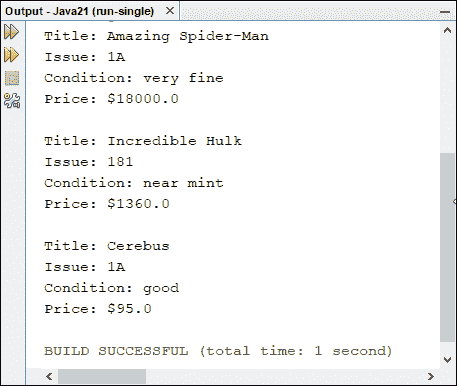

**图 8.6** 在哈希表中存储漫画书数值。

`ComicBooks` 由两个类实现：一个名为 `ComicBooks` 的应用程序类和一个名为 `Comic` 的辅助类。

在应用程序中，哈希表是在第 12–24 行中创建的。首先，在第 12 行创建了映射。接下来，创建了一个名为 `price1` 的 `float` 变量，其值为 `3.00`。该值被添加到映射中并与键 `"mint"` 关联。（记住，哈希表与其他数据结构一样，只能持有对象。`float` 值会通过自动装箱（autoboxing）自动转换为 `Float` 对象。）

对于其他每种漫画状况（从近乎品相到破旧），都重复此过程。

在设置好哈希表后，创建了一个名为 `comix` 的 `Comic` 对象数组，用于存储当前正在出售的每本漫画。

调用 `Comic` 构造函数时传入了四个参数：书名、期号、状况和基础价格。前三个是字符串，最后一个是 `float`。

在创建 `Comic` 对象后，调用其 `setPrice(float)` 方法根据其状况设置书的价格。这里有一个来自第 29 行的示例：

点击此处查看代码图像

```java
comix[0].setPrice((Float) quality.get(comix[0].condition));
```

调用哈希表的 `get(String)` 方法并传入书的状况，该字符串是映射中的键之一。它会返回一个表示与该键关联的值的 `Object`。（在第 29 行，由于 `comix[0].condition` 等于 `"very fine"`，`get()` 返回了浮点值 `3.00F`。）

由于 `get()` 返回的是一个 `Object`，它必须被强制转换为 `Float`。`Float` 参数会通过自动拆箱（unboxing）自动转为 `float` 值。

此过程在另外两本书上重复。

第 35–40 行显示了 `comix` 数组中每本漫画的信息。

`Comic` 类定义在第 44–63 行。它有五个实例变量——`String` 对象的 `title`、`issueNumber` 和 `condition`，以及浮点值的 `basePrice` 和 `price`。

该类的构造方法位于第 51–58 行，它将四个实例变量的值设置为传递给构造函数的参数。

第 60–62 行的 `setPrice(Float)` 方法设置漫画的价格。传递给方法的参数是一个 `float` 值。漫画的价格通过将此 `float` 乘以漫画的基础价格来计算。因此，如果一本书价值值 1,000 美元，而其倍数是 2.0，那么该书的价格就是 2,000 美元。

哈希表是一种处理大量数据的强大数据结构。这些映射在 Java 类库中通过 `Object` 类得到了广泛支持，这一事实足以说明它们在 Java 编程中的重要性。

### 泛型 (Generics)

你在这节中学习的数据结构是 Java 类库中一些最核心的工具类。

哈希表、数组列表（array lists）、栈（stacks）以及 `java.util` 包中的其他结构，无论你想开发什么种程序都是有用的。几乎每个软件程序都会以某种方式处理数据。

这些数据结构非常适用于泛泛地应用于各种类对象的代码中。用于操作数组列表的方法可以写得在字符串、字符串缓冲区（string buffers）、字符数组或其他代表文本的对象上运行同样良好。会计程序中的某个方法可以接收表示整数、浮点数和其他数学类的对象，并使用每个对象来计算余额。

这种灵活性是付代价的：当数据结构与任何类型的对象协作时，如果该结构被误用，Java 编译器无法显示警告。

例如，`ComicBooks` 应用程序使用一个名为 `quality` 的哈希表将 `"mint"` 和 `"good"` 等状况描述与价格倍数关联。以下是针对 `"near mint"` 的语句：

点击此处查看代码图像

```java
quality.put("near mint", 1.50F);
```

从设计上来说，`quality` 映射应该持有浮点值（作为 `Float` 对象）。然而，无论添加到映射中的值是什么类型，类都能成功编译。你可能会失误并在无意中向映射中添加一个字符串，如下所示修改后的语句：

点击此处查看代码图像

```java
quality.put("near mint", "1.50");
```

类可以成功编译，但运行时，会在以下语句中以 `ClassCastException` 错误失败：

点击此处查看代码图像

```java
comix[1].setPrice((Float) quality.get(comix[1].condition));
```

错误的原因是该语句尝试将映射的 `"near mint"` 值强制转换为 `Float`，但因为接收到的是字符串导致转换失败。

从风格的角度来看，在变量声明和构造方法中添加泛型可能会让人感到望而生畏。然而，当你习惯了与它们工作（以及使用自动装箱、拆箱以及新的 `for` 循环）时，处理数据结构将变得简单得多，而且不容易出错。

列表 8.4 所示的 `CodeKeeper2` 类是 `CodeKeeper` 的新版本，它已重写为使用泛型、类型推断和 `for` 循环，它可以遍历数组列表等数据结构。

#### 列表 8.4 `CodeKeeper2.java` 的完整文本

点击此处查看代码图像

```java
1: package com.java21days;
2:
3: import java.util.*;
4:
5: public class CodeKeeper2 {
6:     ArrayList<String> list;
7:     String[] codes = { "alpha", "lambda", "gamma", "delta", "zeta" };
8:
9:     public CodeKeeper2(String[] userCodes) {
10:         list = new ArrayList<>();
11:         // load built-in codes
12:         for (int i = 0; i < codes.length; i++) {
13:             addCode(codes[i]);
14:         }
15:         // load user codes
16:         for (int j = 0; j < userCodes.length; j++) {
17:             addCode(userCodes[j]);
18:         }
19:         // display all codes
20:         for (String code : list) {
21:             System.out.println(code);
22:        }
23:     }
24:
25:     private void addCode(String code) {
26:         if (!list.contains(code)) {
27:             list.add(code);
28:         }
29:     }
30:
31:     public static void main(String[] arguments) {
32:         CodeKeeper2 keeper = new CodeKeeper2(arguments);
33:     }
34: }
```

该类唯一的修改之处在于第 6 行，在该处对字符串数组列表进行了泛型声明；第 10 行，通过类型推断确定了正确的泛型声明；以及第 20 行和第 21 行，用于显示所有代码的更简单的 `for` 循环。

### 枚举

Java 中常量的一种常见用法是为一系列整数附加一个有意义的标签，就像你在本节稍早时候处理位集（bit sets）时做的那样：

点击此处查看代码图像

```java
class ConnectionAttributes {

    public static final int READABLE = 0;

    public static final int WRITABLE = 1;

    public static final int STREAMABLE = 2;

    public static final int FLEXIBLE = 3;

}
```

这些常量之所以有用是因为包含它们的语句提供了额外的信息。请比较下面这两个语句，它们的功能是相同的：

点击此处查看代码图像

```java
setConnectionType(1);

setConnectionType(ConnectionAttributes.WRITABLE);
```

对于检查代码的程序员来说，后者要容易理解得多。

Java 有一种名为 `enumerations`（枚举）的数据类型，它具有相同的作用，并且比在类中使用常量更有优势。使用 `enum` 关键字代替 `class`，值之间用逗号分隔。

这里有一个名为 `Compass`（指南针）的简单枚举，用于八个方向：

```java
public enum Compass {

    NORTH,

    EAST,

    SOUTH,

    WEST,

    NORTHEAST,

    SOUTHEAST,

    SOUTHWEST,

    NORTHWEST

}
```

这些值中的每一个都是隐式的 `static` 且 `final`，就像常量一样。它们可以出现在语句、方法调用和其他代码中，就像类类常量一样。这是一个使用该枚举的应用程序：

点击此处查看代码图像

```java
public class DirectionSetter {

    Compass current;

    public void setDirection(Compass dir) {

        current = dir;

    }

    public static void main(String[] arguments) {

        DirectionSetter app = new DirectionSetter();

        app.setDirection(Compass.WEST);

        System.out.println(app.current);

    }

}
```


该类将当前实例变量设置为`Compass`枚举中的`WEST`，并显示该变量，其输出为文本`WEST`。

使用`enum`而非类常量的优势是，编译器可以在使用无效值时检测到错误。发送到`setDirection(Compass)`方法的唯一接受值是`Compass`枚举的值。

相比之下，一个接受`ConnectionAttributes`值作为参数的方法可以使用任何整数值进行调用。

枚举还有其他优势，它们可以像类一样工作，拥有自己的方法和变量。

每当你需要一组固定的常量时，都可以将它们制成枚举。

### 总结

在本节中，你学习了 Java 程序中可以使用的几种数据结构：

- `Bit sets`（位集）：可以收缩或扩展的大型集合
- `Array lists`（数组列表）：大小可以变化的数组
- `Stacks`（栈）：最后添加的项最先被
- `Hash maps`（哈希映射）：使用键存储和检索的对象

这些都是`java.util`包的一部分。泛型的添加和新的`for`循环增强了它们的功能。你还接触了`enumerations`（枚举），一种表示常量的数据类型。

### 问答

**问** 本节中的`HolidayKeeper`项目可以使用布尔值数组来实现。哪种方法更好？

**答** 这取决于情况。你在处理数据结构时会发现实现某些功能有许多方法。当程序的大小很重要，位集比布尔数组更好，因为它更小。当程序的速度很重要时，布尔数组更好。例如，`Holiday`类非常小，差异可以忽略不计，当你开发自己的健壮应用程序时，这些决策有时会产生影响。

**问** Java 对未使用泛型数据结构的警告非常严重。发布一个带有“未检查或不安全操作”的类听起来不是个好主意。有什么理由坚持使用旧代码或不使用泛型？

**答** 编译器对安全的警告有些夸大了。Java 程序员多年来一直在类中使用数组列表、哈希映射和其他结构，创建运行可靠且安全的软件。缺乏泛型意味着需要更多工作来确保不会因为放入了错误的类而产生运行时问题。更准确的说法是，使用泛型可以让数据结构变得更安全，而不是暗示之前的 Java 版本是不安全的。我的原则是在新代码以及重组或重大重写的旧代码中使用泛型，但保留运行良好的旧代码。

### 测试

通过完成这个三道测验来复习本节内容。

#### 问题

1. 下面哪种数据不能存储在哈希映射中？

   A. `String`  
   B. `int`  
   C. 两者都可以存储在映射中。

2. 创建了一个数组列表，并添加了三个字符串`"Tinker"`、`"Evers"`和`"Chance"`。调用了`remove("Evers")`。下面哪个`ArrayList`方法获取了字符串`"Chance"`？

   A. `get(1);`  
   B. `get(2);`  
   C. `get("Chance");`

3. 这些类中哪一个实现了`Map`接口？

   A. `Stack`  
   B. `HashMap`  
   C. `BitSet`

#### 答案

1. C. 在 Java 的早期版本中，要在 map 中存储如`int`等基本数据类型，必须使用对象来表示它们的值（例如对整数使用`Integer`）。现在已不再如此。基本数据类型会通过一个名为“自动装箱”（autoboxing）的过程自动转换为对应的对象类。

2. A. 数组列表中项目的索引号会随着项目的添加或删除而改变。因为在移除`"Evers"`之后，`"Chance"`变成了列表中的第二个项目，因此通过调用`get(1)`获取它。

3. B. `HashMap`实现了该接口，名为`Hashtable`的类似类也是如此。

## 认证实践

以下问题是在 Java 编程认证考试中可能会遇到的类型。请在不重新查看本课或不使用 Java 编译器测试代码的情况下回答它。

给定：

点击此处查看代码图像

```java
public class Recursion {

    public int dex = -1;

    public Recursion() {
        dex = getValue(17);
    }

    public int getValue(int dexValue) {
        if (dexValue > 100) {
            return dexValue;
        } else {
            return getValue(dexValue * 2);
        }
    }

    public static void main(String[] arguments) {
        Recursion r = new Recursion();
        System.out.println(r.dex);
    }
}
```

该程序的输出将什么？

A. `-1`

B. `17`

C. `34`

D. `136`

答案可以在书籍网站`[www.java21days.com](http://www.java21days.com)`上找到。访问第 8 上找到。

## 第 9：创建图形用户界面

今天大多数计算机用户期望软件具有图形用户界面（GUI），并包含各种小部件，如文本框、滑块和滚动条。Java 类库包含了 Swing，这是一组包，能够让 Java 程序提供复杂的 GUI，并使用鼠标、键盘和其他输入设备收集用户输入。

在本节中，你将使用 Swing 创建包含这些 GUI 组件的应用程序：

- **框架（Frames）：** 带有标题栏、菜单栏以及最大化、最小化和关闭按钮的窗口
- **容器（Containers）：** 持有其他组件的组件
- **按钮（Buttons）：** 带有指示用途文本或图形的可点击矩形
- **标签（Labels）：** 提供信息的文本或图形
- **文本字段和文本区域（Text fields and text areas）：** 接受单行或多行键盘输入内容的窗口
- **下拉列表（Drop-down lists）：** 从下拉菜单或滚动窗口选择的相关项组
- **复选框和单选按钮（Check boxes and radio buttons）：** 可以选中或取消选择的小正方形或圆形
- **图像图标（Image icons）：** 添加到按钮、标签和其他组件的图形
- **滚动面板（Scrolling panes）：** 对于界面中过大而无法完全显示的组件的面板，可以通过滚动条完整访问

Swing 是此书中迄今为止介绍的最广泛的相关类集合。学习使用这些包创建图形应用程序是利用 Java 类库的良好实践，你将在你自己的项目中经常需要做这一点。

### 创建应用程序

Swing 允许创建一个具有采用原生操作系统（如 Windows 或 Linux）风格或 Java 独特风格界面的 Java 程序。这些风格中的每种被称为“外观与”（look and feel），因为它既描述了界面的外观，还描述了其组件在使用时的功能运作。

Java 提供了一种名为 Nimbus 的独特外观与，这是该语言所特有的。

Swing 组件是`javax.swing`包的一部分，它是 Java 类库的标准部分。要使用短名称引用 Swing 类——换是不引用包——你必须通过`import`语句使其可用，或者使用如下通配符语句：

```java
import javax.swing.*;
```

另外两个支持 GUI 编程的包是`java.awt`（抽象窗口工具集 AWT）和`java.awt.event`（处理用户输入的事件处理类）。

当你使用 Swing 组件时，你是在与该组件类的对象进行操作。你通过调用其构造函数来创建组件，然后根据需要调用组件的方法以进行正确设置。

所有 Swing 组件都是`JComponent`的子类。它包含了设置组件大小、更改背景颜色、定义显示字体以及设置工具提示（tooltips）的方法。

#### 注意事项

Swing 类继承自许多与抽象窗口工具集（AWT）相同的父类，因此可以混合使用 Swing 和 AWT 组件。然而，这两种组件在容器中可能无法正确渲染，因此最好使用 Swing 组件；每个 AWT 组件都有对应的 Swing 组件。

在组件显示到用户界面之前，它们必须被添加到容器中，容器是可以持有组件的组件。Swing 容器是`java.awt.Container`的子类。该类包含了添加组件、使用布局管理器（layout manager）排列组件以及为边缘设置边界的方法。容器通常可以放在其他容器中。

#### 创建界面

创建 Swing 应用程序的第一步是创建一个表示主 GUI 的类。该类的对象作为容器持有所有要显示的组件。

在许多项目中，主界面是一个框架（`javax.swing`包中的`JFrame`类）。框架是你在计算机上打开应用程序时显示的窗口。框架具有标题栏、最大化、最小化和关闭按钮以及其他功能。

在 Windows 或 macOS 等图形环境中，用户期望能够移动、调整大小和关闭程序窗口。创建图形 Java 程序的一种方法是让界面成为`JFrame`的子类，如下类所示：

点击此处查看代码图像

```java
public class FeedReader extends JFrame {

    // 类的主体

}
```

类的构造函数应该处理以下任务：

- 通过`super()`调用父类构造函数为框架指定标题并处理其他设置程序。
- 设置框架的大小，可以通过指定像素的宽度和高度，也可以让 Swing 选择大小。
- 决定当用户关闭窗口时做什么。
- 显示框架。

帧的大小可以通过调用`setSize(int, int)`方法来建立，该方法以宽度和高度作为参数。帧的大小是以像素为单位的，例如调用`setSize(650, 550)`会创建一个宽 650 像素、高 550 像素的帧。

### 注意

你也可以调用`setSize(Dimension)`方法来设置帧的大小。`Dimension`是`java.awt`包中的一个类，表示用户界面组件的宽度和高度。调用`Dimension(int, int)`构造函数会创建一个表示指定参数的宽度和高度的`Dimension`对象。

设置帧大小的另一种方法是向帧中填充它将包含的组件，然后调用帧的`pack()`方法。这将根据内部组件的理想尺寸（preferred size）调整帧的大小。如果帧比所需的要大，`pack()`会将其缩小到显示组件所需的最小尺寸。如果帧太小（或未设置大小），`pack()`会将其扩展到所需的尺寸。

帧在创建时是不可见的。你可以通过调用帧的`setVisible(boolean)`方法并以字面量`true`作为参数来使其可见。

如果你想让帧在创建时显示，请在构造函数中调用这些方法中的一个。你也可以让帧不可见，并要求使用该帧的类通过调用`setVisible(true)`使其可见。正如你可能推测的那样，调用`setVisible(false)`会使帧不可见。

当帧显示时，默认行为是将其放置在计算机桌面的左上角。你可以通过调用`setBounds(int, int, int, int)`方法来指定不同的位置。该方法的前两个参数是帧左上角在桌面上的（x, y）位置。最后两个参数是帧的宽度和高度。

设置边界的另一种方法是使用`java.awt`包中的`Rectangle`对象。使用`Rectangle(int, int, int, int)`构造函数创建矩形。前两个参数是左上角的（x, y）位置。接两个是宽度和高度。调用`setBounds(Rectangle)`在该处绘制帧。

以下类表示一个标题栏为“Edit Payroll”且尺寸为 300×100 的帧：

点击此处查看代码图像

```java
public class Payroll extends JFrame {

    public Payroll() {
        super("Edit Payroll");
        setSize(300, 100);
        setVisible(true);
    }

}
```

每个帧的标题栏上都有用户可以控制的最大化（Maximize）、最小化（Minimize）和关闭（Close）按钮——这些与计算机上运行的其他软件界面中的控件相同。

使用帧时有一个可能意想不到的意外：帧关闭时的正常行为是应用程序继续运行。当帧作为程序的主 GUI 时，这会导致用户没有方法停止程序。

要更改这一点，你必须调用帧的`setDefaultCloseOperation(int)`方法，并将四个静态变量之一作为参数：

- `EXIT_ON_CLOSE`：帧关闭时退出应用程序
- `DISPOSE_ON_CLOSE`：关闭帧，从 Java 虚拟机（JVM）内存中移除帧对象，并保持应用程序运行
- `DO_NOTHING_ON_CLOSE`：保持帧打开并继续运行
- `HIDE_ON_CLOSE`：关闭帧并继续运行

这些变量是`JFrame`类的一部分，因为它实现了`WindowConstants`接口。要防止用户关闭帧，请在帧的构造方法中添加以下语句：

```java
setDefaultCloseOperation(JFrame.DO_NOTHING_ON_CLOSE);
```

如果你正在创建一个帧作为应用程序的主用户界面，那么预期的行为可能是`EXIT_ON_CLOSE`，它会随帧一起关闭应用程序。

正如前面提到的，你可以通过指定外观和感觉（look and feel）来自定义 Java 中用户界面的整体外观。`javax.swing`包中的`UIManager`类管理 Swing 的这方面。要设置外观和感觉，调用类方法`setLookAndFeel(String)`，并将外观感觉类的类名作为参数。以下是选择 Nimbus 外观感觉的方法：

```java
UIManager.setLookAndFeel(
    "javax.swing.plaf.nimbus.NimbusLookAndFeel"
);
```

此方法调用应该包含在`try`-`catch`块中，因为可能会产生五种不同的异常。捕获`Exception`类并忽略它，会在 Nimbus 无法正确选择的极情况下使用默认的外观感觉。

### 注意

使用`EXIT_ON_CLOSE`会关闭整个 JVM，因此它应该只用于应用程序的主窗口帧。如果帧关闭后需要执行任何操作，则应使用`DISPOSE_ON_CLOSE`或`HIDE_ON_CLOSE`。

### 开发框架

本节的第一项目是一个应用程序，它显示一个不包含其他界面组件的帧。在 NetBeans 中，创建一个名为`SimpleFrame`、包名为`com.21days`的新文件，如列表 91 所示。该应用程序显示一个尺寸为 300×100 的帧，可以作为你创建的任何应用程序的框架。

**列表 9.1** `SimpleFrame.java`的完整文本

点击此处查看代码图像

```java
package com.21days;

import javax.swing.*;

public class SimpleFrame extends JFrame {

    public SimpleFrame() {
        super("Frame Title");
        setSize(300, 100);
        setDefaultCloseOperation(JFrame.EXIT_ON_CLOSE);
        setVisible(true);
    }

    private static void setLookAndFeel() {
        try {
            UIManager.setLookAndFeel(
                "javax.swing.plaf.nimbus.NimbusLookAndFeel"
            );
        } catch (Exception exc) {
            // ignore error
        }
    }

    public static void main(String[] arguments) {
        setLookAndFeel();
        SimpleFrame sf = new SimpleFrame();
    }

}
```

当你编译并运行应用程序时，你应该能在图 9.1 中看到帧。

**图 9.1** 显示帧。

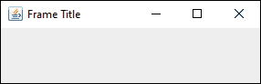

### 创建组件

创建 GUI 是获得 Java 对象操作极佳方法，因为每个界面组件都由它自己的类表示。

在 Java 中使用界面组件时，你会创建该组件类的对象。你已经处理过容器类`JFrame`。

最采用的组件之一是`JButton`，它是代表可点击按钮的类。

在任何程序中，按钮都会触发操作。你可以点击`Install`开始安装软件，点击`Run`按钮开始一场新的《愤怒的小鸟》游戏，点击`Minimize`按钮防止老板看到《愤怒的小鸟正在运行，以此类推。

`Swing`按钮可以包含文本标签、图形图标或两者兼具。

你可以使用以下构造函数来创建按钮：

- `JButton(String)`：带有指定文本的按钮
- `JButton(Icon)`：显示指定图形图标的按钮
- `JButton(String, Icon)`：带有指定文本和图形图标的按钮

以下语句创建了三个带有文本标签的按钮：

```java
JButton play = new JButton("Play");

JButton stop = new JButton("Stop");

JButton rewind = new JButton("Rewind");
```


带有图标的图形按钮将在本节稍后部分介绍。

### 向容器添加组件

在 Java 程序中显示按钮等用户界面组件之前，你必须先将其添加到容器中并显示该容器。

要向容器添加组件，请调用容器的 `add(Component)` 方法并将该组件作为参数传递。（Swing 中的所有用户界面组件都继承自 `java.awt.Component`。）

最简单的 Swing 容器是面板（`JPanel` 类）。下面的示例创建了一个按钮并将其添加到面板中：

点击此处查看代码图片

```java
JButton quit = new JButton("Quit");

JPanel panel = new JPanel();

panel.add(quit);
```

使用相同的技术将组件添加到框架（frames）和窗口中。

代码列表 9.2 所示的 `ButtonFrame` 类扩展了本节之前创建的应用程序框架。它创建了一个面板，向面板中添加了三个按钮，然后将面板添加到框架中。将代码列表 9.2 的源代码输入到 NetBeans 中名为 `ButtonFrame` 的新 Java 文件中，确保将其放在 `com.java21days` 包中。

**代码列表 9.2** `ButtonFrame.java` 的完整文本

点击此处查看代码图片

```java
1: package com.java21days;

2:

3: import javax.swing.*;

4:

5: public class ButtonFrame extends JFrame {

6:     JButton load = new JButton("Load");

7:     JButton save = new JButton("Save");

8:     JButton unsubscribe = new JButton("Unsubscribe");

9:

10:     public ButtonFrame() {

11:         super("Button Frame");

12:         setSize(340, 170);

13:         setDefaultCloseOperation(JFrame.EXIT_ON_CLOSE);

14:         JPanel pane = new JPanel();

15:         pane.add(load);

16:         pane.add(save);

17:         pane.add(unsubscribe);

18:         add(pane);

19:         setVisible(true);

20:     }

21:

22:     private static void setLookAndFeel() {

23:         try {

24:             UIManager.setLookAndFeel(

25:                 "javax.swing.plaf.nimbus.NimbusLookAndFeel"

26:             );

27:         } catch (Exception exc) {

28:             System.out.println(exc.getMessage());

29:         }

30:     }

31:

32:     public static void main(String[] arguments) {

33:         setLookAndFeel();

34:         ButtonFrame bf = new ButtonFrame();

35:     }

36: }
```

当运行该应用程序时，会打开一个包含三个按钮的小型框架，如图 9.2 所示。

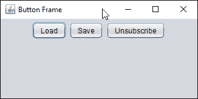

**图 9.2** `ButtonFrame` 应用程序。

`ButtonFrame` 类有三个实例变量：`load`、`save` 和 `unsubscribe` `JButton` 对象。

在代码列表 9.2 的第 14–17 行中，创建了一个新的 `JPanel` 对象，并通过调用其 `add(Component)` 方法将三个按钮添加到面板。当面板包含所有按钮时，第 18 行调用框架自身的 `add(Component)` 方法并将面板作为参数，将面板添加到框架中。

**注意**

如果你此时点击按钮，什么都不会发生。对按钮点击响应的操作将在第 12 节“响应用户输入”中介绍。

### 使用组件

除了你目前为止使用的按钮和容器外，Swing 还提供了二十多种以上的用户界面组件。在本节的剩余部分以及随后的第 10 节“构建界面”中，你将处理许多组件。

**注意**

在处理 Swing 组件时，常见的错误来源是在组件添加到容器后才设置其属性。请确保在将其放入面板之前，已完全配置好该组件。

### 图像图标

Swing 支持在按钮和其他可以提供标签的组件上使用图形 `ImageIcon` 对象。图标是一个小图形，可以放置在按钮、标签或其他用户界面元素上进行标识。例如用于删除文件的垃圾桶图标以及用于打开和存储文件的文件夹图标。

你可以通过将文件名作为构造函数的唯一参数来创建 `ImageIcon` 对象。下面的示例从图形文件 `subscribe.gif` 加载图标并创建一个以图标作为标签的 `JButton`：

点击此处查看代码图片

```java
ImageIcon subscribe = new ImageIcon("subscribe.gif");

JButton button = new JButton(subscribe);

JPanel pane = new JPanel();

pane.add(button);

add(pane);

setVisible(true);
```

代码列表 9.3 是一个 Java 应用程序，它创建了四个带有文本标签的图像图标，将它们添加到面板，然后将面板添加到框架中。在 NetBeans 中创建一个名为 `IconFrame` 的空 Java 文件，位于 `com.java21days` 包中，并使用源代码编辑器输入此列表。

```java
1: package com.java21days;

2:

3: import javax.swing.*;

4:

5: public class IconFrame extends JFrame {

6:     JButton load, save, subscribe, unsubscribe;

7:

8:     public IconFrame() {

9:         super("Icon Frame");

10:         setDefaultCloseOperation(JFrame.EXIT_ON_CLOSE);

11:         JPanel panel = new JPanel();

12:         // create icons

13:         ImageIcon loadIcon = new ImageIcon("load.gif");

14:         ImageIcon saveIcon = new ImageIcon("save.gif");

15:         ImageIcon subscribeIcon = new ImageIcon("subscribe.gif");

16:         ImageIcon unsubscribeIcon = new ImageIcon("unsubscribe.gif");

17:         // create buttons

18:         load = new JButton("Load", loadIcon);

19:         save = new JButton("Save", saveIcon);

20:         subscribe = new JButton("Subscribe", subscribeIcon);

21:         unsubscribe = new JButton("Unsubscribe", unsubscribeIcon);

22:         add buttons to panel

23:         panel.add(load);

24:         panel.add(save);

25:         panel.add(subscribe);

26:         panel.add(unsubscribe);

27:         // add the panel to a frame

28:         add(panel);

29:         pack();

30:         setVisible(true);

31:     }

32:

33:     public static void main(String[] arguments) {

34:         IconFrame ike = new IconFrame();

35:     }

36: }
```

图 9.3 显示了结果。


**图 9.3** 一个包含带有图标标签按钮的界面。

第 13–16 行提到的图标图形可以在本书的官方网站 [www.java21days.com](http://www.java21days.com) 的第 9 节页面上找到。

在 NetBeans 中，图形必须是项目的一部分，应用程序才能正确运行。图形需要存储在你在整本书中使用的 `Java21` 项目的主文件夹中，以存放你创建的类。按照以下步骤操作：

1. 将图形文件保存到计算机上的临时文件夹。
2. 点击 `Files` 选项卡将该面板置于顶部。`Files` 面板打开，如图 9.4 所示，列出了项目中的文件。

   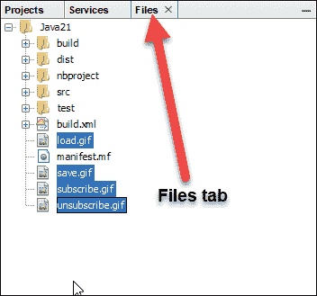

   **图 9.4** 将文件拖入 NetBeans Files 面板。
3. 将四个图形文件拖放到此面板中的 `Java21` 文件夹中。

`IconFrame` 并没有以像素设置窗口的大小。相反，它在第 29 行调用了 `pack()` 方法，将窗口扩展到展示四个按钮并排显示所需的最小尺寸。

如果将窗口设置为高而不是宽——例如，通过在构造函数中调用 `setSize(100, 400)`——按钮将会垂直堆叠。

### 注意

项目的一些图形来自 Oracle 的 Java Look and Feel Graphics 仓库，这是一组适用于你自己程序的图标集合。如果你正在寻找可以在 Swing 应用程序中实验的图标，可以在 [www.oracle.com/technetwork/java/index-138612.html](http://www.oracle.com/technetwork/java/index-138612.html) 找到。

### 标签（Labels）

*label*（标签）是一个持有文本、图标或两者的组件。标签由 `JLabel` 类创建，用于标识界面上其他组件的用途。用户无法直接编辑它们。

要创建标签，可以使用这些简单的构造函数：

- `JLabel(String)`：带有指定文本的标签
- `JLabel(String, int)`：带有指定文本和对齐方式的标签
- `JLabel(String, Icon, int)`：带有指定文本、图标和对齐方式的标签

标签的对齐方式决定了其文本或图标相对于窗口占据区域的对齐情况。使用 `SwingConstants` 接口的三个静态类变量来指定对齐方式：`LEFT`、`CENTER` 和 `RIGHT`。

你可以使用 `setText(String)` 或 `setIcon(Icon)` 方法设置标签的内容。你也可以通过 `getText()` 和 `getIcon()` 方法获取这些内容。

以下语句分别创建了左对齐、居中和右对齐的标签：

点击此处查看代码图像

```java
JLabel feedsLabel = new JLabel("Feeds: ", SwingConstants.LEFT);

JLabel urlLabel = new JLabel("URL: ", SwingConstants.CENTER);

JLabel dateLabel = new JLabel("Date: ", SwingConstants.RIGHT);
```

### 文本字段（Text Fields）

*text field*（文本字段）是一个允许用户输入和修改文本的界面位置。文本字段由 `JTextField` 类表示，可以处理单行输入。接下来的部分将详细描述 `JTextField`。

`JTextField` 的构造函数包括：

- `JTextField()`：空文本字段
- `JTextField(int)`：指定宽度的文本字段
- `JTextField(String, int)`：带有指定文本和宽度的文本字段

文本字段的宽度仅在配合布局管理器时才有意义。以下语句创建了一个具有 60 字符宽度的空文本字段：

```java
JTextField rssUrl = new JTextField(60);

JTextField rssUrl2 = new JTextField("Enter here", 60);
```

文本字段和区域都继承自父类 `JTextComponent`，并共享许多共同方法。

`setEditable(boolean)` 方法决定组件是否可以编辑（true）或不可编辑（false）。`isEditable()` 方法返回相应的布尔值。

`setText(String)` 方法将文本更改为指定的字符串，`getText()` 方法返回组件当前的文本。另一个方法 `getSelectedText()` 获取用户选中的文本。

密码字段是隐藏用户输入字符的文本字段。它们由 `JPasswordField` 类表示，该类是 `JTextField` 的子类。`JPasswordField` 的构造函数与父类相同。创建一个密码字段后，调用其 `setEchoChar(char)` 方法通过将每个输入字符替换为指定的字符来遮盖输入。

以下语句创建一个密码字段并将回显字符设置为 `#`：

点击此处查看代码图像

```java
JPasswordField codePhrase = new JPasswordField(20);

codePhrase.setEchoChar('#');
```

### 文本区域（Text Areas）

*text areas*（文本区域）是可以处理多行输入的编辑文本字段，由 `JTextArea` 类实现。它具有以下构造函数：

- `JTextArea(int, int)`：具有指定行和列数的文本区域
- `JTextArea(String, int, int)`：具有指定文本、行和列数的文本区域

你可以像使用文本字段一样对文本区域使用 `getText()`、`getSelectedText()` 和 `setText(String)` 方法。此外，`append(String)` 方法将指定文本添加到当前文本末尾，`insert(String, int)` 方法在指定位置插入文本。

`setLineWrap(boolean)` 方法决定输入到组件的文本在到达右边缘时是否会换行。调用 `setLineWrap(true)` 以启用换行功能。

`setWrapStyleWord(boolean)` 方法决定换到下一行的单位——是当前单词（true）还是当前字符（false）。

你将创建的下一个项目是列表 9.4 所示的 `Authenticator` 应用程序，它使用了几个 Swing 组件来收集用户输入：一个文本字段、密码字段和一个文本区域。标签也用于指示每个文本组件的用途。在 NetBeans 中，在 `com.java21days.` 程序包下创建一个名为 `Authenticator` 的空 Java 文件。

### 列表 9.4 `Authenticator.java` 的全文

点击此处查看代码图片

```java
1: package com.java21days;

2:

3: import javax.swing.*;

4:

5: public class Authenticator extends javax.swing.JFrame {

6:     JTextField username = new JTextField(15);

7:     JPasswordField password = new JPasswordField(15);

8:     JTextArea comments = new JTextArea(4, 15);

9:     JButton ok = new JButton("OK");

10:     JButton cancel = new JButton("Cancel");

11:

12:     public Authenticator() {

13:         super("Account Information");

14:         setSize(300, 220);

15:         setDefaultCloseOperation(JFrame.EXIT_ON_CLOSE);

16:

17:         JPanel pane = new JPanel();
```


```java
JLabel usernameLabel = new JLabel("Username: ");

JLabel passwordLabel = new JLabel("Password: ");

JLabel commentsLabel = new JLabel("Comments: ");

comments.setLineWrap(true);

comments.setWrapStyleWord(true);

pane.add(usernameLabel);

pane.add(username);

pane.add(passwordLabel);

pane.add(password);

pane.add(commentsLabel);

pane.add(comments);

pane.add(ok);

pane.add(cancel);

add(pane);

setVisible(true);
}

private static void setLookAndFeel() {
    try {
        UIManager.setLookAndFeel(
            "javax.swing.plaf.nimbus.NimbusLookAndFeel"
        );
    } catch (Exception exc) {
        System.out.println(exc.getMessage());
    }
}

public static void main(String[] arguments) {
    Authenticator.setLookAndFeel();
    Authenticator auth = new Authenticator();
}
}
```

该应用程序设置了组件并将它们添加到面板中。图 9.5 显示了该应用程序的使用情况。密码用星号字符（`*`）隐藏，如果没有通过调用字段的 `setEchoChar(char)` 方法指定其他回显字符，这就是默认设置。

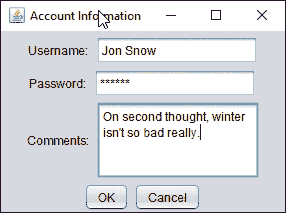

**图 9.5** `Authenticator` 应用程序。

此应用程序中的文本区域的行为可能与你预期的不同。当你到达字段底部并继续输入文本时，组件会增大以为输入提供更多空间（甚至会滚动到框架底部边缘以下）。下一节描述了如何添加滚动条以防止区域改变大小。

### 滚动面板（Scrolling Panes）

Swing 中的文本区域不包含水平或垂直滚动条，且仅通过此组件无法添加它们。

Swing 通过一个容器支持滚动条，该容器可以用于任何可以滚动的组件：`JScrollPane`。

滚动面板在面板的构造函数中与组件相关联。你可以使用以下构造函数：

* `JScrollPane(Component)`：包含指定组件的滚动面板。
* `JScrollPane(Component, int, int)`：具有指定组件、垂直滚动条配置和水平滚动条配置的滚动面板。

滚动条使用 `ScrollPaneConstants` 接口的六个静态类变量之一进行配置。垂直滚动条有三个：

* `VERTICAL_SCROLLBAR_ALWAYS`
* `VERTICAL_SCROLLBAR_AS_NEEDED`
* `VERTICAL_SCROLLBAR_NEVER`

还有三个名称符合预期的水平滚动条变量。

在创建包含组件的滚动面板后，你可以将面板添加到容器以替换该组件。

以下示例创建了一个带有垂直滚动条且没有水平滚动条的文本区域，然后将其添加到容器：

```java
JPanel pane = new JPanel();

JTextArea comments = new JTextArea(4, 15);

JScrollPane scroll = new JScrollPane(
    comments,
    ScrollPaneConstants.VERTICAL_SCROLLBAR_ALWAYS,
    ScrollPaneConstants.HORIZONTAL_SCROLLBAR_NEVER
);

pane.add(scroll);

add(pane);
```

> **注意**
>
> 本书的网站包含 `Authenticator2`，这是一个使用了此代码的完整应用程序。访问 [www.java21days.com](http://www.java21days.com)。

### 复选框与单选按钮（Check Boxes and Radio Buttons）

复选框只有两个可能的值：选中或未选中。复选框用于做出简单的选择，如是/否。单选按钮被分组，以便只有一个可以被选中。复选框（`JCheckBox` 类）在被选中时显示为标记的框。单选按钮（`JRadioButton` 类）在选中时显示为带点的圆。复选框本身是非互斥的，这意味着如果容器中有多个复选框，它们可以同时被选中或取消选中。要让它们互斥（如单选按钮那样），你必须将相关组件分组。

#### JCheckBox 与 ToggleButton（JCheckBox and ToggleButton）

`JCheckBox` 和 `JRadioButton` 类都继承自公共父类 `ToggleButton`：

* `setSelected(boolean)`：如果参数为 `true` 则选中组件，否则取消选中。
* `isSelected()`：返回一个布尔值，指示组件是否被选中。

以下构造函数用于 `JCheckBox` 类：

* `JCheckBox(String)`：带有指定文本标签的复选框。
* `JCheckBox(String, boolean)`：带有指定文本标签的复选框，如果第二个参数为 `true` 则选中。
* `JCheckBox(Icon)`：带有指定图标的复选框。
* `JCheckBox(Icon, boolean)`：带有指定图标的复选框，如果第二个参数为 `true` 则选中。
* `JCheckBox(String, Icon)`：带有指定文本标签和图标的复选框。
* `JCheckBox(String, Icon, boolean)`：带有指定文本标签和图标的复选框，如果第三个参数为 `true` 则选中。

`JRadioButton` 类具有相同的参数。

#### 按钮组（ButtonGroup）

为了将多个单选按钮分组并允许始终只有一个被选中，请创建一个 `ButtonGroup` 类对象，如下所示：

```java
ButtonGroup choice = new ButtonGroup();
```

`ButtonGroup` 对象跟踪组中的所有单选按钮。调用组的 `add(Component)` 方法可以将指定组件添加到组中。

以下示例创建了一个组以及属于该组的两个单选按钮：

```java
ButtonGroup saveFormat = new ButtonGroup();

JRadioButton s1 = new JRadioButton("JSON", false);

saveFormat.add(s1);

JRadioButton s2 = new JRadioButton("XML", true);

saveFormat.add(s2);
```

`saveFormat` 对象组合了 `s1` 和 `s2` 单选按钮。`s2` 对象（标签为 `"XML"`）被选中。组中同时只有一个成员可以被选中。如果一个组件被选中，`ButtonGroup` 对象会确保组中的所有其他组件都取消选中。

在 NetBeans 中于 `com.java21days` 包下创建一个名为 `FormatFrame` 的新空 Java 文件。输入列表 9.5 所示的源代码，创建一个包含一组四个单选按钮的应用程序。

**列表 9.5** `FormatFrame.java` 的完整代码

```java
package com.java21days;

import javax.swing.*;

public class FormatFrame extends JFrame {
    JRadioButton[] teams = new JRadioButton[4];

    public FormatFrame() {
        super("Choose an Output Format");
        setSize(320, 120);
        setDefaultCloseOperation(JFrame.EXIT_ON_CLOSE);
        teams[0] = new JRadioButton("Atom");
        teams[1] = new JRadioButton("RSS 0.92");
        teams[2] = new JRadioButton("RSS 1.0");
        teams[3] = new JRadioButton("RSS 2.0", true);
        JPanel panel = new JPanel();
        JLabel chooseLabel = new JLabel(
            "Choose an output format for syndicated news items."
        );
        panel.add(chooseLabel);
        ButtonGroup group = new ButtonGroup();
        for (JRadioButton team : teams) {
            group.add(team);
            panel.add(team);
        }
        add(panel);
        setVisible(true);
    }

    private static void setLookAndFeel() {
        try {
            UIManager.setLookAndFeel(
                "com.sun.java.swing.plaf.nimbus.NimbusLookAndFeel"
            );
        } catch (Exception exc) {
            System.out.println(exc.getMessage());
        }
    }

    public static void main(String[] arguments) {
        FormatFrame.setLookAndFeel();
        FormatFrame ff = new FormatFrame();
    }
}
```

图 9.6 显示了运行中的应用程序。四个 `JRadioButton` 对象存储在数组中。在 `for` 循环中，每个元素首先添加到按钮组，然后添加到面板中。循环结束后，面板被添加到框架中。

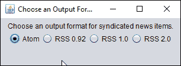

**图 9.6** `FormatFrame` 应用程序。

选择单选按钮中的一个会导致现有的选择被取消选中。

### 组合框

Swing 类 `JComboBox` 可用于创建组合框，这种组件会呈现一个下拉菜单，可以从菜单中选择单个值。当组件未被使用时，菜单是隐藏的，因此在 GUI 中占据更少的空间。

在调用无参数的 `JComboBox()` 构造函数创建组合框后，可以使用组合框的 `addItem(Object)` 方法向列表添加项。

创建组合框的另一种方法是调用带有包含项的数组的 `JComboBox(Object[])`。如果项是文本，则参数应为 `String` 数组。

在组合框中，用户只能选择下拉菜单中的某一项。如果调用组件的 `setEditable()` 方法并传入 `true` 作为参数，它还支持文本输入。此功能让组合框得出了名字：以这种方式配置的组件既是下拉菜单，又是文本字段。

`JComboBox` 类有几个方法，可以使用它们来控制下拉列表或组合框：

* `getItemAt(int index)`：返回由整数参数指定的索引位置的列表项文本。与数组一样，选择列表的第一个项位于索引位置 0，第二个位于位置 1，依此类推。
* `getItemCount()`：返回列表中的项数。
* `getSelectedIndex()`：返回列表中当前被选中项的索引位置。
* `getSelectedItem()`：返回当前被选中项的文本。
* `setSelectedIndex(int index)`：选中指定索引位置的项。
* `setSelectedIndex(Object obj)`：选中列表中指定的对象。

列表 9.6 所示的 `FormatFrame2` 应用程序重写了之前的单选按钮示例。程序使用了一个不可编辑的组合框，用户可以从中选择四个选项之一。

**列表 9.6** `FormatFrame2.java` 的完整代码

```java
package com.java21days;

import javax.swing.*;

public class FormatFrame2 extends JFrame {
    String[] formats = { "Atom", "RSS 0.92", "RSS 1.0", "RSS 2.0" };
    JComboBox<String> formatBox = new JComboBox<>(formats);

    public FormatFrame2() {
        super("Choose an Output Format");
        setSize(220, 150);
        setDefaultCloseOperation(JFrame.EXIT_ON_CLOSE);
        JPanel panel = new JPanel();
        JLabel formatLabel = new JLabel("Output formats:");
        panel.add(formatLabel);
        panel.add(formatBox);
        add(panel);
        setVisible(true);
    }

    private static void setLookAndFeel() {
        try {
            UIManager.setLookAndFeel(
                "com.sun.java.swing.plaf.nimbus.NimbusLookAndFeel"
            );
        } catch (Exception exc) {
            System.out.println(exc.getMessage());
        }
    }

    public static void main(String[] arguments) {
        FormatFrame2.setLookAndFeel();
        FormatFrame2 ff = new FormatFrame2();
    }
}
```


字符串数组定义在第 6 行，这些字符串被用于组合框以设置其值。`JComboBox` 构造函数使用泛型来指示其值是字符串。图 9.7 显示了组合框展开后的应用程序，以便可以选择值。

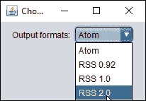

**图 9.7** `FormatFrame` 应用程序。

### 列表

本节介绍的最后一个 Swing 组件与组合框类似。由 `JList` 类表示的列表允许选择一个或多个值。

可以使用数组或向量（类似于数组列表的数据结构）来创建并填充列表。有以下构造函数：

* `JList()`：创建一个空列表。
* `JList(Object[])`：创建一个包含指定类数组（例如 `String`）的列表。
* `JList(Vector<Class>)`：创建一个包含指定 `java.util.Vector` 对象的列表。

可以通过调用 `setListData()` 方法并将数组或向量作为唯一参数来填充空列表。

`getSelectedValuesList()` 方法返回包含所有选中项的对象列表。该列表可以转换为 `ArrayList`。

你可以对 `JList` 使用泛型来指示列表所包含的对象数组的类型。

`com.java21days` 包中的 `Subscriptions` 应用程序（列表 9.7）显示了来自字符串数组的项。

```java
package com.java21days;

import javax.swing.*;

public class Subscriptions extends JFrame {
    String[] subs = { "Burningbird", "Freeform Goodness", "Inessential",
        "Manton.org", "Micro Thoughts", "Rasterweb", "Self Made Minds",
        "Whole Lotta Nothing", "Workbench" };
    JList<String> subList = new JList<>(subs);

    public Subscriptions() {
        super("Subscriptions");
        setSize(150, 335);
        setDefaultCloseOperation(JFrame.EXIT_ON_CLOSE);
        JPanel panel = new JPanel();
        JLabel subLabel = new JLabel("RSS Subscriptions:");
        panel.add(subLabel);
        subList.setVisibleRowCount(8);
        JScrollPane scroller = new JScrollPane(subList);
        panel.add(scroller);
        add(panel);
        setVisible(true);
    }

    private static void setLookAndFeel() {
        try {
            UIManager.setLookAndFeel(
                "javax.swing.plaf.nimbus.NimbusLookAndFeel"
            );
        } catch (Exception exc) {
            System.out.println(exc.getMessage());
        }
    }

    public static void main(String[] arguments) {
        Subscriptions.setLookAndFeel();
        Subscriptions app = new Subscriptions();
    }
}
```

应用程序如图 9.8 所示。`Subscriptions` 应用程序有一个界面，顶部有一个标签，下方是一个显示九个项目的列表。第 19–20 行使用了 `JScrollPane`，以便列表可以滚动查看列表的最后一项，否则该项将是可见的。它是一个容器，可以使其内容产生滚动条，从而避免在用户界面中占用过多的空间。

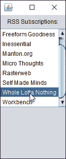

**图 9.8** `Subscriptions` 应用程序。

### Java 类库

本书的第一部分致力于介绍 Java 语言的构建块，包括语句、表达式和运算符，以及面向对象编程（OOP）的组件，如方法、构造函数、类和接口。

第二部分涵盖了如何使用 Java 类库通过这些构建块来构建程序。作为一名程序员，你的大部分工作已经由库为你完成了，前提是你知道去哪里寻找这些工具。

Java 类库包含超过 4,400 个类。其中许多类对你创建的程序将非常有用。

#### 注意

还有由其他机构制作 Java 类库。Apache 拥有十多个 Java 开源项目，包括 `HttpComponents`，这是一组用于创建 Web 服务器、客户端和爬虫的类。要查看这些项目，请访问 [`projects.apache.org`](http://projects.apache.org)。你可以在 Maven 中央仓库的 [`search.maven.org`](https://search.maven.org) 中搜索有用的 Java 类库。

Oracle 在网络上提供了 Java 类库的全面文档。该文档中的一个页面如图 9.9 所示。

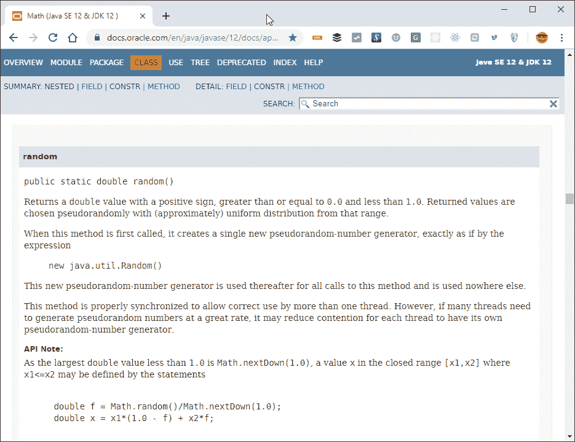

**图 9.9** Java 类库的在线文档。

首页分为几个部分。最大的部分列出了组成该库的所有包，并对每个包进行了描述。包名描述了它的用途，例如 `java.io` 包包含用于从文件、Internet 服务器和其他数据源进行输入和输出的类；`java.time` 则用于时间和和日期的类。

在首页上，最大的部分呈现了包列表以及每个包的简短描述。点击包名即可加载列出其所有类的页面。

库中的每个类都有自己的文档页面。若要体验一下如何使用此参考资料，请遵循以下步骤：

1. 在网页浏览器中，加载页面 [`docs.oracle.com/en/java/javase/12/docs/api`](https://docs.oracle.com/en/java/javase/12/docs/api)。
2. 点击 `java.base` 链接。
3. 点击 `java.lang` 包的链接。打开该包的页面。
4. 向下滚动到 `Math` 类的链接并点击它。打开该类的页面。
5. 找到 `random()` 方法链接并点击它。页面将跳转到该部分。

# 测

通过完成这个包含三个问题的测试来复习本节内容。

#### 问题

1.] 下列用户界面组件中，哪一个不是容器？

A. `JScrollPane`

B. `JTextArea`

C. `JPanel`

2.] 哪个组件可以放入滚动面板（Scroll pane）中？

A. `JTextArea`

B. `JTextField`

C. 任何组件

3.] 如果你在应用程序的主框架（main frame）上使用 `setSize()`，它将出现在桌面的哪个位置？

A. 在桌面的中心

B. 在上一个应用程序出现的位置

C. 在桌面的左上角

#### 答案

1.] B. `JTextArea` 需要容器来支持滚动，但它本身不是一个容器。

2.] C. 任何组件都可以添加到滚动面板中，但大多数组件可能不需要滚动。

3.] C. 这是一个陷阱。调用 `setSize()` 与窗口在桌面上的位置无关。你必须调用 `setBounds()` 而不是 `setSize()` 来选择框架出现的位置。

### 认证练习

以下问题是你在 Java 编程认证测试中可能会遇到的类型。请在不重新查阅本节内容或不使用 Java 编译器测试代码的情况下回答它。

给定：

点击此处查看代码图像

```java
import javax.swing.*;

public class Display extends JFrame {

    public Display() {

        super("Display");

        // answer goes here (答案在此)

        JLabel hello = new JLabel("Hello");

        JPanel pane = new JPanel();

        add(hello);

        pack();

        setVisible(true);

    }

    public static void main(String[] arguments) {

        Display ds = new Display();

    }

}
```

哪条语句需要替换 `// answer goes here` 以使应用程序能够正常工作？

A. `setSize(300, 200);`

B. `setDefaultCloseOperation(JFrame.EXIT_ON_CLOSE);`

C. `Display ds = new Display();`

D. 不需要语句。

答案可以在书籍网站找到，地址为 [www.java21days.com](http://www.java21days.com)。访问第 9 节页面并点击“认证练习”链接。

## 练习

为了扩展你对本节涵盖主题的知识，请尝试以下练习：

1. 创建一个带有框架的应用程序，该框架包含几个 DVR 控制器作为单独组件：播放、停止/出出、后退、快进和暂停。为窗口选择一个大小，使所有组件都能单行显示。
2. 创建一个框架，点击后打开一个较小的框架，其中包含询问用户名和密码的字段。

在适用的情况下，练习解答可以在书籍网站 [www.java21days.com](http://www.java21days.com)找到。

# 第 10 节：构建界面

虽然可以在 Linux shell 或 Windows 命令提示符等命令行环境中操作计算机，但大多数计算机用户期望软件具有图形用户界面（GUI）并从鼠标和键盘获取输入。

处理 GUI 软件可能是初级程序员最具挑战性的任务之一，但正如你在上一节中学到的，Java 通过 Swing 简化了这个过程。

Swing 提供了以下特性：

* 常见的用户界面组件，包括按钮、文本字段、文本区域、标签、复选框、单选按钮、滚动条、列表、菜单项和滑动条。
* 容器——用于包含其他组件（包括其他容器）的界面组件。容器包括框架、面板、菜单、菜单栏和标签页。

## Swing 特性

你目前为止学习的大多数组件和容器都是 Abstract Window Toolkit（AWT）中类的 Swing 版本，AWT 是 GUI 编程的原始 Java 包。

Swing 提供了许多额外的新组件，包括键盘快捷键（mnemonics）、工具提示和标准对话框。

### 标准对话框

`JOptionPane` 类提供了几种你可以使用的方法，来创建标准对话框：用于提问、警告用户或提供重要消息的小窗口。图 10.1 显示了一个示例。


**图 10.1** 标准对话框。

你无疑见过像图 10.1 所示的对话框。当你的系统崩溃时，会出现一个对话框来告知坏消息。当你删除文件时，会弹出一个对话框以确保你确实想这样做。

对话框提供了一种与用户通信的有效方法，而无需创建新类来表示窗口、向其添加组件以及编写事件处理方法来接收输入的开销。当使用标准对话框之一时，所有这些任务都会自动处理。

标准对话框的四种类型是：

* 确认对话框（Confirm Dialog）：提问
* 输入对话框（Input dialog）：提示输入
* 消息对话框（Message dialog）：显示消息
* 选项对话框（Option dialog）：显示选项

这四种标准对话框中的在 `JOptionPane` 中都有对应的方法。

#### 确认对话框

创建“是/否/取消”对话框的最简单方法是调用 `showConfirmDialog()`。`Component` 参数指定对话框的父容器，决定对话框的位置。如果使用 `null` 而不是容器，或者容器不是 `JFrame` 对象，则对话框将居中。

第二个参数 `Object` 可以是字符串、组件或图标。如果是字符串，将显示该文本；如果是组件或图标，则该对象将代替消息显示。

`showConfirmDialog()` 方法返回五个可能的整数值，每个值都是 `JOptionPane` 的常量：`YES_OPTION`、`NO_OPTION`、`CANCEL_OPTION`、`OK_OPTION` 或 `CLOSED_OPTION`。

以下示例使用文本消息创建确认对话框（参考图 10.1）并将响应存储在 `response` 变量中：

点击此处查看代码图像

```java
int response = JOptionPane.showConfirmDialog(null,

    "我应该删除你所有不可替代的个人文件吗?");
```

另一个方法为对话框提供了更多选项：`showConfirmDialog(Component, Object, String, int, int)`。前两个参数与其他 `showConfirmDialog()` 方法相同。后三个参数是：

* 显示在对话框标题栏中的字符串。
* 指示显示哪些选项按钮的整数。它应该是类常量 `YES_NO_CANCEL_OPTION` 或 `YES_NO_OPTION` 之一。
* 描述对话框类型的整数，使用类常量 `ERROR_MESSAGE`、`INFORMATION_MESSAGE`、`PLAIN_MESSAGE`、`QUESTION_MESSAGE` 或 `WARNING_MESSAGE`。（此参数用于确定在消息一起绘制哪个图标。）

例如：

点击此处查看代码图像

```java
int response = JOptionPane.showConfirmDialog(null,

    "读取文件错误。想重试吗？",

    "文件输入错误",

    JOptionPane.YES_NO_OPTION,

    JOptionPane.ERROR_MESSAGE);
```

图 10.2 显示了生成的对话框。

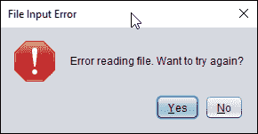

**图 10.2** 带有是和否按钮的确认对话框。

### 输入对话框

输入对话框用于提问，并使用文本字段来存储响应。图 10.3 显示了一个示例。

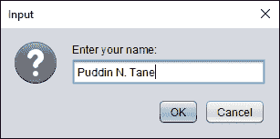

**图 10.3** 输入对话框。

创建输入对话框最简单的方法是调用 `showInputDialog(Component, Object)` 方法。参数是父组件以及要显示的字符串、组件或图标。

输入对话框方法调用会返回一个表示用户响应的字符串。以下语句创建了图 10.3 所示的输入对话框：

点击此处查看代码图像

```java
String response = JOptionPane.showInputDialog(null,

    "Enter your name:");
```

你也可以使用 `showInputDialog(Component, Object, String, int)` 方法创建输入对话框。前两个参数与较短的方法调用相同，后两个参数如下：

* 显示在对话框标题栏中的标题。
* 描述对话框类型的类常量之一：`ERROR_MESSAGE`、`INFORMATION_MESSAGE`、`PLAIN_MESSAGE`、`QUESTION_MESSAGE` 或 `WARNING_MESSAGE`。

以下语句使用该方法创建了输入对话框：

点击此处查看代码图像

```java
String response = JOptionPane.showInputDialog(null,

    "What is your ZIP code?",

    "Enter ZIP Code",

    JOptionPane.QUESTION_MESSAGE);
```


## 消息对话框

消息对话框是一个显示信息的简单窗口，如图 10.4 所示。

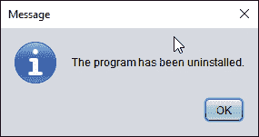

**图 10.4** 消息对话框。

可以通过调用 `showMessageDialog(Component, Object)` 方法创建消息对话框。与其他对话框一样，参数是父组件以及要显示的字符串、组件或图标。

与其他对话框不同，消息对话框不返回响应值。以下语句创建了图 10.4 所示的消息对话框：

点击此处查看代码图像

```java
JOptionPane.showMessageDialog(null,
    "The program has been uninstalled.");
```

你也可以通过调用 `showMessageDialog(Component, Object, String, int)` 方法创建消息输入对话框。其用法与 `showInputDialog()` 方法相同，使用相同的参数，区别是 `showMessageDialog()` 不返回结果。

以下语句使用该方法创建了消息对话框：

点击此处查看代码图像

```java
JOptionPane.showMessageDialog(null,
    "An asteroid has destroyed the Earth.",
    "Asteroid Destruction Alert",
    JOptionPane.WARNING_MESSAGE);
```

## 选项对话框

所有对话框中最复杂的是选项对话框，它结合了所有其他对话框的功能。可以使用 `showOptionDialog(Component, Object, String, int, int, Icon, Object[], Object)` 方法创建。

该方法的参数如下：

- 对话框的父组件
- 要显示的文本、图标或组件
- 显示在标题栏中的字符串
- 选项对话框的类型，使用类常量 `YES_NO_OPTION` 或 `YES_NO_CANCEL_OPTION`；如果使用其他按钮，则使用值 `0`
- 显示的图标，使用类常量 `ERROR_MESSAGE`、`INFORMATION_MESSAGE`、`PLAIN_MESSAGE`、`QUESTION_MESSAGE` 或 `WARNING_MESSAGE`；如果不需要使用其中任何一个，则使用值 `0`
- 用于替换前一个参数中某个图标的 `Icon` 对象
- 如果没有使用 `YES_NO_OPTION` 和 `YES_NO_CANCEL_OPTION`，则提供一个包含对话框中选项表示的对象数组
- 如果没有使用 `YES_NO_OPTION` 和 `YES_NO_CANCEL_OPTION`，则提供一个表示默认选择的对象

最后两个参数为对话框提供了广泛多种可能性。你可以创建一个字符串数组，其中包含要显示的每个按钮的文本。

以下示例创建了一个选项对话框，它在框中使用 `String` 对象数组作为选项，并使用 `osPreference[2]` 元素作为默认选择：

点击此处查看代码图像

```java
String[] osPreference = {
    "Windows",
    "Mac OS",
    "Linux"
};

int response = JOptionPane.showOptionDialog(null,
    "What is your favorite OS?",
    "Operating System",
    0,
    JOptionPane.INFORMATION_MESSAGE,
    null,
    osPreference,
    osPreference[2]);

System.out.println("You chose " + osPreference[response]);
```

图 10.5 显示了生成的对话框。

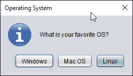

**图 10.5** 选项对话框。

### 使用对话框

下一个项目在一个运行程序中显示了一系列对话框。`com.java21days` 包中的 `FeedInfo` 使用对话框从用户处获取信息；这些信息随后被放入应用程序主窗口的文本字段中。

输入列表 10.1 并保存结果。

**列表 10.1** `FeedInfo.java` 的完整文本

点击此处查看代码图像

```java
package com.java21days;

import java.awt.GridLayout;
import java.awt.event.*;
import javax.swing.*;

public class FeedInfo extends JFrame {

    private final JLabel nameLabel = new JLabel("Name: ", SwingConstants.RIGHT);

    private final JTextField name;

    private final JLabel urlLabel = new JLabel("URL: ", SwingConstants.RIGHT);

    private final JTextField url;

    private final JLabel typeLabel = new JLabel("Type: ", SwingConstants.RIGHT);

    private final JTextField type;

    public FeedInfo() {

        super("Feed Information");

        setSize(400, 145);

        setDefaultCloseOperation(JFrame.EXIT_ON_CLOSE);

        setLookAndFeel();

        // Site name

        String response1 = JOptionPane.showInputDialog(null, "Enter the site name:");

        name = new JTextField(response1, 20);

        // Site address

        String response2 = JOptionPane.showInputDialog(null, "Enter the site address:");

        url = new JTextField(response2, 20);

        // Site type

        String[] choices = { "Personal", "Commercial", "Unknown" };

        int response3 = JOptionPane.showOptionDialog(null,
            "What type of site is it?",
            "Site Type",
            0,
            JOptionPane.QUESTION_MESSAGE,
            null,
            choices,
            choices[0]);

        type = new JTextField(choices[response3], 20);

        setLayout(new GridLayout(3, 2));

        add(nameLabel);

        add(name);

        add(urlLabel);

        add(url);

        add(typeLabel);

        add(type);

        setLookAndFeel();

        setVisible(true);

    }

    private void setLookAndFeel() {

        try {

            UIManager.setLookAndFeel("javax.swing.plaf.nimbus.NimbusLookAndFeel");

            SwingUtilities.updateComponentTreeUI(this);

        } catch (Exception e) {

            System.err.println("Couldn't use the system look and feel: " + e);

        }

    }

    public static void main(String[] arguments) {

        FeedInfo frame = new FeedInfo();

    }

}
```

在你填充每个对话框中的字段后，你就能看到应用程序的主窗口，它显示在图 10.6 中。三个文本字段的值由对话框提供。


**图 10.6** `FeedInfo` 应用程序的主窗口。

该应用程序的大部分是模板代码，可以用于任何 Swing 应用程序。以下几行与对话框有关：

- 在第 24–26 行中，一个输入对话框要求用户输入网站名称。该名称在 `JTextField` 对象的构造函数中使用，将其放置在文本字段中。
- 在第 29–31 行中，类似的输入对话框请求网站地址，该地址用于另一个 `JTextField` 对象的构造函数中。
- 在第 34 行中，创建了一个名为 `choices` 的 `String` 对象数组，并为三个元素赋值。
- 在第 35–42 行中，一个选项对话框请求网站类型。`choices` 数组是第七个参数，它在对话框上设置了三个按钮，标记为数组中的字符串：`"Personal"`、`"Commercial"` 和 `"Unknown"`。最后一个参数 `choices[0]` 将数组的第一个元素指定为对话框中的默认选择。
- 第 43 行包含选项对话框的响应——一个标识所选数组元素的整数。它被存储在名为 `type` 的 `JTextField` 组件中。

外观和感觉在第 58–60 行的 `setLookAndFeel()` 方法中建立，它在框架构造函数的开始和结束处被调用。由于你在构造函数中打开了几个对话框，必须在打开它们之前设置外观和感觉。

此类指定外观感觉的方式与本节之前的示例不同。在第 22 行的构造函数内部调用了 `setLookAndFeel()` 方法。为了确保用户界面中的所有组件都反映该外观感觉，调用了 `SwingUtilities` 类方法 `SwingUtilities.updateComponentTreeUI(Component)`，并将 `this` 作为参数，`this` 指向正在创建的 `FeedInfo` 对象。

### 滑块

滑块在 Swing 中通过 `JSlider` 类实现，允许用户通过滑动最小值和最大值范围内的控件来设置数字。在许多情况下，滑块可以用于数值输入，而不是文本字段。此方法的优点是将输入限制在接受的数值范围内。

图 10.7 显示了一个 `JSlider` 组件。

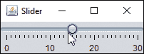

**图 10.7** 一个 `JSlider` 组件。

滑块默认是水平的。你可以使用 `SwingConstants` 接口的两个类常量来显式设置方向：`HORIZONTAL` 或 `VERTICAL`。

你可以使用以下构造函数：

- `JSlider(int)`：具有指定方向、最小值为 `0`、最大值为 `100`、起始值为 `50` 的滑块。
- `JSlider(int, int)`：具有指定最小值和最大值的滑块。
- `JSlider(int, int, int)`：具有指定最小值、最大值和起始值的滑块。
- `JSlider(int, int, int, int)`：具有指定方向、最小值、最大值和起始值的滑块。

滑块组件有一个可选的标签，可用于指示最小值、最大值以及数值范围之间的两组刻度。默认值为最小 0，最大 100，起始值 50，方向为水平。

此标签的元素通过调用 `JSlider` 的几个方法建立：

- `setMajorTickSpacing(int)`：按指定间隔分隔主刻。距离不是像素，而是滑块代表的最小值和最大值之间的值。
- `setMinorTickSpacing(int)`：按指定间隔分隔小刻。小刻度的高度为主刻度的一半。
- `setPaintTicks(boolean)`：决定是否显示刻度（`true`）或否（`false`）。
- `setPaintLabels(boolean)`：决定是否显示滑块的数字标签（`true`）或否（`false`）。

这些方法应在滑块添加到容器之前调用。

列表 10.2 包含了 `Slider.java` 源码，该源码创建了图 10.7 所示的应用程序。

**列表 10.2** `Slider.java` 的完整文本

点击此处查看代码图像

```java
package com.java21days;

import javax.swing.*;

public class Slider extends JFrame {

    public Slider() {

        super("Slider");

        setDefaultCloseOperation(JFrame.EXIT_ON_CLOSE);

        setLookAndFeel();

        JSlider pick = new JSlider(JSlider.HORIZONTAL, 0, 30, 5);

        pick.setMajorTickSpacing(10);

        pick.setMinorTickSpacing(1);

        pick.setPaintTicks(true);

        pick.setPaintLabels(true);

        add(pick);

        pack();

        setVisible(true);

    }

    private void setLookAndFeel() {

        try {

            UIManager.setLookAndFeel(
                "com.sun.java.swing.plaf.nimbus.NimbusLookAndFeel"
            );

            SwingUtilities.updateComponentTreeUI(this);

        } catch (Exception e) {

            System.err.println("Couldn't use the system "
                + "look and feel: " + e);

        }

    }

    public static void main(String[] arguments) {

        Slider frame = new Slider();

    }

}
```

第 12–17 行包含了用于创建 `JSlider` 组件、设置其显示刻度线以及将组件添加到容器中的代码。程序的其余部分是一个应用程序的基础框架，由一个没有菜单的主 `JFrame` 容器组成。

### 滚动面板（Scroll Panes）

在 Java 的早期版本中，文本区域和其他某些组件内置了滚动条。当组件中的文本占据的空间大于组件能够显示的空间时，可以使用滚动条。滚动条可以在垂直或水平方向上滚动文本。

滚动最常见的示例之一是网页浏览器，在任何大于浏览器显示区域的页面都可以使用滚动条。

Swing 修改了滚动条的规则如下：

- 要使一个组件能够滚动，它必须被添加到 `JScrollPane` 容器中。
- 该 `JScrollPane` 容器将替代可滚动组件被添加到另一个容器中。

可以使用 `JScrollPane(Object)` 构造函数创建滚动面板，其中 `Object` 代表可以滚动的组件。

以下示例在了一个名为 `scroller` 的滚动面板中创建一个文本区域，然后将其添加到名为 `mainPane` 的容器中：

点击此处查看代码图片

```java
JTextArea textBox = new JTextArea(7, 30);

JScrollPane scroller = new JScrollPane(textBox);

mainPane.add(scroller);
```

在处理滚动面板时，指定你希望它在界面上占据的大小是非常有用的。你可以在将滚动面板添加到容器之前，调用滚动面板的 `setPreferredSize(Dimension)` 方法来实现。`Dimension` 对象代表首选大小的宽度和高度，单位为像素。

以下代码在上例的基础上设置了 `scroller` 的首选大小：

点击此处查看代码图片

```java


`Dimension pref = new Dimension(350, 100);`

`scroller.setPreferredSize(pref);`

你应该在 `scroller` 被添加到容器之前设置尺寸。

### 注意事项 (Caution)

这是 Swing 中许多情况之一，你必须按照正确的顺序执行操作才能使其正常工作。对于大多数组件，顺序如下：创建组件、完全设置组件、以及将组件添加到容器中。

默认情况下，滚动面板在不需要时不会显示滚动条。如果面板内的组件不比面板本身大，滚动条就不会出现。对于像文本区域这样的组件，组件的大小可能会随着程序的使用而增大，滚动条会在需要时自动出现，在不需要时消失。

要覆盖此行为，你可以在创建组件时为组件设置策略，这需要使用 `ScrollPaneConstants` 接口中的几个常量之一：

- `HORIZONTAL_SCROLLBAR_ALWAYS`
- `HORIZONTAL_SCROLLBAR_AS_NEEDED`
- `HORIZONTAL_SCROLLBAR_NEVER`
- `VERTICAL_SCROLLBAR_ALWAYS`
- `VERTICAL_SCROLLBAR_AS_NEEDED`
- `VERTICAL_SCROLLBAR_NEVER`

这些类常量与 `JScrollPane(Object, int, int)` 构造函数一起使用，该构造函数指定面板中的组件、垂直滚动条策略以及水平滚动条策略。这里是一个示例：

点击此处查看代码图片

```java
JScrollPane scroller = new JScrollPane(textBox,
    VERTICAL_SCROLLBAR_ALWAYS,
    HORIZONTAL_SCROLLBAR_NEVER);
```

### 工具栏 (Toolbars)

在 Swing 中用 `JToolBar` 类创建的*工具栏*（toolbar）是一个将多个组件分组成一行的容器。这些组件通常是按钮。

工具栏是将常用程序选项分组的行或列。工具栏通常包含按钮和列表，可以作为下拉菜单或快捷键的替代方案。

工具栏默认是水平的，但可以通过 `SwingConstants` 接口的 `HORIZONTAL` 或 `VERTICAL` 类变量显式设置方向。

构造函数包括：

- `JToolBar()`：创建一个新的工具栏
- `JToolBar(int)`：创建一个具有指定方向的新工具栏

在创建工具栏后，你可以使用工具栏的 `add(Object)` 方法向其添加组件，其中 `Object` 代表要放置在工具栏上的组件。

许多使用工具栏的程序允许用户移动这些条。这些被称为*可停靠工具栏*（dockable toolbars），因为你可以将它们停靠在屏幕边缘，就像停靠船一样。

为了获得最佳效果，可停靠的 `JToolBar` 组件应该使用 `BorderLayout` 类在容器中布局，该类是一个被称为*布局管理器*（layout manager）的用户界面类。边界布局将容器划分为五个区域：北、南、东、西和中心。每个方向的组件占据它所需的空间，其余空间分配给中心。

工具栏应该被放置在边界布局的一个方向区域中。该布局唯一可以填充的另一个区域是中心。（你将在第 11 节“在用户界面上排列组件”中学习有关边界布局等布局管理器的知识。）

图 10.8 显示了一个可停靠工具栏占据了边界布局的南部区域。一个文本区域已放置在中心。

```java
 1: package com.java21days;
 2:
 3: import java.awt.*;
 4: import javax.swing.*;
 5:
 6: public class FeedBar extends JFrame {
 7:
 8:     public FeedBar() {
 9:         super("FeedBar");
10:         setDefaultCloseOperation(JFrame.EXIT_ON_CLOSE);
11:         setLookAndFeel();
12:         // create icons
13:         ImageIcon loadIcon = new ImageIcon("load.gif");
14:         ImageIcon saveIcon = new ImageIcon("save.gif");
15:         ImageIcon subIcon = new ImageIcon("subscribe.gif");
16:         ImageIcon unsubIcon = new ImageIcon("unsubscribe.gif");
17:         // create buttons
18:         JButton load = new JButton("Load", loadIcon);
19:         JButton save = new JButton("Save", saveIcon);
20:         JButton sub = new JButton("Subscribe", subIcon);
21:         JButton unsub = new JButton("Unsubscribe", unsubIcon);
22:         // add buttons to toolbar
23:         JToolBar bar = new JToolBar();
24:         bar.add(load);
25:         bar.add(save);
26:         bar.add(sub);
27:         bar.add(unsub);
28:         // prepare user interface
29:         JTextArea edit = new JTextArea(8, 40);
30:         JScrollPane scroll = new JScrollPane(edit);
31:         BorderLayout bord = new BorderLayout();
32:         setLayout(bord);
33:         add("North", bar);
34:         add("Center", scroll);
35:         pack();
37:         setVisible(true);
38:     }
39:
40:     private void setLookAndFeel() {
41:         try {
42:             UIManager.setLookAndFeel(
43:                 "javax.swing.plaf.nimbus.NimbusLookAndFeel"
44:             );
45:             SwingUtilities.updateComponentTreeUI(this);
46:         } catch (Exception e) {
47:             System.err.println("Couldn't use the system "
48:                 + "look and feel: " + e);
49:         }
50:     }
51:
52:     public static void main(String[] arguments) {
53:         FeedBar frame = new FeedBar();
54:     }
55: }
```

该应用程序使用四张图像来表示按钮上的图形——这些图形与第 9 节中“创建图形化用户界面”项目中所使用的图形相同。如果你还没有下载它们，可以在书的官方网站 [www.java21days.com](http://www.java21days.com) 的第 9 节 页面找到它们。你也可以使用自己电脑上的图形。

第 13-16 行通过四张图形创建了四个 `ImageIcon` 对象，然后在第 18-21 行中用它们来创建按钮。第 23 行创建了一个 `JToolbar`，并在第 24-27 行将按钮添加到其中。

此应用程序中的工具栏从框架的顶部开始，但它是移动的。可以通过其句柄抓取该组件——即图 10.8 所示 Load 按钮正左侧的区域。如果你在窗口内拖动它，可以将其停靠在应用程序窗口的不同边缘。当你释放工具栏时，应用程序将使用边界布局管理器进行重新排列。你也可以将工具栏拖到应用程序窗口之外。

如果工具栏被拖到了它自己的窗口中，当框架关闭时，工具栏也会关闭。

虽然工具栏最常与图形按钮配合，但它们也可以包含文本按钮、组合框和其他组件。

### 进度条

进度条是用于显示任务完成前剩余多少时间的组件。

进度条在 Swing 中通过 `JProgressBar` 类实现。图 10.9 显示了一个使用该组件的 Java 应用程序。


**图 10.9** 框架中的进度条。

进度条用于跟踪可以用数值表示的任务的进度。你通过指定一个最小值和一个最大值来创建一个进度条，这两个值代表任务开始和结束的位点。

考虑一个在计算机上安装时包含 335 个文件的软件程序。这是一个可以用数值量化的任务的良好示例。传输的文件数量可以用于监控任务的进度。最小值为 0，最大值为 335。

进度条的构造函数包括：

- `JProgressBar()`：创建一个新的进度条。
- `JProgressBar(int, int)`：创建一个具有指定最小值和最大值的新进度条。
- `JProgressBar(int, int, int)`：创建一个具有指定方向、最小值和最大值的新进度条。

`ProgressMonitor` 程序使用进度条来跟踪 `num` 变量的值。进度条创建在第 17 行，最小值为 0，最大值为 2,000。

`iterate()` 方法从第 23 行开始，它在 `num` 小于 2,000 时循环，并在每次迭代中将 `num` 增加 95。在循环的第 25 行，调用进度条的 `setValue()` 方法并将 `num` 作为参数传入，导致进度条在绘制进度时使用该值。

当程序忙于几秒钟时，使用进度条是使程序更易用的一种方法。软件用户喜欢进度条，因为他们借此估算某操作还需要多久。进度条还提供了另一项重要信息：程序仍在运行且崩溃的证明。

### 菜单

增强框架（frame）可用性的一种方法是给它提供一个菜单栏，这是一个用于执行任务的一系列下拉菜单。菜单通常会重复你通过按钮和其他用户界面组件就能完成的任务，为用户提供了两种完成工作的方式。

Java 中的菜单由三个相互协同工作的组件支持：

- `JMenuItem`：菜单中的一个项目
- `JMenu`：下拉菜单，包含一个或多个 `JMenuItem` 组件、其他用户界面组件以及分隔线（显示在项目之间的线条）
- `JMenuBar`：包含一个或多个 `JMenu` 组件的容器，并显示它们的名称

`JMenuItem` 组件类似于按钮，可以使用与 `JButton` 组件相同的构造函数进行设置。通过调用 `JMenuItem(String)` 创建文本项目，通过 `JMenuItem(Icon)` 创建显示图形文件的项目，或者通过调用 `JMenuItem(String, Icon)` 同时创建两者。

以下语句创建了七个菜单项目：

点击此处查看代码图片

```java
JMenuItem j1 = new JMenuItem("Open");
JMenuItem j2 = new JMenuItem("Save");
JMenuItem j3 = new JMenuItem("Save as Template");
JMenuItem j4 = new JMenuItem("Page Setup");
JMenuItem j5 = new JMenuItem("Print");
JMenuItem j6 = new JMenuItem("Use as Default Message Style");
JMenuItem j7 = new JMenuItem("Close");
```

`JMenu` 容器持有下拉菜单的所有菜单项目。要创建它，调用 `JMenu(String)` 构造函数并将菜单名称作为参数。该名称将出现在菜单栏上。

在你创建了 `JMenu` 容器后，调用 `add(JMenuItem)` 方法向其添加菜单项目。新项目会被放置在菜单的末尾。

你放在菜单上的项并不非要是菜单项目。调用 `add(Component)` 方法并将用户界面组件作为参数。菜单上经常出现的一个组件是复选复选框（`JCheckBox` 类）。

要在菜单末尾添加一条线条分隔符，请调用 `addSeparator()` 方法。分隔符通常用于在菜单上视觉上将几个相关项目进行分组。

你还可以向菜单添加作为某种类型标签的文本。调用 `add(String)` 方法并将文本作为参数。

使用前一个示例中的七个菜单项目，以下语句创建了一个菜单并填充了所有这些项目以及三个分隔符：

```java
JMenu m1 = new JMenu("File");
m1.add(j1);
m1.add(j2);
m1.add(j3);
m1.addSeparator();
m1.add(j4);
m1.add(j5);
m1.addSeparator();
m1.add(j6);
m1.addSeparator();
m1.add(j7);
```

`JMenuBar` 容器持有一个或多个 `JMenu` 容器并显示每个容器的名称。菜单栏最常见位于应用程序标题栏的正下方。

要创建菜单栏，调用不带参数的 `JMenuBar()` 构造函数。通过调用 `add(JMenu)` 方法将菜单添加到菜单栏的末尾。

在你创建了所有菜单项目、将它们添加到菜单并将菜单添加到栏之后，就可以通过调用框架的 `setJMenuBar(JMenuBar)` 方法将它们添加到框架中了。

以下语句完成了当前示例，它创建一个菜单栏，向其中添加一个菜单，然后将栏放置在名为 `gui` 的框架上：

点击此处查看代码图片

```java
JMenuBar bar = new JMenuBar();
bar.add(m1);
gui.setJMenuBar(bar);
```

虽然你现在可以打开和关闭菜单并选择项目，但没有任何响应。你将在 第 12  “响应用户输入”中学习如何接收组件的用户输入。

以下代码向包含一个菜单和四个独立项目的框架添加菜单栏：

点击此处查看代码图片

```java
JMenuItem j1 = new JMenuItem("Load");
JMenuItem j2 = new JMenuItem("Save");
JMenuItem j3 = new JMenuItem("Subscribe");
JMenuItem j4 = new JMenuItem("Unsubscribe");
JMenuBar menubar = new JMenuBar();
JMenu menu = new JMenu("Feeds");
menu.add(j1);
menu.add(j2);
menu.addSeparator();
menu.add(j3);
menu.add(j4);
menubar.add(menu);
setJMenuBar(menubar);
```

## 标签页

标签页是一组堆叠的面板，每次可以查看一个，在 Swing 中通过 `JTabbedPane` 类实现。

要查看某个面板，点击包含其名称的标签。标签可以水平排列在顶部或底部，也可以垂直排列在左侧或右侧。

标签页通过以下三个构造函数创建：

- `JTabbedPane()`：创建一个位于顶部且滚动的垂直标签页
- `JTabbedPane(int)`：创建一个不滚动且具有指定布局的标签页
- `JTabbedPane(int, int)`：创建一个具有指定布局（第一个参数）和滚动策略（第二个参数）的标签页

标签页的布局是标签相对于面板显示的位置。使用四个类变量之一作为构造函数的参数：`JTabbedPane.TOP`、`JTabbedPane.BOTTOM`、`JTabbedPane.LEFT` 或 `JTabbedPane.RIGHT`。

滚动策略决定当标签数量超过界面容纳能力时如何显示。不滚动的标签页会将额外的标签每行显示一个，这可以使用 `JTabbedPane.WRAP_TAB_LAYOUT` 类变量进行设置。滚动标签页会在标签旁边显示滚动箭头。这可以使用 `JTabbedPane.SCROLL_TAB_LAYOUT` 设置。

在你创建标签页后，可以通过调用面板的 `addTab(String, Component)` 方法向其添加组件，其中 `String` 参数用作标签的标题。第二个参数是构成面板上一个标签的组件。为了此目的使用 `JPanel` 对象是常见的但并非必须。

列表 10.5 中的 `TabPanels` 程序显示了一个带有五个标签的面板，每个标签都有自己的面板。

**列表 10.5** `TabPanels.java` 的完整文本

```java
package com.java21days;

import java.awt.*;
import javax.swing.*;

public class TabPanels extends JFrame {

    public TabPanels() {

        super("Tabbed Panes");

        setDefaultCloseOperation(JFrame.EXIT_ON_CLOSE);

        setLookAndFeel();
```


```java
setSize(480, 218);

JPanel mainSettings = new JPanel();

JPanel advancedSettings = new JPanel();

JPanel privacySettings = new JPanel();

JPanel emailSettings = new JPanel();

JPanel securitySettings = new JPanel();

JTabbedPane tabs = new JTabbedPane();

tabs.addTab("Main", mainSettings);

tabs.addTab("Advanced", advancedSettings);

tabs.addTab("Privacy", privacySettings);

tabs.addTab("E-mail", emailSettings);

tabs.addTab("Security", securitySettings);

add(tabs);

setVisible(true);

}

private void setLookAndFeel() {

    try {

        UIManager.setLookAndFeel(

            "com.sun.java.swing.plaf.nimbus.NimbusLookAndFeel"

        );

        SwingUtilities.updateComponentTreeUI(this);

    } catch (Exception e) {

        System.err.println("Couldn't use the system "

            + "look and feel: " + e);

    }

}

public static void main(String[] arguments) {

    TabPanels frame = new TabPanels();

}

}

```

第 13–17 行创建了五个面板。在创建标签页面板后，第 19–23 行将面板添加到标签中。每个面板都可以包含其自有的用户界面组件。

图 10.10 显示了应用程序的运行。

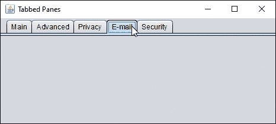

**图 10.10** 带有五个标签的标签页面板。

### 注意事项

在 `JTabbedPane` 构造函数使用的 `TOP`、`BOTTOM`、`LEFT` 和 `RIGHT` 常量是 `javax.swing` 包中 `SwingConstants` 接口的一部分。接口包含一组整数常量，有助于组件的定位和对齐。

### 总结

你现在已经知道了如何使用 Swing 包的组件在 Java 应用程序窗口上绘制用户界面。

Swing 包含了许多你在程序中可能会看到的按钮、栏、列表和字段的类。它还包含了更高级的组件，如滑块、对话框、进度条和菜单栏。你通过创建其类的实例并将其添加到容器（如框架）中来实现界面组件。你使用容器的 `add()` 方法或特定于该容器的类似方法，例如标签页面板的 `addTab()` 方法。

在本节中，你开发了组件并将它们添加到界面中。在接下来的两节中，你将学习使图形界面变得可用的所需的两项任务。你将看到如何排列组件以形成整个界面，以及如何通过这些组件接收用户的输入。

除了目前为止涵盖的内容，Swing 还提供了更多用户界面组件。请访问 Oracle 的 Javadoc 站点：[`docs.oracle.com/en/java/javase/12/docs/api`](https://docs.oracle.com/en/java/javase/12/docs/api)，点击 `java.desktop` 模块链接，并点击 `javax.swing` 包链接以进一步探索这些类。

### 问答

**问** 可以不使用 Swing 创建应用程序吗？

**答** 当然可以。Swing 只是抽象窗口工具包（AWT）的扩展，因此你可以只使用 AWT 类来设计界面并接收用户输入。但 Swing 的功能与 AWT 提供的功能相比没有可比性。使用 Swing，你可以使用更多的组件，以更复杂的方式控制它们，并依靠更好的性能和更高的可靠性。

Java 还包含一个 Swing 的替代方案 JavaFX，其原始设计目标是在语言未来的发布中替换 Swing。

其他用户界面库也扩展或与 Swing 竞争。最流行的之一是标准部件工具包（SWT），它是 Eclipse 项目创建的开源 GUI 库。SWT 提供的组件外观和行为与每个操作系统提供的界面组件相似。要了解更多信息，请访问 [www.eclipse.org/swt](http://www.eclipse.org/swt)。

另一个有趣的 Swing 竞争对手是 GWT，它是 Google 创建的用于构建图形 Web 的开源工具包。Google 将其用于 AdWords、Inbox 和 Wallet。在 [www.gwtproject.org](http://www.gwtproject.org) 发现更多信息。

**问** 在滑块应用程序中，`Slider` 起了什么作用？

**答** 因为 `pack()` 将其设置为组件的合适尺寸。

**问** 当我尝试创建一个标签页面板时，页面只显示了标签。我该做什么来纠正这个问题？

**答** 确保面板内部已完全设置好。

### 测验

通过完成这个三题测验来复习本节内容。

#### 问题

**1** 哪种界面组件在软件安装中很常见？

- **A.** 滑块
- **B.** 进度条
- **C.** 对话框

**2** 哪个 Java 包包含了点击按钮类？

- **A.** `java.awt`（抽象窗口工具包）
- **B.** `javax.swing`（Swing）
- **C.** 都有

**3** 哪种界面组件可以被拿起并移动？

- **A.** `JSlider`
- **B.** `JToolBar`
- **C.** 都有

#### 答案

**1 B.** 进度条在显示文件复制或文件提取操作的进度时非常有用。

**2 C.** Swing 重复了抽象窗口工具包中包含的所有简单界面组件。

**3 B.** 工具栏可以拖动到界面的顶部、右侧、左侧或底部，也可以拖出界面。

### 认证练习

以下问题是你可能会在 Java 认证考试上遇到的。请在不再次查看本节或使用 Java 编译器测试代码的情况下回答。

给定：

点击此处查看代码图像

```java
import java.awt.*;

import javax.swing.*;

public class AskFrame extends JFrame {

    public AskFrame() {

        setDefaultCloseOperation(JFrame.EXIT_ON_CLOSE);

        JSlider value = new JSlider(0, 255, 100);

        add(value);

        setSize(450, 150);

        setVisible(true);

        super();

    }

    public static void main(String[] arguments) {

        AskFrame af = new AskFrame();

    }

}

```

尝试编译并运行此源代码会发生什么？

- **A.** 编译无错误且运行正常。
- **B.** 编译无错误但在框架中不显示任何内容。
- **C.** 因为 `super()` 语句导致无法编译。
- **D.** 因为 `add()` 语句导致无法编译。

答案可以在书籍网站找到，地址为 [www.java21days.com](http://www.java21days.com)。访问第 10 节页面并点击“认证练习”（Certification Practice）链接。

## 练习

为了扩展你对本节涵盖主题的知识，请尝试以下练习：

1. 创建一个输入对话框，用于设置加载对话框的框架标题。
2. 创建 `ProgressMonitor` 应用程序的修改版本，在文本字段中也显示 `num` 变量的值。

在适用的情况下，练习题可以在书籍网站 [www.java21days.com](http://www.java21days.com) 上找到。

## 第 11 节：在用户界面上排列组件

如果将设计图形用户界面（GUI）比作绘画，那么目前你只能创作一种艺术形式：抽象表现主义。你可以将组件放置在界面上，但无法控制它们所在的位置。

为了在 Java 中排列用户界面的组件，你必须使用一组被称为 `布局管理器`（layout managers）的类。在本节中，你将学习如何使用布局管理器来排列界面中的组件。你将学习如何利用 Java 图形用户界面能力的灵活性，这些能力的设计初衷是在支持该语言的许多平台上具有良好的展示效果。

你还将学习如何如何在同一个界面上让多个布局管理器协同工作。这种方法适用于许多情况，即某一个布局管理器并不完全适合你想要设计的界面。

### 基础界面布局

正如你所学到的，用 Swing 设计的 GUI 是流动的。调整窗口大小可能会对界面造成混乱，因为组件会移动到容器中你可能无意中产生的位置。

这种流性是 Java 支持不同平台的一个必要部分，因为每个平台在显示按钮、滚动条以及用户界面的其他部分的方式上存在细微差异。

在某些编程语言中，组件在窗口上的位置是由其（x, y）坐标精确定义的。某些 Java 开发工具允许通过使用自己的窗口类对界面进行类似的控制（在 Java 中也有方法可以做到这一点）。

使用 Swing 时，得益于布局管理器，程序员对界面的布局获得了更多的控制权。

Swing 的平台无关性提供了灵活性，但代价是性能略慢，且用户界面的外观和感觉可能与操作系统的原生外观和感觉并不完全贴合。

### 排布局界面

布局管理器决定了组件在被添加到容器时的排列方式。

面板（panels）的默认布局管理器是 `FlowLayout` 类。该类允许组件按照它们添加到容器的顺序从左到右流。当没有空间时，新一行组件将立即在第一行下方开始，并继续从左到右的顺序。

Java 包含了一系列通用布局管理器：`BorderLayout`、`BoxLayout`、`CardLayout`、`FlowLayout` 和 `GridLayout`。要为容器创建布局管理器，首先调用其构造函数创建该类的实例，例如：

点击此处查看代码图像

```java
FlowLayout flo = new FlowLayout();
```

创建布局管理器后，你可以使用容器的 `setLayout()` 方法将其指定为容器的布局管理器。在将任何组件添加到容器之前，必须设置布局管理器。如果没有指定布局管理器，将使用容器的默认布局。面板的默认布局是 `FlowLayout`，框架（frames）的默认布局是 `BorderLayout`。

以下语句代表了一个使用布局管理器来控制所有添加到框架中的组件排列的框架的起点：

点击此处查看代码图像

```java
import java.awt.*;

import javax.swing.*;

public class Starter extends JFrame {

    public Starter() {

        super("Example Frame");

        FlowLayout manager = new FlowLayout();

        setLayout(manager);

        // 在此处添加组件

    }

}

```

设置好布局管理器后，你就可以开始向它所管理的容器中添加组件了。对于某些布局管理器（例如 `FlowLayout`），添加组件的顺序是非常重要的。当你与每个布局管理器配合工作时，你将看到这种情况什么时候成立（以及什么时候不成立）。

### 流动布局（Flow Layout）

`java.awt` 包中的 `FlowLayout` 类是最简单的布局管理器。它按行排列组件，方式与英文单词在页面上的排列方式相同——从左到右，直到右边缘没有空间为止，然后移动到下一行的左边缘。

在默认情况下，当你使用不带参数的 `FlowLayout()` 构造函数时，每行的组件都是居中的。如果你希望组件对齐容器的左边缘或右边缘，可以使用 `FlowLayout.LEFT` 或 `FlowLayout.RIGHT` 类变量作为构造函数的唯一参数，如下句所示：

点击此处查看代码图像

```java
FlowLayout righty = new FlowLayout(FlowLayout.RIGHT);
```

`FlowLayout.CENTER` 类变量指定了组件的居中对齐。

> **注意**
>
> 如果你需要为非英语读者对齐组件（此时从左到右的顺序没有意义），可以使用 `FlowLayout.LEADING` 和 `FlowLayout.TRAILING` 变量。它们将对齐方式设置为行的第一个或最后一个组件。

`Alphabet` 应用程序在列表 11.1 中显示了由布局管理器排列的六个按钮。由于在 `FlowLayout()` 构造函数使用了 `FlowLayout.LEFT`，组件沿左侧对齐。在 NetBeans 中的 `com.java21days` 包创建此应用程序。

**列表 11.1** `Alphabet.java` 的全文

点击此处查看代码图像

```java
1: package com.java21days;

2:

3: import java.awt.*;

4: import javax.swing.*;

5:

6: public class Alphabet extends JFrame {

7:

8:     public Alphabet() {

9:         super("Alphabet");

10:         setDefaultCloseOperation(JFrame.EXIT_ON_CLOSE);

11:         setLookAndFeel();

12:         setSize(360, 120);

13:         FlowLayout lm = new FlowLayout(FlowLayout.LEFT);

14:         setLayout(lm);

15:         JButton a = new JButton("Alibi");

16:         JButton b = new JButton("Burglar");

17:         JButton c = new JButton("Corpse");

18:         JButton d = new JButton("Deadbeat");

19:         JButton e = new JButton("Evidence");

20:         JButton f = new JButton("Fugitive");

21:         add(a);

22:         add(b);

23:         add(c);

24:         add(d);

25:         add(e);

26:         add(f);

27:         setVisible(true);

28:     }

29:

30:     private static void setLookAndFeel() {

31:         try {

32:             UIManager.setLookAndFeel(

33:                 "javax.swing.plaf.nimbus.NimbusLookAndFeel"

34:             );

35:         } catch (Exception exc) {

36:             System.err.println(exc);

37:         }

38:     }

39:

40:     public static void main(String[] arguments) {

41:         Alphabet.setLookAndFeel();

42:         Alphabet frame = new Alphabet();

43:     }

44: }
```


图 11.1 显示了运行中的应用程序。

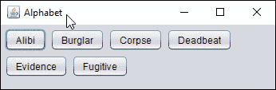

**图 11.1** 由流动布局管理器排列的六个按钮。

`Alphabet` 应用在第 13 行创建了一个流式布局管理器，并在第 14 行将其设置为管理框架（frame）。在第 21–26 行添加到框架中的按钮由该管理器进行布局。

该管理器在同一行的组件之间使用默认的 5 像素间距，行与行之间使用 5 像素的间距。你可以通过向 `FlowLayout()` 构造函数传递额外的参数，或者调用流式布局的 `setVgap(int)` 和 `setHgap(int)` 方法并传入所需的垂直或水平间距来更改它们。

`FlowLayout(int, int, int)` 构造函数按顺序接收以下三个参数：

- 对齐方式，必须是 `FlowLayout` 五个类变量之一：`CENTER`、`LEFT`、`RIGHT`、`LEADING` 或 `TRAILING`
- 组件之间的水平间距，单位为像素
- 垂直间距，像素像素

以下构造函数创建了一个组件居中、水平间距为 30 像素、垂直间距为 10 像素的流式布局管理器：

```java
FlowLayout flo = new FlowLayout(FlowLayout.CENTER, 30, 10);
```

### 框布局（Box Layout）

框布局管理器可以从上到下或从左到右堆叠组件。框布局由 `javax.swing` 包中的 `BoxLayout` 类管理，它改进了流式布局，确保无论容器如何调整大小，组件始终保持垂直或水平对齐。

创建框布局管理器必须向其构造函数传递两个参数：它将管理的容器以及设置垂直或水平对齐的类变量。

对齐方式通过 `BoxLayout` 类的类变量指定，`X_AXIS` 表示从左到右水平对齐，`Y_AXIS` 表示从上到下的垂直对齐。

以下代码设置了一个使用垂直框布局的面板：

```java
JPanel optionPane = new JPanel();

BoxLayout box = new BoxLayout(optionPane, BoxLayout.Y_AXIS);

optionPane.setLayout(box);
```

添加到容器的组件将沿指定的轴对齐，并以其理想尺寸显示。在水平对齐中，框布局管理器尝试为每个组件提供相同的高度。在垂直对齐中，管理器尝试为每个组件提供相同的宽度。

如列表 11.2 所示，`Stacker` 应用包含一个用框布局排列的按钮面板。在 NetBeans 的 `com.java21days` 包中创建它。

**代码列表 11.2** `Stacker.java` 的完整文本

```java
 1: package com.java21days;

 2:

 3: import java.awt.*;

 4: import javax.swing.*;

 5:

 6: public class Stacker extends JFrame {

 7:     public Stacker() {

 8:         super("Stacker");

 9:         setSize(430, 150);

10:         setDefaultCloseOperation(JFrame.EXIT_ON_CLOSE);

11:         setLookAndFeel();

12:         // create top panel

13:         JPanel commandPane = new JPanel();

14:         BoxLayout horizontal = new BoxLayout(commandPane,

15:             BoxLayout.X_AXIS);

16:         commandPane.setLayout(horizontal);

17:         JButton subscribe = new JButton("Subscribe");

18:         JButton unsubscribe = new JButton("Unsubscribe");

19:         JButton refresh = new JButton("Refresh");

20:         JButton save = new JButton("Save");

21:         commandPane.add(subscribe);

22:         commandPane.add(unsubscribe);

23:         commandPane.add(refresh);

24:         commandPane.add(save);

25:         // create bottom panel

26:         JPanel textPane = new JPanel();

27:         JTextArea text = new JTextArea(4, 70);

28:         JScrollPane scrollPane = new JScrollPane(text);

29:         // put them together

30:         FlowLayout flow = new FlowLayout();

31:         setLayout(flow);

32:         add(commandPane);

33:         add(scrollPane);

34:         setVisible(true);

35:     }

36:

37:     private static void setLookAndFeel() {

38:         try {

39:             UIManager.setLookAndFeel(

40:                 "javax.swing.plaf.nimbus.NimbusLookAndFeel"

41:             );

42:         } catch (Exception exc) {

43:             System.err.println(exc);

44:         }

45:     }

46:

47:     public static void main(String[] arguments) {

48:         Stacker.setLookAndFeel();

49:         Stacker st = new Stacker();

50:     }

51: }
```

当该类被编译并运行时，输出应类似于图 11.2 中的对话框。

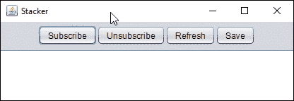

**图 11.2** 使用框布局排列的界面

### 网格布局（Grid Layout）

网格布局将组件排列成垂直列和水平行的网格，类似于 12 个月的日历。组件首先添加到网格的第一行，从左侧向右侧。当第一行的所有单元格满，下一个组件将添加到第二行的左侧（如果存在第二行），依此类推。

网格布局管理器使用 `java.awt` 包中的 `GridLayout` 类创建。构造函数接收两个参数：网格的行数和列数。

以下语句创建了一个具有 10 行 3 列的网格布局管理器：

```java
GridLayout gr = new GridLayout(10, 3);
```

与流式布局一样，你可以通过两个额外的参数（或调用 `setHgap()` 或 `setVgap()` 方法）指定组件之间的垂直和水平间距。以下语句创建了一个具有 10 行 3 列、水平间距为 5 像素、垂直间距为 8 像素的网格布局：

```java
GridLayout gr2 = new GridLayout(10, 3, 5, 8);
```

网格布局中组件之间的默认间距在垂直和水平方向上均为 0 像素。

对于下一个项目，在 `com.java21days` 包中创建 `Bunch` 应用，如列表 11.3 所示。该程序创建了一个 3 行 3 列的网格，且在垂直和水平方向上的组件间距均为 10 像素。

```java
 1: package com.java21days;

 2:

 3: import java.awt.*;

 4: import javax.swing.*;

 5:

 6: public class Bunch extends JFrame {

 7:

 8:     public Bunch() {

 9:         super("Bunch");

10:         setSize(260, 260);

11:         setDefaultCloseOperation(JFrame.EXIT_ON_CLOSE);

12:         setLookAndFeel();

13:         JPanel pane = new JPanel();

14:         GridLayout family = new GridLayout(3, 3, 10, 10);

15:         pane.setLayout(family);

16:         JButton marcia = new JButton("Marcia");

17:         JButton carol = new JButton("Carol");

18:         JButton greg = new JButton("Greg");

19:         JButton jan = new JButton("Jan");

20:         JButton alice = new JButton("Alice");

21:         JButton peter = new JButton("Peter");

22:         JButton cindy = new JButton("Cindy");

23:         JButton mike = new JButton("Mike");

24:         JButton bobby = new JButton("Bobby");

25:         pane.add(marcia);

26:         pane.add(carol);

27:         pane.add(greg);

28:         pane.add(jan);

29:         pane.add(alice);

30:         pane.add(peter);

31:         pane.add(cindy);

32:         pane.add(mike);

33:         pane.add(bobby);

34:         add(pane);

35:         setVisible(true);

36:     }

 37:

38:     private static void setLookAndFeel() {

39:         try {

40:             UIManager.setLookAndFeel(

41:                 "javax.swing.plaf.nimbus.NimbusLookAndFeel"

42:             );

43:         } catch (Exception exc) {

44:             System.err.println(exc);

45:         }

46:     }

 47:

48:     public static void main(String[] arguments) {

49:         Bunch.setLookAndFeel();

50:         Bunch frame = new Bunch();

51:     }

54: }
```

图 11.3 显示了此应用程序。

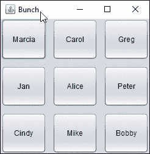

**图 11.3** 以 3×3 网格布局排列的九个按钮。

`Bunch` 应用程序在网格中显示了九个按钮。按钮在第 25–33 行被添加到面板（pane）中，面板在第 34 行被添加到框架（frame）。

关于图 11.3 中的按钮需要注意的是的一点是，它们扩展填充了每个单元格中的可用空间。这是网格布局管理器与某些其他布局管理器之间的重要区别，后者使用这些组件的首选尺寸来以小得多的显示组件。

### 边界布局

到目前为止引入的布局管理器相当简单。下一个采用了一种更复杂的布局，称为边界布局（border layout）。

这种布局是通过使用 `java.awt` 包中的 `BorderLayout` 类创建的，它将容器划分为五个部分：北（north）、南（south）、东（east）、西（west）和中心（center）。图 11.4 中的五个区域展示了这些部分是如何排列的。

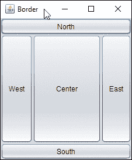

**图 11.4** 由边界布局管理器排列的组件。

在边界布局中，四个方向点代表的组件填充其区域，中心组件获得所有剩余空间。通常这会导致具有大型中心组件和周围四个较小组件的布局。布局管理器不使用组件的首选尺寸。

边界布局可以使用 `BorderLayout()` 或 `BorderLayout(int, int)` 构造函数创建。第一个构造函数创建一个组件之间没有间隙的边界布局。第二个构造函数使用参数来指定水平间隙和垂直间隙（顺序如下），并且可以使用 `setVgap()` 和 `setHgap()`。

在创建了边界布局并将其设置为容器的布局管理器后，通过调用 `add()` 方法添加组件，该方法与之前看到的有所不同：

```java
add(Component, String)
```

第一个参数是应添加到容器的组件。第二个参数是一个 `BorderLayout` 类变量，指示应将组件分配到边界布局的区域。类变量 `NORTH`、`SOUTH`、`EAST`、`WEST` 和 `CENTER` 可用于此参数。

以下语句将一个名为 `quitButton` 的按钮添加到边界布局的北部部分：

```java
JButton quitButton = new JButton("quit");

add(quitButton, BorderLayout);
```

`Border` 应用程序（如 ch11_images.xhtml_p320 所示）创建了图 11.4 所示的 GUI。**列表 11.4** `Border` 的完整文本：

```java
1: package com.java21days;

 2:

 3: import java.awt.*;

 4: import javax.swing.*;

 5:

 6: public class Border extends JFrame {

 7:

 8:     public Border() {

 9:         super("Border");

10:         setSize(240, 280);

11:         setDefaultCloseOperation(JFrame.EXIT_ON_CLOSE);

12:         setLookAndFeel();

13:         setLayout(new BorderLayout());

14:         JButton nButton = new JButton("North");

15:         JButton sButton = new JButton("South");

16:         JButton eButton = new JButton("East");

17:         JButton wButton = new JButton("West");

18:         JButton cButton = new JButton("Center");

19:         add(nButton, BorderLayout.NORTH);

20:         add(sButton, BorderLayout.SOUTH);

21:         add(eButton, BorderLayout.EAST);

22:         add(wButton, BorderLayout.WEST);

23:         add(cButton, BorderLayout.CENTER);

24:         setVisible(true);

25:     }

 26:

27:     private static void setLookAndFeel() {

28:         try {

29:             UIManager.setLookAndFeel(

30:                 "javax.swing.plaf.nimbus.NimbusLookAndFeel"

31:             );
```


```java
} catch (Exception exc) {
    System.err.println(exc);
}
}

public static void main(String[] arguments) {
    Border.setLookAndFeel();
    Border frame = new Border();
}
}
```

第 13 行等同于以下两个语句：

```java
BorderLayout bl = new BorderLayout();

setLayout(bl);
```

第 13 行采用的技巧优势是不需要创建变量并赋值给它。在将布局管理器指定给框架后，不再需要该对象。

## 提示

当你运行应用程序时，增加应用程序的窗口大小以观察组件如何响应。对不同大小进行此操作并注意用户界面的变化。随着窗口变大，中心组件相应增大。其他组件保持不变。这是网格和边界布局管理器的优势。

### 混合布局管理器

此时，你可能会好奇 Java 布局管理器如何用在你为自己的程序设计的 GUI 上。选择布局管理器的体验就像金发姑娘检查三只熊的家：这个太方正了！这个太乱了！这个太奇怪了！

为了找到恰当的布局，你通常需要在同一个界面中组合多个布局管理器。你可以通过将几个容器放入一个较大的容器中，并为每个较小的容器分配它自己的布局管理器来实现。

用于这些较小容器的容器是面板（panel），它由`javax.swing`包中的`JPanel`类创建。面板是用于组合组件的简单容器。在操作面板时，请记住以下两点：

- 面板在放入较大的容器之前会填充组件。
- 面板有它自己的布局管理器。

通过简单地调用`JPanel`类的构造函数即可创建面板，如下例所示：

```java
JPanel pane = new JPanel();
```

你通过调用该面板的`setLayout()`方法为面板设置布局方法。以下是创建一个布局管理器并将其应用于名为`pane`的`JPanel`对象上的方法：

点击此处查看代码图像

```java
FlowLayout flo = new FlowLayout();

pane.setLayout(flo);
```

你通过调用面板的`add()`方法向面板添加组件，该方法对面板的操作与其他容器完全相同。

以下语句创建了一个文本字段并将其添加到名为`pane`的`JPanel`对象中：

点击此处查看代码图像

```java
JTextField nameField = new JTextField(80);

pane.add(nameField);
```

你将在本节的剩余部分看到多个面板使用的示例。

随着你对布局管理器的经验增加，你将熟悉在特定情况下应该使用哪种管理器。例如，边界布局（border layout）适合在底部放置状态栏，在顶部放置工具栏，而网格布局（grid layout）对于尺寸相同的文本字段和标签的行列非常有效。

### 卡片布局（Card Layout）

卡片布局管理器与其他布局器的不同之处在于它会隐藏某些组件。卡片布局是一组一次显示一个容器或组件，就像黑客发牌员每次从牌堆中翻出一张牌一样。组中的每个容器被称为一张“卡片”（card）。

任何安装过带有向导程序的软件的人都见过卡片布局。安装过程中的每一步都有自己的卡片。“下一步”（Next）按钮从一张卡片推进到下一张，而“上一步”（Back）按钮则返回上一个卡片。

使用卡片布局最常见的方法是为每个卡片使用一个面板容器。首先将组件添加到面板中，然后将面板添加到使用卡片布局的容器中。

卡片布局通过`java.awt`包中`CardLayout`类的简单构造函数创建：

点击此处查看代码图像

```java
CardLayout cc = new CardLayout();
```

`setLayout()`方法为容器设置此布局管理器，如下句所示：

```java
setLayout(cc);
```

在设置好容器使用卡片布局管理器之后，你必须使用`add(Component, String)`方法来添加组件。

`add()`方法的第一个参数指定作为卡片的容器或组件。如果它是一个容器，则在添加卡片之前，所有组件都必须已添加到其中。

第二个参数是用于命名卡片的字符串。你可以用任何喜欢的名称命名卡片，例如`"Card 1"`、`"Card 2"`、`"Card 3"`或其他命名方案。

以下语句将一个名为`options`的面板对象添加到容器中，并将这张卡片命名为`"Options Card"`：

```java
add(options, "Options Card");
```

当使用卡片布局的容器首次显示时，可见的卡片是添加到容器的第一张卡片。

你可以通过调用布局管理器的`show()`方法显示后续的卡片，该方法接受两个参数：

- 保存所有卡片的容器
- 卡片的名称

以下语句调用了名为`cc`的卡片布局管理器的`show()`方法：

```java
cc.show(this, "Fact Card");
```

`this`关键字将用于受卡片布局的框架。它指向出现`cc.show()`语句内部的对象。在这个示例中，“Fact Card”是待显示的卡片名称，该卡片已添加到赋予此名称的容器中。

当一张卡片被显示时，之前显示的卡片会自动隐藏。卡片布局中一次只能显示一张卡片。

在运行卡片布局器的程序中，卡片的切换通常由用户的操作触发。例如，在安装程序中，用户可以选择保存保存的文件夹，并点击“下一步”按钮来查看下一张卡片。

### 在应用程序中使用卡片布局

下一个项目将同时演示卡片布局以及在同一个 GUI 中使用不同的布局管理器。

`SurveyWizard`类是一个实现向导界面的面板：一系列简单的问题，并配有一个用于查看后续问题的“下一步”（Next）按钮。最后一个问题则改用“完成”（Finish）按钮，如图 11.5 所示。


**图 11.5** 使用卡片布局的向导界面。

实现卡片布局简单的方法是使用面板。该项目使用了：

- `SurveyWizard`类是一个持有所有卡片的面板。
- `SurveyPanel`类是持有一个卡片的面板。
- 每个`SurveyPanel`对象包含堆叠的面板。

`SurveyWizard()`构造函数使用了实例变量、一个布局管理器以及三个`SurveyPanel`对象数组：

点击此处查看代码图像

```java
SurveyPanel[] ask = new SurveyPanel[3];

CardLayout cards = new CardLayout();
```

构造函数为类设置了布局管理器，创建每个`SurveyPanel`对象，然后将其添加到：

点击此处查看代码图像

```java
setLayout(cards);

String question1 = "How would you characterize your diet?";

String[] resp1 = { "healthy", "unhealthy", "not telling" };

ask[0] = new SurveyPanel(question1, resp1, 2);

add(ask[0], "Card 0");
```

创建每个`SurveyPanel`对象使用了三个参数：问题的文本、可能回答的数组以及默认答案的索引。

在前面的代码中，“你的饮食习惯如何？”这个问题对应的回答是“健康”、“健康”和“不清楚”。位置 2 的回答“不清楚”被设置为默认值。

`SurveyPanel`构造函数使用标签组件来持有问题，并使用单选按钮数组来持有回答：

点击此处查看代码图像

```java
SurveyPanel(String ques, String[] resp, int def) {
    question = new JLabel(ques);

    response = new JRadioButton[resp.length];

    // 后续待
}
```

该类使用网格布局将它的组件排列成一个三列一行的网格。放置在网格中的每个组件都是面板。

首先，创建一个用于持有问题标签的面板：

点击此处查看代码图像

```java
JPanel sub1 = new JPanel();

JLabel quesLabel = new JLabel(ques);

sub1.add(quesLabel);
```

面板的默认布局（居中对齐的流布局）决定了标签在面板上的位置。

接下来，创建了一个面板来存放可能的响应。使用一个`for`循环遍历包含每个响应文本的字符串数组。这些文本被用于创建单选按钮（radio button）。`JRadioButton()`构造函数的第二个参数决定它是否被选中。这通过以下代码实现：

点击此处查看代码图片

```java
JPanel sub2 = new JPanel();

for (int i = 0; i < resp.length; i++) {
    if (def == i) {
        response[i] = new JRadioButton(resp[i], true);
    } else {
        response[i] = new JRadioButton(resp[i], false);
    }

    group.add(response[i]);
    sub2.add(response[i]);
}
```

最后一个面板包含“Next”（下页）和“Finish”（完成）按钮：

点击此处查看代码图片

```java
JPanel sub3 = new JPanel();

nextButton.setEnabled(true);

sub3.add(nextButton);

finalButton.setEnabled(false);

sub3.add(finalButton);
```

现在三个面板已经完全设置完毕，它们被添加到`SurveyPanel`接口中，这完成了构造函数的工作：

点击此处查看代码图片

```java
GridLayout grid = new GridLayout(3, 1);

setLayout(grid);

add(sub1);

add(sub2);

add(sub3);
```

在`SurveyPanel`类中还有一个额外的细节——一个方法，当到达最后一个问题时启用“Finish”按钮并禁用“Next”按钮：

点击此处查看代码图片

```java
void setFinalQuestion(boolean finalQuestion) {
    if (finalQuestion) {
        nextButton.setEnabled(false);
        finalButton.setEnabled(true);
    }
}
```

在使用了卡片布局（card layout）的用户界面中，每个卡片的显示通常是响应用户的操作而发生的。这些操作被称为事件（events），将在第 12 中的“响应用户输入”中进行介绍。

一个简短的预览展示了`SurveyPanel`类如何配置处理按钮点击。该类实现了`ActionListener`，这是`java.awt.event`包中的一个接口：

点击此处查看代码图像

```java
public class SurveyWizard extends JPanel implements ActionListener {
    // more to come
}
```

该接口表示该类可以响应动作事件，这些动作事件代表了按钮点击、菜单选择以及类似的用户输入。

接下来，调用了每个按钮的`addActionListener(Object)`方法：

点击此处查看代码图像

```java
ask[0].nextButton.addActionListener(this);

ask[0].finalButton.addActionListener(this);
```

监听器（Listeners）是监控特定类型用户输入的类。`addActionListener()`的参数是正在寻找动作事件的类。使用`this`作为参数表示由`SurveyPanel`类处理这项工作。

`ActionListener`接口仅包含一个方法：

点击此处查看代码图像

```java
public void actionPerformed(Action evt) {
    // more to come
}
```

当被监听的组件产生动作事件时，该方法会被调用。在`SurveyPanel`类中，每当按钮被点击时就会发生这种情况。在`SurveyPanel`中，此方法使用一个实例变量来跟踪显示哪个卡片：

```java
int currentCard = 0;
```

每当按钮被点击并调用`actionPerformed()`方法时，该变量就会增加，并调用卡片布局管理器的`show(Container, String)`方法来显示新卡片。如果显示了最后一个卡片，则禁用“Finish”按钮。

列表 11.5 显示了完整的`SurveyWizard`类以及完整的`actionPerformed()`方法，该方法之前有一个`@Override`注解，告诉 Java 编译器正在重写父类或接口的方法。在 NetBeans 中创建一个名为`SurveyWizard`的新空 Java 文件，并将其分配到`com.java21days`包。

**列表 11.5** `SurveyWizard.java`的完整文本

点击此处查看代码图片

```java
1: package com.java21days;

2:

3: import java.awt.*;

4: import java.awt.event.*;

5: import javax.swing.*;

7: public class SurveyWizard extends JPanel implements ActionListener {
8:     int currentCard = 0;
9:     CardLayout cards = new CardLayout();
10:    SurveyPanel[] ask = new SurveyPanel[3];

12:    public SurveyWizard() {
13:        super();
14:        setSize(240, 140);
15:        setLayout(cards);
16:        // set up
17:        String question1 = "What is your gender?";
18:        String[] resp1 = {"female", "male"};
19:        ask[0] = new SurveyPanel(question1, resp1, 0);
20:        String question2 = "What is your age?";
21:        String[] resp2 = {"Under 25", "25-54", "Over 54"};
22:        ask[1] = new SurveyPanel(question2, resp2, 1);
23:        String question3 = "How often do you exercise each week?";
24:        String[] resp3 = {"Never", "1-3 times", "More than 3"};
25:        ask[2] = new SurveyPanel(question3, resp3, 1);
26:        // setup
27:        addListeners();
28:    }

30:    private void addListeners() {
31:        for (int i = 0; i < ask.length; i++) {
32:            ask[i].nextButton.addActionListener(this);
33:            ask[i].finalButton.addActionListener(this);
34:        }
35:    }

37:    @Override
38:    public void actionPerformed(ActionEvent evt) {
39:        currentCard++;
40:        if (currentCard >= ask.length) {
41:            System.exit(0);
42:        }
43:        cards.show(this, "Card " + currentCard);
44:    }
45:}

47:class SurveyPanel extends JPanel {
48:    JLabel question;
49:    JRadioButton[] response;
50:    JButton nextButton = JButton("Next");
```


接下来，创建了一个面板来存放可能的响应。使用一个`for`循环遍历包含每个响应文本的字符串数组。这些文本被用于创建单选按钮。`JRadioButton()`构造函数的第二个参数决定它是否被选中。这通过以下代码实现：

点击此处查看代码图片

```
JPanel sub2 = new JPanel();

for (int i = 0; i < resp.length; i++) {

    if (def == i) {

        response[i] = new JRadioButton(resp[i], true);

    } else {

        response[i] = new JRadioButton(resp[i], false);

    }

    group.add(response[i]);

    sub2.add(response[i]);

}
```

最后一个面板包含“Next”（下页）和“Finish”（完成）按钮：

点击此处查看代码图片

```
JPanel sub3 = new JPanel();

nextButton.setEnabled(true);

sub3.add(nextButton);

finalButton.setEnabled(false);

sub3.add(finalButton);
```

现在三个面板已经完全设置完毕，它们被添加到`SurveyPanel`接口中，这完成了构造函数的工作：

点击此处查看代码图片

```
GridLayout grid = new GridLayout(3, 1);

setLayout(grid);

add(sub1);

add(sub2);

add(sub3);
```

在`SurveyPanel`类中还有一个额外的细节——一个方法，当到达最后一个问题时启用“Finish”按钮并禁用“Next”按钮：

点击此处查看代码图片

```
void setFinalQuestion(boolean finalQuestion) {

    if (finalQuestion) {

        nextButton.setEnabled(false);

        finalButton.setEnabled(true);

    }

}
```

在使用了卡片布局（card layout）的用户界面中，每个卡片的显示通常是响应用户的操作而发生的。这些操作被称为*事件*（events），将在第 12 中的“响应用户输入”中介绍。

一个简短的预览展示了`SurveyPanel`类如何配置处理按钮点击。该类实现了`ActionListener`，这是`java.awt.event`包中的一个接口：

点击此处查看代码图片

```
public class SurveyWizard extends JPanel implements ActionListener {

    // more to come

}
```

该接口表示该类可以响应动作事件，这些动作事件代表了按钮点击、菜单选择以及类似的用户输入。

接下来，调用了每个按钮的`addActionListener(Object)`方法：

点击此处查看代码图片

```
ask[0].nextButton.addActionListener(this);

ask[0].finalButton.addActionListener(this);
```

监听器（Listeners）是监控特定类型用户输入的类。`addActionListener()`的参数是正在寻找动作事件的类。使用`this`作为参数表示由`SurveyPanel`类处理这项工作。

`ActionListener`接口仅包含一个方法：

点击此处查看代码图片

```
public void actionPerformed(Action evt) {

    // more to come

}
```

当被监听的组件产生动作事件时，该方法会被调用。在`SurveyPanel`类中，每当按钮被点击时就会发生这种情况。在`SurveyPanel`中，此方法使用一个实例变量来跟踪显示哪个卡片：

```
int currentCard = 0;
```

每当按钮被点击并调用`actionPerformed()`方法时，该变量就会增加，并调用卡片布局管理器的`show(Container, String)`方法来显示新卡片。如果显示了最后一个卡片，则禁用“Finish”按钮。

列表 11.5 显示了完整的`SurveyWizard`类以及完整的`actionPerformed()`方法，该方法之前有一个`@Override`注解，告诉 Java 编译器正在重写父类或接口的方法。在 NetBeans 中创建一个名为`SurveyWizard`的新空 Java 文件，并将其分配到`com.java21days`包。

**列表 11.5** `SurveyWizard.java`的完整文本

点击此处查看代码图片

```
 1: package com.java21days;

 2:

 3: import java.awt.*;

 4: import java.awt.event.*;

 5: import javax.swing.*;

 6:

 7: public class SurveyWizard extends JPanel implements ActionListener {

 8:     int currentCard = 0;

 9:     CardLayout cards = new CardLayout();

10:     SurveyPanel[] ask = new SurveyPanel[3];

 11:

 12:     public SurveyWizard() {

13:         super();

 14:         setSize(240, 140);

 15:         setLayout(cards);

 16:         // set up

 17:         String question1 = "What is your gender?";

 18:         String[] resp1 = {"female", "male"};

 19:         ask[0] = new SurveyPanel(question1, resp1, 0);

 20:         String question2 = "What is your age?";

 21:         String[] resp2 = {"Under 25", "25-54", "Over 54"};

 22:         ask[1] = new SurveyPanel(question2, resp2, 1);

 23:         String question3 = "How often do you exercise each week?";

 24:         String[] resp3 = {"Never", "1-3 times", "More than 3"};

 25:         ask[2] = new SurveyPanel(question3, resp3, 1);

 26:         // setup

 27:         addListeners();

 28:     }

 29:

 30:     private void addListeners() {

 31:         for (int i = 0; i < ask.length; i++) {

 32:             ask[i].nextButton.addActionListener(this);

 33:             ask[i].finalButton.addActionListener(this);

 34:         }

 35:     }

 36:

 37:     @Override

 38:     public void actionPerformed(ActionEvent evt) {

 39:         currentCard++;

 40:         if (currentCard >= ask.length) {

 41:             System.exit(0);

 42:         }

 43:         cards.show(this, "Card " + currentCard);

 44:     }

 45: }

 46:

 47: class SurveyPanel extends JPanel {

 48:     JLabel question;

 49:     JRadioButton[] response;

 50:     JButton nextButton = JButton("Next");

 51:     JButton finalButton = JButton("Finish");

 52:

 53:     SurveyPanel(String ques, String[] resp, int def) {

 54:         super();

 55:         setSize(160, 110);

 56:         question = new JLabel(ques);

 57:         response = new JRadioButton[resp.length];

 58:         ButtonGroup group = new ButtonGroup();

 59:         JPanel sub1 = new JPanel();

 60:         sub1.add(question);

 61:         JPanel sub2 = new JPanel();

 62:         for (int i = 0; i < resp.length; i++) {

 63:             if (def == i) {

 64:                 response[i] = new JRadioButton(resp[i], true);

 65:             } else {

 66:                 response[i] = new JRadioButton(resp[i], false);

 67:             }

 68:             group.add(response[i]);

 69:             sub2.add(response[i]);

 70:         }

 71:         JPanel sub3 = new JPanel();

 72:         nextButton.setEnabled(true);

 73:         sub3.add(nextButton);

 74:         finalButton.setEnabled(false);

 75:         sub3.add(finalButton);

 76:         GridLayout grid = new GridLayout(3, 1);

 77:         setLayout(grid);

 78:         add(sub1);

 79:         add(sub2);

 80:         add(sub3);

 81:     }

 82:

 83:     void setFinalQuestion(boolean finalQuestion) {

 84:         if (finalQuestion) {

 85:             nextButton.setEnabled(false);

 86:             finalButton.setEnabled(true);

 87:         }

 88:     }

 89: }
```

`SurveyWizard`类是一个`JPanel`组件，它在第 9 行创建了一个卡片布局管理器，并在第 15 行将其分配给面板。该类缺少`main()`方法，因此必须将其添加到另一个程序的用户界面中才能进行测试。

`SurveyFrame`（如列表 11.6 所示）包含一个显示问卷面板的窗口。

```java
package com.java21days;

import javax.swing.*;

public class SurveyFrame extends JFrame {

    public SurveyFrame() {

        super("Survey");

        setSize(290, 140);

        setDefaultCloseOperation(JFrame.EXIT_ON_CLOSE);

        setLookAndFeel();

        SurveyWizard wiz = new SurveyWizard();

        add(wiz);

        setVisible(true);

    }

    private static void setLookAndFeel() {

        try {

            UIManager.setLookAndFeel(

                "javax.swing.plaf.nimbus.NimbusLookAndFeel"

            );

        } catch (Exception exc) {

            System.err.println(exc);

        }

    }

    public static void main(String[] arguments) {

        SurveyFrame.setLookAndFeel();
```


```java
SurveyFrame surv = new SurveyFrame();

}
}
```

第 11 行创建了一个 `SurveyWizard` 对象，并在第 12 行将其添加到框架中。运行中的应用程序已在前文的图 11.5 中所示。

#### 单元格填充与内边距（Cell Padding and Insets）

默认情况下，组件周围没有额外的空间（这在填充其单元格的组件中最容易看出）。创建新的布局管理器时出现的水平和垂直间隙，用于确定面板中组件之间的空间大小。然而，`Insets`（内边距）用于确定面板周围的空间大小。`Insets` 类包含了顶部、底部、左侧和右侧内边距的值，在绘制面板时会被使用。

内边距决定了面板边缘与面板组件之间的空间大小。

以下语句创建了一个 `Insets` 对象，指定上下 20 像素的内边距，左右 13 像素的内边距：

点击此处查看代码图片

```java
Insets whitespace = new Insets(20, 13, 20, 13);
```

可以通过重写容器的 `getInsets()` 方法并返回一个 `Insets` 对象来在任何容器中建立内边距，例如所示：

点击此处查看代码图片

```java
public Insets getInsets() {
    return new Insets(10, 30, 10, 30);
}
```

### 总结

在 Java 的用户界面设计方面，你已经看到抽象主义是有局限性的。在 Swing 应用中获得所需的用户界面布局需要使用布局管理器。对于那些习惯了对组件在界面上的出现位置进行更精确控制的人来说，这些管理器需要进行一些调整。

你现在已经了解了如何使用五种 Swing 布局管理器和面板。在处理 Swing 时，你会发现通过使用嵌套容器和不同的布局管理器，它可以模拟任何种类的界面。当你掌握了 Java 用户界面的开发时，你的程序就可以提供一种无需修改即可在多个平台上运行的界面。

### 问答

**问（#ch11.xhtml_ch11an01）我真的非常不喜欢使用布局管理器工作；它们要么太简单，要么太复杂。即使经过大量的调整，我也永远无法让我的用户界面看起来像我想要的那样。我只想定义组件的大小，并将它们放置在屏幕上的 (x, y) 位置。我可以做到这吗？**

**答（#ch11.xhtml_ch11qe01）这是可能的，但是有问题的。** Java 的设计使得程序的 GUI 能够在具有不同屏幕分辨率、字体、屏幕尺寸和样式的不同平台上运行得同样良好。依赖像素坐标会导致一个在一个平台上看起来良好的程序在其他平台上无法使用。这可能导致布局灾难，例如组件相互重叠或超出容器边缘。通过在屏幕上动态地放置元素，布局管理器规避了这些问题。

如果这些还不能说服你，这里是忽略我建议的方法：使用 `null` 作为参数设置内容窗格（content pane）的布局管理器。创建一个 `Rectangle` 对象（来自 `java.awt` 包），并将组件的 (x, y) 位置、宽度和高度作为参数。最后，调用组件的 `setBounds(Rectangle)` 方法，并将该矩形作为参数传入。

以下应用程序显示了一个 300×300 像素的框架，在 (x, y) 位置 10, 10 处有一个名为“Click Me”（点击我）的按钮，按钮宽为 120 像素，高为 30 像素：

点击此处查看代码图片

```java
import java.awt.*;

import javax.swing.*;

public class Absolute extends JFrame {

    public Absolute() {

        super("Example");

        setSize(300, 300);

        setLayout(null);

        JButton myButton = new JButton("Click Me");

        myButton.setBounds(new Rectangle(10, 10, 120, 30));

        add(myButton);

        setVisible(true);

    }

    public static void main(String[] arguments) {

        Absolute ex = new Absolute();

    }

}
```

你可以找到更多关于 `setBounds()` 的信息。你可以在 Java 类库的其他部分找到它的文档，位于 [`https://docs.oracle.com/en/javase/12/docs/api`](https://docs.oracle.com/en/javase/12/docs/api)。

### 测验

通过完成这个三道测验来回顾本课的内容。

#### 题目

**1（#ch11.xhtml_ch11an1）Java 中面板的默认布局管理器是什么？**

A. 无  
B. `BorderLayout`  
C. `FlowLayout`

**2（#ch11.xhtml_ch11an2）在向容器添加组件时，哪种布局管理器使用方向？**

A. `BorderLayout`  
B. `MapLayout`  
C. `FlowLayout`

**3（#ch11.xhtml_ch11an3）如果你想创建一个具有多个步骤的向导，你应该使用哪种布局管理器？**

A. `GridLayout`  
B. `CardLayout`  
C. `BorderLayout`

#### 答案

**1（#ch11.xhtml_ch11an1）C.** 为了防止面板使用流布局，你可以将其布局管理器设置为 `null`。

**2（#ch11.xhtml_ch11an2）A.** Border layout 拥有 `NORTH`、`SOUTH`、`EAST`、`WEST` 和 `CENTER` 类变量。

**3（#ch11.xhtml_ch11an3）B.** Card 允许组件像卡片一样堆叠并一次显示一个，非常适合实现向导。

### 认证练习

以下是在 Java 编程认证考试中可能会遇到的问题。请在不再次查看本课或使用 Java 编译器测试代码的情况下回答它。

给定：

点击此处查看代码图片

```java
import java.awt.*;

import javax.swing.*;

public class ThreeButtons extends JFrame {

    public ThreeButtons() {

        super("Program");

        setSize(350, 225);

        setDefaultCloseOperation(JFrame.EXIT_ON_CLOSE);

        JButton alpha = new JButton("Alpha");

        JButton beta = new JButton("Beta");

        JButton gamma = new JButton("Gamma");

        // 答案在这里

        add(alpha);

        add(beta);

        add(gamma);

        pack();

        setVisible(true);

    }

    public static void main(String[] arguments) {

        ThreeButtons b3 = new ThreeButtons();

    }

}
```

哪个语句应该替换 `// 答案在这里` 以框架并排显示所有三个按钮？

A. `content.setLayout(null);`  
B. `content.setLayout(new FlowLayout());`  
C. `content.setLayout(new GridLayout(3,1));`  
D. `content.setLayout(new BorderLayout());`

答案可以在书的网站上找到，地址为 [`www.java21days.com`](http://www.java21days.com)。访问第 11 课页面并点击认证练习链接。

1. 创建一个显示单个月份日历的用户界面，包括星期七天的标题以及界面顶部的月份标题。
2. 创建一个包含多个布局管理器的界面。

在适用情况下，练习题的答案可以在书籍网上找到，地址为 [`www.java21days.com`](http://www.java21days.com)。

## 第 12 节 响应用户输入

如果用户对程序进行任何操作，那么设计带有图形用户界面（GUI）的 Java 程序将毫无用处。为了让程序具有完整的功能，你必须让界面对用户事件产生响应。

Swing 使用一组名为 `event listeners`（事件监听器）的接口来处理事件。你创建一个监听器对象并将其与被监控的用户界面组件关联。

在本节中，你将学习如何为你的 Swing 程序添加监听器，以处理动作事件、鼠标事件和其他交互。完成后，你将使用 Swing 类集创建完整的 Java 应用程序。

### 事件监听器

如果一个类想要响应 Java 中的用户事件，它必须实现处理该类型事件的接口。该接口与 GUI 不是一个东西。它是一个抽象类型，定义了类必须实现的一组方法。

处理用户事件的接口被称为 `event listeners`（事件监听器）。

每个监听器处理特定类型的事件。

`java.awt.event` 包包含了所有基础事件监听器，以及表示特定事件的类。这些监听器接口是最实用的：

- `ActionListener`：`Action events`（动作事件），当用户对组件执行操作（如点击按钮）时生成。
- `AdjustmentListener`：`Adjustment events`（调整事件），当组件被调整时（如移动滚动条）生成。
- `FocusListener`：`Keyboard focus events`（键盘焦点事件），当文本框等组件获得或失去焦点时生成。
- `ItemListener`：`Item events`（项目事件），当复选框等项目发生变化时生成。
- `KeyListener`：`Keyboard events`（键盘事件），当用户使用键盘输入文本时发生。
- `MouseListener`：`Mouse events`（鼠标事件），由鼠标点击、鼠标进入组件区域和离开组件区域产生。
- `MouseMotionListener`：`Mouse movement events`（鼠标移动事件），跟踪鼠标在组件上的所有移动。
- `WindowListener`：`Window events`（窗口事件），当窗口最大化、最小化、移动或关闭时生成。

正如 Java 类可以实现多个接口一样，接收用户输入的类可以根据需要实现任意多个监听器。类声明中的 `implements` 关键字后面跟着接口的名称。如果实现了多个接口，它们的名称之间用逗号分隔。

以下声明的类用于同时处理动作事件和文本事件：

点击此处查看代码图片

```java
public class Suspense extends JFrame implements ActionListener,
     TextListener {

    // 类体

}
```

在程序中引用这些事件监听器接口时，你可以单独导入它们，或者使用带有通配符的 `import` 语句使整个包都可用：

```java
import java.awt.event.*;
```

### 设置组件

当你将一个类设置为事件监听器时，你已经设置了让该类监听特定类型的事件。然而，除非为 GUI 组件添加了匹配的监听器，否则事件将不会被听到。该监听器会在组件被使用时产生事件。

组件创建后，你可以调用该组件的以下一个（或多个）方法来将其与监听器关联：

- `addActionListener()`：`JButton`、`JCheckBox`、`JComboBox`、`JTextField`、`JRadioButton` 和 `JMenuItem` 组件。
- `addFocusListener()`：所有 Swing 组件。
- `addItemListener()`：`JButton`、`JCheckBox`、`JComboBox` 和 `JRadioButton` 组件。
- `addKeyListener()`：所有 Swing 组件。
- `addMouseListener()`：所有 Swing 组件。
- `addMouseMotionListener()`：所有 Swing 组件。
- `addTextListener()`：`JTextField` 和 `JTextArea` 组件。
- `addWindowListener()`：`JWindow` 和 `JFrame` 组件。

#### 注意事项

在 Java 程序中，将组件添加到容器后对其进行修改是一个容易犯的错误。你必须在将组件添加到任何容器之前，先为组件添加监听器并处理任何其他配置；否则，这些设置在程序运行时会被忽略。

以下示例创建了一个 `JButton` 对象并将其与一个动作事件监听器相关联：

点击此处查看代码图片

```java
JButton zap = new JButton("Zap");

zap.addActionListener(this);
```

所有添加监听器的方法都接受一个参数：即监听该类型事件的对象。使用 `this` 表示当前类就是事件监听器。你可以指定不同的对象，只要其类实现了正确的监听器接口即可。

### 事件处理方法

当你将接口与类相关联时，该类必须包含实现接口中每个方法的方法。

在事件监听器的情况下，当相应的用户事件发生时，窗口系统会自动调用每个方法。

`ActionListener` 接口仅有一个方法：`actionPerformed()`。所有实现 `ActionListener` 的类都必须有一个具有以下结构的方法：

点击此处查看代码图片

```java
public void actionPerformed(ActionEvent event) {

    // 处理事件

}
```

如果程序 GUI 中只有一个组件具有动作事件的监听器，那么你就知道这个 `actionPerformed()` 方法只在响应该组件生成的事件时被调用。这使得编写 `actionPerformed()` 方法变得简单。方法代码直接响应该组件。

但当多个组件具有动作监听器时，你必须使用方法的 `ActionEvent` 参数来确定是哪个组件，并在程序中相应采取。你可以使用此对象发现生成事件的详细信息。`ActionEvent` 以及其他事件对象都是 `java.awt.event` 包的一部分。

每个事件处理方法都会接收某种类型的事件对象。你可以使用该对象的 `getSource()` 方法确定是哪个组件发送了事件，如下例：

点击此处查看代码图片

```java
public void actionPerformed(ActionEvent event) {

    Object source = event.getSource();

}
```

`getSource()` 返回的对象可以使用相等运算符（`==`）与组件进行比较。以下语句扩展了前面的示例以处理名为 `quitButton` 和 `sortRecords` 的按钮点击：

```java
if (source == quitButton) {

    quit();

}

if (source == sortRecords) {

    sort();

}
```

如果是 `quitButton` 对象生成的事件，则调用 `quit()` 方法；如果是 `sortRecords` 按钮生成的事件，则调用 `sort()` 方法。

许多事件处理方法为每种类型的事件或组件调用不同的方法。这使得事件处理方法更易读。此外，如果一个类有多个事件处理方法，每个方法都可以调用相同的方法来完成工作。

Java 的 `instanceof` 运算符可以用于事件处理方法以确定生成事件的组件的类。以下示例适用于具有一个按钮和一个文本框的程序，每个组件都会生成一个动作事件：

点击此处查看代码图片

```java
void actionPerformed(ActionEvent event) {

    Object source = event.getSource();

    if (source instanceof JTextField) {

        calculateScore();

    } else if (source instanceof JButton) {

        quit();

    }

}
```

如果生成事件的组件属于 `JTextField` 类，则调用 `calculateScore()` 方法。如果组件属于 `JButton`，则改为调用 `quit()` 方法。

列表 12.1 所示的 `TitleBar` 应用程序显示了一个带有两个 `JButton` 组件的窗口，这些组件用于更改窗口标题栏上的文本。在包 `com.java21days` 中创建一个名为 `TitleBar` 的新空 Java 文件，并输入该类的源代码。

**列表 12.1** `TitleBar.java` 的完整文本

点击此处查看代码图片

```java
1: package com.java21days;

2:

3: import java.awt.event.*;

4: import javax.swing.*;

5: import java.awt.*;

6:

7: public class TitleBar extends JFrame implements ActionListener {

8:     JButton b1;

9:     JButton b2;

10:

11:     public TitleBar() {
```


```java
super("Title Bar");

setSize(330, 80);

setDefaultCloseOperation(JFrame.EXIT_ON_CLOSE);

b1 = new JButton("Rosencrantz");

b2 = new JButton("Guildenstern");

b1.addActionListener(this);

b2.addActionListener(this);

FlowLayout flow = new FlowLayout();

setLayout(flow);

add(b1);

add(b2);

setVisible(true);
}

@Override
public void actionPerformed(ActionEvent event) {
    Object source = event.getSource();
    if (source == b1) {
        setTitle("Rosencrantz");
    } else if (source == b2) {
        setTitle("Guildenstern");
    }
    repaint();
}

private static void setLookAndFeel() {
    try {
        UIManager.setLookAndFeel(
            "javax.swing.plaf.nimbus.NimbusLookAndFeel"
        );
    } catch (Exception exc) {
        System.err.println(exc);
    }
}

public static void main(String[] arguments) {
    TitleBar.setLookAndFeel();
    TitleBar frame = new TitleBar();
}
}
```

当你使用 Java 虚拟机（JVM）运行此应用程序时，程序的界面应该类似于图 12.1。点击按钮查看会发生什么。


**图 12.1** `TitleBar` 应用程序。

只有 13 行代码（注：原文此处为 13 lines，可能为笔误或指特定逻辑）被使用了……（注：原文此处已截断，此处按意译翻译）

```java
package com.java21days;

import java.awt.event.*;
import javax.swing.*;
import java.awt.*;

public class Calculator extends JFrame implements FocusListener {
    JTextField value1, value2, sum;
    JLabel plus, equals;

    public Calculator() {
        super("Add Two Numbers");
        setSize(350, 90);
        setDefaultCloseOperation(JFrame.EXIT_ON_CLOSE);
        FlowLayout flow = new FlowLayout(FlowLayout.CENTER);
        setLayout(flow);
        // create components
        value1 = new JTextField("0", 5);
        plus = new JLabel("+");
        value2 = new JTextField("0", 5);
        equals = new JLabel("=");
        sum = new JTextField("0", 5);
        // add listeners
        value1.addFocusListener(this);
        value2.addFocusListener(this);
        // set up sum field
        sum.setEditable(false);
        // add components
        add(value1);
        add(plus);
        add(value2);
        add(equals);
        add(sum);
        setVisible(true);
    }

    @Override
    public void focusGained(FocusEvent event) {
        try {
            float total = Float.parseFloat(value1.getText()) +
                Float.parseFloat(value2.getText());
            sum.setText("" + total);
        } catch (NumberFormatException nfe) {
            value1.setText("0");
            value2.setText("0");
            sum.setText("0");
        }
    }

    @Override
    public void focusLost(FocusEvent event) {
        focusGained(event);
    }

    private static void setLookAndFeel() {
        try {
            UIManager.setLookAndFeel(
                "javax.swing.plaf.nimbus.NimbusLookAndFeel"
            );
        } catch (Exception exc) {
            System.err.println(exc);
        }
    }

    public static void main(String[] arguments) {
        Calculator.setLookAndFeel();
        Calculator frame = new Calculator();
    }
}
```

图 12.2 显示了该应用程序。

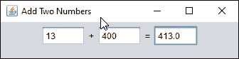

**图 12.2** `Calculator` 应用程序。

在此应用程序中，该类实现了 `FocusListener` 接口，以便可以将焦点监听器器到前两个文本字段 `value1` 和 `value2` 中。

当这两个字段中的任何一个获得输入焦点时，就会调用 `focusGained()` 方法（第 38–48 行）。在此方法中，通过相加另外两个字段的值来计算总和。如果其中任一字段包含无效值（例如字符串），则会抛出 `NumberFormatException`，并将所有三个字段都重置为 0。

`focusLost()` 方法通过将焦点事件作为参数调用 `focusGained()` 来完成行为。

关于此应用程序需要注意的一点是，不需要事件处理行为来在文本字段中收集数字输入。这由任何接收文本输入的组件自动处理。

## 项目事件

当在按钮、复选框或单选按钮等组件上选择或取消选择项目时，会发生项目事件。类必须实现 `ItemListener` 接口来处理这些事件。

`itemStateChanged(ItemEvent)` 方法是 `ItemListener` 接口中的唯一方法。它的格式如下：

点击此处查看代码图像

```java
void itemStateChanged(ItemEvent event) {
    // ...
}
```

要确定事件发生在哪个项目中，可以在 `ItemEvent` 对象上调用 `getItem()` 方法。

你还可以使用 `getStateChange()` 方法查看该项目是否被选择或取消选择。该方法返回一个整数，等于类变量 `ItemEvent.DESELECTED` 或 `ItemEvent.SELECTED`。

列表 12.3 中的 `FormatChooser` 应用程序阐述了项目事件的使用，在标签中显示所选组合框项目的信息。使用 NetBeans 创建一个类名为 `FormatChooser`、包名为 `com.java21days` 的空文件。

**列表 12.3** `FormatChooser.java` 的完整文本

点击此处查看代码图像

```java
package com.java21days;

import java.awt.*;
import java.awt.event.*;
import javax.swing.*;

public class FormatChooser extends JFrame implements ItemListener {
    String[] formats = {
        "(choose format)", "Atom",
        "1.0", "2.0"
    };
    String[] descriptions = {
        "Atom syndication", 14:         "0.92",
        "1.0", 16:         "2.00"
    };
    JComboBox formatBox = new JComboBox();
    JLabel descriptionLabel = new JLabel("");

    public FormatChooser() {
        super("Syndication");
        setSize(420, 150);
        setDefaultCloseOperation(JFrame.EXIT_ON_CLOSE);
        setLayout(new BorderLayout());
        for (String format : formats) {
            formatBox.addItem(format);
        }
        formatBox.addItemListener(this);
        add(BorderLayout.NORTH, formatBox);
        add(BorderLayout.CENTER, descriptionLabel);
        setVisible(true);
    }

    @Override
    public void itemStateChanged(ItemEvent event) {
        int choice = formatBox.getSelectedIndex();
        if (choice > 0) {
            descriptionLabel.setText(descriptions[choice-1]);
        }
    }

    @Override
    public Insets getInsets() {
        return new Insets(50, 10, 10, 10);
    }

    private static void setLookAndFeel() {
        try {
            UIManager.setLookAndFeel(
                "javax.swing.plaf.nimbus.NimbusLookAndFeel"
            );
        } catch (Exception exc) {
            System.err.println(exc);
        }
    }

    public static void main(String[] arguments) {
        FormatChooser.setLookAndFeel();
        FormatChooser frame = new FormatChooser();
    }
}
```

## 键事件

当按下键盘键时，会发生键事件。任何组件都可以产生键事件，类必须实现 `KeyListener` 接口来支持这些事件。

`KeyListener` 接口有三个方法：`keyPressed(KeyEvent)`、`keyReleased(KeyEvent)` 和 `keyTyped(KeyEvent)`。它们的格式如下：

```java
public void keyPressed(KeyEvent event) {
    // ...
}

public void keyReleased(KeyEvent event) {
    // ...
}

public void keyTyped(KeyEvent event) {
    // ...
}
```

`KeyEvent` 的 `getKeyChar()` 方法返回与事件关联的按键字符。如果按键无法表示任何 Unicode 字符，`getKeyChar()` 返回一个等于类变量 `KeyEvent.CHAR_UNDEFINED` 的字符值。

要让组件生成按键事件，它必须能够接收输入焦点。文本字段、文本区域以及接受键盘输入的其他组件会自动支持此功能。对于其他组件（如标签和面板），应该调用 `setFocusable(boolean)` 方法并传入参数 `true`，如下代码所示：

```java
JPanel pane = new JPanel();

pane.setFocusable(true);
```

## 鼠标事件

鼠标事件由鼠标点击、鼠标进入组件区域或鼠标离开区域产生。任何组件都可以生成这些事件，这些类通过实现 `MouseListener` 接口来实现，该接口包含五个方法：

- `mouseClicked(MouseEvent)`
- `mouseEntered(MouseEvent)`
- `mouseExited(MouseEvent)`
- `mousePressed(MouseEvent)`
- `mouseReleased(MouseEvent)`

每个方法的标准形式与 `mouseReleased(MouseEvent)` 相同：

点击此处查看代码图片

```java
public void mouseReleased(MouseEvent event) {
    // ...
}
```


以下方法可以在 `MouseEvent` 对象上使用：

- `getClickCount()`：以整数形式返回鼠标点击的次数
- `getPoint()`：以 `Point` 对象形式返回鼠标点击时在组件内部的（x, y）坐标
- `getX()`：返回 x 坐标
- `getY()`：返回 y 坐标

## 鼠标移动事件

当鼠标在组件上移动时，会发生鼠标移动事件。与其他鼠标事件一样，任何组件都可以生成鼠标移动事件。类必须实现 `MouseMotionListener` 接口来支持这些事件。

`MouseMotionListener` 接口有两个方法：`mouseDragged(MouseEvent)` 和 `mouseMoved(MouseEvent)`。它们的形式如下：

点击此处查看代码图片

```java
public void mouseDragged(MouseEvent event) {
    // ...
}

public void mouseMoved(MouseEvent event) {
    // ...
}
```

与你目前接触过的其他事件监听接口不同，`MouseMotionListener` 并没有它自己的事件类型。相反，它使用的是 `MouseEvent` 对象。因此，你可以调用与处理鼠标事件时完全相同的方法：`getClick()`、`getPoint()`、`getX()` 和 `getY()`。

你接接要开展的项目将演示如何检测并响应鼠标事件。列表 12.4 所示的 `MousePrank` 应用程序由两个类组成：`MousePrank` 和 `PrankPanel`，它们实现了一个试图避免被点击的用户界面按钮。

在 NetBeans 中创建一个类名为 `MousePrank`、包名为 `com.java21days` 的新空 Java 文件，然后输入列表 12.4 中所示的代码。该类中演示的技巧稍后会描述。

**列表 12.4** `MousePrank.java` 的完整文本

点击此处查看代码图片

```java
 1: package com.java21days;
 2:
 3: import java.awt.*;
 4: import java.awt.event.*;
 5: import javax.swing.*;
 6:
 7: public class MousePrank extends JFrame implements ActionListener {
 8:     public MousePrank() {
 9:         super("Message");
10:         setDefaultCloseOperation(JFrame.EXIT_ON_CLOSE);
11:         setSize(420, 220);
12:         BorderLayout border = new BorderLayout();
13:         setLayout(border);
14:         JLabel msg = new JLabel("Click OK to close program.");
15:         add(BorderLayout.NORTH, msg);
16:         PrankPanel prank = new PrankPanel();
17:         prank.ok.addActionListener(this);
18:         add(BorderLayout.CENTER, prank);
19:         setVisible(true);
20:     }
21:
22:     @Override
23:     public void actionPerformed(ActionEvent event) {
24:         System.exit(0);
25:     }
26:
27:     @Override
28:     public Insets getInsets() {
29:         return new Insets(40, 10, 10, 10);
30:     }
31:
32:     private static void setLookAndFeel() {
33:         try {
34:             UIManager.setLookAndFeel(
35:                 "javax.swing.plaf.nibus"
36:             );
37:         } catch (Exception exc) {
38:             System.err.println(exc);
39:         }
40:     }
41:
42:     public static void main(String[] arguments) {
43:         setLookAndFeel();
44:         new MousePrank();
45:     }
46: }
47:
48: class PrankPanel extends JPanel implements MouseListener {
49:     JButton ok = new JButton("OK");
50:     int mouseX, mouseY;
51:     int width, height;
52:
53:     PrankPanel() {
54:         super();
55:         setLayout(null);
56:         addMouseListener(this);
57:         mouseX = 110;
58:         mouseY = 110;
59:         ok.setBounds(mouseX, mouseY, 70, 20);
60:         add(ok);
61:     }
62:
63:     @Override
64:     public void mouseMoved(MouseEvent event) {
65:         mouseX = event.getX();
66:         mouseY = event.getY();
67:         width = (int) getWidth();
68:         height = (int) getHeight();
69:         if (Math.abs(mouseX - 35) < 50) {
70:             ok.setBounds(mouseX, mouseY, width);
71:             repaint();
72:         }
73:         if (Math.abs(mouseY - 10) < 50) {
74:             ok.setBounds(mouseX, mouseY, height);
75:             repaint();
76:         }
77:     }
78:
79:     @Override
80:     public void mouseDragged(MouseEvent event) {
81:         // 忽略此事件
82:     }
83:
84:     private int moveButton(int mouseAt, int buttonAt, int bord) {
85:         if (mouseAt < buttonAt) {
86:             buttonAt--;
87:         } else {
88:             buttonAt++;
89:         }
90:         if (buttonAt > bord - 20) {
91:             buttonAt = 10;
92:         }
93:         if (buttonAt < 0) {
94:             buttonAt = bord - 80;
95:         }
96:         return buttonAt;
97:     }
98:
99:     @Override
100:    public void paintComponent(Graphics comp) {
101:        super.paintComponent(comp);
102:        ok.setBounds(mouseX, mouseY, 70, 20);
103:    }
}
```

点击此处查看代码图片

```java
JButton ok = new JButton("OK");

int buttonX = 110;

int buttonY = 110;

ok.setBounds(new Rectangle(buttonX, buttonY, 70, 20));
```

将 `Rectangle` 对象作为 `setBounds()` 的参数创建，比创建一个带名称的对象并使用该对象作为参数更有效率。你不需要在类的其他任何地方使用该对象，因此它不需要一个名称。以下语句通过两个步骤实现了相同的功能：

点击此处查看代码图片

```java
Rectangle box = new Rectangle(buttonX, buttonY, 70, 20);

ok.setBounds(box);
```

该类拥有了持有按钮（x, y）位置的实例变量 `buttonX` 和 `buttonY`。它们的初始值设为（110, 110），并且每当鼠标进入距离按钮中心 50 像素的范围时，就会发生变化。

你通过实现 `MouseListener` 接口及其两个方法 `mouseMoved(MouseEvent)` 和 `mouseDragged(MouseEvent)` 来跟踪鼠标移动。

该面板使用了 `mouseMoved()` 并忽略了 `mouseDragged()`。

当鼠标移动时，鼠标事件对象的 `getX()` 和 `getY()` 方法会返回其当前的（x, y）位置，该位置被存储在实例变量 `mouseX` 和 `mouseY` 中。

`moveButton(int, int, int)` 方法接收三个参数：

- 按钮的 x 或 y 位置
- 鼠标的 x 或 y 位置
- 面板的宽度或高度

该方法使按钮在垂直或水平方向上远离鼠标，取决于调用时传入的是 x 坐标和面板高度，还是 y 坐标和宽度。

在按钮位置移动后，会调用 `repaint()` 方法，这会导致在第 101–104 行调用面板的 `paintComponent(Graphics)` 方法。

每个组件都有一个 `paintComponent()` 方法，可以对其进行重写以绘制该组件。按钮的 `setBounds()` 方法在第 103 行将其显示在当前的（x, y）位置。

## 窗口事件

当用户打开或关闭窗口对象（如 `JFrame` 或 `JWindow` 对象）时，就会发生窗口事件。任何组件都可以生成这些事件，类必须实现 `WindowListener` 接口来支持它们。

`WindowListener` 接口有七个方法：

- `windowActivated(WindowEvent)`
- `windowClosed(WindowEvent)`
- `windowClosing(WindowEvent)`
- `windowDeactivated(WindowEvent)`
- `windowDeiconified(WindowEvent)`
- `windowIconified(WindowEvent)`
- `windowOpened(WindowEvent)`

它们的形式都与 `windowOpened()` 方法相同：

点击此处查看代码图片

```java
public void windowOpened(WindowEvent event) {
    // 方法体
}
```

`windowClosing()` 和 `windowClosed()` 方法相似，但其中一个是在窗口正在关闭时调用的，另一个是在关闭后调用的。事实上，你可以在 `windowClosing()` 方法中采取操作来阻止窗口关闭。

## 使用适配器类

实现接口的 Java 类必须包含其所有的方法，即使它不打算对其中某些方法做出任何响应。

这一要求在你处理诸如 `WindowListener`（具有七个方法）之类的事件处理接口时，可能需要添加许多空方法。

为了方便起见，Java 提供了适配器（adapters），这些是包含特定接口的空实现（什么都不做）Java 类。通过派生适配器类，你可以通过重写这些方法仅实现你需要的事件处理方法。其余方法则继承这些什么都不做的方法。

`java.awt.event` 包包含了 `FocusAdapter`、`KeyAdapter`、`MouseAdapter`、`MouseMotionAdapter` 和 `WindowAdapter`。它们分别对应于焦点、键盘、鼠标、鼠标移动和窗口事件的监听器。

列表 12.5 是一个 Java 应用程序，它显示最近按下的键，并通过 `KeyAdapter` 的子类监控键盘事件。在 NetBeans 的 `com.java21days` 包中创建一个名为 `KeyChecker` 的新空 Java 类文件，输入此源代码。

**列表 12.5** `KeyChecker.java` 的完整文本

点击此处查看代码图片

```java
 1: package com.java21days;
 2:
 3: import java.awt.*;
 4: import java.awt.event.*;
 5: import javax.swing.*;
 6:
 7: public class KeyChecker extends JFrame {
 8:     JLabel keyLabel = new JLabel("Hit any key");
 9:
10:     public KeyChecker() {
11:         super("Hit a Key");
12:         setSize(300, 200);
13:         setDefaultCloseOperation(JFrame.EXIT_ON_CLOSE);
14:         setLayout(new FlowLayout(FlowLayout.CENTER));
15:         KeyMonitor monitor = new KeyMonitor(this);
16:         setFocusable(true);
17:         addKeyListener(monitor);
18:         add(keyLabel);
19:         setVisible(true);
20:     }
21:
22:     private static void setLookAndFeel() {
23:         try {
24:             UIManager.setLookAndFeel("javax.swing.plaf.NimbusLookAndFeel");
25:         } catch (Exception exc) {
26:             System.err.println(exc);
27:         }
28:     }
29:
30:     public static void main(String[] arguments) {
31:         setLookAndFeel();
32:         new KeyChecker();
33:     }
34: }
35:
36: class KeyMonitor extends KeyAdapter {
37:     KeyChecker display;
38:
39:     KeyMonitor(KeyChecker display) {
40:         this.display = display;
41:     }
42:
43:     @Override
44:     public void keyTyped(KeyEvent event) {
45:         display.keyLabel.setText("" + event.getKeyChar());
46:         display.repaint();
47:     }
48: }
```


`KeyChecker` 应用程序显示最近按下的键，并通过 `KeyAdapter` 的子类监控键盘事件。在 NetBeans 的 `com.java21days` 包中创建一个名为 `KeyChecker` 的新空 Java 类文件，输入此源代码。

（注：原文示例文本中的代码块与描述略有差异，此处保持逻辑一致。）

### `KeyChecker.java` 的完整文本

点击此处查看代码图片。

一个显示字母 `"z"` 的窗口。

**图 12.5** 运行中的 `KeyChecker` 应用程序。

## 使用内部类

在 Java 中获取用户输入的挑战之一是保持代码尽可能短。实现事件监听器及其所有方法（即使对于不需要的输入）需要大量的代码。

`KeyChecker` 应用程序（参考列表 12.5）使用适配器类来缩短处理事件所需的编程量。一种进一步缩短的技术是使用内部类。在以下语句中创建一个内部类适配器类：

点击此处查看代码图片。

```java
KeyAdapter monitor = new KeyAdapter() {

    public void keyTyped(KeyEvent event) {

        keyLabel.setText("" + event.getKeyChar());

        repaint();

    }

};
```

`KeyAdapter` 对象重写了一个方法 `keyTyped(KeyEvent)` 来接收键盘输入。如列表 12.6 所示的 `KeyChecker2` 类相对于其先版本有两个优势。当你在 NetBeans 中创建它时，尝试找出它们是什么。

```java
package com.java21days;

import java.awt.*;
import java.awt.event.*;

import javax.swing.*;

public class KeyChecker2 extends JFrame {

    JLabel keyLabel = new JLabel("Hit any key");

    public KeyChecker2() {

        super("Hit a Key");

        setSize(300, 200);

        setDefaultCloseOperation(JFrame.EXIT_ON_CLOSE);

        setLayout(new FlowLayout(FlowLayout.CENTER));

        KeyAdapter monitor = new KeyAdapter() {

            public void keyTyped(KeyEvent event) {

                keyLabel.setText("" + event.getKeyChar());

                repaint();

            }

        };

        setFocusable(true);

        addKeyListener(monitor);

        add(keyLabel);

        setVisible(true);

    }

    private static void setLookAndFeel() {

        try {

            UIManager.setLookAndFeel(
                "javax.swing.plaf.nimbus.NimbusLookAndFeel"
            );

        } catch (Exception exc) {

            System.err.println(exc);

        }

    }

    public static void main(String[] arguments) {

        KeyChecker2.setLookAndFeel();

        new KeyChecker2();

    }

}
```

`KeyChecker2` 应用的功能与 `KeyChecker` 版本完全相同。

这个版本的优势在于它更短，不需要创建单独的类，并且不需要在内部类中使用 `this` 变量就可以更改第 17 行的标签。内部类可以直接访问其所属类的变量和方法。

内部类还可以是匿名的，这意味着它们是未赋值给变量的类对象。

`TitleBar` 应用（参阅列表 12.1）使用动作事件（action events）在点击按钮时更改框架标题，这可以通过匿名内部类来简化。匿名内部类成为按钮的 `addActionListener()` 方法的参数，如下：

点击此处查看代码图像。

```java
JButton b1;

b1.addActionListener(new ActionListener() {

    public void actionPerformed(ActionEvent evt) {

        setTitle("Rosencrantz");

    }

});

JButton b2;

b2.addActionListener(new ActionListener() {

    public void actionPerformed(ActionEvent evt) {

        setTitle("Guildenstern");

    }

});
```

匿名内部类是一个实现了 `ActionListener` 接口的对象。对象的 `actionPerformed()` 方法被重写，以便在点击相应的按钮时设置框架的标题。由于每个按钮都有自己的监听器，这比使用一个监听器处理多个接口组件要简单。

内部类看起来比单独的类复杂，但它们可以简化并缩短你的 Java 代码。

### 总结

在 Swing 中通过以下基本步骤向 GUI 添加事件处理功能：

1. 向类添加一个监听器接口；它将包含事件处理方法。
2. 为每个组件添加一个监听器；它将生成要处理的事件。
3. 添加这些方法，每个方法都以 `EventObject` 类作为方法的唯一参数。
4. 使用该 `EventObject` 类的方法（如 `getSource()`）来确定是哪个组件生成了事件，以及它是什么种事件。

当你掌握了这些步骤，就可以操作每个监听器接口和事件类了。随着新的组件被添加到 Swing 中，你也可以学习新的监听器。

### 问答

**Q 程序的事件处理行为可以放在它自己的类中，而不是包含在创建接口的代码中吗？**

**A** 可以的，许多程序员都会告诉你这是设计程序的好方法。将界面设计与你的事件处理代码分离，允许你分别开发它们。这使得项目更容易维护；相关的行为被组合在一起，并与无关的行为隔离开。

**Q 有没有办法区分 `mouseClicked()` 事件中的不同按钮？**

**A** 有。鼠标事件的这一功能在本节中没有介绍，因为右键和中键是特定于平台的特性，在某些运行 Java 程序的系统中是不可用的。

每个鼠标事件都会向其事件处理方法发送一个 `MouseEvent` 对象。你可以调用对象的 `getModifiers()` 方法接收一个整数值，该值指示哪个鼠标按钮生成了事件。你可以将该值与三个类变量进行比较。如果点击了左键，它等于 `MouseEvent.BUTTON1_MASK`；如果点击了中键，等于 `MouseEvent.BUTTON2_MASK`；如果点击了右键，则等于 `MouseEvent.BUTTON3_MASK`。

```java
import java.awt.event.*;

import javax.swing.*;

import java.awt.*;

public class Expunger extends JFrame implements ActionListener {

    public boolean deleteFile;

    public Expunger() {

        super("Expunger");

        JLabel commandLabel = new JLabel("Do you want to delete the file?");

        JButton yes = new JButton("Yes");

        JButton no = new JButton("No");

        yes.addActionListener(this);

        no.addActionListener(this);

        setLayout(new BorderLayout());

        JPanel bottom = new JPanel();

        bottom.add(yes);

        bottom.add(no);

        add("North", commandLabel);

        add("South", bottom);

        pack();

        setVisible(true);

    }

    public void actionPerformed(ActionEvent evt) {

        JButton source = (JButton) evt.getSource();

        // answer goes here

            deleteFile = true;

        else

            deleteFile = false;

    }

    public static void main(String[] arguments) {

        new Expunger();

    }

}
```

以下哪个语句应该替换 `// answer goes here` 以使应用程序正常运行？

**A.** `if (source instanceof JButton)`

**B.** `if (source.getActionCommand().equals("yes"))`

**C.** `if (source.getActionCommand().equals("Yes"))`

**D.** `if (source.getActionCommand() == "Yes")`

答案可以在书籍网站找到，地址为 [www.java21days.com](http://www.java21days.com)。访问第 12 节页面并点击“认证练习”链接。

## 练习

为了扩展你对本节涵盖主题的知识，请尝试以下练习：

1. 创建一个使用 `FocusListener` 的应用程序，确保当用户将文本字段的值改为负数时，该值会被乘以 –1 并重新显示。
2. 创建一个计算器，每当点击相应的按钮时，就加或减两个文本字段的内容，并将结果显示在标签中。

在适用的情况下，练习答案可以在书籍网站 [www.java21days.com](http://www.java21days.com) 上找到。

## 第 13 节：创建 Java2D 图形

在本节中，你将处理把图形置于“图形用户界面”中的 Java 类。Java2D 是一组支持高质量、可缩放的二维图像、颜色和文本的类。

Java2D 包含了 `java.awt` 和 `javax.swing` 包中的类，可以用于所有这些具有视觉吸引力的任务：

- 绘制文本
- 绘制形状（如圆形和多边形）
- 使用不同的字体、颜色和线宽
- 用颜色和图案填充形状

## `Graphics2D` 类

Java2D 中的一切都始于 `java.awt` 包中的 `Graphics2D` 类，该类表示一个*图形上下文*——一个可以进行绘图的环境。`Graphics2D` 对象可以代表图形用户界面、打印机或其他显示设备上的组件。`Graphics2D` 是 `Graphics` 类的子类，扩展并改进了它的视觉能力。

在开始使用 `Graphics2D` 类之前，你需要一个用于绘图的表面。多个用户界面组件可以作为图形操作的画布，包括面板和窗口。一旦你有了可以用作画布的组件，就可以在该对象上绘制文本、线条、椭圆、圆、弧、矩形和其他多边形。适用于此目的组件之一是 `javax.swing` 包中的 `JPanel`。该类表示图形用户界面中的面板，面板可以是空的，也可以包含其他组件。

以下代码创建了一个框架和一个面板，然后将面板添加到框架中：

点击此处查看代码图像。

```java
JFrame main = new JFrame("Welcome Screen");

JPanel pane = new JPanel();

main.add(pane);
```

与 Java 中的许多其他用户界面组件一样，面板有一个 `paintComponent(Graphics)` 方法，当组件需要重新显示时，该方法会被自动调用。

`paintComponent()` 可能会由于以下原因被调用：

- 包含组件的图形用户界面首次显示。
- 显示在组件上方的窗口被关闭。
- 包含组件的图形用户界面被调整大小。

通过创建 `JPanel` 的子类，你可以覆盖面板的 `paintComponent()` 方法，并将所有的绘制操作都放在此方法中。

正如你可能注意到的，发送到接口组件 `paintComponent()` 方法的是一个 `Graphics` 对象而不是你需要的 `Graphics2D` 对象。为了创建一个表示组件绘制面的 `Graphics2D` 对象，你必须使用强制转换来进行转换，如下例：

点击此处查看代码图像。

```java
public void paintComponent(Graphics comp) {

    Graphics2D comp2D = (Graphics2D) comp;

    // 方法体

}
```

在 `Graphics2D` 对象从作为参数传递方法的 `Graphics` 对象进行强制转换后，所有的绘制方法都将使用这个新对象。`Graphics` 对象将不再被使用。

## 图形坐标系

Java2D 类使用你在 Swing 中设置框架和其他组件大小时使用的相同 `(x, y)` 坐标系。

Java 坐标系使用像素作为测量单位。原点 `(0, 0)` 位于左上角。

x 坐标向 `(0, 0)` 右侧增加，y 坐标向下增加。

当你通过调用 `setSize(int, int)` 方法设置框架大小时，`(0, 0)` 原点位于左上角，右下角位于 `(0, 0)`。

Java2D 与其他绘制系统不同，那些系统中 `(0, 0)` 原点位于左下，y 值向上增加。

所有像素值都是整数；你不能使用小数在两个整数值之间显示内容。

图 13.1 显示了坐标系，原点位于 `(0, 0)`。矩形的两个点位于 `(20, 20)` 和 `(60, 60)`。

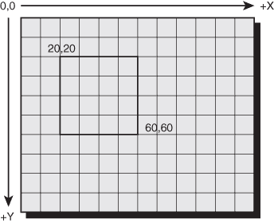

**图 13.1** 坐标系。

## 绘制文本

文本是 Java2D 中容易绘制的内容。要绘制文本，调用 `Graphics2D` 对象的 `drawString(String, int, int)` 方法并传入三个参数：

- 要显示的字符串
- 显示的 x 坐标
- 显示的 y 坐标

`drawString()` 方法中的 `(x, y)` 坐标表示字符串左下角的像素。

以下 `paintComponent()` 方法在坐标 `(22, 100)` 处绘制字符串 `"Free the periodicals"`：

点击此处查看代码图像。

```java
public void paintComponent(Graphics comp) {

    Graphics2D comp2D = (Graphics2D) comp;

    comp2D.drawString("Free the periodicals", 22, 100);

}
```

此示例使用了默认字体。要使用不同的字体，你必须创建 `java.awt` 包中的 `Font` 类对象。

`Font` 对象表示字体名称、样式和字体大小。通过向构造函数发送三个参数来创建 `Font` 对象：

- 字体名称
- 字体样式
- 字体大小

该名称也可以是五种逻辑字体之一：`Dialog`、`DialogInput`、`Monospaced`、`SanSerif` 或 `Serif`。这些字体可以指定使用的字体类型，而不需要特定的字体。这通常是一个更好的选择，因为某些字体族可能在所有的 Java 实现中都不存在。

可以使用类变量选择三种 `Font` 样式：`PLAIN`、`BOLD` 和 `ITALIC`。这些常量是整数，你可以将它们相加以组合效果。

以下语句创建了一个 24 点的、加粗且斜体的 `Dialog` 字体：

点击此处查看代码图像。

```java
Font f = new Font("Dialog", Font.BOLD + Font.ITALIC, 24);
```

在创建字体后，可以通过调用 `Graphics2D` 类的 `setFont(Font)` 方法并将字体作为参数来使用它。

`setFont()` 方法设置当前字体，在设置另一个字体之前，对同一个 `Graphics2D` 对象上进行的所有后续 `drawString()` 方法调用都将使用该字体。

以下 `paintComponent()` 方法创建了一个新的 `Font` 对象，将当前字体设置为该对象，并在坐标 `(13, 100)` 处用 72 点字体绘制字符串 `"I'm deeply font of you"`：

点击此处查看代码图像。

```java
public void paintComponent(Graphics comp) {

    Graphics2D comp2D = (Graphics2D) comp;

    Font f = new Font("Arial Narrow", Font.PLAIN, 72);

    comp2D.setFont(f);
```


```java
comp2D.drawString("I'm deeply font of you", 13, 100);
}
```

Java 可以通过将字体包含在程序中从文件中加载来确保字体可用。这种技术需要使用 `Font` 类方法 `createFont(int, InputStream)`，它返回一个表示该字体的 `Font` 对象。

输入流在第 16 节“处理输入和输出”中有所介绍，它们是可以用于从磁盘文件或网络地址等源加载数据的对象。以下语句从与使用它的类文件相同文件夹下的 `Verdana.ttf` 文件中加载字体：

点击此处查看代码图像

```java
try {
    File ttf = new File("Verdana.ttf");
    FileInputStream fis = new FileInputStream(ttf);
    Font font = Font.createFont(Font.TRUETYPE_FONT, fis);
} catch (IOException|FontFormatException exc) {
    System.out.println("Error: " + exc.getMessage());
}
```

`try`-`catch` 块处理输入/输出错误，当从文件加载数据时必须考虑这些错误。`File`、`FileInputStream` 和 `IOException` 类是 `java.io` 包的一部分（在第 16 节中深入讨论）。

当使用 `createFont()` 加载字体时，`Font` 对象的大小为 1 点，样式为普通。要更改大小和样式，请调用字体对象的 `deriveFont(int, int)` 方法并传入两个参数：所需的样式和大小。

## 使用抗锯齿改进字体和图形

如果你使用目前为止介绍的技巧来显示文本，与你对其他软件的预期相比，字体外观看起来很粗糙。字符的边缘会有锯齿，特别是在曲线和对角线线上。

得益于对抗锯齿的支持，Java2D 可以绘制吸引人的字体和图形，抗锯齿是一种通过改变周围像素的颜色来平滑粗糙边缘的渲染技术。此功能默认关闭。要启用它，请调用 `Graphics2D` 对象的 `setRenderingHint()` 方法并传入两个参数：

* 一个标识正在设置的渲染提示的 `RenderingHint.Key` 对象
* 一个设置该提示取值的 `RenderingHint.Key` 对象

以下代码在名为 `comp2D` 的 `Graphics2D` 对象上启用了抗锯齿：

点击此处查看代码图像

```java
comp2D.setRenderingHint(RenderingHints.KEY_ANTIALIASING,
    RenderingHints.VALUE_ANTIALIAS_ON);
```

通过在组件的 `paintComponent()` 方法中调用此方法，你可以让所有后续的绘制操作采用抗锯齿。

### 查找字体信息

为了让文本在图形用户界面中好看，你通常必须弄清楚文本在界面组件上占据了多少空间。

`java.awt` 包中的 `FontMetrics` 类提供了方法，用于确定使用指定字体显示的字符的大小，这些信息可以用于文本格式化和居中等操作。

`FontMetrics` 可用于查找有关当前字体的详细信息，例如它可以显示的字符的宽度或高度。要使用该类的方法，必须使用 `getFontMetrics()` 方法创建一个 `FontMetrics` 对象。该方法接受单个参数：一个 `Font` 对象。

表 13.1


**图 13.2** 显示带有字体度量的居中文本。

`TextFrame` 由两个类组成：一个框架（frame）和一个名为 `TextFramePanel` 的面板子类（panel subclass）。文本是通过重写 `paintComponent(Graphics g)` 方法并在该方法内部调用 `Graphics2D` 类的绘制方法在面板上绘制的。

第 45 行和第 46 行中的 `getSize()` 方法调用面板的宽度和高度来确定文本显示的位置。当应用程序调整大小时，面板也会随之调整大小，并会自动调用 `paintComponent()`。

## 颜色

`Color` 类（位于 `java.awt` 包中）和 `ColorSpace` 类（位于 `java.awt.color` 包中）可以用于使图形用户界面更加色彩鲜艳。通过这些类，你可以设置绘制操作使用的颜色，以及界面组件和其他窗口的背景颜色。你还可以将颜色从一种颜色系统转换为另一种。

默认情况下，Java 使用 sRGB 颜色系统，该系统通过包含的红、绿、蓝量来描述每种色调（R、G 和 B）。这三个组件中的每一个都可以表示为 0 到 255 之间的整数。黑色是 0, 0, 0——即没有任何红色、绿色或蓝色。白色是 255, 255, 255——三种颜色的最大量。你也可以使用三个 0 到 1.0 之间的浮点数来表示 sRGB 值。Java 可以使用 sRGB 在这两个极端之间表示数百万颜色。

颜色系统被称为色彩空间（color space），而 sRGB 只是其中一种空间。还有 XYZ，它是 1931 年由国际会议创建的。只要有定义描述系统的 `ColorSpace` 对象，Java 就支持使用所需的任何色彩空间。你也可以从任何颜色空间转换为 sRGB，反之亦然。

Java 使用 sRGB 对颜色的内部表示只是程序中使用的颜色空间之一。显示器或打印机等输出设备也有自己的颜色空间。

当你显示或打印指定颜色的内容时，输出设备可能不支持该颜色。在这种情况下，会替换不同的颜色或使用抖动模式（dithering pattern）来近似不可用的颜色。

颜色管理的实际情况是，你用 sRGB 指定颜色在所有输出设备上并不可用。如果你需要对颜色进行更精确控制，可以使用 `java.awt.color` 包中的 `ColorSpace` 和其他类。

对于大多数需求，内置的 sRGB 定义颜色就足够了。

## 使用 `Color` 对象

颜色由 `Color` 对象表示，可以通过构造函数创建对象，也可以通过指定 `Color` 类中按名称提供的少量标准颜色之一来创建。

你可以调用 `Color()` 构造函数来创建一个带有三个整数的颜色，这些整数代表所需颜色的 sRGB 值（或三个具有相同目的浮点数）：

点击此处查看代码图像

```java
Color c1 = new Color(0.807F, 1F, 0F);
Color c2 = new Color(255, 204, 102);
```

`c1` 对象描述了一种霓虹绿，而 `c2` 是黄油色。

> **注意**
>
> 很容易将 `0F` 和 `1F` 等浮点字面量与十六进制数混淆，这在第 2 Lesson 的“编程 ABC”中讨论过。颜色通常用十六进制表示，例如当使用层叠样式在网页上设置背景颜色时。你使用的 Java 类和方法不接受十六进制参数，因此当你看到 `1F` 或 `0F` 这样的字面量时，你处理的是浮点数。

## 测试和设置当前颜色

通过使用 `Graphics2D` 类的 `setColor()` 方法指定绘制的当前颜色。该方法必须在代表绘制区域的 `Graphics2D` 对象上调用。

几种最常用的颜色作为类变量位于 `Color` 类中。这些颜色使用以下 `Color` 变量（括号内为相应的 sRGB 值）：

* `black` (0, 0, 0)
* `blue` (0, 0, 255)
* `cyan` (0, 255, 255)
* `darkGray` (64, 64, 64)
* `gray` (128, 128, 128)
* `green` (0, 255, 0)
* `lightGray` (192, 192, 192)
* `magenta` (255, 0, 255)
* `orange` (255, 200, 0)
* `pink` (255, 175, 175)
* `red` (255, 0, 0)
* `white` (255, 255, 255)
* `yellow` (255, 255, 0)

以下语句设置颜色：

```java
setColor(Color.black);
```

以下语句设置颜色：

```java
setColor(Color.blue);
```

以下语句设置颜色：

```java
setColor(Color.cyan);
```

以下语句设置颜色：

```java
setColor(Color.darkGray);
```

以下语句设置颜色：

```java
setColor(Color.gray);
```

以下语句设置颜色：

```java
setColor(Color.green);
```

以下语句设置颜色：

```java
setColor(Color.lightGray);
```

以下语句设置颜色：

```java
setColor(Color.magenta);
```

以下语句设置颜色：

```java
setColor(Color.orange);
```

以下语句设置颜色：

```java
setColor(Color.pink);
```

以下语句设置颜色：

```java
setColor(Color.red);
```

以下语句设置颜色：

```java
setColor(Color.white);
```

以下语句设置颜色：

```java
setColor(Color.yellow);
```

## 绘制线条和多边形

本节涵盖的所有基本绘制命令都是在组件的 `paintComponent()` 方法中调用的 `Graphics2D` 方法。这是所有绘制操作的理想位置，因为每当组件需要重新显示时，`paintComponent()` 都会被自动调用。

如果另一个程序的窗口覆盖了该组件并且它需要重绘，将所有操作放在 `paintComponent()` 中可以确保没有任何部分被遗漏。

Java2D 特性包括：

* 绘制空多边形和用实色填充的多边形的能力
* 特殊的填充模式，例如渐变
* 定义笔触宽度和样式的线条（Strokes）
* 平滑边缘的抗锯齿

## 用户和设备坐标空间

Java2D 引入的概念之一是输出设备坐标空间与绘制对象时引用的坐标空间之间的区别。坐标空间是任何可以使用 `(x, y)` 坐标描述的 2D 区域。

在 Java2D 之前的所有绘制操作中，使用的唯一坐标空间是设备坐标空间。你指定输出表面（如面板）的 `(x, y)` 坐标，这些坐标被用于绘制文本和其他元素。

Java2D 需要另一个坐标空间，你在创建和实际绘制对象时引用该空间。这被称为用户坐标空间（user coordinate space）。

填充模式控制绘制对象将如何被填充。在 Java2D 中，你可以使用实色、渐变填充、纹理或自定义的模式。

填充模式通过使用 `Graphics2D` 的 `setPaint(Paint)` 方法定义，该方法接受一个 `Paint` 对象作为其唯一参数。任何可以作为填充模式的类（包括 `GradientPaint`、`TexturePaint` 和 `Color`）都可以实现 `Paint` 接口。在 `setPaint()` 中使用 `Color` 对象与使用实色作为模式是等同的。

渐变填充是从一个坐标点的颜色到另一个不同坐标点的颜色的渐进过渡。这种变化可以在两点之间发生一次——称为非循环渐变（acyclic gradient）——也可以反复发生——即循环渐变（cyclic gradient）。

图 13.3 显示了白色与深色之间的非循环渐变循环渐变示例。箭头表示颜色发生变化的点之间。

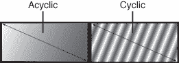

**图 13.3** 非循环和循环渐变变化。

渐变中的坐标点并不直接指向正在绘制的 `Graphics2D` 对象上的点。相反，它们指的是用户空间，甚至可以位于被渐变填充的对象之外。图 13.4 阐释了这一点。两个矩形都使用同一个 `GradientPaint` 对象作为引导进行填充。理解渐变模式的一种思考方式是将其看作一块铺在平表面上的布料。用渐变填充的形状是从布料上裁出的图案，从同一块布上可以裁出多个图案。

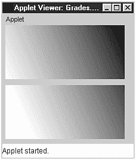

**图 13.4** 使用相同 `GradientPaint` 的两个矩形。

调用 `GradientPaint` 构造方法的方法采用以下格式：

点击此处查看代码图像

```java
GradientPaint gp = new GradientPaint(
    x1, y1, color1, x2, y2, color2);
```

点 (`x1`, `y1`) 是由 `color1` 代表的颜色开始的地方，而 (`x2`, `y2`) 是变化在 `color2` 结束的地方。

如果你想使用循环渐变变化，则在最后添加一个额外的参数：

点击此处查看代码图像

```java
GradientPaint gp = new GradientPaint(
    x1, y1, color1, x2, y2, color2, true);
```

最后一个参数是布尔值，对于循环变化设为 `true`。`false` 参数可用于非循环变化，或者你可以省略此参数；非循环渐变是默认值。

在创建 `GradientPaint` 对象后，使用 `setPaint()` 方法将其设置为当前的画笔属性。以下语句创建并选择了一个渐变：

点击此处查看代码图像

```java
GradientPaint pat = new GradientPaint(0F, 0F, Color.white,
    100F, 45F, Color.blue);
comp2D.setPaint(pat);
```

对 `comp2D` 对象的所有后续绘制操作都将使用此填充模式，直到选择另一个。

### 设置绘制线宽

Java2D 允许你通过使用带有 `BasicStroke` 的 `setStroke()` 方法来改变线条的宽度。

简单的 `BasicStroke` 构造函数接受三个参数：

* 一个表示线宽的 `float` 值，以 `1.0` 为标准
* 一个确定线条末端绘制的端点装饰样式的 `int` 值
* 一个确定两个线段之间接处样式的 `int` 值

端点和接处样式参数使用 `BasicStroke` 类变量。端点样式适用于未连接到其他线条的线条末端。接处样式适用于连接其他线条的末端。

可能的端点样式有 `CAP_BUTT`（无端点）、`CAP_ROUND`（每个端点周围为圆形）和 `CAP_SQUARE`（方形）。图 13.5 显示了端点样式。正如你看到的，`CAP_BUTT` 和 `CAP_SQUARE` 样式之间唯一的区别是 `CAP_SQUARE` 因为增加了方形端点而更长。


**图 13.5** 端点帽样式。

可能的接处样式包括：`JOIN_MITER`（通过扩展外边缘连接线段）、`JOIN_ROUND`（将两个线段之间的角部圆化）和 `JOIN_BEVEL`（用直线连接线段）。图 13.6 显示了接处样式的示例。


**图 13.6** 接处样式。

## 创建绘制对象

在创建了 `GradientPaint` 对象后，使用 `setPaint()` 方法将其设置为当前的画笔属性。以下语句创建并选择了一个渐变：

### 线条

线条是使用 `Line2D.Float` 类创建的。该类接受四个参数：一个端点的 x 和 y 坐标，然后是另一个端点的 x 和 y 坐标。示例：

点击此处查看代码图像

```java
Line2D.Float ln = new Line2D.Float(60F, 5F, 13F, 28F);
```

该语句在 (60, 5) 和 (13, 28) 之间创建了一条线。

### 矩形

矩形是使用 `Rectangle2D.Float` 类或 `Rectangle2D.Double` 类创建的。两者区别在于一个是接受 `float` 参数，另一个接受 `double` 参数。`Rectangle2D.Float` 接受四个参数：x 坐标、y 坐标、宽度和高度。

点击此处查看代码图像

```java
Rectangle2D.Float rc = new Rectangle2D.Float(10F, 13F, 40F, 20F);
```

该语句在 (10, 13) 处创建了一个宽 40 像素、高 20 像素的矩形。

### 圆形

圆形可以使用 `Ellipse2D.Float` 类创建。它接受四个参数：x 坐标、y 坐标、宽度和高度。

点击此处查看代码图像

```java
Ellipse2D.Float ee = new Ellipse2D.Float(113, 25, 22, 40);
```


该语句在 (113, 25) 处了一个宽度为 22 像素、高度为 40 像素的圆。

#### 弧

在 Java2D 可以绘制的所有形状中，弧的构造最为复杂。弧使用 `Arc2D.Float` 类创建，该类接受七个参数：

- 包含弧的虚拟椭圆的 x 和 y 坐标（作为前两个参数）
- 椭圆的宽度和高度（作为第三和第四个参数）
- 弧的起始角度
- 弧在椭圆上移动的度数
- 描述弧如何闭合的整数

弧移动的度数通过负数以逆时针方向表示。

图 13.7 显示了在确定弧的起始角度时度值所在的位置。弧的起始角度范围从 0 到 359 度，逆时针计数。在圆形椭圆上，0 度位于 3 点钟位置，90 度位于 12 点钟，180 度位于 9 点钟，270 度位于 6 点钟。

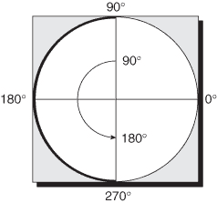

**图 13.7** 确定弧的起始角度。

`Arc2D.Float` 构造函数的最后一个参数使用三个类变量之一：`Arc2D.OPEN` 用于未闭合的弧，`Arc2D.CHORD` 用于直线连接弧的两个端点，以及 `Arc2D.PIE` 用于将弧像饼块一样连接到椭圆的中心。图 13.8 显示了这些样式中的每一种。


**图 13.8** 弧闭合样式。

### 注意事项

`Arc2D.OPEN` 闭合样式不适用于填充弧。以 `Arc2D.OPEN` 为样式的填充弧将使用与 `Arc2D.CHORD` 相同的样式进行关闭。

以下语句创建了一个 `Arc2D.Float` 对象：

点击此处查看代码图像

```java
Arc2D.Float arc = new Arc2D.Float(
    27F, 22F, 42F, 30F, 33F, 90F, Arc2D.PIE);
```

这为位于 (27, 22) 处的椭圆创建了一个弧，宽度为 42 像素，高度为 30 像素。弧从 33 度开始，顺时针延伸 90 度，并像饼块一样闭合。

### 多边形

在 Java2D 中，你通过定义从多边形上的一个点到另一个点的移动来创建多边形。多边形可以直线、二次曲线或贝塞尔曲线组成。

创建多边形的移动被定义为 `GeneralPath` 对象，该对象也是 `java.awt.geom` 程序包的一部分。`GeneralPath` 对象可以在不带任何参数的情况下创建，如下：

点击此处查看代码图像

```java
GeneralPath polly = new GeneralPath();
```

`GeneralPath` 的 `moveTo()` 方法用于创建多边形上的第一个点。如果你想让 `polly` 从坐标 (5, 0) 处开始，则使用以下语句：

```java
polly.moveTo(5F, 0F);
```

在创建第一个点后，使用 `lineTo()` 方法创建指向新点的线。该方法接受两个参数：新点的 x 和 y 坐标。

以下语句向 `polly` 对象添加了三条线：

```java
polly.lineTo(205F, 0F);
polly.lineTo(205F, 90F);
polly.lineTo(5F, 90F);
```

`lineTo()` 和 `moveTo()` 方法需要 `float` 参数来指定坐标点。

如果你想闭合多边形，可以使用不带任何参数的 `closePath()` 方法，如下：

```java
polly.closePath();
```

该方法通过将当前点与最近一次 `moveTo()` 方法指定的点连接来关闭多边形。你也可以使用连接到原始点的 `lineTo()` 方法在使用此方法关闭多边形。

在创建了开启或闭合的多边形后，你可以使用 `draw()` 和 `fill()` 方法像任何其他形状一样绘制它。`polly` 对象是一个矩形，点位于 (5, 0)、(205, 0)、(205, 90) 和 (5, 90)。

## 绘制对象

在定义了渲染属性（如颜色和线宽）并创建了要绘制的对象后，你就准备好以其 2D 风采绘制它。

所有绘制的对象都使用相同 `Graphics2D` 类的方法：`draw()` 用于轮廓，`fill()` 用于填充对象。这些方法接受对象作为唯一参数。

### 绘制地图

你将创建的下一个项目是一个使用 2D 绘制技术绘制简单地图的应用。在 NetBeans 的 `com.java21days` 包中创建 `Map` 类，并用列表 13.2 中的代码填充它。

**列表 13.2** 完整的 `Map.java`

点击此处查看代码图像

```java
package com.java21days;

import java.awt.*;
import java.awt.geom.*;
import javax.swing.*;

public class Map extends JFrame {

    public Map() {
        super("Map");
        setSize(360, 350);
        setDefaultCloseOperation(JFrame.EXIT_ON_CLOSE);
        MapPane map = new MapPane();
        add(map);
        setVisible(true);
    }

}

class MapPane extends JPanel {

    @Override
    public void paintComponent(Graphics g) {
        Graphics2D g2D = (Graphics2D) g;
        g2D.setRenderingHint(RenderingHints.KEY_ANTIASING, RenderingHints.VALUE_ANTIALIAS_ON);

        // draw Florida
        GradientPaint gp = new GradientPaint(0F, 0F, Color.green, 350F, 350F, Color.orange, true);
        g2D.setPaint(gp);

        GeneralPath fl = new GeneralPath();
        fl.moveTo(10F, 12F);
        fl.lineTo(234F, 15F);
        fl.lineTo(253F, 25F);
        fl.lineTo(261F, 71F);
        fl.lineTo(344F, 209F);
        fl.lineTo(336F, 278F);
        fl.lineTo(295F, 310F);
        fl.lineTo(259F, 274F);
        fl.lineTo(205F, 188F);
        fl.lineTo(211F, 171F);
        fl.lineTo(195F, 174F);
        fl.lineTo(191F, 118F);
        fl.lineTo(120F, 56F);
        fl.lineTo(94F, 68F);
        fl.lineTo(81F, 49F);
        fl.lineTo(12F, 37F);
        fl.closePath();

        g2D.fill(fl);

        // draw waves
        g2D.setColor(Color.blue);
        BasicStroke pen = new BasicStroke(2, BasicStroke.CAP_ROUND, BasicStroke.JOIN_ROUND);
        g2D.setStroke(pen);

        for (int ax = 0; ax < 340; ax += 10) {
            for (int ay = 0; ay < 340; ay += 10) {
                Arc2D.Float wave = new Arc2D.Float(ax, ay, 10, 10, 0, -180);
                g2D.draw(wave);
            }
        }

        // draw ovals
        g2D.setColor(Color.black);
        BasicStroke pen2 = new BasicStroke();
        g2D.setStroke(pen2);

        Ellipse2D.Float e1 = new EllipseD.Float(235, 140, 15, 15);
        Ellipse2D.Float e2 = new EllipseD.Float(225, 130, 15, 15);
        Ellipse2D.Float e3 = new EllipseD.Float(245, 130, 15, 15);

        g2D.fill(e1);
        g2D.fill(e2);
        g2D.fill(e3);
    }
}

public static void main(String[] args) {
    new Map();
}
```

在 `Map` 应用中，第 4 行导入了 `java.awt.geom` 包中的类。该语句是必要的，因为第 1 行的 `import java.awt.*;` 只处理类，不处理 `java.awt` 下的包。

第 46–47 行创建了一个从 (0, 0) 处的绿色到 (50, 50) 处的橙色渐变模式。构造函数的最后一个参数 `true` 会导致填充模式重复所需的次数以填充整个对象。

第 48 行使用 `setPaint()` 方法和刚刚创建的 `gp` 对象设置了当前的渐变填充模式。

第 49–67 行创建了一个形状像作者家乡州的多边形并将其绘制出来。该多边形使用从绿色到橙色的渐变模式进行填充。

第 69 行将当前颜色设置为黑色。这将替换下一次绘制操作的渐变填充模式，因为颜色也是填充模式。

第 70 行创建了一个不带参数的 `BasicStroke()` 对象，默认线宽为 1 像素。

第 71 行将当前线宽设置为新的 `BasicStroke` 对象 `pen2`。

第 72–74 行在 (235, 140)、(225, 130) 和 (245, 130) 处创建了三个椭圆。每个宽 15 像素、高 15 像素，因此构成了圆形。

图 13.9 显示了运行的应用程序。

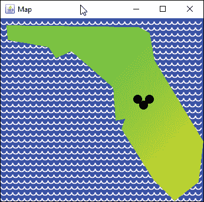

**图 13.9** `Map`。

### 总结

你现在拥有了一些工具来改进 Java 程序的外观。你可以使用 Java2D 在框架、面板和其他用户界面组件上绘制线条、矩形、椭圆、多边形、字体、颜色和模式。

Java2D 在每个绘制操作中都使用相同的两个方法：`draw()` 和 `fill()`。使用 `java.awt.geom` 包中的类创建不同的对象，并将这些对象用作 `Graphics2D` 绘制方法的参数。

### 问答

**问** 源代码中的大写 F 指的是什么？它被添加到坐标中，例如在 `polly.moveTo(5F, 0F)` 方法中。为什么对这些坐标使用 F 而不是其他坐标，为什么在其他地方使用小写的 f？

**答** `F` 或 `f` 表示该数字是浮点数而不是整数，且大小写可以互换使用。如果你不使用其中一个，Java 编译器会假设该数字是一个 `int` 值。Java 中的许多方法和构造函数需要浮点数参数，但可以处理整数，因为整数可以转换为浮点数而不改变其值。因此，像 `Arc2D.Float()` 这样的构造函数可以使用 `10` 和 `180` 等参数，而不是 `10F` 和 `180F`。

**问** “通过抗锯齿改进字体和图形”部分提到了一个名为 `RenderingHint.Key` 的类。为什么这个类有两个用点隔开的名字？这代表什么？

**答** 使用两个名称来识别一个类表示它是一个内部类。第一个类是包围类，后面跟着点和内部类的名称。在这种情况下，`Key` 类是 `RenderingHint` 类内部的内部类。

### 测验

通过完成这个三道题测验来回顾本课的内容。

#### 问题

**1. 在 Java 中绘制内容之前需要什么种对象？**

A. `Graphics2D`  
B. `WindowListener`  
C. `JFrame`

**2. 下列哪项不是创建 `Color` 对象的 Java 语句？**

A. `Color c1 = new Color(0F, 0F, 0F);`  
B. `Color c2 = new Color(0, 0, 0);`  
C. 两者都是有效的。

**3. `getSize().width` 指的是什么？**

A. 界面组件的宽度  
B. 框架窗口的宽度  
C. 任何图形界面组件的宽度

#### 答案

**1.** A. `Graphics2D` 对象是从 `Graphics` 对象强制转换而来的，代表图形界面组件的图形上下文。

**2.** C. 两者都是创建对象的有效方法。你也可以使用十六进制值来创建 `Color` 对象，例如此例：

```java
Color c3 = new Color(0xFF, 0xCC, 0x66);
```

**3.** C. 你可以在任何用户组件上调用 `getSize().width` 和 `getSize().height`。

### 认证练习

以下问题是你在 Java 编程测试中可能会遇到的类型。在不重新看本课或不使用 Java 编译器测试代码的情况下回答它。

```java
import java.awt.*;
import javax.swing.*;

public class Result extends JFrame {

    public Result() {
        super("Result");

        JLabel width = new JLabel("This frame is " +
            getSize().width + " pixels wide.");

        add("North", width);
        setSize(220, 120);
    }

    public static void main(String[] arguments) {
        Result r = new Result();
        r.setVisible(true);
    }
}
```

当应用程序运行时，报告的框架宽度（像素）是多少？

A. 0 像素  
B. 120 像素  
C. 20 像素  
D. 用户显示器的宽度

答案可以在书籍网站 `www.java1days.com` 上找到。访问第 13 页面并点击认证练习链接。

## 练习

为了扩展你对本课涵盖主题的知识，请尝试以下练习：

1. 创建一个绘制圆形的应用程序，其半径、(x, y) 坐标颜色均由参数决定。
2. 创建一个绘制饼图的应用程序。

在适用的情况下，练习答案位于书籍网站 `www.java1days.com`。

## 第 14：开发 Swing 应用程序

使用 Swing 设计图形用户界面与创建网页有许多共同点。组件被放置在界面上，使得它们可以根据所占据的空间进行移动。

你可以在目前创建的 Swing 界面中通过调整框架看到这一点。

这种活性是 Web 的必要部分，因为它在许多不同的设备、屏幕宽度分辨率上显示。

在 Java 中，这有助于确保用户界面在所有安装了 Java 虚拟机（JVM）的平台上都能良好显示并正常运行。

关于 Swing 的最后一节提供了一些额外的功能，增强了其作为有效 GUI 设计画布的能力。在本节中，你将扩展知识到以下主题：

- Swing 应用程序在处理耗时任务时可能遇到的性能问题
- 使用 `SwingWorker`（一个在工作线程中执行 Swing 操作的类）解决这些问题
- 使用不同大小单元格创建图形界面
- 让布局单元扩展到其他单元格

### 使用 SwingWorker 提高性能

Swing 应用程序的响应很大程度上取决于软件如何处理用户输入的耗时任务。

应用程序通常在一个线程中执行任务。因此，如果某个操作需要很长时间（例如加载大文件或解析 XML 文档中的数据），用户可能会在此期间注意到性能延迟。

Swing 程序还要求所有用户界面组件必须在同一个线程中运行。

解决这两个要求的最佳方法是使用 `SwingWorker`，它是 `javax.swing` 包中的一个类，设计用于在其自己的工作线程中运行耗时任务并报告结果。

`SwingWorker` 是一个抽象类，需要工作线程的应用程序必须对其进行子类化：

点击此处查看代码图像

```java
public class DiceWorker extends SwingWorker {

    // 类的主体

}
```


在新类中，应该重写 `doInBackground()` 方法以执行任务。

## DiceWorker Swing 工作线程

下一个项目是一个 Swing 应用，它会根据用户选择的次数投掷三个六面骰子，并汇总结果。16 个文本字段代表可能的值，范围从 3 到 18。

该应用程序由两个类组成：持有图形用户界面的 `DiceRoller`，以及处理骰子投掷的 `DiceWorker` Swing 工作线程。

由于该应用程序允许用户投掷数千甚至数百万次骰子，将此任务放在工作线程中可以保持 Swing 界面对用户输入的响应性。

列表 14.1 包含了工作类 `DiceWorker`。在 NetBeans 中创建一个以此类命名的空 Java 文件，包名为 `com.java21days`。在新建文件对话框中，确保选中的项目是 `Java21` 而不是 `PageData`。

**列表 14.1** `DiceWorker.java` 的完整文本

点击此处查看代码图像

```java
package com.java21days;

import javax.swing.*;

public class DiceWorker extends SwingWorker {
    int timesToRoll;

    // 设置 Swing worker
    public DiceWorker(int timesToRoll) {
        super();
        this.timesToRoll = timesToRoll;
    }

    // 定义工作线程执行的任务
    @Override
    protected int[] doInBackground() {
        int[] result = new int[16];
        for (int i = 0; i < this.timesToRoll; i++) {
            int sum = 0;
            for (int j = 0; j < 3; j++) {
                sum += Math.floor(Math.random() * 6);
            }
            result[sum] = result[sum] + 1;
        }
        // 传输结果
        return result;
    }
}
```

在创建下一个类 `DiceRoller` 之前，还无法对这个类进行任何操作。

一个 Swing 工作线程只需要一个方法 `doInBackground()`，它在后台执行任务。该方法必须使用 `protected` 级别的访问控制符，并返回一个由工作产生的值。`DiceWorker` 创建了一个包含 16 个元素的整数数组，其中包含了骰子投掷的结果。

另一个类可以通过三个步骤使用此工作线程：

1. 调用工作线程的 `DiceWorker(int)` 构造函数，并将投掷次数作为参数。
2. 调用工作线程的 `addPropertyChangeListener(Object)` 方法添加一个监听器，当任务完成后将收到通知。
3. 调用工作线程的 `execute()` 方法来开始工作。

`execute()` 方法会导致工作线程的 `doInBackground()` 方法被调用。

属性变化监听器（property change listener）是来自 `java.beans` 的事件监听器，该 JavaBeans 包建立了一种用户界面上的组件可以相互交互的方式。

在这种情况下，一个 Swing 工作线程想要宣布它的工作已完成，这可能在工作线程开始很久之后发生。使用监听器是处理此类通知的最佳方式，因为它们释放了图形用户界面来处理其他事务。

`propertyChange` 监听器接口有一个方法：

点击此处查看代码图像

```java
public void propertyChange(PropertyChangeEvent event) {

    // ...

}
```

`com.java21days` 包中的 `DiceRoller` 类如列表 14.2 所示，展示了一个可以显示骰子投掷结果并开始一组投掷的图形用户界面。

**列表 14.2** `DiceRoller.java` 的完整文本

点击此处查看代码图像

```java
package com.java21days;

import java.awt.*;
import java.awt.event.*;
import java.beans.*;
import javax.swing.*;

public class DiceRoller extends JFrame implements ActionListener,
    PropertyChangeListener {

    // 骰子投掷结果的表格
    JTextField[] total = new JTextField[16];
    // "Roll" 按钮
    JButton roll;
    // 投掷次数
    JTextField quantity;
    // Swing worker
    DiceWorker worker;

    public DiceRoller() {
        super("Dice Roller");
        setDefaultCloseOperation(EXIT_ON_CLOSE);
        setSize(850,145);

        // 设置顶部面板
        JPanel topPane = new JPanel();
        GridLayout paneGrid = new GridLayout(1,16);
        topPane.setLayout(paneGrid);
        for (int i = 0; i < 16; i++) {
            // 创建文本框和标签
            total[i] = new JTextField("0");
            JLabel label = new JLabel((i + 3) + ": ");
            // 创建单元格
            JPanel cell = new JPanel();
            cell.add(label);
            cell.add(total[i]);
            // 将单元格添加到顶部面板
            topPane.add(cell);
        }

        // 设置底部面板
        JPanel bottomPane = new JPanel();
        JLabel quantityLabel = new JLabel("Times to Roll: ");
        quantity = new JTextField("0");
        roll = new JButton("Roll");
        roll.addActionListener(this);
        // 将各个组件添加到底部面板
        bottomPane.add(quantityLabel);
        bottomPane.add(quantity);
        bottomPane.add(roll);

        // 将面板添加到框架
        add(topPane);
        add(bottomPane);
        setVisible(true);
    }

    // 当 "Roll" 按钮被点击时响应
    @Override
    public void actionPerformed(ActionEvent event) {
        int timesToRoll;
        try {
            // 禁用按钮
            timesToRoll = Integer.parseInt(quantity.getText());
            roll.setEnabled(false);
            // 设置投掷骰子的工作线程
            worker = new DiceWorker(timesToRoll);
            // 添加监控工作线程的监听器
            worker.addPropertyChangeListener(this);
            // 开始工作
            worker.execute();
        } catch (NumberFormatException exc) {
            System.out.println(exc.getMessage());
        }
    }

    // 当工作线程任务完成时响应
    @Override
    public void propertyChange(PropertyChangeEvent event) {
        try {
            // 获取工作线程的骰子投掷结果
            int[] result = (int[]) worker.get();
            // 将结果存储在文本框中
            for (int i = 0; i < result.length; i++) {
                total[i].setText("" + result[i]);
            }
        } catch (Exception exc) {
            System.out.println(exc.getMessage());
        }
    }

    private static void setLookAndFeel() {
        try {
            UIManager.setLookAndFeel(
                "com.sun.java.swing.plaf.nimbus.NimbusLookAndFeel"
            );
        } catch (Exception exc) {
            // 忽略错误
        }
    }

    public static void main(String[] arguments) {
        DiceRoller.setLookAndFeel();
        DiceRoller app = new DiceRoller();
    }
}
```

该类可以作为应用程序运行。在 NetBeans 中，选择 Run、Run File。

大部分 `DiceRoller` 代码负责创建和布局用户界面组件：16 个文本字段、一个“掷次数”文本字段和一个“掷”按钮。

`actionPerformed()` 方法响应“掷”按钮的点击事件，它通过创建一个 Swing worker 来掷骰子、添加属性更改监听器并开始工作。

在第 73 行调用 `worker.execute()` 会导致 worker 的 `doInBackground()` 方法被调用。

当 worker 完成掷骰后，`DiceRoller` 的 `propertyChange()` 方法会接收属性更改事件。该方法通过调用 worker 的 `get()` 方法（第 84 行）接收 `doInBackground()` 的结果，该结果必须强制转换为整数数组：

点击此处查看代码图像

```java
int[] result = (int[]) worker.get();
```

应用程序如图 14.1 所示。


**图 14.1** 由 SwingWorker 准备的掷骰结果表。

## Grid Bag 布局

在第 11 节“在用户界面上排列组件”中，你学习了布局管理器类 `FlowLayout`、`BoxLayout`、`GridLayout`、`BorderLayout` 和 `CardLayout`。

Java 中还有另一种不常用的管理器，但在某些情况下有用。Grid bag 布局是网格布局管理器复杂的扩展，它将组件排列成单个单元格的行和列。Grid bag 布局与网格布局的区别在于以下方面：

- 组件可以占据网格中的多个单元格。
- 不同行和列之间的比例不需要相等。
- 组件不需要填充它占据的整个单元格（或多个单元格）。
- 组件可以沿着单元格的任何边对齐。

Grid bag 布局需要 `GridBagLayout` 和 `GridBagConstraints` 类，它们属于 `java.awt` 包。`GridBagLayout` 是布局管理器，而 `GridBagConstraints` 定义了组件在网格中的位置。

Grid bag 布局管理器的构造函数不带参数，可以像其他管理器一样应用于容器。可以在帧（frame）的构造函数中使用以下语句在该容器中使用 grid bag 布局：

点击此处查看代码图像

```java
GridBagLayout bag = new GridBagLayout();

setLayout(bag);
```

在 grid bag 布局中，每个组件使用一个 `GridBagConstraints` 对象来规定它在网格中占据的单元格或多个单元格、大小以及呈现的其他方面。

`GridBagConstraints` 对象有 11 个实例变量，用于确定组件的位置：

- `gridx`——持有组件的单元格的 x 位置（如果跨越多个单元格，则为组件左上部分的 x 位置）
- `gridy`——单元格或其左上部分的 y 位置
- `gridwidth`——组件在水平方向上占据的单元格数
- `gridheight`——组件在垂直方向上占据的单元格数
- `weightx`——一个指示组件相对于网格同一行中其他组件大小的值
- `weighty`——一个指示组件相对于网格同一列中其他组件大小的值
- `anchor`——一个决定组件在单元格内显示位置的值（如果它没有填充整个单元格）
- `fill`——一个决定组件是否沿水平或垂直方向扩展以填充其单元格的值
- `insets`——一个 `Insets` 对象，用于设置组件在单元格内周围的空白
- `ipadx`——组件宽度超过其最小尺寸的量
- `ipady`——组件高度超过其最小尺寸的量

除了 `insets` 之外，所有变量都可以存储整数值。

使用此布局管理器的最简单方法是创建一个无参数的约束并单独设置其变量。未显式设置的变量将使用其默认值。

以下代码创建了一个 grid bag 布局和一个用于将组件放置在网格中的约束：

点击此处查看代码图像

```java
GridBagLayout gridbag = new GridBagLayout();

GridBagConstraints constraint = new GridBagConstraints();

setLayout(gridbag);
```

可以使用一组赋值语句对约束配置：

点击此处查看代码图像

```java
constraint.gridx = 0;

constraint.gridy = 0;

constraint.gridwidth = 2;

constraint.gridheight = 1;

constraint.weightx = 100;

constraint.weighty = 100;

constraint.fill = GridBagConstraints.NONE;

constraint.anchor = GridBagConstraints.CENTER;
```


此代码设置了一个约束，可将组件放置在网格位置 (0,0)，且宽度为两个单元格。

## 设计网格

由于 grid bag 布局比其他管理器复杂，因此在使用它之前做一些准备工作是有帮助的。你可以在网格纸上勾画用户界面。

图 14.2 显示了面板布局在网格纸上的粗草图。


**图 14.2** 在网格上设计用户界面。

图 14.2 所示的面板包含一组标签和文本字段，它们在发送消息时将被填充。

grid bag 布局适合这种界面，因为它包含不同宽度的组件。所有标签宽度相同，但“收件人”和“主题”文本字段比“抄”和“密送”字段大。在 grid bag 布局中，每个组件都有自己的单元格，且不能与其他任何组件共享。组件可以占据多个单元格。

图 14.2 所示的草图没有指示单个单元格，但它确实标记了从 0 到 100 的值以指示组件的宽度。

#### 注意

此时，你可能会疑惑为什么 0 到 100 的百分比值没有在草图旁边垂直运行。电子邮件界面不需要它们。所有组件的高度相同（因此具有相同的 `weighty` 值）。

在勾画用户界面以显示组件的相对大小后，就可以确定每个组件的单元格位置和大小。

电子邮件界面中每个组件的宽度被设置为 10 的倍数，这易于使用 10 列的网格。

与网格布局（grid layout）类似，单元格以 (0, 0) 为左上角。`x` 坐标表示列，`y` 坐标表示行。它们随着你向左和向下移动而相应增加。

图 14.3 显示了每个组件的 `(x, y)` 位置以及以单元格为单位的宽度。


**图 14.3** 为网格中的组件选择单元格。

## 创建网格

在网格纸上画好草图后，你可以编写必要的代码，将草图实现为 Java 图形用户界面。

邮件面板构造函数中的以下语句将其设置为使用网格包布局（grid bag layout），并向面板添加了“收件人”（To）标签和文本字段：

点击此处查看代码图像

```java
// 添加标签
JLabel toLabel = new JLabel("To: ");
GridBagConstraints constraint = new GridBagConstraints();
constraint.gridx = 0;
constraint.gridy = 0;
constraint.gridwidth = 1;
constraint.gridheight = 1;
constraint.weightx = 10;
constraint.weighty = 100;
constraint.fill = GridBagConstraints.NONE;
constraint.anchor = GridBagConstraints.EAST;
gridbag.setConstraints(toLabel, constraint);
add(toLabel);

// 添加文本字段
JTextField to = new JTextField();
constraint = new GridBagConstraints();
constraint.gridx = 1;
constraint.gridy = 0;
constraint.gridwidth = 9;
constraint.gridheight = 1;
constraint.weightx = 90;
constraint.weighty = 100;
constraint.fill = GridBagConstraints.HORIZONTAL;
constraint.anchor = GridBagConstraints.WEST;
gridbag.setConstraints(to, constraint);
add(to);
```

标签和文本字段各使用它们自己的约束（重用了 `constraint` 变量）。它们的 `gridx` 和 `gridy` 值将标签置于位置 (0, 0)，将文本字段置于位置 (0, 1)。`gridwidth` 值使标签宽度为一个单元格，使文本字段宽度为九个单元格。

这些字段对 `fill` 值的使用方式不同。标签使用 `NONE`，因此它在任何方向上都不会扩展；而文本字段使用 `HORIZONTAL`，因此它只在水平方向上扩展。（其他可能值为 `VERTICAL` 和 `BOTH`。）

这些字段对 `anchor` 的使用也不同。标签通过 `EAST` 类变量对齐到单元格的右边缘。文本字段通过 `WEST` 对齐到左边缘。

每个罗盘方向和 `CENTER` 都可以使用：`NORTH`、`NORTHEAST`、`EAST`、`SOUTHEAST`、`SOUTH`、`SOUTHWEST`、`WEST` 和 `NORTHWEST`。

网格包约束最复杂的方面是 `weightx` 和 `weighty` 值。这些变量持有任意整数（或浮点数）值，表示组件之间的大小关系。

如图 14.3 所示，“收件人”标签的 `weightx` 为 10，而文本字段的 `weightx` 为 90。这些值使得文本字段的宽度是标签的九倍。如果标签的 `weightx` 为 10 而字段为 20，那么字段的宽度仍是标签的两倍。

设置网格包约束需要大量的重复代码。为了节省输入工作，使用 `addComponent()` 方法向面板添加组件：

点击此处查看代码图像

```java
private void addComponent(Component component, int gridx, int gridy, int gridwidth, int gridheight, int weightx, int weighty, int fill, int anchor) {
    GridBagConstraints constraint = new GridBagConstraints();
    constraint.gridx = gridx;
    constraint.gridy = gridy;
    constraint.gridwidth = gridwidth;
    constraint.gridheight = gridheight;
    constraint.weightx = weightx;
    constraint.weighty = weighty;
    constraint.fill = fill;
    constraint.anchor = anchor;
    gridbag.setConstraints(component, constraint);
    add(component);
}
```

此方法没有使用 `GridBagConstraints` 类的 `insets`、`ipadx` 和 `ipady`，因此它们保留了默认值。以下语句调用此 `addComponent()` 方法向面板添加了“主题”（Subject）标签和文本字段：

点击此处查看代码图像

```java
JLabel subjectLabel = new JLabel("Subject: ");
addComponent(subjectLabel, 0, 1, 1, 1, 10, 100, GridBagConstraints.NONE, GridBagConstraints.EAST);

JTextField subject = new JTextField();
addComponent(subject, 1, 1, 9, 1, 90, 100, GridBagConstraints.HORIZONTAL, GridBagConstraints.WEST);
```

通过通过语句添加“CC”（抄送）和“BCC”（密抄）标签及字段来完成面板：

点击此处查看代码图像

```java
// 在 (0,2) 添加 CC 标签，宽度为 1 个单元格
JLabel ccLabel = new JLabel("CC: ");
addComponent(ccLabel, 0, 2, 1, 1, 10, 100, GridBagConstraints.NONE, GridBagConstraints.EAST);

// 在 (1,2) 添加 CC 文本字段，宽度为 4 个单元格
JTextField cc = new JTextField();
addComponent(cc, 1, 2, 4, 1, 40, 100, GridBagConstraints.HORIZONTAL, GridBagConstraints.WEST);

// 在 (5,2) 添加 BCC 标签，宽度为 1 个单元格
JLabel bccLabel = new JLabel("BCC: ");
addComponent(bccLabel, 5, 2, 1, 1, 10, 100, GridBagConstraints.NONE, GridBagConstraints.EAST);

// 在 (6,2) 添加 BCC 文本字段，宽度为 4 个单元格
JTextField bcc = new JTextField();
addComponent(bcc, 6, 2, 4, 1, 40, 100, GridBagConstraints.HORIZONTAL, GridBagConstraints.WEST);
```

`MessagePanel` 类如代码列表 14.3 所示，包含了邮件面板的源码。在 NetBeans 的 `com.java21days` 包中创建它。

```java
package com.java21days;

import java.awt.*;

import javax.swing.*;

public class MessagePanel extends JPanel {

    GridBagLayout gridbag = new GridBagLayout();

    public MessagePanel() {

        super();

        GridBagConstraints constraints;

        setLayout(gridbag);

        JLabel toLabel = new JLabel("To: ");

        JTextField to = new JTextField();

        JLabel subjectLabel = new JLabel("Subject: ");

        JTextField subject = new JTextField();

        JLabel ccLabel = new JLabel("CC: ");

        JTextField cc = new JTextField();

        JLabel bccLabel = new JLabel("BCC: ");

        JTextField bcc = new JTextField();

        addComponent(toLabel, 0, 0, 1, 1, 10, 100,
            GridBagConstraints.NONE, GridBagConstraints.EAST);

        addComponent(to, 1, 0, 9, 1, 90, 100,
            GridBagConstraints.HORIZONTAL, GridBagConstraints.WEST);

        addComponent(subjectLabel, 0, 1, 1, 1, 10, 100,
            GridBagConstraints.NONE, GridBagConstraints.EAST);

        addComponent(subject, 1, 1, 9, 1, 90, 100,
            GridBagConstraints.HORIZONTAL, GridBagConstraints.WEST);

        addComponent(ccLabel, 0, 2, 1, 1, 10, 100,
            GridBagConstraints.NONE, GridBagConstraints.EAST);

        addComponent(cc, 1, 2, 4, 1, 40, 100,
            GridBagConstraints.HORIZONTAL, GridBagConstraints.WEST);

        addComponent(bccLabel, 5, 2, 1, 1, 10, 100,
            GridBagConstraints.NONE, GridBagConstraints.EAST);

        addComponent(bcc, 6, 2, 4, 1, 40, 100,
            GridBagConstraints.HORIZONTAL, GridBagConstraints.WEST);
    }

    private void addComponent(Component component, int gridx, int gridy,
        int gridwidth, int gridheight, int weightx, int weighty, int fill,
        int anchor) {

        GridBagConstraints constraints = new GridBagConstraints();

        constraints.gridx = gridx;

        constraints.gridy = gridy;

        constraints.gridwidth = gridwidth;

        constraints.gridheight = gridheight;

        constraints.weightx = weightx;

        constraints.weighty = weighty;

        constraints.fill = fill;

        constraints.anchor = anchor;

        gridbag.setConstraints(component, constraints);

        add(component);
    }
}
```

该类并不是应用程序，因此无法运行。在面板编译后，它可以在任何 GUI 中使用。（假设这个面板会被整合到邮件程序的写信界面中。）

为了展示其运行效果，列表 14.4 中的 `MessageFrame` 类是一个简单的应用程序，它显示了一个添加了 `MessagePanel` 的框架。它也属于 `com.java21days` 包。

#### 列表 14.4 `MessageFrame.java` 的完整文本

点击此处查看代码图像

```java
package com.java21days;

import javax.swing.*;

public class MessageFrame extends JFrame {

    public MessageFrame() {

        super("Message");

        setSize(380, 120);

        setDefaultCloseOperation(JFrame.EXIT_ON_CLOSE);

        MessagePanel mPanel = new MessagePanel();

        add(mPanel);

        setVisible(true);
    }

    private static void setLookAndFeel() {

        try {

            UIManager.setLookAndFeel(

                "javax.swing.plaf.nimbus.NimbusLookAndFeel"
            );

        } catch (Exception exc) {

            System.out.println("Look and feel error: " + exc.getMessage());
        }
    }

    public static void main(String[] arguments) {

        MessageFrame.setLookAndFeel();

        MessageFrame frame = new MessageFrame();
    }
}
```

面板在第 10 行创建，并在第 11 行添加到框架中。该应用程序如图 14.4 所示。


**图 14.4** 在应用程序的用户界面中查看面板。

由于面板没有规定自己的尺寸，因此框架的尺寸决定了面板的高度和宽度。这演示了 Swing 的网格布局和 grid bag 布局如何赋予组件自适应界面中可用空间的灵活性。

如果你不想让面板假设容器的大小，可以将其布局管理器设置为 `null`：

```java
setLayout(null);
```


正如本项目所示，`grid bag` 布局比 Java 中的其他布局管理器复杂得多。如果你能通过混合其他管理器来设计相同的界面，那么这种方法在未来可能更容易维护，特别是当你不是唯一的程序员时。

### 总结

本节描述了通过使用线程增强 Java 能力。`SwingWorker` 类通过将耗时任务放在其自己的线程中提高了应用程序的性能。

### 问答

**Q 我如何确保一个 `SwingWorker` 已完成？**

A 调用工作线程的 `isDone()` 方法，该方法在任务完成时返回 `true`。注意，无论任务如何完成，此方法都会返回 `true`。可以使用 `isCancelled()` 方法来检查任务是否被取消。

**Q 我正在设计一个使用 `GridBagLayout` 的应用程序。为什么我所有的组件都排列在用户界面对应部分的中心？**

A `grid bag` 布局的默认行为是组件在单元格内居中。你必须使用 `GridBagConstraints` 对象通过设置新的约束——特别是 `anchor` 和 `fill`。

### 测验

通过完成这个三个问题的小测验来复习本节内容。

#### 问题

**1 当 `SwingWorker` 对象完成时接收通知，必须实现哪个接口？**

A. `ActionListener`
B. `PropertyChangeListener`
C. `SwingListener`

**2 如果你想要一种组件可以占据网格中多一个单元格的布局，你应该使用种布局？**

A. `GridLayout`
B. `GridBagLayout`
C. 无；无法这样做。

**3 `GridBagConstraints` 的哪个变量设置组件的单元格宽度？**

A. `ipadx`
B. `weightx`
C. `gridwidth`

#### 答案

**1** B. `java.beans` 包中的 `PropertyChangeListener` 在工作完成时会接收 `propertyChange()` 事件。

**2** B. `GridBagLayout` 允许组件占据多个网格单元格。

**3** C. `gridwidth` 决定了宽度。

### 认证练习

以下问题是你可能会在 Java 编程认证考试中遇到的问题。请在不再次查看本节内容或不使用 Java 编译器测试代码的情况下回答。

给定：

点击此处查看代码图像

```java
import java.awt.*;
import javax.swing.*;

public class SliderFrame extends JFrame {
    public SliderFrame() {
        super();
        setDefaultCloseOperation(JFrame.EXIT_ON_CLOSE);
        JSlider value = new JSlider(0, 255, 100);
        setSize(325, 150);
        setVisible(true);
    }
    public static void main(String[] arguments) {
        new SliderFrame();
    }
}
```

当你尝试编译并运行这段源代码时，会发生什么？

**A.** 编译无错误且运行正常。

**B.** 编译无错误，但在框架中不显示任何内容。

**C.** 无法编译，因为内容面板是空的。

**D.** 因为 `new SliderFrame()` 语句而无法编译。

答案可以在书籍网站上找到：[www.java21days.com](http://www.java21days.com)。访问第 14 节页面并点击“认证练习”（Certification Practice）链接。

## 练习

为了扩展你在本节涵盖内容的知识，请尝试以下练习：

1. 在 `MessagePanel` 类中添加一个带有“Message”标签的文本区域，并使其支持滚动。

2. 创建一个简单的图形用户界面，使用 `SwingWorker` 将前 10,000 个质数加载到文本区域中。

在适用的情况下，练习题答案可以在书籍网站 [www.java21days.com](http://www.java21days.com) 上找到。

# 第三部分：Java 编程

[15] 使用内部类和表达式](#ch15.xhtml_ch15)

[16] 输入与输出操作](#ch16.xhtml_ch16)

[17] 通过 HTTP 通信](#ch17.xhtml_ch17)

[18] 使用 JDBC 和 Derby 访问数据库](#ch18.xhtml_ch18)

[19] 读取和写入 RSS 馈](#ch19.xhtml_ch19)

[20] 发起 Web 服务请求](#ch20.xhtml_ch20)

[21] 使用 Java 编写游戏](#ch21.xhtml_ch21)

## 第 15 节 使用内部类和 Lambda 表达式

Java 语言的每一个新版本都在从它 1995 年的起点进一步迈进。在最初发布时，Java 类库只有 250 个类，主要用于在网页上放置交互式程序。这为 Web 带来了新事物，并激励了数十万程序员学习这种新语言。

由于该语言设计良好，并提供了一些使其成为 C++ 及其他软件开发选择竞争者的特性，Java 迅速超出了最初的重点，成为一种通用编程语言。今天，它是世界上应用广泛、最受欢迎的语言。

随着 Java 接近 25 周年，数百万 Java 程序员正将其类部署到数十亿台设备上。每个新版本都拥抱新功能，为 Java 带来了程序员们渴望的复杂新方法论。

Java 最受请求添加的功能之一是 `lambda 表达式`（也称为闭包）。在本节中，你将学习`内部类`。

### 内部类

当你创建一个内部类时，像定义任何其他类一样定义它，区别在于它的位置：它被放置在另一个类的 `{` 和 `}` 括号之间。

内部类可以访问其外层类的私有方法。除非使用全限定名（外层类名后跟一个点），否则内部类的名称在它的作用域之外是不可可见的。

要创建一个内部类的对象，你需要一个外部类的对象。在外部类上调用 `new` 运算符，如下语句所示：

```java
Hello.InnerHello inner = program.new InnerHello();
```

观察此赋值语句的两个部分，学习内部类对象是如何创建的。左侧，内部类的名称由外部类名、一个点（`.`）和内部类名组成——所以 `Hello.InnerHello` 是名称。在右侧，`program` 指向 `Hello` 对象。对 `program` 的引用后面跟着一个点、`new` 运算符和内部类构造函数 `InnerHello()`。

内部类的定义方式与任何其他类一样，区别在于它的位置：它被放置在另一个类的 `{` 和 `}` 之间。内部类可以访问其外层类的私有变量。这里是在名为 `Hello` 的类内部的一个名为 `InnerHello` 的内部类：

```java
public class Hello {
    class InnerHello {
        InnerHello() {
            System.out.println("The method call is coming from inside!");
        }
    }
    public Hello() {
        // 空构造函数
    }
    public static void main(String[] arguments) {
        Hello program = new Hello();
        Hello.InnerHello inner = program.new InnerHello();
    }
}
```

```java
package com.java21days;

import java.util.*;

public class ComicBox {
    class InnerComic {
        String title;
        String issueNumber;
        String condition;
        float basePrice;
        float price;

        InnerComic(String inTitle, String inIssueNumber,
            String inCondition, float inBasePrice) {
            title = inTitle;
            issueNumber = inIssueNumber;
            condition = inCondition;
            basePrice = inBasePrice;
        }

        void setPrice(float factor) {
            price = basePrice * factor;
        }
    }

    public ComicBox() {
        HashMap<String, Float> quality = new HashMap<>();
        float price1 = 3.00F;
        quality.put("mint", price1);
        float price2 = 2.00F;
        quality.put("near mint", price2);
        float price3 = 1.50F;
        quality.put("very fine", price3);
        float price4 = 1.00F;
        quality.put("fine", price4);
        float price5 = 0.50F;
        quality.put("good", price5);
        float price6 = 0.25F;
        quality.put("poor", price6);

        InnerComic[] comix = new InnerComic[3];
        comix[0] = new InnerComic("Amazing Spider-Man", "1A",
            "very fine", 12_000.00F);
        comix[0].setPrice(quality.get(comix[0].condition));
        comix[1] = new InnerComic("Incredible Hulk", "181",
            "near mint", 680.00F);
        comix[1].setPrice(quality.get(comix[1].condition));
        comix[2] = new InnerComic("Cerebus", "1A", "good", 190.00F);
        comix[2].setPrice(quality.get(comix[2].condition));

        for (InnerComic comix1 : comix) {
            System.out.println("Title: " + comix1.title);
            System.out.println("Issue: " + comix1.issueNumber);
            System.out.println("Condition: " + comix1.condition);
            System.out.println("Price: $" + comix1.price + "\n");
        }
    }

    public static void main(String[] arguments) {
        new ComicBox();
    }
}
```

在第 6–25 行定义的内部类有一个构造函数，该构造函数使用标题、期号、状况和基础价格来创建漫画书。第 22–24 行还有一个 `setPrice()` 方法。

`ComicBox` 类在第 41 行使用了这个内部类，创建了一个包含三个 `InnerComic` 对象的数组。该内部类被引用为 `InnerComic`，就像它是一个辅助类一样。

你也可以使用全名来引用该内部类，全名包含了其外部类的名称：

点击此处查看代码图片

```java
ComicBox.InnerComic[] comix = new ComicBox.InnerComic[3];
```

图 15.1 显示了程序的输出。


**图 15.1** 使用内部类收集漫画书。

### 匿名内部类

在 Java 编程中，你通常需要在一个语句中创建一个此后再不再被引用的对象。一种特殊类型的内部类非常适合这种用途：匿名内部类。这是一种没有名称且在同一个语句中声明并创建的类。

要使用匿名内部类，你将对象的变量引用替换为 `new` 关键字、构造函数调用以及 `{` 和 `}` 字符之间的类定义。（当你在代码中看到它时，这会更有意义。）

以下代码在不使用匿名内部类的情况下创建并启动了一个线程：

点击此处查看代码图片

```java
ThreadClass task = new ThreadClass();
Thread runner = new Thread(task);
runner.start();
```

在此示例中，假设 `task` 对象实现了 `Runnable` 接口以作为线程运行。同样假设 `ThreadClass` 中的代码非常简单，且该类只需要使用一次。

在这种情况下，舍弃 `ThreadClass` 并将其代码放在匿名内部类中是高效的。这段代码重写正是此意：

点击此处查看代码图片

```java
Thread runner = new Thread(new Runnable()  {
    public void run() {
        // 线程在这里执行工作
    }
});
runner.start();
```

匿名内部类已将 `task` 的引用替换为以下代码：

点击此处查看代码图片

```java
new Runnable()  {
    public void run() {
        // 线程在这里执行工作
    }
)
```

在 Java 中，`new` 运算符是一个返回对象的表达式。因此，将此代码放在 `Thread()` 构造函数内部会返回一个实现了 `Runnable` 接口并重写了 `run()` 方法的匿名对象。该方法内部的语句执行了放置在其自身线程中的工作。

为了更深入了解这一概念，下一个项目将提供如何创建匿名内部类的完整演示。

```java
public class WindowCloseListener extends WindowAdapter {
    JFrame frame;
    boolean done;

    public WindowCloseListener(JFrame inFrame) {
        this.frame = inFrame;
    }

    public void windowClosing(WindowEvent event) {
        // user has tried to close window
        if (done) {
            // allow it
            frame.dispose();
            System.exit(0);
        }
    }
}
```

调用窗口的 `dispose()` 方法会关闭它。这段代码等待用户关闭帧，并且只有当布尔变量 `done` 等于 `true` 时才执行。该变量是另一个类（创建该监听器的那个类）中帧的实例变量。在该帧中，必须将帧的默认行为设置为忽略关闭窗口的尝试：

点击此处查看代码图片

```java
setDefaultCloseOperation(JFrame.DO_NOTHING_ON_CLOSE);
```

此外，帧创建监听器对象并添加监听器：

点击此处查看代码图片

```java
WindowCloseListener closer = new WindowCloseListener();
addWindowListener(closer);
```

辅助类 `WindowCloseListener` 的对象被赋值给一个变量并设置为监控窗口事件。

这种监控单个窗口事件的方法需要四个步骤：

1. 创建 `WindowAdapter` 的子类。
2. 在该类中实现窗口关闭方法。
3. 在该类中创建一个构造函数，并将需要该类的帧作为参数。
4. 将该帧存储在实例变量中。

需要构造函数和实例变量来连接这两个类。适配器必须能够访问帧的 `done` 变量。

在帧的类中，可以通过匿名内部类实现更简单的方法：

点击此处查看代码图片

```java
setDefaultCloseOperation(WindowConstants.DO_NOTHING_ON_CLOSE);
addWindowListener(new WindowAdapter() {
    // user has tried to close window
    if (done) {
        // allow it
```


```java
frame.dispose();

System.exit(0);
```

监听器是通过调用带有类定义的`new WindowAdapter()`匿名创建的。该类重写了`windowClosing()`方法，以便当用户关闭窗口时可以采取操作。

这个匿名内部类可以做到某些独立辅助类无法做的事情：访问`frame`实例变量。内部类能够访问其所在类的方法和变量，就像实例变量和方法一样。

### 注意

`java.awt.event`包中的其他适配器类方便实现其他监听器。`KeyAdapter`类拥有键盘事件的空方法，`MouseAdapter`用于鼠标事件，而`FocusAdapter`用于键盘焦点事件。

在第 10 节的“构建接口”中，你创建创建了一个使用滑块作为进度条的`ProgressMonitor`应用程序。下一个项目将增强该代码，防止在进度条达到 100% 之前程序的主窗口被关闭。

在 NetBeans 中，在`com.java21days`类中创建一个名为`ProgressMonitor2`的新空 Java 文件，然后将列表 15.2 的文本输入该文件。完成后保存你的工作。

**列表 15.2** `ProgressMonitor2.java`的完整文本

点击此处查看代码图片

```java
 1: package com.java21days;
 2:
 3: import java.awt.*;
 4: import java.awt.event.*;
 5: import javax.swing.*;
 6:
 7: public class ProgressMonitor2 extends JFrame {
 8:     JProgressBar current;
 9:     int num = 0;
10:     boolean done = false;
11:
 12:     public ProgressMonitor2() {
 13:         super("Progress Monitor 2");
 14:         setDefaultCloseOperation(JFrame.DO_NOTHING_ON_CLOSE);
 15:         addWindowListener(new WindowAdapter() {
 16:             @Override
 17:             public void windowClosing(WindowEvent event) {
 18:                 // user has tried to close window
 19:                 if (done) {
 20:                     // allow it
 21:                     dispose();
 22:                     System.exit(0);
 23:                 }
 24:             }
 25:         });
 26:         setSize(400, 100);
 27:         setLayout(new FlowLayout());
 28:         current = new JProgressBar(0, 2000);
 29:         current.setValue(0);
 30:         current.setStringPainted(true);
 31:         current.setPreferredSize(new Dimension(360, 48));
 32:         add(current);
 33:         setVisible(true);
 34:         iterate();
 35:     }
 36:
 37:     public final void iterate() {
 38:         while (num < 2000) {
 39:             current.setValue(num);
 40:             try {
 41:                 Thread.sleep(1000);
 42:             } catch (InterruptedException e) {
 43:             num += 95;
 44:         }
 45:         done = true;
 46:     }
 47:
 48:     private static void setLookAndFeel() {
 49:         try {
 50:             UIManager.setLookAndFeel(
 51:                 "javax.swing.plaf.Nimbus"
 52:             );
 53:         } catch (Exception exc) {
 54:             System.err.println(exc);
 55:         }
 56:     }
 57:
 58:     public static void main(String[] args) {
 59:         setLookAndFeel();
 60:         new ProgressMonitor2();
 61:     }
 62: }
```

*Lambda 表达式*（Lambda expressions）也称为闭包（closures），允许在满足其他条件的情况下，通过`->`运算符创建一个只有一个方法的类对象。该语句如下：

点击此处查看代码图片

```java
Runnable runner = () -> { System.out.println("Eureka!"); };
```

这段代码创建了一个实现`Runnable`接口的对象，其`run()`方法等于以下代码：

点击此处查看代码图片

```java
public void run() {
    System.out.println("Eureka!");
}
```

在 Lambda 表达式中，`->`运算符右侧的语句定义了实现的方法。这只有在接口只有一个方法时（如`Runnable`）才可行。

你可能注意到，Lambda 表达式在箭头左侧也有一些特殊之处。在`Runnable`示例中，它是一个空括号。

表达式的这部分持有传递函数接口方法的参数。`run()`方法在`Runnable`接口中不接受任何参数，因此该表达式不需要参数。

看另一个 Lambda 表达式示例，表达式左侧的括号内确实有内容：

点击此处查看代码图片

```java
ActionListener listen = (ActionEvent act) -> {
    System.out.println(act.getSource());
};
```

该表达式提供了`ActionListener`接口中唯一的方法`actionPerformed()`的实现。该方法接收一个参数：一个`ActionEvent`对象。`ActionListener`位于`java.awt.event`包中。以下是实现相同功能的旧方法：

点击此处查看代码图片

```java
public void actionPerformed(ActionEvent act) {
    System.out.println(act.getSource());
}
```

`ActionListener`接口处理动作事件，例如用户点击按钮或选择菜单项。该函数式接口中唯一的方法是`actionPerformed(ActionEvent)`。参数包含了触发事件的用户操作。

Lambda 表达式的右半部分将`actionPerformed()`方法定义为一个语句，用于显示发生事件的界面组件的信息。左半部分将一个`ActionEvent`对象作为方法的参数。该对象`act`被用于方法体内部。在表达式中，左侧对`act`的引用似乎在右侧方法实现的范围范围之外。Lambda 表达式允许代码引用变量范围之外的另一个方法的变量。

与匿名内部类一样，Lambda 表达式具有缩短代码的效果。单个表达式即可创建一个对象并实现一个接口。通过 Java 对目标类型（target typing）的支持，Lambda 表达式可以让代码更短。

在 Lambda 表达式中，可以推断传递方法的参数（或参数）的类型。在`ActionListener`示例中，该函数式接口有一个以`ActionEvent`对象作为唯一参数的方法。由于这个原因，可以省略类名。

这是考虑到此因素后的简化表达式版本：

点击此处查看代码图片

```java
ActionListener listen = (act) -> {
    System.out.println(act.getSource());
}
```

本节最后两个程序说明了 Lambda 表达式为 Java 带来的变化。

Listing 15.3 中的`CursorMayhem`是一个 Swing 程序，它在面板中显示三个按钮，用于改变程序的光标。

到目前为止还没有介绍光标，但它们使用起来很简单。它们由`java.awt`包中的`Cursor`类表示，并可以通过调用容器的`setCursor(Cursor)`方法来更改。

光标的类型由类的类变量决定。以下语句创建了一个面板并将其光标设置为文本框中使用的光标：

点击此处查看代码图片

```java
JPanel panel = new JPanel();

panel.setCursor(new Cursor(Cursor.TEXT_CURSOR));
```

该语句将光标恢复为默认值：

点击此处查看代码图片

```java
panel.setCursor(new Cursor(Cursor.DEFAULT_CURSOR));
```

该应用将通过两种不同的方式实现。第一个版本使用匿名内部类而非 Lambda 表达式来监控用户对三个按钮的点击。在 NetBeans 的`com.java21days`包中创建一个名为`CursorMayhem`的新程序，并输入 Listing 15.3 所示的代码。

**列表 15.3** `CursorMayhem.java`的完整文本

点击此处查看代码图片

```java
 1: package com.java21days;
 2:
 3: import java.awt.*;
 4: import java.awt.event.*;
 5: import javax.swing.*;
 6:
 7: public class CursorMayhem extends JFrame {
 8:     JButton harry, wade, hansel;
 9:
10:     public CursorMayhem() {
 11:         super("Choose a Cursor");
 13:         setSize(400, 80);
 14:         setDefaultCloseOperation(JFrame.EXIT_ON_CLOSE);
 15:         setLayout(new FlowLayout());
 16:         harry = new JButton("Crosshair");
 17:         add(harry);
 18:         wade = new JButton("Wait");
 19:         add(wade);
 20:         hansel = new JButton("Hand");
 21:         add(hansel);
 22:         // begin anonymous inner class
 23:         ActionListener act = new ActionListener() {
 24:             public void actionPerformed(ActionEvent event) {
 25:                 if (event.getSource() == harry) {
 26:                     setCursor(new Cursor(Cursor.CROSSHAIR_CURSOR));
 27:                 }
 28:                 if (event.getSource() == wade) {
 29:                     setCursor(new Cursor(Cursor.WAIT_CURSOR));
 30:                 }
 31:                 if (event.getSource() == hansel) {
 32:                     setCursor(new Cursor(Cursor.HAND_CURSOR));
 33:                 }
 34:             }
 35:         };
 36:         // end anonymous inner class
 37:         harry.addActionListener(act);
 38:         wade.addActionListener(act);
 39:         hansel.addActionListener(act);
 40:         setVisible(true);
 41:     }
 42:
 43:     private static void setLookAndFeel() {
 44:         try {
 45:             UIManager.setLookAndFeel(
 46:                 "javax.swing.plaf.nimbus.NimbusLookAndFeel"
 47:             );
 48:         } catch (Exception exc) {
 49:             System.err.println("Look and feel error: " + exc);
 50:         }
 51:     }
 52:
 53:     public static void main(String[] arguments) {
 54:         CursorMayhem.setLookAndFeel();
 55:         CursorMayhem app = new CursorMayhem();
 56:     }
 57: }
```

图 15.3 显示了程序的运行情况。


**图 15.3** 使用匿名内部类监控动作事件。

应用程序的第 23–35 行使用匿名内部类为`CursorMayhem`类定义事件监听器。这个匿名对象包含了`ActionListener`接口中唯一方法的实现：`actionPerformed(ActionEvent)`。

在方法中，通过调用其`setCursor()`方法更改框架的光标。匿名内部类可以访问其外层类的方法和实例变量。而单独的辅助类将无法具备这种访问权限。

当你运行程序时，将光标移动到写有“Choose a Cursor”的标题栏上。它会从当前光标变为默认光标。将其移回面板，它将再次变成你选择的光标。

现在来看 Listing 15.4 中的`ClosureMayhem`应用。

**列表 15.4** `ClosureMayhem.java`的完整文本

点击此处查看代码图片

```java
package com.java21days;

import java.awt.*;

import java.awt.event.*;

import javax.swing.*;

public class ClosureMayhem extends JFrame {

    JButton harry, wade, hansel;

    public ClosureMayhem() {

        super("Choose a Cursor");

        setSize(400, 80);

        setDefaultCloseOperation(JFrame.EXIT_ON_CLOSE);

        setLayout(new FlowLayout());

        harry = new JButton("Crosshair");

        add(harry);

        wade = new JButton("Wait");

        add(wade);

        hansel = new JButton("Hand");

        add(hansel);

        // begin closure

        ActionListener act = (event) -> {

            if (event.getSource() == harry) {
```


```java
setCursor(new Cursor(Cursor.CROSSHAIR_CURSOR));

}

if (event.getSource() == wade) {

setCursor(new Cursor(Cursor.WAIT_CURSOR));

}

if (event.getSource() == hansel) {

setCursor(new Cursor(Cursor.HAND_CURSOR));

}

};

// end closure

harry.addActionListener(act);

wade.addActionListener(act);

hansel.addActionListener(act);

setVisible(true);

}

private static void setLookAndFeel() {

try {

UIManager.setLookAndFeel(
    "javax.swing.plaf.nimbus.NimbusLookAndFeel"
);

} catch (Exception exc) {

System.err.println("Look and feel error: " + exc);

}

}

public static void main(String[] arguments) {

ClosureMayhem.setLookAndFeel();

ClosureMayhem app = new ClosureMayhem();

}

}

```

`ClosureMayhem` 实现了第 22–32 行中的动作监听器。除了引用类名的行外，其他内容都与 `CursorMayhem` 相同。

在 `ClosureMayhem` 中，你不需要知道 `ActionListener` 接口中方法的名称即可在程序中使用它。你不需要指定作为方法唯一参数的 `ActionEvent` 类。

Lambda 表达式支持函数式编程，这在以前的 Java 语言中是不可用的软件设计方法。

通过 Lambda 表达式的基本语法以及它们在程序中的两种常用方式，你就可以开始利用这一特性了。此时，你应该已经能够识别 Lambda 表达式，编写涉及箭头运算符（`=>`）的语句，并使用该运算符为任何单方法接口创建对象。这些单方法接口也被称为函数式接口。

### 变量类型推断

偏好其他语言的程序员经常批评 Java 冗长。组合语句和表达式、声明变量、调用方法以及引用对象需要大量的输入工作。

最近引入的一种语言特性——局部变量类型推断——以强大的方式简化了语言。现在 Java 可以在某些情况下使用 `var` 关键字代替原始数据类型或类的名称。这里有一个示例：

```java
var marco = "Polo";
```

该语句创建了一个名为 `marco` 的字面值为 `"Polo"` 的 `String` 变量。`var` 通知 Java 编译器根据存储的信息推断数据类型。因为 `"Polo"` 是字符串字面量，变量 `marco` 显然必须是字符串。使用 `var` 的语句与以下语句等效，后者指出了类名：

```java
String marco = "Polo";
```

使用 `var` 进行变量推断可以在以下几种情况下：

- 作为局部变量
- 作为 `for` 循环中的变量
- 作为方法的返回值

在所有这些情况下，必须给变量一个初始值。否则，`var` 无法推断原始类型或类，因为它不知道变量中存储了什么。

在某些情况下，无法使用 `var`：

- 作为方法的参数
- 作为方法声明中的返回类型
- 作为类变量或实例变量

即使声明了类或实例变量并设置了初始值，也不能使用 `var`。这些语句仍然必须声明它们的原始类型或类。

### 总结

泛型、内部类、匿名内部类和 Lambda 表达式都是 Java 中最复杂的方面之一。在达到能够熟练编写 Lambda 表达式的之前，你应该能够从内部类和匿名内部类中获益。

非匿名内部类的形式类似于辅助类，位于类内部而不是独立存在。该类的定义包含了实例变量、类变量、实例方法和类方法，这些共同构成了外部类的行为和属性。由于它是定义在该类内部的，内部类可以读取和写入该类的私有变量和方法。

匿名内部类是在没有名称的情况下创建的，当你只需要实现一次接口时使用。

# 适配器

适配器实现了事件监听器接口中的所有方法，因此你可以创建适配器的子类并只重写有用的方法或方法。

### 认证练习

以下问题是你在 Java 编程认证考试中可能会遇到的类型。请在不重新查看本节或不使用 Java 编译器测试代码的情况下回答它。

给定条件：

点击此处查看代码图像

```java
public class ClassType {

    public static void main(String[] arguments) {

        Class c = String.class;

        try {

            Object o = c.newInstance();

            if (o instanceof String) {

                System.out.println("True");

            } else {

                System.out.println("False");

            }

        } catch (Exception e) {

            System.out.println("Error");

        }

    }

}
```

该程序的输出是什么？

**A.** `true`

**B.** `false`

**C.** 错误

**D.** 程序将无法编译。

答案可以在书籍网站 [www.java21days.com](http://www.java21days.com) 找到。访问第 15 节页面并点击认证练习链接。

## 练习

为了扩展你对本节主题的知识，请尝试以下练习：

1. 从第 14 节的“开发 Swing 应用”创建一个新版本的 `DiceRoller` 程序，使 `DiceWorker` 成为内部类。
2. 扩展你的新 `DiceRoller` 程序，使用 Lambda 表达式监控动作事件。

在适用的情况下，练习答案在书籍网站 [www.java21days.com](http://www.java21days.com) 提供。

# 第 16 节 输入输出处理

你用 Java 创建的许多程序都需要与某种数据源进行交互。信息可以通过多种方式存储在计算机中，包括硬盘上的文件、网页上的页面以及计算机内存中的字节。

你可能认为需要不同的技术来处理每个不同的存储设备。幸运的是，事实并非如此。

在 Java 中，信息可以使用一种名为 `streams`（流）的通信系统进行存储和检索，它们实现在 `java.io` 包中，并通过 `java.nio.file` 包增强。

在本节中，你将学习如何创建输入流来读取信息以及创建输出流来存储信息。你将处理：

- 字节流：用于处理字节、整数和其他简单数据类型
- 字符流：处理文本文件和其他文本源

当你知道如何使用输入流时，无论信息是来自磁盘、互联网还是另一个程序，你都可以以相同的方式处理所有数据。使用输出流传输数据也是如此。

## 流引言

在 Java 中，所有数据都可以使用流进行写入和读取。流就像同名的水体，将某些东西从一个地方输送到另一个地方。

流是数据在程序中传输的路径。输入流将数据从源发送到程序，输出流将数据从程序发送到目的地。

你将在本节中处理两种类型的流：字节流和字符流。*字节流*携带值从 0 到 255 的整数。各种类型的数据都可以以字节格式表示，包括数值数据、可执行程序、互联网通信和字节码——由 Java 虚拟机（JVM）运行的类文件。

事实上，可以想象的任何数据都可以使用单个字节或一组组合字节来表示。

字符流是字节流的一种特殊类型，专门用于处理文本数据。它们与字节流的区别在于，Java 的字符集支持 Unicode，这种标准包含了许多无法通过字节易于表示的字符。

任何涉及文本的数据都应该使用字符流，包括文本文件、网页和其他常见的文本类型。

## 使用流

在 Java 中使用字节流或字符流的过程很大程度上相同。在开始处理 `java.io` 和 `java.nio.file` 类的细节之前，走一遍创建和使用流的过程是非常有用的。

对于输入流，第一步是创建一个与数据源关联的对象。例如，如果源是硬盘上的一个文件，则一个 `FileInputStream` 对象可以与该文件关联。

获取流对象后，你可以使用该对象的方法之一从该流中读取信息。`FileInputStream` 包含一个 `read()` 方法，该方法返回从文件中读取的一个字节。

当你完成从流中读取信息时，调用 `close()` 方法表示你已结束使用该流。

对于输出流，你首先创建一个与数据目的地关联的对象。其中一个对象可以从 `BufferedWriter` 类创建，它是创建文本文件的一种高效方式。

使用 `write()` 方法是向输出流目的地发送信息最简单的方法。例如，`BufferedWriter` 类的 `write()` 方法可以将单个字符发送到输出流。

与输入流一样，当你没有更多信息时，会在输出流上调用 `close()` 方法。

## 过滤流

使用流的最简单方法是创建它，然后调用它的方法来发送或接收数据，取决于它是输出流还是输入流。

在本节中你将处理的许多类，在读写数据之前为流关联过滤器时，可以获得更复杂的结果。

*过滤器*（filter）是一种修改现有流处理方式的流。想象一下山流上的大坝。大坝调节了从上游点到下游点的流量。大坝就是一种过滤器。移除它，水就会以一种不受控制的方式流动。

在流上使用过滤器的步骤如下：

1. 创建一个与数据源或数据目的地关联的流。
2. 与该流关联一个过滤器。
3. 从过滤器读取数据或向过滤器写入数据，而不是针对原始流。

你在过滤器上调用的方法与在流上调用的方法相同。有 `read()` 和 `write()` 方法，就像在未过滤的流上一样。

你甚至可以将一个过滤器与另一个过滤器关联，因此这种信息路径是可能的：一个与文本文件关联的输入流通过西班牙语到英语的翻译过滤器，然后通过一个无脏话过滤器。最后，它被发送到目的地——一个想要阅读它的人。

这在抽象情况下可能令人困惑，但你将在接下来的章节中有机会在实践中看到这个过程。

### 异常处理

当你处理文件和流时，`java.io` 包可能会抛出几种异常。两种常见的异常是 `FileNotFoundException` 和 `EOFException`：

- `FileNotFoundException`：当尝试使用无法找到的文件创建流或文件对象时发生。
- `EOFException`：表示在通过输入流从文件中读取数据时，意外到达了文件末尾。

这些异常是 `IOException` 的子类。处理它们的一种方法是将所有输入输出语句封装在捕获 `IOException` 的 `try`-`catch` 块中。另一种方法是使用多 `catch` 语句。在 `catch` 块中调用异常的 `toString()` 或 `getMessage()` 方法以获取更多问题信息。

所有的字节流都是 `InputStream` 或 `OutputStream` 的子类。这些类是抽象的，因此你不能通过直接创建这些类的对象来创建流。相反，你可以通过其中一个子类来创建流，例如：

- `FileInputStream` 和 `FileOutputStream`：存储在磁盘、CD 或其他存储设备文件中的字节流。
- `DataInputStream` 和 `DataOutputStream`：过滤后的字节流，可以从中读取整数和浮点数等数据。

`InputStream` 是所有输入流的父类。

## 文件流

你最经常使用的字节流很可能是文件流。它们被用于与你的硬盘驱动器、DVD 或其他存储设备上的文件交换数据，你可以通过文件夹路径和文件名来引用这些设备。

你可以向文件输出流发送字节，并从文件输入流接收字节。

### 文件输入流

可以使用 `FileInputStream(String)` 构造函数创建文件输入流。`String` 参数应该是文件名。你可以在文件名中包含路径引用，允许文件位于与加载它的类不同的文件夹中。以下语句从文件 `scores.dat` 创建文件输入流：

点击此处查看代码图像

```java
FileInputStream fis = new FileInputStream("scores.dat");
```

路径引用可以以特定平台的方式指示，例如这个在 Windows 系统上读取文件的示例：

点击此处查看代码图像

```java
FileInputStream f1 = new FileInputStream("C:\\data\\calendar.txt");
```

#### 注意

由于 Java 在转义代码中使用反斜线字符，因此在 Windows 和 MacOS 的路径引用中，必须使用代码 `\\` 代替 `\` 字符。

这是一个 Linux 示例：

点击此处查看代码图像

```java
FileInputStream f2 = new FileInputStream("/data/calendar.txt");
```

引用路径的更好方法是使用 `File` 类中的变量 `separator`，它可以在任何操作系统上运行：

点击此处查看代码图像

```java
char sep = File.separator;

FileInputStream f2 = new FileInputStream(sep + "data"
    + sep + "calendar.txt");
```

创建文件输入流后，你可以调用其 `read()` 方法从流中读取字节。该方法返回一个包含流中下一个字节的整数。当到达文件流的末尾时，该方法返回 –1，这不是一个可能的字节值。

要从流中读取多个字节的数据，请调用它的 `read(byte[], int, int)` 方法。该方法的参数如下：

- 用于存储数据的字节数组
- 数组中应存储数据第一个字节的元素索引
- 要读取的字节数

与另一个 `read()` 方法不同，此方法不返回流中的数据。相反，它要么返回一个表示已读取字节数的整数，要么在到达流末尾之前没有读取到任何字节时返回 –1。

以下代码使用 `while` 循环来读取名为 `diskfile` 的 `FileInputStream` 对象中的数据：

点击此处查看代码图像

```java
int newByte = 0;

while (newByte != -1) {

    newByte = diskfile.read();

    System.out.print(newByte + " ");

}
```

该循环逐字节地读取 `diskfile` 引用的整个文件，并显示每个字节，后跟一个空格字符。当到达文件末尾时它也会显示 –1；你可以轻松地用 `if` 语句防止这种情况。

在列表 16.1 所示的 `ByteReader` 使用了类似的技术来读取文件输入流。输入流的 `close()` 方法用于在读取最后一个字节后关闭流。在不再需要流时，请关闭它们以释放系统资源。对于此项目，在 NetBeans 中为 `com.java21days` 包创建一个空的 `ByteReader` 类。

**列表 16.1** `ByteReader.java` 的全文

点击此处查看代码图像

```java
1: package com.java21days;

2:

3: import java.io.*;

4:

5: public class ByteReader {

6:     public static void main(String[] arguments) {

7:         try (

8:             FileInputStream file = new

9:                 FileInputStream("save.gif")

10:             ) {

11:

12:             boolean eof = false;

13:             int count = 0;

14:             while (!eof) {

15:                 int input = file.read();

16:                 System.out.print(input + " ");

17:                 if (input == -1)

18:                     eof = true;

19:                 else

20:                     count++;

21:             }

22:             System.out.println("Bytes read: " + count);

23:         } catch (IOException e) {

24:             System.out.println("Error -- " + e);

25:         }

26:     }

27: }
```


（注：列表 16.1 提供的文本在提示中被截断/损坏，我根据提供的上下文清理了逻辑）。

等等，再次查看提供的文本，代码块实际上突然结束了。我根据 `[content]` 块提供的内容重新格式化。

```java
package com.java21days;

import java.io.*;

public class ByteWriter {

    public static void main(String[] arguments) {

        int[] data = { 71, 73, 70, 56, 57, 97, 13, 0, 12, 0, 145,

            0, 0, 255, 255, 255, 255, 255, 0, 0, 0, 0, 0, 0, 0, 44,

            0, 0, 0, 0, 13, 0, 12, 0, 0, 2, 38, 132, 45, 121, 11,

            25, 175, 150, 120, 20, 162, 132, 51, 110, 106, 239, 22,

            8, 160, 56, 137, 96, 72, 77, 33, 130, 86, 37, 219, 182,

            230, 137, 89, 82, 181, 50, 220, 103, 20, 0, 59 };

        try (FileOutputStream file = new

            FileOutputStream("pic.gif")) {

            for (int i = 0; i < data.length; i++) {

                file.write(data[i]);

            }

        } catch (IOException e) {

            System.out.println("Error -- " + e.toString());

        }

    }

}
```

该程序执行了以下操作：

* 第 7–12 行创建了一个名为 `data` 的整数数组并为其填充了元素。
* 第 13–14 行在 NetBeans 的主项目文件夹中创建一个名为 `pic.gif` 的文件输出流。
* 第 16–18 行使用 `for` 循环遍历 `data` 数组，并将每个元素写入文件流。
* 第 19 行由于 `try` 块结束而关闭了文件输出流。

`FileOutputStream` 对象创建在 `try` 语句的括号内，以确保在块执行完毕时（即使发生错误）释放其资源。

运行此程序后，你可以在任何网络浏览器或图形编辑工具中显示 `pic.gif` 文件。你也可以切换到 NetBeans 的文件（Files）面板，并双击该文件进行查看。这是一个 GIF 格式的小图像文件，如图图 16.2 所示。


**图 16.2** `pic.gif` 文件（放大）。

## 过滤流

过滤流是修改通过现有流发送的信息的流。它们使用子类 `FilterInputStream` 和 `FilterOutputStream` 创建。

这些类本身不处理任何过滤操作。相反，它们拥有子类，例如 `BufferInputStream` 和 `DataOutputStream`，它们处理特定类型的过滤。

### 字节过滤器

如果信息可以大块发送，那么传输速度会更快，即使这些块接收的速度快于处理速度。

例如，考虑以下阅读书籍的方法哪种更快：

* 朋友借给你一本书，你直接读它。
* 朋友每次只给你一页书，在你读完前一页之前不给你新的一页。

显然，第一种方法更快、更高效。Java 中的缓冲流（buffered streams）也具有同样的优点。

*缓冲区*（buffer）是一个存储位置，可以在读取或写入该数据的程序需要之前将其保存。通过使用缓冲区，你可以无需频繁返回数据的原始源即可获取数据。

在读取极大文件时，缓冲区是至关重要的。如果没有它们，来自文件的数据可能会占用 Java 虚拟机的全部内存。

#### 缓冲流

缓冲输入流用尚未处理的数据填充缓冲区。当程序需要这些数据时，它会在访问原始流源之前先查看缓冲区。

缓冲字节流使用 `BufferedInputStream` 和 `BufferedOutputStream` 类。

缓冲输入流使用以下构造函数之一创建：

* `BufferedInputStream(InputStream)`：为指定的 `InputStream` 对象创建缓冲输入流。
* `BufferedInputStream(InputStream, int)`：创建一个具有大小为 `int` 缓冲区的指定 `InputStream` 缓冲流。

从缓冲输入流读取数据最简单的方法是调用不带参数的 `read()` 方法。此操作通常返回一个 0 到 255 之间的整数，代表流中的下一个字节。如果到达流末尾且没有可用字节，则返回 –1。

你也可以使用其他输入流可用的 `read(byte[], int, int)` 方法，将流数据加载到字节数组中。

缓冲输出流使用以下两个构造函数之一创建：

* `BufferedOutputStream(OutputStream)`：为指定的 `OutputStream` 创建缓冲输出流。
* `BufferedOutputStream(OutputStream, int)`：创建一个具有大小为 `int` 缓冲区的指定 `OutputStream` 缓冲流。

输出流的 `write(int)` 方法可向流发送单个字节，`write(byte[], int, int)` 方法从指定的字节数组写入多个字节。该方法的参数是字节数组、数组起始点和要写入的字节数。

> **注意**
>
> 尽管 `write()` 方法接收整数作为输入，但值应在 0 到 255 之间。如果你指定的数字大于 255，它将被存储为除以 256 的余数。你可以在之后创建的项目运行时测试这一点。

当数据被定向缓冲流时，在缓冲区填充或调用缓冲流的 `flush()` 方法之前，数据不会输出到目标位置。

下一个项目 `BufferDemo` 将一组字节写入与文本文件相关的缓冲输出流。序列中的第一个和最后一个整数作为两个参数指定。

在写入文本文件后，`BufferDemo` 从文件创建缓冲输入流并读回这些字节。列表 16.3 包含了源代码。在 NetBeans 中创建此类时，将其放入 `com.java21days` 包中。

**列表 16.3** `BufferDemo.java` 的完整文本

点击查看代码图像

```java
package com.java21days;

import java.io.*;

public class BufferDemo {

    public static void main(String[] arguments) {

        int start = 0;

        int finish = 255;

        if (arguments.length > 1) {

            start = Integer.parseInt(arguments[0]);

            finish = Integer.parseInt(arguments[1]);

        } else if (arguments.length > 0) {

            start = Integer.parseInt(arguments[0]);

        }

        ArgStream as = new ArgStream(start, finish);

        System.out.println("\nWriting: ");

        boolean success = as.writeStream();

        System.out.println("\nReading: ");

        boolean readSuccess = as.readStream();

    }

}

class ArgStream {

    int start = 0;

    int finish = 255;

    ArgStream(int st, int fin) {

        start = st;

        finish = fin;

    }

    boolean writeStream() {

        try (FileOutputStream file = new

                FileOutputStream("numbers.dat");

            BufferedOutputStream buff = new

                BufferedOutputStream(file)) {

            for (int out = start; out <= finish; out++) {

                buff.write(out);

                System.out.print(" " + out);

            }

            return true;

        } catch (IOException e) {

            System.out.println("Exception: " + e.getMessage());

            return false;

        }

    }

    boolean readStream() {

        try (FileInputStream file = new

                FileInputStream("numbers.dat");

            BufferedInputStream buff = new

                BufferedInputStream(file)) {

            int in;

            do {

                in = buff.read();

                if (in != -1) {

                    System.out.print(" " + in);

                }

            } while (in != -1);

            System.out.println();

            return true;

        } catch (IOException e) {

            System.out.println("Exception: " + e.getMessage());

            return false;

        }

    }

}
```

该程序的输出取决于运行时运行时指定的两个参数。例如，如果你使用 `3` 和 `19`，输出如图 16.3 所示。


**图 16.3** 读取和写入缓冲流。

它也可以在不带参数的情况下运行，此时将使用 `1` 和 `255` 作为默认值。

此应用程序由两个类组成：`BufferDemo` 和一个名为 `ArgStream` 的辅助类。`BufferDemo` 获取两个参数的值（如果提供了），并在 `ArgStream()` 构造函数中使用它们。

`ArgStream` 的 `writeStream()` 方法在第 17 行被调用，将系列字节写入缓冲输出流；`readStream()` 方法在第 19 行被调用，以读取这些字节。

尽管它们在两个方向上移动数据，但 `writeStream()` 和 `readStream()` 方法本质上是相同的。它们具有以下格式：

* 使用文件名 `numbers.dat` 创建文件输入流或输出流。
* 使用文件流创建缓冲输入流或输出流。
* 使用缓冲流的 `write()` 方法发送数据，或使用 `read()` 方法接收数据。
* 关闭缓冲流。

由于文件流和缓冲流在发生错误时会抛出 `IOException` 对象，因此所有涉及流的操作都封装在 `try`-`catch` 块中以处理该异常。

### 提示

`writeStream()` 和 `readStream()` 中的布尔返回值表示流操作是否成功完成。虽然这些值在当前程序中没有被使用，但让这些方法的调用者知道是否发生了错误是一个良好的习惯。当值为 `false` 时，可以尝试重试操作。

## 控制台输入流

许多经验丰富的程序员在开始学习 Java 时忽略的一个点是缺少了在运行应用程序时从控制台读取文本或数值输入的能力。没有任何输入方法可以与输出方法 `System.out.print()` 和 `System.out.println()` 相相比。

现在你已经处理缓冲输入流，可以将它们用于接收控制台输入。

属于 `java.lang` 包的 `System` 类有一个名为 `in` 的类变量，其类型为 `InputStream`。这允许你接收控制台输入。以下语句创建了一个缓冲输入流：

```java
BufferedInputStream buff = new BufferedInputStream(System.in);
```

下一个 `ConsoleInput` 类包含一个你可以用于接收控制台输入的方法，如列表 16.4 所示。

```java
package com.java21days;

import java.io.*;

public class ConsoleInput {

    public static String readLine() {

        StringBuilder response = new StringBuilder();

        try (BufferedInputStream buff = new

            BufferedInputStream(System.in)) {

            int in;

            char inChar;

            do {

                in = buff.read();

                inChar = (char) in;

                if (in != -1 && inChar != '\n' && inChar != '\r') {

                    response.append(inChar);

                }

            } while (in != -1 && inChar != '\n' && inChar != '\r');

            return response.toString();

        } catch (IOException e) {

            System.out.println("Exception: " + e.getMessage());

            return null;

        }

    }

    public static void main(String[] arguments) {

        System.out.print("\nWhat is your name? ");

        String input = ConsoleInput.readLine();

        System.out.println("\nHello, " + input);

    }

}
```


## 列表 16.4：`ConsoleInput.java` 全文

`ConsoleInput` 类包含一个 `main()` 方法，演示了如何使用它。当你将其编译并作为应用程序运行时，输出应类似于图 16.4。


**图 16.4** 从控制窗口读取键盘输入。

### 数据流

如果你需要处理不是字节或字符表示的数据，可以使用数据输入流和数据输出流。这些流过滤现有的字节流，以便可以直接从流中读取或写入以下每个原始类型：`boolean`、`byte`、`double`、`float`、`int`、`long` 和 `short`。

以下读写方法分别应用于数据输入和输出流：

- `readBoolean()`、`writeBoolean(boolean)`
- `readByte()`、`writeByte(integer)`
- `readDouble()`、`writeDouble(double)`
- `readFloat()`、`writeFloat(float)`
- `readInt()`、`writeInt(int)`
- `readLong()`、`writeLong(long)`
- `readShort()`、`writeShort(int)`

每个输入方法都返回由方法名指示的原始数据类型。例如，`readFloat()` 方法返回一个 `float` 值。

还有 `readUnsignedByte()` 和 `readUnsignedShort()` 方法，它们用于读取无符号的 `byte` 和 `short` 值。Java 不支持这些数据类型，它们以 `int` 值的形式返回。

### 注意

无符号字节的数值范围从 0 到 255。这与 Java 的 `byte` 变量类型不同，后者的范围是 –128 到 127。同样地，无符号 `short` 值的范围是 0 到 65,535，而不是 Java 的 `short` 类型支持的 –32,768 到 32,767 范围。

数据输入流的不同读取方法并不都返回可以指示到达流末尾的值。作为替代方案，你可以等待在读取方法到达流末尾时抛出 `EOFException`（文件结束异常）。读取数据的循环可以封装在 `try` 块中，相关的 `catch` 语句应该只处理 `EOFException` 对象。你可以在 `catch` 块中对流调用 `close()` 并处理其他清理任务。这在下一个项目中将得到演示。

代码列表 16.5 和 16.6 包含两个使用数据流的程序。`PrimeWriter` 应用程序将前 400 个质数作为整数写入名为 `400primes.dat` 的文件中。`PrimeReader` 应用程序从该文件中读取整数并显示它们。请在 `com.java21days` 包中创建这两个类。

#### 列表 16.5：`PrimeWriter.java` 的完整文本

点击此处查看代码图像

```java
package com.java21days;

import java.io.*;

public class PrimeWriter {
    public static void main(String[] arguments) {
        int[] primes = new int[400];
        int numPrimes = 0;
        // candidate: the number that might be prime
        int candidate = 2;
        while (numPrimes < 400) {
            if (isPrime(candidate)) {
                primes[numPrimes] = candidate;
                numPrimes++;
            }
            candidate++;
        }

        try (
            // Write output to disk
            FileOutputStream file = new
                FileOutputStream("400primes.dat");
            BufferedOutputStream buff = new
                BufferedOutputStream(file);
            DataOutputStream data = new
                DataOutputStream(buff);
            ) {

            for (int i = 0; i < 400; i++)
               data.writeInt(primes[i]);
        } catch (IOException e) {
            System.out.println("Error -- " + e.toString());
        }
    }

    public static boolean isPrime(int checkNumber) {
        double root = Math.sqrt(checkNumber);
        for (int i = 2; i <= root; i++) {
            if (checkNumber % i == 0)
                return false;
        }
        return true;
    }
}
```

#### 列表 16.6：`PrimeReader.java` 的完整文本

点击此处查看代码图像

```java
package com.java21days;

import java.io.*;

public class PrimeReader {
    public static void main(String[] arguments) {
        try (FileInputStream file = new
                FileInputStream("400primes.dat");
            BufferedInputStream buff = new
                BufferedInputStream(file);
            DataInputStream data = new
                DataInputStream(buff)) {

            try {
                while (true) {
                    int in = data.readInt();
                    System.out.print(in + " ");
                }
            } catch (EOFException eof) {
                buff.close();
            }
        } catch (IOException e) {
            System.out.println("Error -- " + e.toString());
        }
    }
}
```

`PrimeWriter` 应用程序的大部分是寻找前 400 个质数的逻辑。当它拥有一个包含前 400 个质数的整数数组时，它会在代码列表 16.5 的第 21–30 行被写入数据输出流。

该应用程序是在流上使用多个过滤器的示例。流的开发通过三个步骤完成：

1. 创建一个与名为 `400primes.dat` 的文件关联的文件输出流。
2. 与该文件流关联一个新的新的缓冲输出流。
3. 与缓冲流关联一个新的新的数据输出流。

数据流的 `writeInt()` 方法用于写入质数。`PrimeReader` 应用程序更为简单，因为它不需要对质数做任何操作。它只是使用数据输入流从文件中读取整数。`PrimeReader` 的第 7–12 行与 `PrimeWriter` 中的语句几乎相同，区别在于使用的是输入类而不是输出类。处理 `EOFException` 的 `try-catch` 块位于第 14–24 行。

- `read()`: 以整数形式返回流中的下一个字符
- `read(char[], int, int)`: 将字符读取到指定的字符数组中，并指定起始位置和要读取的字符数

第二种方法的工作原理与字节输入流类中的类似方法相似。它不是返回下一个字符，而是返回读取的字符数；如果在到达流的末尾之前没有读取到任何字符，则返回 `-1`。

下面的方法使用 `FileReader` 对象 `text` 加载一个文本文件并显示其字符：

点击此处查看代码图片

```java
FileReader text = new FileReader("readme.txt");

int inByte;

do {
    inByte = text.read();

    if (inByte != -1) {
        System.out.print((char) inByte);
    }
} while (inByte != -1);

System.out.println("");

text.close();
```

由于字符流的 `read()` 方法返回一个整数，因此在显示它、将其存储在数组或使用它形成字符串之前，你必须将其强制转换为字符。每个字符都有一个数字代码，代表其在 Unicode 字符集中的位置。从流中读取的整数就是这个数字代码。

如果你想一次读取整行文本，而不是逐字符地读取文件，可以使用 `BufferedReader` 类配合 `FileReader` 对象。

`BufferedReader` 类读取字符输入流并对其进行缓冲处理以提高效率。你必须有一个现有的某种类型的 `Reader` 对象才能创建一个其缓冲版本。可以使用以下构造函数来创建 `BufferedReader` 对象：

- `BufferedReader(Reader)`: 创建一个与指定的 `Reader` 对象（例如 `FileReader`）关联的缓冲字符流
- `BufferedReader(Reader, int)`: 创建一个与指定的 `Reader` 对象关联的缓冲字符流，并具有大小为 `int` 的缓冲区

可以使用之前为 `FileReader` 描述的 `read()` 和 `read(char[], int, int)` 方法来读取缓冲字符流。你可以使用 `readLine()` 方法读取一行文本。

`readLine()` 方法返回一个 `String` 对象，该对象包含流中的下一行文本，但不包括表示行结束的字符或多个字符。如果到达流的末尾，则返回的字符串值等于 `null`。

行尾由以下任何一种标记指示：

- 换行符（`'\n'`）
- 回车符（`'\r'`）
- 回车符后跟换行符（`"\n\r"`）

Listing 16.7 中包含的项目是一个 Java `SourceReader`，它通过缓冲字符流读取自己的源文件。在 `com.java21days` 包中创建它。

#### 列表 16.7：`SourceReader.java` 的完整文本

点击此处查看代码图片

```java
package com.java21days;

import java.io.*;

public class SourceReader {
    public static void main(String[] arguments) {
        try (
            FileReader file = new
                FileReader("SourceReader.java");
            BufferedReader buff = new
                BufferedReader(file)) {

            boolean eof = false;
            while (!eof) {
                String line = buff.readLine();
                if (line == null) {
                    eof = true;
                } else {
                    System.out.println(line);
                }
            }
            buff.close();
        } catch (IOException e) {
            System.out.println("Error -- " + e.toString());
        }
    }
}
```

此程序的大部分与在本节之前创建的项目相似：

- **第 8–9 行:** 创建了一个输入源：与文件 `SourceReader.java` 关联的 `FileReader` 对象。
- **第 10–11 行:** 为该输入源关联了一个缓冲过滤器：`BufferedReader` 对象。
- **第 13–21 行:** 在 `while` 循环内部使用 `readLine()` 方法逐行读取文本文件。当方法返回值 `null` 时，循环结束。

在运行程序之前，请在 `Java21` 项目的根目录下创建 `SourceReader.java` 的副本。请按照以下步骤操作：

1. 在 Projects（项目）窗格中，右键点击 `SourceReader.java` 并选择 Copy（复制）。文件已复制到剪贴板。
2. 点击 Files（文件）窗格将其置于顶层。
3. 右键点击 Files 窗格顶部的 `Java21`，然后选择 Paste（粘贴）。

该文件夹会出现一个副本。运行程序查看 `SourceReader` 应用程序的输出——文本文件 `SourceReader.java`。

### 写入文本文件

`FileWriter` 类用于将字符流写入文件。它是 `OutputStreamWriter` 的子类，可以转换 Unicode 代码。有两种 `FileWriter` 构造函数：`FileWriter(String)` 和 `FileWriter(String, boolean)`。`String` 指定字符流将写入的文件名。如果需要追加内容，可选的 `boolean` 参数应为 `true`。

可以使用 `FileWriter` 的三种方法向流写入数据：

- `write(int)`: 写入一个字符
- `write(char[], int, int)`: 从指定的字符数组写入指定起始位置和长度的字符
- `write(String, int, int)`: 从指定的字符串写入指定起始位置和长度的字符

下面的示例使用 `FileWriter` 类和 `write(int)` 方法向文件写入字符流：

点击此处查看代码图片

```java
FileWriter letters = new FileWriter("alphabet.txt");

for (int i = 65; i < 91; i++)
    letters.write((char) i);

letters.close();
```

所有字符发送到目的地后，使用 `close()` 方法关闭流。以下是生成的 `alphabet.txt` 文件：

```text
ABCDEFGHIJKLMNOPQRSTUVWXYZ
```

`Path` 代表文件或文件夹的引用。它是对 `java.io` 包中 `File` 类的改进。以下语句获取与指定字符串匹配的路径：

点击此处查看代码图片

```java
Path source = FileSystems.getDefault().getPath("essay.txt");
```


这是一个两步过程。首先，调用`FileSystems`类的类方法`getDefault()`。`getDefault()`方法返回一个代表计算机存储文件方式的`FileSystem`对象。这两个类也都位于`java.nio.file`包中。

一旦你获得了该`FileSystem`对象，它的`getPath(String)`方法就会返回一个与该指定文件或文件夹引用匹配的`Path`对象。

可以通过调用后者的类`toFile()`方法从`Path`对象创建`File`对象，如该语句所示：

点击此处查看代码图片

```java
File sourceFile = source.toFile();
```

可以通过调用`File`对象的`toPath()`方法从`File`对象创建`Path`对象。

在处理文件时，你可以调用`java.nio.file`包中`Files`类的几个类方法：

- `move(Path, Path)`：将文件从第一个路径参数重命名为第二个
- `delete(Path)`：删除文件

与任何其他文件处理操作一样，你需要小心地处理这些方法，以避免删除错误的文件和文件夹或擦除数据。如果程序没有执行相关文件操作的安全性权限，这些方法会抛出`SecurityException`；如果路径不存在，则会抛出`NoSuchFileException`；对于其他 I/O 错误，将抛出`IOException`。如果你尝试删除一个非空文件夹，则会发生`NoSuchFileException`异常。因此，需要通过`try`-`catch`块或方法声明中的`throws`子句来处理这些异常。

列表 16.8 所示的`AllCapsDemo`将文件中的所有文本转换为大写字符。文件使用缓冲输入流读入，并一次读取一个字符。字符转换为大写后，通过缓冲输出流发送到临时文件中。使用`File`对象而不是字符串来指示涉及的文件，这使得根据需要重命名和删除文件成为可能。在 NetBeans 中，在`com.java21days`包创建一个名为`AllCapsDemo`的空 Java 文件，并添加列表 16.8 中的代码。

**列表 16.8** `AllCapsDemo.java`的全文

点击此处查看代码图片

```java
package com.java21days;

import java.io.*;
import java.nio.file.*;

public class AllCapsDemo {
    public static void main(String[] arguments) {
        if (arguments.length < 1) {
            System.out.println("You must specify a filename");
            System.exit(-1);
        }
        AllCaps cap = new AllCaps(arguments[0]);
        cap.convert();
    }
}

class AllCaps {
    String sourceName;

    AllCaps(String sourceArg) {
        sourceName = sourceArg;
    }

    void convert() {
        try {
            // 创建文件对象
            FileSystem fs = FileSystems.getDefault();
            Path source = fs.getPath(sourceName);
            Path temp = fs.getPath("tmp_" + sourceName);

            // 创建输入流
            FileReader fr = new FileReader(source.toFile());
            BufferedReader in = new BufferedReader(fr);

            // 创建输出流
            FileWriter fw = new FileWriter(temp.toFile());
            BufferedWriter out = new BufferedWriter(fw);

            boolean eof = false;
            int inChar;
            do {
                inChar = in.read();
                if (inChar != -1) {
                    char outChar = Character.toUpperCase(
                        (char) inChar);
                    out.write(outChar);
                } else
                    eof = true;
            } while (!eof);
            in.close();
            out.close();

            Files.delete(source);
            Files.move(temp, source);
        } catch (IOException|SecurityException se) {
            System.out.println("Error -- " + se.toString());
        }
    }
}
```

### 总结

在本节中，你学习了如何从两个方向使用流：将数据读入程序以及从输出流发送数据。你使用字符流处理文本，使用字节流处理任何数据。除了这些类，`java.io`还提供了你可能需要的其他流类型。管道流适用于不同线程之间的通信，而字节数组流可以将程序连接到内存。由于流类非常相似，你已经掌握了使用这些其他类型的知识。构造函数、读取方法和写入方法大部分相同。

### 问答

**问**：我的 C 程序创建了一个包含整数和其他数据的文件。我可以用 Java 程序读取它吗？

**答**：可以，但你需要考虑的是你的 C 程序表示整数的方式是否与 Java 程序相同。正如你可能记得，所有数据都可以表示为单个字节或字节序列。Java 使用 4 个字节以所谓的*大端序*表示整数。你可以从左到右组合字节来确定整数值。在 Intel PC 上实现的 C 程序很可能以小端序表示整数，这意味着必须从右到左排列字节来确定结果。对于使用其他语言创建的数据文件，你可能需要学习位移等高级技术。

**问**：在 Java 中指定文件名时，可以使用相对路径吗？

**答**：相对路径根据当前用户文件夹确定，该文件夹存储在系统属性`user.dir`中。你可以通过主包`java.lang`中的`System`类找到该文件夹的完整路径，该包不需要导入。调用`System`类的`getProperty(String)`方法并要检索的属性名称，如下例所示：

点击此处查看代码图片

```java
String userFolder = System.getProperty("user.dir");
```

该方法返回字符串路径。

**问**：`FileWriter`类有一个`write(int)`方法用于将字符发送到文件中。这不应该是`write(char)`吗？

`char`和`int`数据类型在许多情况下是可以互换的；你可以在期望接收`char`的方法中使用`int`，反之亦然。这种可能性是因为每个字符都由一个数值代码表示，而该代码是一个整数值。当你使用`int`调用`write()`方法时，它会输出与该整数值关联的字符。在调用`write()`方法时，你可以将`int`值强制转换为`char`，以确保它是按照你预期的方式使用的。

### 测验

通过完成这个包含三个问题的测验来复习节的材料。

#### 题目

**[1].** 当你使用现有文件的引用创建`FileOutputStream`对象时会发生什么？

**A.** 抛出一个异常。

**B.** 你写入流中的数据将追加到现有文件中。

**C.** 现有文件将被你写入流中的数据替换。

**[2].** 在处理流时，哪两个原始类型是可以互换的？

**A.** `byte`和`boolean`

**B.** `char`和`int`

**C.** `byte`和`char`

**[3].** 在 Java 中，`byte`变量的最大值是多少？流中无符号字节的最大值是多少？

**A.** 都是 255。

**B.** 都是 127。

**C.** `byte`变量为 127，无符号字节为 255。

#### 答案

**[1].** C. 这是使用输出流时需要注意的事之一：你可以很容易地抹掉现有文件。构造函数可以使用`Boolean`值来向文件追加数据，而不是替换整个文件。

**[2].** B. 因为 Java 在内部将`char`表示为整数值，所以你通常可以在方法调用和其他语句中互换地使用`char`和`int`。

**[3].** C. `byte`原始数据类型的值范围从 –128 到 127，而无符号字节的范围可以从 0 到 255。

### 认证练习

以下问题是你在 Java 编程认证考试中可能会遇到的类型。请在不重新查看本节内容或不使用 Java 编译器测试代码的情况下回答它。

给定：

```java
import java.io.*;

public class Unknown {

    public static void main(String[] arguments) {

        String command = "";

        BufferedReader br = new BufferedReader(new
            InputStreamReader(System.in));

        try {
            command = br.readLine();
        }
        catch (IOException e) { }
    }
}
```

此程序会成功将一行控制台输入存储在名为`command`的`String`对象中吗？

**A.** 是。

**B.** 不是，因为需要缓冲输入流来读取控制台输入。

**C.** 不是，因为无法成功编译。

**D.** 不是，因为它读取了多行控制台输入。

答案可以在书籍网站上找到，地址为`www.java21days.com`。访问`Lesson 16`页面并点击“Certification Practice”链接。

## 练习

为了扩展你对本节涵盖主题的知识，请尝试以下练习：

1. 编写`Lesson 7`节“异常与线程”中`HexReader`程序的修改版本，从文本文件中读取双位十六进制序列并显示它们的十进制等效值。
2. 编写一个程序读取文件以确定其包含的字节数，然后用 0 覆盖所有这些字节。（出于明显原因，你不应该在任何打算保留的文件上测试此程序，因为文件数据将被抹除。）

在适用情况下，练习答案可以在书籍网站`www.java21days.com`上找到。

## 第 17 节：通过 HTTP 通信

Java 最初开发是作为一种控制交互式消费设备网络的语言。在设计时，连接机器是该语言的主要目的之一——这在今天仍然是 Java 的目的之一。

`java.net`包使得通过网络进行通信成为可能，提供了跨平台的抽象来实现建立连接、使用常用网络协议传输文件以及创建套接字。

当`java.net`包与输入和输出流结合使用时，在网络上读写文件变得像在磁盘上读写文件一样简单。

`java.nio`包扩展了 Java 的输入和输出类。

在本节中，你将编写 Java 网络程序来执行以下每个操作：

- 通过 Web 加载文档
- 模拟流行的互联网服务
- 为客户端提供信息

### Java 中的网络编程

网络允许不同的计算机相互连接并交换信息。在 Java 中，`java.net`中的类提供了基础网络支持，包括支持通过超文本协议（HTTP）和文件传输协议（FTP）连接和检索文件，以及在更低层级使用套接字进行工作。

你可以通过三种简单的方法与互联网上的系统进行通信：

- 使用`URL`加载网页。
- 使用套接字类`Socket`和`ServerSocket`打开连接。
- 调用`getInputStream()`，这是一个打开连接的方法。

### 在网络上打开流

正如你在第 16 节“处理输入和输出”中所学的，你可以通过流将信息拉取到 Java 程序中。你选择的类和方法取决于信息的格式以及你想对它做什么。

你从 Java 程序可以访问的资源之一是文本文档，无论它是 HTML 文件、XML 文件还是其他类型的纯文本文档。

你可以使用四步过程从 Web 加载文本文档并按行读取：

1. 创建一个表示资源地址的`URL`对象。
2. 创建一个`HttpURLConnection`对象以加载 URL 并与站点建立连接。
3. 使用该`HttpURLConnection`对象的`getContent()`方法创建一个`InputStreamReader`对象，用于从 URL 读取数据流。
4. 使用该`InputStreamReader`对象创建一个`BufferedReader`对象，用于从输入流中高效地读取字符。

网页文档与你的 Java 程序之间存在着大量交互。`URL`用于设置 URL 连接，连接用于设置输入流读取器，读取器用于设置缓冲输入流。处理过程中发生的任何异常也增加了该过程的复杂性。

在加载任何内容之前，你必须创建一个`URL`类的实例，表示要加载的资源地址。URL 是*统一资源定位符*的缩写，它指的是互联网上可访问的任何文档或其他资源的唯一地址。

`URL`是`java.net`包的一部分，因此你必须在程序中导入该包或使用类的全名。

要创建一个新的`URL`对象，请使用四个构造函数之一：

- `URL(String)`：从完整的网络地址创建`URL`对象，例如`"http://www.java21days.com"`或`"ftp://ftp.freebsd.org"`。
- `URL(URL, String)`：使用指定的`URL`作为基地址，使用`String`作为相对路径创建`URL`对象。
- `URL(String, String, int, String)`：从协议（如`"http"`或`"ftp"`）、主机名（如`"www.cnn.com"`或`"web.archive.org"`）、端口号（HTTP 为 80）和文件名或路径创建新的`URL`对象。
- `URL(String, String, String)`：与之前的构造函数相同，但去掉了端口号。

当你使用`URL(String)`构造函数时，必须处理`MalformedURLException`异常，如果字符串看起来不是一个有效的 URL，就会抛出该异常。这些对象可以在`try`-`catch`块中处理：

点击此处查看代码图片

```java
try {
    URL load = new URL("http://www.samspublishing.com");
} catch (MalformedURLException e) {
    System.out.println("Malformed URL");
}
```

`WebReader`应用如列表 17.1，它实现了四步法来与网站建立连接并从那里读取文本文档。当文档完全加载后，它将显示在文本区域中。在 NetBeans 的`com.java21days`包中创建此类。

**列表 17.1** `WebReader.java`的完整文本

点击此处查看代码图片

```java
package com.java21days;

import javax.swing.*;
import java.net.*;
import java.io.*;

public class WebReader extends JFrame {
    JTextArea box = new JTextArea("Getting data ...");

    public WebReader() {
        super("Get File Application");
        setDefaultCloseOperation(JFrame.EXIT_ON_CLOSE);
        setSize(600, 300);
```


```java
JScrollPane pane = new JScrollPane(box);
add(pane);
setVisible(true);
```

```java
void getData(String address) throws MalformedURLException {
    setTitle(address);
    URL page = new URL(address);
    StringBuilder text = new StringBuilder();
    try {
        HttpURLConnection conn = (HttpURLConnection)
            page.openConnection();
        conn.connect();
        InputStreamReader in = new InputStreamReader(
            (InputStream) conn.getContent());
        BufferedReader buff = new BufferedReader(in);
        box.setText("Getting data ...");
        String line;
        do {
            line = buff.readLine();
            text.append(line);
            text.append("\n");
        } while (line != null);
        box.setText(text.toString());
    } catch (IOException ioe) {
        System.out.println("IO Error:" + ioe.getMessage());
    }
}
```

```java
public static void main(String[] arguments) {
    if (arguments.length < 1) {
        System.out.println("Usage: java WebReader url");
        System.exit(1);
    }
    try {
        WebReader app = new WebReader();
        app.getData(arguments[0]);
    } catch (MalformedURLException mue) {
        System.out.println("Bad URL: " + arguments[0]);
    }
}
```


`WebReader` 应用需要一个命令行参数——网络地址，你可以在 NetBeans 的项目配置中设置它（通过选择 Run、Set Project Configuration、Customize）。

你可以选择任何 URL。尝试[`api.icndb.com/jokes/random?limitTo=nerdy`](http://api.icndb.com/jokes/random?limitTo=nerdy)来请求一个 JSON 格式数据的极客风查克·诺瑞斯笑话（参见图 17.1）。


**图 17.1** 运行 `WebReader` 应用。

`WebReader` 类的三分之二用于运行应用程序、创建用户界面以及创建有效的 `URL` 对象。网络文档通过流加载，并在 `getData()` 方法的文本区域中显示。

使用了四个对象：`URL`、`HttpURLConnection`、`InputStreamReader` 和 `BufferedReader`。这些对象协同工作将数据从互联网拉取到 Java 应用程序。此外，创建了两个对象来存储到达的数据：`String` 和 `StringBuilder` 对象。

第 24–26 行打开 HTTP URL 连接，这是从该连接获取输入流所需的。第 27–28 行使用连接的 `getContent()` 方法创建一个新的输入流器。该方法返回一个表示到 URL 连接的输入流。第 29 行使用该输入流器创建一个新的缓冲输入流器——一个名为 `buff` 的 `BufferedReader` 对象。

当你拥有了 `BufferedReader` 对象后，可以使用它的 `readLine()` 方法从文本中读取一行。

第 32–36 行的 `do`-while` 循环读取每一行文本并将其追加到 `text` 中。第 37 行将 `text.toString()` 设置到文本框中。

当你有 `BufferedReader` 对象时，可以使用其 `readLine()` 方法从文本中读取一行。

第 32–36 行的 `do`-while` 循环读取每一行文本并将其追加到 `text` 中。此处此处，此处逻辑重复。

当你有 `BufferedReader` 对象时，可以使用其 `readLine()` 方法从文本中读取一行。

第 32–36 行的 `do`-while` 循环读取每一行文本并将其追加到 `text` 中。第 37 行将 `text.toString()` 设置到文本框中。

当你有 `BufferedReader` 对象时，可以使用其 `readLine()` 方法从文本中读取一行。

第 32–36 行的 `do`-while` 循环读取每一行文本并将其追加到 `text` 中。第 37 行将 `text.toString()` 设置到文本框中。

当你有 `BufferedReader` 对象时，可以使用其 `readLine()` 方法从文本中读取一行。

第 32–36 行的 `do`-while` 循环读取每一行文本并将其追加到 `text` 中。第 37 行将 `text.toString()` 设置到文本框中。

当你有 `BufferedReader` 对象时，可以使用其 `readLine()` 方法从文本中读取一行。

第 32–36 行的 `do`-while` 循环读取每一行文本并将其追加到 `text` 中。第 37 行将 `text.toString()` 设置到文本框中。

当你有 `BufferedReader` 对象时，可以使用其 `readLine()` 方法从文本中读取一行。

第 32–36 行的 `do`-while` 循环读取每一行文本并将其追加到 `text` 中。第 37 行将 `text.toString()` 设置到文本框中。

当你有 `BufferedReader` 对象时，可以使用其 `readLine()` 方法从文本中读取一行。

第 32–36 行的 `do`-while` 循环读取每一行文本并将其追加到 `text` 中。第 37 行将 `text.toString()` 设置到文本框中。

当你有 `BufferedReader` 对象时，可以使用其 `readLine()` 方法从文本中读取一行。

第 32–36 行的 `do`-while` 循环读取每一行文本并将其追加到 `text` 中。第 37 行将 `text.toString()` 设置到文本框中。

当你有 `BufferedReader` 对象时，可以使用其 `readLine()` 方法从文本中读取一行。

第 32–36 行的 `do`-while` 循环读取每一行文本并将其追加到 `text` 中。第 37 行将 `text.toString()` 设置到文本框中。

当你有 `BufferedReader` 对象时，可以使用其 `readLine()` 方法从文本中读取一行。

第 32–36 行的 `do`-while` 循环读取每一行文本并将其追加到 `text` 中。第 37 行将 `text.toString()` 设置到文本框中。

当你有 `BufferedReader` 对象时，可以使用其 `readLine()` 方法从文本中读取一行。

第 32–36 行的 `do`-while` 循环读取每一行文本并将其追加到 `text` 中。第 37 行将 `text.toString()` 设置到文本框中。

当你有 `BufferedReader` 对象时，可以使用其 `readLine()` 方法从文本中读取一行。

第 32–36 行的 `do`-while` 循环读取每一行文本并将其追加到 `text` 中。第 37 行将 `text.toString()` 设置到文本框中。

当你有 `BufferedReader` 对象时，可以使用其 `readLine()` 方法从文本中读取一行。

第 32–36 行的 `do`-while` 循环读取每一行文本并将其追加到 `text` 中。第 37 行将 `text.toString()` 设置到文本框中。

当你有 `BufferedReader` 对象时，可以使用其 `readLine()` 方法从文本中读取一行。

第 32–36 行的 `do`-while` 循环读取每一行文本并将其追加到 `text` 中。第 37 行将 `text.toString()` 设置到文本框中。

当你有 `BufferedReader` 对象时，可以使用其 `readLine()` 方法从文本中读取一行。

第 32–36 行的 `do`-while` 循环读取每一行文本并将其追加到 `text` 中。第 37 行将 `text.toString()` 设置到文本框中。

当你有 `BufferedReader` 对象时，可以使用其 `readLine()` 方法从文本中读取一行。

第 32–36 行的 `do`-while` 循环读取每一行文本并将其追加到 `text` 中。第 37 行将 `text.toString()` 设置到文本框中。

当你有 `BufferedReader` 对象时，可以使用其 `readLine()` 方法从文本中读取一行。

第 32–36 行的 `do`-while` 循环读取每一行文本并将其追加到 `text` 中。第 37 行将 `text.toString()` 设置到文本框中。

当你有 `BufferedReader` 对象时，可以使用其 `readLine()` 方法从文本中读取一行。

第 32–36 行的 `do`-while` 循环读取每一行文本并将其追加到 `text` 中。第 37 行将 `text.toString()` 设置到文本框中。

当你有 `BufferedReader` 对象时，可以使用其 `readLine()` 方法从文本中读取一行。

第 32–36 行的 `do`-while` 循环读取每一行文本并将其追加到 `text` 中。第 37 行将 `text.toString()` 设置到文本框中。

当你有 `BufferedReader` 对象时，可以使用其 `readLine()` 方法从文本中读取一行。

第 32–36 行的 `do`-while` 循环读取每一行文本并将其追加到 `text` 中。第 37 行将 `text.toString()` 设置到文本框中。

当你有 `BufferedReader` 对象时，可以使用其 `readLine()` 方法从文本中读取一行。

第 32–36 行的 `do`-while` 循环读取每一行文本并将其追加到 `text` 中。第 37 行将 `text.toString()` 设置到文本框中。

当你有 `BufferedReader` 对象时，可以使用其 `readLine()` 方法从文本中读取一行。

第 32–36 行的 `do`-while` 循环读取每一行文本并将其追加到 `text` 中。第 37 行将 `text.toString()` 设置到文本框中。

当你有 `BufferedReader` 对象时，可以使用其 `readLine()` 方法从文本中读取一行。

第 32–36 行的 `do`-while` 循环读取每一行文本并将其追加到 `text` 中。第 37 行将 `text.toString()` 设置到文本框中。

当你有 `BufferedReader` 对象时，可以使用其 `readLine()` 方法从文本中读取一行。

第 32–36 行的 `do`-while` 循环读取每一行文本并将其追加到 `text` 中。第 37 行将 `text.toString()` 设置到文本框中。

当你有 `BufferedReader` 对象时，可以使用其 `readLine()` 方法从文本中读取一行。

第 32–36 行的 `do`-while` 循环读取每一行文本并将其追加到 `text` 中。第 37 行将 `text.toString()` 设置到文本框中。

当你有 `BufferedReader` 对象时，可以使用其 `readLine()` 方法从文本中读取一行。

第 32–36 行的 `do`-while` 循环读取每一行文本并将其追加到 `text` 中。第 37 行将 `text.toString()` 设置到文本框中。

当你有 `BufferedReader` 对象时，可以使用其 `readLine()` 方法从文本中读取一行。

第 32–36 行的 `do`-while` 循环读取每一行文本并将其追加到 `text` 中。第 37 行将 `text.toString()` 设置到文本框中。

当你有 `BufferedReader` 对象时，可以使用其 `readLine()` 方法从文本中读取一行。

第 32–36 行的 `do`-while` 循环读取每一行文本并将其追加到 `text` 中。第 37 行将 `text.toString()` 设置到文本框中。

当你有 `BufferedReader` 对象时，可以使用其 `readLine()` 方法从文本中读取一行。

第 32–36 行的 `do`-while` 循环读取每一行文本并将其追加到 `text` 中。第 37 行将 `text.toString()` 设置到文本框中。

当你有 `BufferedReader` 对象时，可以使用其 `readLine()` 方法从文本中读取一行。

第 32–36 行的 `do`-while` 循环读取每一行文本并将其追加到 `text` 中。第 37 行将 `text.toString()` 设置到文本框中。

当你有 `BufferedReader` 对象时，可以使用其 `readLine()` 方法从文本中读取一行。

第 32–36 行的 `do`-while` 循环读取每一行文本并将其追加到 `text` 中。第 37 行将 `text.toString()` 设置到文本框中。

当你有 `BufferedReader` 对象时，可以使用其 `readLine()` 方法从文本中读取一行。

第 32–36 行的 `do`-while` 循环读取每一行文本并将其追加到 `text` 中。第 37 行将 `text.toString()` 设置到文本框中。

当你有 `BufferedReader` 对象时，可以使用其 `readLine()` 方法从文本中读取一行。

第 32–36 行的 `do`-while` 循环读取每一行文本并将其追加到 `text` 中。第 37 行将 `text.toString()` 设置到文本框中。

当你有 `BufferedReader` 对象时，可以使用其 `readLine()` 方法从文本中读取一行。

第 32–36 行的 `do`-while` 循环读取每一行文本并将其追加到 `text` 中。第 37 行将 `text.toString()` 设置到文本框中。

当你有 `BufferedReader` 对象时，可以使用其 `readLine()` 方法从文本中读取一行。

第 32–36 行的 `do`-while` 循环读取每一行文本并将其追加到 `text` 中。第 37 行将 `text.toString()` 设置到文本框中。

当你有 `BufferedReader` 对象时，可以使用其 `readLine()` 方法从文本中读取一行。

第 32–36 行的 `do`-while` 循环读取每一行文本并将其追加到 `text` 中。第 37 行将 `text.toString()` 设置到文本框中。

当你有 `BufferedReader` 对象时，可以使用其 `readLine()` 方法从文本中读取一行。

第 32–36 行的 `do`-while` 循环读取每一行文本并将其追加到 `text` 中。第 37 行将 `text.toString()` 设置到文本框中。

当你有 `BufferedReader` 对象时，可以使用其 `readLine()` 方法从文本中读取一行。

第 32–36 行的 `do`-while` 循环读取每一行文本并将其追加到 `text` 中。第 37 行将 `text.toString()` 设置到文本框中。

当你有 `BufferedReader` 对象时，可以使用其 `readLine()` 方法从文本中读取一行。

第 32–36 行的 `do`-while` 循环读取每一行文本并将其追加到 `text` 中。第 37 行将 `text.toString()` 设置到文本框中。

当你有 `BufferedReader` 对象时，可以使用其 `readLine()` 方法从文本中读取一行。

第 32–36 行的 `do`-while` 循环读取每一行文本并将其追加到 `text` 中。第 37 行将 `text.toString()` 设置到文本框中。

当你有 `BufferedReader` 对象时，可以使用其 `readLine()` 方法从文本中读取一行。

第 32–36 行的 `do`-while` 循环读取每一行文本并将其追加到 `text` 中。第 37 行将 `text.toString()` 设置到文本框中。

当你有 `BufferedReader` 对象时，可以使用其 `readLine()` 方法从文本中读取一行。

第 32–36 行的 `do`-while` 循环读取每一行文本并将其追加到 `text` 中。第 37 行将 `text.toString()` 设置到文本框中。

当你有 `BufferedReader` 对象时，可以使用其 `readLine()` 方法从文本中读取一行。

第 32–36 行的 `do`-while` 循环读取每一行文本并将其追加到 `text` 中。第 37 行将 `text.toString()` 设置到文本框中。

当你有 `BufferedReader` 对象时，可以使用其 `readLine()` 方法从文本中读取一行。

第 32–36 行的 `do`-while` 循环读取每一行文本并将其追加到 `text` 中。第 37 行将 `text.toString()` 设置到文本框中。

`HttpConnection` 类包含了几个方法，可以影响请求或提供更多信息：

- `getResponseCode()`：返回一个包含 HTTP 响应码的整数，例如 200（有效请求）或 404（未找到文档）。此处此处重复内容。
- `getResponseMessage()`：返回一个包含 HTTP 响应码和解释性信息的字符串（如 `"HTTP/1.0 200 OK"`）。`HttpConnection` 类包含每个有效响应码的整数变量，包括 `HTTP_OK`、`HTTP_NOT_FOUND` 和 `HTTP_MOVED_PERM`。此处此处重复内容。

当你有 `BufferedReader` 对象时，可以使用其 `readLine()` 方法从文本中读取一行。

第 32–36 行的 `do`-while` 循环读取每一行文本并将其追加到 `text` 中。第 37 行将 `text.toString()` 设置到文本框中。

当你有 `BufferedReader` 对象时，可以使用其 `readLine()` 方法从文本中读取一行。

第 32–36 行的 `do`-while` 循环读取每一行文本并将其追加到 `text` 中。第 37 行将 `text.toString()` 设置到文本框中。

当你有 `BufferedReader` 对象时，可以使用其 `readLine()` 方法从文本中读取一行。

第 32–36 行的 `do`-while` 循环读取每一行文本并将其追加到 `text` 中。第 37 行将 `text.toString()` 设置到文本框中。

当你有 `BufferedReader` 对象时，可以使用其 `readLine()` 方法从文本中读取一行。

第 32–36 行的 `do`-while` 循环读取每一行文本并将其追加到 `text` 中。第 37 行将 `text.toString()` 设置到文本框中。

当你有 `BufferedReader` 对象时，可以使用其 `readLine()` 方法从文本中读取一行。

第 32–36 行的 `do`-while` 循环读取每一行文本并将其追加到 `text` 中。第 37 行将 `text.toString()` 设置到文本框中。

当你有 `BufferedReader` 对象时，可以使用其 `readLine()` 方法从文本中读取一行。

第 32–36 行的 `do`-while` 循环读取每一行文本并将其追加到 `text` 中。第 37 行将 `text.toString()` 设置到文本框中。

当你有 `BufferedReader` 对象时，可以使用其 `readLine()` 方法从文本中读取一行。

第 32–36 行的 `do`-while` 循环读取每一行文本并将其追加到 `text` 中。第 37 行将 `text.toString()` 设置到文本框中。

当你有 `BufferedReader` 对象时，可以使用其 `readLine()` 方法从文本中读取一行。

第 32–36 行的 `do`-while` 循环读取每一行文本并将其追加到 `text` 中。第 37 行将 `text.toString()` 设置到文本框中。

当你有 `BufferedReader` 对象时，可以使用其 `readLine()` 方法从文本中读取一行。

第 32–36 行的 `do`-while` 循环读取每一行文本并将其追加到 `text` 中。第 37 行将 `text.toString()` 设置到文本框中。

当你有 `BufferedReader` 对象时，可以使用其 `readLine()` 方法从文本中读取一行。

第 32–36 行的 `do`-while` 循环读取每一行文本并将其追加到 `text` 中。第 37 行将 `text.toString()` 设置到文本框中。

当你有 `BufferedReader` 对象时，可以使用其 `readLine()` 方法从文本中读取一行。

第 32–36 行的 `do`-while` 循环读取每一行文本并将其追加到 `text` 中。第 37 行将 `text.toString()` 设置到文本框中。

#### Sockets

对于 `URL` 和 `URLConnection` 类未提供的网络应用程序（例如对于其他协议或更通用的网络应用程序），Java 提供了 `Socket` 和 `ServerSocket` 类作为标准传输控制协议 (TCP) 套接字编程抽象。

`Socket` 类提供了类似于标准 UNIX 套接字的客户端接口。创建一个 `Socket` 实例以打开连接，其中 `hostName` 是要连接的主机，`portNumber` 是端口号：

点击此处查看代码图片

```java
```


```java
Socket connection = new Socket(hostName, portNumber);
```

创建 `socket` 之后，设置其超时值以确定应用程序等待数据到达的时间。这通过调用 `socket` 的 `setSoTimeOut(int)` 方法来实现，该方法的唯一参数是等待的毫秒数：

```java
connection.setSoTimeOut(50000);
```

当你使用此方法时，任何尝试从 `connection` 所代表的 `socket` 读取数据的操作都只会等待 50,000 毫秒（50 秒）。如果达到超时，则会抛出一个 `InterruptedIOException`，这让你有机会在 `try`-`catch` 块中关闭 `socket` 或再次尝试从其中读取数据。

如果你在使用 `socket` 的程序中没有设置超时时间，它可能会无限期挂起等待数据。

**提示**

超时问题通常通过将网络操作放在它们自己的线程中并与程序的其余部分分开运行来避免，这在第 7 节“异常与线程”中讨论过。

当 `socket` 打开状态时，你可以使用输入和输出流从该 `socket` 读取并向其写入：

```java
BufferedInputStream bis = new BufferedInputStream(
    connection.getInputStream());

DataInputStream in = new DataInputStream(bis);

BufferedOutputStream bos = new BufferedOutputStream(
    connection.getOutputStream());

DataOutputStream out = new DataOutputStream(bos);
```

你不需要为所有这些对象命名；它们仅用于创建流或流读取器。为了提高效率，可以合并几条语句，如下例使用名为 `sock` 的 `Socket` 对象的示例：

```java
DataInputStream in = new DataInputStream(
    new BufferedInputStream(
        sock.getInputStream()));
```

在此条语句中，对 `sock.getInputStream()` 的调用返回与该 `socket` 关联的输入流。该流被用于创建一个 `BufferedInputStream` 对象，而缓冲输入流被用于创建一个 `DataInputStream` 对象。

你剩下的变量只有 `sock` 和 `in`，这两个对象是在你从连接接收数据并在之后关闭连接时需要的。中间对象——`BufferedInputStream` 对象和 `InputStream` 对象——只需要一次。

当你完成对 `socket` 的操作后，别忘记调用 `close()` 方法关闭它。这也会关闭你可能为该 `socket` 设置的所有输入和输出流。例如：

```java
connection.close();
```

`Socket` 编程可以用于许多通过 TCP/IP 网络提供的服务，包括 Telnet、用于接收邮件的简单邮件传输协议（SMTP）、用于请求域名记录的 WHOIS 协议以及 Finger。

最后一种是 Finger。Finger 是一种用于询问系统关于其某个用户的协议。通过建立 Finger 服务器，系统管理员允许连接到互联网的机器回答对用户信息的请求。用户可以通过创建 `.plan` 文件来提供自己的信息，这些文件会被发送给任何使用 Finger 查找更多信息的人。

尽管 Finger 因为安全问题已经被废弃，但在博客和社交媒体出现之前，使用 Finger 是互联网用户分享自身信息和活动的流行方式。你可以使用另一个大学或公司账户上的 Finger 来查看该人员是否在线，并读取该人员当前的 `.plan` 文件。

作为 `socket` 编程的练习，Finger 应用是一个原始的 Finger 客户端。在 NetBeans 中将列表 17.2 输入为名为 `Finger` 的新类。

**列表 17.2** `Finger.java` 的完整文本

```java
package com.java21days;

import java.io.*;
import java.net.*;
import java.util.*;

public class Finger {
    public static void main(String[] args) {
        String user;
        String host;
        if (args.length == 1 && args[0].contains("@")) {
            StringTokenizer split = new StringTokenizer(args[0], "@");
            user = split.nextToken();
            host = split.nextToken();
        } else {
            System.out.println("Usage: Finger user@host");
            return;
        }

        try (Socket digit = new Socket(host, 79)) {
            BufferedReader in = new BufferedReader(
                new InputStreamReader(digit.getInputStream()));
            digit.setSoTimeout(20000);

            PrintStream out = new PrintStream(
                digit.getOutputStream());

            out.println(user);
            out.flush();

            String line;
            while ((line = in.readLine()) != null) {
                System.out.println(line);
            }
        } catch (IOException e) {
            System.out.println("IO Error:" + e.getMessage());
        }
    }
}
```

**图 17.2** 使用 `socket` 发起 Finger 请求。


**注**

Finger 应用在列表 17.2 的第 20–23 行使用了 Java 的 `try`-with-resources 功能。在 `try` 语句的括号内声明 `socket` 和读取器可以确保即使连接因异常失败，这两个资源都会被关闭。这使得第 39 行中显式调用关闭 `socket` 变得不再必要。

服务端套字的工作原理与客户端套字类似，不同在于 `accept()` 方法。服务端套字监听 TCP 端口以等待来自客户端的连接；当客户端连接到该端口时，`accept()` 方法会接受该客户端的连接。通过同时使用客户端和服务端套字，你可以创建可以在网络上相互通信的应用程序。

要创建一个服务端套字并将其绑定到端口，可以创建一个 `ServerSocket` 的新实例，并将端口号作为构造函数的参数，如下所示：

```java
ServerSocket servo = new ServerSocket(8888);
```

使用 `accept()` 方法监听该端口（如果有客户端连接，则接受该连接）：

```java
servo.accept();
```

建立套接字连接后，你可以使用输入输出流从客户端读取和写入数据。

为了扩展套接字类的行为——例如允许网络连接跨越防火墙或代理——你可以使用抽象类 `SocketImpl` 和接口 `SocketImplFactory` 来创建一个新的传输层套接字实现。这种方法允许这些类迁移到具有不同传输机制的其他系统中。这种机制的问题在于，虽然它在简单情况下有效，但它阻止了你在 TCP 之上添加其他协议，并且无法为每个 Java 运行时环境拥有多个套接字实现。

由于 `Socket` 和 `ServerSocket` 类不是最终的（final），你可以创建这些类的子类，使用默认的套接字实现或你自己的实现。这允许了更灵活的网络功能。

### 设计服务端应用程序

本节提供了一个 Java 程序的示例，该程序使用 `Socket` 类实现了一个简单的网络服务端应用程序。`TimeServer` 应用程序会对连接到 4415 端口的任何客户端建立连接，显示当前时间，然后关闭连接。

应用程序要作为服务器，必须监控宿主机上的至少一个端口以接收客户端连接。此项目随机选择了 4415 端口，但它也可以是 1024 到 65,535 之间的任何数字。

#### 注意

互联网分配编号机构（IANA）控制 0 到 1023 端口的使用，但较高的端口通常以非正式的方式被占用。当你为自己的客户端/服务端应用程序选择端口号时，最好研究一下其他人在使用哪些端口。在 Web 上搜索你想要使用的端口的引用，然后搜索“注册端口号”和“已知端口号”短语以查找已用端口列表。关于端口使用的良好指南可以在 [www.sockets.com/services.htm](http://www.sockets.com/services.htm) 获取。

当检测到客户端时，服务端会创建一个代表当前日期时间的 `Date` 对象，然后将其作为字符串发送给客户端。

在服务端和客户端之间的信息交换中，服务端完成了几乎所有的工作。客户端的唯一责任是与服务器建立连接并显示从服务器接收的消息。

尽管为此类项目开发一个简单的客户端，你也可以使用任何 Telnet 应用程序作为客户端，只要它能连接到你指定的端口即可。（Windows 包含名为 Telnet 的命令行应用程序，你可以将其用于此用途。）

列表 17.3 包含了服务端应用程序的完整源代码，该类名为 `TimeServer`。

**列表 17.3** `TimeServer.java` 的全文

```java
package com.java21days;

import java.io.*;
import java.net.*;
import java.util.*;

public class TimeServer extends Thread {
    private ServerSocket sock;

    public TimeServer() {
        super();
        try {
            sock = new ServerSocket(4415);
            System.out.println("TimeServer running ...");
        } catch (IOException e) {
            System.out.println("Error: couldn't create socket.");
            System.exit(1);
        }
    }

    @Override
    public void run() {
        Socket client;

        while (true) {
            if (sock == null)
                return;

            try {
                client = sock.accept();

                BufferedOutputStream bb = new BufferedOutputStream(
                    client.getOutputStream());
                PrintWriter os = new PrintWriter(bb, false);

                Date now = new Date();
                os.println(now);
                os.flush();

                os.close();
                client.close();
            } catch (IOException e) {
                System.out.println("Error: couldn't connect.");
                System.exit(1);
            }
        }
    }

    public static void main(String[] args) {
        TimeServer server = new TimeServer();
        server.start();
    }
}
```

`TimeServer` 应用程序在 4415 端口创建一个服务端套接字。当客户端连接时，会从缓冲输出流构造一个 `PrintWriter` 对象，以便将字符串（当前时间）发送给客户端。字符串发送后，通过 `flush()` 和 `close()` 方法结束交换并关闭套接字。

### 测试服务端

`TimeServer` 应用程序必须运行，客户端才能连接到它。如果应用程序正在运行，服务端仅显示一行输出，如图 17.3 所示。


**图 17.3** 在 `ServerSocket` 实例中启动互联网服务器。

主机 `localhost` 代表你自己的电脑——运行应用程序的系统。你可以用它在将服务器永久部署到互联网之前进行测试。

在 Windows 的 Telnet 中输入此命令：`open localhost 4415`。在 MacOS 上，是 `telnet localhost 4415`。

#### 注意

Telnet 程序在 Windows 上默认可能是禁用的。要启用它，请打开控制面板，选择“程序功能”，然后点击“启用或关闭 Windows 功能”。Windows 功能对话框打开。勾选“Telnet 客户端”复选框并点击“确定”。

`java.nio` 包通过一些类扩展了 Java 的网络功能，这些类用于读写数据、处理文件、套接字和内存以及处理文本。

当你在使用新的输入/输出功能时，还会有两个相关的包：`java.nio.channels` 和 `java.nio.charset`。

## 缓冲区（Buffers）

`java.nio` 包包含了对缓冲区（buffers）的支持——缓冲区是存储在内存中的数据流的对象。

缓冲区通常用于提高读取输入或写入输出的程序的性能。它们允许程序将大量数据放入内存中，从而更快速地进行读取、写入和修改。

缓冲区与 Java 中的原始数据类型对应：

- `ByteBuffer`
- `CharBuffer`
- `DoubleBuffer`
- `FloatBuffer`
- `IntBuffer`
- `LongBuffer`
- `ShortBuffer`

这些类中的每一个都有一个名为 `wrap()` 的静态方法，可以从对应数据类型的数组创建缓冲区。该方法的唯一参数应该是数组。例如，以下语句创建了一个整数数组和一个在内存中以缓冲区形式持有这些整数的 `IntBuffer` 对象：

```java
int[] temperatures = { 90, 85, 87, 78, 80, 75, 70, 79, 85, 92 };

IntBuffer tempBuffer = IntBuffer.wrap(temperatures);
```

缓冲区会跟踪其被使用的情况，存储下一个项目将被读取或写入的位置。缓冲区创建后，其 `get()` 方法会读取缓冲区中当前位置的数据。以下语句扩展了之前的示例，并显示了整数缓冲区中的所有内容：

```java
for (int i = 0; tempBuffer.remaining() > 0; i++)
    System.out.println(tempBuffer.get());
```


创建缓冲区的另一种方法是设置一个空缓冲区，然后将数据放入其中。要创建缓冲区，调用所需缓冲区类的静态方法 `allocate(int)`，并将缓冲区的大小作为参数传递。

你可以使用五个 `put()` 方法在缓冲区中存储数据（或替换已存在的数据）。这些方法使用的参数取决于你正在处理的缓冲区类型。这些方法用于整数缓冲区：

- `put(int)`：在缓冲区的当前位置存储整数，然后增加位置。
- `put(int, int)`：将整数（第二个参数）存储在缓冲区的特定位置（第一个参数）。
- `put(int[])`：将整数数组的所有元素存储在缓冲区中，从缓冲区的第一个位置开始。
- `put(int[], int, int)`：在缓冲区中存储整数数组的所有或部分。第二个参数指定了数组中第一个整数应存储在缓冲区中的位置。第三个参数指定了从数组存储到缓冲区中的元素数量。
- `put(IntBuffer)`：将整数缓冲区的内容存储在另一个缓冲区中，从缓冲区的第一个位置开始。

当你将数据放入缓冲区时，通常必须跟踪当前位置，以便知道下一个数据将存储在何处。

要找到当前位置，调用缓冲区的 `position()` 方法。它会返回一个表示位置的整数。如果该值为 `0`，则你处于缓冲区的开头。

调用 `position(int)` 方法将位置更改为指定的整数参数。

使用缓冲区时，另一个需要跟踪的重要位置是限制（limit）——缓冲区中包含数据的最后一个位置。

当缓冲区总是满的时，没有必要确定限制；在这种情况下，你知道缓冲区的最后一个位置是有内容的。

然而，如果你的缓冲区可能包含的数据少于你分配的数据，在将数据读入缓冲区后，你应该调用缓冲区的 `flip()` 方法。这会将当前位置设置为你刚刚读取的数据的开头，并将限制设置为末尾。

如果缓冲区的大小为 1,024 字节，而页面包含 1,500 字节，第一次尝试读取数据将加载 1,024 字节到缓冲区中，将其填满。

第二次尝试读取数据将只加载 476 字节到缓冲区，留下部分为空。如果你在之后调用 `flip()`，当前位置将设置为缓冲区的开头，限制将设置为 476。

以下代码创建了一个华氏度温度数组，将其转换为摄氏度，然后将摄氏值存储在缓冲区中：

点击此处查看代码图片

```java
int[] temps = { 90, 85, 87, 78, 80, 75, 70, 79, 85, 92, 99 };

IntBuffer tempBuffer = IntBuffer.allocate(temps.length);

for (int i = 0; i < temps.length; i++) {
    float celsius = ( (float) temps[i] - 32 ) / 9 * 5;
    tempBuffer.put( (int) celsius );
}

tempBuffer.position(0);

for (int i = 0; tempBuffer.remaining() > 0; i++) {
    System.out.println(tempBuffer.get());
}
```

### 字节缓冲区（Byte Buffers）

你可以对字节缓冲区使用目前引入的方法，但字节缓冲区提供了额外的方法。首先，字节缓冲区有存储数据的方法：

- `putChar(char)`：在缓冲区中存储表示指定 `char` 的 2 个字节。
- `putDouble(double)`：在缓冲区中存储表示 `double` 的 8 个字节。
- `putFloat(float)`：在缓冲区中存储表示 `float` 的 4 个字节。
- `putInt(int)`：在缓冲区中存储表示 `int` 的 4 个字节。
- `putLong(long)`：在缓冲区中存储表示 `long` 的 8 个字节。
- `putShort(short)`：在缓冲区中存储表示 `short` 的 2 个字节。

这些方法中的每一个都会在缓冲区中放入超过 1 个字节，并将当前位置向前移动相同字节数。还有从字节缓冲区中检索字节的方法：`getChar()`、`getDouble()`、`getFloat()`、`getInt()`、`getLong()` 和 `getShort()`。

### 字符集（Character Sets）

字符集在 `java.nio.charset` 包中提供，是一组用于在字节缓冲区和字符缓冲区之间转换数据的类。

这三个主要类如下：

- `Charset`：一种 Unicode 字符集，每个字符都有不同的字节值。
- `CharsetDecoder`：一个将一系列字节转换为一系列字符的类。
- `CharsetEncoder`：一个将一系列字符转换为一系列字节的类。

在可以在字节缓冲区和字符缓冲区之间进行任何转换之前，你必须创建一个 `Charset` 对象，将字符映射到它们对应的字节值。

要创建一个字符集，调用 `Charset` 类的静态方法 `forName(String)`，指定字符集字符编码的名称。

Java 支持六种字符编码：

- `US-ASCII`：128 个字符的 ASCII 集，构 Unicode 的基本拉丁区块（也称为 ISO 646-US）。
- `ISO-8859-1`：256 个字符的 ISO 拉丁字母 1 字符集（也称为 ISO LATIN-1）。
- `UTF-8`：一种包含美国 ASCII 和通用字符集（也称为 Unicode）的字符集，这是一个由世界语言使用的数千个字符组成的集合。
- `UTF-16BE`：以 16 位字节表示的通用字符集，字节按大端序存储。
- `UTF-16LE`：以 16 位字节表示的通用字符集，字节按小端序存储。
- `UTF-16`：以 16 位字节表示的通用字符集，其字节顺序由可选的字节顺序标记指示。

以下语句为 ISO 8859-1 字符集创建了一个 `Charset` 对象：

点击此处查看代码图片

```java
Charset isoset = Charset.forName("ISO-8859-1");
```

当你拥有一个字符集对象时，可以使用它来创建编码器和解码器。调用对象的 `newDecoder()` 方法来创建一个 `CharsetDecoder`，调用 `newEncoder()` 方法来创建一个 `CharsetEncoder`。

要将字节缓冲区（byte buffer）转换为字符缓冲区（character buffer），调用解码器的 `decode(ByteBuffer)` 方法，它会返回一个包含已转换字节为字符的 `CharBuffer`。

要将字符缓冲区转换为字节缓冲区，调用编码器的 `encode(CharBuffer)` 方法。该方法会返回一个 `ByteBuffer`，其中包含了字符的字节值（byte values）。

以下语句使用 ISO 8859-1 字符集将名为 `netBuffer` 的字节缓冲区转换为字符缓冲区：

点击此处查看代码图片

```java
ByteBuffer netBuffer = ByteBuffer.allocate(20480);

// code to fill byte buffer would be here

Charset set = Charset.forName("ISO-8859-1");

CharsetDecoder decoder = set.newDecoder();

netBuffer.position(0);

CharBuffer netText = decoder.decode(netBuffer);
```

### 注意事项

在用解码器创建字符缓冲区之前，调用 `position(0)` 会将 `netBuffer` 的当前位置重置为起始。当你第一次操作缓冲区时，很容易忽略这一点，导致你得到的缓冲区中的数据比你预期的少得多。

### 通道（Channels）

缓冲区的一个常见用途是将其与输入流或输出流关联。你可以从输入流读取数据填充缓冲区，或将缓冲区写入输出流。要做到这一点，你必须使用通道（channel）——这是一种用于连接缓冲区和流的对象。通道是 `java.nio.channels` 包的一部分。

你可以通过调用 `getChannel()` 方法将通道与流关联，该方法在 `java.io` 包的某些流类中可用。

`FileInputStream` 和 `FileOutputStream` 类拥有 `getChannel()` 方法，可以返回一个 `FileChannel` 对象。该文件通道可以用于读取、写入和修改文件中的数据。

以下语句创建了一个文件输入流以及与该文件关联的通道：

点击此处查看代码图片

```java
try {
    String source = "prices.dat";
    FileInputStream inSource = new FileInputStream(source);
    FileChannel inChannel = inSource.getChannel();
} catch (FileNotFoundException fne) {
    System.out.println(fne.getMessage());
}
```

创建文件通道后，你可以通过调用其 `size()` 方法来确定文件包含多少字节。如果你想创建一个字节缓冲区来存放文件内容，这一步是必要的。

使用 `read(ByteBuffer, long)` 方法可以将字节从通道读取到 `ByteBuffer` 中。第一个参数是缓冲区。第二个参数是缓冲区中的当前位置，它决定了文件内容从何处存储。

以下语句扩展了上一个示例，使用 `inChannel` 通道将文件读取到字节缓冲区：

点击此处查看代码图片

```java
long inSize = inChannel.size();

ByteBuffer data = ByteBuffer.allocate( (int) inSize );

inChannel.read(data, 0);

data.position(0);

for (int i = 0; data.remaining() > 0; i++) {
    System.out.print(data.get() + " ");
}
```

尝试从通道读取时如果发生问题，会产生 `IOException` 错误。虽然字节缓冲区的大小与文件相同，但这并不是强制要求的。如果你将文件读取到缓冲区是为了进行修改，可以分配一个更大的缓冲区。下一个项目将整合你到目前学的所有的新输入/输出功能：缓冲区、字符集和通道。`BufferConverter` 将一个小文件读取到字节缓冲区，显示缓冲区的内容，将其转换为字符缓冲区，然后显示这些字符。

将列表 17.4 所示的代码在 `com.java21days` 包中作为新的 Java 类 `BufferConverter` 输入。

#### 列表 17.4：`BufferConverter.java` 的完整文本

点击此处查看代码图片

```java
1: package com.java21days;

2:

3: import java.nio.*;

4: import java.nio.channels.*;

5: import java.nio.charset.*;

6: import java.io.*;

7:

8: public class BufferConverter {

9:     public static void main(String[] arguments) {

10:         try {

11:             // read byte data into byte buffer

12:             String data = "friends.dat";

13:             FileInputStream inData = new FileInputStream(data);

14:             FileChannel inChannel = inData.getChannel();

15:             long inSize = inChannel.size();

16:             ByteBuffer source = ByteBuffer.allocate((int) inSize);

17:             inChannel.read(source, 0);

18:             source.position(0);

19:             System.out.println("Original byte data:");

20:             for (int i = 0; source.remaining() > 0; i++) {

21:                 System.out.print(source.get() + " ");

22:             }

23:             // convert byte data into character data

24:             source.position(0);

25:             Charset ascii = Charset.forName("US-ASCII");

26:             CharsetDecoder toAscii = ascii.newDecoder();

27:             CharBuffer destination = toAscii.decode(source);

28:             destination.position(0);

29:             System.out.println("\n\n character data:");

30:             for (int i = 0; destination.remaining() > 0; i++) {

31:                 System.out.print(destination.get());

32:             }

33:             System.out.println();

34:         } catch (FileNotFoundException fne) {

35:             System.out.println(fne.getMessage());

36:         } catch (IOException ioe) {

37:             System.out.println(ioe.getMessage());

38:         }

39:     }

40: }
```


在运行该文件之前，你需要一个`friends.dat`的副本，这是应用程序中使用的小型字节数据文件。要从书籍网站 [www.java1days.com](http://www.java1days.com) 下载它，打开第 17 课页面，右键点击`friends.dat`超链接，并将文件保存到计算机上的某个文件夹中。要将该文件复制到应用程序相同的路径，请在 NetBeans 中按照以下步骤操作：

1. 在下载`friends.dat`的文件夹中，右键点击该文件并选择`Copy`（复制）。
2. 在 NetBeans 中，点击`Files`面板将其置于顶前。
3. 右键点击`Java21`（面板中的顶层文件夹）并选择`Paste`（粘贴）。

文件存储在项目的主文件夹中。

### 提示

你也可以创建自己的文件。在 NetBeans 中，选择`File`、`New File`。在`New File`对话框中，选择类别`Other`和文件类型`Empty File`。将其命名为`friends.dat`。在源代码编辑器中输入一两个句子并保存文件。

如果你使用来自书籍网站的`friends.dat`副本，你的`BufferConverter`应用程序输出应该如图 17.5 所示。


**图 17.5** 从缓冲区读取字符数据。

`java.nio`包的一个流行特性是它支持在网络连接上的非阻塞输入输出。

在 Java 中，`blocking`（阻塞）指的是在程序发生其他事情之前必须完成执行的语句。到此为止你进行的所有套接字编程完全使用了阻塞方法。例如，在`TimeServer`应用中，当调用服务器套接字的`accept()`方法时，在客户端连接之前，程序不会发生任何其他操作。

正如你可以想象的，让网络程序等待特定语句的执行是有问题的，因为可能会发生很多错误。连接可能会断开。服务器可能会离线。套接字连接可能会因为阻塞语句正在等待某些事件发生而看起来停滞了。

例如，一个通过 HTTP 读取并缓冲数据的客户端应用程序可能在等待缓冲区填充，尽管已经没有更多数据要发送。该程序将看起来已经停止运行，因为阻塞的语句永远不会执行完毕。

通过`java.nio`包，你可以使用非阻塞方法创建网络连接并对其进行读写操作。其工作原理如下：

1. 将套接字通道（socket channel）与输入流或输出流关联。
2. 配置通道以识别你想要监控的网络事件类型，例如新连接、通过通道读取数据的尝试以及写入数据的尝试。
3. 调用方法来打开通道。由于该方法是非阻塞的，程序将继续执行，以便你可以处理其他任务。如果你监控的某个网络事件发生了，你的程序将收到通知；也就是说，会调用与该事件关联的方法。

这与在 Swing 中编写用户界面组件的方式类似。界面组件与一个或多个事件监听器关联，并放置在容器中。如果界面组件接收到监听器正在监控的输入，就会调用事件处理方法。在事件发生之前，程序可以处理其他任务。

要使用非阻塞输入输出，你必须使用通道（channels）而不是流（streams）。

点击此处查看代码图片

```
Nonblocking Socket Clients and Servers
```

### 创建互联网地址

开发非阻塞客户端或服务器的第一步是创建一个表示你正在连接的互联网地址的对象。此任务由`java.net`包中的`InetSocketAddress`类处理。

如果通过主机名识别服务器，请调用带有两个参数的`InetSocketAddress(String, int)`：服务器的名称和端口号。

如果通过 IP 地址识别服务器，请使用`java.net`包中的`InetAddress`类来识别主机。调用静态方法`InetAddress.getByName(String)`并将主机的 IP 地址作为参数。该方法返回一个表示该地址的`InetAddress`对象，你可以将其用于调用`InetSocketAddress(InetAddress, int)`。第二个参数是服务器的端口号。

非阻塞连接需要套接字通道，这是`java.nio`包中的另一个类。调用`SocketChannel`类的静态方法`open()`来创建通道。

套接字通道可以配置为阻塞或非阻塞通信。要设置非阻塞通道，调用通道的`configureBlocking(boolean)`方法并传入参数`false`。调用时传入`true`则会使其成为阻塞通道。

在配置好通道后，调用其`connect(InetSocketAddress)`方法来连接套接字。

在阻塞通道上，`connect()`方法会尝试建立到服务器的连接并等待其完成；它返回值`true`表示成功。

在非阻塞通道上，`connect()`方法会立即返回值`false`。为了弄清楚通道上发生了什么并对事件做出响应，你必须使用一个名为`selector`（选择器）的通道监听对象。`Selector`对象负责跟踪套接字通道（或包中作为`SelectableChannel`子类的其他通道）发生的事件。

要创建一个`Selector`对象，如语句所示调用`open()`方法：

点击此处查看代码图片

```
Selector monitor = Selector.open();
```

当你使用`Selector`对象时，必须指定你想要监控的事件。你通过调用通道的`register(Selector, int, Object)`方法来实现。`register()`的三个参数如下：

* 你创建的监控通道的`Selector`对象
* 代表正在监控的事件的`int`值（也称为选择键）
* 一个可以随键传递的`Object`，否则为`null`

与其使用整数值作为第二个参数，不如使用一个或多个来自`SelectionKey`类的类变量更容易：`SelectionKey.OP_CONNECT`用于监控连接，`SelectionKey.OP_READ`用于监控读取数据的尝试，以及`SelectionKey.OP_WRITE`用于监控写入数据的尝试。

以下语句创建了一个`Selector`来监控名为`wire`的套接字通道的读取数据：

点击此处查看代码图片

```
Selector spy = Selector.open();
channel.register(spy, SelectionKey.OP_READ, null);
```

要监控超过一种类型的键，可以将`SelectionKey`类变量相加。例如：

点击此处查看代码图片

```
Selector spy = Selector.open();
channel.register(spy, SelectionKey.OP_READ + SelectionKey.OP_WRITE, null);
```

在通道和选择器设置好后，你可以通过调用选择器的`select()`或`select(long)`方法来等待事件。

`select()`方法是一个阻塞方法，它会等待直到通道上发生了某些事情。

`select(long)`方法是一个阻塞方法，它会等待直到通道上发生了某些事情或指定的毫秒数过去，以先者为准。

两个`select()`方法都返回发生的事件数量，如果没有发生任何事件，则返回 0。你可以使用带有`select()`调用的`while`循环作为循环直到某些事情发生的方法。

事件发生后，你可以通过调用选择器的`selectedKeys()`方法来获取更多信息，该方法返回一个包含每个事件详情的`Set`对象。

像使用其他任何对象一样使用此`Set`对象，创建一个`Iterator`（迭代器），并使用其`hasNext()`和`next()`方法遍历集合。

对集合的`next()`方法的调用返回一个应该被强制转换为`SelectionKey`对象的对象。该对象代表通道上发生的一个事件。

`SelectionKey`类中的三个方法可用于在客户端程序标识键：`isReadable()`、`isWritable()`和`isConnectible()`。每个方法都返回一个`boolean`值。（第四种方法`isAcceptable()`在你编写服务器时使用。）

当你从集合中获取一个键后，调用该键的`remove()`方法表示你将对它进行某些操作。

关于该事件的最后一点需要了解的是发生事件的通道。调用键的`channel()`方法，该方法会返回关联的`SocketChannel`对象。

如果事件中的一个识别出连接，你必须确保在使用通道之前连接已经完成。调用键的`isConnectionPending()`方法，如果连接仍在进行中则返回`true`，如果已完成则返回`false`。

为了处理仍在进行中的连接，你可以调用套接字的`finishConnect()`方法，该方法尝试完成连接。

使用非阻塞套接字通道涉及`java.nio`和`java.net`包中许多新类的交互。

为了让你更完整地了解这些类是如何协同工作的，本节的最后一个项目是`FingerServer`，这是一个使用非阻塞套接字通道处理 Finger 请求的网络应用程序。

将列表 17.5 所示的代码作为`com.java21days`包中的`FingerServer`类输入并保存该应用程序。

**列表 17.5** `FingerServer.java`的完整文本

点击此处查看代码图片

```
 1: package com.java21days;
  2:
  3: import java.io.*;
  4: import java.net.*;
  5: import java.nio.channels.*;
  6: import java.util.*;
  7:
  8: public class FingerServer {
  9:
 10:     public FingerServer() {
 11:         try {
 12:             // 创建一个非阻塞服务器套字通道
 13:             ServerSocketChannel sock = ServerSocketChannel.open();
 14:             sock.configureBlocking(false);
 15:
 16:             // 设置要监控的主机和端口
 17:             InetSocketAddress server = new InetSocketAddress(
 18:                 "localhost", 79);
 19:             ServerSocket socket = sock.socket();
 20:             socket.bind(server);
 21:
 22:             // 创建选择器将其注册到通道上
 23:             Selector selector = Selector.open();
 24:             sock.register(selector, SelectionKey.OP_ACCEPT);
 25:
 26:             // 无限循环，寻找客户端连接
 27:             while (true) {
 28:                 // 等待连接
 29:                 selector.select();
 30:
 31:                 // 获取带有等待事件的选择键列表
 32:                 Set keys = selector.selectedKeys();
 33:                 Iterator it = keys.iterator();
 34:
 35:                 // 处理每个键
 36:                 while (it.hasNext()) {
 37:
 38:                     // 获取键并从迭代中移除
 39:                     SelectionKey sKey = (SelectionKey) it.next();
 40:
 41:                     it.remove();
 42:                     if (sKey.isAcceptable()) {
 43:
 44:                         // 与客户端建立套接字连接
 45:                         ServerSocketChannel selChannel =
 46:                             (ServerSocketChannel) sKey.channel();
 47:                         ServerSocket sSock = selChannel.socket();
 48:                         Socket connection = sSock.accept();
 49:
 50:                         // 处理 Finger 请求
 51:                         handleRequest(connection);
 52:                         connection.close();
 53:                     }
 54:                 }
 55:              }
 56:          } catch (IOException ioe) {
 57:              System.out.println(ioe.getMessage());
 58:          }
 59:      }
 60:
 61:     private void handleRequest(Socket connection)
 62:         throws IOException {
 63:
 64:         // 设置输入和输出
 65:         InputStreamReader isr = new InputStreamReader (
 66:             connection.getInputStream());
 67:         BufferedReader is = new BufferedReader(isr);
 68:         PrintWriter pw = new PrintWriter(new
 69:             BufferedOutputStream(connection.getOutputStream()),
 70:             false);
 71:
 72:         // 输出服务器问候
 73:         pw.println("Nio Finger Server");
 74:         pw.flush();
 74:
 75:         // 处理用户输入
 76:         String outLine = null;
 77:         String inLine = is.readLine();
 78:
 79:         if (inLine.length() > 0) {
 80:             outLine = inLine;
 81:         }
 82:         readPlan(outLine, pw);
 83:
 84:         // 清理
 85:         pw.flush();
 86:         pw.close();
 87:         is.close();
 88:     }
 89:
 90:     private void readPlan(String userName, PrintWriter pw) {
 91:         try {
 92:             FileReader file = new FileReader(userName + ".plan");
 93:             BufferedReader buff = new BufferedReader(file);
 94:             boolean eof = false;
 95:
 96:             pw.println("\nUser name: " + userName + "\n");
 98:
 99:             while (!eof) {
100:                 String line = buff.readLine();
101:
102:                 if (line == null) {
103:                     eof = true;
105:                 } else {
106:                    pw.println(line);
107:                 }
108:             }
109:             pw.flush();
```


```java
110:             buff.close();

111:         } catch (IOException e) {

112:             pw.println("User " + userName + " not found.");

113:         }

114:

115:     public static void main(String[] args) {

116:         FingerServer nio = new FingerServer();

117:     }

118: }
```

Finger 服务器需要一个或多个`.plan`文件。这些文件的格式如下——例如，`linus.plan`、`lucy.plan`和`franklin.plan`。当服务器运行时，你可以使用 Finger 客户端进行此测试。在 NetBeans 中创建自定义项目配置以设置命令行参数：

1. 选择 Run（运行）、Set Project Configuration（设置项目配置）、Customize（自定义）。项目属性窗口将打开。
2. 在 Main Class（主类）文本框中输入`Finger`。
3. 在 Arguments（参数）文本框中输入`franklin@localhost`并点击 OK。
4. 通过选择 Run（运行）、Run Project（运行项目）来运行应用程序。

图 17.6 显示了当你请求`localhost`上的用户`franklin`时得到的输出。


**图 17.6** 从你的服务器发起 Finger 请求。

再次运行应用程序`lucy@localhost`以查看 Lucy 的`.plan`文件，然后运行`linus@localhost`。当你完成 Finger 服务器的使用后，点击输出面板左侧的停止按钮将其关闭。

### 注意

`.plan`文件必须位于`Java21`项目的根目录下，`FingerServer`应用程序才能找到它们。如果它们保存在其他地方，你可以在 NetBeans 中通过拖放来移动它们。点击项目面板中的 Files（文件）选项卡查看项目文件列表。找到 plan 文件并将其拖到与`friends.dat`相同的文件夹中。

你还学习了如何使用`java.nio`包中的非阻塞技术用 Java 编写客户端和服务器端程序。为了使用非阻塞技术，你学习了 Java 新网络包中的一些基础类：缓冲区（buffers）、字符编码器和解码器、套接通道（socket channels）以及选择器（selectors）。

### 问答

**Q** 其他计算机可以通过互联网连接到我的 Finger 服务器吗？

**A** 可能不能。大多数计算机都设有防火墙设置和路由器安全设置，它们不会接受来自 79 端口（Finger 协议使用的端口）的入站请求。

如果你创建了一个不仅仅用于测试的服务器，你必须弄清楚如何配置防火墙和路由器以允许服务器访问所需端口。

由于互联网服务器经常是攻击的目标，你必须确保你的服务器能够处理格式异常的客户端请求和其他黑客尝试。你还应该使用用户账户运行服务器，该账户仅具有访问所需的文件和系统资源的权限，而没有其他权限。这可以防止黑客入侵服务器并利用它读取机密数据、用病毒感染计算机以及发动其他有害攻击。

### 测验

通过完成这个包含三个问题的测验来复习本课的材料。

#### 问题

1. 下列哪项不是`java.nio`包及其相关包的优势？

   **A.** 使用缓冲区可以快速地处理大量数据。

   **B.** 网络连接可以是是非阻塞的，以便在应用程序中更更可靠地使用。

   **C.** 在网络上读写数据时不需要流（Streams）。

2. 在 Finger 协议中，哪个程序会请求有关用户的信息？

   **A.** 客户端

   **B.** 服务器

   **C.** 两者都可以发出该请求。

3. 将网页数据加载到 Java 应用程序中，首选哪种方法？

   **A.** 创建套接字并从该套接字创建一个输入流

   **B.** 从该对象创建一个`URL`和`HttpURLConnection`

   **C.** 使用`toString()`方法加载页面

#### 答案

1. C.`java.nio`类与流结合工作。它们并没有取代流。

2. A.客户端请求信息，服务器返回内容作为响应。这是客户端/服务器应用程序传统的运行方式，尽管一个程序可以同时担任客户端和服务器。

3. B.套接字适用于低级连接，例如当你实现一种新协议时。对于 HTTP 等现有协议，某些类更适合该协议——例如`URL`和`HttpURLConnection`。

### 认证练习

以下问题是你在 Java 编程认证考试中可能会遇到的类型。请在不重新查看本课或不使用 Java 编译器测试代码的情况下回答它。

给定：

点击此处查看代码图像

```java
import java.nio.*;

public class ReadTemps {

    public ReadTemps() {

        int[] temperatures = { 78, 80, 75, 70, 79, 85, 92, 99, 90 };

        IntBuffer tempBuffer = IntBuffer.wrap(temperatures);

        int[] moreTemperatures = { 65, 44, 71 };

        tempBuffer.put(moreTemperatures);

        System.out.println("First int: " + tempBuffer.get());

    }

}
```

运行此应用程序时，输出是什么？

**A.** First int: 78

**B.** First int: 71

**C.** First int: 70

**D.** 以上都不是

答案可以在书籍网站上找到，地址为[www.java21days.com](http://www.java21days.com)。访问第 17 节页面并点击认证练习链接。

### 练习题

为了扩展你对本课涵盖主题的知识，请尝试以下练习：

1. 编写一个应用程序，将你的一些收藏网页存储在计算机上，以便你可以在没有连接互联网时阅读它们。
2. 修改`FingerServer`应用程序，使用 Java 中`try`-with-resources 改进的`try`-`catch`块。

在适用情况下，练习答案可以在书籍网站[www.java21days.com](http://www.java21days.com)提供。

## 第 18 节 使用 JDBC 和 Derby 访问数据库

几乎所有的 Java 程序都会某种程度上处理数据。到目前为止，你已经使用了基本类型、对象、数组、哈希映射和其他数据结构。

在本节中，你将以更高级的方式处理数据，探索 Java 数据库连接（JDBC），这是一个将 Java 程序连接到关系型数据库的类集。

Java 包括 Java DB，这是一个紧凑的关系型数据库，可以轻松将数据库集成到你的应用程序中。Java DB 是 Oracle 对 Apache Derby 的命名，Apache 软件基金维护的开源数据库。

在本节中，你将通过以下方式探索 JDBC：

* 使用 JDBC 驱动程序处理不同的关系型数据库
* 使用结构化查询语言（SQL）访问数据库
* 使用 SQL 和 JDBC 从数据库中读取记录
* 使用 SQL 和 JDBC 向数据库添加记录
* 创建新的 Java DB 数据库并读取其记录

### Java 数据库连接

Java 数据库连接（JDBC）是一组类，用于开发与 Microsoft、Sybase、Oracle、IBM 等公司开发的数据库工作的客户端/服务器应用程序。它是 Java 程序和关系型数据库之间的标准接口。

通过 JDBC，你可以在 Java 程序中使用相同的方法和类来读写记录并执行其他类型的数据库访问。名为`driver`的类充当到数据库源的桥梁。每个流行的数据库都有相应的驱动程序。

数据库程序员面临的最大障碍之一是所使用的数据库格式多种多样，每种格式都有其专有的访问数据方法。

为了简化关系型数据库程序的使用，开发了一种名为结构化查询语言（SQL）的标准语言。这种语言取代了学习每种数据库格式不同数据库查询语言的需求。Java DB 支持 SQL。

在数据库编程中，对数据库记录的请求被称为`query`（查询）。使用 SQL，你可以向数据库发送复杂的查询，并按指定的任何顺序获取你寻找的记录。

考虑一个学生贷款公司数据库程序员的例子，他被要求准备一份关于逾期最严重贷款人的报告。该程序员可以使用 SQL 查询数据库，获取所有最后还款在 180 天前且欠金额大于 $0.00 的记录。SQL 还可以用于控制返回记录的顺序，因此程序员可以按照社会安全号码、收款人姓名、欠款或贷款数据库中的另一个字段的顺序获取记录。这一切都可以通过 SQL 实现。程序员不需要任何与流行数据库格式相关的专有语言。

#### 注意

许多数据库工具都支持 SQL，因此从理论上讲，你应该对每个支持该语言的数据库工具使用相同的 SQL 命令。然而，当你通过 SQL 访问特定数据库工具时，仍然需要学习该工具的特性。

使用 SQL 是访问关系型数据库的行业标准方法。JDBC 支持 SQL，允许开发者在不了解底层数据库细节的情况下使用多种数据库格式。JDBC 还支持使用特定数据库格式的数据库查询。

`JDBC`类库使用 SQL 访问数据库的方法与现有的数据库开发技术相当，因此使用`JDBC`与 SQL 数据库进行交互与使用传统的数据库工具没有太大区别。已经具有某些数据库经验的 Java 程序员可以快速上手`JDBC`。

`JDBC`库包含了与数据库使用相关的常用任务的各个类：

* 建立数据库的连接
* 使用 SQL 创建语句（statement）
* 在数据库中执行该 SQL 查询
* 查看结果记录

这些 JDBC 类都是`java.sql`包的一部分。

## 数据库驱动程序

使用`JDBC`类的 Java 程序可以遵循熟悉的编程模型，即发布 SQL 语句并处理产生的数据。数据库的格式及其所准备的平台并不重要。

这种对平台和数据库的独立性是通过驱动程序管理器（driver manager）实现的。`JDBC`库的类很大程度上依赖于驱动程序管理器，由它跟踪访问数据库记录所需的驱动程序。对于程序中使用的每种数据库格式，你需要不同的驱动程序，有时你可能需要相同格式版本的多个驱动程序。Java DB 包含了自己的驱动程序。

`JDBC`还包含一个桥接`JDBC`与另一种数据库连接标准`ODBC`的驱动程序。

## 检查数据库

NetBeans 对数据库编程有广泛支持。在开始编写代码之前，你可以使用它连接到数据库，了解其中包含的表并查看这些表中的数据。

要连接到 Java DB 数据库，首先必须启动数据库服务器。

在“Projects”（项目）面板中，点击“Services”（服务）选项卡将其置于顶层，如图图 18.1。

**图 18.1** 启动 Java DB 数据库服务器。

第一次在 NetBeans 中启动 Java DB 服务器时，可能会因为安全错误而失败。在这种情况下，NetBeans 会显示一个气泡对话框报告安全管理器（Security Manager）问题（参见图 18.2）。


**图 18.2** 处理安全管理器错误。

在本章中运行 Java DB 开发和测试 JDBC 时没有重大的安全风险，因此点击`Disable Security Manager`按钮，然后在项目面板的`Services`选项卡中重新启动 Java DB。右键点击`Java DB`并选择`Start Server`。

当解决任何安全问题后 Java DB 启动时，它会启动并几行文本以指示其正在做什么（参见图 18.3）。


**图 18.3** 使用 NetBeans 启动 Java DB 服务器。

该数据库服务器自称为 Apache Derby Network Server，这反映了 Oracle 的 Java DB 是 Derby 的实现。

服务器的输出表明服务器正在端口`1527`上运行，并已准备好接受连接。保持此窗口打开，以便在服务器运行时监控它。

在`Services`面板的`Java DB`下有一个名为`sample`的示例数据库。通过右键点击`sample`并选择`Connect`连接到此数据库。

`Services`面板中的一个项从损坏图标变为完整图标：`jdbc:derby://localhost:1527/sample`。这是到数据库的活动连接。展开此项，然后展开`APP`、`Tables`和`CUSTOMER`。会出现`CUSTOMER`表中的字段列表，如图 18.4。

**图 18.4** 检查 Java DB 数据库中的表。

你可以通过右键点击`CUSTOMER`并选择`View Data`来查看此表中的记录。NetBeans 的其他面板中会出现两个内容。首先，在通常显示源代码编辑器的地方出现了一个 SQL 命令：

```sql
select * from APP.CUSTOMER
```

此命令被称为*SQL 查询*（SQL query），它从`APP.CUSTOMER`选择所有字段。星号字符（`*`）可以替换为一个或多个字段的名称，并用逗号分隔。

其次，你还会看到另一个显示此命令结果的面板：此表中的所有数据，按行和列组织。每一列都是一个字段，每一行都是表中的一条记录。

图 18.5 显示了`CUSTOMER`表的内容。这就是你将编写 Java 代码访问的表。


**图 18.5** 在表格中显示数据库记录。

### 从数据库读取记录

你在本课程中的第一个项目是一个连接到示例 Java DB 并从表中读取记录的 Java。如果你熟悉 SQL，在 Java 程序中处理数据库是相对容易的。

JDBC 程序中的第一个任务是加载将用于连接数据源的驱动程序（或驱动程序）。使用`Class.forName(String)`方法加载驱动程序。`Class`是`java.lang`包的一部分，用于将类加载到虚拟机（JVM）。`forName(String)`方法加载由指定字符串命名的类。该方法可能会抛出`ClassNotFoundException`。

使用 Java DB 的程序可以使用`org.derby.jdbc.ClientDriver`，这是数据库包含的驱动程序。将此类加载到 JVM 需要以下语句：

点击此处查看代码图像

```java
Class.forName("org.derby.jdbc.ClientDriver");
```

在加载驱动程序后，可以使用`java.sql`包中的`DriverManager`类建立到数据源的连接。

`DriverManager`的`getConnection(String, String, String)`方法用于设置连接。它返回一个表示活动数据连接的`Connection`对象引用。该方法有三个参数：

* 标识数据源以及访问它的数据库连接类型的字符串
* 用户名
* 密码

后两个项目仅在数据源使用用户名和密码进行保护时才需要。如果没有保护，这些参数可以为空字符串（`""`）。

以下是连接到`sample`数据库时使用的字符串：

点击此处查看代码图像

```text
jdbc:derby://localhost:1527/sample
```

你已经在项目面板的`Services`选项卡中见过这个字符串，它是一个代表数据库连接的项。

此字符串标识了数据库类型（`jdbc:derby:`）、数据库服务器的主机和端口（`localhost:1527`）以及数据库名称（`sample`）。注意数据库类型后的双斜杠（`//`）以及主机端口后的单斜杠（`/`）。

使用的第二个和第三个参数`app`和`APP`，如所示的大小写。它们分别是用户名和密码。

可以使用以下语句连接到名为`payroll`的数据库，用户名为`doc`，密码为`1rover1`：

点击查看代码图像

```java
Connection payday = DriverManager.getConnection(
    "jdbc:derby://localhost:1527/payroll",
    "doc", "1rover1");
```


建立连接后，每当你想要从该连接的数据源检索信息或存储信息时，都可以重用它。

如果在使用数据源时出现问题，`getConnection()` 方法以及在数据源上调用的所有其他方法都会抛出 `SQLException` 错误。SQL 有自己的错误信息，这些信息会作为 `SQLException` 对象的一部分被传递。

### 提示

NetBeans 显示了连接数据库所需的信息，包括驱动程序类、数据库连接字符串、用户名和密码。右键点击数据库连接（例如 `jdbc:derby://localhost:1527/sample`），从弹出菜单中选择“属性（Properties）”。将出现一个包含类以及连接其他信息的对话框。

SQL 语句在 Java 中由 `Statement` 对象表示。`Statement` 是一个接口，因此不能直接实例化。然而，`Connection` 对象的 `createStatement()` 方法会返回一个实现了该接口的对象，如下例所示：

点击查看代码图像

```java
Statement lookSee = payday.createStatement();
```

拥有 `Statement` 对象后，你可以通过调用对象的 `executeQuery(String)` 方法来执行 SQL 查询。该 `String` 参数应该是一个符合该语言语法的 SQL 查询语句。

### 注意事项

本节的范围不涵盖 SQL 教学。SQL 是一种丰富的数据检索和存储的语言，该出版社拥有一本专门的著作：由 Ryan Stephens、Arie D. Jones 和 Ron Plew 编写的 *Sams Teach Yourself SQL in 24 Hours* 第 6 版（ISBN: 0-672-33759-2）。尽管你需要学习 SQL 才能对其进行大量工作，但该语言的大部分可以通过你找到的任何示例中轻松掌握，例如你在这里正在使用的示例。

以下是一个可以在 `sample` 数据库上使用的 SQL 查询示例：

点击查看代码图像

```sql
select NAME, CITY from APP.CUSTOMER where (STATE = 'FL')
    order by CITY;
```

此 SQL 查询会为数据库中 `STATE` 字段等于 `FL` 的每个记录检索多个字段。返回的记录根据其 `CITY` 字段排序。命令中的小写部分是 SQL 关键字。大写部分是表的各个字段。

以下 Java 语句在名为 `looksee` 的 `Statement` 对象上执行了该查询：

点击查看代码图像

```java
ResultSet set = looksee.executeQuery(
    "select NAME, CITY from APP.CUSTOMER "
    + " where (STATE = 'FL') order by CITY";
);
```

虽然 SQL 查询以分号（`;`）结束，但在 `executeQuery()` 的参数中不需要分号。

如果 SQL 查询语句表述正确，`executeQuery()` 方法将返回一个 `ResultSet` 对象，其中包含从数据源检索到的所有记录。

### 备注

向数据库添加记录而不是检索记录，你应该调用语句的 `executeUpdate()` 方法。你稍后会用到这个方法。

当从 `executeQuery()` 返回 `ResultSet` 对象时，它指向已检索的第一条记录。可以使用 `ResultSet` 的以下方法从当前记录中提取信息：

- `getDate(String)`：返回存储在指定字段名中的 `Date` 值（使用 `java.sql` 包中的 `Date` 类，而不是 `java.util.Date`）。
- `getDouble(String)`：返回存储在指定字段名中的 `double` 值。
- `getFloat(String)`：返回存储在指定字段中的 `float` 值。
- `getInt(String)`：返回字段中的 `int` 值。
- `getLong(String)`：返回字段中的 `long` 值。
- `getString(String)`：返回字段中的 `String`。

这些仅仅是 `ResultSet` 接口提供的最简单的方法。你应该使用什么方法取决于字段数据在数据库中的形式。诸如 `getString()` 和 `getInt()` 这样的方法在从记录中检索信息时可能更具活性。

你也可以使用整数作为这些方法中任何一个方法的参数，例如 `getString(5)`，而不是字符串。整数表示要检索的字段（`1` 表示第一个字段，`2` 表示第二个字段，依此类推）。

当尝试从结果集中检索信息时发生数据库错误，会抛出 `SQLException`。你可以调用此异常的 `getSQLState()` 和 `getErrorCode()` 方法来了解更多错误信息。

从记录中提取出所需信息后，可以通过调用 `ResultSet` 对象的 `next()` 方法移动到下一条记录。当该方法尝试移过结果集的末尾时，会返回一个 `false` 布尔值。

通常情况下，你可以从头到尾遍历一次结果集，之后就无法再检索其内容。

当你完成对数据源连接的使用后，可以调用连接的无带参数的 `close()` 方法来关闭它。

```java
package com.java21days;

import java.sql.*;

public class CustomerReporter {
    public static void main(String[] arguments) {
        String data = "jdbc:derby://localhost:1527/sample";
        try (
            Connection conn = DriverManager.getConnection(
                data, "app", "app");
            Statement st = conn.createStatement()) {

            Class.forName("org.apache.derby.jdbc.ClientDriver");

            ResultSet rec = st.executeQuery(
                "select CUSTOMER_ID, NAME, CITY, STATE " +
                "from APP.CUSTOMER " +
                "order by CUSTOMER_ID");
            while (rec.next()) {
                System.out.println("CUSTOMER_ID: "
                    + rec.getString(1));
                System.out.println("NAME: " + rec.getString(2));
                System.out.println("CITY: " + rec.getString(3));
                System.out.println("STATE: " + rec.getString(4));
                System.out.println();
            }
            rec.close();
        } catch (SQLException s) {
            System.out.println("SQL Error: " + s.toString() + " "
                + s.getErrorCode() + " " + s.getSQLState());
        } catch (Exception e) {
            System.out.println("Error: " + e.toString()
                + e.getMessage());
        }
    }
}
```

当该程序使用 `sample` 数据库中的初始数据运行时，它提供的输出将如图 18.6 所示。


**图 18.6** 从 Java DB 数据库读取记录。

### 注意

如果你运行此应用程序并出现提示错误“Connection authentication failure occurred. Reason: Userid or password invalid”（连接身份验证失败。原因：用户名或密码无效），可能是由于 NetBeans 的 bug。请将第 9–10 行中 `getConnection()` 方法最后一个参数密码从 `APP` 更改为 `app` 并重新运行程序，看看是否解决了问题。

## 向数据库写入记录

在 `CustomerReporter` 应用中，你通过使用准备为字符串的 SQL 语句从数据库检索了数据：

点击此处查看代码图片

```sql
select CUSTOMER_ID, NAME, CITY, STATE FROM APP.CUSTOMER
    order by CUSTOMER_ID;
```

这是使用 SQL 的常用方法。你可以编写一个程序，要求用户输入 SQL 查询，然后显示结果。（然而，这是一个非常糟糕的主意，因为 SQL 查询可用于删除记录、表甚至整个数据库。）

`java.sql` 包还支持另一种创建 SQL 语句的方法：预编译语句（prepared statement）。

预编译语句由 `PreparedStatement` 类表示，是在执行之前编译的 SQL 语句。这使得语句能够更快速地返回数据，如果你在同一个程序中重复执行 SQL 语句或执行多次插入或更新，它是更好的选择。

要创建预编译语句，请调用连接对象的 `prepareStatement(String)` 方法，并传入一个指示 SQL 语句结构的字符串。

要指示结构，你需要编写一条 SQL 语句，其中参数被替换为问号。这里有一个使用名为 `cc` 的连接对象的示例：

点击此处查看代码图片

```java
PreparedStatement ps = cc.prepareStatement(
    "select * from APP.CUSTOMER where (ZIP=?) "
    + "order by NAME");
```

这里是另一个包含多个问号的示例：

点击此处查看代码图片

```java
PreparedStatement ps = cc.prepareStatement(
    "insert into APP.CUSTOMER " +
    "VALUES(?, ?, ?, ?, ?, ?, ?, ?, ?, ?, ?, ?, ?)");
```

这些 SQL 语句中的问号是数据的占位符。在执行语句之前，你必须使用 `PreparedStatement` 类的方法之一在这些位置中填入数据。

要将数据放入预编译语句，你必须调用一个带有占位符位置的方法，随后跟上要插入的数据。例如，要在预编译语句的第五个字段中放入字符串 `"Acme Corp."`，请调用 `setString(int, String)` 方法：

点击此处查看代码图片

```java
ps.setString(5, "Acme Corp.");
```

第一个参数指示占位符的位置，从左到右编号。第一个问号是 1，第二个是 2，以此类推。第二个参数是要存放在语句中该位置的数据。

可用方法如下：

- `setAsciiStream(int, InputStream, int)`：在第一个参数指示的位置插入指定的 `InputStream`，该流代表 ASCII 字符流。第三个参数指示从输入流中插入多少个字节。
- `setBinaryStream(int, InputStream, int)`：在第一个参数指示的位置插入指定的 `InputStream`，该流代表字节流。第三个参数指示从流中插入多少个字节。
- `setCharacterStream(int, Reader, int)`：在第一个参数指示的位置插入指定的 `Reader`，该读取代表字符流。第三个参数指示从流中插入多少个字符。
- `setBoolean(int, boolean)`：在整数指示的位置插入一个 `Boolean` 值。
- `setByte(int, byte)`：在指定位置插入一个 `byte` 值。
- `setBytes(int, byte[])`：在指定位置插入字节数组。
- `setDate(int, Date)`：在指定位置插入一个 `Date` 对象（来自 `java.sql` 包）。
- `setDouble(int, double)`：在指定位置插入一个 `double` 值。
- `setFloat(int, float)`：在指定位置插入一个 `float` 值。
- `setInt(int, int)`：在指定位置插入一个 `int` 值。
- `setLong(int, long)`：在指定位置插入一个 `long` 值。
- `setShort(int, short)`：在指定位置插入一个 `short` 值。
- `setString(int, String)`：在指定位置插入一个 `String` 值。

还有一个 `setNull(int, int)` 方法，它在第一个参数指示的位置存储 SQL 版本的空（null）值。

`setNull()` 的第二个参数应该是来自 `java.sql` 中 `Types` 类的类变量，用于指示该位置属于哪种类型的 SQL 值。

每种 SQL 数据类型都有对应的类变量。以下是最常用的：`BIGINT`、`BIT`、`CHAR`、`DATE`、`DECIMAL`、`DOUBLE`、`FLOAT`、`INTEGER`、`SMALLINT`、`TINYINT` 和 `VARCHAR`。（注意此列表并不完整。）

以下代码在名为 `ps` 的预编译语句的第五位置放置了一个空 `CHAR` 值：

```java
ps.setNull(5, Types.CHAR);
```

下一个项目演示了使用预编译语句向数据库添加股票报价数据。报价数据是从《华尔街日报》收集的。

点击此处查看代码图片

作为对关注股市的人提供的服务，《华尔街日报》提供了一种通过 URL 请求股票报价数据的方法，例如：

```text
http://quotes.wsj.com/fb/historical-prices/download?num_rows=1
```

URL 中的 “fb” 是股票代码 FB（Facebook）。你可以更改它来请求其他公司的股票数据。

你可以访问此 URL 来打开文件，或将其保存到系统的某个文件夹中。该文件只有两行，包含了上一次市场收盘时的股票价格和成交量数据。以下是 Facebook 在 2019 年 9 月 11 日数据的示例：

点击此处查看代码图像

```text
Date, Open, High, Low, Close, Volume

09/11/19, 186.46, 189.44, 186.08, 188.49, 11538300
```


第一行标识了字段，按顺序依次为：日期、开盘价、最高价、最低价、收盘价和成交量。`QuoteData` 使用了这些每一个字段。

程序中执行了以下操作：

- 使用股票代码作为命令行参数。
- 创建一个 `QuoteData` 对象，并将股票代码作为名为 `ticker` 的实例变量。
- 调用对象的 `retrieveQuote()` 方法下载股票数据并将其作为 `String` 返回。
- 调用对象的 `storeQuote()` 方法并将该 `String` 作为参数。它使用 JDBC-ODBC 连接将股票数据保存到数据库中。

在运行应用程序之前，你必须设计一个数据库表来存放这些股票报价。你可以按照以下步骤，在 NetBeans 的 `sample` 数据库中为此目的创建一个新表：

1. 在 Projects（项目）窗格的 Services（服务）选项卡中，打开 `jdbc:derby://localhost:1527/sample` 项目下的 `APP` 项目。
2. 右键点击此项的 Tables（表）文件夹，并从弹出菜单中选择 Create Table（创建表）。打开创建表对话框，如图 18.7 所示。

   

   **图 18.7** 在 NetBeans 中创建新数据库表。
3. 在 Table Name（表名）字段中输入 `STOCKS`。
4. 点击 Add Column（添加列）。打开 Add Column 对话框。
5. 在 Name（名称）字段中输入 `TICKER`。
6. 在 Type（类型）字段中，选择 `VARCHAR`。
7. 在 Size（大小）字段中输入 `10`。
8. 点击 OK。对话框中出现了新字段。
9. 对名为 `DATE`、`OPENPRICE`、`HIGHPRICE`、`LOWPRICE`、`CLOSEPRICE` 和 `VOLUME` 的字段重复步骤 4–8。类型和大小始终为 `VARCHAR` 和 `10`。
10. 点击 OK。`STOCKS` 表出现在 Tables 文件夹中。

现在你已经有了数据库表，可以创建代码列表 18.2 所示的 `QuoteData` 应用程序，将股票数据存储在该表的新记录中。在 NetBeans 的 `com.java21days` 包中创建 `QuoteData` 类，并输入列表所示的源代码。

**列表 18.2** `QuoteData.java` 的完整文本

点击此处查看代码图像

```java
 1: package com.java21days;

 2:

 3: import java.io.*;

 4: import java.net.*;

 5: import java.sql.*;

 6: import java.util.*;

 7:

 8: public class QuoteData {

 9:     private final String ticker;

10:

 11:     public QuoteData(String inTicker) {

12:         ticker = inTicker;

13:     }

 14:

 15:     private String retrieveQuote() {

 16:         StringBuilder builder = new StringBuilder();

 17:         try {

 18:             URL page = new URL(

 19:                 "https://quote.wsj.com/" + ticker

 20:                     + "/historical-prices/download?"

 21:                     + "num_rows=1");

 22:             String line;

 23:             URLConnection conn = page.openConnection();

 24:             conn.connect();

 25:             InputStreamReader in = new InputStreamReader(

 26:                 conn.getInputStream());

 27:             BufferedReader data = new BufferedReader(in);

 28:             while ((line = data.readLine()) != null) {

 29:                 if (line.contains("Date")) continue;

 30:                 builder.append(line);

 31:                 builder.append("\n");

 32:             }

 33:         } catch (MalformedURLException mue) {

 34:             System.out.println("Bad URL: " + mue.getMessage());

 35:         } catch (IOException ioe) {

 36:             System.out.println("IO Error:" + ioe.getMessage());

 37:         }

 38:         return builder.toString();

 39:     }

 40:

 41:     private void storeQuote(String data) {

 42:         StringTokenizer tokens = new StringTokenizer(data, ",");

 43:         String[] fields = new String[6];

 44:         for (int i = 0; i < fields.length; i++) {

 45:             fields[i] = stripQuotes(tokens.nextToken());

 46:         }

 47:         String datasource = "jdbc:derby://localhost:1527/sample";

 48:         try (

 49:             Connection conn = DriverManager.getConnection(

 50:                 datasource, "app", "app")

 51:             ) {

 52:

 53:             Class.forName("org.apache.derby.jdbc.ClientDriver");

 54:             PreparedStatement prep2 = conn.prepareStatement(

 55:                 "insert into " +

 56:                 "APP.STOCKS(TICKER, DATE, OPENPRICE, HIGHPRICE, +

 57:                 "LOWPRICE, CLOSEPRICE, VOLUME) " +

 58:                 "values(?, ?, ?, ?, ?, ?, ?)");

 59:             prep2.setString(1, ticker);

 60:             prep2.setString(2, fields[0]);

 61:             prep2.setString(3, fields[1]);

 62:             prep2.setString(4, fields[2]);

 63:             prep2.setString(5, fields[3]);

 64:             prep2.setString(6, fields[4]);

 65:             prep2.setString(7, fields[5]);

 66:             prep2.executeUpdate();

 67:             prep2.close();

 68:             conn.close();

 69:         } catch (SQLException sqe) {

 70:             System.out.println("SQL Error: " + sqe.getMessage());

 71:         } catch (ClassNotFoundException cnfe) {

 72:             System.out.println(cnfe.getMessage());

 73:         }

 74:     }

 75:

 76:     private String stripQuotes(String input) {

 77:         StringBuilder output = new StringBuilder();

 78:         for (int i = 0; i < input.length(); i++) {

 79:             if (input.charAt(i) != '\"') {

 80:                 output.append(input.charAt(i));

 81:             }

 82:         }

 83:         return output.toString();

 84:     }

 85:

 86:     public static void main(String[] arguments) {

 87:         if (arguments.length < 1) {

 88:             System.out.println("Usage: java QuoteData ticker");

 89:             System.exit(0);

 90:         }

 91:         QuoteData qd = new QuoteData(arguments[0]);

 92:         String data = qd.retrieveQuote();

 93:         qd.storeQuote(data);

 94:     }

 95: }
```

在运行应用程序之前，你必须设置命令行参数。选择 Run、Set Project Configuration，然后输入主类 `com.java21days.QuoteData` 以及有效的股票代码参数，例如 `FB`（Facebook）、`GOOG`（Google）或 `PSO`（Pearson PLC）。

应用程序存储股票数据但不显示任何输出。

要查看它是否成功，右键点击 Services 选项卡中的 `STOCKS` 表并选择 View Data。显示表格记录；它们应该包含所请求股票代码至少一天的数据，如图 18.8 所示。


**图 18.8** `STOCKS` 表中的记录。

`retrieveQuote()` 方法（第 15–39 行）从《华尔街日报》下载报价并将其保存为字符串。（这里使用的技术在第 17 节。）

`storeQuote()` 方法（第 41–74 行）使用了本节中涵盖的 SQL 技术。该方法首先使用 `StringTokenizer` 类将报价数据拆分为一组令牌（tokens），并使用逗号（`,`）作为令牌之间的分隔符。这些令牌存储在一个具有九个元素的 `String` 数组中。该数组包含的字段与《华尔街日报》的数据相同，且顺序一致。

接下来，使用 Java DB 数据库驱动程序创建到 `QuoteData` 数据源的连接（第 47–51 行）。

随后，使用该连接创建一个预编译语句（prepared statement）（第 54–58 行）。该语句使用 `insert into` SQL 语句，该语句会将数据存储在数据库中。在本例中，数据库为 `sample`，而 `insert into` 语句指的是该数据库中的 `APP.STOCKS` 表。预编译语句有六个占位符。

一系列 `setString()` 方法将 `String` 数组中的元素放入预编译语句中，其顺序与数据库中字段的顺序一致：日期、开盘价、最高价、最低价、收盘价和成交量（第 60–65 行）。

由于数据中的某些字段是日期、浮点数和整数，你可能会认为使用 `setDate()`、`setFloat()` 和 `setInt()` 处理这些数据会更好。此应用程序将所有股票数据存储为字符串，因为无论使用什么数据库软件，这种方法更有可能成功。

### 注意事项

在 Java 程序中使用的某些数据库（包括 Microsoft Access）在用 SQL 操作数据库时，并不支持这些方法中的某些，尽管这些方法在 Java 中是存在的。如果你尝试使用不支持的方法（例如 `setFloat()`），则将会发生 `SQLException` 错误。

发送数据库字符串并让数据库程序自动将其转换为正确的格式会更简单。当你与其它数据库工作时，这很可能是事实；SQL 的支持程度取决于所涉及的产品和驱动程序。

在语句准备就绪并填充了所有占位符后，在第 66 行调用了语句的 `executeUpdate()` 方法。这要么将报价数据添加到数据库，要么抛出 SQL 错误。

私有方法 `stripQuotes()` 用于去除来自《华尔街日报》股票数据中的引号。该方法在第 45 行被调用，用于处理包含多余引号的三个字段：股票代码、日期和时间。

### 遍历结果集

结果集（resultsets）的默认行为允许使用其 `next()` 方法遍历集合以检索每条记录。

通过更改创建语句和预编译语句的方式，你可以产生支持这些附加方法的结果集：

- `afterLast()`：移动到集合中最后一条记录之后。
- `beforeFirst()`：移动到集合中第一条记录之前的位置。
- `first()`：移动到集合中的第一条记录。
- `last()`：移动到集合中的最后一条记录。
- `previous()`：移动到集合中的上一个记录。

当结果集的策略作为参数传递给数据库连接的 `createStatement()` 和 `prepareStatement()` 方法时，这些操作是可能的。

通常，`createStatement()` 不接受参数，如本例所示：

点击此处查看代码图像

```java
Connection payday = DriverManager.getConnection(

    " jdbc:derby://localhost:1527/sample", "Doc", "1rover1");

Statement lookSee = payday.CreateStatement();
```

为了获得更灵活的结果集，调用带有三个整数参数的 `createStatement()` 以设置其使用方式。以下是前述语句的重写：

点击此处查看代码图像

```java
Statement lookSee = payday.createStatement(

    ResultSet.TYPE_SCROLL_INSENSITIVE,

    ResultSet.CONCUR_READ_ONLY,

    ResultSet.CLOSE_CURSORS_AT_COMMIT);
```


在语句文本之后，可以在`prepareStatement(String, int, int, int)`方法中使用相同的这三个参数。

`ResultSet`类还包含了其他类变量，为如何读取和修改集合提供了更多选项。

### 总结

在本节中，你学习了如何使用适用于任何一种流行关系型数据库的类来读取和写入数据库记录。用于 Java DB 的技术可以用于 Microsoft Access、MySQL 和其他程序。唯一需要更改的是数据库驱动类和用于创建连接的字符串。

通过使用 Java 数据库连接（JDBC），你可以将现有的数据存储解决方案整合到 Java 程序中。

通过使用 JDBC 和结构化查询语言（SQL，一种用于读取、写入和管理数据库的标准语言），你可以在 Java 程序中连接到多个不同的关系型数据库。

### 问答

**Q Java DB 与 Access、MySQL 等更著名的数据库有什么区别？我应该使用哪一个？**

**A** Java DB 适用于需求比 Access 及类似数据库更简单的数据库应用程序。整个应用程序占用空间小于 4MB，使其易于与需要数据库连接的 Java 程序打包在一起。

Oracle 在 Java 企业版的多个部分采用了 Java DB，这证明了它可以在重要任务上提供强力且可靠的性能。

### 测验

通过完成这个包含三个问题的小测验来复习本节内容。

#### 问题

**1 `Statement` 什么是什么？**

A. 数据库的连接  
B. 用结构化查询语言编写的  
C. 数据源

**2 哪个 Java 类代表执行前已编译的语句？**

A. `Statement`  
B. `PreparedStatement`  
C. `ResultSet`

**3 `Class.forName(String)` 方法实现了什么？**

A. 提供类名  
B. 加载用于访问数据库的驱动程序  
C. 删除一个对象

#### 答案

**1** B. `java.sql` 中的类代表 SQL 语句。

**2** B. 因为它是编译的，当需要多次执行同一查询时，`PreparedStatement` 是更好的选择。

**3** B. 该静态方法加载数据库驱动程序。

### 认证练习

以下问题是你可能会在 Java 认证考试中遇到的类型。在不重新查看本节内容或使用 Java 编译器测试代码的情况下回答它。

给定：

点击此处查看代码图像

```java
public class ArrayClass {

    public static ArrayClass newInstance() {

        count++;

        return new ArrayClass();

    }

    public static void main(String arguments[]) {

        new ArrayClass();

    }

    int count = -1;

}
```

程序中的哪行代码阻止了其成功编译？

A. `count++;`  
B. `return new ArrayClass();`  
C. `public static void main(String arguments[])`  
D. `int count = -1;`

答案可以在书籍网站[www.java21days.com](http://www.java21days.com)获取。访问第 18 节提供。

在本节中，你将学习使用`XML`（可扩展标记语言），这是一种流行且广泛实现的格式标准，它使数据具有可移植性。

`XML`是文本标记语言的形式，对于任何用过`HTML`创建过网页的人来说，它看起来会非常熟悉。它能够以结构化的方式在文本文件中表示数据。`Java`可用于读取和写入按照`XML`规则格式化的文件。

在本节中，你将通过以下方式探索`XML`：

- 将数据表示为`XML`
- 发现为什么使用`XML`是存储数据的有效方法
- 使用`XML`发布网页内容
- 读取和写入`XML`数据

本节贯穿使用的`XML`格式是极其简单的信息源聚合（`RSS`），它允许你发布网页内容并共享网站更新信息。`RSS`已被数百万网站采用。

## 使用 XML

`Java`的主要卖点之一是该语言生成的程序可以在不同的操作系统上运行而无需修改。软件的可移植性在当今的计算世界中巨大的便利，因为 Windows、Linux、macOS、iOS、Android、Chrome OS 等操作系统被广泛使用，许多人都在多个系统上工作。

`XML`是一种用于存储和组织数据的格式，独立于任何处理数据的软件程序。由于以下原因，符合`XML`的数据更容易被重用：

首先，数据是以标准方式结构化的，使得支持`XML`的软件能够读取和写入这些数据。如果你创建一个代表公司员工数据库的`XML`文件，几十个`XML`解析器可以读取该文件并理解其内容。无论你为每位员工收集了什么类型的信息，情况都是如此。如果你的数据库只包含员工的姓名、ID 号和工资，`XML`解析器可以读取它。如果它包含 25 项内容（包括生日、血型和发色），解析器也可以读取这些内容。

其次，数据是自文档的，使得人们通过文本编辑器查看文件时更容易理解文件的目的。任何打开你的`XML`員工数据库的人应该能够在没有你帮助的情况下，弄出每个员工记录的结构和内容。这在列表 19.1 中显而易见，它包含一个`RSS`文件。因为`RSS`是一种`XML`方言，它是根据`XML`的规则结构化的。在 NetBeans 中输入此代码（类别为 Other，类型为 Empty File）并将其保存为`workbench.rss`。（你也可以从书的网站[www.java21days.com](http://www.java21days.com)的第 19 节页面下载其副本。）

**列表 19.1** `workbench.rss`的全文

点击此处查看代码图像

```xml
<?xml version="1.0" encoding="utf-8"?>

<rss version="2.0">
  <channel>
    <title>Workbench</title>
    <link>http://workbench.cadenhead.org/</link>
    <description>Programming, publishing, and popes</description>
    <docs>http://www.rssboard.org/rss-specification</docs>
    <item>
      <title>His Majesty’s Dragon by Naomi Novik</title>
      <link>http://workbench.cadenhead.org/news/739</link>
      <pubDate>Sat, 12 Oct 2019 13:12:45 -0400 </pubDate>
      <guid isPermaLink="false">tag:cadenhead.org,2019:w.3787</guid>
      <enclosure length="2498623" type="audio/mpeg"
          url="http://mp3.cadenhead.org/3787.mp3" />
    </item>
    <item>
      <title>Enter the TV Deadpool Contest </title>
      <link>http://workbench.cadenhead.org/news/737</link>
      <pubDate>Sat, 14 Sep 2019 17:17:38 -0400</pubDate>
      <guid isPermaLink="false">tag:cadenhead.org,2019:w.3786</guid>
    </item>
    </item>
      <title>I'm a ServiceNow Certified Application Developer</title>
      <link>http://workbench.cadenhead.org/news/736</link>
      <pubDate>Mon, 05 Aug 2019 19:21:25 -0400</pubDate>
      <guid isPermaLink="false">tag:cadenhead.org,2019:w.3785</guid>
    </item>
  </channel>
</rss>
```

你能看出这些数据代表什么吗？顶部的`?xml`标签可能无法识别，第一行的`?xml`标签具有属性`version` `"1.0"`和属性`encoding` `"utf-8"`。第二行的`rss`标签具有属性`version` `"2.0"`。第三行的`channel`标签是一个起始标签。第四行的`title`标签包含`Workbench`。第五行的`link`标签包含`http://workbench.cadenhead.org/`。第六行的`description`标签包含`Programming, publishing, and popes`。第七行的`docs`标签包含`http://www.rssboard.org/rss-specification`。第八行的`item`标签是一个起始标签。第九行的`title`标签包含`His Majesty’s Dragon by Naomi Novik`。第 10 行`link`标签包含`http://workbench.cadenhead.org/news/739`。第 11 行`pubDate`标签包含`Sat, 12 Oct 2019 13:12:45 -0400 `。第 12 行`guid`标签包含属性`isPermaLink="false"`并包含`tag:cadenhead.org,2019:w.3787`。第 13 行`enclosure`标签包含属性`length="2498623"`、属性`type="audio/mpeg"`以及属性`url="http://mp3.cadenhead.org/3787.mp3"`。第 15 行`item`标签是一个结束标签。第 16 行`item`标签是一个起始标签。第 17 行`title`标签包含`Enter the TV Contest `。第 18 行`link`标签包含`http://workbench.cadenhead.org/news/737`。第 19 行`pubDate`标签包含`Sat, 14 Sep 2019 17:17:38 -0400`。第 20 行`guid`标签包含属性`isPermaLink="false"`并包含`tag:cadenhead.org,2019:w.3786`。第 21 行`item`标签是一个结束标签。第 22 行`item`标签是一个起始标签。第 23 行`title`标签包含`I'm a ServiceNow Certified Application Developer`。第 24 行`link`标签包含`http://workbench.cadenhead.org/news/736`。第 25 行`pubDate`标签包含`Mon, 05 Aug 2019 19:21:25 -0400`。第 26 行`guid`标签包含属性`isPermaLink="false"`并包含`tag:cadenhead.org,2019:w.3785`。第 27 行`item`标签是一个结束标签。第 28 行`channel`标签是一个结束标签。第 29 行`rss`标签是一个结束标签。

（注：原文中存在大量重复的描述段落，根据要求已过滤重复内容，仅保留核心逻辑翻译）

在本节中，你将学习使用`XML`（可扩展标记语言），这是一种流行且广泛实现的格式标准，它使数据具有可移植性。

`XML`是文本标记语言的形式，对于任何用过`HTML`创建过网页的人来说，它看起来会非常熟悉。它能够以结构化的方式在文本文件中表示数据。`Java`可用于读取和写入按照`XML`规则格式化的文件。

在本节中，你将通过以下方式探索`XML`：

- 将数据表示为`XML`
- 发现为什么使用`XML`是存储数据的有效方法
- 使用`XML`发布网页内容
- 读取和写入`XML`数据

本节贯穿使用的`XML`格式是极其简单的信息源聚合（`RSS`），它允许你发布网页内容并共享网站更新信息。`RSS`已被数百万网站采用。

## 使用 XML

`Java`的主要卖点之一是该语言生成的程序可以在不同的操作系统上运行而无需修改。软件的可移植性在当今的计算世界中巨大的便利，因为 Windows、Linux、macOS、iOS、Android、Chrome OS 等操作系统被广泛使用，许多人都在多个系统上工作。

`XML`是一种用于存储和组织数据的格式，独立于任何处理数据的软件程序。由于以下原因，符合`XML`的数据更容易被重用：

首先，数据是以标准方式结构化的，使得支持`XML`的软件能够读取和写入这些数据。如果你创建一个代表公司员工数据库的`XML`文件，几十个`XML`解析器可以读取该文件并理解其内容。无论你为每位员工收集了什么类型的信息，情况都是如此。如果你的数据库只包含员工的姓名、ID 号和工资，`XML`解析器可以读取它。如果它包含 25 项内容（包括生日、血型和发色），解析器也可以读取这些内容。

其次，数据是自文档的，使得人们通过文本编辑器查看文件时更容易理解文件的目的。任何打开你的`XML`員工数据库的人应该能够在没有你帮助的情况下，弄出每个员工记录的结构和内容。这在列表 19.1 中显而易见，它包含一个`RSS`文件。因为`RSS`是一种`XML`方言，它是根据`XML`的规则结构化的。在 NetBeans 中输入此代码（类别为 Other，类型为 Empty File）并将其保存为`workbench.rss`。（你也可以从书的网站[www.java21days.com](http://www.java21days.com)的第 19 节页面下载其副本。）

**列表 19.1** `workbench.rss`的全文

点击此处查看代码图像

（注：我将提供干净的版本）。

尽管`XML`被描述为一种语言并与超文本标记语言（`HTML`）相比，但它的范围实际上要大得多。`XML`是一种定义“如何定义标记语言”的标记语言。这种区分非常奇特，听起来可能像是在哲学教科书中遇到的内容。理解这个概念非常重要，因为解释了`XML`如何被用于定义各种类型的数据，如医疗索赔、家谱记录、报纸文章和分子。

`XML`中的`X`代表`Extensible`（可扩展的），它指的是为了你自己的目的来组织数据。使用`XML`规则组织的数据可以代表你想要的任何内容：

- 电话推销公司的一位程序员可以使用`XML`来存储每次拨出电话的数据，保存通话时长、电话号码、拨打电话的接员以及通话结果。
- 一个爱好者可以使用`XML`来跟踪她收到的讨厌的电话推销电话，记录来电时间、公司和正在推销的产品。
- 政府机构的程序员可以使用`XML`来跟踪对电话推销员的投诉，保存营销公司的名称和投诉次数。

这些示例中的每一个都使用`XML`来定义一种适用于特定目的的新语言。尽管你可以称它们为`XML 语言`，但它们通常被描述为`XML 方言`或`XML 文档类型`。

一个`XML 方言`可以使用文档类型定义（`DTD`）设计，该定义指示其涵盖的潜在元素和属性。

特殊的`!DOCTYPE`声明可以放在`XML`数据中，紧跟在初始`?xml`标签之后，用于识别其`DTD`。这是一个示例：

```xml
<!DOCTYPE Library SYSTEM "librml.dtd">
```


`!DOCTYPE` 声明用于识别适用于数据的`DTD`。当存在`DTD`时，许多`XML`工具可以读取为该`DTD`创建的`XML`，并判断数据是否遵循了所有规则。如果不符合，它将被拒绝，并引用导致错误的行数。这个过程被称为*验证 XML 的有效性*。

你在处理`XML`时会遇到的一种情况是：数据已经结构化为`XML`，但并不是使用`DTD`定义的。大多数版本的`RSS`文件不需要`DTD`。这些数据可以被解析（只要它是格式良好的），因此你可以将其读取到程序中并进行处理，但你无法检查其有效性，以确保它是根据其方言的规则正确组织的。

**提示**

为了让你了解创建了哪些类型的`XML 方言`，Cover Pages 在[`xml.coverpages.org/xmlApplications.html`](http://xml.coverpages.org/xmlApplications.html)上提供了一个列表。

## 使用 Java 处理 XML

Java 通过 Java XML 处理 API（Java API for XML Processing）支持`XML`，这是一组用于读取、写入和操作`XML`数据的包。

`javax.xml.parsers`包是通往其他包的入口点。这些类可以使用两种技术来解析和验证`XML`数据：XML 简单解析 API（`SAX`）和文档对象模型（`DOM`）。然而，它们实现起来可能很困难，其他组织也受到启发，提供了自己的类库来处理`XML`。你将在本课程的剩余部分使用这些替代方案之一进行工作：XML 对象模型（`XOM`）库，这是一个开源 Java 类库，它使得读取、写入和转换`XML`数据变得极其简单。

### 使用 XOM 处理 XML

作为 Java 程序员，你可以培养的最重要技能之一是找到适用于你自己项目的包和类。出于显而易见的原因，使用设计良好的类库比自己开发一个要容易得多。

尽管 Java 类库包含了数千个设计良好的类，涵盖了广泛的开发需求，但 Oracle 并不是唯一可能对你的工作产生帮助的类供应商。

其他公司、团体和个人在各种商业和开源许可协议下提供了几十个 Java 包。其中最著名的是来自 Apache 软件基金会（Apache Software Foundation），其 Java 项目包括 Web 应用框架`Wicket`、Java Servlet 容器`Tomcat`以及`Log4J`日志类库。

另一个极佳的开源 Java 类库是`XOM`库。这个用于`XML`处理的基于树的包力求学习简单、易于使用，并且在遵循格式良好的`XML`方面绝不妥协。`XOM`库由程序员兼计算机书籍作者`Elliotte Rusty Harold`开发，基于他在 Java 中处理`XML`的经验。

`XOM`最初被构想为`JDOM`的一个分支，`JDOM`是一种流行的用于表示`XML`文档的树形模型。`Harold`为该开源项目贡献过代码并参与了其开发。但`Harold`并没有分支`JDOM`代码，而是决定从零开始，并在`XOM`中采用它的一些核心设计原则。`XOM`库体现了以下原则：

*   `XML`文档被建模为一棵树，用 Java 类表示树上的节点，如元素、注释、处理指令和文档类型定义。程序员可以添加和删除节点来操作内存中的文档，这在 Java 中可以优雅实现的简单方法。
*   `XOM`产生的所有`XML`数据都是格式良好的，并且具有良好的命名空间。
*   `XML`文档的每个元素都表示为带有构造函数的类。
*   不支持对象序列化。相反，鼓励程序员使用`XML`作为序列化数据的格式，以便与任何通过编程语言开发的读取`XML`的软件进行交换。
*   该库依赖另一个`XML`解析器来读取`XML`文档并填充树。

### 创建 XML 文档

你在本课中开发的第一个应用程序`RssWriter`会创建一个包含`RSS`馈送内容的`XML`文档。该文档如列表 19.2 所示。（你不需要输入此列表。）

**列表 19.2** `feed.rss`的全文

```
1: <?xml version="1.0"?>
2: <rss version="2.0">
3:   <channel>
4:     <title>Workbench</title>
5:     <link>http://workbench.cadenhead.org/</link>
6:   </channel>
7: </rss>
```

基础`nu.xom`程序包包含了用于完整 XML 文档（`Document`）以及文档可以包含的节点（`Attribute`、`Comment`、`DocType`、`Element`、`ProcessingInstruction`和`Text`）的类。`RssStarter`使用了其中几个类。首先，通过指定元素名称作为参数创建一个`Element`对象：

```
Element rss = new Element("rss");
```

该语句为文档的根元素`rss`创建了一个对象。可以使用`Element`的单参数构造函数，因为该文档没有使用 XML 中称为“命名空间”（namespaces）的功能；如果使用了，则需要第二个参数：元素的命名空间统一资源标识符（URI）。XOM 库中的其他类以类似的方式支持命名空间。

在 Listing 19.2 第 2 行的 XML 文档中，`rss`元素包含一个名为`version`的属性，值为`"2.0"`。你通过在连续参数中指定其名称和值创建一个属性：

```
Attribute version = new Attribute("version", "2.0");
```

你通过调用元素的`addAttribute()`方法并将属性作为唯一参数来向元素添加属性：

```
rss.addAttribute(version);
```

元素包含的文本由`Text`类表示，该类通过指定文本作为`String`参数来构造：

```
Text titleText = new Text("Workbench");
```

当 XML 文档组合时，其所有元素最终都位于一个根元素内部，该元素被用于创建`Document`对象；通过以根元素作为参数调用`Document`构造函数。在`RssStarter`应用中，该元素被称为`rss`。任何`Element`对象都可以作为文档的根：

```
Document doc = new Document(rss);
```

在 XOM 的树结构中，表示 XML 文档及其组成部分的类被组织在通用父类`nu.xom.Node`下的层次结构中。该类在同一个包中有子类：`Attribute`、`LeafNode`和`ParentNode`。

要向父节点添加子节点，调用父节点的`appendChild()`方法并将要添加的节点作为唯一参数。以下代码创建了两个元素——一个名为`channel`的父元素和一个子元素`link`：

```
Element channel = new Element("channel");
Element link = new Element("link");
Text linkText = new Text("http://workbench.cadenhead.org/");
link.appendChild(linkText);
channel.appendChild(link);
```

`appendChild()`方法将新子节点附加到该父节点所有子节点之后。前面的语句产生了此 XML 片段：

```
<channel>
   <link>http://workbench.cadenhead.org/</link>
</channel>
```

`appendChild()`方法也可以用`String`参数代替节点。将创建一个表示该字符串的`Text`对象并将其添加到元素中：

```
link.appendChild("http://workbench.cadenhead.org/");
```

在创建树并填充了节点后，可以通过调用`Document`方法`toXML()`来显示它，该方法返回完整且格式良好的 XML 文档作为`String`。

Listing 19.3 显示了完整的应用程序。在 NetBeans 的`com.java21days`包中以此列表为源码创建`RssStarter`类。

**列表 19.3** `RssStarter.java`的全文

```
 1: package com.java21days;
 2:
 3: import java.io.*;
 4: import nu.xom.*;
 5:
 6: public class RssStarter {
 7:     public static void main(String[] arguments) {
 8:         // 创建一个 <rss> 元素作为文档的根
 9:         Element rss = new Element("rss");
10:
11:         // 为元素添加一个版本属性
12:         Attribute version = new Attribute("version", "2.0");
13:         rss.addAttribute(version);
14:         // 创建一个 <channel> 元素并使其成为 <rss> 的子元素
15:         Element channel = new Element("channel");
16:         rss.appendChild(channel);
17:         // 创建 channel 的 <title>
18:         Element title = new Element("title");
19:         Text titleText = new Text("Workbench");
20:         title.appendChild(titleText);
21:         channel.appendChild(title);
22:         // 创建 channel 的 <link>
23:         Element link = new Element("link");
24:         Text lText = new Text("http://workbench.cadenhead.org/");
25:         link.appendChild(lText);
26:         channel.appendChild(link);
27:
28:         // 以 <rss> 为根元素创建一个新文档
29:         Document doc = new Document(rss);
30:
31:         // 保存 XML 文档
32:         try (
33:             FileWriter fw = new FileWriter("feed.rss");
34:             BufferedWriter out = new BufferedWriter(fw);
35:         ) {
36:             out.write(doc.toXML());
37:         } catch (IOException ioe) {
38:             System.out.println(ioe.getMessage());
39:         }
40:         System.out.println(doc.toXML());
41:     }
42: }
```

`RssStarter`应用将其创建的 XML 文档显示在标准输出，并保存到文件`feed.rss`。输出如图 19.1 所示。


**图 19.1** 使用 XOM 创建 XML 文档

XOM 会自动在文档前加上 XML 声明。

正如你在图 19.1 中所示，此应用程序生成的 XML 不包含缩进；元素堆叠在同一行。

注意

XOM 仅在表示 XML 数据时保留有效空白。Listing 19.2 中 RSS Feed 元素之间的空格纯用于演示，XOM 在创建 XML 文档时不会生成。后续示例演示了如何控制缩进。

### 修改 XML 文档

下一个项目`DomainEditor`应用对`RssStarter`刚刚生成的`feed.rss`XML 文档进行了若干更改。更改了`link`元素包含的文本，并添加了一个新的`item`元素：

```
<item>
  <title>Free the Bound Periodicals</title>
</item>
```

使用`nu.xom`包，可以从多个源将 XML 文档加载到树中：`File`、`InputStream`或`Reader`对象以及 URL（使用 String 代替`java.net.URL`对象）。

`Builder`类表示 SAX 解析器，可以将 XML 文档加载为`Document`对象。可以使用构造函数指定特定的解析器，或让 XOM 使用此列表中第一个可用解析器：Xerces 2、Crimson、Piccolo、GNU Aelfred、Oracle、XP、Saxon Aelfred 或 Dom4J Aelfred。如果没有找到其中任何，则使用系统属性`org.xml.sax.driver`指定的解析器。构造函数还决定了解析器是否为验证型。

`Builder()`和`Builder(true)`构造函数都使用默认解析器——极可能是 Xerces 的某个版本。第二个构造函数中的布尔参数`true`会将解析器配置为验证模式。否则，它将是非验证模式。如果 XML 文档不符合其文档类型定义（DTD）的规则，验证性解析器将抛出`nu.xom.ValidityException`。

`Builder`对象的`build()`方法从源加载 XML 文档并返回`Document`对象：

```
Builder builder = new Builder();
File xmlFile = new File("feed.rss");
Document doc = builder.build(xmlFile);
```

这些语句从文件`feed.rss`加载 XML 文档，但排除以下两种问题之一：如果文件不包含格式良好的 XML，则会抛出`nu.xom.ParseException`；如果输入操作失败，则会抛出`java.io.IOException`。

通过调用父节点的方法来从树中检索元素。`Document`对象的`getRootElement()`方法返回文档的根元素：

```
Element root = doc.getRootElement();
```

在 XML 文档`feed.rss`中，根元素是`domains`。

可以通过调用其父节点的`getFirstChildElement()`方法并将名称作为`String`参数来检索具名的元素：

```
Element channel = root.getFirstChildElement("channel");
```

该语句检索`rss`元素中的`channel`元素（如果找不到该元素则返回`null`）。与其他示例一样，由于文档中没有命名空间，这被简化了；某些方法会将名称和命名空间作为参数。

当父节点内的多个元素具有相同名称时，可以使用父节点的`getChildElements()`方法：

```
Elements children = channel.getChildElements();
```

`getChildElements()`方法返回一个包含每个元素的`Elements`对象。该对象是一个只读列表，如果在调用`getChildElements()`之后父节点的内容发生了变化，它不会自动更新。

`Elements`拥有一个`size()`方法，包含其所持元素的整数计数。这可以在循环中使用，以便依次遍历每个元素，从位置 0 开始。有一个`get()`方法用于检索每个元素；调用它并传入要检索的元素的整数位置即可：

```
for (int i = 0; i < children.size(); i++) {
    Element link = children.get(i);
}
```

此`for`循环遍历了`channel`元素的每个`child`元素。

可以通过调用父节点带有一个参数的`getChild()`方法来检索不具名的元素：该参数是一个表示元素在父节点中位置的整数：

```
Text linkText = (Text) link.getChild(0);
```


该语句为`link`元素中找到文本`"http://workbench.cadenhead.org/"`创建了`Text`对象。`Text`元素在其所在父节点中的位置始终为 0。

要将此文本作为字符串处理，请调用`Text`对象的`getValue()`方法，如下所示：

```
if (linkText.getValue().equals("http://workbench.cadenhead.org/"))

    // ...

}
```

`DomainEditor`仅修改包含文本`"http://workbench.cadenhead.org/"`的`link`元素。该应用执行了以下更改：删除`link`元素的文本，在其原处添加新文本`"http://www.cadenhead.org/"`，然后添加一个新的`item`元素。

父节点有两个`removeChild()`方法用于从文档中删除子节点。带有整数参数的方法会删除该位置的子节点：

```
Element channel = domain.getFirstChildElement("channel");

Element link = dns.getFirstChildElement("link");

link.removeChild(0);
```

这些语句将删除`channel`中第一个`link`元素包含`Text`对象。

以节点作为参数调用`removeChild()`方法会删除特定节点。扩展之前的示例，可以使用此语句删除`link`元素：

```
channel.removeChild(link);
```

列表 19.4 显示了`DomainEditor`程序的源代码。在 NetBeans 的`com.java21days`包中创建此类。

**列表 19.4** `DomainEditor.java`的完整正文

```
 1: package com.java21days;
 2:
 3: import java.io.*;
 4: import nu.xom.*;
 5:
 6: public class DomainEditor {
 7:     public static void main(String[] args) throws IOException {
 8:         try {
 9:             // 从 XML 文档 feed.rss 创建树
10:             Builder builder = new Builder();
11:             File xmlFile = new File("feed.rss");
12:             Document doc = builder.build(xmlFile);
13:
14:             // 获取根元素 <rss>
15:             Element root = doc.getRootElement();
16:
17:             // 获取其 <channel> 元素
18:             Element channel = root.getFirstChildElement("channel");
19:
20:             // 获取其 <link> 元素
21:             Elements children = channel.getChildElements();
22:             for (int i = 0; i < children.size(); i++) {
23:
24:                 // 获取一个 <link> 元素
25:                 Element link = children.get(i);
26:
27:                 // 获取其文本
28:                 Text linkText = (Text) link.getChild(0);
29:
30:                 // 更新匹配 URL 的 link
31:                 if (linkText.getValue().equals(
32:                     "http://workbench.cadenhead.org/")) {
33:
34:                     // 更新 link 的文本
35:                     link.removeChild(0);
36:                     link.appendChild("http://www.cadenhead.org/");
37:                 }
38:             }
39:
40:             // 创建要添加的新元素和属性
41:             Element item = new Element("item");
42:             Element itemTitle = new Element("title");
43: :
44:             // 将它们添加到 <channel> 元素
45:             itemTitle.appendChild(
46:                     "Free the Periodicals"
47:             );
48:             item.appendChild(itemTitle);
49:             channel.appendChild(item);
50:
51:             // 保存 XML 文档
52:             try (
53:                 FileWriter fw = new FileWriter("feed2.rss");
54:                 BufferedWriter out = new BufferedWriter(fw);
55:             ) {
56:                 out.write(doc.toXML());
57:             } catch (IOException ioe) {
58:                 System.out.println(ioe.getMessage());
59:             }
60:             System.out.println(doc.toXML());
61:         } catch (ParsingException pe) {
62:             System.out.println("Parse error: " + pe.getMessage());
63:             System.exit(-1);
64:         }
65:     }
66: }
```

`DomainEditor`应用将修改后的 XML 文档输出到标准输出并将其保存为名为`feeds2.rss`的文件。你可以在图 19.2 看到程序的输出。


**图 19.2** 加载和修改 XML 文档。

如前所述，XOM 在表示 XML 文档时不会保留无关紧要的空白。这符合 XOM 的设计目标之一：忽略任何在 XML 中没有语法意义的 set。（另一个例子是，无论使用字符实体、`CDATA`段还是普通字符创建的文本，其处理方式都是相同的。）

下一个项目是`DomainWriter`应用程序。该程序在 XML 文档`feed2.rss`的开头添加了一条注释，并使用缩进行对其进行序列化，生成如列表 19.5 所示的版本。

### 列表 19.5 `feed2.rss`的完整文本

```
 1: <?xml version="1.0" encoding="ISO-8859-1"?>
 2: <!--File created Sat Oct 12 19:22:00 EDT 2019-->
 3: <rss version="2.0">
 4:   <channel>
 5:     <title>Workbench</title>
 6:     <link>http://www.cadenhead.org/</link>
 7:     <item>
 8:       <title>Free the Bound Periodicals</title>
 9:     </item>
10:   </channel>
11: </rss>
```

`nu.xom`中的`Serializer`类提供了对 XML 文档在显示或序列化存储时格式 set 的控制。缩进、字符编码、换行和其他格式都是通过该类的对象来确定的。

你可以通过向构造函数传递输出流和字符编码作为参数来创建一个`Serializer`对象：

```
FileOutputStream fos = new FileOutputStream("feed3.rss");

Serializer output = new Serializer(fos, "ISO-8859-1");
```

这些语句使用 ISO-8859-1 字符编码序列化一个文件。

`Serializer`支持 22 种编码，包括 ISO-10646-UCS-2、从 ISO-8859-1 到 ISO-8859-10、从 ISO-8859-13 到 ISO-8859-16、UTF-8 和 UTF-16。还有一个只接受输出流作为参数的`Serializer()`构造函数；它默认使用 UTF-8 编码。

你可以通过调用序列化器的`setIndentation()`方法并传递指定空格数的整数参数来设置缩进：

```
output.setIndentation(2);
```

你可以通过调用序列化器的`write()`方法并将文档作为参数，将整个 XML 文档写入序列化器目标地：

```
output.write(doc);
```

`DomainWriter`应用程序将注释插入到 XML 文档顶部，而不是将其追加到父节点子节点的末尾。这需要父节点的另一个方法`insertChild()`，该方法调用时带有两个参数——要添加的元素和插入的整数位置：

```
Builder builder = new Builder();

Document doc = builder.build(arguments[0]);

Comment timestamp = new Comment("File created " +

    new java.util.Date());

doc.insertChild(timestamp, 0);
```

注释被放置在文档顶部的 0 位置，使得`domains`标签向下移动一行，但保留在 XML 声明之下。

列表 19.6 是该程序的源代码。

### 列表 19.6 `DomainWriter.java`的完整文本

```
 1: package com.java21days;
 2:
 3: import java.io.*;
 4: import nu.xom.*;
 5:
 6: public class DomainWriter {
 7:     public static void main(String[] args) throws IOException {
 8:         try {
 9:             // 从命令行参数指定的 XML 文档创建树
10:             // 
11:             Builder builder = new Builder();
12:             File xmlFile = new File("feed2.rss");
13:             Document doc = builder.build(xmlFile);
14:
15:             // 创建带有当前时日期的注释
16:             Comment timestamp = new Comment("File created "
17:                 + new java.util.Date());
18:
19:             // 将注释添加到文档中其他所有内容的上方
20:             // 
21:             doc.insertChild(timestamp, 0);
22:
23:             // 为新文件创建文件输出流
24:             FileOutputStream f = new FileOutputStream("feed3.rss");
25:
26:             // 使用缩进设置为 2 个空格的序列化器，
27:             // 将 XML 文档写入文件
28:             Serializer output = new Serializer(f, "ISO-8859-1");
29:             output.setIndent(2);
30:             output.write(doc);
31:         } catch (ParsingException pe) {
32:             System.out.println("解析错误: " + pe.getMessage());
33:             System.exit(-1);
34:         }
35:     }
36: }
```

`DomainWriter`应用程序读取文件`feed2.rss`作为输入，并创建一个新的修改版本`feed3.rss`。

#### XOM

你在在本课程之前创建的应用涵盖了主要 XOM 包的核心功能，并代表了其处理 XML 的直接方法。

还有较小的`nu.xom.canonical`、`nu.xom.converters`、`nu.xom.xinclude`和`nu.xom.xslt`包，用于支持 XInclude、扩展样式语言转换 (XSLT)、规范 XML 序列化以及 XOM XML 模型与 DOM 和 SAX 使用的模型之间的转换。

列表 19.7 是一个处理动态源 XML 的应用程序：来自馈源提供者的更新网页内容的 RSS 馈。`RssFilter`应用程序搜索馈源标题中的指定文本，并生成仅包含匹配项和更短缩进的新 XML 文档。它还会修改馈源标题，并在 RSS 0.91 格式馈源中需要时添加 RSS 0.91 文档类型声明。

在 NetBeans 的`com.java21days`包中创建`RssFilter`应用程序。

```java
 1: package com.java21days;
 2:
 3: import nu.xom.*;
 4:
 5: public class RssFilter {
 6:     public static void main(String[] arguments) {
 7:
 8:         if (arguments.length < 2) {
 9:             System.out.println("Usage: java RssFilter file term");
10:             System.exit(-1);
11:         }
12:
13:         // Save the RSS location and search term
14:         String rssFile = arguments[0];
15:         String term = arguments[1];
16:
17:         try {
18:             // Fill a tree with an RSS file's XML data
19:             // The file can be local or something on the
20:             // Web accessible via a URL.
21:             Builder bob = new Builder();
22:             Document doc = bob.build(rssFile);
23:
24:             // Get the file's root element (<rss>)
25:             Element rss = doc.getRootElement();
26:
27:             // Get the element's version attribute
28:             Attribute rssVersion = rss.getAttribute("version");
29:             String version = rssVersion.getValue();
30:
31:             // Add the DTD for RSS 0.91 feeds, if needed
32:             if ( (version.equals("0.91")) &
```


```java
33:                 (doc.getDocType() == null) ) {
34:
35:                 DocType rssDtd = new DocType("rss",
36:                     "http://my.netscape.com/publish/formats/rss-0.91.dtd");
37:                 doc.insertChild(rssDtd, 0);
38:             }
39:
40:             // Get the first (and only) <channel> element
41:             Element channel = rss.getFirstChildElement("channel");
42:
43:             // Get its <title> element
44:             Element title = channel.getFirstChildElement("title");
45:             Text titleText = (Text) title.getChild(0);
46:
47:             // Change the title to reflect the search term
48:             titleText.setValue(titleText.getValue() +
49:                 ": Search for " + term + " articles");
50:
51:             // Get all of the <item> elements and loop through them
52:             Elements items = channel.getChildElements("item");
53:             for (int i = 0; i < items.size(); i++) {
54:                 // Get an <item> element
55:                 Element item = items.get(i);
56:
57:                 // Look for a <title> element inside it
58:                 Element iTitle = item.getFirstChildElement("title");
59:
60:                 // If found, look for its contents
61:                 if (iTitle != null) {
62:                     Text iTitleText = (Text) iTitle.getChild(0);
63:
64:                     // If the search text is not found in the item,
65:                     // delete it from the tree
66:                     if (!iTitleText.toString().contains(term)) {
67:                         channel.removeChild(item);
68:                     }
69:                 }
70:             }
71:
72:             // Display the results with a serializer
73:             Serializer output = new Serializer(System.out);
74:             output.setIndent(2);
75:             output.write(doc);
76:         } catch (Exception exc) {
77:             System.out.println("Error: " + exc.getMessage());
78:         }
79:     }
80: }
```

通过选择 `Run`、`Set Project Configuration`、`Customize` 并设置命令行参数后运行应用程序。第一个参数是要需要检查的馈，第二个参数是在其标题中搜索的单词。可以用于测试应用程序的馈是来自 Hacker News 博客的 `https://news.ycombinator.com/rss`。检查其中包含 Microsoft、JavaScript 或 Linux 等单词。

使用 `RssFilter` 在此 RSS 馈中查找 `framework` 的部分输出如图 19.3 所示。


**图 19.3** 从网站的 RSS 馈中读取 XML 数据。

应用程序源代码中的注释描述了它的功能。

XOM 的设计深受一个首要原则的启发：强制简单化。在类库的网站上，Elliotte Rusty Harold 表示 XOM “应该帮助没有经验的开发者做正确的事，并防止他们做错误的事。学习曲线需要非常浅，这包括不依赖于社区为人知但乍看并不而易见的最佳实践。”

XOM 类库对于程序需要大量处理 XML 的 Java 程序员非常有用。

### 总结

在本节课程中，你通过探索 XML 最流行的用途之一：RSS 馈，学习了另一种流行数据表示格式——XML（可扩展标记语言）的基础知识。

在某些方面，XML 是 Java 语言的数据等价物。它将数据从创建它的软件以及运行软件的操作系统中解放出来，就像 Java 将软件从特定的操作系统解放出来一样。

通过使用如开源 XML 对象模型（XOM）等类库，你可以轻松地从 XML 文件创建并检索数据。

使用 XML 表示数据的一个大优势是你始终可以取回这些数据。如果你决定将数据移动到关系数据库或其他形式，你可以轻松地检索这些信息。作为 RSS 馈产生的数据在今天和未来可以通过无数种方式被软件挖掘。

你还可以通过 Java 以及其他语言开发的工具等各种技术，将 XML 转换为其他形式（如 HTML）。

### 问答

**问 RSS 1.0、RSS 2.0 和 Atom 之间有什么区别？**

**答** RSS 1.0 是一种使用资源描述框架（RDF）来描述项目的馈格式。RSS 2.0 与 RSS 1.0 有共同起源，但不使用 RDF。Atom 是 RSS 1.0 和 RSS 2.0 之后的另一种馈格式。互联网工程任务组（IETF）已将 Atom 纳为互联网标准。三种格式都适用于通过 Feedly 或 Yahoo! 等阅读器提供 Web 内容，或者供软件读取、存储、转换。

**问 为什么可扩展标记语言称为 XML 而不是 EML？**

**答** XML 的创始人似乎没有记录选择 XML 的原因。XML 社区的共识是，选择是因为比 EML “听起来更酷”。在你对这个解释笑之前，你正在学习的语言的创建者使用相同的标准为它的编程语言命名为 Java。（Ruby 也被考虑过但被拒绝了，后来被另一种语言采用。）

XML 的创始人可能是为了避免与名为 EML 的编程语言混淆。

### 测验

通过完成这个三题测试来复习本节内容。

#### 问题

**1 RSS 代表什么？**

**A.** Really Simple Syndication  
**B.** RDF Site Summary  
**C.** 两者都是

**2 使用 XOM 向 XML 元素添加文本不能使用什么方法？**

**A.** `addAttribute(String, String)`  
**B.** `appendChild(Text)`  
**C.** `appendChild(String)`

**3 当文档中所有的起始元素标签、结束元素标签和其他标记都一致应用时，哪个形容词描述该文档？**

**A.** Validating  
**B.** Parsable  
**C.** Well formed（良好良好）

#### 答案

**1.** C. 其中一个（RSS 2.0）将 Really Simple Syndication 作为其名称。

**2.** A. 答案 B 和 C 都可行。一个将 `Text` 元素的内容作为元素的字符数据，另一个则添加字符串。

**3.** C. 数据若要被视为 XML，它必须是良好的（well formed）。

### 认证练习

以下问题是你可能在 Java 编程认证考试中遇到的题目类型。请在不回看本课内容或不使用 Java 编译器测试代码的情况下回答它。

给定条件：

点击此处查看代码图片。

```java
public class NameDirectory {

    String[] names;

    int nameCount;

    public NameDirectory() {

        names = new String[20];

        nameCount = 0;

    }

    public void addName(String newName) {

        if (nameCount < 20) {

            // answer goes here

        }

    }

}
```

`NameDirectory` 类必须能够容纳 20 个不同的名称。为了让类正常工作，哪条语句应该替换 `// answer goes here`？

**A.** `names[nameCount] = newName;`

**B.** `names[nameCount] == newName;`

**C.** `names[nameCount++] = newName;`

**D.** `names[++nameCount] = newName;`

答案可以在书籍网站 [www.java21days.com](http://www.java21days.com) 上。访问第 19 节页面并点击认证练习链接。

### 练习题

为了扩展你对本课涵盖主题的知识，请尝试以下练习：

1. 创建一个简单的 XML 格式来表示包含 10 本书的收藏集，并编写一个 Java 程序来搜索作者为 Naomi Novik 的书籍，显示找到的任何书籍。
2. 创建两个应用程序：一个从数据库检索记录并生成包含相同信息的 XML 文件，另一个应用程序从该 XML 文件读取数据并进行显示。

在适用的情况下，练习题可以在书籍网站 [www.java21days.com](http://www.java21days.com) 上找到答案。

## 第 20 节 发送 Web 服务请求

多年来，人们投入了大量精力创建远程过程调用（RPC）协议，使一个计算机程序可以通过 Internet 或另一个网络调用另一个程序中的过程。通常，这些协议与语言无关。用 C++ 等语言编写的客户端程序可以调用用 Java 或其他语言编写的远程数据库服务器，而双方无需知道（或关心）对方的实现语言。

Web 服务——使用 Web 提供其他软件易于处理的数据的网络程序——用于在站点之间共享账户身份验证、促进商店之间的电子商务交易、提供企业间信息交换以及提供其他创新服务。

该想法的一个简单实用的例子是 XML-RPC，一种使用超文本传输协议（HTTP）和可扩展标记语言（XML）进行远程过程调用的协议。在本节中，你将学习如何在 Java 中实现它，涵盖了以下主题：

- 如何使用 XML-RPC 与另一计算机通信
- 如何构建 XML-RPC 请求和 XML-RPC 响应
- 如何在 Java 程序中使用 XML-RPC
- 如何发送 XML-RPC 请求
- 如何接收 XML-RPC 响应

## XML-RPC 简介

Java 支持一种成熟的远程调用技术：远程方法调用（RMI）。RMI 旨在为各种远程计算任务提供复杂、健壮的解决方案。这种复杂性一直是阻碍 RPC 采用的因素之一。实现某些解决方案所需的复杂性可能超过程序员仅仅为了在网络上交换信息而愿意承担的负担。

更简单的替代方案 XML-RPC 已用于 Web 服务。

大多数广泛使用的平台和编程语言都提供了 XML-RPC 的客户端/服务器实现。

XML-RPC 使用 HTTP（Web 协议）和 XML 的组合来交换信息。

XML-RPC 支持以下数据类型：

- **array（数组）：** 一个包含多个任何其他数据类型元素（包括数组）的数据结构
- **base64（base64 格式的二进制数据）：** base64 格式的二进制数据
- **boolean（布尔值）：** 真/假值，值为 `1`（真）或 `0`（假）
- **dateTime.iso8601：** 包含 ISO 8601 格式日期和时间的字符串，例如 `20190927T12:01:15` 表示 2019 年 9 月 27 日凌晨 12:01（及 15 秒）
- **double（双精度）：** 8 字节符号浮点数
- **int（也称为 i4）：** 符号整数，范围范围 –2,147,483,648 到 2,147,483,647，与 Java 中的 `int` 值大小相同
- **string（字符串）：** 文本
- **struct（结构体）：** 关联数据的键值对，其中键是字符串，值可以是任何其他数据类型之一（类似于 Java 中的 `HashMap` 类）

XML-RPC 中明显缺失的是一种将数据表示为对象的方法。该协议的设计时并未考虑面向对象编程，但你可以使用 `array` 和 `struct` 类型来表示复杂对象。

从设计上来说，XML-RPC 是一种跨网络编程的简单协议。该协议已在 Windows、Mac 和 Linux 系统上实现。

> **注意**
>
> 完整的 XML-RPC 规范可以在 XML-RPC 获取。
>
> 在 XML-RPC 发布后，该规范得到了扩展，创建了另一种名为 SOAP 的 RPC 协议。
>
> SOAP 共享设计目标，并已扩展以更好地支持对象、用户定义数据类型和其他高级功能，结果变成了一个更为复杂的协议。SOAP 在 Web 服务和其他去中心化网络编程中广泛流行。

## 与 XML-RPC 通信

XML-RPC 是一种通过 HTTP 传输的协议，HTTP 是 Web 服务器和浏览器之间数据交换的标准。它传输的信息不是网页，而是特定方式编码的 XML 数据。

使用 XML-RPC 进行两种类型的数据交换：客户端请求和服务器响应。

## 发送请求

XML-RPC 请求是作为 HTTP `post` 请求的一部分发送到 Web 服务器的 XML 数据。

`post` 请求通常用于从 Web 浏览器传输数据到 Web 服务器。Java Servlets、CGI 程序和其他软件从 `post` 请求中收集数据并返回 HTML 相应的响应。当你从网页上提交电子邮件或在在线调查中投票时，你正在使用 `post` 或类似的名为 `get` 的 HTTP 请求。

XML-RPC 仅仅将 HTTP 用作与服务器通信并接收响应的方便协议。请求由两部分组成：`post` 传输所需的 HTTP 头部以及以 XML 表达式的 XML-RPC 请求。

```http
POST / HTTP/1.0
Host: ping.blo.gs
Connection: Close
Content-Type: text/xml
Content-Length: 151
User-Agent: OSE/XML-RPC

<?xml version="1.0"?>
<methodCall>
   <methodName>weblogUpdates.ping</methodName>
   <params>
      <param>
         <value>
            <string>Cadenhead.org</string>
         </value>
      </param>
      <param>
          <value>
              <string>http://cadenhead.org/</string>
          </value>
      </param>
   </params>
</methodCall>
```


在列表 20.1 中，第 1–6 行是 HTTP 头部，第 8–23 行是 XML-RPC 请求。此列表告诉您以下信息：

- XML-RPC 服务器位于 [`ping.blo.gs/`](http://ping.blo.gs/)（第 1 行和第 2 行）。
- 调用的远程方法是 `weblogUpdates.ping`（第 10 行）。
- 调用该方法带有两个参数：一个值为 `Cadenhead.org` 的字符串（第 14 行）和另一个值为 [`http://cadenhead.org/`](http://cadenhead.org/) 的字符串（第 19 行）。

与 Java 中的对应方法不同，XML-RPC 请求中的方法名不包含括号。XML-RPC 请求中的方法名由对象名称后紧跟一个句点和方法名称组成，或者简单为方法名称，取决于 XML-RPC 服务器。

### 注意事项

XML-RPC 已经在多种计算机编程语言中实现，它的术语与 Java 存在差异。在 XML-RPC 中，`methods`（方法）被称为 `procedures`（过程），而 `method arguments`（方法参数）被称为 `parameters`（参数）。在本节讨论 Java 编程技术时，经常使用 Java 术语。

## 响应请求

XML-RPC 响应是 XML 数据，像其他任何 HTTP 响应一样从 Web 服务器返回。同样，XML-RPC 借用了一个已建立的过程——Web 服务器通过 HTTP 向浏览器发送数据——并以一种新的方式使用它。

响应还由 HTTP 头部和 XML 格式的 XML-RPC 响应组成。

列表 20.2 是 XML-RPC 响应的一个示例。

**列表 20.2** 一个 XML-RPC 响应

点击此处查看代码图像

```
 1: HTTP/1.0 200 OK

 2: Date: Sun, 15 Sep 2019 22:20:13 GMT

 3: Server: nginx

 4: Content-Type: text/xml

 5:

 6: <?xml version="1.0"?>

 7: <methodResponse>

 8:   <params>

 9:     <param>

10:       <value>

11:         <struct>

12:             <member>

13:                 <name>flerror</name>

14:                 <value>

15:                     <boolean>0</boolean>

16:                 </value>

17:             </member>

18:             <member>

19:                 <name>message</name>

20:                 <value>

21:                     <string>Succeeded.</string>

22:                 </value>

23:             </member>

24:         </struct>

25:       </value>

26:     </param>

27:   </params>

28: </methodResponse>
```

在列表 20.2 中，第 1–4 行是 HTTP 头部，第 6–28 行是 XML-RPC 响应。你可以从此列表中学到以下内容：

- 响应是 XML 格式（第 4 行）。
- 远程方法返回的值是一个 `struct`（结构体），它定义了一个名为 `flerror` 的字段，其布尔值为 `0`（`false`），以及一个名为 `message` 的字段，其字符串值为 `Succeeded`。（第 11–24 行）。

XML-RPC 响应仅包含一个参数，这与你对第 8 行中 `params` 标签的预期相反。如果远程方法不返回值——例如，它可能是一个返回 `void` 的 Java 方法——XML-RPC 服务器仍然会返回某些内容。

此返回值可以是原始数据、字符串、不同维度的数组，以及更复杂的数据结构，例如键/值对（你可以在 Java 中通过 `HashMap` 实现的那种类型）。

### 注意

XML-RPC 请求和响应示例是由 WordPress 开发者 Automattic Inc. 在 Blo.gs 站点运行的服务器生成的。你可以在 [`blo.gs/ping-example.php`](http://blo.gs/ping-example.php) 了解更多关于 XML-RPC 服务器的信息。

（注：此处原文文本似乎存在部分重复或乱码，翻译已根据语意进行处理。）

在 `org.apache.xmlrpc.client` 包中，`XmlRpcClient` 类代表一个客户端。该客户端通过 `XmlRpcClientConfigImpl` 类进行设置，该类持有客户端的配置设置。

通过调用配置对象的 `setServerURL(URL)` 方法来设置服务器，该方法接收一个包含服务器地址和端口号的 `URL` 对象。

当配置完成后，调用客户端的 `setConfig()` 方法，并将该配置作为唯一参数传入。

以下语句创建了一个指向主机 `cadenhead.org` 端口 4413 的 XML-RPC 客户端：

点击此处查看代码图片

```
XmlRpcClientConfigImpl config = new XmlRpcClientConfigImpl();

URL server = new URL("http://cadenhead.org:4413/");

config.setServerURL(server);

XmlRpcClient client = new XmlRpcClient();

client.setConfig(config);
```

如果你正在调用带有任何参数的远程方法，这些参数应该存储在 `ArrayList` 对象中，这是一种持有不同类对象的数据结构。

### 注意

数组列表在第 8 章“数据结构”中有所介绍。它们是 `java.util` 包的一部分。

要使用数组列表，调用无参数的 `ArrayList()` 构造函数，并对每个需要添加到列表的对象调用其 `add(Object)` 方法。对象可以是任何类，并且必须按照它们在远程方法中被调用的顺序添加到列表中。

以下数据类型可以作为远程方法的参数：

- 用于 `base64` 数据的 `byte[]` 数组
- 用于 `boolean` 值的 `Boolean` 对象
- 用于 `dateTime.iso8601` 值的 `Date` 对象
- 用于 `double` 值的 `Double` 对象
- 用于 `int` 值的 `Integer` 对象
- 用于 `string` 值的 `String` 对象
- 用于 `struct` 值的 `HashMap` 对象
- 用于数组的 `ArrayList` 对象

`Date`、`HashMap` 和 `ArrayList` 类位于 `java.util` 包中。

例如，如果 XML-RPC 服务器有一个方法接受 `String` 和 `Double` 参数，以下代码创建了一个持有每个参数的数组列表：

点击此处查看代码图片

```
String code = "conical";

Double xValue = 175;

ArrayList parameters = new ArrayList();

parameters.add(code);

parameters.add(xValue);
```

要调用 XML-RPC 服务器上的远程方法，调用 `XmlRpcClient` 对象的 `execute()` 方法，并传入两个参数：

- 方法名称
- 持有方法参数的数组列表

方法名不应带有任何括号或参数。XML-RPC 服务器通常会对其向公众公开的方法进行文档说明。

`execute()` 方法返回一个包含响应的对象。该对象应该被转换为作为参数发送到方法的数据类型之一：`Boolean`、`byte[]`、`Date`、`Integer`、`String`、`HashMap` 或 `ArrayList`。

与 Java 中的其他网络方法一样，如果服务器报告错误，`execute()` 将抛出 `XmlRpcException`。

`execute()` 方法返回的对象具有以下数据类型：用于 `boolean` XML-RPC 值的 `Boolean`，用于 `base64` 数据的 `byte[]`，用于 `dateTime.iso8601` 数据的 `Date`，用于 `double` 值的 `Double`，用于 `int`（或 `i4`）的 `Integer`，用于字符串的 `String`，用于 `struct` 值的 `HashMap` 以及用于数组的 `ArrayList`。

要在运行的程序中查看这一切，请将列表 20.3 中所示的代码输入 NetBeans 编辑器，并作为 `com.java2days` 包中的 `SiteClient` 类。

**列表 20.3** `SiteClient.java` 的完整文本

点击此处查看代码图片

```java
1: package com.java1days;

2: 

3: import java.io.*;

4: import java.net.*;

5: import java.util.*;

6: import org.apache.xmlrpc.*;

7: import org.apache.xmlrpc.client.*;

8: 

9: public class SiteClient {

10:     public static void main(String arguments[]) {

11:         SiteClient client = new SiteClient();

12:         try {

13:             HashMap<String, String> resp = client.getRandomSite();

14:             // Report the results

15:             if (resp.size() > 0) {

16:                 System.out.println("URL: " + resp.get("url")

17:                     + "\nTitle: " + resp.get("title")

18:                     + "\nDescription: " + resp.get("description"));

19:             }

20:         } catch (IOException | XmlRpcException ioe) {

21:             System.out.println("Exception: " + ioe.getMessage());

22:         }

23:     }

24: 

25:     public HashMap getRandomSite()

26:         throws IOException, XmlRpcException {

27:             // Create the client

28:             XmlRpcClientConfigImpl config = new

29:                 XmlRpcClientConfigImpl();

30:             URL server = new URL("http://localhost:4413/");

31:             config.setServerURL(server);

32:             XmlRpcClient client = new XmlRpcClient();

33:             client.setConfig(config);

34:             // Create the parameters for the request

35:             ArrayList params = new ArrayList();

36:             // Send the request and get the response

37:             HashMap result = (HashMap) client.execute(

38:                 "getRandomSite", params);

39:             return result;

40:     }

41: }
```

`SiteClient` 应用连接到 XML-RPC 服务器并调用无参数的 `getRandomSite()` 方法。当它工作时，将返回一个包含站点 URL、标题和描述字符串的 `HashMap` 对象。该应用程序可以运行，但由于 XML-RPC 服务器尚未实现。

## 创建 XML-RPC 服务

XML-RPC 服务器是一个接收客户端请求、响应该请求调用方法并返回结果的程序。服务器维护着允许调用的方法列表；这些是不同的 Java 类，被称为处理器（handlers）。

XML-RPC 处理所有的 XML 和网络问题，让你专注于你想让远程方法完成的任务。

有几种远程服务的方法。最简单的是使用 `org.apache.xmlrpc.webserver` 包中的 `WebServer` 类，它代表响应 XML-RPC 请求的简单 HTTP 服务器。该类有两个构造函数：

- `WebServer(int)`：在指定的端口号上创建服务器。
- `WebServer(int, InetAddress)`：在指定的端口和 IP 地址上创建服务器。第二个参数是 `java.net.InetAddress` 类的对象。

如果在创建和启动服务器时发生输入输出问题，这两个构造函数都会抛出 `IOException` 异常。

Web 服务器关联有一个 `XmlRpcServer` 对象来处理相关任务。该类位于另一个包 `org.apache.xmlrpc.server` 中。调用无参数的 Web 服务器 `getXmlRpcServer()` 方法获取它。

以下语句创建一个端口为 4413 的 Web 服务器以及其 XML-RPC 服务器的对象：

点击此处查看代码图片

```java
WebServer server = new WebServer(4413);

XmlRpcServer xmlRpcServer = server.getXmlRpcServer();
```

Web 服务器并不包含客户端通过 XML-RPC 的远程方法。这些方法位于处理器中。处理器通过 `org.apache.xmlrpc.server` 包中的另一个类 `PropertyHandlerMapping` 进行设置。该类包含 XML-RPC 服务器的配置设置，可以通过属性文件或调用其方法进行设置。可以使用无参数的构造函数创建它：

点击此处查看代码图片

```java
PropertyHandlerMapping phm = new PropertyHandlerMapping();
```

要添加处理器，调用映射对象的 `addHandler(String, Object)` 方法并传入两个参数。

`addHandler()` 的第一个参数是赋予处理程序（handler）的名称，可以是你选择的任何内容。为 XML-RPC 方法命名类似于为变量命名。客户端在调用远程方法时会使用此名称。

在本节早些创建的 `SiteClient` 应用程序调用了远程方法 `curlie.getRandomSite()`。该调用的第一部分——点号之前的文本——指的是名为 `curlie` 的处理程序。`addHandler()` 的第二个参数是处理程序对应类的 `Class` 对象。

这些语句将一个名为 `curlie` 的处理程序添加到 XML-RPC 服务器的属性映射中，然后设置服务器使用该配置：

点击此处查看代码图像

```java
phm.addHandler("curlie", CurlieHandlerImpl.class);

xmlRpcServer.setHandlerMapping(phm);
```


`CurlieHandlerImpl` 是实现 `getRandomSite()` 以及任何其他可以通过 XML-RPC 远程调用的方法的类。你将在稍后创建这个类。

处理远程方法调用的类可以是任何包含返回值的 `public` 方法的 Java 类，只要这些方法接收的参数与 Apache XML-RPC 支持的数据类型对应：`boolean`、`byte[]`、`Date`、`double`、`HashMap`、`int`、`String` 和 `ArrayList`。

你可以直接使用现有的 Java 类作为 XML-RPC 处理程序，只要它们不包含不应被调用的 `public` 方法，并且每个 `public` 方法都返回合适的值。

## 注意事项

返回值的合适性取决于 Apache XML-RPC 的实现，而不是 XML-RPC 本身。该协议的其他实现在远程方法调用中接收的参数类型和返回的值可能会存在某些差异。

使用 Apache XML-RPC，Web 服务器允许调用处理程序中的任何公共方法，因此你应该使用访问控制来防止窥探的客户端访问应保持受限的方法。

作为创建 XML-RPC 服务的第一步，列表 20.4 中的代码创建了一个接收 XML-RPC 请求的简单 Web 服务器。在 NetBeans 中，使用此列表创建 `CurlieServer` 应用程序。

**列表 20.4** `CurlieServer.java` 的完整文本

点击此此处查看代码图像

```
 1: package com.java21days;
 2:
 3: import java.io.*;
 4: import org.apache.xmlrpc.*;
 5: import org.apache.xmlrpc.server.*;
 6: import org.apache.xmlrpc.webserver.*;
 7:
 8: public class CurlieServer {
 9:     public static void main(String[] arguments) {
10:          try {
11:              startServer();
12:          } catch (IOException ioe) {
13:              System.out.println("Server error: " +
14:                  ioe.getMessage());
15:          } catch (XmlRpcException xre) {
16:              System.out.println("XML-RPC error: " +
17:                  xre.getMessage());
18:          }
19:     }
20:
21:     public static void startServer() throws IOException,
22:         XmlRpcException {
23:
4:         // Create the server
25:         System.out.println("Starting Curlie server ...");
26:         WebServer server = new WebServer(4413);
27:         XmlRpcServer xmlRpcServer = server.getXmlRpcServer();
28:         PropertyHandlerMapping phm = new PropertyHandlerMapping();
29:
30:         // Register the handler
31:         phm.addHandler("curlie", CurlieHandlerImpl.class);
32:         xmlRpcServer.setHandlerMapping(phm);
33:
34:         // Start the server
35:         server.start();
36:         System.out.println("Accepting requests ...");
37:     }
38: }
```

在创建了处理程序类 `CurlieHandlerImpl` 以及它实现的 `CurlieHandler` 接口之前，该类无法成功编译。

`CurlieServer` 应用程序在第 25–26 行在端口 4413 创建了一个 Web 服务器和一个关联的 XML-RPC 服务器。

使用服务器的属性映射，向服务器添加了一个处理程序：一个名为 `curlie` 的 `CurlieHandlerImpl` 对象。调用服务器的 `start()` 方法以开始监听请求。

这就是实现功能性 XML-RPC 服务器所需的所有代码。大部分工作都在你希望客户端调用的远程方法中。只要这些方法是 `public` 的且返回合适的值，它们就不需要任何特殊技术。

为了给你提供一个可以测试并修改以适应你自己需求的完整示例，接下来的两个列表中提供了 `CurlieHandler` 接口和 `CurlieHandlerImpl` 类。

`CurlieHandler` 接口定义了可以通过 XML-RPC 远程调用的公共方法。以此类名创建一个新的空 Java 文件，并填充列表 20.5 中的内容。

**列表 20.5** `CurlieHandler.java` 的完整文本

点击此此处查看代码图像

```
1: package com.java21days;
2:
3: import java.util.*;
4:
5: public interface CurlieHandler {
6:
     HashMap getRandomSite();
7: }
```

此接口包含一个方法 `getRandomSite()`，它返回一个 `HashMap` 对象。没有其他方法可以调用。

`CurlieHandlerImpl` 是 `CurlieHandler` 接口的实现。该类中所采用的技术在 18 中有所介绍，介绍了如何使用 JDBC 从数据库中检索记录——在本例中，数据库名为 `cool`。将列表 20.6 中的代码在 NetBeans 中作为 `CurlieHandlerImpl` 类。

**列表 20.6** `CurlieHandlerImpl.java` 的完整文本

点击此此处查看代码图像

```
1: package com.java21days;
2:
3: import java.sql.*;
4: import java.util.*;
5:
6: public class CurlieHandlerImpl implements CurlieHandler {
7:
8:     @Override
9:     public HashMap<String, String> getRandomSite() {
10:         Connection conn = getMySqlConnection();
11:         HashMap<String, String> response = new HashMap<>();
12:         try {
13:             Statement st = conn.createStatement();
14:             ResultSet rec = st.executeQuery(
15:                 "SELECT * FROM cool ORDER BY RAND() LIMIT 1");
16:             if (rec.next()) {
17:                 response.put("url", rec.getString("url"));
18:                 response.put("title", rec.getString("title"));
19:                 response.put("description",
20:                     rec.getString("description"));
21:             } else {
22:                 response.put("error", "no record found");
23:             }
24:             st.close();
25:             rec.close();
26:             conn.close();
27:         } catch (SQLException sqe) {
28:             response.put("error", sqe.getMessage());
29:         }
30:         return response;
31:     }
32:
33:     private Connection getMySqlConnection() {
34:         Connection conn = null;
35:         String data = "jdbc:mysql://localhost/cool";
36:         try {
37:             Class.forName("com.mysql.jdbc.Driver");
38:             conn = DriverManager.getConnection(
39:                 data, "cool", "mrfreeze");
40:         } catch (SQLException s) {
41:             System.out.println("SQL Error: " + s.toString() + " "
42:                 + s.getErrorCode() + " " + s.getSQLState());
43:         } catch (ClassNotFoundException e) {
44:             System.out.println("Error: " + e.toString()
45:                 + e.getMessage());
46:         }
47:         return conn;
48:     }
49: }
```

`CurlieHandlerImpl` 程序的第 35–39 行应该修改，以反映你自己的数据库、用户名和密码。在此类中，程序使用用户名 `cool` 和密码 `mrfreeze` 访问本地计算机上名为 `cool` 的 MySQL 数据库。根据你所使用的驱动程序，你还可能需要更改用于连接数据库的字符串的其他部分。

当服务器启动并运行时，你可以运行 `SiteClient` 来获取来自随机选择网站的数据，如图 20.1 所示。


**图 20.1** 通过 XML-RPC 接收 Curlie 网站数据。

## 注意事项

运行这个特定的 XML-RPC 服务器还需要一个数据库。要下载包含 Open Directory Project 中 1,000 个网站信息的 MySQL 数据库，请访问本书的网站 [www.java21days.com](http://www.java21days.com)，并打开第 20 节。该数据库存储在名为 `curliedata.dat` 的文件中，它是一个 SQL 命令文本文件，用于在 MySQL 服务器上创建数据库。

这些随机站点提取自 Open Directory Project 数据库，该项目是一个包含超过 500 万个站点的目录，起初托管在 [www.dmoz.org](http://www.dmoz.org)。该目录已在 [www.curlie.org](http://www.curlie.org) 以 Curlie 之名重新启动。该项目的数据可以根据 Open Directory 许可的条款供他人免费重新分发。欲了解更多信息，请访问 [`curlie.org/docs/en/rdf.html`](https://curlie.org/docs/en/rdf.html)。

## 总结

XML-RPC 被描述为远程过程调用协议的“最低公约数”，但它的发明者并不认为这是一种侮辱。大多数在网络上促进软件通信的尝试都是复杂的，并且吓跑了需求更简单的开发者。

XML-RPC 协议可以与任何支持 HTTP（Web 的*通用语言*）和 XML（一种非常流行的结构化数据格式）的软件交换信息。

通过查看 XML-RPC 请求和响应，你应该即使不阅读协议规范也能弄清楚如何使用该协议。然而，随着 Apache XML-RPC 等实现变得越来越广泛，你可以无需查阅协议规范即可开始快速使用它。

## 问答

**问** 当我尝试从远程方法返回 `String` 数组时，Apache XML-RPC 返回了一个 `XmlRpcException`，表示该对象不支持。它支持哪些对象？

**答** Apache XML-RPC 返回以下数据类型：用于 `boolean` XML-RPC 值的 `Boolean`、用于 `base64` 数据的 `byte[]`、用于 `dateTime.iso8601` 数据的 `Date`、用于 `double` 值的 `Double`、用于 `int`（或 `i4`）值的 `Integer`、用于字符串的 `String`、用于 `struct` 值的 `HashMap` 以及用于数组的 `ArrayList`。这些是支持此格式的其他类库可能与 Java 中不同的数据类型和类配合。请咨询这些库的文档。

**问** 我正在编写一个 XML-RPC 客户端来调用返回二进制数据（换句话说，`base64`）的方法。`XmlRpcClient` 的 `execute()` 方法返回一个对象而不是字节数组。我该如何转换它？

**答** 数组在 Java 中是对象，因此你可以使用强制类型转换将 `execute()` 返回的对象转换为字节数组（假设该对象确实是一个数组）。以下语句可以在名为 `fromServer` 且包含字节数组的对象上完成此操作：

点击此处查看代码图像

```
byte[] data = (byte []) fromServer;
```

## 测验

通过完成这个包含三道问题的测验来复习本节的内容。

### 问题

**1.** XML-RPC 不需要哪种流行的互联网协议？

**A.** HTML

**B.** HTTP

**C.** XML

**2.** 哪种 XML-RPC 数据类型最适合存储数字 8.67？

**A.** `boolean`

**B.** `double`

**C.** `int`

**3.** 哪个 XML 标签表示该数据是一个 XML-RPC 请求？

**A.** `methodCall`

**B.** `methodResponse`

**C.** `params`

### 答案

**1.** A. XML-RPC 使用 HTTP（超文本传输协议）传输格式化为 XML（可扩展标记语言）的数据。没有使用 HTML（超文本标记语言）。

**2.** B. 所有浮点数（如 8.67）在 XML-RPC 中都用 `double` 类型表示。Java 并没有两种不同的浮点类型。

**3.** A. `methodCall` 仅用于请求，`methodResponse` 仅用于响应，而 `params` 两者均可用。

## 认证练习

以下问题是在 Java 编程考试上可能遇到的类型。请在不看本节或不使用 Java 编译器测试代码的情况下回答。

给定：

点击此处查看代码图像

```
public class Operation {
    public static void main(String[] arguments) {
        int x = 1;
        int y = 3;
        if ((x != 1) && (y++ == 3)) {
            y = y + 2;
        }
    }
}
```


`y` 的最终值是多少？

**A.** `3`

**B.** `4`

**C.** `5`

**D.** `6`

答案可以在本书的网站`www.java21days.com`上找到。

## 第 21 节：用 Java 编写游戏

阅读编写良好的源代码是一种学习体验。软件开发者通过他们编写的代码来表达自己。

本节建立在这样一个假设之上：以功能性实用的程序源代码作为起点来教授编程主题。阅读代码；阅读其编写的故事；编写你自己的。这与本书其他部分以及大多数教授语言的书的顺序相反，模仿了程序员经常学习新语言和技术的方式。

你在本节中将创建一个名为`Banko`的应用程序。本节引入了以下新技术：

- 创建自定义按钮
- 使用递归检查相邻按钮
- 使用动作事件监听监控按钮点击
- 生成随机数
- 使用三元运算符设置值
- 使用常量代替字面量使类设计更灵活
- 让对象协作形成一个完整的程序

## 玩游戏

图 21.1 显示了一个正在进行的`Banko`游戏。


**图 21.1** 玩`Banko`谜游戏。

在游戏中，玩家要在一个 9x14 的网格上寻找 10 个装有钱的袋，网格初始有 126 个未打开的袋。

规则很简单：

1. 打开一个空袋并支付 250 美元。
2. 打开一个钱袋并获得 1,000 美元。

空袋在打开后会消失。空方格可能会提供帮助玩家找到钱袋的线索——该方格相邻的钱袋数量。（有时这不仅仅是线索：在图 21.1 中，圈出的袋确定装有钱。）

远离钱袋的空方格将留白，任何与之相邻的类似方格将同时显示。

目标是在花费尽可能少的情况下找到所有 10 个钱袋。

`Banko`包含一个名为`Banko`的框架类，它加载一个游戏板类`Board`，而该类又加载一个名为`Button`的游戏组件类。

还需要两个额外的文件：GIF 图像`money_bag.gif`和`unopened_bag.gif`。这些文件可以在书籍网站`www.java21days.com`的第 21 节页面下载。

`com.java21days.banko`包中的类之间的关系如下：

- `Button`类表示一个自定义按钮，持有一个未打开的袋、一个钱袋或空方格。
- `Board`类将所有按钮放置在游戏板上，隐藏钱袋，并告诉空方格它们离钱袋有多远。
- `Banko`类在框架上展示游戏板，加载图形，获取用户输入，并跟踪玩家的表现。

### 第 1 部分：创建自定义按钮

在本节中，你将从外向内构建`Banko`项目，从游戏板上的按钮开始。这些代表钱袋、未打开的袋和空方格的按钮是`Button`类中的对象（参见列表 21.1）。该类展示了如何创建自定义按钮、在类运行时更改按钮的图标和标签、将按钮的属性和行为存储在按钮中，以及使用递归检查网格中的相邻按钮。

在 NetBeans 中启动项目，并将`Button`作为其第一个类。

**列表 21.1** `Button.java`的完整文本

点击此处查看代码图像

```java
1: package com.java21days.banko;

2:

3: import javax.swing.ImageIcon;

4: import javax.swing.JButton;

5:

6: public class Button extends JButton {

7:     // 按钮的位置

8:     public int row;

9:     public int column;

10:     // 按钮的状态 (-2 钱, -1 已清除, 0 未清除)

11:     public int state;

12:     // 相邻钱袋的数量

13:     public int near;

14:     // 如果这是一个已找到的钱袋，则为 true

15:     public boolean found;

16:     // 游戏板

17:     private final Board board;

18:     // 两个袋的图形

19:     private static ImageIcon unknownBag;

20:     private static ImageIcon moneyBag;

21:

22:

23:     // 创建新按钮

24:     Button(Board board, int row, int column) {

25:         super("");

26:         // 存储包含此按钮的板

27:         this.board = board;

28:         // 存储按钮的位置

29:         this.row = row;

30:         this.column = column;

31:         // 设置按钮图形（如有必要）

32:         if (unknownBag == null) {

33:             unknownBag = board.app.getImageIcon("unknown_bag.gif");

34:             moneyBag = board.app.getImageIcon("money_bag.gif");

35:         }

36:         // 设置按钮

37:         setup();

38:     }

39:

40:     // 为游戏玩法设置按钮

41:     public final void setup() {

42:         fill();

43:         state = 0;

44:         near = 0;

45:         found = false;

46:         // 移除背景颜色（来自上一个游戏）

47:         setBackground(null);

48:     }

49:

50:     // 揭露方格中未打开的袋

51:     public void fill() {

52:         // 给此按钮未打开的袋的图标

53:         setIcon(unknownBag);

54:         // 移除标签

55:         setText("");

56:         // 启用按钮

57:         setEnabled(true);

58:     }

59:

60:     // 清除方格中的未打开的袋

61:     public void clear(boolean clicked) {

62:         if (clicked) {

63:             // 用户手动清除此方格

64:             board.spend();

65:         }

66:         // 移除图标

67:         setIcon(null);

68:         // 设置状态

69:         state = -1;

70:         setEnabled(false);

71:         if (near > 0) {

72:             // 显示附近有钱袋的数量

73:             setText("" + near);

74:         } else {

75:             // 检查上方、下方、左侧和右侧

76:             above = above();

77:             below = below();

78:             left = left();

79:             right = right();

80:             // 如果这些中任何一个是空的，则清除它们

81:             if (above != null && above.state == 0) {

82:                 above.clear(false);

83:             }

84:             if (below != null && below.state == 0) {

85:                 below.clear(false);

86:             }

87:             if (left != null && left.state == 0) {

88:                 left.clear(false);

89:             }

90:             if (right != null && right.state == 0) {

91:                 right.clear(false);

92:             }

93:         }

94:     }

95:

96:     // 揭露钱袋

97:     public void revealMoney() {

98:         // 给此按钮钱袋的图标

99:         setIcon(moneyBag);

100:         // 移除标签

101:         setText("");

102:         if (!found) {

103:             // 此袋从未被找到，所以向玩家奖励钱

104:             board.app.earn();

105:             // 标记此袋已找到

106:             found = true;

107:         }

108:     }

109:

110:     /* 这些方向方法检查相邻此按钮的按钮，

111:       在游戏板边界处返回 null */

112:     public Button above() {

113:         if (row > 0) {

114:             // 返回相邻按钮

115:             return board.square[row - 1][column];

116:         }

117:         // 返回 null 表示已过边界

118:         return null;

119:     }

120:

121:     public Button below() {

122:         if (row < board.rows - 1) {

123:             return board.square[row + 1][column];

124:         }

125:         return null;

126:     }

127:

128:     public Button left() {

129:         if (column > 0) {

130:             return board.square[row][column - 1];

131:         }

132:         return null;

133:     }

134:

135:     public Button right() {

136:         if (column < board.columns - 1) {

137:             return board.square[row][column + 1];

138:         }

139:         return null;

140:     }

141: }
```

在你在下一阶段创建`Board`类之前，你无法编译此类。

接下来的几节将描述`Button`采用的新技术。

填充`Banko`游戏面板的按钮外观会随着游戏的进行而改变。`javax.swing.JButton`的一个自定义子类在构建`JButton`行为和属性的基础上，提供了定义这种行为的方法。

游戏按钮处于以下三种状态之一：

- 尚未打开的袋子（图标为`unknownBag.gif`且没有文本标签）
- 钱袋（图标为`moneyBag.gif`且没有文本标签）
- 空方格（无图标，且如果该方格相邻有一个或多个钱袋，则显示文本标签）

按钮的状态在游戏过程中会发生变化。`Banko`应用程序还会复用按钮，在新游戏开始时用未打开的袋子重新填充它们。

图像图标属于 Swing 中的`javax.swing.ImageIcon`类，它们保存了未打开袋子和钱袋的 GIF 图形：

点击此处查看代码图像

```java
private static ImageIcon unknownBag;

private static ImageIcon moneyBag;
```

由于使用了`static`关键字声明，这些是类变量，因为不需要每个按钮都拥有图标的独立实例。

`Button()`构造函数加载这些图标，并调用`Banko`帧类的方法，该方法将在第 3 部分定义：

点击此处查看代码图像

```java
if (unknownBag == null) {

    unknownBag = board.app.getImageIcon("unknown_bag.gif");

    moneyBag = board.app.getImageIcon("money_bag.gif");

}
```

作为`javax.swing.JButton`的子类，`Button`继承了一个构造函数，用于在创建按钮时定义图像图标和文本标签：

点击此处查看代码图像

```java
Button button = new Button("", unknownBag);
```

按钮的状态变化通过调用从`JButton`继承的`setIcon(ImageIcon)`和`setText(String)`方法来设置图标和标签来实现：

```java
setIcon(unknownBag);

setText("" + near);
```

当设置按钮的图像图标时，更改会立即反映在图形用户界面上。调用`setIcon(null)`会移除图标。设置标签的操作也类似，空字符串会导致不显示标签。

当按钮代表一个空方格时，`setEnabled(false)`方法可以阻止其接收用户输入，而`setEnabled(true)`则可以恢复它：

```java
setEnabled(true);
```

### 创建按钮的行为和属性

按钮持有它的位置、当前状态、相邻钱袋的数量以及它是否已被发现（如果它是钱袋）：

```java
public int row;

public int column;

public int state;

public int near;

public boolean found;
```

按钮还包含了关于它所放置的面板的知识：

```java
private Board board;
```

接下来的阶段描述了`Board`类。按钮的位置和游戏面板是在其构造函数中指定的：

点击此处查看代码图像

```java
Button(Board board, int row, int column) {

    this.board = board;

    this.row = row;

    this.column = column;

}
```

其他实例变量通过调用三个方法来设置，这些调用要么是在`Button`类内部进行的，要么是在其他类中进行的。

1. `fill()`方法在按钮上绘制一个未打开的袋子，移除文本标签，并允许按钮接收输入。
2. `setup()`方法为游戏做准备工作，将状态设置为`0`（未打开的袋子）以及新游戏的其他初始值，然后调用`fill()`。
3. `revealMoney()`方法揭示一个钱袋，移除文本标签，如果该袋子是新发现的，则告诉帧奖励玩家金。

### 使用递归清除空方格

从实现中所需的编程技术角度来看，`Button`类中最核心的部分是`clear(boolean)`方法。该方法用于揭示一个空袋子，要么是为了响应用户的点击（参数为`true`），要么由于其他原因（`false`）。

当调用`clear()`时，帧会被要求为该操作向玩家收费，移除按钮的图标，并将状态从`0`变为`-1`（已清除）：

```java
setIcon(null);

state = -1;

setEnabled(false);
```

如果该方格相邻至少一个钱袋，`clear()`将此计数设置为按钮的标签，然后方法结束：

```java
setText("" + near);
```

如果该方格不相邻钱袋，情况就会变得有趣起来。如果满足以下两个条件，则会自动清除额外的方格：

- 两个方格共享一条边。
- 相邻的方格附近没有任何钱袋。

这些规则适用于每个被清除的后续方格，在玩`Banko`过程中，一次点击就可以揭示大量的空方格。

`Button`定义了识别当前按钮上方、下方、左侧和右侧按钮的方法：

点击此处查看代码图像

```java
public Button above() {

    if (row < 0) {

        return board.square[row - 1][column];

    }

    return null;

}
```


每个方法都确保在该方向确实有一个按钮；如果当前按钮位于顶部行，`above()` 将返回 `null`。否则，游戏面板的 `square` 数组持有面板上的按钮，可以通过位置获取其中一个：

```java
return square[row - 1][column];
```

在获取了相邻按钮（如果有）后，可以检查它们是否应该被清除：

点击此处查看代码图像

```java
if ((above != null) && (above.state == 0)) {
    above.clear(false);
}
```

`clear()` 的调用是递归的，创建了一个逻辑循环并在游戏面板上展开，寻找应该被清除的按钮。`false` 参数表示该操作不是玩家发起的，这防止了扣款。对按钮 `state` 的检查防止了方法无限递归调用自己，因为 `clear()` 方法在方格被清除时会将 `state` 设置为 `-1`。递归调用会在面板周围展开，直到遇到相邻一个或多个钱袋的空袋子。

### 第 2 部分：显示游戏面板

为 `com.java21days.banko` 游戏创建下一个类为按钮提供场所：游戏面板。面板按等大小的列和行在矩形网格中持有所有按钮。

`Board` 类在列表 21.2 中展示了如何在 Swing 图形用户界面中布局此类网格、生成随机数、使用三元运算符设置值，并分配事件监听器以监控玩家在面板上的鼠标点击。

**列表 21.2** `Board.java` 的完整文本

点击此处查看代码图像

```java
 1: package com.java21days.banko;
 2:
 3: import java.awt.Insets;
 4: import java.awt.GridLayout;
 5: import javax.swing.JPanel;
 6:
 7: public class Board extends JPanel {
 8:     // 棋盘的行、列和总钱袋数
 9:     protected int rows;
10:     protected int columns;
11:     protected int money_bags;
12:     // 棋盘上的按钮
13:     public Button[][] square;
14:     // 游戏框架
15:     public Banko app;
16:
17:     public Board(Banko app, int rows, int columns, int money_bags) {
18:         // 存储框架
19:         this.app = app;
20:         // 存储棋盘的行、列和钱袋数
21:         this.rows = rows;
22:         this.columns = columns;
23:         this.money_bags = money_bags;
24:         // 创建棋盘并设置其布局
25:         square = new Button[rows][columns];
26:         GridLayout grid = new GridLayout(rows, columns);
27:         setLayout(grid);
28:         // 设置每个按钮
29:         for (int row = 0; row < rows; row++) {
30:             for (int column = 0; column < columns; column++) {
31:                 // 创建按钮
32:                 Button button = new Button(this, row, column);
33:                 // 将其添加到棋盘
34:                 square[row][column] = button;
35:                 // 分配框架以监控按钮点击
36:                 button.addActionListener(app);
37:                 // 将按钮添加到用户界面
38:                 add(button);
39:             }
40:         }
41:         setup();
42:     }
43:
44:     //设置棋盘准备游戏
45:     public final void setup() {
46:         //为游戏设置每个按钮
47:         for (int row = 0; row < rows; row++) {
48:             for (int column = 0; column < columns; column++) {
49:                 square[row][column].setup();
50:             }
51:         }
52:         // 统计目前隐藏的钱袋数量
53:         int hidden = 0;
54:         while (hidden < money_bags) {
55:             //为钱袋选择随机位置
56:             int row = (int)Math.floor(Math.random() * rows);
57:             int column = (int)Math.floor(Math.random() * columns);
58:             if (square[row][column].state == -2) {
59:                 // 该单元格已经有一个钱袋
60:                 continue;
61:             }
62:             // 隐藏钱袋并增加计数
63:             square[row][column].state = -2;
64:             hidden++;
65:         }
66:         // 统计相邻单元格中的钱袋数量
67:         for (int row = 0; row < rows; row++) {
68:             for (int column = 0; column < columns; column++) {
69:                 if (square[row][column].state == 0) {
70:                     // 统计相邻此单元格的钱袋
71:                     square[row][column].near = getBagCount(row, column);
72:                 }
73:             }
74:         }
75:     }
76:
77:     // 确定单元格相邻的钱袋
78:     private int getBagCount(int row, int column) {
79:         // 开始计数
80:         int count = 0;
81:         /* 设置单元格周围搜索区域的上下左右边界，
82:           确保不超出游戏棋盘边界 */
83:         int above = (row > 0) ? row - 1 : row;
84:         int below = (row < rows - 1) ? row + 1 : row;
85:         int left = (column > 0) ? column - 1 : column;
86:         int right = (column < columns - 1) ? column + 1 : column;
87:         for (int i = above; i <= below; i++) {
88:             for (int j = left; j <= right; j++) {
89:                 if (square[i][j].state == -2) {
90:                     /* 附近有钱袋，因此增加该
91:                      单元格的计数 */
92:                     count++;
93:                 }
94:             }
95:         }
96:         return count;
97:     }
98:
99:     @Override
100:     public Insets getInsets() {
101:         return new Insets(0, 0, 0, 0);
102:     }
103: }
```

`Board` 类扩展 `JPanel` 并管理棋盘，包括行、列和 `money_bags` 的总数。它使用一个名为 `square` 的 `Button` 对象二维数组以及 `Banko` 应用程序引用。

构造函数通过存储维度和钱袋数量初始化棋盘，设置 `square` 数组并配置 `GridLayout`。它遍历每个单元格以创建 `Button`，添加 `ActionListener`（即 `app`）来监控点击，并将按钮添加到界面。最后，它调用了 `setup()` 方法。

### 设置棋盘

`setup()` 方法为游戏准备棋盘。首先，它遍历每个按钮并调用其单独的 `setup()` 方法。然后，它在棋盘上随机放置钱袋。它使用一个 `while` 循环，直到所有的 `money_bags` 都隐藏。在循环内部，它使用 `Math.floor()` 和 `Math.random()` 生成随机的 `row` 和 `column`。如果单元格已包含钱袋（状态为 `-2`），则跳过它；否则，它将状态设置为 `-2` 并增加 `hidden` 计数器。最后，它再次遍历棋盘，对于每个空单元格（状态为 `0`），使用 `getBagCount()` 计算相邻钱袋的数量。

### 统计相邻钱袋

`getBagCount(int row, int column)` 方法确定特定单元格附近有多少钱袋。它定义了搜索边界（`above`、`below`、`left`、`right`），确保搜索留在棋盘限制范围内。然后它遍历周围区域，每次发现带有钱袋的单元格（状态为 `-2`）就会增加 `count`。

该类还重写了 `getInsets()` 返回一个零值的 `Insets` 对象。

自从青少年时期在 Commodore 64 上用 BASIC 编写程序以来，我读过的每一个关于随机数生成器的介绍都警告过，这些数字只是“伪随机”的——这一告诫性的建议暗示着灾难的临近。

像 `Math` 使用的那种随机数生成器（即 `java.util.Random` 类）并不是真正的随机。它们生成的是不变化的极长数字序列。

种子值（seeded value）决定了从序列的哪个位置开始获取随机数。使用相同的种子创建两个生成器，你将从它们中获得相同的数字，且顺序相同。在像 `Banko` 这样的游戏中这并不重要。`random()` 函数每次被调用时都会选择序列中的不同位置，为大多数 Java 类提供了足够好的随机性近似。但在安全应用中，这一点至关重要。可预测的随机序列会使软件容易受到漏洞攻击，例如曾让黑客获取了 Sony 用于 PlayStation 3 软件数字签名的私钥的漏洞。

### 使用三元运算符

`Board` 类的设置过程包含了对 `getBagCount(int, int)` 的调用，该方法用于统计相邻按钮（`state` 等于 `-2`）的钱袋数量：

点击此处查看代码图像

```java
int count = 0;

for (int i = above; i <= below; i++) {
    for (int j = left; j <= right; j++) {
        if (square[i][j].state == -2) {
            count++;
        }
    }
}
```

程序检查所有八个相邻按钮以寻找钱袋，但按钮位于边缘且只有三个或五个邻居除外。

尝试访问不在 `square` 数组边界内的按钮会导致异常。搜索按钮的范围经过计算，以确保不会发生这种情况。

以下语句设置了搜索中包含的最左列和最右列：

点击此处查看代码图像

```java
int left = (column > 0) ? column - 1 : column;
int right = (column < columns - 1) ? column + 1 : column;
```

这些语句使用三元运算符（`?`）根据表达式的结果设置值。三元表达式的形式为 `(expression) ? valueIfTrue : valueIfFalse`。

第一个三元表达式根据表达式 `column > 0` 设置整数 `left` 的值。如果为真，`left` 设置为 `column - 1`。如果为假，`left` 等于 `column`。

当按钮位于游戏板第 0 列时，搜索范围从第 0 列到第 1 列。否则，搜索从按钮左侧一列开始，到右侧一列结束。

`Banko` 游戏现在拥有显示钱袋（或空如物）的独立按钮以及一个包含这些按钮的板。

`Board` 类继承自父类 `javax.swing.JPanel`，这是一个方便的容器，可以将图形用户界面分为不同的部分，每个部分可以有自己的布局安排。

板将被添加到框架的主图形用户界面中，该界面在运行后者类时出现。

### 第 3 部分：展示游戏窗口

`Banko` 窗口将 `com.java21days.banko` 包中的所有类结合在一起，呈现了一个可以在桌面上运行的抢钱益智游戏。

`Banko` 类为应用程序建立了图形用户界面，处理用户输入并执行游戏规则。列表 21.3 中的 `Banko` 类详细展示了如何使用边界布局管理器安排图形用户界面、接收按钮点击作为动作事件、将图形加载到框架中并在游戏过程中管理游戏。

**列表 21.3** `Banko.java` 的完整文本

点击此处查看代码图像

```java
package com.java21days.banko;

import java.awt.BorderLayout;
import java.awt.Color;
import java.awt.event.ActionListener;
import java.awt.event.ActionEvent;
import javax.swing.ImageIcon;
import javax.swing.JButton;
import javax.swing.JFrame;
import javax.swing.JLabel;
import javax.swing.JPanel;
import javax.swing.JTextField;

public class Banko extends JFrame implements ActionListener {
    // 钱袋里的钱
    public static int REWARD = 1000;

    // 打开一个空袋袋的代价
    public static int COST = 250;

    // 游戏板的大小和钱袋的总数
    public static int ROW_COUNT = 9;
    public static int COLUMN_COUNT = 14;
    public static int BAG_COUNT = 10;

    // 报告玩家状态的字段
    private final JTextField moneyField;
    private final JTextField foundField;

    // 重启按钮
    public JButton restart;

    // 玩家的资金和找到的钱袋数量
    public int money;
    public int found;

    // 游戏板
    private final Board board;

    // 创建窗口
    public Banko() {
        // 调用父类并给窗口设置标题
        super("Banko");

        // 设置其布局管理器
        BorderLayout border = new BorderLayout();
        setLayout(border);

        // 创建顶部面板
        JPanel top = new JPanel();

        // 创建“Money:” 标签和文本框
        JLabel moneyLabel = new JLabel("Money: $");
        moneyField = new JTextField("", 8);

        // 防止被编辑
``` 


```java
moneyField.setEditable(false);

// 创建“Found:” 标签和文本框
JLabel foundLabel = new JLabel("Found: ");

foundField = new JTextField("", 8);

foundField.setEditable(false);

// 创建重启按钮
restart = new JButton("Restart");

// 将窗口设置为监听此按钮的点击
restart.addActionListener(this);

// 将组件添加到顶部面板
top.add(moneyLabel);

top.add(moneyField);

top.add(foundLabel);

top.add(foundField);

top.add(restart);

// 将面板添加到布局的最顶部位置
add(top, BorderLayout.NORTH);

// 创建游戏板
board = new Board(this, ROW_COUNT, COLUMN_COUNT, BAG_COUNT);

// 将游戏板添加到布局的中心位置
add(board, BorderLayout.CENTER);

// 设置游戏
setup();

// 设置窗口大小
setSize(650, 450);

// 窗口关闭时结束应用程序
setDefaultCloseOperation(EXIT_ON_CLOSE);

// 显示用户界面
setVisible(true);
}

// 设置用于游戏的窗口状态
public final void setup() {
    found = -1;

    money = 0;

    // 给玩家初始资金
    earnMoney();
}

// 打开空袋袋时从玩家处扣钱
public void spendMoney() {
    // 扣除资金并显示新总额
    money = money - COST;

    moneyField.setText("" + money);

    if (money <= 0) {
        // 玩家破产了，所以结束游戏
        revealBoard();
    }
}

// 找到钱袋时奖励玩家
public void earnMoney() {
    // 增加资金并显示总额
    money = money + REWARD;

    moneyField.setText("" + money);

    // 计算新找到的袋子
    found++;

    foundField.setText("" + found + " of " + BAG_COUNT);

    if (found >= BAG_COUNT) {
        // 玩家找到了所有的袋，所以结束游戏
        revealBoard();
    }
}

// 在游戏结束时显示整个游戏板
public void revealBoard() {
    // 检查板上的每一个单元格
    for (int row = 0; row < ROW_COUNT; row++) {
        for (int column = 0; column < COLUMN_COUNT; column++) {
            // 获取当前按钮
            Button button = board.square[row][column];

            if (button.state == -2) {
                // 显示这个袋子
                found = true;

                revealMoney();
            } else {
                // 设置胜利和失败的颜色
                Color green = new Color(204, 255, 204);

                Color red = new Color(255, 204, 204);

                if (money > 0) {
                    // 玩家赢了，所以让这个格子变绿
                    button.setBackground(green);
                } else {
                    // 玩家输了，所以让这个格子变红
                    button.setBackground(red);
                }
            }

            if (button.state == 0) {
                // 这个格子从未被清空过，现在清除它
                button.clear(false);
            }
        }
    }
}

// 使用文件名加载按钮图形
public ImageIcon getImageIcon(String filename) {
    // 加载图像图标
    ImageIcon icon = new ImageIcon(filename);

    return icon;
}

// 监控游戏板和重启按钮的点击
@Override
public void actionPerformed(ActionEvent event) {
    // 确定点击的源
    Object source = event.getSource();

    if (source instanceof Button) {
        // 按钮在游戏板
        Button button = (Button) event.getSource();

        if (button.state == -2) {
            // 它包含钱袋，所以展示它
            button.revealMoney();
        } else {
            // 它不包含钱袋，所以清除它
            button.clear(true);
        }
    } else {
        // 重启按钮被点击
        // 重新设置窗口
        setup();

        // 同时也设置游戏板
        board.setup();
    }
}

public static void main(String[] arguments) {
    // 启动应用程序
    new Banko();
}
```

`BorderLayout` 将容器分为五个区域：北、南、东、西和中心。中间区域占据了大部分空间，该布局便于创建一个由一个主要组件和周围的 1-4 个较小组件包围的界面。

`Banko` 使用 `BorderLayout` 将游戏板放置在中心，并在上方放置一个评分面板以显示玩家的资金和发现的钱袋数量。

评分面板是一个 `JPanel` 对象：

点击此处查看代码图片

```java
JPanel top = new JPanel();

JLabel moneyLabel = new JLabel("Money: $");

JTextField moneyField = new JTextField("", 8);

JLabel foundLabel = new JLabel("Found: ");

JTextField foundField = new JTextField("", 8);
```

在将组件添加到框架界面之前，先将它们添加到评分面板：

```java
top.add(moneyLabel);

top.add(moneyField);

top.add(foundLabel);

top.add(foundField);
```

由于该面板没有定义布局管理器，因此使用了面板容器的默认布局器：`java.awt.FlowLayout`。流布局像页面上的文字一样排列组件：在有空间的情况下每行从左到右排列，然后换到下一行的左边距并重新开始。

你通过指定组件及其在 `BorderLayout` 中的位置将面板添加到框架：

点击此处查看代码图片

```java
add(top, BorderLayout.NORTH);
```

`BorderLayout` 类变量提供了第二个参数：`NORTH`、`SOUTH`、`EAST`、`WEST` 或 `CENTER`。

你通过调用 `Board(Banko, int, int, int)` 构造函数添加游戏板：

点击此处查看代码图片

```java
board = new Board(this, ROW_COUNT, COLUMN_COUNT, BAG_COUNT);

add(board, BorderLayout.CENTER);
```

### 运行 Banko 游戏

`Banko` 的规则主要通过框架的类变量建立：

点击此处查看代码图片

```java
public static int REWARD = 1000;

public static int COST = 250;

public static int ROW_COUNT = 9;

public static int COLUMN_COUNT = 14;

public static int BAG_COUNT = 10;
```

使用这些变量 own 字面量可以使游戏设计更加灵活。

像 `Banko` 这样的益智游戏需要一些调整，以找到钱袋、奖励和惩罚的正确组合，从而产生最具可玩性的游戏。

早期测试表明，在 9x14 的网格上，16 个钱袋太太多了。将钱袋数量从 16 个减少到 10 个只需要更改一处——修改类变量 `BAG_COUNT` 的值。

框架的 `spendMoney()` 和 `earnMoney()` 方法执行游戏规则。`spendMoney()` 方法从玩家总额中扣除打开空袋的费用（250 美元），并将 `moneyField` 文本字段设置为新值。`earnMoney()` 方法根据发现钱袋为玩家增加 1000 美元资金，并检查是否所有 10 个钱袋都已发现。这两个更改会反映在评分面板上。

如果 `spendMoney()` 或 `earnMoney()` 确定游戏已结束（因为玩家彻底破产或找到了最后一个钱袋），它将调用框架的 `revealBoard()` 方法。

该方法检查网板上的每个单元格：

点击此处查看代码图片

```java
Button button = board.square[row][column];
```

如果单元格包含钱袋，则显示它而不计入玩家总额：

```java
button.found = true;

button.revealMoney();
```

否则，单元格的背景颜色将变为浅红色或浅绿色，取决于玩家是否胜利：

点击此处查看代码图片

```java
Color green = new Color(204, 255, 204);

Color red = new Color(255, 204, 204);

if (money > 0) {
    button.setBackground(green);
} else {
    button.setBackground(red);
}
```

剩下的就是显示未打开的袋：

```java
if (button.state == 0) {
    button.clear(false);
}
```

调用带有 `false` 参数的按钮 `clear()` 方法可以防止玩家因打开空袋而丢失资金。

### 在用户界面中接收按钮点击

在 Java 中，除非分配了事件监听器来监控，否则按钮点击和其他用户输入事件会被忽略。

类可以处理它自己的事件，也可以将责任委托给另一个类。

`Board` 类通过组件的 `addActionListener(Object)` 方法为网格上的所有按钮添加了动作监听器：

点击此处查看代码图片

```java
Button button = new Button(this, row, column);

square[row][column] = button;
```

编程管理网站 GitHub 上有超过 500 个用 Java 实现的益智游戏，并且源代码公开供查阅。要查看这些游戏，请访问 [`github.com/search?q=java+puzzle+game`](https://github.com/search?q=java+puzzle+game)。

### 问答

**问：** 关于面向对象编程，为什么 `Button` 类会有方法来检查其相邻的按钮？这种行为在 `Board` 类中难道不是更合理吗？

**答：** 从概念层上来说，让每个按钮只了解自己，而让棋盘（board）集体地以及相互之间地跟踪按钮，确实是合理的。但随着 `Banko` 游戏的开发，赋予按钮检查其邻居的能力变得非常有优势。这种设计允许使用递归，使得检查一个按钮位于四个边界上的四个邻居时，如果这些邻居是空的，它们也会检查自己的邻居，以此类推，直到玩家只需点击一下，就能清除棋盘的大部分区域。

在面向对象编程中，你应该始终挑战自己的初始假设。如果你能通过将行为从一个类转移到另一个类来更高效、更有效地完成任务，就应该这样做。

**问：** 为什么 Banko 项目有很多大量的 `import` 语句来添加单个类，而不是使用像 `import javax.swing.*` 的通配符语句来使用该包中的所有类？

**答：** 大多数 Java 程序员在运行 `import` 时避免使用通配符，原因有两个。第一是它减少了由于两个包具有同名类导致类名冲突的可能性。`java.awt` 包中有一个名为 `Button` 的类，`com.java21days.banko` 包中也有一个名为 `Button` 的类。如果你在 `Board` 类中使用 `import java.awt.*` 并编写了一个引用 `Button` 的语句，像 NetBeans 这样的 Java IDE 会将其标记为错误，因为无法知道你正尝试使用哪一个 `Button` 类。必须使用带包名的完整类名，如下所示（对 Listing 21.2 第 32 行的重写）：

点击此处查看代码图像

```java
com.java21days.banko.Button button = new Button(this, row, column);
```


程序员对单个类使用 `import` 的第二个原因是 IDE 让这变得非常简单。当你在 NetBeans 中写一个通过其短名引用该类的语句时，该行左侧可能会出现一个红色图标。如果你点击它，右键菜单中会出现 `Add Import`（添加导入）命令。点击该命令即可该类添加 `import` 语句。

在 NetBeans 中，我从没有在运行某个类之前编写 `import` 语句。我会在语句中引用该类，让 NetBeans 建议为我添加 `import`。

### 测验

通过完成这个包含三个问题的测验来复习本课的内容。

### 题目

**1.** 你可以做什么来清除 Swing 用户界面组件的背景颜色？

**A.** 调用不带参数的 `setColor()`。

**B.** 调用不带参数的 `setBackground()`。

**C.** 调用 `setBackground(null)`。

**2.** 哪个注解表示该方法重写了父类中的相同方法？

**A.** `@Super`

**B.** `@Override`

**C.** `@Inherited`

**3.** NetBeans 源代码编辑器给类中的实例变量赋予了什么颜色？

**A.** 绿色

**B.** 蓝色

**C.** 棕色

#### 答案

**1.** C. 调用带有 `null` 值的 `setBackground()` 可以清除颜色，在 `Banko` 中，这被用于让按钮停止变为红色或绿色并恢复默认颜色。在 Swing 组件中调用 `setColor()` 设置的是前景颜色而不是背景颜色。

**2.** B. 方法上方的一行的 `@Override` 注解告诉 Java 编译器它重写了一个方法。如果没有这个注解，编译器将无法检查此点并确保方法签名是正确的。

**3.** A. 实例变量是绿色的；如 `class`、`void` 和 `true` 等关键字是蓝色的；字符串字面量是棕色的；注释是灰色的。

### 认证练习

以下问题是你可能会在 Java 编程认证考试中遇到的类型。请在不重新看本课或不使用 Java 编译器测试代码的情况下回答它。

给定：

点击此处查看代码图像

```java
public class CharCase {

    public static void main(String[] arguments) {

        float x = 9;

        float y = 5;

        char c = '1';

        switch (c) {

            case 1:

                x = x + 2;

            case 2:

                x = x + 3;

            default:

                x = x + 1;

        }

        System.out.println("Value of x: " + x);

    }

}
```

当显示时，`x` 的值是多少？

**A.** `9.0`

**B.** `10.0`

**C.** `11.0`

**D.** 程序无法编译。

答案可以在网站上找到：[www.java1days.com](http://www.java1days.com)。

## 练习

为了扩展对本课涵盖内容的知识，请尝试以下练习：

1. 添加一个类来保存 `Banko` 中的最高分，并在玩家获得高分时弹出一个对话框以获取玩家姓名。
2. 在框架中添加一个 `Difficult?` 复选框，以便在用户下次重启游戏时将棋盘上的按钮增加到 18 行 28 列。

在情况下，练习答案可以在网站上找到：[www.java1days.com](http://www.java1days.com)。

你可以从 [`netbeans.apache.org`](https://netbeans.apache.org) 下载 NetBeans，它支持 Windows、macOS 和 Linux。点击导航菜单中的 `Downloads` 链接，可以找到适用于你操作系统的正确安装文件。

如果你在寻找书中使用的 NetBeans 特定版本时遇到困难，请访问书籍网站 [www.java21days.com](http://www.java21days.com)。在书籍主页上有一个 `Download NetBeans` 链接，它会引导你找到正确的文件。

下载好 NetBeans 安装程序后，运行它以使用安装向导来设置软件。

#### 提示

安装 NetBeans 之后，当新版本可用时，你可以使用该 IDE 获取软件的最新版本。选择菜单命令 `Help, Check for Updates`。（在 Windows 上，你可能需要以管理员身份运行 NetBeans。要执行此操作，请右键点击 NetBeans 图标并选择 `Run as Administrator`。）

### 创建新项目

NetBeans 以安装向导的形式下载，用于在你的系统上设置软件。你可以在任何喜欢的文件夹和菜单组中安装软件，但除非你有充分理由，否则最好遵循默认设置选项。

在安装后首次运行 NetBeans 时，你会看到一个启动页，显示指向演示和编程教程的链接（参见图 A.1）。你可以使用 NetBeans 内置的网络浏览器在 IDE 内阅读它们。


**图 A.1** NetBeans 用户界面。

一个 NetBeans 项目由一组相关的 Java 类、这些类使用的文件以及 Java 类库组成。每个项目都有自己的文件夹。你可以使用文本编辑器和其他编程工具在 NetBeans 之外浏览和修改文件夹中的文件，就像你在 NetBeans 之外创建任何其他 Java 源代码一样。

要开始新项目，点击图 A.1 所示的 `New Project` 按钮，或选择 `File, New Project` 菜单命令。`New Project Wizard` 会随打开，如图 A.2 所示。


**图 A.2** 新项目向导。

NetBeans 可以创建多种类型的 Java 项目，但在本书中你只需要关注一种：`Java Application`。

对于你的第一个项目（以及书中的大部分项目），选择类别 `Java with Ant` 和项目类型 `Java Application`，然后点击 `Next`。向导要求你为项目选择名称和位置。`Project Location` 文本字段标识了你用 NetBeans 创建的编程项目的根文件夹。在 Windows 中，这很可能是你的 `Documents` 文件夹下名为 `NetBeansProjects` 的子文件夹。你创建的所有项目都存储在项目文件夹中，每个项目都有自己的子文件夹。

在 `Project Name` 文本字段中，输入 `Java21`。`Create Main Class` 复选框根据输入发生变化，建议将 `java21.Java21` 作为项目中主 Java 类的名称。将其更改为 `Spartacus`，接受所有默认值，并点击 `Finish`。NetBeans 会创建项目及其第一个类。

### 创建新的 Java 类

当 NetBeans 创建新项目时，它会设置所有必要的文件和文件夹，并为主类创建起始代码。图 A.3 显示了项目中的第一个类 `Spartacus.java` 在源编辑器中打开。


**图 A.3** NetBeans 源代码编辑器。

`Spartacus.java` 是一个极其基础的 Java 类，只包含一个 `main()` 方法。类中所有浅灰色代码行都是注释，解释了该类的目的和功能。运行该类时，注释会被忽略。

要让新类执行某些操作，请在注释 `// TODO code application logic here` 下方的新行上添加以下代码：

点击此处查看代码图像

```java
System.out.println("I am Spartacus!");
```

`System.out.println()` 方法显示一段文本——在此例中，是句子 `I am Spartacus!`。

务必完全按照所示的内容输入此代码。在确保你正确输入了该行并以分号结尾后，点击图 A.3 所示的 `Save All` 工具栏按钮（或选择菜单命令 `File, Save All`）来保存该类。

#### 注意

当你输入时，源编辑器会识别你在做什么，并弹出与 `System` 类、`out` 实例变量以及 `println()` 方法相关的有用信息。你以后会喜欢这种贴心的帮助功能，但现在，请尽力忽略它。

Java 类在运行之前必须编译成称为 `bytecode` 的可执行形式。这些字节码将由称为 Java 虚拟机 (JVM) 的解释器运行。NetBeans 会尝试自动编译类。你也可以通过两种方式手动编译此类：

* 选择菜单命令 `Run, Compile File`。
* 在 Projects 面板中右键点击 `Spartacus.java` 打开弹出菜单，然后选择 `Compile File`。

如果 NetBeans 不允许你选择任一选项，说明它已经自动编译了该类。

如果类没有成功编译，Projects 面板中文件名 `Spartacus.java` 旁边会出现一个红圆圈内的白色感叹号。要修复错误，请将你在文本编辑器中输入的内容与列表 A.1 所示的 `Spartacus.java` 完整源代码进行对比，并重新保存文件。列表 A.1 中的行号不应出现在你的程序中；它们在书中用于描述代码如何工作。（此外，第 9 行应该用你自己的用户名代替 `User` 单词。）

**列表 A.1** `Spartacus.java` 的全文

点击此处查看代码图像

```java
 1: /*
 2:  * 要更改此许可头头，请在 Project Properties 中选择 License Headers。
 3:  * 要更改此模板，请选择 Tools | Templates 
 4:  * 并在编辑器中打开模板。
 5:  */
6: 
7: /**
8:  *
9:  * @author User
10:  */
11: public class Spartacus {
12: 
13:     /**
14:      * @param args 命令行参数
15:      */
16:     public static void main(String[] args) {
17:         // TODO code application logic here
18:         System.out.println("I am Spartacus!");
19:     }
20: 
21: }
```

该类定义在 11-21 行。11 行之前的所有内容都是 NetBeans 在创建每个新类时包含的注释。注释有助于阅读代码的人类理解程序。编译器会忽略它们。

## 运行应用程序

当你创建 Java 应用程序 `Spartacus` 并成功编译后，可以通过两种方式在 NetBeans 的 JVM 中运行它：

* 选择 `Run, Run File`。
* 在 Projects 面板中右键点击 `Spartacus.java` 并选择 `Run File`。

当你运行 Java 类时，JVM 会调用 `main()` 方法。在 `Spartacus` 类中，字符串 `I am Spartacus!` 显示在输出面板中，如图 A.4 所示。


**图 A.4** 在 NetBeans 输出面板中查看程序输出。

Java 类必须包含一个 `main()` 方法才能运行。如果你尝试运行缺少方法的类。

当你查看完程序输出后，点击面板右上角的 X 关闭输出面板。这会让源编辑器变得更大，从而显示更多行，这在你创建程序时非常有用。

## 修复错误

现在 `Spartacus` 应用程序已经编写、编译并运行，是时候通过“弄坏”一些东西来获得关于 NetBeans 在情况变得糟糕时如何响应的经验了。像任何其他 Java 程序员一样，你很快会有很多机会练习自己搞砸事情，但无论如何，请还是注意这里。

回到源编辑器中的 `Spartacus.java`，并删除调用 `System.out.println()` 所在行末尾的分号（列表 A.1 中的第 18 行）。即使在保存文件之前，NetBeans 已经检测到了错误，并在行左侧显示了一个红色的警报图标，如图 A.5 所示。


**图 A.5** 在源编辑器中标记错误。

将鼠标悬停在警报图标上，会弹出一个对话框，描述 NetBeans 认为它检测到的错误。在这种情况下，错误信息非常简单：`’;’ expected`。

当你编写 Java 程序时，NetBeans 源编辑器可以识别出许多常见的编程错误和拼写错误。在修复错误之前，错误检测将阻止文件的编译。

在行末尾重新加上分号。错误图标消失，你可以再次保存并运行该类。

### 展开和收起窗格

在使用 NetBeans 时，通常会同时打开多个窗格，包括源编辑器、项目（Projects）窗格和输出（Output）窗格。它们都在竞争程序用户界面上有限的空间。

你可以通过双击窗格的标签页让一个窗格占据整个 NetBeans 界面。

要查看此效果，双击源编辑器顶部的 `Spartacus.java` 标签页。编辑器会展开，为你提供更多空间来查看源代码并进行更改，如图 A.6 所示。


**图 A.6** 在更大的窗口中编辑源代码。

其他窗格会关闭，并垂直列在窗格的左边缘。图 A.6 列出了四个窗格：项目（Projects）、服务（Services）、文件（Files）和导航（Navigator）。

要收起源编辑器并回到 NetBeans 的正常外观，再次双击 `Spartacus.java` 标签页。

在使用 NetBeans 时，意外展开窗格以填充整个界面是很常见的。你始终可以通过双击窗格标签页将其收起。NetBeans 主菜单中还有一个窗口（Window）下拉菜单，其中包含打开和关闭每个窗格的命令。

## 探索 NetBeans

本附录描述的 NetBeans 基本功能是你创建和编译书中 Java 程序所需的所有。

NetBeans 的功能远超这些基础功能，但在深入学习 IDE 之前，你应该专注于学习 Java。将 NetBeans 仅仅当作一个简单的编程项目管理器和文本编辑器使用。编写类、标记错误，并确保能够成功编译和运行每个项目。

当你准备好学习更多 NetBeans 时，启动页（Start page）提供了学习如何使用它的资源。Oracle 在 [`netbeans.apache.org/kb`](https://netbeans.apache.org/kb) 提供了培训和文档资源。

## 附录 B 修复 NetBeans 中包不可见的错误

自 Java 9 以来，一种名为 `modules`（模块）的新功能允许 Java 程序指示它们需要 Java 类库的哪些部分以及它们导出哪些类包。

模块还可以用于访问类库中通常不可用的 Java 包。在第 17 节“通过 HTTP 通信”中，新的 HTTP 客户端实验性支持在向项目添加 `jdk.incubator.httpclient` 模块之前，在编程项目中无法使用。本附录涵盖了当 NetBeans 中的 Java 项目因为模块不可而出现错误时该怎么办。

### 添加模块信息

Java 类库包含数百个包。其中极少数包只有在它们的模块被添加到项目后才能使用。

如果你尝试导入位于尚未可用模块中的类或一组类，`import` 语句会导致错误，该错误会在 NetBeans 源编辑器中被标记。

以下是此类语句的示例：

```java
import jdk.incubator.http.*;
```

如果这导致源编辑器左侧边缘出现红色停止标志图标标记的错误，将鼠标悬停在图标上以查看错误信息：

输出 

点击此处查看代码图像

```text
Package jdk.incubator.http is not visible

(package jdk.incubator.http is declared in module

jdk.incubator.httpclient, which is not in the module

graph)
```

此错误信息揭示了必须添加到项目以解决该问题的模块名称。在本例中，它是 `jdk.incubator.http`。

模块设置在默认包中名为 `module-info` 的 Java 类中（换句话说，完全没有 `package` 语句的类）。

按照以下步骤向 `Java21` 添加模块：

1. 选择 `File（文件）`、`New（新建）`，然后在 `Categories（类别）`中选择 `Java`。
2. 在 `Types（类型）`窗格中选择 `Module Info（模块信息）`。
3. 选择 `Module Info（模块信息）`并点击 `Next（下一步）`。
4. 对话框显示类名 `module-info`。点击 `Finish（完成）`。

`module-info.java` 文件在源编辑器中打开。它只需要如下三条语句：

点击此处查看代码图像

```java
module Java21 {

    requires jdk.incubator.httpclient;

}
```


`module`关键字后面跟着`Java21`，因为这是项目的名称。如果你为不同的项目添加模块，则需要修改该语句。

在`{`和`}`大括号块内部，`requires`关键字后面跟着模块名称`jdk.incubator.httpclient`。一个项目可以有多个`requires`语句。

当`module-info.java`文件保存后，模块（或模块）中的类就可以被项目中的任何 Java 程序使用。添加包的`import`语句将不再报错，程序可以编译和运行。

- **更新了书中提到的网站的链接：** 如果书中提到的网站已移动到新地址，将提供新的链接。

你也可以通过访问书籍的网站向我发送电子邮件。点击`Feedback`（反馈）链接将进入一个页面，你可以在该页面直接从网站发送电子邮件。你也可以在 Twitter 上通过`@rcade`找到我，可以联系我讨论关于书籍、Java 编程以及许多其他话题——包括我的世界、杰克逊维尔豹队、谢菲尔德星期、科幻小说和教皇。

—Rogers Cadenhead

# 附录 D. 使用 Java 开发工具包

Oracle 提供了 Java 开发工具包（JDK），这是一组免费的命令行，用于创建、编译和运行 Java 程序。Java 的每一个新版本都伴随着新版本的开发工具包发布。当前版本是 JDK 12 版本。

尽管 NetBeans 以及其他集成开发环境（IDE）如`IntelliJ IDEA`和`Eclipse`更加复杂，但仍程序员继续使用 Java 开发工具包。本附录涵盖了如何下载和安装 JDK、在你的电脑上设置它，以及使用它来创建、编译和运行简单的 Java 程序。

它还描述了如何解决 JDK 用户面临的常见配置问题。

## 选择 Java 开发工具

如果你正在使用 Microsoft Windows 或 Apple macOS 系统，你的电脑上可能安装了 Java 虚拟机（JVM），它可以运行 Java 程序。

要开发 Java 程序，你需要的不仅仅是 JVM。你还需要编译器以及用于创建、运行和测试程序的工具。

Java 开发工具包包含一个编译器、一个`JVM`、一个调试器、一个文件归档程序以及其他若干个程序。

JDK 比其他开发工具更简单。它不提供图形用户界面、文本编辑器或其他许多程序员赖以的功能。

要使用该工具包，你需要在文本提示符处输入命令。MS-DOS、Linux 和 UNIX 用户对这种提示符非常熟悉，它也被称为`command line`（命令行）。

这是一个你在使用 Java 开发工具包时可能输入的命令示例：

```java
javac MailRetriever.java
```

此命令告诉`javac`程序（JDK 自带的 Java 编译器）读取名为`MailRetriever.java`的源文件，并创建一个或多个类文件。这些文件包含编译后的字节码，`JVM`可以执行这些字节码。

当`MailRetriever.java`被编译时，其中一个文件将被命名为`MailRetriever.class`。如果该类文件被设置为作为应用程序，`JVM`就可以运行它。

习惯命令行环境的人在使用 Java 开发工具包时会感到自如。其他人在开发程序时，必须习惯缺乏图形化的点点点击式环境。

如果你有 NetBeans 或另一个与当前 Java 版本兼容的 Java 开发工具，你就不需要使用 JDK。可以使用许多不同的开发工具来创建书中的教程程序。

### 安装 Java 开发工具包

你可以从 Oracle 的 Java 网站下载 Java 开发工具包，地址为 [www.oracle.com/technetwork/java/javase](http://www.oracle.com/technetwork/java/javase)。

该页面的 Downloads（下载）选项卡提供了多个版本 Java 开发工具包的链接。它还提供了 NetBeans 开发环境以及与该语言相关的产品。你应该下载的产品位于 Java 标准版（Java SE）中，名为`JDK SE 12.0`。

该工具包适用于 Windows、macOS、Linux 和 Solaris SPARC 系统。

当你寻找此产品时，可能会发现 Java 开发工具包的版本号在 12 之后还有一个数字，例如“JDK SE 12.0.1”。为了修复错误和解决安全问题，Oracle 定期发布工具包的新版本，并在主版本号后用点和数字进行编号。请选择所提供的最新的 JDK 12 版本，无论它的编号是 12.0、12.1、12.2 还是更高。

**注意**

请小心不要误从 Oracle 下载两个名称相似的产品：Java 运行环境 (JRE) 12.0 或 Java 标准版 12.0 源发布（Java Standard Edition 12.0 Source Release）。

要设置工具包，你必须下载并运行安装程序。在 Oracle Java 网站上，选择适用于你操作系统的 JDK 版本后，你可以将其作为单个文件下载。

一旦下载了该文件，就可以准备设置 JDK 了。

#### Windows 安装

要在 Windows 系统上安装程序，请双击安装文件，或使用 Windows 开始菜单中的“搜索”来查找并运行该文件。

安装向导将引导你完成安装软件的过程。如果你接受使用 JDK 的条款和条件，系统将询问安装工具包的哪些部分。默认情况下，向导会安装 JDK 的所有组件：

- **开发工具：** 创建 Java 软件所需的执行程序
- **源代码：** 构成 Java 类库的数千个类的源代码
- **公共 JRE：** 一个你可以随你创建的程序一起分发的`JVM`（也称为 Java 运行环境）

你可以通过省略程序文件以外的所有内容来节省磁盘空间。然而，源代码和 Java 运行环境可能是很有用的，因此安装它们是一个好主意。

要防止安装某个组件，点击其名称旁边的硬盘图标，然后选择“此功能不可用”（This Feature Will Not Be Available）选项。

选择好要安装的组件后，点击`Next`（下一步）按钮继续。系统可能会询问你是否要设置 JRE。

**提示**

在继续之前，请记住你选择的文件夹。你之后可能需要它来配置 JDK 并解决可能出现的配置问题。

配置完成后，向导会将 JDK 安装到你的系统中。

#### macOS 安装

要在 macOS 系统上设置程序，请双击安装文件，或运行该文件打开的包（.pkg）文件。

安装向导将引导你完成安装软件的过程，提出一系列问题。在回答每个问题后点击`Continue`（继续）。

当你完成这些问题后，向导会将 JDK 安装到系统中。系统会询问你是否将安装文件移到废纸篓。由于你不再需要该向导，可以这样做。

- 选择“开始”菜单，找到搜索框，在搜索框中输入`Command Prompt`，然后点击“命令提示符”图标。
- 选择“开始”>“所有程序”>附件>`Command Prompt`。

在 macOS 上，命令行被称为`Terminal`。要找到此程序，点击右上角时间戳旁边的搜索图标（放大镜图标）。搜索`Terminal`。

当你在 Windows 中打开命令行时，会弹出一个新窗口，你可以在其中输入命令，如图 D.1 所示。


**图 D.1** 使用命令行窗口。

Windows 命令行使用了使用了采用自 MS-DOS 的命令，MS-DOS 是 Windows 之前的微软操作系统。MS-DOS 支持与 Windows 许多相同的功能——复制、移动和删除文件及文件夹；运行程序；扫描和修复硬盘驱动器；格式化驱动器等。

在窗口中，每当你可以输入新命令时，光标就会在命令行行上闪烁。在图 D.1 中，`C:\Users\caden>`就是命令行。

由于 MS-DOS 可用于删除文件甚至格式化你的硬盘，因此在尝试它的命令之前，你应该学习一些关于操作系统的知识。

### 注意

如果你想学习很多关于 MS-DOS 的知识，好书是 *Special Edition Using MS-DOS 6.22* 第 3 版（ISBN 978-0-78972-573-8），由 Que 出版。重点在于 *a lot*（很多）这个词，因为这本书有 1,056 页长。

然而，使用 JDK 只需要知道关于 MS-DOS 的几点：如何创建文件夹、如何打开文件夹以及如何运行程序。

#### 在 MS-DOS 中打开文件夹

当你在 Windows 系统上使用 MS-DOS 时，你可以访问通常在 Windows 中使用的所有文件夹。例如，如果你在 C: 硬盘上有一个`Users`文件夹，那么在命令行可以通过`C:\Users`访问同一个文件夹。

要在 MS-DOS 中打开文件夹，输入命令`cd`，后跟文件夹名称，然后按回车键。例如：

```bat
cd C:\Temp
```

当你输入此命令时，如果系统 C: 盘上存在`Temp`文件夹将被打开。打开文件夹后，命令行将更新为该文件夹名称，如图 D.2 所示。


**图 D.2** 在命令行窗口中打开文件夹。

你也可以以其他方式使用`CD`命令：

- 输入`CD \`来打开当前硬盘上的根文件夹。
- 输入`CD foldername`打开一个与你替代`foldername`处使用的名称匹配的子文件夹（前提是该子文件夹存在）。
- 输入`CD ..`打开包含当前文件夹的文件夹。例如，如果你处于`C:\Windows\Fonts`，并使用`CD ..`命令，将打开`C:\Windows`。

为你在本书中创建的项目创建一个文件夹是有帮助的，例如创建一个名为`J21work`的文件夹。如果你已经这样做了，可以使用以下命令切换到该文件夹：

```bat
cd \

cd J21work
```

如果你还没有创建该文件夹，可以使用 MS-DOS 命令来创建。

#### 在 MS-DOS 中创建文件夹

要从命令行创建文件夹，输入命令`MD`后跟文件夹名称并按回车键，如下例所示：

```bat
md C:\Stuff
```

`Stuff`文件夹将在系统 C: 盘的根文件夹中创建。要打开新创建的文件夹，请使用`cd`命令后跟该文件夹的名称，如图 D.3 所示。

![命令行窗口提示在 Microsoft windows [version 10.0.17134.885] 上创建一个新文件夹。命令如下：C:\ users\caden>cd C:\Temp; C:\Temp>nd C:\Stuff（标记为，正在创建文件夹）；C:\Temp>cd C:\Stuff（标记为，打开文件夹）；以及 C:\Stuff。](Images/appd03.jpg)

**图 D.3** 在命令行窗口中创建新文件夹。

如果你还没有创建`J21work`文件夹，可以从命令行创建：

1. 切换到根文件夹（使用`cd \`命令）。
2. 输入命令`md J21work`并按回车键。

`J21work`创建后，你可以随时从命令行使用此命令进入该文件夹：

```bat
cd \J21work
```

使用 JDK 需要学习的关于 MS-DOS 的最后一件事是如何运行程序。

#### 在 MS-DOS 中运行程序

在命令行运行程序最简单的方法是输入它的名称并按回车。例如，输入`dir`并按回车查看当前目录下的文件和子文件夹列表。

你也可以通过输入名称后加空格和某些选项来运行程序。例如，输入`java -version`显示其版本。

```bat
java -version
```

你可以在图 D.4 中看到示例，但你的版本可能不同。


**图 D.4** 在命令行窗口中运行虚拟机

如果`java -version`可用，你正在使用 JDK。

## 修正配置错误

当你第一次编写 Java 程序时，问题的可能来源不是拼写错误、语法错误或其他编程错误，而是配置不当。

如果你在命令行输入`java -version`，而系统找不到包含`java.exe`的文件夹，你会看到以下错误信息之一或类似信息（取决于你的系统）：

- `"Bad command or filename"`
- `"'java' is not recognized as an internal or external command, operable program or batch file"`

要修复这个问题，你必须配置系统的`Path`变量。

### 在大多数版本中设置 Path

在大多数 Windows 版本中，你使用环境变量对话框，系统控制面板的功能之一。

要在 Windows 上打开此对话框，请遵循以下步骤：

1. 寻找搜索框。
2. 在搜索框中输入`Environment Variables`。
3. 点击搜索结果“编辑系统环境变量”。属性窗口打开，显示“高级”选项卡。
4. 点击“环境变量”按钮。环境变量对话框打开，如图 D.5 所示。


**图 D.5** 在 Windows 中设置环境变量

你可以编辑两种类型的环境变量：系统变量（适用于计算机上的所有用户）和用户变量（仅适用于你个人）。

`Path`是一个系统变量，可帮助 MS-DOS 在你在命令行中运行程序时找到这些程序。它包含一个由分号隔开的文件夹列表。

为了正确设置 JDK，必须将包含 Java 虚拟机的文件夹包含在路径中。该虚拟机的文件名为`java.exe`。如果你将 JDK 安装在系统中的`C:\Program Files\Java\jdk-12.0.1`文件夹中，那么`java.exe`就位于`C:\Program Files\Java\jdk-12.0.1\bin`。

如果你记不起 JDK 安装在何处位置了，可以使用搜索框并输入文件名来查找`java.exe`。你可能会在不同的文件夹中找到多个副本。要查看哪一个是正确的，请打开命令行窗口，并对找到的每个副本执行以下操作：

1. 使用`cd`命令打开包含`java.exe`的文件夹。
2. 在该文件夹中运行命令`java -version`。

当你确定了正确的文件夹后，回到“环境变量”对话框，在“用户变量”列表中选择`Path`，并点击“编辑”。将打开“编辑环境变量”对话框，其中“变量名”字段为`Path`，“变量值”字段中有一个文件夹列表，如图 D.6 所示。


**图 D.6** 更改系统的 Path 变量。

要向`Path`添加文件夹，请点击表格中最后一个变量之后的空白单元格。

例如，如果`C:\Program Files\Java\jdk-12.0.1\bin`是正确的文件夹，请在空白单元格中输入以下文本：

点击此处查看代码图像

```text
C:\Program Files\Java\jdk-12.0.1\bin
```

进行更改后，连续点击三次确定：第一次关闭“编辑环境变量”对话框，第二次关闭“环境变量”对话框，最后一次关闭“系统属性”。

测试更改后的路径：打开命令行窗口并输入命令`java -version`。如果显示了正确的 JDK 版本，说明你的系统可能配置正确，尽管在你在本附录后半部分尝试使用 JDK 之前，你无法完全确定这一点。

### 使用文本编辑器

与 NetBeans 等更复杂的 Java 开发工具不同，Java 开发工具包（JDK）并不包含用于创建源文件时使用的文本编辑器。

为了使编辑器与 JDK 配合，它必须能够保存不带格式的文本文件。

此功能在不同的编辑器中具有不同的名称。在保存文档或设置文档属性时，请寻找如下的格式选项：

- 纯文本
- DOS 文本
- 仅文本

在 Windows 上，操作系统自带了若干种编辑器。

Windows 记事本（Notepad）是一个没有任何花哨的文本编辑器，仅适用于纯文本文件。它一次只能处理一个文档。在 Windows 上，使用搜索框输入`Notepad`，然后点击搜索结果中的记事本。在较早版本的 Windows 中，选择“开始”->“程序”->“辅助工具”->“记事本”。

Windows WordPad（记字板）比记事本高出一个层级。它可以一次处理多个文档，并能处理纯文本和 Microsoft Word 格式。它还会记住最后处理过的几个文档，并从“文件”菜单调用它们。你可以像记事本一样找到或运行它。

Linux 和 UNIX 用户可以使用`emacs`、`pico`和`vi`编写程序；Mac 用户可以使用 SimpleText 或之前提到的任何 UNIX 工具来创建 Java 源文件。

使用记事本或 WordPad 等简单文本编辑器的一个缺点是，它们在在你编辑时不会显示行号。

看到行号对 Java 编程很有帮助，因为许多编译器会标明错误发生的行号。查看由 JDK 编译器生成的以下错误：

点击此处查看代码图像

```text
Palindrome.java:21: Class Font not found in type declaration.
```


Java 源文件名后的数字 21 表示触发编译器错误的行。使用支持行号编号的文本编辑器，你可以直接跳转到该行并开始寻找错误。

使用如 NetBeans 等 Java IDE 环境有更好的方法来调试程序。但 JDK 用户必须使用 `javac` 工具指示的行号来查找编译器生成的错误。这是在用 JDK 学习语言后转向高级 Java 开发程序的最佳理由之一。

**提示** 另一种替代方案是使用带有行号和其他功能的程序员文本编辑器配合 JDK 使用。Java 中最流行的编辑器之一是 `jEdit`，它是一个适用于 Windows、Linux 和其他系统的免费编辑器；请参见 [www.jedit.org](http://www.jedit.org)。

我使用 Brackets，这是一款优秀的用于编程和网页设计的开源文本编辑器。要了解更多信息并下载软件，请访问 [`brackets.io`](http://brackets.io)。

### 创建示例程序

现在你已经安装并设置了 JDK，准备好创建一个示例 Java 程序以确保它运行正常。Java 程序从源代码开始——即一系列使用文本编辑器创建的语句并保存为文件。JDK 不包含文本编辑器，但其他 Java 开发工具包含创建源文件的编辑器。

加载你选择的编辑器，并输入如列表 D.1 所示的 Java 程序。确保正确输入所有的括号、大括号和引号。如果编辑器在开始输入前要求文件名，请将其命名为 `HelloUser.java`。

**列表 D.1** `HelloUser.java` 的源代码

点击此处查看代码图像

```java
1: public class HelloUser {

2:     public static void main(String[] arguments) {

3:         String username = System.getProperty("user.name");

4:         System.out.println("Hello " + username);

5:     }

6: }
```

行前的行号和冒号并不是程序的一部分。包含它们是为了我在阅读本书时可以通过编号引用程序。如果你对书中程序的源代码不确定，可以与书籍官方网站上的副本进行对比，地址为 [www.java21days.com](http://www.java21days.com)。

完成程序输入后，将文件保存在硬盘某处，命名为 `HelloUser.java`。Java 源文件必须以 `.java` 扩展名保存。

**提示** 如果你创建一个名为 `J21work` 的文件夹，可以将 `HelloUser.java` 保存在该文件夹中。这将有助于在使用命令行窗口时找到文件。

#### 在 Windows 中编译和运行程序

现在你准备好使用 JDK 的 Java 编译器编译源文件了，该程序名为 `javac`。编译器读取 `.java` 源文件并创建一个或多个可以由 JVM 运行的 `.class` 文件。

打开命令行窗口，然后打开保存 `HelloUser.java` 的文件夹。如果你将文件保存在主硬盘根目录下的 `J21work` 文件夹中，可以使用以下 MS-DOS 命令打开该文件夹：

```cmd
cd \J21work
```

当你进入正确的文件夹后，可以在命令提示符中输入以下内容来编译 `HelloUser.java`：

```cmd
javac HelloUser.java
```

图 D.7 显示了切换到 `\J21work` 文件夹并编译 `HelloUser.java` 时使用的 MS-DOS 命令。


**图 D.7** 在命令行窗口中编译 Java 程序。

如果程序编译成功，JDK 的编译器不会显示任何消息。如果存在问题，编译器将通过显示解释每个错误的消息以及触发错误的行号来告知你。

如果程序在编译时没有任何错误，将在包含 `HelloUser.java` 的相同文件夹中创建一个名为 `HelloUser.class` 的文件。

类文件包含 JVM 将执行的 Java 字节码。如果你遇到任何错误，请回到原始源文件，确保你输入的内容与列表 D.1 所示完全一致。

当你拥有了类文件后，可以使用 JVM 运行该文件。该套件的 JVM 称为 `java`，它也可以从命令行运行。

切换到包含 `HelloUser.class` 的文件夹并输入以下内容来运行 `HelloUser` 程序：

```cmd
java HelloUser
```

你会看到文本 `"Hello"`，后面跟着空格和你的用户名。

### 注意事项

使用套件的 JVM 运行 Java 类时，不要在类名后指定 `.class` 文件扩展名。如果你这样做，将看到如下所示错误：

```text
Exception in thread “main” java.lang.

NoClassDefFoundError: HelloUser/class
```

此程序是使用你在书中可以使用的标准过程创建并编译的。Java 11 为像 `HelloUser.java` 这样的单文件 Java 程序引入了一个更简单的快捷方式。你可以跳过编译直接运行源代码文件，如下所示：

```cmd
java HelloUser.java
```

源代码会自动编译成内存中的字节码并由 JVM 执行。

图 D.7 显示了 `HelloUser` 程序的成功输出，以及到达该点的使用的命令。如果你能够成功编译并运行程序，说明你的 JDK 工作正常，你已经准备好开始第 1  “Java 入门”。

即使你输入的内容与书中完全一致但仍然无法成功编译程序，还有最后一个尝试方法：从计算机上卸载所有版本的 JDK，重启并重新安装 JDK。

## 附录 E 使用 Java 开发工具包编程

尽管对于大多数学习 Java 的新程序员来说，NetBeans IDE 更容易使用，但书中也可以可以使用 Java 开发工具包（JDK）用该语言创建、编译和运行程序。

构成 JDK 的工具包含许多许多程序员并未探索的功能。某些工具本身对你来说可能是全新的。本附录涵盖了你可以用于创建和测试 Java 程序的套件功能。

## JDK 概述

尽管你可以使用许多 IDE 来创建 Java 程序，但最广泛使用的可能仍然是 Oracle 的 JDK，这是一套用于 Java 语言开发软件的命令行工具。

该套件之所以受欢迎有两个原因：

- 它对开发用途免费。你可以从 Java 官方网站 [www.oracle.com/technetwork/java/javase](http://www.oracle.com/technetwork/java/javase) 免费下载副本。
- 它是领先的。每当发布新版本的语言时，支持新版本的首批工具都会包含在该套件中。

该套件使用命令行。这在 Windows 下也称为 MS-DOS 提示符、命令提示符或控制台，在 UNIX 下称为 shell 提示符。你使用键盘输入命令，如例所示：

```cmd
javac VideoDB.java
```

此命令使用套件的编译器编译名为 `VideoDB.java` 的 Java 程序。该命令包含两个元素：编译器的名称 `javac` 和要编译的程序名称 `VideoDB.java`。两个元素之间用空格分隔。

每个套件命令都遵循相同的格式：使用的工具名称，后跟一个或多个指示工具应执行什么操作的元素。这些元素被称为*参数*。

以下说明了命令行参数的使用：

点击此处查看代码图像

```cmd
java VideoDB add DVD "Catch Me If You Can"
```

此命令告诉 Java 虚拟机（JVM）运行名为 `VideoDB` 的类文件，并带有三个命令行参数：字符串 `add`、`DVD` 和 `"Catch Me If You Can"`。

**注意**

你可能会认为由于字符串 `"Catch Me If You Can"` 中存在空格，所以参数多于三个。该字符串周围的引号使其被视为一个命令行参数，这使得参数中包含空格成为可能。

与 JDK 使用的一些参数会修改工具的功能方式。这些参数以连字符字符 `-` 开头，被称为*选项*。

以下命令显示了选项的使用：

```cmd
java -version
```

此命令告诉 JVM 显示其版本号，而不是尝试运行类文件。这是检查套件是否正确配置以在你的系统上运行 Java 程序的方法。以下是在配备 Java 12 的系统上运行的输出示例：

输出 

点击此处查看代码图像

```text
java version "12.0.1" 2019-04-16

Java(TM) SE Runtime Environment (build 12.0.1)

Java HotSpot(TM) 64-Bit VM (build 12.0.1+12, mixed mode, sharing)
```

在某些情况下，你可以将选项与其他参数结合。例如，如果你编译使用弃用方法的 Java 类，可以通过 `-deprecation` 选项编译该类以获取这些方法的更多信息，如下：

点击此处查看代码图像

```cmd
javac -deprecation OldVideoDB.java
```

### `java`，Java 虚拟机

Java 虚拟机 `java` 用于从命令行运行 Java 程序。它将要运行的类文件名作为参数，例如：

```cmd
java BidMonitor
```

尽管 Java 类文件以 `.class` 结尾，但在使用 JVM 时不需要指定该扩展名。JVM 也称为*Java 解释器*。

由 JVM 加载的类必须包含一个如下形式的类方法 `main()`：

点击此处查看代码图像

```java
public static void main(String[] arguments) {

    // 方法在此

}
```

简单的 Java 程序可能只有一个类——包含 `main()` 方法的类。在使用其他类的复杂程序中，JVM 会自动加载任何需要的类。

JVM 运行字节码，这是机器执行的指令。在 Java 程序以字节码保存为 `.class` 文件后，可以在不同的 JVM 上运行而无需修改。如果你编译了一个 Java 程序，它将兼容任何完全支持 Java 的 JVM。

从 Java 11 开始，单文件 Java 程序可以在不先编译成类的情况下直接运行。如果 `BidMonitor.java` 完全实现在该文件中，可以使用此命令运行：

```cmd
java BidMonitor.java
```

## Note

有趣的是，Java 并不是唯一可以使用来创建 Java 字节码的语言。Closure、Groovy、Scala、Kotlin、JRuby、JPython 以及其他语言都可以通过特定于语言的编译器编译成可执行字节码的 `.class` 文件。Robert Tolksdorf 在 [`vmlanguages.is-research.de`](http://vmlanguages.is-research.de) 维护了这些语言的列表。

你可以通过两种不同的方式指定 JVM 将运行的类文件。如果类不属于任何包，你可以通过指定类名来运行它，就像前面的 `java BidMonitor` 示例所示。如果类属于某个包，你必须使用其完整包名和类名来指定该类。

例如，考虑一个属于 `org.cadenhead.auction` 包的 `ItemSeller` 类。要运行此应用程序，你将使用以下命令：

点击此处查看代码图像

```cmd
java org.cadenhead.auction.ItemSeller
```

包名中的每个元素都对应其自身的子文件夹。JVM 在几个不同的地方查找 `ItemSeller.class` 文件：

- 输入 `java` 命令的文件夹下的 `org\cadenhead\auction` 子文件夹（例如，如果是从 `C:\J21work` 文件夹输入命令的，只要 `ItemSeller.class` 文件位于 `C:\J21work\org\cadenhead\auction` 文件夹中，就可以成功运行）。
- 你的 `Classpath` 设置中任何文件夹下的 `org\cadenhead\auction` 子文件夹。

如果你正在创建自己的包，管理它们的方法之一是在 `Classpath` 中添加一个文件夹，该文件夹是你创建的任何包的根目录，例如 `C:\javapackages` 或类似的路径。在创建与包名对应的子文件夹后，将包的类文件放在正确的子文件夹中。

你可以使用命令行选项 `-cp` 在运行 Java 应用程序时指定 `Classpath`。这是一个示例：

点击此处查看代码图像

```cmd
java -cp . org.cadenhead.auction.ItemSeller
```

此命令将 `Classpath` 设置为 `.`，它代表当前文件夹。

### `javac` 编译器

Java 编译器 `javac` 将 Java 源代码转换为 JVM 可以运行的一个或多个字节码类文件。

Java 源代码存储在扩展名为 `.java` 的文件中。该文件可以使用任何可以保存不带任何特殊格式文档的文本编辑器创建。这些术语取决于所使用的文本编辑软件，但这些文件通常被称为纯文本、ASCII 文本或类似的的名称。

一个 Java 源代码文件可以包含多个类，但只能有一个类被声明为 `public`（公有的）。一个类也可以完全不包含任何公共类。

如果源代码文件中包含一个被声明为 `public` 的类，则文件名必须与该类名匹配。例如，一个名为 `ItemBuyer` 的公共类的源代码必须存储在名为 `ItemBuyer.java` 的文件中。

要编译一个文件，你需要运行 `javac` 工具并将源代码文件名作为参数，如下所示：

```cmd
javac ItemBuyer.java
```

你可以通过将每个单独的文件名作为命令行参数来编译多个源文件，如下此命令所示：

点击此处查看代码图像

```cmd
javac ItemBuyer.java ItemSeller.java
```

你也可以使用通配符，如 (`*`) 和 (`?`)。使用以下命令编译文件夹中的所有 `.java` 文件：

```cmd
javac *.java
```

当你编译一个或多个 Java 源代码文件时，会为每个成功编译的 Java 类创建一个单独的 `.class` 文件。源文件中每个类都会创建一个 `.class` 文件。

运行编译器时的另一个实用的选项是 `-deprecation`，它会让编译器描述 Java 程序中使用的任何弃用（deprecated）方法。

弃用方法已被更好的替代方案取代的方法，可以在同一个类中或不同的类中。尽管弃用方法仍然有效，但在某个时刻 Oracle 可能会决定从类中删除它。弃用警告是一个强建议，让你尽快停止使用该方法。

通常情况下，如果编译器在程序中发现任何弃用方法，会发出单个警告。`-deprecation` 选项会导致编译器列出每个已弃用的方法，如下命令所示：

点击此处查看代码图像

```cmd
javac -deprecation ItemSeller.java
```

如果你更关心 Java 程序的运行速度 own 其类文件的大小，你可以使用 `-O` 选项编译其源代码。这将创建针对更快性能而优化的类文件。`static`、`final` 或 `private` 方法可能会被内联编译，这种技术会使类文件变大，但会让方法的执行更快。

如果你计划使用调试器查找 Java 类中的错误，请使用 `-g` 选项编译源代码，将所有调试信息放入类文件中，包括对行号、局部变量和源代码的引用。（要将所有这些内容排除在类之外，请使用 `-g:none` 选项编译。）

通常情况下，Java 编译器在创建类文件时不会提供大量信息。事实上，如果源代码编译成功且没有使用弃用方法，你将看不到编译器的任何输出。在这种情况下，没有消息就是好消息。

如果你想看到更多关于 `javac` 工具在编译源代码时做什么的信息，请使用 `-verbose` 选项。详细编译器描述完成不同函数所需的时间、正在加载的类以及总时间。

### `javadoc` 文档工具

Java 文档生成器 `javadoc` 以 `.java` 源代码文件或包名为输入，生成 HTML 格式的详细文档。

为了让 `javadoc` 为程序创建完整的文档，必须在程序的源代码中使用一种特殊的注释语句。本书中的教程程序在源代码中使用 `//`、`/*` 和 `*/` 来创建注释——这些信息是提供给试图理解程序的人阅读的。

Java 还有一种更有结构化的注释类型，`javadoc` 工具可以读取。这种注释用于描述类、变量、对象和方法等程序元素。它采用以下格式：

点击此处查看代码图像

```java
/** 描述性的句子或段落。

  * @tag1 标签的描述。

  * @tag2 标签的描述。

 */
```


Java 文档注释应该放在它记录的程序元素上方，并简洁地说明该元素是什么。例如，如果注释位于 `class` 语句之前，它描述类的用途。

除了描述性文本外，可以使用不同的项目进一步记录程序元素。这些项目被称为标签（tags），以符号（`@`）开头，后面跟着空格和描述性的句子或段落。

列表 E.1 包含了来自第 18 节“使用 JDBC 和 Derby 访问数据库”的 `QuoteData` 应用程序的文档化版本。此程序使用了以下标签：

- `@author`：这是程序的作者。此标签只能在类文档中使用。运行 `javadoc` 时，如果没有使用 `-author` 选项，则它将被忽略。
- `@version`：这是程序的版本号。此标签同样限于类文档。在运行 `javadoc` 时需要使用 `-version` 选项，否则标签将被忽略。
- `@return`：这是被记录的方法返回的变量或对象。
- `@param`：这是方法参数的变量名和描述。

## 列表 E.1 `QuoteData.java` 的完整文本

点击此处查看代码图片

```java
 1: package com.java21days;

 2:

 3: import java.io.*;

 4: import java.net.*;

 5: import java.sql.*;

 6: import java.util.*;

 7:

 8: /**
 9:  * 此类从雅虎财经（Yahoo Finance）获取股票报价数据。
10:  * 要检查的股票代码（ticker symbol）在应用程序运行时作为命令行参数
11:  * 指定。
12:  * @author <a href="http://www.java21days.com/">Rogers Cadenhead</a>
13:  * @version 1.0
14:  */
15: public class QuoteData {
16:     private final String ticker;
17:

18:     /**
19:      * 为指定的股票创建一个 QuoteData 对象。
20:      * @param ticker 股票代码符号
21:      */
22:     public QuoteData(String ticker) {
23:         this.ticker = ticker;
24:     }
25:

26:     /**
27:      * 从雅虎获取该股票的数据。
28:      * @return 以 CSV 格式字符串返回的股票数据。
29:      */
30:     private String retrieveQuote() {
31:         StringBuilder builder = new StringBuilder();
32:         try {
33:             URL page = new URL("http://quote.yahoo.com/d/quotes.csv?s=" +
34:                 ticker + "&f=sl1d1t1c1ohgv&e=.csv");
35:             String line;
36:             URLConnection conn = page.openConnection();
37:             conn.connect();
38:             InputStreamReader in = new InputStreamReader(
39:                 conn.getInputStream());
40:             BufferedReader data = new BufferedReader(in);
41:             while ((line = data.readLine()) != null) {
42:                 builder.append(line);
43:                 builder.append("\n");
44:             }
45:         } catch (MalformedURLException mue) {
46:             System.out.println("Bad URL: " + mue.getMessage());
47:         } catch (IOException ioe) {
48:             System.out.println("IO Error:" + ioe.getMessage());
49:         }
50:         return builder.toString();
51:     }
52:

53:     /**
54:      * 将股票报价数据存储在 Derby 数据库中。
55:      * @param data 要拆分到数据库字段的 CSV 股票数据。
56:      */
57:     private void storeQuote(String data) {
58:         StringTokenizer tokens = new StringTokenizer(data, ",");
59:         String[] fields = new String[9];
60:         for (int i = 0; i < fields.length; i++) {
61:             fields[i] = stripQuotes(tokens.nextToken());
62:         }
63:         String datasource = "jdbc:derby://localhost:1527/sample";
64:         try (
65:             Connection conn = DriverManager.getConnection(
66:                 datasource, "app", "app");
67:             PreparedStatement prep2 = conn.prepareStatement("INSERT INTO " +
68:                 "app.stocks(ticker, price, date, change, low, " +
69:                 "high, priceopen, volume) " +
70:                 "VALUES(?, ?, ?, ?, ?, ?, ?, ?)");
71:         ) {
72:             Class.forName("org.apache.derby.jdbc.ClientDriver");
73:             prep2.setString(1, fields[0]);
74:             prep2.setString(2, fields[1]);
75:             prep2.setString(3, fields[2]);
76:             prep2.setString(4, fields[4]);
77:             prep2.setString(5, fields[5]);
78:             prep2.setString(6, fields[6]);
79:             prep2.setString(7, fields[7]);
80:             prep2.setString(8, fields[8]);
81:             prep2.executeUpdate();
82:         } catch (SQLException | ClassNotFoundException oops) {
83:             System.out.println("Error: " + oops.getMessage());
84:         }
85:     }
86:

87:     /**
88:      * 从字符串中移除引号
89:      * @param input 输入字符串。
90:      * @return 修改后的字符串。
91:      */
92:     private String stripQuotes(String input) {
93:         StringBuilder output = new StringBuilder();
94:         for (int i = 0; i < input.length(); i++) {
95:             if (input.charAt(i) != '\"') {
96:                 output.append(input.charAt(i));
97:             }
98:         }
99:         return output.toString();
100:    }
101:

102:    /**
103:     * 主方法。
104:     * @param arguments 股票代码符号数组。
105:     */
106:    public static void main(String[] arguments) {
107:        if (arguments.length < 1) {
108:            System.out.println("Usage: java QuoteData <ticker>");
109:            System.exit(0);
110:        }
111:        QuoteData quote = new QuoteData(arguments[0]);
112:        String data = quote.retrieveQuote();
113:        System.out.println(data);
114:    }
115: }
```

- `@since text`：此注释说明了某个方法或功能是何时添加到 Java 类库的。

### `jar` Java 文件归档工具

当你部署 Java 程序时，跟踪程序所需的所有类文件和其他文件可能会非常麻烦。

为了让这变得更简单，JDK 包含了一个名为 `jar` 的工具，它可以将程序的所有文件打包成 Java 归档——也称为 JAR 文件。`jar` 工具还可以用于解包这些归档中的任一文件。

JAR 文件可以使用 Zip 格式进行压缩，也可以在不使用压缩的情况下打包。

要使用该工具，请输入命令 `jar`，后跟命令行选项以及一系列文件名、文件夹名或通配符。

以下命令将一个文件夹中的所有类文件和 GIF 图像文件打包到名为 `Animator.jar` 的单个 Java 归档中：

点击查看代码图像

```bash
jar cf Animator.jar *.class *.gif
```

参数 `cf` 指定了在运行 `jar` 程序时使用的两个命令行选项。`c` 选项表示创建一个 Java 归档文件，`f` 选项表示归档文件的名称将作为后续参数之一。

你也可以使用如下命令将特定文件添加到 Java 归档中：

点击查看代码图像

```bash
jar cf MusicLoop.jar MusicLoop.class muskratLove.mp3 shopAround.mp3
```

这创建了一个 `MusicLoop.jar` 归档，包含三个文件：`MusicLoop.class`、`muskratLove.mp3` 和 `shopAround.mp3`。

运行不带任何参数的 `jar` 可以查看该工具可用的选项列表。

### `jdb` 调试器

`jdb`（Java 调试器）是一个复杂的工具，可以帮助你发现并修复 Java 程序中的错误。你还可以用它更好地理解程序在运行时 JVM 内部正在发生什么。它具有许多功能，其中某些功能可能超出了初学 Java 语言程序员的知识范围。

你不需要使用调试器来调试 Java 程序。这是显而易见的，特别是当你阅读此书时已经在编写自己的 Java 程序时。在 Java 编译器生成错误后，最常见的响应是将源代码加载到编辑器中，找到错误信息中引用的行，并尝试找出问题。你重复这种可怕的“编译-诅咒-查找-修复”循环，直到程序无报错地编译通过。

在使用这种调试方法一段时间后，你可能会认为调试器对于编程过程是没必要的，因为它是一个非常难以掌握的工具。当你正在修复导致编译错误的问题时，这种推理是合理的。其中许多问题都是一些简单的事情，例如位置错误的分号、不匹配的 `{` 和 `}` 大括号，或者在方法参数中使用了错误的数据类型。然而，当你开始寻找逻辑错误——即不会阻止程序编译和运行的更微妙的错误时——调试器是一个非常有价值的工具。

Java 调试器有两个功能在寻找无法通过其他手段发现的错误时非常有用：单步执行和断点。单步执行在执行完每行代码后暂停 Java 程序。断点是程序执行暂停的地方。使用 Java 调试器，这些断点可以由特定的代码行、方法调用或捕获的异常来触发。

Java 调试器的工作原理是使用一个对其具有完全控制权的 JVM 版本来运行程序。

在使用 Java 调试器调试程序之前，请使用 `-g` 选项编译程序，这会导致类文件中包含额外信息。这些信息对调试有很大帮助。此外，你不应该使用 `-O` 选项，因为它的优化技术可能会产生与程序源代码不直接对应的类文件。

### 调试应用程序

如果你正在调试一个应用程序，可以使用 Java 类作为参数运行 `jdb` 工具。如下所示：

```bash
jdb Calculator
```

此示例使用 `Calculator.class` 运行调试器，该程序来自第 12 节“响应用户输入”。将 `Calculator.class` 和 `Calculator.java` 文件的副本保存在文件夹中（例如 Windows 上的 `C:\Temp`），打开命令行，切换到该文件夹，并使用前面的命令对 `Calculator` 类运行 `jdb`。

`Calculator` 是一个添加两个数字的 Swing 应用程序。调试器加载了此程序但没有开始运行。它显示了以下输出：

输出 

```text
Initializing jdb...

>
```

你通过在 `>` 提示符处输入命令来控制调试器。

要在程序中设置断点，你使用 `stop in` 或 `stop at` 命令。`stop in` 命令在类中特定方法的第一行设置断点。你将类名和方法名作为命令的参数，例如：

```text
stop in Calculator.setLookAndFeel()
```

此命令在 `setLookAndFeel()` 方法的第一行设置断点。注意，方法名后不需要任何参数或括号。

`stop at` 命令在特定行设置断点。你将类名和行号作为命令的参数，例如：

```text
stop at Calculator:23
```

如果你在 `Calculator` 类上尝试此命令，你会看到以下输出：

输出 

点击查看代码图像

```text
Deferring breakpoint Calculator:23

将在类加载后设置断点。
```

你可以在类内设置任意多个断点。要查看当前设置的断点，请不带任何参数使用 `clear` 命令。`clear` 命令按行号而非方法名列出断点，即使它们是用 `stop in` 设置的。

通过将类名和行号作为参数使用 `clear`，可以移除该行的断点。使用类名和方法名使用 `clear` 可以移除该方法的断点。这是一个清除行断点的示例：

```text
clear Calculator:23
```

在调试器中，你可以使用 `run` 命令开始执行程序。以下输出显示了运行 `Calculator` 类后调试器的显示：

输出 

点击查看代码图像

```text
run Calculator

VM Started: Set deferred breakpoint Calculator:23

Breakpoint hit: "thread=main", Calculator.main(), line=23 bci=413

23                value1 = new JTextField("0", 5);
```


在 `Calculator` 类中到达断点后，尝试以下命令：

- `list`：在执行停止处，该命令显示该行及其周围几行的源代码。这需要访问断点所在类的 `.java` 文件，因此你必须将 `Calculator.java` 放在当前文件夹或 `Classpath` 中的任一文件夹中。
- `locals`：该命令列出当前使用或即将定义的局部变量的值。
- `print text`：该命令显示由 `text` 指定变量、对象或数组元素的值。
- `step`：该命令执行下一行并再次停止。
- `cont`：该命令在程序停止处继续运行。
- `!!`：该命令重复上一个调试器命令。

在应用程序中尝试了这些命令后，可以通过清除断点并使用 `cont` 命令来恢复运行程序。使用 `exit` 命令结束调试会话。

`Calculator` 程序会打开一个图形用户界面。你可以通过使用它相加两个数字并产生结果来验证该程序是否运行成功。

当你完成程序调试并确认其运行正常后，请在不使用 `-g` 选项的情况下重新编译。

#### 高级调试命令

通过你目前为止学到的功能，你可以使用调试器停止程序的执行，并更多地了解正在发生的情况。这对于你的许多调试任务可能足够了，但调试器还提供了许多其他命令，包括以下：

- `up`：向上移动栈帧，这样你就可以使用 `locals` 和 `print` 来在当前方法被调用之前的点检查程序状态。
- `down`：向下移动栈帧，以便你检查方法调用之后的程序状态。

Java 程序通常会有调用方法链的地方。一个方法调用另一个方法，该方法再调用另一个方法，依此类推。在调用方法的每个点上，Java 都会通过分组来跟踪该作用范围内的所有对象和变量。这种分组被称为 `stack`（栈），就像你像叠扑牌一样堆叠这些对象一样。程序运行时存在的各种栈被称为 `stack frame`（栈帧）。

通过使用 `up` 和 `down` 配合 `locals` 等命令，你可以更好地理解调用方法的代码是如何与该方法交互的。

你还可以在调试会中使用以下命令：

- `classes`：此命令列出当前加载到内存中的类。
- `methods`：此命令列出类的方法。
- `memory`：此命令显示内存总量和当前未使用内存。
- `threads`：此命令列出正在执行的线程。

`threads` 命令会对所有线程进行编号。这允许你使用 `suspend` 命令后跟数字来暂停该线程，例如 `suspend 1`。你可以通过使用 `resume` 命令加上线程数字来恢复线程。

在 Java 程序中设置断点点的另一种方便方法是使用 `catch` 文本命令，当捕获到文本命名的 `Exception` 类时，执行会暂停。

你还可以使用 `ignore` 文本命令配合文本命名的 `Exception` 类来忽略异常。

### 使用系统属性

JDK 的一个方便特性是，命令行选项 `-D` 可以修改 Java 类库的性能。

如果你在学习 Java 之前使用过其他编程语言，你可能对环境变量很熟悉，环境变量提供了程序运行所在操作系统的信息。一个例子是 `Classpath` 设置，它指示了 JVM 应该查找类文件的文件夹。

由于不同的操作系统对环境变量有不同的名称，Java 程序无法直接读取它们。相反，Java 包含了几个不同的系统属性，这些属性可以在任何带有 Java 实现的平台上可用。

某些属性仅用于获取信息。以下系统属性是任何 Java 实现都应该可用的：

- `java.version`：这是 JVM 的版本号。
- `java.vendor`：这是一个标识与 JVM 关联供应商的字符串。
- `os.name`：这是正在使用的操作系统。
- `os.version`：这是该操作系统的版本号。
- `file.separator`：这是操作系统文件名中分隔文件夹层级结构的字符。取决于你使用的是 Windows、Linux、UNIX 还是 macOS，它可能是 `\`、`/` 或 `:`。

其他属性可能会影响 Java 类库在 Java 程序内部被使用时的性能。一个例子是 `java.io.tmpdir` 属性，它定义了 Java 的输入输出类用作临时工作空间的文件夹。

你可以在命令行通过使用 `-D` 选项加上属性名、等号和属性的新值来设置属性，如下命令所示：

```java
java -Duser.timezone=Asia/Jakarta Auctioneer
```

此示例中系统属性的使用在运行 `Auctioneer` 类之前将默认时区设置为 Asia/Jakarta。这会影响 Java 程序中任何没有设置自身时区的 `Date` 对象。

这些属性更改不是永久的；它们仅适用于该类的特定执行实例以及它所使用的任何类。

**提示**

在 `java.util` 包中，`TimeZone` 类包含一个名为 `getProperties()` 的类方法，它返回一个包含 Java 支持的所有时区标识符的数组。以下代码显示了这些标识符：

```java
[] ids = java.util.TimeZone.getAvailableIDs();

for (int i = 0; i < ids.length; i++) {
    System.out.println(ids[i]);
}
```

你还可以使用 `System` 类的 `getProperty()` 方法来创建自己的属性并读取它们，该方法是 `java.lang` 包的一部分。

列表 E.2 包含了 `ItemProp` 的源代码，这是一个显示用户创建的属性值的简单程序。

**列表 E.2** `ItemProp.java` 的全文

```java
1: class ItemProp {
2:     public static void main(String[] arguments) {
3:         String n = System.getProperty("item.name");
4:         System.out.println("The item is named " + n);
5:     }
6: }
```

如果你在没有在命令行设置 `item.name` 属性的情况下运行此程序，输出如下：

输出：

```text
The item is named null
```

你可以通过 `-D` 选项设置 `item.name` 属性，如下命令：

```java
java -Ditem.name="Microsoft Bob" ItemProp
```

输出如下：

```text
The item is named Microsoft Bob
```

`-D` 选项用于 JVM。

### 在 Shell 中编写 Java 语句

当你第一次学习 Java 或使用 Java 类库中的新类时，你可能想尝试几行代码以更好地理解其工作原理。你可能想用不同的参数调用类方法、创建一个对象并调用它的某个方法，或者在数据结构上运行循环。

在 Java 存在的大部分时间内，执行这些实验的通常是非常麻烦的。你必须为了临时目的创建一个简单的单文件 Java 类——我总是将其命名为 `Temp.java`——并在其中放入几行代码进行编译执行。我的计算机上堆满了这些在不再需要时我忘记删除的小类。

从 Java 9 开始，JDK 现在包含了 JShell，该工具允许你编写 Java 代码并即时查看其输出。要查看它的操作，请在命令行输入：

```shell
jshell
```

JShell 运行，显示其版本号和一行帮助文本：

输出：

```text
Welcome to JShell –  version 12.0.1

For an introduction type: /help intro

jshell>
```

最后一行是等待输入的命令提示符。你可以输入任何有效的 Java 语句并看到它产生的输出。例如，输入语句 `Math.random();`，你将得到一个不同浮点值的输出：

```text
jshell> Math.random();

$1 ==> 0.26142932910043104
```

`java.lang.Math` 类的 `random()` 方法返回一个从 `0.0` 到 `1.0` 之间的随机浮点数。（由于某些此处没有必要涵盖的原因，更准确的描述应该是伪随机的。）输出结果前面有一行，其数字前面带有一个美元符号（`$`）。

你可以将 `Math.random()` 作为某些 Java 代码的一部分来生成随机骰子点结果，但第一次尝试该类时需要一些练习。JShell 是解决这一问题的一个方便地方。

在现实世界中，每个骰子都有指定的面数，例如 4、6、8、12 或 20 面。在这里，让我们制作一个六面骰子，并在 shell 中将随机数乘以 6：

```text
jshell> Math.random() * 6;

$2 ==> 1.6161030592507815;
```

美元符号编号继续计数，这次递增到了 2。

现在的输出结果大于 1 了，这表明该数字不再是在 `0.0` 到 `1.0` 之间，但由于小数点后的所有数字，它并不是六面骰子上可能出现的值。

还有另一个名为 `floor()` 的 `Math` 方法可以将数字向下取整到最近的整数。让我们尝试一下并在结果加 1：

点击此处查看代码图像

```text
jshell> Math.floor(Math.random() * 6) + 1;

$3 ==> 5.0;
```

现在这是一个看起来像六面骰子点数的数字。加上 1 是因为 `floor()` 对任何小于 `1.0` 的数字都会向下取整为 0。

使用 JShell 再次运行相同的代码两次：

点击此处查看代码图像

```text
jshell> Math.floor(Math.random() * 6) + 1;

$4 ==> 1.0;

jshell> Math.floor(Math.random() * 6) + 1;

$5 ==> 3.0;
```

1.0 和 3.0 也是骰子点数的有效值。但这些数字是带有小数位的整数值。你可以通过强制类型转换将方法的返回值转换为 `int`，从而消除不必要的小数：

点击此处查看代码图像

```text
jshell> (int) Math.floor(Math.random() * 6) + 1;

$6 ==> 4;
```

JShell 让你能够以交互方式测试某些代码，以确保语法和用法正确，而无需等待编译后的 Java 程序运行后才知道你编写的新代码是否正确。

这个工具被称为 REPL，代表 Read–Evaluate–Print–Loop（读取–求–打印–循环）。REPL 是其他语言的程序员非常习惯使用的，以至于它成为了 JDK 的一部分。

在 JShell 中你可以做更多事情。Oracle 在 `https://docs.oracle.com/javase/9/jshell/introduction-jshell.htm` 提供了完整的文档。

要退出 shell，请输入此命令：

```text
jshell> /exit
```

## 索引

### 符号

- `--`（递减运算符），55–56
- `-`（减法运算符），52
- `/`（除法运算符），52
- `//`（单行注释），46
- `/* */`（多行注释），46
- `/** */`（Javadoc 注释），46
- `/=`（赋值运算符），54
- `|`（逻辑运算符），58
- `||`（逻辑运算符），58
- `+`（加法运算符），52
- `+`（连接运算符），60–61, 82
- `++`（递增运算符），55–56
- `+=`（赋值运算符），54
- `+=`（字符串追加运算符），61
- `-=`（赋值运算符），54
- `=`（赋值运算符），43
- `==`（等于）比较运算符，57
- `->`（箭头运算符），413–414
- `!`（逻辑运算符），58
- `!=`（不等于）比较运算符，57
- `%`（取模运算符），52
- `&`（逻辑运算符），57–58
- `&&`（逻辑运算符），57–58
- `*`（乘法运算符），52
- `*=`（赋值运算符），54
- `^`（逻辑运算符），58
- `<`（小于）比较运算符，57
- `<=`（小于等于）比较运算符，57
- `<>`（钻石运算符），245
- `>`（大于）比较运算符，57
- `>=`（大于等于）比较运算符，57

### A

- `abstract`（修饰符），156, 167
- `Abstract Window Toolkit (AWT)`,254
- `access control`（访问控制），157
- `accessor methods`（访问方法），162
- `classes and packages`（类与包），173–174
- `comparison of levels`（级别比较），161
- `default`（默认），157
- `inheritance and`（继承与），161
- `private`（私有），157–159
- `protected`（受保护），160
- `public`（公共），159

### accessing（访问）

- `array elements`（数组元素），97
- `values of instance variables`（实例变量的值），72–73
- `accessor methods`（访问方法），162
- `action events`（动作事件），334, 339
- `ActionListener interface`（ActionListener 接口），334, 339
- `acyclic gradients`（循环渐变），370
- `adapter classes`（适配器类），351–352

### adding（添加）

- `classes to packages`（类到包），173
- `components to containers`（组件到容器），260–261
- `modifiers`（修饰符），156
- `addition (+) operator`（加法运算符），52
- `adjustment events`（调整事件），334
- `AdjustmentListener interface`（AdjustmentListener 接口），334
- `AllCapsDemo.java`,446–447
- `Alphabet.java`,312
- `AND logical expressions`（AND 逻辑表达式），57–58
- `anonymous inner classes`（匿名内部类），407–413
- `antialiasing`（抗锯齿），364
- `Apache Derby`。查看 Java DB
- `Apache NetBeans`,12–13
- `projects, creating`（创建项目），19
- `recognizing new features`（识别新特性），207
- `Apache XML-RPC`,534–536
- `appending to strings`（追加到字符串），61
- `applications`。查看 programs
- `Arc2D.Float class`,373
- `arcs, drawing`（绘制弧线），373–374
- `arguments`（参数），334–335
- `handling in programs`（在程序中的处理），136–137
- `passing to methods`（传递给方法），130–132
- `to programs`（到程序），135
- `arithmetic operators`（算术运算符），51–53
- `array objects, creating`（创建数组对象），95–96
- `array variables, declaring`（声明数组变量），94–95
- `ArrayCopier.java`,115
- `ArrayList class`,225, 230–233

更改，97–100

局限性，224

多维的，100

对象的，230–233

- `arrow operator (->)`, 413–414
- `ASCII character set`, 49

### 赋值值

实例变量，73–74

变量，43

- `assignment operators`, 43, 54–55
- `关联事件监听器和组件`, 335

### 属性

类的，17–18

自定义按钮的，555–556

- `Authenticator.java`, 267–268
- `autoboxing`, 86
- `Averager.java`, 136
- `AWT (Abstract Window Toolkit)`, 254

### B

#### Banko 游戏

自定义按钮，创建，551–558

游戏板，显示，558–563

游戏窗口，呈现，563–571

游戏玩法说明，550–551

GUI，绘制，567–568

运行，569–570

- `Banko.java`, 564–567

#### behavior

类的，18

自定义按钮的，555–556

定义，18

- `binary numbers`, 48
- `BitSet class`, 225, 227–230
- `block statements`, 101
- `blocking`, 473
- `Board.java`, 558–560
- `boolean data type`, 42
- `Boolean literals`, 49
- `border layout manager`, 318–320
- `Border.java`, 319
- `BorderLayout class`, 318–320
- `box layout manager`, 313–315
- `Box2.java`, 144–145
- `Box.java`, 139–140
- `BoxLayout class`, 313–315
- `break statement`, 105–106, 117–118


`breaking out of loops`, 117–118

`BufferConverter.java`, 471

`BufferDemo.java`, 433–434

`buffered streams`, 431–436

`BufferedInputStream` 类, 431–436

`BufferedOutputStream` 类, 431–436

`BufferedReader` 类, 441–442

`BufferedWriter` 类, 444

`buffers`

- 字节, 467–468
- 字符集, 468–469
- 定义, 431
- 网络与, 465–469

`Bunch.java`, 316–317

`ButtonFrame.java`, 260–261

`Button.java`, 551–554

`buttons`

- 创建, 259
- 自定义, 551–558
- 接收点击, 570–571

`byte buffers`, 467–468

`byte` 数据类型, 42

`byte streams`, 426

- 缓冲, 431–436
- 定义, 424
- 文件流, 426–430
- 输入流, 426–429
- 输出流, 429–430

`ByteReader.java`, 428

`ByteWriter.java`, 429–430

## C

`Calculator.java`, 340–341

### 调用

- 构造函数, 143–144
- 方法, 75–77
- 原始覆盖方法, 148

`camelCase` 命名约定, 41

`card` 布局管理器, 321–328

`CardLayout` 类, 321–328

`cards`, 321

`casting`, 82–83

- 定义, 82
- 对象, 84–85
- 基本类型, 83–84

`catch` 块, 194–197

### 捕获异常

- `finally` 块, 197–200
- `try-catch` 块, 194–197

`cell padding`, 329

`changing array elements`, 97–100

`channels` 与, 469–479

`char` 数据类型, 42

`character literals`, 49–50

`character sets`, 468–469

`character streams`, 440

- 定义, 424
- 文件与路径, 445–447
- 读取文本文件, 440–443
- 写入文本文件, 443–444

`characters as int` 数据类型, 83

`Charset` 类, 468

`CharsetDecoder` 类, 468

`CharsetEncoder` 类, 468

`check boxes`, 269–272

`checked exceptions`, 193

`class` 关键字, 124

`class methods`, 79–80, 162–165

- 创建, 132–133

`class types`, 43

`class variables`, 74–75, 162–165

- 创建, 125
- 定义, 17, 39

### 类

- 抽象, 167
- 访问控制, 173–174
- 适配器, 351–352
- 匿名内部, 407–413
- 属性, 17–18
- 行为, 18
- 编译, 20
- 构造函数, 142–144
  - 调用, 143–144
  - 方法对比, 142–143
  - 重载, 144–145
- 创建, 18–22, 124
- 定义, 15
- 确定对象的确定, 89
- 针对异常, 192–193
- `final`, 166–167
- 层级结构创建, 27–29
- 继承, 25–27
- 内部类, 353–355, 404–407
- 实例, 创建, 68
- 接口与, 175
- Java 类库, 276–278
- Java 继承, 29–31
- Java2D. 参见 Java2D
- 名称冲突, 170–171
- 使用...创建对象, 22–24, 68–71
- 对象与, 14–16
- 包, 31–32
- 向包中添加类, 173
- `import` 语句, 169–170
- 从...引用类, 168–169
- Swing. 参见 Swing

`ClosureMayhem.java`, 417–418

闭包. 参见 lambda expressions

`CodeKeeper2.java`, 246–247

`CodeKeeper.java`, 234–235

`Color` 类, 366–369

- 导入, 31

颜色空间, 367

`ColorSpace` 类, 366–367

组合布局管理器, 320–321

组合框, 272–274

`ComicBooks.java`, 241–242

`ComicBox.java`, 406–407

注释, 46

比较对象, 87–89

比较操作符, 56–57

编译器异常, 208–209

编译器, 20

编译类, 20

组件 (GUI)

- 向容器中添加, 260–261
- 与...监听器关联, 335
- 按钮, 259
- 单元格边距, 329
- 复选框, 269–272
- 组合框, 272–274
- 创建, 259
- 图标, 262–265
- 标签, 265
- 布局管理器, 310–311
  - 边框布局, 318–320
  - 箱布局, 313–315
  - 卡片布局, 321–328
  - 组合, 320–321
  - 流式布局, 311–313
  - 网格布局, 315–317
- 列表, 274–276
- 菜单, 300–302
- 中的方法, 261–262
- 进度条, 297–299
- 单选按钮, 269–272
- 滚动面板, 268–269, 293–294
- 滑块, 291–292
- 标准对话框, 284
  - 确认对话框, 284–285
  - 输入对话框, 286
  - 消息对话框, 286–287
  - 选项对话框, 287–288
  - 用法示例, 288–290
- 选项页面板, 302–304
- 文本区域, 266–268
- 文本字段, 265–266
- 工具栏, 294–297

字符串拼接, 60–71

字符串连接, 60–82

条件操作符, 110–111

条件, 102

- `if`, 102
- `switch`, 103–110
- 三元操作符, 110–111

确认对话框, 284–285

一致性检查, 193

控制流, 193–194

控制台, 435–436

`ConsoleInput.java`, 435–436

常量, 43

- 定义, 43
- 枚举, 247–249
- 作为 `final`, 43

构造函数, 142

- 调用, 142–143
- 定义, 69, 142
- 方法与, 142
- 多重, 70–71
- 重载, 144
- 覆盖, 148–150

向容器中添加, 260–261

定义, 254

`continue` 语句, 117–118

将基本类型转换为对象, 85–87

坐标空间, 用户设备, 369

图形坐标系, 361–362

`CurlieHandlerImpl.java`, 543–544

`CurlieHandler.java`, 542

`CurlieServer.java`, 541–542

`CursorMayhem.java`, 415–416

`cursors`, 415–417

自定义按钮, 创建, 551–558

`CustomerReporter.java`, 492

环形渐变, 370

## 泛型, 244–247

## `HashMap` 类, 239–244

## `Iterator` 接口, 226–227

## 列表的, 224

## 循环遍历, 233–236

## `Map` 接口, 238–239

## `Stack` 类, 236–238

### 数据类型

- 转换, 82–83
- 列表的, 42–43

### 数据库。*另参 JDBC (Java Database Connectivity)*

- 驱动, 485
- 检查, 485–487

### 记录

- 读取, 488–493
- 写入, 493–500
- 结果集，移动遍历, 500–501

## `DataInputStream` 类, 436–440

## `DataOutputStream` 类, 436–440

## `DayCounter.java`, 106–107

## 声明

- 数组变量, 94–95
- 接口, 177–178

## 递减运算符 (`--`), 55–56

## 默认访问权限, 157

## 默认包, 32

## 定义

- 类方法, 132–133
- 实例方法, 133
- 方法, 126–128

## `Derby`。*参 Java DB*

## 设计

- 自定义按钮, 554–555
- 方言 (XML), 508–509
- GridBag 布局, 391–392

## 设备坐标空间, 369

## 方言 (XML), 设计, 508–509

## 对话框。*另参 标准对话框*

## 菱形运算符 (`<>`), 245

## `DiceRoller.java`, 386–388

## `DiceWorker.java`, 384–385

## `Dictionary` 类, 225

## `Dimension` 类, 255

## 除法运算符 (`/`), 52

## `do` 循环, 116–117

## 文档 (XML)

- 创建, 512–515
- 格式化, 520–522
- 修改, 515–519

## `DomainEditor.java`, 518–519

## `DomainWriter.java`, 521–522

## 点表示法, 72–73

## `double` 数据类型, 42

## 绘制

- 弧, 373–374
- 椭圆, 373
- GUI, 567–568
- 线/多边形, 369, 372–375
- 坐标空间, 369
- 映射示例, 376–378
- 渲染属性, 370–372
- 矩形, 373
- 文本, 362–364

## 绘制笔画, 371–372

## 驱动, 484, 485

## 元素（数组）

- 访问, 97
- 更改, 97–100

## `Ellipse2D.Float` 类, 373

## 椭圆，绘制, 373

## 封装, 157

## `enum` 关键字, 248

## `Enumeration` 接口, 225

## 枚举, 247–249

## `EOFException` 类, 425

## 等于运算符 (`==`), 57

## `EqualsTester.java`, 88

## `Error` 类, 192

## 错误。*另参 异常*

## 转义码, 49–50

## 评估 `XOM`, 522–525

### 事件监听器

- 事件, 339
- 与组件关联, 335
- 按钮点击, 570–571
- 已定义, 333, 408
- 事件处理方法, 336–338
- 焦点事件, 340–342
- 项目事件, 342–344
- 键盘事件, 344–345
- 列表的, 334–335
- 鼠标事件, 345
- 鼠标移动事件, 346–350
- 窗口事件, 350, 409–411

## 事件处理方法, 336–338

## 检查数据库, 485–487

## `Exception` 类, 192–193

## 异常, 190–191

## 捕获

- `finally` 块, 197–200
- `try-catch` 块, 194

## 检查的, 192–193

## 类, 192–193

## 编译错误, 208–209

## 一致性, 193–194

## 创建, 512

## 数据结构, 244–247

## 定义, 97

## 使用 `throws`, `throw` 处理, 206–207

## 继承和, 204

## 传递, 202–203

## 运行时, 192

## 流, 425–426

## 抛出, 200, 205

## `throws` 关键字, 201

## 抛出什么, 201–202

## 表达式

- 定义, 38, 51
- 运算符, 51
  - 算术, 51–53
  - 赋值, 54–55
  - 比较, 56–57
  - 增/减, 55–56
  - 列表的, 61–62
  - 逻辑, 57–58
  - 优先级, 58–60
- 语法, 38

## 设计方言, 508–509

## 文档

- 创建, 512–515
- 格式化, 520–522
- 修改, 515–519

## 处理

- 使用 Java, 510
- 使用 XOM, 510–512
- 验证, 509
- 良好格式, 508

### F

- `feed2.rss`, 520
- `FeedBar.java`, 295–296
- `FeedInfo.java`, 288–290
- `feed.rss`, 512
- `feeds` (RSS), 508。*另参* XML (可扩展标记语言)
- 文件流, 426–430
  - 输入流, 426–429
  - 输出流, 429–430
- `FileInputStream` 类, 426–429
- `FileNotFoundException` 类, 425
- `FileOutputStream` 类, 429–430
- `FileReader` 类, 440–443
- `Files` 类, 445–447
- `FileWriter` 类, 443–444
- 填充模式, 370–371
- 过滤流, 425, 431
  - 缓冲流, 431–436
  - 数据流, 436–440
- 最终类, 166–167
- `final` 关键字, 43
- 最终方法, 165–166
- `final` 修饰符, 156, 165
- 最终变量, 165
- `finally` 块, 197–200
- `Finger`, 458–461
- `Finger.java`, 458–459
- `FingerServer.java`, 476–478
- `float` 数据类型, 42
- 流式布局管理器, 311–313
- `FlowLayout` 类, 311–313
- 焦点, 340
- 焦点事件, 334, 340
- `FocusListener` 接口, 334, 340
- 包文件夹, 172–173
- `Font` 类, 362–364
- `FontMetrics` 类, 364–366
- 字体
  - 抗锯齿, 364
  - 绘制, 362–364
  - 关于信息, 364–366
- `for` 循环, 111–114
- `FormatChooser.java`, 343–344
- `FormatFrame2.java`, 273–274
- `FormatFrame.java`, 271–272
- 格式化
  - 文档 (XML), 520–522
  - 字符串, 77–78
- GUI 帧, 创建, 255–259
- 泛接口, 413, 418
- 函数式编程, 403, 418

### G

- 游戏应用。*参见* Banko 游戏
- 垃圾回收, 72
- `GeneralPath` 对象, 375
- 泛型, 244–247
- `getClass()` 方法, 89
- `GiftShop.java`, 184
- Gosling, James, 10
- 渐变填充, 370
- 图形用户界面。*参见* GUI (图形用户界面)
- 图形语境, 360
- 图形坐标系, 361–362
- `Graphics` 对象, 360–361
- `Graphics2D` 类, 360–361
- 大于 (`>`) 比较运算符, 57
- 大于等于 (`>=`) 比较运算符, 57
- GridBag 布局管理器, 389–397
  - 创建网格, 392–397
  - 设计网格, 391–392
- 网格布局管理器, 315–317, 560
- `GridBagConstraints` 类, 389–391
- `GridBagLayout` 类, 389
- `GridLayout` 类, 315–317
- GUI (图形用户界面)
  - Banko 游戏自定义按钮, 551–558
  - 显示面板, 558–563
  - 绘制 GUI, 567–568
  - 的帧, 563–571
  - 添加到容器, 260–261
  - 关联监听器, 335
  - 按钮, 259
  - 单元格内边距, 329
  - 复选框, 269–272
  - 组合框, 272–274
  - 确认对话框, 284–285
  - 创建, 259


- 图像图标，262–265
- 输入对话框，286
- 标签，265
- 列表，274–276
- 菜单，300–302
- 消息对话框，286–287
- 中的方法，261–262
- 选项对话框，287–288
- 进度条，297–299
- 单选按钮，269–272
- 滚动面板，268–269, 293–294
- 滑块，291–292
- 标准对话框，284, 288–290
- 标签页面板，302–304
- 文本区域，266–268
- 文本字段，265–266
- 工具栏，294–297

焦点事件，340–342

项目事件，342–344

键盘事件，344–345

鼠标事件，345

鼠标移动事件，346–350

窗口事件，350, 409–411

## Java2D，359

抗锯齿，364

颜色，366–369

坐标空间，369

绘制线条/多边形，369, 372–375

绘制文本，362–364

字体信息，364–366

图形坐标系，361–362

`Graphics2D` 类，360–361

地图示例，376–378

渲染属性，370–372

## 布局管理器，310–311

边界布局，318–320

流式布局，313–315

卡片布局，321–328

组合，320–321

流式布局，311–313

网格包布局，389–397

网格布局，315–317, 560–561

内边距，329

## Swing 和，254

### H

`HalfDollars.java`，98

`HalfLooper.java`，113

`handlers`，539

### handling

程序中的参数，136–137

带有 `throws`、`try`、`throw` 的异常，206–207

`HashMap` 类，225, 239–244

辅助类，134

十六进制数，48, 368

`HexReader.java`，198

层级，创建，27–29

Java 历史，10–11

`Holidayed.java`，228–229

`HttpConnection` 类，456

### I

`IconFrame.java`，263

集成开发环境（IDEs），选择，12–13

`if` 条件语句，102–103

图像图标，262–265

`ImageIcon` 类，262–265

`implements` 关键字，175–176, 334

`import` 语句，31–32, 169–170

自增运算符（`++`），55–56

`InetSocketAddress` 类，473–474

推断，418–419

继承，25–27

访问控制，161

定义，25

层级创建，27–29

在 Java 中，29–31

单例，174–175

`throws` 关键字和，204

内部类，353–355

匿名，407–413

输入对话框，286

输入流

缓冲，431–436

数据，436–440

定义，424

文件，226–429

`InputStream` 类，426

内边距，329

`Insets` 类，329

实例方法，创建，133

实例变量

创建，124–125

定义，17, 39

访问，72–73

赋值，73–74

`InstanceCounter.java`，163–164

`instanceof` 运算符，89

实例

创建，68

定义，15, 68

实例化，15

`int` 类型，42

作为字符，83

集成开发环境（IDEs），选择，12–13

`interfaces`，174。另参见 GUI（图形用户界面）

类和，175

创建，177–178

扩展，179

函数式的，413, 418

`implements` 关键字，175–176

中的方法，178–179

多个，176

变量声明，176–177

Internet。参见网络

`IOException` 类，193, 425–426

项目事件，334, 342

`Item.java`，180

`ItemListener`，334, 342

`Iterator` 接口，225–227, 233

### J

Java

与 C++ 比较，11

定义，11

Java 历史，10–11

集成开发环境（IDEs），选择，12–13

在继承中，29–31

目的，10

识别新特性，207

Java。参见程序

Java 类库，276–278

Java 数据库连接（JDBC），484–485。另参见数据库

驱动程序，485

Java DB，483

检查数据库，485–487

遍历结果集，500–501

读取记录，488–493

写入记录，493–500

Java 开发工具包（JDK），12

Java2D

颜色，366–369

# C

- 坐标空间，369
- 定义，359
- 图形坐标系，361–362
- `Graphics2D` 类，360–361

## 线/多边形

- 绘制，369, 372–375
- 渲染属性，370–372
- 映射示例，376–378

## Text

- 抗锯齿，364
- 绘制，362–364
- 字体信息，364–366

## J

- `java.awt` 包，31
- `java.awt.event` 包，334
- `Javadoc` 注释（`/** */`），46
- `javadoc` 工具，46–47
- `java.io` 包，异常类，193
- `java.lang` 包，31
- 异常类，193
- `java.net` 包
- 异常类，193
- 目的，451
- `java.nio` 包，465
- 缓冲区，465–469
- 目的，451
- `java.nio.channels` 包，469
- `java.nio.charset` 包，468–469
- `java.sql` 包，485
- `java.util` 包
- 数据结构，224–226
- 异常类，193
- `javax.swing` 包，254
- `javax.xml.parsers` 包，510
- `JButton` 类，16, 259
- `JCheckBox` 类，269–272
- `JComboBox` 类，272–274
- `JComponent` 类，254
- `JDBC`（Java 数据库连接），484–485。另参见数据库
- 驱动程序，485
- `JDK`（Java 开发包），12
- `JFrame` 类，255–257
- `JLabel` 类，265
- `JList` 类，274–276
- `JMenu` 类，300–302
- `JMenuBar` 类，300–302
- `JMenuItem` 类，300–302
- `JOptionPane` 类，284
- `JPanel` 类，260–261, 360
- `JProgressBar` 类，297–299
- `JRadioButton` 类，269–272
- `JScrollPane` 类，268–269, 293–294
- `JSlider` 类，291–292
- `JTabbedPane` 类，302–304
- `JTextArea` 类，266–268
- `JTextField` 类，265–266
- `JToggleButton` 类，270
- `JToolBar` 类，294–297

## K

- `keyboard events`，334, 344–345
- `keyboard focus events`，334, 340–342
- `KeyChecker2.java`，353–354
- `KeyChecker.java`，351–352
- `KeyListener` 接口，334, 344–345
- `key-mapped data structures`
- `HashMap` 类，239–244
- `Map` 接口，238–239

## L

- `labeled loops`，118–119
- `labels`，265
- `lambda expressions`，403, 413–418
- `layout managers`，310–311
- `border layout`，318–320
- `box layout`，313–315
- `card layout`，321–328
- `combining`，320–321
- `defined`，254, 309
- `flow layout`，311–313
- `grid bag layout`，389–397
- `creating grid`，392–397
- `designing grid`，391–392
- `grid layout`，315–317, 560–561
- `insets`，329
- `length variable`，97
- `less than (<)` 运算符，57
- `less than equal to (<=` 运算符，57
- `Line2D.Float` 类，372
- `lines, drawing`，369, 372–375
- `coordinate spaces`，369
- `map example`，376–378
- `rendering attributes`，370–372
- `listeners`。见 event listeners

## Listings

- `AllCapsDemo.java`，446–447
- `Alphabet.java`，312
- `ArrayCopier.java`，115
- `Authenticator.java`，267–268
- `Averager.java`，136
- `Banko.java`，564–567
- `Board.java`，558–560
- `Border.java`，319
- `Box2.java`，144–145
- `Box.java`，139–140
- `BufferConverter.java`，471
- `BufferDemo.java`，433–434
- `Bunch.java`，316–317
- `ButtonFrame.java`，260–261
- `Button.java`，551–554
- `ByteReader.java`，428
- `ByteWriter.java`，429–430
- `Calculator.java`，340–341
- `ClosureMayhem.java`，417–418
- `CodeKeeper2.java`，246–247
- `CodeKeeper.java`，234–235
- `ComicBooks.java`，241–242
- `ComicBox.java`，406–407
- `ConsoleInput.java`，435–436
- `CurlieHandlerImpl.java`，543–544
- `CurlieHandler.java`，542
- `CurlieServer.java`，541–542
- `CursorMayhem.java`，415–416
- `CustomerReporter.java`，492
- `DayCounter.java`，106–107
- `DiceRoller.java`，386–388
- `DiceWorker.java`，384–385
- `DomainEditor.java`，518–519
- `DomainWriter.java`，521–522
- `EqualsTester.java`，88
- `feed2.rss`，520
- `FeedBar.java`，295–296
- `FeedInfo.java`，288–290
- `feed.rss`，512
- `Finger.java`，458–459
- `FingerServer.java`，476–478
- `FormatChooser.java`，343–344
- `FormatFrame2.java`，273–274
- `FormatFrame.java`，271–272
- `GiftShop.java`，184
- `HalfDollars.java`，98
- `HalfLooper.java`，113
- `HexReader.java`，198
- `HolidaySked.java`，228–229
- `IconFrame.java`，263
- `InstanceCounter.java`，163–164
- `Item.java`，180–181
- `KeyChecker2.java`，353–354
- `KeyChecker.java`，351–352
- `Map.java`，376–377
- `MarsApplication.java`，23
- `MarsRobot.java`，20
- `MessageFrame.java`，396–397
- `MessagePanel.java`，395–396
- `MousePrank.java`，346–348
- `NamedPoint` 类，149–150
- `Passer.java`，131
- `PointSetter.java`，73–74
- `PrimeFinder.java`，211–212
- `PrimeReader.java`，439
- `PrimeThreads.java`，213–214
- `PrimeWriter.java`，438
- `Printer.java`，146–147
- `ProgressMonitor2.java`，411–413
- `ProgressMonitor.java`，298–299
- `QuoteData.java`，497–499
- `RangeLister.java`，127–128
- `RefTester.java`，80
- `RssFilter.java`，522–524
- `RssStarter.java`，514–515
- `SimpleFrame.java`，258
- `SiteClient.java`，538–539
- `Slider.java`，292
- `SourceReader.java`，442–443
- `Stacker.java`，314–315
- `Storefront.java`，183
- `StringChecker.java`，76
- `Subscriptions.java`，275
- `SurveyFrame.java`，328
- `SurveyWizard.java`，326–327
- `Tabels.java`，303
- `TextFrame.java`，365–366
- `TimeServer.java`，462–463
- `TitleBar.java`，337–338
- `TokenTester.java`，69–70
- `Variables.java`，45
- `Weather.java`，52–53
- `WebReader.java`，453–454
- `workbench.rss`，506–507
- `XML-RPC request`，532
- `XML-RPC response`，533–534
- `lists`，274–276
- `literals`，47
- `Boolean literals`，49
- `character literals`，49–50
- `defined`，47
- `number literals`，47–48
- `string literals`，50–51

**局部变量**

- `creating`，39–40
- `defined`，39

**逻辑运算符**，57–58

**long 数据类型**，42

**外观和感受**，254

**遍历数据结构**，233–236

**循环**

- `breaking out`，117–118
- `do`，116–117
- `for`，111–114
- `labeled`，118–119
- `while`，114–116

### M

`main()` 方法，133–134

`Map` 接口，238–239

`Map.java`，376–377

`maps, drawing`，376–378

`MarsApplication.java`，23

`MarsRobot.java`，20

`memory management`，71–72

`menus`，300–302

`message dialogs`，286–287

`MessageFrame.java`，396–397

`MessagePanel.java`，395–396

**方法**

- `abstract`，167
- `access control`，157
- `accessor methods`，162
- `comparison of levels`，161
- `default`，157
- `inheritance and`，161
- `private`，159
- `protected`，160
- `public`，159
- `arguments, passing`，130–132


`calling`, 75–77

`original method`, 148

`in components (GUI)`, 261–262

`constructors versus`, 142–143

`creating`, 126–128

`event-handling`, 336–338

`final`, 165–166

`in interfaces`, 178–179

`nesting`, 78–79

`overloading`, 126, 137–141

`overriding`, 146–147

`passing exceptions`, 202–203

`this keyword`, 128–129

`throwing exceptions`, 200, 205

`inheritance and`, 204

`throws keyword`, 201

`what to throw`, 201–202

## 修饰符

- `access control`, 157
- 访问器方法，162
- 级别比较，161
- 默认，157
- 继承和，161
- 私有，157–159
- 保护，160
- 公有，159
- 添加，156
- 定义，156
- 列表，156
- `modifying documents (XML)`, 515–519
- `modulus (%) operator`, 52
- `mouse events`, 334, 345
- `mouse movement events`, 334, 346–350
- `MouseListener interface`, 334, 345
- `MouseMotionListener interface`, 334, 346–350
- `MousePrank.java`, 346–348
- `moving through resultsets`, 500–501
- `multidimensional arrays`, 100
- `multi-line comments (/* */)`, 46
- `multiple interfaces`, 176
- `multiplication (*) operator`, 52
- `multitasking`, 209

## N

- `name conflicts for classes`, 170–171
- `NamedPoint class`, 149–150
- 命名
  - 常量，44
  - 包，171–172
  - 变量，40–41
- `nested if statements`, 104
- `nesting methods`, 78–79
- `NetBeans`, 12–13
  - 创建项目，19
  - 识别新的 Java 特性，207
- `networking`, 452
  - 缓冲区和，465–469
  - 通道和，469–479
  - `java.nio package`, 465
  - 使用 sockets
    - 客户端，457–460
    - 服务器，461–465
  - 使用流，452–456
- `new operator`, 68–71
- `nonblocking`, 472–479
- `not equal to (!=) comparison operator`, 57
- `NOT logical expressions`, 58
- `null keyword`, 96
- `number literals`, 47–48
- 随机数字，561–562

## O

- `Object class`, 124
- `object-oriented programming (OOP)`。参见 `OOP (object-oriented programming)`
- `objects`
  - 数组，230–233
  - 属性，17–18
  - 行为，18
  - 强制转换，84–85
  - 与类，14–16
  - 比较，87–89
  - 转换为基本类型，85–87
  - 创建类，22–24
  - 使用 `new operator`，68–71
  - 定义，14, 68
  - 确定类，89
  - 内存管理，71–72
  - 引用，80–81
- 八进制数字，48
- `online storefront example`, 179–185
- `OOP (object-oriented programming)`
  - 属性，17–18
  - 行为，18
  - 编译，20
  - 创建，18–22
  - 层级创建，27–29
  - 继承，25–27
  - Java 继承，29–31
  - 使用对象创建，22–24
  - 与对象，14–16
  - 包，31–32
  - 定义，11
  - 术语，13–14
- `operators`
  - 算术，51–53
  - 赋值，54–55
  - 比较，56–57
  - 定义，51
  - 递增/递减，55–56
  - `instanceof`, 89
  - 列表，61–62
  - 逻辑，57–58
  - `new`，68–71
  - 优先级，58–60
  - 三元运算符，110–111, 562–563
- `option dialogs`, 287–288
- `OR logical expressions`, 58
- `output streams`
  - 缓冲，431–436
  - 数据，436–440
  - 定义，424
  - 文件，429
- `overloading`
  - 构造函数，144–145
  - 方法，26, 37–41
- `overriding`
  - 构造函数，148–150
  - 方法，46–47

## P

- `package statement`, 32
- 包，31, 167
  - 添加类到，173
  - 类访问控制，173–174
  - 类名冲突，170–171
  - 定义，20
  - 文件夹结构，172–173
  - `import` 语句，169–170
  - 命名，171–172
  - 目的，168
  - 在类中，168–169
- `paintComponent() method`, 360, 369
- 面板，260–261
- 间距，329
- 参数，533
- `Passer.java`, 131
- `passing`
  - 向方法传递参数，130–132
  - 传递给程序，135
- 异常，202–203
- `Path class`, 445–447
- Swing 应用程序性能提升，384–388
- 平台中性，11
- 指针，81
- `PointSetter.java`, 73–74

## 多形

- 绘制，369, 372–375
- 坐标空间，369
- 映射示例，376–378
- 渲染属性，370–372

## 端口号

- 选取，462

## 后置运算符

55

## 运算符优先级

58–60

## 前置运算符

55

## 预编译语句

494–495

## PreparedStatement 类

494–495

## PrimeFinder.java

211–212

## PrimeReader.java

439

## PrimeThreads.java

213–214

## PrimeWriter.java

438

## 基本类型

- 类型转换，83–84
- 与对象的转换/转换，85–87
- 定义，42

## Printer.java

146–147

## `printStackTrace()` 方法

197

## PrintStream 类

79

## `private` 修饰符

156–159

## 过程化编程

13

## 过程

533

## 处理 XML

- 使用 Java，510
- 使用 XOM，510–512

## 程序

- 参数，134–135
- 处理，136–137
- 传递，135
- 创建，18–22, 133–134
- 辅助类，134
- 运行，22–24
- 程序的源码，23

## 进度条

297–299

## ProgressMonitor2.java

411–413

## ProgressMonitor.java

298–299

## 项目

创建，19

## `protected` 修饰符

156, 160

## `public` 修饰符

156, 159

## Q

### 查询

484

### QuoteData.java

497–499

## R

### 单选按钮

269–272

### 随机数

生成，561–562

### RangeLister.java

127–128

### 数据库记录

488–493

### 文本文件

440–443

### 简单信息摘要 (RSS)

508。另参见 `XML (标记语言)`

### workbench 示例

506–507

### 接收点击

570–571

### 记录 (数据库)

- 488–493
- 写入，493–500

### Rectangle2D.Double 类

373

### Rectangle2D.Float 类

373

### 矩形

绘制，373

### 递归

556–558

### 引用

80–81

### RefTester.java

80

### 远程方法调用 (RMI)

530

### 远程过程调用 (RPC)

529

### 渲染属性

370–372

### 请求 (XML-RPC)

- 响应，533–534
- 发送，531–532

### 结果集

遍历，500–501

### `return` 关键字

127

### 返回值

38, 51

### RMI (远程方法调用)

530

### RPCs (远程过程调用)

529

### RSS (简单信息摘要)

508。另参见 `XML (标记语言)`

### RssFilter.java

522–524

### RssStarter.java

514–515

### Run File 命令

132

### Run Project 命令

132

### Runnable 接口

210

### 运行

- Bank 游戏，569–570
- 程序，22–24

### 运行时异常

192

### RuntimeException 类

193

## S

### 范围

- 内部类的范围，404
- 变量的范围，129–130

### 滚动面板

268–269, 293–294

### 选取

IDEs，12–13

### 端口号

462

### XML-RPC 实现

534–536

### 请求 (XML-RPC)

发送，531–532

### 服务端 socket

网络连接，461–465

### ServerSocket 类

461–465

### short 数据类型

42

### `showConfirmDialog()` 方法

284–285

### `showInputDialog()`

286

### `showMessageDialog()`

286–287

### `showOptionDialog()`

287–288

### 签名

126

### 有符号数据类型

42

### 简单对象访问协议 (SOAP)

531

### SimpleFrame.java

258

### 单继承

- 定义，31
- 问题，174–175

### 单行注释 (`//`)

46

### SiteClient.java

538–539

### `sleep()` 方法

209–210

### Slider.java

292

### 滑动块

291–292

### SOAP (简单对象访问协议)

531

### Socket 类

457–460

### socket

- 网络连接
  - 客户端，457–460
  - 服务端，461–465
- 非阻塞，473–479

### 程序的源码

23

### SourceReader.java

442–443

### SQL (结构化查询语言)

484–485

- 写入记录，493–500

### `sRGB 颜色系统`

367

### `Stack 类`

225, 236–238

### Stacker.java

314–315

### 标准对话框

- 284
- 确认对话框，284–285
- 输入对话框，286
- 消息对话框，286–287
- 选项对话框，287–288
- 用法示例，288–290

## 语句

- 定义，38
- 语法，38

### `static 关键字`

74, 125

### `static 方法`

79–80, 162–165

### `static 修饰`

156, 162–165

### `static 变量`

75, 162–165

### 停止线程

215–216

### `Store 面示例`

179–185

### `Storefront.Java`

183

## 流

- 字节流，426
- 通道与，469–479
- 字符流，440
- 文件和路径，445–447
- 读取文本文件，440–443
- 写入文本文件，443–444
- 创建，424–425
- 定义，423
- 异常处理，425–426
- 文件流，426–430
- 输入流，426–429
- 输出流，429–430
- 过滤，425, 431
- 缓冲流，431–436
- 数据流，436–440
- 网络连接，452–456
- 类型，424

### `string 追加 (+=) 操作`

61

### `String 类`

51, 68

### `string 字面量`

50–51, 89

### StringChecker.java

76

### 字符串

- 追加到，61
- 连接，60–61, 82
- 格式化，77–78

### `StringTokenizer 类`

460

### 结构查询语言 (SQL)

484–485

- 读取记录，488–493
- 写入记录，493–500

### 结构

查看数据结构

### 子类

25

### 子类化

26

### Subscriptions.java

275

### `substring()`

199

### `减法 (-) 操作符`

52

### `super` 关键字

148

### `super()`

149

### 超父类

25

### SurveyFrame.java

328

### SurveyWizard.java

326–327

### Swing

254, 283–284

- 添加到容器，260–261
- 关联事件监听器与，335
- 按钮，259
- 单元内边距，329
- 复选框，269–272
- 组合框，272–274
- 确认对话框，284–285
- 创建，259
- 图像图标，262–265
- 输入对话框，286
- 标签，265
- 列表，274–276
- 菜单，300–302
- 消息对话框，286–287
- 方法方法，261–262
- 选项对话框，287–288
- 进度条，297–299
- 单选按钮，269–272
- 滚动面板，269–272, 293–294
- 滑块，291
- 标准对话框，284, 288–290
- 标签页，302
- 文本区域，266–268
- 文本字段，265–266
- 工具栏，294

### 事件监听器

- 动作事件，339
- 按钮点击，570–571
- 事件处理方法，336–338
- 焦点事件，340–342
- 项事件，342
- 键盘事件，340–342
- 鼠标事件，340–342
- 边框布局，310
- 盒布局，329
- 卡片布局，313
- 流布局，310, 315
- 组合，320, 321
- 网格布局，389, 397
- 网格布局，311, 315
- 布局管理器，310, 312
- 性能改进，384, 388
- 抗锯齿，364
- 绘制，362–364
- 字体信息，364–366
- 文本区域，266–268
- 文本字段，265–266

### 文本文件

- 读取，440–443
- 写入，443–444

### TextFrame.java

365–366

### `this` 关键字

128–129

### `Thread` 类

209–211

### 线程

- 209
- 定义，209
- 示例应用程序，211–215
- 停止，215–216

### `throw` 语句

与 `try` 和 `throws` 结合使用，206–207

### `Throwable` 类

192–193

### 抛出异常

200, 205

### 继承与

204

### `throws` 关键字

201

### 抛出什么

201–202

### 与 `try` 和 `throw` 结合使用

206–207

### TimeServer.java

462–463

### TitleBar.java

337–338

### TokenTester.java

69–70

### 工具栏

294–297

### 工具提示

254

### `try` 块

194–197

### 类型推断

418–419

## U

### 拆箱

86

### 未检查异常

192

### Unicode 字符集

40, 50

### URL (统一资源定位符)

453

### `URL` 类

452–453

### 用户坐标系

369

### 用户输入

见事件监听器

### 用户界面

见 GUI (图形用户界面

## V

### 验证 XML

509

### 值

- 实例变量的值
  - 访问，72–73
  - 赋值，73–74
- 变量的赋值，43

### `var` 关键字

418–419

### 变量

38–39

- 访问控制，157
- 访问方法，162
- 比较级别，161
- 默认的，157
- 继承与，161
- `private`，157–159
- `protected`，160


`public`, 159

类类型, 43

常量, 43–46

创建, 39–40

数据类型, 42–43

定义, 17, 38

`final`, 165

接口与, 176–177

命名, 40–41

作用域, 129–130

类型推断, 418–419

值的,赋值, 43

`Variables.java`, 45

`Vector` 类, 233

`void` 数据类型, 43

`volatile` 修饰符, 156

### W

`Weather.java`, 52–53

Web 通信。见网络

Web 服务, 529。见 XML-RPC

创建, 539–544

用法示例, 536–539

`WebReader.java`, 453–454

格式良的 XML 数据, 508

`while` 循环, 114–116

窗口事件, 334, 350, 409–411

`WindowAdapter` 类, 409–411

`WindowListener` 接口, 334, 350, 409–411

`workbench.rss`, 506–507

写入

数据库记录, 493–500

文本文件, 443–444

### X

XML（可扩展标记语言）, 505–508

设计方言, 508–509

文档

创建, 512–512

格式化, 520–522

修改, 515–519

处理

使用 Java, 510

使用 XOM, 510–512

验证, 509

格式良的, 508

XML 对象模型（XOM）, 510–512

评估, 522–525

XML-RPC, 529

请求

响应的, 533–534

发送, 531–532

选择实现, 534–536

术语, 533

Web 服务

创建, 539–544

用法示例, 536–539

XOR 逻辑表达式, 58

## 代码段

许多标题包含编程代码或配置示例。为了优化这些元素的显示，请以单列横屏模式查看 eBook，并将字体大小调整为最小设置。除了以重流文本格式呈现代码和配置外，我们还包含了与打印版中呈现方式相似的代码图像；因此，当重流格式可能会损害代码列表的显示时，您将看到“点击此处查看代码图像”链接。点击链接查看打印保真代码图像。要返回之前查看过的页面，请点击设备或应用程序上的后退按钮。


