# 24 小时自学 Java [8版]


> **注**：目录表格的 OCR 存在碎片化；我已根据提供的片段和标准书籍目录格式重构了逻辑结构。

## 第 1 小时：成为程序员

- 选择语言
- 告诉计算机做什么
- 当程序无法工作时
- 选择 Java 编程工具
- 安装 Java 开发工具

## 第 2 小时：编写你的第一个程序

- 编写程序的内容
- 创建 Hello 程序
- 开始程序
- 分配变量类型
- 整数和浮点数
- 字符和字符串

## 第 3 小时：在 Java 的世界中度假

- 在 `JShell` 中尝试 Java 语句

## 第 4 小时：理解 Java 程序是如何运行的

- 创建应用程序
- 向应用程序传递参数
- Java 类库

## 第 5 小时：在程序中存储和更改信息

- 语句和表达式
- `class` 语句

## 第 6 小时：使用字符串进行通信

## 第 7 小时：使用条件测试进行决策

## 第 8 小时：使用循环重复操作

## 第 9 小时：使用数组存储信息

## 第 10 小时：创建你的第一个对象

## 第 11 小时：描述你的对象的样子

## 第 12 小时：充分利用现有对象

## 第 13 小时：在数据结构中存储对象

## 第 14 小时：程序中的错误处理

| 主题 | 页码 |
| :--- | :--- |
| 异常 | 188 |
| 在 `try-catch` 块中捕获异常 | 189 |
| 捕获多种不同的异常 | 192 |
| 异常发生后的处理工作 | 194 |
| 抛出异常 | 194 |
| 忽略异常 | 196 |
| 无需异常 | 197 |
| 抛出与捕获 | 197 |

## 第 15 小时：创建线程程序

| 主题 | 页码 |
| :--- | :--- |
| 线程 | 203 |
| 减慢程序运行 | 204 |
| 创建线程 | 204 |
| 线程操作 | 208 |
| 类声明 | 209 |
| 设置变量 | 210 |
| 构造函数 | 211 |
| 在设置 `URL` 时捕获错误 | 211 |
| 启动线程 | 212 |
| 运行线程 | 212 |
| 处理鼠标点击事件 | 213 |
| 显示旋转链接 | 216 |
| 停止线程 | 216 |

## 第 16 小时：使用内部类与闭包

| 主题 | 页码 |
| :--- | :--- |
| 内部类 | 222 |
| 匿名内部类 | 225 |
| 闭包 | 229 |

# 第五部分：图形用户界面编程

## 第 17 小时：创建用户界面

| 主题 | 页码 |
| :--- | :--- |
| 使用组件 | 237 |
| 窗口与框架 | 238 |
| Swing 与抽象窗口工具包 | 238 |
| 按钮 | 187 |
| 标签与文本字段 | 245 |
| 复选框 | 246 |
| 组合框 | 247 |
| 文本区域 | 248 |
| 面板 | 251 |
| 创建你自己的组件 | 251 |

## 第 18 小时：用户界面布局

| 主题 | 页码 |
| :--- | :--- |
| 使用布局管理器 | 259 |
| 网格布局管理器 | 261 |
| 边界布局管理器 | 262 |
| 盒布局管理器 | 263 |
| 使用内边距分隔组件 | 264 |
| 布局应用程序 | 265 |

## 第 19 小时：响应用户输入

| 主题 | 页码 |
| :--- | :--- |
| 让程序开始监听 | 273 |
| 设置可被听的选项 | 274 |
| 处理器事件 | 275 |
| 复选框与组合框事件 | 276 |
| 键盘事件 | 276 |
| 启用与禁用组件 | 278 |
| 完成图形化应用程序 | 279 |

# 第六部分：编写网络应用程序

## 第 20 小时：文件的读取与写入

| 主题 | 页码 |
| :--- | :--- |
| 流 | 291 |
| 文件 | 292 |
| 从流中读取数据 | 293 |
| 缓冲输入流 | 297 |
| 向流写入数据 | 299 |
| 读取和写入配置属性 | 302 |

## 第 21 小时：使用 Java 9 新特性

| 主题 | 页码 |
| :--- | :--- |
| `HTTP` | 309 |
| Java 模块 | 309 |
| 发起 `HTTP` 请求 | 310 |
| 从网络保存文件 | 314 |

## 第 22 小时：创建 Java2D 图形

| 主题 | 页码 |
| :--- | :--- |
| 使用 `Font` 类 | 325 |
| 使用 `Color` 类 | 326 |
| 创建自定义颜色 | 327 |
| 绘制线条与形状 | 328 |
| 绘制线条 | 328 |
| 绘制椭圆与圆 | 330 |
| 绘制弧线 | 330 |
| 绘制饼图 | 331 |

## 第 23 小时：使用 Workbench 创建 Minecraft 模组

| 主题 | 页码 |
| :--- | :--- |
| 设置 Minecraft 服务器 | 342 |
| 修复服务器运行中的问题 | 344 |
| 连接到服务器 | 346 |
| 修复服务器连接问题 | 347 |
| 创建你的第一个 Mod | 348 |
| 教僵尸赛车 | 356 |
| 寻找怪物（并消灭它们） | 362 |
| 编写可以构建东西的 Mod | 366 |

## 第 24 小时：编写 Android 应用

| 主题 | 页码 |
| :--- | :--- |
| Android 简介 | 375 |
| 创建 Android 应用 | 377 |
| 探索新的 Android 项目 | 378 |
| 创建应用 | 380 |
| 设置 Android 模拟器 | 382 |
| 运行应用 | 383 |
| 设计一个真实的应用 | 385 |
| 组织资源 | 386 |
| 配置应用的 `Manifest` 文件 | 387 |
| 设计用户界面 | 388 |
| 编写 Java 代码 | 390 |

# 附录

## 附录 A：使用 NetBeans 集成开发环境

| 主题 | 页码 |
| :--- | :--- |
| 安装 NetBeans | 399 |
| 创建新项目 | 400 |
| 创建新 Java 类 | 402 |
| 运行应用程序 | 404 |
| 修复错误 | 404 |
| 添加 `module-info` | 419 |

## 附录 B：接下来的路

| 主题 | 页码 |
| :--- | :--- |
| Java 资源 | 407 |
| 其他值得考虑的书 | 407 |
| Oracle 官方 Java 网站 | 408 |
| Java 类文档 | 408 |
| 其他 Java 网站 | 408 |
| Slashdot | 409 |
| 其他 Java 博客 | 409 |
| InformIT | 409 |
| Stack Overflow | 409 |
| JavaWorld 杂志 | 409 |
| Developer.com Android 目录 | 410 |
| 工作机会 | 410 |

## 附录 C：本书的网站

| 主题 | 页码 |
| :--- | :--- |
| Android 模拟器 | 413 |
| 应用运行问题 | 413 |
| 在 Android 中安装 `HAXM` | 414 |
| 在电脑上安装 `HAXM` | 415 |
| 检查设置 | 417 |

## 附录 E：修复 NetBeans 中的包可见错误

| 主题 | 页码 |
| :--- | :--- |
| 索引 | 421 |

## 获取免费 Web 版

购买任何格式的本书（纸质或电子版）均包含相应的 Web 版访问权限，该版本提供了若干特殊功能来帮助你：

- 书的 Web 版
- 在发布时获取更新

获取 Web 版权限的方法：

1. 前往书籍官方网站
2. 输入你的 `ISBN`
3. 登录
4. 访问你的账户

为了实现这一目标，本书尽可能使用英语语言，而不是技术术语或晦涩的缩写。所有新的编程术语会在引入时进行详细解释。

如果你成功了，读完这本书后，你将拥有足够的编程技能，足以让自己和他人感到“危险”。你将能够编写程序，更有心地投身到编程课程和书籍中，并更轻松地学习新语言。（明确一下，是指编程语言。这本书不会帮助你精通西班牙语、世界语或克林贡语）。

你还将掌握 `Java` 技能，这是地球上使用最广泛的编程语言。

本书的第一小时将介绍编程基础，并指导你如何配置计算机，以便你使用它来编写和运行 `Java` 程序。

## 选择语言

如果你对计算机足够熟悉，可以制作一份美观的简历、结算支票或在 `Instagram` 上分享你的假期照片，那么你就可以创建计算机软件。

学习编程的关键在于从正确的语言开始。你选择的编程语言通常取决于你想要完成的任务。每种语言都有优缺点。在我那个年代，你们这帮小家伙们，人们学习编程是使用 `BASIC` 语言，因为它在设计之初就考虑了易用性。

> **注意**
>
> `BASIC` 语言的发明是为了让学生容易学习（`BASIC` 中的 `B` 代表 `Beginner`，即初）。使用某种形式的 `BASIC` 的缺点是容易在使用时养成粗糙的编程习惯。

今天使用 `BASIC` 最流行的语言是 `Visual Basic`，这是微软推出的一种编程语言，它已经远远背离了根源。`VB` 也被称为 `VB`，旨在创建在运行 `Windows` 操作系统的计算机和移动设备上的程序。另一种流行的语言是 `PHP`，一种用于创建网站的脚本语言。其他广泛使用的语言还包括 `C++`、`Ruby`、`JavaScript` 和 `Python`。

这些语言都有自己的追随者，但在高中和大学级别的计算机科学课程中教授最广泛的是 `Java`。

由 `Oracle` 提供的 `Java` 编程语言比 `VB` 和 `PHP` 等语言更难学习，但出于几个原因，它是一个极佳的起点。学习 `Java` 的优势之一是你可以在各种操作系统和计算环境中使用它。`Java` 程序可以是桌面软件、`Web` 应用程序、`Web` 服务器、`Android` 应用等，运行在 `Windows`、`Mac`、`Linux` 以及其他操作系统上。这种通用性体现在野心勃勃的早期 `Java` 口号：“编写一次，到处运行”。

> **注意**
>
> 早期的 `Java` 程序员有一个不那么好听的口号：“编写一次，随处调试。”自 1996 年发布第一个版本以来，这种语言已经取得了巨大的进步，宝贝。

另一个重要优势是 `Java` 要求用高度组织的方法来让程序运行。你必须对如何编写程序以及数据如何存储和更改非常仔细。

当你开始编写程序时，你可能不会将这种语言挑剔的行为视为一种优势。你可能会厌倦于编写程序并在程序运行之前要修复几个错误。这种额外努力的益处是软件将更加可靠、有用且没有错误。

在接下来的几个小时里，你将学习 `Java` 的所有规则以及需要避免的陷阱。

`Java` 是加拿大科学家 `James Gosling` 发明的，旨在作为创建计算机程序的更好方法。1991 年在 `Sun Microsystems` 工作期间，`Gosling` 对 `C++` 编程语言在项目中的表现大不满意，因此他创建了一种能更好地完成任务的新语言。`Java` 是否优于其他编程语言仍然是一个有争议的话题，当然，这种语言的成功证明了其初始设计的强大。全球运行 `Java` 的设备有 150 亿台，这个数字惊人到我要重复一遍。150 亿！自介绍以来，关于这种语言的出版物已超过 1000 本（这是我的第十二本）。

无论 `Java` 是否是最好的语言，它绝对是一门非常值得学习的优秀语言。你的第一次尝试机会出现在第 2 小时：“编写你的第一个程序”。

学习一种编程语言会让学习后续语言变得更容易。许多语言彼此是相似的，所以当你投身于新语言时，你并不是从零开始。例如，许多 `C++` 和 `Smalltalk` 程序员发现学习 `Java` 并不容易，因为 `Java` 借用了更早语言的想法。同样，`C#` 也吸收了 `Java` 的许多想法，因此对于 `Java` 程序员来说更容易上手。

> **注意**
>
> 本节多次提到 `C++`，所以你可能会被这个术语困住，疑惑它是什么意思——以及如何发音。`C++` 的读音是“C-Plus-Plus”，是由丹麦人 `Bjarne Stroustrup` 在贝尔实验室开发的语言。`C++` 是 `C` 语言的增强。

## 告诉计算机要做什么

计算机程序是告诉计算机要做什么的一种方法，就像厨师遵循食谱一样。程序由语句组成，计算机按照特定的顺序执行它们。要告诉计算机要做什么，你提供了一个指令列表。

在 `BASIC` 中，使用行号来将语句按正确的顺序排列。`Java` 等语言不使用行号，而是倾向于使用不同的方法告诉计算机如何运行程序。以下示例是用 `BASIC` 编写的三行程序：

```
1 PRINT "Hey Tom, it's Bob from the hall."
2 PRINT "It's good to see you, how are you?"
3 INPUT$
```

翻译成英语，这个程序相当于：

- 显示信息：“嘿 Tom，我是门外的 Bob。”
- 问：“很高兴见到你，你怎么样？”
- 给用户回答的机会。

## 程序员

程序中的每一行被称为一个语句。计算机按照特定的顺序处理每个语句。在 `BASIC` 中，使用行号将语句按正确的顺序排列。`Java` 等语言不使用行号，倾向于使用不同的方法告诉计算机如何运行程序。

由于程序运行的方式，当出现问题时你不能怪计算机，因为计算机完全是在执行你告诉它做的事，所以任何错误的责任都在程序员。这是坏消息。好消息是，你在学习 `Java` 时不会发生任何永久性的损失。

## 第 1 小时：成为一名程序员

解释型语言最大的优势是测试速度更快。当你编写一个 `BASIC` 程序时，你可以立即尝试运行、修复错误并再次尝试。主要的缺点是解释型语言的运行速度比其他程序慢。每一行都必须翻译成计算机可以运行的指令，一次处理一行。

编译型程序的运行速度比解释型程序快，但测试需要更多时间。你必须编写程序，并在尝试运行的同时完成整个过程。如果你发现了错误并修复了它，必须重新编译程序。

`Java` 是很特殊的，因为它既需要编译器也需要解释器。编译器将组成程序的语句转换为字节码。一旦成功创建了这些字节码，就可以由解释器——即 `Java` 虚拟机（`JVM`）运行。

`Java` 虚拟机也称为 `JVM`，它是让 `Java` 程序能够在不经修改的情况下在不同的操作系统和不同类型的计算设备上运行的关键。虚拟机将字节码转换为特定设备操作系统可以执行的指令。

> **注意**
>
> `Java 9` 引入了一个名为 `JShell` 的新工具，它像一个解释器，在你输入 `Java` 语句时立即运行它。`JShell` 的工作原理是将语句放入 `Java` 程序中，将该程序编译为字节码，然后运行。它是学习和测试非常有用的工具。

### 当程序无法运行时

许多程序员在开始测试程序时会感到灰心意。错误无处不在。其中一些是语法错误，计算机在查看程序时会因为对编写的语句感到困惑而识别出它们。其他错误是逻辑错误，只有程序员在测试程序时才会注意到（或者可能完全忽略）。逻辑错误通常会导致程序执行意图之外的操作。

当你开始编写自己的程序时，你会对错误非常熟悉。它们是过程中的自然组成部分。编程错误被称为 `bug`（虫），这个词可以追溯到一个世纪或更早，用于描述技术设备的故障。

修复错误的过程也有自己的术语：调试（`debugging`）。

描述错误的方式有很多并不是巧合。在学习编程的过程中，你会获得大量的调试经验——无论你是否乐意如此。

### 选择 Java 编程工具

> **注意**
>
> 最早的计算机 `bug` 之一于 1947 年由包括美国科学家 `Grace Hopper` 在内的团队发现；当 `Hopper` 在哈佛测试一台计算机时，一个继电器发生了故障。原因并不是软件问题——而是一个真正的虫！团队通过移除一只死飞蛾并将其胶在日志本上附上“首次发现的实际 bug”注释调试了计算机。该 `bug` 和日志页可以在 `www.doncia.navy.mil/CHIPS/ArticleDetails.aspx?id=3489` 查看。

开始编写 `Java` 程序时，你必须有一个 `Java` 编程工具。`Java` 有多种程序可用，包括简单的 `Java` 开发工具包（`JDK`）以及更复杂的 `Eclipse`、`IntelliJ IDEA` 和 `NetBeans`。后三个每一个都是一个集成开发环境（`IDE`），是专业程序员用来完成工作的强大工具。

当 `Oracle` 发布新版本的 `Java` 时，它支持的第一个工具是 `Java` 开发工具包（`JDK`）。

为了创建书中的程序，你必须使用 `JDK` 版本 9 或运行在其之上的编程工具。`JDK` 是一组用于创建 `Java` 软件的免费命令行工具。它缺乏图形用户界面，所以如果你从未在 `Windows` 命令提示符或 `Linux` 命令行界面等非图形化环境中工作过，你会发现使用 `JDK` 是具有挑战性的。

`NetBeans IDE` 也由 `Oracle` 免费提供，它比 `JDK` 编写和测试 `Java` 代码容易得多。`NetBeans` 包含了图形用户界面、源代码编辑器、界面设计器和项目管理器。它与 `JDK` 互补，在后台运行，因此在你开发 `Java` 程序时，你的系统中必须同时拥有这两个工具。

书中的大多数程序都是用 `NetBeans` 创建的，你可以从 `JDK` 独立下载并安装它。只要其他 `Java` 工具支持 `JDK 9`，你就可以使用它们。

> **注意**
>
> 你并不非要在书中使用 `NetBeans`。如果你使用 `JDK` 或另一个工具来创建、编译和运行程序，这些任务就是大多数项目所需的。`NetBeans` 涵盖了旧版本的读者需求；它在 `JDK` 之后被证明了有效性。我大多数的 `Java` 编程都使用 `NetBeans`。

在第 24 小时“编写 Android 应用程序”中，你将使用 `Android Studio IDE`。创建 `Android` 的 `Google` 提供了 `Android IDE`。

### 安装 Java 工具


NetBeans IDE 也由 Oracle 免费提供，它比 JDK 编写和测试 Java 代码容易得多。NetBeans 包含了图形用户界面、源代码编辑器、界面设计器和项目管理器。它与 JDK 互补，在后台运行，因此在你开发 Java 程序时，你的系统中必须同时拥有这两个工具。

书中的大多数程序都是用 NetBeans 创建的，你可以从 JDK 独立下载并安装它。只要其他 Java 工具支持 JDK 9，你就可以使用它们。

> **注意**
>
> 你并不非要在书中使用 NetBeans。如果你使用 JDK 或另一个工具来创建、编译和运行程序，这些任务就是大多数项目所需的。NetBeans 涵盖了旧版本的读者需求；它在 JDK 之后被证明了有效性。我大多数的 Java 编程都使用 NetBeans。

在第 24 小时“编写 Android 应用程序”中，你将使用 Android Studio IDE。创建 Android 的 Google 提供了 Android IDE。

### 总结

在这一小时中，你接触了 Java 的概念。你学习了为什么解释型语言比编译型语言慢。你可能还学习了如何使用 JDK 或 NetBeans IDE。

### 工作坊

### 问答

- **Q: BASIC：C++？Smalltalk？Java？这些语言的名字是什么意思？**

  A: BASIC 是 Beginner's All Symbolic Code（学者通用符号代码）。C++ 是为了改进 C 而创建的语言。Smalltalk 是 70 年代开发的一种创新对象语言。Java 违反了用缩写命名语言的传统；它只是开发者最喜欢的名字。

- **Q: 为什么解释型语言比编译型语言慢？**

  A: 它们慢的原因是，翻译现场演讲的人比翻译打印好的演讲的人要慢。现场解释者必须在语句产生时进行思考，而另一种解释者可以对整个演讲进行处理并采取捷径。编译语言可以快得多，因为它们提高了效率。

- **Q: 你只回答关于 Java 的问题吗？**

  A: 不完全。你可以问我任何问题。

- **Q: 好的，《跳舞风云》历史上最低分是多少？**

  A: 在美国 ABC 节目《跳舞风云》中，名人糟糕舞蹈是 2006 年第二季由歌手 Master P 跳的。他的帕萨舞搭档 Ashley Grosso 得到了 8 分。评委 Len Goodman 和 Bruno Tonioli 分给了 2 分；评委 Carrie Ann Inaba 给了 4 分。

  > Tonioli 的观点：“这是一场噩梦。你看起来像个在商场寻找妈妈的孩子。”
  >
  > Goodman：“我知道观众认为让他们回来是仁慈。其实不是。他们在残忍 Ashley，残忍评委。”
  >
  > Inaba：“我其实认为那是跳得最好的一次。”

  Master P 为该节目只训练了 20 小时，而该季的其他参赛者已经训练了 130 小时。他拒绝穿舞鞋，而是穿着运动鞋表演。这支舞蹈最后被投票淘汰。

  这段舞蹈可以在 YouTube 上看到，一位评论者写道：“如果你是为了看这个 2 分的手势，请点赞。”

  在国际版《跳舞风云》中，真人秀星 Dave Graham 在 2007 年的澳大利亚节目中得了最低分——所有评委各给 1 分，总分 4 分。他在自己的 YouTube 账户上看到了表演，写道：“也许这不是最好的成名，但你只能随缘记录了。”

### 测验

通过回答以下问题，测试你对本小时所涵盖内容的掌握程度。

- 1. 下列哪项不是人们认为计算机编程极其困难的原因？

  - A. 程序员散布谣言以提高我们的就业前景。
  - B. 术语和缩写随处可见。
  - C. 发现编程太难的人可以获得政府救济。

- 2. 哪种工具通过一次处理一行代码来运行计算机程序？

  - A. 慢速工具
  - B. 解释器 (`interpreter`)
  - C. 编译器 (`compiler`)

- 3. 为什么 James Gosling 在他的办公室里创建了 Java？

  - A. 他对项目中使用的语言不满意。
  - B. 他的摇滚乐队没有演出。
  - C. 当你在工作无法访问 YouTube 时，互联网非常无聊。

### 答案

- 1. 计算机书籍的作者也没有获得救济。
- 2. 解释器一次解释一行。编译器预先处理好指令，以便程序可以运行得更快。
- 3. 他对 C++ 感到沮丧。在 1991 年创建 Java 时，YouTube 还是存放 YouToothpaste 的地方。

## 活动

如果你想更好地通过 Java 和计算机编程主题介绍自己，请完成以下活动：

> 若要了解更多关于为什么要学习 Java，请阅读这篇 Oracle 大学博客文章：https://blogs.oracle.com/oracleuniversity/10-reasons-why-you-should-consider-learning-java。
>
> 使用英文句子编写一组指令，将温度从摄氏度转换为华氏度。尽可能地将这些指令拆分为单句行。

要查看每小时末尾的活动解决方案，请访问书籍网站 www.java24hours.com。

# 第 2 小时

## 编写你的第一个程序

本小时的任务列表：

- 在文本编辑器中输入一个 Java 程序。
- 使用括号标记组织程序。
- 在变量中存储信息。
- 显示存储在变量中的信息。
- 保存、编译并运行程序。

正如你在第 1 小时“成为程序员”中所学到的，计算机程序是一组告诉计算机该做什么的指令。这些指令是使用编程语言提供给计算机的。

在本小时中，你通过在文本编辑器中输入内容来创建 Java 程序。完成后，你保存程序、编译它并测试它。然后故意弄坏它再次修复它，仅仅是为了展示一下。

### 编写程序所需的工具

正如第 1 小时解释的，要创建 Java 程序，你需要支持 Java 开发工具包 (`JDK`) 的编程工具，例如 NetBeans 集成环境 (`IDE`)。你需要一个可以编译和运行 Java 程序的工具，以及一个编写这些程序的文本编辑器。

对于大多数编程语言，计算机程序都是通过在文本编辑器（也称为源代码编辑器）中输入文本编写的。某些编程语言自带编辑器。NetBeans 包含了用于编写 Java 程序的自带编辑器。

Java 程序是纯文本文件，没有任何特殊格式，如居中文本或加粗文本。NetBeans 源代码编辑器功能类似于一个简单的文本编辑器，但为程序员提供了实用的增强。文本在你输入时会改变颜色，以识别语言的不同元素。NetBeans 还能正确缩进行，并在编辑器内部提供有用的编程文档。

由于 Java 程序是文本文件，你可以使用任何文本编辑器打开并编辑它们。你可以用 NetBeans 编写 Java 程序，在 Windows 记事本中打开并进行更改，稍后在 NetBeans 中再次打开而没有任何问题。

### 创建 Saluton 程序

为了准备 NetBeans 中的第一个编程项目，如果你还没有这样做，请按照以下步骤创建一个名为 Java24 的新项目：

1. 选择菜单命令 `File`（文件）、`New File`（新建文件）。打开 Project 对话框。
2. 选择项目类别 Java，项目类型 Java Application，然后点击 `Next`（下一步）。
3. 输入项目名称 Java24。（如果你之前创建过此名称的项目，会看到错误。）
4. 取消选择 `Create Class`。
5. 点击 `Finish`（完成）。

Java24 项目在它自己的文件夹中创建。在学习本书的过程中，可以使用此项目编写 Java 程序。

### 开始程序

NetBeans 将项目组合成一个项目。如果你没有打开 Java24 项目，加载方法如下：

1. 选择 `File`（文件）、`Open Project`（打开项目）。出现对话框。
2. 找到并选择 Projects 文件夹（如果需要）。
3. 选择 Java24 并点击 `Open`（打开）。

Java24 项目出现在 Projects 面中，旁边有一个咖啡图标和一个可以展开的 `+` 号，用于查看项目包含的文件和文件夹。

要向当前打开的项目添加新的 Java 程序，选择 `File`（文件）、`New File`（新建文件）。打开 New File 向导，如图 2.1 所示。


**New File 向导。**

Categories 面板列出了你可以创建的不同类型的 Java 程序。点击面板中的 Java 文件夹查看属于该类别的文件类型。对于第一个项目，选择 `Empty`（空）类型并点击 `Next`（下一步）。

打开 New File 对话框。按照以下步骤开始程序：

1. 在 `Class Name`（类名）字段输入 `Saluton`。
2. 在 `Package`（包名）字段输入 `com.java24`。
3. 点击 `Finish`（完成）。

你可以立即开始你的程序，一个名为 `Saluton.java` 的空文件在编辑器中打开。通过输入列表 2.1 中的每一行开始 Java 编程。这些语句是程序的源代码。

> **注意**
>
> 不要在每行的开头输入行号和冒号——这些在本书中用于引用行号。

### 列表 2.1 Saluton 程序

```java
1: package com.java24;
2: class Saluton {
3: public static void main(String[] arguments) {
4: // My first program goes here
5: }
6: }
```

确保如所示大写，并使用 Tab 键在第 4-6 行插入空格。完成后，选择 `File`（文件）、`Save`（保存）保存文件。

此时，`Saluton.java` 包含了 Java 程序的骨架。你将创建许多像这样开头的程序，除了第 3 行的 `Saluton` 单词。这代表了你的程序和每一行。第 5 行对你是有意义的，因为它是一个英文句子。其余可能是新的。

### class 语句

程序的第一行是：

```java
package com.java24;
```

`package` 是组合 Java 程序的方法。这一行告诉计算机 `com.java24` 是程序的包名。

空行之后，第三行是：

```java
class Saluton
```

翻译成英文，它的意思是：“计算机，给我的 Java 程序命名为 Saluton。”正如你从第 1 小时回想的，你给计算机的每个指令称为一个语句 (`statement`)。`class` 语句是你提供程序名称的方法。正如你稍后看到的，它还用于确定程序的其他信息。Java 程序也称为类 (`classes`)。

在这个示例中，程序名 `Saluton` 与文件名 `Saluton.java` 匹配。Java 程序必须有一个与文件名第一部分（`.` 字符之前的部分）匹配的名称，并且大小写方式相同。

如果程序名与文件名不匹配，当你尝试编译某些 Java 程序时将得到错误，这取决于 `class` 语句如何用于配置程序。

### main 语句的作用

程序的下一行是：

```java
public static void main(String[] arguments) {
```

这一行告诉计算机“程序的部分从这里开始”。Java 程序被组织成不同的部分，因此需要一种方法来识别程序运行时首先执行的部分。

`main` 语句是大多数 Java 程序的入口。例外是 applets（你通过网络浏览器在网页上运行的程序）、servlets 以及 apps（由移动设备运行的程序）。

你在本书接下来的几小时内编写的大多数程序都使用 `main` 作为起点。这是因为你直接在自己的计算机上运行它们。applets、apps 和 servlets 是由另一个程序或设备间接运行的。

为了将它们与其他类型区分开来，直接运行的程序被称为应用程序 (`applications`)。

### 那些括号标记

在 Saluton 程序中，第 3、4、6 和 7 行包含某种波浪括号——可能是 `{` 或 `}`。这些括号是组织程序行的方法（就像在句子中使用括号来分组单词一样）。左括号 `{` 和右括号 `}` 的所有内容都是同一组。

这些分组分类为块 (`block`)。在列表 2.1 中，第 3 行的左括号与第 7 行的右括号相关联，这使得整个程序成为一个块。使用这些括号来显示程序的开始和结束。

块可以位于其他块内部（正如括号在这个句子中使用（并且这里也使用了第二组））一样）。Saluton 程序在第 4 行和第 6 行有括号，建立了另一个块。这个块从 `main` 语句开始。`main` 语句块的行在程序开始时运行。

> **提示**
>
> NetBeans 可以帮助你确定块的开始和结束。点击 Saluton 程序源码中的一个括号。点击的括号会变成黄色，与其对应的括号也是如此。两个黄色括号之间的 Java 语句是一个块。这个提示对于像 Saluton 这样短的程序没有用，但当你编写更长的程序时，它可以帮助你避免看起来像个新手。

以下语句是代码块中唯一的内容：

```java
// My first Java program goes here
```

这一行是一个占位符。行首的 `//` 告诉计算机忽略这一行，因为将其放入程序中完全是为了方便查看源代码的人类考虑。具有此类目的的行被称为注释。

现在，你已经写了一个完整的 Java 程序。它可以被编译，但如果你运行它，什么都不会发生。原因是你还没有告诉计算机执行任何操作。`main` 语句块只包含一个注释，计算机会忽略它。你必须在 `main` 块的左右括号之间添加一些语句。

### 在变量中存储信息

在你编写的程序中，你需要一个地方来临时存储信息。你可以通过变量来实现这一点，变量是一个可以存储整数、浮点数、布尔值（真假值）和文本行的存储位置。存储在变量中的信息可以改变，这也是它命名的由来。

在 `Saluton.java` 文件中，将第 5 行替换为以下内容：

```java
String greeting = "Saluton mondo!";
```

这条语句告诉计算机将 `"Saluton mondo!"` 存储在一个名为 `greeting` 的变量中。

在 Java 程序中，你必须告诉计算机变量将持有什么类型的信息。在这个程序中，`greeting` 是一个字符串——这是一行包含字母、数字、标点符号和其他字符的文本。在语句中使用 `String` 是为了设置该变量以存储字符串值。

当你向程序中输入这条语句时，行尾必须包含一个分号。分号表示 Java 程序中每条语句的结束。它们就像句末的句号。计算机利用它们来确定一条语句何时结束，下一条何时开始。

每行只放一条语句可以让程序更容易理解（对人类而言）。

### 显示变量的内容

如果你现在运行程序，看起来似乎什么都没有发生。将文本存储在 `greeting` 变量中的命令是在后台执行的。为了让计算机显示出它正在执行某些操作，你可以显示变量的内容。

在 `Saluton` 程序中，`String greeting = "Saluton mondo!"` 语句之后插入另一个空行。使用该空行输入以下语句：

```java
System.out.println(greeting);
```

这条语句告诉计算机显示存储在 `greeting` 变量中的值。`System.out.println` 语句让计算机在系统输出设备——你的显示器上显示信息。

现在你正逐渐取得进展。

### 保存完成品

你的程序现在应该看起来类似于列表 2.2，尽管你可能在第 5–6 行使用了略有不同的间距。进行任何必要的修正并保存文件（通过选择“文件”，“保存”）。

### 列表 2.2 Saluton 程序的最终版本

```java
1: package com.java24hours;
2:
3: class Saluton {
4:     public static void main(String[] arguments) {
5:     String greeting = "Saluton mondo!";
6:     System.out.println(greeting);
7: }
8: }
```

当计算机运行此程序时，它会执行第 5 行和第 6 行 `main` 语句中的每个语句。列表 2.3 显示了如果用英语而不是 Java 编写，程序将会是什么样子。

### 列表 2.3 Saluton 程序的逐行分解

```text
1: 将此程序放入 com.java24hours 包中。
2: Saluton 程序从这里开始：
3:     程序的主部分从这里开始：
4:     将文本 "Saluton mondo!" 存储在名为 greeting 的 String 变量中。
5:     显示变量 greeting 的内容。
6:     程序的主部分结束。
7: Saluton 程序在此结束。
```

### 列表 2.4 克林贡语编写的 Saluton 程序

```text
1: 这个程序属于 com.java2hours 家族！
2:
3: 如果你还想要命，就从这里开始 Saluton 程序！
4: 程序的主部分带着荣誉从这里开始！
5: 在名为 greeting; 的 String 变量中开始这段胡话 "Saluton mondo!"；
6: 从一种低级于克林贡语的语言中显示这段胡话！
7: 在这里结束程序的主部分以避免我的震怒！
8: 现在结束 Saluton 程序，并庆幸你免于一劫吧！
```

### 将程序编译为类文件

在运行 Java 程序之前，你必须对其进行编译。当你编译程序时，程序中给计算机的指令会被转换成计算机更容易理解的形式。

NetBeans 在保存程序时会自动编译程序。如果你按照列表 2.2 所示输入了所有内容，程序将成功编译。

会创建一个程序的编译版本，一个名为 `Saluton.class` 的新文件。所有的 Java 程序都被编译成类文件，其文件扩展名为 `.class`。一个 Java 程序可以由几个共同工作的类组成，但在简单的程序 `Saluton` 中只需要一个类。

编译器将 Java 源代码转换为字节码，这是一种可以由 Java 虚拟机 (`JVM`) 运行的形式。

> **注意**
>
> Java 编译器只有在出现错误时才会说话抱怨。如果你成功编译了一个程序而没有任何错误，则不会发生任何反应。
>
> 这诚然有些大失所望。当我刚成为一名程序员时，我曾希望编译能换来宏大的反馈。


### 修复错误

你在 NetBeans 中编写程序时，错误会在编辑器左侧用红色图标标记，如图 2.2 所示。

**图 2.2 编辑器中的错误**

图标出现在触发错误的行上。你可以点击此图标显示一个解释编译器的对话框，包含以下信息：

* 程序名称
* 错误类型
* 发现错误的行

错误信息是对话框的第一行：“无法找到符号”。对于新程序员来说，这些信息通常很困惑。不要花大量时间尝试理解它。相反，查看发生错误的行并检查最明显的原因。

例如，你可以判断以下语句中的问题：

```
System.out.println(geting);
```

错误是变量名的拼写错误，应该是 `greeting` 而不是 `geting`。（故意添加此拼写错误以观察发生什么。）

#### 提示

本书的官方网站 `www.java4hours.com` 包含了你创建的所有源文件。如果你在 Saluton 程序中发现了任何拼写错误或其他原因，但错误仍然存在，请前往书籍网站从第 2 小节下载 `Saluton.java`。尝试运行该文件。

### 运行 Java 程序

要查看 Salut 程序是否符合你的要求，使用 Java 解释器运行该类。在 NetBeans 中，选择菜单命令“运行”，“运行文件”。源代码编辑器下方会出现输出面板。在此面板中，如果没有错误，程序将显示输出，如图 2.3 所示。

```
Output - Java24 (run)
run:
  Salut mondo!
  BUILD SUCCESSFUL (total time: 0 seconds)
```

**图 2.3 运行你的第一个 Java 程序**

### 工作坊 23

#### 提示

Oracle 在网络上提供了 Java 语言的全面文档。你不需要阅读这本书，因为每个主题在介绍时都经过了充分讨论，但当你想要扩展知识并编写自己的程序时，这本参考书将派上用场。

文档可以下载，但在 Oracle 网站上按需浏览会更方便。最新的 Java 文档可以在 `http://download.java.net/jdk9/docs/api` 找到。

### 总结

在这一小时里，你第一次获得了创建 Java 程序的机会。你学到，若要开发一个 Java 程序，你需要完成这四个基本步骤：

1. 使用文本编辑器或如 NetBeans 之类的工具编写程序。
2. 将程序编译为类文件（class file）。
3. 告诉 Java 虚拟机运行该类。
4. 给你妈妈打电话。

在此过程中，你接触到了一些计算机编程概念，如编译器、解释器、块、语句和变量。这些概念在接下来的几个小时内将对你变得更加清晰。只要你在这一小时内让 Saluton 程序运行起来，你就可以准备继续。

（第四步与 Java 编程无关。这只是我妈妈建议我写在书里的东西。）

### 工作坊

#### 问答

* **Q.** 在 Java 程序中，一行中使用正确数量的空格有多重要？
* **A.** 对计算机而言，这完全不重要。间距完全是为了方便查看计算机程序——Java 编译器完全不在乎。你可以在不包含空格或不使用 Tab 键缩进行的情况下编写 Saluton 程序，它也能成功编译。

尽管行前的空格数对计算机并不重要，但你仍然应该在 Java 程序中使用保持一致的间距和缩进。为什么呢？因为间距可以让你更容易看到程序是如何组织的，以及哪些代码属于哪条编程语句。

## 第 2 小时：编写你的程序

你编写的程序必须让其他程序员理解，也包括自己在几周或几个月后查看代码以修复错误或进行增强时。间距和缩进的一致性是所谓“编程风格”的一部分。优秀的程序员会采用一种风格并在所有的工作中实践它。

* **Q.** Java 程序被描述为一个类，也被描述为一组类。它究竟是哪一个？
* **A.** 你在接下来几个月里创建的简单 Java 程序都被编译成一个扩展名为 `.class` 的单文件。你可以用 Java 虚拟机运行这些程序。Java 程序也可以由一组共同工作的类组成。这个主题将在第 10 小时“创建你的第一个对象”中进行充分探讨。

* **Q.** 如果每个语句末尾都需要分号，那么这行注释意味着什么？

  ```
  // My first Java program goes here not end with a semicolon;
  ```

* **A.** 注释是被编译器完全忽略的。如果你在程序的某行中写了 `//`，这会告诉 Java 编译器忽略该行中 `//` 之后的所有内容。接下来的示例显示了作为语句的行注释：

  ```
  System.out.println(greeting); // 你好，世界！
  ```

* **Q.** 在编译器标记有错误的那行代码中，我没有找到任何错误。我该怎么办？
* **A.** 错误消息中显示的行号并不总是需要修复错误的地方。检查错误消息正方的语句，看看是否能发现任何类型错误或其他 Bug。错误通常位于同一个编程块中。

* **Q.** 我该如何去南极？
* **A.** 如果你不愿意成为科学研究人员或支持人员（如厨师、电工或医生），你可以成为 10,000 名访问冰封南极的游客之一。

  可以从澳大利亚、新西兰和南美洲出发飞览，每人费用约为 1,000 美元。

  有几艘邮轮的行程从 10 天到三周不等，最贵的约为 25,000 美元。有些邮轮提供与许多人一起皮划艇或徒步的机会、访问冰山甚至过夜露营。

  `www.polarcruises.com` 的 Polar Cruises 网站为潜在的南极游客提供了更多信息。

  英国南极调查局为游客提供了一项建议：“除非经过适当训练，否则不要进入冰川或大型雪地。”

### 测验

通过回答以下问题来测试你对本小时涵盖内容的掌握情况。

1. 当你编译 Java 程序时，你在做什么？

   A. 保存到磁盘
   B. 将其转换为计算机更容易理解的形式
   C. 将其添加到你的程序集合中

2. 什么是变量？

   A. 一个会摇晃但不会倒下的东西
   B. 程序中编译器忽略的文本
   C. 程序中存储信息的地方

3. 修复错误的过程叫什么？

   A. 解冻
   B. 调试 (Debugging)
   C. 融化

### 答案

1. **B.** 编译程序是将 `.java` 文件转换为 `.class` 文件。
2. **C.** 变量是程序中存储信息的地方；之后你将学习数组和常量等。变量会摇晃但不会倒下，注释是编译器忽略的程序文本。
3. **B.** 因为计算机程序中的错误被称为 Bug，修复错误被称为调试。

## 活动

如果你想探索本小时的主题，请尝试以下活动：

* 使用 `http://translate.google.com` 将英语短语“Hello!”翻译成其他语言。
* 访问 `java.com` 查看 Java 正在做什么。

## 第 3 小时：在 Java 中旅行

本小时的任务清单：

* 发现 Java 的历史。
* 学习 Java 的优势。
* 查看 Java 的应用实例。

在你深入研究 Java 编程之前，了解更多关于这种语言是值得的。尽管 Java 早已超越了它作为针对浏览器的语言起源，但你可以使用它找到数百万个示例。

要参加这次旅行，你需要一台运行 Java 的手机或平板电脑。

打开你选择的设备，穿上你最好的衣服，准备好旅行。你不需要离开家。

### 第一站：Oracle

Java 之旅从 `www.java.com` 开始，这是由开发 Java 语言的 Oracle 出版的网站。

在移动设备上运行的 Java 程序被称为 App。App 主要出现在 Android 设备。Java 也出现在 Web 上：用 Java 编写的桌面程序可以从浏览器启动，Java Servlet 由服务器运行以提供 Web 应用程序，Java Applet 出现在浏览器的网页中。


**图 3.1 Java 应用 Celtic Heroes。**

运行时，游戏会在几秒钟内加载，你可以创建一个角色并探索幻想世界。

Oracle 的 Java 部门领导着 Java 语言的发展。Java Magazine 是一份由 Oracle 在 Oracle 提供的免费在线杂志，展示了 Java 如何在 Android 手机、网站和其他平台上使用。数十亿设备运行着用 Java 编写的程序。

Oracle 还为 Java 程序员提供了一个更具技术性的网站 `www.oracle.com/technwork/java`。该网站是寻找最新版本的 NetBeans、Java 开发工具包 (JDK) 以及其他编程资源的地方。

### Java 的历史

300 多个

Java 由 James Gosling 于 1990 年开发，最初是作为一种用于智能家电大脑的语言（如交互式电视、全能烤箱、穿越时空的终结者、奴役人类的天网军事卫星等）。Gosling 对使用名为 C++ 的编程语言编写程序所获得的结果并不满意。在灵感爆发之机，他在办公室里停下手中的，编写了一种符合他需求的新语言。

Gosling 根据从办公室窗外看到的一棵树，将他的新语言命名为 Oak（橡树）。这种语言是他公司战略的一部分，旨在旨在当交互式电视成为数百万美元产业时赚大钱。到今天这种情况还没有发生（尽管 Amazon、Apple、Roku 等公司正在尝试），但对于 Gosling 的新语言来说，发生了完全不同的事情。正当 Oak 即将被废弃时，Web 兴起了。

在一种幸运的情况下，让 Gosling 的语言在其家电项目中表现出色的许多特性，使其非常适合适配 Web。他的团队发明了一种让程序从网页上安全运行的方法，并为这种语言的新用途选择了一个响亮的新名字：Java。

#### 注意

你可能听过 Java 是一个缩写，代表“Just Another Vague Acronym”（另一个模糊的缩写）。你也可能听过它是以 Gosling 喜爱咖啡而命名的。

Java 命名的背后的故事并不包含任何秘密信息或液体之爱的宣言。选择 Java 作为名字的原因与喜剧演员 Jerry Seinfeld 喜欢说 salsa 这个词的原因一样：它听起来很酷。

尽管 Java 可用于许多其他事情，但 Web 提供了最初所需的舞台，以吸引世界软件开发者的注意力。当这门语言崛起时，你除非处于单独禁闭或长期轨道运行，否则无法听到关于它的消息。

Java 语言已经经历了 10 次重大发布，每个版本都包含一些本质的新特性。

以下是前几个：

* Java 1.0—原始发布（1995年）
* Java 1.1—Java 数据库连接 (JDBC)，改进的图形用户界面（1997年）
* Java 2 版本 1.2—内部类、Web 浏览器 Java 插件以及数据结构（1998年）
* Java 2 版本 1.3—增强的多媒体支持（2000年）
* Java 2 版本 1.4—改进的 Internet 支持、XML 处理和断言（2002年）
* Java 5—泛型、for 循环、注解和自动数据转换（2005年）
* Java 6—内置的 Derby 数据库和网络服务（2006年）
* Java 7—内存和资源管理改进以及 Nimbus 图形用户界面（2014年）
* Java 8—闭包（2014年）

当前的版本 Java 9 于 2017 年发布。三年来，这个新版本对接口和闭包引入了改进，这种高级特性你可以在第 16 小节“使用内部类和闭包”中学习。此外还有一个用于在 Web 上接收和发送数据的 HTTP 客户端，将在第 21 小节“使用 Java 9 的新 HTTP 客户端”中介绍。

如果你不知道这些东西是什么——例如内部类、泛型或 HTTP——不要惊慌。你将在接下来的 21 小时学习它们。

#### 注意

你是否奇怪为什么 Java 的版本编号如此奇怪，从 2 直接跳到 6，将第七个版本称为 Java 6，并且在某些版本中包含整数和小数？我也是！Java 的制定者在发布新版本的过程中做出了一些奇怪的决定。

幸运的是，自 2006 年以来，这种命名方案变得更有意义，每个新发布版本都比上一个大整数。

### 与 Java 一起入学

Web 包含了许多面向教育工作者和学生的资源。由于 Java 应用比网页提供了具交互性的体验，因此该语言是增强学习的程序的自然选择。

作为其中一个例子，安装 FreeBalls 应用以访问由俄罗斯计算机程序员 Ivan Maklyakov 创建的免费粒子运动模拟器。该程序使用 Java 展示了由固体或液体构成的成千万个粒子的基于物理的动画。运动通过倾斜屏幕来控制。图 3.2 显示了绚艳的结果。


**图 3.2 可以使用 Java 应用交互式地体验物理模拟器。**

许多操作系统都有大量的教育程序，但让这个程序脱颖而出的点之一是它的可用性。该模拟器可以在任何 Android 设备上运行。你可以在任何带有 Java 虚拟机 (JVM) 的计算机上运行 Java 程序。

由移动设备或网络浏览器加载的 JVM 与你在第 2 小节“编写你的第一个程序”中运行 Saluton 时使用的是同一个一个。

Java 程序（例如物理模拟器）不必为特定的操作系统编写。由于像 Windows 这样的操作系统也被称为平台，因此这种优势是平台无关性。Java 的创建是为了在多个系统上运行。Java 的开发者认为它需要是多平台的，因为它将用用于各种家电和其他电子设备上。

用户可以在各种系统上运行你用 Java 编写的程序，而不需要你付出额外工作。在适当的情况下，Java 可以消除为不同操作系统创建程序特定版本的需求。

### 在 Food Network 享午餐

在前两个步骤工作产生胃口后，和 Food Network 一起吃午饭吧，这是该频道创建的一个免费应用。对于每一位星厨，Food Network 提供了食谱、用户评论和视频。该应用格式的优势之一是它可以包含交互功能。图 3.3 显示了 Giada 的香煎鲈鱼食谱。记得用你的鱼！


**图 3.3 ISS Detector 监控轨道卫星的位置和路径，一个对金属观测者的工具。**

### 在 NASA 仰望天空

Java 之旅的下午第一站是一次太空之旅。NASA 是一个美国政府机构，广泛使用 Java。一个例子是 ISS Detector，由开发者 Runat 创建的免费应用，用于监测国际空间站和几颗轨道卫星。ISS Detector 将空间站和卫星的当前位置和路径叠加在夜空之上。在图 3.4 中，该应用显示了铱 96 号卫星 (GALEX) 从凌晨 1:43 开始从东天空穿过金星和天王星。

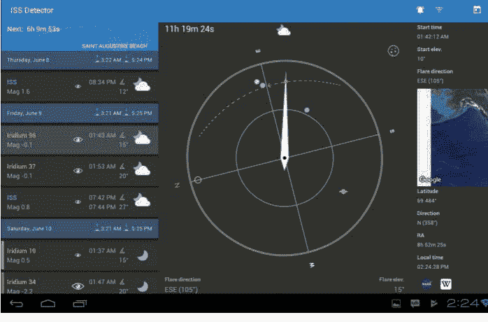

## 第 3 小时：在 Java 中度假

该应用程序在运行时会重绘每个被跟踪卫星的位置，并根据用户所处的方向更改天空地图的取向。这种实时更新之所以可能，是因为 Java 语言是多线程的。多线程是计算机同时完成多项任务的一种。程序的一部分负责一个任务，另一部分负责另一个任务，而这两部分可以互不干扰。在这个示例中，程序的每个部分被称为一个线程（thread）。

在像 ISS 追踪器这样的程序中，每个卫星都可以运行在自己的线程中。如果你使用 Windows 10 等操作系统，当你同时运行超过一个程序时，你就在使用这种行为了。如果你在一个窗口中玩《我的世界》，同时在另一个窗口中运行销售报告并向一个线程拨长途电话，恭喜自己——你正在使用多线程！

### 进入正题

在旅程的这个阶段，你可能会留认为 Java 的主要用途是为了拯救傻瓜、业余厨师和 11 位战士。我们旅程的下一步展示了一个 Java 投入正业的例子。

从 Ulvest Studio 安装 Realtime Stock Quotes 应用程序，它可以显示用户持仓股票的更新价格。图 3.5 显示了股票代码 GOOG（谷歌的母公司 Alphabet Inc.）的当前数据。


**图 3.5 在 ulvest Studio 应用程序中显示的股票市场数据。**

### SourceForge 获取路线

你可以从几个角度看待像这样的股票报价器程序。一种方法是将程序视为一个对象（object）——某种存在于世界中、占用空间并具有某些可以执行操作的东西。正如你在第 10 小时“创建你的第一个对象”中所发现的，Java 使用的面向对象编程是将计算机程序创建为一组对象的方法。每个对象处理一项特定的工作，并知道如何与其他对象交流。例如，股票报价器程序可以被设置为如下一组对象：

* 一个报价对象（quote object），代表单个股票报价
* 一个投资组合对象（portfolio object），持有一组特定股票的报价
* 一个行情器对象（ticker object），显示投资组合
* 一个网络对象（Internet object）、一个用户对象（user object）以及许多其他

在那种模型下，股票报价器软件是完成工作所需的所有对象的集合。

OOP 是一种创建程序的强大方式，它让你编写的程序更有实用价值。考虑一下股票软件。如果程序员想与其他某些软件配合使用该程序的功能，那么报价对象可以与任何新程序配合。无需进行任何更改。

用对象创建的程序更容易维护，因为它们的组织更好。一个对象包含了执行其工作所需的数据和完成该工作的代码。对象还让程序更具扩展性。可以以现有对象为模板创建一个新对象，并用新功能对其进行增强。

### SourceForge 获取路线

这个 Java 程序世界由一位专业人士带领，他非常精通基于应用程序的旅行中的风险和亮点。你很快就会开启自己的旅程，因此学习一个对程序员来说极其有用的网站的领地是值得的：SourceForge，它是寻找 Java（或任何其他语言）运行程序完整示例的地方之一。你可以在 `www.sourceforge.net` 找到它。

SourceForge 是一个致力于协作编程项目的巨型网站。如果你对与他人合作开发你正在编写的程序有兴趣，你可以在 SourceForge 上启动一个项目，分享所有文件，招募他人并与他们交流。该网站上有超过 430,000 个项目，都是开源的，这意味着程序员已经共享了所有的源代码。如果你不熟悉术术，源代码是用于创建计算机程序的文本文件的另一种说法。你在第 2 小时中开发的 `Salut.java` 文件就是源代码的一个示例。


## 第 3 小时：在 Java 中度假

如果你使用 SourceForge 首页顶部的搜索框搜索 Java，你将在该网站的项目目录中找到超过 61,000 条列表。

SourceForge 上的程序之一是 JSoko，它是日本仓库管理员游戏“推箱子”（Sokoban）的 Java 版本（见图 3.6）。这个益智游戏具有动画、图形、键盘控制和声音。要下载此应用程序并查看其 Java 源代码，请访问 `https://sourceforge.net/projects/jsokoapplet` 下载源代码。

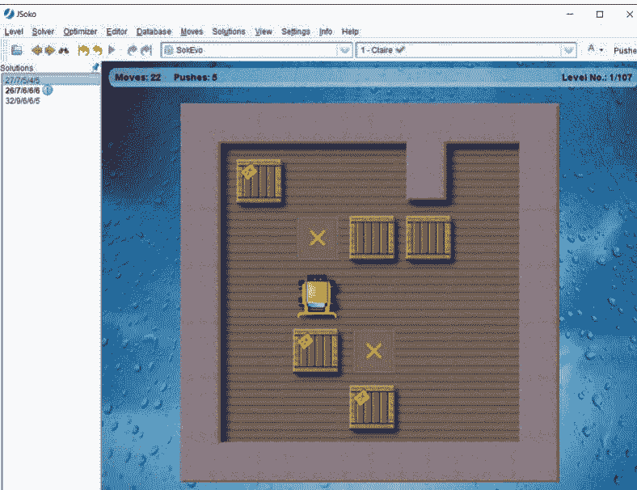

**图 3.6** 可以在 SourceForge 上找到作为开源推箱子游戏 JSoko 的 Java 程序源代码。

Java 包含一个庞大的类库，你可以在自己的程序中使用。JSoko 使用了该库中的 `Image` 类（在 `java.awt` 中）来显示箱子等图形，并使用 `AudioInputStream` 类（在 `javax.sound.sampled` 中）在卡车移动和放置箱子时播放声音。

之所以有很多程序是用 Java 创建的（在 SourceForge 及其他地方）的原因之一是，这种语言的设计目标是尽管功能强大，但它更容易学习。

该语言的一个原始设计目标是让人更快掌握 C++，Gosling 在 20 世纪 90 年代因智能家电项目与 C++ 产生冲突。Java 的大部分内容基于 C++，因此学习过使用该语言的程序员发现学习 Java 更容易。然而，由于 Java 的强大功能，某些 C++ 的元素在 Java 中并不容易掌握。Java 被设计为易于学习、易于调试且易于使用，包含了许多增强使其成为有竞争力的特性。

### 总结

现在假期已经结束了，是时候收拾行李回到 Java 了。在接下来的 21 小时里，你将掌握 Java 的构建模块，学习如何创建自己的对象、设计用户界面以及更多内容。除非停止读这本书去玩小程序（applets）。

### 工作坊

#### 问答

**Q.** 为什么 Java 流行？

**A.** 当这种语言在 20 世纪 90 年代推出时，大多数人在学习小程序。

**Q.** Java SE（标准版）和 Java EE（企业版）的区别是什么？

**A.** Java EE 是 Java 标准版的扩展，包含了支持 JavaBeans、XML 处理等高级技术的包。Java EE 还包含一个为 Java 程序设计的应用程序服务器。Java EE 开发包可以从 Oracle 免费下载。

**Q.** 什么是 Chris Steak House，Ruth 拥有？

**A.** Ruth's Steak House 是美国和少数其他国家超过 130 家高端餐厅的连锁店，其独特的双名名字揭示了它的起源和创始人的固执。该连锁店于 1965 年在新奥尔良成立，所有者是两个孩子的单身母亲 Ruth Fertel。Fertel 看到一则出售餐厅的分类广告，并申请了 22,000 美元的抵押贷款（相当于现在的 150,000 美元）。她与原始所有者 Matulich 达成协议，在原址保留 Chris Steak House 的名称，但后来由于厨房火灾她不得不搬迁。Fertel 的合同不允许她在原址以外的任何地方使用 Chris Steak House 名称，因此将其命名为 Ruth's Steak House。尽管她没有餐饮烹饪知识，但业务非常成功，以至于她在 12 年内就开始加盟。多年来，她忽略了许多更改名称以扩大吸引力的建议。她曾对《财富》杂志的一位记者说：“我一直讨厌这个名字，但我们总能设法解决它。”

Fertel 于 2002 年去世，出生于 1927 年 2 月 5 日——那天正是 Matulich 开办那家牛排馆的日期。

### 测试

面向对象编程是如何命名的？

**A.** 程序被视为一组工作在一起的对象。

**B.** 人们经常因为很难掌握而反对它。

**C.** 它是父母起的名字。

2. Java 应用设计在何运行？

**A.** 网页浏览器。

**B.** Android 手机或平板电脑。

**C.** 桌面电脑。

3. 计算机或设备运行 Java 程序需要什么？

**A.** Java 编译器

**B.** Java 虚拟机

**C.** 两者都需要

### 答案

1. **A.** 它也简写为 OOP。

2. **B.** 所有的 Android 应用都是用 Java 编写的。它们可以在浏览器和桌面上运行，但开发时考虑了移动设备和平板电脑。

3. **B.** Java 虚拟机（JVM）是一个解释器，可以将 Java 字节码转换为计算机或设备可以运行的指令。创建 Java 程序需要编译器，但运行它们不需要。

## 活动

在拆开行李之前，你可以通过以下活动更深入地探索本小时的主题：

- 使用 `www.sourceforge.net` SourceForge 查找使用 Java 语言开发的纸牌游戏。
- 在你的 Android 设备上使用 Google Play 搜索物理模拟。选择一个听起来有趣的并安装它。

书中活动的解答位于书籍网站 `www.java24hours.com` 上。

## 第 4 小时：理解 Java 程序的工作原理

**本小时待办事项：**

- 学习应用程序是如何工作的。
- 向应用程序传递参数。
- 学习 Java 程序是如何组织的。
- 使用 Java 类库（Java Class Library）。
- 尝试 Java 9 的新工具 JShell。
- 在应用程序中创建一个对象。

Java 编程中一个重要的区别是你的程序预期在何处运行。有些程序旨在在你的计算机上运行。另一些程序旨在在手机或平板电脑上运行。

在自己的计算机本地运行的 Java 程序称为应用程序，在 Web 服务器运行的程序称为 servlet，在移动设备上运行的程序称为 app。

在本小时，你将创建一个应用程序并在你的计算机上运行它。

### 创建应用程序

你在第 2 小时“编写你的第一个程序”中编写的 `Salut` 程序是 Java 的一个示例。你创建的下一个应用程序将计算数字的平方根并显示该值。

在 NetBeans 中打开 `Java24` 项目，开始一个新的应用程序：

1. 选择 `File`（文件），`New File`（新建文件）。新建文件向导。
2. 选择类别 `Java` 和文件类型 `Empty Java File`（空 Java 文件），然后点击 `Next`（下一步）。
3. 输入类名 `Root`。
4. 输入包名 `com.java24hours`。
5. 点击 `Finish`（完成）。

NetBeans 会创建 `Root.java` 并在源编辑器中打开该空文件，以便你开始工作。输入列表 4.1 中的所有内容，记住不要输入列表左侧的行号和冒号。这些数字用于在书中更方便地描述程序的部分。完成后，点击工具栏上的 `Save All`（全部保存）按钮保存文件。

### 列表 4.1 Root.java 的完整文本

```java
1: package com.java24hours;
2:
3: class Root {
4:     public static void main(String[] arguments) {
5:     int number = 225;
6:     System.out.println("The square root of "
7:               + number
8:               + " is "
9:               + Math.sqrt(number))
10:    }
11: }
```

`Root` 应用程序完成了以下任务：

- 第 1 行——应用程序被放在 `com.java24hours` 包中。
- 第 5 行——一个值为 225 的整数值存储在名为 `number` 的变量中。
- 第 6–10 行——显示此整数及其平方根。第 9 行中的 `Math.sqrt(number)` 语句显示了平方根。

如果你输入列表 4.1 时没有任何拼写错误（包括标点和如所示的字母大写），你可以通过 NetBeans 中的 `Run`（运行），`Run File`（运行文件）运行该文件。程序的输出出现在 Output 面中，如图 4.1 所示。

```
Output - Java24 (run)

run:

The square root of 225 is 15.0

BUILD SUCCESSFUL (total time: 0 seconds)
```

**图 4.1** Root 应用程序的输出。

当你运行 Java 时，Java 虚拟机（JVM）寻找 `main()` 块并开始处理块内的 Java 语句。如果你的程序没有 `main()` 块，JVM 将返回错误。

第 9 行中的语句 `Math.sqrt(number)` 演示了 Java 语言的一种内置能力——确定数字平方根的能力。有一个名为 `Math` 的 Java 程序，它有一个名为 `sqrt()` 的方法来查找特定数字的平方。`Math` 程序是 Java 类库的一部分，你将在本小时稍后探索它。

### 向应用程序传递参数

你可以从命令行使用 `java`（一个调用 JVM 的程序）运行 Java 应用程序。NetBeans 在运行程序之前使用此程序。当 Java 程序作为命令运行时，JVM 会加载该应用程序。命令可以包含额外的信息，如下例所示：

```
java TextDisplayer readme.txt /p
```

发送到程序的任何额外信息都称为参数。如果有第一个参数，它在程序名称后提供一个空格。

如果你想包含空格，必须在它周围加上引号，如下例所示：

```
java TextDisplayer readme.txt /p "Page Title"
```

参数之间用空格隔开。要发送多个参数，你可以在命令行中指定它们。

要查看参数如何工作，请创建一个应用程序：

1. 选择 `File`（文件），`New File`（新建文件）。新建文件向导。
2. 选择类别 `Java` 和文件类型 `Empty Java File`（空 Java 文件）。
3. 输入类名 `BlankFiller`。
4. 输入包名 `com.java24hours`。
5. 点击 `Finish`（完成）。

NetBeans 会创建 `BlankFiller.java` 并在源编辑器中打开该空文件，以便你开始工作。输入列表 4.2 中的所有内容，记住不要输入列表左侧的行号和冒号。完成后，点击工具栏上的 `Save All`（全部保存）按钮保存文件。

### 列表 4.2 BlankFiller.java 的完整文本

```java
1: package com.java24hours;
2:
3: class BlankFiller {
4:     public static void main(String[] arguments) {
5:         System.out.println("The square root of "
6:                   + 225
7:                   + " is "
8:                   + Math.sqrt(225));
9:     }
10: }
```

### Java 类库

Java 类被组织在包（packages）中，其功能类似于计算机上的文件文件夹。你到目前为止创建的包都属于 `com.java24hours` 包。

文档主页被分为几个框架（frames）。最大的框架列出了组成 Java 类库的所有包，并对每个包进行了描述。

包的名称有助于描述它们的用途。例如，`java.io` 是一组用于磁盘驱动器、互联网服务器和其他数据源的输入和输出的类；`java.time` 包含与时间、日期相关的类；而 `java.util` 提供了有用的工具类。

在文档主页上，最大的框架是包列表，每个包都有一个简短描述。点击包的名称可以了解更多信息。一个页面会列出包中的所有类。

Java 类库中的每个类在这一参考网站上都有自己的文档页，总共超过 22,000 页（你现在或永远都不需要阅读所有的）。

在最后一个小时中，你将浏览这个类库并使用一个现有的 Java 类来完成一些工作。

`Dice` 程序使用了 `java.util` 包中的 `Random` 类，该类可以用于生成随机数。

在程序中使用该类时，第一步是使用以下语句导入它的包：

```java
import java.util.*;
```

这使得你可以在不使用全名（即 `java.util.Random`）的情况下引用 `Random` 类。相反，你只需要将其引用为 `Random`。星号（`*`）允许你通过较短的名称引用包中的所有类。

如果你只想导入 `Random` 类，语句应为：

```java
import java.util.Random;
```

Java 程序可以被认为是一个执行任务（或多个任务）的对象。`Random` 类是一个我们用于创建 `Random` 对象的模板。要创建一个对象，使用 `new` 关键字，后跟类名和括号：

```java
Random generator = new Random();
```

这创建了一个名为 `generator` 的变量，它持有一个新的 `Random` 对象。该对象是一个可以产生随机数的随机数生成器。可以执行的任务被称为方法（methods）。

对于此程序，将使用对象的 `nextInt()` 方法来产生随机整数值：

```java
int value = generator.nextInt();
```

Java 中的整数范围从 -2,147,483,648 到 2,147,483,647。生成器随机选择其中一个数字并将其赋值给 `value` 变量。

如果没有 Java 类库中的 `Random` 类，你将不得不自己编写程序来生成随机数，这是一项非常复杂的任务。随机数在游戏、教育程序以及其他执行随机操作的程序非常有用。

在 NetBeans 中，创建一个名为 `Dice` 的新空 Java 文件，并将其放入 `java24hours` 包中。当源代码编辑器打开时，将代码列表 4.3 的文本编辑到该窗口，然后点击 `Save` 按钮（或选择菜单命令 `File`、`Save`）。

### 代码列表 4.3 Dice.java 的全文

```java
1: package com.java24hours;
2:
3: import java.util.*;
4:
5: class Dice {
6:     public static void main(String[] arguments) {
7:     Random generator = new Random();
8:     int value = generator.nextInt();
9:   System.out.println("The random number is "
10:  + value);
11:  }
12: }
```

通过选择 `Run`、`Run File` 来运行程序。输出如图 4.4 所示，尽管你的数字会不同。（实际上，有四十分之一的概率会是同一个数字，这比彩票的中奖概率还要糟糕）。

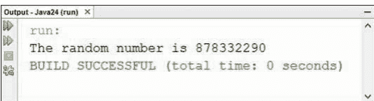

**图 4.4** Dice 程序的输出。

你现在有一个随机选择的整数来作为你的名字。妥善对待它。

`Random` 类和 Java 类库中的所有类一样，在 Oracle 网站上有详尽的文档可以阅读。它描述了类的用途、它所属的包、如何创建该类的对象，以及它拥有哪些可以调用以执行某些操作的方法。

1. 在你的浏览器中，加载页面 `http://download.java.net/jdk9/docs/api`。
2. 在左上角的导航栏中，点击 `Frames` 链接。文档将在几个框架中打开。
3. 在左上角的 Modules 框架中，点击 `java.base`。
4. 在主框架中，向下滚动直到看到 `java.util` 包的链接。点击此链接。显示该包的文档。
5. 在主框架中，向下滚动并点击 `Random` 链接。

作为一名经验略浅的 Java 程序员，你可能会发现文档非常难以读懂。这不必惊慌。但当你阅读这本书并对它感到好奇时，你会发现……

（注：原文此处似乎中断，后续根据语境翻译）

作为一名 Java 程序员（由于用户提供的文本在此处结束了，若有后续内容请提供，我将继续翻译。）

### 测验

通过回答以下问题，测试你对本小时涵盖内容的掌握程度。

1. 移动设备可以运行哪种 Java 程序？

   **A.** Apps（移动应用）

   **B.** Applications（应用程序）

   **C.** 无

2. JVM 代表什么？

   **A.** Journal of Vacation Marketing（假期营销杂志）

   **B.** Jacksonville Veterans Memorial（杰克逊退伍军人纪念馆）

   **C.** Java Virtual Machine（Java虚拟机）

3. 如果你因为向 Java 程序发送信息的方式与人争吵，你在做什么？

   **A.** 为字符串挣扎（Struggling over strings）

   **B.** 为参数争论（Arguing about arguments）

   **C.** 为功能斗争（Feudin' for functionality）

### 答案

1. **A.** Apps 作为手机等移动设备的一部分运行，而 applications 几乎运行在其他任何地方。

2. **A., B., 或 C.** 陷阱！这三个缩写代表所有三个含义，尽管在接下来 20 小时内你需要记住的是 Java Virtual Machine。

3. **B.** Applications 以参数（arguments）的形式接收信息。我们难道不能和和平相处吗？

## 活动


如果你想将你的敏锐性应用于应用程序，建议完成以下活动：

- 以 `Root` 应用为指导，创建一个 `NewRoot` 应用，该应用可以显示 625 的平方根。
- 以 `Root` 应用为指导，创建一个 `NewRoot` 应用，该应用可以显示作为参数提交的数字的平方根。

本书中活动的解决方案发布在书籍网站 `www.java24hours.com` 上。

## 第 5 小时

### 在程序中存储和更改信息

本小时的任务列表：

- 创建一个变量。
- 使用不同类型的变量。
- 在变量中存储值。
- 在数学表达式中使用变量。
- 将一个变量的值存储在另一个变量中。
- 增加和减少变量的值。

在第 2 小时“编写你的第一个程序”中，你使用了一个变量，变量是一个专门设计用于存储信息的特殊存储位置。存储在变量中的信息可以在程序运行时发生变化。你的第一个程序在变量中存储了一段文本。字符串只是变量可以存储的类型之一。它们还可以持有字符、整数、浮点数和对象。

在本小时中，你将学习更多关于在 Java 程序中使用变量的知识。

### 语句和表达式

计算机程序是告诉计算机做什么的指令集。每条指令都是一个语句（`statement`）。下面这个 Java 程序的示例是一个语句：

```
int highScore = 45000;
```

你可以使用大括号在 Java 程序中将一组语句组合在一起。这些分组被称为块语句（`block statements`）。考虑程序的以下这部分：

```
1: public static void main(String[] arguments) {
2:     int a = 3;
3:     int b = 4;
4:     int c = 8 * 5;
5: }
```

### 分配变量类型

此示例的第 2 到 4 行位于块语句中。第 1 行的左括号表示块的开始，第 5 行的右括号表示块的结束。

某些语句被称为表达式（`expressions`），因为它们涉及数学表达式并产生结果。前一个示例中的第 4 行是一个表达式，因为它将变量 `c` 的值设置为 8 乘以 5。在本小时中，你将处理表达式。

变量是计算机在运行程序时记忆内容的主要方式。第 2 小时的 `Saluton` 程序使用 `greeting` 变量来存储 "Salutan mundo!"。计算机需要记住它以便稍后显示该消息。

在 Java 程序中，变量通过语句创建，该语句必须包含两个内容：

- 变量名
- 变量将要存储信息的类型

变量还可以包含正在存储的信息的值。

要查看不同类型的变量以及它们是如何创建的，启动 `NetBeans` 并创建一个名为 `Variable` 的空 Java 文件。

开始编写程序 `com.java24hours;`，输入以下行：

```
package com.java24hours;

class Variable {
    public static void main(String[] arguments) {
        // Coming soon: variables
    }
}
```

在继续之前，请先保存此文件。

### 整数和浮点数

到为止，`Variable` 程序包含一个 `main()` 块，其中只有一个语句——注释 `// Coming soon: variables`。删除该注释并在该处输入以下语句：

```
int tops;
```

此语句创建了一个名为 `tops` 的变量。它没有为 `tops` 指定值，因此目前该变量是一个空存储空间。语句开头的 `int` 文本将 `tops` 指定为一个用于存储整数的变量。你可以使用 `int` 类型来存储计算机程序所需的大非小数数字。它可以持有从约 -2.14 亿到 21.4 亿之间的任何整数。

在 `int tops` 语句后添加一个空行并输入以下语句：

```
float gradePointAverage;
```

此语句创建了一个名为 `gradePointAverage` 的变量。`float` 文本代表浮点数。浮点变量被用于存储可能包含小数点的数字。

`float` 变量类型可以持有多达 38 位的小数。更大的 `double` 类型可以持有多达 300 位的小数。

### 字符和字符串

由于你目前为止处理的变量都是数值型的，你可能会认为所有变量都用于数字。你也可以使用变量来存储文本。两种类型的文本是字符（`characters`）和字符串（`strings`）。字符是单个字母、标点符号或符号。字符串是字符的组。

你在 `Variable` 程序中的下一步是创建 `char` 和 `String` 变量。在 `gradePointAverage` 行上方添加这两个语句：

```
char key = 'C';
String productName = "vets";
```

正如你注意到的，其他变量类型都是小写字母（`int`、`float` 和 `char`），在创建变量时 `String` 需要大写字母。Java 程序中的字符串与其他信息类型不同。你将在第 6 小时“使用字符串进行通信”中学习这种区别。

添加 `char` 和 `String` 语句后，你的程序应该类似于 5.1。进行任何修改并保存文件。

### 列表 5.1 Variable 程序

```
1: package com.java24hours;
2:
3: class Variable {
4:     public static void main(String[] arguments) {
5:     int gets;
6:     float gradePointAverage;
7:     char key = 'C';
8:     String productName = "vets";
9: }
10:}
```

`Variable` 程序中的最后两个使用符号在创建变量时分配一个初始值。

在本小时稍后的部分，你会发现可以为你创建的任何变量使用此选项。

> **注意**
>
> 此程序可以运行但没有输出。

### 其他数值变量类型

到目前为止介绍的变量类型是你在大多数 Java 编程中使用的主要类型。你可以在不常见的情况下采用其他类型的变量。

一种是 `byte`，它持有范围从 -128 到 127 的整数。以下语句创建了一个初始值为 27 的变量 `escapeKey`：

```
byte escapeKey = 27;
```

第二个是 `short`，可以用于尺寸比 `int` 类型更小的整数。`short` 整数的范围从 -32,768 到 32,767，如下所示：

```
short roomNumber = 222;
```

数值变量类型的最后一种是 `long`，用于 `int` 类型无法容纳的大型整数。`long` 整数可以是从 -922 万亿到 922 万亿，这是一个足够大的数字，可以涵盖政府支出以外的所有内容。

### 分配变量类型

在 Java 中处理巨大的数字时，很难一眼看出数字的值，如下语句所示：

```
long salary = 2644000000000L;
```

与那些 0 相比，你可能无法一眼看出它是 2644 亿。Java 允许使用下划线（`'_'`）字符来组织大数字。这里有一个示例：

```
long salary = 264_400_000_000L;
```

下划线会被忽略，因此变量的值保持不变。它们的作用只是让数字更具人类可读性。

数字末尾的大写字母 "L" 指定它为一个 `long` 类型的值。如果省略了 "L"，Java 编译器将假设该数字是一个 `int`，并报错“整数数字过大”（`integer number too large`）。

> **注意事项**
>
> 如果在 `NetBeans` 源代码编辑器中，名称中的下划线被标记为错误，说明该 IDE 设置了旧版本的 Java。要解决此问题，请在“项目”（Projects）窗格中，右键点击当前项目的名称（可能是 `Java24`）并选择“属性”（Properties）。打开“项目属性”对话框并在“类别”（Categories）面板中选择“源”（Sources）。检查“源/二进制格式”（Source/Binary Format）下拉菜单，确保它是当前的 Java 版本。

### boolean 变量类型

Java 有一种名为 `boolean` 的变量类型，可用于存储 `true`（真）或 `false`（假）值。乍看上去，布尔变量可能看起来特别有用，除非你打算编写很多判断题。然而，布尔变量用于你程序中的各种情况。以下是布尔变量用于回答的一些问题示例：

- 用户按了键吗？
- 游戏结束了吗？
- 我的银行账户透支了吗？
- 这些裤子让我的屁股看起来很胖吗？
- 这些是我寻找的机器人吗？

布尔值是存储是/否以及真/假问题答案的场所。

以下语句创建了一个名为 `gameOver` 的布尔变量：

```
boolean gameOver = false;
```

该变量的初始值为 `false`，因此这样的语句可以在游戏程序中表示游戏尚未结束。稍后，当发生结束游戏事件时，可以将 `gameOver` 变量设置为 `true`。

尽管两个可能的布尔值在程序中看起来像字符串，但你不应该用引号将它们括起来。第 7 章“使用条件测试做出决策”将进一步探讨 `boolean` 变量。

> **注意**
>
> 布尔数是用来乔治·布尔（George Boole，1815–1864）命名的。布尔是一位在成年之前大多是自学的数学家，他发明了布尔代数，这已成为计算机编程、数字电子和逻辑学的基础部分。可以想象，他小时候在真假测试中表现得很好。

### 为你的变量命名

Java 中的变量名可以以字母、下划线字符（`"_"`）或美元符号（`"$"`）开头。名称的其余部分可以是任何字母或数字。你可以给变量命名任何你喜欢的名称，但在命名时应保持一致。本节概述了通常推荐的变量命名方法。

Java 在变量名上是区分大小写的，因此你必须始终对变量名保持大小写。例如，如果程序某处将 `gameOver` 变量引用为 `GameOver`，错误会导致程序无法编译。

变量名应该以某种方式描述其用途。首字母应该小写，且如果变量名包含多个单词，则将后续每个单词的首字母大写。例如，如果你想创建一个整数来存储游戏程序中的历史最高分，可以使用以下语句：

```
int allTimeHighScore;
```

你不能在变量名中使用标点符号或空格，因此以下两个都不起作用：

```
int all-TimeHighScore;
int all Time Score;
```

如果你在程序中使用这些变量名，`NetBeans` 会通过在源代码编辑器的行处显示红色警报图标来标记该错误。

> **注意**
>
> 变量名不是 Java 中唯一区分大小写的方面。程序中任何你可以命名的内容，包括类、包和方法，都必须使用一致的大小写来进行引用。

该语言使用的关键字（如 `public`、`class`、`true` 和 `false`）不能作为变量名。

Java 增加了另一个限制：变量名不能是单个下划线 `"_"` 字符。这种语句在 Java 中曾经是允许的：

```
int _ = 747;
```

尝试一下，会产生错误，并提示 `'_'` 是一个关键字。

### 在变量中存储信息

在创建 Java 程序中的变量的同时，你可以为变量存储一个值。你也可以在程序的后续任何时候为变量赋值。

要在创建变量时为其设置初始值，请使用等号（`"="`）。这里创建一个名为 `pi` 且初始值为 3.14 的浮点变量的示例：

```
double pi = 3.14;
```

所有存储数字的变量都可以以类似的方式设置。如果你正在设置字符或字符串变量，必须像本章之前描述并在在值周围加上引号。

如果两个变量的类型相同，你还可以将一个变量设置为另一个变量的值。考虑以下示例：

```
int mileage = 300;
int totalMileage = mileage;
```

首先，创建了一个初始值为 300 的整数变量 `mileage`。接下来，创建了一个值为 `mileage` 值的整数变量 `totalMileage`。

> **注意事项**
>
> 如果不提供初始值，在编译程序时，可能会得到错误，提示该变量可能未初始化。

正如你所学到的，Java 有类似的存储不同大小值的数值变量。你可以在数值值后面附加一个字母来指示其类型，如下语句所示：

```
float pi = 3.14F;
```

值 3.14 之后的 "F" 表示它是一个 `float`。如果省略了字母，Java 假设 3.14 是一个 `double` 值。字母 "L" 用于长整数，"D" 用于 `double` 值。

另一种命名约定是不改变的变量名中的每个字母都大写。这些变量是常量。以下代码创建了常量：

```
final int TOUCHDOWN = 6;
final int FIELDGO = 3;
final int CONVERSION = 2;
final int PAT = 1;
```

由于常量的值永远不会改变，你可能会疑惑为什么要这样做——你只需使用赋值给常量的值即可。使用常量的一个优势是它们让程序更容易理解。

在前面的四个语句中，常量的名称大写了。这在 Java 中不是强制的，但它是程序员之间的标准约定，用于区分常量和其他变量。

### 运算符

语句通过采用运算符 `+`、`-`、`*`、`/` 和 `%` 来使用数学表达式。你在程序中使用这些表达式来处理数字。

Java 中的加法表达式使用 `+` 运算符，如下语句所示：

```
double weight = 205;
weight = weight + 10;
```

第二个语句使用 `+` 运算符将 `weight` 变量设置为其当前值加 10。

减法表达式使用 `-` 运算符：

```
weight = weight - 15;
```

该表达式将 `weight` 变量设置为其当前值减 15。

除法表达式使用 `/` 符号：

```
weight = weight / 3;
```

这会将 `weight` 变量除以 3。

若要从除法表达式中获取余数，请使用 `%` 运算符（也称为模运算）。以下语句计算 245 除以 3 的余数：

```
int remainder = 245 % 3;
```

乘法表达式使用 `*` 运算符。这里有一个将乘法表达式作为复杂语句一部分的语句：

```
int total = 500 + (score * 12);
```

表达式 `score * 12` 将 `score` 乘以 12。整个语句将 `score` 乘以 12，然后在结果上加上 500。如果 `score` 等于 20，则该表达式的结果为 `total` 等于 740：500 + (20 * 12)。

### 变量的递增与减

程序中的常见任务是将变量的值改变一。你可以将值增加一，这被称为递增；或者将值减少一，这被称为递减。有运算符可以完成这些任务。

要将变量的值加一，请在以下语句中使用 `++` 运算符：

```
power++;
```

该语句在 `power` 变量存储的值的基础上加 1。

要将变量的值减一，请使用 `--` 运算符：

```
rating--;
```

该语句将 `rating` 减少 1。

你也可以将递增和递减运算符放在变量名之前，如下句所示：

```
++power;
```

```
--rating;
```

将运算符放在变量名之前称为前置（`prefixing`），放在名称之后称为后置（`postfixing`）。

> **注意**
>
> 感到困惑了吗？这比听起来要容易，如果你回想起小学学习前缀时的场景就如此。就像如 `"sub-"` 或 `"un-"` 这样的前缀位于如 `urban`（非城市的）或 `unexpected`（意外的）等单词的开头一样，前置运算符位于变量名的开头。后置运算符位于结尾。

当你在表达式内部使用递增递减运算符时，前置和后置运算符的区别就变得重要。

考虑以下语句：

```
int x = 3;
int answer = x++ * 10;
```

在处理这些语句后，`answer` 变量等于多少？你可能期望它等于 40——如果将 3 加 1 等于 4，然后用 4 乘以 10，结果就是如此。

然而，`answer` 的最终值为 30，因为使用了后置运算符而不是前置运算符。

当在表达式内部对变量使用后置运算符时，变量的值在表达式完全求值后不会改变。语句 `answer = x++ * 10` 的执行效果与以下两个语句的执行顺序相同：

```
int answer = x * 10;
x++;
```

前置运算符的情况则相反。如果他们在表达式内部对变量使用它们，变量的值在表达式求值之前就会改变。

考虑以下语句：

```
int x = 3;
int answer = ++x * 10;
```

这确实导致 `answer` 等于 40。前置运算符导致 `x` 的值在表达式求值之前改变。语句 `answer = ++x * 10` 的执行顺序与这些语句相同：

```
x++;
int answer = x * 10;
```

对于 `++` 和 `--` 运算符，很容易让人感到焦躁意乱，因为它们不像你在书中遇到的许多其他概念那样直观。

我希望告诉你的这些不会打破程序员间某种不成文的准则，你不需要在自己的程序中使用递增和递减运算符。你可以通过这样使用 `+` 和 `–` 运算符来实现相同的结果：

```
x = x + 1;
y = y - 1;
```

递增和递减是有用的快捷方法，但在表达式中使用较长的路径也是可以的。

关于运算符的所有信息 63

> **注意**
>
> 在第 1 小时“成为程序员”中，`C++` 编程语言的名称被描述为一个你以后会听懂的笑话。现在你已经接触了递增运算符 `++`，你拥有了所需的信息来理解为什么 `C++` 的名字里有两个符号而不是只有一个。因为 `C++` 在 `C` 语言的基础上添加了新特性和功能，它可以被认为是 `C` 的增量式增长——因此名为 `C++`。
>
> 当你完成书中所有的 24 小时课程后，你也能讲述那种让世界上 99% 人口无法理解的笑话。

### 运算符优先级

当你使用包含多个运算符的表达式时，你需要知道计算机在计算该表达式时使用的顺序。考虑以下语句：

```
int y = 10;
x = y * 3 + 5;
```


除非你知道计算机在处理这些语句中的数学运算时使用的是什么顺序，否则你无法确定变量等于多少。它可能被设置为 35 或 80，取决于是先计算 `y * 3` 还是先计算 `3 + 5`。

计算表达式时使用以下求值顺序：

1. 先进行递增和递减。
2. 接下来执行乘法、除法和取模。
3. 然后是加法和减法。
4. 接下来进行比较。
5. 等号 `=` 用于设置变量的值。

由于乘法发生在加法之前，你可以回顾之前的示例并得出答案：先将 `y` 乘以 3 等于 30，然后加上 5。变量 `x` 被设置为 35。

如果你想让表达式按照不同的顺序求值，可以使用括号将表达式的部分组合起来。例如，`x = 5 * 3 + 2` 通常会等于 17，因为乘法先于加法。但看这个修改形式：

```
x = 5 * (3 + 2);
```

在这种情况下，先处理括号内的表达式，结果为 25。

# 表达式

你在学校做数学题时，是否曾向上苍抱怨这些东西在生活中根本用不上？很遗憾要告诉你，你的老师是对的——你的数学能力在编程中很有用。好消息是计算机可以执行你要求的任何数学运算。表达式经常用于编程完成如下任务：

- 改变变量的值
- 计算某事发生的次数
- 在程序中使用数学公式

当你编写程序时，你会发现自己在运用以前的知识。表达式可以使用加、减、乘、除和取模。

为了观察表达式的作用，返回 NetBeans 并创建一个名为 `PlanetWeight` 的新 Java 文件。该程序记录了一个女性在太阳系其他天体旅行时的体重变化。在源编辑器中输入列表 5.2 的全文。我们将逐部分讨论程序的程序。

## 列表 5.2 PlanetWeight 程序

```
1: package com.java24hours;
2:
3: class PlanetWeight {
4:     public static void main(String[] arguments) {
5:         System.out.print("Your weight on Earth is ");
6:         double weight = 178;
7:         System.out.println(weight);
8:
9:         System.out.print("Your weight on Mercury is ");
10:        double mercury = weight * .378;
11:        System.out.println(mercury);
12:
13:        System.out.print("Your weight on the Moon is ");
14:        double moon = weight * .166;
15:        System.out.println(moon);
16:
17:        System.out.print("Your weight on Jupiter is ");
18:        double jupiter = weight * 2.364;
19:        System.out.println(jupiter);
20:
21:}
22:}
```

完成后

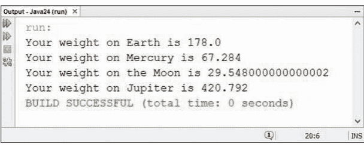

图 5.1 PlanetWeight 程序的输出。

正如你创建的其他程序一样，`PlanetWeight` 程序使用一个 `main()` 块语句来执行所有工作。该语句可以分为以下四个部分：

- 第 5–7 行：将人的体重初始设置为 178。
- 第 9–11 行：计算水星上的体重减轻。
- 第 13–15 行：计算月球上的体重减轻。
- 第 17–19 行：计算木星上的体重增加。

第 6 行创建了变量并将其指定为 `double` 类型的大型浮点变量。该变量被赋予初始值 178，并在整个程序中用于监测人的体重。

下一行与程序中的几个语句类似：

```
System.out.println(weight);
```

`System.out.println()` 显示其括号内包含的字符串。在第 5 行，`System.out.print()` 命令显示文本 "Your weight on Earth is "。程序中有多个 `System.out.print()` 和 `System.out.println()` 语句。

它们之间的区别在于，`print()` 在显示文本后不会另起行，而 `println()` 则会。

### 注意

对于示例值，`PlanetWeight` 应用使用了 178 磅的体重，这恰好是 BMC 健康研究中北美人的平均体重。相比之下，大洋地区的人平均为 164 磅，欧洲人 156 磅，拉丁美洲人 150 磅，非洲人 134 磅，亚洲人 127 磅。

所以如果你在北美阅读这些内容，有人问你“你想再来个苹果派配吗？”，那么这个问题的正确答案是不。

### 总结

现在你已经接触了变量和表达式，你可以在程序中给计算机提供大量的指令。

通过你在这一小时内培养的技能，你可以编写完成许多与计算器相同任务的程序，轻松处理复杂的数学方程。

你还学到了去月球之旅是一个有效的减肥计划。

数字只是可以存储在变量中的一种类型。你还可以存储字符、字符字符串以及被称为布尔变量的特殊真或假值。下一小时将扩展你对 `String` 变量以及它们如何被存储和使用的知识。

### 工作坊

#### 问答

- **Q.** Java 程序中的一行和语句是一样的吗？
- **A.** 不，你在书中创建的每个程序都将每个语句放在一行，以便于程序更容易理解；这并不是强制要求的。

  Java 编译器在编译程序时不会考虑换行、间距或其他格式问题。编译器只想在每个语句的末尾看到分号。这一行在 Java 中可以正常工作：

  ```
  int x = 12; x = x + 1;
  ```

  在一行中放置多个语句会让人类在阅读源代码时更难理解。出于考虑，不建议这样做。

- **Q.** 为什么变量名的第一个字母应该是小写，例如 `gameOver`？
- **A.** 这是一种命名规范，可以从两个方面帮助你的编程。首先，它让变量在 Java 程序的其他元素中更容易被识别。其次，通过保持变量命名的一致性，你可以消除在程序多处使用变量时可能发生的错误。书中使用的大小写风格是多年来大多数 Java 程序员所采用的风格。

- **Q.** 我可以在 Java 中指定整数为二进制吗？
- **A.** 你可以在数字前面加上字符“0”，后面跟着该数值的位。由于 1101 是数字 13 的二进制形式，以下语句将整数设置为 13：

  ```
  int z = 0b0000_1101;
  ```

  下划线只是为了让数字更易读，就像大数字一样。编译器会忽略下划线。

  十六进制值可以使用数字加“0x”来表示，例如超级碗 0x33，新英人队以 0x22 击败了大鹰。

## 第 5 小节：在程序中存储和更改信息

- **Q.** 什么是 Larvets？
- **A.** 本小时提到的 Larv 是一种由食用虫制成的零食，经过杀死、干燥，并与多力士片类似的美味调味混合。你可以通过邮购零售商 Hotix 的网站 www.hotix.com 或拨打 1-800-EAT-WORM 订购三种口味：烧烤、切达奶酪和墨西哥味。

### 测试

通过回答以下问题，测试你对变量、表达式以及本小时其余知识的掌握情况。

- 1. 包含左括号和右括号的语句组称为什么？
  - A. 块语句
  - B. 组软件
  - C. 括号语句

- 2. 布尔变量用于存储真或假值。
  - A. 正确
  - B. 错误
  - C. 不，谢谢。我已经吃过了。

- 3. 什么字符不能作为变量名的开头？
  - A. 美元符号
  - B. 两个斜杠 (`//`)
  - C. 字母

### 答案

- 1. A. 块语句
- 2. A. 正确
- 3. B. 两个斜杠 (`//`)

## 活动

你可以通过以下活动更全面地复习主题：

- 扩展 `PlanetWeight` 程序以跟踪和显示。
- 创建一个简单的 Java 程序，使用变量并显示 `x` 加 `y` 的结果。

要查看实现这些活动的 Java 程序，请访问书籍的网站。

```
char quitKey = '@';
```

### 在字符串中使用特殊字符

当创建或显示字符串时，其文本必须包含在双引号内。这些双引号本身不会被显示，这引发了一个问题：如果你想显示一个双引号怎么办？

为了显示该字符，Java 有一个特殊的代码可以放入字符串中：`\"`。每当在字符串中遇到这段代码时，它就会被替换为双引号。例如，如下：

```java
System.out.println("Anthony Ferrante directed \"Sharknado.\");
```

这段代码的显示结果如下：

Anthony Ferrante directed "Sharknado"

你可以通过这种方式向字符串中插入其他特殊字符。下表列出了这些特殊字符；注意每个字符前面都有一个反斜杠（`\`）。

| 特殊字符 | 显示 |
| --- | --- |
| `\'` | 单引号 |
| `\"` | 双引号 |
| `\\` | 反斜杠 |
| `\t` | 制表符 |
| `\b` | 退格符 |
| `\r` | 回车 |
| `\f` | 分页符 |
| `\n` | 换行符 |

换行符会导致随后的文本在下一行开头显示。看这个示例：

```java
System.out.println("Script\nThunder Levin");
```

该语句的显示结果如下：

Script by
Thunder Levin

### 拼接字符串

当你使用 `System.out.println()` 并以其他方式处理字符串时，你可以使用 `+` 将字符串拼接在一起，这与用于数字相加的运算符相同。

`+` 运算符在处理字符串时具有不同的含义。它不是执行数学运算，而是将两个字符串拼接在一起。此操作会导致字符串一起显示，或者将两个较小的字符串合并成一个大字符串。

将字符串中的两个事物连接在一起被称为“拼接”（concatenation）。

#### 注意

在你建立编程技能的过程中，可能会在其他书籍中看到“concatenation”这个术语，它是值得了解的。然而，当一个字符串和另一个连接在一起时，这里使用的是“粘贴”（pasting）一词。Pasting 听起来很有趣。而 Concatenating 听起来像是某种在开明火时绝不该做的事。

以下语句使用 `+` 运算符显示了一个长字符串：

```java
System.out.println("Sharkado is an hour and a half of your " +
"life that you'll never get back.\nAnd you won't want to.\n" +
"- David Hinckley, New York Daily News");
```

与其将字符串放在单行中（这可能会导致你以后查看程序时更难理解），你可以使用 `+` 运算符将文本跨越程序 Java 源代码的两行。当它被显示时，其结果如下：

> "Sharkado is an hour and a half of your life that you'll never get back.
>
> And you won't want to.
>
> -- David Hinckley, New York Daily News

字符串中使用了特殊字符：`\n` 和 `\t`。为了更好地熟悉这些字符，请将输出与产生它的 `System.out.println()` 语句进行比较。

## 在字符串与其他变量

虽然你可以使用 `+` 运算符将两个字符串拼接在一起，但你更多地用它连接字符串和变量。看下面：

```java
int length = 86;
char rating = 'R';
System.out.println("Running time: " + length + " minutes");
System.out.println("Rated " + rating);
```

### 高级字符串处理

这段代码的显示如下：

Running time: 86 minutes
Rated R

这个示例展示了 `+` 运算符处理字符串时的一个独特方面。它可以让非字符串的变量在显示时被视为像字符串一样的类型。变量 `length` 是一个被赋值为 86 的整数。它显示在字符串 "Running time:" 和 "minutes" 之间。`System.out.println()` 语句被要求显示一个整数类型的字符串，加上另一个字符串。该语句之所以有效，是因为组中至少有一部分是字符串。Java 语言提供了这种功能，使信息的显示更加简单。

你可能想对字符串的操作之一是多次向其发布内容，如下例所示：

```java
String searchKeywords = "";
searchKeywords = searchKeywords + "shark";
searchKeywords = searchKeywords + "hurricane";
searchKeywords = searchKeywords + "danger";
```

这段代码会导致 `searchKeywords` 变量被设置为 "shark hurricane danger"。第一行创建了 `searchKeywords` 变量并将其设置为空字符串，因为双引号之间没有任何内容。第二行将 `searchKeywords` 变量设置为其当前字符串加上末尾添加的 "shark"。接下来两行以相同的方式添加了 "hurricane" 和 "danger"。

如你所见，当变量末尾粘贴更多文本时，变量名会被列出两次。Java 提供了一个快捷方式来简化这个过程：`+=` 运算符结合了 `=` 和 `+` 运算符的功能。对于字符串，可以使用 `+=` 缩短 `searchKeywords` 示例，如下语句所示：

```java
String searchKeywords = "";
searchKeywords += "shark";
searchKeywords += "hurricane";
searchKeywords += "danger";
```

这段代码产生相同的结果：`searchKeywords` 被设置为 "shark hurricane danger"。

你还有其他几种方法可以检查字符串变量并更改其值。这些高级功能之所以可行，是因为字符串是 Java 语言中的对象。处理字符串将培养你以后应用到其他对象上的技能。

### 比较两个字符串

处理字符串经常需要的操作之一是测试两个字符串是否相等。你通过 `equals()` 方法来实现。考虑这个示例：

```java
String favorite = "chainsaw";
String guess = "chainsaw";
System.out.println("Is favorite equal to guess? " + favorite.equals(guess));
```

如果字符串具有相同的值，该方法产生 "true"。如果不是，则产生 "false"。再考虑另一个示例：

```java
String favorite = "chainsaw";
String guess = "saw";
System.out.println("Is favorite equal to guess? " + favorite.equals(guess));
```

第二个示例的输出将是：

Is favorite equal to guess? false

另一个常见任务是测试字符串是否为空。空字符串在双引号内没有任何内容。例如：

```java
String favorite = "";
if (favorite.equals("")) {
  System.out.println("The string is empty");
}
```

还有一个 `equalsIgnoreCase()` 方法，它可以在不考虑字符串大小写差异的情况下进行比较。如果 `favorite` 是 "chainsaw"，那么当 `guess` 是 "CHAINSAW" 时，`equalsIgnoreCase()` 将返回 true。

### 确定字符串的长度

确定字符串的字符数长度是很有用的。你可以通过 `length()` 方法来实现。该方法的工作方式与 `equals()` 方法相似，只不过只涉及一个字符串变量。看这个示例：

```java
String cinematographer = "Ben Demare";
int nameLength = cinematographer.length();
```

这个示例将整数 `length` 设置为 9。`cinematographer` 的 `length()` 方法计算字符串变量中的字符数量，并存储在 `nameLength` 变量中。

### 使用新字符串复制字符串

由于计算机是字面理解的，很容易混淆它们。尽管人类能够识别 Ian Ziering 和文本 IANIER 指的是同一个东西，但计算机不会。之前讨论的 `equals()` 方法会断言说 "Ian Ziering" 不等于 "IANIER"。为了克服这些障碍，Java 提供了接收字符串变量并创建全大写或全小写新字符串的方法：`toUpperCase()` 和 `toLowerCase()`。以下示例显示 `toUpperCase()` 方法的作用：

```java
String fin = "Ian Ziering";
String change = fin.toUpperCase();
```

这段代码将字符串变量 `change` 设置为转换为大写的 `fin` 字符串——"IAN ZIERING"。`toLowerCase()` 方法的工作方式相同，并返回全小写的字符串值。

注意，`toUpperCase()` 方法不会改变其所属的字符串变量的大小。在前面的示例中，`fin` 变量仍然等于 "Ian Ziering"。

### 查找字符串


处理字符串时的另一个常见任务是查看一个字符串是否可以在另一个字符串内部找到。要使用字符串，使用其 `indexOf()` 方法。将你要查找的字符串放在括号内。如果未找到字符串，`indexOf()` 会产生值 -1。如果找到，`indexOf()` 会产生一个表示字符串起始位置的整数。

字符串中的位置从 0 开始向上计数，从字符串中的第一个字符开始。在字符串“Sharknado”中，文本“nado”从位置 5 开始。

`indexOf()` 方法的一种可能用途是在《鲨鱼风暴》的剧本中搜索英雄们驾驶直升机进入龙卷风投掷炸弹的地方，此时诺瓦（Nova）说：“我们需要一架更大的直升机”。

如果《鲨鱼风暴》的整个剧本存储在一个名为 `script` 的字符串中，你可以使用以下语句搜索该引言。

```java
int position = script.indexOf("We're gonna need a bigger chopper");
```

如果能在 `script` 字符串中找到该文本，`position` 等于文本开始的位置。否则，它返回 -1。

如果你想在另一个字符串内部查找一个字符串，但不在乎位置，字符串的 `contains()` 方法会返回一个布尔值。如果找到了查找的字符串则返回 true，否则返回 false。以下是一个示例：

```java
if (script.contains("There's a shark in your pool")) {
  int stars = 4;
}
```

### 注意事项

`indexOf()` 和 `contains()` 方法对大小写敏感，这意味着它们只查找与搜索字符串大小写完全相同的文本。如果剧本中包含相同的文本但大小写不同，`indexOf()` 会产生值 -1，而 `contains()` 返回 false。

`indexOf()` 方法也可以用于在字符串中查找字符。

## 显示演职员表

为了加强在本小时内为止涵盖的字符串处理功能，你将编写一个 Java 程序来显示一部长片的演职员表。你可能猜得出这部电影是什么。

回到 NetBeans 中的 Java24 项目，在 `com.java24hours` 包中创建一个名为 `Credits` 的新空 Java 文件。在源编辑器中输入列表 6.1 的文本，完成后保存文件。

## 列表 6.1 职员表程序

```java
1: package com.java24hours;
2:
3: class Credits {
4:   public static void main(String[] arguments) {
```

```java
// 设置电影信息
String title = "Sharknado";
int year = 2013;
String director = "Anthony Ferrante";
String role1 = "Fin";
String actor1 = "Ian Ziering";
String role2 = "April";
String actor2 = "Tara Reid";
String role3 = "George";
String actor3 = "John Heard";
String role4 = "Nova";
String actor4 = "Cassie Scerbo";
// 显示信息
System.out.println(title + " " + year + "\n" + 
  "\t" + director + " " + title + "\n" + 
  role1 + "\t" + actor1 + "\n" + 
  role2 + "\t" + actor2 + "\n" + 
  role3 + "\t" + actor3 + "\n" + 
  role4 + "\t" + actor4);
```

查看该程序，看看你能否看出它在每个阶段做什么。以下是发生情况的分解：

- 第 3 行给出程序名称 `Credits`。
- 第 4 行开始 `main()` 块语句，程序所有的工作都在这里完成。
- 第 6-16 行使用变量来存储有关电影、导演和明星的信息。其中一个变量 `year` 是整数。其余都是字符串变量。
- 第 18-23 行是一个很长的 `System.out.println` 语句。第 18 行第一个括号之间到第 23 行最后一个括号之间的所有内容都会显示在屏幕上。换行符 `\n` 导致其后的文本显示在新行的开头。制表符 `\t` 在输出中插入制表间距。其余部分是文本或应该显示的字符串变量。
- 第 24 行结束 `main()` 块。
- 第 25 行结束程序。

## HOUR 7: Using Conditional Tests to Make Decisions

当 Java 程序做出决策时，它通过使用条件语句来实现。在本小时中，你将使用 `if`、`else`、`switch` 和 `break` 等条件关键字来检查 Java 程序中各项状态。你还将配合布尔变量使用条件运算符 `==`、`!=`、`<`、`<=`、`>=` 和 `?`。

### if Statements

在 Java 中测试条件的简单方法是使用 if 语句。if 语句测试条件为真还是假，仅在条件为真时执行操作。

你可以将 `if` 配合要测试的条件使用，如下所示：

```java
long account = -17_000_000_000L;
if (account < 0) {
    System.out.println("Account overdrawn; you need a bailout");
}
```

`if` 语句使用小于运算符来检查 `account` 变量是否小于 0。如果是，当 `if` 语句为真时将运行代码块并显示消息。

代码块只有在条件为真时才会运行。在前面的示例中，如果 `account` 变量的值大于或等于 0，则 `println()` 语句被忽略。注意，条件测试必须用括号括起来，例如 `(account < 0)`。

小于运算符 `<` 是你可以与条件语句一起使用的多个运算符之一。

### Less-Than and Greater-Than Comparisons

在上一节中，`<` 运算符的使用方法与数学课上一样：作为小于号。还有一个大于条件运算符 `>`，它被用于以下语句：

```java
int elephantWeight = 900;
int elephantTotal = 13;
int cleaningExpense = 200;
```

```java
if (elephantWeight > 780) {
    System.out.println("Elephant too big for tightrope act");
}
```

```java
if (elephantTotal > 12) {
    cleaningExpense = cleaningExpense + 150;
}
```

第一个 `if` 语句测试 `elephantWeight` 变量的值是否大于 780。第二个 `if` 语句测试 `elephantTotal` 变量是否大于 12。

如果在程序中使用上述语句，且 `elephantWeight` 等于 600 且 `elephantTotal` 等于 10，则每个块中的语句都将被忽略。

你可以使用 `<=` 运算符确定某物是否小于或等于某物。这里有一个示例：

```java
if (account <= 0) {
  System.out.println("You are flat broke");
}
```

还有一个 `>=` 运算符用于大于或等于测试。

### Equal and Not Equal Comparisons

程序中需要检查的另一个条件是等性。一个变量是否等于某个特定值？一个变量是否等于另一个变量的值？这些问题可以通过以下语句中的 `==` 运算符来回答：

```java
char answer = 'b';
char rightAnswer = 'c';
int studentGrade = 85;
if (answer == rightAnswer) {
  studentGrade = studentGrade + 10;
}
```

```java
if (studentGrade == 100) {
  System.out.println("Show off!");
}
```

> **注意**
>
> 用于执行等性测试的运算符有两个符号：`==`。很容易将此运算符与 `=` 运算符（用于给变量赋值）混淆。在条件语句中务必使用两个符号。

你还可以使用 `!=` 运算符测试不等性，即某物是否不等于某物，如下：

```java
if (answer != rightAnswer) {
  score = score - 5;
}
```

你可以在每种变量上使用 `==` 和 `!=` 运算符，字符串除外，字符串是对象。

### Organizing a Program with Block Statements

为止，本小时的 if 语句都带有一个 `{ }` 括号块。（我相信这些字符的技术术语是“大括号”）

之前，你已经看到如何使用块语句来标记 Java 程序 `main()` 块的开始和结束。`main()` 内的每个语句在程序运行时都会被处理。

`if` 语句不需要块语句。它可以占据单行，例如此所示：

```java
if (account <= 0) System.out.println("No more money");
```

当没有块时，`if` 之后的语句仅在条件为真时执行。

以下语句使用 `if` 语句在足球比赛中记录得分，在达阵（touchdown）后总分加 7 分，在射门得分（field goal）后加 3 分。（如果你的足球没有达阵或射门得分，那完全是另一种足球了。）

代码如下：

```java
int total = 0;
int score = 7;
if (score == 7) {
    System.out.println("You score a touchdown!");
}
if (score == 3) {
    System.out.println("You kick a field goal!");
}
total = total + score;
```

你可以在 `if` 语句中使用块语句，让计算机在条件为真时做多一件事。以下是一个包含块语句的 `if` 语句示例：

```java
int playerScore = 12000;
int playerLives = 3;
int difficultyLevel = 10;
if (playerScore > 9999) {
    playerLives++;
    System.out.println("You are a pro!");
}
```

### if-else Statements

有时你希望在条件为真时做某事，在条件为假时做另一件事。你可以使用 `else` 来链式 `if` 语句，如下：

```java
char answer = 'b';
char rightAnswer = 'c';
if (answer == rightAnswer) {
    System.out.println("That's right!");
} else {
    System.out.println("That's wrong!");
}
```

与 `if` 不同，`else` 语句没有条件。你可以使用 `else` 来链式 `if` 语句，如下：

```java
char grade = 'A';
if (grade == 'A') {
    System.out.println("You got an A!");
} else if (grade == 'B') {
    System.out.println("You got a B!");
} else if (grade == 'C') {
    System.out.println("You got a C!");
} else {
    System.out.println("You got an F!");
}
```

### switch Statements

`if` 和 `else` 语句适用于两种可能条件的情况，但有时你有超过两种的情况。

实现此点的另一种方法是 `switch` 语句，它可以测试不同的条件并做出相应的响应。在以下代码中，评分示例已用 `switch` 重写：

```java
char grade = 'B';

switch (grade) {
    case 'A':
        System.out.println("You got an A!");
        break;
    case 'B':
        System.out.println("You got a B!");
        break;
    case 'C':
        System.out.println("You got a C!");
        break;
    default:
        System.out.println("You got an F!");
}
```

switch-case 语句会测试名为 `running command` 的字符串值，如果它等于 "BUY"，则执行一个代码块；如果它等于 "SELL"，则执行另一个。

在 NetBeans 中，在 `com.java24hours` 包下创建一个类名为 `Commodity` 的空 Java 文件，然后用列表 7.1 的内容填充它。

### 列表 7.1 Commodity.java 的完整文本


```java
1: package com.java24hours;
2:
3: class Commodity {
4:     public static void main(String[] arguments) {
5:         String command = "BUY";
6:         int balance = 550;
7:         int quantity = 42;
8:
9:         switch (command) {
10:            case "BUY":
11:                quantity += 5;
12:                balance -= 20;
13:                break;
14:            case "SELL":
15:                quantity -= 5;
16:                balance += 15;
17:        }
18:        System.out.println("Balance: $" + balance + "\n"
19:        + "Quantity: " + quantity);
20:    }
21: }
```

此应用程序在第 5 行将命令字符串设为 "BUY"。当测试第 9 行的 `switch` 时，第 11-13 行的 `case` 代码块会执行。商品的数量增加了 5 个，余额减少了 $20。

当 `Commodity` 程序运行时，它会产生如图 7.1 所示的输出。

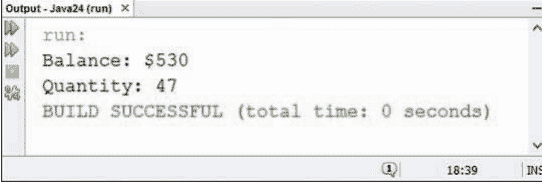

图 7.1

Commodity 程序的输出。

### 三元运算符

Java 中最复杂的条件语句是三元运算符 `?`。

三元运算符根据条件赋值或显示一个值。例如，考虑一个视频游戏，它根据 `skillLevel` 是否大于 5 将 `numberOfEnemies` 变量设置为两个值之一。你可以使用 `if-else` 语句实现此功能：

```java
if (skillLevel > 5) {
    numberOfEnemies = 20;
} else {
    numberOfEnemies = 10;
}
```

使用三元运算符实现此操作的方法更短但更复杂。一个三元表达式包含五个部分：

- 要测试的条件，用括号括起来，如 `(skillLevel > 5)`
- 问号 (`?`)
- 如果条件为真时使用的值
- 冒号 (`:`)
- 如果条件为假时使用的值

要使用三元运算符根据 `skillLevel` 设置 `numberOfEnemies`，你可以使用以下语句：

```java
int numberOfEnemies = (skillLevel > 5) ? 20 : 10;
```

你也可以使用三元运算符来决定显示什么信息。考虑一个根据 `gender` 变量的值显示 "Ms." 或 "Mr." 的程序示例。伴随该程序的语句如下：

```java
String gender = "female";
System.out.print(gender.equals("female") ? "Ms." : "Mr.");
```

三元运算符可能有用，但它也是 Java 中初学者最难理解的条件语句。在你学习 Java 时，你不会遇到任何必须使用三元运算符代替 `if-else` 语句的情况。

### 观察时

这个最终项目提供了对你在程序中使用的每个条件测试的另一个视角。对于此项目，你将使用 Java 内置计时功能，该功能可以跟踪当前的日期和时间，并以句子的形式呈现这些信息。

加载 NetBeans 或你使用的其他开发工具来创建 Java 程序，并将新文档命名为 `Clock.java` 且包名为 `com.java24hours`。这个程序很长，但大部分由多行条件语句组成。将列表 7.2 的完整文本输入到源编辑器，并在完成后将文件保存为 `Clock.java`。

### 列表 7.2 Clock.java 的完整文本

```java
1: package com.java24hours;
2:
3: import java.time.*;
4: import java.time.temporal.*;
5:
6: class Clock {
7:     public static void main(String[] arguments) {
8:         // 获取当前时间和
9:         LocalDateTime now = LocalDateTime.now();
10:        int hour = now.get(ChronoField.HOUR_OF_DAY);
11:        int minute = now.get(ChronoField.MINUTE_OF_HOUR);
12:        int month = now.get(ChronoField.MONTH_OF_YEAR);
13:        int day = now.get(ChronoField.DAY_OF_MONTH);
14:        int year = now.get(ChronoField.YEAR);
15:
16:        // 显示问候
17:        if (hour < 12) {
18:             System.out.println("Good morning.\n");
19:        } else if (hour < 17) {
20:             System.out.println("Good afternoon.\n");
21:        } else {
22:             System.out.println("Good evening.\n");
23:        }
24:
25:
26:        // 通过显示分钟开始时间消息
27:        System.out.print("It's ");
28:        if (minute != 0) {
29:             System.out.print(minute + " ");
30:             "minute";
31:             System.out.print(minute == 1 ? "minute" : "minutes");
32:         }
33:        }
34:    }
35:   // 显示小时
36:   System.out.print(" ");
37:   System.out.print(hour > 12 ? hour - 12 : hour);
38:   System.out.print("clock on ");
39:
40:   // 显示月份
41:   switch (month) {
42:     case 1:
43:       System.out.print("January");
44:       break;
45:     case 2:
46:       System.out.print("February");
47:       break;
48:     case 3:
49:       System.out.print("March");
50:       break;
51:     case 4:
52:       System.out.print("April");
53:       break;
54:     case 5:
55:       System.out.print("May");
56:       break;
57:     case 6:
58:       System.out.print("June");
59:       break;
60:     case 7:
61:       System.out.print("July");
62:       break;
63:     case 8:
64:       System.out.print("August");
65:       break;
66:     case 9:
67:       System.out.print("September");
68:       break;
69:     case 10:
70:       System.out.print("October");
71:       break;
72:     case 11:
73:       System.out.print("November");
74:       break;
75:     case 12:
76:       System.out.print("December");
77:       break;
78:   }
79:   // 显示日期和年份
80:   System.out.println(" " + day + ", " + year + ". ");
81:   
82: }
```

## 第 7 小节：使用条件测试做出决策

### 观察时

在保存程序后，运行它之前，查看代码以了解条件测试是如何使用的。

内置的计时功能，可以跟踪当前的日期和时间，并以句子的形式呈现这些信息。

### 注意

由于此程序使用了较新的功能，如果当前的 NetBeans 项目设置的是较早的语言版本，它将无法编译。要确保选择了正确的设置，选择文件（File）、项目属性（Project Properties）。在项目属性对话框中，查找源/二进制格式（Source/Binary format）。它应该是 JDK 9。

# 第 7 小时：使用条件测试做出决策

- 第 26–32 行显示当前的分钟以及一些辅助文本。如果 `minute` 的值等于 0，由于第 27 行有 `if` 语句，第 28–31 行将被忽略。该语句是必须的，因为让程序告诉用户现在是某小时后的 0 分钟是不符合逻辑的。第 28 行显示 `minute` 变量的当前值。第 29–30 行使用三元运算符，根据 `minute` 是否等于 1 显示文本“minutes”（复数）或“minute”（单数）。

- 第 35–37 行使用另一个运算符显示当前的小时。第 36 行的这个三元条件语句会导致小时数大于 12 时以不同的方式显示，这防止了计算机输出像“15 点”这样的时间。

- 第 40–76 行占据了程序的一半，是一个长 `switch` 语句，它根据存储在 `month` 变量中的整数值显示不同的月份名称。

- 第 79–81 行关闭了 `main()` 语句块，然后结束了整个 `Clock` 程序。

当你运行此程序时，输出将根据当前的日期和时间显示一个句子。输出面板中应用程序的输出如图 7.2 所示。

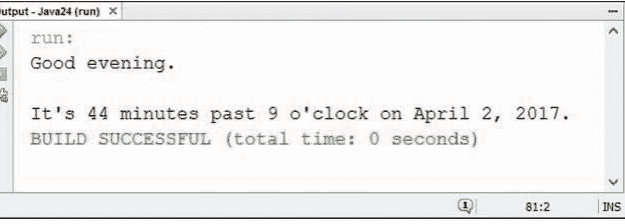

图 7.2

Clock 程序的输出。

运行程序几次，观察它是如何与时同步的。

`Clock` 使用了 Java 最近引入的 Date/Time API。早期版本的 Java 使用一组不同的类来处理日期和时间。正如你从第 4 小时“理解 Java 程序如何工作”中所记得的，Java 类库包含了数千个执行有用任务的类。程序中使用的 `java.time` 和 `java.time.temporal` 包是 Date/Time API 的一部分。

### 总结

现在你可以使用条件语句了，你的 Java 程序的智能化大大提高。你的程序可以评估信息并利用其在不同情况下做出不同反应，即使信息在程序运行时发生了变化。它们可以根据特定条件在两个或更多选项之间做出选择。

编程迫使你将任务分解为一组要执行的逻辑步骤和必须做出的决策。在编程中使用 `if` 语句和其他条件语句还能促进一种逻辑思维，这种思维可以在你生活的其他方面获益：

- “如果那个候选人在 11 月当选为总统，我就搬到加拿大。”
- “如果我的 OK Cupid 亲对象喜欢我，我就会在昂贵的餐厅吃晚餐，否则我们就去 Taco Bell。”
- “如果我违反了假释，唯一会选中我的球队将是达拉斯牛仔牛仔队。”

### 工作坊

#### 问答

- **问**：`if` 语句似乎是最实用的一个。可能在程序中只使用这种语句而永远不使用其他的吗？

- **答**：不使用 `else` 或 `switch` 是可能的，许多程序员也永远不使用三元运算符 `?`。然而，`else` 和 `switch` 在程序中使用通常是有益的，因为它们让程序更容易理解。一连链在一起的 `if` 语句可能会变得臃肿。

- **问**：在这一小时中，当 `if` 语句只带一个语句时，有时不使用大括号 `{ }`。使用括号是强制的吗？

- **答**：不是的。大括号可以作为任何 `if` 语句的一部分，用来包围依赖条件测试的程序。使用大括号是一个很好的习惯，因为它能防止在检查程序时可能发生的常见错误。如果你在只有单个语句的 `if` 条件中没有添加大括号，当你添加第二个语句但却忘记添加大括号时会发生什么？我来回答自己的问题：发生意外情况，而在编程中，“意外”这个词几乎从不是什么好事。

- **问**：每个处理 `case` 的语句部分中都必须包含 `break` 吗？

- **答**：你不一定得使用 `break`。如果你不在某组语句的末尾使用它，那么 `switch` 语句块中的所有剩余语句都将被处理，无论测试的 `case` 值是什么。然而，在大多数情况下，你可能想在每组语句的结尾加上一个 `break` 语句。

> 为什么 Thompson 孪胎组合在三人一组时叫这个名字，他们之间没有关系，而且他们中没有一个人姓 Thompson？
>
> 乐队成员 Tom Bailey、Alannah Curry 和 Joe Leeway 称自己为 Thompson Twins，是为了纪念比利时漫画《柯丁的历险记》中的一对笨头笨脑的侦探 Thompson 和 Thompson。
>
> 这两个戴着圆顶帽的侦探除了胡须形状有细微差别外，外表上无法区分。尽管他们工作非常糟糕，但却不可莫名地被分配了重要且敏感的任务。他们经常因为柯丁没有犯过的罪行而追捕他。
>
> 正如他们的名字所暗示的，这两个侦探之间也没有关系。

#### 测验

以下问题将检查在你学习了 Java 语句后，你的“条件”状态如何。

- **1. 条件测试的结果为真值或假值。这让你想起了哪种变量类型？**
  - A. 都没有。停止看这些问题了。
  - B. `long` 类型。
  - C. `boolean` 类型。

- **2. 哪种语句被用 `switch` 语句块中的通捕类别？**
  - A. `default`
  - B. `otherwise`
  - C. `onTheHand`

- **3. 什么是循环？**
  - A. 你洗完发后修理的那个。
  - B. 测试条件为真或假的东西。
  - C. 你忏悔的地方。

#### 答案

- **1. C. `boolean` 类型。**
- **2. A. `default`。**
- **3. B. 循环中的东西。**

## 活动

为了提高你在 Java 方面的水平，请通过以下活动回顾本小时的主题：

- 在 `Clock` 程序的某一行 `break` 语句前添加 `//` 将其变为注释；然后编译它并查看运行时会发生什么。在删除几个 `break` 语句后再次尝试。
- 创建一个短程序，在 1 到 100 之间任选一个值存储在整数变量 `grade` 中。使用条件语句处理该 `grade` 变量，为所有 'A'、B、'C'、D、'F' 学生显示不同的消息。先尝试使用 `if` 语句，然后尝试使用 `switch` 语句。

要查看实现这些活动的 Java 程序，请访问网站 www.java24hours.com

# 第 8 小时：使用循环重复动作

本小时任务清单：

- 使用 `for` 循环。
- 使用 `while` 循环。
- 使用 `do-while` 循环。
- 提前退出循环。
- 为循环命名。

### for 循环

在编程中，你经常发现很多循环是有用的情况。你可以用它来重复执行某事，例如防杀病毒软件在每收到一封新邮件时都打开它以检查病毒。你也可以使用循环让计算机在短时间内什么都不做，例如一个每分钟移动一次分针的动画时钟。

循环语句会让计算机程序多次返回同一个地方，就像特技飞机完成一个翻滚动作一样。

Java 最复杂的循环语句是 `for`。`for` 循环按固定次数重复程序的某部分。来看这里一个：

```java
for (int dex = 0; dex < 1000; dex++) {
    if (dex % 12 == 0) {
        System.out.println(":# " + dex);
    }
}
```

这个循环显示从 0 到 999 之间所有能被 12 整除的数字。

`for` 循环有一个变量，用于决定循环何时开始和结束。这个变量被称为计数器（或索引）。上一个循环中的计数器就是 `dex` 变量。

`for` 循环在 `for` 关键字后面的括号内包含三个部分：初始化、条件和变化部分。这些部分由分号 (`;`) 隔开。示例说明了这三个部分：

- **初始化部分**——在第一部分，给 `dex` 变量赋了初始值 0。
- **条件部分**——在第二部分，有一个类似于你在 `if` 语句中使用的条件测试：`dex < 1000`。
- **变化部分**——第三部分是一个改变 `dex` 变量值的语句，在本示例中使用了自增运算符。

在初始化部分，你设置了计数器变量。你可以在 `for` 语句中创建变量，就像前面的示例创建整数变量那样。你也可以在程序的其他地方创建变量。该变量在该部分应该是起始值。当循环开始时，该变量保持不变。

条件部分包含一个测试，该测试必须保持为真循环才能继续。当测试为假时，循环结束。当 `dex` 变量等于或大于 1,000 时，循环结束。

`for` 语句的最后部分包含一个改变计数器变量值的语句。该语句在每次循环执行时都会被处理。计数器必须以某种方式发生变化，否则循环永远不会结束。在示例中，`dex` 在变化部分增加了 1。如果 `dex` 不发生变化，它将保持其原始的 0 值，且条件 `dex < 1000` 将始终为真。

`for` 语句的块在循环的每次执行中都会被执行。

上一个示例在 `for` 块内部有以下语句：


```
if (dex % 12 == 0) {
    System.out.println("# " + dex);
}
```

这些语句执行了 1,000 次。循环通过将 `dex` 变量设置为 0 开始。在循环的每次通过期间，它给 `dex` 加 1。当 `dex` 不再小于 1,000 时，循环停止循环。（注：OCR 文字说的是 "starts looping"，可能意指 "stops looping"）。

### 注意

在提到循环时，你可能会听到的一个特殊术语是迭代（iteration）。迭代是指循环的单次通过。用于控制循环的计数器变量被称为迭代器（iterator）。

正如你在语句中看到的那样，如果 `for` 循环只包含单个语句，则不需要括号。这在以下示例所示：

```
for (int p = 0; p < 500; p++) {
    System.out.println("I will not sell miracle cures");
}
```

循环显示 500 次 "I will not sell miracle cures"。虽然循环内部的单个语句不需要括号，但你使用它们是为了让块更容易识别，如下：

```
for (int p = 0; p < 500; p++) {
    System.out.println("I will not sell miracle cures");
}
```

你在这几个小时内创建的第一个程序将显示前 200 个 9 的倍数：9、18、27 等，直到 1,800 (9 × 200)。在 NetBeans 中，在 `com.java24hours` 包中创建一个名为 `Nines` 的空 Java 文件，并输入列表 8.1 的文本。当你保存文件时，它被存储为 `Nines.java`。

### 列表 8.1 Nines.java 的全文

```
1: package com.java24hours;
2:
3: class Nines {
4:     public static void main(String[] arguments) {
5:         for (int dex = 1; dex <= 200; dex++) {
6:             int multiple = 9 * dex;
7:             System.out.print(multiple + " ");
8:         }
9:         System.out.println();
10:    }
11: }
```

`Nines` 程序在第 5 行包含一个 `for` 语句。该语句有三个部分：

- 初始化——`int dex = 1`，它创建了一个整数变量 `dex` 并给它初始值 1。
- 条件——`dex <= 200`，它在每次循环通过期间必须为真。当它不为真时，循环结束。
- 变化——`dex++`，在每次循环通过期间将 `dex` 变量的值加 1。

在 NetBeans 中点击 Run、Run File 来运行程序。该程序产生如图 8.1 所示的输出。

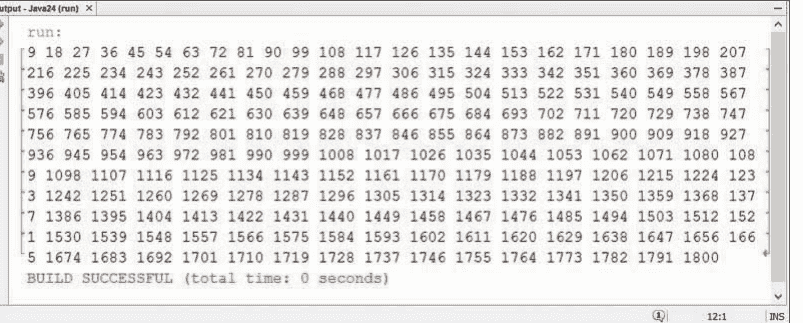

图 8.1

`Nines` 程序的输出。

NetBeans 中的输出窗口。NetBeans 中的输出窗口不会自动换行。要使文本换行，请右键点击文本。

### while 循环

`while` 循环比 `for` 循环简单。它只需要一个条件测试。例如：

```
int dex = 0;
while (dex < 1000) {
    // statements
    dex++;
}
```

`while` 循环持续进行，直到 `dex` 变量不再大于 1,000。如果第一次条件为假，内部的语句将被忽略。如果条件为真，循环就会执行。

### do-while 循环

`do-while` 循环与 `while` 循环相似，但条件测试位于内部语句之后。这意味着语句至少会被处理一次。

```
int gameLives = 0;
do {
    // 循环内部的语句
} while (gameLives > 0);
```

## 第 8 章：使用循环重复操作

以下语句会导致循环显示相同的内容。在示例中，`limit` 的值为 5，`count` 的值为 1。

```
int limit = 5;
int count = 1;
while (count < limit) {
    // statements
    count++;
}
```

## 退出循环

退出循环的正常方法是测试条件变为假。这适用于 Java 中所有类型的循环。有时你可能希望循环立即结束，即使条件仍然为真。你可以通过 `break` 语句来实现这一点，如下所示：

```
int index = 0;
while (index <= 1000) {
    index = index + 5;
    if (index == 400) {
        break;
    }
}
```

循环内部可以使用的另一种特殊情况语句是 `continue`。`continue` 语句会导致循环退出当前的执行过程，并从循环的第一条语句重新开始。

```
int points = 0;
int target = 100;
while (target <= 100) {
  for (int i = 0; i < target; i++) {
    if (points > 50) {
      break;
    }
    points = points + i;
  }
}
```

在这个示例中，如果 `points` 变量大于 50，`break` 语句会导致 `for` 循环结束。然而，`while` 循环永远不会结束，因为 `target` 永远大于100。

在某些情况下，你可能想同时跳出多个循环。为了实现这一点，你可以为外层循环（在此例中为 `while` 语句）指定一个名称。要给循环命名，请在循环开始之前的行加上名称，并在后面跟一个冒号（:`）。

当循环有了名称后，在 `break` 或 `continue` 语句之后使用该名称，以指示该语句适用于哪个循环。以下示例重复了之前的例子，但有一个不同之处：如果 `points` 变量大于 50，两个循环都会结束。

```
int points = 0;
int target = 100;
targetLoop:
while (target <= 100) {
  for (int i = 0; i < target; i++) {
    if (points > 50) {
      break targetLoop;
    }
    points = points + i;
  }
}
```

当循环名称在 `break` 或 `continue` 语句中使用时，该名称不包含冒号。

## 复杂的 for 循环

循环可以比本小时在此为止显示的更加复杂。循环的初始化、条件部分和变化部分可以包含多个变量。在下面的代码中，`for` 循环在初始化部分设置了多个变量，并在变化部分包含多个语句：

```
int i, j;
for (i = 0, j = 0; i * j < 1000; i++, j *= 2) {
  System.out.println(i + " * " + j + " = " + (i * j));
}
```

在 `for` 循环的每个部分中，使用分号（`;`）分隔部分，使用逗号（`,`）分隔变量，例如 `i = 0, j = 0`。示例显示了一组方程，其中变量 `i` 和 `j` 相乘。在循环的每次迭代中，`i` 增加 1，`j` 增加 2。当 `i` 乘以 `j` 等于或大于 1000 时，循环结束。

## 测试你的计算机速度

`for` 循环的某些部分也可以是空的。一个例子是计数器变量已经在程序的其他部分创建并赋予了初始值，如下所示：

```
int displayCount = 1;
int endValue = 13;
for (; displayCount < endValue; displayCount++) {
    // 循环语句在这里
}
```

本小时的下一个项目是一个 Java 程序，它执行基准测试，这是一种衡量硬件或软件运行速度的测试。`Benchmark` 程序使用循环语句来重复执行以下数学表达式：

```java
double x = Math.sqrt(index);
```

该语句调用 `Math.sqrt()` 方法来计算数字的平方根。你将在第 11 小时“描述你的对象是什么”中学习更多关于方法的知识。

你正在创建的基准测试是 Java 程序在一分钟内可以计算平方根的次数。

在 `com.java24hours` 包中创建一个名为 `Benchmark` 的新 Java 文件。完成后，输入列表 8.2 的文本并保存程序。

### 列表 8.2 Benchmark.java 的完整源代码

```java
1: package com.java24hours;
3: class Benchmark {
4:  public static void main(String[] arguments) {
5:   long startTime = System.currentTimeMillis();
6:   long endTime = startTime + 60000;
7:   long index = 0;
8:   while (true) {
9:     double x = Math.sqrt(index);
10:     long now = System.currentTimeMillis();
11:     if (now > endTime) {
12:       break;
13:     }
14:     index++;
15:   }
16:   System.out.println(index + " loops in one minute.");
17: }
18: }
```

### 第 8 小节：使用循环重复操作

程序中发生了以下情况：

- 第 5 行——创建 `startTime` 变量，其值为当前毫秒时间，通过调用 Java `System` 类的 `currentTimeMillis()` 方法测量。
- 第 6 行——创建 `endTime` 变量，其值比 `startTime` 大 60,000。由于一分钟等于 60,000 毫秒，这会将变量设置为 `startTime` 之后的一分钟。
- 第 7 行——设置了一个名为 `index` 的 `long` 类型变量，初始值为 0。
- 第 8 行——`while` 语句使用 `true` 作为条件开始循环，这导致循环无限持续（换句话说，直到某些东西停止它）。
- 第 9 行——计算 `index` 的平方根并存储在变量 `x` 中。
- 第 10 行——如果 `now` 大于 `endTime`，则创建带有当前时间的 `now` 变量。
- 第 11–13 行——如果 `now` 大于 `endTime`，说明循环已经运行了一分钟，`break` 结束 `while` 循环。否则，它继续循环。
- 第 14 行——每次循环时，`index` 变量都加 1。
- 第 16 行——在循环外部，程序显示执行平方根计算的次数。

应用程序的输出在图 8.2 的输出面板中。

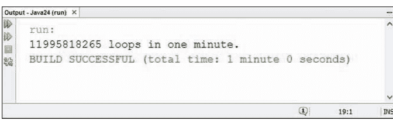

### 图 8.2

`Benchmark` 程序的输出。

`Benchmark` 程序是查看你的计算机是否比我的快的一种极方法。在测试此程序期间，我的笔记本电脑执行了大约 119 亿次计算。如果你的计算机结果更好，不要只给我发哀悼。多买一些我的书，这样我就可以升级我的电脑。

### 总结

循环是大多数编程语言的基础部分。显示序列是你如果没有循环就无法 Java 中无法完成的许多任务之一。

### 工作坊

#### 问答

- 问：“初始化”（initializing）一词在多个地方被使用。它是什么意思？
- 答：意味着赋予初始值。

- 问：如果循环永远不结束，程序会停止吗？
- 答：`break` 语句结束整个循环，`continue` 语句跳到循环的下次迭代。

- 问：我如何购买绿队的股票？
- 答：除非公有球队决定再次出售，否则成为股东的唯一方法是继承股份。

#### 测试

以下问题测试你对循环的知识。出于主题精神，重复这些问题直到你做对为止。

1. 使用什么来分隔 `for` 语句的每个部分？
   - A. 逗号
   - B. 分号
   - C. 休假的官员

2. 哪个语句导致程序回到开始循环的语句并从那里继续执行？
   - A. continue
   - B. next
   - C. skip

3. Java 中哪种循环语句至少运行一次？
   - A. for
   - B. while
   - C. do-while

#### 答案

1. 逗号用于分隔部分内的内容，但分号分隔部分。
2. `break` 语句结束整个循环，`continue` 语句跳到循环的下次迭代。
3. `do-while` 条件在第一次通过循环后才进行评估。

### 活动

如果你的头没有因为这些循环而转圈，请通过以下活动复习本小时的主题：

- 修改 `Benchmark` 程序以测试简单数学计算的执行情况，例如乘法或除法。
- 编写一个使用循环的短程序，寻找前400 个 13 的倍数。

## 第 9 小时：使用数组存储信息

本小时的任务列表：

- 创建一个数组。
- 设置数组的大小。
- 在数组元素中存储值。
- 修改数组中的信息。
- 创建多维数组。
- 排序数组。

计算机的发展，没有谁比圣诞老人受益得更多了。几个世纪以来，人类在收集和处理信息方面给他施加了沉重的负担。老尼克必须跟踪以下事项：

- 顽皮的孩子
- 乖巧的孩子
- 礼物请求
- 烟囱无法通过的房屋
- 那些想要圣诞老人那里给予比圣诞太太允许他给出的更多的要求的女性
- 那些先射击不明飞行器后才问问题的国家

计算机对北极来说是一个巨大的恩赐。它们是存储、分类和研究信息的理想工具。

在计算机程序中，存储信息最基本的方法将其放入变量中。到目前为止，你处理过的所有变量都是单项信息，例如浮点数或字符串。

圣诞老人的乖孩子列表是一个更大相似信息集合的例子。为了跟踪此类列表，你可以使用数组。

数组是一组共享相同类型的相关变量。任何可以存储为变量的类型信息都可以成为数组中存储的项目。数组可以用于跟踪比单个变量复杂的信息，但它们几乎很容易创建和操作。

## 创建数组

数组是根据共同名称分组的变量。你应该对“数组”（array）这个词很熟悉——想象一位发言人展示她的系列产品，或者一个有着琳琅满目奖励的游戏。和变量一样，数组通过声明组织成数组的变量类型和数组名称来创建。类型后面跟着一对方括号 `[]` 以区分数组和变量。

你可以为任何可以存储为变量的类型信息创建数组。以下语句创建了一个字符串变量数组：

```
String[] naughtyChild;
```

这里是两个分别创建整数数组和布尔值值数组的语句：

```
int[] reindeerWeight;
boolean[] hostileAirTravelations;
```

> 注意
>
> Java 在创建数组时对方括号的放置位置非常灵活。你可以将它们放在变量之后而不是变量类型之后，如下所示：
>
> String niceChild[];
>
> 为了让你在程序中更容易识别数组（对人类而言），你应该坚持一种风格，而不是来回切换。以这种方式使用数组的程序总是将括号放在变量或对象类型之前。

之前的示例创建了用于存放值的数组，但没有在其中存储任何值。要实现这一点，你可以配合变量类型使用 `new` 关键字，或者在 `()` 标记内中存储值。使用 `new` 时，你必须指定数组中存储了多少不同的项目。数组中的每个项目被称为元素。以下语句创建了一个数组并为它包含的值留出空间：

```
int[] elfSeniority = new int[25];
```

这个示例创建了一个名为 `elfSeniority` 的整数数组。该数组可以存储圣诞老人每个精灵在北极工作的月数。（如果圣诞老人经营工会，跟踪这些信息至关重要。）

### 使用数组

当你使用 `new` 语句创建数组时，必须指定元素的数量。数组的每个元素都被赋予一个初始值，该值取决于数组的类型。所有数值数组的初始值为 0，字符数组为 `'\0'`，布尔数组的值为 `false`。字符串数组和其他所有对象的初始值为 `null`。

对于不是极大的数组，你可以在创建它们的同时设置它们的初始值。以下示例创建了一个字符串数组并赋予它们初始值：

```
String[] reinderNames = { "Dasher", "Dancer", "Prancer", "Vixen",
"Comet", "Cupid", "Donner", "Blitzen" };
```

应该存储在数组元素中的信息放在 `[]` 括号之间，并用逗号分隔每个元素。数组中的元素数量设置为逗号分隔列表中的元素数量。

数组元素是有编号的，从第一个元素的 0 开始。可以通过引用 `[]` 括号内的此数字来访问特定元素。之前的语句与以下代码的作用相同：

```java
String[] reinderNames = new String[8];
reinderNames[0] = "Dasher";
reinderNames[1] = "Dancer";
reinderNames[2] = "Prancer";
reinderNames[3] = "Vixen";
reinderNames[4] = "Comet";
reinderNames[5] = "Cupid";
reinderNames[6] = "Donner";
reinderNames[7] = "Blitzen";
```

数组的每个元素必须是相同的类型。这里使用字符串来保存每个驯鹿的名字。


数组创建后，你不能再增加更多元素。即使你想起了所有著名的驯鹿，你也无法将“Rudolph”作为 `reinderNames` 数组的第九个元素添加。Java 编译器不会将 Rudolph 放入任何 `reinderNames` 中。

你在程序中使用数组就像使用任何变量一样，唯一的不同点是：数组项目的元素编号必须在数组名称旁方的括号内提供。你可以在可以使用变量的地方使用数组元素，例如：

```java
package com.javahours;

class Spaceover {
    public static void main(String[] arguments) {
        String mostFamous = "Rudolph the Red-Nosed Reindeer";
        char[] mfl = mostFamous.toCharArray();

        for (int dex = 0; dex < mfl.length; dex++) {
            char current = mfl[dex];
            if (current != ' ') {
                System.out.print(current);
            } else {
                System.out.print('.');
            }
        }
        System.out.println();
    }
}
```

### 列表 9.1 Spaceover.java 的全文

```java
1: package com.javahours;
2:
3: class Spaceover {
4:     public static void main(String[] arguments) {
5:         String mostFamous = "Rudolph the Red-Nosed Reindeer";
6:         char[] mfl = mostFamous.toCharArray();
7:
8:         for (int dex = 0; dex < mfl.length; dex++) {
9:             char current = mfl[dex];
10:            if (current != ' ') {
11:                System.out.print(current);
12:            } else {
13:                System.out.print('.');
14:            }
15:        }
16:        System.out.println();
17:    }
18: }
```

### 多维数组

本小时之前的数组都是一维的，因此你可以使用单个数字来检索元素。某些类型的信息需要更多维度才能存储为数组，例如 (x,y) 坐标系中的点。数组的一个维度可以存储 x 坐标，另一个维度可以存储 y 坐标。

要创建一个二维数组，在创建和使用数组时，你必须使用额外的方括号，如下语句所示：

```java
boolean[] selectedPoint = new boolean[50][50];
selectedPoint[4][13] = true;
selectedPoint[7][6] = true;
selectedPoint[11][22] = true;
```

此示例创建了一个名为 `selectedPoint` 的布尔值数组。该数组的第一维度有 50 个元素，第二个维度有 50 个元素，因此共有 2,500 个独立的数组元素（50 × 50）。当数组创建时，每个元素的默认值均为 `false`。其中有三个元素值为 `true`：位于 (x,y) 位置 (4,13) 的点、位于 (7,6) 的点以及位于 (11,22) 的点。

数组可以根据需要拥有任意维度，但请记住它们会占用大量内存。创建一个 50x50 的 `selectedPoint` 数组等同于创建了 2,500 个独立变量。

### 数组排序

当你将一组项目组合到一个数组中时，你可以做的一件事就是重新排列它们。以下代码交换了名为 `numbers` 的整数数组中两个元素的值：

```java
int[] numbers = {3, 7, 9, 12, 5, 0, 8, 19 };
int temporary = numbers[5];
numbers[5] = numbers[6];
numbers[6] = temporary;
```

这些操作导致了 `numbers[5]` 和 `numbers[6]` 互相交换了值。名为 `temporary` 的整数变量被用作交换值之一的临时存储位置。排序是将一组相关项目按特定顺序排列的过程，例如将数字列表从低到高排序。

圣诞老人可以根据姓氏对礼物接收者进行排序，这样 Willie Aames 和 Hank Aaron 在圣诞节掠夺中的排名将远早于字母顺序上倒霉的 Steve Zahn 和 Mark Zuckerberg。

在 Java 中对数组排序非常简单，因为 `Arrays` 类处理了所有工作。`Arrays` 是 `java.util` 类包组的一部分，它可以重新排列任何变量类型的数组。

### 使用 Arrays 类排序

要在程序中使用 `Arrays` 类，请执行以下步骤：

1. 使用 `import java.util.*` 语句，以便在程序中使用 `java.util` 中的类。
2. 创建数组。
3. 使用 `Arrays` 类的 `sort()` 方法重新排列数组。

由 `Arrays` 类排序的变量数组将按数字升序重新排列。字符和字符串将按字母顺序重新排列。

要查看此效果，请在 `com.java24hours` 包中创建一个名为 `NameSorter` 的新文件，并在源编辑器中输入列表 9.2 的文本。

### 列表 9.2 NameSorter.java 的完整源代码

```java
package com.java24hours;

import java.util.*;

class NameSorter {
    public static void main(String[] arguments) {
        String names[] = {"Glimmer", "Marvel", "Rue", "Clove",
        "Thresh", "Foxface", "Cato", "Peeta", "Katniss"};
        System.out.println("原始顺序:");
        for (int i = 0; i < names.length; i++) {
            System.out.println(i + ": " + names[i]);
        }
        System.out.println();
        Arrays.sort(names);
        System.out.println("新顺序:");
        for (int i = 0; i < names.length; i++) {
            System.out.println(i + ": " + names[i]);
        }
        System.out.println();
    }
}
```

当你运行此程序时，它会按原始顺序显示九个名字，对名字进行排序，然后显示列表。图 9.2 显示了输出。

## 第 9 小时：使用数组存储信息

```
Output - Java24 (run)
run:
The original order:
0: Glimmer
1: Marvel
2: Rue
3: Clove
4: Thresh
5: Foxface
6: Cato
7: Peeta
8: Katniss
The new order:
0: Cato
1: Clove
2: Foxface
3: Glimmer
4: Katniss
5: Marvel
6: Peeta
7: Rue
8: Thresh

BUILD SUCCESSFUL (total time: 0 seconds)
```

图 9.2 NameSorter 程序的输出。

当你处理字符串和基本类型类型变量（如整数和浮点数）时，你只能使用 `Arrays` 类升序对它们进行排序。如果你在排序期间希望有不同的排列方式，或者想要比 `Arrays` 类提供更高的效率，可以编写代码进行手动排序。

## 统计字符串中的字符

英语中出现频率最高的字母是 E, R, S, T, L, N, C, D, M 和 O，顺序如下。如果你发现自己出现在联播游戏节目《幸运轮盘》（Wheel of Fortune），这是一个值得知道的事实。

### 注意事项

如果你熟悉这个节目，《幸运轮盘》是一场游戏，参赛者需要猜短语、名称或引言中的字母。如果他们猜对了且该字母是辅音，他们就能赢得大转盘上的金额。为了重现这种体验，你可以和朋友在观众面前玩吊字游戏，当有人猜对字母时分发金额，并给胜者一个新的 Shark 旋转吸尘器。

你的下一个 Java 程序将统计你输入的任意短语和表达式的频率。数组被用于统计每个字母出现的次数。完成后，程序将显示每个字母在短语中出现的次数。

在 NetBeans 中创建一个名为 `Wheel.java` 的空 Java 文件，将其放入 `com.java24hours` 包中，填充列表 9.3 的内容，完成后保存文件。可以自由在第 17 行之间添加额外的短语，并按照第 17 行的格式进行格式。

### 列表 9.3 Wheel.java 的完整源代码

```java
package com.java24hours;

class Wheel {
    public static void main(String[] arguments) {
        String[] phrases = {
            "A STITCH IN TIME SAVES NINE",
            "DON'T EAT YELLOW SNOW",
            "TASTE THE RAINBOW",
            "EVERY GOOD BOY DOES FINE",
            "I LIKE SPAGHETTI",
            "ONE MORE FOR THE ROAD",
            "GROVER CLEVELAND",
            "IT'S A WONDERFUL LIFE",
            "FEEL THE BERN",
            "I WANT TO BELIEVE",
            "TASTE THE RAINBOW",
            "EVERY GOOD BOY DOES FINE",
            "I LIKE SPAGHETTI",
            "ONE MORE FOR THE ROAD",
            "GROVER CLEVELAND",
            "IT'S A WONDERFUL LIFE",
            "FEEL THE BERN"
        };
        
        int[] letterCounts = new int[26];
        
        for (String phrase : phrases) {
            for (char c : phrase.toCharArray()) {
                if (Character.isLetter(c)) {
                    letterCounts[Character.toUpperCase(c) - 'A']++;
                }
            }
        }
        
        System.out.println("字母频率统计:");
        for (int i = 0; i < 26; i++) {
            char letter = (char) ('A' + i);
            System.out.println(letter + ": " + letterCounts[i]);
        }
    }
}
```

### 工作坊

### 问答

- **Q.** 字母的数字范围（从 'A' 的 65 到 'Z' 的 90）是 Java 语言的一部分吗？如果是，1 到 64 是否被保留了？

- **A.** 数字 1 到 64 包含了数字、标点符号和一些不可打印字符，每个字符带有换行符、新行和退格。每个用于 Java 程序的可打印字符以及一些不可打印字符都关联有一个数字。Java 使用 Unicode 编号系统。前 127 个字符是 ASCII 字符集，它们可能被用于其他编程语言。

- **Q.** 在多维数组中，可以使用 `length` 变量测量除第一个以外的不同维度吗？

- **A.** 你可以测试数组的任何维度。对于第一个维度，使用数组名称配合 `length`，例如 `x.length`。后续维度可以通过对维度的 `[0]` 元素使用 `length` 来测量。考虑使用以下语句创建的数组 `data`：

```java
int[][] data = new int[12][14];
```

该数组的维度可以通过 `data.length` 测量第一个维度，通过 `data[0].length` 测量第二个维度，通过 `data[0][0].length` 测量第三维度。

- **Q.** 为什么新英格人队主教练比尔·贝利奇（Bill Belichick）在场边穿着破旧的连帽衫？

- **A.** 当你在十年内的胜场数超过 NFL 历史上任何教练时（从 2003 年到 2012 年共 140 胜），你的老板让你选择自己的着装规范。体育记者认为，贝利奇开始穿这种连帽衫是为了回应 NFL 与 Reebok 的一项交易，该交易要求所有教练必须穿球队服装。

> “他决定，既然他们要穿球队服装，他就会从选项中进行筛选，并选了他发现的最不显眼的东西，”Yahoo! Sports 的 Dan Wetzel 解释道，“他选择了一件灰色的卫衣，通常还带帽子。”

贝利奇激进的时尚宣言已让连帽衫变成了球队最畅销的商品之一。

### 测验

如果你的大脑是一个数组，你可以通过回答以下关于数组的每个问题来测试它的 `length`。

1. 数组最适合存储什么类型的信息？

- A. 列表
- B. 相关信息的成对
- C. 冷知识

2. 你可以使用哪个变量来检查数组的上界边界？

- A. top
- B. length
- C. limit

3. 圣诞老人共有几只驯鹿，包括鲁道夫吗？

- A. 8
- B. 9
- C. 10

### 答案

1. **A.** 仅包含相同类型信息（如字符串、数字等）的列表非常适合存储在数组中。
2. **B.** `length` 变量包含了数组中元素的计数。
3. **B.** 根据克莱门·克拉克·摩尔的《圣尼古拉斯的来访》，圣诞老人有“八只小小的驯鹿”，所以加上鲁道夫是九只。

## 活动

为了让自己以后有经验的数组可汲取，你可以通过以下活动扩展对本小时主题的知识：

- 创建一个使用多维数组存储学生成绩的程序。第一个维度应该是每个学生的数字，第二个维度应该是每个学生的成绩。显示每个学生获得的所有成绩的平均分以及每个学生的总平均分。
- 编写一个程序，用数组存储前 400 个 13 的倍数。

要查看实现这些活动的 Java 程序，请访问书籍的网站 www.java24hours.com。

# 第 10 小时：创建你的第一个对象

本小时待办事项：

- 创建一个对象。
- 用属性描述对象。
- 确定对象的行为方式。
- 组合对象。
- 继承其他对象。
- 转换对象和其他类型的信息。

在这 24 小时中，你遇到的核心术语示例之一是面向对象编程（OOP）。这个复杂的术语用优雅的方式描述了计算机程序以及它是如何工作的。

在 OOP 之前，计算机程序通常用你在书中学到的最简单定义来描述：文件中列出的一组指令，并按照某种可靠的顺序进行处理。

通过将程序视为对象的集合，你就能弄清楚程序必须完成的任务，并将任务分配给它们所属的对象。

## 面向对象编程是如何工作的

你可以将创建的 Java 程序视为对象，就像物理对象独立于其他对象存在、以特定方式相互作用，并可以与其他对象结合形成更大的整体一样。如果你将计算机程序视为一组相互作用的对象，你就可以设计出一个更可靠、更易于理解且在其他项目中可重用的程序。

在第 22 小时“创建 Java2D 图形”中，你创建了一个显示饼图的 Java 程序——用带有不同颜色饼块的圆形表示数据。该程序创建的图表如图 10.1 所示。


每个对象都有使其与其他对象不同的特质。饼图是圆形的，而条形图表示数据。要求 `PieChart` 对象绘制自己似乎很奇怪，因为在现实世界中图表不会画自己。OOP 中的对象为自己工作。这种能力使得它们更容易整合到其他程序中。例如，如果一个 `PieChart` 对象不知道如何绘制自己，那么每当你在另一个程序中使用 `PieChart` 对象时，你都必须创建一个来绘制它的行为。

在 OOP 中，一个对象包含两个部分：属性和行为。属性是描述对象的特征。行为是对象所做的事。

在 Java 中你通过使用类（class）作为模板来创建对象。类是对象的母版，决定了属性和行为。“类”这个术语对你应该很熟悉，因为 Java 程序被称为类。你用 Java 创建的每个程序都是一个你可以作为模板使用的类。在 OOP 中，计算机程序是一组共同工作以完成某项任务的对象。某些简单程序似乎只由一个对象组成：类。考虑显示饼图的程序。一个 `PieChart` 对象可能包含以下内容：

- 计算每个饼块大小的行为
- 绘制图表的行为
- 存储图表标题的属性

### 注意

自动拨号器（autodialer）是一种使用调制解调器（modem）设备按顺序拨一系列电话号码的软件。这种程序的目的是寻找接电话的计算机，以便你以后拨打它们并查看它们是什么。

小于 30 岁的读者可能很难相信，计算机曾经通过电话进行相互连接。你必须知道计算机的号码才能与其连接，如果它已经在和另一个计算机通话，你就会得到忙音。

现在我可能需要解释什么是忙音。

> 引用诗人 T.S. 艾利特的话，“我长大了……我老了。”

今天使用自动拨号器会引起当地电话公司和执法部门的注意。在 20 世纪 80 年代，这是一个不需要出门就能反叛的好方法。David Lightman（Broderick 饰的角色）使用他的自动拨号器寻找视频游戏公司的私人计算机系统，以便在游戏发布之前玩到它。相反，Lightman 发现了一个秘密政府计算机，可以玩从象棋到全球核战争的所有游戏。

自动拨号器像任何计算机程序一样，可以被视为一组共同工作的对象。它可以被拆分为以下：

- 一个 `Modem`（调制调器）对象，它知道自己的连接速度等属性，并具有让调制调器拨号以及检测另一台计算机是否接听电话的行为
- 一个 `Monitor`（监控器）对象，它跟踪拨打了哪些号码以及哪些是计算机

每个对象都独立存在。

设计完全独立的 `Modem` 对象的一个大优势是，它可以被用于其他需要调制调器功能的程序中。

使用自包含对象的另一个原因是它们很容易调试。计算机程序的规模往往会迅速变得庞杂。如果你正在调试一个对象并且知道它不依赖于任何其他东西，你就可以专注于确保 `Modem` 对象执行它应该做的工作，并持有执行工作所需的信息。


# 创建你的第一个对象

将 Java 这种面向对象的语言作为你的第一种编程语言是有益的，因为这样你不需要摒弃其他编程风格的习惯。

## 什么是对象

对象是通过使用对象类作为模板创建的。以下语句创建了一个类：

```java
public class Modem {
}
```

从该类创建的对象什么都做不了，因为它没有任何属性或行为。你需要添加这些内容使该类变得有用，如下所示：

```java
public class Modem {
  int speed;

  public void displaySpeed() {
    System.out.println("Speed: " + speed);
  }
}
```

`Modem` 类现在看起来更像你在第 1 到第 9 小节编写的程序。`Modem` 类以类语句开头，但包含了 `public` 关键字。这意味着该类可以公开使用——换句话说，任何想要使用 `Modem` 对象的程序都可以使用。

`Modem` 类的第一部分创建了一个名为 `speed` 的整数变量。这个变量是对象的属性。

`Modem` 类的第二部分是一个名为 `displaySpeed()` 的方法。这个方法是对象行为的一部分。它包含一条语句 `System.out.println(n)`，用于显示调制调器的速度值。

对象的变量是实例变量或成员变量。

如果你想在程序中使用 `Modem` 对象，可以使用以下语句创建对象：

```java
Modem device = new Modem();
```

这条语句创建了一个名为 `device` 的 `Modem` 对象。创建对象后，你可以设置它的变量并调用它的方法。以下是设置 `device` 对象 `speed` 变量值的方法：

```java
device.speed = 28800;
```

要通过调用 `displaySpeed()` 方法让该调制调器显示速度，你需要调用该方法：

```java
device.displaySpeed();
```

名为 `device` 的 `Modem` 对象可能会通过此语句显示文本 "Speed: 28800."。

## 理解继承

继承有一个巨大的优势，它允许一个对象从另一个对象继承行为和属性。

当你开始创建对象时，有时会发现你想要的新对象和你已经拥有的对象相似。

如果 David Lightman 想要一个在 1983 年《电子游戏》（WarGames）发布时那样能够处理纠错和其他调制调器功能的对象，他可以通过复制 `Modem` 对象的语句并对其修改来创建一个新的 `ErrorCorrectionModem` 对象。然而，如果 `ErrorCorrectionModem` 的大部分行为和属性都与 `Modem` 相同，这将是大量不必要的工作。这意味着如果需要更改某些内容，Lightman 将需要更新两个独立的程序。

通过继承，程序员可以通过定义新类与现有类的不同之处来创建一个新的对象类。Lightman 可以让 `ErrorCorrectionModem` 继承自 `Modem`，他只需要编写使纠错调制调器与其他设备不同的部分即可。

### 构建继承层次结构

对象类通过 `extends` 语句继承另一个类。以下是继承自 `Modem` 类的 `ErrorCorrectionModem` 类的框架：

```java
public class ErrorCorrectionModem extends Modem {
  // 程序写在这里
}
```

继承允许开发各种相关的类而无需进行重复工作，它使得代码能够……这种类的父子分组被称为类层次结构（class hierarchy），你在 Java 程序中可以使用的所有标准类都是层次结构的一部分。

如果你理解子类和父类，理解层次结构就会变得更容易。继承自另一个类的类被称为子类（subclass）。被继承的类被称为父类（superclass）。

在之前的《电子游戏》示例中，`Modem` 是 `ErrorCorrectionModem` 类的父类。`ErrorCorrectionModem` 是 `Modem` 的子类。

在层次结构中，一个类可以有多个继承自它的类——另一个 `Modem` 的子类可以是 `ISDNModem`，因为 ISDN 调制调器具有使其与纠错调制调器不同的行为和属性。如果存在 `ErrorCorrectionModem` 的子类（如 `InternalErrorCorrectionModem`），它将继承层次结构中其上方的所有类——包括 `ErrorCorrectionModem` 和 `Modem`。这些继承关系如图 10.2 所示。

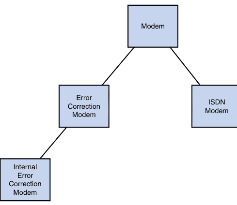

图 10.2：类层次结构的示例。

构成 Java 语言的类广泛使用继承，因此理解它至关重要。你将在第 12 小节“充分利用对象”中学习更多关于该主题的内容。

## 转换对象和变量

Java 中常见的任务之一是将数据从一种类型转换为另一种。这些转换包括：

- 将 `float` 转换为 `int`
- 将 `long` 转换为 `int`
- 将 `double` 转换为 `float`
- 将 `char` 转换为 `int`

当你从大类型转换为较小类型时，必须使用显式转换。例如，将 `float` 转换为 `int`：

```java
float source = 7.0f;
int destination = (int) source;
```

在大多数情况下，目标提供的空间比源大，信息的转换不会改变其值。主要的异常发生在将 `int` 或 `long` 变量转换为 `float`，或将 `long` 转换为 `double` 时。

### 类型转换

当源和目标之间存在继承关系时，可以将对象转换为其他对象。一个类必须是另一个类的子类。

某些对象不需要转换。你可以在期望任何父类的地方使用对象。Java 中的所有对象都是 `Object` 类的子类，因此在期望 `Object` 的地方可以使用任何对象作为参数。

你可以在期望某个子类的地方使用对象。但是，由于子类通常包含比父类更多的信息，你可能会丢失部分信息。

### 对象与简单变量的转换

例如，如果对象没有子类包含的方法，那么当程序中使用缺失的方法时就会导致错误。

要使用对象来代替其一个子类，你必须使用以下语句进行显式转换：

```java
public void paintComponent(Graphics comp) {
  Graphics2D comp2D = (Graphics2D) comp;
}
```

这会将名为 `comp` 的 `Graphics` 对象转换为名为 `comp2D` 的 `Graphics2D` 对象。你不会在缓存中丢失任何信息，但可以获取子类定义的所有方法和变量。

### 简单变量与对象的相互转换

Java 为每个简单变量类型都提供了类，包括 `Boolean`、`Byte`、`Character`、`Double`、`Float`、`Integer`、`Long` 和 `Short`。所有类名均大写，因为它们是对象，而不是简单变量类型。

处理这些对象就像使用它们对应的类型一样简单。以下语句创建了一个值为 5309 的 `Integer` 对象：

```java
Integer suffix = 5309;
```

该语句创建了一个名为 `suffix` 的 `Integer` 对象，表示 `int` 值 5309。

在你创建了这样的对象后，可以像使用其他对象一样使用它。要从之前的 `suffix` 对象获取 `int` 值，你可以使用以下语句：

```java
int newSuffix = suffix;
```

该语句使 `newSuffix` 变量拥有 5309，并以 `int` 值的形式表示。

Java 互换使用基本数据类型和值的对象形式的能力是通过自动装箱（autoboxing）和自动拆箱（unboxing）实现的。

- 自动装箱将简单值转换为相应的类。
- 自动拆箱将对象转换为相应的简单值。

这些功能在后台运行，确保当你期望一个像 `float` 这样的简单数据类型时，对象会被转换为具有相同值的匹配数据类型。当你期望像 `Float` 这样的对象时，数据类型会根据需要转换为对象。

### 字符串转数值

从对象到变量的一种转换是在数值表达式中使用字符串。当字符串的值可以变成一个整数时，可以使用 `Integer` 类的 `parseInt()` 方法完成，如本例所示：

```java
String count = "25";
int myCount = Integer.parseInt(count);
```

这会将带有文本 "25" 的字符串转换为值为 25 的整数。如果字符串值不是有效的整数，则转换无效。

## 实战：NewRoot 应用程序

你创建的下一个项目是 `NewRoot`，这是一个将命令行参数中的字符串值转换为数值的应用程序，这是当你从命令行接收用户输入时的常用技术。

回到 NetBeans 中的你的 Java24 项目，选择 File（文件）、New File（新建文件），并在 `com.java24hours` 包中创建一个名为 `NewRoot` 的新空 Java 文件。在编辑器中输入代码列表 10.1 并记得保存文件。

### 代码列表 10.1：NewRoot.java 的完整文本

```java
package com.java24hours;

class NewRoot {
    public static void main(String[] arguments) {
        int number = 100;
        if (arguments.length > 0) {
            number = Integer.parseInt(arguments[0]);
        }
        System.out.println("The square root of "
            + number
            + " is "
            + Math.sqrt(number));
    }
}
```

在运行程序之前，你必须配置 NetBeans 以带有命令行参数运行它：

1. 选择 Run（运行）、Set Project Configuration（设置项目配置）、Customize（自定义）。项目属性窗口将打开。
2. 输入 `com.java24hours.NewRoot` 作为 Main Class（主类）。
3. 在 Arguments（参数）字段中输入 9025。
4. 点击 OK 关闭对话框。

### 运行程序

要运行程序，选择 Run（运行）、Run Main Project（运行主项目，而不是 Run, Run File）。程序将显示该数字及其平方根，如图 10.3 所示。

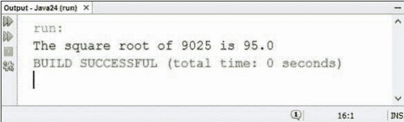

图 10.3：NewRoot 程序的输出。

`NewRoot` 应用程序是第 4 小节教程“理解 Java 程序是如何工作的”的扩展，该教程显示了整数 225 的平方根。

如果该程序能接收用户提交的数字并显示其平方根，它将更有用。这需要从字符串到整数的转换。所有命令行参数都存储为 `String` 数组的元素，因此在数学表达式中使用它们之前，必须将它们转换为数字。

要根据字符串的内容创建整数值，你在第 7 行调用 `Integer.parseInt` 方法，并将字符串作为唯一参数：

```java
number = Integer.parseInt(arguments[0]);
```

`arguments[0]` 数组持有程序运行时提交的第一个命令行参数。当程序使用 "9025" 作为参数运行时，字符串 "9025" 被转换为 `int` 值 9025。

将命令行参数从 9025 更改为其他数字，并多运行几次程序。

## 实战：创建 Modem 继承层次结构

为了在这一节中看到继承的运行示例，你创建了代表电缆调制解调器（cable modem）和 DSL 调制解调器（DSL modem）的对象类型。它们的共同点是都具有速度（speed）。通过使用 `extends` 语句，你可以让它们都成为 `Modem` 的子类。

在 NetBeans 中，在 `com.java24hours` 包中创建一个名为 `Modem` 的新 Java 类。输入代码列表 10.2 并保存文件。

### 代码列表 10.2：Modem.java 的完整文本

```java
package com.java24hours;

public class Modem {
  int speed;

  public void displaySpeed() {
    System.out.println("Speed: " + speed);
  }
}
```

该文件被编译为 `Modem.class`。你不能直接运行它，但可以在其他类中使用。在 `com.java24hours` 包中创建一个名为 `CableModem` 的新空 Java 文件。输入代码列表 10.3 并保存文件。

### 代码列表 10.3：CableModem.java 的完整文本

```java
package com.java24hours;

public class CableModem extends Modem {
  String method = "cable connection";

  public void connect() {
    System.out.println("Connecting to the Internet ...");
    System.out.println("Using a " + method);
  }
}
```

在 NetBeans 的 `com.java24hours` 包中创建第三个文件名为 `DslModem`。输入代码列表 10.4 并保存文件。

### 代码列表 10.4：DslModem.java 的完整文本

```java
package com.java24hours;

public class DslModem extends Modem {
  String method = "DSL phone connection";

  public void connect() {
    System.out.println("Connecting to the Internet ...");
    System.out.println("Using a " + method);
  }
}
```

如果没有错误，你现在有了三个类文件：`Modem.class`、`CableModem.class` 和 `DslModem.class`。然而，你无法运行这些类文件，因为它们没有像你创建的其他程序那样的 `main()` 块。你需要创建一个短应用程序来测试你刚刚构建的类层次结构。

回到 NetBeans，并在 `com.java24hours` 中创建一个类名为 `ModemTester` 的新空 Java 文件。在源编辑器中输入代码列表 10.5 并保存文件。

### 代码列表 10.5：ModemTester.java 的完整文本

```java
package com.java24hours;

public class ModemTester {
    public static void main(String[] arguments) {
        CableModem surfboard = new CableModem();
        DslModem gateway = new DslModem();
        surfboard.speed = 500000;
        gateway.speed = 400000;
        System.out.println("Trying the cable modem:");
        surfboard.displaySpeed();
        surfboard.connect();
        System.out.println("Trying the DSL modem:");
        gateway.displaySpeed();
        gateway.connect();
    }
}
```

当你运行程序时，你应该看到与图 10.4 匹配的输出。

```
run:
Trying the cable modem:
Speed: 500000
Connecting to the Internet ...
Using a cable connection
Trying the DSL modem:
Speed: 400000
Connecting to the Internet ...
Using a DSL phone connection
BUILD SUCCESSFUL (total time: 0 seconds)
```


程序中发生了以下操作：

- 第 5–6 行——创建了对象：一个名为 `surfboard` 的 `CableModem` 对象和一个名为 `gateway` 的 `DslModem` 对象。
- 第 7 行——将名为 `surfboard` 的 `CableModem` 对象的 `speed` 变量设置为 500000。
- 第 8 行——将名为 `gateway` 的 `DslModem` 对象的 `speed` 变量设置为 400000。
- 第 10 行——调用了 `surfboard` 对象的 `displaySpeed()` 方法。该方法继承自 `Modem`——尽管它在 `CableModem` 类中并不存在，你仍然可以调用它。
- 第 11 行——调用了 `surfboard` 对象的 `connect()` 方法。
- 第 12 行——调用了 `gateway` 对象的 `displaySpeed()` 方法。
- 第 13 行——调用了 `gateway` 对象的 `connect()` 方法。

## 总结


在创建第一类对象并将若干类排列成层级结构后，你应该对“面向对象编程”这个术语以及有趣的缩写 OOP 更加熟悉了。在接下来的两个小时里，随着你开始创建更复杂的对象，你将学习更多关于对象行为和属性的知识。

## 工作坊 139

随着你对这种开发风格越来越熟悉，程序、类和对象等术语变得更有意义。OOP 是一个需要时间来适应的概念。当你掌握了它，你会发现它是设计、开发和调试计算机程序的有效方法。

### 问答

- Q. 类可以继承自多个类吗？

  A. 在某些编程语言（如 C++）中是可能的，但 Java 不行。多继承是一项强大的功能，但它让 OOP 变得更难学习和使用。Java 的开发者决定将继承限制在一个类，尽管一个类有许多子类。补偿这种局限性的一种方法是继承一种名为接口（`interface`）的特殊类。你将在第 15 小时“创建线程程序”中学习更多关于接口的知识。

- Q. 你什么时候想创建一个不是公共（public）的方法？

  A. 主要情况是该方法严格供你编写的程序使用。如果你正在创建一个游戏程序，并且你的 `shootRaycast()` 方法对你编写的游戏非常特殊，那么它可以是一个私有方法。要让一个方法不是公共的，只需去掉方法名前前的 `public` 声明。

- Q. 为什么可以将 `char` 值像 `int` 值一样使用？

  A. 字符可以作为 `int` 变量使用，因为每个字符在字符集中都有对应的数字代码。如果你有一个值为 67 的变量 `k`，强制转换 `(char)` 会产生字符值 'C'，因为根据 ASCII 字符表，与字符 C 关联的数字代码是 67。ASCII 字符表是 Java 语言采用的 Unicode 字符标准的一部分。

- Q. Tabasco 辣椒酱会洒出来吗？

  A. 不会，尽管如果你把开瓶保留几年，它会变色。醋、红辣椒和盐的成分对于细菌生长来说是极不利的环境。

  Tabasco 的制造商 McIlheny 公司表示，原品牌的保质期为五年。其他版本的保质期从 18 个月到三年不等。

  作为该产品的超级粉丝，很难相信有人会留一瓶 Tabasco 久到产生这个问题。

### 测验

以下问题测试你对对象以及使用它们的程序的知识。

- 1. 使用什么语句来允许一个类继承另一个类？

  A. `inherits`

  B. `extends`

  C. `handItOverAndNobodyGetsHurt`

- 2. 编译后的 Java 程序以什么后缀保存？

  A. `.class`

  B. `.java`

  C. `.exe`

- 3. 构成一个对象的两个要素是什么？

  A. `attributes`（属性）

  B. `behavior`（行为）

  C. `methods`（方法）

### 答案

- 1. B

- 2. A

- 3. B

你只能在变量所在的类中、该类的任何子类中或同一包的类中使用受保护变量（`protected variable`）。包是一组具有共同目的的相关类。一个例子是 `java.util` 包，它包含了提供日期和时间编程以及文件归档等实用工具的类。当你在 Java 程序中使用 `import` 语句并配合星号 `*` 时，例如 `import java.util.*`，你是在让程序更容易引用该包中的类。

私有变量（`private variable`）的限制比受保护变量更严格——你可以在同一个类中使用它。除非你确定一个变量可以更改为任何影响其类功能的内容，否则你应该将变量设为私有或受保护。

以下语句将 `guid` 定义为私有变量：

```
private int guid;
```

如果你想让其他程序以某种方式使用 `guid` 变量，你必须创建实现这种可能的行为。这项将在稍后介绍。

还有另一种访问控制类型：在创建变量时没有使用任何 `public`、`private` 或 `protected` 语句。

在你在此小时之前开发的大多数程序中，当没有设置访问控制时，变量仅对同一包中的类可用。这被称为默认访问或包访问（`package access`）。

## 创建类变量

当你创建一个对象时，它拥有作为该对象类的一部分的所有变量的版本。从 `Gremlin` 对象类创建的每个对象都有它们自己的 `guid`、`maximumAge` 和 `creator` 的版本。如果你修改了某个对象中的这些变量之一，它不会影响另一个 `Gremlin` 对象中的相同变量。

有时，属性应该描述整个对象类，而不是某个特定的对象。这些被称为类变量（`class variables`）。如果你想跟踪程序中使用了多少个 `Gremlin` 对象，你可以使用类变量来存储这些信息。整个类中只存在一个变量副本。因此，你到目前为止为对象创建的变量可以被称为对象变量（`object variables`），因为它们与特定的对象相关联。

这两种变量的创建和使用方式是相同的，但 `static` 是创建类变量的语句的一部分。以下语句为 `Gremlin` 示例创建了一个类变量：

```
static int gremlinCount = 0;
```

## 第 11 小时：描述对象是什么样的

更改类变量的值与更改对象的变量没有区别。如果你有一个名为 `stripe` 的 `Gremlin` 对象，你可以通过以下语句更改类变量 `gremlinCount`：

```
stripe.gremlinCount++;
```

由于类变量适用于整个类，你也可以使用类名：

```
Gremlin.gremlinCount++;
```

这两条语句实现了相同的功能，但在处理作为类变量 `gremlinCount` 时，使用类名的优势在于：可以一眼看出它是一个类变量而不是对象变量。如果你在处理类变量时总是使用对象名称，那么在不仔细查看源代码的情况下，你无法判断它是类变量还是对象变量。

类变量也是静态变量（`static variables`）。

> **注意**
>
> 尽管类很有用，但你必须注意不要过度使用它们。这些变量只要类在运行它们就会一直存在。如果一个大型对象数组存储在类变量中，它将占用大量的内存且永远不会释放。

### 使用方法创建行为

属性是跟踪对象类信息的方法，但对于一个类被创建的目的是，你必须创建行为。行为描述了类中完成特定任务的部分。这些部分中的每一个都是一个方法（`method`）。

到目前为止，你一直在程序中使用方法而却并不知道，其中特别提到了一个：`println()`。此方法在屏幕上显示文本。和变量一样，方法是与对象或类结合使用的。类名后面跟着一个点和方法名，例如 `object2.move()` 或 `Integer.parseInt()`。

> **注意**
>
> `System.out.println()` 方法看起来可能令人困惑，因为它有两个点而不是一个。这是因为语句中涉及两个类：`System` 类和 `PrintStream` 类。`System` 类有一个名为 `out` 的静态变量，它是一个 `PrintStream` 对象。`println()` 是 `PrintStream` 类的一个方法。`System.out.println()` 语句实际上意味着“使用 `System` 类实例变量 `out` 的 `println()` 方法”。你可以这样链式调用引用。

### 声明方法

你使用一个语句创建方法，该语句看起来与开始类的语句相似。它们都可以在名称后的括号内接收参数，并且在开头和结束处都使用 `{ }` 标记。区别在于，方法在处理完后可以返回一个值。该值可以是整数或布尔值等简单类型之一，也可以是一个对象类。

以下是 `Gremlin` 类可以用于创建一个新 gremlin 方法示例：

```java
public Gremlin replicate(String creator) {
  Gremlin noob = new Gremlin();
  noob.creator = "Steven Spielberg";
  return noob;
}
```

此方法接受一个参数：一个名为 `creator` 的字符串变量，这是一个代表创建者名称的变量。

在开始方法的语句中，`Gremlin` 位于方法名 `replicate` 之前。该语句表示在方法处理后返回一个 `Gremlin` 对象。`return` 语句才是实际返回对象。在此方法中，返回了 `noob` 的值。

如果方法不返回值，请在声明方法的语句中使用 `void` 关键字。

当方法返回值时，你可以将方法作为表达式的一部分。如果你创建了一个名为 `haskins` 的 `Gremlin` 对象，你可以使用此类语句。在之前的小时中，你将 `guid` 变量切换为私有以防止其读取或修改。当变量是私有的时，仍有一种方法让其他程序访问。考虑以下两个方法：

```java
public int getGuid() {
  return guid;
}
```

```java
public void setGuid(int newValue) {
    if (newValue > 0) {
        guid = newValue;
    }
}
```

这些方法被称为访问器（`accessor`），因为它们允许从外部访问 `guid` 变量。

`getGuid()` 方法用于检索 `guid` 的当前值。`getGuid()` 方法没有参数，但方法名后必须有括号。`setGuid()` 方法接受一个参数，一个整数。如果 `newValue` 大于 0，就会进行更改。

在此示例中，`Gremlin` 控制了其他类如何使用 `guid` 变量。这个过程被称为封装（`encapsulation`），它是 OOP 的基本概念。你的对象越能保护自己不受误用，在其他程序中使用它们时就越有用。

尽管 `guid` 是私有的，但新方法 `getGuid()` 和 `setGuid()` 能够操作 `guid` 因为它们在同一个类中。

> **提示**
>
> 集成开发环境 (IDE) 通常可以自动创建访问方法。NetBeans 提供了这种功能。要查看效果，打开第 10 小时的“创建你的第一个对象”。在源代码编辑器的任何位置点击右键，选择菜单命令重构（Refactor），封装字段（Encapsulate Fields）。打开对话框。点击选择全部（Select All），然后重构。NetBeans 将 `speed` 变量变为私有并创建新的 `getSpeed()` 和 `setSpeed()` 方法。

## 参数不同的相似方法

正如 `setGuid()` 方法所示，你可以向方法发送参数来影响它的行为。类中的不同方法可以有不同的名称，但如果参数不同，方法也可以具有相同的名称。

如果参数数量不同或参数类型不同，两个方法可以具有相同的名称。例如，`Gremlin` 对象类拥有两个 `tauntHuman()` 方法可能很有用。一个可以没有参数，另一个可以接受字符串作为参数。以下语句实现了这些方法：

```java
void tauntHuman() {
    System.out.println("That has gotta hurt!");
}
```

```java
void tauntHuman(String taunt) {
    System.out.println(taunt);
}
```

这些方法的名称相同，但参数不同：第一个方法没有参数，另一个有一个 String 参数。方法的参数被称为该方法的**签名**（`signature`）。一个类可以具有相同名称的不同方法，只要每个方法的签名都不同。

### 构造函数

当你想在程序中创建一个对象时，会使用 `new` 语句，如下例所示：

```
Gremlin clorr = new Gremlin();
```

该语句创建了一个名为 `clorr` 的新 `Gremlin` 对象。当你使用 `new` 语句时，会调用该对象类的一个特殊方法。这个方法被称为构造函数，因为它处理了创建对象所需的工作。构造函数的作用设置任何变量，并调用为了函数正常运行而必须执行的方法。

构造函数的定义方式与其他方法类似；它们不能有返回值。以下是针对 Gremlin 类对象的两个构造函数：

```java
public Gremlin() {
    creator = "Michael Finnell"; // creator 是一个字符串
    maximumAge = 240; // maximumAge 是一个 int
}
```

```java
public Gremlin(String name, int size) {
    creator = name;
    maximumAge = size;
}
```

与其他方法一样，构造函数可以使用它们接收的参数在类中定义多个构造函数。在这个示例中，当使用如下所示的 `new` 语句时，会调用第一个构造函数：

```
Gremlin blender = new Gremlin();
```

只有当为 `new` 语句发送字符串和一个整数作为参数时，才会调用另一个构造函数，如下例所示：

```
Gremlin plate = new Gremlin("Zach Galligan", 960);
```

如果你在类中没有包含任何构造函数，它将从其子类继承一个无参数的构造函数。取决于所使用的父类，它可能还会继承其他的构造函数。

在任何类中，必须有一个构造函数，其与创建该类对象的 `new` 语句具有相同的参数数量和类型。在 Gremlin 类的示例中，由于有 `Gremlin()` 和 `Gremlin(String name, int size)` 构造函数，你只能通过两种不同类型的 `new` 语句创建 `Gremlin` 对象：一种无参数，另一种仅以字符串和一个整数作为参数。

**注意**

如果你的子类定义了一个有一个或多个参数的构造函数，该类将不再从其父类继承无参数的构造函数。因此，当你的类有其他构造函数时，必须始终定义一个无参数构造函数。

### 类方法

与类变量一样，类方法是一种为整个类提供功能而非特定对象的方法。当方法不影响类的某个单个对象时，请使用方法。在第 10 小节中，使用 `Integer` 类的 `parseInt()` 方法将字符串转换为 `int` 类型。

```java
int fontSize = Integer.parseInt(jTextField);
```

这是一个类方法。要将一个方法变为类方法，在方法名之前使用 `static`，如下代码所示：

```
static void showGremlinCount() {
    System.out.println("There are " + gremlinCount + " gremlins");
}
```

`gremlinCount` 变量之前被用于跟踪程序创建了多少个 `Gremlin` 对象。`showGremlinCount()` 方法是一个类方法，用于显示这个总数，你可以使用如下语句调用它：

```
Gremlin.showGremlinCount();
```

### 方法内部的变量作用域

当你在类的某个方法内部创建变量或对象时，它只存在于该方法内部。其原因为变量作用域（`variable scope`）的概念。作用域是变量在程序中存在的代码块。如果你超出了作用域定义的程序部分，就无法再使用该变量。

程序中的 `{` 和 `}` 括号定义了变量作用域的边界。在这些标记内创建的任何变量都无法在它们之外使用。例如，考虑以下语句：

```java
if (numFiles < 1) {
    String warning = "No files remaining.";
}
System.out.println(warning);
```

这段代码无法运行——而且在 NetBeans 中无法编译——因为 `warning` 变量是在 `if` 块的括号内部创建的。这些括号定义了该变量的作用域。`warning` 变量在括号之外不存在，因此 `System.out.println()` 方法无法将其作为参数使用。

当你在一组括号内部嵌套一组括号时，需要注意被包含变量的作用域。看下面的示例：

```java
if (humanCount < 5) {
    int status = 1;
    if (humanCount < 1) {
        boolean firstGnome = true;
        status = 0;
    } else {
        firstGnome = false;
    }
}
```

发现问题了吗？`status` 变量可以在该块内的任何地方使用，但给 `firstGnome` 赋值为 `false` 的语句会导致编译器错误。因为 `firstGnome` 是在 `if (humanCount < 1)` 语句的作用域内创建的，它在随后的 `else` 语句的作用域内不存在。

要修复这个问题，`firstGnome` 必须在这些块之外创建，这样它的作用域才能包含两者。一种解决方案是在创建 `status` 后的一行创建 `firstGnome`。

作用域规则让程序更容易调试。在很多情况下，你需要引用当前对象——换句话说，程序所代表的对象。

# 将类放在另一个内部

当你将一个类放在另一个类的起始和结束括号之间时，它就是一个内部类。定义类的一种方法是单独定义它，如下例：


```java
public class Wrecker {
    String creator = "Hoyt";

    public void destroy() {
        GremlinCode vic = new GremlinCode(1024);
    }
}

class GremlinCode {
    int vSize;

    GremlinCode(int size) {
        vSize = size;
    }
}
```

在前面的示例中，编译器产生 `Wrecker.class` 和 `Wrecker$GremlinCode.class`。

> **注意** 内部类允许 Java 中一些复杂的编程技术在你获得更多经验后会更容易理解。具体来说还需要五个小时。本书将在第 16 小节“使用内部类和闭包”中回到这个主题。

# 使用 this 关键字

由于你可以引用其他类的变量和方法，同时引用你自己类中的变量和方法，你引用的变量在某些情况下可能会变得混淆。让情况变得清晰的方法之一是使用 `this` 语句——在程序内部引用对象的方法。

当你使用对象的方法或变量时，可以在方法或变量名之前加上对象的名称并用点隔开。考虑这些示例：

```
Gremlin mogwai = new Gremlin();
mogwai.creator = "LoveHandles";
mogwai.setGuid(75);
```

这些语句创建了一个名为 `mogwai` 的新 `Gremlin` 对象，设置了 `mogwai` 的 `creator` 变量，然后调用了 `mogwai` 的 `setGuid()` 方法。

在这个示例中，一个名为 `creator` 的变量存在于 `checkCreator()` 的作用范围内，但它与一个名为 `creator` 的对象变量不是同一个。如果你想引用当前对象的 `creator` 变量，你必须使用 `this` 语句，如下所示：

```java
System.out.println(this.creator);
```

通过使用 `this`，你可以清楚地指明你引用的是哪个变量或方法。在类中任何需要引用对象名称的地方你都可以使用 `this`。如果你想将当前对象作为参数传递给方法（例如），你可以使用如下语句：

```java
verifyData(this);
```

在很多情况下，不需要使用 `this` 关键字来明确你正在引用对象的变量和方法。然而，当你想要确保万无一失时，随时使用它并无坏处：

在构造函数中设置对象实例变量的值时，这个关键字非常派得上用场。考虑一个具有 `creator` 和 `maximumAge` 变量的 `Gremlin` 对象。下述所示的构造函数设置了它们：

```java
public Gremlin(String creator, int maximumAge) {
    this.creator = creator;
    this.maximumAge = maximumAge;
}
```

## 使用类方法和变量

在这一小时的第一个项目中，你创建一个简单的 `Gremlin` 对象，它可以计算程序创建了多少个 `Gremlin` 对象并报告总数。

你熟悉操作流程：在 Beans 中选择文件（File）> 新建文件（New File），并在 `com.java24hours` 包中创建一个名为 `Gremlin` 的空 Java 文件（Empty Java File）。在源编辑器中输入 `11.1`。点击保存（Save）。

- 列表 11.1 Gremlin.java 的全文

```java
1: package com.java24hours;
2:
3: public class Gremlin {
4:
5:     static int gremlinCount = 0;
6:
7:     public Gremlin() {
8:
9:         gremlinCount++;
10:    }
11:
12:    static int getGremlinCount() {
13:        return gremlinCount;
14:    }
15: }
```

保存文件，NetBeans 会自动编译它。此类缺少 `main()` 方法，无法直接运行。为了测试这个新的 `Gremlin` 类，你需要创建第二个可以创建 `Gremlin` 对象的类。

`GremlinLab` 是一个简单的应用程序，它创建 `Gremlin` 对象并通过 `Gremlin` 类的 `getGremlinCount()` 类方法计算已创建的对象数量。

用 NetBeans 打开一个新文件，完成后将其保存为 `GremlinLab.java`。

## 列表 11.2 GremlinLab.java 的全文

```java
1:     package com.java24hours;
2:
3:     public class GremlinLab {
4:         public static void main(String[] arguments) {
5:             int numGremlins = Integer.parseInt(arguments[0]);
6:             if (numGremlins > 0) {
7:                 Gremlin[] gremlins = new Gremlin[numGremlins];
8:                 for (int i = 0; i < numGremlins; i++) {
9:                     gremlins[i] = new Gremlin();
10:                }
11:                System.out.println("There are " + Gremlin.getGremlinCount()
12:                                 + " gremlins.");
13:            }
14:        }
15:    }
```

`Gremlin` 类是一个在命令行运行时接收一个参数的应用程序：要创建的 `Gremlin` 对象数量。要在 NetBeans 中指定命令行参数，请执行以下操作：

1. 选择运行（Run）> 设置项目配置（Set Project Configuration）> 自定义（Customize）。打开项目属性对话框。

2. 在主类（Main class）字段中输入 `GremlinLab`，在参数（Arguments）字段中输入你想创建的 `Gremlin` 对象数量。

3. 点击 OK 关闭对话框。

要运行配置了参数的程序，在 NetBeans 中选择运行（Run）> 运行主项目（Run Main Project）。

参数通过发送到 `main()` 方法的字符串数组读入应用程序。在 `GremlinLab` 类中，这发生在第 4 行。

要把参数作为整数处理，必须将参数从 `String` 对象转换为整数。这需要使用 `Integer` 类的 `parseInt()` 类方法。在第 5 行，根据从命令行发送给程序的第一个参数创建 `int` 变量 `numGremlins`。

如果 `numGremlins` 变量大于 0，则 `GremlinLab` 应用程序中发生以下情况：

- 7—创建一个 `Gremlin` 对象数组，并由 `numGremlins` 变量决定数组中的对象数量。

- 8–10—使用循环调用数组中每个 `Gremlin` 对象的构造方法。

- 11–12—在所有 `Gremlin` 对象都构造完成后，使用 `Gremlin` 类的 `getGremlinCount()` 方法统计已创建的对象数量。这应该与你运行 `GremlinLab` 应用程序时设置的参数相匹配。

如果 `numGremlins` 变量不大于 0，GremlinLab 应用程序将什么都不会发生。

在编译 `GremlinLab.java` 文件后，使用任何命令行参数对其进行测试。你可以创建的 `Gremlin` 对象数量取决于可用内存。如果你指定的超过 8000 万，程序可能会崩溃。输出应该如下：

```text
There are 7000000 gremlins.
```

### 总结

在本小时中，你学习了如何使用 `this` 关键字来区分局部变量和对象变量。你还看到了在构造函数中使用 `this` 初始化实例变量。最后，你学习了静态方法和变量以及如何向程序传递命令行参数。

### 工作坊

### Q：是否需要使用 `this` 来引用对象的变量和方法？

答：在很多情况下，不需要。然而，当你想要确保万无一失时，随时使用它。

### Q：如何在 NetBeans 中设置命令行参数？

答：在运行下的项目属性对话框的参数（Arguments）字段中设置。

### Q：如何将命令行参数转换为整数？

答：使用 `Integer` 类的 `parseInt()` 方法。

## 第 11 小时：描述你的对象

在写作时，Aziz Ouaka 的排名为第 2104 位。Ouaka 在过去 52 周参加的 12 场比赛中仅获得积分。Ouaka 是一位 17 岁的来自突尼斯的年轻人，他在2013年3月参加了越南 F1 巡巡赛。那里有一个 32 人的预选赛和一个 32 人的正赛。Ouaka 以三盘击败西班牙的 Rafael Moreno-Higeras，并在第二轮对阵法国的 Baptiste Christophe de France 时输掉了两盘。他当年的奖金收入 1194 美元。

在你附近可能有一个巡回赛。全球每年有超过 500 场赛事。访问 ittenis.com 获取日程和参赛信息。

### 练习

1. 在 Java 类中，方法是什么的示例？

- A. 属性

- B. 语句

- C. 行为

2. 如果你想让一个变量成为类变量，创建时必须使用什么语句？

- A. new

- B. public

- C. static

3. 程序中变量生存部分的名称是什么？

- A. 巢

- B. 作用范围

- C. 变量谷

### 答案

1. C. 方法由语句组成，但它是行为的示例。

2. C. 如果省略 static 语句，该变量将是对象变量而非类变量。

3. B. 在作用范围之外使用变量时，编译器会报错。

## 活动

如果这些关于小怪物（gremlins）的谈论并没有吓跑你，可以通过以下活动增加对本节主题的了解：

- 为 `Gremlin` 类添加一个 `private` 变量，存储一个名为 `guid` 的整数。创建返回 `guid` 值的方法以及更改 `guid` 值的方法，但仅当新值在 1,000,000 到 9,999,999 之间时才允许更改。

- 编写一个 Java 程序，接收一个字符串类型的参数，将其转换为 `float` 变量，然后将其转换为 `Float` 对象，最后将其转换为 `int` 变量。使用不同的参数运行几次，以观察结果如何变化。

要查看实现这些活动的 Java 程序，请访问书籍网站 www.java24hours.com。

## 第 12 小节

### 充分利用现有对象

**本节的任务清单：**

- 设计子类和父类。

- 建立继承层次结构。

- 重写方法（Override）。

Java 对象非常适合“繁衍”。当你创建一个对象（一组属性和行为）时，你设计了一个已经准备好将这些特性传递给后代的物。这些子对象继承了父类的大许多属性和行为，它们在某些方面也与父类有所不同。

这种系统被称为继承，是每个超类（父类）都会提供给其子类（孩子）的内容。继承是面向对象编程（OOP）中最实用的方面之一，你将在本节中学习到它。

OOP 的另一个有用特性是能够创建一个可以在不同程序使用的对象。可重用性使得开发无错误、可靠的程序变得更容易。

### 继承的力量

每当你使用如 `String` 或 `Integer` 等标准 Java 类时，你都在使用继承。Java 类被组织成金字塔型的层次结构，其中所有类都继承自 `Object` 类。

对象类继承自其上方的所有父类。为了直观地理解这种运作方式，请考虑 `InputStreamReader` 类。该类是 `FileReader` 的子类，`FileReader` 是一个从文件中读取文本行的类。`FileReader` 类又是 `InputStreamReader` 的子类。

图 12.1 显示了 `InputStreamReader` 家族。每个框代表一个类，线条将父类与其下方的任何子类连接起来。

### 第 12 小节：充分利用现有对象

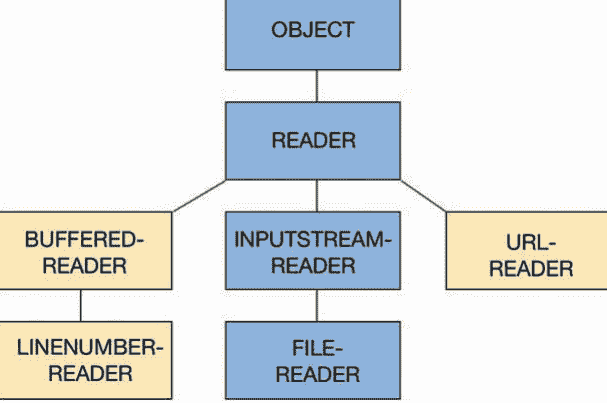

**图 12.1**

InputStreamReader 类的家族树。

顶部是 `Object` 类。`InputStreamReader` 在层次结构中上方有两个父类：`Reader` 和 `Object`。它在层次结构下方有一个子类：`FileReader`。

`InputStreamReader` 类继承了 `Reader` 和 `Object` 类的属性和行为，因为它们在父类层次结构中直接位于它的上方。`InputStreamReader` 没有继承图 12.1 中橙色类（`BufferedReader`、`UrlReader` 和 `LineNumberReader`），因为它们并不在它的层次结构上方。

如果这听起来很困惑，可以将这种层次结构想象成家族树。`InputStreamReader` 继承它的父类，并此类推。然而，`InputStreamReader` 类并不继承它的兄弟类或表兄弟类。

创建一个新类归结为以下任务：你只需要定义它与现有类不同之处。其余的工作由系统为你完成。

### 继承行为和属性

类的行为和属性是两件事的结合：它自身的行为和属性，以及它从父类继承的所有行为和属性。

以下是 `InputStreamReader` 的一些行为和属性：

- `equals()` 方法确定一个 `InputStreamReader` 对象是否与另一个对象具有相同的值。

- `getEncoding()` 方法返回流使用的字符编码名称。

- `reset()` 方法将流的当前位置移回起点。

- `mark()` 方法标记当前位置。

`InputStream` 类可以使用所有这些方法，尽管 `read()` 是它唯一没有从其他类继承的方法。`equals()` 方法定义在 `Object` 中，而 `reset()` 和 `mark()` 均来自 `Reader`。

### 重写方法

在 `InputStream` 对象类中定义的某些方法也定义在其中一个父类中。例如，`close()` 方法既是 `InputStream` 类的一部分也是 `Reader` 类的一部分。当一个方法在子类和其父类中都被定义时，将使用子类的方法。这使得子类能够更改、替换或完全消除其父类的行为或属性。

在子类中创建一个新方法以更改从父类继承的行为被称为“重写”（overriding）。当继承的行为产生不想要的结果或你想做一些不同的事情时，你需要重写方法。

### 建立继承

使用 `extends` 语句可以将一个类定义为另一个类的子类：

```java
class FileReader extends InputStreamReader {
// 在此处编写行为和属性
}
```

`extends` 语句将 `FileReader` 类建立为 `BufferedReader` 的子类。所有文件读取器必须是输入流读取器的子类。它们需要通过输入流提供文件的功能。

`FileReader` 可以重写的方法之一是 `close()` 方法，它在读取文本后执行关闭文件的操作。由 `Reader` 类实现的 `close()` 方法被传递给 `FileReader`。

`Reader` 类的 `read( )` 方法起始如下：

```java
public int read(char[] buffer) {
```

当 `FileReader` 重写该方法时，它必须如下：

```java
public int read(char[] cbuf) {
```

区别在于字符数组名称，这在判断方法是否相同时并不重要。这两个语句是匹配的，因为以下这些相同：

- 两个方法都是 public 的。

- 两个方法都返回整数。

- 两个方法都以字符数组作为参数。

当你在子类中重写方法时，应该在方法声明加上 `@Override`，例如：

```java
@Override
public void setPosition(int x, int y) {
  if (x > 0 && y > 0) {
    super.setPosition(x, y);
  }
}
```

`@Override` 文本是一种特殊的注释，告诉 Java 编译器它可以自行推断。通过在方法前加上 `@Override` 注解，你为编译器提供了机会来检查该方法是否真的重写了父类方法。如果没有（例如，你可能漏掉了第二个整数参数），程序将无法编译。

如果没有注解，编译器无法发现这个潜在问题。没有第二个参数的方法看起来就像其他方法一样。

### 在子类中使用 this 和 super

在子类中非常有用的两个关键字是 `this` 和 `super`。

正如你在上一节中中学的，`this` 关键字用于引用当前对象。当你创建一个类并需要引用从该类创建的特定对象时，可以使用 `this`，如下所示：

```java
this.title = "Cagney";
```

该语句将对象的 title 实例设置为 "Cagney"。

`super` 关键字具有相似的目的：它引用该对象的直接父类。你可以通过不同的方式使用 `super`：

- 引用父类的构造函数，如 `super("Adam", 12);`。

- 引用父类的变量，如 `super.hawaii = 50;`。

- 引用父类方法，如 `super.dragnet();`。


# 第 12 小时：充分利用对象

## 使用 `super` 关键字调用父类构造函数

使用 `super` 关键字的一种方式是在子类的构造函数中使用。由于子类继承了其父类的行为和属性，你必须将该子类的每个构造函数与其父类的构造函数关联。否则，某些行为和属性可能无法正确设置，导致子类无法正常工作。

通过 `super` 访问的变量不能是私有的，因为那些在子类中是不可用的。为了关联构造函数，子类的第一语句必须是对父类构造函数的调用。这需要 `super` 关键字，如下所示：

```java
public DataReader(String name, int length) {
  super(name, length);
}
```

这个示例是一个子类的构造函数，它使用 `super(name, length)` 语句调用其父类中相应的构造函数。

如果你没有使用 `super()` 来调用父类的构造函数，Java 会在子类开始时自动调用无参数的 `super()`。如果这个父类构造函数不存在或提供了意外之外的行为，就会导致错误，因此最好亲自调用父类构造函数。

## 与现有对象交互

OOP 鼓励重用。如果你为某个 Java 编程项目开发了一个对象，那么在不修改的情况下将该对象整合到另一个项目中应该是可能的。

如果一个 Java 类设计得良好，它就可能供其他程序使用。你的程序中可用的对象越多，在你创建自己的软件时需要的工作就越少。这是一个非常适合你需求的优秀拼写检查对象，你甚至可以给老板留下关于向项目添加拼写检查功能需要多久的错觉，并利用这段额外时间在办公室拨打私人远程电话。

> **注意**
>
> 本书的作者像他许多业内人士一样，是自雇并在居家工作。在评估他关于如何在职场中表现的建议时，请记住这一点。

当 Java 引入时，对象共享系统当时还未正式化。程序员开发对象时尽可能独立，并通过使用私有变量以及读写这些变量的公共方法来保护它们免受误用。

当存在标准方法来开发可重用对象（如 `JavaBeans`）时，共享对象将变得更加强大。

标准化的优点包括：

- 较少需要文档化对象是如何工作的，因为任何熟悉标准的人已经对其功能有了深入了解。
- 你设计的开发工具遵循标准，使得能够轻松地处理这些对象。
- 两个遵循标准的对象可以相互交互，而无需为了兼容性而进行特殊的编程。

`JavaBeans` 是遵循严格创建规则和实例变量访问规则的对象。遵循规则的 Java 类被称为 bean（豆子）。`NetBeans IDE` 被用于创建 bean。一个在 `NetBeans` 中使用 `JavaBeans` 的入门教程请访问 <http://wiki.netbeans.org/NetBeansBeansTutorial>。

## 在 `ArrayList` 中存储相同类的对象

编写计算机程序时要做的一个重要决策是将数据存储在哪里。在书的前半部分，你发现了三个存储信息的地方：

- 基本数据类型，如 `int` 和 `char`（或其相应的类）
- 数组
- `String` 对象

存储信息的地方不止这些，因为任何 Java 类都可以持有数据。最有用的之一是 `ArrayList`，它是一种持有相同类或公共父类对象的数据结构。

正如其名所示，数组列表像数组一样，它们也持有相关数据的元素，但它们可以随时扩大或缩小大小。

`ArrayList` 属于 `java.util` 包，它是 Java 类库中最常用的包之一。通过 `import` 语句可以在你的程序中使用它：

```java
import java.util.ArrayList;
```

数组列表持有属于相同类或共享相同父类的对象。它们通过引用两个类来创建：`ArrayList` 类和它持有的列表类型。

列表所持有的类名被放在 `<` 和 `>` 字符之间，如下句所示：

```java
ArrayList<String> structure = new ArrayList<String>();
```

前述语句创建一个持有字符串的列表。以这种方式识别列表的类利用泛型，这是一种指示数据结构（如数组列表）所持有对象类型的方法。如果你在使用旧版本的 Java，你将编写如下的构造函数：

```java
ArrayList structure = new ArrayList();
```

虽然你可以这样做，但泛型使你的代码更可靠，因为它们为编译器提供了防止更多错误的方法。在这里，它们阻止你通过向列表中放入错误类别的对象来误用数组列表。如果你尝试将一个对象放入本应持有 `String` 对象的列表中，编译器会报错。

与数组不同，列表创建不是根据它们所持有的固定元素数量创建的。列表创建时有 10 个元素的默认容量。如果你存储的对象超过该数量，可以指定大小作为构造函数的参数。这里有一个创建一个 300 元素列表的语句：

```java
ArrayList<String> structure = new ArrayList<String>(300);
```

你可以通过调用其 `add()` 方法向列表添加对象，并将对象作为唯一参数：

```java
structure.add("Vance");
structure.add("Vernon");
structure.add("Velma");
```

你按顺序添加对象，如果这些是添加到 `structure` 的前三个对象，元素 0 是 "Vance"，元素 1 是 "Vernon"，元素 2 是 "Velma"。

你通过调用其 `get()` 方法并将元素的索引号作为参数来从列表中检索对象：

```java
String name = structure.get(1);
```

该语句将 "Vernon" 存储在 `name` 字符串中。

要检查列表是否包含某个对象，用该对象作为参数调用其 `contains()` 方法。要移除对象，使用 `remove()` 方法：

```java
structure.remove(0);
structure.remove("Vernon");
```

这些语句留下 "Velma" 作为列表中唯一的字符串。

## 遍历数组列表

Java 包含一种特殊的 `for` 循环，可以很容易地遍历数组列表并逐一检查其元素。

第一部分是初始化部分：持有从列表中检索的每个对象的变量类和名称。该对象应该属于持有列表的类。

第二部分是标识列表。

以下是遍历 `structure` 列表并将每个名称打印到屏幕的代码：

```java
for (String name : structure) {
    System.out.println(name);
}
```

本小时第一个项目是 `StringLister`，它运行数组列表和特殊的 `for` 循环，按字母顺序展示字符串列表。列表来自数组和命令行参数。

在 `NetBeans` 中打开你的 `Java24` 项目，点击 `File`、`New File`，并在 `com.java24hours` 包中创建一个名为 `StringLister` 的空文件。在源编辑器中输入列表 12.1 并保存文件。

### 列表 12.1 StringLister.java 的完整文本

```java
1: package com.java24hours;
2:
3: import java.util.*;
4:
5: public class StringLister {
6:     String[] names = {"Vance", "Vernon", "Velma"};
7:     ArrayList<String> list = new ArrayList<String>();
8:
9:     public StringLister(String[] arguments) {
10:         for (int i = 0; i < names.length; i++) {
11:             list.add(names[i]);
12:         }
13:         for (int i = 0; i < arguments.length; i++) {
14:             list.add(arguments[i]);
15:         }
16:         Collections.sort(list);
17:         for (String name : list) {
18:             System.out.println(name);
19:         }
20:     }
21:
22:     public static void main(String[] arguments) {
23:         StringLister l = new StringLister(arguments);
24:     }
25: }
```

在运行应用程序之前，你应该使用 `Run`（运行）、`Set Project Configuration`（设置项目配置）、`Customize`（自定义）命令，将主类设置为 `com.java24hours.StringLister`，并将参数设置为一个或多个由空格隔开的名字，例如 `Scotty Sonny Jason Dillon`。然后选择 `Run`（运行）、`Run Project`（运行项目）以获得结果。

命令行中指定的名称会被添加到第 6–7 行存储在数组中的名称中。由于程序运行之前不知道名称的总数，因此数组列表比数组更适合作为这些字符串的存储结构。

使用 `Collections` 类的方法按字母顺序对列表进行排序：`Collections.sort(list);`

该类与 `ArrayList` 一样属于 `java.util` 包。在 Java 中，数组列表和其他有用结构被称为集合。

当你运行程序时，输出应该是按字母顺序排列的名字列表（参见图 12.1）。数组列表的灵活尺寸允许将额外的名称添加到数据结构中，并与其他名称一起排序。

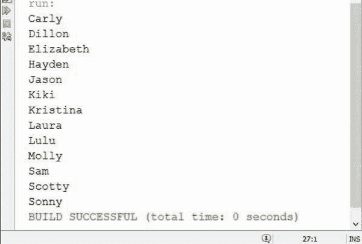

## 创建子类

为了看到继承工作的示例，在下一个项目中，你创建一个名为 `Point3D` 的类，表示三维空间中的一个点。你可以使用 (x,y) 坐标表示二维点。三维空间增加了一个坐标，称为 z。

`Point3D` 类对象可以做三件事：

- 跟踪对象的 (x,y,z) 坐标
- 将对象移动到新的 (x,y,z) 坐标
- 按指定的 x、y 和 z 值量移动对象

Java 已经有一个表示二维点的标准类，称为 `Point`。该类可以在 `java.awt` 包中找到。

它有两个整数变量 `x` 和 `y`，用于存储 `Point` 对象的 (x,y) 位置。它还有一个 `move()` 方法用于将点放置在指定的位置，以及一个 `translate()` 方法用于按 x 和 y 值的值移动对象。

在 `NetBeans` 的 `Java24` 项目中，在 `com.java24hours` 包中创建一个名为 `Point3D` 的新空文件，并将列表 12.2 的文本输入文件中。完成后保存它。

### 列表 12.2 Point3D.java 的完整文本

```java
1: package com.java24hours;
2:
3: import java.awt.*;
4:
5: public class Point3D extends Point {
6:     public int z;
7:
8:     public Point3D(int x, int y, int z) {
9:         super(x, y);
10:        this.z = z;
11:    }
12:
13:    public void move(int x, int y, int z) {
14:        this.z = z;
15:        super.move(x, y);
16:    }
17:
18:    public void translate(int x, int y, int z) {
19:        this.z += z;
20:        super.translate(x, y);
21:    }
22: }
```

`Point3D` 类没有 `main()` 方法，你无法将其作为应用程序运行，但你可以在 Java 程序中任何需要三维点的地方使用它。

`Point3D` 类只执行那些其父类 `Point` 未执行的工作。这主要负责跟踪整数值 `z`，并将其作为参数传递给 `move()` 方法、`translate()` 方法和 `Point3D()` 构造函数。

所有方法都用了 `super` 和 `this`。`this` 语句用于引用当前的 `Point3D` 对象，因此第 10 行中的 `this.z = z` 将对象变量 `z` 设置为第 8 行中作为参数发送给方法的 `z` 值。

`super` 语句引用当前对象的父类 `Point`。它被用于设置 `Point3D` 继承的变量并调用方法。第 9 行中的 `super(x, y)` 调用了 `Point(x, y)` 构造函数，该构造函数设置了 `Point3D` 对象的 (x,y) 坐标。由于 `Point` 已经能够处理 x 和 y 轴，因此 `Point3D` 类对象执行相同的事情是多余的。

为了测试新的 `Point3D` 类，请创建一个使用 `Point` 和 `Point3D` 对象并移动它们的程序。在 `NetBeans` 的 `com.java24hours` 包中创建一个名为 `PointTester` 的新文件，并输入列表 12.3 的内容。它在保存时会自动编译。

### 列表 12.3 PointTester.java 的完整文本

```java
1: package com.java24hours;
2:
3: import java.awt.*;
4:
5: class PointTester {
6:     public static void main(String[] arguments) {
7:         Point location1 = new Point(11, 22);
8:         Point3D location2 = new Point3D(7, 6, 50);
9:
10:        System.out.println("The 2D point is at " +
11:            location1.x + ", " + location1.y);
12:        System.out.println("The 3D point is at " +
13:            location2.x + ", " + location2.y + ", " + location2.z);
14:
15:        location1.move(10, 20);
16:        System.out.println("The 2D point moved to " +
17:            location1.x + ", " + location1.y);
18:
19:        location1.translate(-10, -10);
20:        System.out.println("The 2D point moved to " +
21:            location1.x + ", " + location1.y);
22:
23:        location2.move(10, 20, 20);
24:        System.out.println("The 3D point is now at " +
25:            location2.x + ", " + location2.y + ", " + location2.z);
26:
27:        location2.translate(-20, -20, -20);
28:        System.out.println("The 3D point moved to " +
29:            location2.x + ", " + location2.y + ", " + location2.z);
30:    }
31: }
```

当你运行程序时，输出将显示二维和三维点的移动情况。

## 总结

本小时介绍了如何使用 `super` 关键字调用父类构造函数，以及如何使用 `ArrayList` 存储和操作对象集合。你还学习了如何创建子类来扩展现有类的功能，以及如何使用增强型 `for` 循环遍历集合。

## 工作坊

### 问答

- **如果父类处理方法的方式您在子类中不想使用，您该怎么办？**
- **您可以使用什么方法来检索存储在数组列表的元素？**
- **您可以使用什么语句来引用当前对象的方法和变量？**

### 答

- 因为您重写了该方法，您不需要更改子类的任何其他部分。
- `get()` 方法有一个参数——元素的索引号。
- `this` 关键字引用它出现的对象。

## 活动

- 创建一个 `Point4D` 类，为 `Point3D` 类创建的 (x,y,z) 坐标系增加 `t`。`t` 坐标代表时间，因此您需要确保它永远不会设置为负值。
- 取橄榄球队进攻端的成员：锋线、外接手、紧端锋、跑卫和四分卫。设计一个表示这些球员技能的层级结构，将共同技能放在层次结构的较高位置。例如，拦截是锋线和紧端锋应该具备的行为，而速度是外接手和跑卫应该继承的特性。

# 第 13 小时：在数据结构中存储对象

## 本小时的任务列表

- 创建一个数组列表
- 从列表中添加和删除项
- 使用泛型来提高列表的可靠性
- 在列表中搜索对象
- 遍历列表的内容
- 创建一个键值对的哈希映射
- 从映射表中添加和删除项
- 获取映射条目的键和值
- 遍历映射表的键和值

程序员都是囤积者。

在计算机编程中，你会花费大量时间来收集信息并寻找存储它们的地方。信息可以以原始数据类型（如 `float`）的形式存在，也可以作为特定类的对象存在。它可以从驱动器读取、从服务器获取、由用户输入，或通过其他手段收集。

获取信息后，你必须决定在 Java 虚拟机（JVM）运行程序期间，将它们存放在哪里。数据类型或类相关的项可以存储在数组中。

这对于许多目的已经足够了，但随着你的程序变得复杂，你作为囤积者的需求也会增加。

在这一小时中，你将学习 Java 中两个为信息囤积者设计的类：数组列表和哈希映射。

## 数组列表

在第 9 小时“使用数组存储信息”中，你学习了数组，数组是处理程序中一组变量和对象的非常方便的方法。数组对 Java 至关重要，以至于它们拥有像整数和字符这样的内置数据类型。数组将相同类型或类的元素打包在一起。

和数组一样，它们受限于大小不可改变的限制。在创建一个容纳 90 个元素的数组后，它无法被更改为容纳更大或更小的尺寸。这是固定的。这种做法的高级说法是称数组的大小为“不可变的”。

在 `java.util` 包中有一个类可以完成数组能做的一切，但没有那个限制：`ArrayList`。

列表是一种持有相同类或公共父类对象的数据结构。在程序运行期间，列表可以根据需要增长或缩小。

创建数组列表最简单的方法是调用不带参数的构造函数：

```java
ArrayList servants = new ArrayList();
```

可以通过指定初始容量来创建数组列表，这为列表能容纳多少元素提供了一些指导。容量被设置为整数传递给构造函数，如下语句所示将数组的容量设置为 30：

```java
ArrayList servants = new ArrayList(30);
```

尽管这看起来很像创建一个数组并确定其确切大小，但它只是一个提示。如果超过了容量，数组将相应调整并继续正常运行。你对容量的估计越准确，列表在程序运行时运行效率就越高。

列表持有属于相同类或共享一个父类的对象。

当你创建一个数组列表时，你知道它打算持有的类或父类。这可以在构造函数中使用 `<` 和 `>` 指定，这是 Java 的一项功能，称为泛型。以下是持有 `String` 对象的列表构造函数的改进：

```java
ArrayList<String> servants = new ArrayList<String>();
```

该语句创建了一个 `String` 对象的数组列表。只有该类或其子类可以存储在列表中。否则，编译器会检测到错误。

要添加对象，调用数组列表的 `add(Object)` 方法并将该对象作为参数。以下是添加五个字符串的语句：


# 第 13 小：在数据结构中存储对象

```java
servants.add("Bates");
```

```java
servants.add("Anna");
```

```java
servants.add("Thomas");
servants.add("Mrs. O'Brien");
servants.add("Daisy");
```

每个元素都被添加到列表中，`servants` 中的第一个字符串是 "Bates"，最后一个是 "Daisy"。

有一个相应的 `remove(Object)` 方法，可以将对象从列表中取出：

```java
servants.remove("Mrs. O'Brien");
```

数组列表的大小是它当前持有的元素数量。通过调用列表的 `size()` 方法可以获取此信息，该方法返回一个整数：

```java
int servantCount = servants.size();
```

当使用泛型来指定列表包含的内容时，使用 `for` 循环来遍历列表的每个元素是简单的：

```java
for (String servant : servants) {
  System.out.println(servant);
}
```

`for` 循环的第一个参数是用于存储元素的变量。第二个参数是数组列表。其他数据结构也可以采用相同的循环。

`add(Object)` 方法将对象存储在列表末尾。也可以通过指定对象应存储在列表中的位置将其添加到列表。这需要 `add(int, Object)` 方法，它将位置作为第一个参数：

```java
ArrayList<String> aristocrats = new ArrayList<String>();
aristocrats.add(0, "Lord Robert");
aristocrats.add(1, "Lady Mary");
aristocrats.add(2, "Lady Edith");
aristocrats.add(3, "Lady Sybil");
aristocrats.add(0, "Lady Grantham");
```

前一个示例中的最后一条语句将 "Lady Grantham" 放在列表顶部而不是底部，将她放在 "Lord Robert" 和其他人之上。

作为第一个参数指定的位置不能大于列表的 `size()`。如果用 1 作为位置而不是 0 添加了 "Lord Robert"，程序将会抛出 `IndexOutOfBoundsException` 异常。

可以从列表中移除元素，通过指定位置调用 `remove(int)` 方法：

```java
aristocrats.remove(0);
```

可以通过调用列表的 `get(int)` 方法获取元素，该方法返回一个对象：

```java
String servant = aristocrats.get(0);
```

当你使用泛型指定列表包含的内容时，使用 `for` 循环来遍历列表的每个元素是简单的：

```java
for (int i = 0; i < servants.size(); i++) {
  System.out.println(servants.get(i));
}
```

## Battlepoint 应用示例

```java
36:   System.out.print(".");
37:   }
38:   System.out.print(" ");
39:   }
40:   System.out.println();
41:   }
42:   System.out.println();
43:   }
44:
   private void createTargets() {
     Point p1 = new Point(5,9);
     targets.add(p1);
     Point p2 = new Point(4,5);
     targets.add(p2);
     Point p3 = new Point(9,2);
     targets.add(p3);
   }
   private void shoot(int x, int y) {
     Point shot = new Point(x,y);
     System.out.print("Firing at " + x + "," + y + " ... ");
     if (targets.indexOf(shot) > -1) {
       System.out.println("you sank my battlepoint!");
       // delete the destroyed target
       targets.remove(shot);
     } else {
       System.out.println("miss.");
     }
   }
   public static void main(String[] arguments) {
     new Battlepoint();
   }
```

Battlepoint 应用中的注释描述了构造函数的每个部分以及程序中条件逻辑的重要部分。

该应用程序创建了 `Point` 对象作为目标并将它们添加到数组中（第 45–52 行）。显示了一张显示出这些目标的地图（第 22–43 行）。

接下来，通过调用 `shoot(int, int)` 方法对三个点进行射击（第 54–64 行）。每次操作，应用程序都会报告射击是否击中了目标之一。如果击中了，则会将目标从数组中移除。

最后，再次显示地图，应用程序终止。

数组如图 13.1 所示。

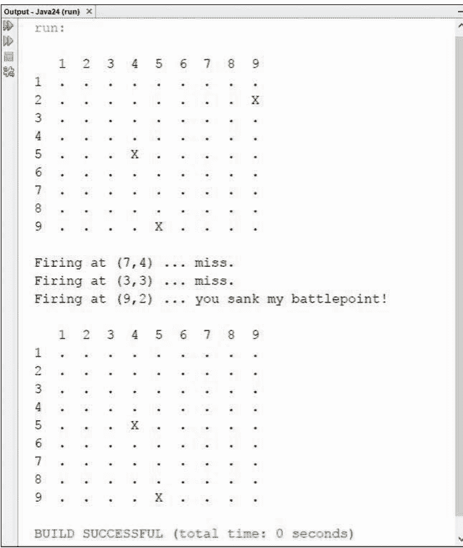

图 13.1

将 Point 对象放入数组列表中并对它们进行射击。

三个目标显示在图 13.1 的顶部地图中。一个目标在被击中后被移除。输出结果中的底部地图反映了这一变化。

当目标被射击命中时，通过使用射击点作为参数调用 `remove(Object)` 方法将其从 `targets` 数组列表中移除。

## 哈希映射

使用一条信息来访问另一个信息的能力在编程中很常见。在数据结构中，数组列表（`ArrayList`）是这种最简单的示例，使用索引数字从列表中检索一个对象。这里是从 `aristocrats` 列表中提取第一个字符串的示例：

```java
String first = aristocrats.get(0);
```

数组也使用索引号检索数组中的每个项。

哈希映射（`HashMap`）是 Java 中的一种数据结构，可以使用一个对象来检索另一个对象。第一个对象是键（key），第二个是值（value）。该结构在 `java.util` 包中通过 `HashMap` 类实现。

该名称指的是键如何映射到值。这种结构化数据的一个例子是电话联系列表。一个人的名字（字符串）可以用于检索该人的电话号码。

可以通过调用不带参数的构造函数来创建一个哈希映射：

```java
HashMap phonebook = new HashMap();
```

在新哈希映射中可以指定两个控制效率的因素：初始容量（initial capacity）和负载因子（load factor）。它们通过两个参数设置，容量在前，负载因子在后：

```java
HashMap phonebook = new HashMap(30, 0.7F);
```

容量是用于存储哈希映射值的桶（buckets）的数量。负载因子是在容量自动增加之前可以使用桶的数量。该值是一个浮点数，范围从 0（空）到 1.0（满），因此 0.7 意味着当桶的填充率达到 70% 时，容量就会增加。默认值是容量为 16，负载因子为 0.75，这通常是足够的。

泛型（Generics）用于标识键和值的类型。它们被放置在 `<` 和 `>` 字符之间，用逗号分隔，如下例所示：

```java
HashMap<String, Long> phonebook = new HashMap<>();
```

这创建了一个名为 `phonebook` 的哈希映射，其键为字符串，值为 `Long` 对象。第二组 `<` 和 `>` 字符是空的，假设与语句中之前的 `<` 和 `>` 中的类相同。

### 存储对象

通过调用带有两个参数（键和值）的 `put(Object, Object)` 方法在哈希映射中存储对象：

```java
phonebook.put("Butterball Turkey Line", 8002888372L);
```

这在映射中存储了一个项，键为 `"Butterball Turkey Line"`，值为 `8002888372` 的 `Long` 对象，即该数字。

> **注意**
> 这些语句正在使用 `long` 值将 `Long` 对象放入哈希映射中。在 Java 的早期版本中这将是一个错误，因为像 `long` 这样的原始数据类型不能在需要对象的地方使用。但现在不再是错误了，因为有了装箱（boxing）和拆箱（unboxing），这是 Java 的一项功能，会自动在原始类型与其等效对象之间进行转换。当 Java 编译器看到像 `8002888372` 这样的 `long` 时...


```java
private void createTargets() {
    Point p1 = new Point(5, 9);
    targets.add(p1);
    Point p2 = new Point(4, 5);
    targets.add(p2);
    Point p3 = new Point(9, 2);
    targets.add(p3);
}

private void shoot(int x, int y) {
    Point shot = new Point(x, y);
    System.out.print("Firing at " + x + "," + y + " ... ");
    if (targets.indexOf(shot) > -1) {
        System.out.println("you sank my battlepoint!");
        // delete the destroyed target
        targets.remove(shot);
    } else {
        System.out.println("miss.");
    }
}

public static void main(String[] arguments) {
    new Battlepoint();
}
```

`Battlepoint` 应用中的注释描述了构造函数的每个部分以及程序中条件逻辑的重要部分。

该应用程序创建了 `Point` 对象作为目标并将它们添加到数组中（第 45–52 行）。显示了一张显示出这些目标的地图（第 22–43 行）。

接下来，通过调用 `shoot(int, int)` 方法对三个点进行射击（第 54–64 行）。每次操作，应用程序都会报告射击是否击中了目标之一。如果击中了，则会将目标从数组中移除。

最后，再次显示地图，应用程序终止。

数组如图 13.1 所示。


图 13.1

将 `Point` 对象放入数组列表中并对它们进行射击。

三个目标显示在图 13.1 的顶部地图中。一个目标在被击中后被移除。输出结果中的底部地图反映了这一变化。

当目标被射击命中时，通过使用射击点作为参数调用 `remove(Object)` 方法将其从 `targets` 数组列表中移除。

## 哈希映射

使用一条信息来访问另一个信息的能力在编程中很常见。在数据结构中，数组列表（`ArrayList`）是这种最简单的示例，使用索引数字从列表中检索一个对象。这里是从 `aristocrats` 列表中提取第一个字符串的示例：

```java
String first = aristocrats.get(0);
```

数组也使用索引号检索数组中的每个项。

哈希映射（`HashMap`）是 Java 中的一种数据结构，可以使用一个对象来检索另一个对象。第一个对象是键（key），第二个是值（value）。该结构在 `java.util` 包中通过 `HashMap` 类实现。

该名称指的是键如何映射到值。这种结构化数据的一个例子是电话联系列表。一个人的名字（字符串）可以用于检索该人的电话号码。

可以通过调用不带参数的构造函数来创建一个哈希映射：

```java
HashMap phonebook = new HashMap();
```

在新哈希映射中可以指定两个控制效率的因素：初始容量（initial capacity）和负载因子（load factor）。它们通过两个参数设置，容量在前，负载因子在后：

```java
HashMap phonebook = new HashMap(30, 0.7F);
```

容量是用于存储哈希映射值的桶（buckets）的数量。负载因子是在容量自动增加之前可以使用桶的数量。该值是一个浮点数，范围从 0（空）到 1.0（满），因此 0.7 意味着桶的填充率达到 70% 时，容量就会增加。默认值是容量为 16，负载因子为 .75，这通常是足够的。

泛型（Generics）用于标识键和值的类型。它们被放置在 `<` 和 `>` 字符之间，用逗号分隔，如下例所示：

```java
HashMap<String, Long> phonebook = new HashMap<>();
```

这创建了一个名为 `phonebook` 的哈希映射，其键为字符串，值为 `Long` 对象。第二组 `<` 和 `>` 字符是空的，假设与语句中之前的 `<` 和 `>` 中的类相同。

### 存储与检索对象

通过调用带有两个参数（键和值）的 `put(Object, Object)` 方法在哈希映射中存储对象：

```java
phonebook.put("Butterball Turkey Line", 8002888372L);
```

这在映射中存储了一个项，键为 `"Butterball Turkey Line"`，值为 `8002888372` 的 `Long` 对象，即该数字。

> **注意**
> 这些语句正在使用 `long` 值将 `Long` 对象放入哈希映射中。在 Java 的早期版本中这将是一个错误，因为像 `long` 这样的原始数据类型不能在需要对象的地方使用。但现在不再是错误了，因为有了装箱和拆箱，这是 Java 的一项功能，会自动在原始类型与其等效对象之间进行转换。

## 工作坊

## 问答

- **类被同步（synchronized）意味着什么？**
- A. 同步是 Java 虚拟机确保该对象的其他用户能够以一致且准确的方式访问该对象的实例变量和方法的方法。

当你在第 15 小时“创建线程程序”中学习线程时，这个概念将变得更有意义。Java 程序的设计是为了同时执行多项任务。每个任务都被放在它自己的线程中。

当多个线程访问同一个对象时，该对象在每个线程中的行为一致至关重要。当类的方法需要同步时（如向量 `vectors` 和哈希表 `tables`），Java 虚拟机必须更加努力，并可能会遇到导致运行停止的错误。

数组列表（`Array lists`）和哈希映射（`Hash maps`）复制了向量和哈希表数据结构的功能，但它们不需要同步。因此，它们的运行效率高得多。

- **华盛顿将军队（Washington Generals）曾击败哈尔姆环球队（Harlem Globetrotters）吗？**
- A. 将军队在过去的几十年里七次击败环球队，最近一次是在 1971 年。在田纳西州的马丁比赛中，将军队凭借队主路易斯“红”·克洛茨的一次投篮以 100–99 获胜。

尽管将军队今天以弱旅闻名，但他们始于 1921 年费城的斯法斯队（Philadelphia Sphas），那是一支在东部联赛和美国篮球联赛参加比赛的正规球队。Sphas（南费城希伯来协会的缩写）曾获得过 10 次冠军。克洛茨曾是 Sphas 队的球员，他在 1952 年买下了该球队并将其更名为将军队，当时他们成为了哈尔姆队著名球队的常驻巡演伙伴。

1971 年的胜利结束了环球队长达 2,495 场的连胜。

## 测验

以下问题测试了你掌握了多少关于数据结构的知识。

1. **下列哪项在创建后大小会增长或减小？**
   - A. 数组列表 (Array lists)
   - B. 数组 (Arrays)
   - C. 哈希映射 (Hash maps)

2. **找出数组列表或哈希映射中包含多少项元素的方法名称是什么？**
   - A. `length()`
   - B. `size()`
   - C. `count()`

3. **什么数据类型或类可以作为哈希映射的键（keys）？**
   - A. `int` 或 `Integer`
   - B. `String`
   - C. 任意对象类

## 答案

1. **A、C。** 数组的大小在创建时就已经确定，无法更改。数组列表和哈希映射会根据需要更改大小。
2. **B.** `size()` 方法表示该数据结构中当前项的数量。
3. **A、B 或 C。** 哈希映射可以使用任何类作为键，任何类作为值。使用 `int` 会导致使用 `Integer` 类。

## 活动

你可以通过以下活动应用你结构良好的编程知识：

- 编写一个程序，使用本节的数据结构之一来制作公司电子邮件列表，每个电子邮件都与该人的姓名相关。
- 扩展 `FontMapper` 程序，将新字体的名称、大小和样式作为命令行参数传入，并在显示其键和值之前将其添加到哈希映射中。

要查看实现这些活动的 Java 程序，请访问书籍网站 www.java24hours.com。

# 第 14 小时：处理程序中的错误

本节的任务列表：

- 学习为什么错误被称为异常（exceptions）。
- 在你的 Java 程序中对异常做出响应。
- 创建忽略异常的方法。
- 使用会导致异常的方法。
- 创建你自己的异常。

错误（Errors）——即阻止程序正确运行的漏洞、失误和拼写错误——是软件开发过程中自然组成部分。“自然”可能是描述它们用过的最友好的词了。在我的编程中，当我找不到某个难以捉摸的错误的原因时，我会使用一些会让讽刺喜剧演员脸红的词。

有些错误由编译器标记并阻止你创建类。另一些错误由解释器记录，以响应某个阻止其成功运行的问题。Java 将错误分为两类：

- **异常（Exceptions）**——程序运行时信号发生异常情况的事件
- **错误（Errors）**——信号解释器出现问题的事件，这些问题可能与你的程序无关

错误通常不是 Java 程序可以恢复的，因此它们不是本节的重点。你在编写 Java 程序时可能遇到过 `OutOfMemoryError`，这意味着程序在计算机上内存不足。在该错误发生后，Java 程序中无法做什么来处理这种错误。程序会带该错误退出。

异常通常可以通过保持程序正常运行的方式来处理。

## 异常

尽管你现在正在学习它们，但在之前的 13 小时里，你可能已经对异常非常熟悉了。当你编写一个编译成功但在运行时遇到问题的 Java 程序时，这些错误就会出现。

例如，一个常见的编程错误是引用不存在的数组元素，如下所示：

```java
String[] greek = { "Alpha", "Beta", "Gamma" };
System.out.println(greek[3]);
```

数组 `greek` 有三个元素。因为数组的第一个元素编号为 0 而不是 1，所以第一个是 `greek[0]`，第二个是 `greek[1]`，第三个是 `greek[2]`。这使得语句 `greek[3]` 是错误的。之前的语句编译成功，但当你运行程序时，Java 虚拟机会停止并显示以下内容：

```text
Exception in thread "main" java.lang.ArrayIndexOutOfBoundsException: 3
    at SampleProgram.java:4
```

此消息表示应用程序生成了一个异常，用户应该可以看到。所有的异常都是 `java.lang.Exception` 的子类。`ArrayIndexOutOfBoundsException` 执行了你预期的操作——报告访问了边界之外的数组元素。

Java 中有数百种异常。许多表明可以通过编程更改修复的问题。这些类似于编译器错误。在你纠正了情况后，就不再需要担心该异常了。

其他异常必须在程序运行时通过五个新关键字来处理：`try`、`catch`、`finally`、`throw` 以及 `throws`。

## 在 try-catch 块中捕捉异常

到目前为止，你通过修复引起的问题来处理异常。有时你无法以那种方式处理异常，必须在 Java 类内部处理问题。

为了介绍 `try-catch` 为什么很有用，请将列表 14.1 中的短 Java 异常输入 `com.java24hours` 包中名为 `Calculator` 的新 Java 文件并保存。

### 列表 14.1 Calculator.java 的全文

```java
package com.java24hours;

public class Calculator {
    public static void main(String[] arguments) {
        float sum = 0;
        for (String argument : arguments) {
            sum = sum + Float.parseFloat(argument);
        }
        System.out.println("Those numbers add up to " + sum);
    }
}
```

`Calculator` 接受一个或多个数字作为命令行参数，将它们相加并显示总和。

由于所有命令行参数在 Java 应用程序中都用字符串表示，在相加之前必须将它们转换为浮点数。第 7 行的 `Float.parseFloat()` 类方法负责此工作。

**输出**

```text
Those numbers add up to 29.0
BUILD SUCCESSFUL (total time: 0 seconds)
```

图 14.1
Calculator 应用程序的输出。

使用不同的数字作为参数多次运行程序。它应该能够成功处理这些数字，这可能会让你怀疑这个项目与异常有什么关系。

为了查看这种关联，请将 Calculator 应用程序的命令行参数改为 `1 3 5x`。

第三个参数包含一个拼写错误——数字 5 后面多了一个 `x`。`Calculator` 无法得知这是一个错误，因此它尝试将 `5x` 与其他数字相加，导致显示出以下异常：

**输出**

```text
Exception in thread "main" java.lang.NumberFormatException: For input string: "5x"
    at sun.misc.FloatingDecimal.readJavaFormatString(FloatingDecimal.java:1241)
    at java.lang.Float.parseFloat(Float.java:452)
    at Calculator.main(Calculator.java:7)
Java Result: 1
```

这条信息对程序员来说可能很有用，但并不是你希望用户看到的。更好的做法是隐藏错误信息并在程序中处理该问题。

Java 程序可以使用 `try-catch` 语句块来处理自己的异常，其格式如下：

```java
try {
    // 可能导致异常的语句
} catch (Exception e) {
    // 当异常发生时要执行的操作
}
```

对于你任何想要让类的方法处理的异常，都必须使用 `try-catch` 块。`catch` 语句中出现的 `Exception` 对象应该是以下三种情况之一：

- 可能发生的异常类
- 多个异常类，用管道符号 `|` 分隔
- 可能发生的几个不同异常的父类

`try-catch` 块的 `try` 部分包含可能抛出异常的语句（或多个语句）。在 `Calculator` 应用程序中，列表 14.1 第 7 行的对 `Float.parseFloat(String)` 方法的调用每当使用无法转换为浮点值的字符串参数时，都会抛出 `NumberFormatException`。

为了改进 `Calculator` 应用程序使其不会因此类错误而停止运行，可以使用 `try-catch` 块。

在 `com.java24hours` 包中创建一个名为 `NewCalculator` 的新 Java 文件，并输入列表 14.2 的文本。

### 列表 14.2 NewCalculator.java 的全文

```java
package com.java24hours;

public class NewCalculator {
    public static void main(String[] arguments) {
        float sum = 0;
        for (String argument : arguments) {
            try {
                sum = sum + Float.parseFloat(argument);
            } catch (NumberFormatException e) {
                System.out.println(argument + " is not a number.");
            }
        }
        System.out.println("Those numbers add up to " + sum + ")");
    }
}
```

保存应用程序后，自定义项目配置并使用命令行参数 `1 3 5x` 运行 `com.java24hours.NewCalculator`。你应该能看到图 14.2 所示的输出。

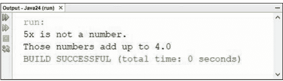

图 14.2
NewCalculator 应用程序的输出。

第 7–11 行的 `try-catch` 块处理由 `Float.parseFloat()` 抛出的 `NumberFormatException` 异常。这些异常在 `NewCalculator` 类内部被捕获：对于任何不是数字的参数，都会显示错误信息。由于异常在类内部已处理，JVM 不会显示错误。通常可以使用 `try-catch` 块处理与用户输入和其他意外数据相关的问题。

## 捕捉多种不同的异常

`try-catch` 块可以处理不同类型的异常，即使它们是由不同的语句抛出的。

处理多个类异常的一种方法是为每个类分配一个 `catch` 块，如下代码所示：

```java
String textValue = "35";
int value;
```


try {
    value = Integer.parseInt(textValue);
} catch (FormatException exc) {
    // 处理异常的代码
} catch (ArithmeticException exc) {
    // 处理异常的代码
}

你也可以通过用管道字符 `|` 分隔多个异常并以异常变量名结束列表，在同一个 `catch` 块中处理多个异常。这是一个示例：

try {
    value = Integer.parseInt(textValue);
} catch (FormatException | ArithmeticException exc) {
    // 处理异常的代码
}

如果捕获到 `NumberFormatException` 或 `ArithmeticException`，它将被赋值给 `exc` 变量。

列表 14.3 包含一个名为 `NumberDivider` 的应用程序，它接收两个整数命令行参数并在整数除法表达式中使用它们。

该应用程序必须处理用户输入的两个潜在问题：

- 非整数参数
- 除以零

在 `com.java24hours` 包中为 `NumberDivider` 创建一个新的 Java 文件，并输入列表 14.3 的文本。

## 列表 14.3 NumberDivider.java 的全文

```java
1: package com.java24hours;
2:
3: public class NumberDivider {
4:     public static void main(String[] arguments) {
5:         if (arguments.length == 2) {
6:             int result = 0;
7:             try {
8:                 result = Integer.parseInt(arguments[0]) / Integer.parseInt(arguments[1]);
9:                 System.out.println(arguments[0] + " divided by " + arguments[1] + " equals " + result);
10:            } catch (FormatException e) {
11:                System.out.println("Arguments must be integers.");
12:            } catch (ArithmeticException e) {
13:                System.out.println("You cannot divide by zero.");
14:            }
15:        }
16:     }
17: }
```

使用命令行参数指定两个参数，你可以使用整数来运行它。如果你使用浮点数或非数字参数，`NumberFormatException` 会在 8–9 行抛出并在 14 行捕获。如果你使用第一个参数和零零，`ArithmeticException` 会在 8–9 行抛出并在 14 行捕获。

成功运行的某些输出如图 14.3。

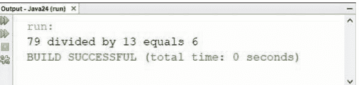

图 14.3
NumberDivider 应用程序的输出。

### 异常后的处理

当你使用 `try` 和 `catch` 处理多个异常时，有时你希望程序在块结束时执行某些操作。

你可以使用 `try-catch-finally` 块来处理，其格式如下：

```java
try {
  // 可能导致异常的语句
} catch (Exception e) {
  // 当异常发生时要执行的操作
} finally {
  // 无论如何都执行的语句
}
```

即使发生了异常，`finally` 部分的语句或语句也会在块中其他语句之后执行。这种情况有用的一个地方是从文件中读取数据，你可以在第 20 小节“读取和写入文件”中学习。访问数据时有多种方式发生异常：文件可能不存在、可能会发生磁盘错误等。如果读取磁盘的语句在 `try` 语句中且错误在 `catch` 部分处理，你可以在 `finally` 部分关闭文件。这确保了无论是否抛出异常，文件都会关闭。

### 抛出异常

当你调用另一个类的方法时，该类可以通过抛出异常来控制该方法的使用。

当你使用 Java 类库中的类时，编译器经常会显示关于异常处理不当的消息。这是一个示例：

> NetReader.java:14: unreported exception java.net.MalformedURLException; must be caught or declared to be thrown

每当你看到异常“必须被捕获或声明为抛出”的错误时，这表明你尝试使用的方法抛出了该异常。任何调用这些方法的类（例如你编写的应用程序）必须执行以下操作之一：

- 使用 `try-catch` 块处理异常
- 抛出异常
- 使用 `try-catch` 块处理异常后将其抛出

在本节的到目前为止，你已经学习了如何处理异常。如果你想在处理异常后抛出它，可以使用 `throw` 语句后跟异常对象来抛出。

以下语句在 `catch` 块中处理了 `NumberFormatException` 错误，然后抛出该异常：

```java
float principal;

try {
    principal = Float.parseFloat(loanText) * 1.1F;
} catch (NumberFormatException e) {
    System.out.println(arguments[0] + " is not a number.");
    throw e;
}
```

这段重写后的代码处理了 `try` 块中可能的所有异常并将其抛出：

```java
float principal;

try {
    principal = Float.parseFloat(loanText) * 1.1F;
} catch (Exception e) {
    System.out.println("Error " + e.getMessage());
    throw e;
}
```

`Exception` 是所有异常子类的父类。`catch` 语句会捕获该类以及类层次结构中的任何子类。

当你使用 `throw` 抛出异常时，通常意味着你没有完成所有需要对异常进行的工作。

这是一个这种方法可能有用示例：考虑一个名为 `CreditCardChecker` 的假设程序，这是一个用于验证信用卡购买的应用程序。该应用程序使用名为 `Database` 的类，其功能如下：

- 连接到信用卡分类计算机。
- 询问该计算机客户的信用卡号是否有效。
- 询问计算机客户是否有足够的资金进行购买。

当 `Database` 类正在执行工作时，如果信用卡贷人的计算机对任何连接尝试都没有响应，会发生什么？这种错误正是 `catch` 块设计的类型，它被用于 `Database` 内部处理连接错误。

如果 `Database` 类自行处理了这个问题，`CreditCardChecker` 应用程序完全不知道异常的发生。这不是一个好主意——应用程序应该知道何时无法建立连接，以便向使用应用程序的人报告。

通知 `CreditCardChecker` 应用程序的一种方法是让 `Database` 在 `catch` 块中捕获异常，然后使用 `throw` 语句再次抛出它。异常在 `Database` 中抛出，它必须像处理其他异常一样处理它。

在捕获父类（如 `Exception`）的 `catch` 块中抛出异常时，抛出异常会抛出。这会丢失关于错误类型的细节，因为像 `NumberFormatException` 这样的子类比简单的 `Exception` 类能告诉你更多关于问题的信息。

Java 提供了一种解决这种最后问题的方法：`catch` 语句中的 `final` 关键字。

```java
try {
  principal = Float.parseFloat(loanText) * 1.1F;
} catch (final Exception e) {
  System.out.println("Error " + e.getMessage());
  throw e;
}
```

`catch` 中的那个 `final` 关键字会使行为变得不同。被捕获的具体类会被抛出。

### 忽略异常

本节将涵盖的下一个技术是如何完全忽略异常。类中的方法可以通过作为方法定义的一部分使用 `throws` 子句来忽略异常。

以下方法抛出一个 `MalformedURLException`，这是我们在 Java 程序中处理网络地址时可能发生的错误：

```java
public void loadURL(String address) throws MalformedURLException {
  URL page = new URL(address);
  // code to load web page
}
```

示例中的第二个语句创建了一个 `URL` 对象，它代表 Web 上的一个地址。`URL` 类的构造函数抛出 `MalformedURLException` 以表示使用了无效地址，因此无法构建对象。当你尝试打开该地址的连接时，以下语句会导致抛出这些异常之一：

```java
URL source = new URL("http://www.java2hours.com");
```

### 抛出和捕获异常

字符串 `http://www.java24hours.com` 不是一个有效的 URL，因为它缺少了一些标点符号：冒号后的两个斜杠字符（`//`）。

由于 `loadURL()` 方法已声明为抛出 `MalformedURLException` 错误，它不需要在方法内部处理它。捕获此异常的责任落在任何调用 `loadURL()` 方法的方法上。

### 不需要 catch 的异常

尽管本节显示异常需要用 `try-catch` 捕获或用 `throws` 子句声明为抛出，但仍然存在例外。

Java 程序中可能发生的某些异常不需要以任何方式进行处理。当编译器检测到异常正在被忽略时，它不会停止运行。这些异常是未检查异常（unchecked exceptions），而其他的是检查异常（checked exceptions）。

未检查异常是 `java.lang` 包中 `RuntimeException` 的子类。未检查异常的一个常见示例是 `IndexOutOfBoundsException`，它表示用于访问数组、字符串或列表的索引不在其范围内。如果一个数组有五个元素，而你尝试读取第 10 个元素，就会发生此异常。

另一个是 `NullPointerException`，它发生在使用没有值的对象时。对象变量在赋值对象之前，其值为 `null`。某些方法在无法返回对象时也会返回 `null`。如果一个语句错误地给一个对象赋值为 `null` 值，就会发生 `NullPointerException`。

这两种错误都是程序员可以在（并且应该）在代码中防止的内容，而不是需要异常处理的内容。如果你写了这样一个程序并重新编译它。如果你期望一个对象但它等于 `null`，那么在每个越界数组元素的语句中都可能发生 `NullPointerException`。在使用对象之前通过 `if` 条件进行检查。

当然，异常可以被忽略并不意味着它应该被忽略。你仍然可以选择对未检查异常使用 `try`、`catch` 和 `throws`。

### 抛出和捕获异常

在本节的最后一个项目中，你创建一个使用异常来告诉另一个类发生的错误。

项目中的类是 `HomePage`（一个代表 Web 页面的类）和 `PageCatalog`（一个对这些页面进行分类的应用程序）。

在 `com.java24hours` 包中名为 `HomePage` 的新 Java 文件输入列表 14.4 的文本。

## 列表 14.4 HomePage.java 的全文

```java
1: package com.java24hours;
2:
3: import java.net.*;
4:
5: public class HomePage {
6: String owner;
7: URL address;
8: String category = "none";
9:
10: public HomePage(String inOwner, String inAddress)
11: throws MalformedURLException {
12:
13: owner = inOwner;
14: address = new URL(inAddress);
15: }
16:
17: public HomePage(String inOwner, String inAddress, String inCategory)
18: throws MalformedURLException
19:
20: this(inOwner, inAddress);
21: category = inCategory;
22: }
23: }
```

你可以在其他程序中使用 `HomePage` 类。该类代表个人网页。它有三个实例变量：`address`（代表页面地址的 `URL` 对象）、`owner`（拥有该页面的人）以及 `category`（描述页面主要主题的简短注释）。

和任何创建对象的类一样，`HomePage` 必须在 `try-catch` 块中处理 `MalformedURLException` 或者声明它正在忽略这些错误。

该类选择了后者，正如列表 14.4 的第 10-11 行和第 17-18 行所示。

## 列表 14.5 PageCatalog.java 的完整文本

```java
1: package com.java24hours;
2:
3: import java.net.*;
4:
5: public class PageCatalog {
6:     public static void main(String[] arguments) {
7:         HomePage[] catalog = new HomePage[5];
8:         try {
9:             catalog[0] = new HomePage("Mike Glyer",
10:                "http://www.file770.com", "science fiction");
11:            catalog[1] = new HomePage("Shelley Powers",
12:                "http://burningbird.net", "environment");
13:            catalog[2] = new HomePage("Rogers Cadenhead",
14:                "http://workbench.cadenhead.org", "programming");
15:            catalog[3] = new HomePage("Taegan Goddard",
16:                "https://politicalwire.com", "politics");
17:            catalog[4] = new HomePage("Manton Reese",
18:                "http://www.manton.org");
19:             for (int i = 0; i < catalog.length; i++) {
20:                 System.out.println(catalog[i].owner + " - - " + "\n"
21:                                    + catalog[i].address + " - - " + "\n"
22:                                    + catalog[i].category);
23:             }
24:         } catch (MalformedURLException e) {
25:             System.out.println("Error: " + e.getMessage());
26:         }
27: 
28: }
```


当运行编译后的应用程序时，将显示图 14.4 所示的。

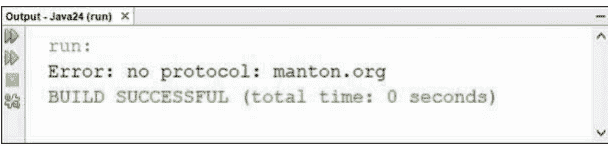

## 图 14.4

PageCatalog 程序的错误输出。

## 第 14 小时：处理程序中的错误

PageCatalog 创建了一个 `HomePage` 对象的数组，然后显示数组的内容。每个 `HomePage` 对象都是使用最多三个参数创建的：

- 页面所有者的名称
- 页面的地址（作为字符串，而不是 URL）
- 页面的分类

第三个参数是可选的，它在第 17–18 行中没有被使用。

`HomePage` 类的构造函数在接收到无法转换为有效 URL 对象的字符串时会抛出 `MalformedURLException` 错误。这些异常在 PageCatalog 程序中使用 `try-catch` 块进行处理。

要修复由“无协议”错误引起的问题，请编辑第 18 行，使字符串以 `http://` 文字开头，就像第 9-16 行中的其他地址一样。运行程序时，你将看到图 14.5 所示的输出。

```
Output - Java24 (run) x

run:

Mike Gyler: http://www.file770.com -- science fiction

Shelley Powers: http://burningbird.net -- environment

Rogers Cadenhead: http://benchmark.cadenhead.org -- programming

Taegan Cadenhead: https://politicalwire.com -- politics

Manton Reese: http://manton.org -- none

BUILD SUCCESSFUL (total time: 0 seconds)
```

**图 14.5** PageCatalog 程序的修正输出。

### 总结

现在你已经掌握了 Java 的异常处理技术，关于错误的主题应该比在这一小时开始时更受欢迎一点了。

你可以利用这些技术做很多事情：

- 捕捉异常并处理它。
- 忽略异常，将其交给另一个类或 Java 虚拟机来处理。
- 在同一个 `try-catch` 块中捕捉多个不同的异常。
- 抛出你自己的异常。

### 工作坊

在你的 Java 程序中管理异常可以使它们更加可靠、功能更强大且更容易使用，因为你不会向运行软件的人显示任何晦涩的错误信息。

### 问答

- **Q. 可以创建你自己的异常吗？**
  **A.** 这不仅是可能的，而且是一个非常好的主意。为可能出现的问题创建自定义异常会让你的类更加健壮。你可以通过创建现有异常的子类（例如 `Exception`，它是所有异常的父类）来轻松创建自己的异常。在 `Exception` 的子类中，你可能想要重写两个构造函数：无参数的 `Exception()` 和带有 `String` 参数的 `Exception()`。在后者中，该字符串应该是描述已发生错误的消息。

- **Q. 为什么这里没有涵盖如何抛出和捕捉错误（Errors），除了异常（Exceptions）？**
  **A.** Java 将问题分为错误（Errors）和异常（Exceptions），因为它们的严重程度不同。异常的程度较轻，所以它们是你程序中应该通过 `try-catch` 或在方法声明中使用 `throws` 来进行处理的所有内容。另一方面，错误更为严重，且在程序中无法得到充分妥善处理。这些错误的两个例子是栈溢出（stack overflows）和内存溢出（out-of-memory errors）。这些错误可能导致 JVM 崩溃，而且在 JVM 运行时，你无法在程序中修复它们。

- **Q. 仍在报纸上连载的最古老的漫画是什么？**
  **A.** "Katzenjammer" 在德语中字面意思是“猫的哀鸣”，但它通常被用来描述混乱的情况。（注：OCR 文本在这里似乎混淆/混合了一些关于漫画的知识，但保留了结构）。
  《Katzenjammer Bears》是一部始于 1903 年的漫画，目前仍以某些形式连载。

### 测验

尽管这一小时充满了错误，但看看你是否能回答以下问题：

1. 单个 `catch` 语句可以处理多少个异常？
   A. 只有一个。
   B. 几个不同的。
   C. 此答案留空。

2. `finally` 部分的语句何时运行？
   A. 在 `try-catch` 块结束后运行
   B. 在 `try-catch` 块结束后运行
   C. A 和 B 都是

3. 关于捕捉这个，线程需要做什么？
   A. 获取更多开始
   B. 注册到
   C. 以上所有

### 答案

- **1. B.** `catch` 语句中的 `Exception` 对象可以处理所有异常。
- **2. C.** `finally` 部分的语句始终在 `try-catch` 块之后执行，无论是否发生了异常。
- **3. A.** 每一个答案都是正确的，但 A 比其他更准确。

## 活动

为了证明你是一个非凡的程序员，请尝试在完成以下活动时尽可能减少错误：

- 修改 `NumberDivider` 程序，使其抛出它捕捉到的任何异常，并运行程序查看结果。
- 创建一个 `Multiplier` 程序，接收三个数字作为命令行参数，并对非数字参数抛出异常。

要查看这些活动的程序，请访问网站 www.java4hours.com。

# 第 15 小时：创建一个线程程序

本小时的任务：

- 在程序中使用接口。
- 创建线程。
- 启动、停止和暂停线程。
- 捕捉错误。

一个常用的描述日常生活繁忙节奏的计算机术语是多任务处理，意味着同时做多件事——例如在浏览网页的同时参加电话会议并进行锻炼。Java 语言的一项高级功能是编写可以多任务处理的程序，这是通过名为线程的类实现的。

### 线程

在 Java 程序中，计算机处理的每个并发任务都称为线程，而整个过程被称为多线程。线程在动画等许多其他领域非常有用。

线程由 `Thread` 类和 `Runnable` 接口表示，它们都属于 `java.lang` 类包。因为它们属于这个包，所以你不需要在程序中使用 `import` 语句来引用它们。

`Thread` 类最简单的用途之一是减慢程序运行的速度。

### 减慢程序运行

`Thread` 类有一个 `sleep()` 方法，你可以在任何需要停止运行一段时间的程序中调用它。在带有动画的程序中，经常使用这种技术可以防止其显示速度超过 Java 虚拟机的处理能力。

要使用 `sleep()` 方法，请调用 `Thread.sleep()` 并传入要暂停的毫秒数，如下语句所示：

```
Thread.sleep(5000);
```

上述语句会导致 JVM 在执行任何其他操作之前暂停五秒（5,000 毫秒）。如果由于某种原因 JVM 无法暂停那么久，`sleep()` 方法将抛出一个 `InterruptedException`。

由于可能会抛出此异常，在使用 `sleep()` 方法时，你必须以某种方式处理它。其中一种方法是将 `Thread.sleep()` 语句放在 `try-catch` 块中：

```
try {
  Thread.sleep(5000);
} catch (InterruptedException e) {
  // 提前唤醒
}
```

当你想让 Java 程序同时处理多一件事时，你必须将程序组织成线程。你的程序可以根据需要拥有任意数量的线程，并且它们可以同时运行而互不影响。

### 创建线程

一个可以作为线程运行的 Java 类被称为可运行（**runnable**）或线程（**threaded**）类。尽管你使用线程是为了相反的原因——加速程序。如果你将耗时的任务放在它们自己的线程中，程序的其余部分将运行得更快。这通常是为了防止任务减慢程序图形用户界面（GUI）的响应速度。

例如，如果你编写了一个从文件加载市场价格数据并编译统计数据的应用程序，最耗时的任务是加载数据。如果应用程序中没有使用线程，在数据加载期间，程序界面的响应可能会非常迟钝。这会让用户感到非常沮丧。

将任务放在自己的线程中的两种方法包括：

- 将任务放在实现 `Runnable` 接口的类中
- 将任务放在是 `Thread` 的子类的类中

为了支持 `Runnable` 接口，在创建类时使用 `implements` 关键字，如下例所示：

```
public class LoadStocks implements Runnable {
    // 类体
}
```

当一个类实现一个接口时，表示该类除了自己的方法外，还包含一些额外的行为。

实现 `Runnable` 接口的类必须包含 `run()` 方法，其结构如下：

```java
public void run() {
    // 方法体
}
```

`run()` 方法应该处理线程创建时要完成的任务。在股票市场示例中，`run()` 方法可以包含从磁盘加载数据并根据这些数据编译统计数据的语句。

当运行一个应用程序时，其 `run()` 方法中的语句不会自动执行。在 Java 中可以启动和停止线程，在你执行这些操作之前，线程不会开始运行：

- 通过调用 `Thread` 构造函数创建线程类对象
- 通过调用其 `start()` 方法启动线程

`Thread` 构造函数接受一个参数：包含线程 `run()` 方法的对象。通常，你使用 `this` 关键字作为参数，这表示当前类包含 `run()` 方法。

列表 15.1 包含一个 Java 应用程序，它可以寻找前百万个质数，并将它们存储在 `StringBuffer` 中。当它找到所有质数时，它们会被显示出来。在 NetBeans 中，在 `com.java24hours` 包中创建一个名为 `PrimeFinder` 的新 Java 文件，将列表中的文本输入文件，然后——等一下——不要忘记保存它。

## 列表 15.1 PrimeFinder.java 的全文

```java
1: package com.java24hours;
2:
3: public class PrimeFinder implements Runnable {
4:     Thread go;
5:     StringBuilder primes = new StringBuffer();
6:     int time = 0;
7: }
```

```java
8: public PrimeFinder() {
9:   start();
10:  while (primes != null) {
11:     System.out.println(time);
12:     try {
13:       Thread.sleep(1000);
14:     } catch (InterruptedException exc) {
15:       // 什么都不做
16:     }
17:     time++;
18:  }
19: }
20:
21: public void start() {
22:  if (go == null) {
23:     go = new Thread(this);
24:     go.start();
25:   }
26: }
27:
28: public void run() {
29:   int quantity = 1_000_000;
30:   int numPrimes = 0;
31:   // 候选数: 可能是质数的数
32:   int candidate = 2;
33:   primes.append("\nPrime *").append(quantity).append(" primes:\n\n");
34:   while (numPrimes < quantity) {
35:     if (isPrime(candidate)) {
36:       primes.append(candidate).append(" *");
37:       numPrimes++;
38:     }
39:     candidate++;
40:   }
41:   System.out.println(primes);
42:   primes = null;
43:   System.out.println("\nTime elapsed: " + time + " seconds:");
44: }
45:
46: public static boolean isPrime(int candidateNumber) {
47:   double root = Math.sqrt(candidateNumber);
48:   for (int i = 2; i <= root; i++) {
49:     if (candidateNumber % i == 0) {
50:       return false;
51:     }
52:   }
53:   return true;
54: }
55:
56: public static void main(String[] args) {
57:     new PrimeFinder();
58: }
59: }
```


# 减慢程序运行

`Thread` 类有一个 `sleep()` 方法，你可以在任何需要停止运行一段时间的程序中调用它。在带有动画的程序中，经常使用这种技术可以防止其显示速度超过 Java 虚拟机的处理能力。

要使用 `sleep()` 方法，请调用 `Thread.sleep()` 并传入要暂停的毫秒数，如下语句所示：

```java
Thread.sleep(5000);
```

上述语句会导致 JVM 在执行任何其他操作之前暂停五秒（5,000 毫秒）。如果由于某种原因 JVM 无法暂停那么久，`sleep()` 方法将抛出一个 `InterruptedException`。

由于可能会抛出此异常，在使用 `sleep()` 方法时，你必须以某种方式处理它。其中一种方法是将 `Thread.sleep()` 语句放在 `try-catch` 块中：

```java
try {
  Thread.sleep(5000);
} catch (InterruptedException e) {
  // 提前唤醒
}
```

当你想让 Java 程序同时处理多件事时，你必须将程序组织成线程。你的程序可以根据需要拥有任意数量的线程，并且它们可以同时运行而互不影响。

## 创建线程

一个可以作为线程运行的 Java 类被称为可运行（**runnable**）或线程（**threaded**）类。尽管你使用线程是为了相反的原因——加速程序。如果你将耗时的任务放在它们自己的线程中，程序的其余部分将运行得更快。这通常是为了防止任务减慢程序图形用户界面（GUI）的响应速度。

例如，如果你编写了一个从文件加载市场价格数据并编译统计数据的应用程序，最耗时的任务是加载数据。如果应用程序中没有使用线程，在数据加载期间，程序界面的响应可能会非常迟钝。这会让用户感到非常沮丧。

将任务放在自己的线程中的两种方法包括：

- 将任务放在实现 `Runnable` 接口的类中
- 将任务放在是 `Thread` 的子类的类中

为了支持 `Runnable` 接口，在创建类时使用 `implements` 关键字，如下例所示：

```java
public class LoadStocks implements Runnable {
    // 类体
}
```

当一个类实现一个接口时，表示该类除了自己的方法外，还包含一些额外的行为。

实现 `Runnable` 接口的类必须包含 `run()` 方法，其结构如下：

```java
public void run() {
    // 方法体
}
```

`run()` 方法应该处理线程创建时要完成的任务。在股票市场示例中，`run()` 方法可以包含从磁盘加载数据并根据这些数据编译统计数据的语句。

当运行一个应用程序时，其 `run()` 方法中的语句不会自动执行。在 Java 中可以启动和停止线程，在你执行这些操作之前，线程不会开始运行：

- 通过调用 `Thread` 构造函数创建线程类对象
- 通过调用其 `start()` 方法启动线程

`Thread` 构造函数接受一个参数：包含线程 `run()` 方法的对象。通常，你使用 `this` 关键字作为参数，这表示当前类包含 `run()` 方法。

# 列表 15.1 PrimeFinder.java 的全文

```java
1: package com.java24hours;
2:
3: public class PrimeFinder implements Runnable {
4:     Thread go;
5:     StringBuilder primes = new StringBuffer();
6:     int time = 0;
7: }
8:
9: public PrimeFinder() {
10:   start();
11:   while (primes != null) {
12:     System.out.println(time);
13:     try {
14:       Thread.sleep(1000);
15:     } catch (InterruptedException exc) {
16:       // 什么都不做
17:     }
18:     time++;
19:   }
20: }
21:
22: public void start() {
23:   if (go == null) {
24:     go = new Thread(this);
25:     go.start();
25:   }
26: }
27:
28: public void run() {
29:   int quantity = 1_000_000;
30:   int numPrimes = 0;
31:   // 候选数: 可能是质数的数
32:   int candidate = 2;
33:   primes.append("\nPrime *").append(quantity).append(" primes:\n\n");
34:   while (numPrimes < quantity) {
35:     if (isPrime(candidate)) {
36:       primes.append(candidate).append(" *");
37:       numPrimes++;
38:     }
39:     candidate++;
40:   }
41:   System.out.println(primes);
42:   primes = null;
43:   System.out.println("\nTime elapsed: " + time + " seconds:");
44: }
45:
46: public static boolean isPrime(int candidateNumber) {
47:   double root = Math.sqrt(candidateNumber);
48:   for (int i = 2; i <= root; i++) {
49:     if (candidateNumber % i == 0) {
50:       return false;
51:     }
52:   }
53:   return true;
54: }
55:
56: public static void main(String[] args) {
57:     new PrimeFinder();
58: }
59: }
```

`pageTitle` 数组存储了显示的六个网站的标题。`URI` 类对象存储网站地址的值。`URI` 包含了跟踪网页地址的所有行为和属性。

最后创建的三个要素是一个整数变量、一个 `Thread` 对象和一个用户界面标签：

```java
int current = 0;
Thread runner;
JLabel siteLabel = new JLabel();
```

变量 `current` 用于跟踪正在显示哪个网站，以便你可以在网站之间循环。`Thread` 对象 `runner` 代表此程序的运行。你可以在启动、停止和暂停程序操作时调用 `runner` 对象的方法。

## 构造函数

程序的构造函数在程序运行时会自动执行。该方法用于为数组 `pageTitle` 和 `pageLink` 赋值。它还被用于创建一个显示在用户界面上的可点击按钮。该方法包含以下语句：

```java
pageTitle = new String[] {
  "Oracle's Java site",
  "ServerSide",
  "JavaWorld",
  "Java in 24 Hours",
  "Sams Publishing",
  "Workbench"
};

pageLink[0] = getURI("http://www.oracle.com/technetwork/java");
pageLink[1] = getURI("http://www.theservers.com");
pageLink[2] = getURI("http://www.javaworld.com");
pageLink[3] = getURI("http://www.java24hours.com");
pageLink[4] = getURI("http://www.samspublishing.com");
pageLink[5] = getURI("http://workbench.cadenhead.org");

visitButton = new Button("Visit Site");
visitButton.addActionListener(this);
add(visitButton);
```

每个页面标题存储在 `pageTitle` 数组的六个元素中，这些元素使用六个字符串初始化。`pageLink` 数组的元素将被赋值为 `getURI()` 方法返回。

`init()` 方法的最后三个语句创建一个标记为 "Visit Site" 的按钮并将其添加到应用程序框架中。

## 在设置 URL 时捕获错误

当你设置 `URI` 对象时，必须确保用于设置地址的文本是有效格式：`http://workbench.cadenhead.org` 和 `http://www.sampublishing.com` 是有效的，但 `http:/www.java.com` 将是无效的，因为冒号后面缺少两个斜杠。

`getURI(String)` 方法接收地址作为参数，返回代表该地址的 `URI` 对象。如果字符串不是有效地址，该方法返回 `null`：

```java
URI getURI(String urlText) {
    URI pageURI = null;
    try {
        pageURI = new URI(urlText);
    } catch (URISyntaxException m) {
        // do nothing
    }
    return pageURI;
}
```

`try-catch` 块处理创建 `URI` 对象时发生的任何 `URISyntaxException` 错误。因为抛出此异常不需要执行任何操作，因此 `catch` 块仅包含注释。

## 启动线程

在该程序中，`runner` 在调用 `start()` 方法时启动。

`start()` 方法作为构造函数的最后一条语句被调用。该方法如下：

```java
public void start() {
    if (runner == null) {
        runner = new Thread(this);
        runner.start();
    }
}
```

如果 `runner` 尚未启动，此方法将启动它。

语句 `runner = new Thread(this)` 创建了一个带有一个参数的新 `Thread` 对象：`this` 关键字。`this` 关键字指向程序本身，指定在线程内运行的类。

调用 `runner.start()` 会导致线程开始运行。当线程开始时，会调用该线程的 `run()` 方法。由于 `runner` 线程是 `LinkRotator` 应用程序本身，因此会被应用程序的 `run()` 方法。

## 运行线程

`run()` 方法是线程执行工作的地方。在 LinkRotator 程序中，以下内容代表 `run()` 方法：

```java
public void run() {
    Thread thisThread = Thread.currentThread();
    while (runner == thisThread) {
        current++;
        if (current > 5) {
            current = 0;
        }
        siteLabel.setText(pageTitle[current]);
        repaint();
        try {
            Thread.sleep(1000);
        } catch (InterruptedException e) {
            // do nothing
        }
    }
}
```

`run()` 方法中发生的第一件事是创建一个名为 `thisThread` 的 `Thread`。`Thread` 类的类方法 `currentThread()` 设置了 `thisThread` 对象的值。`currentThread()` 方法跟踪当前运行的线程。

该方法中的所有语句都是 `while` 循环的一部分，该循环比较 `runner` 对象和 `thisThread` 对象。这两个对象都被创建了，只要它们引用同一个对象，`while` 循环就会继续。循环内部没有语句调用 `runner` `thisThread` 对象产生不同的值，因此除非循环之外的对象改变了 `Thread` 对象，否则它将无限循环。

`run()` 方法调用 `repaint()`。接下来，`current` 变量的值增加，如果 `current` 超过 5，则将其重置为 0。`current` 变量用于确定显示哪个网站的信息。它被用作字符串数组 `pageTitle` 的索引，`siteLabel` 被设置为用户界面组件。`run()` 方法包含另一个处理 `InterruptedException` 错误的 `try-catch` 块。`Thread.sleep(1000)` 导致线程暂停一秒。

## 处理点击

LinkRotator 程序处理的最后一件事是检测用户输入的能力。每当用户点击 "Visit Site" 按钮时，就会调用 `actionPerformed()` 方法：

```java
public void actionPerformed(ActionEvent event) {
    Desktop desktop = Desktop.getDesktop();
    if (pageLink[current] != null) {
        try {
            desktop.browse(pageLink[current]);
        } catch (IOException exc) {
            // do nothing
        }
    }
    current = (current + 1) % 6;
    siteLabel.setText(pageTitle[current]);
}
```


## 第 15 小时：创建线程程序

### 代码示例：LinkRotator 线程循环

```java
while (runner == thisThread) {
    current++;
    if (current > 5) {
        current = 0;
    }
    siteLabel.setText(pageTitle[current]);
    repaint();
    try {
        Thread.sleep(2000);
    } catch (InterruptedException exc) {
        // do nothing
    }
}
```

### 代码示例：actionPerformed 方法

```java
public void actionPerformed(ActionEvent event) {
    Desktop desktop = Desktop.getDesktop();
    if (pageLink[current] != null) {
        try {
            desktop.browse(pageLink[current]);
            runner = null;
            System.exit(0);
        } catch (IOException exc) {
            // do nothing
        }
    }
}
```

### 代码示例：main 方法

```java
public static void main(String[] arguments) {
    new LinkRotator();
}
```

图 15.2 显示了计算机桌面上打开的两个窗口。用矩形框标出的较小窗口是正在运行的 `LinkRotator` 应用程序。后面较大的窗口是可以使用该程序打开的链接之一：本书的出版商 Sams 的网页。


图 15.2 在应用程序中显示循环链接。

### 停止线程

`LinkRotator` 应用程序没有停止线程的方法，但它的设计方式使得操作非常简单。这里有一种可以调用以结束线程执行的方法：

```java
public void stop() {
    if (runner != null) {
        runner = null;
    }
}
```

`if` 语句测试 `runner` 对象是否等于 `null`。如果是，则说明没有活跃的线程需要停止。否则，该语句将 `runner` 设置为 `null`。

将 `runner` 对象设置为 `null` 值会导致它的值与 `thisThread` 对象的值不同。当发生时，`run()` 方法内部的 `while` 循环将停止运行。

### 注意

这个项目可能让你觉得新主题正飞快向你袭来。本小时涵盖的图形界面技术仅用于演示需要用户界面的线程编程方面。从第 17 小时“在 Swing 中构建简单的用户界面”开始，你将完整地学习如何在 Java 中创建图形界面。

### 总结

线程是一个强大的概念，在 Java 中通过少量的类和接口实现。通过在你的程序中支持多线程，你可以让程序更具响应性，并加快它们执行任务的速度。

### 注意

如果你从这一小时没有学到其他东西，你现在有了一个新术语来描述你快节奏、多任务处理的 21 世纪生活方式。用几句话描述它，看看它是否吸引你：

### 工作坊

### 问答

- **Q.** 有什么理由在 `catch` 语句中什么都不做，就像 `LinkRotator` 应用程序那样？
- **A.** 这取决于所捕获的错误或异常类型。在 `LinkRotator` 应用程序中，通过 `catch` 语句你知道，如果异常的原因很明确，你可以确定没有其他合适的操作。在 `getURI()` 方法中，只有当传递方法的 URI 无效时才会捕获 `URIException`。

另一个可能在 `catch` 块中不需要操作的异常是 `InterruptedException`。在 20 年的 Java 程序员生涯中，我从未遇到过抛出异常的程序。

大多数异常至少需要记录错误。

- **Q.** 唱过《My Future's Bright, I Gotta Wear Shades》的乐队后来怎么了？
- **A.** 他们的未来并不光明。Timbuk3 是由丈夫 Pat 和妻子 Barbara K. MacDonald 组成的乐队，在那首歌进入 1986 年排行榜 20 强之后，他们再也没有过热门单曲了。他们在 1986 年到 1995 年间制作了六张专辑，随后解散了乐队并离婚。

MacDonald 继续以自己的名字以及以 Purgatory Hill 和 Legendary Sons of Crack Daniels 等名义表演并发布专辑。他还为 Cher、Peter Frampton、Night Ranger 以及其他音乐家写过歌。

Barbara Kooyman 以 Barbara K 的身份发行了几张专辑，其中一张重新诠释了 Timbuk3 的歌曲。她还成立了艺术家言论慈善组织 Artists for Media Diversity。

他们最广为人知的故事被广泛认为是关于未来的积极信息，本应是讽刺的。乐队表示，光明的未来实际上是即将到来的的核浩灭。

### 测验

放下你的线程（Java 意义上的）并回答以下问题：

1. Java 中实现了哪种接口？
   A. `Runnable`
   B. `Thread`
   C. 无

2. 如果一个接口包含三个方法，必须实现几个？
   A. 无
   B. 全部
   C. 一个

3. Java 中用什么来处理多个任务？
   A. 类
   B. 方法
   C. 接口

### 答案

1. A
2. B
3. C

## 内部类

```java
Simple.InnerSimple inner = program.new InnerSimple();
```

内部类的结构与其他任何类相同，但被放置在外部类的 `{` 和 `}` 括号内部。

创建内部类需要一个外部类的对象。在对象上调用 `new` 运算符：

```java
Simple.InnerSimple inner = program.new InnerSimple();
```

该类名包含了外部类的名称、一个句点（`.`）字符以及内部类的名称。在上述语句中，`Simple.InnerSimple` 就是类名。

本小时第一个项目是重写第 14 小时的应用程序“处理程序中的错误”。该小时的 `PageCatalog` 需要一个名为 `HomePage` 的辅助类。列表 16.1 中的 `Catalog` 应用程序修订了该项目，用内部类替换了独立的类。

在 `com.java24hours` 包中创建一个名为 `Catalog` 的新 Java 文件；并将其填充列表 16.1 中的源代码。

### 列表 16.1 Catalog.java 的全文

```java
package com.java24hours;

import java.net.*;

public class Catalog {
    class HomePage {
        String owner;
        URL address;
        String category = "none";

        public HomePage(String inOwner, String inAddress)
                throws MalformedURLException {
            owner = inOwner;
            address = new URL(inAddress);
        }

        public HomePage(String inOwner, String inAddress, String inCategory)
                throws MalformedURLException {
            this(inOwner, inAddress);
            category = inCategory;
        }
    }

    public Catalog() {
        Catalog.HomePage[] catalog = new Catalog.HomePage[5];
        try {
            catalog[0] = new HomePage("Mike Glyer",
                    "http://www.file770.com", "science fiction");
            catalog[1] = new HomePage("Shelley Powers",
                    "http://burning.net", "environment");
            catalog[2] = new HomePage("Rogers Cadenhead",
                    "http://workbench.cadenhead.org", "programming");
            catalog[3] = new HomePage("Taegan Goddard",
                    "http://politicalwire.com", "politics");
            catalog[4] = new HomePage("Manton Reese",
                    "http://manton.org");
            for (int i = 0; i < catalog.length; i++) {
                System.out.println(catalog[i].owner + " : " + catalog[i].address + " : " + catalog[i].category);
            }
        } catch (MalformedURLException e) {
            System.out.println("Error: " + e.getMessage());
        }
    }

    public static void main(String[] arguments) {
        new Catalog();
    }
}
```

内部类定义在第 6–24 行。它有两个构造函数：一个从第 11 行开始，接收网站所有者和 URI；另一个从第 18 行开始，接收站点所有者、URI 和分类。

`Catalog` 在第 27 行使用了这个内部类，创建了一个 `HomePage` 对象的数组。该内部类引用为 `Catalog.HomePage`。

应用程序的输出如图 16.1 所示。

```
Output - Java24 (run)

run:
Mike Glyer: http://www.file770.com -- science fiction
Shelley Powers: http://birdbird.net -- environment
Rogers Cadenhead: http://workbench.cadhead.org -- programming
Taegan Goddard: https://politicalwire.com -- politics
Manton Reese: http://manton.org -- none

BUILD SUCCESSFUL (total time: 0 seconds)
```

图 16.1 `Catalog` 应用程序的输出。

### 匿名内部类

在 Java 编程中常见的一项任务是创建一个仅使用一次且目的简单的类。一种特殊的内部类非常适合这种用途。

匿名内部类是指没有名称、并且同时进行声明和创建的类。

要使用它，你将对对象的引用替换为 `new` 关键字、构造函数的调用以及位于 `{` 和 `}` 字符内部的类定义。以下是一些没有使用匿名内部类的代码：

```java
WorkerClass worker = new WorkerClass();
Thread main = new Thread(worker);
main.start();
```

假设 `WorkerClass` 中的代码简短且简单，且该类只需要使用一次，那么将其放入匿名内部类中可能是值得的。这里是实现该操作的新版本：

```java
Thread main = new Thread(new Runnable() {
    // 在此处实现
});
main.start();
```

### 代码示例：KeyViewer 构造函数

```java
public KeyViewer() {
    super("KeyViewer");
    setSize(350, 100);
    setDefaultCloseOperation(JFrame.EXIT_ON_CLOSE);
    keyText.addKeyListener(new Adapter() {
        public void keyTyped(KeyEvent input) {
            char key = input.getKeyChar();
            keyLabel.setText("You pressed " + key);
        }
    });
    BorderLayout board = new BorderLayout();
    setLayout(board);
    add(keyLabel, BorderLayout.NORTH);
    add(keyText, BorderLayout.CENTER);
    setVisible(true);
}

public static void main(String[] arguments) {
    new KeyViewer();
}
```

匿名内部类在第 15–20 行被创建并使用。它使用应用程序所需的 `KeyListener` 接口中的唯一方法来监控键盘输入，并通过更新 `keyLabel` 实例变量来显示输入。

程序的输出如图 16.2 所示。


图 16.2 使用 `KeyViewer` 监控键盘输入。

匿名内部类不能定义构造函数，因此它们比非匿名内部类更局限。

它们是语言中一项复杂的特性，在检查程序源码时较难理解，但它们可以使程序更加简洁。经验丰富的 Java 程序员经常使用它们。

### 闭包

接下来的部分介绍了多年来请求最频繁的语言特性：闭包。

闭包也称为 lambda 表达式，它允许在满足其他条件的情况下，仅通过一个 `->` 运算符就创建一个带有单个方法的对象。

这里有一个示例：

```java
Runnable runner = () -> { System.out.println("Run!"); };
```

这一行代码创建了一个实现 `Runnable` 接口的对象，并使其 `run()` 方法等同于以下代码：

```java
void run() {
    System.out.println("Run!");
}
```

在 lambda 表达式中，箭头运算符 `->` 右侧的语句变成了实现接口的方法。

这只有当接口有一个待实现的方法时才能完成，例如包含 `run()` 的 `Runnable`。Java 中拥有一个方法的接口现在被称为函数接口（functional interface）。

lambda 表达式在箭头运算符左侧也有一些内容。在第一个示例中，它是一组空括号，指代函数接口方法的参数。由于 `Runnable` 接口中的 `run()` 不接受任何参数，因此表达式中不需要参数。

这里是 lambda 表达式的第二个示例，在括号中放入了内容：

```java
ActionListener al = (ActionEvent) -> {
    System.out.println(act.getSource());
}
```

这等同于在 `java.awt.event` 包中实现 `ActionListener` 接口的对象中的以下代码：

```java
public void actionPerformed(ActionEvent act) {
    System.out.println(act.getSource());
}
```


`ActionListener` 接口接收动作事件，例如用户点击按钮时。函数接口中的唯一方法是 `actionPerformed(ActionEvent)`。参数是一个 `ActionEvent` 对象，用于描述触发事件的用户操作。

lambda 表达式的右半部分将 `actionPerformed()` 方法定义为单一语句，用于显示触发事件的用户界面内容的信息。

表达式的左半部分声明一个名为 `act` 的 `ActionEvent` 对象是该方法的参数。

该对象 `act` 在方法体内部使用。左半部分对 `act` 的引用似乎在方法右半部分实现范围之外。这是因为闭包允许代码引用另一个方法作用范围之外的变量。

如你所见，lambda 表达式的一个效果是缩短代码。一个表达式就创建了一个对象并实现了一个接口。

Java 的这一特性通过语言的类型推断使代码变得更短。在 lambda 表达式中，可以推断传递给方法的类。由于 `ActionListener` 接口接受一个 `ActionEvent` 对象作为参数，该类名可以省略。

这是一个考虑了此点的 lambda 表达式修订版本：

```java
ActionListener al = (act) -> {
    System.out.println(act.getSource());
}
```

接下来的程序将展示闭包的引入带来的变化。

列表 16.3 中的 `ColorFrame` 应用程序使用匿名内部类而不是 lambda 表达式来监控按钮点击。

在 `com.java2hours` 包中创建一个名为 `ColorFrame` 的新程序。将列表 16.3 输入到文件中。

### 列表 16.3 ColorFrame.java 的完整文本

```java
1: package com.java2hours;
2:
3: import java.awt.*;
4: import java.awt.event.*;
5: import javax.swing.*;
6:
7: public class ColorFrame extends JFrame {
8:     JButton red, green, blue;
9:
10:    public ColorFrame() {
11:        super("ColorViewer");
12:        setSize(350, 100);
13:        setDefaultCloseOperation(JFrame.EXIT_ON_CLOSE);
14:        FlowLayout flo = new FlowLayout();
15:        setLayout(flo);
16:
17:        red = new JButton("Red");
18:        add(red);
19:        green = new JButton("Green");
20:        add(green);
21:        blue = new JButton("Blue");
22:        add(blue);
23:        // 匿名内部类
24:        ActionListener act = new ActionListener() {
25:            public void actionPerformed(ActionEvent event) {
26:                if (event.getSource() == red) {
27:                    getContentPane().setBackground(Color.RED);
28:                }
29:                if (event.getSource() == green) {
30:                    getContentPane().setBackground(Color.GREEN);
31:                }
32:                if (event.getSource() == blue) {
33:                    getContentPane().setBackground(Color.BLUE);
34:                }
35:            }
36:        };
37:        // 匿名内部类结束
38:        red.addActionListener(act);
39:        green.addActionListener(act);
40:        blue.addActionListener(act);
41:        setVisible(true);
42:    }
43:
44:    public static void main(String[] arguments) {
45:        new ColorFrame();
46:    }
47: }
```

该程序如图 16.3 所示。


图 16.3
使用匿名内部类监控动作事件。

```java
18:  green = new JButton("Green");
19:  add(green);
20:  blue = new JButton("Blue");
21:  add(blue);
22:  // begin lambda expression
23:  ActionListener act = (event) -> {
24:     if (event.getSource() == red) {
25:         getContentPanePane().setBackground(Color.RED);
26:     }
27:     if (event.getSource() == green) {
28:         getContentPanePane().setBackground(Color.GREEN);
29:     }
30:     if (event.getSource() == blue) {
31:         getContentPanePane().setBackground(Color.BLUE);
32:     }
33:     };
34:     // end lambda expression
35:     red.addActionListener(act);
36:     green.addActionListener(act);
37:     blue.addActionListener(act);
38:     setVisible(true);
39:  }
40:
  public static void main(String[] arguments) {
41:     new NewColorFrame();
42:  }
43: }
```

`NewColorFrame` 应用在第 23–33 行实现了动作监听器（action listener）。在程序中使用它时，你不需要知道 `ActionListener` 接口中方法的名称，也不需要指定 `ActionEvent` 的类型。

Lambda 表达式支持函数式编程（functional programming），这是一种直到目前为止 Java 程序员一直无法触及的软件设计方法论。

本节涵盖了 Lambda 表达式的基本语法，以及它们在程序中运用的两种最常用方式。

但 Java 中的函数式编程是一个如此强大且具有革命性的主题，以至于它可以成为整本书的主题。

到目前为止，你应该能够识别 Lambda 表达式，并使用它们来实现任何单方法接口（也称为函数式接口）。

### 总结

内部类、匿名内部类和 Lambda 表达式是 Java 语言中学习起来较为复杂的部分。它们主要吸引了那些使用该语言编写了一段时间程序的程序员，因为这些程序员可以利用强大的特性，用更少的代码完成更多的工作。

但在你开始编写自己的 Lambda 表达式之前，你就应该能够从使用内部类和匿名内部类中获益。

非匿名内部类的结构类似于一个独立的辅助类，但它被放置在类的内部，与实例变量、类变量、实例方法和类方法并列。与辅助类不同，它可以访问其所属类的私有变量和方法。

匿名内部类消除了为仅使用一次的类分配对象的需要，例如附加到 Swing 用户界面组件上的事件监听器。

Lambda 表达式在外观上看起来是具有欺骗性的简单，只需要一个新的箭头运算符 `->` 即可创建。但它们让 Java 程序员能够实现的功能影响是巨大的。具有其他语言经验的程序员多年来一直渴望这种功能。

# 学习坊

### 问答

- Q. 匿名内部类很让人困惑。我必须在我的程序中使用它们吗？
- A. 不需要。和 Java 语言的其他复杂特性一样，如果你能通过其他方式完成任务，就不一定需要使用它们。

但你仍然应该学习它们，因为你可能会在 Java 代码中遇到它们。

当你查看经验丰富的程序员编写的 Java 程序时，通常会同时发现内部类和匿名内部类。所以，如果你还没有准备好自己创建它们，了解它们是什么以及如何工作也是值得的。

- Q. Hatfield 家族和 McCoy 家族还在斗争吗？
- A. 在经历了 35 年冲突并产生最后一次伤亡 126 年后，这两个西吉尼亚州和肯塔基州的家族关系已经良好。

1979 年，Hatfield 和 McCoy 家族聚在一起参加了一周的电视节目《家庭对决》（Family Feud）。舞台上养了一猪，并给了获胜的家庭。

2003 年，这两个家族在肯塔基州派克斯斯维尔达成了正式的和平条约。

2016 年畅销回忆录《山地人的哀歌》（Hillbilly Elegy）的作者 J.D. Vance 是 Hatfield 家族的后裔。

Hatfield-McCoy 小径是全长 500 英里的越野驾驶路线，于 2000 年在西吉尼亚州建立，并在过去的十年里不断扩张。

### 练习

为了看看你是否应该根据本小时学到的知识站在班级的前列，请回答以下关于内部类、匿名内部类和 Lambda 表达式的问题。

- 1. 什么让某些内部类变成了匿名的？
  A. 它们实现了接口。
  B. 它们没有被命名。
  C. 两者都是。
- 2. 仅包含一个方法的接口另一个名称是什么？
  A. 抽象接口
  B. 类
  C. 函数式接口
- 3. 当 Lambda 表达式猜测方法参数的类型时称为什么？
  A. 目标类型（Target typing）
  B. 类型转换（Type casting）
  C. 类推断（Class inference）

### 答案

- 1. C. 匿名内部类使用 `new` 关键字实现接口，跳过了实现该的类的创建和命名过程。
- 2. C. 函数式接口，从 Java 8 开始是这样定义的。在语言的早期版本中，它们被称为单抽象方法接口。
- 3. A. 目标类型可以推断任何函数式接口方法参数的类。

## 活动

完成本小时的学习，请使用以下活动：

- 为监听器创建一个 Lambda 表达式。
- 使用 `NewColorFrame` 改变背景颜色。
- 了解更多信息，请访问 www.java.com。

# 构建简单的用户界面

为了创建一个图形用户界面（GUI），你需要：

- 创建按钮、标签和其他组件。
- 创建文本字段、滑块。
- 将组件组合。
- 将组件放入容器中。
- 打开并关闭窗口。

在 Java 中，GUI 的每个部分都由包中的一个类表示。有一个用于按钮的 `JButton` 类、用于窗口的 `JWindow` 类、用于文本字段的 `JTextField` 类，以此此类推。

用户在运行软件时期望找到的窗口功能——例如用于关闭、展开和缩小窗口的按钮。

你使用 Swing 的 `JFrame` 类来创建这些容器。在 Java 程序中，使用完整的包名和类名来引用 Swing 类，请使用以下语句：

```java
import javax.swing.*;
```

这仅导入了 `javax.swing` 包中的类名。在 Swing 中，你还会用到其他包。

在 Java 应用程序中，利用框架的一种方法是让应用程序成为 `JFrame` 的子类。你的程序继承了作为框架运行时所需的行为。以下语句创建了 `JFrame` 的子类：

```java
import javax.swing.*;

public class MyFrame extends JFrame {

    public Main() {

        // set up the frame

    }

}
```

该类创建了一个框架，但尚未完全设置好它。在框架的构造函数中，创建框架时你必须完成以下几件事：

- 调用父类 `JFrame` 的构造函数。
- 设置框架的标题。
- 设置框架的大小。
- 设置框架的外观外观（look and feel）。
- 定义当用户关闭框架时会发生什么。

你还必须使框架可见，除非出于某种原因，在应用程序运行时时不应显示它。

大部分内容可以在框架的构造函数中处理。该方法包含的第一件事是使用 `super` 语句调用 `JFrame` 的构造函数之一。这是一个示例：

```java
super();
```

前述语句调用了不带参数的 `JFrame` 构造函数。你也可以将框架标题作为参数调用它：

```java
super("Main Frame");
```

这会将框架标题设置为指定的字符串，标题显示在顶部边缘的标题栏中。在这个示例中，显示了 "Main Frame" 文字。

如果你不以此方式设置标题，可以调用框架的 `setTitle(String)` 方法并将标题作为参数传入：

```java
setTitle("Main Frame");
```

框架的大小可以通过调用其 `setSize(int, int)` 方法并传入两个参数：宽度和高度来建立。以下语句设置了一个宽 350 像素、高 125 像素的框架：

```java
setSize(350, 125);
```

设置框架大小的另一种方法是填充组件，然后调用不带参数的框架 `pack()` 方法：

```java
pack();
```

`pack()` 方法会将框架的大小调整到足以容纳框架内每个组件的偏好大小（并更大）。虽然每个界面组件都有偏好大小，但取决于组件在界面中的排列方式，这种大小有时会被忽略。你不需要在调用 `pack()` 之前显式设置框架的大小——该方法在框架显示之前会将其设置为合适的大小。

每个框架在显示时，标题栏上都有一个可以用于关闭框架的按钮。在 Windows 系统上，该按钮显示为框架右上角的 "X"。要定义点击此按钮时会发生什么，请调用框架的 `setDefaultCloseOperation(int)` 方法，并将四个 `JFrame` 类变量之一作为参数传入：

- `EXIT_ON_CLOSE`——点击按钮时退出程序。
- `DISPOSE_ON_CLOSE`——关闭框架并保持应用程序运行。
- `DO_NOTHING_ON_CLOSE`——保持框架打开并继续运行。
- `HIDE_ON_CLOSE`——关闭框架并继续运行。

第一次调用此方法是最常见的，因为当应用程序的用户界面关闭时，通常意味着应用程序应该工作并关闭：

```java
setDefaultCloseOperation(JFrame.EXIT_ON_CLOSE);
```

使用 Swing 创建的图形用户界面可以通过“外观外观”（look and feel）来定制其外观，这是一种控制按钮和其他组件显示及其行为方式的视觉主题。

Java 包含一种名为 Nimbus 的增强型外观外观，在类中使用它必须先开启。设置外观外观是通过调用位于主 Swing 包中 `UIManager` 类的 `setLookAndFeel()` 方法完成的。

该方法接受一个参数：外观外观的完整名称。

以下语句将 Nimbus 设置为外观外观：

```java
UIManager.setLookAndFeel(
    "javax.swing.plaf.nimbus.NimbusLookAndFeel"
);
```

使框架可见需要执行一个操作。调用其 `setVisible()` 方法并将 `true` 作为参数传入：

```java
setVisible(true);
```

这将按照定义的宽度和高度打开框架。你也可以传入 `false` 以此停止显示框架。

列表 17.1 包含了本节描述的代码。在 `com.java24hours` 包中名为 `SalutonFrame` 的 Java 文件中，输入这些语句。

### 列表 17.1 SalutonFrame.java 的完整代码

```java
1: package com.java24hours;
2: 3: import javax.swing.*;
3:
4: public class SalutonFrame extends JFrame {
5:     public SalutonFrame() {
6:         super("Saluton mondo");
7:         setLookAndFeel();
8:         setSize(450, 200);
9:        setDefaultCloseOperation(JFrame.EXIT_ON_CLOSE);
10:        setVisible(true);
11:    }
12:
13:    private void setLookAndFeel() {
14:        try {
15:             UIManager.setLookAndFeel(
16:                 "javax.swing.plaf.nimbus.NimbusLookAndFeel"
17:             );
```


# 第 17 小时：构建简单的用户界面

```java
15:   JButton stop = new JButton("Stop");
16:   JButton pause = new JButton("Pause");
17:   add(play);
18:   add(stop);
19:   add(pause);
20:   setVisible(true);
21: }
22:
23:
24:   private void setLookAndFeel() {
25:     try {
26:       UIManager.setLookAndFeel(
27:         "javax.swing.plaf.nimbus.NimbusLookAndFeel");
28:       );
29:     } catch (Exception exc) {
30:       // 忽略错误
31:     }
32:   }
33:
34:   public static void main(String[] arguments) {
35:     Playback frame = new Playback();
36:   }
37: }
```

`Playback` 程序在第 12 行创建了一个 `FlowLayout` 布局管理器，并在第 13 行设置框架使用该布局。当在第 17–19 行向框架中添加三个按钮时，它们由该管理器进行排列。

当你运行该应用程序时，输出应该类似于图 17.2。尽管你可以点击按钮，但不会产生任何响应，因为程序没有包含任何接收和响应输入的方法。这将在第 19 小时中介绍。


**图 17.2** 在 GUI 上显示按钮。

你可以通过这种方式向容器中添加许多 Swing 用户组件。

### 注意事项

由于在本小时内引入了许多不同的用户界面组件，因此没有列出创建每个图表时用用的完整源代码。你可以在书籍网站 www.java24hours.com 的第 17 小时页面找到每个程序的完整版本。

### 标签（Labels）和文本字段（Text Fields）

`JLabel` 用于显示用户无法修改的信息。这些信息可以是文本、图形或两者兼有。这些组件通常用于标记界面中的其他组件，因此得此名。它们通常用于标识文本字段。

`JTextField` 组件是一个用户可以输入单行文本的区域。你可以在创建文本字段时设置该框的宽度。

以下语句创建了一个 `JLabel` 组件和一个 `JTextField` 组件，并将它们添加到一个容器中：

图 17.3 显示了此标签和文本字段并排显示。示例中的两个语句都使用一个参数来配置组件的外观。

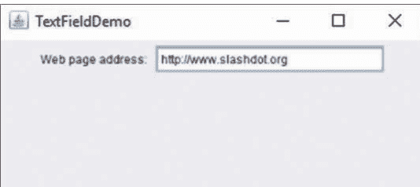

**图 17.3** 显示标签和文本字段。

`pageLabel` 设置了 "Web page address:" 和 `JLabel.RIGHT` 参数。最后一个值表示标签应该靠右对齐。`JLabel.LEFT` 使标签文本左对齐，而 `JLabel.CENTER` 将其居中。用于 `JTextField` 的参数表示文本字段的宽度约为 20 个字符。你也可以通过如下的语句来指定出现在文本字段中的默认文本：

```java
JTextField country = new JTextField("Togolese Republic", 29);
```

该语句将创建一个宽度为 20 个字符且字段中带有 "Togolese Republic" 的 `JTextField` 对象。

你可以使用 `getText()` 方法获取对象包含的文本，该方法返回一个字符串：

```java
String countryChoice = country.getText();
```

你可能猜到了，你也可以用相应的方法设置文本：
`country.setText("Separate Customs Territory of Taiwan, Pengh, Kinmen, and Matsu");`

这会将文本设置为中国台北的正式名称，它是世界上最长的国家名称，超过了第二名：英国王国和北爱尔兰。

### 复选框（Check Boxes）

`JCheckBox` 组件是文本旁的一个框，用户可以勾选或取消勾选。以下语句创建一个 `JCheckBox` 对象并将其添加到容器中：

```java
JCheckBox jumboSize = new JCheckBox("Jumbo Size");
FlowLayout flo = new FlowLayout();
setLayout(flo);
```

`JCheckBox()` 构造函数的参数指示显示的文本。如果你想让框处于勾选状态，使用以下语句：
`JCheckBox jumboSize = new JCheckBox("Jumbo Size", true);`

你可以单独展示 `JCheckBox`，也可以作为一组的一部分展示。在复选框组中，只能勾选一个。要让 `JCheckBox` 成为一组，需要创建一个 `ButtonGroup`：

```java
JCheckBox frogLeg = new JCheckBox("Frog Grande", true);
JCheckBox fishTacos = new JCheckBox("Fish Platter", false);
JCheckBox emuNuggets = new JCheckBox("Emu Nuggets", false);
FlowLayout flo = new FlowLayout();
ButtonGroup means = new ButtonGroup();
means.add(frogLeg);
means.add(fishTacos);
means.add(emuNuggets);
setLayout(flo);
add(frogLeg);
add(fishTacos);
add(emuNuggets);
```

这创建了三个名为 `means` 的复选框。Frog Grande 初始化为勾选状态，但如果用户勾选另一个框，Frog Grande 就会消失。图 17.4 显示了本部分的不同复选框。


**图 17.4** 显示复选框组件。

### 下拉框（Combo Boxes）

`JComboBox` 组件是一个选项列表，也可以设置为接收文本。当两个选项都启用时，你可以使用鼠标选择某项，也可以使用键盘输入文本。下拉框的作用与复选框组类似，区别在于除非显示选项列表，否则它是可见的。

要创建一个 `JComboBox` 对象，你需要在如下示例中创建对象后添加每个选项：

```java
JComboBox profession = new JComboBox();
FlowLayout flo = new FlowLayout();
profession.addItem("Butcher");
profession.addItem("Baker");
profession.addItem("Candlestick maker");
profession.addItem("Fletcher");
profession.addItem("Fighter");
profession.addItem("Technical writer");
setLayout(flo);
add(profession);
```

此示例创建了一个单一的 `JComboBox`，用户从中进行六项选择。当选中一项时，它会显示在组件中。图 17.5 显示了当选项列表显示时的此示例。

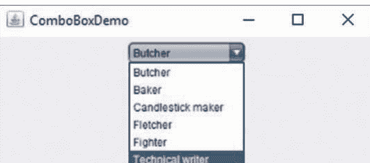

**图 17.5** 显示下拉框组件。

要让 `JComboBox` 组件接收文本输入，必须调用其 `setEditable(boolean)` 方法并将参数设置为 `true`：
`profession.setEditable(true);`

你必须在组件添加到容器之前调用此方法。

### 文本区域（Text Areas）

`JTextArea` 组件是一个允许用户输入多行文本的文本字段。你可以指定组件的宽高度。以下语句创建一个宽度为 40 个字符、高度为 8 行的 `JTextArea` 组件并将其添加到容器中。

```java
JTextArea comments = new JTextArea(8, 40);
FlowLayout flo = new FlowLayout();
setLayout(flo);
add(comments);
```

图 17.6 在框架中显示此示例。

你可以在 `JTextArea()` 构造函数中指定显示在文本区域的字符串，使用换行符 `\n` 将文本发送到下一行，如下所示：

```java
JTextArea comments = new JTextArea("I should have been a pair\n"
+ "of ragged claws.", 10, 25);
```

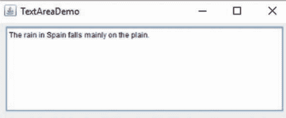

**图 17.6** 显示文本区域组件。

文本区域有两个可以调用的方法来指定当用户输入到行右边缘时组件的行为。调用 `setLineWrap(boolean)` 方法并将参数设置为 `true` 使文本换行到下一行：
`comments.setLineWrap(true);`

要确定文本如何换行到下一行，使用 `setWrapStyle(boolean)` 方法。传入参数 `true` 根据单词结束换行，传入 `false` 则根据字符换行。

如果不调用这些方法，文本将不会换行。用户可以一直在同一行输入文本，直到按下回车键超出区域右边缘。

文本区域组件的行为可能出乎你的意——当用户到达区域底部时，它们会扩大尺寸，并且在右边缘或底部包含滚动条。为了以更好的方式实现它们，你必须将文本区域放在一个名为滚动面板（scroll pane）的容器内。

GUI 中的组件通常比显示它们的区域大。要实现从一个组件到另一个组件的移动，请使用水平和垂直滚动条。

在 Swing 中，你通过将组件添加到滚动面板来支持滚动，滚动面板由 `JScrollPane` 类表示。

你可以使用以下构造函数创建滚动面板：

- `JScrollPane()`—创建一个在需要时显示的水平和垂直滚动条的滚动面板。
- `JScrollPane(int, int)`—创建一个指定的垂直滚动条和水平滚动条的滚动面板。
- `JScrollPane(Component)`—创建一个包含指定用户界面组件的滚动面板。
- `JScrollPane(Component, int, int)`—创建一个具有指定组件、垂直滚动条和水平滚动条的滚动面板。

这些构造函数的整数型参数决定了滚动条在面板中的用方式。请使用以下类变量作为这些参数：

- `JScrollPane.VERTICAL_SCROLLBAR_AS_NEEDED` 或 `JScrollPane.HORIZONTAL_SCROLLBAR_AS_NEEDED`
- `JScrollPane.VERTICAL_SCROLLBAR_NEVER` 或 `JScrollPane.HORIZONTAL_SCROLLBAR_NEVER`
- `JScrollPane.VERTICAL_SCROLLBAR_ALWAYS` 或 `JScrollPane.HORIZONTAL_SCROLLBAR_ALWAYS`

如果你创建了一个不包含组件的滚动面板，可以使用面板的 `add(Component)` 方法来添加组件。在完成滚动面板的设置后，应该将其添加到容器中以替换原来的组件。

以下是重写后的上一个示例，以适应滚动面板内的文本区域：

```java
FlowLayout flo = new FlowLayout();
setLayout(flo);
TextArea comments = new JTextArea(8, 40);
comments.setLineWrap(true);
comments.setWrapStyle(true);
JScrollPane scroll = new JScrollPane(comments,
JScrollPane.VERTICAL_SCROLLBAR_ALWAYS,
JScrollPane.HORIZONTAL_SCROLLBAR_NEVER);
add(scroll);
```

图 17.7 在框架中显示了此示例。


**图 17.7** 在滚动面板容器中显示文本区域组件。

### Panels

本小时介绍的最后一个组件是面板（Panel），它在 Swing 中通过 `JPanel` 类创建。`JPanel` 对象是用户界面中最简单的容器。`JPanel` 对象的目的是将区域划分为不同的组件组。当显示区域分区后，你可以在每个区域中使用不同的布局管理器。

以下语句创建了一个 `JPanel` 对象并将其分配给布局管理器：

```java
JPanel topRow = new JPanel();
FlowLayout flo = new FlowLayout();
topRow.setLayout(flo);
add(topRow);
```

在排列界面中的组件时会用到面板，正如你在第 18 节“布局用户界面”中所看到的那样。

你通过调用面板的 `add()` 方法向面板添加组件。你可以通过调用其 `setLayout()` 方法直接为面板分配布局管理器。

当你需要在界面的某个区域绘制某些内容时（例如来自图形文件的图像），也可以使用面板。

`JPanel` 的另一个方便的用法是创建你自己的组件，这些组件可以添加到其他类中。这在本节的最后一个项目中得到了演示。

## Creating Your Own Component

面向对象编程的一个优势是可以在不同项目之间重用类。对于下一个项目，你将创建一个特殊的面板组件，该组件可以在其他 Java 程序中使用。该组件名为 `FreeSpacePanel`，报告了运行应用程序的计算机上的可用磁盘空间。该面板显示可用空间量、总空间以及可用百分比。

创建用户界面组件的第一步是决定从哪个现有组件进行继承。除了你修改和添加的内容外，你的新组件将拥有其所有的现有属性和行为。

`FreeSpacePanel` 是在列表 17.3 中定义的 `JPanel` 子类。将列表 17.3 中的代码输入新的空 java 文件并保存该文件。

## LISTING 17.3 The Full Text of FreeSpacePanel.java

```java
1: package com.java2hours;
2:
3: import java.io.IOException;
4: import java.nio.file.*;
5: import javax.swing.*;
6:
7: public class FreeSpacePanel extends JPanel {
8: JLabel spaceLabel = new JLabel("Disk space: ");
9: JLabel space = new JLabel();
10:
11:     public FreeSpacePanel() {
12:     super();
13:     add(spaceLabel);
14:     add(space);
15:     try {
16:         setValue();
17:     } catch (IOException ie) {
18:         space.setText("Error");
19:
20:     }
21:
22:
23: private final void setValue() throws IOException {
24:     // get the current file storage pool
25:     Path current = Paths.get("");
26:     FileStore store = Files.getFileStore(current);
27:     // find the free storage space
28:     long totalSpace = store.getTotalSpace();
29:     long freeSpace = store.getFreeSpace();
30:     // get this as a percentage (with two digits)
31:     double percent = (double)freeSpace / (double)totalSpace * 100;
32:     percent = (int)(percent * 100) / (double)100;
33:     // set the label's text
34:     space.setText(freeSpace + " free out of " + totalSpace + " ("
35:     + percent + " %)");
36:
37: }
```


该类是一个可以添加到任何图形界面的组件。`FreeSpacePanel` 是在列表 17.3 中定义的 `JPanel` 子类。将列表 17.3 中的代码输入新的空 java 文件并保存该文件。

创建用户界面组件的第一步是决定从哪个现有组件进行继承。除了你修改和添加的内容外，你的新组件将拥有其所有的现有属性和行为。

在将刚刚创建的面板添加到图形用户界面（GUI）之前，你是无法看到它的。尝试使用 `FreeSpacePanel`，在 `com.java24hours` 包中按照列表 17.4 所示创建 `FreeSpaceFrame` 应用程序。为名为 `FreeSpaceFrame` 的类创建一个新文本文件。

# 17.4 FreeSpaceFrame.java 的完整文本

```java
1: package com.java24hours;

2:

3: import java.awt.*;

4: import javax.swing.*;

5:

6: public class FreeSpaceFrame extends JFrame {

7:   public FreeSpaceFrame() {

8:     super("Disk Free Space");

9:     setLookAndFeel();

10:    setSize(500, 120);

11:    setDefaultCloseOperation(JFrame.EXIT_ON_CLOSE);

12:    FlowLayout flio = new FlowLayout();

13:    setLayout(flio);

14:    FreeSpacePanel freePanel = new FreeSpacePanel();

15:    add(freePanel);

16:    setVisible(true);

17:  }

18: 

19:  private void setLookAndFeel() {

20:   try {

21:     UIManager.setLookAndFeel(

22:       "javax.swing.plaf.nimbus.NimbusLookAndFeel");

23:     );

24:   } catch (Exception ex) {

25:     // ignore error

26:   }

27:  }

28: 

29:  public static void main(String[] arguments) {

30:    FreeSpaceFrame frame = new FreeSpaceFrame();

31:  }

32: }

```

该应用程序在第 14 行创建了一个 `FreeSpacePanel` 组件，并在第 15 行将该面板添加到其框架中。

当你运行该应用程序时，它应该类似于图 1.8，但显示的是来自你自己电脑的值。


图 17.8
显示自定义磁盘空间组件。

### 总结

用户已经习惯于他们运行的程序拥有一个点击式的视觉化环境。这种期望使得创建软件变得更具挑战性，但 Java 通过 Swing 将这些能力交到了你手中，Swing 提供了构建运行且实用的 GUI 所需的所有类——无论你使用何种设置来运行 Java 程序。

使用 Swing 开发 Java 应用程序是练习面向对象编程的好极方法。每个组件、容器和布局管理器都由它们自己的对象类表示。它们中的许多类继承自同一个父类。例如，在本小时中引入的所有用户界面都是 `javax.swing.Component` 的子类。

在接下来的一小时中，你将通过使用新的布局管理器学习更多关于 GUI 设计的内容，这些管理器可以用比 `FlowLayout` 更复杂的方式指定组件在容器内的布局。

## 工作坊

### 问答

- **问. 如果我不给容器分配布局管理器，组件将如何排列的？**
- **答.** 在像面板（panel）这样的简单容器中，组件默认使用 `FlowLayout` 进行排列。每个组件的添加方式与英文单词在页面上的显示方式相同：从左到右，当没有空间时换到下一行。框架（Frames）、窗口（windows）和应用程序（applets）使用你在下一小时中学到的 `BorderLayout` 默认样式。
- **问. 为什么许多图形用户界面类的名称开头都带有一个“J”，例如 `JFrame` 和 `Label`？**
- **答.** 这些类是 Swing 框架的一部分，Swing 是 Java 类库中对图形用户界面的第二次尝试。抽象窗口工具包（AWT）是第一次，它拥有更简单的类名，例如 `Frame` 和 `Label`。

这些类属于 `java.awt` 包及相关包，而 Swing 类属于 `javax.swing` 等包，因此它们可以具有相同的类名。使用“J”开头的名称可以防止类之间被混淆。

Swing 类也称为 Java 基础类（JFC）。

- **问. 我可以在哪里买到未裁剪的1美元钞票？**
- **答.** 美国印造币局（U.S. Bureau of Engraving and Printing）在网站 www.moneyfactorystore.gov 销售真实的1美元、10美元、20美元和50美元钞票纸。

一张包含25张1美元钞票的纸价为 50.50 美元，16张10美元的 249 美元，16张20美元的 409 美元，以及16张50美元的 920 美元。由于这些是真实的货币，考虑到这些钞票的价值，这些购买更便宜。1美元多花了25.50 美元，10美元多花了89 美元，20美元多花了89 美元，50美元多花了100 美元。

还有一个装有1 万美元碎钞的五磅袋，售价 45 美元。

该局是美国唯一承认自己在浪费钱的美国政府机构。

### 测验

如果你的大脑还没有被这一小时的劳累变成一个 GUI 网格，请通过回答以下问题来测试你的技能。

- 1. 哪个用户组件被用作容器？
  - A. `JPanel`
  - B. `Layout`
  - C. `Choice`
- 2. 下列哪项必须首先完成？
  - A. `FlowLayout`
  - B. `Layout`
  - C. `Doesn't`
- 3. 什么方法决定组件的排列？
  - A. `setLayout()`
  - B. `String`
  - C. `setVisible()`

### 答案

- 1. `JPanel`。你可以将布局添加到框架中。
- 2. 你必须在添加组件之前设置布局管理器。
- 3. `setLayout()`

## 活动

- 修改应用程序以便显示：
- 增强框架：
- 访问网站。

## 第18 小时：布局用户界面

待办事项：
- 创建一个布局管理器。
- 为容器分配布局管理器。
- 使用 Java。
- 创建一个原型。

当你开始设计用户界面（GUI）时，面临的一个障碍是当用户调整框架大小时，组件会重新排列。

### 使用布局管理器

有几种布局管理器可以使用来影响组件的排列。面板的默认布局管理器是 `java.awt` 包中的 `FlowLayout` 类，它在上一小时中使用过。

在 `FlowLayout` 下，组件以英文单词在页面上的组织方式放入区域中：从左到右，当没有空间时换到下一行。

你也可以为特定的容器（例如 `JPanel`）设置布局管理器。你可以通过使用对象的 `setLayout()` 方法来实现。

```java
FlowLayout topLayout = new FlowLayout();

setLayout(topLayout);
```

本小时的项目是 Crisis，一个具有五个按钮的 GUI 应用程序。在 `com.java24hours` 包中创建一个名为 Crisis 的新 Java 文件。将列表 18.1 的文本输入文件并保存。

# 18.1 Crisis.java 的完整文本

```java
1: package com.java24hours;

2:

3: import java.awt.*;

4: import javax.swing.*;

5:

6: public class Crisis extends JFrame {

7: JButton panicButton;

8: JButton dontPanicButton;

9: JButton blameButton;

10: JButton mediaButton;

11: JButton saveButton;

12:

13: public Crisis() {

14: super("Crisis");

15: setLookAndFeel();

16: set(348, 128);

17: setDefaultCloseOperation(JFrame.EXIT_ON_CLOSE);

18: FlowLayout flow = new FlowLayout();

19: setLayout(flow);

20: panicButton = new JButton("Panic");

21: dontPanicButton = new JButton("Don't Panic");

22: blameButton = new JButton("Blame Others");

23: mediaButton = new JButton("Notify the Media");

24: saveButton = new JButton("Save Yourself");

25: add(panicButton);

26: add(dontPanicButton);

27: add(blameButton);

28: add(mediaButton);

29: add(saveButton);

30: setVisible(true);

31: }

private void setLookAndFeel(

  try {

    UIManager.setLookAndFeel(

      "com.sun.java.swing.plaf.nimbus.NimbusLookAndFeel"

    );

  } catch (Exception exc) {

    // 忽略错误

  }

}

public static void main(String[] arguments) {

  Crisis frame = new Crisis();

}

}
```

图 18.1 显示了正在运行的应用。


**图 18.1**
使用流式布局（flow layout）排列组件。

`FlowLayout` 类使用容器的尺寸作为布局组件的唯一依据。调整应用程序窗口的大小，观察组件如何随之立即重新排列。将窗口加宽一倍，所有的 `JButton` 组件将显示在同一行。将窗口收窄到让它们全部垂直堆叠。

### 网格布局管理器 (GridLayout Manager)

`java.awt` 包中的 `GridLayout` 将容器中的所有组件组织成特定数量的行和列。所有组件在显示区域内分配相同的空间，因此，如果你设置了一个三列三行的网格，容器将被划分为九个等大的区域。

`GridLayout` 在添加组件时将其放置在网格的相应位置。组件从左到右添加，直到某一行填满，然后填充下一个网格的左侧列。

以下语句创建了一个容器，并将其设置为两行三列宽的网格布局：

```java
GridLayout grid = new GridLayout(2, 3);

setLayout(grid);
```

图 18.2 显示了如果 Crisis 应用使用网格布局将是什么样子。


图 18.2
使用网格布局排列组件。

### 边界布局管理器 (BorderLayout Manager)

同样位于 `java.awt` 中的 `BorderLayout` 类将组件排列在容器内的特定位置，这些位置由五个方向之一标识：北、南、东、西或中心。

`BorderLayout` 管理器将组件分为五个区域：四个由方向表示，一个用于中心区域。当你在此布局下添加组件时，`add()` 方法包含第二个参数，用于指定组件的放置位置。该参数应该是 `BorderLayout` 类的五个类变量之一：`NORTH`、`SOUTH`、`WEST` 和 `CENTER`。

与 `GridLayout` 不同，`BorderLayout` 将所有可用空间留给组件。放置在中心的组件将获得四个边界组件之外的所有剩余空间，因此它通常是最大的。

以下语句创建了一个使用边界布局的容器：

```java
BorderLayout crisisLayout = new BorderLayout();

setLayout(crisisLayout);

add(panicButton, BorderLayout.NORTH);

add(dontPanicButton, BorderLayout.SOUTH);

add(blameButton, BorderLayout.EAST);

add(mediaButton, BorderLayout.WEST);

add(saveButton, BorderLayout.CENTER);
```

图 18.3 显示了这在 Crisis 应用中的外观。

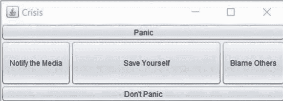

图 18.3 使用边界布局排列组件。

### 盒布局管理器 (BoxLayout Manager)

另一个实用的布局管理器是 `javax.swing` 包中的 `BoxLayout`，它允许在单行内水平或垂直方向上堆叠组件。

要使用此布局，请创建一个包含组件的面板，然后创建一个带有两个参数的布局管理器：

- 要用盒布局整理的组件
- 用于垂直对齐的 `BoxLayout.Y_AXIS` 或用于水平对齐的 `BoxLayout.X_AXIS`

以下是堆叠 Crisis 组件的代码：

```java
JPanel pane = new JPanel();

BoxLayout box = new BoxLayout(pane, BoxLayout.Y_AXIS);

pane.setLayout(box);

pane.add(panicButton);

pane.add(dontPanicButton);

pane.add(blameButton);

pane.add(mediaButton);

pane.add(saveButton);

pane.add(pane);
```

图 18.4 显示了最终效果。

## 使用内边距 (Insets) 分隔组件

当你在容器内排列组件时，可以使用 `Insets` 将组件移离容器边缘。`Insets` 是一个表示容器边界区域的对象。

`Insets` 类是 `java.awt` 包的一部分，它的构造函数接受四个参数：在容器的顶部、左侧、底部和右侧留出的空间。每个参数都使用像素（pixels）进行指定，这与定义窗口尺寸时使用的测量单位相同。

以下语句创建了一个 `Insets` 对象：

```java
Insets around = new Insets(10, 6, 10, 3);
```

`around` 对象表示容器边界，其顶部内部 10 像素，左侧内部 6 像素，底部内部 10 像素，右侧内部 3 像素。

要在容器中使用 `Insets` 对象，必须重写 `getInsets()` 方法。该方法没有参数并返回一个 `Insets` 对象，如下例所示：

```java
public Insets getInsets() {

    Insets squeeze = new Insets(50, 15, 10, 3);

    return squeeze;

}
```

图 18.5 显示了这种设置的效果。

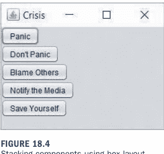

图 18.5 使用内边距。

```java
73: row3.setLayout(layout3);

74: stop.setEnabled(false);

75: row3.add(stop);

76: row3.add(play);

77: row3.add(reset);

78: row3.add(row3);

79: 

80: GridLayout layout4 = new GridLayout(2, 3, 20, 10);

81: row4.setLayout(layout4);

82: row4.add(gotLabel);

83: got3.setEditable(false);

84: row4.add(got3);

85: row4.add(got4Label);

86: got4.setEditable(false);

87: row4.add(got4);

88: row4.add(got5Label);

89: got5.setEditable(false);

90: row4.add(got5);

91: row4.add(got6Label);

92: got6.setEditable(false);

93: row4.add(got6);

94: row4.add(drawingsLabel);

95: drawings.setEditable(false);

96: row4.add(drawings);

97: row4.add(yearsLabel);

98: years.setEditable(false);

99: row4.add(years);

100: add(row4);

101: 

102: setVisible(true);

103: 

104: }

105: private static void setLookAndFeel() {

106: try {
```


```java
107: UIManager.setLookAndFeel(
108: "com.sun.java.swing.plaf.nimbus.NimbusLookAndFeel");
109: });
110: catch (Exception ex) {
111: // ignore error
112: }
113: }
114: 
115: public static void main(String[] arguments) {
116: LottoMadness.setLookAndFeel();
117: LottoMadness frame = new LottoMadness();
118: }
119: }
```

尽管你还没有添加任何让程序执行操作的语句，但你仍然可以运行该应用程序，以确保图形界面组织正确并收集了你所需的信息。

此应用程序使用了多种布局管理器。为了更清晰地了解应用程序用户界面的布局情况，请查看图 18.7。界面被分为四个水平行，在图中它们由水平黑线隔开。每一行都是一个 `JPanel` 对象，应用程序的整体布局管理器将这些行组织成一个四行一列的 `GridLayout`。

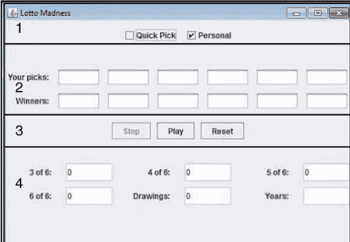

图 18.7
将 LottoMadness 应用程序分为面板。

在这些行中，使用了不同的布局管理器来确定组件的显示方式。第 1 行和第 3 行使用了 `FlowLayout` 对象。程序的第 47–48 行显示了是如何创建这些对象的：

```java
FlowLayout layout1 = new FlowLayout(FlowLayout.CENTER, 10, 10);
```

`FlowLayout()` 构造函数使用了三个参数。第一个参数 `FlowLayout.CENTER` 表示组件应该在它们的容器（即它们放置的 `JPanel`）中居中对齐。最后两个参数指定了每个组件相对于其他组件移动的宽度和高度。使用 10 像素的宽度和 10 像素的高度会在组件之间留出少量的额外距离。

界面的第 2 行被布局成一个两行七列的网格。`GridLayout()` 构造函数还指定了组件在每个方向上应与其他组件隔开 10 像素。第 56–57 行设置了这个网格：

```java
GridLayout layout2 = new GridLayout(2, 7, 10, 10);
row2.setLayout(layout2);
```

第 4 行使用 `GridLayout` 将组件排列成一个两行三列的网格。

LottoMadness 应用程序使用了在本节课时长中描述的多个组件。第 9–37 行用于设置组成界面的对象。这些语句按行组织。首先为该行创建一个 `JPanel` 对象，然后设置放置在该行上的每个组件。这段代码创建了所有容器，但在使用 `add()` 方法将它们添加到应用程序的主框架之前，它们是不会显示的。在第 47–50 行中，添加了组件：

```java
FlowLayout layout1 = new FlowLayout(FlowLayout.CENTER, 10, 10);
row1.add(drawings);
row1.add(years);
row1.setLayout(layout1);
row1.add(row1);
add(row1);
```

创建布局管理器后，通过行对象的 `setLayout()` 方法使用它。当布局设置好后，使用 `JPanel` 的 `add()` 方法将组件添加到面板中。在放置所有组件后，将整个行添加到框架中。

LottoMadness 应用程序设置图形界面外观和感觉的方式与之前的应用程序不同。`setLookAndFeel()` 方法被创建为一个静态方法——注意第 105 行中的 `static` 关键字——并在 `main()` 方法第 116 行中调用。

### 总结

当你第一次设计 GUI 时，可能会遇到布局问题。布局管理器提供了一种灵活的方法来组织应用程序的界面。在下一节课中，你将学习更多关于布局器的知识。

当你设计 GUI 时，可能会遇到布局问题。布局管理器提供了一种灵活的方法来组织应用程序的界面。在下一节课中，你将学习更多关于布局器的知识。

### 测试

为了测试你的大脑细胞布局是否正确，请通过回答以下问题来测试 Java 布局技能。

1. 哪种容器经常用于将界面分为不同的布局管理器？
   A. JWindow
   B. JPanel
   C. Container
2. JPanel 的默认布局管理器是什么？
   A. FlowLayout
   B. GridLayout
   C. 无默认
3. BorderLayout 类的命名源于？
   A. 组件的边界
   B. 沿容器边界组织的方式
   C. Java 开发者的反复性

### 答案

1. B. `JPanel`，它是容器中最简单的。
2. A. JPanel 使用流布局，但框架和窗口的默认管理器是边界布局。
3. B. 你在添加组件时，必须使用方向变量（如 `BorderLayout.WEST` 和 `BorderLayout.EAST`）指定组件的边界位置。

## 活动

如果你想继续学习（以及网格和边界），请尝试以下活动：

- 创建一个 Crisis 应用程序的修改版本，将 panic 和 dontPanic 放在一个布局管理器下，其余三个按钮放在另一个下。
- 复制 `LottoMadness.java` 文件，并将其重命名为 `NewMadness.java`。修改此程序，你可以通过下拉框进行个人选择，并设置启动、停止和重置框。

要查看实现这些活动的 Java 程序，请访问书籍网站 www.java24hours.com。

## 第19 小时：响应用户输入

本小时的任务列表：

- 让你的程序感知事件。
- 设置一个组件使其能够触发事件。
- 找出事件在程序流向何处。
- 在接口中存储信息。
- 转换存储在文本框中的值。

你在过去两个小时内开发的图形用户界面（GUI）可以独立运行。用户可以点击按钮、在文本框中填充内容并调整窗口大小。迟早，即使是最不挑剔的用户也会觉得意犹未尽。程序提供的 GUI 的作用是在发生鼠标点击或键盘输入时，触发某些操作。

当你的 Java 程序能够响应用户事件时，这些操作才变得可能。这被称为事件处理，是本小时的核心内容。

## 让你的程序开始监听

Java 中的用户事件是指当用户使用鼠标、键盘或其他输入设备执行操作时发生的事情。

在接收事件之前，你必须学会如何让对象进行监听。响应用户事件需要一个或多个 `EventListener` 接口。接口是 Java 面向对象编程的一个特性，它允许类继承其在 otherwise 无法采用的行为。它们与其他类之间的契约，保证该类将包含特定的方法。

一个 `Listener` 接口包含接收特定类型用户输入的方法。

添加 `Listener` 接口需要两步。首先，由于监听类属于 `java.awt.event` 包，你可能需要以下语句使它们可用：

```java
import java.awt.event.*;
```

其次，该类必须使用 `implements` 关键字来声明它支持一个或多个监听接口。以下语句创建了一个使用 `ActionListener` 的类，该接口是用于响应按钮和菜单点击的接口：

```java
public class Graph implements ActionListener {
```

`EventListener` 接口允许 GUI 的组件生成用户事件。如果没有就绪的监听器，组件就无法执行任何可以被程序其他部分听到的操作。程序必须为它监听的每种组件包含一个监听接口。要让程序对按钮的鼠标点击或在文本框中按下 Enter 键做出响应，你必须包含 `ActionListener`。要响应列表或复选框的使用，你必须使用 `ItemListener` 接口。

当你在同一个类中需要多个接口时，在 `implements` 关键字后用逗号分隔这些名称，如下代码所示：

```java
public class Graph implements ActionListener, MouseListener {
// ...
}
```

## 设置组件以便被听到

在你实现了特定组件所需的接口后，你必须让该组件生成用户事件。`ActionListener` 接口监听动作事件（action events），例如按钮点击或按下 Enter 键。

要让 `JButton` 对象生成事件，请在语句中使用 `addActionListener()` 方法：

```java
JButton fireTorpedos = new JButton("Fire torpedoes");
fireTorpedos.addActionListener(this);
```

这段代码创建了 `fireTorpedos` 按钮并调用了按钮的 `addActionListener()` 方法。作为 `addActionListener()` 方法参数的 `this` 关键字表示接收并按需要处理事件当前对象。

### 注意

`this` 关键字在首次引入时会让很多读者困惑。`this` 指向关键字出现的对象。所以，如果你创建一个 `LottoMadness` 类并在该类的内部语句中使用 `this`，它指的是执行该代码的 `LottoMadness` 对象。

### 处理用户事件

当带有监听器的组件生成用户事件时，一个方法会被自动调用。该方法必须在监听器附加到组件时指定的类中找到。

每个监听器都有不同的方法来接收它们的事件。`ActionListener` 接口将事件发送到名为 `actionPerformed()` 的方法。以下是 `actionPerformed()` 方法的简短示例：

```java
public void actionPerformed(ActionEvent event) {
    // 方法在这里
}
```

程序中的所有事件都会发送到此方法。如果程序中可能只有一个组件可以发送动作事件，你可以在此方法中放置语句来处理事件。如果有多个组件可以发送这些事件，你需要检查发送该方法的对象。

一个 `ActionEvent` 对象被发送到 `actionPerformed()` 方法。有几类对象表示程序中可以生成的用户事件。这些类拥有方法来判断是哪个组件导致了事件的发生。在 `actionPerformed()` 方法中，如果 `ActionEvent` 对象命名为 `event`，你可以通过以下语句识别组件：

```java
String cmd = event.getActionCommand();
```

`getActionCommand()` 方法发送一个字符串。如果组件是按钮，该字符串就是它上的标签。如果它是文本框，该字符串就是输入字段中输入的文本。`getSource()` 方法返回导致事件的对象。

你可以使用以下 `actionPerformed()` 方法接收来自三个组件的事件：一个名为 `start` 的 `JButton`，一个名为 `speed` 的 `JTextField` 以及另一个名为 `viscosity` 的 `JTextField`：

```java
public void actionPerformed(ActionEvent event) {
    Object source = event.getSource();
    if (source == speed) {
        // speed 字段导致事件
    } else if (source == viscosity) {
        // viscosity 字段导致事件
    } else {
        // start 按钮导致事件
    }
}
```

对所有用户事件调用 `getSource()` 方法，以识别导致事件的特定对象。

## 复选框和组合框事件

组合框和复选框需要 `ItemListener` 接口。使用组件的 `addItemListener()` 方法使其产生事件。以下语句创建一个复选框：

```java
JCheckBox checkBox = new JCheckBox("Check me");
checkBox.addItemListener(this);
```

要确定复选框是被选中还是取消，使用 `itemStateChanged()` 方法。以下代码是该方法的示例：

```java
public void itemStateChanged(ItemEvent event) {
    Object source = event.getSource();
    if (event.getStateChange() == ItemEvent.SELECTED) {
        // 选中
    } else {
        // 取消
    }
}
```

### 键盘事件

当程序必须在按键按下后立即运行时，它使用 `KeyListener` 接口。第一步是通过调用其 `addKeyListener()` 方法注册接收按键的组件。该接口实现了方法：

- `keyPressed(KeyEvent)`——按键按下瞬间调用的方法
- `keyReleased(KeyEvent)`——按键释放瞬间调用的方法
- `keyTyped(KeyEvent)`——按键按下后调用的方法

要监控键盘上的任何按键（包括 Enter、Home、Page Up 和 Page Down），你应该调用 `getKeyCode()`。该方法返回一个表示按键的整数值。然后你使用整数作为参数调用 `KeyEvent.getKeyText()` 来接收一个包含按键名称（如 Home、F1 等）的 `String` 对象。

```java
33:  }
34: 
35:  @Override
public void keyReleased(KeyEvent e) {
    // 什么都不做
}
private void setLookAndFeel() {
    try {
        UIManager.setLookAndFeel(
          "com.sun.java.swing.plaf.nimbus.NimbusLookAndFeel"
        );
    } catch (Exception exc) {
      // 忽略错误
    }
}
public void init(String[] args) {
    Frame frame = new KeyFrame();
}
```

当你运行该应用程序时，它应该类似于图 19.1。该应用程序在第 24-38 行中实现了 `KeyListener` 接口的三个方法。其中两个方法是空的。它们在应用程序中是不需要的，但必须包含在内，以满足第 7 行用 `implements` 关键字建立的类与接口之间的约定。


图 19.1
程序中处理键盘事件。

### 组件的启用与禁用

你可能在程序中见过某个组件显示为阴影而不是正常外观。

阴影表示用户无法对该组件进行任何操作，因为它未被启用。组件的启用和禁用是通过组件的 `setEnabled` 方法完成的。该方法接受一个布尔值作为参数，因此 `setEnabled(true)` 启用组件使用，而 `setEnabled(false)` 则停用它。

## 完成图形化应用程序

以下语句创建了标签为“Previous（上一个）”、“Next（下一个）”和“Final（完成）”的按钮，并禁用了第一个按钮：

```java
JButton previousButton = new JButton("Previous");
JButton nextButton = new JButton("Next");
JButton finishButton = new JButton("Finish");
previousButton.setEnabled(false);
```


这种方法是防止组件在不该发送用户事件时的有效方法。例如，如果你正在编写一个使用文本字段收集用户地址的 Java 应用程序，可以在用户提供街道、城市和邮编之前禁用“保存地址”按钮。

我明白了 Java 程序中 Swing 的事件处理类是如何工作的，你将在第 18 小时“布局用户界面”之后完成 LottoMadness，彩票模拟抽奖从那时开始。

到此时，LottoMadness 是一个 GUI（图形化用户界面）。你可以点击按钮并向框中输入文本，但没有任何响应。在本次工作坊中，我们创建了 `LottoEvent`，这是一个接收用户输入、收集开奖结果并跟踪中奖次数的新类。当该类完成后，你在 LottoMadness 中添加几行代码使其使用 `LottoEvent`。以这种方式划分 Swing 项目是非常方便的，将 GUI 放在一个类中，将事件处理方法放在另一个类中。

该应用程序的目的是评估用户一生中赢得六号码彩票抽奖的概率。图 19.2 显示了程序运行时的截图。

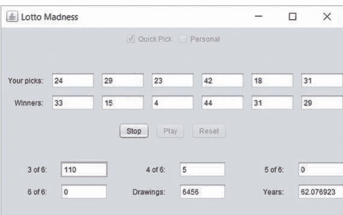

图 19.2 运行 LottoMadness 应用程序。

计算机并没有使用概率来解决这个问题，而是连续快速地抽奖，直到产生中奖者为止。由于 6 选 6 的中奖概率极低，程序还会报告任何三个、四个或五个中奖号码的组合情况。

该界面包含 12 个用于彩票号码的文本字段和两个标记为“Quick Pick（快速选择）”和“Personal（个人）”的复选框。六个禁输入的文本字段用于显示每次抽奖的中奖号码。另外六个文本字段供用户选择号码使用。勾选 Quick Pick 框将为用户选择随机数字。勾选 Personal 框则允许用户选择所需的数字。

三个按钮控制程序的活动：Stop（停止）、Play（播放）和 Reset（重置）。当按下 Play 按钮时，程序启动一个名为 `playing` 的线程并生成 Lotto。

按下 Stop 按钮会停止该线程，Reset 则清除所有字段以便用户可以重新开始。你在第 15 小时“创建多线程程序”中学习了线程。

`LottoEvent` 类实现了三个接口：`ActionListener`、`ItemListener` 和 `Runnable`。`Runnable` 接口与线程有关，在第 15 小时涵盖过。监听器用于监听应用程序按钮和复选框生成的用户事件。程序不需要监听与文本字段相关的事件，因为它们严格用于存储用户选择的号码。用户界面会自动处理这种存储。

该类需要使用 Swing 包 `javax.swing`）以及 Java 的事件处理包 `java.awt.event`。

该类有两个实例变量：

- `gui`，一个 `LottoMadness` 对象
- `playing`，一个用于持续彩票抽奖的 `Thread` 对象

`gui` 变量用于与 `LottoMadness` 对象通信，该对象包含程序的 GUI。当你需要对界面进行更改或从其中一个文本字段检索值时，使用 `gui` 对象的实例变量。

例如，`LottoMadness` 的 `play` 实例代表 按钮。要在 `LottoEvent` 中禁用此按钮，可以使用以下语句：

```java
gui.play.setEnabled(false);
```

你可以使用下一个语句获取 `JTextField` 对象 `got1` 的值：

```java
String got1 = gui.got1.getText();
```

列表 19.2 包含了 `LottoEvent` 完整文本。在 `com.java` 包中创建一个名为 `LottoEvent` 的新 Java 文件，输入文本内容。

```java
138: gui.play.setEnabled(true);
139: playing = null;
140: }
141: try {
142: Thread.sleep(100);
143: } catch (InterruptedException e) {
144: // do nothing
145: }
146: 
147: }
148: }
```

`LottoEvent` 类有一个构造函数：`LottoEvent(LottoMadness)`。作为参数指定的 `LottoMadness` 对象标识了该对象，它是依赖 `LottoEvent` 来处理用户事件并进行抽奖的对象。

在该类中使用了以下方法：

- `clearAll()` 方法调用应用程序中的所有文本字段将其清空。这在用户点击重置（重置）按钮时会被启用。
- `addTodo()` 方法将文本字段转换为整数，将其加1，然后再次转换为文本字段。由于所有文本字段都是字符串，因此在表达式中使用它们时必须采取特殊步骤。
- `numberGone()` 方法接受三个参数：来自乐票抽奖的单个数字、一个包含多个 `JTextField` 对象的数组以及一个计数整数。该方法确保抽奖中的每个数字在同一次抽奖中没有被重复选中。
- `matched()` 方法接受两个参数：一个 `JTextField` 对象和一个包含六个 `JTextField` 对象的数组。该方法检查用户的数字是否与当前乐票抽奖的数字匹配。

应用程序的 `actionPerformed()` 方法在用户点击按钮时接收动作事件。`getCommand()` 方法获取按钮的标签，以确定点击了哪个组件。

点击“播放”（Play）按钮会调用 `startPlaying()` 方法。该方法会禁用四个组件。点击停止（Stop）会调用 `stopPlaying()` 方法，该方法会启用除停止按钮以外的所有组件。

`itemStateChanged()` 方法接收由勾选“快速选择”（Quick Pick）或“个人”（Personal）复选框触发的用户事件。`getItem()` 方法返回一个代表被点击的复选框的对象。如果是“快速选择”复选框，则分配从 1 到 50 的六个随机数字给用户的乐票号码。否则，存放用户号码的文本字段将被清空。

`LottoEvent` 类为乐票抽奖中的每个球使用 1 到 50 的数字。这在第 118 行确立，该行将 `Math.random()` 方法乘以 50，加 1，并将其作为 `Math.floor()` 方法的参数。结果是一个 1 到 50 之间的随机整数。如果你将 50 替换为另一个数字并在第 69 行修改，你可以将 LottoMadness 用于生成更宽或更小范围值的彩票比赛。

LottoMadness 项目缺少用于跟踪抽奖次数、计数和数字文本字段等信息的变量。接口存储值并自动显示它们。

要完成该项目，请在 Net 中重新打开 `LottoMadness.java`。你只需要添加六行代码即可使其与 `LottoEvent` 类协作。

首先，添加一个新变量来持有 `LottoEvent` 对象：

```java
LottoEvent lotto = new LottoEvent(this);
```

接下来，在 `LottoMadness()` 构造函数中，为每个可以接收用户输入的用户组件调用 `addItemListener()` 和 `addActionListener()` 方法：

```java
// 添加监听器
quickpick.addItemListener(lotto);
personal.addItemListener(lotto);
stop.addActionListener(lotto);
play.addActionListener(lotto);
reset.addActionListener(lotto);
```

这些语句应该添加到构造函数中，紧跟在为窗口设置布局管理器的 `setLayout()` 方法之后。

代码列表 19 包含了你完成修改后 `LottoMadness.java` 的全文。你添加的行是——其余部分与一小时前的内容相同。

# 列表 19 LottoMadness.java 的全文

```java
1: package com.java24hours;
2:
3: import java.awt.*;
4: import javax.swing.*;
5:
6: public class LottoMadness extends JFrame {
7:     LottoEvent lotto = new LottoEvent(this);
8:
9:     // 设置第 1 行
10:    JPanel row1 = new JPanel();
11: ButtonGroup option = new ButtonGroup();
12: JCheckBox quickpick = new JCheckBox("Quick Pick", false);
13: JCheckBox personal = new JCheckBox("Personal", true);
14: // 设置第 2 行
15:    JPanel row2 = new JPanel();
16: JLabel numbersLabel = new JLabel("Your picks: ", JLabel.RIGHT);
17: JTextField(numbers) = new JTextField(6);
18: JLabel winnerLabel = new JLabel("Winners: ", JLabel.RIGHT);
19: JTextField(winners) = new JTextField(6);
20: // 设置第 3 行
21:    JPanel row3 = new JPanel();
22: JButton stop = new JButton("Stop");
23: JButton play = new JButton("Play");
24: JButton reset = new JButton("Reset");
25: // 设置第 4 行
26:    JPanel row4 = new JPanel();
27: JLabel got3 = new JLabel("3 of 6: ", JLabel.RIGHT);
28: JTextField got3 = new JTextField("0");
29: JLabel got4 = new JLabel("4 of 6: ", JLabel.RIGHT);
30: JTextField got4 = new JTextField("0");
31: JLabel got5 = new JLabel("5 of 6: ", JLabel.RIGHT);
32: JTextField got5 = new JTextField("0");
33: JLabel got6 = new JLabel("6 of 6: ", JLabel.RIGHT);
34: JTextField got6 = new JTextField("0");
35: JLabel drawingsLabel = new JLabel("Drawings: ", JLabel.RIGHT);
36: JTextField(drawings) = new JTextField("0");
37: JLabel yearsLabel = new JLabel("Years: ", JLabel.RIGHT);
38: JTextField(years) = new JTextField("0");
40: public LottoMadness() {
41:     super(Lotto);
42:
43:     setSize(550, 400);
44:     CloseOperation(JFrame.EXIT_ON_CLOSE);
45:     GridLayout layout = new GridLayout(5, 1, 10);
46:     setLayout(layout);
47:
48: // 添加监听器
49:     quickpick.addActionListener(lotto);
50:     personal.addActionListener(lotto);
51:     stop.addActionListener(lotto);
52:     play.addActionListener(lotto);
53:     reset.addActionListener(lotto);
54:
55:     FlowLayout layout1 = new FlowLayout(FlowLayout.CENTER, 10, 10);
56:     option.add(quickpick);
57:     option.add(personal);
58:     row1.add(layout1);
59:     row1.add(quickpick);
60:     row1.add(personal);
61:     add(row1);
62:    GridLayout layout2 = new GridLayout(2, 7, 10);
63:     row2.setLayout(layout2);
64:     row2.add(numbersLabel);
65:     for (int i = 0; i < 6; i++) {
66:         numbers[i] = new JTextField();
67:         row2.add(numbers[i]);
68:     }
69:     row2.add(winnerLabel);
70:     for (int i = 0; i < 6; i++) {
71:         winners[i] = new JTextField();
72:         winners[i].setEditable(false);
73:         row2.add(winners[i]);
74:     }
75:     add(row2);
76:    FlowLayout layout3 = new FlowLayout(FlowLayout.CENTER, 10, 10);
77:     row3.setLayout(layout3);
78:     stop.setEnabled(false);
79:     row3.add(stop);
80:     row3.add(play);
81:     row3.add(reset);
82:     add(row3);
83:    GridLayout layout4 = new GridLayout(2, 3, 20, 10);
84:     row4.setLayout(layout4);
85:     row4.add(got3);
86:     get3.setEditable(false);
87:     row4.add(got3);
88:     row4.add(got4);
89:     get4.setEditable(false);
90:     row4.add(get4);
91:     row4.add(got5);
92:     get5.setEditable(false);
93:     row4.add(get5);
94:     row4.add(got6);
95:     get6.setEditable(false);
96:     row4.add(get6);
97:     row4.add(drawingsLabel);
98:     drawings.setEditable(false);
99:     row4.add(drawings);
100:     row4.add(yearsLabel);
101:     years.setEditable(false);
102:     row4.add(years);
103:     add(row4);
104:     setVisible(true);
105: }
106:
107: private static void setLookAndFeel() {
108:     try {
109:         UIManager.setLookAndFeel("com.sun.java.swing.plaf.nimbus.NimbusLookAndFeel");
110:     } catch (Exception exc) {
111:         // 忽略错误
112:     }
113: }
114:
115: public static void main(String[] arguments) {
116:     LottoMadness.setLookAndFeel();
117:     LottoMadness frame = new LottoMadness();
118: }
119: }
```


在你添加了阴影行后，你可以运行该程序，它能够测试你的乐票技巧数千年。正如你所预期的，这些彩票是徒劳的。即使你活得像圣经人物那么长，一生中赢得 6 比 6 彩奖的概率也微乎其微。

### 注意

当可以使用 `www.java24hours.com` 网站运行 `LottoMadness` 程序时，它持续了 410,732,244 次抽奖，相当于 390 万年的每周两次抽奖。共有 6,364,880 名 3 比 6 中奖者，337,285 名 4 比 6 中奖者，6,476 名 5 比 6 中奖者，以及 51 名 6 比 6 中奖者（大约 800 万分之一）。赢得这个虚构彩票的第一人是 Bill Teer。他的号码是 3, 7, 1, 15, 34 和 43，他花了 241,225 天（2319.47 年）才中奖。

### 总结

使用 Swing，你可以通过少量的编程创建一个外观专业的程序。虽然 `LottoMadness` 比你过去 19 小时处理过的许多示例都要长，但程序的一半是由构建接口的语句组成的。

如果你花一些时间运行这个程序，你会对那些赢得六位数字彩票抽奖的人的好运感到更加苦涩和羡慕。

我最近一次运行程序的结果显示，我可能会花费 17,000 美元和我生命中最最好的 165 年来买彩票，结果只中了 6 等 5 号、6 等 14 号和 6 等 264 号奖。

与这些概率相比，让你的 Java 编程技能产生回报几乎是板上钉钉的事。

### 工作坊

### 问答

- Q. 你需要对 `paint()` 方法或 `repaint()` 执行任何操作来指示文本字段已更改吗？
- A. 使用文本组件的 `setText()` 方法更改其值后，不需要做其他任何操作。刷新更新状态以显示新值即可。

- Q. 为什么你经常导入一个类以及它的一个子类，就像在列表 19.1 中当你导入 `java.awt.*` 和 `java.awt.event.*` 时？第一个语句可以包含第二个吗？
- A. 尽管 `java.awt` 和 `java.awt.event` 包的名称看起来是相关的，但 Java 中并没有包的继承关系。一个包不能是另一个的子包。

- 当你在 `import` 语句中使用星号时，你使一个包中的所有类在程序中都可用。
- 星号仅作用于类，不作用于包。单个 `import` 语句最多加载单个包的类。

- Q. 为什么演员迈克尔·福克斯（Michael J. Fox）用他的首字母来标识？
- A. 演员协会中已经有一个 Michael Fox 了，这迫使未来的《家庭联结》（Family Ties）和《回到未来》（Back to the Future）为他的职业工作选择另一个名字。迈克尔·安德鲁·福克斯是他的真名，但他不喜欢 Andrew 或 Andy Fox 听起来——而 Michael A. Fox 听起来又像是在赞美自己的外貌。
- 他定了 Michael Fox，以此向性格演员迈克尔·J·波拉德（Michael J. Pollard）致敬。
- 另一个 Michael Fox 是一位演员，曾出现在《佩里·马森》（Perry Mason）、《伯克的法则》（Burke's Law）以及许多其他电视节目和电影中，直到他在 1996 年去世。

### 测验

在 `LottoMadness` 程序让你对机会性游戏产生反感后，通过回答以下问题来玩一个技巧性游戏吧。

1. 为什么动作事件（action events）被称为这个名字？
   A. 它们是对其他事情的反应。
   B. 它们表示应该采取某种行动作为响应。
   C. 是为了向电影冒险家动作·杰克逊（Action Jackson）致敬。
2. 作为 `addActionListener()` 方法的参数代表什么？
   A. 当事件发生时，应该使用此监听器。
   B. 此事件优先于其他事件。
   C. 此对象处理事件。
3. 哪个文本组件将用户输入存储为整数？
   A. `JTextField`
   B. `JTextArea`
   C. A 和 B 均不是

### 答案

- 1. 动作事件包括按钮的点击和从下拉菜单中选择项目。
2. `this` 关键字指向当前对象。如果使用对象的名称作为参数而不是 `this` 语句，该对象将接收事件并被期望处理它们。
3. `JTextField` 和 `JTextArea` 组件将它们的值存储为文本，因此在将它们作为整数、浮点数或其他文本值使用之前，你必须转换它们的值。

## 活动

如果这一小时的主要活动没有提供足够的你口味的动作，请尝试以下活动：

- 在 `LottoMadness` 中添加一个文本字段，它将配合 `LottoEvent` 中的 `Thread.sleep()` 语句工作，以减慢抽奖生成的速度。
- 修改 `LottoMadness` 项目，使其从 1 到 90 之间抽取五个数字。

要查看实现这些活动的 Java 程序，请访问书籍网站 `www.java24hours.com`。

## 第 20 小时
读写文件

本小时的任务列表：

- 从文件中读取字节到程序中。
- 在你的计算机上创建一个新文件。
- 将字节数组保存到文件中。
- 对文件中存储的数据进行修改。

在计算机上表示数据有许多方法。你已经处理过一种创建对象的方法。对象包含变量形式的数据和对对象的引用。它还包含使用数据完成任务的方法。

要处理其他类型的数据（例如硬盘上的文件和网络服务器上的文档），你可以使用 `java.io` 包中的类。其名称中的“io”代表“输入/输出”（input/output），这些类用于访问数据源，例如硬盘、DVD 或计算机内存。

你可以使用称为流（streams）的通信系统将数据引入程序并发送数据，流是将信息从一个地方移动到另一个地方的对象。

### 流

要在 Java 程序中永久保存数据或稍后检索这些数据，你必须至少使用一个流。

流是从一个源获取信息并发送到另一个地方的对象，其名称源于水流，它会将鱼、船和工业污染物从一个地方带到另一个地方。

流连接了各种来源，包括计算机程序、硬盘、互联网服务器、计算机内存和优存盘。学习了如何使用流处理一种数据后，你可以以相同的方式处理其他数据。

在本小时中，你将使用流读取和写入存储在计算机文件中的数据。

```java
File book = new File("data\\address.dat");
```

### 注意

```java
File book = new File("data\\address.dat");
```

这个示例在 Windows 系统上工作，它使用反斜杠作为文件名分隔符。反斜杠在 Java 中是特殊字符。Linux 和 Unix 系统使用正斜杠。

```java
File book = new File("data\\address.dat");
```

创建一个 `File` 对象并不会创建文件。

当你有一个 `File` 对象时，可以对其调用多个有用方法：

- `exists()`--文件是否存在
- `getName()`--文件的名称
- `length()`--文件的大小
- `createFile()`--创建文件
- `delete()`--删除文件
- `renameTo(File)`--重命名文件

你还可以使用 `File` 对象来表示文件夹。当你有一个文件夹的对象后，调用其 `listFiles()` 方法来查看内部内容。该方法返回 `File` 对象数组。

### 从流读取数据

你可以通过指定文件名作为 `FileInputStream` 的参数创建一个文件输入流。

### 读写文件

读取或写入文件的方法可能会抛出 `IOException`，因此通常使用 `try-catch` 块。该异常属于 `java.io` 包。

流是 Java 中在使用后必须关闭的资源之一。长时间开启流会消耗大量资源。

特殊的 try-with-resources 可以确保资源（如文件输入流）在不再需要时被关闭。`try` 语句后面跟着括号。括号内是一个或多个 Java 语句，用于声明读取或写入数据的变量。

这是一个使用文件输入流读取 `cookie.web` 的示例：

```java
File cookie = new File("cookie.web");

try (InputStream stream = new FileInputStream(cookie)) {

    System.out.println("文件长度: " + cookie.length());

} catch (IOException ie) {

    System.out.println("无法读取文件.");

}
```

由于 `stream` 在 `try` 语句中，它在 `try-catch` 块完成后会自动关闭。

文件输入流按字节读取数据。你可以通过不带参数调用 `read()` 方法读取单个字节。如果流中没有可用字节，则已到达文件末尾，返回字节值 -1。

当你读取输入流时，它从第一个字节开始。你可以通过调用 `skip()` 方法来跳过某些字节，该方法接受一个表示要跳过的字节数的 `int`。

如果你想一次读取多个字节，请执行以下操作：

- 创建一个与你想读取的字节数大小相同的字节数组。
- 将该数组作为参数调用 `read()` 方法。数组将由流中的字节填充。

这个第一个项目从 MP3 音频文件中读取 ID3 数据。因为 MP3 是音乐文件的流行格式，128 字节通常会被添加在 ID3 文件的末尾以包含歌曲信息，如标题、艺术家和专辑。

ID3Reader 程序使用文件输入流读取 MP3 文件，跳过除最后 128 字节以外的所有内容。剩余的字节将经过检查以查看是否包含 ID3 数据。如果是，前三个字节将是数字 84、65 和 71。

### 注意

在 Java 支持的 Unicode 标准集中包含的 ASCII 字符集中，这三个数字分别代表大写字母 "T"、"A" 和 "G"。

在 `com.java24hours` 包中创建一个新的空 Java 文件 `ID3Reader`，并用列表 20.1 中的文本填充该文件。

### 列表 20.1 ID3Reader.java 的全文

```java
package com.java24hours;

import java.io.*;

public class ID3Reader {

    public static void main(String[] arguments) {

        File file = new File(arguments[0]);

        try (FileInputStream file = new FileInputStream(file)) {

            int size = (int) file.length();

            file.skip(128);

            byte[] last128 = new byte[128];

            file.read(last128);

            String id = new String(last128);

            String tag = id.substring(0, 3);

            if (tag.equals("TAG")) {

                System.out.println("File: " + id.substring(3, 32));

                System.out.println("Artist: " + id.substring(33, 62));

                System.out.println("Album: " + id.substring(63, 91));

                System.out.println("Year: " + id.substring(93, 97));

            } else {

                System.out.println(arguments[0] + " does not contain"

                    + " " + ID3 info");

            }

            file.close();

        } catch (IOException ioe) {

            System.out.println("Error -- " + ioe.toString());

        }

    }

}
```

在将此类作为应用程序之前，你必须指定一个 MP3 文件作为命令行参数（在 NetBeans 中使用“Run, Set Project Configuration”）。程序可以使用任何 MP3 运行，例如 `Come On and Gettit.mp3`，这是 Marion Black 一首被不公正遗忘的 1973 年灵魂经典。如果你系统中有 `Come On and Gettit.mp3` 歌曲（你应该有的），图 20.1 显示了 ID3Reader 程序显示的内容。

```
Output - Java24 (run) 

run:

Title: Come On and Gettit

Artist: Marion Black

Album: Eccentric Soul: The Prix Soul

Year: 2007

BUILD SUCCESSFUL (total time: 0 seconds)
```

图 20.1
运行 ID3Reader 程序。

### 提示

如果你电脑上没有 `Come On and Gettit.mp3`（在我看来这是一个巨大的错误），或者有任何其他 MP3 文件，你可以通过 `http://search.creativecommons.org` 寻找使用 Creative Commons 许可的 MP3 歌曲进行检查。
Creative Commons 是一组版权许可，规定了歌曲或书籍等作品如何被分发、编辑或重新出版。

该程序在列表 20.1 的第 11-12 行从 MP3 中读取最后 128 字节，并将它们存储在字节数组中。第 13 行使用数组来创建一个包含这些字节所代表的字符的 `String` 对象。

如果字符串的前三个字符是 "TAG"，则说明正在检查的 MP3 文件包含 ID3 信息。

在第 16–19 行中，调用了字符串的 `substring()` 方法来显示字符串的部分。ID3 格式始终将艺术家、歌曲、标题和年份信息放在这 128 字节的相同位置。

某些 MP3 文件完全不包含 ID3 信息，或者包含程序无法读取的不同格式的 ID3 信息。

如果你是从购买的 `Eccentric Soul` CD 副本创建的文件 `Come On and Gettit.mp3`，则它包含可读的 ID3 信息。程序从音频 CD 读取名为 CDDB 的音乐数据库的信息来创建 MP3 文件。

在从 MP3 输入流中读取完所有与 ID3 信息相关的内容后，流在第 24 行被关闭。在完成使用后，你应该始终关闭流以节省 JVM 资源。

### 注意

你可能倾向于通过文件共享服务找到 `Come On and Gettit.mp3` 的副本。我完全理解对于 "Come On and Gettit" 的这种诱惑。然而，根据美国录音机协会的规定，任何下载你不拥有的音乐 CD MP3 文件的行为都会立即化为火焰。`Eccentric Soul` 可以在 Amazon.com、eBay、Apple iTunes 以及任何售卖处购买。

### 缓冲输入流

提高读取输入流程序性能的方法之一是对输入进行缓冲。缓冲是将数据保存在内存中的过程，以便在程序需要时使用。当程序需要来自受缓冲输入流的数据时，它会首先查找缓冲区，这比从文件等源读取要快。

要使用缓冲输入流，你首先创建一个输入流（例如 `FileInputStream` 对象），然后使用该对象创建一个缓冲流。调用 `BufferedInputStream(InputStream)` 构造函数并将输入流作为参数。数据在从输入流中读取时会进行缓冲。

要从缓冲流中读取内容，请调用不带参数的 `read()` 方法。它将返回一个 0 到 255 之间的整数，代表下一个字节。如果没有更多字节可用，则返回 -1。

你可以像使用其他输入一样使用这个输入流。以下语句创建了与 `System.in` 关联的缓冲输入：
`BufferedInputStream bin = new BufferedInputStream(System.in);`

`com.java24hours` 包中的下一个项目 `Console` 类包含了一个接收控制台输入的方法。

### 列表 20.2 Console.java 的全文

```java
package com.java24hours;

import java.io.*;

public class Console {

    public static String readLine() {

        StringBuilder response = new StringBuilder();

        try {

            BufferedInputStream bin = new BufferedInputStream(System.in);

            int in = 0;

            char inChar;

            do {

                in = bin.read();

                inChar = (char) in;

                if (in != -1) {

                    response.append(inChar);

                }

            } while (in != -1 && inChar != '\n');

            bin.close();

            return response.toString();

        } catch (IOException e) {
```


```java
System.out.println("Exception: " + e.getMessage());

return null;

}

}

public static void main(String[] arguments) {

    System.out.println("You are at the end of the road before a small building. Around you is a forest. A small stream flows out the building and down a gully.");

    System.out.print("> ");

    String input = readLine();

    System.out.println("That's not a verb I recognize.");

}

}
```

`Console` 类包含一个 `main` 方法，它演示了如何使用它。运行时，输出应该类似于图 20.2。

```
Output - Java24 (run) 

run:

You are at the end of the road before a small building. Around you is a forest. A small stream flows out the building and down a gully.

> plush

That's not a verb I recognize.

BUILD SUCCESSFUL (total time: 4 minutes 34 seconds)
```

图 20.2
运行 `Console` 程序。

`Console` 类包含一个类方法 `readLine()`，它从控制台接收字符。当按下回车键时，`readLine()` 返回一个包含接收到的字符的 `String` 对象。

> **注意**
> `Console` 程序也是世界上最令人无味的文字冒险游戏。你无法进入建筑、在溪流中漫步或离开。如果想要这个游戏的更功能版本（称为 *Adventure*），请访问 Web-Adventures：www.adventures.org。

## 300 小时 20：文件的读取与写入

在你拥有一个输出流后，可以调用不同的 `write()` 方法向其写入字节：

- 调用 `write()` 并将一个字节作为唯一参数，将该字节写入流中。
- 调用 `write()` 并将一个字节数组作为唯一参数，将数组中的所有字节写入流中。
- 为 `write(byte[], int, int)` 方法指定三个参数：一个字节数组、一个表示要写入流的数组起始元素的整数，以及要写入的字节数。

以下语句创建了一个包含 10 个字节的字节数组，并将最后 4 个字节写入输出流：

```java
File dat = new File("data.dat");

OutputStream datStream = new FileOutputStream(dat);

byte[] data = new byte[] { 5, 12, 4, 13, 3, 15, 2, 17, 1, 18 };

datStream.write(data, 6, 4);
```

在向流中写入字节时，可以通过调用 `String` 对象的 `getBytes()` 方法将字节数组转换为字符串，如下例所示：

```java
String name = "Puddin N. Tane";

byte[] nameBytes = name.getBytes();
```

在你完成向流写入字节后，通过调用流的 `close()` 方法将其关闭。

你编写的下一个项目是一个简单的应用程序——`ConfigWriter`，它能将几行文本保存并写入字节到文件输出流中。创建一个同名的 Java 文件，将其分配到包 `com.java24hours` 下，并将列表 20.3 中的文本输入到源文件编辑器中。

## 列表 20.3 `ConfigWriter.java` 的全文

```java
1: package com.java24hours;

2:

3: import java.io.*;

4:

5: public class ConfigWriter {

6:   String newline = System.getProperty("line.separator");

7:

8:   public ConfigWriter() {

9:

10:    try

11:      File file = new File("program.properties");

12:      OutputStream fileStream = new FileOutputStream(file);

13:      write(fileStream, "username=max");

14:      write(fileStream, "score=12550");

15:      write(fileStream, "level=5");

16:      fileStream.close();

17:    } catch (IOException e) {

18:      System.out.println("Could not write file"); }

18: }

19: }

20: void write(FileOutputStream stream, String output)

21:     throws IOException {

22:

23:     output = output + newline;

24:     byte[] data = output.getBytes();

25:     stream.write(data, 0, data.length);

26: }

27:

28: public static void main(String[] arguments) {

29:     new ConfigWriter();

30:

31: }

32:

```

当运行此应用程序时，它会创建一个名为 `program.properties` 的文件，其中包含以下三行文本：

### 输出

```
username=max
score=12550
level=5
```

文件在第 10 行创建，并在第 11 行与文件输出流关联。三个属性在第 12–14 行被写入流。

在 NetBeans 中运行的应用程序如果没有指定其他文件夹，将将其创建的文件（或多个文件）保存在项目的主文件夹中。要在 NetBeans 中查看 `program.properties` 文件，在“Projects”窗格中，点击“Files”选项卡将其置于前端。该文件位于顶部 `Java24` 文件夹中。在那个选项卡中，双击 `program.properties` 打开文件，如图 20.3 所示。

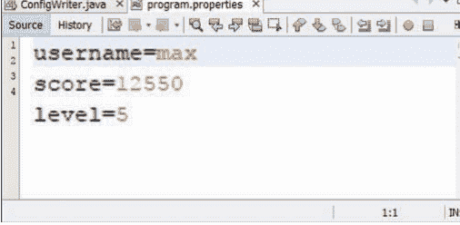

**图 20.3** 查找 `program.properties` 文件。

## 读取和写入配置属性

当 Java 程序可以使用命令行参数进行配置时，会更加灵活，正如你在之前的几个小时创建的几个应用程序中所演示的那样。`java.util` 包包含一个 `Properties` 类，它允许从另一个源（文本文件）加载配置设置。

该文件可以像 Java 中的其他文件一样被读取：

- 创建一个表示该文件的 `File` 对象。
- 从该 `File` 对象创建一个 `FileInputStream` 对象。
- 调用 `load()` 从该输入流中检索属性。

属性文件有一组属性名称，后面跟着一个等号 `=` 和它们对应的值。这里是一个示例：

```
username=lepton

lastCommand=open database

windowSize=32
```

每个属性独占一行，因此这设置了名为 `username`、`lastCommand` 和 `windowSize` 的属性，值分别为 "lepton"、"open database" 和 "32"。`Config` 应用程序使用了相同的格式。

以下代码加载了属性文件 `config.dat`：

```java
File configFile = new File("config.dat")

InputStream inputStream = new FileInputStream(configFile)

Properties config = new Properties();

config.load(inputStream);
```

配置设置（称为属性）以字符串的形式存储在 `Properties` 对象中。每个属性通过一个键（key）来标识。`getProperty()` 方法通过其键检索属性，如下句所示：

```java
String username = config.getProperty("username");
```

由于属性是以字符串形式存储的，你必须以某种方式将它们转换为数值，如下所示：

```java
String windowProp = config.getProperty("windowSize");

try {

    int windowSize = Integer.parseInt(windowProp);

} catch (NumberFormatException exception) {

    // do nothing

}
```

### 配置属性

可以通过调用 `setProperty()` 方法并传入两个参数——键和值来存储属性：

```java
config.setProperty("username", "max");
```

你可以通过 `Properties` 对象的 `list()` 方法显示所有属性。`OutputStream` 是你在书中一直在使用的类，它是 `System.out.println()` 和 `System.out.print()` 语句的基础。以下代码调用了 `list(System.out)`。

列表 20.4 `Configurator.java` 的全文

```java
1: package com.java24hours;

2:

3: import java.io.*;

4: import java.util.*;

5:

6: public class Configurator {

7:

8:     public Configurator() {

9:

10:        try {

11:             // load file

12:             File configFile = new File("program.properties");

13:             FileInputStream inputStream = new FileInputStream(configFile);

14:             Properties config = new Properties();

15:             config.load(inputStream);

16:             // create a new property

17:             Date current = new Date();

18:             config.setProperty("runtime", current.toString());

19:             // save the properties file

20:             FileOutputStream outStream = new FileOutputStream(configFile);

21:             config.store(outStream, "Properties settings");

22:             inputStream.close();

23:             config.list(System.out);

24:        } catch (IOException ie) {

25:            System.out.println("IO error " + ie.getMessage());

26:        }

27:     }

28: 

29:     public static void main(String[] arguments) {

30:         new Configurator();

31:     }

32: }
```

### 输出

```
-- listing properties --

runtime=Tue Jun 06 15:43\ EDT 2017

score=12550

username=max

level=5
```


反斜杠字符 `\` 的格式与应用程序的输出不同，这确保了属性文件被正确存储。

### 总结

在这一小时中，你处理了写入字节的输入流和输出流，这是在流中表示数据最简单的方法。

`java.io` 包中还有许多类可以以其他方式处理流。
还有一个名为 `java.net` 的类包，它允许你通过 Internet 连接读取和写入流。

字节流可以适应许多用途，因为你可以轻松地将字节转换为其他数据类型，例如整数、字符和字符串。

这一小时的第一个项目 `IDReader` 应用程序从流中读取字节并将其转换为字符串，以便按这种格式读取（如来自《Eccentric Soul》专辑、由 Marion Black 演唱的《Come On and Get It》歌曲的 ID3 数据。

我提到过你应该买下这首歌吗？

### 工作坊

### 问答

- Q. 为什么这一小时中的某些字节流方法使用整数作为参数？
  它们应该使用字节参数吗？

- A. 流中的字节与 `byte` 类表示的字节之间存在差异。Java 中的一个 `byte` 取值范围从 -128 到 127，而流中的一个 `byte` 取值是从 0 到 255。由于这个原因，在处理字节时通常需要使用 `int`——它可以持有 128 到 255 之间的值，而 `byte` 不能。

- Q. 什么是 Mumblety-Peg？

- A. 这是一种孩子们用折叠刀玩的校园游戏。

306 第 20 小时：文件的读取与写入

在最简单的形式中，玩家站立并向自己的脚下投刀。刀落离脚越近的人获胜。其他版本涉及互相投刀，这样对手必须伸出一脚去够刀落的位置。伸得太远并倒下的玩家输了。

这个名字源于一项规则：胜者可以用刀三击将木钉敲入地面。失败者必须“含着嚼木钉”，仅用牙齿将其拔出。

这个游戏在 20 世纪初失去了流行，当时世界共同意识到，孩子们互相投刀可能不是世界上最棒的主意。

### 测验

为了看看你是否在这一小时中从知识之树上获得了一个巨大的“字节”，请回答以下关于 Java 流的问题。

- 1. 下列哪种技术可以将字节数组转换为字符串？
   A. 调用数组的 `toString()` 方法。
   B. 将每个字节转换为字符并将每个字符赋值给 String 数组中的元素。
   C. 以数组作为参数调用 `String` 构造函数。

- 2. Java 程序中用哪种流从文件中读取内容？
   A. 输入流 (input stream)
   B. 输出流 (output stream)
   C. 均可

- 3. `File` 类的哪个方法可以确定文件的大小？
   A. `getSize()`
   B. `read()`
   C. `length()`

### 答案

- 1. 你可以像答案 B 建议的那样处理每个字节，但你可以轻松从其他数据类型创建字符串。

- 2. A. 通过向输入流的构造函数提供文件名，从 `File` 对象创建输入流。

- 3. C. 该方法返回一个 `long` 类型，表示流中的字节数。

## 活动

为了体验穿过另一个流的清爽感，请通过以下活动进行尝试：

- 编写一个应用程序，读取文件夹中所有 MP3 文件的 ID3 标签，并使用艺术家、歌曲和专辑信息重命名文件（当提供信息时）。
- 编写一个程序，读取 Java 源文件并在无任何更改的情况下以新名称写回。
- 买一张 Marion Black 演唱的歌曲《Come On and Get It》。

要查看实现这些活动的 Java 程序，请访问书籍网站 www.java24hours.com。

# 使用 Java 9 的新 HTTP Client

这一小时的待办事项列表：

- 向 Java 项目添加一个模块。
- 创建一个 HTTP 浏览器对象。
- 向 Web 服务器发送 GET 请求。
- 从网络请求中接收数据。
- 从网络下载图像文件。
- 向 Web 服务器发送数据。

尽管 Web 服务器最初是为了展示网站，但自从万维网早期以来，它们已经远远超过了浏览器。与 HTTP 通信的能力已被许多软件利用，包括 RSS 阅读器、Web 服务、软件升级程序和操作系统。

Java 9 引入了 HTTP 库，使得在网络上发送和接收数据变得更简单、更快更可靠。该库没有自动包含在 Java 类库中。相反，它是通过新语言发布的期待功能添加的。在这一小时中，你将学习模块以及通过 HTTP 进行连接。

### Java 模块

当 Java 程序发布时，它们与程序使用的类一起成 Java 归档 (JAR) 文件。该 JAR 文件和项目所需的其他 JAR 文件都放在 Java 虚拟机 (JVM) 运行程序时访问的类路径 (Classpath) 上。

该处理程序还有一个 `asFile(Path)` 方法可以以文件形式返回响应，以及一个 `asByteArray()` 方法将其作为 `byte[]` 返回。

每个 HTTP 请求都包含头部信息，提供了关于响应和发送它的服务器的更多信息。这些头部中的一个 `Server` 包含了运行服务器的软件名称和版本号。出于安全考虑，某些服务器会省略版本号。

响应的 `headers(String)` 方法将头信息作为 `HttpHeaders` 对象返回。对象的 `firstValue(String)` 方法使用头部名称进行调用，以返回与该名称匹配的第一个头部。以下是实现此操作的代码：

```
HttpHeaders headers = response.headers();

Optional<String> server = headers.firstValue("Server");
```

调用 `firstValue()` 返回的对象是来自 `java.util` 包的一个数据结构，它使得处理值不存在时具有 `null` 值的情况变得更容易。使用带有 `null` 值的对象会导致 `NullPointerException`，这是最常见的异常之一。

`Optional` 类通过 `isPresent()` 方法防止了这种问题，当存在有效值时它返回 `true`，否则返回 `false`。

`server` 的值是一个字符串，如语句中 `Optional<String>` 部分的泛型所示。可以通过如下方式显示此字符串并避免 `null` 相关的问题：

```
if (server.isPresent()) {

    System.out.println("Server: " + server.get());

}
```

将这些技术付诸实践，“ServerCheck` 应用请求六家公司的文本首页，并报告它们使用的服务器软件。

在 NetBeans 中，在 `com.java24hours` 包中创建一个名为 `ServerCheck` 的新 java 文件。将代码列表 21.1 输入源代码编辑器中。

### 列表 21.1 ServerCheck.java 的完整文本

```
1: package com.java24hours;
2:
3: import java.io.*;
4: import java.net.*;
5: import java.util.*;
6: import jdk.incubator.http.*;
7:
8: public class ServerCheck {
9:     public ServerCheck() {
10:        String[] sites = {
11:            "https://www.apple.com",
12:            "https://www.microsoft.com",
13:            "http://www.compaq.com",
14:            "http://www.hp.com",
15:            "https://www.oracle.com",
16:            "http://www.informit.com/",
17:        };
18:        try {
19:            load(sites);
20:        } catch (URISyntaxException oops) {
21:            System.out.println("Bad URI: " + oops.getMessage());
22:        } catch (IOException | InterruptedException oops) {
23:            System.out.println("Error: " + oops.getMessage());
24:        }
25:    }
26:
27:    public void load(String[] sites) throws URISyntaxException, IOException,
28:    InterruptedException {
29:
30:        for (String site : sites) {
31:            System.out.println("\nSite: " + site);
32:            // create the web client
33:            HttpClient bob = HttpClient.newHttpClient();
34:            // build a request for a website
35:            URI uri = new URI(site);
36:            HttpRequest.Builder builder = HttpRequest.newBuilder(uri);
37:            HttpRequest request = builder.build();
38:            // execute the request
39:            HttpResponse<String> response = bob.send(request,
40:                HttpResponse.BodyHandlers.ofString());
41:            // look for a server header
42:            HttpHeaders headers = response.headers();
43:            Optional<String> server = headers.firstValue("Server");
44:            if (server.isPresent()) {
45:                System.out.println("Server: " + server.get());
46:            } else {
47:                System.out.println("Server unidentified");
48:            }
49:        }
50:
51:    public static void main(String[] arguments) {
52:        new ServerCheck();
53:    }
54: }
```

保存你的工作并运行应用程序，以产生图 21.1 所示的输出。

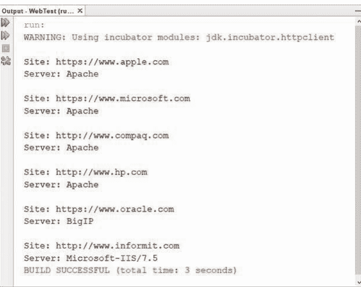

图 21.1

使用 HTTP 客户端请求服务器头部。

就像你在上一小时处理的“读取和写入文件”中的输入和输出类一样，这些 HTTP 类的方法必须处理数据传输中的错误。它们从 `java.io` 包引入了 `IOException` 和 `InterruptedException` 异常。

`ServerCheck` 应用有一个 `load()` 方法，它执行了从 Web 服务器请求六个首页并获取响应的所有 HTTP 任务。

可能发生的三个异常被放在构造函数的 `try-catch` 块中，在第 22 行使用了多类捕获。

### 从网络保存文件

通过 HTTP 获取的数据不仅限于网页等文本文件。任何类型的数据都可以作为字节访问，包括图像、视频和可执行文件。

本小时的下一个项目使用新的 HTTP Client 库从作者的博客下载图像并将其保存到你的计算机上。

`ImageDownloader` 应用遵循与前面的示例相同的步骤，直到发送请求为止。创建一个浏览器，创建一个请求构建器，创建一个请求。

在发送请求之前，必须完成一些工作。创建一个文件来持有响应的内容。

```
Path temp = Files.createTempFile("lighthouse", ".jpg");
```

在 NetBeans 中，在 `com.java24hours` 包中创建一个 `ImageDownloader.java`，用代码列表 21.2 填充它。

### 列表 21.2 ImageDownloader.java 的完整文本

```
1: package com.java24hours;
2:
3: import java.io.*;
4: import java.net.*;
5: import java.nio.file.*;
6: import jdk.incubator.http.*;
7:
8: public class ImageDownloader {
9:     public ImageDownloader() {
10:         String uri = "http://caden.org/media/lighthouse.jpg";
11:         try {
12:             load(uri);
13:         } catch (URISyntaxException oops) {
14:             System.out.println("Bad URI: " + oops.getMessage());
15:         } catch (IOException | InterruptedException oops) {
16:             System.out.println("Error: " + oops.getMessage());
17:         }
18:     }
19:
20:     public void load(String imageUri) throws URISyntaxException, IOException,
21:     InterruptedException {
22:
23:         // create the web client
24:         HttpClient browser = HttpClient.newHttpClient();
25:         // build a request for the image
26:         URI uri = new URI(imageUri);
27:         HttpRequest.Builder builder = HttpRequest.newBuilder(uri);
28:         HttpRequest request = builder.build();
29:         // create a file to hold the image data
30:         Path temp = Files.createTempFile("lighthouse", ".jpg");
31:         // execute the request and retrieve the data
32:         HttpResponse response = browser.send(request,
33:             HttpResponse.BodyHandlers.asFile(temp));
34:         System.out.println("Image saved to "
35:             + temp.toFile().getAbsolutePath());
36:         // save the file permanently
37:         File perm = new File("lighthouse.jpg");
38:         temp.toFile().renameTo(perm);
39:         System.out.println("Image moved to " + perm.getAbsolutePath());
40:     }
41:
42:     public static void main(String[] arguments) {
43:         new ImageDownloader();
44:     }
45: }
```

当 `ImageDownloader` 运行时，`lighthouse.jpg` 文件出现在项目的主文件夹中。点击 `Files` 标签页将其带到前（这在 NetBeans 中与 `Projects` 相同部分）。双击该文件在主面板中打开它，如图 21.2 所示。

程序在第 34–35 行和第 39 行显示了临时和永久图像文件的位置。


图 21.2

从网络下载图像文件。

### 在网络上发布数据

到目前为止，这一小时的重点是使用 HTTP 从网络获取内容。现在是时候向服务器传回一些内容了。最后一个项目是 `SalutonVerkisto`，这是一个 Java 程序，用于通过 POST 请求向作者的 Web 服务器发送消息。

POST 请求可以编码大量数据供服务器接收，例如网络博客文章，甚至是图像或视频文件。GET 请求也可以向服务器携带信息，但它受限于 URI 中可以包含的内容。

该应用程序为我服务器上一个接收评论的脚本创建一个统一资源标识符（URI）：

```
String site = "http://bench.cadenhead.org/post-a-comment.php";
URI uri = new URI(site);
```

两个字符串 `yourName` 和 `yourMessage` 包含了要发送的名称和评论：

```
String yourName = "Sam Snett of Indianapolis";
String yourMessage = "Your book is pretty good, if I do say so myself.";
```

这些信息将通过 HTTP 请求发送到 Web 服务器，就像之前的项目一样。在发送评论之前，它将使用 `HttpRequest.BodyProcessor` 类的一个方法进行编码。

该类有一个 `fromString()` 方法，接收一个长字符串中由 `&` 字符分隔的一组键值对：


```java
HttpRequest proc = HttpRequest.BodyProcessor.fromString(
  "name" = URLEncoder.encode(yourName, "UTF-8") +
  "&comment" = URLEncoder.encode(yourMessage, "UTF-8") +
  "&mode" = URLEncoder.encode("demo", "UTF-8")
);
```

`HttpRequest.BodyProcessor` 的 `encode(String, String)` 方法接收两个参数：消息和要使用的字符编码。适当的编码取决于 Web 服务器能接受什么。我服务器上的脚本可以接受 UTF-8，因此使用了该编码。

该方法调用了三个键值对：`name`、`comment` 和 `mode`。前两个是来自 `yourName` 和 `yourMessage` 的值。第三个 `mode` 的值为 "demo"，它让服务器脚本知道消息的目的。（这也有助于那些可能向脚本发送垃圾消息的垃圾邮件者。）

处理过的 `proc` 可以通过调用 `newBuilder(URI)` 方法后跟更多调用来创建一个请求构建器。

当代码显示时，这就有意义：

```java
HttpRequest.Builder builder = HttpRequest.newBuilder(uri)
  .header("Content-Type", "application/x-www-form-urlencoded")
  .header("Accept", "text/plain")
  .POST(proc);
```

此方法将四个调用堆叠在一起。因为每个都是对 `HttpRequest.Builder` 的调用，并返回主体对象。以下是它们按顺序完成的任务：

1. `newBuilder(URI)` 为该地址创建一个构建器。
2. `header(String, String)` 将请求头 `Content-Type` 设置为值 "application/x-www-form-urlencoded"。这告诉服务器正在发送一个 Web 表单。
3. 另一个 `header()` 调用将 `Accept` 设置为“text/plain”，即请求的 MIME 类型。
4. `POST(HttpRequest.BodyProcessor)` 将编码后的消息格式化为 HTTP POST 请求。

现在构建器已经准备好了，可以构建请求了。

```java
HttpRequest request = builder.build();
```

请求通过浏览器的 `send(HttpRequest, HttpResponse.BodyHandler)` 调用发送，带上请求和一个将响应获取为字符串的处理器：

```java
HttpResponse<String> response = client.send(request,
  HttpResponse.BodyHandler.asString());
System.out.println(response.body());
```

相同的技术也用在 ServerCheck 应用程序中，但这次显示了响应。

在 `com.java24hours` 包中创建一个空的 Java 文件作为 SalutonVerkisto 应用程序，输入列表 21.3 中的条目。

### 列表 21.3 SalutonVerkisto.java 的全文

```java
1: package com.java24hours;
2:
3: import java.io.*;
4: import java.net.*;
5: import jdk.incubator.http.*;
6:
7: public class SalutonVerkisto {
8:
9:     public SalutonVerkisto() {
10:        String site = "http://workbench.cadenhead.org/post-a-comment.php";
11:
12:        try {
13:            postMessage(site);
14:        } catch (URISyntaxException oops) {
15:            System.out.println("Bad URI: " + oops.getMessage());
16:        } catch (IOException | InterruptedException oops) {
17:            System.out.println("Error: " + oops.getMessage());
18:        }
19:    }
20:
21:    public void postMessage(String server) throws IOException,
22:        URISyntaxException, InterruptedException {
23:
24:        HttpClient client = HttpClient.newHttpClient();
25:
26:        // address of the server
27:        URI uri = new URI(server);
28:
29:        // set up the message
30:        String yourName = "Sam Snett of Indianapolis";
31:        String yourMessage = "Your book is pretty good, if I do so myself.";
32:
33:        // encode the message
34:        HttpRequest.BodyProcessor proc = HttpRequest.BodyProcessor.fromString(
35:          "name" = URLEncoder.encode(yourName, "UTF-8") +
36:          "&comment" = URLEncoder.encode(yourMessage, "UTF-8") +
37:          "&mode" = URLEncoder.encode("demo", "UTF-8"));
38:
39:        // prepare the request
40:        HttpRequest.Builder builder = HttpRequest.newBuilder(uri)
41:          .header("Content-Type", "application/x-www-form-urlencoded")
42:          .header("Accept", "text/plain")
43:          .POST(proc);
44:
45:        // finish the request
46:        HttpRequest request = builder.build();
47:
48:        // get the response from the server
49:        System.out.println("Method: " + request.method() + "\n");
50:        HttpResponse<String> response = client.send(request,
51:          HttpResponse.BodyHandler.asString());
52:        System.out.println(response.body());
53:    }
54:
55:    public static void main(String[] args) {
56:        new SalutonVerkisto();
57:    }
58:}
```

## 活动

为了进一步学习本节关于 Web 编程的知识，请完成以下活动：

- 在 ServerCheck 程序中再添加五个科技公司的主页。
- 编写一个程序，使用 HTTP 响应的 `Content-Type` 和 `Content-Encoding` 头部来报告服务器所采用的 MIME 类型和字符编码。

如需查看实现这些活动的 Java 程序，请访问书籍的网站 www.java24hours.com。

# 第 22 小节

## 创建 Java2D 图形

### 本小节的任务列表

- 设置文本的字体和颜色。
- 设置容器的背景颜色。
- 绘制线条、矩形和其他形状。
- 绘制 GIF 和 JPEG 图形。
- 绘制填充和未填充（空心）的形状。

在本小节中，你将学习如何将容器——即存放图形用户界面（GUI）组件的普通灰色面板和框架——变成一个艺术画布，你可以在上面绘制各种字体、颜色、形状和图形。

### 使用 Font 类

Java 通过 `java.awt` 包中的 `Color` 和 `Font` 类来表示颜色和字体。通过这些类，你可以用不同的字体和大小展示文本，并更改文本和图形的颜色。字体使用 `Font(String, int, int)` 构造器创建，该构造器接受三个参数：

- 字体类型，可以是通用名称（“Dialog”、“DialogInput”、“Monospaced”、“SanSerif”或“Serif”）或实际字体名称（“Arial Black”、“Helvetica”或“Courier New”）
- 样式，取自三个类变量之一：`Font.BOLD`、`Font.ITALIC` 或 `Font.PLAIN`
- 以磅（points）为单位字体字体

以下语句创建了一个 12 点的 Serif 字体：

```java
Font current = new Font("Serif", Font.ITALIC, 12);
```

如果你使用特定字体而不是通用字体之一，则该字体必须在运行你程序的用户的计算机上已经安装。

你可以通过将新样式相加来组合这些样式，如下例所示：

当你拥有一个字体时，调用 `Graphics2D` 组件的 `setFont(Font)` 方法将其指定为当前字体。所有随后的绘制操作都将使用该字体，直到设置了另一个字体为止。以下代码创建了一个“Comic Sans”字体，并在绘制文本之前将其指定为当前字体：

```java
public void paintComponent(Graphics comp) {
    Graphics2D comp2D = (Graphics2D) comp;
    Font font = new Font("Comic Sans", Font.BOLD, 15);
    comp2D.setFont(font);
    comp2D.drawString("Potrebeie", 5, 50);
}
```

Java 支持抗锯齿，使字体看起来更加流畅、不那么块状。要启用此功能，你需要一个渲染提示（rendering hint）。`Graphics2D` 对象有一个 `setRenderingHint(int, int)` 方法，它接受两个参数：

- 渲染提示的键
- 与该键关联的值

这些值是 `java.awt` 类中的变量。要激活抗锯齿，调用带有两个参数的 `setRenderingHint()`：

```java
comp2D.setRenderingHint(RenderingHints.KEY_ANTIALIASING,
RenderingHints.VALUE_ANTIALIAS_ON);
```

这里的 `comp2D` 对象表示容器绘制环境的 `Graphics2D` 对象。

### 使用 Color 类

Java 中的颜色由 `Color` 类表示，该类包含以下常量作为类变量：`black`、`blue`、`cyan`、`darkGray`、`gray`、`green`、`lightGray`、`magenta`、`orange`、`pink`、`red`、`white` 和 `yellow`。

在容器中，你可以通过像这样调用 `setBackground(Color.orange)` 方法使用这些常量来设置组件的背景颜色：

```java
setBackground(Color.orange);
```

当前颜色（与当前字体一样）在绘制发生之前必须使用以下方法进行设置，该方法包含一条将当前颜色设置为蓝色并用该颜色绘制文本的语句：

```java
public void paintComponent(Graphics comp) {
    Graphics2D comp2D = (Graphics2D) comp;
    comp2D.setColor(Color.blue);
    comp2D.drawString("Go, Owls!", 5, 50);
}
```

与可以直接在容器上调用的 `setBackground()` 方法不同，你必须在 `Graphics2D` 对象上调用 `setColor()` 方法。

### 创建自定义颜色

你可以通过指定红、绿、蓝（RGB）值在 Java 中创建自定义颜色。RGB 通过颜色中红色、绿色和蓝色的量来定义颜色。每个值的范围从 0（无）到 255（最大量）。

`Color(int, int, int)` 构造器接受代表红、绿、蓝值的参数。以下代码绘制了一个面板，在青色（0, 101, 118）背景上显示文本（159, 121, 44）：

```java
import java.awt.*;
import javax.swing.*;

public class Jacksonville extends JPanel {
    Color gold = new Color(159, 121, 44);
    Color teal = new Color(0, 101, 118);
    public void paintComponent(Graphics comp) {
        Graphics2D comp2D = (Graphics2D) comp;
        comp2D.setColor(teal);
        comp2D.fillRect(0, 0, 200, 100);
        comp2D.setColor(gold);
        comp2D.drawString("Go, Jaguars!", 5, 50);
    }
}
```

此示例调用 `fillRect()` 方法，在青色背景上绘制一个显示文本（159, 121, 44）的面板。

此矩形的左上角位于坐标 (10, 10) 处。第三和第四个参数指定了矩形的宽度和高度。在这种情况下，它的宽度应为 100 像素，高度为 80 像素。

`drawRoundRect()` 的最后两个参数指定四个角都从距离 (10, 10) 顶点 15 像素的地方开始圆角。

### 绘制椭圆和圆

你可以使用同一个类 `Ellipse2D.Float` 创建椭圆和圆，它接受四个参数：

- 椭圆的 x 坐标
- 椭圆的 y 坐标
- 它的宽度
- 它的高度

(x, y) 坐标并不像你预期的那样表示椭圆或圆的中心点。相反，(x, y) 坐标、宽度和高度描述了一个椭圆嵌入其中的隐形矩形。(x, y) 坐标是该矩形的左上角。如果它的宽度和高度相同，则该椭圆是一个圆。

以下语句在 (245, 45) 坐标处的矩形内部创建了一个宽度和高度均为 5 像素的圆：

```java
Ellipse2D.Float cir = new Ellipse2D.Float(
    245F, 45F, 5F, 5F);
```

### 绘制弧

在 Java 中可以绘制的另一种圆形形状是弧，即部分椭圆或圆。弧使用 `Arc2D.Float` 类创建，该类有一个包含许多参数的构造函数。你通过指定一个角度、应显示的椭圆部分（以度为单位）以及弧在椭圆上的起始位置来绘制弧。

要创建一个弧，请向构造函数指定以下整数参数：

- 椭圆所嵌入的隐形矩形的 x 坐标
- 矩形的 y 坐标
- 矩形的宽度
- 矩形的高度
- 弧在椭圆上的起始点（从 0 到 359 度）
- 弧的大小（同样以度为单位）
- 弧的类型

弧的起始点和大小从 0 到 359 度，按逆时针方向排列，从 3 点钟位置的 0 度开始，如图 22.1 所示。

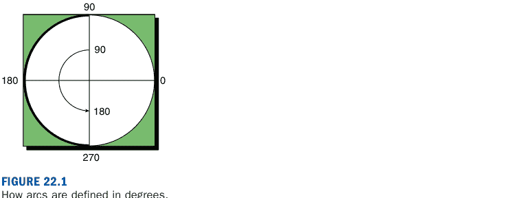

弧的类型使用类变量指定：`PIE` 用于饼图块，`CLOSED` 如果端点用直线连接，`OPEN` 如果端点不应连接。

以下语句在 (100, 50) 处绘制了一个长度为 120 度、从 30 度标记开始、宽度为 65 且为 75 的弧：

```java
Arc2D.Float smile = new Arc2D.Float(100F, 50F, 65F, 75F,
30F, 120F, Arc2D.Float.OPEN);
```

### 制作饼图

为了绘制这个时钟，你得创建一个 `PiePanel`，这是一个显示饼图的 GUI 组件。该组件是 `JPanel` 的子类，`JPanel` 是一个简单的容器，适用于绘制内容。

开始创建一个类的方法是定义该类对象创建的方式。使用 `PiePanel` 类的程序必须执行以下步骤：

- 使用构造方法 `PiePanel(int)` 创建 `PiePanel` 对象。作为参数指定的整数是饼图包含的扇区数量。
- 调用对象的 `addSlice(Color, float)` 方法，为扇区赋予指定的颜色和值。

`PiePanel` 中每个扇区的值是该扇区所代表的数值。

例如，根据高等等教育办公室的统计，表 22.1 显示了程序运行前 38 年美国学生贷款还款状态的数据。

### 表 22.1 美国学生贷款还款

| 学生偿还的金额 | 1010 亿美元 |
| :--- | :--- |
| 给予在校学生的贷款金额 | 680 亿美元 |
| 给予正在还款学生的贷款金额 | 910 亿美元 |


| 给予违约学生的贷款金额 | 250 亿美元 |

你可以使用以下语句通过 `PiePanel` 在饼图中表示这些数据：

```java
PiePanel loans = new PiePanel(4);
loans.addSlice(Color.green, 101F);
loans.addSlice(Color.yellow, 68F);
loans.addSlice(Color.blue, 91F);
loans.addSlice(Color.red, 25F);
```

图 22.2 显示了包含一个组件的应用程序框架中的结果：该组件是用学生贷款数据创建的 `PiePanel`。

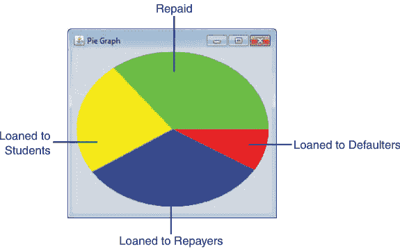

图 22.2 在饼图上显示学生贷款数据。

当创建 `PiePanel` 对象时，扇区的数量在构造函数中指定。绘制每个扇区时你还需要知道三件事：

- 扇区的颜色，由 `Color` 表示
- 每个扇区代表的值
- 所有扇区的总值

使用一个新的辅助类 `PieSlice` 来表示图中的每个扇区：

```java
import java.awt.*;

class PieSlice {
    // 此处省略原文中乱码部分的逻辑实现
}
```

# 第 336 页 第 22 小时：创建 Java2D 图形

```java
53:   comp2D.fill(drawSlice);
54:  }
55:  }
56: }
57: 
58: class PieSlice {
59:     Color color = Color.lightGray;
60:     float size = 0;
61:
62:     PieSlice(Color pColor, float pSize) {
63:         color = pColor;
64:         size = pSize;
65:     }
66: }
```

列表 22.1 在第 1–56 行定义了 `PiePanel` 类，并在 58–66 行定义了 `PieSlice` 辅助类。`PiePanel` 类可以作为任何 Java 程序 GUI 中的组件。要创建 `PiePanel`，你需要创建一个使用它的类。

列表 22.2 包含一个使用这些面板的应用程序 `PieFrame`。在 `com.java24hours` 包中创建一个空的 Java 文件，并输入列表中的源代码。

### 列表 22.2 PieFrame.java 的完整文本

```java
1:   package com.java24hours;
2:
3:   import javax.swing.*;
4:   import java.awt.*;
5:
6:   public class PieFrame extends JFrame {
7:       Color uneasyBeingGreen = new Color(0xCC, 0xCC, 0x99);
8:       Color zusPetPetals = new Color(0xCC, 0x66, 0xFF);
9:       Color cootsuit = new Color(0x66, 0x66, 0x99);
10:      Color sweetAvocado = new Color(0x66, 0x99, 0x66);
11:      Color shrinkingViolet = new Color(0xCC, 0x66, 0xFF);
12:      Color mianimic = new Color(0x33, 0xFF, 0xFF);
13:      Color inGreen = new Color(0x00, 0x99, 0x66);
14:      Color norwegianBlue = new Color(0x33, 0xCC, 0xCC);
15:      Color purpleRain = new Color(0x66, 0x33, 0x99);
16:      Color freckle = new Color(0x09, 0x66, 0x33);
17:
18:      public PieFrame() {
19:          super("Pie Graph");
20:          setLookAndFeel(null);
21:          setSize(320, 290);
22:          setDefaultCloseOperation(JFrame.EXIT_ON_CLOSE);
23:          setVisible(true);
24:      }
25:      PiePanel pie = new PiePanel(10);
26:      pie.addSlice(uneasyBeingGreen, 1350);
27:      pie.addSlice(zuzusPetals, 1221);
28:      pie.addSlice(zootSuit, 316);
29:      pie.addSlice(sweetHomeAvocado, 251);
30:      pie.addSlice(shrinkingViolet, 201);
31:      pie.addSlice(miamiNice, 193);
32:      pie.addSlice(inBetweenGreen, 173);
33:      pie.addSlice(norwegianBlue, 164);
34:      pie.addSlice(purpleRain, 143);
35:      pie.addSlice(freckle, 127);
36:      add(pie);
37:  }
38:
39:      private void setLookAndFeel() {
40:          try {
41:              UIManager.setLookAndFeel(
42:                  "com.sun.java.swing.plaf.NimbusLookAndFeel"
43:              );
44:          } catch (Exception exc) {
45:              // ignore error
46:          }
47:      }
48:
49:      public static void main(String[] arguments) {
50:          PieFrame pf = new PieFrame();
51:      }
52:  }
```

`PieFrame` 类是一个简单的图形用户界面，它包含一个组件：在第 25 行创建的 `PiePanel` 对象。该对象的 `addSlice()` 方法在第 26-35 行被调用了 10 次，用于向饼图添加切片。

当你运行该应用程序时，`PieFrame` 会显示一个饼图，显示 10 个最流行国家口（单位：百万），数据来自 2017 年 6 月的美国人口普查国际数据库报告。按顺序依次为：中国（13.9亿）、印度（12.8亿）、美国（3.27亿）、印度尼西亚（2.61亿）、巴西（2.07亿）、巴基斯坦（2.05亿）、尼日利亚（1.91亿）、孟加拉（1.58亿）、俄罗斯（1.42亿）和日本（1.26亿）。

由于 Java 的 `Color` 类只定义了几种颜色，因此在这里创建了十种新颜色并赋予了它们描述性的名称。这些颜色以十六进制值表示——在 Java 中，十六进制字面量以 `0x` 开头——它们也可以在每个 `Color()` 构造函数中使用十进制值指定。

图 22.3 显示了该应用程序的运行。


**图 22.3** 在饼图中显示人口数据。

> **注意**
>
> 你可以通过访问 www.cadenhead.org/census 获取当前的美国普查数据，该网站会重定向到 www.census.gov 的页面，你可以在那里请求各国的人口报告。

### 总结

通过使用字体、颜色和图形，你可以让用户更关注程序的元素，并使其对用户更具吸引力。

使用 Java 提供的形状进行绘制可能看起来得不划算。然而，用多边形描绘图形与从图像文件加载的图形相比有两个优势：

- 速度——即使是像图标这样小的图形，其加载和显示时间也会比一系列多边形长。
- 缩放——多边形可以缩放到任何大小而不会损失质量，而位图图像会变得像素化。

### 工作坊

#### 问答

- **问**：如何绘制逆时针方向的弧？
- **答**：可以通过在 `drawArc()` 方法中指定负角度来实现。

- **问**：RGB 缩写代表什么？
- **答**：红（Red）、绿（Green）、蓝（Blue）。

#### 测验

1. 以下哪个不是颜色常量？
   - A. `Color.cyan`
   - B. `Color.purple`
   - C. `Color.magenta`

2. 当你在容器上更改颜色并重绘时，你需要做什么？
   - A. 使用 `drawColor` 方法。
   - B. 使用 `repaint` 方法。
   - C. 什么都不做。

3. 用于绘制椭圆的类名是什么？
   - A. `Oval`
   - B. `Ellipse2D`
   - C. `Circle`

#### 答案

1. 奥兰多城的颜色是紫色。
2. 调用 `repaint()` 会手动调用 `paintComponent()`。
3. `Ellipse2D`。

## 活动

为了进一步探索使用字体和颜色的可能性，请完成以下活动：

- 创建 `PieFrame` 类的新版本，将颜色值和切片值作为命令行参数而不是包含在源代码中。
- 创建一个使用颜色和形状在面板上绘制停止标志的应用程序。

要查看这些活动的 Java 程序，请访问书籍网站 www.java24hours.com。

# 第 23 小时 使用 Java 创建 Minecraft 插件

本小时的任务清单：

- 在你的电脑上安装 Minecraft 服务器。
- 编写一个启动服务器的脚本。
- 为插件开发设置 NetBeans。
- 创建一个插件框架。
- 设计一个生成生物的插件。
- 让一个生物成为另一个的骑手。
- 找到游戏中的所有生物并攻击。
- 编写一个从世界中挖掘巨大缺口的插件。

### 设置 Minecraft 服务器

开发模组需要访问 Minecraft 服务器。当你刚开始担任模组开发者时，实现此点的最佳方法是在你自己的计算机上安装并运行服务器。由于目前还没有标准方法可以向游戏添加模组，不同的服务器有不同的方法来实现这一点。

在创建模组时，最易使用的工具来自 Spigot Project，这是一个专门为该目的设计的 Minecraft 服务器和 Java 类库。Spigot 是免费的，可以从网站 www.javamincraft.com/spigot 下载。寻找 `spigotserver.jar`。

此文件包含了封装为 JAR 文件格式的 Minecraft 服务器和类库。

Spigot API 是一组在创建模组时将用到的 Java 程序包。

下载完成后，在你的电脑上创建一个新文件夹并将文件存储在其中。在我的 Windows 电脑上，我创建了 `c:\minecraft\server` 并将 JAR 文件复制到其中。

接下来，将 `spigotserver.jar` 复制到同一个文件夹中。这是你运行以启动 Minecraft 服务器所需的文件。

以下命令启动服务器：

```
java -Xms1024M -Xmx1024M -jar spigotserver.jar
```

该命令告诉 Java 虚拟机运行封装为 JAR 文件 `spigotserver.jar` 的应用程序，并为程序分配 1,024MB 的内存。

为了避免每次运行服务器时都输入此命令，你可以创建一个包含该命令的批处理文件或脚本文件，然后运行该文件。

在 Windows 上，使用记事本等文本编辑器，并将列表 23.1 中的文本输入到文件中，将其保存为 `start-server.bat`，存放在与 `spigotserver.jar` 相同的文件夹中。

### 列表 23.1 start-server.bat 的完整文本

```
1: java -Xms1024M -Xmx1024M -jar spigotserver.jar
2: pause
```

双击此文件以运行服务器。如果运行成功，将打开一个窗口显示服务器在启动时正在执行。

你将看到一条错误信息，“Failed to load eula.txt”，如图 23.1 所示。这是预料之中的。

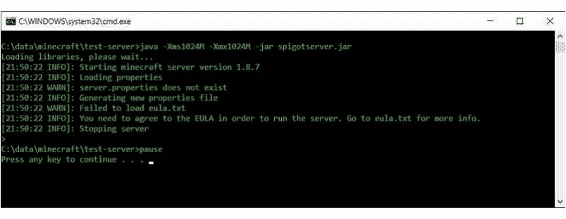

图 23.1 服务器未通过 EULA 检查。

Minecraft 有最终用户许可协议（EULA），在运行服务器之前必须接受它。访问此网页查看该协议：https://account.mojang.com/documents/minecraft.eula。

在与服务器相同的文件夹中有一个名为 `eula.txt` 的新文件。该文件有一行包含以下文本的内容：

```
eula=false
```

如果你同意 EULA，请用编辑器打开该文件，将此行改为 `eula=true`，保存文件并再次运行服务器。

服务器第一次运行时，它会创建十几个以上的文件和子文件夹，并构建世界地图。如果执行成功，你将看到最终消息 `[Info] Done` 以及 `>` 提示符旁边闪烁的光标。

`help` 命令列出了你可以使用的、用以控制服务器和游戏世界的命令。`stop` 命令会关闭服务器（不要这样做！）

图 23.2 显示了正在运行的 Spigot 服务器。

在服务器运行时，必须保持此窗口打开。如果你的服务器窗口看起来像这样，你可以跳过下一节直接进入“连接到服务器”。

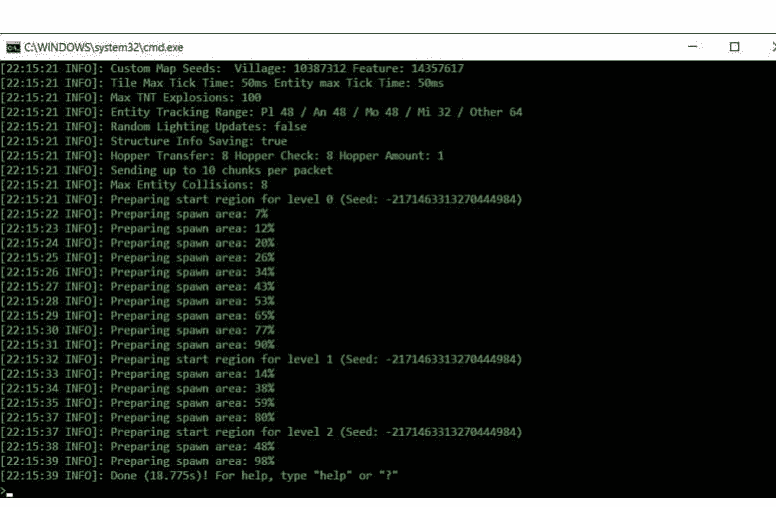

图 23.2 首次运行 Minecraft 服务器。

### 解决运行服务器的问题

在下载并安装服务器后，有两种常见错误会导致服务器无法成功运行。

第一个错误显示消息“Unable to access jar file spigot.jar”，如图 23.3 所示。

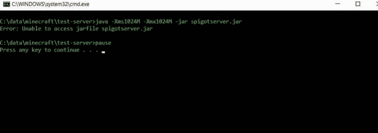

图 23.3 找不到 Spigot JAR 文件。

要解决此问题，请确保 `spigotserver.jar` 文件与你运行启动服务器的文件（`start-server.bat`）在同一个文件夹中。然后尝试重新启动服务器。

第二个错误显示消息“'java' is not recognized as an internal or external command”，如图 23.4 所示。

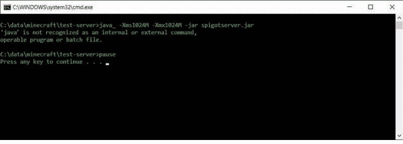

图 23.4 找不到 Java 虚拟机 (JVM)。

JVM 位于名为 `java.exe` 的文件中，该文件位于电脑上安装 Java 文件夹的 `bin` 子文件夹中。当 `java` 命令无法识别时，这意味着电脑不知道如何找到 `java.exe`。

在 Windows 系统上，可以通过向控制面板设置添加包含 `java.exe` 的文件夹名称来解决此问题。

1. 在开始菜单上搜索“控制面板”。
2. 选择“系统”，然后选择“高级系统设置”。
3. 点击“环境变量”。
4. 在“系统变量”面板中，向下滚动直到找到 `Path`，点击它并点击“编辑”。
5. 如果你看到“值”字段，将光标放在文本末尾。添加分号（`;`）后输入你的 bin 文件夹路径。
6. 如果你没有看到“值”字段，点击“新建”。输入你的 bin 文件夹路径。
7. 点击“确定”关闭所有对话框，然后关闭控制面板。

再次尝试运行服务器。如果仍然不起，你可能可以通过重新安装 JDK 来解决问题。访问 Oracle 网站 http://jdk.java.com 并查找下载部分，其中包含多个系统的 JDK 链接。

重新安装 JDK 后，重启电脑并尝试运行服务器。

### 连接到服务器

因为你想制作模组，你的电脑上应该有一个用于游戏的 Minecraft 客户端。如果没有，你可以从网站 www.minecraft.net 购买并下载。目前价格为 26.95 美元。游戏有 Windows、Mac、游戏机和移动设备版本，但模组编程需要 Windows 或 Mac 版本。

启动 Minecraft 并选择“多人游戏”。你应该能看到你的服务器作为选项之一（图 23.5）。

服务器名为“Minecraft Server”（你可以将其改为更酷的名字）。客户端将向服务器发送 ping 并返回速度，以绿色条的形式显示。

这些绿色条意味着你已准备好连接。如果你看到它们，选择服务器（点击它）并点击“加入服务器”按钮。你现在已经在自己的服务器上运行了一个新的 Minecraft 世界。进入“创建你的第一个模组”章节。

当客户端无法连接到服务器时，将显示一个红色的 X 而不是绿色连接条。下一节将描述如何调试此问题。

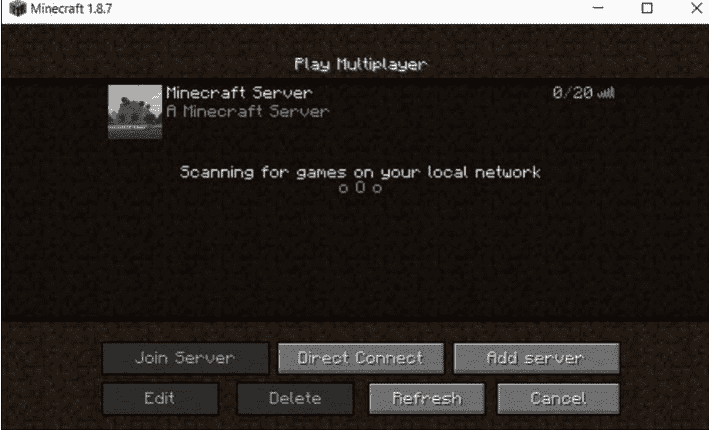

图 23.5 你的新 Minecraft 服务器已准备好连接。

### 解决服务器连接问题

有时 Minecraft 客户端在向服务器发送 ping 并获取响应时会遇到问题。这如图 23.6 所示的红色 X 所示。

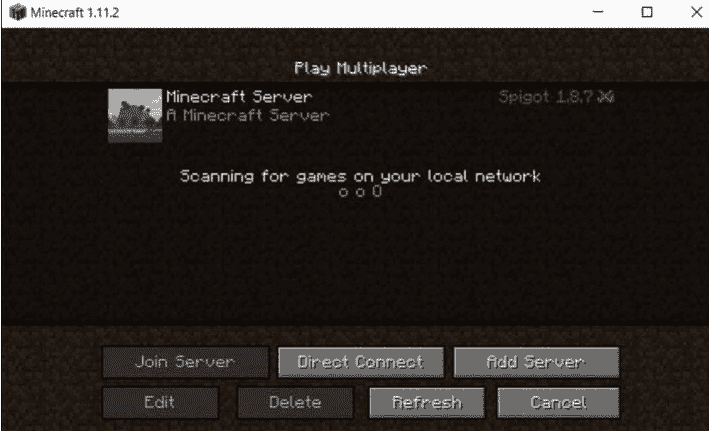

图 23.6 你的新 Minecraft 服务器存在连接问题。

出现此问题的常见原因是服务器运行的 Minecraft 版本与客户端不一致。在服务器窗口中，第一条消息指示了服务器运行的版本。它会显示“Starting Minecraft version 1.8.7.”

Minecraft 客户端通常运行最新版本。你可以编辑自己的配置文件来使用旧版本。请先完全退出 Minecraft 客户端。你需要重新加载它来更改此设置。


再次运行客户端并按照以下步骤在你的配置文件中选择不同的版本：

1. 在 Minecraft 启动器对话框中，点击“启动选项”按钮，然后点击“新建”。
2. 在“版本”下拉菜单中，选择“Release 1.8.7”。
3. 点击“保存”。
4. 点击“设置”。
5. 点击绿色“开始”按钮上的箭头，然后选择“Unnamed Configuration 1.8.7”。

点击“开始”，然后点击“多人游戏”。你应该能看到你的服务器显示为绿色连接条。

> **注意**
>
> 更改玩家配置文件会影响你使用的所有 Minecraft 服务器，包括你在不创建和测试 Mod 时所玩耍的服务器。当你不再连接到自己的 Spigot 服务器时，请务必将“开始”按钮上的配置改回当前版本（或者创建一个第二个配置文件，一个用于 Mod 开发，另一个用于玩游戏）。

## 创建你的第一个 Mod

现在你已经搭建好并运行了 Minecraft 的 Spigot 服务器，准备好开始为该服务器开发 Mod 了。

Mod 必须封装为 Java 归档文件，也称为 JAR 文件。本书全程使用的、由 Oracle 提供的免费集成开发环境 NetBeans，在每次构建项目时都会自动创建 JAR 文件。

当你写完 Mod 后，将其添加到服务器文件夹中名为 `plugins` 的子文件夹下。

本小时的第一个 Mod 是一个简单的示例，它展示了你为 Spigot 创建的每个 Mod 中都包含的框架。该 Mod 为游戏添加了 `/siamesecat` 命令，该命令会创建一个暹猫实体，将其加入世界，并让你（玩家）成为它的所有者。

### 创建 NetBeans 项目

每个 Mod 在 NetBeans 中都是一个独立的项目。要开始此项目，请遵循以下步骤：

1. 在 NetBeans 中，选择菜单命令 **File** > **New Project**。打开“新建项目”向导。
2. 在“类别”窗格中选择 **Java**，在“项目”窗格中选择 **Java Application**。点击“下一步”。
3. 在“项目名称”字段中，输入 `SiameseCat`（不要有空格，并按所示大写）。
4. 点击“项目文件夹”字段旁的“浏览”按钮。出现“选择项目位置”对话框。
5. 找到安装 Minecraft 服务器的文件夹。选择它并点击“打开”。该文件夹将出现在“项目位置”字段中。
6. 取消选“创建主类”框。
7. 点击“完成”。

`SiameseCat` 项目已创建，“项目”窗格中会出现两个文件夹：`Source Packages` 和 `Libraries`，如图 23.7 所示。

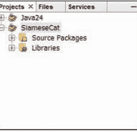

图 23.7

### 添加 Spigot 库

向 Java 项目添加库。

1. 在每个 Mod 项目中，在你开始编写 Java 代码之前，你必须添加一个 Java 类库：在“项目”窗格中，右键点击 `Libraries` 文件夹，并选择菜单命令“添加库”。打开“添加库”对话框。
2. 点击“创建”按钮。出现“创建新库”对话框。
3. 在“库名称”字段中输入 `Spigot` 并点击“确定”。打开“自定义库”对话框。
4. 点击“添加 JAR/文件夹”按钮。打开“浏览 JAR/文件夹”对话框。
5. 使用对话框找到并打开安装服务器的文件夹。
6. 点击 `spigotserver.jar` 以选择该文件。
7. 点击“添加 JAR/文件夹”。
8. 点击“确定”。

### 编写 Mod 代码

列表 23.2 中第 3–7 行的 `import` 语句为程序提供了五个包：一个来自 Java 类库，四个来自 Spigot。

> **注意**
>
> 这些类在程序中使用：来自 `java.util.logging.Logger` 的 `Logger`，来自 `org.bukkit` 的 `Location` 和 `World`，来自 `org.bukkit.command` 的 `Command`，来自 `org.bukkit.entity` 的 `Ocelot` 和 `Player`，以及来自 `org.bukkit.plugin.java` 的 `JavaPlugin`。
>
> 你将在后面了解更多关于这些包的内容。

第 31 和 34 行的 `return` 语句是标准 Mod 框架的一部分。当 Mod 处理用户命令时，你的 Mod 应该在 `onCommand()` 方法内部返回值 `true`，否则返回 `false`。

```java
32:     }
33:     }
34:     return false;
35: }
36: }
```

### 创建 plugin.yml

你已经创建了你的第一个 Mod，但 Spigot 还没有运行它。它需要一个名为 `plugin.yml` 的文件来告诉 Minecraft 服务器关于该 Mod 的信息。

该文件是一个文本文件，你也可以使用 NetBeans 通过以下步骤创建它：

1. 选择 **File** > **New File**。打开新建对话框。
2. 在 **Categories** 面板中，选择 **Other**。
3. 在 **File Types** 面板中，选择 **Empty File** 并点击 **Next**。
4. 在 **File Name** 字段中，输入 `plugin.yml`。
5. 在 **Folder** 字段中，输入 `src`。
6. 点击 **Finish**。

源代码编辑器将打开一个名为 `plugin.yml` 的空白文件。将列表 23.3 的文本输入到文件中，并确保每行都使用相同数量的空格。不要用 Tab 代替空格。

#### 列表 23.3 此项目 plugin.yml 的全文

```yaml
1: name: SiameseCat
2:
3: author: Your Name Here
4:
5: main: org.cadenhead.minecraft.SiameseCat
6:
7: commands:
8:   siamesecat:
9:     description: Spawns a Siamese cat.
10:
11: version: 1.0
```

将 "Your Name Here" 替换为你自己的名字（除非你的名字本身就是 "Your Name Here"）。

仔细检查你输入的空格是否正确：第 8 行文本 `siamesecat` 之前有四个空格，第 9 行 `description` 之前有八个空格。

该 `plugin.yml` 文件描述了 Mod 的名称、作者、Java 类文件、版本、命令以及该命令作用的简短描述。

此文件必须位于项目中的正确位置。查看 Projects 面板，它应该位于 Source Packages 文件夹下的子文件夹 `<default package>` 中。如图 23.8 所示。

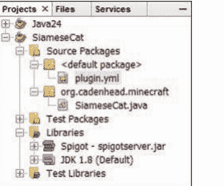

图 23.8

检查 plugin.yml 的位置。

如果文件位于错误的位置（例如，在 `org.cadenhead.minecraft` 标题下），你可以使用拖放来移动它。点击并按住文件，将其拖到 Source Packages 文件夹，然后松手。

### 构建与部署

你现在准备好构建你的 Mod 了。选择菜单命令 **Run** > **Clean and Build Project**。如果执行成功，NetBeans 界面的左下角将出现“Finished Building SiameseCat (clean jar)”的消息。

该 Mod 被打包为名为 `SiameseCat.jar` 的文件位于项目的一个子文件夹中。要找到它，点击 Projects 面板中的 **Files** 选项卡，并展开 `dist` 子文件夹。Files 选项卡列出了组成项目的所有文件，如图 23.9 所示。

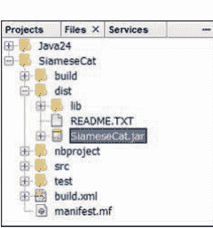

图 23.9

找到 `SiameseCat.jar` 文件。

将 `SiameseCat.jar` 从项目文件夹复制到 Minecraft 服务器的 `plugins` 文件夹中：

1. 如果 Minecraft 服务器正在运行，通过进入服务器窗口停止它。
2. 打开安装 Minecraft 服务器的文件夹。
3. 打开 `plugins` 子文件夹。
4. 将 `SiameseCat.jar` 复制到其中。

你已经在 Minecraft 服务器上部署了你的新 Mod。按照你之前的方法启动服务器——点击你创建的 `start-server` 文件——你将在运行时的日志文件中看到两条新消息：

```
[SiameseCat] Loading SiameseCat v1.0
[SiameseCat] Enabling SiameseCat v1.0
```

如果你没有看到这些消息，而是看到了一些长长的、非常复杂的错误信息，请仔细检查 `SiameseCat.java` 和 `plugin.yml` 的所有内容，确保它们输入正确；然后重新部署 Mod。

当你运行 Minecraft 客户端并连接到服务器时，输入命令 `/siamesecat`。你现在有一只会随你移动的新宠物猫。你可以根据需要多次输入该命令来继续添加猫。

图 23.10 显示了我和 23 只猫。苦力怕与我们完全无关。


图 23.10

第一次创建 Mod 需要了很多工作，因为你必须经历整个过程。后续的 Mod 开发将会变得更容易。

## 教会僵尸骑马

在 `plugin.yml` 中输入列表 23.4 的文本。

#### 列表 23.4 CrazyHorse.java 完整代码

```java
1: package org.cadenhead.minecraft;
2:
3: import java.util.logging.*;
4: import org.bukkit.*;
5: import org.bukkit.command.*;
6: import org.bukkit.entity.*;
7: import org.bukkit.plugin.java.*;
8: import org.bukkit.potion.*;
9:
10: public class CrazyHorse extends JavaPlugin {
11:     static Logger log = Logger.getLogger("Minecraft");
12:
13:     public boolean onCommand(CommandSender sender, Command command, String label, String[] args) {
14:         if (label.equalsIgnoreCase("crazyhorse")) {
15:             Player me = (Player) sender;
16:             Location spot = me.getLocation();
17:             World world = me.getWorld();
18:             int quantity = (int) (Math.random() * 10) + 1;
19:             log.info("Creating " + quantity + " zombies and horses");
20:             for (int i = 0; i < quantity; i++) {
21:                 Location horseSpot = new Location(world,
22:                     spot.getX() + (Math.random() * 15),
23:                     spot.getY() + 20,
24:                     spot.getZ() + (Math.random() * 15));
25:                 Horse horse = world.spawn(horseSpot, Horse.class);
26:                 Zombie zombie = world.spawn(horseSpot, Zombie.class);
27:                 horse.setPassenger(zombie);
28:                 horse.setOwner(me);
29:                 // set the horse's color
30:                 int coat = (int) (Math.random() * 7);
31:                 switch (coat) {
32:                     case 0:
33:                         horse.setColor(Horse.Color.WHITE);
34:                         break;
35:                     case 1:
36:                         horse.setColor(Horse.Color.GRAY);
37:                         break;
38:                     case 2:
39:                         horse.setColor(Horse.Color.CREAMY);
40:                         break;
41:                     case 3:
42:                         horse.setColor(Horse.Color.CHESTNUT);
43:                         break;
44:                     case 4:
45:                         horse.setColor(Horse.Color.BROWN);
46:                         break;
47:                     case 5:
46:                         horse.setColor(Horse.Color.DARK_BROWN);
47:                         break;
48:                     case 6:
49:                         horse.setColor(Horse.Color.BLACK);
50:                         break;
51:                 }
52:                 // increase the horse's speed
53:                 PotionEffect potion = new PotionEffect(
54:                     PotionEffectType.SPEED,
55:                     Integer.MAX_VALUE,
56:                     10 + (coat * 10));
57:                 horse.addPotionEffect(potion);
58:             }
59:             return true;
60:         }
61:         return false;
62:     }
63: }
```

从第 20 行开始的循环会为每一对僵尸-马执行一次。

它们的位置通过调用 `Location` 构造函数设置，带有四个参数：游戏世界、x 坐标、y 坐标和 z 坐标。

```java
Location horseSpot = new Location(world,
    spot.getX() + (Math.random() * 15),
    spot.getY() + 20,
    spot.getZ() + (Math.random() * 15));
```

变量 `spot` 中的玩家位置被用于为每只僵尸马选择一个位置。对于 x 坐标，获取玩家的 `getX()` 坐标并加上一个 0 到 14 之间的随机数。对于 z 坐标，加上 `getZ()` 和一个 0 到 14 之间的随机数。y 坐标则加上了 20。

这意味着这些生物将出现在玩家上方 20 个方块的空中，并在另外两个方向的 14 个方块范围内。

马和僵尸是通过世界的 `spawn()` 方法创建的，并传入生物的位置及其类名（马对应 `Horse`，僵尸对应 `Zombie`）。

Minecraft 中每个可以骑乘的生物都有一个 `setPassenger()` 方法，该方法接受骑者作为参数：

```java
horse.setPassenger(zombie);
```

如果你在这里停止，僵尸会出现在马背上，但马会迅速把它甩下来。这可以通过让玩家成为那匹马的主人来防止：

```java
horse.setOwner(me);
```

由于被驯服的马不会甩下骑者，即使骑者是一个渴望人类脑膜的僵尸。当你创建一个生物时，它会从游戏中继承该生物的默认行为。


像幼猫一样，马可以通过多种方式进行自定义。其中一种是通过调用其 `setColor()` 方法给马换不同颜色的毛。共有七种可能。

在生成一个 0 到 6 之间的随机数后，该数被用于第 38–59 行的 `switch-case` 语句中以设置马的颜色。

为了让马变得有点疯狂，你也可以自定义它的速度。游戏药水的效果可以应用于生物。共有 23 种不同的效果，它们由 `PotionEffectType` 类指示。

药水效果通过调用 `PotionEffect` 构造函数创建，带有三个参数：效果类型、药水持续的时间以及该效果的值。

### 第 23 小节：使用 Java 创建 Minecraft 插件

此语句创建了一个持续时间可能的速度药水——这是 Java 中整数能持有的最高值：

```java
PotionEffect potion = new PotionEffect(
    PotionEffectType.SPEED,
    Integer.MAX_VALUE,
    10 + (coat * 10));
```

`PotionEffect()` 的第三个参数设置了马的速度。它的基础值为 10，加上用于确定马的颜色的随机数。由于 `switch-case` 语句中的颜色是从深到浅排序的，公式 `10 + (coat * 10)` 导致颜色越深，马跑得越快。

现在你的插件 Java 类已经写完了，它需要一个插件描述文件。选择“New File”（新建文件），在“Categories”（类别）窗格中选择“Other”（其他），并在 `src` 文件夹中创建一个名为 `plugin.yml` 的条目文件。

在此文件中输入 `23.5`，注意格式与所示完全一致，使用空格而不是制表符（tabs）。

# 列表 23.5 本项目 plugin.yml 的全文

```yaml
1: name: CrazyHorse
2:
3: author: Your Name Here
4:
5: main: org.cadenhead.minecraft.CrazyHorse
6:
7: commands:
8:   crazyhorse:
9:     description: 生成 1-11 只骑马僵尸。
10:
11: version: 1.0
```

完成后，选择“Clean and Build Project”（清理并构建项目）来创建插件的 JAR 文件。

在“Projects”（项目）窗格中，“Source Packages”（源包）下应该有两个文件：使用 `org.cadenhead.minecraft` 的 `CrazyHorse.java` 以及位于 `<default package>` 下 `plugin.yml`。

在 NetBeans 之外，进入你的文件文件夹，将项目 `dist` 文件夹下的 `CrazyHorse.jar` 文件复制到 `plugins` 文件夹。重启你的服务器（停止并重新运行），你应该就能通过 `/crazyhorse` 命令启用它了。

1 到 11 只骑马僵尸会掉落在你周围，并“砰”地声落地。如果你在游戏白天发布命令，这些活尸将面临一个不愉快的惊喜。如图 23.11 所示。

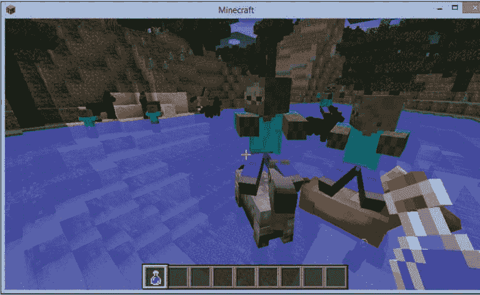

### 图 23.11

两只骑马的僵尸。

Spigot 的设计者在让 Java 类与游戏中的事物匹配方面做得很好。当你开发前两个插件时，你可能已经开始思考可以通过微调来改变的内容。

这里是对 CrazyHorse 插件列表 23.4 第 33 行的单行更改，可以将一个完全不同的生物放在马背上：

```java
Creeper creeper = world.spawn(horseSpot, Creeper.class);
```

这个更改在僵尸内部创建了一支苦力怕骑兵。

虽然你可以猜到类名并看到发生了什么，但 Spigot 对其所有功能都有详尽的在线文档。

使用本指南学习 Spigot 中的类和接口、它们的变量和方法。通过在 CrazyHorse 插件中尝试，你可以尝试不同的效果。

要开始操作：

- 选择“File, New Project”创建新项目。
- 在“Projects”窗格中，点击“Libraries”，添加 Spigot 库。
- 选择“File, New”并在 `org.cadenhead.minecraft` 包下创建一个名为 `LightningStorm` 的空 Java 文件。

将列表 23.6 的文本输入 NetBeans 源码编辑器，完成后保存文件。

### 列表 23.6 LightningStorm.java 的全文

```java
1: package org.cadenhead.minecraft;
2:
3: import java.util.*;
4: import java.util.logging.*;
5: import org.bukkit.*;
6: import org.bukkit.command.*;
7: import org.bukkit.entity.*;
8: import org.bukkit.plugin.java.*;
9:
10: public class LightningStorm extends JavaPlugin {
11:     public static final Logger log = Logger.getLogger("Minecraft");
12:
13:     public boolean onCommand(CommandSender sender, Command command,
14:         String label, String[] arguments) {
15:
16:         Player me = (Player) sender;
17:         World world = me.getWorld();
```

# 寻找所有生物（并杀死它们） 360

```java
// 获取游戏中的所有生物
List<LivingEntity> mobs = world.getLivingEntities();

// 处理 lightningstorm 命令
if (label.equalsIgnoreCase("lightningstorm")) {
    if (sender instanceof Player) {
        int myId = me.getEntityId();
        // 每次遍历一个生物
        for (LivingEntity mob : mobs) {
            log.info("[LightningStorm] " + mob.getType());
            // 这个生物是玩家吗？
            if (mob.getEntityId() == myId) {
                // 是，所以不击他
                continue;
            }
            // 获取生物的位置
            Location spot = mob.getLocation();
            // 雷击！
            world.strikeLightning(spot);
            // 将生物的生命值设为 0（死亡）
            mob.setHealth(0);
        }
    }
    return true;
}

// 处理 mobcount 命令
if (label.equals("mobcount")) {
    if (sender instanceof Player) {
        me.sendMessage("There are " + mobs.size() + " living mobs.");
        return true;
    }
    return false;
}
```

LightningStorm 插件通过 `lightningstorm` 命令实现了新功能：它在生物上降下大量的雷电，而不是只有一道。`/mobcount` 命令会统计世界中有多少个活体。

这些命令同时需要一个玩家对象和一个世界对象。它们还需要一个包含所有生存生物（mob）的列表，这在第 19 行实现：

```java
List<LivingEntity> mobs = world.getLivingEntities();
```

该语句调用了 `getLivingEntities()` 方法，该方法返回一个包含每个生物的 `List` 对象。这些生物是以实现 `LivingEntity` 接口的对象表示的。

`List` 也是一个接口。它由数组列表（array lists）、栈（stacks）和其他数据结构实现。数组列表的方法和技术也适用于此列表。

获取这些内容后，你就可以用一个语句（第 47 行）实现 `/mobcommand` 命令：

```java
me.sendMessage("There are " + mobs.size() + " living mobs.");
```

列表的 `size()` 方法返回该列表中的元素数量。

这些信息作为消息发送给玩家并显示在游戏中。这是通过调用玩家的 `sendMessage()` 方法并传入显示所有参数的信息来实现的。

`/lightningstorm` 命令要复杂得多。

Java 中的数据结构具有特殊的 `for` 循环（special for loops），可以轻松遍历结构中的每一个项。第 26 行开始对 `mobs` 列表中的每个生物进行循环：

```java
for (LivingEntity mob : mobs) {
```

这会将当前生物存储在一个名为 `mob` 的 `LivingEntity` 对象中。

在向地图上的每个生物发送闪电时，必须记住玩家也是一个生物。向自己身上劈电绝不是个好主意。

游戏中的每个生物都有一个唯一的 ID。在 `for` 循环开始之前，第 24 行存储了玩家的 ID：

```java
int myID = me.getEntityId();
```

在循环内部，通过调用第 29–32 行的 `getEntityId()` 方法，将该整数与当前生物的 ID 进行比较：

```java
if (mob.getEntityId() == myID) {
    continue;
}
```

## 寻找所有生物（并杀死它们）

`continue` 语句会调用循环回到第 26 行并处理下一个生物。

现在玩家是安全的，你通过调用生物的 `getLocation()` 方法找到生物的位置：

```java
Location spot = mob.getLocation();
```

然后使用该位置调用 `strikeLightning()` 方法：

```java
world.strikeLightning(spot);
```

用闪电击中生物并不总是致命的——有些生物是顽强的小家伙——但这让这个效果显得没那么惊人。调用生物的 `setHealth()` 方法并传入参数 0 会将其生命值设置为该数量，将其杀死：

```java
mob.setHealth(0);
```

此生物应录入的 `plugin.yml` 文件可以在列表 23.7 中找到。在项目的 `src` 文件夹中创建一个空的 `plugin.yml` 文件，然后将其填充为列表。

## 列表 23.7 本项目 plugin.yml 的全文

```yaml
1: name: LightningStorm
2:
3: author: Your Name Here
4:
5: main: org.cadenhead.minecraft.LightningStorm
6:
7: commands:
8:   lightningstorm:
9:     description: Hit every living mob with lightning.
10:   mobcount:
11:     description: Count of living mobs.
12:
13: version: 1.0
```

构建项目（选择 Run、Build 和 Clean Project），然后通过将项目 `dist` 文件夹中的 `LightningStorm.jar` 文件复制到服务器的 `plugins` 文件夹来部署该生物。下次启动服务器并游戏时，你将看到像图 23.12 那样的闪电暴。

实际上，在书里展示它会破坏惊喜。图 23.12是一只即将变成火烧肉的牛。

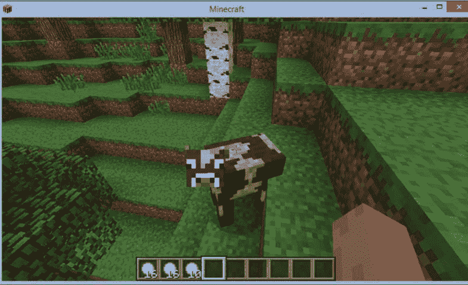

### 图 23.12

这不是闪电暴。

## 编写一个可以建筑的 Mod

你创建的前三个 Mod 是关于生物的，即在 Minecraft 中游走的移动实体。这一小时的最后一个 Mod 探索了如何使用 Java 执行游戏最基础的活动：建造和破坏区块。

你将创建一个新命令 `/icecreamscoop`，在玩家周围挖掘一个圆洞。洞的大小将由玩家作为命令参数决定。

以下是开始构建的方法：

1. 在 Minecraft 文件夹中创建新项目 IceCreamScoop，保持取消勾选主类（Main Class）。
2. 在 Projects 面板中，右键点击 Libraries 并添加 Spigot 库。
3. 在 `org.cadenhead.minecraft` 包中创建一个名为 `IceCreamScoop` 的空 Java 文件。
4. 输入列表 23.8 的文本内容作为 `IceCreamScoop` 类。在你输入完成后，将对其进行解释。

### 列表 23.8 IceCreamScoop.java 的全文


# 第 23 小时：使用 Java 创建 Minecraft 模组

```java
1: package org.cadhead.minecraft;
2:
3: import java.util.logger.*;
4: import org.bukkit.block.*;
5: import org.bukkit.world.*;
6: import org.bukkit.command.*;
7: import org.bukkit.entity.*;
8: import org.bukkit.plugin.java.*;
9:
10: public class IceCreamScoop extends JavaPlugin {
11:     public static final Logger log = Logger.getLogger("Minecraft");
12:
13:     public boolean onCommand(Command sender, String label, String[] arguments) {
14:         // set the default radius
15:         double radius = 15;
16:         if (arguments.length > 0) {
17:             // read the user-provided radius
18:             try {
19:                 radius = Double.parseDouble(arguments[0]);
20:                 // make sure it's an acceptable size (5-25)
21:                 if (radius < 5 || radius > 25) {
22:                     radius = 15;
23:                 }
24:             } catch (NumberFormatException exception) {
25:                 // do not use the default
26:                 // radius is already set
27:             }
28:         }
29:
30:         // check if the command is correct
31:         if (label.equalsIgnoreCase("icecreamscoop")) {
32:             if (sender instanceof Player) {
33:                 // dig a circular scoop of the world
34:                 scoopTerrain((Player) sender, radius);
35:                 return true;
36:             }
37:         }
38:         return false;
39:     }
40:
41:     private void scoopTerrain(Player me, double radius) {
42:         World world = me.getWorld();
43:         Location spot = me.getLocation();
44:
45:         // loop through a 3D square with sides the radius
46:         for (double x = spot.getX() - radius; x < spot.getX() + radius; x++) {
47:             for (double y = spot.getY() - radius; y < spot.getY() + radius; y++) {
48:                 for (double z = spot.getZ() - radius; z < spot.getZ() + radius; z++) {
49:                     // get the location in space
50:                     Location loc = new Location(world, x, y, z);
51:                     // see how it is from the player
52:                     double dx = x - spot.getX();
53:                     double dy = y - spot.getY();
54:                     double zd = z - spot.getZ();
55:                     // is it within the radius?
56:                     if (Math.sqrt(dx * dx + dy * dy + zd * zd) < radius) {
57:                         // destroy the block
58:                         Block current = world.getBlockAt(loc);
59:                         current.setType(Material.AIR);
60:                     }
61:                 }
62:             }
64:         }
65:     }
65: }
```

接下来，调用了块的 `setType()` 方法并传入了 `Material.AIR`，这是几十个值之一，代表该块可以由 Minecraft 中的材料制成。

通过将块转换为空气来破坏块的相同技术也可以用于构建物体。唯一改变的是材料的类型。如果你必须挖出一勺游戏并将其转换为钻石而不是空气，那么该语句将是：

`current.setType(Material.DIAMOND);`

当从世界上挖出一勺冰淇淋后，模组会做两件事来记录这一成就：播放一段声音并向服务器日志发送一条消息。

声音是通过调用世界的 `playSound()` 方法播放的，该方法带有四个参数——声音的位置、类型、音量和音调：

`world.playSound(spot, Sound.BURP, 3, 5);`

正如你可能猜到的，这个声音是一个爆发声。有几十种可能使用的声音。

通过调用 `Logger` 对象的 `info()` 命令并传入消息的文本，可以在服务器日志上记录一条消息：

`log.info("IceCreamScoop Scooped at " + spot);`

项目的 `plugin.yml` 文件如列表 23.9 所示。在项目的 `src` 文件夹中创建一个名为 `plugin.yml` 的空文件以匹配此列表。

### 列表 23.9 项目 plugin.yml 的完整文本

```yaml
1: name: IceCreamScoop
2:
3: author: Your Name Here
4:
5: main: org.cadhead.minecraft.IceCreamScoop
6:
7: commands:
8: icecreamscoop:
9: description: Scoop away land around the player.
10:
11: version: 1.0
```

在你构建模组并将其 JAR 文件部署到 Minecraft 服务器后，使用与之前项目相同的步骤，你就可以在游戏世界中移动，从景观中挖出巨大的圆勺。图 23.13 显示了当你站在一片平地上并输入此命令时会发生什么：

`/icecreamscoop 10`

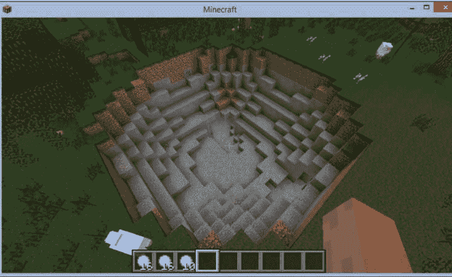

图 23.13

在 Minecraft 世界中挖出圆圈。

在测试此模组时，我发现自己挖到世界底部并不花费长时间。你还可能会掉得足够远导致死亡，因此在出生点进行任何挖掘并不是一个好主意。

通过将材料从 `AIR` 更改为另一种，你可以在世界中创建球体。物质完整列表可以在 Spigot 的 Java 文档（www.javaminecraft.com/bukkitapi）中找到，但这里有几个可以用来入门：

- `Material.DIRT`
- `Material.COBBLESTONE`
- `Material.WOOD`
- `Material.GRAVEL`

如果你将块转换为空气以外的任何物体，模组将移除你所处位置的空气。那一定很疼。你可以通过以下两个语句传送到一个新位置：

```java
Location newSpot = new Location(world,
spot.getX(),
spot.getY() + rad + 1,
spot.getZ());
me.teleport(newSpot);
```

因为 Minecraft 中的 Y 轴是垂直位置，这会将玩家移动到球体正上方。

## 总结

在我编写 Java 程序和教人们如何使用这种语言的多年里，我从未想过我会把这些技能用来制作让僵尸骑马的程序。

或者如果不经过训练，马就会把那个僵尸甩下来。

或者僵尸会因为太阳出来而立即着火。

或者你可以挖一个大到洞，以至于你掉出了世界。

这是*最有趣*的 Java 编程。我知道这不是一个标准单词，但它应该是一个，而且尽管你要将自己的 Java 对象放入一个三维世界中，在里面你要战斗怪物、探索地下城、建造房屋并躲避死者的逻辑，它也应该被使用。

Minecraft 也是学习面向对象编程的极佳方式，这是该语言中最难掌握的方面之一。你在 Java 中所做的一切都是通过对象完成的。你通过构造函数创建它们，通过实例变量赋予它们知识，并通过调用方法告诉它们去做某些事。对象通过实现接口来指示它们可以执行的任务。

所有这些概念都直接关系到模组编程。需要一个僵尸？创建一个 `Zombie` 对象。想让玩家移动到新位置？调用它的 `teleport()` 方法。丢失了你的马？调用它的 `getLocation()` 方法。

所以，无论你想深入 Minecraft 编程到何种程度，你都将这些技能远超苦力怕、凋灵骷和猪僵尸的范畴。

## 工作坊

## 问答

- Q. 我用 IceCream 模组把我的服务器世界搞了一团糟。

---

# 第 24 小时：编写 Android 应用

这项工作起步缓慢，但从 2010 年初开始爆发式增长，并成为 iPhone 以及其他移动平台的真正竞争对手。所有主要的手机运营商现在都提供安卓手机。平板电脑和电子书阅读器的市场也在不断扩大。

在 Android 出现之前，移动应用程序开发需要昂贵的编程工具和开发者计划。手机制造商控制谁被允许为他们创建应用，以及用户是否可以使用这些应用。

Android 打破了这道围墙。

Android 的开源和非专有性质意味着任何人都可以开发、发布和销售应用。唯一的成本是向 Google 市场提交应用的小额费用。其他一切都是免费的。

下载 Android SDK 并了解如何为该平台创建程序可以通过 Android 开发者网站，地址为 https://developer.android.com。在编写应用时，你会经常参考它，因为它记录了 Android 类库中的每一个类，并可以作为一个详尽的参考资料。

如果你使用支持 Android SDK 的集成开发环境 (IDE)，编写 Android 应用将变得更加简单。Android 编程推荐的 IDE 是 Android Studio，它也是免费开源的。

你可以使用 Android Studio 编写 Android 应用，在模拟 Android 手机的模拟器中进行测试，并将它们部署到实际设备上。

在大部分时间里，Java 语言一直用于编写运行在三个地方之一的程序：桌面电脑、Web 服务器或 Web 浏览器。

Android 让 Java 无处不在。你的程序可以部署在数百万部手机和其他移动设备上。

这实现了 James Gosling 在 20 世纪 90 年代中期发明这种语言时的最初设计目标。他被赋予创建一种可以在手机、智能卡和家电器等设备上随处运行语言的任务。

当 Java 首次作为运行交互式 Web 程序的手段、随后作为通用语言流行起来时，Java 开发者们搁了这些梦想。

根据一项行业估计，二十年后，Android 平台在全球托管了高达 30 亿个 Java 程序。

Android 有潜力在未来几年成为 Java 编程中最普及且最有利的领域。

## 创建 Android 应用

Android 应用是普通的 Java 程序，使用应用程序框架，这是一组所有应用共同的核心类和文件集合。框架体现了应用必须如何结构以便在 Android 设备上正确运行的一系列规则。

要开始编写应用，你必须安装 Android Studio。要下载该软件，请访问 https://developer.android.com。运行安装向导并按照说明在你的电脑上设置软件。

开始在项目中使用 IDE：

1. 运行 Android Studio。
2. 在启动时出现的对话框中，选择“Start a New Android Project”（启动新 Android 项目）。创建新项目向导打开，如图 24.1 所示。

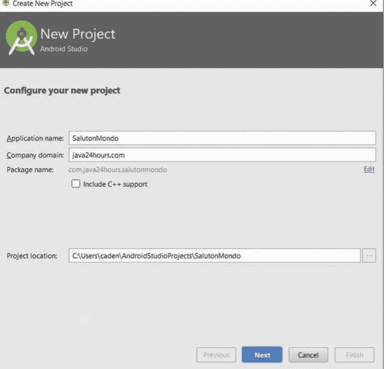

图 24.1

在 Android Studio 中创建新的 Android 项目。

1. 在 Application Name（应用名称）字段中，输入 SalutonMondo。
2. 在 Company Domain（公司域名）字段中，输入 java24hours.com。Package Name（包名）字段将更新为使用此处和应用名称，即 com.java24hours.saluton-mondo。
3. 你可以接受默认的 Location（用户文件夹下 AndroidStudioProjects 的子文件夹），或使用字段右侧的“...”按钮选择不同的位置。
4. 点击 Next（下一步）。
5. 每个 Android 项目都需要一个目标平台。目标代表可以运行你的应用的旧版 Android 版本。每个新的 Android Release 版本都具有增强的功能，你的目标选择了你可以使用的哪些功能。选择 Fullscreen（全屏）和 Tablet（平板）作为目标，并将 API 15 作为 Minimum SDK（最低 SDK）（或如果 API 15 不可用则选择最低版本）。
6. 点击 Next。向导询问要创建的应用。选择 Fullscreen Activity（全屏活动）并点击 Next。
7. 在 Activity Name（活动名称）字段中，输入 SalutonActivity。这会更改 Layout Name（布局名称）和 Title（标题）字段。保留这些更改。
8. 点击 Finish（完成）。新应用已创建，Package Explorer（包管理器）面板中会出现一个 SalutonMondo 项目。

## 探索新的 Android 项目

一个新的 Android 项目由大约 20 个文件和文件夹组成，它们始终以相同的方式组织。

## 设置 Android 模拟器

在构建 Android 应用程序之前，你必须设置调试环境。这可以在 Android Studio 中完成。你必须设置一个 Android 虚拟设备 (AVD)，以便作为模拟器在你的桌面上运行该应用。你还必须创建项目的调试配置。完成后，你就可以构建应用并在模拟器中运行它。

要配置 Android 虚拟设备，首先点击 Android Studio 工具栏上的绿色手机图标，如图 24.4 所示。

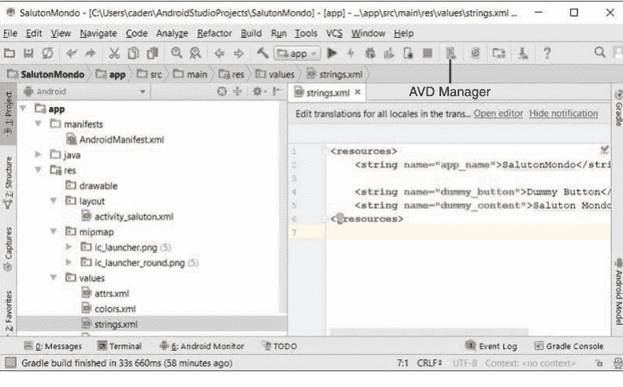

图 24.4

配置 Android 虚拟设备。

这将启动 Android 虚拟设备管理器，它是 Android SDK 中的工具之一。你创建的模拟器列在左侧。管理器如图 24.5 所示。

## 运行应用

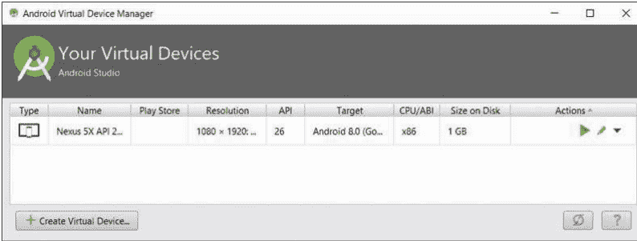

图 24.5

创建一个新的 Android 模拟器。

要添加新的模拟器，点击 Create Virtual Device 并按照以下步骤操作：

1. 从列表中选择一个设备，例如 Galaxy Nexus，并点击 Next。
2. 从列表中选择一个版本，例如 Nougat，并点击 Next。
3. 在 AVD Name 字段中，将其命名为 SimpleAVD。
4. 点击 Finish。
5. 新模拟器将被创建，这可能需要一些时间（通常不超过一分钟）。

你可以根据需要创建任意多个模拟器。它们针对不同的 Android 版本和不同类型的屏幕进行自定义。

关闭 Android 虚拟设备管理器以返回 Android Studio 主界面。

## 运行应用

现在你已经有了 Android 模拟器，可以运行你的第一个应用了。选择菜单命令 Run、Run App。弹出 Select Deployment 对话框。在 Available Virtual Devices 下，选择 SimpleAVD 并点击 OK。

你可能会被要求安装平台。点击 Install 并 Continue。

Android 模拟器将在自己的窗口中加载。这可能需要一分钟或更长时间，请耐心等待虚拟手机启动。（模拟器的加载速度非常慢，让你有时间思考中国谚语：“牛步马蹄，地道宽。”）

你安装的应用将带有 Android 图标和标签 SalutonMondo 出现。点击该图标运行应用。


模拟器显示“Salaton Mondo!”作为应用的文本，如图 24.6 所示。控制控件允许模拟器像手机一样使用，但使用的是鼠标而不是你的手指。

点击返回键关闭应用，查看 Android 设备是如何模拟的。

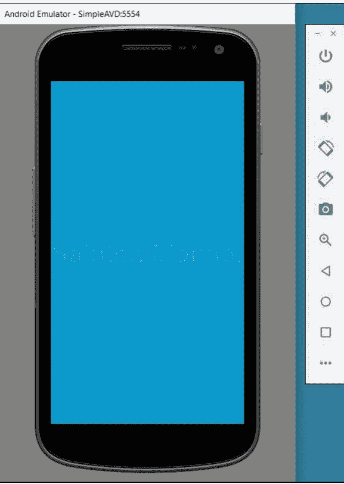

**图 24.6** 在 Android 模拟器中运行应用。

模拟器可以完成许多真实设备可以做到的事情，包括在计算机有活动连接时连接到互联网。它还可以接收虚拟电话和短信，但拨打真实电话和发送短信需要真实的设备。

由于它不是完全功能的设备，你开发的应用必须在真实的 Android 手机和平板上进行测试。

如果你可以使用 USB 线将 Android 手机（或其他设备）连接到计算机，只要手机处于调试模式，你就应该能够运行该应用。使用 Android SDK 开发的应用只能部署在调试模式下的手机上。

在手机上，通过选择 Home、Settings、Applications、Development（或 Home、Settings、Developer Options）进入此模式。将显示 Development 设置。选择 `USB debugging` 选项。

使用 USB 线将 Android 手机连接到计算机。手机屏幕顶栏将出现一个 Android 图标。如果你向下拖此栏，你应该会看到“USB Debugging Connected”的消息。接下来，在 Android 中按照以下步骤操作：

1. 选择 `Run App`。
2. 在 `Connected Devices` 下，选择你的手机。
3. 点击 `OK`。

应用在手机上的运行方式与在模拟器上一样。

就像你在第 2 小时用 Java 编写的第一个程序一样，你在 Android 上创建的第一个应用也极其平庸。下一个项目将更具野心。

通过选择菜单命令 `File`、`Close Project` 关闭此项目。

## 设计真实的应用

Android 应用可以利用设备的所有功能，例如短信消息、基于位置的服务和触摸。在本书的函数式编程项目中，你将创建一个名为“致你的你的领导者”的真实应用。

该应用利用 Android 的手机功能来拨打电话、访问网站并在 Google Maps 中加载位置。该应用通过电话、网络和地图让你与白宫联系起来。（如果美国总统不是你的领导，可以对应用进行自定义。）

要开始，请执行以下步骤在 Android Studio 中创建一个新项目：

1. 选择 `Start a New Android Studio Project`。（如果没看到此项，通过菜单命令 `File`、`Close Project` 关闭上一个项目。）
2. 在 `Application Name` 字段中输入 `Leader`。这也会输入包名。
3. 在 `Package Name` 字段中，输入 `com.example.leader`。
4. 在 `Minimum SDK` 字段中，选择 `API 21`。
5. 在 `Activity template` 字段中，选择 `Empty Activity`。
6. 点击 `Finish`。

项目已创建，你可以在 Project 窗口中看到文件。

# 设计用户界面

应用程序的图形用户界面由布局（`layouts`）组成，布局是用于存放部件（`widgets`）的容器，如文本字段、按钮、图形以及你自己设计的部件。显示给用户的每个屏幕可以有一个布局，也可以包含相互嵌套的多个布局。有的布局可以垂直或水平地堆叠组件，可以将它们组织在表格中，或其他排列方式。

应用程序可以简单到一个屏幕，也可以包含多个屏幕。一个游戏可以组织成这些屏幕：

- 显示游戏正在加载的启动屏幕
- 带有按钮的主菜单屏幕，可以通过这些按钮查看其他屏幕
- 解释如何玩游戏的帮助屏幕
- 列出玩家最高分数的比分屏幕
- 列出游戏开发人员名称的制作名单屏幕
- 用于实际游戏的游戏屏幕

Leader 应用程序由单个屏幕组成，其中包含用于联系美国总统或待命的领袖的按钮。

应用程序的所有屏幕都保存在 `/res/layout` 文件夹中。该项目在该文件夹中有一个 `activity_leader.xml` 文件，它被指定为应用加载时显示的屏幕。

要开始此屏幕的布局，在包资源管理器（Package Explorer）中双击 `activity_leader.xml`。屏幕会在 Android Studio 的主编辑窗格中打开，如图 24.7 所示。

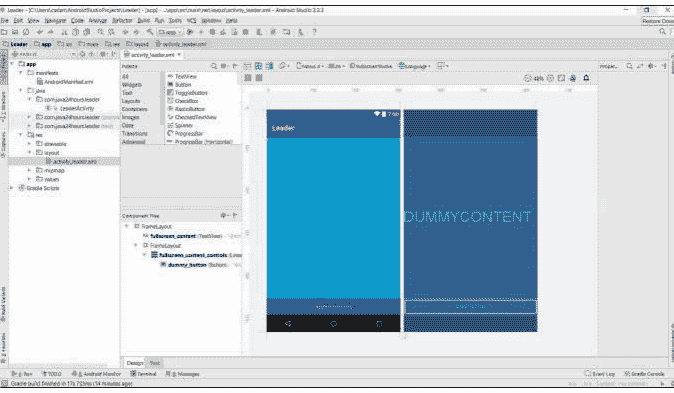

**图 24.7** 编辑 Activity 的图形用户界面。

编辑窗口包含一个调色板（`Palette`）面板，其中有几类可以展开的用户界面组件。这些组件可以被拖并放到到右侧的屏幕上。

按照以下步骤在屏幕上添加三个图形按钮：

1. 点击编辑窗格底部显示“Dummy Button”文本的部件，并按 `Delete` 键删除该部件。
2. 点击调色板面板中的 `Layouts` 文件夹。子面板会展开。
3. 从调色板将 `LinearLayout (vertical)` 部件拖到屏幕上。编辑窗格右侧会出现一个属性（`Properties`）面板，在 `Orientation` 下拉菜单上方有一个 `Layout` 标签。如果尚未选择 `vertical`，请选择 `vertical` 值。布局决定了放置在其上的用户界面元素将如何排列。
4. 在调色板面板中，点击 `Images` 文件夹。子面板会展开。
5. 从调色板将一个 `ImageButton` 部件拖到编辑窗格中的应用屏幕上。弹出一个资源（`Resource`）对话框，要求你选择一个显示在按钮上的图像。选择 `phone` 并点击 `OK`。该按钮现在有一个手机的图形。
6. 在属性面板中，将 `LayoutWidth` 设置为 `wrap_content`。
7. 再次拖入另一个 `ImageButton` 部件并将其释放到手机按钮的右侧。为该按钮选择 `browser` 资源。添加了一个浏览器按钮。
8. 再拖入一个 `ImageButton` 部件并将其释放到浏览器按钮的右侧，为它分配 `maps` 资源。组件（`Component`）面板列出了屏幕上的部件。选择 `imageButton1` 项。按钮的属性会在属性面板中打开。
9. 向下滚动属性面板，直到看到 `ID` 属性。它的当前值被设置为 `imageButton1`。将其更改为 `phoneButton`。
10. 在 `On Click` 面板中，输入值 `processClicks`。（这将在下一节中解释。）
11. 为 `imageButton2` 重复步骤 9-10，赋予其 ID `webButton` 和 `On Click` 属性 `processClicks`。
12. 为 `imageButton3` 重复步骤 9-10，赋予其 ID `mapButton` 和 `On Click` 属性 `processClicks`。
13. 点击组件树（`Component Tree`）中的 `LinearLayout` 项。屏幕的属性会出现在属性面板中。
14. 在属性面板中，点击 `View All Properties` 链接。
15. 点击 `Background` 的值；然后点击 `...` 按钮。资源对话框打开。
16. 选择 `whitehouse` 并点击 `OK`。白宫的图形将成为屏幕的背景。
17. 点击 `Save` 按钮。

完成后的屏幕如图 24.8 所示。


**图 24.8** 预览 Activity 的图形用户界面。

# 编写 Java 代码

到此为止，你已经完成了用户界面的大部分工作，但还没有编写任何 Java 代码。应用程序被组织成 Activity，Activity 代表应用可以执行的操作。

`LeaderActivity.java` 的源码可以在 `java` 文件夹中找到。当启动应用时，该类会被调用。

`onCreate` 方法的第一件事是调用父类方法：

```java
super.onCreate(savedInstanceState);
```

接下来，它调用 `setContentView()`，该方法选择屏幕。当你之前设计用户界面时，将每个按钮的 `On Click` 属性设置为 `processClicks`。

现在是实现它。在文件顶部添加这些语句：

```java
import android.content.Intent;
```

返回 `processClicks` 方法。它接收一个参数：`View` 对象。`View` 对象的 `getId()` 方法返回被点击按钮的 ID。

```java
public void processClicks(View display) {
    Intent action = null;
    int id = display.getId();
```

这个 ID 存储在变量中，以便用于 `switch` 语句。在调用 `display.getId()` 的行之后，添加以下语句：

```java
switch (id) {
    case R.id.phoneButton:
        break;
    case R.id.webButton:
        break;
    case R.id.mapButton:
        break;
    default:
        break;
}
```

`processClicks` 方法中的第一个语句创建了一个持有 `Intent` 的变量。Android 中的 `Intent` 是 Activity 告诉另一个 Activity 要做什么。它们也是应用程序与 Android 设备通信的方式。这里是此方法使用的三个 `Intent`：

```java
action = new Intent(Intent.ACTION_DIAL, Uri.parse("tel:202-456-1111"));
action = new Intent(Intent.ACTION_VIEW, Uri.parse("http://whitehouse.gov"));
action = new Intent(Intent.ACTION_VIEW, Uri.parse("geo:0,0q=White House, Washington, DC"));
```

构造两个参数：

- 要执行的操作，由其类变量表示
- 与操作关联的数据

这些 `Intent` 告诉 Android 设备拨打白宫公用电话 (202) 456-1111、访问网站 http://whitehouse.gov，以及在 Google Maps 中加载特定地址“White House, Washington, DC”。

在你创建了 `Intent` 之后，以下语句会使其生效：

```java
startActivity(action);
```

将此语句放在 `switch` 块结束之后。

## 设计一个真实的应用

由于你删除了 Activity 中的 Dummy Activity，你必须删除这行代码，它是 `onCreate()` 方法中的最后一行：

```java
View(R.id.dummy_button).setOnTouchListener(mDelayHideTouchListener);
```

删除该行的简单方法是在它前面加上 `//`，将其变成一条注释，这样编译器就会忽略它。

为了使你添加的代码能够正常工作，必须在代码中添加以下导入语句：`android.net.Uri;`

`LeaderActivity` 类中 `processClicks()` 方法的完整文本如列表 24.1 所示。请确保你代码中的方法与列表一致。（注意，这并不是 `LeaderActivity` 的全部源代码，只是 `processClicks()` 方法。）

### 列表 24.1 LeaderActivity.java 的部分文本

```java
1: public void processClicks(View display) {
2:     Intent action = null;
3:     int id = display.getId();
4:     switch (id) {
5:         case (R.id.phone):
6:             action = new Intent(Intent.ACTION_DIAL,
7:             Uri.parse("tel:202-456-1111");
8:             break;
9:         case (R.id.webButton):
10:             action = new Intent(Intent.ACTION_VIEW,
11:             Uri.parse("http://whitehouse.gov");
12:             break;
13:         case (R.id.mapButton):
14:             action = new Intent(Intent.ACTION_VIEW,
15:             Uri.parse("geo:0,7q=White House, Washington, DC");
16:             break;
17:         default:
18:             break;
19:     }
20:     startActivity(action);
21: }
```

完成后保存文件。选择菜单中的 `Build`（构建）、`Make Project`（生成项目）来编译它。如果没有编译成功，将显示错误信息，并在项目中发现错误的文件中出现红线。

要运行该应用，请选择 `Run`（运行）、`Run App`（运行应用），并选择 `SimpleAVD` 作为虚拟设备。模拟器将加载（这需要一些时间），然后会自动运行该应用。

模拟器并不能模拟 Android 设备可以执行的所有功能。Leader 应用的拨号和浏览器按钮应该可以正常工作，但你可能会在地图（Maps）遇到问题。

如果你有一部适用于 Android SDK 的 Android 手机，并且手机已设置为调试模式，也可以在 Android 手机上运行该应用。

选择 `Run`、`Run App`，然后选择你的手机而不是虚拟设备。点击 `OK`。图 24.9 显示了应用在我的手机上运行。当手机从竖屏模式切换到横屏模式时，应用会随之切换。


**图 24.9** 带我去你的领袖！

Leader 应用也已添加到手机的应用程序中，带有它自己的“带我去你的”图标。即使在你断开 USB 线后，它也会留在手机上。

恭喜你！世界上现在有十亿零一个 Android 应用了。

### 注意

正如你可能猜到的那样，Android 编程中有很多内容可以在一小时内涵盖。Sams 提供了另一本书，将你在这里学到的 Java 编程并扩展到另外 24 小时的 Android 特定内容：由 Carmen Dellesio、Lauren Darcy 和 Shane Conder 编写的第四版 *Sams Teach Yourself Android Development*（ISBN 978-0-672-33739-0）。

### 总结

*Sams Teach Yourself Java in 24 Hours* 的目标是帮助你熟悉编程概念，并提高你编写自己的可以在运行在桌面式电脑、Web 服务器甚至手机上运行的程序的能力。Java 的一种方法有些难以掌握（你可以随意删掉前一句话中的*有些*一词）。

随着随着你对 Java 经验的积累，你正在建立的经验将变得越来越重要，因为像面向对象编程、虚拟机和安全环境等概念处于软件开发的前沿。

如果你还没有查看，请查看附录以获取更多有用信息。

在本小时的结束时，你可以在几个地方探索 Java。程序员们在 www.planetbeans.org 的博客上讨论这种语言。www.careerbuilder.com 等就业网站的数据库中显示了大量的 Java 招聘机会。该书还有一个 www.java24hours.com 网站，你可以在那里向作者发送电子邮件，并阅读对读者问题的解答、对书籍的澄清以及（咽一下）更正。

继续提升你 Java 程序员技能的一种方法是阅读 *Sams Teach Yourself Java in 21 Days*。我也写了那本书，它扩展了这里涵盖的主题并引入了新主题，例如 JDBC、Java servlets 和网络编程。

如果你没有跳读并且刚刚完成了所有的 24 小时，太棒了。请利用你新学到的编程技能找一份好工作，并重建世界经济。

### 工作坊

### 问答

- **为什么使用 Android Studio 创建 Android 应用而不是 NetBeans？**

  你可以使用 NetBeans 开发应用，但对于 Android 编程来说，它是一个更笨重且支持较差的 IDE。Android Studio 是 Google 提供的官方 IDE，提供了许多专门为 Android 开发设计的功能。它包含一个强大的代码编辑器、一个布局编辑器和各种调试工具。大多数开发者现在都使用 Android Studio，因为它是与时更新的。

- **为什么大多数开发者使用 Android Studio？**

  Android Studio 是 Google 提供的官方 IDE，提供了许多专门为 Android 开发设计的功能。它包含一个强大的代码编辑器、一个布局编辑器和各种调试工具。大多数开发者现在都使用 Android Studio，因为它是与时更新的。

- **模拟器不能执行以下哪些任务？**

  模拟器可以模拟许多功能，但它不能模拟某些硬件设备。

### 测验

1. 以下哪家公司不是 Android 的？

   - Google
   - Apple
   - Motorola

2. Android 中使用什么对象来实现？

   - A. Intent
   - B. Action
   - C. View

3. 模拟器无法执行以下哪些操作？

   - A. 接收短信
   - B. 连接互联网
   - C. 打电话

### 答案

1. Apple，因为 Android 是开源的。
2. A. Intent
3. C. 打电话

## 活动

为了让你的知识更深入，请尝试以下操作：

- 将 Android 文本更改为“Hello”并在模拟器中运行。
- 为手机创建一个新版本的 Android。


要查看实现这些活动的 Java 程序，请访问该书网站 `www.java24hours.com`。

## 附录 A：使用 NetBeans 集成开发环境

> **注意**
>
> 加载 NetBeans 网站时遇到问题？你可能正在尝试加载 `www.netbeans.org`（该地址无效），而不是 `https://netbeans.org`。

如果你想确保下载的是与本书准备时相同的 NetBeans 和 JDK 版本，请访问书籍网站 `www.java24hours.com`。点击此书的链接打开该版本的网站，并寻找“Download JDK”（下载 JDK）和“Download NetBeans”（下载 NetBeans）链接。你将被引导至正确的网站。

### 创建新项目

JDK 和 NetBeans 以安装向导的形式下载，这些它们用于在你的系统上设置软件。你可以在任何喜欢的文件夹和菜单组中安装软件，但除非你有充分的理由，否则最好坚持默认设置选项。

在安装后首次运行 NetBeans 时，你会看到一个启动页，其中显示了指向演示和编程教程的链接（参见图 A.1）。你可以使用 NetBeans IDE 内置的网络浏览器阅读这些内容。


图 A.1 NetBeans 用户界面。

### 创建新项目

一个 NetBeans 项目由一些相关的 Java 类、用于这些类的文件以及 Java 类库组成。每个项目都有自己的文件夹，你可以在 NetBeans 外部使用文本编辑器和其他编程工具对其进行浏览和修改。

要开始新项目，点击图 A.1 所示的 New Project（新项目）按钮，或选择 `File`、`Project` 菜单命令。如图 A.2 所示，打开 New Project 向导。

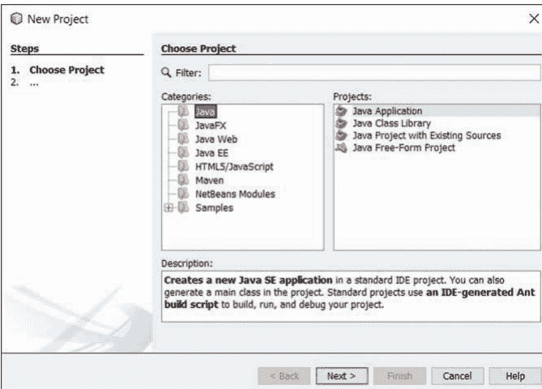

图 A.2 向导。

NetBeans 可以创建多种类型的 Java 项目，但在书中你可以专注于一种：Java Application（Java 应用程序）。

对于你的第一个项目（以及书中的大部分项目），选择项目类型 Java Application 并点击 Next。向导要求你选择项目的名称和位置。

`Project Location` 字段标识了你用 NetBeans 创建的编程项目的根文件夹。在 Windows 上，这是 `My Documents`（或 `Documents`）文件夹下的一个名为 `NetBeansProjects` 的子文件夹。你创建的所有项目都存储在该文件夹内，每个项目都有自己的文件夹。

在 `Project Name` 字段中，输入 `Java24`。`Create Main Class` 文本框会根据输入发生变化，建议将 `java24.Java24` 作为项目中主 Java 类的名称。将其更改为 `Spartacus` 并点击 Finish，接受所有其他默认值。NetBeans 将创建项目及其第一个类。

### 创建新的 Java 类

当 NetBeans 创建新项目时，它会设置所有必要的文件和文件夹，并创建主类。图 A.3 显示了在编辑器中打开的项目第一个类 `Spartacus.java`。

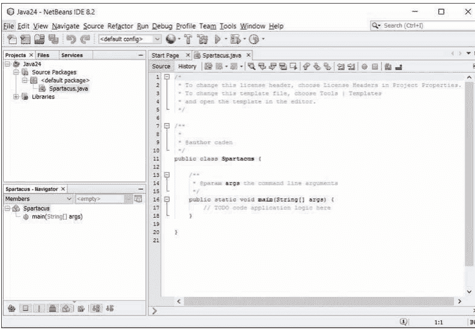

图 A.3 NetBeans 源代码编辑器。

`Spartacus.java` 是一个基础的 Java 类，只包含一个 `main()` 方法。类中所有浅灰色行都是解释类目的和功能的注释。在运行类时，注释会被忽略。

要让这个新类发挥作用，请在注释 `// TODO code application logic here:` 下方的新行添加以下代码行：

`System.out.println("I am Spartacus!");`

`System.out.println()` 方法显示一段文本，在本例中是句子“I am Spartacus!”。

确保输入的内容与所示完全一致。在你确认正确输入了该行并以分号结尾后，点击工具栏上的 Save All（全部保存）按钮（或菜单命令 `File`、`Save All`）来保存类。

> **注意**
>
> 当你输入时，源代码编辑器会识别你在做什么，并弹出与 `System` 类、`out` 实例变量以及 `println()` 方法相关的有用信息。你会非常喜欢这种“事后有用”的帮助，但现在请尽力忽略它。

Java 类在运行之前必须编译成一个名为字节码的可执行文件。NetBeans 会尝试自动编译类。你也可以通过两种方式手动编译此类：

- 选择命令 `Run`、`Compile File`。
- 在 Projects 窗格中右键点击 `Spartacus.java`，弹出菜单并选择 `Compile File`。

如果 NetBeans 不允许你选择这些选项之一，说明它已经自动编译了该类。

如果类没有编译成功，Projects 窗格文件名 `Spartacus.java` 旁边会出现红色感叹号。要修复错误，请将你在文本编辑器中输入的内容与列表 A.1 中 `Spartacus.java` 的完整源代码进行对比并再次保存文件。列表 A.1 中的行号不应出现在你的程序中——它们在此块中用于描述代码的工作原理。（此外，第 9 行用你的用户名代替“User”单词。）

#### 列表 A.1 Java 类 Spartacus.java

```
1: /*
2:  * To change this license header, choose License Headers in Project Properties.
3:  * To change this template file, choose Tools | Templates
4:  * To change this template file, choose Tools | Templates
5:  */
6:
7: /**
8:  * 
9:  * @author User
10:  */
11: public class Spartacus {
12:
13: /**
14:  * @param args arguments
15:  */
16:     public static void main(String[] args) {
17:         // TODO code application logic here
18:         System.out.println("I am Spartacus!");
19:
20:     }
21: }
```

Java 类定义在第 11-22 行。NetBeans 识别 Java Application 为类型。11 行以上的内容都是注释。注释有助于解释程序。编译器会忽略它们。

### 运行应用程序

创建 `Spartacus.java` 并成功编译后，你可以通过两种方式在 NetBeans 中运行它：

- 选择命令 `Run`、`Run File`。
- 在 Projects 窗格中右键点击 `Spartacus.java` 并选择 `Run File`。

当你运行一个类时，其 `main()` 方法会被虚拟机调用。字符串“I am Spartacus!”出现在 Output 窗格中，如图 A.4 所示。

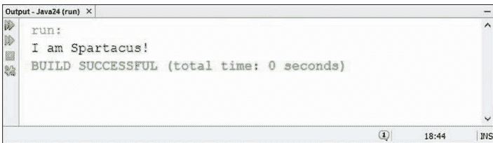

图 A.4 输出

Java 类必须有一个 `main()` 方法才能运行。如果你尝试运行缺少该方法的类，NetBeans 会返回错误。

当你完成程序查看后，点击标签上的 X（标题为 Output – Java 的地方）关闭 Output 窗格。这会让源代码编辑器变大，显示更多行，这在你创建时非常有用。

### 修复错误

现在 `Spartacus` 应用程序已经编写、编译并运行，是时候破坏一些东西以获得 NetBeans 在出现问题时的响应体验了。

回到源代码编辑器中的 `Spartacus.java`，删除调用 `System.out.println()` 的行末尾的分号（见列表 A.1 中的第 18 行）。即使在你保存文件之前，NetBeans 也发现了该错误并在行左侧显示了红色图标（参见图 A.5）。

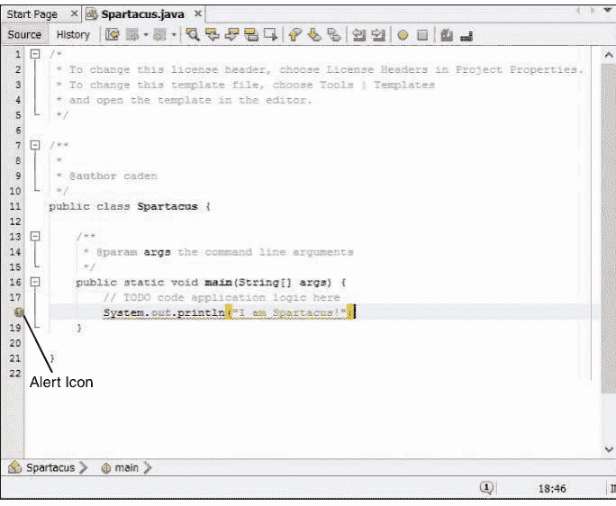

图 A.5 在源代码编辑器中标记错误

将鼠标悬停在警报图标上，会出现一个对话框描述 NetBeans 认为发现的错误。NetBeans 源代码编辑器可以识别你在编写程序时遇到的大多数常见编程错误和拼写错误。在错误修复之前，检测到错误会阻止文件编译。

在行末尾重新加上分号。警报图标消失，你可以再次保存并运行该类。

## 附录 B

### 进阶之路：Java 资源

读完这本书后，你可能会想知道去哪里可以提升你的 Java 编程技能。本附录列了一些书籍、网站、互联网讨论站点和其他资源，你可以利用它们来扩展 Java 知识。

#### 其他值得考虑的书籍

Sams Publishing 和其他出版社提供了几本实用的 Java 编程书籍，其中一些是针对本书书中涵盖内容的后续进阶读。如果你在书店没有找到你正在寻找的这本书，可以使用这些 ISBN 码：

- *Teach Java in 21 Days*，作者：Rogers Cadenhead（就是我！我！我！）。  
  ISBN: 978-0-672-33795-6。虽然这本书前七章的部分内容是重复的，但它对 Java 的讲解更具深度，并增添了许多高级话题。如果你准备好再次投入 504 小时来学习 Java，那么这应该是一本很合适的书。

- *Java Phrasebook*，作者：Timothy R. Fisher。ISBN: 0-67232-907-7。这是一份包含 100 多个代码片段的集合，供你在自己的 Java 项目中使用，由一位专业程序员和《Java Developer's Journal》贡献者编写。

- *Agile Java Development with Spring, Hibernate and Eclipse*，作者：Anil Hemrajani。  
  ISBN 0-672-32896-8。这是一本关于 Java 企业版的书籍，展示了如何使用 Spring 框架、Hibernate 库和 Eclipse IDE 来降低企业级应用编程的复杂性。

- *Android How to Program, 3rd Edition*，作者：Paul and Harvey Deitel。ISBN: 0-13-444430-2。  
  这是一个针对手机和平板 Android 编程的详细介绍，已针对 Android 6 版本和 Android Studio IDE 更新更新。读这本书的读者将学习创建八个应用程序。

- *Java 9 for Programmers, 4th Edition*，作者：Paul and Harvey Deitel。ISBN: 978-0-134-77756-6。对 Java 9 的高级探索，涵盖了 lambda 表达式、Java 模块系统、动画、视频以及使用 JDBC 和 JPA 进行数据库编程。

许多 Sams Publishing 的 Java 书籍的章节和其他材料已在 `www.informit.com` 上线，这是一个 Sams 合作制作的面向信息技术人士的网站。

Sams Publishing 网站 `www.informit.com/sams` 是查看 Sams Publishing 以及 Pearson Technology Group 其他再印版本的好去处。

#### Oracle 官方 Java 网站

Oracle 的 Java 软件部门维护着三个对程序员和该语言用户感兴趣的网站。

面向 Java 开发者的 Oracle 技术网络（Oracle Technology Network for Java Developers）发布于 `www.oracle.com/technet/java`，是寻找 Java 相关信息时访问的第一个选之地。这里可以下载新版本的 Java 开发工具包（JDK）和其他编程资源，以及整个 Java 类库的文档。那里还有一个 Bug 数据库、本地面对面用户群目录以及支持论坛。

`www.java.com` 上的 Java.com 向消费者和程序员推介该语言的优势。你可以从该网站下载 Java 运行环境，它使用户能够在他们的计算机上运行 Java 程序。该网站还了关于运行 Java 和解决安全疑问题的帮助部分。

`www.planetnetbeans.org` 上的 Planet NetBeans 是几十个博客的集合，涵盖了使用 NetBeans IDE 进行 Java 编程。博客的最新帖子显示在该网站上，你可以在 Feedly 等阅读器中订阅它们的 RSS 馈。

#### Java 类文档

Oracle Java 网站最实用的部分可能是 Java 类库中每个类、变量和方法的文档。在线上有数千页的内容，供你免费阅读（不向你收取费用），向你展示如何在程序中使用中这些类。

要访问 Java 9 的文档，请前往 `http://download.java.net/jdk9/docs/api`。

#### 其他 Java 网站

由于 Java 现象在很大程度上最初源于其在网页上的应用，因此大量网站专注于 Java 和 Java 编程。

##### 本书官方网站

本书的官方网站是 `www.java24hours.com`，在附录 C“本书的网站”中有详细描述。

##### Workbench

我还运营一个名为 Workbench 的博客，涵盖了 Java、互联网技术、计算机书籍和类似话题，以及其他主题。你可以在 `http://workbench.cadenhead.org` 找到它。

##### Slashdot

技术新闻网站 Slashdot 自 1997 年以来一直是程序员和其他计算机行业专业人士的首选之地。该网站选择用户提交的最佳故事放在首页，并允许用户对评论进行排名，以便你可以过滤掉噪音。要查看其最新的 Java 相关故事，请访问 `www.slashdot.org/tag/java`。

##### 其他 Java 博客

数百个其他博客涵盖了 Java 编程，要么作为它们的主要重点，要么作为多样主题的一部分。

WordPress.Com 是数千个博客的托管平台，它对 `https://en.wordpress.com/tag/java` 网站上最新的 Java 相关帖子进行了分类。

##### InformIT

技术参考网站 InformIT 位于 `www.informit.com`，是本书出版社支持的一个综合性资源。该网站设有多个板块，致力于与软件开发和互联网相关的几十个主题。InformIT 的 Java 部分包含“如何做”文章和初学者指南。访问 `www.informit.com/topics/topic`。

##### Stack Overflow

在线社区 Stack Overflow 是程序员可以在其上提问并对用户提供的答案进行评分的地方。该网站设有标签功能，你可以将搜索过滤为你感兴趣的话题。访问 `stackoverflow.com/tagged/java`。

##### JavaWorld 杂志

JavaWorld 杂志是一本自该语言诞生的 90 年代起就存在的杂志，它发布教程文章以及 Java 开发新闻和其他专题。还有视频和音频播客。访问 `www.javorld.com`。

##### Developer.com Java 目录

由于 Java 是一种面向对象的语言，可以使用其他开发者创建的资源。在启动重要的 Java 项目之前，你应该在 Web 上扫描你可能使用的资源。一个很好的起点是 Developer.com 的 Java 目录。该网站在 `developer.com/java` 提供信息。

##### Java 会议

Meetup.com 网站包含了许多由用户分享的正式和非正式会议。许多用户群和其他 Java 活动都会在该网站上公布。要找到你附近 100 英里内的会议，请访问 `meetup.com/find/?keywords=Java&radius=100`。

在我所在的佛罗里达州，经常举办 Java 用户群会议、开发者会议和咖啡聚会。

## 附录 C

### 书籍网站

尽管我希望情况并非如此，但在完成了这本书的 24 小时学习后，无疑仍然某些事情是你不清楚的。

编程是一项专业的技术领域，会向你抛来各种奇怪的概念和术语，例如“实例化”、“三元运算符”以及“大端序和小端序字节序”。

如果你对书中涵盖的任何主题不清楚，或者是我对某个主题没有解释清楚（唉），请访问书籍网站 `www.java24hours.com` 寻求帮助。

该网站提供以下内容：

- 错误纠正与澄清——当我注意到错误时，我会在网站上描述这些错误，并提供纠正后的文本以及其他可能有帮助的材料。
- 回答读者问题——如果读者有书中问答章节未涵盖的问题，许多问题会呈现在网站上。
- 在此本书的 24 小时内创建的所有程序所需的源代码、类文件和资源。
- 解决方案，包括每小时结束时建议活动的解决方案（包含源代码）。
- 书中提到的网站的更新链接：如果书中提到的网站更改了地址，且我知道新链接，我将在网站上分享。

你也可以通过访问书籍网站给我发送电子邮件。点击“Feedback”（反馈）链接进入一个可以直接从网页发送电子邮件的页面。你也可以在 Twitter 上通过 `@rcade` 联系我。

> 欢迎随时表达你的观点，无论是积极的、负面的、漠的、犹豫的、愤怒的、热情的、不满的、有趣的、恼火的、好奇、无聊、神往、幻灭、困惑或震惊。
>
> —Rogers Cadenhead

## 附录 D

### 解决 Android Studio 模拟器的问题

免费的 Android Studio 集成开发环境（IDE）自2015年发布以来已成为创建 Android 应用的官方工具。在第24 小时“编写 Android 应用”中，你将学习如何使用此 IDE 用 Java 编写移动应用。

如果你已经读了该章节并成功在 Android 模拟器中运行了应用，就不需要阅读此附录。

但如果你完全无法让模拟器运行，那么你来对了。

### 运行应用的问题

当你在 Android Studio 中进行 Android 项目并想要运行应用时，可以选择菜单命令 `Run`、`Run App`。


# 附录 D：解决 Android Studio 模拟器的问题

此命令会打开一个 Choose Device（选择设备）对话框，询问执行应用所需的设备。如果该设备通过 USB 线连接到你的电脑并配置了测试应用，它可以是真实的 Android 手机或平板。该设备也可以是 Android 模拟器。

Android Studio 中的 Android 模拟器可以像运行移动操作系统的实际手机和平板一样。可以为多个 Android 设备设置虚拟设备。

某些用户在首次使用 Android Studio 中的模拟器运行 Android 应用时会遇到问题。模拟器会带有这条不祥的消息崩溃：

### output

```
ERROR: x86 emulation currently requires hardware acceleration!
Please ensure Intel HAXM is properly installed and usable. CPU
acceleration status: HAX kernel module is not installed!
```

此错误发生在 Windows 电脑上，它们在模拟器工作之前需要安装一个名为硬件加速执行管理器（HAXM）的 Intel 硬件加速程序。该程序可以在 Android Studio 中下载，但你必须在 IDE 之外进行安装。

HAXM 是一种适用于带有 Intel 处理器的计算机硬件虚拟化引擎，通过加快模拟器速度来加速 Android 开发。Android 应用编程中最大的瓶颈之一就是模拟器加载速度缓慢。

在设置 HAXM 之前，你必须将其添加到 Android Studio 中的 Android SDK 中。

> **注意**
>
> HAX 仅应安装在带有 Intel 处理器的电脑上。本附录解决了 Android Studio 显示需要 HAXM 来运行 Android 模拟器的问题。如果模拟器因未提及 HAXM 的错误消息而失败，请勿使用此附录进行修复。

## 在 Android Studio 中安装 HAXM

如果你正在运行 Android Studio，可以下载并将 HAXM 添加到 Android SDK 中。点击 Android Studio 工具栏上的 `SDK Manager`，如图 D.1 所示。

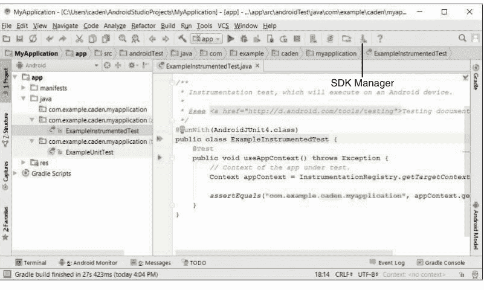

图 D.1：SDK Manager

`SDK Manager` 用于管理 SDK。在 SDK 选项卡中，你将看到一个可用 SDK 组件列表。如果你需要 HAXM，勾选它旁边的框框并点击 `Next`（下一步）开始安装。

## 运行应用的问题

当你在 Android Studio 中进行 Android 项目并想要运行应用时，可以选择菜单命令 `Run`（运行），`Run App`（运行应用）。

此命令会打开一个 Choose Device（选择设备）对话框，询问执行应用所需的设备。如果该设备通过 USB 线连接到你的电脑并配置了测试应用，它可以是真实的 Android 手机或平板。该设备也可以是 Android 模拟器。

Android Studio 中的 Android 模拟器可以像运行移动操作系统的实际手机和平板一样。可以为多个 Android 设备设置虚拟设备。

某些用户在首次使用 Android Studio 中的模拟器运行 Android 应用时会遇到问题。模拟器会带有这条不祥的消息崩溃：

### output

```
ERROR: x86 emulation currently requires hardware acceleration!
Please ensure Intel HAXM is properly installed and usable. CPU
acceleration status: HAX kernel module is not installed!
```

此错误发生在 Windows 电脑上，它们在模拟器工作之前需要安装一个名为硬件加速执行管理器（HAXM）的 Intel 硬件加速程序。该程序可以在 Android Studio 中下载，但你必须在 IDE 之外进行安装。

HAXM 是一种适用于带有 Intel 处理器的计算机硬件虚拟化引擎，通过加快模拟器速度来加速 Android 开发。Android 应用编程中最大的瓶颈之一就是模拟器加载速度缓慢。

在设置 HAXM 之前，你必须将其添加到 Android Studio 中的 Android SDK 中。

> **注意**
>
> HAX 仅应安装在带有 Intel 处理器的电脑上。本附录解决了 Android Studio 显示需要 HAXM 来运行 Android 模拟器的问题。如果模拟器因未提及 HAXM 的错误消息而失败，请勿使用此附录进行修复。

## 在 Android Studio 中安装 HAXM

如果你正在运行 Android Studio，可以下载并将 HAXM 添加到 Android SDK 中。点击 Android Studio 工具栏上的 `SDK Manager`，如图 D.1 所示。

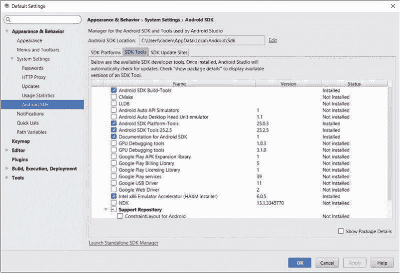

图 D.1：SDK Manager

`SDK Manager` 用于管理 SDK。在 SDK 选项卡中，你将看到一个可用 SDK 组件列表。如果你需要 HAXM，勾选它旁边的框框并点击 `Next`（下一步）开始安装。

## 检查 BIOS 设置

为了让 HAXM 工作，你电脑的 BIOS 必须在设置中开启 Intel 虚拟化技术（Intel Virtualization Technology）。如果你熟悉修改 BIOS，这是一个很容易检查和更改的设置。

由于修改 BIOS 会影响电脑的启动方式——甚至导致 Windows 无法启动——所以只有在你对 BIOS 进行过修改时，才应该在 BIOS 中尝试。

计算机。否则，你应该招募其他专家的帮助，让他们指导你完成这一过程。

BIOS 是在你开启 Windows 电脑时控制它的软件，负责启动电脑和其他必要的硬件功能。

当你的电脑启动时，你会短暂地看到一条关于按下某个功能键以检查 BIOS 设置的消息。

如果你不按此键，BIOS 将完成其工作并开始加载 Windows。

如果你按了该键，你将看到类似图 D.4 所示的屏幕。


图 D.4：查看电脑的 BIOS 设置。

你电脑的 BIOS 主菜单可能与图 D.4 中的不同。这取决于你的电脑制造商及其使用的 BIOS 版本。

在我的 Dell 台式电脑上，我通过选择 `BIOS Setup`（BIOS 设置）、`Advanced`（高级）、`Processor Configuration`（处理器配置）发现 Intel 虚拟化技术（Intel Virtualization Technology）已启用。会列出一个处理器设置列表，每个设置旁边都有“[Enabled]”（已启用）或“[Disabled]”（已禁用）。你可以在这些设置之间进行切换。

如果你在 BIOS 中启用 Intel 虚拟化技术，你的电脑应该能够运行 HAXM，模拟器问题也应该解决。

# 附录 E：修复 NetBeans 中包不可见的错误

这是 Java 9 模块引入的最有趣特性之一，它允许 Java 程序标明它们需要 Java 类库的哪些部分，以及它们导出哪些类包。

模块还可以用于访问类库中通常无法访问的 Java 包。在第 21 节“使用 Java 9 的新 HTTP 客户端”中，在向项目添加 `jdk.incubator.client` 模块之前，对新 HTTP 客户端的实验性支持在编程项目中是不可用的。

Java 9 中的标准模块（且不需要特殊精力即可使用）仍在由 Oracle 和其他最终确定 Java 语言新版本的公司决定中。

本附录涵盖了当 NetBeans 中的 Java 项目因为模块不可用而出现错误时该怎么办。

## 添加模块信息

Java 类库包含数百个包。其中极少数包只有在当它们的模块被添加到项目时才可以使用。

如果你尝试导入位于尚未使用的模块中的类或类组，`import` 语句会导致 NetBeans 源代码编辑器中出现标记的错误。

以下是此类语句的示例：

```
import jdk.incubator.http;
```

如果这导致了编辑器左侧边缘红色符号图标标记的错误，请将鼠标悬停在图标上查看错误消息：

```
package jdk.incubator.http is not visible
(package jdk.incubator.http is declared in module
jdk.incubator.httpclient, which is not in the module
graph)
```

此错误揭示了必须添加到项目中以解决该问题的模块名称。在示例中，它是 `jdk.incubator.http`。

模块设置在默认包中名为 `module-info` 的 Java 类中（换句话说，即一个没有 `package` 语句的类）。

按照以下步骤为 NetBeans 中的 Java24 项目添加模块：

- 选择 `File`（文件）、`New File`（新建文件），然后在 Categories（类别）窗格中选择 Java。
- 在 File Types（文件类型）窗格中，选择 `Java Module Info`（模块信息）。
- 选择 `Java Module Info`，然后点击 `Next`（下一步）。对话框显示 Class Name `module-info` 且不允许选择包名。点击 `Finish`（完成）。

打开 `module-info.java` 文件进入源代码编辑器进行编辑。它只需要三个这种形式的语句：

```
module Java24 {
  requires jdk.incubator.httpclient;
}
```

`module` 关键字后是 `Java24`，因为那是项目的名称。如果你在为不同的项目添加模块，应相应修改该语句。

在 `{` 和 `}` 波浪括号内部的模块块，`requires` 关键字后是模块名 `jdk.incubator.httpclient`。如果你的项目需要不同的模块，请编辑此语句以反映这一点。

一个项目可以有多个 `requires` 语句。

保存 `module-info.java` 文件后，模块（或模块）中的类就可以被项目中的任何 Java 程序使用。添加该模块包的 `import` 语句将不再有错误，程序可以编译并运行。

# 索引

## 符号

- `+`（加法）运算符，60
- `\`（反斜杠），73, 293
- `{`（大括号），17-18, 88, 95, 112-113, 148
- `:`（冒号），90, 106
- `//` 注释符号，17-18
- `+=`（复合赋值）运算符，74-75
- `-`（递减）运算符，61-63
- `/`（除法）运算符，60
- `*`（双引号），59
- `==`（等等）运算符，85
- `>`（大于）运算符，84-85
- `>=`（大于或等于）运算符，84
- `++`（递增）运算符，61-63
- `!=`（不等于）运算符，85
- `<`（小于）运算符，84-85
- `<=`（小于或等于）运算符，84
- `*`（乘法）运算符，61
- `->` 运算符，229
- `+`（点），替换空格，114
- `;`（分号），18, 24, 50
- `'`（单引号），55
- `[`（方括号），112
- `-`（减法）运算符，60
- `?`（三元运算符），90
- `_`（下划线），57
- `$`（美元），257

## 2D 图形

- 颜色
  - 自定义颜色，327
  - 设置，326-327
- 字体，225-326
- 行，228-329
- 饼图
  - `PieFrame` 类，336-338
  - `PiePanel` 类，331-336
  - `Slice` 类，333
- 形状
  - 弧，330-339
  - 椭圆和圆，330
  - 矩形，329-330

## ABCD 系统

- ABCD 系统，81
- Abstract Window Toolkit (AWT)，237-238, 256-257
- 访问方法，146
- `ActionListener`，229, 274
- `actionPerformed()` 方法，213, 270-285
- `add()` 方法，165, 174, 283
- `addListener()` 方法，285
- `addToFront()` 方法，284
- Adventure，299
- Adventures of Tint，96
- 分配内存，155
- Android
  - Android apps，375
  - AVD (Android Virtual Device)，382-383
  - 创建，377-378, 380-381
  - 设计，385-386
  - 优势，
  - Android apps.177-179
- `append()` 方法，280
- 匿名内部类，234
- Antarctica, travel，24
- Apache Project，45
- app stores，32
- `Android.xml` 文件，380
- 注解，162
- Android Studio，413
  - 优势，396
  - BIOS 设置，417-418
  - HAXM (硬件加速管理器)
    - 在 Android Studio 中安装，414-415
    - 在电脑上安装，415-417
    - 运行，413-414
- Android IDE，404
- Android auction，22, 线程文章，212
- AndroidFrame，241
- Androidisto，319-321, 保存，19-20
- 发送参数，43-45
- 减慢，204


## `build()` 方法

- `StringLister`，166-167

## 初始值，113

## 行为.*另参见方法*

## `Variable`，56

## 多维，115-116, 122

## 使用方法创建，144

## `Wheel`，119-121

## 定义，126

## 写入，14

## 排序，116-118

## 继承，160-161

## 块，17-18

## `Wheel` 示例，119-121

## Belichick, Bill，122

## 类语句，16

## Bell Laboratories，5

## 注释，17-18

## Benchmark 应用，107-108

## `main` 语句，17

## Berners-Lee, Tim，322

## New File Wizard，14

## 二进制值，整数，67

## 变量，18-19

## BIOS 设置，417-418

## `ArcD2.Float` 类，330-331

## 空格，23-24

## Archimedes，171

## BlankFiller 应用，43-45

## 弧，330-333, 339

## 块

- 参数
  - 定义，17-18, 53
  - 方法参数，146-147
- 在 if 方法中，85-87
- 发送到应用程序中，43-45
- try-catch，189-192

## 算术运算符，60，


# 索引

## 符号

- `try-catch-finally`，194
- `"array index out of bounds"` 错误，114

## A

- **博客**
  - WordPress.com，40
- `ArrayOutOfBoundsException`，188
- `WebHandler`，409
- `ArrayList` 类，164-165, 174-179
- `BodyHandler`，318
- **数组**，111-113
  - **列表**
  - 添加对象到，74
  - **创建**
  - 在其中查找对象，176
  - 存储在中，164-165, 174-179
  - **错误**，8。*另参见*调试
  - 声明，112-113
  - 定义，112
- `build()` 方法，311

## B

- **built-methods**
  - 内置, 155
- Burtt, Ben, 396
- **按钮**, 242–245
- `byte` 类, 305
- `byte` 变量，类型 56
- **字节码**, 292
- **字节**, 305
- cheese，摄影用语, 339
- **圆形**, 330
- `.class` 文件扩展名, 24
- **类层次结构**, 130
- **类方法**。参见方法 (methods)
- **类语句**, 16
- **类**。另参见数组 (arrays);方法 (methods)
  - `HomePage`, 197–198
  - `HttpClient`, 311
  - `HttpHeaders`, 312
  - `IndexOutOfBoundsException`, 197
  - 实例属性, 160–161
  - 行为, 160–161
  - 建立, 161–162
  - 多重继承, 139
  - 功率, 159–160
  - **内部类**, 149–151, 221–225
    - `Arc2D.Float`, 330–331
    - `ArrayIndexOutOfBoundsException`, 188
    - `ArrayList`, 164–165, 174–179
    - beans, 164
    - `BodyHandler`, 311
    - `BodyProcessor`, 318
    - `BorderLayer`, 261–262
    - `BoxLayout`, 263–264
    - `Byte`, 305
    - C++5
    - `CableModem`, 类, 136
    - 计算器算法, 189
    - CareerBuilder, 410
    - sase 敏感性, 58, 67
    - **对象强制转换**, 131, 132–135
      - 自动装箱, 133
      - 源/目的, 131
      - 拆箱, 133
      - 变量, 131–132
    - **目录应用程序**, 223–225
    - `catch` 语句 final 关键字, 196
    - `try-catch` 块, 189–192
    - `try-catch` 块 finally, 194
    - **捕获异常**。参见异常 (exceptions)
    - CERN 欧洲核研究组织, 318
    - `char` 变量类型, 55–56
    - `char` 变量, 55–56
    - 《查理和巧克力工厂》(Dahi), 271
    - **复选框的创建**, 246–247
      - 事件处理, 276
    - `checker()` 方法, 151
    - `CModem`, 136
    - 类方法, 148
    - 类变量, 141–144
    - `Color`, 326–327
    - **创建**, 128–129, 402–404
    - 定义, 126
    - 文档, 408
    - `DsModel`, 137
    - `Ellipse2D`, 330
    - 封装, 146
    - `ErrorCorrectionMode`, 129–130
    - `File`, 292–293
    - `FileInputStream`, 293
    - `FileOutputStream`, 299
    - `FlowLayout`, 243, 256, 259–261
    - `Font`, 325–336
    - `Gremlin`, 141–144, 152–153
    - `GridLayout`, 261–262
    - `HashMap`, 180–183
    - **辅助类**, 149–151
    - **匿名内部类**, 225–234
      - **目录应用程序示例**, 223–225
      - 声明, 222
      - 示例, 222–223
    - `InputStreamReader`, 159–160
    - `Insets`, 264–265
    - **Java 类库**, 45–49
    - `JButton`, 242–244
    - `CheckBox`, 246–248
    - `JFrame`, 238–242
    - `JLabel`, 245–246
    - `JScrollPane`, 249–250
    - `TextArea`, 248–250
    - `JText`, 245–246
    - `JWindow`, 238–242
    - `KeyAdapter`, 226
    - `KeyViewListener`, 227
    - `Line2D.Float`, 328–329
    - `LottoEvent`, 279–285
    - `MalformedURLException`, 196
    - `Model`, 136
    - `module-info`, 420
    - `NullPointerException`, 197
    - `NumberFormatException`, 191, 195

## C

- **creating** 425
  - 对象重用, 163–164
  - `Come On and Gettit.mp3`, if, 84, 95
  - `PieFrame`, 336–338
  - 295–297
  - `if-else`, 87
  - `PiePanel`, 331–336
  - 注释不等于运算符 (`!=`), 85
  - `PieSlice`, 333
  - `//` 注释符号, 17–18
  - 小于运算符 (`<`), 84
  - 注释, 162
  - 小于等于运算符 (`<=`), 84
  - `Point3D`, 168–169
  - `Random`, 47
  - 比较字符串, 76–77
  - `switch`, 87
  - `Rectangle2D.Float`, 329–330
  - `RenderingHints`, 326
  - 三元运算符 (`?`), 90
  - **创建**, 402–404
  - 异常, 201
  - 子类, 130, 162–163
  - 配置属性, 180
  - 配置/写入, 302–305
  - `super` 关键字, 162
  - 子类, 130
  - 同步, 184
  - `this` 关键字, 162
  - 连接到服务器, 342
  - **创建线程**, 204–208
  - 开始/停止方法, 276–277
  - 启用/禁用, 278–279
  - `contains()` 方法, 181
  - `containsValue()` 方法, 181
  - `all()` 方法, 284
  - **客户端**，参见 HTTP (http)
  - **标签**, 245–246
  - **文本字段**, 245–246
  - **闭包**, 229–233
  - 源/目的, 131
  - 计算机测试, 107–108
  - 拆箱, 133
  - 拼接字符串, 74
  - **条件块**, 85–87
  - 字符串, 80–81
  - **计数器**, 91–94
  - 定义, 83
  - 自定义颜色方法, 327
  - **创建**, 377–388
  - 等于运算符 (`==`), 85
  - 大于运算符 (`>`), 84
  - 大于等于运算符 (`>=`), 84
  - **数组列表**, 174
  - **创建**, 247–248
  - **类**, 128–129, 402–404
  - 事件处理, 276

- **creating** 426
  - `De Architectura` (Vitruvius), 171
  - **构造函数**, 147–148
  - **调试**, 8–9
  - 自定义颜色, 327
  - 在 NetBeans IDE 中, 404–405
  - 异常, 201
  - Salton , 20–22
  - NetBeans IDE, 405
  - `do-while` 循环, 103–104
  - 下载方法, 145–146
  - 来自网络的文件, 314–317
  - NetBeans IDE, 399
  - Minecraft 模块。参见 Minecraft 模块 (minecraft mods)
  - `draw()` 方法, 328
  - `IceCreamScoop` 项目, 367–372
  - 椭圆和圆形, 330–339
  - `LightningStorm` 项目, 362–365
  - 线, 328–329
  - `SiameseCat` 项目, 348–356
  - `PieFrame` 类, 336–338
  - `PiePanel` 类, 331–336
  - NetBeans 项目, 400–401
  - `PieSlice` 类, 329–330
  - **对象**, 135–138
  - 矩形, 329–330
  - **子类**, 168–180
  - `drawString()` 方法, 328
  - **线程**, 204–208
  - 变量, 141–144
  - 匿名内部类, 128–129
  - 内部类, 225

### 查找字符串

- 查找字符串, 77–78
- `firstValue()` 方法, 312
- `float` 变量类型, 54–55
- **浮点数**, 54–55, 131–132
- `FlowLayout` 类, 243, 256, 259–261
- **文件夹**，列列出文件, 293
- `Font` 类, 325
- `FontMapApplication` 类, 182–183, 325–326
- Food Network in the Kitchen, 32–33
- **for 循环**
  - 复杂的 for 循环, 106–107
  - 语法, 99–102
- 正斜杠 (`/`), 60
- Fox, Michael 1289
  - **帧**，创建, 238–242
  - FreeBalls, 31
- `FreeSpaceApplication` 类, 255–256
- `FreeSpacePanel` 应用, 251–254
- `getString()` 方法, 318
- **函数式接口**, 229
- George (Prince), 51
- `get()` 方法, 165, 176, 181
- `getActionCommand()` 方法, 275, 284
- `getBytes()` 方法, 300
- `getEncoding()` 方法, 160
- `EntityType()` 方法, 364
- `getGuid()` 方法, 146
- `getId()` 方法, 391
- `getItem()` 方法, 284–285
- `getKey()` 方法, 182
- `getLivingEntities()` 方法, 364
- `getLocation()` 方法, 351, 365
- `getName()` 方法, 293
- `OrDefault()` 方法, 181
- `getText()` 方法, 264
- `URI()` 方法, 211
- `getWorld()` 方法, 351
- `getXi()` 方法, 359
- `getY()` 方法, 359
- Goodman, Len, 111
- Gosling, James, 5, 29, 376, 399
- Graham, Dave, 121
- **图形用户界面**。参见 GUIs (graph user interfaces)
- **图形**
  - **弧**, 330–331, 399
  - **颜色**
    - 自定义颜色，创建, 326–327
  - **椭圆和圆**, 330
  - **字体**, 325–326
  - **线**, 328–329
  - `PieFrame` 类, 336–338
  - `PiePanel` 类, 331–336
  - `PieSlice` 类, 333
  - **矩形**, 229–330
- `Graphics2` 类, 328
- **大于运算符** (`>`), 84–85
- Green Bay Parker, 100
- `Gremlin` 类, 141–144, 152–153
- `GremlinLab` 应用, 152–154
- `GridLayout` 类, 261–262
- **GUIs** (图形用户界面)。另参见图形
  - **创建**, 247–248
  - **事件处理**, 276
  - **组件**, 237–238
  - **事件处理**。参见 事件处理
  - **帧**, 238–242
  - `FreeSpacePanel` 应用, 251–254
  - **标签**, 245–246
  - **布局管理器**。参见 布局管理器
  - **面板**, 251
  - **按钮**, 242–245
  - **复选框**
    - **创建**, 246–248
    - **事件处理**, 276
  - **组合框**

## H

- **错误处理**。参见 事件处理
- **事件**。参见 事件处理
- **硬件加速执行管理器**，参见 HAX (Hardware Accelerated Execution Manager)
- Harlem Groleters, 184
- **哈希映射**, 180–183
- `HashMap` 类, 180–183
- `Hatfield-Coy` 方法, 224–235
- `Hatfield-Coy Trails`, 235
- **HAXM** (硬件加速执行管理器)
  - 在 Android Studio 中安装, 414–415
  - 在计算机上挂起, 415–417
- `headers()` 方法, 312
- **辅助类**, 149–151。参见 内部类

## J

- **Java 聚会** 429
- Hillbilly Miley (Vance), 235 历史
- Inaba, Carrie Ann, 11
- Android 的变量类型, 375–368
- **Java**, 5, 29–30
- `HomePage` 页面, 197–198
- Hopper, Grace, 9
- HotLix, 68
- **HTTP 客户端**, 309
- **数据**，在网络上发布, 317–321
- **文件**，保存自, 314–317
- **HTTP 请求**, 310–314
- `HttpClient` 类, 311
- **Java 模块**, 309–310
- **HTTP 请求**, 310–314
- `HttpClient` 类, 311
- `HttpHeaders`, 312
- **层级结构**, 130–131
- **多重继承，威力**, 159–160
- **初始化**, 109
- **内部类**, 149–151
  - **匿名内部类**, 234–235
- **Android Studio**。参见 Android 284–285
- NetBeans IDE, 84, 95
- `if` 语句, 87
- `If-else` 语句, 87
- **忽略异常**, 196–197
- `implements` 关键字, 205
- `implements`, 205
- **语言选择**, 4–5
- **启动**, 参见 查看
- **布局管理器**, 259
  - `BorderLayout`, 261–262
  - `FlowLayout`, 259–261
  - `GridLayout`, 261–262
- `ActionListener`, 参见 接口, 274
- `EventListener` 接口, 273–274
- **函数式接口**, 229
- `Runnable`, 205
- **语言**, 7, 11
- `isPresent()` 方法, 312
- **解释型语言**, 222–233 (集成开发)
- **响应** 参见 事件迭代, 101
- **输入**, 292
- **集合**, 264–265
- 在 Studio IDE 中安装, 414–415
- **Java SE** (Java 标准版), 38
- **Java 虚拟机** (JVM), 8, 31, 309, 345
- `java.exe` 文件, 345
- `java.io` 包, 46
- `java.time` 包, 46
- `java.util` 包, 46
- **JDK** (Java 开发 Kit), 9
- Joy, Bill, 29
- `JShell`, 8, 49–57
- `Jsoko`, 36
- `(++)` 运算符, 61–63
- **二进制值**, 67
- **强制转换**, 54–55
- `int` 变量类型, 61–62
- **迭代器**, 131–132
- `IceCreamop` 项目, 366–372
- `ImageDownloader` 应用, 315–317
- `indexOf()` 方法, 77–78, 176
- `IndexOutOfBoundsException`
  - **二进制值**, 67
  - **类**, 131–132
  - **声明**, 54–55
- `info()` 方法, 370
- **环境**, 409 (IDEs), 9–146
- **继承**, 165–161
  - **属性**, 160–161
  - **行为**, 160–161
  - **定义**, 129–130
  - **建立**, 161–162
- **Android 应用**, 388–390
- `EventListener`, 273–274
- **函数式接口**, 229
- `Runnable`, 205
- **语言**, 7, 11
- `isPresent()` 方法, 312
- **解释型语言**, 222–223 (集成开发)
- **响应** 参见 事件迭代, 101
- **输入**, 292
- **集合**, 264–265
- 在 Studio IDE 中安装, 414–415
- **Java SE** (Java 标准版), 38
- **Java 虚拟机** (JVM), 8, 31, 309, 345
- `java.exe` 文件, 345
- `java.io` 包, 46
- `java.time` 包, 46
- `java.util` 包, 46
- **JDK** (Java 开发 Kit), 9
- Joy, Bill, 29
- `JShell`, 8, 49–57
- `Jsoko`, 36
- `(++)` 运算符, 61–63
- **二进制值**, 67
- **强制转换**, 54–55
- `int` 变量类型, 61–62
- **迭代器**, 131–132
- `IceCreamop` 项目, 366–372
- `ImageDownloader` 应用, 315–317
- `indexOf()` 方法, 77–78, 176
- `IndexOutOfBoundsException`
  - **二进制值**, 67
  - **类**, 131–132
  - **声明**, 54–55
- `info()` 方法, 370
- **环境**, 409 (IDEs), 9–146

...（注：由于多栏扫描，OCR 文本高度碎片/交织。我已根据提供的片段重新组组了逻辑流。）

# Java SE (Java 标准版)

- `JButton` 类, 242–244
- `CheckBox` 类, 246–248
- `JFrame` 类, 238–242
- `JLabel` 类, 245–246
- `JPanel` 类, 251
- `ScrollPane` 类, 249
- `JTextField` 类, 245–246
- `TextArea` 类, 248–250


# 索引

## 符号

- `->` 运算符, 229

## A

- `ActionListener` 接口, 参见 接口, 274
- `autoboxing` (自动装箱), 133
- `unboxing` (解箱), 133

## B

- `BorderLayout` 布局管理器, 261–262

## C

- `Crazyforce` 项目, 352–362
- `CrazyHorse` 项目, 360
- `CERN` (欧洲核子研究组织), 318

## E

- `EventListener` 接口, 273–274

## F

- `FlowLayout` 布局管理器, 259–261
- `final` 关键字, 196

## G

- `GridLayout` 布局管理器, 261–262

## I

- `IceCreamScope` 项目, 366–372
- `IceCreamScoop` 方法, 370

## K

- `KeyAdapter` 类, 226
- `keyPressed()` 方法, 226
- `keyReleased()` 方法, 226
- `keyTyped()` 方法, 226
- `KeyViewer` 应用, 227

## L

- `lambda` 表达式, 229–233
- `LightningStorm` 项目, 362–365
- `LinkRotator` 应用, 209–210, 213–216

## M

- `Modern` 类, 128–129, 136
- `Modter` 应用程序, 137–138
- `module` 关键字, 420
- `module-info` 类, 420
- `modules` (模块), 309–310, 419–420
- `Mumblety-Pey`, 205–306
- `Minecraft`
  - 连接到, 346
  - 删除单词, 372–373
  - `EULA` (最终用户许可协议), 343
  - 设置, 342–343
  - 故障排除, 344–346, 347–348
  - 模组, 341
- `Minecraft` 模组项目
  - `SiameseCat` 项目, 348–356
  - `LightningStorm` 项目, 362–365
  - `IceCreamScope` 项目, 366–372

## N

- `NameSorter` 应用程序, 117–118
- `NetBeans` IDE, 9, 164, 399
  - 创建类, 402–404
  - 创建项目, 400–401
  - 调试, 404
  - 文档, 405
  - 下载, 399–400
  - 包不可见错误, 419–420
- `NetBeans` 指南 (Gosling), 599
- `NewCalculator` 应用程序, 191–192
- `NewColorFrame` 应用程序, 232–233
- `NewRoot` 应用程序, 134–135
- `Nines` 应用程序, 101–102
- `NullPointerException` 类, 197
- `NumberDivider` 应用程序, 192–193
- `NumberFormatException` 类, 191, 195

## O

- `OOP` (面向对象编程), 参见 类
- `@Override` 注解, 162

## P

- `PageCatalog`, 198–200
- `PathSeparator` 变量, 293
- `PieFrame` 类, 336–338
- `PiePanel` 类, 331–336
- `PieSlice` 类, 333
- `plugin.yml` 文件
  - `CrazyHorse` 项目, 360
  - `IceCreamScoop` 方法, 370
  - `LightningStorm` 方法, 365
  - `SiameseCat` 方法, 353–354
- `Point30` 类, 168–169
- `PointTester` 类, 169–170
- `Polar Cras`, 74
- `PotionEffect()` 方法, 360
- `Primefinder` 查找, 205–208
- `printing()` 方法, 66, 72–73, 144
- `Purgatory Hill`, 217

## Q

- `Quotes`, 34–35

## R

- `Rectangle2D.Float` 类, 329–330
- `REPL` (读打印循环), 50
- `requires` 关键字, 420

## S

- `SiameseCat` 项目, 348–356
- `SourceForge`, 35–37
- `StringList` 应用, 166–177
- `Streams` (流), 291–292
  - 缓冲输入输出流, 297–299
  - 定义, 291
  - 输入流, 292
  - 输出流, 292
  - 从流读取数据, 293–297
  - 向流写入数据, 299–301
- `String` 类型变量, 55–56
- `super` 关键字, 162–163
- `Swing`, 237–238, 256–257 (也包括 GUIs)
- `switch` 语句, 87–89

## T

- `Tabasco` 辣酱，保质期, 139
- `tauntHuman()` 方法, 146–147
- `Thread` 类, 203
- `Thread` (线程), 203
  - 创建, 204–208
  - `sleep()` 方法, 204
  - 启动/停止, 208–209
  - 事件处理, 213
- `throw` 关键字, 194–196
- `toCharArray()` 方法, 114
- `toLowerCase()` 方法, 77
- `toString()` 方法, 171
- `toUpperCase()` 方法, 77, 80–81
- `translate()` 方法, 168
- `try` 语句, 294
- `try-catch` 块, 189–193
- `try-catch-finally` 块, 194

## U

- `unboxing` (解箱), 133

## V

- `void` 关键字, 145

## W

- `Wheel` 应用, 119
- `Window` 类, 238–242
- `written()` 方法, 300

## 方法索引

- `random()`, 358
- `readLine()`, 299
- `remove()`, 175
- `renameTo()`, 293
- `repaint()`, 289
- `reset()`, 161
- `resume()`, 209
- `run()`, 205
- `scoopTern()`, 369
- `send()`, 311, 319
- `ssendMessage()`, 364
- `setBackground()`, 326
- `setCategory()`, 352
- `setContentView()`, 391
- `setDefaultCloseOperation()`, 240
- `setEditable()`, 248
- `setGuid()`, 146
- `setHealth()`, 365
- `setLayout()`, 243
- `setLineWrap()`, 249
- `setLookAndFeel()`, 241
- `setOwner()`, 352
- `setPassenger()`, 359
- `setRenderingHint()`, 326
- `setSize()`, 240
- `setText()`, 246
- `setTitle()`, 240
- `setType()`, 370
- `setVisible()`, 241
- `setStyleWrap()`, 249
- `showGrewminCount()`, 148
- `size()`, 175, 181
- `skip()`, 294
- `sort()`, 117
- `spawn()`, 351, 359
- `sqrt()`, 369
- `start()`, 208, 211
- `startPlaying()`, 284
- `stop()`, 209
- `stopPlaying()`, 284
- `strikeLightning()`, 365
- `suspect()`, 209
- `tauntHuman()`, 146–147
- `toCharArray()`, 114
- `toLowerCase()`, 77
- `toString()`, 171
- `toUpperCase()`, 77, 80–81
- `translate()`, 168
- `written()`, 300
- `nextInt()`, 47
- `newBuilder()`, 311, 318
- `pack()`, 240
- `parseDouble()`, 368
- `parseFloat()`, 135
- `playSound()`, 370
- `processClicks()`, 391–393
- `put()`, 181
- `paint()`, 289

## 概念索引

- 乘法运算符 (`*`), 61
- 减法运算符 (`-`), 60
- 加法运算符 (`+`), 60
- 三元运算符 (`?`), 90
- 变量命名规范, 58–59
- 循环命名规范, 105–106
- Android 资源命名规范, 387
- 多任务处理, 参见 线程
- 多线程, 203
- 多维数组, 115–116, 121
- 多重继承, 139
- 面向对象编程, 参见 类
- 对象
  - 定义, 128–129
  - 创建, 135–138
  - 示例, 127–128
  - 层级, 130–131
  - 转换, 131–132
  - 存储在列表中, 164–165, 174–179
  - 存储在哈希表中, 180–183
  - 重用, 163–164
- 运算符优先级, 63–64
- 运算符
  - 算术, 60–63
  - 复合赋值 (`+=`), 74–75
  - 递减 (`--`), 61
  - 等于 (`==`), 85
  - 大于等于 (`>=`), 84
  - 大于 (`>`), 81–85
  - 自增 (`++`), 61–63
  - 不等于 (`!=`), 85
  - 小于 (`<`), 84–85
  - 小于等于 (`<=`), 84
- 包
  - `java.io`, 46
  - `java.time`, 46
  - `java.util`, 46
- 布局管理器, 259
- 继承
  - 定义, 129–130
  - 建立, 161–162
  - 属性, 160–161
  - 行为, 160–161
  - 多重继承, 139
- 方法重写, 161–162
- 私有方法, 139
- 私有变量, 143
- 保护变量, 143
- 公有变量, 142
- 属性读/写, 302–305
- 读取数据配置属性, 302–305
- 从流读取数据, 293–297
- 向流写入数据, 299–301
- 保存文件, 314–317
- 发布数据, 317–321
- HTTP 请求, 310–314
- 故障排除
  - Android Studio HAXM, 414–417
  - 运行应用程序, 413–414
  - Minecraft 服务器, 344–346, 347–348
  - NetBeans IDE, 419–420
- 异常
  - 捕获多个异常, 192–193
  - 抛出异常, 194–196, 197–198
  - 未检查异常, 197
  - 数组索引越界, 114
- 测试
  - 计算机速度, 107–108
  - 条件测试, 83
- 文本区域, 248–250
- 文本字段, 245–246
- 字符串
  - 声明, 55–56
  - 拼接, 74
  - 比较, 76–77
  - 转换大小写, 77, 80–81
  - 确定长度, 77
  - 查找, 77–78
  - 特殊字符, 73
  - 空字符串, 80
- 变量
  - 类型
    - `boolean`, 57–58
    - `byte`, 56
    - `char`, 55–56
    - `float`, 54–55
    - `int`, 54–55
    - `long`, 56–57
    - `short`, 56
    - `String`, 55–56
  - 声明, 54–55
  - 赋值, 54
  - 表达式, 64–66
  - 递增/递减, 61–62
  - 二进制值, 67
  - 作用域 (148–149 内), 148–149
  - 线程中的变量, 209–210
- while 循环, 102–103
- 绘制线条, 328–329
- `Line2D.Float` 类, 328–329
- `RenderingHints` 类, 364
- 代码行, 67
- 源代码, 213–216
- 启动线程, 211
- 运行线程, 211
- 可停止线程, 216–217
- 语言外壳, 49
- 启动, 参见 查看
- 鼠标点击处理, 213
- `move()` 方法, 168
- `this` 关键字, 151–152, 162–163
- 三角形, 329–330
- Java 版本, 30
- Oak, 29
- 物理模拟器, 30–31
- NASA, 33
- 实时股票报价, 34–35
- Tomcat, 45
- 新空 Java 文件, 105
- 新文件向导, 14, 43
- 新项目命令 (文件菜单), 401
- 新项目向导, 401
- 新英格兰爱国者队, 122
- 摩雷诺-伊格拉, Rafael, 156
- 网球排名, 155–156
- 汤普森双胞胎, 96
- 蒂姆布克3, 217
- 斯特劳斯特鲁普, Bjarne, 5
- 托罗尼, Bill, 171
- 韦策尔, Dan, 122
- 华盛顿将军队, 184
- 威廉尖叫声, 396
- 卡岑杰默孩子, 201
- 内存溢出错误, 201
- 循环链接, 209
- 减慢事件, 204
- 递归, 163–164
- 返回语句, 145
- 封装, 146
- 行为, 126, 160–161
- 属性, 126, 160–161
- 数值变量, 130–131
- 整数, 54–55
- 浮点数, 54–55
- 幂, 159–160
- 对象转换, 131, 132
- 自动装箱, 133
- 解箱, 133
- 源/目标转换, 131
- 图形类, 328
- 用句号替换空格, 114–115
- 从数组删除对象, 175
- 删除 Minecraft 世界, 372–373
- 文件夹, 380, 386
- 资源
  - Android 应用资源, 386
  - 书, 307
  - 教育类应用程序, 314
  - 网站, 408
  - Oracle Java 网站, 27–29, 408
  - SourceForge, 315
- 网站
  - CERN, 318
  - Java 资源, 408–409, 411
  - Oracle Java 网站, 27–29, 408
  - SourceForge, 35–37
  - 发布, 317–321
- 保护语句, 143
- 私有语句, 143
- 公有语句, 142
- 类的同步, 184
- 项目对话框 (NetBeans), 创建, 400–401
- 程序, 参见 应用程序
- 应用程序
  - `Playback` 应用程序, 433
  - `Credits` 应用示例, 78–80
  - `LinkRotator` 应用, 209–210
  - `Wheel` 应用, 119

## 图片

```


```


# 索引

## 符号

- 递减 (`-`), 61–63
- 下划线 (`_`), 57
- 递增 (`+`), 63
- 优先级, 63–64

## A

- 《查理和糖果巧克力工厂》, 271

## C

- 窗口, 创建, 238–242

## N

- 新文件向导, 14, 43
- 新项目向导, 401

## P

- private, 143
- protected, 143
- public, 143

## S

- short, 56
- static, 143
- String, 121
- 转换为大写, 77, 80–81

## U

- Unicode, 121
- URISyntaxException, 211, 311

## V

- 变量。另见数组
  - Variable 应用, 56
  - boolean, 57–58
  - byte, 56
  - 在其中存储信息, 18, 59–60
  - 强制类型转换 (casting), 131–132
  - 作用域, 148–149
- VB (Visual Basic), 4
- Visual Basic, 4
- void 关键字, 145
- Vance, J.235
- vi 编辑器, 77
- Vitruvius, 171
- Vogel, Karin, 51

## W

- HashMap 的值, 180
- Java 版本, 30
- write(method), 300
- 写入数据
  - 向流写入数据, 299–301
  - 配置属性, 302–305
- Wooley, Sheeb, 409
- WordPress.com, 409
- Workbench 博客, 409
- 世界子类，删除, 37–373
- Wrecker 类, 150–151
- 用户界面，另见 GUIs (图形界面)
- 响应用户输入，另见事件处理
