# 24 小时自学 Java（涵盖 Java 9 第 8 版）

Rogers Cadenhead

### 引言

### 第 1 小时 成为一名程序员

### 第 2 小时 编写你的第一个程序

### 第 3 小时 在 Java 的世界中度假

### 第 4 小时 理解 Java 程序的工作原理

### 第 5 小时 在程序中存储和更改信息

### 第 6 小时 使用字符串进行通信

### 第 7 小时 使用条件测试进行决策

### 第 8 小时 使用循环重复动作

### 第 9 小时 使用数组存储信息

### 第 10 小时 创建你的第一个对象

### 第 11 小时 描述你的对象是什么样子的

### 第 12 小时 充分利用现有对象

### 第 13 小时 在数据结构中存储对象

### 第 14 小时 处理程序中的错误

### 第 15 小时 创建多线程程序

### 第 16 小时 使用内部类和闭包

### 第 17 小时 构建一个简单的用户界面

### 第 18 小时 布局用户界面

### 第 19 小时 响应用户输入

### 第 20 小时 读取和写入文件

### 第 21 小时 使用 Java 9 的新 HTTP 客户端

### 第 22 小时 创建 Java2D 图形

### 第 23 小时 使用 Java 创建 Minecraft 模组

### 第 24 小时 编写 Android 应用

- 第 14 小时：程序中的错误处理

- 异常

- 在 `try-catch` 块中捕获异常

- 块捕获多个异常

- 异常发生后的处理

- 抛出异常

- 不需要捕获的异常

- 抛出和捕获异常

- 第 15 小时：创建一个多线程程序

- 线程

- 让程序运行慢 way

- 创建线程

- 使用线程

- 类声明

- 设置变量

- 构造函数

- 在设置 URL 时捕获错误

- 启动线程

- 运行线程

- 处理鼠标点击

- 显示旋转链接

- 停止线程

- 第 16 小时：使用内部类和匿名内部类

- 内部类

- 闭包

- 读取和写入配置

- 第 17 小时：构建简单的用户界面

- Swing 和抽象窗口工具包

- 使用组件

- 窗口和框架

- 按钮

- 标签和文本框

- 复选框

- 下拉框

- 文本区域

- 面板

- 创建你自己的组件

- 第 18 小时：用户界面布局

- 布局管理器

- 网格布局管理器

- 边界布局管理器

- 框布局布局管理器

- 使用内边距分隔组件

- 布局应用程序

- 第 19 小时：响应用户输入

- 让你的程序开始监听

- 设置组件以便听到事件

- 处理用户事件

- 复选框和组合框事件

- 关键字事件

- 启用和禁用组件

- 完成图形化应用程序

- 第六部分：编写网络应用程序

- 第 20 小时：读取和写入文件

- 流

- 文件

- 从流中读取数据

- 缓冲输入流

- 向流写入数据

- 第 21 小时：使用 Java 9 的新 HTTP 客户端

- 发起 HTTP 请求

- 从网络保存文件

- 在网络上发布数据

- 第 22 小时：创建 Java2D 图形

- 使用字体类

- 使用颜色类

- 创建自定义颜色

- 绘制线条和形状

- 绘制矩形

- 绘制椭圆和圆形

- 绘制圆弧

- 烘焙饼图

- 第 23 小时：使用 Java 创建 Minecraft 模组

- 设置 Minecraft 服务器

- 修复运行服务器时的问题

- 连接到服务器

- 修复服务器连接

- 创建你的第一个 Mod

- 教会僵尸成群出现

- 寻找所有生物（并杀死它们）

- 编写一个可以执行功能的 Mod

- 创建新项目

- 创建新的 Java 类

- 运行应用程序

- 修复错误

- 第 24 小时：编写 Android 应用

- Android 简介

- 探索新项目

- 设置 Android 模拟器

- 运行应用

- 设计真实的应用

- 配置应用的 `Manifest` 文件

- 设计用户界面

- 编写 Java 代码

- 第五部分：图形用户界面编程

- Java 模块

- 附录 A：使用 NetBeans

- 集成开发环境

- 附录 B：以后去哪里：Java 资源

- Oracle 官方 Java 网站

- Java 类文档

- 其他 Java 网站

- 本书的官方网站

- Workbench

- Shadowdot

- 其他博客

- InfoIT

- Stack Overflow

- JavaMagazine

- Developer.com

- 附录 C：解决 Android Studio 问题

- 安装 Android Studio

- 在你的电脑上安装 Android Studio

- 附录 D：修复 NetBeans 中可见的错误

## 献辞

献 Roger Cadenhead, Sr. (1946–2017)


## 作者简介

Cadenhead 是一位作家、程序员和 Web 开发者，编写了许多本关于编程的书，包括《Java 24 小时快速通》。他的官方网站为 `java4hours.com`，可以通过 Twitter `@rcade` 联系他。

## 致谢

感谢 Pearson 的同事们——特别是 Mark Taber、Lori Lyons、Abigail Manheim 和 Boris Mink——没有人能独立完成这本书。

献给我的妻子 Mary 以及我的儿子 Eli 和 Sam。

## 访问免费 Web 版

购买任何格式的书（纸质或电子版）均包含相应的 Web 版，该版本提供了以下特殊功能帮助您学习：

- 在线查看书籍全文
- 获取后续更新和修正

Web 版可以在任何支持 HTML 浏览器的计算机和移动设备上查看。

要获取《Java 24 小时快速通》第八版的 Web 权限，您只需注册本书：

1. 访问 `www.informit.com/register`
2. 登录或创建新帐户
3. 输入 ISBN：`9780672337949`
4. 回答购买证明问题

Web 版将出现在您的帐户“数字购买”选项卡下。

点击 `Launch` 链接访问产品。

## 引言

作为计算机书籍的作者，我经常花时间在书店的电脑区域观察读者的行为，而我假装在读最新一期的肥皂剧杂志。

根据我的研究，我了解到如果你拿起了这本书并读到这段引言，我只有 13 分钟的时间你会把它放下并走向咖啡吧点一杯大杯无咖啡脱脂、加两份香草、不要奶油的拿铁咖啡。

所以我遵守这个承诺：用 Java 编程比看起来要简单得多。

我不应该告诉你，成千上万的程序员利用他们的 Java 技能在软件开发、服务器编程和 Android 应用开发领域获得了高薪工作。任何程序员都不希望老板知道，任何有坚持和空闲时间的人学会这种全球最流行的编程语言。通过完成《Java 24 小时快速通》中每一个小时的教程，你可以快速学会 Java 编程。

任何人都可以学习如何编写计算机程序，即使你不会编写 DVR 程序。Java 是最值得学习的编程语言之一，因为它是一种实用、强大且现代的技术，深受全球程序员的推崇。

来使用这种语言并学习更多关于它的知识。你还将掌握那些日益重要的技能——例如互联网计算、图形用户界面设计、App 创作以及面向对象编程。

这些术语现在对你来说可能没有意义。事实上，它们可能正是让编程看起来既令畏又困难的因素。然而，如果你使用电脑在 Facebook 上创建相册、缴纳税款或处理 Excel 表格，你就可以通过阅读《24 小时自学 Java》来学习编写计算机程序。

### 注意事项

在此时，如果你宁愿喝咖啡而不是学 Java，请将这本书放回书架，并将封面朝外，放在商店人流量较大的侧边书架上。

## 第 1 小时

### 成为程序员

本小时的任务清单：

- 了解学习 Java 的原因。
- 发现程序是如何工作的。
- 选择一个 Java 开发工具。
- 准备好编写你的第一个程序。

你可能听说过计算机编程极其困难。它需要计算机科学学位、数千美元的计算机硬件和软件、敏锐的分析性思维、像约伯一样的耐心，以及对咖啡因饮料的强烈喜爱。

除了咖啡因的部分外，你听过编程比你想象的要简单，尽管程序员们多年来一直告诉人们这很简单，以便我们更容易找到高薪工作。

现在是学习编程的绝佳时机。无数编程工具作为免费下载资源在网上提供，成千上万的程序员将他们的工作作为开源发布，以便人们可以检查软件是如何编写的、修复错误并贡献改进。在复苏的经济中，许多公司正在招聘程序员。

学习 Java 绝佳时机，因为这种语言无处不在。数十亿移动设备使用 Android，该操作系统的应用程序都是用 Java 编写的。如果你有一部 Android 手机，每当你查找电影、在流媒体电台摇滚，或者在一个建造得糟糕的猪之堡垒上扔一只敌对鸟时，你都在享受着 Java 程序员的成果。

本书旨在向三类人教授 Java：

1. 从未尝试过编程的紧张新手
2. 尝试过编程但像领地·伏德魔对待孤儿的英国 schoolchildren 一样讨厌它的苦涩初学者
3. 已知另一种编程语言并希望快速跟上 Java 进度的急性知识分子

为了实现这一目标，本书尽可能使用英语语言，而不是技术术语或晦涩的缩写。所有新的编程术语在引入时都会得到彻底解释。

如果我成功了，你读完这本书时将拥有足够的编程技能，足以对自己和他人产生“威胁”。你将能够编写程序，更有心地投入到编程课程书籍书籍，并更轻松地学习新语言。（明确一下，是指编程语言。这本书不会帮助你精通西班牙语、世界语或克林贡语。）

你还将掌握 Java，地球上使用最广泛的编程语言。

本书的第一小时将提供编程的介绍，并提供设置电脑的指导，以便你可以使用它编写和运行 Java 程序。

### 选择语言

如果你对电脑已经熟悉到可以准备一份美观的简历、平衡支票簿，或在 Instagram 上分享你的假期照片，那么你就可以创建计算机软件。

学习编程的关键是从正确的语言开始。你所选择的编程语言通常取决于你想要完成的任务。每种语言都有优缺点。在我那个时代，小年轻们，人们用 BASIC 语言学习编程，因为它的设计初衷就是为了这一点。

### 注意事项

BASIC 语言的发明是为了让学生易于学习（BASIC 中的 B 代表 `Beginner's`，即初学者）。使用某些 BASIC 的缺点是很容易在使用语言时养成粗糙的编程习惯。

使用 BASIC 最流行的语言是 Visual Basic，它是微软的一种编程语言，现在已经远超其根源。VB（也称为 VB）旨在创建运行在计算机和移动设备上的程序。它的设计是创建运行在计算机和使用操作系统的移动设备上的程序。另一种流行的语言是 PHP，一种用于创建网站的脚本语言。你可能听过的 C++、Ruby、JavaScript 和 Python。

这些语言中的每一种都由 Oracle 提供，Java 在计算机科学课程中，Java 程序员们提供，运行的是，它可以运行在 Windows、Linux、Android 以及各种桌面应用程序上。Java 的通用性口号是“一次编写，随处运行”（`Write once, run anywhere`）。

### 注意事项

早期的 Java 有一个不那么好听的口号：“一次编写，随处调试”（`Write once, debug everywhere`）。这种语言自 1996 年发布第一个版本以来已经进步了巨大。使用 Java 的好处是，它。

C++ 读作 "C-Plus-Plus"，它是在贝尔实验室由丹麦科学家 Bjarne Stroustrup 开发的。Plus-Plus 的部分是一个玩笑。

### 告诉计算机做什么

计算机程序（也称为软件）是告诉计算机执行任务的方法。计算机所做的一切，从启动到关闭，都是由程序完成的。Mac OS X 是一个程序；Minecraft 是一个程序；控制打印机的驱动程序是一个程序；dreaded 蓝屏是一个程序。

计算机程序由按特定顺序处理的命令列表组成。每个命令都是一条语句。

如果你告诉人类管家做什么，对于你请求的会有一定的灵活性。如果你控制一个 A 型人格的人，可以给你的仆提供一套每天遵循的详细指令，如下：

亲爱的管家：

请在我外出时处理好这些家务：

- 吸尘客厅。
- 去商店。
- 买酱油、芥末以及尽可能带得多的寿司卷。
- 回家。

诚挚的，你的主子，

伯蒂·沃斯特

如果你告诉人类管家做什么，对于你请求的执行会有某种灵活性。如果没有加州卷，Jeeves 可以带波士卷代替。

计算机没有灵活性。它们字面执行指令。你编写的程序被精确执行，一次一条指令。

下面的示例是用 BASIC 编写的三行计算机程序。看一眼，但不要太担心每行的含义是什么。

```
PRINT "Hey Tom, it's Bob from the office down the hall."
PRINT "It's good to see you buddy, how've you been?"
INPUT A$
```

翻译成英语，这个程序等于给计算机以下清单：

亲爱的电脑：

- 显示消息：“你好 Tom，我是办公室尽头的 Bob。”
- 提问：“很高兴见到你伙计，最近怎么样？”
- 获取 A 的输入

项目 3：给用户一个回答问题的机会。

诚挚地，你的主人和老师，

Ima Coder

计算机程序中的每一行都被称为语句（`statement`）。计算机按照特定的顺序处理程序中的每条语句，就像厨师遵循食谱，或者管家吉维斯先生遵循伯蒂·伍斯特的指令一样。在 BASIC 语言中，使用行号来将语句按正确的顺序排列。像 Java 等其他语言不使用行号，告诉计算机如何运行程序的方法各不相同。

由于程序的运行机制，当出现问题时你不能责怪计算机，因为计算机完全是在执行你要求它做的事情，因此，任何错误的责任通常都在程序员身上。

唯一的坏消息是，你不会造成任何永久性的伤害。在你学习 Java 编程时，没有任何计算机会受到损坏。

### 程序是如何工作的

构成计算机程序的语句集合被称为它的源代码（`source code`）。

大多数计算机程序的编写方式与你写电子邮件的方式一样——将每条语句输入到文本窗口中。一些编程工具自带了自己的源代码编辑器，另一些可以使用任何文本编辑软件配合使用。

当你写完一个计算机程序后，会将文件保存到磁盘。计算机程序通常有文件名扩展名来指示它们的文件类型。Java 程序必须具有 `.java` 扩展名，例如 `Calculator.java`。

### 注意事项

计算机程序应该准备为没有特殊格式的文本文件。记事本（`Notepad`）是一个适用于 Windows 的文本编辑器，会将所有文件保存为无格式文本。你也可以使用 Mac 上的 `TextEdit` 或 Linux 系统上的 `emacs` 编辑器来创建无格式的文本文件。更简单的解决方案将在本小时稍晚些时候出现。

要运行你保存为文件的程序，你需要一些帮助。所需的帮助类型取决于你正在使用的编程语言。某些语言需要解释器（`interpreter`）来运行它们的程序。解释器检查计算机程序的每一行并执行该行，然后继续处理下一行。许多版本的 BASIC 都是解释型语言。

解释型语言最大的优势是测试速度更快。当你编写 BASIC 程序时，可以立即尝试、修复错误并再次尝试。主要的缺点是解释型语言的运行速度比其他程序慢。每一行都必须翻译成计算机可以运行的指令，一次翻译一条。

其他编程语言需要编译器（`compiler`）。编译器获取程序并将其翻译成计算机可以理解的形式。它还能让程序尽可能高效地运行。编译后的程序可以直接运行，无需解释器。

编译后的程序运行速度比解释型程序快得多，但测试需要更多时间。你必须写完整个程序后才能进行尝试。如果你发现错误并修复了它，必须重新编译程序。

Java 是很特殊的，因为它既需要编译器也需要解释器。编译器将构成程序的语句转换为字节码（`bytecode`）。一旦成功创建这些字节码，就可以由解释器 Java 虚拟机（`Java Virtual Machine`）运行。

Java 虚拟机，也称为 `JVM`，是让 Java 程序能够在不同的操作系统和不同类型的计算设备上无需修改即可运行的核心。虚拟机将字节码转换为特定设备的操作系统可以执行的指令。

### 注意事项

Java 9 引入了一个名为 `JShell` 的新工具，它像解释器一样，在你输入 Java 语句时立即运行。`JShell` 的工作原理是将语句放入 Java 程序，将该程序编译为字节码并运行它。它是学习和测试的有用工具。

### 当程序不起作用时

许多新程序员在开始测试他们的程序时会感到沮丧。错误随处可见。其中一些是语法错误（`syntax errors`），计算机在查看程序时会因为他们编写的语句感到困惑并识别出它们。其他错误是逻辑错误（`logic errors`），只有程序员在测试程序时才会注意到（或者可能完全被忽略）。逻辑错误通常会导致程序执行无意之外的操作。


当你开始编写自己的程序时，你会对错误变得非常熟悉。它们是过程自然组成部分。编程错误被称为 `bug`（虫），这个词可以追溯到一个世纪或以前，用于描述技术设备中的错误。

修复错误的过程也有自己的术语：调试（`debugging`）。

描述错误的方法有很多并不是巧合。在学习编程时，无论你是否想要它，你都会获得大量的调试经验。

## 选择 Java 编程工具

> **注意**
>
> 第一个计算机 `bug` 之一于 1947 年由一个包括美国计算机科学家格蕾丝·霍珀（Grace Hopper）在内的团队发现，霍珀在哈佛大学测试一台计算机时，一个继电器故障了。原因不是软件问题——而是一个真正的 `bug`！一名团队成员通过移除一只死的飞蛾修复了计算机，并将其胶贴在日志簿上，附上注释：“发现的第一个真实的 `bug` 案例”。该 `bug` 和日志簿页面可以在 `www.doncio.navy.mil/CHIPS/ArticleDetails.aspx?id=3489` 查看。

开始编写 Java 程序之前，你必须有一个 Java 编程工具。Java 有多种程序可用，包括简单的 Java 开发工具包（`JDK`）以及更复杂的 `Eclipse`、`IntelliJ IDEA` 和 `NetBeans`。后三者都是一个集成开发环境（`IDE`），是专业程序员用来完成任务的强大工具。

当 Oracle 发布新版本时，你必须有相应的 Java 编程工具。Java 有多种程序可用，包括简单的 Java 开发工具包（`JDK`）以及更复杂的 `Eclipse`、`IntelliJ IDEA` 和 `NetBeans`。后三者都是一个集成开发环境（`IDE`），是专业程序员用来完成任务的强大工具。

要创建 Java 程序，你必须有一个 Java 编程工具。Java 有多种程序可用，包括简单的 Java 开发工具包（`JDK`）以及更复杂的 `Eclipse`、`IntelliJ IDEA` 和 `NetBeans`。后三者都是一个集成开发环境（`IDE`），是专业程序员用来完成任务的强大工具。

Java 是很特殊的，因为它既需要编译器也需要解释器。编译器将构成程序的语句转换为字节码。一旦成功创建这些字节码，就可以由解释器 Java 虚拟机运行。

Java 虚拟机，也称为 `JVM`，是让 Java 程序能够在不同的操作系统和不同类型的计算设备上无需修改即可运行的核心。虚拟机将字节码转换为特定设备的操作系统可以执行的指令。

> **注意**
>
> Java 9 引入了一个名为 `JShell` 的新工具，它像解释器一样，在你输入 Java 语句时立即运行。`JShell` 的工作原理是将语句放入 Java 程序，将该程序编译为字节码并运行它。它是学习和测试的有用工具。

在第 24 小时“编写 Android 应用”中，你将使用 `Android Studio`。创建 Android 的 Google 为 Java 程序员推荐了免费工具。

## 安装 Java 开发工具

本书的每一小时都包含了你可以开展的 Java 项目，以便在知识在大脑中吸收时增强理解。

如果你的计算机上没有 Java 编程工具，你就无法进行任何学习。

如果你已经安装了支持 Java 的工具，你可以用它来开发接下来 23 小时的程序。然而，你应该已经对该工具的使用有一定的熟悉程度。同时学习 Java 和复杂的 `IDE` 可能会令人望畏。

阅读本书时推荐的编程工具是 `NetBeans`，它是 Oracle 免费提供的。虽然 `NetBeans` 有许多需要时间学习的高功能，但创建和运行简单应用程序是简单的。

要了解如何下载和安装 `NetBeans`，请阅读附录 A，“使用 NetBeans 集成开发环境”。

## 总结

在本小时中，你接触了计算机编程的概念——给计算机一组称为语句，告诉它该做什么。你还了解了为什么选择自学 Java 而不是其他语言是一个明智的决定。

你可能已经下载并安装了一个 Java 开发工具，用于开发未来的程序。

# 工作研会

## 问答

- **Q. BASIC：C++？Smalltalk？Java？这些语言的名字代表什么意思？**

- **A.** `BASIC` 的名称源于缩写：初学者通用符号指令代码（`Beginner's All-purpose Symbolic Instruction Code`）。`C++` 是一种为了改进 `C` 语言而创建的编程语言，而 `C` 语言是对 `B` 编程语言的改进。`Smalltalk` 是 20 世纪 70 年代的一种创新面向对象的语言，许多理念被 `Java` 所采用。

`Java` 违反了用缩写或其他有意义的术语命名语言的传统。它只是 `Java` 开发者最喜欢的名字，击败了 `WebRunner`、`Silk`、`Ruby` 等等。（当时 `Ruby` 编程语言还不存在。）

当我创建自己的编程语言时，我会把它命名为 `Salsa`。大家都喜欢 `Salsa`。

- **Q. 为什么解释型语言比编译型语言慢？**

- **A.** 它们慢的原因等同于：用外语口译现场演讲的人比口译打印好的演讲稿的人要慢。现场口译员必须在每一句话产生时进行思考，而另一位口译员可以对整个演讲进行处理，并采取捷径来加速过程。编译型语言可以比解释型语言快得多，因为它们通过某些处理使程序运行更高效。

- **Q. 你只有关于 Java 的问题吗？**

- **A.** 完全没有。尽管问吧。

- **Q. 好的，《舞动星》（Dancing with the Stars）历史上最低分是多少？**

- **A.** 美国 ABC 电视节目中，名人参赛者最糟糕的舞蹈是由说歌手 Master P 在 2006 年的第二季表演的。他与专业舞者 Anya DelGrosso 合作的双帕索舞舞得了历史最低的 8 分（评委 Len Goodman 和 Bruno Tonioli 的）。Carrie Ann Inaba 评出了 4 分。

Tonioli 的评价：“这是一场噩梦。你看起来像个在商场找妈妈的小孩。”

Goodman：“我知道观众认为通过让你回来是在表现仁慈。其实不是。我们很残忍——对 Alice，也对评委们。”

Inaba：“我实际上认为那是你跳得最好。”

Master P 为该节目只训练了 20 小时，而该赛季其他参赛者当时已经训练了 130 小时。他拒绝穿舞鞋，而是穿着篮球鞋表演。

可以在 `YouTube` 上看到那段舞蹈，其中一位评论者写道：“如果你是为了看那个‘双桨式’而来看的，请点赞。”

在澳大利亚的《舞动星》中，真人秀明星 Dave Graham 在 2007 年获得了可能的最低分——所有评委都给了 1 分，总分 4 分。他在自己的 `YouTube` 账号上分享了这段表演，并写道：“也许这不是最好的成名方式，但哪里有记录就收什么记录吧。”

## 测验

通过回答以下问题，测试你对本小时涵盖内容的掌握程度。

- **1. 以下哪项**不是**人们认为计算机编程极其困难的原因？**

  A. 程序员散传这个传言以改善我们的就业前景。

  B. 术语和缩写随处可见。

  C. 发现编程太难的人可以获得政府救助。

- **2. 哪种工具通过一次处理一行代码来运行计算机程序？**

  A. 慢工具

  B. 解释器

  C. 编译器

- **3. 为什么 James Gosling 躲在办公室里创建了 Java？**

  A. 他对在项目中使用的语言不满意。

  B. 他的摇滚乐队没有演出机会。

  C. 当你在上班无法访问 YouTube 时，互联网非常无聊。

- **1. C.** 计算机书籍的作者也没有获得救助。

- **2.** 解释器一次解释一行。编译器预先处理好指令，以便程序运行得更快。

- **3. A.** 他对 `C++` 感到沮丧。在 1991 年他创建 `Java` 时，`YouTube` 还是 `YouToothpaste`（牙膏）的地方。

## 活动

如果你想更深入地接触 Java 和计算机编程，请完成以下活动：

- 要了解更多关于为什么要学习 Java，请阅读这篇 Oracle 大学博客文章：`https://blogs.oracle.com/oracleuniversity/10-reasons-why-you-should-consider-learning-java`。

- 使用英语编写一个打印 "Hello, World!" 的 Java 程序。

# 第 2 小时：编写你的第一个程序

## 你需要

- Java 开发工具包 (`JDK`)
- 一个 `IDE`（集成开发环境），如 `NetBeans`
- 一个文本编辑器

## 待办事项

- 创建一个 Java 程序
- 保存程序
- 编译程序
- 运行程序

## 创建程序

为你的第一个程序做准备，请遵循以下步骤：

1. 选择 `File`（文件）、`New Project`（新建项目）。打开 `New Project` 对话框。
2. 选择项目类别 `Java` 和项目类型 `Application`（应用程序），然后点击 `Next`（下一步）。
3. 输入 `Java24` 作为名称。（如果你之前创建过同名的项目，你将看到错误信息“Project folder already exists and is not empty.”）
4. 取消勾选 `Create Class`（创建类）框。
5. 点击 `Finish`（完成）。

`Java24` 项目被创建在自己的文件夹中。你可以在学习这本书的过程中使用此项目。

## 开始程序

`NetBeans` 将项目分组在项目中。如果你没有打开 `Java24` 项目，这里是加载它的方法：

1. 选择 `File`（文件）、`Open Project`（打开项目）。出现文件对话框。
2. 找到并选择 `NetProjects` 文件夹（如有必要）。
3. 选择 `Java24` 并点击 `Open Project`（打开项目）。

`Java24` 项目出现在 `Projects` 面板中，旁边有一个咖啡杯图标和一个 `+` 号，可以展开以查看项目包含的文件和文件夹。

要向当前打开的项目添加新的 Java 程序，选择 `File`（文件）、`New File`（新建文件）。打开 `New File` 向导，如图 2.1 所示。


**图 2.1** New File 向导。

## 创建文件

`Categories` 面板列出了你可以创建的不同类型的 Java 程序。点击此面板中的 `Java` 文件夹以查看属于该类别的文件类型。对于第一个项目，选择 `Empty Java File` 类型（在 `File Types` 面板末尾）并点击 `Next`（下一步）。

打开 `New Empty Java File` 对话框。按照以下步骤开始编写程序：

1. 在 `Class Name` 字段中输入 `Saluton`。
2. 在 `Package` 字段中输入 `com.java24hours`。
3. 点击 `Finish`（完成）。

你可以立即开始编写程序，一个空文件 `Saluton.java` 在源代码编辑器中打开。

## 列表 2.1

```java
package com.java24hours;

public class Saluton {
    public static void main(String[] args) {
        System.out.println("Hello, World!");
    }
}
```

## 列表 2.1 Saluton 程序

```
1: package com.java24hours;
2:
3: class Saluton
4:     public static void main(String[] arguments) {
5:      // My first Java program goes here
6:     }
7: }
```

请确保所有字母的大小写与所示完全一致，并使用空格或 `Tab` 键在第 4-6 行插入空白。完成后，选择“文件”（`File`），然后点击“保存”（`Save`）来保存文件。

到此时，`Saluton.java` 已经包含了 Java 程序的骨架。你将创建许多与此程序完全相同的程序，除了第 3 行的 `Saluton` 一词外。它代表你的程序名称，并会随着你编写的每个程序而改变。第 5 行对你来说应该是易理解的，因为它是一句真正的英语。其余部分对你来说可能都是全新的。

### class 语句

程序的第一行如下：

`package com.java24hours;`

包（`package`）是将 Java 程序组合在一起的一种。这个包告诉计算机 `com.java24hours` 是该程序的包名。

在空行之后，第三行是：

`class Saluton`

翻译成英语，它的意思是：“计算机，给我的 Java 程序命名为 `Saluton`。”

正如你从第一小时回记的那样，你给计算机的每条指令被称为语句（`statement`）。`class` 语句是你给计算机程序命名的方式。正如你以后将看到的，它还用于确定程序的其他属性。`class`（类）一词的意义在于，Java 程序也被称为“类”。

在这个示例中，程序名称 `Saluton` 与文档文件名 `Saluton.java` 相匹配。Java 程序必须有一个与其文件名第一部分（即点符号 `.` 字符之前的部分）匹配的名称，并且大小写方式保持一致。

如果程序名称与文件名不匹配，当你尝试编译某些 Java 程序时将会得到错误，这取决于 `class` 语句是如何被用于配置程序的。

### main 语句的作用

程序的下一行如下：

```
public static void main(String[] arguments) {
```

这一行告诉计算机：“程序的主部分从这里开始。”Java 程序被组织成不同的部分，因此需要一种方法来识别程序在运行时首先执行的部分。

`main` 语句是大多数 Java 程序的入口点。例外情况包括 `applets`（通过网络浏览器在网页上运行的程序）、`servlets`（服务程序）以及 `apps`（由移动设备运行的程序）。

你在本书接下来的章节中编写的大多数程序都使用 `main` 作为起点。这是因为你是直接在自己的计算机上运行它们。而 `applets`、`apps` 和 `servlets` 是由另一个程序或设备间接运行的。

为了将它们与其他类型区分来，你直接运行的程序被称为应用程序（`applications`）。

### 那些波浪标记

在 `Saluton` 程序中，第 3、4、6 和 7 行包含某种形式的波浪标记——是 `{` 要么 `}`。这些括号是将你的程序行进行分组的方式（就像在句子中使用括号来对单词进行分组一样）。左括号 `{` 和右括号 `}` 之间的所有内容都是同一个组的一部分。

这些分组被称为块（`block`）。在列表 2.1 中，第 3 行的左括号与第 7 行的右括号相关，这使得你的整个程序变成了一个块。你通过这种方式使用括号来显示程序的开始和结束。

块可以位于其他块内部（就像在这个句子中使用括号一样（这里又使用了第二组括号())).`Saluton` 程序在第 4 行和第 6 行的括号建立了另一个块。这个块从 `main` 语句开始。`main` 块内部的行将在程序启动时运行。

> **提示**
>
> `NetBeans` 可以帮助你确定块从哪里开始和结束。点击 `Saluton` 程序源代码中的任意一个括号。被点击的括号变成黄色，与之对应的括号也会变成黄色。被这两个黄色括号包围的 Java 语句就是一个块。这个提示对于像 `Saluton` 这样短的程序并不有用，但当你编写长多的程序时，它可以帮助你避免看起来像个呆头脑。

以下语句是块内部的唯一内容：

```
// My first Java program goes here
```

这一行是一个占位符。行开头的 `//` 告诉计算机忽略这一行，因为放在程序中完全是为了查看源代码的人类而设置的。具有此类目的的行被称为**注释**（`comments`）。

现在，你已经写了一个完整的 Java 程序。它可以被编译，但如果你运行它，什么也不会发生。原因为是你还没有告诉计算机去做任何事情。**main** 语句块只包含一个注释，它会被计算机忽略。你必须在 **main** 块的左右括号内部添加一些语句。

### 在变量中存储信息

在你要编写的程序中，你需要一个地方来临时存储信息。你可以通过使用变量（`variable`）来实现这一点，变量是一个可以存放整数、浮点数、布尔值和字符串的地方。存储在变量中的信息是可以改变的。

在 `Saluton.java` 文件中，将第 5 行替换为：

```
String greeting = "你好!";
```

这条语句告诉计算机存储 "你好!"。

在 Java 程序中，你必须告诉计算机变量将持有什么类型的信息。**String**——包含字母、数字、标点符号和其他字符的字符串。该语句建立了变量。

### 显示变量的内容

如果你现在运行程序，看起来似乎什么都没有发生。在变量中的存储操作在后台进行。为了让计算机显示它正在执行某些操作，你可以显示该变量的内容。

在 `Saluton` 程序的 `String greeting = "你好!";` 语句之后插入另一个空行。使用该空间输入：

`System.out.println(greeting);`

这条语句告诉计算机显示存储在 `greeting` 变量中的值。`System.out.println` 语句将信息显示在系统输出上——即你的显示器。

### 保存最终成品

你的程序现在应该类似于列表 2.2，尽管你可能在第 5-6 行使用了不同的空格。进行任何修正并保存文件（选择“文件”，“保存”）。

## 列表 2.2 Saluton程序的完成版本

```
1: package com.java24hours;
2:
3: class Saluton {
4:     public static void main(String[] arguments) {
5:         String greeting = "你好!";
6:         System.out.println(greeting);
7:     }
8: }
```

当计算机运行此程序时，它执行 `main` 语句中第 5 行和第 6 行的每个语句。列表 2.3 显示了如果用英语而不是 Java 编写程序是什么样子。

## 列表 2.3 Saluton 程序的逐解析


# 第 2 小时 编写你的第一个程序

## Saluton 程序

将此程序放入 `com.java24hours` 包中。

Saluton 程序从这里开始：
程序的主部分从这里开始：
在名为 `greeting` 的变量中存储字符串 "你好!"。
显示变量 `greeting` 的内容。
程序的主部分到这里结束。
Saluton 程序到这里结束。

列表 2.4 显示了如果用克林贡语（《星际迷航》中战士种族的语言）编写该程序，它看起来将是什么样子的。

### 列表 2.4 克林贡语版本的 Saluton 程序

```
1: 此程序属于 com.java2hours 家族！
2:
3: 如果你还想活，就从这里开始 Saluton 程序吧！
4: 程序的主体在此处带着荣誉开始！
5: 将乱码 "Saluton mundo!" 存储在一个名为 greeting 的 String 变量中！
6: 显示这些内容源于一种低于克林贡语的语言！
7: 在此处结束程序的主体以避免我的震怒！
8: 现在结束 Saluton 程序，并感谢你幸免于一劫吧！
```

## 将程序编译为类文件

在运行 Java 程序之前，你必须对其进行编译。当你编译一个程序时，程序中给计算机的指令会被转换为计算机更容易理解的形式。

NetBeans 在保存程序时会自动进行编译。如果你按照列表 2.2 所示输入了任何内容，程序都会成功编译。

程序的一个编译版本——一个名为 `Saluton.class` 的新文件会被创建。所有的 Java 程序都会被编译成类文件，其文件扩展名为 `.class`。一个 Java 程序可以由几个共同工作的类组成，但在简单的程序中，只需要一个类。

编译器将 Java 源代码转换为字节码，这是一种由 Java 虚拟机（JVM）运行的形式。

> **注意**
>
> Java 编译器只有在出现错误时才会开口抱怨。如果你成功编译了一个程序且没有任何错误，则不会有任何反应。
>
> 诚然，这有点大失所望。当我开始成为一名 Java 程序员时，我曾希望成功的编译能伴随着华丽的庆祝号角齐响。

## 修复错误

当你在 NetBeans 源代码编辑器中编写程序时，错误会在编辑器面板的左侧用红色警报图标标记，如图 2.2 所示。

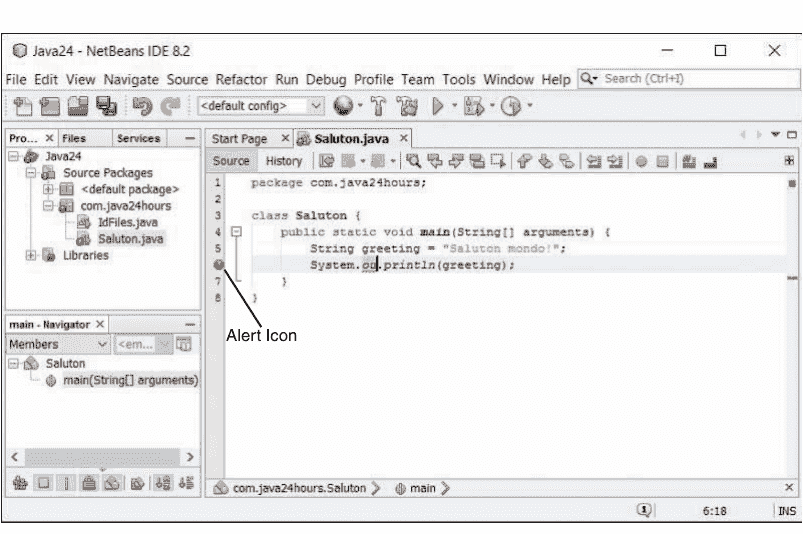

图 2.2 在源编辑器中发现错误。

该图标出现在触发错误的行上。你可以点击此图标显示一个错误对话框，其中解释了编译器的详细信息：

- Java 程序的名称
- 错误类型
- 发现错误的行号

这里是一个你在编译 Saluton 程序时可能会看到的错误对话框示例：

```
cannot find symbol.
symbol : variable greeting
location: class Saluton
```

错误信息是对话框的第一行：“cannot find symbol.（找不到符号）”。这些信息通常会让新程序员感到困惑。当错误信息对你来说不可通时，不要花太多时间试图理解它。相反，查看错误发生的行，并检查最明显的原因。

例如，你可以判断以下语句中的问题所在：

```
System.out.println(greeting);
```

错误是变量名中的拼写错误，应该是 `greeting` 而不是 `greting`。

（故意在 NetBeans 中加入此拼写错误看看会发生什么。）

如果你在创建 Saluton 程序时遇到错误对话框，请检查你的程序是否与列表 2.2 一致，并修正你发现的任何差异。确保所有大小写正确，并包含了所有的标点符号，如 `{}`、`;` 和 `()`。

通常，仔细观察错误对话框识别出的那一行，就足以揭示需要修复的错误（或多个错误）。

> **提示**
>
> 本书官方网站 www.java24hours.com 包含了你创建的所有程序。如果你在 Saluton 程序中发现了任何类型或其他导致错误，但错误仍然存在，请前往书籍网站从第 2 小时下载 `Saluton.java`。尝试运行该文件。

## 运行 Java 程序

要查看 Saluton 程序是否符合你的预期，请使用 Java 解释器运行该类。在 NetBeans 中，选择菜单 Run（运行）、Run File（运行文件）。源代码编辑器下方会打开一个输出面板。在此面板中，如果没有错误，程序将显示输出，如图 2.3 所示。

```
Output - Java24 (run)
run:
  Saluton mundo!
BUILD SUCCESSFUL (total time: 0 seconds)
```

**图 2.3** 运行你的第一个 Java 程序。

如果你看到了“Saluton mundo!”这段文字，说明你写了第一个可以运行的 Java 程序！我的计算机刚刚向世界问好——这是计算机编程领域的一个传统，对我们许多人来说，就像能量饮料、短袖衬衫和《英雄联盟》一样重要。

你可能会问自己为什么“Saluton mondo!”是一个传统的问候语。这句话在国际语中的意思是“你好，世界！”，国际语是由 Ludwig Zenhopf 在 1887 年创建的人造语言，旨在促进国际交流。

它之所以被称为传统的问候语，仅仅是因为我正试图开启那项传统。

## 第 2 小时 工作坊

> **提示**
>
> Oracle 在网络上提供了 Java 语言的全面文档。阅读此书并不需要它，因为每个主题在介绍时都进行了充分讨论，但当你想要扩展知识并编写自己的程序时，这个参考资料会非常有用。
>
> 文档可以下载，但在 Oracle 网站上按需浏览更方便。http://download.oracle.com/java/javase/

## 总结

在这一小时中，你学习了开发一个程序需要完成这四个步骤：

1. 使用编辑器编写程序。
2. 将程序编译为类文件。
3. 使用 Java 虚拟机运行程序。
4. 调用程序。

在此过程中，你接触了一些编程概念，如编译器、解释器、块和变量。

## 问答

- **Q：** 在代码中放置正确的空格数量重要吗？
- **A：** 对于计算机来说，这完全不重要。但为了观察程序，你应该使用一致的缩进。

- **Q：** 我在编译器指出错误的那一行没有发现任何错误，我该怎么办？
- **A：** 错误消息显示的行号并不总是需要修复错误的地方。检查错误消息上方的语句，看看是否能发现任何类型或其他 Bug。错误通常位于同一个代码块内。

- **Q：** 如果每个语句末尾都需要分号，为什么注释行 `// My first program goes here` 结尾没有分号？
- **A：** 注释会被编译器完全忽略。如果你在程序的某行中放置 `//`，这会告诉 Java 编译器忽略该行 `//` 之后的所有内容。下面的示例显示了语句行上的注释：

## 验证

通过回答以下问题，测试你对本小时内容的掌握程度。

- **1. 当你编译一个 Java 程序时，你在做什么？**
   - A. 将其保存到磁盘
   - B. 将其转换为计算机更容易理解的形式
   - C. 将其添加到你的程序集中

- **2. 什么是变量？**
   - A. 一个会摇晃但不会倒下的东西
   - B. 程序中编译器忽略的文本
   - C. 程序中存储信息的地方

- **3. 修复错误的过程称为什么？**
   - A. 解冻
   - B. 调试
   - C. 分解

## 答案

- **1. B.** 编译程序会将 `.java` 文件转换为 `.class` 文件或一组 `.class` 文件。
- **2. C.** 变量是存储信息的一个地方；以后你还会学习其他存储方式，例如数组和常量。Weebles 会摇晃但不会倒下，而注释是程序中编译器忽略的文本。
- **3. B.** 因为计算机程序中的错误被称为 bug，修复这些错误被称为调试。有些编程工具使用一种名为调试器的工具来帮助你修复错误。NetBeans 拥有最好的调试器之一。

## 活动

如果你想更深入地探索本小时的主题，请尝试以下活动：

> 你可以使用 http://translate.google.com 的 Google 翻译将“Hello world!”翻译成其他语言。编写一个程序，让你的电脑用法语、意大利语或葡萄牙语向世界问候。

> 回到 Solution 程序并添加一两个错误。例如，去掉行末的分号，或者将其中行的 `println` 改为 `print1`（使用数字 1 而不是字母 L）。保存程序并尝试编译它；将你看到的错误信息与你引起的错误进行对比。

要查看这些活动的解决方案，请访问书籍网站 www.java24hours.com。

# 第 3 小时 Java 之旅

本小时的任务清单：

- 发现 Java 的历史。
- 学习使用这种语言的好处。
- 查看 Java 运行的示例。

在进一步接触 Java 编程之前，多了解这种语言并看看程序员今天如何使用它是值得的。尽管 Java 早已超出了它作为一种专注于网页浏览器程序的语言的起源，但你可以找到数百万个 Java 在移动应用中的用法示例。

在本小时中，我们查看展示 Java 程序、用该语言编写的应用程序以及该语言的历史和发展的网站。

要开始这趟假期，你需要一台可以运行 Java 程序的手机或平板电脑。

启动你选择的设备，穿上你最舒适的衬衫，准备好去度假。你不需要离开家，也不会体验旅游中那些简单的快乐，如异国风情、异国美食、异地人等。

但也要看到光明的一面：没有旅行支票的烦恼，没有护照，也不用担心水质。

## 第一站：Oracle

假期始于 www.java.com，这是由 Oracle 开发的网站，Oracle 是开发 Java 语言的公司。

在移动设备上运行的 Java 程序被称为 app。Java 应用程序出现在 Android 设备上。Java 也出现在网络上：用 Java 编写的桌面程序可以从网络浏览器启动，Java servlet 由 Web 服务器运行以交付网络应用程序，而 Java applet 出现在浏览器的网页上。

图 3.1 显示了 Celtic Heroes，这是一款在 Android 上由 Java 驱动的大型多人在线游戏。你可以通过 Google Play 或你设备的应用商店安装该应用来免费玩此游戏。


图 3.1 Java 驱动的应用游戏 Celtic Heroes。

当你运行它时，游戏会在几秒内加载，你可以创建一个角色并探索幻想世界。

Oracle 的 Java 部门领导着 Java 语言的发展。Java Magazine 是一本 Oracle 在 Java.com 免费提供的在线杂志，展示了 Java 如何在 Android 手机、网站和其他平台上使用。数十亿设备运行着用 Java 编写的 Java 程序。

Oracle 还为 Java 程序员提供了一个更具技术导向的网站 www.oracle.com/technic/java。该网站可以找到最新版本的 NetBeans 和 Java 开发包 (JDK) 以及其他编程资源。

这段 Java 之旅从 Android 开始，因为那里已成为该语言应用最繁荣的地方。学习 Java 后，你可以使用 Android 软件开发包 (SDK) 来开发自己的应用，SDK 是一个在 Windows、Mac OS 和 Linux 上运行的免费编程工具包。

已有超过 300,000 个应用为 Android 手机和其他运行移动操作系统的设备创建。你将在第 24 小时“编写 Android 应用”中学习更多关于如何创建它们。

## Java 简史

Bill Joy 是 Sun Microsystems 创建 Java 时的高管之一，他将这种语言称为“过去 15 年工作的最终成果，旨在产生一种更有效、更可靠的编写计算机程序的方法”。Java 的创建比这要复杂一点。

Java 由 James Gosling 在 1990 年开发的，作为一种……（此处原文严重重复）

（注：原文此处存在大量 OCR 识别导致的重复错误，已根据上下文逻辑清理并翻译）

## 使用 Java 体验物理

作为其中一个示例，安装 FreeBalls 应用以访问由俄罗斯计算机程序员 Ivan Maklyakov 创建的免费粒子运动模拟器。该程序使用 Java 演示了由数千万个固体或液体构成的粒子的物理动画。运动通过倾斜屏幕来控制。图 3.2 显示了色彩斑斓的结果。


图 3.2 使用 Java 应用程序交互式地体验物理模拟器。

许多操作系统都有大量的教育程序，但让这个程序脱颖而出的特点之一是它的可用性。该模拟器可以在任何 Android 设备上运行。你还可以在任何带有 Java 虚拟机（JVM）的计算机上运行 Java 程序。

移动设备或网络浏览器加载的 JVM 与你在第 2 小时“编写你的第一个程序”中运行 Saluton 应用程序时使用的 JVM 是同一个。

Java 程序（例如物理模拟器）不需要为特定的操作系统编写。由于像 Windows 这样的操作系统被称为平台，这种优势被称为平台独立性。Java 的创建是为了在多个系统上运行。Java 的开发者认为它需要是多平台的，因为它将用于各种家用电器和其他电子设备。

用户可以在各种系统上运行你用 Java 编写的程序，而不需要你付出任何额外工作。在适当的情况下，Java 可以消除为不同的操作系统和设备创建程序特定版本的需求。

## 在 Food Network 吃午餐

在我们的两个站点点开了胃口后，在 Food Network in the Kitchen 享用午餐吧，这是一个由味觉电视频道创建的免费 Java 应用程序。

对于该频道上的每位星级厨师，Food Network in the Kitchen 都提供了食谱、烹饪笔记、用户评论和视频。应用程序格式的优势之一是它可以结合文章包含交互功能。图 3.3 显示了 Giada de Laurentiis 的香煎海鲈鱼食谱，并配有一段解释如何制作的视频教程。记得要使用你的鱼类铲子！


图 3.3 Food Network in the Kitchen 应用中的食谱。

像发现 Food Network in the Kitchen 这样的应用程序包含了成千上万供用户尝试的程序。由于这些程序来自许多开发者，必须采取安全措施来保护用户及其设备。自 Java 引入以来，一个被热烈讨论的问题是这种语言是否安全。

安全性很重要，因为 Java 程序在以应用程序形式交付时的工作方式如此。你在这一小时内使用的应用程序被下载到你的手机或平板电脑上。程序下载完成后就可以运行。

除非你认识很多人，否则你使用的大多数应用程序都是由陌生人发布的。在安全性方面，运行他们的程序与让公众随意通过来借用你的电脑没有多大区别。如果 Java 语言没有防止滥用的安全保护措施，它的程序可能会向你的系统引入病毒、删除文件、播放 William Shatner 的口述歌曲表演，并做其他不可理喻的事情。

Java 包含了多种类型的安全机制，以确保其程序在从应用程序或网页上运行时是安全的。

该语言通常情况下已经足够安全，可以在 Web 上使用，但近年来被利用的安全漏洞导致一些安全专家建议用户在浏览器中完全关闭 Java。大多数领先的浏览器都不鼓励用户在网站上运行 Java 小程序。

用户在移动端应用、服务器程序和桌面软件上更经常遇到 Java。这就是为什么这一小时用于运行 Spring 框架而不是小程序。

## 在 NASA 仰望星空

Java 之旅的下午第一个站点是一次太空之旅。NASA 是一个美国政府机构，它广泛使用 Java。一个例子是 ISS Detector，这是一个由开发者 Runat 开发的免费应用，它让观星者关注国际空间站和几颗轨道卫星。

ISS Detector 将 ISS 和卫星的当前位置和路径叠加在夜空之上。在图 3.4 中，该程序显示了铱星 99 卫星（GALEX）在凌晨 1:43 穿过东部天空，经过金星和天王星。

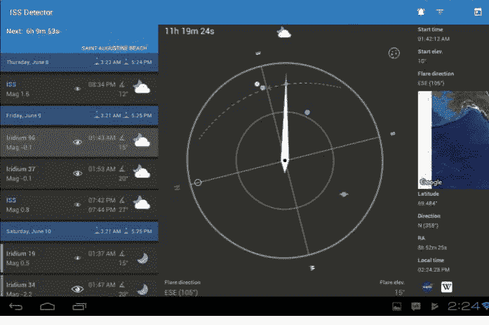

**图 3.4** ISS Detector 监控轨道卫星的位置和路径，这对于“金属鸟类爱好者”们来说是一个福音。

该程序在运行时会重绘每个被跟踪卫星的位置，并根据用户面对的方向改变天空地图的朝向。这种实时更新之所以可能是因为 Java 语言是多线程的。多线程是计算机同时做多件事的方法。程序的一部分处理一个任务，另一部分处理另一个任务，这两部分可以互不干涉。在这个例子中，程序的每个部分被称为线程。

在像 ISS Detector 这样的程序中，每颗卫星都可以在它自己的线程中运行。如果你使用 Windows 10 等操作系统，当你同时运行多个程序时，你就在使用这种行为。例如，你正在一个窗口玩 Minecraft，同时在另一个窗口运行销售报告，并给朋友打长途电话。

## 进入正题

在你的旅程中此时，你可能会认为 Java 主要是为了培养太空爱好者。我们旅程的下一步是一个关于 Java 进入业务的示例。安装 Realtime Quotes 应用，它可以显示持仓情况。图 3.5 显示了 GOOG（谷歌母公司）的数据。


图 3.5 数据呈现

如果你使用 SourceForge 首页顶部的搜索框搜索 Java，你会在网站的项目目录中找到超过 61,000 个列表。

SourceForge 程序之一是 JSoko，它是日本仓库守员游戏 Sokoban 的 Java 版本（参见图 3.6）。该益智游戏具有动画、图形、键盘控制和声音。要下载该应用程序并查看其 Java 源代码，请访问 https://sourceforge.net/projects/jsokoapplet 下载源代码。


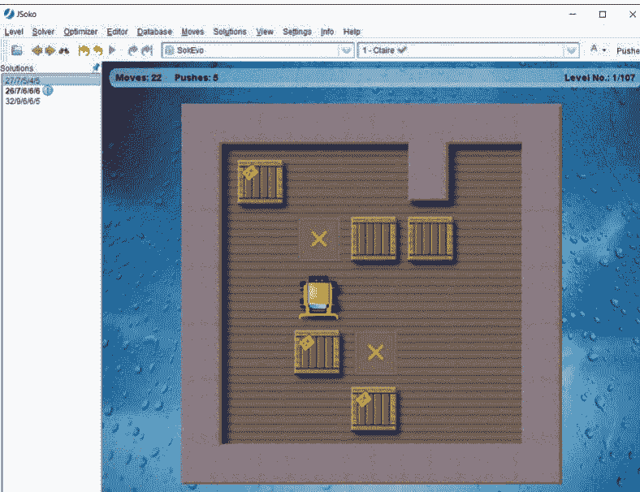

图 3.6

在 SourceForge 上可以找到作为开源推子游戏 JSoko 的 Java 程序源代码。

Java 包含了庞大的类库，你可以在自己的程序中使用它们。JSoko 使用了库中的 `Image` 类（在 `java.awt` 中）来显示箱子等图形，并使用 `AudioInputStream` 类（在 `javax.sound.sampled` 中）在卡车移动和放置箱子时播放声音。

许多程序（在 SourceForge 及其他地方）使用 Java 创建的原因之一是，尽管这种语言功能强大，但它设计得更容易学习。

该语言的一个原始设计目标是让掌握 C++ 更快，Gosling 在 20 世纪 90 年代与其智能家电项目使用的正是这种语言。Java 的大部分内容基于 C++，因此学习过如何使用该语言的程序员会发现学习 Java 容易得多。然而，C++ 中一些最难学习和正确使用的元素在 Java 中并不存在。

对于初次学习编程的人来说，Java 比 C++ 更容易学习。某些语言的创建是为了让有经验的程序员更容易在他们的程序中利用计算机的能力。这些语言包含了快捷方式和其他编程资深人士易于理解的功能。

Java 不使用这些功能的任何一个，而是倾向于让语言尽可能像面向对象的编程语言一样简单。Java 的创建是为了易于学习、调试和易于使用。Java 包含了许多增强功能，使其成为其他语言的有力竞争对手。

### 总结

在接下来的 21 小时里，你将掌握 Java 语言的基础构建模块，学习如何创建自己的对象来完成面向对象编程中的任务，设计图形用户界面以及更多内容。

除非你停止阅读这本书去玩《凯尔特英雄》（Celtic Heroes）。

### 工作坊

### 问答

+ Q. 为什么 Java applet 不再流行了？

A. 当 Java 语言在 20 世纪 90 年代推出时，大多数人学习这种语言是为了编写 applet。Java 是创建在网络浏览器中运行的交互式程序的唯一方法。多年来，替代方案出现了。Macromedia Flash、Microsoft Silverlight 以及新的网页发布标准 HTML5 都提供了将程序放在网页上的方法。

+ Applet 受到加载时间过长、浏览器开发者对新版本 Java 支持缓慢以及被黑客利用的安全漏洞的阻碍。尽管 applet 正在从网络上消失，但 Java 已经超越了它作为网络浏览器增强的初衷，现在变成了一种复杂的通用型编程语言。

### Q. Java SE（Java 标准版）和 Java EE（Java 企业版）之间有什么区别？Java EE 需要付钱吗？

+ A. Java 企业版是 Java 标准版的扩展，它包含了支持高级技术的包，例如企业级豆（Enterprise JavaBeans）、XML 处理以及服务的开发——即运行在 Web 服务器上的 Java 程序。Java EE 还包含一个应用程序服务器，这是一个专门为有沉重计算需求的企业和其他大型组织设计的执行 Java 软件的复杂环境。可以从 Oracle 的 oracle.com/technwork/java/javaee 免费下载 Java EE 开发包。

### Q. 什么是 Ruth's Chris Steak House（露丝罗斯牛排馆），为什么 Ruth 拥有一家？

+ A. Ruth's Chris Steak House 是遍布美国及其他几个国家的 130 多家高端餐厅连锁店，这个奇怪的双名名字揭示了她谦卑的出身及其创始人固执的性格。

该连锁店成立于 1965 年，是一家位于新奥尔良的餐厅，所有者是 Ruth Fertel，一个有两个儿子的单亲妈妈。Fertel 看到了一则出售餐厅的分类广告，并申请了一笔 22,000 美元的房屋抵押贷款来购买它（相当于现在的 150 美元）。

### 测验

如果到此时你的大脑还没有休息，请通过以下问题测试你对这一小时内容的掌握：

+ 1. 面向对象编程是如何得名的？

A. 程序被认为是一组共同工作的对象。

B. 它很难掌握。

C. 它的父母给它起的名字。

+ 2. Java 应用设计在何处运行？

A. 浏览器。

B. 手机。

C. 桌面。

+ 3. 计算机运行 Java 需要什么？

A. 编译器

B. Java 虚拟机

C. 两者都有

### 答案

+ 1. A. 它是 OOP 的缩写吗？

+ 2. Android 应用都是用 Java 编写的。它们可以在浏览器和桌面运行，但是针对移动设备设计的。

+ 3. B. Java 虚拟机（JVM）是一个将字节码转换为计算机或设备可以运行的指令的解释器。创建 Java 程序需要编译器，但运行它们不需要。

### 活动

在打开行李之前，你可以通过以下活动更充分地探索本小时的主题：

+ 使用 SourceForge (www.sourceforge.net) 查询使用 Java 语言开发的游戏。

+ 在你的 Android 设备上的 Google Play 搜索物理模拟。选择一个你觉得有趣的并安装。

书中的活动解答可以在书籍网站 www.java4hours.com 上找到。

## 第 4 章：理解 Java 程序如何工作

**本小时的任务清单：**

- 学习应用程序如何工作。
- 向应用程序传递参数。
- 学习 Java 程序是如何组织的。
- 使用 Java 类库。
- 尝试 Java 9 的新工具 JShell。
- 在应用程序中创建对象。

Java 编程中一个重要的区别是你的程序应该运行在哪里。某些程序旨在在计算机上运行。其他程序旨在在手机或平板电脑上运行。

在自己的计算机上本地运行的 Java 程序称为应用程序，由 Web 服务器运行的程序称为 servlet（位于程序）。你在第 2 小时编写的 `Saluton` 程序是 Java 应用程序的一个示例。你创建的下一个应用程序将计算数字的平方根并显示该值。

在 NetBeans 中打开 Java24 项目，开始一个新的应用程序：

1. 选择 File, New File。新文件向导。
2. 选择类别 Java 和文件类型 Empty Java File，然后点击 Next。
3. 输入类名 Root。
4. 输入包名 com.java24hours。
5. 点击 Finish。

NetBeans 会创建 `Root.java` 并在源编辑器中打开该空文件，以便你开始进行工作。输入列表 4.1 中的所有内容，记住不要输入列表左侧的行号和列号。这些数字用于在书中更容易地描述程序部分。完成后，点击工具栏上的“全部保存”（Save All）按钮保存文件。

### 列表 4.1 Root.java 的完整文本

```java
1: package com.java24hours;
2:
3: class Root {
4:     public static void main(String[] arguments) {
5:         int number = 225;
6:         System.out.println("The square root of "
7:             + number
8:             + " is "
9:             + Math.sqrt(number)
10:    }
11: }
```

Root 应用完成了以下任务：

- 第 1 行——应用程序位于 `com.java24hours` 包中。
- 第 5 行——整数值 225 被存储在名为 `number` 的变量中。
- 第 6-10 行——显示此整数及其平方根。第 9 行中的 `Math.sqrt(number)` 语句显示了平方根。

如果你在输入列表 4.1 时没有出现任何拼写错误（包括所有的标点符号并如所示大写每个字母），你可以在 NetBeans 中选择“运行”（Run）、“运行文件”（Run File）来运行该文件。程序的输出显示在输出面板中，如图 4.1 所示。

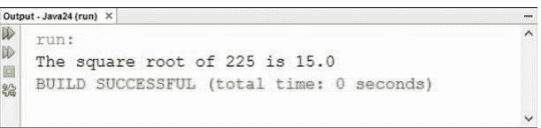

### 图 4.1

Root 应用的输出。

当你运行 Java 应用时，Java 虚拟机 (JVM) 会寻找 `main()` 块并启动该块内的 Java 语句。如果你的程序没有 `main()` 块，JVM 将返回错误。

第 9 行的 `Math.sqrt(number)` 语句演示了 Java 语言的一种内置能力——确定数字平方根的能力。有一个 Java 程序 `Math`，它包含一个名为 `sqrt()` 的方法来查找特定数字的平方根。

`Math` 程序是 Java 类库的一部分，你将在本小时稍后探索它。

### 向应用程序传递参数

你可以使用 `java` 从命令行运行 Java 应用，`java` 是一个调用 JVM 的程序。当你运行程序时，NetBeans 在后台会使用此程序。当程序作为命令运行时，JVM 会加载该应用程序。命令可以包含额外的信息项，如下例所示：

```bash
java TextDispatcher readme.txt /p
```

发送到程序的任何额外信息被称为“参数”（argument）。第一个参数（如果有的话）在应用程序名称后通过一个空格提供。每个额外的参数也通过空格分隔。在前面的示例中，参数是 `readme.txt` 和 `/p`。

如果你想在参数内部包含空格，你必须对其加上引号，如下所示：

```bash
java TextDispatcher readme.txt /p "Page Title"
```

此示例带有三个参数运行 `TextDispatcher` 程序：`readme.txt`、`/p` 和 `"Page Title"`。双引号防止了 `Page` 和 `Title` 被视为独立的参数。

你可以向 Java 应用发送任意数量的参数（在合理范围内）。为了对它们进行操作，你必须在应用程序中编写处理它们的语句。

要查看参数在应用程序中如何工作，请在 Java24 项目中创建一个新类：

1. 选择文件（File）、新建（New）、文件（File）。
2. 在新建文件向导中，选择类别 `Java` 和文件类型 `空 Java 文件`（Empty Java File）。
3. 给类命名为 `BlankFiller`，包名为 `com.java24hours`，并点击完成（Finish）。

在源代码编辑器中输入列表 4.2 的文本并在完成后保存。编译程序，纠正编辑器在你输入时标记的任何错误。

### 列表 4.2 BlankFiller.java 的完整文本

```java
1: package com.java24hours;
2:
3: class BlankFiller {
4:     public static void main(String[] arguments) {
5:         System.out.println("The " + arguments[0]
6                                     + " " + arguments[1] + " fox"
7                                     + "jumped over the "
8                                     + arguments[2] + " dog.");
9:
10:    }
11: }
```

此应用程序成功编译，但如果你尝试通过菜单命令“运行”（Run）、“运行文件”（Run File）运行它，你会得到一个看起来复杂的错误：

```
Exception in handler "main" java.lang.ArrayIndexOutOfBoundsException: 0
   at BlankFiller.main(BlankFiller.java:5)
```

此错误发生是因为程序在运行时期望接收三个参数。你可以通过自定义 NetBeans 中的项目来指定参数：

1. 选择菜单命令运行（Run）、设置项目配置（Set Project Configuration）、自定义（Customize）。打开项目属性对话框。
2. 在主类文本框中输入 `com.java24hours.BlankFiller`。
3. 在参数字段输入 `retromenting purple lactose-intolerant` 并点击确定（OK）。

由于你自定义了项目，你必须以稍微不同的方式运行它。选择菜单命令运行（Run）、运行主项目（Run Main Project）。项目属性对话框如图 4.2 所示。

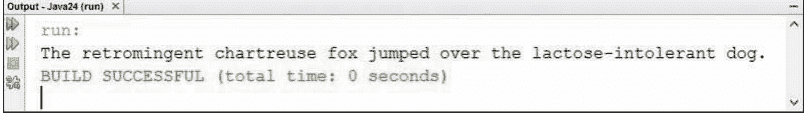

### 图 4.2

项目属性对话框。

Java 类组织成包（packages），其功能类似于计算机上的文件夹。你到目前为止创建的包都属于 `com.java24hours` 包。

文档的主页分为多个窗（frames）。最大的窗列出了组成 Java 类库的所有包，并对每个包进行了描述。

包的名称有助于描述它们的用途。例如，`java.io` 是一组用于从磁盘驱动器、互联网服务器和其他数据源进行输入输出的类；`java.time` 包含与日期和时间相关的类；`java.util` 提供了工具类。

在文档主页上，最大的窗是包列表，对每个包都有简短描述。点击包名以了解更多信息。一个页面列出了包中的类。

Java 类库中的每个类在参考参考网站上都有自己的文档页面，总数超过 22,000 页（你不需要阅读所有内容，甚至永远不需要）。

在最后一个小时里，你将熟悉这个类库并使用现有的 Java 类来完成一些工作。

`Dice` 程序使用 `java.util` 包中的 `Random` 类，该类可用于创建随机数。

### Java 类库

在程序中使用此类时，你所做的第一件事是使用以下语句导入它的包：

`import java.util.*;`

这使得你无需使用其完整名称（即 `java.util.Random`）即可引用 `Random` 类。相反，你只需要将其简写为 `Random`。星号允许你通过较短的名称引用包中的所有类。

如果你只想导入 `Random` 类，该语句应该是：

`import java.util.Random;`

一个 Java 程序可以被认为一个执行任务（或多个任务）的对象。`Random` 类是一个模板，你可以用它来创建一个 `Random` 对象。要创建一个对象，使用 `new` 关键字，后跟名称和括号：

```java
Random generator = new Random();
int value = generator.nextInt();
```

Java 中的整数范围从 -2,147,483,648 到 2,147,483,647。生成器会随机选择这些数字中的一个，并将其赋值给变量 `value`。

在 NetBeans 中，创建一个名为 `Dice` 的新空 java 文件，并将其放入 `com.java24hours` 包中。当编辑器打开时，将列表 4.3 的文本编辑到该窗口，然后点击 Save 按钮（或选择菜单 Save，Save）。

### 列表 4.3 Dice.java 的全文

```java
1: package com.java24hours;
2:
3: import java.util.*;
4:
5: class Dice {
6:     public static void main(String[] arguments) {
7:         Random generator = new Random();
8:         int value = generator.nextInt();
9:         System.out.println("The random number is "
10:             + value);
11:     }
12: }
```

通过选择 Run，Run File 来运行程序。输出如图 4.4 所示，尽管你的数字会不同。（实际上，有四十分之一的概率数字相同，这比彩票的中奖概率还要低）。

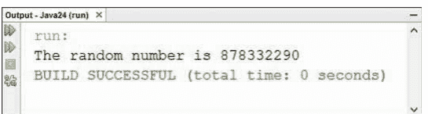

图 4.4

Dice 程序的输出。

你现在有一个随机选择的整数供你自己使用了。好好对待它。

`Random` 类和 Java 类库中的所有类一样，在 Oracle 网站上都有详细的文档可以阅读。它描述了该类的目的、它所属的包、如何创建该类的对象，以及调用了哪些方法让它执行某些操作。

按照以下步骤查看此文档：

1. 在网页浏览器中，加载页面 http://download.java.net/jdk9/docs/api。
2. 在左角的导航栏中，点击 Frames 链接。文档将在多个框架中打开。
3. 在左上角的 Modules 框架中，点击 `java.base`。
4. 在主框架中，向下滚动直到你看到指向包 `java.util` 的链接。点击此链接。将显示该包的文档。
5. 在主框架中，向下滚动并点击 `Random` 链接。

作为一个经验还不到四小时的 Java 程序员，你可能会发现这些文档理解起来极其困难。这没什么好担心的。它是为有经验的程序员编写的。

但当你阅读这本书并对 Java 内置类的用法感到好奇时，你可以通过查看类的官方文档来获得一些价值。一种使用方法是查找该类中的方法，每个方法都执行一项工作。

### 在 JShell 中尝试 Java 语句

在 `Random` 文档中，你可以向下滚动到 `nextInt()` 方法的解释，该方法用于列表 4.3 的第 8 行。图 4.5 显示了页面的这一部分。

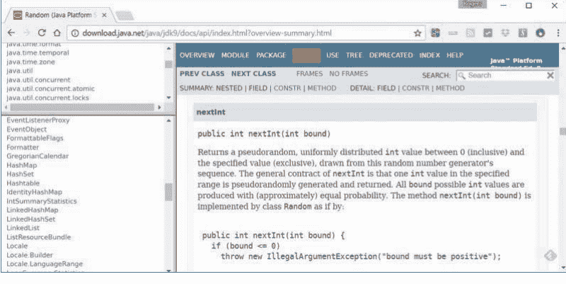

图 4.5

Oracle 对 `Random` 类的文档。

### 注意


本书涵盖的所有 Java 类都包含在其页面中，因此不需要在线文档即可完成这 24 小时的学习并成为 Java 程序员。因为书中所使用的类具有许多入门级书籍无法涵盖的额外功能，Java 类库文档可以补充你的学习。

## 在 JShell 中尝试 Java 语句

Java 推出了一个有趣的新工具，让初学者更容易学习这种语言。`JShell` 是包含在 Java 开发包（JDK）中的一个命令行程序，可以输入单个 Java 语句并查看其作用。

`JShell` 是一个语言外壳，一个交互式环境，可以通过输入命令来玩 Java。每个命令都是一个 Java 语句。一旦你按下回车，语句就会由 JVM 执行，就像它是完整 Java 程序的一部分一样。

要运行 `JShell`，在文件系统中找到安装 JDK 的文件夹。该文件夹有一个名为 `bin` 的子文件夹。打开该文件夹并双击 `jshell`。

## 第 4 小时：理解 Java 程序是如何工作的

打开一个窗口，你可以在其中输入 Java 代码并查看其作用。

图 4.6 显示了一个 `JShell` 窗口。

```
Command Prompt - JShell
(c) 2017 Microsoft Corporation. All rights reserved.
C:\Users>
Welcome to JShell -- Version 9
For an introduction, type /help
jshell>
System.out.println("The random number is "
The random number is 12345678
```

图 4.6

在 `JShell` 中操作。

`JShell` 命令在 `jshell>` 提示符处输入。每个命令后，`JShell` 显示产生的值。当你准备好退出 `JShell` 时，使用 `/exit` 命令。

这种语言外壳也被称为 REPL，它是“读取-求值-打印循环”的缩写。术语源于 Lisp 语言，该语言具有交互式外壳。

REPL 是实验书中技术的绝佳实践方式。

### 总结

在本节中，你有机会创建一个 Java 程序，向程序传递参数并使用现有程序。

当你拥有更丰富的经验时，接下来的几节将继续关注应用程序。应用程序测试起来更快，因为它们不需要像其他类型的程序那样进行额外工作。

本节是讨论如何使用对象及其方法的几节中的一节。你将在第 10 小时“创建你的第一个对象”中回到这个主题。

### 问答

- 问题：发送到 Java 程序的所有参数都是字符串吗？

回答：Java 在运行时以字符串形式存储所有参数。当你想要将这些参数之一作为整数或非字符串类型时，必须进行转换。你将在第 11 小时“描述你的对象”中学习这一点。

- 问题：英国王位的继承顺序会最终终结吗？

回答：根据 1701 年起实施的议法，英国君主必须是汉诺威索菲亚（Sophia of Hanover）的新教徒后代，她是在法律通过时王室的继承人德国公主。

索菲亚的后代人数是有限的，因此继承顺序中总会有最后一个人。英国德国名单仅列出了前 38 位，因此谱系学家尝试自己填充剩余部分。

继承顺序中的最后一个人是 Karin Vogel，一位三十多岁的德国治疗师。在 2011 年，谱系学家经过几年的详尽搜索，确定她是第 4973 位。因此，如果排在她前面的所有人都退出竞争（例如，花更多时间学习 Java 编程），Vogel 将接管白金宫的抵押并成为卡琳一世。

Vogel 是索菲亚的世祖孙。她告诉《华街日报》，成为君主“压力太大”。

随着威廉王子和凯特王妃的乔治（正式全名为剑桥郡殿下乔治·亚历山大·路易斯王子）的出生，Vogel 掉到了第 4974 位。

## 验证

通过回答以下问题，测试你对本小时内容的掌握程度。

- 1. 哪种类型的 Java 程序可以在移动设备上运行？

  A. Apps（应用）

  B. Applications（应用程序）

  C. None（无）

- 2. JVM 代表什么？

  A. Journal of Vacation Marketing（度假营销杂志）

  B. Jacksonville Veterans Memorial（杰克斯逊退伍军人纪念馆）

  C. Java Virtual Machine（Java 虚拟机）

- 3. 如果你为向 Java 程序发送信息的方法争吵，你在做什么？

  A. 为字符串（strings）挣扎

  B. 为参数（arguments）争论

  C. 为功能战斗

### 答案

- 1. A. Apps 作为手机或平板电脑等移动设备的一部分运行，而 applications 则在几乎所有其他地方运行。

- 2. A、B 或 C。陷阱题！这三个缩写代表了三个意思，虽然 `Java Virtual Machine` 是你在接下来 20 小时内需要记住的。

- 3. B. Applications 以参数（arguments）的形式接收信息。难道我们不能和睦相处吗？

### 练习

如果你想将你的敏锐度应用于应用程序，建议进行以下活动：

- 以 Root 应用为引导，创建一个 NewRoot 应用，它能够显示 625 的平方根。

- 以 Root 应用为引导，创建一个 NewRoot 应用，它能够显示作为参数提交的数字的平方根。

书中活动的解决方案已在书的网站 www.java24hours.com 上提供。

## 第 5 小时：在程序中存储和更改信息

本小时的任务列表：

- 创建一个变量。
- 使用不同类型的变量。
- 在变量中存储值。
- 在数学表达式中使用变量。
- 将一个变量的值存储另一个变量中。
- 增加和减少变量的值。

在第 2 小时“编写你的第一个程序”中，你使用了一个变量，这是一个专门设计用于存储信息的特殊存储位置。存储在变量中的信息可以在程序运行时被更改。你的第一个程序在变量中存储了一段文本字符串。字符串只是可以在变量中存储的类型之一。它们还可以持有字符、整数、浮点数和对象。

在本小时中，你将学习更多关于 Java 程序中变量的知识。

### 语句和表达式

计算机程序是一组告诉计算机应该做什么的指令。每条指令都被称为语句（statement）。下面这个 Java 程序的示例是一个语句：

```
int highScore = 450000;
```

你可以使用括号在 Java 程序中将一组语句组合在一起。这些分组被称为块语句（block statements）。考虑程序的这部分：

```
1: public static void main(String[] arguments) {
2:     int a = 3;
3:     int b = 4;
4:     int c = 8 * 5;
5: }
```

此示例的第 2–4 行位于一个块语句中。第 1 行的左括号表示块的开始，第 5 行的右括号表示块的结束。

某些语句被称为表达式（expressions），因为它们涉及数学表达式并产生结果。前一个示例中的第 4 行是一个表达式，因为它将变量 `c` 的值设置为 8 乘以 5。在本小时中，你将处理表达式。

### 分配变量类型

变量是计算机在运行程序时记住某些内容的主要方式。第 2 小时的 Saluton 程序使用 `greeting` 变量来持有“Salutan mundo!”。计算机需要记住这条消息以后可以显示。

在 Java 程序中，变量是通过语句创建的，该语句必须包含两点：

- 变量名
- 变量将存储的信息类型

变量还可以包含正在被存储的信息的值。

要查看不同类型的变量以及如何创建它们，请启动 NetBeans 并创建一个名为 Variable 的空 Java 文件。

通过输入以下行开始编写程序：

```
package com.java24hours;

class Variable {
    public static void main(String[] arguments) {
        // Coming soon: variables
    }
}
```

在继续操作之前，请保存。

### 整数和浮点数

到为止，Variable 程序有一个 `main()` 块，其中只有一条语句——注释 `// Coming soon: variables`。删除该注释并在该位置输入以下语句：

```
int tops;
```

该语句创建了一个名为 `tops` 的变量。它没有为 `tops` 指定值，所以目前这个变量是一个空的存储空间。语句开头的 `int` 文字将 `tops` 指定为用于存储整数的变量。你可以使用 `int` 类型来存储计算机程序中需要的多数非小数数字。它可以持有从大约 -21.4 亿到 21.4 亿之间的任何整数范围。

在 `int tops` 语句后添加一个空行并输入以下语句：

```
float gradePointAverage;
```

该语句创建了一个名为 `gradePointAverage` 的变量。`float` 文字代表浮点数。浮点变量用于存储可能包含小数点的数字。

`float` 变量类型持有多达 38 位数字的小数。更大的 `double` 类型持有多达 300 位数字的数字。

### 字符和字符串

由于你到目前为止处理的变量都是数字型的，你可能会认为所有变量都用于存储数字。你也可以使用变量来存储文本。两种类型的文本是字符（characters）和字符串（strings）。字符是单个字母、数字或符号。字符串是一组字符。

你的下一步操作是在 Variable 程序中创建一个 `char` 变量和 `String` 变量。在 `gradePointAverage` 行之后添加这两个语句：

```
char key = 'C';
String productName = "Larets";
```

正如你所注意到的，其他变量类型都是小写字母（`int`、`float`、`char`），创建 `String` 变量时需要大写字母。对于字符串值，你必须使用双引号。采用以下语句：

```
String productName = Larets;
```

这条语句看起来像是一个。但由于没有引号，程序编译失败。在添加 `char` 和 `String` 语句后，你的程序应该类似于列表 5.1。进行任何更改并保存文件。

### 列表 5.1 Variable 程序

```
1: package com.java24hours;
2:
3: class Variable {
4:     public static void main(String[] arguments) {
5:         int gets;
6:         float gradePointAverage;
7:         char key = 'C';
8:         String productName = "Larets";
9:     }
10: }
```

Variable 程序中的最后两个使用 `=` 号赋值。你可以在创建任何变量时使用此选项，或者在本小时之后发现。

> **注意**
>
> 尽管其他变量类型都是小写字母（`int`、`float`、`char`），创建 `String` 变量时需要大写字母。Java 程序中的字符串与你在变量中使用的其他信息类型不同。你将在第 6 小时“使用字符串进行通信”中学习这种区别。

此程序可以运行但不产生输出。

### 其他数值变量类型

到目前为止介绍的变量类型是你大部分 Java 编程中使用的主要类型。你可以在少数情况下采用其他类型的变量。

一种是 `byte`，它持有范围从 -128 到 127 的整数。以下语句创建了一个初始值为 27 的 `escapeKey` 变量：

```
byte escapeKey = 27;
```

第二个是 `short`，可以用于比 `int` 类型尺寸更小的整数。`short` 整数的范围从 -32,768 到 32,767，如下所示：

```
short roomNumber = 222;
```

数值变量类型的最后一种是 `long`，用于存储 `int` 类型无法持有的巨大整数。`long` 整数可以从 -922 亿亿到 922 亿亿，这是一个足够大的数字，可以涵盖政府支出以外的所有内容。

### 分配变量类型

在 Java 中处理巨大的数字时，很难一眼看出数字的值，如下语句所示：

```
long salary = 264400000000L;
```

除非你数一数零的个数，否则你可能无法判断它是 2644 亿。Java 允许使用下划线（`_`）字符来组织大数字。这里有一个示例：

```
long salary = 264_400_000_0L;
```

下划线会被忽略，因此变量的值保持不变。它们只是让数字更具人类可读性。

数字末尾的大写 `L` 指定其为 `long` 类型的值。如果省略了 `L`，Java 编译器将认为该数字是一个 `int` 并标记出“整数数值太大”（integer number too large）的错误。

> **注意**
>
> 如果在 NetBeans 源代码编辑器中，名称中使用下划线被标记为错误，则说明 IDE 设置了旧版本的 Java。要解决此问题，在“项目（Projects）”窗格中，右键点击当前项目的名称（可能是 Java24）并选择“属性（Properties）”。将打开“项目属性”对话框，并在“类别（Categories）”窗格选择了“源（Sources）”。检查“源/二进制格式（Source/Binary format）”以确保它是当前的 Java 版本。

### boolean 变量类型

Java 有一种名为 `boolean` 的变量类型，只能存储 `true` 或 `false` 值。初一看，`boolean` 似乎并不特别有用，除非你计划编写很多判断选择题。然而，`boolean` 变量用于程序中的各种情况。以下是可以使用布尔变量回答的一些问题示例：

- 用户按了键吗？
- 游戏结束了吗？
- 我的银行账户是否透支了？
- 这些裤子让我的屁股看起来太胖了吗？
- 我寻找的机器人是否存在？

布尔值是存放“是/否”和“真/假”答案的地方。

以下语句创建一个名为 `gameOver` 的布尔变量：

```
boolean gameOver = false;
```

该变量的初始值为 `false`，因此游戏程序中的此类语句表示游戏尚未结束。稍后，当发生结束游戏的事件时，可以将 `gameOver` 变量设置为 `true`。

虽然这两个可能的布尔值在程序中看起来像字符串，但你不应该用引号将它们括起来。第 7 节“使用条件测试做出决策”将进一步探讨布尔变量。

> **注意**
>
> 布尔数字是以乔治·布尔（George Boole, 1815–1864）命名的。布尔是一位数学家，他在成年之前大多是自学成才。他发明了布尔代数，这已成为计算机编程、数字电子和逻辑学的基础部分。可以想象，他小时候在做真假测试时表现得相当不错。

### 为变量命名

Java 在变量名上区分大小写敏感，因此你必须始终明智地大写变量名。例如，如果在程序的某处将 `gameOver` 变量引用为 `GameOver`，错误将导致程序无法编译。

变量名应该以某种方式描述它的用途。第一个字母应该小写，如果变量名包含多个单词，请将每个后续单词的首字母大写。例如，如果你想创建一个整数变量来存储游戏程序中的历史最高分，可以使用以下语句：

```
int allTimeHighScore;
```

你不能在变量名中使用标点符号或空格，因此以下两种方式都不行：

```
int all-TimeHighScore;
int all Time High Score;
```

如果你在程序中输入这些变量，NetBeans 会通过在源代码编辑器所在行旁显示红色警报图标来标记错误。

> **注意**
>
> 变量名并不是 Java 中唯一区分大小写的方面。程序中你可以命名的任何内容，包括类、包和方法，都必须使用一致的大小写字母进行引用。
>
> 语言使用的关键字（如 `public`、`class`、`true` 和 `false`）不能作为变量名。
>
> Java 9 增加了另一个限制：变量名不能是单个下划线 `_` 字符。这种语句在 Java 曾经是被允许的：
>
> ```
> int _ = 747;
> ```
>
> 现在试一下，会产生错误，提示 `_` 是一个关键字。

### 在变量中存储信息

你可以在 Java 程序创建变量的同时为变量存储一个值。你也可以在程序的后续任何时间为变量赋值。

要在创建变量时为变量设置初始值，请使用等号（`=`）。这里有一个创建一个名为 `pi` 的浮点数变量并设置初始值为 3.14 的示例：

```
double pi = 3.14;
```

所有存储数字的变量都可以以类似的方式设置。如果你正在设置字符或字符串变量，必须像在本节之前描述的那样，在变量周围加上引号。

如果两个变量的类型相同，你还可以将一个变量等于另一个变量的值。考虑以下示例：

```
int mileage = 300;
int totalMileage = mileage;
```

首先，创建了一个初始值为 300 的整数变量 `mileage`。接下来，创建了一个名为 `totalMileage` 的整数变量，其值与 `mileage` 相同。两个变量的初始值都是 300。在后续的章节中，你将学习如何将一个变量的值转换为另一个变量的值。

> **注意**
>
> 如果你没有初始化变量...

### 运算符

语句使用数学运算符 `+`、`-`、`*`、`/`、`%`。

加法表达式使用 `+` 运算符，如下语句所示：

```
weight = weight + 10;
```

这使 `weight` 等于当前值加 10。

减法表达式使用 `-` 运算符：

```
weight = weight - 15;
```

这使 `weight` 等于当前值减 15。

除法表达式使用 `/` 运算符：

```
weight = weight / 3;
```

这使 `weight` 等于当前值除以 3。

要计算余数，使用 `%` 运算符（称为取模）。以下语句计算 245 除以 3 的余数：

```
int remainder = 245 % 3;
```

乘法表达式使用 `*` 运算符。这里有一个将乘法表达式作为复合语句部分的语句：

```
int total = 500 + (score * 12);
```


整个语句将 `score` 乘以 12 然后加上 500。如果 `score` 等于 20，表达式的结果为 740：500 + (20 * 12)。

### 变量自增自减

程序中的常见任务是改变变量的值。你可以将值增加 1，这被称为变量的自增；或者将值减少 1，这被称为变量的自减。可以使用运算符完成此操作。

要将变量的值增加 1，使用 `++` 运算符，如下语句所示：

```
power++;
```

该语句将 `power` 变量存储的值加 1。

要将变量的值减少 1，使用 `--` 运算符：

```
rating--;
```

该语句将 `rating` 减 1。

你也可以将自增自减运算符放在变量名的前面，如下语句所示：

```
++power;
--rating;
```

将运算符放在变量名之前称为前缀（prefixing），放在名称之后称为后缀（postfixing）。

> **注意**
>
> 感到困惑了吗？这比听起来要简单，如果你回想起小学学习前缀的时候。就像像 "sub-" 或 "un-" 这样的前缀位于 "suburban" 或 "unexpected" 等单词的开头一样，前缀运算符位于变量名的开头。

当你在表达式内部使用自增自减运算符时，前缀和后缀之间的差异变得重要。

考虑以下语句：

```
int x = 3;
int answer = x++ * 10;
```

在处理这些语句后，`answer` 变量的值是多少？你可能期望它等于 40——如果将 3 增加了 1（等于 4），然后将 4 乘以 10，那么这个结果就是正确的。

然而，`answer` 的最终值是 30，因为使用了后置运算符而不是前置运算符。

当在表达式内部的变量使用后置运算符时，变量的值在表达式求值之后不会改变。语句 `answer = x++ * 10` 执行的操作与以下两个语句相同，顺序相同：

```
int answer = x * 10;
x++;
```

前置运算符的情况则相反。如果在一个表达式内部的变量上使用它们，变量的值在表达式求值之前就会改变。

考虑以下语句：

```
int x = 3;
int answer = ++x * 10;
```

这确实导致 `answer` 变量等于 40。前置运算符导致在表达式求值之前改变了 `x` 的值。语句 `answer = ++x * 10` 执行的操作与这些语句的顺序相同：

```
x++;
int answer = x * 10;
```

`++` 和 `--` 运算符很容易让人感到沮丧，因为它们不像你在书中遇到的许多概念那样直观。

我希望告诉你这些并不会违反程序员之间某种未成文的规定，你不需要在自己的程序中使用递增和递减运算符。你可以像下面这样使用 `+` 和 `-` 运算符来实现相同的效果：

```
x = x + 1;
y = y - 1;
```

递增和递减是实用的快捷方式，但在表达式中使用较长的路径也是完全可以的。

## 关于运算符的一切 63

### 注意事项

在第 1 小时“成为程序员”中，C++ 编程语言的名称被描述为一个你以后会听懂的笑话。现在你已经接触了自增运算符 `++`，你已经拥有了所需的信息来弄清楚为什么 C++ 的名字里有两个加号而不是只有一个。因为 C 给 C 编程语言增加了新的特性和功能，所以它可以被视为 C 的增量增长——因此得名为 C++。

在你完成这本书的全部 24 小时后，你就能讲这种让世界上超过 99% 的人口无法理解的笑话了。

### 运算符优先级

当你使用包含多个运算符的表达式时，你需要知道计算机在计算该表达式时使用的什么顺序。考虑以下语句：

```
int y = 10;
x = y * 3 + 5;
```

除非你知道计算机在处理这些语句中的数学运算时使用的顺序，否则你无法确定 `x` 等于多少。它可能被设置为 35 或 80，取决于是先计算 `y * 3` 还是先计算 `3 + 5`。

在计算表达式时使用以下求值顺序：

1. 先进行递增和递减。
2. 接下来执行乘法、除法和取模。
3. 接着是加法和减法。
4. 接下来进行比较。
5. 等号 `=` 用于设置变量的值。

由于乘法发生在加法之前，你可以回顾之前的例子并得出答案：先将 `y` 乘以 3，等于 30，然后加上 5。变量 `x` 被设置为 35。

比较将在第 7 小时讨论。本小时的其余内容在本小时内已描述完毕，所以你应该能够推算出以下语句的结果：

```
int x = 5;
int number = x++ * 6 + 4 * 10 / 2;
```

这些语句将 `number` 变量设置为 50。

计算机是如何得出这个总和的？首先处理自增运算符，`x++` 将变量 `x` 的值设置为 6。但请注意，在表达式中 `++` 运算符是 `x` 的后置。这意味着表达式在使用 `x` 的原始值进行求值的。

由于在变量递增之前使用了 `x` 的原始值，表达式变成了：

```
int number = 5 * 6 + 4 * 10 / 2;
```

现在，从左到右处理乘法和除法。首先，5 乘以 6，4 乘以 10，然后将结果除以 2（`4 * 10 / 2`）。表达式变为：

```
int number = 30 + 20;
```

该表达式导致 `number` 变量被设置为 50。

如果你想让表达式按不同的顺序求值，可以使用括号对表达式中应该先处理的部分进行分组。例如，表达式 `x = 5 * 3 + 2;` 通常会使 `x` 等于 17，因为乘法在加法之前处理。然而，使用该表达式的修改形式：

```
x = 5 * (3 + 2);
```

在这种情况下，括号内的表达式首先处理，所以结果等于 25。你可以在语句中根据需要频繁使用括号。

### 使用表达式

当你上学校时，当你在做一道特别讨厌的数学题时，是否曾想过计算机是否能为你完成这项工作？嗯，答案是肯定的。事实上，你甚至可以使用计算机执行几乎任何你能想到的计算。

表达式是变量、常量和运算符的组合，计算机通过计算这些组合来产生值。在这一章中，我们将学习如何使用这些运算符创建复杂的计算。

常见的运算符有加法、减法、乘法除法。还有比较运算符、逻辑运算符和赋值运算符。

### 5.1 运算符

PlanetWeight 程序的输出如下：


### 7

与其他程序一样，PlanetWeight 使用 `main()` 语句来执行所有工作。该语句可以拆分为以下几个部分：

- 5-7 行：重量最初设置为 178。
- 9-11 行：计算水星重量。
- 13-15 行：计算月球重量。
- 17-19 行：计算木星重量。

### LISTING 5.2 PlanetWeight

```java
1: package com.java;
2:
3: class PlanetWeight {
4:     public static void main(String[] args) {
5:         System.out.print("Your weight on Earth is ");
6:         double weight = 178;
7:         System.out.println(weight);
8:
9:         System.out.print("Your weight on Mercury is ");
10:        double mercury = weight * .378;
11:        System.out.println(mercury);
12:
13:        System.out.print("Your weight on the Moon is ");
14:        double moon = weight * .166;
15:        System.out.println(moon);
16:
17:        System.out.print("Your weight on Jupiter is ");
18:        double jupiter = weight * .364;
19:        System.out.println(jupiter);
20:    }
21: }
```

### 总结

现在你已经接触了变量和表达式，你可以在程序中向计算机发出广泛的指令。

凭借你在本小时中发展的技能，你可以编写出能够完成许多许多计算器任务的程序，轻松处理复杂的数学方程。

你已经了解到，去月球之旅是一个非常有效的减重计划。

数字只是可以存储在变量中的一种类型。你还可以存储字符、字符字符串以及称为布尔变量的特殊真/假值。接下来的一小时将扩展你对字符串（`String`）变量的知识以及它们是如何存储和使用的。

### 工作坊

### 问答：Java 程序中的一行和语句（statement）是一样的吗？

- **A.** 不一样，我们在书中创建的程序每行放置一个语句是为了让程序更容易理解；这并不是强制要求的。

Java 编译器在编译程序时不会考虑行、间距或其他格式问题。编译器只希望在每个语句的末尾看到分号。这一行代码在 Java 中可以正常工作：

```
int x = 12; x = x + 1;
```

在一行中放置多个语句会使人类在阅读源代码时更难理解程序。因此，不建议这样做。

- **Q.** 为什么变量名的第一个字母应该是小写，比如像 `gameOver` 那样？

- **A.** 这是一种命名规范，可以从两个方面帮助你的编程。首先，它让变量在 Java 程序的其他元素中更容易被识别。其次，通过保持变量命名的一致性，你可以消除在程序多处使用变量时可能发生的错误。书中使用的大小写风格是多年来大多数 Java 程序员所采用的风格。

- **Q.** 我可以在 Java 中指定整数为二进制形式吗？

- **A.** 你可以在数字前面加上“0b”，后面紧跟该值的各个位。由于 1101 是数字 13 的二进制形式，以下语句将整数设置为 13：

```
int z = 0b0000_1101;
```

下划线只是为了让数字更具读性，就像大数字一样。Java 编译器会忽略下划线。

十六进制值可以用以“0x”开头的数字表示，例如超级碗 0x33 比，在那场比赛中，新英爱国者队以 0x22 对 0x1C 的比分击败了亚兰大老鹰队。

### Q. Larvets 到底是什么鬼？

**A.** Larvets 是本节提到的产品，是一种由食用虫子制成的零食，这些虫子经过杀死、干燥，并混合了与多力玉米片类似的美味食物味调味剂。你可以通过邮购零售商 HotLux 的网站 www.hotlux.com 或拨打 1-800-EAT-WORM 购三种口味的 Larvets——烧烤（BBQ）、切达奶士味和墨西哥辣味。

### 测验

通过回答以下问题，测试你对变量、表达式以及本节其他信息的掌握情况。

- **1.** 包含在左括号和右括号中的一组语句称为什么？

- **A.** 块语句 (A block statement)

- **B.** 组软件 (Groupware)

- **C.** 括号语句 (Bracketed statements)

- **2.** 布尔变量用于存储真或假值。

- **A.** 真 (True)

- **B.** 假 (False)

- **C.** 不了，我已经吃过了。

- **3.** 什么字符不能作为变量名的开头？

- **A.** 美元符号

- **B.** 两个正斜杠 (`//`)

- **C.** 字母

### 答案

- **1.** A. 分组的语句被称为块语句（block statement）或块（block）。

- **2.** A. true 和 false 是布尔变量可以存储的唯一答案。

- **3.** B. 变量可以以字母、美元符号 ($) 或下划线字符 (_) 开头。如果你用两个斜杠开头变量名，该行的其余部分将被忽略，因为斜杠被用于开始注释行。

### 活动

你可以通过以下活动更全面地回顾本节的主题：

- 扩展 `PlanetWeight` 程序，以追踪一个人在金星上的体重（地球体重的 90.7%）和在王星上的体重（地球体重的 88.9%）——并停止因为我提到王星而偷笑。
- 创建一个短的 Java 程序，使用一个整数 `x` 和一个整数 `y`，显示 `x` 的平方加上 `y` 的平方的结果。

要查看实现这些活的 Java 程序，请访问书籍网站 www.java24hours.com。

## 使用字符串进行通信

### 本节待办事项：

- 使用字符串发送短信。
- 在程序中显示字符串。
- 在字符串中包含特殊字符。
- 将两个字符串拼接在一起。
- 在字符串中包含变量。
- 比较两个字符串。
- 确定字符串的长度。

你的计算机程序能够静静地工作，绝不会停下来聊天。

但当程序需要告诉世界某些信息时，最简单的方法就是使用字符串。

Java 程序使用字符串作为与用户通信的主要手段。字符串是文本的集合——字母、数字、标点符号和其他字符。在本节中，你将学习所有关于处理字符串的知识。

### 在字符串中存储文本

字符串存储文本并将其呈现给用户。字符串最基本的元素是字符（character）。字符是单个字母、数字、标点符号或其他符号。

在程序中，字符是可以存储在变量中的信息类型之一。字符变量使用单引号创建：

```
char letter = 'A';
```

字符串是字符的集合。字符串被双引号包围。

```java
char keyPressed = 'A';
String message = "Hello World";
```

### 在程序中显示字符串

在 Java 中显示字符串的基本方法是使用 `System.out.println()` 方法。该方法打印字符串并将光标移动到新行。

```java
System.out.println("Hello World");
```

如果你想在打印字符串时不换行，请使用 `System.out.print()` 方法。

```java
System.out.print("Hello ");
```

你可以多次使用 `System.out.print()` 在同一行中显示多个内容：

```java
System.out.print("There's ");
System.out.print("a ");
System.out.print("shark ");
System.out.print("in ");
System.out.print("your ");
System.out.print("pool.");
System.out.println();
```

这些语句会导致显示以下文本：

There's a shark in your pool.

不带参数的 `println()` 调用结束行。

### 在字符串中使用特殊字符

当创建或显示字符串时，其文本必须包含在双引号内。这些双引号本身不会被显示，这产生了一个问题：如果你想显示一个双引号怎么办？

为了显示该字符，Java 有一个特殊的代码可以放入字符串：`\"`。每当字符串字符串遇到此代码时，它就会替换为双引号。例如，查看以下内容：

```java
System.out.println("Anthony Ferrante directed \"Sharkado\".");
```

此代码显示为：
Anthony Ferrante directed "Sharkado".

你可以以这种方式在字符串中插入特殊字符。以下列表显示了这些特殊字符；注意每个字符前面都有一个反斜杠（`\`）。

| 特殊字符 | 显示 |
|---|---|
| `\'` | 单引号 |
| `\"` | 双引号 |
| `\\` | 反斜杠 |
| `\t` | 制表符 |
| `\b` | 退格 |
| `\r` | 回车 |
| `\f` | 换页 |
| `\n` | 换行 |

换行字符会导致后续字符在行开头显示。看这个例子：

```java
System.out.println("Script\nThunder Levin");
```

该语句将显示如下：
Script by
Thunder Levin

### 拼接字符串 (Pasting Strings Together)

当你使用 `System.out.println()` 并以其他方式处理字符串时，可以使用 `+` 将字符串拼接在一起，这与用于数字加法的运算符相同。

`+` 运算符在字符串方面有不同的含义。相反，它将字符串拼接在一起。此操作会导致字符串一起显示，或者将两个小字符串合并为一个大字符串。

在字符串中连接两个事物被称为“连接”（concatenation）。

> **注意**
>
> 随着你编程技能的提升，你可能会在其他书中看到“concatenation”这个术语，它是值得的。然而，当一个字符串和另一个字符串合并时，这里使用的是“pasting”（拼接）这个词。pasting 听起来很有趣；而 concatenation 听起来像是某种在明火面前绝不应该做的事情。

以下语句使用 `+` 运算符显示了一个长字符串：

```java
System.out.println("Sharknado is an hour and a half of your " +
+ "life that you'll never get back.\nAnd you won't want to.\n" + "-- David Hinckley, New York Daily News");
```

与其将字符串放在单行（这可能会让你以后查看程序时更难理解），你可以使用 `+` 运算符将文本分散在 Java 源代码的两个行中。当它显示时，其结果如下：

> "Sharknado is an hour and a half of your life that you'll never get back.
And you don't want to.
-- David Hinckley, New York Daily News

字符串中使用了特殊字符：`\"`、`\'`、`\n` 和 `\t`。为了更好地熟悉这些字符，请将输出与产生它的 `System.out.println()` 语句进行比较。

### 在字符串中使用与其他变量

虽然你可以使用 `+` 运算符拼接两个字符串，但你更多地使用它来连接字符串和变量。看以下代码：


## 使用字符串进行通信

### 字符串拼接基础

```java
int length = 86;
char rating = 'R';
System.out.println("Running time: " + length + " minutes");
System.out.println("Rated " + rating);
```

这段代码显示如下：

```
Running time: 86 minutes
Rated R
```

这个示例展示了 `+` 运算符与字符串工作的一个独特方面。它可以导致非字符串变量在显示时被像字符串一样对待。变量 `length` 是一个被设置为 86 的整数。它显示在字符串 "Running time: " 和 "minutes" 之间。`System.out.println()` 语句被要求显示一个作为整数的字符串以及另一个字符串。该语句之所以有效是因为组中至少有一部分是字符串。Java 语言提供了这种功能让信息处理变得更容易。

你对字符串的操作之一是多次对其发布内容，如下例：

```java
String searchKeywords = "";
searchKeywords = searchKeywords + "shark ";
searchKeywords = searchKeywords + "hurricane ";
searchKeywords = searchKeywords + "danger";
```

这段代码会导致 `searchKeywords` 变量被设置为 "shark hurricane danger"。第一行创建了 `searchKeywords` 变量并将其设为空字符串，因为双引号之间没有任何内容。第二行将 `searchKeywords` 变量设置为其当前字符串加上末尾添加的 "shark"。接下来两行以相同的方式添加 "hurricane" 和 "danger"。

正如你所见，当变量末尾拼接更多文本时，变量名会列两次。Java 提供了 `=` 和 `+` 运算符的组合。对于字符串，它用于向现有字符串的末尾添加内容。`searchKeywords` 示例可以使用 `+=` 简化，如下句所示：

```java
String searchKeywords = "";
searchKeywords += "shark ";
searchKeywords += "hurricane ";
searchKeywords += "danger";
```

### 高级字符串处理

还有其他方法可以检查字符串变量并更改其值。这些高级功能之所以可能，是因为字符串在 Java 语言中是对象。处理字符串将培养以后处理其他对象所需的技能。

### 比较两个字符串

你在程序中测试的内容之一是一个字符串是否等于另一个字符串。你可以通过在包含两个字符串的语句中使用 `equals()` 来实现，如下所示：

```java
String favorite = "chainsaw";
String guess = "pool cue";
System.out.println("Is Fin's favorite weapon " + guess + "?");
System.out.println("Answer: " + favorite.equals(guess));
```

这个示例使用了两个不同的变量。其中 `favorite` 存储了 Fin 最喜欢的捕鱼工具的名字；另一个 `guess` 存储了他可能最喜欢的工具的猜测。猜测是 Fin 偏好台球。

第三行显示文本 "Fin's favorite weapon " 后面跟着 `guess` 变量的值，然后是一个问号。第四行显示文本 "Answer: " 并包含了一个新内容：

```java
favorite.equals(guess)
```

语句的这部分是一个方法，是在 Java 程序中完成任务的一种。如果两个字符串变量具有相同的值，调用该方法将显示文本 "true"。如果不是，则显示 "false"。以下是该示例的输出：

```
Is Fin's favorite weapon pool cue?
Answer: false
```

调用 `equals()` 会产生可以存储在变量中的布尔值。考虑这个修改后的语句：

```java
boolean checker = favorite.equals(guess);
```

如果 `favorite` 和 `guess` 具有相同的值，`checker` 等于 `true`。否则为 `false`。

### 综合示例：Credits 程序

```java
// set up film information
String title = "Sharknado";
int year = 2013;
String director = "Anthony Ferrante";
String role1 = "Fin";
String actor1 = "Ian Ziering";
String role2 = "April";
String actor2 = "Tara Reid";
String role3 = "George";
String actor3 = "John Heard";
String role4 = "Nova";
String actor4 = "Cassie Scerbo";

// display information
System.out.println(title + " " + (year + " ") + "\n" +
  "\t" + director + " \t" + film. + "\n" +
  role1 + "\t" + actor1 + "\n" +
  role2 + "\t" + actor2 + "\n" +
  role3 + "\t" + actor3 + "\n" +
  role4 + "\t" + actor4);
```

查看该程序并找出它在每个阶段在做什么。以下是正在发生的情况详细说明：

- 第 3 行给程序命名为 Credits。
- 第 4 行是 `main()` 块语句，程序所有的工作都在这里完成。
- 第 6-16 行设置了变量来存储有关电影、导演和主演的信息。其中一个变量 `year` 是整数类型。其余的是字符串变量。
- 第 18-23 行是一个 `System.out.println` 语句。第 18 行第一个左括号到第 23 行最后一个右括号之间的所有内容都会显示在屏幕上。换行符(`\n`) 会导致文本在新一行的开头显示。制表符(`\t`) 会在输出中插入制表位间距。其余部分要么是文本，要么是要显示的字符串变量。
- 第 24 行结束 `main()` 块语句。
- 第 25 行结束程序。

如果你遇到了错误信息，请纠正 Credits 程序中发现的任何拼写错误并重新保存。NetBeans 会自动编译程序。当你运行程序时，你会看到一个类似于图 6.1 所示的输出窗口。

**图 6.1** *Credits* 程序的输出。

```
Output - Java24 (run)
run:
Sharknado (2013)
A Anthony Ferrante film.
Fin     Ian Ziering
April   Tara Reid
George  John Heard
Nova    Cassie Scerbo
BUILD SUCCESSFUL (total time: 0 seconds)
```

### 总结

当你的 *Credits* 版本看起来像图 6.1 时，请给自己一点表扬。读这本书六小时后，你已经开始编写 Java 程序并处理更复杂的问题了。字符串是你每次坐下写程序时都会用到的。你将通过多种方式使用字符串与用户通信。

### 工作坊

#### 问答 (Q&A)

- **Q. 如何将字符串变量的值设为空？**
- **A.** 使用空字符串，即一对中间没有任何文本的双引号。以下代码创建了一个新的字符串变量 `georgeSays` 并将其设为空：

```java
String georgeSays = "";
```

- **Q. 我似乎无法让 `toUpperCase()` 方法改变字符串使其全大写字母。我哪里做错了？**
- **A.** 当你调用 `String` 对象的 `toUpperCase()` 方法时，它并不会改变被调用的 `String` 本身，而是在它上进行操作。它创建了一个全大写字母的新字符串。请考虑以下语句：

```java
String firstName = "Baz";
String changeName = firstName.toUpperCase();
System.out.println("First Name: " + firstName);
```

这段代码显示文本 "First Name: Baz"，因为 `firstName` 包含原始字符串。如果你将最后一条语句改为显示变化变量，它将输出 "First Name: BAZ"。

在 Java 中，字符串在创建后其值不会改变。

- **Q. Java 中的所有方法在调用时都以相同的方式显示 true 或 false 吗？当与字符串时？**
- **A.** 方法在调用后有不同的产生响应的方式。当一个方法传回一个值时（例如 `equals()` 方法），这被称为“返回一个值”。`equals()` 方法被设置为返回一个值。其他方法可能会返回字符串、整数或任何类型，这种类型用 `void` 表示。

- **Q. 为什么学校分配 A、B、C、D 和 F 字母，而不是 E？**
- **A.** 字母等级已经用于另一种评分系统了。直到 20 世纪中期，在美国，最流行的评分系统是分配 E 代表优秀，S 代表满意，N 代表改进或 U 代表不满意。当 ABCD 出现时，给不及格的学生分配 E 被认为是不够理想的。评分制度在小学仍然在使用。

#### 测验

以下问题通过测试你对字符串的理解来构建。

- **1. 我的朋友在拼接（concatenates）。我应该向当局举报他吗？**
  - A. 不。只有在冬天是这样。
  - B. 是的，但在我先告诉它之前。
  - C. 不。所有的字符串都粘贴在一起。
- **2. 为什么单词 String 的首字母是大写的，而 int 和其他的不是？**
  - A. String 是一个完整的单词，但 int 不是。
  - B. 和 Java 的所有内容一样，String 有一个大写首字母的名字。
  - C. 质量控制不好。
- **3. 下列哪个字符可以在字符串中放入引号？**
  - A. <
  - B. \
  - C. '

#### 答案

- **1.** 拼接（Concatenation）只是粘贴、连接或以其他方式将字符串在一起的另一种说法。当你使用 `+` 运算符时就会发生。
- **2.** Java 中可用的对象类型都是大写的，这就是为什么变量名使用小写字母。
- **3.** 单个反斜杠 `\` 是可以插入字符串的特殊字符之一。

#### 活动

你可以通过以下活动充分复习本节的主题：

- 编写一个名为 Favorite 的短 Java 程序，将本节“比较两个字符串”代码放入 `main()` 块中。测试它以确保它运行正常，并显示“杀鲨鱼不是目标”。完成后，将变量的初始值从 "pool" 改为 "shark"。看看会发生什么。
- 修改 Credits 程序，使导演和所有表演者的名字大写显示。

要查看实现这些活动的 Java 程序，请访问书籍网站 www.java2hours.com。

## 第 7 小节：使用条件测试做出决策

### 本节的待办事项列表：

- 使用 `if` 语句进行基础条件测试。
- 测试一个值是否大于或小于另一个值。
- 测试两个值是否相等或不相等。
- 在条件不满足时，使用 `else` 语句。
- 将多个条件测试组合在一起。
- 使用三元运算符进行复杂的测试。
- 使用 `switch` 语句进行测试。

当 Java 程序做出决策时，它是通过条件语句。在本节中，你将学习使用 `if`、`else` 和 `switch`。你可以使用 `==`、`!=`、`<`、`<=`、`>=` 以及布尔变量。

### if 语句

在 Java 中测试条件最基本的方法是使用 `if` 语句。`if` 语句测试条件为真还是假，并仅在条件为真时采取行动。

你使用 `if` 配合条件，如下语句所示：

```java
long account = -17_000_000_000_L;
if (account < 0) {
    System.out.println("Account overdraft; you need a bailout");
}
```

`if` 语句通过使用小于运算符 `<` 来检查 `account` 变量是否低于 0。如果是，代码块 `if` 语句为真，显示消息。

代码块仅在条件为真时运行。在前面的示例中，如果 `account` 变量的值为 0 或更高，`println` 语句将被忽略。注意条件测试必须被括号括起来，例如 `(account < 0)`。

小于运算符 `<` 是你可以与条件语句配合使用的运算符之一。

### 小于和大于比较

在前面的节中，`<` 运算符的使用方式与数学课一样：作为小于号。还有一个大于条件运算符 `>`，它用于以下语句：

```java
int elephantWeight = 900;
int elephantTotal = 13;
int cleaningExpense = 200;
```

```java
if (elephantWeight > 780) {
    System.out.println("Elephant too big for tightrope act");
}
```

```java
if (elephantTotal > 12) {
    cleaningExpense = cleaningExpense + 150;
}
```

第一个 `if` 语句测试 `elephantWeight` 变量的值是否大于 780。第二个 `if` 语句测试 `elephantTotal` 是否大于 12。

如果在程序中使用上述语句且 `elephantWeight` 等于 60 且 `elephantTotal` 等于 10，则每个代码块内的语句将被忽略。

你可以使用 `<=` 运算符确定某些物是否小于或等于某些物。这里有一个例子：

```java
if (account <= 0) {
  System.out.println("You are flat broke");
}
```

还有一个 `>=` 运算符用于大于或等于的测试。

### 相等与不相等比较

程序中检查的另一个条件是相等性。变量是否等于某个特定值？一个变量是否等于另一个变量的值？这些问题可以通过以下语句中的 `==` 运算符来解决：

```java
char answer = 'b';
char rightAnswer = 'c';
int studentGrade = 85;
if (answer == rightAnswer) {
  studentGrade = studentGrade + 10;
}
```

```java
if (studentGrade == 100) {
  System.out.println("Show off!");
}
```

> **注意**
> 用于进行相等测试的运算符有两个等号：`==`。很容易将此运算符与 `=` 运算符混淆，后者用于给变量赋值。在条件语句中请始终使用两个等号。

你可以使用 `!=` 运算符测试不相等性（即某物是否不等于某物），如下：

```java
if (answer != rightAnswer) {
  score = score - 5;
}
```

你可以对除字符串以外的所有类型的变量使用 `==` 和 `!=` 运算符，因为字符串是对象。

### 使用块语句组织程序

到目前为止，本节的 `if` 语句都带有一个包含在 `{ }` 括号内的块。（我相信这些字符的专业术语是“花括号”。）

之前，你已经看到如何使用块语句来标记 Java 程序中 `main()` 块的开始和结束。当程序运行时，`main()` 内的每条语句都会被处理。

`if` 语句不需要块语句。它可以占据单行，如例所示：

```java
if (account <= 0) System.out.println("No more money");
```

当没有块语句时，只有在条件为真时才会执行跟在 `if` 之后的语句。

以下语句使用 `if` 来记录橄榄球比赛的得分，在达阵后向总分加 7 分，在射门后加 3 分。（如果你的橄榄球没有射门，那完全是另一种橄榄球了。）

代码如下：

```java
int total = 0;
int score = 7;
if (score == 7) {
  System.out.println("You score a touchdown!");
}
if (score == 3) {
  System.out.println("You kick a field goal!");
}
total = total + score;
```

你可以在 `if` 语句中使用块语句，当条件为真时让计算机执行多一件事。以下是一个包含块语句的 `if` 语句示例：

```java
int playerScore = 12000;
int playerLives = 3;
int difficultyLevel = 10;
```

```java
if (playerScore > 9999) {
  playerLives++;
  System.out.println("Extra life!");
  difficultyLevel = difficultyLevel + 5;
}
```


括号用于组合所有属于 `if` 语句的语句。如果变量 `playerScore` 大于 9999，就会发生三件事：

- 变量 `playerLives` 的值增加了 1（因为使用了自增运算符 `++`）。
- 显示文本“Extra life!”。
- 变量 `difficultyLevel` 的值增加了 5。

如果变量 `playerScore` 不大于 9999，则什么都不会发生。`if` 语句块内的所有三个语句都会被忽略。

## if-else 语句

有时，你希望在条件为真时做某些事，在条件为假时做另一件事。你可以使用 `else` 语句结合 `if` 语句来实现，如下代码所示：

```java
int answer = 17;
int correctAnswer = 13;

if (answer == correctAnswer) {
    score += 10;
    System.out.println("That's right. You get 10 points!");
} else {
    score -= 5;
    System.out.println("Sorry, that's wrong. You lose 5 points!");
}
```

`else` 语句不像 `if` 那样旁边列出条件。这是因为 `else` 语句与紧接其之前的 `if` 语句匹配。你还可以使用 `else` 来链接多个 `if` 语句，例如所示：

```java
char grade = 'A';

if (grade == 'A') {
    System.out.println("You got an A. Awesome!");
} else if (grade == 'B') {
    System.out.println("You got a B. Beautiful!");
} else if (grade == 'C') {
    System.out.println("You got a C. Concerning!");
} else {
    System.out.println("You got an F. You'll do well in Congress!");
}
```

通过这种方式组合 `if` 和 `else` 语句，你可以处理各种条件。前面的示例为 A 学生、B 学生、C 学生和未来的国会立法者发送了不同的消息。

## switch 语句

`if` 和 `else` 语句适用于两种可能条件的情况，但有时你会有超过两个条件的情况。

## 第 7 小节：使用条件测试做出决策

通过前面的成绩示例，我们现在看到 `if` 和 `else` 语句可以链接起来处理不同的条件。另一种方法是使用 `switch` 语句，它会测试变量：

```java
char grade = 'B';

switch (grade) {
    case 'A':
        System.out.println("You got an A. Awesome!");
        break;
    case 'B':
        System.out.println("You got a B. Beautiful!");
        break;
    case 'C':
        System.out.println("You got a C. Concerning!");
        break;
    default:
        System.out.println("You got an F. You'll do well in Congress!");
}
```

`switch` 语句将值与特定值进行比较。在示例中，如果 `grade` 等于 'B'，则显示文本“You got a B. Beautiful!”`break` 语句告诉计算机跳出 `switch` 语句。

在 `switch` 的 `case` 部分忘记使用 `break` 语句会导致意外的结果。如果没有 `break` 语句，无论 `grade` 等于 'A'、'B' 还是 'C'，所有的“You got a”消息都会显示。你不需要在每个 `switch` 中使用 `default` 语句。如果省略它，当没有任何 `case` 语句成立时，什么都不会发生。

本节的第一个项目是列表 7.1 中的 `Commodity` 类，它使用 `switch` 来购买或卖出商品。商品在购买时花费 20 元，卖出时获得 15 元。`switch-case` 语句测试名为 `command` 的字符串值，如果等于 "BUY" 则运行一个块，如果等于 "SELL" 则运行另一个。在 NetBeans 中，在 `com.java2hours` 包中创建一个空的 `Commodity` Java 文件，然后将其填充为列表 7.1。

### 列表 7.1 Commodity.java 的全文

```java
package com.java2hours;

class Commodity {
    public static void main(String[] arguments) {
        String command = "BUY";
        int balance = 550;
        int quantity = 42;

        switch (command) {
            case "BUY":
                quantity += 5;
                balance -= 20;
                break;
            case "SELL":
                quantity -= 5;
                balance += 15;
                break;
        }

        System.out.println("Balance: $" + balance + "\n"
                + "Quantity: " + quantity);
    }
}
```

该应用程序在第 5 行将 `command` 字符串设置为 "BUY"。当测试第 9 行的 `switch` 时，执行第 11-13 行的 `case` 块。商品数量增加了 5，余额减少了 20 元。

当运行 `Commodity` 程序时，产生如图 7.1 所示的输出。

| Output-Java24(run) |
| :--- |
| run: Balance: $530 Quantity: 47 BUILD SUCCESSFUL (total time: 0 seconds) |

图 7.1 Commodity 程序的输出。

### 三元运算符

Java 中最复杂的条件语句是三元运算符 `?:`。

三元运算符根据条件赋值或显示一个值。例如，考虑一个视频游戏，它根据 `skillLevel` 是否大于 5 将 `numberOfEnemies` 变量设置为两个值中的一个。你可以使用 `if-else` 语句来实现此：

```java
if (skillLevel > 5) {
    numberOfEnemies = 20;
} else {
    numberOfEnemies = 10;
}
```

实现此更短但更复杂的方法是使用三元运算符。一个三元表达式包含五个部分：

- 要测试的条件，用括号括起来，例如 `(skillLevel > 5)`
- 一个问号 (`?`)
- 如果条件为真使用的值
- 一个冒号 (`:`)
- 如果条件为假使用的值

要使用三元运算符根据 `skillLevel` 设置 `numberOfEnemies`，你可以使用以下语句：

```java
int numberOfEnemies = (skillLevel > 5) ? 20 : 10;
```

你还可以使用三元运算符来确定显示什么信息。考虑一个程序，根据 `gender` 变量的值显示 "Ms." 或 "Mr." 的示例。语句如下所示：

```java
String gender = "female";
System.out.print(gender.equals("female") ? "Ms." : "Mr.");
```

三元运算符可能很有用，但对于初学者来说，它是 Java 中最难理解的条件。随着学习 Java，你不会遇到必须使用三元运算符代替 `if-else` 语句的情况。

# 观察时钟

本小时的结业项目提供了对程序中使用的每种条件测试的其他观察。在这个项目中，你将使用 Java 内置的计时功能，它可以跟踪当前的日期和时间，并以句子的形式呈现这些信息。

加载 NetBeans 或你使用的其他开发工具来创建 Java 程序，并将新文档命名为 `Clock.java`，包命名为 `com.java24hours`。这个程序很长，但大部分内容由多行条件语句组成。将列表 7.2 的完整文本输入源代码编辑器，完成后将文件保存为 `Clock.java`。

### 列表 7.2 Clock.java 的完整文本

```java
1: package com.java24hours;
2:
3: import java.time.*;
4: import java.time.temporal.*;
5:
6: class Clock {
7:     public static void main(String[] arguments) {
8:         // get current time and date
9:         LocalDateTime now = LocalDateTime.now();
10:        int hour = now.get(ChronoField.HOUR_OF_DAY);
11:        int minute = now.get(ChronoField.MINUTE_OF_HOUR);
12:        int month = now.get(ChronoField.MONTH_OF_YEAR);
13:        int day = now.get(ChronoField.DAY_OF_MONTH);
14:        int year = now.get(ChronoField.YEAR);
15:
16:        // display greeting
17:        if (hour < 12) {
18:            System.out.println("Good morning. \n");
19:        } else if (hour < 17) {
20:            System.out.println("Good afternoon. \n");
21:        } else {
22:            System.out.println("Good evening. \n");
23:        }
24:
25:
26:        // begin time message by showing the minutes
27:        if (minute == 0) {
28:            System.out.print("It's " + minute + " minutes = ");
29:            System.out.print(minute == 1 ? "minute" : "minutes");
30:
31:            System.out.print(" past");
32:
33:    }
34:   // display the hour
35:   System.out.print(" ");
36:   System.out.print( (hour > 12) ? (hour - 12) : hour );
37:   System.out.print(" clock on ");
38:
39:   // display the name of the month
40:   switch (month) {
41:     case 1:
42:       System.out.print("January");
43:       break;
44:     case 2:
45:       System.out.print("February");
46:       break;
47:     case 3:
48:       System.out.print("March");
49:       break;
50:     case 4:
51:       System.out.print("April");
52:       break;
53:     case 5:
54:       System.out.print("May");
55:       break;
56:     case 6:
57:       System.out.print("June");
58:       break;
59:     case 7:
60:       System.out.print("July");
61:       break;
62:     case 8:
63:       System.out.print("August");
64:       break;
65:     case 9:
66:       System.out.print("September");
67:       break;
68:     case 10:
69:       System.out.print("October");
70:       break;
71:     case 11:
72:       System.out.print("November");
73:       break;
74:     case 12:
75:       System.out.print("December");
76:       break;
77:   }
78:
79:   // display the date and year
80:   System.out.println(" " + day + ", " + year + ".");
81: }
82: }
```


# 观察时钟

在程序保存之后，运行之前，查看代码以了解条件测试是如何使用的。

# 第 7 小时：使用条件测试做决策

## 总结

现在你已经可以使用条件语句，你的 Java 程序的智能性得到了极大提高。你的程序可以评估信息并使其在不同情况下做出不同的反应，即使信息在程序运行过程中发生变化。它们根据特定条件在两个或多个备选方案之间做出决定。

计算机编程迫使你将任务分解为一组逻辑步骤和必须做出的决策。在编程中使用 `if` 语句和其他条件语句可以促进一种逻辑思维，这种思维可以在你生活的其他方面产生收益：

- “如果那位候选人在 11 月当选总统，我将搬到加拿大。”
- 如果我的 OK Cupid 对象喜欢我，我会请去高级餐厅吃晚餐，否则我们就去 Taco Bell。
- “如果我违反了假释，唯一会选我的球队将是达拉斯牛仔队。”

## 工作坊

### 问答

- **Q.** `if` 语句似乎是最实用的。可能在程序中只使用这种语句而永远不使用其他语句吗？
- **A.** 不使用 `else` 或 `switch` 是可能的，许多程序员也从不使用三元运算符 `?`。然而，在程序中使用 `else` 和 `switch` 通常是有益的，因为它们让程序更易理解。一组 `if` 语句放在一起可能会变得难以处理。

- **Q.** 在这里，当 `if` 后面只跟一个语句时，有时不使用大括号 `{ }`。使用大括号是强制的吗？
- **A.** 不，括号可以作为任何 `if` 语句的一部分，用来包裹依赖条件测试的程序。使用括号是一个良好的习惯，可以防止在检查程序时可能发生的常见错误。如果你在只有一个语句的 `if` 条件判断中不添加括号，那么当你添加第二个语句但忘记添加括号时，会发生什么？我来回答自己的问题：会发生意外情况，而在编程中，“意外”这个词几乎从不是好事。

- **Q.** 在每个处理 `case` 的语句部分都必须使用 `break` 吗？
- **A.** 你不必非使用 `break`。如果你不在一组语句的末尾使用它，那么 `switch` 块内部的所有剩余语句都将被处理，无论它们测试的 `case` 值是什么。然而，大多数情况下，你可能希望在每组的末尾都有一个 `break` 语句。

- **Q.** 为什么汤姆森组合（Thompson Twins）叫这个名字？他们是三人组，彼此没有关系，而且他们中没有人叫 Thompson。
- **A.** 乐队成员 Tom Bailey、Alannah Curry 和 Joe Leeway 自称为“汤姆森组合”，是为了纪念 Thompson 和 Thompson，这是比利时漫画《丁丁历险记》（*The Adventures of Tintin*）中一对笨头笨脚的侦探。戴着礼帽的侦探除了胡须形状有细微差别外，身体上完全无法区分。尽管他们工作非常糟糕，但却莫名其妙地分配了重要且敏感的任务。他们经常追捕丁丁，因为他没有犯下的罪行。正如他们的名字所示，这些侦探之间也没有关系。

## 测验

以下问题似乎反映了你在学习了 Java 语句后，你的“条件”处于什么状态。

1. 条件测试的结果为 `true` 或 `false` 值。这让你想起了哪种变量类型？
   - A. 无。别再盯着这些问题看了。
   - B. `long` 变量类型。
   - C. `boolean` 类型。

2. 哪种语句在 `switch` 块语句中用作通用类别？
   - A. `default`
   - B. `otherwise`
   - C. `onTheHand`

3. 什么是条件（conditional）？
   - A. 洗完发水后修复分叉发尾和打结的东西。
   - B. 程序中用于测试条件为真还是为假的东西。
   - C. 向宗教权威人物忏悔罪孽的地方。

## 答案

1. **C.** `boolean` 变量类型只能等于 `true` 或 `false`，与条件测试相似。如果你回答了 A，我很抱歉，但只剩下 17 小时了，我们有很多内容要涵盖。Java 不会自己自学。
2. **A.** 如果没有 `case` 语句匹配 `switch` 变量，则会处理 `default` 语句。
3. **B.** 其他答案描述的是护发素（conditioner）和告解室（confessional）。

## 活动

为了提高在 Java 条件语句方面的技巧，请通过以下活动回顾本小时的内容：

- 在 `Clock` 程序的某行 `break` 语句前添加 `//` 使其成为注释；然后编译并运行，看看发生了什么。尝试再删除几个 `break` 语句再试一次。
- 创建一个短程序，在一个名为 `grade` 的整数变量中存储一个你从 1 到 100 之间任选的值。使用此 `grade` 变量和条件语句为所有 'A'、'B'、'C'、'D' 和 'F' 学生显示不同的消息。先尝试使用 `if` 语句，然后尝试使用 `switch` 语句。

要查看实现这些 Java 程序，请访问书籍网站 www.java24hours.com。

# 第 8 小时：使用循环重复操作

本小时的待办列表：

- 使用 `for` 循环。
- 使用 `while` 循环。
- 使用 `do-while` 循环。
- 退出循环。

## 命名循环

在初始化部分，你设置了计数器变量。你可以为 `for` 语句创建该变量，就像上一个例子中使用整数变量 `dex` 那样。你也可以在程序的其他地方创建该变量。该变量在此部分应该是一个初始值。变量在循环开始时赋值。

条件部分包含一个必须保持为真以继续循环的测试。当测试为假时，循环结束。当 `dex` 变量等于或大于 1000 时，循环结束。

`for` 语句的最后部分包含一个改变计数器变量值的语句。该语句在每次循环时都会执行。计数器必须以某种方式改变，否则循环永远不会结束。在示例中，`dex` 在变化部分增加了 1。

## for 循环

Java 中最复杂的循环是 `for`。`for` 循环固定次数地重复部分内容。看这个：

```java
for (int dex = 0; dex < 1000; dex++) {
  if (dex % 12 == 0) {
    System.out.println("# " + dex);
  }
}
```

此循环显示从 0 到 999 所有被 12 整除的数字。

`for` 循环有一个变量决定循环的开始和结束。这个变量被称为计数器（或索引）。上一个循环中的计数器是 `dex` 变量。

`for` 循环在 `for` 关键字后的括号内有三个部分：初始化、条件和变化。这些部分由分号（`;`）分隔。示例说明了这三个部分：

- **初始化部分**——在第一部分，`dex` 变量被赋予初始值 0。
- **条件部分**——在第二部分，有一个类似于在 `if` 语句中使用的测试：`dex < 1000`。
- **变化部分**——第三部分是一个改变 `dex` 变量值的语句，在本示例中使用了自增运算符。

上一个示例在 `for` 块内部包含以下语句：

```java
if (dex % 12 == 0) {
    System.out.println("# " + dex);
}
```

这些语句执行 1,000 次。循环从将 `dex` 变量设置为 0 开始。在循环的每次通过中，它将 `dex` 加 1。当 `dex` 不再小于 1000 时，循环停止。

### 注意

在提到循环时，你可能会听到一个特殊的术语：迭代（iteration）。一次迭代是循环的单次通过。用于控制循环的计数变量被称为迭代器（iterator）。

正如你在语句看到的那样，如果 `for` 循环只包含一条语句，则不需要括号。示例所示：

```java
for (int p = 0; p < 500; p++)
    System.out.println("I will not sell miracle cures");
```

循环会显示 500 次“I will not sell miracle cures”。虽然循环内部的语句不需要括号，但你可以使用括号使代码块更容易识别，如下所示：

```java
for (int p = 0; p < 500; p++) {
    System.out.println("I will not sell miracle cures");
}
```

你在本小时内创建的第一个程序显示了前 200 个 9 的倍数：9、18、27 等，直到 1800 (9 × 200)。在 NetBeans 中，在 `com.java24hours` 包下创建一个名为 `Nines` 的空 Java 文件，并编辑列表 8.1 的文本。当你保存文件时，它将被存储为 `Nines.java`。

### 列表 8.1 Nines.java 的文本

```java
1: package com.java24hours;
2:
3: class Nines {
4:     public static void main(String[] arguments) {
5:         for (int dex = 1; dex <= 200; dex++) {
6:             System.out.print((dex * 9) + " ");
7:         }
8:
9:         System.out.println();
10:    }
11: }
```

`Nines` 程序在第 5 行包含一个 `for` 语句。该语句有三个部分：

- **初始化**——`int dex = 1`，创建一个整数变量 `dex` 并给它一个初始值 1。
- **条件**——`dex <= 200`，在循环的每次通过中必须为真。如果为假，循环结束。
- **变化**——`dex++`，在循环的每次通过中将 `dex` 变量加 1。

运行通过点击 NetBeans 中的 `Run` -> `Run File` 开始。程序产生图 8.1 所示的输出。

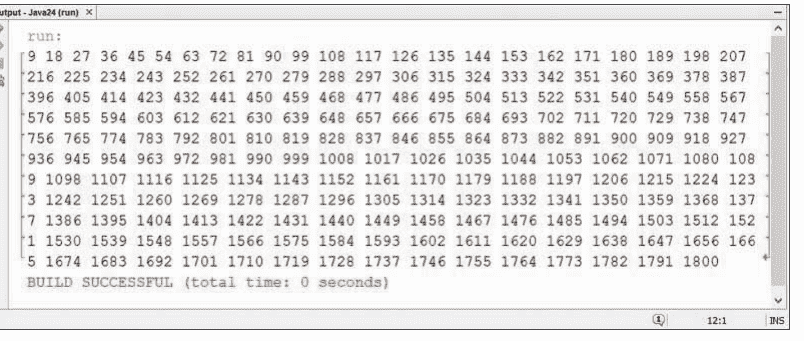

**图 8.1** `Nines` 程序的输出。

NetBeans 中的输出窗口不会自动换行，因此所有数字都显示在单行上。要使文本换行，可以在输出面板的任何地方点击右键，并在弹出菜单中选择“Wrap Text”（换行）。

## while 循环

`while` 循环比 `for` 循环简单。唯一需要的是伴随 `while` 循环的条件测试，代码中如下：

```java
int gameLives = 3;
while (gameLives > 0) {
    // 循环内部的语句在这里
}
```

循环继续重复直到 `gameLives` 变量不再大于 0。`while` 语句在循环中的任何语句处理之前在循环开始时测试条件。当程序第一次到达 `while` 语句时测试的条件为假，则循环内部语句将被忽略。

如果条件为真，循环将进行并再次测试 `while` 条件。如果测试的条件在循环内部从未改变，循环将一直运行。

以下语句使用 `while` 循环多次显示同一行文本：

```java
int limit = 5;
int count = 1;
while (count < limit) {
  System.out.println("Pork is not a verb");
  count++;
}
```

`while` 循环使用在循环语句之前设置的一个或多个变量。在这个示例中，有两个整数变量在使用：`limit` 的值为 5，`count` 的值为 1。`while` 循环显示四次“Pork is not a verb”。如果你给 `count` 变量一个初始值 6 而不是 1，则文本将永远不会显示。

## do-while 循环

`do-while` 循环与 `while` 循环相似，但条件测试的位置不同。以下是 `do-while` 循环示例：

```java
int gameLives = 0;
do {
  // 循环内部的语句在这里
} while (gameLives > 0);
```

与 `while` 循环一样，此循环持续到 `gameLives` 变量不再大于 0。`do-while` 循环的不同之处在于条件测试是在循环内部语句之后进行的，而不是在它们之前。

当程序运行时第一次遇到 `do` 循环时，`do` 和 `while` 之间的语句会被自动处理，测试 `while` 条件以确定是否应该重复循环。如果条件为真，循环将重复。如果测试的条件在循环内部从未改变，循环将一直运行。


# 第 8 小时：使用循环重复操作

`Nines` 程序在第 5 行包含一个 `for` 语句。该语句有三个部分：

- 初始化——`int dex = 1`，创建一个整数变量 `dex` 并给它一个初始值 1。
- 条件——`dex <= 200`，在循环的每次通过中必须为真。如果为假，循环结束。
- 变化——`dex++`，在循环的每次通过中将 `dex` 变量加 1。

运行通过点击 NetBeans 中的 `Run` -> `Run File` 开始。程序产生图 8.1 所示的输出。


**图 8.1** `Nines` 程序的输出。

NetBeans 中的输出窗口不会自动换行，因此所有数字都显示在单行上。要使文本换行，可以在输出面板的任何地方点击右键，并在弹出菜单中选择“Wrap Text”（换行）。

## while 循环

`while` 循环比 `for` 循环简单。唯一需要的是伴随 `while` 循环的条件测试，代码中如下：

```java
int gameLives = 3;

while (gameLives > 0) {
    // 循环内部的语句在这里
}
```

`while` 语句在循环中的任何语句处理之前在循环开始时测试条件。当程序第一次到达 `while` 语句时测试的条件为假，则循环内部语句将被忽略。如果条件为真，循环将进行并再次测试 `while` 条件。如果测试的条件在循环内部从未改变，循环将一直运行。

以下语句使用 `while` 循环多次显示同一行文本：

```java
int limit = 5;
int count = 1;

while (count < limit) {
    System.out.println("Pork is not a verb");
    count++;
}
```

`while` 循环使用在循环语句之前设置的一个或多个变量。在这个示例中，有两个整数变量在使用：`limit` 的值为 5，`count` 的值为 1。`while` 循环显示四次“Pork is not a verb”。如果你给 `count` 变量一个初始值 6 而不是 1，则文本将永远不会显示。

## do-while 循环

`do-while` 循环与 `while` 循环相似，但条件测试的位置不同。以下是 `do-while` 循环示例：

```java
int gameLives = 0;

do {
    // 循环内部的语句在这里
} while (gameLives > 0);
```

与 `while` 循环一样，此循环持续到 `gameLives` 变量不再大于 0。`do-while` 循环的不同之处在于条件测试是在循环内部语句之后进行的，而不是在它们之前。当程序运行时第一次遇到 `do` 循环时，`do` 和 `while` 之间的语句会被自动处理，测试 `while` 条件以确定是否应该重复循环。如果条件为真，循环将重复。

## 测试你的计算机速度

`for` 循环的部分也可以是空的。这种情况下例子是循环计数变量已经在程序的其他部分创建并赋予了初始值，如下所示：

```java
int displayCount = 1;
int endValue = 13;

for (; displayCount < endValue; displayCount++) {
    // 语句将在这里
}
```

本小时的下一个项目是一个执行基准测试（benchmark）的 Java 程序，基准测试是一种衡量硬件或软件运行速度的测试。`Benchmark` 程序使用循环语句反复执行以下数学表达式：

```java
double x = Math.sqrt(index);
```

该语句调用 `Math.sqrt()` 方法来计算数字的平方根。你将在第 11 小时“描述你的对象”中学习更多关于方法的知识。你正在创建的基准测试统计了 Java 程序在一分钟内可以计算平方根的次数。

使用 NetBeans 在 `com.java24hours` 包中创建一个名为 `Benchmark` 的新 Java 文件。输入列表 8.2 的文本并在完成后保存程序。

### 列表 8.2 Benchmark.java 的完整源代码

```java
package com.java24hours;

class Benchmark {
    public static void main(String[] arguments) {
        long startTime = System.currentTimeMillis();
        long endTime = startTime + 60000;
        long index = 0;
        while (true) {
            double x = Math.sqrt(index);
            long now = System.currentTimeMillis();
            if (now > endTime) {
                break;
            }
            index++;
        }
        System.out.println(index + " loops in one minute.");
    }
}
```

程序中发生了以下情况：

- 第 5 行——创建了 `startTime` 变量，其值为当前毫秒时间，通过调用 `System` 类的 `currentTimeMillis()` 方法测量。
- 第 6 行——创建了 `endTime` 变量，其值比 `startTime` 大 60,000。由于一分钟等于 60,000 毫秒，这设置了 `startTime` 之后的一分钟。
- 第 7 行——设置了一个名为 `index` 的 long 类型变量，初始值为 0。
- 第 8 行——`while` 语句使用 `true` 作为条件开始循环，这导致循环无限持续（换句话说，直到某些东西停止它）。
- 第 9 行——计算 `index` 的平方根并存储在变量 `x` 中。
- 第 10 行——创建带有当前时间的 `now` 变量。
- 第 11–13 行——如果 `now` 大于 `endTime`，意味着循环已运行了一分钟，并跳出 `while` 循环。否则，它继续循环。
- 第 14 行——每次循环时，`index` 变量加 1。
- 第 16 行——循环外部，程序显示执行平方根计算的次数。

应用程序的输出在图 8.2 的输出面板中。

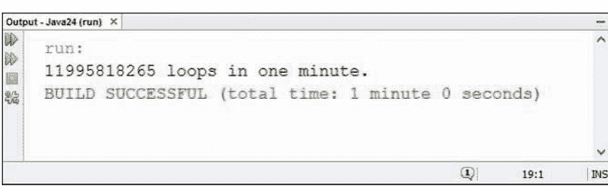

**图 8.2** `Benchmark` 程序的输出。

`Benchmark` 程序是观察你的计算机是否比我的快的极佳方法。在该程序的测试期间，我的笔记本电脑执行了约 119.9 次计算。如果你的计算机结果更好，不要只给我发哀。多买买我的书，这样我就可以升级我的电脑。

## 总结

循环是大多数编程语言的基础部分。按顺序显示多个图形创建的动画是 Java 或任何其他编程语言无法完成的众多任务之一。

巴特·辛森所有的黑板惩罚都已经在网上记录。访问 `http://simpsons.wikia.com/wiki/List_of_chalkboard_gags` 查看该列表。

## 工作坊

### 问答

- **Q.** “初始化”（initialization）一词出现在多个地方。它是什么意思？
- **A.** 它意味着给某物一个初始值并对其设置。当你创建一个变量并给它分配一个起始值时，你正在初始化该变量。

- **Q.** 如果循环永远不结束，程序会停止运行吗？
- **A.** 通常在循环不结束的程序中，程序的其他部分被设置了以某种方式停止执行。例如，游戏程序中的循环可以在玩家仍有血量时无限继续。在编写程序时经常的一个错误是无限循环，即永不停止的循环。因为你运行的某个 Java 程序陷入了无限循环，此时输出面板左侧会出现红色警报图标。

- **Q.** 我如何购买绿湾帕人队（Green Bay Packers）的股票？
- **A.** 除非这家公有的 NFL 球队决定再次进行股票出售，否则成为股东的唯一方法是通过遗嘱继承股份。帕人队曾在 1923 年、1935 年出售过股票……（注意：此处 OCR 文本似乎包含乱码/占位符文本，但我保留了此处似乎为重复 OCR 错误的信息结构）。

*注：所提供的后半部分 OCR 文本包含了关于帕人队的高度重复/损坏字符串。我已根据要求清理了格式，但保持了可见内容。*

# 第 9 小时：使用数组存储信息

当你使用 `new` 语句创建一个数组时，必须指定元素的数量。数组的每个元素都会赋予一个初始值，该值取决于数组的类型。数值数组的初始值为 0，字符数组等于 `'\0'`，布尔数组的值为 `false`。字符串数组以及所有其他对象的初始值均为 `null`。

对于不是特别极大的数组，你可以在创建它们的同时设置它们的初始值。下面的示例创建了一个字符串数组并赋予了它们初始值：

```java
String[] reindeerNames = { "Dasher", "Dancer", "Prancer", "Vixen",
    "Comet", "Cupid", "Donner", "Blitzen" };
```

应该存储在数组元素中的信息放在 `{ }` 括号之间，并用逗号分隔每个元素。数组中的元素数量设置为逗号分隔列表中元素的数量。

数组元素从 0 开始编号。通过在 `[]` 括号内引用该数字可以访问特定的元素。前述语句实现了相同的功能：

```java
String[] reindeerNames = new String[8];
reindeerNames[0] = "Dasher";
reindeerNames[1] = "Dancer";
reindeerNames[2] = "Prancer";
reindeerNames[3] = "Vixen";
reindeerNames[4] = "Comet";
reindeerNames[5] = "Cupid";
reindeerNames[6] = "Donner";
reindeerNames[7] = "Blitzen";
```

数组的每个元素必须是相同的类型。在这里，使用字符串来保存每个驯鹿的名字。在创建数组后，你无法创建更多的元素。即使你记得最著名的驯鹿，也无法将 "Rudolph" 作为 `reindeerNames` 的第九个元素。Java 编译器永远不会在你的 `reindeerNames` 中放入 Rudolph。

## 使用数组

你在程序中使用数组就像使用任何变量一样，区别在于：数组的元素编号必须在数组名称旁方的括号内提供。你可以在可以使用变量的地方使用数组，如下所示：

```java
seniority[9] = true;
niceChild[8] = "Eli";
currentNation = 4;
if (currentNation == true) {
    sendGiftByMail();
}
```

由于数组的第一个元素编号为 0 而不是 1，这意味着最大数字比你预期的要小。考虑以下语句：

```java
String[] topGifts = new String[10];
```

该语句创建了一个从 0 到 9 编号的字符串数组。如果你在程序的某处引用 `topGifts[10]`，将得到 `ArrayOutOfBoundsException` 错误。Exception 是 Java 程序中错误的另一种说法。这种异常是“索引越界”错误，意味着程序尝试使用超出定义范围的数组元素。在第 14 小时“程序中的错误”中学习更多关于异常的知识。如果你想检查数组的上限以避免超出，每个数组都关联有一个名为 `length` 的变量。该长度是数组包含的元素数量。下面的示例创建了一个数组并返回其长度：

```java
String[] reindeerNames = { "Dasher", "Dancer", "Prancer", "Vixen",
    "Comet", "Cupid", "Donner", "Rudolph" };
System.out.println("There are " + reindeerNames.length + " reindeerNames.");
```

在这种情况下，`reindeerNames.length` 的值为 9，这意味着你可以指定的最高元素是 8。

你可以以字符串的形式或字符数组的形式在 Java 中处理文本。当你处理字符串时，一种实用的技术是将字符串中的每个字符放入自己的字符数组中。为了实现这一点，使用字符串的 `toCharArray()` 方法，它产生一个与字符串长度元素数量相同的字符数组。

本节的项目使用了在本节介绍的两种技术。`SpaceRemover` 程序显示了一个所有空格字符都被替换为（.）的字符串。

开始之前，在 NetBeans 中打开 Java24 项目，选择 File，New File，并在 `com.java4hours` 包创建一个新的 Java 文件 `SpaceRemover`。在编辑器中输入代码 9.1，完成后保存。

### 代码 9.1 SpaceRemover.java 全文

```java
package com.java4hours;

class SpaceRemover {
    public static void main(String[] arguments) {
        String mostFamous = "Rudolph the Red-Nosed Reindeer";
        char[] mfl = mostFamous.toCharArray();
        for (int dex = 0; dex < mfl.length; dex++) {
            char current = mfl[dex];
            if (current != ' ') {
                System.out.print(current);
            } else {
                System.out.print('.');
            }
        }
        System.out.println();
    }
}
```

使用 `Run` -> `Run File` 命令运行程序以查看图 9.1 所示的输出。

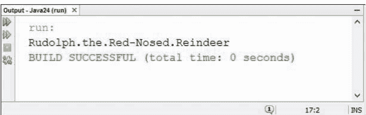

**图 9.1** `SpaceRemover` 程序的输出。

`SpaceRemover` 应用将文本 "Rudolph the Red-Nosed Reindeer" 在两个地方：名为 `mostFamous` 的字符串和一个名为 `mfl` 的字符数组。数组在第 6 行通过调用 `mostFamous` 的 `toCharArray()` 方法创建，该方法为文本中的每个字符填充数组元素。字符 'R' 进入第 0 个元素，'u' 进入第 1 个元素，以此类推，直到第 29 个元素的最后的 'r'。

第 7-14 行的 `for` 循环查看 `mfl` 数组中的每个字符。如果字符不是空格，则显示它。如果是空格，则相反显示 '.' 字符。

## 多维数组

你在程序中使用数组就像使用任何变量一样，区别在于：数组的元素编号必须在数组名称旁方的括号内提供。你可以在可以使用变量的地方使用数组元素。

### 示例输出

```
Output - Java24 (run)

run:

原始顺序:
0: Glimmer
1: Marvel
2: Rue
3: Clove
4: Thresh
5: Foxface
6: Cato
7: Peeta
8: Katiss

新顺序:
0: Cato
1: Clove
2: Foxface
3: Glimmer
4: Katiss
5: Marvel
6: Peeta
7: Rue
8: Thresh

BUILD SUCCESSFUL (total time: 0 seconds)
```


图 9.2

NameSorter 程序的输出。

当你处理字符串以及如整数和浮点数等基本变量类型时，你只能使用 `Arrays` 类对它们按升序进行排序。如果你在排序过程中对元素有不同的排列要求，或者想要获得比 `Arrays` 类提供的更高的效率，你可以编写代码来手动进行排序。

# 统计字符串中的字符

英语中出现频率最高的字母是 E, R, S, T, L, N, C, D, M 和 O，顺序如下。如果你发现自己正在参加联播节目《转运轮盘》（Wheel of Fortune），这是一个值得了解的事实。

## 注意

如果你不熟悉这个节目，《转运轮盘》是一场参赛者猜猜短语、名称或引言中字母的游戏。如果他们猜对了字母且该字母是辅音，他们就能赢得大轮上的金额。为了重现这种体验，你可以在摄影棚观众面前和朋友玩吊字游戏（hangman），当有人猜对字母时发放随机金额的现金，并给获胜者一台新的 Shark Rotator 吸尘器。

你的下一个 Java 程序将统计你想要输入的任意不同短语和表达式中的字母频率。程序使用一个数组来统计每个字母出现的次数。完成后，程序将展示每个字母在短语中出现的次数。

在 NetBeans 中创建一个名为 `Wheel.java` 的空 Java 文件，将其放入 `com.java24hours` 包中，填充列表 9.3 的内容，并在完成后保存文件。你可以随地在第 17 行之间添加额外的短语，并让它们保持与第 17 行完全相同的格式。

### 列表 9.3 Wheel.java 的完整源代码

```java
package com.java24hours;

class Wheel {

    public static void main(String[] arguments) {

        String phrase[] = {

            "A STITCH IN TIME SAVES NINE",

            "DON'T EAT YELLOW SNOW",

            "TASTE THE RAINBOW",

            "EVERY GOOD BOY DOES FINE",

            "I WANT MTV",

            "I LIKE IKE",

            "PLAY IT AGAIN, SAM",

            "FROSTY THE SNOWMAN",

            "ONE MORE FOR THE ROAD",

            "HOME FIELD ADVANTAGE",

            "SHFFFFIELD WEDNESDAY",

            "GROVER CLEVELAND OHIO",

            "SPAGHETTI WESTERN",

            "TEEN TITANS GO",

            "IT'S A WONDERFUL LIFE"

        };

        int[] letterCount = new int[26];

        for (int count = 0; count < phrase.length; count++) {

            char[] letters = phrase[count].toCharArray();

            for (int count2 = 0; count2 < letters.length; count2++) {

                char lett = letters[count2];

                if ((lett >= 'A') && (lett <= 'Z')) {

                    letterCount[lett - 'A']++;

                }

            }

        }

        for (char count = 'A'; count <= 'Z'; count++) {

            System.out.print(count + " : " + letterCount[count - 'A'] + " ");

            if (count == 'M') {

                System.out.println();

            }

        }

        System.out.println();

    }

}
```

如果你在不添加自定义短语的情况下运行该程序，输出应该是图 9.3。

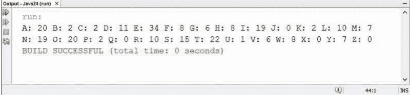

图 9.3 Wheel 程序的输出。

Wheel 程序的输出。

Wheel 程序中正在发生以下操作：

- 第 5 至 21 行——短语存储在一个名为 `phrase` 的字符串数组中。
- 第 22 行——创建了一个包含 26 个元素的整数数组 `letterCount`。该数组用于存储每个字母出现的次数。元素的顺序从 'A' 到 'Z'。`letterCount[0]` 存储 'A' 的计数，`letterCount[1]` 存储 'B' 的计数，以此类推，直到 `letterCount[25]` 代表 'Z'。
- 第 23 行——一个 `for` 循环遍历 `phrase` 数组中存储的短语。使用 `length` 变量在到达最后一个短语后结束循环。
- 第 24 行——为名为 `current` 的字符串变量设置短语的值。
- 第 25 行——为该短语创建了一个字符数组。
- 第 26 行——一个 `for` 循环遍历字母。使用 `length` 变量在到达最后一个字母后结束循环。
- 第 27 行——创建了一个名为 `lett` 的字符。
- 第 28 至 30 行——`letterCount` 数组增加。
- 第 33 行——一个 `for` 循环遍历字母表。
- 第 34 至 40 行——打印短语的输出。当字母为 'M' 时，执行换行。

## 总结

数组使得存储和处理复杂类型变得可行。正如你在第 8 小时中学到的那样，它们对于难以变量处理的信息是理想的。

## 工作坊

### 问答

**Q:** 字母的数值范围（从 'A' 的 65 到 'Z' 的 90）是 Java 语言的一部分吗？如果是，1 到64 用于？

**A:** 1 到64 包含了数字、标点符号和不可打印字符（如换行、新行和退格）。

**Q:** 在多维数组中，可以使用 length 变量测量第一个维度以外的维度吗？

**A:** 你可以测试数组的任何维度。对于第一个维度，使用数组名称配合 `length`，例如 `x.length`。后续维度可以通过该维度的元素 `[0]` 使用 `length` 来测量。考虑使用以下语句创建的数组 `data`：

```java
int[][][] data = new int[12][14];
```

可以使用 `data.length` 变量测量第一个维度，`data[0].length` 测量第二个维度，`data[0][0].length` 测量第三个维度。

**Q:** 为什么新英护人队主帅 Belichick 在场边穿着破旧连帽衫？

**A:** 当你在十年内的胜场次数超过任何其他教练（2003年至2012年间 140 场）时，你的老板允许你选择着装。Yahoo! Sports 的 Dan Zenzel 解释道，Belichick 开始穿连帽衫是因为 NFL 与 Reebok 有一项交易，该交易要求教练穿着授权球队服装。

> “他决定既然他们要让他穿服装，那就在选项中进行筛选，找到了他能找到的最优选择。他选择了一件灰色卫衣，通常带有兜帽。”

### 练习

如果你的大脑是一个数组，你可以通过回答以下关于数组的每个问题来测试它的长度。

1. 数组最适合存储什么类型的信息？

   - A. 列表
   - B. 相关信息的对
   - C. 冷冷知识

2. 你可以使用哪个变量来检查数组的上边界？

   - A. top
   - B. length
   - C. limit

3. 圣诞老人共有多少只驯鹿，包括鲁道夫？

   - A. 8
   - B. 9
   - C. 10

### 答案

- **1.** A. 仅包含相同类型信息（字符串、数字等）的列表非常适合存储在数组中。
- **2.** `length` 变量包含了数组中元素数量的计数。
- **3.** B. 根据克莱门特·拉克·摩尔（Clement Clarke Moore）的《圣尼古拉斯来访》，圣诞老人有“八只小驯鹿”，所以加上鲁道夫是九只。

### 活动

为了让自己在以后有丰富的经验可供之用，你可以通过以下活动扩展对本小时主题的认知：

- 创建一个使用多维数组来存储学生成绩的程序。第一个维度应该是每个学生的数字，第二个维度应该是每个学生的成绩。显示每个学生获得的所有成绩的平均分以及每个学生的总平均分。
- 编写一个程序，在数组中存储前 400 个 13 的倍数。

要查看实现这些活动的 Java 程序，请访问书籍官方网站 www.java24hours.com。

# 第 10 小时 创建你的第一个对象

本小时的任务列表：

- 创建一个对象。
- 使用属性描述对象。
- 确定对象是如何行为的。
- 组合对象。
- 从其他对象中继承。
- 转换对象和其他类型的信息。

在这些 24 小时中，你遇到的最令人生畏的术语之一就是面向对象编程（OOP）。这个复杂的术语以优雅的方式描述了计算机程序是什么以及它是如何工作的。

在 OOP 之前，计算机程序通常根据你在书中学的最简单定义来描述：它是在文件中列出的一系列指令，并按照某种可靠的顺序进行处理。

通过将程序视为对象的集合，你就能弄理出程序必须完成的任务，并将这些任务分配给它们所属的对象。

## 面向对象编程是如何工作的

你可以将你创建的 Java 程序视为对象，就像现实世界中的物理对象一样。对象独立于其他对象，以特定的方式相互作用，并可以与其他对象结合形成更大的整体。如果你将计算机程序视为一组相互作用的对象，你就可以设计出一个更可靠、更易于理解、且在其他项目中可重用的程序。

在第 22 小时“创建 Java2D 图形”中，你创建了一个显示饼图的 Java 程序——带有不同颜色饼区的圆形，用于表示数据。该程序创建的图表如图 10.1 所示。


图 10.1
由 Java 程序生成的饼图。

每个对象都有使其与其他对象不同的特征。饼图是圆形的，而条形图用一系列矩形来表示数据。饼图是由较小对象组成的对象——不同颜色的单个扇区、标识每个扇区代表含义的图例，以及一个标题。如果你像拆解饼图一样来拆解计算机程序，你就是在进行 OOP。

在 OOP 中，一个对象包含两个部分：属性和行为。属性是描述对象并显示它与其他对象不同的特征。行为是对象所做的事。

你在 Java 中通过使用类（class）作为模板来创建对象。类是对象的母副本，决定了对象应该拥有的属性和行为。“类”这个词对你应该很熟悉，因为 Java 程序被称为类。你用 Java 创建的每个程序都是类，你可以将其作为创建新对象的模板。例如，任何使用字符串的程序都在使用从 `String` 类创建的对象。该类包含了决定 `String` 对象是什么的属性，以及决定 `String` 对象可以做什么的行为。

## 对象的运作

通过 OOP，计算机程序是一组共同工作以完成任务的对象。一些简单的程序看起来似乎只包含一个对象：类文件。即使是这些程序也在使用其他对象来完成工作。

考虑显示饼图的程序。一个 `PieChart` 对象可能包含以下：

- 计算每个饼区大小的行为
- 绘制图表的行为
- 存储图表标题的属性

让 `PieChart` 对象去绘制自己可能看起来很奇怪，因为图表在现实世界中并不会自己画自己。OOP 中的对象尽可能为自己工作。这种能力使得将其整合到其他程序中变得更容易。例如，如果一个 `PieChart` 对象不知道如何绘制自己，那么每当你从另一个程序中使用 `PieChart` 对象时，你就必须创建一个绘制它的行为。

OOP 的另一个例子是，考虑马修·罗德里克（Matthew Roderick）扮演的角色在经典电影《游戏入侵》中使用的自动拨号程序，用来寻找他可以入侵的计算机。

### 注意

自动拨号器是一种使用称为调制解调器的设备顺序拨一系列电话号码的软件。Lightman（由 Roderick 塑造的角色）使用他的自动拨号器在游戏发布前寻找游戏。结果 Lightman 发现了一个秘密政府计算机，它可以运行从象棋到全球核战的所有游戏。

自动拨号器像任何计算机程序一样，可以被视为一组对象。它可以被拆解为：

- 一个 `Modem` 对象，它知道连接速度等属性，并具有拨号和检测另一台计算机是否接听的行为
- 一个 `Monitor` 对象，它跟踪拨打了哪些号码以及哪些通了

每个对象都独立于其他对象存在。设计一个完全独立的 `Modem` 对象的优点是，它可以用于其他需要调制解调器功能的程序。使用自包含对象的另一个原因是它们很容易调试。计算机程序的规模会迅速急剧增长。如果你正在调试一个 `Modem` 对象并且知道它没有依赖其他任何东西，你就可以专注于确保 `Modem` 对象执行它应该做的事，并持有它执行工作所需的信息。

将 Java 这样的面向对象的语言作为第一种编程语言是有益的，因为你不需要学习其他编程风格的习惯。

### 什么是对象

对象是通过类作为模板创建的。以下语句创建了一个类：

```java
public class Modem {

}
```

从这个类创建的对象无法执行任何操作，因为它没有任何属性或行为。你需要添加这些内容来使类变得有用，如下语句所示：

```java
public class Modem {

  int speed;

  public void displaySpeed() {

    System.out.println("Speed: " + speed);

  }

}
```

`Modem` 类现在应该开始像你在第 1 到第 9 小时期间编写的程序了。

`Modem` 类的第一部分创建了一个名为 `speed` 的整数变量。该变量是对象的属性。

`Modem` 类的第二部分是一个名为 `displaySpeed()` 的方法。该方法是对象行为的一部分。它包含一条语句 `System.out.println()`，它可以显示调制解调器的速度值。

对象的变量是实例变量或成员变量。

如果你想在程序中使用 `Modem` 对象，可以使用语句创建对象：

```java
Modem device = new Modem();
```

此语句创建了一个名为 `device` 的 Modem 对象。在创建对象后，你可以设置它的变量并调用它的方法。以下是设置 `device` 对象的 `speed` 变量值的方法：

```java
device.speed = 28800;
```

为了通过调用 `displaySpeed()` 方法让此 Modem 显示其速度，你调用该方法：

```java
device.displaySpeed();
```

名为 `device` 的 Modem 对象可以通过显示文本“Speed: 28800.”来响应此语句。

### 理解继承

继承的一个大优势是，它允许人们从另一个对象继承行为和属性。

当你开始创建对象时，有时会发现你想要的新对象与你拥有的某个相似。

如果 David Lightman 想要一个能够处理纠错以及 1983 年《电子游戏战》上映时存在的其他调制解调器功能的对象，他本可以通过复制 `Modem` 的语句并对其修改来创建一个新的 `ErrorCorrectionModem` 对象。然而，如果 `ErrorCorrectionModem` 的大部分行为和属性与 `Modem` 相同，这将是大量不必要的工作。这也意味着如果需要更改某些内容，Lightman 将有两个独立的程序需要更新。

通过继承，程序员可以通过定义对象与现有类的不同之处来创建一类新对象。Lightman 可以让 `ErrorCorrectionModem` 继承自 `Modem`，他只需要编写那些让纠错调制解调器与它们不同的部分。

一个类通过使用 `extends` 语句继承自另一个类。以下是继承自 `Modem` 类的 `ErrorCorrectionModem` 类的骨架：

```java
public class ErrorCorrectionModem extends Modem {

  // 程序代码写在这里

}
```


# 构建继承层次结构

继承允许各种相关的类在没有冗余工作的情况下进行开发，使得代码可以从一个类传递到另一个类，再到另一个类。这种类的父子级分组被称为类层次结构，你在 Java 程序中使用的所有标准类都是层次结构的一部分。

如果你理解了子类（`subclasses`）和父类（`superclasses`），理解层次结构就会变得更容易。继承另一个类的类被称为子类。被继承的类被称为父类。

在之前的《电子游戏战》示例中，`Modem` 类是 `ErrorCorrectionModem` 类的父类。`ErrorCorrectionModem` 是 `Modem` 的子类。

在层次结构中的一个类可以有多个继承自它的类——`Modem` 的另一个子类可以是 `ISDNModem`，因为 ISDN 调制解调器具有使其区别于纠错调制解调器的行为和属性。如果 `ErrorCorrectionModem` 有子类（例如 `InternalErrorCorrectionModem`），它将继承层次结构中其上方的所有类——即 `ErrorCorrectionModem` 和 `Modem`。这些继承关系如图 10.2 所示。

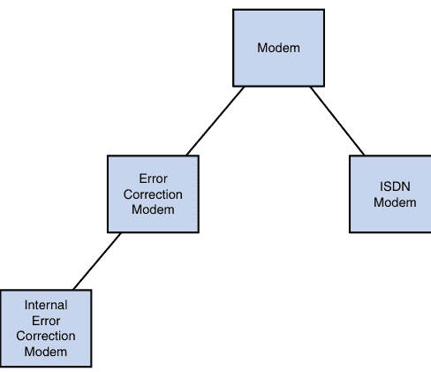

图 10.2. 类层次结构的示例。

# 对象与简单变量

构成 Java 语言的类广泛使用了继承。

在程序中使用方法或表达式时，你必须使用这些方法和表达式预期的正确类型的信息。期望 `Calendar` 的方法必须接收一个 `Calendar` 对象实例。如果你使用一个接受单个整数参数的方法，但向它发送了一个浮点数，那么在尝试编译程序时就会发生错误。

> 注意
>
> 当方法需要字符串参数时，你可以使用 `+` 运算符来组合该参数中的几种不同类型的信息。只要组合的内容中有一个是字符串，组合后的参数就会转换为字符串。

将信息转换为新形式称为强制转换（casting）。强制转换产生一个与其源不同变量或对象类型的新值。在强制转换时，你不改变值。相反，会根据你需要的格式创建一个新的变量或对象。

在讨论强制转换的概念时，源（source）和目标（destination）这两个术语非常有用。源是原始形式的某种信息——无论是变量还是对象。目标是源的新形式的转换版本。

# 转换简单变量

对于简单变量，强制转换最常见于整数和浮点数等数值变量之间。不能用于任何强制转换的变量类型是布尔值。

# 第 10 小时：创建你的第一个对象

要将信息转换为新格式，要在它前面加上用括号括起来的新格式。例如，如果你想将某些内容转换为 `long` 变量，就在它前面加上 `(long)`。以下语句将 `float` 值转换为 `int`：

```java
float source = 7.00F;
int destination = (int) source;
```

在目标持有值比源更大的值的变量转换中，值可以很容易转换，例如当 `byte` 强制转换为 `int` 时。`byte` 存储 -128 到 127 之间的值，而 `int` 存储 -2147483648 到 2147483647 之间的值。

[注：OCR 文本截断了数字，已根据标准规范恢复。]

从对象到变量的一种常见转换是在数值表达式中使用字符串。当字符串的值可能成为整数时，可以使用 `Integer` 类的 `parseInt()` 方法来实现，如下例所示：

```java
String count = "25";
int myCount = Integer.parseInt(count);
```

这会将文本为 "25" 的字符串转换为值为 25 的整数。如果字符串值不是有效的整数，则转换将无法进行。

你创建的下一个项目是 `NewRoot`，这是一个将命令行参数中的字符串值转换为数值的应用程序，这是当你从命令行接收用户输入时的一种常用技术。

回到 NetBeans 中的 Java24 项目，选择 **File -> New File**，在 `com.java24hours` 包中创建一个名为 `NewRoot` 的新空 Java 文件。在编辑器中输入代码列表 10.1，并记得保存文件。

## 代码列表 10.1 NewRoot.java 的完整文本

```java
package com.java24hours;

class NewRoot {
    public static void main(String[] arguments) {
        int number = 100;
        if (arguments.length > 0) {
            number = Integer.parseInt(arguments[0]);
        }
        System.out.println("The square root of "
            + number
            + " is "
            + Math.sqrt(number));
    }
}
```

在运行程序之前，你必须配置 NetBeans 以带有命令行参数运行它：

1. 选择菜单命令 **Run -> Set Project Configuration -> Customize**。打开属性窗口。
2. 将 `com.java24hours.NewRoot` 设置为 **Main Class**。
3. 在 **Arguments** 字段中输入 `9025`。
4. 点击 **OK** 关闭对话框。

要运行程序，选择 **Run -> Run Main Project**（而不是 **Run -> Run File**）。程序将显示该数字及其平方根，如图 10.3 所示。

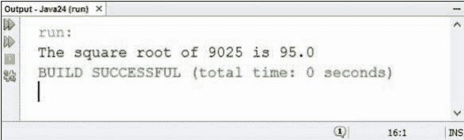

图 10.3 NewRoot 程序的输出。

`NewRoot` 是第 4 小时早期教程“理解 Java 程序如何工作”的扩展，该教程显示了整数 225 的平方根。

如果该程序能够接收用户提交的数字并显示其平方根，它将会更有用。这需要从字符串到整数的转换。所有的命令行参数都存储为字符串数组的元素，因此在数学表达式中使用它们之前，必须将它们强制转换为数字。

要根据字符串的内容创建整数值，你在第 7 行中调用 `Integer.parseInt` 方法并将字符串作为唯一参数：

```java
number = Integer.parseInt(arguments[0]);
```

`arguments[0]` 数组持有当程序运行时提交的第一个命令行参数。当使用 "9025" 作为参数运行程序时，字符串 "9025" 被转换为整数 `9025`。

将命令行参数从 9025 改为其他数字，并多运行几次程序。

# 创建对象

为了在本小时的下一个项目中看到类和继承的运行示例，你创建了代表两种对象的类：电缆调制解调器（cable modem）和 DSL 模型，它们分别由 `CableModem` 和 `DslModem` 类实现。工作重点是这些对象的简单属性和行为：

- 每个对象都应该有一个可以显示的速度。
- 每个对象都能够连接到互联网。

电缆模型和 DSL 共同点是它们都有速度。因为这是它们共有的，可以将其放入一个作为 `CableModem` 和 `DslModem` 类父类的类中。将此类命名为 `Modem`。在 NetBeans 中，在 `com.java24hours` 包中创建一个名为 `Modem` 的新空类。在源编辑器中输入代码列表 10.2 并保存文件。

## 代码列表 10.2 Modem.java 的完整文本

```java
package com.java24hours;

public class Modem {
    int speed;

    public void displaySpeed() {
        System.out.println("Speed: " + speed);
    }
}
```

该文件将自动编译为 `Modem.class`。你不能直接运行此程序，但可以在其他类中使用它。`Modem` 可以处理 `CableModem` 和 `DslModem` 类共同的一个点。在创建 `CableModem` 和 `DslModem` 类时使用 `extends` 语句，你可以让它们每一个都成为 `Modem` 的子类。

在 NetBeans 的 `com.java24hours` 包中创建一个名为 `CableModem` 的新空 Java 文件。输入代码列表 10.3 并保存文件。

## 代码列表 10.3 CableModem.java 的完整文本

```java
package com.java24hours;

public class CableModem extends Modem {
    String method = "cable connection";

    public void connect() {
        System.out.println("Connecting to the Internet ...");
        System.out.println("Using " + method);
    }
}
```

在 NetBeans 的 `com.java24hours` 包中创建第三个文件 `DslModem`。输入代码列表 10.4 并保存文件。

## 代码列表 10.4 DslModem.java 的完整文本

```java
package com.java24hours;

public class DslModem extends Modem {
    String method = "DSL connection";

    public void connect() {
        System.out.println("Connecting to the Internet ...");
        System.out.println("Using " + method);
    }
}
```

如果没有错误，现在有了三个类文件：`Modem.class`、`CableModem.class` 和 `DslModem.class`。然而，你无法运行这些类文件，因为它们没有像你创建的那样的 `main()` 块。你需要创建一个短程序来测试它们。返回 NetBeans，在 `com.java24hours` 中创建一个名为 `ModemTester` 的新空 Java 文件。输入代码列表 10.5 并保存文件。

## 代码列表 10.5 ModemTester.java 的完整文本

```java
package com.java24hours;

public class ModemTester {
    public static void main(String[] arguments) {
        CableModem surfboard = new CableModem();
        DslModem gateway = new DslModem();
        surfboard.speed = 500000;
        gateway.speed = 400000;
        System.out.println("Trying the cable modem:");
        surfboard.displaySpeed();
        surfboard.connect();
        System.out.println("Trying the DSL modem:");
        gateway.displaySpeed();
        gateway.connect();
    }
}
```

当你运行程序时，你应该看到图 10.4 的输出。

```
run:
Trying the cable modem:
Speed: 500000
Connecting to the Internet ...
Using a cable connection
Trying the DSL modem:
Speed: 400000
Connecting to the Internet ...
Using a DSL connection
BUILD SUCCESSFUL (total time: 0 seconds)
```


图 10.4 `ModemTester` 程序的输出。

程序中发生了以下情况：

- 第 5–6 行——创建了两个新对象：名为 `surfaceboard` 的 `CableModem` 对象和名为 `gateway` 的 `DslModem` 对象。
- 第 7 行——名为 `surfaceboard` 的 `CableModem` 对象的 `speed` 变量设置为 500000。
- 第 8 行——名为 `gateway` 的 `DslModem` 对象的 `speed` 变量设置为 400000。
- 第 10 行——调用了 `surfaceboard` 对象的 `displaySpeed()` 方法。该方法继承自 `Modem`——尽管它在 `CableModem` 类中不存在。
- 第 11 行——调用了 `surfaceboard` 对象的 `connect()` 方法。
- 第 12 行——调用了 `gateway` 对象的 `displaySpeed()` 方法。
- 第 13 行——调用了 `gateway` 对象的 `connect()` 方法。

### 总结

在创建了第一个对象类并将若干个类排列成层次结构之后，你应该对“面向对象编程”以及这个有趣的缩写 OOP 更加熟悉。当你开始创建更多对象时，你将在接下来的两个小时内学习更多关于对象的行为和属性。

随着你对这种开发风格的经验增加，“程序”、“类”和“对象”等术语将变得更有意义。OOP 是一个需要时间适应的概念。当你掌握了它，你会发现它是设计、开发和调试计算机程序的有效方法。

### 工作坊

#### 问答

- **Q.** 类可以继承多个类吗？
- **A.** 在某些编程语言（如 C++）中是可以的，但 Java 不行。多重继承是一项强大的功能，但也让 OOP 变得更难学习和使用。Java 的开发者决定将继承限制为任意类，尽管一个类可以有许多子类。补偿这种局限性的方法是从称为接口（`interface`）的特殊类型类继承方法。你将在第 15 小时“创建线程程序”中学习更多关于接口的知识。

- **Q.** 你什么时候想创建一个不是公共的方法？
- **A.** 主要时机是该方法严格用于你正在编写的程序。如果你正在创建一个游戏程序，并且你的 `shootRayDown()` 方法专门针对你正在写的游戏，它可以是一个私有方法。要让一个方法不是公共的，请去掉方法名前的 `public` 声明。

- **Q.** 为什么可以使用 `char` 值像 `int` 值一样使用它们？
- **A.** 字符可以作为 `int` 变量，因为每个字符在字符集中都有对应的数字代码。如果你有一个值为 67 的变量 `k`，强制转换 `(char)` 会产生字符值 'C'，因为与大写 C 关联的代码是 67，ASCII 字符集是 Java 语言采用的 Unicode 字符标准的一部分。

- **Q.** Tabasco 辣椒酱会变质吗？
- **A.** 不，但如果你把开封的瓶保存几年，它会变化。醋、红辣椒和盐的成分是细菌生长的极不利环境。

  Tabasco 的制造商 McIlhenny 公司表示，原始品牌的保质期为五年。其他版本的保质期为 18 个月到三年不等。

  作为该产品的忠实粉丝，我很难相信有人会把一瓶 Tabasco 留到足以出现问题的程度。

#### 测验

以下问题将测试你对对象以及使用它们的程序的熟悉程度。

1. 使用什么语句允许一个类继承自另一个类？
   - A. `inherits`
   - B. `extends`
   - C. `handToOverAndNobodyGetsHurt`
2. 为什么编译后的 Java 程序以 `.class` 文件扩展名保存？
   - A. Java 开发者认为这是一种类语言。
   - B. 这是对世界上教师们的细微致敬。
   - C. 每个程序都是一个类。
3. 组成对象的两个要素是什么？
   - A. 属性和行为
   - B. 命令和数据文件
   - C. 唾液和醋水

#### 答案

1. 使用 `extends` 语句是因为子类是父类以及类层次结构中上方任何父类的属性和行为的扩展。
2. 你的程序始终由至少一个主类以及任何需要的其他类组成。
3. 在某种程度上，B 也是正确的，因为命令可以比作行为，而数据文件类似于属性。

#### 活动

如果你不介意，可以通过以下活动扩展你本小时主题的知识：

- 创建一个速度为 300 的 `Commodore64Modem` 类及其自身的 `connect()` 方法。
- 在 Modem 项目的某个类中添加 `disconnect()` 方法，决定它应该放在哪里以支持缓存、DSL 和 Commodore 64 调制调制解调器的断开。

要查看实现这些活动的 Java 程序，请访问书籍网站 `www.java24hours.com`。

# 第 11 小时：描述你的对象是什么样子的

本小时的任务列表：

- 为对象或类创建变量。
- 对对象和类使用方法。
- 调用方法并返回结果。
- 创建构造函数。
- 向方法传递参数。
- 使用 `this` 引用对象。
- 创建新对象。

正如你在过去一小时内对面向对象编程（OOP）的介绍中所学到的，对象是组织程序的一种方式，使其拥有完成任务所需的一切。对象由属性和行为组成。

属性是存储在对象内部的信息。它们可以是变量，如整数、字符和布尔值，也可以是对象如 `String` 和 `Calendar` 这样的对象。行为是用于处理对象内部特定任务的语句组。每一组被称为一个方法（`method`）。

到目前为止，你已经在不知情的情况下使用了对象的方法和变量。每当你的语句中包含句号且该句号不是小数点或字符串的一部分时，就会涉及到对象。

### 创建变量

在这一小时中，你正在查看一个名为 `Gremlin` 的对象示例类，它生命的唯一目的就是复制自己。一个 `Gremlin` 有几项不同的工作需要完成其任务，这些工作被实现为类的行为。方法所需的信息存储在属性中。

对象的属性代表了对象运行所需的变量。这些变量可以是简单的数据类型，如整数、字符和浮点数，也可以是数组或类对象（如 `String` 或 `Calendar`）。你可以在对象的整个类中使用对象的变量，即对象所包含的任何方法中。按照惯例，你会在创建类的 `class` 语句之后、任何方法之前创建变量。

`Gremlin` 需要的内容之一是一个唯一标识符，用来与其他同类（类）区分开来。

`Gremlin` 对象在一个名为 `guid` 的整数变量中持有此标识符。以下语句以 `class Gremlin` 开始，包含一个名为 `guid` 的属性和两个其他属性：

```java
public class Gremlin {

    public int guid;

    public String creator = "Chris Columbus";

    int maximumAge = 240;

}
```

所有三个变量都是类的属性：`guid`、`maximumAge` 和 `creator`。

在变量声明语句中将语句设置为 `public` 是一种访问控制，因为它决定了其他类中的对象如何使用该变量——或者它们是否可以使用它。

将变量设为 `public` 使得从使用 `Gremlin` 对象的另一个程序修改该变量成为可能。

如果另一个程序想分配另一个作者，例如，它可以将 `creator` 改为该值。以下语句创建了一个名为 `gizmo` 的 `Gremlin` 对象并设置了它的 `creator` 变量：

```java
Gremlin gizmo = new Gremlin();

gizmo.creator = "Joe Dante";
```

在 `Gremlin` 类中，`creator` 变量也是 `public`，因此可以从其他程序自由使用。另一个变量 `maximumAge` 只能在类内部使用。

当你将类中的变量设为 `public` 时，类就失去了对其他程序如何使用该变量的控制。在许多情况下，这并不是问题。例如，`creator` 变量可以更改为任何识别 gremlin 创造者的名称。

限制对变量的访问可以防止在变量被另一个程序错误设置时发生错误。`maximumAge` 变量包含了 gremlin 以其当前形式存在多久的小时数。将 `maximumAge` 设置为负值是没有意义的。`Gremlin` 对象类需要你做以下两件事：

- 将变量从 `public` 切换到 `protected` 或 `private`，这是另外两个提供更严格访问限制的语句。
- 添加一种行为来更改变量的值并向其他程序报告变量的值。

### 创建类变量

你只能在同一个类中、该类的任何子类中或同一包（`package`）的类中使用 `protected` 变量。包是一组具有共同目的的相关的类。一个例子是 `java.util` 包，它包含了用于日期时间编程和文件归档的类。当你在 Java 程序中使用 `import` 语句并带有星号（如 `import java.util.*`）时，你是在让引用该类型的类变得更容易。

一个 `private` 变量比 `protected` 变量限制得更多——你只能在同一个类中使用。除非你确定变量可以被任何影响类的更改，否则你应该将变量设为 `private`。

以下语句将 `guid` 变为 `private` 变量：

```java
private int guid;
```

如果你想让其他程序以某种方式使用 `guid` 变量，你必须创建一个行为。这项任务将在小时之后讨论。

还有另一种访问控制类型：在创建变量时没有 `public`、`private` 或 `protected` 语句。

在本小时之前开发的大多数程序中，当没有设置访问控制时，变量对同一包中的类可用。这被称为默认访问或包访问。

当你创建一个对象时，它拥有对象类中所有变量的独立版本。从 `Gremlin` 类创建的每个对象都拥有 `guid`、`maximumAge` 和 `creator` 变量的独立版本。如果你修改了对象中的其中一个变量，不会影响另一个 `Gremlin` 对象的相同变量。

在某些情况下，属性应该描述整个对象类，而不是特定的对象。如果你想跟踪程序中使用了多少 `Gremlin` 对象，你可以使用类变量来存储这些信息。该变量在整个类中只有一个副本。你在此为止为对象创建的变量可以被称为对象变量。

这两种变量的创建和使用方式是相同的，但 `static` 是创建类变量语句的一部分。以下语句为 `Gremlin` 示例创建了一个类变量：

```java
static int gremlinCount = 0;
```

更改类变量的值与更改对象的变量没有区别。如果你有一个名为 `stripe` 的 `Gremlin` 对象，可以通过以下语句更改类变量 `gremlinCount`：

```java
stripe.gremlinCount++;
```

由于类变量适用于整个类，你也可以使用类名来代替：

```java
Gremlin.gremlinCount++;
```

这两条语句的作用相同，但当处理类变量 `gremlinCount` 时，使用类名有一个优势：它能让你看出 `gremlinCount` 是类变量而不是对象变量。如果你在处理类变量时始终使用对象名，那么在不仔细查看源码的情况下，你无法判断它们是类变量还是对象变量。

类变量也称为静态变量（`static variables`）。

> **注意**
>
> 虽然类变量非常有用，但你必须注意不要过度使用它们。这些变量只要类运行就会一直存在。如果在类变量中存储了一个大型对象数组，它将占用大量的内存且永远不会释放。

## 使用方法创建行为

属性是跟踪对象类信息的方式，但要让一个类执行其创建时的任务，你必须创建行为。行为描述了类中完成特定任务的部分。这些部分中的每一个都被称为方法（`method`）。

到目前为止，你已经在程序中使用过方法而自不知，其中就一个特定的方法：`println()`。这个方法在屏幕上显示文本。与变量一样，方法也是与对象或类结合使用的。对象或类名后面跟着一个点和方法名，例如 `object2.move()` 或 `Integer.parseInt()`。

> **注意**
>
> `System.out.println()` 方法可能看起来很令人困惑，因为它有两个点而不是一个。这是因为该语句涉及两个类：`System` 类和 `PrintStream` 类。`System` 类有一个静态变量 `out`，它是一个 `PrintStream` 对象。`println()` 是 `PrintStream` 类的一个方法。`System.out.println()` 语句实际上意味着“使用 `System` 类的实例变量 `out` 的 `println()` 方法”。你可以通过这种方式链式引用。

### 声明方法

你创建方法时使用的语句看起来与开始类的语句相似。两者都可以在开头和结尾的括号 `(` 和 `)` 之间接收参数。区别在于，方法在处理后可以返回一个值。该值可以是简单类型（如整数或布尔值）之一，也可以是一个对象类。

以下是 `Gremlin` 可用于创建新 `gremlin` 的方法示例：

```java
public Gremlin replicate(String creator) {

  Gremlin noob = new Gremlin();

  noob.creator = "Steven Spielberg";

  return noob;

}
```

该方法接收一个参数：字符串变量 `creator`，这是一个代表创建者名称的变量。

在开始方法的语句中，`Gremlin` 位于方法名 `replicate` 之前。该语句表示方法处理完成后将返回一个 `Gremlin` 对象。`return` 语句才是实际发送对象的。在这个方法中，返回的是 `noob` 的值。

如果方法不需要返回值，请在声明方法的语句中使用 `void` 关键字。

当方法返回值时，你可以将方法作为表达式的一部分。例如，如果你创建名为 `haskins` 的 `Gremlin` 对象，可以使用如下语句：

```java
if (haskins.active() == true) {

  System.out.println(haskins.guid + " is active.");

}
```

在程序中任何使用变量的地方，你都可以使用返回值的方法。

在此之前的几小时内，你将 `guid` 变量切换为 `private`，以防止被其他程序读取或修改。

当实例变量为 `private` 时，仍有一种方法可以让 `guid` 在其他地方使用：在 `Gremlin` 类中创建 `public` 方法来获取 `guid` 的值并将 `guid` 设置为新值。这些方法应该是 `public` 的，与 `guid` 变量本身不同，它们可以在其他程序中调用。

考虑以下两个方法：

```java
public int getGuid() {

  return guid;

}
```

```java
public void setGuid(int newValue) {

  if (newValue > 0) {

    guid = newValue;

  }

}
```

这些方法被称为访问器方法（`accessor methods`），因为它们允许从其他对象访问 `guid` 变量。

`getGuid()` 方法用于检索 `guid` 的当前值。`getGuid()` 方法没有任何参数，但方法名后必须有括号。`setGuid()` 方法接收一个参数，即整数 `newValue`。该参数是 `guid` 的新值。如果 `newValue` 大于 0，则将进行更改。

在这个示例中，`Gremlin` 控制了其他类使用 `guid` 变量的方式。这个过程就是封装（`encapsulation`），它是 OOP 的基本概念。对象保护自己防止误用的能力越强，你在其他程序中使用它们时就越有用。

尽管 `guid` 是私有的，但新方法 `getGuid()` 和 `setGuid()` 能够操作 `guid`，因为它们在同一个类中。

> **提示**
>
> 集成开发环境（IDE）通常可以自动创建访问方法。NetBeans 提供了此功能。要查看操作演示，打开第 10 小时“创建你的对象”中的 Modern 模式。在源码编辑器任意地方点击右键，选择菜单命令 Refactor（重构）、Encapsulate Fields（封装字段）。会弹出一个对话框。点击 Select All（全选）然后点击 Refactor（重构）。NetBeans 将 `speed` 变量设为 `private` 并创建新的 `getSpeed()` 方法。

### 参数不同的相似方法

正如你在 `setGuid()` 方法中所看到的，你可以向方法发送参数来影响它的执行结果。如果参数不同或参数类型不同，不同的方法可以同名。例如，`Gremlin` 对象类可能有两个 `tauntHuman()` 方法。一个可以没有参数，另一个指定一个字符串参数。以下语句实现了这些方法：

```java
void tauntHuman() {

  System.out.println("That gotta hurt!");

}
```

```java
void tauntHuman(String taunt) {

    System.out.println(taunt);

}
```

这些方法名相同，但参数不同——一个没有，另一个有一个 `String` 参数。方法的被称为方法的签名（`signature`）。只要方法的签名不同，类就可以拥有同名的方法。

### 构造函数

当你要在程序中创建对象时，使用 `new` 语句，如下例：

```java
Gremlin clorr = new Gremlin();
```

该语句创建一个名为 `clorr` 的 `Gremlin` 对象。当你使用 `new` 语句时，会调用对象类的特殊方法。该方法被称为构造函数（`constructor`），因为它处理了创建对象所需的工作。构造函数的目的是设置任何变量并调用对象正常运行所需执行的方法。

构造函数的定义方式与其他方法类似，它们不能返回值。以下是 `Gremlin` 类的两个构造函数：

```java
public Gremlin() {
```


creator = "Michael Finnell"; // creator 是一个字符串

maximumAge = 240; // maximumAge 是一个整数

}

```

```java

public Gremlin(String name, int size) {

    creator = name;

    maximumAge = size;

}

```

与其他方法一样，构造函数可以根据它们接收的参数在类中定义多个构造函数。在这个示例中，当使用如下 `new` 语句时，调用第一个构造函数：

```
Gremlin blender = new Gremlin();
```

只有当为 `new` 语句发送字符串和整数时，才能调用另一个构造函数，例如：

```
Gremlin plate = new Gremlin("Zach Galligan", 960);
```

如果你不在类中包含任何构造函数，它将继承自其父类。取决于所使用的父类，它可能还会继承其他的构造函数。

# 第11 小节：描述对象的特征

在任何类中，都必须有一个构造函数，其参数的数量和类型必须与创建该类对象时使用的 `new` 语句一致。以 `Gremlin` 类为例，它拥有 `Gremlin()` 和 `Gremlin(String name, int size)` 构造函数，你只能通过两种不同类型的 `new` 语句来创建 `Gremlin` 对象：一种是不带参数的，另一种是以一个字符串和一个整数作为唯一参数的。

> **注意**
>
> 如果子类定义了一个带有一个或多个参数的构造函数，则该类将不再继承其父类的无参数构造函数。出于这个原因，当你的类拥有其他构造函数时，必须始终定义一个无参数构造函数。

## 类方法

类类变量，类方法是为整个类而非特定对象提供功能。当方法不影响类的某个特定对象时，请使用类方法。在第 10 小节中，使用 `Integer` 类的 `parseInt()` 方法将字符串转换为指定类型的变量：

```
int fontSize = Integer.parseInt(fontText);
```

这是一个类方法。要将一个方法变为类方法，请在方法名前前使用 `static`，如下代码所示：

```
static void showGremlinCount() {
    System.out.println("There are " + gremlinCount + " gremlins");
}
```

`gremlinCount` 变量之前被用于跟踪程序创建了多少个 `Gremlin` 对象。`showGremlinCount()` 方法是一个类方法，用于显示这个总数，你可以通过下面的语句调用它：

```
Gremlin.showGremlinCount();
```

## 方法内部的变量作用域

当你在一个类的方法内部创建一个变量或对象时，它在该方法内部是可用的。这是因为变量作用域（scope）的概念。作用域是变量在程序中存在的块。如果你离开了作用域定义的程序部分，就无法使用该变量。

程序中的 `{` 和 `}` 括号定义了变量作用域的边界。在这些标记内创建的任何变量都无法在外部使用。例如，考虑以下语句：

```
if (numFiles < 1) {
    String warning = "No files remaining.";
}
System.out.println(warning);
```

这段代码无法运行且在 NetBeans 中无法编译——因为 `warning` 变量是在 `if` 块的括号内部创建的。这些括号定义了变量的作用域。`warning` 变量在括号之外不存在，因此 `System.out.println()` 无法将其作为参数使用。

当你一组括号内部嵌套另一括号时，你需要注意被包含变量的作用域。看下面的示例：

```
if (humanCount < 5) {
    int status = 1;
    if (humanCount < 1) {
        boolean firstGmlin = true;
        status = 0;
    } else {
        firstGmlin = false;
    }
}
```

发现任何问题了吗？虽然 `status` 变量可以在块内的任何地方使用，但给 `firstGmlin` 变量赋值 `false` 的语句会导致编译器错误。因为 `firstGmlin` 是在 `if (humanCount < 1)` 语句的作用域内创建的，它在随后的 `else` 语句的作用域内并不存在。

要解决这个问题，必须在这些块的外部创建 `firstGmlin`，这样它的作用域才能包含两者。一种解决方案是在创建 `status` 之后一行创建 `firstGmlin`。

强制执行作用域的规则使得程序更易调试，因为作用域限制了可以使用变量的区域。这减少了编程中可能出现的常见错误之一：在程序的不同部分以两种不同的方式使用同一个变量。

作用域的概念也适用于方法，因为方法是由左括号和右括号定义的。在方法内部创建的变量不能在其他方法中使用。只有当变量是作为对象变量或类变量被创建时，你才能在多个方法中使用它。

## 将一个类放在另一个类内部

虽然 Java 程序被称为一个类，但在很多情况下，程序需要多个类来完成工作。这些程序由一个主类和任何所需的辅助类组成。

当你将程序分成多个类时，有两种定义辅助类的方法。
一种方法是分别定义每个类，如下例所示：

```java
public class Wrecker {
    String creator = "Phoebe Cates";
    public void destroy() {
        GremlinCode gc = new GremlinCode(1024);
    }
}

class GremlinCode {
    int vSize;
    GremlinCode(int size) {
        vSize = size;
    }
}
```

在这个示例中，`GremlinCode` 类是 `Wrecker` 类的辅助类。辅助类有时定义与其所协助的类相同的源代码文件中。当源文件被编译时，会产生多个类。前面的示例在编译时会产生 `Wrecker.class` 和 `GremlinCode.class` 文件。

> **注意**
>
> 如果在同一个源文件中定义了多个类，则只能有一个类是 `public` 的。其他类在类语句中不应有 `public`。源代码文件的名称必须与它所定义的公共类匹配。

在创建主类和辅助类时，你也可以将辅助类放在内部。

## 使用类方法和变量 153

```java
10:   static int getGremlinCount() {
11:     return gremlinCount;
12:   }
13: }
```

保存文件，NetBeans 会自动编译它。此类缺少 `main()` 方法，无法直接运行。为了测试这个新的 `Gremlin` 类，你需要创建一个可以创建 `Gremlin` 对象的第二个类。

`GremlinLab` 是一个简单的应用程序，它创建 `Gremlin` 对象，并使用 `Gremlin` 类的类方法 `getGremlinCount()` 计算已创建的对象数量。

在 NetBeans 中打开一个新文件并编辑第 11 行。完成后，将文件保存为 `GremlinLab.java`。

## 列表 11.2 GremlinLab.java 的全文

```java
1:   package com.java24hours;
2:
3:   public class GremlinLab {
4:     public static void main(String[] arguments) {
5:       int numGremlins = Integer.parseInt(arguments[0]);
6:       if (numGremlins > 0) {
7:           Gremlin[] gremlins = new Gremlin[numGremlins];
8:           for (int i = 0; i < numGremlins; i++) {
9:             gremlins[i] = new Gremlin();
10:      }
11:      System.out.println("There are " + Gremlin.getGremlinCount())
12:              + " gremlins.";
13:  }
14:  }
15: }
```

`GremlinLab` 类是一个在你在命令行运行时接收一个参数的应用程序：要创建的 `Gremlin` 对象的数量。要在 NetBeans 中指定命令行参数，请执行以下操作：

- 选择 `Run`（运行）、`Set Project Configuration`（设置项目配置）、`Customize`（自定义）。打开项目属性对话框。
- 在 `Main Class`（主类）字段中输入 `GremlinLab`，在 `Arguments`（参数）字段中输入你想让程序创建的 `Gremlin` 对象数量。
- 点击 `OK` 关闭对话框。

要运行已配置参数的程序，请在 NetBeans 中选择 `Run`（运行）、`Run Main Project`（运行主项目）。

## 第 11 小时：描述你的对象像什么样

参数通过发送到 `main()` 方法的字符串数组读取到应用程序中。在 `GremlinLab` 类中，发生在第 4 行。

要将参数作为整数处理，必须将参数从 `String` 对象转换为整数。这需要使用 `Integer` 类的 `parseInt()` 类方法。在第 5 行中，从命令行发送到程序的第一个参数创建了一个 `int` 变量 `numGremlins`。

如果 `numGremlins` 变量大于 0，则 `GremlinLab` 应用中会发生以下情况：

- 第 7 行——创建一个 `Gremlin` 对象的数组，由 `numGremlins` 变量决定数组中对象的数量。
- 第 8–10 行——使用循环调用数组中每个 `Gremlin` 对象的构造方法。
- 第 11–12 行——在所有 `Gremlin` 对象都构建完成后，使用 `Gremlin` 类的 `getGremlinCount()` 方法来统计其已创建的对象的数量。这应该与你运行 `GremlinLab` 应用时设置的参数相符。

如果 `numGremlins` 变量不大于 0，`GremlinLab` 应用中什么都不会发生。

编译 `GremlinLab.java` 文件后，用你想尝试的任何命令行参数对其测试。可以创建的 `Gremlin` 对象的数量取决于运行 `GremlinLab` 应用时系统的可用内存。在我的笔记本电脑上，超过 8000 万个 gremlin 的数量会导致程序在显示 `OutOfMemoryError` 消息后崩溃。

如果你指定的 `Gremlin` 对象没有超过系统能处理的，输出应该类似于图 11.1。

```
run:
There are 76000000 gremlins.
BUILD SUCCESSFUL (total time: 45 seconds)
```


图 11.1 GremlinLab 程序的输出。

### 总结

你已经完成了书中面向对象概念的三个小时中的两个。你学习了如何创建对象、为对象及其对象类赋予行为和属性，以及通过类型转换将对象和变量转换为其他形式。

以对象的角度思考是 Java 编程语言的挑战之一。然而，当你开始理解它时，你会发现整个语言都在使用对象和类。

在下一个小时里，你将学习如何给你的对象赋予父类和类。

### 工作坊

### 问答

- Q. 使用类变量或方法是否必须创建对象？
- A. 不需要。因为类变量和方法与特定对象没有关联，你不需要为了使用它们而专门创建一个对象。使用 `Integer.parseInt()` 方法就是一个例子，因为你不需要为了将字符串转换为 `int` 值而创建一个新对象。
- Q. 是否有 Java 支持的所有内置方法列表？
- A. Oracle 在网页上提供了 Java 语言中类的完整文档，包括你可以使用的所有公共方法，地址为：http://download.java.net/java/jdk/
- Q. 是否有方法可以控制程序使用的内存？
- A. JVM 可用的内存由两个因素控制：总可用内存和它使用的量。
- Q. 对于 `static` 我需要做什么？
- A. 在 NetBeans 中设置此项，请选择 Run、Set Project Configuration、Customize。
- Q. 如果你想让一个变量成为类变量，在创建它时必须使用什么语句？
- A. 如果漏掉了 `static` 语句，该变量是对象变量而不是类变量。
- Q. 是否有方法可以控制程序使用的内存？
- A. JVM 可用的内存由两个因素控制：总可用内存和它使用的量。
- Q. 变量生存的程序部分名称是什么？
- A. 当变量在其作用范围之外被使用时，编译器会报错。

## 第 11 小时：描述你的对象像什么样

在写作时，来自突尼斯的 17 岁少年 Aziz Ouakaa 在三局中击败了西班牙的 Rafael-Higueras。他进入了第二轮对阵法国的 Baptiste Christophe，但输掉了两局。他今年为止的奖金收入为 1194 美元。

你附近可能有一个巡回赛。每年在全球举办 500 多场赛事。访问 itftennis.com 获取赛程和报名信息。

好运！如果你进入温网决赛，我想坐在球员席上。

### 测验

以下问题测试你是否具有理解 OOP 技术的属性和行为。

- 1. 在 Java 类中，方法是什么的示例？
  A. 属性
  B. 语句
  C. 行为
- 2. 如果你想让一个变量成为类变量，在创建它时必须使用什么语句？
  A. new
  B. public
  C. static
- 3. 变量生存的程序部分名称是什么？
  A. 巢
  B. 作用范围
  C. 谷

### 答案

- 1. C. 方法由语句组成，但它是行为的示例。
- 2. C. 如果漏掉了 `static` 语句，该变量是对象变量而不是类变量。
- 3. B. 当变量在其作用范围之外被使用时，编译器会报错。

### 活动

如果这些关于 gremlin 的话没有吓跑你，可以通过以下活动增加对本小时重点内容的知识：

- 在 `Gremlin` 类中添加一个存储整数 `guid` 的私有变量。创建返回 `guid` 值的方法，以及当新值在 1,000,000 到 9,999,999 之间时更改 `guid` 值的方法。
- 编写一个 Java 应用程序，接收字符串参数，将其转换为 `float` 变量，将该变量转换为 `Float` 对象，最后将其转换为 `int` 变量。用不同的参数运行几次，观察结果如何变化。

要查看实现这些活动的 Java 程序，请访问书籍网站 www.java24hours.com。

# 第 12 小时：充分利用现有对象

**本小时的任务列表：**

- 设计子类和子类。
- 建立继承层次结构。
- 重写方法。

Java 对象非常适合“繁衍”。当你创建一个对象——一组属性和行为的集合时，你就设计了一个准备好将这些特质传递给后代的实体。这些子对象继承了父类的大许多属性和行为，它们在某些方面的做法也与父类有所不同。

这种系统被称为继承，是每个超类（父类）提供给其子类（孩子）的内容。继承是面向对象编程（OOP）最有用的方面之一，你将在本小时内学习到它。

OOP 的另一个有用方面是能够创建一个可以在不同程序中使用的对象。可重用性使得开发无错误、可靠的程序变得更容易。

### 继承的力量

每当你使用 `String` 或 `Integer` 等标准 Java 类时，你都使用了继承。Java 类被组织成金字塔形的类层次结构，其中所有类都继承自 `Object` 类。

对象类继承自其上方的所有超类。为了很好地理解其运行机制，请考虑 `InputStreamReader` 类。该类是 `FileReader` 的子类，`FileReader` 是一个从文件中读取文本行的类。而 `FileReader` 类又是 `InputStreamReader` 的子类。

图 12.1 显示了 `InputStreamReader` 的部分家族。每个框代表一个类，线条将超类连接到其下方的任何子类。

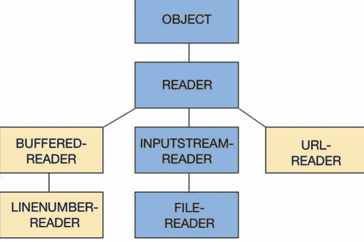

**图 12.1**
InputStreamReader 类的族树。

顶端是 `Object` 类。`InputStreamReader` 在层次结构上方有两个超类：`Reader` 和 `Object`。它在层次结构下方有一个子类：`FileReader`。

`InputStreamReader` 类继承了 `Reader` 和 `Object` 类的属性和行为，因为它们在超类层次结构中直接位于上方。`InputStreamReader` 没有继承图 12.1 中橙色类（`BufferedReader`、`UrlReader` 和 `LineNumber`）的任何内容，因为它们不在其层次结构的上方。

如果这看起来很困惑，请将该层次结构想象成家族树。`InputStreamReader` 继承自其父类并此类推。然而，`InputStreamReader` 类并不继承自它的兄弟或堂兄弟。

创建一个新类归结为以下任务：你只需要定义它与现有类不同之处。其余的工作都由系统为你完成了。

## 继承行为和属性

类的行为和属性是两个部分的组合：它自身的行为和属性，以及它从超类中继承的所有行为和属性。

以下是 `InputStreamReader` 的一些行为和属性：

- `equals()` 方法确定一个 `InputStreamReader` 对象的值是否与另一个对象相同。
- `getEncoding()` 方法返回流所使用的字符编码名称。
- `reset()` 方法将流的当前位置移回起点。
- `mark()` 方法标记当前位置。

`InputStreamReader` 类可以使用所有这些方法，尽管 `getEncoding()` 是它唯一没有从其他类继承的方法。`equals()` 方法定义在 `Object` 类中，而 `reset()` 和 `mark()` 都来自 `Reader`。

### 重写方法

`InputStreamReader` 对象类中定义的一些方法也定义在它的某个子类中。例如，`close()` 方法既是 `InputStreamReader` 也是 `Reader` 类的一部分。当一个方法同时在子类和其父类中定义时，将使用子类的方法。这使得子类能够更改、替换或完全消除父类的行为或属性。

在子类中创建一个新方法以更改继承自父类的行为被称为重写（overriding）。当继承的行为产生非预留结果或你想执行不同的操作时，你需要重写方法。

### 建立继承

使用 `extends` 语句可以将一个类定义为另一个类的子类：

```java
class FileReader extends InputStreamReader {

  // 行为和属性放在这里

}
```

`extends` 语句将 `FileReader` 对象类建立为 `InputStreamReader` 的子类。所有的读取器必须是输入读取器的子类。它们需要通过输入流提供文件的功能。

`FileReader` 可以重写的方法之一是 `close()` 方法，它在读取完成后执行关闭文件的必要操作。由 `Reader` 类实现的 `close()` 方法一直向下传递给 `FileReader`。

要重写方法，你必须以其在超类中声明的方式来声明该方法。`public` 方法必须保持为 `public`，方法的返回值必须相同，且方法的参数数量和类型不能更改。

`Reader` 类的 `read()` 方法起始如下：

```java
public int read(char[] buffer) {
```

当 `FileReader` 重写此方法时，它必须如下语句开头：

```java
public int read(char[] cbuf) {
```

唯一的区别在于 `char` 数组的名称，在确定以相同方式创建的方法时，名称并不重要。这两个语句之所以匹配，是因为以下内容是匹配的：

- 两个方法都是 `public`。
- 两个方法都返回 `int`。
- 两个方法都使用 `char` 数组作为参数。

在子类中重写方法时，你应该在方法前加上 `@Override`，如示例所示：

```java
@Override

public void setPosition(int x, int y) {

  if (x > 0) {

    super.setPosition(x, y);

  }

}
```

## 在子类中使用 this 和 super

在子类中非常有用的关键字是 `this` 和 `super`。

正如你在上一小时学到的，`this` 关键字用于引用当前对象。当你创建一个类并需要引用某个特定对象时，可以使用 `this`，如下：

```java
this.title = "Cagney";
```

`super` 关键字具有类似的作用：它引用父类的成员。你可以通过多种方式使用 `super`：

- 引用父类的构造函数，如 `super("Adam", 12);`
- 引用父类的变量，如 `super.hawaii = 50;`
- 引用父类方法，如 `super.dragnet();`

使用 `super` 的一种方式是在子类的构造中。因为子类继承父类的行为和属性，你必须将子类的每个构造函数与其父类的构造函数关联。否则，某些行为和属性可能无法正确设置，导致子类无法运行。

为了关联构造函数，子类的第一语句必须是对父类构造函数的调用。这需要 `super` 关键字，如下：

```java
public DataReader(String name, int length) {

  super(name, length);

}
```

如果你没有使用 `super()` 调用父类的构造函数，Java 在子类启动时会自动调用无参数的 `super()`。如果该父类构造函数不存在或提供了意之外的行为，就会导致错误，因此最好正确调用 `super`。

### 使用现有对象

OOP 鼓励重用。如果你为某个 Java 编程项目开发了一个对象，应该可以在不进行修改的情况下将该对象整合到另一个项目中。

如果一个 Java 类设计良好，就可以将该类用于其他程序。可供你的程序使用的对象越多，你在创建自己的软件时需要的工作就越少。如果有一个非常适合需求的优秀拼写检查对象，你甚至可以给老板留下一种项目中添加拼写检查功能需要很长时间的假象，并利用这段时间打长途电话。

> 注意
> 本书作者像许多业内人士一样是自由职业者，并在家里工作。在评估他对职场行为的建议时，请记住这一点。

当 Java 最初引入时，共享对象的系统很大程度上是非正式的。程序员在开发对象时尽可能使其独立，并通过使用私有变量以及读写这些变量的公共方法来保护它们免受滥用。当存在一种开发可重用对象（如 JavaBeans）的标准方法时，共享对象的力量会变得更加强大。

遵循标准的优点包括：

- 不需要详细记录一个对象是如何工作的，因为任何了解该标准的人对它的功能了如指掌。
- 你可以设计出遵循标准的开发工具，从而能够轻松地处理这些对象。
- 两个遵循标准的对象可以相互作用，而无需特殊的编程来使它们兼容。

JavaBeans 是遵循严格标准的对象。遵循规则的 Java 类被称为 bean。可以使用 NetBeans IDE（集成开发环境来制作 bean。一个在 NetBeans 中使用 JavaBeans 的介绍性教程请访问 http://wiki.netbeans.org/NetBeansBeansTutorial。

## 在 Array Lists 中存储相同类的对象

在编写计算机程序时，一个重要的决策是将数据存储在何处。在本书的前半部分，你已经发现了三个存储信息的地方：

- 基本数据类型，如 `int` 和 `char`（或它们相应的类）
- 数组
- `String` 对象

还有更多存储信息的地方，因为任何 Java 类都可以持有数据。最实用的之一是 `ArrayList`，它是一个持有相同类或公共父类对象的数据结构。

正如类名所示，数组列表类似于数组，它们也持有相关的数据元素，但它们可以随时扩大或缩小尺寸。

`ArrayList` 属于 `java.util` 类包，它们是 Java 类库中最实用的包之一。通过 `import` 语句可以在你的程序中使用它：

```java
import java.util.ArrayList;
```

数组列表持有属于相同类或共享相同父类的对象。它们通过引用两个类来创建：`ArrayList` 类和它所持有的列表。

列表所持有的类名放在 `<` 和 `>` 之间，如下语句所示：

```java
ArrayList<String> structure = new ArrayList<String>();
```

上述语句创建了一个持有字符串的列表。以这种方式识别列表的类使用了泛型（generics），这是一种指示数据结构（如数组列表）所持有对象类型的方法。如果你在使用旧版本的 Java 列表，你将编写类似这样的构造函数：

```java
ArrayList structure = new ArrayList();
```

虽然你可以这样做，但泛型让你的代码更可靠，因为它们为编译器提供了防止更多错误的方法。在这里，它们阻止了你误用数组列表：如果你将错误的 `Integer` 对象放入一个本应持有 `String` 对象的列表中，编译器会报错。

与数组不同，列表不是用它们持有的固定数量元素创建的。列表是用 10 个元素创建的。如果你知道要存储的对象比这多，可以指定尺寸作为构造函数的参数。这里有一条创建包含 300 个元素列表的语句：

```java
ArrayList<String> structure = new ArrayList<String>(300);
```

你可以通过调用其 `add()` 方法向列表添加对象，并将该对象作为唯一参数：

```java
structure.add("Vance");
structure.add("Vernon");
structure.add("Velma");
```

你按顺序添加对象，因此这些是添加到 `structure` 的前三个对象，元素 0 是 "Vance"，元素 1 是 "Vernon"，元素 2 是 "Velma"。

你通过调用其 `get()` 方法并将元素的索引号作为参数从列表中检索对象：

```java
String name = structure.get(1);
```

该语句将 "Vernon" 存储在字符串 `name` 中。

要检查列表的某个元素是否包含某个对象，调用其 `contains()` 方法并将该对象作为参数：

你可以使用对象本身或其索引号从列表中删除对象：

```java
structure.remove(0);
structure.remove("Vernon");
```

这两条语句留下了 "Velma" 作为列表中唯一的字符串。

### 遍历 Array List

Java 包含一种特殊的 `for` 循环，使其能够轻松地加载数组列表并逐个检查它的每个元素。

这个循环有两个部分，这比你在第 8 小节“用循环重复操作”中学习的 `for` 循环少了一个部分。

第一部分是初始化部分：持有从列表中检索的每个对象的变量类和名称。该对象应该属于持有列表的同一个类。

第二部分标识列表。

以下是遍历 `structure` 列表的代码，将每个名称显示在屏幕上：

```java
for (String name : structure) {
    System.out.println(name);
}
```

本节的第一个项目是 `StringList`，这是一个利用数组列表和特殊 `for` 循环的应用程序，按字母顺序显示字符串列表。该列表来自数组和命令行参数。

在 NetBeans 中打开你的 Java24 项目，选择 File（文件）、New File（新建文件），并在 `com.java24hours` 包中创建一个名为 `StringList` 的新空 Java 文件。在编辑器中输入 Listing 12.1 并保存文件。

## LISTING 12.1 StringList.java 的全文

```java
1: package com.java24hours;
2:
3: import java.util.*;
4:
5: public class StringList {
6:     String[] names = { "Carly", "Sam", "Kiki", "Lulu",
7:         "Hayden", "Elizabeth", "Kristina", "Molly", "Laura" };
8:
9:     public StringList(String[] moreNames) {
10:        ArrayList<String> list = new ArrayList<>();
11:        for (int i = 0; i < moreNames.length; i++) {
```


```java
12:            list.add(moreNames[i]);

13:        }

14:        Collections.sort(list);

15:        for (String name : list) {

16:            System.out.println(name);

17:        }

18:    }

19:    public static void main(String[] args) {

20:        String[] names = { "Carly", "Sam", "Kiki", "Lulu",

22:            "Hayden", "Elizabeth", "Kristina", "Molly", "Laura" };

23:        StringList sl = new StringList(names);

24:        if (args.length > 0) {

25:            sl = new StringList(args);

26:        }

27:    }

28:}
```

## 创建子类

为了看到继承的示例，在下一个项目中你创建一个 `Point3D` 类来表示三维空间中的点。你可以用 `(x,y)` 坐标表示二维点。三维空间增加了一个坐标，即 `z`。

`Point3D` 类可以做三件事：

- 跟踪对象的 `(x,y)` 坐标
- 将对象移动到新的 `(x,y,z)` 坐标
- 通过指定的 `x, y, z` 值移动对象

Java 已经有了一个表示二维点的标准类 `Point`。该类位于 `java.awt` 包中。

它有两个名为 `x` 和 `y` 的变量，存储 `Point` 对象的 `(x,y)` 位置。它还有一个 `move()` 方法将点放置在指定位置，以及一个 `translate()` 方法通过 `x, y` 值移动对象。

在 NetBeans 的 Java24 项目中，在 `com.java24hours` 包中创建一个名为 `Point3D` 的空文件，并将 Listing 12.2 的文本输入文件中。完成后保存它。

## LISTING 12.2 Point3D.java 的全文

```java
1: package com.java24hours;

2:

3: import java.awt.*;

4:

5: public class Point3D extends Point {

6:     public int z;

7:

8:     public Point3D(int x, int y, int z) {

9:         super(x,y);

10:        this.z = z;

11:    }

12:

13:    public void move(int x, int y, int z) {

14:        this.z = z;

15:        super.move(x, y);

16:    }

17:

18:    public void translate(int x, int y, int z) {

19:        this.z += z;

20:        super.translate(x, y);

21:    }

22:}
```

## 创建子类

`Point3D` 类没有 `main()` 方法，因此你无法将其作为应用程序运行，但你可以在 Java 程序中任何需要三维点的地方使用它。

`Point3D` 类只负责那些未由子类 `Point` 处理的工作。这主要涉及跟踪整数变量 `z`，并将其作为参数传递给 `move()` 方法、`translate()` 方法和 `Point3D()` 构造函数。

所有方法都使用了 `super` 和 `this` 关键字。`this` 用于引用当前的 `Point3D` 对象，因此第 10 行的 `this.z = z` 将对象变量 `z` 设置为作为第 8 行方法传递的参数值。

`super` 语句引用当前对象的父类 `Point`。它被用于设置变量和调用 `Point3D` 继承的方法。第 9 行的语句 `super(x,y)` 调用了 `Point(x,y)` 构造函数，该函数设置了 `Point3D` 对象的 `(x,y)` 坐标。由于 `Point` 已经能够处理 x 轴和 y 轴，让 `Point3D` 类执行相同的操作是多余的。

要测试新的 `Point3D` 类，请创建一个使用 `Point` 和 `Point3D` 对象并移动它们的程序。在 NetBeans 的 `com.java24hours` 包中创建一个名为 `PointTester` 的新文件并输入 12.3。该文件在保存时会自动编译。

### 列表 12.3 PointTester.java 的完整文本

```java
1: package com.java24hours;

2:

3: import java.awt.*;

4:

5: class PointTester {

6:     public static void main(String[] arguments) {

7:         Point location1 = new Point(11

25: location2.move(10,22,7);

26: System.out.println("The 3D point is now at (" + location2.x

27: ", " + location2.y + ", " + location2.z + ")\n");

28: System.out.println("It's being moved -20 units on the x, y 

29: " and z axes");

30: location2.translate(-20,-20,-20);

31: System.out.println("The 3D point ends up at (" + location2.x

32: ", " + location2.y + ", " + location2.z + ")");

33: }

34: }
```

当你通过选择 Run 或 Run File 来运行文件时，你会看到图 12.3 所示的输出。如果程序无法运行，查看源编辑器旁边的红色警报图标，它会指示触发错误的行。

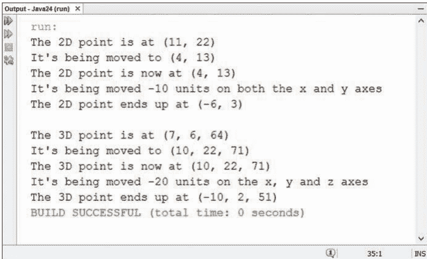

图 12.3
PointTester 程序的输出。

### 总结

当人们谈论生命的奇迹时，他们可能不是指 Java 中的父类如何产生子类，或者行为和属性如何在类层次结构中被继承。

如果现实世界的运作方式像面向对象编程（OOP）一样，那么莫扎特的每一个后代都可以选择成为卓越的作曲家。马克·吐恩的所有后代都可以对密西西比河轮船的生活充满诗意。你祖先努力实现的每项技能都将毫不费力地传授给你。

在奇迹的尺度上，继承并不完全比得上物种的延续或棒球比赛中的连续不失。然而，它是设计软件的一种有效方法，可以最大限度地减少冗余工作。

### 工作坊

### 问答

- 到目前为止创建的大多数 Java 程序都没有使用 `extends` 来继承父类。这意味着它们存在于类层次结构之外吗？

- 你在 Java 中创建的所有类都是层次结构的一部分，因为当你不使用 `extends` 关键字时，你编写的程序的默认父类是 `Object`。所有类的 `equals()` 和 `toString()` 方法都是自动从 `Object` 继承的行为的一部分。

- 为什么人们在发现某些东西时会大喊“Eureka（找到了）！”？

- “Eureka”借用自古希腊语，意思是“我找到了！”据据说这个词是希腊学者阿基米德在步入浴缸时发出的。希腊人在浴缸里发现了什么？发现是上升的水位，这让他意识到排开水的体积必须等于他身体部位的体积。

关于阿基米德的故事在两个世纪后由维特鲁威在其多卷著作《建筑五》（De Architecture）中流传。

“Eureka”自 1849 年以来一直是加州州章的一部分，指的是一年前在萨特磨坊（Sutter's Mill）附近发现黄金时的发出的声。

### 测验

为了确定你从过去小时的工作中继承了哪些知识，请回答以下问题。

- 如果父类处理方法的方式你不希望在子类中使用它，你可以做什么？
  - 删除父类中的方法。
  - 在子类中重写该方法。
  - 给《圣何塞水水报》的编辑写一封严厉的信，希望 Java 开发者能读到。

- 2. 你可以使用什么方法来获取存储在列表中的元素？
  - A. `get()`
  - B. `read()`

- 3. 你可以使用什么语句来引用当前对象？
  - A. `this`
  - B. `super`
  - C. `Object`

### 答案

1. 因为父类有该方法，所以你可以重写它。
2. A. `get()`
3. `this`

### 活动

如果父类处理方法的方式你不希望在子类中使用它，你可以做什么？
- 删除父类中的方法。
- 在子类中重写该方法。
- 给《圣何塞水水报》的编辑写一封严厉的信，希望 Java 开发者能读到。

2. 你可以使用什么方法来获取存储在列表中的元素？
- A. `get()`
- B. `read()`

3. 你可以使用什么语句来引用当前对象？
- A. `this`
- B. `super`
- C. `Object`

```java
servants.add("Thomas");

servants.add("Mrs. O'Brien");

servants.add("Daisy");
```

每个元素都被添加到列表中，`servants` 中的第一个字符串是 "Bates"，最后一个是 "Daisy"。

有一个相应的 `remove(Object)` 方法，可以将该对象从列表中移除：
`servants.remove("Mrs. O'Brien");`

数组列表（array list）的大小是它当前持有的元素数量。通过调用列表的 `size()` 方法获取此信息，该方法返回一个整数：

```java
int servantCount = servants.size();
```

当您使用泛型来指定列表包含的内容时，使用 `for` 循环遍历列表的每个元素非常简单：

```java
for (String servant : servants) {

    System.out.println(servant);

}
```

`for` 的第一个参数是存储元素的变量。第二个参数是列表。其他数据结构也可以相同的循环。

`add(Object)` 方法将对象存储在列表末尾。也可以通过指定对象应存储在列表中的位置将对象添加到列表。这需要 `add(int, Object)` 方法，它将位置作为第一个参数：

```java
ArrayList<String> aristocrats = new ArrayList<String>();

aristocrats.add(0, "Lord Robert");

aristocrats.add(1, "Lady Mary");

aristocrats.add(2, "Lady Edith");

aristocrats.add(3, "Lady Sybil");

aristocrats.add(0, "Lady Granth");
```

上一个示例中的最后语句将 "Lady Granth" 添加到列表顶部而不是底部，将她放在 "Lord Robert" 以及其他人之上。

作为第一个参数指定的位置不能大于列表的 `size()`。如果用位置 1 而不是 0 添加 "Lord Robert"，程序将因 `IndexOutOfBoundsException` 异常失败。

可以通过指定位置作为 `remove(int)` 的参数来从列表中删除元素：

```java
aristocrats.remove(4);
```

可以通过调用带有该位置的 `get(int)` 方法来获取列表中指定位置的元素。使用 `for` 循环可以从列表中取出每个字符串并显示它：

```java
for (int i = 0; i < aristocrats.size(); i++) {

  String aristocrat = aristocrats.get(i);

  System.out.println(aristocrat);

}
```

通常需要确定数组列表是否包含特定对象。这可以通过调用列表的 `indexOf(Object)` 方法并将该对象作为参数来确定。该方法返回对象的位置，如果在列表中找不到，则返回 -1：

```java
int hasCarson = servants.indexOf("Carson");
```

还有一个 `contains()` 方法，它根据是否可以找到指定对象返回 `true` 或 `false`。这里是使用该方法的之前示例的审查：

```java
boolean hasCarson = servants.contains("Carson");
```

第一个项目将这些技术应用于一个简单的游戏，在该游戏中向 10x10 网格上的 `(x,y)` 点发射射击。某些点包含目标，另一些则不。

目标由 `java.awt` 包中的 `Point` 类表示。通过调用 `Point(int, int)` 构造函数并将 x 和 y 坐标作为两个参数创建一个点。

此语句在 `(5,9)` 创建一个点：

```java
Point pl = new Point(5,9);
```

这是一个 10x10 的网格，用 X 标记点，用 "." 标记空格。

### 输出

| 1 | 2 | 3 | 4 | 5 | 6 | 7 | 8 | 9 |
|---|---|---|---|---|---|---|---|---|---|
| 1 | . | . | . | . | . | . | . | . | . |
| 2 | . | . | . | . | . | . | . | . | . |
| 3 | . | . | . | . | . | . | . | . | . |
| 4 | . | . | . | . | . | . | . | . | . |
| 5 | . | . | . | . | . | . | . | . | . |
| 6 | . | . | . | . | . | . | . | . | . |
| 7 | . | . | . | . | . | . | . | . | . |
| 8 | . | . | . | . | . | . | . | . | . |
| 9 | . | . | . | X | . | . | . | . | . |

列从左到右表示 x 坐标。行从上到下延伸表示 y 坐标。

# 数组列表 177

在 own项目之前，你已经看到数组列表如何存储字符串。它们可以存储 `Point` 或任何其他类的对象。此语句创建了一个点列表：

```java
ArrayList<Point> targets = new ArrayList<Point>();
```

Java 编译器将不允许任何继承 `Point` 或其子类的类添加到数组列表中。

在 NetBeans 或另一个编程工具中，创建一个名为 `Battlepoint` 的 Java 文件，并指定 `com.java24hours` 为其包名。将列表 13.1 的文本输入到文件中。

### 列表 13.1 Battlepoint.java 的全文

```java
package com.java24hours;

import java.awt.*;

import java.util.*;

public class Battlepoint {

    ArrayList<Point> targets = new ArrayList<Point>();

    public Battlepoint() {

        // 创建目标以供射击

        createTargets();

        // 显示地图

        showMap();

        // 射击三个点

        shoot(7,4);

        shoot(3,3);

        shoot(9,2);

        // 再次显示地图

        showMap();

    }

    private void showMap() {

        System.out.println("\n1 2 3 4 5 6 7 8 9");

        for (int column = 1; column < 10; column++) {

            for (int row = 1; row < 10; row++) {

                if (row == 1) {

                    System.out.print(" ");

                }

                System.out.print(" ");

                Point cell = new Point(row, column);

                if (targets.indexOf(cell) > -1) {

                    // 此位置有一个目标

                    System.out.print("X");

                } else {

                    // 没有目标

                    System.out.print(".");

                }

                System.out.print(" ");

            }

            System.out.println();

        }

    }
```


```java
private void createTargets() {

    Point p1 = new Point(5,9);

    targets.add(p1);

    Point p2 = new Point(4,5);

    targets.add(p2);

    Point p3 = new Point(9,2);

    targets.add(p3);

}

private void shoot(int x, int y) {

    Point shot = new Point(x,y);

    System.out.print("Firing at " + x + "," + y + " ... ");

    if (targets.indexOf(shot) > -1) {

        System.out.println("you sank battlepoint!");

        // 删除被击的目标

        targets.remove(shot);

    } else {

        System.out.println("miss.");

    }

}

public static void main(String[] arguments) {

    new Battlepoint();

}

}
```

`Battlepoint` 程序中的注释描述了构造函数的每个部分以及程序中的重要逻辑。应用程序创建 `Point` 对象并将它们添加到数组（第 45-52 行）。显示这些这些目标的地图（第 22-43 行）。接下来，通过调用 `shoot(int, int)` 方法对三个点进行射击（第 54-64 行）。每次射击如果命中目标之一，目标就会从数组中移除。最后，再次显示地图，应用程序终止。

数组如图 13.1 所示。


## 图 13.1

将 `Point` 对象放入数组列表并对它们进行射击。三个目标显示在图 13.1 的顶部地图中。一个目标在命中后被移除。输出中的底部地图反映了这一变化。当目标被射击命中时，通过将射击点作为参数调用 `remove(Object)` 方法从 `targets` 列表中移除。

## 数据结构中存储对象

在 `Battlepoint` 程序的 `shoot()` 方法中，从数组列表中移除的 `Point` 对象代表射击。它与被击中的目标具有相同的 (x,y) 坐标。

## 哈希映射 (Hash Maps)

使用某条信息访问另一条信息在编程中很常见。数组列表是这些数据结构中最简单的例子，使用索引数字从列表中检索一个对象。这里有一个从 `aristocrats` 列表中提取第一个字符串的示例：

```java
String first = aristocrats.get(0);
```

数组也使用索引数字检索数组中的每个项。

哈希映射是 Java 中的一种数据结构，它使用索引检索另一个对象。第一个对象是键（key），第二个是值（value）。这种结构在 `java.util` 包中通过 `HashMap` 类实现。名称指的是键如何映射到值。这种结构的一个例子是电话联系列表。人的名字（字符串）可以用于获取人的号码。

可以通过调用不带参数的构造函数创建一个哈希映射：

```java
HashMap phonebook = new HashMap();
```

在新的哈希映射中可以指定两个控制其效率的因素：初始容量和负载因子。这些通过两个参数设置，容量在前，负载因子在后：

```java
HashMap phonebook = new HashMap(30, 0.7F);
```

容量是用于存储哈希映射值的桶的数量。负载因子是在容量自动增加之前可以使用的桶的数量。该值是一个从 0（空）到 1.0（满）的浮点数，因此 0.7 意味着当桶填充 70% 时，容量就会增加。默认值容量为 16，负载因子为 .75，这通常足够了。

泛型用于识别键和值的类。它们被放在 `<` 和 `>` 字符之间，并用逗号分隔，如下所示：

```java
HashMap<String, Long> phonebook = new HashMap<>();
```

这创建了一个键为字符串、值为 `Long` 对象的哈希映射 `phonebook`。第二个 `< >` 字符是空的，这假设与上一个 `<` 和语句中的类相同。

### 注意

这些语句正在使用 `long` 值向哈希表中放入 `Long` 对象。这在 Java 的早期版本中会导致错误，因为像 `long` 这样的基本数据类型不能在需要对象的地方使用。但现在不再是错误，因为有了装箱（boxing）和拆箱（unboxing），这是 Java 的一项功能，可以自动转换基本类型及其对应的对象类。当 Java 编译器看到像 8002888372 的 `long` 类型时，它会将其转换为代表该值的 `Long` 对象。

对象通过调用其 `put(Object, Object)` 方法并传入两个参数：键和值存储在哈希表中：

```java
phonebook.put("Butterball Turkey Line", 8002888372L);
```

这在映射中存储了一个项，键为 "Butterball Turkey Line"，值为 8002888372 的 `Long` 对象，即服务费金额。

可以通过调用 `get(Object)` 方法并传入键作为参数，从映射中根据键检索对象：

```java
long number = phonebook.get("Butterball Turkey Line");
```

如果没有与键匹配的值，`get()` 方法将返回 `null`。这会导致前一个示例出现问题，因为 `null` 不是一个合适的 `long` 值。

处理该潜在问题的另一种方法是调用 `getOrDefault(Object, Object)`。在以下语句中，如果未找到指定的第一个参数，则会默认返回第二个参数：

```java
long number = phonebook.getOrDefault("Betty Crocker", -1L);
```

避免此问题的第三种方法是将 `number` 声明为 `Long` 对象而不是 `long` 基本类型。`number` 对象可以接受 `null` 作为值。

如果在映射中找到了与键 "Betty Crocker" 匹配的数字，则返回该数字。否则返回 -1。

有两个方法可以指示键或值是否存在于映射中：`containsKey(Object)` 和 `containsValue(Object)`。它们返回 `true` 或 `false` 的 `Boolean` 值。

哈希映射像 `ArrayList` 一样，有一个 `size()` 方法，可以揭示数据结构中项的数量。

可以使用 `entrySet()` 遍历映射，`entrySet()` 是映射中所有项的集合。`entrySet()` 方法将这些项作为 `Set` 对象返回（使用 `java.util` 中的 `Set` 接口）。

## 第13小时：在数据结构中存储对象

集合中的每个项都由 `Map.Entry` 表示，它是 `java.util.Map` 类的一个内部类。当你有一个 `Entry` 对象时，可以调用它的 `getKey()` 方法获取键，调用 `getValue()` 获取值。

以下 `for` 循环使用项集和集合中的每个项来访问电话簿哈希映射中所有的键和值：

```java
for (Map.Entry<String, Long> entry : map.entrySet()) {

  String key = entry.getKey();

  Long value = entry.getValue();

  // ...

}
```

`FontMapper` 项目将这一切整合在一起，使用哈希映射来管理字体集合。

`java.awt` 包中的 `Font` 类用于创建字体并在图形用户界面中显示文本。字体包括字体名称、字号以及其样式是普通、粗体还是斜体。

哈希映射可以包含任何类的对象。在 NetBeans 中，在 `com.java24hours` 包中创建一个 java 文件，并命名为 `FontMapper`。将列表 13.2 输入文件并保存。

### 列表 13.2 FontMapper.java 的全文

```java
1: package com.java24hours;

2:

3: import java.awt.*;

4: import java.util.*;

5:

6: public class FontMapper {

7:   public FontMapper() {

8:     Font courier = new Font("Courier New", Font.PLAIN, 6);

9:     Font times = new Font("Times New Roman", Font.BOLD, 12);

10:    Font verdana = new Font("Verdana", Font.ITALIC, 25);

11:    HashMap<String, Font> fonts = new HashMap<>();

12:    fonts.put("smallprint", courier);

13:    fonts.put("body", times);

14:    fonts.put("headline", verdana);

15:    for (Map.Entry<String, Font> entry : fonts.entrySet()) {

16:      String key = entry.getKey();

17:      Font value = entry.getValue();

18:      System.out.println(key + " : " + value.getSize() + " -pt "

19:                               + value.getFontName());

20:    }

21:  }

22:    public static void main(String[] arguments) {

23:        new FontMapper();

24:

25:    }

26:}
```

`FontMapper` 在第 8–10 行创建了三个 `Font` 对象，并在第 12-14 行将它们添加到名为 `fonts` 的哈希表中。它们以字符串键存储在映射中，该键描述了字体的用途："smallprint"、body" 和 "headline"。

第 15–20 行的 `for` 循环通过项集和集合中的每个单独项遍历哈希映射。

应用程序的输出显示在图 13.2 中


## 图 13.2 在哈希表中存储对象

### 总结

哈希映射像 `ArrayList` 一样，有一个 `size()` 方法，可以揭示数据结构中项的数量。

可以使用 `entrySet()` 遍历映射，`entrySet()` 是映射中所有项的集合。`entrySet()` 方法将这些项作为 `Set` 对象返回（使用 `java.util` 中的 `Set` 接口）。

哈希映射可以包含任何类的对象。在 NetBeans 中，在 `com.java24hours` 包中创建一个 java 文件，并命名为 `FontMapper`。将列表 13.2 输入文件并保存。

`java.awt` 包中的 `Font` 类用于创建字体并在图形用户界面中显示文本。字体包括字体名称、字号以及其样式是普通、粗体还是斜体。

`FontMapper` 项目将这一切整合在一起，使用哈希映射来管理字体集合。

`FontMapper` 应用程序在第 8–10 行创建了三个 `Font` 对象，并在第 12-14 行将它们添加到名为 `fonts` 的哈希表中。它们以字符串键存储在映射中，该键描述了字体的用途："smallprint"、body 和 "headline"。

第 15–20 行的 `for` 循环通过项集和集合中的每个单独项遍历哈希映射。

## 第 14 小时：程序中的错误处理

本小时的任务列表：

- 学习为什么错误被称为异常（exceptions）。
- 在你的 Java 程序中对异常做出响应。
- 创建忽略异常的方法。
- 使用会引发异常的方法。
- 创建你自己的异常。

错误——那些阻止程序正确运行的 bug、失误和拼写错误——是软件开发过程中自然产生的一部分。“自然”可能已经是用来描述它们最友善的词汇了。在我自己的编程中，当我找不到某个难以捉摸的错误原因时，我会使用一些会让口口秀演员都脸红的词汇。

有些错误会被编译器标记，并阻止你创建类。另一些错误会被解释器记录，以响应某个阻止其成功运行的问题。Java 将错误分为两类：

- 异常（Exceptions）——信号程序运行时发生了异常情况的事件。
- 错误（Errors）——信号解释器出现问题的事件，这些问题可能与程序无关。

错误通常不是 Java 程序可以恢复的，因此它们不是本小时的重点。在编写 Java 程序时，你可能遇到过 `OutMemoryError`，这意味着程序变得太大，以至于耗尽了计算机内存。在发生此类错误后，Java 程序中没有任何方法可以处理这种错误。程序将带该错误退出。

异常通常可以通过保持程序正常运行的方式来处理。

## 异常

尽管你现在正在学习它们，但在之前的 13 小时里，你可能已经对异常非常熟悉了。当你编写 Java 程序编译成功但在运行时遇到问题时，这些错误就会出现。

例如，常见的编程错误是引用不存在的数组元素，如下语句所示：

```java
String[] greek = { "Alpha", "Beta", "Gamma" };

System.out.println(greek[3]);
```

数组 `greek` 有三个元素。因为数组的第一个元素的索引是 0 而 1，所以第一个是 `greek[0]`，第二个是 `greek[1]`，第三个是 `greek[2]`。这使得尝试显示 `greek[3]` 的语句出错。之前的语句编译成功，但当你运行程序时，Java 虚拟机会停止并显示如下所示的消息：

### 输出

```text
Exception in thread "main" java.lang.ArrayIndexOutOfBoundsException: 3
at SampleProgram.main(SampleProgram.java:4)
```

此消息表示应用程序已生成了一个异常，JVM 通过显示错误消息并停止程序进行了记录。

该错误指向 `java.lang` 包中的 `ArrayIndexOutOfBoundsException` 类。该类是一个异常，是一个代表程序中发生的异常情况的对象。

异常处理是一种在发生错误或其他异常情况时进行相互通信的方法。

当 Java 类遇到异常时，它会向类的用户报警该错误。在这个例中，类的用户是 JVM。

### 注意

使用了两个术语来描述这个过程：`throw`（抛出）和 `catch`（捕获）。对象抛出异常以通知其他对象异常已经发生。这些异常被其他对象或 Java 虚拟机捕获。

所有异常都是 `java.lang` 包中 `Exception` 的子类。`ArrayIndexOutOfBoundsException` 的作用正如你预期的那样——它报告访问了数组边界之外的元素。

Java 中有数百种异常。许多异常（如数组异常）表明可以通过编程更改来修复问题。这些与编译器错误具有可性。在你纠正了情况后，就不需要再担心该异常了。

其他异常必须在每次程序运行时通过五个新关键字来处理：`try`、`catch`、`finally`、`throw` 和 `throws`。

## 在 try-catch 块中捕获异常

到此为止，你通过修复导致异常的问题来处理异常。有时你无法以那种方式处理异常，必须在 Java 类内部处理该问题。

作为为什么这很有用的介绍，请将列表 14.1 中的短 Java 异常代码输入 `com.java24hours` 包中名为 `Calculator` 的新 Java 文件中并保存文件。

### 列表 14.1 Calculator.java 的全文

```java
1: package com.java24hours;

2:

3: public class Calculator {

4:     public static void main(String[] arguments) {

5:         float sum = 0;

6:         for (String argument : arguments) {

7:             sum = sum + Float.parseFloat(argument);

8:         }

9:         System.out.println("Numbers add up to " + sum);

10:    }

11: }
```


`Calculator` 接收一个或多个数字作为命令行参数，将它们相加并显示总和。

由于 Java 应用程序中所有的命令行参数都用字符串表示，因此程序在相加之前必须将其转换为浮点数。第 7 行中的 `Float.parseFloat()` 类方法处理了此，将转换后的结果加到名为 `sum` 的变量中。

在运行应用程序之前，在 NetBeans 中通过命令 `Run, Set Project Configuration, Customize` 设置以下命令行参数：`7 4 8 1 4 1`。选择 `Run Main Project` 来运行应用程序，你应该能在图 14.1 中看到输出。

## 第 14 小时：程序中的错误处理

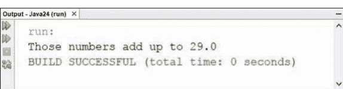
图 14.1 Calculator 程序的输出。

# 异常

`try-catch` 块的 `try` 部分包含可能抛出异常的语句（语句）。在 `Calculator` 中，列表 14.1 第 7 行的 `Float.parseFloat(String)` 调用在遇到无法转换的字符串时会抛出 `NumberFormatException`。

为了改进 `Calculator` 应用程序使其不再因此类错误停止，你可以使用 `try-catch` 块。

在 `com.java24hours` 包中名为 `NewCalculator` 的新 Java 文件并输入列表 14.2 的文本。

# 列表 14.2 NewCalculator.java 的全文

```java
1: package com.java24hours;

2:

3: public class NewCalculator {

4:     public static void main(String[] arguments) {

5:         float sum = 0;

6:         for (String argument : arguments) {

7:             try {

8:                 sum = sum + Float.parseFloat(argument);

9:             catch (NumberFormatException e) {

10:                    System.out.println(argument + " is not a number.");

11:                }

12:         }

13:         System.out.println("Numbers add up to " + sum);

14:     }

15: }
```

保存应用程序后，自定义项目配置并使用命令行参数 `1 3 5x` 运行 `com.java24hours.NewCalculator`。你应该看到图 14.2 所示的输出。

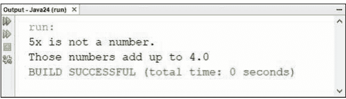
图 14.2 NewCalculator 程序的输出。

如果参数不是数字，将显示错误消息。由于异常在类内部被处理，因此 JVM 不显示错误。你通常可以使用 `try-catch` 块来处理与用户输入和其他意外数据相关的问题。

## 捕获多种不同的异常

`try-catch` 块可以处理多种不同类型的异常，即使它们是由不同的语句抛出的。

处理多类异常的一种方法是为每个类分配一个 `catch` 块，如下代码所示：

```java
String textValue = "35";

int value;

try {

    value = Integer.parseInt(textValue);

} catch (FormatException exc) {

    // 处理异常的代码

} catch (ArithmeticException exc) {

    // 处理异常的代码

}
```

你也可以在同一个 `catch` 块中处理多个异常，使用管道符号 "|" 将它们分隔开，并以异常变量名结束列表。这是一个示例：

```java
try {

    value = Integer.parseInt(textValue);

} catch (FormatException | ArithmeticException exc) {

    // 处理异常的代码

}
```

如果捕获到 `FormatException` 或 `ArithmeticException`，它将被赋值给 `exc` 变量。

列表 14.3 包含一个名为 `NumberDivider` 的应用程序，它接受两个整数命令行参数并在整数除法表达式中使用它们。

该应用程序必须处理用户输入中的两个潜在问题：

- 非整数参数
- 除以零

在 `com.java24hours` 包中为 `NumberDivider` 创建一个新的 Java 文件，并将列表 14.3 的文本输入到源文件编辑器中。

## 列表 14.3 NumberDivider.java 的完整文本

```java
1: package com.java24hours;

2:

3: public class NumberDivider {

4:     public static void main(String[] arguments) {

5:         if (arguments.length == 2) {

6:             int result = 0;

7:             try {

8:                 result = Integer.parseInt(arguments[0]) /

9:                 Integer.parseInt(arguments[1]);

10:            System.out.println(arguments[0] + " divided by " +

11:            arguments[1] + " equals " + result);

12:        } catch (NumberFormatException e) {

13:            System.out.println("Both arguments must be integers.");

14:        } catch (ArithmeticException e) {

15:            System.out.println("You cannot divide by zero.");

16:        }

17:    }

18:

19:}
```

使用命令行参数指定两个参数，你可以使用整数、浮点数和非数字参数来运行它。

列表 14.3 第 5 行的语句确保向应用程序发送了两个参数。如果没有，程序将退出且不显示任何内容。

`NumberDivider` 应用程序执行整数除法，因此结果是整数。在整数除法中，5 除以 2 等于 2，而不是 2.5。

如果你使用浮点数或非数字参数，第 8–9 行将抛出 `NumberFormatException` 并被第 14 行捕获。

如果你使用第一个参数并将 0 作为第二个参数，第 8–9 行将抛出 `ArithmeticException` 并被第 14 行捕获。

程序成功运行的某些输出如图 14.3 所示。

```
Output - Java24(run)

run:

79 divided by 13 equals 6

BUILD SUCCESSFUL (total time: 0 seconds)
```

图 14.3
`NumberDivider` 应用程序的输出。

## 在异常后处理事务

当你使用 `try` 和 `catch` 处理多个异常时，有时你希望程序在块的结束时无论是否发生异常都执行某些操作。

你可以使用 `try-catch-finally` 块来处理，其格式如下：

```java
try {

  // 可能会引起异常的语句

} catch (Exception e) {

  // 异常发生时执行的操作

} finally {

  // 无论如何都会执行的语句

}
```

块中 `finally` 部分的语句或语句会在块中的 `else` 之后执行，即使发生了异常也是如此。

这种情况用处之一是从文件中读取数据的程序（这是你在第 20 节“读取和写入文件”中所做的）。当你访问数据时，异常有几种发生方式：文件可能、可能会发生磁盘错误等。如果读取磁盘的语句位于 `try` 部分，并且错误在 `catch` 部分被处理，那么你可以在 `finally` 部分关闭文件。这确保了无论在读取时是否抛出异常，文件都会被关闭。

## 抛出异常

当你调用另一个类的方法时，该类可以通过抛出异常来控制该方法的使用方式。

当你使用 Java 类库中的类时，编译器经常会显示关于异常处理不当的消息。这里有一个示例：

### 输出

```
NetReader.java:14: unreported exception java.net.MalformedURLException; must be caught or declared to be thrown
```

每当你看到说明异常“必须被捕获或声明抛出”的错误时，表明你正尝试使用的方法抛出了该异常。

任何调用这些方法的类（例如你编写的应用程序）必须执行以下操作之一：

## 异常

- 使用 `catch` 块处理异常
- 抛出异常
- 使用 `try-catch-finally` 块处理异常

字符串 `http://www.java24hours.com` 不是一个有效的 URL，因为它缺少了一些标点符号：冒号后面缺少两个斜杠字符 (`//`)。

由于 `loadURL()` 方法已声明为抛出 `MalformedURLException` 错误，因此它不需要在方法内部处理该错误。捕获此异常的责任在于任何调用 `loadURL()` 方法的方法。

## 不需要 catch 的异常

尽管本节展示了如何使用 `try-catch` 捕获异常或使用 `throws` 子句声明抛出异常，但仍存在例外。

Java 程序中可能发生的某些异常不需要以任何方式进行处理。当编译器检测到异常被忽略时，并不会停止。这些异常是 unchecked异常（unchecked exceptions），而其他的则是检查异常（checked exceptions）。

unchecked异常是 `java.lang` 包中 `RuntimeException` 的子类。unchecked异常的一个常见例子是 `IndexOutOfBoundsException`，它表示访问数组、字符串或列表的索引不在其范围内。如果一个数组有五个元素，而你尝试读取第 10 个元素，就会发生此异常。

另一个是 `NullPointerException`，它发生在使用了一个没有值的对象时。对象变量在被赋值对象之前其值为 `null`。某些方法在无法返回对象时会返回 `null`。如果语句错误地给一个对象赋值了值，就会发生 `NullPointerException`。

这两种错误都是程序员可以在代码中（并且应该）防止的现象，属于需要异常处理的内容。如果你写了这样的程序并对其重新编译，对于访问越界数组元素的代码，如果你期望一个对象但它却为 `null`，请在使用对象之前用 `if` 条件进行检查。

Java 中设计 unchecked 异常的原理是，它们可以通过良好的代码来防止，或者它们发生的频率太高，导致每次都捕获它们会让程序变得异常复杂。`NullPointerException` 可能在程序中每个调用对象方法的语句中发生。

当然，因为异常可以被忽略并不意味着应该被忽略。你仍然可以选择对 unchecked 异常使用 `try`、`catch` 和 `throws`。

## 抛出和捕获异常

在节节的最后一个项目中，你将创建一个类，使用异常来告诉另一个类发生了某个错误。

此项目中的类包括 `HomePage`（代表 Web 个人页面的类）和 `PageCatalog`（一个列出这些页面的应用程序）。

在 `com.java24hours` 包中创建一个名为 `HomePage` 的新 Java 文件，并输入列表 14.4 的文本。

### 列表 14.4 HomePage.java 的全文

```java
1: package com.java24hours;

3: import java.net.*;

5: public class HomePage {

    String owner;

    URL address;

    String category = "none";

    public HomePage(String inOwner, String inAddress)

        throws MalformedURLException {

        owner = inOwner;

        address = new URL(inAddress);

    }

    public HomePage(String inOwner, String inAddress, String inCategory) {

        this(inOwner, inAddress);

        category = inCategory;

    }
```

你可以在其他程序中使用 `HomePage` 类。该类代表个人网页。它有三个实例变量：`address`（一个表示页面地址的 `URL` 对象）、`owner`（支付该页面费用的人）以及 `category`（描述页面主要主题的简短注释）。

像任何创建对象的类一样，`HomePage` 必须在 `try-catch` 块中处理 `MalformedURLException`，或者声明它忽略这些错误。

该类采取了后者，如列表 14.4 的第 10–11 行和第 17–18 行所示。通过在两个构造方法中使用 `throws`，`HomePage` 消除了以任何方式处理 `MalformedURLException` 错误的需要。

要创建一个使用 `HomePage` 类的应用程序，返回 NetBeans 并在 `com.java24hours` 包中创建一个名为 `PageCatalog` 的 Java 文件，其中包含列表 14.5 的文本。

### 列表 14.5 PageCatalog.java 的全文

```java
1: package com.java24hours;

2:

3: import java.net.*;

4:

5: public class PageCatalog {

6:     public static void main(String[] arguments) {

7:         HomePage[] catalog = new HomePage[5];

8:         try {

9:             catalog[0] = new HomePage("Mike Glyer",

10:                "http://www.770.com", "science fiction");

11:            catalog[1] = new HomePage("Shelley Powers",

12:                "http://burningbird.net", "environment");

13:            catalog[2] = new HomePage("Rogers Cadenhead",

14:                "http://workbench.cadenhead.org", "programming");

15:            catalog[3] = new HomePage("Taegan Goddard",

16:                "https://political.com", "politics");

17:            catalog[4] = new HomePage("Manton Reese",

18:                "http://www.manton.org");

19:             for (int i = 0; i < catalog.length; i++) {

20:                 System.out.println(catalog[i].owner + " - " + +

21:                                    catalog[i].address + " - " + +

22:                                    catalog[i].category);

23:             }

24:         } catch (MalformedURLException e) {

25:             System.out.println("Error: " + e.getMessage());

26:         }

27:     }

28: }
```


# 抛出并捕获异常

对于本节的最后一个项目，你将创建一个类，使用异常来告诉另一个类发生了错误。

此项目中的类是 `HomePage`（代表 Web 个人页面的类）和 `PageCatalog`（一个列出这些页面的应用程序）。

当你编译并运行时，输出如图 14.4 所示：


图 14.4 PageCatalog 输出

## 在程序中处理错误

既然你掌握了异常处理技术，错误的主题应该比开始时更容易理解了。

你可以对这些做很多事：

- 捕获异常并处理它。
- 忽略异常，交给虚拟机处理。
- 在同一个 `try-catch` 块中捕获不同的异常。
- 抛出你自己的异常。

当你运行程序时，你会看到图 14.5 的输出：

```
- Mike Glyer - http://www.770.com - science fiction
- Shelley Powers - http://burningbird.net - environment
- Rogers Cadenhead - http://workbench.cadenhead.org - programming
- Taegan Goddard - https://political.com - politics
- Manton Reese - http://www.manton.org - none

BUILD SUCCESSFUL
total time: 0 seconds
```

图 14.5 PageCatalog 输出

### 总结

在 Java 程序中管理异常使其更可靠、更灵活且易于使用。

### 工作坊

#### 问答

- **Q:** 可以创建自己的异常吗？
  **A:** 不仅可以，而且非常有意义。通过使其成为现有异常（例如所有异常的父类 `Exception`）的子类来创建异常。在 `Exception` 子类中，你可能只想重写构造函数：无参数的 `Exception()` 和带参数的 `Exception(String)`。在后者中，字符串应该是描述错误的信息。

- **Q:** 为什么本节没有涵盖如何抛出和捕获错误？
  **A:** Java 将问题分为错误（`Error`）和异常（`Exception`），因为它们的严重程度不同。异常较轻，可以通过程序中的 `try-catch` 或方法声明中的 `throws` 来处理。另一方面，错误更严重，无法在程序中得到妥善处理。这些错误的两个例子是栈溢出（`StackOverflowError`）和内存溢出（`OutOfMemoryError`）。这些错误会导致虚拟机崩溃，你无法在虚拟机运行时对其进行修复。

- **Q:** 报纸上仍在连载的最老漫画是什么？
  **A:** 《Katzenjammer Kids》，它由 Rudolph Dirks 于 1897 年创作，至今仍由 Key Features Syndicate 提供。该漫画在第一部漫画《The Yellow Kid》之后几年诞生，它是第一个使用对话框的漫画。`katzenjammer` 这个词在德语中的字面意思是“猫的哀叫”，但它更多被用来描述宿醉。

### 测验

虽然这一节充满了错误，但请尝试在不给本节引入任何错误的情况下回答以下关于这些的问题。

1. 单个 `catch` 语句可以处理多少个异常？
   - A. 仅一个。
   - B. 多个不同的异常。
   - C. 此答案故意留空。

2. `finally` 块中的语句在什么时候执行？
   - A. 在 `try-catch` 块因异常结束后
   - B. 在 `try-catch` 块在没有异常的情况下结束后
   - C. A 和 B 都是

3. 既然讨论了这么多关于捕捉（catching），德克萨斯游骑队（Texas Rangers）在休赛期间需要做什么？
   - A. 获取更多发投手
   - B. 签一名能够击中短外野的左手力量型外野手
   - C. 引入新的中继救援投手

### 答案

1. **B.** `catch` 语句中的 `Exception` 对象可以处理其自身类及其子类的所有异常，或者通过 `||` 分隔处理多个类。
2. **C.** `finally` 块中的一个或多个语句始终会在 `try-catch` 块其余部分执行后执行，无论是否发生了异常。
3. **A.** 每个答案都是正确的，但 A 比其他答案更准确，并且可能在未来 30 年内都是正确的。

### 活动

为了证明我们是出色的 Java 程序员，请尝试在完成以下活动时尽可能减少错误：

- 修改 `Divider` 应用程序，使其抛出它捕获的任何异常，并运行程序查看发生了什么。
- 创建一个 `Multiplier` 应用程序，接受三个数字作为命令行参数，并对非数字参数抛出异常。要查看实现这些活动的 Java 程序，请访问书籍网站 www.java24hours.com。

# 第 15 课：创建线程程序

## 本节任务列表

- 在程序中使用接口。
- 创建线程。
- 启动、停止和暂停线程。
- 捕捉错误。

一个经常用于描述日常生活忙碌节奏的计算机术语是多任务处理（multitasking），这意味着同时做多件事——例如在桌旁浏览网页的同时参加电话会议并进行仰卧起坐运动。多任务计算机是指同时运行多个程序的计算机。

Java 语言的一个高级特性是能够编写可以多任务处理的程序，这是通过一类被称为**线程**（threads）的对象实现的。

## 线程

在 Java 程序中，计算机处理的每个并发任务都称为**线程**（thread），整个过程被称为**多线程**（multithreading）。线程在动画和许多其他任务中非常有用。

线程组织程序的一种方式，使其同时执行多件事。每个必须同时发生的任务都被放在自己的线程中，这通常通过将每个任务实现为单独的类来实现。

线程由 `Thread` 类和 `Runnable` 接口表示，它们都是 `java.lang` 包的一部分。由于它们属于这个包，所以你不需要在程序中使用 `import` 语句来引用它们。

`Thread` 类最简单的用途之一是减慢程序执行某项操作的速度。

## 减慢程序运行

`Thread` 类有一个 `sleep()` 方法，你可以在任何需要停止运行一段时间的程序中调用它。你通常在具有动画效果的程序中使用这种技术，以防止其显示速度超过 Java 虚拟机处理的能力。

要使用 `sleep()` 方法，请调用 `Thread.sleep()` 并传入要暂停的毫秒数，如下语句所示：

```java
Thread.sleep(5000);
```

前面的语句会导致 JVM 在执行其他操作之前暂停五秒（5,000 毫秒）。如果由于某种原因 JVM 无法暂停那么久，`sleep()` 方法将抛出一个 `InterruptedException`。

由于可能会抛出此异常，在使用 `sleep()` 方法时必须以某种方式处理它。一种方法是将 `Thread.sleep()` 语句放在 `try-catch` 块中：

```java
try {
    Thread.sleep(5000);
} catch (InterruptedException e) {
    // 提前唤醒
}
```

当你希望 Java 程序同时处理多件事时，你必须将程序组织成线程。你的程序可以拥有所需数量的线程，它们可以同时运行而互不影响。

## 创建线程

可以作为线程运行的类被称为**可运行**（runnable）类（或线程类）。虽然你使用线程来暂停程序的执行几秒钟，但程序员经常出于相反的原因使用它们——加速程序。如果你将耗时较长的任务放在自己的线程中，程序的其余部分将运行得更快。这通常用于防止任务降低程序图形用户界面（GUI）的响应速度。

例如，如果你写了一个从文件加载市场价格数据并编译统计数据的应用程序，最耗时的任务是加载数据。如果应用程序没有使用线程，程序的界面在加载数据时可能会响应迟钝。这会让用户感到非常沮丧。

将任务放在其独立线程的方法包括：

- 将任务放在实现 `Runnable` 接口的类中
- 将任务放在 `Thread` 的子类中

为了支持 `Runnable` 接口，在创建类时使用 `implements` 关键字，如下例所示：

```java
public class LoadStocks implements Runnable {
```

当类实现一个接口时，表示该类除了自身的方法外，还包含某些行为。实现 `Runnable` 接口的类必须包含 `run()` 方法，其结构如下：

```java
public void run() {
```

`run()` 方法应该处理所创建的任务。在股票示例中，`run()` 方法可以包含从磁盘加载数据并根据这些数据编译统计数据的语句。当线程被启动时，在你完成以下两件事之前，它的 `run()` 方法不会执行：

- 创建线程类的对象
- 通过调用其 `start()` 方法启动线程

`Thread` 构造函数接受一个参数：启动线程的对象。通常你使用 `this` 关键字作为参数，表示当前类的 `run()` 方法。

### 列表 15.1 PrimeFinder.java 的全文

```java
1: package com.java2hours;
2:
3: public class PrimeFinder implements Runnable {
4:     Thread go;
5:     StringBuffer primes = new StringBuffer();
6:     int time = 0;
7:
8:     public PrimeFinder() {
9:         start();
10:        while (primes != null) {
11:            System.out.println(time);
12:            try {
13:                Thread.sleep(1000);
14:            } catch (InterruptedException exc) {
15:                // do nothing
16:            }
17:            time++;
18:        }
19:    }
20:
21:    public void start() {
22:        if (go == null) {
23:            go = new Thread(this);
24:            go.start();
25:        }
26:    }
27:
28:    public void run() {
29:        int quantity = 1_000_000;
30:        int numPrimes = 0;
31:        // candidate: 可能是质数的数
32:        int candidate = 2;
33:        primes.append("nPrimes *").append(quantity).append(" primes:\n\n");
34:        while (numPrimes < quantity) {
35:            if (isPrime(candidate)) {
36:                primes.append(candidate).append(" *");
37:                numPrimes++;
38:            }
39:            candidate++;
40:        }
41:        System.out.println(primes);
42:        primes = null;
43:        System.out.println("nTime elapsed: " + time + " seconds:");
44:    }
45:
46:    public static boolean isPrime(int candidateNumber) {
47:        double root = Math.sqrt(candidateNumber);
48:        for (int i = 2; i <= root; i++) {
49:            if (candidateNumber % i == 0) {
50:                return false;
51:            }
52:        }
53:        return true;
54:    }
55:
56:    public static void main(String[] arguments) {
57:        new PrimeFinder();
58:    }
59: }
```

寻找一百万个质数是一项耗时的任务，因此这项工作非常适合在 Java 的独立线程中运行。当线程在后台执行工作时，`PrimeFinder` 程序会显示经过的秒数。线程在显示质数后结束，程序随之结束。输出的开头如图 15.1 所示。

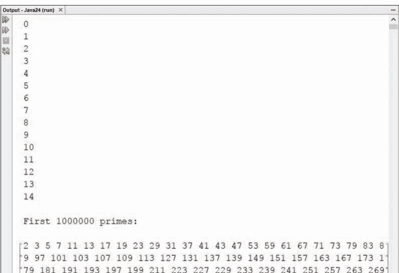

应用程序大部分语句用于寻找质数。以下语句用于实现程序的线程：

- 第 3 行——`Runnable` 接口应用于 `PrimeFinder` 类。
- 第 4 行——创建了一个名为 `go` 的 `Thread` 对象，但没有赋值。
- 第 22–25 行——如果 `go` 对象的值为 `null`（表示线程尚未创建），则创建一个新的 `Thread` 对象并存储在变量中。通过调用线程的 `start()` 方法启动线程，这将调用 `PrimeFinder` 类的 `run()` 方法。
- 第 28–44 行——`run()` 方法寻找从 2 开始的质数序列，通过调用其 `append()` 方法将每个质数存储在 `primes` 字符串缓冲区中。

在该应用程序的 `main()` 方法中，当创建 `PrimeFinder` 对象开始执行程序时，有些不寻常的地方。这是该语句：

```java
new PrimeFinder();
```

通常情况下，你会看到该对象被赋值给一个变量，如下：

```java
PrimeFinder frame = new PrimeFinder();
```

然而，由于不再需要引用该对象，将其存储在变量中是没有必要的。直接调用 `new` 创建对象会导致程序运行。

在 Java 中，只有在创建对象后需要这些对象时，将其存储在变量中才是良好的编程习惯。

> **注意**
>
> `PrimeFinder` 应用程序对 `StringBuffer` 对象的 `append()` 方法进行了一些不寻常的操作。调用 `append()` 后紧跟着一个点（.）和另一个 `append()` 调用。这导致文本按顺序追加。这是可能的，因为 `append()` 调用返回该缓冲区，随后可以再次调用。

## 线程操作

你可以通过调用其 `start()` 方法来启动线程，这可能会让你认为还有一个 `stop()` 方法可以让它停止。

尽管 Java 在 `Thread` 类中包含了 `stop()` 方法，但它已经被**弃用**（deprecated）。在 Java 中，被弃用的元素是指已被功能更好的替代方案所替换的类、接口、方法或变量。

> **注意**
>
> 听从此弃用警告是一个好主意。Oracle 已经弃用了 `stop()` 方法，因为它可能会导致 JVM 中运行的其他线程出现问题。该类的 `resume()` 和 `suspend()` 方法也被弃用了。

你接下来开展的项目将展示如何停止一个线程。你正在进行的程序会在一组网站标题和访问地址之间循环。

每个页面的标题和网页地址在连续循环中显示。用户可以通过点击应用程序图形用户界面上的按钮访问当前显示的站点。该程序将运行一段时间，按顺序显示每个网站的信息。由于这个时间元素的存在，线程是控制程序的最佳方式。

你并不是先将程序输入到 NetBeans 源代码编辑器然后再学习，而是有机会在这一小时结束时输入 `LinkRotator` 程序的完整文本。在此之前，程序的每个部分都得到了描述。

### 类声明

在该程序中你需要做的第一件事是导入 `java.awt`、`java.io`、`java.net`、`java.awt.event` 和 `javax.swing` 包中的类。需要大量包是因为项目使用了 Swing，这是一组用于支持 Java 图形用户界面的包。

在你使用 `import` 使某些类可用后，就可以使用以下语句启动应用程序了：

```java
public class LinkRotator extends JFrame implements Runnable, ActionListener {
```

该语句将 `LinkRotator` 类创建为 `JFrame` 类的子类，`JFrame` 是一个由空框架组成的简单图形用户界面。该语句还表明此类支持两个接口：`Runnable` 和 `ActionListener`。通过实现 `Runnable` 类，你可以在程序中使用 `run()` 方法使线程开始运行。`ActionListener` 接口使程序能够响应鼠标点击。

### 设置变量

在 `LinkRotator` 中要做的第一件事是创建类的变量和对象。创建一个包含六元素的 `String` 对象数组 `pageTitle`，和一个包含六元素的 `URI` 对象数组 `pageLink`：

```java
String[] pageTitle = new String[6];
URI[] pageLink = new URI[6];
```

`pageTitle` 数组存储了显示的六个网站的标题。`URI` 类对象存储网站地址的值。`URI` 拥有跟踪网页地址所需的所有行为和属性。

最后三件事是创建一个整数变量、一个 `Thread` 对象和一个用户界面标签：

```java
int current = 0;
Thread runner;
JLabel siteLabel = new JLabel();
```

`current` 变量跟踪正在显示哪个站点，以便你进行操作。

### 构造函数

每个页面的标题存储在 `pageTitle` 数组中。`pageLink` 数组的元素被赋值为 `getURI()` 方法返回的值。

```java
pageTitle = new String[] {
    "Oracle side",
    "Server",
    "Java",
    "Java in Hours",
```


## 设置 URL 时捕捉错误

当你设置 `URI` 对象时，必须确保用于设置地址的文本格式正确：`http://workbench.org` 和 `http://sampubishing.com` 是有效的，但 `java.com` 将无效，因为它缺少两个斜杠。

`getURI(String)` 方法接收网页地址作为参数，返回代表该地址的 `URI` 对象。如果字符串不是有效地址，方法将返回 `null`：

```java
URI getURI(String urlText) {
    URI pageURI = null;
    try {
        pageURI = new URI(urlText);
    } catch (URISyntaxException e) {
        // 什么都不做
    }
    return pageURI;
}
```

`try-catch` 块处理创建 `URI` 对象时发生的任何 `URISyntaxException`。因为如果抛出此异常不需要执行任何操作，所以 `catch` 块只包含一条注释。

## 启动线程

在该程序中，当调用 `start()` 方法时，运行器启动。

`start()` 方法是在构造函数的最后一条被调用的。该方法如下：

```java
public void start() {
    if (runner == null) {
        runner = new Thread(this);
        runner.start();
    }
}
```

如果线程尚未启动，该方法将启动它。

语句 `runner = new Thread(this)` 创建了一个新的 `Thread` 对象，其参数是 `this` 关键字。这个 `this` 关键字引用程序本身，指定了在线程中运行的类。

调用 `runner.start()` 导致线程开始运行。当线程开始时，会调用该线程的 `run()` 方法。因为 `runner` 线程是 `LinkRotator` 应用程序本身，因此会调用应用程序的 `run()` 方法。

## 运行线程

`run()` 方法是线程执行主要工作的地方。在 LinkRotator 程序中，以下代码代表了 `run()` 方法：

```java
public void run() {
    Thread thisThread = Thread.currentThread();
    while (runner == thisThread) {
        current++;
        if (current > 5) {
            current = 0;
        }
        siteLabel.setText(pageTitle[current]);
        repaint();
        try {
            Thread.sleep(1000);
        } catch (InterruptedException e) {
            // do nothing
        }
    }
}
```

`run()` 方法中首先执行的操作是创建一个名为 `thisThread` 的 `Thread` 对象。`Thread` 类的一个方法 `currentThread()` 为 `thisThread` 对象设置了值。`currentThread()` 方法跟踪当前正在运行的线程。

该方法中的所有语句都是一个 `while` 循环的一部分，该循环将 `runner` 对象与 `thisThread` 对象进行比较。这两个对象都被创建了，只要它们引用同一个对象，`while` 循环就会继续执行。没有任何语句会导致 `runner` 和 `thisThread` 对象的值不同，因此除非循环外部的内容改变了其中一个 `Thread` 对象，否则它将无限循环。

`run()` 方法调用了 `repaint()`。接下来，`current` 变量的值增加 1，如果 `current` 超过 5，它将被设置为 0。`current` 变量用于确定显示哪个网站的信息。它被用作 `pageTitle` 字符串数组的索引，并将标题设置为 `siteLabel` 用户界面组件。

`run` 方法包含了另一个处理错误的 `try-catch` 块。`Thread.sleep(1000)` 语句导致线程暂停 1 秒，足够时间让用户阅读网站的名称及其地址。`catch` 语句处理在处理 `Thread.sleep()` 语句期间可能发生的任何 `InterruptedException` 错误。如果线程在睡眠时被某些东西中断，就会发生这些错误。

## 处理鼠标点击

LinkRotator 程序中最后一件需要考虑的事情是事件处理——即检测用户输入的能力。每当用户点击“Visit Site”（访问站点）按钮时，应用程序都应该使用网络浏览器显示显示的网站。这是通过一个名为 `actionPerformed()` 的方法实现的，该方法是 `ActionListener` 接口要求的。每当点击按钮时，此方法就会被调用。

以下是 LinkRotator 的 `actionPerformed()` 方法：

```java
public void actionPerformed(ActionEvent event) {
    Desktop desktop = Desktop.getDesktop();
    if (pageLink[current] != null) {
        try {
            desktop.browse(pageLink[current]);
            runner = null;
            System.exit(0);
        } catch (IOException exc) {
            // do nothing
        }
    }
}
```

该方法中发生的第一件事是创建一个 `Desktop` 对象。`java.awt` 包中的 `Desktop` 类代表运行应用程序的计算机的桌面环境。拥有此对象后，你可以使用它通过“mailto:”启动电子邮件客户端、使用另一个程序打开文件进行编辑、打印文件以及执行 Java 之外的其他任务。

在这里，`Desktop` 对象被用于使用计算机默认的浏览器打开网页。`browse(URI)` 方法在浏览器中加载指定的网页地址。如果 `pageLink[current]` 是一个有效地址，`browse(pageLink[current])` 将请求浏览器加载页面。

## 显示旋转链接

现在你将创建程序并进行测试。在 `com.java24hours` 包中创建一个名为 `LinkRotator` 的新 Java 文件，并输入列表 15.2 中的文本。

列表 15.2 LinkRotator.java 的完整文本。

```java
1: package com.java24hours;
2:
3: import java.awt.*;
4: import java.awt.event.*;
5: import java.io.*;
6: import javax.swing.*;
7: import java.net.*;
8:
9: public class LinkRotator extends JFrame
10: implements Runnable, ActionListener {
11:
12: String[] pageTitle = new String[6];
13: URI[] pageLink = new URI[6];
14: int current = 0;
15: Thread runner;
16: JLabel siteLabel = new JLabel();
17:
18: public LinkRotator() {
19: setDefaultCloseOperation(JFrame.EXIT_ON_CLOSE);
20: setSize(300, 100);
21: FlowLayout flo = new FlowLayout();
22: setLayout(flo);
23: add(siteLabel);
24: pageTitle = new String[]{
25: "Oracle's Java site",
26: "Server Site",
27: "JavaWorld",
28: "Java in 24 Hours",
29: "Sams Publishing",
30: "Workbench"
31: };
32:
33: pageLink[0] = new URI("http://www.oracle.com/technetwork/java");
34: pageLink[1] = new URI("http://www.thewebserviceside.com");
35: pageLink[2] = new URI("http://www.javaworld.com");
36: pageLink[3] = new URI("http://www.java24hours.com");
37: pageLink[4] = new URI("http://www.samspublishing.com");
38: pageLink[5] = new URI("http://workbench.org");
39:
40: JButton visitButton = new JButton("Visit Site");
41: visitButton.addActionListener(this);
42: add(visitButton);
43: setVisible(true);
44: start();
45: }
46:
47: private URI getURI(String urlText) {
48: URI pageURI = null;
49: try {
50: pageURI = new URI(urlText);
51: } catch (URISyntaxException e) {
52: // do nothing
53: }
54: return pageURI;
55: }
56: public void start() {
57: if (runner == null) {
58: runner = new Thread(this);
59: runner.start();
60: }
61:
62: public void run() {
63: Thread thisThread = Thread.currentThread();
64: while (runner == thisThread) {
65: current++;
66: if (current > 5) {
67: current = 0;
68: }
69: siteLabel.setText(pageTitle[current]);
70: repaint();
71: try {
72: Thread.sleep(1000);
73: } catch (InterruptedException e) {
74: // do nothing
75: }
76: }
77: public void actionPerformed(ActionEvent event) {
78: Desktop desktop = Desktop.getDesktop();
79: if (pageLink[current] != null) {
80: try {
81: desktop.browse(pageLink[current]);
82: runner = null;
83: System.exit(0);
84: } catch (IOException exc) {
85: // do nothing
86: }
87: }
88: }
89: public static void main(String[] arguments) {
90: new LinkRotator();
91: }
```

图 15.2 在应用程序中显示旋转链接。

## 停止线程

LinkRotator 程序没有停止线程的方法，但这里设计了一个可以结束线程执行的方法：

```java
public void stop() {
    if (runner != null) {
        runner = null;
    }
}
```


`if` 语句测试 `runner` 对象是否等于 `null`。如果是，则语句会将 `runner` 设置为 `null`。

将 `runner` 对象设置为 `null` 值会导致它与 `thisThread` 对象的值不同。当这种情况发生时，`run()` 方法中的 `while` 循环将停止。

这个项目可能会让你觉得新知识飞速。本节涵盖的图形界面技术用于演示需要图形界面的线程方面。即使你没有从本节中学到任何东西，现在也有了一个新词汇来描述你快节奏、多任务的生活。在几个句子中使用它看看是否合你胃口：

- “老兄，昨天在我们抢了那家连锁酒店后，我真的是多线程。”
- “我整个午饭都在多线程，这让我消化不良。”
- “今晚不行，亲爱的，我在多线程。”

**Q. 是否有理由在 `catch` 语句中什么都不做，就像 LinkRotator 程序做的那样？**

**A. 这取决于捕到的错误或异常类型。** 在 LinkRotator 程序中，通过 `catch` 语句知道异常的原因就是，你可以确定没有其他合适的操作了。在 `getURI()` 方法中，只有当发送给方法的 URI 无效时，才会捕获 `URISyntaxException`。

另一个可能在 `catch` 块中不需要任何操作的异常是 `InterruptedException`。在我 20 年的 Java 程序员生涯中，从未有程序抛出这种异常。

大多数异常都需要记录错误。

**Q. 演唱《My Futures So Bright, I Gotta Wear Shades》的乐队后来怎么了？**

**A. 他们的未来并不光明。** Timbuk3 是由夫妻夫妇 Pat 和 Barbara K. MacDonald 组成的乐队，在那首歌曲于 1986 年进入排行榜前 20 名之后，他们再也没有其他热门歌曲。他们从 1986 年到 1995 年制作了六张专辑，随后他们散了并离婚了。

MacDonald 继续以自己的名义表演并发布专辑，也以 Purgatory Hill 和 Legendary Sons of Crack Daniels 的身份合作。他还为 Cher、Peter Frampton、Night Ranger、Aerosmith 以及其他音乐人写过歌。

Barbara Kooyman 以 Barbara K 的身份表演并拥有几张专辑，其中一张重新诠释了 Timbuk3 的歌曲。她还媒体多样性创立了艺术家自由言论慈善机构。

他们最为人知的故事被广泛认为是关于未来的积极信息，但这本应该是讽刺的。乐队表示，光明的未来实际上是迫在眉睫的核浩劫。

### 测验

放下你的“线程”（Java 意义上的线程，而不是简微的意思），并回答以下关于线程的问题。

- **1. 程序使用线程必须实现哪个接口？**
  - A. `Runnable`
  - B. `Thread`
  - C. 不需要任何接口

- **2. 如果一个接口包含三个不同的方法，那么实现该接口的类必须包含其中几个方法？**
  - A. 一个都不包含。
  - B. 全部都要包含。
  - C. 我知道，但我不告诉你。

- **3. 你正在欣赏另一位程序员的作品，他创建了一个处理四个并发任务的程序。你会对他说什么什么？**
  - A. “我花一美元就买它。”
  - B. “你是我翅膀下的风。”
  - C. “很漂亮的线程！”

### 答案

- **1. 必须配合 `implements` 语句使用 `Runnable`。** `Thread` 用于多线程程序内部，但在启动程序的类语句中不需要它。

- **2. B. 接口保证了类包含了接口的所有方法。**

- **3. C. 如果该程序员穿得很好，这句赞美可能会让他困惑，但老实说，那种概率有多大呢？**

工作坊 219

### 活动

如果这一小时的内容还没有让你精疲力竭（threadbare），请通过以下活动扩展你的技能：

- 创建 LinkRotator 应用程序的新版本，并包含六个你最喜欢的网站。
- 为 PrimeFinder 应用程序添加第二个线程，用于寻找前一百万个不能被 3 整除的数字。只有在两个线程都完成工作后才停止时间计数器。

要查看实现这些活动的 Java 程序，请访问书籍网站 `www.java24hours.com`。

本页特意留空。

# 第 16 小时：使用内部类和闭包

本小时的任务列表：

- 向对象中添加一个内部类。
- 探索为什么内部类很有用。
- 创建一个匿名内部类。
- 将接口配合适配器类。
- 编写一个 lambda 表达式。
- 用 lambda 表达式替换匿名内部类。

Java 编程语言于 1995 年发布时，其范围有限且易于掌握。Java 类库中只有大约 250 个类。该语言的设计初衷是为了在 Web 浏览器中运行交互式程序。由于当时没有其他技术可以实现这一点，Java 引起了巨大的轰动并迅速被数十万名程序员所采用。

作为对该语言设计良好的证明，它扩展到了此之外，成为一种通用编程语言，与当时的 C++ 竞争（C++ 是当时全球最流行、应用广泛的语言）。

随着 Java 进入 23 周岁，今天有数百万程序员在使用 Java 编写。随着每一次发布，Java 在支持现有开发者的同时，扩展了其功能，以实现复杂的软件开发方法论。

最令人兴奋的之一是编写代码闭包（或 lambda 表达式）的新方法。这些表达式使得称为函数编程的方法论成为可能。

在本小时中，你将在学习 lambda 表达式之前，先涵盖使用它们的前提的两个语言方面：内部类和匿名内部类。

## 内部类

在 Java 中创建类时，你为该类定义了属性和行为。属性是存储数据的类变量和实例变量。行为是对这些数据执行任务的方法。

类还可以包含由属性和行为组成：内部类。

内部类是包含在外部类中的辅助类。你可能会疑惑为什么它们是必要的，因为创建任意数量的新类程序也同样容易。如果你正在编写一个需要为每个人所写的每张支票创建对象的 CheckBook 程序，你可以创建一个 `Check` 类。如果程序支持每月定期付款，就添加一个 `Autopayment` 类。

内部类并不是必须的。但当你学会它们能做的所有事情时，你会发现在许多情况下它们非常有用。

Java 包含内部类的三个原因：

1. 当一个辅助类仅被另一个类使用时，在那个类内部定义它是有意义的。
2. 它们允许辅助类访问其作为独立类时无法访问的私有方法和变量。
3. 它们将辅助类尽可能地放置在另一个类中使用它的地方。

内部类使用 `class` 关键字创建，与其他任何类一样，但它被声明在包含类内部。通常，这与类变量和实例变量放在一起。

这是一个在 `Simple` 类内部创建名为 `InnerSimple` 内部类的示例：

```java
public class Simple {

    class InnerSimple {

        InnerSimple() {
            System.out.println("I am an inner class!");
        }

    }

    public Simple() {
        // 空构造函数
    }

    public static void main(String[] args) {
        Simple s = new Simple();
        s.InnerSimple inner = new s.InnerSimple();
    }

}
```

匿名内部类用下面的代码替换了对 worker 的引用：

```java
new Runnable() {
    public void run() {
        // 在此处执行线程的工作
    }
}
```

这创建了一个实现 `Runnable` 接口并重写 `run()` 方法的匿名类。方法内部的语句将执行类所需的任何操作。

通过一个关于如何编写匿名内部类以及其为什么很有用的完整示例，这个概念将变得更容易理解。

Java 应用程序可以使用 Swing 图形用户界面包接收键盘输入。应用程序使用一个实现了 `KeyListener` 接口的对象来监控键盘。

实现该接口的类必须实现三个方法：`keyTyped()`、`keyPressed()` 和 `keyReleased()`，如下代码所示：

```java
public void keyTyped(KeyEvent input) {
    char key = input.getKeyChar();
    keyLabel.setText("You pressed * " + key);
}
```

```java
public void keyPressed(KeyEvent txt) {
    // 什么都不做
}
```

```java
public void keyReleased(KeyEvent txt) {
    // 什么都不做
}
```

在与这些语句相同的类中，设置键盘监听器使用该类来监控键盘事件：
`keyText.addKeyListener(this);`

通过匿名内部类和 `java.awt.event` 包中的 `KeyAdapter` 类，有一种更好的方法来创建监听器并将其添加到图形用户界面。

`KeyAdapter` 类实现了 `KeyListener` 接口，并对所有三个方法都提供了空实现。这使得为键盘事件创建监听器变得简单，因为你可以创建一个只重写实际执行操作的方法的子类。

这是一个 `KeyViewer` 应用程序的框架：

```java
public class KeyViewerListener extends KeyAdapter {
    public void keyTyped(KeyEvent input) {
        // 待
    }
}
```

这个监听器可以被创建并设置为监听器：

```java
KeyViewerListener kvl = new KeyViewerListener();
keyText.addKeyListener(kvl);
```

这种方法需要一个独立的辅助类 `KeyViewerListener`，并创建一个该类的对象将其赋值给变量。

另一种方法是将监听器创建为匿名内部类：

```java
keyText.addKeyListener(new KeyAdapter() {
    public void keyTyped(KeyEvent input) {
        char key = input.getKeyChar();
        keyLabel.setText("You pressed " + key);
    }
});
```

监听器是通过调用 `new KeyAdapter()` 后紧跟类定义来匿名创建的。它重写了 `keyTyped()` 方法，以便当按下按键时，通过调用 `getKeyChar()` 获取它，并通过设置 `keyLabel`（这是一个 `JLabelComponent`）的值来显示它。

匿名内部类做到了普通辅助类无法做的事情：访问 `keyLabel` 实例变量。该变量属于 `KeyViewer` 类。内部类可以访问其外部类的方法和变量。

在 NetBeans 中，在 `com.java24hours` 包下创建一个名为 `KeyViewer` 的新 java 文件。将列表 16.2 的文本输入到文件中，完成后保存即可。

### 列表 16.2 KeyViewer.java 的全文

```java
1: package com.java24hours;
2:
3: import javax.swing.*;
4: import java.awt.event.*;
5: import java.awt.*;
6:
7: public class KeyViewer extends JFrame {
8:     JTextField keyText = new JTextField(80);
9:     JLabel keyLabel = new JLabel("Press any key in the text field.");
10:
11:     public KeyViewer() {
12:         super("KeyViewer");
13:         setSize(350, 100);
14:         setDefaultCloseOperation(JFrame.EXIT_ON_CLOSE);
15:         keyText.addKeyListener(new KeyAdapter() {
16:             public void keyTyped(KeyEvent input) {
17:                 char key = input.getKeyChar();
18:                 keyLabel.setText("You pressed " + key);
19:             }
20:         });
21:         BorderLayout board = new BorderLayout();
22:         setLayout(board);
23:         add(keyLabel, BorderLayout.NORTH);
24:         add(keyText, BorderLayout.CENTER);
25:         setVisible(true);
26:     }
27: 
28:     public static void main(String[] arguments) {
29:         new KeyViewer();
30:     }
31: }
```

匿名内部类在第 15–20 行中创建并使用。它使用应用程序所需的接口唯一方法来监控键盘输入，并通过更新 `keyLabel` 实例变量来显示输入。

程序的输出如图 16.2 所示。


**图 16.2** 使用 KeyViewer 应用程序监控输入。

匿名内部类不能定义构造函数，因此它们比非匿名内部类局限。

它们是语言的一项复杂特性，在检查程序源代码时难以理解，但它们可以使程序更加简洁。经验丰富的 Java 程序员经常使用它们。

## 闭包 (Closures)

下一节介绍闭包。闭包也称为 lambda 表达式，允许创建单个语句。

这里有一个示例：

```java
Runnable runner = () -> System.out.println("Run!");
```

这等同于以下代码：

```java
public void run() {
    System.out.println("Run!");
}
```

在 lambda 表达式中，如果接口不接受参数，则不需要参数。这里另一个示例：

```java
ActionListener al = (act) -> System.out.println(act.getSource());
```

这等同于以下代码：

```java
public void actionPerformed(ActionEvent act) {
    System.out.println(act.getSource());
}
```

可以推断发送给方法的参数或多个参数的类型。考虑 `ActionListener` 函数式接口有一个接受 `ActionEvent` 对象作为其唯一参数的方法，该类的名称可以省略。

这里是考虑到此点的修订版 lambda 表达式：

```java
ActionListener al = (act) -> {
    System.out.println(act.getSource());
};
```

你创建的两个程序应该能够更具体地演示 Java 引入闭包带来的差异。

### 闭包示例

```java
7: public class ColorFrame extends JFrame {
8:     JButton red, green, blue;
9: 
10:     public ColorFrame() {
11:         super("ColorFrame");
12:         setSize(320, 122);
13:         setDefaultCloseOperation(JFrame.EXIT_ON_CLOSE);
14:         FlowLayout flo = new FlowLayout();
15:         setLayout(flo);
16:         red = new JButton("Red");
17:         add(red);
18:         green = new JButton("Green");
19:         add(green);
20:         blue = new JButton("Blue");
21:         add(blue);
22:         // begin anonymous class
23:         ActionListener act = new ActionListener() {
24:             public void actionPerformed(ActionEvent event) {
25:                 if (event.getSource() == red) {
26:                     getContentPane().setBackground(Color.RED);
27:                 }
28:                 if (event.getSource() == green) {
29:                     getContentPane().setBackground(Color.GREEN);
30:                 }
31:                 if (event.getSource() == blue) {
```


# 第 16 小节：使用内部类和闭包

该程序如图 16.3 所示。


**图 16.3**
使用匿名内部类监控动作事件。

应用程序的第 23-35 行使用匿名内部类为 `ColorFrame` 类创建事件监听器。它没有名字的对象，实现了 `ActionListener` 接口中唯一的方法 `actionPerformed(ActionEvent)`。

在该方法内部，通过调用其 `getContentPane` 方法获取框架的内容面板。匿名内部类可以访问其外层类的方法和实例变量。而独立的辅助类则无法访问。

内容面板的 `setBackground(Color)` 会将框架的背景颜色更改为该颜色。三个按钮的颜色不会发生变化。

现在来看代码列表 16.4 中的 `NewColorFrame` 应用程序。在 NetBeans 中于 `com.java24hours` 包下创建一个名为 `NewColorFrame` 的新程序。将代码列表 16.4 的文本输入文件，并在完成后保存。

### 代码列表 16.4 NewColorFrame.java 的完整文本

```java
1: package com.java24hours;
2:
3: import java.awt.*;
4: import java.awt.event.*;
5: import javax.swing.*;
6:
7: public class NewColorFrame extends JFrame {
8:     JButton red, green, blue;
9:
10:    public NewColorFrame() {
11:        super("NewColorFrame");
12:        setSize(322, 122);
13:        setDefaultCloseOperation(Frame.EXIT_ON_CLOSE);
14:        FlowLayout flo = new FlowLayout();
15:        setLayout(flo);
16:
17:        red = new JButton("Red");
18:        add(red);
19:        green = new JButton("Green");
20:        add(green);
21:        blue = new JButton("Blue");
22:        add(blue);
23:        // begin lambda act
24:        ActionListener act = (event) -> {
25:            if (event.getSource() == red) {
26:                getContentPane().setBackground(Color.RED);
27:            }
28:            if (event.getSource() == green) {
29:                getContentPane().setBackground(Color.GREEN);
30:            }
31:            if (event.getSource() == blue) {
32:                getContentPane().setBackground(Color.BLUE);
33:            }
34:        };
35:        // end lambda expression
36:        red.addActionListener(act);
37:        green.addActionListener(act);
38:        blue.addActionListener(act);
39:        setVisible(true);
40:    }
41:
42:    public static void main(String[] arguments) {
43:        new NewColorFrame();
44:    }
45: }
```

`NewColorFrame` 应用程序在第 23–33 行中实现了动作监听器。你不需要知道 `ActionListener` 接口中方法的名称即可在程序中使用它，而且你不需要指定 `ActionEvent` 的类。

Lambda 表达式支持函数式编程，这是一种直到目前 Java 程序员还无法使用的软件设计方法论。

本节介绍了 Lambda 表达式的基本语法。

### 总结
内部类、匿名内部类和 Lambda 表达式是 Java 中较为复杂的部分。但在你编写 Lambda 表达式之前，你应该能够识别并使用它们。

匿名内部类的结构类似于独立的辅助类，但它位于另一个类内部。即使你还没有准备好创建它们，了解它们是什么也是意义的。

### 工作坊
### 问答
**Q：匿名内部类很困惑。我必须使用它们吗？**
A：不需要。就像 Java 的其他功能一样，如果可以通过其他方式完成工作，就不需要使用它们。但你应该学习它们，因为你可能会在代码中遇到它们。

**Q：费曼和麦科伊家族仍在斗争吗？**
A：在最后伤亡发生 126 年后，这两个西弗吉尼亚州和肯基州的家族的关系良好。1979 年，费曼和麦科伊家族参加了一周的《家庭秀》。一只猪留在舞台上并颁给了获胜家庭。2003 年，这两个家族在肯基州的派克维成了和平协议。

### 测验
为了测试你是否已经掌握了本小时所学到的知识，请回答以下关于内部类、匿名内部类和 Lambda 表达式的问题。

1. 是什么使得某些内部类是匿名的？
   - A. 它们实现了接口。
   - B. 它们没有命名。
   - C. 两者皆是。
2. 只有一个方法的接口的另一种名称是什么？
   - A. 抽象接口
   - B. 类
   - C. 函数式接口
3. 当 Lambda 表达式推断方法参数的类时，这被称为什么？
   - A. 目标类型
   - B. 类型转换
   - C. 类推断

答案
1. C。匿名内部类使用 `new` 关键字实现接口，跳过了创建和命名实现该接口的类。
2. C。从 Java 8 开始被称为函数式接口。在语言的早期版本中，它们被称为单抽象方法接口。
3. A. 目标类型可以推断任何函数式接口方法参数的类。

### 活动

为了让这一小时的学习圆满结束，请通过以下活动来实践所学：

- 重写第 15 小时“创建线程程序”中的 `LinkRotator` 类，使用 lambda 表达式事件监听器。
- 为 `NewColorFrame` 应用程序添加第四种背景颜色 `Color.YELLOW`。

要查看实现这些活动的 Java 程序，请访问书籍网站 www.java24hours.com。

# 第 17 小时：构建简单的用户界面

本小时的任务列表：

- 创建按钮等用户界面组件。
- 创建标签、文本字段或其他组件。
- 将组件组合在一起。
- 将组件放入其他组件内部。
- 让组件进行水平和垂直滚动。
- 打开和关闭窗口。

在这一小时里，情况会变得非常复杂。你将用 Java 创建你的第一个图形化用户界面（GUI），这会让你大费一番。

计算机用户已经习惯了软件具有 GUI、能够接收鼠标输入，并像其他程序一样工作。虽然某些用户仍在 Linux 或 Unix Shell 等命令行环境中工作，但他们可能会对没有像 Microsoft Windows 或 Mac OS 那样点点、拖拽式图形界面的软件感到困惑。

Java 使用 Swing 支持这种软件，Swing 是一组 Java 类，它们代表了可以作为 GUI 部分的所有不同按钮、文本字段、滑块和其他组件，以及从这些组件中接收用户输入所需的类。

在本小时和接下来的小时中，你将在 Java 中创建并组织 GUI。此之后，在第 19 小时“响应用户输入”中，你将使这些界面接收鼠标点击和其他用户输入。

### Swing 和抽象窗口工具包

由于 Java 是一种跨平台语言，允许你为许多操作系统编写程序，因此它的图形用户界面软件必须具有灵活性。它不能仅迎合 Windows 风格或 Mac 版本，必须处理两者以及其他平台。

使用 Java，程序用户界面的开发基于 Swing 和早期一组名为抽象窗口工具包（Abstract Windowing Toolkit）的类。这些类允许你创建 GUI 并从用户那里接收输入。

Swing 包含了编写使用 GUI 程序所需的一切。通过 Java 的用户界面类，你可以创建一个包含以下所有内容的 GUI：

- 按钮、复选框、标签和其他简单组件
- 文本字段、滑块和其他更复杂的组件
- 下拉菜单和弹出菜单
- 窗口、框架、对话框、面板和 applet 窗口

> Swing 包含了数十组件，其自定义方式远比文档记录的要。本书涵盖了最常用的组件及其最实用的方法。在接下来的四个小时中探索它们时，你可以学习更多每个组件的知识，并在 Oracle 官方 Java 类库文档中发现新方法。可以在网页上阅读它：http://download.java.net/jdk/docs/api。它提供了 Java 9 中每个类和接口的额外参考文档。

### 使用组件

在 Java 中，GUI 的每个部分都由 Swing 包中的一个类表示。有一个用于按钮的 `JButton` 类，用于窗口的 `JWindow` 类，用于文本的 `JTextField` 类，等等。

要创建并显示界面，你需要创建对象、设置它们的变量并调用它们的方法。这些技术与你学习面向对象编程（OOP）时使用的技术是相同的。

当你组装 GUI 时，你处理的是两种对象：组件和容器。组件是用户界面中的单个元素，例如按钮或滑块。容器是一种你可以用来存放其他组件的组件。

创建界面的第一步是创建一个可以容纳组件的容器。在应用程序中，这个容器通常是一个窗口或框架。

### 窗口和框架

窗口（Windows）和框架（Frames）是可以显示在用户界面中并容纳其他组件的容器。窗口是简单的容器，没有标题栏或通常位于 GUI 顶部的任何按钮。框架是包含了用户在运行软件时预期找到的所有常见窗口功能的窗口——例如关闭、扩展和缩小窗口的按钮。

你使用 Swing 的 `JWindow` 和 `JFrame` 类来创建这些容器。要在 Java 程序中不使用完整包名和类名引用 Swing 类，请使用以下语句：

```java
import javax.swing.*;
```

这仅导入了 `javax.swing` 包中的类名。在 Swing 中你还会用到其他包。

在 Java 应用程序中使用框架的一种方法是将应用程序作为 `JFrame` 的子类。你的程序继承了作为框架运行所需的行为。以下语句创建了 `JFrame` 的子类：

```java
import javax.swing.*;

public class MainForm extends JFrame {

    public MainForm() {

        // 设置框架

    }

}
```

该类创建了一个框架，但还没有完全设置它。在框架的构造函数中，创建框架时你必须做几件事：

- 调用父类 `JFrame` 的构造函数。
- 设置框架的标题。
- 设置框架的大小。
- 设置框架的视图和感觉（look and feel）。
- 定义用户关闭框架时发生什么。

你还必须让框架可见，除非由于某些原因在应用程序开始运行时不应显示。

这些内容大部分可以在框架的构造函数中处理。方法包含的第一个内容是对父类 `JFrame` 的一个调用。这是一个示例：

```java
super();
```

上述语句调用了无参数的 `JFrame` 构造函数。你也可以带上框架标题调用它：

```java
super("Main Frame");
```

## 第 17 小时：构建简单的用户界面

这会将框架的标题（出现在顶部标题栏中）设置为指定的字符串。在这个示例中，出现了文本 "Main Frame"。

如果你不这样设置标题，可以调用框架的 `setTitle(String)` 方法并将标题作为参数：

```java
setTitle("Main Frame");
```

可以通过调用其 `setSize(int, int)` 方法并传入两个参数（宽度和高度）来确定框架的大小。以下语句设置了一个宽 350 像素、高 125 像素的框架：

```java
setSize(350, 125);
```

设置框架大小的另一种方法是用组件填充它，然后调用无参数的框架 `pack()` 方法：

```java
pack();
```

`pack()` 方法将框架设置得大到足以容纳框架内每个组件的首选尺寸（甚至更大）。每个界面组件都有首选尺寸，尽管根据组件的排列方式，这有时会被忽略。在调用 `pack()` 之前不需要显式设置框架的大小——该方法会在框架显示之前将其设置到合适的大小。

每个框架在标题栏处都有一个按钮，用于关闭框架。在 Windows 系统上，此按钮显示为右上角的 X。要定义点击此按钮时发生什么，请调用框架的 `setDefaultCloseOperation(int)` 方法，并将四个 `JFrame` 类变量之一作为参数：

- `EXIT_ON_CLOSE`——点击按钮时退出程序。
- `DISPOSE_ON_CLOSE`——销毁框架并继续运行应用程序。
- `DO_NOTHING_ON_CLOSE`——保持框架打开并继续运行。
- `HIDE_ON_CLOSE`——隐藏框架并继续运行应用程序。

第一个调用是最常见的，因为当应用程序的用户界面关闭时，意味着应用程序应该工作并关闭：`setDefaultCloseOperation(JFrame.EXIT_ON_CLOSE);`

使用 Swing 创建的图形用户界面可以通过视图和感觉（look and feel）来定制外观，这是一种视觉主题，控制按钮和其他组件的外观和行为。

Java 有一种增强的视图和感觉称为 Nimbus，它必须切换到它才能在类中使用。设置视图和感觉是通过调用主 Swing 包中 `UIManager` 类的 `setLookAndFeel()` 方法完成的。

该方法接受一个参数：外观外观（look and feel）的完整名称。

以下语句将 Nimbus 设置为外观外观：

```java
UIManager.setLookAndFeel(
    "javax.swing.plaf.nimbus.NimbusLookAndFeel"
);
```

为了使框架可见，还需要最后一步操作。调用其 `setVisible()` 方法并传入 `true` 作为参数：

```java
setVisible(true);
```

这将按照定义的宽度和高度打开框架。你也可以调用它并传入 `false` 来停止显示框架。

列表 17.1 包含了本节节描述的源代码。在 `com.java24hours` 软件包中一个名为 `SalonFrame` 的 Java 文件中，包含了这些语句。

### 列表 17.1 SalonFrame.java 的全文

```java
1: package com.java24hours;
2:
3: import javax.swing.*;
4:
5: public class SalonFrame extends JFrame {
6:   public SalonFrame() {
7:     super("Salon mondo!");
8:     setLookAndFeel();
9:     setSize(450, 200);
10:    setDefaultCloseOperation(JFrame.EXIT_ON_CLOSE);
11:    setVisible(true);
12:  }
13:
14:  private void setLookAndFeel() {
15:    try {
16:      UIManager.setLookAndFeel(
17:        "javax.swing.plaf.nimbus.NimbusLookAndFeel"
18:      );
19:    } catch (Exception exc) {
20:      // ignore error
21:    }
22:  }
23:
24:  public static void main(String[] arguments) {
25:    SalonFrame frame = new SalonFrame();
26:  }
27: }
```


列表 17.1 的第 24–26 行包含一个 `main()` 方法，它将此框架类转换为一个应用程序。当你运行该类时，你将看到图 17.1 所示的框架。


图 17.1
在应用程序中显示框架。

SalonFrame 显示的唯一内容是标题：传统的程序员问候语“Saluton mondo！”该框架是一个空窗口，因为它还没有包含任何其他组件。

要向框架中添加组件，你必须创建该组件并将其添加到容器中。每个容器都有一个 `add()` 方法，该方法接受一个参数：要显示的组件。

`SalonFrame` 类包含一个 `setLookAndFeel()` 方法，该方法指定 Nimbus 为框架的外观。在第 16–18 行中调用 `UIManager` 类的 `setLookAndFeel()` 方法来实现这一目标。

对该方法的调用放置在 `try-catch` 块内部，这允许处理可能发生的错误。

调用 `UIManager.setLookAndFeel()` 会设置 GUI 的外观。结果中可能发生的任何错误只会导致程序保持默认外观，而不是 Nimbus。

> **提示**
> 你可能以前在列表 13.1 中见过某些内容。仔细查看第 16–18 行。它们是一个跨越三行的单语句。该语句可以写在一行内，但为了提高*人类*的可读性，它被拆分开了。Java 编译器并不关心空白字符。只要语句包含正确的内容并以分号结束，它就可以跨多行。

# 按钮

你可以添加到容器的其中一个简单组件是 `JButton`。`JButton` 与你在此期间处理的其他组件一样，它们是 `javax.swing` 包的一部分。

`JButton` 对象是一个可点击的按钮，带有一个描述点击按钮后作用的标签。此标签可以是文本、图形或两者兼有。以下语句创建了一个名为 `okButton` 的 `JButton` 并给它设置了标签 `OK`：

```java
JButton okButton = new JButton("OK");
```

在创建了诸如 `JButton` 这样的组件后，应该通过调用其 `add()` 方法将其添加到容器中：

```java
add(okButton);
```

当你向容器中添加组件时，你不需要指定组件在容器中显示的位置。组件的排列布局由一个名为布局管理器的对象决定。这些布局器中最简单的是 `FlowLayout` 类，它是 `java.awt` 包的一部分。

要让容器使用特定的布局管理器，你必须首先创建该管理器类的对象。你可以通过调用其无参数的构造函数来创建一个 `FlowLayout` 对象：

```java
FlowLayout flo = new FlowLayout();
```

在创建布局管理器后，调用容器的 `setLayout()` 方法将指定的管理器与该容器关联：

```java
setLayout(flo);
```

此语句将 `flo` 对象指定为布局管理器。

你创建的下一个应用程序是 `com.java24hours` 包中一个名为 `Playback` 的类，这是一个显示带有三个按钮的框架的 Java 应用程序。将列表 17.2 中的文本复制到新的 Java 文件并保存该文件。

### 列表 17.2 Playback.java 的全文

```java
1: package com.java24hours;
2:
3: import javax.swing.*;
4: import java.awt.*;
5:
6: public class Playback extends JFrame {
7:     public Playback() {
8:         super("Playback");
9:         setLookAndFeel();
10:        setSize(450, 200);
11:        setDefaultCloseOperation(JFrame.EXIT_ON_CLOSE);
12:        FlowLayout flo = new FlowLayout();
13:        setLayout(flo);
14:        JButton play = new JButton("Play");
15:        JButton stop = new JButton("Stop");
16:        JButton pause = new JButton("Pause");
17:        add(play);
18:        add(stop);
19:        add(pause);
20:        setVisible(true);
21:     }
22:
23:     private void setLookAndFeel() {
24:         try {
25:             UIManager.setLookAndFeel(
26:                 "javax.swing.plaf.nimbus.NimbusLookAndFeel"
27:             );
28:         } catch (Exception exc) {
29:             // ignore error
30:         }
31:     }
32:
33:     public static void main(String[] arguments) {
34:         Playback frame = new Playback();
35:     }
36: }
```


# SalonFrame 应用程序

列表 17.1 的第 24–26 行包含一个 `main()` 方法，它将此框架类转换为一个应用程序。当你运行该类时，你将看到图 17.1 所示的框架。


**图 17.1** 在应用程序中显示框架。

`SalonFrame` 显示的唯一内容是标题：传统的程序员问候语“Saluton mundo！”该框架是一个空窗口，因为它还没有包含任何其他组件。

要向框架中添加组件，你必须创建该组件并将其添加到容器中。每个容器都有一个 `add()` 方法，该方法接受一个参数：要显示的组件。

`SalonFrame` 类包含一个 `setLookAndFeel()` 方法，该方法指定 Nimbus 为框架的外观。在第 16–18 行中调用 `UIManager` 类的 `setLookAndFeel()` 方法来实现这一目标。

对该方法的调用放置在 `try-catch` 块内部，这允许处理可能发生的错误。

调用 `UIManager.setLookAndFeel()` 会设置 GUI 的外观。结果中可能发生的任何错误只会导致程序保持默认外观，而不是 Nimbus。

> **提示**
> 你可能以前在列表 13.1 中见过某些内容。仔细查看第 16–18 行。它们是一个跨越三行的单语句。该语句可以写在一行内，但为了提高*人类*的可读性，它被拆分开了。Java 编译器并不关心空白字符。只要语句包含正确的内容并以分号结束，它就可以跨多行。

# 选框

你可以添加到容器的其中一个简单组件是 `JButton`。`JButton` 与你在此期间处理的其他组件一样，它们是 `javax.swing` 包的一部分。

`JButton` 对象是一个可点击的按钮，带有一个描述点击按钮后作用的标签。此标签可以是文本、图形或两者兼有。以下语句创建了一个名为 `okButton` 的 `JButton` 并给它设置了标签 `OK`：

```java
JButton okButton = new JButton("OK");
```

在创建了诸如 `JButton` 这样的组件后，应该通过调用其 `add()` 方法将其添加到容器中：

```java
add(okButton);
```

当你向容器中添加组件时，你不需要指定组件在容器中显示的位置。组件的排列布局由一个名为布局管理器的对象决定。这些布局器中最简单的是 `FlowLayout` 类，它是 `java.awt` 包的一部分。

要让容器使用特定的布局管理器，你必须首先创建该管理器类的对象。你可以通过调用其无参数的构造函数来创建一个 `FlowLayout` 对象：

```java
FlowLayout flo = new FlowLayout();
```

在创建布局管理器后，调用容器的 `setLayout()` 方法将指定的管理器与该容器关联：

```java
setLayout(flo);
```

此语句将 `flo` 对象指定为布局管理器。

你创建的下一个应用程序是 `com.java24hours` 包中一个名为 `Playback` 的类，这是一个显示带有三个按钮的框架的 Java 应用程序。将列表 17.2 中的文本复制到新的 Java 文件并保存该文件。

## 列表 17.2 Playback.java 的全文

```java
1: package com.java24hours;
2:
3: import javax.swing.*;
4: import java.awt.*;
5:
6: public class Playback extends JFrame {
7:     public Playback() {
8:         super("Playback");
9:         setLookAndFeel();
10:        setSize(450, 200);
11:        setDefaultCloseOperation(JFrame.EXIT_ON_CLOSE);
12:        FlowLayout flo = new FlowLayout();
13:        setLayout(flo);
14:        JButton play = new JButton("Play");
15:        JButton stop = new JButton("Stop");
16:        JButton pause = new JButton("Pause");
17:        add(play);
18:        add(stop);
19:        add(pause);
20:        setVisible(true);
21:     }
22:
23:     private void setLookAndFeel() {
24:         try {
25:             UIManager.setLookAndFeel(
26:                 "javax.swing.plaf.nimbus.NimbusLookAndFeel"
27:             );
28:         } catch (Exception exc) {
29:             // ignore error
30:         }
31:     }
32:
33:     public static void main(String[] arguments) {
34:         Playback frame = new Playback();
35:     }
36: }
```


# 列表 17.1 的第 24–26 行包含一个 `main()` 方法

列表 17.1 的第 24–26 行包含一个 `main()` 方法，它将此框架类转换为一个应用程序。当你运行该类时，你将看到图 17.1 所示的框架。


图 17.1
在应用程序中显示框架。

SalonFrame 显示的唯一内容是标题：传统的程序员问候语“Saluton mundo！”该框架是一个空窗口，因为它还没有包含任何其他组件。

要向框架中添加组件，你必须创建该组件并将其添加到容器中。每个容器都有一个 `add()` 方法，该方法接受一个参数：要显示的组件。

`SalonFrame` 类包含一个 `setLookAndFeel()` 方法，该方法指定 Nimbus 为框架的外观。在第 16–18 行中调用 `UIManager` 类的 `setLookAndFeel` 方法来实现这一目标。

对该方法的调用放置在 `try-catch` 块内部，这允许处理可能发生的错误。

调用 `UIManager.setLookAndFeel()` 会设置 GUI 的外观。结果中可能发生的任何错误只会导致程序保持默认外观，而不是 Nimbus。

> **提示**
> 你可能以前在列表 13.1 中见过某些内容。仔细查看第 16–18 行。它们是一个跨越三行的单语句。该语句可以写在一行内，但为了提高*人类*的可读性，它被拆分开了。Java 编译器并不关心空白字符。只要语句包含正确的内容并以分号结束，它就可以跨多行。

# 选框

你可以添加到容器的其中一个简单组件是 `JButton`。`JButton` 与你在此期间处理的其他组件一样，它们是 `javax.swing` 软件包的一部分。

`JButton` 对象是一个可点击的按钮，带有一个描述点击按钮后作用的标签。此标签可以是文本、图形或两者兼有。以下语句创建了一个名为 `okButton` 的 `JButton` 并给它设置了标签 `OK`：

```java
JButton okButton = new JButton("OK");
```

在创建了诸如 `JButton` 这样的组件后，应该通过调用其 `add()` 方法将其添加到容器中：

```java
add(okButton);
```

当你向容器中添加组件时，你不需要指定组件在容器中显示的位置。组件的排列布局由一个名为布局管理器的对象决定。这些布局器中最简单的是 `FlowLayout` 类，它是 `java.awt` 软件包的一部分。

要让容器使用特定的布局管理器，你必须首先创建该管理器类的对象。你可以通过调用其无参数的构造函数来创建一个 `FlowLayout` 对象：

```java
FlowLayout flo = new FlowLayout();
```

在创建布局管理器后，调用容器的 `setLayout` 方法将指定的管理器与该容器关联：

```java
setLayout(flo);
```

此语句将 `flo` 对象指定为布局管理器。

你创建的下一个应用程序是 `com.java24hours` 软件包中一个名为 `Playback` 的类，这是一个显示带有三个按钮的框架的 Java 应用程序。将列表 17.2 中的文本复制到新的 Java 文件并保存该文件。

## 列表 17.2 Playback.java 的全文

```java
1: package com.java24hours;
2:
3: import javax.swing.*;
4: import java.awt.*;
5:
6: public class Playback extends JFrame {
7:     public Playback() {
8:         super("Playback");
9:         setLookAndFeel();
10:        setSize(450, 200);
11:        setDefaultCloseOperation(JFrame.EXIT_ON_CLOSE);
12:        FlowLayout flo = new FlowLayout();
13:        setLayout(flo);
14:        JButton play = new JButton("Play");
15:        JButton stop = new JButton("Stop");
16:        JButton pause = new JButton("Pause");
17:        add(play);
18:        add(stop);
19:        add(pause);
20:        setVisible(true);
21:    }
22:
23:    private void setLookAndFeel() {
24:        try {
25:            UIManager.setLookAndFeel(
26:                "javax.swing.plaf.nimbus.NimbusLookAndFeel"
27:            );
28:        } catch (Exception exc) {
29:            // ignore error
30:        }
31:    }
32:
33:    public static void main(String[] arguments) {
34:        Playback frame = new Playback();
35:    }
36: }
```

# 复选框

`JCheckBox` 组件是一个带有标签的小方框，用户可以点击它来开启或关闭某个选项。以下语句创建了一个名为 `jumboSize` 的 `JCheckBox` 并给它设置了标签 `Jumbo Size`：

```java
JCheckBox jumboSize = new JCheckBox("Jumbo Size");
```

你可以通过在构造函数中传递第二个参数 `true` 来创建一个默认被选中的复选框：

```java
JCheckBox frogLegs = new JCheckBox("Frog Legs", true);
```

要将复选框分组，使得一次只能选择一个，请创建一个 `ButtonGroup` 对象并将每个复选框添加到该组中：

```java
ButtonGroup meals = new ButtonGroup();
meals.add(jumboSize);
meals.add(frogLegs);
meals.add(fishTacos);
meals.add(emuNuggets);
```

这创建了四个复选框，它们都被分组在一个名为 `meals` 的 `ButtonGroup` 对象下。Frog Legs 默认是勾选的，但如果用户勾选了其他餐点框之一，Frog Legs 旁边的勾选将自动消失。图 17.4 显示了本节中的不同复选框。


图 17.4
显示复选框组件。

## 组合框

`JComboBox` 组件是一个弹出式选择列表，也可以被设置为接收文本输入。当两个选项都启用时，你可以用鼠标选择一个项目，或者使用键盘输入文本代替选择。组合框的作用与一组复选框类似，区别在于除非显示弹出列表，否则只有一个选项是可见的。

要创建一个 `JComboBox` 对象，你必须在创建对象后添加每个选项，如下例所示：

```java
JComboBox profession = new JComboBox();
FlowLayout flo = new FlowLayout();
profession.addItem("Butcher");
profession.addItem("Baker");
profession.addItem("Candlestick maker");
profession.addItem("Fletcher");
profession.addItem("Fighter");
profession.addItem("Technical writer");
setLayout(flo);
add(profession);
```

此示例创建了一个单一的 `JComboBox` 组件，提供了六个选项，用户可以从中进行选择。当选中其中一个时，它会显示在组件的显示区域。
图 17.5 显示了该示例在弹出选择列表显示的状态。

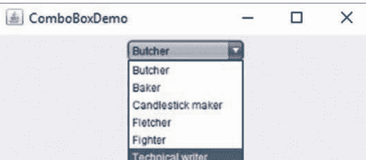

图 17.5
显示组合框组件。

要让 `JComboBox` 组件接收文本输入，你必须调用它的 `setEditable(boolean)` 方法并传入参数 `true`：

```java
profession.setEditable(true);
```

你必须在组件添加到容器之前调用此方法。

## 文本区域

`JTextArea` 组件是一个文本字段，允许用户输入多行文本。你可以指定组件的宽度和高度。以下语句创建了一个宽度为 40 个字符、高度为 8 行的 `JTextArea` 并将其添加到容器中。

```java
JTextArea comments = new JTextArea(8, 40);
FlowLayout flo = new FlowLayout();
setLayout(flo);
add(comments);
```

图 17.6 显示了在框架中的此示例。

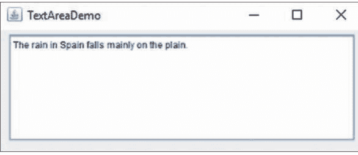

图 17.6
显示文本区域组件。

你可以在 `JTextArea()` 构造函数中指定一个字符串显示在文本区域中，并使用换行符 `\n` 将文本发送到下一行，如下所示：

```java
JTextArea comments = new JTextArea("I should have been a pair\n"
+ "of ragged claws.", 10, 25);
```

文本区域有两个方法可以调用，以指定用户在输入文本到行右边缘时组件的行为。使用 `setLineWrap(boolean)` 方法并传入参数 `true` 可导致文本换行到下一行：

```java
comments.setLineWrap(true);
```

要确定如何将文本换行到下一行，请使用 `setWrapStyleWord(boolean)` 方法。传入参数 `true` 可根据单词结束换行，传入 `false` 则根据字符换行。

```java
comments.setWrapStyleWord(true);
```

由于你不调用这些方法，文本将不会换行。用户可以在同一行上继续输入文本，直到按下 Enter 键，从而超出区域的右边缘。

文本区域组件的行为可能出乎你的意料——当用户到达区域底部时，它们的尺寸会扩大，并且在右边缘或底部边缘不包含滚动条。为了以更好的方式实现它们，你必须将文本区域放置在一个名为滚动面板的容器中。

GUI 中的组件通常比显示它们的区域大。为了实现从一个组件移动到另一个组件，你会使用水平和垂直滚动条。

在 Swing 中，通过将组件添加到滚动面板来实现支持，滚动面板是由 `JScrollPane` 类表示的容器。

你可以使用以下构造函数创建滚动面板：

- `JScrollPane()` — 创建一个根据需要显示水平和垂直滚动条的滚动面板。
- `JScrollPane(int, int)` — 创建一个具有指定的垂直滚动条和水平滚动条的滚动面板。
- `JScrollPane(Component)` — 创建一个包含指定用户组件的滚动面板。
- `JScrollPane(Component, int, int)` — 创建一个具有指定组件、垂直滚动条和水平滚动条的滚动面板。

这些构造函数的整数参数决定了滚动条如何在面板中使用。使用以下类变量作为这些参数：

- `JScrollPane.VERTICAL_SCROLLBAR_AS_NEEDED` 或 `JScrollPane.HORIZONTAL_SCROLLBAR_AS_NEEDED`
- `JScrollPane.VERTICAL_SCROLLBAR_NEVER` 或 `JScrollPane.HORIZONTAL_SCROLLBAR_NEVER`
- `JScrollPane.VERTICAL_SCROLLBAR_ALWAYS` 或 `JScrollPane.HORIZONTAL_SCROLLBAR_ALWAYS`

如果你在滚动面板中添加了组件，你可以使用以下类变量来决定滚动条的显示方式：...


此示例创建了一个单一的 `JComboBox` 组件，提供了六个选项，用户可以从中进行选择。当选中其中一个时，它会显示在组件的显示区域。图 17.5 显示了该示例在弹出选择列表显示的状态。


**图 17.5** 显示组合框组件。

要让 `JComboBox` 组件接收文本输入，你必须调用它的 `setEditable(boolean)` 方法并传入参数 `true`：
`profession.setEditable(true);`

你必须在组件添加到容器之前调用此方法。

## 文本区域

`JTextArea` 组件是一个文本字段，允许用户输入多行文本。你可以指定组件的宽度和高度。以下语句创建了一个宽度为 40 个字符、高度为 8 行的 `JTextArea` 并将其添加到容器中。

```java
JTextArea comments = new JTextArea(8, 40);

FlowLayout flo = new FlowLayout();

setLayout(flo);

add(comments);
```

图 17.6 显示了在框架中的此示例。

你可以在 `JTextArea()` 构造函数中指定一个字符串显示在文本区域中，并使用换行符 `\n` 将文本发送到下一行，如下所示：

```java
JTextArea comments = new JTextArea("I should have been a pair\n"
+ "of ragged claws.", 10, 25);
```

### 使用组件


**图 17.6** 显示文本区域组件。

文本区域有两个方法可以调用，以指定用户在输入文本到行右边缘时组件的行为。使用 `setLineWrap(boolean)` 方法并传入参数 `true` 可导致文本换行到下一行：
`setLineWrap(true);`

要确定如何将文本换行到下一行，请使用 `setWrapStyleWord(boolean)` 方法。传入参数 `true` 可根据单词结束换行，传入 `false` 则根据字符换行。

由于你不调用这些方法，文本将不会换行。用户可以在同一行上继续输入文本，直到按下 Enter 键，从而超出区域的右边缘。

区域组件的行为可能出乎你的意料——当用户到达区域底部时，它们的尺寸会扩大，并且在右边缘或底部边缘不包含滚动条。为了以更好的方式实现它们，你必须将文本区域放置在一个名为滚动面板的容器中。

GUI 中的组件通常比显示它们的区域大。为了实现从一个组件移动到另一个组件，你会使用水平和垂直滚动条。

在 Swing 中，通过将组件添加到滚动面板来实现支持，滚动面板是由 `JScrollPane` 类表示的容器。

你可以使用以下构造函数创建滚动面板：

- `JScrollPane()` — 创建一个根据需要显示水平和垂直滚动条的滚动面板。
- `JScrollPane(int, int)` — 创建一个具有指定的垂直滚动条和水平滚动条的滚动面板。

## 第 17 小时：构建一个简单的用户界面

- `JScrollPane(Component)` — 创建一个包含指定用户组件的滚动面板。
- `JScrollPane(Component, int, int)` — 创建一个具有指定组件、垂直滚动条和水平滚动条的滚动面板。

这些构造函数的整数参数决定了滚动条如何在面板中使用。使用以下类变量作为这些参数：

- `JScrollPane.VERTICAL_SCROLLBAR_AS_NEEDED` 或 `JScrollPane.HORIZONTAL_SCROLLBAR_AS_NEEDED`
- `JScrollPane.VERTICAL_SCROLLBAR_NEVER` 或 `JScrollPane.HORIZONTAL_SCROLLBAR_NEVER`
- `JScrollPane.VERTICAL_SCROLLBAR_ALWAYS` 或 `JScrollPane.HORIZONTAL_SCROLLBAR_ALWAYS`

该面板是在构造函数中创建的。发生了以下操作：

- 第 12 行 — `super()` 方法调用了 `JPanel` 类的构造函数，确保其正确初始化。
- 第 13 行 — 新创建 `spaceLabel`（其文本为“Disk space: ”，且在第 8 行作为实例变量创建）通过调用 `add(Component)` 方法并将该标签作为参数添加到面板中。
- 第 14 行 — 空间标签（`space label`，一个在第 9 行创建且没有文本的实例变量）也被添加到面板中。
- 第 16 行 — 调用了 `setValue()` 方法，该方法更改了区域的文本。

第 16 行中 `setValue()` 的调用被包含在另一个 `try-catch` 块中，类似于在寻找外观时使用的结构。你将在第 18 小时学习更多关于如何处理错误，但简而言之（TLDR）：`try-catch` 使得能够处理 Java 程序部分可能发生的一个或多个错误。

这是必要的，因为当访问计算机文件系统以查看其可用空间时，调用 `setValue()` 可能会导致错误。该错误在 Java 中有自己的类 `IOException`，它代表输入/输出错误。

`try` 块包含了可能导致错误的代码。`catch` 块在括号内识别错误类型，并包含在发生该错误时要执行的代码。

如果在应用程序运行时遇到此类错误，第 18 行将把空间标签的文本设置为“Error”，以告知用户发生了问题。

> **注意**
>
> 缩写 TLDR 的意思是“too long; didn't read”（太长了，没读），它出现在互联网上，当人们为长篇文章提供一个极简的总结，以提供给那些不想阅读全文的人时使用。
>
> 我希望这部分内容对你来说不是 TLDR。我们试图让它达到 JLRWTANIJRJP（长度恰好）；读完整个内容后，我就成了一个富有的 Java 程序员了。

通过为这个自定义组件提供一些可以发现的有趣内容，快速上手了 Java 文件处理，这个主题将在第 20 小时的“读取和写入文件”中进行详细介绍。

要确定计算机上有多少可用磁盘空间，你需要 `java.nio.file` 包中的四个类，该包被用于访问计算机的文件系统。

## 第 17 小时：构建简单的用户界面

`Path` 对象代表文件或文件夹的位置。`Paths` 类有一个 `get(String)` 方法，可以将字符串转换为匹配路径字符串的字符串。当使用 `""`（空字符串）调用时，它返回运行 Java 应用程序的当前文件夹路径：

```java
Path current = Paths.get("");
```

磁盘的存储信息在 Java 中由 `FileStore` 对象表示，它是一个文件存储池。获取路径后，你可以使用 `Files` 类中的方法获取该路径所在的文件存储器。调用 `Files` 的 `getFileStore(Path)` 方法来检索该文件存储池：

```java
FileStore store = Files.getFileStore(current);
```

有了这个池，你可以调用 `getTotal()` 和 `getUsableSpace()` 方法来查找当前磁盘上有多少可用空间：

```java
long totalSpace = store.getTotal();
long freeSpace = store.getUsableSpace();
double percent = (double)freeSpace / (double)totalSpace * 100;
```

### 注意

计算百分比的表达式包含了许多对 `double` 的引用，这看起来可能很奇怪。在表达式中使用之前，将 `freeSpace` 和 `totalSpace` 变量强制转换为 `double` 值。为了防止表达式产生整数值而不是浮点数，这是必须的。Java 通过表达式中的类型来确定表达式结果的数据类型。将一个 `long` 除以一个 `long` 再乘以整数 `100` 将产生一个 `long`，而不是预期的百分比。

最终结果中计算出的百分比在小数点后可能有非常多位数，例如 64.8675309。

以下表达式将 `double` 转换为最多两位小数：

```java
percent = (int)(percent * 100) / (double)100;
```

表达式的前部分将百分比乘以 100——将小数点向右移动——并将其转换为整数，因此 64.8675309 变成了 6487。

后半部分将此除以 100——将小数点向左移动——恢复百分比的近似值。这使得 6486 变成了 64.86。

当百分比限制为两位小数时，可以将标签的文本设置为报告可用和占用的磁盘：

```java
space.setText(freeSpace + " free of " + totalSpace + " (" + percent + "%)");
```

在将面板添加到图形界面之前，没有办法看到你创建的面板。要尝试 `SpacePanel`，请在 `java2hours` 包中创建 `SpaceFrame`，如列表 17.4 所示。为名为 `SpaceFrame` 的类创建一个新文件。

### 列表 17.4 SpaceFrame.java 的完整文本

```java
1: package java2hours;
2: import java.awt.*;
3: import javax.swing.*;
4: public class SpaceFrame extends JFrame {
5:     public SpaceFrame() {
6:         super("Disk Space");
7:         setLookAndFeel();
8:         setSize(500, 120);
9:         setDefaultCloseOperation(JFrame.EXIT_ON_CLOSE);
10:        FlowLayout flo = new FlowLayout();
11:        setLayout(flo);
12:        SpacePanel freePanel = new SpacePanel();
13:        add(freePanel);
14:        setVisible(true);
15:    }
16:    private void setLookAndFeel() {
17:        try {
18:            UIManager.setLookAndFeel("javax.swing.lookandfeel.Nimbus");
19:        } catch (Exception e) {
20:            // 处理错误
21:        }
22:    }
23:    public static void main(String[] args) {
24:        SpaceFrame frame = new SpaceFrame();
25:    }
26: }
```

### 答案

- 1. `JPanel`。你可以向面板添加组件，然后将面板作为框架添加到另一个容器中。
- 2. A. 你必须在组件之前指定布局管理器，以便能够以正确的方式添加它们。
- 3. A. `setLayout()` 方法接受一个参数：布局管理器对象，该对象负责决定应该显示哪些组件。

### 活动

为了进一步接触 GUI 设计这一主题，请完成以下活动：

- 修改 `SalutonFrame` 应用程序，使其在框架的主区域显示“Saluton Mondo!”而不是在标题栏中。
- 增强 `FreeSpacePanel` 组件，在磁盘大小数字中每三位显示一个逗号。一种方法是使用 `StringBuilder` 对象、`String` 方法 `charAt(int)` 以及用于遍历字符串的 `for` 循环。

要查看实现这些活动的 Java 程序，请访问书籍的网站 www.java24hours.com。

# 第 18 小时：用户界面布局

本小时的任务列表：

- 创建一个布局管理器。
- 为容器分配布局管理器。
- 使用面板组织界面中的组件。
- 尝试不常见的布局。
- 为 Java 应用创建一个原型。

当你开始为 Java 程序设计图形用户界面（GUI）时，你面临的一个障碍是组件是可以移动的。每当容器尺寸变化时（例如用户调整框架大小），它所包含的组件可能会重新排列以适应新的尺寸。

这种灵活性对你有利，因为它考虑了界面组件在不同操作系统上的显示差异。一个可点击的按钮在 Windows 上看起来可能与 Linux 或 Mac OS 不同。

界面中的组件通过一组被称为布局管理器的类来组织。这些类定义了组件在容器内的显示方式。界面中的每个容器都可以有自己的布局管理器。

### 使用布局管理器

在 Java 中，组件在容器中的位置取决于组件的大小、其他组件的大小以及容器的高度和宽度。按钮、文本字段和其他组件的布局受以下因素的影响：

- 字体
- 容器的大小
- 其他组件和容器的大小
- 布局管理器

可以使用几种布局管理器来影响组件的显示方式。面板的默认管理器是 `java.awt` 包中的 `FlowLayout` 类，在上一小时中已经用过。

在 `FlowLayout` 下，组件被放置到某个区域的方式就像英文单词在页面上的组织方式一样——从左到右，并在当没有更多空间时换到下一行。

以下示例可以用于框架中，以便在添加组件时沿用布局功能：

```java
FlowLayout topLayout = new FlowLayout();
setLayout(topLayout);
```

你还可以设置一个布局管理器工作于特定的容器内，例如 `JPanel` 对象。你可以通过使用容器对象的 `setLayout()` 方法来实现这一点。

本小时的第一个项目是 `Crisis`，它是一个带有五个按钮的 GUI 应用程序。在 `com.java24hours` 包中为名为 `Crisis` 的类创建一个新的 Java 文件。将代码列表 18.1 中的文本输入到文件中并保存。

# 代码列表 18.1 Crisis.java 的全文

```java
1: package com.java24hours;
2:
3: import java.awt.*;
4: import javax.swing.*;
5:
6: public class Crisis extends JFrame {
7:   JButton panicButton;
8:   JButton dontPanicButton;
9:   JButton blameButton;
10:  JButton mediaButton;
11:  JButton saveButton;
12:
13:  public Crisis() {
14:    super("Crisis");
15:    lookAndFeel();
```


# 使用 Insets 隔开组件

在容器内排列组件时，可以使用 `Insets` 将组件远离容器的边缘。`Insets` 是一个表示容器边界区域的类。

`Insets` 类是 `java.awt` 包的一部分，它包含一个接受四个参数的构造函数：在容器的顶部、左侧、底部和右侧留出的空间。每个参数都使用像素（pixels）作为单位，这与定义框架大小时使用的单位相同。

以下语句创建了一个 `Insets` 对象：

```
Insets around = new Insets(10, 6, 10, 3);
```

`around` 对象表示一个容器边界，该边界距离顶部边缘内侧 10 像素，左侧内侧 6 像素，底部内侧 10 像素，以及右侧内侧 3 像素。

要在容器中使用 `Insets` 对象，你必须重写容器的 `getInsets()` 方法。该方法没有参数，并返回一个 `Insets` 对象，如下例所示：

```
public Insets getInsets() {
    Insets squeeze = new Insets(50, 15, 10, 15);
    return squeeze;
}
```

图 18.5 显示了这将如何改变图 18.1 所示的由 `FlowLayout` 管理的界面。

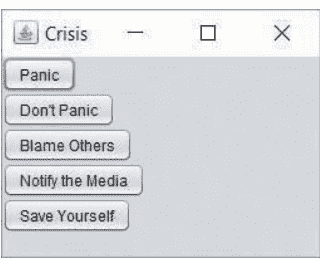

图 18.4
使用箱布局（box layout）堆叠组件。


# 图 18.5

使用 in 在组件周围添加空间。

图 18.5 显示的容器是一个空边框，距离左边缘 15 像素，底部边缘 10 像素，右边缘 15 像素，顶部边缘 50 像素。

### 注意事项

`JFrame` 容器有一个内置的内边距（inset），用于为框架的标题栏留出空间。当你重写 `getInsets()` 并设置自己的值时，较低的内边距值会导致容器在标题栏下方显示组件。

# 布局应用程序

到目前为止你看到的布局管理器都是应用于整个框架的。使用了框架的 `setLayout()` 方法，并且所有组件都遵循相同的规则。这种设置适用于某些程序，但当你尝试用 Swing 开发 GUI 时，你经常会发现没有任何布局管理器是完全匹配的。

解决此问题的一种方法是使用一组 `JPanel` 对象作为容器来装载 GUI 的不同部分。你可以通过使用每个 `JPanel` 的 `setLayout()` 方法为这些部分中的每一个部分设置布局规则。在这些面板包含了它们需要包含的组件后，你可以直接将这些面板添加到框架中。

下一个项目将为你在接下来的一小时内编写的程序开发一个完整的界面。该程序是一个乐彩票数字计算器，用于评估用户一生中赢得数百万美元乐彩比赛奖项的概率。这种概率通过反复的随机六数字乐彩开奖来决定，直到用户的号码成为大奖得。图 18.6 显示了你为该应用程序开发的 GUI。

# 266 小时第 18 节：布局用户界面

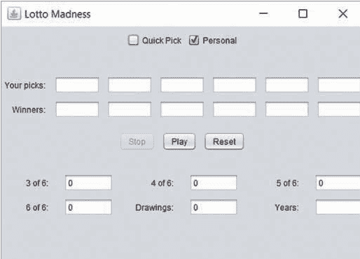

**图 18.6**
显示 *LottoMadness* 应用程序的 GUI。

在 `com.java24hours` 包中创建一个名为 *LottoMadness* 的新 Java 文件，将代码列表 18.2 中的文本输入到源编辑器，并保存文件。

# 代码列表 18.2 *LottoMadness.java* 的全文

```
1: package com.java24hours;
2:
3: import java.awt.*;
4: import javax.swing.*;
5:
6: public class LottoMadness extends JFrame {
7:
8: // 设置第1行
9: JPanel row1 = new JPanel();
10: JButton option = new JButton();
11: JCheckBox quickpick = new JCheckBox("Quick Pick", false);
12: JCheckBox personal = new JCheckBox("Personal", true);
13: // 设置第2行
14: JPanel row2 = new JPanel();
15: JLabel numbersLabel = new JLabel("Your picks: ", JLabel.RIGHT);
16: JTextField[] numbers = new JTextField[6];
17: JLabel winnersLabel = new JLabel("Winners: ", JLabel.RIGHT);
18: JTextField[] winners = new JTextField[6];
19: // 设置第3行
20: JPanel row3 = new JPanel();
21: JButton stop = new JButton("Stop");
22: JButton play = new JButton("Play");
23: JButton reset = new JButton("Reset");
24:
24: // 设置第4行
25: JLabel row4 = new JLabel();
26: JLabel got3 = new JLabel("3 of 6: ", JLabel.RIGHT);
27: JTextField got3 = new JTextField("0");
28: JLabel got4 = new JLabel("4 of 6: ", JLabel.RIGHT);
29: JTextField got4 = new JTextField("0");
30: JLabel got5 = new JLabel("5 of 6: ", JLabel.RIGHT);
31: JTextField got5 = new JTextField("0");
32: JLabel got6 = new JLabel("6 of 6: ", JLabel.RIGHT);
33: JTextField got6 = new JTextField("0");
34: JLabel drawings = new JLabel("Drawings: ", JLabel.RIGHT);
35: JTextField drawings = new JTextField("0");
36: JLabel yearsLabel = new JLabel("Years: ", JLabel.RIGHT);
37: JTextField yearsLabel = new JTextField("0");
38:
39: LottoMadness() {
40: super("LottoMadness");
41:
42: setSize(550, 400);
43: setCloseOperation(JFrame.EXIT_CLOSE);
44:
45: GridLayout layout = new GridLayout(5, 1, 10);
46: setLayout(layout);
47:
48: FlowLayout layout1 = new FlowLayout(FlowLayout.CENTER,
49: 10, 10);
50: option.add(quickpick);
51: option.add(personal);
52: row1.setLayout(layout1);
53: row1.add(option);
54:
55: GridLayout layout2 = new GridLayout(2, 1, 10);
56: row2.setLayout(layout2);
57: row2.add(numbersLabel);
58: for (int i = 0; i < 6; i++) {
59: numbers[i] = new JTextField();
60: row2.add(numbers[i]);
61: }
62: row2.add(winnersLabel);
63: for (int i = 0; i < 6; i++) {
64: winners[i] = new JTextField();
65: row2.add(winners[i]);
66: }
67: add(row2);
68:
69: FlowLayout layout3 = new FlowLayout(FlowLayout.CENTER,
70: 10, 10);
71: row3.setLayout(layout3);
72: row3.add(stop);
73: row3.add(play);
74: row3.add(reset);
75: add(row3);
76:
77: GridLayout layout4 = new GridLayout(2, 3, 20, 10);
78: row4.setLayout(layout4);
79: row4.add(got3);
80: row4.add(got3);
81: row4.add(got4);
82: row4.add(got4);
83: row4.add(got5);
84: row4.add(got5);
85: row4.add(got6);
86: row4.add(got6);
87: row4.add(drawings);
88: row4.add(drawings);
89: row4.add(yearsLabel);
90: row4.add(yearsLabel);
91: add(row4);
92:
93: setVisible(true);
94: }
95:
96: private static void setLookAndFeel() {
97: try {
98: UIManager.setLookAndFeel(
99: "com.sun.java.swing.plaf.nimbus.NimbusLookAndFeel");
100: }
101: catch (Exception ex) {
102: // ignore error
103: }
104: }
105:
106: public static void main(String[] arguments) {
107: LottoMadness.setLookAndFeel();
108: LottoMadness frame = new LottoMadness();
109: }
110: }
```

*注：由于提供的原文代码块存在一些逻辑错误（如重复变量定义和行号冲突），翻译严格遵循“不翻译代码”的原则，保持了原始代码结构。*

尽管你现在还没有添加任何让程序运行的语句，但你可以运行应用程序，以确保图形界面组织正确并收集了你所需的信息。

界面的第 2 行被布局为一个两行七列的网格。`GridLayout()` 构造函数还指定了组件与其他组件之间每个方向应隔开 10 像素。第 56–57 行设置了此网格：

```
GridLayout layout2 = new GridLayout(2, 7, 10, 10);
row2.setLayout(layout2);
```

第 4 行使用 `GridLayout` 将组件排列成两行三列的网格。

`LottoMadness` 应用程序在本在本内内描述的几个组件。第 9–37 行用于设置构成界面的组件对象。这些语句按行组织。首先，为该行创建一个 `JPanel` 对象，然后设置放置在该行上的每个组件。这段代码创建了所有组件和容器，但在使用 `add()` 方法将它们添加到应用程序的主框架（frame）之前，它们不会被显示。

在第 47–50 行中，添加了组件。第 47–54 行展示了整个 `LottoMadness()` 构造函数：

```
FlowLayout layout1 = new FlowLayout(FlowLayout.CENTER, 10, 10);
option.add(quickpick);
option.add(personal);
row1.setLayout(layout1);
row1.add(quickpick);
row1.add(personal);
add(row1);
```


创建布局管理器后，使用它配合该行 `JPanel` 对象（在本类中为 `row1`）的 `setLayout()` 方法。设置布局后，使用其 `add()` 方法将组件添加到 `JPanel`。在所有组件放置完成后，通过调用其 `add()` 方法将整个 `row1` 添加到框架中。

LottoMadness 应用程序设置图形用户界面外观的方式与之前的 Swing 应用程序不同。`setLookAndFeel()` 方法被创建为一个类方法——注意第 105 行中的 `static` 关键字——并在第 116 行的 `main()` 方法中调用。

之前的应用程序将 `setLookAndFeel()` 设计为对象方法并在对象的构造函数中调用。LottoMadness 中没有发生这种情况的原因是因为在创建任何实例变量并赋值之前，必须先选择外观和感觉。

### 总结

当你第一次设计 Java 程序的 GUI 时，你可能很难相信组件可以移动是一项优势。它们并不总是去你想它们去的地方。布局管理器提供了一种开发吸引人的 GUI 的方法，足够灵活以处理呈现上的差异。

在接下来的一小时里，你将学习更多关于 GUI 功能。你有机会看到 LottoMadness 界面投入使用，它处理彩票开奖并统计获胜者。

### 工作坊

### 问答

- 为什么 LottoMadness 应用程序中的某些文本字段是灰色的，而另一些是白色的？

- 在灰色字段上使用了 `setEditable` 方法使其无法编辑。文本字段的默认行为是允许用户通过点击其边界内部并输入任何所需的更改来更改文本字段的值。然而，某些字段旨在显示信息而不是从用户那里输入。`setEditable()` 防止了用户修改他们不应该修改的字段。

- 《威利·旺卡和巧克力工厂》中是否真的有一个旺卡门票获得者，其结局在电影中太惨了没拍？

- 米兰达·派克（Miranda Piker）的命运如此凄惨，以至于她从达尔的书《查理和巧克力工厂》中最后的木筏上掉了下去，这启发了 1971 年电影及其 2005 年的重拍。派克是一个自大的人，她认为孩子永远不贫穷到无法一直上课。她的父亲是一位学校校长。

派克和旺卡工厂的其他门票获得者被引入了“斑点粉”（Spotty Powder），这是一种糖分调制的混合物，会导致食用者长满红斑，从而感到身体不适并旷课。派克和她的父亲感到非常愤怒，并决定毁掉她制造的机器。

奥姆帕族（Oompa-Loompas）用这段歌词庆祝她的遭遇：“噢，米兰达·玛丽·派克，/谁能喜欢她这样/一个如此傲慢又令人作呕的小孩子。所以我们说，‘我们不修她/在斑点粉搅拌机里/那么我们一定会比以前更喜欢她。’这个如此恶毒的孩子/将会非常美味，/而她的同学一定会明白/那就是说，‘米兰达！/噢，这头野兽！我们受不了她了！/他们会说，‘噢，多有用，多好！’”

### 测验

看看你的脑细胞布局是否正确，通过回答以下问题来测试你的 Java 布局管理技能。

- 1. 将界面细分为不同的布局管理器时，通常使用什么计数器？
  A. JWindow
  B. JPanel
  C. Container
- 2. 面板（panel）的默认布局管理器是什么？
  A. FlowLayout
  B. GridLayout
  C. 无默认
- 3. `BorderLayout` 类名来源于哪里？
  A. 每个组件的边界
  B. 布局沿着容器的边界组织
  C. Java 开发者的随性而为

### 答案

- 1. B. JPanel，它是最简单的容器。
- 2. A. 面板使用流式布局，但框架和窗口的默认管理器是边界布局。
- 3. B. 你必须使用 `BorderLayout.WEST` 和 `BorderLayout.EAST` 等方向变量来指定组件的边界位置。

### 活动

- 如果你愿意，请尝试以下操作：
  - 创建一个支持一个或多个接口的类。
  - 找到：

- 如果你愿意，请尝试以下操作：
  - 创建一个支持一个或多个接口的类。
  - 找到：

- 如果你愿意，请尝试以下操作：
  - 创建一个支持一个或多个接口的类。
  - 找到：

- 如果你愿意，请尝试以下操作：
  - 创建一个支持一个或多个接口的类。
  - 找到：

- 如果你愿意，请尝试以下操作：
  - 创建一个支持一个或多个接口的类。
  - 找到：

- 如果你愿意，请尝试以下操作：
  - 创建一个支持一个或多个接口的类。
  - 找到：

- 如果你愿意，请尝试以下操作：
  - 创建一个支持一个或多个接口的类。
  - 找到：

# 处理用户事件

当带有监听器的组件产生用户事件时，系统会自动调用一个方法。该方法必须在将监听器附加到组件时所指定的类中被找到。

每个监听器都有不同的方法来接收其触发的事件。`ActionListener` 接口将事件发送到名为 `actionPerformed()` 的方法。以下是 `actionPerformed()` 方法的简短示例：

```
public void actionPerformed(ActionEvent event) {

  // 方法体在此处

}
```

程序中的所有事件都将发送到这个方法。如果程序中只有一个组件可能发送动作事件，你可以在此方法中编写语句来处理该事件。如果有多个组件可以发送这些事件，则需要检查被发送的对象……

一个 `ActionEvent` 对象被发送到 `actionPerformed()` 方法。有几类对象代表程序中可以生成的事件。这些类拥有了可以确定是哪个组件导致事件发生的方法。在 `actionPerformed()` 方法中，如果 `ActionEvent` 对象命名为 `event`，你可以通过以下语句识别组件：

```
String cmd = event.getActionCommand();
```

`getActionCommand()` 方法返回一个字符串。如果组件是按钮，该字符串就是按钮上的标签。如果它是一个字段，则该字符串是字段中输入的文本。`getSource()` 方法返回导致事件的get。

你可以使用以下 `actionPerformed()` 方法接收来自三个组件的事件：一个名为 `start` 的 `JButton`，一个名为 `speed` 的 `JTextField` 以及另一个名为 `viscosity` 的 `JTextField`：

```
public void actionPerformed(ActionEvent event) {

  Object source = event.getSource();

  if (source == speed) {

    // speed 字段触发了事件

  } else if (source == viscosity) {

    // viscosity 字段触发了事件

  } else {

    // start 按钮触发了事件

  }

}
```

对所有用户事件调用 `getSource()` 方法，以识别导致事件的具体对象。

# 复选框和组合框事件

组合框和复选框需要 `ItemListener` 接口。调用组件的 `addItemListener()` 方法让其生成这些事件。以下语句创建一个复选框，它在被选中或取消选中时会发送事件：

```
JCheckBox superSize = new JCheckBox("Super Size", true);

superSize.addItemListener(this);
```

这些事件由 `itemChanged()` 方法接收，该方法接受一个 `ItemEvent` 对象作为参数。要指定是哪个对象导致了事件，你可以调用事件对象的 `getItem()` 方法。

要确定复选框是被选中还是取消选中，调用 `ItemEvent` 的 `getState()` 方法返回的值，并与 `ItemEvent.SELECTED` 和 `ItemEvent.DESELECTED` 进行比较。以下代码是名为 `item` 的 `ItemEvent` 对象的示例：

```
public void itemChanged(ItemEvent item) {

  int status = item.getState();

  if (status == ItemEvent.SELECTED) {

    // item 被选中了

  }

}
```

要确定 `JComboBox` 对象中的选中值，使用 `getItem()` 并将其转换为字符串，如下：

```
Object which = item.getItem();

String answer = which.toString();
```

# 键盘事件

当程序必须在按下按键后立即运行时，它会使用键盘事件和 `KeyListener` 接口。

第一步是通过调用组件的 `addKeyListener()` 方法注册接收按键的组件。方法的参数应该是实现了 `KeyListener` 接口的对象。如果是当前类，则使用该类作为参数。

处理键盘事件的对象必须实现三个方法：

- `keyPressed(KeyEvent)` — 在按下按键的瞬间调用的方法
- `keyReleased(KeyEvent)` — 在释放按键的瞬间调用的方法
- `keyTyped(KeyEvent)` — 在按键按下并释放后调用的方法

这些方法都返回 `void` 而不是值。其中每个方法都接受一个 `KeyEvent` 对象作为参数，该对象拥有可以获取更多事件信息的方法。调用 `getChar()` 方法可以找出哪个按键。该按键以 `char` 值返回，且仅用于字母、数字和标点符号。

要监控键盘上的任何按键（包括 Enter、Home、Page Up 和 Page Down），你应该调用 `getKeyCode()`。该方法返回一个代表按键的整数值。然后你使用该整数调用 `getKey()`，以接收一个包含按键名称的 `String` 对象（如 Home、F1 等）。

列表 19.1 包含一个 Java 程序，它通过使用 `getKeyChar()` 方法在标签中绘制最近按下的按键。该方法实现了 `KeyListener` 接口，因此类中存在 `keyTyped()`、`keyPressed()` 和 `keyReleased()`。其中唯一执行操作的是第 24-27 行的 `keyTyped()`。在 `com.java24hours` 包中创建一个名为 `Viewer` 的 Java 文件，将列表中的文本输入文件并保存。

### 列表 19.1 KeyViewer.java 的完整文本

```
1: package com.java24hours;

2:

3: import javax.swing.*;

4: import java.awt.event.*;

5: import java.awt.*;

6:

7: public class KeyViewer extends JFrame implements KeyListener {

8:     JTextField field = new JTextField(80);

9:     JLabel label = new JLabel("Press any key in the text field.");

10:

11:     public KeyViewer() {

12:         super("KeyViewer");

13:         setLookAndFeel();

14:         setSize(350, 100);

15:         setDefaultCloseOperation(JFrame.EXIT_ON_CLOSE);

16:         field.addKeyListener(this);

17:         BorderLayout board = new BorderLayout();

18:         setLayout(board);

19:         add(label, BorderLayout.NORTH);

20:         add(field, BorderLayout.CENTER);

21:         setVisible(true);

22:     }

23:

24:     @Override

25:     public void keyTyped(KeyEvent input) {

26:         char key = input.getKeyChar();

27:         label.setText("You pressed " + key);

28:     }

29:

30:     @Override

31:     public void keyPressed(KeyEvent txt) {

32:         // 什么都不做

33:     }

34:

35:     @Override

36:     public void keyReleased(KeyEvent txt) {

37:         // 什么都不做

38:     }

39:

40:     private void setLookAndFeel() {

41:       try {

42:           UIManager.setLookAndFeel(

43:                 "com.sun.java.swing.plaf.nimbus.NimbusLookAndFeel"

44:           );

45:       } catch (Exception exc) {

46:           // 忽略错误

47:       }

48:     }

49:

50:     public static void main(String[] args) {

51:         KeyViewer frame = new KeyViewer();

52:     }

53: }
```

当你运行程序时，它看起来像图 19.1。该程序实现了 `KeyListener` 接口，因此类中存在 `keyTyped()`、`keyPressed()` 和 `keyReleased()`。

# 启用和禁用组件

你已经看到程序中有一个呈现阴影的组件

阴影表示用户无法对组件进行任何操作，因为它未被启用。启用和禁用是通过组件的 `setEnabled()` 方法实现的。一个布尔值作为参数，因此 `setEnabled(true)` 启用组件，`setEnabled(false)` 禁用它。

以下语句创建了名为 Previous、Next 和 Finish 的按钮，并禁用了第一个：

```
JButton previousButton = new JButton("Previous");

JButton nextButton = new JButton("Next");

JButton finishButton = new JButton("Finish");

previousButton.setEnabled(false);
```

这是防止组件在不应发送时发送事件的有效方法。例如，如果你正在编写一个收集用户地址的 Java 应用程序，你可以在用户提供街道、城市和 ZIP 码之前禁用保存按钮。

# 完成图形化应用程序

为了看到 Swing 的事件处理类如何在 Java 程序中工作，你将完成 LottoMadness，这是第 18 小时“布局用户界面”之前的项目。

到目前，LottoMadness 是一个 GUI。你可以点击按钮并在文本框中输入内容，但不会任何反应。在工作表中，我们将创建一个 LottoEvent，这是一个接收用户输入、控制绘制并跟踪中奖次数的类。当类完成后，我们在 LottoMadness 中添加几行代码使其使用 LottoEvent。

计算机并不是使用概率来解决这个问题，而是以快速顺序进行连续抽奖，直到产生胜者为止。由于 6 选 6 全部中中的概率极低，程序还会报告任何包含三个、四个或五个中奖号码的组合。

界面包含 12 个用于输入彩票号码的文本字段，以及两个标记为“快速选择”（Quick Pick）和“个人”（Personal）的复选框。有六个文本字段被禁用输入，用于显示每次抽奖的中奖号码。另外六个文本字段供用户选择数字。选择“快速选择”会为用户选取六个随机数字。选择“个人”框则允许用户选择所需的数字。

有三个按钮控制程序的运行：“停止”（Stop）、“播放”（Play）和“重置”（Reset）。当按下按钮时，程序会启动一个名为 `playing` 的线程并生成乐透抽奖。

按下“停止”按钮会停止该线程，按下“重置”会清除所有字段，以便用户重新开始。你将在第 15 小节“创建线程程序”中学习线程知识。

`LottoEvent` 类实现了三个接口：`ActionListener`、`ItemListener` 和 `Runnable`。`Runnable` 接口与线程相关，并在第 15 小节中介绍过。监听器用于监听由应用程序按钮和复选框产生的用户事件。程序不需要监听任何与文本字段相关的事件，因为它们严格用于存储用户选择的数字。用户界面会自动处理这种存储。

该类需要使用 `Swing` 包（`javax.swing`）以及 Java 的事件处理包（`java.awt.event`）。

该类有两个实例变量：

- `gui`，一个 `LottoMadness` 对象
- `playing`，一个用于执行连续乐透抽奖的 `Thread` 对象

`gui` 变量用于与包含程序 GUI 的 `LottoMadness` 对象通信。当你需要对界面进行更改或从其中一个文本字段中检索值时，可以使用 `gui` 对象的实例变量。

例如，`LottoMadness` 的 `play` 实例变量代表“播放”按钮。在 `LottoEvent` 中禁用此按钮，可以使用以下语句：

```
gui.play.setEnabled(false);
```


你可以使用下一语句来获取 `JTextField` 对象 `got3` 的值：
`String got3value = gui.got3.getText();`

列表 19.2 包含了 `LottoEvent` 类的完整文本。在 `com.java24hours` 包中创建一个名为 `LottoEvent` 的新 Java 文件，将列表中的文本输入其中并保存。

### 列表 19.2 LottoEvent.java 的完整文本

```
1: package com.java24hours;
2:
3: import javax.swing.*;
4: import java.awt.event.*;
5:
6: public class LottoEvent implements ActionListener, ItemListener,
7: Runnable {
8:
9: LottoMadness gui;
10: Thread playing;
11:
12: public LottoEvent(LottoMadness in) {
13: gui = in;
14: }
15:
16: @Override
17: public void actionPerformed(ActionEvent event) {
18: String command = event.getActionCommand();
19: if (command.equals("Play")) {
20: startPlaying();
21: }
22: if (command.equals("Stop")) {
23: stopPlaying();
24: }
25: if (command.equals("Reset")) {
26: clearAllFields();
27: }
28: }
29:
30: void startPlaying() {
31: playing = new Thread(this);
32: playing.start();
33: gui.play.setEnabled(false);
34:
35: gui.stop.setEnabled(true);
36:
37: gui.quickpick.setEnabled(false);
38: gui.personal.setEnabled(false);
39: }
40: void stopPlaying() {
41: gui.stop.setEnabled(false);
42:
43: gui.play.setEnabled(true);
44: gui.quickpick.setEnabled(true);
45: gui.personal.setEnabled(true);
46: playing = null;
47: }
48: void clearAllFields() {
49: for(int i=0; i<6; i++) {
50: gui.numbers[i].setText("");
51: gui.got3[i].setText("");
52: gui.got4[i].setText("");
53: gui.got5[i].setText("");
54: gui.got6[i].setText("");
55: gui.winners[i].setText("");
56: }
57: @Override
58: public void itemChanged(ItemEvent event) {
59: // 逻辑实现
60: }
```

### 完成图形化应用程序

分配给用户的彩票号码。否则，存放用户号码的文本字段将被清空。

`Lotto` 类为彩票抽奖中的每个球使用从 1 到 50 的数字。这建立在第 118 行，该行将 `Math.random()` 方法乘以 50，加 1，并将其作为 `Math.floor()` 方法的参数。结果是一个 1 到 50 之间的随机整数。如果你将其替换为不同的数字，并在第 69 行进行修改，就可以让 `LottoMadness` 用于生成更宽或更小值范围的彩票比赛。

`LottoMadness` 项目缺乏用于跟踪抽奖次数、计数和号码文本字段等内容的变量。界面会自动存储并显示这些值。

要完成该项目，请在 NetBeans 中重新打开 `LottoMadness.java`。你只需要添加六行代码使其与 `Lotto` 类配合。

首先，添加一个新变量来存储 `LottoEvent` 对象：

```
LottoEvent lotto = new LottoEvent(this);
```

接下来，在 `Lotto` 构造函数中，为每个可以接收输入的用户界面组件调用 `addActionListener()` 和 `addActionListener()`：

```
// 添加监听器
quickpick.addActionListener(lotto);
personal.addActionListener(lotto);
stop.addActionListener(lotto);
play.addActionListener(lotto);
reset.addActionListener(lotto);
```

这些语句应该添加到构造函数中，紧跟 `setLayout()` 方法之后，该方法将网格布局设置为应用程序帧的管理器。

列表 19.3 包含了你完成修改后 `LottoMadness.java` 的完整文本。你添加的几行——其余部分与上一小时的内容保持不变。

### 列表 19.3 LottoMadness.java 的完整文本

```
1: package com.java24hours;
2:
3: import java.awt.*;
4: import javax.swing.*;
5:
6: public class LottoMadness extends JFrame {
7: LottoEvent lotto = new LottoEvent(this);
8:
9: // 设置第 1 行
10: JPanel row1 = new JPanel();
11: ButtonGroup option = new ButtonGroup();
12: JCheckBox quickpick = new JCheckBox("Quick Pick", false);
13: JCheckBox personal = new JCheckBox("Personal", true);
14: // 设置第 2 行
15: JPanel row2 = new JPanel();
16: JLabel numbersLabel = new JLabel("Your picks: ", JLabel.RIGHT);
17: JTextField numbers = new JTextField("6");
18: JLabel winner = new JLabel("Winners: ", JLabel.RIGHT);
19: JTextField winners = new JTextField("6");
20: // 设置第 3 行
21: JPanel row3 = new JPanel();
22: JButton stop = new JButton("Stop");
23: JButton play = new JButton("Play");
24: JButton reset = new JButton("Reset");
25: // 设置第 4 行
26: JPanel row4 = new JPanel();
27: JLabel got3 = new JLabel("3 of 6: ", JLabel.RIGHT);
28: JTextField got3 = new JTextField("0");
29: JLabel got4 = new JLabel("4 of 6: ", JLabel.RIGHT);
30: JTextField got4 = new JTextField("0");
31: JLabel got5 = new JLabel("5 of 6: ", JLabel.RIGHT);
32: JTextField got5 = new JTextField("0");
33: JLabel got6 = new JLabel("6 of 6: ", JLabel.RIGHT);
34: JTextField got6 = new JTextField("0, 10");
35: JLabel drawingsLabel = new JLabel("Drawings: ", JLabel.RIGHT);
36: JTextField drawings = new JTextField("0");
37: JLabel yearsLabel = new JLabel("Years: ", JLabel.RIGHT);
38: JTextField years = new JTextField("0");
39:
40: public LottoMadness() {
41: super("Lotto Madness");
42: setSize(500, 400);
43: setDefaultCloseOperation(JFrame.EXIT_ON_CLOSE);
44: GridLayout layout = new GridLayout(5, 1, 10, 10);
45: setLayout(layout);
46:
47: // 添加监听器
48: quickpick.addActionListener(lotto);
49: personal.addActionListener(lotto);
50: stop.addActionListener(lotto);
51: play.addActionListener(lotto);
52: reset.addActionListener(lotto);
53:
54: FlowLayout layout1 = new FlowLayout(FlowLayout.CENTER,
55: 10, 10);
56: option.add(quickpick);
57: option.add(personal);
58:
59: row1.add(layout1);
60: row1.add(quickpick);
61: row1.add(personal);
62:
63: add(row1);
64: GridLayout layout2 = new GridLayout(2, 7, 10, 10);
65: row2.setLayout(layout2);
66: row2.add(numbersLabel);
67: for (int i = 0; i < 6; i++) {
68: numbers[i] = new JTextField();
69: row2.add(numbers[i]);
70: }
71: row2.add(winnersLabel);
72: for (int i = 0; i < 6; i++) {
73: winners[i] = new JTextField();
74: winners[i].setEditable(false);
75: row2.add(winners[i]);
76: }
77: add(row2);
78:
79: FlowLayout layout3 = new FlowLayout(FlowLayout.CENTER,
80: 10, 10);
81: row3.setLayout(layout3);
82: stop.setEnabled(false);
83: row3.add(stop);
84: row3.add(play);
85: row3.add(reset);
86: add(row3);
87:
88: GridLayout layout4 = new GridLayout(2, 3, 20, 10);
89: row4.setLayout(layout4);
90: row4.add(got3);
91: got3.setEditable(false);
92: row4.add(got4);
93: row4.add(got4Label);
94: got4.setEditable(false);
95: row4.add(got4);
96: row4.add(got5Label);
97: got5.setEditable(false);
98: row4.add(got5);
99: row4.add(got6Label);
100: got6.setEditable(false);
101: row4.add(got6);
102: row4.add(drawingsLabel);
103: drawings.setEditable(false);
104: row4.add(drawings);
105: row4.add(yearsLabel);
106: years.setEditable(false);
107: row4.add(years);
108: add(row4);
109: setVisible(true);
110: private static void setLookAndFeel() {
111: try {
112: UIManager.setLookAndFeel(
113: "com.sun.java.swing.plaf.NimbusLookAndFeel"
114: );
115: } catch (Exception exc) {
116: // ignore error
117: }
118: public static void main(String[] arguments) {
119: LottoMadness.setLookAndFeel();
120: LottoMadness frame = new LottoMadness();
121: }
```

添加这些行后，你就可以运行该应用程序，它可以多年测试你的彩票技巧。正如你所预期的，这些彩票是徒劳的。即使你活得圣经中的人物那么长，一生中赢得六位数字彩票的概率也微乎其微。

当书的网站 `www.java24hours.com` 用于运行 `LottoMadness` 程序时，它收集了 410,732,244 次抽奖，相当于 390 万次每周两次的抽奖。其中有 6,364,880 个三中六奖者、337,285 个四中六奖者、6,476 个五中六奖者以及 51 个六中六奖者（大约每 800 万有一个）。第一个赢得这个虚拟彩票的人是 Bill Teer。他的号码是 3, 7, 1, 15, 34 和 43，他只花了 241,225 次抽奖（2319.47 年）就中了。

### 总结

使用 Swing，你可以通过适量的编程创建一个看起来专业的程序。虽然 `LottoMadness` 应用程序比你过去 19 小时工作的许多示例都要长，但程序的一半是由构建界面的语句组成的。

如果你花时间运行该应用程序，你会对赢得这些六数字抽奖的人的好运感到更加痛苦和嫉妒。

我最近一次运行程序表明，我可以花费 17,000 美元和我生命中最好的 165 年来买票，结果只赢得了一个五中六、一个四中六和 264 个三中六奖。

与这些概率相比，让你的 Java 编程技能获得回报的机会几乎是百分之百肯定的。

### 工作坊

#### 问答

- **Q.** 你是否需要对 `paint()` 方法或 `repaint()` 进行任何操作以指示文本已更改？
- **A.** 使用文本组件的 `setText()` 方法更改其值后，你不需要做任何其他事情。Swing 会处理更新以显示新值。

- **Q.** 为什么你经常导入一个类并同时导入它的一个子类，就像列表 19.1 中你导入 `java.awt.*` 和 `java.awt.event.*` 那样？第一个语句可以包含第二个吗？
- **A.** 尽管 `java.awt` 和 `java.awt.event` 包的名字看起来是相关的，但 Java 中没有包的继承关系。一个包不能是另一个包的子包。
  当你在导入语句中使用星号时，你是在使该包中的所有类都在程序中可用。
  星号仅作用于类，不作用于包。单个导入语句最多加载单个包的类。

- **Q.** 为什么演员 Michael J. Fox 以他的首字母来标识？
- **A.** 因为屏幕演员协会中已经有一个 Michael Fox 了，这迫使这位未来的《家庭联结》和《回到未来》演员选择另一个名字作为职业工作名。他的真名是 Michael Andrew Fox，但他不喜欢 Andrew 或 Andy Fox 听起来——而且 Michael A. Fox 听起来像是在赞美自己的长相。
  他选择 Michael Fox 是为了向性格演员 Michael J. Pollard 致敬。
  另一个 Michael Fox 是一位出演过《马洛克》、《探案》（Burke's Law）以及许多其他电视剧和电影的演员，直到他在 1996 年去世。

#### 测验

在 LottoMadness 程序让你对机会性游戏产生反感后，请通过回答以下问题来玩一个技巧性的游戏。

- **1.** 为什么动作事件（action events）被称为这个名字？
  - A. 它们是针对其他事情发生的反应。
  - B. 表示应该采取某种行动作为响应。
  - C. 它们是为了电影冒险家“动作杰克逊”（Action Jackson）。

- **2.** 作为 `addActionListener()` 方法的参数，`this` 表示什么？
  - A. 事件发生时应使用此监听器。
  - B. 此事件的优先级高于其他事件。
  - C. 此对象处理事件。

- **3.** 哪些文本组件将用户输入存储为整数？
  - A. `JTextField`
  - B. `JTextArea`
  - C. A 和 B 都不是

#### 答案

- **1.** 动作事件包括按钮的点击和从下拉菜单中选择项目。
- **2.** `this` 关键字指向当前对象。如果使用对象的名称而不是 `this` 语句作为参数，则该对象将接收事件并被预期处理它们。


- 3. `JTextField` 和 `JTextArea` 组件将它们的值存储为文本，因此在将它们作为整数、浮点数或其他文本值使用之前，你必须转换它们的值。

### 活动

如果本小时的主要活动不能满足你的口味，请尝试以下活动：

- 在 LottoMadness 应用程序中添加一个文本字段，该字段将与 LottoEvent 中的 `Thread.sleep()` 语句配合工作，以减慢抽奖速度。
- 修改 LottoMadness 项目，使其从 1 到 90 之间抽取五个数字。

查看实现这些活动的 Java 程序，请访问书籍网站 www.java24hours.com。

# 第 20 小时：读取和写入文件

本小时的任务列表：

- 从文件中读取字节流到程序中。
- 在你的计算机上创建一个新文件。
- 将字节数组保存到文件中。
- 对存储在文件中的数据进行修改。

在计算机上表示数据有多种方法。你已经通过创建对象处理过其中一种。对象包含变量形式的数据和对其他对象的引用。它还包含使用数据来完成任务的方法。

要处理其他类型的数据，例如硬盘上的文件和 Web 服务器上的文档，你可以使用 `java.io` 包中的类。其名称中的 "io" 部分代表“输入/输出”（input/output），这些类用于访问数据源，如硬盘、DVD 或计算机内存。

你可以使用一种名为流（streams）的系统将数据引入程序并发送数据，流是把信息从一个地方移动到另一个地方的对象。

## 流

要在 Java 程序中永久保存数据，或稍后检索这些数据，你必须使用至少一个流。

流是一个从一个源获取信息并将其发送到其他地方的对象，其名称源于水流，水流将鱼、船和工业污染物从一个地方带到另一个地方。

流连接了各种源，包括计算机程序、硬盘、Internet 服务器、计算机内存和优存盘。在你学习如何使用流处理一种数据后，你就可以以相同的方式处理其他数据。

在本小时中，你使用流来读取和写入存储在计算机文件中的数据。

有两种流：

- 输入流（Input streams）：从源读取数据。
- 输出流（Output streams）：向源写入数据。

所有输入和输出流都由字节组成，即范围从 0 到 255 的单个整数。你可以使用这种格式来表示数据，例如可执行程序、文字处理文档、MP3 音乐文件，但这些只是字节可以表示的内容的一小部分。字节流（byte stream）用于读取和写入此类数据。

### 注意

Java 类文件以称为字节码（bytecode）的形式以字节形式存储。Java 虚拟机（JVM）运行字节码，字节码并不非得由 Java 语言产生。它可以运行由其他语言产生的编译字节码，包括 Scala、Groovy 和 Jy。你也会听到 JVM 被称为字节码解释器。

一种更专门的数据处理方式是以字符（characters）的形式——单个字母、数字、标点符号等。当你读取和写入文本源时，可以使用字符流（character stream）。

无论你处理的是字节流、字符流还是其他信息，整体过程都是：

- 创建与数据关联的流对象。
- 调用流的方法将信息放入流中或从流中取出信息。
- 通过调用对象的 `close()` 方法关闭流。

## 文件

在 Java 中，文件由 `File` 类表示，该类也是 `java.io` 包的一部分。可以从硬盘、DVD 和其他存储设备读取文件。

一个 `File` 对象可以表示已经存在的文件或你想创建的文件。要创建 `File` 对象，请使用 `File` 的名称作为构造函数，例如所示：

```java
File book = new File("address.dat");
```

这会在当前文件夹中创建一个名为 `address.dat` 的文件对象。你也可以在文件名中包含路径：

```java
File book = new File("data\\address.dat");
```

### 注意

此示例在 Windows 系统上有效，该系统使用反斜杠 `\` 作为路径和文件名的分隔符。（这些代码示例中有两个反斜杠是因为反斜杠在 Java 中是特殊字符）。Linux 和其他基于 Unix 的系统使用正斜杠 `/` 代替。编写一个不分系统引用文件的 Java 程序时，应使用这种方式。

创建一个 `File` 对象不会创建文件，创建一个 `File` 对象的引用，如下所示：

```java
File book = new File("data\\address.dat");
```

当你有了 `File` 对象时，可以调用它的许多有用方法：

- `exists()`：如果文件存在，返回布尔值。
- `getName()`：文件的名称，返回 `String`。
- `length()`：文件的大小，返回 `long`。
- `createFile()`：如果文件不存在，则创建一个。
- `delete()`：删除文件，返回布尔值。
- `renameTo(File)`：重命名文件。

你还可以使用 `File` 对象来表示文件夹，调用其 `listFiles()` 方法查看内部内容。该方法返回 `File` 对象的数组。

## 从流读取数据

本小时的第一个项目是使用输入流从文件中读取数据。输入流处理字节。你可以通过指定文件名或 `File` 对象作为 `FileInputStream` 构造函数的参数来创建输入流。

## 读取和写入文件

读取或写入文件的方法可能会抛出 `IOException`，因此通常使用 `try-catch` 块。该异常属于 `java.io` 包。流是 Java 中必须关闭的资源之一。程序运行时保持流开启会浪费资源。

一种特殊的 `try` 语句称为 try-with-resources，确保资源（如输入流）在不再需要时关闭。`try` 语句后面跟着括号。括号内是声明资源的 Java 语句。

这是一个使用输入流读取文件 `cookie.web` 的示例：

```java
File cookie = new File("cookie.web");
try (InputStream stream = new FileInputStream(cookie)) {
    System.out.println("Length of file: " + cookie.length());
} catch (IOException ie) {
    System.out.println("Could not read file.");
}
```

由于 `stream` 在 `try` 语句中，它在 `try-catch` 块完成后会自动关闭。

输入流处理字节。你可以通过不带参数调用流的 `read()` 方法来读取单个字节。如果流中没有更多可用字节，则返回 -1。

当你读取输入流时，它从第一个字节开始。你可以通过调用其 `skip()` 方法跳过某些字节，该方法接受一个参数：要跳过的字节数的 `int`。以下语句跳过了 `scanData` 流中的下一个 1024 个字节：

```java
scanData.skip(1024);
```

## ID3Reader 示例

ID3Reader 使用文件输入流读取 MP3 文件，跳过除最后 128 字节以外的所有内容。对剩余字节进行检查以查看是否包含 ID3 数据。如果是，前三个字节是数字 84、65 和 71。

> **注意**
>
> 在 ASCII 字符集中（它包含在 Java 支持的 Unicode 标准字符集中），这三个数字分别代表大写字母 "T"、"A" 和 "G"。

在 `com.java24hours` 包中创建一个名为 `ID3Reader` 的新空 Java 文件，并用列表 20.1 中的文本填充该文件。

### 列表 20.1 ID3Reader.java 的全文

```java
package com.java24hours;

import java.io.*;

public class ID3Reader {
    public static void main(String[] arguments) {
        File file = new File(arguments[0]);
        try (FileInputStream file = new FileInputStream(arguments[0])) {
            int size = (int) file.length();
            file.skip(128);
            byte[] last128 = new byte[128];
            file.read(last128);
            String id3 = new String(last128);
            String tag = id3.substring(0, 3);
            if (tag.equals("TAG")) {
                System.out.println("File: " + id3.substring(3, 32));
                System.out.println("Artist: " + id3.substring(63, 92));
                System.out.println("Album: " + id3.substring(63, 91));
                System.out.println("Year: " + id3.substring(93, 97));
            } else {
                System.out.println(arguments[0] + " does not contain"
                    + " ID3 info.");
            }
            file.close();
        } catch (IOException ioe) {
            System.out.println("Error - " + ioe.toString());
        }
    }
}
```

在将此类作为应用程序运行之前，必须指定一个 MP3 文件作为命令行参数（在 NetBeans 中使用运行、设置项目配置）。程序可以使用任何 MP3 运行，例如 `Come On and Gettit.mp3`，这是由 Marion Black 创作的被遗忘的 1973 年灵魂乐经典。如果你系统中有歌曲 `Come On and Gettit.mp3`（你确实应该有一个），图 20.1 显示了 ID3Reader 应用程序显示的内容。

```
Output - Java24 (run)
run:
Title: Come On and Gettit
Artist: Marion Black
Album: Eccentric Soul: The Price Label
Year: 2007
BUILD SUCCESSFUL (total time: 0 seconds)
```

图 20.1：运行 ID3Reader 应用程序。

### 提示

如果你电脑上没有 `Come On and Gettit.mp3`（在我看来这是一个巨大的错误）或其他任何 MP3，你可以通过 http://search.creativecommons.org 寻找使用 Creative Commons 许可的 MP3 歌曲进行检查。

知识共享（Creative Commons）是一组版权许可，规定了歌曲或书籍等作品如何发布、编辑或重新出版。

该程序在列表 20.1 的第 11-12 行从 MP3 中读取最后 128 字节，将其存储在字节数组中。第 13 行使用该数组创建一个包含这些字节所代表字符的 `String` 对象。

如果字符串的前三个字符是 "TAG"，则说明正在检查的 MP3 文件包含 ID3 信息。

在第 16–19 行中，调用了字符串的 `substring()` 方法来显示字符串的部分。ID3 格式始终将艺术家、歌曲、标题和年份信息放在最后 128 字节的相同位置。

某些 MP3 文件完全不包含 ID3 信息，或者包含该应用程序无法读取的不同格式的 ID3 信息。

如果你是从购买的 Eccentric Soul CD 副本创建的 `Come On and Gettit.mp3` 文件，那么该文件就包含可读的 ID3 信息。程序从音频 CD 创建 MP3 文件时，会从名为 CDDB 的音乐数据库中读取歌曲信息。

在从 MP3 的输入流中读取完所有与 ID3 相关的内容后，流在第 24 行被关闭。在完成操作后，你应该始终关闭流以节省 JVM 资源。

### 注意

你可能想于通过文件共享服务找到 `Come On and Gettit.mp3` 的副本。对于“Come On and Gettit”，我完全理解这种诱惑。然而，根据美国录音协会的规定，任何下载不属于你的音乐 MP3 文件的人都会立即自燃。Eccentric Soul 可以在 Amazon.com、eBay、Apple iTunes 以及任何商店购买。

## 缓冲输入流

提高读取输入流程序性能的方法之一是对输入进行缓冲。缓冲是将数据保存到内存中，以便在程序需要时使用。当 Java 程序需要从缓冲输入流获取数据时，它会首先查找缓冲区，这比从文件等源读取要快。

要使用缓冲输入流，你先创建一个输入流（例如 `FileInputStream` 对象），然后使用该对象创建一个缓冲区。调用 `BufferedInputStream(InputStream)` 构造函数并将输入流作为参数。

要从缓冲流中读取内容，调用其不带参数的 `read()` 方法。返回的 0 到 255 之间的整数表示流中的下一个字节。如果没有更多可用字节，则返回 -1。

为了演示缓冲流，以下程序创建了从控制台读取字符的能力。`com24hours` 包中的 `Console` 类包含一个 `readLine()` 方法，从控制台接收输入。当按下 Enter 键时，`readLine()` 返回一个包含接收字符的字符串。

### 列表 20.2 Console.java 的全文

```java
package com.java24hours;

import java.io.*;

public class Console {
    public static String readLine() {
        StringBuilder response = new StringBuilder();
        BufferedInputStream bin = new BufferedInputStream(System.in);
        int in = 0;
        char inChar;
        try {
            do {
                in = bin.read();
                inChar = (char) in;
                if (inChar != -1) {
                    response.append(inChar);
                }
            } while (inChar != '\n');
            return response.toString();
        } catch (IOException e) {
            System.out.println("Exception: " + e.getMessage());
            return null;
        }
    }

    public static void main(String[] arguments) {
        System.out.println("You are at the end of the road before a small");
        System.out.println("brick building. Around you is a forest. A small stream");
        System.out.println("flows out of the building and down gully.");
        String input = readLine();
        if (input != null) {
            System.out.println("That's not a verb I recognize.");
        }
    }
}
```

该类包含一个 `main()` 方法演示了如何使用它。当你运行应用程序时，输出应该类似于图 20.2。

```
Output - Java24 (run)
run:
You are at the end of the road before a small
brick building. Around you is a forest. A small stream
flows out of the building and down gully.
That's not a verb I recognize.
BUILD SUCCESSFUL (total time: 4 minutes 34 seconds)
```

图 20.2：运行 Console 应用程序。

## 向流写入数据

在 `java.io` 包中，用于处理流的类成对出现。有 `InputStream` 和 `FileOutputStream` 类用于字节流，`FileReader` 和 `FileWriter` 类用于字符流，还有许多其他用于处理其他类型数据流的集合。

要开始写入数据，你首先创建一个与输出流关联的 `File` 对象。该文件不需要在你的系统中存在。

你可以通过两种方式创建 `FileOutputStream`。如果你想向现有文件追加字节，调用带有两个参数的 `FileOutputStream()` 构造函数：代表文件的 `File` 对象和一个布尔值 `true`。这样写入流的字节将附加到文件末尾。

如果你想向新文件写入字节，调用以 `File` 对象作为唯一参数的 `FileOutputStream()` 构造函数。

## 第 20 小时：读取和写入文件


在你拥有一个输出流后，可以调用不同的 `write()` 方法向其写入字节：

- 调用 `write()` 并将一个字节作为唯一参数，将该字节写入流中。
- 调用 `write()` 并将字节数组作为唯一参数，将该数组中的所有字节写入流中。
- 为 `write(byte[], int, int)` 方法指定三个参数：一个字节数组、一个表示要写入流的数组第一个元素的整数，以及要写入的字节数。

```java
File dat = new File("data.dat");
FileOutputStream datStream = new FileOutputStream(dat);
byte[] data = new byte[] { 5, 12, 14, 13, 3, 15, 2, 17, 1, 18 };
datStream.write(data, 6, 4);
```

在向流写入字节时，你可以通过调用 `String` 对象的 `getBytes()` 方法来转换字节数组，如下例所示：

```java
String name = "Puddin N. Tane";
byte[] nameBytes = name.getBytes();
```

在你完成向流写入字节后，通过调用流的 `close()` 方法将其关闭。

你将编写的下一个项目是一个简单的应用程序 `ConfigWriter`，它将几行文本保存到文件输出流中。创建一个该命名的 Java 文件，为其分配包 `com.java24hours`，并将代码列表 20.3 中的文本输入源编辑器。

## 代码列表 20.3 ConfigWriter.java 的完整文本

```java
1: package com.java24hours;
2:
3: import java.io.*;
4:
5: public class ConfigWriter {
6:     String newline = System.getProperty("line.separator");
7:
8:     public ConfigWriter() {
9:
10:        try {
11:            File file = new File("program.properties");
12:            FileOutputStream fileStream = new FileOutputStream(file);
13:            write(fileStream, "username=max");
14:            write(fileStream, "score=12550");
15:            write(fileStream, "level=5");
16:            fileStream.close();
17:        } catch (IOException e) {
18:            System.out.println("Could not write file");
19:        }
20:     }
21: 
22:     void write(FileOutputStream stream, String output)
23:         throws IOException {
24:
25:         output = output + newline;
26:         byte[] data = output.getBytes();
27:         stream.write(data, 0, data.length);
28:     }
29:
30:     public static void main(String[] arguments) {
31:         new ConfigWriter();
32:     }
33: }
```

当运行此应用程序时，它会创建一个名为 `program.properties` 的文件，其中包含三行文本：

### 输出

username=max

score=12550

level=5

文件在第 10 行创建，并在第 11 行与文件输出流关联。这三个属性在第 12–14 行被写入流中。

如果在 NetBeans 中运行应用程序，且没有指定其他文件夹，它会将创建的文件（或文件）保存在项目的主文件夹中。要在 NetBeans 中查看 `program.properties` 文件，在“项目”（Projects）面板中，点击“文件”（Files）标签卡将其置于顶层。该文件位于顶部的 Java24 文件夹中。在该标签卡中，双击 `program.properties` 打开文件，如图 20.3 所示。

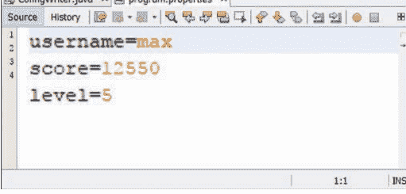

图 20.3 查找 program.properties 文件。

## 读取和写入配置属性

当 Java 程序可以使用命令行参数进行配置时，它们会变得更加灵活，正如你在之前的几小时创建的几个应用程序中所演示的那样。`java.util` 包包含一个 `Properties` 类，它允许从另一个源（文本文件）加载配置设置。

该文件可以像 Java 中的其他文件一样读取：

- 创建一个表示该文件的 `File` 对象。
- 从该 `File` 对象创建一个 `FileInputStream` 对象。
- 调用 `load()` 从该输入流中检索属性。

属性文件有一组属性名称，后面跟着一个等号 `=` 和它们的值。这里有一个示例：

```
username=lepton
lastCommand=open database
windowSize=32
```

每个属性都有单独的一行，`windowSize` 分别对应 "lepton"、"open database" 和 "32"。`ConfigWriter` 应用程序使用了相同的格式。

以下代码加载了一个名为 `config.dat` 的属性文件：

```java
File configFile = new File("config.dat");
InputStream inStream = new FileInputStream(configFile);
Properties config = new Properties();
config.load(inStream);
```

配置设置（称为属性）以字符串的形式存储在 `Properties` 对象中。每个属性通过一个键（key）来标识。`getProperty()` 方法使用键检索属性，如下所示：

```java
String username = config.getProperty("username");
```

由于属性是以字符串形式存储的，你必须以某种方式对它们进行转换才能使用数值值，如下所示：

```java
String windowProp = config.getProperty("windowSize");
try {
    int windowSize = Integer.parseInt(windowProp);
} catch (NumberFormatException e) {
    // 什么都不做
}
```

可以通过调用带有键值的 `setProperty()` 方法来设置属性：

```java
config.setProperty("username", "max");
```

你可以通过调用 `Properties` 对象的 `list()` 方法显示所有属性。以下代码显示了所有属性：

```java
config.list(System.out);
```

在你对属性进行更改后，可以将它们存回文件：

- 创建一个表示该文件的 `File` 对象。
- 从该 `File` 对象创建一个 `FileOutputStream` 对象。
- 调用 `store(OutputStream, String)` 保存属性。

对于你的最终项目，你基于 `ConfigWriter` 应用程序进行构建，它从文件中读取这些设置，为当前日期和时间添加新属性，并保存修改后的文件。

## 代码列表 20.4 Configurator.java 的完整文本

```java
1: package com.java24hours;
2:
3: import java.io.*;
4: import java.util.*;
5:
6: public class Configurator {
7:
8:     public Configurator() {
9:         try {
10:            File configFile = new File("program.properties");
11:            InputStream inputStream = new FileInputStream(configFile);
12:            Properties config = new Properties();
13:            config.load(inputStream);
14:
15:            // 创建新属性
16:            Date current = new Date();
17:            config.setProperty("runtime", current.toString());
18:            // 保存属性文件
19:            FileOutputStream outStream = new FileOutputStream(configFile);
20:            config.store(outStream, "Properties settings");
21:            inputStream.close();
22:            config.list(System.out);
23:        } catch (IOException ioe) {
24:            System.out.println("IO error " + ioe.getMessage());
25:        }
26:     }
27: 
28:     public static void main(String[] arguments) {
29:         new Configurator();
30:     }
31: }
```

`Configurator` 应用程序的输出如图 20.4 所示。

| 输出 - Java24 (run) |
| :--- |
| run: |
| -- listing properties |
| -- runtime=Tue Jun 06 15:43:13 EDT 2017 |
| -- score=12550 |
| -- username=max |
| -- level=5 |
| -- BUILD SUCCESSFUL (total time: 0 seconds) |

图 20.4 运行 Configurator 应用程序。

### 输出

```
-- listing properties --
runtime=Tue Jun 06 15:43\13 EDT 2017
score=12550
username=max
level=5
```

反斜杠字符的 `\` 格式与应用程序的输出不同，这确保了属性文件被正确存储。

### 总结

在这一小时中，你学习了写入字节的输入流和输出流，这是在流中表示数据最简单的方法。

`java.io` 包中有很多类可以以其他方式处理流。还有一个包名为 `java.net` 的类包，它允许你通过 Internet 连接进行流的读写。

字节流可以适用于许多用途，因为你可以轻松地将字节转换为其他数据类型，例如整数、字符和字符串。

本小时的第一个项目 `ID3Reader` 应用程序从流中读取字节，并将其转换为这种格式的 ID3 数据流，该数据源自 Marion Black 在专辑《Eccentric Soul》中的歌曲《Come On and Get It》。

我提过你你应该买下这首歌吗？

### 工作坊

### 问答

- **问**：为什么这一小时中的某些字节流方法使用整数作为参数？它们应该使用字节参数吗？
- **答**：流中的字节与 `byte` 类表示的字节之间存在差异。Java 中的一个字节的取值范围大约是从 -128 到 127，而流中的一个字节的取值范围是从 0 到 255。由于这个原因，你在处理字节时通常需要使用 `int`——因为它可以存储 128 到 255 之间的值，而 `byte` 不能。

- **问**：什么是 Mumblety-Peg（插刀游戏）？
- **答**：这是一种孩子们用折叠刀玩的校园游戏。

## 第 20 小时：读取和写入文件

在最简单的形式中，玩家站立并向自己的脚投刀。刀落地离脚最近的人获胜。其他版本涉及互相投刀，让对手必须伸脚去够刀落的地方。伸得太远并摔倒的玩家输了。

这个名字源于一种规则：胜者可以用刀三击将木钉敲入地面。失败者必须“嘴嚼木钉”（mumble the peg），仅用牙齿将其拔出。

游戏在 20 世纪初流行起来，当时世界共同意识到，孩子们互相投刀可能不是世界上最棒的主意。

### 测验

为了看看你在这个小时内是否从知识之树上汲取了足够的知识，请回答以下关于 Java 流的问题。

1. 下列哪种技术可以用于将字节数组转换为字符串？
   A. 调用数组的 `toString()` 方法。
   B. 将每个字节转换为字符，并将每个字符赋值给数组中的元素。
   C. 以数组为参数调用 `String()` 构造函数。

2. Java 程序中用哪种流从文件中读取内容？
   A. 输入流（input stream）
   B. 输出流（output stream）
   C. 两者均可

3. `File` 类的哪个方法可以确定文件大小？
   A. `getSize()`
   B. `read()`
   C. `length()`

### 答案

1. 你可以像答案 B 样单独处理每个字节，但你可以轻松地从其他数据类型创建字符串。
2. 输入流是通过 `File` 对象创建的，或者通过向输入流的构造函数提供文件名创建的。
3. C. 该方法返回一个 `long`，表示流中的字节数。

### 活动

为了体验穿过另一个流的清爽感，请通过以下活动进行尝试：

- 编写一个应用程序，读取文件夹中所有 MP3 文件的 ID3 标签，并使用艺术家、歌曲和专辑信息（如果提供的话）重命名文件。
- 编写一个程序，读取 Java 源代码文件并在不作任何更改的情况下以新名称写回。
- 购买 Marion Black 的歌曲《Come On and Get It》。

要查看实现这些活动的 Java 程序，请访问书籍的网站 www.java24hours.com。

本页特意留白

# 使用 Java 9 的新 HTTP 客户端

本小时的任务列表：

- 为 Java 项目添加一个模块（module）。
- 创建一个 HTTP 网页浏览器对象。
- 向网络服务器发送 GET 请求。
- 从网络请求中接收数据。
- 从网络下载图像文件。
- 向网络服务器发送数据。

尽管网络服务器的创建是为了展示网站，但自世界维网早期以来，它们的功能已经远远超了浏览器。与 HTTP 通信的能力已被许多类型的软件利用，包括 RSS 阅读器、Web 服务、软件更新程序和操作系统。

Java 9 引入了 HTTP Client 库，使得在网络上发送和接收数据变得更容易、更快速、更可靠。

该库没有自动包含在 Java 类库中。相反，它是通过新语言中一个备受期待的特性——模块（modules）添加的。

在这一小时中，你将学习模块以及通过 HTTP 建立网络连接。

## Java 模块

当 Java 程序发布时，它们被封装成 Java 归档（JAR）文件，并包含程序使用的类库。该 JAR 文件和项目所需的其他 JAR 文件都放在 Java 虚拟机（JVM）访问的类路径（Classpath）中。

Java 9 引入了 HTTP Client 库，使得在网络上发送和接收数据变得更容易、更快速、更可靠。

该库没有自动包含在 Java 类库中。相反，它是通过新语言中一个备受期待的特性——模块添加的。

在这一小时中，你将学习模块以及通过 HTTP 建立网络连接。

## 创建 HTTP 请求

请求是一个用于在服务器和客户端之间移动信息的对象。

本小时的第一个项目演示了如何使用 `HttpClient` 连接服务器、请求文档并了解服务器。这是一个直接的过程，尽管需要多个类。

使用该库创建请求需要以下步骤：

- 创建浏览器对象。
- 创建请求构建器（`HttpRequest.Builder`）。
- 构建请求对象。
- 使用浏览器向网络服务器发送请求。
- 接收 `HttpResponse` 对象。

浏览器是使用 `HttpClient` 类的工厂方法创建的：

```java
HttpClient browser = HttpClient.newHttpClient();
```

正如预期，浏览器的工作是向服务器发送请求。

请求是用构建器创建的。构建器需要服务器的地址。`java.net` 包中的 `URI` 类表示地址（也称为 URI 或 URL），可以这样创建：

```java
URI link = new URI("https://www.oracle.com/");
```


如果作为唯一参数指定的地址不是格式正确的网络地址，将抛出 `URISyntaxException`（来自 `java.net`）。

有了 `URI` 对象，你可以调用 `HttpRequest.newBuilder(URI)` 方法创建构建器：

```java
HttpRequest.Builder bob = HttpRequest.newBuilder(uri);
```

构建器的 `build()` 方法创建请求，它是一个 `HttpRequest` 类对象：

```java
HttpRequest request = bob.build();
```

现在你已经有了浏览器和请求，可以将其发送到网络服务器并获取响应。响应是一个 `HttpResponse` 对象，它使用泛型来保持多种格式的信息。

## 第 21 小节：使用 Java 9 的新 HTTP 客户端

处理器还有一个 `asFile(Path)` 方法用于以文件形式返回响应，以及一个 `asByteArray()` 方法用于以 `byte[]` 形式返回。

每个 HTTP 请求都包含头部，这些头部提供了关于响应和发送响应的服务器的更多信息。这些头部中的 `Server` 包含了运行服务器的软件名称和版本号。出于安全考虑，某些服务器会省略版本号。

响应的 `headers()` 方法将头部信息作为 `HttpHeaders` 对象返回。`HttpHeaders` 对象的 `firstValue(String)` 方法通过头部名称调用，返回匹配该名称的第一个头部。以下是实现此功能的代码：

```java
HttpHeaders headers = response.headers();
Optional<String> server = headers.firstValue("Server");
```

调用 `firstValue()` 返回的对象是 `java.util` 包的一个数据结构，它使得处理在没有值时为 `null` 的情况变得更容易。使用没有值的对象会导致 `NullPointerException`，这是 Java 中常见的异常之一。

`Optional` 类通过 `isPresent()` 方法防止了这种问题，当存在有效值时返回 `true`，否则返回 `false`。

`server` 的值是一个字符串，由语句 `Optional<String>` 部分的泛型指示。可以如下方式显示此字符串，同时避免空指针问题：

```java
if (server.isPresent()) {
    System.out.println("Server: " + server.get());
}
```

将这些技术付诸实践 `ServerCheck` 程序以文本形式请求六家公司的主页，并报告它们使用的服务器软件。

在 NetBeans 中，在 `com.java24hours` 包中创建一个名为 `ServerCheck` 的新 java 文件。将列表 21.1 输入到源代码编辑器中。

### 列表 21.1 ServerCheck.java 的全文

```java
1: package com.java24hours;
2:
3: import java.io.*;
4: import java.net.*;
5: import java.util.*;
6: import jdk.incubator.http.*;
7:
8: public class ServerCheck {
9:     public ServerCheck() {
10:        String[] sites = {
11:            "https://www.apple.com",
12:            "https://www.microsoft.com",
13:            "http://www.compaq.com",
14:            "http://www.hp.com",
15:            "https://www.oracle.com",
16:            "https://www.informit.com/"
17:        };
18:        try {
19:            load(sites);
20:        } catch (URISyntaxException oops) {
21:            System.out.println("Bad URI: " + oops.getMessage());
22:        } catch (IOException | InterruptedException oops) {
23:            System.out.println("Error: " + oops.getMessage());
24:        }
25:        }
26:    }
27:
28:    public void load(String[] sites) throws URISyntaxException, IOException,
29:    InterruptedException {
30:
31:        for (String site : sites) {
32:            System.out.println("\nSite: " + site);
33:            // 创建 web 客户端
34:            HttpClient browser = HttpClient.newHttpClient();
35:            // 为网站构建请求
36:            URI uri = new URI(site);
37:            HttpRequest.Builder builder = HttpRequest.newBuilder(uri);
38:            HttpRequest request = builder.build();
39:            // 执行请求
40:            HttpResponse<String> response = browser.send(request,
41:                HttpResponse.BodyHandler.asString());
42:            // 寻找 server 头部
43:            HttpHeaders headers = response.headers();
44:            Optional<String> server = headers.firstValue("Server");
45:            if (server.isPresent()) {
46:                System.out.println("Server: " + server.get());
47:            } else {
48:                System.out.println("Server unidentified");
49:            }
50:        }
51:    }
52:
53:    public static void main(String[] arguments) {
54:        new ServerCheck();
55:    }
56: }
```

保存你的工作并运行该程序以产生图 21.1 所示的输出。

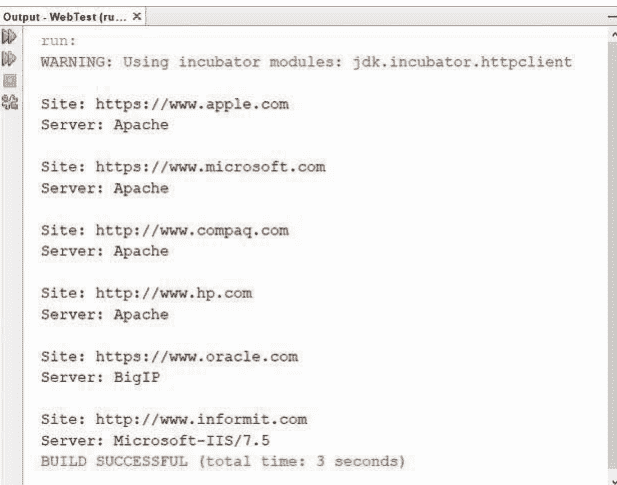

图 21.1

使用 HTTP 客户端请求服务器头部。

与你在上一节中处理过的“读写文件”中的输入和输出类一样，这些 HTTP 类的方法必须处理数据传输中的错误。它们抛出了来自 `java.io` 包的 `IOException` 和 `InterruptedException` 异常。

`ServerCheck` 程序有一个 `load()` 方法，它执行了从 Web 服务器请求六个主页并获取响应所需的所有 HTTP 任务。

可能发生的三个异常被放在构造函数的 `try-catch` 块中，该块第 22 行使用了多类 catch。

## 从网络保存文件

通过 HTTP 获取的数据不仅限于像网页之类的文本文件。任何类型的数据都可以以字节的形式访问，包括图像、视频和可执行文件。

下一节的项目使用新的 HTTP 库从网络下载图像并保存到你的计算机上。

`ImageLoader` 程序在发送请求之前的步骤与前面的示例相同。在发送请求之前，必须完成一些工作。

### 列表 21.2 ImageLoader.java 的全文

```java
1: package com.java24hours;
2:
3: import java.io.*;
4: import java.net.*;
5: import java.nio.file.*;
6: import jdk.incubator.http.*;
7:
8: public class ImageLoader {
9:     public ImageLoader() {
10:        String uri = "http://workbench.org/media/lighthouse.jpg";
11:        try {
12:            load(uri);
13:        } catch (URISyntaxException oops) {
14:            System.out.println("Bad URI: " + oops.getMessage());
15:        } catch (IOException | InterruptedException oops) {
16:            System.out.println("Error: " + oops.getMessage());
17:        }
18:    }
19:
20:    public void load(String imageUri) throws URISyntaxException, IOException,
21:    InterruptedException {
22:
23:        // 创建 web 客户端
24:        HttpClient client = HttpClient.newHttpClient();
25:        // 为图像构建请求
26:        URI uri = URI.create(imageUri);
27:        HttpRequest request = HttpRequest.newBuilder().uri(uri).build();
28:        // 创建一个临时文件存放图像数据
29:        Path temp = Files.createTempFile("lighthouse", ".jpg");
30:        // 执行请求并获取数据
31:        HttpResponse<String> response = client.send(request,
32:            HttpResponse.BodyHandlers.ofFile(temp));
33:        System.out.println("*Image saved to "
34:                + temp.toFile().getAbsolutePath());
35:        // 永久保存文件
36:        File perm = new File("lighthouse.jpg");
37:        temp.toFile().renameTo(perm);
38:        System.out.println("*Image moved to " + perm.getAbsolutePath());
39:    }
40:
41:
42:    public static void main(String[] args) {
43:        new ImageLoader();
44:    }
45: }
```

当 `ImageLoader` 程序运行时，项目主文件夹中会出现一个名为 `lighthouse.jpg` 的文件。点击标签页将其拖到最前面（这在 NetBeans 中与项目视图相同）。双击该文件在主窗格中打开它，如图 21.2 所示。

程序在第 33–34 行和第 38 行显示临时和永久图像文件的位置。


图 21.2

从网络下载图像文件。

## 在网络上发布数据

到为止，本节的重点是学习使用 HTTP 从网络获取内容。现在是时候获取一些反馈了。最后一个项目是 `SalutonVerkisto`，这是一个使用 POST 请求向作者的 Web 服务器发送消息的 Java 程序。

POST 请求可以编码供服务器接收的大量数据，例如博客文章，甚至是图像或视频文件。GET 请求也可以向服务器携带信息，但受限于 URI 中可以包含的内容。

## 318 第 21 小时：Java 9 的新 HTTP 客户端

该程序为我服务器上一个接收评论的脚本创建了一个 URI：

```java
String site = "http://bench.cadenhead.org/post-a-comment.php";
URI uri = new URI(site);
```

两个字符串 `userName` 和 `yourMessage` 包含了要发送的名字和评论：

```java
String userName = "Sam Snett of Indianapolis";
yourMessage = "Your book is pretty good, if I do say so myself.";
```

信息将像之前的项目一样，通过 HTTP 请求发送到 Web 服务器。在发送评论之前，它将使用 `HttpRequest.BodyProcessor` 类的一个方法进行编码。

该类有一个 `fromString()` 方法，它接收一个长字符串，其中包含由 `&` 字符分隔的键值对：

```java
HttpRequest.BodyProcessor proc = HttpRequest.BodyProcessor.fromString(
  "name" = URLEncoder.encode(userName, "UTF-8") +
  "&comment" = URLEncoder.encode(yourMessage, "UTF-8") +
  "&mode" = URLEncoder.encode("demo", "UTF-8")
);
```

`HttpRequest.BodyProcessor` 的 `encode(String, String)` 方法接收两个参数：消息和使用的字符编码。正确的编码取决于 Web 服务器可以接受的内容。我服务器上的脚本可以接受 UTF-8，因此在这里使用了它。

此方法调用了三个键值对：`name`、`comment` 和 `mode`。前两个取自 `userName` 和 `yourMessage` 的值。第三个 `mode` 的值为 "demo"，它让服务器脚本知道消息的目的。（这也帮助了我们这些可能向脚本发送消息的垃圾邮件发送者。）

处理后的 `proc` 可通过调用 `newBuilder(URI)` 方法来创建一个请求构建器，随后是另外三个调用。

当显示代码时，这就有意义了：

```java
HttpRequest.Builder builder = HttpRequest.newBuilder(uri)
  .header("Content-Type", "application/x-www-form-urlencoded")
  .header("Accept", "text/plain")
  .POST(proc);
```

此方法将四个调用堆在一起。因为每一个调用都是对 `HttpRequest.Builder` 的调用并返回体对象。以下是这些调用的顺序及作用：

1. `newBuilder(URI)` 为该地址创建一个构建器。
2. `header(String, String)` 设置请求头 `Content-Type` 值为 "application/x-www-form-urlencoded"。这告诉服务器正在发送一个 Web 表单。
3. 另一个 `header()` 调用将 `Accept` 设置为 “text/plain”，即请求的 MIME 类型。
4. `POST(HttpRequest.BodyProcessor)` 将编码的消息格式化为 HTTP POST 请求。

构建器准备好后，就可以构建请求。

```java
HttpRequest request = builder.build();
```

通过浏览器的 `send(HttpRequest, HttpResponse.BodyHandler)` 调用发送请求，并带上获取响应作为字符串的处理器：

```java
HttpResponse<String> response = client.send(request,
   HttpResponse.BodyHandler.ofString());
System.out.println(response.body());
```

`ServerCheck` 应用中也使用了相同的技术，但这次显示了响应。

在 `com.java24hours` 包中创建一个空的 Java 文件作为 `SalutonVerkisto` 程序，并输入列表 21.3 中的代码。

## 列表 21.3 SalutonVerkisto.java 的全文


```java
1: package com.java24hours;
2:
3: import java.io.*;
4: import java.net.*;
5: import jdk.incubator.http.*;
6:
7: public class SalutonVerkisto {
8:
9:   public SalutonVerkisto() {
10:     String site = "http://workbench.cadenhead.org/post-a-comment.php";
11:    try {
12:      postMessage(site);
13:    } catch (URISyntaxException oops) {
14:      System.out.println("Bad URI: " + oops.getMessage());
15:    } catch (IOException | InterruptedException oops) {
16:      System.out.println("Error: " + oops.getMessage());
17:    }
18:  }
19:
20:  public void postMessage(String server) throws IOException,
21:    URISyntaxException, InterruptedException Exception {
22:
23:    HttpClient client = HttpClient.newHttpClient();
24:
25:    // 服务器地址 *
26:   URI uri = new URI (server);
27:
28:   // 设置消息
29:   String yourName = "Sam Snett of Indianapolis";
30:   String yourMessage = "Your book is pretty good, if I do so myself";
31:
32:
33:   // 编码消息
34:   HttpRequest.BodyProcessor proc = HttpRequest.BodyProcessor.fromString(
35:       "name=" + URLEncoder.encode(userName, "UTF-8") +
36:       "comment=" + URLEncoder.encode(yourMessage, "UTF-8") +
37:       "&mode=" + URLEncoder.encode("demo", "UTF-8")
38:
39:
40:   // 准备请求
41:   HttpRequest.Builder newBuilder = HttpRequest.newBuilder(uri)
42:       .header("Content-Type", "application/x-www-form-urlencoded")
43:       .header("Accept", "text/plain")
44:       .POST(proc);
45:
46:   // 完成请求
47:   HttpRequest request = newBuilder.build();
48:
49:   // 从服务器获取响应
50:   System.out.println("Method: " + request.method() + "\n");
51:   HttpResponse<String> response = client.send(request,
52:       HttpResponse.BodyHandler.asString());
53:   System.out.println(response.body());
54: }
55:
56:   public static void main(String[] arguments) {
57:     new SalutonVerkisto();
58:   }
}
```

运行 `SalutonVerkisto` 程序之前，编辑第 29-30 行。在 `yourName` 中输入你的名字和位置，在 `yourMessage` 中输入你想告诉我的内容。这些内容将公开显示在我的博客文章中。

该程序返回收到的评论文本。

### 活动

为了进一步加深对本小时网络编程主题的理解，请完成以下活动：

- 在 `ServerCheck` 程序中再添加五个科技公司的首页。
- 编写一个程序，使用 HTTP 响应的 `Content-Type` 和 `Content-Encoding` 头部来报告服务器采用的 MIME 类型和字符编码。

要查看实现这些活动的 Java 程序，请访问书籍网站 `www.java24hours.com`。

## 第 22 小节：创建 Java2D 图形

### 本节时的任务清单：

- 设置文本的字体和颜色。
- 设置容器的背景颜色。
- 绘制线条、矩形和其他形状。
- 绘制 GIF 和 JPEG 图形。
- 绘制填充和不填充的形状。

在这一节课中，你将学习如何将容器——即保存图形用户界面 (GUI) 组件的普通灰色面板和框架——变成一个艺术画布，你可以在上面绘制字体、颜色、形状和图形。

## 使用 Font 类

Java 通过 `java.awt` 包中的 `Color` 和 `Font` 类来表示颜色和字体。通过这些类，你可以用不同的字体和大小展示文本，并更改文本和图形的颜色。字体通过 `Font(String, int, int)` 构造函数创建，它接受三个参数：

- 字体字族，可以是通用名称（`"Dialog"`、`"InputDialog"`、`"Monospaced"`、`"SansSerif"` 或 `"Serif"`）或实际字体名称（`"Arial Black"`、`"Helvetica"` 或 `"Courier New"`）
- 样式，取自三个变量之一：`Font.BOLD`、`Font.ITALIC` 或 `Font.PLAIN`
- 以磅为单位的字体大小

以下语句创建了一个 12 磅斜体 Serif 字体：

```java
Font current = new Font("Serif", Font.ITALIC, 12);
```

如果你使用的是特定字体而不是通用字体，则该字体必须已经安装在运行程序的用户的计算机上。

你可以通过将它们相加来组合字体样式，如下所示：

```java
Font headline = new Font("Courier New", Font.BOLD + Font.ITALIC, 72);
```

当你拥有一个字体后，调用 `Graphics2D` 组件的 `setFont(Font)` 方法将其指定为当前字体。所有后续的绘制操作都使用该字体，直到设置了另一个字体。以下代码创建了一个 `"Comic Sans"` 对象，并在绘制文本之前将其指定为当前字体：

```java
public void paintComponent(Graphics comp) {
  Graphics2D comp2D = (Graphics2D) comp;
  Font font = new Font("Comic Sans", Font.BOLD, 15);
  comp2D.setFont(font);
  comp2D.drawString("Potrebie!", 5, 50);
}
```

Java 支持抗锯齿，以使字体看起来更平滑、不那么块状。要启用此功能，你必须设置渲染提示。`Graphics2D` 对象有一个 `setRenderingHint(int, int)` 方法，它接受两个参数：

- 渲染提示的键
- 与 `java.awt` 中该 `RenderingHints` 类关联的值

这些值是 `java.awt` 中的类变量。要激活抗锯齿，调用带有两个参数的 `setRenderingHint()`：

```java
comp2D.setRenderingHint(RenderingHints.KEY_ANTIALIASING,
RenderingHints.VALUE_ANTIALIAS_ON);
```

> **注意**：此示例中的 `comp2D` 对象是代表容器绘制环境的 `Graphics2D` 对象。

## 使用 Color 类

Java 中的颜色由 `Color` 类表示，该类包含了以下作为类变量的常量：`black`（黑色）、`blue`（蓝色）、`cyan`（青色）、`darkGray`（深灰色）、`gray`（灰色）、`green`（绿色）、`lightGray`（浅灰色）、`magenta`（洋红色）、`orange`（橙色）、`pink`（粉红色）、`red`（红色）、`white`（白色）和 `yellow`（黄色）。

在容器中，你可以像这样调用 `setBackground(Color.orange)` 方法，使用这些常量设置组件的背景颜色：

当前颜色（与当前字体一样）必须在绘制发生之前使用 `setColor(Color)` 方法进行设置。以下代码包含一条将当前颜色设置为蓝色并绘制该颜色文本的语句：

```java
public void paintComponent(Graphics comp) {
    Graphics2D comp2D = (Graphics2D) comp;
    comp2D.setColor(Color.blue);
    comp2D.drawString("Go, Owls!", 5, 50);
}
```

与可以直接在容器上调用的 `setBackground()` 方法不同，你必须在 `Graphics2D` 对象上调用 `setColor()` 方法。

## 创建自定义颜色

你可以通过指定红、绿、蓝 (RGB) 值在 Java 中创建自定义颜色。RGB 通过颜色中红、绿、蓝的量来定义颜色。每个值的范围从 0（无）到 255（最大量）。

构造函数 `Color(int, int, int)` 接受代表红、绿、蓝值的参数。以下代码绘制了一个面板，在青色（0, 101, 118）背景上显示文本 (159, 121, 44)：

```java
import java.awt.*;
import javax.swing.*;

public class Jacksonville extends JPanel {
    Color gold = new Color(159, 121, 44);
    Color teal = new Color(0, 101, 118);

    public void paintComponent(Graphics comp) {
        Graphics2D comp2D = (Graphics2D) comp;
        comp2D.setColor(teal);
        comp2D.fillRect(0, 0, getWidth(), getHeight());
        comp2D.setColor(gold);
        comp2D.drawString("Jacksonville", 5, 50);
    }
}
```

## 绘制线条和形状

以下语句创建了条线：

```java
Line2D.Double line = new Line2D.Double(10, 10, 100, 100);
comp2D.draw(line);
```

## 绘制矩形

矩形可以是填充或不填充的，并且有圆角或直角。它们使用 `Rectangle2D.Float(int, int, int, int)` 构造函数创建，这些参数为：

- 矩形左上角的 x 坐标
- 左上角的 y 坐标
- 矩形的宽度
- 高度

此矩形的左上角位于坐标中心 (10, 10)。第三个和第四个参数指定了矩形的宽度和高度。在这种情况下，它的宽度应为 100 像素，高度为 80 像素。

`drawRoundRect()` 的最后两个参数指定四个角都应该从距离 (10, 10) 处 15 像素的地方开始圆角。

## 绘制椭圆和圆

你可以使用同一个类 `Ellipse2D.Float` 创建椭圆和圆，它接受四个参数：

- 椭圆的 x 坐标
- 椭圆的 y 坐标
- 它的宽度
- 它的高度

(x, y) 坐标并不像你预期的那样指示椭圆或圆的中心点。相反，(x, y) 坐标、宽度高度描述了一个包含椭圆的隐矩形。(x, y) 坐标是该矩形的左上角。如果它的宽度和高度相同，则椭圆是一个圆。

以下语句在 (245, 45) 坐标处的矩形内部创建一个高度和宽度均为 5 像素的圆：

```java
Ellipse2D.Float cir = new Ellipse2D.Float(
    245F, 45F, 5F, 5F);
```

## 绘制弧

在 Java 中可以绘制的另一种圆形形状是弧，即部分椭圆或圆。弧使用 `Arc2D.Float` 类创建，该类有一个具有许多相同参数的构造函数。你通过指定弧、椭圆的可视部分（以度为单位）以及弧在椭圆上的起点来绘制弧。

要创建一个弧，请向构造函数指定以下整数参数：

- 椭圆所属的隐形矩形的 x 坐标
- 矩形的 y 坐标
- 矩形的宽度
- 矩形的高度

## 制作饼图

- 弧在椭圆上的起始点（角度从 0 到 359 度）
- 弧的大小（同样以度为单位）
- 弧的类型

弧的起点和大小范围逆时针方向从 0 到 359 度，从 3 点钟位置的 0 度开始，如图 22.1 所示。

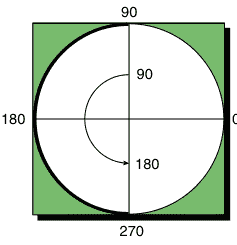

弧的类型使用类变量指定：`PIE` 用于饼图切片，如果端点用直线连接则使用 `CLOSED`，如果端点不连接则使用 `OPEN`。

以下语句在 (100, 50) 处绘制一个长度为 120 度、从 30 度开始、宽度为 65、高度为 75 的弧：

```java
Arc2D.Float smile = new Arc2D.Float(100F, 50F, 65F, 75F,
30F, 120F, Arc2D.Float.OPEN);
```

## 制作饼图

要绘制这个时钟，你需要创建一个 `PiePanel`，这是一个显示饼图的 GUI 组件。该组件是 `JPanel` 的子类，`JPanel` 是一个简单的容器，用作绘制内容的地方。

开始创建一个类的一种方法是定义类对象的创建方式。使用 `PiePanel` 类的程序必须执行以下操作：

- 使用构造方法 `PiePanel(int)` 创建 `PiePanel` 对象。作为参数指定的整数是饼图包含的切片数量。
- 调用对象的 `addSlice(Color, float)` 方法为指定的颜色和值赋予一个切片。

`PiePanel` 中每个切片的值是该切片所代表的数量。

例如，表 22.1 根据后等教育办公室的数据，显示了美国在该计划前 38 年学生贷款还款状态的数据。

### 表 22.1 美国学生贷款还款

| 学生还款金额 | 1,010 亿美元 |
| :--- | :--- |
| 给在读校学生的贷款金额 | 680 亿美元 |
| 给正在还款的学生的贷款金额 | 910 亿美元 |
| 给违约学生的贷款金额 | 250 亿美元 |

你可以使用以下语句通过 `PiePanel` 在饼图中表示这些内容：

```java
PiePanel loans = new PiePanel(4);
loans.addSlice(Color.green, 101F);
loans.addSlice(Color.yellow, 68F);
loans.addSlice(Color.blue, 91F);
loans.addSlice(Color.red, 25F);
```

图 22.2 显示了包含一个组件的应用程序框架中的结果：该组件是使用学生贷款数据创建的 `PiePanel`。

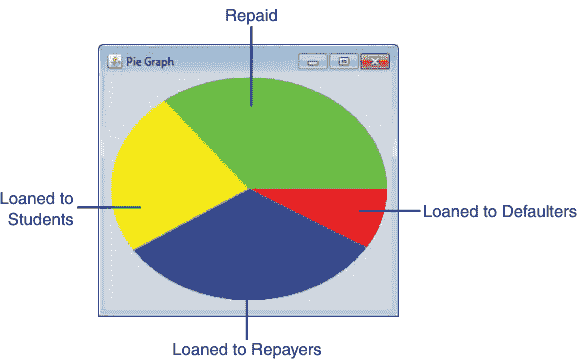

当创建 `PiePanel` 对象时，切片数量在构造函数中指定。为了绘制每个切片，你需要知道三件事：

- 切片的颜色，由 `Color` 表示
- 每个切片代表的值
- 所有切片的总值

新建的辅助类 `PieSlice` 用于表示饼图中的每个切片：

```java
import java.awt.*;

class PieSlice {
    Color color = Color.lightGray;
    float size = 0;

    PieSlice(Color pColor, float pSize) {
        color = pColor;
        size = pSize;
    }
}
```

每个切片通过调用 `PieSlice(Color, float)` 构建。所有切片的总和存储在 `PiePanel` 类的私有变量 `totalSize` 中。还有面板背景的 `background` 和用于跟踪切片的计数器 `current`：

```java
private int current = 0;
private float totalSize = 0;
private Color background;
```

现在你有了 `PieSlice` 类，可以使用另一个实例变量创建 `PieSlice` 对象数组：

```java
private PieSlice[] slice;
```

当你创建 `PiePanel` 对象时，没有任何切片被分配颜色或大小。你在构造函数中唯一做的是定义 `slice` 数组并保存面板背景：

```java
PiePanel(int sliceCount) {
    slice = new PieSlice[sliceCount];
    background = getBackground();
}
```

使用 `addSlice(Color, float)` 方法向面板添加切片：


```java
void addSlice(Color sColor, float sSize) {
    if (current < slice.length) {
        slice[current] = new PieSlice(sColor, sSize);
        totalSize += sSize;
        current++;
    }
}
```

`current` 实例变量用于将每个切片放入 `slice` 数组的元素中。数组的 `length` 变量包含它能容纳的数量；只要 `current` 不大于 `slice.length`，就可以继续向面板添加切片。

`PiePanel` 类在它的 `paintComponent()` 方法中处理所有绘制操作。绘制中最困难的部分是代表每个切片的弧。这通过以下语句处理：

```
float start = 0;
for (int i = 0; i < slice.length; i++) {
    float extent = slice[i].size * 360 / totalSize;
    comp2D.setColor(slice[i].color);
    Arc2D.Float drawSlice = new Arc2D.Float(
        xInset, width, height, start, extent,
        Arc2D.Float.PIE);
    start += extent;
    comp2D.fill(drawSlice);
}
```

`start` 变量跟踪绘制弧的起点，`extent` 跟踪弧的大小。如果你知道所有切片的总和以及某个切片的大小，可以通过将弧的大小乘以 360 并除以总和来计算 `extent`。在 `for` 循环中，计算出 `extent` 后创建弧，然后将其加到 `start`。这使得每个切片都在上一个之后。调用 `Graphics2D` 方法 `fill()` 来绘制弧。

为了将这一切整合在一起，在 `com.java24hours` 包中创建一个名为 `PiePanel` 的 Java 文件，并将其粘贴到列表 22.1 中。

### 列表 22.1 PiePanel.java 的完整代码

```java
1: package com.java24hours;
2: import java.awt.*;
3: import javax.swing.*;
4: import java.awt.geom.*;
5:
6: public class PiePanel extends JPanel {
7:     private Slice[] slice;
8:     private int current = 0;
10:    private float totalSize = 0;
11:    private Color background;
12:
13:    public PiePanel(int sliceCount) {
14:        slice = new Slice[sliceCount];
15:        background = getBackground();
16:
17:    }
18:    public void addSlice(Color color, float sSize) {
19:        if (current < slice.length) {
20:            slice[current] = new Slice(color, sSize);
21:            totalSize += sSize;
22:            current++;
23:        }
24:    }
25:
26:    public void paintComponent(Graphics comp) {
27:        super.paintComponent(comp);
28:        Graphics2D comp2D = (Graphics2D) comp;
29:        int width = getSize().width - 10;
30:        int height = getSize().height - 15;
31:        int xInset = 5;
32:        int yInset = 5;
33:        if (width < 5) {
34:            xInset = width;
35:        }
36:        if (height < 5) {
37:            yInset = height;
38:        }
39:
40:        comp2D.fillRect(0, 0, getSize().width, getSize().height);
41:        comp2D.setColor(Color.lightGray);
42:        Ellipse2D.Float pie = new Ellipse2D.Float(
43:            xInset, yInset, width, height);
44:        comp2D.fill(pie);
45:        float start = 0;
46:        for (int i = 0; i < slice.length; i++) {
47:            float extent = slice[i].size * 360 / totalSize;
48:        comp2D.setColor(slice[i].color);
49:        Arc2D.Float drawSlice = new Arc2D.Float(
50:            xInset, yInset, width, height, start, extent,
51:            Arc2D.Float.PIE);
52:        start += extent;
53:        comp2D.fill(drawSlice);
54:    }
55: }
```

### 336 小时 22：创建 Java2D 图形

```java
53:     comp2D.fill(drawSlice);
54:     }
55: }
56: }
57: 
58: class PieSlice {
59:     Color color = Color.lightGray;
60:     float size = 0;
61: 
62:     PieSlice(Color pColor, float pSize) {
63:         color = pColor;
64:         size = pSize;
65:     }
66: }
```

列表 22.1 在第 1–56 行定义了 `PiePanel` 类，并在第 58–66 行定义了辅助类 `PieSlice`。`PiePanel` 类可以作为任何 Java 程序 GUI 的组件。要创建 `PiePanel`，你需要创建一个使用它的类。

列表 22.2 包含一个使用这些面板的应用程序 `PieFrame`。在 `com.java24hours` 包中创建一个空的 Java 文件，并输入列表中的源代码。

### 列表 22.2 PieFrame.java 的完整文本

```java
1: package com.java24hours;
2:
3: import javax.swing.*;
4: import java.awt.*;
5:
6: public class PieFrame extends JFrame {
7:     Color uneasyGreen = new Color(0xCC, 0xCC, 0x99);
8:     Color zuzusPetals = new Color(0xCC, 0x66, 0xFF);
9:     Color cootsuit = new Color(0x06, 0x66, 0x99);
10:    Color sweetAvocado = new Color(0x06, 0x99, 0x66);
11:    Color shrinkingViolet = new Color(0xCC, 0x66, 0xFF);
12:    Color miamin8 = new Color(0x03, 0xFF, 0xFF);
13:    Color inBetweenGreen = new Color(0x00, 0x99, 0x66);
14:    Color norwegianBlue = new Color(0x03, 0xCC, 0xCC);
15:    Color purpleRain = new Color(0x06, 0x33, 0x99);
16:    Color freckle = new Color(0x99, 0x66, 0x33);
17:
18:    public PieFrame() {
19:        super("Pie Graph");
20:        setLookAndFeel(null);
21:        setSize(320, 290);
22:        setDefaultCloseOperation(JFrame.EXIT_ON_CLOSE);
23:        setVisible(true);
24: }
25:   PiePanel pie = new PiePanel(10);
26:   pie.addSlice(uneasyBeingGreen, 1350);
27:   pie.addSlice(zuzusPetals, 1221);
28:   pie.addSlice(zootSuit, 316);
29:   pie.addSlice(sweetHomeAvocado, 251);
30:   pie.addSlice(shrinkingViolet, 201);
31:   pie.addSlice(miamiNice, 193);
32:   pie.addSlice(inBetweenGreen, 173);
33:   pie.addSlice(norwegianBlue, 164);
34:   pie.addSlice(purpleRain, 143);
35:   pie.addSlice(freckle, 127);
36:   add(pie);
37:   }
38:
39:   private void setLookAndFeel() {
40:     try {
41:       UIManager.setLookAndFeel(
42:           "com.sun.java.swing.plaf.NimbusLookAndFeel");
43:     }
44:   } catch (Exception exc) {
45:     // ignore error
46:   }
47:   public static void main(String[] arguments) {
48:     PieFrame pf = new PieFrame();
49: }
50: }
```

`PieFrame` 类是一个简单的图形用户界面，包含一个组件：在第 25 行创建的 `PiePanel` 对象。该对象的 `addSlice()` 方法在第 26-35 行中调用了 10 次，以向饼图中添加切片。

当你运行该应用程序时，`PieFrame` 会显示一个展示10个最人气国家人口的饼图（以百万为单位），数据来自 2017 年美国人口普查数据库报告。按顺序排列，分别是中国（13.9亿）、印度（12.82亿）、美国（3.27亿）、印度尼西亚（2.61亿）、巴西（2.07亿）、巴基斯坦（2.05亿）、尼日利亚（1.91亿）、孟加拉国（1.58亿）、俄罗斯（1.42亿）和日本（1.26亿）。

由于 Java 在 `Color` 类中只定义了少数颜色，在这里创建了十种新颜色并赋予了它们具有描述性的名称。这些颜色用十六进制值表示——在 Java 中，十六进制字面量前有 `0x`——但也可以在每个 `Color()` 构造函数中指定十进制值。

## 设置 Minecraft 服务器

```bash
C:\data\minecraft\test-server>java -Xmx1024M -Xmx1024M -jar spigotserver.jar
Loading libraries...
[21:50:22] INFO: Starting minecraft server 1.8.7
[21:50:22] INFO: Loading properties
[21:50:22] INFO: serverproperties does not exist
[21:50:22] INFO: Generating new properties file
[21:50:22] INFO: Failed to create eula.txt
[21:50:22] INFO: You need to agree to the EULA in order to run the server. Go to eula.txt for more info.
[21:50:22] INFO: Stopping server
C:\data\minecraft\test-server>
Press any key to continue... . .
```

图 23.1：服务器未通过 EULA 检查。

Minecraft 有一份最终用户许可协议（EULA），在运行服务器之前必须接受该协议。访问此网页以查看此协议：https://account.mojang.com/documents/minecraft/eula。

在服务器相同的文件夹中有一个名为 `eula.txt` 的新文件。该文件有一个包含以下文本的行：

```
eula=false
```

如果你同意 EULA，请用编辑器打开该文件，将此行改为 `eula=true`，保存文件并重新运行服务器。

服务器首次运行时，会创建十几个文件和子文件夹，并构建世界地图。如果成功，你将看到最后的消息“[Info] Done”以及提示符旁边闪烁的光标。

`help` 命令列出了你可以使用的用于控制服务器和游戏世界的命令。`stop` 命令会关闭服务器（千万不要这样做！）。

图 23.2 显示了一个 Spigot 服务器。

在服务器运行时，必须保持此窗口打开。如果你的服务器窗口看起来像这样，你可以跳过下一节直接进入“连接到服务器”。

## 344 小时 23：使用 Java 创建 Minecraft 模

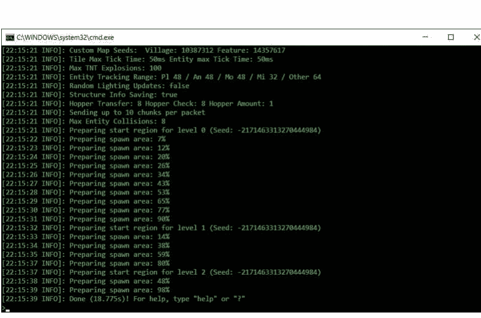

## 解决服务器运行问题

在下载并安装服务器后，有两个常见的错误会导致服务器无法成功运行。

第一个错误显示消息“Unable to access jar spigotserver.jar”，如图 23.3 所示。

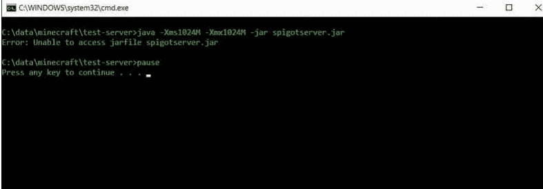

### 设置 Minecraft 服务器

要解决这个问题，请确保 `spigotserver.jar` 文件与你启动服务器运行的文件（`start-server.bat`）在同一个文件夹中。然后尝试重新启动服务器。

第二个错误显示消息“'java' 不是内部或外部命令”，如图 23.4 所示。

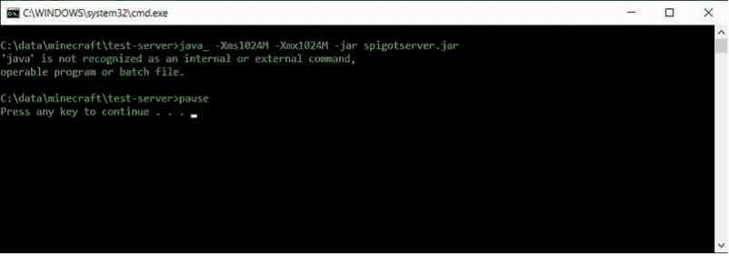

JVM 位于一个名为 `java.exe` 的文件中，该文件位于计算机上 Java 安装目录下的 `bin` 子文件夹中。当 `java` 命令无法识别时，这意味着电脑不知道去哪里寻找 `java.exe`。

在 Windows 系统上，可以通过控制面板中的 `Path` 环境变量设置添加包含 `java.exe` 的文件夹名称来解决此问题。

首先，找到你的 Java 文件夹。进入主驱动器的根文件夹，然后打开 `Program Files` 或 `Program Files (x86)`，查看其中一个是否包含 `Java` 子文件夹。如果你找到了，请打开该文件夹。

Java 文件夹可能包含多个版本的 Java 开发工具包（JDK），并带有版本号。在我的电脑上，有 `jdk1.8.0` 和 `jdk-9` 文件夹。数字较大的那个包含当前的 JDK。

打开该文件夹，并打开其 `bin` 子文件夹。这里应该有几十个应用程序，其中一个是 `java`。

你电脑的 `Path` 变量需要更新以包含此文件夹的完整名称，类似于 `C:\Program Files\jdk-9\bin`（取决于你的 JDK 版本号）。

要将 JVM 添加到 Path 中，请执行以下步骤：

1. 在开始菜单上选择“控制面板”，或在搜索框中输入它。
2. 选择“系统”，然后选择“高级系统设置”。打开高级对话框。
3. 点击“环境变量”。打开一个对话框，列出用户变量和一组系统变量。
4. 在“系统变量”面板中，向下滚动找到 `Path`，点击它，然后点击面板下方的“编辑”按钮。打开“编辑系统变量”对话框。
5. 如果你看到“值”字段，仔细将光标置在该字段文本的末尾。添加一个分号（`;`），后接你找到 java 程序的文件夹。
6. 点击“确定”。
7. 点击“确定”。

## 创建你的第一个 Mod

每个 mod 都是 NetBeans 中的一个独立项目。要开始此项目，请遵循以下步骤：

1. 在 NetBeans 中，选择菜单命令 `File`（文件）、`New Project`（新建项目）。打开 New Project 项目向导。


- 2. 在 Categories（类别）面板中选择 Java，在 Projects（项目）面板中选择 Java Application（Java 应用程序）。然后点击 Next（下一步）。

- 3. 在 Project Name（项目名称）字段中，输入 `SiameseCat`（无空格并按所示字母大小写）。

- 4. 点击 Project Folder（项目文件夹）字段旁的 Browse（浏览）按钮。出现 Select Project Location（选择项目位置）对话框。

- 5. 找到你安装 Minecraft 服务器的文件夹。选择它并点击 Open（打开）。该文件夹出现在 Project Location 字段中。

- 6. 取消勾选 Create Main Class（主类）框。

- 7. 点击 Finish（完成）。

`SiameseCat` 项目已创建，Projects 面板中会出现两个文件夹：Source Packages（源包）和 Libraries（库），如图 23.7 所示。

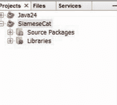

**图 23.7** 向 Java 项目添加库。

- 1. 在每个 mod 项目上，在你开始编写 Java 代码之前，必须添加一个 Java 类库：你在安装 Spigot 时下载的 Spigot JAR 文件。在 Projects 面板中，右键点击 Libraries 文件夹并选择菜单命令 Add Library（添加库）。打开 Library 对话框。

- 2. 点击 Create（创建）按钮。打开 Create New library（新建库）对话框。

- 3. 在 Library Name（库名称）字段中输入 `Spigot` 并点击 OK（确定）。打开 Customize Library（自定义库）对话框。

- 4. 点击 Add JAR/Folder（添加 JAR/文件夹）按钮。打开 Browse JAR/Folder 对话框。

- 5. 使用对话框找到并打开你安装服务器的文件夹。

- 6. 点击 `spigotserver.jar` 选择该文件。

- 7. 点击 Add JAR/Folder。

- 8. 点击 OK。

- 9. Available Libraries（可用库）面板现在有一个 Spigot 项目。选择它并点击 Add Library。

Projects 面板的 Libraries 文件夹中包含 Spigot 的 JAR 文件（点击 Libraries 旁的 `+` 查看它）。你已经准备好开始编写 mod 程序了。

按照以下步骤创建程序：

- 1. 点击 File、New File。出现 New File 对话框。

- 2. 在 Categories 面板中选择 Java。

- 3. 在 File Types（文件类型）面板中选择 Empty Java File（空 Java 文件）；然后点击 Next。

- 4. 在 Class Name（类名）字段中输入 `SiameseCat`。

- 5. 在 Package（包）字段中输入 `org.cadenhead.minecraft`。

- 6. 点击 Finish。

`SiameseCat.java` 文件在 NetBeans 源代码编辑器中打开。

你为 Spigot 创建的每个 mod 都从一个标准代码的简单框架开始。在 package 语句和几个 import 语句之后，你用这些语句开始每个 mod：

```java
public class SiameseCat extends JavaPlugin {
    public static final Logger logger = Logger.getLogger("Minecraft");

    public boolean onCommand(CommandSender sender, Command command,
        String label, String[] arguments) {

        if (label.equalsIgnoreCase("siamesecat")) {
            if (sender instanceof Player) {
                // do something here
                log.info("[SiameseCat] Meow!");
                return true;
            }
        }
        return false;
    }
}
```

Mod 程序全都是 `org.bukkit.plugin.java` 包中 `JavaPlugin` 的子类。观察此框架，当你将其用于不同的 mod 时，唯一会改变的是三个引用 Siamese cat（暹猫）的地方，因为它们是该项目特有的。

## 创建你的第一个 Mod

程序的名称是 `SiameseCat`。

方法调用内部的参数 `label.equalsIgnoreCase("siamesecat")` 是用户在游戏中输入并运行的命令。此程序实现了 `/siamesecat` 命令（命令前带有一个斜杠 `/` 字符）。作为参数发送给 `onCommand()` 的 `label` 对象是一个持有用户输入的命令文本的字符串。

调用 `log.info()` 并带有消息 `"[SiameseCat] Meow!"` 的语句会发送一条显示在 Minecraft 服务器中的日志消息。

作为实例创建的 `Logger` 对象向服务器发送消息。

`sender` 对象是另一个发送到 `onCommand()` 方法的参数。它代表 Minecraft 中输入命令的实体。检查 `sender` 是否是 `Player` 类的实例以验证玩家是否发布了该命令。

当你发布命令时所做的一切都会转到注释标记的地方：

// do something cool here.（在这里做些酷酷的事。）

`SiameseCat` mod 需要学习更多关于游戏的第一件事，是使用这三个语句：

```java
Player me = (Player) sender;
Location spot = me.getLocation();
World world = me.getWorld();
```

通过将 `sender` 对象强制转换为 `Player` 类来创建一个对象。该对象是由游戏玩家控制的角色。

通过这个 `Player` 对象，你可以获取它的 `getLocation()` 方法，无需其他对象即可了解玩家所处的精确位置。该位置由 `Location` 类表示。关于位置，你可以了解到三点：它在三维地图上的 (x,y,z) 坐标。

`Player` 对象还有一个 `getWorld()` 方法，它返回一个代表整个游戏世界的 `World` 对象。

你创建的大部分 mob（生物）都需要这些 `Player`、`Location` 和 `World` 对象。

此 mod 创建了一个像暹猫的新型 mob，使用了这三个语句：

```java
Player me = (Player) sender;
Location spot = me.getLocation();
World world = me.getWorld();
```

通过将 `sender` 对象强制转换为 `Player` 类来创建一个对象。该对象是游戏玩家控制的角色。

通过这个 `Player` 对象，你可以获取 `getLocation()` 方法，无需其他对象即可了解玩家所处的精确位置。该位置由 `Location` 类表示。关于位置，你可以了解到三点：它在三维地图上的 (x,y,z) 坐标。

## 使用 Java 创建 Mod

`SiameseCat` mod 需要学习更多关于游戏的第一件事，是使用这三个语句：

```java
Player me = (Player) sender;
Location spot = me.getLocation();
World world = me.getWorld();
```

通过将 `sender` 对象强制转换为 `Player` 类来创建一个对象。该对象是游戏玩家控制的角色。

通过这个 `Player` 对象，你可以获取 `getLocation()` 方法，无需其他对象即可了解玩家所处的精确位置。该位置由 `Location` 类表示。关于位置，你可以了解到三点：它在三维地图上的 (x,y,z) 坐标。

`Player` 对象还有一个 `getWorld()` 方法，返回一个代表整个游戏世界的 `World` 对象。

你创建的大部分 mob 都需要这些 `Player`、`Location` 和 `World` 对象。

此 mod 创建了一个像暹猫的新型 mob，使用了这三个语句：

```java
Player me = (Player) sender;
Location spot = me.getLocation();
World world = me.getWorld();
```

通过将 `sender` 对象强制转换为 `Player` 类来创建一个对象。该对象是游戏玩家控制的角色。

通过这个 `Player` 对象，你可以获取 `getLocation()` 方法，无需其他对象即可了解玩家所处的精确位置。该位置由 `Location` 类表示。关于位置，你可以了解到三点：它在三维地图上的 (x,y,z) 坐标。

> （注：提供的 OCR 文本在页面之间存在大量重复和碎片化句子。我已根据提供的内容重构了逻辑流。）

## 第 23 小时：使用 Java 创建 Minecraft Mod

```yaml
4:
5: main: org.cadenhead.minecraft.SiameseCat
6:
7: commands:
8: siamesecat:
9: description: 产生一只暹咪猫。
10:
11: version: 1.0
```

将“Your Name Here”替换为你自己的名字（除非你的名字本身就是“Your Name Here”）。

双检查你输入的空格是否正确，第 8 行的文本 `siamesecat` 之前有四个空格，第 9 行的 `description` 之前有八个空格。

`plugin.yml` 文件描述了模（mod）的名称、作者、Java 类文件、版本、命令以及该命令功能的简要描述。

此文件必须位于项目的正确位置。查看“项目”（Projects）窗格，它应该位于 `Source Libraries` 文件夹下的 `<default package>` 子文件夹中。如图 23.8 所示。

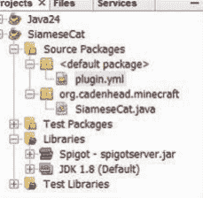

**图 23.8** 检查 plugin.yml 的位置。

如果文件位置错误（例如在 `org.cadenhead.minecraft` 标题下），你可以使用拖放功能来移动它。点击并按住文件，将其拖到 `Source Libraries` 文件夹，然后松开。

你现在已经准备好构建你的模了。选择菜单命令 `Run`（运行）、`Clean`（清理）和 `Build Project`（构建项目）。如果成功，NetBeans 界面的左下角将出现“Finished Building SiameseCat (clean jar)”的消息。

该模被封装为 `SiameseCat.jar` 文件，存放在项目的一个子文件夹中。要找到它，点击“项目”窗格中的 `Files`（文件）选项卡，并展开 `dist` 子文件夹。`Files` 选项卡列出了组成项目的所有文件，如图 23.9 所示。

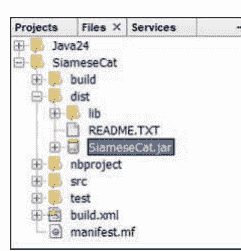

**图 23.9** 寻找 SiameseCat 模的 JAR 文件。

此 `SiameseCat.jar` 文件需要从项目文件夹复制到 Minecraft 服务器上。

按照以下步骤操作：

- 1. 如果 Minecraft 服务器正在运行，请通过进入 NetBeans 之外的服务器窗口停止它，打开你安装 Minecraft 服务器的文件夹。

- 2. 打开 `SiameseCat` 子文件夹。

- 3. 返回 Minecraft 服务器文件夹。

- 4. 打开 `plugins` 子文件夹。

- 5. 按 `Ctrl+v` 将 `SiameseCat` 复制到该文件夹中。

你已经在 Minecraft 服务器上部署了新模。按照你之前的方法启动服务器——点击你创建的 `start-server` 文件——你将在运行时的显示的日志文件（log file）中看到两条新消息：

```
[SiameseCat] Loading SiameseCat v1.0
[SiameseCat] Enabling SiameseCat v1.0
```

如果你没有看到这些消息，而是看到了一些很长的、非常复杂的错误信息，请双重检查 `SiameseCat.java` 和 `plugin.yml` 中的所有内容，确保它们输入正确；然后重新部署模。

当你运行 Minecraft 客户端并连接到服务器时，输入命令 `/siamesecat`。你现在有一只会跟随你的新宠物猫。你可以根据需要反复输入命令来继续添加猫。

图 23.10 显示了我和 23 只猫。苦力者完全不想理会我们。

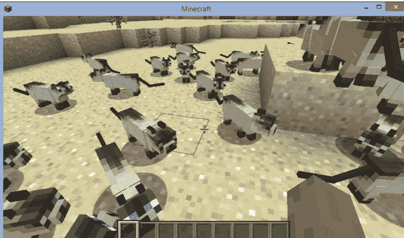

**图 23.10** 来到我这里，暹咪猫朋友们！

## 教僵尸骑马

你创建的第一个模需要大量工作，因为你是第一次经历这个过程。其余部分应该更简单，因为你将重复许多相同的步骤。

你在这一小时内开发的每个模都会比上一个更复杂。对于这个项目，你将创建一个由僵尸骑乘的马兵团。

通过这些任务开始工作：

- 选择 `File`（文件）、`New Project`（新建项目），创建一个名为 `CrazyHorse` 的新 Java 项目，存放在与 Minecraft 服务器相同的文件夹中，就像上一个项目一样。确保取消勾选 `Create Class`（创建类）。

- 右键点击“项目”窗格中的 `Libraries`（库），点击 `Add`（添加），并将 Spigot 库添加到项目单元。

- 选择 `File`（文件）、`New File`（新建文件），并创建一个名为 `CrazyHorse` 且包名为 `org.cadenhead.minecraft` 的空 Java 文件。

## 教僵尸骑马

将代码列表（Listing 23.4）的文本输入到 `CrazyHorse.java` 文件的源编辑器中。程序中使用新概念将在输入完成后对其进行解释。

### 代码列表 23.4：CrazyHorse.java 的完整正文


```java
1: package org.cadenhead.minecraft;
2:
3: import java.util.logging.*;
4: import org.bukkit.*;
5: import org.bukkit.command.*;
6: import org.bukkit.entity.*;
7: import org.bukkit.plugin.java.*;
8: import org.bukkit.potion.*;
9:
10: public class CrazyHorse extends MinecraftPlugin {
11:     public static final Logger logger = Logger.getLogger("Minecraft");
12:
13:     public boolean onCommand(Command sender,
14:         String label, String[] args) {
15:
16:         if (label.equalsIgnoreCase("crazyhorse")) {
17:             if (sender instanceof Player) {
18:                 Player me = (Player) sender;
19:                 Location spot = me.getLocation();
20:                 World world = me.getWorld();
21:
22:                 // 产生僵尸和马
23:                 int quantity = (int) (Math.random() * 10) + 1;
24:                 logger.info("CrazyHorse " + quantity + " zombies and horses");
25:                 for (int i = 0; i < quantity; i++) {
26:                     // 设置僵尸的位置
27:                     Location horseSpot = new Location(world,
28:                         spot.getX() + (Math.random() * 15),
29:                         spot.getY() + (Math.random() * 15));
30:                     Horse horse = world.spawn(horseSpot, Horse.class);
31:                     Zombie zombie = world.spawn(horseSpot, Zombie.class);
32:                     horse.setPassenger(zombie);
33:                     horse.setOwner(me);
34:
35:                     // 设置马的颜色
36:                     int coat = (int) (Math.random() * 7);
37:                     switch (coat) {
38:                         case 0:
39:                             horse.setColor(Color.WHITE);
40:                             break;
41:                         case 1:
42:                             horse.setColor(Color.GRAY);
43:                             break;
44:                         case 2:
45:                             horse.setColor(Color.CREAMY);
46:                             break;
45:                         case 3:
46:                             horse.setColor(Color.CHESTNUT);
47:                             break;
48:                         case 4:
49:                             horse.setColor(Color.BROWN);
50:                             break;
51:                         case 5:
52:                             horse.setColor(Color.DARK_BROWN);
53:                             break;
54:                         case 6:
55:                             horse.setColor(Color.BLACK);
56:                             break;
57:                     }
58:
59:                     // 增加马的速度
60:                     PotionEffect potion = new PotionEffect(
61:                         PotionEffectType.SPEED,
62:                         Integer.MAX_VALUE,
63:                         10 + (coat * 10));
64:                     horse.addPotionEffect(potion);
65:                     return true;
66:                 }
67:         }
68:         return false;
69:     }
70:}
```

在输入代码后，通过选择 `File`（文件）或点击 `Save All`（保存全部）来保存此文件。

# 360 小时 23：使用 Java 创建 Minecraft 模组

此语句创建了一个持续时间最长的速度药水——这是 Java 中整数可以表示的最大值：

```
PotionEffect potion = new PotionEffect(
    PotionEffectType.SPEED,
    Integer.MAX_VALUE,
    10 + (coat * 10));
```

`PotionEffect()` 的第三个参数设置了马的速度。它的基础值为 10，加上用于确定马匹颜色的随机数。由于 switch-case 语句是从深到浅排序的，公式 `10 + (coat * 10)` 导致颜色越深色的马跑得越快。

现在模组的类已经编写完成，它需要一个插件描述文件。选择 New File（新建文件），在 Categories（类别）窗格中选择 Other（其他），并在 `src` 文件夹中创建一个名为 `plugin.yml` 的空文件。

在该文件中输入 `23.5`，注意格式要与所示完全一致，使用空格而不是制表符（tabs）。

# 列表 23.5 此项目 plugin.yml 的完整内容

```
1: name: CrazyHorse
2:
3: author: Your Name Here
4:
5: main: org.cadenhead.minecraft.CrazyHorse
6:
7: commands:
8: crazyhorse:
9: description: Spawn 1-11 horse-riding zombies.
10:
11: version: 1.0
```

完成后，选择 Clean（清理）、Run and Build Project（运行并构建项目）来创建模组的 JAR 文件。

在 Projects（项目）窗格中，Source Packages（源包）标题下应该有两个文件：`org.cadenhead.minecraft` 下 `CrazyHorse.java` 和 `<default package>`（默认包）下的 `plugin.yml`。

在 NetBeans 之外，进入文件文件夹，将项目 `dist` 文件夹中的 `CrazyHorse.jar` 文件复制到 `plugins` 文件夹中。重启服务器（停止并重新运行），你应该就可以通过 `/crazyhorse` 命令启用它了。

1 到 11 个骑马的僵尸会落在你周围，并“砰”的一声落地。这些不死之人将迎来一个不小的惊喜。图 23.11 展示了捕捉画面。

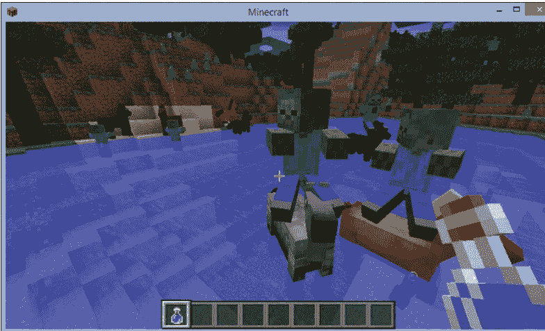

# 图 23.11

两个骑马的僵尸。

Spigot 的设计者在让 Java 类与游戏中的物品匹配方面做得很好。当你开发前两个模组时，你可能开始考虑一些可以通过微调来更改的内容。

这里是对 CrazyHorse 模组列表 23.4 中第 33 行的单行更改，它在马背上放置了一个完全不同的生物：

```
Creeper creeper = world.spawn(horseSpot, Creeper.class);
```

此更改创建了一个苦力爬骑兵团，而不是僵尸团。

虽然你可以猜测类名并观察结果，但 Spigot 为其所有的 Java 类提供了详尽的在线文档。你可以在 www.javaminecraft.com/bukkitkitapi 查看 Spigot 1.8.7 的文档。

使用此指南来学习 Spigot 中的每个类和接口、它们的实例变量以及实例方法和类方法。

通过翻阅文档并调优 CrazyHorse 模组，你可以尝试不同的生物和药水效果。

这里有一个让马变得隐形的修改，会导致僵尸看起来像漂浮在空中。

```
PotionEffect potion2 = new PotionEffect(
    PotionEffectType.INVISIBILITY,
    Integer.MAX_VALUE,
    1);
horse.addPotionEffect(potion2);
```

## 寻找所有生物（并杀死它们）

前两个是添加到游戏世界中的生物。下一个项目将检查已存在的生物、它们的每个位置，并向该位置发射闪电。

开始之前：

1. 选择 File（文件）、New Project（新建项目），在 Minecraft 服务器文件夹中创建名为 `LightningStorm` 的新项目。确保选择了 Class Main。
2. 在 Projects（项目）窗格中，右键点击 Libraries（库），点击 Add Library（添加库），并添加 Spigot 库。
3. 选择 File（文件）、New File（新建文件），创建一个 Empty Java File（空 Java 文件），类名为 `LightningStorm`，包名为 `org.cadhead.minecraft`。

在 NetBeans 的源代码编辑器中输入列表 23.6 的文本，完成后记得保存文件。

### 列表 23.6 LightningStorm.java 的完整内容

```
1: package org.cadhead.minecraft;
2:
3: import java.util.*;
4: import java.util.logging.*;
5: import org.bukkit.*;
6: import org.bukkit.command.*;
7: import org.bukkit.entity;
8: import org.bukkit.plugin.java.*;
9:
10: public class LightningStorm extends JavaPlugin {
11     public static final Logger log = Logger.getLogger("Minecraft");
12:
13     public boolean onCommand(CommandSender sender, Command command,
14         String label, String[] arguments) {
15:
16         Player me = (Player) sender;
17         World world = me.getWorld();
```

# 寻找所有生物（并杀死它们） 363

LightningStorm 模组通过 `lightningstorm` 命令实现了新花样，向生物降下大量的闪电。`/mobcount` 命令统计有多少个活着的生物。

LightningStorm 模组通过 `lightningstorm` 命令实现了新花样，向生物降下大量的闪电。`/mobcount` 命令统计有多少个活着的生物。

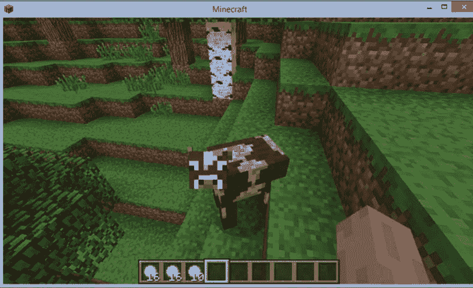

# 图 23.12

这不是雷电暴。

生物，该功能在第 19 行实现：

```
List<LivingEntity> mobs = world.getEntities();
```

## 编写一个可以构建的 Mod

你创建的前三个 Mod 都是生物（mobs），即 Minecraft 中游走的移动实体。你这小时的最后一个 Mod 将探索如何使用 Java 执行游戏中最基础的操作：构建和销毁方块。

你将创建一个新命令 `/icecreamsnoop`，它会在玩家周围挖掘一个圆洞。洞的大小将由玩家作为命令的参数决定。

以下是开始构建 Mod 的步骤：


- 1. 在 Minecraft 服务器文件夹中创建一个名为 `IceCreamScoop` 的新项目，保持取消勾选 `Create Class`。
- 2. 在 `Projects` 面板中，右键点击 `Libraries` 并添加 `Spigot` 库。
- 3. 在 `org.cadenhead.minecraft` 包中创建一个名为 `IceCreamScoop` 的空 Java 文件。

将列表 23.8 的文本输入到 `IceCreamScoop` 类中。在你输入完成后，我们将对其进行解释。

## 编写一个可以构建的 Mod

### 列表 23.8 IceCreamScoop.java 的完整正文

```java
1: package org.cadenhead.minecraft;
2:
3: import java.util.logging.*;
4: import org.bukkit.block.*;
5: import org.bukkit.command.*;
6: import org.bukkit.entity.*;
7: import org.bukkit.plugin.java.*;
8: import.*;
9:
10: public class IceCreamScoop extends JavaPlugin {
11:    public static final Logger log = Logger.getLogger("Minecraft");
12:
13:    public boolean onCommand(CommandSender sender, Command command,
14:        String label, String[] arguments) {
15:
16:        // 设置默认的挖掘半径
17:        double radius = 15;
18:        if (arguments.length > 0) {
19:            // 读取用户提供的半径（如果有）
20:            radius = Double.parseDouble(arguments[0]);
21:            // 确保它是可接受的大小（5-25）
22:            if (radius < 5 || (radius > 25)) {
23:                radius = 15;
24:            }
25:        }
26:    } catch (FormatException exception) {
27:        // 不使用默认半径；
28:    }
29:
30:
31:    if (label.equalsIgnoreCase("icecreamscoop")) {
32:        if (sender instanceof Player) {
33:            scoopTerrain(sender, radius);
34:        }
35:        return true;
36:    }
37:    return false;
38: }
39:
40:    // 从世界中挖掘出一个圆形的挖掘区域
41:    private void scoopTerrain(CommandSender sender, double radius) {
42:        Player me = (Player) sender;
43:        Location spot = me.getLocation();
44:        World world = me.getWorld();
45:
46:        // 遍历一个边长为半径两倍的三维正方形
```

```java
for (double x = spot.getX() - radius; x < spot.getX() + radius; x++) {
    for (double y = spot.getY() - radius; y < spot.getY() + radius; y++) {
        for (double z = spot.getZ() - radius; z < spot.getZ() + radius; z++) {
            // 获取该正方形内的位置
            Location loc = new Location(world, x, y, z);
            // 查看距离玩家有多远
            double dx = x - spot.getX();
            double dy = y - spot.getY();
            double dz = z - spot.getZ();
            double distance = Math.sqrt(dx * dx + dy * dy + dz * dz);
            // 是否在半径内？
            if (distance < radius) {
                // 所以，将该方块变为空气
                Block current = world.getBlockAt(loc);
                current.setType(Material.AIR);
            }
        }
    }
}
// 在挖掘完成后播放声音
world.playSound(spot, Sound.BURP, 30, 5);
log.info("[IceCreamScoop] Scooped at " 
    + spot.getX() + ", " + spot.getY() + ", " + spot.getZ() + ")");
```

这个 Mod 会挖掘一个半径从 5 到 25 格块的圆。玩家通过在 `/icecreamscoop` 命令后加上一个空格和一个数字来确定大小，例如所示：

`/icecreamscoop 10`

Mod 可以像 Java 一样接收参数。这些参数存储在 `onCommand()` 方法的第四个参数中，这是一个 `String` 数组。

在第 17 行创建了双精度类型的 `radius` 并赋值 15 后，以下语句将半径设置为第一个参数的值：

`radius = Double.parseDouble(arguments[0]);`

Java `Double` 类的 `parseDouble()` 方法将字符串转换为双精度。

## 编写一个可以构建的 Mod

这个 Mod 会挖掘一个半径从 5 到 25 格块的圆。玩家通过在 `/icecreamscoop` 命令后加上一个空格和一个数字来确定大小，例如所示：

`/icecreamscoop 10`

Mod 可以像 Java 一样接收参数。这些参数存储在 `onCommand()` 方法的第四个参数中，这是一个 `String` 数组。

在第 17 行创建了双精度类型的 `radius` 并赋值 15 后，以下语句将半径设置为第一个参数的值：

`radius = Double.parseDouble(arguments[0]);`

Java `Double` 类的 `parseDouble()` 方法将字符串转换为双精度。

为了防止错误的输入，你将 `parseDouble()` 放在 `try-catch` 块中。当值不是数值时，会发生 `FormatException`。

如果半径在接受范围内（5-25），则使用它。否则，它会被重置为 15。

`scoopTerrain()` 方法从世界中挖掘出一个圆形的挖掘区域。它遍历一个边长为半径两倍的三维正方形。

使用勾股定理，你可以计算当前方块与玩家之间的距离：将 `xd`、`yd` 和 `zd` 平方并相加，然后对该和进行平方根。

如果距离在半径范围内，则将方块变为空气。首先，创建一个代表该方块的 `Block` 对象。接下来，调用方块的 `setType()` 方法并传入 `Material.AIR`，这是 Minecraft 中可以创建的几十种值之一。

当从世界中完成挖掘后，Mod 会执行两件事来记录这一成就：播放声音并向服务器日志发送消息。

通过调用世界的 `playSound()` 方法传入四个参数（声音的位置、类型、音量和频率）来播放声音。通过调用 Logger 对象的 `info()` 命令传入消息文本在服务器上记录消息。

通过将方块变为空气来破坏它的技术也可以用于构建物体。唯一改变的是材质。如果你想挖掘游戏区域并将其变成钻石而不是空气，该语句将是：

`current.setType(Material.DIAMOND);`

在构建好 Mod 并将其 JAR 文件部署到 Minecraft 服务器后（按照与之前项目相同的步骤操作），你就可以在游戏世界中移动，并在地貌中挖掘出巨大的圆洞。图 23.13 显示了当你站在一片平坦地上并输入以下内容时会发生什么：

`/icecreamscoop 10`

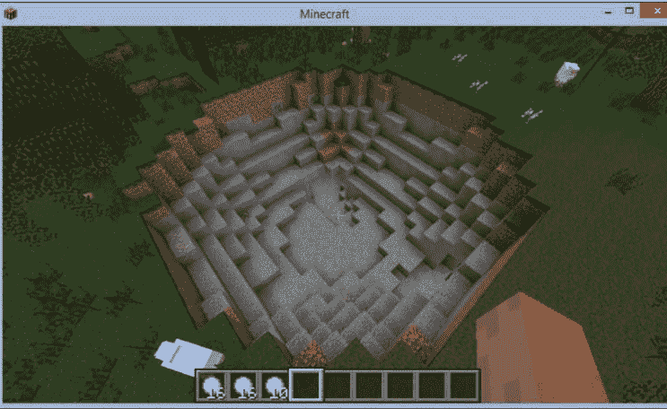

图 23.13

在 Minecraft 世界中挖掘出圆圈。

在测试这个模组时，我发现向下挖到世界底部并不花费太长时间。你还可能掉得足够深导致死亡，因此在出生点进行任何挖掘操作不是个好主意。

通过将材料从 `AIR`（空气）更改为其他材料，你可以在世界中创建球体。物质完整列表可以在 Spigot 的 Java 文档（www.javaminecraft.com/bukkitapi）中找到，但这里有几个可以用于入门：

- `Material.DIRT`
- `Material.COBBLESTONE`
- `Material.WOOD`
- `Material.GRAVEL`

如果你将方块变成空气以外的任何物品，该模组就会移除你所站位置的空气。那一定很疼。你可以使用以下两个语句传送到新位置：

```
Location newSpot = new Location(world,
    spot.getX(),
    spot.getY() + rad + 1,
    spot.getZ());
me.teleport(newSpot);
```

因为 Minecraft 中的 Y 轴是垂直位置，这会将玩家移动到球体正上方的位置。

### 总结

在我编写 Java 程序和教人们如何使用这门语言的这些年里，我从未想过我会把这些技能用在让僵尸骑马上。

或者没想过如果不经过训练，马会把那个僵尸甩下来。

或者没想过僵尸会因为太阳出来而立即着火。

或者你可能会挖一个巨大的洞，以至于你掉出了世界之外。

这是*最有趣（funnest）*的一种 Java 编程。我知道这不是一个标准单词，但它应该是一个，而且尽管你要将 Java 对象放入一个三维世界中，在那里你必须与怪物战斗、挖掘隧道、建造房屋并躲避行尸的边缘，你也应该使用它。

Minecraft 也是学习面向对象编程的极佳方式，这是该语言最难掌握的方面之一。你在 Java 中做的一切都是通过对象完成的。你通过构造函数创建它们，通过实例变量赋予它们知识，并通过调用方法来告诉它们做某些事。对象通过实现接口来指示它们可以执行的任务。

所有这些概念都与模组编程有关。需要僵尸吗？创建一个 `Zombie` 对象。想让玩家移动到新位置吗？调用它的 `teleport()` 方法。丢了马吗？调用它的 `getLocation()` 方法。

所以，随你尽情深入研究 Minecraft 编程。你将能够运用这些技能远超苦力怕、凋灵骷髅和猪僵尸范畴的领域。

### 工作坊

#### 问答

- **我用 IceCream 模组把我的服务器世界搞得一团糟。我该如何重新开始？**

- Minecraft 服务器可以很容易从零开始创建一个新世界，或从一个世界切换到另一个世界。

要启动并删除旧世界，请停止服务器，打开 Minecraft 服务器文件夹，并删除 `world` 子文件夹。当你启动服务器时，Minecraft 会发现世界消失了并创建一个新世界。这个过程比通常要慢一点。服务器日志会解释它正在做什么。

要在保留旧世界的同时切换到新世界，请停止服务器并将 `world` 子文件夹重命名为其他名称。服务器将构建一个新世界，你可以通过编辑主文件夹中的 `server.properties` 文件切换回旧世界。

如果你将原始世界命名为 `world2`，你可以将其切换回来：用任何文本编辑器打开 `server.properties` 文件，并将 `level-name=world` 行更改为 `level-name=world2`。保存文件并重启服务器。

#### Quiz

通过回答以下关于 Minecraft 模组编程的问题，测试你是否由正确的材料组成。

- 1. 为使用 Spigot 的 Minecraft 服务器创建的所有模组的父类是什么？

   A. `Player`

   B. `JavaPlugin`

   C. `Mod`

2. 使用哪个类来创建特殊特效并将其应用到生物上？

   A. `Type`

   B. `Effect`

   C. `Potion`

3. 哪个类代表游戏中的每个方格，无论它是充满了空气还是其他东西？

   A. `Location`

   B. `Block`

   C. `Spot`

#### 答案

- 1. B. 你创建的所有模组在类声明中都扩展了 `JavaPlugin`。

2. C. 创建一个 `Potion` 对象时会带有 `PotionEffect` 值，例如 `SPEED`（速度）或 `INVISIBILITY`（隐形）。

3. B. 每个方格被称为一个 block，可以在模组中通过 `Block` 类进行访问。答案 A 几乎正确——它代表了任何方格的位置。

#### 活动

为了深入研究模组编程，请执行以下活动：

- 创建一个模组，将世界中所有的鸡都召唤到玩家身边。
- 使用 Spigot 的 Java 文档，创建一个模组，生成一个在本小时内未提到过的生物。

要查看实现这些活动的 Java 程序，请访问书籍的网站 www.java24hours.com。

# 第 24 小时

编写 Android 应用

本节时的任务清单：

- 学习为什么要创建 Android。
- 创建一个 Android 应用。
- 学习 Android 应用的结构。
- 在模拟器上运行应用。
- 在 Android 手机上运行应用。

### Android 简介

Android 诞生于 2003 年，被 Google 收购，并于 2007 年发布。手机领域最大的一些名字——Google、Intel、Motorola、Nvidia、三星以及其他公司——组成了开放手机联盟以推广这一新平台。

Google 发布了 Android 开发工具包 (SDK)，这是一个用于开发 Android 应用的免费工具集。第一个运行 Android 的手机 T-Mobile G1 于 2008 年 6 月推出。

这项努力起初缓慢，但自 2010 年初以来爆发并成为 iPhone 的真正竞争对手。所有主要的手机运营商现在提供 Android。电子书阅读器也在增长。

在 Android 之前，移动应用开发需要昂贵的编程工具。手机制造商控制谁被允许为他们创建应用，以及这些应用的使用。

Android 打破了这道墙。

Android 的开源和非专有性质意味着任何人开发、发布和销售应用。唯一的费用是提交到 Google 市场的少量费用。其他都是免费的。

下载 Android SDK 并了解该平台编程的地方是 Android 开发者网站 https://developer.android.com。在编写应用时，你会经常参考它，因为它记录了 Android 类库中的每个类，并作为一个广泛的在线参考。

### 创建 Android 应用

Android 应用是普通的 Java 程序，它们使用应用程序框架，该框架是一组所有应用共有的核心类和文件。该框架体现了一套规则，规定了应用必须如何结构以便在 Android 设备上正常运行。

要开始编写代码，你必须安装 Android Studio。要下载软件，请访问 https://developer.android.com。运行安装向导并按照指示在你的计算机上设置软件。

要在项目上开始使用 IDE：

- 1. 运行 Android Studio。
- 2. 在启动时弹出的对话框中，选择 `Start a New Android Project`（新建 Android 项目）。打开新建项目向导，如图 24.1 所示。

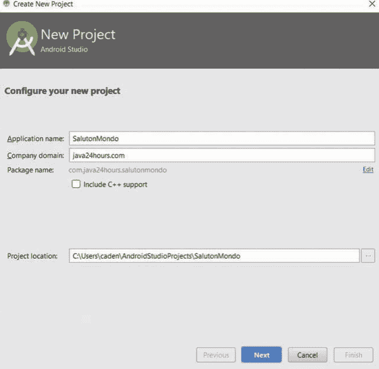

图 24.1 在 Android Studio 中创建新的 Android 项目。

- 1. 在 `Application Name`（应用名称）字段中，输入 `SalutMondo`。
- 2. 在 `Company Domain`（公司域名）字段中，输入 `java24hours.com`。`Package Name`（包名）字段将更新为使用此处和应用名称，变为 `com.java24hours.saluton-mundo`。
- 3. 你可以接受默认的 `Location`（你用户文件夹下 `AndroidStudioProjects` 的子文件夹），或通过字段右侧的 `...` 按钮选择不同的位置。
- 4. 点击 `Next`（下一步）。
- 5. 每个 Android 项目都需要一个目标平台。目标代表可以运行你的应用的最旧 Android 版本。每个新的 `Release`（发布版本）都有增强的功能，你的目标选择决定了可以使用哪些功能。选择 `Phone and Tablet`（手机和平板）作为目标，并将 `API 15` 设置为 `Minimum SDK`（如果 `API 15` 不可用）。
- 6. 点击 `Next`。向导询问要创建的应用。选择 `Fullscreen Activity`（全屏活动）并点击 `Next`。
- 7. 在 `Activity Name`（活动名称）字段中，输入 `SalutonActivity`。这会更改 `Layout Name`（布局名称）和 `Title`（标题）字段。保留这些更改。


- 8. 点击 **Finish**（完成）。新应用已创建，`Package Explorer`（包管理器）窗格中会出现一个 `SalutMondo` 项目。

## 探索新的 Android 项目

一个新的 Android 项目由约 20 个文件和文件夹组成，它们在 Android 应用中始终以相同的方式组织。取决于应用的功能，你可能会添加更多文件，但这些初始文件和文件夹必须存在。

图 24.2 显示了在创建新的 Android 项目后 Android Studio 的 `Projects`（项目）窗格。如果你没有看到此窗格，点击 IDE 左侧边缘的 `Projects` 标签页。

### 项目窗格

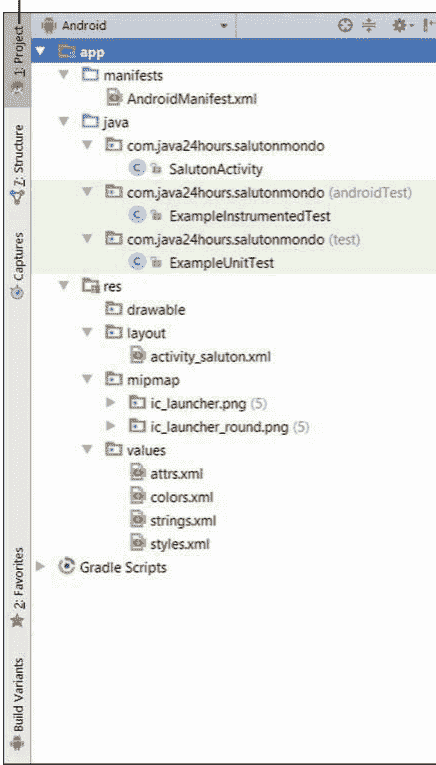

图 24.2 查看 Android 项目的各个部分。

你可以使用文件夹来探索项目的文件和文件夹结构。新的 `SalutonMondo` 应用从以下组件开始：

- `/java/`：应用 Java 源代码的根文件夹。
- `/src/com.java24hours.salutonmondo/SalutonActivity.java`：当应用运行时默认启动的活动类。
- `/res`：应用程序资源的文件夹，如字符串、数字、布局文件、图形和动画。有针对特定资源类型的子文件夹：`layout`、`values`、`drawable` 和 `mipmap`。
- `AndroidManifest.xml`：应用的主要配置文件。

这些文件和文件夹构成了应用程序框架。作为 Android 程序员，你首要的任务是学习如何修改框架，以便你发现每个组件可以完成什么。

还有额外的文件被添加到框架中以适应特定的目的。

## 创建应用

尽管你还没有对它做任何操作，但你已经成功运行了这个新的 Android 项目。框架作为一个可以运行的应用在工作。

因为那样没趣，你将自定义 `SalutonMondo` 应用以提供传统的计算机编程问候语“Saluton Mondo!”。

在第 2 节“编写你的第一个程序”中，你通过调用方法 `System.out.println()` 将文本“Saluton Mondo!”作为字符串显示出来。

Android 应用显示的字符串首先存储在名为 `strings.xml` 的资源文件中。你可以在 `/res/values` 文件夹中找到此文件。

使用 `Package Explorer` 导航到此文件夹。双击 `strings.xml`。XML 文件将在文本编辑器中打开，如图 24.3 所示。

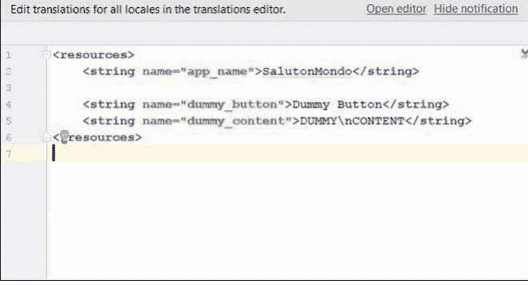

图 24.3 编辑 Android 应用的字符串资源。

字符串和其他资源被赋予了一个名称和一个值，就像 Java 中的变量一样。在编辑面板中有三个用 XML 数据表示的字符串资源：`app_name`、`dummy_button` 和 `dummy_content`。

资源的名称遵循三个规则：

- 它们必须全部是小写。
- 它们不能有空格。
- 它们必须仅使用下划线字符（`_`）作为标点符号。

资源存储在 XML 文件中。`Resources` 资源编辑器是一个简单的 XML 编辑器。你也可以直接编辑 XML 本身。

以下是 `strings.xml` 此时的内容：

```
<resources>
  <string name="app_name">SalutMondo</string>
  <string name="dummy_button">Dummy Button</string>
  <string name="dummy_content">DUMMY\nCONTENT</string>
</resources>
```

这是资源文件当前的状态。

（注：原文后续的文本似乎存在逻辑混乱或重复错误，已根据上下文意图进行了最小化处理）

## 设置模拟器

在构建应用之前，你必须设置一个环境。这可以在 Android Studio 中完成。你必须设置一个可以在桌面上运行的 Android 虚拟机设备 (AVD)。

要配置 Android 虚拟机设备，首先点击工具栏上的手机图标，如图 24.4 所示。

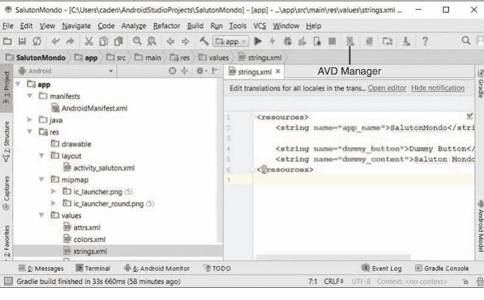

图 24.4 配置 Android 虚拟机设备。

这将启动虚拟机设备管理器，它是 Android SDK 的工具之一。你创建的模拟器列在左侧。管理器如图 24.5 所示。

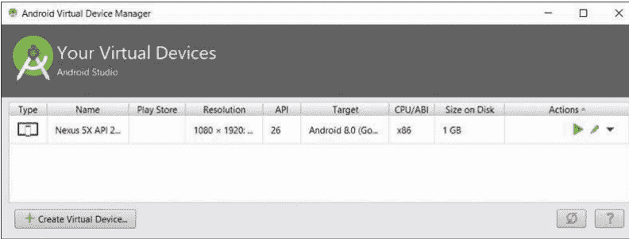

图 24.5 创建模拟器。

要添加新的模拟器，点击 `Create Virtual Device` 并遵循步骤操作：

1. 从列表中选择一个设备，例如 `Galaxy Nexus`，并点击 `Next`。
2. 从列表中选择一个版本，例如 `Nougat`，并点击 `Next`。
3. 在 `AVD Name` 字段中，为它命名为 `SimpleAVD`。
4. 点击 `Finish`。
5. 新的模拟器已创建，这可能需要一段时间（通常不会超过一分钟）。

你可以创建多个需要的模拟器。它们可以针对不同的 Android 版本和不同类型的显示进行自定义。

关闭虚拟机设备管理器返回 Android Studio 主界面。

## 运行应用

现在你已经有了 Android 模拟器，可以运行你的第一个应用了。选择菜单命令 `Run` > `Run App`。弹出 `Deployment Target` 对话框。在 `Available Virtual Devices` 下选择 `SimpleAVD` 并点击 `OK`。

可能会被要求安装平台。点击 `Install` 并 `Continue`。

Android 模拟器会在自己的窗口中加载。这可能需要一分钟或更长时间，请耐心等待虚拟手机启动。（模拟器加载得如此缓慢，让你有时间思考一句中国谚语：“牛马马，地久老。”）

你安装的应用程序将带有 Android 图标和标签 `SalutonMondo` 出现。点击该图标即可运行应用程序。

模拟器显示“Saluton Mondo!”作为应用程序的文本，如图 24.6 所示。控制控件允许像使用手机一样使用模拟器，但使用的是鼠标而不是手指。点击返回按钮关闭应用程序，并查看 Android 设备是如何被模拟的。

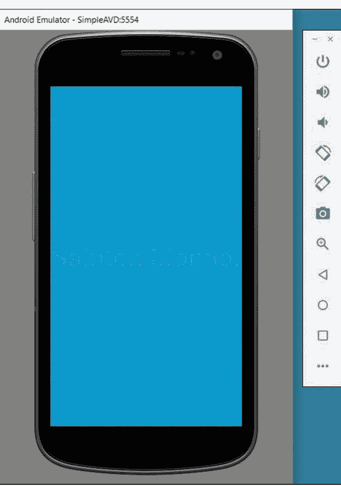

图 24.6 在 Android 模拟器中运行应用程序。

模拟器可以完成许多真实设备可以完成的工作，包括在计算机有活动连接状态时连接到互联网。它还可以接收虚假电话和短信消息，但拨打真实电话和发送消息需要真实的设备。

由于它不是一个功能全设备，你开发的应用程序必须在真实的 Android 手机和平板上进行测试。

如果你能使用 USB 线将 Android 手机（或其他设备）连接到计算机，只要手机被设置为调试模式，你就应该能够运行该程序。使用 Android SDK 开发的应用程序只能在此模式下部署到手机上。

在手机上，通过选择 `首页` > `设置` > `应用程序` > `开发`（或 `首页` > `设置` > `开发者选项`）进入此模式。将显示开发设置。选择 `USB 调试` 选项。

使用 USB 线将 Android 手机连接到计算机。手机屏幕顶部栏上应该出现一个 Android 图标。如果你向下拖此栏，你应该看到“USB 调试已连接”的消息。接下来，在 Android Studio 中按照以下步骤操作：

1. 选择 `Run App`。
2. 在 `Connected Devices` 下，选择你的手机。
3. 点击 `OK`。

应用程序在手机上的运行方式与在模拟器上一样。

就像你在第 2 小节中用 Java 编写的第一个程序一样，你在 Android 上创建的第一个应用程序非常平凡。下一个项目将更有野心。

通过选择菜单命令 `File` > `Close Project` 来关闭此项目。

## 设计一个真实的应用程序

Android 应用程序可以利用设备的所有功能，例如短信消息、基于位置的服务和触摸。在本书的第一个编程项目中，你创建了一个名为“Me to Your Leader”（致你的领导）的真实应用程序。

该应用程序利用 Android 的手机功能拨打电话、访问网站以及在 Google 地图中加载位置。该应用程序通过电话、网络和地图让你与白宫建立联系。（如果美国总统不是你的领导，可以对应用程序进行自定义。）

要开始，请通过执行以下步骤在 Android Studio 中创建一个新项目：

1. 选择 `Start a New Android Studio Project`。（如果你没有看到此项，通过菜单命令 `File` > `Close Project` 关闭上一个项目。）
2. 在 `Application Name` 字段中，输入 `Leader`。这也会自动输入 `Project Location` 字段。
3. `Company Domain` 字段应该是 `java24hours.com`。确保它是这样的，然后点击 `Next`。
4. 选择 `Phone and Tablet`，选择 `Minimum SDK` 值 `API 15`（如果不可用，则选择可能的最低值），然后点击 `Next`。
5. 选择 `Fullscreen Activity`；然后点击 `Next`。
6. 在 `Activity Name` 字段中，输入 `LeaderActivity`。
7. 点击 `Finish`。

项目出现在 Android Studio 窗格中。

> **提示**
>
> 此项目涵盖了广泛的内容。在你完成该项目时，你会发现很难保持浏览器打开 Android 开发者网站的参考部分 `https://developer.android.com/reference`。
>
> 你可以搜索 Android 类库中的 Java 类和项目中文件的文件名以了解更多。

## 组织资源

创建 Android 应用程序需要 Java 编程，但大部分工作是在 Android Studio 界面完成的。当你完全熟悉 Android SDK 的功能时，你可以在不写一行 Java 代码的情况下完成大量工作。

不需要编程就可以创建供应用程序使用的资源。每个新的 Android 项目都从几个放置资源的文件夹开始。要查看这些内容，展开 `Package Explorer` 中的 `Leader` 文件夹，并展开 `/res` 文件夹及其所有子文件夹。

资源包括 PNG、JPG 或 GIF 格式的图形；存储在 `strings.xml` 文件中的字符串；XML 格式的用户界面布局；以及你可以创建的其他文件。应用程序中有两个颜色文件 `colors.xml` 以及用于定义用户组件外观的 `styles.xml`。

新项目的 `/res` 文件夹包含 `ic_launcher.png` 和 `ic_launcher_round.png` 文件夹，它们具有应用程序图标的不同版本。该图标是用于启动应用程序的小型图形。

`ic_launcher.png` 的多个版本是相同的图形，针对不同分辨率的显示进行了尺寸调整。你将不会使用这些图标。一个新的图形文件 `appicon.png` 将被添加到项目中，并在文件 `AndroidManifest.xml`（应用程序的主配置文件）中被指定为其图标。

本书的网站包含 `appicon.png` 以及此应用程序所需的其他图形文件：`browser.png`、`maps.png`、`phone.png` 和 `whitehouse.png`。访问 `www.java24hours.com` 并进入该版本的书籍第 24 小节页面。下载所有五个文件并将它们保存在你计算机上的临时文件夹中。

Android 对多分辨率的支持非常方便，但不是必须的。

> **注意**
>
> 资源使用由其文件名组成的 ID 进行标识。如果两个资源具有相同的名称，应用程序将无法编译。
>
> 资源仅包含小写字母、数字、下划线（`_`）和点（`.`）。

## 配置应用程序的清单文件

Android 应用程序的主要配置工具是位于文件夹中的 `AndroidManifest.xml` 文件。双击 `AndroidManifest.xml` 打开文件进行编辑。

该字段标识应用程序图标，当前具有错误的值：

```
android:icon="@mipmap/ic_launcher"
```

这设置了应用程序图标并包含文件夹和资源名称。将其更改为：

```
android:icon="@mipmap/appicon"
```

## 设计界面

应用程序的图形界面由布局组成，布局是包含文本字段、按钮、图形和自定义控件的容器。显示给用户的每个屏幕可以有一个布局，也可以包含多个布局。有许多布局可以垂直或水平方向堆叠组件、以表格形式组织以及其他安排。

应用程序可以简单到只有一个屏幕，也可以包含多个屏幕。游戏可以组织成这些屏幕：

- 游戏加载时显示的启动屏幕
- 带有查看其他屏幕按钮的主菜单屏幕
- 解释如何玩游戏的帮助屏幕
- 列出最高分数的评分屏幕
- 列出游戏开发者的致谢屏幕
- 用于实际游戏的屏幕

`Leader` 应用程序由单个屏幕组成，该屏幕包含联系美国总统或指定领导的按钮。

应用程序的所有屏幕都保存在 `/res/layout` 文件夹中。此项目在该文件夹有一个 `activity_leader.xml` 文件，被指定为应用程序加载时显示的屏幕。

要开始编辑此屏幕的布局，双击 `Package Explorer` 中的 `activity_leader.xml`。该屏幕将在 Android Studio 主编辑窗格中打开，如图 24.7 所示。

编辑窗口包含一个调板（`Palette`）面板，其中包含几类可以展开的用户界面组件。这些组件可以被拖动并释放到右侧的屏幕上。

按照以下步骤在屏幕上添加三个图形化按钮：

1. 点击编辑面板底部显示“Dummy Button”文本的组件，然后按 `Delete`（删除）键来删除该组件。
2. 点击调板面板中的 `Layouts`（布局）文件夹。子面板会展开。
3. 从调板将 `LinearLayout (vertical)`（线性布局（垂直））组件拖到屏幕上。编辑面板的右侧会出现一个属性（`Properties`）面板，在 `Orientation`（方向）下拉菜单上方有一个 `Layout`（布局）标签。如果尚未选择，请选择 `vertical`（垂直）值。布局决定了放置在其上的用户界面元素的排列方式。
4. 在调板面板中，点击 `Images`（图像）文件夹。子面板会展开。
5. 从调板将一个 `ImageButton` 组件拖到编辑面板中的应用屏幕上。此时会弹出一个资源（`Resource`）对话框，要求你选择一个显示在按钮上的图像。选择 `phone` 并点击 `OK`。现在按钮有了一个手机的图形。
6. 在属性面板中，将 `LayoutWidth` 设置为 `wrap_content`。
7. 拖入另一个 `ImageButton` 组件并将其释放到手机按钮的右侧。为该按钮选择 `browser` 资源。添加了一个浏览器按钮。
8. 再拖入一个 `ImageButton` 组件并将其释放到浏览器按钮的右侧，分配 `maps` 资源。

`Component`（组件）面板列出了屏幕上的组件。选择 `imageButton1` 项。按钮的属性将在属性面板中打开。

1. 向下滚动属性面板，直到看到 `ID` 属性。其当前值设置为 `imageButton1`。将其更改为 `phoneButton`。
2. 在 `Click`（点击）面板中，输入值 `processClicks`。（这将在下一节中解释）。
3. 为 `imageButton2` 重复上述步骤，为其分配 `ID` `webButton` 和 `On Click`（点击时）属性 `processClicks`。
4. 为 `imageButton3` 重复上述步骤，为其分配 `ID` `mapButton` 和 `On Click`（点击时）属性 `processClicks`。
5. 点击组件树（`Component Tree`）中的 `LinearLayout` 项。屏幕的属性将出现在属性面板中。
6. 在属性面板中，点击 `View All Properties`（查看所有属性）链接。
7. 点击 `Background`（背景）的值；然后点击 `...` 按钮。资源（`Resources`）对话框将打开。
8. 选择 `whitehouse` 并点击 `OK`。白宫的图形成为屏幕的背景。
9. 点击 `Save`（保存）按钮。

完成后的屏幕如图 24.8 所示。


图 24.8 预览应用的图形用户界面。

## 编写 Java 代码

到此时，你已经完成了新应用的大部分工作，但还没有编写任何一行 Java 代码。在不诉诸编程的情况下，尽可能利用 Android SDK 的各种功能会让应用开发变得更简单。

应用被组织成 `Activity`（活动），它们代表了应用可以执行的功能。每个 `Activity` 都由它自己的 Java 类定义。当你创建此应用时，你指定创建一个名为 `MainActivity` 的 `Activity`。当应用加载时，与名称匹配的类会自动运行。

`LeaderActivity.java` 的源代码可以在包资源管理器（`Package Explorer`）的 `/java/com.java24hours.leader` 文件夹中找到。双击即可进行编辑。

当你启动时，该类已经有很多现成源码。

与所有 `Activity` 一样，`LeaderActivity` 类是 `Activity` 类的子类，该类包含了显示屏幕、收集用户输入、保存用户偏好等必要行为。

类中定义的 `onCreate()` 方法在类加载时被调用。

该方法的第一件事是使用 `super()` 调用其父类中的相同方法：

```
super.onCreate(savedInstanceState);
```

接下来，它调用 `setContentView()`，这是一个选择将显示屏幕的方法。该方法的参数是一个实例变量 `R.layout.activity_leader`，它指向 `/res/layout` 中的 `activity_leader.xml` 文件。正如你可能记得的资源的 ID 是其不带扩展名的文件名。

当你之前设计应用用户界面时，你将每个按钮的 `On Click` 属性设置为 `processClicks`。这表示当用户点击屏幕上的组件时，将调用一个名为 `processClicks()` 的方法。


现在是时候实现它了。在 `LeaderActivity` 的 `onCreate()` 方法上方添加这些语句：

```java
public void processClicks(View display) {
    Intent action = null;
    int id = display.getId();
}
```

在文件顶部添加此导入语句：

```java
import android.content.Intent;
```

回到 `processClicks()` 方法。它调用时带有一个参数：来自 `android.view` 包的 `View` 对象。`View` 是应用中的某种视觉显示。在这种情况下，它是包含拨号器、浏览器和地图按钮的屏幕。

`View` 对象的 `getId()` 方法返回被点击按钮的 ID：`phoneButton`、`WebButton` 或 `mapButton`。

此 ID 存储在变量中，以便在 `switch` 语句中使用，根据点击执行操作。在调用 `display.getId()` 的行之后，添加这些语句：

```java
switch (id) {
    case (R.id.phone):
    //
    break;

    case (R.id.web):
    //
    break;
    case (R.id.map):
    //
    break;
    default:
        break;
}
```

这段代码将根据 `switch` 语句中的点击来执行操作。

模拟器并不能模拟 Android 设备能做的所有操作。“领导者拨号”和“浏览器”按钮应该正常工作，但你可能会在使用地图时遇到问题。

如果你有一部可以配合 Android SDK 的安卓手机，并且手机已设置为调试模式，该应用也可以在安卓手机上运行。

选择“运行”（Run）、“运行应用”（Run App），然后选择你的手机作为设备而不是虚拟机。点击“确定”（OK）。图 24.9 显示了应用在我手机上运行。当手机从竖屏模式切换到横屏模式时，应用也会相应地切换。


**图 24.9**

带我去见你的领袖！

Leader 应用也被添加到手机应用程序列表中，带有它自己的“带我去见你的领袖”图标。即使在你断开 USB 线后，它也会留在手机上。

恭喜！世界上现在有了十亿零一个 Android 应用。

### 注意事项

正如你可能猜想到的，Android 编程中有很多内容可以在一个小时内涵盖。Sams 提供了另一本书，它将你在这里学到的 Java 编程并通过 24 小时的 Android 专项内容进行扩展：《Sams Teach Yourself Android Application Development》，第四版，由 Carmen Delesio、Lauren Darcy 和 Shane Conder 著（ISBN 978-0-672-33739-0）。

### 总结

《Sams Teach Yourself Java in 24 Hours》的目标是帮助你熟悉编程概念，并提高你编写运行在桌面电脑、Web 服务器甚至手机上属于自己的程序的能力。Java 的一种方法有些难以掌握。你可以随意划掉前句中的 *somewhat*（有些）一词。

随着你积累 Java 经验，你积累的经验将变得越来越相关，因为像面向对象编程、虚拟机和安全环境等概念处于软件开发的前沿。

如果你还没有查看，应该检查附录以获取更多有用信息。

在本小时结束时，你可以在几个地方探索 Java。程序员们在 www.planettebeans.org 的博客上讨论这种语言。www.careerbuilder.com 等员工网站的数据库中显示了大量的 Java 职位机会。该书还有一个网站 www.java24hours.com，你可以在那里给作者发送邮件，并阅读读者问题的解答、对书籍的说明以及（咽了一下）修正。

继续提升作为 Java 程序员技能的一种方法是阅读《Sams Teach Yourself Java in 21 Days》。我也写了那本书，它扩展了这里涵盖的主题并引入了新主题，例如 JDBC、Java Servlets 和网络编程。

如果你没有跳读并且刚刚完成了所有的 24 小时，太棒了。请利用你新学的编程技能去寻找一份好工作并重建世界经济。

### 工作坊

### 问答

- **Q. 为什么使用 Android Studio 创建 Android 应用而不是使用 NetBeans？**

- **答.** 你可以使用 NetBeans 开发应用，但对于 Android 编程来说，它是一个更笨重且支持较少的 IDE。Android Studio 已被 Google 指定为首选的 Android IDE。http://developer.android.com Android 开发者网站上的官方文档和教程都使用 Android Studio。

大多数针对 Android 的编程书也采用 Android Studio。虽然在深入研究 Android 时，从 NetBeans 切换到 Android Studio 有学习曲线，但在你掌握了编写、调试和部署应用的基础知识后，你应该发现 Android Studio 更容易使用，因为它得到了 Android 程序员和技术作家得更好的支持。

- **Q. 为什么很多电影里都有完全相同的男子痛苦的尖叫声？**

- **答.** 那是“威廉尖叫”（Wilhelm scream），这是一个在 1951 年的电影《远处的雷》中首次听到的特效。当有人从高处坠落、被枪射或被爆炸击退时，它经常出现。两个著名的用法是在原版《星球大战》中，当一个暴风兵被警长胡迪射中并掉下窗台时，以及在动画电影《玩具总动员》中胡迪撞窗时。

这个声音由电影音效设计师 Ben 推广，他在开发《星球大战》时在华纳兄弟的素材库中发现了它，并将其包含在史蒂芬·斯皮尔伯格和乔治·卢卡斯的电影中。从那以后，它成为音效师之间的一种传统，可以在 140 多部电影中听到。

据信配音演员是 Sheb Wooley，一位录制了 1957 年新奇歌曲《紫色的人类》的演员兼歌手。

尖叫声被命名为“威廉”是因为它是使用该特效的第三部电影。1953 年的电影《羽毛河大冲锋》中，威廉士兵在被箭射中时痛苦地大叫。

### 测验

如果你想“拨号”一下你刚刚在 Android 开发中学到的知识，请回答以下问题。

- **1. 下列哪个公司不是开放手持倡议（Open Handset Initiative）的一部分（该小组支持 Android）？**

- **A. Google**

- **B. Apple**

- **C. Motorola**

- **2. 使用什么对象让一个 Activity 告诉另一个 Activity 做什么？**

- **A. 一个 Intent（意）**

- **B. 一个 Action（动作）**

- **C. 一个 View（视图）**

- **3. 下列任务 Android 模拟器无法执行？**

- **A. 接收短信**

- **B. 连接互联网**

- **C. 拨电话**

### 答案

- **1. Apple**

- **2. A. An Intent**

- **3. C. 模拟器无法做到**

### 活动

## 附录 A：使用 NetBeans 集成开发环境

> **警告**
>
> 加载 NetBeans 网站遇到困难？你可能正在尝试加载 www.netbeans.org（这无法使用），而不是 https://netbeans.org。

如果你想确保下载的 NetBeans 和 JDK 版本与本书准备时使用的版本一致，请访问本书的网站 www.java24hours.com。点击本书的链接打开网站进行身份识别，然后寻找 Download JDK（下载 JDK）和 Download NetBeans（下载 NetBeans）链接。你将被引导至正确的站点。

### 创建新项目

JDK 和 NetBeans 以安装向导的形式下载，用于在你的系统上设置软件。你可以在任何喜欢的文件夹和菜单中安装软件，但除非有充分理由，否则最好坚持默认设置选项。

在安装后首次运行 NetBeans 时，你将看到一个启动页，其中显示了演示和编程教程的链接（见图 A.1）。你可以在 IDE 中使用 NetBeans 内置的网络浏览器阅读这些内容。

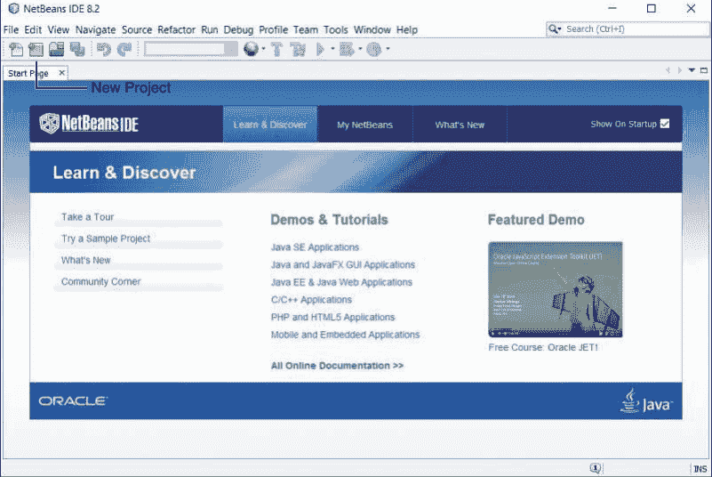

**图 A.1**

NetBeans 用户界面。

### 创建新项目

一个 NetBeans 项目由一组相关的 Java 类、这些类使用的文件以及 Java 类库组成。每个项目都有自己的文件夹，你可以在 NetBeans 之外使用文本编辑器和其他编程工具对其进行探索和修改。

要开始新项目，点击图 A.1 所示的 New Project（新项目）按钮或选择 File（文件）、Project（项目）菜单命令。如图 A.2 所示，新项目向导将打开。

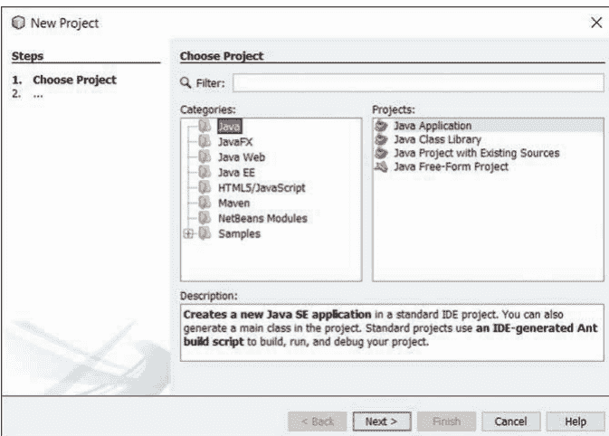

**图 A.2**

新项目向导。

NetBeans 可以创建多种 Java 项目，但在本书中你可以专注于一种：Java Application（Java 应用程序）。

对于你的第一个项目（以及书中的大部分项目），选择项目类型 Java Application 并点击 Next（下一步）。向导要求你为项目选择名称和位置。

Project Location（项目位置）字段标识了你用 NetBeans 创建的编程项目的根文件夹。在 Windows 上，这是“我的文档”（或“文档”）文件夹下的名为 NetBeansProjects 的子文件夹。你创建的所有项目都存储在此文件夹中，每个项目都有自己的文件夹。

在 Project Name（项目名称）字段中，输入 `Java24`。Create Main Class（创建主类）文本框会随输入发生变化，推荐将 `java24.Java24` 作为项目中主 Java 类的名称。将其更改为 `Spartacus` 并点击 Finish（完成），接受所有其他默认值。NetBeans 将创建该项目及其第一个类。

### 创建新的 Java 类

当 NetBeans 创建新项目时，它会设置所有必要的文件和文件夹并创建主类。图 A.3 显示了在编辑器中打开的项目中的第一个类 `Spartacus.java`。

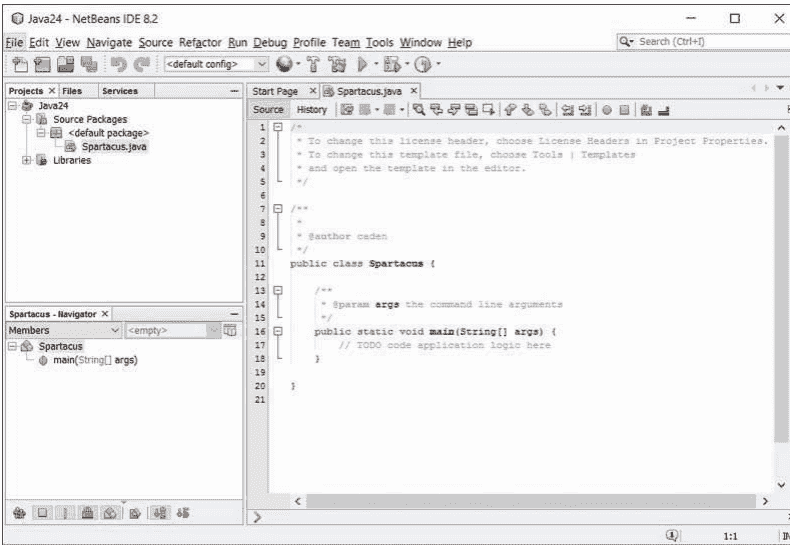

**图 A.3**

NetBeans 源代码编辑器。

`Spartacus.java` 是一个精简的 Java 类，仅包含一个 `main()` 方法。类中所有的浅色行都是解释类类目的和功能的注释。运行该类时，注释会被忽略。

要让新类发挥作用，请在注释 `// TODO code application logic here:` 下方的新行添加以下代码行：

```java
System.out.println("I am Spartacus!");
```

`System.out.println()` 方法显示一段文本，在此例中为句子 "I am Spartacus!"。

确保输入的内容与显示完全一致。在确认输入的代码行正确并以分号结尾后，点击工具栏上的 Save All（全部保存）按钮（或菜单命令 File, Save All）来保存该类。

```java
1: /*
2:  * To change this license header, choose License Headers in Project Properties.
3:  * To change this template file, choose Tools | Templates
4:  * and open the template in the editor.
5:  */
6: 
7: /**
8:  *
9:   * @author User
10:  */
11: public class Spartacus {
12: 
13:  /**
14:   * @param args the command line arguments
15:   */
16:  public static void main(String[] args) {
17:    // TODO code application logic here
18:    System.out.println("I am Spartacus!");
19: 
20: }
21: 
22: }
```

该类定义在 11–22 行。第 11 行以上的内容都是注释，当你选择 Java Application 作为项目类型时，每个新类都会包含这些注释。这些注释有助于阅读源代码的人类理解有关程序的内容。编译器会忽略它们。

### 运行应用程序

在你创建 `Spartacus.java` 类并成功编译后，你可以通过两种方式在 NetBeans 中运行它：

- 从菜单选择 Run（运行）、Run File（运行文件）。
- 在 Projects（项目）窗格中右键点击 `Spartacus.java` 并选择 Run File（运行文件）。

当你运行一个 Java 类时，虚拟机会调用其 `main()` 方法。"I am Spartacus!" 字符串将出现在 Output（输出）窗格中，如图 A.4 所示。

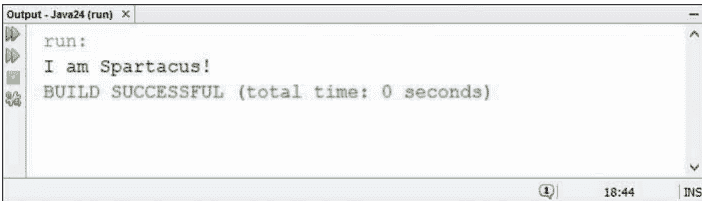

**图 A.4**

输出。

## 附录 B：之后的路：Java 资源

在读完这本书后，你可能想知道去哪里提升 Java 技能。本附录列出了一些用于扩展 Java 知识的书籍、网站和其他资源。

### 值得考虑的其他书籍

Sams Publishing 和其他出版社提供了几本关于 Java 编程的实用书籍，包括一些对本书内容的后续介绍。如果书店没有你想找的书，请使用 ISBN 号：

- 《Teach Yourself Java in 21 Days》，作者：Rogers Cadenhead (978-0-672-33795-6)。虽然本书前七章的部分内容是重复的，但它更深入地涵盖了 Java 并添加了许多高级内容。如果你准备好再次投入 504 小时学习 Java，这应该是一本合适的书。

- 《Java Phrase》，作者：Timothy R. Fisher (0-672-32907-7)。这是一个包含 100 多个代码片段的集合，供你在 Java 项目中使用，由专业程序员和《Java Developer's Journal》贡献者创建。


- 《Agile Java Development with Spring, Hibernate and Eclipse》(0-672-32896-8)。这是一本关于 Java 企业版的书籍，展示了如何使用 Spring 框架、Hibernate 库和 Eclipse IDE 来减少企业应用程序编程的复杂性。

- 《Android How to Program, 第 3 版》，作者：Paul and Harvey Deitel (0-13-44430-2)。手机和平板 Android 编程的广泛介绍，已针对 Android 6 版本和 Android Studio IDE 进行更新。读者可以通过此书学习八个应用。

- 《Java 9 for Programmers》，作者：Paul and Harvey Deitel (978-0-134-77756-6)。对 Java 9 的高级探索，涵盖 Lambda 表达式、Java 模块系统、动画、视频以及使用 JDBC 和 JPA 进行数据库编程。

许多 Sams Publishing Java 书籍的章节和其他材料已在 `www.informit.com` 上免费提供，这是一个与 Sams 合作的面向信息技术人士的网站。NetBeans 还在 `https://netbeans.org/kb` 提供培训和文档。

Sams Publishing 网站 `www.informat.com/sams` 是了解 Sams Publishing 以及 Pearson Technology Group 其他出版物动态的好去处。

## Oracle 官方 Java 网站

Oracle 的软件部门维护着三个令程序员和该语言用户感兴趣的网站。

Java 开发者 Oracle 技术网络（Oracle Technology Network for Java Developers）发布在 `www.oracle.com/technwork/java`，是寻找 Java 相关信息的首选之地。该网站可以下载 Java 开发工具包（JDK）的不同版本和其他编程资源，以及整个 Java 类库的文档。此外，这里有一个错误数据库、本地面对面用户组目录以及支持论坛。

位于 `www.java.com` 的 Java.com 向消费者和非程序员推介该语言的优势。你可以从该网站下载 Java 运行时环境，它能让用户在计算机上运行 Java 程序。该网站还包含一个关于运行 Java 和解决安全疑虑的帮助部分。

位于 `www.planetnetbeans.com` 的 Planet NetBeans 由几十个博客组成的集合，涵盖了使用 NetBeans IDE 进行 Java 编程的内容。博客的最新文章会显示在该网站上，你可以在 Feedly 等阅读器中订阅它们的 RSS 馈送。

## Java 类文档

Oracle Java 网站可能最有用的部分是 Java 类库中每个类、变量和方法的文档。网上有数千页的文档供你免费阅读，介绍了如何在你的程序中使用这些类。

要访问 Java 9 的文档，请前往 `http://download.java.net/jdk9/docs/api`。

## 其他 Java 网站

由于 Java 现象的很大程度上最初的灵感源于它在网页上的应用，因此有大量网站关注 Java 和 Java 编程。

## 本书的官方网站

本书的官方网站是 `www.java24hours.com`，在附录 C“本书的网站”中会有详细描述。

## Workbench

我还运营着名为 Workbench 的网络博客，涵盖了 Java、互联网技术、计算机书籍及类似话题以及其他主题。你可以在 `http://workbench.cadenhead.org` 找到它。

## Slashdot

技术新闻网站 Slashdot 自 1997 年以来一直是程序员和其他计算机行业专业人士的必去之地。该网站在首页精选用户提交的最佳故事，并允许用户对评论进行排序，以便你可以过滤掉噪音。要查看其最新的 Java 相关故事，请访问 `www.slashdot.org/tag/java`。

## 其他 Java 博客

数百个其他博客涵盖了 Java 编程，作为它们的主要关注点，或是作为更多化主题的一部分。

WordPress.Com 是许多博客的托管平台，在 `https://en.wordpress.com/tag/java` 对这些网站上最新的 Java 相关文章进行分类。

在 Twitter 上，你可以通过搜索标签 `#java` 在 `https://twitter.com/search?q=%23java` 查找 Java 博客和新闻。结果中的一些可能是关于咖啡或 Java 岛的，而不是编程语言。

## InformIT

技术参考网站 InformIT 位于 `www.informit.com`，是本书出版者支持的综合资源。该网站设有多个板块，介绍软件开发和互联网相关的几十个主题。InformIT 的 Java 部分包含操作指南文章和初学者参考。访问 `www.informit.com/topics/topic.aspx?st=66497` 直接访问。

## Stack Overflow

在线社区 Stack Overflow 是程序员可以在此地提问并对其他用户提供的答案进行评分的地方。该网站设有标签功能，你可以将搜索范围缩小到感兴趣的语言或主题。要查看 Java 相关问题，请访问 `https://stackoverflow.com/questions/tagged/java`。

## JavaWorld 杂志

JavaWorld 是一本自 20 世纪 90 年代语言诞生以来就存在的杂志，频繁发布教程文章以及 Java 开发新闻和其他专题。此外，还有视频和音频播客。访问 `www.javaworld.com`。

## Developer.com 的 Java 目录

由于 Java 是一种面向对象的语言，因此在自己的程序中使用其他开发者创建的资源很容易。在开始任何有意义的 Java 项目之前，你应该扫描网络，寻找你可能在程序中使用的资源。

一个很好的起点是 Developer.com 的 Java 目录。该网站在 `www.developer.com/java` 目录了 Java 程序、编程资源和其他信息。

## Java 会面

Meetup.com 网站包含了数千个由寻求参加的用户在网站共享的正式和非正式小组。

该网站公布了许多 Java 小组和其他 Java 活动。要找到距离你所在地 100 英里内的聚会，请访问 `www.meetup.com/find?keywords=Java&radius=100`。

在我所在的佛罗里达州，定期举行 Java 用户组、开发者组会议以及咖啡社交聚会。

## 就业机会

如果你是那些为了行业领袖计划而学习 Java 的人，本附录中列出的几个资源中有几个专门介绍就业机会的章节。查看一些可能存在的 Java 相关职位空缺。

招聘信息搜索引擎 Indeed 有一个专门针对 Java 工作的板块。访问 `www.indeed.com/q-java-jobs.html` 查看对精通该语言的程序员的最新招聘广告。Java 程序员的另一个优秀网站是 Dice，它在 `www.dice.com/jobs?q=java` 列出了 Java 招聘信息。

尽管它不是专门的 Java 就业资源，但 CareerBuilder 网站允许你使用报纸分类广告等许多来源，搜索两个以上职位数据库的职位分类信息。你可以使用 Java、Internet 或 snake charmer 等关键词搜索超过 100,000 份职位公告。前往 `www.careerbuilder.com`。

如果你在读完这本书后获得了一份 Java 编程工作，我很想听听相关情况。回到本书网站并点击 Feedback 链接联系我，或者在 Twitter 上通过 `@rcade` 给我发消息。

## 附录 C

## 本书的网站

尽管我希望情况并非如此，但在完成本书的 24 小时学习后，无疑还有一些令你不清楚的。

编程是一个专业的技术领域，会向你抛出许多概念和术语，例如“实例化”、“三元运算符”以及“大端和小端字节序”。如果你对书中涵盖的任何主题不清楚，请访问我们的网站以寻求帮助。

该网站提供以下内容：

- 错误纠正和澄清——当错误引起我的注意时，会在网站上描述。

- 读者问题的解答——如果读者有书中未涵盖的问题，会在网站上展示。

- 书中建议活动的源代码。

- 问题的解决方案。

- 更新的网站链接——如果书中提到的网站更改了地址，我会在网站上分享新链接。

你可以通过访问书籍网站给我邮件。我也可以在 Twitter 上通过 `@rcade` 找到我。

欢迎表达积极的、负面的、冷淡的、不定的、愤怒的、增强的、恼火的、有趣的、无聊的、着迷、神幻的、困惑的、震惊的。

> ——Rogers Cadenhead

本页故意留白

## 附录 D

## 修复模拟器问题

Android Studio 集成开发环境 (IDE) 自 2015 年发布以来已成为创建 Android 应用的官方工具。你在第 24 章“编写 Android 应用”中使用此 IDE 创建移动应用。

如果你已经阅读了该章节并在模拟器中成功运行了应用，就不需要阅读本附录。

但如果你完全无法让模拟器工作，你就对了。

## 运行应用程序的问题

当你在 Android Studio 中处理 Android 项目并想要运行应用时，可以选择命令 `Run`, `Run App`。

此命令会打开 Choose Device 对话框，询问执行应用的设备。设备可以是真实的 Android 手机或平板电脑，前提是已 USB 线连接到计算机并配置为测试应用。设备也可以是 Android 模拟器。

Android Studio 中的 Android 模拟器可以像运行移动操作系统的手机和平板电脑。可以为多个 Android 设备设置虚拟设备。

某些用户在首次使用模拟器运行 Android 应用时会遇到问题。模拟器会带有以下令人不安的消息崩溃：

输出

```
ERROR: x86 仿真目前需要硬件加速！
请确保已正确安装并可以使用 Intel HAXM。CPU
加速状态：HAX 内核模块未安装！
```

HAXM 是一种硬件虚拟化引擎，通过提高模拟器运行速度为开发 Android 的计算机提供支持。Android 应用编程中最大的瓶颈之一就是模拟器的加载速度非常缓慢。

在设置 HAXM 之前，你必须将其添加到 Android Studio 中的 Android SDK 中。

> **注意**
>
> HAXM 只能安装在带有 Intel 处理器的计算机上。本附录解决的是 Android Studio 提示需要 HAXM 才能运行 Android 模拟器的问题。如果模拟器失败的错误信息中没有提到 HAXM，请不要使用本附录进行修复。

## 在 Android Studio 中安装 HAXM

如果你正在运行 Android Studio，可以下载 HAXM 并将其添加到 Android SDK。点击 Android Studio 工具栏中的 SDK Manager，如图 D.1 所示。

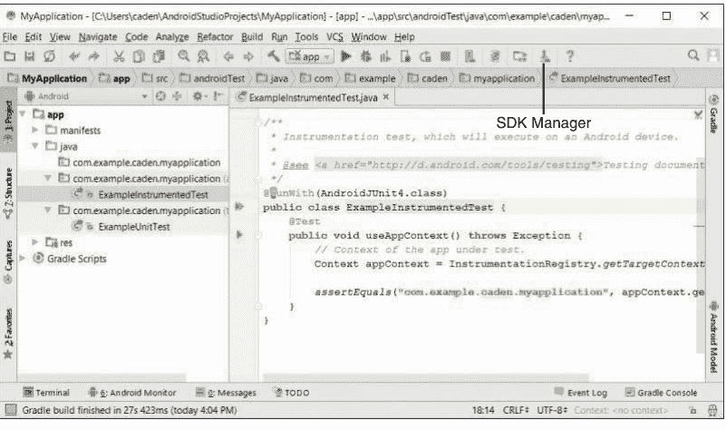

图 D.1.

运行 SDK Manager。

SDK Manager 用于通过额外的 Android 版本和实用的 SDK 工具来增强 SDK。点击 SDK Tools 选项卡将其置于顶前。

SDK 可用工具将列出，已安装的项目旁边会有勾选框。寻找 `x86 Emulator Accelerator (HAXM Installer)` 选项。

如果此项旁边没有勾选框，说明它尚未添加到你 Android Studio 版本的 Android SDK 中。（如果有勾选框，说明它已经安装，你应该跳转到下一节“在你的计算机上安装 HAXM”。）

Android SDK Manager 如图 D.2 所示。

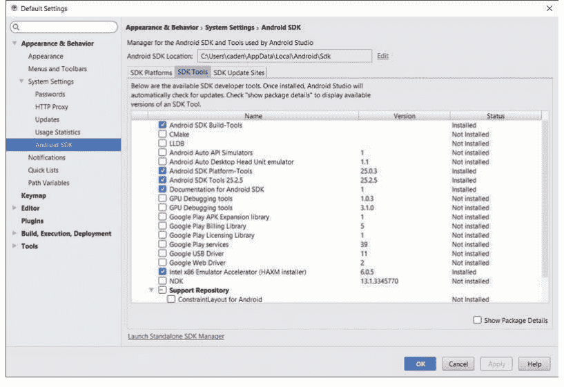

图 D.2

添加 SDK 工具。

安装 `Intel x86 Emulator Accelerator (HAXM Installer)` 并点击 OK。系统将要求你确认此更改。点击 OK。

Android Studio 将下载 HAXM 并报告其进度。如果安装正确，你就可以进行下一步，在你的计算机上安装它了。

## 在你的计算机上安装 HAXM

要在你的计算机上启动 HAXM，首先找到 Android Studio。

在你的文件系统中，找到你告诉 Android Studio 安装向导 Android SDK 所在的文件夹。

如果你不记得把它放在哪里了，Windows 上的默认是将 SDK 放在个人用户文件夹中名为 `AppData\Local\android\sdk` 的子文件夹下。如果你的 Windows 用户名是 Catniss，那么 SDK 路径就是 `\Users\Catniss\AppData\Local\Android\sdk`。

如果你在计算机上找到了 SDK 文件夹，打开它，然后打开子文件夹 `extras\intel\Hardware_Accelerated_Execution_Manager`。

该文件夹包含一个名为 `intelhaxm-android.exe` 的程序。这是 HAX 安装程序。

HAXM 需要带有 Intel 处理器、1G 磁盘空间以及 Windows 7 或更高版本，或 64 位的 Mac OS 10.8 到 10.11 之间的。此文件夹中的 `Release Notes.txt` 文本文件包含了软件要求的详细信息。

在查看发布说明文件后，如果你准备好安装 HAXM，请运行 `intelhaxm-android.exe` 程序。安装程序将检查你的计算机是否可以运行 HAXM，如果不能，它将退出。

在安装期间，系统会询问你允许 HAXM 使用多少内存。默认值 2G 应该足够了。完成安装。

> **提示**
>
> 如果你以后决定为 HAXM 分配的内存过多或过少，可以通过重新运行安装程序来更改此设置。

一旦安装好 HAXM，你应该重启计算机。

完成后，加载 Android Studio 并通过选择 `Run`, `Run App` 尝试运行你的 Android 应用。

应用应该会在模拟器中运行。Android 模拟器看起来像手机，在加载时显示“Android”启动屏幕，然后运行应用。图 D.3 显示了 Salutonondo 应用在成功运行时的样子。

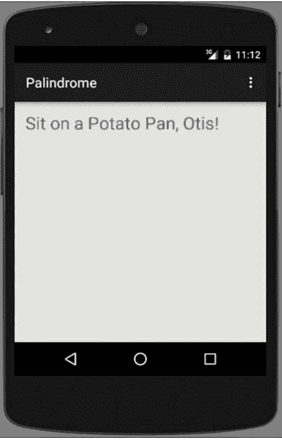

图 D.3

成功！模拟器加载并运行了应用。

如果成功了，你就可以回到第 24 小时了。

如果失败并显示了相同的错误信息，要求你“确保 Intel HAXM 已正确安装并可用”，还有一件事你可以检查。不过，这需要检查计算机的 BIOS 设置并对其进行更改。

## 检查 BIOS 设置

为了让 HAXM 工作，你计算机的 BIOS 必须在设置中启用 Intel Virtualization Technology（英特尔虚拟化技术）。如果你熟悉修改 BIOS，这是一个很容易检查和更改的项目。

由于 BIOS 的更改可能会影响计算机的启动方式——甚至导致其无法启动 Windows——因此如果你对计算机进行了 BIOS 更改，应该仔细研究一下 BIOS。否则，你应该寻求专家的帮助，让他们指导你完成该过程。

## 索引

## 符号

- `+` (加法运算符), 60

- `\` (反斜杠), 73, 293

- `{` (大括号), 17-18, 88, 95, 112-113, 148

- `:` (冒号), 90, 106

- `//` (注释符号), 17-18

- `+=` (复合赋值运算符), 74-75

- `-` (递减运算符), 61-63

- `/` (除法运算符), 60

- `*` (双引号), 55

- `=` (等号), 59

- `==` (相等性运算符), 85

- `>` (大于运算符), 84–85

- `>=` (大于或等于运算符), 84

- `++` (自增运算符), 61-63

- `!=` (不等于运算符), 85

- `<` (小于运算符), 84–85

- `<=` (小于等于运算符), 84

- `*` (乘法运算符), 61

- `->` 运算符, 229

- `+ .` (点), 用来替换空格, 114-115

- `;` (分号), 18, 24, 50

- `'` (单引号), 55

- `[]` (方括号), 112

- `-` (减法运算符), 60

- `?` (三元运算符), 90

- `_` (下划线), 57

- `$1` 美元, 未裁剪的整张, 257

## 2D 图形

- 创建自定义颜色, 327

- 设置, 326–327


- 字体, 325-326
- 线, 328–329
- 饼图
  - `PieFrame` 类, 336–338
  - `PiePanel` 类, 331–336
  - `PieSlic` 类, 333
- 形状
  - 弧, 330–331, 339
  - 椭圆和圆, 330
  - 形, 329–330

# ABCD 评分系统

# A

- ABCD 评分系统, 81
- 抽象窗口工具包 (AWT), 237–238, 256–257
- 访问器方法 (`accessor methods`), 166
- `ActionListener` 接口, 229, 274
- `actionPerformed()` 方法, 213, 230, 275
- `add()` 方法, 165, 274
- `addActionListener()` 方法, 285
- `addItemListener()` 方法, 285
- `add` 运算符 (`+`), 60
- `addOnToField()` 方法, 285
- 冒险 (Adventure), 299
- 《丁丁历险》, 96
- 分配方法 (`allocating method`), 155
- Android
  - Android 应用, 375
  - AVD (Android 虚拟设备), 382–383
  - 创建, 377–378, 380–381
  - 设计, 385–386
  - Java 代码, 390–395
  - 清单文件 (`manifest sheets`), 387
  - 项目, 378–380
  - 资源, 387
  - 运行, 383–385
  - 用户界面, 388–390
- Android Studio, 413
  - 优势, 396
- BIOS 设置, 417–418
- HAXM (硬件加速执行管理器)
  - 在 Android Studio 中安装, 414–415
  - 在电脑上安装, 415–417
  - 在其中运行应用程序, 413–414
- `AndroidManifest.xml` 文件, 380
- 注解 (`annotations`), 162
- 匿名内部类, 234
- 往南极极旅行, 24
- Apache 项目, 45
- `append()` 方法, 280
- 应用. 另见 Minecraft mods
- 分配方法 (`allocating method`), 155
- Android 应用. 参见 Battlepoint, 177–179
- 基准测试 (`Benchmark`), 107–108
- BlankFiller, 45
- 计算器 (`Calculator`), 189
- 目录 (`Catalogs`), 223–225
- ColorFrame, 230–232
- 商品 (`Commodity`), 89
- 编译, 20
- 组件, 6–7
- 配置器 (`Configurator`), 303–305
- 配置写入器 (`ConfigWriter`), 300–301
- 控制台 (`Console`), 297–299
- 创建, 41–43
- 制作人员 (`Credits`), 78–80
- Cis, 260–261
- 调试, 8–9–22
- 定义, 17
- 骰子 (`Dice`), 47–48
- 教育类应用, 30–31
- 厨房里的食物网, 32–33
- FreeFrame, 255–256
- FreeSpacePanel, 251–254
- GremlinLab, 152–154
- 运行原理, 7–8
- ID3Reader, 295–296
- ImageDownloader, 315–317
- ISS 检测器, 33–34
- Jsoko, 36
- KeyViewer, 227–228, 布局, 265–270
- LinkRouter. 参见 LinkRouter application
- LottoEar, 279–285
- Lotto Madness, 265–270, 288–285
- ModemTester, NameSorter, 117–118
- NewCalculator, 191–192
- NewFrame, 232–233
- NewRoot, 134–135
- Nines, 101–102
- NumberDivider, 192–193
- PageCatalog, 198–200
- PlanetWeight, 65
- 回放, 243
- 实时股票报价, 34–35
- Root, 41–43
- 在 Android Studio 中, 413–414
- 在 NetBeans 中, 404
- String 应用, 222
- 多线程应用, 212
- StringFrame, 241
- visto, 319–321
- 能够, 19–20
- 发送参数, 43–45
- 减速, 204
- StringLister, 166–167
- 初始值, 113
- 行为.* 参见方法
- 多维, 115–116
- 使用方法创建, 144
- 排序, 116–118
- 继承, 160–161
- 写入, 14
- Belichick, Bill, 119–121
- Bell Laboratories, 55
- `Array()` 方法, 312
- 基准测试应用, 107–108
- ASCII 集, 121
- Berners-Lee, Tim, 322
- `File()` 方法, 312
- 二进制值, 整数, 67
- 布尔值, 57–58
- 空格, 23–24
- `Arc2D.Float` 类, 330–331
- `byte`, 56
- BlankFiller 应用, 43–45
- Archimedes, 171
- `char`, 55–56
- 弧, 330–333, 339
- `float`, 54–55
- 定义, 17–18, 53
- `int`, 54–55
- 在 `if` 语句中, 85–87
- `long`, 56–57
- `try-catch`, 189–192
- `try-catch-finally`, 194
- `string`, 55–56
- WordPress.com, 409
- Web Tour 排名, 409
- 星号 (`*`), 61
- “数组索引越界”错误, 114
- `ArrayOutOfBoundsException` 类, 164–165, 174–179
- `BodyHandler` 类, 311
- `BodyProcessor` 类, 318
- 继承, 160–161, 407–418
- 数组, 111–113
- 自动锁, 133
- 拨号器, 127–128
- 布尔变量, 57–58
- AVD (Android 虚拟设备), 382–383
- 添加对象, 17
- `BorderLayout` 类, 261–262
- `BoxLayout` 类, 263–264
- `JButton`, 245–246, 248–250
- Battlepoint 应用, 177–179
- AWT (抽象窗口工具包), 237–238, 256–257
- 大括号 (`{}`), 88, 95, 112–113, 148
- 括号 (`()`), 12
- 在其中查找对象, 176
- 循环遍历, 166–167
- 从中移除对象, 175
- 成功到, 51
- `browse()` 方法, 213
- 缓冲输入流, 297–299
- 声明, 265–270
- 定义, 126
- `build()` 方法, 423
- 初始值, 113
- 多维, 115–116
- 排序, 116–118
- 继承, 160–161
- 写入, 14
- Belichick, Bill, 119–121
- Bell Laboratories, 55
- `Array()` 方法, 312
- 基准测试应用, 107–108
- ASCII 字符集, 121
- Berners-Lee, Tim, 322
- `File()` 方法, 312
- 二进制值, 整数, 67
- 布尔值, 57–58
- 空格, 23–24
- `Arc2D.Float` 类, 330–331
- `byte`, 56
- BlankFiller 应用, 43–45
- Archimedes, 171
- `char`, 55–56
- 弧, 330–333, 339
- `float`, 54–55
- 定义, 17–18, 53
- `int`, 54–55
- 在 `if` 语句中, 85–87
- `long`, 56–57
- `try-catch`, 189–192
- `try-catch-finally`, 194
- `string`, 55–56
- WordPress.com, 409
- Web Tour 排名, 409
- 星号 (`*`), 61
- “数组索引越界”错误, 114
- `ArrayOutOfBoundsException` 类, 164–165, 174–179
- `BodyHandler` 类, 311
- `BodyProcessor` 类, 318
- 继承, 160–161, 407–418
- 数组, 111–113
- 自动锁, 133
- 拨号器, 127–128
- 布尔变量, 57–58
- AVD (Android 虚拟设备), 382–383
- 添加对象, 17
- `BorderLayout` 类, 261–262
- `BoxLayout` 类, 263–264
- `JButton`, 245–246, 248–250
- Battlepoint 应用, 177–179
- AWT (抽象窗口工具包), 237–238, 256–257
- 大括号 (`{}`), 88, 95, 112–113, 148
- 括号 (`()`), 12
- 在其中查找对象, 176
- 循环遍历, 166–167
- 从中移除对象, 175
- 成功到, 51
- `browse()` 方法, 213
- 缓冲输入流, 297–299
- 声明, 265–270
- 定义, 126
- `build()` 方法, 423
- 初始值, 113

对象重用，163–164

Come On and Gettit.mp3,

`if`, 84, 95

`PieFrame`, 336–338

295–297

`if-else`, 87

`PiePanel`, 331–336

注释

不等于运算符 (`!=`), 85

`//` 注释表示法, 17–18

小于运算符 (`<`), 84

`Point3D`, 168–169

注解, 162

小于等于

`PointerTest`, 169–170

商品类应用, 89

(`<=`), 84

`Random`, 47

字符串比较, 76–77

`switch`, 87–89

`Rectangle2D.Float`, 329–330

三元运算符 (`?`), 90

`RenderingHints`, 326

配置

Spartacus, 404–204

编译文件 (运行菜单), 403

BIOS 设置, 417–418

子类, 130, 162–163, 180

配置属性，读取/写入, 302–305

编译型语言，速度, 11

`super` 关键字, 162–163

编译器, 8

Microsoft 服务器, 342–343

父类, 130

编译应用程序, 20

Configurator 应用, 303–305

同步, 184

组件。另见事件处理布局方法

ConfigWriter 应用, 300–301

`this` 关键字, 162–163

连接到 Minecraft 服务器, 346

`Thread`, 203

创建线程, 204–208

创建, 246–247

控制应用程序, 297–299

`sleep()` 方法, 204

事件处理, 276

构造函数, 147–148, 210

启动/停止方法, 208–209

启用/禁用, 278–279

`contains()` 方法, 78, 176

`FlowLayout`, 256

`containsKey()` 方法, 181

Wrecker, 150–151

帧, 238–242

`containsValue()` 方法, 181

`allFields()` 方法, 284

标签, 245–246

当前日期, 104–105

客户端，HTTP。另见 HTTP 客户端

面板, 251

转换

Clock 应用, 91–94

文本区域, 245–280

对象, 131, 132–135

`close()` 方法, 161, 300

文本字段, 245–260

自动装箱, 133

闭包, 229–233

窗口, 238–242

源/目的地, 131

冒号 (`:`), 90, 106

计算机速度测试, 107–108

拆箱, 133

Color 类

拼接字符串, 74

字符串转大/小写, 77, 80–81

条件判断

块, 85–87

变量, 131–132

`Color()` 方法, 327

`setColor()` 方法, 326–327

Clock 应用示例, 91–94

计数器, 100

CrazyHorse 项目, 356–362

颜色

定义, 83

自定义颜色, 327

相等运算符 (`==`), 85

`createTempFile()` 方法, 315

设置, 326–327

创建组合框

大于等于 (`>=`), 84–85

Android 应用, 377–388

创建, 247–248

数组列表, 174

类, 128–129, 402–404

# 创建

De Architectura (Vitruvius), 171

类, 408

构造函数, 147–148

调试, 8–9

Java 类库, 45

自定义颜色, 327

在 NetBeans IDE 中, 404–405

Java 文档, 23

Saluton 应用, 20–22

NetBeans IDE, 405

`do-while` 循环, 103–104

数组, 112–113

来自网络的文件, 314–317

方法, 145–146

类, 128–129

NetBeans IDE, 399

匿名内部类, 222

绘制

弧, 330

椭圆和圆, 330

直线, 328–329

变量, 54, 141–144

`boolean`, 57–58

`byte`, 56

`char`, 55

`float`, 54

`int`, 54

`short`, 56

`string`, 55

线程, 204–208

变量, 141–144

递减 (`--`), 61–62

默认语句, 88

`delete()` 方法, 293

删除

Crisis 应用, 260–261

设计 Android 应用, 385–386

的 Android, 375–376

Eclipse, 9

禁用组件, 278–279

除法运算符 (`/`), 60

空字符串, 80

Dahl, Rod, 271

Dancing the Stars, 11

封装, 146

数据发布到网络, 317–321

数据结构

数组列表, 174–179

等号 (`=`), 59

相等运算符 (`==`), 85

`equals()` 方法, 76–77, 81, 160

`equalsIgnoreCase()` 方法, 351

错误处理, 187, 201

异常, 188–199

`File` 类, 292–293

文件命令

`.class`, 24

`.java`, 7

数组索引越界, 114

`ArrayIndexOutOfBoundsException`, 188

`AndroidManifest.xml`, 380

创建, 292

`interhel-android.exe`, 416

JAR (归文件), 309

`java.exe`, 345

清单文件

`plugin.yml`

与错误比较, 187, 201

定义, 114

CrazyHorse 项目, 356–362

IceScoop 项目, 367–372

LightningStorm 项目, 362–365

SiameseCat 项目, 348–356 项目, 197–198

ingrok, 196

`IndexOutOfBoundsException`, 196

`MalformedURLException`, 195

LinkRotator 211

多个异常, 192–193

`try-catch` 块, 189–193

`try-catch finally`, 194

列表, 293

HomePage 项目, 197–198

ingrok, 196

`IndexOutOfBoundsException`, 196

`MalformedURLException`, 195

LottoEvent 应用, 279–285

lottoMadness 应用, 285–288

新项目, 401

运行文件, 404

# `final` 关键字 427

F

F, 84, 95

`EventListener` 接口, 2274

键盘事件, 276–278

LinkRotator 应用, 213

Fertel, Ruth, 38

# Java meetups 429

Hillbilly Boley (Vance), 235

history

Inaba, Carrie Ann, 11

变量类型

递增 (`++`) 运算符, 61–63

二进制值, 67

的 Android, 375–376

强制转换, 131–132

的 Java, 5, 29–30

变量递增, 61–62

首页页, 197–198

组合器, 318

`IndexOf()` 方法, 77–78, 176

声明, 54–55


# 索引

## A
- **ActionListener** 接口, 229, 274
- **Android** 应用, 388–390
- **Android Studio**, 9, 413
- **Android** 资源, 387
- **append()** 方法, 208
- **asByteArray()** 方法, 312
- **asFile()** 方法, 312

## B
- **Benchmark** 应用, 107–108
- **BoxLayout**, 263–264
- **build()** 方法, 311

## C
- **clearAllFields()** 方法, 284
- **close()** 方法, 161, 300
- **Color()** 方法, 327
- **contains()** 方法, 78, 165, 176
- **containsKey()** 方法, 181
- **containsValue()** 方法, 181
- **createNewFile()** 方法, 293
- **Creator()** 方法, 151
- **Creative Commons**, 296
- **currentTimeMillis()** 方法, 108

## D
- **data** (数据), 在网络上发布, 317–321
- **delete()** 方法, 293
- **do-while** 循环, 103–104
- **draw()** 方法, 328
- **drawString()** 方法, 328

## E
- **encode()** 方法, 318
- **entrySet()** 方法, 181
- **equalsIgnoreCase()** 方法, 351
- **EventListener** 接口, 273–274
- **exists()** 方法, 293

## F
- **fill()** 方法, 328, 399
- **firstValue()** 方法, 312
- **FlowLayout**, 259
- **for** 循环, 106–107
- **函数式接口**, 229

## G
- **Generator()** 方法, 284
- **get()** 方法, 165, 176, 181
- **getBytes()** 方法, 300
- **getCommand()** 方法, 275, 284
- **getEncoding()** 方法, 160
- **getEntityType()** 方法, 364
- **getGuid()** 方法, 160
- **getOrDefault()** 方法, 181
- **getText()** 方法, 246
- **getURL()** 方法, 211
- **getWorld()** 方法, 351
- **GridLayout**, 261–262
- **Graphics2D** 类, 328

## H
- **Hopper, Grace**, 9
- **HotLux**, 68
- **HttpClient** 类, 311
- **HttpHeaders** 类, 312
- **HTTP** 客户端, 309
- **HTTP** 请求, 310–314

## I
- **IceCreamScoop**, 366–372
- **ID3Reader** 应用, 295–296
- **IDE** (集成开发环境), 9–146, 314–317
- **implements** 关键字, 205
- **import** 语句, 209
- **intelhaxm-android.exe**, 416
- **Intent()** 方法, 392
- **解释型语言**, 7, 11
- **ISS Detector**, 33–34
- **ItemChanged()** 方法, 284–285
- **ItemChangedState()** 方法, 284–285
- **isPresent()** 方法, 312
- **迭代**, 101

## J
- **JAR** (Java 存档) 文件, 309
- **Java** 类库, 45–49
- **Java** 开发包 (JDK), 9
- **Java** 文档, 23
- **Java EE** (Java 企业版), 38
- **java** 文件扩展名, 7
- **java.io** 包, 46
- **java.time** 包, 46
- **java.util** 包, 46
- **Java 模块**, 300–319
- **Java 杂志**, 28
- **Java meetups**, 410
- **Java SE** (Java 标准版), 38
- **Java 虚拟机** (JVM), 8, 31, 309, 345
- **java.exe** 文件, 345
- **Java.com**, 408
- **JavaWorld**, 409
- **JButton** 类, 242–244
- **JCheckBox** 类, 246–248
- **JDK** (Java 开发包), 9
- **JFrame** 类, 238–242
- **JLabel** 类, 245–246
- **Joy, Bill**, 29
- **JPanel** 类, 251
- **JScrollPane** 类, 249
- **JShell**, 8, 49–570
- **Joko**, 36
- **JTextArea** 类, 248–250
- **JTextField** 类, 245–246
- **JVM** (Java 虚拟机), 8, 31, 309, 345

## K
- **KeyAdapter** 类, 226
- **键盘事件**, 276–278
- **keyPressed()** 方法, 226
- **keyReleased()** 方法, 226
- **keyTyped()** 方法, 226
- **KeyViewer** 应用, 227–228
- **KeyViewer** 监听器, 227
- **Katzenjammer**, 201

## L
- **Lambda** 表达式, 229–233
- **Larvet**, 68
- **Leeway, Joe**, 96
- **Legendary Stories of Daniels**, 217
- **length()** 方法, 77, 293
- **Line2D.Float** 类, 328–329
- **LinkRotator** 应用, 213–216
- **listFiles()** 方法, 293
- **loadURL()** 方法, 197
- **Location** 方法, 359
- **Location()** 方法, 359
- **long** 类型, 56–57
- **循环**, 99

## M
- **main()** 方法, 177
- **mark()** 方法, 161
- **Master P**, 11
- **Matulich, Chris**, 38
- **matchedOne()** 方法, 284
- **Minecraft** 组, 341
- **Minecraft** 服务器, 342–348
- **move()** 方法, 168

## N
- **NameSorter** 应用, 117–118
- **NASA**, 33
- **NetBeans** 字段指南 (Gosling), 399
- **NetBeans IDE**, 9, 146, 399
- **newBuilder()** 方法, 311, 318
- **NewCalculator** 应用, 191–192
- **NewColorFrame** 应用, 233–233
- **NewRoot** 应用, 134–135
- **nextInt()** 方法, 47
- **nines** 应用, 101–102
- **Notepad** (记事本), 7
- **NullPointerException** 类, 197
- **NumberDivider** 应用, 192–193
- **NumberFormatException** 类, 191, 195
- **数值型变量**, 54–55, 131–132

## O
- **Oak**, 29
- **OOP** (面向对象编程), 125–139
- **对象**, 128–138
- **运算符**, 60–64, 84–85, 90, 229
- **overriding()** 方法, 240

## P
- **pack()** 方法, 240
- **包**, 导入, 47, 289
- **PageApplication**, 198–200
- **paint()** 方法, 289
- **面板**, 251
- **parseDouble()** 方法, 368
- **parseFloat()** 方法, 135, 148
- **parseInt()** 方法
- **PieFrame** 类, 336–338
- **PiePanel** 类, 331–336
- **PieSlice** 类, 333
- **plugin.yml** 文件, 353–354, 360, 365, 370
- **Point30** 类, 168–169
- **PointTester** 类, 169–170
- **极坐标曲线**, 24
- **PotionEffect()** 方法, 360
- **PrimeFinder** 算法, 205–208
- **println()** 方法, 66, 72–73, 144
- **private** 语句, 143
- **protected** 语句, 143
- **public** 语句, 142
- **Purgatory Hull**, 217
- **put()** 方法, 181

## Q
- **强制转换**, 131–132

## R
- **Random** 类, 47
- **random()** 方法, 358
- **readLine()** 方法, 299
- **Rectangle2D.Float** 类, 329–330
- **矩形**, 329
- **remove()** 方法, 175
- **renameTo()** 方法, 293
- **Rendering** 类, 364
- **repaint()** 方法, 289
- **REPL** (读取-打印循环), 50
- **requires** 关键字, 420
- **res** 文件夹, 380, 386
- **reset()** 方法, 161
- **资源**, 30–31, 386, 408–409, 411
- **resume()** 方法, 209
- **return** 语句, 145
- **run()** 方法, 205, 212
- **Runnable** 接口, 205
- **运行** 命令 (File), 404

## S
- **SDK** (软件开发包), 330
- **scope()** 方法, 369
- **send()** 方法, 311
- **sendMessage()** 方法, 364
- **序列应用**, 14–22
- **serialization.java** 文件, 14–16
- **serializationFrame** 应用, 319–321
- **setBackground()** 方法, 326
- **setColor()** 方法, 340
- **setDefaultCloseOperation()** 方法, 240
- **setEditable()** 方法, 146
- **setGuid()** 方法, 160
- **setLayout()** 方法, 249
- **setListener()** 方法, 326
- **setSize()** 方法, 240
- **setTitle()** 方法, 246
- **setType()** 方法, 370
- **setVisible()** 方法, 241
- **showCount()** 方法, 17–18, 53
- **size()** 方法, 175, 181, 300
- **skip()** 方法, 294
- **sort()** 方法, 117
- **spawn()** 方法, 351
- **start()** 方法, 210, 311
- **stop()** 方法, 216, 217
- **strike()** 方法, 365
- **suspect()** 方法, 209
- **super** 关键字, 162–163
- **this** 关键字, 151–152, 162–163
- **throw** 关键字, 194–196
- **toCharArray()** 方法, 77
- **toUpperCase()** 方法, 77
- **translate()** 方法, 168

## T
- **taunt()** 方法, 146
- **throw** 关键字, 194–196

## V
- **变量**, 58–59, 143–144, 148–149, 209–210
- **void** 关键字, 145

## W
- **Window** 类, 238–242
- **工作机会**, 410

## 关键字
- **final**, 196
- **implements**, 205
- **requires**, 420
- **super**, 162–163
- **this**, 151–152, 162–163
- **throw**, 194–196
- **void**, 145

## 方法
- **actionPerformed()**, 213, 230, 243
- **addActionListener()**, 285
- **addOneField()**, 284
- **append()**, 208
- **asByteArray()**, 312
- **asFile()**, 312
- **build()**, 311
- **clearAllFields()**, 284
- **close()**, 161, 300
- **Color()**, 327
- **contains()**, 78, 165, 176
- **containsKey()**, 181
- **containsValue()**, 181
- **createNewFile()**, 293
- **Creator()**, 151
- **currentTimeMillis()**, 108
- **delete()**, 293
- **draw()**, 328
- **drawString()**, 328
- **encode()**, 318
- **entrySet()**, 181
- **equalsIgnoreCase()**, 351
- **exists()**, 293
- **fill()**, 328, 399
- **firstValue()**, 312
- **get()**, 165, 176, 181
- **getBytes()**, 300
- **getCommand()**, 275, 284
- **getEncoding()**, 160
- **getEntityType()**, 364
- **getGuid()**, 160
- **getOrDefault()**, 181
- **getText()**, 246
- **getURL()**, 211
- **getWorld()**, 351
- **indexOf()**, 77, 186
- **itemChangedState()**, 284–285
- **keyPressed()**, 226
- **keyReleased()**, 226
- **keyTyped()**, 226
- **length()**, 77, 293
- **listFiles()**, 293
- **loadURL()**, 197
- **Location()**, 359
- **main()**, 177
- **mark()**, 161
- **matchedOne()**, 284
- **move()**, 168
- **newBuilder()**, 311, 318
- **nextInt()**, 47
- **numberGone()**, 284
- **overriding()**, 240
- **pack()**, 240
- **paint()**, 289
- **parseDouble()**, 368
- **parseFloat()**, 135, 148
- **parseInt()**
- **playSound()**, 370
- **processClicks()**, 391–393
- **put()**, 181
- **readLine()**, 299
- **remove()**, 175
- **renameTo()**, 293
- **reset()**, 161
- **run()**, 205, 212
- **scope()**, 369
- **send()**, 311
- **sendMessage()**, 364
- **setBackground()**, 326
- **setColor()**, 340
- **setDefaultCloseOperation()**, 240
- **setEditable()**, 146
- **setGuid()**, 160
- **setLayout()**, 249
- **setListener()**, 326
- **setSize()**, 240
- **setTitle()**, 246
- **setType()**, 370
- **setVisible()**, 241
- **showCount()**, 17–18, 53
- **size()**, 175, 181, 300
- **skip()**, 294
- **sort()**, 117
- **spawn()**, 351
- **start()**, 210, 311
- **stop()**, 216, 217
- **strike()**, 365
- **suspect()**, 209
- **taunt()**, 146
- **toCharArray()**, 77
- **toUpperCase()**, 77
- **translate()**, 168

## 存储
- **数组**, 164–165, 174–179
- **哈希映射**, 180–183


# 索引

## 语句
- 语句, 53–54
- `sendMessage()` 方法, 364
- `try-catch`, 192
- `try-finally`, 194
- `break`, 88, 95–105
- `class` 关键字
  - 连接到, 346
- `skip()` 方法, 294
- `continue`, 104–105
- 删除单词, 372–373
- 斜杠, 409
- `sleep()` 方法, 204
- 定义, 7
- 设置, 342–343
- 慢动作动画, 204
- 表达式, 54
- 故障, 344–346
- `Smartalt`, 116
- `extends`, 130, 161–162
- 软件。见应用
- `if`, 84
- `else`, 87
- `import`, 209
- Sophia of Hanover, 51
- `sort()` 方法, 117
- 循环. 循环
- 源代码, 35–37
- `private`, 143
- `SpaceRemoval` 应用
- `return`, 145
- 在 JShell 中运行, 49–50
- `switch`, 87
- `Spartacus` 类, 402–404
- 三元运算符 (`?`), 90
- `spawn()` 方法, 351, 359
- `this`, 151–152
- 计算机
- `try`, 294
- `static` 语句, 107–108
- `setLayout()` 方法, 244
- `setLineWrap()` 方法, 249
- `look()` 方法, 244
- `Object()` 方法, 352
- `setSize()` 方法, 240
- `setText()` 方法, 240
- `setVisible()` 方法, 240
- `setType()` 方法, 56
- `toString()` 方法, 171
- `toUpperCase()` 方法, 77, 81
- `toCharArray()` 方法, 114
- `translate()` 方法, 368
- 翻译, 368
- 故障排除, 344–346
- 写入数据, 437

## 类型（变量）
- `char`, 55–56
  - 赋值, 54
  - 创建, 141–144
- `boolean`, 57–58
  - 声明, 54
- `byte`, 56
  - 显示内容, 18–19
- `char`, 55–56
  - 表达式, 64–66
- `float`, 54–55
- `int`, 54–55
  - 递增/递减, 61–62
- `long`, 56–57
  - 二进制值, 67
- `short`, 56
- `string`, 55–56
  - 声明, 54–55

# W-X-Y-Z

- Washington Generals, 184

## 网站
- CERN (欧洲核研究组织)
- HTTP 资源, 310–314
- Java 资源, 408–409, 411
- Oracle 的 Java 网站, 27–29, 408
- SourceForge, 35–37
- 发布于, 317–322
- 从中保存文件, 314–317

- Wetzel, Dan, 122
- Wheel application, 119–121
- Wheel of Fortune, 119. 另参见 Wheel application
- `while` 循环, 102–103
- Wilhelm scream, 396
- Willy Wonka and the Chocolate Factory, 271
- windows
  - 创建, 238–242

## 向导
- 新文件向导, 14, 43
- 新项目向导, 401

- Wooley, Sheb, 396
- WordPress.com, 409
- Workbench blog, 409
- world 子类
  - 删除, 373

# U

- ulvstudio Real-Time Stock Quotes, 34–35
- 拆箱, 133
- 未检查异常, 197
- 下划线 (`_`), 57
- Unicode, 121
- 大写
  - 将字符串转换为大写, 77, 80–81
- `URISyntaxException`, 211, 311
- 用户输入, 响应. 另参见事件处理
- 用户界面. 另参见 GUIs（图形界面）

# V

- 哈希映射的值, 180
- Vance, J., 235
- Variable application, 56

## 变量. 另参见数组
- `boolean`, 57–58
- `byte`, 56
- 强制转换, 131–132

- `Wrecker` 类, 150–151
- `write()` 方法, 300

## 写入数据
- 配置属性, 302–305
- 将数据写入流, 299–301

- VB (Visual Basic), 4
- Java 版本, 30
- vi 编辑器, 77
- Visual Basic, 4
- Vitruvius, 171
- Vogel, Karin, 51
- `void` 关键字, 145
- LockRotator application, 209–210
- `long`, 56–57
- 命名规范, 58, 59, 67

## 运算符
- 算术, 60–61
- 减 (`-`), 61–63
- 增 (`+`), 61–63
- 优先级, 63–64

- `pathSeparator`, 293
- `private`, 143
- `protected`, 143
- `public`, 142
- 范围, 148–149
- `short`, 56
- `static`, 143
- 在其中存储信息, 18, 59–60
- strings. 另参见 strings
