# Sams 24 小时学会 Java，第八版

如需批量购买本书，或需了解特殊销售机会（可能包括电子版；定制封面设计；以及针对您的业务、培训目标、营销重点或品牌兴趣特定特定），请联系我们的企业销售部门 `corpsales@pearsoned.com` 或拨打 (800) 382-3419。

```java
// display the name of the month
switch (month) {
    case 1:
        System.out.print("January");
        break;
    case 2:
        System.out.print("February");
        break;
    case 3:
        System.out.print("March");
        break;
    case 4:
        System.out.print("April");
        break;
    case 5:
        System.out.print("May");
        break;
    case 6:
        System.out.print("June");
        break;
    case 7:
        System.out.print("July");
        break;
    case 8:
        System.out.print("August");
        break;
    case 9:
        System.out.print("September");
        break;
    case 10:
        System.out.print("October");
        break;
    case 11:
        System.out.print("November");
        break;
    case 12:
        System.out.print("December");
        break;
}
// display the date and year
System.out.println(" " + day + ", " + year + ".");
```

保存程序后，在运行之前，请仔细检查代码，以了解条件语句是如何使用的。

### 注意事项

由于此程序使用了 Java 的较新特性，如果当前的 NetBeans 项目被设置为使用较早版本的语言，它将无法编译。它应该是 `JDK 9`。为了确保选择了正确的设置，请选择 `File`（文件）、`Project Properties`（项目属性）。在 `Project Properties` 对话框中，查找 `Source/Binary`。

除了第 3–4 行和第 8–14 行外，`Clock` 程序包含了到目前为止涵盖的内容。在设置了一系列变量来存储当前日期和时间后，使用了一系列 `if` 或 `switch` 条件语句来确定应该显示哪些信息。此程序包含了多次使用 `System.out.println()` 和 `System.out.print()` 输出字符串。第 8–14 行引用了一个名为 `now` 的 `LocalDateTime` 变量。`LocalDateTime` 变量是一个对象。对于本节，请关注这些行中发生了什么，而不是它是如何实现的。`Clock` 程序由以下部分组成：

- 第 1 行允许你的程序使用一个跟踪当前日期和时间的类：`java.time.LocalDateTime`。
- 第 4 行允许程序使用 `java.time.temporal.ChronoField` 类，这听起来像是时间旅行电影里的东西。
- 第 6–7 行开始 `Clock` 程序及其 `main()` 语句块。
- 第 9 行创建了一个名为 `now` 的 `LocalDateTime` 对象，它包含了你系统的当前日期和时间。每运行一次此程序，`now` 对象都会发生。（除非宇宙的物理定律被改变且时间停止了）。
- 第 10–14 行创建了用于存储 `hour`、`minute`、`month`、`day` 和 `year` 的变量。这些变量的值从 `LocalDateTime` 对象中提取，它是所有信息的存储库。括号内的信息（例如 `ChronoField.DAY_OF_MONTH`）指示提取日期和时间的哪个部分。
- 第 17–23 行显示三种可能的问候语之一：“Good morning.”“Good afternoon.”或“Good evening.”显示的问候语根据 `hour` 变量的值进行选择。
- 第 26–32 行显示当前分钟以及一些辅助文本。如果 `minute` 的值为 0，则由于第 27 行的 `if` 语句，第 28–31 行将被忽略。该语句是必要的，因为程序告诉某人现在是几点零分是不符合逻辑的。第 28 行显示 `minute` 变量的当前值。第 29–30 行使用三元运算符根据 `minute` 是否等于 1 来显示“minutes”或“minute”。
- 第 35–37 行通过另一个三元运算符显示当前小时。第 36 行的三元条件语句导致小时大于 12 时以不同的方式显示，这防止了计算机输出类似“15 点”的时间。
- 第 40–76 行是程序的大部分，是一个长的 `switch` 语句，根据存储在 `month` 变量中的整数值显示不同的月份。
- 第 79 行通过显示当前日期和年份完成显示。
- 第 80–81 行关闭 `main()` 语句块。

你将在创建第一个对象中学习如何创建和操作对象。

**A.** 可以不使用 `else` 或 `switch`，许多程序员也从不使用三元运算符 `?`。然而，在程序中使用 `else` 和 `switch` 往往是有益的，因为它们能让程序更易理解。一组链在一起的 `if` 语句可能会变得难以管理。

**Q. 在这一小时的课程中，如果 `if` 语句只跟一条语句，有时不需要使用大括号 `{` 和 `}`。使用大括号是强制性的吗？**

**A.** 不是的。大括号可以作为任何 `if` 语句的一部分，用于包围依赖于条件测试的程序部分。养成使用括号的习惯是好的，因为可以防止在修改程序时可能发生的常见错误。如果你在包含单个语句的 `if` 条件中没有添加括号，那么当你以后添加第二条语句但忘记添加括号时，会发生什么？我来回答自己的问题：会发生意料之外的事情，而在编程中，“意料之外”这个词几乎从不是好事。

**Q. 在每个 `case` 后的语句块中都必须使用 `break` 吗？**

**A.** 你并不一定需要使用 `break`。如果你不在一组语句的结尾使用它，那么 `switch` 块语句内的所有剩余语句都将被处理，无论它们所测试的 `case` 值是什么。

然而，在大多数情况下，你可能希望在每组语句的结尾加上一个 `break` 语句。

**Q. 为什么汤森双胞胎（Thompson Twins）在三人组、彼此没有关系且没有人叫 Thompson 的情况下，却叫这个名字？**

**A.** 乐队成员 Tom Bailey、Alannah Currie 和 Joe Leeway 称自己为 Thompson Twins，以向 Thomson 和 Thompson 致敬——这是比利时漫画《丁丁历险记》中一对笨头笨脚的侦探。

这两位戴着圆顶帽的侦探在体貌上是无法区分的，除了胡须形状有细微差别外。尽管他们工作非常糟糕，但却莫名其妙地被分配重要且敏感的任务。他们经常追捕丁丁，指控他犯下未行的罪。

正如他们的名字所暗示的，这些侦探之间也没有血缘关系。

### 测验

以下问题将通过你在学习了 Java 条件语句后，对条件语句的掌握程度。

**1.** 条件测试的结果为 `true` 或 `false` 值。这让你想起了哪种变量类型？

**A.** 都没有。别用这些问题烦扰我了。

**B.** `long` 变量类型。

**C.** `boolean` 类型。

**2.** 哪一个语句被用作 `switch` 块语句中的默认分类？

**A.** `default`

**B.** `otherwise`

**C.** `onTheOtherHand`

**3.** 什么是条件（conditional）？

**A.** 洗完发后修复凌乱分叉发和缠结的东西。

**B.** 程序中用于测试条件为真还是为假的东西。

**C.** 你向宗教权威人物忏悔罪孽的地方。

#### 答案

**1. C.** `boolean` 变量类型只能等于 `true` 或 `false`，这与条件测试相似。如果你回答 A，我很抱歉，但只剩下 17 小时了，我们还有很多内容要涵盖。Java 不会自己教学。

**2. A.** 如果没有其他 `case` 语句匹配 `switch` 变量，则处理 `default` 语句。

**3. B.** 另外两个答案描述的是护发素（conditioner）和忏悔室（confessional）。

#### 活动

为了提高你在 Java 条件语句方面的技巧，请通过以下活动回顾本小时的主题：

-  在 `Clock` 程序的某一行 `break` 语句前加上“//”使其成为注释；然后编译它，并运行程序看看会发生什么。尝试多删除几个 `break` 语句再试一次。
-  创建一个短程序，在一个名为 `grade` 的整数变量中存储一个从 1 到 100 之间任选的值。使用这个 `grade` 变量配合条件语句，为所有‘A’、‘B’、‘C’、‘D’和‘F’的学生显示不同的信息。先尝试用 `if` 语句，然后尝试用 `switch` 语句。

要查看实现这些活动的 Java 程序，请访问书籍网站 [www.java24hours.com](http://www.java24hours.com)。

# 第 8 小时：使用循环重复操作

### 本小时的任务列表

-  使用 `for` 循环。
-  使用 `while` 循环。
-  使用 `do`-`while` 循环。
-  提前退出循环。
-  为循环命名。

学生最令人苦恼的惩罚之一是让他们在黑板上反复写某些东西。在《辛普森一家》中，在一次经常去黑板的某次经历中，巴特·辛普森必须写几十次“我再也不问圣诞老人什么时候上厕所了”。这种惩罚对孩子可能有效，但对计算机来说完全没用。

计算机可以重复执行某项任务。

循环让计算机程序返回同一个地方执行多次。

Java 中有三种循环语句：`for`、`do` 和 `while`。有些循环运行固定次数，而有些则会无限运行。

循环是程序用来重复执行某些操作的工具。

在编程中，你可以发现很多可以使用循环的场景。循环都可以工作，但了解它们是如何运作的是有益的。

### `for` 循环

在编程中，你会发现很多可以使用循环的场景。你可以使用它们来重复执行某些操作，例如每分钟移动一次时针。

Java 最复杂的循环语句是 `for`。`for` 循环以固定次数执行程序部分。看这里：

点击此处查看图像

```java
for (int dex = 0; dex < 1000; dex++) {
    if (dex % 12 == 0) {
        System.out.println("#: " + dex);
    }
}
```

这个循环显示 0 到 999 之间所有能 12 整除的数字。

`for` 循环有一个决定循环何时开始和结束的变量。这个变量被称为计数器（索引）。前面的循环中的计数器是变量 `dex`。

`for` 循环在 `for` 关键字后的括号内有三个部分：初始化、条件和变化部分。这些部分用分号隔开。示例说明了这三个部分：

-  初始化部分——在第一部分，变量 `dex` 被赋予了初始值 0。
-  条件部分——在第二部分，有一个可能你在 `if` 语句中使用的条件测试：`dex < 1000`。
-  变化部分——第三部分是改变 `dex` 变量值的语句，在本例中使用增增运算符。

在初始化部分，你设置计数器变量。你可以在 `for` 语句中创建变量，正如前面的示例使用整数变量 `dex` 所示。你也可以在程序的其他地方创建变量。该变量在循环开始时具有这个值。

条件部分包含一个必须保持为 `true` 循环才能继续测试。当测试为 `false` 时，循环结束。在本例中，当 `dex` 变量等于或大于 1,000 时循环结束。

`for` 语句的最后部分包含一个改变计数器变量值的语句。该语句在每次循环执行时都会处理。计数器必须以某种方式发生变化，否则循环将永远不会结束。在示例中，`dex` 在变化部分被增加了 1。如果 `dex` 不发生变化，它将保持原始值 0 不变，而条件 `dex < 1000` 将始终为真。

`for` 语句的块在循环的每次遍历中都会被执行。

上一个示例在 `for` 块内部包含以下语句：

点击此处查看代码图片

```java
if (dex % 12 == 0) {
    System.out.println("#: " + dex);
}
```

这些语句被执行了 1,000 次。循环通过将 `dex` 变量设置为 0 开始。在循环的每次通过中，它将 `dex` 加 1。当 `dex` 不再小于 1,000 时，循环停止。

### 注意事项

在提到循环时，你可能会听到一个特殊的术语是“迭代”（iteration）。一次迭代是指循环的单次遍历。用于控制循环的计数变量被称为“迭代器”（iterator）。

正如你在 `if` 语句中看到的那样，如果 `for` 循环只包含一条语句，则不需要括号。下例所示：

点击此处查看代码图片

```java
for (int p = 0; p < 500; p++)
    System.out.println("I will not sell miracle cures");
```

此循环将显示“I will not sell miracle cures”这段文本 500 次。虽然循环内部的单一语句不需要括号，但你可以使用括号使代码块更容易识别，如下：

点击此处查看代码图片

```java
for (int p = 0; p < 500; p++) {
    System.out.println("I will not sell miracle cures");
}
```

你在此小时内创建的第一个程序将显示前 200 个 9 的倍数：9、18、27 等，以此类推，直到 1,800（9 × 200）。在 NetBeans 中，在 `com.java24hours` 包中创建一个名为 `Nines` 的空 Java 文件，并输入列表 8.1 中的文本。当你保存文件时，它被存储为 `Nines.java`。

**列表 8.1 `Nines.java` 的完整文本**

点击此处查看代码图片

```java
package com.java24hours;

class Nines {
    public static void main(String[] arguments) {
        for (int dex = 1; dex <= 200; dex++) {
            int multiple = 9 * dex;
            System.out.print(multiple + " ");
        }
        System.out.println();
    }
}
```


`Nines` 程序在第 5 行包含一个 `for` 语句。该语句有三个部分：

 初始化—`int dex = 1`，创建了一个名为 `dex` 的整数变量并赋予它一个初始值 1。

 条件—`dex <= 200`，在循环的每次遍历中必须为真。当它不再为真时，循环结束。

 变化—`dex++`，在循环的每次遍历中将 `dex` 变量加 1。

在 NetBeans 中选择 Run、Run File 来运行程序。程序产生如图 8.1 所示的输出。

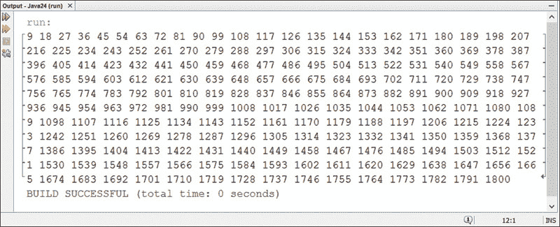

**图 8.1**

`Nines` 程序的输出。

NetBeans 中的输出窗口不会自动换行，因此所有数字都显示在同一行。要使文本换行，请在 Output（输出）窗格的任何位置点击右键，并从弹出菜单中选择 Wrap Text（自动换行）。

### `while` 循环

`while` 循环比 `for` 循环简单。它唯一需要的是随 `while` 语句的条件测试，如下代码所示：

点击此处查看代码图片

```java
int gameLives = 3;

while (gameLives > 0) {

    // 循环内部的语句

}
```

`while` 循环将持续直到 `gameLives` 不再大于 0。正如你在 `if` 语句中看到的那样，如果 `for` 循环只包含一条语句，则不需要括号。下例所示：

点击此处查看代码图片

```java
for (int p = 0; p < 500; p++)

    System.out.println("I will not sell miracle cures");
```

### `do-while` 循环

`do-while` 循环与 `while` 循环类似，但条件测试是在循环语句之后进行的。在 `do-while` 循环中，即使条件第一次为假，语句也会至少执行一次。

以下是 `do-while` 循环的示例：

点击此处查看代码图片

```java
int limit = 5;

int count = 1;

do {

    System.out.println("I will not sell miracle cures");

    count++;

} while (count < limit);
```

### 退出循环

退出循环的正常方法是测试条件变为假。这对于 Java 中所有类型的循环都适用。有时你可能希望立即结束循环，即使测试的条件仍然为真。你可以通过 `break` 语句来实现，如下所示：

点击此处查看代码图片

```java
int index = 0;

while (index <= 1000) {

    index = index + 5;

    if (index == 400) {

        break;

    }

}
```

另一个可以在循环内部使用的特殊情况语句是 `continue`。`continue` 语句会导致循环退出当前的迭代，并从循环的第一条语句重新开始。请考虑以下代码：

点击此处查看代码图片

```java
int index = 0;

while (index <= 1000) {

    index = index + 5;

    if (index == 400) {

        continue;

    }

    System.out.println("The index is " + index);

}
```

在这个循环内部，除非 `index` 的值等于 400，否则语句都会被正常处理。在这种情况下，`continue` 语句会导致循环返回到 `while` 语句，而不是正常地执行到 `System.out.println()` 语句。由于 `continue` 语句的存在，循环永远不会显示以下文本：

`The index is 400`

你可以在所有类型的循环中使用 `break` 和 `continue` 语句。

`break` 语句允许你在程序中创建一个设计为无限运行的循环，例如例所示：

点击此处查看代码图片

```java
while (true) {

    if (quitKeyPressed == true) {

        break;

    }

}
```

这个示例假设程序的其他部分会有操作使 `quitKeyPressed` 变量等于 `true`。在发生这种情况之前，`while` 循环将一直无限循环下去——因为它的条件始终等于 `true`，且这永远不会改变。

### 为循环命名

与 Java 程序中的其他语句一样，循环可以放置在其他循环内部。以下显示了 `while` 循环内部的 `for` 循环：

点击此处查看代码图片

```java
int points = 0;

int target = 100;

while (target <= 100) {

    for (int i = 0; i < target; i++) {

        if (points > 50) {

            break;

        }

        points = points + i;

    }

}
```

在这个示例中，如果 `points` 变量大于 50，`break` 语句会导致 `for` 循环结束。然而，`while` 循环永远不会结束，因为 `target` 永远不会大于 100。

在某些情况下，你可能同时跳出多个循环。为了实现这一点，你必须给外层循环（在本示例中是 `while` 语句）起一个名字。要为循环命名，在循环开始之前的一行写上名称，并在后面跟一个冒号（`:`）。

当循环有了名称后，在 `break` 或 `continue` 语句之后使用该名称，指示 `break` 或 `continue` 语句适用于哪个循环。接下来的示例重复了上一个，但有一点不同：如果 `points` 变量大于 50，两个循环都会结束。

点击此处查看代码图片

```java
int points = 0;

int target = 100;

targetLoop:

while (target <= 100) {

    for (int i = 0; i < target; i++) {

        if (points > 50) {

            break targetLoop;

        }

        points = points + i;

    }

}
```

当循环的名称被用于 `break` 或 `continue` 语句时，该名称不包含冒号。

### 复杂的 `for` 循环

`for` 循环可以比本节在此为止展示的更复杂。循环的初始化、条件和变化部分可以包含多个一个变量。`for` 循环可以在初始化部分设置多个变量，并在变化部分包含多条语句，如下代码所示：

点击此处查看代码图片

```java
int i, j;

for (i = 0, j = 0; i * j < 1000; i++, j += 2) {

    System.out.println(i + " * " + j + " = " + (i * j));

}
```

在 `for` 循环中用分号（`;`）隔开的每个部分中，都使用逗号来分隔变量，例如 `i = 0, j = 0`。示例循环显示了一个方程列表，其中 `i` 和 `j` 变量被相乘。在每次循环迭代中，`i` 变量增加 1，`j` 变量增加 2。当 `i` 乘以 `j` 等于或大于 1,000 时，循环结束。

`for` 循环的部分也可以是空的。一个例子是循环的计数器变量已经在程序的其他部分用初始值创建了，如下文所示：

点击此处查看代码图片

```java
int displayCount = 1;

int endValue = 13;

for ( ; displayCount < endValue; displayCount++) {

    // loop statements would be here

}
```

### 测试你的计算机速度

本小时的下一个项目是一个 Java 程序，用于执行基准测试（benchmark），这是一种衡量计算机硬件或软件运行速度快慢测试。`Benchmark` 程序使用循环语句反复执行以下数学表达式：

`double x = Math.sqrt(index);`

该语句调用 `Math.sqrt()` 方法来计算数字的平方根。你将在第 11 节“描述你的对象是什么样的”中学习更多关于方法的知识。

你正在创建的基准测试计算 Java 程序在一分钟内可以计算多少次平方根。

使用 NetBeans 在 `com.java24hours` 包中创建一个名为 `Benchmark` 的新空 Java 文件。输入列表 8.2 的文本并在完成后保存程序。

**列表 8.2** `Benchmark.java` 的完整源代码

点击此处查看代码图片

```java
1: package com.java24hours;

2:

3: class Benchmark {

4:     public static void main(String[] arguments) {

5:         long startTime = System.currentTimeMillis();

6:         long endTime = startTime + 60000;

7:         long index = 0;

8:         while (true) {

9:             double x = Math.sqrt(index);

10:            long now = System.currentTimeMillis();

11:            if (now > endTime) {

12:                break;

13:            }

14:            index++;

15:        }

16:        System.out.println(index + " loops in minute.");

17:    }

18: }
```


在程序中发生了以下情况：

5：`startTime` 变量创建为当前时间，通过调用 `currentTimeMillis()` 方法。

6：`endTime` 变量创建为 `startTime` 加 60,000。由于一分钟等于 60,000，这设置了 `startTime` 之后的一分钟。

7：`long` 类型变量 `index` 被创建。

8：`while` 语句使用 `true` 作为条件开始循环，导致循环无限持续（换句话说，直到某些事情停止它）。

9：计算 `index` 的平方根并存储在变量 `x` 中。

10：使用 `currentTimeMillis()` 创建变量 `now` 获取当前时间。

11-13：如果 `now` 大于 `endTime`，这意味着循环已经运行了一分钟，`break` 结束 `while` 循环。否则，它继续循环。

14：在每次循环迭代中，`index` 变量增加 1。

16：在循环之外，程序显示执行平方根计算的次数。

应用程序的输出显示在图 8.2 的输出面板中。

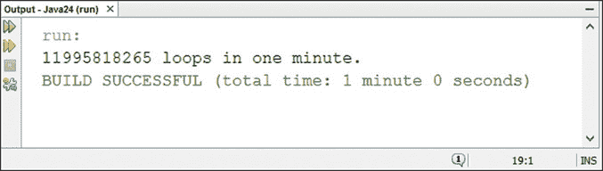

**图 8.2**

`Benchmark` 程序的输出。

`Benchmark` 程序是一个查看你的计算机是否比我的极极方法。在测试此程序期间，我的笔记本电脑执行了大约 119 亿次计算。如果你的计算机有更好的结果，不要只给我送哀。多买买我的书，这样我就可以升级我的电脑。

## 总结

循环是大多数编程语言的基础组成部分。通过顺序显示多个图形来创建动画，是你如果没有使用循环在 Java 或任何其他编程语言中无法完成的的任务之一。

巴特·辛普（Bart Simpson）在黑板上的所有惩罚在网络上都有记录。访问 [`simpsons.wikia.com/wiki/List_of_chalkboard_gags`](http://simpsons.wikia.com/wiki/List_of_chalkboard_gags) 查看该列表。

## 工作坊

### 问答

**Q. “初始化”（initialization）一词在多个地方都有。它是什么意思？**

**A.** 它是给某个东西一个初始值并对其进行设置。当你创建一个变量并给它分配一个起始值时，你正在初始化该变量。

**Q. 如果循环永不结束，程序如何停止运行？**

**A.** 通常在循环不结束的程序中，程序中的其他部分会被设置为以某种方式停止执行。例如，游戏程序中的循环可以在玩家仍有生命值时持续进行。

在编写程序时，经常出现的一个错误是无限循环，即由于编程错误导致循环永不停止。如果你运行的 Java 程序卡在无限循环中，请点击输出面板左侧的红色警报图标。

**Q. 我如何购买绿湾帕克队（Green Bay Packers）的股票？**

**A.** 除非这家公有的 NFL 球队决定进行另一次股票出售，否则成为股东的唯一方法是通过遗嘱继承股份。

帕克队分别在 1923 年、1935 年、1950 年、1997 年和 2011 年售过股票。尽管与股票相关的权利非常有限，但仍有约 36 万人拥有该队的 500 万股股份。

持有者无法获得股息，也无法通过股票获利。他们只能将股票卖回给球队并在交易中亏损。任何个人拥有的股票不能超过 200,000 股。

他们确实获得独家球队商品优惠，并参加年度会议以选举管理球队的七成员董事会。

在形成特许经营权的 1923 年股票出售中，1,000 名粉丝以每股 5 美元元的价格购买了股份。2011 年的出售为兰博球场（球队的主场）的升级筹集了 6700 万美元。

关于股票的更多信息可以在网络上的 [www.packers.com/community/shareholders.html](http://www.packers.com/community/shareholders.html) 找到。

## 测验

以下问题将测试你对循环的理解。本本主题的精神，请重复这些每个问题直到你答对为止。

**1.** 必须使用什么来分隔 `for` 语句的每个部分？

**A.** 逗号  
**B.** 分号  
**C.** 下班的警察人员

**2.** 哪条语句会导致程序回到开始循环的语句并从那里继续执行？

**A.** `continue`  
**B.** `next`  
**C.** `skip`

**3.** Java 中哪种循环语句始终至少运行一次？

**A.** `for`  
**B.** `while`  
**C.** `do-while`

### 答案

**1. B.** 逗号用于分隔部分内的内容，但分号用于分隔部分。

**2. A.** `break` 语句完全结束循环，而 `continue` 跳过到循环的下一次迭代。

**3. C.** `do`-`while` 条件在第一次通过循环之后才会被求值。

### 活动

如果你的头没有因为这些循环而转圈的话，请通过以下活动复习本小时的主题：

 修改 `Benchmark` 程序以测试简单数学计算（如乘法或除法）的执行。

 使用循环编写一个短程序，找到前 400 个 13 的倍数。

要查看实现这些活动的 Java 程序，请访问书籍的网站 [www.java24hours.com](http://www.java24hours.com)。

# 第三部分：处理方式处理信息

# 第 9 小时：使用数组存储信息

## 本小时待办事项

 创建一个数组。  
 设置数组的大小。  
 在数组元素中存储一个值。  
 修改数组中的信息。  
 创建多维数组。  
 对数组排序。

没有人比圣诞老人从计算机的发展中受益更多。几个世纪以来，人类让他承担着巨大的负担来收集和处理信息。老圣尼必须跟踪以下事项：

 坏孩子  
 乖孩子  
 礼物请求  
 坏孩子  
 乖孩子  
 礼物请求  
 坏孩子  
 乖孩子  
 礼物请求  
 坏孩子  
 乖孩子  
 礼物请求  
 坏孩子  
 乖孩子  
 礼物请求  
 坏孩子  
 乖孩子  
 礼物请求

计算机对圣诞老人是一个巨大的福音。它们非常适合对信息进行存储、分类和研究。到目前为止，你处理过的变量都是单个项目，例如浮点数或字符串。数组是具有相同类型的变量组。任何可以存储为变量的信息类型都可以变成数组。

## 创建数组

数组是根据共同名称分组的变量。你对数组这个词应该熟悉——想象一个销售员展示她的数组或一个有数组的游戏节目。和变量一样，数组通过说明被组织的变量类型和数组名称来创建。一对方括号 `[]` 跟在类型以区分数组与变量。

你可以为任何可以存储为变量的类型类型创建数组。以下语句创建一个字符串数组：

`String[] naughtyChild;`

这里是分别是创建整数和布尔值数组的语句：

此处查看代码图像

`int[] reindeerWeight;`

`boolean[] hostileTravelNations;`

### 注意

Java 创建数组时括号的位置是灵活的。你可以将它们放在变量名之后而不是变量类型之后，如下：

`String niceChild[];`

为了让人更容易发现数组，你应该坚持一种风格而不是来回切换。本书中的程序总是将括号放在变量或对象类型之后。

之前的示例创建了持有数组的变量，但没有在其中存储任何值。为了这样做，你可以结合变量类型使用 `new` 关键字，或者在 `{}` 中存储值。使用 `new` 时必须指定数组中存储了多少不同的项目。数组中的每个项目被称为元素。以下语句创建一个数组并为其持有的值留出空间：

此处查看代码图像

`int[] elfSeniority = new int[250];`

这个示例创建一个名为 `elfSeniority` 的整数数组。该数组有 250 个元素，可以存储圣诞老人的每个精灵在北极工作的月数。（如果圣诞老人经营的是工会，这些信息极其重要。）

当你使用 `new` 语句创建数组时，必须指定元素的数量。数组的每个元素都会赋予一个初始值，该值取决于数组的类型。所有数值数组的初始值均为 `0`，`char` 数组等于 `'\0'`，`boolean` 数组的值为 `false`。`String` 数组以及所有其他对象的初始值为 `null`。

对于不是不是极大的数组，你可以在创建的同时设置它们的初始值。以下示例创建了一个字符串数组并为它们赋予了初始值：

点击此处查看代码图片

```java
String[] reindeerNames = { "Dasher", "Dancer", "Prancer", "Vixen", "Comet", "Cupid", "Donner", "Blitzen" };
```

应该存储在数组元素中的信息放在 `{` 和 `}` 括号之间，并用逗号分隔每个元素。数组中的元素数量设置为该逗号分隔列表中元素的数量。

数组元素是有编号的，从第一个元素开始为 `0`。可以通过在 `[` 和 `]` 括号内引用该数字来访问特定元素。前述语句的效果与以下代码相同：

点击此处查看代码图片

```java
String[] reindeerNames = new String[8];

reindeerNames[0] = "Dasher";
reindeerNames[1] = "Dancer";
reindeerNames[2] = "Prancer";
reindeerNames[3] = "Vixen";
reindeerNames[4] = "Comet";
reindeerNames[5] = "Cupid";
reindeerNames[6] = "Donner";
reindeerNames[7] = "Blitzen";
```

数组的每个元素必须是相同类型。在这里，使用字符串来存储每个驯的名字。

数组创建后，你就无法为更多元素留出空间。即使你想起了最著名的那只驯，也无法将“Rudolph”作为 `reindeerNames` 数组的第九个元素。Java 编译器不会让可怜的 Rudolph 加入到任何 `reindeerNames` 中。

## 使用数组

你在程序中使用数组就像使用任何变量一样，唯一的区别是：数组项的元素编号必须位于数组名称旁边的方括号内。你可以在任何可以使用变量的地方使用数组元素，例如这些语句：

点击此处查看代码图片

```java
elfSeniority[193] += 1;

niceChild[9428] = "Eli";

currentNation = 413;

if (hostileAirTravelNations[currentNation] == true) {
    sendGiftByMail();
}
```

因为数组的第一个元素编号为 `0` 而不是 `1`，这意味着最大的数字比你预期的少一。考虑以下语句：

点击此处查看代码图片

```java
String[] topGifts = new String[10];
```

该语句创建了一个编号从 `0` 到 `9` 的字符串变量数组。如果你在程序的某处引用了 `topGifts[10]`，你将得到一个关于 `ArrayIndexOutOfBoundsException` 的错误消息。

`Exception` 是 Java 程序中错误的另一种说法。这种异常是“数组索引越界”错误，意味着程序尝试使用一个在其定义边界之外的数组元素。你将在 14 小时“程序中的错误处理”中学习更多关于异常的知识。

如果你想检查数组的上限以避免超出限制，每个数组都关联了一个名为 `length` 的变量。`length` 变量是一个包含数组元素数量的整数。以下示例创建了一个数组并报告它的长度：

点击此处查看代码图片

```java
String[] reindeerNames = { "Dasher", "Dancer", "Prancer", "Vixen", "Comet", "Cupid", "Donder", "Blitzen", "Rudolph" };

System.out.println("There are " + reindeerNames.length + " reindeer.");
```

在这个示例中，`reindeerNames.length` 的值为 `9`，这意味着你可以指定的最高元素编号是 `8`。

你可以以字符串或字符数组的形式在 Java 中处理文本。处理字符串时，一种有效的技巧是将字符串中的每个字符放入字符数组的独立元素中。要这样做，调用字符串的 `toCharArray()` 方法，它会生成一个元素数量与字符串长度相同的 `char` 数组。

本小时的第一个项目使用了本节介绍的两种技术。`SpaceRemover` 程序显示一个所有空格字符都被替换为点（`.`）的字符串。

开始，在 NetBeans 中打开 Java24 项目，选择 File、New File 并在 `com.java24hours` 包中创建一个名为 `SpaceRemover` 的空 Java 文件。在源编辑器中输入 Listing 9.1 并在完成后保存。

**列表 9.1 SpaceRemover 的全文**

点击此处查看代码图片

```java
package com.java24hours;

class SpaceRemover {
    public static void main(String[] arguments) {
        String mostFamous = "Rudolph the Nosed Reindeer";
        char[] mfl = mostFamous.toCharArray();

        for (int dex = 0; dex < mfl.length; dex++) {
            char current = mfl[dex];

            if (current != ' ') {
                System.out.print(current);
            } else {
                System.out.print('.');
            }
        }

        System.out.println();
    }
}
```


**图 9.1** Spaceover 的输出。

## 多维数组

目前为止数组都是一维的，因此可以使用一个数字检索元素。某些类型的信息需要更多维度来存储，例如 (x,y) 坐标系中的点。数组的一个维度可以存储 x 坐标，另一个维度可以存储 y 坐标。

要创建一个二维的数组，你在创建和使用数组时必须使用额外的方括号，例如这些语句：

点击此处查看代码图片

```java
boolean[][] selectedPoint = new boolean[50][50];

selectedPoint[4][13] = true;
selectedPoint[7][6] = true;
selectedPoint[11][22] = true;
```

此示例创建了一个布尔值数组 `selectedPoint`。该数组第一个维度有 50 个元素，第二个维度有 50 个元素，因此共有 2500 个独立数组元素（50 × 50）。创建数组时，每个元素都被赋予默认值 `false`。三个元素被赋予了 `true`：(x,y) 位置 4,13 的点、7,6 的点以及 11,22 的点。

数组可以拥有任意数量的维度，但记住它们可能会占用大量内存。创建一个 50 比 50 的 `selectedPoint` 数组等同于创建 2500 个独立变量。

## 数组排序

当你将一组相似的项目放入数组时，你可以做的一之一就是重新排列项目。以下语句交换了名为 `numbers` 的整数数组中两个元素的值：

```java
int[] numbers = { 3, 7, 9, 12, 5, 0, 8, 19 };

int temporary = numbers[5];

numbers[5] = numbers[6];

numbers[6] = temporary;
```


这些语句会导致 `numbers[5]` 和 `numbers[6]` 交换彼此的值。名为 `temporary` 的整数变量被用作交换其中一个值的临时存储位置。排序是将一组相关项目按照特定顺序排列的过程，例如将一个数字列表从低到高进行排序。

圣诞老人可以使用排序功能根据姓氏对礼物赠送者的顺序进行排序，这样 Willie Aames 和 Hank Aaron 就能比那些字母顺序上倒霉的 Steve Zahn 和 Mark Zuckerberg 更早地获得他们的圣诞节战利品。

在 Java 中对数组进行排序非常简单，因为 `Arrays` 类已经完成了所有工作。`Arrays` 是 `java.util` 类组的一部分，它可以重新排列所有变量类型的数组。

要在程序中使用 `Arrays` 类，请执行以下步骤：

1. 使用 `import java.util.*` 语句，以便在程序中使用 `java.util` 类更加方便。
2. 创建数组。
3. 使用 `Arrays` 类的 `sort()` 方法重新排列数组。

由 `Arrays` 类排序的变量数组将按数值升序顺序重新排列。字符和字符串将按字母顺序排列。

为了看到实际效果，请在 `com.java24hours` 包中创建一个名为 `NameSorter` 的空 Java 文件，并在源编辑器中输入列表 9.2 的文本。

### 列表 9.2 `NameSorter.java` 的完整源代码

```java
package com.java24hours;

class NameSorter {

    public static void main(String[] arguments) {

        String names[] = { "Glimmer", "Marvel", "Rue", "Clove",

        "Thresh", "Foxface", "Cato", "Peeta", "Katniss" };

        System.out.println("The original order:");

        for (int i = 0; i < names.length; i++) {

            System.out.println(i + ": " + names[i]);

        }

        System.out.println();

        Arrays.sort(names);

        System.out.println("The new order:");

        for (int i = 0; i < names.length; i++) {

            System.out.println(i + ": " + names[i]);

        }

        System.out.println();

    }

}
```

当你运行此程序时，它会按原始顺序显示九个名字列表，对名字进行排序，然后重新显示列表。图 9.2 显示了输出。

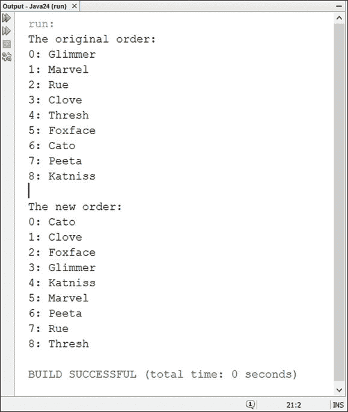

**图 9.2 `NameSorter` 程序的输出。**

当你处理字符串和整数、浮点数等基本变量类型时，你只能使用 `Arrays` 类按升序对它们进行排序。如果你在排序期间想要元素的排列方式，或者想要比 `Arrays` 类更高的效率，你可以编写代码来手动进行排序。

### 统计字符串中的字符

英语中出现频率最高的字母是 E、R、S、T、L、N、C、D、M 和 O，按顺序排列。如果你发现自己出现在联播游戏节目《幸运转盘》（Wheel of Fortune）中，这是一个值得了解的事实。

> **注意**
>
> 如果你不熟悉这个节目，《幸运转盘》是一个游戏，三位参赛者猜一个短语、名称或引言的字母。如果他们猜对了一个字母且该字母是辅音，他们就能赢得大转盘转出的金额。为了重现这种体验，你可以在摄影棚观众面前和朋友玩猜字游戏，当有人猜对字母时发放随机金额，并给获胜者送一台新的 Shark Rotator 吸尘器。

你的下一个 Java 程序将统计你感兴趣输入的任意不同短语和表达式中的字母频率。使用一个数组来统计每个字母出现的次数。完成后，程序将显示每个字母在短语中出现的次数。

在 NetBeans 中创建一个名为 `Wheel.java` 的空 Java 文件，将其放入 `com.java24hours` 包中，填充列表 9.3 的内容，完成后保存文件。可以随时在第 17 行和第 18 行之间添加短语，并像第 17 行一样格式化。

### 列表 9.3 `Wheel.java` 的完整源代码

```java
package com.java24hours;

class Wheel {

    public static void main(String[] arguments) {

        String phrase[] = {

        "A STITCH IN TIME SAVES NINE",

        "DON'T EAT YELLOW SNOW",

        "TASTE THE RAINBOW",

        "EVERY GOOD DOES FINE",

        "I WANT MY",

        "LIKE IKE",

        "PLAY IT AGAIN, SAM",

        "FROSTY THE SNOWMAN",

        "ONE MORE FOR THE ROAD",

        "HOME ADVANTAGE",

        "SHEIELD WEDNESDAY",

        "GROVER CLEVELAND OHIO",

        "SPAGHETTI WESTERN",

        "TEEN TITANS GO",

        "IT'S WONDERFUL LIFE"

        };

        int[] letterCount = new int[26];

        for (int count = 0; count < phrase.length; count++) {

            String current = phrase[count];

            char[] letters = current.toCharArray();

            for (int count2 = 0; count2 < letters.length; count2++) {

                char lett = letters[count2];

                if ((lett >= 'A') & (lett <= 'Z')) {

                    letterCount[lett - 'A']++;

                }

            }

        }

        for (char count = 'A'; count <= 'Z'; count++) {

            System.out.print(count + ": " + letterCount[count - 'A'] + " ");

            if (count == 'M') {

                System.out.println();

            }

        }

        System.out.println();

    }

}
```

如果你在不添加自己的短语的情况下运行程序，输出应该是图 9.3 所示。

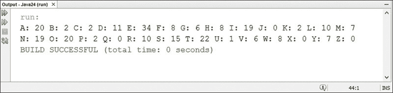

**图 9.3 `Wheel` 程序的输出。**

`Wheel` 程序发生了以下操作：

- 5–21 行：短语存储在名为 `phrase` 的字符串数组中。
- 22 行：创建了一个包含 26 个元素的整数数组 `letterCount`。该数组用于存储每个字母出现的次数。元素的顺序从 ‘A’ 到 ‘Z’。`letterCount[0]` 存储 ‘A’ 的计数，`letterCount[1]` 存储 ‘B’ 的计数，以此类推，直到 `letterCount[25]` 代表 ‘Z’。
- 23 行：一个 `for` 循环遍历 `phrase` 数组中的短语。使用 `phrase.length` 变量在达到最后一个短语后结束循环。
- 24 行：字符串变量 `current` 被赋值为 `phrase` 数组的当前元素。
- 25 行：创建一个字符数组并存储当前短语中的所有字符。
- 26 行：一个 `for` 循环遍历当前短语中的字母。使用 `letters.length` 变量在达到最后一个字母后结束循环。
- 27 行：创建一个字符变量 `lett`，其值为当前字母。
- 28–30 行：一个 `if` 语句排除所有不属于字母的字符（例如标点符号和空格）。根据当前字符的数值，`letterCount` 数组中的一个元素增加 1。
- 33 行：一个 `for` 循环从 ‘A’ 到 ‘Z’ 遍历字母表。

 第 34–40 行——显示当前字母，后跟分号以及该字母在 `phrase` 数组存储的短语中出现的次数。当当前字母为 ‘M’ 时，会显示换行，因此输出分布在两行。

此项目展示了如何使用两个嵌套的 `for` 循环来遍历一组短语，每次处理一个字母。Java 为每个字符分配了一个数值；这个数值比数组内部的字符更易使用。

> **注意**
>
> 与 ‘A’ 到 ‘Z’ 每个字符关联的数值是 ASCII 字符集所使用的数值。ASCII 字符集是 Unicode 的一部分，Java 语言支持的完整字符集。Unicode 包含了对世界范围内语言使用的超过 60,000 种不同字符的支持。ASCII 仅限于 256 个。

### 总结

数组使程序中存储复杂类型的信息并对其进行操作成为可能。对于任何可以排列成列表并可以使用你在第 8 小节“使用循环重复操作”中学习的循环语句轻松访问的信息，数组都是理想的工具。

诚实地说，圣诞老人的信息处理需求可能已经超出数组的范围。每年制造的孩子越来越多，他们想要的礼物在复杂性和开销上也在不断增加。

你的程序可能会使用数组来存储那些用变量处理起来困难的信息，即使你没有创建任何列表或对其进行双重检查。

### 工作坊

#### 问答

**Q. 字母的数值范围（从 ‘A’ 的 65 到 ‘Z’ 的 90）是 Java 基础语言的一部分吗？如果是，1 到 64 是留给什么的？**

**A.** 数字 1 到 64 包含了数字、标点符号和一些不可打印字符，如换行符、新行符和退格键。每个可以在 Java 程序中使用的打印字符都关联有一个数字，也包括一些不可打印字符。Java 使用 Unicode 编号系统。前 127 个字符来自 ASCII 字符集，你可能在其他编程语言中使用过它们。

**Q. 在多维数组中，可以使用 `length` 变量来测量第一维度之外的不同维度吗？**

**A.** 你可以测试数组的任何维度。对于第一维度，使用数组名配合 `length`，例如 `x.length`。后续维度可以通过对该维度的 `[0]` 元素使用 `length` 来测量。考虑一个名为 `data` 的数组，它是通过以下语句创建的：

```java
int[][][] data = new int[12][13][14];
```

该数组的维度可以通过使用 `data.length` 变量测量第一维度，`data[0].length` 测量第二维度，以及 `data[0][0].length` 测量第三维度。

**Q. 为什么新英格兰爱国者队主教练比尔·贝利奇（Bill Belichick）在场边穿那件破旧的连帽衫？**

**A.** 当你在十年内的胜利次数超过 NFL 历史上任何教练时（从 2003 年到 2012 年共 140 胜），你的老板让你设定自己的着装规范。体育记者认为，贝利奇开始穿无袖连帽衫是为了回应 NFL 与锐跑的一项交易，该交易要求所有教练必须穿授权的球队服装。

“他决定，如果他们非要让他穿球队服装，他就会从选项中筛选，并穿上他能找到的最丑的东西，”Yahoo! Sports 的 Dan Wetzel 解释道，“他选择了一件灰色的卫衣，通常带兜。”

贝利奇这种消极攻击的时尚声明让连帽衫变成了球队最畅销的商品之一。

### 测验

如果你的大脑是一个数组，你可以通过回答以下关于数组的问题来测试它的 `length`。

**1.** 数组最适合存储什么类型的信息？

**A.** 列表

**B.** 相关信息的对

**C.** 冷知识

**2.** 你可以使用哪个变量来检查数组的上边界？

**A.** `top`

**B.** `length`

**C.** `limit`

**3.** 圣诞老人共有多少只驯鹿，包括鲁道夫（Rudolph）？

**A.** 8

**B.** 9

**C.** 10

#### 答案

**1. A.** 仅包含相同类型信息（字符串、数字等）的列表非常适合存储在数组中。

**2. B.** `length` 变量包含数组中元素数量计数。

**3. B.** 根据克莱门特·克拉克·摩尔（Clement Clarke Moore）的《圣尼拉斯来访》，圣诞老人有“八只小驯鹿”，所以鲁道夫是第九只。

#### 活动

为了让自己以后有丰富的经验可供借鉴，你可以通过以下活动扩展对本小节主题的知识：

 创建一个使用多维数组存储学生成绩的程序。第一维度应该是每个学生的一个数字，第二个维度应该是每个学生的成绩。显示每个学生的平均分。

 创建一个使用多维数组存储学生成绩的程序。

要查看实现这些活动的 Java 程序，请访问书籍网站 [www.java24hours.com](http://www.java24hours.com)。

在 Java 中，你通过使用类作为模板来创建对象。`class` 是对象的副本，决定了对象应该拥有的属性和行为。“类（class）”这个词对你来说应该很熟悉，因为 Java 程序被称为类。你用 Java 创建的每个程序都是一个类，你可以将其作为创建新对象的模板。例如，任何使用字符串的 Java 程序都在使用从 `String` 类创建的对象。该类包含了决定 `String` 对象是什么的属性，以及决定 `String` 对象可以做什么的行为。

在面向对象编程（OOP）中，计算机程序是一组共同工作以完成某项任务的对象。某些简单的程序看起来似乎只由一个对象组成：即类文件。但即使是这些程序，也在使用其他对象来完成工作。

### 对象的运作

考虑一个显示饼图的程序。一个 `PieChart` 对象可能包含以下内容：

 计算每个饼图区域大小的行为

 绘制图表的行为

 用于存储图表标题的属性

要求 `PieChart` 对象绘制自己可能看起来很奇怪，因为图表在现实世界中并不会自己绘制。OOP 中的对象尽可能自己工作。这种能力使得它们更容易整合到其他程序中。例如，如果一个 `PieChart` 对象不知道如何绘制自己，那么每次你在另一个程序中使用该 `PieChart` 对象时，你都必须创建一个绘制它的行为。

OOP 的另一个例子，请考虑马修·布罗德里克（Matthew Broderick）的角色在经典黑客电影《游戏实战》（*WarGames*）中使用的自动拨号器程序，用来寻找他可以入侵的计算机。

> **注意**
>
> 自动拨号器是一种使用称为调制解调器（modem）的设备顺序拨打一系列电话的软件。此类程序的目的是找到其他接听的计算机，这样你以后就可以给它们打电话看看它们是什么。
>
> 小于 30 岁的读者可能很难相信，计算机曾通过电话拨号连接。你必须知道计算机的电话号码才能连接到它，如果它已经在与另一台计算机通话，你就会得到忙音信号。
>
> 现在我可能需要解释一下什么是忙音。
>
> 引用诗人 T.S. 艾略特（T.S. Eliot）的话：“我老了……我老了。”
>
> 今天使用自动拨号器会引起你当地电话公司和执法部门的注意。在 20 世纪 80 年代，这是一种不出门就能反叛的好方法。大卫·莱特曼（布罗德里克饰演的角色）使用他的自动拨号器寻找视频游戏公司的私人计算机系统，以便在公司新游戏发布之前玩到。相反，莱特曼发现了一台秘密政府计算机，它可以运行从国际象棋到全球热核战争的所有程序。

自动拨号器像任何计算机程序一样，可以被看作一组共同工作的对象。它可以被分解为：

 一个 `Modem` 对象，它知道自己的连接速度等属性，并具有让调制解调器拨号以及检测另一台计算机何时接听电话的行为。

 一个 `Monitor` 对象，它跟踪拨打了哪些号码以及哪些是计算机。

每个对象都独立存在。

设计一个完全独立的 `Modem` 对象的优点是，它可以被用于其他需要调制解调器功能的程序。

使用自包含对象的另一个原因是它们更容易被调试。计算机程序的规模会迅速变得臃肿。如果你在调试像 `Modem` 对象这样的东西并且知道它不依赖于任何东西，你就可以专注于确保 `Modem` 对象执行了它应该执行的工作，并持有它执行工作所需的信息。

将 Java 这样的面向对象的语言作为第一种编程语言是有益的，因为你不需要去摒弃其他编程风格的习惯。

### 什么是对象

对象是通过使用对象类作为模板创建的。以下语句创建了一个类：

```java
public class Modem {

}
```

从这个类创建的对象什么也做不了，因为它没有任何属性或行为。你需要添加这些内容来使该类变得有用，如下语句所示：

```java
public class Modem {

    int speed;

    public void displaySpeed() {
```


```java
        System.out.println("Speed: " + speed);

    }

}

```

`Modem` 类现在应该开始看起来你在第 1 小节到第 9 小节编写的程序了。`Modem` 类以 `class` 语句开始，但它包含了 `public` 关键字。这意味着该类供公共使用——换句话说，任何想要使用 `Modem` 对象的程序。

`Modem` 类的第一部分创建名为 `speed` 的整数变量。这个变量是对象的属性。

`Modem` 类的第二部分是一个名为 `displaySpeed()` 的方法。该方法是对象行为的一部分。它包含一条语句 `System.out.println()`，该语句显示了调制解调器的 `speed` 值。

对象的变量被称为实例变量或成员变量。

如果你想在程序中使用 `Modem` 对象，你可以使用以下语句创建它：

```java
Modem device = new Modem();
```

该语句创建了一个名为 `device` 的 `Modem` 对象。在你创建了对象后，可以设置它的变量并调用它的方法。以下是设置 `device` 对象的 `speed` 值的方法：

```java
device.speed = 28800;
```

要通过调用 `displaySpeed()` 方法让这个调制解调器显示速度，你需要调用：

```java
device.displaySpeed();
```

名为 `device` 的 `Modem` 对象可以响应此语句并显示“Speed: 28800”。

### 理解继承

OOP 的一大优势是继承，它允许一个对象从另一个对象继承行为和属性。

当你开始创建对象时，有时发现你想要的新对象非常像你已经拥有的对象。

如果大卫·莱特曼想要一个能够处理修正以及 1983 年《游戏实战》发布时还没有的高功能对象呢？莱特曼可以通过复制 `Modem` 对象的语句并进行修改来创建一个 `ErrorCorrectionModem` 对象。然而，如果 `ErrorCorrectionModem` 的大部分行为和属性与 `Modem` 相同，这就是许多不必要的工作。这意味着如果需要更改内容，莱特曼将会有两个独立的程序。

通过继承，程序员可以通过定义新类与现有类的不同之处创建一个新的对象类。莱特曼可以让 `ErrorCorrectionModem` 继承自 `Modem`，他只需要编写纠错调制解调器与普通调制解调器不同的部分。

类通过使用 `extends` 语句继承另一个类。以下继承自 `Modem` 类的 `ErrorCorrectionModem` 类的框架：

点击此处查看代码图像

```java
public class ErrorCorrectionModem extends Modem {

    // 程序写在这里

}
```

### 构建继承层次结构

继承允许在不重复工作的情况下开发各种相关的类，它使得代码从一个类传递到另一个类，再到另一个类。这种父类的类的分组被称为类层级结构，你在 Java 程序中使用的所有标准类都是层级结构的一部分。

理解了子类和父类后，理解层级结构就会变得简单。继承自另一个类的类被称为 `subclass`（子类）。被继承的类被称为 `superclass`（父类）。

在之前的《战争游戏》（*WarGames*）示例中，`Modem` 类是 `ErrorCorrectionModem` 类的父类。`ErrorCorrectionModem` 是 `Modem` 的子类。

在层级结构中，一个类可以有多个继承自它的类——`Modem` 的另一个子类可以是 `ISDNModem`，因为 ISDN 调制调器具有某些行为和属性，使得它们区别于纠错型调制调器。如果 `ErrorCorrectionModem` 有一个子类，例如 `InternalErrorCorrectionModem`，它将继承层级结构中位于它上面的所有类——即 `ErrorCorrectionModem` 和 `Modem`。这些继承关系如图图 10.2 所示。

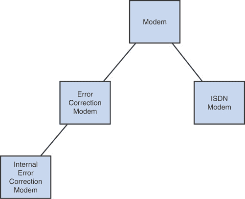

**图 10.2**

类层级结构的示例。

Java 语言中的各个类广泛使用了继承，因此理解它至关重要。你将在第 12 小节“充分利用现有对象”中学习更多关于该主题的知识。

## 转换对象简单变量

在 Java 中，你需要完成的最常见任务之一是将信息从一种形式转换为另一种形式。你可以进行的几种类型转换包括以下：

-  将一个对象转换为另一个对象
-  将对象转换为另一个对象
-  将对象转换为简单变量
-  将简单变量转换为对象

在第 5 小节中，你将学习更多关于数据类型的知识。这些类型包括 `int`、`float`、`double`、`long`、`short`、`byte`、`char` 和 `boolean`。当你需要将一个基本类型转换为另一个类型时，可能需要显式进行转换。如果将 `double` 变量转换为 `int` 类型，可能会丢失精度。

**注意**

当你需要将 `double` 转换为 `int` 类型时，通常需要显式进行转换。如果将 `long` 转换为 `int` 类型，可能会丢失精度。如果将 `float` 转换为 `int` 类型时，可能会丢失精度。

将 `double` 转换为 `long` 类型通常需要显式进行转换。如果将 `float` 转换为 `long` 类型，可能会丢失精度。

将 `double` 转换为 `short` 类型通常需要显式进行转换。如果将 `float` 转换为 `short` 类型，可能会丢失精度。

将 `double` 转换为 `byte` 类型通常需要显式进行转换。如果将 `long` 转换为 `byte` 类型时，可能会丢失精度。

将 `float` 转换为 `byte` 类型通常需要显式进行转换。如果将 `short` 转换为 `byte` 类型时，可能会丢失精度。

将 `double` 转换为 `char` 类型通常需要显式进行转换。如果将 `long` 转换为 `char` 类型时，可能会丢失精度。

将 `float` 转换为 `char` 类型通常需要显式进行转换。如果将 `short` 转换为 `char` 类型时，可能会丢失精度。

将 `double` 转换为 `boolean` 类型通常需要显式进行转换。如果将 `long` 转换为 `boolean` 类型时，可能会丢失精度。

将 `float` 转换为 `boolean` 类型通常需要显式进行转换。如果将 `short` 转换为 `boolean` 类型时，可能会丢失精度。

在 Java 中，基本类型和包装类之间的转换是自动完成的，这被称为自动装箱（autoboxing）和拆箱（unboxing）。

自动装箱是指将简单变量转换为对应的类。

拆箱是指将对象转换为简单值。

从对象到变量的一种常见转换是在数值表达式中使用字符串。当字符串的值可以转换为整数时，可以使用 `Integer` 类的 `parseInt()` 方法来完成，如本例所示：

点击此处查看代码图像

```java
String count = "25";

int myCount = Integer.parseInt(count);
```

这会将带有文本“25”的字符串转换为值为 25 的整数。如果字符串值不是有效的整数，则该转换将无法工作。

你创建的下一个项目是 `NewRoot`，该应用程序将命令行参数中的字符串值转换为数值，这是当你从命令行接收接收用户输入时的一种常用技术。

回到 NetBeans 中的 `Java24` 项目，选择文件（File）、新建文件（New File），然后在 `com.java24hours` 程序包中创建一个名为 `NewRoot` 的新空 Java 文件（Empty Java File）。在源编辑器中输入代码列表 10.1，并记得保存文件。

**代码列表 10.1 NewRoot.java 的完整文本**

点击此处查看代码图像

```java
package com.java24hours;

class NewRoot {

    public static void main(String[] arguments) {

        int number = 100;

        if (arguments.length > 0) {

            number = Integer.parseInt(arguments[0]);

        }

        System.out.println("The square root of "

                + number

                + " is "

                + Math.sqrt(number)

        );

    }

}
```

在运行程序之前，你必须配置 NetBeans 使用命令行参数运行它：

1. 选择菜单命令运行（Run）、设置项目配置（Set Project Configuration）、自定义（Customize）。项目属性窗口将打开。
2. 输入 `com.java24hours.NewRoot` 作为主类（Main Class）。
3. 在参数（Arguments）字段中输入 `9025`。
4. 点击 OK 关闭对话框。

要运行程序，选择运行（Run）、运行主项目（Run Main Project）（而不是运行、运行文件）。程序将将数字及其平方根，如图 10.3。

**图 10.3**

`NewRoot` 程序的输出。

`NewRoot` 应用程序是第 4 节方法并将字符串作为唯一参数传递，如第 7 行所示：

点击此处查看代码图像

```java
number = Integer.parseInt(arguments[0]);
```

`arguments[0]` 数组元素持有运行应用程序时提交的第一个命令行参数。当程序以“9025”作为参数运行时，字符串“9025”被转换为整数 `int` 9025。

将命令行参数从 9025 更改为其他数字并再次运行程序几次。

### 创建对象

为了在本节的下一个项目中查看类和继承的运行示例，你将创建代表两种类型对象的类：电缆调制解调器（cable modems，通过 `CableModem` 类实现）和 DSL 调制解调器（DSL modems，通过 `DslModem` 类实现）。工作重点关注这些对象的简单属性和行为：

-  每个对象都应该有一个可以显示的速度。
-  每个对象都应该连接到互联网。

电缆调制解调器 DSL 调制解调器的共同点是它们都有速度。因为这是它们共有的，可以将其放入一个类中，该类是 `CableModem` 和 `DslModem` 类的超类。将此类命名为 `Modem`。在 NetBeans 中，在 `com.java24hours` 程序包中创建一个名为 `Modem` 的新空 Java 类。在源编辑器中输入代码列表 10.2 并保存文件。

**代码列表 10.2 Modem.java 的完整文本**

点击此处查看代码图像

```java
package com.java24hours;

class Modem {

    int speed;

    public void displaySpeed() {

        System.out.println("Speed: " + speed);

    }

}
```

此文件将自动编译为 `Modem.class`。你不能运行此程序，但在其他类可以使用它。`Modem` 类可以处理 `CableModem` 和 `DslModem` 共同点之一。在创建 `CableModem` 和 `DslModem` 类时使用 `extends` 语句，可以让它们成为 `Modem` 的子类。

在 NetBeans 中为 `com.java24hours` 程序包启动一个名为 `CableModem` 的空 Java 文件。输入代码列表 10.3 并保存文件。

**代码列表 10.3 CableModem.java 的完整文本**

```java
package com.java24hours;

class CableModem extends Modem {

    String method = "cable connection";

    public void connect() {

        System.out.println("Connecting to the Internet ...");

        System.out.println("Using a " + method);

    }

}
```

在 `com.java24hours` 程序包中创建第三个文件名为 `DslModem`。输入代码列表 10.4 并保存文件。

**代码列表 10.4 DslModem.java 的完整文本**

点击此处查看代码图像

```java
        System.out.println("Connecting to the Internet ...");
        System.out.println("Using a " + method);
    }
}
```

如果没有错误，你现在有了三个类文件：`Modem.class`、`CableModem.class` 和 `DslModem.class`。然而，你不能运行任何这些类文件，因为它们没有像你创建的其他程序那样的 `main()` 块。你需要创建一个短应用程序来测试你刚刚构建的类层次结构。

回到 NetBeans，在 `com.java24hours` 中创建一个名为 `ModemTester` 的新空 Java 文件。在源编辑器中输入代码列表 10.5 并保存文件。

**代码列表 10.5 ModemTester.java 的完整文本**

```java
package com.java24hours;

class ModemTester {
    public static void main(String[] arguments) {
        CableModem surfBoard = new CableModem();
        DslModem gateway = new DslModem();
        surfBoard.speed = 500000;
        gateway.speed = 400000;
        System.out.println("Trying the cable modem:");
        surfBoard.displaySpeed();
        surfBoard.connect();
        System.out.println("Trying the DSL modem:");
        gateway.displaySpeed();
        gateway.connect();
    }
}
```

-  第 10 行——调用 `surfBoard` 对象的 `displaySpeed()` 方法。该方法继承自 `Modem`——尽管它在 `CableModem` 类中并不存在，但你可以调用它。
-  第 11 行——调用 `surfBoard` 对象的 `connect()` 方法。
-  第 12 行——调用 `gateway` 对象的 `displaySpeed()` 方法。
-  第 13 行——调用 `gateway` 对象的 `connect()` 方法。

### 总结

在创建第一类对象并将几个类组织成层级结构后，你应该对“面向对象编程”这个术语以及有趣的缩写 OOP 感到更加熟悉了。在接下来的两个小时里，随着你开始创建更复杂的对象，你将学习更多对象行为和属性的知识。

随着你对这种开发风格越来越熟悉，程序、类和对象等术语将更有意义。OOP 是一个需要时间来适应的概念。当你掌握了它之后，你会发现它是设计、开发和调试计算机程序的一种有效方式。

### 工作坊

#### 问答

**问：类可以继承多个类吗？**

**答：** 在某些编程语言（如 C++）中类是可以的，但 Java 不行。多继承是一项强大的功能，但它让 OOP 变得更难学习和使用。Java 开发者决定任何类只能继承一个父类，尽管一个类可以有许多子类。补偿这种限制的一种方法是从一种称为接口（interface）的特殊类型类继承方法。你将在第 15 节“创建多线程程序”中学习更多关于接口的知识。

**问：什么时候你想创建一个非 `public` 方法？**

**答：** 主要的情况是该方法专门供你正在编写的程序使用。如果你正在编写一个游戏程序，并且你的 `shootRayGun()` 方法专门针对你编写的游戏，那么它可以是一个私有方法。要让一个方法不是 `public`，只需在方法名前省略 `public` 语句即可。

**问：为什么 `char` 值可以像 `int` 值一样使用？**

**答：** 字符可以被用作 `int` 变量，因为每个字符都有一个对应的数字代码，代表它在字符集中的位置。如果你有一个名为 `k` 值为 67 的变量，类型转换 `(char) k` 会产生字符值‘C’，因为根据 ASCII 字符集，与大写 C 关联的数字是 67。ASCII 字符集是 Java 语言采用的 Unicode 字符标准的一部分。

**问：Tabasco 辣椒酱会变质吗？**

**答：** 不，尽管如果你把开过的瓶留好几年，它的颜色会发生。醋、红辣椒和盐的成分对于细菌生长是一个极其恶劣的环境。


Tabasco 辣椒酱的 McIlhenny 公司表示，原品牌的保质期为五年。其他版本的保质期从 18 个月到三年不等。

作为该产品的忠实粉丝，很难相信有人会留一瓶 Tabasco 久到产生这个问题。

### 测验

以下问题测试了你对对象以及使用它们的程序的了解。

**1.** 使用什么语句来允许一个类继承另一个类？

**A.** `inherits`

**B.** `extends`

**C.** `handItOverAndNobodyGetsHurt`

**2.** 为什么编译后的 Java 程序以 `.class` 文件扩展名保存？

**A.** Java 开发者认为这是一种很有格调语言。

**B.** 这是对世界上老师的微妙致敬。

**C.** 每个 Java 程序都是一个类。

**3.** 组成对象的两个要素是什么？

**A.** 属性和行为

**B.** 命令和数据文件

**C.** 唾液和醋

#### 答案

**1. B.** 使用 `extends` 语句是因为子类是父类以及类层级结构中更上任何父类属性和行为的扩展。

**2. C.** 你的程序始终由至少一个主类以及其他所需的类组成。

**3. A.** 在某种意义上，B 也是正确的，因为命令可以比比行为，数据文件类比于属性。

#### 活动

如果你不反对，可以通过以下活动来 `extends` 你对本小时主题的知识：

 创建一个速度为 300 且拥有自己的 `connect()` 方法的 `Commodore64Modem` 类。

 为 modem 添加一个 `disconnect()` 方法。

## 第 11 节 描述你的对象像什么

### 本节待办事项：

-  为对象创建变量。
-  使用对象的对象的方法。
-  调用一个方法并返回一个值。
-  创建构造函数。
-  向方法发送参数（此处原文 arguments 译为参数）。
-  使用 `this` 引用对象。
-  创建新对象。

正如你在上一节学习面向对象编程（OOP）时所知，对象是组织程序的一种方式使其拥有完成任务所需的一切。对象由属性和行为组成。

属性是存储在对象中的信息可以是整数、字符和布尔值等变量，或者是 `String` 或 `Calendar` 等对象。

要查看实现这些 Java 程序，请访问书籍网站。

将变量设为 `public`（公有的）使得另一个使用 `Gremlin` 对象的程序修改该变量。

如果另一个程序想要分配另一个创建者，例如，它可以将 `creator` 修改为该值。以下语句创建了一个名为 `gizmo` 的 `Gremlin` 对象并设置了它的 `creator` 变量：

点击此处查看代码图像

```
Gremlin gizmo = new Gremlin();
gizmo.creator = "Joe Dante";
```

在 `Gremlin` 类中，`creator` 变量也是 `public` 的，因此它可以从其他程序中自由更改。另一个变量 `maximumAge` 只能在类内部使用。

当你将类中的变量设为 `public` 时，该类就失去了对其他程序如何使用该变量的控制权。在很多情况下，这可能不是问题。例如，`creator` 变量可以更改为任何识别格灵精创建者的名称。

限制对变量的访问可以防止当另一个程序错误设置变量时发生错误。`maximumAge` 变量包含格灵精以其当前形式存在的小时数。将 `maximumAge` 设置为负值是没有意义的。如果 `Gremlin` 对象类需要防止这种问题，你需要做以下两件事：

 将变量从 `public` 改为 `protected`（受保护的）或 `private`（私有的），这是两种提供更严格访问限制的语句。

 添加行为来更改变量的值并向其他程序报告变量的值。

你只能在变量所在的同一个类、该类的任何子类，或者同一个包（package）中的类中使用 `protected` 变量。包是一组具有共同目的的相关类。一个例子是 `java.util` 包，它包含了提供如日期和时间编程以及文件归档等实用工具的类。当你在 Java 程序中使用带有星号的 `import` 语句时，例如 `import java.util.*`，你就可以更方便地在程序中引用该包中的类。

`private` 变量的限制比 `protected` 变量更加严格——你只能在同一个类中使用它。除非你确定变量可以更改为任何内容而不影响其类的功能，否则你应该将变量设为 `private` 或 `protected`。

以下语句使 `guid` 变为 `private` 变量：

```
private int guid;
```

如果你想让其他程序以某种方式使用 `guid` 变量，你必须创建一个使其成为可能的行为。这项任务将在本节后面的部分介绍。

还有另一种访问控制类型：在创建变量时没有任何 `public`、`private` 或 `protected` 语句。

在你在此节之前开发的大多数程序中，你并没有指定任何访问控制。当没有设置访问控制时，该变量仅对同一个包中的类可用。这被称为默认访问（default access）或包访问（package access）。

### 创建类变量

当你创建一个对象时，它拥有作为对象类一部分的所有变量的独立版本。从 `Gremlin` 对象类创建的每个对象都有它们自己的版本的 `guid`、`maximumAge` 和 `creator` 变量。如果你修改了某个对象中的其中一个变量，它将不会影响另一个 `Gremlin` 对象中的相同变量。

有时，属性应该描述整个对象类而不是特定对象本身。这些被称为**类变量**（class variables）。如果你想跟踪程序中使用多少个 `Gremlin` 对象，你可以可以使用类变量来存储此信息。整个类只存在一个变量副本。你到目前为止为对象创建的变量可以被称为**对象变量**（object variables），因为它们与特定的对象相关。

这两种变量的创建和使用方式是相同的，但 `static` 是创建类变量语句的一部分。以下语句为 `Gremlin` 示例创建了一个类变量：

```
static int gremlinCount = 0;
```

更改类变量的值与更改对象的变量没有区别。如果你有一个名为 `stripe` 的 `Gremlin` 对象，你可以使用以下语句更改类变量 `gremlinCount`：

```
stripe.gremlinCount++;
```

因为类变量适用于整个类，你也可以使用类名来代替：

```
Gremlin.gremlinCount++;
```

这两条语句都实现了相同的功能，但在处理类变量时使用类名的一个优势是，它能立即看出 `gremlinCount` 是类变量而不是对象变量。如果你在处理类变量时总是使用对象名，那么在不仔细查看源代码的情况下，你就无法判断它们是类变量还是对象变量。

类变量也被称为**静态变量**（static variables）。

**注意**

虽然类变量很有用，但你必须小心不要过度使用。这些变量在类运行期间一直存在。如果将大型对象数组存储在类变量中，它将占用大量的内存且永远释放。

### 使用方法创建行为

属性是跟踪对象类信息的方法，但为了让一个类执行它被创建时的任务，你必须创建行为。行为描述了类中完成特定任务的部分。这些部分每一个被称为**方法**（method）。

到此为止，你一直在程序中使用方法而自己并不知道，其中包含一个特定的方法：`println()`。此方法显示文本。与变量一样，方法也是与对象或类结合使用的。对象或类名后面跟着一个点和方法名，例如 `object.move()` 或 `Integer.parseInt()`。

**注意**

`System.out.println()` 方法看起来很奇怪，因为它有两个点。这是因为该语句涉及两个类：`System` 类和 `PrintStream` 类。`System` 类有一个 `out` 变量。`println()` 是 `PrintStream` 类的方法。`System.out.println()` 语句实际上意味着“使用 `System` 类的 `out` 实例的 `println()` 方法”。

### 声明方法

你创建方法的语句与开启类的语句相似。两者都可以在名称后的括号内接收参数，并且都在开始和结束处使用 `{` 和 `}`。区别在于方法处理后可以返回结果。结果可以是简单类型（如整数或布尔值），也可以是一个类。

以下是 `Gremlin` 类用来创建一个新格灵精的方法示例：

点击此处查看代码图像

```
public Gremlin replicate(String creator) {
    Gremlin noob = new Gremlin();
    noob.creator = "Steven Spielberg";
    return noob;
}
```

此方法接收单个参数：字符串变量 `creator`，它是一个代表创建者的变量。

在开启方法的语句中，`Gremlin` 位于方法名 `replicate` 之前。该语句表示方法处理后将返回一个 `Gremlin` 对象。`return` 语句才是实际发送对象的。在这个方法中，返回的是 `noob` 的值。

如果方法不应该返回，请在声明方法的语句中使用 `void` 关键字。

当方法返回结果时，你可以将方法作为表达式的一部分。例如，如果你创建了一个名为 `haskins` 的 `Gremlin` 对象，你可以使用如下语句：

点击此处查看代码图像

```
if (haskins.active() == true) {
```

```java
System.out.println(haskins.guid + " is active.");
}
```

你可以在程序中任何本可以使用变量的地方使用一个返回值的方法。

在这一小时的早些时候，你将 `guid` 变量更改为了 `private`，以防止它被其他程序读取或修改。

当一个实例变量为 `private` 时，仍然有一种方法可以让 `guid` 在其他地方使用：在 `Gremlin` 类中创建 `public` 方法，用以获取 `guid` 的值并为 `guid` 设置一个新值。这些新方法应该是 `public` 的，这与 `guid` 变量本身不同，这样它们可以在其他程序中被调用。

考虑以下两个方法：

点击此处查看代码图片

```java
public int getGuid() {
    return guid;
}

public void setGuid(int newValue) {
    if (newValue > 0) {
        guid = newValue;
    }
}
```

这些方法被称为*访问器方法*（accessor methods），因为它们允许从其他对象访问 `guid` 变量。

`getGuid()` 方法用于检索 `guid` 的当前值。`getGuid()` 方法没有任何参数，但方法名后必须有括号。`setGuid()` 方法接受一个整数参数 `newValue`。这个参数是 `guid` 的新值。如果 `newValue` 大于 0，将进行更改。

在这个示例中，`Gremlin` 类控制 `guid` 变量如何被其他类使用。这个过程被称为*封装*（encapsulation），它是面向对象编程的基本概念。当对象能够防止误用时，它们在其他程序中使用得更有用。

尽管 `guid` 是 `private` 的，但新方法 `getGuid()` 和 `setGuid()` 能够操作 `guid`，因为它们在同一个类中。

**提示**

集成开发环境（IDE）通常可以自动创建访问方法。NetBeans 提供了这种功能。打开第 10 节，“创建第一个对象”。在代码编辑器的任何地方右键点击，选择菜单 `Refactor`（重构）、`Encapsulate Fields`（封装字段）。会弹出一个对话框。点击 `All`（全部），然后点击 `Refactor`。NetBeans 将 `speed` 变量变为 `private` 并创建 `getSpeed()` 和 `setSpeed()` 方法。

### 具有不同参数的相似方法

正如你在 `setGuid()` 方法中所，你可以向方法传递参数来影响它的行为。类中的不同方法可以有不同的名称，但如果参数不同，方法也可以有相同的名称。

如果参数的数量或参数类型不同，两个方法可以具有相同的名称。例如，对于 `Gremlin` 类对象可能有两个 `countHuman()` 方法。一个可以没有参数，另一个可以指定一个字符串作为参数。以下语句实现了这些方法：

点击此处查看代码图片

```java
void countHuman() {
    System.out.println("That gotta hurt!");
}

void countHuman(String taunt) {
    System.out.println(taunt);
}
```

方法的名称相同，但参数不同：一个没有参数，另一个有一个 `String` 参数。方法的参数被称为方法的签名（signature）。只要每个方法的签名不同，类就可以拥有相同名称的方法。

### 构造方法

当你想要在程序中创建一个对象时，会使用 `new` 语句，例如：

点击此处查看代码图片

```java
Gremlin clorr = new Gremlin();
```

该语句创建了一个名为 `clorr` 的新 `Gremlin` 对象。当你使用 `new` 语句时，会调用该对象的特殊方法。此方法被称为构造方法，因为它处理创建对象所需的工作。构造方法的作用是设置变量并调用对象正常运行所需的方法。

构造方法的定义与其他方法相似，但它们不能返回值。以下是 `Gremlin` 类的两个构造方法：

点击此处查看代码图片

```java
public Gremlin() {
    creator = "Michael Finnell"; // creator 是一个字符串
    maximumAge = 240; // maximumAge 是整数
}

public Gremlin(String name, int age) {
    creator = name;
    maximumAge = age;
}
```

（注：提供的源文本在构造方法块中存在一些格式不一致之处，我已将其清理为标准的 Java 语法并保留了逻辑）。

根据提供的文本：

```java
public Gremlin() {
    creator = "Michael Finnell"; // creator 是一个字符串
    maximumAge = 240; // maximumAge 是整数
}

public Gremlin(String name, int age) {
    creator = name;
    maximumAge = age;
}
```

`new` 语句用于创建对象。构造方法处理创建对象所需的工作，设置变量并调用对象正常运行的方法。

构造方法的定义与其他方法相似，但它们不能返回值。

### 类方法

与类变量一样，类方法是提供与整个类相关而非特定对象的功能的方法。当方法没有影响单个对象的操作时，使用类方法。在第 10 节中，你使用了 `Integer` 类的 `parseInt()` 方法将字符串转换为 `int` 类型变量：

点击此处查看代码图片

```java
int fontSize = Integer.parseInt(fontText);
```

这是一个类方法。要使一个方法成为类方法，在方法名前单元使用 `static`，如下代码所示：

点击此处查看代码图片

```java
static void showGremlinCount() {
    System.out.println("There are " + gremlinCount + " gremlins");
}
```

类变量 `gremlinCount` 之前用于跟踪程序创建了多少个 `Gremlin` 对象。`showGremlinCount()` 方法是一个显示这个总数，你可以通过如下语句调用它：

```java
Gremlin.showGremlinCount();
```

### 方法内部的作用域

当你在一个类的方法内部创建变量或对象时，它只在该方法内部可用。这种现象是因为变量作用域的概念。作用域是变量在程序中存在的块。如果你离开了由作用域定义的程序部分，就无法再次使用该变量。

程序中的 `{` 和 `}` 括号定义了变量作用域的边界。在这些标记内创建的任何变量无法在外部使用。例如，考虑以下语句：

```java
if (numFiles < 1) {
    String warning = "No files remaining.";
}

System.out.println(warning);
```

这段代码无法运行——在 NetBeans 中无法编译——因为 `warning` 变量是在 `if` 块的括号内部创建的。这些括号定义了变量的作用域。`warning` 变量在括号外部不存在，因此 `System.out.println()` 方法无法将其作为参数使用。

当你在一组括号内部嵌套另一括号时，需要注意被包含变量的作用域。请看示例：

点击此处查看代码图像


```java
if (humanCount < 5) {
    int status = 1;
    if (humanCount < 1) {
        boolean firstGremlin = true;
        status = 0;
    } else {
        firstGremlin = false;
    }
}
```

发现任何问题了吗？在这个示例中，`status` 变量可以在代码块内的任何地方使用，但为 `firstGremlin` 变量赋值为 `false` 的语句会导致编译器错误。因为 `firstGremlin` 是在 `if (humanCount < 1)` 语句的作用域内创建的，所以它在随后的 `else` 语句的作用域内不存在。

要修复这个问题，必须在这两个代码块之外创建 `firstGremlin`，这样它的作用域就能包含这两个块。一种解决方案是在创建 `status` 之后的一行创建 `firstGremlin`。

强制作用域的规则使得程序更易调试，因为作用域限制了可以使用变量的区域。这减少了编程中可能出现的常见错误之一：在程序的不同部分以不同的方式使用同一个变量。

作用域的概念也适用于方法，因为方法是由左括号和右括号定义的。在方法内部创建的变量不能在其他方法中使用。只有当变量是作为对象变量或类变量被创建时，你才能在多个方法中使用它。

### 将一个类放在另一个类内部

尽管 Java 程序被称为一个类，但在很多情况下，程序需要多个类来完成工作。这些程序由一个主类和任何所需的辅助类组成。

当你将程序划分为多个类时，有两种定义辅助类的方法。一种方法是分别定义每个类，如下例所示：

点击此处查看代码图像

```java
public class Wrecker {
    String creator = "Phoebe Cates";
    public void destroy() {
        GremlinCode gc = new GremlinCode(1024);
    }
}

class GremlinCode {
    int vSize;
    GremlinCode(int size) {
        vSize = size;
    }
}
```

在这个示例中，`GremlinCode` 类是 `Wrecker` 类的辅助类。辅助类有时定义在与其协助的类相同的源文件中。当编译源文件时，会产生多个类文件。前面的示例在编译时会生成 `Wrecker.class` 和 `GremlinCode.class` 文件。

**注意**

如果在同一个源文件中定义了多个类，则只能有一个类是 `public` 的。其他类在类语句中不应包含 `public` 关键字。源文件的名称必须与它定义的 `public` 类名匹配。

在创建主类和辅助类时，你也可以将辅助类放在主类内部。这样做，该辅助类被称为内部类（inner class）。

你将内部类放在另一个类的左括号和右括号之间：

点击此处查看代码图像

```java
public class Wrecker {
    String creator = "Hoyt Axton";
    public void destroy() {
        GremlinCode vic = new GremlinCode(1024);
    }
    class GremlinCode {
        int vSize;
        GremlinCode(int size) {
            vSize = size;
        }
    }
}
```

你可以像使用其他类型的辅助类一样使用内部类。主要的区别（除了位置之外）是编译器处理完这些类后发生了什么。内部类不会获得其 `class` 语句指定的名称。相反，编译器会给它们一个包含主类名的名称。

在前面的示例中，编译器生成了 `Wrecker.class` 和 `Wrecker$GremlinCode.class`。

**注**

内部类允许在 Java 中实现复杂的编程技术，这些技术在你对语言有更多经验后会更有意义。准确地说，再过 5 个小时。本书将在第 16 小时“使用内部类和闭包”中回到这个主题。

### 使用 `this` 关键字

由于你可以引用其他类中的变量和方法，以及你自己类中的变量和方法，在某些情况下，你引用的变量可能会变得混淆。使其更清晰的一种方法是使用 `this`。

当你使用对象的方法或变量时，将对象的名称放在前面。考虑这些示例：

点击此处查看代码图像

```java
Gremlin mogwai = new Gremlin();
mogwai.creator = "Love";
mogwai.set(75);
```

程序中的某些时刻你需要引用当前对象——也就是说，由程序表示的对象。例如，在 `Gremlin` 类内部，你可能会有一个如下的方法：

点击此处查看代码图像

```java
void checkCreator() {
    String creator = null;
}
```

通过使用 `this`，你可以明确引用的是哪个变量或方法。在类中任何需要引用对象的地方都可以使用 `this`。例如，如果你想将当前对象作为参数传递，可以使用如下语句：

点击此处查看代码图像

```java
System.out.println(this);
```

在许多情况下，不需要 `this` 来明确你正在引用一个对象。然而，每当你确定自己引用的是正确的内容时，使用 `this` 没有任何坏处。

`this` 关键字在构造函数设置对象的实例变量时非常有用。考虑一个具有 `creator` 和 `maximumAge` 变量的 `Gremlin` 对象。此构造函数设置了它们：

点击此处查看代码图像

```java
Gremlin(String creator, int maximumAge) {
    this.creator = creator;
    this.maximumAge = maximumAge;
}
```

### 使用类方法和变量

在本小时，你创建一个简单的 `Gremlin` 对象，它可以统计程序创建了多少 `Gremlin` 对象并报告总数。

你熟悉操作：在 NetBeans 中选择 File，New File，并在 `com.java24hours` 包中创建一个名为 `Gremlin` 的空文件。在源编辑器中输入列表 11.1。点击保存。

**列表 11.1 `Gremlin.java` 的完整文本**

点击此处查看代码图像

```java
package com.java24hours;

public class Gremlin {
    static int gremlinCount = 0;

    public Gremlin() {
        gremlinCount++;
    }

    static int getGremlinCount() {
        return gremlinCount;
    }
}
```

保存文件，NetBeans 会自动编译。此类缺少 `main()` 方法，因此无法直接运行。为了测试这个新的 `Gremlin` 类，你需要创建第二个类，该类能够创建 `Gremlin` 对象。

`GremlinLab` 类是一个简单的应用程序，它创建 `Gremlin` 对象，然后通过 `Gremlin` 类的类方法 `getGremlinCount()` 统计已创建的对象数量。

在 NetBeans 中打开一个新文件并输入列表 11.2。完成后，请将文件保存为 `GremlinLab.java`。

**列表 11.2** `GremlinLab.java` 的完整文本

点击此处此处查看代码图像

```java
1: package com.java24hours;

2:

3: public class GremlinLab {
4:     public static void main(String[] arguments) {
5:         int numGremlins = Integer.parseInt(arguments[0]);
6:         if (numGremlins > 0) {
7:             Gremlin[] gremlins = new Gremlin[numGremlins];
8:             for (int i = 0; i < numGremlins; i++) {
9:                 gremlins[i] = new Gremlin();
10:            }
11:             System.out.println("There are " + Gremlin.getGremlinCount()
12:                 + " gremlins.");
13:         }
14:     }
15: }
```

`GremlinLab` 类是一个在命令行运行时接收一个参数的应用程序：即要创建的 `Gremlin` 对象的数量。要在 NetBeans 中指定命令行参数，请执行以下操作：

1. 选择 **Run, Set Project Configuration, Customize**。打开项目属性对话框。
2. 在 `Main Class` 字段中输入 `GremlinLab`，并在 `Arguments` 字段中输入你希望程序创建的 `Gremlin` 对象数量。
3. 点击 **OK** 关闭对话框。

要运行已配置参数的程序，请在 NetBeans 中选择 **Run, Run Main Project**。

参数通过发送到 `main()` 方法的字符串数组读取到应用程序中。在 `GremlinLab` 类中，这发生在第 4 行。

要将参数作为整数处理，必须将参数从 `String` 对象转换为整数。这需要使用 `Integer` 类的 `parseInt()` 类方法。在第 5 行，根据命令行发送到程序的第一个参数创建了一个名为 `numGremlins` 的 `int` 变量。

如果 `numGremlins` 变量大于 0，则 `GremlinLab` 应用程序中会发生以下情况：

* 第 7 行——创建一个 `Gremlin` 对象数组，由 `numGremlins` 变量决定数组中对象的数量。
* 第 8–10 行——使用 `for` 循环调用数组中每个 `Gremlin` 对象的构造方法。
* 第 11–12 行——在所有 `Gremlin` 对象构造完成后，使用 `Gremlin` 类的类方法 `getGremlinCount()` 计算已创建的对象数量。这应该与你运行 `GremlinLab` 应用程序时设置的参数相符。

如果 `numGremlins` 变量不大于 0，则 `GremlinLab` 应用程序中什么都不会发生。

在编译 `GremlinLab.java` 文件后，使用任何你想尝试的命令行参数对其进行测试。可以创建的 `Gremlin` 对象数量取决于运行 `GremlinLab` 应用程序时系统可用的内存。

# 3. B. 当变量在作用域外使用时，编译器会报错。

#### 活动

如果这些关于“小怪兽”的谈论没有吓跑你，你可以通过以下活动来增加对本小时主题的了解：

 在 `Gremlin` 类中添加一个名为 `guid` 的 `private` 整数变量。创建方法来返回 `guid` 的值，并仅当新值在 `1,000,000` 到 `9,999,999` 之间时才更改 `guid` 的值。

 编写一个 Java 程序，接收一个字符串类型的参数，将其转换为 `float` 变量，然后将其转换为 `Float` 对象，最后将其转换为 `int` 变量。使用不同的参数运行几次，观察结果的变化。

要查看实现这些活的 Java 程序，请访问书籍的网站 [www.java24hours.com](http://www.java24hours.com)。

# 第 12 小时：充分利用现有对象

### 本小时的待办事项

 设计超类和子类。

 建立继承层次结构。

 重写方法。

Java 对象非常适合“繁衍”。当你创建一个对象（一组属性和行为）时，你实际上设计了一个准备好将这些特质传递给后代的实体。这些子对象继承了父类的大许多相同属性和行为。它们也可以以不同于父的方式执行某些事情。

这种系统被称为继承，是每个超类（父类）赋予其子类（孩子）的东西。继承是面向对象编程（OOP）最有用的方面之一，你将在本小时学习到它。

OOP 的另一个有用方面是能够创建一个可以在不同程序中使用的对象。重用性使得开发无错误、可靠的程序变得更容易。

## 继承的力量

当你每次使用如 `String` 或 `Integer` 等标准 Java 类时，你都使用了继承。Java 类被组织成金字塔形的类层次结构，其中所有类都继承自 `Object` 类。

对象类继承自其上方的所有超类。为了直观地理解其运作方式，请考虑 `InputStreamReader` 类。该类是 `FileReader` 的超类，`FileReader` 是从文件中读取文本行的类。`FileReader` 类是 `InputStreamReader` 的子类。

`InputStreamReader` 的部分家族树如图图 12.1 所示。每个框都是一个类，线条将超类与其方的任何子类连接起来。

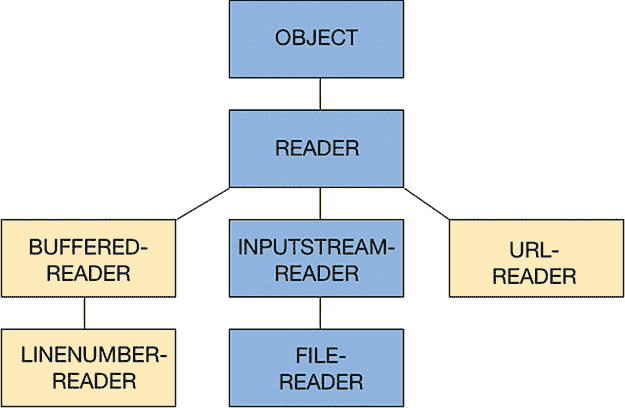

**图 12.1**

`InputStreamReader` 类的家族树。

顶部是 `Object` 类。`InputStreamReader` 在层次结构中上方有两个超类：`Reader` 和 `Object`。它在层次结构下方有一个子类：`FileReader`。

`InputStreamReader` 类继承了 `Reader` 和 `Object` 类的属性和行为，因为它们在超类层次结构中直接位于它的上方。`InputStreamReader` 不继承自图 12.1 中橙色的类 `BufferedReader`、`UrlReader` 和 `LineNumberReader` 的任何内容，因为它们不在它的层次结构上方。

如果这看起来很令人困惑，可以将层次结构想象成一个家族树。`InputStreamReader` 继承自它的父类并向上延伸。然而，`InputStreamReader` 类并不继承自它的兄弟或堂兄弟。

创建一个新类可以归结为以下任务：你只需要定义它与现有类不同的之处即可。其余的工作将由系统为你完成。

### 继承行为和属性

类的行为和属性是两件事的结合：它自身的行为和属性，以及它从超类继承的所有行为和属性。

以下是 `InputStreamReader` 的一些行为和属性：

 `equals()` 方法确定一个 `InputStreamReader` 对象是否与另一个对象具有相同的值。

 `getEncoding()` 方法返回流使用的字符编码名称。

 `reset()` 方法将流的当前位置移回起点。

 `mark()` 方法标记当前位置。

`InputStreamReader` 类可以使用所有这些方法，尽管 `getEncoding()` 是唯一没有从其他类继承的方法。`equals()` 方法定义在 `Object` 中，而 `reset()` 和 `mark()` 都来自 `Reader`。

### 重写方法

在 `InputStreamReader` 对象类中定义的某些方法也定义在它的某个超类中。例如，`close()` 方法既是 `InputStreamReader` 类的一部分，也是 `Reader` 类的一部分。当方法在子类及其超类中定义时，将使用子类的方法。这允许子类更改、替换或完全消除其超类的某些行为或属性。

在子类中创建一个新方法以更改继承自超类的行为被称为重写（overriding）该方法。每当继承的行为产生非预期的结果或你想做某些事情时，都需要重写方法。

### 建立继承

使用 `extends` 语句将类定义为另一个类的子类，如下：

```java
class FileReader extends InputStreamReader {
    // 行为和属性
}
```

`extends` 语句将 `FileReader` 类建立为 `InputStreamReader` 的子类。文件读取器都应该是输入读取器的子类。它们需要该类提供的功能来读取文件。

`FileReader` 可以重写的一个方法是 `close()` 方法，它在读取文本后执行关闭文件的必要操作。由 `Reader` 类实现的 `close()` 方法一直传递到 `FileReader`。

要重写方法，你必须以与其继承的超类中的声明相同声明该方法。`public` 方法必须保持为 `public`，方法的返回值必须相同，且参数的数量和类型不能更改。

`Reader` 类的 `read()` 方法如下：

```java
public int read(char[] buffer) {
```

当 `FileReader` 重写此方法时，它必须如下所示开头：

```java
public int read(char[] cbuf) {
```

区别在于 `char` 数组的，这在判断方法是否以相同方式创建时并不重要。这两个语句匹配是因为以下内容相同：

 两个方法都是 `public`。

 两个方法都返回一个整数。

 两个方法都以 `char` 数组作为唯一参数。

在子类中重写方法时，应该在方法声明前加上 `@Override`，如此示例所示：


```java
@Override
public void setPosition(int x, int y) {
    if ( (x > 0) & (y > 0) ) {
        super.setPosition(x, y);
    }
}
```

`@Override` 文本是一种特殊的注释，被称为注解（annotation），它能告诉 Java 编译器比它自己能推断出的更多的信息。通过在方法前加上 `@Override` 注解，你给了编译器一个机会来检查该方法是否真的重写了父类方法。如果没有重写——例如，你可能漏掉了第二个整数参数——程序将无法编译。

如果没有这个注解，编译器就无法发现这个潜在问题。没有第二个整数参数的方法看起来就像任何其他方法一样。

## 在子类中使用 `this` 和 `super`

在子类中，两个极其有用的关键字是 `this` 和 `super`。

正如你在过去一个小时内中学到的那样，`this` 关键字用于引用当前对象。当你创建一个类并需要引用从该类创建的特定对象时，你可以使用 `this`，如下所示：

```java
this.title = "Cagney";
```

该语句将对象的 `title` 实例变量设置为文本“Cagney”。

`super` 关键字的作用与之类似：它引用对象的直接父类。你可以通过几种不同的方式使用 `super`：

-  引用父类的构造函数，例如 `super("Adam", 12);`
-  引用父类的变量，例如 `super.hawaii = 50`
-  引用父类的方法，例如 `super.dragnet();`

使用 `super` 关键字的一种方式是在子类的构造函数中。因为子类继承了其父类的行为和属性，你必须将该子类的每个构造函数与其父类的构造函数关联起来。否则，某些行为和属性可能无法正确设置，导致子类无法正常工作。

通过 `super` 访问的变量不能是 `private`，因为这些在子类中是不可用的。

为了关联构造函数，子类构造函数的第一条语句必须是对父类构造函数的调用。这需要 `super` 关键字，如下语句所示：

点击此处查看代码图像

```java
public DataReader(String name, int length) {
    super(name, length);
}
```

这个示例是子类的构造函数，它使用语句 `super(name, length)` 来调用其父类中可比的构造函数。

如果你不使用 `super()` 调用父类中的构造函数，Java 会在子类构造函数开始时自动调用无参数的 `super()`。如果这个父类构造函数不存在或提供了意外的行为，就会导致错误，因此最好自己调用父类构造函数。

## 与现有对象操作

面向对象编程（OOP）鼓励重用。如果你为某个 Java 编程项目开发了一个对象，那么可以在不修改的情况下将该对象整合到另一个项目中。

如果一个 Java 类设计得良好，就可能让该类在其他程序中使用。你的程序中可用的对象越多，你在创建自己的软件时需要的工作就越少。如果有一个符合你需求的优秀拼写检查对象，你可以使用它，而不是编写自己的。理想情况下，你甚至可以给老板留下一个关于为项目添加拼写检查功能花费多久时间的假象，并利用这段额外时间在办公室打长途电话。

**注意**

本书作者像他许多业内人士一样，是自由职业并在居家工作。在评估他关于如何在职场中表现的建议时，请记住这一点。

当 Java 首次引入时，共享对象的系统在很大程度上是非正式的。程序员开发对象时尽可能保持独立，并通过使用私有变量以及读写这些变量的公共方法来保护它们免受误用。

当有一个标准方法来开发重用对象（如 `JavaBeans`）时，共享对象变得更加强大。

标准化的益处包括：

-  不需要过多记录对象如何工作的文档，因为任何知道标准的人已经知道很多关于它的功能。
-  你可以设计遵循标准的开发工具，从而能够更容易地与这些对象工作。
-  两个遵循标准的对象可以相互作用，而无需特殊的编程来使它们兼容。

`JavaBeans` 是遵循严格规则的对象，规则规定了它们的创建方式以及实例变量的使用方式。遵循规则的 Java 类被称为 `bean`。可以使用 NetBeans IDE 来制作 bean。在 NetBeans 中使用 `JavaBeans` 的入门教程请访问 [`wiki.netbeans.org/NetBeansJavaBeansTutorial`](http://wiki.netbeans.org/NetBeansJavaBeansTutorial)。

## 在 Array Lists 中存储同类对象

编写计算机程序时要做的重要决定之一是将数据存储。在本书的前半部分，你发现了三个存放信息的有用地方：

-  基础数据类型，如 `int` 和 `char`（或它们相应的类）
-  数组
-  `String` 对象

存储信息的地方多得多，因为任何 Java 类都可以持有数据。最有用之一是 `ArrayList`，它是一种持有同类对象的数据结构。

正如名称所示，数组列表像数组，但它们的大小可以增长或收缩。`ArrayList` 类属于 `java.util` 包，这是最实用的包之一。通过 `import` 语句使其在程序中可用：

```java
import java.util.ArrayList;
```

上述语句使用泛型创建一个列表。列表的类名放在 `<` 和 `>` 字符之间，如下所示：

点击此处查看代码图像

```java
ArrayList<String> structure = new ArrayList<String>();
```

如果你在使用旧版本的 Java 使用列表，你将这样写构造函数：

点击此处

```java
ArrayList structure = new ArrayList();
```

虽然你可以这样做，但泛型让你的代码更可靠，因为它们给了编译器一种防止更多错误的方法。在这里，它们阻止你通过放入错误的对象类来误用列表。如果你尝试向预期持有 `String` 的列表放入 `Integer` 对象，编译器会报错。

与数组不同，数组列表在创建时没有固定的元素数量。列表创建时有 10 个元素。如果你知道要存储比这多得多的对象，可以指定大小作为构造函数的参数。创建一个 300 元素列表的语句：

点击此处查看代码图像

```java
ArrayList<String> structure = new ArrayList<String>(300);
```

你可以通过调用 `add()` 方法将对象添加到列表，并将对象作为唯一的参数：

```java
structure.add("Vance");
structure.add("Vernon");
structure.add("Velma");
```

你按顺序添加对象，因此如果这些是添加到 `structure` 的前三个对象，元素 0 是“Vance”，元素 1 是“Vernon”，元素 2 是“Velma”。

你通过调用 `get()` 方法并将元素的索引号作为参数，从列表中检索一个元素：

点击此处查看代码图片

```java
String name = structure.get(1);
```

该语句将“Vernon”存储在 `name` 字符串中。

要检查列表的某个元素中是否包含某个对象，请调用其 `contains()` 方法并将该对象作为参数：

点击此处查看代码图片

```java
if (structure.contains("Velma")) {
    System.out.println("Velma found");
}
```

你可以使用对象本身或其索引号从列表中删除对象：

```java
structure.remove(0);
structure.remove("Vernon");
```

执行这两条语句后，“Velma”成为列表中唯一的字符串。

## 遍历数组列表（Array List）

Java 包含一种特殊的 `for` 循环，可以轻松地加载数组列表并依次检查其每个元素。

这个循环只有两个部分，比你在第 8 小节“用循环重复操作”中学到的 `for` 循环少了一个。

第一部分是初始化部分：用于持有从列表中检索的每个对象的变量类和名称。该对象应该属于持有列表的同一个类。

第二部分是标识列表。

以下是遍历 `structure` 列表并将每个名称显示在屏幕上的代码：

点击此处查看代码图片

```java
for (String name : structure) {
    System.out.println(name);
}
```

本节的第一个项目是 `StringLister`，该应用程序将演示数组列表和特殊的 `for` 循环，展示一个按字母顺序排列的字符串列表。该列表来自数组和命令行参数。

在 NetBeans 中打开你的 Java24 项目，选择 File（文件）、New File（新建文件），然后在 `com.java24hours` 包中创建一个名为 `StringLister` 的新 Empty Java File（空 Java 文件）。在源编辑器中输入代码列表 12.1 并保存文件。

**列表 12.1** `StringLister.java` 的完整文本。

点击此处查看代码图片

```java
package com.java24hours;

import java.util.*;

public class StringLister {
    String[] names = { "Carly", "Sam", "Kiki", "Lulu",
        "Hayden", "Elizabeth", "Kristina", "Molly", "Laura" };

    public StringLister(String[] moreNames) {
        ArrayList<String> list = new ArrayList<String>();
        for (int i = 0; i < names.length; i++) {
            list.add(names[i]);
        }
        for (int i = 0; i < moreNames.length; i++) {
            list.add(moreNames[i]);
        }
        Collections.sort(list);
        for (String name : list) {
            System.out.println(name);
        }
    }

    public static void main(String[] arguments) {
        StringLister lister = new StringLister(arguments);
    }
}
```

在运行应用程序之前，你应该使用 Run（运行）、Set Configuration（设置配置）命令将主类设置为 `com.java24hours.StringLister`，并将参数设置为一个或多个由空格分隔的名称，例如 `Scotty Jason Dillon`。然后选择 Run Project（运行项目）查看结果。在命令行指定的名称被添加到第 6–7 行存储在数组中的名称中。由于在程序运行之前不知道名称的总数，因此列表比数组更适合这些字符串的存储媒介。列表中的字符串使用 `Collections` 类的一个方法按字母顺序排序：`Collections.sort(list)`。该类与 `ArrayList` 一样属于 `java.util` 包。数组列表和其他有用结构被称为集合（collections）。当你运行程序时，输出应该是按字母顺序排列的名称列表（参见图 12.2）。数组列表的灵活尺寸允许你的额外名称添加到数据结构中与其他名称一起排序。

**图 12.2** `StringLister` 程序的输出。

### 创建子类

为了看到继承的工作示例，在下一个项目中，你创建一个名为 `Point3D` 的类，表示三维空间中的一个点。你可以用 `(x,y)` 坐标表示二维点。三维空间增加了第三个坐标，可以称为 `z`。

`Point3D` 类的对象可以做三件事：

- 跟踪对象的 `(x,y,z)` 坐标
- 将对象移动到新的 `(x,y,z)` 坐标
- 按指定的 `x`、`y` 和 `z` 值增量移动对象

Java 已经有一个表示二维点的标准类，称为 `Point`。该类可以在 `java.awt` 包中找到。它有两个名为 `x` 和 `y` 的整数变量，用于存储 `Point` 对象的 `(x,y)` 位置。它还有一个用于将 `Point` 对象放置在 `(x,y)` 位置的 `move()` 方法，以及一个按指定的 `x` 和 `y` 移动对象的 `translate()` 方法。

在 Java2 项目中，在 `com.java24hours` 包中创建一个名为 `Point3D` 的 Empty File，并将代码列表 12.2 的文本输入其中。完成后保存文件。

**列表 12.2** `Point3D.java` 的完整文本。

点击此处查看代码图片

```java
package com.java24hours;

import java.awt.*;

public class Point3D extends Point {
    int z;

    public Point3D(int x, int y, int z) {
        super(x,y);
        this.z = z;
    }

    public void move(int x, int y, int z) {
        super(x,y);
        this.z = z;
    }

    public void translate(int x, int y) {
        this.z += z;
    }
}
```

`Point3D` 类没有 `main()` 方法，因此你无法将其作为应用程序运行，但在任何需要三维点的地方都可以使用。`Point3D` 类只执行其父类 `Point` 未完成的工作。这主要涉及对整数变量 `z` 的跟踪，并将其作为 `move()` 方法、`translate()` 方法和 `Point3D()` 构造函数的参数。所有方法都使用了关键字 `super` 和 `this`。`this` 语句用于引用当前的 `Point3D` 对象，因此第 10 行的 `this.z = z` 将变量 `z` 设置为传递给方法的值。`super` 语句引用父类 `Point`。第 9 行的 `super(x,y)` 调用了父类中的 `Point(x,y)` 构造函数，然后设置 `Point3D` 对象的 `(x,y)` 坐标。由于 `Point` 已经能够处理 `x` 和 `y` 轴，让 `Point3D` 类也这样做是多余的。

为了测试新的 `Point3D` 类，创建一个使用 `Point` 和 `Point3D` 对象并移动它们的程序。在 `com.java24hours` 包中创建一个名为 `PointTester` 的新文件，并将代码列表 12.3 输入其中。该文件在保存时会自动编译。

**列表 12.3** `PointTester.java` 的完整文本。

```java
package com.java24hours;

import java.awt.*;

class PointTester {
    public static void main(String[] arguments) {
        Point location1 = new Point(11,22);
        Point3D location2 = new Point3D(7,6,64);

        System.out.println("The 2D point is at (" + location1.x + ", " + location1.y + ")");
        System.out.println("It's being moved to (4, 13)");
    }
}
```


```java
13:          location1.move(4,13);
14:          System.out.println("The 2D point is now at (" + location1.x
15:                      + ", " + location1.y + ")");");
16:          System.out.println("It's being moved -10 units on both the x "
17:                      + "and y axes");
18:          location1.translate(-10,-10);
19:          System.out.println("The 2D point ends up at (" + location1.x
20:                      + ", " + location1.y + "))\n");
21: 
22:          System.out.println("The 3D point is at (" + location2.x
23:                      + ", " + location2.y + ", " + location2.z + ")");
24:          System.out.println("It's being moved to (10, 22, 71)");
25:          location2.move(10,22,71);
26:          System.out.println("The 3D point is now at (" + location2.x
27:                      + ", " + location2.y + ", " + location2.z + ")");
28:          System.out.println("It's being moved -20 units on the x, y "
29:                      + "and z axes");
30:          location2.translate(-20,-20,-20);
31:          System.out.println("The 3D point ends up at (" + location2.x
32:                      + ", " + location2.y + ", " + location2.z + ")");
33:      }
34:  }
```

当你通过选择运行（Run）或运行文件（Run File）来执行文件时，你会看到图 12.3 所示的输出。如果程序无法运行，请查看源码旁边的红色图标，它指示了触发错误的行。

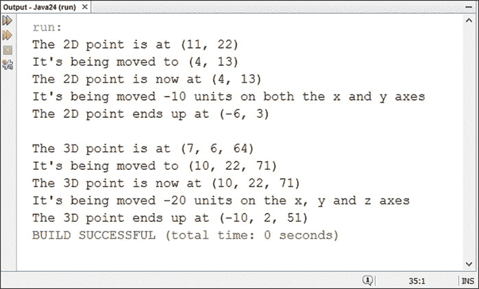

**图 12.3**

`PointTester` 程序的输出。

### 总结

当人们谈论生命的奇迹时，他们可能并不是在说 Java 中的超类如何产生子类，也不是说行为和属性如何在类层次结构中被继承。

如果现实世界的运作方式就像面向对象编程（OOP）那样，那么莫扎特的每一个后代都可以选择成为卓越的作曲家。马克·吐威恩的所有后代都可以对密西西比河轮船的生活充满诗意。你祖先努力实现的每项技能都将不费分吹灰之力地交给你。

在奇迹的尺度上，继承并不等同于物种的延续或在棒球中连续投出无安局。然而，它是用最少冗余工作设计软件的有效方法。

### 工作坊

#### 问答

问：到目前为止创建的大多数 Java 程序都没有使用 `extends` 来继承自超类。这意味着它们存在于类之外吗？

答：你在 Java 中创建的所有类都是类层次结构的一部分，因为程序的默认父类是 `Object`。`equals()` 和 `toString()` 方法是从 `Object` 自动继承的行为的一部分。

问：为什么人们在发现某些东西时会大喊“尤里卡（Eureka）！”？

答：Eureka 借自古希腊，意为“我找到了！”这句话是希腊学者阿基米德进入浴缸时发出的。水位的上升让他理解到，排水水的体积必须等于他身体部位的体积。关于阿基米德的故事两个世纪后由维特鲁威在他关于建筑的著作《建筑五》（De Architectura）中流传。“尤里卡”自 1849 年以来一直是加利福尼亚州的名字，指的是在萨特工厂（Sutter’s Mill）附近发现黄金时的欢呼。

### 练习

为了确定你从过去的工作中继承了什么种知识，请回答以下问题。

1. 如果超类处理某种方法的方式在你子类中没有使用，你可以做什么？

   A. 删除超类中的该方法。

   B. 在子类中重写该方法。

   C. 给《圣何塞镜讯报》的编辑写一封恶毒信，希望 Java 开发者能看到它。

2. 你可以使用哪些方法来获取存储在列表（array list）中的元素？

   A. `get()`

   B. `read()`

   C. `elementAt()`

3. 你可以使用什么语句来引用当前对象的方法和变量？

   A. `this`

   B. `that`

   C. `theOther`

#### 答案

1. B. 因为你可以重写该方法，所以你不需要更改超类的任何方面或其工作方式。

2. A. `get()` 方法有一个参数——元素的索引号。

3. A. `this` 关键字指的是它所出现的对象。

#### 活动

如果你丰富的想象力催生了你学习更多知识的欲望，你可以通过以下方式产生更多关于继承的知识：

- 创建 `Point4D` 类，在 `Point3D` 类创建的 (x,y,z) 坐标系统中添加一个 `t` 坐标。`t` 坐标代表时间，因此你需要确保它不会被设置为负值。
- 取橄榄球球队进攻组的成员：锋、外接手、紧端卫、跑卫和四分卫。设计一个代表这些人的类层次结构。例如，防守应该是应该是被锋和紧端卫继承，而速度应该是被外接手和跑卫继承。

为了查看实现这些活动的程序，请访问书籍网站 [www.24hours.com](http://www.24hours.com)。

# 第四部分：高级主题

# 第 13 章 在数据结构中存储对象

### 本节目标

- 创建列表（array list）。
- 在列表中添加和删除项。
- 使用泛型提高可靠性。
- 在列表中搜索对象。
- 遍历列表。
- 创建键值哈希表（hash map）。
- 在表中添加和删除项。
- 获取表条目的键和值。
- 遍历表的键和值。

程序员是收集者。在计算机编程中，你花费大量时间收集信息并寻找存储它们的地方。信息可以以基本数据类型的形式出现，也可以以特定类的对象的形式出现。当程序运行时，你需要决定在何存储这些信息。

`java.util` 包中有一个类可以完成数组能做的一切事情，但没有大小的限制：`ArrayList`。

`array list`（数组列表）是一种用于存储相同类或相同公共父类实例对象的数据结构。该列表可以在程序运行期间根据需要增长或收缩。

创建数组列表最简单的方法是调用其不带任何参数的构造函数：

点击此处查看代码图像

```java
ArrayList servants = new ArrayList();
```

可以通过指定初始容量来创建数组列表，这为列表可能容纳的元素数量提供了一些指导。容量作为整数参数传递给构造函数进行设置，如下语句所示，该语句将数组列表的容量设置为 30：

点击此处查看代码图像

```java
ArrayList servants = new ArrayList(30);
```

尽管这看起来非常像创建一个数组并确定其确切大小，但容量只是一个提示。如果超过了容量，数组列表将进行相应的调整并继续正常工作。你对容量的估算得越准确，列表在程序运行时的效率就越高。

列表持有属于相同类或共享同一个父类的对象。

当你创建一个数组列表时，你知道该列表旨在持有的类或父类。这可以在构造函数中使用 `<` 和 `>` 符号进行指定，这是 Java 的一项特性，称为泛型（generic）。以下是持有 `String` 对象的列表构造函数的改进：

点击此处查看代码图像

```java
ArrayList<String> servants = new ArrayList<String>();
```

该语句创建了一个 `String` 对象的数组列表。只有该类或其子类可以存储在列表中。否则，编译器会检测到错误。

要添加对象，调用数组列表的 `add(Object)` 方法并将该对象作为参数。以下是添加五个字符串的语句：

```java
servants.add("Bates");
servants.add("Anna");
servants.add("Thomas");
servants.add("Mrs. O'Brien");
servants.add("Daisy");
```

每个元素都被添加到列表的末尾，因此 `servants` 中的第一个字符串是“Bates”，最后一个是“Daisy”。

有一个相应的 `remove(Object)` 方法，可以将对象从列表中移除：

点击此处查看代码图像

```java
servants.remove("Mrs. O'Brien");
```

数组列表的大小是它当前持有的元素数量。通过调用列表的 `size()` 方法获取此信息，该方法返回一个整数：

点击此处查看代码图像

```java
int servantCount = servants.size();
```

当你使用泛型指定了列表包含的类时，使用 `for` 循环遍历列表的每个元素是十分简单的：

```java
for (String servant : servants) {
    System.out.println(servant);
}
```

`for` 的第一个参数是用于存储元素的变量。第二个参数是数组列表。其他数据结构也可以采用相同的循环。

`add(Object)` 方法将对象存储在列表的末尾。也可以通过指定对象应存储在列表中的位置将对象添加到列表中。这需要 `add(int, Object)` 方法，它将位置作为第一个参数：

点击此处查看代码图像

```java
ArrayList<String> aristocrats = new ArrayList<String>();
aristocrats.add(0, "Lord Robert");
aristocrats.add(1, "Lady Mary");
aristocrats.add(2, "Lady Edith");
aristocrats.add(3, "Lady Sybil");
aristocrats.add(0, "Lady Grantham");
```

上一个示例中的最后语句将“Lady Grantham”添加到列表的顶部而不是底部，将她置于“Lord Robert”和其他之上。

作为第一个参数指定的位置不能大于列表的 `size()`。如果添加“Lord Robert”时位置是 1 而不是 0，程序将由于发生 `IndexOutOfBoundsException` 异常而失败。

可以通过指定位置作为 `remove(int)` 的参数来从列表中移除元素：

```java
aristocrats.remove(4);
```

可以通过调用带有该位置的 `get(int)` 来获取列表在指定位置的元素。以下是一个 `for` 循环，它可以从列表中取出每个字符串并显示出来：

点击此处查看代码图像

```java
for (int i = 0; i < aristocrats.size(); i++) {
    String aristocrat = aristocrats.get(i);
    System.out.println(aristocrat);
}
```

通常需要确定数组列表是否包含某个特定对象。这可以通过调用列表的 `indexOf(Object)` 方法并将该对象作为参数来确定。该方法返回对象的位置，如果在列表中未找到，则返回 −1：

点击此处查看代码图像

```java
int index = servants.indexOf("Car");
```

还有一个 `contains()` 方法，根据指定对象是否被找到来返回 `true` 或 `false`。这里是使用该方法的示例示例：

```java
boolean hasCar = servants.contains("Car");
```

该项目使用了这些技术，在一个 10 类网格上进行射击。有些点包含目标，有些没有。通过调用 `Point(int, int)` 构造函数创建点：

```java
Point p = new Point(5,9);
```

这里有一个用 X 标记目标、用 "." 标记空位的 10 类网格：


```text
1 2 3 4 5 6 7 8 9

1 . . . . . . . . .

2 . . . . . . . . .

3 . . . . . . . . .

4 . . . . . . . . .

5 . . . . X . . . .

6 . . . . . . . . .

7 . . . . . . . . .

8 . . . . . . . . .

9 . . . . . . . . .
```

从左到右列代表 x 坐标。从上到下行代表 y 坐标。

在此项目之前，你看到了数组列表可以持有字符串。它们可以持有 `Point` 或任何其他类。该语句创建了 (5,9) 的点：

```java
Point p = new Point(5,9);
```

```java
38:             System.out.print("  ");
39:          }
40:          System.out.println();
41:      }
42:    System.out.println();
43:    }
44:
45:    private void createTargets() {
46:        Point p1 = new Point(5,9);
47:        targets.add(p1);
48:        Point p2 = new Point(4,5);
49:        targets.add(p2);
50:        Point p3 = new Point(9,2);
51:        targets.add(p3);
52:    }
53:
54:    private void shoot(int x, int y) {
55:        Point shot = new Point(x,y);
56:        System.out.print("Firing at (" + x + "," + y + ") ... ");
57:        if (targets.indexOf(shot) > -1) {
58:              System.out.println("you sank my battlepoint!");
59:              // delete the destroyed target
60:              targets.remove(shot);
61:        } else {
62:              System.out.println("miss.");
63:        }
64:    }
65:    
66:    public static void main(String[] arguments) {
67:        new Battlepoint();
68:    }
69: }
```

`Battlepoint` 应用中的注释描述了构造函数的每个部分以及程序中条件逻辑的重要部分。

该应用程序创建了三个 `Point` 对象作为目标，并将它们添加到数组中（第 45–52 行）。会显示一张地图，列出这些目标（第 22–43 行）。

接下来，通过调用 `shoot(int, int)` 方法对三个点进行射击（第 54–64 行）。每次调用，应用程序都会报告射击是否击中了某个目标。如果命中了，该目标将从列表中移除。

最后，再次显示地图，应用程序终止。

输出结果所示于图 13.1。

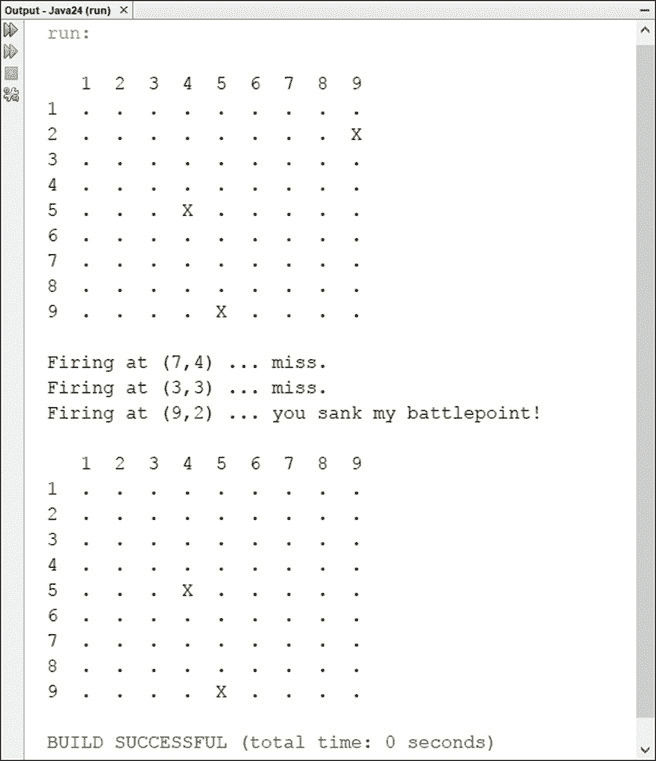

**图 13.1**

将 `Point` 对象放入数组列表中并对其进行射击。

三个目标在图 13.1 顶部的地图中显示。一个目标在命中后会被移除。输出底部的地图反映了这一变化。

当目标被射击命中时，通过调用以射击点作为参数的 `remove(Object)` 方法从 `targets` 数组列表中移除。

### 注意

在 `Battlepoint` 应用的 `shoot()` 方法中，将从列表中移除的 `Point` 对象是代表射击点的。它与命中的目标具有相同的 (x,y) 坐标。

### 哈希映射（Hash Maps）

在编程中，使用一条信息来访问另一个是很常见的。在数据结构中，数组列表（ArrayList）是这种能力最简单的示例，使用索引号从列表中检索一个对象。这里有一个从 `aristocrats` 列表中提取第一个字符串的示例：

点击此处查看代码图像

```java
String first = aristocrats.get(0);
```

数组也使用索引号来检索数组中的每个项。哈希映射（Hash maps）是 Java 中的一种数据结构，使用一个对象检索另一个对象。第一个对象是 `key`（键），第二个对象是 `value`（值）。这种结构实现为 `java.util` 中的 `HashMap` 类。

该名称指的是键如何映射到值。这种结构化数据的一个例子是电话列表。一个人的名字（字符串）可以用于检索该人的电话号码。可以通过调用不带参数的构造函数来创建一个哈希映射：

点击此处查看代码图像

```java
HashMap phonebook = new HashMap();
```

在新的哈希映射中可以指定两个控制其效率的方面：初始容量（initial capacity）和负载因子（load factor）。它们通过两个参数设置，容量在前，负载因子在后：

点击此处查看代码图像


```java
HashMap phonebook = new HashMap(30, 0.7F);
```

容量是存储哈希映射值的桶（buckets）的数量。负载因子是一个从 0（空）到 1.0（满）之间的浮点数，因此 0.7 意味着当桶填充了 70% 时，容量就会增加。默认值为容量为 16，负载因子为 .75，这通常足够了。

应该使用泛型（Generics）来指示键和值的类型。它们被放在 `<` 和 `>` 字符之间，并用逗号分隔，如下例所示：

点击此处查看代码图像

```java
HashMap<String, Long> phonebook = new HashMap<>();
```

这创建了一个名为 `phonebook` 的哈希映射，其键为字符串，值为 `Long` 对象。第二组 `<` 和 `>` 是空的，假设与前一组 `<` 和 `>` 中的类相同。

对象被存储在哈希映射中，键为字符串，值为 `Long` 对象。（注：此处原文文本逻辑存在重复，翻译已按语意整合）

（由于原文中包含了多次重复的描述，以下为完整翻译后的最终内容）

`java.awt` 包中的 `Font` 类用于创建字体并使用它们在图形用户界面中显示文本。字体包括字体名称、字号大小以及其样式是普通、粗体还是斜体。

哈希映射（Hash maps）可以包含任何类别的对象。在 NetBeans 中，在 `com.java24hours` 包中创建一个 Java 文件，并将其命名为 `FontMapper`。在文件中输入代码列表 13.2 并保存。

## 代码列表 13.2：`FontMapper.java` 的全文

点击此处查看代码图像

```java
1: package com.java24hours;

2:

3: import java.awt.*;

4: import java.util.*;

5: 

6: public class FontMapper {
7:     public FontMapper() {
8:         Font courier = new Font("Courier New", Font.PLAIN, 6);
9:         Font times = new Font("Times New Roman", Font.BOLD, 12);
10:         Font verdana = new Font("Verdana", Font.ITALIC, 25);
11:         HashMap<String, Font> fonts = new HashMap<>();
12:         fonts.put("smallprint", courier);
13:         fonts.put("body", times);
14:         fonts.put("headline", verdana);
15:         for (Map.Entry<String, Font> entry : fonts.entrySet()) {
16:             String key = entry.getKey();
17:             Font value = entry.getValue();
18:             System.out.println(key + ": " + value.getSize() + "-pt "
19:                 + value.getFontName());
20:         }
21:     }
22:     
23:     public static void main(String[] arguments) {
24:         new FontMapper();    
25:     }
26: }
```

`FontMapper` 应用程序在第 8–10 行创建了三个 `Font` 对象，并在第 12–14 行将它们添加到名为 `fonts` 的哈希映射中。它们以字符串键存储在映射中，该键描述了字体的用途：“smallprint”、“body”和“headline”。

第 15–20 行中的 `for` 循环使用项集（entry set）和集合中的每个单独条目来遍历哈希映射。

应用程序的输出显示在图 13.2。

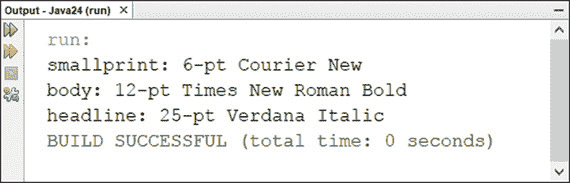

**图 13.2**

在哈希映射中存储 `Font` 对象。

## 总结

列表（Array lists）和哈希映射（Hash maps）是 `java.util` 包中两个非常有用的数据结构。`ArrayList` 类扩展了数组的功能，使其能够克服该数据类型的固定大小限制。哈希映射允许使用任何类型的对象作为键来检索值。

还有位集（`BitSet` 类），它持有 0 和 1 的位值；栈（`Stack`），它是一种类似于列表的后进先出数据集合；排序结构 `TreeMap` 和 `TreeSet`；以及属性（`Properties`），这是一种特殊的哈希映射，用于在文件或其他存储位置中持有程序的配置属性。

## 工作坊

### 问答

**Q. 类被同步（synchronized）意味着什么？**

**A.** 同步是 Java 虚拟机确保其他用户以一致且准确的方式访问对象的实例变量和方法的方法。当你学习第 15 节“创建多线程程序”中的线程时，这个概念将变得更有意义。Java 程序可以设计为执行多于一个任务。每个任务都被放在自己的线程中。当多个线程访问同一个对象时，确保该对象在每个线程中的行为相同至关重要。因此，当类的方法需要同步时（如向量 `Vector` 和哈表 `Hasht`），Java 虚拟机必须付出更多努力，并可能会遇到导致线程停止的错误。列表和哈希映射复制了向量和哈表的功能，因为需要不需要同步的数据结构。结果是，它们的运行效率更高。

**Q. 华盛顿将军队（Washington Generals）曾击败过环球旅行者（Globetrotters）吗？**

**A.** 在过去的十年里，将军队曾击败环球旅行者七次，最近一次是在 1971 年。在田纳西州马丁市比赛中，将军队凭借队主“红”Klotz 的进球以 100–99 获胜。尽管将军队今天以弱鱼队闻名，但他们于 1921 年作为 Sphas 队开始，是一支在东部和美国篮球联赛比赛的正规球队。Sphas（南费城协会的缩写）曾获得过冠军。Klotz 曾是 Sphas 队的球员，他买下了这支球队并在 1952 年他们成为哈尔姆著名球队的永久合作伙伴时将队名改为将军队。1971 年的胜利胜利结束了环球旅行者 49 场的连胜。

## 测验

以下问题将测试你掌握了关于数据结构的多少知识。

**1。下列哪项在创建后不能增加或缩小大小？**

A. 列表 (Array lists)

B. 数组 (Arrays)

C. 哈希映射 (Hash maps)

**2。使用什么方法可以获取映射中有多少个项？**

A. `length()`

B. `size()`

C. `count()`

**3。什么数据类型或类可以作为哈希映射的键？**

A. `int`

B. `Integer`

C. `String`

### 答案

**1。B.** 数组的大小在创建后不能改变。列表和哈希映射根据需要改变大小。

**2。B.** `size()` 方法指示映射中的项数。

**3。A、B 或 C.** 哈希映射可以使用任何类作为键以及任何类作为值。

### 活动

你可以通过以下活动应用结构化编程知识：

 使用本节的数据结构编写一个公司电子邮件列表，每个电子邮件都与一个姓名关联。

 扩展 `FontMapper` 程序，将字体名称、大小和样式作为命令行参数添加到哈希映射中并在显示其键和值。

要查看实现这些活动的 Java 程序，请访问书籍网站 [www.java24hours.com](http://www.java24hours.com)。

# 第 14 章 程序中的错误处理

## 本节任务清单

 了解为什么错误被称为异常（exceptions）。

 在你的 Java 程序响应异常。

 创建忽略异常的方法。

 使用引发异常的方法。

 创建你自己的异常。

异常通常可以通过一种保持程序正常运行的方式进行处理。

虽然你现在才开始学习它们，但在之前的 13 小时里，你可能已经对异常非常熟悉了。当你编写的 Java 程序能够编译成功但在运行时遇到问题时，这些错误就会出现。

例如，一种常见的编程错误是引用不存在的数组元素，如下所示：

点击此处查看代码图像

```java
String[] greek = { "Alpha", "Beta", "Gamma" };
System.out.println(greek[3]);
```

`String` 数组 `greek` 有三个元素。由于数组的第一个元素索引为 0 而不是 1，因此第一个元素是 `greek[0]`，第二个是 `greek[1]`，第三个是 `greek[2]`。这导致尝试显示 `greek[3]` 的语句是错误的。之前的语句可以成功编译，但当你运行程序时，Java 虚拟机将会停止并显示如下所示的消息：

输出 

点击此处查看代码图像

```text
Exception in thread "main" java.lang.ArrayIndexOutBoundsException: 3
    at SampleProgram.main(SampleProgram.java:4)
```

此消息表示应用程序生成了一个异常，JVM 通过显示错误消息并停止程序记录了该异常。

错误消息指向 `java.lang` 包中一个名为 `ArrayIndexOutOfBoundsException` 的类。该类是一个异常，是一个代表程序中发生的异常情况的对象。

异常处理是类在发生错误或其他异常情况时相互通信的一种方式。

当 Java 类遇到异常时，它会向类的用户报告该错误。在这个例中，类的用户是 JVM。

### 注意


使用了两个术语来描述这个过程：`throw`（抛出）和 `catch`（捕获）。对象抛出异常以通知其他对象异常的发生。这些异常被其他对象或 Java 虚拟机捕获。

所有异常都是 `java.lang` 包中 `Exception` 的子类。`ArrayIndexOutOfBoundsException` 正如你所预期的——它报告访问了数组边界之外的元素。

Java 中有数百种异常。许多异常如数组异常指示了可以通过编程更改来修复的问题。这些异常类似于编译错误。在你纠正了情况后，就不再需要担心该异常了。

其他异常必须在程序每次运行时通过五个新关键字来处理：`try`、`catch`、`finally`、`throw` 和 `throws`。

## 在 `try`-`catch` 块中捕获异常

到目前为止，你通过修复引起异常的问题来处理异常。有时你无法以这种方式处理异常，必须在 Java 类内部处理该问题。

为了介绍为什么很有用，请在 `com.java24hours` 包中创建一个名为 `Calculator` 的新 Java 文件，输入列表 14.1 中的短 Java 应用程序并保存文件。

**列表 14.1** `Calculator.java` 的完整文本

点击此处查看代码图像

```java
1: package com.java24hours;
2:
3: public class Calculator {
4:     public static void main(String[] arguments) {
5:         float sum = 0;
6:         for (String argument : arguments) {
7:             sum = sum + Float.parseFloat(argument);
8:         }
9:         System.out.println("Those numbers add up to " + sum);
10:     }
11: }
```

`Calculator` 应用程序接收一个或多个数字作为命令行参数，将它们相加并显示总和。

由于 Java 应用程序中的所有命令行参数都用字符串表示，因此程序在相加之前必须将它们转换为浮点数。第 7 行中的 `Float.parseFloat()` 类方法处理了这一点，将转换后的数字加到名为 `sum` 的变量。

在运行应用程序之前，在 NetBeans 中通过命令 Run、Set Project Configuration、Customize 设置以下命令行参数：`7 4 8 1 4 1 4`。选择 Run、Run Main Project 来运行应用程序，你应该可以在图 14.1 中看到输出。

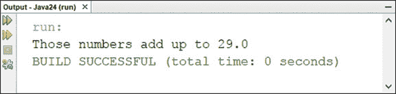

**图 14.1** `Calculator` 应用程序的输出。

多次使用不同的数字作为参数运行程序。它应该能够成功处理它们，这可能会让你好奇这个项目与异常有什么关系。

为了看到相关性，将 `Calculator` 应用程序的命令行参数改为 `1 3 5x`。第三个参数包含一个拼写错误——数字 5 之后不应该是 `x`。`Calculator` 应用程序无法感知，它尝试加上 `5x`，导致以下结果：

输出 

```
Exception in thread "main" java.lang.NumberFormatException: For input: "5x"
    at java.lang.Float.parseFloat(Float.java:52)
    at Calculator.main(Calculator.java:7)
```

此消息对程序员来说可能很有启发，但这不是你希望用户看到的。为了改进 `Calculator` 应用程序使其不再因此类错误停止运行，可以使用 `try`-`catch` 块。在 `com.java24hours` 包中创建一个名为 `NewCalculator` 的新文件并输入列表 14.2 中的文本。

**列表 14.2** `NewCalculator.java` 的完整文本

点击此处查看代码图像

```java
1: package com.java24hours;
2:
3: public class NewCalculator {
4:     public static void main(String[] arguments) {
5:         float sum = 0;
6:         for (String argument : arguments) {
7:             try {
8:                 sum = sum + Float.parseFloat(argument);
9:             } catch (NumberFormatException e) {
10:                System.out.println(argument + " is not a number.");
11:            }
12:         }
13:         System.out.println("Those numbers add up to " + sum);
14:     }
15: }
```

任何你想让类处理的异常，都必须使用 `try`-`catch` 块。`Exception` 对象应该是多个子类之一。在你保存应用程序后，自定义项目配置并使用命令行参数 `1 3 5x` 运行 `com.java24hours.NewCalculator`。你应该能看到在图 14.2 中所示的输出。

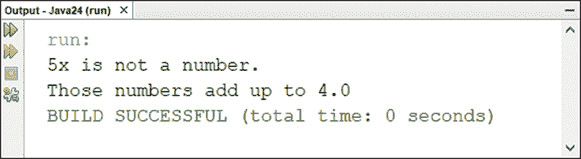

**图 14.2** `NewCalculator` 应用程序的输出。

第 7–11 行中的 `try`-`catch` 块处理由 `Float.parseFloat()` 抛出的 `NumberFormatException` 错误。这些异常在 `NewCalculator` 类内部捕获：对于任何非数字参数，都会显示一条错误信息。由于异常在类内部被处理，`JVM` 不会显示错误。你通常可以使用 `try`-`catch` 块来处理与用户输入和其他意外数据相关的问题。

## 捕获多种不同的异常

一个 `try`-`catch` 块可以用于处理多种不同类型的异常，即使它们是由不同的语句抛出的。

处理多个类异常的一种方法是为每种异常分配一个 `catch` 块，如下代码所示：

点击此处查看代码图像

```java
String textValue = "35";

int value;

try {
    value = Integer.parseInt(textValue);
} catch (NumberFormatException exc) {
    // 处理异常的代码
} catch (ArithmeticException exc) {
    // 处理异常的代码
}
```

你也可以通过管道符 `|` 将多个异常分开，并在列表最后指定异常变量名称，在同一个 `catch` 块中处理多个异常。这是一个示例：

点击此处查看代码图像

```java
try {
    value = Integer.parseInt(textValue);
} catch (NumberFormatException | ArithmeticException exc) {
    // 处理异常的代码
}
```

如果捕获到 `NumberFormatException` 或 `ArithmeticException`，它将被赋值给变量 `exc`。

列表 14.3 包含一个名为 `NumberDivider` 的应用程序，它接受两个整数命令行参数用于整数除法表达式。

该应用程序必须能够处理用户输入中的两个潜在问题：

 非整数参数

 除以零

在 `com.java24hours` 包中为 `NumberDivider` 创建一个新的 Java 文件，并将列表 14.3 的文本输入到源编辑器中。

**列表 14.3** `NumberDivider.java` 的全文

点击此处查看代码图像

```java
1: package com.java24hours;
2:
3: public class NumberDivider {
4:     public static void main(String[] arguments) {
5:             if (arguments.length == 2) {
6:                 int result = 0;
7:                 try {
8:                     result = Integer.parseInt(arguments[0]) /
9:                             Integer.parseInt(arguments[1]);
10:                    System.out.println(arguments[0] + " divided by " +
11:                             arguments[1] + " equals " + result);
12:                 } catch (NumberFormatException e) {
13:                     System.out.println("Both arguments must be integers.");
14:                 } catch (ArithmeticException e) {
15:                     System.out.println("You cannot divide by zero.");
16:                 }
17:             }
18:         }
19: }
```

使用命令行参数指定两个参数，你可以用整数、浮点数和非数字参数运行它。

列表 14.3 中的第 5 行 `if` 语句检查是否存在两个参数。

`NumberDivider` 应用程序执行整数除法，因此结果是整数。

如果你使用浮点数或非数字参数，第 8–9 行将抛出 `NumberFormatException`。

如果你使用零作为参数，第 14 行将抛出 `ArithmeticException`。

图 14.3 显示了成功运行的一些示例输出。

 **图 14.3**

## 在异常发生后执行某些操作

有时你希望在异常发生后做一些事情。你可以通过使用 `try`-`catch`-`finally` 块来处理此情况，其形式如下：

点击此处查看代码图像

```java
try {
    // 可能会导致异常的语句
} catch (Exception e) {
    // 异常发生时要做什么
} finally {
    // 无论如何都会执行的语句
}
```

无论是否发生异常，`finally` 部分都会执行。

## 读取和写入文件

当从文件读取数据时，异常可能通过几种方式发生：文件可能不存在、可能会发生错误等。

到目前为止，你已经学习了如何处理异常。如果你想在处理异常后再次抛出它，可以使用 `throw` 语句后跟要抛出的异常对象。

以下代码在 `catch` 块中处理了 `NumberFormatException`，然后将其抛出：

点击此处查看代码图像

```java
float principal;

try {
    principal = Integer.parseInt(textValue) * 1.1F;
} catch (NumberFormatException e) {
    System.out.println(arguments[0] + " is not a number.");
    throw e;
}
```

重写后的代码处理了 `try` 块可能生成的所有异常并将其抛出：

点击此处查看代码图像

```java
float principal;

try {
    principal = Integer.parseInt(textValue) * 1.1F;
} catch (Exception e) {
    System.out.println("Error " + e.getMessage());
    throw e;
}
```

## 抛出异常

当你调用 Java 库的方法时，编译器经常会显示关于异常的消息。例如：


点击此处查看代码图像

```
NetReader.java:14: unreported exception java.net.MalformedURLException; must be caught or declared
```

每当你看到异常“必须捕获或声明”的错误时，这表明你正在尝试使用的方法抛出了该异常。任何调用这些方法的类（例如编写的应用程序）必须执行以下操作之一：

 使用 `try`-`catch` 块处理异常

 抛出异常

`Exception` 是所有异常子类的父类。`catch` 语句将捕获该类以及在类层次结构中它的任何子类。

当 `Database` 类正在执行任务时，如果信用卡发行机构的计算机对任何连接尝试都没有响应会发生什么？这种错误正是 `try`-`catch` 块设计用于处理的类型，它被用于 `Database` 内部处理连接错误。

如果 `Database` 类自行处理此错误，那么 `CreditCardChecker` 应用程序就完全不知道异常的发生。这并不是一个好主意——应用程序应该知道何时无法建立连接，以便向该应用程序的用户报告此情况。

通知 `CreditCardChecker` 应用程序的一种方法是让 `Database` 在 `catch` 块中捕获异常，然后使用 `throw` 语句再次抛出。异常在 `Database` 中被抛出，随后它必须像处理任何其他异常一样处理它。

当你在捕获父类（如 `Exception`）的 `catch` 块中使用 `throw` 时，抛出异常将是抛出该父类类型的异常。这会丢失一些关于错误类型的细节，因为像 `NumberFormatException` 这样的子类比简单的 `Exception` 类能提供更多关于问题的信息。

Java 提供了一种方法来保留这些细节：在 `catch` 语句中使用 `final` 关键字。

点击此处查看代码图像

```java
try {
    principal = Float.parseFloat(loanText) * 1.1F;
} catch (final Exception e) {
    System.out.println("Error " + e.getMessage());
    throw e;
}
```

`catch` 中的该 `final` 关键字导致 `throw` 的行为变得不同。它会抛出被捕获的特定类。

## 忽略异常

本小时涵盖的下一个技术是如何完全忽略一个异常。类中的方法可以通过在方法定义中使用 `throws` 子句来忽略异常。

以下方法抛出一个 `MalformedURLException`，当你在 Java 程序中处理网络地址时，可能会发生这种错误：

点击此处查看代码图像

```java
public void loadURL(String address) throws MalformedURLException {
    URL page = new URL(address);
    // code to load web page
}
```

此示例中的第二个语句创建了一个 `URL` 对象，它代表 Web 上的地址。`URL` 类的构造函数抛出 `MalformedURLException` 来表示使用了无效地址，因此无法构造对象。接下来的语句会在尝试打开到该 URL 的连接时抛出这些异常之一：

点击此处查看代码图像

```java
URL source = new URL("http:www.java24hours.com");
```

字符串 `http:www.java24hours.com` 并不是一个有效的 URL，因为它缺少了一些标点符号：冒号后的两个斜杠字符（`//`）。

由于 `loadURL()` 方法已声明为抛出 `MalformedURLException` 错误，它不需要在方法内部处理这些错误。捕获此异常的责任属于任何调用 `loadURL()` 方法的方法。

## 不需要 catch 的异常

尽管本节展示了异常需要用 `try`-`catch` 捕获或用 `throws` 子句声明为抛出，但仍然存在一种例外。

Java 程序中可能发生的某些异常不需要以任何方式处理。当编译器检测到异常正在被忽略时，并不会停止运行。这些异常被称为*未检查*（unchecked）异常，而其他的被称为*已检查*（checked）异常。

未检查异常都是 `java.lang` 包中 `RuntimeException` 的子类。未检查异常的一个例子是 `IndexOutOfBoundsException`，它表示用于访问数组、字符串或数组列表的索引不在其范围内。如果一个数组有五个元素，而你尝试读取第 10 个元素，就会发生此异常。


另一个是`NullPointerException`，它发生在使用没有值的对象时。对象变量在赋值一个对象之前，其值为`null`。某些方法在无法返回对象时也会返回`null`。如果一个语句错误地假设一个对象有值，就会发生`NullPointerException`。

这两种错误都是程序员可以（也应该）在代码中防止的错误，而不是需要异常处理的内容。如果你编写了一个访问越界数组元素的程序，请修复执行该操作的代码并重新编译。如果你预期的对象有值但它等于`null`，请在使用对象之前通过`if`条件对这种情况进行检查。

Java 中未检查异常的原理是：它们要么可以通过编写良好的代码来防止，要么发生得太频繁，以至于一直捕获它们会使程序变得异常复杂。在调用对象方法的每条语句中，都可能发生`NullPointerException`。

当然，仅仅因为异常可以被忽略并不意味着它应该被忽略。你仍然可以选择对未检查异常使用`try`、`catch`和`throws`。

## 抛出和捕获异常

在本小时的最后一个项目中，你创建一个类，使用异常来告诉另一个类已发生的错误。

项目中的类有`HomePage`（一个代表 Web 个人主页的类）和`PageCatalog`（一个对这些页面的应用程序）。

在一个名为`HomePage`的新文件中输入`Listing 14.4`的文本，位于`java24hours`包中。

**列表 14.4 HomePage 的全文**

点击此处查看代码图像

```java
package java24hours;

import java.net.*;

public class HomePage {
    String owner;
    URL address;
    String category = "none";

    public HomePage(String inOwner, String inAddress) throws MalformedURLException {
        owner = inOwner;
        address = new URL(inAddress);
    }

    public HomePage(String inOwner, String inAddress, String inCategory) throws MalformedURLException {
        this(inOwner, inAddress);
        category = inCategory;
    }
}
```

你可以在其他程序中使用`HomePage`类。该类代表页面。它有三个变量：`address`，代表地址的`URL`对象；`owner`，所有者；`category`，描述页面的短说明。

和任何创建`URL`对象的类一样，`HomePage`必须在`try`-`catch`块中处理`MalformedURLException`，或者声明忽略这些错误。该类选择了后者，如列表 14.4 第 10–11 行和 17–18 行所示。通过在两个构造方法中使用`throws`，`HomePage`消除了以任何方式处理`MalformedURLException`的需求。

要创建一个使用`HomePage`类的应用程序，返回 NetBeans 并创建一个名为`PageCatalog`的 Java 文件，其中包含`Listing 14.5`的文本。

```java
catalog[3] = new HomePage("Taegan Goddard",
                    "[`politicalwire.com`](https://politicalwire.com)", "politics");
catalog[4] = new HomePage("Manton Reese",
                    "[www.manton.org](http://www.manton.org)");
for (int i = 0; i < catalog.length; i++) {
    System.out.println(catalog[i].owner + ": " +
                        catalog[i].address + " -- " +
                        catalog[i].category);
}
} catch (MalformedURLException e) {
    System.out.println("Error: " + e.getMessage());
}
}
```

当你运行编译后的应用程序时，将显示如图 14.4 所示的内容。

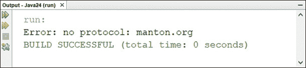

**图 14.4**

`PageCatalog`应用程序的错误输出。

`PageCatalog`应用程序创建了一个`HomePage`对象的数组，然后显示该数组的内容。每个`HomePage`对象创建时最多使用三个参数：

 页面所有者的名称

 页面的地址（作为`String`类型，而非`URL`）

 页面的类别

第三个参数是可选的，并且在第 17–18 行中未使用。

`HomePage`类的构造函数在接收到无法转换为有效`URL`对象的字符串时会抛出`MalformedURLException`错误。这些异常在`PageCatalog`应用程序中通过`try`-`catch`块进行处理。

要修正导致“no protocol”错误的问题，请编辑第 18 行，使字符串以`http://`文字开头，就像第 9–16 行中的其他网络地址一样。当你再次运行程序时，你会看到如图 14.5 所示的输出。

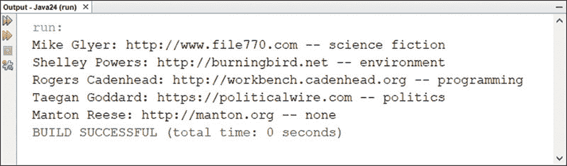

**图 14.5**

`PageCatalog`应用程序修正后的输出。

### 总结

既然你已经使用了 Java 的异常处理技术，那么错误这个主题应该比这一小时开始时稍微受欢迎一点。

你可以利用这些技术做很多事情：

 捕获异常并处理它。

 忽略异常，交给另一个类或 Java 虚拟机来处理。

 在同一个`try`-`catch`块中捕获几个不同的异常。

 抛出自己的异常

在 Java 程序中管理异常可以使它们更可靠、更多功能且更容易使用，因为你不需要向运行软件的人显示任何晦涩的错误信息。

### 工作坊

#### 问答

**问：可以创建你自己的异常吗？**

**答：** 这不仅是可能的，而且是一个非常好的主意。为可能出现的问题自定义异常可以使你的类更加健壮。你可以通过将自定义异常变为现有异常（例如所有异常的父类`Exception`）的子类来轻松创建它们。在`Exception`的子类中，你可能想要重写两个构造函数：无参数的`Exception()`和带有`String`参数的`Exception()`。在后者中，该字符串应该是描述已发生错误的消息。

**问：为什么这一小时除了异常之外，没有涵盖如何抛出和捕捉错误？**

**答：** Java 将问题分为`Errors`（错误）和`Exceptions`（异常），因为它们的严重程度不同。异常的程度较轻，因此它们应该在程序中使用`try`-`catch`或在方法声明中使用`throws`来处理。相反，错误更为严重，无法在程序中得到妥善处理。

这些错误的两个例子是栈溢出（stack overflows）和内存溢出（out-of-memory errors）。这些可能导致`JVM`崩溃，而且你无法在`JVM`运行时修复它们。

**问：仍在报纸连连连漫画是哪一个？**

**答：** *Katzenjammer Kids*，由 Rudolph Dirks 于 1897 年创建，至今仍由 King Features Syndicate 提供。该连漫画在第一部漫画《The Yellow Kid》问世仅两年后开始，并且是第一个使用对话框的漫画。

Dirks 是一个移居美国的德国移民，受他家乡的一个儿童故事启发，创造了反叛的孩子 Hans 和 Fritz。他在 1912 因合同纠纷退出了漫画，由 Harold Knerr 接手，后者一直创作并绘制直到 1949 年。此后还有五位漫画家。从那时起，*katzenjammer* 一词在德语中字面意思是“猫的哀叫”，但它经常被用来描述

### 测验

尽管这一小时充满了错误，但看看你是否能在不犯任何错误的情况下回答以下问题。

**1. 一个`catch`语句可以处理多少个异常？**

A. 仅一个。

B. 几个不同的异常。

C. 此答案留空。

**2. `finally`部分中的语句在什么时候运行？**

A. 在`try`-`catch`块因异常而结束后执行

B. 在`try`-`catch`块在没有异常的情况下结束后执行

C. A 和 B 都是

**3. 有了这些关于抛出和捕捉的讨论，这些需要做什么？**

A. 更多投手

B. 签约一个左手外野手

C. 引入替补

#### 答案

**1.** `catch`语句中的`Exception`对象可以处理其自身类及其所有父类的异常。

**2.** `finally`部分的语句或语句总会在`try`-`catch`块之后执行，无论是否发生了异常。

**3.** 每个答案都是正确的，但 A 比其他更准确。

#### 活动

为了看看你是否是一个优秀的 Java 程序员，尝试在完成以下任务时尽可能少犯错误：

- 修改`NumberDivider`应用程序，使其抛出它捕获的所有异常，并运行程序查看发生了什么。

- 创建一个`Multiplier`应用程序，接收三个数字作为命令行参数，并对非数字参数抛出异常。

线程（Threads）是一种组织程序的方式，使其能够同时执行多件事。每个必须同时发生的任务都应该放置在自己的线程中，这通常通过将每个任务实现为一个独立的类完成。

线程由`Thread`类和`Runnable`接口表示，它们都属于`java.lang`类包。由于它们属于这个包，因此你不需要在程序中使用`import`语句来引用它们。

`Thread`类最简单的用法之一是用来减慢程序执行某些操作的速度。

## 减慢程序运行

`Thread`类有一个`sleep()`方法，你可以在任何需要停止运行一段时间的程序中调用它。你经常在带有动画的程序中看到这种技术，因为它可以防止图像显示的速度超过 Java 虚拟机的处理能力。

要使用`sleep()`方法，请调用`Thread.sleep()`并传入要暂停的毫秒数，如下句所示：

```java
Thread.sleep(5000);
```

上述语句会导致 JVM 在执行任何其他操作之前暂停五秒钟（5,000 毫秒）。如果由于某种原因 JVM 无法暂停那么久，`sleep()`方法将抛出一个`InterruptedException`。

因为可能会抛出此异常，当你使用`sleep()`方法时必须以某种方式处理它。此一种方法是将`Thread.sleep()`语句放在`try-catch`块中：

```java
try {
    Thread.sleep(5000);
} catch (InterruptedException e) {
    // 提前唤醒
}
```

当你希望 Java 程序同时处理多一件事时，你必须将程序组织成线程。你的程序可以拥有任意数量的线程，它们都可以同时运行而互不影响。

## 创建线程

一个可以作为线程运行的 Java 类被称为可运行（runnable）类或线程（threaded）类。虽然你可以使用线程让程序执行暂停几秒，但程序员通常出于相反的原因使用它们——为了加速程序。如果你将耗时较的任务放在自己的线程中，程序的其余部分将运行得更快。这通常被用于防止任务拖慢程序图形用户界面（GUI）的响应速度。

例如，如果你编写了一个从文件加载股票市场价格数据并编译统计数据的应用程序，最耗时的任务是加载数据。如果应用程序没有使用线程，在加载数据时，程序的界面可能会响应迟钝。这会让用户感到极度沮丧。

将任务放在自己的线程中的两种方法包括：

1. 将任务放在实现`Runnable`接口的类中。

2. 将任务放在作为`Thread`子类的类中。

为了支持`Runnable`接口，在创建类时使用了`implements`关键字，如下例所示：

```java
public class LoadStocks implements Runnable {
    // 类体
}
```

当类实现一个接口时，表示该类除了自身的方法外还包含一些额外的行为。

实现`Runnable`接口的类必须包含`run()`方法，其结构如下：

```java
public void run() {
    // 方法体
}
```

`run()`方法应该处理线程创建时要完成的任务。在股票市场的示例中，`run()`方法可以包含从磁盘加载数据并根据这些数据编译统计数据的语句。

当运行一个线程应用程序时，其`run()`方法中的语句不会自动执行。在 Java 中可以启动和停止线程，但在你完成以下两件事之前，线程不会开始运行：

1. 通过调用`Thread`构造函数创建线程类的对象。

2. 通过调用其`start()`方法启动线程。

`Thread`构造函数接受一个参数：包含线程`run()`方法的对象。通常你使用`this`关键字作为参数，这表示当前类包含了`run()`方法。

列表 15.1 包含一个寻找前一百个质数的 Java 应用程序，将其存储在`StringBuffer`中。当找到所有质数后，将显示它们。在 NetBeans 中，在`com.java24hours`包中创建一个名为`PrimeFinder`的新 Java 文件，将列表中的文本输入文件中，并且——等等——不要忘记保存。

**列表 15.1 PrimeFinder.java 的全文**

```java
1: package com.java24hours;
2: 
3: public class PrimeFinder implements Runnable {
4:     Thread go;
5:     StringBuffer primes = new StringBuffer();
6:     int time = 0;
7: 
8:     PrimeFinder() {
9:         start();
10:        while (primes != null) {
11:            System.out.println(time);
12:            try {
13:                Thread.sleep(100);
14:            } catch (InterruptedException exc) {
15:                // 什么都不做
16:            }
17:            time++;
18:        }
19:    }
20: 
21:    void start() {
22:        if (go == null) {
23:            go = new Thread(this);
24:            go.start();
25:        }
26:    }
27: 
28:    void run() {
29:        int quantity = 1000000;
30:        int numPrimes = 0;
31:        // 可能是质数的数字
32:        int candidate = 2;
33:        primes.append("\nFirst").append(quantity).append("primes:\n");
34:        while (numPrimes < quantity) {
35:            if (isPrime(candidate)) {
36:                primes.append(candidate).append(" ");
37:                numPrimes++;
38:            }
39:            candidate++;
40:        }
41:        System.out.println(primes);
42:        primes = null;
43:        System.out.println("\nTime elapsed: " + time + " seconds");
44:    }
45: 
46:    public static boolean isPrime(int candidate) {
47:        double root = Math.sqrt(candidate);
48:        for (int i = 2; i <= root; i++) {
49:            if (candidate % i == 0) {
50:                return false;
51:            }
52:        }
53:        return true;
54:    }
55: 
56:    public static void main(String[] arguments) {
57:        new PrimeFinder();
58:    }
59: }
```


寻找一百万质数是一项耗时任务，因此该工作非常适合放在自己的线程中。当线程在后台工作时，`PrimeFinder` 应用程序显示了经过了多少秒。输出的开头如图 15.1](#ch15.xhtml_ch15fig1）所示。

**图 15.1 PrimeFinder 应用程序的输出。**

应用程序中的大多数语句用于寻找质数。以下语句用于在此程序实现线程：

- 第 3 行：`PrimeFinder` 类实现了 `Runnable` 接口。
- 第 4 行：创建一个名为 `go` 的 `Thread` 对象变量但尚未赋值。
- 第 22-25 行：如果 `go` 对象变量值为 `null`，表示线程尚未创建，则创建一个新的 `Thread` 对象并存储在变量中。通过调用线程的 `start()` 方法启动线程。

 第 28–44 行——`run()` 方法寻找一个从 2 开始的质数序列，通过调用其 `append()` 方法将每个质数存储在 `primes` 字符串缓冲区中。

当创建一个 `PrimeFinder` 对象来开始执行程序时，该应用程序的 `main()` 方法中有些不寻常。这里是该语句：

```
new PrimeFinder();
```

通常情况下，你会期望看到该对象被赋值给一个变量，如下：

```java
PrimeFinder frame = new PrimeFinder();
```

然而，由于不再需要再次引用该对象，因此将其存储在变量中是没有必要的。调用 `new` 来创建对象会导致程序运行。

在 Java 中，一种良好的编程实践是只有在创建后需要使用这些对象时才将其存储在变量中。

**注意**

`PrimeFinder` 应用对 `StringBuffer` 对象的 `append()` 方法进行了一些不寻的操作。调用 `append()` 之后紧跟着一个点（`.`）字符和另一个 `append()` 调用。这导致文本按顺序追加。之所以可能，是因为调用 `append()` 会返回该缓冲区，然后可以再次调用它。

## 线程操作

你可以通过调用其 `start()` 方法来启动线程，这可能让你认为也有一个 `stop()` 方法来停止它。

尽管 Java 在 `Thread` 类中包含一个 `stop()` 方法，但它已经被废弃。在 Java 中，`deprecated`（已弃用）元素是指已被具有功能更好的替代方案的替换的类、接口、方法或变量。

**警告**

听从此弃用警告是一个好主意。Oracle 废用了 `stop()` 方法，因为它可能会给在 JVM 中运行的其他线程引起问题。该类的 `resume()` 和 `suspend()` 方法也被废用了。

你接的项目将展示如何停止一个线程。你正在进行的程序循环遍历网站标题列表和访问这些网站的地址。

每个页面的标题和网页地址以循环的方式显示。用户可以通过点击应用程序图形用户界面上的按钮来访问当前显示的站点。该程序运行一段时间，按顺序显示每个网站的信息。由于这个时间因素，线程是控制程序的最佳方式。

你并不是先将程序输入 NetBeans 源代码编辑器后再学习它，而是在一小时结束前有机会输入 `LinkRotator` 应用程序的全文。在此之前，程序的每个部分都将得到描述。

### `class` 声明

在这个程序中你需要做的第一件事是使用 `import` 导入 `java.awt`、`java.io`、`java.net`、`java.awt.event` 和 `javax.swing` 包中的类。需要这么多包是因为该项目使用了 Swing，这是一组支持 Java 图形用户界面的包。

在你使用 `import` 使某些类可用后，就可以准备好以下语句开始应用程序：

```java
public class LinkRotator extends JFrame
    implements Runnable, ActionListener {
```

该语句将 `LinkRotator` 类创建为 `JFrame` 类的子类，`JFrame` 是一个由空框架组成的简单图形用户界面。该语句还表明此类支持两个接口：`Runnable` 和 `ActionListener`。通过实现 `Runnable` 类，你能够在此程序中使用 `run()` 方法使线程开始运行。`ActionListener` 接口使程序能够响应鼠标点击。

### 设置变量

在 `LinkRotator` 中要做的第一件事是创建类的变量和对象。创建一个名为 `pageTitle` 的六元素 `String` 对象数组，和一个名为 `pageLink` 的六元素 `URI` 对象数组：

```java
String[] pageTitle = new String[6];
URI[] pageLink = new URI[6];
```

`pageTitle` 数组存储显示的六个网站的标题。`URI` 对象类存储网站地址的值。`URI` 拥有跟踪网页地址所需的所有行为和属性。

最后要创建三个三个是一个整数变量、一个 `Thread` 对象和一个用户界面标签：

```java
int current = 0;
Thread runner;
JLabel siteLabel = new JLabel();
```

`current` 变量跟踪正在显示哪个站点，以便你可以在站点之间循环。`Thread` 对象 `runner` 代表此程序运行的线程。当你开始、停止和暂停程序操作时，会调用 `runner` 对象的方法。

### 构造函数

程序的构造函数在程序运行时会自动执行。该方法被用于给数组 `pageTitle` 和 `pageLink` 赋值。它还用于创建一个出现在用户界面上的可点击按钮。该方法包含以下语句：

```java
pageTitle = new String[] {
    "Oracle's Java site",
    "Server Side",
    "JavaWorld",
    "Java in 24 Hours",
    "Sams Publishing",
    "Workbench"
};

pageLink[0] = getURI("http://www.oracle.com/technwork/java");
pageLink[1] = getURI("http://serverside.com");
pageLink[2] = getURI("http://www.javaworld.com");
pageLink[3] = getURI("http://java24hours.com");
pageLink[4] = getURI("http://www.samsplishing.com");
pageLink[5] = getURI("http://workbench.cadenhead.org");
```

每个页面的标题存储在 `pageTitle` 数组中，该数组使用字符串初始化。`pageLink` 数组的元素被尚未创建的 `getURI()` 方法赋值。

`init()` 方法的最后三个语句创建一个标记为“Visit Site”的按钮并将其添加到框架。

### 设置 URL 时捕捉异常

当你设置 `URI` 对象时，必须确保用于设置地址的文本格式正确：`http://workbench.cadenhead.org` 和 `http://www.samsplishing.com` 是有效的，但 `http:www.javaworld.com` 则不是，因为冒号后面缺少双斜杠（`//`）。

`getURI(String)` 方法接收网页地址作为参数，返回该地址的 `URI` 对象。如果字符串不是有效地址，它将返回 `null`：

```java
URI getURI(String urlText) {
    URI pageURI = null;
    try {
        pageURI = new URI(urlText);
    } catch (URISyntaxException m) {
        // do nothing
    }
    return pageURI;
}
```

`try`-`catch` 块处理创建 `URI` 对象时发生的任何 `URISyntaxException` 错误。如果抛出此异常则不需要任何操作，因此 `catch` 块只包含注释。

### 启动线程

在此程序中，当调用 `start()` 方法时，`runner` 线程就会启动。

`start()` 方法作为构造函数的最后一个语句被调用。这里是该方法：

```java
public void start() {
    if (runner == null) {
        runner = new Thread(this);
        runner.start();
    }
}
```

如果 `runner` 尚未启动，则该方法将启动它。

语句 `runner = new Thread(this)` 创建了一个带有一个参数的 `Thread` 对象：该参数是 `this` 关键字。`this` 关键字指向程序本身，将其指定为在线程中运行的类。

调用 `runner.start()` 会导致线程开始运行。当线程开始时，该线程的 `run()` 方法会被调用。由于 `runner` 线程是 `LinkRotator` 程序本身，因此调用的是应用程序的 `run()` 方法。

## 运行线程

`run()` 方法是线程执行主要工作的地方。在 `LinkRotator` 程序中，以下代表 `run()` 方法：

```java
public void run() {
    Thread thisThread = Thread.currentThread();
    while (runner == thisThread) {
        current++;
        if (current > 5) {
            current = 0;
        }
        siteLabel.setText(pageTitle[current]);
        repaint();
        try {
            Thread.sleep(1000);
        } catch (InterruptedException e) {
            // do nothing
        }
    }
}
```

`run()` 方法中发生的第一件事是创建一个名为 `thisThread` 的 `Thread` 对象。`Thread` 类的类方法 `currentThread()` 为 `thisThread` 对象设置了值。`currentThread()` 方法跟踪当前运行的线程。

该方法中的所有语句都是一个 `while` 循环的一部分，该循环比较 `runner` 对象和 `thisThread` 对象。这两个对象都是线程，只要它们引用同一个对象，`while` 循环就会继续进行。此循环内部没有语句会导致 `runner` 和 `thisThread` 对象的取值不同，因此除非循环外部某些某些改变了其中一个 `Thread` 对象，否则它将无限循环。

`run()` 方法调用了 `repaint()`。接下来，`current` 变量的值加 1，如果 `current` 超过 5，则将其重新置为 0。`current` 变量用于确定显示哪个网站的信息。它被用作 `pageTitle` 字符串数组的索引，而标题被设置为 `siteLabel` 用户界面组件的文本。

`run()` 方法包含了另一个处理错误的 `try-catch` 块。`Thread.sleep(1000)` 语句导致线程暂停 1 秒，足够让用户阅读网站的名称及其地址。`catch` 语句处理在执行 `Thread.sleep()` 语句期间可能发生的任何 `InterruptedException` 错误。如果线程在睡眠时被某些操作中断，就会发生这些错误。

## 处理鼠标点击

`LinkRotator` 程序中最后需要处理的是事件处理——检测用户输入的能力。每当用户点击“Visit Site”按钮时，应用程序都应该用网络浏览器打开显示的网站。这是通过名为 `actionPerformed()` 的方法实现的，该方法是 `ActionListener` 接口要求的。每当按钮被点击时就会调用此方法。

以下是 `LinkRotator` 的 `actionPerformed()` 方法：

```java
public void actionPerformed(ActionEvent event) {
    Desktop desktop = Desktop.getDesktop();
    if (pageLink[current] != null) {
        try {
            desktop.browse(pageLink[current]);
            runner = null;
            System.exit(0);
        } catch (IOException exc) {
            // do nothing
        }
    }
}
```

此方法中发生的第一件事是创建一个 `Desktop` 对象。`java.awt` 包中的 `Desktop` 类表示运行应用程序的计算机桌面环境。获取此对象后，你可以使用它通过“mailto:”链接启动电子邮件客户端，用另一个程序打开文件进行编辑，打印文件，并让 Java 外部的其他程序执行任务。

在这里，`Desktop` 对象被用于用计算机默认的网络浏览器打开网页。

`browse(URI)` 方法在浏览器中加载指定的网络地址。如果 `pageLink[current]` 是一个有效地址，`browse()` 将请求浏览器加载该页面。

## 显示循环链接

你现在准备好创建并测试该程序了。在 `com.java24hours` 包中创建一个名为 `LinkRotator` 的新 Java 文件，并输入列表 15.2 中的文本。

**列表 15.2** LinkRotator.java 的**全文**。


```java
1: package com.java24hours;
2:
3: import java.awt.*;
4: import java.awt.event.*;
5: import java.io.*;
6: import javax.swing.*;
7: import java.net.*;
8:
9: public class LinkRotator extends JFrame
10:   implements Runnable, ActionListener {
11:
12:   String[] pageTitle = new String[6];
13:   URI[] pageLink = new URI[6];
14:   int current = 0;
15:   Thread runner;
16:   JLabel siteLabel = new JLabel();
17:
18:   public LinkRotator() {
19:     setDefaultCloseOperation(JFrame.EXIT_ON_CLOSE);
20:     setSize(300, 100);
21:     FlowLayout flo = new FlowLayout();
22:     setLayout(flo);
23:     add(siteLabel);
24:     pageTitle = new String[] {
25:     "Oracle's Java site",
26:     "Server Side",
27:     "Java World",
28:     "Java in 24 Hours",
29:     "Sams Publishing",
30:     "Workbench"
31:   };
32:   pageLink[0] = getURI("http://www.oracle.com/technetwork/java");
33:   pageLink[1] = getURI("http://www.serverside.com");
34:   pageLink[2] = getURI("http://www.javaworld.com");
35:   pageLink[3] = getURI("http://www.java24hours.com");
36:   pageLink[4] = getURI("http://www.samsplishing.com");
37:   pageLink[5] = getURI("http://workbench.cadenhead.org");
38:   Button visitButton = new Button("Visit Site");
39:   visitButton.addActionListener(this);
40:   add(visitButton);
41:   setVisible(true);
42:   start();
43:   }
44:
45:   private URI getURI(String urlText) {
46:     URI pageURI = null;
47:     try {
48:       pageURI = new URI(urlText);
49:     } catch (URISyntaxException ex) {
50:       // do nothing
51:     }
52:     return pageURI;
53:   }
54:
55:   public void start() {
56:     if (runner == null) {
57:       runner = new Thread(this);
58:       runner.start();
59:     }
60:   }
61:
62:   public void run() {
63:     Thread thisThread = Thread.currentThread();
64:     while (runner == thisThread) {
65:       current++;
66:       if (current > 5) {
67:         current = 0;
68:       }
69:       siteLabel.setText(pageTitle[current]);
70:       repaint();
71:       try {
72:         Thread.sleep(1000);
73:     } catch (InterruptedException e) {
74:         // do nothing
75:     }
76:   }
77:   }
78:
79:   public void actionPerformed(ActionEvent event) {
80:     Desktop desktop = Desktop.getDesktop();
81:     if (pageLink[current] != null) {
82:       try {
83:         desktop.browse(pageLink[current]);
84:         runner = null;
85:         System.exit(0);
86:       } catch (IOException exc) {
87:         // do nothing
88:       }
89:     }
90:   }
91:   }
92:
93:   public static void main(String[] arguments) {
94:     new LinkRotator();
95:   }
96: }
```

# 第 16 小时：使用内部类与闭包

## 本小时的任务列表

-  为对象添加一个内部类。
-  探索为什么内部类很有用。
-  创建一个匿名内部类。
-  在接口上使用适配器类。
-  编写一个 lambda 表达式。
-  用 lambda 表达式替换匿名内部类。

Java 编程语言在 1995 年发布时，其范围有限且易于掌握。当时 Java 类库中大约只有 250 个类。该语言的设计初衷主要是为了能够在浏览器内部运行一种称为 applet 的交互式程序。由于当时还没有其他技术可以实现这一功能，Java 引起了巨大的轰动，并迅速被成千上万的程序员所接受。

作为该语言设计优良的证明，它扩展了最初的单一焦点，成为了一种通用编程语言，与当时全球最流行、实现最广泛的 C++ 相相竞争。

如今，Java 语言已有 23 年历史，数百万程序员在使用它编写代码。随着每一个新版本的发布，Java 在支持现有开发者的同时，不断扩展其功能，以实现复杂的各种软件开发方法。

最令人兴奋的之一是一种新的编写代码方式，被称为闭包或 lambda 表达式。这些表达式使得一种称为函数式编程的方法论成为可能。

在本小时中，你将在学习 lambda 表达式之前，先涵盖使用它们的前提的两个语言方面：内部类和匿名内部类。

## 内部类

当你在 Java 中创建一个类时，你定义了该类的属性和行为。属性是存储数据的类变量和实例变量；行为是使用这些数据执行任务的方法。

类还可以包含同时由属性和行为的内容：内部类。

内部类是包含在外部类中的辅助类。你可能会奇怪为什么它们是必要的，因为根据需要创建任意数量的新类来编写程序是很容易的。如果你正在编写一个 `CheckBook` 程序，需要为一个人书写的每张支票创建一个对象，你就会创建一个 `Check` 类。如果程序支持每月的定期自动扣款，就添加一个 `Autopayment` 类。

内部类并不是必须的。但当你学会了它们能做的所有事情后，你会发现在很多情况下它们是超级用的。

Java 包含内部类有三个原因：

1. 当一个辅助类仅被另一个类使用时，在那个类内部定义它是是有意义的。
2. 它们允许辅助类访问其 `private` 方法和变量，而这些成员在作为独立类时是无法访问的。
3. 它们将辅助类尽可能地放在它在另一个类中使用的地方。

内部类使用 `class` 关键字创建，与其他任何类一样，但它声明在包含它的类内部。通常，这被与类变量和实例变量放在一起。

下面是在名为 `Simple` 的类内部创建一个 `InnerSimple` 内部类的示例：

点击此处查看代码图片

```java
public class Simple {
    class InnerSimple {
        InnerSimple() {
            System.out.println("I am an inner class!");
        }
    }
    public Simple() {
        // empty constructor
    }
    public static void main(String[] arguments) {
        Simple program = new Simple();
        Simple.InnerSimple inner = program.new InnerSimple();
    }
}
```

内部类的结构与其他任何类都相同，但被放在外部类的 `{` 和 `}` 括号内。

创建内部类需要外部类的一个对象。在对象上调用 `new` 操作符：

点击此处查看代码图片

```java
Simple.InnerSimple inner = program.new InnerSimple();
```

类名包含了外部类的名称、一个点（`.`）字符以及内部类的名称。在前面的语句中，`Simple.InnerSimple` 就是类名。

本小时的项目是重写第 14 小时中的应用程序“程序中的错误处理”。该小时的 `PageCatalog` 应用程序需要一个名为 `HomePage` 的辅助类。列表 16.1 中的 `Catalog` 程序重写了该项目，用内部类替换了那个独立的类。

在 `com.java24hours` 包中创建一个名为 `Catalog` 的新 Java 文件；然后用列表 16.1 中的源代码填充它。

**列表 16.1 `Catalog.java` 的全文**

点击此处查看代码图片

```java
1: package com.java24hours;
2:
3: import java.net.*;
4:
5: public class Catalog {
6:     class HomePage {
7:         String owner;
8:         URL address;
9:         String category = "none";
10:             
11:             public HomePage(String inOwner, String inAddress)
12:                 throws MalformedURLException {
13:
14:                 owner = inOwner;
15:                 address = new URL(inAddress);
16:             }
17:
18:             public HomePage(String inOwner, String inAddress, String inCategory)
19:                 throws MalformedURLException {
20:
21:                 this(inOwner, inAddress);
22:                 category = inCategory;
23:             }
24:         }
25:     
26:     public Catalog() {
27:         Catalog.HomePage[] catalog = new Catalog.HomePage[5];
28:         try {
29:             catalog[0] = new HomePage("Mike Glyer",
30:                 "http://www.file70.com", "science fiction");
31:             catalog[1] = new HomePage("Shelley Powers",
32:                 "http://bird.net", "environment");
33:             catalog[2] = new HomePage("Rogers Cadenhead",
34:                 "http://workbench.cadenhead.org", "programming");
35:             catalog[3] = new HomePage("Taegan Goddard",
36:                 "https://politicalwire.com", "politics");
37:             catalog[4] = new HomePage("Manton Reese",
38:                 "http://manton.org");
39:             for (int i = 0; i < catalog.length; i++) {
40:                 System.out.println(catalog[i].owner + ": " +
41:                 catalog[i].address + " -- " +
42:                 catalog[i].category);
43:             }
44:         } catch (MalformedURLException e) {
45:             System.out.println("Error: " + e.getMessage());
46:         }
47:     }
48: 
49:     public static void main(String[] arguments) {
50:         new Catalog();
51:     }
}
```

内部类定义在第 6 行到第 24 行。它有两个构造函数，一个在第 11 行，另一个在第 18 行。`Catalog` 类在第 27 行使用了 `HomePage` 对象的数组。该内部类被称为 `Catalog.HomePage`。

应用程序的输出见图 16.1。


**图 16.1**

`Catalog` 的输出。

## 匿名内部类

通过匿名内部类和 `java.awt.event` 包中的 `KeyAdapter` 类，有一种更好的方法来创建监听器并将其添加到图形用户界面中。

`KeyAdapter` 类实现了 `KeyListener` 接口，并对所有三个方法提供了“空”实现。这使得为键盘事件创建监听器变得简单，因为你可以创建一个只重写实际执行操作方法的子类。

以下是 `KeyViewer` 应用程序的键盘监听器框架：

点击此处查看代码图像

```java
public class KeyViewerListener extends KeyAdapter {

    public void keyTyped(KeyEvent input) {
        // to do
    }
}
```

该监听器可以被创建并设置为监听器：

点击此处查看代码图像

```java
KeyViewerListener kvl = new KeyViewerListener();

keyText.addKeyListener(kvl);
```

这种方法需要一个单独辅助类 `KeyViewerListener`，并且需要创建该类的对象并赋值给变量。

另一种方法是将监听器创建为匿名内部类：

点击此处查看代码图像

```java
keyText.addKeyListener(new KeyAdapter() {

    public void keyTyped(KeyEvent input) {
        char key = input.getKeyChar();
        keyLabel.setText("You pressed " + key);
    }
});
```

该监听器是通过调用 `new KeyAdapter()` 后紧跟类定义匿名创建的。该类重写了 `keyTyped()` 方法，因此当按下按键时，通过调用 `getKeyChar()` 获取按键，并通过设置 `keyLabel`（这是一个 `JLabel` 组件）的值来显示它。

匿名内部类做了一件普通辅助类无法做到的事情：访问 `keyLabel` 实例变量。该变量属于 `KeyViewer` 类。内部类可以访问其外部类的方法和变量。

在 NetBeans 中，在 `com.java24hours` 包中创建一个名为 `KeyViewer` 的新 Java 文件。将列表 16.2 中的文本输入文件中，并在完成后保存。

**列表 16.2 `KeyViewer.java` 的全文**

点击此处查看代码图像


```java
1: package com.java24hours;
2:
3: import javax.swing.*;
4: import java.awt.event.*;
5: import java.awt.*;
6:
7: public class KeyViewer extends JFrame {
8:     JTextField keyText = new JTextField(80);
9:     JLabel keyLabel = new JLabel("Press any key in the text field.");
10:
11:     public KeyViewer() {
12:          super("KeyViewer");
13:          setSize(350, 100);
14:          setDefaultCloseOperation(JFrame.EXIT_ON_CLOSE);
15:          keyText.addKeyListener(new KeyAdapter() {
16:              public void keyTyped(KeyEvent input) {
17:                  char key = input.getKeyChar();
18:                  keyLabel.setText("You pressed " + key);
19:              }
20:          });
21:          BorderLayout bord = new BorderLayout();
22:          setLayout(bord);
23:          add(keyLabel, BorderLayout.NORTH);
24:          add(keyText, BorderLayout.CENTER);
25:          setVisible(true);
26:     }
27:     
28:     public static void main(String[] arguments) {
29:          new KeyViewer();
30:     }
31: }
```

匿名内部类在第 15–20 行中创建并使用。它使用应用程序所需的 `KeyListener` 接口中的唯一方法来监控键盘输入，并通过更新 `keyLabel` 实例变量来显示该输入。

程序的输出所示图 16.2。


**图 16.2**

使用 `KeyViewer` 应用程序监控键盘输入。

匿名内部类不能定义构造函数，因此它们比非匿名内部类局限。它们是语言的一项复杂特性，在检查程序源码时较难理解，但它们可以使程序更加简洁。丰富的 Java 程序员经常使用它们。

### 闭包

下一节引入了备受期待的特性：闭包。闭包也被称为 lambda 表达式，允许代码引用另一个方法的变量。

这里是一个示例：

```java
Runnable runner = () -> {
    System.out.println("Run");
};
```

在上面的示例中，`Runnable` 接口只有一个方法。由于 `run()` 不接受任何参数，因此表达式中的参数为空：

```java
Runnable runner = () -> System.out.println("Run");
```

这等同于以下代码：

```java
Runnable runner = new Runnable() {
    public void run() {
        System.out.println("Run");
    }
};
```

箭头右边的 lambda 表达式定义了方法。在下面的示例中，接口有一个参数：

```java
ActionListener listener = (event) -> {
    System.out.println(event.getSource());
};
```

这等同于以下代码：

```java
ActionListener listener = new ActionListener() {
    public void actionPerformed(ActionEvent event) {
        System.out.println(event.getSource());
    }
};
```

`ActionListener` 接口接收动作事件，例如用户点击按钮时。参数是一个 `ActionEvent` 对象，描述了触发事件的用户动作。lambda 表达式的右半定义了 `actionPerformed()` 方法，其为单个语句，显示触发事件的用户组件的信息。

表达式的左半声明了名为 `act` 的 `ActionEvent` 对象是方法的参数：

```java
ActionListener listener = (act) -> {
    System.out.println(act.getSource());
};
```

这等同于 `java.awt.event` 包中的以下代码：

```java
ActionListener listener = new ActionListener() {
    public void actionPerformed(ActionEvent act) {
        System.out.println(act.getSource());
    }
};
```

如你所示，lambda 表达式的作用之一是缩短代码。单个表达式就可以创建一个对象并实现一个接口。Java 的这一特性可以通过语言对目标类型（target typing）的支持使代码更短。

在 lambda 表达式中，可以推断发送给方法的参数或多个参数的类。考虑最后一个示例。由于 `ActionListener` 函数式接口有一个接受 `ActionEvent` 对象作为唯一参数的方法，因此可以省略该类的名称。

考虑到这一点，这是该 lambda 表达式修改后的版本：

```java
ActionListener listener = (act) -> {
    System.out.println(act.getSource());
};
```

在 NetBeans 中于 `com.java24hours` 包下创建一个名为 `ColorFrame` 的新程序。将列表 16.3 中的文本输入文件，并在完成后保存。

### 列表 16.3：`ColorFrame.java` 的完整代码

点击此处查看代码图像

```java
1: package com.java24hours;
2:
3: import java.awt.*;
4: import java.awt.event.*;
5: import javax.swing.*;
6:
7: public class ColorFrame extends JFrame {
8:     JButton red, green, blue;
9:     
10:      public ColorFrame() {
11:          super("ColorFrame");
12:          setSize(322, 122);
13:          setDefaultCloseOperation(JFrame.EXIT_ON_CLOSE);
14:          FlowLayout flo = new FlowLayout();
15:          setLayout(flo);
16:          red = new JButton("Red");
17:          add(red);
18:          green = new JButton("Green");
19:          add(green);
20:          blue = new JButton("Blue");
21:          add(blue);
22:          // begin anonymous inner class
23:          ActionListener act = new ActionListener() {
24:              public void actionPerformed(ActionEvent event) {
25:                  if (event.getSource() == red) {
26:                      getContentPane().setBackground(Color.RED);
27:                  }
28:                  if (event.getSource() == green) {
29:                      getContentPane().setBackground(Color.GREEN);
30:                  }
31:                  if (event.getSource() == blue) {
32:                      getContentPane().setBackground(Color.BLUE);
33:                  }
34:              }
35:      };
36:          // end anonymous inner class
37:          red.addActionListener(act);
38:          green.addActionListener(act);
39:          blue.addActionListener(act);
40:          setVisible(true);
41:      }
42:
43:      public static void main(String[] arguments) {
44:          new ColorFrame();
45:      }
46: }
```

该程序的运行情况如图图 16.3 所示。


**图 16.3** 使用匿名内部类监控动作事件。

应用程序的第 23–35 行使用匿名内部类为 `ColorFrame` 类创建了一个事件监听器。它是一个没有名称的对象，实现了 `ActionListener` 接口中唯一的方法 `actionPerformed(ActionEvent)`。

在该方法内部，通过调用 `getContentPane()` 方法获取框架的布局面板（content pane）。匿名内部类可以访问其外部类的方法和实例变量，而独立的辅助类则不能。

布局面板的 `setBackground(Color)` 方法会将框架的背景色更改为该颜色。三个按钮的颜色保持不变。现在我们来看列表 16.4 中的 `NewColorFrame` 应用程序。在 NetBeans 中于 `com.java24hours` 包下创建一个名为 `NewColorFrame` 的新程序。将文本 16.4 输入文件，并在完成后保存。

### 列表 16.4：`NewColorFrame.java` 的完整代码

点击此处查看代码图像

```java
1: package com.java24hours;
2: 
3: import java.awt.*;
4: import java.awt.event.*;
5: import javax.swing.*;
6:
7: public class NewColorFrame extends JFrame {
8:     JButton red, green, blue;
9:     
10:      public NewColorFrame() {
11:          super("NewColorFrame");
12:          setSize(322, 122);
13:          setDefaultCloseOperation(JFrame.EXIT_ON_CLOSE);
14:          FlowLayout flo = new FlowLayout();
15:          setLayout(flo);
16:          red = new JButton("Red");
17:          add(red);
18:          green = new JButton("Green");
19:          add(green);
20:          blue = new JButton("Blue");
21:          add(blue);
22:          // begin lambda expression
23:          ActionListener act = (event) -> {
24:              if (event.getSource() == red) {
25:                  getContentPane().setBackground(Color.RED);
26:              }
27:              if (event.getSource() == green) {
28:                  getContentPane().setBackground(Color.GREEN);
29:              }
30:              if (event.getSource() == blue) {
31:                  getContentPane().setBackground(Color.BLUE);
32:              }
33:      };
34:          // end lambda expression
35:          red.addActionListener(act);
36:          green.addActionListener(act);
37:          blue.addActionListener(act);
38:          setVisible(true);
39:      }
40:
41:      public static void main(String[] arguments) {
42:          new NewColorFrame();
43:      }
44: }
```

`NewColorFrame` 应用程序在第 23–33 行实现了动作监听器。你不需要知道 `ActionListener` 接口中方法的名称即可在程序中使用它，也不需要指定 `ActionEvent` 的类。

Lambda 表达式支持函数式编程，这是一种软件设计方法，直到目前 Java 程序员还无法使用这种方法。本节介绍了 Lambda 表达式的基本语法以及它们在程序中应用的两种常用方式。但 Java 中的函数式编程是一个如此强大且具有革命性的主题，足以成为一整本书的主题。到目前，你应该能够识别 Lambda 表达式并使用它们来实现任何单方法接口（也称为函数式接口）。

### 总结

内部类、匿名内部类和 Lambda 表达式是 Java 语言中学习起来最复杂的部分。它们主要吸引那些使用该语言编写了一段时间程序的程序员，这些程序员可以利用强大的特性用更少的代码行完成更多工作。

但在你编写自己的 Lambda 表达式之前，你应该能够从内部类和匿名内部类中受益。

非匿名内部类的结构类似于独立的辅助类，但它位于另一个类内部，与实例变量、类变量、实例方法和类方法并列。与辅助类不同，它可以访问其所在类的私有变量和方法。

匿名内部类避免了为仅使用一次的类分配对象，例如连接到用户界面的事件监听器。

Lambda 表达式的外表非常简单，只需要一个箭头运算符 `->` 即可创建。但它们为 Java 程序员实现的功能是巨大的。

### 练习

#### 问答

**Q：** 匿名内部类很很难理解。我必须在程序中使用它们吗？

**A：** 不需要。和 Java 的其他复杂功能一样，如果你可以通过其他方式完成任务，就不需要使用它们。但你仍然应该学习它们，因为你会在 Java 代码中遇到它们。当你查看经验丰富的程序员编写的 Java 程序时，经常发现内部类和匿名内部类。所以，即使你还没有准备好自己创建它们，了解它们以及如何运作也是有意义的。

**Q：** 哈菲尔和麦科伊家族还在斗争吗？

**A：** 在这场著名的 35 年冲突最后一次伤亡发生 126 年后，西弗吉尼亚州和肯基州的这两个家族的关系良好。1979 年，哈菲尔和麦科伊一起参加了电视游戏节目《家庭对抗》（Family Feud），并持续了一周。一只猪被留在舞台上并颁给了获胜的家庭。2003 年，这两个家族在肯塔基州的派克签署了一份正式的和平协议。

### 测验

为了判断你是否已经掌握了本小时的知识并可以上台回答，请回答以下关于内部类、匿名内部类和 lambda 表达式的问题。

1. **什么使得某些内部类是匿的？**

   A. 它们实现了一个接口。

   B. 它们没有被命名。

   C. 两者都是。

2. **仅包含一个方法的接口另一个名称是什么？**

   A. 抽象接口

   B. 类

   C. 函数式接口

3. **lambda 表达式猜测方法参数的类称作为什么？**

   A. 目标类型推（Target typing）

   B. 类型转换

   C. 类推断

#### 答案

1. **C.** 匿名内部类使用 `new` 关键字实现接口，跳过了实现该接口的类的创建和命名过程。

2. **C.** 从 Java 8 开始，被称为函数式接口。在语言的早期版本中，它们被称为单抽象方法接口。

3. **A.** 目标类型推可以推断任何函数接口方法参数的类。

#### 活动

为了体面地完成本小时的学习，请通过以下活动来运用这些知识：


 重写第 15 小时“创建线程程序”中的 `LinkRotator` 类，使用 lambda 表达式作为事件监听器。

 为 `NewColorFrame` 添加第四种背景颜色 `Color.YELLOW`。

若要查看实现这些活动的 Java 程序，请访问书籍网站 [www.java24hours.com](http://www.java24hours.com)。

# 第五部分：图形用户界面编程

# 第 17 小时

构建简单的用户界面

### 本小时的任务列表：

 创建按钮等用户界面组件。

 创建标签、文本字段和其他组件。

 将组件组合在一起。

 将组件放入其他组件内部。

 水平和和垂直滚动组件。

 打开和关闭窗口。

在本小时内容会变得非常复杂。你将用 Java 创建第一个图形用户界面 (GUI)，这会搞出一个大乱子。

计算机用户已经习惯了软件具有 GUI、通过鼠标接收用户输入并像其他程序一样工作。尽管某些用户仍在 Linux 或 Unix Shell 等命令行环境中工作，但大多数人如果遇到软件没有像 Microsoft Windows 或 Mac OS 那种点击和拖拽的图形界面，将会感到困惑。

Java 通过 `Swing` 支持这种软件，`Swing` 是 Java 类的集合，代表了作为 GUI 部分的所有不同按钮、文本字段、滑块和其他组件，以及从这些组件获取用户输入所需的类。

在本小时和下一小时中，你将在 Java 中创建并组织 GUI。之后，在第 19 小时“响应用户输入”中，你将使这些接口能够接收鼠标点击和其他用户输入。

### Swing 和抽象窗口工具包

由于 Java 是一种跨平台语言，允许你为许多操作系统编写程序，因此其图形用户界面软件必须是灵活的。它不能仅仅迎合 Windows 风格或 Mac 版本，必须处理两者以及其他平台。

在 Java 中，程序用户界面的开发基于 `Swing` 和一组早期名为抽象窗口工具包（Abstract Windowing Toolkit）的类。这些类使你能够创建 GUI 并接收用户输入。

`Swing` 包含了编写使用 GUI 程序所需的所有内容。通过 Java 的用户界面类，你可以创建一个包含以下所有及更多内容的 GUI：

 按钮、复选框、标签和其他简单组件

 文本字段、滑块和其他更复杂的组件

 下拉菜单和弹出菜单

 窗口、帧、对话框、面板和 applet 窗口

注意

`Swing` 包含了数十种组件，其自定义方式远比此处记录的要多。本书涵盖了最常用的组件及其最有用的方法。当你在接下来的四个小时中探索它们时，可以学习更多关于每个组件的知识，并在 Oracle 官方 Java 类库文档中发现新方法。可以在网页上阅读 [`download.java.net/jdk9/docs/api`](http://download.java.net/jdk9/docs/api)。它提供了 Java 9 中每个类和接口的额外参考文档。

### 使用组件

在 Java 中，GUI 的每个部分都由 `Swing` 包中的一个类表示。有一个用于按钮的 `JButton` 类，用于窗口的 `JWindow` 类，用于文本字段的 `JTextField` 类，以此此类推。

要创建并显示界面，你需要创建对象、设置它们的变量并调用它们的方法。这些技术与你学习面向对象编程 (OOP) 时所使用的技术是相同的。

当你组装 GUI 时，你处理的是两种对象：组件和容器。组件是用户界面中的单个元素，例如按钮或滑块。容器是你用来放置其他组件的组件。

创建界面的第一步是创建一个可以容纳组件的容器。在应用程序中，这个容器通常是一个窗口或帧。

### 窗口和帧

窗口和帧是可以显示在用户界面中并持有其他组件的容器。窗口是简单的容器，没有标题栏，也没有通常位于 GUI 顶部边缘的任何按钮。帧是窗口，包含了用户在运行软件时期望找到的所有常见窗口功能——例如用于关闭、扩展和缩小窗口的按钮。

你使用 `Swing` 的 `JWindow` 和 `JFrame` 类来创建这些容器。要在 Java 程序中不使用完整的包名和类名的情况下引用 Swing 类，请使用以下语句：

```java
import javax.swing.*;
```

这仅导入了 `javax.swing` 包中的类名。你还会在 `Swing` 中用到其他包。

在 Java 应用程序中使用帧的一种方法是让应用程序成为 `JFrame` 的子类。你的程序继承了作为帧运行所需的行为。以下语句创建了 `JFrame` 的子类：

点击查看代码图片

```java
import javax.swing.*;

public class MainFrame extends JFrame {
    public MainFrame() {
        // 设置帧
    }
}
```

该类创建了一个帧，但还没有完全设置它。在帧的构造函数中，创建帧时你必须做几件事：

 调用父类 `JFrame` 的构造函数。

 设置帧的标题。

 设置帧的大小。

 设置帧的外视图和感觉。

 定义用户关闭帧时发生什么。

你还必须使帧可见，除非由于某些原因它在应用程序运行时不应显示。

这些内容中的大部分可以在帧的构造函数中处理。该方法必须包含的是使用 `super` 语句调用 `JFrame` 的其中一个构造函数。这是一个示例：

```java
super();
```

前面的语句调用了无参数的 `JFrame` 构造函数。你也可以将帧的标题作为参数调用它：

```java
super("Main Frame");
```

这会将帧的标题（显示在顶部边缘标题栏中）设置为指定的字符串。在这个示例中，出现了文本“Main Frame”。

如果你没有以这种方式设置标题，可以调用框架的 `setTitle(String)` 方法，并将标题作为参数：

```java
setTitle("Main Frame");
```

框架的大小可以通过调用其 `setSize(int, int)` 方法来建立，该方法接受两个参数：宽度高度。以下语句设置了一个宽度为 350 像素、高度为 125 像素的框架：

```java
setSize(350, 125);
```

设置框架大小的另一种方法是向其填充组件，然后调用不带参数的框架 `pack()` 方法：

```java
pack();
```

`pack()` 方法将框架设置得足够大，以容纳框架内每个组件的优选大小（但不会更大）。每个界面组件都有一个优选大小，尽管根据组件在界面中的排列方式，这种大小有时会被会被忽略。在调用 `pack()` 之前，你不需要显式地设置框架的大小——该方法会在框架显示之前将其设置为合适的大小。

每个框架在显示时，标题栏上都有一个按钮，可用于关闭框架。在 Windows 系统上，该按钮显示为框架右上角的 X。要定义点击此按钮时发生什么，请调用框架的 `setDefaultCloseOperation(int)` 方法，并将四个 `JFrame` 类变量之一作为参数：

 `EXIT_ON_CLOSE`——点击按钮时退出程序。

 `DISPOSE_ON_CLOSE`——关闭框架并继续运行应用程序。

 `DO_NOT_HING_ON_CLOSE`——保持框架打开并继续运行。

 `HIDE_ON_CLOSE`——关闭框架并继续运行。

第一次调用该方法是最常见的，因为当应用程序的用户界面关闭时，意味着应用程序应该完成它的工作并关闭：

点击此处查看代码图片

```java
setDefaultCloseOperation(JFrame.EXIT_ON_CLOSE);
```

使用 Swing 创建的图形用户界面可以通过“外观和感觉”（look and feel）来定制其外观，这是一种视觉主题，控制按钮和其他组件的显示方式及其行为。

Java 包含了一种名为 Nimbus 的增强型外观和感觉，但在类中使用必须对其开启。设置外观和感觉是通过调用主 Swing 包中 `UIManager` 类的 `setLookAndFeel()` 方法完成的。

该方法接受一个参数：外观和感觉类的全名。

以下语句将 Nimbus 设置为外观和感觉：

```java
UIManager.setLookAndFeel(
点击此处查看代码图片
    "javax.swing.plaf.nimbus.NimbusLookAndFeel"
);
```

最后需要的一是让框架可见。调用其 `setVisible()` 方法并将 `true` 作为参数：

```java
setVisible(true);
```

这将按照定义的宽度和高度打开框架。你也可以用 `false` 调用它来停止显示框架。

列表 17.1 包含了本节描述的源代码。在 `com.java24hours` 包中名为 `SalutonFrame` 的 Java 文件中，输入这些语句。

**列表 17.1 SalutonFrame.java 的全文**

点击此处查看代码图片

```java
1: package com.java24hours;
2: 
3: import javax.swing.*;
4: 
5: public class SalutonFrame extends JFrame {
6:     public SalutonFrame() {
7:         super("Saluton mondo!");
8:         setLookAndFeel();
9:         setSize(450, 200);
10:          setDefaultCloseOperation(JFrame.EXIT_ON_CLOSE);
11:          setVisible(true);
12:     }
13: 
14:     private void setLookAndFeel() {
15:         try {
16:             UIManager.setLookAndFeel(
17:                 "javax.swing.plaf.nimbus.NimbusLookAndFeel"
18:             );
19:         } catch (Exception exc) {
20:             // ignore error
21:         }
22:     }
23: 
24:     public static void main(String[] arguments) {
25:         SalutonFrame frame = new SalutonFrame();
26:     }
27: }
```

列表 17.1 的 `24–26` 行包含一个 `main()` 方法，它将此框架类转换为应用程序。当你运行该类时，你会看到图 17.1 中所示框架。


**图 17.1 显示框架**

如果你没有以这种方式设置标题，可以调用框架的 `setTitle(String)` 方法，并将标题作为参数：

```java
setTitle("Main Frame");
```

框架的大小可以通过调用其 `setSize(int, int)` 方法来建立，该方法接受两个参数：宽度高度。以下语句设置了一个宽度为 350 像素、高度为 125 像素的框架：

```java
setSize(350, 125);
```

设置框架大小的另一种方法是向其填充组件，然后调用不带参数的框架 `pack()` 方法：

```java
pack();
```

`pack()` 方法将框架设置得足够大，以容纳框架内每个组件的优选大小（但不会更大）。每个界面组件都有一个优选大小，尽管根据组件在界面中的排列方式，这种大小有时会被会被忽略。在调用 `pack()` 之前，你不需要显式地设置框架的大小——该方法会在框架显示之前将其设置为合适的大小。

每个框架在显示时，标题栏上都有一个按钮，可用于关闭框架。在 Windows 系统上，该按钮显示为框架右上角的 X。要定义点击此按钮时发生什么，请调用框架的 `setDefaultCloseOperation(int)` 方法，并将四个 `JFrame` 类变量之一作为参数：

 `EXIT_ON_CLOSE`——点击按钮时退出程序。

 `DISPOSE_ON_CLOSE`——关闭框架并继续运行应用程序。

 `DO_NOT_HING_ON_CLOSE`——保持框架打开并继续运行。

 `HIDE_ON_CLOSE`——关闭框架并继续运行。

第一次调用该方法是最常见的，因为当应用程序的用户界面关闭时，意味着应用程序应该完成它的工作并关闭：

点击此处查看代码图片

```java
setDefaultCloseOperation(JFrame.EXIT_ON_CLOSE);
```

使用 Swing 创建的图形用户界面可以通过“外观和感觉”（look and feel）来定制其外观，这是一种视觉主题，控制按钮和其他组件的显示方式及其行为。

Java 包含了一种名为 Nimbus 的增强型外观和感觉，但在类中使用必须对其开启。设置外观和感觉是通过调用主 Swing 包中 `UIManager` 类的 `setLookAndFeel()` 方法完成的。

该方法接受一个参数：外观和感觉类的全名。

以下语句将 Nimbus 设置为外观和感觉：

```java
UIManager.setLookAndFeel(
点击此处查看代码图片
    "javax.swing.plaf.nimbus.NimbusLookAndFeel"
);
```

最后需要的一是让框架可见。调用其 `setVisible()` 方法并将 `true` 作为参数：

```java
setVisible(true);
```

这将按照定义的宽度和高度打开框架。你也可以用 `false` 调用它来停止显示框架。

列表 17.1 包含了本节描述的源代码。在 `com.java24hours` 包中名为 `SalutonFrame` 的 Java 文件中，输入这些语句。

**列表 17.1 SalutonFrame.java 的全文**

点击此处查看代码图片

```java
1: package com.java24hours;
2: 
3: import javax.swing.*;
4: 
5: public class SalutonFrame extends JFrame {
6:     public SalutonFrame() {
7:         super("Saluton mondo!");
8:         setLookAndFeel();
9:         setSize(450, 200);
10:          setDefaultCloseOperation(JFrame.EXIT_ON_CLOSE);
11:          setVisible(true);
12:     }
13: 
14:     private void setLookAndFeel() {
15:         try {
16:             UIManager.setLookAndFeel(
17:                 "javax.swing.plaf.nimbus.NimbusLookAndFeel"
18:             );
19:         } catch (Exception exc) {
20:             // ignore error
21:         }
22:     }
23: 
24:     public static void main(String[] arguments) {
25:         SalutonFrame frame = new SalutonFrame();
26:     }
27: }
```

列表 17.1 的 `24–26` 行包含一个 `main()` 方法，它将此框架类转换为应用程序。当你运行该类时，你会看到图 17.1 中所示框架。


**图 17.1 显示框架**

如果你没有以这种方式设置标题，可以调用框架的 `setTitle(String)` 方法，并将标题作为参数：

```java
setTitle("Main Frame");
```

框架的大小可以通过调用其 `setSize(int, int)` 方法来建立，该方法接受两个参数：宽度高度。以下语句设置了一个宽度为 350 像素、高度为 125 像素的框架：

```java
setSize(350, 125);
```

设置框架大小的另一种方法是向其填充组件，然后调用不带参数的框架 `pack()` 方法：

```java
pack();
```


`pack()` 方法将框架设置得足够大，以容纳框架内每个组件的优选大小（但不会更大）。每个界面组件都有一个优选大小，尽管根据组件在界面中的排列方式，这种大小有时会被忽略。在调用 `pack()` 之前，你不需要显式地设置框架的大小——该方法会在框架显示之前将其设置为合适的大小。

每个框架在显示时，标题栏上都有一个按钮，可用于关闭框架。在 Windows 系统上，该按钮显示为框架右上角的 X。要定义点击此按钮时发生什么，请调用框架的 `setDefaultCloseOperation(int)` 方法，并将四个 `JFrame` 类变量之一作为参数。

### 按钮

你可以添加到容器的一个简单组件是 `JButton`。`JButton` 与你处理的其他组件一样，是 `java.swing` 的一部分。`JButton` 对象是一个描述按钮作用的标签。这个标签可以是文本、图形或两者兼有。以下语句创建了一个名为 `okButton` 的 `JButton`：

```java
JButton okButton = new JButton("OK");
```

创建组件后，应该通过调用其 `add()` 方法将其添加到容器：

```java
add(okButton);
```

当你将组件添加到容器时，你不需要指定组件应该所在的位置。组件的排列由布局管理器（layout manager）决定。这些管理器中最简单的是 `FlowLayout` 类，它是 `java.awt` 的一部分。要让容器使用特定的布局管理器，你必须先创建该布局管理器的对象：

```java
FlowLayout flo = new FlowLayout();
```

创建布局管理器后，调用容器的 `setLayout` 方法将指定的管理器与容器关联：

```java
setLayout(flo);
```

此语句将 `flo` 对象指定为布局管理器。你创建的下一个应用程序（`com.java24hours` 包中名为 `Playback` 的类）是一个带有三个按钮的 Java 应用程序。将列表 17.2 中的文本输入新的 Java 文件并保存该文件。

**列表 17.2 `Playback.java` 的全文**

点击此处查看代码图片

```java
1: package com.java24hours;
2: 
3: import javax.swing.*;
4: import java.awt.*;
5: 
6: public class Playback extends JFrame {
7:     public Playback() {
8:         super("Playback");
9:         setLookAndFeel();
10:          setSize(450, 200);
11:          setDefaultCloseOperation(JFrame.EXIT_ON_CLOSE);
12:          setVisible(true);
13:     }
14: }
```

```java
JButton stop = new JButton("Stop");
JButton pause = new JButton("Pause");
add(play);
add(stop);
add(pause);
setVisible(true);
}

private void setLookAndFeel() {
    try {
        UIManager.setLookAndFeel(
            "javax.swing.plaf.nimbus.NimbusLookAndFeel"
        );
    } catch (Exception exc) {
        // ignore error
    }
}

public static void main(String[] arguments) {
    Playback frame = new Playback();
}
```

`Playback` 程序在第 12 行创建了一个 `FlowLayout` 布局管理器，并在第 13 行设置框架使用它。当在第 17–19 行将三个按钮添加到框架中时，它们由该管理器进行排列。

当你运行该应用程序时，你的输出结果应该类似于图 17.2。虽然你可以点击按钮，但不会发生任何响应，因为程序没有包含任何接收和响应用户输入的方法。这将在第 19 小节中介绍。

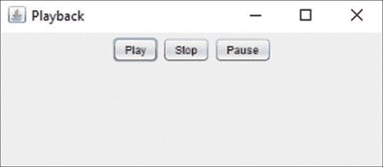

**图 17.2**

在 GUI 上显示按钮。

你可以通过这种方式向容器中添加许多 Swing 用户组件。

**注意**

由于在本节中引入了许多不同的用户界面组件，这里没有列出用于创建每个图例的完整源代码。你可以在书籍网站 [www.java24hours.com](http://www.java24hours.com) 上的第 17 小节页面找到每个程序的完整版本。

### 标签和文本字段（Labels and Text Fields）

`JLabel` 组件显示用户无法修改的信息。这些信息可以是文本、图形或两者兼有。这些组件通常用于标记界面中的其他组件，因此得此名。它们通常用于标识文本字段。

`JTextField` 组件是一个用户可以输入单行文本的区域。你可以在创建文本字段时设置框的宽度。

以下语句创建了一个 `JLabel` 组件和一个 `JTextField` 组件，并将它们添加到容器中：

点击此处查看代码图像

```java
JLabel pageLabel = new JLabel("Web page address: ", JLabel.RIGHT);
JTextField pageAddress = new JTextField(20);
FlowLayout flo = new FlowLayout();
setLayout(flo);
add(pageLabel);
add(pageAddress);
```

图 17.3 显示了此标签和文本字段并排显示。示例中的两个语句都使用一个参数来配置组件的外观。

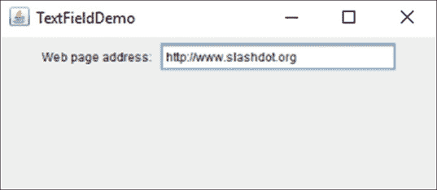

**图 17.3**

显示标签和文本字段。

`pageLabel` 标签设置了文本“Web page address:” 和 `JLabel.RIGHT` 参数。最后一个值表示标签应该靠右对齐。`JLabel.LEFT` 将标签文本左对齐，而 `JLabel.CENTER` 将其居中。与 `JTextField` 使用的参数表示文本字段的宽度约为 20 个字符。你还可以使用如下语句来指定显示在文本字段中的默认文本：

点击此处查看代码图像

```java
JTextField country = new JTextField("Togolese Republic", 29);
```

该语句将创建一个宽度为 20 个字符的 `JTextField` 对象，并在字段中有“Togolese Republic”文本。

你可以使用 `getText()` 方法获取对象包含的文本，该方法返回一个字符串：

点击此处查看代码图像

```java
String countryChoice = country.getText();
```

正如你可能猜的那样，你也可以用相应的方法设置文本：

点击此处查看代码图像

```java
country.setText("Separate Customs Territory of Taiwan, Penghu, Kinmen, and Matsu");
```

这会将文本设置为中国台北的正式名称，它是世界上最长的国家名称，略超过了第二名：大不列颠联合列颠及北爱尔兰联合王国。

### 复选框（Check Boxes）

`JCheckBox` 组件是文本旁的一个框，用户可以对其进行勾选或取消勾选。以下语句创建了一个 `JCheckBox` 对象并将其添加到容器中：

点击此处查看代码图像

```java
JCheckBox jumboSize = new JCheckBox("Jumbo Size");
FlowLayout flo = new FlowLayout();
setLayout(flo);
add(jumboSize);
```

`JCheckBox()` 构造函数的参数表示显示在框旁边的文本。如果你想让框被勾选，请使用以下语句：

点击此处查看代码图像

```java
JCheckBox jumboSize = new JCheckBox("Jumbo Size", true);
```

你可以单独展示 `JCheckBox`，也可以将其作为一组的一部分。在复选框组中，一次只能有一个被勾选。要使一个 `JCheckBox` 对象成为组的一部分，你必须创建一个 `ButtonGroup` 对象。考虑以下内容：

```java
JCheckBox frogLegs = new JCheckBox("Frog Leg", true);
JCheckBox fishTacos = new JCheckBox("Fish Platter", false);
JCheckBox emuNuggets = new JCheckBox("Emu Nuggets", false);
FlowLayout flo = new FlowLayout();
ButtonGroup meals = new ButtonGroup();
meals.add(frogLegs);
meals.add(fishTacos);
meals.add(emuNuggets);
setLayout(flo);
add(frogLegs);
add(fishTacos);
add(emuNuggets);
```

这创建了位于 `ButtonGroup` 下的复选框。Frog Leg 初始化是勾选的。图 17.4 显示了不同的复选框。

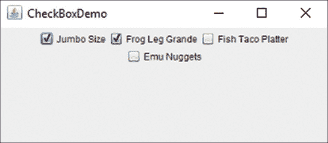

**图 17.4**

显示复选框组件。

### 组合框（Combo Boxes）

`JComboBox` 组件是一个列表，也可以设置为接收文本输入。除非显示列表，否则只有一个选项可见。

要创建一个 `JComboBox` 对象，你必须在创建对象后添加每个选项，如下所示：

```java
JComboBox profession = new JComboBox();
FlowLayout flo = new FlowLayout();
profession.addItem("Butcher");
profession.addItem("Baker");
profession.addItem("Candlestick maker");
profession.addItem("Fletcher");
profession.addItem("Fighter");
profession.addItem("Technical writer");
setLayout(flo);
add(profession);
```

此示例创建了一个单一的 `JComboBox` 组件，提供了六个供用户的选择。当选中其中一个时，它会显示在组件中。图 17.5 显示了此示例正在显示选项列表。

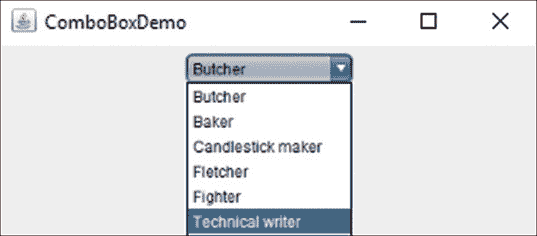

**图 17.5**

显示组合框组件。

要启用 `JComboBox` 组件接收文本输入，你必须调用其 `setEditable(boolean)` 方法并传入参数 `true`：

```java
profession.setEditable(true);
```

你必须在组件添加到容器之前调用此方法。

### 文本区域（Text Areas）

`JTextArea` 组件是一个允许用户输入多行文本的文本字段。你可以指定组件的宽度和高度。以下语句创建一个宽度为 40 个字符、高度为 8 行的 `JTextArea` 组件并将其添加到容器中：

```java
JTextArea comments = new JTextArea(8, 40);
FlowLayout flo = new FlowLayout();
setLayout(flo);
add(comments);
```

图 17.6 在框架中显示了此示例。

你可以在 `JTextArea()` 构造函数中指定一个字符串显示在文本区域中，使用换行符 `\n` 将文本发送到下一行，如下所示：

```java
JTextArea comments = new JTextArea("I should have been a pair\n"
+ "of ragged claws.", 10, 25);
```

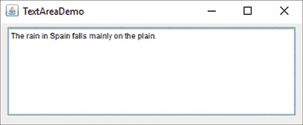

**图 17.6**

显示文本区域组件。

文本区域有两个可以调用的方法，用于指定用户在输入的文本超过行右侧边缘时组件的行为。调用 `setLineWrap(boolean)` 方法并传入参数 `true`，可以使文本换行到下一行：

```java
comments.setLineWrap(true);
```

要确定文本如何换行到下一行，请使用 `setWrapStyleWord(boolean)` 方法。使用参数 `true` 调用它以根据单词结束处进行换行，或者使用 `false` 根据字符进行换行。

如果你不调用这些方法，文本将不会换行。用户可以一直沿同一行输入文本，直到按下 Enter 键或超出区域的右边缘。

文本区域组件的行为可能与你预期的不同——当用户到达区域底部时，它们会扩大尺寸，并且在右侧或底部不包含滚动条。要以更好的方式实现它们，你必须将文本区域放置在一个称为滚动面板（scroll pane）的容器中。

GUI 中的组件通常比显示它们的区域大。要让组件从组件的一个部分移动到另一个部分，你需要使用垂直和水平滚动条。

在 Swing 中，你通过将组件添加到滚动面板来支持滚动，滚动面板是由 `JScrollPane` 类表示的容器。

你可以使用以下构造函数创建滚动面板：

- `JScrollPane()`——创建一个在需要时显示水平和垂直滚动条的滚动面板。
- `JScrollPane(int, int)`——创建一个具有指定垂直滚动条和水平滚动条的滚动面板。
- `JScrollPane(Component)`——创建一个包含指定用户界面组件的滚动面板。
- `JScrollPane(Component, int, int)`——创建一个具有指定组件、垂直滚动条和水平滚动条的滚动面板。

这些构造函数的整数参数决定了滚动条在面板中的用法。使用以下类变量作为这些参数：

- `JScrollPane.VERTICAL_SCROLLBAR_AS_NEEDED` 或 `JScrollPane.HORIZONTAL_SCROLLBAR_AS_NEEDED`
- `JScrollPane.VERTICAL_SCROLLBAR_NEVER` 或 `JScrollPane.HORIZONTAL_SCROLLBAR_NEVER`
- `JScrollPane.VERTICAL_SCROLLBAR_ALWAYS` 或 `JScrollPane.HORIZONTAL_SCROLLBAR_ALWAYS`

如果你创建了一个不包含组件的滚动面板，可以使用面板的 `add(Component)` 方法添加组件。在设置好滚动面板后，应该将它添加到容器中以替换原来的组件。

以下是重写之前的示例，将文本区域放置在滚动面板中：

```java
FlowLayout flo = new FlowLayout();
setLayout(flo);
JTextArea comments = new JTextArea(8, 40);
comments.setLineWrap(true);
comments.setWrapStyleWord(true);
JScrollPane scroll = new JScrollPane(comments,
    JScrollPane.VERTICAL_SCROLLBAR_ALWAYS,
    JScrollPane.HORIZONTAL_SCROLLBAR_NEVER);
add(scroll);
```

图 17.7 在框架中显示了此示例。

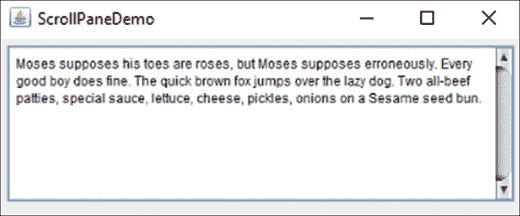

**图 17.7**

在滚动面板容器中显示文本区域组件。

### 面板

本小时介绍的最后一个组件是面板（panel），它在 Swing 中通过 `JPanel` 类创建。`JPanel` 对象是用户界面中最简单的容器类型。`JPanel` 对象的目的是将显示区域细分为不同的组件组。当显示内容被分为若干部分时，你可以在每个部分使用不同的布局管理器。

以下语句创建了一个 `JPanel` 对象并为它分配了一个布局管理器：

```java
JPanel topRow = new JPanel();
FlowLayout flo = new FlowLayout();
topRow.setLayout(flo);
add(topRow);
```

在安排界面组件时经常会用到面板，正如你在第 18 节“布局用户界面”中所示。

你通过调用它的 `add()` 方法向面板添加组件。你可以通过调用 `setLayout()` 方法直接为面板分配布局管理器。

当你需要在界面的某个区域中绘制某些内容时（例如来自图形文件的图像），你也可以使用面板。

`JPanel` 的另一个方便的用途是创建你自己的组件，这些组件可以添加到其他类中。这在本节的最后一个项目中得到了演示。

### 创建你自己的组件


面向对象编程的一个优势是可以在不同项目之间重用类。对于下一个项目，你将创建一个特殊的面板组件，该组件可以在其他 Java 程序中重用。该组件 `FreeSpacePanel` 报告运行应用程序程序的计算机上的可用磁盘空间。该面板显示可用空间量、总空间以及空闲百分比。

创建你自己的用户界面组件的第一步是决定从哪个现有组件进行继承。你的新组件将拥有其所有现有的属性和行为，除非你对其进行了修改或添加了新内容。

`FreeSpacePanel` 组件是位于列表 17.3 中的 `JPanel` 的子类。将列表 17.3 中的文本输入到新的空 Java 文件并保存该文件。

## 列表 17.3 `FreeSpacePanel.java` 的完整文本

点击此处查看代码图像

```java
1: package com.java24hours;
2: 
3: import java.io.IOException;
4: import java.nio.file.*;
5: import javax.swing.*;
6: 
7: public class FreeSpacePanel extends JPanel {
8:     JLabel spaceLabel = new JLabel("Disk space: ");
9:     JLabel space = new JLabel();
10:          
11:     public FreeSpacePanel() {
12:         super();
13:         add(spaceLabel);
14:         add(space);
15:         try {
16:             setValue();
17:         } catch (IOException ioe) {
18:             space.setText("Error");
19:         }
20:     }
21:     
22:     private final void setValue() throws IOException {
23:         // get the current file storage pool
24:         Path current = Paths.get("");
25:         FileStore store = Files.getFileStore(current);
26:         // find the free space
27:         long totalSpace = store.getTotalSpace();
28:         long freeSpace = store.getUsableSpace();
29:         // get this as a percentage
30:         double percent = (double)freeSpace / (double)totalSpace * 100;
31:         percent = (int)(percent * 100) / (double)100;
32:         // set the label's text
33:         space.setText(freeSpace + " free out of " + totalSpace + " ("
34:             + percent + "%)");
35: 
36:     }
37: }
```

该类是一个组件，当你想要显示可用磁盘空间信息时，可以添加到任何图形用户界面。它不能作为一个应用程序运行。

`FreeSpacePanel` 中的 `setValue()` 方法设置呈现磁盘空间信息的标签文本。该方法在第 22 行声明时带有 `final` 关键字：

点击此处查看代码图像

```java
private final void setValue() {
    // ...
}
```

在方法声明中包含 `final` 关键字可以防止该方法在子类中重写。这对于 `FreeSpacePanel` 作为一个 GUI 组件是必要的。

该面板在第 11–20 行的构造函数中创建。此处执行了以下操作：

 第 12 行——`super()` 方法调用了 `JPanel` 类的构造函数，确保其被正确初始化。

 第 13 行——创建新标签 `spaceLabel`（其文本为“Disk space: ”，且在第 8 行作为实例变量创建），通过调用 `add(Component)` 方法并将标签作为参数将其添加到面板中。

 第 14 行——`space` 标签（在第 9 行创建的没有文本的实例变量）也被添加到面板中。

 第 16 行——调用了 `setValue()` 方法，该方法设置了 `space` 标签的文本。

第 16 行对 `setValue()` 的调用被封装在另一个 `try-catch` 块中，这与设置外观外观（look and feel）时使用的块类似。你将在第 18 小节中学习更多关于如何处理错误的知识，但这里是简明版（TLDR）：`try-catch` 使得处理 Java 程序部分可能发生的一个或多个错误成为可能。

这是必要的，因为当调用 `setValue()` 时，访问计算机文件系统以查看其包含剩余空间可能会发生错误。该错误在 Java 中有一个专门的类 `IOException`，代表输入/输出错误。

`try` 块封装了可能导致错误的代码。`catch` 块在括号中标识错误类型，并指定了发生该错误时要执行的代码。

如果在应用程序运行期间遇到此类错误，第 18 行会将 `space` 标签的文本设置为“Error”，以告知用户发生了问题。

### 注意

缩写“TLDR”是“too long; didn’t read”（太长了，没读）的含义。当某人在互联网上为不想阅读整篇文章的人对长篇文章提供极简短的摘要时，这个词就会出现。

我希望这本书对你来说不是 TLDR。我们试图让它成为 JRLRWTANIRJP（长度恰好；读完全文后现在我是富裕的 Java 程序员了）。

要让自定义组件执行一些有趣的操作，需要快速上手一下 Java 文件处理，该主题将在第 20 小节“读取和写入文件”中进行详细介绍。

要确定计算机上剩余了多少磁盘空间，你需要 `java.nio.file` 包中的四个类，该包被用于访问计算机的文件系统。

一个 `Path` 对象表示文件或文件夹的位置。`Paths` 类有一个 `get(String)` 方法，它可以将字符串转换为匹配该字符串的路径。当使用 `""`（空字符串）调用它时，它会返回运行 Java 应用程序的当前文件夹的路径：

点击此处查看代码图片

```
Path current = Paths.get("");
```

磁盘的存储信息在 Java 中由 `FileStore` 对象表示，它是一个文件存储池。一旦你有了路径，就可以通过 `Files` 类中的一个方法获取该路径所在的文件存储。调用 `Files` 的 `getFileStore(Path)` 方法来检索该文件存储池：

点击此处查看代码图片

```
FileStore store = Files.getFileStore(current);
```

有了这个池，你现在可以调用它的 `getTotalSpace()` 和 `getUsableSpace()` 方法来查找当前磁盘上有多少可用磁盘空间：

点击此处查看代码图片

```
long totalSpace = store.getTotalSpace();
long freeSpace = store.getUsableSpace();
double percent = (double)freeSpace / (double)totalSpace * 100;
```

### 注意

计算百分比的表达式包含许多对 `double` 的引用，这看起来可能很奇怪。第二次和第三次强制转换在表达式中使用之前将 `freeSpace` 和 `totalSpace` 变量转换为 `double` 值。这是为了防止表达式产生整数值而不是浮点数，这是必要的。Java 通过表达式中的类型来确定表达式结果的数据类型。一个 `long` 除以一个 `long` 再乘以整数 100 将产生一个 `long`，而不是预期的百分比。

在最后语句中计算出的百分比可能是小数点后带有非常长数字数字，例如 64.8675309。

以下表达式将 `double` 类型的百分比转换为最多两位小数：

点击此处查看代码图片

```
percent = (int)(percent * 100) / (double)100;
```

表达式的前半部分将百分比乘以 100——将小数点向右移动两位——然后将其转换为整数，因此 64.8675309 变成了 6487。

后半部分将此结果结果除以 100——将小数点向左移动两位——以恢复百分比的近似值。这使得 6486 变成 64.86。

将百分比限制在两位小数后，标签的内容可以这样设置：

点击此处查看代码图片

```
space.setText(freeSpace + " out of " + totalSpace + " (" + percent + "%)");
```

该应用程序在第 14 行创建一个 `FreeSpacePanel` 组件并在第 15 行将其添加到框架中。

当你运行应用程序时，它应该类似于图 17.8，带有你自己计算机的值。


**图 17.8**

显示自定义磁盘空间组件。

## 总结

用户已经习惯于为运行的程序提供点击式的视觉化环境。这种期望使得开发软件更具挑战性，但 Java 通过 Swing 将这些能力交给你，无论你使用什么种设置来运行 Java。

使用 Swing 开发图形界面应用程序是练习面向对象编程的好方法。每个组件、容器和布局管理器都由它们自己的类表示。许多类从同一个父类继承共同行为。例如，在本小时中介绍的所有用户界面组件都是 `javax.swing.JComponent` 的子类。

在下一小时中，你将通过使用新的布局管理器学习更多关于 GUI 设计的知识，这些管理器可以比 `FlowLayout` 更有效地指定组件在容器内的布局。

## 工作坊

### 问答

**问：如果我不为容器分配布局管理器，组件将如何排列？**

**答：** 在像面板（panel）这样的简单容器中，组件默认使用 `FlowLayout` 进行布局。每个组件的添加方式与英文页面上的单词显示方式相同：从左到右，当空间不足时换到下一行。框架（Frames）、窗口和应用程序（applets）使用了你在下一个小时学习的 `BorderLayout` 默认布局样式。

**问：为什么有许多图形用户界面类的名称前面都带有一个“J”字，例如 `JFrame` 和 `JLabel`？**

**答：** 这些类是 `Swing` 框架的一部分，它是 Java 类库中对图形用户界面类的第二次尝试。抽象窗口工具包（AWT）是第一次尝试，它的类名较简单，例如 `Frame` 和 `Label`。

`AWT` 类属于 `java.awt` 包及相关包，而 `Swing` 类属于 `javax.swing` 等包，因此它们可以具有相同的类名。使用以“J”开头的命名可以防止类之间发生混淆。

`Swing` 类也称为 Java 基础类（JFC）。

**问：我可以在哪里买到未裁剪的 1 美元钞票？**

**答：** 美国印币发行局（Bureau of Engraving and Printing）在网站 [www.moneyfactorystore.gov](http://www.moneyfactorystore.gov) 销售真实的 1 美元、10 美元、20 美元和 50 美元钞票张。

一张包含 25 张 1 美元的钞票售价 50.50 美元，16 张 10 美元售价 249 美元，16 张 20 美元售价 409 美元，16 张 50 美元售价 920 美元。由于这些是实际货币，如果考虑到钞票的面值，这些购买更便宜。你为 1 美元的额外付了 25.50 美元，10 美元的 89 美元，20 美元的 89 美元，以及 50 美元的 100 美元。

还有一袋五磅装的 10,000 美元碎钞钞，售价 45 美元。

该局是唯一承认自己正在浪费钱的美国政府机构。

## Quiz

如果你的大脑还没有被这一小时的辛劳变成 GUI 脑浆，请通过回答以下问题来测试你的技能。

**[1].** 哪个用户组件被用作容器来存放其他组件？

A. TupperWare

B. `JPanel`

C. Choice

**[2].** 在容器内必须首先执行哪项操作？

A. 建立布局管理器

B. 添加组件


C. 无所谓

**[3].** 哪个方法决定了组件在容器内的排列方式？

A. `setLayout()`

B. `setLayoutManager()`

C. `setVisible()`

## Answers

**[1]. B.** `JPanel`。你可以向面板中添加组件，然后将面板添加到如框架（frame）等另一个容器中。

**[2]. A.** 在你以正确的方式添加它们之前，必须指定布局管理器。

**[3]. A.** `setLayout()` 方法接受一个参数：负责决定组件应该放置在何处的布局管理器。

## Activities

为了进一步接触 GUI 设计这一主题，请完成以下活动：

- 修改 `SalutonFrame` 应用，使其在框架的主区域显示“Saluton!”而不是标题栏。

- 增强 `FreePanel` 组件，每三个位置显示一个逗号。一种方法是使用 `StringBuilder` 对象、`String` 类的方法 `charAt()` 以及一个 `for` 循环来遍历字符串。

要查看实现这些活动的 Java 程序，请访问书籍的网站 [www.java4hours.com](http://www.java4hours.com)。

# 第 18 小时 布局用户界面

### 本小时的任务：

- 创建一个布局管理器。

- 为容器分配布局管理器。

- 使用面板来组织界面中的组件。

- 处理不寻常的布局。

- 为 Java 应用程序创建一个原型。

当你开始为你的 Java 程序设计用户界面（GUIs）时，你面临的一个障碍是组件是可以移动的。每当容器尺寸发生变化（例如当用户调整框架大小时），它所包含的组件可能会重新排列以适应新的尺寸。

这种灵活性对你有利，因为它考虑了组件在不同操作系统上显示方式的差异。一个可点击的按钮在 Windows 中的外观可能与 Linux 或 Mac OS 的不同。

界面中的组件通过一组被称为“布局管理器”（layout managers）的类来组织。这些类定义了组件在容器内的显示方式。界面中的每个容器都可以有它自己的布局管理器。

### 使用布局管理器

在 Java 中，组件在容器内的位置取决于组件的大小、其他组件的大小以及容器的高度和宽度。按钮、文本字段和其他组件的布局可能会受到以下因素的影响：

- 容器的大小

- 其他组件的大小

- 布局管理器

有几种布局管理器可以使用来影响组件的显示方式。面板的默认管理器是 `java.awt` 包中的 `FlowLayout` 类，在上一个小时中使用过它。

在 `FlowLayout` 下，组件掉落在某个区域的方式与英文页面上的单词组织方式相同——从左到右，当有更多空间时换到下一行。

以下示例可以用于框架，以便在添加组件时采用流布局：

```
FlowLayout topLayout = new FlowLayout();
setLayout(topLayout);
```

你也可以为特定容器（例如 `JPanel` 对象）设置布局管理器。你可以通过使用该容器对象的 `setLayout()` 方法来实现。

本小时的项目是 `Crisis`，一个带有五个按钮的应用程序。在 `com.java24hours` 包创建一个名为 `Crisis` 的 Java 文件。将列表 18.1 中的文本输入该文件并保存。

### 列表 18.1 `Crisis.java` 的完整文本

```java
package com.java24hours;

import java.awt.*;
import javax.swing.*;

public class Crisis extends JFrame {
    JButton panicButton;
    JButton dontPanicButton;
    JButton blameButton;
    JButton mediaButton;
    JButton saveButton;

    public Crisis() {
        super("Crisis");
        setLookAndFeel();
        setSize(348, 128);
        setDefaultCloseOperation(JFrame.EXIT_ON_CLOSE);
        FlowLayout flo = new FlowLayout();
        setLayout(flo);
        panicButton = new JButton("Panic");
        dontPanicButton = new JButton("Don't Panic");
        blameButton = new JButton("Blame Others");
        mediaButton = new JButton("Notify the Media");
        saveButton = new JButton("Save Yourself");
        add(panicButton);
        add(dontPanicButton);
        add(blameButton);
        add(mediaButton);
        add(saveButton);
        setVisible(true);
    }

    private void setLookAndFeel() {
        try {
            UIManager.setLookAndFeel("com.sun.java.swing.plaf.nimbus.NimbusLookAndFeel");
        } catch (Exception exc) {
            // ignore error
        }
    }

    public static void main(String[] arguments) {
        Crisis frame = new Crisis();
    }
}
```

`FlowLayout` 类使用容器的尺寸作为布局组件的唯一依据。调整应用程序窗口的大小，可以看到组件如何根据响应即时进行重新排列。将窗口宽度增加一倍，所有的 `JButton` 组件将显示在同一行上。将窗口缩窄到足够程度，它们将全部垂直堆叠。

### `GridLayout` 布局管理器

`java.awt` 包中的 `GridLayout` 类用于将容器中的所有组件组织成特定数量的行和列。所有组件在显示区域中分配相同的大小，因此，如果你指定一个宽三列、高三行的网格，容器就会被划分为九个等大的区域。

`GridLayout` 在添加所有组件时，会将它们放置在网格的某个位置。组件从左到右添加，直到某一行填满，然后填充下一个网格最左侧的列。

以下语句创建了一个容器并将其设置为使用两行三列的网格布局：

```
GridLayout grid = new GridLayout(2, 3);
setLayout(grid);
```

图 18.2 显示了如果 `Crisis` 应用程序使用网格布局将会是什么样子。


**图 18.2**

使用网格布局安排组件。

### `BorderLayout` 布局管理器

同样位于 `java.awt` 包中的 `BorderLayout` 类将组件安排在容器内的特定位置，这些位置由五个方向之一标识：北、南、东、西或中心。

`BorderLayout` 管理器将组件组织成五个区域：四个由罗盘方向表示，另外一个用于中心区域。当你在此布局下添加组件时，`add()` 方法包含第二个参数，以指定组件应该放置的位置。该参数应该是 `BorderLayout` 类的五个类变量之一：`NORTH`、`SOUTH`、`EAST`、`WEST` 和 `CENTER` 用于此参数。

与 `GridLayout` 类类似，`BorderLayout` 将所有可用空间都分配给组件。放置在中间的组件将获得四个边界组件所需的所有空间，因此它通常是最大的。

以下语句创建了一个使用边界布局的容器：

```
BorderLayout crisisLayout = new BorderLayout();
setLayout(crisisLayout);
add(panicButton, BorderLayout.NORTH);
add(dontPanicButton, BorderLayout.SOUTH);
add(blameButton, BorderLayout.EAST);
add(mediaButton, BorderLayout.WEST);
add(saveButton, BorderLayout.CENTER);
```

图 18.3 显示了这在 `Crisis` 应用程序中对应的样子。

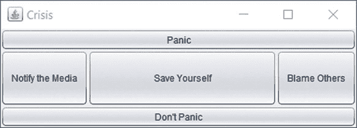

**图 18.3**

使用边界布局安排组件。

### `BoxLayout` 布局管理器

另一个实用的布局管理器 `javax.swing` 包中的 `BoxLayout` 使得在单行内水平或垂直地堆叠组件成为可能。

要使用此布局，请创建一个面板来存放组件，然后创建一个带有两个参数的布局管理器：

- 要在框框布局中组织的组件

- 用于垂直对齐的 `BoxLayout.Y_AXIS` 值和用于水平对齐的 `BoxLayout.X_AXIS` 值

这里是堆叠 `Crisis` 组件的代码：

```
JPanel pane = new JPanel();
BoxLayout box = new BoxLayout(pane, BoxLayout.Y_AXIS);
pane.setLayout(box);
pane.add(panicButton);
pane.add(dontPanicButton);
pane.add(blameButton);
pane.add(mediaButton);
pane.add(saveButton);
add(pane);
```

图 18.4 显示了结果如何。

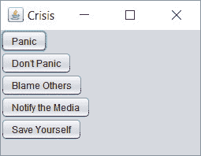

**图 18.4**

使用框框布局堆叠组件。

### 使用 `Insets` 分离组件

当你在容器内安排组件时，可以使用 `Insets` 将组件远离容器边缘，`Insets` 是一个表示容器边界区域的对象。

`Insets` 类是 `java.awt` 包的一部分，它有一个接受四个参数的构造函数：容器在 `top`、`left`、`bottom` 和 `right` 侧留出的空间。每个参数都使用像素指定，这与定义框架大小时使用的测量单位相同。

以下语句创建了一个 `Insets` 对象：

```
Insets around = new Insets(10, 6, 10, 3);
```

`around` 对象表示一个容器边界，其顶部内部 10 像素，左侧内部 6 像素，底部内部 10 像素以及右侧内部 3 像素。

要在容器中使用 `Insets` 对象，你必须重写容器的 `getInsets()` 方法。该方法没有参数并返回一个 `Insets` 对象，如下例所示：

```
public Insets getInsets() {
    Insets around = new Insets(10, 6, 10, 3);
    return around;
}
```

图 18.5 显示了它的样子。


**图 18.5**

使用内边距添加空间。

图 18.5 显示的容器顶部 50 像素、左侧 15 像素、底部 10 像素右侧 15 像素。

注意 `JFrame` 有内置内边距来为标题栏。当你重写 `getInsets()` 并设置自己的值时，容器会在下方显示组件。

### 布局应用程序

到目前为止看到的布局管理器应用于整个框架。使用了框架的 `setLayout()` 方法，但当你尝试开发 GUI 时，通常会发现没有任何布局是合适的。

一种方法是使用一组 `JPanel` 对象作为容器包含 GUI 的不同部分。你可以通过使用每个 `JPanel` 的 `setLayout()` 方法为每个部分设置不同的布局规则。在这些面板包含所需的组件后，你可以将面板直接添加到框架中。

下一个项目是为你在下一小时编写的项目开发完整的界面。该程序是一个彩票号码生成器，评估用户在范围内赢得数百万美元奖赛的机会。这种概率通过反复运行随机数抽取，直到用户的号码作为中奖者出现来确定。图 18.6 显示了你正在开发的 GUI。

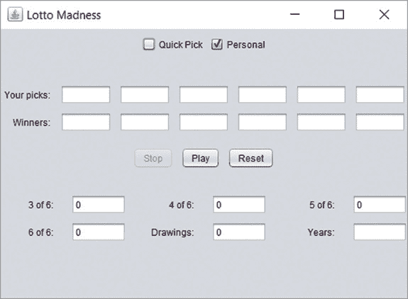

**图 18.6**

显示 `LottoMadness` 应用程序的 GUI。


```java
// set up row 3
JPanel row3 = new JPanel();
JButton stop = new JButton("Stop");
JButton play = new JButton("Play");
JButton reset = new JButton("Reset");

// set up row 4
JPanel row4 = new JPanel();
JLabel got3Label = new JLabel("3 of 6: ", JLabel.RIGHT);
JTextField got3 = new JTextField("0");
JLabel got4Label = new JLabel("4 of 6: ", JLabel.RIGHT);
JTextField got4 = new JTextField("0");
JLabel got5Label = new JLabel("5 of 6: ", JLabel.RIGHT);
JTextField got5 = new JTextField("0");
JLabel got6Label = new JLabel("6 of 6: ", JLabel.RIGHT);
JTextField got6 = new JTextField("0", 10);
JLabel drawingsLabel = new JLabel("Drawings: ", JLabel.RIGHT);
JTextField drawings = new JTextField("0");
JLabel yearsLabel = new JLabel("Years: ", JLabel.RIGHT);
JTextField years = new JTextField();

public LottoMadness() {
    super("Lotto Madness");

    setSize(550, 400);
    setDefaultCloseOperation(JFrame.EXIT_ON_CLOSE);
    GridLayout layout = new GridLayout(5, 1, 10, 10);
    setLayout(layout);

    FlowLayout layout1 = new FlowLayout(FlowLayout.CENTER, 10, 10);
    option.add(quickpick);
    option.add(personal);
    row1.setLayout(layout1);
    row1.add(quickpick);
    row1.add(personal);
    add(row1);

    GridLayout layout2 = new GridLayout(2, 7, 10, 10);
    row2.setLayout(layout2);
    row2.add(numbersLabel);
    for (int i = 0; i < 6; i++) {
        numbers[i] = new JTextField();
        row2.add(numbers[i]);
    }
    row2.add(winnersLabel);
    for (int i = 0; i < 6; i++) {
        winners[i] = new JTextField();
        winners[i].setEditable(false);
        row2.add(winners[i]);
    }
    add(row2);

    FlowLayout layout3 = new FlowLayout(FlowLayout.CENTER, 10, 10);
    row3.setLayout(layout3);
    stop.setEnabled(false);
    row3.add(stop);
    row3.add(play);
    row3.add(reset);
    add(row3);

    GridLayout layout4 = new GridLayout(2, 3, 20, 10);
    row4.setLayout(layout4);
    row4.add(got3Label);
    got3.setEditable(false);
    row4.add(got3);
    row4.add(got4Label);
    got4.setEditable(false);
    row4.add(got4);
    row4.add(got5Label);
    got5.setEditable(false);
    row4.add(got5);
    row4.add(got6Label);
    got6.setEditable(false);
    row4.add(got6);
    row4.add(drawingsLabel);
    drawings.setEditable(false);
    row4.add(drawings);
    row4.add(yearsLabel);
    years.setEditable(false);
    row4.add(years);
    add(row4);
    setVisible(true);
}

private static void setLookAndFeel() {
    try {
        UIManager.setLookAndFeel("com.sun.swing.plaf.nimbus.NimbusLookAndFeel");
    } catch (Exception exc) {
        // ignore error
    }
}

public static void main(String[] arguments) {
    LottoMadness.setLookAndFeel();
    LottoMadness frame = new LottoMadness();
}
```

尽管你还没有添加任何让程序执行操作的语句，但你仍然运行该应用程序以确保图形界面组织正确。

该应用程序使用了若干种布局管理器。为了更清晰地了解应用程序用户界面的布局情况，请查看图 18.7。界面被分为四个水平行，图中用水平线隔开。每一行都是一个 `JPanel` 对象，应用程序的整体布局管理器将这些行组织成一个四行一列的 `GridLayout`。

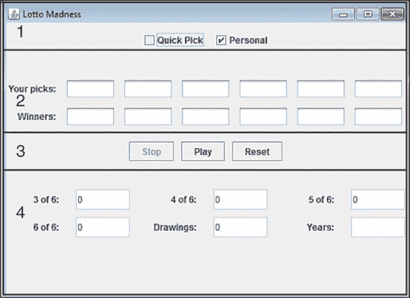

**图 18.7：将 LottoMadness 应用程序分为面板。**

在行内部，使用了不同的布局管理器来确定组件的显示。第 1 行和第 3 行使用 `FlowLayout` 对象。程序的第 47–48 行展示了如何创建它们：

```java
FlowLayout layout1 = new FlowLayout(FlowLayout.CENTER, 10, 10);
```

`FlowLayout()` 构造函数使用了三个参数。第一个参数 `FlowLayout.CENTER` 表示组件在其容器（即它们所在的水平 `JPanel`）中居中。最后两个参数指定了每个组件与其他组件之间的宽度和高度。使用 10 像素的宽度和 10 像素的高度会在组件之间留出少量额外距离。

界面的第 2 行被布局为一个两行七列宽的网格。`GridLayout()` 构造函数同样指定组件在每个方向上应与其他组件隔 10 像素。第 56–57 行设置了这个网格：

```java
GridLayout layout2 = new GridLayout(2, 7, 10, 10);
row2.setLayout(layout2);
```

第 4 行使用 `GridLayout` 将组件排列成两行三列宽的网格。

`LottoMadness` 应用程序使用了在本节中描述的若干个组件。第 9–37 行用于设置构成界面的所有组件的对象。这些语句按行组织。首先为该行创建一个 `JPanel` 对象，然后设置在该行上的每个组件。这段代码创建了所有组件和容器，但除非使用 `add()` 方法将它们添加到应用程序的主框架中，否则它们不会显示。

在第 47–100 行中，添加了组件。以下是 `LottoMadness()` 构造函数的示例：

```java
FlowLayout layout1 = new FlowLayout(FlowLayout.CENTER, 10, 10);
option.add(quickpick);
option.add(personal);
row1.setLayout(layout1);
row1.add(quickpick);
row1.add(personal);
add(row1);
```

## A. 在灰色字段上已使用 `setEditable()` 方法，使其无法被编辑。文本字段的默认行为是允许用户通过点击其边界内部并输入任何更改来改变文本字段的值。然而，某些字段的目的是显示信息，而不是接收用户的输入。`setEditable()` 方法可以防止用户更改他们不应该修改的字段。

## Q. 在电影*《查理和巧克力工厂》*中，是否真的存在过一个名叫威利·旺卡的金奖票获得者，其结局由于惨烈到不适合在电影中呈现而消失了？

## A. 米兰达·派克（Miranda Piker）的命运非常凄惨，以至于她从罗尔德·达尔的书《查理和巧克力工厂》的初稿中被删除了，这本书启发了 1971 年的电影及其 2005 年的重拍版。派克是一个自大的孩子，她认为孩子永远不应该玩，这样他们就可以一直上学。她的父亲是一位校长。

派克和旺卡工厂的其它金奖票获得者被引向了“斑点粉”（Spotty Powder），这是一种糖制的调制剂，会导致食用者身上长出红斑，这样他们就可以假装生病旷课。派克和她的父亲非常愤怒，并决定摧毁制造这种粉的机器。

当隔壁房间传来他们的尖叫声时，旺卡解释说他们进入了将糖果原料磨成粉的地方。“那是配方的一部分，”他告诉米兰达的母亲，“我们偶尔得用掉一两个校长，否则机器就不起作用。”

奥姆帕人（Oompa-Loompas）用歌唱庆祝她的应得报应：“噢，米兰达·玛丽·派克，/谁会喜欢她呢，/一个如此古板又令人作呕的小鬼。/于是我们说，‘为什么不把她/放进斑点粉搅拌机里/那我们就一定比以前更喜欢她了。’/很快，这个如此恶毒的孩子/就会变得非常美味，/她的同学一定会明白/不再是说：‘米兰达！/噢，这个野兽！我们受不了她了！’/他们会说：‘噢，多好用，多棒！’”

### 测验

要检查你的脑细胞布局是否正确，请通过回答以下问题来测试你的 Java 布局管理技能。

**1.** 在将接口划分为不同的布局管理器时，通常使用哪种容器？

**A.** `JWindow`

**B.** `JPanel`

**C.** `Container`

**2.** 面板（panel）的默认布局管理器是什么？

**A.** `FlowLayout`

**B.** `GridLayout`

**C.** 无默认值

**3.** `BorderLayout` 命名源于哪里？

**A.** 每个组件的边界

**B.** 组件沿容器边界组织的方式

**C.** Java 开发者纯粹的随性性

#### 答案

**1. B.** `JPanel`，它是最简单的容器。

**2. A.** 面板使用流式布局（flow layout），但帧（frames）和窗口（windows）的默认布局管理器是边界布局（border layout）。

**3. B.** 在将组件添加到容器时，你必须使用如 `BorderLayout.WEST` 和 `BorderLayout.EAST` 等方向变量来指定组件的边界位置。

#### 活动

如果你想继续下去（包括网格和边界），请尝试以下活动：

 创建 `Crisis` 应用程序的修改版本，将 `panic` 和 `dontPanic` 对象组织在一个布局管理器下，将其余三个按钮放在另一个下。

 复制 `LottoMadness.java` 文件，你可以将其重命名为 `NewMadness.java`。修改此程序，使快速选择或个人选择变为组合框（combo box），并将开始、停止和重置按钮变为复选框（check boxes）。

要查看实现这些活动的 Java 程序，请访问书籍网站 [www.java24hours.com](http://www.java24hours.com)。

## 第 19 小时

响应用户输入

### 本小时任务列表：

-  让你的程序感知事件。

-  设置一个组件使其能触发事件。

-  找出事件在程序流向何处。

-  在接口中存储信息。

-  存储在文本字段中的值。

你在过去两个小时内开发的图形用户界面（GUI）可以独立运行。用户可以点击按钮、在文本字段中填充文本并调整窗口大小。迟早，即使是最不挑剔的用户也会想要更多功能。程序提供的 GUI 必须在发生鼠标点击或键盘输入时引发某些事情发生。

当你的 Java 程序能够响应用户事件时，这些事情就变得可能。这被称为事件处理（event handling），是本小时的主要内容。

### 让你的程序学会监听

Java 中的用户事件是用户使用鼠标、键盘或其他输入设备执行操作时发生的事情。

在接收事件之前，你必须学习如何让对象进行监听。响应用户事件需要使用一个或多个 `EventListener` 接口。接口是 Java 面向编程的一种特性，允许类继承原本情况下无法的行为。

接口就像是类之间的一种契约。`EventListener` 接口包含了接收特定类型输入的方法。

添加 `EventListener` 接口需要两件事。首先，因为监听类属于 `java.event` 包，你必须通过以下语句使其可用：

```java
import java.awt.event.*;
```

其次，类必须使用 `implements` 关键字来声明它支持的接口。以下语句创建一个使用 `ActionListener` 的类，用于响应按钮点击：

```java
public class Graph implements ActionListener {
```

`EventListener` 接口允许 GUI 组件产生用户事件。如果没有监听器，组件无法被程序的其他部分听到。程序必须为其监听的每种组件包含一个监听接口。要让程序响应按钮点击或文本字段中按下回车键，你必须包含 `ActionListener` 接口。响应选择列表或复选框，你需要 `ItemListener` 接口。

当你在同一个类中需要多个接口时，在 `implements` 关键字后用逗号分隔它们的名称，如下代码所示：

```java
public class Graph3D implements ActionListener, MouseListener {

// ...
}
```

### 设置组件以便监听

在你实现了特定组件所需的接口后，你必须让该组件产生用户事件。`ActionListener` 接口监听动作事件，例如按钮点击或按下回车键。

要让 `JButton` 对象产生事件，请使用 `addActionListener()` 方法，如下所示：

```java
JButton fireTorpedos = new JButton("Fire torpedos");

fireTorpedos.addActionListener(this);
```

这段代码创建了 `fireTorpedos` 按钮并调用了按钮的 `addActionListener()` 方法。作为 `addActionListener()` 方法参数的 `this` 关键字表示当前对象接收事件并根据需要进行处理。

注意

`this` 关键字在首次引入时会让很多读者感到困惑。`this` 指向出现关键字的实例。因此，如果你在一个 `LottoMadness` 类中并在该类的语句中使用 `this`，它指的是执行该代码的 `LottoMadness` 对象。

## 处理用户事件

当带有监听器的组件生成用户事件时，会自动调用一个方法。该方法必须在将监听器挂载到组件时所指定的类中找到。

每个监听器都有不同的方法被调用以接收其事件。`ActionListener` 接口将事件发送到名为 `actionPerformed()` 的方法。以下是 `actionPerformed()` 方法的一个简短示例：

```java
public void actionPerformed(ActionEvent event) {
    // 方法写在此处
}
```

程序中发送的所有动作事件（action events）都会发送到这个方法。如果程序中只有一个组件可能发送动作事件，你可以在此方法中放置语句来处理事件。如果有多个组件可以发送这些事件，则你需要检查发送给方法的对象。

`ActionEvent` 对象被发送到 `actionPerformed()` 方法。有几类对象表示程序中可以生成的用户事件。这些类具有的方法可以确定是哪个组件导致了事件的发生。在 `actionPerformed()` 方法中，如果 `ActionEvent` 对象的名为 `event`，你可以使用以下语句识别组件：

```java
String cmd = event.getActionCommand();
```

`getActionCommand()` 方法返回一个字符串。如果组件是按钮，该字符串就是按钮上的标签。如果它是文本字段，该字符串就是字段中输入的文本。`getSource()` 方法返回导致事件的对象。


你可以使用以下 `actionPerformed()` 方法来接收来自三个组件的事件：一个名为 `start` 的 `JButton` 对象，一个名为 `speed` 的 `JTextField`，以及另一个名为 `viscosity` 的 `JTextField`：

点击此处查看代码图片

```java
public void actionPerformed(ActionEvent event) {
    Object source = event.getSource();
    if (source == speed) {
        // speed 字段导致事件
    } else if (source == viscosity) {
        // viscosity 字段导致事件
    } else {
        // start 按钮导致事件
    }
}
```

对所有用户事件调用 `getSource()` 方法，以识别导致事件的特定对象。

## 复选框和组合框事件

组合框和复选框需要 `ItemListener` 接口。调用组件的 `addItemListener()` 方法可以使其生成这些事件。以下语句创建了一个名为 `superSize` 的复选框，它在选中或取消选中时会发送用户事件：

点击此处查看代码图片

```java
JCheckBox superSize = new JCheckBox("Super Size", true);
superSize.addItemListener(this);
```

这些事件由 `itemStateChanged()` 方法接收，该方法接受 `ItemEvent` 对象作为参数。要查看哪个对象导致了事件，你可以调用事件对象的 `getItem()` 方法。

要确定复选框是被选中还是取消选中，将 `getStateChange()` 方法的返回值与常量 `ItemEvent.SELECTED` 和 `ItemEvent.DESELECTED` 进行比较。以下代码是名为 `item` 的 `ItemEvent` 对象的示例：

点击此处查看代码图片

```java
public void itemStateChanged(ItemEvent item) {
    int status = item.getStateChange();
    if (status == ItemEvent.SELECTED) {
        // item 被选中了
    }
}
```

要确定 `JComboBox` 对象中选中的值，使用 `getItem()` 并将该值转换为字符串，如下所示：

点击此处查看代码图片

```java
Object which = item.getItem();
String answer = which.toString();
```

## 键盘事件

当程序必须在按下键后立即做出反应时，它会使用键盘事件和 `KeyListener` 接口。

第一步是通过调用组件的 `addKeyListener()` 方法来注册接收按键输入的组件。方法的参数应该是实现 `KeyListener` 接口的对象。如果是当前类，则使用 `this` 作为参数。

处理键盘事件的对象必须实现三个方法：

 `keyPressed(KeyEvent)`——在按键按下的瞬间调用的方法

 `keyReleased(KeyEvent)`——在按键释放的瞬间调用的方法

 `keyTyped(KeyEvent)`——在按键按下并释放后调用的方法

这些方法都返回 `void` 而不是值。这些方法每个都接受一个 `KeyEvent` 对象作为参数，可以通过调用该对象的方法获取更多事件信息。调用 `getKeyChar()` 方法可以找到按下的是哪个键。该键作为 `char` 值返回，且只能用于字母、数字和标点符号。

要监控任何键（包括 Enter、Page Up 和 Page Down），你应该调用 `getKeyCode()`。该方法返回一个整数。然后你使用该整数调用 `getText()`，以接收一个包含按键名称的 `String` 对象（例如 Home、F1 等）。

点击此处查看代码图片

```java
package java24;

import javax.swing.*;
import java.awt.*;
import java.awt.event.*;

public class KeyViewer extends JFrame implements KeyListener {
    JTextField keyText = new JTextField(80);
    JLabel keyLabel = new JLabel("在文本框中按下任意键.");

    public KeyViewer() {
        super("KeyViewer");
        setLookAndFeel();
        setSize(350, 100);
        setDefaultCloseOperation(JFrame.EXIT_ON_CLOSE);
        keyText.addKeyListener(this);
        BorderLayout bord = new BorderLayout();
        setLayout(bord);
        add(keyLabel, BorderLayout.NORTH);
        add(keyText, BorderLayout.CENTER);
        setVisible(true);
    }

    @Override
    public void keyTyped(KeyEvent input) {
        char key = input.getKeyChar();
        keyLabel.setText("你按下了 " + key);
    }

    @Override
    public void keyPressed(KeyEvent txt) {
        // 无需操作
    }

    @Override
    public void keyReleased(KeyEvent txt) {
        // 无需操作
    }

    private void setLookAndFeel() {
        try {
            UIManager.setLookAndFeel("com.sun.java.swing.plaf.nimbus.NimbusLookAndFeel");
        } catch (Exception exc) {
            // 忽略错误
        }
    }

    public static void main(String[] arguments) {
        KeyViewer frame = new KeyViewer();
    }
}
```

当你运行该程序时，它看起来应该像图 19.1。


**图 19.1**

程序中处理键盘事件。

## 启用和禁用组件

你可能在程序中见过某个组件呈现阴影状态，而不是正常外观。

阴影表示用户无法对该组件进行任何操作，因为其未启用。启用和禁用组件是通过组件的 `setEnabled()` 方法完成的。该方法接收一个布尔值作为参数，因此 `setEnabled(true)` 启用组件以便，而 `setEnabled(false)` 则禁用它。

以下语句创建了标签为 Previous（上一个）、Next（下一个）和 Finish（完成）的按钮，并禁用了第一个按钮：

点击此处查看代码图片

```java
JButton previousButton = new JButton("Previous");
JButton nextButton = new JButton("Next");
JButton finishButton = new JButton("Finish");
previousButton.setEnabled(false);
```

这种方法是防止组件在不该发送用户事件时发送事件的有效方法。例如，如果你正在编写一个使用文本字段收集用户地址的 Java 程序，你可以在用户提供街道、城市、州和邮政编码之前禁用“保存地址”按钮。

### 完成图形化应用程序

为了查看 Swing 的事件处理类在 Java 程序中如何工作，你将完成在第 18 节“布局用户界面”中开始的彩票模拟程序 `LottoMadness`。

此时，`LottoMadness` 只是一个 GUI。你可以点击按钮并在文本框中输入文字，但不会有任何响应。在本次中，你将创建一个新类 `LottoEvent`，该类接收用户输入、进行彩票抽奖并跟踪中奖次数。当该类完成后，你将在 `LottoMadness` 中添加几行代码，使其使用 `LottoEvent`。以这种方式划分 Swing 项目通常很方便，将 GUI 放在一个类中，将事件处理方法放在另一个类中。

此应用程序的目的是评估用户一生中中六数字彩票抽奖的概率。图 19.2 显示了程序运行时的屏幕截图。

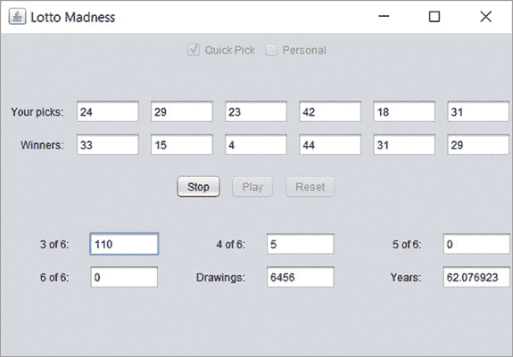

**图 19.2**

运行 `LottoMadness` 应用程序。

计算机并没有使用概率来解决这个问题，而是连续地进行抽奖，直到产生中奖者为止。由于 6 选 6 的中奖概率极低，程序还会报告任何三个、四个或五个中奖号码的组合。

该界面包括 12 个用于彩票号码的文本字段和两个标记为 Quick Pick（快速选号）和 Personal（个人）的复选框。六个禁用了输入的文本字段用于显示每次抽奖的中奖号码。另外六个文本字段供用户选择数字。选中 Quick Pick 框为用户选择六个随机数字。选中 Personal 框则允许用户选择所需的数字。

三个按钮控制程序的活动：Stop（停止）、Play（播放）和 Reset（重置）。按下 Play 按钮时，程序启动一个名为 `playing` 的线程并生成彩票抽奖。

按下 Stop 按钮停止线程，按下 Reset 则清除所有字段，以便用户可以重新开始。你将在第 15 节“创建多线程程序”中学习线程知识。

`LottoEvent` 类实现了三个接口：`ActionListener`、`ItemListener` 和 `Runnable`。`Runnable` 接口与线程有关，并在第 15 节介绍过。

需要监听器来监听应用程序按钮和复选框生成的用户事件。程序不需要监听与文本字段相关的任何事件，因为它们专门用于存储用户选择的号码。用户界面会自动处理存储。

该类需要使用主 Swing 包 `javax.swing` 和 Java 的事件处理包 `java.awt.event`。

该类有两个实例变量：

 `gui`，一个 `LottoMadness` 对象

 `playing`，一个用于连续抽奖的 `Thread` 对象

`gui` 变量用于与包含程序 GUI 的 `LottoMadness` 对象通信。当你需要更改界面或从其中一个文本字段中检索值时，你可以使用 `gui` 对象的实例变量。

例如，`LottoMadness` 的 `play` 实例变量代表 Play 按钮。要在 `LottoEvent` 中禁用此按钮，你可以使用以下语句：

点击此处查看代码图片

```java
gui.play.setEnabled(false);
```

你可以使用下一个语句来检索 `JTextField` 对象 `got3` 的值：

点击此处查看代码图片

```java
String got3value = gui.got3.getText();
```

列表 19.2 包含了 `LottoEvent` 类的完整文本。在 `com.java24hours` 包中创建一个名为 `LottoEvent` 的新 Java 文件，将列表中的文本输入文件并保存。

**列表 19.2** `LottoEvent.java` 的完整文本

点击此处查看代码图片

```java
while (playing == thisThread) {
    addOneToField(gui.drawings);
    int draw = Integer.parseInt(gui.drawings.getText());
    float numYears = (float)draw / 104;
    gui.years.setText("" + numYears);

    int matches = 0;
    for (int i = 0; i < 6; i++) {
        int ball;
        do {
            ball = (int) Math.floor(Math.random() * 50 + 1);
        } while (numberGone(ball, gui.winners, i));
        gui.winners[i].setText("" + ball);
        if (matchedOne(gui.winners[i], gui.numbers)) {
            matches++;
        }
    }
    switch (matches) {
        case 3:
            addOneToField(gui.got3);
            break;
        case 4:
            addOneToField(gui.got4);
            break;
        case 5:
            addOneToField(gui.got5);
            break;
        case 6:
            addOneToField(gui.got6);
            gui.stop.setEnabled(false);
            gui.play.setEnabled(true);
            playing = null;
    }
    try {
        Thread.sleep(100);
    } catch (InterruptedException e) {
        // do nothing
    }
}
```

`LottoEvent` 类有一个构造函数：`LottoEvent(LottoMadness)`。作为参数指定的 `LottoMadness` 对象标识了依赖 `LottoEvent` 来处理用户事件并进行抽奖的对象。

该类中使用了以下方法：

- `clearAllFields()` 方法会导致应用程序中的所有文本字段清空。当用户点击重置（Reset）按钮时会处理此方法。
- `addOneToField()` 方法将文本字段转换为整数，将其加 1，然后转换回文本字段。由于所有文本字段都是以字符串形式存储的，因此在表达式中使用它们时需要采取特殊步骤。
- `numberGone()` 方法接受三个参数：来自乐票抽取的单个数字、一个包含多个 `JTextField` 对象的数组以及一个整数 `count`。该方法确保抽奖中的每个数字在同一次抽奖中没有被重复选择。
- `matchedOne()` 方法接受两个参数：一个 `JTextField` 对象和一个包含六个 `JTextField` 对象的数组。该方法检查用户的数字是否与当前抽奖的数字匹配。
- 应用程序的 `actionPerformed()` 方法在用户点击按钮时接收动作事件。`getActionCommand()` 方法检索按钮的标签，以确定点击了哪个组件。
- 点击“开始”（Play）按钮会调用 `startPlaying()` 方法。该方法会禁用四个组件。
- 点击“停止”（Stop）会调用 `stopPlaying()` 方法，该方法会启用除停止按钮以外的所有组件。
- `itemChanged()` 方法接收由选择“快速选择”（Quick Pick）或“个人选号”（Personal）复选框触发的用户事件。`getItem()` 方法返回一个代表被点击复选框的 `Object`。如果是“快速选择”复选框，则为用户的数字分配 1 到 50 之间的六个随机数字。否则，存储用户数字的文本字段将被清空。
- `LottoEvent` 类为抽奖中的每个球使用 1 到 50 之间的数字。这在第 18 行确立，该行将 `Math.random()` 方法乘以 50，加 1，并将 `this` 作为 `Math.floor()` 方法的参数。最终结果是 1 到 50 之间的随机整数。如果你在此处和第 69 行将 50 替换为不同的数字，就可以将 `LottoMadness` 用于生成范围不同的值的竞赛。
- `LottoMadness` 项目缺少用于跟踪抽奖次数、中奖次数和数字字段的变量。相反，接口存储并自动显示值。

要完成该项目，请在 NetBeans 中重新打开 `LottoMadness.java`。你只需要添加六行代码来处理 `LottoEvent` 类。

1. 首先，添加一个新的实例变量来持有 `LottoEvent` 对象：

   ```java
   LottoEvent lotto = new LottoEvent(this);
   ```

2. 接下来，在 `LottoMadness()` 构造函数中，为每个可以接收输入的界面组件调用 `addItemListener()` 和 `addActionListener()` 方法：


```java
quickpick.addItemListener(lto);
personal.addItemListener(lto);
stop.addActionListener(lto);
play.addActionListener(lto);
```

3. 这些语句应该添加到构造函数中，紧随 `setLayout()` 调用之后，该调用将网格布局设置为应用程序框架的布局管理器。

列表 19.3 包含了你做出更改后 `LottoMadness.java` 的全文。你添加的行被阴影标记——其余部分与之前保持不变。

### 列表 19.3 LottoMadness 的全文

```java
package com.java;

import java.awt.*;
import javax.swing.*;

public class LottoMadness extends JFrame {
    LottoEvent lotto = new LottoEvent(this);

    // 设置第 1 行
    JPanel row1 = new JPanel();
    ButtonGroup option = new ButtonGroup();
    JCheckBox quickpick = new JCheckBox("Quick Pick", false);
    JCheckBox personal = new JCheckBox("Personal", true);

    // 设置第 2 行
    JPanel row2 = new JPanel();
    JLabel numbersLabel = new JLabel("Your picks: ", JLabel.RIGHT);
    JTextField[] numbers = new JTextField[6];
    JLabel winnersLabel = new JLabel("Winners: ", JLabel.RIGHT);
    JTextField[] winners = new JTextField[6];

    // 设置第 3 行
    JPanel row3 = new JPanel();
    JButton stop = new JButton("Stop");
    JButton play = new JButton("Play");
    JButton reset = new JButton("Reset");

    // 设置第 4 行
    JPanel row4 = new JPanel();
    JLabel got3Label = new JLabel("3 of 6: ", JLabel.RIGHT);
    JTextField got3 = new JTextField("0");
    JLabel got4Label = new JLabel("4 of 6: ", JLabel.RIGHT);
    JTextField got4 = new JTextField("0");
    JLabel got5Label = new JLabel("5 of 6: ", JLabel.RIGHT);
    JTextField got5 = new JTextField("0");
    JLabel got6Label = new JLabel("6 of 6: ", JLabel.RIGHT);
    JTextField got6 = new JTextField("0", 10);
    JLabel drawingsLabel = new JLabel("Drawings: ", JLabel.RIGHT);
    JTextField drawings = new JTextField("0");
    JLabel yearsLabel = new JLabel("Years: ", JLabel.RIGHT);

    public LottoMadness() {
        super("Lotto");
        size(500, 400);
        setDefaultCloseOperation(JFrame.EXIT_ON_CLOSE);
        GridLayout layout = new GridLayout(5, 1, 10, 10);
        setLayout(layout);
        // 监听器
        quickpick.addItemListener(lto);
        personal.addItemListener(lto);
        stop.addActionListener(lto);
        play.addActionListener(lto);
        reset.addActionListener(lto);

        FlowLayout layout1 = new FlowLayout(FlowLayout.CENTER, 10, 10);
        option.add(quickpick);
        option.add(personal);
        row1.setLayout(layout1);
    }
}
```

```java
60: row1.add(quickpick);
61: row1.add(personal);
62:             add(row1);
63:
64:             GridLayout layout2 = new GridLayout(2, 7, 10, 10);
65: row2.setLayout(layout2);
66: row2.add(numbersLabel);
67: for (int i = 0; i < 6; i++) {
68: numbers[i] = new JTextField();
69: row2.add(numbers[i]);
70:             }
71: row2.add(winnersLabel);
72: for (int i = 0; i < 6; i++) {
73: winners[i] = new JTextField();
74: winners[i].setEditable(false);
75: row2.add(winners[i]);
76:             }
77:             add(row2);
78:
79:             FlowLayout layout3 = new FlowLayout(FlowLayout.CENTER,
80:                 10, 10);
81: row3.setLayout(layout3);
82: stop.setEnabled(false);
83: row3.add(stop);
84: row3.add(play);
85: row3.add(reset);
86:             add(row3);
87:
88:             GridLayout layout4 = new GridLayout(2, 3, 20, 10);
89: row4.setLayout(layout4);
90: row4.add(got3Label);
91: got3.setEditable(false);
92: row4.add(got3);
93: row4.add(got4Label);
94: got4.setEditable(false);
95: row4.add(got4);
96: row4.add(got5Label);
97: got5.setEditable(false);
98: row4.add(got5);
99: row4.add(got6Label);
100: got6.setEditable(false);
101: row4.add(got6);
102: row4.add(drawingsLabel);
103: drawings.setEditable(false);
104: row4.add(drawings);
105: row4.add(yearsLabel);
106: years.setEditable(false);
107: row4.add(years);
108:             add(row4);
109:             
110:             setVisible(true);
111:     }
112:
113: private static void setLookAndFeel() {
114: try {
115:                 UIManager.setLookAndFeel(
116: "com.sun.java.swing.plaf.nimbus.NimbusLookAndFeel"
117:                 );
118: } catch (Exception exc) {
119:                 // ignore error
120:             }
121:     }
122:
123: public static void main(String[] arguments) {
124:             LottoMadness.setLookAndFeel();
125:             LottoMadness frame = new LottoMadness();
126:     }
127: }
```

添加完阴影行后，你就可以运行该程序了，它能够测试你数千年的彩票技巧。正如你预期的，这些彩票是一项徒劳的。在一生中赢得 6 选 6 彩票的概率极其微小，即使你活得像圣经中的人物那么长。

### 注意

当 [www.java24hours.com](http://www.java24hours.com) 的书籍网站用于运行 `LottoMadness` 程序时，它完成了 410,732,244 次抽奖，相当于 390 万次每周两次的抽奖次数。其中有 6,364,880 名 6 选 3 中者、337,285 名 6 选 4 中者、6,476 名 6 选 5 中者以及 51 名 6 选 6 中者（大约每 800 万次抽奖中有一个）。第一位赢得这种虚拟彩票奖的人是 Bill Teer。他的号码是 3, 7, 1, 15, 34 和 43，他仅花了 241,225 次抽奖（2319.47 年）才中奖。

### 总结

通过使用 Swing，你可以通过少量编程代码创建一个看起来专业的程序。尽管 `LottoMadness` 应用比你过去 19 小时处理过的许多示例都要长，但该程序有一半是由构建界面的语句组成的。

要处理其他类型的数据（例如硬盘上的文件和网络服务器上的文档），你可以使用 `java.io` 包中的类。该名称中的“io”代表“输入/输出”（input/output），这些类用于访问数据源，例如硬盘、DVD 或计算机内存。

你可以通过一种名为 `streams`（流）的通信系统将数据引入程序并发送出去，流是将信息从一个地方传输到另一个地方的对象。

## Streams

要在 Java 程序中永久保存数据，或稍后检索这些数据，你必须至少使用一个流。

流是一个从一个源获取信息并发送到其他地方的对象，其名称源于水流，水流将鱼、船和工业污染物从一个地方带到另一个地方。

流连接了各种来源，包括计算机程序、硬盘、Internet 服务器、计算机内存和优存盘。当你学会了如何使用流处理一种类型的数据后，就可以以相同的方式处理其他数据。

在本小时中，你将使用流来读写存储在计算机文件中的数据。

流有两种：

 输入流，从源处读取数据

 输出流，向源处写入数据

所有输入输出流都由字节组成，字节是范围从 0 到 255 的单个整数。你可以使用这种格式来表示数据，例如可执行程序、文字处理文档和 MP3 音乐文件，但这些只是字节能表示的内容的一小部分。字节流用于读写这类数据。

### NOTE

Java 类文件以称为 `bytecode`（字节码）的形式以字节形式存储。Java 虚拟机（JVM）运行 `bytecode`，这些字节码并不一定由 Java 语言产生。它可以运行由其他语言（包括 Scala、Groovy 和 Jython）编译产生的字节码。你也会听到将 JVM 称为字节码解释器。

一种更专门的数据处理方式是字符形式的——即单个字母、数字、标点符号等。当你读写文本源时，可以使用字符流。

无论你处理的是字节流、字符流还是其他类型的信息，整体过程都是相同的：

 创建与数据关联的流对象。

 调用流的方法将信息放入流中或从流中取出信息。

 通过调用对象的 `close()` 方法关闭流。

### Files

在 Java 中，文件由 `File` 类表示，该类也是 `java.io` 包的一部分。可以从硬盘、DVD 和其他存储设备读取文件。

`File` 对象可以表示已经存在的文件，也可以表示你想创建的文件。要创建一个 `File` 对象，使用文件名作为构造函数，如下例所示：

点击此处查看代码图像

```
File book = new File("address.dat");
```

这会在当前文件夹中创建一个名为 `address.dat` 的文件对象。你还可以在文件名中包含路径：

点击此处查看代码图像

```
File book = new File("data\\address.dat");
```

### NOTE

此示例适用于 Windows 系统，该系统使用反斜杠 `\` 字符路径和文件名的分隔符。（代码示例中有两个反斜杠，是因为反斜杠是 Java 中的特殊字符）。Linux 和其他基于 Unix 的系统使用正斜杠 `/` 字符。要编写一个不依赖操作系统即可引用文件的 Java 程序，请使用类变量 `File.pathSeparator` 代替正斜杠或反斜杠，如该语句所示：

```
File book = new File("data" + File.pathSeparator + "address.dat");
```

创建一个 `File` 对象并并在你的计算机上创建文件。它只是对一个可能存在也可能不存在的文件的引用。

当你有一个 `File` 对象时，可以调用该对象上的若干个有用方法：

 `exists()`——如果文件存在则返回 `true`，否则返回 `false`

 `getName()`——文件名，格式为 `String`

 `length()`——文件的大小，格式为 `long` 值

 `createNewFile()`——如果不存在，则创建一个同名文件

 `delete()`——如果文件存在，则删除

 `renameTo(File)`——使用指定的 `File` 对象名称作为参数重命名文件

你也可以使用 `File` 对象表示系统上的文件夹而非文件。在 `File` 构造函数中指定文件夹名称，可以是绝对路径（如 `C:\\Documents\\`）或相对路径（如 `java\\database`）。

在你获得一个表示文件夹的对象后，调用其 `listFiles()` 方法查看文件夹内部的内容。该方法返回一个 `File` 对象数组，代表其中包含的每个文件和子文件夹。

### Reading Data from a Stream

本小时的第一个项目是使用输入流从文件读取数据。你可以使用 `FileInputStream` 实现，它代表以字节形式读取的输入流。

你可以通过指定文件名或 `File` 对象作为参数创建文件输入流。如果访问文件发生错误，读写文件的方法可能会抛出 `IOException`，因此通常使用 `try`-catch` 块。该异常属于 `java.io` 包。

流是不再使用时必须关闭的资源之一。在程序运行时，让流开启状态会大量消耗 JVM 资源。

一种名为 `try`-with-resources` 的特殊 `try` 语句可以轻松确保资源（如文件输入流）在不再需要时被关闭。`try` 语句后跟着括号。括号内是一个或多个声明读写数据变量的 Java 语句。

这是一个使用名为 `stream` 的文件输入流读取名为 `cookie.web` 文件的示例：

点击此处查看代码图像

```
File cookie = new File("cookie.web");

try (FileInputStream stream = new FileInputStream(cookie)) {
    System.out.println("Length of file: " + cookie.length());
} catch (IOException ioe) {
    System.out.println("Could not read file.");
}
```

由于 `stream` 位于 `try` 语句中，当 `try`-catch` 块完成时（如果尚未关闭），流会自动关闭。

文件输入流按字节读取数据。你可以通过调用不带参数的流的 `read()` 方法读取单个字节。如果由于到达文件末尾流中没有可用字节，则返回字节值 −1。

当你读取输入流时，它从流中的第一个字节开始，例如文件的第一个字节。你可以通过调用带有一个参数的 `skip()` 方法来跳过流中的某些字节：参数是一个表示要跳过字节数的 `int`。以下语句跳过了名为 `scanData` 的流中的后续 1,024 个字节：

```
scanData.skip(1024);
```


如果你想一次读取多个字节，请执行以下操作：

 创建一个大小与你想要读取的字节数完全一致的字节数组。

 将该数组作为参数调用流的 `read()` 方法。数组将填充从流中读取的字节。

第一个项目从 MP3 音频文件中读取 ID3 数据。由于 MP3 是一种非常流行的音乐文件格式，在 ID3 文件的末尾通常会添加 128 字节，用于存储歌曲信息，例如标题、艺术家和专辑。

`ID3Reader` 应用程序使用文件输入流读取 MP3 文件，跳过最后 128 字节以外的所有内容。对剩余字节进行检查以确定是否包含 ID3 数据。如果是，前三个字节将是数字 84、65 和 71。

### 注意

在 Java 支持的 Unicode 标准字符集包含的 ASCII 字符集中，这三个数字分别代表大写字母“T”、“A”和“G”。

在 `com.java24hours` 包下创建一个名为 `ID3Reader` 的新空 Java 文件，并将来自列表 20.1 的文本填入其中。

**列表 20.1 `ID3Reader.java` 的完整文本**

点击此处查看代码图像

```java
package com.java24hours;

import java.io.*;

public class ID3Reader {
    public static void main(String[] arguments) {
        File song = new File(arguments[0]);
        try (FileInputStream file = new FileInputStream(song)) {
            int size = (int) song.length();
            file.skip(size - 128);
            byte[] last128 = new byte[128];
            file.read(last128);
            String id3 = new String(last128);
            String tag = id3.substring(0, 3);
            if (tag.equals("TAG")) {
                System.out.println("Title: " + id3.substring(3, 32));
                System.out.println("Artist: " + id3.substring(33, 62));
                System.out.println("Album: " + id3.substring(63, 91));
                System.out.println("Year: " + id3.substring(93, 97));
            } else {
                System.out.println(arguments[0] + " does not contain"
                        + " ID3 info.");
            }
            file.close();
        } catch (IOException ioe) {
            System.out.println("Error -- " + ioe.toString());
        }
    }
}
```

在将此类作为应用程序运行之前，你必须指定一个 MP3 文件作为命令行参数（在 NetBeans 中使用“运行”、“设置项目配置”、“配置”）。程序可以使用任何 MP3 运行程序，例如 `Come On and Gettit.mp3`，这是 Marion Black 创作的 1973 年被不公正遗忘的灵魂乐经典之。如果你的系统中有歌曲 `Come On and Gettit.mp3`（你确实应该拥有），图 20.1 显示了 `ID3Reader` 应用程序的内容。

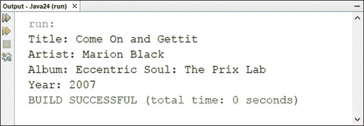

**图 20.1** 运行 `ID3Reader` 应用程序。

### 提示

如果你电脑上没有 `Come On and Gettit.mp3`（在我看来这是一个巨大的错误），或其他任何 MP3，你可以通过 [`search.creativecommons.org`](http://search.creativecommons.org) 使用知识共享许可寻找可检查的 MP3 歌曲。

知识共享是一组版权许可协议，规定了如歌曲之类的作品如何进行分发、编辑或重新发布。应用程序在列表 20.1 的第 11–12 行从 MP3 读取最后 128 字节，并将其存储在 `byte` 数组中。该数组在第 13 行被用于创建一个包含这些字节所代表的字符的 `String` 对象。如果字符串的前三个字符是“TAG”，则说明正在检查的 MP3 文件包含 ID3 信息。在第 16–19 行中，调用了字符串的 `substring()` 方法来显示字符串的部分。ID3 格式始终将艺术家、歌曲、标题和年份信息放在最后 128 字节的相同位置。某些 MP3 文件完全不包含 ID3 信息，或者以应用程序无法读取的另一种格式包含 ID3 信息。如果你是从购买的 `Eccentric Soul` 拷贝创建了 `Come On and Gettit.mp3`，那么它包含可读的 ID3 信息。从音频 CD 创建 MP3 文件的程序从音乐行业数据库读取歌曲信息。在从 MP3 文件读取完与 ID3 相关的信息后，流在第 24 行被关闭。在完成操作后，你应该始终关闭流以节省 JVM 资源。

### 注意

你可能想通过文件共享服务寻找 `Come On and Gettit.mp3` 的副本。对于“Come On and Gettit”，我完全理解这种诱惑。然而，根据美国唱片协会，下载你不拥有的音乐 CD MP3 文件的人将立即被 Amazon、eBay、iTunes 以及任何地方点成火焰。

### 缓冲流

提高输入程序性能的方法之一是对输入进行缓冲。缓冲是将数据保存在内存中，以便在程序需要时以后使用。当 Java 程序需要从缓冲流获取数据时，它会首先查找缓冲区，这比从文件等源读取要快。要使用缓冲流，你首先创建一个输入流（例如 `FileInputStream` 对象），然后使用该对象创建一个缓冲流。调用 `BufferedInputStream(InputStream)` 构造函数，并将输入流作为唯一参数。数据在从输入读取时会被缓冲。要从缓冲流中读取，调用其无参数的 `read()` 方法。将返回一个 0 到 255 之间的整数，代表流中的下一个字节数据。如果没有更多可用字节，则返回 −1。作为缓冲流的演示，你创建的下一个程序为 Java 增加了一个许多其他语言的程序员使用过的功能：控制台输入，即在运行应用程序时从控制台（也称为命令行）读取字符的能力。`System` 类包含了 `System.out.print()` 和 `System.out.println()` 语句中使用的 `out` 变量，它还有一个名为 `in` 的类代表一个 `InputStream` 对象。该对象接收来自键盘的输入并作为流可用。你可以像处理其他输入一样处理这种输入。以下语句创建一个与 `System.in` 输入关联的缓冲流：

点击此处查看代码图像

```java
BufferedInputStream bin = new BufferedInputStream(System.in);
```

下一个项目是 `com.java24hours` 包中的 `Console` 类，它包含一个可以在任何 Java 应用程序中接收控制台输入的方法。在名为 `Console` 的新 Java 文件中输入来自列表 20.2 的文本。

**列表 20.2 `Console.java` 的完整文本**

点击此处查看代码图像

```java
package com.java24hours;

import java.io.*;

public class Console {
    public static String readLine() {
        StringBuilder response = new StringBuilder();
        try {
            BufferedInputStream bin = new BufferedInputStream(System.in);
            int in = 0;
            char inChar;
            do {
                in = bin.read();
                inChar = (char) in;
                if (in != -1) {
                    response.append(inChar);
                }
            } while ((in != -1) & (inChar != '\n'));
            bin.close();
            return response.toString();
        } catch (IOException e) {
            System.out.println("Exception: " + e.getMessage());
            return null;
        }
    }

    public static void main(String[] arguments) {
        System.out.print("You are standing at the end of the road ");
    }
}
```

```java
30:          System.out.print("before a small brick building. Around you ");
31:          System.out.print("is a forest. A small stream flows out of ");
32:          System.out.println("the building and down a gully.\n"));
33:          System.out.print("> ");
34:          String input = Console.readLine();
35:          System.out.println("That's not a verb I recognize.");
36:     }
37:  }
```

`Console` 类包含一个 `main()` 方法，它演示了如何使用它。当你运行应用程序时，输出应该类似于图 20.2。

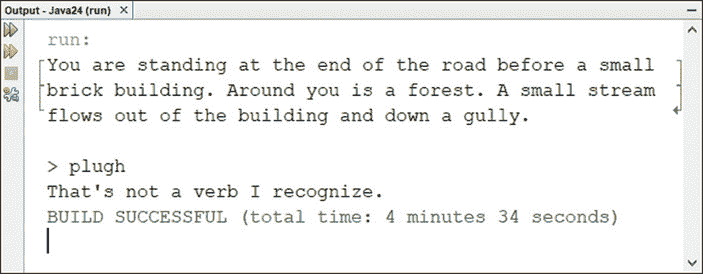

**图 20.2**

运行 `Console` 应用程序。

`Console` 类包含一个类方法 `readLine()`，用于从控制台接收字符。当按下回车键时，`readLine()` 返回一个包含所接收字符的字符串对象。

**注意**

`Console` 应用程序也是世界上最不受人意的文字冒险游戏。你无法进入建筑、在小溪中游泳，甚至无法到处溜。想要功能更完整的游戏版本（名为 `Adventure`），请访问 Web-Adventures：[www.web-adventures.org](http://www.web-adventures.org)。

### 向流写入数据

在 `java.io` 包中，用于处理流的类是成对出现的。有用于字节流的 `FileInputStream` 和 `FileOutputStream` 类，用于字符流的 `FileReader` 和 `FileWriter` 类，以及许多用于其他类型流数据的集合。

要开始写入数据，你首先需要创建一个与输出流关联的 `File` 对象。该文件不需要在你的系统上存在。

你可以通过两种方式创建 `FileOutputStream`。如果你想向现有文件追加字节，请调用带有两个参数的 `FileOutputStream()` 构造函数：一个代表文件的 `File` 对象和一个设为 `true` 的 `boolean` 值。你写入流的字节将附加在文件的末尾。

如果你想向新文件写入字节，请调用仅以 `File` 对象作为唯一参数的 `FileOutputStream()` 构造函数。

获取输出流后，你可以调用不同的 `write()` 方法向其写入字节：

 调用 `write()` 并将字节作为唯一参数，将该字节写入流。

 调用 `write()` 并将字节数组作为唯一参数，将数组中的所有字节写入流。

 为 `write(byte[], int, int)` 方法指定三个参数：一个字节数组、一个表示要写入流的数组第一个元素的整数，以及要写入的字节数。

以下语句创建了一个 10 字节的字节数组，并将最后 4 个字节写入输出流：

点击此处查看代码图片

```java
File dat = new File("data.dat");
FileOutputStream datStream = new FileOutputStream(dat);
byte[] data = new byte[] { 5, 12, 4, 13, 3, 15, 2, 17, 1, 18 };
datStream.write(data, 6, 4);
```

在向流写入字节时，你可以通过调用 `String` 对象的 `getBytes()` 方法将文本转换为字节数组，如示例所示：

点击此处查看代码图片

```java
String name = "Puddin N. Tane";
byte[] nameBytes = name.getBytes();
```

完成向流写入字节后，通过调用流的 `close()` 方法将其关闭。

你编写的下一个项目是一个简单的应用程序 `ConfigWriter`，它通过向文件输出流写入字节，将几行文本保存到文件中。创建一个命名的 Java 文件，为其分配包 `com.java24hours`，并将代码列表 20.3 中的文本输入到源编辑器。

**代码列表 20.3 `ConfigWriter.java` 的全文**

点击此处查看代码图片

```java
package com.java24hours;

import java.io.*;

public class ConfigWriter {
    String newline = System.getProperty("line.separator");

    public ConfigWriter() {
        try {
            File file = new File("program.properties");
            FileOutputStream fileStream = new FileOutputStream(file);
            write(fileStream, "username=max");
            write(fileStream, "score=12550");
            write(fileStream, "level=5");
            fileStream.close();
        } catch (IOException ioe) {
            System.out.println("Could not write file");
        }
    }

    void write(FileOutputStream stream, String output)
        throws IOException {
        output = output + newline;
        byte[] data = output.getBytes();
        stream.write(data);
    }
}
```

（注：提供的文本代码块中包含一些乱码/交错行；我已根据提供的上下文逻辑 Java 结构进行了清理。）

### 读取和写入配置属性

当 Java 程序可以使用命令行参数进行配置时，它们会变得更加灵活，正如你在课程中所演示的那样。`java.util` 包包含一个 `Properties` 类，它允许从另一个源（文本文件）加载配置设置。该文件可以像其他文件源一样读取：

 创建一个代表文件的 `File` 对象。

 从该 `File` 对象创建一个 `FileInputStream` 对象。

 调用 `load()` 从该输入流中检索属性。

属性文件有一组属性名，后面跟着等号 `=` 及其对应的值。这是一个示例：

username=lepton

lastCommand=open database

windowSize=32

每个属性各占一行，因此这设置了属性 `username`、`lastCommand` 和 `windowSize`，值分别为“lepton”、“open database” 和“32”。（`ConfigWriter` 应用程序使用了相同的格式。）

以下代码加载了名为 `config.dat` 的属性文件：

点击此处查看代码图片


```java
File configFile = new File("config.dat");
FileInputStream inStream = new FileInputStream(configFile);
Properties config = new Properties();
config.load(inStream);
```

配置设置（称为`properties`）以字符串形式存储在`Properties`对象中。每个属性通过一个键（key）识别。`getProperty()`方法使用其键检索属性，如下语句所示：

```java
String username = config.getProperty("username");
```

由于属性是以字符串形式存储的，你必须以某种方式将它们转换以便使用数值，如下代码所示：

```java
String windowProp = config.getProperty("windowSize");
int windowSize = 24;
try {
    windowSize = Integer.parseInt(windowProp);
} catch (NumberFormatException exception) {
    // 什么都不做
}
```

可以通过调用带有两个参数（键和值）的`setProperty()`方法来存储属性：

点击此处查看代码图像

```java
config.setProperty("username", "max");
```

你可以通过调用`Properties`对象的`list(PrintStream)`方法来显示所有属性。`PrintStream`是你在书中一直在使用的类型：它是`System`类中`out`实例变量的类，你一直在使用它在`System.out.println()`和`System.out.print()`语句中输出。以下代码调用`list()`来显示所有属性：

```java
config.list(System.out);
```

在修改属性后，可以将它们存回文件：

 创建一个表示该文件的`File`对象。

 从该`File`对象创建一个`FileOutputStream`对象。

 调用`store(OutputStream, String)`将属性保存到指定的输出流中，并使用字符串作为属性文件的描述。

在本小时的最后一个项目中，你将在`ConfigWriter`应用程序的基础上进行构建，该程序将几个程序设置写入文件。`Configurator`应用程序将这些设置读取到 Java 属性文件中，添加一个名为`runtime`的新属性（包含当前日期时间），并保存修改后的文件。

在`com.java24hours`包中创建一个新的 Java 文件来存放`Configurator`类，并输入列表 20.4 中的文本。

**列表 20.4 `Configurator.java`的全文**

点击此处查看代码图像

```java
1: package com.java24hours;
2:
3: import java.io.*;
4: import java.util.*;
5:
6: public class Configurator {
7:
8:     public Configurator() {
9:         try {
10:             // 加载属性文件
11:             File configFile = new File("program.properties");
12:             FileInputStream inStream = new FileInputStream(configFile);
13:             Properties config = new Properties();
14:             config.load(inStream);
15:             // 创建新属性
16:             Date current = new Date();
17:             config.setProperty("runtime", current.toString());
18:             // 保存属性文件
19:             FileOutputStream outStream = new FileOutputStream(configFile);
20:             config.store(outStream, "Properties settings");
21:             inStream.close();
22:             config.list(System.out);
23:         } catch (IOException ioe) {
24:             System.out.println("IO error " + ioe.getMessage());
25:         }
26:     }
27:
28:     public static void main(String[] arguments) {
29:         new Configurator();
30:     }
31: }
```

在此应用程序中，第 11–12 行创建了用于`program.properties`的`File`对象并将其与文件输入流关联。第 13–14 行从流将文件内容加载到`Properties`对象中。第 16–17 行创建了当前日期时间的新属性。随后，在第 19 行将文件与输出流关联，并在第 20 行将整个属性文件写入该流中。

`Configurator`应用程序的输出所示图 20.4。


**图 20.4** 运行`Configurator`应用程序。现在`program.properties`文件包含以下文本：


点击此处查看代码图像

```text
-- 显示属性 --

runtime=Tue Jun 06 43 EDT 2017

username=max

level=5
```

反斜杠字符的格式与应用程序的输出不同，这确保了属性文件能被正确存储。

### 总结

在本小时中，你处理了写入字节的输入流和输出流，这是在流上表示数据最简单的方法。`java.io`包中还有许多类可以以其他方式处理流。还有一个名为`java.net`的类包，它允许你在连接上读写流。字节流可以适应许多用途，因为你可以轻松将字节转换为其他类型（如整数和字符串）。本小时的第一个项目`ID3Reader`应用程序从流中读取字节并将其转换为字符串，以这种格式读取 ID3 数据：Marion Black 的“Come On and Gettit”。我提过你应该买下这首歌吗？

### 工作坊

#### 问答

**问. 为什么本小时中的某些字节流方法使用整数作为参数？**

**答.** 这是流中的字节与由`byte`类表示的字节之间的区别。Java 中的一个`byte`取值范围从 −128 到 127，而流中的一个字节的取值范围是从 0 到 255。由于这个原因，当你处理字节时，通常需要使用`int`。

**问. 什么是 Mumblety-Peg（踢地子游戏）？**

**答.** 这是一种孩子们玩的游戏，通过向地上扔地子，谁离地子近谁就赢。这种游戏源于 20 世纪初的流行，已经过时了。

#### 测试

为了检查你是否掌握了本小时的知识，请回答关于 Java 流的问题。

1. 下列哪些技术可以可以将字节数组转换为字符串？

   A. 调用数组的`toString()`方法。

   B. 将每个字节转换为字符，然后赋值给字符串元素。

   C. 使用数组调用`String()`构造函数。

2. 在 Java 程序中，使用哪种流来读取文件？

   A. 输入流

   B. 输出流

   C. 均可

3. `File`类的哪种方法可以用于确定文件的大小？

   A. `getSize()`

   B. `read()`

   C. `length()`

#### 答案

1. C. 你可以如答案 B 所示单独处理字节，但你也可以轻松从其他类型创建字符串。

2. A. 输入流可以通过`File`对象创建，也可以通过向输入流构造函数提供文件名创建。

3. C. 该方法返回`long`，表示流中的字节数。

#### 活动

为了体验另一个流的清新感受，请尝试以下活动：

 编写一个应用程序，读取所有 MP3 文件的 ID3 标签，并根据艺术家、歌曲和专辑信息重命名文件（如果提供了这些信息）。

 编写一个程序读取 Java 源文件并在不进行任何更改的情况下以新名称写回。

 购买 Marion Black 的歌曲“Come On and Gettit”。

要查看实现这些活动的 Java 程序，请访问书籍网站[www.java24hours.com](http://www.java24hours.com)。

## 21 小时 使用 Java 9 新 HTTP 客户端

### 本小时的任务清单

 为 Java 项目添加模块。

 创建一个 HTTP 浏览器对象。

 向 Web 服务器发送 GET 请求。

 从网络请求中接收数据。

 从网络下载图像文件。

 向网络服务器发送数据。

尽管 Web 服务器最初是为了展示网站，但自万维网早期以来，Web 服务器的功能已远远超了浏览器。通过 HTTP 通信的能力已被许多类型的软件利用，包括 RSS 阅读器、Web 服务、软件更新程序和操作系统。

Java 9 引入了 HTTP Client 库，以便在网络上发送和接收数据变得更加简单、快速且更可靠。

该库没有自动包含在 Java 类库中。相反，它是通过新语言版本中一个备受期待特性——模块（modules）添加的。

在这一小时中，你将学习模块以及如何通过 HTTP 建立网络连接。

### Java 模块

当 Java 程序发布时，它们会被封装成 Java 归档（JAR）文件，并包含程序使用的类库。该 JAR 文件以及项目所需的其他 JAR 文件都会放在 Java 虚拟机（`JVM`）运行程序时访问的`Classpath`上。

随着时间的推移，这个过程中的低效率变得变得明显。JAR 中可能包含数百甚至数千个 Java 类，且仅按包组织。同一个类可能存在于`Classpath`的两个不同位置，导致在程序执行期间对使用的是哪一个类产生困惑。

Java 9 通过使用模块，对程序部署的方式引入了更多控制。

Java 9 包含的新型 HTTP Client 库必须包含在一个模块中，才能在你编写的程序中使用。该库是一个名为`jdk.incubator.http`的包。

在 NetBeans 中按照以下步骤将此模块添加到`Java24`项目中：

 选择 File（文件）、New File（新建文件），然后在 Categories（类别）窗格中选择 Java。File Types（文件类型）面板出现了新内容：Java Module Info（Java 模块信息）。

 选择 Java Module Info，然后点击 Next（下一步）。

 对话框显示类`module-info`，不允许选择包名。点击 Finish（完成）。

`module-info.java`文件在源代码编辑器中打开进行编辑。它只需要这三行代码：

点击此处查看代码图像

```java
module Java24 {
    requires jdk.incubator.httpclient;
}
```

保存文件后，`jdk.incubator.httpclient`中的类就可以在该项目中的任何 Java 程序中使用了。

### 发起 HTTP 请求

Web 服务器通过称为 HTTP 请求的消息与浏览器和其他类型的网络客户端软件通信。

请求可用于双向移动信息。服务器和客户端之间可以接收和发送数据。

本小时的第一个项目演示了使用 HTTP Client 库连接到 Web 服务器、请求文档并学习有关服务器的信息。这是一个直接的过程，尽管它需要几个类。

使用此库发起网络请求需要以下步骤：

1. 创建一个`HttpClient`类的浏览器对象。
2. 创建一个请求构建器（内部类`HttpRequest.Builder`）。
3. 将请求构建为`HttpRequest`对象。
4. 使用浏览器将请求发送到 Web 服务器。
5. 接收返回的`HttpResponse`对象。

浏览器是使用`HttpClient`类的工厂方法创建：

点击此处查看代码图像

```java
HttpClient browser = HttpClient.newHttpClient();
```

正如你预期的那样，浏览器的工作是将请求发送到服务器。

请求是通过构建器类创建的。构建器需要服务器的 Web 地址。`java.net`包中的`URI`类表示地址（也称为`URI`或`URL`），并可以这样创建：

点击此处查看代码图像

```java
URI link = new URI("https://www.oracle.com/");
```

如果作为唯一参数指定的 Web 地址不是格式正确的 Web 地址，则会抛出`URISyntaxException`（来自`java.net`）。

通过`URI`对象，你可以调用工厂方法`HttpRequest.newBuilder(URI)`来创建构建器：

点击此处查看代码图像

```java
HttpRequest.Builder bob = HttpRequest.newBuilder(uri);
```

构建器的`build()`方法创建请求，该请求是`HttpRequest`类的一个对象：

点击此处查看代码图像

```java
HttpRequest request = bob.build();
```

现在你已经有了浏览器和请求，可以将其发送到 Web 服务器并获取响应。响应是一个`HttpResponse`对象，它使用了泛型，因为它可以接收多种格式的信息。

浏览器的`send()`请求接受两个参数：

 一个`HttpRequest`对象。

 一个设置响应格式的处理器。

处理器是通过调用`HttpResponse.BodyHandler`内部类的类方法创建的，如下语句所示：

点击此处查看代码图像

```java
HttpResponse<String> response = browser.send(request,
    HttpResponse.BodyHandler.asString());
```

`HttpResponse<String>`中的泛型定义响应为字符串。处理器的`asString()`方法让浏览器的`send()`方法返回字符串。

该处理器还有`asFile(Path)`方法以文件返回响应，以及`asByteArray()`方法以`byte[]`格式返回。

每个 HTTP 请求都包含提供有关响应和发送它的更多信息的头部。这些头部中的一个 Server 包含了运行服务器的软件名称和版本号。某些服务器出于安全考虑省略了版本号。

响应的`headers()`方法返回头部作为`HttpHeaders`对象。该对象的`firstValue(String)`方法根据名称返回第一个头部。实现此功能的代码如下：

点击此处查看代码图像

```java
HttpHeaders headers = response.headers();
Optional<String> server = headers.firstValue("Server");
```

`firstValue()`返回的对象是`java.util`包中的数据结构，更容易处理空值。使用没有值的对象会导致`NullPointerException`，这是 Java 中最常见的异常之一。

`Optional`类通过`isPresent()`方法防止这种情况，当存在有效值时返回`true`，否则返回`false`。

`server`的值是字符串，如语句`Optional<String>`部分所示。可以通过以下方式在避免`null`问题的情况下显示此字符串：

点击此处查看代码图像

```java
if (server.isPresent()) {
    System.out.println("Server: " + server.get());
}
```

将这些技术付诸实践，`ServerCheck`请求六家公司的首页并报告它们使用的服务器。

在 NetBeans 中，在`com.java24`包中创建一个名为`ServerCheck`的空 Java 文件。将列表 21.1 输入源代码编辑器。

**列表 21.1** `ServerCheck.java`的全文

点击此处查看代码图像


```java
14:              "http://www.hp.com",
15:              "https://www.oracle.com/",
16:              "http://www.informit.com/"
17:          };
18:          try {
19:              load(sites);
20:          } catch (URISyntaxException oops) {
21:              System.out.println("Bad URI: " + oops.getMessage());
22:          } catch (IOException | InterruptedException oops) {
23:              System.out.println("Error: " + oops.getMessage());
24:          }
25:      }
26:    
27:      public void load(String[] sites) throws URISyntaxException, IOException,
28:                  InterruptedException {
29:          
30:          for (String site : sites) {
31:              System.out.println("\nSite: " + site);
32:              // create the web client
33:              HttpClient browser = HttpClient.newHttpClient();
34:              // build a request for a website
35:              URI uri = new URI(site);
36:              HttpRequest.Builder bob = HttpRequest.newBuilder(uri);
37:              HttpRequest request = bob.build();
38:              // execute the request
39:              HttpResponse<String> response = browser.send(request,
40:                  HttpResponse.BodyHandler.asString());
41:              // look for a server header
42:              HttpHeaders headers = response.headers();
43:              Optional<String> server = headers.firstValue("Server");
44:              if (server.isPresent()) {
45:                  System.out.println("Server: " + server.get());
46:              } else {
47:                  System.out.println("Server unidentified");
48:              }
49:          }
50:      }
51:    
52:      public static void main(String[] arguments) {
53:          new ServerCheck();
54:      }
55:  }
```

保存你的工作并运行应用程序，以产生图 21.1 所示的输出。

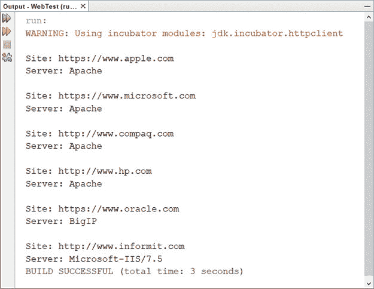

**图 21.1**

使用 HTTP 客户端请求服务器头。

与你在上一小时处理的“读取和写入文件”中的输入输出类一样，这些 HTTP 类的方法必须处理数据传输中的错误。它们抛出了来自 `java.io` 包的 `IOException` 和 `InterruptedException` 异常。

`ServerCheck` 应用程序有一个 `load()` 方法，它执行所有必要的 HTTP 任务，从它们的 Web 服务器请求六个首页并获取响应。

可能发生的三个异常被放在构造函数中的 `try`-`catch` 块中，该块在第 22 行使用了多类异常 `catch`。

### 从网络保存文件

通过 HTTP 获取的数据不仅限于网页等文本文件。任何类型的数据都可以以字节的形式访问，包括图像、视频和可执行文件。

本小时的下一个项目使用新的 HTTP Client 库从作者的博客下载图像并将其保存到计算机中。

`ImageDownloader` 应用程序遵循与之前示例相同的步骤，直到发送请求为止。创建一个浏览器，使用 `URI` 创建请求构建器，并构建请求。

在请求发送到 Web 服务器之前，必须完成一些准备工作。必须创建一个文件来存放接收到的图像内容：

`Path temp = Files.createTempFile("lighthouse", ".jpg");`

`java.nio` 包中的 `Files` 类可以通过调用其方法 `createTempFile(String, String)` 创建临时文件。这两个参数是用于文件名的文本标识符和文件扩展名。文件名由标识符后跟一个数字生成，例如 `lighthouse39406253848162078.jpg`。一旦你有了文件，浏览器的 `send()` 方法就可以使用响应处理器将该文件作为第二个参数。服务器的响应将存储在该文件中。以下是执行该操作的语句：

```java
HttpResponse<Path> response = browser.send(request, HttpResponse.BodyHandler.asFile(temp));
```

`request` 是使用构建器和图像的 Web 地址 (`URI`) 创建的 `HttpRequest` 对象。主体处理器的 `asFile(Path)` 方法将指定的文件设为图像数据的目标地。此临时文件可以通过重命名将其保存为永久文件：

```java
File perm = new File("lighthouse.jpg");
temp.toFile().renameTo(perm);
```

在 NetBeans 中，在 `com.javahours` 包中创建一个空的 `ImageDownloader.java` 文件，然后将其填入列表 2.2 中的源代码。

### 列表 2.2 ImageDownloader.java 的完整文本

```java
package com.javahours;

import java.io.*;
import java.net.*;
import java.nio.file.*;
import jdk.incubator.http.*;

public class ImageDownloader {
    public ImageDownloader() {
        String uri = "http://www.javahead.org/media/lighthouse.jpg";
        try

            load(uri);
        } catch (URISyntaxException oops) {
            System.out.println("Bad URI: " + oops.getMessage());
        } catch (IOException | InterruptedException oops) {
            System.out.println("Error: " + oops.getMessage());
        }
    }

    public void load(String imageUri) throws URISyntaxException, IOException, InterruptedException {
        // create the web client
        HttpClient browser = HttpClient.newHttpClient();
        // build a request for the image
        URI uri = new URI(imageUri);
        HttpRequest.Builder bob = HttpRequest.newBuilder(uri);
        HttpRequest request = bob.build();
        // create a file to hold the image data
        Path temp = Files.createTempFile("lighthouse", ".jpg");
        // execute the request and retrieve the data
        HttpResponse<Path> response = browser.send(request,
            HttpResponse.BodyHandler.asFile(temp));
        System.out.println("Image saved to " + temp.toFile().getAbsolutePath());
        // save the file permanently
        File perm = new File("lighthouse.jpg");
        temp.toFile().renameTo(perm);
        System.out.println("Image moved to " + perm.getAbsolutePath());
    }

    public static void main(String[] arguments) {
        new ImageDownloader();
    }
}
```

当运行 `ImageDownloader` 应用程序时，项目主文件夹中会出现一个名为 `lighthouse.jpg` 的文件。点击 Files 选项卡将其带到最前（位于 NetBeans 中与 Projects 窗格相同的部分）。双击文件在主面板中打开它，如图 21.2 所示。

程序分别在第 34–35 行和 39 行显示临时和永久图像文件的位置。


**图 21.2**

从网络下载图像文件。

### 在网络上发布数据

目前为止，本小时重点是使用 HTTP 从网络获取内容。现在是时候返回一些东西了。最后一个项目是 `SalutonVerkisto`，这是一个 Java 应用程序，使用 POST 请求向作者的 Web 服务器发送消息。

POST 请求可以编码大量数据供服务器接收，例如网络博客文章甚至是图像或视频文件。GET 请求也可以向服务器携带信息，但它受限于 URI 中可以包含的内容。

点击此处查看代码

`String site = "[`workbench.cadenhead.org/post-a-comment.php`](http://workbench.cadenhead.org/post-a-comment.php)";`

`URI uri = new URI(site);`

两个字符串 `yourName` 和 `yourMessage` 包含了将发送的名称和注释：

点击此处查看代码

`String yourName = "Sam Snett of Indianapolis";`

`String yourMessage = "Your book is pretty good, if I do say so myself.";`

这些信息将通过 HTTP 请求发送到 Web 服务器，与之前的项目一样。在发送注释之前，必须使用 `HttpRequest.BodyProcessor` 内部类的方法进行编码。

该类有一个 `fromString()` 方法，该方法接收一组由 `&` 字符分隔的长字符串，包含多个键值对：

点击此处查看代码

```java
HttpRequest.BodyProcessor proc = HttpRequest.BodyProcessor.fromString (
    "name=" + URLEncoder.encode(yourName, "UTF-8") +
    "&comment=" + URLEncoder.encode(yourMessage, "UTF-8") +
    "&mode=" + URLEncoder.encode("demo", "UTF-8")
);
```

`HttpRequest.BodyProcessor` 的 `encode(String, String)` 方法接受两个参数：消息和要使用的字符编码。适当的编码取决于 Web 服务器能接受的内容。我服务器上的脚本可以接受 UTF-8，因此在这里使用了该编码。

此方法调用指定了三个键值对：`name`、`comment` 和 `mode`。前两个的值来自 `yourName` 和 `yourMessage`。第三个 `mode` 的值为“demo”，它让服务器脚本知道消息的目的。（这也有助于过滤掉可能向脚本发送垃圾信息的垃圾邮件群发者。）

处理后的消息 `proc` 可以通过调用 `newBuilder(URI)` 方法来创建一个请求构建器，随后再进行另外三个调用。

当先显示代码时，这些内容会更容易理解：

点击此处查看代码

```java
HttpRequest.Builder newBuilder = HttpRequest.newBuilder(uri)
    .header("Content-Type", "application/x-www-form-urlencoded")
    .header("Accept", "text/plain")
    .POST(proc);
```

此方法调用将四个调用堆叠在一起。这之所以有效，是因为每个调用都是对 `HttpRequest.Builder` 的调用并返回构建器对象。以下是这些调用按顺序完成的任务：

1. `newBuilder(URI)` 为该 Web 地址创建一个构建器。

2. `header(String, String)` 将名为 `Content-Type` 的请求头设置为值“application/x-www-form-urlencoded”。这告诉服务器正在发送 Web 表单。

3. 另一个 `header()` 调用将 `Accept` 设置为“text/plain”，即请求的 MIME 类型。

4. `post(HttpRequest.BodyProcessor)` 将编码后的消息格式化为 HTTP POST 请求。

现在构建器已就绪，可以构建请求了：

点击此处查看代码

```java
HttpRequest request = newBuilder.build();
```

请求通过浏览器的 `send(HttpRequest, HttpResponse.BodyHandler)` 调用发送，该调用包含请求和一个将响应获取为字符串的处理程序：

点击此处查看代码

```java
HttpResponse<String> response = client.send(request,
    HttpResponse.BodyHandler.asString());

System.out.println(response.body());
```

`ServerCheck` 也使用了相同的技术，但这次显示的是响应。

在 `com.java24hours` 包中创建一个空的 Java 文件作为 `SalutonVerkisto` 应用程序，并在 列表 21.3 中输入源码。

**列表 21.3 `SalutonVerkisto.java` 的全文**

点击此处查看代码


```java
package com.java24hours;

import java.io.*;
import java.net.*;
import jdk.incubator.http.*;

public class SalutonVerkisto {

    public SalutonVerkisto() {
        String site = "http://workbench.cadenhead.org/post-a-comment.php";
        try {
            postMessage(site);
        } catch (URISyntaxException oops) {
            System.out.println("Bad URI: " + oops.getMessage());
        } catch (IOException | InterruptedException oops) {
            System.out.println("Error: " + oops.getMessage());
        }
    }

    public void postMessage(String server) throws IOException, URISyntaxException, InterruptedException {
        HttpClient client = HttpClient.newHttpClient();
        URI uri = new URI(server);
        String yourName = "Sam Snett of Indianapolis";
        String yourMessage = "Your book is pretty good, if I do say so myself.";
        HttpRequest.BodyProcessor proc = HttpRequest.BodyProcessor.fromString(
            "name=" + URLEncoder.encode(yourName, "UTF-8") +
            "&comment=" + URLEncoder.encode(yourMessage, "UTF-8") +
            "&mode=" + URLEncoder.encode("demo", "UTF-8")
        );
        HttpRequest.Builder newBuilder = HttpRequest.newBuilder(uri)
            .header("Content-Type", "application/x-www-form-urlencoded")
            .header("Accept", "text/plain")
            .POST(proc);
        HttpRequest request = newBuilder.build();
        HttpResponse<String> response = client.send(request,
            HttpResponse.BodyHandler.asString());
        System.out.println(response.body());
    }

    public static void main(String[] args) {
        new SalutonVerkisto();
    }
}
```

第一个网页地址位于`http://info.cern.ch/hypertext/WWW/TheProject.html`，随着 Web 吸引了用户、出版者和软件开发人员，它每天都会更新。

该网站将 Web 定义为“一种广域多媒体信息检索计划，旨在提供对庞大文档宇宙的访问”。

### 测验

通过回答以下问题，检查你对 HTTP 编程这一 Web 信息知识的掌握程度。

**1.** 哪种类型的请求可以向 Web 服务器发送信息？

**A.** `GET`

**B.** `POST`

**C.** `GET` 和 `POST` 都可以

**2.** 哪个类持有从由请求产生的服务器接收到的信息？

**A.** `HttpClient`

**B.** `HttpResponse`

**C.** `HttpRequest`

**3.** 使用 `Optional` 数据结构的一个理由是什么？

**A.** 为了避免 `NullPointerException` 错误。

**B.** 为了存储 `null` 值集合。

**C.** 为了运行得更快。

#### 答案

**1. C.** `POST` 发送大量数据；`GET` 在 Web 地址（URI）上发送数据。

**2. B.** `HttpResponse` 对象是通过调用浏览器的 `send()` 方法返回的。

**3. A.** 调用 `isPresent()` 用于检查该结构持有的是 `null` 而不是一个有效对象。

#### 活动

为了进一步加强对本小时 Web 编程主题的理解，请完成以下活动：

-  为 `ServerCheck` 程序添加另外五个科技公司首页。
-  编写一个程序，使用 HTTP 响应的“Content-Type”和“Content-Encoding”头部来报告服务器采用的 MIME 类型和字符编码。

要查看实现这些活动的 Java 程序，请访问书籍网站`www.java24hours.com`。

# 第 22 小时：创建 Java2D 图形

### 本小时待办事项

-  设置文本的字体和颜色。
-  设置容器的背景颜色。
-  绘制线条、矩形和其他形状。
-  绘制 GIF 和 JPEG 图形。
-  绘制填充和未填充形状。

在本小时中，你将学习如何将容器——即存放图形用户界面（GUI）组件的普通灰色面板和框架——变成艺术画布，你可以在上面绘制字体、颜色、形状和图形。

### 使用 `Font` 类

Java 中的颜色和字体通过`java.awt`包中的`Color`和`Font`类表示。通过这些类，你可以用不同的字体和大小显示文本，并更改文本和图形的颜色。字体通过`Font(String, int, int)`构造函数创建，它接受三个参数：

-  字体的类型，可以是通用名称（“Dialog”、“DialogInput”、“Monospaced”、“SanSerif”或“Serif”）或实际字体名称（“Arial Black”、“Helvetica”或“Courier New”）。
-  样式，取三个类变量之一：`Font.BOLD`、`Font.ITALIC`或`Font.PLAIN`。
-  以磅为单位的字体大小。

以下语句创建了一个 12 磅斜体 Serif 字体：

点击此处查看代码

```java
Font current = new Font("Serif", Font.ITALIC, 12);
```

如果你使用的是特定字体而不是通用字体之一，则该字体必须安装在运行你程序的用户的计算机上。

你可以通过相加字体样式来组合字体样式，如下例所示：

点击此处查看代码

```java
Font headline = new Font("Courier New", Font.BOLD + Font.ITALIC, 72);
```

当你拥有一个字体时，调用`Graphics2D`组件的`setFont(Font)`方法将其指定为当前字体。所有后续绘制操作都将使用该字体，直到设置另一个字体。以下代码创建了一个“Comic Sans”字体对象，并在绘制文本之前将其指定为当前字体：

点击此处查看代码

```java
public void paintComponent(Graphics comp) {
    Graphics2D comp2D = (Graphics2D) comp;
    Font font = new Font("Comic Sans", Font.BOLD, 15);
    comp2D.setFont(font);
    comp2D.drawString("Potrzebie!", 5, 50);
}
```

Java 支持抗锯齿，以使字体和图形更加光滑且不那么颗粒。要启用此功能，你必须设置渲染提示。`Graphics2D`对象有一个`setRenderingHint(int, int)`方法，接受两个参数：

-  渲染提示的键。
-  与该键关联的值。

这些值是`java.awt`中`RenderingHints`类的类变量。要激活抗锯齿，请调用：

```java
comp2D.setRenderingHint(RenderingHints.KEY_ANTIASING, RenderingHints.VALUE_ANTIALIAS_ON);
```

### 使用 `Color` 类

Java 中的颜色由`Color`类表示，该类包含以下常量：`black`、`blue`、`cyan`、`darkGray`、`gray`、`lightGray`、`magenta`、`orange`、`pink`、`red`、`white`和`yellow`。

在容器中，你可以像这样调用`setBackground(Color)`方法，使用这些常量设置组件的背景：

```java
setBackground(Color.orange);
```

当前颜色像当前字体一样，必须在使用`setColor(Color)`方法绘制之前设置。以下代码包含一条将当前颜色设置为蓝色并用该颜色绘制文本的语句：

```java
public void paintComponent(Graphics comp) {
    Graphics2D comp2D = (Graphics2D) comp;
    comp2D.setColor(Color.blue);
    comp2D.setFont(font);
}
```

与直接在容器上调用的`setBackground()`方法不同，你必须在`Graphics2D`对象上调用`setColor()`方法。

### 创建自定义颜色

你可以通过指定红绿蓝（RGB）值在 Java 中创建自定义颜色。RGB 通过颜色中存在的红、绿、蓝量来定义颜色。每个值的范围从 0（无该颜色）到 255（最大量）。

`Color(int, int, int)`构造函数接受红、绿、蓝值的参数。以下代码绘制了一个在青绿色背景（0 红、101 绿、118 蓝）上显示金色文本（159 红、121 绿、44 蓝）的面板：

点击此处查看代码

```java
import java.awt.*;
import javax.swing.*;

public class Jacksonville extends JPanel {
    Color gold = new Color(159, 121, 44);
    Color teal = new Color(0, 101, 118);

    public void paintComponent(Graphics comp) {
        Graphics2D comp2D = (Graphics2D) comp;
        comp2D.setColor(teal);
        comp2D.fillRect(0, 0, 200, 100);
        comp2D.setColor(gold);
        comp2D.drawString("Go, Jaguars!", 5, 50);
    }
}
```

此示例调用`Graphics2D`的`fillRect()`方法，使用当前颜色绘制填充矩形。

**注意**

RGB 值允许创建 1650 万种可能的组合，尽管大多数计算机显示器对其中大多数组合只能提供接近的近似。对于焦焦午夜蓝是否与中等淡婴儿绿相配的建议，请阅读《在书店排队时自学色彩感》。

### 绘制线条和形状

在 Java 程序中，绘制线条和矩形等形状与显示文本一样简单。你只需要一个`Graphics2D`对象来定义绘制表面，以及代表要绘制内容的对象的对象。

`Graphics2D`对象具有用于通过命令绘制文本的方法，如下：

点击此处查看代码图像

```java
comp2D.drawString("Draw, pardner!", 15, 40);
```

此语句在坐标 (15, 40) 处绘制了文本“Draw, pardner!”。绘制方法使用与文本相同的 (x, y) 坐标系。(0, 0) 坐标点位于容器的左上角，`x`值向右增加，`y`值向下增加。你可以通过以下语句确定在帧或其他容器中可以使用的最大`(x, y)`值：

点击此处查看代码图像

```java
int maxXValue = getSize().width;
int maxYValue = getSize().height;
```

除了线条外，你绘制的形状可以是填充的也可以是未填充的。填充形状用当前颜色绘制，完全填充形状所占据的空间。未填充形状则用当前颜色绘制一个边框。

### 绘制线条

对象的 2D 绘制被创建，并代表正在绘制的形状。

定义形状的对象属于`java.awt.geom`包中的类集合。

`Line2D.Float`类创建了一条连接起点 (x, y) 点和终点 (x, y) 点的线条。以下语句创建了一条从点 (40, 200) 到点 (70, 130) 的线条：

点击此处查看代码图像

```java
Line2D.Float line = new Line2D.Float(40F, 200F, 70F, 130F);
```

参数后面紧跟着字母`F`，用表示它们是浮点值。如果省略了该字母，Java 将把它们视为整数。

**注意**

`Line2D.Float`的类名中间有一个点，这与你之前接触过的多数类不同。这是因为`Float`是`Line2D`类的一个静态内部类，该主题在第 16 小“使用内部类和闭包”中介绍过。

线条以外的所有形状都是通过调用`Graphics2D`类的方法绘制的：`draw()`用于轮廓，`fill()`用于填充形状。

以下语句绘制了在上一个示例中创建的`line`对象：

```java
comp2D.draw(line);
```

### 绘制矩形

矩形可以是填充的或未填充的，并且具有圆角或直角。它们使用`Rectangle2D.Float(int, int, int, int)`构造函数创建，其参数如下：

-  矩形左上角的`x`坐标。
-  左上角的`y`坐标。
-  矩形的宽度。
-  矩形的高度。

以下语句绘制了一个带有直角的未填充矩形：

点击此处查看代码图像

```java
Rectangle2D.Float box = new Rectangle2D.Float(245F, 65F, 20F, 10F);
```

该语句创建了一个矩形，其左上角位于坐标 (x, y) (245, 65)，宽度为 20 像素，高度为 10。要以轮廓的形式绘制此矩形，可以使用以下语句：

```java
comp2D.draw(box);
```

如果你想让矩形变为填充，请使用`fill()`方法：

```java
comp.fill(box);
```

你可以使用`RoundRectangle2D.Float`类创建圆角矩形而非直角矩形。

该类的构造函数以`Rectangle2D.Float`类相同的四个参数开头，增加了以下两个参数：

-  距离矩形角部`x`方向的像素数。
-  距离角部`y`方向的像素数。

这些距离用于确定矩形角的圆角处理应该从哪里开始。

以下语句创建了一个圆角矩形：

点击此处查看代码图像

```java
RoundRectangle2D.Float ro = new RoundRectangle2D.Float(
    10F, 10F,
    100F, 80F,
    15F, 15F);
```

该矩形的左上角位于 (10, 10) 坐标。第三和第四参数指定了矩形的宽度和高度。在这种情况下，它的宽度应为 100 像素，高度为 80 像素。

`drawRoundRect()`的最后两个参数指定四个角都应该从距离 (10, 10) 处 15 像素的地方开始圆角化。

### 绘制椭圆和圆

在 Java 中可以绘制的另一种圆形形状是椭圆。

椭圆和圆可以使用`Ellipse2D.Float`类创建，它具有相同的四个参数：

-  椭形的`x`坐标。
-  椭形的`y`坐标。
-  椭形的宽度。
-  椭形的高度。

`(x, y)`坐标并不指示椭形的中心。相反，`(x, y)`坐标、宽度和高度描述了左上角。以下语句在 (245, 45) 处创建一个宽度和高度均为 5 的圆：

点击此处查看代码图像


```java
Ellipse2D.Float cir = new Ellipse2D.Float(245F, 45F, 5F, 5F);
```

### 绘制弧

另一种圆形形状是弧。弧使用`Arc2D.Float`类创建，它具有许多相同的参数。通过指定椭圆、可见部分（以度为单位）以及弧的起点来绘制弧。

弧的起点大小从 0 到 359 度，按逆时针方向旋转，0 度处位于 3 点钟位置，如图 22.1 所示。


**图 22.1**

弧的定义。

弧的类型使用类变量指定：`PIE`用于饼图切片，`CLOSED`如果端点用直线连接，`OPEN`如果端点不应连接。

以下语句在 (100, 50) 处绘制了一个开放弧，其长度为 120 度，从 30 度标记开始，宽度为 65，高度为 75：

点击此处查看代码图像

```java
Arc2D.Float smile = new Arc2D.Float(100F, 50F, 65F, 75F, 30F, 120F, Arc2D.Float.OPEN);
```

### 制作饼图

为了结束本节，你创建一个`PiePanel`，这是一个显示饼图的 GUI 组件。该组件是`JPanel`的子类，`JPanel`是一个作为绘制内容的简单容器。

创建类的一种方法是定义创建该类对象的方法。使用`PiePanel`类的程序必须执行以下步骤：

 使用构造函数方法`PiePanel(int)`创建`PiePanel`对象。指定的整数参数是饼图包含的切片数。

 调用对象的`addSlice(Color, float)`方法，为切片指定颜色和值。

`PiePanel`中每个切片的值代表其所代表的数量。

例如，根据高等教育办公处的数据，表 22.1 显示了美国在该计划实施前 38 年学生贷款还款状态的数据。

#### 表 22.1 美国学生贷款还款

| 学生偿还的金额 | 1010 亿美元 |
| :--- | :--- |
| 贷款给在读学生的剩余金额 | 680 亿美元 |
| 贷款给正在还款的学生的金额 | 910 亿美元 |
| 贷款给违约学生的金额 | 250 亿美元 |

你可以使用以下语句通过`PiePanel`在饼图图中表示这些数据：

点击此处查看代码图像

```java
PiePanel loans = new PiePanel(4);
loans.addSlice(Color.green, 101F);
loans.addSlice(Color.yellow, 68F);
loans.addSlice(Color.blue, 91F);
loans.addSlice(Color.red, 25F);
```

图 22.2 显示了在应用程序框架中的结果，该框架包含一个组件：用学生贷款数据创建的`PiePanel`。

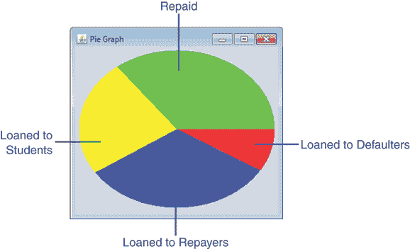

### 图 22.2

在饼图上显示学生贷款数据。

当创建一个`PiePanel`对象时，扇区的数量是在构造函数中指定的。绘制每个扇区，你还需要知道另外三点：

 扇区的颜色，由一个`Color`对象表示

 每个扇区代表的值

 所有扇区代表的总值

使用一个新的新的辅助类`PieSlice`来表示饼图中的每个扇区：

点击此处查看代码图像

```java
import java.awt.*;

class PieSlice {
    Color color = Color.lightGray;
    float size = 0;
    PieSlice(Color pColor, float pSize) {
        color = pColor;
        size = pSize;
    }
}
```

每个扇区通过调用`PieSlice(Color, float)`构建。所有扇区的组合值被存储在`PiePanel`类的私有实例变量`totalSize`中。此外，还有面板背景颜色（`background`）和用于跟踪扇区的计数器（`current`）的实例变量：

```java
private int current = 0;
private float totalSize = 0;
private Color background;
```

现在你已经有一个`PieSlice`类可以工作，你可以通过另一个实例变量创建一个`PieSlice`对象数组：

```java
private PieSlice[] slice;
```

当你创建一个`PiePanel`对象时，没有任何扇区被分配颜色或大小。在构造函数中你必须做的事情只有定义`slice`数组的大小并保存面板的背景颜色：

点击此处查看代码图像

```java
public PiePanel(int sliceCount) {
    slice = new PieSlice[sliceCount];
    background = getBackground();
}
```

使用`addSlice(Color, float)`方法向面板添加一个饼图扇区：

点击此处查看代码图像

```java
public void addSlice(Color sColor, float sSize) {
    if (current <= slice.length) {
        slice[current] = new PieSlice(sColor, sSize);
        totalSize += sSize;
        current++;
    }
}
```

`current`实例变量用于将每个扇区放入`slice`数组的对应元素中。数组的`length`变量包含了该数组定义的容纳数量；只要`current`不大于`slice.length`，你就可以继续向面板添加扇区。

正如你预期的那样，`PiePanel`类在它的`paintComponent()`方法中处理所有的绘制操作。这项任务中最困难的部分是绘制代表饼图每个扇区的弧。这在以下语句中处理：

点击此处查看代码图像

```java
float start = 0;
for (int i = 0; i < slice.length; i++) {
    float extent = slice[i].size * 360F / totalSize;
    comp2D.setColor(slice[i].color);
    Arc2D.Float drawSlice = new Arc2D.Float(
        xInset, yInset, width, height, start, extent,
        Arc2D.Float.PIE);
    start += extent;
    comp2D.fill(drawSlice);
}
```

`start`变量记录绘制弧的起始位置，而`extent`记录弧的大小。如果你知道所有饼扇区的总大小以及特定扇区的大小，你可以通过将弧的大小乘以 360 再除以所有扇区的总和来计算出`extent`。

所有的弧都是在一个循环中绘制的。

```java
13:      Color inBetweenGreen = new Color(0x00, 0x99, 0x66);
14:      Color norwegianBlue = new Color(0x33, 0xCC, 0xCC);
15:      Color purpleRain = new Color(0x66, 0x33, 0x99);
16:      Color freckle = new Color(0x99, 0x66, 0x33);
17:
18: public PieFrame() {
19:      super("Pie Graph");
20:          setLookAndFeel();
21:          setSize(320, 290);
22:          setDefaultCloseOperation(JFrame.EXIT_ON_CLOSE);
23:          setVisible(true);
24:
25:          PiePanel pie = new PiePanel(10);
26:          pie.addSlice(uneasyBeingGreen, 1350);
27:          pie.addSlice(zuzusPetals, 1221);
28:          pie.addSlice(zootSuit, 316);
29:          pie.addSlice(sweetHomeAvocado, 251);
30:          pie.addSlice(shrinkingViolet, 201);
31:          pie.addSlice(miamiNice, 193);
32:          pie.addSlice(inBetweenGreen, 173);
33:          pie.addSlice(norwegianBlue, 164);
34:          pie.addSlice(purpleRain, 143);
35:          pie.addSlice(freckle, 127);
36:          add(pie);
37:     }
38:
39: private void setLookAndFeel() {
40: try {
41:              UIManager.setLookAndFeel(
42: "com.sun.java.swing.plaf.nimbus.NimbusLookAndFeel"
43:              );
44:         } catch (Exception exc) {
45: // ignore error
46:         }
47:     }
48:
49: public static void main(String[] arguments) {
50:          PieFrame pf = new PieFrame();
51:     }
52: }
```

`PieFrame`类是一个简单的图形用户界面，它包含一个组件：在第 25 行创建的`PiePanel`对象。在第 26–35 行中，调用了 10 次对象的`addSlice()`方法来向饼图添加扇区。

当你运行该应用程序时，`PieFrame`会显示一个饼图，展示人口最多的 10 个国家的数据（单位：百万），数据来自 2017 年 6 月的美国人口普查国际数据库报告。按顺序排列为：中国（13.79 亿）、印度（12.82 亿）、美国（3.27 亿）、印度尼西亚（2.61 亿）、巴西（2.07 亿）、巴基斯坦（2.05 亿）、尼日利亚（1.91 亿）、孟加拉国（1.58 亿）、俄罗斯（1.42 亿）和日本（1.26 亿）。

由于 Java 的`Color`类中只定义了几颜色，在这里创建了 10 个新颜色供使用，并赋予了描述性名称。这些颜色以十六进制值表示——在 Java 中，十六进制字面量前面带有`0x`——但也可以在每个`Color()`构造函数中指定十进制值。

图 22.3 显示了该应用程序的运行情况。

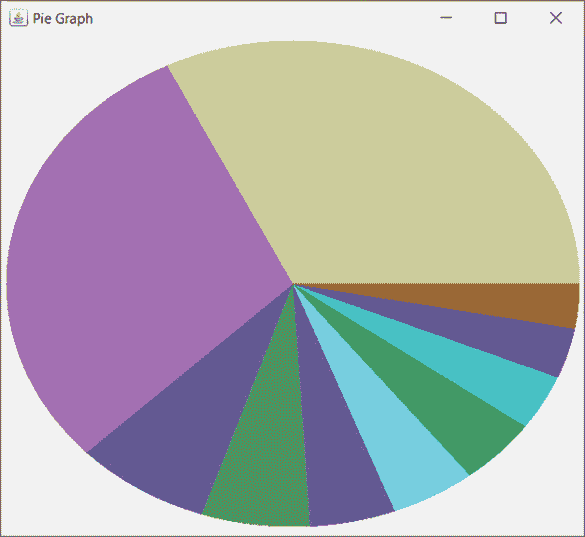

**图 22.3**

在饼图中显示人口数据。

### 注意

你可以通过访问`www.cadenhead.org/`获取当前的美国人口普查数据，该网站会重定向到`www.census.gov`。

### 总结

通过使用字体、颜色和图形，你可以吸引用户对程序元素的注意力并使其更具吸引力。使用 Java 提供的形状进行绘制可能看起来麻烦。然而，使用多边形绘制的图形相比加载的图像有两个优势：

 **速度**——即使是较小的图标，加载和显示也比一组多边形要慢。

 **缩放**——你可以通过更改值来改变整个图像的大小。例如，你可以在`Sign`类中添加一个函数，在创建每个形状之前乘以所有的`(x, y)`点，结果将翻倍。

### 工作坊

#### 问答

**Q. 如何绘制顺时针而不是逆时针的弧？**

**A.** 你可以通过指定弧的大小为负数来实现。弧从相同的点开始但方向相反。例如，以下语句在`(35, 20)`处绘制了一个长度为 90 度、从 0 度开始、顺时针方向、高度为 20 宽度为 15 的开口弧：

```java
Arc2D.Float smile = new Arc2D.Float(35F, 20F, 15F, 20F, 0F, -90F, OPEN);
```

**Q. 椭圆没有角。`Ellipse.Float`构造函数中指定的`(x, y)`坐标是什么？**

**A.** `(x, y)`坐标代表椭圆或圆的最小 x 值和最小 y 值。如果你周围画一个不可见的矩形，矩形的左上角将是方法的 x 和 y 坐标。

**Q. 为什么摄影师让你说“cheese”（微笑）？**

**A.** “cheese”这个词会强制你的嘴部变成微笑，就像 whiskey、breeze 和 money 一样。以长 e 结尾的单词通常会导致你的嘴角上扬并露出牙齿。摄影师有时使用的另一个词是“grin”。虽然它不以 e 结尾，但它能让人微笑。西班牙摄影师让人说“patata”，法国人说“ouiti”，德国人说“käsekuchen”。

#### 测试

回答以下问题，测试你的字体和颜色技巧是否很棒。

1. 下面哪个不是选择颜色的常量？

   A. `Color.cyan`

   B. `Color.purple`

   C. `Color.magenta`

2. 当你更改某物的颜色并在容器上重绘时，必须做什么才能使其可见？

   A. 使用`drawColor()`方法。

   B. 使用`repaint()`语句。

   C. 什么都不做。

3. RGB 首字母代表什么？

   A. Roy G. Biv

   B. Red Green Blue

   C. Lucy in the Sky with Diamonds

#### 答案

1. B. 奥兰多城 SC 的主颜色——自豪的紫色在`Color`类中缺失。

2. B. 对`repaint()`的调用会导致`paintComponent()`方法被调用。

3. B. 如果 C 是正确答案，你可以使用多年后回忆中可见的颜色。

#### 活动

为了进一步探索在程序中使用字体和颜色的可能性，请执行以下活动：

 创建`PieFrame`类的版本，将颜色值和饼扇值作为命令行参数，而不是将它们包含在应用程序源代码中。

 创建一个在面板上使用颜色、形状和字体绘制停止标志的应用程序。

要查看实现这些活动的 Java 程序，请访问书籍的网站`www.java24hours.com`。

# 第 23 节：使用 Java 创建 Minecraft Mod

### 本节的任务列表

 在你的电脑上安装 Minecraft 服务器。

 写一个启动服务器的脚本。

 为 Minecraft mod 编程设置 NetBeans。

 为 mod 创建框架。

 设计一个生成怪物的 mod。

 让一个怪物成为另一个的骑手。

 找到游戏中的每个怪物并攻击它。

 编写一个从世界上挖掘出巨大块的 mod。

书的这一节涵盖了近年来成为现象的内容。

我有两个青少年儿子，他们是热衷的游戏玩家，他们都玩多人建筑游戏 Minecraft。他们同年纪的大多数表兄弟兄弟也在玩这个游戏。当我告诉任何年轻人我写关于 Java 编程的书时，他们都会问我同一个问题：它会教我如何创建 Minecraft mod 吗？

Mods（模组）是玩家设计并共享的游戏扩展程序。Minecraft 游戏是用`Java`编写的，因此 mods 必须使用相同的语言进行编程。

学习`Java`是创建 Minecraft mods 的第一步。这一小时是第二步。

在本小时结束时，你将在你的电脑上下载、安装并运行一个属于你自己的 Minecraft 服务器。你还将能够使用`Java`语言创建 mods，将其部署到服务器上，并在玩游戏时使用它们。但要小心，苦力者（creepers）四处潜伏。

### 设置 Minecraft 服务器

开发 mods 需要访问 Minecraft 服务器。当你作为一个 mod 开发者刚起步时，实现此点的最佳方法是在自己的电脑上安装并运行一个服务器。由于目前还没有标准的方法向游戏中添加 mods，不同的服务器有不同的方法来实现这一目标。

创建 mods 时最易用的是来自 Spigot Project 的工具，这是一个专门为此目的设计的 Minecraft 服务器和`Java`类库。Spigot 是免费的，可以从网站[`www.javaminecraft.com/spigot`](http://www.javaminecraft.com/spigot)下载。寻找文件`spigotserver.jar`。

该文件包含了封装为`JAR`文件的 Minecraft 服务器和类库。Spigot API 是一组在创建 mods 时将用到的`Java`包。


下载完成后，在你的电脑上创建一个新文件夹并将文件存储在其中。在我的 Windows PC 上，我创建了`c:\minecraft\server`并将 JAR 文件复制到其中。

接下来，将`spigotserver.jar`复制到同一个文件夹。这是你启动 Minecraft 服务器的文件。

以下命令启动服务器：

```bash
java -Xms1024M -Xmx1024M -jar spigotserver.jar
```

此命令告诉 Java 虚拟机运行封装为 JAR 文件`spigotserver.jar`的应用程序，并为程序分配 1,024MB 的内存。

为了避免每次运行服务器时都输入此命令，你可以创建一个包含该命令的批处理文件（batch file）或脚本文件，然后改为运行该文件。

在 Windows 上，打开如记事本之类的文本编辑器，将列表 23.1 的文本输入文件中，并将其保存为与`spigotserver.jar`相同文件夹下的`start-server.bat`。

**列表 23.1** `start-server.bat`的完整文本

```text
1: java -Xms1024M -Xmx1024M -jar spigotserver.jar
2: pause
```

双击此文件运行服务器。如果运行成功，将打开一个窗口显示服务器在启动时正在执行。

你将看到一个错误信息“Failed to load eula.txt”，如图 23.1 所示。这是预期中的。

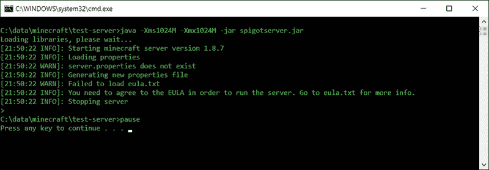

**图 23.1** 服务器 EULA 检查失败。

Minecraft 有一份最终用户许可协议（`EULA`），在运行服务器之前必须接受该协议。访问此网页以审阅该协议：[`account.mojang.com/documents/minecraft_eula`](https://account.mojang.com/documents/minecraft_eula)。

现在与服务器相同的文件夹中有一个名为`eula.txt`的文件。该文件有一行包含以下文本：

```text
eula=false
```

如果你同意`EULA`，请用编辑器打开该文件，将此行改为`eula=true`，保存文件并再次运行服务器。

服务器第一次运行时，它会创建多个文件和子文件夹，并构建世界地图。如果成功，你将看到最后的消息“[Info] Done”以及`>`提示符旁闪烁的光标。

`help`命令列出了你可以使用的、控制服务器和游戏世界的命令。`stop`命令用于关闭服务器（现在先不要这样做！）。

图 23.2 显示了一个正在运行的 Spigot 服务器。在服务器运行时，必须保持此窗口打开。如果你的服务器窗口看起来像这样，你可以跳过下一节直接进入“连接到服务器”。

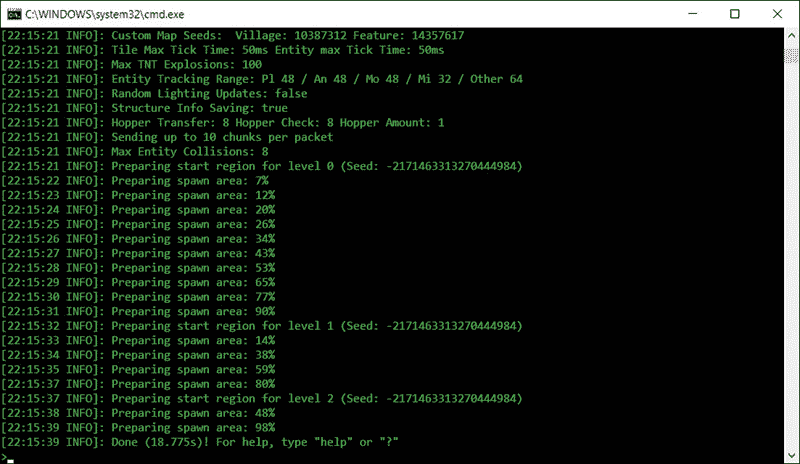

**图 23.2** 首次运行 Minecraft 服务器。

### 解决运行服务器时出现的问题

在下载并安装服务器后，有两个常见错误会导致服务器无法成功运行。

第一个错误显示信息“Unable to access jar file spigotserver.jar”，如图 23.3 所示。

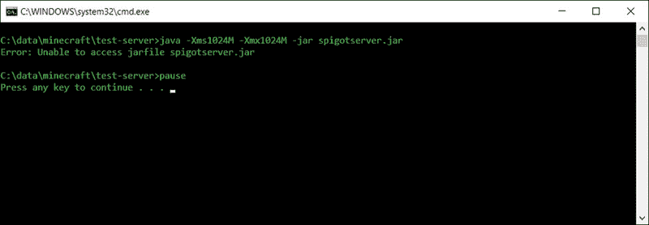

**图 23.3** 找不到 Spigot JAR 文件。

要解决此问题，请确保`spigotserver.jar`文件与你启动服务器的文件（`start-server.bat`）位于同一个文件夹。然后尝试重新启动服务器。

第二个错误显示信息“’java' is not recognized as an internal or external command”，如图 23.4 所示。

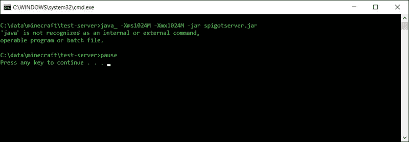

**图 23.4** 找不到 Java 虚拟机 (JVM)。

Java 虚拟机 (JVM) 无法找到。这意味着电脑不知道哪里有`java`。

要解决这个问题，请确保`spigotserver.jar`文件与你启动服务器的文件（`start-server.bat`）位于同一个文件夹。然后尝试重新启动服务器。

### 连接到服务器

因为你想制作 Minecraft mods，你显然电脑上可能已经有一个用于玩游戏的 Minecraft 客户端。如果没有，你可以从网站[www.minecraft.net](http://www.minecraft.net)购买并下载游戏。目前价格为 26.95 美元。游戏有适用于 Windows、Mac OS、游戏机和移动设备的版本，但 mod 编程需要 Windows 或 Mac 版本。

启动 Minecraft 并选择多人游戏。你应该能看到你的新服务器是选项之一（如图 23.5 所示）。

服务器被称为“Minecraft Server”（你以后可以将其改为更酷的名字）。客户端将向服务器发送一个 ping 消息并报告速度，该速度将显示为一组绿色的连接条（如图 23.5 所示）。

这些绿色的连接条意味着你已准备好连接。如果你看到它们，请选择服务器（点击它）并点击“加入服务器”（Join Server）按钮。你现在已经在自己的服务器上运行了一个新的 Minecraft 世界。继续阅读“创建你的第一个 Mod”部分。

当客户端无法连接到服务器时，将显示红色的 X 而不是绿色连接条。下一节将介绍如何解决此问题。

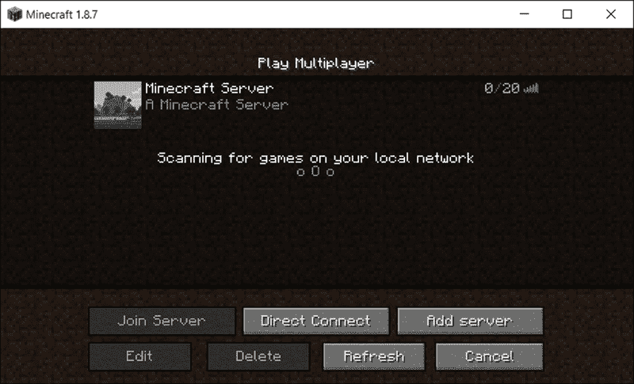

**图 23.5**

你的新 Minecraft 服务器已准备好连接。

## 修复服务器连接问题

有时，Minecraft 客户端在向服务器发送 ping 并获取响应时会出现问题。这通过图 23.6 所示的红色 X 来表示。

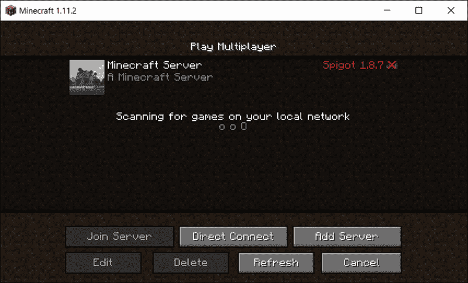

**图 23.6**

你的新 Minecraft 服务器存在连接问题。

此问题的最常见原因是服务器运行的 Minecraft 版本与客户端不同。在服务器窗口中，第一条消息指示服务器运行的版本。它写着“Starting Minecraft version 1.8.7”。

Minecraft 客户端通常运行最新版本。你可以编辑你的配置（profile）以使用较旧版本。完全退出 Minecraft 客户端。你需要重新加载它来更改此设置。

再次运行客户端并按照以下步骤在配置中选择不同的版本：

1. 在 Minecraft 启动器（Launcher）对话框中，点击“启动选项”（Launch Options）按钮，然后点击“添加新建”（Add New）。

2. 在`Version`下拉菜单中，选择`Release 1.8.7`。

3. 点击“保存”（Save）。

4. 点击“设置”（Settings）。

5. 点击绿色“播放”（Play）按钮上的箭头，然后选择`Unnamed Configuration 1.8.7`。

点击“播放”，然后选择“多人游戏”（Multiplayer）。你应该看到带有绿色连接条的服务器。

**注意**

更改玩家配置会影响你使用的所有 Minecraft 服务器，包括你不在创建和测试 Mod 时所玩的服务器。当你不连接到你自己的 Spigot 服务器时，请确保将“播放”按钮上的配置改回当前版本（或者创建一个第二个玩家配置，一个用于 Mod 工作，另一个用于游戏）。

## 创建你的第一个 Mod

现在你已经设置并运行了 Minecraft 的 Spigot 服务器，你准备好开始为该服务器开发 Mod 了。

Mod 必须封装为 Java 归档文件，也称为 JAR 文件。NetBeans 是本书中使用的 Oracle 提供的免费集成开发环境，它在每当你构建项目时都会自动创建 JAR 文件。

当你写完一个 Mod 后，将其添加到服务器文件夹中一个名为`plugins`的子文件夹下。

本小时第一个 Mod 是一个简单的示例，它展示了你在为 Spigot 创建的每个 Mod 中都会使用的框架。该 Mod 为游戏添加了一个`/siamesecat`命令，可以创建一个暹猫猫实体，将其添加到世界中，并让你（玩家）成为它的主人。

每个 Mod 在 NetBeans 中都是独立的项目。要开始此项目，请按照以下步骤操作：

1. 在 NetBeans 中，选择菜单命令`File`（文件）、`New Project`（新建项目）。打开新建项目向导。

2. 在`Categories`（类别）面板中，选择`Java`，在`Projects`（项目）面板中，选择`Java Application`。然后点击`Next`（下一步）。

3. 在`Project Name`（项目名称）字段中，输入`SiameseCat`（无空格并按所示大写）。

4. 点击`Project Folder`（项目文件夹）字段旁的`Browse`（浏览）按钮。出现`Select Project Location`（选择项目位置）对话框。

5. 找到你安装 Minecraft 服务器的文件夹。选择它并点击`Open`（打开）。该文件夹出现在`Project Location`字段中。

6. 取消勾选`Create Main Class`（创建主类）复选框。

7. 点击`Finish`（完成）。

创建`SiameseCat`项目，项目面板中会出现两个文件夹：`Source Packages`（源包）和`Libraries`（库），如图 23.7 所示。

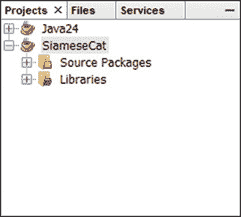

**图 23.7**

向 Java 项目添加库。

1. 在每个 Mod 项目上，在你开始编写 Java 代码之前，必须添加 Java 类库：即你在安装时下载的 Spigot JAR 文件。在`Projects`面板中，右键点击`Libraries`文件夹并选择菜单命令`Add Library`（添加库）。出现`Add Library`对话框。

2. 点击`Create`（创建）按钮。出现`Create New Library`（新建库）对话框。

3. 在`Library Name`（库名称）字段中，输入`Spigot`并点击`OK`（确定）。出现`Customize Library`（自定义库）对话框。

4. 点击`Add JAR/Folder`（添加 JAR/文件夹）按钮。出现`Browse JAR/Folder`（浏览 JAR/文件夹）对话框。

5. 使用该对话框找到并打开你安装服务器的文件夹。

6. 点击`spigotserver.jar`以选择该文件。

7. 点击`Add JAR/Folder`（添加 JAR/文件夹）。

8. 点击`OK`（确定）。

9. `Available Libraries`（可用库）面板现在有一个`Spigot`项目。选择它并点击`Add Library`（添加库）。

项目面板现在在`Libraries`文件夹中包含 Spigot 的 JAR 文件（点击`Libraries`旁边的 + 以查看）。你准备好开始编写 Mod 程序了。

按照以下步骤创建程序：

1. 点击`File`（文件）、`New File`（新建文件）。出现`New File`对话框。

2. 在`Categories`面板中，选择`Java`。

3. 在`Projects`面板中，选择`Java Application`。点击`Next`（下一步）。

4. 在`Class Name`（类名）字段中，输入`SiameseCat`。

5. 在`Package`（包）字段中，输入`org.caden`。

6. 点击`Finish`（完成）。

`SiameseCat`项目在 NetBeans 源编辑器中打开。你为 Spigot 创建的每个 Mod 都以这些语句开头：

通过将`sender`对象强制转换为`Player`类，创建了一个名为`me`的对象。这个对象就是游戏玩家所控制的角色。

通过这个`Player`对象，你可以调用它的`getLocation()`方法（无需参数）来获取玩家所处的精确位置。这个位置由`Location`类表示。关于位置，你可以获取到的三个信息是它在三维游戏地图上的`(x, y, z)`坐标。

`Player`对象还有一个`getWorld()`对象，它会返回一个代表整个游戏世界的`World`对象。

你创建的大多数 mod 都会用到这些`Player`、`Location`和`World`对象。

这个 mod 使用`World`类的`spawn()`方法创建了一个名为暹猫的新生生物：

点击此处查看代码图片


```java
Ocelot cat = world.spawn(spot, Ocelot.class);
```

游戏中的每种生物都有对应的类。`spawn()` 的两个参数是猫应该放置的位置以及要创建的生物的类。

这条语句在玩家所在的位置创建了一个名为 `cat` 的 `Ocelot` 对象。

此时，这只猫是一只奥猫（ocelot），但可以通过这条语句将其更改为暹猫：

点击此处查看代码图片

```java
cat.setCatType(Ocelot.Type.SIAMESE_CAT);
```

猫的 `setCatType()` 方法决定了猫是野生的奥猫，还是暹猫、黑猫或红猫。

Minecraft 中的猫是能够被主人驯服的生物之一。通过调用猫的 `setOwner()` 方法并将玩家作为参数可以建立这种关系：

```java
cat.setOwner(me);
```

将列表 23.2 输入源代码编辑器中，并点击 NetBeans 工具栏中的“保存全部”按钮（或选择文件、保存），即可将所有内容整合在一起。

**列表 23.2** `SiameseCat.java` 的完整文本

点击此处查看代码图片

```java
1: package org.cadenhead.minecraft;
2:
3: import java.util.logging.*;
4: import org.bukkit.*;
5: import org.bukkit.command.*;
6: import org.bukkit.entity.*;
7: import org.bukkit.plugin.java.*;
8:
9: public class SiameseCat extends JavaPlugin {
10: public static final Logger log = Logger.getLogger("Minecraft");
11:   
12: public boolean onCommand(CommandSender sender, Command command,
13:           String label, String[] arguments) {
14:           
15: if (label.equalsIgnoreCase("siamesecat")) {
16: if (sender instanceof Player) {
17: // 获取玩家 
18:                     Player me = (Player) sender;
19: // 获取玩家的当前位置
20:                     Location spot = me.getLocation();
21: // 获取游戏世界
22:                     World world = me.getWorld();
23:
24: // 生成一只奥猫
25:                     Ocelot cat = world.spawn(spot, Ocelot.class);
26: // 将它变成暹猫
27:                     cat.setCatType(Ocelot.Type.SIAMESE_CAT);
28: // 让玩家成为它的主人
29:                     cat.setOwner(me);
30: log.info("[SiameseCat] Meow!");
31: return true;
32:                 }
33:         }
34: return false;
35: }
```

列表 23.2 第 3–7 行的 `import` 语句为程序提供了五个包：一个来自 Java，四个来自 Spigot。

**注意**

程序中使用了这些类：来自 `java.util.logging` 的 `Logger`，来自 `bukkit` 的 `Location` 和 `World`，来自 `bukkit.command` 的 `Command`，来自 `bukkit.entity` 的 `Ocelot` 和 `Player` 以及来自 `bukkit.plugin.java` 的 `JavaPlugin`。

第 31 行和 34 行的 `return` 语句是标准框架的一部分。当 mod 处理命令时，你的 mod 应该返回值 `true`，否则返回 `false`。

你已经创建了第一个 mod，但 Spigot 无法运行它。它需要一个名为 `plugin.yml` 的文件来告诉 Minecraft 服务器该 mod。这是一个文本文件，你可以通过以下步骤在 NetBeans 中创建：

1. 选择文件、新文件。新文件对话框打开。
2. 在类别中选择其他（Other）。
3. 在文件类型中选择空文件（Empty File）并点击下一步。
4. 在文件名字段输入 `plugin.yml`。
5. 在文件夹字段输入 `src`。
6. 点击完成。

一个名为 `plugin.yml` 的空白文件会在编辑器中打开。将列表 23.3 的文本输入文件，并确保每行的空格数量相同。不要使用 Tab 键代替空格。

**列表 23.3** 该项目 `plugin.yml` 的完整文本

点击此处查看代码图片

```
1: name: SiameseCat
2:
3: author: Your Name
4:
5: main: org.cadenhead.minecraft.SiameseCat
6:
7: commands:
8: siamesecat:
9: description: Spawn a Siamese cat.
10:
11: version: 1.0
```

为了检查空格是否输入正确，第 8 行 `siamesecat` 之前有四个空格，第 9 行 `description` 之前有八个空格。`plugin.yml` 文件描述了 mod 的名称、作者、Java 类、版本以及命令的功能描述。

此文件必须位于项目中的正确位置。查看项目面板，它应该在 `<default package>` 下的 `Source Libraries` 文件夹内。

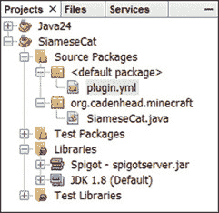

**图 23.8** 检查 `plugin.yml` 的位置。

如果文件位于错误的位置（例如在 `org.cadenhead.minecraft` 标题下），你可以使用拖放移动它。点击并按住文件，将其拖到 `Source Libraries` 图标处释放。现在你准备好构建你的 mod 了。选择菜单中的运行、清理并构建项目（Run, Clean, and Build Project）。如果成功，NetBeans 用户界面的左下角会出现“Finished SiameseCat (clean)”的消息。

mod 被封装为项目子文件夹中名为 `SiameseCat.jar` 的文件。要找到它，点击项目面板中的 Files 标签页，然后展开 `dist` 文件夹。Files 标签页列出了组成项目的所有文件，如图 23.9 所示。

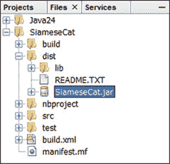

**图 23.9** 寻找 SiameseCat mod 的 JAR 文件。

此 `SiameseCat.jar` 文件需要从项目文件夹复制到 Minecraft 服务器。按照以下步骤操作：

1. 如果 Minecraft 服务器正在运行，通过进入 NetBeans 之外的服务器窗口停止它。
2. 打开安装 Minecraft 服务器的文件夹。打开 `SiameseCat` 子文件夹。
3. 返回 Minecraft 服务器文件夹。
4. 打开 `plugins` 子文件夹。
5. 按 Ctrl+v 将 `SiameseCat` 复制到其中。

你已经在 Minecraft 服务器上部署了新 mod。按照你之前的方法启动服务器——点击你创建的 `start-server` 文件——你将在运行期间显示的日志文件中看到两条新消息：

点击此处查看代码图片

```
[SiameseCat] Loading SiameseCat v1.0
[SiameseCat] Enabling SiameseCat v1.0
```

如果你没有看到这些消息，而是看到一些长而复杂的错误信息，请双检 `SiameseCat.java` 和 `plugin.yml` 中的所有内容，确保它们输入正确；然后重新部署 mod。

当你运行 Minecraft 客户端并连接到服务器时，输入命令 `/siamesecat`。你现在有一只会跟随你周围的新宠物猫。根据你的需要多次输入该命令以不断添加猫。

图 23.10 显示了我和 23 只猫。苦力者不想和我们有瓜。

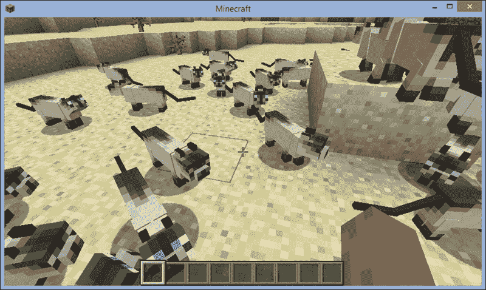

**图 23.10** 来我吧，暹猫朋友们！

### 教会僵尸骑马

你创建的第一个 mod 需要花费大量工作，因为你是第一次经历这个过程。剩下的部分应该简单一些，因为你将重复许多相同的步骤。

在这个小时内，你开发的每个 mod 都会比前一个复杂。在这个项目中，你将创建一个由僵尸骑乘的马兵部队。

通过以下任务开始工作吧：

1. 选择 `File`、`New Project`，在 Minecraft 服务器相同的文件夹中创建一个名为 `CrazyHorse` 的新 Java Application 项目，就像上一个项目一样。确保取消勾选 `Create Main Class`。
2. 在 Projects 窗格中右键点击 `Libraries`，点击 `Add Library`，并将 `Spigot` 库添加到项目中。
3. 选择 `File`、`New File`，并创建一个类名为 `CrazyHorse`、包名为 `org.cadenhead.minecraft` 的空 Java 文件。

在 `CrazyHorse.java` 文件的源代码编辑器中输入 Listing 23.4 的文本。程序中使用的新概念将在输入后进行解释。

**列表 23.4** `CrazyHorse.java` 的全文

点击此处查看代码图像

```java
1: package org.cadenhead.minecraft;
2:
3: import java.util.logging.*;
4: import org.bukkit.*;
5: import org.bukkit.command.*;
6: import org.bukkit.entity.*;
7: import org.bukkit.plugin.java.*;
8: import org.bukkit.potion.*;
9:
10: public class CrazyHorse extends JavaPlugin {
11: public static final Logger log = Logger.getLogger("Minecraft");
12:   
13: public boolean onCommand(CommandSender sender, Command command,
14:           String label, String[] arguments) {
15:         
16: if (label.equalsIgnoreCase("crazyhorse")) {
17: if (sender instanceof Player) {
18:                      Player me = (Player) sender;
19:                      Location spot = me.getLocation();
20:                      World world = me.getWorld();
21:
22: // spawn some horse-riding zombies
23: int quantity = (int) (Math.random() * 10) + 1;
24: log.info("[CrazyHorse] Creating " + quantity
25:                           + " zombies and horses");
26: for (int i = 0; i < quantity; i++) {
27: // set horse and zombie location
28:                             Location horseSpot = new Location(world,
29:                                 spot.getX() + (Math.random() * 15),
30:                                 spot.getY() + 20,
31:                                 spot.getZ() + (Math.random() * 15));
32:                             Horse horse = world.spawn(horseSpot, Horse.class);
33:                             Zombie zombie = world.spawn(horseSpot, Zombie.class);
34:                             horse.setPassenger(zombie);
35:                             horse.setOwner(me);
36: // set the horse's color
37: int coat = (int) (Math.random() * 7);
38: switch (coat) {
39: case 0:
40:                             horse.setColor(Color.WHITE);
41:                             break;
42: case 1:
43:                             horse.setColor(Color.GRAY);
44:                             break;
45: case 2:
46:                             horse.setColor(Color.CREAM);
47:                             break;
48: case 3:
49:                             horse.setColor(Color.CHESTNUT);
50:                             break;
51: case 4:
52:                             horse.setColor(Color.BROWN);
53:                             break;
54: case 5:
55:                             horse.setColor(Color.DARK_BROWN);
56:                             break;
57: case 6:
58:                             horse.setColor(Color.BLACK);
59:                             break;
60:   }
61: // increase the horse's speed
62:                             PotionEffect potion = new PotionEffect(
63:                             PotionEffectType.SPEED,
64:                             Integer.MAX_VALUE,
65:                             10 + (coat * 10));
66:                             horse.addPotionEffect(potion);
67:                         }
68: return true;
69:         }
70:     }
71: return false;
72:   }
73: }
```

在输入列表内容后，通过选择 `File`、`Save` 或点击 `Save All` 保存此文件。

此 mod 为 Minecraft 增加了一个 `/crazyhorse` 命令，会从天空中掉落随机数量的骑马僵尸。第 18–65 行在输入命令时会执行一些酷的操作。这些行周围的其他程序部分是标准的 mod 框架。

在获取玩家、位置和世界后，mod 在变量中存储了一个 1 到 11 之间的随机数：

点击此处查看代码图像

```java
int quantity = (int) (Math.random() * 10) + 1;
```

Java 中 `Math` 类的 `random()` 方法生成一个 0.0 到 1.0 之间的随机浮点数。它可以乘以一个整数来产生一个从 0 到该整数的随机整数。

这个数字就是僵尸的数量。

### 列表 23.5 此项目 `plugin.yml` 的完整文本

点击此处查看代码图片

```yaml
1: name: CrazyHorse
2:
3: author: Your Name Here
4:
5: main: org.cadenhead.minecraft.CrazyHorse
6:
7: commands:
8: crazyhorse:
9: description: Spawn 1-11 horse-riding zombies.
10:
11: version: 1.0
```


完成后，选择运行（Run）、清理并构建项目（Clean and Build Project）来创建 mod 的 JAR 文件。

在项目（Projects）窗格中，`Source Packages`（源包）下应该有两个文件：位于 `org.cadenhead.minecraft` 的 `CrazyHorse.java` 和位于 `<default package>`（默认包）下的 `plugin.yml`。

在 NetBeans 之外，进入你的文件文件夹，将该项目 `dist` 文件夹中的 `CrazyHorse.jar` 文件复制到服务器的 `plugins` 文件夹中。重启服务器（停止它并重新运行），你应该就可以输入 `/crazyhorse` 命令了。

1–11 只骑马的僵尸会落在你周围，发出“砰”的一声。如果你在游戏白天发布该命令，这些不死人将迎来一个不妙的惊喜。见图 23.11。

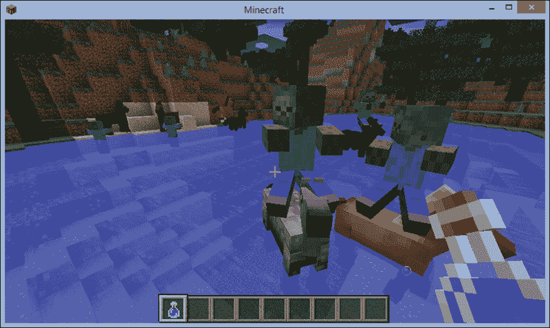

**图 23.11**

两个骑马的僵尸。

Spigot 的设计者在让 Java 类匹配游戏中的物品方面做得很好。当你开发这前两个 mod 时，你可能已经开始思考可以通过微调来更改的内容。

这里是对 CrazyHorse mod 列表 23.4 第 33 行的一行代码更改，它可以将一个完全不同的生物放在马背上：

点击此处查看代码图片

```java
Creeper creeper = world.spawn(horseSpot, Creeper.class);
```

此更改创建了一支苦力爬骑兵而不是僵尸。

尽管你可以推测类名并看到发生了什么，但 Spigot 为其所有 Java 类提供了详尽的在线文档。你可以在 [www.javaminecraft.com/bukkitapi](http://www.javaminecraft.com/bukkitapi) 查看 Spigot 1.8.7 的文档。

使用此指南学习 Spigot 中的每个类和接口、它们的实例变量，以及实例方法和类方法。

通过翻阅文档和捣鼓 CrazyHorse mod，你可以尝试不同的生物和药水效果。

这里有一个让马变得隐形的 mod 修改，会导致僵尸看起来像是漂浮在空中：

点击此处查看代码图片

```java
PotionEffect potion2 = new PotionEffect(
    PotionEffectType.INVISIBILITY,
    Integer.MAX_VALUE,
    1);

horse.addPotionEffect(potion2);
```

### 寻找所有生物（并杀死它们）

前两个 mod 在游戏世界中添加了生物。下一个项目将检查已经存在的生物，找到它们的每一个位置，并用闪电击中该位置。

开始之前：

1. **选择 File（文件）、New Project（新建项目）** 在 Minecraft 服务器文件夹中创建新项目 `LightningStorm`。确保取消勾选 Create Main Class（创建主类）。

2. 在 Projects 窗格中，右键点击 `Libraries`（库），点击 **Add Library**（添加库）并添加 Spigot 库。

3. **选择 File（文件）、New File（新建文件）** 并创建一个类名为 `LightningStorm`、包名为 `org.cadenhead.minecraft` 的空 Java 文件。

将列表 23.6 的文本输入 NetBeans 的源代码编辑器中，记得在完成后保存文件。

**列表 23.6 `LightningStorm.java` 的完整文本**

点击此处查看代码图片

```java
1: package org.cadenhead.minecraft;
2:
3: import java.util.*;
4: import java.util.logging.*;
5: import org.bukkit.*;
6: import org.bukkit.command.*;
7: import org.bukkit.entity.*;
8: import org.bukkit.plugin.java.*;
9:
10: public class LightningStorm extends JavaPlugin {
11: public static final Logger log = Logger.getLogger("Minecraft");
12: 
13: public boolean onCommand(CommandSender sender, Command command,
14:     String label, String[] arguments) {
15:     Player me = (Player) sender;
16:     World world = me.getWorld();
17: // get every mob in the game
18:     List<LivingEntity> mobs = world.getLivingEntities();
19:     
20: // process lightningstorm
21:     if (label.equalsIgnoreCase("lightningstorm")) {
22:     if (sender instanceof Player) {
23:         int myId = me.getEntityId();
24: // loop through each mob at a time
25:         for (LivingEntity mob : mobs) {
26:             log.info("[LightningStorm]" + mob.getType());
27: // is this mob the player?
28:             if (mob.getEntityId() == myId) {
29:                 // yes, don't strike him
30:                 continue;
31:             }
32: // get the mob's location
33:             Location spot = mob.getLocation();
34: // lightning strike!
35:             world.strikeLightning(spot);
36: // set the mob's health to 0 (dead)
37:             mob.setHealth(0);
38:         }
39:     }
40:     return true;
41: }
42: // process mobcount command
43:     if (label.equalsIgnoreCase("mobcount")) {
44:     if (sender instanceof Player) {
45:         me.sendMessage("There are " + mobs.size() + " living mobs.");
46:         return true;
47:     }
48:     }
49:     return false;
50: }
51: }
```

LightningStorm mod 在 mod 框架上做了一些新尝试：它监控两个命令而不是一个。`/lightningstorm` 命令向生物降下大量的闪电。`/mobcount` 命令计算游戏中有多少活着的生物。

用于 Spigot 的 Minecraft mod 可以实现任意数量的命令。`/lightningstorm` 命令实现在列表 23.6 的第 22–42 行。`/mobcount` 命令实现在 45–50 行。

这些命令都需要玩家对象和世界对象。它们还需要一个所有活动生物的列表，这在第 19 行完成：

点击此处查看代码图片

```java
List<LivingEntity> mobs = world.getLivingEntities();
```

该语句调用世界的 `getLivingEntities()` 方法，该方法返回一个包含每个生物的 `List` 对象。生物用实现 `LivingEntity` 接口的对象表示。

`List` 也是一个接口。它由数组列表（array lists）、栈（stacks）和其他数据结构实现。数组列表的方法和技术也适用于此列表。

有了这个列表后，你可以通过一个语句实现 `/mobcount` 命令：

点击此处查看代码图片

```java
me.sendMessage("There are " + mobs.size() + " living mobs.");
```

列表的 `size()` 命令返回列表中的元素数量。此信息发送给玩家并显示在游戏中。这是通过调用玩家的 `sendMessage()` 方法并将信息作为唯一参数来实现的。

`/lightningstorm` 命令更为复杂。

Java 数据结构有特殊的 `for` 循环，可以轻松遍历结构中的每个项。第 26 行对 `mobs` 列表中的每个生物开始了这样的循环：

点击此处查看代码图片

```java
for (LivingEntity mob : mobs) {
```

这将当前生物存储在名为 `mob` 的 `LivingEntity` 对象中。

向地图上的每个生物发送闪电时，必须记住玩家也是一个生物。对自己放电不是个好主意。

游戏中的每个生物都有唯一的 ID。在 `for` 循环开始之前，第 24 行存储了玩家的 ID：

点击此处查看代码图片

```java
int myId = me.getEntityId();
```

该整数在循环中与当前生物的 ID 进行比较，通过在第 29–32 行调用其 `getEntityID()` 方法：

```java
if (mob.getEntityId() == myId) {
    continue;
}
```

`continue` 语句会导致循环回到第 26 行并处理下一个生物。

现在玩家已经安全了，你可以通过调用其 `getLocation()` 方法来找到生物的位置：

点击此处查看代码图片

```java
Location spot = mob.getLocation();
```

然后，使用该位置调用世界的 `strikeLightning()` 方法：

点击此处查看代码图片

```java
world.strikeLightning(spot);
```

用闪电击中生物并不总是致命的——有些生物是很强壮的小家伙——但这让这个效果显得没那么引人注目了。通过调用生物的 `setHealth()` 方法并传入 `0` 作为参数，可以将其生命值设置为该值并将其杀死：

```java
mob.setHealth(0);
```

此模组应录入 `plugin.yml` 文件可以在列表 23.7 中找到。在项目的 `src` 文件夹中创建一个名为 `plugin.yml` 的空文件，然后将此列表的内容填充其中。

**列表 23.7 本项目 `plugin.yml` 的完整内容**

点击此处查看代码图片

```yaml
1: name: LightningStorm
2:
3: author: Your Name Here
4:
5: main: org.cadenhead.minecraft.LightningStorm
6:
7: commands:
8: lightningstorm:
9: description: Hit every living mob with lightning.
10: mobcount:
11: description: Count of living mobs.
12:         
13: version: 1.0
```

构建项目（选择 Run、Build 和 Clean Project），然后通过将项目 `dist` 文件夹中的 `LightningStorm.jar` 文件复制到服务器的 `plugins` 文件夹，将模组部署到你的 Minecraft 服务器上。下次启动服务器并玩游戏时，你将看到像图 23.12 中那样的闪电暴。

实际上，在书中展示它会破坏惊喜感。图 23.12 是一只即将变成火焰烧烤的牛。

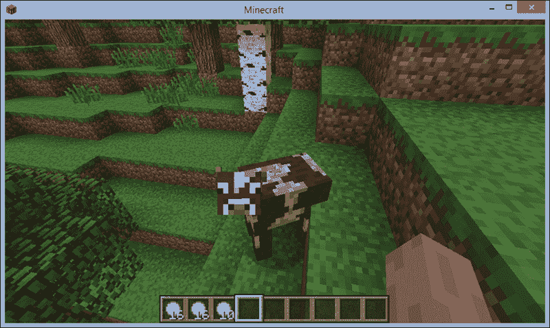

**图 23.12**

这不是闪电暴。

### 编写一个可以建造物品的模组

你创建的前三个模组都是关于生物的，即在 Minecraft 中游荡的移动实体。本小时的最后一个模组将探索如何使用 Java 执行游戏中最基础的操作：建造和破坏方块。

你将创建一个新命令 `/icecreamscoop`，它会在玩家周围挖掘一个圆洞。洞的大小将由玩家作为命令参数来决定。

以下是开始构建该模组的方法：

1. **在 Minecraft 服务器文件夹中创建新项目 `IceCreamScoop`，取消勾选“Create Main Class”。**

2. **在 Projects 窗格中，右键点击 `Libraries` 并添加 Spigot 库。**

3. **在 `org.cadenhead.minecraft` 包中创建一个名为 `IceCreamScoop` 类的空 Java 文件。**

将列表 23.8 的文本内容作为 `IceCreamScoop` 类的代码。在你输入完成后将对其进行解释。

**列表 23.8 `IceCreamScoop.java` 的完整内容**

点击此处查看代码图片


```
1: package org.cadenhead.minecraft;
2:
3: import java.util.logging.*;
4: import org.bukkit.*;
5: import org.bukkit.block.*;
6: import org.bukkit.command.*;
7: import org.bukkit.entity.*;
8: import org.bukkit.plugin.java.*;
9:
10: public class IceCreamScoop extends JavaPlugin {
11: public static final Logger log = Logger.getLogger("Minecraft");
12:     
13: public boolean onCommand(CommandSender sender, Command command,
14:           String label, String[] arguments) {
15:
16: // 设置默认挖掘半径
17: double radius = 15;
18: if (arguments.length > 0) {
19: try {
20: // 读取用户提供的半径（如果有的话
21:                   radius = Double.parseDouble(arguments[0]);
22: // 确保它是可接受的尺寸（5-25）
23: if ((radius < 5) | (radius > 25)) {
24:                             radius = 15;
25:             }
26:      } catch (NumberFormatException exception) {
27: // 什么都不做（使用默认值）
28:      }
29: }
30:     if (label.equalsIgnoreCase("icecreamop")) {
31: if (sender instanceof Player) {
32:           scoopTerrain(sender, radius);
33:         }
34: return true;
35: }
36: return false;
37: }
38:
39: // 挖掘世界中圆形的区域
40: private void scoopTerrain(CommandSender sender, double rad) {
41:     Player me = (Player) sender;
42:     Location spot = me.getLocation();
43:     World world = me.getWorld();
44:
45: // 遍历一个半径为两倍的正方形
46: for (double x = spot.getX() - rad; x < spot.getX() + rad; x++) {
47: for (double y = spot.getY() - rad; y < spot.getY() + rad; y++) {
48: for (double z = spot.getZ() - rad; z < spot.getZ() + rad; z++) {
49: // 获取正方形内的一个位置
50:             Location loc = new Location(world, x, y, z);
51: // 计算距离玩家的距离
52: double xd = x - spot.getX();
53: double yd = y - spot.getY();
54: double zd = z - spot.getZ();
55: double distance = Math.sqrt(xd * xd + yd * yd + zd * zd);
56: // 是否在半径范围内
57: if (distance < rad) {
58: // 是，将该方块设为空气
59:             Block current = world.getBlockAt(loc);
60:             current.setType(Material.AIR);
61:         }
62: }
63: }
64: }
65: }
66:
67: // 挖掘后播放音效
68:     world.playSound(spot, Sound.BURP, 30, 5);
69:     log.info("[IceCreamScoop] Scooped at ("
70:               + spot.getX() + ","
71:               + spot.getY() + ","
72:               + spot.getZ() + ")");
73:     }
74: }
```

此模组挖掘出一个半径从 5 到 25 个方块的圆形。玩家通过在命令后加上空格和数字来决定大小，例如：

```
/icecreamscoop 10
```

模组可以像 `Java` 应用程序一样接收参数。这些参数存储在 `onCommand` 方法的第四个参数中，这是一个 `String` 数组。

名为 `radius` 的 `double` 类型在第 17 行创建并赋值 15 之后，以下语句将半径设置为第一个参数的值。

`parseDouble()` 方法是 Java 标准类 `Double` 的，它可以将字符串转换为 `double` 值（如果这种转换是可能的）。

为了防止输入错误，你将 `parseDouble()` 放在 `try`-`catch` 块中。当用户的值不是数字时，会抛出 `NumberFormatException`。

利用勾股定理，你可以通过对 `xd`、`yd` 和 `zd` 进行平方并将它们相加，然后使用 `Math` 方法 `sqrt()` 获取该和的平方根来计算距离：

点击此处查看代码图片

```
double distance = Math.sqrt(xd * xd + yd * yd + zd * zd);
```

如果当前区块到玩家的距离在玩家选择的半径内，通过以下这两条语句可以将方块变为空气：

点击此处查看代码图片

```
Block current = world.getBlockAt(loc);
current.setType(Material.AIR);
```

首先，会创建一个代表该区块的 `Block` 对象。

接下来，调用方块的 `setType()` 方法并传入 `Material.AIR`，这是 Minecraft 中代表方块组成材料的几十种值之一。

用于通过将方块变为空气来破坏它的相同技术也可以用于建造物体。唯一改变的是材料的类型。如果你想挖掘出一块游戏并将其变成钻石而不是空气，则将使用这条语句：

点击此处查看代码图片

```
current.setType(Material.DIAMOND);
```

当从世界中挖掘出一块时，模组会执行两件事来记录这项成就：播放声音并向服务器日志发送消息。

通过调用 `world` 对象的 `playSound()` 方法并传入四个参数播放声音——声音的位置、类型、音量和音调：

点击此处查看代码图片

```
world.playSound(spot, Sound.BURP, 30, 5);
```

正如你可能猜到的那样，声音是一个打嗝声。有几十种可能的声音可以使用。

通过调用 `Logger` 对象的 `info()` 命令并传入消息文本，可以在服务器上记录消息：

点击此处查看代码图片

```
log.info("[IceCreamScoop] Scooped at " + spot);
```

项目的 `plugin.yml` 文件如列表 23.9 所示。在项目的 `src` 文件夹中创建一个名为 `plugin.yml` 的空文件以匹配此列表。

**列表 23.9 本项目 `plugin.yml` 的完整内容**

点击此处查看代码图片

```yaml
1: name: IceCreamScoop
2:
3: author: Your Name Here
4:
5: main: org.cadenhead.minecraft.IceCreamScoop
6:
7: commands:
8: icecreamscoop:
9: description: Scoop away land around the player.
10:
11: version: 1.0
```

在构建模组并将 JAR 文件部署到 Minecraft 服务器后，使用与之前项目相同的步骤，你可以在游戏世界中移动，并在景观中挖掘出巨大的圆球。图 23.13 显示了当你站在平坦土地上并输入此命令时发生的情况：

```
/icecreamscoop 10
```

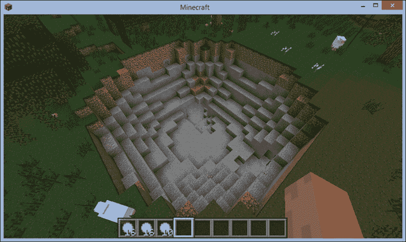

**图 23.13**

在 Minecraft 世界中挖掘出的圆圈区域。

在测试此模组时，我发现将自己挖到世界底部并不需要长时间。你还可能掉得足够远而导致死亡，因此最好的主意不是在出生点进行任何挖掘。

通过将材料从 `AIR` 更改为材料，你可以在世界中制作球体。物质的完整列表可以在 Spigot 的 Java 文档 [www.javaminecraft.com/bukkitapi](http://www.javaminecraft.com/bukkitapi) 中找到，这里有四种供你入门：

 `Material.DIRT`

 `Material.COBBLESTONE`

 `Material.WOOD`

 `Material.GRAVEL`

如果你将方块变为空气以外的任何物体，模组将移除你所站位置的空气。那一定很疼。你可以通过这两条语句传送到一个新位置：

点击此处查看代码图片

```
Location newSpot = new Location(world,
    spot.getX(),
    spot.getY() + rad + 1,
    spot.getZ());
me.teleport(newSpot);
```

因为 Minecraft 中的 Y 轴是垂直位置，这会将玩家移动到球体正上方。

### 总结

在我编写 Java 程序和教人们如何使用这种语言的这些年里，我从未预想过我会把这些技能用在让一个僵尸骑上。

 使用 Spigot 的 Java 文档，创建一个 mod，生成一个在本小时内未提到过的生物（mob）。

要查看实现这些活动的 Java 程序，请访问书籍的网站：[www.java24hours.com](http://www.java24hours.com)。

# 第 24 小时：编写 Android 应用程序

### 本小时的任务列表：

*  了解为什么创建了 Android。

*  创建一个 Android 应用程序。

*  学习 Android 应用程序的结构。

*  在模拟器上运行应用程序。

*  在 Android 手机上运行应用程序。

Java 是一种通用编程语言，可以运行在各种平台之上。近年来，其中一个平台脱颖而出，并成为新 Java 开发领域极其成功的火花。

Android 操作系统最初用于手机手机，后来已扩展到许多其他设备，它专门运行用 `Java` 编写的程序。

这些程序被称为 `apps`（应用程序），它们构建在一个开源移动平台之上，该平台对开发者来说是完全免费的。任何人都可以编写、部署和销售 Android 应用程序。

在本小时中，你将学习 Android 是如何产生的、它的特之处在哪里，以及为什么有这么多程序员在该平台上进行开发。你还将创建一个应用程序，并在 Android 手机（如果你拥有一部的话）和模拟器（如果你没有的话）上运行它。

### Android 简介

Android 始于 2003 年，被 Google 收购，并于 2007 年发布。这是行业范围内共同努力的一部分，旨在建立一个新的非专有且开放的移动手机平台，这与驱动 RIM BlackBerry 和 Apple iPhone 的技术不同。移动手机和技术领域的一些大名字——Google、Intel、Motorola、Nvidia、三星等公司——组成了开放手持联盟（Open Handset Alliance），以互利互赢的方式推广这一新平台。

Google 发布了 Android 软件工具包 (`SDK`)，这是一套用于开发 Android 应用程序的免费工具。第一款运行 Android 的手机 T-Mobile G1 于 2008 年 6 月上市。

这项努力起初进展缓慢，但从 2010 年初开始呈爆炸式增长，并成为 iPhone 以及其他移动平台的真正竞争对手。现在所有主要的手机运营商都提供 Android 手机。平板电脑和电子书阅读器的市场也在不断增长。

在 Android 出现之前，移动应用程序开发需要昂贵的编程工具和开发者计划。手机制造商控制谁被允许为他们创建应用程序，以及应用程序是否可以出售给用户。

Android 拆除了这道墙。

Android 的开源和非专有性质意味着任何人都可以开发、发布和销售应用程序。唯一的成本是向 Google 市场提交应用程序的笔少量费用。其他所有内容都是免费的。

下载 Android `SDK` 并了解更多关于为该平台创建程序信息的地方是 Android 开发者网站：`https://developer.android.com`。在编写自己的应用程序时，你会经常查阅它，因为它记录了 Android `Java` 类库中的每一个类，并作为一个详尽的在线参考。

如果你使用配备支持 Android `SDK` 的集成开发环境 (`IDE`)，编写 Android 应用程序将变得更容易。Android 编程推荐的 IDE 是 `Android Studio`，它也是免费且开源的。

你可以使用 `Android Studio` 编写 Android 应用程序，在模拟 Android 手机的模拟器中测试它们，甚至将其部署到实际设备上。

在大部分时间里，`Java` 语言一直被用于编写运行在三个地方之一程序：桌面计算机、Web 服务器或 Web 浏览器。

Android 让 `Java` 无处不在。你的程序可以部署在数百万手机和其他移动设备上。

这实现了 James Gosling 在 20 世纪 90 年代中期发明这种语言时的最初设计目标。他当时被赋予的任务创建一种可以在手机、智能卡和电器等设备上随处运行的语言。

当 `Java` 开发者首先作为运行交互式 Web 浏览器程序的手段、然后作为通用语言流行起来时，他们放下了那些梦想。

二十年后，根据一项行业估计，Android 平台在全球范围内运行着高达 30 亿个 `Java` 程序。

Android 在未来几年可能会成为 `Java` 编程中最无不在且最有利的领域。

### 创建 Android 应用程序

Android 应用程序是使用应用程序框架的普通 `Java` 程序，框架是一组所有应用程序共有的核心类和文件。该框架体现了应用程序必须如何结构以便在 Android 设备上正确运行的规则。

要开始编写应用程序，你必须安装 `Android Studio`。要下载软件，请访问 `https://developer.android.com`。运行安装向导并按照指示在你的计算机上设置软件。

要在项目中使用该 `IDE`：

1. 运行 `Android Studio`。

2. 在启动时出现的对话框中，选择 `Start a New Android Project`（启动新 Android 项目）。打开 `Create New Project` 向导，如图 24.1

**图 24.1** 在 Android Studio 中创建新的 Android 项目。

1. 在 Application Name（应用程序名称）字段中，输入 `SalutonMondo`。

2. 在 Company Domain（公司域名）字段中，输入 `java24hours.com`。Package Name（包名）字段将更新为使用这些和应用程序名称，变为 `com.java24hours.salutonmondo`。

3. 你可以接受默认的项目位置（用户文件夹下的 `StudioProjects` 子文件夹），或通过右侧的“...”按钮选择另一个位置。

4. 点击 Next。

5. 每个 Android 项目都需要一个目标平台。目标代表可以运行你的应用程序的最旧 Android 版本。选择 `Phone` 和 `Tablet` 作为目标，并将 `API 15` 作为 Minimum SDK（如果没有 API 15）。

6. 点击 Next。向导询问要创建的活动。选择 `Fullscreen` 并点击 Next。

7. 在 Activity Name（活动名称）字段中，输入 `SalutonActivity`。这更改了 Layout 和 Title 字段。保留这些更改。

8. 点击 Finish。新应用程序被创建，包中出现了 `SalutonMondo` 项目。

#### 探索新的 Android 项目

一个新的 Android 项目由大约 20 个文件和文件夹组成，在 Android 中始终以相同的方式组织。根据应用程序的功能，可能会添加更多文件，但这些初始文件和文件夹必须存在。

图 24.2 显示了创建 Android 项目后 `Android Studio` 的面板。如果你没有看到此面板，点击 IDE 左边缘的 `Projects` 选项卡。

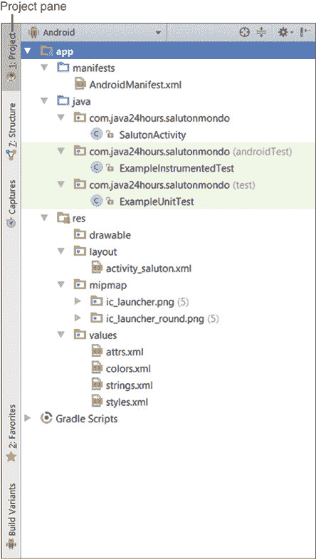

**图 24.2** 查看 Android 项目的组成部分。


你可以使用文件夹探索项目的文件和结构。新的 `SalutonMondo` 应用程序包含以下组件：

 `/java`——应用程序 `Java` 源代码的根文件夹。

 `/src/com.java24hours.salutonmondo/SalutonActivity.java`——在运行时默认启动的活动类。

 `/res`——应用程序资源的文件夹，如字符串、数字、布局文件、图形和动画。特定资源类型有子文件夹：`layout`、`values`、`drawable` 和 `mipmap`。

 `AndroidManifest.xml`——应用程序的主要配置文件。

这些文件和文件夹构成了应用程序框架。作为一名 Android 程序员，你着的首要任务是学习如何修改框架，以便能够发现每个组件可以实现什么功能。

框架中还添加了一些额外的文件以满足特定目的。

## 创建应用

尽管你还没有对它进行任何操作，但你已经可以成功运行这个新的 Android 项目了。该框架本身就是一个可以运行的应用程序。

因为这样做没有趣，你将自定义 `SalutonMondo` 应用，以提供传统的计算机编程问候语“Saluton Mondo!”

在第 2 小时“编写你的第一个程序”中，你通过调用 `System.out.println()` 方法将文本“Saluton Mondo!”作为字符串显示。

Android 应用显示的字符串首先存储在一个名为 `strings.xml` 的资源文件中。你可以在 `/res/values` 文件夹中找到此文件。

使用包管理器（Package Explorer）导航到该文件夹。双击 `strings.xml`。XML 文件将在文本编辑器中打开，如图 24.3 所示。

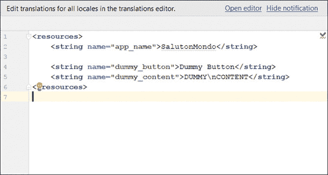

**图 24.3**

编辑 Android 应用的字符串资源。

字符串和其他资源被赋予了一个名称和一个值，就像 Java 中的变量一样。编辑面板中有三个以 XML 数据形式表示的字符串资源：`app_name`、`dummy_button` 和 `dummy_content`。

资源的名称遵循三条规则：

 它们必须全部小小写。

 它们不能有空格。

 它们只能使用下划线字符（_”）作为标点符号。

资源存储在 XML 文件。资源编辑器（Resources editor）是一个简单的 XML 编辑器。你也可以直接编辑 XML 本身。

目前 `strings.xml` 如下：

输出 

点击此处查看代码图像

```xml
<resources>
    <string name="app_name">SalutonMondo</string>
    <string name="dummy_button">Dummy Button</string>
    <string name="dummy_content">DUMMY\nCONTENT</string>
</resources>
```

这是一个带有三个 `string` 子元素的 `resources` 元素。每个 `string` 元素都有一个持有其名称的 `name` 属性。起始 `<string>` 标签和结束 `</string>` 标签之间还有文本，持有其值。

这些的作用与变量相同：一个名为 `dummy_content` 的值为“DUMMY\nCONTENT”。

此编辑器允许编辑 XML 文件中的所有内容，甚至是标记标签。将“DUMMY\nCONTENT”更改为“Saluton Mondo!”——注意不要更改周围的任何字符。完成更改后，XML 文件应包含以下内容：

输出 

点击此处查看代码图像

```xml
<resources>
    <string name="app_name">SalutonMondo</string>
    <string name="dummy_button">Dummy Button</string>
    <string name="dummy_content">Saluton Mondo!</string>
</resources>
```

点击 Android Studio 工具栏中的 Save 按钮（或选择 File, Save All）将更改保存到 `strings.xml` 文件。

经过该修改，你几乎准备好运行应用了。

## 设置 Android 模拟器

在构建 Android 应用之前，你必须设置它的调试环境。这可以在 Android Studio 中处理。你必须设置一个 Android 虚拟设备 (AVD)，可以在你的桌面上作为模拟器运行该应用。你还必须创建项目的调试配置。完成后，你可以构建应用并在模拟器中运行它。

要配置 Android 虚拟设备，首先点击 Android Studio 工具栏上的绿色 Android 手机图标，如图 24.4 所示。

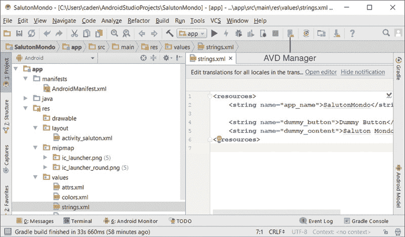

**图 24.4**

配置 Android 虚拟设备。

这将启动 Android 虚拟设备管理器（Android Virtual Device Manager），它是 Android SDK 中的工具之一。你创建的模拟器列在左侧。管理器如图 24.5 所示。

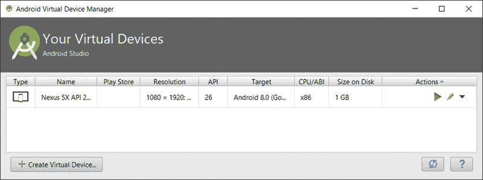

**图 24.5**

创建一个新的 Android 模拟器。

要添加新模拟器，点击 Create Virtual Device 并遵循以下步骤：

1. 从列表中选择设备，例如 Galaxy Nexus，并点击 Next。
2. 从列表中选择一个版本，例如 Nougat，并点击 Next。
3. 在 AVD Name 字段中，为其命名为 `SimpleAVD`。
4. 点击 Finish。
5. 新模拟器将被创建，这可能需要一点时间（通常不超过一分钟）。

你可以根据需要创建多个模拟器。它们可以针对不同的 Android 版本进行自定义。关闭 Android 虚拟设备管理器返回主界面。

### 运行应用

现在你已经有了模拟器，可以运行你的第一个应用了。选择菜单命令 Run -> App。弹出 Select Target 对话框。在 Available Devices（可用设备）下，选择 `SimpleAVD` 并点击 OK。

你可能会被要求安装平台。点击 Install 并 Continue。

模拟器将在自己的窗口中加载。这可能需要一分钟或更长时间，请等待手机启动。你安装的应用将带有 Android 图标和标签 `Saluton Mondo!` 出现，如图 24.6 所示。


**图 24.6**

在模拟器中运行应用。

## 设计真实应用

Android 应用可以利用设备的所有功能，例如短信消息、位置服务和触摸输入。在本书的最后一个编程项目中，你将创建一个名为 Take Me to Your Leader 的真实应用。

该应用利用 Android 的电话功能来拨打电话、访问网站并在 Google Maps 中加载位置。

1. 选择启动一个新的 Android Studio 项目（如果你没有看到此项，请通过菜单命令 `File`、`Close Project` 关闭上一个项目）。
2. 在 `Application Name` 字段中，输入 `Leader`。这也会自动填充到 `Project Location` 字段。
3. `Company Domain` 字段应该是 `java24hours.com`。确认无误后，点击 Next（下一步）。
4. 选择 `Phone and Tablet`，选择 `Minimum SDK` 值为 `API 15`（如果不可用，则选择最低值），然后点击 Next（下一步）。
5. 选择 `Fullscreen Activity`；然后点击 Next（下一步）。
6. 在 `Activity Name` 字段中，输入 `LeaderActivity`。
7. 点击 `Finish`（完成）。

项目会出现在 Android Studio 的项目窗格中。

### 提示

此项目涵盖了大量内容。在学习过程中，你会发现保持浏览器打开并在 Android 开发者网站的参考部分 [`developer.android.com/reference`](https://developer.android.com/reference) 会非常有帮助。你可以搜索 Android 类库中的 Java 类以及项目中的文件名以获取更多信息。

### 组织资源

创建一个 Android 应用需要 Java 编程，但大部分工作是在 Android Studio 界面中完成的。当你完全熟悉 Android SDK 的功能后，无需编写单行 Java 代码即可完成大量工作。

你不需要编程就能完成的一件事是创建应用程序使用的资源。每个新的 Android 项目从开始都包含几个放置资源的文件夹。要查看这些文件夹，请展开 Package Explorer 中的 `Leader` 文件夹，然后展开 `/res` 文件夹及其所有子文件夹。

资源由 `PNG`、`JPG` 或 `GIF` 格式的图形；存储在名为 `strings.xml` 文件中的字符串；XML 格式的用户界面布局文件；以及你可以创建的其他文件组成。另外两个文件是用于应用程序颜色的 `colors.xml` 和用于定义用户界面组件外观的 `styles.xml`。

新项目的 `/res` 文件夹包含名为 `ic_launcher.png` 和 `ic_launcher_round.png` 的文件夹，它们包含不同版本的应用程序图标。图标是启动应用程序时使用的小图形。

多个版本的 `ic_launcher.png` 是相同的图形，针对不同分辨率的显示进行了尺寸调整。你将不会使用这些图标。项目将添加一个新的图形文件 `appicon.png`，并在应用程序的主配置文件 `AndroidManifest.xml` 中将其指定为应用程序的图标。

本书的网站包含了 `appicon.png` 以及此应用所需的其他四个图形文件：`browser.png`、`maps.png`、`phone.png` 和 `whitehouse.png`。访问 [www.java24hours.com](http://www.java24hours.com) 并进入该版本的第 24 小 页面。下载所有五个文件并将它们保存到计算机上的临时文件夹中。

Android 对多分辨率的支持非常方便，但这里并不是必须的。

可以使用剪切粘贴将文件添加到资源中。打开包含这五个文件的临时文件夹，选择 `appicon.png` 并按 `Ctrl-C` 复制。在 Android Studio 中，在项目窗格中选择 `mipmap` 文件夹，右键点击并粘贴。

### 注意

资源在应用程序中通过其 ID 进行标识。名称必须仅包含小写字母、数字、下划线和点。

### 配置应用程序的清单

应用程序的主要配置是一个名为 `AndroidManifest.xml` 的文件。要开始编辑此文件，请双击 `res` 文件夹中的 `AndroidManifest.xml`。

### 设计用户界面

应用程序的图形界面由布局组成，如文本字段、按钮等容器。应用程序的所有屏幕都保存在 `/res/layout` 文件夹中。此项目有一个 `activity_leader.xml` 文件被指定为屏幕。

组件（Component）面板列出了屏幕上的小部件。选择 `imageButton1` 项。该按钮的属性将在属性（Properties）面板中打开。

1. 向下滚动属性面板，直到看到 ID 属性。它的当前值设置为 `imageButton1`。将其更改为 `phoneButton`。
2. 在 `On Click` 属性中，输入值 `processClicks`。（这将在下一节中解释。）
3. 对 `imageButton2` 重复步骤 8–11，为其赋予 ID `webButton` 并将 On Click 属性设置为 `processClicks`。
4. 对 `imageButton3` 重复步骤 8–11，为其赋予 ID `mapButton` 并将 On Click 属性设置为 `processClicks`。
5. 点击组件树（Component Tree）中的 `LinearLayout` 项。该屏幕的属性将出现在属性面板中。
6. 在属性面板中，点击查看所有属性链接。
7. 点击 `Background` 的值；然后点击 `...` 按钮。资源（Resources）对话框将打开。
8. 选择 `whitehouse`，并点击确定。白宫的图形将成为屏幕的背景。
9. 点击保存按钮。

完成后的屏幕显示在图 24.8 中。


**图 24.8**

预览应用程序的图形用户界面。

## 编写 Java 代码

到此时，你已经完成了新应用的大部分工作，但你还没有写过一行 Java 代码。当你尽可能利用 Android SDK 的各种功能而不诉诸编程时，应用开发会变得更加容易。

应用被组织成 Activity（活动），它们代表应用可以执行的操作。每个 Activity 都由其自己的 Java 类定义。当你创建此应用时，你指定了要创建一个名为 `LeaderActivity` 的 Activity。当应用加载时，与此名称相匹配的类会自动运行。

`LeaderActivity.java` 的源代码可以在项目资源管理器（包资源生成器，Package Explorer）的 `/java/com.java24hours.leader` 文件夹中找到。双击此文件进行编辑。

当你启动时，该类已经有了许多现有的源代码。

与所有 Activity 一样，`LeaderActivity` 类是 activity 类的子类，该子类包含了显示屏幕、收集用户输入、保存用户偏好等所需的行为。

类中定义的 `onCreate()` 方法在类加载时被调用。

该方法的第一件事是使用 `super()` 调用其父类中的同名方法：

```java
super.onCreate(savedInstanceState);
```

接下来，它调用了 `setContentView()`，该方法用于选择要显示的屏幕。此方法的参数是一个实例变量 `R.layout.activity_leader`，它指向 `/res/layout` 中的 `activity_leader.xml` 文件。正如你可能记得的那样，资源的 ID 是其不带扩展名的文件名。

当你早之前设计应用的用户界面时，你将每个按钮的 On Click 属性都设置为 `processClicks`。这表示当用户点击屏幕上的小部件时，将调用名为 `processClicks()` 的方法。

现在是时候实现该方法了。在 `LeaderActivity` 的 `onCreate()` 方法上方添加这些语句：

```java
public void processClicks(View display) {
    Intent action = null;
    int id = display.getId();
}
```

在文件顶部添加此 `import` 语句：

```java
import android.content.Intent;
```

回到 `processClicks()` 方法。它调用时带有一个参数：一个来自 `android.view` 包的 `View` 对象。`View` 是应用中某种视觉视觉显示。在这种情况下，它是包含拨号器、浏览器和地图按钮的屏幕。

`View` 对象的 `getId()` 方法返回被点击按钮的 ID：`phoneButton`、`webButton` 或 `mapButton`。

此 ID 存储在 `id` 变量中，以便在 `switch` 语句中使用它，并根据点击情况执行相应操作。在调用 `display.getId()` 的那行之后，添加这些语句：

```java
switch (id) {
    case (R.id.phoneButton):
        // ...
        break;
    case (R.id.webButton):
        // ...
        break;
    case (R.id.mapButton):
        // ...
        break;
    default:
        break;
}
```

此代码将使用每个 ID 的整数作为 `switch`，执行三个操作中的一种。

`processClicks()` 方法中的第一个语句创建了一个变量来存放 `Intent` 对象，它是 Android 的 `android.content` 包中的一个类：

```java
Intent action;
```

Android 中的 `Intent` 是 Activity 告诉另一个 Activity 要做什么的方式。它们也是应用与 Android 设备通信的方式。以下是此方法使用的三个 Intent：

```java
action = new Intent(Intent.ACTION_DIAL, Uri.parse("tel:202-456-1111"));
action = new Intent(Intent.ACTION_VIEW, Uri.parse("http://whitehouse.gov"));
action = new Intent(Intent.ACTION_VIEW, Uri.parse("geo:0,0?q=White House, Washington, DC"));
```


`Intent()` 构造函数接受两个参数：由其中一个变量表示的动作，以及与动作关联的数据。这三个 `Intent` 告诉 Android 设备设置拨打白宫公共线的拨号（202-456-1111）、访问 `http://whitehouse.gov` 以及加载带有“华盛顿特区白宫”地址的地图。

将这三个 `Intent` 构造函数放在 `switch` 语句的每个 `case` 中——分别放在 `phoneButton` 块、`webButton` 块和 `mapButton` 块的注释位置。在你创建了 `Intent` 后，以下语句将执行它：

```java
startActivity(action);
```

将此语句放在 `switch` 块结束之后。由于你删除了活动上的虚拟按钮，你必须移除这行代码，它是 `onCreate()` 方法的最后一行：

```java
findViewById(R.id.dummy_button).setOnTouchListener(mTouchListener);
```

移除它的简单方法是在它前面加上 `//`，将其变成编译器忽略的注释。为了让你添加的代码正常运行，必须在类中添加以下 `import` 语句：

```java
import android.net.Uri;
```

`LeaderActivity` 类中 `processClicks()` 方法的全文位于列表 24.1。使你的代码方法与列表匹配。（注意，这不是 `LeaderActivity.java` 的完整源代码，只是 `processClicks()` 方法。）

**列表 24.1 `LeaderActivity.java` 的部分文本**

```java
void processClicks(View display) {
    Intent action = null;
    int id = display.getId();
    switch (id) {
        case (R.id.phoneButton):
            action = new Intent(Intent.ACTION_DIAL,
                Uri.parse("tel:202-456-1111"));
            break;
        case (R.id.webButton):
            action = new Intent(Intent.ACTION_VIEW,
                Uri.parse("http://whitehouse.gov"));
            break;
        case (R.id.mapButton):
            action = new Intent(Intent.ACTION_VIEW,
                Uri.parse("geo:0,0?q=White House, Washington, DC"));
            break;
        default:
            break;
    }
    startActivity(action);
}
```

要运行应用，请选择 `Run`、`Run App`，并将 `SimpleAVD` 作为虚拟设备。模拟器将加载（这需要一些时间），然后会自动运行应用。

模拟器并不能模拟 Android 设备可以执行的所有操作。`Leader` 应用中的 `Dialer`（拨号）和 `Browser`（浏览器）按钮应该正常工作，但在使用 `Maps`（地图）时可能会遇到问题。

如果你有一部适用于 `Android SDK` 的 Android 手机，并且手机已设置为调试模式，也可以在手机上运行该应用。

选择 `Run`、`Run App`，然后选择你的手机作为设备而不是虚拟设备。点击 `OK`。

图 24.9 显示了应用在我的手机上运行的情况。当手机从竖屏模式切换到横屏模式时，应用会随之切换。


**图 24.9**

带我去见你的领袖！

`Leader` 应用也被添加到了手机应用程序列表中，带有它自己的“带我去见你的领袖”图标。即使在你断开 USB 线后，它也会留在手机上。

恭喜！世界上现在有十亿零一个 Android 应用了。

### 注意

正如你可能设想的，Android 编程的内容远比一个小时能涵盖的要多。Sams 提供了另一本书，将你在这里学到的 Java 编程并扩展为另外 24 小时的 Android 专项内容：*Sams Teach Yourself Android Application Development*（Android 应用开发），第四版，由 Carmen Delessio、Lauren Darcey 和 Shane Conder 著（ISBN 978-0-672-33739-0）。

### 总结

*Sams Teach Yourself Java in 24 Hours* 的目标是帮助你熟悉编程概念，并对编写自己的程序的能力充满信心，无论这些程序是运行在桌面式电脑、Web 服务器还是手机上。Java 的一种方法有些难以掌握。（你可以随手划掉前句中的“有些”一词。）

随着你 Java 经验的积累，你建立的经验将变得越来越重要，因为像面向对象编程、虚拟机和安全环境等概念处于软件开发的最前沿。

如果你还没有查看，应该检查附录以获取更多有用的信息。

在本小时结束时，你可以在几个地方探索 Java。程序员们在 [www.planetnetbeans.org](http://www.planetnetbeans.org) 的博客上讨论这种语言。在 [www.careerbuilder.com](http://www.careerbuilder.com) 等就业网站的数据库中列出了大量的 Java 职位空缺。该书在 [www.java24hours.com](http://www.java24hours.com) 还有一个网站，你可以在那里给作者发送电子邮件，并阅读对读者问题的解答、对书籍的说明以及（咽了口水）纠正。

继续作为 Java 程序员并提升技能的一种方法是阅读 *Sams Teach Yourself Java in 21 Days*。我也写了那本书，它扩展了这里涵盖的主题并引入了新主题，如 `JDBC`、`Java servlets` 和网络编程。

如果你没有跳读并刚刚完成了所有的 24 小时课程，太棒了。请利用你新学到的编程技能去寻找一份好工作，并重建世界经济。

### 工作坊

#### 问答

**问：为什么使用 Android Studio 创建 Android 应用而不是 NetBeans？**

**答：你可以使用 NetBeans 开发应用，但对于 Android 编程来说，它是一个更笨重且支持较少的 IDE。Android Studio 已被 Google 指定为首选的 Android IDE。在 [`developer.android.com`](http://developer.android.com) Android 开发者网站上的官方文档和教程都使用 Android Studio。**

大多数 Android 编程书籍也采用 Android Studio。虽然从 NetBeans 切换到 Android Studio 需要学习曲线。

从一个不完美的开始，NetBeans IDE 已经成长成为 Java 开发者领先的编程工具之一。Java 语言的创造者 James Gosling 在他的书 *NetBeans Field Guide* 中对它给予了终极信任：“我所有的 Java 开发都使用 NetBeans。”在多年来尝试了该语言可用的大多数 IDE 后，我也成了一个它的忠实支持者。

NetBeans 支持 Java 语言三个版本的所有方面，包括 Java 标准版（JSE）、Java 企业版（JEE）和 Java 移动版（JME）。它还支持 Web 应用程序开发、Web 服务和 JavaBeans。本书侧重于 JSE。

你可以从 [`netbeans.org`](https://netbeans.org) 下载适用于 Windows、Mac OS 和 Linux 的 NetBeans。该软件可以与 Java 开发工具包（JDK）捆绑下载，也可以单独下载。你必须在计算机上安装 NetBeans 和 JDK。NetBeans 提供多个版本的包，请选择支持 Java SE 的那一个。

### 注意

在加载 NetBeans 网站时遇到困难？你可能正在尝试加载 [www.netbeans.org](http://www.netbeans.org)（该地址无法工作），而不是 [`netbeans.org`](https://netbeans.org)。

如果你想确保下载的与本书准备时使用的 NetBeans 和 JDK 版本相同，请访问本书网站 [www.java24hours.com](http://www.java24hours.com)。点击本书的封面打开该版本的网站，然后寻找“Download JDK”和“Download NetBeans”链接。你将被引导至正确的站点。

### 创建新项目

JDK 和 NetBeans 以安装向导的形式下载，用于在你的系统中设置软件。你可以在任何喜欢的文件夹和菜单组中安装软件，但除非你有充分的理由这样做，否则最好坚持默认设置选项。

在安装后首次运行 NetBeans 时，你会看到一个启动页，其中显示了指向演示和编程教程的链接（见图 A.1）。你可以使用 NetBeans 内置的网络浏览器在 IDE 中阅读这些内容。


**图 A.1**

NetBeans 用户界面。

一个 NetBeans 项目由一组相关的 Java 类、这些类使用的文件以及 Java 类库组成。每个项目都有自己的文件夹，你可以在 NetBeans 之外使用文本编辑器和其他编程工具对其进行探索和修改。

要开始新项目，点击图 A.1 所示的“New Project”按钮，或选择 `File, New Project` 菜单命令。新项目向导会打开，如图 A.2 所示。

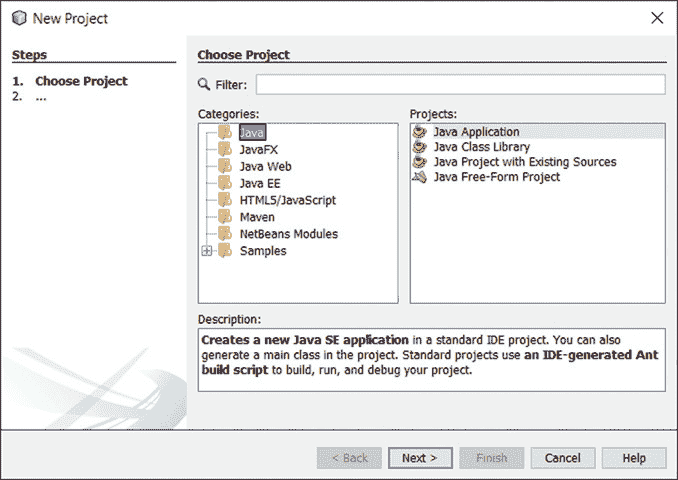

**图 A.2**

新项目向导。

NetBeans 可以创建多种类型的 Java 项目，但在本书中你可以专注于其中一种类型：Java Application（Java 应用程序）。

对于你的第一个项目（以及书中的大部分项目），选择项目类型 Java Application 并点击 Next。向导要求你为项目选择名称和位置。

`Project Location` 文本字段标识了你用 NetBeans 创建的编程项目的根文件夹。在 Windows 上，这可能是你的 `My Documents`（或 `Documents`）文件夹下名为 `NetBeansProjects` 的子文件夹。你创建的所有项目都存储在该文件夹内，每个项目都有自己的子文件夹。

在 `Project Name` 文本字段中，输入 `Java24`。`Create Main Class` 复选框随输入发生变化，推荐 `java24.Java24` 为项目中的主 Java 类名。将其更改为 `Spartacus` 并点击 Finish，接受所有其他默认值。NetBeans 会创建项目及其第一个类。

### 创建新的 Java 类

当 NetBeans 创建新项目时，它会设置所有必要的文件和文件夹并创建主类。图 A.3 显示了你项目中的第一个类 `Spartacus.java` 在源代码编辑器中打开。

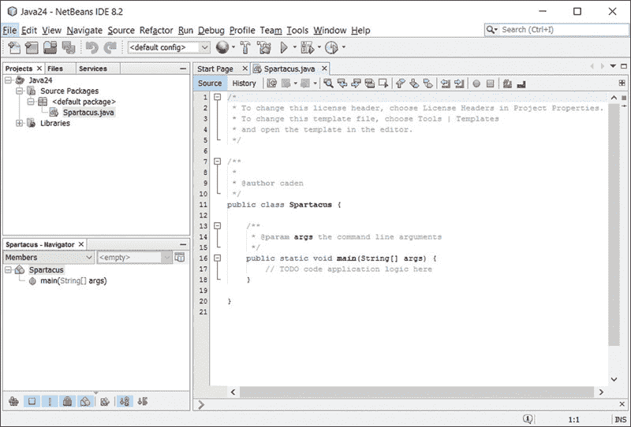

**图 A.3**

NetBeans 源代码编辑器。

`Spartacus.java` 是一个精简的 Java 类，只包含一个 `main()` 方法。类中所有的浅灰色行都是解释该类目的和功能的注释。运行该类时，注释会被忽略。

要让新类执行某些操作，请在注释 `// TODO code application logic here` 下方的新行中添加以下代码行：

```
System.out.println("I am Spartacus!");
```

`System.out.println()` 方法显示一段文本，在此情况下是句子“I am Spartacus!”。

确保你输入的内容与显示完全一致。在你确认输入行正确并以分号结尾后，点击“Save All”工具栏按钮（或菜单命令 `File, Save All`）来保存该类。

### 注意

当你输入内容时，源代码编辑器会识别你正在做什么，并弹出与 `System` 类、`out` 实例变量以及 `println()` 方法相关的有用信息。你以后会很喜欢这种帮助功能，但现在请尽力忽略它。

Java 类在运行之前必须编译成一种称为字节码（bytecode）的可执行格式。NetBeans 会尝试自动编译类。你也可以通过两种方式手动编译此类：

 选择菜单命令 `Run, Compile File`。

 在 Projects 格中右键点击 `Spartacus.java` 打开弹出菜单并选择 `Compile File`。如果 NetBeans 不允许你选择这两个选项之一，说明它已经编译了该类。

### 运行应用程序

创建 Java 类 `Spartacus.java` 并成功编译后，你可以通过两种方式在 NetBeans 中运行它：

 从菜单选择 `Run, Run File`。

 在 Projects 格中右键点击 `Spartacus.java` 并选择 `Run File`。

当你运行 Java 类时，其 `main()` 方法会被 Java 虚拟机调用。字符串“I am Spartacus!”显示在 Output 格中，如图 A.4 所示。

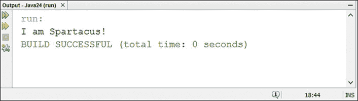

**图 A.4**

Spartacus 应用程序的输出。

Java 类必须有一个 `main()` 方法才能运行。如果你尝试运行一个缺少该方法的类，NetBeans 会返回错误。

当你完成对程序输出的审查后，点击窗格页签上的 X（标题为 Output – Java24 (run) 的地方）关闭输出（Output）面板。这将使源编辑器变得更大，从而显示更多行代码，这在你创建程序时非常有用。

### 修复错误

现在 `Spartacus` 应用程序已经编写、编译并运行了，是时候通过故意搞坏一些东西，来体验一下当情况发生严重错误时 NetBeans 是如何响应的。

像任何程序员一样，你会有很多机会自己手搞砸事情，但尽管如此，还是务必注意这里。

回到源代码编辑器中的 `Spartacus.java`，删除调用 `System.out.println()` 的那行末尾的分号（见列表 A.1 中的第 18 行）。甚至在保存文件之前，NetBeans 已经发现了该错误，并在行左侧显示了一个红色警报图标（见图 A.5）。

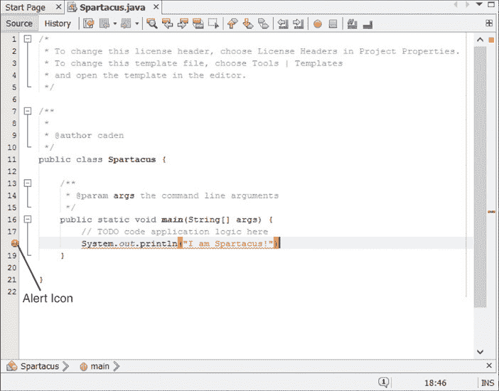

**图 A.5**

在源编辑器中标记错误。

鼠标悬停在警报图标上，会弹出一个对话框，描述 NetBeans 认为它发现的错误。

NetBeans 源编辑器可以识别你在编写 Java 程序时遇到的大多数常见编程错误和拼写错误。在错误修复之前，错误的检测会阻止文件的编译。

将分号加回行末。警报图标会消失，你可以再次保存并运行该类。

这些基础功能就是你创建和编译本书中 Java 程序所需的所有内容。

NetBeans 的功能远不止于此，但在深入学习 IDE 之前，你应该专注于学习 Java。将 NetBeans 当作一个简单的编程项目管理器和文本编辑器来使用。编写类、标记错误，并确保能够成功编译并运行每个项目。

当你准备好学习更多关于 NetBeans 的知识时，启动（Start）页提供了学习如何使用它的资源。Oracle 还在 [`netbeans.org/kb`](https://netbeans.org/kb) 提供了培训和文档资源。

## 附录 B：接下来去向哪里：Java 资源

读完这本书后，你可能会想知道可以去哪里提升你的 Java 编程技能。本附录列了一些你可以用来扩展 Java 知识的书籍、网站、互联网讨论站点和其他资源。

### 其他值得考虑的书籍

Sams Publishing 和其他出版商提供了几本实用的 Java 编程书籍，其中一些是对书中涵盖内容的后续读。如果书店目前没有你找的书，可以在书店使用这些 ISBN 号：

 *Sams Teach Yourself Java in 21 Days*，Rogers Cadenhead 著（就是我！我！我！！），ISBN: 978-0-672-33795-6。虽然这本书前七章的部分内容是重复的，但它对 Java 的讲解更深入，并添加了许多高级主题。如果你准备好为学习 Java 再投入 504 小时的承诺，那么这应该是一本合适的书。

 *Java Phrasebook*，Timothy R. Fisher 著。ISBN 0-67232-907-7。这是一份包含 100 多个代码片段的集合，供你自己的 Java 项目使用，由专业程序员和 *Java Developer’s Journal* 贡献编写。

 *Agile Java Development with Spring, Hibernate and Eclipse*，Anil Hemrajani 著。ISBN 0-672-3289-8。这是一本关于 Java 企业版的书籍，展示了如何使用 Spring 框架、Hibernate 库和 Eclipse IDE 来降低企业应用编程的复杂性。


 *Android How to Program, 3rd Edition*，Paul and Harvey Deitel 著。ISBN 0-13-444430-2。关于手机和平板 Android 编程的广泛介绍，已针对 Android 6 版本和 Android Studio IDE 更新。读这本书的读者将学习如何创建八个应用。

 *Java 9 for Programmers, 4th Edition*，Paul and Harvey Deitel 著。ISBN 978-0-134-77756-6。对 Java 9 的高级探索，包含了 lambda 表达式、Java 模块系统、动画、视频以及使用 JDBC 和 JPA 进行数据库编程。

许多 Sams Publishing 的 Java 书籍的章节和其他材料已在 [www.informit.com](http://www.informit.com) 免费开放，这是一个与 Sams 合作制作的面向信息技术专业人员的网站。

Sams Publishing 网站 [www.informit.com/sams](http://www.informit.com/sams) 是查看 Sams Publishing 以及 Pearson Technology Group 其他出版物新动态的好地方。

### Oracle 官方 Java 站点

Oracle 的 Java 软件部门维护着三个对程序员及其语言用户感兴趣的网站。

Java 开发者技术网络（Oracle Technology Network for Java Developers）发布于 [www.oracle.com/technetwork/java](http://www.oracle.com/technetwork/java)，是寻找 Java 相关信息的首选之地。这里可以下载新版本的 Java 开发工具包（JDK）和其他编程资源，以及整个 Java 类库的文档。这里还有一个错误数据库、本地面对面用户群目录以及支持论坛。

位于 [www.java.com](http://www.java.com) 的 Java.com 向消费者和非程序员推广该语言的益处。

位于 [www.netbeans.org](http://www.netbeans.org) 的 Planet NetBeans 是几十个关于 NetBeans 的博客集合，你可以使用 Feedly 等阅读器订阅它们的 RSS 馈。

### Java 类文档

Oracle 站点最实用的部分也许是 Java 类库中每个类、变量和方法的文档。成千上万的页面免费提供。

要访问 Java 9 的类文档，请前往 [`download.java.net/jdk9/api`](http://download.java.net/jdk9/api)。

### 其他 Java 网站

由于 Java 现象很大程度上源于其网页应用，大量的网站专注于 Java。

#### 本书官方网站

本书的官方网站为 [www.java24hours.com](http://www.java24hours.com)，并在附录 C “本书网站”中有详细介绍。

### Workbench

我还出版了一个博客 `Workbench`，涵盖了 Java、互联网技术、计算机书籍等主题以及其他内容。你可以在 [`workbench.cadenhead.org`](http://workbench.cadenhead.org) 找到它。

### Slashdot

技术新闻站点 `Slashdot` 自 1997 年以来是程序员和其他计算机行业专业人士的首选之地。该网站将用户提交的最佳故事放到首页，并允许用户对评论进行排名以过滤噪音。要查看最新的 Java 相关故事，请访问 [www.slashdot.org/tag/java](http://www.slashdot.org/tag/java)。

### 其他 Java 博客

数百个其他博客涵盖 Java 编程，无论是作为其核心重点还是多样化主题的一部分。

WordPress.Com 作为数千个博客的托管平台，将这些网站最新的 Java 相关帖子分类在 [`en.wordpress.com/tag/java`](https://en.wordpress.com/tag/java)。

在 Twitter 上，你可以通过搜索标签 `#java` 来定位 Java 博客和新闻，地址为 [`twitter.com/search?q=%23java`](https://twitter.com/search?q=%23java)。其中一些结果是关于咖啡或 Java 岛的，而不是编程语言。

### InformIT

技术参考网站 `InformIT` 可通过 [www.informit.com](http://www.informit.com) 访问，由本书出版商提供的综合资源库。该网站设有几十个与软件开发和互联网相关的主题板块。InformIT 的 `Java` 板块包含实操文章和初学者指南。您可以直接访问 [www.informit.com/topics/topic.aspx?st=66497](http://www.informit.com/topics/topic.aspx?st=66497) 进行访问。

### Stack Overflow

在线社区 `Stack Overflow` 是程序员可以提问并对其他用户提供的答案进行评分的地方。网站设有标签功能，你可以将搜索范围缩小到感兴趣的语言或主题。访问 [`stackoverflow.com/questions/tagged/java`](https://stackoverflow.com/questions/tagged/java) 查看与 Java 相关的问题。

### JavaWorld 杂志

`JavaWorld` 是一本自 20 世纪 90 年代语言诞生以来一直存在的杂志，经常发布教程文章以及 `Java` 开发新闻和其他专题。此外还有视频和音频播客。访问 [www.javaworld.com](http://www.javaworld.com)。

### Developer.com 目录

由于 `Java` 是一种面向对象的语言，因此很容易使用其他开发者创建的资源。在开始任何重要的 `Java` 项目之前，你应该在网络上搜索可用资源。一个很好的起点是 `Developer.com` 的 `Java` 目录。该网站列出了 `Java` 程序、资源和其他信息，访问 [www.developer.com/java](http://www.developer.com/java)。

### Java 聚会

`Meetup.com` 网站包含了成千上万由寻求参加活动的用户分享的正式和非正式聚会。许多 `Java` 用户小组和其他 `Java` 活动在该网站上公布。要找到你所在地 100 英里内的聚会，请访问 [www.meetup.com/find/?keywords=Java&radius=100](http://www.meetup.com/find/?keywords=Java&radius=100)。在我所在的地区，经常举办 `Java` 用户小组、开发者小组以及咖啡聚会。

### 职业机会

如果你是为了学习 `Java` 并成为行业精英计划，本书附录中的几个资源设有职业机会板块。你可以查看一些 `Java` 相关的职位空缺。招聘搜索引擎 `Indeed` 有一个关于 `Java` 工作的板块。访问 [www.indeed.com/q-Java-jobs.html](http://www.indeed.com/q-Java-jobs.html) 查看程序员的最新招聘广告。另一个良好的 `Java` 程序员招聘网站是 `Dice`，它在 [www.dice.com/jobs?q=java](http://www.dice.com/jobs?q=java) 列出招聘信息。虽然它不是专门的 `Java` 职业资源，但 `CareerBuilder` 网站允许你搜索超过两个数据库的招聘广告，包括报纸分类广告和许多其他来源。访问 [www.careerbuilder.com](http://www.careerbuilder.com)。

如果你在阅读本书后获得了一份 `Java` 编程工作，我很想听听你的。回到本书网站使用 `Feedback` 链接联系我，或者在 Twitter 上给 `@rcade` 发消息。

## 附录 C

### 本书网站

尽管我希望并非如此，但在完成本书的 24 小节内容后，无疑会有一些你不清楚的地方。编程是一门专门的技术领域，会向你抛出许多奇怪的概念和术语，例如“实例化”、“三元运算符”和“大端/小端字节序”。

如果你对书中涵盖的任何主题不清楚，或者我对某个主题没解释清楚（唉），请访问本书网站 [www.java24hours.com](http://www.java24hours.com) 获取帮助。该网站提供以下内容：

 错误修正和澄清——当错误引起注意时，会在网站上提供更正后的文本和任何可能有材料。

 读者问题解答——如果读者有书中问答章节未涵盖的问题，很多会在网站上展示。

 你在本书的 24 小节期间创建的所有程序所需的源代码、类文件和资源。

 解决方案，包括每节末尾建议活动的源代码。

 书中提到网站的更新链接：如果书中提到的网站地址发生了变化，且我知道新链接，我会在网站上分享。

你也可以通过访问本书网站给我发电子邮件。点击 `Feedback` 链接跳转到可以从网络直接发送电子邮件的页面。你也可以在 Twitter 上通过 `@rcade` 联系我。

请尽管发表所有的观点：积极的、消面的、中性的、不决定的、愤怒的、兴奋的、生气的、有趣的、恼的、感兴趣的、无聊的、着迷的、迷的、困惑和震惊。Rogers Cadenhead

## 附录 D

### 解决 Android 模拟器问题

自 2015 年发布以来，免费的 `Android Studio` 集成开发环境（IDE）已成为创建 Android 应用的官方工具。在第 24 节中，你学习了如何使用此 IDE 用 `Java` 创建移动应用。

如果你已经读了该章节并成功在 Android 模拟器中运行了程序，就不需要阅读此附录。但如果你根本无法让模拟器工作，你就来对地方了。

### 运行程序的问题

当你在 `Android Studio` 中进行 Android 项目并想要运行程序时，可以选择菜单命令 `Run`。该命令会打开一个 `Choose Device` 对话框，要求选择执行程序的设备。如果设备通过 USB 线连接到你的电脑，它可以是真实的手机或平板电脑。设备也可以是 Android 模拟器。`Android Studio` 中的 Android 模拟器可以像运行移动操作系统的实际手机和平板电脑。可以为多个 Android 设备设置虚拟设备。

某些用户在首次用 `Android Studio` 中的模拟器运行 Android 应用时遇到问题。模拟器会带有这条不详的消息崩溃：

```
output  点击此处查看代码图像 ：x86 仿真目前需要硬件加速！请确保已正确安装并可以使用 Intel HAXM。CPU 加速状态：HAX 内核模块未安装！
```

此错误发生在 Windows 电脑上，表示它们需要一个来自 Intel 的名为硬件加速执行管理器（HAXM）的硬件加速程序才能工作。程序可以通过 `Android Studio` 下载，但你必须在 IDE 外安装它。

HAXM 只安装在带有 Intel 处理器的电脑上。此附录解决了 `Android Studio` 指出需要 HAX 来运行 Android 模拟器的问题。如果模拟器报错信息中没有提到 HAXM，请不要使用此附录来修复。

### 在 Android Studio 中安装 HAXM

在你运行 `Android Studio` 时，可以下载 HAXM 并将其添加到 Android SDK。点击 `Android Studio` 工具栏中的 `SDK Manager` 按钮，如图 D.1 所示。


**图 D.1**

运行 Android SDK Manager。

`SDK Manager` 用于通过其他版本的 Android 和实用的 SDK 工具来增强 SDK。点击 `SDK Tools` 选项卡将其置于顶层。

SDK 可用工具将列出来，你已安装的工具旁边会有一个勾选标记。寻找 `Intel x86 Emulator Accelerator (HAXM Installer)` 这一项。

如果该项旁边没有勾选标记，说明它尚未被添加到你的 Android Studio 版本中的 Android SDK 中。（如果有勾选标记，则它已经安装，此时你应该继续进行下一节“在你的电脑上安装 HAXM”。）

Android SDK Manager 如图 D.2 所示。


**图 D.2**

添加 SDK 工具。

选择 `Intel x86 Emulator Accelerator (HAXM Installer)` 并点击 `OK`。系统将要求你确认此更改。点击 `OK`。

Android Studio 将下载 `HAXM` 并报告其进度。如果安装正确，你就可以进行下一步，在你的电脑上安装它。

### 在你的电脑上安装 HAXM

要开始在电脑上设置 `HAXM`，请先关闭 Android Studio。

在你的文件系统中，找到你告诉 Android Studio 安装向导存储 Android SDK 的文件夹。

如果你不记得把它放在哪里了，Windows 默认设置是将 SDK 放在你个人用户文件夹下名为 `AppData\Local\Android\sdk` 的子文件夹中。因此如果你的 Windows 用户名是 `Catniss`，建议的 SDK 位置是 `\Users\Catniss\AppData\Local\Android\sdk`。

如果你在电脑上找到了 SDK 文件夹，打开该文件夹，然后打开子文件夹 `extras\intel\Hardware_Accelerated_Execution_Manager`。

该文件夹包含一个名为 `intelhaxm-android.exe` 的程序。这就是 `HAXM` 安装程序。

`HAXM` 需要配备 Intel 处理器的电脑、1G 磁盘空间以及 Windows 7 或更高版本，或者 64 位的 Mac OS X 10.8 到 10.11 版本。该文件夹中一个名为 `Release Notes.txt` 的文本文件包含了软件要求的详细信息。

在查看发布说明文件后，如果你准备好安装 `HAXM`，请运行程序 `intelhaxm-android.exe`。安装程序将检查你的电脑是否可以运行 `HAXM`，如果不能运行将退出。

在安装过程中，系统会询问允许 `HAXM` 使用多少内存。默认值 `2G` 应该足够了。完成安装。

**提示**

如果你以后决定为 `HAXM` 分配的内存过多或过少，可以通过再次运行安装程序来更改此设置。

一旦 `HAXM` 安装完成，你应该重启电脑。

完成后，加载 Android Studio 并通过选择 `Run`、`Run App` 再次尝试运行你的 Android 应用程序。

该程序将在模拟器中运行。Android 模拟器看起来像手机，在加载时会显示“Android”启动屏幕，然后运行程序。图 D.3 显示了 `SalutonMondo` 应用程序成功运行时的样子。


**图 D.3**

成功！模拟器加载并运行了应用程序。

如果运行成功，你就可以回到第 24 节了。

如果失败并出现相同的错误信息，要求你“确保 Intel HAXM 已正确安装并可用”，那么还有一点你可以检查。然而，这需要检查你电脑的 BIOS 设置并对其进行更改。

### 检查 BIOS 设置

为了让 `HAXM` 工作，你电脑的 BIOS 设置中必须启用 `Intel Virtualization Technology`（Intel 虚拟化技术）。如果你习惯修改 BIOS，这是一个非常容易检查和更改的项目。

由于更改 BIOS 可能会影响电脑的启动方式——甚至导致其无法启动 Windows——因此只有在你以前修改过电脑 BIOS 的情况下才应该尝试调整 BIOS。否则，你应该寻求专家的帮助，让他们引导你完成整个过程。

BIOS 是在你打开 Windows 电脑时控制电脑的软件，负责启动电脑和其他必要的硬件功能。

当你的电脑启动时，你会简短看到一条关于按下某个功能键以检查 BIOS 设置的消息。

如果你不按该键，BIOS 将完成其工作并加载 Windows。

如果你确实按了该键，你会看到类似图 D.4 所示的屏幕。


**图 D.4**

查看电脑的 BIOS 设置。

你电脑的 BIOS 主菜单看起来可能与图 D.4 不同。它取决于你的电脑制造商以及它使用的 BIOS 版本。

在我的 Dell 台式桌面电脑上，我通过选择 `BIOS Setup`、`Advanced`、`Processor Configuration` 来发现是否启用了 `Intel Virtualization Technology`。会列出一个处理器设置列表，每项旁边都有“[[Enabled]”或“[[Disabled]]”。你可以在这些设置之间进行切换。

如果你在 BIOS 中启用 `Intel Virtualization Technology` 并保存更改，你的电脑应该就能运行 `HAXM`，模拟器问题也应该得到解决。

## 附录 E：解决 NetBeans 中包不可见的错误

Java 9 引入的最有趣的功能之一是模块（modules），它们允许 Java 程序标明它们使用了 Java 类库的哪些部分。

### 添加模块信息


Java 类库包含数百个包。其中一小部分只有在添加了相应的模块后才可用。如果你尝试`import`一个位于可用模块中的类或类组，`import`语句将导致错误。

模块是在名为`module-info`的 Java 类中设置的（也就是说，一个完全没有`package`语句的类）。

```java
module Java24 {
    requires jdk.incubator.httpclient;
}
```

在`{`和`}`波浪括号内的`module`块中，`requires`关键字后面跟着模块名`jdk.incubator.httpclient`。如果你的项目需要不同的模块，请编辑此语句以反映。

一个项目可以有多个`requires`语句。

当保存`module-info.java`文件后，模块（或多个模块）中的类就可以被项目中的任何 Java 程序使用。添加该模块中包的`import`语句不会报错，程序可以被编译和运行。

## 索引

### 符号

- `+`（加法运算符），60
- `\`（反斜杠），73, 293
- `{ }`（大括号），17–18, 88, 95, 112–113, 148
- `:`（冒号），90, 106
- `//` 注释符号，17–18
- `+=`（复合赋值运算符），74–75
- `--`（递减运算符），61–63
- `/`（除法运算符），60
- `”`（双引号），55
- `=`（等号），59
- `==`（相等性运算符），85
- `>`（大于运算符），84–85
- `>=`（大于等于运算符），84
- `++`（自增运算符），61–63
- `!=`（不等于运算符），85
- `<`（小于运算符），84–85
- `<=`（小于等于运算符），84
- `***`（乘法运算符），61
- `->` 运算符，229
- `.`（句号），替换空格，114–115
- `;`（分号），18, 24, 50
- `’`（单引号），55
- `[ ]`（方括号），112
- `-`（减法运算符），60
- `?`（三元运算符），90
- `_`（下划线），57
- `$1` 账单，257

### 2D 图形

- 颜色
  - 自定义颜色，327
  - 设置，326–327
  - 字体，325–326
  - 线条，328–329
- 饼图
  - `PieFrame` 类，336–338
  - `PiePanel` 类，331–336
  - `PieSlice` 类，333
- 形状
  - 弧，330–331, 339
  - 椭圆和圆，330
  - 矩形，329–330

### A

- ABCD 评分系统，81
- 抽象窗口工具包 (AWT)，237–238, 256–257
- 访问器方法，146
- `ActionListener` 接口，229, 274
- `actionPerformed()` 方法，213, 230, 275, 284
- `add()` 方法，165, 174, 243
- `addActionListener()` 方法，285
- `addItemListener()` 方法，285
- 加法运算符 (`+`)，60
- `addOneToField()` 方法，284
- 冒险，299
- 《丁丁历险》，96
- 分配内存，155
- Android
  - Android 应用，375
  - AVD (Android 设备)，382–383
  - 创建，377–378, 380
  - 设计，385–386
  - Java 代码，390–395
  - Manifest 文件，387
  - 项目组件，378–380
  - 资源，386–387
  - 运行，383–385
  - 用户界面，388–390
  - Android Studio，413
  - 优势，396
  - BIOS 设置，417–418
  - HAX (硬件执行管理器)
    - 在 Android Studio 中安装，414–415
    - 在电脑上安装，415–417
  - 运行应用程序，413–414
- `AndroidManifest.xml` 文件，380
- 注解，162
- 匿名内部类，234
- 往南极，24
- Apache 项目，45
- App stores，32
- `append()` 方法，208
- Applet，37
- 应用程序。参见 Minecraft mods
- 分配内存给，155
- Android 应用。参见 Android
- 战斗点，177–179
- 基准测试，107–108
- BlankFiller，43–45
- 计算器，189
- 目录，223–225
- 钟，91–94
- ColorFrame，230–232
- 商品，89
- 编译，20
- 组件的，6–7
- Configurator，303–305
- ConfigWriter，300–301
- Console，297–299
- 创建，41–43
- 鸣谢，78–80
- 危机，260–261
- 调试，8–9, 20–22
- 定义，17
- 骰子，47–48
- 教育类应用，30–31
- 厨房里的 Food Network，32–33
- FreeFrame，255–256
- FreePanel，251–254
- GremlinLab，152–154
- 它们的工作原理，7–8
- `ID33Reader`，295–296
- `ImageDownloader`，315–317
- ISS 探测器，33–34
- JSoko，36
- `LottoMadness`，265–270, 285–288
- `ModemTester`，137–138
- `NameSorter`，117–118
- `NewCalculator`，191–192
- `NewColorFrame`，232–233
- `NewRoot`，134–135
- `Nines`，101–102
- `NumberDivider`，192–193
- `PageCatalog`，198–200
- `PlanetWeight`，65
- `Playback`，243
- `PrimeFinder`，205–208
- `Realtime Stock Quotes`，34–35
- requirements for，13–14
- `Root`，41–43
- running，22, 404
  - in Android Studio，413–414
  - in NetBeans IDE，404
- `Saluton application`，22
- threaded applications，212
- `Saluton`。*See* Salutor
- `SalutonFrame`，241
- `SalutonVerkisto`，319–321
- saving，19–20
- sending arguments to，43–45
- `ServerCheck`，312–314
- slowing down，204
- `StringLister`，166–167
- `Variable`，56
- `Wheel`，119–121
- writing，14
- blocks，17–18
- class statement，16
- comments，17–18
- main statement，17
- New File Wizard，14–16
- variables，18–19
- `Arc2D.Float class`，330–331
- `Archimedes`，171
- `arcs`，330–331, 339
- arguments method，146–147
- sending to applications，43–45
- `arithmetic operators`，60–61
- `array index out of bounds error`，114
- `ArrayIndex class`，188
- `ArrayList class`，164–165, 174–179
- `arrays`，111–113
  - in applications，113
  - adding objects to，174
  - Battlepoint application，177–179
  - creating，174
  - finding objects in，176
  - looping through，166–167
  - removing objects from，175
  - storing objects in，164–165, 174–179
  - `declaring`，112–113
  - definition of，112
  - initial values，113
  - `multidimensional`，115–116, 122
  - sorting，116–118
  - `Wheel application example`，119–121
- `asByteArray() method`，312
- `ASCII character set`，121
- `asFile() method`，312, 315
- `assigning variable types`，54
  - `boolean`，57–58
  - `byte`，56
  - `char`，55–56
  - `float`，54–55
  - `int`，54–55
  - `long`，56–57
  - `short`，56
  - `string`，55–56
- `asterisk (*)`，61
- `ATP Word Tour tennis rankings`，155–156
- `attributes`
  - definition of，126
  - inheritance，160–161
- `autoboxing`，133
- `autodialers`，127–128
- `AVD (Android Virtual Device)`，382–383
- `AWT (Abstract Window Toolkit)`，237–238, 256–257
- `backslash (\)`，73, 293
- `Bailey, Tom`，96
- `BASIC`，4, 11
- `Battlepoint application`，177–179
- `beans`，164
- `behavior`。*See also* methods
  - creating with methods，144
  - definition of，126
  - inheritance，160–161
- `Belichick, Bill`，122
- `Bell Laboratories`，5
- `Benchmark application`，107–108
- `Berners-Lee, Tim`，322
- `binary values, integers`，67
- `BIOS settings`，417–418
- `blank spaces`，23–24
- `BlankFiller application`，43–45
- `blocks`
  - definition of，17–18, 53
  - in if statements，85–87
  - `try-catch`，189–192
  - `try-catch-finally`，194
- `blogs`
  - `WordPress.com`，409
  - `Workbench`，409
- `BodyHandler class`，311
- `BodyProcessor class`，318
- `book recommendations`，407–408
- `Boole, George`，58
- `boolean variables`，57–58
- `BorderLayout class`，261–262
- `BoxLayout class`，263–264
- `braces ({ })`，88, 95, 112–113, 148
- `brackets ([ ])`，112
- `break statement`，88, 95, 104–105
- `British monarchy, line of succession to`，51
- `browse() method`，213
- `buffered input streams`，297–299
- `bugs`，8。*See also* debugging
- `build() method`，311
- `built-in methods`，155
- `Burtt, Ben`，396
- `buttons`，242–245

### `Byte class`

305

### `byte variable type`

56

### `bytecode`

292

### `bytes`

305

## C

### C++5

- `CableModem class`，136
- `Calculator application`，189
- `CareerBuilder`，410
- `case sensitivity`，58, 67
- `casting`
  - objects，131, 132–135
  - autoboxing，133
  - source/destination，131
  - unboxing，133
  - variables，131–132
- `Catalog application`，223–225
- `catch statement`
  - `final keyword`，196
  - try-catch blocks，189–192
  - try-catch-finally blocks，194
- `catching exceptions`。See exceptions
- `CERN (European Organization for Nuclear Research)`，318, 322
- `char variable type`，55–56
- `char variables`，55–56
- *Charlie and the Chocolate Factory* (Dahl)，271
- `check boxes`
  - creating，246–247
  - event handling，276
- `checkCreator() method`，151
- *cheese, saying for photographs*，339
- `circles`，330
- `.class filename extension`，24
- `class hierarchy`，130
- `class methods`。See methods
- `class statement`，16
- `classes`。See also arrays; methods
  - `Arc2D.Float`，330–331
  - `ArrayIndexOutOfBounds Exception`，188
  - `ArrayList`，164–165, 174–179
  - beans，164
  - `BodyHandler`，311
  - `BodyProcessor`，318
  - `BorderLayout`，261–262
  - `BoxLayout`，263–264
  - `Byte`，305
  - `CableModem`，136
  - class methods，148
  - class variables，141–144
  - `Color`，326–327
  - creating，128–129, 402–404
  - definition of，126
  - documentation，408
  - `dslem`，137
  - encapsulation，146
  - `ErrorCorrection`，129–130
  - `File`，292–293
  - `FileInputStream`，293
  - `FileOutputStream`，299
  - `FlowLayout`，243, 256, 259–261
  - `Font`，325–326
  - `Gremlin`，141–144, 152–153
  - `GridLayout`，261–262
  - `HashMap`，180–183
  - helper classes，149–151
  - `HomePage`，197–198
  - `HttpClient`，311
  - `HttpHeaders`，312
  - `IndexOutOfBoundsException`，197
  - attributes，160–161
  - behavior，160–161
  - establishing，161–162
  - multiple inheritance，139
  - power of，159–160
  - inner classes，149–151, 221–225
  - anonymous inner classes，225–228, 234
  - `Catalog application example`，223–225
  - declaring，222
  - example of，222–223
  - `InputStreamReader`，159–160
  - `Insets`，264–265


- `Java Class Library`, 45–49
- `JButton`, 242–244
- `JCheckBox`, 246–248
- `JFrame`, 238–242
- `JLabel`, 245–246
- `JScrollPane`, 249
- `JTextArea`, 248–250
- `JTextField`, 245–246
- `JWindow`, 238–242
- `KeyAdapter`, 226
- `KeyListener`, 227
- `Line2D.Float`, 328–329
- `LottoEvent`, 279–285
- `MalformedURLException`, 196
- `Modem`, 136
- `module-info`, 420
- `NullPointerException`, 197
- `NumberFormatException`, 191, 195
- object reuse, 163–164
- `PieFrame`, 336–338
- `PiePanel`, 331–336
- `PieSlice`, 333
- `Point3D`, 168–169
- `PointTester`, 169–170
- `Random`, 47
- `Rectangle2D.Float`, 329–330
- `RenderingHints`, 326
- `Spartacus`, 402–404
- subclasses, 130, 162–163, 168–170
- `super keyword`, 162–163
- superclasses, 130
- synchronization, 184
- `this keyword`, 162–163
- `Thread`, 203
- creating threads, 204–208
- `sleep() method`, 204
- starting/stopping threads, 208–209
- `Wrecker`, 150–151
- `clearAllFields() method`, 284
- `client, HTTP. See HTTP client`
- `Clock application`, 91–94
- `close() method`, 161, 300
- closures, 229–233
- colon (:), 90, 106

### 设置, 326–327

### 组合框

- 创建, 247–248
- 事件处理, 276

## Come On and Gettit.mp3, 295–297

## 注释

- `//` 注释符号, 17–18
- 注解, 162

## 商品化应用, 89

## 字符串比较, 76–77

## 编译文件命令（运行菜单）, 403

## 编译型语言的运行, 11

## 编译器, 8

## 编译应用, 20

## 组件。另请参见事件处理；布局管理器

## 复选框

- 创建, 246–247
- 事件处理, 276

### 组合框

- 创建, 247–248
- 事件处理, 276
- 启用/禁用, 278–279
- `FlowLayout`, 256
- 帧, 238–242
- 标签, 245–246
- 面板, 251
- 文本区域, 248–250
- 文本字段, 245–246
- 窗口, 238–242

## 计算机速度，测试, 107–108

## 字符串拼接, 74

## 条件条件语句

- 块, 85–87
- 钟应用示例, 91–94
- 定义, 83
- 等于运算符 (`==`), 85
- 大于运算符 (`>`), 84–85
- 大于等于运算符 (`>=`), 84
- `if`, 84, 95
- `if-else`, 87
- 不等于运算符 (`!=`), 85
- 小于运算符 (`<`), 84–85
- 小于等于运算符 (`<=`), 84
- `switch`, 87–89
- 三元运算符 (`?`), 90

## 配置

- BIOS 设置, 417–418
- 配置属性，读取/写入, 302–305
- Minecraft 服务器, 342–343
- `Configurator` 应用, 303–305
- `ConfigWriter` 应用, 300–301
- 连接到 Minecraft 服务器, 346
- `Console` 应用, 297–299
- 构造函数, 147–148, 210
- `contains()`, 78, 165, 176
- `containsKey()`, 181
- `containsValue()`, 181
- `continue` 语句, 104–105

## 转换

- 对象, 131, 132
- 自动装箱, 133
- 源/目标, 131
- 自动拆箱, 133
- 字符串转大写/小写, 77, 80
- 变量, 131–132
- 计数器, 100
- CrazyHorse 项目, 356–362
- `createNewFile()`, 293
- `createTempFile()`, 315

## 创建

- Android 应用, 377–378, 380–381
- 数组列表, 174
- 类, 128–129, 402–404
- 构造函数, 147–148
- 自定义颜色, 327
- 异常, 201
- 文件, 292
- GUI。另请参见 GUI（图形用户界面）
- 方法, 145–146
- Minecraft 模组。另请参见 Minecraft 模组
- CrazyHorse 项目, 356–362
- IceCreamScoop 项目, 366–372
- LightningStorm 项目, 362–365
- SiameseCat 项目, 348–356
- NetBeans 项目, 400–401
- 对象, 135–138
- 子类, 168–170
- 线程, 204–208
- 变量, 141–144

## Creative Commons, 296

## 致谢, 78–80

## Crete, Baptiste, 156

## Crisis 应用, 260–261

- `currentThread()`, 212
- `currentTimeMillis()`, 108

## Currie, Alannah, 96

## 自定义颜色，创建, 327

## D

## Dahl, Roald, 271

## Dancing with the Stars, 1

## 数据，发布到网络, 317–321

### 数据结构

- 数组列表, 174–179
- 哈希映射, 180–183

## De Architectura (Vitruvius), 171

## 调试, 8–9 在 NetBeans IDE, 404–405

## Saluton 应用, 20–22

## 声明。另请参见创建

- 数组, 112–113
- 类, 128–129
- 匿名内部类, 225
- 内部类, 222
- 方法, 145–146
- 对象, 135–138
- 变量, 54, 141–144
- 布尔型, 57–58
- `byte`, 56
- `char`, 55–56
- `float`, 54–55
- `int`, 54–55
- `long`, 56–57
- `short`, 56
- `string`, 55–56

## 递减 (`--`) 运算符, 61–63

## 递递变量, 61–62

### 默认语句, 88

### `delete()` 方法, 293

### 删除

- Minecraft 世界, 372–373
- 从数组列表中删除对象, 175

## DelGrosso, Ashly, 11

## 设计 Android 应用, 385–386

# Developer.com, 410

## development

- Android 开发, 375–376
- Java 开发, 5, 29–30

## 骰子应用, 47–48

## Dirks, Rudolph, 201

## 禁用组件, 278–279

## 除法运算符 (`/`), 60

## documentation

- 内置方法, 155
- 类, 408
- Java 类库, 45
- Java 文档, 23
- NetBeans IDE, 405

### do-while 循环, 103–104

### 下载

- 从网络下载文件, 314–317
- NetBeans IDE, 399

## `draw()` 方法, 328

### 绘制

- 弧形, 330–331, 339
- 椭圆和圆, 330
- 线, 328–329

### 饼图

- `PieFrame` 类, 336–338
- `PiePanel` 类, 331–336
- `PieSlice` 类, 333
- 形, 329–330

## `drawString()` 方法, 328

## `DslModem` 类, 137

### E

- *Eccentric Soul*, 296
- Eclipse, 9
- 教育性应用, 30–31
- `Ellipse2D.Float` 类, 330
- 椭圆, 330
- emacs, 7
- 就业机会, 410
- 空字符串, 80
- 模拟器 (Android), 382–383
- 封装, 146
- `encode()` 方法, 318
- Enterprise Edition (Java), 38
- `entrySet()` 方法, 181
- 等号 (`=`), 59
- 等于运算符 (`==`), 85
- `equals()` 方法, 76–77, 81, 160, 171
- `equalsIgnoreCase()` 方法, 351
- 错误处理, 187. *另* 调试
- 错误与异常, 187, 201
- 异常, 188–189
- `ArrayIndexOutOfBoundsException`, 188
- 捕获, 189–194
- 创建, 201
- HomePage 项目, 197–198
- 忽略, 196–197
- `IndexOutOfBoundsException`, 197
- `MalformedURLException`, 196
- `NullPointerException`, 197
- `NumberFormatException`, 191, 195
- PageCatalog 应用, 198–200
- 抛出, 194–196
- 未检的异常, 197
- 在 NetBeans IDE 中, 404–405
- 包不可见, 419–420
- `ErrorCorrectionModem` 类, 129–130
- *eureka*, 171
- 欧洲核研究组织 (CERN), 318, 322
- 事件处理, 273. *另* 错误处理
- `ActionListener` 接口, 274
- 选框和组合框事件, 276
- 启用/禁用组件, 278–279
- `EventListener` 接口, 273–274
- 键盘事件, 276–278
- LinkRotator 应用, 213
- LottoEvent 应用, 279–285
- LottoMadness 应用, 285–288
- 方法, 275
- `EventListener` 接口, 273–274
- 异常, 188–189
- 数组越界, 114
- `ArrayIndexOutOfBoundsException`, 188
- LinkRotator 应用, 211
- 多个异常, 192–193
- try-catch 块, 189–193
- try-catch-finally 块, 194
- 与错误比较, 187, 201
- 创建, 201
- 定义, 114
- HomePage 项目, 197–198
- 忽略, 196–197
- `IndexOutOfBoundsException`, 197
- `MalformedURLException`, 196
- `NullPointerException`, 197
- `NumberFormatException`, 191, 195
- PageCatalog 应用, 198–200
- 抛出, 194–196
- 未检的异常, 197
- `ArrayIndexOutOfBoundsException`, 211, 311
- `exists()` 方法, 293
- 退出循环, 103–104
- 表达式, 54, 64–229–233
- `extends` 语句, 129–130
- `File` 类, 292–293
- `File` 菜单, 292–293
- `FileInputStream` 类, 292
- `FileOutputStream` 类, 299
- `.class`, 24
- `.java`, 7
- `AndroidManifest.xml`, 380
- JAR (Java Archive) 文件, 309
- `java.exe`, 345
- 列出, 293
- 清单文件, 387
- CrazyHorse 项目, 360
- IceCreamScoop 项目, 370
- LightningStorm 项目, 365
- SiameseCat 项目, 353–354
- 读取配置属性, 302–305
- 从流读取, 293–297
- 从网络保存, 314–317
- `SiameseCat.jar`, 354
- `spigotserver.jar`, 342
- 写入配置属性, 302–305
- 写入流, 299–301

# `fill()` 方法, 328, 329

# `final` 关键字, 196

# 查找字符串, 77–78

# `firstValue()` 方法, 312

# `float` 变量类型, 54–55

### 浮点数, 54–55, 131–132

### `FlowLayout` 类, 243, 256, 259–261

# 文件夹，列出文件, 293

### `Font` 类, 325–326

# `FontMapper`, 182–183

### 字体, 325–326

# 厨房中的 Food Network, 32–33

# for 循环

## 复杂 for 循环, 106–107

## 语法, 99–102

# 正斜杠 (`/`), 60

# Fox, Michael J. 289

# 帧，创建, 238–242

# FreeBalls, 31

# `FreeSpaceFrame` 应用, 255–256

# `FreeSpacePanel` 应用, 251–254

# `fromString()` 方法, 318

# 函数式接口, 229

## G

### George Prince, 51

### `get()` 方法, 165, 176, 181

## `getActionCommand()` 方法, 275, 284

## `getBytes()` 方法, 300

## `getEncoding()` 方法, 160

## `getEntityID()` 方法, 364

## `getGuid()` 方法, 146

## `getId()` 方法, 391

## `getItem()` 方法, 284–285

## `getKey()` 方法, 182

### `getEntities()` 方法, 364

### `getLocation()` 方法, 351, 365

### `getName()` 方法, 293

### `getOrDefault()` 方法, 181

### `getText()` 方法, 246

### `getURI()` 方法, 211

### `getWorld()` 方法, 351

### `getX()` 方法, 359

### `getY()` 方法, 359

### Goodman, Len, 11

### Gosling, James, 5, 29, 376, 399

### Graham, Dave, 11

### 图形用户界面. 见 GUIs (graphical interfaces)

### 图形

### 弧, 330–331, 339

### 颜色

### 自定义颜色, 327

### 设置, 326–327

### 椭圆和圆, 330

### 字体, 325–326

### 线, 328–329

### 饼图

### `PieFrame` 类, 336–338

### `PiePanel` 类, 331–336

### `PieSlice` 类, 333

### 形, 329–330

## `Graphics2D` 类, 328

## 大于运算符 (`>`), 84–85

# 绿湾 Packers, 109

# `Gremlin` 类, 141–144, 152–153

# `GremlinLab` 应用, 152–154

### `GridLayout` 类, 261–262

# GUIs (graphical user interfaces). 见 图形

### 按钮, 242–245

## 复选框，创建, 246–247

### 事件处理, 276

## 组合框，创建, 247–248

### 事件处理, 276

## 组件，创建, 238, 创建 237

## 事件处理. 见 事件处理

## 帧, 238–242

# `FreeSpacePanel` 应用, 251–254

## 标签, 245–246

## 布局管理器. 见 布局管理器


## 面板，251

## 文本区域，248–250

## 文本字段，245–246

## 窗口，238–242

## 事件处理

见“事件处理”。

## 活跃管理器

## 哈希值，184

## 哈希映射，180–183

## `HashMap` 类，180–183

## 费曼学习法

费曼学习法的灵感源于诺贝尔奖获得者理德·费曼。

1. 运用费曼技巧，你只需花`20 min`就能深入理解知识点，而且记忆深刻，难以遗忘。

```java
if (condVar > someVal) {console.log("xxx")}
```

## 费曼学习法，235

## 包，47，289

## Inaba, Carrie Ann，11

## 自增运算符（`++`），61–63

## 变量的自增，61–62

## 孵化器，318

## `indexOf()` 方法，77–78，176

## `IndexOutOfBoundsException` 类，197

## 不等于运算符（`!=`），85

## 死循环，109

## `info()` 方法，370

## InformIT，409

## 继承，159

- 属性，160–161
- 行为，160–161
- 定义，129–130
- 建立，161–162
- 层级结构，130–131
- 多重继承，139
- 威力，159–160

## 初始化，109

## 内部类，149–151，221–225

- 匿名内部类，234
- Catalog 应用程序示例，223–225
- 声明，222
- 示例，222–223

## 输入

响应。参见“事件处理”。

## 输入流，292

## `InputStreamReader` 类，159–160

## `Insets` 类，264–265

## 安装

- HAXM（硬件加速执行管理器）
  - 在 Android Studio 中，414–415
  - 在计算机上，415–417
- Java 开发工具，10
- NetBeans IDE，399–400

## `int` 变量类型

- 二进制值，67
- 类型转换，131–132
- 声明，54–55

## 整数

- 二进制值，67
- 类型转换，131–132
- 声明，54–55

## 集成开发环境（IDEs），9–10，146

## `intelhm-android.exe`，416

## IntelliJ IDEA，9

## `Intent()` 方法，392

## 接口

参见 GUI（图形用户界面）。

- `ActionListener`，229，274
- Android 应用程序，388–390
- `EventListener`，273–274
- 函数式接口，229
- `Runnable`，205

## 解释型语言，7，11

## `isPresent()` 方法，12

## ISS Detector，33–34

## `itemStateChanged()` 方法，284–285

## 迭代，101

## JAR（归档文件），309

## Java 类库，45–49

## Java 开发包（JDK），9

## Java 文档，23

## Java EE（企业版），38

## `.java` 扩展名，7

## Java 会议，410

## Java SE（标准版），38

## Java 虚拟机（JVM），8，31，309，345

## Java.com，408

## `java.exe` 文件，345

## `java.io` 包，46

## `/jar` 文件夹，379

## `java.time` 包，46

## `java.util` 包，46

## JavaWorld，409

## `JButton` 类，242–244

## `JCheckBox` 类，246–248

## JDK（Java 开发包），9

## `JFrame` 类，238–242

## `JLabel` 类，245–246

## 工作机会，410

## Joy, Bill，29

## `JPanel` 类，251

## `JScrollPane` 类，249

## JShell，8，49–50

## JSoko，36

## `JTextArea` 类，248–250

## `JTextField` 类，245–246

## JVM（Java 虚拟机），8，31，309，345

## `JWindow`，238–242

## Katzen Kids，201

## `KeyAdapter`，229

## 键盘事件，276–278

## `keyPressed` 方法，226

## 键，180

## `keyReleased` 方法，226

## `keyTyped` 方法，226

## Key 应用程序，227–228

## `KeyListener`，227

## 关键字

- `final`，196
- `implements`，205
- `module`，420
- `requires`，420
- `super`，162–163
- `this`，151–152，162–163
- `throw`，194
- `void`，45

## Klotz, “Red”，184

## Kooyman, Barbara，217–218

## `labels`，245–246

## `lambda expressions`，229–233

## `language selection`，4–5

## `language shells`，49

## Larvets，68

## 开始

参见“开始”。

## `layout managers`，259

- application layout，265–270
- `BorderLayout`，261–262
- `BoxLayout`，263–264
- `FlowLayout`，259–261
- `GridLayout`，261–262
- `Insets`，264–265

## Leeway, Joe，96

## Legendary Sons of Crack Daniels，217

## `length()` 方法，77，293

## `length of strings, determining`，77

## 小于运算符（`<`），84–85

## 类库

Java 类库，45–49。

## 许可，知识性共享，296

## LightningStorm 项目，362–365

## `Line2D.Float` 类，328–329

## 线，绘制，328–329

## 代码行，67

## 字符串连接，74–75

## LinkRotator

- 源代码，213–216
- 类声明，209
- 构造函数，210
- 异常捕获，211
- 事件处理，213
- 运行线程，211
- 启动线程，211
- 停止线程，216–217
- 变量，209–210

## 链接，旋转，213–216

## 监听器

- `ActionListener` 接口，274
- `EventListener` 接口，273–274

## `listFiles()` 方法，293

## 列出文件，293

## 列表

- 数组列表。参见数组、数组列表
- 数组，循环遍历，166–167

## `loadURL()` 方法，197

## `Location()` 方法，359

## `long` 变量类型，56–57

## 循环，99

- 数组列表，166–167
- Benchmark 应用程序示例，107–108
- `do-while`，103–104
- 退出，104–105
- `for`
  - 复杂 `for` 循环，106–107
  - 语法，99–102
  - 死循环，109
  - 迭代，101
  - 命名，105–106
- `while`，102–103

## LottoEvent 应用程序，279–285

## LottoMadness 应用程序，265–270，285–288

## 小写，将字符串转换为，77，80–81

### M

- MacDonald, Barbara，217–218
- MacDonald, Pat，217
- `main()` 方法，17
- `MalformedURLException` 类，196
- `manifest` 文件，387
- 哈希映射，180–183
- `mark()` 方法，161
- Master P，1
- `matchedOne()` 方法，284
- Matulich, Chris，38
- Meetup.com，410
- meetups，410
- 内存分配，155
- 方法，144
  - 访问方法，146
  - `actionPerformed()`，213，230，275，284
  - `add()`，165，174，243
  - `addActionListener()`，285
  - `addItemListener()`，285
  - `addOneToField()`，284
  - `append()`，208
  - 参数，146–147
  - `asByteArray()`，312
  - `asFile()`，312，315
  - `browse()`，213
  - `build()`，311
  - 内建方法，155
  - `checkCreator()`，151
  - 类方法，148
  - `clearAllFields()`，284
  - `close()`，161，300
  - `Color()`，327
  - 构造函数，147–148
  - `contains()`，78，165，176
  - `containsKey()`，181
  - `containsValue()`，181
  - `createNewFile()`，293
  - `createTempFile()`，315
  - `curThread()`，212
  - `currentTimeMillis()`，108
  - 定义，47
  - `delete()`，293
  - `draw()`，328
  - `drawString()`，328
  - `encode()`，318
  - `entrySet()`，181
  - `equals()`，76–77，81，160，171
  - `equalsIgnoreCase()`，351
  - `exists()`，293
  - `fill()`，328，329
  - `firstValue()`，312
  - `fromString()`，318
  - `get()`，165，176，181
  - `getActionCommand()`，275，284
  - `getBytes()`，300
  - `getEncoding()`，160
  - `getEntityID()`，364
  - `getGuid()`，146
  - `getId()`，391
  - `getItem()`，284–285
  - `getKey()`，182
  - `getLivingEntities()`，364
  - `getLocation()`，351，365
  - `getName()`，293
  - `getOrDefault()`，181
  - `getText()`，246
  - `getURI()`，211
  - `getWorld()`，351
  - `getX()`，359
  - `getY()`，359
  - `headers()`，312
  - `indexOf()`，77–78，176
  - `info()`，370
  - `Intent()`，392
  - `isPresent()`，312
  - `itemStateChanged()`，284–285
  - `JPanel`，251
  - `keyPressed()`，226
  - `keyReleased()`，226
  - `keyTyped()`，226
  - `length()`，77，293
  - `listFiles()`，293
  - `loadURL()`，197
  - `Location()`，359
  - `main()`，17
  - `mark()`，161
  - `matchedOne()`，284
  - `move()`，168
  - `newBuilder()`，311，318
  - `numberGone()`，284
  - 覆盖，161–162
  - `pack()`，240
  - `paint()`，289
  - `parseDouble()`，368
  - `parseFloat()`，189
  - `parseInt()`，135，148
  - `playSound()`，370
  - `PotionEffect()`，360
  - `println()`，66，72–73，144
  - 私有方法，139
  - `processClicks()`，391–393
  - `put()`，181
  - `random()`，358
  - `readLine()`，299
  - `remove()`，175
  - `renameTo()`，293
  - `repaint()`，289
  - `reset()`，161
  - `resume()`，209
  - `run()`，205，212
  - `scoopTerrain()`，369
  - `send()`，311，319
  - `sendMessage()`，364
  - `setBackground()`，326–327
  - `setCatType()`，352
  - `setColor()`，326–327
  - `setContentView()`，391
  - `setDefaultCloseOperation()`，240
  - `setEditable()`，248
  - `setGuid()`，146
  - `setHealth()`，365
  - `setLayout()`，243
  - `setLineWrap()`，249
  - `setLookAndFeel()`，241
  - `setOwner()`，352
  - `setPassenger()`，359
  - `setRenderingHint()`，326
  - `setSize()`，240
  - `setText()`，246
  - `setTitle()`，240
  - `setType()`，370
  - `setVisible()`，241
  - `setWrapStyleWord()`，249
  - `showGremlinCount()`，148
  - `size()`，175，181
  - `skip()`，294
  - `sort()`，117
  - `spawn()`，351，359
  - `sqrt()`，369
  - `start()`，208，211
  - `startPlaying()`，284
  - `stop()`，209
  - `stopPlaying()`，284
  - `strikeLightning()`，365


- `suspect()`, 209
- `tauntHuman()`, 146–147
- `toCharArray()` method, 114
- `toLowerCase()`, 77
- `toString()`, 171
- `toUpperCase()`, 77, 80–81
- `translate()`, 168
- `variable scope within`, 148–149
- `write()`, 300

### Minecraft mods, 341

- CrazyHorse project, 356–362
- IceCreamScoop project, 366–372
- LightningStorm project, 362–365
- SiameseCat project, 348–356

### Minecraft server

- connecting to, 346
- deleting worlds on, 372–373
- EULA (end-user), 343
- setting up, 342–343
- troubleshooting, 344–346, 347
- Model class, 128–129, 136
- ModelTester application, 137–138
- `module` keyword, 420
- `module-info` class, 420
- modules, 309–310, 419–420
- Moreno (Wait, checking text) Moreno-Higueras, Rafael, 156
- mouse clicks, handling, 213
- `move()` method, 168
- multidimensional arrays, 115–116, 122
- multiple exceptions, catching, 192–193
- multiple inheritance, 139
- multiplication operator (`*`), 61
- multitasking. *See threads*
- multithreading, 203
- Mumblety-Peg, 305–306

### N

- NameSorter application, 117–118
- naming conventions
- Android resources, 387
- loops, 105–106
- variables, 58–59, 67
- NASA, 33
- NetBeans Field Guide (Gosling), 399
- NetBeans IDE, 9, 164, 399
  - creating classes, 402–404
  - creating projects, 400–401
  - debugging, 404–405
  - documentation, 405
  - downloading, 399
  - installation, 399–400
  - package errors, 419–420
  - running, 404
- Empty Java, 15
- England, 122
- New File, 14, 43
- New Project (File), 401
- New Project, 401
- `newBuilder()`, 311, 318
- NewCalculator, 191–192
- NewFrame, 232–233
- NewRoot, 134–135
- `nextInt()`, 47
- Nines, 101
- Notepad, 7 (ch1.xhtml_page_7)
- NumberPointerException, 192–193
- NumberFormatException, 191, 195
- `number()`, 284
- floating-point numbers, 54–55
- integers, 54–55

# 工作原理，125–127

## 继承

- 属性, 160–161
- 行为, 160–161
- 定义, 129–130
- 建立, 161–162
- 层次结构, 130–131
- 多重继承, 139
- 威力, 159–160

## 对象

- 强制转换, 131, 132–135
- 创建, 135–138
- 定义, 128–129
- 示例, 127–128
- 复用, 163–164

## 运算符

- `->` 运算符, 229
- 算术, 60–61
- 复合赋值 (`+=`), 74–75
- 递减 (`--`), 61–63
- 等于 (`==`), 85
- 大于等于 (`>=`), 84
- 大于 (`>`), 84–85
- 递增 (`++`), 61–63
- 不等于 (`!=`), 85
- 小于 (`<`), 84–85
- 小于等于 (`<=`), 84
- 优先级, 63–64
- 三元运算符 (`?`), 90

## Oracle NetBeans IDE, 9

## Oracle 的 Java 网站, 27–29, 408

## Ouakaa, Aziz, 156

## 内存溢出错误, 201

## 输出流, 292

## `@Override` 注解, 162

## 方法重写, 161–162

### P

- `pack()` 方法, 240
- 包不可见错误 (NetBeans), 419–420

## 包

- 导入, 47, 289
- `java.io`
- `java.time`
- `java.util`

## PageCatalog 应用, 198–200

- `paint()` 方法, 289
- 面板, 251
- `parseDouble()` 方法, 368
- `parseFloat()` 方法, 189
- `parseInt()` 方法, 135, 148
- 拼接字符串, 74
- `pathSeparator` 变量, 293
- 用句号 (`.`) 替换空格, 114–115
- PHP, 4
- 物理模拟器, 30–31

### 饼图

- `PieFrame` 类, 336–338
- `PiePanel` 类, 331–336
- `PieSlice` 类, 333
- `PieFrame` 类, 336–338
- `PiePanel` 类, 331–336
- `PieSlice` 类, 333

- Planet NetBeans, 408
- PlanetWeight 应用, 65
- 平台独立性, 31
- Playback 应用, 243
- `playSound()` 方法, 370

## plugin.yml 文件

- CrazyHorse 项目, 360
- IceCreamScoop 项目, 370
- LightningStorm 项目, 365
- SiameseCat 项目, 353–354

- 加号 (`+`), 60
- `Point3D` 类, 168–169
- `PointTester` 类, 169–170
- Polar Cruises, 24
- 在 Web 上发布数据, 317–321
- `PotionEffect()` 方法, 360
- 运算符优先级, 63–64
- PrimeFinder 应用, 205–208
- 打印字符串, 72–73
- `println()` 方法, 66, 72–73, 144
- 私有方法, 139
- 私有语句, 143
- 私有变量, 143
- `processClicks()` 方法, 391–393

## 程序。见应用程序

- 项目属性对话框, 57
- 项目 (NetBeans), 创建, 400–401
- 属性 写入, 302–305
- 私有语句, 143
- 私有变量, 143
- 公有语句, 142
- 公有变量, 142

## Q

- 引号, 55

## R

- `Random` 类, 47
- `random()` 方法, 358
- REPL (读取-评估-打印-循环), 50
- 读取数据, 302–305
- 来自流, 293–297
- `readLine()` 方法, 299
- Realtime, 34
- `Rectangle2D` 类, 329–330
- 形, 329–330
- Java 的发布, 30
- `remove()` 方法, 175

## 移除

- 移除世界, 175
- `renameTo()` 方法, 293
- 渲染提示, 326
- `repaint()` 方法, 289
- REPL (读取-评估-打印-循环), 50
- 用句号替换空格, 114–115
- 请求 (HTTP), 310–314
- 关键字, 420
- `/res` 文件夹, 380, 386
- `reset()` 方法, 161

## 资源

- Android 应用, 386–387
- 书籍, 407–408
- 教育应用, 30–31
- 网站, 408–409, 411
- Oracle 的 Java 网站, 27–29, 408
- SourceForge, 35–37

- `resume()` 方法, 205
- 返回语句, 145
- 环形链接, 213–216
- Root 应用, 41–43
- `Root.java` 文件, 42

# `run()` 方法, 205, 212

# RunaR ISS 检测器, 33–34

# Runnable 接口, 205

### 运行应用程序

- Android 应用, 383–385
- 在 Android Studio 中, 413–414
- 在 NetBeans IDE 中, 404
- Saluton 应用, 22
- 多线程应用程序, 212

# Ruth’s Chris Steak House, 38

## S

### Saluton 应用, 14

- 编译, 20
- 调试, 20–22
- 运行, 22
- 保存, 19–20

### 编写

- 块, 17–18
- 类语句, 16
- 注释, 17–18
- `main` 语句, 17
- `Saluton.java` 文件创建, 14–16
- 变量, 18–19

# SalutonFrame 应用, 241

# `Saluton.java` 文件, 14–16

# SalutonVerkisto 应用, 319–321

# Sams Teach Yourself Java in 24 Hours 网站, 411

## 保存

- 从网络保存文件, 314–317
- Saluton 应用, 19–20

# 学校成绩分系统, 81

# `scoopTerrain()` 方法, 369

# 变量范围, 148–149

# SDK (软件开发包), 28, 375–376

# SDK Manager, 414

# 分号 (`;`), 18, 24, 50

# `send()` 方法, 311, 319

# `sendMessage()` 方法, 364

# ServerCheck 应用, 312–314

# 服务器

- Minecraft 服务器
  - 连接到, 346
  - 在上面删除世界, 372–373
  - EULA (最终用户许可协议), 343
  - 设置, 342–343
  - 故障排除, 344–346, 347

# `setBackground` 方法, 326–327

# `setCatType` 方法, 352

# `setColor` 方法, 326–327

# `setContentView` 方法, 391

# `setCloseOperation` 方法, 240

# `setEditable` 方法, 248

# `setGuid` 方法, 146

# `setHealth` 方法, 365

# `setLayout` 方法, 243

# `setWrap` 方法, 249

# `setLookAndFeel` 方法, 241

# `setOwner` 方法, 352

# `setPassenger` 方法, 359

# `setRenderingHint` 方法, 326

# `setSize` 方法, 240

# `setText` 方法, 246

# `setTitle` 方法, 240

# `setType` 方法, 370

# `setVisible` 方法, 241

# `setWrapStyle` 方法, 249

# 形状

- 弧, 330–331, 339
- 椭圆和圆, 330
- 形, 329–330

# `short` 类型, 56

# `showGremlinCount` 方法, 148

# SiameseCat 项目, 348–356

# `SiameseCat.jar` 文件, 354

# `size()` 方法, 175, 181

# `skip()` 方法, 294

# Slashdot, 409

# `sleep()` 方法, 204

# 减慢应用程序, 204

# Smalltalk, 11

# software. *参见*应用程序

# 软件开发包 (SDK), 28, 375–376

# Sophia of Hanover, 51

# `sort()` 方法, 117

# 数组排序, 116–118

# 源代码, 7

# SourceForge, 35–37

# SpaceRemover 应用, 114–115

# 空格, 替换为句号, 114–115

# Spartacus 类, 402–404

# `spawn()` 方法, 351, 359

# 计算机速度, 测试, 107–108

# Spigot, 342. *参见* Minecraft

# `spigot.jar` 文件, 342

# `sqrt()` 方法, 369

# 方括号 (112

# Stack Overflow, 409

# 栈溢出, 201

# 标准版 (Java), 38

# `start()` 方法, 208, 209

# 启动线程, 208–209

# `startPlaying()` 方法, 284

# 块, 17–18

# 定义, 7

# 表达式, 54

# `extends`, 130, 161

# `if`, 84, 95

# `if-else`, 87

# `import`, 209

# `private`, 143

# `protected`, 143

# `public`, 142

# `return`, 145

# 在 JShell 中运行, 49–50

# `static`, 143

# `switch`, 87–89

# 三元运算符 (`?`), 90

# `this`, 151–152

# `try`, 294

- 数组列表，164–165, 174–179
- 哈希映射，180–183
- 流，291–292
- 缓冲输入流，297–299
- 定义，291
- 输入流，292
- 输出流，292
- 从...读取数据，293–297
- 向...写入数据，299–301

- `strikeLightning()` 方法，365
- `String` 变量类型，55–56
- `StringLister`，166–167

### 字符串

- 转换为大写/小写，77, 80–81
- 比较，76–77
- 拼接，74
- Credits 应用程序示例，78–80
- 声明，55–56
- 确定长度，77
- 显示，72–73
- 空字符串，80
- 查找，77–78
- 链接，74–75
- 字符串中的特殊字符，73
- 在字符串中存储文本，71–72

- Stroustrop, Bjarne,5
- 子类，130
- 创建，168–170
- `super` 关键字，162–163
- `this` 关键字，162–163
- 减法运算符 (`-`)，60
- 父类，130
- `suspend()` 方法，209
- Swing，237–238, 256–257。*另另* GUI（图形用户界面）
- `switch` 语句，87–89
- 类的同步，184

### T

- Tabasco 辣椒酱，保质期，139
- `tauntHuman()` 方法，146–147
- 网球排名，155–156
- 三元运算符 (`?`)，90
- 计算机速度，107–108
- 条件测试，83
- `if`，84
- `if-else`，87
- `switch`，87–89
- 三元运算符 (`?`)，90 *另另* 字符串
- 存储在字符串中，71–72
- 文本区域，248–250
- 文本字段，245–246
- TextEdit，7
- `this` 关键字，151–152
- Thompson Twins，96
- `Thread` 类，203
- 创建线程，204–208
- `sleep()` 方法，204
- 启动/停止线程，208–209
- 线程，203
- 创建，204–208
- 事件处理，213
- LinkRotator 应用程序
  - 类声明，209
  - 构造函数，210
  - 异常捕获，211
  - 事件处理，213
  - 程序代码，213–216
  - `run()` 方法，212
  - `start()` 方法，211
  - 变量，209–210
  - 运行，212
- `sleep()` 方法，204
- 启动，208–209, 211
- 停止，208–209, 216–217
- `throw` 关键字，194–196
- 抛出异常，194–196, 197–198
- Timbuk3，217
- `toCharArray()` 方法，114
- `toLowerCase()` 方法，77
- Tomcat，45


- Tonioli, Bruno，11

- `toString()` 方法，171

- `toUpperCase()` 方法，77、80–81

- `translate()` 方法，168

### 故障排除

- Android Studio
- HAXM（硬件加速执行管理器），414–417
- 运行应用程序，413–414
- 数组索引越界，114
- 定义，114
- Minecraft 服务器，344–346、347
- NetBeans IDE，419–420
- `try` 语句，294
- `try-catch` 块，189–193
- `try-catch-finally` 块，194
- Twitter，409

### 类型（变量）

- 赋值，54
- boolean，57–58
- byte，56
- char，55–56
- 创建，141–144
- 声明，54
- 显示内容，18–19
- 表达式，64–66
- float，54–55
- 递增/自减，61–62
- int
  - 二进制值，67
  - 声明，54–55
- LinkRotator 应用程序，209–210

### U

- Realtime 股票报价，34–35
- 装箱，133
- 未检查的异常，197
- 下划线（`_`），57
- Unicode，121
- 转换为大写，77、80–81
- `URISyntaxException`，211、311
- 响应输入。*另见*事件处理
- 用户界面。*另见*GUI（图形用户界面）

### V

- 哈希映射的值，180
- Vance, D.，235
- 变量应用程序，56
- 变量。*另见*数组
  - boolean，57–58
  - byte，56
  - 强制转换，131–132
  - char，55–56
  - 创建，141–144
  - 声明，54
  - 显示内容，18–19
  - 表达式，64–66
  - float，54–55
  - 递增/自减，61–62
  - int
    - 二进制值，67
    - 声明，54–55
  - LinkRotator 应用程序，209–210
  - `long`，56–57
  - 命名规范，58–59、67

## 运算符

- 算术运算符，60–61
- 减减（`--`），61–63
- 增增（`++`），61–63
- 优先级，63–64
- `pathSeparator`，293
- `private`，143
- `protected`，143
- `public`，142
- 范围，148–149
- `short`，56
- `static`，143
- 在其中存储信息，18、59–60
- 字符串。*参见*字符串
- VB（Visual Basic），4
- Java 版本，30
- vi 编辑器，7
- Visual Basic，4
- Vitruvius，171
- Vogel, Karin，51
- `void` 关键字，145

### W-X-Y-Z

- 华盛顿将军队，184

## 网站

- CERN（欧洲核研究组织），318
- HTTP 请求，310–314
- Java 资源，408–409、411
- Oracle Java 网站，27–29、408
- SourceForge，35–37
- 在上面发布数据，317–321
- 从其中保存文件，314–317
- Wetzel, Dan，122
- Wheel 应用程序，119–121
- *Wheel of Fortune*，119。*参见*Wheel 应用程序
- `while` 循环，102–103
- 亥姆尖叫（Wilhelm scream），396
- *查理和巧克力工厂*，271
- 窗口，创建，238–242

## 向导

- 新文件向导，14、43
- 新项目向导，401
- Wooley, Sheb，396
- WordPress.com，409
- Workbench 博客，409
- world 子文件夹，删除，372–373
- `Wrecker` 类，150–151
- `write()` 方法，300
- 属性，302–305
- 向流写入数据，299–301

## 代码片段

(ch6.xhtml_page_01)

(ch6.xhtml_page_01)

(ch6.xhtml_page_02)

(ch6.xhtml_page_03)

(ch6.xhtml_page_04)

(ch6.xhtml_page_05)

(ch6.xhtml_page_06)

(ch6.xhtml_page_07)

(ch6.xhtml_page_01)

(ch6.xhtml_page_02)

(ch6.xhtml_page_03)

(ch6.xhtml_page_04)

(ch6.xhtml_page_05)

(ch6.xhtml_page_06)

(ch6.xhtml_page_07)

(ch6.xhtml_page_08)

(ch6.xhtml_page_01)

(ch6.xhtml_page_02)

(ch6.xhtml_page_03)

(ch6.xhtml_page_04)

(ch6.xhtml_page_05)

(ch6.xhtml_page_06)

(ch6.xhtml_page_07)

(ch6.xhtml_page_08)

(ch6.xhtml_page_09)

(ch6.xhtml_page_01)

(ch6.xhtml_page_02)

(ch6.xhtml_page_03)

(ch6.xhtml_page_04)

(ch6.xhtml_page_05)

(ch6.xhtml_page_06)

(ch6.xhtml_page_07)

(ch6.xhtml_page_08)

(ch6.xhtml_page_09)

(ch6.xhtml_page_10)

(ch6.xhtml_page_11)

(ch6.xhtml_page_12)

(ch6.xhtml_page_13)

(ch6.xhtml_page_14)

(ch6.xhtml_page_15)

(ch6.xhtml_page_16)

(ch6.xhtml_page_17)

(ch6.xhtml_page_18)

(ch6.xhtml_page_19)

(ch6.xhtml_page_20)

(ch7.xhtml_page_01)

(ch7.xhtml_page_02)

(ch7.xhtml_page_03)

(ch7.xhtml_page_04)

(ch7.xhtml_page_05)

(ch7.xhtml_page_06)

(ch7.xhtml_page_07)

(ch7.xhtml_page_08)

(ch7.xhtml_page_09)

(ch7.xhtml_page_10)

(ch7.xhtml_page_11)

(ch7.xhtml_page_12)

(ch7.xhtml_page_13)

(ch7.xhtml_page_14)

(ch7.xhtml_page_15)

(ch7.xhtml_page_16)

(ch7.xhtml_page_17)


## 代码片段


## 代码片段


## 代码片段


## 代码片段


## 代码片段


## 代码片段


## 代码片段


## 代码片段

](#ch19.xhtml_pch19ex15)](#ch19.xhtml_pch19ex17)

## 代码片段

](#ch20.xhtml_pch20ex07)](#ch20.xhtml_pch20ex09)](#ch20.xhtml_pch20ex10)](#ch20.xhtml_pch20ex12)](#ch20.xhtml_pch20ex13)](#ch20.xhtml_pch20ex14)](#ch20.xhtml_pch20ex15)

## 代码片段

](#ch21.xhtml_pch21ex10)](#ch21.xhtml_pch21ex11)](#ch21.xhtml_pch21ex12)](#ch21.xhtml_pch21ex13)](#ch21.xhtml_pch21ex14)](#ch21.xhtml_pch21ex15)](#ch21.xhtml_pch21ex16)](#ch21.xhtml_pch21ex17)](#ch21.xhtml_pch21ex18)](#ch21.xhtml_pch21ex19)](#ch21.xhtml_pch21ex20)

## 代码片段

](#ch22.xhtml_pch22ex04)](#ch22.xhtml_pch22ex05)](#ch22.xhtml_pch22ex06)](#ch22.xhtml_pch22ex07)](#ch22.xhtml_pch22ex08)](#ch22.xhtml_pch22ex09)](#ch22.xhtml_pch22ex10)](#ch22.xhtml_pch22ex11)](#ch22.xhtml_pch22ex12)](#ch22.xhtml_pch22ex13)](#ch22.xhtml_pch22ex14)](#ch22.xhtml_pch22ex15)](#ch22.xhtml_pch22ex16)](#ch22.xhtml_pch22ex17)](#ch22.xhtml_pch22ex18)](#ch22.xhtml_pch22ex19)](#ch22.xhtml_pch22ex20)](#ch22.xhtml_pch22ex21)](#ch22.xhtml_pch22ex22)

## 第 23 章节内容


## 第 24 章节内容


## 代码示例 - A


## 代码示例 - B


## 代码示例 - C


