# 24 小时自学 Java


政府销售咨询请联系 `governmentsales@pearson.com`。

美国以外的销售问题请联系 `international@pearson.com`。

## 引言 成为一名程序员

- 选择语言 4
- 告诉计算机做什么 6
- 程序的工作原理 8
- 选择 Java 工具 9
- 安装 Java 工具 10

## 第一部分：入门

### 编写你的第一个程序

- 编写程序需要什么 15
- 创建程序 16
- 开始程序 16
- 将信息存储在变量中 20
- 保存成品 21
- 将程序编译为类文件 22
- 修复错误 23
- 运行 Java 程序 24

### 在 Java 世界中度假

- 第一步：Oracle 29
- 用 Java 上学 32
- 在 JavaWorld 午餐 34
- 在 NASA 观星 36
- 进入正题 37
- 源码停止 39
- 在手机上运行 Java 41

### 理解 Java 程序是如何运行的

- 创建应用程序 47
- 向应用程序传递参数 49
- Java 类库 51

## 第二部分：学习编程基础

### 在程序中存储和更改信息

- 语句和表达式 59
- 为变量赋值 60
- 为变量命名 64
- 在变量中存储信息 65
- 所有运算符 66
- 使用表达式 70

### 使用字符串进行通信

- 在字符串中存储文本 77
- 在字符串中显示字符串 78
- 在字符串中使用特殊字符 79
- 拼接字符串 80
- 将其他与其他结合 81
- 高级字符串处理 82

### 使用条件测试做出决策

- `if` 语句 91
- `if-else` 语句 95
- `switch` 语句 96
- 三元运算符 98
- 观察时钟 99

### 使用循环重复操作

- `for` 循环 107
- `while` 循环 110
- `do-while` 循环 111
- 退出循环 112
- 为循环命名 113
- 测试你的计算机速度 115

# 24小时自学Java编程

## 第三部分：以新的方式处理信息

## 第四部分：编写图形用户界面

## 第 9 小时：使用数组存储信息

- 创建数组 122
- Swing 与抽象窗口工具包 (AWT) 189
- 数组的使用 123
- 组件的使用 190
- 多维数组 125

## 第 14 小时：布局用户界面

- 数组排序 126
- 布局管理器 211
- 统计字符串中的字符数 128
- 应用程序布局 217

## 第 10 小时：创建你的第一个对象

- 面向对象编程原理 135
- 让你的程序学会监听 227
- 运行中的对象 136
- 设置组件以便监听 228
- 什么是对象 138
- 处理用户事件 229
- 理解继承 139
- 完成图形化应用程序 233
- 构建继承层次结构 140

## 第 15 小时：响应用户输入

- 对象与简单变量转换 141
- 滑块 247
- 创建对象 146
- 更改监听器 249
- 使用图像和工具栏 252
- 表格 256

## 第 11 小时：描述你的对象是什么

- 创建变量 153

## 第五部分：进入高级主题

## 第 17 小时：在结构中存储数据

- 创建类变量 156
- 列表 (`ArrayList`) 263
- 使用方法创建行为 157
- 哈希映射 (`HashMap`) 269
- 将一个类放在另一个类内部 162

## 第 18 小时：处理程序错误

- 使用 `this` 关键字 162
- 异常 277
- 使用类方法和变量 165
- 抛出异常 284

## 第 12 小时：利用现有对象

- 抛出并捕获异常 288

## 第 19 小时：创建多线程程序

- 继承的力量 173
- 线程 295
- 建立继承 175
- 线程操作 301
- 操作现有对象 177
- 构造函数 302
- 在数组中存储同一类的对象 178
- 在设置 URL 时捕获错误 303
- 创建子类 182
- 启动线程 304
- 处理鼠标点击 305
- 显示旋转链接 306

## 第 20 小时：使用内部类和闭包

- 内部类 313
- 闭包 320
- 教僵尸如何骑马 421
- 寻找所有生物（并杀掉它们） 427
- 编写一个可以构建物品的 Mod 431

## 第六部分：编写网络应用程序

## 附录

## 第 21 小时：读取和写入文件

- 流 329
- 向流写入数据 336
- 读取和写入配置属性 339

## 第 22 小时：使用 JAX-WS 创建 Web 服务

- 定义服务端点接口 345
- 创建服务实现 Bean 348
- 发布 Web 服务 349
- 使用 Web 服务定义语言 (WSDL) 文件 351
- 创建 Web 服务客户端 353

## 第 23 小时：创建 Java2D 图形

- 使用 `Color` 类 360
- 创建自定义颜色 361
- 绘制线条和形状 361
- 制作饼图 365

## 第 24 小时：编写 Android 应用

- Android 简介 375
- 创建 Android 应用 377
- 运行应用 385
- 设计应用 388

## 第 25 小时：使用 Java 创建 Minecraft Mod

- 设置 Minecraft 服务器 405
- 连接服务器 410
- 创建你的第一个 Mod 412

### 附录 A：使用 NetBeans 集成环境

- 安装 NetBeans 441
- 创建项目 442
- 创建 Java 类 444
- 运行应用程序 446
- 修复错误 447

### 附录 B：后续学习：Java 资源

- 推荐的其他书籍 449
- Oracle 官方网站 450
- 其他 Java 网站 451

### 附录 C：本书网站

- 使用 `Font` 类 453

### 附录 D：设置 Android 环境

- 入门 457
- 安装 Eclipse 458
- 安装 Eclipse 插件 459
- 设置你的手机 460

索引 463

# 关于作者

Rogers Cadenhad 是一位作家、程序员和 Web 开发者，编写了二十多本关于互联网主题的书，包括《21天自学Java》。他维护的 Drudge Report 等网站每年访问量超过 2000 万次。本书的官方网站为 `www.java24hours.com`。

# 献辞

我在13岁时开始在一台 Timex Sinclair 1000 上编程，那台电脑拥有 3.25 MHz 处理器和 2KB 内存，并使用电视作为显示器。我想把献给买了那台电脑并在我从他那里偷来后从未抱怨的人——我的父亲，Roger Cadenhad, Sr.。谢谢，爸爸！是这一切开启了我的道路。

# 致谢

感谢 Sams 和 Pearson 的同事——特别是 Mark Taber、Tonya Simpson、Seth Kerney、Barbara Hacha 和 Boris Minkink。没有作者能独立完成这样一本书。他们卓越的工作让我以后可以分担很多功劳。

感谢我的妻子 Mary 以及我的三个儿子 Max、Eli 和 Sam。

# 我们想听听你的声音！

作为本书的读者，我们非常重视你的意见，并想知道哪些地方做得好，哪些地方可以改进，请提供你的姓名和电子邮箱。请通过电子邮件或邮寄联系我们。

**电子邮箱：** `feedback@sampublishing.com`

**邮寄：** Reader Feedback

Sams Publishing

800 East 96th Street

Indianapolis, IN 46240

USA

# 访问我们的网站并在 informit.com 注册本书，以便获取任何更新和勘误说明。

这些术语对现在的你来说可能没什么意义。事实上，它们可能正是让编程看起来令人望而畏惧且困难的原因。然而，如果你能使用电脑在 Facebook 上创建相册、缴纳税款或处理 Excel 表格，那么你就可以通过阅读《 24 小时自学 Java》来学习编写计算机程序。

## 注意

到这里，如果你宁愿喝咖啡也不想学 Java，请将此书封面朝外，放在书店里人流量较大的侧边架上。

## 第 1 小时

## 成为一名程序员

你可能听说过计算机编程极其难得离谱。它需要计算机科学学位、数千美元的计算机硬件和软件、敏锐的分析性思维、像约伯一样的耐心，以及对咖啡因饮料的强烈喜爱。

## 本小时的任务清单：

- 了解学习 Java 的原因。
- 发现程序是如何运作的。
- 选择一个 Java 开发工具。
- 准备好编写你的第一个程序。

除了关于咖啡因的部分，你听错了。编程其实比你想象的要容易，尽管程序员们多年一直这样告诉别人，以此来让我们更容易找到高薪工作。

现在是学习编程的好时机。无数编程工具作为免费下载在网上提供，成千上万的程序员将他们的工作开源发布，以便他人检查软件是如何编写的、修复错误并贡献改进。即使在经济困难的时期，公司仍在招聘程序员。

学习 Java 是一个非常好的时期，因为这种语言无处不在。数十亿移动设备使用 Android 系统，其应用程序都是用 Java 编写的。如果你有一部 Android 手机，每当你查看电影、在网络电台摇滚，或向建造糟糕的猪圈堡垒投掷愤怒的小鸟时，你都在享受 Java 程序员的成果。

本书旨在向三类人教授 Java 编程：

1. 从未尝试过编程的紧张新手
2. 尝试过编程但极其讨厌它的苦涩学者（他们就像伏地魔讨厌孤儿的英国儿童一样讨厌它）
3. 缺乏耐心的知识分子，他们熟悉另一种编程语言，并想快速上手 Java

## 第 1 小时：成为一名程序员

为了实现这一目标，本书尽可能使用英语表达，而不是技术术语或晦涩的缩写。所有新的编程术语在引入时都会得到彻底的解释。

如果我成功了，你读完这本书时将拥有足够的编程技能，让自己和他人变得“危险”。你将能够编写程序，更有信心地投身编程课程，并更容易地学习新语言。（我是编程语言。这本书不会帮助你精通西班牙语、世界语或克林贡语。）

你也将掌握 Java，这是地球上使用最广泛的编程语言。

本书的第一部分将提供编程的介绍，并指导你如何设置电脑，以便你使用它来运行和编写 Java 程序。

## 选择语言

如果你对电脑已经熟悉到可以准备一份美观的简历、平衡支票簿，或在 Facebook 上分享你的度假照片，那么你就可以创建计算机软件。

学习编程的关键在于从正确的语言开始。你选择的编程语言通常取决于你想完成的任务。每种语言都有其优缺点。在我那个时代，年轻的小后生们，人们通过某种形式的 BASIC 语言学习编程，因为它的设计初衷就是为了初学者。

今天使用 BASIC 最流行的语言是 Visual BASIC.NET，它是微软推出的一种编程语言和开发工具集，它已经远远超越了它的根源。VB.NET 被称为 VB.NET，旨在创建运行在 Windows 操作系统的计算机和移动设备上的程序。其他流行的语言是 PHP，一种用于创建网站的脚本语言。你可能听过的其他广泛使用的语言还有 C++、C#、Ruby 和 Python。

这些语言中的每一种都有追随者，而在高中和大学计算机科学课程中教授最多的是 Java。

BASIC 语言的发明是为了让学生容易学习（BASIC 中的 B 代表 Beginner's，即初学者）。使用某种形式 BASIC 的缺点是容易在该语言上养成粗糙的编程习惯。

Java 编程语言由甲骨文提供，比 VB.NET 和 PHP 等语言更难学，但由于几个原因，它是一个非常好的起点。学习 Java 的优点之一是它可以在多个平台上运行。学习 Java 的另一个优点是它在工业中被广泛使用。学习 Java 的另一个优点是有一个巨大的社区可以提供帮助。

翻译成英文，这个程序等同于给计算机提供了以下待办事项：

+   亲爱的个人电脑，

项目1：显示消息，“嘿汤姆，我是走廊尽头办公室的鲍。”

项目2：提问，“见到你真好，哥们儿，最近怎么样？”

项目3：给用户一个回答问题的机会。

诚挚地，你的主人和主人，

Ima Coder

计算机程序中的每一行都被称为语句（`statement`）。计算机按照特定的顺序处理程序中的每个语句，就像厨师遵循食谱，或者管家吉夫斯先生遵循伯蒂·伍斯特（Bertie Wooster）的指令一样。在 BASIC 中，行号用于将语句按正确排序。像 Java 等语言不使用行号，而是采用用不同的方式告诉计算机运行程序。

图 1.1 显示了 ReadyBASIC 中的三行 BASIC 程序，ReadyBASIC 是一个在 `www.readybasic.com` 提供的 BASIC 解释器。

> 图 1.1
>
> 一个 BASIC 程序的示例。
>
> 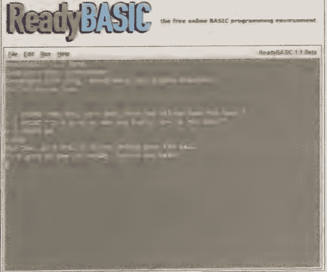

## 成为程序员

由于程序的运行机制，当你的程序运行时出现问题时，你不能埋怪计算机。计算机完全是在执行你要求它做的事情，错误的归根通常在于程序员。

这是坏消息。好消息是你可以不会造成任何永久性的伤害。在你学习 Java 编程时，不会有计算机受到损坏。

## 程序是如何运作的

构成程序的语句集合被称为其源代码（`source code`）。

大多数程序的编写方式与你写电子邮件一样——在文本窗口中编写。某些编程工具自带自己的源代码编辑器，而另一些可以使用任何文本编辑软件。

当你完成一个程序后，将文件保存到磁盘。计算机程序通常有文件名扩展名来指示文件类型。Java 程序必须具有 `.java` 扩展名，例如 `Calculator.java`。

要运行你已保存的文件，你需要一些帮助。帮助的类型取决于你使用的编程语言。使用某些语言需要解释器（`interpreter`）来运行你的程序。解释器执行计算机程序的每一行并执行该行，然后继续下一行。许多版本的 BASIC 解释型语言。

解释型语言最大的优势是测试、修复错误和重新尝试的速度更快。主要缺点是解释型语言的运行速度比其他程序慢。每一行都必须逐行翻译成计算机可以运行的指令。

其他编程语言需要编译器（`compiler`）。编译器将其转换为计算机可以理解的形式。它还能让程序运行得尽可能高效。编译后的程序可以直接运行，不需要解释器。

编译程序的运行速度比解释型程序快，但测试需要更多时间。你必须在尝试之前编写程序并编译整个程序。如果你发现了一个错误并修复了它，你的团队必须重新编译程序。

ReadyBASIC 解释器是使用 Java 语言创建的。开发者 Kevin Matz 创建了一个 Java applet（Java 程序，一种运行在网页内部的 Java 程序）来解释 BASIC 代码的语句。你的浏览器必须具备运行 Java 程序的能力。如果你遇到问题，请访问 Oracle 的 Java 网站 `www.java.com` 来测试你的浏览器是否安装了 Java——并在必要时安装 Java。你可能还需要调整 Java 设置以允许程序运行。在 Windows 上，运行控制面板，点击 Java，然后点击“置于顶层”。你可以更改安全级别或允许特定网站运行 Java applet。

如果你的文本编辑器是一个具有粗体文本、字体大小和其他样式等功能的文字处理程序，请选择另一个编辑器或不要使用这些功能。程序应该准备为没有特殊格式的文本文件。Notepad（适用于 Windows 的文本编辑器）将所有文件保存为无格式文本。你也可以使用 Mac 上的 TextEdit 或 Linux 系统上的 emacs 来创建无格式的文本文件。

## 选择 Java 编程工具

Java 非常独特，因为它需要编译器又解释器。编译器将构成程序的语句转换为字节码，字节码由称为 Java 虚拟机（`Java Virtual Machine`）的解释器运行。

Java 虚拟机也称为 `JVM`，使得同一个 Java 程序可以在不同的操作系统和不同类型的计算设备上无需修改地运行。虚拟机将字节码转换为设备操作系统可以执行的指令。

## 当程序无法工作时

许多新程序员在开始测试程序时会感到沮丧。错误随处可见。其中一些语法错误（`syntax errors`）是计算机在查看程序时因语句的编写方式而感到困惑并识别出来的。其他错误是逻辑错误（`logic errors`），只有程序员在测试程序时注意到（或者可能完全忽略）。逻辑错误通常会导致程序执行意图之外的操作。

当你开始编写自己的程序时，你会对错误非常熟悉。它们是过程的自然组成部分。编程错误被称为 `bug`（虫节点），这个术语可以追溯到一个世纪以前，用于描述技术设备中的错误。

修复错误的过程也有自己的术语：调试（`debugging`）。

描述错误的方法有很多并非巧合。在学习编程的过程中，你会获得大量的调试经验——无论你是否想要它。

> 注意
>
> 最早的 bug 之一是在 1947 年由包括美国计算机科学家 Grace Hopper 在内的团队发现的。Hopper 在哈佛大学测试一台计算机时，一个继电器发生了故障。事实证明这不是软件问题，而是一个真实的虫。她通过移除一只死蛾修复了计算机，这只飞蛾被胶在日志书中，并注释：“发现的第一个实际 bug”。该 bug 和日志页可以在 `www.duncio.navy.mil/CHIPS/ArticleDetails.aspx?id=3489` 查看。

## 选择 Java 编程工具

要开始编写 Java 程序，你必须有一个 Java 编程工具。Java 有几种此类程序可用，包括简单的 Java 开发工具包（`JDK`）以及更复杂的 Eclipse、IntelliJ IDEA 和 NetBeans。后三种工具都是集成开发环境（`IDE`），是专业程序员用来完成工作的强大工具。

## 第 1 小时：成为程序员

本书中你不必使用 NetBeans。如果你能使用 `JDK` 或另一个工具来创建、编译和运行程序，这已经是大多数项目的要求了。涵盖 NetBeans 是因为旧版本的读者已经证明它比 `JDK` 更容易使用。我所有的 Java 编程都使用 NetBeans。

每当 Oracle 发布新版本的 Java 时，第一个支持它的工具就是 Java 开发工具包（`JDK`）。


为了创建书中的程序，你必须使用 JDK 8 或运行在它之上的编程工具。`JDK` 是一组用于创建 Java 软件的免费命令行工具。如果你从未在类非图形化环境（如 Windows 命令提示符或 Linux 命令行界面）中工作过，你会发现使用 `JDK` 是具有挑战性的。

`NetBeans IDE` 同样免费提供，比 `JDK` 编写和测试 Java 代码容易得多。`NetBeans` 提供了图形用户界面、源代码编辑器、用户界面设计器和项目管理器。它与 `JDK` 互补工作，在后台运行，当你开始开发 Java 程序时，你的系统中必须同时拥有这两个工具。

书中的程序是用 `NetBeans` 创建的，它可以从 `JDK` 独立下载和安装。只要其他工具支持 JDK 8，你就可以使用其他工具。

## 安装 Java 开发工具

本书的每小时都结束于一个你可以的 Java 编程项目，可以在知识在大脑中消化的同时增强对该主题的理解。

如果你计算机上缺少 Java 编程工具，就无法进行任何编程。

如果你已经安装了支持 Java 的工具，可以使用它来开发接下来的 23 小时的教程程序。然而，你已经对如何使用该工具有了一些熟悉。同时学习 Java 和复杂的 `IDE` 可能会令人望而畏。

在读这本书时推荐的编程选择是 `NetBeans 8.0`，它可以从 Oracle 网站 `http://netbeans.org/` 免费获取。虽然 `NetBeans` 有一些需要时间学习的高功能，但它很容易创建和运行简单的 Java 应用程序。

要了解如何下载和安装 `NetBeans`，请阅读附录 A，“使用 NetBeans 集成开发环境”。

## 总结

在这一小时中，你接触了计算机编程的概念——给计算机提供一组被称为“语句”的指令，告诉它该做什么。你还学习了为什么你选择自学 Java 而不是其他编程语言是一个非常明智的决定。

你可能还下载并安装了一个 Java 开发工具，以便在接下来的几小时里用于你创建的程序。

问 10 个程序员关于最好的编程语言，你可能会得到 10 个答案，其中还伴随着“我的语言可以教训你的语言”的挑衅，以及“你的源代码太臃肿了”的笑话。Java 在此类争论中得分很高，因为它被广泛采用、功能极其强大且设计巧妙。用这种语言你可以完成很多工作，并让学习其他语言变得容易容易。

如果你对程序、编程语言或 Java 本身仍然感到困惑，请不要惊慌。一切将在下一小时“编写你的第一个程序”中开始变得清晰，该章节将逐步引导你完成创建 Java 程序的过程。

## 第 1 小时：成为程序员

## 工作坊

## 问答

- **Q. BASIC？C++？Smalltalk？Java？这些语言的名字代表什么意思？**

- **A.** `BASIC` 的名字源于缩写：Beginner's All-purpose Symbolic Instruction Code（初学者通用符号指令代码）。`C++` 是一种为了改进 `C` 语言而创建的编程语言，而 `C` 语言本身是对 `B` 编程语言的改进。`Smalltalk` 是 20 世纪 70 年代的一种创新面向对象的语言，Java 采用了它的许多想法。

Java 与用缩写或其他意义术语命名语言的传统不同。它只是 Java 开发者最喜欢的名字，击败 `WebRunner`、`Silk`、`Ruby` 等其他。（当时 `Ruby` 编程语言还不存在。）

当我创建自己的编程语言语言时，我会将其命名为 `Salsa`。

- **Q. 为什么解释型语言比编译型语言慢？**

- **A.** 它们慢的原因等同于现场口译外语演讲的人比比翻译打印演讲稿的译员要慢。口译译员必须在每一条语句产生时进行思考，而另一种译员可以整体处理演讲稿并采取捷径来加速过程。编译型语言可以比解释型语言快得多，因为它们通过某些处理让程序运行得更高效。

- **Q. 你只回答关于 Java 的问题吗？**

- **A.** 完全不是。问我任何问题都可以。

- **Q. 好的，《与星共舞》给出的最低分是多少？**

- **A.** 这部 ABC 热门节目中，名人选手的最糟糕舞蹈是由说歌手 Master P 在 2006 年的第二季表演的。他与专业舞者 Ashly DeGrosse 跳的帕萨双舞得到了最低分 8 分。评委 Len Goodman 和 Bruno Tonioli 给了他 2 分，评委 Carrie Ann Inaba 给了 4 分。

Tonioli 的评价：“这是一场噩梦。……看起来像一个迷路的孩子在寻找她的母亲。”

Goodman：“我知道观众们认为他们让你回来是种友善的表现。他们不是的。他们很残忍——对 Ashly，也对评委们。”

## 工作坊

Inaba：“我实际上认为那是你跳得最好的。”

可以在 YouTube 上看到这段舞蹈

## 测验

通过回答以下问题，测试你对本小时涵盖内容的掌握程度。

- **1. 下列哪项不是人们认为计算机编程极其困难的原因？**

- **A.** 程序员散布这个谣言是为了提高我们的就业前景。

- **B.** 术语和缩写随处可见。

- **C.** 发现编程太难的人有资格获得政府救助。

- **2. 什么样的工具通过逐行识别代码来运行计算机程序？**

- **A.** 一种慢速工具

- **B.** 解释器

- **C.** 编译器

- **3. 为什么 James Gosling 躲在办公室里创建了 Java？**

- **A.** 他对在项目中使用的语言感到不满意。

- **B.** 他的摇滚乐队没有演出。

- **C.** 当你不能访问 YouTube 时，互联网很无聊。

## 答案

- **1. C.** 计算机作者也没有获得救助。

- **2. B.** 解释器一次处理一行。编译器会预先处理，让程序运行更快。

- **3. A.** 他对在项目中使用的语言感到不满意。

## 活动

如果你想编程，请执行以下操作：

- 编写一个 Java 程序。
- 组织程序。
- 显示信息。
- 保存、编译并运行。

## 第 2 小时：编写你的第一个程序

因为 Java 程序是文本文件，你可以用任何文本编辑器打开并编辑它们。你可以在 `NetBeans` 中编写 Java 程序，用记事本打开并进行修改，然后毫无问题地重新回到 `NetBeans`。

## 创建 Saluton 程序

你创建的第一个 Java 程序将显示计算机科学界传统的问候：“Saluton mundo!”

为了给 `NetBeans` 中的第一个编程项目做准备，按照以下步骤创建一个名为 `Java24` 的新项目：

- 选择菜单 `File`，`New Project`。`New Project` 对话框打开。
- 选择项目类别 `Java` 和项目类型 `Application`，然后点击 `Next`。
- 输入项目名称 `Java24`。如果你之前创建过同名项目，会看到错误信息“项目文件夹已存在且为空”。
- 取消勾选 `Create Main Class` 框。
- 点击 `Finish`。

`Java24` 项目创建在它自己的文件夹中。在学习这本书的过程中，可以使用该项目编写 Java 程序。

## 开始程序

`NetBeans` 将相关的程序分组为项目。如果你还没有打开 `Java24` 项目，以下是检索它的方法：

- 选择 `File`，`Open Project`。文件对话框出现。
- 找到并选择 `NetBeansProjects` 文件夹（如有必要）。
- 选择 `Java24` 并点击 `Open Project`。

`Java24` 项目出现在 Projects 窗中，旁边有一个咖啡杯图标和一个 `+` 号，可以展开以查看项目包含的文件和文件夹。

# 要向当前打开的项目添加新的 Java 程序，请选择 `File`（文件）、`New File`（新文件）。新文件向导将打开，如图 2.1 所示。

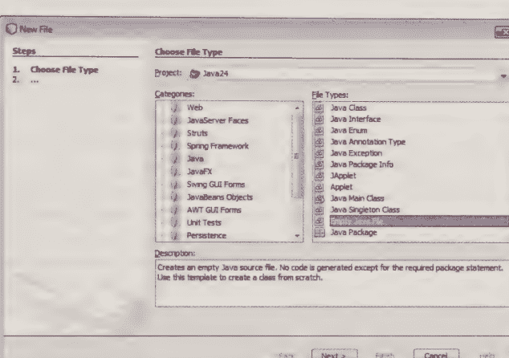

`Categories`（类别）窗格列出了你可以创建的不同类型的 Java 程序。点击此窗格中的 `Java` 文件夹可以查看属于该类的文件类型。对于第一个项目，选择 `Empty Java File`（空 Java 文件）类型并点击 `Next`（下一步）。

会弹出一个 `New Empty Java File` 对话框。按照以下步骤开始编写你的程序：

- 1. 在 `Class Name`（类名）字段中，输入 `Saluton`。
- 2. 在 `Package`（包名）字段中，输入 `com.java24hours`。
- 3. 点击 `Finish`（完成）。

这样你就可以立即开始编写程序了，源代码编辑器中会打开一个名为 `Saluton.java` 的空文件。使用编辑器，通过输入列表 2.1 中的每一行代码，开启你的 Java 编程生涯。这些语句被称为程序的源代码。

## 列表 2.1 Saluton 程序

```
1: package com.java24hours;
2:
3: class Saluton
4:     public static void main(String[] arguments) {
5:     // 我的第一个 Java 程序在这里
6:     }
7: }
```

确保大小写与所示完全一致，并使用空格键或 `Tab` 键在第 4–6 行前插入空格。完成后，选择 `File`（文件）、`Save`（保存）以保存文件。

此时，`Saluton.java` 包含了 Java 程序的骨架。你将创建许多与此程序开头完全相同的程序，只是第 3 行的 `Saluton` 单词不同。这个词代表你的程序名称，并随着你编写的每个程序而改变。第 5 行对你来说应该是理解的，因为它是一句真正的英语。其余部分对你来说可能是全新的。

## class 语句

程序的第一行是：

`package com.java24hours;`

> 包（package）是一种将 Java 程序组合在一起的方法。此行告诉计算机将 `com.java24hours` 设置为程序的包名。

在空行之后，第三行是：

`class Saluton {`

翻译成英语的意思是：“计算机，给我的 Java 程序命名为 Saluton。”

正如你可能从第 1 小时回想的，你给计算机的每个指令都被称为语句（statement）。`class` 语句是你为程序命名的方式。它还用于确定程序的其他信息，正如你以后看到的那样。`class`（类）一词的意义在于，Java 程序也被称为类。

在这个示例中，程序名 `Saluton` 与文档文件名 `Saluton.java` 匹配。Java 程序的名称必须与其文件名的第一部分匹配，并保持相同的大小写方式。

## 开始程序

如果程序名与文件名不匹配，当你尝试编译 Java 程序时会得到错误，这取决于 `class` 语句是如何用于配置程序的。

## main 语句的作用

程序的下一行是：

```
public static void main(String[] arguments) {
```

此行告诉计算机：“程序的主部分从这里开始”。Java 程序被组织成不同的部分，因此需要一种方法来识别程序在运行时首先执行的部分。

`main` 语句是大多数 Java 程序的入口。例外情况包括 `applets`（在浏览器中运行的网页 程序）、`servlets`（由 Web 服务器运行的程序）以及 `apps`（由移动设备运行的程序）。

你在接下来的几小时内编写的大多数程序都使用 `main` 作为起点。这是因为你直接在计算机上运行它们。而 `applets`、`apps` 和 `servlets` 是由另一个程序或设备间接运行的。

为了将它们与其他类型区分来，你直接运行的程序被称为应用程序（applications）。

## 波浪括号标记

在 `Saluton` 程序中，第 3、4、6 和 7 行包含某种波浪括号标记——可能是 `{` 或 `}`。这些括号是将程序代码行分组的一种方式（就像括号在句子中用于对单词进行分组一样）。左括号 `{` 和右括号 `}` 之间的所有内容都属于同一个组。

这些分组被称为块（blocks）。在列表 2.1 中，第 3 行的左括号与第 7 行的右括号相关，构成了你的整个程序块。你通过这样使用括号来显示程序的开始和结束。

块可以位于其他块内部（就像这里使用了第二组括号）。`Saluton` 程序在第 4 行和第 6 行有括号，它们建立了另一个块。

## 提示

`Beans` 可以帮助你确定块的开始和结束。点击 `Saluton` 程序源代码中的任意一个括号。你点击的括号会与其对应的括号一起变成黄色。包含在两个括号之间的 Java 语句是一个块。这个提示对于像 `Saluton` 这样短的程序并没用，但当你编写长得多的程序时，它可以帮助你避免看起来像个“块头脑”（blockhead）。

此块以 `main` 语句开始。`main` 语句块内部的行将在程序启动时运行。

以下语句是块内唯一的内容：

`// 我的第一个 Java 程序在这里`

行开头的 `//` 告诉计算机忽略这一行，因为它完全是为了人类准备的。具有此目的行是注释（comments）。

现在，当你运行程序时，似乎没有发生什么。原因是你还没有告诉计算机执行操作。

## 在变量中存储信息

在你编写程序时，你需要一个地方来临时存储信息。你可以通过使用变量（variable）来实现，变量是一个可以存储整数、浮点数、布尔值、字符和文本的地方。在 Java 程序中，你必须告诉计算机变量将包含什么类型的信息。在 `Saluton` 文件中，将第 5 行替换为：

```
String greeting = "Saluton!";
```

此语句告诉计算机将 `"Saluton!"` 存储在名为 `greeting` 的变量中。`String` 设置变量以存储字符串值。

当你向程序输入此语句时，行尾必须包含一个分号。分号结束 Java 程序中的每个语句。计算机使用它们来确定一个语句何时结束，另一个何时开始。

## 显示变量的内容

如果你此时运行程序，似乎没有发生什么。在 `greeting` 变量中存储文本的命令是在后台执行的。现在为了让计算机显示它正在运行，你可以显示该变量的内容。

在 `Saluton` 程序的 `String greeting = "Saluton!";` 语句之后再插入一个空行。使用该空位置输入以下语句：

```
System.out.println(greeting);
```

此语句告诉计算机显示 `greeting` 变量中的值。`System.out.println` 语句让计算机在系统输出设备——你的显示器上显示信息。

## 保存完成的作品

每行只写一个语句可以让程序更容易理解（对人类来说）。

你现在正在取得进展了。

你的程序现在应该类似于列表 2.2，尽管你可能在第 5-6 行使用了略不同的间距。进行任何修正并保存文件（通过 `File`、`Save`）。

## 列表 2.2 Saluton 程序的完成版本

```
1: package com.java24hours;
2:
3: class Saluton {
4:     public static void main(String[] arguments) {
5:         String greeting = "Saluton!";
6:         System.out.println(greeting);
7:     }
8: }
```


正如你可能从第 1 小时回想的，你给计算机的每个指令都被称为语句（statement）。`class` 语句是你为程序命名的方式。它还用于确定程序的其他信息，正如你以后看到的那样。`class`（类）一词的意义在于，Java 程序也被称为类。

在这个示例中，程序名 `Saluton` 与文档文件名 `Saluton.java` 匹配。Java 程序的名称必须与其文件名的第一部分匹配，并保持相同的大小写方式。

## 开始程序

如果程序名与文件名不匹配，当你尝试编译 Java 程序时会得到错误，这取决于 `class` 语句是如何用于配置程序的。

## main 语句的作用

程序的下一行是：

```
public static void main(String[] arguments) {
```

此行告诉计算机：“程序的主部分从这里开始”。Java 程序被组织成不同的部分，因此需要一种方法来识别程序在运行时首先执行的部分。

`main` 语句是大多数 Java 程序的入口。例外情况包括 applets（在浏览器中运行的网页程序）、servlets（由 Web 服务器运行的程序）以及 apps（由移动设备运行的程序）。

你在接下来的几小时内编写的大多数程序都使用 `main` 作为起点。这是因为你直接在计算机上运行它们。而 applets、apps 和 servlets 是由另一个程序或设备间接运行的。

为了将它们与其他类型区分来，你直接运行的程序被称为应用程序（applications）。

## 波浪括号标记

在 `Saluton` 程序中，第 3、4、6 和 7 行包含某种波浪括号标记——可能是 `{` 或 `}`。这些括号是将程序代码行分组的一种方式（就像括号在句子中用于对单词进行分组一样）。左括号 `{` 和右括号 `}` 之间的所有内容都属于同一个组。

这些分组被称为块（blocks）。在列表 2.1 中，第 3 行的左括号与第 7 行的右括号相关，构成了你的整个程序块。你通过这样使用括号来显示程序的开始和结束。

块可以位于其他块内部（就像这里使用了第二组括号）。`Saluton` 程序在第 4 行和第 6 行有括号，它们建立了另一个块。

## 第 2 小时：编写你的第一个程序

## 提示

Beans 可以帮助你确定块的开始和结束。点击 `Saluton` 程序源代码中的任意一个括号。你点击的括号会与其对应的括号一起变成黄色。包含在两个括号之间的 Java 语句是一个块。这个提示对于像 `Saluton` 这样短的程序并没用，但当你编写长得多的程序时，它可以帮助你避免看起来像“块头脑”（blockhead）。

此块以 `main` 语句开始。`main` 语句块内部的行将在程序启动时运行。

以下语句是块内唯一的内容：

`// 我的第一个 Java 程序在这里`

行开头的 `//` 告诉计算机忽略这一行，因为它完全是为了人类准备的。具有此目的行是注释（comments）。

现在，当你运行程序时，似乎没有发生什么。原因是你还没有告诉计算机执行操作。

## 在变量中存储信息

在你编写程序时，你需要一个地方来临时存储信息。你可以通过使用变量（variable）来实现，变量是一个可以存储整数、浮点数、布尔值、字符和文本的地方。在 Java 程序中，你必须告诉计算机变量将包含什么类型的信息。在 `Saluton` 文件中，将第 5 行替换为：

```
String greeting = "Saluton!";
```

此语句告诉计算机将 `"Saluton!"` 存储在名为 `greeting` 的变量中。`String` 设置变量以存储字符串值。

当你向程序输入此语句时，行尾必须包含一个分号。分号结束 Java 程序中的每个语句。计算机使用它们来确定一个语句何时结束，另一个何时开始。

## 显示变量的内容

如果你此时运行程序，似乎没有发生什么。在 `greeting` 变量中存储文本的命令是在后台执行的。现在为了让计算机显示它正在运行，你可以显示该变量的内容。

在 `Saluton` 程序的 `String greeting = "Saluton!";` 语句之后再插入一个空行。使用该空位置输入以下语句：

```
System.out.println(greeting);
```

此语句告诉计算机显示 `greeting` 变量中的值。`System.out.println` 语句让计算机在系统输出设备——你的显示器上显示信息。

## 保存完成的作品

每行只写一个语句可以让程序更容易理解（对人类来说）。

你现在正在取得进展了。

## 保存完成的作品

你的程序现在应该类似于列表 2.2，尽管你可能在第 5-6 行使用了略不同的间距。进行任何修正并保存文件（通过 File、Save）。

列表 2.2 `Saluton` 程序的完成版本

```
1: package com.java24hours;
2:
3: class Saluton {
4:     public static void main(String[] arguments) {
5:         String greeting = "Saluton!";
6:         System.out.println(greeting);
7:     }
8: }
```

## 编写你的第一个程序

## 列表 2.3 `Saluton` 程序的逐行分解

```
1: 将此程序放在 com.java24hours 包中。
2:
3: Saluton 程序从这里开始：
4:    程序的主部分在此开始：
5:    在名为 greeting 的字符串变量中存储文本 "Saluton mondo!"
6:    显示变量 greeting 的内容
7:    程序的主部分在此结束。
8: Saluton 程序在此结束。
```

列表 2.4 显示了如果该程序用克林贡语（《星际迷航》战士种族的语言）编写，它将会是什么样子。

## 列表 2.4 克林贡语编写的 `Saluton` 程序

```
1: 此程序属于 com.java24hours 家族！
2:
3: 如果你还想活，就从这里开始 Saluton 程序吧！
4:    程序的主部分带着荣耀在此开始！
5:    在一个名为 greeting 的字符串变量中存储胡言乱语 "Saluton mondo!"！
6:    用这种逊于克林贡语的舌头显示这些胡言乱语！
7:    在此结束程序的主部分以避免我的震怒！
8: 现在结束 Saluton 程序，并感谢你幸免于一劫！
```

## 将程序编译为类文件

当你运行一个 Java 程序时，必须对其进行编译。当你编译程序时，提供给计算机的指令会被转换为计算机更容易理解的形式。

NetBeans 会在保存程序时自动编译程序。如果你按照列表 2.2 所示输入所有内容，程序将成功编译。

系统会创建一个程序的编译版本，这是一个名为 `Saluton.class` 的新文件。所有的 Java 程序都被编译成类文件，这些文件具有 `.class` 扩展名。一个 Java 程序可以由几个共同工作的类组成，但在像 `Saluton` 这样简单的程序中，只需要一个类。

编译器将 Java 源代码转换为字节码，这是一种可以由 Java 虚拟机（JVM）运行的形式。

## 修复错误

当你在 NetBeans 源编辑器中编写程序时，错误会在编辑器面板左侧用红色警报图标标记出来，如图 2.2 所示。

### 错误图标

```
package com.java24hours;

class Saluton {
    public static void main(String[] arguments) {
        String greeting = "Saluton mondo!";
        System.out.println(greeting);
    }
}
```

图 2.2

在源编辑器中识别错误。

该图标出现在触发错误的行上。你可以点击该图标来显示错误消息，该消息通过以下详细信息解释编译错误：

- Java 程序的名称
- 错误类型
- 发现错误所在的行

以下是你编译 `Saluton` 程序时可能会看到的错误消息示例：

```
cannot find symbol.
symbol   : variable greeting
location: class Saluton
```

错误是消息的第一行：“cannot find symbol.（找不到符号）”。这些消息通常会让初级程序员感到困惑。当错误消息对你来说没有意义时，不要花太多时间试图弄懂它。相反，查看错误发生的那行，并寻找最明显的原因。

## 第 2 小时：编写你的第一个程序

## 提示

本书的官方网站 `www.java24hours.com` 包含了你创建的所有程序的源文件。如果你在 `Saluton` 程序中找不到任何错误原因，但错误仍然存在，请访问书籍网站并从第 2 小时页面下载 `Saluton.java`。尝试运行该文件。

例如，你能确定以下语句的错误出在哪里吗？

```
System.out.println(greting);
```

错误是变量名中的拼写错误，应该是 `greeting` 而不是 `greting`（在 NetBeans 中故意输入这种类型以看看会发生什么）。

如果你在创建 `Saluton` 程序时收到错误消息，请双检你的程序是否与列表 2.2 一致，并纠正你发现的任何差异。确保所有内容的大小写正确，并包含了所有的标点符号，如 `[`、`]` 和 `;`。

通常，仔细观察错误消息所指出的行，就足以发现需要修复的错误（或多个错误）。

## 运行 Java 程序

要查看 `Saluton` 程序是否按照你的预期运行，请使用 Java 虚拟机（运行所有 Java 代码的解释器）运行代码。在 NetBeans 中，选择菜单命令 Run（运行）、Run File（运行文件）。源代码编辑器将打开一个输出面板。在该面板中，如果没有错误，程序将显示输出，如图 2.3 所示。

图 2.3

运行你的第一个 Java 程序。

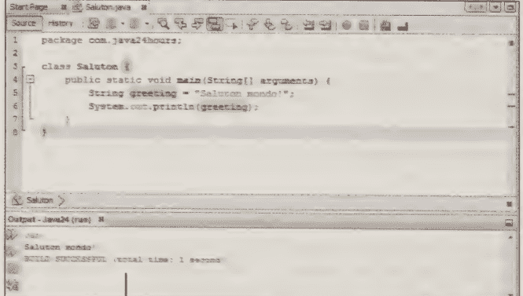

## 总结

如果你看到了文本 `"Saluton Mondo!"`，你刚刚写了你的第一个可以运行的 Java 程序！你的计算机刚刚向世界问——这是计算机编程领域的一个传统，对我们许多人来说，它就像咖啡因、短袖衬衫和《使命召唤》一样重要。

你可能会问为什么“Saluton Mondo!”是一种传统的问候语。这句话在国际望语中的意思是“Hello world!”。国际望语是由 Ludwig Zamenhof 在 1887 年创建的一种人造语言，旨在促进国际交流。它之所以是传统的问候语，仅仅是因为……

> 注意
>
> Oracle 为 Java 语言提供了全面的文档。使用本书时不需要它，但最新的 Java 文档可以在 `http://download.java.com/jdk/api/` 获取。

在这一小时中，你获得了第一次创建 Java 程序的机会。你学会了完成这些基本步骤：

1. 使用 NetBeans 等文本编辑器编写程序。
2. 将程序编译为类文件。
3. 告诉 Java 虚拟机运行该类。
4. ...

在此过程中，你接触到了一些基础编程概念，如编译器、解释器、块、语句和变量。这些概念在接下来的几小时内对你来说变得清晰。只要你在这一小时内让 `Saluton` 程序运行起来，你就可以继续下去了。

（第四步与 Java 编程无关。这只是我建议放入书中的一些内容。）

## 工作坊

## 问答

- **Q.** 在 Java 程序的行中放置正确数量的空格重要吗？
- **A.** 就计算机来说，这完全不重要。间距完全是为了查看程序的人考虑的。你可以在不使用空格符或 Tab 键缩进行的情况下编写程序，它也能成功编译。

虽然行前的空格数并不重要，但你应该在 Java 程序中使用一致的间距和缩进。为什么？因为间距可以让你更容易看到程序的组织结构以及它属于哪个编程块。

你编写的程序必须让其他程序员理解，包括你在几周或几个月后查看代码以修复漏洞或进行增强时的自己。间距和缩进的一致是所谓的编程风格的一部分。优秀的程序员会采用一种风格并将其应用于所有的工作中。

- **Q.** Java 程序被描述为一个类，也被一组类。它到底是哪一个？
- **A.** 你在接下来几小时内创建的所有简单 Java 程序都被编译成一个扩展名为 `.class` 的单个文件。你可以用 Java 虚拟机运行它们。Java 程序也可以由一组共同工作的类组成。这个主题将在第 10 小时“创建你的第一个对象”中充分探讨。

- **Q.** 如果每个语句末尾都需要分号，为什么注释行 `// My first Java program goes here` 没有以分号结尾？
- **A.** 注释是被编译器完全忽略的。如果你在程序的某行中放置 `//`，这会告诉 Java 编译器忽略该行中 `//` 之后的所有内容。下面的示例显示了与语句在同一行上的注释：

```
System.out.println(greeting); // hello, world
```

- **Q.** 我在编译器标记错误的行中没有找到任何错误。我该怎么办？
- **A.** 错误消息中显示的行号并不总是需要修复错误的地方。检查错误消息正方的语句，看看是否能发现任何拼写错误或其他错误。错误通常位于同一个代码块中。

- **Q.** 我如何去南极洲？
- **A.** 如果你不想成为科研人员或支持人员（如厨师、电工或医生），你可以成为每年以游客身份访问这片冰冻大陆的人之一。可以从澳大利亚、新西兰和南非出发飞往，每人费用约为 1000 美元。

有几艘邮轮提供为期 10 天到三周的旅行，其中最贵的花费 25000 美元。有些游轮提供了在企鹅中划皮艇或徒步、访问冰山，甚至过夜营的机会。

`www.polarcruises.com` 的 Polar Cruises 网站为潜在的南极访问者提供了更多信息。

英国南极调查局为访问者提供了一条建议：“除非经过适当训练，否则不要进入冰川或大型雪地。”

## 测验

通过回答以下问题测试你对本小时内容的掌握情况。

1. 当你编译一个 Java 程序时，你在做什么？
   - A. 将其保存到磁盘
   - B. 将其转换为计算机更容易理解的形式
   - C. 将其添加到你的程序集合中

2. 什么是变量？
   - A. 一个会摇晃但不会倒下的东西
   - B. 程序中编译器忽略的文本
   - C. 程序中存储信息的地方

## 第 2 小时：编写你的第一个程序

3. 修复错误的过程称为什么？

- A. 融冻 (Defrosting)
- B. 调试 (Debugging)
- C. 分解 (Decomposing)

# 答案

1. 编译程序会将 `.java` 文件转换为 `.class` 文件或一组 `.class` 文件。

2. 变量是存储信息的地方之一；稍后你将学习其他地方，例如数组和常量。Weebles（会摇晃但不会倒下，而注释是程序中编译器忽略的文本。

3. 因为计算机程序中的错误被称为 bug，所以修复这些错误被称为调试。某些编程工具带有名为调试器（debugger）的工具，可以帮助你修复错误。NetBeans 拥有最好的调试器之一。

## 活动

如果你想更深入地探索本小时涵盖题，请尝试以下活动：

- 你可以使用 `http://translate.google.com` 的 Google 翻译将英文短语 `"Hello world!"` 翻译成其他语言。编写一个程序，让你的计算机以法语、意大利语或葡萄牙语等语言显示世界。

- 回到 `salut` 程序并添加一两个错误。例如，删除行尾的分号，或者将其中一行的文本 `println` 改为 `print1n1n`（用数字 1 代替字母 L）。保存程序并尝试编译它；然后比较你所引起的错误消息。

要查看这些活动的解决方案，请访问书籍的网站 `www.java24hours.com`。

## 第 3 小时

### 在 Java 世界中度假

在进一步探索 Java 编程之前，学习更多关于该语言的并看看程序员今天用它做什么是值得的。尽管 Java 早已超越了它作为一种专注于网络浏览器程序的语言的起源，但你仍然可以找到一些 Java 在 Web 上使用的有趣示例。

在本小时中，我们将查看一些带有 Java 程序的网站，并讨论该语言的历史和发展。

要开始这次度假，你需要一个配置好运行 Java 程序的网络浏览器。

加载你喜欢的浏览器，穿上你最好的巴提克衬衫，准备好度假。你不需要离开家，也无法体验旅游中那些简单的快乐，如异国风情、异国当地人、异国美食、带有食物的异国人等等。

但要看光明的一面：没有旅行支票的烦恼，没有护照，也没有蒙特的复仇。

- 本小时的任务清单：
- 发现 Java 的历史。
- 学习使用该语言的优势。
- 查看 Java 的运行示例。

## 第一站：Oracle

Java 度假从 `www.java.com` 开始，这是控制 Java 语言的公司 Oracle 出版的网站。

作为网页一部分运行的 Java 程序被称为 applet（小程序）。Applet 像页面其他元素（如照片和文本）一样放在页面上。标记语言 HTML 定义了应该显示的程序、其大小以及程序运行时的功能。Java 还通过另外两种方式增强了 Web：

### 在 Java 世界中度假

用 Java 编写的桌面程序可以从网络浏览器启动，而 Java servlet 由 Web 服务器运行，以交付 Web 应用程序。

图 3.1 显示了 RuneScape，一种由 Java 驱动的大型在线游戏。你可以使用任何网络浏览器访问 `www.runescape.com` 免费玩游戏。当你访问该网站时，会被邀请运行它并在首页玩游戏。该程序是用 Java 语言实现的。

图 3.1

由 Java 驱动的在线游戏 RuneScape。


当你运行它时，游戏会在几秒内加载，你就可以开始-

## 第 3 小节：在 Java 世界度假

## 注意事项


# Java 版本历史与学习资源

## Java 版本演进

你是否在奇怪为什么 Java 的版本编号如此奇怪，跳过了 2 到 6，将第七个版本称为 Java 6，并且在某些版本中包含整数和小数数字？我也是如此！

幸运的是，自 2006 年以来，这种命名方案变得更有合理了，每个新发布版本都比上一个版本大整数。

- **Java 2 1.2 版本**——内部类、浏览器 Java 插件以及数据结构（1998年）
- **Java 2 1.3 版本**——增强的多媒体（2000年）
- **Java 2 1.4 版本**——改进的 Internet 支持、XML 处理和断言（2002年）
- **Java 5**——泛型、for 循环、注解和自动数据转换（2005年）
- **Java 6**——内置 Derby 数据库和网络服务（2006年）
- **Java 7**——内存和资源管理改进以及 Nimbus 图形用户界面（2011年）


当前的发布版本 **Java 8** 于 2014 年 3 月发布。这个新版本历时三年打造，引入了闭包，这是高级 Java 编程中备受期待特性，你将在第 20 小节“内部类与闭包”中学习到它。还有处理日期和时间的更好方法，以及一些实用的新连接和注解。

如果你不知道所有这些是什么——例如内部类、泛型或 XML——请不要慌。你将在接下来的 21 小时内学习它们。

## 警告：Applet 运行限制

当你访问此站点运行 applet 时，在 Windows 上可能会收到“程序已阻止（Application Blocked）”的警告。在本书出版之前，Oracle 更改了不包含验证作者身份数字签名的 Java 插件 applet 的处理方式。现在 applet 会带有警告失败，而不是提示用户运行它们。

你可以编辑 Java 设置以允许特定网页的 applet 运行：
1. 打开控制面板，点击 Java，然后点击“安全”选项卡。
2. 点击“编辑站点列表”按钮添加网页，并允许你的 applet（或多个 applet）加载。

## 使用 Java 学习

Web 包含许多面向教育工作者和学生的资源。Java 程序可以提供比标准网页更具交互性的体验。

举一个例子，访问 `www.ucbc.ca/~svn/java` 访问由不列颠哥比亚大学计算机科学教授 Michel van Passe 创建的跳台模拟器。该程序使用 Java 展示了基于物理的动画，当滑雪员尝试不同的坡度和跳跃时。滑雪员的动作通过在八个方向上移动鼠标来控制，每种方向都会影响跳跃的成功。图 3.2 显示了我的虚拟滑雪员遭遇惨惨结局之前的程序界面。

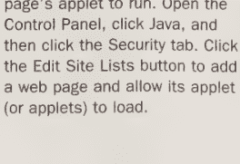


**图 3.2** 可以使用 Java 程序在 Web 上交互式地体验跳台模拟器。

许多操作系统都有许多教育程序可用，但让这个程序脱颖而出的一点是它的可用性。该模拟器直接从网页运行。不需要特殊安装，而且与大多数桌面软件不同，它不限于特定的操作系统。你可以在任何带有 `Java 虚拟机（JVM）` 的计算机上运行 Java 程序。

浏览器加载的 `JVM` 与你在第 2 小节“编写你的第一个程序”中运行 `Saluton` 程序时使用的是同一个。浏览器的 `JVM` 只能运行设置为在网页上运行的 Java 程序，无法处理设置为在其他地方（如桌面级计算机）运行的程序。

第一批支持 Java 的浏览器内置了 `JVM`。今天，浏览器依靠 Oracle 的 Java 插件支持 Java，这是一种作为浏览器增强的 `JVM`。

Java 程序（例如跳台模拟器）不需要为特定的操作系统编写。由于像 Windows 等操作系统也被称为平台，这种优势被称为**平台独立性**。Java 的创建是为了在多个系统上运行。Java 的开发者认为它需要是多平台的，因为它将用于各种电器和其他电子设备。

用户可以在各种系统上运行你用 Java 编写的程序，而无需你提供任何额外工作。在适当的情况下，Java 可以消除为不同的操作系统和设备创建程序特定版本的需求。

## JavaWorld 在线杂志

在雪道上活动了肚子后，和 JavaWorld 吃午餐吧，这是一个为 Java 程序员提供的在线杂志。访问 `www.javaworld.com`。

JavaWorld 提供了教程文章、新闻报道以及关于 Java 开发热门领域的研究中心。该出版物网络格式的优势之一是它可以结合文章显示功能性程序。图 3.3 显示了一个 Java 诗歌磁铁板，它附带在一个解释如何编写它的教程中。

**图 3.3** JavaWorld 关于如何创建诗歌磁铁板的教程包含了该程序的运行示例。

JavaWorld 偶尔会调整内容，但你可以直接访问 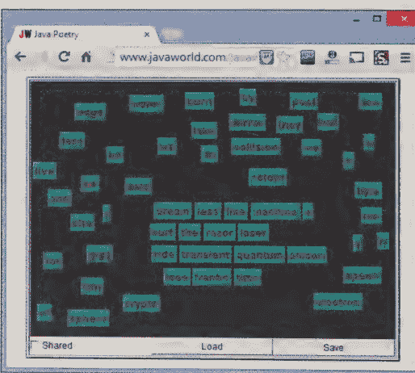

## NASA SkyWatch 应用


**图 3.4** NASA 的 SkyWatch 应用程序可以监控轨道卫星的位置和路径，这对于“金属观鸟者”来说是一个巨大的福音。

## 切入正题：QuoteMedia 股票报价

在旅程的这个阶段，你可能会认为 Java 主要是给太空爱好者、糟糕的诗人和极差的滑雪员使用的。我们旅程的下一站将展示一个 Java 如何进入正题的例子。

将你的网络浏览器指向 `www.quotimedia.com` 的 QuoteMedia 网站。该公司提供了一个 Java 应用程序，可以在其他网站上显示股票报价。图 3.5 显示了其滚动股票报价条的演示。（如需亲自查看，请访问 `www.cadenhead.org/stocks` 将重定向到该页面。）

与其他需要在每个访问的员工电脑上安装软件的股票分析程序不同，Java 的使得 QuoteMedia 的客户能够让任何拥有网络浏览器的人使用这些程序。所有员工只需要访问公司网站即可。

**图 3.5** QuoteMedia 的 Java 程序报告股市价格。


## 面向对象编程 (OOP) 视角

你可以从几个角度来考虑像这种股票报价应用这样的程序。一种方法是将程序视为一个**对象**——一个存在于世界上、占用空间并具有某些可以执行功能的东西。正如你在第 10 小时“创建你的第一个对象”中所发现的，Java 使用的**面向对象编程 (OOP)** 是将计算机程序创建为一组对象的方法。每个对象处理一项特定的任务，并且知道如何与其他对象通信。例如，一个股票报价程序可以被设置为如下对象组：

- 一个**报价对象**（quote object），代表单个股票报价
- 一个**组合对象**（portfolio object），持有一组特定股票的报价
- 一个**滚动对象**（ticker object），显示组合
- 一个**网络对象**（Internet object）、一个**用户对象**（user object）以及许多其他

在该模型下，股票报价软件是完成工作所需的所有对象的集合。

OOP 是创建程序的强大方式，它让你编写的程序更有用。考虑一下股票软件。如果程序员想将该程序的报价功能与另一个软件配合使用，则报价对象可以用于新程序。不需要进行任何更改。

## 访问 SourceForge 获取开源项目

用对象创建的程序更容易维护，因为它们的组织更好。一个对象包含了执行其任务所需的数据和完成该工作所需的代码。对象还让程序更具扩展性。可以以现有对象为模板创建一个新对象，并用新功能对其增强。

这次 Java 程序的世界之旅由一位精通网络旅行风险和亮点的专业人士带领。你很快就会开始开启自己的旅程，因此在一个对程序员极其有用的网站上了解基本情况是值得的：SourceForge，它是寻找用 Java（或其他任何语言）编写的完整运行程序示例的最佳地点之一。你可以在 `www.sourceforge.net` 找到它。

SourceForge 是一个致力于协作编程项目的巨大网站。如果你感兴趣在开发的程序上与他人合作，你可以在 SourceForge 上启动一个项目，分享所有文件，招募他人并与他们交流。该网站上的 300,000 多个项目都是开源的，这意味着程序员共享了所有的源代码。如果你熟悉这个术语，源代码是创建计算机程序的文本文件的另一个名称。你在第 2 小时开发的 `salut.java` 文件就是一个源代码示例。

如果你使用 SourceForge 首页顶部的搜索框搜索 Java 应用程序，你将在该项目目录中找到超过 7,000 条列表。

SourceForge 上的程序之一是 Aleksey Uvodychenko 的 Absolute，这是一款街机风格的游戏，在游戏中你控制一艘飞船穿过小行星带（见图 3.6）。该游戏具有滚动动画、图形、键盘控制和声音。要了解更多信息，请访问 `www.cadenhead.org/absolute` 玩游戏，并在 `www.sourceforge.net/projects/absolutejava` 下载源代码。

**图 3.6** Java 程序的源代码，例如 Aleksey Udovychenko 的太空射击游戏 Absolute 可以在 SourceForge 上找到。


整个 Absolute 程序仅用 700 多行代码就写完了。考虑到程序所做的一切，这个数字非常小。这可能的原因之一是 Java 包含了一个庞大的类库，你可以在自己的程序中使用它们。Udovychenko 使用了库中的 `Image` 类来显示小行星等图形，并使用它的 `AudioClip` 类来播放激光火和爆炸区域的声音。

许多程序用 Java 创建（在 SourceForge 和其他地方）的原因之一是，这种语言尽管功能强大，但被设计得更容易学习。该语言的一个原始设计目标是让它比 C++ 更容易掌握。

---

# 第 3 小时：在 Java 中度假

## 补充阅读：Ruth's Chris Steak House

Fertel 的合同并不允许她在原始地点以外的地方使用 Chris Steak House 的名称，因此将其重命名为 Ruth’s Chris Steak House。尽管她没有餐厅经营或烹饪方面的专业知识，但这项业务非常成功，以至于她在 12 年内就开始提供特许经营模式。多年来，她忽略了多次更改名称以扩大受众的建议。

> “我一直很讨厌这个名字，”她曾告诉《财富》杂志的一位记者，“但我们一直能设办法绕过它。”

Fertel 于 2002 年去世，出生于 1927 年 2 月 5 日——这也是 Matulich 开设那家原始牛排馆的日期。

## 测验

如果你的大脑此时还没有休息，请通过以下问题测试你对这一小时内容的掌握程度。

1. **面向对象编程是如何命名的？**
   - A. 程序被视为一组共同工作的对象。
   - B. 人们经常因为难以掌握而产生反对（object）。
   - C. 是它的父母给它起的名字。

2. **下列哪不是 Java 安全性的一部分？**
   - A. Web 程序不能在用户的计算机上运行程序。
   - B. 程序作者的身份总是经过验证的。
   - C. Java 窗口被标记为 Java 窗口。

3. **运行 Java 程序需要什么？**
   - A. 一个 Java 编译器
   - B. 一个 Java 虚拟机
   - C. 两者都是

## 答案

1. **A.** 它也缩写为 OOP。
2. **B.** 程序员可以在 Java 中使用数字签名和如 VeriSign 这样的身份验证公司，但这不是强制要求的。
3. **B.** Java 虚拟机 (JVM) 是一个解释器，它可以将 Java 字节码转换为计算机或设备可以运行的指令。创建 Java 程序需要编译器，但运行它们不需要。

## 活动

在整理好行李后，你可以通过以下活动更深入地探索本小时的话题：

- 使用 `www.sourceforge.net` 上的 SourceForge 查找哪些牌游戏是使用 Java 语言开发的。
- 访问 Oracle 的 Java 用户网站 `www.java.com`，点击“Do I Have Java?”链接。按照说明查看你的计算机上是否存在 Java。如果提示，请下载并安装最新版本。

书中活动的解决方案提供在书的网站 `www.java24hours.com` 上。

---

# 第 4 小时：理解 Java 程序如何工作

在 Java 编程中一个重要的区别是你的程序应该在何处运行。有些程序旨在在你的计算机上运行。另一些程序旨在作为网页的一部分运行。

在自己的计算机上本地运行的 Java 程序称为**应用程序**。在网页上运行的程序称为 **applet**，在 Web 服务器上运行的程序称为 **servlet**，在移动设备上运行的程序称为 **app**。

在本小时中，你将创建一个应用程序并在计算机上运行它。

## 创建应用程序

你在第 2 小时“编写你的第一个程序”中写的 `Saluton` 程序是一个 Java 应用程序示例。你创建的下一个应用程序将计算数字的平方根并显示该值。

在 NetBeans 中打开 `Java24` 项目，开始创建一个应用程序：

1. 选择 **File（文件）**、**New File（新建文件）**。打开新建文件向导。
2. 选择类别 **Java** 和文件类型 **Empty Java File（空 Java 文件）**，然后点击 **Next（下一步）**。
3. 输入类名 `Root`。
4. 输入包名 `com.java24hours`。
5. 点击 **Finish（完成）**。

## 本小时的任务列表

- 学习应用程序是如何工作的。
- 结构化应用程序。
- 向应用程序发送参数。
- 学习 Java 程序是如何组织起来的。
- 使用 Java 类库。
- 在应用程序中创建对象。

## 编写 Root.java

NetBeans 创建了 `Root.java` 并在源代码编辑器中打开该空文件，以便你开始进行工作。输入列表 4.1 中的所有内容，记住不要输入列表左侧的行号和冒号。这些数字用于在书中更方便地描述程序的各个部分。完成后，点击工具栏上的 **Save All（全部保存）** 按钮保存文件。

### 列表 4.1 Root.java 的全文

```java
package com.java24hours;

class Root {
    public static void main(String[] args) {
        int number = 225;
        System.out.println("The " + args[0]
                        + " " + args[1] + " fox "
                        + " jumped over the "
                        + args[2] + " dog.");
    }
}
```

**Root 应用程序实现了以下功能：**

- 第 1 行——放置在 `com.java24hours` 中。
- 第 5 行——存储了一个整数 225。
- 第 6–10 行——显示平方根。
- 第 9 行——演示了功能。

## 向应用程序发送参数

发送到程序的任何额外信息都是**参数**。你可以使用 `java` 从命令行运行 Java 应用程序。在前面的示例中，参数是 `readme.txt` 和 `/p`。

每个额外的参数也用空格分隔。如果你想在参数内部放入空格，必须在它周围加上引号，如下所示：

```bash
java Textplayer readme.txt /p "Page Title"
```

## 发送参数实战：BlankFiller.java

你可以向 Java 应用程序发送任意数量的参数（在范围内）。为了对它们进行操作，你必须在应用程序中编写处理它们的语句。

要查看参数如何在应用程序中工作，请在 `Java24` 项目中创建一个类：

1. 选择 **File**、**New File**。
2. 在新建文件向导中，选择类别 **Java** 并选择 **Empty Java File**。
3. 给类命名为 `BlankFiller`，包名为 `com.java24hours`，并点击 **Finish**。

在源编辑器中输入列表 4.2 的文本，完成后保存。编译程序，纠正输入时编辑器标记出的错误。

### 列表 4.2 BlankFiller.java 的全文

```java
package com.java24hours;

class BlankFiller {
    public static void main(String[] args) {
        System.out.println("The " + args[0]
                        + " " + args[1] + " fox "
                        + " jumped over the "
                        + args[2] + " dog.");
    }
}
```

该应用程序可以成功编译并运行，但如果你尝试使用菜单命令 **Run**、**Run File（运行，运行文件）**，你会得到一个看起来复杂的错误：

## 输出错误分析

```
Exception in thread "java.lang.ArrayIndexOutOfBoundsException: 0
at BlankFiller.main(BlankFiller.java:5)
```

此错误的发生是因为程序在运行时期望接收三个参数。你可以通过自定义 NetBeans 中的项目来指定参数。

## 在 NetBeans 中配置运行参数

1. 选择菜单命令 **Run（运行）**、**Set Project Configuration（设置项目配置）**、**Customize（自定义）**。打开 **Project Properties（项目属性）** 对话框。
2. 在 **Main Class（主类）** 文本字段中输入 `com.java24hours.BlankFiller`。
3. 在 **Arguments（参数）** 字段中输入 `retromingent purple lactose-intolerant` 并点击 **OK**。

由于自定义了项目，必须以不同的方式运行它。选择菜单命令 **Run**，**Run Main Project（运行主项目）**。应用程序将你指定的参数作为形容词来填充句子，如图 4.2 所示。

## Java 类库

Java 包含了一个庞大的类库，你可以在自己的程序中使用它们。例如 `Image` 类用于显示图形，`AudioClip` 类用于播放声音。


图 4.2 `blankFiller` 程序的输出。

返回 Project Properties 对话框并指定三个形容词作为参数，确保至少包含三个。

参数是自定义程序行为的一种简单方法。参数存储在一种名为数组的变量类型。你将在第 9 小节“使用数组存储信息”中学习数组。

# Java 类库

本书解释了如何使用 Java 语言从零开始创建程序。你将学习构成该语言的所有关键字和操作符，然后通过它们编写语句，让计算机执行有趣且实用的任务。尽管这种方法是学习 Java 的最佳方式，但它有点像教别人如何从零开始造一辆汽车。作为 Java 程序员，很多工作已经为你做好了，只要你知道去哪里寻找它们。

## 第 4 小节：理解 Java 程序

Java 附带了一个名为 Java Library 的巨大代码集合，你可以在程序中使用它。该库是成千上万个类的集合，其中许多类都可以在你的程序中使用。其他公司和组织提供了更多类。Java 的创建者 Apache 项目拥有十多个开源项目。其中之一是 `HttpClient`，它是一组用于创建 Web 服务器、客户端和爬虫的类。

类用于创建对象，对象就像变量，但要复杂得多。对象可以像变量一样持有数据，也可以像程序一样执行任务。有关该项目的更多信息，请访问 `http://apache.org`。查看 Apache 的所有项目，请访问 `http://projects.apache.org`。Oracle 在 `http://download.java.net/jdk/docs/api` 为 Java 类库提供了详尽的文档。此页面如图 4.3 所示。

图 4.3 Java 类库。

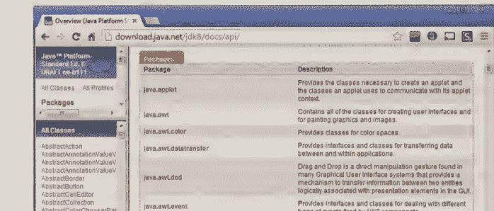

Java 类被组织成包，它们属于 `com.java` 包。文档主页分为几个框架。最大的框架列出了组成 Java 类库的所有包以及对每个包的描述。包的名称描述了它们的用途。例如，`java.io` 一个用于磁盘驱动器输入输出的类集合；`java.time` 包含与时间和日期相关的类；而 `java.util` 类收集了有用的工具类。

在文档主页上，最大的框架是包列表，每个包都有简短描述。点击包名以了解更多信息。页面将加载该包中的类。Java 类库中的每个类在所在网站上都有自己的文档页面，总页数超过 26,000 页。（你并不需要读完它们。）

在小节的最后一个项目中，你将探索该库并使用现有的 Java 类为你完成一些工作。`Dice` 程序使用了 `java.util` 包中的 `Random` 类，该类用于创建随机数。在程序中使用该类的第一步是使用以下语句导入其包：

```java
import java.util.*;
```

这使得你无需使用全名（即 `java.util.Random`）即可引用 `Random` 类。相反，你只需要将其称为 `Random`。星号允许你通过短名称引用包中的所有类。`Random` 类是一个用于创建 `Random` 对象的模板。要创建一个对象，使用 `new` 关键字、加上类名和括号：

```java
Random generator = new Random();
```

这创建了一个名为 `generator` 的变量，它持有一个新的 `Random` 对象。该对象是一个随机数器，可以产生一个或多个随机数。对于此程序，将使用对象的 `nextInt()` 方法产生一个随机整数值：

```java
int value = generator.nextInt();
```

整数范围从 -2,147,483,648 到 2,147,483,647。生成器随机从中选择一个数字并将其分配给 `value` 变量。如果没有 Java 类库中的 `Random` 类，你必须自己编写程序来产生随机数，这是一项极其复杂的任务。随机数在游戏、教育程序以及其他必须执行随机操作的程序非常有用。

在 NetBeans 中创建一个新的空 Java 文件，命名为 `Dice`，并将其放入 `com.java24hours` 包中。当源码编辑器打开时，将 Listing 4.3 的文本输入该窗口，然后点击 Save 按钮（或选择菜单命令 File、Save）。

# 列表 4.3 Dice.java 的全文

```java
package com.java24hours;

import java.util.*;

class Dice {
    public static void main(String[] arguments) {
        Random generator = new Random();
        int value = generator.nextInt();
        System.out.println("The random number is " + value);
    }
}
```

选择 Run、Run File 运行程序。输出如图 4.4 所示，尽管你的数字会不同。（实际上，有四十亿分之一的概率出现相同的数字，这比中彩票还要难。）

图 4.4 `Dice` 程序的输出。

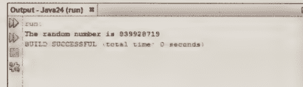

你现在拥有了一个随机选取的整数供自己使用。好好对待它。`Random` 类像 Java 类库中的所有类一样，在 Oracle 网站上有详尽的文档可以阅读。它描述了类的用途、所属的包、如何创建该类的对象，以及可以调用哪些方法让它执行操作。

# 摘要

在这一小时中，你有机会创建了一个 Java 程序，向程序发送参数，并使用了 Java 类库中现有的程序。

随着你作为 Java 程序员的经验越发丰富，接下来的几小时将继续侧重于应用程序。应用程序的测试速度更快，因为你不需要像运行其他类型的程序那样执行任何额外工作来运行它们。

这一小时是几个讨论如何在 Java 程序中使用 `对象（objects）` 的课程中的第一节。你将在第 10 小时“创建你的第一个对象”中回到这个主题。

## 工作坊

### 问答

**Q.** 发送到 Java 应用程序的所有参数都必须是字符串吗？

**A.** 当应用程序运行时，Java 将所有参数都存储为字符串。当你想要将其中一个参数作为整数或其他非字符串类型时，你必须对该值进行转换。请在第 11 小时“描述你的对象的特征”中学习如何操作。

**Q.** 如果一个程序运行在网页以及任何其他地方，那么由 Java Web Start 启动的 Java 程序是什么？

**A.** Java Web Start 是从 Web 浏览器启动 Java 应用程序的一种方式。用户点击链接运行程序，这比下载它、运行安装向导并像任何其他桌面软件一样启动它要简单。

尽管它们来自网页，但 Java Web Start 程序是应用程序（applications）而不是小程序（applets）。应用程序是最新的，因为它每次运行时都会通过 Web 从程序提供者处检索。

`Google Web Toolkit (GWT)` 是一个用于 Web 编程的开源工具集可以将 Java 程序转换为 JavaScript，使其在浏览器中运行得更快、更可靠，且完全不需要 Java 虚拟机。

**Q.** 英国王位的继承顺位会在某个时间点耗尽吗？

**A.** 根据 1701 年以来一直实施的议会法，英国君主必须是汉诺威的索菲亚（Sophia of Hanover）的新教派后裔，索菲亚是一位德国公主，在法律通过时她是王冠的继承人。

索菲亚的后裔人数是有限的，因此皇室血脉中始终有人。英国政府仅列出了前 38 位，因此谱系学家试图将自己填入列表。

继承顺位中的最后一个人是 Karin Vogel，一位 30 多岁的德国治疗师。在 2001 年，她排在第 4,973 位，谱系学家在经过多年的详尽搜索后确定了这一点。因此，如果排在她前面的所有人都退出竞争（为了，所以，花更多时间学习 Java 编程），Vogel 将接管白金汉宫的抵押贷款并成为女王陛下。

Vogel 是索菲亚的曾曾曾曾曾曾曾外女外孙女。她告诉《沃尔街日报》，成为君主“压力太大了”。

随着威廉王子和凯特公主的儿子乔治（George，正式名称为剑桥公的乔治·亚历山大·路易斯王子）的出生，Vogel 降到了第 4,974 位。

### 练习

通过回答以下问题来测试你对本小时涵盖内容的掌握程度。

1. 哪种类型的 Java 程序可以由浏览器运行？

   A. 小程序 (Applets)

   B. 应用程序 (Applications)

   C. 无

2. JVM 代表什么？

   A. 假期营销杂志 (Journal of Vacation Marketing)

   B. 杰克逊维退伍军人营销 (Jacksonville Veterans Marketing)

   C. Java 虚拟机 (Java Virtual Machine)

3. 如果你为了向 Java 应用程序发送信息的方式与某人争吵，你在做什么？

   A. 为字符串挣扎 (Struggling over strings)

   B. 为参数争论 (Arguing about arguments)

   C. 为功能决斗 (Feuding for functionality)

# 答案

1. **A.** 小程序作为网页的一部分运行，而应用程序在其他任何地方。

2. **A., B., 或 C.** 陷阱题！首字母代表了所有三个意思，尽管 `Java Virtual Machine` 是你在接下来 20 小时内需要记住的。

3. **B.** 应用程序以参数的形式接收信息。我们不能好相处吗？

## 活动

如果你想应用你对应用程序的敏锐理解，建议进行以下活动：

- 以 `Root` 程序为指导，创建一个 `NewRoot` 应用程序，它可以显示 625 的平方根。

- 以 `Root` 程序为指导，创建一个 `NewRoot` 应用程序，它可以显示作为参数提交的数字的平方根。

本书中活动的解决方案已列在书的官方网站 `www.java24hours.com` 上。

# 第 5 小时：在程序中存储和更改信息

在第 2 小时“编写你的第一个程序”中，你使用了一个变量（`variable`），这是一个设计用于存储信息的特殊位置。存储在变量中的信息可以在程序运行时被更改。你的第一个程序在变量中存储了一个文本字符串。字符串只是可以存储在变量中的一种信息类型。它们还可以存储字符、整数、浮点数和对象。

本小时的待办事项：

- 创建一个变量。
- 使用不同类型的变量。
- 在变量中存储值。
- 在数学表达式中使用变量。
- 将一个变量的值存储在另一个变量中。
- 增加和减少变量的值。

在这一小时，你将学习更多关于在 Java 程序中使用变量的知识。

## 语句和表达式

计算机程序是一组告诉计算机该做什么的指令。每条指令被称为一个语句（`statement`）。下面这个 Java 程序的示例就是一个语句：

```java
int highScore = 450000;
public static void main(String[] arguments) {
  int a = 3;
  int b = 4;
  int c = a * b * 5;
}
```

你可以使用括号在 Java 程序中将一组语句分组。这些分组被称为块语句（`block statements`）。考虑程序的以下这部分：

此示例的第 2 到第 4 行是一个块语句。第 1 行的左括号表示块的开始，第 5 行的右括号表示块的结束。

某些语句被称为表达式（`expressions`），因为它们涉及数学表达式并产生结果。前述示例中的第 4 行是一个表达式，因为它将变量 `c` 的值设为 8 乘以 5。你在这一小时中将处理这些表达式。

## 分配变量类型

变量是计算机在运行程序时记住某些内容的主要方式。第 2 小时中的“Salute”（问候）程序使用了 `greeting` 变量来存储“Salution mondo！”计算机需要记住这段文本，以便以后显示该消息。

在 Java 程序中，变量通过语句创建，该语句必须包含两个要点：

- 变量名
- 变量将存储的信息类型

变量还可以包含正在存储的信息值。

要查看不同类型的变量以及它们是如何创建的，启动 NetBeans 并创建一个类名为 `Variable` 的新空 Java 文件。

通过输入以下内容开始编写程序：

```java
package java24hours;
class Variable {
    public static void main(String[] arguments) {
        // Coming soon: variables
    }
}
```

在进行任何更改之前保存这些行。

## 整数和浮点数

到目前为止，`Variable` 程序的 `main()` 块中只有一个语句——`// Coming soon: variables`。删除该注释并输入以下语句：

```java
int tops;
```

此语句创建了一个名为 `tops` 的变量。它没有指定 `tops` 的值，因此目前该变量是一个空空间。语句开头的 `int` 指定它用于存储整数。你可以使用 `int` 类型存储程序所需的大多数整数。它可以存储从大约 -21 亿到 21 亿之间的任何整数。

在 `tops` 语句之后添加一个空行，然后输入以下语句：

```java
float gradePointAverage;
```

此语句创建了一个名为 `gradePointAverage` 的变量。`float` 代表浮点。浮点变量用于存储可能包含小数点的数字。

`float` 变量最多可以存储 38 位数字。`double` 类型最多可以存储 300 位数字。

## 字符和字符串

由于你目前为止处理的变量都是数值，你可能认为所有变量都用于存储数字。再想想。你也可以使用变量来存储文本。有两种类型的文本作为变量存储：字符（`characters`）和字符串（`strings`）。字符是单个字母、数字、标点符号或符号。字符串是字符的组。

创建 `Variable` 程序的下一步是创建一个字符和一个字符串变量。在 `float gradePointAverage` 行之后添加这两个语句：

```java
char key = 'C';
String productName = "Larvets";
```

当程序中使用字符值时，必须在赋值给变量的字符值两侧加上单引号。对于字符串，必须用双引号括起来。

引号可以防止字符或字符串与变量名或语句的其他部分混淆。看下面的语句：

```java
String productName = "Larvets";
```

> **注意**
>
> 你可以使用浮点变量来存储平均分，例如 2.25（在北德克萨斯州大学选择你自己的分数——你好，Wells 教授！）。你也可以用它存储一个数字 0，代表根据你的平均分进入良好学校的百分比，这就是为什么当这家出版商在 1996 年寻找计算机作者时，我在就业市场上。


# 5: 在程序中存储和更改信息

这条语句看起来像是在告诉计算机创建一个名为 `productName` 值为 `Larvets` 的字符串变量。然而，由于 `Larvets` 单词周围没有引号，计算机被要求将 `productName` 设置为与变量 `Larvets` 的值。（如果没有名为 `Larvets` 的变量，程序将编译失败并报错。）

在添加 `char` 和 `String` 语句后，你的程序将类似于列表 5.1。进行任何必要的更改并确保保存文件。

尽管其他变量类型都是小写字母（`int`、`float` 和 `char`），但在创建字符串变量时，`String` 单词的首字母需要大写。Java 中的 `String` 类型与变量语句中使用的信息类型不同。你将在第 6 小时“使用字符串进行通信”中学习到这种区别。

## 列表 5.1 变量程序

```java
1: package com.java24hours;
2:
3: class Variable {
4:     public static void main(String[] arguments) {
5:     int type;
6:     float gradePointAverage;
7:     char key = 'C';
8:     String productName = "Larvets";
9:
10: }
```

`Variable` 程序中的两个变量在创建时使用 `=` 符号来分配一个初始值。你可以在 Java 程序中创建的任何变量上使用此选项，正如你在这个小时稍后将发现的那样。

此程序可以运行，但没有输出。

## 其他数值型变量类型

到目前为止介绍的变量类型是你进行 Java 编程时使用的主要类型。在特殊情况下，你可以调用其他几种类型的变量。

你可以使用第一种 `byte` 来表示范围从 -128 到 127 的整数。以下语句创建了一个名为 `escapeKey` 的变量，初始值为 27：

```java
byte escapeKey = 27;
```

第二种 `short` 可用于比 `int` 类型更小的整数。`short` 整数的范围从 -32,768 到 32,767，如下例所示：

```java
short roomNumber = 222;
```

### 分配变量类型

数值型变量的最后一种 `long`，通常用于 `int` 类型无法容下的巨大整数。`long` 整数的范围可以从 -9.22 万亿到 9.22 万亿，这是一个巨大的数字，足以涵盖除政府支出以外的所有内容。

当你在 Java 中处理大数字时，很难一眼看出数字的值，如下语句所示：

```java
long salary = 264400000;
```

除非你数出零的个数，否则你可能无法判断出它是 2.64 亿美元。Java 允许使用下划线 (`_`) 字符来组织大数字。这里有一个例子：

```java
long salary = 264_000_000;
```

下划线会被忽略，因此变量的值保持不变。它们只是让数字更具可读性的方法。

## boolean 变量类型

Java 有一种名为 `boolean` 的变量类型，只能用于存储 `true` 或 `false` 值。从初看，如果你计划编写很多判断性选择题，`boolean` 变量可能看起来并不有用。然而，`boolean` 变量用于你程序中的多种情况。以下是可以使用 `boolean` 变量回答的问题示例：


- 用户按过按键吗？
- 游戏结束了吗？
- 我的银行账户透支了吗？
- 兔子能吃 Trix 吗？

布尔值存储“是/否”或“真/假”问题答案的地方。以下语句创建了一个名为 `gameOver` 的 `boolean` 变量：

```
boolean gameOver = false;
```

如果 IDE 没有设置为较旧版本的 Java，数字中的下划线会在 NetBeans 源编辑器中被标记为错误。为了确保不发生这种情况，在“项目”（Projects）窗格中，右键点击当前项目名称（很可能是 Java）并选择“属性”（Properties）。打开“属性”对话框的“源”（Source）类别页。检查“源/二进制格式”下拉菜单，以确保它是当前的 Java 版本。

布尔（Boolean）是以乔治·布尔（George Boole, 1815-1864）命名的。布尔是一位直到成年后都在自学的数学家，他发明了布尔代数，这已成为计算机编程、数字电子和逻辑的基础组成部分。可以想象他小时候在做判断题测试时表现得很好。


# 第 5 小时：在程序中存储和更改信息

该变量的初始值为 `false`，因此像这样的语句可以在游戏程序中表示游戏尚未结束。稍后，当发生结束游戏的事件时，可以将 `gameOver` 变量设置为 `true`。

尽管这两个可能的 `Boolean` 值在程序中看起来像字符串，但你不应该用引号包围它们。第 7 小时“使用条件测试做出决策”将更详尽地描述 `boolean` 变量。

## 为你的变量命名

Java 中的变量名可以以字母、下划线或美元符号 (`$`) 开头，名称的其余部分可以是任何字母或数字。你可以给变量起你喜欢的任何名称，但在命名方式上应该保持一致。本节概述了通常推荐的变量命名方法。

Java 在变量名方面是区分大小写的，你必须始终以相同的方式大写变量名。例如，如果引用 `gameOver` 变量，必须始终保持大小写一致。变量名应该描述其用途。如果你在程序某处将 `gameOver` 写为 `GameOver`，程序将无法编译。

变量名并不是唯一区分大小写的方面。语言中使用的单词，如 `public`、`true` 和 `false`，不能作为变量名。除了变量名外，其他内容也必须区分大小写。如果你在程序中使用这些变量名，NetBeans 会在行旁边标记红色错误图标。

```
int TimeHighScore;
```

变量名中不能使用标点符号或空格，如下：

```
int time_score;
```

## 在变量中存储信息

你可以在创建变量的同时为变量存储一个值。你也可以在之后的任何时候给变量赋值。

要在创建变量时设置初始值，请使用等号。这是一个创建一个值为 3.14 的 `double` 浮点变量的示例：

```
double pi = 3.14;
```

所有存储数字的变量都可以以类似的方式设置。你也可以将一个变量设置为另一个变量的值，只要它们的类型相同。考虑以下示例：

```
int mileage = 300;
int totalMileage = mileage;
```

首先，创建了一个初始值为 300 的整数变量 `mileage`。接下来，创建了一个与 `mileage` 值相同的整数变量 `totalMileage`。两个变量的初始值都是 300。在后续章节中，你将学习将一个变量的值转换为另一种类型。

如果在另一个语句中使用变量之前没有给它初始值，那么在编译程序时，可能会得到“变量可能未初始化”的错误。

正如你所学的，Java 拥有存储不同大小值的数值变量。`int` 和 `long` 都是整数，但 `long` 拥有更大的范围。`float` 和 `double` 都是浮点数，但 `double` 更大。

你可以在数值后面附加一个字母来指示数值的类型，如下语句所示：

```
float pi = 3.14F;
```

数值 3.14 之后的 "F" 表示它是一个 `float` 值。如果省略该字母，Java 会假设 3.14 是 `double` 值。

字母 "L" 用于 `long` 整数，"D" 用于 `double` 浮点值。

## 第 5 章：在程序中存储和更改信息

Java 的另一种命名规范是将值不会发生改变的变量名中的每个字母都大写。这些变量被称为常量。以下代码创建了三个常量：

```
final int TOUCHDOWN = 6;
final int FIELDGOAL = 3;
final int PAT = 1;
```

由于常量的值永远不会改变，你可能会奇怪为什么需要使用它们——你直接使用赋值给常量的值即可。使用常量的一个优点是它们让程序更易于理解。

在前面的三个语句中，常量的名称使用了大写。这在 Java 中并不是强制的，但已成为程序员之间的一种标准规范，用于将常量与其他变量区分开来。

## 运算符详解

语句可以通过使用运算符 `+`、`-`、`*`、`/` 和 `%` 来使用数学表达式。你在整个 Java 程序中通过这些运算符进行数字计算。

Java 中的加法表达式使用 `+` 运算符，如下句所示：

```
double weight = 205;
weight = weight + 10;
```

第二条语句使用 `+` 运算符将 `weight` 变量设置为其当前值加上 10。减法表达式使用 `-` 运算符：

```
weight = weight - 15;
```

该表达式将 `weight` 变量设置为其当前值减去 15。

除法表达式使用 `/` 符号：

```
weight = weight / 3;
```

这将 `weight` 变量设置为其当前值除以 3。

要找到除法表达式的余数，请使用 `%` 运算符（也称为取模运算符）。以下语句计算 245 除以 3 的余数：

```
int remainder = 245 % 3;
```

乘法表达式使用 `*` 符号。这里有一条语句将乘法表达式作为更复杂语句的一部分：

```
int total = 500 + (score * 12);
```

表达式中的 `score * 12` 部分将 `score` 乘以 12。整条语句将 `score` 乘以 12 并在结果上加上 500。如果 `score` 等于 20，该表达式的结果为 `total` 等于 740：500 + (20 * 12)。

# 变量的递增递减

程序中的常见任务是将变量的值改变 1。你可以将值增加 1，这被称为变量的递增；或者将值减少 1，这被称为变量的递减。可以使用运算符完成这两项任务。

要将变量的值增加 1，使用 `++` 运算符，如下句所示：

```
power++;
```

该语句在 `power` 变量存储的值上加 1。

要将变量的值减少 1，使用 `--` 运算符：

```
rating--;
```

该语句将 `rating` 减少了 1。

你也可以将递增和递减运算符放在变量名之前，如下句所示：

```
++power;
--rating;
```

将运算符放在变量名之前称为前置（prefixing），将其放在名称之后称为后置（postfixing）。

感到困惑了吗？如果你回想起小学学习前缀的时候，这其实比听起来要简单。就像像 "sub-" 或 "un-" 这样的前缀位于 "suburban”（郊区的）或 "unexpected”（意外的）等单词的开头一样，前置运算符位于变量名的开头。后置运算符则位于结尾。

# 第 5 小节：在程序中存储和更改信息

在表达式内部使用递增递减运算符时，前置运算符和后置运算符的区别就变得重要了。

考虑以下语句：

```
int x = 3;
int answer = x++ * 10;
```

在处理这些语句后，`answer` 变量等于多少？你可能期望它等于 40——如果 3 增加了 1 等于 4，然后将 4 乘以 10，那么就是 true。

然而，`answer` 的最终值为 30，因为使用了后置运算符而不是前置运算符。

当在表达式内部对变量使用后置运算符时，在表达式求值之前，变量的值不会改变。`int answer = x++ * 10` 语句的效果与以下两个语句相同且顺序也相同：

```
int answer = x * 10;
x++;
```

前置运算符的情况则相反。如果它们在表达式内部对变量使用使用，变量的值在表达式求值之前就会改变。

考虑以下语句：

```
int x = 3;
int answer = ++x * 10;
```

这导致 `answer` 变量等于 40。前置运算符导致 `x` 变量的值在表达式求值之前发生了改变。`int answer = ++x * 10` 语句的效果与这些语句相同且顺序也相同：

```
x++;
int answer = x * 10;
```

很容易对 `++` 和 `--` 运算符感到烦躁，但如果你回想起小学学习前缀的时候，这比听起来要简单。就像像 "sub-" 或 "un-" 这样的前缀位于 "suburban" 或 "unexpected" 等单词的开头一样，前置运算符位于变量名的开头。后置运算符则位于结尾。（此处原文此处重复了部分逻辑，按要求仅翻译不重复）

（注：原文此处存在内容重复，已按逻辑整合翻译）

递增和递减很有用，但通过使用 `+` 和 `-` 运算符也可以得到相同的结果：

```
x = x + 1;
x -= 1;
```

# 运算符的优先级

当你使用包含多个运算符的表达式时，需要知道计算机是如何处理它们的。考虑以下语句：

```
int y = 10;
x = y * 3 + 5;
```

除非你知道计算机在处理表达式时的顺序，否则你无法确定 `x` 被设置为多少。它可能是 35 或 80，取决于 `3 * 5` 是否先计算。

在处理表达式时，遵循以下计算顺序：

- 递增和递减首先执行。
- 乘法、除法和取模执行。
- 加法和减法随后执行。
- 比较执行。
- 赋值符号 (=) 用于设置值。

比较将在第 7 小节讨论。

## 使用表达式

当你上学校时，在处理一个特别讨厌的数学题时，你是否曾向更高的力量抱怨，抗议说你永远不会用到这些知识？抱歉要告诉你，但你的老师是正确的——你的数学技能在编程中非常有用。

## 使用表达式

好消息是，计算机可以执行你要求的任何数学计算。表达式在你的计算机程序中被频繁使用，用于完成以下任务：

- 改变变量的值
- 统计程序中某事件发生的次数
- 在程序中使用数学公式

当你编写计算机程序时，你会发现自己在使用表达式时会用到以前学过的数学知识。表达式可以使用加法、减法、乘法、除法和取模。

查看表达式的实际应用，返回 NetBeans 并创建一个类名为 `PlanetWeight` 的新 Java 文件。该程序将跟踪一个人在太阳系其他天体旅行时体重的减轻和增加情况。在源编辑器中输入列表 5.2 的完整文本。我们将逐一讨论程序的每个部分。

# 列表 5.2 PlanetWeight 程序

```
1: package com.java24hours;
2:
3: class PlanetWeight {
4:     public static void main(String[] arguments) {
5:         System.out.println("Your weight on Earth is ");
6:         double weight = 178;
7:         System.out.println(weight);
8:
9:         System.out.println("Your weight on Mercury is ");
10:        double mercury = .378;
11:        System.out.println(mercury);
12:
13:        System.out.println("Your weight on the Moon is ");
14:        double moon = .166;
15:        System.out.println(moon);
16:
17:        System.out.println("Your weight on Jupiter is ");
18:        double jupiter = 2.364;
19:        System.out.println(jupiter);
20:    }
21: }
```

完成后，保存文件，它应该会自动编译。通过菜单命令 `Run` -> `Run File` 运行程序。输出显示在图 5.1 的输出面板中。

# 72 小时第 5：在程序中存储和更改信息

图 5.1

PlanetWeight 程序的输出。

```
Output - Java24 (run)
> run
> Your weight on Earth is 178.0
> Your weight on Mercury is 67.284
> Your weight on the Moon is 29.648000000000002
> Your weight on Jupiter is 927.782
BUILD SUCCESSFUL (total time: 1 second)
```

与你创建的其他程序一样，PlanetWeight 程序使用 `main()` 块语句来完成其所有工作。该语句可以分解为以下几个部分：

1. 第 5–7 行：该人的体重初始设置为 178。
2. 第 9–11 行：计算在水星上的体重减轻。
3. 第 13–15 行：确定在月球上的体重减轻。
4. 第 17–19 行：计算在木星上的体重。

对于示例值，PlanetWeight 应用使用了 178 磅的体重，根据 BMC 健康研究，这恰好是北美人的平均体重。借此比较了 164 磅的洋洲人、156 磅的欧洲人、150 磅的拉丁美洲人、134 磅的非洲人和 127 磅的亚洲人。

下一行与程序中的其他几个语句类似：`System.out.println(weight);`

`System.out.println()` 命令显示括号内包含的字符串。在第 5 行上，`System.out.print()` 命令显示文本 "Your weight on Earth is"。程序中有多处 `System.out.print()` 和 `System.out.println()` 语句。

它们之间的区别在于，`print()` 在显示文本后不会另起一行，而 `println()` 则会。

所以，如果你在北美阅读这段内容，并且有人问你：“你会配着那个吃一个苹果吗？”，那么这个问题的正确答案是“不不会”。

## 总结

现在你已经接触了变量和表达式，你可以在程序中给计算机提供广泛的指令。

通过你在这一小时内开发的技能，你可以编写出完成与计算器许多相同任务的程序，轻松地处理复杂的方程。

你还学到了去月球之行是一个特别有效的减肥计划。数字只是变量中可以存储的一种类型。你还可以存储字符、字符串以及被称为 `boolean` 变量的 `true` 或 `false` 值。下一个小时将扩展你对 `String` 变量的知识以及如何存储和使用它们。

## 工作坊

## 问答

Q. Java 程序中的一行和语句（statement）是同的吗？

A. 不是。你创建的程序每行只放一个语句是为了让程序更容易理解；这并不是强制要求的。Java 编译器在编译时不考虑行、间距或其他格式问题。编译器只希望在每个语句的末尾使用分号。这一行代码在 Java 中是可以运行的：

```
int x = 12;
```

在同一行中放置多个语句会使人类难以阅读其源代码。

Q. 为什么变量名的第一个字母应该是小写？

A. 这是一种命名规范，可以从两个方面帮助你的编程。首先，它让变量在其他元素中更容易被识别。其次，通过在变量命名时遵循一致的风格，你可以消除在某些地方使用变量时可能发生的错误。

Q. 在 Java 中，可以使用整数来指定吗？

A. 可以，这是在某个版本中引入的。你可以在变量名后面指定 `0b101`。这一行代码在 Java 中是可以运行的：

```
int x = 12;
```

在同一行中放置多个语句会使人类难以阅读其源代码。

Q. 什么是字符串？

A. 字符串是这一小时中介绍的，你可以通过 `strings.com` 查看它们。

## 测验

通过回答以下问题测试你对变量和表达式的知识。

1. 包含在括号内的字符串被称为什么？

   A. 块语句

   B. 分组（grouping）

   C. 括号（bracket）

2. 布尔变量（boolean variable）用于存储哪些值？

   A. `true`

   B. `false`

   C. 谢谢。

3. 哪些字符不能用于变量名？

   A. 美元符号

   B. 两个正斜杠 (//)

   C. 字母

# 答案

1. A. 被称为块语句。

2. A. `true` 和 `false` 是布尔变量可以存储的值。

3. B. 变量以字母、美元符号（$）或下划线（_）开头。

# 第 6 小时：使用字符串进行通信

此语句创建了一个名为 `fullName` 的字符串变量，包含文本 "Fin Shepard"，他是 2013 年电影杰作《大鲨》中的英雄。在 Java 语句中，字符串用文本两边的双引号表示。这些双引号并不包含在字符串本身。

与你用过的其他类型变量（`int`、`float`、`char`、`boolean` 等）不同，`String` 类型名称的首字母是大写的。

字符串是一种被称为“对象”（objects）的特殊信息，在 Java 中，所有对象的类型首字母都是大写的。你将在第 10 小时“创建你的第一个对象”中学习对象。在此小时需要注意的重要点是，字符串与其他变量类型不同，正因为这种差异，`String` 的首字母是大写的。

## 在程序中显示字符串

在 Java 程序中显示字符串最基础的方法是使用 `System.out.println()` 语句。该语句接收括号内的字符串和其他变量，并将它们的值显示在系统输出设备（即计算机显示器）上。这里有一个示例：


```
System.out.println("We can't just wait here for sharks to rain down on us.");
```

该语句会导致以下文本显示：

We can't just wait here for sharks to rain down on.

在屏幕上显示文本通常被称为“打印”（printing），这也是 `println()` 的含义——打印行（print line）。你可以使用 `System.out.println()` 语句显示双引号内的文本，并如你后面看到的，显示变量。将你想显示的所有内容放在括号内。

显示文本的另一种方法是调用 `System.out.print()`。该语句显示括号内的字符串和其他变量，但与 `System.out.println()` 不同，它允许后续语句在同一行上显示文本。

你可以连续多次使用 `System.out.print()` 在同一行显示多个内容，如下例所示：

```
System.out.print("There's ");
System.out.print("a ");
System.out.print("shark ");
System.out.print("in ");
System.out.print("your ");
System.out.println("pool.");
```

这些语句会导致以下文本显示：

There's a shark in your pool.

## 在字符串中使用特殊字符

在创建或显示字符串时，其文本必须包含在双引号内。这些双引号不会被显示，这引出了一个问题：如果你想显示双引号怎么办？

为了显示它们，Java 创建了一个可以放入字符串的特殊代码：`\"`。每当在字符串中遇到此代码时，它就会被替换为双引号。例如，查看以下内容：

```
System.out.println("Anthony Ferrante directed \"Sharknado\" in 2013.");
```

该代码显示的内容如下：

Anthony Ferrante directed "Sharknado" in 2013.

你可以通过这种方式在字符串中插入多个特殊字符。下列表显示了这些特殊字符；注意每个字符前面都有一个反斜线（`\`）。

| 特殊字符 | 显示结果 |
|---|---|
| `\'` | 单引号 |
| `\"` | 双引号 |
| `\\` | 反斜线 |
| `\t` | 制表符 |
| `\b` | 退格符 |
| `\r` | 回车 |
| `\f` | 换页符 |
| `\n` | 换行符 |

换行符会导致换行之后的文本显示在下一行的开头。看这个示例：

```
System.out.println("Script by\nThunder Levin");
```

该语句的显示如下：

```
Script by
Thunder Levin
```

## 拼接字符串

当你使用 `System.out.println()` 并以其他方式处理字符串时，你可以使用 `+` 将两个字符串拼接在一起，这与用于数字相加的运算符相同。

`+` 运算符在字符串方面有不同的含义。它不是执行数学运算，而是将字符串拼接在一起。此操作会导致字符串显示在一起，或者将两个较小的字符串合并为一个大字符串。

“拼接”（Concatenation）是描述这种动作的词，它的意思是将两个字符串链接。

以下语句使用 `+` 运算符显示了一个长字符串：

```java
System.out.println("\"Sharknado\" is an hour and a half of your "
+ "life that you'll never get back. And you won't want to.\n"
+ "\t- David Hinckley, New York Daily News");
```

你没有将此字符串放在单行（这会使你以后查看程序时更难理解），而是使用 `+` 运算符将文本跨越程序 Java 文本文件的两行。当该语句显示时，它的形式如下：

"Sharknado" is an hour and a half of your life that one'll never get back.

And you won't want to.

	 David Hinckley, New York Daily News

字符串中使用了几个特殊字符：`\"`、`\'`、`\n` 和 `\t`。为了更好地熟悉这些字符，请将输出与产生它的 `System.out.println()` 语句进行比较。

> **注意**
>
> 在你建立编程技能的过程中，你可能会在其他书中看到 concatenation（拼接）这个术语，它是值得了解的。然而，该术语用于将一个字符串和另一个字符串连接在一起。Pasting（粘贴）听起来很有趣。Concatenating（拼接）听起来像是在明火面前绝对不应该做的事。


## 在字符串与其他变量

虽然你可以使用 `+` 运算符拼接字符串，也可以用它来拼接变量的值。看以下内容：

```java
String searchKeywords = "";
searchKeywords += "shark ";
searchKeywords += "hurricane ";
searchKeywords += "danger";
```

这段代码导致 `searchKeywords` 的结果为 "shark hurricane danger"。第一行创建了 `searchKeywords` 变量并设为空字符串。第二行添加了 "shark "后两行添加了 "hurricane " 和 "danger"。

正如你看到的，当你要在变量末尾添加文本时，Java 提供了一个简化此过程的快捷方法：`+=` 运算符。对于字符串，之前的 `searchKeywords` 示例可以使用 `searchKeywords = searchKeywords + " ";` 这种方式简化（如下所示）：

## 高级字符串处理

你还有其他几种方法可以检查字符串变量并改变其值。这些高级功能之所以可能是因为字符串是对象。处理字符串可以培养你应用于其他对象的技能。

### 比较两个字符串

你在程序中测试的一个点是一个字符串是否等于另一个字符串。你可以通过在包含两个字符串的语句中使用 `equals()` 来实现，例如：

```java
String favorite = "chainsaw";
String guess = "pool cue";
System.out.println("Is Fin's favorite weapon " + guess + "?");
System.out.println("Answer: " + favorite.equals(guess));
```

这个示例使用了两个不同的字符串变量。其中 `favorite` 存储了芬最喜欢的捕鲨工具的名字：电锯。另一个 `guess` 存储了他可能喜欢的猜测。即猜测芬喜欢的是泳池。

第三行显示文本 "Is Fin's favorite weapon "，后面跟着 `guess` 变量的值，然后是一个问号。第四行显示文本 "Answer:" 然后包含一个新内容：

`favorite.equals(guess)`

语句的这部分被称为方法（method）。方法是在 Java 程序中完成任务的方式。该方法的任务是判断一个字符串是否与另一个字符串相同。如果两个变量的值相同，则显示 true。如果不是，则显示 false。以下是该示例的输出：

## 输出

Fin 最喜欢的武器是台球杆吗？

答案：false

## 确定字符串的长度

确定字符串的字符长度也很有用。

你可以使用 `length()` 方法来实现。该方法的工作方式与 `equals()` 方法相同，区别在于只涉及一个变量。看下面的示例：

```
String cinematographer = "Ben Demaree";
int nameLength = cinematographer.length();
```

这个示例将整数变量 `nameLength` 设置为 11。`cinematographer.length()` 方法计算名为 `cinematographer` 的字符串变量中的字符数，并将此计数存储在 `nameLength` 整数变量中。

### 修改字符串的大小写

由于计算机处理所有内容都是根据字面意思，因此很容易让它们产生混乱。虽然人类能够识别出文本 "Ian Ziering" 和 "IAN ZIERING" 指的是同一个东西，但大多数计算机会持不同意见。在本节之前讨论的 `equals()` 方法明确地指出“Ian Ziering”不等于“IAN ZIERING”。

为了绕过这些障碍，Java 提供了可以将字符串变量显示为全大写字母或全小写字母的方法，分别为 `toUpperCase()` 和 `toLowerCase()`。接下来的示例展示了 `toUpperCase()` 方法的用法：

```
String fin = "Ian Ziering";
String change = fin.toUpperCase();
```

这段代码将字符串变量 `change` 设置为 `fin` 字符串转换为全大写字母的结果——“IAN ZIERING”。`toLowerCase()` 方法的工作方式相同，但返回的是全小写的字符串值。

注意，`toUpperCase()` 方法不会改变它所调用的字符串变量的大小写。在前面的示例中，`fin` 变量仍然等于“Ian Ziering”。

绕过这一特定障碍另一种方法是调用 `equalsIgnoreCase()` 方法，该方法会在忽略大小写的情况下比较两个字符串。调用该方法比较字符串“Tara Reid”将返回值 `true`，表示它们匹配。


### 查找字符串

处理字符串时的另一个常见任务是查看一个字符串是否可以在另一个字符串内部找到。要查找字符串内部的内容，请使用它的 `indexOf()` 方法。将你要查找的字符串放入其中。如果未找到该字符串，`indexOf` 会产生值 -1。如果找到了字符串，`indexOf` 会产生一个表示字符串起始位置的整数。字符串中的位置从 0 开始向上编号，字符串中的第一个字符为位置 0。在字符串 "Sharkando" 中，文本 "nado" 从位置 5 开始。

`indexOf()` 方法的一个可能用途是搜索整个 *Sharkando* 脚本，寻找英雄们驾驶直升机进入龙卷风投炸弹的地方，此时 Nova 说：“我们需要一台更大的直升机”（We're gonna need a bigger chopper）。

如果 *Sharkando* 的整个脚本存储在一个名为 `script` 的字符串中，你可以使用以下语句搜索该引言的一部分：

```
int position = script.indexOf("We're gonna need a bigger chopper");
```

如果在此 `script` 字符串中找到了该文本，`position` 等于文本 "We're gonna need a bigger chopper" 开始的位置。否则，它将等于 -1。

如果你在另一个字符串内部查找一个字符串，但不关心位置，字符串的 `contains()` 方法会返回一个布尔值。如果找到了要查找的字符串，则返回 `true`，否则返回 `false`。这里有一个示例：

```
if (script.contains("There's a shark in your pool")) {
    int stars = 4;
}
```

## 展示演职表

接下来，为了强化你编写 Java 程序显示长篇电影演职表的字符串处理功能，你可能已经猜出这部电影了。

返回 NetBeans 中的 Java24 项目，并在 `com.java24hours` 包中创建一个名为 `Credits` 的空 Java 文件。将列表 6.1 中的文本输入到源编辑器，并在完成后保存文件。

### 列表 6.1 演职表程序

```java
1: package com.java24hours;
2:
3: class Credits {
4:     public static void main(String[] arguments) {
5:         // 设置电影信息
6:         String title = "Sharknado";
7:         int year = 2013;
8:         String director = "Anthony Ferrante";
9:         String role1 = "Fin";
10:        String actor1 = "Van Ziering";
11:        String role2 = "April";
12:        String actor2 = "Tara Reid";
13:        String role3 = "George";
14:        String actor3 = "John Heard";
15:        String role4 = "Nova";
16:        String actor4 = "Cassie Scerbo";
17:        // 显示信息
18:        System.out.println("A " + (year + " ") + title + "\n" +
19:                            "Director: " + director + "\n" +
20:                            role1 + "\t" + actor1 + "\n" +
21:                            role2 + "\t" + actor2 + "\n" +
22:                            role3 + "\t" + actor3 + "\n" +
23:                            role4 + "\t" + actor4);
24:
25:    }
```

检查该程序，看看你是否能看出它每一步在做什么。

## 使用字符串进行通信

如果你的 `Credits` 程序看起来像 6.1 一样，请给自己一些鼓励。读本书六小时后，你正在编写更复杂的程序并处理更高级的问题。字符串是你每次坐下来写程序都会用东西。

## 总结

当你的 `Credits` 程序看起来像图 6.1 一样时，你就得到了输出。

图 6.1

Credits 的输出。

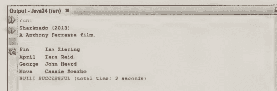

## 工作坊

### 问答

**Q. 如何将字符串的值设置为空？**

**A.** 使用空字符串，即一对没有任何文本的双引号。以下代码创建了一个新的字符串变量 `georgeSays` 并将其设置为空：

```
String georgeSays = "";
```

**Q. 我似乎无法让 `toUpperCase()` 方法改变字符串的大写字母。我哪里做错了？**

**A.** 当你调用字符串对象的 `toUpperCase()` 方法时，它并不会实际改变所调用的字符串。相反，它会创建一个全大写的新字符串。考虑以下语句：

```
String firstName = "Baz";
String changeName = firstName.toUpperCase();
System.out.println("First Name: " + changeName);
```

## 验

以下问题将测试你对字符串处理和维护的知识。

1. **我的朋友在做字符串拼接。** 我应该向当局举报他吗？

   - **A.** 不需要。只有在冬季月份才是违法的。
   - **B.** 是的，但在我先把故事卖给 TMZ.com 。
   - **C.** 不需要。他只是在程序中将两个字符串拼接在一起。

2. 为什么 `String` 的首字母是大写的，而 `int` 等其他不是？

   - **A.** `String` 是一个完整的单词，但 `int` 不是。
   - **B.** 就像 Java 标准部分的所有对象一样，`String` 的名称首字母大写。
   - **C.** Oracle 的质量控制很差。

3. 下面哪个字符可以在字符串中放入单引号？

   - **A.** `<quote>`
   - **B.** `\'`
   - **C.** `'`

## 答案

1. **C.** 字符串拼接（Concatenation）只是粘贴、融合或以其他方式连接两个字符串的另一种说法。它使用了 `+` 和 `+=` 运算符。

2. **B.** Java 中可用的对象类型全部首字母大写，这是变量名首字母小写的主要原因。这使得人们不容易将它们误认为对象。

3. **B.** 单反斜杠是可插入字符串的特殊字符之一的开头符号。

## 活动

你可以通过以下活动更全面地回顾本小时的主题：

- 编写一个名为 `Favorite` 的短 Java 程序，将本节“比较两个字符串”部分的代码放入 `main()` 块语句中。进行测试以确保它如描述的那样工作，并显示 Fin 最喜欢的杀鱼武器不是台球杆。完成后，将 `guess` 变量的初始值从 "pool cue" 改为 "chainsaw"。看看会发生什么。
- 修改 `Credits` 程序，使导演和所有表演者的姓名完全以大写字母显示。

要查看实现这些活动的 Java 程序，请访问书籍网站 www.java24hours.com。

## 第 7 小时

## 使用条件测试做出决策

当你编写计算机程序时，你为计算机提供一组称为“语句”（statements）的指令列表，计算机会按照字母顺序执行这些指令。你可以告诉计算机计算一些复杂的数学公式，它就会进行计算。告诉它显示某些信息，它就会忠实地响应。


# 第 7 小时：使用条件测试做出决策

有时，你需要计算机对它执行的操作更具选择性。例如，如果你写了一个平衡支票簿的程序，你可能希望在账户透支时让计算机显示警告消息。计算机应该只在账户透支时才显示此消息。如果没有透支，该消息将是不准确且令人困扰的。

在 Java 程序中完成此任务的方法是使用条件语句。当 Java 程序做出决策时，它通过使用 `else`、`case` 和 `break` 关键字检查几件事的状态来实现。你还会在布尔变量与其他条件运算符 `==`、`!=`、`<`、`>` 中使用它们。

## if 语句

在 Java 中测试条件的简单方法是使用 `if` 语句。`if` 语句测试条件为真还是假，并且在条件为真时采取行动。

你使用 `if` 配合要测试的条件，如下语句所示：注意条件必须被圆括号括起来，例如 `(account < 0)`。`if` 语句检查 `account` 变量是否小于 0。如果是，则运行 `if` 语句内的块，显示文本。

```java
long account = -1000000000L;
if (account < 0) {
    System.out.println("Account overdrawn; you need bailout");
}
```

## 小于和大于比较

在前面的部分中，`<` 运算符的使用方式与小于号相同。还有一个大于运算符 `>`，它用于以下语句：

```java
int elephantWeight = 900;
int elephantTotal = 13;
int cleaningExpense = 200;

if (elephantWeight > 780) {
    System.out.println("Elephant too big");
}

if (elephantTotal > 12) {
    cleaningExpense = cleaningExpense + 150;
}
```

`if` 语句测试 `elephantWeight` 的值是否大于 780。第二个 `if` 语句测试 `elephantTotal` 变量是否大于 12。如果这两个语句在一个 `elephantWeight` 等于 600 且 `elephantTotal` 等于 10 的程序中使用，则每个块内的语句将被忽略。你可以使用 `<=` 运算符判断某物是否小于或等于。这是一个示例：

```java
if (account <= 0) {
  System.out.println("You are broke");
}
```

## 等于和不等比较

程序中要检查的另一个条件是相等性。变量是否等于某个特定值？是否等于另一个变量的值？这些问题可以使用 `==` 运算符回答，如下语句所示：

```java
if (answer == rightAnswer) {
  studentGrade = studentGrade + 10;
}

if (studentGrade == 100) {
  System.out.println("Show off!");
}
```

你可以使用 `!=` 运算符测试不等性（即某物是否不等），如下：

```java
if (answer != rightAnswer) {
  score = score - 5;
}
```

除了字符串外，你可以在所有类型的变量使用 `==` 和 `!=` 运算符。

## 使用块语句组织程序

之前，你已经看到块语句如何用于标记 Java 程序的 `main()` 块的开始和结束。当程序运行时，`main()` 块中的每个语句都会被处理。如果一个语句不需要块语句，它可以占据一行，例如：

```java
if (account <= 0) System.out.println("No money");
```

> 用于进行相等性运算符有两个等号：`==`。很容易将此运算符与用于给变量赋值的 `=` 运算符混淆。在条件语句中使用两个等号。

`if` 后的语句仅在条件为真时执行。列表 7.1 是一个使用块语句表示 `main()` 块的 Java 程序示例。块语句从第 3 行的左括号 `{` 开始，到第 15 行的右括号 `}` 结束。在 NetBeans 的 `com.24hours` 包中创建一个名为 `Game` 的空 Java 文件，并输入列表 7.1 中的文本。

### 列表 7.1 Game 程序

```java
1: package com.24hours;
2:
3: class Game {
4:     public static void main(String[] arguments) {
5:         int total = 0;
6:         int score = 7;
7:         if (score == 7) {
8:             System.out.println("You score a touchdown!");
9:         }
10:        if (score == 3) {
11:            System.out.println("You kick a field goal!");
12:        }
13:        total = total + score;
14:        System.out.println("Total score: " + total);
15:    }
16: }
```

图 7.1

Game 程序的输出。


当你运行程序时，输出应该类似于图 7.1。

你可以在 `if` 中使用块语句在条件为真时让计算机执行多件事。以下是一个包含块语句的 `if` 语句示例：

```java
int playerScore = 12000;
int playerLives = 3;
int difficultyLevel = 10;

if (playerScore > 9999) {
    playerLives++;
    System.out.println("Extra life!");
    difficultyLevel = difficultyLevel + 5;
}
```

括号用于分组所有属于 `if` 语句的语句。如果变量 `playerScore` 大于 9,999，会发生三件事：

- `playerLives` 变量的值增加了 1（因为使用了自增运算符 `++`）。
- 显示文本 "Extra life!"。
- `difficultyLevel` 变量的值增加了 5。

如果变量 `playerScore` 不大于 9,999，则什么都不会发生。`if` 语句块内部的所有三个语句都会被忽略。

## 本小时的任务

- 使用 `if` 语句进行基础条件测试。
- 测试一个值是否大于或小于另一个。
- 测试两个值是否相等或不等。
- 使用 `else` 语句作为 `if` 语句的对面。
- 链用多个条件测试。
- 使用 `switch` 语句进行复杂测试。
- 使用三元运算符创建测试。

## if-else 语句

有时你希望在条件为真时执行某些操作，而在条件为假时执行其他操作。你可以通过使用 `else` 语句配合 `if` 语句来实现，如下例：

```java
int answer = 17;
int correctAnswer = 13;
if (answer == correctAnswer) {
    System.out.println("Correct!");
} else {
    System.out.println("Wrong!");
}
```

与 `if` 语句不同，`else` 语句后面没有列出条件。`else` 语句与紧接其前面的一个 `if` 语句匹配。你也可以使用 `else` 将多个语句链在一起，如下例所示：

```java
if (grade == 'A') {
  System.out.println("You got an A. Awesome!");
} else if (grade == 'B') {
  System.out.println("You got a B. Beautiful!");
} else if (grade == 'C') {
  System.out.println("You got a C. Concerning!");
}
```

通过这种方式组合多个 `if` 和 `else` 语句，你可以处理各种条件。上一个示例向 A 学生、B 学生、C 学生以及未来的立法者发送了特定的消息。

## switch 语句

`if` 和 `else` 语句适用于只有两种可能条件的情况，但有时你会有两个以上的条件。

在前面的成绩示例中，你已经看到 `if` 和 `else` 语句可以链起来以处理多个不同的条件。

另一种方法是使用 `switch` 语句，它可以测试各种不同的条件并做出相应的响应。在下面的代码中，评分示例已用 `switch` 语句进行了重写：

```java
switch (grade) {
  case 'A':
    System.out.println("You got an A. Awesome!");
    break;
  case 'B':
    System.out.println("You got a B. Beautiful!");
    break;
  case 'C':
    System.out.println("You got a C. Concerning!");
    break;
  default:
    System.out.println("You got an F. You'll do well in Congress!");
}
```

`switch` 语句的第一行指定要测试的变量——在本例中为 `grade`。然后，`switch` 语句使用 `{` 和 `}` 括号形成一个块语句。

每个 `case` 语句都会检查 `switch` 语句中的测试变量是否与特定值匹配。`case` 语句中使用的可以是字符、整数或字符串。在前面的示例中，有针对字符 A、B 和 C 的 `case` 语句。每个语句后面都跟着一个或两个语句。当其中一个 `case` 语句与 `switch` 中的变量匹配时，计算机将处理该 `case` 语句之后的语句，直到遇到 `break` 语句为止。

对于值为 `B` 的 `grade` 变量，会显示文本“You got a B. Good work!”。下一条语句是 `break`，因此 `switch` 语句中的其他内容不会执行。`break` 语句告诉计算机跳出 `switch` 语句。

在 `switch` 语句中忘记使用 `break` 会导致意外的结果。如果在这个评分示例中没有 `break` 语句，无论 `grade` 变量等于‘A’、‘B’还是‘C’，前三个“You got a”消息都会被显示。

`default` 语句用作兜底，如果前面的任何 `case` 语句都不成立。在本例中，如果 `grade` 变量不等于 A、B 或 C，就会发生这种情况。你不需要在程序中的每个 `switch` 块语句都使用 `default` 语句。如果省略它，当某个 `case` 语句具有正确值时，什么都不会发生。

列表 7.2 中的 `Commodity` 类使用 `switch` 来购买未指定的商品。商品在购买时花费 $20，出售时赚取 $15。

一个 `switch-case` 语句测试名为 `command` 的字符串的值，如果等于“BUY”则运行一个块，如果等于“SELL”则运行另一个块。

### 列表 7.2 商品程序

```java
1: package com.java24hours;
2:
3: class Commodity {
4:     public static void main(String[] arguments) {
5:         String command = "BUY";
6:         int balance = 550;
7:         int quantity = 42;
8:
9:         switch (command) {
10:             case "BUY":
11:                 quantity += 5;
12:                 balance -= 20;
13:                 break;
14:             case "SELL":
15:                 quantity -= 5;
16:                 balance += 15;
17:                 break;
18:         }
19:         System.out.println("Balance: " + balance + "\nQuantity: " + quantity);
20:     }
21: }
```

当运行 `Commodity` 程序时，它会产生如下输出：

```
Balance: 630
Quantity: 47
```

## 三元运算符

Java 中最复杂的语句是三元运算符。

当你想要根据条件赋值或显示一个值时，可以使用三元运算符。例如，考虑一个根据 `level` 变量是否大于 5 来设置 `hour` 变量的程序。实现这种功能的方法是使用 `if-else` 语句：

```java
if (level > 5) {
    hour = 20;
} else {
    hour = 10;
}
```

更短的方法是使用三元运算符。三元表达式包含五个部分：

- 用括号括起来的条件，如 `level > 5`
- 问号 `?`
- 条件为真时的值
- 冒号 `:`
- 条件为假时的值

根据 `gender` 的值来决定显示什么信息，可以使用三元运算符：

```java
System.out.print(gender.equals("male") ? "Mr." : "Ms.");
```

三元运算符很有用，但也很难理解。

### 列表 7.3 程序


# 第 7 小时：使用条件测试做出决策

## 代码示例

```java
1: package com.java24hours;
2:
3: import java.time.*;
4: import java.time.temporal.*;
5:
6: class Clock {
7:     public static void main(String[] arguments) {
8:         // get time and date
9:         LocalDateTime now = LocalDateTime.now();
10:        int hour = now.get(ChronoField.HOUR_OF_DAY);
11:        int minute = now.get(ChronoField.MINUTE_OF_HOUR);
12:        int month = now.get(ChronoField.MONTH_OF_YEAR);
13:        int day = now.get(ChronoField.DAY_OF_MONTH);
14:        int year = now.get(ChronoField.YEAR);
15:
16:        // display greeting
17:        if (hour < 12) {
18:             System.out.println("Good morning.");
19:        } else if (hour < 17) {
20:             System.out.println("Good afternoon.");
21:        } else {
22:             System.out.println("Good evening.");
23:        }
24:
25:        // begin time by the minutes
26:        System.out.print("It's");
27:        if (minute != 0) {
28:             System.out.print(minute + " ");
29:             System.out.print(minute == 1 ? "minute" : "minutes");
30:        }
31:        System.out.print(" past");
32:
33:        // display the hour
34:        System.out.print(" ");
35:        System.out.print(hour > 12 ? hour - 12 : hour + " ");
36:        System.out.print(" o'clock on ");
37:
38:        // display the name of the month
39:        switch (month) {
40:            case 1:
41:                System.out.print("January");
42:                break;
43:            case 2:
44:                System.out.print("February");
45:                break;
46:            case 3:
47:                System.out.print("March");
48:                break;
49:            case 4:
50:                System.out.print("April");
51:                break;
52:            case 5:
53:                System.out.print("May");
54:                break;
55:            case 6:
56:                System.out.print("June");
57:                break;
58:            case 7:
59:                System.out.print("July");
60:                break;
61:            case 8:
62:                System.out.print("August");
63:                break;
64:            case 9:
65:                System.out.print("September");
66:                break;
67:            case 10:
68:                System.out.print("October");
69:                break;
70:            case 11:
71:                System.out.print("November");
72:                break;
73:            case 12:
74:                System.out.print("December");
75:                break;
76:        }
77:
78:        System.out.println(", " + day + ", " + year);
79:    }
80: }
```

```java
69: System.out.print("October");
70: break;
71: case 11:
72: System.out.print("November");
73: break;
74: case 12:
75: System.out.print("December");
76: 
77: }
78: // display the date and year
79: System.out.println("* " + day + " * " + year + " *.*");
80: 
81: )
```

## 编译要求

由于此程序使用了 Java 8 的新功能，如果 NetBeans 项目设置为使用早期版本，它将无法编译。为了确保选择了正确的设置，请选择**文件属性**（File Properties）。在**项目属性**（Project Properties）对话框中，查找“源/二进制格式”（Source/Binary Format）值。它应该是 **JDK 8**。

保存程序后，仔细检查它，以了解条件测试是如何使用的。

## 程序结构分析

除了第 3–4 行和第 18–24 行外，`Clock` 程序包含了到目前为止已经涵盖的内容。在设置了一系列变量来存储当前日期和时间后，使用了一系列 `if` 或 `switch` 条件判断来确定应该显示哪些信息。

此程序包含多次使用 `System.out.println()` 和 `System.out.print()` 来显示字符串。

第 8–14 行引用了一个名为 `now` 的 `LocalDateTime` 变量。`LocalDateTime` 变量类型之所以字母大写，是因为 `LocalDateTime` 是一个对象。

你将在第 10 小节“创建你的第一个对象”中学习如何创建和操作对象。在这一节，请关注这些行正在发生了什么，而不是它是如何实现的。

`Clock` 程序由以下部分组成：

- 第 3 行使你的程序可以使用用于跟踪当前日期和时间的类：`java.time.LocalDateTime`。
- 第 4 行使程序可以使用 `java.time.temporal.ChronoField` 类，这听起来像是时间电影里的东西。
- 第 6–7 行开始了 `Clock` 程序及其 `main()` 语句块。
- 第 9 行创建了一个 `LocalDateTime` 对象，它现在包含了你系统的当前日期和时间。每当你运行此程序时（除非宇宙物理定律被改变且时间停止了）。

## 使用条件测试做出决策

- 第 10–14 行创建了用于存储小时、分、日和年的变量。这些变量的值从 `LocalDateTime` 对象中提取，它是所有这些信息的存储库。括号内的信息（如 `ChronoField.DAY_OF_MONTH`）指示要提取日期和时间中的哪部分。
- 第 17–23 行显示三种可能的问候语之一：“早上好”、“下午好”或“晚上好”。显示的问候语是根据 `hour` 变量的值选择的。
- 第 26–32 行显示当前分钟以及随附文本。首先，在第 26 行显示“It”。如果分钟等于 0，由于第 27 行的语句，第 28–31 行将被忽略。该语句是必要的，因为程序传递一个过去的小时是不符合逻辑的。第 28 行显示当前的分钟变量 `minute`。第 29–30 行使用三元运算符来显示“minutes”或“minute”，取决于 `minute` 是否等于 1。最后，在第 31 行显示文本“past”。
- 第 35–37 行使用另一个运算符显示当前的小时。第 36 行中的这个三元条件语句会导致小时在大于 12 时以不同的方式显示，这防止了计算机说像“15 点”这样的时间。
- 第 40–76 行（程序的一半）是一个长语句，根据存储在 `month` 变量中的整数值显示月份。
- 第 79 行通过显示当前日期和年份完成显示。
- 第 80–81 行关闭 `main()` 块以及整个 `Clock` 程序。

`Clock` 应用使用了 Java 8 中新的日期/时间 API。早期的 Java 版本使用一组不同的类来处理日期和时间。正如你在第 4 小节“Java 程序如何工作”中所记得，Java 类库包含了执行有用任务的类。此程序中使用的 `java.time` 和 `java.time.temporal` 包是日期/时间 API 的一部分。

当你运行此程序时，输出应该根据当前日期和时间显示句子。应用程序的输出如图 7.3 所示。

运行程序几次，看看它是如何保持同步的。

**图 7.3** Clock 程序的输出。

```
Output-Java24(run)
Good afternoon.
It's 53 minutes past 4 o'clock on September 15, 2019.
BUILD SUCCESSFUL (total time: 1 second)
```

## 总结

现在你使用了条件语句，你的 Java 程序的整体智能性大大提高。你的程序可以评估信息并根据情况做出反应。编程迫使你将任务分解为逻辑步骤并根据需要做出决策。

## 工作坊

### 问答

- **Q:** 可以不使用括号使用 `if` 语句吗？
  **答:** 可以，链式的 `if` 语句可能会变得臃肿。

- **Q:** 必须使用括号吗？
  **答:** 不强制。括号可以包裹任何 `if` 语句。

- **Q:** 每个 `case` 都必须使用 `break` 吗？
  **答:** 在大多数情况下，你可能需要使用 `break`。

- **Q:** 为什么 Thompson Twins 在没有人有血缘关系的情况下取这个名字？
  **答:** 乐队成员 Tom Bailey、Alannah Currie 和 Joe Lee 以 Thompson Twins 命名，是为了向比利时漫画中的一对笨拙的侦探致敬。

### 测验

以下问题将检查你在学习了 Java 条件语句后处于什么状态。

1. **条件测试的结果为真或假值。哪种变量类型让你想到这个？**
   - A. 无。别再用这些问题烦我了。
   - B. `long` 类型。
   - C. **布尔类型**。

2. **哪个语句在 `switch` 块语句中用兜底类别？**
   - A. `default`
   - B. `otherwise`
   - C. `onTheHand`

3. **什么是条件？**
   - A. 洗发水后修复分叉发梢和纠结的东西。
   - B. 程序中测试条件是否为真或假的某种。
   - C. 你向宗教权威忏悔罪的地方。

### 答案

1. **布尔变量类型**只能等于真或假，这与条件测试相似。如果你选 A.，我很抱歉，但我们只剩下 17 小节了，我们还有很多要涵盖。Java 不会自学。
2. 当其他 `case` 语句都不匹配 `switch` 变量时，会处理 `default` 语句。
3. 其他答案描述的是护发素和忏悔室。

## 活动

为了提高你对 Java 条件判断的掌握，请通过以下活动复习本小时的主题：

- 在 `Clock` 程序的某一行中，`break` 语句前面添加 `//` 使其成为注释；然后编译它并运行，看看会发生什么。尝试多删除几个 `break` 语句再次尝试。
- 创建一个短程序，在一个名为 `grade` 的整数变量中存储一个你选择的 1 到 100 之间的值。使用这个 `grade` 变量配合条件语句，为所有 A、B、C、D 和 F 级的学生显示不同的信息。起初先尝试使用 `if` 语句，然后尝试使用 `switch` 语句。

要查看实现这些活动的 Java 程序，请访问书籍网站 www.java24hours.com。

---

# 第 8 小时：使用循环重复操作

对于学生来说，最令人讨厌的惩罚之一就是让他们在黑板上反复写某些东西。在《辛普森一家》中，巴特·辛普森在一次上黑板时，不得不写几十次“器官移植最好交给专业人士”。这种惩罚对孩子可能有效，但对计算机完全没用。计算机程序可以轻松地重复执行任务。

由于循环的存在，程序非常适合重复执行相同的操作。循环是程序中重复执行的语句或语句块。某些循环运行固定次数，另一些则无限运行。

Java 中有三种循环语句：`for`、`do` 和 `while`。每种语句都可以像其他语句一样工作，但学习它们是如何运作的是有益的。你通常可以通过选择正确的语句来简化程序的循环部分。

## 本小时待办列表

- 使用 `for` 循环。
- 使用 `while` 循环。
- 使用 `do-while` 循环。
- 提前退出循环。
- 为循环命名。

## `for` 循环

在编程中，你会发现很多情况下循环都是很有用的。你可以用它们来多次执行某项操作，例如杀毒软件在每当收到一封新邮件时都打开它并扫描病毒。你也可以使用循环让计算机短暂内无所事事，例如每分钟显示一次当前时间的动画时钟。

循环语句会导致计算机程序多次返回同一个位置，就像特技飞机完成一个特技翻圈一样。

Java 最复杂的循环语句是 `for`。`for` 循环重复程序的某部分固定次数。以下是一个示例：

```java
for (int dex = 0; dex < 1000; dex++) {
  if (dex % 12 == 0) {
    System.out.println("#: " + dex);
  }
}
```

这个循环显示了从 0 到 999 之间能被 12 整除的数字。

每个 `for` 循环都有一个决定循环何时开始和结束的变量。这个变量被称为计数器（或索引）。前一个循环中的计数器是变量 `dex`。

示例说明了 `for` 语句的三个部分：

- **初始化部分**——在第一部分，变量 `dex` 被赋了一个 `0` 的初始值。
- **条件部分**——在第二部分，有一个类似于你在 `if` 语句中使用的条件测试：`dex < 1000`。
- **变化部分**——第三部分是一个改变 `dex` 变量值的语句，在本示例中是通过递增运算符实现的。

在初始化部分，你设置了计数器变量。你可以在 `for` 语句中创建该变量，就像前面的示例创建整数变量 `dex` 那样。你也可以在程序的其他地方创建变量。无论哪种情况，都应该在 `for` 语句的这部分为变量赋予起始值。当循环开始时，该变量具有该值。

条件部分包含一个测试，该测试必须保持为真才能继续循环。当测试为假时，循环结束。在本示例中，当 `dex` 变量等于或大于 1,000 时，循环结束。

`for` 语句的最后部分包含一个改变计数器变量值的语句。该语句在每次循环时都会被处理。计数器变量必须以某种方式发生变化，否则循环永远不会结束。在示例中，`dex` 在变化部分增加了 1。如果 `dex` 不发生变化，它将保持原始值 `0`，且条件 `dex < 1000` 将始终为真，因为该语句的块在每次循环执行期间都会执行。

> **注意**
>
> 在提到循环时，你可能会听到一个不常见的术语：迭代。迭代是循环的单次运行。用于控制循环的计数器变量被称为迭代器。

前面的示例在 `for` 循环内部包含以下语句：

```java
if (dex % 12 == 0) {
  System.out.println("*: " + dex);
}
```

这些语句执行了 1,000 次。循环从 `dex` 变量等于 `0` 开始。在循环的每次通过中，它给 `dex` 加 1。当 `dex` 不再小于 1,000 时，循环停止。

正如你在 `if` 语句中看到的，如果 `for` 循环只包含一条语句，则不需要大括号。这在示例中所示：

```java
for (int p = 0; p < 500; p++)
  System.out.println("I will not sell miracle cures");
```

这个循环会显示“I will not sell miracle cures” 500 次。虽然循环内部的单一语句不需要括号，但你可以使用括号来使语句块更容易识别，例如：

```java
for (int p = 0; p < 500; p++) {
    System.out.println("I will not sell miracle cures");
}
```

本小时创建的第一个程序显示前 200 个 9 的倍数：9、18、27 等，直到 1800（9×200）。在 NetBeans 中，创建一个名为 `Nines` 的空文件并输入列表 8.1 的内容。将其保存为 `Nines.java`。

## 列表 8.1 Nines 的完整内容


```java
package com.java4hours;
class Nines {
  public static void main(String[] arguments) {
    for (int dex = 1; dex <= 200; dex++) {
      int multiple = 9 * dex;
      System.out.print(multiple + " ");
    }
    System.out.println();
  }
}
```

`Nines` 程序第5行包含一个 `for` 语句。该语句有三个部分：

- 初始化部分——`dex = 1` 给整数变量 `dex` 赋了一个初始值 1。
- 条件部分——`dex <= 200` 在每次循环中必须保持为真。当它为假时，循环结束。
- 变化部分——`dex++` 在每次循环中将 `dex` 变量增加 1。

在 NetBeans 中运行程序。程序显示图 8.1 的输出。

| 9 | 18 | 27 | 36 | 45 | 54 | 63 | 72 | 81 | 90 | 99 | 108 | 117 | 126 | 135 | 144 | 153 | 162 | 171 | 180 |
|---|---|---|---|---|---|---|---|---|---|---|---|---|---|---|---|---|---|---|---|
| 189 | 198 | 207 | 216 | 225 | 234 | 243 | 252 | 261 | 270 | 279 | 288 | 297 | 306 | 315 | 324 | 333 | 342 | 351 | 360 |
| 369 | 378 | 387 | 396 | 405 | 414 | 423 | 432 | 441 | 450 | 459 | 468 | 477 | 487 | 496 | 505 | 514 | 523 | 532 | 541 |
| 550 | 559 | 568 | 577 | 586 | 595 | 604 | 613 | 622 | 631 | 640 | 649 | 658 | 667 | 676 | 685 | 694 | 703 | 712 | 721 |
| 730 | 739 | 748 | 757 | 766 | 775 | 784 | 793 | 802 | 811 | 820 | 829 | 838 | 847 | 856 | 865 | 874 | 883 | 892 | 901 |
| 910 | 919 | 928 | 937 | 946 | 955 | 944* | 962 | 971 | 980 | 989 | 998 | 1007 | 1016 | 1025 | 1034 | 1043 | 1052 | 1061 | 1069 |
| 1070 | 1079 | 1088 | 1097 | 1106 | 1115 | 1124 | 1133 | 1142 | 1151 | 1160 | 1169 | 1178 | 1187 | 1196 | 1205 | 1214 | 1223 | 1232 | 1241 |
| 1250 | 1259 | 1268 | 1277 | 1286 | 1295 | 1304 | 1313 | 1322 | 1331 | 1340 | 1349 | 1358 | 1367 | 1376 | 1385 | 1394 | 1402 | 1411 | 1420 |
| 1429 | 1438 | 1447 | 1456 | 1465 | 1473 | 1474 | 1482 | 1491 | 1500 | 1509 | 1518 | 1527 | 1536 | 1545 | 1554 | 1563 | 1572 | 1581 | 1590 |
| 1599 | 1608 | 1617 | 1626 | 1635 | 1644 | 1653 | 1662 | 1671 | 1680 | 1689 | 1698 | 1707 | 1716 | 1725 | 1734 | 1743 | 1752 | 1761 | 1772 |

`while` 语句在循环中的任何语句被处理之前，会在循环开始时测试条件。如果程序第一次遇到 `while` 语句时测试的条件为 `false`，则循环内部的语句将被忽略。

如果 `while` 条件为 `true`，循环将执行一次并再次测试 `while` 条件。如果测试的条件在循环内部永远不会改变，循环将无限循环。

以下语句会导致 `while` 循环多次显示同一行文本：

```java
int limit = 5;
int count = 1;
while (count < limit) {
  System.out.println("Pork is not a verb");
  count++;
}
```

`while` 循环在循环语句之前使用一个或多个变量。在这个示例中，创建了两个整数变量：`limit`，其值为 5；`count`，其值为 1。

`while` 循环会显示四次文本 "Pork is not a verb"。如果你给 `count` 变量赋定的初始值 6 而不是 1，则该文本永远不会显示。

## do-while 循环

`do-while` 循环与 `while` 循环相似，但条件测试位于在不同的位置。以下是一个 `do-while` 循环的示例：

```java
do {
  // 循环内部语句放在这里
} while (gameLives > 0);
```

与 `while` 循环一样，这个循环会持续运行直到 `gameLives` 变量不再大于 0。`do-while` 循环的不同之处在于，条件测试是在循环内部语句之后进行的，而不是在这些语句执行之前。

当程序运行时第一次遇到 `do` 循环时，`do` 和 `while` 之间的语句会被自动处理，然后测试 `while` 条件以确定是否应该重复循环。如果 `while` 条件为 `true`，循环将再运行一次。如果条件为 `false`，循环结束。在 `do` 和 `while` 语句内部必须发生某些事情来改变用于 `while` 测试的条件，否则循环将无期持续下去。`do-while` 循环内部的语句至少会被处理一次。

以下语句会导致 `do-while` 循环多次显示同一行文本：

```java
int limit = 5;
int count = 1;
do {
  System.out.println("I am not allergic to long division");
  count++;
} while (count < limit);
```

与 `while` 循环一样，`do-while` 循环使用在循环语句之前设置的一个或多个变量。

循环会显示四次文本 "I am not allergic to long division"。如果你给 `count` 变量赋定的初始值 6 而不是 1，该文本将显示一次，即使 `count` 永远不会小于 `limit`。

在 `do-while` 循环中，即使循环条件在第一次运行时时为 `false`，循环内部的语句至少也会执行一次。

## 退出循环

退出循环的正常方法是测试的条件变为 `false`。这对于 Java 中的三种循环类型都是如此。有时你可能希望循环立即结束，即使正在测试的条件仍然为 `true`。你可以通过 `break` 语句来实现这一点，如下代码所示：

```java
int index = 0;
while (index <= 1000) {
  index = index + 5;
  if (index == 400) {
    break;
  }
}
```

`break` 语句结束包含该语句的循环。

在这个示例中，`while` 循环会一直运行到 `index` 变量大于 1000。然而，一种特殊情况导致循环提前结束：如果 `index` 等于 400，则会执行 `break` 语句，立即结束循环。

你可以在循环内部使用的另一种特殊情况语句是 `continue`。`continue` 语句会导致循环退出当前的迭代，并从循环的第一条语句重新开始。考虑以下循环：

```java
int index = 0;
while (index <= 1000) {
    index += 5;
    if (index == 400) {
        continue;
    }
    System.out.println("The index is " + index);
}
```

在这个循环中，语句会被正常处理，除非 `index` 的值等于 400。在这种情况下，`continue` 语句会导致循环返回 `while` 语句，而不是正常执行到 `System.out.println()`。由于 `continue` 语句的存在，循环永远不会显示以下文本：

The index is 400

你可以在所有类型的循环中使用 `break` 和 `continue` 语句。

`break` 语句使得在程序中创建一个旨在无限运行的循环成为可能，如下例：

```java
while (true) {
    if (quitKeyPressed == true) {
        break;
    }
}
```

## 命名循环

就像 Java 程序中的其他语句一样，循环可以嵌套在其他循环中。以下展示了 `while` 循环中的 `for` 循环：

```java
int points = 0;
int target = 100;
while (target <= 100) {
  for (int i = 0; i < target; i++) {
    if (points > 50) {
      break;
    }
    points = points + i;
  }
}
```

## 总结

- 第 14 行—索引变量每次循环都会加 1。
- 第 16 行—在循环外部，程序显示了执行平方根计算的次数。

应用程序的输出显示在图 8.2 的输出面板中。

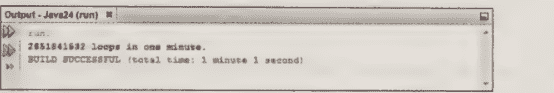

图 8.2

Benchmark 程序的输出。

Benchmark 程序是查看你的电脑是否比我的快的绝佳方法。在测试此程序期间，你的笔记本电脑执行了约 29 亿次计算。如果你的结果更好，别只向我发哀悼。多买几本我的书，这样我可以升级。

## 总结

循环是大多数编程语言的基础组成部分。通过顺序显示多个图形创建的动画是如果没有循环，你在 Java 或任何其他编程语言中无法完成的任务之一。

巴特·辛普（Bart Simpson）所有的黑板惩罚在网上都有记录。访问 `www.snpp.com/guides/chalkboard.openings.html` 查看该列表。

该页面还包含一个 Don Del Grande 编写的 Java applet，可以在绿色黑板上随机画出巴特的一句言。该 applet 的源代码也可用，因此你可以看到动画是如何实现的。

# 使用循环重复操作

## 工作坊

## 问答

- Q. “初始化”（initialization）一词在多个地方使用。它是什么意思？
- A. 意味着给某个东西一个初始值并对其进行设置。当你创建一个变量并为它分配起始值时，你正在初始化该变量。

- Q. 如果循环永不结束，程序如何停止运行？
- A. 通常在循环不结束的程序中，程序的其他部分会被设置为以某种方式停止执行。例如，游戏人群中的一个循环可以在玩家还有剩余生命值时持续进行。

你在编写程序时经常出现的一个错误是死循环，即由于编程错误而永远停止的循环。如果你运行的 Java 程序卡在死循环中，请点击输出面板左侧的红色警报图标。

- Q. 我如何购买绿湾帕鼠队（Green Bay Packers）的股票？
- A. 除非这支公有的 NFL 球队决定再次进行股票出售，否则成为股东的唯一方法是在遗嘱中继承股份。

帕鼠队曾在 1923、1935、1950、1959、1997 和 2011 年出售过股票。尽管他们与股票相关的权利非常有限，但仍有约 36 万人拥有该队的 500 万股股份。持有者不获得股息，也无法通过股票获利。他们只能将股票卖回给球队并在交易中亏损。任何个人拥有的股份不能超过 20 万股。

他们确实可以获得专属球队商品优惠，并参加年度会议选出管理球队的七成员董事会。

在形成特许经营权的 1923 年股票出售中，1000 名粉丝以每股 5 美元的价格买了股票。2011 年的出售筹了 6700 万美元，用于升级球队的主场兰博体育场（Lambeau Field）。

关于股票的更多信息可以在 `www.packers.com/community/shareholders.html` 查看。

## 测验

以下问题测试了你对循环的理解。本着本小节的精神，请重复这些每个题目直到你做对为止。

- 1. 必须使用什么来分隔 `for` 语句的每个部分？
   - A. 逗号
   - B. 分号
   - C. 下班的警察

- 2. 哪种语句会导致程序回到循环开始的语句并从那里继续执行？
   - A. continue
   - B. next
   - C. skip

- 3. Java 中哪种循环语句始终至少运行一次？
   - A. for
   - B. while
   - C. do-while

# 答案

- 1. B. 逗号用于分隔部分内的内容，但分号分隔不同的部分。
- 2. A. `break` 语句完全结束循环，而 `continue` 语句跳到循环的下一次迭代。
- 3. C. `do-while` 在在第一次通过循环之前不会进行评估。

## 活动

如果你的头还没有因为这些循环而转圈的话，请通过以下活动复习本小时的主题：

- 修改 Benchmark 程序以测试简单数学计算（如乘法或除法）的执行。
- 使用循环编写一个短程序，找到前 400 个 13 的倍数。

要查看实现这些活动的 Java 程序，请访问书籍的网站 `www.java24hours.com`。

## 第 9 小时

## 使用数组存储信息

没有人比圣诞老人从计算机的发展中受益更多。几个世纪以来，人类在收集和处理信息方面给他施加了巨大的负担。尼克老必须跟踪以下事项：

- 顽皮的孩子
- 好孩子
- 礼物请求
- 烟囱无法畅通的房屋
- 想要礼物比圣诞奶奶允许他给的更多的女性
- 那些先射击未识别飞行器后才提问的国家

本小时的任务清单：

- 创建一个数组。
- 设置数组的大小。
- 给数组元素赋值。
- 更改数组中的信息。
- 创建多维数组。
- 对数组进行排序。

计算机对北极来说是一个巨大的恩赐。它们是存储、分类和研究信息的理想工具。

在计算机程序中存储信息最基本的方法是将其放入变量。到目前为止，你处理过的所有变量都是单项信息，例如浮点数或字符串。

圣诞老人的好孩子列表是更大相似信息集合的例子。为了跟踪此类列表，你可以使用数组。

数组是一组共享相同类型的相关变量。可以作为变量存储的类型类型可以变成存储在数组中的项。数组可以用于跟踪比单个变量更复杂类型的信息，但它们的创建和操作方法几乎一样简单。

## 创建数组

数组是在在共同名称下分组的变量。“数组”（array）这个词你应该很熟悉——想象一个销售员展示她的产品系列（array），或者一个拥有琳琅满目奖（array）的电视节目。和变量一样，数组是通过说明要组织进数组的变量类型和数组名称来创建的。类型后面紧跟一对方括号，以区分数组和变量。

你可以为任何可以作为变量存储的类型信息创建数组。例如，以下语句创建了一个字符串变量数组：

```java
String[] naughtyChild;
```

这里是另外两个例子：

```java
int[] reinderWeight;
boolean[] hostileAirTravelNations;
```

之前的示例创建了数组，但没有在其中存储任何值。要做到这一点，你可以使用 `new` 关键字配合变量类型，或者在数组的大括号 `{}` 内存储值。当使用 `new` 时，你必须指定数组中存储了多少个项目。数组中的每个项目被称为元素（element）。以下语句创建了数组并为其存储的值留了空间：

```java
int[] elfSeniority = new int[250];
```

这个示例创建了一个整数数组 `elfSeniority`。该数组有 250 个元素，存储圣诞老人工作的月份（如果圣诞经营工厂，跟踪这些信息极其重要）。

当你使用 `new` 语句创建数组时，必须指定元素的数量。数组的每个元素都有一个取决于数组类型的初始值。所有数值数组的初始值都是 0，字符数组等为 `'\0'`，布尔数组的值为 `false`。`String` 数组和其他所有对象创建时的初始值为 `null`。

对于不是极大的数组，你可以在创建它们的同时设置它们的初始值。以下示例创建了一个字符串数组并给它们赋予了初始值：

```java
String[] reinderNames = {"Dasher", "Prancer", "Vixen", "Comet", "Cupid", "Donder", "Blitzen"};
```

Java 在创建数组时对括号的位置非常灵活。你可以将它们放在变量名之后而不是变量类型之后，如下所示：

```java
String niceChild[];
```

为了让人类在你的程序中更容易识别数组，你应该坚持一种风格，而不是来回切换。本书中使用数组的程序始终将括号放在变量或对象类型之后。

## 使用数组

应存储在数组元素中的信息放置在 `{` 和 `}` 括号之间，并用逗号分隔每个元素。数组中的元素数量设置为逗号分隔列表中的元素数量。

数组元素是有编号的，从第一个元素开始为 0。可以通过在 `[]` 括号内引用此数字来访问特定元素。上述语句与以下代码的作用相同：


# 第 9 章：使用数组存储信息

## 数组基础

```
String[] reindeerNames = new String[8];
reindeerNames[0] = "Dasher";
reindeerNames[1] = "Dancer";
reindeerNames[2] = "Prancer";
reindeerNames[3] = "Vixen";
reindeerNames[4] = "Comet";
reindeerNames[5] = "Cupid";
reindeerNames[6] = "Donder";
reindeerNames[7] = "Blitzen";
```

数组的每个元素必须是相同类型。这里使用字符串来存储每个驯鹿的名字。

数组创建后，你无法为更多元素留出空间。即使你想起了最著名的驯鹿，也无法将 "Rudolph" 作为 `reindeerNames` 数组的第九个元素添加进去。Java 编译器不允许可怜的 Rudolph 加入任何 `reindeerNames`。

## 使用数组

你在程序中使用数组就像使用任何变量一样，但有一点不同：数组项的元素数量必须在数组名称旁方的方括号提供。你可以在可以使用变量的地方使用数组元素。以下语句使用了本小时示例中已经定义的所有数组：

```
elfSeniority[193] += 1;
niceChild[9428] = "Eli";
currentNation = 413;
if (hostileTravelNations[currentNation] == true) {
  sendGiftByMail();
}
```

## 数组索引与边界检查

因为数组的第一个元素编号为 0 而不是 1，这意味着最大的数字比你预期的要少一个。考虑以下语句：

```
String[] topGifts = new String[10];
```

该语句创建了一个从 0 到 9 编号的字符串数组。如果你在程序的某处引用 `topGifts[10]`，你将得到一个关于 `ArrayIndexOutOfBoundsException` 的错误消息。

Exception 是 Java 程序中错误的另一种说法。这种异常是“数组索引越界”错误，意味着程序尝试使用其定义范围内不存在的数组元素。你将在第 18 小时“程序中的错误处理”中学习更多异常的知识。

如果你想检查数组的上限以避免越界，每个创建的数组都会关联一个名为 `length` 的变量。`length` 变量是一个整数，包含数组中元素的数量。以下示例创建了一个数组并返回其列表：

```
String[] reindeerNames = {"Dasher","Dancer","Prancer","Vixen",
"Comet","Cupid","Donder","Blitzen","Rudolph"};
System.out.println("There are " + reindeerNames.length + " reindeers.");
```

在例例中，`reindeerNames.length` 的值为 9，这意味着你可以指定的最高数字是 8。

你可以以字符串或字符数组的形式在 Java 中处理文本。当你处理字符串时，一个实用的技巧是将字符串中的每个字符放入字符数组的每个独立元素中。要做到这一点，请调用 `toCharArray()` 方法，它会生成一个元素数量与字符串长度相同的 `char` 数组。

本小时的第一个项目使用了本节介绍的两种技术。`SpaceRemover` 程序显示一个将所有空格字符替换为点（.）的字符串。

开始之前，在 NetBeans 中打开 Java24 项目，选择 File（文件）、New File（新建文件）并创建一个名为 SpaceRemover 的新空 Java 文件。在源编辑器中输入列表 9.1，完成后保存。

### 列表 9.1 SpaceRemover.java 的全文

```
package com.java24hours;

class SpaceRemover {
    public static void main(String[] arguments) {
        String mostFamous = "Rudolph the Red-Nosed Reindeer";
        char[] mfl = mostFamous.toCharArray();
        for (int i = 0; i < mfl.length; i++) {
            char current = mfl[i];
            if (current != ' ') {
               System.out.print(current);
           } else {
               System.out.print('.');
           }
       }
       System.out.println();
   }
}
```

使用 Run、File 命令运行程序以查看图 9.1 所示的输出。


图 9.1 SpaceRemover 程序的输出。

`SpaceRemover` 将文本 "Rudolph the Red-Nosed Reindeer" 存储在两个地方：一个名为 `mostFamous` 的字符串和一个字符数组 `mfl`。该数组通过调用 `mostFamous` 的 `toCharArray()` 方法创建，该方法为文本中的每个字符填充一个数组中的一个元素。字符 "R" 进入元素 0，"u" 进入元素 1。循环 7-14 查看 `mfl` 数组中的每个字符。如果字符不是空格，则打印它；如果是空格，则打印 '.'。

## 多维数组

到目前为止的数组都是一维的，可以使用单个数字来检索元素。某些信息类型需要更多维度来存储，例如坐标系中的点。一个维度可以存储 x 坐标，另一个维度可以存储 y 坐标。

要创建一个两个维的数组，必须在创建和使用数组时使用额外的方括号，如下：

```
boolean[][] selectedPoint = new boolean[50][50];
selectedPoint[4][4] = true;
selectedPoint[7][7] = true;
selectedPoint[11][11] = true;
```

此示例创建了一个名为 `selectedPoint` 的布尔数组。该数组的第一维度有 50 个元素，第二个维度有 50 个元素，因此共有 2500 个。当创建数组时，每个元素都被赋予默认值 false。

数组可以根据需要具有多个维度，但请记住，它们会占用大量内存。

## 数组操作：交换与排序

当你将一组项目分组数组时，你可以做的一件事是重新排列。以下语句交换整数数组中两个元素的值：

```
int temporary = numbers[5];
numbers[5] = numbers[6];
numbers[6] = temporary;
```

这些语句导致 `numbers[5]` 和 `numbers[6]` 交换值。整数变量 `temporary` 用作交换值的临时存储位置。排序是将相关项目按顺序排列的过程，例如对数字列表从小到大进行排序。

圣诞老人可以使用排序根据姓氏安排礼物接收者的顺序，让 Willie Aames 和 Hank Aaron 的排名比字母顺序的 Dweel Zappa 和 Jim Earl 早得多。

### 数组排序

在 Java 中对数组排序非常简单，因为 `Arrays` 类完成了所有工作。`Arrays` 是 `java.util` 类组的一部分，可以重新排列所有变量类型的数组。

要在程序中使用 `Arrays` 类，请执行以下步骤：

1. 使用 `import java.util.*` 语句使所有的 `java.util` 类在程序中可用。
2. 创建数组。
3. 使用 `Arrays` 类的 `sort()` 方法重新排列数组。

由 `Arrays` 类排序的变量数组将按数字升序重新排列。字符和字符串按字母顺序排列。

要查看这一点，创建一个名为 `NameSorter` 的空 Java 文件，并在源编辑器中输入列表 9.2 的文本。

### 列表 9.2 NameSorter.java 的完整源代码

```
package com.java24hours;
import java.util.*;

class NameSorter {
    public static void main(String[] arguments) {
        String[] names = {"Dasher", "Dancer", "Prancer", "Vixen",
                          "Comet", "Cupid", "Donder", "Blitzen", "Rudolph"};
        System.out.println("Original order:");
        for (String name : names) {
            System.out.print(name + " ");
        }
        System.out.println();
        
        Arrays.sort(names);
        
        System.out.println("Sorted order:");
        for (String name : names) {
            System.out.print(name + " ");
        }
        System.out.println();
    }
}
```

当你运行此 Java 程序时，它按原始顺序显示九个名字，对名字进行排序，然后再次显示列表。

图 9.2 显示了输出。

# 图 9.2

NameSorter 程序的输出。

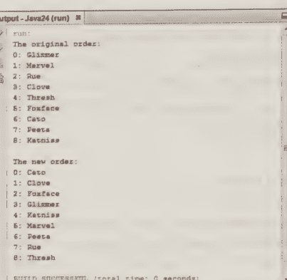

当你将字符串作为整数和浮点数进行处理时，你只能使用 `Arrays` 类对它们进行升序排序。如果你想在排序期间元素有不同的排列方式，或者希望获得比 `Arrays` 类更高的效率，你可以编写代码来手动完成排序。

## 实战项目：统计字符串中的字符

英语中出现频率最高的字母是 E, R, S, T, L, N, C, D 和 O，按顺序排列。如果你发现自己出现在了播的节目《幸运轮盘》中，这是一个值得了解的事实。

你的下一个 Java 程序将统计你愿意输入的任意不同短语和表达式的频率。使用一个数组来计算每个字母出现的次数。完成后，程序将列出每个字母在短语中出现的次数。

在 NetBeans 中创建一个名为 `Wheel.java` 的新空 Java 文件，将其填充为列表 9.3 的内容，完成后保存文件。可以随时在第 17 行和第 18 行之间添加额外的短语，格式要与第 17 行完全一致。

### 代码列表 9.3 Wheel.java 的完整源代码

```
package com.java24hours;

class Wheel {
    public static void main(String[] arguments) {
        String phrase[] = {
            "A STITCH IN TIME SAVES NINE",
            "DON'T EAT YELLOW SNOW",
            "JUST DO IT",
            "EVERY GOOD BOY DOES FINE",
            "I WANT MTV",
            "! LIKE YES",
            "PLAY IT ROSIN, SAM",
            "FROSTY THE SNOWMAN",
            "ONE MORE FOR THE ROAD",
            "HOME FIELD ADVANTAGE",
            "VALENTINE'S DAY MASSACRE",
            "GROVER CLEVELAND OHIO",
            "SPAGHETTI WESTERN",
            "AQUA TEN HUNGER FORCE",
            "IT'S A WONDERFUL LIFE"
        };
        int[] letterCount = new int[26];
        for (int count = 0; count < phrase.length; count++) {
            String current = phrase[count];
            char[] letters = current.toCharArray();
            for (int count2 = 0; count2 < letters.length; count2++) {
                char lett = letters[count2];
                if (lett >= 'A' && lett <= 'Z') {
                    letterCount[lett - 'A']++;
                }
            }
        }
        for (char count = 'A'; count <= 'Z'; count++) {
            System.out.print(count + ": " + 
            letterCount[count - 'A'] + 
            " ");
            if (count == 'M') {
                System.out.println();
            }
        }
        System.out.println();
    }
}
```


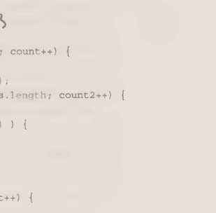

如果你在不添加 way短语的情况下运行程序，输出应该类似于图 9.3。

### 图 9.3 Wheel 程序的输出

```
Output - Java24(run)
A: 22 B: 1 C: 4 D: 10 E: 39 F: 7 G: 6 H: 7 I: 15 J: 1 K: 2 L: 10 M: 8 N: 13 O: 20 P: 2 Q: 1 R: 12 S: 18 T: 2 U: 4 V: 7 W: 6 X: 
BUILD SUCCESSFUL (total time: 0 seconds)
```

`Wheel` 程序中正在发生以下几操作：

- 第 5—21 行——短语被存储在一个名为 `phrase` 的字符串数组中。
- 第 22 行——创建了一个名为 `letterCount` 的具有 26 个元素的整数数组。该数组用于存储每个字母出现的次数。元素的顺序从 'A' 到 'Z'，`letterCount[0]` 存储 'A' 的计数器，'B' 的计数器，以此类推，直到 `letterCount[25]` 存储 'Z' 的计数器。
- 第 23 行——一个循环遍历存储在 `phrase` 中的短语。
- 第 24 行——一个字符串变量 `current` 被赋值为 `phrase[count]`。
- 第 25 行——一个字符数组 `letters` 被创建，并将 `current` 转换为数组。
- 第 26 行——一个循环遍历 `letters` 中的所有字符。
- 第 27 行——一个字符变量 `lett` 被赋值为 `letters[count2]`。
- 第 28—30 行——如果 `lett` 大于等于 'A' 且小于等于 'Z'，则 `letterCount[lett - 'A']` 加1。
- 第 33 行——一个循环从 'A' 到 'Z' 遍历字母。
- 第 34—36 行——打印当前字母及其在短语中出现的次数。
- 第 37—39 行——当字母为 'M' 时，打印换行符。
- 第 41 行——打印一个换行符。

## 问答

**Q:** 字母的数值范围从 'A' (65) 到 'Z' (90) 是 Java 基础语言的一部分吗？如果是，1 到 64 是留给什么用的？

**A:** 1 到 64 的数字包括数字、标点符号和一些不可打印字符，如换行和制行。Java 程序中使用的每个打印字符都关联有一个数字。Java 使用 Unicode 编号系统。前 127 个字符来自 ASCII 字符集。

**Q:** 异常术语的意义是程序通常运行没有问题，而异常表示必须处理的特殊情况。异常是在 Java 程序内部发送的警告消息。在 Java 语言中，该术语有时用于描述运行过程中发生的错误。你将在第 18 节学习更多关于错误和异常的知识。

**Q:** 在多维数组中，可以使用 `length` 变量测量第一个维度以外的其他维度吗？

**A:** 你可以测试任何维度。对于第一个维度，使用数组名称的 `length`，例如 `x.length`。后续维度可以通过对该维度的 `[0]` 元素使用 `length` 来测量。考虑使用以下语句创建数组 `data`：

```
int data[][][] = new int[12][13][14];
```

该数组的维度可以通过 `data.length` 变量测量第一个维度，通过 `data[0].length` 测量第二个维度，通过 `data[0][0].length` 测量第三个维度。

**Q:** 为什么新英格兰爱国者队教练 Bill Belichick 在场边总是穿着那件滑稽的连帽衫？

**A:** 当你在十年内的胜场次数超过 NFL（国家橄榄球联盟）历史上任何教练时——2003年至2012年间的140场——你的老板会允许你设定自己的着装规范。体育记者认为，贝利奇开始穿无袖连帽衫是为了回应与 Reebok 的一项交易，该交易要求所有教练必须穿着授权的球队服装。

Yahoo!体育的 Dan Wetzel 解释道：“他决定，如果他们非要让他穿服装，他就在所有选项中筛选，选出他能找到的最丑的一件。他选择了一件带帽的灰色卫衣。”

贝利奇这种消极攻击的时尚宣言已将连帽衫变成了该球队最畅销的商品之一。

## 测验

如果你的大脑是一个数组，你可以通过回答以下关于数组的每个问题来测试它的长度。

1. 数组最适合存储什么类型的信息？
   - A. 列表
   - B. 相关信息的配对
   - C. 冷知识

2. 你可以使用哪个变量来检查数组的上边界？
   - A. top
   - B. length
   - C. limit

3. 圣老人有多少只驯鹿，包括鲁道夫？
   - A. 8
   - B. 9
   - C. 10

### 答案

1. **A.** 只包含相同类型信息（字符串、数字等）的列表非常适合存储在数组中。
2. **B.** `length` 变量包含数组中元素的计数。
3. **B.** 根据克莱门·克拉克·摩尔的《圣尼古拉斯来访》，圣老人有“八只小鹿”，所以加上鲁道夫是九只。

## 活动

为了让自己以后有足够的经验可以借鉴，你可以通过以下活动扩展你对本小时主题的知识：

- 创建一个使用多维数组存储学生成绩的程序。第一个维度应该是每个学生的数字，第二个维度应该是每个学生的成绩。显示每个学生获得的所有分数的平均分，以及每个学生的总平均分。


- 编写一个程序，在数组中存储前400个13的倍数。

查看实现这些活动的Java程序，请访问书籍网站 `www.java24hours.com`。

# 第10小时

## 创建你的第一个对象

在这些24小时中，你遇到的令人生畏的术语之一是面向对象编程（OOP）。这个复杂的术语用优雅的方式描述了计算机程序以及它是如何工作的。

在此，计算机程序通常按照你在书中学的最简单定义来描述：文件中列出的一组指令，并按照某种可靠的顺序进行处理。

通过将程序视为对象的集合，你可以弄清楚程序必须完成的任务，并将任务分配给它们所属的对象。

## 本小时任务清单：

- 创建一个对象。
- 用属性描述对象。
- 确定对象的行为方式。
- 组合对象。
- 从其他对象继承。
- 转换对象。

## 面向对象编程是如何工作的

你可以将创建的Java程序视为对象，就像现实世界中物理对象一样。对象独立于其他对象存在，以特定的方式交互，并与其他对象结合形成更大的东西。

在第3小时“创建Java图形”中，你创建了一个显示饼图的Java程序——带有不同颜色切片的圆，用以表示数据（见图10.1）。饼图是由较小的对象组成的对象——识别每个切片的不同颜色切片和一个标题。

### 图 10.1

显示饼图的Java程序。

每个图表都有与其他对象不同的特征。饼图是圆形的，而柱状图用一系列矩形表示数据。如果你像拆解饼图那样拆解计算机程序，你就是在进行OOP。

在OOP中，一个对象包含两个东西：属性和行为。属性是描述对象并显示它与其他对象不同的东西。行为是对象所做的事。

你在Java中通过使用类作为模板创建对象。类是对象的副本，决定了对象应该拥有的属性和行为。Java程序被称为类。你用Java创建的每个程序都是一个类，你可以将其作为创建新对象的模板。这个类包含了决定对象是什么的属性，以及控制对象可以做什么的行为。

通过OOP，计算机程序是一组共同工作以完成某事的对象。有些简单的程序似乎只由一个对象组成：类。然而，即使这些程序也使用其他对象来完成工作。

考虑显示饼图的程序案例。图表对象可能包含以下内容：

- 计算每个切片大小的行为
- 绘制图表的行为
- 存储图表标题的属性

要求图表对象绘制自己可能看起来很奇怪，因为在现实世界中图表不会自己画自己。在OOP中，对象尽可能自己绘制。这种能力使得将它们整合到其他程序中变得更容易。例如，如果图表对象不知道如何绘制，那么每当你在另一个程序中使用该对象时，你必须创建一个绘制行为。

自动拨号器（`autodialer`）是一种使用称为调制解调器（`modem`）的设备顺序拨打多个电话的软件。此类目的是寻找接电话的其他计算机，这样你以后就可以给它们打电话看看它们是什么。

OOP的另一个例子是考虑经典电影《游戏实战》中马修·布罗德里克（Matthew Broderick）的角色使用的自动拨号器程序，该程序用来寻找他可以入侵的计算机。

小于30岁的读者可能很难相信计算机可以在不拨打电话的情况下相互连接。你必须知道计算机的电话号码才能连接，如果它正在与另一台电脑通话，你就会得到忙音。

今天使用自动拨号器会引起当地电话公司和执法部门的注意。在80年代，不出门就能反叛是一件好事。大卫·莱特曼（布罗德里克的角色）使用他的自动拨号器寻找一家视频游戏公司的私人计算机系统——他想在公司的新游戏发布之前玩。相反，莱特曼发现了一台秘密政府计算机，可以玩从象棋到全球核战争的所有游戏。

现在解释一下什么是忙音。

自动拨号器像任何计算机程序一样，可以被视为一组共同工作的对象。它可以被拆解为以下内容：

> 引用诗人T.S. 艾略特的话，“我老了……我老了。”

- 一个调制解调器（`Modem`），它知道自己的属性，如连接速度和行为——例如，它可以让调制解调器拨号，并检测到另一个计算机系统已接听电话。
- 一个监视器对象（`Monitor`），它跟踪拨打了哪些号码以及哪些是成功的。

每个对象都独立于其他对象。

设计完全独立的调制解调器对象的优势之一是，它可以用于其他需要调制解调器功能的程序。

使用自包含对象的另一个原因是它们更容易调试。如果你正在调试一个诸像调制解调器这样的东西，并且知道它不依赖于其他任何东西，计算机程序就会变得难以管理；你可以专注于确保调制解调器执行它应该的工作并持有执行工作所需的信息。

将Java等面向对象的语言作为你的编程语言是有优势的，因为你不需要放弃其他编程风格的习惯。

## 对象是什么

对象通过使用类作为模板创建。以下语句创建一个类：

```java
public class Modem {
}
```

从该类创建的对象不能做任何，因为它没有任何属性或行为。你需要添加这些内容来使类有用，如下所示：

```java
public class Modem {
    int speed;

    void displaySpeed() {
        System.out.println("Speed: " + speed);
    }
}
```

对象的变量被称为实例变量或成员变量。

如果你想在程序中使用调制解调器对象，可以使用以下语句创建对象：

```java
Modem device = new Modem();
```

此语句创建了一个名为 `device` 的 `Modem` 对象。在创建对象后，你可以设置它的变量并调用它的方法。以下是设置 `device` 对象 `speed` 变量值的方法：

```java
device.speed = 28800;
```

要让这个调制解调器通过调用 `displaySpeed()` 方法显示其速度，你需要调用该方法：

```java
device.displaySpeed();
```

名为 `device` 的 `Modem` 对象可能会通过显示文本“Speed: 28800”来响应此语句。

## 理解继承

面向对象编程（OOP）的一个大优势是继承，它允许一个对象从另一个对象继承行为和属性。

当你开始创建对象时，有时会发现你想要的新对象和你已有的对象非常相似。

如果 David Lightman 想要一个能够处理纠错和其他调制解调器功能的对象，而这些功能在 1983 年《游戏入侵》发布时还不存在，会怎样？Lightman 可以通过复制 `Modem` 对象的语句并对其修改来创建一个新的 `ErrorCorrectionModem` 对象。然而，`ErrorCorrectionModem` 的大多数行为和属性与 `Modem` 相同，这产生了许多不必要的工作。这意味着如果以后需要更改某些，Lightman 必须编写两个独立的程序进行更新。

通过继承，程序员可以通过定义新类与现有类的不同之处来创建一个新类型的对象类。Lightman 可以让 `ErrorCorrectionModem` 继承自 `Modem`，他只需要编写使纠错调制解调器区别于普通调制解调器的部分即可。

一个对象类使用 `extends` 语句继承另一个类。以下是继承自 `Modem` 类的 `ErrorCorrectionModem` 类的骨架：

```java
public class ErrorCorrectionModem extends Modem {
    // 程序写在此处
}
```

## 构建继承层次结构

继承允许开发各种相关的类而无需进行冗余工作，使得代码可以从一个类传递到另一个类，再传递到另一个类。这种类的分组被称为类层次结构，你在 Java 程序中可以使用的所有标准类都是层次结构的一部分。

如果你理解了子类（`subclasses`）和父类（`superclasses`），理解层次结构就会变得更容易。继承另一个类的类被称为子类。被继承的类被称为父类。

在之前的《游戏入侵》示例中，`Modem` 类是 `ErrorCorrectionModem` 类的父类。`ErrorCorrectionModem` 是 `Modem` 的子类。

在层次结构中，一个类可以有多个继承它的类——另一个 `Modem` 的子类可以是 `ISDNModem`，因为 ISDN 调制解调器具有使其与纠错调制解调器不同的行为和属性。如果存在 `ErrorCorrectionModem` 的子类（例如 `InternalErrorCorrectionModem`），它将继承层次结构中上方的所有类——即 `ErrorCorrectionModem` 和 `Modem`。这些继承关系如图 10.2 所示。

### 图 10.2

类层次结构的示例。

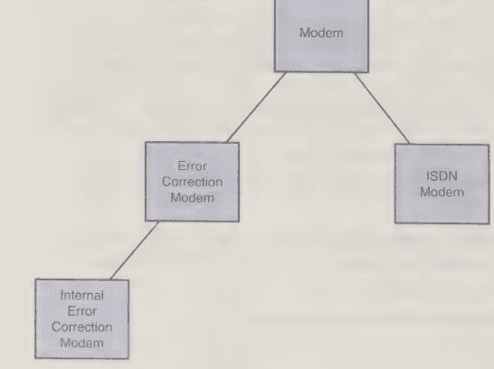

## 对象与简单变量的转换

构成标准 Java 语言的类充分利用了继承。

在程序中使用方法或表达式时，你必须使用这些方法和表达式预期的正确类型信息。例如，期望 `Calendar` 对象的方法必须接收一个 `Calendar` 对象。如果你使用一个接受单个整数参数的方法，却向它发送了一个浮点数，那么在尝试编译程序时就会发生错误。

将信息转换为新形式称为强制转换（casting）。强制转换产生一个与其源变量或对象类型不同的新值。在强制转换时，你并没有实际改变值。相反，会按照你需要的格式创建一个新的变量或对象。

在讨论强制转换的概念时，“源”（source）和“目标”（destination）这两个术语非常有用。源是以原始形式呈现的某种信息——无论是变量还是对象。目标是源以后新形式的转换版本。

当像 `System.out.println()` 这样的方法需要字符串参数时，你可以使用 `+` 运算符来组合该参数中不同类型的信息。只要组合的内容中有一个是字符串，组合后的参数就会转换为字符串。

## 简单变量的强制转换

对于简单变量，强制转换最常发生在数值变量（如整数和浮点数）之间。不能用于任何强制转换的变量类型是布尔值（`Boolean`）。

要将信息转换为新格式，你需要在其前面加上用括号括起来的新格式。例如，如果你想将某些内容转换为 `long` 变量，就在它前面加上 `(long)`。以下语句将 `float` 值转换为 `int`：

```java
float source = 7.06F;
int destination = (int)source;
```

在变量强制转换中，如果目标持有比源更大的值，例如将 `byte` 强制转换为 `int`。`byte` 存储 -128 到 127 之间的值，而 `int` 存储 -21 亿到 21 亿之间的值。无论变量持有什么值，新的 `int` 变量都有足够的空间。

有时你可以在不进行强制转换的情况下使用不同格式的变量。例如，你可以像使用 `int` 变量一样使用 `char` 变量。此外，你可以像使用 `long` 变量一样使用 `int` 变量，任何内容都可以作为 `double` 使用。

通常由于目标提供的空间比源大，信息在不改变值的情况下进行转换。主要的异常发生在 `int` 或 `long` 变量转换为 `float` 时。

当将整数转换为 `byte` 时，你必须显式地转换，如下语句所示：

```java
int xNum = 103;
byte val = (byte)xNum;
```

在这里，将整数 `xNum` 强制转换为字节 `val`。这是一个目标范围更小的转换示例。

## 对象与简单变量的转换

### 强制转换

当源和目标之间存在继承关系时，你可以将对象强制转换为其他对象。其中一个类必须是另一个类的子类。

某些对象完全不需要强制转换。你可以在任何期望父类的地方使用该对象。Java 中的所有对象都是 `Object` 类的子类，因此在期望 `Object` 的地方，你可以使用任何对象作为参数。

你也可以在期望某个子类的地方使用该对象。但是，由于子类通常包含更多信息，你可能会丢失部分信息。如果该对象没有子类将包含的方法，那么在使用该方法时就会产生错误。

要用一个对象代替其子类之一，你必须使用如下语句显式地强制转换：

```java
public void paintComponent(Graphics comp) {
    Graphics2D comp2D = (Graphics2D) comp;
}
```

这一个名为 `comp` 的 `Graphics` 对象强制转换为 `Graphics2D` 对象。在强制转换过程中你没有丢失任何信息，但获得了子类定义的所有方法和变量。

### 简单变量转对象及反之

你不能将将对象强制转换为简单变量或将简单变量转换为对象。Java 中每种简单变量类型都有对应的类，包括 `Boolean`、`Byte`、`Character`、`Double`、`Float`、`Integer`、`Long` 和 `Short`。

使用这些类定义的方法可以使用变量的值作为参数创建一个对象。以下语句创建一个值为 5309 的 `Integer` 对象。

```java
Integer suffix = new Integer(5309);
```

在创建这样的对象后，你可以像使用其他变量一样使用它。当你想要将该值作为简单变量时，该类提供了方法来执行这种转换。要从先前的 `suffix` 获取 `int` 值，可以使用以下语句：

```java
int newSuffix = suffix.intValue();
```

## 第 10 小时：创建你的第一个对象

此语句使 `newSuffix` 变量的值变为 5309，以 `int` 值的形式表示。从对象到变量的一种常见类型转换方法是在数值表达式中使用字符串。当字符串的值可能成为整数时，可以使用 `Integer` 类的 `parseInt()` 方法来实现，如本例所示：

```java
String count = "25";
int myCount = Integer.parseInt(count);
```

这会将文本为 "25" 的字符串转换为值为 25 的整数。如果字符串值不是有效的整数，则转换将失败。

你创建的下一个项目是一个应用程序，用于将命令行参数中的字符串值转换为数值技术——当你从命令行接收用户输入时这种技术非常有用。

返回 NetBeans 中的 Java24 项目，选择 File（文件）、New File（新建文件），然后创建一个名为 NewRoot 的空 Java 文件（Empty Java File）。在源编辑器中输入列表 10.1，并记得保存文件。

## 列表 10.1 NewRoot.java 的全文

```java
1: package com.java24hours;
2:
3: class NewRoot {
4:     public static void main(String[] arguments) {
5:         int number = 100;
6:         if (arguments.length > 0) {
7:             number = Integer.parseInt(arguments[0]);
8:         }
9:         System.out.println("The square root of "
10:             + number
11:             + " is "
12:             + Math.sqrt(number));
13:     }
14: }
```

在运行程序之前，你必须配置 NetBeans 以带有命令行参数运行程序。选择菜单 Run（运行）、Set Project Configuration（设置项目配置）、Customize（自定义）。打开 Properties窗口。在 Main Class（主类）中输入 `com.java24hours.NewRoot`，在 Arguments（参数）字段中输入 `9025`。点击 OK 关闭对话框。

要运行程序，选择 Run、Run Main Project（运行主项目，而不是 Run、Run File）。程序将显示该数字及其平方根，如图 10.3 所示。

## 转换对象和简单变量

```text
Output - Java24 (run)
run:
The square root of 9025 is 95.0
BUILD SUCCESSFUL (total time: 1 second)
```

### 图 10.3

NewRoot 程序的输出。

NewRoot 是第 4 小时早期教程“理解 Java 程序如何工作”的扩展，该教程曾显示过整数 225 的平方根。

如果该程序能够接收用户提交的数字并显示其平方根，它将更有用。这需要从字符串到整数的转换。所有的命令行参数都存储为 `String` 数组的元素，因此在数学表达式中使用它们之前，你必须将它们强制转换为数字。

要根据字符串的内容创建整数值，你调用 `Integer.parseInt()` 方法并将字符串作为唯一参数，如第 7 行所示：

```java
number = Integer.parseInt(arguments[0]);
```

`arguments[0]` 数组元素持有程序运行时提交的第一个命令行参数。当程序以 "9025" 作为参数运行时，字符串 "9025" 被转换为 `int` 类型 9025。

## 自动装箱和拆箱

Java 中的每一种基本数据类型都有对应的对象类：`boolean`（`Boolean` 类）、`byte`（`Byte`）、`char`（`Character`）、`double`（`Double`）、`float`（`Float`）、`int`（`Integer`）、`long`（`Long`）和 `short`（`Short`）。

对于每一对类型，其信息的值相同。它们之间唯一的区别在于其所采用的值格式。像 413 这样的整数值可以使用 `int` 也可以使用 `Integer` 类的对象表示。

Java 的自动装箱（`autoboxing`）和拆箱（`unboxing`）使得交替使用值的基本数据类型和对象形式成为可能。

自动装箱将简单变量的值转换为对应的类。

拆箱将对象转换为简单值。

这些功能在后台起作用，确保当你期望像 `float` 这样的简单数据类型时，对象会被转换为具有相同值的数据类型。当你期望像 `Float` 这样的对象时，根据需要将数据类型转换为对象。

以下语句显示了自动装箱和拆箱在何处有用：

```java
Float total = new Float(1.3F);
float sum = total / 5;
```


在 Java 的早期版本中，这段代码会因为两个错误而失败。第一个语句尝试将字面量浮点值 `1.3` 分配给 `Float` 对象（不允许），第二个语句除以 `Float` 对象并将其赋值给 `float` 类型（不允许）。它在现在的 Java 中运行得完美，因为第一个语句将字面量装箱为对象，第二个语句将对象拆箱为原始类型。Java 自动让这些语句生效，导致 `sum` 等于 `0.26`。

在本小时早些时候，你看到了一个如何创建 `Integer` 对象的示例：

```java
Integer suffix = new Integer(5309);
```

由于自动装箱和拆箱，以下语句也执行相同：

```java
Integer suffix = 5309;
```

Java 识别出 `int` 值 `5309` 正在存储在 `Integer` 对象中，因此它会自动转换。

# 创建对象

为了在下一个项目中看到类和继承的运行示例，你创建了代表两种类型的类：

- cable（电缆），通过 `Cableem` 类实现。
- DSL modems（DSL调制调器），通过 `Dslem` 类实现。

本节重点关注这些对象的简单属性和行为。它们共有的一个是 `speed`。在 NetBeans 中，创建一个名为 Modem 的空 Java 文件。在源编辑器中输入列表 10.2 并保存文件。

## 列表 10.2 Modem.java 的全文

```java
1: package com.java24hours;
2:
3: class Modem {
4:     int speed;
5:
6:     public void displaySpeed() {
7:         System.out.println("Speed: " + speed);
8:     }
9: }
```

该文件会被自动编译为 `Modem.class`。你无法直接运行它，但在其他类中使用它。开始创建一个名为 Cableem 的空 Java 文件。输入列表 10.3 并保存文件。

## 列表 10.3 Cableem.java 的全文

```java
1: package com.java24hours;
2:
3: class Cableem extends Modem {
4:     String method = "cable connection";
5:
6:     public void connect() {
7:         System.out.println("Connecting to the Internet...");
8:         System.out.println("Using a " + method);
9:     }
10: }
```

在 NetBeans 中创建第三个文件名为 Dslem。输入列表 10.4 并保存文件。

## 列表 10.4 Dslem.java 的全文

```java
1: package com.java24hours;
2:
3: class Dslem extends Modem {
4:     String method = "DSL phone connection";
5:
6:     public void connect() {
7:         System.out.println("Connecting to the Internet...");
8:         System.out.println("Using a " + method);
9:     }
10: }
```

如果没有错误，你现在拥有三个类文件：`Modem.class`、`Cableem.class` 和 `Dslem.class`。然而，你不能运行任何这些类文件，因为它们没有像你创建的其他程序那样的 `main()` 块。你需要创建一个短应用程序来测试你构建的类层次。

返回 NetBeans 并创建一个名为 Tester 的空 Java 文件。在源编辑器中输入列表 10.5 并保存文件。

## 列表 10.5 Tester.java 的全文

```java
1: package com.java24hours;
2:
3: public class Tester {
4:     public static void main(String[] arguments) {
5:         Cableem surfboard = new Cableem();
6:         Dslem gateway = new Dslem();
7:         surfboard.speed = 500000;
8:         gateway.speed = 400000;
9:         System.out.println("Trying the cable modem...");
10:        surfboard.displaySpeed();
11:        surfboard.connect();
12:        System.out.println("Trying the DSL modem...");
13:        gateway.displaySpeed();
14:        gateway.connect();
15:    }
16: }
```

当你运行程序时，你应该看到与图 10.4 匹配的输出。

# 总结

## 输出

# 149

输出 - Java24 (运行) #

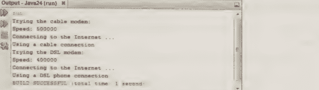

图 10.4 ModemTester 程序的输出结果。

列表 10.5 中发生了以下操作：

- 第 5–6 行——创建了两个对象：一个名为 `surfboard` 的 `Cableem` 对象和一个名为 `gateway` 的 `Dslem` 对象。
- 第 7 行——将名为 `surfboard` 的 `Cableem` 对象的 `speed` 变量设置为 `500000`。
- 第 8 行——将名为 `gateway` 的 `Dslem` 对象的 `speed` 变量设置为 `400000`。
- 第 10 行——调用了 `surfboard` 对象的 `displaySpeed()` 方法。该方法继承自 `Modem`——尽管它在 `Cableem` 类中并不存在，你仍然可以调用它。
- 第 11 行——调用了 `surfboard` 对象的 `connect()` 方法。
- 第 13 行——调用了 `gateway` 对象的 `displaySpeed()` 方法。
- 第 14 行——调用了 `gateway` 对象的 `connect()` 方法。

# 总结

在创建了你的第一个对象类并将若干类组织成层级结构后，你对“面向对象编程”（OOP）这个术语应该更加熟悉。在接下来的两个小时里，随着你开始创建更复杂的对象，你将学习更多关于对象行为和属性的知识。

随着对这种开发风格越来越熟悉，程序、类和对象等术语变得更有意义。OOP 是一个需要时间适应的概念。当你掌握了它，你会发现它是设计、开发和调试计算机程序的一种有效方法。

# 工作坊

## 问答

- **Q.** 类可以继承自多个类吗？
- **A.** 在某些编程语言（如 C++）中是可以允许的，但 Java 不可以。多重继承是一项强大的功能，但它让 OOP 的学习和使用变得更加困难。Java 的开发者决定限制任何类只能继承一个父类，尽管一个类可以拥有许多子类。补偿这种局限性的一种方法是从一种称为“接口”（`interface`）的特殊类型类继承方法。你将在第 19 小时“创建多线程程序”中学习更多关于接口的知识。

- **Q.** 什么时候你想创建一个不是公共的方法？
- **A.** 你不想让某个方法对其他程序可见的主要情况是该方法严格供你编写的某个程序使用。如果你正在写一个游戏程序，且 `shootRayGun()` 方法对你写的游戏非常特殊，它可以是一个私有方法。要防止一个方法变成公有的，请在方法名前面去掉 `public` 声明。

- **Q.** 为什么可以使用 `char` 值像 `int` 值一样使用？
- **A.** 字符可以被用作 `int` 变量使用，因为每个字符都有对应的数值代码，表示它在字符集中的位置。如果你有一个名为 `k` 值为 `67` 的变量，强制转换 `(char)k` 会产生字符 `'C'`，根据 ASCII 字符集（它是 Java 语言采用的 Unicode 字符标准的一部分），大写 C 对应的数值是 `67`。

- **Q.** Tabasco 有辣椒酱吗？
- **A.** 没有，没有，尽管如果你把开开的瓶保留多年，它的颜色也会改变。醋、红辣椒和盐的成分对于细菌生长来说是一个极不适宜的环境。

Tabasco 的制造者 McLhen 公司表示，原始品牌的保质期为五年。其他版本的保质期从 18 个月到三年不等。

作为该产品的巨大粉丝，我很难相信有人会留着一瓶 Tabasco 久到足以问这个问题。

## 测验

以下问题测试了你对对象以及使用它们的程序的了解程度。

1. 使用哪个语句来允许一个类继承另一个类？
   - A. `inherits`
   - B. `extends`
   - C. `handItOverNobodyGetsHurt`

2. 为什么编译后的 Java 程序以 `.class` 文件扩展名保存？
   - A. Java 是一门很有格调（classy）的语言。
   - B. 这是对老师们的一个微妙的暗示。
   - C. 每个 Java 程序都是一个类。

3. 组成对象的两个要素是什么？
   - A. 属性和行为
   - B. 命令和数据文件
   - C. 唾液和醋

# 答案

1. **B.** 使用 `extends` 语句是因为子类是父类以及类层级中上方任何父类的属性和行为的扩展。
2. **C.** 你的程序始终由一个主类以及任何所需的其他类组成。
3. **A.** 在某种程度上，B 也是正确的，因为命令可以比比行为，而数据文件类似于属性。

## 活动

如果你不介意，你可以通过以下活动扩展你这一小时的知识：

- 创建一个 `AcousticModem` 类，速度为 `300`，其 `connect()` 方法。
- 将 `connect()` 方法添加到 Modem 项目的某个类中，决定它如何支持连接，DSL 以及

# 创建变量

## 第 11 小时

### 描述什么是对象

正如你在面向对象编程（OOP）中所学的，对象是将信息组织成属性和行为的方式。属性是存储在对象内部的信息。行为是对象可以做的事。

在本小时中，你将查看：

## 本时任务：

- 创建对象的变量。
- 使用方法和类。
- 创建构造函数。
- 向方法传递参数。
- 使用 `this` 引用对象。
- 创建新对象

## 创建变量

`Virus` 对象使用整数变量 `newSeconds` 的值 `86`。以下语句开始一个名为 `Virus` 的类，它有一个属性 `newSeconds` 和两个其他属性：

```java
public class Virus {
    public int newSeconds = 86;
    public String author = "Sam Snett";
    int maxSize = 30000;
}
```

所有变量都是类的属性：`newSeconds`、`maxSize` 和 `author`。

在变量声明中使用像 `public` 的语句被称为访问控制，因为它决定了其他类的对象如何使用它，或者是否可以使用。

将变量设为公共允许使用该对象的其他程序修改该变量。

如果另一个程序对数字 `92` 有特殊意义（例如），它可以将 `newSeconds` 修改为该值。以下语句创建一个名为 `influenza` 的 `Virus` 对象并设置其 `newSeconds` 变量：

```java
Virus influenza = new Virus();
influenza.newSeconds = 92;
```

在 `Virus` 类中，`author` 也是公有的，因此可以从其他程序自由更改。另一个变量 `maxSize` 只能在类内部使用。

### 类语句后的变量

`Virus` 对象需要一种方式来指示文件已被感染。某些计算机病毒会更改存储文件最后修改时间的字段；例如，病毒可能会将时间从 `7:41:20` 移动到 `7:41:61`。因为没有正常文件会在一分钟的第 `61` 秒保存，该时间标志着文件已被感染。

当你将类中的变量设为公有时，类就失去了对其他程序如何使用它的控制。在许多情况下，这可能不是问题。例如，`author` 变量可以更改为任何识别病毒作者的名字或假名。如果作者被捕，这个名字可能会出现在

## 创建变量

被起诉了，所以你不想选一个愚蠢的名字。“俄亥俄州诉 LoveHandles 案”听起来没有“俄亥俄州诉 MafiaBoy 案”那么响亮。

限制对变量的访问可以防止当另一个程序错误地设置变量时发生错误。在 `Virus` 类中，如果 `newSeconds` 被设置为 `60` 或更小的值，那么就无法可靠地判断文件是否被感染。某些文件无论是否有病毒，都可能以该秒数保存。病毒对象类需要防范这个问题，你需要做以下两件事：

- 将变量从 `public` 切换到 `protected` 或 `private`，这是另外两个提供更严格访问限制的语句。
- 添加行为来更改变量的值并向其他程序报告变量的值。

你只能在变量所在的类中、该类的任何子类中，或者同一个包（`package`）中的类中使用 `protected` 变量。包是具有共同目的的相关类组。例如 `java.util` 包，它包含了提供有用工具的类，如日期和时间编程以及文件归档。当你在 Java 程序中使用带有星号的 `import` 语句时，如 `import java.util.*`，你使得程序中引用该包中的类变得更容易。

`private` 变量比 `protected` 变量限制得还要多——你只能在同一个类中使用它。除非你确定一个变量可以改为任何值而不影响其类函数，否则你应该将变量设置为 `private` 或 `protected`。

以下语句将 `newSeconds` 变为 `private` 变量：

```java
private int newSeconds = 86;
```

如果你想让其他程序以某种方式使用 `newSeconds` 变量，必须创建一个使其可能的行为。这项任务将在本小时稍些时候介绍。

还有另一种访问控制类型：在创建变量时没有任何 `public`、`private` 或 `protected` 语句。

在你在此小时之前开发的大多数程序中，你没有指定任何访问控制。当没有设置访问控制时，变量仅对同一个包中的类可用。这被称为默认访问（`default access`）或包访问（`package access`）。

## 创建类变量

当你创建一个对象时，它拥有作为对象类组成的所有变量的版本。从 `Virus` 对象类创建的每个对象都有自己的 `newSeconds`、`maxFileSize` 和 `author` 变量版本。如果你修改了对象中这些变量之一，它不会影响另一个 `Virus` 对象中的相同变量。

有时，属性应该描述整个对象类，而不是某个特定对象本身。这些被称为类变量（`class variables`）。如果你想跟踪程序中使用了多少 `Virus` 对象，你可以使用类变量来存储这些信息。整个类只存在一个变量副本。你到目前为止为对象创建的变量可以被称为对象变量（`object variables`），因为它们与特定的对象相关。

这两种变量的创建和使用方式是相同的，但 `static` 是创建类变量的语句的一部分。以下语句为 `Virus` 示例创建了一个类变量：

```java
static int virusCount;
```

更改类变量的值与更改对象的变量没有区别。如果你有一个名为 `tuberculosis` 的 `Virus` 对象，可以使用以下语句更改类变量 `virusCount`：

```java
tuberculosis.virusCount++;
```

由于类变量适用于任何类，你也可以使用类名：

```java
Virus.virusCount++;
```

这两个语句实现了相同的功能，但在处理类变量时使用类名的优势在于，它能立即表明 `virusCount` 是类变量而不是对象变量。如果你在处理类变量时始终使用对象名称，那么你将在不仔细查看源码的情况下，无法判断它们是类变量还是对象变量。

类变量也称为静态变量（`static variables`）。

虽然类变量有用，但你必须注意不要过度使用它们。这些变量只要类运行就会一直存在。如果将大型对象数组存储在类变量中，它将占用大量的内存且永远不会释放。

## 通过方法创建行为

属性是跟踪对象类信息的方式，为了让一个类执行它创建初衷的任务，你必须创建行为。行为描述了类中完成任务的部分。这些部分中的每一个被称为方法（`method`）。

到目前为止，你一直在程序中使用方法，而你并不知道，其中包含一个特定的方法：`println()`。此方法在屏幕上显示文本。与变量一样，方法与对象或类结合使用。对象或类的名称后面跟着一个点和方法名称，如 `object2.move(Integer.parseInt())`。

### 声明方法

你创建方法使用的语句看起来与开始类的语句相似。它们都可以在名称后的括号之间接受参数，并且在开头和结尾都使用 `(` 和 `)` 标记。区别在于，方法在处理后可以返回一个值。该值可以是简单类型（如整数或布尔值），也可以是一个对象类。

以下是 `Virus` 类可以用于感染文件的一个方法示例：

```java
public boolean infectFile(String filename) {
    boolean success = false;
    // file-infecting
    return success;
}
```

此方法接受一个参数：字符串变量 `filename`，这是一个代表应该被攻击的文件的变量。如果感染成功，`success` 变量被设置为 `true`。

在开始方法的语句中，`boolean` 位于方法名 `infectFile` 之前。`return` 语句才是实际返回的内容。如果方法不应该返回值，请使用关键字 `void`。


# 描述你的对象

`System.out.println()` 方法可能看起来很困惑，因为它有两个点而不是一个。这是因为语句涉及两个类：`System` 类和 `PrintStream` 类。`System` 类有一个名为 `out` 的变量，它是 `Stream` 对象。`println()` 是 `PrintStream` 类的一个方法。`System.out.println()` 语句意味着“使用 `out` 的 `println()` 方法”。你可以这样链式引用。

## 当方法返回值时

当方法返回值时，你可以将该方法作为表达式的一部分。例如，如果你创建名为 `malaria` 的 `Virus` 对象，可以使用如下语句：

```java
if (malaria.infectFile(currentFile)) {
    System.out.println(currentFile + " has been infected!");
} else {
    System.out.println("Curses! Foiled again!");
}
```

在程序中可以使用变量的地方，你可以使用返回值的方法。

在本小时之前，你将 `newSeconds` 变量设置为 `private` 以防止被其他程序读取或修改。

当实例变量为 `private` 时，仍然有一种方法可以让 `newSeconds` 在其他地方使用：在 `Virus` 类中创建公共方法来获取 `newSeconds` 的值并将 `newSeconds` 设置为值。这些新方法应该是 `public` 的，不像 `newSeconds` 变量本身，以便可以在其他程序中调用。

考虑以下两个方法：

```java
public int getSeconds() {
    return newSeconds;
}
```

```java
public void setSeconds(int newValue) {
    if (newValue > 60) {
        newSeconds = newValue;
    }
}
```

这些方法被称为访问器方法，因为它们允许其他对象访问 `newSeconds` 变量。

`getSeconds()` 方法用于检索 `newSeconds` 的当前值。`getSeconds()` 方法没有参数，但在方法名后必须有括号。

## 使用方法创建行为

为了防止滥用，当你将它们应用到其他程序时，它们越有用。

尽管 `newSeconds` 是私有的，但新方法 `getSeconds()` 和 `setSeconds()` 能够与 `newSeconds` 协作，因为它们在同一个类中。

## 参数不同的同名方法

正如你在 `setSeconds()` 方法中所看到的，你可以向方法发送参数来影响它的执行行为。类中的不同方法可以有不同的名称，但如果它们具有不同的参数，方法也可以具有相同的名称。

如果两个方法的参数数量不同，或者参数类型不同，它们就可以具有相同的名称。例如，对于 `Virus` 类对象，拥有两个 `taunt()` 方法可能是很有用的。其中一个可以没有参数，并提供一个通用的挑衅；另一个可以指定一个字符串参数作为挑衅内容。以下语句实现了这些方法：

```java
void tauntUser() {
  System.out.println("That has gotta hurt!");
}
```

```java
void tauntUser(String taunt) {
  System.out.println(taunt);
}
```

这些方法的名称相同，但参数不同：一个没有参数，另一个有一个 `String` 参数。只要每个方法的签名不同，方法的参数就可以具有相同名称的不同方法。

## 构造器方法

当你想在程序中创建一个对象时，会使用 `new` 语句，如下例所示：

```java
Virus typhoid = new Virus();
```

该语句创建了一个名为 `typhoid` 的新 `Virus` 对象。当你使用 `new` 语句时，会调用对象类的特殊方法。这个方法被称为构造函数，因为它处理了创建对象所需的工作。构造函数的目的是设置任何变量，并调用为了让对象正常运行而必须执行的方法。

构造函数的定义方式与其他方法相似，但它们不能返回值。以下是针对 `Virus` 类对象的两个构造函数：

```java
public Virus() {
    author = "Ignoto"; // author 是一个字符串
    maxFileSize = 30000; // maxSize 是一个整数
}

public Virus(String name, int size) {
    author = name;
    maxFileSize = size;
}
```

与其他方法一样，构造函数可以使用接收到的参数作为在类中定义多个构造函数的方法。在这个示例中，当使用如下的 `new` 语句时，会调用第一个构造函数：

```java
Virus mumps = new Virus();
```

另一个构造函数只有在向 `new` 语句发送一个字符串和一个整数作为参数时，才会被调用，如此示例所示：

```java
Virus rubella = new Virus("April Mayhem", 60000);
```

如果你不在类中包含任何构造器方法，它将从其父类继承一个无参数的构造函数。取决于使用的父类，它可能还继承了其他构造函数。

在任何类中，必须有一个构造函数，其名称和参数类型与创建该类对象时使用的 `new` 语句相同。在 `Virus` 类的示例中，它有 `Virus()` 和 `Virus(String name, int size)` 构造函数，你只能通过两种不同类型的 `new` 语句创建 `Virus` 对象：一个没有参数，另一个以一个字符串和一个整数作为唯一的两个参数。

如果你的子类定义了一个或多个构造函数，该类将不再从其父类继承无参数的构造函数。出于这个原因，当你的类有其他构造函数时，你必须定义一个无参数构造函数。

## 类方法

与类变量一样，类方法是提供与整个类相关的功能而非特定对象的方法。当方法没有执行任何影响类的中单个对象的操作时，请使用类方法。在之前的一节课程“创建你的第一个对象”中，你使用了 `Integer` 类的 `parseInt()` 方法将字符串转换为 `int` 类型的变量：

```java
int fontSize = Integer.parseInt(fontText);
```

这是一个类方法。要将一个方法变成类方法，在下面的代码中在方法名之前使用 `static`：

```java
static void showVirusCount() {
    System.out.println("There " + virusCount + " viruses");
}
```

类变量 `virusCount` 之前曾被用于跟踪程序创建了多少个 `Virus` 对象。`showVirusCount()` 方法是一个类方法，用于显示该总数，你可以使用如下语句调用它：

```java
Virus.showVirusCount();
```

## 方法内部的变量作用域

当你其中一个类的方法内部创建变量或对象时，它只在该方法内部可用。产生这种现象的原因是变量作用域的概念。作用域是变量在程序中存在的块。如果你离开了由作用域定义的程序部分，你就无法再使用该变量。

程序中的 `{ }` 括号定义了变量作用域的边界。在这些标记内部创建的任何变量都无法在外部。例如，考虑以下语句：

```java
if (numFiles < 1) {
    String warning = "No files remaining.";
}
System.out.println(warning);
```

这段代码无法运行——在 NetBeans 中无法编译——因为 `warning` 变量是在 `if` 块的括号内部创建的。

## 变量作用域详解

这些括号定义了变量的作用域。`warning` 变量在括号外部不存在，因此 `system.out.println()` 方法不能将其作为参数使用。

当你在一个括号内部另一个括号时，你需要注意被包含变量的作用域。请看以下示例：

```java
if (infectedFiles < 5) {
  int status = 1;
  if (infectedFiles < 1) {
    boolean firstVirus = true;
    status = 0;
  } else {
    firstVirus = false;
  }
}
```

看到任何问题了吗？在这个示例中，`status` 变量可以在任何地方使用，但将 `false` 赋值给 `firstVirus` 的语句会导致编译错误。因为 `firstVirus` 是在 `if (infectedFiles < 1)` 语句的作用域内创建的，它在随后的 `else` 语句中不存在。

为了修复这个问题，`firstVirus` 必须在这些块之外创建，这样它的作用域就能包含它们。一种解决方案是在 `status` 创建之后创建 `firstVirus`。强制作用域规则使得程序更容易调试，限制了可以使用变量的区域。作用域的概念也适用于方法，因为方法是由左右括号定义的。方法内部的变量无法在其他方法中使用。

## 将类放在另一个类内部

虽然 Java 程序被称为类，但在很多情况下，程序需要多个类来完成工作。这些程序由一个主类和所需的任何辅助类组成。

当你将程序分为多个类时，有两种定义辅助类的方法。一种方法是分别定义每个类，如下所示：

```java
public class Wrecker {
    String author = "Ignoto";

    public void infectFile() {
        VirusCode vic = new VirusCode(1024);
    }
}

class VirusCode {
    int vSize;

    VirusCode(int size) {
        vSize = size;
    }
}
```

在这个示例中，`VirusCode` 类是 `Wrecker` 类的辅助类。辅助类通常定义在与其协作的相同的源代码文件中。编译源文件时会产生多个类文件。上述示例在编译时会产生 `Wrecker.class` 和 `VirusCode.class`。

如果在同一个文件中定义了多个类，则只有一个类可以是 `public` 的。其他类在类语句中不应有 `public`。源代码文件的名称必须与它定义的公共类匹配。

## 内部类

内部类允许在 Java 中一些复杂的编程技术，这些技术在你对语言有更多经验后就会变得有意义。准确地说，还有九小时。本书将在第 20 小时回到该主题，“使用内部类和闭包”。

你可以像使用任何其他类型的辅助类一样使用内部类。主要的区别（除了位置之外）是编译器处理完这些类后发生了什么。内部类不会获得其类语句指定的名称。相反，编译器会给它们一个包含主类名称的名称。

在上述的示例中，编译器产生了 `Wrecker.class` 和 `Wrecker$Virus.class`。

## 使用 this 关键字

由于你可以通过类类的变量和方法引用其他类中的变量和方法，在某些情况下，你引用的变量可能会变得混乱。让事情更清晰的方法是使用 `this` 语句——在程序内部引用程序自身对象的方法。

当你使用对象的方法或变量时，将对象的名称放在方法或变量名称之前，并用点隔开。考虑这些示例：

```java
Virus chickenpox = new Virus();
chickenpox.author = "LoveHandles";
chickenpox.setSeconds(75);
```

这些语句创建了一个名为 `chickenpox` 的新 `Virus` 对象，设置了 `chickenpox` 的变量名，然后调用了 `chickenpox` 的 `setSeconds()` 方法。

在程序的某些时候，你需要引用当前对象——换说是程序本身代表的对象。例如，在 `Virus` 类内部，你可能有一个方法拥有它自己的变量 `author`：

```java
public void checkAuthor() {
  String author = null;
}
```

在这个示例中，名为 `author` 的变量存在于 `checkAuthor()` 方法的作用范围内，但它与一个名为 `author` 的对象不是同一个变量。如果你想引用当前对象的变量，必须使用 `this` 语句，如下：

```java
System.out.println(this.author);
```

## 使用类方法和变量

通过使用 `this`，你可以明确你正在引用哪一个变量或方法。在类中任何可以使用名称引用对象的地方，你都可以使用 `this`。如果你想将当前对象作为参数传递给方法，例如，你可以使用下面的语句：

```java
verifyData(this);
```

在很多情况下，不需要 `this` 语句也可以明确你正在引用对象的变量和方法。然而，每当你确信引用的是正确的一个时，使用 `this` 没有任何坏处。

`this` 关键字在构造函数中设置对象实例变量的值时非常有用。考虑一个 `Virus` 对象拥有 `author` 和 `maxSize` 变量。这个构造函数设置了它们：

```java
public Virus(String author, int maxSize) {
    this.author = author;
    this.maxSize = maxSize;
}
```

## 创建 Virus 类

根据我们律师的坚持，本小时的第一个项目不是创建一个可以运行的病毒。相反，你创建一个简单的 `Virus` 对象，它可以计算程序创建了多少个 `Virus` 对象并报告总数。

你懂流程：在 NetBeans 中选择 File、New File，并创建一个名为 `Virus` 的空 Java 文件。在源编辑器中输入代码列表 11.1。点击 Save。

**代码清单 11.1 Virus.java 的全文**

```java
1: package com.java24hours;
3: public class Virus {
4:     static int virusCount = 0;
5:
6:     public Virus() {
7:         virusCount++;
8:     }
9:
10:    static int getVirusCount() {
11:        return virusCount;
12:    }
13: }
```

保存文件，NetBeans 会自动编译它。该类缺少 `main()` 方法，无法直接运行。为了测试这个新的 `Virus` 类，你需要创建一个可以创建 `Virus` 对象的类。

`VirusLab` 类是一个简单的应用程序，它创建 `Virus` 对象，然后通过 `Virus` 类的类方法 `getVirusCount()` 计算已创建的对象数量。

用 NetBeans 打开新文件并输入代码列表 11.2。完成后将文件保存为 `VirusLab.java`。

**代码清单 11.2 VirusLab.java 的全文**

```java
package com.java24hours;

public class VirusLab {
    public static void main(String[] arguments) {
        int numViruses = Integer.parseInt(arguments[0]);
        if (numViruses > 0) {
            Virus[] virili = new Virus[numViruses];
            for (int i = 0; i < numViruses; i++) {
                virili[i] = new Virus();
            }
            System.out.println("There are " + Virus.getVirusCount() + " viruses.");
        }
    }
}
```

`VirusLab` 类是一个在命令行运行时接收一个参数的应用程序：即要创建的 `Virus` 对象数量。要在 NetBeans 中指定命令行参数，请执行以下操作：

1. 选择 Run、Set Project Configuration、Customize。打开 Project Properties 对话框。
2. 在 Main Class 字段中输入 `VirusLab`，并在 Arguments 字段中输入你想创建的 `Virus` 对象数量。
3. 点击 OK 关闭对话框。

要运行按此配置的程序，在 NetBeans 中选择 Run、Run Main Project。

参数通过字符串数组读取到应用程序中，并发送到 `main()` 方法。在 `VirusLab` 类中，这发生在第 4 行。

## 参数处理

为了将参数作为整数处理，必须将参数从 `String` 对象转换为整数。这需要使用 `Integer` 类的 `parseInt()` 类方法。在第 5 行，名为 `numViruses` 的 int 变量是从命令行发送给程序的第一个参数创建的。

如果 `numViruses` 变量不大于 0，`VirusLab` 应用程序将发生以下情况：

- 第 7 行——创建一个 `Virus` 对象对象数组，由 `numViruses` 变量决定数组中的对象数量。
- 第 8–10 行——使用 `for` 循环调用数组中每个 `Virus` 对象的构造器方法。
- 第 11–13 行——在所有对象构造完成后，打印输出。

## 总结

你现在已经完成了关于对象概念的三个小时中的两个。你学习了如何创建对象、赋予对象行为和属性，以及通过类型转换转换变量其他形式。

在下一个小时中，你将学习如何赋予对象父子关系。

## 练习

## 问答


- Q: 必须创建对象才能使用类变量或方法吗？

- A: 不需要。因为类变量和方法与特定对象无关，所以你不需要为了使用它们而专门创建对象。使用 `Integer.parseInt()` 就是一个例子，因为你不需要为了将字符串转换为 int 值而创建一个新对象。

- Q: 是否有 Java 支持的所有内置方法的列表？

- A: Oracle 在 Web 上提供了 Java 所有类的完整文档，地址为：http://download.java.net/jdk/api。

- Q: 是否有方法可以控制 Java 程序使用的内存？

- A: Java 虚拟机在运行应用程序时的可用内存由两点控制：计算机上的总内存以及 JVM 配置使用的量。默认内存分配为 256MB。可以通过 `-Xmx` 命令行参数设置不同的值。

# 第 11 小时：描述你的对象就像

32 人制赛场。Itzstein 以两局击败了加拿大的 Kelsey Stevenson。他在第二轮中对阵英国的 Joshua Ward-Hibbert，并以两局落北。他今年为止的奖金收入为 3,448 美元（这包括他的双打收入，他排名第 625 位）。

你附近可能有一个巡回赛。全球每年有超过 500 场赛事举行。访问 www.ittennis.com 查看赛程和参赛信息。

祝你好运！如果你进入了温布网网决赛，我想在球员席上留一个位置。

## 测验

以下问题将测试你是否具备理解 OOP 技巧的属性和行为特征。

- 1. 在 Java 类中，方法是什么的示例？

  - A. 属性

  - B. 语句

  - C. 行为

- 2. 如果你想让一个变量成为类变量，在创建它时使用哪个语句？

  - A. new

  - B. public

  - C. static

- 3. 程序中变量生存部分的名称是什么？

  - A. 嵌套 (nest)

  - B. 作用域 (scope)

  - C. 变量谷 (Variable valley)

# 答案

- 1. C. 方法由语句组成，但它是行为的示例。

- 2. C. 如果漏掉 `static` 语句，该变量将对象变量而不是类变量。

- 3. B. 当变量在作用域外被使用时，编译器会报错。

## 活动

如果这些关于病毒的话题没有让你生病，你可以通过以下活动增加对本小时主题的了解：

- 在 `Virus` 类中添加一个私有变量，存储一个名为 `newSeconds` 的整数。创建方法来返回 `newSeconds` 的值，并且只有当新值在 60 到 100 之间时才更改 `newSeconds` 的值。

- 编写一个 Java 程序接收一个字符串参数，将其转换为 `float` 变量，再将其转换为 `Float` 对象，最后转换为 `int` 变量。使用不同的参数运行几次，观察结果如何变化。

要查看实现这些活动的 Java 程序，请访问书籍网站 www.java24hours.com。

## 充分利用现有对象

Java 对象非常适合“繁衍”。当你创建一个对象——一组属性和行为——时，你设计了一个准备好将这些特质传递给后代的东西。这些子对象继承了父类的许多相同属性和行为。它们也可以执行一些与父类不同的事情。

这种系统被称为继承（inheritance），它是每个超类（父类）给其子类（孩子）的所有内容。继承是面向对象编程（OOP）最实用的方面之一，你将在本小时学习到它。

OOP 的另一个有用方面是能够创建一个可以在不同程序使用的对象。重用性使得开发无错误、可靠的程序变得更容易。

- 本小时的任务列表：

- 设计超类和子类。

- 构建继承层次结构。

- 重写方法。

## 继承的力量

当你每次使用 `String` 或 `Integer` 等标准 Java 类时，都使用了继承。Java 类被组织成金字塔层次结构，所有类都继承自 `Object` 类。

对象类继承其上方的所有超类。为了直观理解这种运作方式，请考虑 `JApplet` 类。该类是 applet 的超类，applet 是基于浏览器的 Java 程序，使用名为 Swing 的图形界面框架。`JApplet` 类是 `Applet` 的子类。

图 12.1 显示了 `JApplet` 的部分家族树。每个框都是一个类，线条将超类与其下方的任何子类连接起来。

## 充分利用现有对象

图 12.1

JApplet 类的家族树。

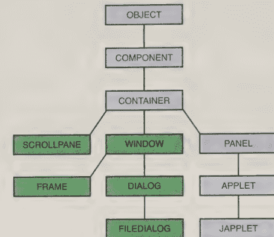

顶部是 `Object` 类。`JApplet` 在层次结构中上方有五个超类：`Applet`、`Panel`、`Container`、`Component` 和 `Object`。

`JApplet` 类从这些类中的每一个类继承了属性和行为，因为在超类层次结构中，每个类都直接位于它的上方。`JApplet` 不会从图 12.1 中的五个绿色类（包括 `Dialog` 和 `Frame`）中继承任何东西，因为它们不在它在层次结构中的上方。

如果这听起来很困惑，请将层次结构想象成家族树。`JApplet` 继承自它的父类、父类的父类，以此类推。它甚至从它的高高高祖父 `Object` 继承了一些东西。然而，`JApplet` 类并不继承自它的兄弟或表亲。

创建一个新类归结为以下任务：你只需要定义它与现有类不同之处。其余的工作由系统为你完成。

## 继承行为和属性

类的行为和属性是两者的结合：它自身的行为和属性，以及它从超类继承的所有行为和属性。

以下是 `JApplet` 的一些行为和属性：

## 建立继承

- `equals()` 方法确定 `JApplet` 对象的值是否与另一个相同。

- `setBackground()` 方法设置 applet 的背景颜色。

- `add()` 方法向 applet 添加按钮和文本字段等界面组件。

- `setLayout()` 方法定义 applet 图形界面组织方式。

## 重写方法

在 `JApplet` 中定义的某些方法在超类中也有定义。例如，`update()` 方法属于 `JApplet` 和 `Component` 类。当子类中定义方法时，子类方法用于更改、替换或完全消除超类中存在的行为。

要重写方法，你必须以其在超类中声明的方式来声明该方法。公共方法必须保持公共，方法返回的值必须相同，且方法的参数数量和类型不能更改。

`Component` 类的 `paint` 方法如下：

```java
public void paint(Graphics g) {
```

当 `AnimatedLogo` 重写此方法时，它必须如下所示开头：

```java
public void paint(Graphics screen) {
```

区别在于 `Graphics` 对象的名称，这在判断方法是否以相同方式创建时并不重要。这两个语句匹配是因为以下几点：

- 两个方法都是公共的。

- 两个方法都不返回值（如使用 `void` 语句所示）。

- 它们都将 `Graphics` 对象作为唯一参数。

## 建立继承

使用 `extends` 语句将类定义为另一个类的子类，如下所示：

```java
class AnimatedLogo extends JApplet {
}
```

`extends` 语句建立了 `AnimatedLogo` 类是 `JApplet` 子类。所有的 Swing applet 都必须是 `JApplet` 的子类。

## 充分利用现有对象

它们需要该类提供的功能在网页上运行。

`AnimatedLogo` 必须重写 `paint()` 方法，该方法用于绘制程序窗口内的所有内容。由 `Component` 类实现的 `paint()` 方法向下传递给 `AnimatedLogo`。然而，该 `paint()` 方法并没有做任何事情。它的存在是因为 `Component` 的子类在需要显示内容时可以使用该方法。

## 在子类中使用 this 和 super

两个在子类中非常有用的关键字是 `this` 和 `super`。

正如你在上一小时中中学到的那样，`this` 关键字用于引用当前对象。当你创建一个类并需要引用从该类创建的特定对象时，你可以使用 `this`，如下所示：

```java
this.title = "Cagney";
```

## 使用现有对象

此语句将对象的标题变量设置为文本 "Cagney"。

`super` 关键字具有类似的作用：它引用对象的直接父类。你可以通过几种不同的方式使用 `super`：

- 引用父类的构造器方法，例如 `super("Adam", 12);`

- 引用父类的变量，例如 `super.hawaii = 50`

- 引用父类的方法，例如 `super.dragnet();`

你使用 `super` 关键字的一种方式是在子类的构造方法中。因为子类继承了其父类的行为和属性，所以你必须将子类的每个构造方法与其父类的构造方法关联。否则，某些行为和属性可能无法正确设置，导致子类无法正常运行。

为了关联构造方法，子类构造方法的第一条语句必须是对父类构造方法的调用。这需要 `super` 关键字，如下句所示：

```java
public DataReader(String name, int length) {
    super(name, length);
}
```

这是一个子类的示例，它使用 `super(name, length)` 语句来调用其父类中可比较的构造方法。

如果你不使用 `super()` 调用父类中的构造方法，Java 在子类构造方法开始时会自动调用无参数的 `super()`。如果这个父类构造方法不存在或提供了意外之外的行为，就会导致错误，因此最好亲自调用父类构造方法。

## 使用现有对象

面向对象编程（OOP）鼓励重用。如果你为一个 Java 编程项目开发了一个对象，那么它可以在不经修改的情况下整合到另一个项目中。

如果一个 Java 类设计得良好，就可以在其他程序中使用。程序中可用的对象越多，创建自己的软件时需要的工作就越少。

## 第 12 小节：充分利用现有对象

## 注意

本书的作者像他行业中的许多人一样，是自雇并在居家工作。在评估他关于如何在职场中处世的建议时，请记住这一点。

如果有一个符合你需求的优秀拼写检查对象，你可以使用它而不是自己写一个。理想情况下，你可以给老板留下一种错觉，认为你为项目添加拼写检查功能花了很久，而你用它在办公室拨打长途电话。

当 Java 引入时，对象共享系统在很大程度上是非正式的。程序员开发的对象力求尽可能尽可能独立，并通过使用私有变量以及读写这些变量的公共方法来保护它们免受误用。

当存在开发可重用对象的标准方法时，对象共享会变得更加强大。

标准化的优点包括：

- 不需要编写文档来说明对象如何工作，因为任何了解标准的人已经对其运行方式了如许多。

- 你可以设计遵循该标准的开发工具，从而更轻松地处理这些对象。

- 两个遵循标准的对象能够相互作用，而无需特殊的编程来使它们兼容。

## 在 Array Lists 中存储同类对象

编写计算机程序时，一个重要的决策是将数据存储在何处。本书的前半部分，你发现了三个存储信息的有用地方：

- 基础数据类型，如 `int` 和 `char`

- 数组

- `String` 对象

还有更多地方可以存储信息，因为任何 Java 类都可以持有数据。最有用之一是 `ArrayList`，它是一种持有同类对象的数据结构。

正如类名所示，数组列表类似于数组，它们也持有相关数据的元素，但它们的大小可以随时扩大或缩小。

`ArrayList` 类属于 `java.util` 包，它是 Java 类库中最有用的包之一。通过 `import` 语句可以在你的程序中使用它：

```java
import java.util.ArrayList;
```

数组列表持有属于同一类或同一父类的对象。它们通过引用两个类来创建：`ArrayList` 类和所持有的类。

列表所持类的名放在 `<` 和 `>` 字符之间，如下所示：

```java
ArrayList<String> structure = new ArrayList<String>();
```

前面的语句创建一个持有字符串的列表。以这种方式识别数据结构的对象类型利用了泛型（generics），这是一种指示数组列表持有对象类型的方法。如果你在使用旧版本的 Java，你将编写如下的构造方法：

```java
ArrayList structure = new ArrayList();
```

虽然你可以这样做，但泛型让你的代码更可靠，因为它们为编译器提供了防止更多错误的方法。在这里，它们防止你通过向数组列表放入错误的类对象来误用它。如果你尝试向一个预期持有 `String` 对象的列表放入一个 `Integer` 对象，编译器会报错。

与数组不同，数组列表在创建时并不是带有固定数量的持有元素的。该列表创建时有 10 个元素。如果你知道要存储更多对象，可以在构造方法中指定大小。这里有一条创建 300 个元素列表语句：

```java
ArrayList<String> structure = new ArrayList<String>(300);
```

## 充分利用现有对象

你通过调用 `add()` 方法并将对象作为唯一参数将对象添加到列表：

```java
structure.add("Vance");
structure.add("Vernon");
structure.add("Velma");
```

这会将对象存储在列表中。

通过调用 `get()` 方法并传入元素的索引从列表中获取元素：

```java
String name = structure.get(1);
```

此语句获取了一个元素。

要检查列表是否包含某个对象，调用 `contains()` 方法并将该对象作为参数：

```java
structure.contains("Vance");
```

你可以使用 `remove()` 或其索引从列表中移除对象：

```java
structure.remove(0);
structure.remove("Vernon");
```

这些语句留下了列表。

## 遍历 Array List

Java 有一种特殊的 for 循环，可以轻松加载数组列表并依次检查其每个元素。这个循环有两个部分：第一部分是初始化，第二部分是循环体。这里是遍历结构并将每个名称显示在屏幕上的代码：

```java
for (String name : structure) {
    System.out.println(name);
}
```

这个特殊的 for 循环用于字符串。列表来自数组和命令行参数。

## 充分利用现有对象

该类与 `ArrayList` 类似，属于 `java.util` 包。在 Java 中，数组列表和其他有用的数据结构被称为集合（collections）。

当你运行该程序时，输出应该是一个按字母顺序排列的名称列表（见图 12.2）。数组列表灵活的大小允许你将额外的名称添加到数据结构中，并与其它名称一起排序。

图 12.2

StringLister 的输出。

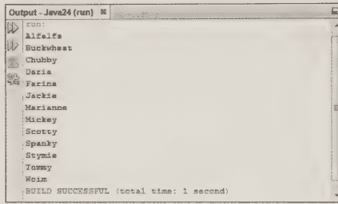

## 创建子类

为了看到继承的实际应用，在下一个项目中，你创建一个名为 `Point3D` 的类，表示三维空间中的一个点。你可以用 `(x,y)` 坐标表示一个二维点。三维空间增加了第三个坐标，可以称为 `z`。

`Point3D` 类对象可以做三件事：

- 跟踪对象的 (x,y,z) 坐标

- 将对象移动到新的 (x,y,z) 坐标

- 按指定的 x、y 和 z 值增量移动对象

Java 已经有一个表示二维点的标准类，称为 `Point`。

它有两个整数变量 `x` 和 `y`，用于存储 `Point` 对象的 `(x,y)` 位置。它还有一个 `move()` 方法将点放置在指定位置，以及一个 `translate()` 方法按 x 和 y 值的量移动对象。

在 NetBeans 的 Java24 项目中，创建一个名为 `Point3D` 的新空 Java 文件，并将列表 12.2 中的文本输入到文件中。完成后保存即可。

## 列表 12.2 Point3D.java 的完整文本。

```java
1: package com.java24hours;
2:
3: import java.awt.*;
4:
5: public class Point3D extends Point {
6:    public int z;
7:
8:    public Point3D(int x, int y, int z) {
9:        super(x,y);
10:       this.z = z;
11:   }
12:
13:   public void move(int x, int y, int z) {
14:        this.z = z;
15:        super.move(x, y);
16:   }
17:
18:   public void translate(int x, int y, int z) {
19:        this.z += z;
20:        super.translate(x, y);
21:   }
22: }
```

`Point3D` 类没有 `main()` 方法，因此你无法将其作为应用程序运行，但你可以在任何需要三维点的 Java 程序中运行它。

`Point3D` 类只需要执行其父类 `Point` 未执行的操作。这主要涉及跟踪整数变量 `z`，并将其作为参数传递给 `move()` 方法、`translate()` 方法和 `Point3D()` 构造函数。

所有方法都使用了 `super` 和 `this` 关键字。`this` 语句用于引用当前的 `Point3D` 对象，第 10 行中的 `this.z = z` 将对象的 `z` 设置为在第 8 行中作为参数传递给方法的 `z` 值。

`super` 语句引用当前对象的父类 `Point`。它用于设置变量并调用 `Point3D` 继承的方法。第 9 行中的 `super(x,y)` 语句调用父类中的 `Point(x,y)` 构造函数，然后设置 `Point3D` 对象的 `(x,y)` 坐标。

## 第 12 小时：充分利用现有对象

由于 `Point` 已经具备处理 x 轴和 y 轴的能力，如果 `Point` 也做这些将是多余的。


为了测试继承，在下一个项目中创建一个名为 `PointTester` 的新文件，并将列表 12.3 的内容输入文件。

### 列表 12.3 PointTester.java 的完整文本

```
1: package com.java24hours;
2:
3: import java.awt.*;
4:
5: public class PointTester {
6:    public static void main(String[] args) {
7:        Point3D p1 = new Point3D(10, 20, 30);
8:        System.out.println(p1);
9:        p1.move(5, 5, 5);
10:       System.out.println(p1);
11:       p1.translate(2, 2, 2);
12:       System.out.println(p1);
13:   }
14: }
```

当你运行程序时，输出应该是一个按字母顺序排列的名称列表（见图 12.2）。数组列表灵活的大小允许你将额外的名称添加到数据结构中，并与其它名称一起排序。

#### 图 12.2 StringLister 程序的输出

```
Alice
Bob
Charlie
David
Eve
```

# 第 13 小时：构建简单的用户界面

这一小时里的内容将变得非常复杂。你将在创建第一个图形用户界面（GUI）时搞出一大乱子。

计算机用户已经习惯了软件具备 GUI、能够通过鼠标接收用户输入，并且像其他程序一样。尽管某些用户仍在 MS-DOS 或 Linux shell 等命令行环境中工作，但大多数人会对没有提供像 Microsoft Windows 或 Mac OS 那种点击和拖拽式图形用户界面的软件感到困惑。

Java 通过 Swing 支持这种软件。Swing 是一个 Java 类的集合，代表了构成 GUI 部分的所有不同按钮、文本字段、滑块和其他组件，以及从这些组件接收用户输入所需的类。

在本小时和下一小时中，你将使用 Java 创建并组织 GUI。在随后的第 15 小时“响应用户输入”中，你将让这些界面接收鼠标点击和其他用户输入。

## 本小时的任务列表

- 创建按钮等用户界面组件。
- 创建标签、文本字段或其他组件。
- 将组件分组合在一起。
- 将组件放入其他组件内部。
- 实现组件的水平和垂直滚动。
- 打开和关闭窗口。

## Swing 与抽象窗口工具包（AWT）

由于 Java 是一种跨平台语言，允许你为许多操作系统编写程序，因此其图形用户界面软件必须是灵活的。它不能仅迎合 Windows 风格或 Mac 版本，必须同时处理这两种以及其他平台。

在 Java 中，程序用户界面的开发基于 Swing 和一组较早名为抽象窗口工具包（Abstract Windowing Toolkit）的类。这些类允许你创建 GUI 并接收用户的输入。

Swing 包含了几十个组件，其自定义方式远比此处记录的要多。本书涵盖了最常用的组件和最有用的方法。当你在接下来的四个小时中探索它们时，你可以更深入地了解每个组件，并在 Oracle 官方 Java 类库文档中找到新方法。你可以在 Web 上通过 `http://download.java.net/jdk8/docs/api` 阅读该文档。它为 Java 8 中的每个类和接口提供了额外的参考文档。

Swing 包含了编写使用 GUI 程序所需的所有内容。通过 Java 的用户界面类，你可以创建一个包含以下内容及更多内容的 GUI：

- 按钮、复选框、标签和其他简单组件
- 文本字段、滑块和更复杂的组件
- 下拉菜单和弹出菜单
- 窗口、帧、对话框、面板和 applet 窗口

## 使用组件

在 Java 中，GUI 的每个部分都由 Swing 包中的类表示。有用于按钮的 `JButton` 类、用于窗口的 `JWindow` 类、用于文本字段的 `JTextField` 类等。

若要创建并显示一个界面，你需要创建对象、设置它们的变量并调用它们的方法。这些技术与你在前三个小时中学的相同，因为那时你已经接触了面向对象编程（OOP）。

当你组装 GUI 时，你处理的是两种对象：组件和容器。组件是用户界面中的单个元素，例如按钮或滑块。容器是你用来存放其他组件的组件。

创建界面的第一步是创建一个可以容纳组件的容器。在应用程序中，这个容器通常是一个窗口或帧。

## 窗口与帧

窗口和帧是可以显示在用户界面和其他组件中的容器。窗口是简单的容器，没有标题栏或通常位于 GUI 顶部的任何按钮。帧包含了用户在运行软件时预期找到的所有常见窗口功能——例如关闭、扩展和缩小窗口的按钮。

你使用 Swing 的 `JWindow` 和 `JFrame` 类来创建这些容器。在 Java 程序中，如果不使用包和类名来引用类，请使用以下语句：

```java
import javax.swing.*;
```

这仅导入了 `javax.swing` 包中的类名。在 Swing 中，你会用到其他包。

在 Java 应用程序中使用帧的一种方法是让应用程序成为 `JFrame` 的子类。程序继承了作为帧所需的行为。以下语句创建了一个子类：

```java
import javax.swing.*;
public class MainForm extends JFrame {
    public MainForm() {
    }
}
```

该类创建了一个帧，但尚未完全设置。在帧的构造函数中，创建时必须完成以下几件事：

- 调用父类的构造函数。
- 设置帧的标题。
- 设置帧的大小。
- 设置帧的外观。
- 定义用户关闭帧时发生什么。

你必须让帧可见，除非出于某些原因它在程序启动时不显示。

大多数这些事情都可以在帧的构造函数中处理。方法的第一部分内容是使用 `super` 语句调用 `JFrame` 的构造函数之一。示例如下：

```java
super();
```

前述语句调用了不带参数的 `JFrame` 构造函数。你也可以将帧的标题作为参数调用它：

```java
super("Main Frame");
```

这会将帧标题（位于顶部的标题栏中）设置为指定的字符串。在示例中，显示为“Main Frame”。如果你不是这样设置标题，可以调用帧的 `setTitle(String)` 方法并将标题作为参数：`setTitle("Main Frame")`。

帧的大小可以通过调用其 `setSize(int, int)` 方法来确定，两个参数分别是宽度和高度。以下语句设置了一个宽 350 像素、高 125 像素的帧：`setSize(350, 125)`。

设置帧的另一种方法是填充组件，然后调用无参数的 `pack()` 方法：`pack()`。

`pack()` 方法将帧的大小调整为足以容纳每个组件的首选大小（但不会更大）。每个界面组件都有首选大小，但根据组件在界面中的排列方式，有时会被忽略。在调用 `pack()` 之前，不需要显式设置帧的大小。

### 列表 13.1 SalutonFrame.java 的完整文本

```
13:
14:    private void setLookAndFeel() {
15:        try {
16:            UIManager.setLookAndFeel(
17:                "com.sun.swing.plaf.nimbus.NimbusLookAndFeel"
18:            );
19:        } catch (Exception exc) {
20:            // ignore error
21:        }
22:    }
23:
24:    public static void main(String[] arguments) {
25:        SalutonFrame frame = new SalutonFrame();
26:
27: }
}
```

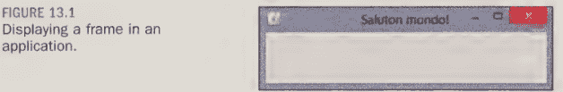

列表 13.1 的第 24–26 行包含 `main()` 方法，它将此帧类转换为应用程序。当你运行该类时，你会看到图 13.1 所示的帧。

SalutonFrame 显示的唯一内容是一个标题：程序员传统的问候语“Saluton mondo！”该帧是一个空窗口，因为它还没有包含任何其他组件。

要向帧中添加组件，你必须创建该组件并将其添加到容器中。每个容器都有一个 `add()` 方法，它接受一个参数：要显示的的组件。

SalutonFrame 类包含一个 `setLookAndFeel()` 方法，该方法指定 Nimbus 为帧的外观。在第 16–18 行调用了 `UIManager` 类的 `setLookAndFeel()` 方法来实现此目标。

该方法的调用被放在 `try-catch` 块中，这使得可能发生的错误被处理。`try` 和 `catch` 语句是新的，因为它们还没有被引入。使用这些语句处理错误将在第 18 小时“处理程序中的错误”中介绍。

到目前，你只需要知道调用 `UIManager.setLookAndFeel()` 会设置 GUI 的外观。其结果可能产生的任何错误只会导致程序保持默认的外观，而不是 Nimbus。

## 按钮

你可以向容器中添加的一个简单组件是 `JButton` 对象。与你在本小时内正在处理的其他组件一样，`JButton` 是 `javax.swing` 包的一部分。`JButton` 对象是一个带有标签的可点击按钮，标签描述了按钮的功能。该标签可以是文本、图形或两者兼有。以下语句创建了一个名为 `okButton` 的 `JButton` 并给它赋予文本标签 OK：

```java
JButton okButton = new JButton("OK");
```

创建像 `JButton` 这样的组件后，应该通过调用其 `add()` 方法将其添加到容器中：

```java
add(okButton);
```

当你向容器中添加组件时，你不需要指定组件在容器中显示的位置。组件的排列由一个称为布局管理器的对象决定。在这些布局管理器中最简单的是 `FlowLayout` 类，它是 `java.awt` 包的一部分。

要让容器使用特定的布局管理器，你必须首先创建该布局管理器类的对象。你可以通过调用其不带参数的构造函数来创建一个 `FlowLayout` 对象：

```java
FlowLayout flo = new FlowLayout();
```

创建布局管理器后，你调用容器的 `setLayout` 方法将指定的管理器与该容器关联：

```java
setLayout(flo);
```

该语句将 `flo` 对象指定为布局管理器。

你创建的下一个应用程序是一个名为 `Playback` 的类，这是一个显示带有三个按钮的帧的 Java 应用程序。将列表 13.2 中的文本输入新的 Java 文件并保存该文件。

在列表 13.1 中有一个你可能没见过的东西。仔细看第 16-18 行。它们是跨越三行的单一语句。该语句可以写在一行内，但我们将其分行是为了提高人类的可读性。Java 编译器并不关心额外的空格。只要该语句包含正确的内容并以分号结束，它就可以分多行。

### 列表 13.2 Playback.java 的完整文本

```
1: package com.java24hours;
2: import javax.swing.*;
3: import java.awt.*;
4:
5: class Playback extends JFrame {
6:     public Playback() {
7:         super("Playback");
8:         setLookAndFeel();
9:         setSize(225, 80);
10:         FlowLayout flo = new FlowLayout();
11:         setLayout(flo);
12:         JButton play = new JButton("Play");
13:         JButton stop = new JButton("Stop");
14:         JButton pause = new JButton("Pause");
15:         add(play);
16:         add(stop);
17:         add(pause);
18:         setDefaultCloseOperation(JFrame.EXIT_ON_CLOSE);
19:         setVisible(true);
20:     }
21:
22:     private void setLookAndFeel() {
23:         try {
24:             UIManager.setLookAndFeel(
25:                 "com.sun.swing.plaf.nimbus.NimbusLookAndFeel"
26:             );
27:         } catch (Exception exc) {
28:            // ignore error
29:        }
30:    }
31:
32:    public static void main(String[] args) {
33:        Playback frame = new Playback();
34:    }
35: }
```

SalutonFrame 类包含一个 `setLookAndFeel()` 方法，指定 Nimbus 为帧的外观。`UIManager` 类的 `setLookAndFeel()` 方法在第 16–18 行被调用以完成此操作。该方法的调用被放在 `try-catch` 块中，以便处理可能发生的错误。`try` 和 `catch` 语句是新的，因为它们还没有被引入。使用这些语句处理错误将在第 18 小时“处理程序中的错误”中介绍。

到目前，你只需要知道调用 `UIManager.setLookAndFeel()` 会设置 GUI 的外观。结果可能产生的任何错误只会导致程序保持默认的外观而不是 Nimbus。

你创建的下一个应用程序是一个名为 `Playback` 的类，这是一个显示带有三个按钮的帧的 Java 应用程序。将列表 13.2 中的文本输入新的 Java 文件并保存该文件。

在列表 13.1 中有一个你可能没见过的东西。仔细看第 16-18 行。它们是跨越三行的单一语句。该语句可以写在一行内，但我们将其分行是为了人类更容易读。Java 编译器并不关心额外的空格。只要该语句包含正确的内容并以分号结束，它就可以分多行。

## 标签和文本字段

`JLabel` 组件显示用户无法修改的信息。该标签可以是文本、图形或两者兼有。以下语句创建了一个名为 `label` 的 `JLabel` 并给它赋予文本标签：

```java
JLabel label = new JLabel("Text Label");
```

创建像 `JLabel` 这样的组件后，应该通过调用容器的 `add()` 方法将其添加到容器中：

```java
add(label);
```

`JTextField` 组件是一个允许用户输入单行文本的区域。以下语句创建了一个名为 `textField` 的 `JTextField`，宽度为 20 列：

```java
JTextField textField = new JTextField(20);
```

创建后，同样通过 `add()` 方法将其添加到容器中。


# 第 13 章：构建简单的用户界面

## 标签

`JLabel` 组件显示用户无法修改的信息。该标签可以是文本、图形或两者兼有。以下语句创建了一个名为 `okButton` 的 `JButton` 并给它赋予文本标签 OK：

## 选框

这创建了三个选框，它们都组在一个名为 `meals` 的 `ButtonGroup` 下。`Frog Leg Grande` 初始被勾选，但如果用户勾选了其他餐食框，`Frog Leg Grande` 旁边的勾选将自动消失。图 13.4 显示了本节中不同的选框。

```
setLayout(flo);
add(jumboSize);
add(frogLegs);
add(fishTacos);
add(emuNuggets);
```

图 13.4

显示选框组件。


## 组合框

`JComboBox` 组件是一个弹出式的选择列表，它也可以设置为接收文本输入。当这两个选项都启用时，你可以用鼠标或键盘来选择一个项目，或者改为输入文本。组合框的作用与一组选框类似，不同之处在于除非显示弹出选择列表，否则只有一个选项是可见的。

要创建一个 `JComboBox`，你必须在创建对象后添加每个选项，如下例所示：

```
JComboBox profession = new JComboBox();
FlowLayout flo = new FlowLayout();
profession.addItem("Butter");
profession.addItem("Baker");
profession.addItem("Candlestick maker");
profession.addItem("Fletcher");
profession.addItem("Fighter");
profession.addItem("Technical writer");
setLayout(flo);
add(profession);
```

这个示例创建了一个 `JComboBox` 组件，提供了六个供用户选择的项目。当其中一个被选中时，它会显示在组件的显示区域。图 13.5 显示了该示例在弹出选择列表显示时的状态。

图 13.5

显示组合框组件。

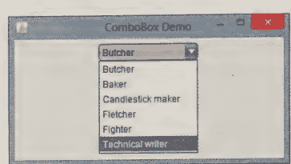

要让 `JComboBox` 组件接收文本输入，你必须调用它的 `setEditable(boolean)` 方法并传入参数 `true`：

`profession.setEditable(true);`

你必须在将组件添加到容器之前调用此方法。

## 文本区域

`JTextArea` 组件是一个允许用户输入多行文本的文本字段。你可以指定组件的宽高度。以下语句创建了一个宽度为 40 个字符、高度为 8 行的 `JTextArea` 组件并将其添加到容器中：

```
JTextArea comments = new JTextArea(8, 40);
FlowLayout flo = new FlowLayout();
setLayout(flo);
add(comments);
```

图 13.6 显示了框架中的此示例。

图 13.6

显示文本区域组件。


你可以在 `JTextArea()` 构造函数中指定字符串显示在文本区域中，使用换行符 `\n` 将文本发送到下一行，如下所示：

```
JTextArea comments = new JTextArea("I should have been a pair\n"
+ "of ragged claws", 10, 25);
```

文本区域有两个可以调用的方法，用于指定当用户输入到行右边缘时组件的行为。调用带参数的 `setLineWrap(boolean)` 方法可以使文本换行到下一行：

`comments.setLineWrap(true);`

要确定文本如何换行到下一行，请使用 `setWrapStyleWord(boolean)` 方法。传入该参数以根据单词结束处换行，或传入 `false` 以根据字符换行。

如果不调用这些方法，文本将不会换行。用户可以一直同一行输入文本，直到按下回车键或超出右边缘。

文本区域在用户输入到行右边缘时的行为可能出乎意料——在 Swing 中，你可以通过将它们放入滚动面板（`JScrollPane`）来支持滚动。

### `JTextArea` 构造函数

你可以使用以下构造函数来创建文本区域：

- `JTextArea()`：创建一个空的文本区域。
- `JTextArea(int, int)`：创建一个指定宽度和高度的文本区域。
- `JTextArea(String, int, int)`：创建一个带有初始文本并指定宽度和高度的文本区域。
- `JTextArea(String)`：创建一个带有初始文本的文本区域。
- `JTextArea(String, int)`：创建一个带有初始文本并指定宽度的文本区域。

### 滚动面板

`JScrollPane` 类允许在文本区域中显示滚动。本质上，`JScrollPane` 是包装容器。整数参数决定了这些滚动。

图 13.7

显示组合框组件。


## 面板

学习到的最后一个组件是面板，它是最简单的容器。以下语句创建了一个 `JPanel` 并分配了布局管理器：

```
JPanel panel = new JPanel();
FlowLayout flo = new FlowLayout();
panel.setLayout(flo);
```

## 创建你的组件

OOP 的优势是可以在项目间重用类。在下一个项目中，你创建一个报告磁盘空间的特殊面板。创建自己的组件的第一步是决定继承什么。你的新组件将拥有所有的现有属性和行为，除非你修改或新增内容。

`FreeSpacePanel` 组件是 `JPanel` 的子类。将列表 13.3 中的文本输入新的 Java 文件并保存。

### 列表 13.3 FreeSpacePanel.java 的完整文本

```java
package com.javours;

import java.io.IOException;
import java.nio.file.*;
import javax.swing.*;

public class FreeSpacePanel extends JPanel {

    JLabel spaceLabel = new JLabel("磁盘空间: ");
    JLabel space = new JLabel();

    public FreeSpacePanel() {
        super();
        add(spaceLabel);
        add(space);
        try {
            setValue();
        } catch (IOException ie) {
            space.setText("错误");
        }
    }

    private final void setValue() throws IOException {
        // 获取当前文件存储
        Path current = Paths.get("");
        FileStore store = Files.getFileStore(current);
        // 查找可用存储空间
        long totalSpace = store.getTotalSpace();
        long freeSpace = store.getUsableSpace();
        // 获取百分比（两位数）
        double percent = (double)freeSpace / (double)totalSpace * 100;
        int percent = (int)(percent * 100) / (double)100;
        // 设置文本
        space.setText(freeSpace + " 字节，总共 " + totalSpace + " 字节 ("
                + percent + "%%)");
    }
}
```

## 使用组件

`FreeSpacePanel` 中的 `setValue()` 方法用于设置显示磁盘空间信息的标签的文本。该方法在第 22 行声明时带有 `final` 关键字：

```java
private final void setValue() {
}
```

在方法声明中包含 `final` 关键字可以防止方法在子类中被重写。这对于 `FreeSpacePanel` 成为一个 GUI 组件来说是必须的。

该面板在第 11–20 行的构造函数中创建。期间发生了以下操作：

- 第 12 行——`super()` 方法调用了 `JPanel` 类的构造函数，确保其被正确初始化。
- 第 13 行——通过调用 `add(Component)` 并将标签作为参数，将新标签 `spaceLabel`（其文本为“Disk space:"，且在第 8 行作为实例变量创建）添加到面板中。
- 第 14 行——`space` 标签（在第 9 行创建的无文本实例变量）也被添加到了面板中。
- 第 16 行——调用了 `setValue()` 方法，该方法设置了 `space` 标签的文本。

第 16 行对 `setValue()` 的调用封装在另一个 `try-catch` 块中，类似于在设置外观时使用的结构。你将在第 18 章学习更多关于如何处理错误的知识，但这里是 TLDR 版本：`try-catch` 使得处理 Java 程序任何部分可能发生的一个或多个错误成为可能。

这是必要的，因为当访问计算机文件系统以查看包含多少可用空间时，`setValue()`可能会引发错误。该错误在 Java 中有自己的类 `IOException`，代表输入/输出错误。

`try` 块包含了整个导致错误的代码。`catch` 块在括号中识别遇到的错误类型，并指定在发生该错误时要执行的代码。

如果在应用程序运行期间遇到此类错误，第 18 行会将 `space` 标签的文本设置为“Error”，以告知用户发生了问题。

缩写 TLDR 代表“太长了；没读”，它出现在互联网上，当人们为不想阅读全文的人对长文章提供极其简的总结时。

> 我希望这对你来说是 TLDR。我们试图让它是 JLRWWTANIRJP（长度适中；读完全文后现在我是 Java 程序员了）。


为自定义组件提供一些有趣的内容，需要快速上手 Java 文件处理，该主题将在第 21 章的“读取和写入文件”中详细介绍。

要确定计算机上有多少可用磁盘空间，你需要 `java.nio.file` 包中的四个类，该包用于访问计算机的文件系统。

`Path` 对象代表文件或文件夹的位置。`Paths` 类有一个 `get(String)` 方法，可以将字符串转换为与路径匹配的字符串。当使用 `""` 调用时：

```java
Path current = Paths.get("");
```

磁盘的存储信息在 Java 中由 `FileStore` 对象表示，这是一个文件存储池。获取路径后，你可以使用 `Files` 类中的方法获取该路径所在的文件存储。`Files` 的 `getFileStore(Path)` 方法用于检索该文件存储：

```java
FileStore store = Files.getFileStore(current);
```

通过此，你现在可以调用它的 `getTotalSpace()` 和 `getUsableSpace()` 方法来查找当前磁盘上有多少可用磁盘空间：

```java
long totalSpace = store.getTotalSpace();
long freeSpace = store.getFreeSpace();
double percent = (double)freeSpace / (double)totalSpace * 100;
```

最后一条语句中计算出的百分比可能是小数点后位数非常长的数字，例如 64.867539。

以下表达式将双精度浮分比转换为最多两位小数：

```java
percent = (int)(percent * 100) / (double)100;
```

表达式的前半部分将百分比乘以 100——将小数点向右移动两位——并将其转换为整数，因此 64.8675309 变成了 6487。

后半部分将此值除以 100——将小数点向左移动两位——用以恢复百分比的近似值。这使得 6486 变成了 64.86。

计算百分比的表达式包含许多对 `double` 的引用，这看起来可能很奇怪。第二和第三次转换是在使用该表达式之前将 `freeSpace` 和 `totalSpace` 变量转换为 `double` 值。这是为了防止表达式产生整数值而不是浮点数。Java 决定数据类型，以便在表达式中使用。

限制为两位小数的百分比是在设置外观时 `""` 的文本。

### 列表 13.4 FreeFrame.java


```java
1: package java.awt;
2: import java.awt.*;
3: import java.swing.*;
4:
5: public class FreeFrame extends JFrame {
6:     public FreeFrame() {
7:         super("Disk space");
8:         setLookAndFeel();
9:         setSize(500, 100);
10:        setDefaultCloseOperation(JFrame.EXIT_ON_CLOSE);
11:        FlowLayout flo = new FlowLayout();
12:        setLayout(flo);
13:        FreeSpacePanel freePanel = new FreeSpacePanel();
14:        add(freePanel);
15:        setVisible(true);
16:    }
17:
18:    private void setLookAndFeel() {
19:        try {
20:            UIManager.setLookAndFeel("com.sun.java.Nimbus");
21:        } catch (Exception ex) {
22:            // ignore
23:        }
24:    }
25:
26:    public static void main(String[] args) {
27:        FreeFrame frame = new FreeFrame();
28:    }
29: }
```

## Chapter 13: Building a Simple User Interface

Giving the custom component something interesting to do requires a quick toe-dip into Java file handling, a subject that will be covered at length in Hour 21, “Reading and Writing Files.”

To figure out how much disk space is free on a computer, you need four classes in the `java.nio.file` package, which is employed to access a computer's file system.

A `Path` object represents the location of a file or folder. The `Paths` class has a `get(String)` method that converts a string to a path matching string. When called with `""`:

```java
Path current = Paths.get("");
```

Storage information for a disk is represented in Java by a `FileStore` object, which is a file storage pool. After you have a path, you can get the file store where that path is located with a method in the `Files` class. The `getFileStore(Path)` method of `Files` to retrieve that file store:

```java
FileStore store = Files.getFileStore(current);
```

With this, you can now call its `getTotalSpace()` and `getUsableSpace()` methods to find out how much disk space is available on the current disk:

```java
long totalSpace = store.getTotalSpace();
long freeSpace = store.getFreeSpace();
double percent = (double)freeSpace / (double)totalSpace * 100;
```

The percentage calculated in the final statement may be an extremely long number of digits past the decimal point, such as 64.867539.

The following expression converts a double percentage to no more than two decimal places:

```java
percent = (int)(percent * 100) / (double)100;
```

The first half of the expression multiplies the percentage by 100—moving the decimal two places to the right—and converts it to an integer, so 64.8675309 becomes 6487.

The second half divides this by 100—moving the decimal back places to the left—to restore an approximation of the percentage. This makes 6486 into 64.86.

The expression that calculates the percentage includes a lot of references to `double`, which may seem weird. The second and third cast the `freeSpace` and `totalSpace` variables to `double` values before they are used in this expression. This is necessary to keep the expression from producing an integer value instead of a floating-point number. Java determines the data type, so its use in the expression.

## Using Components

The `setValue()` method in `FreeSpacePanel` sets the text of the label that displays the disk space information. The method is declared with the `final` keyword on line 22:

```java
private final void setValue() {
}
```

Including the `final` keyword in a method declaration prevents the method from being overridden in a subclass. This is required for `FreeSpacePanel` to be a GUI component.

The panel is created in the constructor on lines 11–20. The following takes place:

- Line 12—The `super()` method calls the `JPanel` class constructor, ensuring it is properly initialized.
- Line 13—The new label `spaceLabel` (created as an instance variable on line 8 with the text "Disk space:") is added to the panel by calling `add(Component)` with the label as an argument.
- Line 14—The `space` label (created as an instance variable on line 9 with no text) is also added to the panel.
- Line 16—The `setValue()` method is called, which sets the text of the `space` label.

The call to `setValue()` on line 16 is wrapped in another `try-catch` block, similar to the one used when setting the look and feel. You'll learn more about handling errors in Hour 18, but here's the TLDR version: `try-catch` makes it possible to handle one or more errors that might occur in any part of a Java program.

This is necessary because `setValue()` might error when accessing the computer's file system to see how much free space it contains. The error has its own class in Java, `IOException`, which represents an input/output error.

The `try` block contains the code that might cause the error. The `catch` block identifies the type of error encountered in parentheses and specifies the code to execute if that error occurs.

If this type of error is encountered while the application is running, line 18 sets the text of the `space` label to "Error" to inform the user that a problem occurred.

The abbreviation TLDR stands for "Too Long; Didn't Read." It appears on the Internet when people provide extremely brief summaries of long articles for those who don't want to read the whole thing.

> I hope this is TLDR for you. We're trying to make it JLRWWTANIRJP (Just Long Enough; Read The Whole Thing And Now I'm A Java Programmer).


## Hour 13: Building a Simple User Interface

Giving the custom component something interesting to do requires a quick toe-dip into Java file handling, a subject that will be covered at length in Hour 21, "Reading and Writing Files."

To figure out how much disk space is free on a computer, you need four classes in the `java.nio.file` package, which is employed to access a computer's file system.

A `Path` object represents the location of a file or folder. The `Paths` class has a `get(String)` method that converts a string to a path matching string. When called with `""`:

```java
Path current = Paths.get("");
```

Storage information for a disk is represented in Java by a `FileStore` object, which is a file storage pool. After you have a path, you can get the file store where that path is located with a method in the `Files` class. The `getFileStore(Path)` method of `Files` to retrieve that file store:

```java
FileStore store = Files.getFileStore(current);
```

With this, you can now call its `getTotalSpace()` and `getUsableSpace()` methods to find out how much disk space is available on the current disk:

```java
long totalSpace = store.getTotalSpace();
long freeSpace = store.getFreeSpace();
double percent = (double)freeSpace / (double)totalSpace * 100;
```

The percentage calculated in the final statement may be an extremely long number of digits past the decimal point, such as 64.867539.

The following expression converts a double percentage to no more than two decimal places:

```java
percent = (int)(percent * 100) / (double)100;
```

The first half of the expression multiplies the percentage by 100—moving the decimal two places to the right—and converts it to an integer, so 64.8675309 becomes 6487.

The second half divides this by 100—moving the decimal back places to the left—to restore an approximation of the percentage. This makes 6486 into 64.86.

## Quiz

- 1. Which user component is used to contain other components in a container?
  - A. TupperWare
  - B. `JPanel`
  - C. `Choice`

- 2. What must be done first inside a container?
  - A. Establish a layout manager
  - B. Add components
  - C. Doesn't matter

- 3. Which method determines how components are arranged in a container?
  - A. `setLayout()`
  - B. `setLayoutManager()`
  - C. `setVisible()`

## Answers

- 1. B. You can add components to a panel and then add the panel to another container, such as a frame.
- 2. A. You must specify a layout manager before adding components so they can be added correctly.
- 3. A. The `setLayout()` method takes one argument: a layout manager object that is responsible for determining where components should be displayed.

## Activities

To further explore GUI design, complete the following activities:

- Modify the `SalutanFrame` application to display "Salutan Mondo!" in the frame's main area instead of the title bar.
- Enhance the `FreeSpacePanel` component to display a comma every three digits in the disk size numbers. One approach is to use a `StringBuilder` object, the `String` class's `charAt(int)` method, and a loop to iterate through the string.

To see Java programs that implement these activities, visit the book's website at www.java24.com.

## Hour 14: Laying Out a User Interface

When you start designing graphical user interfaces (GUIs) for your Java programs, you face the obstacle that your components are movable. Whenever a container changes size (for example, when a user resizes a frame), the components it contains may be rearranged to fit its new dimensions.

This flexibility works to your advantage because it accounts for differences in how interface components appear on different operating systems. A clickable button might look different in Windows than it does in Linux or macOS.

Components in an interface are organized using a set of classes called layout managers. These classes define how components are displayed within a container. Each container in an interface can have its own layout manager.

### To Do

- Create a layout manager.
- Assign a layout manager to a container.
- Use panels to organize components in an interface.
- Handle unusual layouts.
- Create a prototype for a Java application.

## Using Layout Managers

In Java, the position of a component within a container depends on the component's size, the size of other components, and the container's height and width. The layout of buttons, text fields, and other components can be affected by:

- The size of the container
- The size of other components and containers
- The layout manager in use

Several layout managers are available to affect how components are displayed. The default manager for a panel is the `FlowLayout` class in the `java.awt` package, which was used in the previous hour.

Under `FlowLayout`, components are placed in an area in a manner similar to how words are organized on an English page—left to right, moving to the next line when there is no more room.

The following example can be used in a frame to employ a flow layout when adding components:

```java
FlowLayout topLayout = new FlowLayout();
setLayout(topLayout);
```

You can also set a layout manager to work within a specific container, such as a `JPanel` object. You do this by using that container object's `setLayout()` method.

The Crisis application has a GUI with five buttons. Create a new Java file for a class named `Crisis`. Enter the text from Listing 14.1 into the file and save it.

## Listing 14.1: The Full Text of Crisis.java


```java
1: package com.java24hours;
2:
3: import java.awt.*;
4: import java.swing.*;
5:
6: public class Crisis extends JFrame {
7:     JButton panicButton;
8:     JButton dontPanicButton;
9:     JButton blameButton;
10:    JButton mediaButton;
11:    JButton saveButton;
12:
13:    public Crisis() {
14:     super("Crisis");
15:     setLayout();
16:     setSize(348, 120);
17:     setDefaultCloseOperation(JFrame.EXIT_ON_CLOSE);
18:     FlowLayout flow = new FlowLayout();
19:     setLayout(flow);
20:
21:     panicButton = new JButton("Panic");
22:     dontPanicButton = new JButton("Don't Panic");
23:     blameButton = new JButton("Blame Others");
24:     mediaButton = new JButton("Notify the Media");
25:     saveButton = new JButton("Save Yourself");
26:     add(panicButton);
27:     add(dontPanicButton);
28:     add(blameButton);
29:     add(mediaButton);
30:     add(saveButton);
31:     setVisible(true);
32: }
33: 
34: 
35:     private void setLookAndFeel() {
36:         try {
37:             UIManager.setLookAndFeel(
38:                 "com.sun.java.swing.plaf.nimbus.NimbusLookAndFeel"
39:             );
40:         } catch (Exception exc) {
41:             // ignore error;
42:         }
43:     }
44: 
45:     public static void main(String[] args) {
46:         Crisis frame = new Crisis();
47:     }
}
```

图 14.1 显示了布局。


> FIGURE 14.1
>
> 使用流式布局安排组件。

`FlowLayout` 类使用容器的尺寸作为布局组件的唯一指南。缩放应用程序的窗口查看组件如何重新排列。将窗口宽度加倍，你会看到所有的 `JButton` 组件现在显示在同一行。

## GridLayout 管理器

`java.awt` 包中的 `GridLayout` 类通过特定的行和列数组织容器中的所有组件。所有组件都分配相同的大小，因此如果你指定一个宽三列高三网格，容器将划分为九个等大的区域。

# 布局用户界面

`GridLayout` 在添加组件时将它们放置在网格中。组件从左到右添加直到一行填满，然后填充下一行的左侧列。

以下语句创建一个容器并将其设置为两行三列的网格：

```
GridLayout grid = new GridLayout(2, 3);
setLayout(grid);
```

图 14.2 显示如果 Crisis 应用使用网格布局会是什么样。


> FIGURE 14.2
>
> 使用网格布局安排组件。

此书网站包含 Crisis 应用的修改版本，演示了本小时介绍的所有布局管理器，从展示网格代码的 `CrisisDemo.java` 开始，访问 www.java24hours.com，点击你的书籍副本，并导航到第 14 小页。

图 14.2 中的一行显示了被缩短的文本。如果文本比组件可用区域宽，标签将使用省略号 (...) 进行缩短。

## BorderLayout 管理器

同样位于 `java.awt` 的 `BorderLayout` 类将组件安排容器内的特定位置，这些位置通过五个方向识别：北、南、东、西和中心。

`BorderLayout` 管理分为五个区域：四个由指南针方向指示和一个中心区域。当在此布局下添加组件时，`add()` 方法包含第二个参数来指定组件应该放置的位置。该参数应该是 `BorderLayout` 类的五个类变量之一：`BorderLayout.NORTH`、`BorderLayout.SOUTH`、`BorderLayout.EAST`、`BorderLayout.WEST` 和 `BorderLayout.CENTER` 用于此参数。

与 `GridLayout` 类一样，`BorderLayout` 将所有可用空间交给组件。放置在中间的组件将获得边界组件不需要的所有空间，因此它是最大的。

```
add(panicButton, BorderLayout.NORTH);
add(dontPanicButton, BorderLayout.SOUTH);
add(blameButton, BorderLayout.EAST);
add(mediaButton, BorderLayout.WEST);
add(saveButton, BorderLayout.CENTER);
```

图 14.3 显示了这在 Crisis 应用程序中的外观。


> 图 14.3
>
> 使用边界布局排列组件。

## BoxLayout 管理器

另一个实用的布局管理器是位于 `javax.swing` 包中的 `BoxLayout`，它允许在水平或垂直方向上堆叠组件。

要使用这种布局，请创建一个面板来存放组件，然后创建一个带有两个参数的布局管理器：

- 要在框布局中组织的组件
- 用于垂直对齐的 `BoxLayout.Y_AXIS` 或用于水平对齐的 `BoxLayout.X_AXIS`

以下是堆叠 Crisis 组件的代码：

```
JPanel pane = new JPanel();
BoxLayout box = new BoxLayout(pane, BoxLayout.Y_AXIS);
pane.setLayout(box);
pane.add(panicButton);
pane.add(dontPanicButton);
pane.add(blameButton);
pane.add(mediaButton);
pane.add(saveButton);
add(pane);
```

图 14.4 显示了最终效果。

# 图 14：用户界面的布局

图 14.4 使用框布局堆叠组件。

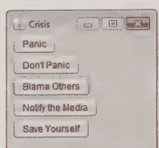

# 使用 Insets 分离组件

当你在容器内排列组件时，可以使用 `Insets` 将组件远离容器的边缘。`Insets` 是一个表示容器边界区域的对象。

`Insets` 类是 `java.awt` 包的一部分，它有一个接受四个参数的构造函数：分别代表在容器的顶部、左侧、底部和右侧留出的空间。每个参数都使用像素作为单位，这与定义框架大小时使用的单位相同。

以下语句创建了一个 `Insets` 对象：

`Insets around = new Insets(10, 6, 10, 3);`

`around` 对象表示一个容器边界，其顶部内部 10 像素，左侧内部 6 像素，底部内部 10 像素，右侧内部 3 像素。

要在容器中使用 `Insets` 对象，必须重写容器的 `getInsets()` 方法。该方法没有参数并返回一个 `Insets` 对象，例所示：

```java
public Insets getInsets() {
    Insets squeeze = new Insets(50, 15, 10, 15);
    return squeeze;
}
```

图 14.5 显示了这将会如何改变图 14.1 所示由 `FlowLayout` 管理的界面。

图 14.5 使用内边距在组件周围添加空间。


## 应用程序的布局

图 14.5 显示的容器有一个空边界，距离左边缘 15 像素，底边缘 10 像素，右边缘 15 像素，顶边缘 50 像素。

到目前为止，你看到的布局管理器都是应用于整个框架的；即使用了框架的 `setLayout()` 方法，所有组件都遵循相同的规则。这种设置适用于某些程序，但当你尝试使用 Swing 开发 GUI 时，通常会发现没有任何布局管理器是完全合适的。

## 组合布局

`JFrame` 容器内置了一个内边距，为框架的标题栏留出空间。使用 `JPanel` 的 `setLayout()` 方法可以为每个部分设置不同的布局规则。在这些面板包含它们所需的所有组件后，你可以直接将这些面板添加到框架中。

下一个项目将为你在接下来一小时内编写的程序开发一个完整的界面。该程序是一个乐透数字计算器，用于评估用户在一生中赢得数百万美元乐透比赛之一的机会。这种机会通过不断运行随机六位数字乐透抽奖，直到用户的号码中出大奖来决定。图 14.6 显示了你为该应用程序开发的 GUI。


> 图 14.6
>
> 设计 LottoMadness 应用程序的 GUI。

创建一个名为 `LottoMadness` 的新 Java 文件，将列表 14.2 中的文本输入源编辑器，并保存文件。

## 列表 14.2 LottoMadness.java 的全文


```java
1: package com.java24hours;
2:
3: import java.awt.*;
4: import javax.swing.*;
5:
6: public class LottoMadness extends JFrame {
7:
8:     // 设置第 1 行
9:     JPanel row1 = new JPanel();
10:     ButtonGroup option = new ButtonGroup();
11:     JComboBox quickpick = new JComboBox("Quick Pick", false);
12:     JComboBox personal = new JCheckBox("Personal", true);
13:
14:     // 设置第 2 行
15:     JPanel row2 = new JPanel();
16:     JLabel numbersLabel = new JLabel("Your picks: ");
17:     JTextField[] numbers = new JTextField[6];
18:     JLabel winnersLabel = new JLabel("Winners: ");
19:     JTextField[] winners = new JTextField[6];
20:     // 设置第 3 行
21:     JPanel row3 = new JPanel();
22:     JButton stop = new JButton("Stop");
23:     JButton play = new JButton("Play");
24:     JButton reset = new JButton("Reset");
25:
26:     // 设置第 4 行
27:     JPanel row4 = new JPanel();
28:     JLabel gotLabel = new JLabel("3 of 6: ");
29:     JTextField[] got3 = new JTextField(1);
30:     JLabel got4 = new JLabel("4 of 6: ");
31:     JTextField[] got4 = new JTextField(1);
32:     JLabel got5 = new JLabel("5 of 6: ");
33:     JTextField[] got5 = new JTextField(1);
34:     JLabel got6 = new JLabel("6 of 6: ");
35:     JTextField[] got6 = new JTextField(1);
36:     JLabel drawingsLabel = new JLabel("Drawings: ");
37:     JTextField[] drawings = new JTextField(1);
38:     JLabel yearsLabel = new JLabel("Years: ");
39:     JTextField[] years = new JTextField(1);
40:
41:     public LottoMadness() {
42:         super("Lotto Madness");
43:
44:         setSize(550, 400);
45:         setDefaultCloseOperation(JFrame.EXIT_ON_CLOSE);
46:         GridLayout layout = new GridLayout(5, 1, 10, 10);
47:         setLayout(layout);
48:
49:         FlowLayout layout1 = new FlowLayout(FlowLayout.CENTER, 10, 10);
50:     option.add(quickpick);
51:     option.add(personal);
52:     row1.setLayout(layout1);
53:     row1.add(quickpick);
54:     row1.add(personal);
55:     add(row1);
56:
57:     GridLayout layout2 = new GridLayout(2, 7, 10, 10);
58:     row2.setLayout(layout2);
59:     row2.add(numbersLabel);
60:     for (int i = 0; i < 6; i++) {
61:         numbers[i] = new JTextField();
62:         row2.add(numbers[i]);
63:     }
64:     row2.add(winnersLabel);
65:     for (int i = 0; i < 6; i++) {
66:         winners[i] = new JTextField();
67:         winners[i].setEditable(false);
68:         row2.add(winners[i]);
69:     }
70:
71:     add(row2);
72:
73:     FlowLayout layout3 = new FlowLayout(FlowLayout.CENTER, 10, 10);
74:     row3.setLayout(layout3);
75:     stop.setEditable(false);
76:     row3.add(stop);
77:     row3.add(play);
78:     row3.add(reset);
79:     add(row3);
80:
81:    GridLayout layout4 = new GridLayout(2, 3, 20, 10);
82:    row4.setLayout(layout4);
83:    row4.add(got3);
84:    got3.setEditable(false);
85:    row4.add(got4Label);
86:    got4.setEditable(false);
87:    row4.add(got4);
88:    row4.add(got5Label);
89:    got5.setEditable(false);
90:    row4.add(got5);
91:    row4.add(got6Label);
92:    got6.setEditable(false);
93:    row4.add(got6);
94:    row4.add(drawingsLabel);
95:    drawings.setEditable(false);
96:    row4.add(drawings);
97:    row4.add(yearsLabel);
98:    years.setEditable(false);
99:    row4.add(years);
100:   add(row4);
101:
102:   setVisible(true);
103:   }
104:
105:   private static void setLookAndFeel() {
106:       try {
107:           UIManager.setLookAndFeel(
108:               "com.sun.java.swing.plaf.Nimbus.NimbusLookAndFeel"
109:           );
108:       } catch (Exception exc) {
111:           // ignore error
112:       }
113:   }
}
```

# 布局应用程序

图 14.7

将 `LottoMadness` 应用程序分为面板。

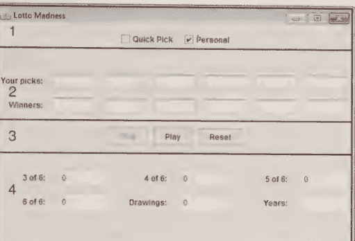

界面的第 2 行布局为一个两行七列的网格。`GridLayout()` 构造函数还指定组件在每个方向上与其他组件的 10 像素。第 56–57 行设置了这个网格：

第 4 行使用 `GridLayout` 将组件排列为两行三列的网格。`LottoMadness` 应用程序使用了在此小时描述的几个组件。第 9–37 行用于设置组成界面的所有组件的对象。这些语句按行组织。首先为该行创建一个 `JPanel` 对象，然后设置位于该行的每个组件。这段代码创建了所有组件和容器，但除非使用 `add()` 方法将它们添加到应用程序的主框架（frame）中，否则它们不会被显示。

在第 47–100 行中，添加了组件。第 47–54 行是整个 `LottoMadness()` 构造函数的示例：

```
GridLayout layout1 = new GridLayout(GridLayout.CENTER,
10, 10);
option.add(quickpick);
option.add(personal);
row1.setLayout(layout1);
row1.add(quickpick);
row1.add(personal);
row1.add(entire);
add(row1);
```

# 第 14 节：布局用户界面

创建布局管理器对象后，它被用于行（在本例中为 `JPanel` 对象）的 `setLayout()` 方法。指定布局后，使用其 `add()` 方法将组件添加到 `JPanel`：在放置所有组件后，通过调用其自己的 `add()` 方法将整个 `row1` 对象添加到框架中。

`LottoMadness` 应用程序设置图形用户界面外观的方式与 Swing 应用程序不同。`setLookAndFeel()` 方法被作为一个类方法创建——注意第 105 行中的 `static` 关键字——并在第 116 行的 `main()` 方法中调用。

之前的示例将 `setLookAndFeel()` 是对象方法并在对象的构造函数中调用它。在 `LottoMadness` 中没有这样做，是因为在任何实例变量创建并赋值之前，必须先选择外观。

## 总结

当你第一次设计 Java 程序的 GUI 时，你可能很难相信组件可以移动是一种优势。布局管理器提供了一种开发吸引人的 GUI 的方法，它足够灵活可以处理呈现上的差异。

在接下来的小时里，你将学习更多关于 GUI 功能。你将有机会看到 `LottoMadness` 界面在使用时，它处理彩票抽取并统计获奖者。

# 工作坊

## 问答

**Q.** 为什么 `LottoMadness` 应用程序中的某些文本字段是灰色的而另一些是白色的？

**A.** 灰色字段使用了 `setEditable()` 方法使其无法编辑。文本字段的默认行为是允许用户通过点击其边界内并输入任何所需的更改来更改文本字段的值。然而，某些字段是为了显示信息而不是接收用户输入。`setEditable()` 方法防止用户更改他们不应该修改的字段。

**Q.** 《查理和妙妙巧克力工厂》中真的有一个金票获得者的死亡对电影来说太可怕了吗？

**A.** Miranda Piker 的命运如此惨惨，以至于她在罗德·达尔（Roald Dahl）的书籍《查理和巧克力工厂》的最终稿中被删除了，而这本书启发了 1971 年的电影及其 2005 年的重拍。Piker 是一个自大的人，认为孩子永远不应该玩，这样他们就可以一直上学。她的父亲是一位校长。

Piker 和 Wonka 工厂的其他孩子被介绍了“斑点粉”（Spotty Powder），这是一种糖果甜点，会导致食用者身上长出红点，这样他们就可以假病旷课。Piker 和她的父亲非常愤怒，决定破坏制造这种粉的机器。

当从相邻房间听到他们的尖叫声时，Wonka 解释说他们进入了糖原料磨成粉末的地方。“那是配方的一部分，”他告诉 Miranda 的母亲，“我们偶尔得用一两所学校，否则它就不起作用。”

奥帕人（Oompa-Loompas）用歌曲庆祝他们的出道：“噢，Mary Piker，/谁能喜欢她这样的人，/如此古板又厌恶的小孩子。所以我们说，‘我们为什么不在/斑点粉混合器里修理一下/这样我们一定比以前更喜欢她了。’很快，这个孩子变得如此恶毒/会变得美味，/她的同学一定会明白/与其说‘Miranda！/噢，这头野兽！/我们受不了她！’/他们会说‘噢，多好用，多好啊！’”

# 第 14 章：布局用户界面

## 测验

为了检查你的脑细胞是否布局正确，请通过回答以下问题来测试你的 Java 布局管理技能。

1. 将界面细分为不同的布局管理器时，通常使用哪种容器？

   - A. Window
   - B. JPanel
   - C. Container

2. 面板（panel）的默认布局管理器是什么？

   - A. FlowLayout
   - B. GridLayout
   - C. Container

3. BorderLayout 类命名于？

   - A. 组件的边界
   - B. 组件的组织方式
   - C. 无

## 答案

1. B. JPanel
2. A. FlowLayout
3. B. 组件的组织方式

## 活动

如果你想继续学习，请完成以下活动：

- 在另一种布局管理器下创建一个修改版本。创建 `LottoMadness.java` 文件的副本并重命名为 `NewMadness.java`。修改此程序，使快速选择（quick pick）或个人选择是组合框（combo box），停止和重置按钮是复选框。

要查看实现这些活动的 Java 程序，请访问书籍网站 www24hours.com。

## 第 15 小节：响应用户输入

其次，类必须使用 `implements` 关键字来声明它支持一个或多个监听接口。以下语句创建了一个使用 `ActionListener` 的类，这是一个用于响应按钮点击和菜单点击的接口：

```java
public class Graph implements ActionListener {
```

`EventListener`（监听器）允许 GUI 的组件生成用户事件。如果没有放置其中一个监听器，组件就无法执行任何可以被程序其他部分听到的操作。程序必须为它所监听的每种组件包含一个监听接口。为了让程序对对按钮上的鼠标点击或在文本框中按下 Enter 键做出响应，你必须包含 `ActionListener` 接口。要响应列表框或复选框，你必须使用 `ItemListener`。

当你在同一个类中需要多个接口时，在 `implements` 关键字之后用逗号分隔这些名称，如下代码所示：

```java
public class Graph3D implements ActionListener, MouseListener {
```

`this` 关键字在首次引入时会让很多读者感到困惑。它指的是该关键字出现的对象。所以，如果你创建了一个 `LottoMadness` 类，并在该类内部的语句中使用 `this`，它指向的就是执行代码的 `LottoMadness` 对象。

## 设置可被监听的组件

在实现了特定组件所需的接口之后，你必须让该组件生成用户事件。`ActionListener` 接口监听动作事件（action events），例如按钮点击或按下 Enter 键。

要让 `JButton` 对象生成事件，请使用 `addActionListener()` 方法，如下：

```java
JButton fireTorpedos = new JButton("Fire torpedoes");
fireTorpedos.addActionListener(this);
```

这段代码创建了 `fireTorpedos` 按钮并调用了按钮的 `addActionListener()` 方法。作为 `addActionListener()` 方法参数的 `this` 表示当前对象接收并根据需要处理事件。

## 处理用户事件

当带有监听器的组件生成用户事件时，会自动调用一个方法。该方法必须在监听器附加到组件时所指定的类中找到。

每个监听器都有不同的方法被调用以接收事件。`ActionListener` 接口将事件发送到名为 `actionPerformed()` 的方法。以下是 `actionPerformed()` 的简短示例：

```java
public void actionPerformed(ActionEvent event) {
    // 方法在此处
}
```

程序中发送的所有动作事件都可能发送到此方法。如果程序中只有一个组件可以发送动作事件，你可以在此方法中放置语句来处理该事件。如果有多个组件可以发送这些事件，你需要检查发送到方法的组件。

一个 `ActionEvent` 会被发送到 `actionPerformed()` 方法。有几类对象表示程序中可以发送的用户事件。这些类拥有方法来确定哪个组件导致了事件发生。在 `actionPerformed()` 方法中，如果 `ActionEvent` 名为 `event`，你可以通过以下语句识别组件：

```java
String cmd = event.getActionCommand();
```

`getActionCommand()` 方法返回一个字符串。如果组件是按钮，该字符串就是按钮上的标签。如果是文本框，该字符串就是输入字段中的文本。`getSource()` 方法返回导致事件的对象。

你可以使用以下 `actionPerformed()` 方法接收来自三个组件的事件：一个名为 `start` 的 `JButton` 对象、一个名为 `speed` 的 `JTextField` 以及另一个名为 `viscosity` 的 `JTextField`：


```java
public void actionPerformed(ActionEvent event) {
    Object source = event.getSource();
    if (source == speed) {
        // speed 字段导致事件
    } else if (source == viscosity) {
        // viscosity 导致事件
    } else {
        //    
    }
}
```

## 复选框和组合框事件

你可以对所有用户事件调用 `getSource()` 方法来识别导致事件的具体对象。

组合框和复选框需要 `ActionListener` 接口。调用组件的 `addItemListener()` 方法来使其生成这些事件。以下语句创建了一个名为 `superSize` 的复选框，它在选中或取消选中时会发送事件：

```java
JCheckbox superSize = new JCheckbox("Super Size", true);
superSize.addItemListener(this);
```

这些事件由 `stateChanged()` 方法接收，该方法接受 `ItemEvent` 对象作为参数。要识别哪个对象导致了事件，你可以调用事件对象的 `getItem()` 方法。

要确定复选框是被选中还是取消选中，请将 `getStateChange()` 返回的值与常量 `ItemEvent.SELECTED` 和 `ItemEvent.DESELECTED` 进行比较。以下代码是一个 `ItemEvent` 对象的示例：

```java
public void stateChanged(ItemEvent item) {
  int status = item.getStateChange();
  if (status == ItemEvent.SELECTED) {
    // 
  }
}
```

要确定 `JComboBox` 对象中选中的值，请在下例中使用 `getItem()` 并将该值转换为字符串：

```java
Object which = item.getItem();
String answer = which.toString();
```

## 键盘事件

程序在按下键时必须立即做出反应；它使用键盘事件和 `KeyListener` 接口。

第一步是通过调用组件的 `addKeyListener()` 方法注册接收按键的组件。该方法的参数应该是实现 `KeyListener` 接口的对象。如果是当前类，请使用 `this` 作为参数。

## 处理用户事件

处理键盘事件的对象必须实现三个方法：

- `void keyPressed(KeyEvent)` — 在按下键时调用的方法
- `void keyReleased(KeyEvent)` — 在释放键时调用的方法
- `void keyTyped(KeyEvent)` — 在按键输入后调用的方法

每个方法都接受 `KeyEvent` 对象作为参数，借此获取更多关于事件的信息。使用 `getKeyChar()` 方法可以获取按键字符。它返回一个 `char` 值，可以用于字母、数字和标点符号。要监控键盘上的任何键（包括 Enter、Home、Page Down），你可以调用 `getKeyCode()`。该方法返回一个表示键的整数，然后你可以调用 `getKeyText()` 获取该键的字符串（例如 Home、F1 等）。

列表 15.1 包含一个使用 `getKeyChar()` 方法绘制最近按键的 Java 程序。该类实现了 `KeyListener`，因此有 `keyTyped()`、`keyPressed()` 和 `keyReleased()` 方法。其中起作用的是 `keyTyped()`，位于第 24-27 行。

## 列表 15.1 KeyViewer 的完整文本

```java
package com.java4hours;

import javax.swing.*;
import java.awt.event.*;
import java.awt.*;

public class KeyViewer extends JFrame implements KeyListener {
    JTextField keyText = new JTextField(80);
    JLabel keyLabel = new JLabel("Press any key in the text field.");

    public KeyViewer() {
        super("KeyViewer");
        setLookAndFeel();
        setSize(350, 100);
        setDefaultCloseOperation(JFrame.EXIT_ON_CLOSE);
        addKeyListener(this);
        BorderLayout bord = new BorderLayout();
        setLayout(bord);
        add(keyLabel, BorderLayout.NORTH);
        add(keyText, BorderLayout.CENTER);
        setVisible(true);
    }

    public void keyTyped(KeyEvent input) {
        char key = input.getKeyChar();
        keyLabel.setText("You pressed " + key);
    }

    public void keyPressed(KeyEvent txt) {
        // do nothing
    }

    public void keyReleased(KeyEvent txt) {
        // do nothing
    }

    private void setLookAndFeel() {
        try {
            UIManager.setLookAndFeel("com.sun.java.swing.plaf.nimbus.NimbusLookAndFeel");
        } catch (Exception exc) {
            // ignore error
        }
    }

    public static void main(String[] args) {
        KeyViewer frame = new KeyViewer();
    }
}
```

当你运行该程序时，它看起来像图 15.1。


# 完成图形化应用程序

## 启用和禁用组件

你可能在程序中看到过某个组件显示为阴影状态，而不是正常外观。

阴影表示用户无法对该组件进行任何操作，因为其由于被禁用了。组件的启用和禁用通过组件的 `setEnabled()` 方法实现。该方法接受一个布尔值作为参数，因此 `setEnabled(true)` 启用组件，而 `setEnabled(false)` 禁用它。

以下语句创建了标签为 Previous（上一个）、Next（下一个）的按钮，并禁用了第一个按钮：

```java
JButton previousButton = new JButton("Previous");
JButton nextButton = new JButton("Next");
JButton finishButton = new JButton("Finish");
previousButton.setEnabled(false);
```

这种方法是防止组件在不该发送用户事件时发送的有效方式。例如，如果你正在编写一个使用文本框收集用户地址的 Java 应用程序，可以在用户提供街道地址、城市、州和 ZIP 码之前禁用“保存地址”按钮。

## 完成图形化应用程序

此时，`LottoMadness` 只是一个 GUI（图形用户界面）。你可以点击按钮并进入文本框，但没有任何响应。在本次工作中，你将创建 `LottoEvent`，这是一个新类，它用于接收用户输入、进行乐票抽奖并跟踪中奖次数。当该类完成后，你在 `LottoMadness` 中添加几行代码，使其利用 `LottoEvent`。以这种方式划分 Swing 项目通常很方便，将 GUI 放在一个类中，将事件处理方法放在另一个类中。

本次作业的目的是评估用户一生中赢得六号码乐票抽奖的概率。图 15.2 显示了程序运行时的屏幕截图。

图 15.2

运行 LottoMadness 应用程序。

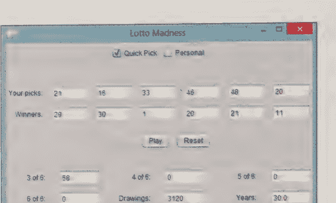

计算机并没有使用概率来解决这个问题，而是连续快速地抽奖，直到产生中奖者才停止。由于 6 选 6 全中的概率极低，因此程序还会报告任何三个、四个或五个中奖号码的组合。

界面包含 12 个用于乐票号码的文本框和两个标记为 Quick Pick（快速选择）和 Personal（个人）的复选框。六个文本框禁用输入，用于显示每次抽奖的中奖号码。另外六个文本框用于用户选择号码。勾选 Quick Pick 框会为用户选择六个随机数字。勾选 Personal 则允许用户选择所需的数字。

三个按钮控制程序的活动：Stop（停止）、Play（播放）和 Reset（重置）。当按下 Play 按钮时，程序会启动一个名为 `playing` 的线程并生成乐票抽奖。

`LottoEvent` 类实现了三个接口：`ActionListener`、`ItemListener` 和 `Runnable`。`Runnable` 接口与线程有关，第 19 小节将介绍。需要监听器来监听应用程序按钮和复选框生成的用户事件。

## 完成图形化应用程序

程序不需要监听任何与文本框相关的事件，因为它们严格用于存储用户选择的号码。用户界面会自动处理存储。

该类需要使用主包 `javax.swing` 以及 Java 的事件处理包 `java.awt.event`。

该类有两个实例变量：

- `gui`，一个 `LottoMadness` 对象
- `playing`，一个用于进行连续乐票抽奖的 `Thread` 对象

`gui` 变量用于与程序 GUI 的 `LottoMadness` 对象通信。当你需要更改界面或从其一个文本框中检索值时，使用 `gui` 对象的实例变量。

例如，`LottoMadness` 的 `play` 实例变量代表 Play 按钮。要在 `LottoEvent` 中禁用此按钮，可以使用以下语句：

```java
gui.play.setEnabled(false);
```

你可以使用下一语句获取 `JTextField` 对象 `got3` 的值：

```java
String got3Value = got3.getText();
```

列表 15.2 包含了 `LottoEvent` 类的全文。在 NetBeans 中创建一个名为 `LottoEvent` 的 Java 文件来存放源代码。

## 列表 15.2 LottoEvent.java 的完整文本

```java
1: package com.java24hours;
2:
3: import javax.swing.*;
4: import java.awt.event.*;
5:
6: public class LottoEvent implements Listener, ActionListener {
7:  Runnable {
8:
9:     LottoMadness gui;
10:    Thread playing;
11:
12:    public LottoEvent(LottoMadness in) {
13:        gui = in;
14:    }
```

# 第 15 小节：响应用户输入


```java
15:
16:    public void actionPerformed(ActionEvent event) {
17:        String command = event.getActionCommand();
18:        if (command.equals("Play")) {
19:            startPlaying();
20:        }
21:        if (command.equals("Stop")) {
22:            stopPlaying();
22:        }
23:        if (command.equals("Reset")) {
24:            clearAllFields();
25:        }
26:
27:    }
28:    void startPlaying() {
29:        playing = new Thread(this);
30:        playing.start();
31:        gui.play.setEnabled(false);
32:        gui.stop.setEnabled(true);
33:        gui.reset.setEnabled(false);
34:        gui.quickpick.setEnabled(false);
35:        gui.personal.setEnabled(true);
36:    }
37:
38:    void stopPlaying() {
39:        gui.stop.setEnabled(false);
40:        gui.play.setEnabled(true);
41:        gui.reset.setEnabled(true);
42:        gui.quickpick.setEnabled(true);
43:        gui.personal.setEnabled(true);
44:        playing = null;
45:    }
46:
47:    void clearAllFields() {
48:        for (int i = 0; i < 6; i++) {
49:            gui.numbers[i].setText(null);
50:            gui.winners[i].setText(null);
51:        }
52:
53:        gui.got3.setText("0");
54:        gui.got4.setText("0");
55:        gui.got5.setText("0");
56:        gui.got6.setText("0");
57:        gui.drawings.setText("0");
58:        gui.years.setText("0");
59:    }
60:    public void itemStateChanged(ItemEvent event) {
61:        Object item = event.getItem();
62:        if (item == gui.quickpick) {
63:            for (int i = 0; i < 6; i++) {
64:                int pick;
65:                do {
66:                    pick = (int)Math.floor(Math.random() * 50 + 1);
67:                } while (numberGone(pick, gui.numbers, i));
68:                gui.numbers[i].setText("" + pick + "");
69:            }
70:        } else {
71:            for (int i = 0; i < 6; i++) {
72:                gui.numbers[i].setText(null);
73:            }
74:        }
75:    }
76:
77:    void addOneToField(JTextField field) {
78:        int num = Integer.parseInt(field.getText());
79:        num++;
80:        field.setText("" + num);
81:    }
82:
83:    boolean numberGone(int num, JTextField[] pastNums, int count) {
84:        for (int i = 0; i < count; i++) {
85:            if (Integer.parseInt(pastNums[i].getText()) == num) {
86:                return true;
87:            }
88:        }
89:        return false;
90:    }
91:
92:    boolean matchedOne(JTextField win, JTextField[] allPicks) {
93:        for (int i = 0; i < 6; i++) {
94:            String winText = win.getText();
94:            if (winText.equals(allPicks[i].getText())) {
95:                return true;
96:            }
97:        }
98:       return false;
99:   }
100:
101:    public void run() {
102:        Thread thisThread = Thread.currentThread();
103:        while (playing == thisThread) {
104:            addOneToField(gui.drawings);
105:            int draw = Integer.parseInt(gui.drawings.getText());
106:            float numYears = (float)draw / 104;
107:            gui.years.setText("" + numYears);
108:
109:            int matches = 0;
110:            for (int i = 0; i < 6; i++) {
111:                int ball;
112:                do {
113:                    ball = (int)Math.floor(Math.random() * 50 + 1);
114:                } while (numberGone(ball, gui.winners, i));
115:                gui.winners[i].setText("" + ball + "");
116:            }
117:            for (int i = 0; i < 6; i++) {
118:                if (matchedOne(gui.winners[i], gui.numbers)) {
119:                    matches++;
120:                }
121:            }
122:            switch (matches) {
123:                case 3:
124:                    addOneToField(gui.got3);
125:                    break;
126:                case 4:
127:                    addOneToField(gui.got4);
128:                    break;
129:                case 5:
130:                    addOneToField(gui.got5);
131:                    break;
132:                case 6:
133:                    addOneToField(gui.got6);
134:                    gui.stop.setEnabled(false);
135:                    gui.play.setEnabled(true);
136:                    playing = null;
137:            }
138:            try {
139:                Thread.sleep(100);
140:            } catch (InterruptedException e) {
141:                // nothing
142:            }
143:        }
144:    }
145:}
```

`LottoEvent` 类有一个构造函数：`LottoEvent(LottoMadness)`。作为参数指定的 `LottoMadness` 对象标识了该对象，该对象依赖 `LottoEvent` 来处理用户事件并进行开奖活动。

该类中使用了以下方法：

- `clearAllFields()` 方法清除应用程序中待空的所有文本。当用户点击重置（Reset）按钮时，会处理此方法。
- `addOneToField()` 方法将文本字段转换为整数，将其加 1，然后转换回文本字段。由于所有文本字段都以字符串形式存储，因此在表达式中使用它们时，你必须采取特殊步骤。
- `numberGone()` 方法接受三个参数：乐透开奖中的单个数字、一个包含多个 `JTextField` 对象的数组以及一个计数整数。该方法确保开奖中的每个数字都没有在同一次开奖中被选中过。
- `matchedOne()` 方法接受两个参数：一个 `JTextField` 和一个包含六个 `JTextField` 对象的数组。该方法检查用户的某个数字是否与当前乐透开奖的数字匹配。

应用程序的 `actionPerformed()` 方法在用户点击按钮时接收动作事件。`getActionCommand()` 方法检索按钮的标签，以确定点击了哪个组件。

点击播放（Play）按钮会调用 `startPlaying()` 方法。该方法会禁用四个组件。点击停止（Stop）按钮会调用 `stopPlaying()` 方法，该方法会启用除停止按钮以外的所有组件。

`itemStateChanged()` 方法接收由选择“快速选择”（Quick Pick）或“个人”（Personal）复选框触发的用户事件。`getItem()` 方法返回被点击的对象框（Object box）。如果是快速选择复选框，则将从 1 到 50 之间的六个随机数字分配给用户的乐透号码。否则，持有用户号码的文本字段将被清除。

`LottoEvent` 类为乐透开奖中的每个球使用 1 到 50 的数字。这在第 113 行建立，该行将 `Math.random()` 方法乘以 50，总数加 1，并将其作为 `Math.floor()` 方法的参数。结果是 1 到 50 之间的随机整数。如果你将 50 替换为不同的数字，并在第 66 行，你可以将 `LottoMadness` 用于生成范围更大或更小数字的抽票比赛。

`LottoMadness` 项目缺少用于跟踪开奖次数、中奖次数和乐透号码文本字段等的变量。相反，接口存储值并自动显示它们。

要完成项目，在 NetBeans 中重新打开 `LottoMadness.java`。你只需要添加六行代码即可使其与 `LottoEvent` 类工作。

首先，添加一个新的实例变量来持有 `LottoEvent` 对象：

```java
LottoEvent lotto = new LottoEvent(this);
```

接下来，在 `LottoMadness()` 构造函数中，为每个可以接收用户输入的用户界面组件调用 `addItemListener()` 和 `addActionListener()` 方法：

```java
// 添加监听器
quickpick.addItemListener(lotto);
personal.addItemListener(lotto);
stop.addActionListener(lotto);
play.addActionListener(lotto);
reset.addActionListener(lotto);
```

这些语句应该添加到构造函数的末尾，紧接在使其可见的 `setVisible(true)` 调用之前。

在你完成更改后，列表 15.3 包含了 `LottoMadness.java` 的完整文本。你添加的行有阴影标记——其余部分与之前相同。

## 列表 15.3 LottoMadness.java 的全文

```java
1: package com.java4hours;
2: import java.awt.*;
3: import javax.swing.*;
4:
5: public class LottoMadness extends JFrame {
6:     LottoEvent lotto = new LottoEvent(this);
7:
8:     // 设置行
9:     JPanel row1 = new JPanel();
10:     JCheckBox quickpick = new JCheckBox("Quick Pick", false);
11:     JCheckBox personal = new JCheckBox("Personal", true);
12:
13:     // 设置行
14:     JPanel row2 = new JPanel();
15:     JLabel numberLabel = new JLabel("Your picks:");
16:     JTextField[] numbers = new JTextField[6];
17:     JLabel winnerLabel = new JLabel("Winners:");
18:     JTextField[] winners = new JTextField[6];
19:
20:     // 设置行
21:     JPanel row3 = new JPanel();
22:     JButton stop = new JButton("Stop");
23:     JButton play = new JButton("Play");
24:     JButton reset = new JButton("Reset");
25:
26:    // 设置行
27:    JPanel row4 = new JPanel();
28:    JLabel got3Label = new JLabel("Got 3:");
29:    JTextField got3 = new JTextField("0");
30:    JLabel got4Label = new JLabel("Got 4:");
31:    JTextField got4 = new JTextField("0");
32:    JLabel got5Label = new JLabel("Got 5:");
33:    JTextField got5 = new JTextField("0");
34:    JLabel got6Label = new JLabel("Got 6:");
35:    JTextField got6 = new JTextField("0");
36:    JLabel drawingsLabel = new JLabel("Drawings:");
37:    JTextField drawings = new JTextField("0");
38:    JLabel yearsLabel = new JLabel("Years:");
39:    JTextField years = new JTextField("0");
40:
41:    public LottoMadness() {
42:        super("LottoMadness");
43:        setSize(550, 400);
44:        setDefaultCloseOperation(JFrame.EXIT_ON_CLOSE);
45:        GridLayout layout = new GridLayout(4, 1, 10, 10);
46:        setLayout(layout);
47:
48:        FlowLayout layout1 = new FlowLayout(FlowLayout.CENTER, 10, 10);
49:        row1.setLayout(layout1);
50:        row1.add(quickpick);
51:        row1.add(personal);
52:        add(row1);
53:
54:        GridLayout layout2 = new GridLayout(2, 1, 10, 10);
55:        row2.setLayout(layout2);
56:
57:        JPanel yourPicks = new JPanel();
58:        GridLayout layout2a = new GridLayout(1, 6, 10, 10);
59:        yourPicks.setLayout(layout2a);
60:        yourPicks.add(numberLabel);
61:        for (int i = 0; i < 6; i++) {
62:            numbers[i] = new JTextField();
63:            yourPicks.add(numbers[i]);
64:        }
65:        row2.add(yourPicks);
66:
67:        JPanel winnersPanel = new JPanel();
68:        GridLayout layout2b = new GridLayout(1, 6, 10, 10);
69:        winnersPanel.setLayout(layout2b);
70:        winnersPanel.add(winnerLabel);
71:        for (int i = 0; i < 6; i++) {
72:            winners[i] = new JTextField();
73:            winnersPanel.add(winners[i]);
74:        }
75:        row2.add(winnersPanel);
76:        add(row2);
77:
78:        FlowLayout layout3 = new FlowLayout(FlowLayout.CENTER, 10, 10);
79:        row3.setLayout(layout3);
80:        row3.add(stop);
81:        row3.add(play);
82:        row3.add(reset);
83:        add(row3);
84:
85:        GridLayout layout4 = new GridLayout(2, 4, 20, 10);
86:        row4.setLayout(layout4);
87:        row4.add(got3Label);
88:        got3.setEditable(false);
89:        row4.add(got3);
90:        row4.add(got4Label);
91:        got4.setEditable(false);
92:        row4.add(got4);
93:        row4.add(got5Label);
94:        got5.setEditable(false);
95:        row4.add(got5);
96:        row4.add(got6Label);
97:        got6.setEditable(false);
98:        row4.add(got6);
99:        row4.add(drawingsLabel);
100:        drawings.setEditable(false);
101:        row4.add(drawings);
102:        row4.add(yearsLabel);
103:        years.setEditable(false);
104:        row4.add(years);
105:        add(row4);
106:
107:        // 添加监听器
108:        quickpick.addItemListener(lotto);
109:        personal.addItemListener(lotto);
110:        stop.addActionListener(lotto);
111:        play.addActionListener(lotto);
112:        reset.addActionListener(lotto);
113:
114:        setVisible(true);
115:    }
116:}
```


# 第 16 小时：构建复杂的用户界面

## 注意

www.javahourshours.com 包含 `Lotto6` 的 applet 版本。该 applet 运行了 410,732,244 次开奖，相当于 300 万次每周开奖。我们看到了 6,364,880 个 3 号中奖者、337,285 个 4 号中奖者、6,476 个 5 号中奖者，以及大约每 800 万次一次的大奖。赢得这个虚拟彩票的第一个人是 Bill Teer。他的号码是 3, 7, 1, 15, 34 和 43，他只花了 241,225 次开奖才中奖。

```java
private static void setLookAndFeel() {
    try {
        UIManager.setLookAndFeel("com.sun.java.swing.plaf.nimbus.NimbusLookAndFeel");
    } catch (Exception exc) {
        // 忽略错误
    }
}

public static void main(String[] arguments) {
    Lotto6.setLookAndFeel();
    Lotto6 frame = new Lotto6();
}
```

## 总结

通过使用 Swing，你可以通过少量编程创建一个看起来专业的程序。虽然 `LottoMadness` 应用程序比你过去 14 小时所做的示例要长，但程序的一半是由构建界面的语句组成的。

如果你花时间运行程序，你会对赢得这些六数字抽票的人的运气感到更加苦涩和嫉妒。

## 工作坊

## 问答

- **Q.** 你是否需要对 `paint()` 方法或 `repaint()` 方法进行任何操作来指示文本字段已更改？
- **A.** 在使用文本组件的 `setText()` 方法更改其值后，你不需要执行任何其他操作。Swing 会处理显示新值所需的更新。

- **Q.** 为什么你经常导入一个类以及它的其中一个子类，如列表 15.1 中导入 `java.awt.*` 和 `java.awt.event.*` 所示？第一个语句是否可以包含第二个语句？
- **A.** 尽管 `java.awt` 和 `java.awt.event` 包的名字看起来是有关系的，但 Java 中并没有包的继承这种说法。一个包不能是另一个包的子包。

  当你在 `import` 语句中使用星号 `*` 时，你使该包中的所有类在程序中可用。星号仅作用于类，而不作用于包。单个 `import` 语句最多加载单个包的类。

- **Q.** 为什么演员迈克尔·J·福克斯（Michael J. Fox）用他的中间名缩写来标识？
- **A.** 演员协会中已经有一个迈克尔·福克斯（Michael Fox）了，这使这位未来的《家庭联》（Family Ties）和《回到太空》（Back to the Star）演员为他的职业工作选择另一个名字。他的本名是迈克尔·安德鲁·福克斯（Michael Andrew Fox），但他不喜欢 Andrew 或 Andy Fox 听起来——而且自称 Michael A. Fox 听起来像是在赞美自己的外貌。

  他决定使用 Michael J. Fox，以向性格演员迈克尔·J·波拉德（Michael J. Pollard）致敬。

  另一个迈克尔·福克斯是一名演员，曾出现在《佩里·马森》（Perry Mason）、《伯克的法则》（Burke's Law）以及许多其他电视节目和电影中，直到 1996 年去世。

## 测验

在 `LottoMadness` 程序让你对机会游戏产生反感后，通过回答以下问题来玩一个技巧性游戏吧。

- **1. 为什么动作事件（action events）被称为这个名字？**
  - A. 它们是对其他事情的反应而发生的。
  - B. 它们表示应该采取某种行动作为响应。
  - C. 它们向电影冒险险家动作·杰克逊（Action Jackson）致敬。

- **2. 作为 `addActionListener()` 方法的参数时，`this` 代表什么？**
  - A. 当事件发生时应该使用此监听器。
  - B. 此对象的优先级高于其他对象。
  - C. 此对象处理事件。

- **3. 哪种文本组件将用户输入存储为整数？**
  - A. `JTextField`
  - B. `JTextArea`
  - C. A 和 B 都不是

## 答案

- **1. B.** 动作事件包括按钮的点击和从下拉菜单中选择项目的操作。
- **2. C.** `this` 关键字指向当前对象。如果使用对象的名称而不是 `this` 语句作为参数，该对象将接收事件并预期处理它们。
- **3. C.** `JTextField` 和 `JTextArea` 组件将值存储为文本，因此在将它们作为整数、浮点数或其他非文本使用之前，你必须转换它们的值。

## 活动

如果本小时的主事件活动还不能满足你的口味，请尝试以下活动：

- 在 `LottoMadness` 应用中添加一个文本字段，它与 `LottoEvent` 类中的 `Thread.sleep()` 语句配合工作，以减慢抽奖速度。
- 修改 `LottoMadness` 项目，使其从 1 到 90 之间抽取五个数字。

要查看实现这些活动的 Java 程序，请访问书籍网站 www.java24hours.com。

## 第 16 小时：构建复杂的用户界面

使用 Swing 创建图形用户界面 (GUI) 涉及学习更多如何使用不同的界面组件、布局管理器和事件处理方法。你还必须熟悉 Swing 提供的所有内容。超过 400 个不同的类使得 Swing 成为 Java 中最广泛的类库之一。这些许多类可以使用你在前三个小时中学到的相同技术来实现——Swing 容器和组件共享彼此父类，这使得它们具有共同的行为。在本小时中，你将学习在你的 Swing 程序中使用的几种额外组件。

### 本小时的待办事项

- 使用滑动块接受范围数值输入。
- 监控滑动块上的用户输入。
- 创建图像图标和工具栏。
- 在行和单元格表格中展示数据。

## 滑块

从用户处收集数值输入的简单方法是使用滑动块（slider），这是一种可以左右或上下拖动的组件。滑动块在 Swing 中由 `JSlider` 类表示。滑动块允许在最小值和最大值之间选择一个数字。这些值可以显示在标签上，标签包含最小值、最大值和中间值。你稍后在本小时内创建的示例在图 16.1 所示。

**图 16.1** 使用三个滑动块组件选择颜色。


你可以使用以下任一构造器创建一个滑动块：

- `JSlider()`——创建一个最小值为 0 的滑动块。
- `JSlider(int, int)`——创建一个指定最小值和最大值的滑动块。
- `JSlider(int, int, int)`——创建一个指定最小值、最大值和起始值的滑动块。

要创建一个垂直滑动块，请使用一个额外的参数：滑动块的方向。该参数应该是 `VERTICAL` 或 `HORIZONTAL`。

```java
JSlider guess = new JSlider(JSlider.VERTICAL, 0, 1000, 500);
```

此滑动块的游标——组件中选择数字的部分——从 500 位置开始。

要为滑动块显示标签，你必须设置标签将包含的信息。调用滑动块的 `setTickSpacing(int)` 和 `setMinorTickSpacing(int)` 方法来确定刻度显示的频率。主刻度以比小刻度更粗的线显示。在你设置好刻度出现的频率后，调用滑动块的 `paintTicks(boolean)` 方法并传入 `true`。你还可以通过调用滑动块的 `paintLabels(boolean)` 方法并传入 `true` 来显示每个主刻度的数值值。

## 监听器

为了监控滑动块输入，你必须有一个实现 `javax.swing.event` 包中 `ChangeListener` 接口的类。该接口包含一个方法：

```java
public void stateChanged(ChangeEvent event) {
    // 处理事件的语句
}
```

要将对象注册为监听器，使用持有滑动块的容器的 `addChangeListener(Object)` 方法。当滑动块移动时，监听对象的 `stateChanged()` 方法会被调用。

此方法带有 `ChangeEvent` 对象，该对象可以识别发生变化的块组件。调用对象的 `getSource()` 并将其转换为 `JSlider`，如下所示：

```java
JSlider changedSlider = (JSlider) event.getSource();
```

在此示例中，`event` 是作为 `stateChanged()` 方法参数的 `ChangeEvent` 对象。

变化事件在滑动块移动期间发生。它们从滑动块首次移动开始，直到释放才停止发生。因此，你可能不想在滑动块停止移动之前在 `stateChanged()` 方法中执行操作。

要查看滑动块正在移动，调用 `getValueIsAdjusting()` 方法。该方法在移动发生时返回 `true`，否则返回 `false`。

这种技术将在你的下一个项目中演示，一个使用三个滑块选择颜色的 Java 应用。颜色通过使用 `java.awt` 包中的 `Color` 类来创建。

创建颜色的一种方法是指定颜色中红、绿、蓝的量。这些每个可以是 0 到 255 之间的整数，其中 255 代表该颜色的最大量。

以下语句创建一个代表奶油糖色（butterscotch）的 `Color` 对象：

```java
Color butterscotch = new Color(255, 204, 128);
```

用于创建此 `Color` 对象的红色值为 255，因此它包含了最大量的红色。它还包含大量的绿色和一些蓝色。

## 列表 16.1 `ColorSliders.java` 的完整文本

`ColorSliders` 应用程序有三个滑块、三个用于滑块的标签以及一个显示颜色的面板。创建一个名为 `ColorSliders` 的新空 Java 文件，在源编辑器中输入列表中的文本，并保存文件。

```java
1: package com.java24hours;
2:
3: import javax.swing.*;
4: import javax.swing.event.*;
5: import java.awt.*;
6:
7: public class ColorSliders extends JFrame implements ChangeListener {
8:     JPanel canvas;
9:     JSlider red;
10:     JSlider green;
11:     JSlider blue;
12:
13:     public ColorSliders() {
14:         super("Color Slide");
15:         setSize(270, 300);
16:         setDefaultCloseOperation(JFrame.EXIT_ON_CLOSE);
17:
18:         canvas = new ColorPanel();
19:         red = new JSlider(0, 255, 255);
20:         green = new JSlider(0, 255, 0);
21:         blue = new JSlider(0, 255, 0);
22:
23:         red.setMajorTickSpacing(50);
24:         red.setMinorTickSpacing(10);
25:         red.setPaintTicks(true);
26:         red.setPaintLabels(true);
27:         red.addChangeListener(this);
28:
29:         green.setMajorTickSpacing(50);
30:         green.setMinorTickSpacing(10);
31:         green.setPaintTicks(true);
32:         green.setPaintLabels(true);
33:         green.addChangeListener(this);
34:
35:         blue.setMajorTickSpacing(50);
36:         blue.setMinorTickSpacing(10);
37:         blue.setPaintTicks(true);
38:         blue.setPaintLabels(true);
39:         blue.addChangeListener(this);
40:
41:         JLabel redLabel = new JLabel("Red: ");
42:         JLabel greenLabel = new JLabel("Green: ");
43:         JLabel blueLabel = new JLabel("Blue: ");
44:         GridLayout grid = new GridLayout(4, 1);
45:         FlowLayout right = new FlowLayout(FlowLayout.RIGHT);
46:
47:         setLayout(grid);
48:
49:         JPanel redPanel = new JPanel();
50:         redPanel.setLayout(right);
51:         redPanel.add(redLabel);
52:         redPanel.add(red);
53:         add(redPanel);
54:
55:         JPanel greenPanel = new JPanel();
56:         greenPanel.setLayout(right);
57:         greenPanel.add(greenLabel);
58:         greenPanel.add(green);
59:         add(greenPanel);
60:
61:         JPanel bluePanel = new JPanel();
62:         bluePanel.setLayout(right);
63:         bluePanel.add(blueLabel);
64:         bluePanel.add(blue);
65:         add(bluePanel);
66:
67:         add(canvas);
68:
69:         setVisible(true);
70:     }
71:
72:     public void stateChanged(ChangeEvent event) {
73:         JSlider source = (JSlider) event.getSource();
74:         if (!source.getValueIsAdjusting()) {
75:             Color current = new Color(red.getValue(), green.getValue(), blue.getValue());
76:             canvas.setColor(current);
77:             canvas.repaint();
78:         }
79:     }
80:
81:     private void setLookAndFeel() {
82:         try {
83:             UIManager.setLookAndFeel(UIManager.getSystemLookAndFeelClassName());
84:         } catch (Exception exc) {
85:             // ignore error
86:         }
87:     }
88: }
89:
90: class ColorPanel extends JPanel {
91:     private Color color;
92:
93:     public void setColor(Color color) {
94:         this.color = color;
95:     }
96:
97:     protected void paintComponent(Graphics g) {
98:         super.paintComponent(g);
99:         if (color != null) {
100:             g.setColor(color);
101:             g.fillRect(0, 0, getWidth(), getHeight());
102:         }
103:     }
104: }
```


## 更改监听器

在图 16.1 中，该应用程序被用于创建一个包含三个滑块的框架，这些滑块分别代表红色、绿色和蓝色的量。调整每个滑块的值来改变颜色。

## 图标和工具栏

在图 16.1 中，该应用程序被用于创建一个包含三个滑块的框架，这些滑块分别代表红色、绿色和蓝色的量。调整每个滑块的值来改变颜色。

### 使用图标和工具栏

改进 GUI 视觉吸引力的最简单方法是使用图标。`JToolBar` 类可以创建水平工具栏。使用 `ImageIcon` 构造函数可以从文件创建图标。`ImageIcon` 构造函数可以将图标放置在工具栏中。`JToolBar` 构造函数可以像以下方式显示：

```java
ImageIcon icon = new ImageIcon("stop.gif");
JLabel label = new JLabel(icon);
```

`JToolBar` 构造函数可以这样使用：

```java
ImageIcon icon = new ImageIcon("play.gif");
JButton play = new JButton(icon);
ImageIcon stopIcon = new ImageIcon("stop.gif");
JButton stop = new JButton(stopIcon);
ImageIcon pauseIcon = new ImageIcon("pause.gif");
JButton pause = new JButton(pauseIcon);
```

`JToolBar` 构造函数可以这样创建：

```java
JPanel panel = new JPanel();
BorderLayout border = new BorderLayout();
panel.setLayout(border);
JToolBar bar = new JToolBar(SwingConstants.VERTICAL);
ImageIcon playIcon = new ImageIcon("play.gif");
JButton playButton = new JButton("play");
ImageIcon stopIcon = new ImageIcon("stop.gif");
JButton stopButton = new JButton("stop");
ImageIcon pauseIcon = new ImageIcon("pause.gif");
JButton pauseButton = new JButton("pause");
bar.add(playButton);
bar.add(stopButton);
bar.add(pauseButton);
panel.add(bar, BorderLayout.WEST);
```

你在此小时进行的下一个项目是 `Tool`，一个包含图标和可更改工具栏的 Java 应用程序。创建一个 `Tool` 文件，将列表 16.2 输入到文件中，并保存文件。

### 列表 16.2 Tool.java 的完整文本

```java
1: package com.java24hours;
2:
3: import java.awt.*;
4: import javax.swing.*;
5:
6: public class Tool extends JFrame {
7:     public Tool() {
8:         super("Tool");
9:         setLookAndFeel();
10:        setSize(370, 200);
11:        setDefaultCloseOperation(JFrame.EXIT_ON_CLOSE);
12:
13:        // build toolbar
14:        ImageIcon image1 = new ImageIcon("newfile.gif");
15:        JButton button1 = new JButton("New", image1);
16:        ImageIcon image2 = new ImageIcon("openfile.gif");
17:        JButton button2 = new JButton("Open", image2);
18:        ImageIcon image3 = new ImageIcon("savefile.gif");
19:        JButton button3 = new JButton("Save", image3);
20:
21:        JToolBar bar = new JToolBar();
22:        bar.add(button1);
23:        bar.add(button2);
24:        bar.add(button3);
25:
26:        add(bar, BorderLayout.NORTH);
27:
28:        setVisible(true);
29:    }
30:
31:    private void setLookAndFeel() {
32:        try {
33:            UIManager.setLookAndFeel(UIManager.getSystemLookAndFeelClassName());
34:        } catch (Exception exc) {
35:            // ignore error
36:        }
37:    }
38:
39:    public static void main(String[] args) {
40:        new Tool();
41:    }
42: }
```

## 使用图像图标和工具栏

```java
// build text-area
JTextArea edit = new JTextArea(8, 40);
JScrollPane scroll = new JScrollPane(edit);

// create frame
BorderLayout border = new BorderLayout();
setLayout(border);
add("North", bar);
add("Center", scroll);
setVisible(true);
}

private void setLookAndFeel() {
  try {
    UIManager.setLookAndFeel(
      "com.sun.java.swing.plaf.nimbus.NimbusLookAndFeel"
    );
  } catch (Exception exc) {
    // ignore exc
  }
}
```

该应用程序需要三个图形文件，用于创建工具栏上的图标：`newfile.gif`、`openfile.gif` 和 `savefile.gif`。请从书籍网站 www.java24hours.com 上的第 16 小节页面下载这些文件，并将它们保存到 Java24 项目文件夹中（或你在 NetBeans 中为 Java 项目指定的文件夹）。

将这些文件导入项目的一种方法是使用拖放功能：

1. 在“项目”（Projects）面板中，点击并将其置于顶层。
2. 将三个图形文件一个接一个或作为一个组拖入 Java-24 文件夹。
3. NetBeans 会将这些文件导入到项目的顶级文件夹。

图 16.2 和图 16.3 显示了应用程序运行时的两个不同截图。工具栏已从原始位置（图 16.2）移动到界面的另一个边缘（图 16.3）。

找不到 NetBeans 项目？请在 NetBeans 中新建一个新项目：选择文件（File）、新建项目（New Project）、类别 Java、项目 Java 应用程序（Java application），然后点击下一步（Next）。“项目位置”（Project Location）文本框应包含保存这些图标的文件夹位置。


## 256 第 16 小节：构建复杂的用户界面

### 图 16.2

使用带有工具栏的应用程序。


### 图 16.3

在新的位置停靠工具栏。


你还可以将可停靠的工具栏完全从界面上拖出。这将打开一个包含该工具栏的新窗口。

运行应用程序并尝试移动工具栏进行测试。你可以通过点击工具栏句柄并将其拖到文本区域的不同边缘来移动它。当你松开工具栏时，它将放置在该边缘，文本区域会移动以为其留出空间。

## 表格

本节介绍的最后一个用户界面组件是最复杂的。`JTable` 类代表了一个像电子表格一样以行和列呈现的信息表格。表格单元格中的信息可以编辑，列可以重新排列，列宽可以调整大小以变宽或变窄。这听起来有很多工作要做，但这一切都由程序完成。这些功能内置在属于 `javax.swing` 包的类中。

图 16.4 显示了 `JTable` 组件的一个示例。你将在最后的最后一个项目中创建此表格。

### 使用表格最简单的方法是将数据直接存储在表格中

使用这种技术的第一步是创建一个包含每列名称的字符串数组，如下代码所示：

```java
String[] columnLabels = { "First Name", "Last Name", "Job", "Age" };
```

### 图 16.4

| First Name | LastName | Job | Age |
|---|---|---|---|
| Frankie | Heck | dental hygienist | 50 |
| Max | Heck | quarry manager | 51 |
| Art | Heck | slacker | 19 |
| Sue | Heck | সৃষ্টিrette | 16 |
| Brick | Heck | reader | 12 |

一个包含五行四列的个人信息表格。

表格的单元格可以包含不同的数据类型，甚至是对象。然而，每一列必须持有相同的内容。在你将创建的项目中，每行有三个字符串——名字、姓氏和职位——以及一个代表年龄的整数。因此，每行的单元格从左到右应该有三个字符串和一个整数。

你是否在想像 50 或 16 这样的数字如何用于在对象数组中创建一个项？此代码利用了 Java 执行装箱（boxing）和拆箱（unpacking），在对象与相同值的原始数据类型之间自动转换。整数字面量被装箱为表示相同值的 `Integer` 对象。

填充表格的下一步是创建一个包含要存储数据的二维对象数组。实现此操作的代码看起来像你在第 9 小节“使用数组存储信息”中使用的代码，通过它用于声明数组并使用字面量赋予其初始值。`columnLabels` 数组就是这种方式创建的。

```java
Object[][] tableData = {
  {
    "Frankie", "Heck", "dental hygienist", 50
  },
  {
    "Max", "Heck", "quarry manager", 51
  },
  {
    "Art", "Heck", "slacker", 19
  },
  {
    "Sue", "Heck", "সৃষ্টিrette", 16
  },
  {
    "Brick", "Heck", "reader", 12
  }
};
```

## 第 16 小时：构建复杂的界面

使用数组将数据放入 Table（表格）组件的缺点是，它会将每个单元格视为字符串，并允许用户编辑所有单元格并用任何字符串替换值。TableTest 应用程序其中一行使用了整数。这些整数可以被更改为非整数和非数值。

1. 点击列标签，将其向左或向右拖动，然后放开。列的顺序会重新排列，但单元格保留其原有值。
2. 将鼠标悬停在两个列标签之间的分隔线上。光标会变为左右箭头。通过拖动该线移动到新位置来更改两列的宽度。

## 总结

为了对表格单元格中可以的值进行更多控制，并完全禁止某些行被编辑，你可以使用 `javax.swing.table` 包中的 `TableModel` 接口。表格模型是一个对象，提供了有关表格内容以及如何修改这些内容的信息。

这是四个专注于 Swing 小时的最后一部分，Swing 是 Java 语言中支持 GUI 软件的部分。

尽管 Swing 到目前是 Java 类库中最大的部分，但大多数类的使用方式都相似。当你了解了如何创建组件、将组件添加到容器、为容器应用布局管理器以及响应用户输入后，你可以在探索这门语言时利用许多 Swing 类。

## 工作坊

### 问答

**Q. 我该如何如何找到 Java 类库中剩余的 Swing 类？**

**A.** 在 Oracle 的官方 Java 网站上，Java 类库的完整文档发布在 http://docs.oracle.com/javase/8/docs/api。你可以看到 `javax.swing`、`java.awt`、`java.awt.event` 中包含的类，这些都是我们在前四个小时中涵盖的包。所有的 Swing 类都有文档说明，包括它们的构造函数、类变量和实例变量。

**Q. 为什么一个关于扔木桶、绑架公主和意大利水工的视频游戏叫做大金刚 (Donkey Kong)？**

**A.** 大金刚是由宫上茂（Shigeru Miyamoto）命名的，他在 1981 年为任天堂创作了这款投币式街机游戏。宫上曾尝试授权《大力奥鼠》制作视频游戏但失败了。后来他误以为“donkey”一词在英语中是“愚蠢”的意思，但等任天堂美国分公司得知时，这个名字已经流传开了。

宫上关于大猩/公主/水工的三角恋灵感源于任天堂那次失败的尝试……视频显示原始的大金刚已经变成了老金刚 (Cranky Kong)，一个脾气暴躁的老年大猩，他认为与他的 8-bit 黄金时代相比，现在的游戏投入了过量的处理能力。

### 练习

不付出就无收获：通过回答以下关于滚动窗、图像图标和其他 Swing 特性的问题，锻炼一下你的脑筋。

1. `ImageIcon` 类支持哪些图形文件格式？
   - A. GIF
   - B. GIF 和 JPEG
   - C. GIF、PNG 和 JPEG

2. `JSlider` 对象的 `getValueIsAdjusting()` 方法的作用是什么？
   - A. 它确定滑块是否已偏离其原始值。
   - B. 它确定滑块当前是否正在改变值。
   - C. 没大用；这个方法对它的父类来说是一个巨大的失望。

3. Swing 库以一种在 20 世纪 30 年代流行并在 90 年代复兴的摇摆爵士乐队舞蹈风格命名。下列哪个不是 Swing 音乐家表演的真实歌曲？
   - A. "Clement Mixer (Put-ti, Put-ti)"
   - B. "Sussidio"
   - C. "Flat Foot Floogie (with the Floy Floyd)"

### 答案

1. C. `ImageIcon` 对 PNG 的支持是在 Java 1.3 中添加的。
2. B. `getValueIsAdjusting()` 方法在滑块移动时返回 `true`，否则返回 `false`。
3. B. "Sussidio" 是 Phil Collins 在 1985 年的热门曲，对于 Swing 来说它晚了五十年。另外两首是 Slim Gaillard 的 Swing 热门曲，他对胡言乱语的天赋在歌曲《Boot-Ta-La-Za》、《Ra-Da-Da-Da》、《Biegle-Biegle-Scootie》和《Vout Oreenie》中也显而易见。

### 活动

为了看看你是否掌握了 Swing 的精髓，请尝试以下活动：

- 在前三个小时创建的 Java 应用程序之一中添加工具栏。
- 创建一个代表股票至少五天的最高价、最低价、成交量和日期的表格。

要查看实现这些活动的 Java 程序，请访问书籍网站 www.java24hours.com。

## 第 17 小时：在数据结构中存储对象

程序员是囤积者。

在计算机编程中，你花费大量时间收集信息并寻找存储它们的地方。信息可以原始数据类型的形式出现（如 `float`），也可以作为特定类的对象出现。它可以从磁盘读取、从互联网服务器检索、由用户输入或通过其他方法收集。

获取信息后，你必须在程序运行于 Java 虚拟机决定将其放在哪里。有几个项目是相互相关的。

### 待办事项：

- 创建一个列表 (array list)。
- 从列表中添加和删除。
- 使用泛型 (generics) 改进列表。
- 在列表中搜索对象。
- 遍历列表。
- 创建一个哈希映射 (hash map)。
- 从映射中添加和删除。
- 从映射中检索。
- 遍历映射。

## 列表 (Array Lists)

在第 9 小时“使用数组存储信息”中，你接触了数组。虽然数组很有用，但它们受限于大小固定的事实。`ArrayList` 是存储相同类或公共父类对象的数据结构。列表可以根据需要增长。

创建列表的最简单方法是调用无参数构造函数：

```java
ArrayList servants = new ArrayList();
```

可以通过指定初始容量来创建列表，这为可能包含的元素数量提供了指导。容量作为整数参数传递给构造函数：

```java
ArrayList servants = new ArrayList(30);
```

尽管这看起来像创建数组并确定精确大小，但如果超过容量，列表将相应调整并继续正常运行。（你估计的容量越准确，程序的效率越高。）

### 泛型 (Generics)

当你创建一个列表时，你知道它想要持有的类或父类。这可以在构造函数中使用 `<>` 来指定，这是语言泛型的一个功能。这里是存储 String 的列表构造函数的改进版本：

```java
ArrayList<String> servants = new ArrayList<String>();
```


# 第 17 小时：在数据结构中存储对象

## ArrayList 基础操作

要添加对象，调用列表的 `add(Object)` 方法并将对象作为参数。以下是添加五个字符串的示例：

```
servants.add("Bates");
servants.add("Anna");
servants.add("Thomas");
servants.add("Mrs. O'Brien");
servants.add("Daisy");
```

每个元素都被添加到列表末尾，因此 `servants` 中的第一个字符串是 "Bates"，最后一个是 "Daisy"。

有一个对应的 `remove(Object)` 方法，可以将对象从列表中移除：

```
servants.remove("Mrs. O'Brien");
```

数组列表的大小是它当前包含的元素数量。通过调用列表的 `size()` 方法获取此信息，该方法返回一个整数：

```
int servantCount = servants.size();
```

当你使用泛型来指定列表包含的类时，使用 `for` 循环来遍历列表的每个元素非常简单：

```
for (String servant : servants) {
  System.out.println(servant);
}
```

`for` 循环的第一个参数是用于存储元素的变量。第二个参数是数组列表。其他数据结构也可以采用相同的循环。

## 指定位置添加与移除元素

`add(Object)` 方法将对象存储在列表的末尾。也可以通过指定对象在列表中存储的位置将对象添加到列表。这需要使用 `add(int, Object)` 方法，它将位置作为第一个参数：

```
ArrayList<String> aristocrats = new ArrayList<String>();
aristocrats.add(0, "Lord Robert");
aristocrats.add(1, "Lady Mary");
aristocrats.add(2, "Lady Edith");
aristocrats.add(3, "Lady Sybil");
aristocrats.add(0, "Lady Grantham");
```

上例中的最后语句将 "Lady Grantham" 添加到列表的顶部而不是底部，将她置于 "Lord Robert" 和其他人之上。

作为第一个参数指定的位置不能大于列表的 `size()`。如果使用 1 而不是 0 作为位置添加 "Lord Robert"，程序将由于抛出 `IndexOutOfBoundsException` 异常而失败。

可以通过指定位置作为 `remove(int)` 方法的参数从列表中删除一个元素：

```
aristocrats.remove(4);
```

可以通过调用带有该位置的 `get(int)` 来检索列表中指定位置的元素。这里有一个 `for` 循环，它可以从列表中提取出每个字符串并显示它：

```
for (int i = 0; i < aristocrats.size(); i++) {
  String aristocrat = aristocrats.get(i);
  System.out.println(aristocrat);
}
```

通常需要知道数组列表是否包含某个特定对象。这可以通过调用列表的 `indexOf(Object)` 方法并将该对象作为参数来确定。该方法返回对象的位置，如果在列表中未找到，则返回 -1：

```
int hasCarson = servants.indexOf("Carson");
```

## 实战项目：Battlepoint 游戏

本小时的第一个项目将这些技术用于一个简单的游戏，在该游戏中，向 10x10 网格上的 (x,y) 点发射射线。某些点包含目标，而另一些则没有。

目标由 `java.awt` 包中的 `Point` 类表示。通过调用 `Point(int, int)` 构造函数并将 x 和 y 坐标作为参数创建一个点。

该语句在 (5,9) 处创建一个点：

```
Point p1 = new Point(5,9);
```

这里是一个 10x10 的网格，用 X 标记了该点，空位用 "." 点符号字符标记：

### 输出

| | 1 | 2 | 3 | 4 | 5 | 6 | 7 | 8 | 9 |
|---|---|---|---|---|---|---|---|---|---|
| 1 | . | . | . | . | . | . | . | . | . |
| 2 | . | . | . | . | . | . | . | . | . |
| 3 | . | . | . | . | . | . | . | . | . |
| 4 | . | . | . | . | . | . | . | . | . |
| 5 | . | . | . | . | X | . | . | . | . |
| 6 | . | . | . | . | . | . | . | . | . |
| 7 | . | . | . | . | . | . | . | . | . |
| 8 | . | . | . | . | . | . | . | . | . |
| 9 | . | . | . | . | . | . | . | . | . |

列从左到右排列，代表 x 坐标。行从上到下延伸，标记 y 坐标。

在项目前，你已经看到过数组列表如何存储字符串。它们还可以存储 `Point` 或任何其他类的对象。该语句创建了一个点列表：

```
ArrayList<Point> targets = new ArrayList<Point>();
```

Java 编译器不允许将除 `Point` 或其子类以外的任何类添加到数组列表中。

在 NetBeans 或其他编程工具中，创建一个名为 `Battlepoint` 的 Java 文件，并指定 `com.java24hours` 为其包名。在文件中输入列表 17.1 的文本。

### 列表 17.1 Battlepoint.java 的完整文本

```java
1: package com.java24hours;
2:
3: import java.awt.*;
4: import java.util.*;
5:
6: public class Battlepoint {
7:     List<Point> targets = new ArrayList<Point>();
8:
9:     public Battlepoint() {
10:        // 创建用于射击的目标
11:        createTargets();
12:        // 显示游戏地图
13:        showMap();
14:
15:        shoot(7,4);
16:        shoot(3,3);
17:        shoot(9,2);
18:        // 再次显示地图
19:        showMap();
20:    }
21:
22:    private void showMap() {
23:        System.out.println("--------------------------------");
24:        for (int row = 1; row < 10; row++) {
25:            for (int column = 1; column < 10; column++) {
26:                // (此处省略具体逻辑以保持原文结构)
27:            }
28:        }
29:    }
30: // ... (后续代码遵循原文逻辑)
31:}
```

## Hash Maps

处理该潜在问题的另一种方法是调用 `getOrDefault(Object, Object)`。如果作为第一个参数指定的键未被找到，则默认返回第二个参数，在如下语句中所示：

```
int number = phonebook.getOrDefault("Betty Crocker", -1);
```

如果在 map 中找到了与键 "Betty Crocker" 匹配的数字，则返回该数字。否则，返回 -1。

有两个方法可以指示键或值是否存在于 map 中：`containsKey(Object)` 和 `containsValue(Object)`。它们返回一个 `true` 或 `false` 的布尔值。

Hash maps 和 array lists 一样，有一个 `size()` 方法，用于指示数据结构中的项目数量。

可以使用 entry set 遍历 map 数据，entry set 是 map 中所有条目的集合。`entrySet()` 方法将这些条目作为一个 `Set` 对象返回（使用 `java.util` 中的 `Set` 接口）。

集合中的每个项目由 `Map.Entry` 表示。它是 `java.util` 中 `Map` 类中的一个内部类。当你拥有一个 Entry 对象时，可以调用 `getKey()` 方法检索键，调用 `getValue()` 检索值。

以下循环使用 entry sets 和 entries 来访问 phonebook map 中所有的键和值：

```
for (Map.Entry<String, Font> entry : map.entrySet()) {
  String key = entry.getKey();
  Font value = entry.getValue();
}
```

## FontMapper 项目

FontMapper 项目将所有这些内容整合在一起，使用一个 hash map 来管理字体集合。

`java.awt` 包中的 `Font` 类用于创建字体并使用它们在图形用户界面中显示文本。字体包括字体的名称、字号以及样式是否是正体（`plain`）、粗体（`bold`）或斜体（`italic`）。

Hash maps 可以包含任何类的对象。在 NetBeans 中在 `com.java24hours` 包中创建一个 Java 文件，并将其命名为 `FontMapper`。

将列表 17.2 输入文件中并保存。

### 列表 17.2 FontMapper.java 的完整文本

```java
1: package com.java24hours;
2:
3: import java.awt.*;
4: import java.util.*;
5:
6: public class FontMapper {
7:     public Font courier = new Font("Courier New", Font.PLAIN, 6);
8:     public Font times = new Font("Times New Roman", Font.BOLD, 12);
9:     public Font verdana = new Font("Verdana", Font.ITALIC, 25);
10:    HashMap<String, Font> fonts = new HashMap<>();
11:    fonts.put("smallprint", courier);
12:    fonts.put("body", times);
13:    fonts.put("headline", verdana);
14:    for (Map.Entry<String, Font> entry : fonts.entrySet()) {
15:        String key = entry.getKey();
16:        Font value = entry.getValue();
17:        System.out.println(key + " : " + value.getSize() + " -pt " +
18:                                    + value.getFontName());
19:    }
20:
21:    public static void main(String[] arguments) {
22:        new FontMapper();
23:    }
24:}
```

FontMapper 在第 7-9 行创建了三个 `Font` 对象，然后在第 11-13 行将它们添加到一个名为 `fonts` 的 hash map 中。它们用描述字体用途的字符串键存储在 map 中："smallprint"、"body" 和 "headline"。

第 14-19 行中的循环使用 entry 遍历 hash map，并设置集合中的每个单独的条目。

应用程序的输出显示在图 17.2 中。

### 图 17.2

在 hash map 中存储 Font 对象。

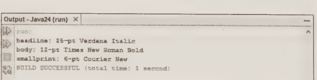

## 总结

Array lists 和 hash maps 是 `java.util` 包中两个非常有用的数据结构。`ArrayList` 类扩展了数组的功能，使其能够克服该数据类型固定大小的限制。Hash maps 允许任何类型的对象作为键来检索值。

此外还有位集（`BitSet` 类），它持有 0 位和 1 位的值；栈（`Stack`），它是类似于 array lists 的后进先出数据集合；以及属性（`Properties`），它是一种特殊的 hash map，用于在文件或另一个永久存储位置中持有程序的配置属性。

## 工作坊

### 问答

- **Q.** 类被设置为同步的（synchronized）意味着什么？

- **A.** 同步是 Java 虚拟机确保对象的其他用户能够以一致且准确的方式访问对象的实例变量和方法的方法。

  当你在第 19 小时“创建线程程序”中学习线程时，这个概念将变得更有意义。Java 程序可以被设计为同时执行多于一个任务。每个任务都放置在它自己的线程中。

  当多个线程正在访问同一个对象时，确保该对象在每个线程中表现相同至关重要。因此，当类的方法需要同步时（如 vectors 和 hash tables 那样），虚拟机必须工作得更努力，并可能会遇到导致线程停止运行的错误。

  这就是为什么数组和 hash maps 复制了 vectors 和 hash tables 的功能。因此，出现了不需要同步的数据结构，它们的运行效率高得多。

- **Q.** 华盛顿将军队（Washington Generals）击败过哈莱姆环球旅行者（Harlem Globetrotters）吗？

- **A.** 将军队在几十年中击败过环球旅行者七次，最近一次是在 1971 年。在田纳西州马丁市的比赛中，将军队凭借队所有者 Louis "Red" Klotz 的一次投篮以 100-99 获胜。

  尽管将军队今天因其过时而闻名，但他们始于 1921 年的费城 Sphas 队，那是一支在东部和美国篮球联赛中比赛的正规球队。Sphas——南费城希伯来人协会的缩写——赢得了 10 次冠军。Klotz 曾是 Sphas 的一名球员，他在 1952 年购买了球队，并在他们成为哈莱姆著名球队的永久巡演伙伴时将队名更改为将军队。

  1971 年的胜利结束了一段 2495 场的连胜。

### 测验

以下问题测试你学习了关于数据结构的知识。

- **1.** 下列哪个在创建后不能增长或缩小？

  A. Array lists
  B. 数组
  C. Hash maps

- **2.** 查找 map 中有多少个项的方法名称是什么？

  A. length()
  B. size()
  C. count()

- **3.** 什么数据类型或类可以作为 map 的键？

  A. int
  B. String
  C. 任意

### 答案

- **1.** B. 数组的大小在创建时已确定且无法更改。Array lists 和 hash maps 根据需要更改大小。

- **2.** B. `size()` 方法指示项目数量。

- **3.** A、B 或 C。Hash maps 可以使用任何类作为键。

### 活动

可以通过以下活动应用结构化编程知识：

- 写一个使用本节数据结构的公司邮箱列表程序，每个邮箱都与姓名关联。

- 扩展 FontMapper 程序，接收新字体的名称、大小和样式作为命令行参数，并在显示值之前将其添加到 hash map 中。

要查看实现这些 Java 程序，请访问书籍网站 www.java24hours.com。

# 第 18 小时：处理程序中的错误

错误、漏洞、失误和拼写错误会导致程序无法正确运行，它们是软件开发过程的自然部分。“自然”可能是描述它们最友善的词。

有些错误由编译器标记并阻止你创建类。另一些错误由解释器注意到并阻止其成功运行。Java 将错误分为两类：

- **异常（Exceptions）**——信号程序发生了异常情况
- **错误（Errors）**——信号解释器遇到了与程序无关的问题

错误通常不是 Java 程序可以恢复的，因此它们不是本节的重点。在编写 Java 程序时你可能会遇到 `OutOfMemoryError`。在错误发生后，Java 程序无法进行任何处理。程序将退出。

异常通常可以通过处理来保持程序正常运行。

## 异常

虽然你现在才开始学习它们，但在之前的 17 小时你可能已经对它们非常熟悉了。

本节待办事项：

- 了解为什么错误被称为异常
- 在 Java 程序中响应异常
- 创建忽略异常的方法
- 使用引发异常的方法
- 创建你自己的异常

## 程序中的错误处理

当您编写的 Java 程序在编译成功但在运行时遇到问题时，这些错误就会出现。

例如，一种常见的编程错误是引用不存在的数组元素，如下语句所示：

```
String[] greek = { "Alpha", "Beta", "Gamma" };
System.out.println(greek[3]);
```

数组 `greek` 有三个元素。由于数组的第一个元素索引为 0 而不是 1，因此第一个元素是 `greek[0]`，第三个元素是 `greek[2]`。所以，尝试显示 `greek[3]` 的语句是错误的。之前的语句可以成功编译，但当你运行程序时，Java 虚拟机（JVM）会停止并显示如下消息：

### 输出

```
Exception in thread "main" java.lang.ArrayIndexOutOfBoundsException:
at SampleProgram.main(SampleProgram.java:4)
```


此消息表明应用程序产生了异常，JVM 通过显示错误消息并停止程序来记录该异常。

错误消息引用了 `java.lang` 包中一个名为 `ArrayIndexOutOfBoundsException` 的类。该类是一个异常，是一个代表 Java 程序中发生的异常情况的对象。

当 Java 类遇到异常时，它会向该类的用户报告错误。在本例中，该类是 JVM。

所有异常都是 `java.lang` 包中 `Exception` 类的子类。`ArrayIndexOutOfBoundsException` 的作用正如您的预期——它报告访问了数组边界之外的数组元素。

Java 中有数百种异常。许多异常（如数组异常）表明可以通过编程更改来修复问题。这些类似于编译器错误——在您纠正了情况后，就不需要再担心该异常了。

有两个术语用于描述这个过程：抛出（throw）和捕获（catch）。对象通过抛出异常来通知其他对象异常的发生。这些异常由其他对象或 Java 虚拟机捕获。

程序每次运行时必须使用五个新关键字来处理其他异常：`try`、`catch`、`finally`、`throw` 和 `throws`。

## 在 try-catch 块中捕获异常

到目前为止，您通过修复引起异常的问题来处理异常。有时您无法以这种方式处理异常，而必须在 Java 类内部处理问题。

为了介绍为什么这样做很有用，请将列表 18.1 中的短 Java 程序输入到名为 `Calculator` 的新 Java 文件中并保存文件。

### 列表 18.1 Calculator.java 的完整文本

```java
1: package com.java24hours;
2:
3: public class Calculator {
4:     public static void main(String[] arguments) {
5:         float sum = 0;
6:         for (String argument : arguments) {
7:             sum = sum + Float.parseFloat(argument);
8:         }
9:         System.out.println("*Those numbers add up to " + sum);
10:    }
11: }
```

`Calculator` 接收一个或多个数字作为命令行参数，将它们相加并显示总和。

由于 Java 应用程序中所有的命令行参数都用字符串表示，程序在相加之前必须将它们转换为浮点数。第 7 行中的 `Float.parseFloat()` 类方法处理了这一点，将转换后的数字添加到名为 `sum` 的变量中。

在运行应用程序之前，在 NetBeans 中通过命令 Run、Set Project Configuration、Customize 设置以下命令行参数：`7 4 8 1 4 1 4`。选择 Run、Run Main Project 来运行应用程序，您应该可以在图 18.1 中看到输出。

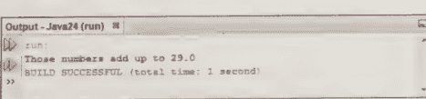

图 18.1 `Calculator` 应用程序的输出。

使用不同的数字作为参数多次运行程序。它应该能成功处理它们，这可能会让您怀疑这个项目与异常有什么关系。

为了查看相关性，将 `Calculator` 应用程序的命令行参数更改为 `1 3 5x`。

第三个参数包含一个拼写错误——数字 5 之后不应该有一个 x。`Calculator` 应用程序无法知道这是一个错误，因此它尝试将 `5x` 与其他数字相加，导致显示以下异常：

### 输出

```
Exception in thread "main" java.lang.NumberFormatException: For input string "5x" at java.misc.FloatingDecimal.readJavaFormatString(FloatingDecimal.java:1241)
at java.lang. Float.parseFloat(Float.java:452)
at Calculator.main(Calculator.java:7)
```

Java 结果：1

此消息对程序员来说可能是很有启发性的，但并不是您希望用户看到的。最好是隐藏错误消息并在程序中处理问题。

Java 程序可以使用 `try-catch` 块语句来处理它们自己的异常，其格式如下：

```java
try {
    可能导致异常的语句
} catch (Exception e) {
    // 当异常发生时要执行的操作
}
```

对于任何您希望类中的某个方法处理的异常，都必须使用 `try-catch` 块。`catch` 语句中出现的 `Exception` 对象应该是以下三者之一：

- 可能发生的异常的类
- 多个异常类
- 可能发生的异常的父类

`try-catch` 块的格式如下：

```java
try {
    可能导致异常的语句
} catch (Exception e) {
    // 当异常发生时要执行的操作
}
```

Java 程序可以通过使用 `try-catch` 块语句来处理它们自己的异常，其格式如下：

第 7 行的 `try-catch` 块处理由 `Float.parseFloat()` 抛出的 `NumberFormatException`。创建一个 `Calculator` Java 文件并输入列表 18.2 的文本。

### 列表 18.2 Calculator.java 的完整文本

```java
1: package com.java24hours;
2:
3: public class Calculator {
4:    public static void main(String[] arguments) {
5:        float sum = 0;
6:        for (String argument : arguments) {
7:            try {
8:                sum = sum + Float.parseFloat(argument);
9:            } catch (NumberFormatException e) {
10:                System.out.println(argument + " is not a number.");
11:            }
12:        }
13:        System.out.println("Those numbers add up to " + sum);
14:    }
15:}
```

保存应用程序后，自定义配置并运行 `com.java24hours.Calculator` 带参数 `1 3 5`。您应该可以在图 18.2 中看到输出。

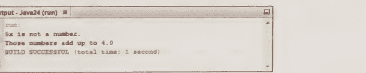

图 18.2 `NewCalculator` 应用程序的输出。

## 捕获多个异常

`try-catch` 块可以用于处理多种不同类型的异常，即使它们是由不同的语句抛出的。

处理多个异常类的方法是为每个异常分配一个 `catch` 块，如下代码所示：

```java
String textValue = "35";
int value;
try {
    value = Integer.parseInt(textValue);
} catch (FormatException exc) {
    // 处理异常
} catch (ArithmeticException exc) {
    // 处理异常
}
```

您也可以通过管道符号 `|` 分隔异常并在结尾指定异常变量名称，在同一个 `catch` 块中处理多个异常。这是一个示例：

```java
try {
    value = Integer.parseInt(textValue);
} catch (FormatException | ArithmeticException exc) {
    // 处理异常
}
```

如果捕获了 `FormatException` 或 `ArithmeticException`，它将赋值给变量 `exc`。

列表 18.3 包含一个名为 `NumberDivider` 的应用程序，它接收两个整数命令行参数并将它们用于除法表达式。

该应用程序必须能够处理用户输入中的两个潜在问题：

- 非数字参数
- 除以零

### 列表 18.3 NumberDivider.java 的全文

```java
1: package com.java24hours;
2:
3: public class NumberDivider {
4:     public static void main(String[] arguments) {
5:         if (arguments.length == 2) {
6:             int result = 0;
7:         try {
8:             result = Integer.parseInt(arguments[0]) /
9:                 Integer.parseInt(arguments[1]);
10:            System.out.println(arguments[0] + " divided by " + 
11:                arguments[1] + " equals " + result);
12:        } catch (FormatException e) {
13:            System.out.println("Both arguments must be numbers.");
14:        } catch (ArithmeticException e) {
15:            System.out.println("You cannot divide by zero.");
16:        }
17:    }
```

使用命令行参数指定两个参数，可以使用整数、浮点数和非数字参数运行它。

第 5 行的 `if` 语句检查确保向应用程序发送了两个参数。如果没有，程序将退出且不显示任何内容。

`NumberDivider` 应用程序执行整数除法，因此结果是一个整数。在整数运算中，5 除以 2 等于 2，而不是 2.5。

如果你使用浮点数或非数字参数，第 8–9 行会抛出 `FormatException` 并被第 12–13 行捕获。

如果你使用整数作为第一个参数并将 0 作为第二个参数，第 8–9 行会抛出 `ArithmeticException` 并被第 14–15 行捕获。

图 18.3 显示了程序成功运行后的的一些示例输出。

### 程序中的错误处理

图 18.3 NumberDivider 应用程序的输出。

```
14500 divided by 250 equals 58
BUILD SUCCESSFUL (total time: 0 seconds)
```

## 在异常后处理某些操作

当你使用 try 和 catch 处理多个异常时，有时你可能希望程序无论是否发生异常，都能在块的结束时执行某些操作。

你可以使用 `try-catch-finally` 块来实现这一点，其形式如下：

```java
try {
    要执行的语句
} catch (Exception e) {
    发生异常时要做的
} finally {
    无论如何都要执行的语句
}
```

块中 `finally` 部分的语句或语句会在块中其他所有操作之后执行，即使发生了异常也是如此。

这在从磁盘文件读取数据的程序中非常有用，你将在第 21 节“读取和写入文件”中学习。当你访问数据时可能会发生异常：文件可能不存在、可能会发生磁盘错误等。读取磁盘的语句位于 `try` 部分中，错误在 `catch` 部分中处理；你可以在 `finally` 部分关闭文件。这确保了无论是否真的抛出了异常，文件都能被关闭。

## 抛出异常

当你调用另一个类的方法时，该类可以通过抛出异常来控制方法的使用。

当你使用 Java 类库中的类时，编译器经常显示如下消息：

### 输出

```
NetReader.java:14: unreported exception java.net.MalformedURLException;
must be caught or declared to be thrown
```

### 抛出异常

每当你看到显示异常“必须被捕获或声明为抛出”的错误时，都表明你正尝试使用的方法抛出了异常。

任何调用这些方法的类（例如你编写的应用程序）必须执行以下操作之一：

- 使用 `try-catch` 块处理异常
- 抛出异常
- 使用 `try-catch` 块处理异常然后将其抛出

到在本节的目前为止，你已经学习了如何处理异常。如果你想在处理异常后抛出异常，可以使用 `throw` 语句后跟要抛出的异常对象。

以下语句在 `catch` 块中处理 `NumberFormatException` 错误，然后抛出异常：

```java
float principal;
try {
    principal = Float.parseFloat(loan);
} catch (NumberFormatException e) {
    System.out.println("loan is not a valid number");
    throw e;
}
```

以下语句在 `catch` 块中处理 `NumberFormatException` 错误，然后抛出异常：

```java
float principal;
try {
    principal = Float.parseFloat(loan);
} catch (Exception e) {
    System.out.println("Error: " + e.getMessage());
    throw e;
}
```

以下语句在 `catch` 块中处理 `NumberFormatException` 错误，然后抛出异常：

```java
float principal;
try {
    principal = Float.parseFloat(loan);
} catch (Exception e) {
    System.out.println("Error: " + e.getMessage());
    throw e;
}
```

以下语句在 `catch` 块中处理 `NumberFormatException` 错误，然后抛出异常：

```java
float principal;
try {
    principal = Float.parseFloat(loan);
} catch (Exception e) {
    System.out.println("Error: " + e.getMessage());
    throw e;
}
```

以下语句在 `catch` 块中处理 `NumberFormatException` 错误，然后抛出异常：

```java
float principal;
try {
    principal = Float.parseFloat(loan);
} catch (Exception e) {
    System.out.println("Error: " + e.getMessage());
    throw e;
}
```

以下语句在 `catch` 块中处理 `NumberFormatException` 错误，然后抛出异常：

```java
float principal;
try {
    principal = Float.parseFloat(loan);
} catch (Exception e) {
    System.out.println("Error: " + e.getMessage());
    throw e;
}
```

以下语句在 `catch` 块中处理 `NumberFormatException` 错误，然后抛出异常：

```java
float principal;
try {
    principal = Float.parseFloat(loan);
} catch (Exception e) {
    System.out.println("Error: " + e.getMessage());
    throw e;
}
```

以下语句在 `catch` 块中处理 `NumberFormatException` 错误，然后抛出异常：

```java
float principal;
try {
    principal = Float.parseFloat(loan);
} catch (Exception e) {
    System.out.println("Error: " + e.getMessage());
    throw e;
}
```

以下语句在 `catch` 块中处理 `NumberFormatException` 错误，然后抛出异常：

```java
float principal;
try {
    principal = Float.parseFloat(loan);
} catch (Exception e) {
    System.out.println("Error: " + e.getMessage());
    throw e;
}
```

## 程序中的错误处理

1. 建立计算机连接。
2. 询问客户数字是否有效。
3. 询问客户是否足够。

## 忽略异常

本节涵盖的下一个技术是如何忽略异常。类中的方法可以使用作为方法定义一部分的 `throws` 子句来忽略异常。


以下方法抛出一个 `MalformedURLException`，当你在 Java 程序中处理网络地址时可能会发生错误：

```java
public void loadURL(String address) throws MalformedURLException {
    URL page = new URL(address);
}
```

示例中的第二个语句创建了一个 `URL` 对象，它代表 Web 上的一个地址。`URL` 类的构造方法抛出 `MalformedURLException` 来表示使用了无效地址，因此无法构造对象。以下语句会在尝试打开到 URL 的连接时导致抛出这些异常之一：

```java
URL source = new URL("http://www.java2hours.com");
```

字符串 `http://www.java2hours.com` 不是一个有效的 URL。它缺少标点符号：冒号后面缺少两个斜杠字符（/）。

## 不需要 catch 的异常

虽然本节显示异常需要用 try-catch 捕获或用 `throws` 子句声明为抛出，但存在一种例外。

Java 程序中可能发生的某些异常不需要以任何方式处理。当编译器检测到异常正在被忽略时，并不会停止运行。这些异常被称为未检查异常（unchecked exceptions），而其他的被称为已检查异常（checked exceptions）。

# 程序中的错误处理

未检查异常是 `java.lang` 包中 `RuntimeException` 的所有子类。未检查异常的一个常见例子是 `IndexOutOfBoundsException`，它表示用于访问数组、字符串或数组列表的索引超出了其边界。如果一个数组有五个元素，而你尝试读取第 10 个元素，就会发生此异常。

另一个是 `NullPointerException`，它发生在使用一个没有值的对象时。当给对象变量赋值一个对象时，对象变量也会返回 `null`。当可以返回对象时，某些方法也会返回 `null`。如果一个语句错误地将一个没有有值的对象赋值给某个变量，就会发生 `NullPointerException`。

这两种错误都是程序员在代码中可以（也应该）防止的，而不是那些需要异常处理的内容。如果你编写了一个访问越界数组元素的程序，执行此操作的代码将仍然可以重新编译。如果你期望一个对象但它等于 `null`，请在使用在使用对象之前通过 `if` 条件判断对其进行检查。

Java 中设计未检查异常的原理是：它们要么可以通过编写良好的代码来防止，要么发生频率太高，以至于一直捕获它们会使程序变得异常复杂。在调用对象方法的程序每个语句中，都可能发生 `NullPointerException`。

当然，仅仅因为异常可以被忽略并不意味着它应该被忽略。对于未检查异常，你仍然可以使用 `try`、`catch` 和 `throws` 选项。

## 抛出和捕获异常

在这一小时的最后一个项目中，你创建一个类，使用异常来告诉另一个类发生的错误。

此项目中的类有 `HomePage`（一个代表网页个人主页的类）和 `PageCatalog`（一个对这些页面进行目录的应用程序）。

在名为 `HomePage` 的新 Java 文件中输入列表 18.4 的文本。

## 列表 18.4 HomePage.java 的全文

```java
1: package com.java24hours;
2:
3: import java.net.*;
4:
5: public class HomePage {
6:     String owner;
7:     URL address;
8:     String category = "none";
9:
10:    public HomePage(String inOwner, String inAddress)
11:        throws MalformedURLException {
12:
13:        owner = inOwner;
14:        address = new URL(inAddress);
15:
16:    }
17:
18:    public HomePage(String inOwner, String inAddress, String
19:        inCategory)
20:        throws MalformedURLException {
21:
22:        this(inOwner, inAddress);
23:        category = inCategory;
24:    }
}
```

你可以在其他程序中使用 `HomePage` 类。该类代表网页。它有三个实例变量：`address`（一个表示页面地址的 `URL` 对象）、`owner`（拥有该页面的人）以及 `category`（一个描述页面主要主题的简短注释）。

像任何创建 `URL` 对象的类一样，`HomePage` 必须在 `try-catch` 块中处理 `MalformedURLException` 错误，或者声明它正在忽略这些错误。

该类采取了后者的做法，如两个构造方法所示（第 10–11 行和第 17–18 行）。通过使用 `throws`，`HomePage` 消除了以任何方式处理 `MalformedURLException` 错误的需要。

要创建一个使用 `HomePage` 类的应用程序，回到 NetBeans 并创建一个名为 `PageCatalog` 的 Java 文件，包含列表 18.5 的文本。

## 列表 18.5 PageCatalog.java 的全文

```java
package com.java24hours;
import java.net.*;
public class PageCatalog {
    public static void main(String[] arguments) {
        HomePage[] catalog = new HomePage[5];
        try {
            catalog[0] = new HomePage("Mark Evanier",
                "http://www.markevanierfromme.com", "books");
            catalog[1] = new HomePage("Rients",
                "http://www.markevanierfromme.com", "gaming");
            catalog[2] = new HomePage("Cadenhead",
                "http://www.markevanierfromme.com", "programming");
            catalog[3] = new HomePage("Owen Cole",
                "http://www.markevanierfromme.com", "politics");
            catalog[4] = new HomePage("Rafe Colburn",
                "http://www.markevanierfromme.com", "null");
            for (int i = 0; i < catalog.length; i++) {
                System.out.println(catalog[i].owner + " - " + catalog[i].category);
            }
        } catch (MalformedURLException e) {
            System.out.println("Error: " + e.getMessage());
        }
    }
}
```

*(注：由于原文提供的列表 18.5 代码块在输入中似乎存在格式错乱或缺失，翻译时根据上下文逻辑进行了结构对齐以确保代码可读性)*

当你运行程序时，输出如下（假设成功）：

```
Mark Evanier - books
Rients - gaming
Cadenhead - programming
Owen Cole - politics
Rafe Colburn - null
```

## 工作坊

## 测验

虽然这一小时的内容充满了错误，但请尝试在不产生任何错误的情况下，回答以下关于这些错误的问题。

- 1. 单个 catch 语句可以处理多少个异常？

   A. 仅限一个。

   B. 多个不同的异常。

   C. 此处故意留空。

- 2. finally 块中的语句在何时执行？

   A. 在 try-catch 块因异常结束后执行

   B. 在 try-catch 块未发生异常并结束后执行

   C. 两者皆是

- 3. 聊了这么多关于抛出（throwing）和捕获（catching），德州游牛仔队（Texas Rangers）在 offseason需要做什么？

   A. 获得更多发投手

   B. 签约一名左手强打型外野手，能够触及右侧的短墙

   C. 引入新的中继救援投手

# 答案

- 1. catch 语句中的 Exception 对象可以处理其自身类及其父类的所有异常。

- 2. finally 块中的一个或多个语句总会在 try-catch 块其余部分之后执行，无论是否发生了异常。

- 3. 每个答案都是正确的，但 A 比其他更正确，并且可能在未来的 30 年内都是正确的。

## 活动

为了看看你是否是一个出色的 Java 程序员，请尝试在以下活动中尽可能减少错误：

- 修改 NumberDivider 应用程序，使其抛出它所捕获的任何异常，并运行程序查看发生了什么。

- 在你在第 15 小“响应用户输入”中创建的 LottoEvent 类中有一个 try-catch 块。使用此块作为指南创建你自己的 Sleep 类，由它来处理 InterruptedException 类，这样 LottoEvent 就不需要处理处理它们了。

如需查看实现这些活动的 Java 程序，请访问书籍网站 www.java24hours.com。

## 第 19 小时：创建线程程序

经常用于描述日常生活忙碌节奏的计算机术语是“多任务处理”（multitasking），这意味着同时做多件事——例如在办公桌前浏览网页、参加通话并进行腹部坐起运动。多任务计算机是指可以同时运行多个程序的计算机。

Java 语言的一项高级特性是能够编写可以多任务处理的程序，这是通过一类被称为“线程”（threads）的对象实现的。

## 本小时待办事项：

- 在程序中使用接口。

- 创建线程。

- 启动、停止、暂停线程。

- 捕获错误。

## 线程

在 Java 程序中，计算机处理的每个并行任务都称为线程，整个过程被称为多线程（multithreading）。线程在动画和许多其他程序中非常有用。

线程是组织程序的一种，使其同时执行多项任务。每个必须同时发生的任务都将被放置在自己的线程中，这通常通过将每个任务实现为独立的类完成。

线程由 `Thread` 类和 `Runnable` 接口表示，它们都是 `java.lang` 类的包的一部分。因为它们属于这个包，所以你不需要使用 `import` 语句即可在程序中使用它们。

`Thread` 类最简单的用处之一是减慢程序执行某些操作的速度。

## 减慢程序运行

`Thread` 类有一个 `sleep()` 方法，你可以在任何需要停止运行一段时间的程序中调用它。你经常看到这种技术用于带有动画的程序中，它可以防止图像显示的速度超过 Java 解释器能够处理的速度。

要使用 `sleep()` 方法，请调用 `Thread.sleep()` 并传入要暂停的毫秒数，如下所示：

```
Thread.sleep(5000);
```

上述语句会导致 Java 虚拟机在执行任何其他操作之前暂停 5 秒。如果由于某种原因 JVM 无法那么久，`sleep()` 方法将抛出一个 `InterruptedException`。

由于可能会抛出此异常，在使用 `sleep()` 方法时你必须以某种方式对其处理。一种方法是将 `Thread.sleep()` 语句放在 try-catch 块中：

```
try {
  Thread.sleep(5000);
} catch (InterruptedException e) {
}
```

当你想让 Java 程序同时处理多件事时，你必须将程序组织成线程。你的程序可以有很多线程，并且它们可以同时运行。

## 创建线程

可以运行的 Java 类被称为可运行（runnable）或线程类。虽然你可以使用线程让程序暂停几秒钟，但程序员通常使用它们是为了相反的原因——加快程序运行。如果不使用线程，程序在加载数据时可能会反应迟钝。

将任务放置在自己的线程中的两种方法包括：

- 将任务放在实现 `Runnable` 的类中
- 将任务放在 `Thread` 的子类中

实现 `Runnable` 的类必须包含 `run()` 方法，其结构如下：

```
public void run() {
}
```

`run()` 方法应该负责任务。在示例中，该方法包含语句。在你完成以下两件事之前，线程不会自动开始：

- 通过调用 `Thread` 构造函数创建线程类对象
- 通过调用 `start()` 方法启动线程

`Thread` 构造函数接受一个参数：对象。

## 列表 19.1 PrimeFinder.java 的全文

```java
package com.java4Hours;

import java.awt.*;
import javax.swing.*;
import java.awt.event.*;

public class PrimeFinder extends JFrame implements Runnable, ActionListener {
    Thread go;
    JLabel howManyLabel;
    JTextField howMany;
    JButton display;
    JTextArea primes;

    public PrimeFinder() {
        super("Find Numbers");
        layout();
        setSize(400, 300);

        setDefaultCloseOperation(JFrame.EXIT_ON_CLOSE);
        BorderLayout bord = new BorderLayout();
        setLayout(bord);

        howManyLabel = new JLabel("Quantity: ");
        howMany = new JTextField("400", 10);
        display = new JButton("Display primes");
        primes = new JTextArea(8, 40);

        display.addActionListener(this);
        JPanel panel = new JPanel();
        panel.add(howManyLabel);
        panel.add(howMany);
        panel.add(display);
        add(panel, BorderLayout.NORTH);

        primes.setLineWrap(true);
        JScrollPane textPane = new JScrollPane(primes);
        add(textPane, BorderLayout.CENTER);

        setVisible(true);
    }

    private void layout() {
        // 布局代码在此
    }

    @Override
    public void actionPerformed(ActionEvent event) {
        display.setEnabled(false);
        if (go == null) {
            go = new Thread(this);
        }
        go.start();
    }

    @Override
    public void run() {
        // 运行逻辑在此
    }
}
```


```go
go.start();
}
}
public void run() {
    int quantity = Integer.parseInt(howMany.getText());
    int numPrimes = 0;
    // check each number that might be prime
    int candidate = 2;
    primes.append("First " + quantity + " primes: ");
    while (numPrimes < quantity) {
        if (isPrime(candidate)) {
            primes.append(candidate + " ");
            numPrimes++;
        }
        candidate++;
    }
}
public static boolean isPrime(int checkNumber) {
    double root = Math.sqrt(checkNumber);
    for (int i = 2; i <= root; i++) {
        if (checkNumber % i == 0) {
            return false;
        }
    }
    return true;
}

private void setLookAndFeel() {
    try {
        UIManager.setLookAndFeel("com.sun.swing.plaf.nimbus.NimbusLookAndFeel");
    } catch (Exception exc) {
        // ignore error
    }
}
public static void main(String[] arguments) {
    new PrimeFinder();
}
```

# PrimeFinder 应用

PrimeFinder 应用显示了一个文本字段、一个“显示质数”按钮和一个文本区域，如图 19.1 所示。

## 图 19.1

运行 PrimeFinder 应用程序。


应用程序中的大多数语句用于创建 GUI 或显示质数序列。以下语句用于实现此程序中的线程：

1. `Runnable` 接口被应用于 `PrimeFinder` 类。
2. 创建了一个名为 `go` 的 `Thread` 对象，但没有对其赋值。
3. 如果 `go` 对象的值为空（这表示线程尚未创建），则会创建一个新的 `Thread` 对象并存储在变量中。通过调用线程的 `start()` 方法启动线程，这将调用 `PrimeFinder` 类的 `run()` 方法。
4. `run()` 方法寻找从 2 开始的质数序列，通过调用其 `append()` 方法将每个质数显示在 `primes` 文本区域组件中。序列中质数的数量由 `howMany` 文本字段的值决定。

当创建 `PrimeFinder` 对象开始执行程序时，该程序的 `main()` 方法中有些异常。这里是该语句：

```
new PrimeFinder();
```

通常你会看到该对象被赋值给一个变量，如下所示：

```
PrimeFinder frame = new PrimeFinder();
```

然而，没有需要再次引用该对象，将其存储在变量中是没有必要的。调用 `new` 创建对象就会导致程序运行。

在 Java 中，良好的编程习惯是仅在需要时将对象存储在变量中。

# 使用线程

你可以通过调用其 `start()` 方法来启动线程，这可能会让你认为还有一个 `stop()` 方法可以停止它。

尽管 Java 在 `Thread` 类中包含一个 `stop()` 方法，但它已经被弃用。在 Java 中，被弃用的元素是指已被功能更好的元素所取代的类、接口、方法或变量。

注意此弃用警告是有益的。Oracle 弃用了 `stop()` 方法，因为它可能会给 Java 解释器中运行的其他线程引起问题。该类的 `resume()` 和 `suspend()` 方法也被弃用了。

你将进行的下一个项目将展示如何停止线程。你正在进行的程序会在网站标题列表和访问这些网站的地址之间循环切换。

每个页面标题和网页地址在连续循环中显示。用户可以通过点击应用程序图形用户界面上的按钮来查看当前显示的站点。该程序运行一段时间，按顺序显示有关每个网站的信息。由于这个时间元素的存在，线程是控制程序的最佳方式。

你不需要先将程序输入 NetBeans 源码编辑器后再学习它，而是在本小时结束时输入 `LinkRotator` 应用程序的全文。在此之前，程序的每个部分都得到了描述。

# 类声明

在该程序中，你需要做的第一件事是导入 `java.awt`、`java.io`、`java.net.event` 和 `javax.swing` 包中的类。

在你使用 `import` 使某些类可用后，就可以使用以下语句启动应用程序了：

```java
public class LinkRotator extends JFrame
implements Runnable, ActionListener {
```

该语句将 `LinkRotator` 类创建为 `JFrame` 类的子类，就像你开发的其他具有图形用户界面的程序一样。该语句还指示该类支持两个接口：`Runnable` 和 `ActionListener`。通过实现 `Runnable` 类，你能够在此程序中使用 `run()` 方法来让线程运行。`ActionListener` 使程序能够响应鼠标点击。

# 设置变量

在 `LinkRotator` 中要做的第一件事是创建类的变量和对象。创建一个名为 `pageTitle` 的 `String` 对象六元素数组，以及名为 `pageLink` 的 `URI` 对象六元素数组：

```java
String[] pageTitle = new String[6];
URI[] pageLink = new URI[6];
```

该数组存储了显示的六个网站的标题。`URI` 对象数组存储网站地址的值。`URI` 拥有跟踪网页地址所需的行为和属性。

最后要创建的三个是一个整数变量、一个 `Thread` 对象和一个用户界面标签：

```java
int current = 0;
Thread runner;
JLabel siteLabel = new JLabel("");
```

`current` 变量跟踪显示的是哪个站点，以便你可以在站点之间循环。`Thread` 对象代表此程序运行的线程。当你启动、停止和暂停程序操作时，你会调用 `runner` 对象的方法。

# 构造函数

程序的构造函数在程序运行时自动执行。此方法用于为数组 `pageTitle` 和 `pageLink` 赋值。它还用于创建一个出现在用户界面上的、可点击的按钮。该方法包含以下语句：

```java
pageTitle = new String[] {
  "Oracle's Java site",  "Cafe au Lait",
  "JavaWorld",
  "Java in 24 Hours",
```

# 设置 URL 时捕错误

```java
Button visitButton = new Button("Visit Site");
visitButton.addActionListener(this);
add(visitButton);
```

`init()` 方法的最后三个语句创建一个标记为“Visit Site”的按钮并将其添加到框架。

`getURI(String)` 方法接收地址作为参数，返回该地址的 `URI` 对象。如果字符串不是有效地址，则方法返回 `null`：

```java
URI getURI(String urlText) {
    URI pageURI = null;
    try {
        pageURI = new URI(urlText);
    } catch (URISyntaxException m) {
    }
    return pageURI;
}
```

`try-catch` 块处理创建 `URI` 对象时发生的任何 `URISyntax` 错误。由于不需要发生此异常，`catch` 块只包含 `a`。

# 启动线程

在此程序中，在调用 `start()` 方法时启动运行线程。

`start()` 方法是在构造函数的最后语句中调用的。

```java
public void start() {
    if (runner == null) {
        runner = new Thread(this);
    }
    runner.start();
}
```

如果尚未启动，则该方法会启动线程。

# 处理鼠标点击

在 `run()` 方法中首先发生的是是创建一个名为 `thisThread` 的 `Thread` 对象。`Thread` 类的类方法 `currentThread()` 为 `thisThread` 对象设置了值。`currentThread()` 方法会跟踪当前运行的线程。

该方法中的所有语句都是一个 `while` 循环的一部分，该循环将 `runner` 对象与 `thisThread` 对象进行比较。这两个对象都是线程，只要它们指向同一个对象，`while` 循环就会继续执行。此循环内部没有哪个语句会导致 `runner` 和 `thisThread` 对象具有不同的值，因此，除非循环外部的某些操作改变了其中一个 `Thread` 对象，否则它将无限制地循环。

`run()` 方法调用了 `repaint()`。变量 `current` 的下一个值会加 1，如果 `current` 超过 5，则将其重新置为 0。`current` 变量用于确定显示哪个网站的信息。它被用作字符串数组 `pageTitle` 的索引，并且标题被设置为 `siteLabel` 用户界面组件的文本。

`run()` 方法包含一个处理错误的 `try-catch` 块。`Thread.sleep(1000)` 语句会导致暂停 1 秒，这足够用户阅读网站名称及其地址了。`catch` 语句处理在执行 `Thread.sleep()` 语句期间可能发生的任何 `InterruptedException` 错误。如果线程在睡眠时被某些东西中断，就会发生这些错误。

# 处理鼠标点击

在 `LinkRotator` 程序中，最后需要处理的是事件处理。每当用户点击“Visit Site（访问站点）”按钮时，应用程序都应该使用 浏览器打开显示的网站。这是通过一个名为 `actionPerformed()` 的方法实现的，每当按钮点击时，该方法就会被调用。

以下是 `LinkRotator` 的 `actionPerformed()` 方法：

```java
public void actionPerformed(ActionEvent event) {
    Desktop desktop = Desktop.getDesktop();
    if (pageLink[current] != null) {
        try {
            desktop.browse(pageLink[current]);
            runner = null;
            System.exit(0);
        } catch (IOException exc) {
            // do nothing
        }
    }
}
```

此方法中发生的第一件事是创建了一个 `Desktop` 对象。`java.awt` 包中的 `Desktop` 类代表运行应用程序的计算机桌面环境。获取此对象后，你可以使用它通过“mailto: 链接”启动电子邮件客户端、使用另一个程序打开文件进行编辑、打印文件，并让 Java 之外的其他程序执行任务。

在这里，`Desktop` 对象被用于用计算机默认默认浏览器打开网页。

`browse(URI)` 方法在浏览器中加载指定的网页地址。如果 `pageLink[current]` 是一个有效地址，`browse()` 会请求浏览器加载该页面。

# Display循环链接

你现在已经准备好创建程序并测试它了。创建一个名为 `LinkRotator` 的新 Java 文件，并输入列表 19.2 中的文本。

- 列表 19.2 `LinkRotator.java` 的完整文本。

```java
1: package com.java24hours;
2:
3: import java.awt.*;
4: import java.awt.event.*;
5: import java.io.*;
6: import javax.swing.*;
7: import java.net.*;
8:
9: public class LinkRotator extends JFrame
10: implements Runnable, ActionListener {
11:
12: String[] pageTitle = new String[6];
13: URI[] pageLink = new URI[6];
14: int current = 0;
15: Thread runner;
16: JLabel siteLabel = new JLabel();
17:
18: public LinkRotator() {
19: setDefaultCloseOperation(JFrame.EXIT_ON_CLOSE);
20: setSize(300, 100);
21: FlowLayout flo = new FlowLayout();
22: setLayout(flo);
23: add(siteLabel);
24: pageTitle = new String[] {
25:     "Oracle Java site",
26:     "Cafe au lait",
27:     "JavaWorld",
28:     "Java in 24 Hours",
29:     "Sams Publishing",
30:     "Workbench",
31: };
32: pageLink[0] = getURI("http://www.oracle.com/technet/javafaq");
33: pageLink[1] = getURI("http://www.ibiblio.org/javafaq");
34: pageLink[2] = getURI("http://www.javaworld.com");
35: pageLink[3] = getURI("http://www.java24hours.com");
36: pageLink[4] = getURI("http://www.samspublishing.com");
37: pageLink[5] = getURI("http://www.workbench.cadhead.com");
38: Button visitButton = new Button("Visit Site");
39: visitButton.addActionListener(this);
40: add(visitButton);
41: setVisible(true);
42: start();
43: }
44: private URI getURI(String urlText) {
45:     URI pageURI = null;
46:     try {
47:         pageURI = new URI(urlText);
48:     } catch (URISyntaxException ex) {
49:     }
50:     return pageURI;
51: }
52: public void start() {
53:     if (runner == null) {
54:         runner = new Thread(this);
55:         runner.start();
56:     }
57: }
58: public void run() {
59:     Thread thisThread = Thread.currentThread();
60:     while (runner == thisThread) {
61:         current++;
62:         if (current > 5) {
63:             current = 0;
64:         }
65:         siteLabel.setText(pageTitle[current]);
66:         repaint();
67:         try {
68:             Thread.sleep(1000);
69:         } catch (InterruptedException e) {
70:             // do nothing
71:         }
72:     }
73: }
```

# 停止线程

`LinkRotator` 程序中最后需要处理的是事件处理。每当用户点击“Visit Site”按钮时，应用程序都应该使用 浏览器打开显示的网站。这是通过一个名为 `actionPerformed()` 的方法实现的，每当按钮点击时，该方法就会被调用。

以下是 `LinkRotator` 的 `actionPerformed()` 方法：


```java
public void actionPerformed(ActionEvent event) {
    Desktop desktop = Desktop.getDesktop();
    if (pageLink[current] != null) {
        try {
            desktop.browse(pageLink[current]);
            runner = null;
            System.exit(0);
        } catch (IOException exc) {
            // do nothing
        }
    }
}
```

此方法中发生的第一件事是创建了一个 `Desktop` 对象。`java.awt` 包中的 `Desktop` 类代表运行应用程序的计算机桌面环境。获取此对象后，你可以使用它通过“mailto: 链接”启动电子邮件客户端、使用另一个程序打开文件进行编辑、打印文件，并让 Java 之外的其他程序执行任务。

在这里，`Desktop` 对象被用于用计算机默认浏览器打开网页。

`browse(URI)` 方法在浏览器中加载指定的网页地址。如果 `pageLink[current]` 是一个有效地址，`browse()` 会请求浏览器加载该页面。

## 显示循环链接

你现在已经准备好创建程序并测试它了。创建一个名为 `LinkRotator` 的新 Java 文件，并输入列表 19.2 中的文本。

- 列表 19.2 `LinkRotator.java` 的完整文本。

```java
1: package com.java24hours;
2:
3: import java.awt.*;
4: import java.awt.event.*;
5: import java.io.*;
6: import javax.swing.*;
7: import java.net.*;
8:
9: public class LinkRotator extends JFrame
10: implements Runnable, ActionListener {
11:
12: String[] pageTitle = new String[6];
13: URI[] pageLink = new URI[6];
14: int current = 0;
15: Thread runner;
16: JLabel siteLabel = new JLabel();
17:
18: public LinkRotator() {
19: setDefaultCloseOperation(JFrame.EXIT_ON_CLOSE);
20: setSize(300, 100);
21: FlowLayout flo = new FlowLayout();
22: setLayout(flo);
23: add(siteLabel);
24: pageTitle = new String[] {
25:     "Oracle Java site",
26:     "Cafe au lait",
27:     "JavaWorld",
28:     "Java in 24 Hours",
29:     "Sams Publishing",
30:     "Workbench",
31: };
32: pageLink[0] = getURI("http://www.oracle.com/technet/javafaq");
33: pageLink[1] = getURI("http://www.ibiblio.org/javafaq");
34: pageLink[2] = getURI("http://www.javaworld.com");
35: pageLink[3] = getURI("http://www.java24hours.com");
36: pageLink[4] = getURI("http://www.samspublishing.com");
37: pageLink[5] = getURI("http://www.workbench.cadhead.com");
38: Button visitButton = new Button("Visit Site");
39: visitButton.addActionListener(this);
40: add(visitButton);
41: setVisible(true);
42: start();
43: }
44: private URI getURI(String urlText) {
45:     URI pageURI = null;
46:     try {
47:         pageURI = new URI(urlText);
48:     } catch (URISyntaxException ex) {
49:     }
50:     return pageURI;
51: }
52: public void start() {
53:     if (runner == null) {
54:         runner = new Thread(this);
55:         runner.start();
56:     }
57: }
58: public void run() {
59:     Thread thisThread = Thread.currentThread();
60:     while (runner == thisThread) {
61:         current++;
62:         if (current > 5) {
63:             current = 0;
64:         }
65:         siteLabel.setText(pageTitle[current]);
66:         repaint();
67:         try {
68:             Thread.sleep(1000);
69:         } catch (InterruptedException e) {
70:             // do nothing
71:         }
72:     }
73: }
```

## 停止线程

`LinkRotator` 程序没有停止的方法，但它被设计使得这种操作变得简单。这里有一个可以调用的方法：

```java
public void stop() {
  if (runner == null) {
    runner = null;
  }
}
```

`if` 语句测试 `runner` 对象是否等于 null。如果是，则将 `runner` 设置为 null。

## 总结

- Q. 有理由在 `catch` 语句中什么都不做，就像 `LinkRotator` 应用程序那样？

- 这取决于捕到的错误或异常类型。

- Q. 演唱过《My Future's So Bright, I Gotta Wear Shades》的乐队后来怎么样了？

- 他们的未来并不光明。Timbuk3 是由夫妻夫妇 Pat Barbara K. Macdonald 组成的乐队，在首首歌在 1986 年进入排行榜前 20 名之后，再也没有过热门单曲。

## 工作坊

2. 如果一个接口包含三个不同的方法，那么实现该接口的类中必须包含其中几个方法？

- A. 一个都不包含。

- B. 全部包含。

- C. 我知道，但我不想告诉你。

3. 你正在赞赏另一位程序员的作品，他创建了一个可以同时处理四个任务的程序。你应该告诉他什么？

- A. “我愿意花一美元买下它。”

- B. “你是我翅膀下的风。”

# 答案

- 1. A. `Runnable` 必须配合 `implements` 语句使用。`Thread` 用在多线程程序内部，但在启动程序的类语句中不需要它。

- 2. B. 接口保证了该类包含了接口的所有方法。

- 3. C. 如果这名程序员穿得非常体面，这个赞美可能会让他困惑，但诚实地说，这种情况发生的概率有多大呢？

## 活动

如果这一小时的内容还没有让你感到精疲力竭，可以通过以下活动扩展你的技能：

- 为 `LinkRotator` 应用程序和六个你最喜欢的网站创建一个新版本。

- 为 `primeFinder` 应用程序添加一个按钮，可以在质数序列仍在计算时停止该线程。

要查看实现这些活动的 Java 程序，请访问书籍网站 www.java24.com。

## 第 20 小时：使用内部类和闭包

当 Java 编程语言在 1995 年发布时，它的范围有限且易于掌握。当时 Java 类库中大约只有 250 个类。该语言的设计初衷主要是为了让交互式程序（Applet）能够在浏览器中运行。由于当时没有其他技术可以实现这一功能，Java 引起了巨大的轰动，并迅速被数十万程序员所接纳。

## 本小时的任务列表：

- ▶ 为对象添加内部类。
- ▶ 探索为什么内部类很有用。
- ▶ 创建一个匿名内部类。
- ▶ 配合接口使用适配器类。
- ▶ 学习为什么 Java 8 添加了闭包。
- ▶ 编写 lambda 表达式。
- ▶ 用 lambda 表达式替换匿名内部类。

作为对该语言设计良好的证明，它扩展了单一的焦点，成为一种通用的编程语言，足以与 C++ 竞争——C++ 是当时全球最流行且实现广泛的语言。

随着 Java 语言接近其 20 周生日，今天有数百万程序员编写 Java 代码。随着每一次新发布，Java 在支持现有开发者同时，扩展了其功能，以实现复杂的软件开发方法。

Java 8 引入了一种令人兴奋的代码编写方式，称为闭包或 lambda 表达式。这些表达式使得函数式编程方法成为可能。

在这一小时中，你在学习了使用它们的两个前提条件——内部类和匿名内部类之后，将学习 lambda 表达式。

## 内部类

在 Java 中创建一个类时，你为该类定义属性和行为。属性是存储数据的类变量和实例变量。行为是使用这些数据执行任务的方法。

类也可以包含一种同时由属性和行为的内容：内部类。

内部类是包含在外部类内部的辅助类。你可能会奇怪为什么它们是必要的，因为根据需要创建任意新类来编写程序是很简单的。如果你正在编写一个 `CheckBook` 程序，并且每一个人书写的每张支票都需要一个对象，你就创建一个 `Check` 类。如果程序支持每月循环扣款，就添加一个 `AutoPayment` 类。

内部类并非必须。但当你学会了所有能做的事情后，你会发现在许多情况下它们极其有用。

Java 包含内部类的三个原因是：

1. 当一个辅助类只被另一个类使用时，将它定义在那个类内部是有意义的。
2. 它们允许辅助类访问其作为独立类时无法访问的私有方法和变量。
3. 它们将辅助类尽可能地放置在另一个类中使用它的地方。

内部类使用 `class` 关键字创建，与其他任何类一样，但它声明在包含它的类内部。通常这与类变量和实例变量放在一起。

以下是在名为 `Simple` 的类内部创建一个名为 `InnerSimple` 的内部类的示例：

```java
public class Simple {
    class InnerSimple {
        InnerSimple() {
            System.out.println("I am an inner class!");
        }
    }

    public Simple() {
    }

    public static void main(String[] arguments) {
        Simple program = new Simple();
        Simple.InnerSimple inner = program.new InnerSimple();
    }
}
```

内部类的结构与其他任何类相同，但被放在外部类的 `{ }` 括号内。

创建内部类需要外部类的对象。在对象上调用 `new` 运算符：

```java
Simple.InnerSimple inner = program.new InnerSimple();
```

在前面的语句中，类名包含了外部类名、一个点 (.) 字符，`Simple.InnerSimple` 就是类名。

本小时第一个项目是重写第 18 小时的应用程序“处理程序中的错误”。该时的 `PageCatalog` 应用程序需要一个辅助类 `HomePage`。列表 20.1 中的 `Catalog` 修订了该项目，用内部类替换了独立类。

在 `com.java24hours` 包中创建一个名为 `Catalog` 的新 Java 文件；然后将其填充为列表 20.1 中的源码。

## 列表 20.1 Catalog.java 的全文

```java
1: package com.java24hours;
2:
3: import java.net.*;
4:
5: public class Catalog {
6:     class HomePage {
7:         String owner;
8:         URL address;
9:         String category = "none";
10:
11:        public HomePage(String inOwner, String inAddress)
12:             throws MalformedURLException
13:
14:             owner = inOwner;
15:             address = new URL(inAddress);
16:
17:
18:        public HomePage(String inOwner, String inAddress, String
19:             inCategory)
20:             throws MalformedURLException
21:
22:             this(inOwner, inAddress);
23:             category = inCategory;
24:     }
25:
26:    public Catalog() {
27: }
28: Catalog.HomePage[] catalog = new Catalog.HomePage[5];
29: try {
30: catalog[0] = new HomePage("Mark Evanier",
31: "http://www.newsf.com, "comic books");
32: catalog[1] = new HomePage("Jeff Rients",
33: "http://jrients.blogspot.com, "gaming");
34: catalog[2] = new HomePage("Rogers Cadenhead",
35: "http://workbench.cadenhead.org, "programming");
36:
37: catalog[3] = new HomePage("Juan Cole",
38: "http://www.juancole.com, "politeics");
39: catalog[4] = new HomePage("Rafe Columbn",
40: "http://www.rcrd.org");
41: for (int i = 0; i < catalog.length; i++) {
42: System.out.println(catalog[i].owner + " - " + 
43: catalog[i].address + " - " + 
44: catalog[i].category);
45: }
46: } catch (MalformedURLException e) {
47: System.out.println("Error: " + e.getMessage());
48: } finally {
```

## 匿名内部类

在 Java 编程中，你经常的一项任务是创建一个仅使用一次且目的简单的类。一种特殊的内部类非常适合这种用途。

匿名内部类是一种简短的、没有名称且在声明的同时进行创建的类。

要使用它，你将对对象的引用替换为 `new` 关键字、构造函数调用以及 `{ }` 字符内部的类定义。

以下是一些没有使用匿名内部类的代码：

```java
WorkerClass worker = new WorkerClass();
Thread main = new Thread(worker);
main.start();
```

推测该 `worker` 对象实现了 `Runnable` 接口，并且可以作为线程运行。

如果 `WorkerClass` 中的代码短且简单，且该类只需要使用一次，那么将其放在匿名内部类中可能是值得的。这里是实现该目标的新版本：

```java
Thread main = new Thread(new Runnable() {
public void run() {
    // 线程要执行的工作在这里
});
main.start();
```

匿名内部类用以下代码替换了对 `worker` 的引用：

```java
new Runnable() {
public void run() {
    // 线程要执行的工作在这里
}}
```

这创建了一个实现了 `Runnable` 接口并重写了 `run()` 方法的匿名类。方法内部的语句将执行该类所需的任何操作。

通过一个关于内部类如何编写以及为什么很有用的完整示例，这个概念将更容易理解。

再次强调，你之前早些时候创建的项目将通过使用内部类来得到改进。

## 第 20 小时：使用内部类和闭包


## 响应用户输入

在第 15 小节“响应用户输入”中，你创建了一个接受键盘输入的 Swing 应用程序。`KeyViewer` 通过一个实现了 `KeyListener` 接口的对象来监控键盘——该对象是应用程序自身的类。

实现接口的类必须实现三个方法：`keyTyped()`、`keyPressed()` 和 `keyReleased()`。以下是它们在那个程序中的设计方式：

```java
public void keyTyped(KeyEvent input) {
    char key = input.getKeyChar();
    keyLabel.setText("You pressed " + key);
}
```

```java
public void keyPressed(KeyEvent txt) {
    // 什么都不做
}
```

```java
public void keyReleased(KeyEvent txt) {
    // 什么都不做
}
```

然后设置按键监听器以使用该类来监控键盘事件：

```java
textField.addKeyListener(this);
```

通过匿名内部类和 `java.awt.event` 包中的 `KeyAdapter` 类，有一种更好的方法来创建监听器并将其添加到图形用户界面。

`KeyAdapter` 实现了 `KeyListener` 接口并包含了所有三个方法的实现。它为键盘事件创建监听器变得简单，因为你可以创建一个只重写实际执行操作方法的子类。

以下是 `KeyViewer` 应用程序的按键监听器的框架：

```java
public class KeyViewerListener extends KeyAdapter {
    public void keyTyped(KeyEvent input) {
        
    }
}
```

这个监听器可以被创建并设置为监听器：

```java
KeyViewerListener kvl = new KeyViewerListener();
textField.addKeyListener(kvl);
```

这种方法需要一个单独的辅助类 `KeyViewerListener`，并且需要创建该类的对象并将其赋值给变量。

## 内部类

另一种方法是将监听器创建为匿名类：

```java
textField.addKeyListener(new KeyAdapter() {
    public void keyTyped(KeyEvent input) {
        char key = input.getKeyChar();
        jLabel.setText("You pressed " + key);
    }
});
```

监听器是通过 `new KeyAdapter()` 紧跟类定义被匿名创建的。该类重写了 `keyTyped()` 方法，因此当按键被按下时，通过调用 `getKeyChar()` 获取它，并通过设置 `jLabel`（这是一个 `JLabel` 组件）的值来显示它。

匿名内部类可以访问普通辅助类无法访问的内容：即 `keyLabel` 实例变量。该变量属于 `Viewer` 类。内部类可以访问其外层类的方法和变量。

在 NetBeans 中，创建一个名为 `KeyViewer` 的新文件，并将其包名设置为 `com.java24hours`。将 20.2 节的文本输入文件，并在完成后保存。

### 列表 20.2：KeyViewer.java 的完整文本

```java
1: package com.java24hours;
2:
3: import javax.swing.*;
4: import java.awt.event.*;
5: import java.awt.*;
6:
7: public class KeyViewer extends JFrame {
8:     JTextField keyText = new JTextField(80);
9:     JLabel keyLabel = new JLabel("Press any key in the text field.");
10:
11:     public KeyViewer() {
12:         super("KeyViewer");
13:         setLocationAndPack();
14:         setSize(300, 100);
15:         setDefaultCloseOperation(JFrame.EXIT_ON_CLOSE);
16:         keyText.addKeyListener(new KeyAdapter() {
17:             public void keyTyped(KeyEvent input) {
18:                 char key = input.getKeyChar();
19:                 keyLabel.setText("You pressed " + key);
20:             }
21:         });
22:         BorderLayout board = new BorderLayout();
23:         setLayout(board);
```

`java.awt.event` 包中还有其他类可以方便地实现监听器。`MouseAdapter` 类为三个鼠标监听器接口提供了什么都不做的方法，`WindowAdapter` 实现了窗口监听器。

## 第 20 小节：使用内部类和闭包

匿名内部类在第 16-21 行被创建并使用。它使用 `KeyListener` 中的唯一方法监控输入，并通过更新 `keyLabel` 显示输入。

程序的输出所示图 20.2。


匿名内部类无法定义构造函数，因此比非匿名内部类有限。

## 闭包

Java 8 版本增加了多年请求的语言特性：闭包。

闭包（也称为 Lambda 表达式）允许仅使用 `->` 运算符创建一个只有一个方法的对象，只要满足其他条件即可。

这里有一个示例：

```java
Runnable runner = () -> { System.out.println("Run!"); };
```

这一行创建了一个实现了 `Runnable` 接口的对象，并使其 `run()` 方法等同于以下代码：

```java
void run() {
  System.out.println("Run!");
}
```

## 第 20 小节：使用内部类和闭包

Lambda 表达式的右半部分将 `actionPerformed()` 方法定义为单语句，用于显示触发事件的用户界面组件的相关信息。

表达式的左半部分声明一个名为 `act` 的 `ActionEvent` 对象是该方法的参数。

该对象 `act` 在方法体内部使用。对 `act` 的左侧引用似乎在方法右侧实现的作用范围之外。这是因为闭包允许代码引用另一个方法作用范围之外的变量。

如你所见，Lambda 表达式的一个效果是缩短代码。一个简单的表达式就可以创建一个对象并实现一个接口。

Java 的这一新功能可以通过语言对目标类型（target typing）的支持，使代码变得更短。

在 Lambda 表达式中，可以推断发送给方法的参数或参数的类型。考虑最后一个示例。`ActionListener` 函数式接口有一个接收 `ActionEvent` 对象作为唯一参数的方法，因此可以省略该类的名称。

以下是考虑了这一因素的修订后的 Lambda 表达式：

```java
ActionListener al = (act) -> {
    System.out.println(act.getSource());
}
```

你接下来创建的两个程序应该更具体地展示为 Java 引入闭包带来的差异。

列表 20.3 中的 `Color` 应用程序是一个图形化 Swing 程序，显示三个按钮来更改框架的颜色。此版本的应用程序使用匿名内部类而不是 Lambda 表达式来监控这三个按钮的点击事件。

在 NetBeans 中创建一个该名称的新程序，并将 `com.java24hours` 作为包名。输入列表中的文本。

### 列表 20.3 ColorFrame.java 的完整文本

```java
1: package com.java24hours;
2:
3: import java.awt.*;
4: import java.awt.event.*;
5: import javax.swing.*;
6: 
7: public class ColorFrame extends JFrame {
8:     JButton red, green, blue;
9: 
10:    public ColorFrame() {
11:        super("ColorFrame");
12:        setLookAndFeel();
13:        setSize(322, 122);
14:        setDefaultCloseOperation(JFrame.EXIT_CLOSE);
15:        setLayout(new FlowLayout());
16:        red = new JButton("Red");
17:        add(red);
18:        green = new JButton("Green");
19:        add(green);
20:        blue = new JButton("Blue");
21:        add(blue);
22:
23:        // best anonymous inner class
24:        ActionListener listener = new ActionListener() {
25:            public void actionPerformed(ActionEvent event) {
26:                if (event.getSource() == red) {
27:                    getContentPane().setBackground(Color.RED);
28:                }
29:                if (event.getSource() == green) {
30:                    getContentPane().setBackground(Color.GREEN);
31:                }
32:                if (event.getSource() == blue) {
33:                    getContentPane().setBackground(Color.BLUE);
34:                }
35:            }
36:        }};
37:        red.addActionListener(listener);
38:        green.addActionListener(listener);
39:        blue.addActionListener(listener);
40:        setVisible(true);
41:    }
42:
43:    private void setLookAndFeel() {
44:        try {
45:            UIManager.setLookAndFeel(
46:                "com.sun.java.swing.plaf.nimbus.NimbusLookAndFeel"
47:            );
48:        } catch (Exception exc) {
49:            // ignore error
50:        }
51:    }
52: }
53:
54:     public static void main(String[] arguments) {
55:         new ColorFrame();
56:    }
57: }
```

该程序的运行情况如图 20.3 所示。

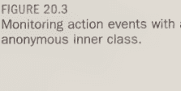

应用程序的第 24–36 行使用匿名内部类为 `ColorFrame` 类创建了一个事件监听器。它是一个没有名称的对象，实现了 `ActionListener` 接口的唯一方法 `actionPerformed(ActionEvent)`。

在该方法内部，通过调用 `getContentPane()` 方法获取框架的内容面板。匿名内部类可以访问其外围类的方法和实例变量。而独立的辅助类则不能。

内容面板的 `setBackground(Color)` 方法将框架的背景更改为该颜色。三个按钮的颜色不会改变。

现在看列表 20.4 中的 `NewColorFrame` 应用程序。在 NetBeans 中创建一个新程序并输入该列表的文本。

### 列表 20.4 NewColorFrame.java 的完整文本

```java
1: package com.java4hours;
2:
3: import java.awt.*;
4: import java.awt.event.*;
5: import javax.swing.*;
6:
7: public class NewColorFrame extends JFrame {
8:     JButton red, green, blue;
9:
10:    public NewColorFrame() {
11:        super("NewColorFrame");
12:        setLookAndFeel();
13:        setSize(322, 122);
14:        setDefaultCloseOperation(JFrame.EXIT_CLOSE);
15:        setLayout(new FlowLayout());
16:        red = new JButton("Red");
17:        add(red);
18:        green = new JButton("Green");
19:        add(green);
20:        blue = new JButton("Blue");
21:        add(blue);
22:
23:        // begin lambda expression
24:        ActionListener act = (event) -> {
25:            if (event.getSource() == red) {
26:                getContentPane().setBackground(Color.RED);
27:            }
28:            if (event.getSource() == green) {
29:                getContentPane().setBackground(Color.GREEN);
30:            }
31:            if (event.getSource() == blue) {
32:                getContentPane().setBackground(Color.BLUE);
33:            }
34:        };
// end lambda expression
35:        red.addActionListener(act);
36:        green.addActionListener(act);
37:        blue.addActionListener(act);
38:        setVisible(true);
39:    }
40:
41:    private void setLookAndFeel() {
42:        try {
43:            UIManager.setLookAndFeel(
44:                "com.sun.java.swing.plaf.nimbus.NimbusLookAndFeel"
45:            );
46:        } catch (Exception exc) {
47:            // ignore error
48:        }
49:    }
50:
51:    public static void main(String[] arguments) {
52:        new NewColorFrame();
53:    }
}
```

`NewColorFrame` 应用程序在第 24–34 行实现了动作监听器。在使用它时，不需要知道 `ActionListener` 接口的方法名，也不需要指定 `ActionEvent` 的类。

Lambda 表达式支持函数式编程，这是一种此前对 Java 程序员来说不可用的设计方法。

本节介绍了 Lambda 表达式的基本语法，以及它们在程序中两种常见的用法。

## 总结

内部类、匿名内部类和 Lambda 表达式是 Java 语言中最难学习的部分。它们主要吸引那些已经使用该语言编写了一段时间程序、并能够利用强大功能用更少代码完成任务的程序员。

但在达到编写自己的 Lambda 表达式之前，你本应该从使用内部类和匿名内部类中受益。


# 非匿名内部类与匿名内部类

非匿名内部类的结构上类似于独立的辅助类，但它被放在另一个类内部，与实例变量、类变量、实例方法和类方法并列。与辅助类不同，它可以访问创建它的所在类的私有变量和方法。

匿名内部类消除了为只使用一次的类分配对象的需要，例如附加到 Swing 用户界面组件上的事件监听器。

# 工作讨会

## 问答

- **Q.** 匿名内部类让人很困惑。我必须在程序中使用它们吗？
- **A.** 不需要。和 Java 语言中其他复杂特性一样，如果你能通过其他方式完成任务，就不必使用它们。

但你仍然应该学习它们，因为你可能会在 Java 代码中遇到它们。

当你查看经验丰富的程序员编写的 Java 程序时，通常会同时发现内部类和匿名类。所以，即使你还没有准备好自己创建它们，了解它们是什么以及它们如何工作也是值得的。

- **Q.** Hatfield 家族和 McCoy 家族还在争斗吗？
- **A.** 在那场臭名昭著的 35 年冲突最后一次伤亡发生 124 年后，西弗吉尼亚州和肯塔基州的这两个家族关系依然良好。

1979 年，Hatfield 和 McCoy 家族聚在一起参加了电视节目《家庭冲突》（Family Feud），持续了一周。舞台上养了一头猪，并奖励给获胜的家庭。

2003 年，这两个家族在肯塔基州派克维尔（Pikeville, KY）达成了正式和平协议。

Hatfield-Mcoy 小径（Hatfield-Mcoy Trails）是一条长 500 英里的越野驾驶路线，于 2000 年建立在西弗吉尼亚州，并在后的十年里不断扩张。

# 测试

为了看看你是否应该根据在本小时所学到的知识站在教室前面，请回答以下关于内部类、匿名内部类和 lambda 表达式的问题。

- **1.** 什么让某些内部类变成了匿名的？
  - A. 它们实现了一个接口。
  - B. 它们没有命名。
  - C. 两者都是。

- **2.** 只包含一个方法的接口的另一个名称是什么？
  - A. 抽象接口
  - B. 类
  - C. 函数式接口（Functional interface）

- **3.** lambda 表达式猜测方法参数的类型称为什么？
  - A. 目标类型推（Target typing）
  - B. 类型转换
  - C. 类推断（Class inference）

# 答案

- **1. C.** 匿名内部类使用 `new` 关键字实现接口，跳过了实现该接口的类的创建和命名。
- **2. C.** 从 Java 8 开始称为函数式接口。在语言的早期版本中，它们被称为单抽象方法接口。
- **3. A.** 目标类型推可以推断任何函数式接口方法参数的类。

## 活动

为了体面地结束这一小时的学习，通过以下活动将课题投入：

- 重写第 16 小时“构建复杂的用户界面”中的 `LottoEvent` 类，使用 lambda 表达式作为事件监听器。
- 重写一个 Swing 应用，点击按钮即可掷六面骰。使用 lambda 表达式作为事件监听器，并使用名为 `Dice` 的内部类作为骰子。

要查看实现这些活动的 Java 程序，请访问书籍网站 www.java24hours.com。

# 第 21 小时：读取和写入文件

计算机上表示数据有多种方式。你已经通过创建对象处理过其中一种。对象包含以形式形式的数据以及对对象的引用。它还包含了使用这些数据完成任务的方法。

要处理其他类型的数据（例如硬盘上的文件和网络服务器上的文档），你可以使用 `java.io` 包中的类。其名称中的 "io" 代表“输入/输出”（input/output），这些类用于访问数据源，例如硬盘 DVD 或计算机内存。

你可以通过一种名为“流”（streams）的通信系统将数据带入程序并发送，流是将信息从一个地方传到另一个地方的对象。

## 本小时的任务

- 从文件中读取字节到程序中。
- 在你的计算机上创建一个新文件。
- 将字节数组保存到文件中。
- 对文件中存储的数据进行修改。

## 流

为了在 Java 程序中永久保存数据或在稍后检索数据，你必须使用至少一个流。

流是一个从一个源获取信息并发送到另一个地方的对象，其名称来源于水流（将鱼、船和工业污染物从一个地方带到另一个地方）。

流连接了各种来源，包括计算机程序、硬盘、互联网服务器、计算机内存和优存盘。在学习如何使用流处理一种数据后，你就能以相同的方式处理其他数据。

在本小时中，你将使用流读取和写入存储在计算机文件中的数据。

# 第 21 章：读取和写入文件

Java 类文件以“字节码”（bytecode）的形式存储为字节。Java 虚拟机（JVM）运行字节码，它实际上并不操作操作系统的语言。它可以运行由其他语言编译的字节码，包括 NetRexx 和 Jython。你也会听到 JVM 被称为字节码虚拟机。

流有两种类型：

- **输入流（Input streams）**：从源读取数据。
- **输出流（Output streams）**：向源写入数据。

所有输入输出流都由字节组成，即值从 0 到 255 的单个整数。你可以用它来格式化数据，例如可执行程序、文字处理文档和 MP3 音乐文件，但这些只是字节所表示的一小部分。字节流（byte stream）用于读取和写入此类数据。

一种更专门处理数据的方式是字符的形式——字母、数字、标点符号等。

## 文件的读取与写入

下面的示例使用名为 `stream` 的文件输入流读取名为 `cookie.web` 的文本文件：

```java
File cookie = new File("cookie.web");
try (InputStream stream = new FileInputStream(cookie)) {
    System.out.println("Length of file: " + cookie.length());
} catch (IOException exception) {
    System.out.println("Could not read file.");
}
```

由于 `stream` 位于 `try` 语句中，因此当 `try-catch` 块完成时，流会自动关闭（如果它尚未关闭的话）。

文件输入按字节读取数据。你可以通过调用不带参数的流 `read()` 方法来读取单个字节。如果由于到达文件末尾导致流中没有更多可用字节，则返回值 -1。

当你读取输入流时，它从流中的第一个字节开始，例如文件中的第一个字节。你可以通过调用 `skip()` 方法来跳过流中的某些字节，该方法接受一个参数：一个表示要跳过的字节数的 `int` 整数。以下语句跳过了名为 `scanData` 的流中的后续 1,024 字节：

```java
scanData.skip(1024);
```

如果你想一次读取多个字节，请执行以下操作：

- 创建一个大小与你想要读取的字节数完全一致的字节数组。
- 将该数组作为参数调用流的 `read()` 方法。该数组将用来自流的字节填充。

你创建了一个应用程序，用于从 MP3 音频文件中读取 ID3 数据。由于 MP3 是一种非常流行的音乐文件格式，ID3 文件的末尾添加了 128 字节，用于存储有关歌曲的信息，例如标题、艺术家和专辑。

`ID3Reader` 应用程序使用文件输入流读取 MP3 文件，跳过除最后 128 字节以外的所有内容。对剩余的字节进行检查，以确定它们是否包含 ID3 数据。如果是，前三个字节将是数字 44、65 和 71。

创建一个名为 `ID3Reader` 的新空 Java 文件，并填入列表 21.1 中的文本。

在 Java 支持的 Unicode 标准字符集所包含的 ASCII 字符集中，这三个数字分别代表大写字母 "T"、"A" 和 "G"。


### 列表 21.1 ID3Reader.java 的完整文本

```java
1: package com.java24hours;
2:
3: import java.io.*;
4:
5: public class ID3Reader {
6:     public static void main(String[] arguments) {
7:         File song = new File(arguments[0]);
8:         try (FileInputStream file = new FileInputStream(song)) {
9:             int size = (int) song.length();
10:            file.skip(size - 128);
11:            byte[] last128 = new byte[128];
12:            file.read(last128);
13:            String id3 = new String(last128);
14:            String tag = id3.substring(0, 3);
15:            if (tag.equals("TAG")) {
16:                System.out.println("Title: " + id3.substring(3, 32));
17:                System.out.println("Artist: " + id3.substring(33, 62));
18:                System.out.println("Album: " + id3.substring(63, 91));
19:                System.out.println("Year: " + id3.substring(93, 97));
20:            } else {
21:                System.out.println(arguments[0] + " does not contain ");
22:                System.out.println(" + ID3 + ".");
23:            }
24:            file.close();
25:        } catch (IOException ioe) {
26:            System.out.println("Error - " + ioe.toString());
27:        }
28:    }
29: }
```

在将此类作为程序运行之前，必须指定一个 MP3 文件作为命令行参数（在 NetBeans 中使用 Run、Set Project Configuration 或 Configure）。你可以使用任何 MP3 文件运行程序，如 Marion Black 那首被公正遗忘的 1973 年灵魂经典之《Come On and Gettit.mp3》。如果你系统中有一首《Come On and Gettit.mp3》歌曲（你确实应该有一个），图 21.1 显示了 `ID3Reader` 应用程序显示的内容。

| 输出-Java24 (run) |
|---|---|
| Title: Come On and Gettit |
| Artist: Marion Black |
| Album: Romantic Soul: The Prix Lab |
| Year: 2007 |
| BUILD SUCCESSFUL (total time: 7 seconds) |

图 21.1 运行 ID3Reader 应用程序。


### 文件的读取与写入

如果你的电脑上没有 `Come On and Gettit.mp3`（在我看来这是一个巨大的错误），你可以去 https://creativecommons.org 寻找 MP3 歌曲以检查 Creative Commons（知识共享）许可。Creative Commons 是一组版权声明，规定了歌曲或书籍等作品如何被分发、编辑或重新出版。www.rockproper.com 网站也提供了根据 Creative Commons 许可允许共享的免费 MP3 专辑。

应用程序在列表 21.1 的第 11–12 行中读取 MP3 的最后 128 字节，并将它们存储在字节数组中。该数组在第 13 行被用于创建一个包含这些字节所代表字符的 `String` 对象。

如果字符串的前三个字符是“TAG”，则正在检查的 MP3 文件在应用程序结构中包含 ID3 数据信息：

在第 16–19 行中，调用字符串的 `substring()` 方法来显示字符串的部分。要显示的字符是标题、艺术家和年份。

## 缓冲流

提高程序性能的方法之一是对输入进行缓冲。缓冲是将数据保存在内存中的过程，以便程序以后需要时使用。当 Java 程序需要数据时，它会在缓冲区中查找，这比直接从源读取快得多。

要创建缓冲流，你需要创建一个输入流（例如 `FileInputStream`），然后使用它创建缓冲流。调用 `BufferedInputStream(InputStream)` 构造函数并将输入流作为唯一参数。

控制台输入是在运行应用程序时从控制台（也称为命令行）读取字符的能力。`System` 类包含 `System.out.print()` 和 `System.out.println()` 语句使用的 `out` 变量，还有一个名为 `in` 的类，它接收输入并作为流可用。你可以像处理其他流一样处理此输入流。以下语句创建一个与 `System.in` 关联的缓冲输入：

```java
BufferedInputStream bin = new BufferedInputStream(System.in);
```

下一个项目 `Console` 类包含一个可以在任何 Java 应用程序中接收控制台输入的方法。将列表 21.2 中的文本放入名为 `Console` 的新文件中。

### 列表 21.2 Console.java 的完整文本

```java
1: package com.java24hours;
2:
3: import java.io.*;
4:
5: public class Console {
6:     public static String readLine() {
7:         StringBuilder response = new StringBuilder();
8:         try {
9:             BufferedInputStream bin = new
10:             BufferedInputStream(System.in);
11:             int in = 0;
12:             char inChar;
13:             do {
14:                 in = bin.read();
15:                 inChar = (char) in;
16:                 if (in != -1) {
17:                     response.append(inChar);
18:                 }
19:             } while ((in != -1) && (inChar != '\n'));
20:             bin.close();
21:
22:             return response.toString();
23:         } catch (IOException e) {
24:             System.out.println("Exception: " + e.getMessage());
25:             return null;
26:         }
27:     }
28: }
```

### 读取和写入文件

```java
27:
28:     public static void main(String[] arguments) {
        System.out.print("You are standing at the end of the road ");
        System.out.print("before a small brick building. Around you ");
        System.out.print("is a forest. A small stream flows out of ");
        System.out.println("the building and down a gully.\n");
        System.out.print(">> ");
        String input = Console.readLine();
        System.out.println("That's not a verb I recognize.");
    }
}
```

`Console` 类包含一个 `main()` 方法，演示了如何使用它。当你运行该应用程序时，输出类似于图 21.2。

图 21.2 运行 Console 程序。

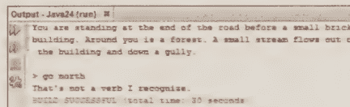

`Console` 类也是世界上最令人不满的文字冒险游戏。你无法进入建筑，无法离开，甚至无法四处游荡。要获得该游戏的更功能版本（名为 Adventure），请访问 web-adventures.org。

`Console` 类包含一个类方法 `readLine()`，它从控制台接收字符。当按下 Enter 键时，`readLine()` 返回一个包含所有接收到的字符的 `String` 对象。

## 向流写入数据

在 `java.io` 包中，用于处理流的类是成对出现的。这里有 `FileInputStream` 和 `FileOutputStream` 类用于处理字节流，`FileReader` 和 `FileWriter` 类用于处理字符流，还有许多用于处理其他类型流数据的集合。

要开始写入数据，你首先需要用输出流创建一个 `File` 对象。该文件不需要存在于你的系统中。

## 向流写入数据


# 文件输出流

你可以通过两种方式创建 `FileOutputStream`。如果你想向现有文件追加字节，请调用带有两个参数的 `FileOutputStream()` 构造函数：一个表示文件的 `File` 对象和一个布尔值 `true`。你写入流的字节将附加在文件的末尾。

如果你想向新文件写入字节，请调用仅以 `File` 对象作为唯一参数的 `FileOutputStream()` 构造函数。

一旦有了输出流，你就可以调用不同的 `write()` 方法将字节写入到：

- 调用 `write()` 并以一个字节作为唯一参数，将该字节写入流。
- 调用 `write()` 并以字节数组作为唯一参数，将数组中的所有字节写入流。
- 为 `write(byte[], int, int)` 方法指定三个参数：一个字节数组、一个表示要写入流的数组起始元素的整数，以及要写入的字节数。

以下语句创建了一个包含 10 个字节的字节数组，并将最后 5 个字节写入输出流中：

```java
File dat = new File("data.dat");
FileOutputStream datStream = new FileOutputStream(dat);
byte[] data = new byte[] { 5, 12, 4, 13, 3, 15, 2, 17, 1, 18 };
datStream.write(data, 5, 5);
```

在向流写入字节时，你可以通过调用 `String` 对象的 `getBytes()` 方法将其转换为字节数组，如例所示：

```java
String name = "Puddin N. Tane";
byte[] nameBytes = name.getBytes();
```

在完成向流写入字节后，你应该通过调用流的 `close()` 方法将其关闭。

# ConfigWriter 应用程序

编写的下一个项目是一个简单的应用程序 `ConfigWriter`，它通过向文件输出流写入字节将几行文本保存到文件中。创建一个该名的 Java 文件，并将列表 21.3 中的文本输入到源代码编辑器。

## 列表 21.3 ConfigWriter 的完整代码

```java
1: package example;
2: import java.io.*;
3:
4: public class ConfigWriter {
5:     public static void main(String[] args) {
6:         try {
7:             File file = new File("data.dat");
8:             FileOutputStream fileStream = new FileOutputStream(file);
9:             String[] lines = {
10:                "First line",
11:                "Second line",
12:                "Third line"
13:            };
14:             for (String line : lines) {
15:                 fileStream.write(line.getBytes());
16:                 fileStream.write("\n".getBytes());
17:             }
18:             fileStream.close();
19:         } catch (IOException e) {
20:             System.out.println("Could not write to file: " + e.getMessage());
21:         }
22:     }
23: }
```

# 读取和写入属性

`java.util` 包包含一个 `Properties` 类，允许从其他源加载配置设置。例如：

- 创建表示文件的 `File` 对象。
- 从该文件创建 `FileInputStream` 对象。
- 调用 `load()` 从该输入流读取属性。

属性文件由属性名、等号和值组成。例如：

```
username=lepton
lastCommand=open database
windowSize=32
```

每个属性都有单独的一行，这设置了 `username`、`lastCommand` 和 `windowSize`，值分别为 `lepton`、`open database` 和 `32`。以下代码加载了 `config.dat` 文件：

```java
File configFile = new File("config.dat");
InputStream inputStream = new FileInputStream(configFile);
Properties config = new Properties();
config.load(inputStream);
```

配置设置（称为属性）以字符串的形式存储在 `Properties` 对象中。每个属性通过键来标识。`getProperty()` 方法使用键检索属性，如语句所示：

```java
String username = config.getProperty("username");
```

由于属性是以字符串存储的，你必须对其进行某种转换才能使用数值值，如代码所示：

```java
String windowProp = config.getProperty("windowSize");
int windowSize = 0;
try {
    windowSize = Integer.parseInt(windowProp);
} catch (NumberFormatException e) {
    // 什么都不做
}
```

可以通过调用带有两个参数（键和值）的 `setProperty()` 方法来存储属性：

```java
config.setProperty("username", "max");
```

可以通过调用 `Properties` 对象的 `list(OutputStream)` 方法显示所有属性。`PrintStream` 是 `System` 类 `out` 的类型，你在书中一直使用它通过 `System.out.println()` 显示输出。以下代码调用 `list()` 显示所有属性：

```java
config.list(System.out);
```

在对属性进行更改后，你可以将它们存回文件：

- 创建表示文件的 `File` 对象。
- 从该文件创建 `FileOutputStream` 对象。
- 调用 `store(OutputStream, String)` 将属性保存到指定的输出流中，并使用字符串作为属性文件的描述。

# Configurator 应用程序

在下一个项目中，你基于 `ConfigWriter` 应用程序进行构建，该程序将多个程序设置写入文件。`Configurator` 应用程序将这些设置读取到 Java 属性文件中，添加一个名为 `runtime` 的新属性并赋值为当前日期和时间，然后保存修改后的文件。

创建一个新的 Java 文件来存放 `Configurator` 类，并输入列表 21.4 中的文本。

## 列表 21.4 Configurator.java 的完整文本

```java
1: package com.java24hours;
2:
3: import java.io.*;
4: import java.util.*;
5:
6: public class Configurator {
7:
8:     public Configurator() {
9:         try {
10:             // 加载属性文件
11:             File configFile = new File("program.properties");
12:             FileInputStream inStream = new FileInputStream(configFile);
13:             Properties config = new Properties();
14:             config.load(inStream);
15:             // 创建新属性
16:             Date current = new Date();
17:             config.setProperty("runtime", current.toString());
18:             // 保存属性文件
19:             FileOutputStream outStream = new
20:             FileOutputStream(configFile);
21:             config.store(outStream, "Properties settings");
22:             inStream.close();
23:             config.list(System.out);
24:         } catch (IOException ioe) {
25:             System.out.println("IO error " + ioe.getMessage());
26:         }
27:     }
28:
29:     public static void main(String[] arguments) {
30:         Configurator con = new Configurator();
31:     }
32: }
```

在此应用程序中，第 11–12 行创建了 `program.properties` 的 `File` 对象并将其与文件流关联。该文件的内容在第 13–14 行从流加载到 `Properties` 对象中。

第 16–17 行创建了用于当前日期和时间的新属性。

随后在第 19 行将文件与输出流关联，并在第 20 行将整个属性文件写入该流中。

`Configurator` 应用程序的输出如图 21.4 所示。

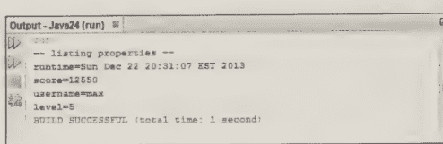

`program.properties` 文件现在包含以下文本：

## 输出

```
#Properties settings
#Sun Dec 22 20:31:07 EDT 2013
runtime=Sun Dec 22 20\:31\:
score=12550
level=
username=max
```

反斜杠字符 `\` 的格式化与程序的输出不同，它确保了属性文件被正确存储。

# 总结

在本小时中，你使用了写入字节的输入流和输出流，这是通过流表示数据最简单的方法。

`java.io` 包中还有许多类可以以其他方式处理流。还有一个名为 `java.net` 的包，它允许你通过 Internet 连接读取和写入流。

字节流可以适应许多用途，因为你可以轻松地将字节转换为其他数据类型，例如整数、字符和字符串。

本小时的第一个项目 `ID3Reader` 应用程序从流中读取字节并将其转换为字符串，以便以这种格式从 Marion Blackoff 出的《Eccentric Soul》专辑中的歌曲《Come On and Gettit》中读取 ID3 数据。

我是否提到过你应该买下这首歌？

# 工作坊

## 问答

**Q. 为什么本小时中的某些字节流方法使用整数作为参数？它们应该是整数的吗？**

**Q. 为什么本小时中的某些字节流方法使用整数作为参数？它们的范围是多少？**

- A. 字节流的值范围是 0 到 255。
- B. 字节流的值范围是 0 到 127。
- C. 字节流的值范围是 -128 到 255。
- D. 字节流的值范围是 -128 到 127。

# 测试

根据测试内容，回答以下问题：

2. `File` 类中的哪个方法可以确定文件的大小？

- A. `read()`
- B. `available()`
- C. `length()`

3. `File` 类中的哪个方法可以确定文件的大小？

- A. `read()`
- B. `available()`
- C. `length()`

# 答案

1. A. 字节流的值范围是 0 到 255。
2. C. `length()`
3. C. `length()`

# 练习


为了体验通过流处理 ID3 标签，请完成以下练习：

1. 
- A. 字节流
- B. 字节流
- C. 字节流
- D. 字节流

2. 
- A. 字节流
- B. 字节流
- C. 字节流
- D. 字节流

3. 
- A. 字节流
- B. 字节流
- C. 字节流
- D. 字节流

4. 
- A. 字节流
- B. 字节流
- C. 字节流
- D. 字节流

5. 
- A. 字节流
- B. 字节流
- C. 字节流
- D. 字节流

# 定义服务端点接口

常用的注解之一是 `@Override`，它表示该方法重写了父类的方法。这是一个示例：

```java
@Override
public void paintComponent(Graphics comp) {
    // 在此处定义方法
}
```

如果你犯了错误，导致它没有重写方法——如果你使用了错误的类型、错误的方法名或参数数量，就会发生这种情况——编译器可以捕获到该错误。如果没有该注解，编译器将无法检测此问题。

`@WebService` 注解表示该方法可以作为 Web 服务调用。`SquareRootServer` 接口也使用了 `@WebService` 注解，表示该服务定义了一个端点接口。

注解可以带有参数以提供进一步的自定义。`SquareRootServer` 包含了另一个最终的注解：

```java
@SOAPBinding(style = Style.RPC)
```

此注解定义了 Web 服务与调用服务的客户端程序之间的约定。你将在本小时稍后的部分学习更多相关内容。

现在，是时候开始编写 Web 服务了。在 NetBeans 中创建一个类名为 `SquareRootServer`、包名为 `com.java24hours.ws` 的新 Java 文件。将列表 22.1 的内容输入文件中。

## 列表 22.1 SquareRootServer.java 的完整文本

```java
1: package com.java24hours.ws;
2:
3: import javax.jws.*;
4: import javax.jws.soap.*;
5: import javax.jws.soap.SOAPBinding.*;
6:
7: @WebService
8:
9: @SOAPBinding(style = Style.RPC)
10:
11: public interface SquareRootServer {
12:     // 获取数字的平方根
13:     @WebMethod double getSquareRoot(double input);
14:
15:     // 获取当前日期和时间作为字符串
16:     @WebMethod String getTime();
17:
18: }
```

该类被放置在 `com.java24hours.ws` 包中，这一设计决策使得 Web 服务更容易被部署，以供其他软件通过互联网访问。

现在你已经完成了接口的定义，可以准备好编写代码来实现它的两个方法了：`getSquareRoot()` 和 `getTime()`。

## 创建服务实现 Bean

实现服务端点接口的 Java 类被称为服务实现 Bean（Service Implementation Bean）。学习这些新术语是 JAX-WS 中不可避免的一部分。

`SquareRootServiceImpl` 实现了 `SquareRootServer` 接口，如类声明所示：

`public class SquareRootServiceImpl implements SquareRootServer {`

这意味着你正在创建的类必须包含接口中的所有方法，每个方法都必须有正确的参数。

`getSquareRoot(double)` 和 `getTime()` 方法使用了你之前学过的技术实现的。

该类唯一的新方面是以下注解，它出现在类语句之前：

`@WebService(endpointInterface = "com.java24hours.ws.SquareRootServer")`

此注解表示该类是名为 `com.java24hours.ws.SquareRootServer` 的服务端点接口的服务实现 Bean。你必须使用全类名，包括它的包名。

注意，注解后面不像语句那样需要加分号。

## 发布 Web 服务

开始编写该类：在 `com.java24hours.ws` 包中创建一个名为 `SquareRootServerImpl` 的新 Java 文件，并用列表 22.2 的内容填充它。

## 列表 22.2 SquareRootServerImpl.java 的完整文本

```java
1: package com.java24hours.ws;
2:
3: import java.util.*;
4: import javax.xml.*;
5:
6: @WebService(endpointInterface = "com.java24hours.ws.SquareRootServer")
7:
8: public class SquareRootServerImpl implements SquareRootServer {
9:
10:    public double getSquareRoot(double input) {
11:        return Math.sqrt(input);
12:    }
13:
14:    public String getTime() {
15:        Date now = new Date();
16:        return now.toString();
17:    }
18: }
```

“服务实现 Bean”这一名称指的是 JavaBeans，它是设计用于在 Java 企业版中作为重用组件的特殊 Java 类。然而，在涉及 JAX-WS 时，对 bean 的这种引用有点不准确。只要符合 Web 服务方法的规则并使用正确的注解进行创建，任何 Java 对象都可以是服务实现 Bean。

通过你创建的两个类，你已经准备好启动 Web 服务，以便其他软件调用它。

## 发布 Web 服务

JAX-WS Web 服务可以由 BEA WebLogic、GlassFish、JBoss 和 Jetty 等 Java 服务器部署。如果你在支持这些服务器的开发环境中创建了 `SquareRootServer` Web 服务，那么你已经准备好启动它了。

你也可以编写自己的 Java 程序来加载 Web 服务并使其在互联网可用。

`SquareRootPublisher` 程序处理此任务，只需要两个步骤：

- 加载实现 Web 服务的类
- 将该对象发布到互联网可访问的地址

`javax.xml.ws` 包中的 `Endpoint` 类有一个类方法 `publish(String, Object)`，用于部署 Web 服务。

该方法的第一个参数是服务所在的 Web 地址，即 `http://127.0.0.1:5335/service`。第二个参数是等待连接的主机。地址的最后部分是端口号，被选择了 5335。为了部署 Web 服务，请在 `com.java24hours.ws` 包中创建一个 Java 文件 `SquareRootPublisher`。见列表 22.3。

## 列表 22.3 SquareRootPublisher.java 的完整文本

```java
1: package com.java24hours.ws;
2:
3: import javax.xml.ws.*;
4:
5: public class SquareRootPublisher {
6:     public static void main(String[] arguments) {
7:         SquareRootServerImpl sr = new SquareRootServerImpl();
8:
9:         Endpoint.publish("http://127.0.0.1:5335/service", sr);
10:     }
11: }
```

## 使用服务定义文件

在尝试此 Web 服务之前，可以使用任何浏览器测试 `SquareRootPublisher` 程序的可用性。

打开浏览器并加载地址 `http://127.0.0.1:5335/service?wsdl`。浏览器将显示列表 22.4 所示的文件。该文件由你创建的程序提供。

该文件是用服务描述语言（WSDL）编写的服务约定，这是一种 XML 方言，用于详细说明 Web 服务的功能，以便服务器和客户端可以使用它。

你不需要理解 WSDL 就可以创建 JAX-WS 服务并访问这些服务。但粗略查看其内容以对基于 SOAP 和 REST 的 Web 服务有一个大致的了解。

## 列表 22.4 一个服务描述语言合约

```xml
<?xml version="1.0" encoding="UTF-8"?>
<definitions xmlns:soap="http://schemas.xmlsoap.org/soap/"
  xmlns:tns="http://www.w3.org/2001/XMLSchema"
  xmlns="http://schemas.xmlsoap.org/wsdl/"
  targetNamespace="http://www.java24hours.com/"
  name="SquareRootServerService">
  <types>
  </types>
  <message name="getSquareRoot">
    <part name="arg0" type="xsd:double"></part>
  </message>
  <message name="getSquareRootResponse">
    <part name="return" type="xsd:double"></part>
  </message>
  <message name="getTime"></message>
  <message name="getTimeResponse">
    <part name="return" type="xsd:string"></part>
  </message>
  <portType name="SquareRootServer" parameterOrder="arg0">
    <input message="getSquareRoot"></input>
    <output message="getSquareRootResponse"></output>
  </portType>
  <operation name="getTime" parameterOrder="arg0">
    <input message="tns:getTime"></input>
    <output message="tns:getTimeResponse"></output>
  </operation>
  </portType>
  <binding name="SquareRootServerImplPortBinding">
    <type name="SquareRootServer">
    <binding transport="http://schemas.xmlsoap.org/soap/http">
    <style type="rpc"></soap:binding>
    <operation name="getSquareRoot">
    <operation soapAction=""></soap:operation>
    <input>
    <body use="literal">
    <namespace namespace="http://ws.java24hours.com/"></soap:body>
    </input>
    <output>
    <body use="literal">
    <namespace namespace="http://ws.java24hours.com/"></soap:body>
    </output>
    </operation>
    <operation name="getTime">
    <operation soapAction=""></soap:operation>
    <input>
    <body use="literal">
    <namespace namespace="http://ws.java24hours.com/"></soap:body>
    </input>
    <output>
    <body use="literal">
    <namespace namespace="http://ws.java24hours.com/"></soap:body>
    </output>
    </operation>
  </binding>
  <service name="SquareRootServiceImpl">
    <port name="SquareRootServerImplPort">
    <binding type="tns:SquareRootServerImplPortBinding">
    <soap:address location="http://127.0.0.1:5335/"></soap:address>
    </port>
  </service>
</definitions>
```

WSDL 文件被称为服务合约，因为它规定了如何访问 Web 服务、可以与服务交换的消息以及正在传输的信息的数据类型。

WSDL 合约的第 13-22 行定义了 Web 服务的方法、这些方法的参数以及响应返回的数据。请查看这些行，看看你是否能确定 `getSquareRoot()` 方法在何处接收一个 `double` 参数并返回一个 `double` 值。

## 创建 Web 服务客户端

合约中引用的数据类型不是 Java 数据类型。它们是为支持 SOAP 的任何编程语言使用而泛化的数据类型。（Web 服务中没有任何内容是专门为 Java 定制的。）

由于 WSDL 合约详细详尽地定义了 Web 服务，因此你可以使用它来自动化编程 Web 服务的过程。Java 开发工具包（JDK）包含了一个命令行工具 `wsimport`，它可以读取 WSDL 文件并编写用于访问 Web 服务的 Java 类。

## 创建 Web 服务客户端

在本节中，你将创建 `SquareRootClient`，这是一个可以调用你刚刚创建的 Web 服务方法的 Java 应用程序。当然，该服务必须正在运行，客户端才能连接。

由于像 JAX-WS 库这样的 Web 服务技术支持 SOAP、REST、HTTP 和 XML 等标准，因此你不需要专门用 Java 程序来连接平方根服务。Perl、Python、Ruby 和其他语言都拥有支持 Web 服务的库。

如所述，URI 不一定是一个可以工作的地址。尽管 `http://ws.java24hours.com` 看起来在这里被用作唯一标识符。我拥有 `java24hours.com` 域名，并控制其子域名使用方式。当我指定 `http://ws.java24hours.com` 时，我可以确保没有其他 Web 服务提供者会采用该标识。JAX-WS 库在 `javax.xml.ws` 包中提供了 `Service` 类，这是一个创建可以调用 Web 服务的工厂。

`Service.create(URL, QName)` 创建该工厂。参数是来自 `java.net` 的 `URL` 对象和来自 `javax.xml.namespace` 的 `QName`。URL 是 Web 服务 WSDL 合约的地址：

```java
URL url = new URL("http://127.0.0.1:5335/service/wsdl");
```

`QName` 是一个与 Web 服务提供者相关的 XML 标识符。限定名称由命名空间 URI（namespace URI）和本地标识符组成。

命名空间 URI 与 URL 类似，但并不作为 Web 地址。由于平方根服务的包名是 `com.java24hours.ws`，根据惯例它与主机名 `ws.java24hours.com` 关联，此 Web 服务的命名空间 URI 是 `http://ws.java24hours.com`。Web 服务的本地标识符是加上 "Service" 单词的 Service Implementation 名称。如下：

```java
QName qname = new QName(
    "http://ws.java24hours.com/",
    "SquareRootServiceImpl"
);
```


## 使用 JAX-WS 创建 Web 服务

使用 URL 和限定名称，你可以创建 Web 服务客户端：

```java
Service service = Service.create(url, qname);
```

工厂有一个 `getPort(Class)` 方法，可以创建类的对象。要作为方法参数的 Java 类，使用类的变量。很困惑？在 Java 语句中看到它时就更容易理解了：

```java
SquareRootServer srs = service.getPort(SquareRootServer.class);
```

对 `SquareRootServer.class` 的 `getPort()` 调用会导致工厂创建 `SquareRootServer` 对象。该对象存储在变量 `srs` 中。像调用任何其他 Java 对象一样调用 `SquareRootServer` 的方法：


```
System.out.println(srs.getTime());
System.out.println(srs.getSquareRoot());
```

JAX-WS 库将这些方法调用封装为 SOAP 消息，通过互联网发送到 Web 服务并传输调用。当服务响应调用时，它将响应封装为 SOAP 消息，通过互联网传回并转换回 Java 类型。

通过创建一个名为 `SquareRootClient` 的 Java 文件并输入列表 22.5 中的内容将这一切整合在一起：

## 列表 22.5 SquareRootClient.java 的完整文本

```
1: package com.java24hours.ws;
2: import java.net.*;
3: import javax.xml.namespace.*;
4: import javax.xml.ws.*;
5: 
6: public class SquareRootClient {
7:     public static void main(String[] args) throws Exception {
8:         URL url = new URL("http://127.0.0.1:5335/service/wsdl");
9:         QName qname = new QName(
10:            "http://ws.java24hours.com/", "SquareRootServiceImpl"
11:        );
12:        
13:        Service service = Service.create(url, qname);
14:        SquareRootServer srs = service.getPort(SquareRootServer.class);
15:        
16:        System.out.println(srs.getTime());
17:        System.out.println(srs.getSquareRoot());
18:    }
19: }
```

当你运行客户端应用程序时，如果 `SquareRootPublisher` 正在运行，你会看到图 22.1 所示的输出。


## 总结

JAX-WS 包和类集是 XML RPC（JAX-RPC）Java API 的继任者，JAX-RPC 是一种在互联网上从一个 Java 对象到另一个对象的远程过程调用的技术。另一个 API JAX-RS 支持使用 REST 的 Java Web 服务。

调用其他软件的能力（无论其位于何处或使用什么编程语言编写）是 Web 2.0 流行的软件开发趋势的构建模块之一。

Web 2.0 背后的卖点是让软件能够像人类自 20 世纪 90 年代 Web 流行以来享受的那样，充分利用互联网无处不在的连接性。

本节涵盖了使用 JAX-WS 创建和使用 Web 服务的所有步骤。你可以为服务创建一个接口（服务节点 Bean）、实现服务（服务实现 Bean）、在互联网上发布服务，并创建一个客户端来访问它。

包括 NetBeans 和 JDK 在内的许多编程工具都可以自动创建代码，以简化创建和访问 Web 服务的工作。

## 工作坊

## 问答

Q. XML-RPC 如何与 SOAP Web 服务 结合？

A. XML-RPC 是一种在 HTTP（Web 协议）上调用方法并接收 XML 格式数据的协议。SOAP 同样包含这些功能，事实上，这两个 Web 服务协议共享共同起源。XML-RPC 源于变为 SOAP 的协议草案版本。由于 XML-RPC 先发布且实现更简单，它了自己的追随者并至今仍然流行。Apache XML-RPC Java 库位于 http://xml.apache.org/xmlrpc/，支持采用 XML-RPC 的 Web 服务和服务。SOAP 是一种更复杂的 Web 服务协议，支持更广泛的客户端交互。

Q. 我不明白为什么 `com.java24hours.ws` 包与互联网主机 `ws.java24hours.com` 关联。这是如何实现的？

A. Java 包名是由开发包的程序员选择的。Oracle Java 类库中的 Java 包以 `java` 或 `javax` 开头，例如 `java.util` 和 `java.swing`。其他程序员在创建包时会遵循一种约定，以避免选择相同的包名并与他人混淆。

## 工作坊

357

# 堂测

通过回答以下问题，看看你掌握了多少关于 Web服务的知识。

- 1. 什么是服务实现 豆（Service Implementation Bean）？

- A. 一个标识通过 Web 服务可访问的方法的接口

- B. 一个实现 Web 服务的类

- C. Web 服务与调用该服务的客户端之间的服务合约

- 2. 当方法声明中出现如 @WebMethod 或 @Override 的文本时，它称为什么？

- A. 注解（Annotation）

- B. 断言（Assertion）

- C. 激化（Aggravation）

- 3. WSDL 代表什么？

- A. Web 服务部署语言（Web Services Deployment Language）

- B. Web 服务描述语言（Web Services Description Language）

- C. 钻石天空中的露丝（Lucy in the Sky with Diamonds）

# 答案

- 1. B. 答案 A，指的是服务端点接口（Service Endpoint Interface）。

- 2. A. 尽管我猜答案 C 也可能是正确的，取决于你在那个小时的部分遇到了多少麻烦。

- 3. B. 它通常被误称为 Web 服务定义语言（Web Services Definition Language）。

## 活动

为了进一步加深本小时主题的知识，请完成以下活动：

- 为平方根 Web 服务添加一个方法，将一个数字乘以 10，并修改 `SquareRootClient` 应用以调用该方法。

- 创建一个新的 Web 服务，它从属性文件中读取位置的最高温度、最低温度和天气状况（如第 21 小时“读取和写入文件”中所涵盖的），并将这些数据发送给调用该 Web 服务的客户端。

要查看实现这些活动的 Java 程序，请访问书籍的网站 www.java24hours.com。

## 第 23 小时

创建 Java2D 图形

在本小时中，你将学习如何将 Swing 容器——即用于包含图形用户界面（GUI）组件的普通灰色面板和框架——变成一个艺术画布，你可以在上面绘制字体、颜色、形状和图形。

## 本小时的待办事项：

- 设置文本的字体和颜色。
- 设置容器的背景颜色。
- 绘制线条、矩形和其他形状。
- 绘制 GIF 和 JPEG 图形。
- 绘制填充和非填充的形状。

## 使用 Font 类

Java 中的颜色和字体由 `java.awt` 包中的 `Color` 和 `Font` 类表示。通过这些类，你可以用不同的字体和大小显示文本，并更改文本和图形的颜色。字体通过 `Font(String, int, int)` 构造函数创建，该构造函数接受三个参数：

- 字体类型，可以是通用名称（“Dialog”、“InputDialog”、“Monospaced”、“Sans Serif”或“Serif”）或实际名称（“Arial Black”、“Helvetica”或“Courier New”）
- 样式，为三个类变量之一：`Font.BOLD`、`Font.ITALIC` 或 `Font.PLAIN`
- 以磅（points）为单位字体大小

以下语句创建一个 12 磅斜体 Serif 字体对象：

```
Font current = new Font("Serif", Font.ITALIC, 12);
```

如果你使用的是特定字体而不是通用字体，则它必须安装在运行你程序的用户的计算机上。你可以通过相加来组合字体样式，如下例所示：

```
Font headline = new Font("Courier New", Font.BOLD + Font.ITALIC, 72);
```


# 第 23 小时：创建 Java2D 图形

当你有一个字体时，调用 `Graphics2D` 组件的 `setFont(Font)` 将其指定为当前字体。所有后续绘制操作都使用该字体，直到设置了另一个。后续示例中的语句创建一个“Comic Sans”字体对象，并在绘制文本之前将其指定为当前字体：

```java
public void paintComponent(Graphics comp) {
    Graphics2D comp2D = (Graphics2D) comp;
    Font font = new Font("Comic Sans", Font.BOLD, 15);
    comp2D.setFont(font);
    comp2D.drawString("Potrebiezel!", 5, 50);
}
```

Java 支持抗锯齿（antialiasing），使字体和图形看起来更平滑，且不那么块状。要启用此功能，必须设置 `setRenderingHint`。`Graphics2D` 对象具有一个 `setRenderingHint(int, int)` 方法，接受两个参数：

- 渲染提示的键（key）
- 与该键关联的值

这些值是 `java.awt` 中 `RenderingHints` 类的类变量。要激活抗锯齿，调用带有两个参数的 `setRenderingHint()`：

```
comp2D.setRenderingHint(RenderingHints.KEY_ANTIALIASING, RenderingHints.VALUE_ANTIALIAS_ON);
```

示例中的 `comp2D` 对象代表容器绘制环境的 `Graphics2D` 对象。

## 使用 Color 类

Java 中的颜色由 `Color` 类表示，该类包含以下常量作为类变量：`black`、`blue`、`cyan`、`darkGray`、`gray`、`green`、`lightGray`、`magenta`、`orange`、`pink`、`red` 和 `yellow`。

在容器中，你可以通过如下调用 `setBackground(Color)` 方法设置组件的背景颜色：

```
setBackground(Color.orange);
```

当前颜色类似于当前字体，必须在使用 `setColor(Color)` 方法绘制之前设置。以下代码包含一条语句，将当前颜色设置为橙色并用该颜色绘制文本：

```java
public void paintComponent(Graphics comp) {
    Graphics2D comp2D = (Graphics2D) comp;
    comp2D.setColor(Color.orange);
    comp2D.drawString("Potrebiezel!", 5, 50);
}
```

## 创建自定义颜色

你可以通过指定 RGB 值在 Java 中创建自定义颜色。RGB 值范围在 0 到 255 之间。`Color(int, int, int)` 构造函数接受参数。以下代码显示了自定义颜色：

```java
import java.awt.*;
import javax.swing.*;

public class Gos extends JPanel {
    public void paintComponent(Graphics comp) {
        Graphics2D comp2D = (Graphics2D) comp;
        comp2D.setColor(new Color(230, 220, 0));
        comp2D.fillRect(0, 0, 200, 100);
    }
}
```


```java
public void paintComponent(Graphics comp) {
    Graphics2D comp2D = (Graphics2D) comp;
    Font font = new Font("Comic Sans", Font.BOLD, 15);
    comp2D.setFont(font);
    comp2D.drawString("Potrebiezel!", 5, 50);
}
```

Java 支持抗锯齿，使字体和图形看起来更平滑，且不那么块状。要启用此功能，必须设置 `setRenderingHint`。`Graphics2D` 对象具有一个 `setRenderingHint(int, int)` 方法，接受两个参数：

- 渲染提示的键（key）
- 与该键关联的值

这些值是 `java.awt` 中 `RenderingHints` 类的类变量。要激活抗锯齿，调用带有两个参数的 `setRenderingHint()`：

```java
comp2D.setRenderingHint(RenderingHints.KEY_ANTIALIASING, RenderingHints.VALUE_ANTIALIAS_ON);
```

示例中的 `comp2D` 对象代表容器绘制环境的 `Graphics2D` 对象。

## 使用 Color 类

Java 中的颜色由 `Color` 类表示，该类包含以下常量作为类变量：`black`、`blue`、`cyan`、`darkGray`、`gray`、`green`、`lightGray`、`magenta`、`orange`、`pink`、`red` 和 `yellow`。

在容器中，你可以通过如下调用 `setBackground(Color)` 方法设置组件的背景颜色：

```java
setBackground(Color.orange);
```

当前颜色类似于当前字体，必须在使用 `setColor(Color)` 方法绘制位置之前设置。以下代码包含一条语句，将当前颜色设置为橙色并用该颜色绘制文本：

```java
public void paintComponent(Graphics comp) {
    Graphics2D comp2D = (Graphics2D) comp;
    comp2D.setColor(Color.orange);
    comp2D.drawString("Potrebiezel!", 5, 50);
}
```

## 创建自定义颜色

通过指定 RGB 值，在 Java 中创建自定义颜色。与 `setBackground()` 方法不同，你必须在 `Graphics2D` 对象上调用 `setColor()`。RGB 值 `Color(int, int, int)` 构造函数接受参数。

RGB 值范围在 0 到 255 之间。以下代码显示了自定义颜色：

```java
import java.awt.*;
import javax.swing.*;

public class Gos extends JPanel {
    public void paintComponent(Graphics comp) {
        Graphics2D comp2D = (Graphics2D) comp;
        comp2D.setColor(new Color(230, 220, 0));
        comp2D.fillRect(0, 0, 200, 100);
    }
}
```

# 绘制线条

一个 2D 绘制对象被创建并表示绘制的形状。

定义形状的对象属于 `java.awt.geom` 包。

`Line2D.Float` 类创建一个连接起始 (x,y) 点和结束点 (x,y) 点的线。以下语句创建一个从点 (40,200) 到点 (70,130) 的线：

```java
Line2D.Float line = new Line2D.Float(40F, 200F, 70F, 130F);
```

参数后跟着字母 F 表示它们是浮点数值。如果省略，Java 将其视为整数。

所有形状都通过调用 `Graphics2D` 类的方法来绘制：`draw()` 用于轮廓，`fill()` 用于填充形状。

以下语句绘制示例中创建的线条对象：

```java
comp2D.draw(line);
```

# 绘制矩形

矩形可以是填充的或未填充的，并且具有圆角或直角。它们使用 `Rectangle2D.Float(int, int, int, int)` 构造函数创建，参数如下：

- 矩形左上角的 x 坐标
- 左上角的 y 坐标
- 矩形的宽度
- 高度

以下语句创建了一个具有直角的未填充矩形：

```java
Rectangle2D.Float box = new Rectangle2D.Float(245F, 65F, 20F, 10F);
```

该语句创建了一个矩形，其左上角位于坐标 (245,65) 的 (x,y)，宽度为 20 像素，高度为 10。要将此矩形绘制为轮廓，可以使用以下语句：

```java
comp2D.draw(box);
```

如果你想让矩形变为填充，请使用 `fill()` 方法：

```java
comp.fill(box);
```

你可以通过 `RoundRectangle2D.Float` 类来创建圆角矩形而非直角矩形。

该类的构造函数起始于与 `Rectangle2D.Float` 类相同的四个参数，并增加了以下两个参数：

- 距离矩形角部 x 方向的像素数
- 距离矩形角部 y 方向的像素数

这些距离用于确定矩形角圆角化开始的位置。

以下语句创建了一个圆角矩形：

```java
RoundRectangle2D.Float ro = new RoundRectangle2D.Float(
    10F, 10F,
    100F, 80F,
    15F, 15F);
```

# 创建 Java2D 图形

此矩形的左上角位于 (10,10)。第三和第四参数指定了矩形的宽度和高度。在这种情况下，它的宽度应为 100 像素，高度为 80 像素。

`drawRoundRect()` 的最后两个参数指定所有四个角都应该从 (10,10) 角处 15 像素处开始圆角化。

# 绘制椭圆和圆

你可以使用同一个类 `Ellipse2D.Float` 来创建椭圆和圆，该类接受四个参数：

- 椭圆的 x 坐标
- 椭圆的 y 坐标
- 它的宽度
- 它的高度

(x,y) 坐标并不像你预期的那样指示椭圆或圆的中心点。(x,y) 坐标、宽度和高度描述了一个包含椭圆在内的不可见矩形。(x,y) 坐标是该矩形的左上角。如果它的宽度和高度相同，则该椭圆是一个圆。

以下语句在坐标 (245,45) 处的矩形内创建了一个高度和宽度均为 5 像素的圆：

```java
Ellipse2D.Float cir = new Ellipse2D.Float(
    245F, 45F, 5F, 5F);
```

# 绘制弧

在 Java 中你可以绘制的另一种圆形形状是弧，即部分椭圆或圆。弧使用 `Arc2D.Float` 类创建，该类有一个具有许多相同参数的构造方法。你通过指定椭圆、应该显示的椭圆部分（以角度为单位）以及弧在椭圆上的起点来绘制弧。

要创建一个弧，请向构造函数指定以下整数参数：

- 椭圆所在的不可见矩形的 x 坐标
- 矩形的 y 坐标
- 矩形的宽度
- 矩形的高度
- 弧在椭圆上的起始点（从 0 到 359 度）
- 弧的大小（同样以角度为单位）
- 弧的类型

弧的起点和大小按逆时针方向从 0 到 359 度范围，从 3 点钟位置的 0 度开始，如图 23.1 所示。

图 23.1

如何用角度定义弧。


弧的类型使用类变量指定：`PIE` 用于饼图切片，如果端点之间用直线连接则则使用 `CLOSED`，如果端点不应连接则使用 `OPEN`。

以下语句在 (100,50) 处绘制了一个开放弧，长度为 120 度，从 30 度标记开始，宽度为 65，高度为 75：

```java
Arc2D.Float smile = new Arc2D.Float(100F, 50F, 65F, 75F,
    30F, 120F, Arc2D.Float.OPEN);
```

# 绘制饼图

为了绘制这个关闭时间的图表，你创建了 `PiePanel`，这是一个显示饼图的 GUI 组件。该组件是 `JPanel` 的子类，是一个实用的 Swing 容器。

# 创建 Java2D 图形

开始创建一个类方法是定义变量。`PiePanel` 类必须执行以下步骤：

- 使用构造函数 `(int)` 创建 `PiePanel` 对象。
- 调用 `addSlice(Color, float)` 方法添加饼的切片。

例如，表 23.1 显示了以下状态：

| 给学生的金额 | 还款 |
| :--- | :--- |
| 给出的金额 | 1010 亿 |
| 剩余金额 | 680 亿 |
| 产生的金额 | 910 亿 |
| 用于的金额 | 250 亿 |

`PiePanel` 类在 `paintComponent()` 方法中处理所有图形操作，正如你所预期的那样。此任务中最困难的部分是绘制代表每个饼片的弧。

这通过以下语句处理：

```java
float start = 0;
for (int i = 0; i < slice.length; i++) {
    float extent = slice[i].size * 360 / totalSize;
    comp2D.setColor(slice[i].color);
    Arc2D.Float drawSlice = new Arc2D.Float(
        xset, yset, width, height, start, extent,
        Arc2D.Float.PIE);
    start += extent;
    comp2D.fill(drawSlice);
}
```

所有的弧都在一个 `for` 循环中绘制：在计算完每个弧的范围（extent）后，创建该弧并将该范围添加到起始位置。这导致每个扇形都紧邻上上一个开始。调用 `Graphics2D` 的 `fill()` 方法即可绘制出该弧。

为了将这些内容整合在一起，创建一个名为 `PiePanel` 的新 Java 文件，并将列表 23.1 中的完整文本输入到其中。

## 列表 23.1 PiePanel.java 的完整文本

```java
1: package com.java24hours;
2:
3: import java.awt.*;
4: import javax.swing.*;
5: import java.awt.geom.*;
6:
7: public class PiePanel extends JPanel {
8:   private PieSlice[] slice;
9:   private int current = 0;
10:  private float totalSize = 0;
11:
12:  private Color background;
13:
14:  public PiePanel(int sliceCount) {
15:    slice = new PieSlice[sliceCount];
16:    background = getBackground();
17:  }
18:
19:  public void addSlice(Color color, int sSize) {
20:    if (current < slice.length) {
21:      slice[current] = new PieSlice(color, sSize);
22:      totalSize += sSize;
23:      current++;
24:    }
25:  }
26:
27:  public void paintComponent(Graphics comp) {
28:    super.paintComponent(comp);
29:    Graphics2D comp2D = (Graphics2D) comp;
30:    int width = getSize().width - 10;
31:    int height = getSize().height - 15;
32:    int xInset = 0;
33:    int yInset = 5;
34:    if (width < 5) {
35:      xInset = width;
36:
37:    if (height < 5) {
38:      yInset = height;
39:    }
40:    comp2D.fillRect(0, 0, getSize().width, getSize().height);
41:    comp2D.setColor(Color.LIGHT_GRAY);
42:    Ellipse2D.Float pie = new Ellipse2D.Float
43:    xInset, yInset, width, height);
44:    comp2D.fill(pie);
45:    float start = 0;
46:    for (int i = 0; i < slice.length; i++) {
47:        float extent = slice[i].size * 360 / totalSize;
48:        comp2D.setColor(slice[i].color);
49:        Arc2D.Float drawSlice = new Arc2D.Float(
50:            xInset, yInset, width, start, extent,
51:            Arc2D.Float.PIE);
52:        start += extent;
53:        comp2D.fill(drawSlice);
54:    }
55:    }
```

```java
58: class PieSlice {
59:    Color color = Color.lightGray;
60:    float size = 0;
61:
62:    PieSlice(Color pColor, float pSize) {
63:        color = pColor;
64:        size = pSize;
65:    }
66: }
```

列表 23.1 在第 1–56 行定义了 `PiePanel` 类，在第 57–68 行定义了 `PieSlice` 类。`PiePanel` 类可以作为组件用于任何 Java 程序的 GUI。要测试 `PiePanel`，创建一个使用它的类。

列表 23.2 包含使用这些面板的应用程序 `PieFrame`。创建一个新的 Java 文件并将列表中的代码输入其中。

## 列表 23.2 PieFrame.java 的完整文本


```java
1: package com.java24hours;
2:
3: import javax.swing.*;
4: import java.awt.*;
5:
6: public PieFrame extends JFrame {
7:    Color uneasyBean = new Color(255, 255, 255);
8:    Color zurusPetals = new Color(255, 255, 0);
9:    Color zorSoot = new Color(255, 160, 255);
10:   sweetHomeAvocado = new Color(255, 255, 160);
11:   Color shrinkingViolet = new Color(255, 192, 205);
12:   miamiNice = new Color(255, 255, 255);
13:   isBetweenGreen = new Color(0, 255, 255);
14:   Color norwegianBlue = new Color(0, 204, 255);
15:   Color purpleRain = new Color(255, 102, 255);
16:   Color freckle = new Color(153, 204, 51);
17:
18:   public PieFrame() {
19:     super("Pie Graph");
20:     setLookAndFeel();
21:     setSize(320, 290);
22:     setDefaultCloseOperation(JFrame.ON_CLOSE);
23:     setVisible(true);
24:
25:     PiePanel pie = new PiePanel(10);
26:     pie.addSlice(uneasyGreen, 1350);
27:     pie.addSlice(zurusPetals, 1221);
28:     pie.addSlice(zoot, 316);
29:     pie.addSlice(sweetHomeAvocado, 251);
30:     pie.addSlice(shrinkingViolet, 201);
31:     pie.addSlice(miamiNice, 193);
32:     pie.addSlice(inBetween, 173);
33:     pie.addSlice(norwegianBlue, 164);
34:     pie.addSlice(purpleRain, 143);
35:     pie.addSlice(freckle, 127);
36:     add(pie);
37:   }
38:
39:   private void setLookAndFeel() {
40:     try {
41:         UIManager.setLookAndFeel("com.sun.swing.n.NimbusLookAndFeel");
42:     }
43:     catch (Exception ex) {
44:         // ignore error
45:     }
46: }
47:
48:   public static void main(String[] arguments) {
49:     PieFrame pf = new PieFrame();
50: }
```

`PieFrame` 类是一个简单的图形用户界面，包含一个组件：第 25 行创建的 `PiePanel` 对象。对象的 `addSlice()` 方法在第 26-35 行被调用 10 次，以向饼图中添加扇形。

当你运行该应用程序时，`PieFrame` 会显示一个饼图，显示人口最多的 1 个的国家（单位：百万），数据来自 2013 年 12 月的美国人口普查国际数据报告。它们分别是：中国（1350 万）、印度（1221 万）、美国（316 万）、印度尼西亚（251 万）、巴西（201 万）、巴基斯坦（193 万）、尼日利亚（173 万）、孟加拉（164 万）、俄罗斯（143 万）和日本（127 万）。

## 第 23 章：创建 Java2D 图形

由于 Java 的 `Color` 类只定义了几种颜色，在这里创建了 10 种新颜色并赋予描述性名称。颜色以十六进制值表示——在 Java 中，十六进制数前带有 `0x`——但它们也可以在每个 `Color()` 构造函数中指定为十进制值。

图 23.3 显示了此程序的运行情况。


图 23.3 在饼图中显示人口数据。

你可以访问 cadenhead.org/census 获取最新的美国人口普查世界人口数据。

## 总结

通过使用字体、颜色和图形，你可以吸引更多用户关注程序的元素，并使其对用户更具吸引力。

使用 Java 提供的形状绘制某些东西似乎比其价值更麻烦。然而，用多边形描述的图形相比从图像加载的图形有两个优势：

- 速度——即使是较小的图形（如图标），加载和显示的时间也比一系列多边形长。
- 缩放——你只需更改创建它的值，就可以更改整个使用多边形图像的大小。例如，你可以为类添加一个函数，将每个形状中的所有 `(x,y)` 点乘以倍数。图像缩放效果更好。

## 第 23 小时：创建 Java2D 图形

1. 以下哪一个不是用于选择颜色的常量？
   - A. `Color.cyan`
   - B. `Color.teal`
   - C. `Color.magenta`

2. 当你改变某物的颜色时，为了让它可见，必须做什么？
   - A. 使用 `drawColor()` 方法。
   - B. 使用 `repaint()` 语句。
   - C. 什么都不做。

3. RGB 的缩写代表什么？
   - A. Roy G. Biv
   - B. Red Green Blue（红绿蓝）
   - C. Lucy in the Sky with Diamonds

## 答案

1. 杰克逊维豹队的主色青绿色（teal）尚未在 `Color` 类中体现。
2. 调用 `repaint()` 会手动触发 `paintComponent()` 方法。
3. 如果 C 是正确答案，你使用的颜色只有在多年后的闪回中才是可见的。

## 活动

为了进一步探索在程序中使用字体和颜色时的各种可能性，请完成以下活动：

- 创建 `PieFrame` 类的一个版本，将颜色值和饼图区域作为命令行参数，而不是将其包含在应用程序源代码中。
- 创建一个应用程序，使用颜色、形状和字体在面板上绘制一个停止标志。

要查看实现这些活动的 Java 程序，请访问书籍网站 www.java24hours.com。

## 第 24 小时：编写 Android 应用程序

Java 是一种通用的编程语言，可以运行在各种平台之上。其中一个平台在近年来兴起，并成为新 Java 开发中一个极其成功的火花。

Android 操作系统最初用于手机，现已扩展到各种设备，它专门运行用 Java 编写的程序。

这些程序被称为应用（apps），构建在一个开源移动平台上，开发者可以完全免费地在其上进行开发。任何人都可以编写、部署和销售 Android 应用。

在这一小时中，你将学习 Android 是如何诞生的、它的特殊之处，以及为什么有这么多程序员在该平台上进行开发。你还将创建一个应用，并在 Android 手机（如果你有一个的话）和模拟器（如果你没有的话）上运行它。

- 学习 Android 为什么被创建。
- 创建一个 Android 应用。
- 学习 Android 应用的结构。
- 在模拟器上运行应用。
- 在 Android 手机上运行应用。

### Android 简介

Android 由 Google 在 2007 年发布，这是在其收购该技术两年后。它是行业范围内努力的一部分，旨在建立一个非专有且开放的手机平台，这与驱动 RIM BlackBerry 和 Apple iPhone 的技术不同。手机和技术领域的一些巨头——谷歌、英特尔、摩托罗拉、英伟达、三星等公司组成了开放手机联盟（Open Handset Alliance），为了互利推广这一新平台。

Google 发布了 Android 工具包（SDK），这是一套用于开发 Android 应用的免费工具。第一部运行 Android 的手机 T-Mobile G1 于 2008 年 6 月发布。

### 编写 Android 应用程序

这项工作起步缓慢，但从 2010 年初开始它爆发式增长，并成为 iPhone 及其他移动平台的真正竞争对手。所有的手机运营商现在都提供 Android 手机。平板电脑和电子书阅读器的市场也在增长。

在 Android 之前，移动应用程序开发需要昂贵的编程工具和开发者计划。手机制造商控制谁被允许为他们创建应用，以及应用是否可以出售给用户。

Android 打破了这道墙。

Android 的开源和非专有性质意味着任何人都可以开发、发布和销售应用。唯一的成本是向 Google 市场提交应用的小笔象征费用。其他所有内容都是免费的。

下载 Android SDK 并了解为该平台编写程序的地方是 Android 开发者网站：http://developer.android.com。在你编写自己的应用时，你会查阅它，因为它记录了 Android Java 类库中的每一个类，并作为详尽的在线参考。

如果你使用配备支持 Android SDK 的集成开发环境（IDE），编写 Android 应用会变得更容易。用于 Android 编程最流行的 IDE 是 Eclipse，它也是免费且开源的。Eclipse 的 Android 插件可以让 SDK 在 IDE 内部无缝运行。

你可以使用 Eclipse 编写 Android 应用，在像 Android 手机的模拟器中测试它们，甚至将它们部署到实际设备上。

在存在的大部分时间里，Java 语言一直用于编写运行在三个地方之一的程序：桌面电脑或 Web 浏览器。

Android 让 Java 无处不在。你的程序可以部署在数百万部手机和其他移动设备上。

这实现了 James Gosling 在 20 世纪 90 年代中期发明这种语言时的最初设计目标。他被赋予创建一种可以在手机、智能卡和家电器等设备上随处运行的语言的任务。

### 创建 Android 应用

当这种语言首先作为运行交互式浏览器程序的手段，随后作为通用语言流行起来时，Java 开发者们放下了梦想。

根据一项行业估计，大约 20 年后，Android 平台在全球范围内运行着多达十亿个 Java 程序。

Android 在未来几年可能成为 Java 编程最普及且最获利的领域。

这一小时是书中最长的一个，因为当你开始成为 Android 应用开发者和未来的百万富翁时，有很多内容需要涵盖。如果我的出版社没有否决这个提议，这部分会分成两个小时。

#### 创建 Android 应用

Android 应用是使用框架的普通 Java 程序，框架是一组共同的核心类。要开始使用 Android，你必须安装 Android SDK、Eclipse IDE 以及 Eclipse 的 Android 插件。

1. 运行 Eclipse IDE，它看起来像这样。
2. 选择 `File` > `New` > `Android Project`。
3. 在 `Application Name` 字段中输入 `Salamondo`。该名称将出现在 `Project Name` 字段中。
4. `Package Name` 字段应包含类所属的包名。输入 `org.android`。
5. 每个 Android 项目都需要一个构建目标。目标代表可以运行的最旧 Android 版本。由于每个 Android 版本都有增强功能，目标决定了你可以使用的功能。
6. 点击 `Next`。向导询问更多问题。
7. 三个复选框应该已被勾选：`Create Icon`、`Create Activity` 和 `Create New Project`。（如果没有，请勾选它们）。
8. 点击 `Next`。向导询问应用程序图标。
9. 你可以接受默认图标，点击 `Next`。向导询问要创建的活动。
10. 选择 `Fullscreen Activity` 并点击 `Next`。
11. `Activity` 是应用可以完成的任务。在 `Activity Name` 字段中输入 `MainActivityActivity`。
12. 点击 `Finish`。新应用已创建，Package Explorer 中出现了 `Salamondo` 项目。

**图 24.1** 在 Eclipse 中创建新的 Android 项目。


#### 探索 Android 项目

一个新的 Android 项目由约 20 个文件和文件夹组成，它们在 Android 应用中始终以相同的方式组织。根据应用的功能，可能会添加更多文件，但这些初始文件和文件夹始终存在。

图 24.2 显示了创建新的 Android 项目后的 Eclipse Package Explorer。

**图 24.2** 查看 Android 项目的组成部分。


你可以使用文件夹探索项目的文件和文件夹结构。新的 `Salamondo` 应用最初包含以下组件：

- `/src` 文件夹——应用程序 Java 源代码的根文件夹。
- `/src/org.android/MainActivityActivity.java`——用于在应用运行时默认启动的活动类。
- `/gen` 文件夹——生成的 Java 源代码的文件夹，你不需要手动编辑它。
- `/gen/org.android/R.java`——应用程序自动生成的资源管理源代码。（永远不要编辑此文件！）
- `/assets`——存放不会被编译进应用的资源的文件夹。
- `/res`——存放应用程序资源的文件夹，如字符串、数字、布局文件、图形和动画。它包含针对特定资源类型的子文件夹：`layout`（布局）、三个 `values`（值）文件夹和五个 `drawable`（图形）文件夹。
- `AndroidManifest.xml`——应用的主要配置文件。
- `default.properties`——由 Android 插件生成的构建文件，你不应该编辑它。
- `project.properties`——项目的配置文件，它是自动生成的，且不能手动编辑。

这些文件和文件夹构成了应用程序框架。作为一名 Android 程序员，你开展的首要工作是学习如何修改该框架，以便你发现每个组件可以实现的功能。

框架中还添加了一些额外的文件以适应特定目的。

#### 创建应用

尽管你还没有对它进行任何操作，但你已经可以成功运行这个新的 Android 项目了。该框架已经作为一个可以运行的应用在工作。

因为这样做没有趣，你将自定义 `Saluton Mondo` 应用，以提供传统的计算机编程问候语“Saluton Mondo!”

在第 2 小时“编写你的第一个程序”中，你通过调用方法 `System.out.println()` 将文本“Saluton Mondo!”显示为一个字符串。

Android 应用显示的字符串首先存储在一个名为 `strings.xml` 的资源文件中。你可以在 `/res/values` 文件夹中找到此文件。

使用包资源管理器（Package Explorer）导航到此文件夹。双击 `strings.xml`。将打开一个资源编辑器，如图 24.3 所示。

**图 24.3** 编辑 Android 应用的字符串资源。

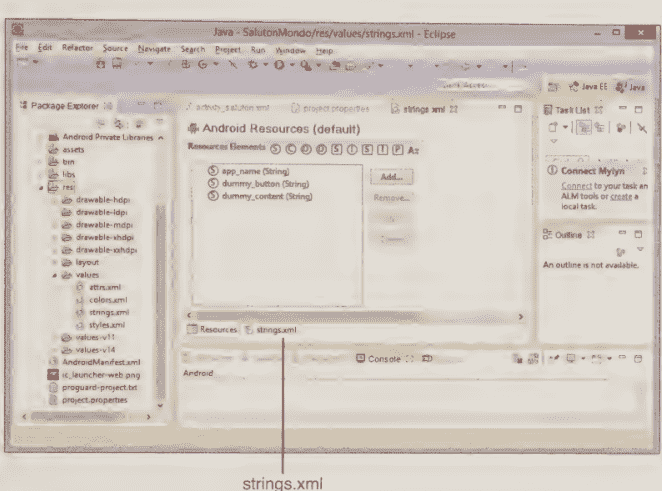

字符串和其他资源被赋予了名称和值，就像 Java 中的变量一样。在资源元素窗格中列出了三个字符串资源：`app_name`、`dummy_button` 和 `dummy_content`。

资源的命名遵循三条规则：

- 它们必须全部小写。
- 它们不能有空格。
- 它们只能使用下划线字符 `_` 作为标点符号。

点击资源元素窗格中的一个字符串。会出现 `Name`（名称）和 `Value`（值）文本字段，以及关于如何编辑字符串的指导。

`app_name` 字符串资源是你运行“新建 Android 项目向导”时选择的内容。该名称应与你之前提供的匹配，但你可以通过编辑此字符串随时进行更改。

`dummy_content` 字符串包含运行时显示在应用主屏幕（也是唯一屏幕）上的文本。点击此字符串的名称将其取出编辑。

在 `Value` 字段中，输入 `Saluton Mondo`。

尽管你可以直接编辑 XML，但不要这样做。在为 Android 应用创建资源时，通常不需要这样做。

例外情况是 Eclipse 编辑器不支持你在定义资源时想要执行的操作。字符串并不存在这种情况，因此最好坚持使用资源编辑器。直接编辑 XML 文件你更有可能出错。

资源存储在 XML 文件中。资源编辑器是一个简单的 XML 编辑器。你也可以编辑 XML 本身。点击编辑器底部的 `strings.xml` 标签卡以加载此文件进行直接编辑。（请参考图 24.3，图中标识了该标签卡。）

以下是目前 `strings.xml` 的样貌：

```xml
<?xml version="1.0" encoding="utf-8"?>
<resources>
  <string name="app_name">Saluton Mondo</string>
  <string name="dummy_button">Dummy Button</string>
  <string name="dummy_content">Saluton Dummy!</string>
</resources>
```

这允许编辑 XML 文件中的所有内容，甚至是标记标签。`string` 元素包含一个 `name` 属性，用于标识资源的名称。值作为字符数据封装在标签内。


# 编写 Android 应用

## 设置 Android 模拟器

在构建 Android 应用之前，你必须设置它的调试环境。这可以在 Eclipse 中处理。你必须设置 Android 虚拟设备 (AVD)。

要配置 Android，点击工具栏上的 Android 图标（如图 24.3 所示）。Android 虚拟设备管理器列出了你创建的模拟器。

要添加新的模拟器，请遵循以下步骤：

- 在 `Name` 字段中，将其命名为 `SimpleAVD`。
- 在 `Device` 字段中，选择 `Nexus S`。
- 在 `Target` 字段中，选择 `Android 4.4 (API Level 19)`。
- 在 `Skin` 字段中，选择 `No Skin`。
- 在 `Memory Options`（内存选项）下，输入 `768`。
- 在 `SD Card` 部分，输入 `1024`。
- 点击 `OK`。

你可以根据需要创建任意数量的模拟器。它们可以针对不同的 Android 版本进行自定义。

## 创建调试配置

要创建调试配置，请遵循以下步骤：

1. 选择 `Run`（运行），然后选择 `Debug Configurations`（调试配置）。
2. 在左侧窗格中，双击 `Android Application` 项（如图 24.6 所示）。
3. 在右侧窗格中，在 `Name` 字段将其更改为 `SalutonDebug`。
4. 点击 `Browse` 按钮。
5. 选择项目 `Salut Mondo` 并点击 `OK`。
6. 点击 `Target` 标签卡。
7. 在 `Deployment Target`（部署目标）下，选择 `Automatically Pick Device`（自动选择设备）。
8. 在表格中，勾选 `SimpleAVD` 的复选框。
9. 点击 `Apply` 保存你的更改，然后点击 `Close`。

## 运行应用

现在你已经有了 Android 模拟器和调试配置，可以运行你的第一个应用了。点击包资源管理器中的顶项 `Saluton Mondo`，然后点击 Eclipse 工具栏上的调试图标。

Android 模拟器会在自己的窗口中加载。这可能需要一分钟或更长时间，请耐心等待虚拟手机启动。

你安装的应用将带有 Android 图标和标签 `Saluton Mondo`。点击该图标运行应用。

模拟器显示“Saluton Mondo”作为应用的文本和标题栏（如图 24.7 所示）。控件使得模拟器可以像手机一样使用，但使用鼠标代替手指。点击返回键关闭应用并查看 Android 设备是如何模拟的。

模拟器可以完成许多真实设备可以做的事情，包括在计算机有活动连接的情况下连接互联网。它还可以接收电话和短信。

由于它不是一个功能完整的设备，你开发的应用必须在真实的 Android 手机和平板上进行测试。

## 在真实设备上运行

如果你能用 USB 线将 Android 手机（或其他设备）连接到电脑，只要手机设置为调试模式，你应该能够运行该应用。使用 Android SDK 开发的程序只能部署到此模式下的手机上。

在手机上，通过选择 `首页` > `设置` > `应用程序` > `开发`（或 `首页` > `设置` > `开发者选项`）进入此模式。将显示开发设置。选择 `USB 调试` 选项。

接下来，在 Eclipse 中按照以下步骤操作：

1. 选择 `Run`（运行）、`Debug Configurations`（调试配置）。打开调试配置窗口。
2. 点击右侧面板中的 `Target`（目标）选项卡将其置于顶层。
3. 将 `Deployment Target Selection Mode`（部署目标选择模式）更改为 `Always Prompt to Pick Device`（始终提示设备）。
4. 点击 `Apply and Close`（应用并关闭）。

用 USB 线连接你的 Android 手机。手机屏幕顶栏应该出现一个 Android 虫子图标。如果你下拉此栏，应该看到消息“USB 调试已连接”。

回到 Eclipse，点击工具栏上的虫子图标。打开 `Android Device Chooser`（Android 设备选择器）对话框（见图 24.8）。

如果检测到 Android 手机，它将出现在图 24.8 顶部“Choose a Running Device”（选择运行中的设备）选项下。选择此选项，点击设备并点击 `OK`。应用将在手机上运行，就像在模拟器上一样。

## 设计真实应用

Android 应用可以利用设备的所有功能，例如短信传消息、基于位置的服务和触摸输入。在本书的最后一个编程项目中，你将创建一个名为“带我去见你的领导”（Take Me to Your Leader）的真实应用。

该应用利用 Android 手机的能力来拨打电话、访问网站并在 Google 地图中加载位置。该应用通过电话、网络和地图让你与白宫取得联系。（如果美国总统不是你的领导，可以对应用进行自定义。）

要开始，你通过执行以下步骤在 Eclipse 中创建一个新项目：

1. 点击 `File`（文件）> `New`（新建）> `Android Application Project`（Android 应用项目）。打开新建 Android 应用向导。
2. 在 `Application Name`（应用名称）字段中输入 `Leader`。这也会自动输入 `Project Name`（项目名称）字段中。
3. 在 `Package Name`（包名）字段中输入 `org.cadhead.android`。
4. 在 `Minimum Required SDK`（最低所需的 SDK）和 `Target SDK`（目标 SDK）下拉菜单中选择 `API 19`，然后点击 `Next`（下一步）查看更多项目选项。
5. 确保选中这三个复选框：`Create Custom Launcher Icon`（创建自定义启动图标）、`Create Activity`（创建活动）和 `Create Project in Workspace`（在工作区创建项目）。
6. 点击 `Next` 查看关于应用图标的问题。
7. 点击 `Next` 接受这些默认值。
8. 选择 `Fullscreen Activity`（全屏活动）；然后点击 `Next`。
9. 在 `Activity Name`（活动名称）字段中输入 `LeaderActivity`。
10. 点击 `Finish`（完成）。

该项目涵盖了大量内容。在学习过程中，你会发现保持浏览器打开 Android 开发者网站的参考部分（`http://developer.android.com/reference`）会很有帮助。你可以搜索 Android 类库中的 Java 类以及项目中的文件，以了解更多信息。

该项目会出现在 Eclipse 的 `Package Explorer`（包资源管理器）中，`SalutMondo` 项目也是如此。为了避免混淆，你应该在继续之前关闭 `SalutMondo`。在包资源管理器中右键点击 `SalutMondo`；然后从弹出菜单中选择 `Close Project`（关闭项目）。

## 组织资源

创建 Android 应用需要 Java 编程，但大部分工作是在 Eclipse 界面中完成的。当你完全熟悉 Android SDK 的功能后，即使不写单行 Java 代码也可以完成大量工作。

你不需要编程就能完成的一件事是创建将使用的资源。

## 编辑 AndroidManifest.xml

图 24.11 展示了编辑应用程序的 `AndroidManifest.xml` 文件。

- `Icon` 字段标识应用程序的图标，目前它具有错误的值 `@drawable/ic_launcher`。点击此字段旁边的 `Browse`（浏览）按钮。会出现 `Resource Chooser`（资源选择器）对话框，列出你最近添加到应用的五个图形资源。
- 选择 `appicon` 并点击 `OK`（确定）。`Icon` 字段现在具有了正确的值。
- 保存文件：点击主 Eclipse 主工具栏上的 `Save`（保存）按钮，或选择 `File`（文件）> `Save`（保存）。

包资源管理器中的红色 X 消失，表示应用程序现在已正确指定了图标。

## 设计用户界面

应用程序的图形用户界面由布局组成，布局是包含文本字段、按钮、图形以及你自己设计的自定义控件等组件的容器。显示给用户的每个屏幕可以有一个布局，也可以是相互包含的多个布局。有的布局可以垂直或水平堆叠组件，有的以表格形式组织它们，以及其他排列方式。

应用程序可以简单到只有一个屏幕，也可以包含多个屏幕。一个游戏可以组织成这些屏幕：

- 游戏加载时显示的启动屏幕（splash screen）
- 主菜单屏幕，带有查看其他屏幕的按钮
- 帮助屏幕，解释如何游戏
- 分数屏幕，列出玩家的最高分
- 制作人员名单，列出游戏开发者的姓名
- 用于实际游戏的游戏屏幕

Leader 应用程序包含单个屏幕，该屏幕包含用于联系美国总统或稍后命名的领导人员的按钮。

应用程序的所有屏幕都保存在 `/res/layout` 文件夹中。该项目在该文件夹中有一个 `activity_leader.xml` 文件，它被指定为应用程序加载时显示的屏幕。

要开始编辑此屏幕的布局，在包资源管理器中双击 `activity_leader.xml`。屏幕会在 Eclipse 主窗口中打开（如图 24.12 所示）。

编辑窗口包含一个 `Palette`（调色板）窗格，其中有几个可以展开的文件夹。很可能展开的 `Form Widget`（表单控件）子窗格显示了一些简单的控件。这些控件可以拖拽到右侧的屏幕上。

按照以下步骤在屏幕上添加三个图形按钮：

1. 删除显示“Dummy Button”文本的 `textView` 控件。点击屏幕上的此控件并按 `Delete`（删除）键。
2. 点击调色板窗格中的 `Layouts`（布局）文件夹。子窗格展开。
3. 从调色板将 `LinearLayout (vertical)`（垂直）控件拖到屏幕上。屏幕窗口上方出现两个新按钮，其中一个被选中：`Set Horizontal Orientation`（设置水平方向）。将布局拖动到屏幕上决定了放置其上的界面元素的排列方式。
4. 点击调色板窗格中的 `Images & Media`（图像与媒体）文件夹。子窗格展开。
5. 从调色板将一个 `ImageButton` 控件拖到屏幕上。打开资源选择器按钮，要求你选择一个显示在按钮上的图像。选择 `phone`（手机）并点击 `OK`。按钮现在有一个手机的图形。
6. 拖动另一个 `ImageButton` 控件并将其释放到手机按钮的右侧。为它选择 `browser` 资源。添加了一个浏览器按钮。
7. 再拖动一个 `ImageButton` 控件并将其释放到浏览器右侧，为其分配 `maps`（地图）资源。
8. `Outline`（大纲）窗格列出了屏幕上的控件。选择 `imageButton1` 项。按钮的属性会在 `Properties`（属性）窗格中打开（见图 24.13）。
9. 滚动窗格，直到找到 `ID` 属性。它目前设置为 `@id/imageButton`。更改为 `@id/phone`。
10. 在 `On Click`（点击事件）属性中输入 `processClicks`。（这将在下一节中解释。）
11. 重复步骤 8-10 针对 `imageButton2`，将其 `ID` 设置为 `@id/webbutton`。
12. 重复步骤 8-10 针对 `imageButton3`，将其 `ID` 设置为 `@id/mapbutton`。
13. 点击 `Outline` 中的 `LinearLayout`。其属性出现在 `Properties` 窗格中。
14. 点击 `Background`（背景）。资源选择器打开。
15. 选择 `whitehouse` 并点击 `OK`。该图形将成为屏幕的背景。
16. 点击 `Save` 按钮。

完成后的屏幕如图 24.14 所示。

## 编写 Java 代码

此时，你已经在界面上完成了大部分工作，但还没有编写一行 Java 代码。应用程序被组织成 `Activity`，它们代表应用程序可以执行的操作。每个 `Activity` 都由自己的类定义。当你开始时，该类包含大量的现有代码。

`LeaderActivity.java` 的源代码可以在包资源管理器中的 `src/cadenhead.android` 文件夹中找到。双击此文件进行编辑。

与所有 `Activity` 一样，`LeaderActivity` 类是 `android` 包的子类，包含了显示屏幕、收集用户输入、保存用户偏好等所需的行为。

接下来，它调用 `setContentView()`，这是一个选择屏幕的方法。

当你设计应用程序时，你将每个项目的 `On Click` 属性设置为 `processClicks`。

该方法的第一步是调用 `super()` 显示屏幕。

以下代码将根据 ID 的整数执行三种操作之一：

```java
switch (id) {
    case (R.id.phonebutton):
        break;
    case (R.id.webbutton):
        break;
    case (R.id.mapbutton):
        break;
    default:
        break;
}
```

Android 中的 `Intent` 告诉另一个 `Activity` 该做什么。它们也是应用程序与 Android 设备通信的方式。

这里是此方法使用的三个 `Intent`：

```java
action = new Intent(Intent.ACTION_DIAL, Uri.parse("tel:202-456-1111"));

action = new Intent(Intent.ACTION_VIEW, Uri.parse("http://whitehouse.gov"));

action = new Intent(Intent.ACTION_VIEW, Uri.parse("geo:0,0?q=White House, Washington, DC"));
```

`Intent()` 构造函数接受两个参数：

- 要执行的操作，由其类变量之一表示
- 与操作关联的数据

在创建 `Intent` 后，以下语句使其执行：

`startActivity(action);`

由于你删除了 Activity 上的 Dummy Button，你必须移除这行代码，它是 `onCreate()` 方法的最后一行：

```java
findViewById(R.id.dummy_button).setOnTouchListener(mDelayHideTouchListener);
```

移除它的简单方法是在其前面加上 `//`，将其转变为编译器忽略的注释。

为了使你添加的代码能够正常运行，必须在类中添加以下 `import` 导入语句：

```java
import android.app.Activity;
import android.content.Intent;
import android.net.Uri;
import android.os.Bundle;
import android.view.View;
```

`LeaderActivity` 类中 `processClicks()` 方法的完整文本如列表 24.1 所示。请确保你的代码与列表匹配。

## 列表 24.1 LeaderActivity.java 的完整文本


```java
1: public void processClicks(View display) {
2: Intent action;
3: int id = display.getId();
4: switch (id) {
5: case (R.id.phonebutton):
6: Log.i(TAG, "Making call");
7: action = new Intent(Intent.ACTION_DIAL,
8: Uri.parse("tel:202-456-1111");
9: startActivity(action);
10: break;
11: case (R.id.webbutton):
12: Log.i(TAG, "Loading browser");
13: action = new Intent(Intent.ACTION_VIEW,
14: Uri.parse("http://whitehouse.gov/");
15: startActivity(action);
16: break;
17: case (R.id.mapbutton):
18: Log.i(TAG, "Loading map");
19: action = new Intent(Intent.ACTION_VIEW,
20: Uri.parse("geo:0,0?q=White House, Washington, DC");
21: startActivity(action);
22: break;
23: default:
24: break;
25: }
}
```

完成后保存文件。它应该能够成功编译（Eclipse 会自动完成此操作）。如果没有，Package Explorer 中会出现熟悉的红色的 X，标出项目发现错误的文件。

当没有错误时，你就几乎准备好运行该应用程序了。

你必须先为项目创建一个新的调试配置：

1. 点击 Eclipse 主工具栏中 `Debug` 旁边的箭头；然后选择 `Debug Configurations`（调试配置）。`Debug Configurations` 对话框会打开。

## 第 24 小时：编写 Android 应用程序

2. 双击左侧窗格中的 `Android Application`。会创建一个名为 `New_configuration (1)` 的新配置。

3. 在 `Name` 中输入 `LeaderDebug`。

4. 点击 `Browse` 按钮，选择项目 `Leader`，并点击 `OK`。

5. 点击 `Target`（目标）标签页将其置于顶。

6. 将 `Deployment Target Selection Mode`（部署目标选择模式）设置为 `Automatic`，选择 `SimpleAVD Virtual Device`。

7. 将 `Deployment Target Selection Mode` 改为 `Always Prompt to Pick Device`（始终提示选择设备），点击 `Apply`，然后点击 `Close`。

现在已创建了一个名为 `LeaderDebug` 的调试配置。

要运行该应用程序，点击 `Debug` 旁边的箭头并选择 `LeaderDebug`（如果存在）。如果不存在，选择 `Debug Configurations`，选择 `LeaderDebug` 并点击 `Debug`。`Android Device Changer` 将打开。选择 `Launch a New Android Virtual Device`（启动新的 Android 虚拟设备），选择 `SimpleAVD`，并点击 `OK`。

模拟器将在接下来几分钟内加载，然后自动运行应用程序。

模拟器并不能模拟 Android 设备可以执行的所有操作。Leader 应用程序的拨号和浏览器按钮应该可以正常工作，但你可能会在地图上遇到问题。

如果你有一部适用于 Android SDK 的安卓手机，且该手机已设置为调试模式，该应用程序也可以在手机上运行。

点击 `Debug` 旁边的箭头并选择 `LeaderDebug`，这次它一定存在。选择 `Running Android Device`（正在运行的 Android 设备），在列表中选择你的手机，然后点击 `OK`。

图 24.15 显示了应用程序在我手机上运行的情况。当手机从竖屏模式切换到横屏模式时，应用程序会随之切换。（该图还显示我有 141 条新语音邮件。我可能应该检查一下。）

Leader 应用程序也添加到了手机的应用列表中，带有它自己的“Take Me to Your Leader”图标。即使在你断开 USB 线后，它也会留在手机上。

恭喜你！世界上现在有十亿零一个 Android 应用程序了。

## 总结

《Sams Teach Yourself Java in 24 Hours》的目标是帮助你熟悉编程概念，并对你编写自己的应用程序的能力充满信心，无论它们运行在桌面电脑、网页、服务器甚至手机上。Java 的一种方法有些难以掌握。请尽管尝试。

## 活动

为了让你的 Android 知识走得更远，请尝试以下活动：

- 将 SalonMondo 应用的文本更改为“Hello, Android”，并在模拟器和 Android 设备上运行该应用（如果可用的话）。

- 为一位不同的世界领袖创建一个新版本的《带我去见你的领袖》（Take Me to Your Leader），并自定义电话、网页和地图目的地。

要查看实现这些活动的 Java 程序，请访问书籍的网站 `www.java24hours.com`。

## 第 25 小时：使用 Java 创建 Minecraft Mod

欢迎来到《24 小时自学 Java》的第 25 小时。这本书延长了时长，以涵盖一个几年来成为现象级的话题。

我有三个正值青年的儿子，他们都是狂热的游戏玩家，而且都玩在线多人建筑游戏 Minecraft。他们同龄的大多数表兄弟姐妹也玩这个游戏。当我告诉任何年轻人我写过关于 Java 编程的书时，他们都会问我同一个问题：它会教我如何创建 Minecraft Mod（模）吗？

Mod 是游戏的扩展，由玩家设计并共享。Minecraft 游戏是用 Java 编写的，而 Mod 必须用相同的语言进行编程。

学习 Java 是创建 Minecraft Mod 的第一步，过去的 24 小时已经解决了这个问题。

这个额外的小时是第二步。

在本小时结束时，你将在你的电脑上下载、安装并运行你自己的 Minecraft 服务器。你还将能够用 Java 语言创建 Mod，将它们部署到服务器上，并在玩游戏时使用。

但要小心。苦力怪（creepers）正四处潜伏。

## 本小时任务列表

- 在你的电脑上安装 Minecraft 服务器。
- 编写一个启动服务器的脚本。
- 为 Minecraft Mod 编程配置 NetBeans。
- 创建 Mod 框架。
- 设计一个生成生物（mob）的 Mod。
- 让一个生物成为另一个生物的坐骑。
- 找到游戏中的每一个生物并攻击它。
- 编写一个能从世界挖掘出巨大缺口的 Mod。

## 设置 Minecraft 服务器

开发 Mod 需要访问 Minecraft 服务器。当你作为 Mod 开发者刚开始时，实现此点的最佳方法是在自己的电脑上安装并运行服务器。因为目前还没有向游戏添加 Mod 的标准方法，不同的服务器有不同的实现此点的方法。

创建 Mod 时最易用的是 CraftBukkit，它是来自 Bukkit 项目的服务器，专门为此目的设计。CraftBukkit 是免费的，可以从网站 `http://wiki.bukkit.org` 下载。在网站主页，滚动到 `Downloads`（下载）部分，寻找两个标记为 `CraftBukkit—Recommended Build`（推荐构建版本）和 `Bukkit API—Recommended Build`（推荐构建版本）或类似标签的链接。

CraftBukkit 是 Minecraft 服务器，是一个封装为 JAR 文件的 Java 应用程序。

Bukkit API 是一组在创建 Mod 时将使用的 Java 包。

推荐构建的版本是 CraftBukkit 和 Bukkit 的最新版本，这些版本经过完全测试，并被项目团队认为是可靠的。点击 `Recommended Build` 链接下载这两个文件，它们的文件名包含版本号，例如 `craftbukkit-1.6.4-R2.0.jar` 和 `bukkit-1.6.4-R2.0.jar`。

下载完成后，在你的电脑上创建一个新文件夹并将这些文件存储其中。在我的 Windows PC 上，我创建了 `c:\minecraft\server` 并将两个 JAR 文件复制进去。

接下来，将你下载的 CraftBukkit JAR 文件复制到同一文件夹中，并将其重命名为 `craftbukkit.jar`（换句话说删除所有版本号信息）。这就是你运行启动 Minecraft 服务器的文件。

以下命令启动服务器：

```
java -Xms1024M -Xmx1024M -jar craftbukkit.jar
```

此命令告诉 Java 虚拟机运行封装为 JAR 文件 `craftbukkit.jar` 的应用程序，并为程序分配 1,024MB 内存。

为了避免每次运行服务器时都输入此命令，你可以创建一个包含该命令的批处理文件或 shell 文件，然后运行该文件。

在 Windows 上，打开如记事本之类的文本编辑器，将列表 25.1 的文本输入文件，将其保存为 `start-server.bat`，放在你存放 `craftbukkit.jar` 和 `bukkit.jar` 的文件夹中。

### 列表 25.1 start-server.bat 的全文

```
1: java -Xms1024M -Xmx1024M -jar craftbukkit.jar
2: pause
```

双击此文件运行服务器。如果运行成功，将打开一个窗口显示服务器在启动时正在的操作。服务器第一次运行时，它会创建十多个文件和子文件夹并构建世界地图。如果成功，你会看到最后的消息 `[Info] Done` 且提示符旁边有一个闪烁的光标。

`help` 命令列出了你可以用来控制服务器和游戏世界的命令。`stop` 命令关闭服务器（不要这样做！）。

图 25.1 显示了一个正在运行的 CraftBukkit 服务器。

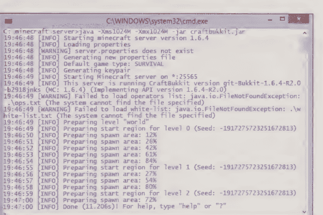

图 25.1 首次运行 Minecraft 服务器。

当服务器运行时，必须保持此窗口打开。

## 解决运行服务器时的问题

有两个阻止服务器运行的常见错误。

第一个错误显示“CraftBukkit can't be found”消息，如图 25.2 所示。

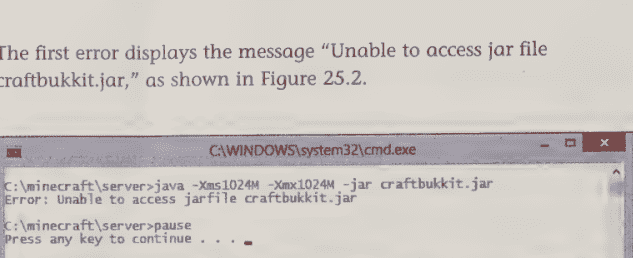

图 25.2 找不到 CraftBukkit。

第二个错误在图 25.3 中显示“'java' is not recognized as an internal or external command”。

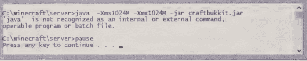

图 25.3 "java" 未被识别。

要修复此问题，确保你找到 Java 程序的文件夹位于控制面板设置中名为 `Path` 的项下。在 Windows 系统上，可以通过将文件夹名称添加到 `Path` 变量来修复这个问题。

首先，找到你的 Java 文件夹。进入硬盘的根目录；然后打开 `Program Files` 或 `Program Files (x86)` 文件夹，查看其中一个包含 Java 开发工具包 (JDK)。在我的电脑上，有 `jdk1.7.0_21` 和 `jdk1.8_0` 文件夹。数字较大的包含最新的 JDK。

打开该文件夹，然后打开其 `bin` 文件夹。应该有几十应用程序，其中一个名为 `java`。

要将 Java 添加到 `Path`，请执行以下步骤：

1. 打开控制面板。
2. 选择系统，然后选择高级系统设置。高级对话框打开。
3. 点击环境变量。打开一个对话框，列出了用户变量和系统变量。
4. 在系统变量面板中向下滚动找到 `Path`，点击它，然后点击下方的编辑按钮。编辑系统变量对话框打开（图 25.4）。


图 25.4 在 Windows 上编辑环境变量 Path。

5. 在变量值字段中，仔细将光标放在字段文本的末尾。
6. 添加分号 (`;`) 然后是你找到 `java` 程序的文件夹。这在图 25.4 中已经完成，添加了文本 `c:\Program Files\jdk1.8\bin`。（别忘记分号！）
7. 点击确定关闭这三个对话框，然后关闭控制面板。

再次尝试运行服务器。如果仍然不起作用，你可能可以通过重新安装 JDK 来解决问题。访问 Oracle 网站 `http://jdk8.java.net` 并点击侧边栏的 `Downloads` 链接。打开一个页面，提供了获取多个操作系统的 JDK 的链接。

重新安装 JDK 后，重启电脑并再次尝试运行 Minecraft 服务器。

如果其他方法都失败了，请参阅文档：Bukkit 项目有一个关于设置服务器的页面，地址为：`http://wiki.bukkit.org/Setting_up_a_server`。

## 连接服务器

由于你想制作 Minecraft Mod，推测你的电脑上已经安装了用于游戏的 Minecraft 客户端。如果没有，你可以从 `www.minecraft.net` 网站购买并下载游戏。目前价格为 $26.95。该游戏有 Windows、Mac OS、视频游戏机和移动设备版本，但 Mod 编程需要 Windows 或 Mac 版本。

启动 Minecraft 并选择“多人游戏（Multiplayer）”。你应该能在选项中看到你的新服务器（图 25.5）。

图 25.5 你的新 Minecraft 服务器已准备好连接。


服务器名为“Minecraft Server”（以后你可以将其改为更酷的名字）。客户端会向服务器发送 Ping 消息并返回速度，速度以一组绿色连接条显示（如图 25.5 所示）。

这些绿色条表示你已准备好连接。如果你看到了它们，点击服务器并点击“加入服务器（Join Server）”按钮。你现在已经在自己的服务器上运行了一个新的 Minecraft 世界。继续“创建你的第一个 Mod”章节。

当客户端无法连接到服务器时，会显示红色 X 而不是绿色连接条。下一节将介绍如何解决此问题。

## 解决服务器连接问题

有时 Minecraft 客户端在发送 Ping 并获取响应时会出现问题。如图 25.6 所示。

图 25.6 你的新 Minecraft 服务器存在连接问题。


该问题的常见原因是服务器运行的 Minecraft 版本与客户端不一致。在服务器窗口中，第一条消息指示了服务器运行的版本。回看图 25.1，你会显示“Starting Minecraft version 1.6.4”。

Minecraft 客户端通常运行最新版本。你可以修改配置使用旧版本。完全退出 Minecraft 客户端。重新运行客户端并按照以下步骤在配置中选择不同的版本：

## 创建你的第一个 Mod

Mod 必须封装为 Java 归档文件，也称为 JAR 文件。本书全程使用的 Oracle 免费集成开发环境 NetBeans 在你每次构建项目时都会自动创建 JAR 文件。

当你写完 Mod 后，将将其添加到服务器文件夹中名为 `plugins` 的子文件夹下。

本小时的第一个 Mod 是一个简单的示例，展示了你在为 CraftBukkit 创建的每个 Mod 中将使用的框架。该 Mod 为游戏添加了一个“siamesecat”命令，可以创建一个暹猫（mob），将其添加到世界中，并让你（玩家）成为它的主人。

每个 Mod 在 NetBeans 中都是独立的项目。要开始此项目，请按照以下步骤操作：

1. 在 NetBeans 中，选择菜单命令“文件（File），新建项目（New Project）”。新项目向导将启动。
2. 在“类别（Categories）”面板中，选择 Java；在“项目（Projects）”面板中，选择“Java Application”。然后点击“下一步（Next）”。
3. 在“项目名称”字段中输入 `SiameseCat`（无空格并如所示大写）。
4. 点击“项目文件夹”字段旁的“浏览（Browse）”按钮。出现“选择项目位置”对话框。
5. 找到安装 Minecraft 服务器的文件夹。选择它并点击“打开”。该文件夹出现在项目位置字段中。
6. 取消勾选“创建主类（Create Main class）”框。
7. 点击“完成（Finish）”。

`SiameseCat` 项目已创建，“项目”面板中出现了两个文件夹：“源包（Source Packages）”和“库（Libraries）”，如图 25.8 所示。


图 25.8 为 Java 项目添加库。

在每个 Mod 项目中，在你编写 Java 代码之前，必须添加两个 Java 类库：当你安装服务器时下载的 Bukkit 和 CraftBukkit JAR 文件。操作方法如下：

1. 在“项目”面板中，右键点击“库（Libraries）”文件夹并选择菜单命令“添加库（Add Library）”。“添加库”对话框将启动。
2. 点击“创建（Create）”按钮。“新建库”对话框将启动。


### 3. 在“库名称”字段中输入 `CraftBukkit` 并点击确定。“自定义自定义库”对话框将启动。

### 4. 点击“添加 JAR/文件夹（Add JAR/Folder）”按钮。“浏览 JAR/文件夹”对话框将启动。

### 5. 使用对话框找到并打开安装服务器的文件夹。你会看到一个 `craftbukkit` 文件和另一个以 `bukkit` 开头并接跟版本号的文件（编写本文时，它是 `bukkit-16.6.4-R20`，但你的可能不同）。

### 6. 点击 `craftbukkit` 和另一个以 `bukkit` 开头并接跟版本号的文件。

将列表 25.2 的内容输入到源代码编辑器，并点击 NetBeans 工具栏中的“全部保存”按钮（或选择“文件”，“保存”）。

## 列表 25.2 SiameseCat.java 的全文

```
1: package org.cadenhead.minecraft;
2:
3: import java.util.logging.*;
4: import org.bukkit.command.*;
5: import org.bukkit.entity.*;
6: import org.bukkit.plugin.java.*;
7:
8:
9: public class SiameseCat extends JavaPlugin {
10:    public static final Logger logger = Logger.getLogger("Minecraft");
11:
12:    public boolean onCommand(CommandSender sender, Command command,
13:        String label, String[] arguments) {
14:
15:        if (label.equalsIgnoreCase("siamesecat")) {
16:            if (sender instanceof Player) {
17:                // get the player
18:                Player me = (Player) sender;
19:                // get the player's current location
20:                Location spot = me.getLocation();
21:                // get the game world
22:                World world = me.getWorld();
23:
24:                // spawn one ocelot
25:                Ocelot cat = world.spawn(spot, Ocelot.class);
26:                // make it a Siamese cat
27:                cat.setDataType(Ocelot.Type.SIAMESE_CAT);
28:                // make the player its owner
29:                cat.setOwner(me);
30:                log.info("[SiameseCat] Meow!");
31:                return true;
32:
33:            }
34:        return false;
35:    }
36: }
```

列表 25.2 第 3–7 行的导入语句为程序提供了五个可用包：其中一个来自 Java 类库，另外四个来自 Bukkit。

第 31 行和第 34 行的返回语句是标准 mod 框架的一部分。当 mod 处理用户命令时，你的方法应该在 `onCommand()` 方法中返回 `true` 值；当未处理时，则返回 `false`。

程序使用了这些类：`Logger.util.logging.Logger`、来自 `org.bukkit` 的 `Location` 和 `World`、来自 `org.bukkit.command` 的 `Command`、来自 `org.bukkit.entity` 的 `Ocelot` 和 `Player` 以及来自 `org.bukkit.plugin.java` 的 `JavaPlugin`。你将在项目的后续学习更多关于这些包的内容。

## 第 25 章：使用 Java 创建 Minecraft Mod

你已经创建了第一个 mod，但 CraftBukkit 现在还无法运行它。它需要一个名为 `plugin.yml` 的文件来告诉 Minecraft 服务器该 mod。

这是一个文本文件，你可以通过以下步骤在 NetBeans 中创建：

1. 选择“文件”，“新建文件”。打开“新建文件”对话框。
2. 在“类别”面板中，选择“其他”。
3. 在“文件类型”面板中，选择“空文件”并点击“下一步”。
4. 在“文件名”字段中，输入 `plugin.yml`。
5. 在“文件夹”字段中，输入 `src`。
6. 点击“完成”。

源代码编辑器中打开了一个名为 `plugin.yml` 的空文件。将列表 25.3 的文本内容到文件中，并确保每行使用的空格数量相同。不要用 Tab 键代替空格。

```
LISTING 25.3 该项目 plugin.yml 的全文
1: name: SiameseCat
2:
3: author: Your Name Here
4:
5: main: org.cadenhead.minecraft.SiameseCat
6:
7: commands:
8: siamesecat:
9: description: Spawn a Siamese cat.
10:
11: version: 1.0
```

将 "Your Name Here" 替换为你自己的名字（除非你的名字本身就叫 "Your Name Here"）。

为了双重检查输入的空格是否正确，第 8 行中文本 `siamesecat` 之前有四个空格，第 9 行 `description` 之前有八个空格。

`plugin.yml` 文件描述了 mod 的名称、作者、Java 类文件、版本、命令以及该命令功能的简短描述。

该文件必须放在项目的正确位置。查看“项目”面板，它应该位于名为 `<default package>` 的子标题下的 `Source Libraries` 文件夹中。如图 25.9 所示。

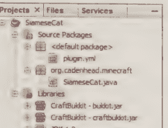

> 图 25.9

检查 plugin.yml 的位置。

如果文件位置错误（如在 `org.cadenhead.minecraft` 标题下所示），你可以使用拖放功能来移动它。点击并按住文件，将其拖到 `Source Libraries` 文件夹图标上，然后松手。

你现在准备好构建你的 mod 了。选择菜单命令“Run”，“Clean and Build Project”。如果执行成功，NetBeans 用户界面的左下角会出现“Finished Building SiameseCat (clean jar)”的消息。

该 mod 被封装为项目子文件夹中名为 `SiameseCat.jar` 的文件。要找到它，点击“项目”面板中的“Files”标签页，并展开 `dist` 子文件夹。“Files”标签页列出了组成项目的所有文件，如图 25.10 所示。

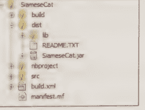

> 图 25.10

寻找 SiameseCat mod 的 JAR 文件。

`SiameseCat.jar` 文件需要从项目复制到 Minecraft 服务器。按照以下步骤操作：

1. 如果 Minecraft 服务器正在运行，通过进入服务器窗口并输入命令 `stop` 来停止；然后按下空格关闭窗口。
2. 在 NetBeans 外部，打开安装 服务器 的文件夹。
3. 打开 `SiameseCat` 文件夹。
4. 打开 `dist` 子文件夹。
5. 选择 `SiameseCat.jar` 文件并按 `Ctrl+C` 复制。
6. 返回服务器文件夹。
7. 打开 `plugins` 文件夹。
8. 按 `Ctrl+V` 将 `SiameseCat` 粘贴进去。

你已在 Minecraft 服务器部署了新 mod。以相同的方式启动服务器（点击文件），你将在日志中看到两条新消息：

```
[SiameseCat] Loading SiameseCat v1.0
```

```
[SiameseCat] Enabling SiameseCat v1.0
```

如果没有看到这些消息而是看到了一些复杂的错误信息，请检查 `SiameseCat` 和 `plugin.yml` 以确保输入正确；然后重新部署 mod。

当你运行 Minecraft 客户端并连接服务器时，输入命令 `/siamesecat`。你现在有一只跟着你的猫。图 25.11 显示我和猫朋友！


> 图 25.11

## 让僵尸骑马

创建第一个 mod 需要大量工作，因为你是第一次经历这个过程。其余部分将会简单一些，因为你会重复许多步骤。每个开发的 mod 都会比上一个复杂。对于这个项目，我们将创建一个由僵尸骑的骑兵。

通过以下任务开始操作：

1. 选择“File”，“New Project”，在 Minecraft 服务器相同的文件夹中创建一个名为 `CrazyHorse` 的新 Java Application。确保选中了 Create Main Class。
2. 在“Projects”面板中右键点击“Libraries”，点击“Add Library”并将 CraftBukkit 库添加到项目。
3. 选择“File”，“New File”，创建一个名为 `CrazyHorse` 包名为 `org.cadenhead.minecraft` 的空 Java 文件。

将列表 25.4 的文本输入 `CrazyHorse.java` 文件的源代码编辑器。程序中的新概念将在输入后进行解释。

## 列表 25.4 CrazyHorse.java 的全文

```
1: package org.cadenhead.minecraft;
2:
3: import java.util.logging.*;
4: import org.bukkit.*;
5: import org.bukkit.command.*;
6: import org.bukkit.entity.*;
7: import org.bukkit.plugin.java*;
8: import org.bukkit.potion.*;
9:
10: public class CrazyHorse extends JavaPlugin {
11:     public static final Logger log = Logger.getLogger("Minecraft");
12:
13:     public boolean onCommand(Command sender, Command command,
14:         String label, String[] arguments) {
15:
16:         if (label.equalsIgnoreCase("crazyhorse")) {
17:             if (sender instanceof Player) {
18:                 Player me = (Player) sender;
19:                 Location spot = me.getLocation();
20:                 World world = me.getWorld();
21:
22:                 // spawn some horse-riding zombies
23:                 int quantity = (int)(Math.random() * 10) + 1;
24:                 log.info("CrazyHorse Creating " + quantity
25:                     + " zombies and horses");
26:                 for (int i = 0; i < quantity; i++) {
27:                     // set horseSpot and zombie location
28:                     Location horseSpot = new Location(world,
29:                         spot.getX() + Math.random() * 15,
30:                         spot.getY() + 20,
31:                         spot.getZ() + (Math.random() * 15));
32:                     Horse horse = world.spawn(horseSpot, Horse.class);
33:                     Zombie zombie = world.spawn(horseSpot, Zombie.class);
34:                     horse.setPassenger(zombie);
35:                     horse.setOwner(me);
36:                     // set the horses' color
37:                     int coat = (int)(Math.random() * 7);
38:                     switch (coat) {
39:                         case 0:
40:                             horse.setColor(Horse.Color.WHITE);
41:                             break;
42:                         case 1:
43:                             horse.setColor(Horse.Color.GRAY);
44:                             break;
45:                         case 2:
46:                             horse.setColor(Horse.Color.CREAMY);
47:                             break;
48:                         case 3:
49:                             horse.setColor(Horse.Color.CHESTNUT);
50:                             break;
51:                         case 4:
52:                             horse.setColor(Horse.Color.BROWN);
53:                             break;
54:                         case 5:
55:                             horse.setColor(Horse.Color.DARK_BROWN);
56:                             break;
57:                         case 6:
58:                             horse.setColor(Horse.Color.BLACK);
59:                             break;
60:                     }
61:                     // 增加马的移动速度
62:                     PotionEffect potion = new PotionEffect(
63:                         PotionType.SPEED,
64:                         Integer.MAX_VALUE,
65:                         10 + (coat * 10));
66:                     horse.addPotionEffect(potion);
67:                 }
68:                 return true;
69:             }
70:         return false;
71:     }
72: }
```

进入代码列表后，通过文件（File）、保存（Save）或点击全部保存（Save All）来保存此文件。

此模组为 Minecraft 添加了一个 `/crazyhorse` 命令，会从空中掉落随机数量的骑马僵尸。当输入命令时，第 18–66 行会执行一些酷的操作。这些行周围的其他程序是标准的模组框架。

在获取玩家、位置和世界后，模组将 1 到 11 之间的随机数存储在变量中：

```java
int quantity = (int)(Math.random() * 10) + 1;
```

Java `Math` 类中的 `random()` 方法会生成一个 0.0 到 1.0 之间的随机浮点数。它可以与一个整数相乘，产生一个从 0 到该整数的随机整数。

这个数字就是创建的僵尸和马的数量。

从第 26 行开始的 `for` 循环为每一对僵尸-马进行循环。

它们的位置通过调用带有四个参数的 `Location()` 构造函数设置：游戏世界、x 坐标、y 坐标和 z 坐标。

## 第 25 章：使用 Java 创建 Minecraft 模组


```java
Location horseSpot = new Location(world,
spot.getX() + (Math.random() * 15),
spot.getY() + 20,
spot.getZ() + (Math.random() * 15));
```

`spot` 变量中的玩家位置被用于为每个僵尸和马选择位置。对于 x 坐标，获取玩家的 `getX()` 坐标并加上一个 0 到 14 之间的随机数。对于 z 坐标，加上 `getZ()` 和一个 0 到 14 之间的随机数。对于 y 坐标，加上 20。

这意味着生物将出现在玩家上方 20 个方块的空中，并在其他方向上 14 个方块范围内。

马和僵尸的创建方式与猫科动物相同。使用世界的 `spawn()` 方法，传入生物的位置和它的类（马是 `Horse`，僵尸是 `Zombie`）。

在 Minecraft 中，每个可以被骑乘的生物都有一个 `setPassenger()` 方法，该方法将骑乘者作为唯一参数：

```java
horse.setPassenger(zombie);
```

如果你没有停止它，僵尸会出现在马背上，但马会很快把它甩下来。这可以通过让玩家成为该马的主人来防止：

```java
horse.setOwner(me);
```

被驯服的马不会甩下骑者，即使骑者是一个渴望人脑的僵尸。当你创建一个生物时，它会继承游戏中该生物默认的行为。

像猫科动物一样，马可以通过多种方式进行自定义。通过调用它的 `setColor()` 方法给马不同颜色的皮。共有七种可能。

在生成 0 到 6 的随机数后，该数字被用于第 38–59 行的 `switch-case` 语句中设置该马的颜色。

为了让马更疯狂，你还可以自定义它们的速度。游戏药水的效果可以应用生物上。共有 23 种不同的效果，由 `PotionEffectType` 类指示。

通过调用带有三个参数的 `PotionEffect` 构造函数创建一个药水效果：效果类型、药水持续持续，以及该效果的值。

## 教僵尸骑马

此语句创建了一个最大可能持续时间的速度药水——Java 能容载的最大整数值：

```java
PotionEffect potion = new PotionEffect(
PotionType.SPEED,
Integer.MAX_VALUE,
10 + (coat * 10));
```

`PotionEffect()` 的第三个参数设置了马的速度。它的基础值是用于确定马的颜色的随机数的 10 倍。由于 `switch-case` 语句中的颜色从浅到深排序，公式 `10 + (coat * 10)` 导致颜色越深的马奔跑得越快。

现在模组的 Java 类已经定义好了，它需要一个插件描述文件。选择“新建文件”（New File），在“类别”（Categories）窗格中选择“其他”（Other），并在 `src` 文件夹中创建一个名为 `plugin.yml` 的空文件。

将代码列表 25.5 输入此文件，务必确保其格式与所示完全一致，使用空格而不是制表符。

## 列表 25.5 此项目的 plugin.yml 完整文本

```yaml
1: name: CrazyHorse
2:
3: author: Your Name Here
4:
5: main: org.caden.minecraft.CrazyHorse
6:
7: commands:
8:   crazyhorse:
9:     description: Spawn 1-11 horse-riding zombies.
10:
11: version: 1.0
```

完成后，选择运行（Run）、清理并构建项目（Clean and Build Project）来创建模组的 JAR 文件。

在“项目”（Projects）窗格中，“源包”（Source Packages）标题下有两个文件：`org.caden.minecraft` 下的 `CrazyHorse.java` 和 `<default package>` 下的 `plugin.yml`。

在 NetBeans 之外，转到你的文件文件夹，从项目的 `dist` 文件夹将 `CrazyHorse.jar` 文件复制到服务器的 `plugins` 文件夹。重启服务器（停止并重新运行），你应该就能输入 `/crazyhorse` 命令了。

# 使用 Java 创建 Minecraft 模组

1 到 11 只骑马的僵尸会掉落在你周围，砰的一声着陆。如果你在游戏白天发布命令，这些行尸将面临一个不快的惊喜。截图如图 25.12 所示。

图 25.12

两只骑马的僵尸。

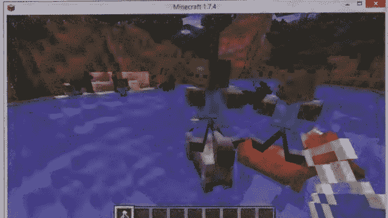

前两个模组是将生物添加到游戏世界中。下一个项目将检查已经存在的生物，找到它们的每一个位置，并用闪电击中该位置。

# 寻找生物（杀死它们）

以下修改使马隐形，导致僵尸看起来就像悬浮在空中一样：

```java
PotionEffect potion2 = new PotionEffect(
PotionType.INVISIBILITY,
Integer.MAX_VALUE,
1);
horse.addPotionEffect(potion2);
```

# 寻找所有实体（并杀死它们）

这些命令都需要一个玩家对象和一个世界对象。它们还需要一个包含所有生存实体的列表，这在第 19 行完成：

```java
List<LivingEntity> mobs = world.getLivingEntities();
```

该语句调用了世界的 `getLivingEntities()` 方法，该方法返回一个包含每个实体的 `List` 对象。这些实体用实现了 `LivingEntity` 接口的对象表示。

`List` 也是一个接口。它由数组列表（array lists）、栈（stacks）和其他数据结构实现。用于数组列表的方法和技术也适用于此列表。

获取此列表后，你可以通过一条语句（第 47 行）即可实现 `/mobcount` 命令：

```java
me.sendMessage("There are " + mobs.size() + " living mobs.");
```

列表的 `size()` 命令返回该列表中的元素数量。此信息作为消息发送给玩家并显示在游戏中。这是通过调用玩家的 `sendMessage()` 方法，并将要显示的信息作为唯一参数来实现的。

`/lightningstorm` 命令更为复杂。

Java 中的数据结构有特殊的 `for` 循环，可以轻松遍历结构中的每一个项。第 26 行为 `mobs` 列表中的每个实体启动了这样一个循环：

```java
for (LivingEntity mob : mobs) {
```

这会将当前实体存储在名为 `mob` 的 `LivingEntity` 对象中。

在向地图上的每个实体发射闪电时，必须记住玩家也是一个实体。对自己对自己下闪电绝不是个好主意。

游戏中的每个实体都有一个唯一的 ID。在 `for` 循环之前，第 24 行存储了玩家的 ID：

```java
int myID = me.getEntityID();
```

该整数在循环内部与当前实体的 ID 进行比较，在第 29 行调用它的 `getEntityID()` 方法：

```java
if (mob.getEntityID() == myID) {
    continue;
}
```

# 使用 Java 创建 Minecraft 模组

`continue` 语句会导致循环返回第 26 行并继续处理下一个实体。

现在玩家安全了，你通过调用其 `getLocation()` 方法找到实体的位置：

```java
Location spot = mob.getLocation();
```

然后使用该位置调用世界的 `strikeLightning()` 方法：

```java
world.strikeLightning(spot);
```

用闪电击中实体并不总是致命的——有些实体很硬——但这让这看起来没那么了不起了。调用实体的 `setHealth()` 方法并传入参数 0 会将其健康值设置为该数值，从而杀死：

```java
mob.setHealth(0);
```

此模组应录的 `plugin.yml` 文件可以在列表 25.7 中找到。在项目的 `src` 文件夹中创建一个名为 `plugin.yml` 的空文件，然后用此列表的内容填充它。

## 列表 25.7 此项目 plugin.yml 的完整文本

```yaml
1: name: LightningStorm
2:
3: author: Your Name Here
4:
5: main: org.cadenhead.minecraft.LightningStorm
6:
7: commands:
8: lightning:
9:   description: Hit every living mob with lightning.
10: mobcount:
11:   description: Count of living mobs.
12:
13: version: 1.0
```

构建项目（选择 `Run`、`Build` 和 `Clean Project`），然后将 `LightningStorm.jar` 文件从项目的 `dist` 文件夹复制到服务器的 `plugins` 文件夹，并将模组部署到你的 Minecraft 服务器上。下次启动服务器并玩游戏时，你将看到像 25.13 中那样的闪电暴。

实际上，在书中展示它会破坏惊喜感。图 25.13 是一头即将变成火焰烧烤的牛。

## 编写一个可以建造建筑的模组

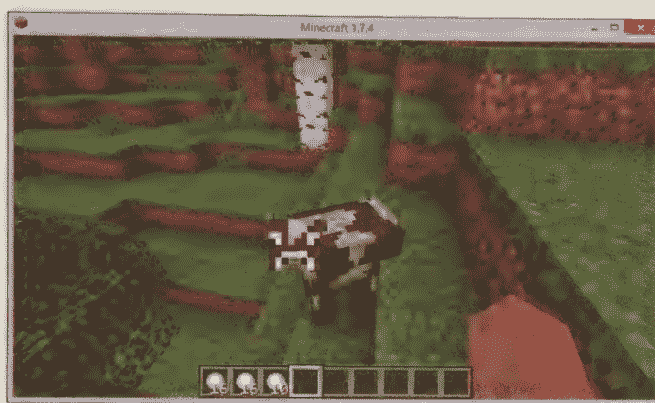

图 25.13

这不是闪电暴。

## 编写一个可以建造建筑的模组

你创建的前三个模组是关于实体的，即在 Minecraft 中游走的移动实体。本小时的最后一个模组探索了如何使用 Java 执行游戏中最基础的活动：建造和破坏方块。

你将创建一个新命令 `/icecreamscoop`，它会在玩家周围挖掘一个圆洞。洞的大小将由玩家作为命令参数决定。

以下是构建该模组的方法：

1. 在 Minecraft 服务器文件夹中创建新项目 `IceCreamScoop`，保持取消勾选 `Create Main Class`。
2. 在 `Projects` 格中，右键点击 `Libraries` 并添加 `CraftBukkit` 库。
3. 在 `org.cadenhead.minecraft` 包下创建一个名为 `IceCreamScoop` 的空 Java 类。

列表 25.8 的文本作为 `IceCreamScoop` 类。在你输入后将进行解释。

## 第 25 小时：使用 Java 创建 Minecraft 模组

## 列表 25.8 IceCreamScoop.java 的完整文本

```java
1: package org.cadhead.minecraft;
2:
3: import org.util.logging.*;
4: import org.bukkit.*;
5: import org.bukkit.block.*;
6: import org.bukkit.command.*;
7: import org.bukkit.entity.*;
8: import org.bukkit.plugin.java.*;
9:
10: class IceCreamScoop extends JavaPlugin {
11:     public static final Logger log = Logger.getLogger("Minecraft");
12:
13:     public boolean onCommand(CommandSender sender, String label, String[] arguments) {
14:         // 设置默认半径
15:         double radius = 15;
16:         if (arguments.length > 0) {
17:             // 读取用户提供的半径
18:             try {
19:                 radius = Double.parseDouble(arguments[0]);
20:                 // 确保半径在5到25之间
21:                 if (radius < 5 || radius > 25) {
22:                     radius = 15;
23:                 }
24:             } catch (NumberFormatException e) {
25:             // 使用默认值
26:             }
27:         }
28:
29:         // 如果命令是 icecreamscoop
30:         if (label.equalsIgnoreCase("icecreamscoop")) {
31:             if (sender instanceof Player) {
32:                 scoopTerrain(sender, radius);
33:             }
34:             return true;
35:         }
36:         return false;
37:     }
38:
39:     // 在世界上挖出一个半径圆形的球
40:     private void scoopTerrain(CommandSender sender, double radius) {
41:         Player me = (Player) sender;
42:         Location spot = me.getLocation();
43:         World world = me.getWorld();
44:
45:         // 遍历一个半径大小的正方形
46:         for (double x = spot.getX() - radius; x < spot.getX() + radius; x += 1) {
47:             for (double y = spot.getY() - radius; y < spot.getY() + radius; y += 1) {
48:                 for (double z = spot.getZ() - radius; z < spot.getZ() + radius; z += 1) {
49:                     // 获取距离玩家的距离
50:                     Location loc = new Location(world, x, y, z);
51:                     double dx = x - spot.getX();
52:                     double dy = y - spot.getY();
53:                     double dz = z - spot.getZ();
54:                     double distance = Math.sqrt(dx * dx + dy * dy + dz * dz);
55:
56:                     // 如果在半径内
57:                     if (distance < radius) {
58:                         // 所以将该方块变为空气
59:                         Block current = world.getBlockAt(loc);
60:                         current.setType(Material.AIR);
61:                     }
62:                 }
63:             }
64:         }
65:
66:         // 挖完后播放一个声音
67:         world.playSound(spot, Sound.BURP, 30, 5);
68:         log.info("IceCreamScoop Scooped at (" + 
69: + spot.getX() + ", " + 
70: + spot.getY() + ", " + 
71: + spot.getZ() + ")");
72:     }
73: }
```

## 编写一个可以建造建筑的模组

# 第 25 小时：使用 Java 创建 Minecraft 模组

如果用户的值是一个数字，它就变成了半径。但还有最后一个检查：第 23–25 行中的一个 `if` 条件语句，确保半径落在 5 到 25 的接受范围内。

`IceCreamScoop` 类有一个 `scoopTerrain()` 方法，它负责挖出一个圆形。

与其他模组一样，这需要玩家、玩家位置和世界对象。

在像 Minecraft 世界这样的三维网格中，有不同的技术可以用来玩家周围挖出一个圆形。

该模组通过查看玩家周围的正方形内的每个区块来实现，这个正方形的边长大于半径的两倍。正方形中心是玩家所在的位置。

第 47–49 行的三个嵌套 `for` 循环遍历所有的正方形。有一个用于 X 轴循环，一个用于 Y 轴循环，以及一个用于 Z 轴循环。

创建了一个 `Location` 对象来表示在每次循环中正在检查的位置：


# 第 25 小时：使用 Java 创建 Minecraft 模组

如果用户的值是一个数字，它就变成了半径。但还有最后一次检查：第 23–25 行中的一个 `if` 条件语句，确保半径落在 5 到 25 的接受范围内。

`IceCreamScoop` 类有一个 `scoopTerrain()` 方法，它负责挖出一个圆形。

与其他模组一样，这需要玩家、玩家位置和世界对象。

在像 Minecraft 世界这样的三维网格中，有不同的技术可以用来玩家周围挖出一个圆形。

该模组通过查看玩家周围的正方形内的每个区块来实现，这个正方形的边长大于半径的两倍。正方形中心是玩家所在的位置。

第 47–49 行的三个嵌套 `for` 循环遍历所有的正方形。有一个用于 X 轴循环，一个用于 Y 轴循环，以及一个用于 Z 轴循环。

创建了一个 `Location` 对象来表示在每次循环中正在检查的位置：

```
loc = new Location(world, x, y, z);
```

玩家的位置之前存储在第 43 行的 `spot` 对象中：

```
Location spot = me.getLocation();
```

三条语句测量了当前位置与玩家在三个轴上的距离：

```
double dx = x - spot.getX();
double yd = y - spot.getY();
double zd = z - spot.getZ();
```

使用勾股定理，你可以通过对 `dx`、`yd` 和 `zd` 平方、相加并使用 `Math.sqrt()` 方法获取平方根来计算距离：

```
double distance = Math.sqrt(dx * dx + yd * yd + zd * zd);
```

如果当前区块到玩家的距离在玩家选择的范围内，通过这两条语句将该区块变为空气：

```
Block current = world.getBlockAt(loc);
current.setType(Material.AIR);
```

## 编写可以构建物品的模组

首先，创建一个表示区块的 `Block` 对象。

接下来，调用区块的 `setType()` 方法并传入 `Material.AIR`，这是 Minecraft 中代表区块组成材料的几十种值之一。

用于将区块变为空气以破坏区块的技巧也可用于构建物品。唯一改变的是材料类型。如果你想挖出一勺游戏内容并将其变成钻石而不是空气，将使用该语句：

```
current.setType(Material.DIAMOND);
```

当从世界中挖出一勺后，模组会执行两件事来记录这一成就：播放一个声音并向服务器日志发送消息。

通过调用世界的 `playSound()` 方法播放声音，该方法有四个参数——声音的位置、类型、音量和音调：

```
world.playSound(spot, Sound.BURP, 30, 5);
```

正如你可能猜到的，这个声音是打嗝声。有几十种可能使用的声音。

通过调用 `Logger` 对象的 `info()` 命令并传入文本可以在服务器日志上记录消息：

```
log.info("*[IceCream@Scoop] Scooped at " + spot);
```

项目的 `plugin.yml` 文件如列表 25.9 所示。在 `src` 文件夹中创建一个名为 `plugin.yml` 的空文件以匹配该列表。

## 列表 25.9 本项目 plugin.yml 的完整文本

| | |
| :--- | :--- |
| 1 | name: IceCreamScoop |
| 2 | |
| 3 | author: Your Name Here |
| 4 | |
| 5 | main: org.cadenhead.minecraft.IceCreamScoop |
| 6 | |
| 7 | commands: |
| 8 | icecreamscoop: |
| 9 | description: Scoop away land around the player. |
| 10 | |
| 11 | version: 1.0 |

# 使用 Java 创建 Minecraft 模组

在构建模组并将其 JAR 文件部署到 Minecraft 服务器后，使用与之前项目相同的步骤，你可以在游戏世界中发现从景观中挖出巨大的圆勺。图 25.14 显示了当你站在一片平坦地上并输入此命令时发生的情况：

```
/icecrecreamscoop 10
```

图 25.14

在 Minecraft 世界中挖出圆形。

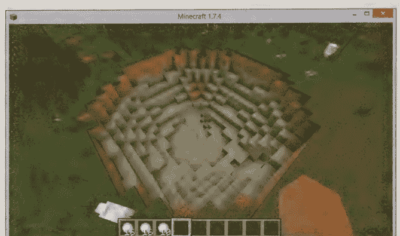

在测试这个模组时，我发现把自己挖到世界底部并不花费时间。你也会掉得足够远而被杀死，因此在出生点进行任何挖掘都不是一个好主意。

通过将材料从 `AIR` 改为另一种材料，你可以在世界中制作球体。物质完整列表可以在 Bukkit 的 Java 文档中找到：http://jd.bukkit.org/rb/apidocs，但这里有四个可以用于入门：

- `Material.DIRT`
- `Material.COBBLESTONE`
- `Material.WOOD`
- `Material.GRAVEL`

如果你将区块变为空气以外的任何东西，模组将移除你所处位置的空气。那一定很疼。

你可以通过这两条语句传送到新位置：

```
Location newSpot = new Location(world, x, y, z);
```

## 总结

本章节涵盖了如何使用 Java 进行 Minecraft 模组开发，包括距离计算（勾股定理）、声音播放、日志记录、`plugin.yml` 的配置以及 `Location` 类的应用。

# 附录 A

使用 NetBeans 集成开发环境

虽然仅需 Java 开发工具包（JDK）和文本编辑器就可以创建 Java 程序，但使用集成开发环境（IDE）的体验会更加愉悦。

本书的前 23 小节使用了 NetBeans，这是由 Oracle 为 Java 程序员提供的一款免费 IDE。NetBeans 是一个让组织、编写、编译和测试 Java 软件变得更容易的程序。它包含了一个项目和文件管理器、图形用户界面设计器以及许多其他工具。其中一个杀手级功能是代码编辑器，它可以在你输入时自动检测 Java 语法错误。

如今 8.0 版本的 NetBeans 已经成为专业 Java 开发者的青睐，其提供的功能和性能即使按 10 倍的价格卖也物有所值。它也是 Java 初学者最易使用的 IDE 之一。

在本附录中，你将学习到关于 NetBeans 的足够知识，以便安装该软件并在本书中使用它。

## 安装 NetBeans

从不那么理想的起点开始，NetBeans IDE 发展成为 Java 开发人员领先的编程工具之一。Java 语言的创造者 James Gosling 在《NetBeans 现场指南》一书的序言中对其给予了终极信任：“我所有的 Java 开发都使用 NetBeans。”我也变成了一个支持者。

NetBeans 支持 Java 语言三个版本的所有方面——Java 标准版（JSE）、Java 企业版（JEE）和 Java 移动版（JME）。它还支持 Web 应用程序开发、Web 服务和 JavaBeans。

你可以从 http://netbeans.org 下载该软件，它支持 Windows、Mac OS 和 Linux。NetBeans 可以随 Java 开发工具包捆绑下载，也可以单独下载。你必须在电脑上安装 NetBeans 和 JDK。

如果你想确保下载的 NetBeans 和 JDK 版本与本书准备时使用的版本相同，请访问书籍网站 www.java24hours.com。点击书籍封面打开该版本的网站，然后寻找“Download JDK（下载 JDK）”和“Download NetBeans 8.0”的链接。你将被引导至正确的网站。

## 创建新项目

JDK 和 NetBeans 以安装向导的形式下载，并在你的系统上设置软件。你可以在任何喜欢的文件夹和菜单组中安装软件，但除非你有充分理由这样做，否则最好坚持使用默认设置选项。

在安装后首次运行 NetBeans 时，你会看到一个启动页，显示了新闻和编程教程的链接（见图 A.1）。你可以使用 NetBeans 内置浏览器在 IDE 内阅读这些内容。

一个 NetBeans 项目由一组相关的 Java 类、这些类使用的文件以及 Java 类库组成。每个项目都有自己的文件夹，你可以在 NetBeans 之外使用文本编辑器和其他编程工具对它们进行探索和修改。

要开始一个新项目，点击图 A-1 所示的“New Project（新项目）”按钮，或者选择 File（文件）、New Project（新项目）菜单命令。新项目向导会打开，如图 A.2 所示。

NetBeans 可以创建多种类型的 Java 项目，但在本书中你可以关注一种类型：Java Application（Java 应用程序）。

对于你的第一个项目（以及书中的大部分项目），选择项目类型 Java Application 并点击 Next（下一步）。向导要求你为项目选择一个名称和位置。

### 新项目

图 A.1

NetBeans 用户界面。


图 A.2

新项目向导。

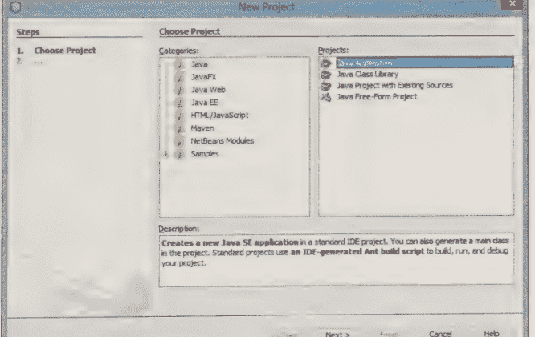

Project Location（项目位置）文本字段标识你用 NetBeans 创建的编程项目的根文件夹。在 Windows 上，这可能是你的“我的文档”（或“文档”）文件夹下名为 NetBeansProjects 的子文件夹。你创建的所有项目都存储在这个文件夹中，每个项目都有自己的子文件夹。

## 使用 NetBeans 集成开发环境

在 Project Name（项目名称）文本字段中输入 Java24。Create Main Class（创建主类）文本框会根据输入发生变化，推荐 java24。Project Location（项目位置）文本字段标识你用 NetBeans 创建的编程项目的根文件夹。在 Windows 上，这可能是你的“我的文档”（或“文档”）文件夹下名为 NetBeansProjects 的子文件夹。你创建的所有项目都存储在该文件夹中，每个项目都有自己的子文件夹。

### 创建新项目

在 Project Name（项目名称）文本字段中输入 Java24。Create Main Class（创建主类）文本框会根据输入发生变化，推荐 java24。Project Location（项目位置）文本字段标识你用 NetBeans 创建的编程项目的根文件夹。在 Windows 上，这可能是你的“我的文档”（或“文档”）文件夹下名为 NetBeansProjects 的子文件夹。你创建的所有项目都存储在该文件夹中，每个项目都有自己的子文件夹。

### 新建类


# 附录 A

## NetBeans 简介

在 **Project Name**（项目名称）文本字段中输入 `Java24`。**Create Main Class**（创建主类）文本框会根据输入发生变化，推荐 `java24`。**Project Location**（项目位置）文本字段标识你用 NetBeans 创建的编程项目的根文件夹。在 Windows 上，这可能是你的“我的文档”（或“文档”）文件夹下名为 `NetBeansProjects` 的子文件夹。你创建的所有项目都存储在该文件夹中，每个项目都有自己的子文件夹。

当你创建一个新项目时，NetBeans 会为类创建一个模板。

图 A.3

NetBeans 用户界面。

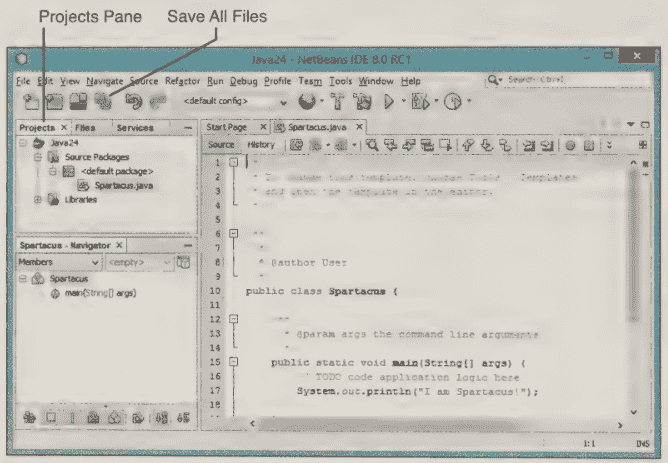

当你完成对程序输出的审查后，点击面板页签上的 X 来关闭输出面板。这会让源编辑器变得更大，当你在创建程序时这非常有用。

## 修复错误

现在 Spartacus 应用程序已经编写、编译并运行，是时候通过故意搞坏一些东西来获得关于 NetBeans 在出现问题时如何响应的经验。

像任何程序员一样，你会有很多机会亲手搞砸事情，但尽管如此，仍请务必注意这里。

回到源编辑器中的 `Spartacus.java`，删除调用 `System.out.println()` 的那一行末尾的分号（见列表 A.1 中的第 17 行）。甚至在保存文件之前，NetBeans 已经发现了该错误，并在行左侧显示了一个红色的警报图标（见图 A.5）。

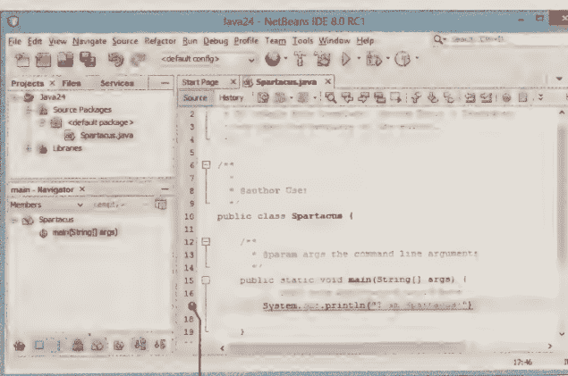

图 A.5

在源编辑器中标记错误。

将鼠标悬停在警报图标上，会弹出一个对话框，描述 NetBeans 认为它发现的错误。

NetBeans 源编辑器可以识别你在编写 Java 程序时遇到的大多数常见编程错误和拼写错误。在错误修复之前，错误检测将阻止文件的编译。

在行末尾加回分号。警报图标消失，你可以再次保存并运行该类。

这些基本功能就是你创建和编译书中 Java 程序所需要的全部内容。

NetBeans 的功能远超这里描述的基础功能，但在深入学习 IDE 之前，你应该专注于学习 Java。将 NetBeans 仅仅看作一个简单的编程项目管理器和文本编辑器来使用。编写类、标记错误，并确保能够成功编译并运行每个项目。

当你准备好学习更多 NetBeans 知识时，首页（Start page）提供了学习如何使用它的资源。Oracle 还在 `http://netbeans.org/kb` 提供了培训和文档。

# 附录 B

## 后续路向：Java 资源

当你读完这本书后，你可能会想知道可以去哪里来提升你的 Java 编程技能。本附录列了一些书籍、网站、互联网讨论组和其他资源，你可以利用它们来扩展你的 Java 知识。

### 值得考虑的其他书籍

Sams Publishing 和其他出版商提供了实用的 Java 编程书籍，其中一些是对书中涵盖材料的后续介绍。如果书店目前没有你正在找的书，可以使用这些 ISBN 码：

- 《Sams Teach Yourself Java in 21 Days》，由 Rogers Cadenhead 编写（就是我！我！），ISBN: `0-672-33710-X`。这本书前几章的某些内容是重复的，但它更深入地涵盖了 Java 和许多高级主题。如果你准备好再次投入 50 小时来学习 Java，这应该是一本合适的书。

- 《The Java EE 6 Tutorial: Basic Concepts, Fourth Edition》，由 Eric Jendrock 等人编写，ISBN `0-137008-185-5`。这本书介绍了 Java 企业版（JEE），它是 Java 类库的扩展形式，用于大型企业在规模化计算环境中的应用。

- 《Java Phrasebook》，由 Timothy R. Fisher 编写。ISBN `0-672332-907-7`。这是一份包含 100 多段代码的集合，供你自己的 Java 项目使用，由一位专业程序员和《Java Developer's Journal》贡献者创建。

- 《Agile Java Development with Spring, Hibernate and Eclipse》，由 Anil Hemrajmani 编写。ISBN `0-672-32896-8`。这是一本关于 Java 企业版的书籍，展示了如何使用 Spring 框架、Hibernate 库和 Eclipse IDE 来减少企业编程的复杂性。

- 《Android Programming Unleashed》，由 B.M. Harwani 编写。ISBN `0-13-315175-1`。这是一本针对 Android 4.0.3（Ice Cream Sandwich）和 4.1（Jelly Bean）版本的详细编程教程，涵盖了编写 Android 应用的基础知识、应用设计、部署，以及使用 Google Maps、发送短信和电子邮件等高级主题。

许多 Sams Publishing 书籍章节和其他材料已免费发布在 `www.informatit.com`，这是一个针对技术人士的网站，与 Sams 合作制作。

Sams Publishing 网站 `www.informatit.com/sams` 是查看 Sams Publishing 以及 Pearson Technology Group 出版新内容的好地方。

### Oracle 官方 Java 网站

Oracle 的 Java 部门维护了三个对程序员和该语言用户感兴趣的网站。

Oracle 开发者技术网络（Java 版）位于 `www.oracle.com/technet/java`，是寻找 Java 相关信息的首选地。这里可以下载新版本的 Java 开发包和其他编程资源，以及整个 Java 类库的文档。那里还有错误数据库、用户组目录和支持论坛。

Java.net 位于 `www.java.net`，是一个大型 Java 程序员社区。你可以在这里建立自己的关于该语言的博客，创建一个新的开源项目并免费托管，以及与其他程序员协作。

Java.com 位于 `www.java.com` 向消费者和非程序员推广该语言的优势。你可以从该网站下载 Java 运行环境。那里还有一个展示 Java 应用的库。

### 类文档

Oracle 网站最有用的部分可能是每个类、变量和方法的文档。要访问 Java 文档，请访问 `http://java.net/jdk/api`。

### 其他 Java 网站

数百个其他博客涵盖了 Java 编程，无论是作为其主要重点，还是作为更多元主题的一部分。搜索引擎 IceRocket 提供了一个标签列表，索引了关于 Java 的最新博客，地址为 `www.icerocket.com`。

WordPress.com 是一个拥有成千上万博客的托管平台，在其网站上分类了最新的 Java 相关帖子，地址为：`http://en.wordpress.com/tag/java`。

### Twitter

如果你想在一个更具互动性的地方向 Java 程序员寻求指导，可以尝试 Twitter。这是一种流行的微博客服务，数百万用户使用它向朋友及其他关注者发送短消息。

`#java` 标签用于标识与 Java 相关的消息——由于标签是非正式的由用户创建的，某些标签也可能指的是 Java 岛或咖啡。

若要在 Twitter 上搜索关于 Java 的最新消息，请在网络浏览器中加载 `http://search.twitter.com` 并搜索 `#java`。

### 职业机会

如果你是那些为了成为行业领袖而计划学习 Java 的人之一，本附录列出的资源中有几个资源有专门介绍职业机会的章节。查看一些可能提供的 Java 相关的职位空缺。

招聘信息搜索引擎 Indeed 有一个专门针对 Java 职位的板块。访问 `www.indeed.com/q/Java-jobs.html` 可以查看针对精通该语言的程序员的最新招聘广告。Java 程序员的另一个优秀网站是 Dice，它在 `www.dice.com/job/results/java` 列出了 Java 相关的招聘信息。

虽然它不是专门的 Java 职场资源，但 CareerBuilder 网站允许你搜索二十多个职位数据库的分类广告，包括报纸分类广告和其他许多来源。你可以使用 Java、Internet 或 snake charmer 等关键词搜索超过 100,000 条职位信息。访问 `www.careerbuilder.com`。

# 附录 C

## 本书网站

尽管我希望情况并非如此，但在完成本书涉及的 24 小时学习后，无疑某些事情仍然你不清楚。

编程是一项专业的技术领域，会向你抛出各种奇怪的概念和术语，例如“实例化”、“三元运算符”以及“大端序和小端序字节序”。

如果你对书中涵盖的任何主题不清楚，或者我对某个主题没有解释得清楚（唉），请访问书籍网站 `www.java24hours.com` 获取帮助。

该网站提供以下内容：

- 错误纠正与说明——当我注意到错误时，会在网站上描述它们，并提供纠正后的文本以及任何其他帮助的材料。
- 回答读者问题——如果读者有书中问答章节中未涵盖的问题，很多会在网站上列出。
- 你在本书 24 小时内创建的所有程序所需的源代码、类文件和资源。
- 解决方案，包括每小时末建议活动的解决方案（包含源代码）。
- 书中提到的网站的更新链接：如果书中提到的网站更改了地址，且我知道新链接，我会在网站上提供。

你也可以通过访问书籍网站向我发送电子邮件。点击 **Feedback**（反馈）链接，你将进入一个可以从网页直接发送电子邮件的页面。

尽管发表你的所有意见，无论是积极的、负面的、漠的、未决定的、愤怒的、热情的、不满的、有趣的、恼火的、好奇的、无聊的、着迷、困惑和震惊。

—Rogers Cadenhead

# 附录 D

## 设置 Android 开发环境

虽然 Android 应用是用 Java 编写的，但它们需要的不仅仅标准的 Java 编程工具。应用需要 Java 开发工具包（JDK）和 Android 软件包（SDK），这是一个为 Android 编程定制的集成开发环境。它们还需要 Android 设备的驱动程序。

Eclipse 是最流行且支持最好的 Android 集成开发环境 (IDE)。在本附录中，你将设置所有这些工具并确保它们能够协同工作以运行 Android 应用。每个工具都是免费的，并可以在互联网上下载。

### 入门

你可以在以下操作系统上完成 Android 编程：

- Windows XP 或更高版本
- Mac OS X 10.5.8 或更高版本
- Linux

你必须大约 600MB 的磁盘空间来安装 Android SDK，另外还需要 1.2GB 用于 Eclipse IDE。

到此时，你应该已经安装了 Java 开发工具包，因为在本书的各个小时，它一直配合 NetBeans 使用来运行 Java 程序。Android 需要 JDK 6 或更高版本。

### 设置 Android 环境

如果你出于某些原因仍然需要 JDK，可以从 `http://jdk8.java.net/download.html` 下载。

### 安装 Eclipse

其他 IDE（如 NetBeans）也提供 Android 开发支持，但 Eclipse 已成为编写 Android 应用最流行的选择。Android 开发者已将 Eclipse 指定为首选环境，并在他们的官方文档和教程中使用它。

Eclipse 像 NetBeans 一样，为编写 Java 程序提供了图形用户界面。你可以使用它来创建任何 Java 程序（它也支持其他编程语言）。

Android 需要 Eclipse 3.7.2 或更高版本。使用 Eclipse 创建 Android 应用还需要 Android SDK。

最简单的设置方法是在 `http://developer.android.com/sdk` 下载 Eclipse 和 SDK。该网站提供两个版本：ADT Bundle（Eclipse 和 SDK 整合在一起）和 SDK Tools（不含 Eclipse）。你可以根据你的操作系统（Windows、Mac OS 或 Linux）选择 ADT Bundle 的版本。

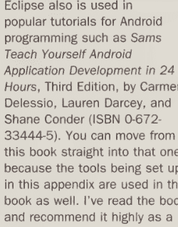

该包被封装成一个 ZIP 文件，其中包含一个 `eclipse` 文件夹、一个 `android` 文件夹和一个名为 **SDK Manager** 的程序。没有安装程序来引导你在计算机上完成设置过程。`eclipse` 文件夹存放运行 Eclipse 所需的所有文件。`android` 文件夹包含 Android SDK，而 **SDK Manager** 是你将用于管理 SDK 并安装新版本的程序。

解压缩包后得到一个 `eclipse` 文件夹、一个 `android` 文件夹和一个名为 **SDK Manager** 的程序。没有安装程序来引导你在计算机上完成设置过程。由于 `eclipse` 文件夹包含了运行 Eclipse 所需的所有文件。

将压缩包放在一个你存放程序的 Eclipse 文件夹中。在 Windows 系统上，将其放在 `Program Files (x86)` 文件夹中。解压 `eclipse` 文件夹、`android` 文件夹和 **SDK Manager**，并将这三个文件都放在 `eclipse` 文件夹中。

解压后，进入你创建的 `eclipse` 文件夹，为 Eclipse 应用程序创建一个快捷方式，并将其放在使用程序的地方，如桌面或任务栏。

### 安装 Android 插件

Eclipse IDE 支持多种编程语言和技术，但并非所有功能都能立即支持。IDE 通过插件进行增强以提供你所需的功能。

第一次运行 Eclipse 时，它必须设置插件以将 IDE 与 Android SDK 集成。插件会在 IDE 界面上添加与 Android 相关的菜单命令，并使其能够创建 Android 应用。为了实现这一点，必须以管理员权限运行 Eclipse。这在 Windows 7 或 Windows 8 上默认不会发生，因此你不能通过点击运行它。相反，请右键点击快捷方式并选择“以管理员身份运行”。

Eclipse 将自动设置 Android 并显示带有“新建应用程序”按钮和若干学习更多 Android 编程链接的欢迎界面。

你应该定期检查 Eclipse 和 Android SDK 的新更新。随着新手机和其他设备的上市，Android 的发展速度极快，SDK 必须支持它们。

选择菜单命令 **Help**、**Check for Updates** 来查看 Eclipse 是否已更新。

选择 **Window**、**SDK Manager** 来运行 Android SDK Manager，它会查找 SDK 更新。管理器会显示你需要安装的特定包的复选框，如图 D.1 所示。某些包会被选中进行更新，这意味着管理器建议安装它们。听从该建议。当你勾选了想要的包并取消勾选不需要的包时，点击 **Install Packages**（安装包）。

在 SDK 更新完成后，可能会被要求关闭 SDK Manager 并检查 Eclipse 更新。

> 如果更新过程出现任何错误，特别是下载文件时出现“拒绝访问”问题，请关闭 Eclipse 并再次以完全管理员权限运行。这通常可以解决该问题。

### 设置 Android 开发环境

图 D.1

为 Android SDK 安装新包。

| 名称 | 版本 |
|---|---|
| 开发者工具 | 22.0.1-20130523001-08705 |
| Android SDK | 22.0.1-20130523001-08705 |
| Android 开发工具 | 22.0.1-20130523001-08705 |
| Android 历史查看器 | 22.0.1-20130523001-08705 |
| OpenGL ES 追踪器 | 22.0.1-20130523001-08705 |
| NDK 插件 | 22.0.1-20130523001-08705 |

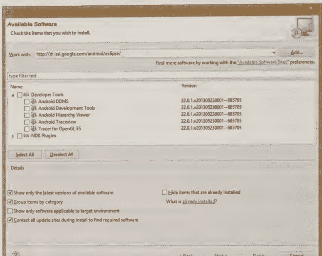

### 设置你的手机

Android SDK 包含一个模拟器，它可以像 Android 手机一样运行你创建的程序。这在你编写应用时非常有用，因为你可以在测试环境中让它运行；但是，在某个时刻，你需要查看它在实际的 Android 手机（或其他设备）上的运行情况。

你可以通过电脑的 USB 连接将使用 SDK 编写的应用部署到 Android 设备上。使用与在设备之间传输文件相同的线缆即可。

连接线缆之前，你必须通过以下步骤在手机上启用 USB 调试：

- 运行手机上的“设置”应用，它通常是主屏幕或应用应用列表之一。
- 运行“设置”应用，选择“应用程序”（如有必要），寻找“开发”或“开发者选项”按钮。点击它，然后勾选“USB 调试”框。


## 设置你的手机

其他设备可能在设置的其他地方有此选项。名称类似于 USB 连接模式、USB 调试等。`http://developer.android.com` 的 Android 网站提供了关于如何为不同 Android 设备设置此项的文档。

将 USB 线的一端连接到电脑，另一端连接到手机。设备顶边缘应该出现一个类似小虫的 Android 图标，与时间以及连接条图标和电量图标并排。

下拉顶栏。你应该能看到“USB 调试已连接”和“USB 已连接”的消息（参见图 D.2）。

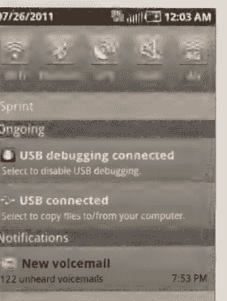

> 注意：在 Android 4.2 及更高版本上，“开发者选项”可能会被隐藏。要使其可见，选择“设置”，查看“关于手机”，并连续点击七次“构建版本”。

图 D.2 在 USB 调试模式下的 Android 手机。

这设置了你的手机，但你的电脑也可能需要配置才能连接到设备。如果你从未通过 USB 线连接到手机，请检查你的手机文档以了解如何操作。你可能需要从手机附带的光盘或制造商的网站安装驱动程序。

在 Windows 上，`Android SDK` 在 `Eclipse` 内部运行，你可以使用它来下载各种手机和其他设备的 USB 驱动程序以及与你的设备相关的其他包。选择 `Window` (窗口) -> `Android SDK Manager` 来查看可用内容。

## 附录 D：设置 Android 开发环境

在第 24 小时“编写 Android 应用”中，你将使用 Android 开发工具来创建和运行 Android 应用。如果一切设置正确，它应该在模拟器和 Android 手机上都能正常运行。

Android 官方文档在教程 `http://developer.android.com/training/basics/firstapp` 中提供了更多关于如何设置手机的指导。

## 索引

## 数字

20 图形, 64

弧, 364-365, 373

圆, 364

椭圆, 364

线, 362

`PiePanel` 应用, 355-366

`PieJava` 源码, 370

`PieSlice` 类, 367-368

矩形, 363

## 符号

`$` (美元符号), 64

`\` (反斜杠), 79

`{` (大括号), 19-20, 59, 94, 104

`[` (中括号), 72

`-` (减法运算符), 67

`/` (除法运算符), 66

`*` (双引号), 64

`//` (双斜杠), 20

`==` (相等性运算符), 93

`=` (等号), 62

`/` (正斜杠), 330

`>` (大于运算符), 93

`<` (小于运算符), 92

`-` (减号), 66

`*` (星号运算符), 67

`\n` (换行符), 200

`%` (运算符), 67

`==` 运算符, 81

`|` (管道符), 282

`+` (加号), 66, 80-81

`?` (问号), 98

`:` (分号), 20, 26, 114

`'` (单引号), 61, 79

`[]` (方括号), 122

`//` (两个斜杠字符), 287

`_` (下划线), 64

# A

绝对程序, 40

抽象 Toolkit, AWT

访问控制, 定义, 154

`public` 方法, 158

`ActionListener`, 228

`actionPerformed()` 方法, 229, 305

`action()` 方法, 238

添加模拟器, 382

库, 414

`add()` 方法, 230

敏捷开发, 450

Android 应用

Android 虚拟设备, AVD

`AndroidManifest.xml` 文件

调试配置, 384

创建, 377-381

调试, 399

设计, 388

manifest 文件, 375-392

运行, 385-387

编写 Java 代码, 396

IDE, 457

`Eclipse`, 376

安装 `Eclipse`, 458

资源, 391

Android 设备

`Android Unleashed`, 450

数字签名, 35

内部类, 316-320

多线程, 36

多维数组, 125-126

字符, 62

排序, 126

浮点数变量, 63

上限, 24

行为, 36

错误, 315

职业机会, 453

回车符, 77

case

修改, 83

语句, 96

变量名, 64

类型转换, 141

定义, 141

目标, 141

对象, 143

源, 141

变量, 142

`catch` 语句, 303, 310

## close(method)

- `close()` 方法, 337

- 关闭流, 337

- 闭包, 321-326

- `NewRoot.java` 应用, 144

- `Nines` 应用, 109

- `NumberDivider.java` 应用, 283

- `PieCatalog.java` 应用, 290

- `PieFrame` 应用, 370

- `PiePanel.java` 代码, 369-370

- `PlanetWeight` 应用, 71

- `Playback.java` 应用, 196

- `plugin.yml`, 418

- `Point3D.class`, 183

- `PointTester.java` 应用, 184

- 字符串比较, 82

- 等于/不等于, 93

- 小于/大于, 92-93

- 编译语言，性能, 12 编译器

## code

- Android 应用, 396-401

- 注解，格式化, 346-348

- 代码列表

- `Battlepoint.java` 应用, 267

- `Benchmark.java` 应用, 116

- `BlankFilter.java` 应用, 50

- `CableMode.java` 类, 147

- `Calculator.java` 应用, 279

- `Catalog.class`, 315

- 关闭应用, 109

- `ColorSoliders.java` 应用, 323

- 商品程序, 97

- `Configurator.java` 应用, 341

- `ConfigWriter.java`, 338

- 定义, 8

- `javac`, 23-24

- 编译

- 应用, 22, 49

- Windows, 23

- 复杂的 for, 114-115

- 组件, 190, 247

- `PrimeFrame.java` 应用, 298

- `Root` 应用, 48

- `Saluton` 应用, 18, 21

- `Saluton` 应用, 193

- `SeameseCat.java` 应用, 147

- `SpaceRover.java` 应用, 125

- `SquareRoot.class`

- `SquareRouterServer.java`, 347

- `SquareRouterServerimperi.java` 应用, 354

- 安排, 209

- 按钮按钮, 195-196

- 字符语言, 249-250

- `ColorSoliders` 示例应用, 252

- 注册对象, 25

- 复选框

- 创建, 198-199

- 事件处理, 230

- 组合框, 199-200

- 创建, 203-208

- 禁用, 233

- 启用, 233

- `Console.class`, 336

- `Console.java`, 335

- `Credits` 应用, 85

- `CrazyHorse.java` 应用, 422

- `Crisis.class`, 213

- `Dice.java` 应用, 54

- `DSmodel.class`, 148

- `FontMapper.java` 应用, 272

- `FreeSpace.java` 应用, 207

- `Game` 程序, 94

- `Home` 应用, 289

- `IceCream.Scoop`, 427

- 应用, 432

- `Iader.java` 应用, 333

- `KeyValue.java` 应用, 232

- `LeaderActivity.java` 应用, 399

- `Lightning.java` 应用, 427

- `LinkRotator.java` 应用, 306

- `LootEvent.java` 应用, 235

- `ottoEvent.class`, 238

- `LottoMadison` 应用, 220, 240-242

- `LottoMadison` 应用, 218

- `Modern.java`, 147

- `NewCalculator.java` 应用, 281

- `NewFrame.java` 应用, 324

- `NewKeyValue.java` 应用, 319

## Eclipse

- `Eclipse`, 467

- 计算机速度，测试, 115-117

- 字符串字符串, 80

- 运算符 (`+`), 80-81

- `Candy, Shane`, 458

- 条件, 91

- `Clock` 应用代码, 101

- 块, 93-95

- 等于/不等于, 95

- 小于/大于, 92-93

- `if-else`, 95-96

- `switch`, 96

- 三元运算符 (`?`), 98

- 配置参数，读取/写入, 102

- `Configuration.java`, 342

- Androids (Android 设备), 382

- Debug Configurations, 384

- Minecraft 服务器, 405-407

- phones, 460-462

- 连接服务器, 410-412

- `Console` 应用, 336

- 常量, 66

- 构造方法, 159-160

- 包含, 190, 203

- `continue` 语句, 113

- 合约, WSDL, 351

- 控制访问控制, 155. 参见

- 访问控制

- 对象到变量, 141-144

- 变量到对象, 144

- 计数器

- 定义, 108

- 初始化, 108

- 计数字符字符串, 128-130

- `Crafttik`, 406-407

- `createFile()` 方法, 331

- `Creative Commons`, 334

- 凭据，查看, 84-86

- `Crisis` 应用, 213

- `currentThread()` 方法, 305

- 自定义属性, 395

## D

- `Darcy, Lauren`, 458

- 数据结构

- 列表, 263-268

- 哈希映射, 269-292

- 数据类型. 参见

- `Boolean`, 63-64

- `byte`, 62

- `char`, 61-62

- `long`, 63

- `short`, 62

- Debug Configurations, 384

- 调试

- Android 应用, 390, 399

- 定义, 9

- phones, 461

- 声明

- 数组, 122-162

- 类, 301-302

- `class` 语句, 18

- 子类, 175-184

- 方法, 195

- 类, 161

- 构造方法, 160

- 公共方法, 158

- 变量, 160

- `Boolean`, 63-64

- `char`, 61-72

- 类, 156

- 浮点数, 66

- 整数, 61

- `long`, 63

- `short`, 62

- 字符串, 61-72

- 递减运算符 (`-`), 67

- 递减方法, 67-69

- `default` 语句, 97

- `default.properties` 文件, 380

- 定义

- 类, 162-164

- 服务, 345

- 删除, 331

- 部署

- Android 应用, 387

- 应用, 424

## design

- 应用, 389-391

- 接口, 392-396

- 编程语言, 5

- 目标 (类型转换), 141

- Android 应用中的错误, 390

- 确定字符串长度, 83

- Java 开发历史, 31

- 开发工具, 4

- 对话框, Editor, 412

- `Dice` 程序, 53

- `Dice.java`, 54

- 数字签名, 35

- 禁用组件, 233

- 显示. 参见

- `displayEvent()` 方法 138-39

- 操作 (`/`), 111-112

- 可停靠工具, 253

- 停靠工具, 256

- 文档, 254

- Java 类, 52

- Swing, 261

- 美符号 (`$`), (`$`)

- 双引号 (`*`), 61

- 双斜杠 (`//`), 20

- `draw()` 方法, 62

- 弧, 364-375, 383

- 圆形, 364

- 线, 361-362

- 图表, 365

- `Javel` 源码, 370

- `PieSlice` 类, 367-368

- 形, 363

- `drawCount()` 方法, 363-364

## E

- Java 目录, 452

- `Eclipse`, 9

- Android-in, 376. 参见

- 项目, 388

- 编辑

- `NetBeans`, 444-446

- `NetBeans`, 447

- `File` 类, 330-331

- 语法错误, 9

## F

- 编辑

- `NetBeans`, 447-448

- `File` 类, 330-331

- 字符串, 381

- 语法错误, 9

- XML, 382

- `FileOutputStream` 对象, 399

- `FileOutputStream` 类, 336

- 转义码, 79-80

- 教育应用, 32

- 表达式, 70

- 元素, 122

- 事件处理, 227

- `FilePath.Separator`, 330

- `Ellipse2D` 类, 364

- 椭圆，绘制, 364

- `actionPerformed()` 方法, 229, 305-306

- 存在, 331

- `else` 语句, 95-99

- 组合框, 230

- 创建, 330

- 就机会, 453

- 事件监听器, 227-228

- 删除, 331

- `File` 类, 382-384

- `Lotto` 应用, 234-235

- 文件扩展名, `.class`, 26

- 启用组件, 233

- 关键字事件, 232

- 封装, 158

- 事件监听器, 227-328

- 无限循环, 118

- `ActionListener`, 228

- 读取流, 331-334

- `EndPoint` 类, 349

- `actionPerformed()` 方法, 229

- 重命名, 331

- 注解, 346-348

- 添加, 227

- 写入流, 336-337

- 创建, 345

- `Lotto` 应用, 234-238

- 填充方法, 363

- 等号 (`=`), 62, 65

- `EventListener`, 227-228

- `fillRect()`, 361-363

- 等于运算符 (`=`), 93

- `Overlong.mlp`, 333

- 在内部查找字符串, 84

- `equals()` / `getHashCode()`, 82

- 类, 333

- 标记错误 (Beans), 447

- 错误处理, 277

- 异常, 124, 132

- 浮点对象, 36

## ArrayOutOfBoundsException

- Android 数组, 390

- arrayoutofbounds, dega

- 错误, 9

- 异常, 124, 132

- `javac` 错误消息, 24

- 浮点对象, 36

- 无法解析符号消息, 23

- 浮点变量，声明, 61

- 捕获异常, 277-278

- `Exception`, 278

- `LayerLayout` 管理器, 192

- 多重异常, 277-278

- 文件夹, 389 文件, 282-290

- 多重异常，`Font` 类，应用, 359-360

- `try-catch` 块, 279-291, fts 272-276

- `try-catch finally` 块, 284

- 创建异常, 292

- 复杂的 for 循环, 114-115

- 内存错误, 292

- 空会话, 115

- 栈溢出, 292

- 退出, 112

- 抛出异常, 274-284

- 语法, 108-212

- 应用, 47-217, 222

- `try-catch` 语句, 303, 377-384

- 方法的行为, 157

- 执行异常, 8-9

- 按钮按钮, 195-196

- 已有对象, 177-158

- 复选框, 198-199

- 存在/方法, 331

- 类

- 退出循环, 12

- `NetBeans`, 444-446

- 表达式, 59-60, 70-72. 参见

- 变量, 156

## operators

- `Color` 类, 360

- 优势, 71

- 组合框, 199

- lamda, 参见

- 组件, 203-208

- 运算符优先级, 69-70

- `Font` 类, 359-360

- 扩展方法, 147, 175

- 扩展名 (文件), `.class`, 26

- `ErrorCorrectionModern` 类, 139

- 错误. 参见错误处理

# help 命令

- 内部类, 313-320

- 接口

- 注解, 346-348

- `JWT`, 189

- 端点接口, 345

- 标签, 198

- Minecraft 组: 405

    - 配置服务器, 405-407

    - 连接到服务器, 410-412

    - 创建, 412-421

    - 求解器故障排除, 407

- 对象, 136-149

    - `autobuxing/`, 145-146


# 索引

## 符号

- **正斜杠 (`/`) 字符**, 330
- **大于 (`>`) 运算符**, 93
- **小于 (`<`) 运算符**, 92-93
- **等于 (`==`) 运算符**, 93

## A

- **AWT (抽象窗口工具包)**, 189
    - 按钮, 创建, 195-196
    - 变化监听器, 249-250
    - 应用, 252
    - 将对象注册为, 29
    - 组合框, 198
    - 组件, 203-208
    - 定义, 227
- **actionPerformed() 方法**, 229, 239, 305-306
- **add() 方法**, 175, 203
- **addActionListener() 方法**, 228
- **addChangeListener() 方法**, 249
- **addComponent() 方法**, 253
- **addKeyListener() 方法**, 238
- **addListener() 方法**, 230
- **addSlice() 方法**, 368
- **addToEndOf() 方法**, 223
- **Android**, 41
    - 插件安装, 459
    - 游戏, 41
    - manifest 文件, 391-392
- **匿名类**, 312
- **数组**
    - 创建, 122
    - 列表循环, 180-182
    - 存储对象, 178-180
- **弧**, 364-365, 373
    - 绘制圆形, 364
    - 椭圆, 364

## B

- **BorderLayout**, 214-216
- **BoxLayout**, 215
- **按钮**, 创建, 195-196

## C

- **checkAuthor() 方法**, 164
- **ap() 方法**, 165-167
- **类**
    - 继承, 173-176
    - 构造函数, 160
    - 声明, 160
    - 匿名, 312
    - 初始化, 定义, 118
    - 内部类, 162-164
    - 应用, 313-316
    - 输入-集, 216-217
- **clearAllFields() 方法**, 238
- **close() 方法**, 377
- **颜色**, 359
    - RGB 数值, 361
    - 设置, 361
- **ColorSliders 示例应用**, 252
- **ComboBox (组合框)**
    - 创建, 199-200
    - 事件处理/禁用组件, 233
    - 事件监听器, 227-228
        - ActionListener, 228
        - actionPerformed() 方法, 229
        - 结束, 227
    - 帧, 225
- **命令**
    - `help`, 407
    - `java`, 499
- **组件**
    - 分离, 216
    - 变量显示, 21
- **构造函数**, 159
    - 声明, 160
    - 继承, 160
- **转换**, 141-142

## D

- **draw() 方法**, 362
- **drawRoundRect() 方法**, 364
- **drawString() 方法**, 157

## E

- **Eclipse**, 458
- **equals() 方法**, 82, 175
- **equalsIgnoreCase() 方法**, 83
- **错误**
    - 处理
    - 内存, 292
    - 逻辑, 9
    - 忽略异常, 272
- **事件处理**, 230
- **事件监听器**, 227-228
- **异常**, 忽略, 272

## F

- **fill() 方法**, 362
- **fillRect() 方法**, 363
- **fillRoundRect() 方法**, 363
- **FlowLayout**, 212
- **框架**, 79
- **帧**, 190
    - 向其添加组件, 195
    - 创建, 191
    - SalutionFrame 示例, 194
    - 尺寸, 192
- **函数/方法**, 153

## G

- **get() 方法**, 270, 397
- **getActionCommand() 方法**, 229, 239
- **getChar() 方法**, 231
- **getCode() 方法**, 231
- **getInsets() 方法**, 217
- **getInt() 方法**, 217
- **getKeyChar() 方法**, 231
- **getKeyTest() 方法**, 231
- **getName() 方法**, 231, 331
- **getPort() 方法**, 354
- **getProperty() 方法**, 340
- **getSecs() 方法**, 158
- **getSeconds() 方法**, 158
- **getSource() 方法**, 230, 249
- **getSquareRoot() 方法**, 348, 352
- **getState() 方法**, 230
- **getText() 方法**, 231
- **getTime() 方法**, 348
- **getUid() 方法**, 399
- **getURL() 方法**, 303
- **getValuesAdjusting() 方法**, 249
- **getVirusCount() 方法**, 166
- **GridLayout**, 213-214, 221
- **GUI (通用用户界面)**, 190, 247
- **Gosling, James**, 5, 31, 376, 441
- **图形**, 362
    - 应用, 232-242
    - 弧, 364-365, 373
    - 颜色, 359
    - 椭圆, 绘制, 364
    - 字体, 359
    - 图标, 255-256
    - 线, 绘制, 362
    - 矩形, 绘制, 363
- **图形代码**, 322

## H

- **哈希表映射**, 269-272
- **Hemrajani, Anil**, 450

## I

- **IDReader 地址**, 332
- **IDEs (集成开发环境)**, 9, 376, 441
    - IntelliJ IDEA, 9
    - NetBeans, 441, 443
- **if 语句**, 92-104
    - 块, 93
    - if-else, 95-96
- **ImageIcon() 方法**, 252-253
- **Imagelon() 方法**, 252-253
- **实现服务实现 Bean**, 348-349
- **增量变量**, 67-69
- **indexOf() 方法**, 84
- **无限循环**, 115, 118
- **继承**, 139, 170, 174-175
    - 方法: `add()`, `equals()`, `setBackground()`, `setLayout()`
- **输入/输出 (I/O)**, 329
    - 缓冲输入, 334-339
    - 定义, 329-330
    - 读取数据, 331
    - 写入数据, 336-337
- **安装**, Android 插件, 459
- **Intent() 方法**, 398
- **解释型语言**, 8, 12
- **解释器**, 332
- **ItemListener 接口**, 230
- **itemChanged() 方法**, 230
- **迭代**, 109

## J

- **JApplet 类**, 173-174
- **Java**
    - 类, 445
    - 文档, 451
    - 库, 551
    - 教育应用, 32-33
    - 历史, 31
    - 开发包 (JDKs), 442
    - 编译器, 23-24
    - 命令, 499
    - 网站, 450-451
    - 插件, 53
- **Java EE (JEE)**, 442
- **Java ME (JME)**, 442
- **Java SE (JSE)**, 442
- **java.xml**, 395
- **JAX-WS 库**, 354
- **JButton 对象**, 197
- **JButton() 方法**, 253
- **JCheckbox 类**, 198-199
- **JComboBox 类**, 199-200
- **JFrame 类**, 191
- **JLabel 类**, 197-198, 247
- **JME (Java Mobile Edition)**, 442
- **JPanel 类**, 203
- **JScrollPane() 方法**, 221
- **JSlider() 方法**, 248
- **JTable() 方法**, 253
- **JVMs (Java 虚拟机)**, 33, 408

## K

- **键盘事件**, 230-232
- **KeyListener 接口**, 230-232
- **KeyView 应用**, 232
- **关键字**, `int`, 61

## L

- **Label() 方法**, 197
- **标签**
    - 创建, 197-198
    - 写入, 197-213
    - 滑块, 248
- **lambda 表达式**
- **LeaderActivity 应用**, 396-400
- **length() 方法**, 83, 331
- **Line2D 类**, 360-362
- **线**, 绘制, 362
- **链接字符串**, 81-82
- **列表**, 选择, 230
- **listFiles() 方法**, 331
- **Lodomass 应用**, 234-238
- **循环**, 107
    - 数组列表, 180-182
    - 基准测试, 115-117
    - do-while, 111-112
    - 退出, 112
    - for 循环, 104-110
    - 复杂 for 循环, 114-115
    - 计数器变量, 108
    - 空方法, 115
    - 语法, 108-119
    - 命名, 113-114
    - 嵌套, 113
    - while, 110-111

## M

- **manifest 文件**, Android 应用, 391-392
- **maps**, 哈希, 269-272
- **matchedOne() 方法**, 239
- **Matz, Kevin**, 8
- **方法**, 153
    - 参数, 159
    - 行为, 创建, 257
    - 声明, 161
    - 定义, 82
- **内存错误**, 292

## N

- **NetBeans**, 441, 443
- **newFile() 方法**, 331

## O

- **OOP (面向对象编程)**
- **对象**
    - 存储, 178-180
    - 将对象注册为监听器, 249

## P

- **面板**, 203
    - 区域, 200-202
    - 字段, 197-198
    - 创建, 203
- **Piel 应用方法**, 366
- **PieJar.java 源码**, 370
- **PieSlice 类**, 367-368
- **矩形**, 绘制, 363

## R

- **Runnable 接口**, 295
- **资源**, 389-391

## S

- **SalutionFrame**, 194
- **Service Implementation Bean**, 348-349
- **setBackground() 方法**, 175
- **setLayout() 方法**, 175, 212
- **setLayoutManager() 方法**, 195
- **滑块**, 248
    - 水平, 248
    - 标签, 248
- **SOAP**, 354
- **Swing**, 189
    - 表格, 256-260
- **子类**, 182-184

## T

- **表格**, 256-260
    - 可停靠, 253
- **文本区域**, 200
- **文本字段**
    - 创建, 197-198
    - 写保护, 223
- **工具栏**, 252-253
    - 创建, 253-255
    - Tool 示例应用, 254-256
- **线程**, 296-297
    - currentThread() 方法, 305

## V

- **变量**, 143, 144, 153
    - 增量, 67-69
    - 循环计数器, 108
    - long 类型, 63
    - Long 对象, 270

## W

- **Web 服务**, 353-355
- **窗口**, 190-195
- **while 循环**, 110-111

## 人物

- **Gosling, James**, 5, 31, 376, 441
- **Hemrajani, Anil**, 450
- **Matz, Kevin**, 8

## 书籍/资源

- **The Java EE 6 Tutorial, 第四版**, 449
- **Java Phrasebook**, 449
- **Java 网站**, 450-451
- **游戏网站**, 452
- **IceRocket**, 452
- **IT 机会**, 453
- **知识共享许可证**, 334


## 索引

- `setLookAndFeel()`, 194
- `setProperty()`, 340
- `setSecs()`, 158
- `setSize()`, 192
- `setText()`, 244
- `setTitle()`, 192
- `setVisible()`, 193
- `shot()`, 269
- `showWindowCount()`, 161
- `sleep()`, 296
- `sort()`, 127
- `sqrt()`, 48
- `start()`, 304
- `stateChanged()`, 249
- `stop()`, 301
- `substring()`, 334
- `System.out.println()`, 445
- `tauUser()`, 159
- `setText()`, 200
- `toCharArray()`, 124
- `toLowerCase()`, 231
- `toUpperCase()`, 83, 87
- 变量, 161-162
- `voidKeyPressed()`, 231
- `voidKeyReleased()`, 231
- `voidKeyTyped()`, 231
- `write()`, 337

## Minecraft 模组

- `create()`, 412-421
- 格式化, 405
- 服务器
- 构建, 405-407
- 连接, 410-412
- 故障排除, 407-412

## N

## 命名规范

- 循环, 113-114
- 变量, 64, 74
- 文件扩展名, `.class`, 266
- 资源, 381
- NASA, 36

## 导航

- Android 应用, 379-380
- 程序, 8-9

## 嵌套

- 类, 162-164
- 循环, 113
- NetBeans, 9
- 应用, 441
- 安装, 10, 441
- 项目, 422-444
- 运行, 446-447
- 故障, 447-448
- NetBeans 字段指南, 441
- NetBeansProjects, 443
- 新项目向导, 381
- 新文件向导, 172
- 新项目向导, 443
- `new` 语句, 122, 159
- 新字符 (`\n`), 70, 200
- `nextLine()` 方法, 53
- NumberDivider, 282-284
- `NumberFormatException`, 281, 285
- `nerGone()` 方法, 238
- 数值变量, 62-63
- 减号 (`-`), 66
- Mod 类, 137
- 修改字符串, 83
- 取模运算 (`%`), 67
- Monitor 对象, 137
- 监控输入, 320
- 鼠标点击, 335-306
- 维数组, 125-126
- 乘法运算符 (`*`), 67
- 等待任务, 295
- 多线程, 36, 295
- `paint()`, 176
- `parseLine()`, 144, 169
- 打印机, 72, 178, 157, 444
- `public`, 158
- `readLine()`, 336
- `renameTo()`, 331
- 返回值, 87, 158
- `run()`, 297, 304-305
- `setBackground()`, 175
- `setDefaultCloseOperation()`, 192
- `setEditable()`, 200, 223
- `setEnabled()`, 233
- 
- 数组列表, 263-268
- 属性, 136, 153
- 装箱/拆箱, 145-146
- 行为, 136
- 转换, 143
- 类, 136
- 闭包, 321-326
- 创建, 138-149
- 扩展, 177-178

## Python

- 473

## P

## 变量

- 哈希映射表, 269-272
- 实例, 139-141, 173-175
- 循环, 180-182
- Modern, 137
- Monitor, 137
- PieChart, 166-237
- 实例, 158
- 运行, 309
- 共享, 170
- 存储, 178-210
- `this` 语句, 164-165
- 输出 I/O
- `@Override` 注解, 347
- 覆盖方法, 175-176
- 后缀操作, 67
- 优先级, 69-70
- 前缀操作, 67
- 打印字符串, 79-80
- `pack()` 方法, 192
- Package 浏览器, 应用, 380
- 包, 155
- Android SDKs, 安装, 459
- `javax.xml.parser`, 349
- JWS 库, 354
- PageCatalog 应用, 288-291
- PageTitle, 392
- `paint()` 方法, 覆盖, 176
- 面板, 创建, 203
- 解析方法, 144, 169
- 向方法传递参数, 159
- 粘贴字符串, 80-82
- 百分号 (`%`), 67
- 百分比, 206
- 性能, 解释型语言, 12
- `print()` 方法, 72, 187, 454
- 私有类, 150
- 私有变量, 155
- 程序.`System.out.print()`, 72
- Profile 对话框, 412
- 程序列表. 另见
- 程序员技能, 4
- 编程
- 转换, 134-144
- 解码, 153-155
- 私有, 155
- `onCreate()` 方法, 397
- 在线能力, Stack Overflow, 452
- OOP (面向对象编程), 136, 190
- 优势, 136-137
- 调试, 137
- 封装, 158
- 实例, 139-141, 150, 173-175
- 对象, 创建, 143
- Android, 457
- 配置目的, 460-462
- Eclipse, 458
- 插件, 459
- OOP. 另见
- 优势, 136-137
- 工具 安装, 10
- 选择, 9
- `+=`, 81
- 加法运算符 (`+`), 66
- 拼接运算符, 80-81
- 递增运算符 (`++`), 67
- Point 类, 182, 268
- 创建, 183-184
- Oracle, 25
- Oracle Network for Java, 450
- 顺序, 265-270
- 组织资源, 389-391
- 发布 Web 服务, 349-350

## Q

- 服务器, 405-407
- 连接, 410-412
- 故障排除, 407-412
- QName, 353
- 问号 (`?`), 98
- 双引号 (`"`), 61
- 单引号 (`'`), 61

## R

- Random 类, 55
- 读取控制台, 35
- 读取配置, 339-342
- 文件, 334
- 运行方法, 336
- Android 应用, 379-380
- Java 运行, 41
- 模组, 405-407
- NetBeans, 422-444
- 程序, 24-25

## S

- `setSize()`, 192
- `setText()`, 244
- `setTitle()`, 192
- `setVisible()`, 193
- Ready, 8
- 真实 Java, 32
- 推荐阅读, 449
- Rectangle2 类, 363
- 绘制, 363
- RGB (红，绿，蓝) 颜色系统, 361
- `this` 语句, 16
- Salution, 16
- 启动, 16-18
- 字符串, 查看, 78
- TextDisplay, 49
- 故障排除, 23
- 项目位置文本框, 443
- 项目选择对话框, 384
- Android, 460-462
- Java 上运行, 41
- PHP, 5
- 饼图创建, 365-370
- 查看, 372
- PieChart 对象, 136-137
- PieFrame 应用, 371-372
- PiePanel 对象, 365-370
- PieLane 源码, 370
- PieSlice 类, 367-368
- PieSlice 槽, 367-368
- PlanetWidget 应用, 71
- 平台独立性, 33
- Java 播放, 196
- Android 插件, 376
- 安装, 459
- 项目, 379-380
- NetBeans, 422-444
- 属性
- 配置，读写, 339-342
- 自定义, 395
- Properties 对象, 340
- 保护变量, 155
- 公共方法, 158
- 加号
- 加法运算符 (`+`), 66
- 拼接运算符, 80-81
- 递增运算符 (`++`), 67
- Point 类, 182, 268
- 创建, 183-184
- Oracle, 25
- Oracle Network for Java, 450
- 顺序, 265-270
- 资源组织, 389-391
- 发布 Web 服务, 349-350

# Swing

475

- SOAP 消息, 354
- `software.exe`; 程序
- 开发工具包 Kits. 它们的 SDK
- `sort()` 方法, 127
- 排序数组, 126-127
- 源代码列表. 代码清单
- SourceForce, 39
- 源码 (类型转换), 141
- 代码中的间距, 26
- Spartacus Java 类, 45
- 特殊字符, 转义码, 79-80
- `sqrt()` 方法, 48
- 平方 `squares` (()), 122
- RootServerClient 应用程序, 353-355
- RootServerApplication Web 服务, 345
- RootServerPublisher 应用程序, 374
- RGB (标准 GB), 361
- 栈溢出, 292, 452
- Standard GB, 361
- `start()` 方法, 304
- 启动程序, 16-18
- 线程, 304
- 变量, 65
- `stateChanged()` 方法, 249
- 语句
  - 基准测试, 115-117
  - 块, 19-50
  - 大括号 (`{}`) 符号, 20
  - `break`, 97, 104, 112
  - `case`, 96
  - `catch`, 310
  - `class`, 18-139
  - `continue`, 113
  - `default`, 27
  - 定义, 6
  - 示例, 7
  - 表达式, 60, 70-72
  - `extends`, 147, 175
  - `float`, 61
  - `if`, 92, 104
    - 块, 93-95
    - 等于/不等于比较, 93
    - 小于比较, 92-93
    - `if-else`, 95-97
  - `int`, 61
- 循环
  - 定义, 107
  - `do-while`, 111
  - 退出, 112
  - `for`, 108-115
  - 死循环, 118
  - 命名, 113-114
  - 嵌套, 113
  - `while`, 110-111
  - `new`, 122-125
  - `public`, 138
  - `static`, 156, 161
  - `super`, 177, 183
  - `switch`, 96
  - `this`, 164-175, 186
  - `try` 块, 274-284, 290-291, 303
  - `try-finally` 块, 284
- `vlt`, 157
- `static` 语句, 156-161
- `static` 变量, 156
- `stop()` 方法, 301
- 停止线程, 309
- 存储
  - 数组, 121
  - 替代方案, 123-126
  - 解码, 122-123
  - 多维, 125
  - `sort`, 126-127
  - 字体, 272
  - 对象, 178-182
  - 数组列表, 263-268
  - 哈希映射, 269-272
  - 字符串中的文本, 77
  - 变量, 20-65
- 流, 329-300
  - 缓冲输入流, 334-339
  - Console 应用程序, 336
  - ReadConsole 应用程序, 335
  - 定义, 329-330
  - 读取数据, 331-334
  - 写入, 336-337
  - String 类型, 20
  - 字符串, 77
    - 写入, 81-82
    - 数组, 122
    - 大小写, 83, 87
    - 字符, 128-130
    - 比较, 82
    - 拼接, 80
    - 定义, 61, 77
    - 等于/不等于比较, 93
    - 在其他字符串中查找, 84
    - 长度, 238
    - 大于比较, 92-93
    - 查看程序, 78
    - 资源, 231
    - 搜索, 84
    - 特殊字符, 79-80
    - 文本, 77
    - 变量, 61-62
    - 声明, 78
    - 链接, 82
    - `string` 文件, 382
  - Stroustrup, Bjarne, 5
  - 子类, 140, 175-184
  - `substring`, 334
  - 减法操作, 66
  - Sun 网站, 29, 414-415, 450
  - `super` 语句, 177, 183
  - 超类, 140
  - Swing, 189
    - 按钮, 195-196
    - 监听器, 249-250
    - Color 应用程序, 252
    - 注册对象, 249
    - 复选框, 创建, 198-199
    - 事件处理, 230
    - 下拉框, 创建, 199-200
    - 事件处理, 230
    - 文档, 261
    - 启用/禁用组件, 233
    - 事件监听器, 227-228
    - ActionListener 接口, 228
      - `actionPerformed()` 方法, 229
    - 添加, 227
    - Lotus 应用程序, 234-236
    - 列表, 252-255
    - 创建, 253
    - Tool 应用程序, 254-256
    - 标签, 创建, 197-198

# Swing, 476

- 布局管理器, 211-213
- BorderLayout, 214-216
- BoxLayout, 215
- FlowLayout, 212
- GridLayout, 213-214
- 滚动面板, 203
- 添加组件, 202
- 创建, 201
- 滑块, 248
- 标签, 248
- 文本区域, 200
- 文本字段, 201
- 写入, 223
- 工具, 252
- 可停靠工具, 253
- Tool 应用程序, 254-256
- `switch` 语句, 96
- `System.out.println()` 方法, 72
- `System.out.println()` 过程, 72
- Thread 类, 295
- 线程, 295
- applets, 301
- 类, 296-300
- 创建, 296-300
- 多线程, 324
- Runnable 接口, 295
- 运行, 304-305
- 减速, 296
- 启动, 304
- 停止, 309
- Thread 类, 295
- 抛异常, 278, 284-286
- `throw` 语句, 285
- 时间, 显示, 446
- 标题, 192
- T-Mobile, 375
- `toCharArray()` 方法, 124
- `toLowerCase()` 方法, 83
- Tool 应用程序, 254-256
- 创建, 253-255
- 停靠, 256
- `try-catch` 机制, 303
- `try-catch-finally` 块, 284
- Try.java 列表, 184
- Tourist, 453
- 双斜线字符 (`//`), 287
- 类型
  - Boolean, 63-64
  - `char`, 61-62
  - `short`, 62
  - 流, 330
  - 类型值 (变量), 类型转换, 142
- Udoychenko, Aleksey, 40
- 装箱, 145-146
- 下划线 (`_`), 64
- 哥伦比亚大学, 32
- 数组上限, 124
- 大写, 83, 87
- 用户事件, 227
- 表格, 256-260
- 标签, 转义码, 79
- `User()` 方法, 159
- 操作符 (`?`), 98
- ActionListener 接口, 228
- 下拉框, 230
- 组件, 启用/禁用, 233
- 处理, 229
- 键盘事件, 230-232
- Lotus 应用程序, 233-239
- Points3D 类, 184
- SquareRootServerPublisher 应用程序, 351
- Text. 见文本区域, 200
- Color 类, 360


# 索引

## 符号
- `//` (双斜线字符), 287
- `\` (大括号符号), 20

## A
- **ActionListener 接口**, 228
  - `actionPerformed()`, 229
- **Android 应用程序**, 390
- **applets**, 301
- **应用程序**, 9, 23
- **数组**
  - 存储, 121
  - 替代方案, 123-126
  - 解码, 122-123
  - 多维, 125
  - 排序, 126-127
  - 上限, 124
- **数组列表**, 263-268
- **异常**, 227-279
- **装箱**, 145-146

## B
- **BlinkerFile**, 250
- **BorderLayout**, 214-216
- **BoxLayout**, 215
- **break 语句**, 97, 104, 112
- **Bjarne Stroustrup**, 5

## C
- **case 语句**, 96
- **catch 语句**, 310
- **char 类型**, 61-62
- **class 语句**, 18-139
- **Class 类**, 18-139
- **Color 类**, 360
- **Color 应用程序**, 252
- **Console 应用程序**, 336
- **continue 语句**, 113
- **栈溢出**, 292, 452
- **流**
  - 缓冲输入流, 334-339
  - 定义, 329-330
  - 读取数据, 331-334
  - 写入, 336-337
  - 类型, 330

## D
- **default 语句**, 27
- **开发**, 4
- **开发工具包 (SDK)**, 10

## E
- **extends 语句**, 147, 175
- **表达式**, 60, 70-72

## F
- **Field 类**, 197-228
- **Field (字段)**, 197-228
- **float 类型**, 61
- **FlowLayout**, 212
- **Font 类**, 359-360
- **for 循环**, 108-115

## G
- **GridLayout**, 213-214

## H
- **哈希映射**, 269-272

## I
- **if 语句**, 92, 104
  - 块, 93-95
  - 等于/不等于比较, 93
  - 小于比较, 92-93
  - if-else, 95-97
- **安装**, 10
- **int 类型**, 61

## J
- **JVMs**, 408

## K
- **键盘事件**, 230-232

## L
- **标签**
  - 创建, 197-198
  - Swing, 248
- **布局管理器**, 211-213
- **列表**, 252-255
  - 创建, 253
- **List 接口**
  - `of()`, 127
- **Lotus 应用程序**, 234-236
- **循环**
  - 定义, 107
  - do-while, 111
  - 退出, 112
  - 死循环, 118
  - 命名, 113-114
  - 嵌套, 113
  - while, 110-111

## M
- **Minecraft**, 需要
- **多线程**, 324

## N
- **NetBeans**, 347
- **new 语句**, 122-125

## O
- **对象**
  - 存储, 178-182
  - 注册, 249

## P
- **Points3D 类**, 184
- **public 语句**, 138
- **粘贴到字符串**, 822

## R
- **ReadConsole 应用程序**, 335
- **RGB (标准 GB)**, 361
- **RootServerApplication Web 服务**, 345
- **RootServerClient 应用程序**, 353-355
- **RootServerPublisher 应用程序**, 374
- **Runnable 接口**, 295
- **运行**, 304-305

## S
- **SDK**, 参见开发工具包
- **选择**, 9
- **short 类型**, 62
- **滚动面板**, 203
- **排序数组**, 126-127
- **sort()**, 127
- **SourceForce**, 39
- **源代码列表**, 39
- **源码 (类型转换)**, 141
- **Spartacus java 类**, 45
- **特殊字符**, 转义码, 79-80
- **sqrt()**, 48
- **平方**, 122
- **Standard GB**, 361
- **start()**, 304
- **启动程序**, 16-18
- **stateChanged()**, 249
- **static 语句**, 156-161
- **static 变量**, 156
- **stop()**, 301
- **停止线程**, 309
- **存储**
  - 字体, 272
  - 字符串中的文本, 77
  - 变量, 20-65
- **String 类型**, 20
- **字符串**
  - 写入, 81-82
  - case, 83, 87
  - 字符, 128-130
  - 比较, 82
  - 拼接, 80
  - 定义, 61, 77
  - 等于/不等于比较, 93
  - 在其他字符串中查找, 84
  - 长度, 238
  - 大于比较, 92-93
  - 查看程序, 78
  - 资源, 231
  - 搜索, 84
  - 文本, 77
  - 变量, 61-62
  - 声明, 78
  - 链接, 82
  - `string` 文件, 382
  - `toCharArray()`, 124
  - `toLowerCase()`, 83
  - `topUpperCase()`, 83
- **子类**, 140, 175-184
- **substring()**, 334
- **subtraction operation (减法操作)**, 66
- **Sun 网站**, 29, 414-415, 450
- **super 语句**, 177, 183
- **超类**, 140
- **Swing**, 189, 475-476
  - 按钮, 195-196
  - 监听器, 249-250
  - 复选框创建, 198-199
  - 事件处理, 230
  - 下拉框创建, 199-200
  - 文档, 261
  - 启用/禁用组件, 233
  - 事件监听器, 227-228
  - 滑块, 248
  - 文本区域, 200
  - 文本字段, 201
  - 写入, 223
  - 工具, 252
  - 可停靠工具, 253
  - **布局管理器**, 211-213
  - **BorderLayout**, 214-216
  - **BoxLayout**, 215
  - **FlowLayout**, 212
  - **GridLayout**, 213-214
- **switch 语句**, 96
- **System.out.println()**, 72

## T
- **Thread 类**, 295
- **线程**, 295
  - 类, 296-300
  - 创建, 296-300
  - 减速, 296
  - 启动, 304
  - 停止, 309
- **throw 语句**, 285
- **抛出异常**, 278, 284-286
- **时间显示**, 446
- **标题**, 192
- **T-Mobile**, 375
- **toCharArray()**, 124
- **toLowerCase()**, 83
- **Tool 应用程序**, 254-256
  - 创建, 253-255
  - 停靠, 256
- **topUpperCase()**, 83
- **Tourist**, 453
- **try 块**, 274-284, 290-291, 303
- **try-catch 机制**, 303
- **try-catch-finally 块**, 284
- **try-finally 块**, 284
- **Try.java 列表**, 184
- **类型**
  - Boolean, 63-64
  - char, 61-62
  - short, 62
  - 流, 330
  - 类型值 (变量), 类型转换, 142
- **类型转换**, 141-142

## U
- **Udoychenko, Aleksey**, 40
- **下划线**, 64
- **User()**, 159
- **用户事件**, 227
- **哥伦比亚大学**, 32

## V
- **vlt**, 157
- **变量**, 65
  - 存储, 20-65

## W
- **while 循环**, 110-111
- **写入**, 223

## 代码示例
```
if (condVar > someVal) {console.log("xxx")}
```


- 操作符 `?`, 98
- `ActionListener` 接口, 228
- 下拉框, 230
- 组件, 启用/禁用, 233
- 处理, 229
- 键盘事件, 230-232
- Lotus 应用程序, 233-239
- `Points3D` 类, 184
- `SquareRootServerPublisher` 应用程序, 351
- Text. 见文本区域, 200
- `Color` 类, 360
- 字段, 197-228
- `Font` 类, 359-360
- 粘贴到字符串, 822
- 字符串
  - 开发, 4
  - 安装, 10
  - 选择, 9
  - `topUpperCase()`, 83
  - 故障排除, 参见错误
- Android 应用程序, 390
- 应用程序, 9, 23
- `BlinkerFile`, 250
- 异常, 227-279. 参见异常
- JVMs, 408
- Minecraft 需要
- NetBeans, 347
- 异常, 227-279. 参见异常
- Swing, 475

# informIT.com 信赖的技术学习源

**InformIT** 是培森（Pearson）旗下的品牌，也是全球领先技术出版社的在线平台。它是您可靠且优质的内容与知识的来源，为您提供访问技术社区顶尖品牌、作者和贡献者的机会。

+ Addison-Wesley Cisco Press EXAM/CRAM IBM Press. QUEUE PRENTICE HALL SAMS Safari*

# 在 InformIT 学习

正在寻找关于新技术的书籍、电子书或培训视频吗？正在寻找及时且相关的信息和教程吗？正在寻找专家意见、建议和技巧吗？**InformIT 有您的解决方案。**

- 通过订阅各种新闻邮件，了解新书发布和特别促销活动。
- 访问 `informit.com/newsletters`。
- 在 `informit.com/podcasts` 获取专家提供的免费播客。
- 在 `informit.com/articles` 阅读最新的作者文章和示例章节。
- 在 `safari.informit.com` 的 Safari Books Online 数字库中访问数以千计的书籍和视频。
- 在 `informit.com/blogs` 从专家博客中获取技巧。

访问 `informit.com/learn` 探索获取最热门技术内容的所有方式。

# 您是 **IT** 人群的一员吗？

通过 RSS 订阅、Facebook、Twitter、YouTube 等平台与培森的作者和编辑联系！访问 `informit.com/socialconnect`。


# informIT.com 信赖的技术学习源

+ Addison-Wesley Cisco Press EXAM/CRAM IBM Press. QUEUE PRENTICE HALL SAMS Safari*

# Sams 自学系列

# 当您只花时间看答案时™

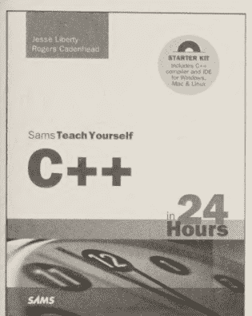

无论您的需求是什么，无论您的时间如何，都有一本适合您的 Sams TeachYourself 书籍。以 Sams TeachYourself 书籍作为指南，您可以以最短的时间快速掌握几乎任何新产品或技术——保证如此。

学习使用电脑完成新事物不应该是枯燥或耗时的。Sams Teach Yourself 让学习任何知识都变得快速、简单，甚至带点趣味。

# 24 小时掌握 C++

Jessie Liberty

Rogers Cadenhead

ISBN-13: 978-0-672-33331-6

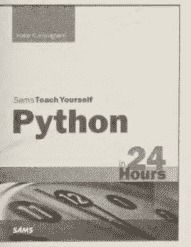
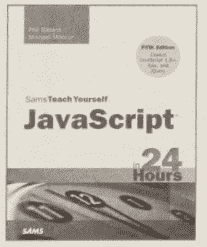
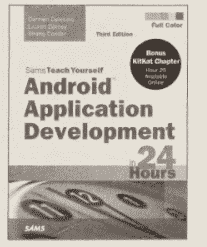
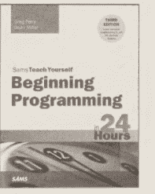

# 24 小时掌握 Python

Katie Cunningham

ISBN-13: 978-0-672-33687-4

# 24 小时掌握 JavaScript

Phil Ballard

Michael Conquer

ISBN-13: 978-0-672-33608-9

# 24 小时掌握 Android 应用开发

Carmen Delessio

Lauren Darcy

Shane Conder

ISBN-13: 978-0-672-33444-3

# 24 小时从入门编程

Greg Perry

Dean Miller

ISBN-13: 978-0-672-33700-0

所有 Sams Teach Yourself 系列的在线版均可通过 `safari.informit.com` 订阅获取。

# 24 小时掌握 Java SE 第版

只需 24 节每节一小时的课程，您就可以学习使用免费的 `NetBeans` 开发工具创建 Java 应用程序。

通过循序渐进的方法，人气作者 Rogers Cadenhead 将帮助您掌握创建桌面程序、Web 服务甚至是 Android 所需的技能和技术。

每节课都建立在已学知识的基础上，为您现实成功奠定坚实基础。

全彩色插图和清晰的步骤说明将直观地展示如何使用 Java 进行编程。

每章末尾的测试和练习帮助您检验知识。注释（Notes）、提示（Tips）和注意事项（Cautions）提供了相关信息、建议和警告。


Rogers Cadenhead 是一位作家、计算机程序员和 Web 开发者，编写了 23 本关于 Java 和网络相关主题的书籍，其中包括 Java。他维护着 Duget Resort 以及几个每年访问量巨大的热门网站。

在 `inform.com/register` 注册您的书籍，以便方便获取下载、更新和修正。

# 学习如何……

- 设置您的 Java 编程环境
- 在几分钟内编写第一个运行程序
- 控制程序的决策和行为
- 存储和处理信息
- 构建简单的界面
- 创建交互式 Web 程序
- 使用线程构建响应更好的程序
- 读写文件和 XML 数据
- 掌握面向对象编程的最佳实践
- 使用 `JAX-WS` 创建灵活操作的服务
- 利用 Java 闭包这一强大的新功能提升您的技能


ISBN-13: 978-0-672-33717-8

ISBN-10: 0-672-33717-7

$34.99 美元 / $36.99 加元

SAMS `informit.com/sams`

类别：编程

涵盖：Java 8

用户级别：初级-中级
