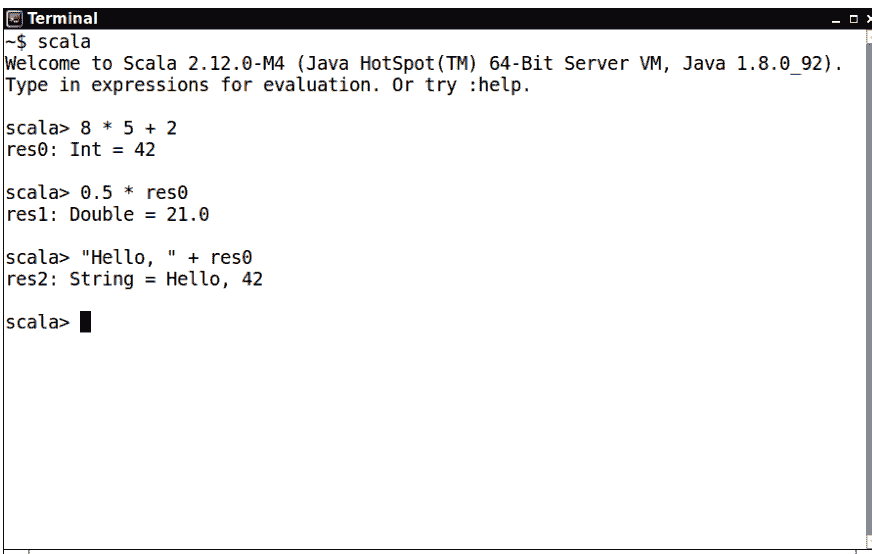
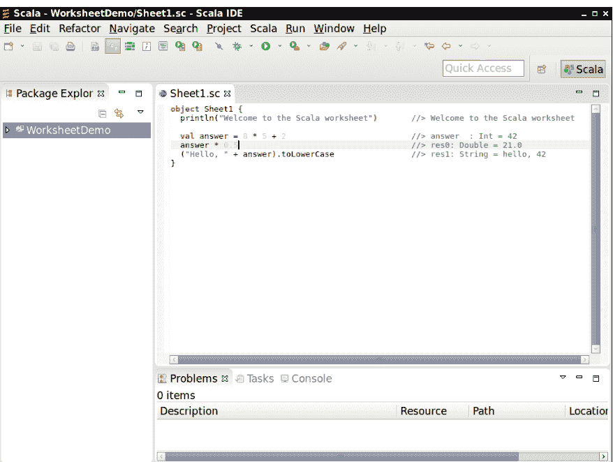
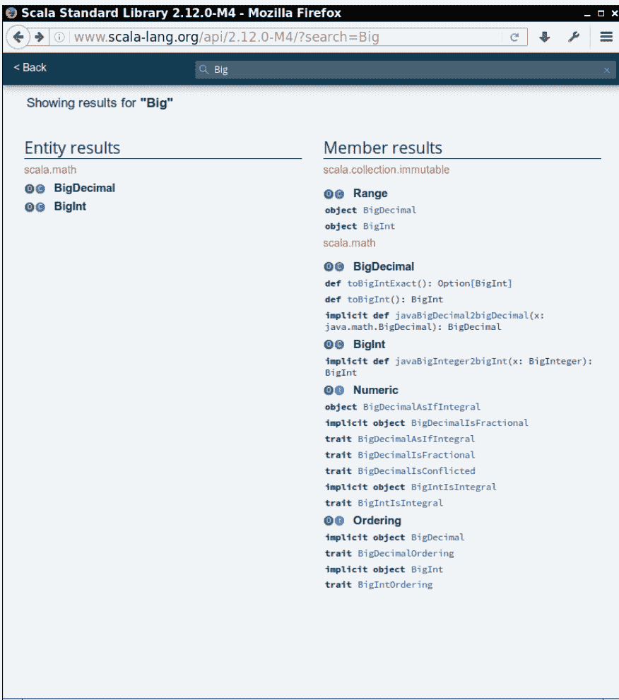
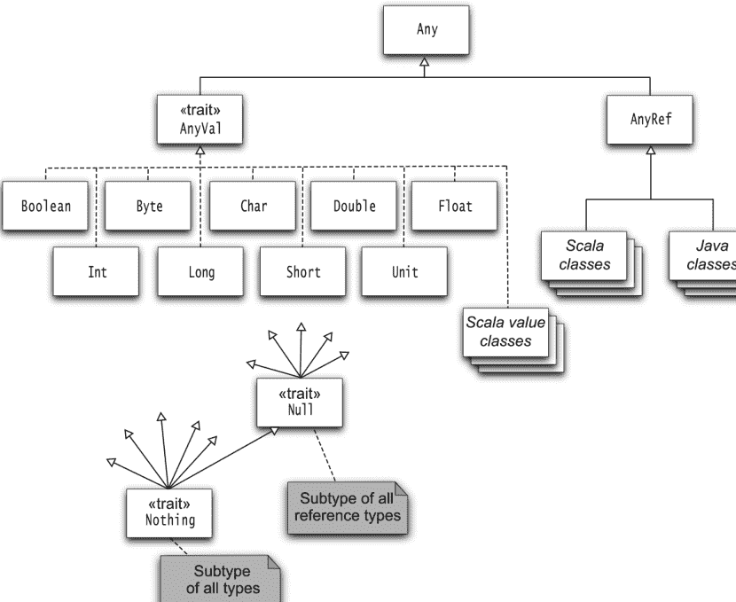
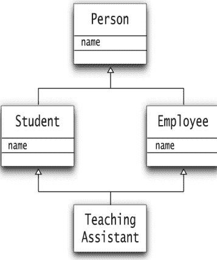
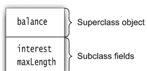
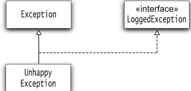
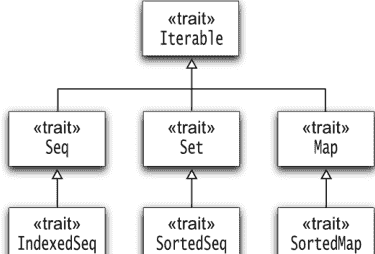

# Scala 快速入门（第2版）


> 献我的妻子，让这本书的写作成为可能；
>
> 给我的孩子们，让它成为必要。

- 8.9 抽象字段 97
- 练习 194
- 14.8 表达式中的模式 204
- 17.7 Future 对象中的方法 256

索引 338

# 第一版序言

几年前，当我遇到 Cay Horstmann 时，他告诉我 Scala 需要一本更好的入门书籍。我的书当时出版得稍微早了一点，当然，我必须问问他他认为我的书哪里不好。他回答说那本书很棒，但太长了；他的学生没有耐心读完那八百页的《Scala 编程》。我承认他说得对。于是他决定通过编写*给急躁者的 Scala* 来纠正这一局面。

我非常高兴他的书终于问世，因为它确实做到了书名所言。它对 Scala 提供了一个极具实用性的介绍，解释了它的特殊之处、与 Java 有何不同、如何克服学习过程中的常见障碍，以及如何编写良好的 Scala 代码。

Scala 是一门表达力丰富且灵活的语言。它让库编写者可以使用复杂的抽象，而库用户可以简单直观地表达。因此，取决于你查看什么样的代码，它可能非常简单，也可能非常复杂。

年前，我尝试通过为 Scala 及其标准库定义一组级别来提供一些说明。Scala 及其标准库有三个级别...

# 关于作者

Cay S. Horstmann 是《Core Java™ 第一、二卷第十版》（Prentice Hall, 2016）的作者，此外还有十几本面向专业程序员和计算机科学学生的著作。他是圣何塞州立大学的计算机科学教授，也是一名 Java Champion。

# 基础知识

本章主题 A1

- 1.1 Scala 解释器 — 第 1 页
- 1.2 声明值和变量 — 第 4 页
- 1.3 类型 — 第 5 页
- 1.4 算术与运算符重载 — 第 6 页
- 1.5 关于调用方法的更多信息 — 第 8 页
- 1.6 apply 方法 — 第 9 页
- 1.7 Scaladoc — 第 10 页
- 练习 — 第 15 页

# 第一章

在本章中，你将学习如何将 Scala 作为工业级的口袋计算器，与数字和算术运算进行交互式。在此过程中，我们将介绍许多重要的 Scala 概念和惯用法。你还将学习如何从初级水平浏览 Scaladoc 文档。本介绍的重点是：

- 使用 Scala 解释器
- 使用 `var` 和 `val` 定义变量
- 数值类型
- 使用运算符和函数
- 导航 Scaladoc

## 1.1 Scala 解释器

要启动 Scala 解释器：

- 安装 Scala。
- 确保 `scala/bin` 目录在 PATH 环境中。
- 在你的操作系统中打开命令行 shell。
- 输入 `scala` 并按回车键。

现在输入命令并按回车。每次解释器都会显示答案，如图 1–1 所示。例如，如果你输入 `8 + 5 + 2`（如下文加粗部分所示），你会得到 42。

```
scala> 8 + 5 + 2
res0: Int = 42
```

答案被命名为 `res0`。你可以在后续计算中使用该名称：

```
scala> 0.5 * res0
res1: Double = 21.0
scala> "Hello", " + res0
res2: java.lang.String = Hello, 42
```

如你所见，解释器还会显示结果的类型——在示例中为 `Int`、`Double` 和 `java.lang.String`。



图 1–1 Scala 解释器

> 提示：不喜欢命令行 shell？几个支持 Scala 的集成开发环境都带有一个“工作表”（worksheet）功能，可以输入表达式并在每次保存表格时显示其结果。图 1–2 显示了基于 Eclipse 的 Scala IDE 中的工作表。

## 1.1 Scala 解释器



图 1–2 Scala 工作表

在调用方法时，尝试使用 Tab 补全方法名。输入 `res2.to` 然后按 Tab 键。如果解释器提供了如下选项：

```
toArray toLowerCase toString toUpperCase
```

这意味着 Tab 补全在你的环境中是有效的。输入 `a U` 并再次按 Tab 键。你现在得到了一个补全结果：

```
res2.toUpperCase
```

按回车键，答案就会显示。（如果你在环境中无法使用 Tab 补全，则你必须手动输入完整的方法名。）也可以尝试按 ↑ 和方向键。在大多数实现中，你将看到之前执行过的命令，并可以对它们进行编辑。使用 ←、→ 和 Del 键将最后一条命令更改为

```
res2.toLowerCase
```

如你所见，Scala 解释器读取一个表达式、评估它、打印它，然后读取下一个表达式。这被称为读取-求-打印循环，或 REPL。

从技术上来说，`scala` 程序并不是一个解释器。在后台，你的输入被快速编译成字节码，然后由 Java 虚拟机执行字节码。由于因此，大多数 Scala 程序员倾向于称其为“REPL”。

> 提示：REPL 是你的朋友。即时反馈鼓励实验，当某些东西运行成功时，你会感觉很好。

同时保持编辑器窗口打开是个主意，这样你可以复制并粘贴成功的代码段供以后使用。此外，当你尝试更复杂的示例时，可能想在编辑器中组合它们，然后将其粘贴到 REPL 中。

> 提示：在 REPL 中，输入 `:help` 可以查看常用命令列表。所有命令都以冒号开头。例如，`:warnings` 命令会提供关于最新编译器警告的更详细信息。你只需要输入每个命令的唯一前缀。例如，`:w` 等同于 `:warnings`——至少目前是，因为目前没有其他以 w 开头的命令。

## 1.2 声明值和变量

与其使用 `res`、`res1` 等，你可以定义自己的名称：

```
scala> val answer = 8 * 5 + 2
answer: Int = 42
```

你可以在后续的表达式中使用这些名称：

```
scala> 0.5 * answer
res1: Double = 21.0
```

为 `val` 声明的值实际上是一个常量——你不能更改它的内容：

```
scala> answer = 10
error: value reassigned
```

要声明一个内容可以变化的变量，使用 `var`：

```
scala> var counter = 0
counter: Int = 0
scala> counter = 1
```

## 1.3 常用类型

与其使用包装类，在 Scala 中，不需要它们。例如，如果你创建一个 `Int` 数组，在虚拟机中得到 `int[]`。与 Java 不同，基本类型和类型之间没有区别。参见 Scala 文档（见第 10 页第 1.7 节“Scaladoc”）。

同样，还有 `RichInt`、`RichDouble`、`RichChar` 等。它们都有一组便利方法，作用于它们的“穷亲”——`Int`、`Double` 或 `Char`。上面看到的方法实际上是 `Rich` 类的方法。在表达式

```
1.to(10)
```

中，`Int` 值 1 首先被转换为 `RichInt`，然后对其应用 `to` 方法。

最后，还有 `BigInt` 和 `BigDecimal` 类用于任意（但有限）位数的计算。这些由 `java.math.BigInteger` 和 `java.math.BigDecimal` 类支持，但正如我们在下一节中看到的，它们方便得多，因为你可以配合通常数学运算符使用。

> 注意：数值类型。例如，`99.44.toInt` 是 99，而 `99.toChar` 是 'c'。

要将包含数字的字符串转换为数字，使用 `toInt` 或 `toDouble`。例如，`"99.44".toDouble` 是 99.44。

## 1.4 算术与运算符重载

Scala 中的算术运算符工作正如你在 Java 或 C++ 中预期的那样：

```
val answer = 8 * 5 + 2
```

`+`、`-`、`*`、`/`、`%` 运算符按通常方式工作，位运算符 `&`、`|`、`^`、`>>`、`<<` 也是如此。唯一惊讶的方面是：这些运算符实际上是方法。例如，

## 1.4 算术运算符与运算符重载

`a + b`

是 `a.+(b)` 的简写。

在这里，`+` 是方法的名称。Scala 对方法名的字母数字字符没有愚蠢的偏见。你可以使用几乎任何符号来定义方法。例如，`BigInt` 类定义了一个名为 `%` 的方法，该方法返回一个包含除法商和余数的元组。

通常情况下，你可以将

```
a method b
```

写为

```
a.method(b)
```

其中 `method` 是一个带有两个参数（一个隐式，一个显式）的方法。例如，与其使用

```
1.to(10)
```

你可以写成：

```
1 to 10
```

使用任何你认为易读的写法即可。初 Scala 初学者倾向于坚持 Java 语法，这没有问题。当然，即使是经验丰富的 Java 程序员似乎也更倾向于 `a + b` 而不是 `a.+(b)`。

Scala 与 Java 或 C++ 之间有一个显著的区别。Scala 没有 `++` 或 `--` 运算符。相反，只需使用 `+=1` 或 `-=1`：

```
counter += 1 // Scala 没有 ++
```

有些人在想 Scala 拒绝提供 `++` 运算符是否有任何深层原因。（由于 `Int` 类是不可变的，这种方法无法更改整数值）。Scala 的设计者认为没值为了节省一次按键而再增加一个特殊运算符。

你可以对 `BigInt` 和 `BigDecimal` 对象使用常用的数学运算符：

```
val x: BigInt = 1234567890
x = x + x + x // 产生 18816763718718914860897069000
```

这比 Java 要好得多，在 Java 中，你必须调用 `x.multiply(x).multiply(x)`。

## 第 1 章 基础

> 注意：在 Java 中，你不能重载运算符，Java 的设计者声称这是一好事，因为这阻止你发明像 `!$&&` 这样会让程序变得无法阅读的疯狂运算符。当然，这很愚蠢；你完全可以通过像 `xyxyz` 这样疯狂的方法名来让你的程序变得不可读。Scala 允许你定义运算符，是否节制且优雅地使用这一功能取决于你自己。

## 关于调用方法的更多信息

你已经看到了如何调用对象上的方法，例如：

```
"Hello".intersect("World")
```

如果方法没有参数，就不需要使用括号。例如，`String` 类的 API 显示了一个方法 `sorted`，它没有带 `()`，它会产生一个字母顺序排序的新字符串。调用它：

```
"Bonjour".sorted // 产生字符串 "Bjnooru"
```

经验法则是：不修改对象的无参数方法不需要括号。我们将在第 5 章讨论这一点。

在 Java 中，像 `sqrt` 这样的数学方法被定义为 `Math` 类的静态方法。在 Scala 中，你可以在单例对象中定义方法，我们将在第 6 章详细讨论。一个包可以有一个包对象（package object）。在这种情况下，你可以导入包并在无需任何前缀的情况下使用该包的方法：

```
import scala.math._ // 在 Scala 中，_ 是一个“通配符”，就像 Java 一样
sqrt(2) // 产生 1.414213562730951
pow(2, 4) // 产生 16.0
min(3, Pi) // 产生 3.0
```

如果你没有导入 `scala.math` 包，可以省略 `scala` 前缀。

```
scala.math.sqrt(2)
```

> 注意：如果包以 `scala.` 开头，你可以省略 `scala` 前缀。例如，`import math._` 等于 `import scala.math._`，而 `math.sqrt(2)` 等于 `scala.math.sqrt(2)`。然而，在书中为了清晰，我们始终使用 `scala` 前缀。

你可以在第 7 章找到更多关于 `import` 语句的信息。现在，当你需要导入特定包时，使用 `import packageName._`。通常，一个类有一个伴随对象，其方法就像 Java 中的静态方法一样。例如，`BigInt` 类在 `scala.math` 包中。

## 1.6 apply 方法

有一个 `probablePrime` 方法，可以根据指定的位数生成随机质数：

```
BigInt.probablePrime(100, scala.util.Random)
```

在这里，`Random` 是在 `scala.util` 包中定义的单例对象。在 REPL 中尝试一下；你会得到一个类似 1039447980491202754865240 的数字。在 Scala 中，常用类似于函数调用的语法。例如，如果 `s` 是一个字符串，`s(i)` 是字符串的第 `i` 个字符。在 C++ 中，你会写 `s.charAt(i)`。尝试这个：

```
val s = "Hello"
s(4) // 产生 'o'
```

你可以将其视为 `[]` 运算符的重载形式。在 `StringOps` 类的文档中，你会发现一个方法：

```
def apply(n: Int): Char
```

`s(4)` 是对 `apply(4)` 的简写。为什么不使用 `[]`？你可以把类型为 `T` 的序列看作是从 `0` 到 `n-1` 映射到 `s(i)` 的第 `i` 个元素的函数。这对于第 4 章将看到的 map 更有说服力。从概念上讲，map 是从键（keys）到值（values）的函数，使用函数符号 `map(key)` 是合理的。

> 注意：有时 `()` 符号与 Scala 的另一个功能冲突：隐式参数。例如，表达式 `"Bonjour".sorted(3)` 会报错，因为 `sorted` 方法可以选择带参数，但 `3` 不是一个有效的排序。你可以使用括号：
>
> ```
> ("Bonjour".sorted)(3)
> ```
>
> 或者显式调用 `apply`：
>
> ```
> "Bonjour".sorted.apply(3)
> ```


```

是 `BigInt.apply("1234567890")` 的简写，它产生一个 `BigInt` 对象而无需使用 `new`。例如：

```
BigInt("1234567890") * BigInt("12358111321")
```

使用伴随对象的 `apply` 方法是构造对象的 Scala 通用法。例如，`Array(1, 4)` 返回一个数组，这得益于 `Array` 伴随对象的 `apply` 方法。

> 注意：直到本章，我们假设 Scala 运行在 Java 虚拟机上。这实际上适用于标准的 Scala分布。然而，Scala.js 项目（www.scala-js.org）提供了将 Scala 翻译为 JavaScript 的工具。如果你利用该项目，可以用 Scala 编写 Web 应用的客户端和服务端代码。

## 1.7 Scaladoc

Java 程序员使用 Javadoc 来导航 Java API。Scala 有自己的变体，称为 Scaladoc（见图3）。

使用 Scaladoc 可能比 Javadoc 稍微有些压力，Scala 类通常比 Java 类有更多的便利方法。某些方法对于库的实现者比对于库的用户更有意义。以下是给语言新学者导航 Scaladoc 的技巧。

你可以在 www.scala-lang.org/api 在线浏览 Scaladoc，但更好的做法是从 http://scala-lang.org/download/all.html 下载副本并安装在本地。

与按字母顺序列出类的 Javadoc 不同，Scaladoc 是按包组织的。如果你知道类或方法的名称，就不必麻烦导航到该包。只需使用入口页顶部的搜索栏（见图4）。

```
Scala Standard Library 2.12.0-M4 - Mozilla Firefox

www.scala-lang.org/api/2.12.0-M4/

Scala Standard Library 2.12.0-M4

# root 包

package root

Packages | root | scala

这是 Scala 库的文档。

# 包结构

Scala collection 包含了 `Int`、`Float`、`Array` 或 `Option` 等类型，这些类型在 Scala 编译时无需显式限定或导入即可访问。

重要的集合包括：

- scala.collection: Vector, List, Range, HashMap 或 Set
- scala.collection.immutable: 不可变的、持久的数据结构，如 ArrayBuffer, StringBuilder, HashMap 或 Set
- scala.collection.concurrent: 可变的、不可变的、并行数据结构，如 TrieMap
- scala.collection.concurrent.mutable: 可变的并行数据结构，如 ParVector, ParRange, ParHashMap 或 ParHashSet
- scala.collection.parallel.immutable: 可变的并行数据结构，如 ParArray, ParHashMap, ParTrie
- scala.concurrent: 并发编程的原始语，如 Futures 和 Promises
- scala.math: 基础数学函数和额外的数值类型，如 BigInt 和 BigDecimal
```


- `scala.util.matching`: 带有处理器和其他系统的正则表达式

还有其他包。请查看左侧完整列表。

包含：

- `scala.reflect`: Scala 代码的反射 API
- `scala.xml`: XML 解析、操作和序列化 (`scala-xml.jar`)
- `scala.swing`: JAXB 框架的转换器 Swing (`scala-swing-jar`)
- `scala.parser`: 解析器组合器，包括一个 JSON 解析器的实现 (`scala-parser-combinators.jar`)

## 自动导入

Scala 库和 `scala.Any` 对象中的标识符默认在作用域内别名。这些标识符中的一些常用类的快捷方式。例如，`List` 是 `scala.collection.immutable.List` 的别名。其他别名引用平台提供的类。例如，在 JVM 上，`String` 是 `java.lang.String` 的别名。

Scala 编程。Copyright (c) 2003-2016 EPFL，带有 Lightbend 的贡献。

### 图3 Scaladoc 的入口页



### 图 1–4 Scaladoc 中的搜索栏

点击 X 符号清除搜索模式，或点击匹配的类方法（图 1–5）。


### 图 1–5 Scaladoc 中的类文档

类名旁边的 C 和 O 符号。它们允许你导航到该类 (C) 或伴侣对象 (O)。对于 trait（类似于 Java 接口），你看到的是 t 和 O 符号。

# 第 1 章 基础

记住这些提示：

- 如果你想了解如何处理数值类型，请记住查阅 `RichInt`、`RichDouble` 等。同样，请查看 `StringOps`。
- 数学函数在 `scala.math` 包中，而不是在任何类中。
- 有时，你会看到名字奇特的函数。例如，`BigInt` 有一个方法 `unary-`。正如你在第 11 章将看到的，这就是定义前缀运算符 `-x` 的方式。
- 方法可以函数作为参数。例如，`StringOps` 中的 `count` 方法为 `Char` 返回 `true` 或 `false`，指定应该计算哪些字符：

```
def count(p: (Char) => Boolean) : Int
```

当你调用该方法时，提供一个函数（通常使用非常紧凑的表示法）。例如，`s.count(...isUpper)` 统计大写字母的数量。我们将在第 12 章更详细地讨论这种编程风格。

- 你偶尔会遇到如 `Range` 和 `Seq[Char]` 这样的类。它们的含义正如你直觉所感——一个数字范围，一个字符序列。当你深入学习 Scala 时，将学习所有这些类。
- 在 Scala 中，使用方括号用于类型参数。`Seq[Char]` 是 `Char` 类型元素的序列，`Seq[A]` 是 `A` 类型元素的序列。
- 序列有许多不同的类型，如 `GenSeq`、`GenTraversable` 等。它们之间的差异很少重要。当你使用此类构造时，只需认为它是“序列”。例如，`StringOps` 定义了一个方法：

```
def containsSlice[B](that: Seq[B]) : Boolean
```

该方法测试字符串是否包含给定的序列。如果你愿意，可以传递一个范围：

```
"Bierstue".containsSlice('r'.to('u'))
// 如果字符串包含 Range('r', 's', 't', 'u') 则返回 true
```

- 不要因为有这么多方法而感到气馁。Scala 需要为你每种可以想象的用例提供方法列表。当你需要解决某个特定问题时，只需寻找有用的方法。通常情况下，会有一个方法可以处理你的任务，这意味着你不需要自己写那么多代码。
- 一些方法具有“隐式（implicit）”参数。例如，`StringOps` 的 `sorted` 方法声明为：

```
def sorted[B > Char](implicit ord: math.Ordering[B]) : String
```

这意味着排序是通过“隐式”方式提供的，使用了我们将在第 21 章详细讨论的机制。你现在可以忽略这些隐式参数。
- 最后，如果你遇到偶尔难以理解的咒语，例如 `sorted` 声明中的 `[B >: Char]`，不要担心。表达式 `B > Char` 意味着“Char 的任何父类型”，但现在忽略通用性即可。
- 当你对某个方法感到困惑时，只需在 REPL 中尝试它：`"Scala".sorted // 返回 "Scala"`

现在你清楚地看到该方法返回了一个由排序后的字符组成的新字符串。

## 练习题

1. 在 REPL 中输入 `"Scala".sorted`。哪些方法可用？
2. 在 REPL 中计算 3 的平方根，结果与 3 相比差多少？
3. 在 REPL 中输入 `3`。哪些方法可用？
4. 在 REPL 中计算 3 的平方根，结果与 3 相比差多少？
5. 在 REPL 中计算 3 的平方根，结果与 3 相比差多少？
6. 在 REPL 中计算 3 的平方根，结果与 3 相比差多少？
7. 在 REPL 中输入 `3`。哪些方法可用？
8. 在 REPL 中计算 3 的平方根，结果与 3 相比差多少？
9. 在 REPL 中输入 `3`。哪些方法可用？
10. 在 REPL 中计算 3 的平方根，结果与 3 相比差多少？
11. 在 REPL 中输入 `3`。哪些方法可用？
12. 在 REPL 中计算 3 的平方根，结果与 3 相比差多少？
13. 在 REPL 中输入 `3`。哪些方法可用？
14. 在 REPL 中计算 3 的平方根，结果与 3 相比差多少？
15. 在 REPL 中输入 `3`。哪些方法可用？
16. 在 REPL 中计算 3 的平方根，结果与 3 相比差多少？
17. 在 REPL 中输入 `3`。哪些方法可用？
18. 在 REPL 中计算 3 的平方根，结果与 3 相比差多少？
19. 在 REPL 中输入 `3`。哪些方法可用？
20. 在 REPL 中计算 3 的平方根，结果与 3 相比差多少？
21. 在 REPL 中输入 `3`。哪些方法可用？
22. 在 REPL 中计算 3 的平方根，结果与 3 相比差多少？
23. 在 REPL 中输入 `3`。哪些方法可用？
24. 在 REPL 中计算 3 的平方根，结果与 3 相比差多少？
25. 在 REPL 中输入 `3`。哪些方法可用？
26. 在 REPL 中计算 3 的平方根，结果与 3 相比差多少？
27. 在 REPL 中输入 `3`。哪些方法可用？
28. 在 REPL 中计算 3 的平方根，结果与 3 相比差多少？
29. 在 REPL 中输入 `3`。哪些方法可用？
30. 在 REPL 中计算 3 的平方根，结果与 3 相比差多少？
31. 在 REPL 中输入 `3`。哪些方法可用？
32. 在 REPL 中计算 3 的平方根，结果与 3 相比差多少？
33. 在 REPL 中输入 `3`。哪些方法可用？
34. 在 REPL 中计算 3 的平方根，结果与 3 相比差多少？

# 第 2 章 控制结构与函数

在本章中，你将学习如何实现条件、循环和函数。在 Java 或 C++ 中，我们区分表达式和语句。在 Scala 中，所有构造都有值。这一特性可以让程序更简洁、更易读。以下是本章的亮点：

- if/else 有值。
- 块的值是最后一个表达式的值。
- Scala 循环类似于增强型 for。
- 分号在大多数情况下是可选的。
- void 类型是 `Unit`。
- 在函数中避免 `return`。
- Scala 没有强制检查的异常。

## 2.1 条件表达式

（从技术上讲，`void` 没有值，而 `Unit` 有一个表示“无值”的值。如果你有兴趣，可以思考一下空钱包和贴有“0美元”标签的钱包之间的区别。）

> **注意**：Scala 没有 `switch` 语句，但它有一种功能更强大的模式匹配机制，我们将在第 14 章中讨论。目前，请使用一系列的 `if` 语句。

**警告**：REPL 的视力比编译器近——它一次只能看到一行代码。例如，当你输入

```scala
if (x > 0) {
  1
else if (x == 0) 0 else -1
```

REPL 会执行 `(x > 0)` 并显示 `1` 作为答案。然后它会由于 `else` 关键字感到困惑。

如果你想在 `else` 之前换行，请使用大括号：

```scala
if (x > 0) {
  1
} else if (x == 0) 0 else -1
```

这只在 REPL 中需要担心。在编译后的程序中，解析器会在下一行找到 `else`。

> **提示**：如果你想向 REPL 粘贴一段代码而不用担心它的近视问题，请使用粘贴模式（paste mode）。输入 `:paste`，然后粘贴代码块并按 Ctrl+D。REPL 将会分析整个代码块。

## 2.2 语句终止

在 Java 和 C++ 中，每个语句都以分号结束。Scala——就像 JavaScript 和其他脚本语言一样——如果分号恰好位于行尾之前，则不需要分号。在 `}`、`else` 以及类似的位置，从上下文可以清楚地判断已经到达语句结束，分号是可选的。

然而，如果你想在一行内放置多个语句，你需要用分号将它们分隔。例如，

```scala
if (n > 0) { r = r + n; n -= 1 }
```

`r = r * n` 和 `n -= 1` 之间需要一个分号。由于 `}` 的存在，第二个语句之后也需要分号。

如果你想将一个语句跨两行写，请确保第一行以一个不能作为语句结束的符号结尾。运算符通常是一个很好的选择：

```scala
s = s0 + (y - v0) * t + t // t 告诉解析器这不是结尾
0.5 * (a - a0) * t * t
```

在实践中，长表达式通常是函数或方法调用，这时你不需要担心太多——在左括号 `(` 之后，编译器在看到匹配的右括号 `)` 之前不会推断语句结束。

同样，Scala 程序员倾向于使用 Kernighan & Ritchie 大括号风格：

```scala
if (n > 0) {
  r *= n
  n -= 1
}
```

以 `}` 结尾的行发送了一个清晰的信号，后面还有内容。

许多来自 Java 或 C++ 的程序员起初对省略分号感到不习惯。如果你喜欢加上它们，尽管去吧——它们没有坏处。

## 2.3 块表达式与赋值

在 Java 或 C++ 中，块语句（block statement）是封装在 `{ }` 内部的一系列语句。每当你需要在分支或循环语句的体中放置多个操作时，就会使用块语句。

在 Scala 中，`{}` 块包含一个表达式序列，其结果也是一个表达式。块的值是最后一个表达式的值。

如果一个值的初始化需要多个步骤，那么这个特性就会非常有用。例如：

```scala
val distance = { val dx = x - x0; val dy = y - y0; sqrt(dx * dx + dy * dy) }
```

`{}` 块的值是最后一个表达式，在此处加粗显示。变量 `dx` 和 `dy` 仅作为计算中的中间变量使用，它们被整齐地隐藏在程序的其他部分之外。

在 Scala 中，赋值没有值——严格来说，它们有一个类型为 `Unit` 的值。回想 `Unit` 类型等于 Java 和 C++ 中的 `void` 类型，其唯一的值表示为 `()`。

## 2.4 输入与输出

以赋值结尾的块，例如

```scala
{ r = r + n; n = -1 }
```

具有一个 `Unit` 值。这不是问题，但在定义函数时需要注意这一点——参见第 25 页第 2.7 节“函数”。

由于赋值具有 `Unit` 值，不要将它们链式连接。

```scala
x = y = 1 // 错误
```

`y = 1` 的值是 `()`，你不太可能想给 `x` 赋值一个 `Unit`。（相比之下，在 Java 和 C++ 中，赋值的值是被赋值的值。在这些语言中，链式赋值是有用的。）

要打印一个值，使用 `print` 或 `printf` 函数。后者在打印后添加一个换行符。例如，

```scala
print("Answer: ")
println(42)
```

产生相同的输出：

```scala
println("Answer: " + 42)
```

还有一个带有 C 风格格式字符串的 `printf` 函数：

```scala
printf("Hello, %s You are %d old.\n", name, age)
```

或者更好，使用字符串插值

```scala
printf("Hello, ${name}! In six months, you'll be ${age + 0.5}.2f years old.\n")
```

格式化字符串以字母 `f` 为前缀。（注：已根据 OCR 异常删除了重复的文本）。

## 2.5 循环

Scala 像 Java 和 C++ 一样拥有 `while` 和 `do` 循环。例如：

```scala
while (n > 0) {
  r = r * n
  n -= 1
}
```

Scala 没有 `(初始化; 更新)` 循环的直接对应物。如果你需要循环，有两种选择。你可以使用 `while` 循环。或者，你可以使用这样的语句循环：

```scala
for (i <- 1 to n) {
  r = r * i
}
```

`1 to n` 调用返回一个从 1 到 n（包含 n）的数字范围。

构造结构

```scala
for (i <- expr)
```

使变量遍历右侧表达式的所有值。具体的遍历工作方式取决于表达式的类型。对于集合（如 `Range`），循环使 `i` 轮流承担每个值。

> **注意**：循环中的变量前没有 `val` 或 `var`。变量的类型是集合的元素类型。循环变量的作用域持续到循环结束。

遍历字符串时，你可以对索引值进行循环：

```scala
val s = "Hello"
var sum = 0
for (i <- 0 to s.length - 1)
sum += s(i)
```

在这个示例中，实际上没有需要使用索引。你可以直接遍历字符：

```scala
var sum = 0
for (ch <- "Hello") sum += ch
```

在 Scala 中，循环不像其他语言中那样频繁。正如你将在第 12 章看到的，你通常通过对所有值应用函数来处理序列中的值，这可以通过单个方法调用完成。

> **注意**：Scala 没有 `break` 或 `continue` 语句来跳出循环。如果你需要 `break` 怎么办？这里有几种方案：
> * 使用布尔控制变量。
> * 使用嵌套函数——你可以从函数的中间返回。
> * 使用 `Breaks` 对象中的 `break` 方法：

```scala
import scala.util.control.breaks._
breakable {
  for (...) {
    if (...) break; // 跳出 breakable 块
  }
}
```

在这里，控制传递是通过抛出和捕获异常完成的，因此在对时间的情况下应避免这种机制。

> **注意**：在 Java 中，你不能拥有两个同名且作用重叠的局部变量。在 Scala 中，没有这种限制，适用于标准的遮蔽（shadowing）规则。例如，以下代码是完全合：

```scala
val n = ...
for (n <- 1 to 10) {
  // 这里 n 指的是循环变量
}
```

## 2.6 高级 for 循环

在上一节中，你已经了 for 循环的基本形式。然而，这种构造在 Scala 中比 Java 或 C++ 要丰富得多。本节将介绍高级特性。

你可以拥有多个形式为 `变量 <- 表达式` 的生成器。用分号隔开它们。

```scala
for (i <- 1 to 3; j <- 1 to 3) print(f"${10 * i + j}%3d")
// 输出 11 12 13 21 22 23 31 32 33
```

每个生成器都可以带有一个守卫（guard），即由 `if` 前置的布尔条件：

```scala
for (i <- 1 to 3; j <- 1 to 3 if i != j) print(f"${10 * i + j}%3d")
// 输出 12 13 21 23 31 32
```

注意，`if` 之前没有分号。

你可以定义任意数量定义，引入可以在循环内部使用的变量：

```scala
for (i <- 1 to 3; from <- 4 - i; j <- from to 3) print(f"${10 * i + j}%3d")
// 输出 13 22 23 31 32 33
```

当 for 循环的主体以 `yield` 开头时，循环会为每次迭代构建一个值的集合：

```scala
for (i <- 1 to 10) yield i % 3
// 生成 Vector(1, 2, 0, 1, 2, 0, 1, 2, 0, 1)
```

这种类型的循环被称为推导式（comprehension）。

生成的集合与第一个生成器兼容。


```scala
for (c <- "Hello"; i <- 0 to 1) yield (c + i).toChar
// 生成 "Hieflmop"
for (i <- 0 to 1; c <- "Hello") yield (c + i).toChar
// 生成 Vector('H', 'e', 'l', 'l', 'o', 'I', 'f', 'm', 'o', 'p')
```

## 2.7 函数

> **注意**：如果你愿意，可以将 `for` 循环的生成器、守卫和定义括在大括号中，并用换行代替分号来隔开它们：

```scala
for { i <- 1 to 3
  from = 4 - i
  j <- from to 3
}
```

## 2.7 函数

Scala 除了方法之外，还有函数。方法在对象上操作，而函数则不然。C++ 也有函数，但在 Java 中，你必须用静态方法来模仿它们。

要定义函数，如下所示指定函数的名称、参数和主体：

`def abs(x: Double) = if (x > 0) x else -x`

你必须指定所有参数的类型。然而，只要函数不是递归的，你就不需要指定返回类型。Scala 编译器会根据 `=` 右侧表达式的类型推断返回类型。

如果函数的主体需要多个表达式，请使用块。块的最后一个表达式将成为函数返回的值。例如，该函数返回循环后 `r` 的值。

```scala
def fac(n: Int) = {
  var r = 1
  for (i <- 1 to n) r *= i
  r
}
```

由于过程不返回任何返回值，因此不需要 `return` 关键字。它是为了副作用而调用的。例如，以下过程打印一个字符串在框内，如：

```
|Hello|
```

由于过程没有返回值，我们省略 `=` 号。

```scala
def box(s: String) {
  val border = "-" * (s.length + 2)
  print(s"$border%n|$s|$border%n")
}
```

由于过程没有返回值，那么返回类型就是 `Unit`。这种函数被称为过程。过程不返回任何值，你调用它是为了副作用。

有些人（不是我们）不喜欢这种过程语法，建议你始终使用显式的返回类型 `Unit`：

```scala
def box(s: String): Unit = {
}
```

> **警告**：简洁的过程语法可能会让 Java 和 C++ 程序员感到意外。在函数定义中不小心漏掉 `=` 是常见的错误。你会在调用函数的地方得到一个错误信息：在某处，`Unit` 是不可接受的。

对于递归函数，你必须指定返回类型。例如，

```scala
def fac(n: Int): Int = if (n <= 0) 1 else n * fac(n - 1)
```

> **注意**：有些语言（如 ML 和 Haskell）可以推断类型，但在 Scala 中，对于递归函数你必须指定。

## 2.8 默认参数与命名参数

你可以为函数提供默认值。例如，

该函数有两个参数，`left` 和 `right`，带有默认值 `[` 和 `]`：

```scala
def decorate(s: String, left: String = "[", right: String = "]") = s"$left$s$right"
```

如果你调用 `decorate("Hello")`，你会得到 `[Hello]`。如果你不喜欢默认值，可以提供自己的：`decorate("Hello", "<<", ">>")`。

命名参数可以让调用更具可读性。例如，

你可以混合使用未命名和命名参数，只要未命名的在前面。

## 2.9 变长参数

有时实现一个可以接受任意数量参数的函数非常方便。例如，以下：

```scala
def sum(args: Int*) = {
  var result = 0
  for (arg <- args) result += arg
  result
}
```

## 2.12 异常

懒性值对于延迟昂贵的初始化语句有用。它们还可以处理其他初始化问题，例如循环依赖。此外，它们对于开发懒性数据结构至关重要——参见第 189 页第 13.12 节“流”。

```
你可以将懒性值视为 val 和 def 之间的中间状态。比较
words = scala.io.Source.FromFile("/usr/share/dict/words").mkString
// 在 words 定义时立即求值
lazy val words = scala.io.Source.FromFile("/usr/share/dict/words").mkString
// 在第一次使用 words 时求值
def words = scala.io.Source.FromFile("/usr/share/dict/words").mkString
// 每次使用 words 时都会求值
```

> **注意**：懒性并不是免费的。每当访问懒性值时，都会调用一个方法以线程安全的方式检查该值是否已经初始化。

## 2.12 异常

Scala 异常的工作机制与 Java 或 C++ 相同。例如，当你抛出一个异常时：

```
throw new IllegalArgumentException("x should not be negative")
```

当前的计算将终止，运行时系统会寻找可以接受 `IllegalArgumentException` 的异常处理器。控制权从最内层的处理器恢复。如果不存在这样的处理器，程序将终止。

在 Java 中，你需要的对象必须属于 `java.lang.Throwable` 的某个子类。然而，与 Java 不同，Scala 没有“检查型异常”——你永远不需要声明一个函数或方法会抛出异常。

> **注意**：在 Java 中，“检查异常”是在编译时进行检查的。如果你的方法可能会抛出 `IOException`，你必须声明它。这迫使程序员思考这些异常是否应该被处理，这是一个值得赞赏的目标。遗憾的是，它也可能导致如 `doSomething() throws IOException, InterruptedException, NotFoundException` 这样的巨大方法。许多 Java 程序员厌恶这一特性，并通过过早捕获异常或使用过于通用的异常类来避免它。Scala 的设计者决定放弃检查异常，因为他们意识到彻底的编译时检查并不总是好事。

## 第 2 章 ■ 控制结构与函数

`throw` 表达式具有特殊类型 `Nothing`。这在 `if/else` 表达式中很有用。如果一个分支的类型为 `Nothing`，那么 `if/else` 表达式的类型就是另一个分支的类型。例如，考虑：

```
if (x >= 0) { sqrt(x)
} else throw new IllegalArgumentException("x should not be negative")
```

第一个分支的类型为 `Double`，第二个类型为 `Nothing`。因此，该 `if/else` 表达式的类型也是 `Double`。

捕获异常的语法模仿了模式匹配语法（见第 14 章）。

```
val url = new URL("http://horstmann.com/fred-tiny.gif")
try {
  process(url)
} catch {
  case _: MalformedURLException => println("Bad URL: %s")
  case ex: IOException => ex.printStackTrace()
}
```

与 Java 或 C++ 一样，更通用的异常类型应该放在特定类型之后。

注意，如果你不需要变量名，可以使用 `_` 作为变量名。

`try/finally` 语句允许你无论是否发生异常都释放资源。例如：

```
val in = new URL("http://horstmann.com/fred.gif").openStream()
try {
  process(in)
} finally {
  in.close()
}
```

`finally` 子句无论 `process` 函数是否抛出异常都会执行。读取器总是会被关闭。

这段代码有点微妙，它引发了几个问题：

- 如果 `openStream` 的 URL 构造函数抛出异常，`finally` 子句也不会执行。这没关系——因为它从未初始化，所以调用 `close` 没有意义。
- 为什么不把 `val in = new URL(...).openStream()` 放在 `try` 块内部？`in` 的作用域将受限于该块，无法在 `finally` 块中访问。

## 第 3 章

（此处为后续内容）

在本章中，你将学习如何在 Scala 中处理数组工作。

本章要点：

- 如果长度固定，使用 `Array`；如果长度可变，使用 `ArrayBuffer`。
- 在提供初始值时不要使用 `new`。
- 使用 `()` 访问元素。
- 使用 `for (elem <- arr)` 遍历元素。
- 使用 `for (elem <- arr if ...) ...` 转换成新数组。
- Scala 和 Java 数组是可以互操作的；对于 `ArrayBuffer`，使用 `scala.collection.JavaConversions`。

## 3.1 固定长度数组

如果你需要一个长度不变的数组，请使用 `Array` 类型。例如，

```scala
val nums = new Array[Int](10)
// 一个包含十个整数的数组，全部初始化为零
val a = new Array[String](10)
// 一个包含十个元素的字符串数组，全部初始化为 null
val s = Array("Hello", "World")
// 长度为 2 的 Array[String]——类型已推断
// 注意：当你提供初始值时，不要使用 new
s(0) = "Goodbye"
// Array("Goodbye", "World")
// 使用 () 而不是 [] 来访问元素
```

在 JVM 内部，Scala `Array` 被实现为 Java 数组。上述示例中的数组在 JVM 内部类型为 `java.lang.String[]`。`Int`、`Double` 或任何原始类型等价物的数组都是原始类型数组。例如，`Array(2, 5, 7, 11)` 在 JVM 中是一个 `int[]`。

## 3.2 变长数组：数组缓冲区

Java 和 C++ 拥有可以根据需要增长和缩小的数组 `vector`。Scala 中对应的对应物是 `ArrayBuffer`。

```scala
import scala.collection.mutable.ArrayBuffer
val b = ArrayBuffer[Int]()
// 一个空的数组缓冲区，准备好存储整数
b += 1
// 使用 += 在末尾添加一个元素
b += (1, 2, 3, 5)
// ArrayBuffer(1, 2, 3, 5)
// 通过用括号括起来在末尾添加多个元素
b += Array(8, 13, 21)
// ArrayBuffer(1, 2, 3, 5, 8, 13, 21)
// 你可以使用 += 运算符追加任何集合
b.trimEnd(5)
// ArrayBuffer(1, 1, 2)
// 移除最后五个元素
```

在数组缓冲区的末尾添加或删除元素是高效的操作（“分摊常数时间”）。

## 3.3 遍历数组和数组缓冲区

你也可以在任意位置插入和删除元素，但这些操作效率没有那么高——该位置之后的所有元素必须移动。例如：

```scala
b.insert(2, 6)
// ArrayBuffer(1, 1, 6, 2)
// 在索引 2 之前插入
b.insert(2, 7, 8, 9)
// ArrayBuffer(1, 1, 7, 8, 9, 2)
// 你可以插入任意数量的元素
b.remove(2)
// ArrayBuffer(1, 1, 8, 9, 6, 2)
b.remove(2, 3)
// ArrayBuffer(1, 1, 2)
// 第二个参数告诉要移除多少元素
```

有时，你想构建一个数组，但你不知道需要多少个元素。在这种情况下，先创建一个数组缓冲区，然后调用 `b.toArray`。

```scala
b.toArray
// Array(1, 1, 2)
```

相反，调用 `a.toBuffer` 将数组 `a` 转换为数组缓冲区。

在 Java 和 C++ 中，数组与数组列表/vector 之间存在若干处语法差异。Scala 要统一得多。在大多数情况下，你可以对两者使用相同的代码。

以下是使用 `for` 循环遍历数组或数组缓冲区的方法：

```scala
for (i <- 0 until a.length)
  println(s"$i: ${a(i)}")
```

`until` 方法与 `to` 方法类似，但它排除了最后一个值。因此，变量 `i` 从 0 到 `a.length - 1`。

通常情况下，构造结构 `for (i <- range)` 使得变量 `i` 遍历 `range` 的所有值。在该案例中，循环变量 `i` 取值为 0、1 等，直到（但不包括）`a.length`。

要访问每个第二个元素，让 `i` 遍历：

```scala
0 until a.length by 2
// Range(0, 2, 4, ...)
```

要从数组末尾开始访问元素，遍历：

```scala
(a.length - 1) to 0 by -1
// Range(..., 2, 1, 0)
```

> **提示**：与其使用 `until a.length` 或 `to 0 by -1`，你可以使用 `a.indices` 或 `a.indices.reverse`。

如果你在循环中不需要数组索引，可以直接访问数组元素：

```scala
for (elem <- a)
  println(elem)
```

这类似于 Java 中的“增强型” `for` 循环或 C++ 中的“范围”循环。变量 `elem` 被设置为 `a(0)`，然后是 `a(1)`，依此类推。

## 3.4 转换数组

在前面的章节中，你已经看到如何像在 Java 或 C++ 中那样操作数组。在 Scala 中，你可以更进一步。很容易获取一个数组（或数组缓冲区）并对其进行某种转换。此类转换不会修改原始数组，而是产生一个新的数组。使用如下所示比较：

```scala
val a = Array(2, 3, 5, 7)
val result = for (elem <- a) yield 2 * elem
// result 为 Array(4, 6, 10, 14)
```

`for/yield` 循环创建一个与原始类型相同的新集合。如果你从数组开始，就会得到另一个数组。如果你从数组缓冲区开始，你从 `for/yield` 得到的就是它。通常，当你遍历集合时，你只想处理匹配特定条件的元素。使用如下比较：

```scala
val a = Array(2, 3, 5, 7)
val result = for (elem <- a if elem % 2 == 0) yield 2 * elem
// result 为 Array(4, 14)
```

## 3.6 解密 Scaladoc

```scala
val a = Array(1, 2, 7, 9)
a.mkString(" and ")
// "1 and 2 and 7 and 9"
a.mkString("-", ",", ">")
// "-1,2,7,9>"
与 toString 对比：
a.toString()
// "[I@7b3e5"
// 这是 Java 中无用的 toString 方法
val b = ArrayBuffer(1, 7, 2, 9)
b.toString()
// "ArrayBuffer(1, 7, 2, 9)"
// toString 方法报告了类型，这对调试很有用
```

## 3.6 解密 Scaladoc

数组和数组缓冲区上有许多方法，浏览 Scala 文档以了解其中包含的内容是一个好主意。Scala 的类型系统比 Java 更丰富，因此在浏览 Scala 文档时，你可能会遇到一些看起来很奇怪的语法。幸运的是，你不需要理解类型系统所有的细微差别就能完成很有用的工作。表 3-1 可以作为一个“译密环”。

### 表 3–1 Scaladoc 译密环

| Scaladoc | 解释 |
| --- | --- |


| 方法签名 | 说明 |
| :--- | :--- |
| `def count(p: (A) => Boolean): Int` | 此方法接受一个谓词，即从 `A` 到 `Boolean` 的函数。它统计函数返回 `true` 的元素数量。例如，`a.count(_ > 0)` 统计 `A` 中有多少个元素是正数。 |
| `def append(elems: A*): Unit` | 此方法接受零或多个类型为 `A` 的参数。例如，`b.append(1, 7, 2, 9)` 向 `b` 添加了四个元素。 |
| `def appendAll(xs: TraversableOnce[A]): Unit` | `xs` 参数可以是 Scala 集合层次结构中任何带有 `TraversableOnce` trait 的集合。你在 Scaladoc 中可能遇到的其他 trait 还有 `Traversable` 和 `Iterable`。所有 Scala 集合都实现了这些 trait，它们之间的区别对于库用户来说是学术性的。当你使用其中一个时，只需认为它是“任何集合”即可。 |

# 第 3 章 处理数组

## 3.7 多维数组

与 Java 类似，多维数组被实现为数组的数组。例如，一个 `Double` 值的二维数组类型为 `Array[Array[Double]]`。要构造这样一个数组，请使用 `ofDim` 方法：

```scala
val matrix = Array.ofDim[Double](3, 4) // 三行四列
```

要访问元素，请使用两对括号：

```scala
matrix(row)(column) = 42
```

你可以创建行长度不相同的锯齿数组：

```scala
val triangle = new Array[Array[Int]](10)
for (i <- triangle.indices)
  triangle(i) = new Array[Int](i + 1)
```

## 3.8 与 Java 互操作

由于 Scala 数组被实现为 Java 数组，你可以在 Java 和 Scala 之间传递它们。

这在几乎所有情况下都有效，除非数组类型不完全匹配。在 Java 中，给定类型的数组会自动转换为超类型的数组。例如，一个 Java `String[]` 数组可以传递给接受 Java `Object[]` 数组的方法。Scala 不允许这种自动转换，因为是不安全的。（详细解释请参阅第 18 章。）

假设你想调用一个带有 `Object[]` 参数的 Java 方法，例如 `java.util.Arrays.binarySearch(a, "beef")`：

```scala
val a = Array("Mary", "a", "had", "lamb", "little")
java.util.Arrays.binarySearch(a, "beef") // 不工作
```

这不起作用，是因为 Scala 不会将 `Array[String]` 转换为 `Array[Object]`。你可以这样强制进行转换：

```scala
java.util.Arrays.binarySearch(a.asInstanceOf[Array[Object]], "beef")
```

> **注意**：这是一个如何克服元素类型差异的示例。如果你想在 Scala 中进行二分查找，可以这样操作：

```scala
import scala.collection.Searching._
val result = a.search("beef")
```

如果元素在位置 `n` 找到，结果为 `Found(n)`；如果元素在位置 `n` 之前未找到，结果为 `InsertionPoint(n)`。

如果你调用一个接收或返回 `java.util.List` 的 Java 方法，你当然可以在 Scala 代码中使用 Java `ArrayList`——但这并不美观。相反，从 `scala.collection.JavaConversions` 导入隐式转换。你可以在代码中使用 Scala 缓冲区，在调用 Java 方法时，它们会自动包装成 Java 列表。

例如，`java.lang.ProcessBuilder` 类有一个带有 `List<String>` 参数的构造函数。以下是你从 Scala 调用它的方法：

```scala
import scala.collection.JavaConversions.bufferAsJavaList
import scala.collection.mutable.ArrayBuffer
val command = ArrayBuffer("ls", "-la", "/home/cay")
val pb = new ProcessBuilder(command) // Scala 到 Java
```

Scala 缓冲区包装在一个实现了 `java.util.List` 接口的 Java 类对象中。

相反，当 Java 方法返回 `java.util.List` 时，你可以让它自动转换为缓冲区：

```scala
import scala.collection.JavaConversions.asScalaBuffer
import scala.collection.mutable.Buffer
val cmd: Buffer[String] = pb.command() // Java 到 Scala
// 你不能使用 ArrayBuffer——被包装的对象保证是一个 Buffer
```

如果 Java 方法返回一个包装过的 Scala 缓冲区，那么隐式转换将将其解包。

# 练习

1. 
```scala
var first = true
var n = a.length
var i = 0
while (i < n) {
  if (a(i) >= 0) i += 1
  else {
    first = false
    i += 1
  }
}
```

2. 这是一个复杂且低效的解决方案。用 Scala 重写它并收集位置。

3. 通过收集位置改进上一个练习的解决方案。缓冲区。

4. 去掉 "America/" 前缀并排序结果。

5. 导入 `java.awt.datatransfer._`，并创建一个 `SystemFlavorMap` 类型的对象：

```scala
val flavors = SystemFlavorMap.getDefaultFlavorMap().asInstanceOf[SystemFlavorMap]
```
（为什么用这个生僻的类？在标准库中很难找到 `java.util.List` 的用法。）

# 本章主题

- 4.1 构建 Map
- 4.2 访问 Map 值
- 4.3 更新 Map 值
- 4.4 遍历 Map
- 4.5 排序 Map
- 4.6 与 Java 互操作
- 4.7 元组
- 4.8 压缩
- 练习

# 第 4 章 使用 Map

经典的程序员格言是：“如果你只能有一个数据结构，就选一个哈希表。”哈希表——或者更广泛地说，映射——是最通用的结构之一。正如你在本章中所看到的，Scala 让使用它们变得特别容易。

Map 是键值对的集合。Scala 有一个通用的元组概念——即 $n$ 个对象的聚合，类型不一定相同。对仅仅是 $n=2$ 的元组。当你需要聚合两个或多个值时，元组非常有用，我们会在章末尾简要讨论其语法。

本章的亮点包括：

- Scala 为创建、查询和遍历 map 提供了良好的语法。
- 你需要在可变和不可变 map 之间进行选择。
- 默认情况下你得到的是哈希映射，但你也可以获得树映射。
- 你可以轻松在 Scala 和 Java map 之间进行转换。
- 元组对于聚合值非常有用。

## 4.1 构建 Map

你可以按照如下方式构建 map：

```scala
val scores = Map("Alice" -> 10, "Bob" -> 3, "Cindy" -> 8)
```

这构造了一个不可变的 `Map[String, Int]`，其内容是不可修改的。

如果你想要一个可变的 map，请使用：

```scala
val scores = scala.collection.mutable.Map("Alice" -> 10, "Bob" -> 3, "Cindy" -> 8)
```

如果你想从一个空 map 开始，你需要提供类型参数：

```scala
val scores = scala.collection.mutable.Map[String, Int]()
```

在 Scala 中，map 是一个值对的集合。一个值对仅仅是两个值的分组，不一定具有相同的类型，例如 `("Alice", 10)`。

`->` 运算符用于创建一个值对：

```scala
"Alice" -> 10
```

其值等同于：

```scala
("Alice", 10)
```

你也可以用同样的方式定义 map：

```scala
val scores = Map(("Alice", 10), ("Bob", 3), ("Cindy", 8))
```

`->` 运算符比括号更易读。它还支持这样一种直觉：即 map 数据结构是一种将键映射到值的函数。区别在于，函数会计算值，而 map 只是查找这些值。

## 4.2 访问 Map 的值

在 Scala 中，当你使用 `(key)` 符号来查找键值时，函数和 map 之间的类比非常紧密。

```scala
val bobScore = scores("Bob") // 类似于 Java 中的 scores.get("Bob")
```

如果 map 中不包含请求的键的值，则会抛出异常。

要检查是否存在具有给定值的键，请调用 `contains` 方法：

```scala
val bobScore = if (scores.contains("Bob")) scores("Bob") else 0
```

由于这个调用与某些操作结合在一起使用，因此有一个快捷方法：

```scala
val bobScore = scores.getOrElse("Bob", 0)
// 如果 map 包含键 "Bob"，则返回该值；否则返回 0。
```

最后，`map.get(key)` 返回一个 `Option` 对象，它可能是 `Some(value for key)` 或 `None`。我们将在第 14 章讨论 `Option` 类。

## 4.3 更新 Map 的值

> **注意**：给定一个不可变的 map，你可以将其转换为一个对于不存在的键具有固定默认值的 map，或者转换为一个用于计算此类值的函数。

```scala
val scores1 = scores.withDefaultValue(0)
val zeldasScore1 = scores1.get("Zelda")
// 返回 0，因为 "Zelda" 不存在

val scores2 = scores.withDefaultValue(_.length)
val zeldasScore2 = scores2.get("Zelda")
// 返回 5，对不存在的键应用了长度函数
```

在可变 map 中，你可以通过在 `=` 的左侧使用 `()` 来更新 map 值或添加新值：

```scala
scores("Bob") = 10
// 更新键 "Bob" 的现有值（假设 scores 是可变的）

scores("Fred") = 7
// 添加新键值对
```

或者，你可以使用 `+=` 运算来添加多个关联：

```scala
scores += ("Bob" -> 10, "Fred" -> 7)
```

要移除一个键及其关联的值，请使用 `-=` 运算符：

```scala
scores -= "Alice"
```

你不能更新不可变的 map，但你可以做同样实用的事情——获取一个具有所需更新的新 map：

```scala
val newScores = scores + ("Bob" -> 10, "Fred" -> 7)
// newScores 包含了与 scores 相同的关联，除了 "Bob" 被更新且 "Fred" 被添加
```

与其将结果保存为新值，你可以更新一个 `var`：

```scala
scores = scores + ("Bob" -> 10, "Fred" -> 7)
```

同样，要从 map 中移除一个键：

```scala
scores -= "Alice"
```

你可能会认为不断构造新 map 是低效的，但并非如此。

## 4.4 遍历 Map

以下代码遍历 map 的所有键值对：

```scala
for ((k, v) <- map) println(k, v)
```

这里的魔力在于你可以使用模式匹配来获取键值。如果出于某些原因只想访问 map 的键集：

```scala
for (k <- scores.keySet) println(k)
```

要反转 map——即交换键和值——使用：

```scala
for ((k, v) <- map) yield (v, k)
```

## 4.5 排序 Map

map 有两种常见的实现策略：哈希表和平衡树。哈希表使用键的哈希值来打乱元素，遍历它们是不可预测的。如果你想按顺序访问键，请使用 `SortedMap`：

```scala
val scores = SortedMap("Alice" -> 10, "Bob" -> 3, "Cindy" -> 8)
```

> **提示**：如果你想按插入顺序访问键，请使用 `LinkedHashMap`。

```scala
val scores = LinkedHashMap("Alice" -> 10, "Bob" -> 3, "Cindy" -> 8)
```

## 4.7 元组

map 是键值对的集合。值对是最简单的元组——不同类型值的聚合。

元组值通过将值括起来形成：

```scala
val t = (1, 3.14, "Fred")
```

与数组或字符串的位置不同，元组的位置从 1 开始，而不是 0。

> **注意**：你可以将 `t._2` 写成 `t _2`（用空格代替点），但不能写成 `t ._2`。

通常，最好使用模式匹配来获取元组的组件，例如：

```scala
val (first, second, third) = t // 将 first 设为 1，second 设为 3.14，third 设为 "Fred"
```

如果你不需要所有的组件，可以使用 `_`：

```scala
val (first, second, _) = t
```

元组对于返回多个值的函数非常有用。例如，`StringOps` 的 `partition` 方法返回一对字符串，包含满足条件的字符和不满足条件的字符：

```scala
"New York".partition(_.isUpper) // 返回元组 ("NY", "ew ork")
```

## 4.8 压缩

使用元组的一个原因是将值封装在一起，以便一起处理。这通常通过 `zip` 方法完成。例如，以下代码产生一个值对数组：

```scala
val symbols = Array("<", "-", ">")
val counts = Array(2, 10, 2)
val pairs = symbols.zip(counts)
// 结果为 Array(("<", 2), ("-", 10), (">", 2))
```

然后可以对这些值对进行共同处理：

```scala
for ((s, n) <- pairs) print(s * n) // 输出 --------------
```

> **提示**：`toMap` 方法将键值对的集合转换为 map。

如果你有一组键和一个平行的值集合，可以将它们压缩并转换为 map 如下：

```scala
keys.zip(values).toMap
```

# 练习题

1. 为你渴望的若干小工具建立一个价格 map。然后产生一个具有相同键但价格折扣 10% 的新 map。

2. 编写一个从文件读取单词的程序。使用可变映射统计每个单词出现的次数。读取单词只需使用 `java.util.Scanner` 即可：

```scala
val in = new java.util.Scanner(new java.io.File("myfile.txt"))
while (in.hasNext()) process(in.next())
```

或者参考第 9 章查看 Scala 风格的实现。最后，打印所有单词及其计数。

3. 使用不可变映射重复前面的练习。

4. 使用排序映射重复前面的练习，以便单词按排序顺序打印。

5. 使用适配了 Scala API 的 `java.util.TreeMap` 重复前面的练习。

6. 定义一个链哈希映射，将 "Monday" 映射到 `java.util.Calendar.MONDAY`，其他工作日也如此。证明元素是按插入顺序被访问的。

7. 打印由 `java.lang.System` 类 `getProperties` 方法报告的所有 Java 属性表，如下所示：

| 键 | 值 |
| :--- | :--- |
| `java.runtime.name` | Java(TM) SE Runtime Environment |
| `sun.boot.library.path` | /home/apps/jdk/1.6.0_21/jre/lib/i386 |
| `java.vm.version` | 17.0-b16 |
| `java.vm.vendor` | Sun Microsystems Inc. |
| `java.vendor.url` | http://java.sun.com/ |
| `path.separator` |  |
| `java.vm.name` | Java HotSpot (TM) Server VM |

在打印表格之前，你需要先找到最长键的长度。

8. 编写函数 `minmax(values: Array[Int])`，返回一个包含数组中最小值和最大值的元组。

9. 编写函数 `countgt(values: Array[Int], v: Int)`，返回一个三元组，包含小于 `v`、等于 `v` 和大于 `v` 的值计数。

10. 当将两个字符串 zip 在一起时（例如 `"Hello".zip("World")`）会发生什么？想出一个合理的用例。

# 类

## 本章主题

- 5.1 简单类无无方法
- 5.2 带有 Getter 和 Setter 的属性
- 5.3 只有 Getter 的属性


# 第 5 章 类

在本章中，你将学习如何在 Scala 中实现类。如果你熟悉 Java 或 C++ 中的类，就不会觉得这很难，而且你会喜欢 Scala 简洁得多的表示。

本章的关键点是：

- 类中的字段会自动带有 getter 和 setter。
- 你可以用自定义的 getter/setter 替换字段，而无需更改类的调用者——这就是“统一访问原则”（uniform access principle）。
- 使用 `@BeanProperty` 注解生成 JavaBeans 的 `getXXX`/`setXXX` 方法。
- 每个类都有一个与类定义“交织”在一起的主构造函数。它的参数会变成类的字段。主构造函数会执行类体中的所有语句。
- 辅助构造函数是可选的。它们通过 `this` 调用。

## 5.1 简单类和无参数方法

在最形式的形式，Scala 类看起来非常像其 Java 或 C++ 中的对应物：

```scala
class Counter {
    private var value = 0 // 你必须初始化字段
    def increment() { value += 1 } // 方法默认是公共
    def current() = value
}
```

在 Scala 中，类不声明为公共。一个 Scala 源文件可以包含多个类，它们都具有公共可见性。

要使用它，你按照通常的方式构造对象并调用方法：

```scala
val myCounter = new Counter // 或者 new Counter()
myCounter.increment()
println(myCounter.current)
```

你可以带括号或不带括号调用无参数方法（如 `current`）：

```scala
myCounter.current // 没问题
myCounter.increment() // 没问题
```

应该使用哪种形式？对于修改器方法（改变对象状态的方法）使用 `()` 被认为是良好的风格，而对于访问器方法（不改变对象状态的方法）去掉 `()` 也是如此。

这就是我们在示例中那样做的：

```scala
myCounter.increment() // 修改器方法使用 ()
println(myCounter.current) // 访问器方法不使用 ()
```

你可以通过在定义 `current` 时不加 `()` 来强制这种风格：

```scala
class Counter {
    ...
    def current = value // 定义中没有 ()
}
```

现在类使用 `myCounter.current` 且不需要括号了。

## 5.2 带有 Getter 和 Setter 的属性

在编写 Java 类时，我们不喜欢使用公共字段：

```java
public class Person { // 这是 Java
    public int age; // 在 Java 中是不被推崇的
}
```

如果使用公共字段，任何人都可以写入 `fred.age`，让 Fred 变老或变年轻。这就是为什么我们倾向于使用 getter 和 setter：

```java
public class Person { // 这是 Java
    private int age;
    public int getAge() { return age; }
    public void setAge(int age) { this.age = age; }
}
```

在 Scala 中，编译器为每个字段提供 getter 和 setter 方法。在这里我们一个公共字段：

```scala
class Person {
  var age = 0
}
```

在 Scala 中，getter 和 setter 被称为 `age`。例如：

```scala
print(fred.age) // 调用方法
fred.age = 21 // 调用方法
```

要亲眼看到这些方法，编译 Person 类然后通过 `javap` 查看字节码：

```
$ scala Person.scala
$ javap -private Person
Compiled from "Person.scala"
public class Person extends java.lang.Object implements scala.ScalaObject{
    private int age;
    public int age(); public void age_$eq(int);
    public Person();
}
```

你可以看到编译器创建了 `age` 和 `age_$eq` 方法。（符号转换为 `$eq` 是因为 JVM 不允许方法名中包含 `=`）。

你随时都可以重新定义 getter 和 setter 方法。例如：

```scala
class Person {
    private var privateAge = 0 // 私有化并重命名
    def age = privateAge
    def age_=(newValue: Int) {
        if (newValue > privateAge) privateAge = newValue; // 不能变年轻
    }
}
```

类的用户仍然访问 `fred.age`，但现在 Fred 无法变年轻了：

```scala
val fred = new Person
fred.age = 30
fred.age = 21
println(fred.age) // 30
```

> Bertrand Meyer，影响巨大的 Eiffel 语言的发明者制定了统一访问原则（Uniform Access Principle），该原则指出：“模块提供的所有服务都应该通过统一的符号来使用，这种符号不会泄露它们是通过存储还是计算实现的。在 Scala 中，大部分的 `fred.age` 并不知道 age 是通过字段还是方法实现的。（当然，在 JVM 中，服务总是通过方法实现的，无论是合成的还是程序员提供的。）”

## 5.3 仅包含 Getter 的属性

> 提示：Scala 为每个字段生成 getter 和 setter 方法听起来可能很可怕。但你对这个过程拥有某些控制权。

- 如果字段是私有的，则 getter 和 setter 也是私有的。
- 如果字段是 `val`，则只生成 getter。
- 如果你不需要任何 getter 或 setter，请将字段声明为 `private[this]`（参见第 5.4 节“对象私有字段”）。

有时，你可能想要一个有 getter 但没有 setter 的只读属性。如果属性的值在对象构造后永远不会改变，请使用 `val` 字段：

```scala
class Message {
  val timestamp = java.time.Instant.now
}
```

Scala 编译器会生成一个 Java 类，其中包含一个私有 final 字段和一个公共 getter，但没有 setter。

然而，有时你想要一个客户端不能随意设置、但可以通过其他方式修改的属性。第 5.1 节“简单类和无参数方法”中的 Counter 类就是一个很好的例子。从概念上讲，计数器有一个当前属性，当调用 `increment` 方法时该属性会被更新，但该属性没有 setter。

你无法通过 `val` 实现这种属性——`val` 永远不会改变。相反，请提供一个私有字段和一个属性，如下：

```scala
class Counter {
  private var value = 0
  def increment() { value += 1 }
  def current = value // 声明中没有 ()
}
```

注意，getter 方法的定义中没有 `()`。因此，你必须在不带括号的情况下调用该方法：

```scala
val n = myCounter.current // 调用 myCounter.current() 是语法错误
```

总结一下，实现属性你有四种选择：

1. `var foo`：Scala 自动合成一个 getter 和 setter。
2. `val foo`：Scala 自动合成一个 getter。
3. 你定义了方法 `foo` 和 `foo_=`。
4. 你定义了方法 `foo`。

> 注意：在 Scala 中，你不能拥有只写的属性（即具有 setter 但没有 getter 的属性）。

> 提示：当你在 Scala 类中看到一个字段时，请记住它与 Java 或 C++ 中的字段不同。它是一个私有字段，并带有一个 getter（对于 `val` 字段）或一个 getter 和一个 setter（对于 `var` 字段）。

## 5.4 对象私有字段

在 Scala 中（在 Java 或 C++ 中也是如此），方法可以访问其类所有对象的私有字段。例如，

```scala
class Counter {
  private var value = 0
  def increment() { value += 1 }

  def isless(other: Counter) = value < other.value
  // 可以访问其他对象的私有字段
}
```

访问 `other.value` 是允许，因为 `other` 也是一个 `Counter` 对象。

Scala 允许通过 `private[this]` 修饰符进行更严格访问限制：

```scala
private[this] var value = 0 // 不允许访问 someObject.value
```

现在，`Counter` 类的方法只能访问当前对象的 `value` 字段，而不能访问其他 `Counter` 类型的对象。这有时被称为对象私有（object-private），在 SmallTalk 等某些面向对象的语言中很常见。

对于类私有字段，Scala 会生成私有的 getter 和 setter 方法。然而，对于对象私有字段，完全不会生成 getter 和 setter。

## 5.5 Bean 属性

> 注意：Scala 允许你授予特定类的访问权限。`private[ClassName]` 修饰符表示只有给定类的方法可以访问给定的字段。这里，`ClassName` 必须是正在定义的类名或包含它的类。（关于内部类的讨论请参见第 5.8 节“嵌套类”。）

在这种情况下，实现将生成辅助的 getter 和 setter 方法，允许包含类访问该字段。这些方法将是公共的，因为 JVM 没有细粒度的访问控制系统，并且它们的名称将取决于具体实现。

正如你在前面的章节节中看到的，Scala 为你定义的字段提供了 getter 和 setter 方法。然而，这些方法的名称并不是 Java 工具所预期的。JavaBeans 规范（www.oracle.com/technet/articles/javaee/spec-136004.html）将 Java 属性定义为 `getFoo`/`setFoo` 的一对方法（或对于只读属性仅有一个 `getFoo` 方法）。许多 Java 工具依赖于此命名约定。

当你用 `@BeanProperty` 标注 Scala 字段时，就会自动生成此类方法。例如，

```scala
import scala.beans.BeanProperty

class Person {
  @BeanProperty var name: String = _
}
```

会生成四个方法：

1. `name: String`
2. `name_=(newValue: String): Unit`
3. `getName(): String`
4. `setName(newValue: String): Unit`

表 5–1 显示了在所有情况下生成的方法。

### 表 5–1 字段生成的方法

| Scala 字段 | 生成的方法 | 使用场景 |
| --- | --- | --- |
| `val`/`var name` | `public name`, `name_=`(`var` only) | 实现一个公共访问且由字段支持的属性。 |
| `@BeanProperty val`/`var name` | `public name`, `getName()`, `name_=`(`var` only), `setName(...)`(`var` only) | 与 JavaBeans 互操作 |
| `private val`/`var name` | `name`, `name_=`(`var` only) | 像 Java 一样，将字段限制在该类的方法中使用 |
| `private[this] val`/`var name` | 无 | 授予同对象访问 |
| `private[ClassName] val`/`var name` | 取决于实现 | 授予包含类访问 |

## 5.6 辅助构造函数

在 Java 或 C++ 中，类可以有任意数量的构造函数。然而，Scala 类有一个比其他更重要的构造函数，称为主构造函数。此外，类可以有任意数量的辅助构造函数。

我们先讨论辅助构造函数，是因为它们更容易理解。它们与 Java 或 C++ 的构造函数相似，有两个区别：

1. 辅助构造函数名为 `this`（在 Java 或 C++ 中，构造函数与类名相同）。
2. 每个辅助构造函数*必须*以对之前定义的辅助构造函数或主构造函数的调用开头。

这是一个有两个辅助构造函数的类：

```scala
class Person {
  private var name = ""
  private var age = 0

  def this(name: String) { // 辅助构造函数
    this() // 调用主构造函数
    this.name = name
  }

  def this(name: String, age: Int) { // 另一个辅助构造函数
    this(name) // 调用之前的辅助构造函数
    this.age = age
  }
}
```

## 5.7 主构造函数

在 Scala 中，每个类都有主构造函数。主构造函数不是通过 `this` 方法定义的。相反，它交织并紧跟在类名之后。

1. 主构造函数的参数直接放在类名之后。

```scala
class Person(val name: String, age: Int) {
    // 主构造函数的参数在 (...) 中
    ...
}
```

主构造函数的参数转换为字段，并用构造参数初始化。在我们的示例中，`name` 和 `age` 成为 `Person` 类的字段。构造调用如 `new Person("Fred", 42)` 会设置 `name` 和 `age` 字段。

我们将在下一节查看主构造函数。现在只需要知道没有定义主构造函数的类有一个无参数的主构造函数。

你可以通过三种方式构造此类对象：

```scala
val p1 = new Person // 主构造函数
val p2 = new Person("Fred") // 第一个辅助构造函数
val p3 = new Person("Fred", 42) // 第二个辅助构造函数
```

```java
public class Person { // 这是 Java
    private String name; private int age; public Person(String name, int age) {
        this.name = name; this.age = age;
    }
    public String name() { return this.name; } public int age() { return this.age; }
}
```

2. 主构造函数执行类定义中的所有语句。

例如，在下面的类中：

```scala
class Person(val name: String, val age: Int = 0) {
    println("Just constructed another person")
    def description = s"$name is $age years old"
}
```

`println` 语句是主构造函数的一部分。每当构造对象时，它都会被执行。

当你需要在构造期间配置字段时非常有用。

```scala
class MyProg {
    private val props = new Properties
    props.load(new FileReader("myprog.properties"))
    // 上面的语句是主构造函数的一部分
}
```

> 注意：如果类名后没有参数，则该类有一个没有参数的主构造函数。该构造函数仅执行类体中的所有语句。

> 提示：你通常可以通过在主构造函数中使用默认参数来消除辅助构造函数。例如：

```scala
class Person(val name: String = "", val age: Int = 0)
```

主构造函数的参数可以具有表 5–1 中的任意形式。

```scala
class Person(val name: String, private var age: Int)
```

声明并初始化字段：

```scala
val name: String
private var age: Int
```

构造参数也可以是普通的方法参数，不需要 `val` 或 `var`。这些参数如何被处理取决于它们在类内部的使用方式。

- 如果一个没有 `val` 或 `var` 的参数在至少一个方法内部使用，它将变成一个字段。例如：

```scala
class Person(name: String, age: Int) {
    def description = s"$name is $age years old"
}
```


声明并初始化了对象私有的不可变字段 `name` 和 `age`。这样的字段等同于 `private[this] val` 字段（见第 60 页第 5.4 节“对象私有字段”）。

否则，该参数不会保存为字段。它是一个普通参数，可以在主构造函数的代码中访问。（严格来说，这是特定实现的优化）。

表 5-2 总结了为不同的主构造函数参数生成的字段和方法。

# 表 5–2 主构造函数生成的字段和方法

| 主构造函数参数 | 生成的字段/方法 |
|---|---|
| `name: String` | 对象私有字段；如果方法使用了 `name` 则无字段 |
| `val/var name: String` | 私有字段，私有 getter/setter |
| `val/var name: String` | 私有字段，公共 getter/setter |
| `@Property val/var name: String` | 私有字段，公共 Scala 和 JavaBeans getter/setter |

如果你觉得主构造函数很困惑，你不需要使用它。只需按照通常的方法提供一个或多个辅助构造函数，但请记住，如果你没有链式调用另一个辅助构造函数，请调用 `this()`。

然而，许多程序员喜欢简洁的语法。Martin Odersky 建议这样思考：在 Scala 中，类接收参数就像方法一样。

> 注意：当你将主构造函数的参数视为类参数时，没有 `val` 或 `var` 的参数变得更容易理解了。这种参数的作用域是整个类。因此，你可以在方法中使用该参数。如果这样做，编译器负责将其保存到字段中。

# 第 5 章 类

> **提示：** Scala 的设计者认为每一次击键都是珍贵的，因此他们让你将类与其主构造函数结合在一起。在阅读 Scala 类时，你需要将两者拆解开。例如，当你看到

```scala
class Person(val name: String) {
  var age = 0
  def description = s"$name is $age years old"
}
```

将此定义拆解为类定义：

```scala
class Person {
  var age = 0
  def description = s"$name is $age years old"
}
```

以及构造函数定义：

```scala
constructor Person(val name: String)
```

> **注意：** 要使主构造函数变为私有，请像这样放置 `private` 关键字：

```scala
class Person private(val id: Int) { ... }
```

类的用户必须使用辅助构造函数来构造 `Person`。

## 5.8 嵌套类

在 Scala 中，你可以将任何东西嵌套在任何东西内部。你可以在另一个函数内部定义函数，也可以在类内部定义类。以下是后者的简单示例：

```scala
import scala.collection.mutable.ArrayBuffer
class Network {
  class Member(val name: String) {
    val contacts = new ArrayBuffer[Member]
  }
  private val members = new ArrayBuffer[Member]

  def join(name: String) {
    val m = new Member(name)
    members += m
  }
}
```

考虑两个网络：

```scala
val chatter = new Network
val myFace = new Network
```

在 Scala 中，每个实例都有自己的 `Member` 类，就像每个实例都有自己的字段一样。也就是说，`chatter.Member` 和 `myFace.Member` 是不同的类。

> 注意：这与 Java 不同，在 Java 中，内部类属于外部类。Scala 的方法更常规。例如，要创建一个内部类，你只需使用 `chatter.Member`。

```scala
val fred = chatter.join("Fred")
val wilma = myFace.join("wilma")
fred.contacts += wilma // OK
val barney = myFace.join("Barney") // No
```

内部表示为午夜后的分钟数。不要更改公共接口。也就是说，客户端代码不受你更改的影响。如果你在程序的某些地方想要细粒度的“每个对象一个内部类”功能而不是处处，可以这样做。更多关于类型投影的信息请参见第 19 章。

> 注意：在嵌套类中，你可以像 Java 一样访问外部类的引用。如果你喜欢，可以使用以下语法为该引用建立别名：

```scala
class Network(val name: String) outer =>
  class Member(val name: String) {
    def description = s"$name inside ${outer.name}"
  }
```

`class Network { outer =>` 语法让变量 `outer` 指向 `Network.this`。你可以为该变量选择任何名称。这种语法与你将在将在书中看到的“self 类型”语法有关。

或者，你可以使用类型投影 `Network#Member`，这意味着“任何 Network 的成员”。例如：

```scala
class Network {
  class Member(val name: String) {
    val contacts = new ArrayBuffer[Network#Member]
  }
}
```

# 练习

- 改进第 55 页 5.1 节“简单类和无参数方法”中的 `Counter` 类，使其在 `Int.MaxValue` 处不会变成负数。

- 编写一个 `BankAccount` 类，带有 `deposit` 和 `withdraw` 方法以及一个只读属性 `balance`。

- 编写一个带有只读属性 `hours` 和 `minutes` 的类，以及一个检查此时间是否在另一个时间之前的 `before: Time` 方法。`Time` 对象通过 `new Time(hrs, min)` 构造，其中 `hrs` 为军事时间格式（在 0 到 23 之间）。

- 重新实现上述练习中的 `Time` 类，使其内部表示为午夜后的分钟数（在 0 到 24 x 60 – 1 之间）。不要更改公共接口。也就是说，客户端代码不受你更改的影响。

- 5. 创建一个 `Student` 类，具有读写 JavaBeans 属性 `name`（类型为 `String`）和 `id`（类型为 `Long`）。生成了哪些方法？（使用 `javap` 进行检查。）可以在 Scala 中调用 JavaBeans 的 getters 和 setters 吗？应该这样做？

- 6. 在第55页5.1节“简单类与无参数方法”的 `Person` 类中，提供一个主构造函数，将负年龄转换为0。

- 7. 编写一个 `Person` 类，其主构造函数接受一个包含名、空格和姓的字符串，例如 `new Person("Fred Smith")`。提供只读属性 `firstName` 和 `lastName`。主构造函数的参数应该是 `var`、`val` 还是普通参数？为什么？

- 8. 创建一个 `Car` 类，具有 `manufacturer`、`model name` 和 `model year` 的只读属性，以及 `license plate` 的读写属性。提供四个构造函数。所有构造都需要 `manufacturer` 和 `model name`。构造函数中还可以可选指定 `model year` 和 `license plate`。如果没有指定，则 `model year` 设置为 -1，`license plate` 设置为空字符串。你选择哪个构造函数作为主构造函数？为什么？

- 9. 使用 Java、C# 或 C++（任选）重新实现上练习的类。Scala 类短了多少？

- 10. 考虑以下类：

```scala
class Employee(val name: String, var salary: Double) {
  def this(String, Double) { this("John Q. Public", 0.0) }
}
```

重写它使用显式字段和默认主构造函数。你更喜欢哪种形式？为什么？

# 对象

本章主题 A1

- 6.1 单例 — 第71页

- 6.2 伴生对象 — 第72页

- 6.3 继承类或特性的对象 — 第73页

- 6.4 apply 方法 — 第73页

- 6.5 应用对象 — 第74页

- 6.6 举枚举 — 第75页

- 练习 — 第77页

# 第 6 章

在这个短章节中，你将学习在 Scala 中何时使用 `object` 结构。当你需要一个只有一个实例的类，或者当你想为杂项值或函数寻找归宿时，请使用它。

本章要点是：

- 使用对象处理单例和工具方法。

- 类可以拥有一个同名的伴生对象。

- 对象可以扩展类或特性。

- 对象的 `apply` 方法通常用于构造类的新实例。

- 为了避免使用 `main` 方法，可以使用扩展 `App` 特性的对象。

- 你可以通过扩展 `Enumeration` 特性来实现举枚举。

## 6.1 单例

Scala 没有静态方法或字段。相反，你使用 `object` 结构。对象定义了具有你所需要的特性的类的单实例。例如：

```scala
object Accounts {
  private var lastNumber = 0
  def newUniqueNumber() = { lastNumber += 1; lastNumber }
}
```

当你在应用程序中需要一个新的唯一的账户时，调用 `Accounts.newUniqueNumber()`。

对象的构造函数在对象第一次被使用时执行。在我们的示例中，当第一次调用 `Accounts.newUniqueNumber()` 时，`Accounts` 的构造函数被执行。如果一个对象从未被使用，它的构造函数就不会执行。

对象可以拥有类的所有特性——它甚至可以扩展其他类或特性（见第73页6.3节“继承类或特性的对象”）。唯一的例外是：你不能提供构造函数参数。

在任何你在 Java 或 C++ 中使用单例对象的地方，在 Scala 中都应该使用对象：

- 作为工具函数或常量的归宿

- 当单个不可变实例可以被高效共享时

- 当需要单个实例来协调某些服务时（单例设计模式）

> 注意：许多人对单例设计模式不屑一顾。Scala 提供了用于良好和糟糕设计的工具，取决于你如何明智地使用它们。

## 6.2 伴生对象

在 Java 或 C++ 中，你通常有一个既有实例方法又有静态方法的类。在 Scala 中，你可以通过拥有一个类和一个同名的“伴生”对象来实现这一点。例如：

```scala
class Account {
  val id = Account.newUniqueNumber()
  private var balance = 0.0
  def deposit(amount: Double) { balance += amount }
}
```

```scala
object Account { // 伴生对象
  private var lastNumber = 0
  private def newUniqueNumber() = { lastNumber += 1; lastNumber }
}
```

类及其伴生对象可以访问彼此的私有特性。它们必须位于同一个源文件中。

## 6.4 apply 方法

注意伴生对象的特性不在类的作用范围内。例如，`Account` 类必须使用 `Account.newUniqueNumber()` 而不是直接 `newUniqueNumber()` 来调用伴生对象的方法。

> 提示：在 REPL 中，你必须在 `paste` 模式下同时定义类和对象。输入 `:paste`

然后输入或粘贴类和对象的定义，然后按 Ctrl+D。

> 注意：伴生对象包含了伴随类的特性。在第 7 章中，你将看到如何使用包对象向包添加特性。

## 6.3 继承类或特性的对象

在 Scala 中，对象可以扩展类或特性。这允许对象从类或特性中继承方法和字段。例如：

```scala
trait Speaker {
  def speak(): String
}

object Speaker extends Speaker {
  def speak(): String = "I am speaking"
}
```

## 6.5 应用对象

每个 Scala 程序必须以类型为 `Array[String]` 的 `main` 方法开始：

```scala
object Hello {
  def main(args: Array[String]) {
    println("Hello, World!")
  }
}
```

与其提供 `main` 方法，不如扩展 `App` 特性并将程序放入构造体体：

```scala
object Hello extends App {
  println("Hello, World!")
}
```

如果你需要命令行参数，可以从 `args` 属性获取它们：

```scala
object Hello extends App {
  if (args.length > 0) {
    println(f"Hello ${args(0)}")
  } else {
    println("Hello, World")
  }
}
```

## 6.6 举枚举

与 Java 或 C++ 不同，Scala 没有枚举类型。然而，标准库提供了一个 `Enumeration` Helper类，你可以用它来产生枚举。

扩展 `Enumeration` 类并通过调用 `Value` 方法初始化枚举中的每个值。例如：

```scala
object TrafficLightColor extends Enumeration {
  val Red, Yellow, Green = Value
}
```

在这里我们定义了三个字段：Red、Yellow 和 Green，并通过调用 `Value` 初始化它们中的每一个。这是以下代码的简写：

```scala
val Red = Value
val Yellow = Value
val Green = Value
```

对 `Value` 方法的每次调用都会返回内部类的新实例，该类也称为 `Value`。

或者，你可以向 `Value` 方法传递 ID、名称或两者都有：

```scala
val Red = Value(0, "Stop")
val Yellow = Value(10) // 名称 "Yellow"
val Green = Value("Go") // ID 1
```

如果未指定，ID 将比上一次分配的 ID 大，从零开始。默认名称是字段名。

你现在可以使用 `TrafficLightColor.Red`、`TrafficLightColor.Yellow` 等来引用枚举值。如果觉得这样太繁琐，可以使用：

```scala
import TrafficLightColor._
```

（关于导入类或对象的成员的信息，请参阅第 7 章。）

请记住，枚举的类型是 `TrafficLightColor.Value` 而不是 `TrafficLightColor`——后者是持有值的对象的类型。有些人建议你添加一个类型别名：

```scala
object TrafficLightColor extends Enumeration {
  type TrafficLightColor = Value
  val Red, Yellow, Green = Value
}
```

现在，枚举的类型是 `TrafficLightColor.TrafficLightColor`，只有在你使用 `import` 语句时这才有改进。例如：


```scala
import TrafficLightColor._
def dowhat(color: TrafficLightColor) = {
  if (color == Red) "stop"
  else if (color == Yellow) "hurry up"
  else "go"
}
```

枚举值的 ID 通过 `id` 方法返回，名称通过 `toString` 方法返回。

调用 `TrafficLightColor.values` 会产生包含所有值的集合：

```scala
for (c <- TrafficLightColor.values) println("${c.id}: $c")
```

最后，你可以通过 ID 或名称查找枚举值。以下两种方式都会产生 `TrafficLightColor.Red` 对象：

```scala
TrafficLightColor() // 调用 Enumeration.apply
TrafficLightColor.withName("Red")
```

# 练习题

1. 编写一个 `Conversions` 对象，包含 `inchesToCentimeters`、`gallonsToLiters` 和 `milesToKilometers` 方法。

2. 上一个问题并不够面向对象。提供一个通用的父类 `UnitConversion`，并定义继承它的 `inchesToCentimeters`、`GallonsToLiters` 和 `MilesToKilometers` 对象。

3. 定义一个继承自 `java.awt.Point` 的 `Origin` 对象。为什么这实际上不是一个好主意？（仔细观察 `Point` 类的方法）。

4. 定义一个带有伴侣对象的 `Point` 类，以便你可以通过 `Point(3, 4)` 构建 `Point` 实例，而无需使用 `new`。

5. 使用 `App` 特性编写一个 Scala 应用程序，按逆序打印命令行参数，并用空格分隔。例如，`scala Hello World` 应该打印 `World Hello`。

6. 编写一个描述四种牌花色的枚举，使得 `toString` 方法返回 ♠、♦、♥ 或 ♣。

7. 实现一个函数，检查上一个练习中的花牌色值是否为红色。

8. 编写一个描述 RGB 颜色立方体八个顶点的枚举。使用颜色值作为 ID（例如，红色的 `0xff0000`）。

# 包与导入

本章主题 A1

| 节 | 页码 |
| :--- | :--- |
| 7.1 包 | 第 80 页 |
| 7.2 作用域规则 | 第 81 页 |
| 7.3 链式包语句 | 第 83 页 |
| 7.4 文件顶部符号 | 第 83 页 |
| 7.5 包对象 | 第 83 页 |
| 7.6 包的可见性 | 第 84 页 |
| 7.7 导入 | 第 85 页 |
| 7.8 导入可以位于任何地方 | 第 85 页 |
| 7.9 重命名和隐藏成员 | 第 86 页 |
| 7.10 隐式导入 | 第 86 页 |
| 练习题 | 第 87 页 |

# 第 7 章

在本章中，你将学习 Scala 中的包和导入语句是如何工作的。包和导入都比 Java 中的更有规律；它们也更灵活一点。

本章的要点是：

- 包的嵌套就像内部类一样。
- 包路径不是绝对的。
- 包语句中的链 `x.y.z` 会导致中间的包 `x` 和 `x.y` 变得不可访问。
- 文件顶部不带大括号的包语句会扩展到整个文件。
- 包对象可以包含函数和变量。
- 导入语句可以导入包、类和对象。
- 导入语句可以位于任何地方。
- 导入语句可以重命名和隐藏成员。
- `java.lang`、`scala` 和 `Predef` 总是被导入。

## 7.1 包

Scala 中的包的作用与 Java 中的包或 C++ 中的命名空间相同：管理大型程序中的名称。例如，`Map` 的名称可以同时出现在 `scala.collection.immutable` 和 `scala.collection.mutable` 包中而不产生冲突。要访问其中任何名称，你可以使用完全限定的 `scala.collection.immutable.Map` 或 `scala.collection.mutable.Map`。或者，使用 `import` 语句提供更短的别名——参见第 85 页第 7.7 节“导入”。

要向包添加项，可以将它们包含在包语句中，例如：

```scala
package com {
  package hormann {
    package impatient {
      class Employee
    }
  }
}
```

如果未指定，ID 将比上一次分配的大，从零开始。默认名称是字段名。

你现在可以使用 `TrafficLightColor.Red`、`TrafficLightColor.Yellow` 等来引用枚举值。如果觉得这样太繁琐，使用：

```scala
import TrafficLightColor._
```

（参见第 7 章关于导入类或对象的信息。）

请记住，枚举的类型是 `TrafficLightColor.Value` 而不是 `TrafficLightColor`——后者是持有值的对象的类型。有些人建议你添加一个类型别名：

```scala
object TrafficLightColor extends Enumeration {
  type TrafficLightColor = Value
  val Red, Yellow, Green = Value
}
```

现在，枚举的类型是 `TrafficLightColor.TrafficLightColor`，只有在你使用 `import` 语句时这才有改进。例如：

```scala
import TrafficLightColor._
def dowhat(color: TrafficLightColor) = {
  if (color == Red) "stop"
  else if (color == Yellow) "hurry up"
  else "go"
}
```

枚举值的 ID 通过 `id` 方法返回，名称通过 `toString` 方法返回。

调用 `TrafficLightColor.values` 会产生包含所有值的集合：

```scala
for (c <- TrafficLightColor.values) println("${c.id}: $c")
```

最后，你可以通过 ID 或名称查找枚举值。以下两种方式都会产生 `TrafficLightColor.Red` 对象：

```scala
TrafficLightColor() // 调用 Enumeration.apply
TrafficLightColor.withName("Red")
```

## 7.3 链式包语句

包语句可以包含一个“链”，或路径段，例如：

```scala
package com.horstmann.impatient {
  // com 和 com.horstmann 的成员在这里不可见
  package people {
    class Person {
      ...
    }
  }
}
```

子句限制了可见的成员。现在，`com.horstmann.collection` 包将无法作为 `collection` 访问。

## 7.4 文件头部符号

与我们到目前为止使用的嵌套表示法不同，你可以在文件顶部使用包语句，且不需要大括号。例如：

```scala
package com.horstmann.impatient
package people

class Person
...
```

这等同于

```scala
package com.horstmann.impatient
  package people {
    class Person {
      ...
      // 直到文件结束
    }
  }
```

注意在上面的示例，文件中的所有内容都属于包 `com.horstmann.impatient.people`，但 `com.horstmann.impatient` 包也已经被打开，因此你可以引用它的内容。

## 7.5 包对象

包可以包含类、对象和特质，但不能包含函数或变量的定义。这是 Java 虚拟机一个遗憾的局限性。

将工具函数或常量添加到包（如某个 `Utils` 包）中更有意义。包对象解决了这一局限性。

每个包可以有一个包对象。你在父包中定义它，它的名称与子包同名。例如：


```scala
package com.horstmann.impatient

package object people {
    val getDefault = "John Q. Public"
}

package people {
    class Person {
        var name = getDefault // 来自包的常量
    }
}
```

注意，默认值不需要限定符，因为它们在同一个包中。在其他地方，它可以通过 `com.horstmann.impatient.people.defaultName` 访问。

在底层，包对象会被编译为包内部的一个带有静态方法和字段的 JVM 类，名为 `package.class`。在我们的示例中，那将是 `com.horstmann.impatient.people.package` 类，其中包含一个静态字段 `defaultName`。（在 JVM 中，你可以使用 `package` 作为类名。）

对源文件使用相同的命名方案是一个好主意。将包对象放在 `file/com/horstmann/impatient/people/package.scala` 中。这样，任何想向包添加函数或变量的人都可以轻松找到该包对象。

## 7.6 包可见性

在 Java 中，如果类成员没有声明为 `public`、`private` 或 `protected`，它在包含该类的包中可见。在 Scala 中，你可以通过限定符实现相同的效果。以下方法在其自己的包中可见：

```scala
package com.horstmann.impatient.people

class Person {
    private[people] def description = s"A person with name $name"
}
```

你可以将可见性扩展到外包：

```scala
private[impatient] def description = s"A person with name $name"
```

## 7.7 导入

导入允许你使用短名称而不是长名称。通过以下语句

```scala
import java.awt.Color
```

你可以在代码中写 `Color` 而不是 `java.awt.Color`。

这就是 `import` 的唯一目的。如果你不介意长名称，你就不需要它们。

你可以像这样导入包的所有成员：

```scala
import java.awt._
```

这与 Java 中的 `*` 通配符相同。（在 Scala 中，`*` 是标识符的有效字符。你可以定义一个 `com.horstmann.*people` 的包，但请不要这样做。）

你也可以导入类或对象的成员。

```scala
import java.awt._
val c1 = RED // Color.RED
val c2 = Color.decode("#ff0000") // Color.decode
```

这类似于 Java 中的 `import static`。Java 程序员害怕这种变体，但在 Scala 中它常用。

一旦你导入了一个包，就可以用更短的名字访问其子包。例如：

```scala
import java.awt._

def handler(evt: event.ActionEvent) { // java.awt.event.ActionEvent
    ...
}
```

`event` 包是 `java.awt` 的成员，导入将其引入了作用域。

## 7.8 导入可以随处可见

在 Scala 中，导入语句可以出现在任何地方，而不仅仅是文件顶部。导入语句的作用域持续到闭合块结束。例如：

```scala
class Manager {
    import scala.collection.mutable._
    val subordinates = new ArrayBuffer[Employee]
    ...
}
```

这是一个非常有用的特性，特别是配合通配符导入时。从不同的源导入大量名称总是有点麻烦的。事实上，某些 Java 程序员非常讨厌通配符导入，以至于他们从不使用，而是让 IDE 生成长的导入类列表。

通过在需要的地方放置导入，你可以极大地减少潜在的冲突。

## 7.9 重命名和隐藏成员

如果你想从一个包中导入多个成员，请使用如下选择器：

```scala
import java.awt.{Color, Font}
```

选择器语法允许你重命名成员：

```scala
import java.util.{HashMap => Map}
```

选择器语法隐藏成员而不是重命名它。这只有在你导入时才有用：

```scala
import java.util.{HashMap => _}
```

现在 `HashMap` 指向 `java.util.HashMap`。

## 7.10 隐式导入

由于 `scala` 包默认被导入，因此你永远不需要编写它。最后，`Predef` 对象被导入了。它包含了常用的类型、隐式转换和工具方法。

# 第 8 章

在本章中，你将学习 Scala 继承与 Java 及 C++ 继承之间的最重要区别。亮点如下：

- `extends` 和 `final` 关键字用法与 Java 相同。
- 在重写方法时，必须使用 `override`。
- 只有主构造函数可以调用父类的主构造函数。
- 你可以重写字段。

在本章中，我们只讨论类继承另一个类的情况。关于继承 trait（特征），请参阅第 10 章——这是 Scala 对 Java 接口的泛化概念。

## 8.1 扩展类

在 Scala 中扩展类就像在 Java 中一样——使用 `extends` 关键字：

```scala
class Employee extends Person {
    var salary = 0.0
    ...
}
```

与 Java 一样，你可以指定子类新有的字段和方法，或者重写父类的方法。

与 Java 一样，你可以将类声明为 `final` 以使其无法被扩展。你也可以将单个方法或字段声明为 `final`，以便它们无法被重写。（重写字段请参见第 95 页第 8.6 节“重写字段”。）注意，这与 Java 不同，在 Java 中 `final` 字段是不可变的，类似于 Scala 中的 `val`。

## 8.2 重写方法

在 Scala 中，当你重写非抽象方法时必须加上 `override` 修饰符。（抽象方法请参见第 97 页第 8.8 节“抽象类”）。例如：

```scala
class Person {
    override def toString = s"${getClass.getName}[name=$name]"
}
```

在许多常见情况下，`override` 修饰符可以提供非常有用的错误信息，例如：

- 当漏掉了要重写的方法名时
- 当在重写方法中误提供了错误的参数类型时
- 当你在父类中引入了与子类方法冲突的方法时

> **注意**：最后一种情况是“脆弱基类问题”（fragile base class problem）的实例，即在不查看所有子类的情况下，无法验证父类中的更改。假设程序员 Alice 定义了一个 `Person` 类，在 Alice 不知的情况下，程序员 Bob 定义了一个子类，并包含一个 `id` 方法来返回学生 ID。后来，Alice 也定义了一个持有人员 ID 的 `id` 方法。当 Bob 采纳该更改时，Bob 的程序可能会出现问题（但在 Alice 的测试用例中不会），因为对象返回了意外之外的 ID。

在 Java 中，通常建议除非显式设计为可覆盖，否则通过将所有方法声明为 `final` 来“解决”问题。这在理论上听起来很好，但当程序员无法对方法进行即使是最微小的更改（例如添加一个日志调用）时，他们会讨厌。这就是为什么 Java 最终引入了可选的 `@Override` 注解。

在 Scala 中调用父类方法与 Java 完全相同，使用 `super` 关键字：

## 8.3 类型检查与强制转换

```scala
class Employee extends Person {
    ...
    override def toString = s"${super.toString}[salary=$salary]"
}
```

调用 `super.toString` 会调用父类的 `toString` 方法——即 `Person.toString` 方法。

要测试对象是否属于某个泛型类，请使用 `isInstanceOf` 方法。如果测试成功，你可以使用 `asInstanceOf` 方法将引用转换为子类引用：

```scala
if (p.isInstanceOf[Employee]) {
    val s = p.asInstanceOf[Employee] // s 类型为 Employee
    ...
}
```

如果 `p` 指向 `Employee` 类或其子类（如 `Manager`）的对象，`p.isInstanceOf[Employee]` 将成功。

如果 `p` 为 `null`，`p.isInstanceOf[Employee]` 返回 `false`，且 `p.asInstanceOf[Employee]` 返回 `null`。

如果 `p` 不是 `Employee`，则 `p.asInstanceOf[Employee]` 会抛出异常。

如果你想测试 `p` 是否指向 `Employee` 对象而不是子类，请使用 `if (p.getClass == classOf[Employee])`。

`classOf` 方法在始终导入的 `scala.Predef` 对象中。

表 8–1 显示了 Scala 和 Java 类型检查与转换的对应关系。

**表 8–1 Scala 和 Java 中的类型检查与强制转换**

| Scala | Java |
| :--- | :--- |
| `obj.isInstanceOf[C]` | `obj instanceof C` |
| `obj.asInstanceOf[C]` | `(C) obj` |
| `classOf[C]` | `C.class` |

然而，模式匹配通常是使用类型检查和强制转换更好的替代方案。例如：

```scala
p match {
    case e: Employee => // e 是一个 Employee
    case _ =>
}
```

## 8.4 保护字段与方法

在 Scala 中，你可以将字段或方法声明为 `protected`。与 Java 不同，`protected` 成员可以从子类访问，但不能从其他位置访问。

## 8.5 父类构造

在 Scala 中调用父类方法与 Java 完全相同，使用 `super` 关键字。

## 8.6 重写字段

回顾第 5 章，类由一个私有字段和访问器/修改方法组成。你可以用另一个 `val`（或无参数的 `def`）重写一个 `val`。例如：

```scala
class Person(val name: String) {
    override def toString = s"${getClass.getName}[name=$name]"
}

class SecretAgent(codename: String) extends Person(codename) {
    override val name = "secret" // 不想透露姓名
    override val toString = "secret" // ...
}
```

这个示例展示了机制，但它是人为刻意的。更常见的情况是用 `val` 重写抽象的 `def`，如下：

```scala
abstract class Person { // 抽象类请参见 8.8
    def id: Int // 每个人都有以某种方式计算的 ID
}

class Student(override val id: Int) extends Person
// 在构造函数中直接提供学生 ID
```

## 8.7 匿名子类

与 Java 一样，如果你包含一个带有定义或重写的代码块，你就创建了一个匿名子类的实例，例如：

```scala
val alien = new Person("Fred") {
    def greeting = "Greetings, Earthling! My name is Fred."
}
```

从技术上讲，这创建了一个结构类型的对象——详情见第 19 章。

该类型表示为 `Person{def greeting: String}`。你可以将此类型作为参数类型：

```scala
def meet(p: Person{def greeting: String}) {
    println(s"${p.name} says: ${p.greeting}")
}
```

## 8.8 抽象类

与 Java 一样，你可以使用 `abstract` 关键字来表示无法实例化的类，通常是因为它的一个或多个方法没有定义。例如：

```scala
abstract class Person(val name: String) {
    def id: Int // 没有方法体——这是一个抽象方法
}
```

我们说每个人都有 ID，但我们不知道如何计算它。

`Person` 的每个具体子类都需要指定一个 `id` 方法。在 Scala 中，与 Java 不同，你不需要为抽象方法使用 `abstract` 关键字。你只需要省略它的方法体。在 Java 中，包含至少一个抽象方法的类必须声明为 `abstract`。

在子类中，当你定义一个父类中抽象的方法时，不需要使用 `override` 关键字。

```scala
class Employee(name: String) extends Person(name) {
    def id = name.hashCode // 不需要 override 关键字
}
```

## 8.9 抽象字段

除了抽象方法外，类还可以有抽象字段。抽象字段简单来说没有初始值的字段。例如：

```scala
abstract class Person {
    val id: Int
    // 没有初始化器——这是一个带有抽象 getter 方法的抽象字段
    var name: String
    // 另一个抽象字段，带有抽象 getter 和 setter 方法
}
```

该类为 `id` 和 `name` 字段定义了抽象 getter 方法，并为 `name` 字段定义了抽象 setter。生成的 Java 类没有字段。

具体子类必须提供具体的字段，例如：

```scala
class Employee(val id: Int) extends Person { // 子类具有具体属性
    var name = "" // 具体的 name 属性
}
```

与方法一样，当你在子类中定义一个父类中的抽象字段时，需要使用 `override` 关键字。

你可以通过匿名类型自定义抽象字段：

```scala
val fred = new Person {
    val id = 1729
    var name = "Fred"
}
```

## 8.10 构造顺序与早期定义

当你在子类中重写 `val` 并在父类构造函数中使用该值时，产生的行为是不直观的。

这里有一个例子。一种生物可以感知环境的一部分。为了简单起见，我们假设该生物在一个一维世界中，感知数据表示为整数。默认生物可以看到前方十个单位。

```scala
class Creature {
    val range: Int = 10
    val env: Array[Int] = new Array[Int](range)
}
```

然而，蚂蚁是近眼的：

```scala
class Ant extends Creature {
    override val range = 2
}
```

不幸的是，我们现在遇到了问题。`range` 值被用于父类构造函数，而父类构造函数在子类构造函数之前运行。具体来说，发生了以下情况：

1. `Ant` 的构造函数在执行自己的构造之前调用了 `Creature` 的构造函数。
2. `Creature` 的构造函数将它的 `range` 字段设置为 10。
3. `Creature` 的构造函数为了初始化 `env` 数组，调用了 `range()` getter。
4. 该方法被重写了，返回 `Ant` 类中（尚未初始化的）`range` 字段。
5. `range` 方法返回 0。（这是在分配对象时，所有整数字段的初始值。）
6. `env` 被设置为一个长度为 0 的数组。
7. `Ant` 的构造函数继续执行，将它的 `range` 字段设置为 2。

尽管 `range` 似乎是 10 或 2，但 `env` 已经被设置为了一个长度为 0 的数组。这里的教训是，你不应该依赖构造函数体中 `val` 的值。

在 Java 中，当你在父类构造函数中调用方法时，也会遇到类似的问题。它可能在子类中被重写，并且可能不会按照你想要的方式执行。（事实上，这就是我们问题的根源——表达式 `range` 调用了 getter。）

有几种解决办法。

- 将 `val` 声明为 `final`。这是安全的，但不够灵活。
- 在父类中将 `val` 声明为 `lazy`（见第 2 章）。这是安全的，但效率稍低。
- 在子类中使用早期定义语法——见下文。

“早期定义”语法允许你在父类执行之前初始化子类的字段。这种语法简直是“只有妈妈才会爱它”。你将 `val` 字段放在 `extends` 关键字之后，如下：

```scala
class Ant extends { override val range = 2 } with Creature
```

注意父类名称之前的 `with` 关键字。这个关键字通常用于 trait（特征）——见第 10 章。


早期定义的右侧只能引用之前的定义，而不能引用该类的其他字段或方法。

> 提示：你可以使用 `-Xcheckinit` 编译器标志来调试构造顺序问题。该标志会在访问未初始化的字段时生成抛出异常的代码（而不是返回默认值）。

## 8.11 继承层次结构

> 注意：构造顺序问题的根源在于在父类构造函数中调用方法。它可能在子类中被重写，并且可能不会按照你想要的方式执行。（事实上，这就是我们问题的根源——表达式 `range` 调用了 getter。）

有几种解决办法。

- 将 `val` 声明为 `final`。这是安全的，但不够灵活。
- 在父类中将 `val` 声明为 `lazy`（见第 2 章）。这是安全的，但效率稍低。
- 在子类中使用早期定义语法——见下文。

“早期定义”语法允许你在父类执行之前初始化子类的字段。这种语法简直是“只有妈妈才会爱它”。你将 `val` 字段放在 `extends` 关键字之后，如下：

```scala
class Ant extends { override val range = 2 } with Creature
```

注意父类名称之前的 `with` 关键字。这个关键字通常用于 trait（特征）——见第 10 章。

早期定义的右侧只能引用之前的定义，而不能引用该类的其他字段或方法。

> 提示：你可以使用 `-Xcheckinit` 编译器标志来调试构造顺序问题。该标志会在访问未初始化的字段时生成抛出异常的代码（而不是返回默认值）。

图 8-1 显示了 Scala 类的继承层次。当编译到 Java 时，这是 `java.lang.Object` 的同义词。

所有 Scala 类都实现 `Serializable` 接口，它没有方法。在层次位置的另一端是 `Nothing` 和 `Null` 类型。`Null` 是一个唯一实例为 `null` 值的类型。你可以将 `null` 赋值给任何引用，但不能赋值给值类型。例如，将 `Int` 设置为 `null` 是可能的。这比 Java 要好，在 Java 中可以将 `Integer` 包装类设为 `null`。



图 8-1 Scala 类的继承层次

`Nothing` 类型没有实例。它在泛型构造中很有用。例如，空列表 `Nil` 的类型为 `List[Nothing]`，对于任何 `T` 来说都是 `List[T]` 的子类型。

`???` 方法的返回类型为 `Nothing`。它永远不返回，而调用时会抛出 `NotImplementedError`。你可以用它定义需要实现的方法：

```scala
class Person(val name: String) {
  def description = ???
}
```

`Person` 类可以编译，因为 `Nothing` 是所有类型的子类型。只要你不调用 `description` 方法，就可以开始使用该类。

> 注意：`Nothing` 类型与 Java 或 C++ 中的 `void` 完全不同。

在 Scala 中，`void` 由 `Unit` 类型表示，该类型只有一个唯一的值，即 `()`。请注意，`Unit` 不是任何其他类型的超类型。然而，编译器仍然允许任何值被 `()` 替换。考虑以下：

```scala
def printAny(x: Any) { println(x) }
def printUnit(x: Unit) { println(x) }
printAny("Hello") // 输出 Hello
printUnit("Hello")
// 将 "Hello" 替换为 () 并调用 printUnit()，打印 ()
```

> 注意：当方法有一个类型为 `Any` 或 `AnyRef` 的参数，且使用多个参数调用时，它们会被放入一个元组中：

```scala
def show(o: Any) { println("${o.getClass}: ${o}") }
show(3) // 输出 class java.lang.Integer: 3
show(3, 4, 5) // 输出 class scala.Tuple3: (3,4,5)
```

如果你不带任何参数调用 `show()`，将传递一个 `Unit` 值。然而，这种行为已弃用。

## 8.2 对象相等性 L1

在 Scala 中，`AnyRef` 类的 `eq` 方法检查两个引用是否指向同一个对象。`AnyRef` 中的 `equals` 方法会调用 `eq`。当你实现一个类时，应该考虑重写 `equals` 方法，为你的场景提供一种自然的相等性概念。

例如，如果你定义了一个类 `Item(val description: String, val price: Double)`，你可能希望当两个项目具有相同的描述和价格时认为它们是相等。这里是一个合适的方法：

```scala
final override def equals(other: Any) = {
  other.isInstanceOf[Item] && {
    val that = other.asInstanceOf[Item]
    description == that.description && price == that.price
  }
}
```

或者更好的方法是使用模式匹配：

```scala
final override def equals(other: Any) = other match {
  case that: Item => description == that.description && price == that.price
  case _ => false
}
```

> 注意：我们将该方法定义为 `final`，是因为在子类中正确扩展相等性通常非常困难。问题在于对称性。你希望 `a.equals(b)` 的结果与 `b.equals(a)` 相同，即使 `b` 属于一个子类。

> 注意：务必定义参数类型为 `Any` 的 `equals` 方法。以下是错误的：

```scala
final def equals(other: Item) = { ... } // 不要这样做！
```

这是一个不同的方法，它并没有重写 `AnyRef` 的 `equals` 方法。此外，不要提供 `==` 方法。你不能重写在 `AnyRef` 中定义的 `=` 方法，但你可能会意外地提供一个带有 `Item` 参数的不同方法：

```scala
final def equals=(other: Item) = { ... } // 不要这样做！
```

当定义 `equals` 时，请记住也定义 `hashCode`。哈希值应该只根据你在相等性检查中使用的字段计算，这样相等的对象将具有相同的哈希值。在 `Item` 示例中，比较字段的哈希值。

```scala
final override def hashCode = (description, price).hashCode
```

`hashCode` 方法是 `hashCode` 的空安全版本，它返回 0 而不是抛出异常。

> 提示：你并不强制重写 `equals` 和 `hashCode`。对于许多类，认为不同的对象是不相等的许多。例如，如果你有两个不同的输入流或单选按钮，你永远不会认为它们是相等的。

在应用程序中，你通常不会调用 `eq` 或 `equals`。只需使用 `==` 运算符即可。对于引用类型，它会在对操作数进行相应的空检查后调用 `equals`。

## 8.13 值类 (Value Classes)

某些类只有一个字段，例如原始类型的包装类，以及 Scala 用于为现有类型添加方法的“富类型”或“操作”包装器。分配一个仅包含一个值的新对象是低效的。值类（Value classes）允许你定义“内联”类，这样单个字段就可以被直接使用。

一个类具有以下属性：

1. 该类继承 `AnyVal`。
2. 它的主构造函数恰好有一个参数，这是一个 `val`，且没有方法体。
3. 该类没有其他字段或构造函数。
4. 自动提供的 `equals` 和 `hashCode` 方法会比较并哈希底层值。

作为一个示例，让我们定义一个包装“军事时间”值的值类：

```scala
class MillTime(val time: Int) extends AnyVal {
  def minutes = time % 100
  def hours = time / 100
  override def toString = f"$time%04d"
}
```

当你创建一个新的 `MillTime(1230)` 时，编译器不会分配新对象。相反，它使用底层值，即整数 1230。你可以在该值上调用 `minutes` 和 `hours` 方法，但同样重要的是，你不能调用 `Int` 的方法。

```scala
val lunch = new MillTime(1230)
println(lunch.hours) // OK
println(lunch + 2) // 错误
```

为了保证正确的初始化，将主构造函数设为私有并在伴侣对象中提供工厂方法：

```scala
class MillTime(val time: Int) extends AnyVal ...
object MillTime:
  def apply(t: Int) =
    if (0 <= t && t < 2400 && t % 100 < 60) new MillTime(t)
    else throw new IllegalArgumentException
```

> 注意：在某些编程语言中，值类型被分配在栈上。在 Scala 中，值类只能有一个字段。

> 注意：如果你想让值类实现一个 trait（特征），它必须显式地继承 `AnyVal`。

> 提示：值类型的设计是为了让隐式转换高效，但你可以将它们用于你自己的开销。

# 练习题

1. 扩展以下 `BankAccount` 类为 `CheckingAccount`，每次存款将收取 1 美元。

```scala
class BankAccount(initialBalance: Double) {
    private var balance = initialBalance
    def currentValue = balance
    def deposit(amount: Double) { balance += amount }
    def withdraw(amount: Double) { balance -= amount }
}
```

2. 将上一个练习中的 `BankAccount` 类扩展为 `SavingsAccount`，它每月产生利息（调用 `monthlyInterest` 时），并有三次免费取款机会。在 `monthlyInterest` 方法中重置交易计数。

3. 参考你最喜欢的 Java 或 C++ 教书，获取一个继承层次结构的示例，可能涉及员工、宠物、图形形状等。在 Scala 中实现该示例。

4. 定义一个带有价格和描述的抽象类 `Item`。`SimpleItem` 是一个在构造函数中指定了价格和描述的项。利用 `val` 可以重写 `def` 的特性。`Bundle` 是一个包含其他项目的项目。它的价格是包中所有项目的价格之和。提供一种向包中添加项目的机制以及一个合适的描述方法。

5. 定义一个类 `Point`，其 x 和 y 坐标可以在构造函数中提供。提供一个子类 `LabeledPoint`，其构造函数接受标签值 x 和 y 坐标，如下：

```scala
new LabeledPoint("Black Thursday", 1929, 23.07)
```

6. 定义一个抽象类 `Shape`，包含一个抽象方法 `centerPoint` 以及子类 `Rectangle` 和 `Circle`。为子类提供相应的构造函数并在每个子类中重写 `centerPoint` 方法。

7. 提供一个扩展 `java.awt.Rectangle` 的 `Square` 类，具有三个构造函数：一个使用给定的角点和宽度构造正方形，一个使用 (x, y) 角和给定的宽度构造正方形，以及一个使用 (x, y) 角和宽度构造正方形。

# 文件与正则表达式

本章主题 A1

- 9.1 读取行 — 第 109 页
- 9.2 读取字符 — 第 110 页
- 9.3 读取标记与数字 — 第 111 页
- 9.4 从 URL 及其他源读取 — 第 111 页
- 9.5 读取二进制文件 — 第 112 页
- 9.6 写入文本文件 — 第 112 页
- 9.7 访问目录 — 第 112 页
- 9.8 序列化 — 第 113 页
- 9.9 控制 A2 — 第 114 页
- 9.10 正则表达式 — 第 116 页
- 9.11 正则表达式组 — 第 117 页
- 练习题 — 第 118 页

在本章中，你将学习如何执行常见的文件处理任务，例如从文件中读取所有行或单词，或者读取包含数字的文件。

章节要点：

- `Source.FromFile(...).getLines` 生成文件的所有行。
- `Source.from(...).mString` 将文件内容作为字符串生成。
- 要将字符串转换为数字，使用 `toInt` 或 `toDouble` 方法。
- 使用 Java `PrintWriter` 写入文本文件。
- `"regex".r` 是一个 `Regex` 对象。
- 如果你的正则表达式包含反斜杠或引号，请使用 `"""`。
- 如果正则表达式模式具有组，你可以使用 `(regex(var1,...,var) < string)` 的语法提取文件内容。

## 9.1 读取行

要从文件中读取所有行，请在 `scala.io.Source` 对象上调用 `getLines` 方法：

```scala
import scala.io.Source
val source = Source.fromFile("myfile.txt", "UTF-8")
// 第一个参数可以是字符串，也可以是 java.io.File
// 如果你知道文件使用的是默认平台编码，
// 则可以省略编码参数
val lineIterator = source.getLines
```

结果是一个迭代器（参见第 13 章）。你可以使用它来逐行处理行：

```scala
for (line <- lineIterator) process line
```

或者你可以通过对迭代器应用 `arrayOfToBuffer` 方法，将行放入数组或数组缓冲区：

```scala
val lines = source.getLines.toArray
```

有时，你只是想将整个文件读取到字符串中。那更加简单：

```scala
val contents = source.mkString
```

> 注意：在使用完 `Source` 对象后，请调用 `close`。

## 9.2 读取字符

要从文件中读取单个字符，你可以直接将 `Source` 对象作为迭代器使用，因为 `Source` 类继承了 `Iterator[Char]`：

```scala
for (c <- source) process c
```

如果你想在不消耗字符的情况下查看字符（类似于 C++ 中的 `istream:peek` 或 Java 中的 `PushbackInputStreamReader`），请在 `source` 对象上调用 `buffered` 方法。然后你可以使用 `head` 方法查看下一个输入字符而不消耗它。

```scala
val source = Source.fromFile("myfile.txt", "UTF-8")
val iter = source.buffered
while (iter.hasNext) {
  if (iter.head is nice)
    process iter.next
  else
    ...
}
source.close()
```

或者，如果你的文件不是很大，你只需要将其读取到字符串并进行处理：

```scala
val contents = source.mkString
```

## 9.3 读取标记与数字

这里有一种快速且简单的方法读取源中所有由空格分隔的标记的方法：

```scala
val tokens = source.toString.split("\s+")
```

要将字符串转换为数字，请使用 `toInt` 或 `toNumber` 方法。例如，如果你有一个包含浮点数的文件，你可以将它们全部读取到一个数组中：

```scala
val numbers = for (w <- tokens) yield w.toDouble
```

或者

```scala
val numbers = tokens.map(_.toDouble)
```

> 提示：记住——你始终可以使用 `java.util.Scanner` 类来处理混合了文本和数字的文件。

最后，请注意你可以从 `scala.io.Stdin` 读取数字：

```scala
print("How old are you?")
val age = Scala.io.readInt()
// 或者使用 readDouble 或 readLong
```

> 注意：这些方法假设下一行输入包含单个数字，且没有前导或尾随空格。否则，会发生 `NumberFormatException`。

## 9.4 从 URL 及其他源读取

`Source` 对象具有从文件其他源读取的方法：

```scala
val source = Source.fromURL("http://horstmann.com", "UTF-8")
val source = Source.fromString("Hello!") // 用于调试
val source = Source.stdin // 从标准输入读取
```


> 注意：当你从 URL 读取时，需要提前知道字符集，可能可以通过 HTTP 头部获取。更多信息请参阅 `www.w3.org/International/O-charset`

## 9.5 读取二进制文件

Scala 没有读取二进制文件的规定。你需要使用 Java 库。以下是将文件读取到字节数组的方法：

```scala
val file = new File(filename)
val in = new FileInputStream(file)
val bytes = in.readAllBytes()
in.close()
```

## 9.6 写入文本文件

Scala 没有内置的写入文件支持，但你可以使用 `PrintWriter`。写入文件可以使用以下代码：

```scala
val out = new PrintWriter(new File("output.txt"))
out.println("Hello World")
out.close()
```

## 9.7 访问目录

访问目录的最简单方法是使用 `java.nio.file.Files.walk` 方法：

```scala
import java.nio.file._
val path = Paths.get("/home/user")
Files.walk(path).forEach(p => println(p))
```

## 9.8 序列化

在 Java 中，序列化用于传输对象。以下是序列化对象的方法：

```scala
import java.io.*
val out = new ObjectOutputStream(new FileOutputStream("test.obj"))
out.writeObject(friend)
out.close()
```

反序列化：

```scala
val in = new ObjectInputStream(new FileInputStream("test.obj"))
val saved = in.readObject().asInstanceOf[Person]
in.close()
```

## 9.9 进程控制

要将输出重定向到文件，请使用 `>` 方法：

```scala
ls -al / > new File("filelist.txt")
```

要向文件追加内容，请改使用 `>>`：

```scala
ls -al /etc >> new File("filelist.txt")
```

要从文件重定向输入，请使用 `<`：

```scala
grep u < new File("filelist.txt")
```

你也可以从 URL 重定向输入：

```scala
grep Scala < new URL("http://horstmann.com/index.html")
```

你可以通过 `p && q`（如果 p 执行成功则执行 q）和 `p || q`（如果 p 执行失败则执行 q）组合进程。但坦率地说，Scala 在控制流方面比 shell 更好，所以可能不需要改进 Scala 中的控制流？

> 注意：进程库使用了熟悉的 shell 运算符 `|` `>` `>>` `&&` 和 `||`，但它们在前面加上了 `#`，以便它们都具有相同的优先级。

如果你需要在不同的目录下运行进程，或者使用不同的环境变量，请使用 Process 对象的 `apply` 方法构建一个 `ProcessBuilder`。提供命令、起始目录以及一组用于环境设置的（名称, 值）值对：

```scala
val p = Process(cmd, new File(dirName), "LANG", "en_US")
```

然后使用 `#` 方法执行它：

```scala
echo 42 | p
```

> 注意：如果你想在 UNIX/Linux/MacOS 环境中使用 Scala 编写脚本，请如下所示启动你的脚本文件：

```sh
#!/bin/sh
exec scala "$0" "$0"
```

Scala 命令

> 注意：你还可以通过 `javax.script` 包的脚本集成从 Java 程序中运行 Scala 脚本。要获取脚本引擎，调用 `ScriptEngine engine = ScriptEngineManager().getEngineByName("scala")`

## 9.10 正则表达式

在处理输入时，你通常想使用正则表达式来分析它。`scala.util.matching.Regex` 类使得这变得简单。要构造一个 Regex 对象，你可以使用 String 类的 `r` 方法：

```scala
val numPattern = "[0-9]+".r
```

如果正则表达式包含反斜杠或引号，那么使用“原始”字符串语法 `""" """` 是个好主意。例如：

`findAll` 方法通过所有匹配项返回一个 `Iterator[String]`。你可以在循环中使用它：

```scala
for (matchString <- numPattern.findAll("99 bottles, 98 bottles"))
  println(matchString)
```

或者，将迭代器转换为数组：

```scala
val matches = numPattern.findAll("99 bottles, 98 bottles").toArray
// Array("99", "98")
```

要在字符串中查找第一个匹配项，请使用 `findFirst`。你会得到一个 `Option[String]`。参见第 14 章了解 `Option` 类。

```scala
val firstMatch = numPattern.findFirst("99 bottles, 98 bottles")
// Some("98")
```

> 注意：目前没有方法可以测试一个字符串是否完全匹配正则表达式，但你可以添加锚点：

`val anchoredPattern = "^[0-9]+$".r`

`if (anchoredPattern.findFirstIn(str) != None) ...`

或者，使用 `String.matches` 方法：

```scala
if (str.matches("[0-9]+")) ...
```

你可以替换第一个匹配项、所有匹配项或某些匹配项。在后一种情况下，提供一个 `Match => Option[String]` 的函数。`Match` 类包含了关于匹配的信息（详情见下一节）。如果函数返回 `Some(str)`，则匹配项将被替换为 `str`。

```scala
numPattern.replaceFirstIn("99 bottles, 98 bottles", "XX")
// XX bottles, 98 bottles
```

## 正则表达式分组

```scala
numPattern.replaceAllIn("99 bottles, 98 bottles", "XX")
// "XX bottles, XX bottles"
numPattern.replaceSomeIn("99 bottles, 98 bottles",
  m => if (m.matched.toInt % 2 == 0) Some("XX") else None)
// "99 bottles, XX"
```

这是一个关于 `replaceSome` 方法的实用示例。我们想将消息中的占位符 `$0` `$1` 等替换为来自参数的值。为变量创建一个带有索引组的模式，然后将该组映射到序列。

```scala
val varPattern = "\\[0-9]*".r
def format(message: String, vars: Seq[String]) =
  varPattern.replaceSomeIn(message, m => vars.lift(m.matched.toInt()))

format("At $1, there was $2.", "planet 7", "12:30 pm", "a disturbance of the force")
```

`lift` 方法将 `Seq[String]` 转换为一个函数。`vars.lift(i)` 是有效索引，否则返回 `None`。

## 十一个正则表达式分组

分组对于正则表达式的子表达式非常有用。在子表达式周围加上括号来提取它们，例如：

```scala
val numPattern = "([0-9]+)([a-z]+)".r
```

你可以从 `Match` 对象中获取内容。`findAll` 和 `findFirst` 方法返回 `Iterator[Match]|Option[Match]`。如果 `m` 是一个 `Match` 对象，那么 `m.matched` 是匹配字符串，`m.group(i)` 是第 i 组。这些子字符串在原始字符串中的起始和结束索引分别是 `m.start()`、`m.start(i)` 和 `m.end(i)`。

> 注意：`Match` 类有通过名称检索分组的方法。然而，这对正则表达式内部的组名无效，例如 `(?<num>[0-9]+)(?<item>[a-z]+)`。相反，需要向 `r` 方法提供名称：

`numPattern.r("num", "item")`

## 第 9 章 文件与正则表达式

有另一种提取匹配项的方便方法。使用正则表达式变量作为“提取器”（参见第 14 章），如下：

```scala
val numPattern(num, item) = "99 bottles"
// 将 num 设置为 "99", item 设置为 "bottles"
```

当使用模式作为提取器时，它必须匹配提取匹配项的字符串，并且每个变量都必须有一个组。要从多个匹配项中提取，你可以使用如下语句：

```scala
for (m <- numPattern.findAllIn("99 bottles, 98 bottles"))
```

# 练习题

1. 写一段 Scala 代码段，反转文件中的行（使最后一行变为第一行，依此类推）。

2. 写一个 Scala 程序，读取带有制表符的文件，将每个制表符替换为空格以对齐，并将结果写入文件。

3. 写一段 Scala 代码段，打印文件中超过 12 个字符的单词。如果单行完成则加分。

4. 写一个 Scala 程序，读取仅包含浮点数的文件。打印文件的总和、平均值和。

5. 写一个 Scala 程序，将 2 的幂及其倒数写入文件，指数从 0 到 20。对齐列：

   ```
   1    1
   2    0.5
   4    0.25
   ...
   ```

6. 在 Java 或 C++ 程序中使用正则表达式搜索字符串“像这样”。写一个 Scala 程序打印源文件中所有的字符串。

7. 写一个 Scala 程序，读取文件并打印文件中不是浮点数的标记。使用正则表达式。

8. 写一个 Scala 程序打印网页中所有标签的 src 属性。使用正则表达式和分组。

9. 写一个 Scala 程序，统计给定目录及其子目录下 .class 扩展的文件数量。

10. 扩展第 9.8 节“序列化”中的示例。构造几个 Person 对象，让其中一些成为其他人的朋友并将 `Array[Person]` 保存到文件中。重新读取数组并验证朋友关系保持完整。

# Traits (特性)

本章主题

- 10.1 为什么没有多重继承？—— 第 121 页

- 10.2 作为接口的特性—— 第 123 页

- 10.3 带有具体实现的特性—— 第 124 页

- 10.4 带有特性的对象—— 第 125 页

- 10.5 层化特性—— 第 125 页

- 10.6 在特性中重写抽象方法—— 第 127 页

- 10.7 丰富接口的特性—— 第 127 页

- 10.8 特性中的具体字段—— 第 128 页

- 10.9 特性中的抽象字段—— 第 130 页

- 10.10 特性的构造顺序—— 第 130 页

- 10.11 初始化特性字段—— 第 132 页

- 10.12 扩展类的特性—— 第 133 页

- 10.13 自类型 (Self Types)—— 第 134 页

- 10.14 底层发生了什么—— 第 135 页

- 练习题—— 第 137 页

## 第 10 章

在本章中，你将学习如何使用 trait（特征/特质）。类可以继承一个或多个 trait，以利用 trait 提供的服务。trait 可能要求实现类支持某些功能。然而，与 Java 接口（interfaces）不同，Scala trait 可以为这些功能提供状态和行为，这使得它们有用得多。

本章的要点如下：

- 类可以实现任意数量的 trait。

- trait 可以要求实现类具有某些字段、方法或父类。

- 与 Java 接口不同，Scala trait 可以提供方法和字段的实现。

- 当你堆叠多个 trait 时，顺序至关重要——方法执行*优先*的 trait 会位于后方。

## 10.1 为什么没有多重继承？

Scala 像 Java 一样，不允许类继承自多个父类。起初，这看起来像是一个遗憾的限制。为什么类不能继承多个类呢？某些编程语言（特别是 C++）允许多重继承——但代价是惊人地高。

## 第 10 章 ■ Traits

当你组合没有任何共同点的类时，多重继承工作得良好。但如果这些类具有共同的方法或字段，就会出现棘手的问题。这里有一个典型的例子。助教是学生也是员工：

```scala
class Student {
  def id: String = ...
  ...
}
```

```scala
class Employee {
  def id: String = ...
  ...
}
```

假设我们可以有：

```scala
class TeachingAssistant extends Student, Employee { // 不是真实的 Scala 代码
...
}
```

不幸的是，这个 TeachingAssistant 继承了两个方法。`myTA.id` 字段返回什么？学生 ID？还是员工 ID？还是两者都是？（在 C++ 中，你需要重新定义 id 来明确你想要的内容）

接下来，假设 Student 和 Employee 都继承自共同的父类 Person：

```scala
class Person {
  var name: String = _
}
```

```scala
class Student extends Person { ... }
class Employee extends Person { ... }
```

这导致了菱形继承问题（见图 10–1）。我们只想在 TeachingAssistant 内部有一个 `name` 字段，而不是两个。字段是如何合并的？在 C++ 中，你使用“虚基类”（virtual base classes）——一种复杂且脆弱的特性来解决这个问题。

Java 设计者如此担心这些复杂性，以至于他们采取了非常严格的方法。类只能继承一个父类；它可以实现任意数量的接口，但接口只能有抽象、静态或默认方法，不能有字段。

Java 的默认方法受限很大。它们可以调用其他接口方法，但无法利用对象状态。因此，在 Java 中同时提供接口和抽象基类是常见的，但这只是在推迟问题。如果你需要继承这些抽象基类中的两个怎么办？

## 10.2 作为接口的 Traits



图 10–1 菱形继承必须合并共同字段。

Scala 使用 trait代替接口。trait 可以有抽象方法和具体方法，以及状态，且类可以实现多个 trait。这完美地解决了 Java 接口的问题。你将在接下来的章节中看到 Scala 如何处理多个 trait 之间冲突特征的危险。

## 10.2 作为接口的 Traits

让我们从熟悉的内容开始。一个 Scala trait 的工作完全像 Java 接口一样。例如：

```scala
trait Logger {
  def log(msg: String) // 一个抽象方法
}
```

注意，你不需要将方法声明为抽象——trait 中未实现的方法自动是抽象的。

子类可以提供实现：

```scala
class ConsoleLogger extends Logger { // 使用 extends，而不是 implements
  def log(msg: String) { println(msg) } // 不需要重写
}
```

你不需要提供重写（override）。

重写一个方法时使用 `override` 关键字。

> 注意：在 Scala 中，重写方法比 Java 更灵活。

如果你需要添加多个 trait，使用 `with` 关键字：

```scala
class ConsoleLogger extends Logger with Other
```

> 注意：在 Scala 中，重写方法比 Java 灵活。

需要一个 trait，使用 `with` 关键字：

```scala
class MyClass extends Logger with Serializable
```

## 10.3 带有具体实现的 Traits

在 Scala 中，trait 方法不需要是抽象的。例如，我们可以让 ConsoleLogger 变成 trait：

```scala
trait ConsoleLogger {
  def log(msg: String) { println(msg) }
}
```

SavingsAccount 继承了 ConsoleLogger trait。

这里有一个使用该 trait 的例子：

```scala
class SavingsAccount extends Account with ConsoleLogger {
  def withdraw(amount: Double) {
```


## 10.5 堆叠 Traits

假设我们想要截断这样的消息：

```scala
trait ShortLogger extends Logger {
  override def log(msg: String) {
    super.log(
      if (msg.length > 15) s"${msg.substring(0, 12)}..." else msg
    )
  }
}
```

现在，假设我们想为所有消息添加时间戳：

```scala
trait TimestampLogger extends ConsoleLogger {
  override def log(msg: String) {
    super.log(s"${java.time.Instant.now()} $msg")
  }
}
```

如果我们想要转换像这样的消息：

```scala
trait ConsoleLogger extends Logger {
  override def log(msg: String) {
    println(msg)
  }
}
```

为了看到顺序如何，对比以下两个例子：

```scala
val acct1 = new SavingsAccount with TimestampLogger with ShortLogger
val acct2 = new SavingsAccount with ShortLogger with TimestampLogger
```

如果我们透支了 `acct1`，我们会得到一条消息：
Sun Feb 06 17:45:55 ICT 2011 Insufficient...
正如你看到的，`ShortLogger` 的 `log` 方法首先被调用，而 `super.log` 的调用调用了 `TimestampLogger`。

然而，透支 `acct2` 会产生：
Sun Feb 06 01...

在这里，`TimestampLogger` 出现在 trait 列表的最后。它的日志消息首先被调用，随后被缩短。

## 10.6 在 Trait 中重写抽象方法

上一节中，`TimestampLogger` 和 `ShortLogger` trait 扩展了 `ConsoleLogger`。让我们让它们扩展我们的 `Logger` trait，其中我们不为 `log` 方法提供任何实现。

```scala
trait Logger {
  def log(msg: String) // 这是一个抽象方法
}
```

这时，`TimestampLogger` 类不再通过编译。

```scala
trait TimestampLogger extends Logger {
  override def log(msg: String) // 重写了一个抽象方法
  super.log(s"${java.time.Instant.now()} $msg") // super.log 被定义了吗？
}
```

编译器因无法调用 `log` 而报错。
按照常规继承规则，这不可能是正确的——`Logger` 方法没有实现。但实际上，正如我们在上一节中看到的，并没有方法知道究竟调用的是哪一个 `log`——这取决于 trait 混合的顺序。

Scala 的立场是 `TimestampLogger` 仍然是抽象的——它要求一个具体的 `log` 方法被混入。因此，你需要使用 `abstract` 和 `override` 关键字来标记该方法，如下所示：

```scala
abstract override def log(msg: String) {
  super.log(s"${java.time.Instant.now()} $msg")
}
```

## 10.7 用于丰富接口的 Traits

一个 trait 可以拥有许多依赖于少数抽象方法的实用方法。一个例子是 Scala 的 `Iterator` trait，它根据抽象的 `next` 方法定义了数十种方法。

让我们丰富我们相当贫的日志 API。通常，日志 API 允许为每条日志消息指定级别，以区分信息、警告或错误。我们可以轻松地添加此功能，而无需强制规定日志消息目的地的任何策略。

```scala
trait Logger {
  def info(msg: String) { log(s"INFO: $msg") }
  def warn(msg: String) { log(s"WARN: $msg") }
  def severe(msg: String) { log(s"SEVERE: $msg") }
}
```

注意抽象方法和具体方法的结合。

使用 `Logger` trait 的类现在可以调用这些日志消息中的任何一个，例如：

```scala
abstract class SavingsAccount extends Account with Logger {
  def withdraw(amount: Double) {
    if (amount > balance) severe("Insufficient funds")
    else ...
  }
}
```

在 trait 中这种对具体和抽象方法在 Scala 中非常常见。在 Java 中，你可以通过默认方法（default methods）实现相同的功能。

## 10.8 Traits 中的具体字段

trait 中的字段可以是具体的也可以是抽象的。如果你提供了一个初始值，该字段就是具体的。

```scala
trait ShortLogger extends Logger {
  val maxLength = 15 // 一个具体字段
  override def log(msg: String) {
    super.log(
      if (msg.length <= maxLength) msg
      else s"${msg.substring(0, maxLength - 3)}..."
    )
  }
}
```

混入此 trait 的类会获得一个 `maxLength` 字段。通常情况下，类为其一个 trait 中的每个具体字段获取一个字段。这些字段并不是被继承的；它们只是被添加到了子类中。这似乎是一个细微的区别，但它很重要。让我们通过这个版本的 `SavingsAccount` 类来更仔细地观察这个过程：

```scala
class SavingsAccount extends Account with ConsoleLogger with ShortLogger {
  var interest = 0.0
  def withdraw(amount: Double) {
    if (amount > balance) log("Insufficient funds")
    else balance -= amount
  }
}
```

注意你的子类本身有一个 `interest` 字段。它是子类中的一个普通字段。假设 `Account` 有一个字段。

```scala
class Account {
  var balance = 0.0
}
```

`SavingsAccount` 类以通常的方式继承该字段。一个 `SavingsAccount` 对象是由其父类的所有字段加上子类中的任何字段组成的。你可以将一个 `SavingsAccount` 对象视为“开始于一个父类对象”（见图 10–2）。



**图 10–2** 来自 trait 的字段被放在子类中。

在 JVM 中，一个类只能扩展一个父类，因此 trait 字段不能以相同的方式继承。相反，Scala 编译器将 `maxLength` 字段添加到 `SavingsAccount` 类中，紧邻 `interest` 字段。

> **警告**：当你扩展一个类并然后更改子类时，子类不需要重新编译，因为虚拟机理解继承。但当 trait 发生变化时，所有混入该 trait 的类必须重新编译。

你可以将具体的 trait 字段视为使用该 trait 的类的“组装指令”。任何此类字段都会变成类的字段。

## 10.9 Traits 中的抽象字段

trait 中未初始化的字段是抽象的，必须在具体的子类中重写。

例如，下面的 `maxLength` 字段是抽象的：

```scala
trait ShortLogger extends Logger {
  val maxLength: Int // 一个抽象字段
  abstract override def log(msg: String) {
    super.log(
      if (msg.length <= maxLength) msg
      else s"${msg.substring(0, maxLength - 3)}..."
    )
  }
}
```

当你在具体的子类中使用此 trait 时，你必须提供该字段。

## 10.10 Trait 构造

和类一样，trait 也有构造顺序。当 trait 混入类中时，线性化（linearization）决定了构造函数调用的顺序。

## 10.11 初始化 Trait

trait 不能有构造器参数。每个 trait 都有一个单参数构造器。

> **注意**：有趣的是，缺少构造器参数是 trait 和类之间唯一的技术差异。除此之外，trait 可以拥有类的所有特征，例如具体字段、抽象字段以及父类。

```scala
val acct = new { // new 之后的早期定义块
  val filename = "myapp.log"
} with SavingsAccount with Logger
```

这种写法并不美观，但它解决了我们的问题。早期定义发生在常规构造序列之前，当 `Logger` 构建时，`filename` 字段已经被初始化了。

如果你想在类中执行相同的操作，语法如下：

```scala
class SavingsAccount extends { // extends 之后的早期定义块
  val filename = "savings.log"
} with Account with Logger {
  // ... SavingsAccount 的实现
}
```

另一种替代方案是在 `FileLogger` 构造函数中使用懒加载值，如下：

```scala
trait FileLogger extends Logger {
  val filename: String
  lazy val out = new PrintStream(filename)
  def log(msg: String) { println(msg) } // 不需要重写
}
```

然后 `out` 在第一次被使用时会被初始化。那时，`filename` 已经设置好了。然而，懒加载值的效率有些低，因为在每次使用之前都会检查其初始化状态。

## 10.12 继承类的 Trait

正如你所看到的，一个 trait 可以继承另一个 trait，而且 trait 的层级结构是很常见的。较少的情况下，trait 也可以继承一个类。该类将成为混入该 trait 的任何类的子类。

这里有一个示例。`LoggedException` 继承了 `Exception` 类：

```scala
trait LoggedException extends Exception with ConsoleLogger {
  def log() { log(getMessage()) }
}
```

`LoggedException` 有一个 `log` 方法来记录异常消息。注意，`log` 方法调用了继承自 `Exception` 父类的 `getMessage` 方法。

现在我们来创建一个混入了该 trait 的类：

```scala
class UnhappyException extends LoggedException { // 这个类继承了一个 trait
  override def getMessage() = "arggh!"
}
```

该 trait 的父类变成了我们类的父类（见图 10–3）。



**图 10–3** trait 的父类成为任何混入该 trait 的类的父类。

如果我们的类已经继承了另一个类呢？这没关系，只要它是 trait 父类的子类即可。例如，

```scala
class UnhappyException extends Exception with LoggedException
```

在这里 `UnhappyException` 继承了 `Exception`，而它已经继承了 `Exception`。在混入该 trait 时，它的子类已经存在，不需要再次添加。然而，如果我们的类继承了一个不相关的类，那么就无法混入该 trait。例如，你无法形成如下类：

```scala
class UnhappyFrame extends JFrame with LoggedException
// 不相关的父类
```

同时将 `JFrame` 和 `Exception` 作为父类是不可能的。

## 10.13 自类型 (Self Types)

当 trait 继承一个类时，可以保证混入该 trait 的任何类都包含该类。Scala 有另一种机制来保证这一点：自类型。

当一个 trait 以如下开头：

```scala
this: Type =>
```

那么它只能被混入给定类型的子类中。
让我们在 `LoggedException` 中使用这个特性：

```scala
trait LoggedException extends ConsoleLogger {
  this: Exception =>
  def log() { log(getMessage()) }
}
```

注意，该 trait 并没有继承 `Exception` 类。相反，它有一个 `Exception` 自类型。这意味着它只能被混入 `Exception` 的子类中。

在 trait 的方法中，我们可以调用自类型的任何方法。例如，`log` 方法中对 `getMessage()` 的调用是有效的，因为我们知道这必须是一个 `Exception`。

如果你尝试将该 trait 混入不符合自类型的类，就会发生错误。

```scala
val f = new JFrame with LoggedException
// 错误：JFrame 不是 Exception（LoggedException 的自类型）的子类型
```

具有自类型的 trait 与具有父类型的 trait 类似。在这两种情况下，都确保了混入 trait 的类中存在该类型。

在少数情况下，自类型的表示法比带有父类型的 trait 更具灵活性。自类型可以处理 trait 之间的循环依赖。当你有两个相互需要的 trait 时，就会发生这种情况。

自类型还可以处理结构化类型（structural types）——它们仅仅指定了类必须具备的方法，而不指明类名。这里是使用结构化类型的 `LoggedException`：

```scala
trait LoggedException extends Logger {
  this: { def getMessage(): String } =>
  def log() { getMessage() }
}
```

该 trait 可以混入任何具有 `getMessage` 方法的类。

我们将在第 19 章更详细地讨论自类型和结构化类型。

## 10.14 底层发生了什么

Scala 需要将 trait 转换为 JVM 的类和接口。你不需要知道这是如何实现的，但它可能对理解 trait 的工作原理有所帮助。

只包含抽象方法的 trait 被简单转换为 Java 接口。例如，

```scala
trait Logger {
  def log(msg: String)
}
```

变为：

```java
public interface Logger { // 生成 Java 接口
  void log(String msg);
}
```

Trait 方法变为默认方法。例如，

```scala
trait Logger {
  def log(msg: String) { println(msg) }
}
```

变为：

```java
public interface Logger { // 生成 Java 接口
  default void log(String msg) { System.out.println(msg); }
}
```

如果 trait 有字段，则 Java 接口会有 getter 和 setter 方法。

```scala
trait ShortLogger extends Logger {
  val maxLength = 15 // 一个字段
}
```

被翻译：

```java
public interface ShortLogger extends Logger {
  int getMaxLength();
  void setMaxLength(int maxLength);
}
```


当然，接口不能有任何字段，因此 getter 和 setter 方法在接口中是未实现的。当需要字段值时调用 getter。

setter 需要来初始化字段。这发生在类的 `$init` 构造函数中。例如，

```scala
class SavingsAccount extends Account with ConsoleLogger with ShortLogger
```

变为：

```java
public class SavingsAccount extends Account implements ConsoleLogger, ShortLogger {
  private int maxLength;
  public int getMaxLength() { return maxLength; }
  public void setMaxLength(int maxLength) { this.maxLength = maxLength; }
  public SavingsAccount() {
    super();
    ConsoleLogger.$init();
    ShortLogger.$init();
  }
}
```

但这在 Java 中是不可能的。解释一下为什么。这种设计如何在 Scala 中通过 trait 执行？

# 运算符

本章主题 L1

- 11.1 标识符 — 第 142 页
- 11.2 中间符号运算符 — 第 143 页
- 11.3 一元运算符 — 第 143 页
- 11.4 赋值运算符 — 第 144 页
- 11.5 优先级 — 第 144 页
- 11.6 结合性 — 第 145 页
- 11.7 apply 和 update 方法 — 第 146 页
- 11.8 提取器 L2 — 第 147 页
- 11.9 有一个参数或无参数的提取器 L2 — 第 149 页
- 11.10 unapplySeq 方法 L2 — 第 149 页
- 11.11 动态调用 L2 — 第 150 页
- 练习题 — 第 153 页

# 第 11 章

本章详细介绍了如何实现自定义运算符——即与熟悉的数学运算符具有相同语法的方法。运算符通常用于构建领域特定语言（DSL），即嵌入 Scala 内部的微语言。隐式转换（自动应用的类型转换函数）是另一种创建领域特定语言的工具。本章还讨论了特殊的方法 `apply`、`update` 和 `unapply`。我们在章末讨论了动态调用——即可以在运行时被拦截的方法调用，以便根据方法名和参数发生任意操作。

本章要点是：

- 标识符包含字母数字或运算符字符。
- 一元和二元运算符都是方法调用。
- 运算符优先级取决于第一个字符、结合性等。
- 在评估 `expr(args)` 时会调用 `apply` 和 `update` 方法。
- 提取器从输入 L 中提取值的元组或序列。
- 扩展了 `Dynamic` 特性的类型可以在运行时检查方法和参数的。

## 11.1 标识符

变量、函数、类等的名称统称为标识符。在 Scala 中，你形成标识符的选择比 Java 要多。当然，你可以遵循经典的模式：字母数字序列，以字母或下划线开头，例如 `input` 或 `next_token`。

与 Java 一样，允许使用 Unicode 字符。例如，`quantité` 或 `phố` 是有效的标识符。

此外，你可以在标识符中使用运算符字符：

- 字体 ASCII 字符 `! % & + = - <= >= \ ^ | ~`，这些字符不是字母、数字、下划线、分号 `;`、标点符号 `()[]{}` 或引号 `''`。
- Unicode 数学符号或其他来自 Unicode 类别 Sm 和 So 的符号。

例如，`==` 和 `√` 是有效的标识符。通过以下定义：

```scala
val √ = scala.math.sqrt _
```

你可以编写 `√(2)` 来计算平方根。这可能是一个好主意，前提是你的编程环境方便输入该符号。

> 注意：`@ # := _ -> < &: <=` 在规范中是被保留的，你不能重新定义它们。`@ # := _ -> < &: <=` 已保留。

你也可以由字母数字字符后跟一个下划线，再跟序列运算符字符来形成标识符，例如：

```scala
val happy_birthday!!! = "Bonne anniversaire!"
```

这可能不是一个好主意。

最后，你可以在反引号中包含任何字符序列。例如：

```scala
val `val^` = 42
```

这个例子很愚蠢，但反引号有时可以作为“逃生口”。例如，在 Scala 中，`yield` 是一个保留字，但你可能需要访问同名的 Java 方法。反引号来救场：`Thread.`yield`()`。

# 11.2 中间符号运算符

你可以写：

```scala
a identifier b
```

其中 `identifier` 表示一个具有两个参数（一个隐式，一个显式的）的方法。例如，表达式

```scala
1 to 10
```

实际上是一个方法调用：

```scala
1.to(10)
```

这被称为中间表达式，因为运算符位于参数之间。运算符可以包含字母（如 `to`），也可以包含运算符字符——例如：

```scala
1 -> 10
```

是一个方法调用：

```scala
1.->(10)
```

要在自己的类中定义运算符，只需定义名称为所需运算符的方法。例如：

```scala
class Fraction(n: Int, den: Int) {
    private val num = n
    private val den = den
    def *(other: Fraction): Fraction = new Fraction(num * other.num, den * other.den)
}
```

## 11.3 一元运算符

在 Scala 中，二元运算符有两个参数。单参数的运算符被称为一元运算符。

## 11.4 赋值运算符

表达式

```scala
a = b
```

发生在赋值左侧。

## 11.5 优先级

当你连续使用两个运算符时，优先级由字符决定。

## 11.6 结合性

当你有一序列相同优先级的运算符时，结合性决定了它们是从左到右还是从右到左求值。优先级低于中间符号运算符。

在 Scala 中，所有非冒号 `:` 结尾的运算符都是左结合的。特别是构建列表的 `::` 运算符是右结合的。例如

```scala
1 :: 2 :: Nil
```

意味着

```scala
1 :: (2 :: Nil)
```

这应该是；你先形成包含 2 的列表，然后该列表成为头部为 1 的列表的尾部。

右结合的二元运算符是其第二个参数的方法。对于

```scala
2 :: Nil
```

意味着

```scala
Nil.::(2)
```

```scala
class Fraction(n: Int, d: Int) {
...
}
object Fraction {
  def apply(n: Int, d: Int) = new Fraction(n, d)
}
```

由于 `apply` 方法的存在，我们可以使用 `Fraction(3, 4)` 来构造分数，而不是使用 `new Fraction(3, 4)`。这听起来是一件小事，但如果你有很多 `Fraction` 值，这将是一个非常欢迎的改进：

```scala
val result = Fraction(3, 4) * Fraction(2, 5)
```

## 11.8 提取器 (Extractors)

提取器是一个带有 `unapply` 方法的对象。你可以将 `unapply` 方法看作是伴侣对象中 `apply` 方法的逆操作。`apply` 方法接收构造参数并将其转换为对象。而 `unapply` 方法接收一个对象并从中提取值——通常是构造该对象时所使用的值。

考虑前一节中的 `Fraction` 类。`apply` 方法根据分子和分母创建一个分数。`unapply` 方法则提取分子和分母。你可以在变量定义中使用它：

```scala
var Fraction(a, b) = Fraction(3, 4) + Fraction(2, 5)
// a, b 被结果的分子和分母初始化
```

或者在模式匹配中使用：

```scala
case Fraction(a, b) = ... // a, b 被绑定到分子和分母
```

（关于模式匹配的更多信息请参见第 14 章）

通常，模式匹配可能会失败。`unapply` 方法返回一个 `Option`。它包含一个元组，其中每个匹配的变量对应一个值。在我们的案例中，我们返回一个 `Option[(Int, Int)]`。

```scala
object Fraction {
  def unapply(input: Fraction) =
    if (input.den == 0) None else Some(input.num, input.den)
}
```

为了演示这种可能性，当分母为零时，该方法返回 `None`，表示没有匹配。

一个声明：

```scala
val Fraction(a, b) = f;
```

变为

```scala
val tupleOption = Fraction.unapply(f)
if (tupleOption == None) throw new MatchError
// tupleOption 是 Some((f1, f2))
val a = f1
val b = f2
```

> 注意：注意在声明中
> val Fraction(a, b) = f;

在上例示例中，`apply` 和 `unapply` 方法是互逆的。然而，这强制要求的。你可以使用提取器从任何类型的对象中提取信息。

例如，假设你想从字符串中提取姓和名：

```scala
val author = "Cay Horstmann"
val Name(first, last) = author // 调用 Name.unapply(author)
```

提供一个带有 `unapply` 方法的对象 `Name`，返回一个 `Option[(String, String)]`。如果匹配成功，返回一个包含姓和名的元组。元组的组件将绑定到模式中的变量。否则，返回 `None`。

```scala
object Name {
  def unapply(input: String) = {
    val pos = input.indexOf(" ")
    if (pos == -1) None
    else Some(input.substring(0, pos), input.substring(pos + 1))
  }
}
```

> 注意：在这个示例中，没有 `Name` 类。`Name` 对象是 `String` 对象的提取器。

每个类都自动拥有 `apply` 和 `unapply` 方法。（样例类 case class 将第 14 章讨论）。例如，考虑：

```scala
case class Currency(value: Double, unit: String)
```

你可以这样构造 `Currency` 实例：
`Currency(29.95, "EUR")` // 调用 Currency.apply

你可以从 `Currency` 对象中提取值：

```scala
case Currency(amount, "USD") => println(s"$$Amount") // 调用 Currency.unapply
```

## 11.9 带有单个参数或无参数的提取器

在 Scala 中，不存在只有一个组件的元组。如果 `unapply` 方法提取单个值，它应该返回一个目标类型的 `Option`。例如：

```scala
object Number {
  def unapply(input: String): Option[Int] =
    try {
      Some(input.trim.toInt)
    } catch {
      case ex: NumberFormatException => None
    }
}
```

使用这个提取器，你可以从字符串中提取一个数字：

```scala
val Number(n) = "1729"
```

提取器可以测试其输入而不提取任何值。在那种情况下，`unapply` 方法应该返回一个 `Boolean`。例如：

```scala
object IsCompound {
  def unapply(input: String) = input.contains("")
}
```

你可以使用这个提取器为模式添加一个测试，例如：

```scala
author match {
  case Name(first, IsCompound()) => ...
  // 如果姓是复合姓，例如 van der Linden，则匹配
  case Name(first, last) => ...
}
```

## 11.10 unapplySeq

为了提取任意序列的值序列，该方法需要被命名为 `unapplySeq`。它返回 `Option[Seq[A]]`，其中 A 是提取出的值的类型。例如，一个 `Name` 提取器可以产生名称组件的序列：

```scala
object Name {
  def unapplySeq(input: String): Option[Seq[String]] =
    if (input.trim == "") None else Some(input.trim.split("\\s"))
}
```

现在，你可以匹配任意数量的变量：

```scala
author match {
  case Name(first, last) => ...
  case Name(first, middle) => ...
  case Name(first, middle, last) => ...
}
```

## 11.11 动态调用 (Dynamic Invocation)

Scala 是一种强类型语言；在编译时报告错误。但在某些情况下，动态调用是理想的。例如，如果你正在实现对象关系映射，你可能会更新实体并标记为已更改，以便将其持久化到数据库。

这是一个具体的示例：假设我们想要使用点符号动态地查找和设置 `java.util.Properties` 实例的元素：

```scala
sysProps = new DynamicProps(System.getProperties)
sysProps.username = "Fred" // 设置 "username" 属性
val home = sysProps.java_home // 获取 "java.home"
```

简单起见，我们将属性名中的点替换为下划线。（第 154 页的练习题 11 显示了如何保留点。）

`DynamicProps` 类扩展了 `Dynamic` 特性并实现了 `updateDynamic` 方法：

```scala
class DynamicProps(val props: java.util.Properties) extends Dynamic {
    def updateDynamic(name: String)(value: String): Unit {
        props.setProperty(name.replace("_", "."), value)
    }
}
```

作为额外的增强，让我们使用 `add` 方法批量添加键值对，使用命名参数：

```scala
sysProps.add(username="Fred", password="Secret")
```

然后我们需要在 `DynamicProps` 类中提供 `applyDynamicNamed` 方法。注意方法名是固定的。我们对任意参数名感兴趣。

```scala
trait Dynamic {
  def applyDynamic(name: String): Any
  def updateDynamic(name: String)(value: String): Unit
  def applyDynamicNamed(args: (String, Any)*): Any
}

class DynamicProps(val props: java.util.Properties) extends Dynamic {
  def applyDynamic(name: String): Any =
    props.getProperty(name.replace("_", "."))
  def updateDynamic(name: String)(value: String): Unit =
    props.setProperty(name.replace("_", "."), value)
  def applyDynamicNamed(args: (String, Any)*): Any = {
    args.foreach { arg =>
      val pair = arg // 这只是示例的简化
    }
    null
  }
}
```

# 练习

```scala
class DynamicProps(val props: java.util.Properties) extends Dynamic {
...
def applyDynamicNamed(name: String)(args: (String, String)*) {
```


if (name != "add") throw new IllegalArgumentException

for ((k, v) <- args)
  props.set(k.replaceAll("_", " "), v)

这些示例仅用于说明该机制——我不认为使用点符号法来访问 map 是一个好主意。就像重载一样，动态调用是一个需要谨慎使用的特性。

# 练习

- 根据优先级规则，`3 + 4 -> 5` 和 `3 -> 4 + 5` 是如何求值的？
- `BigInt` 有一个 `pow` 方法，而不是运算符。为什么 Scala 的设计者没有选择 `*`（在 Fortran 中）或 `^`（在 Pascal 中）作为幂运算符？
- 实现 `Fraction` 类，并包含 `+` `-` `*` `/` 操作。对分数进行归一化，例如将 15/6 转换为 -5/2。除以最大公约数，例如：

```scala
class Fraction(n: Int, d: Int) {
  private val num: Int = if (d == 0) 1 else sign(d) / gcd(n, d)
  private val den: Int = if (d == 0) 0 else sign(d) / gcd(n, d)
  override def toString: String = s"$num/$den"
  def sign(a: Int) = if (a > 0) 1 else if (a < 0) -1 else 0
  def gcd(a: Int, b: Int): Int = if (b == 0) abs(a) else gcd(b, a % b)
}
```

- 实现一个带有美元（dollars）和分（cents）的 `Money` 类。提供 `+` `-` 作为比较运算符 `==` 和 `<`。例如，`Money(1, 75) + Money(0, 50) == Money(2, 25)` 应该为真。你是否应该提供 `and` 和 `/` 运算符？为什么或为什么不？
- 提供构建 HTML 表格的运算符。例如，`Table() "Java" | "Scala" | "Cosling" | "Odersky" | "JVM", JVM, .NET"` 应该产生：

```html
<table><tr><td>Java</td><td>Scala</td><td><tr><tr><td>Cosling...
```

# 第 11 章 运算符

6. 提供一个 `ASCIIArt` 类，其对象包含如下图形：

```text
^_^
( ' ')
(   _)
|||||
(__|__)
```

提供用于水平组合两个 `ASCIIArt` 图形的运算符：

```
^_^ /-
(' ') / Hello \
( - ) | Scala \
||| | \ Coder \
(__|__)
```

或者垂直组合。选择具有适当优先级的运算符。

7. 实现一个 `BitSequence` 类，用于存储封装在 `Long` 值中的 64 位序列。提供获取和更新运算符来获取和设置单个位。

8. 提供一个 `Matrix` 类。选择你想实现 2 × 2 矩阵、任意尺寸的方阵，还是 m × n 矩阵。提供操作 `+` 和 `*`。后者也应该支持与标量运算，例如 `mat * 2`。单个元素可以通过 `mat(row, col)` 访问。

9. 定义一个 `PathComponents` 对象，并提供一个示例，从 `java.nio.file.Path` 中提取目录路径和文件名。在示例中，文件 `/home/cay/readme.txt` 的目录路径为 `/home/cay`，文件名为 `readme.txt`。

10. 修改上一个练习中的 `PathComponents` 对象，定义一个 `unapplySeq` 操作来提取所有路径。对于示例中的文件 `/home/cay/readme.txt`，你应该产生一个包含三个部分的序列：`home`、`cay` 和 `readme.txt`。

11. 改进第 150 页第 11.11 节“动态调用”中的动态属性选择器，使其不必使用下划线。例如，`sysProps.java.home` 应该选择键为 "java.home" 的属性。使用一个同样扩展 `Dynamic` 的辅助类，该类包含部分填充的路径。

12. 定义一个 `XMLElement` 类，模拟具有名称、属性和子元素的 XML 元素。使用动态选择和方法调用，使得可以选择 `rootElement.body.ul(id="42").li` 路径，这应该返回 `html` 下 `body` 内所有 id 属性为 42 的 11 个元素。

13. 提供一个 `XMLBuilder` 类用于动态构建 XML 元素，例如 `builder.ul(id="42", style="lower-alpha;")`，其中方法名变为元素名，具名参数变为属性。想出一种构建嵌套元素的方法。

# 高阶函数

本章主题

- 12.1 函数作为值 — 第 157 页
- 12.2 匿名函数 — 第 159 页
- 12.3 带有函数参数的函数 — 第 160 页
- 12.4 参数推断 — 第 160 页
- 12.5 有用的高阶函数 — 第 161 页
- 12.6 闭包 — 第 162 页
- 12.7 SAM 转换 — 第 163 页
- 12.8 柯里化 — 第 164 页
- 12.9 控制抽象 — 第 166 页
- 12.10 返回表达式 — 第 168 页
- 练习 — 第 168 页

# 第 12 章 Scala 将面向对象编程与函数式编程相结合。在函数式语言中，函数是一等公民，可以像其他类型一样被传递和操作。当你想要向算法传递某些操作时，这非常有用。在本章中，你将看到如何高效地使用函数。本章的亮点包括：

- 函数是 Scala 中的“一等公民”，就像数字一样。
- 你可以创建匿名函数，通常是为了将它们传递给其他函数。
- 函数参数指定了稍后执行的行为。
- 许多集合方法接受函数参数，并将函数应用到值上。
- 有些快捷方式允许你以简短且易读的方式表示函数参数。
- 你可以创建操作代码块的且看起来像内置语句的函数。

## 12.1 函数作为变量

在 Scala 中，函数是一个一等公民，就像数字一样。你可以将函数存储在变量中：

```scala
import scala.math._

val num = 3.14
val fun = ceil _
```

这段代码将 `num` 设置为 3.14，将 `fun` 设置为 `ceil`。函数后面的下划线表示你真的指的是该函数，而没有忘记提供参数。

## 12.3 带函数参数的函数

在本节中，你将看到如何实现一个接收函数作为参数的函数。这是一个示例：

```scala
def valueAtOneQuarter(f: (Double) => Double) = f(0.25)
```

注意，该参数可以是任何接收并返回 `Double` 的函数。`valueAtOneQuarter` 函数计算该函数在 0.25 时的值。

例如：

```scala
valueAtOneQuarter(ceil _) // 1.0
valueAtOneQuarter(sqrt _) // 0.5 (because 0.5 × 0.5 = 0.25)
```

`valueAtOneQuarter` 的类型是什么？它是一个有一个参数的函数，因此它的类型写为：

```
(parameterType) => resultType
```

结果显然是 `Double`，而 `parameterType` 已经在函数头中给出为 `(Double) => Double`。因此，`valueAtOneQuarter` 的类型是：

```
((Double) => Double) => Double
```

由于 `valueAtOneQuarter` 是一个接收函数的函数，因此被称为**高阶函数**。

高阶函数也可以产生函数。这是一个简单的示例：

```scala
def mulBy(factor: Double) = (x: Double) => factor * x
```

例如，`mulBy(3)` 返回函数 `(x: Double) => 3 × x`，这在前面的节中见过。`mulBy` 的强大之处在于它可以通过乘以任何倍数来交付函数：

```scala
val quintuple = mulBy(5)
quintuple(20) // 100
```

`mulBy` 有一个 `Double` 类型的参数，它返回一个类型为 `(Double) => Double` 的函数。因此，它的类型是：

```
(Double) => ((Double) => Double)
```

## 12.4 参数推断

当你将匿名函数传递给另一个函数或方法时，Scala 会尽可能通过推断类型来帮助你。例如，你不需要写：

```scala
valueAtOneQuarter((x: Double) => 3 * x) // 0.75
```

## 12.5 有用的高阶函数

由于 `valueAtOneQuarter` 方法知道你将传入一个 `(Double) => Double` 函数，你只需要写：

```scala
valueAtOneQuarter((x) => 3 * x)
```

作为一个特别的奖励，对于仅有一个参数的函数，你可以省略参数周围的 `()`：

```scala
valueAtOneQuarter(x => 3 * x)
```

更棒的还在后面。如果参数在 `=>` 的右侧出现一次，你可以用下划线替换它：

```scala
valueAtOneQuarter(3 * _)
```

这是极致舒适的终极体验，而且非常易读：一个乘以 3 的函数。

请记住，这些快捷方式仅在参数类型已知时才有效：

```scala
val fun = 3 * _ // Error: Can't infer types
val fun = 3 * (_: Double) // OK
val fun: (Double) => Double = 3 * _ // OK 因为我们指定了 fun 的类型
```

当然，最后一种定义是刻意为之的。但它展示了当一个函数传递给参数（该参数恰好具有这种类型）时会发生什么。

> 注意：指定 `_` 的类型有助于将方法转换为函数。例如，`(_: String).length` 是一个 `String => Int` 的函数，而 `(_: String).substring(_: Int, _: Int)` 是一个 `(String, Int, Int) => String` 的函数。

熟悉高阶函数的良好方法是用 Scala 集合库中一些接收函数参数的常用（显然是有用的）方法进行练习。

你已经见过 `map`，它将函数应用于集合的所有元素并返回结果。这里有一个生成包含 0.1, 0.2, ..., 0.9 集合的快速方法：

```scala
(1 to 9).map(0.1 * _)
```

> 注意：这里有一个通用的原则。如果你想要一个值序列，看看是否可以从一个更简单的序列转换而来。

尝试运行这个打印一个三角形：

```scala
(1 to 9).map("*" * _).foreach(println(_))
```

结果为：

```text
*
**
***
****
*****
******
*******
```

在这里，我们也使用了 `foreach`，它与 `map` 类似，但它的函数不返回值。`foreach` 方法简单地将函数应用于每个参数。`filter` 方法产生所有匹配特定元素的。例如，这里是获取序列中偶数的方法：

```scala
(1 to 9).filter(_ % 2 == 0) // 2, 4, 6, 8
```

当然，这不是获取此结果最高效的方法。`reduceLeft` 方法接收一个二元函数——即具有两个参数的函数——并从左到右将其应用于序列的所有元素。

```scala
(1 to 9).reduceLeft(_ * _)
```

等于：

```
1 * 2 * 3 * 4 * 5 * 6 * 7 * 8 * 9
```

或者，严格来说，是：

```
...((1 * 2) * 3) * ... * 9
```

注意乘法函数的紧凑表示形式：`_ * _`。每个下划线表示一个独立的参数。

你还需要一个二元函数来进行排序。例如：

```scala
"Mary had a little lamb".split(" ").sortWith(_ < _)
```

## 12.6 闭包

在 Scala 中，每当你想告诉另一个函数执行什么操作时，你都可以将函数作为参数传递。在 Java 8 之前，这在 Java 中通过定义类是不可能的。例如，为了实现一个按钮回调，必须使用：

```scala
var counter = 0
val button = new JButton("Increment")
button.addActionListener(new ActionListener {
    override def actionPerformed(event: ActionEvent) {
        counter += 1
    }
})
```

在 Java 8 中，可以使用 lambda 表达式来指定此类操作，它们与函数密切相关。从 Scala 2.12 开始，可以将 Scala 函数传递给期望“SAM接口”——即任何只有一个抽象方法的接口。（此类接口在 Java 中正式称为函数式接口。）

只需将函数传递给 `addActionListener` 方法即可：

```scala
button.addActionListener(event => counter += 1)
```

注意将 Scala 函数转换为 Java SAM 接口仅适用于函数字面量，而不适用于持有函数的变量。以下无效：

```scala
val listener = (event: ActionEvent) => println(counter)
button.addActionListener(listener)
// 无法将非字面量函数转换为 Java SAM 接口
```

简单的解决方法是将持有函数的变量声明为 Java SAM 接口：

```scala
val listener: ActionListener = event => println(counter)
button.addActionListener(listener) // OK
```

或者，你可以将函数变量转换为字面量表达式：

```scala
val exit = (event: ActionEvent) => if (counter > 9) System.exit(0)
button.addActionListener(exit(_))
```

## 12.8 柯里化

柯里化（以逻辑学家 Haskell Brooks Curry 命名）是将一个接收两个参数的函数转换为接收一个参数的函数的过程。该函数返回一个消耗第二个参数的函数。

哈？让我们看一个示例。这个函数接收两个参数：

```scala
val mul = (x: Int, y: Int) => x * y
```

这个函数接收一个参数，产生一个接收一个参数的函数：

```scala
val mulOneAtTime = (x: Int) => ((y: Int) => x * y)
```

要相乘两个数，你调用：

```scala
mulOneAtTime(6)(7)
```

严格来说，`mulOneAtTime(6)` 的结果是函数 `(y: Int) => 6 * y`。该函数被应用于 7，产生 42。

当你使用 `def` 时，Scala 提供了一种定义此类方法的快捷方式：

```scala
def mulOneAtTime(x: Int)(y: Int) = x * y
```

> 注意：请记住，用 `def` 定义（在 REPL、类或对象中）定义的任何内容都是方法，而不是函数。在使用 `def` 定义柯化方法时，你可以使用多个括号：

```scala
scala> def mulOneAtTime(x: Int)(y: Int) = x * y
mulOneAtTime: (x: Int)(y: Int) Int
```

方法类型使用箭头。相比之下，当你使用多个箭头而不是多个括号时：

```scala
scala> val mulOneAtTime = (x: Int) => (y: Int) => x * y
mulOneAtTime: (x: Int) => (y: Int) => Int
```

你可以看到，多个参数只是一个装饰，并不是编程语言的本质特征。这是一个非常好的理论洞察，但它在 Scala 中有一个实际用途。有时，你可以对方法参数使用柯化，以便让类型推断器拥有更多信息。

这是一个典型的例子。`corresponds` 方法可以比较两个序列是否符合某些特定标准。例如：

```scala
val a = Array("Hello", "world")
val b = Array("hello", "world")
a.corresponds(b)(_.equalsIgnoreCase(_))
```

注意，函数 `_.equalsIgnoreCase(_)` 是作为一个柯化参数传递的，位于单独的一组括号 `()` 中。当你查看 Scaladoc 时，你会发现 `corresponds` 声明为：

```scala
def corresponds[B](that: Seq[B])(p: (A, B) => Boolean): Boolean
```


序列和谓词 `p` 是独立的参数。类型推断器可以从它的类型推断出 `B` 是什么，然后在分析传递给 `p` 的函数时使用该信息。

在我们的示例中，这是一个 `String` 序列。因此，预期的谓词类型为 `(String, String) => Boolean`。有了该信息，编译器可以接受 `_equalsIgnoreCaseCase()` 作为 `(a: String, b: String) => a.equalsIgnoreCaseCase(b)` 的简写形式。

## 12.9 控制抽象

在 Scala 中，可以将一组语句建模为一个没有参数或返回值的函数。例如，这里有一个在线程中运行某些代码的函数：

```scala
def runInThread(block: () => Unit) {
  new Thread {
    override def run() { block }
  }.start()
}
```

代码是以类型 `(() => Unit)` 的形式提供的。然而，当你调用此函数时，你需要提供一个难看的 `(() => Unit)`：

```scala
runInThread { () => println("Hi"); Thread.sleep(10000); println("Bye") }
```

为了避免在调用中使用 `() =>`，请使用**按名调用** 表示法：在参数声明和对参数函数的调用中，省略 `()` 但保留 `=>`：

```scala
def runInThread(block: => Unit) {
  new Thread {
    override def run() { block }
  }.start()
}
```

然后调用变得简单：

```scala
runInThread { println("Hi"); Thread.sleep(10000); println("Bye") }
```

这看起来非常棒。Scala 程序员可以构建控制抽象：看起来像语言关键字的函数。例如，我们可以实现一个看起来*完全像* `while` 语句的函数。或者，我们可以创新一下定义一个 `until` 语句，它的工作方式类似于 `while`，但条件是反的：

```scala
def until(condition: => Boolean)(block: => Unit) {
  if (!condition) {
    block
    until(condition)
  }
}
```

以下是 `until` 的用法：

```scala
var x = 10
until (x == 0) {
  x -= 1
  println(x)
}
```

## 12.10 返回表达式

这种函数参数的技术术语是**按名参数**。与普通（或按值调用）参数不同，参数表达式在函数被调用时不会被求值。毕竟，我们不希望 `x == 0` 在 `until` 调用中求值为 `false`。相反，该表达式变成了一个无参数函数的体。该函数被作为参数传递。

仔细观察 `until` 函数的定义。注意它是柯化的：它首先消耗函数，然后将块作为第二个参数。如果没有柯化，调用看起来将看起来像这样：

```scala
until(x == 0, { ... }) // 这样就不那么漂亮了。
```

在 Scala 中，你不需要使用 `return` 语句来返回函数值。函数的返回值仅仅是函数体的值。

然而，你可以使用 `return` 从匿名函数返回一个值到闭包函数。这在控制抽象中非常有用。例如，考虑这个：

```scala
def indexOf(str: String, ch: Char): Int = {
  var i = 0
  until (i == str.length) {
    if (str(i) == ch) return i
    i += 1
  }
  -1
}
```

在这里，`if (str(i) == ch) return i; i += 1` 被传递给了 `until`。当该表达式执行时，它会返回该值。

# 第 13 章

在本章中，你将从库用户的角度学习 Scala 集合库。除了你已经过的数组和映射，你还将看到其他有用的集合类型。有很多方法可以应用于集合，本章将以按顺序的方式介绍它们。

本章的要点是：

- 所有集合都扩展了 `Iterable` 特性。
- 集合的三大类是序列、集合和映射。
- Scala 列表拥有大多数集合的可变、空和不可变版本。
- Scala 列表要么是空的，要么有一个头和一个也是列表的尾。
- 集合是无序集合。
- 使用 `LinkedHashSet` 保留插入顺序，或使用 `SortedSet` 按排序顺序迭代。
- `:` 向无序集合添加元素；`+` 和 `+=` 在序列前添加；`++` 合并两个集合；`-` 和 `--` 移除。
- `Iterable` 和 `Seq` 特性具有几十个用于常用操作的有用方法。在编写繁琐的循环之前，先检查一下它们。
- 映射、折叠和压缩是将函数或操作应用于集合中元素的有用技术。

## 13.1 主要集合特性

图 13–1 显示了构成 Scala 集合层次结构最重要的特性。



`Iterable` 是任何可以产生 `Iterator` 的集合，通过它你可以访问集合中的所有元素：

```scala
val coll = ... // some Iterable
val iter = coll.iterator
while iter.hasNext
  do something with iter.next()
```

这是遍历集合的最基本方法。然而，正如你在本章看到的，通常有更方便的方法。

`Seq` 是值的有序序列，例如数组或列表。`IndexedSeq` 允许通过整数索引进行快速随机访问。例如，`ArrayBuffer` 是索引的，但链表不是。

`Set` 是值的无序集合。对于 `SortedSet`，元素始终按排序顺序被访问。

`Map` 是一组 `{key, value}` 节点。`SortedMap` 按键排序访问条目。更多信息请参阅第 4 章。

这种层次结构与 Java 的相似，但有两个值得欢迎的改进：

1. `Map` 是层次结构的一部分，而不是独立的层次结构。
2. `IndexedSeq` 是数组的父类型但不是列表的，这允许你区分它们。

## 13.2 可变与不可变集合

> 注意：在 Java 中，`ArrayList` 和 `LinkedList` 都实现了共同 `List` 接口，这使得在偏好随机访问时（例如在排序序列中进行搜索），很难编写出高效的代码。这是原始 Java 集合框架中一个缺陷的设计决策。在后续的版本中，添加了标记 `RandomAccess` 来解决这个问题。

每个 Scala 集合特性或类都有一个伴侣对象，其中包含 `apply` 方法用于构造集合的实例。例如：

```scala
Iterable(0xFF, 0xFF00, 0xFF000)
Set(Color.RED, Color.GREEN, Color.BLUE)
Map(Color.RED -> 0xFF, Color.GREEN -> 0xFF00, Color.BLUE -> 0xFF)
SortedSet("Hello", "World")
```

这被称为“统一创建原则”。

有 `toSeq`、`toSet`、`toMap` 以及泛型 `[C]` 方法，你可以使用它们在不同集合类型之间转换。

```scala
val coll = Seq(1, 2, 3, 5, 8, 13)
val set = coll.toSet
val buffer = coll.to[ArrayBuffer]
```

> 注意：你可以使用 `==` 运算符将任何序列、集合或映射与相同类型的集合进行比较。例如 `Seq(1, 2, 3) == (1 to 3)` 返回 `true`。但比较不同类型，例如 `Seq(1, 2, 3) == Set(1, 2, 3)` 始终返回 `false`。在这种情况下，请使用 `sameElements` 方法。

Scala 支持可变和不可变集合。不可变集合永远不改变，因此你可以安全地共享它的引用，即使在多线程程序中也是如此。例如，存在 `scala.collection.mutable.Map` 和 `scala.collection.immutable.Map`。它们都有一个共同的父类型 `scala.collection.Map`（当然，它不包含可变操作）。

> 注意：当你有一个 `scala.collection.immutable.Map` 的引用时，你知道没有人可以改变这个映射。如果你有一个 `scala.collection.Map`，那么你不能改变它，但别人可能。

Scala 偏于使用不可变集合。`scala.collection` 包中的伴侣对象提供了不可变集合。例如，`scala.collection.Map("Hello" -> 42)` 是一个不可变映射。

此外，`scala` 包和始终导入的 `Predef` 对象拥有 `List`、`Set` 和 `Map` 别名，它们指向不可变特性。例如，`Predef.Map` 等于 `scala.collection.immutable.Map`。

> 提示：通过语句
> `import scala.collection.mutable`
> 你可以获取不可变映射作为 `Map`，可变映射作为 `mutable.Map`。

如果你之前没有使用不可变集合的经验，可能会好奇如何使用它们。关键在于你可以根据旧集合创建新集合。例如，如果 `numbers` 是一个不可变集合，那么以下函数计算数字：

```scala
def digits(n: Int): List[Int] =
  if (n < 0) Nil
  else (n % 10) :: digits(n / 10)
```

该方法从一个数字开始。在每一步，都会添加另一个数字。然而，它并没有改变集合。图 13–1 显示了最重要的特性。

## 13.3 序列

`Vector` 是值的有序序列，例如数组或列表。`IndexedSeq` 允许通过整数索引进行快速随机访问。例如，`ArrayBuffer` 是索引的，但链表不是。

`Set` 是值的无序集合。`SortedSet` 元素始终按排序顺序被访问。

`Map` 是一组 `{key, value}` 节点。`SortedMap` 按键排序访问条目。

（注：提供的 OCR 文本在后期页面高度重复且破碎，我将根据标准书籍结构进行清理。）

# 第 13 章：集合

在本章中，你将从库用户的角度学习 Scala 集合库。除了你已经过的数组和映射，你还将看到其他有用的集合类型。有很多方法可以应用于集合，本章将以按顺序的方式介绍它们。

本章的要点是：

- 所有集合都扩展了 `Iterable` 特性。
- 集合的三大类是序列、集合和映射。
- Scala 列表拥有大多数集合的可变、空和不可变版本。
- Scala 列表要么是空的，要么有一个头和一个也是列表的尾。
- 集合是无序集合。
- 使用 `LinkedHashSet` 保留插入顺序，或使用 `SortedSet` 按排序顺序迭代。
- `:` 向无序集合添加元素；`+` 和 `+=` 在序列前添加；`++` 合并两个集合；`-` 和 `--` 移除。
- `Iterable` 和 `Seq` 特性具有几十个用于常用操作的有用方法。在编写繁琐的循环之前，先检查一下它们。
- 映射、折叠和压缩是将函数或操作应用于集合中元素的有用技术。

## 13.1 主要集合特性

图 13–1 显示了构成 Scala 集合层次结构最重要的特性。


`Iterable` 是任何可以产生 `Iterator` 的集合，通过它你可以访问集合中的所有元素：

```scala
val coll = ... // some Iterable
val iter = coll.iterator
while iter.hasNext
  do something with iter.next()
```

这是遍历集合的最基本方法。然而，正如你在本章看到的，通常有更方便的方法。

`Seq` 是值的有序序列，例如数组或列表。`IndexedSeq` 允许通过整数索引进行快速随机访问。例如，`ArrayBuffer` 是索引的，但链表不是。

`Set` 是值的无序集合。`SortedSet` 元素始终按排序顺序被访问。

`Map` 是一组 `{key, value}` 节点。`SortedMap` 按键排序访问条目。更多信息请参阅第 4 章。

这种层次结构与 Java 的相似，但有两个值得欢迎的改进：

1. `Map` 是层次结构的一部分，而不是独立的层次结构。
2. `IndexedSeq` 是数组的父类型但不是列表的，这允许你区分它们。

## 13.2 可变与不可变集合

> 注意：在 Java 中，`ArrayList` 和 `LinkedList` 都实现了共同 `List` 接口，这使得在偏好随机访问时（例如在排序序列中进行搜索），很难编写出高效的代码。这是原始 Java 集合框架中一个缺陷的设计决策。在后续的版本中，添加了标记 `RandomAccess` 来解决这个问题。

每个 Scala 集合特性或类都有一个伴侣对象，其中包含 `apply` 方法用于构造集合的实例。例如：

```scala
Iterable(0xFF, 0xFF00, 0xFF000)
Set(Color.RED, Color.GREEN, Color.BLUE)
Map(Color.RED -> 0xFF, Color.GREEN -> 0xFF00, Color.BLUE -> 0xFF)
SortedSet("Hello", "World")
```

这被称为“统一创建原则”。

有 `toSeq`、`toSet`、`toMap` 以及泛型 `[C]` 方法，你可以使用它们在不同集合类型之间转换。

```scala
val coll = Seq(1, 2, 3, 5, 8, 13)
val set = coll.toSet
val buffer = coll.to[ArrayBuffer]
```


> 注意：你可以使用 `==` 运算符将任何序列、集合或映射与相同类型的集合进行比较。例如 `Seq(1, 2, 3) == (1 to 3)` 返回 `true`。但比较不同类型，例如 `Seq(1, 2, 3) == Set(1, 2, 3)` 始终返回 `false`。在这种情况下，请使用 `sameElements` 方法。

Scala 支持可变和不可变集合。不可变集合永远**不**改变，因此你可以安全地共享它的引用，即使在多线程程序中也是如此。例如，存在 `scala.collection.mutable.Map` 和 `scala.collection.immutable.Map`。它们都有一个共同的父类型 `scala.collection.Map`（当然，它不包含**可变**操作）。

> 注意：当你有一个 `scala.collection.immutable.Map` 的引用时，你知道没有人可以改变这个映射。如果你有一个 `scala.collection.Map`，那么你不能改变它，但别人可能。

Scala 偏于使用不可变集合。`scala.collection` 包中的伴侣对象提供了不可变集合。例如，`scala.collection.Map("Hello" -> 42)` 是一个不可变映射。

此外，`scala` 包和始终导入的 `Predef` 对象拥有 `List`、`Set` 和 `Map` 别名，它们指向不可变特性。例如，`Predef.Map` 等于 `scala.collection.immutable.Map`。

> 提示：通过语句
> `import scala.collection.mutable`
> 你可以获取**可变**映射作为 `Map`，可变映射作为 `mutable.Map`。

如果你之前没有使用不可变集合的经验，可能会好奇如何使用它们。关键在于你可以根据旧集合创建新集合。例如，如果 `numbers` 是一个不可变集合，那么以下函数计算数字：

```scala
def digits(n: Int): List[Int] =
  if (n < 0) Nil
  else (n % 10) :: digits(n / 10)
```

该方法从一个数字开始。在每一步，都会添加另一个数字。然而，它并没有改变集合。图 13–1 显示了最重要的特性。

## 13.3 序列

`Vector` 是值的有序序列，例如数组或列表。`IndexedSeq` 允许通过整数索引进行快速随机访问。例如，`ArrayBuffer` 是索引的，但链表不是。

## 13.5 集合 (Sets)

集合是不同元素的集合。尝试添加一个已存在的元素没有影响。例如，

`Set(2, 0, 1) + 1`

等同于 `Set(2, 0, 1)`。

与列表不同，集合不保留元素插入的顺序。默认情况下，集合被实现为哈希集合（hash sets），其中元素根据 `hashCode` 方法的值进行组织。（在 Scala 中，与 Java 一样，每个对象都有一个 `hashCode` 方法。）

例如，如果你遍历

`Set(1, 2, 3, 4, 5, 6)`

元素被访问的顺序为

`5 1 6 2 4`

你可能会奇怪为什么集合不保留元素的顺序。事实证明，如果你允许集合重新排列其元素，你就能更快地找到元素。在集合中查找元素比在数组或列表中快得多。

**有序集合（`LinkedHashSet`）**记住了元素插入的顺序。为了这个目的，它维护了一个链表。例如，

```scala
val weekdays = scala.collection.mutable.LinkedHashSet("Mo", "Tu", "We", "Th", "Fr")
```

如果你想按排序顺序遍历元素，请使用排序集合：

```scala
val numbers = scala.collection.mutable.SortedSet(1, 2, 3, 4, 5)
```

`BitSet` 是非负整数集合的一种实现，将其表示为位序列。如果 `i` 存在集合中，则该位为 1。只要最大元素不是太大，这种实现就是高效的。Scala 提供了可变和不可变的 `BitSet` 类。

`contains` 检查集合是否包含给定值。`subsetOf` 方法检查集合的所有元素是否包含在另一个集合中。

```scala
val digits = Set(1, 7, 2, 9)

digits contains 0 // false

Set(1, 2) subsetOf digits // true
```

`union`（并集）、`intersect`（交集）和 `diff`（差集）方法执行通常的操作。如果你愿意，可以将它们写为 `|`、`&` 和 `&~`。你也可以将 union 写为 `++`，将 difference 写为 `--`。例如，如果我们有集合

```scala
val primes = Set(2, 3, 5, 7)
```

那么 `digits union primes` 是 `Set(1, 2, 3, 5, 7, 9)`，`digits & primes` 是 `Set(2, 7)`，`digits -- primes` 是 `Set(1, 9)`。

## 13.6 添加或删除元素的运算符

当你想要添加或删除一个元素，或多个元素时，使用的运算符取决于集合的类型。表 13–1 提供了总结。

### 表 13–1 添加和删除元素的运算符

| 运算符 | 描述 | 集合类型 |
| --- | --- | --- |
| `coll(k)` (即 `coll.apply(k)`) | 第 k 个序列元素，或键为 k 的映射（map）值。 | Seq, Map |
| `coll += elem` / `elem +=: coll` | 一个与 `coll` 类型相同的集合，其中在末尾或前置添加了 `elem`。 | Seq |
| `coll + elem` / `coll + (e1, e2, ...)` | 一个与 `coll` 类型相同的集合，其中添加了这些元素。 | Set, Map |
| `coll - elem` / `coll - (e1, e2, ...)` | 一个与 `coll` 类型相同的集合，从中移除了这些元素。 | Set, ArrayBuffer |
| `coll ++ coll2` / `coll2 ++ coll` | 一个与 `coll` 类型相同的集合，包含了两个集合的元素。 | Iterable |
| `coll -- coll2` / `coll2 -- coll` | 一个与 `coll` 类型相同的集合，从中移除了 `coll2` 的元素。（对于序列，请使用 `diff`。） | Set, ArrayBuffer |
| `elem :: lst` / `lst2 ::: lst` | 一个在 `lst` 前置了元素或列表的列表。 | List |
| `lst ::= lst2` | 与 `lst = lst2 :: lst` 相同。 | List |
| `set | set2` / `set & set2` / `set &~ set2` / `set |= set2` / `set &= set2` / `set &~= set2` | 集合并集、交集、差集；`|=` 与 `+=` 相同，`&~=` 与 `-=` 相同。 | Set (可变) |
| `coll += elem` / `coll += (e1, e2, ...)` / `coll ++= coll2` / `coll -= elem` / `coll -= (e1, e2, ...)` / `coll --= coll2` | 通过添加或删除给定元素来修改 `coll`。 | 可变集合 |
| `elem +=: coll` / `coll2 ++=: coll` | 通过前置给元素或集合来修改 `coll`。 | ArrayBuffer |

通常，`+` 用于向无序集合添加元素，而 `+:` 和 `:+` 用于将元素添加到有序集合的开头或结尾。

```scala
Vector(1, 2, 3) :+ 5 // 生成 Vector(1, 2, 3, 5)

1 +: Vector(1, 2, 3) // 生成 Vector(1, 1, 2, 3)
```

注意，`+:` 像所有以冒号结尾的运算符一样，是右结合的，并且它是右操作数的方法。

这些运算符返回新的集合（与原始集合类型相同），而不修改原始。可变集合拥有 `+=` 运算符，它会修改左侧。例如：

```scala
var numbers = ArrayBuffer(1, 2, 3)

numbers += 5 // 将 5 添加到 numbers
```

对于不可变集合，你可以配合 `var` 使用 `+=` 或 `:+=`，如下：

```scala
var numbers = Vector(1, 2, 3)

numbers += 5
```


那么 `digits union primes` 是 Set(1, 2, 3, 5, 7, 9)，`digits & primes` 是 Set(2, 7)，`digits -- primes` 是 Set(1, 9)。

## 13.6 添加或删除元素的运算符

当你想要添加或删除一个元素，或多个元素时，使用的运算符取决于集合的类型。表 13–1 提供了总结。

### 表 13–1 添加和删除元素的运算符

| 运算符 | 描述 | 集合类型 |
| --- | --- | --- |
| `coll(k)` (即 `coll.apply(k)`) | 第 k 个序列元素，或键为 k 的映射（map）值。 | Seq, Map |
| `coll += elem` / `elem += coll` | 一个与 `coll` 类型相同的集合，其中在末尾或前置添加了 `elem`。 | Seq |
| `coll + elem` / `coll + (e1, e2, ...)` | 一个与 `coll` 类型相同的集合，其中添加了这些元素。 | Set, Map |
| `coll - elem` / `coll - (e1, e2, ...)` | 一个与 `coll` 类型相同的集合，从中移除了这些元素。 | Set, ArrayBuffer |
| `coll ++ coll2` / `coll ++ coll` | 一个与 `coll` 类型相同的集合，包含了两个集合的元素。 | Iterable |
| `coll -- coll2` / `coll -- coll` | 一个与 `coll` 类型相同的集合，从中移除了 `coll` 的元素。（对于序列，请使用 `diff`。） | Set, ArrayBuffer |
| `elem :: 1st` / `lst2 :: 1st` | 一个在 `1st` 前置了元素或列表的列表。与 `+=` 和 `++` 相同。 | List |
| `list ::= list2` | 与 `:: list2` 相同。 | List |
| `set2` / `set & set2` / `set &= set2` | 集合并集、交集、差集；与 `+` 相同，`&-` 与 `--` 相同。 | Set |
| `coll += elem` / `coll += (e1, e2, ...)` / `coll += coll2` / `coll -= elem` / `coll -= (e1, e2, ...)` / `coll -= coll2` | 通过添加或删除给定元素来修改 `coll`。 | 可变集合 |
| `elem += coll` / `coll2 += coll` | 通过前置给定的元素或集合来修改 `coll`。 | ArrayBuffer |

通常，`+` 用于向无序集合添加元素，而 `++` 用于将元素添加到有序集合的开头或结尾。

```scala
Vector(1, 2, 3) + 5 // 生成 Vector(1, 2, 3, 5)
1 +: Vector(1, 2, 3) // 生成 Vector(1, 1, 2, 3)
```

注意，`+:` 像所有以冒号结尾的运算符一样，是右结合的，并且它是右操作数的方法。

这些运算符返回新的集合（与原始集合类型相同），而不修改原始。可变集合拥有 `+=` 运算符，它会修改左侧。例如：

```scala
val numbers = ArrayBuffer(1, 2, 3)
numbers += 5 // 将 5 添加到 numbers
```

对于不可变集合，你可以配合 `var` 使用 `+=`，如下：

```scala
var numbers = Vector(1, 2, 3)
numbers += 5
```

### 表 13–3 Seq 特性的重要方法（续上）

| 方法 | 描述 |
|---|---|
| `padTo(n, fill)` | 返回此序列的副本，不断添加 `fill` 直到长度为 `n`。 |
| `intersect(seq)`, `diff(seq)` | 返回序列的“多集”交集或差集。例如，如果 a 包含三个 1，b 包含两个 1，那么 `intersect b` 包含两个 1（较小计数），而 `diff b` 包含三个（差值）。 |
| `reverse` | 此序列的反转。 |
| `sorted`, `sortWith(less)`, `sortBy(f)` | 使用元素排序、二分小于函数或将每个元素映射到有序类型的函数 f 对序列进行排序。 |
| `permutations`, `combinations(n)` | 返回一个遍历过所有排列或组合（长度为 `n` 的子序列）的迭代器。 |

> 注意：请注意这些方法永远不会改变集合。它们返回一个与原始集合相同类型的集合。这有时被称为“统一返回类型”原则。

## 13.8 映射函数

你可能想要转换集合中的所有元素。`map` 方法将函数应用于集合，并产生一个结果集合。例如，给出一个字符串列表：

```scala
val names = List("Peter", "Paul", "Mary")
```

你得到一个全大写的字符串列表：

```scala
names.map(_.toUpperCase) // List("PETER", "PAUL", "MARY")
```

这与下面完全相同：

```scala
for (n <- names) yield n.toUpperCase
```

如果函数产生一个集合而不是单个值，你可能想要拼接所有结果。在这种情况下，请使用 `flatMap`。例如：

```scala
def ulcase(s: String) = Vector(s.toUpperCase(), s.toLowerCase())
```

那么 `names.map(ulcase)` 是：

```
List(Vector("PETER", "peter"), Vector("PAUL", "paul"), Vector("MARY", "mary"))
```

但 `names.flatMap(ulcase)` 是：

```
List("PETER", "peter", "PAUL", "paul", "MARY", "mary")
```

> 提示：如果你将 `flatMap` 配合一个返回 `Option` 的函数使用，则结果集合包含所有函数返回 `Some(v)` 的值 `v`。

> 注意：`map` 和 `flatMap` 方法很重要，因为它们用于转换表达式。例如，表达式：


### 表 13–3 Seq 特性的重要方法（续上）

| 方法 | 描述 |
|---|---|
| `padTo(n, fill)` | 返回此序列的副本，不断添加 `fill` 直到长度为 `n`。 |
| `intersect(seq)`, `diff(seq)` | 返回序列的“多集”交集或差集。例如，如果 a 包含三个 1，b 包含两个 1，那么 `intersect b` 包含两个 1（较小计数），而 `diff b` 包含三个（差值）。 |
| `reverse` | 此序列的反转。 |
| `sorted`, `sortWith(less)`, `sortBy(f)` | 使用元素排序、二分小于函数或将每个元素映射到有序类型的函数 `f` 对序列进行排序。 |
| `permutations`, `combinations(n)` | 返回一个遍历过所有排列或组合（长度为 `n` 的子序列）的迭代器。 |

> 注意：注意这些方法永远不会改变集合。它们返回一个与原始集合相同类型的集合。这有时被称为“统一返回类型”原则。

## 13.8 映射函数

你可能想要转换集合中的所有元素。`map` 方法将函数应用于集合，并产生一个结果集合。例如，给出一个字符串列表：

```scala
val names = List("Peter", "Paul", "Mary")
```

你得到一个全大写的字符串列表：

```scala
names.map(_.upperCase) // List("PETER", "PAUL", "MARY")
```

这与下面完全相同：

```scala
for (n <- names) yield n.upperCase
```

如果函数产生一个集合而不是单个值，你可能想要拼接所有结果。在这种情况下，请使用 `flatMap`。例如：

```scala
def ulcase(s: String) = Vector(s.upperCase(), s.toLowerCase())
```

那么 `names.map(ulcase)` 是：

```scala
List(Vector("PETER", "peter"), Vector("PAUL", "paul"), Vector("MARY", "mary"))
```

但 `names.flatMap(ulcase)` 是：

```scala
List("PETER", "peter", "PAUL", "paul", "MARY", "mary")
```

> 提示：如果你将 `flatMap` 配合一个返回 `Option` 的函数使用，则结果集合包含所有函数返回 `Some(v)` 的值 `v`。

> 注意：`map` 和 `flatMap` 方法很重要，因为它们用于转换表达式。例如，表达式：

```scala
for (i <- 1 to 10) yield i * i
```

翻译为

```scala
(1 to 10).map(i => i * i)
```

以及

```scala
for (i <- 1 to 10; j <- 1 to i) yield i * j
```

变为

```scala
(1 to 10).flatMap(i => (1 to i).map(j => i * j))
```

为什么用 `flatMap`？参见第 195 页的第 9 题。

`transform` 方法是 `map` 的原地等效。它适用于可变集合，并将每个元素替换为函数的结果。例如，以下代码将所有缓冲区元素转换为大写：

```scala
val buffer = ArrayBuffer("Peter", "Paul", "Mary")
buffer.transform(_.toUpperCase)
```

如果你想为了副作用应用函数，且不在乎函数的值，请使用 `foreach`：

```scala
names.foreach(println)
```

`collect` 与部分函数工作——即可能未对所有输入定义的函数。它产生一个所有已定义参数函数值的集合。例如：

```scala
"34".collect { case '4' => 1; case '-' => -1 } // Vector(-1, 1)
```

`groupBy` 方法使用一个 map，其键是函数值，其值是函数值为给定键的元素集合。例如：

```scala
val words = ..
val map = words.groupBy(_.substring(0, 1).toUpperCase)
```

构建一个将 "A" 映射到所有以 A 开头的单词的 map，依此类推。

## 13.9 规约、折叠与扫描

`map` 方法将一元函数应用于集合的所有元素。我们在本讨论中使用的方法通过二元函数组合元素。调用 `c.reduceLeft(op)` 将 `op` 应用于连续元素，如下：

```
.
.
op
  / \
op op coll(3)
  / \
op op coll(2)
  / \
coll(0) coll(1)
```

例如：

```scala
List(1, 7, 2, 9).reduceLeft(_ - _)
```

是：

```
    -
   / \
  -   9
 / \
-   2
/ \
1 7
```

或者

```scala
((1 - 7) - 2) - 9 = 1 - 7 - 2 - 9 = -17
```

`reduceRight` 方法执行相同的操作，但它从集合的末尾开始。例如：

```scala
List(1, 7, 2, 9).reduceRight(_ - _)
```

是：

```scala
1 - (7 - (2 - 9)) = 1 - 7 + 2 - 9 = -13
```

通常，使用集合初始元素之外的元素开始计算是有用的。调用 `coll.foldLeft(init)(op)` 计算：

```
op
  / \
op op coll(2)
  / \
op op coll(1)
  / \
init coll(0)
```

例如：

```scala
List(1, 7, 2, 9).foldLeft(0)(_ - _)
```

## 第 13 章 集合

```scala
"Scala".zipWithIndex
```

is `Vector(('S', 0), ('c', 1), ('a', 2), ('l', 3), ('a', 4))`

如果你想计算具有特定属性元素的索引，这会非常有用。例如：

```scala
"Scala".zipWithIndex.max
```

is `('l', 3)`. 编码值最大的元素的索引

```scala
"Scala".zipWithIndex.max._2
```

## 13.11 迭代器

你可以通过 `iterator` 方法从集合中获取一个迭代器。这在 Java 或 C++ 中并不常见，因为你通常可以使用前几节中的某个方法更轻松地获取所需内容。

然而，对于完全构造开销较大的集合，迭代器是有用的。例如，`Source.fromFile` 产生一个迭代器，因为将整个文件读取到内存可能是不高效的。极少数 `Iterable` 方法会产生迭代器，例如 `grouped` 或 `sliding`。

当你有一个迭代器时，可以使用 `next` 和 `hasNext` 方法来遍历元素。

```scala
while (iter.hasNext)
  do something with iter.next()
```

如果你更喜欢，可以使用 `for` 循环：

```scala
for (elem <- iter)
  do something with elem
```

两种循环结束都会将迭代器移动到集合的末尾，之后它将不再可用。

有时，你想在决定消费元素之前查看下一个元素。在这种情况下，使用 `buffered` 方法将 `Iterator` 转换为 `BufferedIterator`。`head` 方法可以在不移动迭代器的情况下产生下一个元素。

```scala
val iter = scala.io.Source.fromFile(filename).buffered
while (iter.head.isWhitespace) iter.next()
// 现在 iter 指向第一个非空白字符
```


`Iterator` 类定义了许多方法，其工作方式与集合的方法相同。特别是第 180 页 13.7 节“常用方法”列出的所有 `Iterable` 方法都可用，但 `head`、`headOption`、`last`、`lastOption`、`tail`、`init`、`takeRight`、`dropRight` 除外。在调用 `map`、`filter`、`count`、`sum` 甚至 `length` 等方法后，迭代器位于集合的末尾，你无法再次使用它。对于其他方法（如 `find` 或 `take`），迭代器将位于已找到元素或已取元素之后。

如果你觉得使用迭代器太费麻烦，可以使用 `toArray`、`toIterable`、`toSet` 或 `toMap` 等方法将值复制到集合中。

## 13.12 流

在前面的节中，你已经看到迭代器是集合的“懒性”替代方案。你在需要时才获取元素。如果你不再需要元素，就不必支付计算剩余元素的代价。

然而，迭代器是脆弱的。每次调用 `next` 都会改变迭代器。Stream 提供了一个不可变列表，其尾部是延迟计算的——也就是说只有在你请求时才计算。

这是一个典型的示例：

```scala
def numsFrom(n: BigInt) = n #: numsFrom(n + 1)
```

`#:` 运算符类似于列表的 `::` 运算符，但构建的是流。

当你调用

```scala
val tenMore = numsFrom(10)
```

你将得到一个显示如下所示的流对象

```
Stream(10, ?)
```

尾部尚未求值。如果你调用

```scala
tenMore.tail.tail.tail
```

你将得到

```
Stream(13, ?)
```

Stream 方法是延迟执行的。例如：

```scala
val squares = numsFrom(1).map(x => x * x)
```

产生

```
Stream(1, ?)
```

你必须调用 `squares.tail` 来强制评估下一个条目。

如果你想获取多个一个元素，可以调用 `take` 后紧跟 `force`，这会强制评估所有值。例如：

```scala
squares.take(5).force
```

产生 `Stream(1, 4, 9, 16, 25)`。

当然，你不想调用

```scala
squares.force // 不要这样做！
```

这可能会尝试评估无限流中的所有成员，导致 `OutOfMemoryError`。你可以从迭代器构建流。例如，`Source.getLines` 返回一个 `Iterator[String]`。通过该迭代器，你只可以访问访问过的节点。流可以再次访问已访问的节点，因此你会再次访问：

```scala
val words = Source.FromFile("/usr/share/dict/words").getLines.toStream
words // Stream(A, ?)
words(5) // Stream(A, A, A, ?)
```

> 注意：Scala 流与 Java 8 的流非常不同。然而，下一节涵盖的懒视图在概念上等同于 Java 8。

## 13.13 懒视图

在上一节中，我们看到流方法是延迟计算的，仅在需要时交付结果。你可以通过应用 `view` 方法在其他集合上获得类似的效果。该方法产生一个在其上面延迟应用方法的集合。例如：

```scala
val palindromicSquares = (1 to 1000000).view
  .map(x => x * x)
  .filter(x => x.toString.reverse)
```

产生一个未求值的集合（与流不同，它甚至没有被评估）。当你调用

```scala
palindromicSquares.toList
```

你就会得到了列表。

## 13.14 与 Java 的互操作性

有时你可能需要使用 Java 代码，你可能需要将 Scala 集合转换为 Java 集合。使用 `JavaConversions` 包来实现此目的。例如：

```scala
import scala.collection.JavaConverters._
val list = List(1, 2, 3)
val javaList = list.asJavaList
```

相反，你可能想从 Java 集合构建 Scala 集合。使用 `JavaConverters` 包。例如：

```scala
import scala.collection.JavaConverters._
val javaSet = Set.of("a", "b", "c")
val set = javaSet.asScala
```

注意，这些转换产生包装器，让你可以使用目标接口。例如，如果你使用

```scala
import scala.collection.JavaConverters._
val props: scala.collection.mutable.Map[String, String] = Properties()
```

那么 `props` 是一个包装器，其方法调用底层 Java 对象。如果你调用

```scala
props("com.horstmann.scala") = "impatient"
```

那么包装器会在底层对象上调用 `put("com.horstmann.scala", "impatient")`。

## 13.15 并行集合

编写正确的并发程序是非常困难的，但现在通常需要并发来保持计算机的所有处理器都忙碌。Scala 为处理大型集合提供了一种极具吸引力的解决方案。此类任务通常可以自然并行化。例如，为了计算所有元素的和，多个线程可以并发计算不同部分的和；最后，将这些部分结果相加。当然，调度这些并发活动很麻烦——但使用 Scala，你不需要这样做。如果 `coll` 是一个大集合，那么

```scala
coll.par.sum
```

就会并发计算和。`par` 方法产生集合的并行实现。该实现会尽可能对集合方法进行并行化。例如，

```scala
coll.par.count(_ % 2 == 0)
```

会统计 `coll` 中的偶数，它会并行地在子集合上评估谓词并合并结果。

你可以通过对想要遍历的集合应用 `.par` 来使循环并行化，如下：

```scala
for (i <- (0 until 100000).par) print(s"$i$")
```

试一下——数字是按照处理该任务的线程产生的顺序打印的。

在 for/yield 循环中，结果是按顺序组的。尝试一下：

```scala
(for (i <- (0 until 100000).par) yield i) == (0 until 100000)
```

> 注意：如果并行计算修改了共享变量，结果将不可预测的。例如，不要更新共享计数器：

```scala
var count = 0
for (c <- coll.par) { if (c % 2 == 0) count += 1 } // 错误！
```

`par` 方法返回的集合属于扩展了 `ParSeq`、`ParSet` 或 `Map` 特性的类型。这些不是 `Seq`、`Set` 或 `Map` 的子类型，你不能将并行集合传递给期望顺序集合的方法。可以使用 `seq` 方法将并行集合转换回顺序集合。

```scala
val result = coll.par.filter(_).seq
```

并不是所有方法都可以并行化。例如，`reduceLeft` 和 `reduceRight` 要求运算符按顺序应用。有一个替代方法 `reduce`，它作用于集合的部分并合并结果。为了使该方法工作，运算符必须是结合律的——它必须满足 `(a op b) c = a op (b c)`。例如，加法满足结合律，但减法不是：`(a - b) c ≠ a - (b - c)`。

同样，还有一个 `fold` 方法作用于集合的部分。遗憾的是，它没有 `foldleft` 或 `foldright` 灵活——运算符的两个参数都必须是元素。这意味着你可以调用 `coll.par.fold(0)(_ + _)`，但不能像第 13.9 节第 184 页“减少、折叠和扫描”最后那样进行复杂的 fold。

为了解决这个问题，有一个更通用的聚合操作（aggregate），它将运算符应用于集合的部分，并使用另一个运算符合并结果。例如，`str.par.aggregate(Set(Char)(_ + _))` 等同于 `str.foldleft(Set(Char)(_ + _))`，形成 `str` 中所有不同字符的集合。

> 注意：默认情况下，并行集合使用全局 fork-join 池（执行线程池），它非常适用于处理器密集型计算。如果你执行了阻塞的并行计算步骤，你应该选择不同的“执行上下文”参见第 17 章。

# 练习题

- 1. 编写一个函数，给定一个字符串，生成所有字符索引的映射。例如，`indexes("Mississippi")` 应该返回一个将 'M' 与集合 {0}、'i' 与集合 {1, 4, 7, 10} 等关联的映射。使用从字符到可变集合的可变映射。你如何确保列表是按顺序排序的？

- 2. 重复上一个练习，使用从字符到列表的不可变映射。

- 3. 编写一个函数从 List 中删除每第二个元素。尝试两种方法：从列表末尾开始对所有偶数索引调用 `remove(i)`。将每第二个元素复制到新列表中。比较它们的性能。

- 4. 编写一个函数，接收一个字符串集合和一个从字符串到整数的映射。返回一个整数集合，其值为映射中对应于集合中字符串的值。例如，`("Tom", "Fred", "Harry")` 和 `Map("Tom") -> 3, "Fred" -> 4, "Harry" -> 5)`，返回 `(3, 4, 5)`。使用 `flatMap`。

- 5. 给定一个整数列表，如果在 `(1, 2, 3, 4, 5)` 上使用 `flatMap` 会发生什么？

- 6. 实现一个函数，接收字符串列表并返回这些字符串长度的列表。

- 7. 编写一个函数，接收一个整数列表并返回偶数的整数列表。

- 8. 编写一个函数，接收一个整数列表并返回奇数的整数列表。

- 9. 编写一个函数，接收一个整数列表并返回这些整数的平方列表。

- 10. 编写一个函数，接收一个整数列表并返回这些整数的立方列表。

- 11. 编写一个函数，接收一个字符串列表并返回全大写的字符串列表。

- 12. 编写一个函数，接收一个字符串列表并返回全小写的字符串列表。

- 13. 编写一个函数，接收一个字符串列表并返回以大写字母开头的字符串列表。

- 14. 编写一个函数，接收一个字符串列表并返回以数字结尾的字符串列表。

- 15. 编写一个函数，接收一个字符串列表并返回长度大于 5 的字符串列表。

- 16. 编写一个函数，接收一个字符串列表并返回长度小于或等于 5 的字符串列表。

- 17. 编写一个函数，接收一个字符串列表并返回包含元音字符串列表。

- 18. 编写一个函数，接收一个字符串列表并返回不包含元元的字符串列表。

- 19. 编写一个函数，接收一个字符串列表并返回包含数字的字符串列表。

- 20. 编写一个函数，接收一个字符串列表并返回不包含数字的字符串列表。

- 21. 编写一个函数，接收一个字符串列表并返回回文的字符串列表。

- 22. 编写一个函数，接收一个字符串列表并返回字母异位词的字符串列表。

- 23. 编写一个函数，接收一个整数列表并返回质数的整数列表。

- 24. 编写一个函数，接收一个整数列表并返回非质数的整数列表。

- 25. 编写一个函数，接收一个整数列表并返回平方数的整数列表。

- 26. 编写一个函数，接收一个整数列表并返回非平方数的整数列表。

- 27. 编写一个函数，接收一个整数列表并返回立方数的整数列表。

- 28. 编写一个函数，接收一个整数列表并返回非立方数的整数列表。

- 29. 编写一个函数，接收一个整数列表并返回 3 的倍数的整数列表。

- 30. 编写一个函数，接收一个整数列表并返回非 3 的倍数的整数列表。

- 31. 编写一个函数，接收一个整数列表并返回 5 的倍数的整数列表。

- 32. 编写一个函数，接收一个整数列表并返回非 5 的倍数的整数列表。

- 33. 编写一个函数，接收一个整数列表并返回 10 的倍数的整数列表。

- 34. 编写一个函数，接收一个整数列表并返回非 10 的倍数的整数列表。

- 35. 编写一个函数，接收一个整数列表并返回 2 的幂的整数列表。

- 36. 编写一个函数，接收一个整数列表并返回非 2 的幂的整数列表。

- 37. 编写一个函数，接收一个整数列表并返回 3 的幂的整数列表。

- 38. 编写一个函数，接收一个整数列表并返回非 3 的幂的整数列表。

- 39. 编写一个函数，接收一个整数列表并返回斐波那契数的整数列表。

- 40. 编写一个函数，接收一个整数列表并返回非斐波那契数的整数列表。

## 14.1 更好的 Switch

这里是 Scala 中与 C 风格 `switch` 语句等效的：

```scala
var sign = ...
val ch: Char = ...

ch match {
    case '+' => sign = 1
    case '-' => sign = -1
    case _ => sign = 0
}
```

`default` 的等效写法是捕获所有情况的 `case _`。使用这样的通配模式是一个好主意。如果没有模式匹配成功，则会抛出 `MatchError`。

与 `switch` 语句不同，Scala 的模式匹配不会遇到“穿透”问题。（在 C 及其派生语言中，你必须在每个分支的末尾使用显式的 `break` 语句来退出 `switch`，否则它将穿透到下一个分支。这既麻烦又容易出错。）

> 注意：在他风趣幽默的书《Deep Secrets》中，Peter van der Linden 报告了一项针对大量 C 代码的研究，其中在 97% 的情况下，穿透行为是不希望出现的。

与 `if` 类似，`match` 是一个表达式，而不是一个语句。前面的代码可以简化为：

```scala
sign = ch match {
    case '+' => 1
    case '-' => -1
    case _ => 0
}
```

使用 `|` 分隔多个备选项：

```scala
prefix match {
    case "0" | "0x" | "0X" => ...
}
```

你可以在任何类型上使用 `match` 语句。例如：

```scala
color match {
    case Color.RED => ...
    case Color.BLACK => ...
}
```

## 14.2 守卫

假设我们想扩展示例来匹配所有数字。在 C 风格的 `switch` 语句中，你只需要添加多个 `case` 标签，例如 `case '0'`: `case '1'`: ... `case '9'`。（当然，你你不能……但必须显式地写出所有十种情况。）在 Scala 中，你为模式添加一个守卫句，如下：

```scala
ch match {
    case ch if Character.isDigit(ch) => digit = Character.digit(ch, 10)
    case '+' => sign = 1
    case '-' => sign = -1
}
```

守卫句可以是任何布尔条件。

模式总是从上到下匹配的。如果带有守卫句的模式不匹配，则将尝试下一个 `case '+'` 模式。

## 14.3 模式中的变量

如果 `case` 关键字后面跟着一个变量名，则 `match` 表达式将被赋值给该变量。例如：

```scala
str match {
    case '+' => sign = 1
    case '-' => sign = -1
    case ch => digit = Character.digit(ch, 10)
}
```

你可以将 `case _` 视为此功能的一个特殊情况，其中变量名是 `_`。

你可以在守卫中使用变量名：

```scala
str(i) match {
    case ch if Character.isDigit(ch) => digit = Character.digit(ch, 10)
}
```

# 第 14 章 模式匹配与 Case 类

> 警告：遗憾的是，变量模式可能会与常量冲突，例如：

```scala
import scala.math._
0.5 + c / r match {
  case Pi => ... // 如果 0.5 + c / r 等于 Pi
  case x => ... // 否则将 x 设置为 0.5 + c / r ...
}
```

Scala 如何知道 `Pi` 是一个常量而不是变量？规则是：变量必须以小写字母开头。

如果你有一个以小写字母开头的表达式，用反引号将其括起来：

```scala
import java.io.File._ // 导入 java.io.File.pathSeparator
str match {
  case `pathSeparator` => ... // 如果 str == pathSeparator ...
  case pathSeparator => ... // 警告-声明了一个新变量 pathSeparator
}
```

如果 `case` 关键字后面跟着一个变量名，则 `match` 表达式将被赋值给该变量。例如：

```scala
str match {
    case '+' => sign = 1
    case '-' => sign = -1
    case ch => digit = Character.digit(ch, 10)
}
```

你可以将 `case _` 视为此功能的一个特殊情况，其中变量名是 `_`。


# 第 14 章 模式匹配与样例类

## 14.4 类型模式

你可以对类型进行匹配。例如：

```scala
obj match {
  case Int => ... // 如果 obj 是 Int 类型
  case String => ... // 如果 obj 是 String 类型
}
```

## 14.5 数组、列表与元组的匹配

与 `if` 类似，`match` 是一个表达式，而不是一个语句。

## 表达式中的模式

> 注意：表达式
>
> ```scala
> val p(x1, ..., xn) = e
> ```
>
> 在定义上，它完全等同于
>
> ```scala
> val result = e match { case p(x1, ..., xH) => (x1, ..., xH) }
> val x1 = result._1
> ...
> val xnH = result._nH
> ```
>
> 其中 `x1, ..., xH` 是模式 `p` 中的自由变量。
>
> 即使模式中没有自由变量，该定义依然有效。例如：
>
> ```scala
> val 2 = x
> ```
>
> 只要 `x` 在其他地方已经定义过，这都是完全合法的 Scala 代码。应用该定义后，会得到：
>
> ```scala
> val result = x match { case 2 => () }
> ```
>
> 随后没有任何赋值操作。换句话说，它等同于
>
> ```scala
> if (!(2 == x)) throw new MatchError
> ```

你可以在 `for` 表达式中使用带变量的模式。对于每个被遍历的值，变量都会被绑定。这使得遍历 `map` 成为可能：

```scala
import scala.collection.JavaConversions.propertiesAsScalaMap
// 将 Java Properties 转换为 Scala map——仅仅为了举一个有趣的例子
for ((k, v) <- System.getProperties())
  println("$k -> $v")
```

对于 `map` 中的每个 `(key, value)` 对，`k` 被绑定到键，`v` 被绑定到值。

在 `for` 表达式中，匹配失败会被静默忽略。例如，下面的循环会打印所有值为空的键，并跳过所有其他键：

你还可以使用守卫语句（guard）。注意 `if` 位于 `<-` 符号之后：

```scala
for ((k, v) <- System.getProperties() if v == "")
  println(k)
```

## 14.9 样例类

样例类是类特殊的类，专门针对模式匹配的使用进行了优化。在这个例子中，我们有两个扩展了普通类（非样例类）的样例类：

```scala
abstract class Amount
case class Dollar(value: Double) extends Amount
case class Currency(value: Double, unit: String) extends Amount
```

你也可以为单例对象定义样例对象（`case object`）：

```scala
case object Nothing extends Amount
```

当我们有一个 `Amount` 类型的对象时，可以使用模式匹配来匹配金额类型并将属性值绑定到变量：

```scala
amt match {
  case Dollar(v) => s"$v"
  case Currency(_, u) => s"$oh noe, I got $u"
  case Nothing => ""
}
```

> 注意：使用样例类实例时使用 `()`，使用样例对象时不需要圆括号。

当你声明一个样例类时，会有几个操作自动发生。

- 每个构造器参数都会变成一个 `val`，除非被显式声明为 `var`（不建议这样做）。
- 伴侣对象会提供一个 `apply` 方法，允许你无需 `new` 即可构造对象，例如 `Dollar(29.95)` 或 `Currency(29.95, "EUR")`。
- 提供一个 `apply` 方法来实现模式匹配——细节请见第 11 章。（使用样例类进行模式匹配时，你不需要了解这些细节）。
- 除非显式提供，否则会自动生成 `toString`、`equals`、`hashCode` 和 `copy` 方法。

否则，样例类和其他任何类都一样。你可以向它们添加方法和字段，扩展它们等。

## 14.10 `copy` 方法与命名参数

样例类的 `copy` 方法会创建一个与现有对象具有相同值的新对象。例如：

```scala
val amt = Currency(29.95, "EUR")
val price = amt.copy()
```

这本身并没有什么用——毕竟 `Currency` 对象是不可变的，人们可以直接共享该对象的引用。然而，你可以使用命名参数来修改某些属性：

```scala
val price = amt.copy(value = 19.95) // Currency(19.95, "EUR")
```

或者

```scala
val price = amt.copy(unit = "CHF") // Currency(29.95, "CHF")
```

## 14.11 样例子句中的中缀表示法

当 `unapply` 方法产生一个元组时，你可以在样例子句中使用中缀表示法。特别是，你可以对带有两个参数的样例类使用中缀表示法。例如：

```scala
amt match { case Currency u => ... } // 等同于 case Currency(a, u)
```

当然，这是一个愚蠢的例子。该功能旨在匹配序列。例如，每个 `List` 对象要么是 `Nil`，要么是定义如下的样例类对象 `::`：

```scala
case class ::[E](head: E, tail: List[E]) extends List[E]
```

因此，你可以写：

```scala
1st match { case h :: t => ... }
// 等同于 case ::(h, t)，它调用了 ::.unapply(1st)
```

在第 20 章中，你会遇到用于组合解析结果对的样例子句。它也被设计用于样例子句中的中缀表达式：

```scala
result match { case p ~ q => ... } // 等同于 case ~(p, q)
```

当你有多个这样的操作符时，这些中缀表达式更易读。例如：

```scala
result match { case p ~ q ~ r => ... }
```

这比 `~(p, q), r` 要好看。

如果运算符以冒号结尾，它从右到左关联。例如：

```scala
case first :: second :: rest
```

意同于

```scala
case ::(first, ::(second, rest))
```

## 14.12 嵌套结构

> 注意：中缀表示法适用于返回元组的任何 `unapply` 方法。这里有一个例子：
>
> ```scala
> def unapply[T](input: List[T]) =
>   if (input.isEmpty) None else Some(input.head, input.tail)
> ```
>
> 现在你可以使用中缀来解构列表：
>
> ```scala
> 7 match {
>   case first :: rest => rest.length
> }
> ```

样例类经常用于嵌套结构。例如，商店出售的物品。有时我们会打包：

```scala
abstract class Item
case class Article(description: String, price: Double) extends Item
case class Bundle(description: String, discount: Double, items: Item*) extends Item
```

模式可以匹配嵌套，例如：

```scala
case Bundle(_, _, item :: _) => ...
```

你可以使用 `@` 符号将嵌套值绑定到变量：

```scala
case Bundle(_, _, @rest) => ...
```

`item` 是包中的第一个物品，`rest` 是其他物品的序列。在这个例子中 `_*` 是必须的：

```scala
case Bundle(_, _, item ::*) => ...
```

作为一个应用，这里有一个计算物品价格的函数：

```scala
def price(it: Item): Double = it match {
  case Article(_, p) => p
  case Bundle(_, d, items) => items.map(price).sum * (1 - d)
}
```

## 14.13 是样例类吗？

前一节的例子会让面向对象的纯粹主义者感到愤怒。`price` 不应该是父类的方法吗？子类不应该覆盖它吗？多态难道不比类型切换更好吗？

在很多情况下，确实如此。如果有人提出了另一种类型的 `Item`，你需要重新审视所有的样例子句。在这种情况下，样例类是正确的解决方案。

样例类非常适用于结构不会改变的情况。例如，Scala 的 `List` 是用样例类实现的。简化一下，列表本质上是：

```scala
abstract class List
case object Nil extends List
case class ::(head, tail: List) extends List
```

列表为空，要么有一个头部和一个尾部（可以为空也可以不为空）。没有人会添加第三种情况。（你将在下一节看到如何阻止这种尝试。）

对于某些类型的类，样例类提供了完全正确的语义。有些人称之为值类（value classes）。考虑货币类：

```scala
case class Currency(value: Double, unit: String)
```

`Currency(10, "EUR")` 与另一个 `Currency(10, "EUR")` 是相同的，这也是 `equals` 和 `hashCode` 的实现方式。

带有可变字段的样例类是值得怀疑的，至少在哈希值方面如此。对于可变类，应该始终从不可变的字段中派生哈希值。通常，此类类是不可变的。

## 模拟枚举

> 注意：对于扩展其他 `case` 类的类，不会生成 `toString`、`equals`、`hashCode` 和 `copy` 方法。如果一个 `case` 类继承自另一个 `case` 类，你将收到编译器警告。Scala 的未来版本可能会完全禁止这种继承。如果你需要多层级继承来提取 `case` 类的公共行为，请仅让继承树的叶子节点成为 `case` 类。

## 14.14 密封类

当你对 `case` 类使用模式匹配时，你希望编译器检查你是否涵盖了所有可能的选项。为了实现这一点，将公共父类声明为 `sealed`：

```scala
sealed abstract class Amount
case class Dollar(value: Double) extends Amount
case class Currency(value: Double, unit: String) extends Amount
```

`case` 类的所有子类必须与类本身定义在同一个文件中。例如，如果想添加另一个欧元类：

```scala
case class Euro(value: Double) extends Amount
```

它们必须在声明 `Amount` 的文件中进行。

当一个类被密封时，它的所有子类在编译时都是已知的，使得编译器能够检查模式子句的完整性。让所有的 `case` 类都扩展一个密封类或 `trait` 是一个好主意。

## 14.15 模拟枚举

`case` 类允许你在 Scala 中模拟枚举类型。

```scala
sealed abstract class TrafficLightColor
case object Red extends TrafficLightColor
case object Yellow extends TrafficLightColor
case object Green extends TrafficLightColor
```

```scala
color match {
  case Red => "stop"
  case Yellow => "hurry up"
  case Green => "go"
}
```

注意，父类被声明为 `sealed`，使得编译器可以检查 `match` 子句是否完整。

如果你觉得这种方法有点重，你可能更喜欢第 6 章描述的 `Enumeration` 辅助类。

## 14.16 `Option` 类型

标准库中的 `Option` 类型使用 `case` 类来表示可能存在也可能不存在的值。`case` 子类 `Some` 包装了一个值，例如 `Some("Fred")`。`case` 对象 `None` 表示没有值。

这比使用空字符串更具歧义性，也比使用 `null` 处理缺失值更安全。

`Option` 是一个泛型。例如，`Some("Fred")` 是一个 `Option[String]`。

`Map` 类的方法返回一个 `Option`。对于给定的键，它返回 `None`；否则，它将值包装在 `Some` 中。

你可以使用模式匹配来分析此类值。

```scala
val aliceScore = scores.get("Alice")
aliceScore match {
  case Some(score) => println(score)
  case None => println("No score")
}
```

但坦率地说，这很麻烦。或者，你可以使用 `isEmpty` 和 `Empty`：

```scala
if (aliceScore.isEmpty) println("No score")
else println(aliceScore.get)
```

那也很麻烦。更好的方法是使用 `getOrElse` 方法：

```scala
println(aliceScore.getOrElse("No score"))
```

如果 `aliceScore` 是 `None`，则 `getOrElse` 返回 `"No score"`。

处理 `option` 的一种强大方法是将它们考虑为具有零或一个元素的集合。你可以通过循环访问该元素：

```scala
for (score <- aliceScore) println(score)
```

如果 `aliceScore` 是 `None`，则什么都不会发生。如果它是 `Some`，则循环执行一次，并绑定到选项的内容。

```scala
val bigScore = aliceScore.map(_ + 1) // Some(score + 1) 或 None
val acceptableScore = aliceScore.filter(_ > 5) // 如果 score > 5 则为 Some(score)，否则为 None
acceptableScore.foreach(println(_)) // 如果存在则打印分数
```

你可以使用 `map`、`filter` 或 `foreach` 等方法。例如：

> 提示：从可能为 `null` 的值创建 `Option` 时，可以简单地使用 `Option(value)`。如果是 `null` 则为 `None`，否则为 `Some(value)`。

## 14.17 部分函数

大括号包裹的子句是一个部分函数——一个可能未对所有输入定义的函数。它是 `PartialFunction[A, B]` 的实例。该类有两个方法：`apply`（从匹配计算函数值）和 `isNotDefined`（如果输入匹配其中一个模式则返回 `true`）。

例如：

```scala
val f: PartialFunction[Char, Int] = { case '+' => 1; case '-' => -1 }
f('-') // 调用 f.apply('-'), 返回 -1
f.isNotDefined('0') // false
f('0') // 抛 MatchError
```

某些方法接受 `PartialFunction` 作为参数。例如，`Traversable` trait 的 `collect` 方法对所有定义的元素应用部分函数并返回结果集合：

```scala
"+".collect { case '+' => 1; case '-' => -1 } // Vector(1, -1)
```

部分函数必须位于编译器可以推断返回类型的上下文中，将其赋值或作为参数。

> 注意：穷尽子句集定义的是 `Function`，而不只是 `PartialFunction`。

```scala
"+".map { case '+' => 1; case '-' => -1; case _ => 0 } // Vector(1, -1, 0)
```

`Seq[A]` 是 `PartialFunction[Int, A]`，而 `Map[K, V]` 是 `PartialFunction[K, V]`。例如，你可以将它传递给 `collect`：

```scala
val names = Array("Alice", "Bob", "Carmen")
val scores = Map("Alice" => 10, "Carmen" => 7)
names.count(scores) // Array(10, 7)
```

`lift` 方法将 `PartialFunction[T, R]` 转换为返回 `Option[R]` 的普通函数。


```
val f: PartialFunction[Char, Int] = { case '+' => 1; case '-' => -1 }
val g = f.lift // 类型为 Option[Int] 的函数
```

现在 `g('-')` 是 `Some(-1)`，`g('0')` 是 `None`。

在第 9 章，你看到 `Regex.replaceIn` 方法需要一个 `String => Option[String]` 函数。如果你有一个这样的 map（或其他函数），可以使用 `lift` 来产生这样的函数：

相反，你可以通过调用 `lift` 将返回 `Option[R]` 的函数转换为部分函数。

> 注意：语句的 `catch` 子句是一个部分函数。你可以使用一个持有函数的变量：

```
def tryCatch(b: T): PartialFunction[Throwable, T] = try { b } catch
```

然后你可以提供自定义的 `catch` 子句：

```
val result = tryCatch(str.toInt)
case _ : NumberFormatException => -1
```

# 练习

1. 你的 `Data src.zip` 文件包含 JDK 大部分的源码。解压并搜索标记（正则表达式）。然后查找以 `//` 开头并包含 `falls through` 或 `fall thru` 的注释。假设程序员遵循 Java 惯例，百分之多少的案例是 falls through？

2. 使用模式匹配编写一个 `swap` 函数，接收一对整数并返回交换位置后的对。

3. 使用模式匹配编写一个 `swap` 函数，当数组长度至少为二时交换前两个元素。

4. 添加 `Item` 类的子类 `Multiple`。例如，`Multiple(10, Article("Blackwell Toaster", 29, 95))` 描述了十台烤面包机。当然，你应该能够处理第二个参数中的任何物品，如组合。扩展 `price` 函数来处理这种情况。

5. 可以使用列表来建模仅在叶子节点存储值的树。例如，列表 `((3 8) 2 (5))` 描述了树 img/9468ae1ab6d9bb5b638fb9107936395_234_0.png 然而，列表的某些元素是数字，其他是列表。在 Scala 中，你不能拥有异构列表，因此必须使用 `List[Any]`。编写 `leafSum` 函数来计算所有叶子节点元素的和，使用模式匹配区分数字和列表。

6. 建模此类树更好的方法是使用 case 类。让我们从二叉树开始。

```
sealed abstract class BinaryTree
case class Leaf(value: Int) extends BinaryTree
case class Node(left: BinaryTree, right: BinaryTree) extends BinaryTree
```

编写一个计算所有叶子节点元素和的函数。

7. 扩展练习中的树，使每个节点可以任意数量的子节点，并重新实现 `leafSum` 函数。练习 5 中的树应该表示为 `Node(Leaf(3), Leaf(8), Leaf(2), Node(Leaf(5)))`。

8. 扩展练习中的树，使每个非叶子节点在子节点中存储一个操作符。编写一个计算该值的函数。例如，树的值为 `(3 × 8) + 2 + (-5) = 21`。

```
+
/ \\
* 2  |
/ \\ |
3  8 5
```

注意一元负号。

9. 编写一个函数计算 `List[Option[Int]]` 中非 `None` 值的和。不要使用 `match` 语句。

10. 编写一个组合两个类型为 `Double => Option[Double]` 的函数，产生相同类型的函数。如果其中一个返回 `None`，则组合产生 `None`。例如：

```
def f(x: Double) = if (x != 1) Some(1 / (x - 1)) else None
def g(x: Double) = if (x >= 0) Some(sqrt(x)) else None
val h = compose(g, f) // h(x) 应当是 g(f(x))
```

那么 `h(2)` 是 `Some(1)`，而 `h(1)` 和 `h(0)` 是 `None`。

# 注解

本章的主题 A2

- 15.1 什么是注解？ — 第 216 页
- 15.2 哪些可以被注解？ — 第 216 页
- 15.3 注解参数 — 第 217 页
- 15.4 注解实现 — 第 218 页
- 15.5 针对 Java 特性的注解 — 第 219 页
  - Java 修饰符、标记接口、受检异常、可变参数、JavaBeans。
- 15.6 针对优化的注解 — 第 222 页
  - 尾递归、跳转表生成与内联、方法消除、针对原始类型特化。
- 15.7 针对错误和警告的注解 — 第 226 页
- 练习题 — 第 227 页

# 第 15 章

注解允许你向程序项添加信息。这些信息可以被编译器或外部工具处理。在本章中，你将学习如何与 Java 注解进行交互，以及如何使用 Scala 特有的注解。

本章的要点是：

- 你可以注解类、方法、字段、局部变量、参数、表达式、类型参数和类型。
- 对于表达式和类型，注解遵循 `@Annotation`、`@Annotation(value)` 或 `@Annotation(name=value, ...)`。
- `@volatile`、`@transient`、`@strictfp` 和 `@native` 将会生成等效的 Java 修饰符。
- 使用 `@throws` 生成兼容 Java 的 throws 规范。
- `@tailrec` 注解验证递归函数使用了尾部优化。
- `assert` 函数利用了 `@elidable` 注解。你可以选择性地从 Scala 程序中移除断言。
- 使用 `@deprecated` 注解标记已弃用的特性。

## 15.1 什么是注解？

注解是你插入到源代码中的标签，以便某些工具对它们进行处理。这些工具可以在源码级别操作，也可以处理编译器已放入你注解的类文件。

注解在 Java 中被广泛使用，例如用于 JUnit 4 等测试工具以及 Java EE 等企业技术。

语法与 Java 相同。例如：

```scala
@Test(timeout = 100) def testSomeFeature() { ... }
```

```scala
@Entity class Credentials(
  @Id @BeanProperty username : String,
  @BeanProperty var password : String
) 
```

你可以在 Scala 类中使用 Java 注解。前面示例中的注解来自 JUnit 和 JPA，这两个 Java 框架对 Scala 并没有特殊的了解。

你也可以使用 Scala 注解。这些注解是 Scala 特有的，并且通常由 Scala 编译器或编译器插件进行处理。（实现编译器插件是一项艰巨的任务，本书未涵盖此内容。）

Java 注解不会影响编译器将源代码翻译为字节码的方式；它们仅仅向字节码添加信息，这些信息可以被外部工具收集。在 Scala 中，注解会影响编译过程。例如，你看到的注解会生成 getter 和 setter 方法。

## 15.2 哪些可以被注解？

在 Scala 中，你可以注解类、方法、字段、局部变量、以及参数，就像在 Java 中一样。

```scala
@Entity class Credentials {}
@Test def testSomeFeature() { ... }
@volatile var done = false // 在 JVM 中生成 volatile 字段
```

`@volatile` 字段可以在多个线程中更新。

`@transient` 注解将字段标记为瞬态：

```scala
@transient var lookups = new HashMap[String, String]
// 在 JVM 中生成瞬态字段
```

瞬态字段不会被序列化。这对于需要保存的缓存数据，或者可以重新计算的数据是有意义的。

你可以应用多个注解。顺序并不重要。

```scala
@BeanProperty @Id var username = ""
```

注解构造函数时，将注解放在构造函数之前，如果注解没有参数，则省略括号。

```scala
@Inject Credentials(username: String, password: String)
```

## 15.3 注解参数

你也可以注解表达式。在注解后加上冒号，例如：

```scala
(myMap.get(key)): @unchecked // myMap.get(key) 被注解了
```

你可以注解类型参数：

```scala
class MyContainer[@specialized T
```

在这里，`String` 类型被注解了。

Java 注解可以带有命名参数，例如：

```scala
@Test(timeout = 100)
```

```scala
@Entity class Credentials(
  @BeanProperty username : String,
  @BeanProperty var password : String
)
```

```scala
@BeanProperty @Id var username = ""
```

```scala
class Credentials @Inject(username: String, password: String)
```

```scala
@NotNull message = ""
```

- 数字字面量
- 字符串
- Java 枚举
- 构造函数参数
- 私有实例字段
- 访问器方法
- 修改器
- Bean 访问器
- Bean 修改器

## 15.4 注解实现

## 15.5 针对 Java 特性的注解

Scala 库提供了用于与 Java 交互的注解。它们在以下章节中介绍。

### 15.5.1 Java 修饰符

Scala 使用注解而非修饰符关键字来处理某些常用的 Java 特性。

`@volatile` 注解将字段标记为 volatile：

```scala
@volatile var done = false // 在 JVM 中生成 volatile 字段
```

volatile 字段可以在多个线程中更新。

`@transient` 注解将字段标记为瞬态：

```scala
@transient var lookups = new HashMap[String, String]
// 在 JVM 中生成瞬态字段
```

瞬态字段不会被序列化。这对于需要保存的缓存数据，或者可以重新计算的数据是有意义的。

`@strictfp` 注解是 Java strictfp 修饰符的等价物：

```scala
@strictfp def calculate(x: Double) = ...
```

该方法使用 IEEE double 值进行浮点计算，而不是使用 80 位扩展精度（Intel 处理器默认使用的）。结果较慢且精度较低，但更具可移植性。

`@native` 注解标记用 C 或 C++ 代码实现的方法。它是 Java 中 native 修饰符的等价物。

```scala
@native def win32RegKeys(root: Int, path: String): Array[String]
```

### 15.5.2 标记接口

Scala 使用 `@cloneable` 和 `@remote` 注解代替 `Cloneable` 和 `java.rmi.Remote` 接口来处理可克隆和远程对象。

```scala
@cloneable class Employee
```

对于可序列化类，你可以使用 `@Serializable` 注解来指定序列版本：

```scala
@SerializableVersionUID(6157032470129070425L)
class Employee extends Person with Serializable
```

> 注意：关于 Java 概念（如 volatile 字段、克隆或序列化）的更多信息，请参考 C. Horstmann, Core Java; Tenth Edition (Prentice Hall, 2016)。

### 15.5.3 受检异常

与 Scala 不同，Java 编译器会跟踪受检异常。如果你在 Java 代码中调用 Scala 方法，其签名应该包含可能抛出的受检异常。使用 `@throws` 注解来生成正确的签名。例如：

```scala
class Book {
  @throws(classOf[IOException]) def read(filename: String) { ... }
}
```

Java 签名是 `void read(String filename) throws IOException`。

如果没有 `@throws` 注解，Java 代码将无法捕获该异常。

```java
try { // 这是 Java 代码
  book.read("war-and-peace.txt");
} catch (IOException ex) {
  ...
}
```

Java 编译器需要知道 `read` 方法可能会抛出 `IOException`，否则它将拒绝捕获。

### 15.5.4 变长参数

`@varargs` 注解允许你从 Java 调用 Scala 变长方法。默认情况下，如果你提供如下方法：

```scala
def process(args: String*);
```

Scala 编译器会将变长参数转换为序列：

```scala
def process(args: Seq[String])
```

这在 Java 中使用起来非常麻烦。如果你添加了 `@varargs`：

```scala
@varargs def process(args: String*);
```

就会生成一个 Java 方法：

```java
void process(String... args) // Java 桥接方法
```

它将变长参数数组封装成 `Seq` 并调用 Scala 方法。

### 15.5.5 JavaBeans

你在第 5 章中见过 `@Property` 注解。当你用 `@scala.reflect.BeanProperty` 标记字段时，编译器会生成 JavaBeans 风格的 getter 和 setter 方法。例如：

```scala
class Person {
  @BeanProperty var name: String = _
}
```

除了 Scala 自身的 getter 和 setter 外，还会生成方法：

```scala
getName() : String
setName(newValue: String) : Unit
```

`@BooleanProperty` 注解为 Boolean 方法生成一个带有 `is` 前缀的 getter。

> 注意：`@BeanDescription`、`@BeanName`、`@BeanInfo`、`@BeanInfoSkip` 注解允许你控制 JavaBeans 中一些更晦涩的功能。极少程序员需要担心这些。如果你是其中之一，你可以从 Scaladoc 描述中弄清楚该怎么做。

## 15.6 用于优化的注解

Scala 库中的几个注解允许你控制编译器优化。它们将在后续章节中进行讨论。

### 15.6.1 尾递归

递归调用有时可以转换为循环，从而节省栈空间。这在函数式编程中非常重要，因为通常会编写递归方法来遍历集合。

考虑这个使用递归计算整数序列和的方法：

```scala
object Util {
  def sum(xs: Seq[Int]): BigInt =
    if (xs.isEmpty) 0 else xs.head + sum(xs.tail)
}
```

该方法无法被优化，因为计算的最后一步是递归调用。但通过微小的变换就可以优化：

```scala
def sum2(xs: Seq[Int], partial: BigInt) =
  if (xs.isEmpty) partial else sum2(xs.tail, partial + partial)
```

部分和作为参数传递；通过 `sum2(xs, 0)` 调用此方法。由于计算的最后一步是对同一个方法的递归调用，它可以转换为到方法顶部的循环。Scala 编译器会对第二个方法应用“尾递归”优化。如果你尝试：

```scala
sum(1 to 1000000)
```

你会得到栈溢出错误（至少在 JVM 默认栈大小下），但：

```scala
sum2(1 to 1000000, 0)
```

返回总和。尽管 Scala 编译器会尝试使用尾递归，但有时由于某些明显原因会被阻止。如果你依赖编译器移除递归，应该在方法上标记 `@tailrec`。那么，如果编译器无法应用优化，将会报告错误。例如，假设 `sum2` 方法在类而不是对象中：

```scala
class Util {
  @tailrec sum2(xs: Seq[Int], partial: BigInt): BigInt =
    if (xs.isEmpty) partial else sum2(xs.tail, partial + partial)
}
```

程序失败，错误信息为“无法优化 @tailrec 方法 sum2：它既不是 private 也 final”。在这种情况下，将方法移动到对象中，或者将其声明为 private 或 final。


> **注意：** 消除递归的通用机制是“蹦跳”（trampolining）。蹦跳实现运行一个调用函数的循环。每个函数返回下一个函数。互递归函数类型为 `TailRec[A]`，返回 `done(result)` 或 `tailcall(fun)`，其中 `fun` 是下一个函数。这是一个简单的例子：

```scala
import scala.util.TailCalls
def evenLength(xs: Seq[Int]): TailRec[Boolean] =
  if (xs.isEmpty) done(true) else tailcall(oddLength(xs.tail))
def oddLength(xs: Seq[Int]): TailRec[Boolean] =
  if (xs.isEmpty) done(false) else tailcall(evenLength(xs.tail))
```

从 `TailRec` 获取最终结果，使用方法：`evenLength(1 to 1000000).result`

### 15.6.2 跳转表生成与内联

在 C++ 或 Java 中，`switch` 语句可以编译为跳转表，这比 `if/else` 表达式更高效。Scala 尝试将 `match` 子句也编译为跳转表。将注解应用于 `match` 之前的表达式：

```scala
match {
  case 0 => "Zero"
  case 1 => "One"
  case _ => ""
}
```

一种常见的优化是方法内联——用方法体替换方法调用。你可以使用 `@inline` 建议内联，或使用 `@nonline` 建议不内联。通常，内联是由 JVM 的“即时”编译器很好完成的。`@inline` 和 `@nonline` 注解允许你引导 Scala 编译器。

### 15.6.3 方法消除 (Eliding Methods)

`@elidable` 注解标记了生产代码中可以移除的方法。例如：

```scala
@elidable(500) def dump(props: Map[String, String]) { ... }
```

如果你用 `scalac -Xelide-below 800` 编译，则不会生成方法代码。`elidable` 对象定义了以下数值常量：

- `MAXIMUM` 或 `OFF` = `Int.MaxValue`
- `ASSERTION` = 2000
- `SEVERE` = 1000
- `WARNING` = 900
- `INFO` = 800
- `CONFIG` = 700
- `FINE` = 500
- `FINER` = 400
- `FINEST` = 300
- `MINIMUM` 或 `ALL` = `Int.MaxValue`

你可以在注解中使用这些常量之一：

```scala
import scala.annotation.elidable
@elidable(FINE) def dump(props: Map[String, String]) { ... }
```

你也可以在命令行中使用这些名称：`scalac -Xelide-below INFO`。如果没有指定 `-Xelide-below` 标志，值为 1000 的注解方法会被消除，留下 `SEVERE` 方法和断言，但移除警告。

> 注意：`ALL` 和 `OFF` 级别可能会引起混淆。注解 `@elidable(ALL)` 意味着方法始终被消除，而 `@elidable(OFF)` 意味着方法从不消除。但 `-Xelide-below OFF` 意味着消除所有，而 `-Xelide-below ALL` 意味着不消除任何。这就是为什么增加了 `MAXIMUM` 和 `MINIMUM`。

`Predef` 对象定义了 `elidable` `assert` 方法。例如：

```scala
def makeMap(keys: Seq[String], values: Seq[String]) = {
  assert(keys.length == values.length, "lengths't match")
}
```

如果调用的参数不匹配，该方法将抛出一个消息为“failed: lengths't match”的 `AssertionError`。

要禁用断言，请用 `-Xelide-below 2001` 或 `-Xelide-below MAXIMUM` 编译。注意默认情况下断言是不禁用的。这是对 Java 断言的一种欢迎的改进。

> **警告：** 对被消除方法的调用被替换为 `Unit` 对象。如果你使用被消除方法的返回值，将抛出 `ClassException`。最好将 `@elidable` 注解用于不返回值的方法。

## 15.6.4 原始类型的特化 (Specialization for Primitive Types)

对原始类型进行封装和拆箱是无效的——但在泛型代码中，这种情况经常发生。

```scala
def allDifferent[T](x: T, y: T, z: T) = x != y && x != z && y != z
```

如果你调用 `allDifferent(3, 4, 5)`，每个整数在调用方法之前封装成 `java.lang.Integer`。当然，你可以手动提供一个重载版本：

```scala
def allDifferent(x: Int, y: Int, z: Int) = ...
```

以及针对其他原始类型的许多方法。

你可以通过在类型参数上标记 `@specialized` 来自动生成这些方法：

```scala
def allDifferent[@specialized T](x: T, y: T, z: T) = ...
```

你可以将特化限制为类型的子集：

```scala
def allDifferent[@specialized(Long, Double) T](x: T, y: T, z: T) = ...
```

在构造函数中，你可以提供 `Unit`、`Boolean`、`Byte`、`Char`、`Int`、`Long`、`Float`、`Double` 的任意子集。

## 15.7 错误和警告的注解

如果你用 `@deprecated` 注解标记某个特性，编译器会在每次使用该特性时生成警告。该注解有两个可选参数：`message`（消息）和 `since`（自）。

```scala
@deprecated(message = "Use factorial(n: BigInt) instead")
def factorial(n: Int): Int = ...
```

`@deprecatedName` 用于参数，并指定该参数的原名。

```scala
draw(@deprecatedName('sz') size: Int, Int = NORMAL)
```

你仍然可以 `draw(sz = 12)`，但会收到弃用警告。

> 注意：构造函数参数是一个符号（symbol）——以单引号开头。同名的符号保证是唯一的。因此，比较符号比比较字符串效率稍高一点。更重要的是，它们之间存在语义上的区别：符号表示程序中某个项的名称。

`@deprecatedInheritance` 和 `@deprecatedOverriding` 注解会生成警告，表示继承某个类或重写某个方法已弃用。

`@implicitNotFound` 和 `@implicitAmbiguous` 注解在隐式值可用或存在义时会生成有意义的错误信息。隐式值的详细信息请参见第 21 章。

`@unchecked` 注解会抑制匹配（`match`）不穷尽的警告。例如，假设我们知道列表永远是非空的：

```scala
(unchecked) match {
  case head :: tail => ...
}
```

编译器不会抱怨没有 `Nil` 选项。当然，如果 `1st` 是 `Nil`，在运行时会抛出异常。

`@uncheckedVariance` 注解会抑制变性错误信息。例如，让 `java.util.Comparator` 成为协变的是有合理的。如果 `Student` 是 `Person` 的子类型，那么在需要 `Comparator[Student]` 的地方可以使用 `Comparator[Person]`。然而，Java 泛型没有变性。我们可以用 `@uncheckedVariance` 注解来修复这个问题：

```scala
trait Comparator[-T] extends java.lang.Comparator[T @uncheckedVariance]
```

# 练习题

- 1. 使用 `@Test` 注解编写四个 JUnit 测试用例，分别带有和不带有其每个参数。使用 JUnit 运行测试。
- 2. 一个示例类，展示注解的所有可能位置。使用 `@deprecated` 作为你的示例注解。
- 3. Scala 库中哪些注解使用了元注解 `@param`、`@field`、`@getter`、`@setter` 或 `@beanSetter` 之一？
- 4. 编写一个带有可变整数参数的 Scala 方法，返回参数的和。从 Java 中调用它。
- 5. 编写一个 Scala 方法，返回包含文件所有行的字符串。从 Java 中调用它。
- 6. 编写一个带有 `volatile` `Boolean` 字段的 Scala 对象。让一个线程睡眠一段时间，然后将字段设置为 `true`，打印一条消息并退出。另一个线程将不断检查该字段是否为 `true`。如果是，则打印消息并退出；如果不是，则睡眠一小会儿并重试。如果变量不是 `volatile`，会发生什么？
- 7. 举一个例子，说明当方法可以被重写时，尾递归优化是无效的。
- 8. 向一个对象添加 `diff` 方法，编译并查看字节码。`@specialized` 注解生成了哪些方法？
- 9. `Range.foreach` 方法被标记为 `@specialized(Unit)`。为什么？通过运行 `javap -classpath /to/scala/lib/scala-library.jar scala.collection.immutable.Range` 查看字节码，并考虑 `Function1` 上的 `@specialized` 注解。在 Scaladoc 中点击 `Function1.scala` 链接查看。
- 10. 在 `factorial` 方法中添加 `assert(n >= 0)`。在启用断言的情况下编译并验证 `factorial(-1)` 是否抛出异常。发生了什么？使用 `javap` 检查断言调用发生了什么。

## XML 处理

本章主题 XML

- 16.1 XML 字面量 ——230页
- 16.2 XML 节点 ——230页
- 16.3 元素属性 ——232页
- 16.4 嵌入式表达式 ——233页
- 16.5 属性中的表达式 ——234页
- 16.6 节点类型 ——235页
- 16.7 XPath 类的表达式 ——235页
- 16.8 模式匹配 ——237页
- 16.9 修改元素和属性 ——238页
- 16.10 转换 XML ——239页
- 16.11 加载与保存 ——239页
- 16.12 命名空间 ——242页
- 练习题 ——243页

## 第16章

Scala 内置对 XML 的支持让我们轻松处理 XML。本章将学习如何读取、分析、创建和写入 XML。

### 16.1 XML 字面量

在 Scala 中，只需使用以下方式定义 XML 字面量：

```scala
val doc = <html><head><title>Fred's Memoirs</title></head><body></body></html>
```

在这种情况下，`doc` 是一个 `Element` 类型的值。

XML 字面量也可以是一个序列。例如：

```scala
val items = <li>Fred</li><li>Wilma</li>
```

产生一个 `scala.NodeSeq` 类型。本章的要点是：

- XML 字面量的类型为 `NodeSeq`。
- 你可以在代码中嵌入 XML。
- `Node` 的 `child` 属性产生节点序列。

### 16.2 XML 节点

`Node` 是所有 XML 类型的祖先。它最重要的子类是 `Text` 和 `Elem`。图 16–1 显示了层次结构。

`Elem` 类描述 XML 元素，例如：

```scala
val elem = <a href="http://scala-lang.org">The <elem>Scala</elem> language.</a>
```

`label` 属性产生标签名称（这里是 `"a"`），`child` 是子节点序列（示例中有两个 `Text` 节点和一个 `Elem` 节点）。

> 注意：遗憾，与 DOM 节点不同，Scala `Node` 不保留其父节点信息。

节点序列的类型为 `NodeSeq`，它是 `Seq[Node]` 的子类型，增加了对 XPath 运算符的支持（参见第 235 页的第 16.7 节“XPath 表达式”）。你可以将第 13 章描述的任何 `Seq` 操作应用于 XML 节点序列。遍历序列只需使用 `for` 循环，例如：`(n <- elem.child) process n`

> 注意：`Node` 类继承 `NodeSeq`。单个节点是长度为 1 的序列。这是为了方便处理可能返回单个节点或序列的函数。（它实际上产生的问题和解决一样一样，因此我不建议在你的中使用这种技巧。）

此外还有用于 XML 注释 (`<!-- -->`)、实体引用 (`&...;`) 和处理指令 (`? ... ?>`) 的节点类。图 16–1 显示了所有节点类型。

如果你通过程序构建节点序列，可以使用 `NodeBuffer`，它是 `ArrayBuffer[Node]` 的子类。

```scala
val items = new NodeBuffer
items += <li>Fred</li>
items += <li>Wilma</li>
val nodes: NodeSeq = items
```

> **注意：** `NodeBuffer` 是一个 `Seq[Node]`。它可以被隐式转换为 `NodeSeq`。一旦发生此转换，你需要小心不要再修改该节点缓冲区，因为 XML 节点序列应该是不可变的。

## 16.3 元素属性

要处理元素的属性键和值，请使用 `attributes` 属性。它返回一个类型为 `MetaData` 的对象，该对象几乎（但不完全）是一个从属性键到值的 `Map`。你可以使用 `()` 运算符来访问给定键的值：

```scala
val elem = <a href="http://scala-lang.org/">The Scala language</a>
val url = elem.attributes("href")
```

遗憾的是，这返回的是节点序列而不是字符串，因为属性可能包含实体引用。例如：

```scala
val image = 
val alt = image.attributes("alt")
```

在这里，键 `"alt"` 的值是一个节点序列，由一个 `"San Jos"` 的文本节点、`&acute;` 的实体引用（`EntityRef`）以及另一个 `"State University Logo"` 的文本节点组成。

为什么不解析实体引用呢？不知道 `&acute;` 代表什么。在 XHTML 中它代表 `&#23;`（é 的代码），而在另一个文档类型中，它可以被定义为其他内容。

> **提示：** 如果你发现处理 XML 字面量中的实体引用不方便，你可以使用字符引用代替：``。

如果你确定属性中没有未解析的实体，可以简单地调用 `text` 方法将节点序列转换为字符串：

```scala
val url = elem.attributes("href").text
```

如果属性不存在，`()` 运算符将返回 `null`。如果你不喜欢处理 `null`，可以使用该方法，它会返回一个 `Option[Seq[Node]]`。

## 16.4 嵌入表达式

遗憾的是，`MetaData` 类没有 `getOrElse` 方法，但你可以对返回的 `Option` 应用 `getOrElse`：

```scala
val url = elem.attributes.get("href").getOrElse(Text(""))
```

要遍历属性，请使用：

```scala
for (attr <- elem.attributes)
  process attr.key and attr.text
```

或者，调用 `attrMap` 方法：

```scala
val image = 
val map = image.attributes.attrMap(Map("alt" -> "TODO", "src" -> "hamster.jpg"))
```

你可以在 XML 字面量中包含 Scala 代码块来动态计算项目。例如：

```xml
<ul><li>{items(0)}</li><li>{items(1)}</li></ul>
```

每个块（block）都会被被求值，其结果会被拆分并添加到 XML 树中。

如果块返回的是节点序列，节点将直接添加到 XML 中。其他所有内容都会转换为 `Atom[T]`，它是类型 `T` 的容器。通过这种方式，你可以在 XML 树中存储任意值。通过 `data` 属性从 `Atom` 节点中检索值。

在许多情况下，人们并不关心从 atom 中检索项目。当 XML 文档保存时，每个 atom 都会通过调用 `data` 属性的 `toString` 转换为字符串。

> **注意：** `[String]` 节点不会转换为 `Text` 节点进入 `Atom[String]`。这并不完全相同——`Text` 是 `Atom[String]` 的子类。在保存文档时这无关。但如果你之后对 `Text` 节点进行模式匹配，将失败。在这种情况下，请插入字符串的 `Text` 节点：

```xml
<li><li>{Text("Another item")}</li>
```

你不仅可以嵌套 Scala XML，嵌套的 Scala 代码也可以再次包含 XML 字面量。例如，如果你有一个项目列表，你会希望将每个项目作为一个元素放置：


```xml
<ul>{for (i <- items) yield <li>{i}</li>}</ul>
```

我们在 `ul` 元素内部有一个 Scala 块 `<ul>{...}</ul>`。该块产生一个 XML 表达式序列。

# 第 16 章 XML 处理

`for (i <- items) yield an XML literal`

该 XML 字面量 `<li>...</li>` 包含了另一个 Scala 块！

`<li>{i}</li>`

这是 Scala 嵌套 XML 再次嵌套 Scala。如果你思考它，大脑会眩晕。但如果你不去想，这是一个非常自然的结构：创建一个 `ul`，其中包含一个对应 `items` 中每个元素的 `li`。

> **注意：** 要在 XML 字面量中放入左或右大括号，请使用双大括号：

`<h1>The Natural Numbers {{1, 2, 3, ...}}</h1>`

这将产生

`<h1>The Natural Numbers {1, 2, 3, ...}</h1>`

## 16.5 属性中的表达式

你可以用 Scala 表达式计算属性值，例如：

```xml

```

在这里，`makeURL` 函数返回一个带有属性值的字符串。

> **注意：** 引号字符串内部的大括号不会被求值。例如，

``

将 `src` 属性设置为字符串 `"{makeURL(fileName)}"`。

## 16.4 属性中的表达式

（等待，OCR 文本重复了 16.4 然后是 16.5。根据提供的文本逻辑流继续。）

如果属性不存在，`()` 运算符返回 `null`。如果你不喜欢处理 `null`，使用该方法，它返回一个 `Option[Seq[Node]]`。

## 16.5 属性中的表达式

`\` 运算符定位节点或节点序列的直接后代。例如：

```scala
val list = <dl><dt>Java</dt><dd>Gosling</dd><dt>Scala</dt><dd>Odersky</dd></dl>
val languages = list \ "dt"
```

将 `languages` 设置为包含 `<dt>Java</dt>` 和 `<dt>Scala</dt>` 的节点序列。

通配符匹配任何元素。例如：

```scala
doc \ "body" \ "li" // 查找所有 li，无论它们包含在 ul、ol 或 body 内部的任何元素中
```

`\\` 运算符定位任意深度的后代。例如：

```scala
doc \\ "img" // 查找 doc 任意位置的 img 元素
```

以 `@` 开头的字符串定位属性。例如：

```scala
img \ "@alt" // 返回给定节点的 alt 属性值
doc \\ "@alt" // 查找 doc 内部任意元素的属性
```

> **注意：** 属性没有通配符表示法；`img \ "_"` 不返回属性。

> **注意：** 与 XPath 不同，你不能使用单个 `\` 从多个节点提取属性。例如，如果文档包含多个 img 元素，`doc \\ "img" \ "@src"` 将不起作用。请改用 `doc \\ "img" \\ "@src"`。

`\` 或 `\\` 的结果是一个节点序列。它可能是一个节点，但除非你确定这一点，否则你应该遍历序列。例如：

```scala
for (n <- doc \\ "img") process(n)
```

（注：OCR 文本包含大量重复和重叠。根据提供的内容进行处理。）

如果你简单检查 `\` 或 `\\` 的结果，结果序列中的所有文本将拼接。例如：

```scala
 \\ "@src" text
// 返回字符串 "hamster.jpgfrog.jpg".
```

## 16.8 模式匹配

你可以在模式匹配表达式中使用 XML 字面量。例如，

```scala
node match {
  case  => ...
}
```

如果 node 是一个具有任何属性且没有子元素的 `img` 元素，则第一个匹配将成功。

处理子元素稍微有点复杂。你可以通过以下方式匹配单个子元素：

```scala
case <li></li> => ...
```

然而，如果 li 有多于一个子元素，例如 `<li>An <em>important</em>item</li>`，则匹配将失败。要匹配任意数量的项，请使用：

```scala
case <li>{_*}</li> => ...
```

注意大括号——它们可能会让你想起 XML 字面量的嵌入代码表示法。在 XML 模式内部，大括号表示代码模式，而不是要求值的内容。

你可以使用变量名代替通配符指示符。匹配结果将绑定到变量上。

```scala
case <li>{child}</li> => child.text
```

要匹配文本节点，使用像这样的类匹配：

```scala
case <li>{Text(item)}</li> => ... item
```

要将变量绑定到节点序列，请使用以下语法：

```scala
case <li>{children @ _*}</li> => for (c <- children) yield c
```

> 注意：在这样的匹配中，children 是一个 `Seq[Node]` 而不是 `NodeSeq`。

在 case 子句中只能使用节点。例如，以下内容是不合法的：

```scala
case <>{_*}<br/></> => ... // 不合法
```

XML 模式不能带有属性。

```scala
case  => ... // 不合法
```

## 第 16 章 XML 处理

要匹配属性，请使用保护语句（guard）：

```scala
case n @  if (n.attributes("alt").text == "TODO") => ... n
```

## 16.9 修改节点和属性

在 Scala 中，XML 节点和节点序列是不可变的。如果你想编辑一个节点，必须创建它的副本，进行任何更改并复制未变化的部分。

要复制 Element，请使用 `copy` 方法。它有五个命名参数：熟悉的标签（label）、属性（attributes）和子元素（child），以及用于命名空间的前缀（prefix）和范围（scope）（参见第 242 页第 16.12 节“命名空间”）。未指定的参数都将从原始元素复制。例如：

```scala
val list = <ul><li>Fred</li><li>Wilma</li></ul> // 修正了闭合标签
val list2 = list.copy(label="ol")
```

这会创建 list 的副本，将标签从 ul 更改为 ol。子元素是共享的，但没关系因为节点序列是不可变的。

要添加子元素，可以像这样通过复制来完成：

```scala
list.copy(child = list.child :+ <li>Another item</li>)
```

要添加或更改属性，请使用 `%` 运算符：

```scala
val image = 
val image2 = image % Attribute(null, "alt", "An image of a hamster", Null)
```

第一个参数是命名空间。最后一个是额外元数据的列表。`Node` 扩展了 `NodeSeq`，`Attribute` 特性扩展了 `Metadata`。要添加多个属性，可以这样链式调用：

```scala
val image3 = image % Attribute(null, "alt", "An image of a frog",
Attribute(null, "src", "frog.jpg", Null))
```

> 注意：这里，`scala.xml.Null` 是一个空属性列表。它不是 `scala.Null` 类型。

添加相同键的属性会替换现有的。`image3` 元素有一个键为 "src" 的属性；其值为 "frog.jpg"。

## 16.10 转换 XML

有时，你需要重写所有符合特定条件的后代。XML 库提供了 `RuleTransformer` 类，可以将一个或多个 `RewriteRule` 实例应用于节点及其后代。

例如，假设你想将文档中所有的 `ul` 节点改为 `ol`。定义一个覆盖 `transform` 方法的 `RewriteRule`：

```scala
val rule1 = new RewriteRule {
  override def transform(n: Node) = n match {
    case e: Elem if e.label == "ul" => e.asInstanceOf[Elem].copy(label = "ol")
    case _ => n
  }
}
```

然后你可以使用命令转换树：

```scala
val transformed = new RuleTransformer(rule1).transform(root)
```

你可以在 `RuleTransformer` 的构造函数中提供任意数量的规则：

```scala
val transformer = new RuleTransformer(rule1, rule2, rule3)
```

该方法遍历节点的后代或应用所有规则，并返回转换后的树。

## 16.11 加载与保存

要从文件加载 XML 文档，调用 `XML` 对象的 `loadFile` 方法：

```scala
import scala.xml.XML
val root = XML.loadFile("myfile.xml")
```

你也可以从 `java.io.InputStream`、`java.io.Reader` 加载：

```scala
val root2 = XML.load(new FileInputStream("myfile.xml"))
val root3 = XML.load(new InputStreamReader(new FileInputStream("myfile.xml")))
```

文档使用 Java 库的标准 SAX 解析器加载。遗憾的是，不支持类型定义 (DTD)。

## 第 16 章 XML 处理

> 注意：此解析器存在来自 Java 库的问题。它不从本地读取 DTD。特别是，获取 XHTML 文件可能花费很长时间。

（注：由于提供的原文文本中存在大量重复和格式断裂，译文已根据逻辑对核心内容进行了整合与翻译。）

为命名空间 http://www.w3.org/2000/svg 引入前缀 svg。所有带有 svg: 前缀的元素都属于该命名空间。例如，

```xml
<svg width="100" height="100">
<rect x="25" y="25" width="50" height="50" fill="#ff0000"/>
</svg>
```

正如第238页第16.9节“修改元素和属性”所示，每个元素都有前缀和作用域值。解析器会自动计算这些值。要查找元素的命名空间，请查看 scope.uri 值。如果有多个命名空间，它们通过 scope.parent 链接链在一起。通过以下方法可以获取它们：

```scala
def namespaces(node: Node) = {
  def namespaces(scope: NamespaceBinding): List[(String, String)] =
    if (scope == null) List()
    else namespaces(scope.parent) :+ ((scope.prefix, scope.uri))
  namespaces(node.scope)
}
```

要获取属性的名称，请使用 prefixedKey 方法。

当你通过程序生成 XML 元素时，需要设置前缀和作用域。例如，

```scala
val scope = new NamespaceBinding("svg", "http://www.w3.org/2000/svg", TopScope)
val attrs = Attribute(null, "width", "100",
Attribute(null, "height", "100", Null))
val elem = Elem(null, "body", Null, TopScope,
  Elem("svg", "rect", attrs, scope))
```

# 练习题

1. `<red>?(0)?` 是什么？为什么是0？ 为什么？

2. 下面代码的结果是什么？

```xml
<ul>
  <li>左中括号：[</li>
  <li>右中括号：]</li>
  <li>左大括号：{</li>
  <li>右大括号：}</li>
</ul>
```

   你如何修复它？

3. 对比

```scala
<li>Fred</li> match { case <li>{Text(t)}</li> => t }
```

和

```scala
<li>"Fred"</li> match { case <li>{Text(t)}</li> => t }
```

为什么它们的行为不同？

4. 读取一个 XHTML 文件并打印所有没有 alt 属性的 img 元素。

5. 打印 XHTML 文件中所有图像的名称。即打印元素内部所有的 src 属性值。

6. 读取一个 XHTML 文件并打印文件中所有超链接的表格，同时带有它们的 URL。即打印每个元素的子文本和 href 属性。

7. 编写一个函数，其参数类型为 `Map[String, String]`，并为每个键对返回一个 dt 元素，为每个值返回一个 dd 元素。例如，

`Map("A" -> "1", "B" -> "2")` 应该产生 `<dl><dt>A</dt><dd>1</dd><dt>B</dt><dd>2</dd></dl>`。

8. 编写一个函数，接收一个 dt 元素并转换为 `Map[String, String]`。只要所有 dt 子元素都是唯一的，该函数应该是上一个练习中函数的逆函数。

9. 通过为所有没有 alt 属性的 img 元素添加 alt="T000" 来转换 XHTML 文档，保留其他所有内容。

10. 编写一个函数读取 XHTML 文档，执行上一个练习的转换并保存结果。务必保留 DTD 和任何 CDATA 节。

# Future (Futures)

本章主题 A2

- 17.1 在 Future 中运行任务 — 第248页
- 17.2 等待结果 — 第250页
- 17.3 Try 类 — 第251页
- 17.4 回调 (Callbacks) — 第251页
- 17.5 组合 Future 任务 — 第252页
- 17.6 其他 Future 转换 — 第255页
- 17.7 Future 对象中的方法 — 第256页
- 17.8 承诺 (Promises) — 第258页
- 17.9 执行上下文 (Execution Contexts) — 第260页
- 练习题 — 第260页

# 第 17 章

编写工作正确且具有高性能的并发应用程序是极具挑战性的。传统方法（即并发任务具有修改共享数据的副作用）既枯燥又容易出错。Scala 鼓励你以函数式的方式思考计算。计算会产生一个值，该值在未来的某个时刻产生。只要计算没有副作用，你就可以让它们并发运行，并在结果可用时组合它们。在本章中，你将看到如何使用 Future 和 Promise 特性来组织计算。

本章的要点是：

- 封装在 `Future { ... }` 中的代码块会并发执行。
- future 会带有结果成功，或通过抛出异常而失败。
- 你可以等待 future 完成，但你通常不想这样做。
- 你可以使用回调在 future 完成时接收通知，但当链式调用回调时这会变得枯燥。
- 使用 `map`/`flatMap` 等方法（或 for 推导式表达式）来组合 futures。
- 一个 promise 拥有一个 future，其值可以被设置（一次），这为实现产生结果的任务提供了额外的灵活性。
- 选择一个适合你的计算并发负载的执行上下文。

## 17.1 在 Future 中运行并发的 Future 任务

`scala.concurrent.Future` 对象可以在“未来”执行一段代码块。

```scala
import java.time._
import scala.concurrent._
import ExecutionContext.global

Future {
  Thread.sleep(10000)
  println(s"This is the future at ${LocalTime.now()}")
}
println(s"This is the present at ${LocalTime.now()}")
```

运行这段代码时，会打印如下内容：

This is the present at 13:01:19

大约十秒后，会出现第二行：

This is the future at 13:01:29

当你创建一个 Future 时，会为每个任务创建一个线程，但线程创建不是免费的。最好预留一些线程并在需要时使用。分配任务到线程的数据结构通常被称为线程池。在 Java 中，Executor 接口使用这种结构。Scala 使用 `ExecutionContext`。更多信息请见第 17.9 节“执行上下文”，第 260 页。当你创建多个 futures 时，它们可以并发执行。例如，尝试运行：

```scala
Future { for (i <- 1 to 3) { print("A"); Thread.sleep(10) } }
Future { for (i <- 1 to 3) { print("B"); Thread.sleep(10) } }
```

你会得到类似下面的输出：

AB

future 可以——通常也会——有一个结果：


```scala
val f = Future {
  Thread.sleep(10000)
  42
}
```

在定义后立即在 REPL 中求值 `f`，你会得到输出：

等待十秒后再试

现在你知道 `Future` 是什么了。它是一个在未来某个时刻给你结果或失败的对象。在下一节中，你将看到获取 future 结果的一种方法。

> **NOTE:** 在 Play 框架中，鼓励 `action` 方法返回 `Future` 对象以响应网络请求。这样你就不需要担心如何获取结果——那是框架的工作。

> **NOTE:** `java.util.concurrent` 包有一个 `Future` 接口，它比 Scala 的 `Future` 特性少得多。Scala 的 future 等同于 Java 8 中的 `CompletionStage` 接口。

## 17.2 等待结果

当你有一个 `Future` 时，可以使用 `isCompleted` 方法来检查它是否已完成。但当然，你不想在循环中等待它完成。

你可以通过一个阻塞式调用来等待结果。

```scala
import scala.concurrent.duration._
val f = Future { Thread.sleep(10000); 42 }
val result = Await.result(f, 10.seconds)
```

对 `Await.result` 的调用会阻塞十秒钟，然后返回 future 的结果。

`Await.result` 方法的第二个参数是一个 `Duration` 对象。导入 `scala.concurrent.duration._` 可以启用从整数到 `Duration` 对象（秒、毫秒等）的转换方法。

如果任务在规定的时间内未就绪，`Await.ready` 方法将抛出 `TimeoutException`。

如果任务抛出异常，该异常会在调用 `Await.result` 时被重新抛出。为了避免这种情况，你可以先调用 `Await.ready` 然后获取结果。

```scala
val f = Future { ... }
Await.ready(f, 10.seconds)
Some(t) = f.value
```

`value` 方法返回一个 `Option[Try[T]]`，当 future 未完成时返回 `None`，当其完成时返回 `Some(t)`。在这里，`t` 是一个 `Try` 类的对象，它要么持有结果，要么持有导致任务失败的异常。在我们的情况下，`value` 方法只有在 future 完成时才会执行，因此我们可以使用解构器来获取 `Try` 对象。你将在下一节中看到如何使用 `Await.result` 或 `Await.ready` 方法。

> **注意：** 在实践中，当有许多耗时任务并发运行时，你会使用 `Await.ready` 方法而非阻塞，这样你的程序可以做比等待结果更有用的事情。第 17.4 节“回调”展示了你如何在不阻塞的情况下获取结果。

> **警告：** 在本节中，我们使用了 `Await` 对象的 `result` 和 `ready` 方法。`Future` 类也拥有 `result` 和 `ready` 方法，但你不应该调用它们。如果执行上下文使用的线程较少（默认的 fork-join 池就是如此情况），你不希望它们被阻塞。与 `Future` 方法不同，`Await` 方法会通知执行上下文以便其调整池中的线程。

## 17.3 Try 类

一个 `Try[T]` 实例要么是 `Success(v)`（其中 `v` 是类型 `T` 的值），要么是 `Failure(ex)`（其中 `ex` 是一个 `Throwable`）。处理它的一种方法是使用 `match` 语句。

```scala
t match {
  case Success(v) => println("The answer is $v")
  case Failure(ex) => println(ex.getMessage)
}
```

或者，你可以使用 `isSuccess` 或 `isFailure` 方法来判断 `Try` 对象代表的是成功还是失败。在成功的情况下，你可以通过 `get` 方法获取值：

```scala
if (t.isSuccess) println("The answer is ${t.get}")
```

若要在失败时获取异常，首先应用 `failed` 方法，它会将失败的 `Try[T]` 对象转换为封装异常的 `Try[Throwable]`。然后调用 `get` 获取异常对象。

```scala
if (t.isFailure) println(t.failed.getMessage)
```

如果你想将 `Try` 对象传递给一个接收 option 的方法，可以使用 `toOption` 方法将其转换为 `Option`。这会将 `Success` 转换为 `Some`，将 `Failure` 转换为 `None`。

要构造一个 `Try` 对象，调用 `Try(block)` 并传入一段代码块。例如：

```scala
val result = Try(str.toInt)
```

结果要么是一个带有解析后的整数的 `Success` 对象，要么是一个封装了 `NumberFormatException` 的 `Failure`。

有几种方法可以组合和转换 `Try` 对象。然而，future 也存在类似的方法，且在 future 中它们更为常用。你将在第 17.5 节“组合 Future”中看到如何处理多个 future。在该节的末尾，你将看到这些技术如何应用于 `Try` 对象。

## 17.4 回调

> **注意：** 执行 future 过程中发生的所有异常并不存储在结果中。虚拟机错误和 `InterruptedException` 允许按通常的方式传播。

如前所述，人们通常不会使用阻塞等待来获取 future 的结果。为了更好的性能，future 应该向回调报告其结果。通过 `onComplete` 方法可以很容易地安排。

当 future 完成后（无论成功还是失败），你就可以对成功或失败做出反应，例如通过向 `onComplete` 方法传递一个 `match`。

```scala
val f = Future { 
  Thread.sleep(10000)
  if (random() < 0.5) throw new Exception
}
f.onComplete {
  case Success(sv) => println("the answer is $sv")
  case Failure(ex) => println(ex.getMessage)
}
```

通过使用回调，你避免了阻塞。不幸的是，我们现在有了另一个问题：一个 Future 中的长计算后面紧跟着另一个计算。嵌套回调是可能的，但非常令人不愉快（这种技术有时被称为“回调地狱”）。

更好的方法是将 future 视为可以组合的实体，类似于函数。你通过调用第一个函数，然后将它的结果传递给第二个函数来组合两个函数。在下一节中，你将看到如何对 future 执行同样的操作。

> **注意：** 存在 `onSuccess` 和 `onFailure` 回调方法，它们只在 future 成功或失败时被调用。然而，这些已被弃用，因为这会导致回调地狱。

## 17.5 组合 Future

假设我们需要从两个 future 中获取信息，然后组合它们。任务是并发的，可以这样组合：

```scala
val future1 = Future { getData() }
val future2 = Future { getData() }

future1.flatMap {
  case Success(n1) => 
    future2.map(n2 => n1 + n2)
  case Failure(ex) => ...
}
```

即使任务是并发的，也可以这样组合。

当 future 完成时，`future2` ... 集合（collection） element。

```scala
val future1 = Future { getData() }
val future2 = Future { getData() }

val combined = future1.flatMap { n1 => 
  future2.map { n2 => n1 + n2 }
}
```

## 17.6 其他未来变换

> **注意：** 与 `Future` 特性一样，第 17.3 节“Try 类”中的 `Try` 类也拥有 `map` 和 `flatMap` 方法。`Try[T]` 是一个可能包含一个元素的集合。它与 `Future[T]` 相似，区别在于你不需要等待。你可以应用一个展平结果的函数进行 `map`，或者如果你有一个返回 `Try` 值的函数并想展平结果，则使用 `flatMap`。例如，这里是如何计算两个可能失败的函数调用之和：

通过这种方式，你可以组合返回 `Try` 值的函数，而无需处理错误处理中无聊的部分。

你在上一节中看到的 `map` 和 `flatMap` 方法是 `Future` 对象最基础的变换。

表 17–1 显示了对 future 内容应用函数的几种方法，它们在细节上略有不同。

`foreach` 方法的工作方式与集合完全相同，应用一个方法来产生副作用。该方法应用于 future 中的单个值。它便于在结果具体化时对答案进行固化。

```scala
val combined = for (n1 <- future; n2 <- future) yield n1 + n2
combined.foreach(n => println("Result: %s\n"))
```

`recover` 方法接受一个可以将异常转换为成功结果的偏函数。考虑这种情况：

```scala
val f = Future { persist(data) } recover { case e: SQLException => 0 }
```

`fallback` 方法提供了一种恢复机制。当你调用 `f.fallback(f2)` 时，如果 f 失败，它会返回不同的 future，其值将变为该 future 的值。然而，f2 无法检查失败的原因。

`failed` 方法将失败的 `Future[T]` 转换为成功的 `Future[Throwable]`，就像 `Try.failed` 方法。你可以在这样的表达式中获取失败：

```scala
val f = Future { ... }
for (ex <- f.failed) println(ex)
```

最后，你可以将两个 futures 压缩在一起。`f1.zip(f2)` 返回一个结果为元组 `(v, w)` 的 future，如果 `v` 是 `f1` 的结果且 `w` 是 `f2` 的结果；如果 `f1` 或 `f2` 失败，则返回异常。（如果两者都失败，则报告 `f1` 的异常。）

`zipWith` 方法类似，但它接受一个方法来合并结果，而不是返回元组。例如，获取两个计算之和的另一种方法：

```scala
val future1 = future { getData1() }
val future2 = future { getData2() }
val combined = future1.zipWith(future2)(_ + _)
```

## 17.7 Future 对象中的方法

`Future` 对象包含了用于处理 future 集合的有用方法。

### 表 17–1 成功值 v 或异常的 Future[T] 的变换

| 方法 | 结果 | 描述 |
| :--- | :--- | :--- |
| `collect(pf: PartialFunction[T, S])` | `Future[S]` | 类似于 `map`，但使用了偏函数。如果 `pf(v)` 未定义，结果将以 `NoSuchElementException` 失败。 |
| `foreach(f: T => U)` | `Unit` | 像 `map` 一样调用 `f(v)`，但仅为了副作用 |
| `andThen(pf: PartialFunction[Try[T], U])` | `Future[T]` | 为了副作用调用 `pf(v)` 并返回一个带有 `v` 的 future。 |
| `filter(pf: T => Boolean)` | `Future[T]` | 使用 `v` 调用 `pf(v)`，或返回 `NoSuchElementException`。 |
| `recover(pf: PartialFunction[Throwable, U])` / `recoverWith(pf: PartialFunction[Throwable, U])` | `Future[U]` (其中 `U` 是 `T` 的超类) | 带有值 `v` 或 `pf(ex)` 的 future，在异步情况下会被展平 |
| `fallback(f2: Future[U])` | `Future[U]` (其中 `U` 是 `T` 的超类) | 如果 `f` 失败，返回一个不同的 future，其值变为该 future 的值。然而，`f2` 无法检查失败原因。 |
| `failed` | `Future[Throwable]` | 将失败的 `Future[T]` 转换为成功的 `Future[Throwable]`，类似于 `Try.failed`。 |
| `zip(f2)` | `Future[(T, U)]` | 如果 `v` 是 `f1` 的结果且 `w` 是 `f2` 的结果，则产生 future；如果 `f1` 或 `f2` 失败，则返回异常。（如果两者都失败，则报告 `f1` 的异常。） |
| `zipWith(f2)(op)` | `Future[R]` | 类似于 `zip`，但接受一个合并结果的方法而不是返回元组。 |

## 17.8 Promise

`Future` 对象是只读的。未来的值在任务完成时隐含设置。`Promise` 类似，但值可以显式设置。考虑这个产生 `Future` 的方法：

```scala
def computeAnswer(arg: String) = Future {
  val n = workHard(arg)
}
```

使用 `Promise` 看起来是这样的：

```scala
def computeAnswer(arg: String) = {
  val p = Promise[Int]()
  Future {
    val n = workHard(arg)
    p.success(n)
    workOnSomething()
  }
  p.future
}
```

调用 promise 的 `future` 会产生关联的 `Future` 对象。注意该方法在启动将产生结果的任务后立即返回 future。该任务在表达式 `Future { ... }` 之后运行，与 future 无关。

对于消费者（即调用 `computeAnswer` 方法的人）来说，两种方法没有区别。无论如何，消费者都拥有一个 `Future` 并最终获得结果。

生产者在使用 `Promise` 时具有更大的灵活性。正如代码示例所示，生产者可以在履行此承诺之前执行其他工作。例如，生产者可能正在履行多个承诺。

```scala
val p1 = Promise[Int]()
val p2 = Promise[Int]()
Future {
  val n1 = getData(n1)
  p1.success(n1)
  val n2 = getData(n2)
  p2.success(n2)
}
```

也可以让多个任务并发工作以履行单个承诺。当其中一个任务获得结果时，它调用 promise 的 `trySuccess`。与 `success` 方法不同，该方法接受结果并在 promise 尚未完成时返回 `true`；否则返回 `false` 并忽略结果。

```scala
val p = Promise[Int]()
Future {
  var n = workHard(arg)
  p.trySuccess(n)
}
Future {
  var n = workSmart(arg)
  p.trySuccess(n)
}
```

`Promise` 由第一个产生结果的任务完成。通过这种方法，任务可能想要定期调用 `p.isCompleted` 来检查它们是否应该继续。

> **注意：** Scala 的 promise 等同于 Java 8 中的 `CompletableFuture` 类。

## 17.9 执行上下文


默认情况下，Scala 的 future 在全局 fork-join 池上执行。这对于计算密集型任务效果良好。然而，fork-join 池只管理少量的线程（默认等于核心数或所有处理器的数量）。当任务需要等待时（例如与远程资源通信时），就会出现问题。一个程序可能会为了等待结果而耗尽所有可用线程。

你可以通过将阻塞代码放在 `blocking { ... }` 块中，来通知执行上下文你即将进行阻塞操作：

```scala
val f = Future {
  val url = ...
  blocking {
    val contents = Source.fromURL(url).mkString
  }
}
```

此时执行上下文（execution context）可能会增加线程数量。fork-join 池正是这样做的，但它的设计并不是为了让许多阻塞线程表现良好。如果你在进行输入/输出或连接数据库，使用不同的线程池会更好。Java 并发库中的 `Executors` 类提供了多种选择。缓存线程池（cached thread pool）非常适合 I/O 密集型负载。你可以将其传递给 `future.apply` 方法，或将其设置为隐式执行上下文：

```scala
val pool = Executors.newCachedThreadPool()
implicit val ec = ExecutionContext.fromExecutor(pool)
```

现在，当 `ec` 在作用范围内时，所有的 futures 都会使用这个池。

# 练习

- 考虑以下表达式

```scala
for (n1 <- Future { Thread.sleep(1000); 2 };
    n2 <- Future { Thread.sleep(1000); 4 }) println(n1 + n2)
```

该表达式是如何翻译为 `map` 和 `flatMap` 用的？这两个 future 是并发执行还是顺序顺序执行？`println` 调用在哪个线程中发生？

- 2. 写一个函数 `doOrder`，它接收两个函数：`T => Future[U]` 和 `g: U => Future[V]`，产生一个函数 `T => Future[V]`，对于给定的 `t`，最终产生 `g(f(t))`。

- 3. 对任何类型为 `T => Future[T]` 的函数序列重复上述练习。

- 4. 写一个函数 `doTogether`，它接收两个函数：`T => Future[U]` 和 `g: U => Future[V]`，产生一个函数 `T => Future[(U, V)]`，并行运行两个计算，并对于给定的 `t`，产生 `(f(t), g(t))`。

- 5. 写一个函数，接收一个 future 序列并返回一个最终产生所有结果序列的 future。

- 6. 写一个方法

```scala
Future[T] repeat(action: T, until: T => Boolean)
```

异步重复该操作，直到得到一个被谓词接受的值（该谓词也应该异步运行）。使用一个从控制台读取密码的函数，以及一个通过睡眠一秒后检查密码是否为 "secret" 来模拟有效性检查的函数进行测试。使用递归。

- 7. 写一个程序，统计 1 到 n 之间的质数（由 `BigInt.isPrime` 报告）。将区间划分为 p 部分，其中 `p` 是可用处理器的数量。在并发 future 中统计每个部分的质数并合并结果。

- 8. 写一个程序，要求输入 URL，读取该 URL 处的网页并显示所有的超链接。这三个步骤中的每一步都使用独立的 Future。

- 9. 写一个程序，要求输入 URL，读取该 URL 处的网页，找到所有超链接，并发访问每个链接并定位每个每个的 Server HTTP header。最后，打印一个表格，说明发现了哪些服务器。访问每个页面的 future 应该返回 header。

- 10. 修改前面的练习，让每个 header 的 future 更新一个共享的 Java `ConcurrentHashMap` 或 Scala `TrieMap`。这并不听起来那么简单。线程安全的数据结构在安全性上是指你无法破坏它的实现，但你必须确保读取和更新的序列是原子的。

- 11. 使用 futures 运行四个任务，每个任务睡眠十秒钟然后打印当前时间。如果你有一台相当现代的计算机，它很可能向 JVM 报告有四个可用处理器，这些 futures 应该在大约相同时间完成。现在用四十个任务重复此操作。发生了什么？为什么？将执行上下文替换为缓存线程池。现在会发生什么？（注意在替换隐式执行上下文之后定义 futures。）

- 12. 写一个方法，给定一个 URL，定位所有超链接，为每个链接创建一个 promise，启动一个任务在该任务中将最终完成所有的 promises，并返回一个 promise 的 futures 序列。为什么返回 promise 序列不是一个好主意呢？

- 13. 使用 promise 实现取消。给定一个大整数范围，将该范围划分为子范围，在子范围中并发搜索回文质数。当发现这样的质数时，将其设置为 future 的值。所有任务都应定期检查 promise 是否已完成，如果是，则它们应该终止。

# 类型参数

- 本章主题 L2

* 18.1 泛类 — 第 266 页

* 18.2 泛函数 — 第 266 页

* 18.3 类型变量的边界 — 第 266 页

* 18.4 视图边界 — 第 268 页

* 18.5 上下文边界 — 第 268 页

* 18.6 类型边界 — 第 269 页

* 18.7 多重边界 — 第 269 页

* 18.8 变性 — 第 271 页

* 18.9 协变与逆变位置 — 第 272 页

* 18.10 对象不能泛 — 第 274 页

* 18.11 通配符 — 第 275 页

* 练习 — 第 275 页

# 第 18 章

## 18.1 泛类 (Generic Classes)

类似于 Java 或 C++，类和 trait 可以拥有类型参数。在 Scala 中，我们使用方括号定义类型参数，例如：

```scala
class Pair[T, S](val first: T, val second: S)
```

这定义了两个类型参数 T 和 S。你在类定义中使用类型参数来定义变量、方法参数和返回值。

拥有一个或多个类型参数的类是泛型。如果你为类型参数替换实际类型，就会得到一个普通的类，例如 `Pair[Int, String]`。由于 Scala 会尝试从构造中推断实际类型：

```scala
val p = new Pair(42, "String") // 它是 Pair[Int, String]

val val2 = new Pair[Any, Any](42, "String")
```

## 18.2 泛函数 (Generic Functions)

函数和方法也可以拥有类型参数。这里有一个简单的例子：

```scala
def getMiddle[T](a: Array[T]) = (a.length / 2)
```

和泛类一样，你将类型参数放在名称之后。Scala 会根据调用中的参数推断实际类型：

```scala
getMiddle(Array("Mary", "had", "a", "little", "lamb")) // getMiddle[String]

val f = getMiddle[String] // 保存在 f 中的函数
```

现在我们想添加一个产生较值的方法：

```scala
class Pair[T](val first: T, val second: T) {
    smaller = if (first.compareTo(second) < 0) first else second // 错误
}
```

这就是为什么——我们没有通用的 `compareTo` 方法。为了解决这个问题，我们可以添加一个上界 `T <: Comparable[T]`。

```scala
class Pair[T <: Comparable[T]](val first: T, val second: T) {
    smaller = if (first.compareTo(second) < 0) first else second
}
```

这意味着 T 必须是 `Comparable[T]` 的子类型。

现在我们可以实例化 `Pair[java.lang.String]`，但不能实例化 `Pair[java.net.URL]`，因为 `String` 是 `Comparable[String]` 的子类，而 `URL` 没有实现 `Comparable[URL]`。例如：

```scala
val p = new Pair("Fred", "Brooks")
println(p.smaller) // 输出 Brooks
```

> 注意：这个例子有点简单。如果你尝试创建一个 `Pair(4, 2)`，你会发现对于 `T = Int`，边界 `T <: Comparable[T]` 无法满足。请参见第 268 页第 18.4 节“边界”获取解决方法。

我们也可以为类型指定下界。例如，假设我们要定义一个方法，用另一个值替换对中的第一个组件。我们的对是不可变的，所以我们需要返回一个新的对。这里是第一次尝试：

```scala
class Pair[T](val first: T, val second: T) {
    def replaceFirst(newFirst: T) = new Pair[T](newFirst, second)
}
```

但我们可以做得更好。假设我们可能将第一个组件替换为 `Person`。当然，结果必须是是 `Pair[Person]`。通常情况下，替换类型必须是对的组件类型的父类型。

```scala
def replaceFirst[R <: T](newFirst: R) = new Pair[R](newFirst, second)
```

在这里，为了更清晰起见，我在返回的对中包含了类型参数。你也可以写成：

```scala
def replaceFirst[R <: T](newFirst: R) = new Pair(newFirst, second)
```

然后返回类型会被正确推断为 `new Pair[R]`。


# 第 18 章 类型参数

> 注意：如果你省略了下界，

```scala
def replaceFirst[R](newFirst: R) = new Pair(newFirst, second)
```

该方法可以通过编译，但它将返回一个 `Pair[Any]`。

## 18.4 视图边界 (View Bounds)

在上一节中，我们有一个上界的例子：

```scala
class Pair[T <: Comparable[T]]
```

遗憾的是，如果你尝试构建一个新的 `Pair(4, 2)`，编译器会抱怨 `Int` 不是 `Comparable[Int]` 的子类型。与 `java.lang.Integer` 包装类型不同，Scala 的 `Int` 类型没有实现 `Comparable`。然而，`RichInt` 实现了 `Comparable[Int]`，并且存在从 `Int` 到 `RichInt` 的隐式转换。（有关隐式转换的更多信息请参见第 21 章。）

一种解决方案是使用像这样的“视图边界”：

```scala
class Pair[T <% Comparable[T]]
```

这种关系意味着 T 可以通过隐式转换转换为 `Comparable[T]`。

然而，视图边界在 Scala 中正在淘汰。如果你使用 `-future` 标志编译，当你使用它们时会得到警告。你可以用“类型约束”（参见第 269 页第 18.8 节“类型约束”）来替换视图边界，如下：

```scala
class Pair[T](val first: T, val second: T)(implicit ev: T => Comparable[T]) {
  def smaller = if (first.compareTo(second) < 0) first else second
}
```

## 18.5 上下文边界 (Context Bounds)

视图边界 `<% V` 需要从 `T` 到 `V` 的隐式转换。上下文边界的形式为 `T : M`，其中 `M` 是另一个泛型类型。它要求存在类型为 `M[T]` 的“隐式值”。我们将在第 21 章详细讨论隐式值。

例如，

```scala
class Pair[T : Ordering]
```

要求存在类型为 `Ordering[T]` 的隐式值。该隐式值随后可以在类方法中使用。当你声明一个使用隐式值的方法时，必须添加一个“隐式参数”。这里有一个例子：

```scala
class Pair[T : Ordering](val first: T, val second: T) {
  def smaller(implicit ord: Ordering[T]) =
    if (ord.compare(first, second) < 0) first else second
}
```

正如你将在第 21 章中看到的，隐式值比隐式转换更灵活。

## 18.6 ClassTag 上下文边界

要实例化 `Array[T]`，需要一个 `ClassTag[T]` 对象。这对于原始类型数组的正常工作是必要的。例如，如果 T 是 `Int`，你需要在虚拟机中一个 `int[]` 数组。如果你需要一个构造泛型数组的泛型函数，你需要输出并传递类标签对象。使用上下文边界，如下：

```scala
def makePair[T : ClassTag](first: T, second: T) = {
  val r = new Array[T](2)
  r
}
```

（注：原文此处似乎有截断，根据上下文推断补全了逻辑）

```scala
class Person extends Friend[Person] { ... }

class Student extends Person

val susan = new Student

val fred = new Person
```

调用 `makeFriendWith(susan, fred)` 会成功吗？看起来应该是可以。如果 Fred 愿意与任何人成为朋友，他一定会和 Susan 成为朋友。
注意类型的变化方向与子类型关系相反。Student 是 Person 的子类型，但 `Friend[Student]` 是 `Friend[Person]` 的超类型。在这种情况下，你使用类型参数来实现逆变（contravariant）：

```scala
trait Friend[-T] {
  def defriend(some: T)
}
```

你可以在单个泛型中使用具有变体的类型。例如，参数函数的类型为 `Function1[-A,+R]`。为了理解为什么这些是适当的变，请考虑一个函数：

```scala
def defs(students: Array[Student], find: Function1[Student, Person]) =
  // 你可以将第二个参数写为 find: Student => Person
  for (s <- students) yield find(s)
}

```

假设你有一个函数：

```scala
def defStudent(p: Person) : Student
```

你可以和那个函数成为朋友吗？当然可以。它愿意接受任何人员，所以它一定会接受 `Student`。它产出 `Student` 结果，可以放入 `Array[Person]` 中。

## 18.10 协变与逆变位置

在上一节中，你看到函数在参数参数上是逆变的，在结果上是协变的。通常情况下，对于对象消耗的值使用协变，对于它产生的值使用逆变是有意义的。（备忘：逆变消耗 [contariance]）

如果一个对象同时具备这两者，则类型应该是等变（invariant）的。这通常适用于可变数据结构。例如，在 Scala 中，数组是等变的。你不能将 `Array[Student]` 转换为 `Array[Person]`，反之亦然。这将是不安全的。考虑以下情况：

```scala
val students = new Array[Student](length)
val people: Array[Person] = students // 非法，但假设它是可以的 ...
people(0) = new Person("Fred") // 噢不！现在 students(0) 不是 Student 了
```

相反，

```scala
val people = new Array[Person](length)
val students: Array[Student] = people // 非法，假设它是 . . .
people(0) = new Person("Fred") // 噢不！现在 students(0) 不是 Student 了
```

> 注意：在 Java 中，可以将 `Student[]` 数组转换为 `Person[]` 数组，但如果你尝试向此类数组添加非学生对象，则会抛出 `ArrayStoreException`。在 Scala 中，编译器会拒绝可能导致类型错误的程序。

假设我们尝试声明一个协变对。这是行不通的。它就像一个包含两个元素的数组，可能会产生你刚刚看到的相同错误。

事实上，如果你尝试：

```scala
class Pair[+T](first: T, var second: T) // 错误
```

你会得到一个错误，抱怨协变类型 `T` 在 setter 方法中处于逆变位置：

```scala
first(value: T)
```


参数是逆变位置，而返回类型是协变的。

然而，在函数参数内部，变性会反转——参数是协变的。例如，查看 `Iterable[A]` 的 `foldleft` 方法：

```scala
foldleft[B](z: B)(op: (B, A) => B)
```

注意 `A` 处于逆变位置。

这些位置规则简单且安全，但有时它们会阻碍某些无风险的操作。考虑第 266 页第 18.3 节“类型变量的边界”中不可变对的 `replaceFirst` 方法：

```scala
class Pair[T](first: T, val second: T) {
  def replaceFirst(newFirst: T) = new Pair[T](newFirst, second) // 错误
}
```

编译器拒绝了此，因为参数类型 `T` 处于逆变位置。然而这并不会损坏对——它返回一个新的对。

解决方法是为该方法引入第二个类型参数，如下：

```scala
def replaceFirst[R >: T](newFirst: R) = new Pair[R](newFirst, second)
```

现在该方法是一个带有另一个类型参数 `R` 的泛型。

## 18.11 对象不能是泛型的

无法为对象添加类型参数。例如，考虑不可变列表。带有元素 `T` 的列表可能是：

```scala
abstract class List[T] {
  def isEmpty: Boolean
  def tail: T
}

class Pair[T](first: T, val second: T) extends List[T] {
  def isEmpty = false
  def tail = throw new UnsupportedException
}

class Pair[T](first: T, var second: T) extends List[T] {
  def isEmpty = true
  def tail = throw new UnsupportedException
}
```

## 18.12 通配符

在 Java 中，可以将 `Student[]` 数组转换为 `Person[]` 数组，但如果你尝试向此类数组添加非学生对象，则会抛出 `ArrayStoreException`。在 Scala 中，编译器会拒绝可能导致类型错误的程序。

通配符是存在类型（existential types）的“语法糖”，我们将在以后详细讨论。在 Scala 中，以下代码无效：

```scala
type SuperComparable[T] = Comparable[_ T]

def min[T <: SuperComparable[T]](p: Pair[T]) = ...
```

# 高级类型

本章主题 L2

- 19.1 单例类型 — 第 280 页
- 19.2 类型投影 — 第 281 页
- 19.3 路径 — 第 282 页
- 19.4 类型别名 — 第 283 页
- 19.5 结构化类型 — 第 283 页
- 19.6 复合类型 — 第 284 页
- 19.7 中置类型 — 第 285 页
- 19.8 存在性类型 — 第 286 页
- 19.9 Scala 类型系统 — 第 287 页
- 19.10 自类型 — 第 288 页
- 19.11 依赖注入 — 第 289 页
- 19.12 抽象类型 L3 — 第 291 页
- 19.13 家族多态 L3 — 第 293 页
- 19.14 高阶类型类型 L3 — 第 296 页
- 练习 — 第 299 页

# 第19 章

在本章中，你将看到 Scala 提供的所有类型，包括一些技术性更高的类型。我们将最后对自类型（self types）和依赖注入进行讨论。

本章的关键点如下：

- 单例类型对于方法链和带有对象参数的方法非常有用。
- 类型投影包含了外部类所有对象的内部类实例。
- 类型别名为类型提供了短名称。
- 结构化类型等同于“鸭子类型”（duck typing）。
- 存在性类型为泛型的通配符参数提供了形式化支持。
- 使用自类型声明来指示 trait 需要另一个类型。
- “蛋糕模式”使用自类型来实现依赖注入机制。
- 抽象类型必须在子类中具体化。
- 高阶类型的类型参数本身是一个带参数化的类型。

## 19.1 单例类型

给定任何引用 `v`，你都可以形成类型 `v.type`，它有两个值：`v` 和 `null`。这听起来是一个奇怪的类型，但它有一些实用的应用。

首先，考虑一个返回该类型的方法，你可以链式调用方法：

```scala
class Document {
  def setTitle(title: String) = { ...; this }
  def setAuthor(author: String) = { ...; this }
}
```

然后你可以调用：

```scala
article.setTitle("Whatever Floats Your Boat").setAuthor("Cay Horstmann")
```

然而，如果你有一个子类，就会出现问题：

```scala
class Book extends Document {
  def addChapter(chapter: String) = { ...; this }
}

val book = new Book()
book.setTitle("Scala for the Impatient").addChapter(chapter1) // Error
```

由于 `setTitle` 方法返回 `this`，Scala 推断返回类型为 `Document`。`Document` 没有 `addChapter` 方法。

解决办法是将 `setTitle` 的返回类型声明为 `this.type`：

```scala
def setTitle(title: String): this.type = { ...; this }
```

现在，`book.setTitle("...")` 的返回类型是 `book.type`，由于 `book` 拥有 `addChapter` 方法，链式调用就可以正常工作。

如果你想定义一个以对象实例作为参数的方法，可以使用单例类型。你可能会奇怪为什么需要这么做——毕竟，如果只有一个实例，方法可以直接使用它，而不是让调用者传递它。

然而，有些人喜欢构建读起来像英语那样的“流式接口”，例如：

```scala
book setTitle to "Scala for the Impatient"
```

这被解析为：

```scala
book.set(Title).to("Scala for the Impatient")
```

为了使此能够工作，`set` 是一个方法，其参数是单例类型 `Title`：

```scala
class Document {
  private var useNextArgs: Any = null
  def set(obj: Title.type): this.type = { useNextArgs = obj; this }
  def to(arg: String) = if (useNextArgs == Title) title = arg; else ...
}
```

注意 `Title.type` 参数。你不能使用 `def set(obj: Title) ... // Error`，因为 `Title` 表示的是单例对象，而不是一个类型。

## 19.2 类型投影

在第 5 章中，你已经看到嵌套类属于它所嵌套的对象。这里有一个例子：

```scala
import scala.collection.mutable.ArrayBuffer

class Network {
  class Member(val name: String) {
    val contacts = new ArrayBuffer[Member]
  }
  private val members = new ArrayBuffer[Member]
  def join(name: String) = {
    val m = new Member(name)
    members += m
  }
}
```

每个 `Network` 实例都有自己的 `Member` 类。例如，这里有两个网络：

```scala
val chatter = new Network
val myFace = new Network
```

现在 `chatter.Member` 和 `myFace.Member` 是不同的类。你不能将一个网络的成员添加到另一个网络中：

```scala
val fred = chatter.join("Fred") // 类型为 chatter.Member
val barney = myFace.join("Barney") // 类型为 myFace.Member
fred.contacts += barney // Error
```

如果你不想要这种限制，应该将 `Member` 移动到 `Network` 类外部。一个合适的地方是 `Network` 的伴侣对象。

如果你想要细粒度的类，并偶尔进行某种解释，可以使用类型投影 `Network#Member`，这意味着“任何 Network 的 Member”。

```scala
class Network {
  class Member(val name: String) {
    val contacts = new ArrayBuffer[Network#Member]
  }
}
```

如果你想在程序的某些地方使用细粒度而不是处处，你可以这样做。

注意：像 `Network#Member` 这样的类型投影不被视为路径，你不能导入它。我们将在下一节讨论路径。

## 19.3 路径

考虑如下类型：

```scala
com.scala.language.chatter.Member
```

或者，如果我们将 `Member` 嵌套在伴侣对象内部：

```scala
com.scala.language.Network.Member
```

这样的表达式被称为路径（path）。

在最终类型之前的路径的每个组件必须是“稳定的”，也就是说它必须指定单一范围。每个此类组件是以下内容之一：

- 一个包（package）
- 一个对象（object）
- 一个 val
- this, super[S], C.this, C.super, super[S]

如所见，路径组件不能是类，因为嵌套类不是单一类型，但它会产生一个单独的类型。

你不能将一个网络的成员添加到另一个网络中，例如：

```scala
var chatter = new Network
val fred = chatter.Member // Error
```

## 19.4 类型别名

你可以使用 `type` 关键字为复杂的类型创建一个简单的别名，例如：

```scala
class Book {
  import scala.collection.mutable._
  type Index = HashMap[String, Int]
}
```

然后你可以引用 `Index` 而不是 `scala.collection.mutable.HashMap[String, Int]`。

类型别名必须嵌套在类或对象内部。它不能出现在顶层。例如，在 REPL 中：

```scala
abstract class Reader { type Contents }
```

我们将在 19.12 节“抽象类型”中讨论 `abstract types`。

## 19.5 结构化类型

“结构化类型”是对符合类型应该拥有的抽象方法、字段和类型的规范。例如，此方法有一个结构化类型参数：

```scala
def appendLines(target: { def append(str: String): Any }, lines: Iterable[String]) {
  for (line <- lines) { target.append(line); target.append("\n") }
}
```

你可以用具有 `append` 方法的任何类的实例调用 `appendLines`。这比定义 `Appendable` trait 更灵活，因为你可能无法总是为你正在使用的类添加该 trait。

在底层，Scala 使用反射来执行 `target.append(...)`。结构化类型为你提供了一种执行此类调用的安全且方便的方法。

然而，反射调用比普通方法调用开销大得多。由于原因，只有在为无法共享 trait 的类建模共同行为时才使用结构化类型。

## 19.6 复合类型

复合类型的形式如下：

- T1 with T2 with T3 ...

其中 T1, T2, T3 等都是类型。为了属于复合类型，值必须属于所有的单个类型。因此，这种类型也是交集类型（intersection type）。

你可以使用复合类型来处理提供多个 trait 的值。例如：

```scala
val image = new ByteBuffer[java.awt.Shape with { s <- image }] graphics.draw(s)
```

你可以序列化 `image` 对象，因为你知道所有元素都是可序列化的。

当然，你只能添加既是形状又是可序列化元素的：

```scala
val rect = new Rectangle(5, 10, 20, 30)
image += rect // OK—Rectangle 是可序列化的
image += new Area(rect) // Error—Area 是形状但不可序列化
```

> 注意：当你有一个如下声明时：
> `trait ImageShape extends Shape with Serializable`
> 意味着 `ImageShape` 扩展了 `Shape` 与 `Serializable` 的交类型。

你可以为简单类型或复合类型添加结构类型声明。例如：
`Shape with Serializable { def contains(p: Point): Boolean }`
该类型的实例必须是 `Shape` 和 `Serializable` 的子类型，并且必须有一个带有 `Point` 参数的 `contains` 方法。

技术上讲，结构类型 `{ def append(str: String): Any }` 是 `AnyRef { def append(str: String): Any }` 的缩写，而复合类型 `Shape with Serializable` 是 `Shape with Serializable { }` 的快捷方式。

## 19.7 中置类型

中置类型是一种有两个参数的类型，以“中置”语法编写，类型名位于类型参数之间。例如，你可以写 `String Map Int` 而不是 `Map[String, Int]`。

中置表示法在数学中很常见。例如，$A \times B=\{ (a, b) | a \in A, b \in B \}$ 是分量类型为 $A$ 和 $B$ 的元素集合。在 Scala 中，这种类型写为 `(A, B)`。如果你喜欢数学表示法，可以定义 `type x[A, B] = (A, B)` 然后你可以写成 `String × Int` 而不是 `(String, Int)`。

所有中置类型运算符具有相同的优先级。与普通运算符一样，除非名称以 `:` 结尾，否则它们是左结合的。例如：`String × Int × Int` 意味着 `((String, Int), Int)`。这种类型与 `(String, Int, Int)` 相似但不相同，后者在 Scala 中无法以中置形式编写。

> 注意：中置类型名可以是操作符字符的任何序列，但单个 `*` 除外。此规则避免了与变长参数声明 `T*` 的混淆。

## 19.8 存在类型

存在类型是为了与 Java 通配符兼容而引入到 Scala 中的。存在类型是一个类型表达式，后跟 `forSome { ... }`，其中大括号包含类型和 val 声明。例如：

```scala
Array[T] forSome { type T <: JComponent }
```

这与你在第18章中看到的通配符类型相同：

```scala
Array[_ <: JComponent]
```

Scala 通配符是存在类型的语法糖。例如：

```scala
Array[_]
```

等同于

```scala
Array[T] forSome { type T }
```

以及

```scala
Map[_, _]
```

等同于

```scala
Map[T, U] forSome { type T; type U }
```

`forSome` 表示法允许比通配符能表达的更复杂的关系，例如：

```scala
Map[T, U] forSome { type T; type U <: T }
```

你可以在 `forSome` 块中使用 `val` 声明，因为 `val` 可以有它自己的嵌套类型（参见第281页的第19.2节“类型投影”）。这里有一个示例：

```scala
n.Member forSome { val n: Network }
```

这本身并不那么有趣——你只需要使用类型投影 `Network#Member`。但考虑：

```scala
def process[M <: n.Member forSome { val n: Network }](m1: M, m2: M) = (m1, m2)
```

此方法将接受来自同一个网络的成员，但会拒绝来自不同网络的成员：

```scala
val chatter = new Network
val myFace = new Network
val fred = chatter.join("Fred")
val wilma = chatter.join("Wilma")
val barney = myFace.join("Barney")
```


process(`fred`, `wilma`) // OK

process(`fred`, `barney`) // Error

> 注意：要无警告地使用存在类型，必须导入 `scala.language.existentials` 或使用编译器选项 `-language:existentials`。

# 19.9 Scala 类型系统

Scala 语言参考给所有 Scala 类型的详尽列表，重现在表19–1中，并对每种类型进行了简要解释。

表 19–1 Scala 类型

| 类型 | 语法 | 备注 |
|---|---|--|
| 类或 trait | class C ..., trait C ... | 参见第5章、第10章 |
| 元组类型 | (T1, ..., Tn) | 第4.7节 |
| 函数类型 | (T1, ..., Tn) => T | 参见第15章 |
| 注解类型 | A[T1, ..., Tn] | 参见第18章 |
| 单例类型 | value.type | 参见第19.1节 |
| 类型投影 | O1 | 参见第19.2节 |
| 复合类型 | T1 with T2 with ... with Tn { declarations } | 参见第19.6节 |
| 中间类型 / 存在类型 | T forSome { type and val declarations } | 参见第19.7节 / 第19.8节 |

> 注意：此表显示了你作为程序员可以声明的类型。有几种类型是 Scala 编译器在内部使用的。例如，方法类型用 `(T1, ..., Tn)` 表示且没有 `=>`。你偶尔会看到此类类型。例如，当你在 Scala REPL 中输入

```scala
def square(x: Int) = x * x
```

它会响应为
square (x: Int)Int
这与不同于

```scala
val triple = (x: Int) => 3 * x
```

后者产生
tuple: Int => Int

你可以通过追加 `_` 将方法转换为函数。
`square _` 的类型是 `Int => Int`。

## 19.10 自类型

在第10章中，你看到了一个 trait 如何要求它被混入扩展了另一个类型的类中。你通过自类型声明定义该 trait：

```scala
this: Type =>
```

此类 trait 只能混入给定类型的子类中。在下面的示例中，`LoggedException` trait 只能混入扩展了 `Exception` 的类：

```scala
trait Logged {
  def log(msg: String)
}

trait LoggedException extends Logged {
  this: Exception =>
  def log() { getMessage() }
  // 可以调用 getMessage 因为这里这是一个 Exception
}
```

如果你尝试将该 trait 混入不符合自类型的类中，就会发生错误：

```scala
val f = new JFrame with LoggedException
// Error: JFrame 不是 Exception 的子类型，LoggedException 的自类型
```

如果你需要要求多个类型，请使用复合类型：
`this: T with U with ... =>`

> 注意：你可以将自类型语法与第5章简要介绍的“别名 this”语法结合。如果你给 `this` 一个除了 `this` 以外的名字，可以在子类中引用。例如，

```scala
trait Group {
  outer: Network =>
  class Member {
    ...
  }
}
```

`Group` trait 要求它被添加到 `Network` 的子类中，并在 `Member` 内部引用 `outer`。这种语法似乎是随着时间演变出来的；遗憾的是，它为了少量的功能引入了大量的混乱。

> 注意：自类型不会自动继承。如果你定义
`trait ManagedException extends Logged { ... }`
你会得到错误 ManagedException 未提供 Exception。在这种情况下，你需要重复自类型：

```scala
trait ManagedException extends Logged {
  this: Exception =>
  ...
}
```

## 19.11 依赖注入

当用组件构建大型系统时，每个组件都有不同的实现，需要组合组件选择。例如，可能是模拟数据库和真实数据库，或者控制台日志和文件日志。特定的实现可能在运行实验时真实的数据库和控制台日志，或者在运行自动化测试脚本时模拟数据库和文件日志。

通常，组件之间存在某些依赖。例如，数据访问组件可能需要日志。

Java 有几种工具允许程序员通过框架（如 Spring）或模块系统表达依赖。每个组件描述它依赖哪些组件。在组合应用程序时，实际组件实现的引用会被“注入”。在 Scala 中，你可以通过 trait 和自类型实现简单的依赖注入。对于日志，假设我们有一个 trait

```scala
trait Logger { def log(msg: String) }
```

带有 `ConsoleLogger` 和 `FileLogger` 实现。

用户认证 trait 有日志依赖，以记录认证失败：

```scala
trait Auth {
  this: Logger =>
  def login(id: String, password: String): Boolean
}
```

应用程序依赖于两者：

```scala
trait App {
  this: Logger with Auth =>
  ...
}
```

现在我们可以这样组合应用程序，有点奇怪。毕竟应用程序并不是一个认证器和一个文件日志器。它拥有这些组件，更自然的方法是用实例变量将它们连接成一个巨大的类型。更好的设计是使用蛋糕模式。在这种模式中，你为每个服务提供一个组件 trait，该 trait 包含

- 任何依赖组件，表示为自类型
- 一个描述服务接口的 trait
- 一个抽象的 val，它将由服务的实例实例化
- 可选的服务接口实现

```scala
trait LoggerComponent {
    trait Logger { ... }
    val logger: Logger
    class FileLogger(file: String) extends Logger { ... }
}

trait AuthComponent {
    this: LoggerComponent => // Gives access to logger
    trait Auth { ... }
    val auth: Auth
    class MockAuth(file: String) extends Auth { ... }
}
```

使用自类型来指示认证组件需要日志组件。现在可以在一个中心位置进行组件配置：

```scala
object AppComponents extends LoggerComponent with AuthComponent {
    val logger = new FileLogger("test.log")
    val auth = new MockAuth("users.txt")
}
```

这两种方法都比在 XML 文件中组件连接更好，因为编译器可以验证模块依赖是否已满足。

## 19.12 抽象类型

类或 trait 可以定义抽象类型，该类型在子类中被具体化。例如：

```scala
trait Reader {
    type Contents
    def read(fileName: String): Contents
}
```

在这里，类型 `Contents` 是抽象的。具体的子类需要指定该类型：

```scala
class StringReader extends Reader {
  type Contents = String
  def read(fileName: String) = Source.FromFile(fileName, "UTF-8").mkString
}

class ImageReader extends Reader {
  type Contents = BufferedImage
  def read(fileName: String) = ImageIO.read(new File(fileName))
}
```

使用类型参数可以实现相同的效果：

```scala
trait Reader[C] {
  def read(fileName: String) = C
}

class StringReader extends Reader[String] {
  def read(fileName: String) = Source.FromFile(fileName, "UTF-8").mkString
}

class ImageReader extends Reader[BufferedImage] {
  def read(fileName: String) = ImageIO.read(new File(fileName))
}
```

哪种更好？在 Scala 中，经验法是：

- 当类型在类实例化时提供时，使用类型参数。例如，当你构建一个 `HashMap[String, Int]` 时，你希望对类型有控制权。
- 当期望类型在子类中提供时，使用抽象类型。在我们的 `Reader` 示例中就是如此。

在形成子类时指定类型参数也不会有任何问题。当存在许多类型依赖时，抽象类型效果更好——你避免了长长的类型参数列表。例如：

```scala
trait Reader {
  type In
  type Contents
  def read(in: In): Contents
}

class ImageReader extends Reader {
  type In = File
  type Contents = BufferedImage
  def read(file: In) = ImageIO.read(file)
}
```

## 19.13 族多态

使用类型参数，`ImageReader` 将扩展 `Reader[File, BufferedImage]`。这仍然可以，但你可以看到这种技术在更复杂的情况下扩展性不好。

此外，抽象类型可以表达类型之间微妙的相互依赖。下一节有一个示例。

抽象类型可以有类型边界，就像类型参数一样。例如：

```scala
trait Listener {
    class EventObject { ... }
    type Event <: EventObject
}
```

子类必须提供兼容的类型，例如：

```scala
trait ActionEventListener extends Listener {
    class ActionEvent extends EventObject { ... }
    type Event = ActionEvent // OK, 它是一个子类型
}
```

这个示例无法用类型参数完成，因为边界是一个内部类。

## 19.13 族多态

让我们为监听器管理定义一个通用机制。我们将开始使用泛型，并切换到抽象类型。

在 Java 中，每个监听器接口在事件发生时调用的方法名称不同：`actionPerformed`、`stateChanged`、`itemStateChanged` 等。我们将这些统一：

```scala
trait Listener[E] {
    def occurred(e: E): Unit
}
```

事件源需要监听器集合，以及一个触发它们的方法：

```scala
trait Source[E, L <: Listener[E]] {
  private val listeners = new ArrayBuffer[L]
  def add(l: L) { listeners += 1 }
  def remove(l: L) { listeners -= 1 }
  def fire(e: E) {
    for (l <- listeners) l.occurred(e)
  }
}
```

现在考虑一个触发动作事件的按钮。我们现在定义一个监听器：

```scala
trait ActionListener extends ActionEvent
```

`Button` 类可以混入 `Source` trait：

```scala
class Button extends Source[
```

任务完成：`Button` 类不需要复制监听器管理代码，而且监听器是类型安全的。你不能给按钮添加 `ChangeNotifier`。

`ActionEvent` 类将事件源设置为 `this`，但事件源的类型是 `Object`。我们可以通过自类型使其类型安全：

```scala
trait Event[S] {
  var source: S = _
}

trait Listener[S, E <: Event[S]] {
  def occurred(e: E): Unit
}

trait Source[S, E <: Event[S], L <: Listener[S, E]] =>
  private val listeners = new ArrayBuffer[L]
  def add(l: L) { listeners += 1 }
  def remove(l: L) { listeners -= 1 }
  def fire(e: E) {
    for (l <- listeners) l.occurred(e)
  }
}
```

# 第 19 章 高级类型

类型构造器 C 现在被约束为 Container（容器），因此我们知道可以向 `build` 返回的对象中添加项。我们不能再对 C 的参数使用通配符了，因为我们需要指示 C[X] 是一个相同 X 的容器。

> 注意：Container 特性是 Scala 集合库中使用的 builder 机制的简化版本。

`map` 方法可以在 `Iterable` 特性中实现：

```scala
def map[F](f: (E) => F) : C[F] = {
  var res = build[F]()
  var iter = iterator()
  while (iter.hasNext) res += f(iter.next())
}
```

`Iterable` 类不再需要提供自己的 `map`。以下是 `Range` 类：

```scala
class Range(val low: Int, val high: Int) extends Iterable[Int, Buffer] {
  def iterator() = new Iterator[Int] {
    private var i = low
    def hasNext = i <= high
    def next() = { i += 1; i - 1 }
  }
  def build[F]() = new Buffer[F]
}
```

注意，`Range` 是一个 `Iterable`：你可以遍历它的内容。但它不是一个 `Container`：你不能向它添加值。

相反，`Buffer` 既是 `Iterable` 也是 `Container`：

```scala
class Buffer[E : ClassTag] extends Iterable[E, Buffer] with Container[E] {
  private var capacity = 10
  private var length = 0
  private var elems = new Array[E](capacity) // 注意注释
}

def iterator() = new Iterator[E] {
  private var i = 0
  def hasNext = i < length
  def next() = { i += 1; elems(i - 1) }
}

def build[F : ClassTag]() = new Buffer[F]
```

# 练习

```scala
def +==(e: E) {
    if (length == capacity) {
        capacity = 2 * capacity
        val nelems = new Array[E](capacity) // 注意注释
        for (i <- 0 until length) nelems(i) = elems(i)
        elems = nelems
    }
    elems(length) = e
    length += 1
}
```


**注意：** 这个例子中还有一个额外的复杂性，它与高阶类型（higher-kinded types）无关。为了构造一个泛型 `Array[E]`，类型 E 必须满足第 18 章讨论过的 `ClassTag` 上文边界。

**注意：** 要在没有警告的情况下使用高阶类型，请添加语句 `import scala.language.higherKinds` 或使用编译器选项 `-language:higherKinds`。

这个例子展示了高阶类型的典型用法。`Iterator` 依赖 `Container`，但 `Container` 不是一个类型——它是产生类型的机制。Scala 集合库的 `Iterable` 特性没有创建集合的显式参数。相反，Scala 使用*隐式*（implicit）参数来构造用于构建目标集合的对象。更多信息请参见第 21 章。

# 练习

- 1. 实现一个 `Bug` 类，模拟沿水平线移动的虫子。`move` 方法按当前方向移动，`turn` 方法让虫子转弯，`show` 方法打印当前位置。让这些方法可变。例如，`bugsy.move(4).show().move(6).show().turn().move(5).show()` 显示 4 10 5。
- 2. 为前一个练习中的 `Bug` 类提供链式接口（fluent interface），以便可以编写 `bugsy move 4 and show and then move 6 and show turn around move 5 and show`。
- 3. 完成 280 页 19.1 节“单例类型”中的链式接口，以便可以调用 `book set Title to "Scala for the Impatient" Author to "Cay Horstmann"`。
- 4. 为 281 页 19.2 节“类型投影”中嵌套在 `Network` 类中的 `Member` 类实现 `equals` 方法。要使两个成员相等，它们需要在同一个网络中。
- 5. 考虑类型别名

```scala
type NetworkMember = n.Member forSome val n: Network
```

以及函数

```scala
def process(m1: NetworkMember, m2: NetworkMember) = (m1, m2)
```

这与 286 页 19.8 节“存在性类型”中的 `process` 函数有什么不同？

- 6. Scala 库中的 `Either` 类型可用于返回结果或某些失败信息的算法。编写一个函数，接受两个参数：一个排序的整数数组和一个整数值。返回该值在数组中的索引，或者与该值最的元素的索引。使用中缀类型（infix type）作为返回类型。
- 7. 实现一个方法，接收一个具有 `def close(): Unit` 方法的任意类对象，以及一个处理该对象的函数。在完成或发生任何异常时调用该函数并执行该方法。
- 8. 编写函数 `printvalues`，带有三个参数 `f`, `from`, `to`，它根据给定范围的输入打印 `f` 的值。这里，`f` 应该是任何具有模型并产生 `Int` 方法的对象。例如，

```scala
printValues(x: Int) => x x, 3, 6) // 打印 19 16 25
```

- 9. 考虑这个类，它模型了一个维度：

```scala
abstract class Dim[T](value, name: String) {

  protected def create(other: T): T

  override def toString = value

}
```

这里有一个子类：

```scala
class Seconds(value: Double) extends Dim[Seconds](value, "s") {

  def create(other: Seconds) = value

}
```

但是还有：

```scala
class Meters(value: Double) extends Dim[Meters](value, "m") {

  def create(other: Meters) = value

}
```

- 10. 考虑类型别名

```scala
type NetworkMember = n.Member forSome val n: Network
```

以及函数

```scala
def process(m1: NetworkMember, m2: NetworkMember) = (m1, m2)
```

这与 286 页 19.8 节“存在性类型”中的 `process` 函数有什么不同？

# 20 章 解析法

本章的主题

- 20.1 语法法 — 304
- 20.2 解析操作 — 305
- 20.3 解析结果 — 307
- 20.4 丢弃标记 — 308
- 20.5 生成解析树 — 309
- 20.6 避免递归 — 311
- 20.7 组合器 — 311
- 20.8 回溯 — 314
- 20.9 Packrat 解析器 — 314
- 20.10 什么是解析器？ — 315
- 20.11 正则解析器 — 316
- 20.12 基于标记的解析器 — 317
- 20.13 错误处理 — 319
- 练习 — 320

## 解析

基于标记的解析器对于带有保留字和操作符的语言有用。准备好定义自己的词法分析。解析器是消耗读取并产生解析结果的函数：成功、失败或错误。对于实际解析器，你需要稳健的错误报告。多亏于运算符、隐式转换和模式匹配，解析组合器让编写解析器变得简单，对于任何理解上下文文法的人来说。即使你没有编写解析器的冲动，你可能发现这是一个有趣的案例研究。

要理解 Scala 解析库，你需要了解形式语言理论的一些概念。*语法*是产生特定格式字符串的规则。例如，我们可以说算术表达式由以下规则给出：

- 每个数字都是算术表达式。
- `+` `-` 是运算符。
- 如果 *left* 和 *right* 是算术表达式且 *op* 是运算符，那么 *left* right 就是算术表达式。
- 如果 *expr* 是算术表达式，那么 ( *expr* ) 是算术表达式。

根据这些规则，`3+4` 和 `(3*4)5` 是算术表达式，`3+` 或 `3*4` 不是。

语法通常使用称为 Backus-Naur Form (BNF) 的符号表示。这是我们表达式语言的 BNF：

```
op    ::= "+" | "-" | "*"
expr ::= number | expr op expr | "(expr expr)"
```

这里 `number` 是未定义的。我们可以将其定义为：

```
digit ::= "0" | "1" | "2" | "3" | "4" | "5" | "6" | "7" | "8" | "9"
number ::= digit digit
```

但在实践中，在解析开始之前收集数字更有效，这是一个独立的步骤，称为词法分析。*词法分析器*（lexer）丢弃空白和注释，并产生标记——标识符、数字或符号。

注意，`op` 和 `expr` 不是标记。它们是语法作者发明的结构元素，以便产生正确的标记序列。

## 20.2 组合解析器操作

这些符号被称为非终结符（nonterminal symbols）。非终结符之一位于层次结构的根节点；在我们的案例中，它是 `expr`。它被称为起始符号。为了生成格式正确的字符串，你从起始符号开始，并应用语法规则，直到所有非终结符都被替换，只剩下标记（tokens）。例如，以下推导：

```
expr -> op expr -> number op expr ->
-> number "u" expr -> number "u" number
```

显示 `34` 是一个有效的表达式。

最常用的“扩展巴科斯-纳尔形式”（或 EBNF）允许指定可选元素和重复元素。我将分别使用熟悉的正则表达式运算符 `?`、`*`、`+` 分别表示 0 或 1 次、0 次或多次、1 次或多次。例如，用逗号分隔的数字列表可以用以下语法描述：

```
numberList := "(", numberList)?
```

或者使用：

```
numberList := "("," number)*
```

作为 EBNF 的另一个示例，让我们对算术表达式的语法进行改进，以支持运算符的优先级。以下是修订后的语法：

```
expr := term ( "+" | "-") expr )?
term := factor ("+" factor)*
factor := number | "(" expr ")"
```

## 20.2 组合解析器操作

要使用 Scala 库，请提供一个扩展 `Parsers` 特性的类，并定义由原始操作组合而成的解析操作，例如：

- 匹配一个标记
- 在两个操作之间进行选择 `|`
- 按顺序执行两个操作 `~`
- 重复一个操作 `rep`
- 可选地执行一个操作 `opt`

下面的解析器识别算术表达式。它扩展了 `RegexParsers`，这是 `Parsers` 的子集，可以根据正则表达式匹配标记。在这里，我们用正则表达式 `"[0-9]+".r` 来指定数字：

```scala
class ExprParser extends RegexParsers {

  val number = "[0-9]+".r

  def expr: Parser[Any] = term ~ opt("+" | "-") ~ expr

  def term: Parser[Any] = factor ~ rep("*" ~ factor)

  def factor: Parser[Any] = number | "(" ~ expr ~ ")"

}
```

注意，该解析器是上一节 EBNF 的直接翻译。简单地使用 `~` 运算符连接部分，并使用 `opt` 和 `rep` 代替 `?` 和 `*`。在我们的示例中，每个函数返回类型 `Parser[Any]`。这并不非常有用，我们将在下一节中改进它。要运行解析器，调用继承的 `parse` 方法，例如：

```scala
val parser = new ExprParser
val result = parser.parseAll(parser.expr, "3-4/5")
if (result.successful) println(result.get)
```

解析器接收要调用的方法（即与语法起始符号关联的方法）以及要解析的字符串。

> **注意：** 还有一个解析器可以解析字符串的前缀，在无法找到另一个匹配项时停止。这种方法并不非常有用；例如，`parser.parse(parser.expr, "3-4/5")` 会解析 `3-4`，然后在无法处理的 `/` 处静默停止。

代码片段的输出为：
```
((3-List)-Some(--((4-List((+-5))-None))
```

要解释此输出，你需要了解以下内容：

- 字面量字符串和正则表达式返回 `String` 值。
- `p ~` 返回一个 `~` case 类的实例，它非常类似于元组（pair）。
- `opt(p)` 返回一个 `Option`，可能是 `Some(...)` 或 `None`。
- `rep(p)` 返回一个 `List`。

对 `expr` 的调用返回 `term` 与可选内容连接的结果——即我不会分析的 `Some(...)` 部分。由于 `term` 定义为：

```scala
factor ~ rep("*" | "/") ~ factor
```

它返回 `factor` 的结果与一个 `List` 连接的结果。这是一个空列表，因为在 `-` 左侧的子表达式没有 `*`。当然，这相当繁琐。在下一节中，你将看到如何将其转换为有用的内容。

## 20.3 解析器结果

与其让解析器构建由 `~`、可选选项和列表组成的复杂结构，你应该将中间输出转换为可用的形式。例如，考虑算术表达式。如果我们的目标是评估表达式，那么 `expr`、`term` 和 `factor` 的每个函数都应该返回解析后的子表达式的值。让我们从这里开始：

```scala
def factor: Parser[Any] = number | "(" ~ expr ~ ")"
```

我们希望它返回一个 `Int`：

```scala
def factor: Parser[Int] = ...
```

当接收到一个整数时，我们想要它的整数值：

```scala
def factor: Parser[Int] = number ^^ { _.toInt } | ...
```

在这里，`^^` 运算符将函数 `{ _.toInt }` 应用于 `number` 的结果。

> **注意：** `^^` 符号没有特殊意义。它的优先级方便低于 `~` 但高于 `|`。

假设 `expr` 已更改为返回 `Parser[Int]`，我们可以通过返回 `expr` 来简单地评估 `"(" ~ expr ~ ")"`，产生一个 `Int`。这是这样做的方法（你将在下一节看到一个更简单的）：

```scala
def factor: Parser[Int] = ... | "(" ~ expr ~ ")" ^^ {
  case _ ~ e ~ _ => e
}
```

在这种情况下，`^^` 运算符的参数是偏函数 `{ case _ ~ e ~ _ => e }`。

> **注意：** 还有一个解析器可以解析字符串的前缀，在无法找到另一个匹配项时停止。这种方法并不非常有用；例如，`parser.parse(parser.expr, "3-4/5")` 会解析 `3-4`，然后在无法处理的 `/` 处静默停止。

代码片段的输出为：
```
((3-List)-Some(--((4-List((+-5))-None))
```

要解释此输出，你需要了解：

- 字面量字符串和正则表达式返回 `String` 值。
- `p ~` 返回一个 `~` case 类的实例，它非常类似于元组。
- `opt(p)` 返回一个 `Option`，可能是 `Some(...)` 或 `None`。
- `rep(p)` 返回一个 `List`。

对 `expr` 的调用返回 `term` 与可选内容连接的结果——即我不会分析的 `Some(...)` 部分。由于 `term` 定义为：

```scala
factor ~ rep("*" | "/") ~ factor
```

它返回 `factor` 的结果与一个 `List` 连接的结果。这是一个空列表，因为在 `-` 左侧的子表达式没有 `*`。当然，这相当繁琐。在下一节中，你将看到如何将其转换为有用的内容。

## 20.6 避免左递归

如果解析器函数在没有先消耗输入的情况下调用自己，递归将永远不会停止。考虑这个认为用于消耗任何“1”的序列的函数：

```scala
def ones: Parser[Any] = ones ~ "1" | "1"
```

这种函数被称为左递归的。为了避免递归，你可以重构语法法。这里有两种备选方案：

```scala
def ones: Parser[Any] = "1" ~ ones | "1"
```

或者

```scala
def ones: Parser[Any] = rep1("1")
```

这个问题在实践中很常见。例如，考虑我们的算术表达式：


# 第 20 章 解析

## 20.7 更多组合器

`def expr: Parser[Any] = term ~ opt("+" | "-") ~ expr` 的规则在处理减法时会产生一个令人遗憾的后果。表达式的分组顺序是错误的。当输入为 `3-4-5` 时，表达式被解析为：

```
  3
   \
    -
   / \
  4   5
```

也就是说，`3` 被接受为 `term`，而 `-4-5` 被解析为 `"-" ~ expr`。这得到了错误的答案 `4`，而不是 `-6`。

我们可以反转语法吗？

```
def expr: Parser[Any] = expr ~ opt("+" | "-") ~ term
```

那么我们就能得到正确的解析树。但这行不通——这个 `expr` 函数是左递归的。

原始版本消除了左递归，但付出了代价——计算解析结果变得困难。你需要收集中间结果并按正确的顺序组合它们。

使用重复（repetition）收集中间结果会更容易，因为它会产生一个收集值的 `List`。例如，一个 `expr` 是由 `+` 或 `-` 连接的 `term` 值的序列：

```
def expr: Parser[Any] = term ~ rep("+" | "-") ~ term
```

要评估表达式，将重复中的每个 `s ~ t` 替换为 `t` 或 `-t`，取决于 `s` 是 `"+"` 还是 `"-"`。然后计算列表之和。

```
def expr: Parser[Int] = term ~ rep(
  ("+" | "-") ~ term ^^ {
    case "+" ~ t => t
    case "-" ~ t => -t
  }) ^^ { case t ~ r => t + r.sum }
```

如果重写语法太繁琐，请查看第 314 页第 20.9 节“Packrat 解析器中的另一种解决方法”。

`rep` 方法匹配零或多次重复。表 20–1 显示了该组合器的几种变体。其中最常用 `repsep`。例如，一个逗号分隔的数字列表可以定义为：

```
def numberList = number ~ rep("," ~> number)
```

或者更简洁地定义为：

```
def numberList = repsep(number, ",")
```

表 20–2 显示了偶尔有用的额外组合器。`into` 组合器可以方便地将早期组合器的信息存储在变量中，以便以后使用。例如，在语法规则中

```
def term: Parser[Any] = factor ~ rep("*" ~> factor)
```

你可以将第一个 `factor` 存储在变量中，如下：

```
def term: Parser[Int] = factor into { first =>
  rep("*" ~> factor) ^^ { first * _product }
}
```

`log` 组合器可以帮助调试语法。将解析器 `p` 替换为 `log(p)(str)`，每当 `p` 被调用时你都会得到一个解析器。例如，

```
def factor: Parser[Int] = log(number("number") ^^ { _.toInt }) | ...
```

产生如下输出：

```
trying number at scala.util.parsing.input.CharSequenceReader@76f7c
number --> [1.2] parsed: 3
```

### 表 20–1 重复组合器

| 组合器 | 说明 | 备注 |
| :--- | :--- | :--- |
| `p ^^^ v` | 类似于 `p ^^`，但返回常量结果。 | 用于解析字面量：`"true" ^^^ true`。 |
| `p into f` | `f` 是一个接受 `p` 的结果的函数。 | 将 `p` 的结果绑定到变量。 |
| `n >> repN(n, number)` | 解析一组数字，第一个数字 `n` 表示后面有多少个。 | |

### 表 20–2 额外组合器

| 组合器 | 说明 | 备注 |
| :--- | :--- | :--- |
| `p ^? f` | 类似于 `p ^^`，但接受部分函数 `f`。 | 如果 `f` 无法应用于 `p` 的结果则失败。 |
| `p ^? (f, error)` | 类似于 `p ^^`，但如果第二次匹配失败则变为错误消息。 | `"undefined"` |
| `log(p)(str)` | 执行 `p` 并打印消息。 | `log("number") ^^` 每当解析数字时。 |
| `guard(p)` | 调用 `p`，如果 `p` 失败则成功，或者如果 `p` 成功则失败并恢复。 | 用于前瞻。例如，为了区分变量和函数调用，可以使用 `guard()`。 |
| `not(p)` | 调用 `p`，如果 `p` 失败则成功，或者如果 `p` 成功则失败。 | |
| `p ~! q` | 类似于 `~`，但如果第二次匹配失败，则阻止 `|`、`opt` 或 `rep` 中的回溯。 | 查看第 20.8 节 |
| `accept(descr, f)` | 接受由函数 `f` 接受的项，返回结果。`descr` 用于描述预期的项。 | `"string literal", { case t: String => t }` |
| `success(v)` | 总是带值 `v` 成功。 | 用于将值 `v` 添加结果 |
| `failure(msg)` | 以给定的错误消息失败。 | 查看第 20.3 节以改进错误消息 |
| `phrase(p)` | 如果 `p` 成功且没有剩余输入。 | 用于定义 `parseAll` 方法；例如第 20.1 节。 |
| `positioned(p)` | 将位置添加到 `p` 的结果（必须扩展 `Position`）。 | 在解析完成后报告错误。 |

## 20.8 避免回溯

当解析备选分支 `p | q` 失败时，解析器会在相同的输入上尝试 `q`。这被称为回溯。回溯发生在 `opt` 或 `rep` 中出现失败时。显然，回溯可能是低效的。例如，考虑具有以下规则的算术表达式解析器：

```
def expr: Parser[Any] = ("+" | "-") ~ term
def term: Parser[Any] = term | factor
def factor: Parser[Any] = "(" ~ expr ~ ")" | number
```

如果解析表达式 `(3+4)`，`term` 匹配整个输入。然后 `+` 或 `-` 的匹配失败，解析器回溯到第二个备选分支再次解析。

通常可以重新排列语法规则以避免回溯。例如：

```
def expr: Parser[Any] = term ~ opt("+" | "-") ~ expr
def term: Parser[Any] = factor ~ rep("*" ~> factor)
```

你可以使用 `~!` 运算符表示不需要回溯。

```
def expr: Parser[Any] = term ~ opt("+" | "-") ~! expr
def term: Parser[Any] = factor ~ rep("*" ~> factor) ~! factor
def factor: Parser[Any] = "(" ~! expr ~ ")" | number
```

当评估 `p ~! q` 且 `q` 失败时，不会尝试封装 `|`、`opt` 或 `rep` 中的其他备选分支。例如，如果 `factor` 找到了 `(` 且 `expr` 不匹配，解析器不会尝试 `number`。

## 20.9 Packrat 解析器

Packrat 解析器使用缓存之前解析结果的高效解析算法。这有两个优势：

- 解析时间保证与输入的长度成比例。
- 解析器可以接受左递归语法。

为了在 Scala 中使用 Packrat 解析，请遵循以下步骤：

1. 将 `PackratParsers` trait 混入你的解析器。
2. 为每个解析函数使用 `val` 或 `lazy val` 而不是 `def`。这很重要，因为解析器缓存了这些值，并依赖于它们是相同的（`def` 在每次调用时都会返回不同的值）。
3. 让每个解析函数返回 `PackratParser[T]` 而不是 `Parser[T]`。
4. 使用 `PackratReader` 并提供 `parseAll` 方法（该方法在 `PackratParsers` trait 中遗憾缺失）。

例如：

```
class OnesPackratParser extends RegexParsers with PackratParsers {
  lazy val ones: Parser[Any] = ones ~ "1" | "1"

  def parse[T](p: Parser[T], input: String) =
    phrase(p)(new PackratReader(new CharSequenceReader(input)))
}
```

## 20.10 解析器是什么？

从技术上讲，`Parser[T]` 是一个带有一个 `Reader[Elem]` 类型参数的函数，返回值为 `ParseResult[T]`。在本节中，我们将仔细查看这些类型。

`Elem` 类型是 `Parsers` trait 的一个抽象类型（更多关于抽象类型的信息，请参见第 291 页的 `RegexParsers` trait "Types"）。`Abstract` trait 将 `Elem` 定义为 `Char`，而 `Token` trait 将 `Elem` 定义为 `Token`。（我们将在第 317 页第 20.12 节查看标记的解析）。

`Reader[Elem]` 从某些源读取 `Elem` 值序列（这些字符或标记），并跟踪它们的位置用于错误报告。

当 `Parser[T]` 被调用时，它返回 `ParseResult[T]` 的三个子类之一的对象：`Success[T]`、`Failure` 或 `Error`。

`Error` 终止解析器及其调用的任何内容：

- `p ! q` 未匹配 `q`。
- `commit(p)` 失败。
- 遇到 `err(msg)` 组合器。

`Failure` 仅仅由于匹配失败而产生；它通常在封装的 `|` 中返回。

`Success[T]` 最重要的是类型为 `T` 的结果。它还有一个名为 `next` 的 `Reader[Elem]`，包含它要消耗之外的输入。

考虑我们算术表达式的这部分：

```
val number = "[0-9]+".r
def expr = number | "(" ~ expr ~ ")"
```

`Parser` 继承自 `RegexParsers`，后者提供了从正则表达式到 `Parser[String]` 的隐式转换。正则表达式被转换为这种解析器——一个消耗 `Reader[Char]` 的函数。

如果 reader 中的初始字符与正则表达式匹配，该函数将返回一个 `Success[String]`。返回的对象的 `result` 属性是匹配到的输入，而 `next` 属性则是移除了匹配部分的 reader。

如果 reader 中的初始字符与正则表达式不匹配，解析器函数返回一个 `Failure` 对象。

`|` 方法组合了两个解析器。也就是说，如果 `p` 和 `q` 是函数，那么 `p | q` 也是一个函数。组合后的函数消耗一个 reader，假设为 `r`。它调用 `p(r)`。如果返回 `Success` 或 `Error`，那么该值就是 `p | q` 的值。否则，返回 `q(r)` 的结果。

## 20.11 正则解析器

我们一直使用的 `RegexParsers` 特性为定义解析器提供了两个隐式转换：

- `literal` 从字面量字符串（如 `"+"`）创建一个 `Parser[String]`
- `regex` 从正则表达式（如 `"[0-9]+"`）创建一个 `Parser[String]`

默认情况下，正则解析器会跳过空白符。如果你对空白的定义与默认的 `"\s*"` 不同（例如，你想跳过注释），请用你的定义覆盖 `whitespace`。如果你不想跳过空白，请使用 `override val whiteSpace = ""`。

`JavaTokenParsers` 特性继承自 `RegexParsers` 并指定了五个标记，如表 20–3 所示。它们没有任何一个与 Java 的形式完全对应，这使得该特性的用处有限。

### 表 20–3 Java 标记

| Token | 正则表达式 |
| :--- | :--- |
| `ident` | `[a-zA-Z_]\w*` |
| `wholeNumber` | `-?\d+` |
| `decimalNumber` | `\d+(\.\d+)?` |
| `stringLiteral` | `"(\\"|\\p{Cntrl}|\\\\|\\bfnrts|\\u[a-fA-F0-9]{4})*"` |
| `floatingPointNumber` | `-?\d+(\.\d+)?([eE][+-]?\d+)?[fFdD]?` |

## 20.12 基于标记的解析器

基于标记的解析器使用 `Reader[Token]` 而不是 `Reader[Char]`。`Token` 类型在 `scala.util.parsing.combinator.token.Tokens` 特性中定义。`StdTokens` 提供了四种解析编程语言时常见的标记：

- 标识符 (`Identifier`)
- 关键字 (`Keyword`)
- 数字字面量 (`NumericLit`)
- 字符串字面量 (`StringLit`)

`StandardTokenParsers` 类提供了产生这些标记的解析器。标识符由字母、数字或 `_` 组成，但不以数字开头。

> 注意：字母和数字的规则与 Java 或 Scala 有微妙不同。支持脚本数字，但除了“补充”范围（U+FFFF 以上）的字母。

数字字面量是数字序列。字符串字面量包含在 `"..."` 或 `'...'` 中，且没有转义字符。包含在 `/* ... */` 中或从 `//` 直到行尾的注释被视为空白符。

当你扩展此解析器时，将任何保留字和标记添加到 `lexical.reserved` 和 `lexical.delimiters` 集合中：

```
class MyLanguageParser extends StandardTokenParsers {
  lexical.reserved += ("auto", "break", "case", "char", "const", ...)
  lexical.delimiters += ("=", ":", "<", ">", "=", "!", ...)
}
```

遇到保留字时，它将成为关键字，而不是标识符。解析器根据“最大匹配”规则对分隔符进行排序。例如，当输入包含 `<=` 时，你得到的是单个标记，而不是标记序列 `< -`。

`ident` 函数解析器扩展了 `numericLit` 和 `stringLit` 字面量。例如，这里是使用 `StandardTokenParsers` 的算术文法：

```
class ExprParser extends StandardTokenParsers {
  // ... (省略内容)
}
```

（注：由于原文中 `ExprParser` 示例存在代码截断或格式问题，此处已根据语境保留结构）

## 20.13 错误处理

当解析器无法接受输入时，你想要一个指示失败的准确消息。解析器生成一个描述解析器无法继续的位置的错误消息。如果发生了失败，会报告失败的位置。

在排列替代方案时，你可能需要考虑报错。例如，如果你有一个规则：

```
def value: Parser[Any] = literal | "true" | "false"
```

且解析器没有匹配到任何一个，知道什么输入失败是有用的。你可以添加带有显式错误消息的 `failure` 子句：

```
def value: Parser[Any] = literal | "true" | failure("Not a valid value")
```

`failure` 组合器只有在遇到时报告错误。它不会改变另一个组合器报告的错误消息。例如，`RegexParsers` 有类似 `matching '\d+' but 'x'` 的错误消息。

然后这样使用 `failureErrorMessage` 方法：

```
def value = opt(sign) ~ digits failureErrorMessage("Not a number")
```

当解析器失败时，`parse()` 方法返回一个 `Result`。其 `msg` 属性是你可以显示给用户的错误消息。`next` 属性指向失败处未消耗的输入。你会想要显示行号和列号，可以通过 `next.pos.line` 和 `next.pos.column` 获取。

最后，`next.first` 是发生失败的元素。如果你使用 `RegexParsers` 特性，该元素是 `Char`，对于报错没用。但对于标记解析器，`next.first` 是一个 `token`，值得报告。

> 提示：如果你想报告解析后检测到的错误（例如编程语言中的类型错误），使用 `positioned` 组合器在解析结果中添加位置。结果类型必须扩展 `Positional` 特性。例如：

```
def vardecl() = "var" ~ positioned(ident) ~ value
```


## 练习

1. 在算术表达式评估器中添加 `/` `%` 操作。
2. 在算术表达式评估器中添加 `` `^` `` 运算符。像数学一样，`` `^` `` 的优先级高于乘法，并且应该是右结合的。也就是说，`4^2^3` 应该是 `4^(2^3)`，即 65536。
3. 编写一个解析器，将整数列表（如 `(1, 23, -79)`）解析为 `List[Int]`。
4. 编写一个可以解析 ISO 8601 日期时间表达式的解析器。你的解析器应该返回 `java.time.LocalDateTime` 对象。
5. 编写一个解析 XML 子集的解析器。处理格式为 `<id>...</id>` 或 `<id/>` 的标签。标签可以嵌套。属性值可以用单双引号分隔。你不需要处理字符数据（即标签内部或 CDATA 区域）。你的解析器应该返回一个 Scala `Element` 值。挑战性是拒绝不匹配的标签。提示：`into`、`accept`。
6. 假设第 309 页第 20.5 节“生成解析树”中的解析器已完成……
7. 假设在第 310 页第 20.6 节“避免左递归”中，我们首先将 `expr` 解析为操作值的列表：
   `def expr: Parser[Int] = term ~ rep(("-" | "+") ~ term)`
   为了计算结果，我们需要计算 `((t0 ± t1) ± t2) ± ...`。使用 `fold` 实现此计算（见第 13 章）。
8. 为计算解析器添加变量和赋值。变量在第一次使用时创建。未初始化的变量为 0。要打印值，将其赋值给特殊变量。
9. 将前面的练习扩展为一个编程语言的解析器，该语言包含变量赋值、布尔表达式以及 `if/else` 和 `while` 语句。
10. 在前面的练习的编程语言中添加函数定义。

# 隐式转换

**本章主题** L3

- 21.1 隐式转换 — 第 324 页
- 21.2 使用隐式转换增强现有类 — 第 324 页
- 21.3 导入隐式转换 — 第 325 页
- 21.4 隐式转换规则 — 第 326 页
- 21.5 隐式参数 — 第 328 页
- 21.6 带有隐式参数的隐式转换 — 第 329 页
- 21.7 上下文边界 — 第 329 页
- 21.8 类型类 — 第 331 页
- 21.9 证据 — 第 333 页
- 21.10 `ImplicitNotFound` 注解 — 第 334 页
- 21.11 深度解析 `CanBuildFrom` — 第 334 页
- 练习 — 第 336 页

# 第 21 章

隐式转换和隐式参数是 Scala 的强大工具，它们在后台执行非常有用的工作。在本章中，你将学习如何使用隐式转换来增强现有类，以及如何自动召唤隐式对象来执行转换或其他任务。通过隐式转换，你可以提供优雅的库，为库用户隐藏繁琐的细节。

本章的要点是：

- 隐式转换用于转换类型。
- 你必须导入隐式转换以使它们在作用域内。
- 隐式参数列表请求给定类型的对象。它们可以从作用域内的隐式对象获取，也可以从所需类型的伴生对象获取。
- 如果隐式参数是一个单参数函数，它也被用作隐式转换。
- 类型参数的上下文边界要求存在给定类型的隐式对象。
- 如果可以找到隐式对象，它可以作为类型转换有效的证据。

## 21.1 隐式转换

隐式转换函数是一个带有单个参数并用 `implicit` 关键字声明的函数。顾名思义，此类函数会自动应用于将值从一种类型转换为另一种类型。

考虑第 143 页第 11.2 节“固定运算符”中的 `Fraction` 类，它有一个通过 `*` 方法乘以另一个数字的方法。我们想要将整数转换为分数。

```scala
implicit def int2Fraction(n: Int) = Fraction(n, 1)
```

现在我们可以计算：

```scala
val result = 3 * Fraction(4, 5) // 调用 int2Fraction(3)
```

隐式转换函数将整数转换为 `Fraction` 对象。该对象与 `Fraction(4, 5)` 相乘。

你可以给转换函数起任何名称。由于你没有显式地调用它，你可能倾向于使用像 `i2f` 这样短的名字。但你将在 325 页第 21.3 节“导入隐式转换”中看到，有时导入转换函数是有用的。我建议你遵循 `source2Target` 的命名约定。

Scala 不是第一个允许程序员提供自动转换的语言。然而，Scala 为程序员在何时应用这些转换提供了大量的控制权。在接下来的章节中，我们将讨论转换发生的具体时机，以及你如何微调这一过程。

> **注意**：尽管 Scala 提供了微调隐式转换的工具，但语言设计者意识到隐式转换可能存在问题。为了避免在使用隐式函数时出现警告，请添加语句 `import scala.language.implicitConversions` 或使用编译器选项 `-language:implicitConversions`。

> 在 C++ 中，你将转换指定为单参数构造函数或名为 `operator Type()` 的成员函数。然而，在 C++ 中，你无法选择性地允许或禁止这些函数，经常会遇到意外的转换。

## 21.2 使用隐式转换增强现有类

你是否曾希望某个类有一个其创建者未能提供的方法？例如，如果 `java.io.File` 类有一个用于读取文件的 `read` 方法，那不是很好吗：

```scala
val contents = new File("README").read
```

作为一名 Java 程序员，你唯一的途径是向 Oracle 公司申请添加该方法。祝你好运！

在 Scala 中，你可以定义一个提供你所需要的增强类：

```scala
class RichFile(val from: File) {
  def read = Source.from(from.getPath).mkString
}
```

然后，为该类型提供一个隐式转换：

```scala
implicit def file2RichFile(from: File) = new RichFile(from)
```

现在可以在 `File` 对象上调用 `read` 了。它被隐式转换为 `RichFile`。

与其提供转换函数，不如将 `RichFile` 声明为隐式类：

```scala
implicit class RichFile(val from: File) { ... }
```

隐式类必须有一个恰好带有一个参数的主构造函数。该构造函数就变成了隐式转换函数。将增强类声明为值类是一个好主意：

```scala
implicit class RichFile(val from: File) extends AnyVal { ... }
```

在这种情况下，不会创建 `RichFile` 对象。对 `file.read` 的调用会被直接编译为静态方法调用 `RichFile.read$extension(file)`。

> **注意**：隐式类必须有一个恰好带有一个参数的主构造函数。该构造函数就变成了隐式转换函数。

## 21.3 导入隐式转换

Scala 将考虑以下来源的隐式函数或类：

1. 伴生对象中的隐式函数或类。
2. 已导入的隐式函数或类。

例如，如果你想使用转换，可以这样导入：

```scala
import com.example.ImplicitConversions._
```

## 21.4 隐式转换规则

在本节中，你将看到何时尝试隐式转换。为了说明规则，我们再次使用 `Fraction` 类并假设隐式转换 `int2Fraction` 和 `fraction2Double` 都是可用的。

隐式转换在三种情况下被考虑：

- 如果表达式的类型与预期类型不同：
  `3 * Fraction(4, 5) // 调用 fraction2Double`
  `Int` 类没有 `*(Fraction)` 方法，但有一个 `*(Double)` 方法。

- 如果对象访问不存在的成员：
  `3.den // 调用 int2Fraction`
  `Int` 类没有 `den` 成员，但 `Fraction` 类有。

- 如果对象调用的方法参数与给定参数不匹配：
  `Fraction(4, 5) * 3`
  `// 调用 int2Fraction`
  `Fraction` 的 `*` 方法不接受 `Int`，但它接受 `Fraction`。

另一方面，三种情况下**不会尝试**隐式转换。例如，如果 `a = b` 编译通过，编译器不会尝试 `convert(b)` 或 `convert(a) = b`。

- 如果代码没有它也能编译，则**不**使用隐式转换。
- 编译器永远不会尝试多次转换，例如 `convert1(convert2(a)) = b`。
- 二义转换是一个错误。例如，如果 `convert1(a) * b` 和 `convert2(a) * b` 都可行，编译器将报告错误。

> **注意**：这**不是**歧义：
> `3 * Fraction(4, 5)`
> 可能是：
> `3 * fraction2Double(Fraction(4, 5))`
> 或
> `int2Fraction(3) * Fraction(4, 5)`
> 第一个转换胜过第二个，因为它不需要修改应用 `*` 方法的对象。

> **提示**：如果你想知道编译器使用了哪种隐式转换，请这样编译你的程序：
> `scalac -Xprint:typer MyProg.scala`
> 你将看到添加隐式转换后的源代码。

## 21.5 隐式参数

函数或方法可以有一个标记为隐式的参数列表。在这种情况下，编译器将寻找默认值以提供给函数调用。这里有一个简单的示例：

```scala
class Delimiters(left: String, right: String)
```

```scala
def quote(what: String)(implicit delims: Delimiters) =
  delims.left + what + delims.right
```

```scala
quote("Bonjour le monde")
```

在这种情况下，编译器将寻找一个类型为 `Delimiters` 的隐式值。该值必须是一个被声明为 `implicit` 的值。编译器会在两个地方寻找此类对象：

- 在作用域内且没有前缀的期望类型的所有 `val` 和 `def` 中。
- 在与期望类型相关的伴生对象中。关联类型包括期望类型本身，如果它是参数化类型，包括它的参数。

在我们的示例中，创建一个对象是有用的，例如：

```scala
object FrenchPunctuation {
  implicit val quoteDelimiters = Delimiters("«", "»")
}
```

然后导入该对象中的所有值：
`import FrenchPunctuation._`
或者仅导入特定值：
`import FrenchPunctuation.quoteDelimiters`
现在，法语标点符号被隐式地提供给 `quote` 函数。

> **注意**：对于给定的数据类型，只能有一个隐式值。因此，使用常用类型的隐式参数不是好主意。例如，`quote(what: String)(implicit left: String, right: String)` // 不！将无法工作——因为可能会提供两个不同的字符串。

## 21.6 带有隐式参数的隐式转换

隐式函数参数也可以用作隐式转换。为了理解其意义，首先考虑这个简单的泛型函数：

```scala
def smaller[T](a: T, b: T) = if (a < b) a else b // 错误
```

这行不通。编译器不会接受该函数，因为它不知道 `a` 和 `b` 属于一个带有 `<` 运算符的类型。

我们可以为此目的提供一个转换函数：

```scala
def smaller[T](a: T, b: T)(implicit order: T => Ordered[T]) =
  if (order(a) < b) a else b
```

由于 `Ordered[T]` 特质具有 `<` 运算符，这个版本是正确的。

事实上，这种情况非常常见，因此 `Predef` 对象为许多类型定义了类型 `T => Ordered[T]` 的隐式值，包括所有已经实现 `Ordered[T]` 或 `Comparable[T]` 的类型。因此，你可以调用

```scala
smaller(40, 2)
```

以及

```scala
smaller("Hello", "World")
```

如果你想调用

```scala
smaller(Fraction(1, 7), Fraction(2, 9))
```

那么你需要定义一个函数 `Fraction => Ordered[Fraction]`，并在调用时提供它，或将其作为 `implicit val` 提供。我将其留作练习，因为这偏离了我在本节想要表达的点。

最后，再次查看：

```scala
def smaller[T](a: T, b: T)(implicit order: T => Ordered[T])
```

注意 `order` 是一个被标记为 `implicit` 且在作用域内的函数。因此，除了作为隐式参数外，它还是一个隐式转换。所以，我们可以省略对函数体的显式调用：

```scala
def smaller[T](a: T, b: T)(implicit order: T => Ordered[T]) =
  if (a < b) a else b // 如果 a 没有 < 运算符，则调用 order(a) < b
```

## 21.7 上下文边界

类型参数可以有一个形式为 `T : M` 的上下文边界，其中 `M` 是另一个泛型类型。它要求作用域内存在类型为 `M[T]` 的隐式值。

例如，

```scala
class Pair[T : Ordering]
```

要求存在一个类型为 `Ordering[T]` 的隐式值。这个隐式值随后可以在类的方法中使用。考虑这个示例：

```scala
class Pair[T : Ordering](val first: T, val second: T) {
  def smaller(implicit order: Ordering[T]) =
    if (order.compare(first, second) < 0) first else second
}
```

如果我们创建一个新的 `Pair(40, 2)`，编译器推断出我们需要 `Pair[Int]`。由于在 `Ordering` 伴生对象中存在类型为 `Ordering[Int]` 的隐式值，上下文边界得以满足。该排序器变为类的一个字段，并传递给需要它的方法。如果你愿意，可以使用 `Predef` 中的 `implicitly` 方法获取排序器：

```scala
class Pair[T : Ordering](val first: T, val second: T) {
  def smaller =
    if (implicitly[Ordering[T]].compare(first, second) < 0) first else second
}
```

`implicitly` 函数定义如下：

```scala
def implicitly[T](implicit e: T) = e
```

从“隐式世界”中召唤隐式值会被无形地添加到方法中。

或者，你可以利用 `Ordered` 特质定义了关系运算符的特性。如果你导入了 `Ordered._`，你就可以使用它们：

```scala
class Pair[T : Ordering](val first: T, val second: T) {
  def smaller = {
    import Ordered._
    if (first < second) first else second
  }
}
```

这些只是细微的变化。

## 21.8 类型类

类型类是一种模式，它允许你为现有类型添加新的行为，而无需修改这些类型的源代码。在 Scala 中，类型类通常通过隐式参数和上下文边界来实现。

一个类型类由三部分组成：
1. 一个特质，定义了类型类的接口（如 `Ordering[T]`）。
2. 为特定类型提供的隐式实现（如 `Ordering.IntOrdering`）。
3. 使用上下文边界或隐式参数来要求该类型类实例的方法（如 `def smaller[T: Ordering](...)`）。

这种模式使得代码既具有扩展性又保持类型安全。

## 21.9 证据

在第 18 章中，你看到了类型约束：

```scala
T =:= U
T <:< U
T <%< U
```

这些约束测试了 `T` 是否等于 `U`、是否是 `U` 的子类型，或者可以转换为 `U`。要使用此类约束，你需要提供一个隐式参数，例如：

```scala
def firstLast[A, C](it: C)(implicit ev: C <:< Iterable[A]) =
  (it.head, it.last)
```

`<:<` 扩展定义在 `Predef` 对象中。例如，`<:<` 本质上是：

```scala
abstract class <:<[-From, +To] extends (From => To)

object <:< {
  implicit def conforms[A]: A <:< A = new (A <:< A) { def apply(x: A) = x }
}
```


假设编译器处理一个约束 `ev: String <<: Any`。它会在伴生对象中寻找类型 `String <<: AnyRef` 的隐式实例。注意 `<<:` 在 `From` 上是不变的，在 `To` 上是协变的。该对象：

```
<<.conforms[String]
```

可以作为 `String <<: AnyRef` 实例使用。（`<<.conforms[AnyRef]` 对象也可以使用，但它不够具体，因此未被考虑。）

我们称 `ev` 称为“证据对象”（evidence object）——它的存在证明了在这种情况下，`String` 是 `AnyRef` 的子类型。

在这里，`ev` 是恒等函数。为了了解为什么需要恒等函数，请查看：

```scala
def firstLast[A,C](it:C)(implicit ev: C <<: Iterable[A]) =
  (it.head, it.last)
```

编译器实际上并不知道 `C` 是一个 `Iterable[A]`——记住这不是语言的特性，而是一个类。直接调用 `head` 和 `last` 是无效的。但 `ev` 是一个带参数的函数，并且从 `C` 到 `Iterable[A]` 有隐式转换。编译器应用了它，计算 `ev(it).head` 和 `ev(it).last`。

> 提示：要测试泛型隐式对象是否存在，你可以在 REPL 中调用 `implicitly` 函数。例如，`implicitly[String <<: AnyRef]` 是 REPL 中的一个函数，你会得到一个结果（恰好是一个函数）；但 `implicitly[AnyRef <<: String]` 会失败并带有错误信息。


## 21.10 implicitNotFound 注解

`implicitNotFound` 注解会在编译器无法构造已标记类型的隐式参数时抛出错误消息。其意图是为程序员提供有用的错误信息。例如，`<<-From<<To>` 类被标记为：

```scala
implicitNotFoundMsg = "Cannot find ${From} << ${To}."

abstract class[-From, +To] extends Function1[From, To]
```

例如，如果你调用：

```scala
firstLast[String, List[Int]](1, 2, 3)
```

那么错误信息为：

```
Cannot prove that Iterable[String] <<
```

这更有可能为程序员提供一个提示：

```
Could not find implicit value for parameter ev: List[Int] <<: String
```

注意错误消息中的 `${From}` 和 `${To}` 被替换为了类的类型参数 `From` 和 `To`。

## 21.11 解密 CanBuildFrom

在第 1 章中，我提到忽略 `CanBuildFrom` 参数。现在你终于准备好理解它是如何工作的。考虑 `map` 方法。简单来说，它是 `Iterable[A, Rep]` 的一个方法，其实现如下：

```scala
def map[B, That](f : (A) => B)(implicit bf: CanBuildFrom[Repr, B]): That = {
  val builder = bf()
  var iter = iterator()
  while (iter.hasNext) { builder += iter.next() }
  builder.result
}
```

在这里，`Rep` 是“表示类型”。`That` 参数允许我们创建如 `Range` 或 `String` 等集合。注意：在 Scala 库中，`map` 实际上定义在 `TraversableLike[A, Rep]` 特性中。通过这种方式，更常用的 `Iterable` 特性不需要携带它。`CanBuildFrom[From, To]` 特性提供了证据，可以创建一个类型为 `To` 的集合。在讨论这些对象如何生成之前，让我们看看它们做什么。`CanBuildFrom` 特性有一个 `apply` 方法，返回一个 `Builder[E, To]` 对象：

```scala
trait Builder[-E, To] {
  def +=(e: E)
  def result(): To
}

trait CanBuildFrom[-From, +To] {
  def apply(): Builder[To]
}
```

因此，`map` 方法只需为目标类型构造构建器，用函数 `f` 填充构建器，并产生结果集合。每个集合在其伴生对象中提供一个隐式的 `CanBuildFrom`。考虑一个简化的 `Array` 类：

```scala
class Buffer[E : ClassTag] extends Iterable[E, Buffer] with Builder[E, Buffer] {
  private var elems = Array[E](10)
  def iterator() = {
    private var i = 0
    def hasNext() = i < elems.length
    def next() = { i += 1; elems(i - 1) }
  }
  def +=(e: E) { ... }
  def result() = this
}

object Buffer {
  implicit def canBuildFrom[E : ClassTag] = new CanBuildFrom[E, Buffer] {
    def apply() = new Buffer
  }
}
```

考虑 `buffer.map(f)`，其中 `f` 是类型 `A => B` 的函数。隐式参数 `bf` 是通过调用 `Buffer` 伴生对象中的 `canBuildFrom[B]` 方法得到的。它的 `apply` 方法返回构建器。事实上，`Buffer` 类已经有了 `+=` 方法，它的 `result` 方法返回自身。然而，`Range` 类的构建器 `(1 to 10).map(x => x)` 返回的值不是 `Range`。在实际的 Scala 库中，`Range` 继承自 `IndexedSeq[Int]`，`IndexedSeq` 伴生对象定义了一个构造 `Vector` 的构建器。这里有一个提供 `Buffer` 作为构建器的简化类：

```scala
class Range(val low: Int, val high: Int) extends Iterable[Int, Range] {
  def iterator() = ...
}

object Range {
  implicit def canBuildFrom[E : ClassTag] = new CanBuildFrom[Range, Buffer] {
    def apply() = new Buffer
  }
}
```


现在考虑 `Range(1, 10).map(f)`。该方法需要一个隐式参数 `bf: CanBuildFrom[Repr, B, That]`。由于关联类型是 `CanBuildFrom`，`Range` 和未知，`Range` 对象通过调用其 `canBuildFrom[B]` 方法产生匹配，该方法返回 `CanBuildFrom[Range, B, Buffer]`。该对象就是 `bf`，它的 `apply` 方法产生构建结果的 `Buffer[B]`。如你所见，隐式 `CanBuildFrom(Repr, B, That)` 参数定位了一个可以为目标集合产生构建器的工厂。构建器工厂定义在 `Rep` 的隐式伴生对象中。

# 练习

1. `->` 是如何工作的？也就是说，`"Hello" -> 42` 和 `42 -> "Hello"` 如何形成 `("Hello", 42)` 和 `(42, "Hello")` 对？提示：`Predef.ArrowOps`。
2. 定义一个 `%` 运算符，向值添加指定的百分比。例如，`120 % 10` 应该是 `12`。使用隐式类。
3. 定义一个 `!` 运算符，计算整数的阶乘。例如，`5!` 是 `120`。使用隐式类。
4. 有人喜欢读起来像英语句子“流式 API”。创建一个从控制台读取整数、浮点数和字符串的 API。例如：读取询问 `"Your name"` 的字符串以及所有询问 `"Your age"` 以及询问 `"Your weight"` 的 double。
5. 使用第 11 章的 `Fraction` 类提供计算 `smaller(Fraction(1, 7), Fraction(2, 9))` 需要的方法。提供一个继承 `Ordered[Fraction]` 的隐式类 `RichFraction`。
6. 通过字典顺序比较 `java.awt.Point` 类的对象。
7. 继续上一个练习，根据到原点的距离比较两个点。你如何在两种排序之间切换？
8. 在 REPL 中使用 `implicitly` 命令调用第 21.5 节“隐式参数”和第 21.6 节“带隐式参数的隐式转换”中描述的隐式对象。得到了什么对象？
9. 解释为什么 `Ordering` 是一个类型类而 `Ordered` 不是。
10. 将第 21.8 节“类型类”中的 `average` 方法泛化为 `Seq[T]`。
11. 使 `String` 成为第 21.8 节“类型类”中 `Numberlike` 类型类的成员。`divby` 方法应该保留每 $n$ 个字母，以便 `average("Hello", "World")` 变成 `"Hlool"`。
12. 查看 `Predef.scala` 中的 `=:` 对象。解释它是如何工作的。
13. `"abc".map(_.toInt)` 的结果是 `String`，但 `"abc".map(_.toInt)` 的结果是 `Vector`。找出原因。

# 索引

# 符号与数字

- 标识符中的 `-` (减号), 142
- 运算符:
  - 算术, 6
  - 用于集合, 178–179
  - 用于映射, 49
  - 用于类型参数, 271
  - 左结合性, 145
  - 优先级, 145
  - 后面跟注解, 217
  - 在 case 子句中, 200–201
  - 在标识符中, 142
  - 在隐式转换 (implicits) 中, 329–330
  - 在运算符名称中, 285
  - 及其优先级, 145
  - 右结合性, 146, 185
  - 在类型参数中, 268–269
  - `-` 运算符, 177–179
- `::` 运算符
  - 用于列表, 175–176, 178–179
  - 不用于算术递减, 7
  - 在 case 子句中, 201, 206
  - 右结合性, 146, 176
  - 一元运算符（取反）, 14, 143
- `::`; `+` 运算符, 178–179
- `\` 运算符, 185
- `-` 运算符
- `:==` 运算符
  - 算术, 7
  - 用于集合, 178–179
- `(!)` (感叹号)
  - 在标识符中, 142
  - 用于映射, 49
  - 在 shell 脚本中, 114
  - `-` 运算符
  - 优先级, 145
- `(_)` (下划线) 运算符
  - 在 shell 脚本中, 114
  - 一元, 143
- `--` 运算符
- `!!` 运算符, 144
- `- ?` (问号)
  - 在标识符中, 142
  - 在解析器中, 308
- `?:` 运算符, 18
  - `??` 方法, 101
  - 在标识符中, 142
  - 在 XPath 中, 235
  - 用于函数调用, 158, 288
- `,` 6
  - 用于函数参数, 161
  - 优先级, 145
  - 在标识符中, 142, 317
  - `//` 用于注释, 317
  - 在元组中, 52
  - 在 XPath 中, 235
  - 嵌套结构的语法, 207
  - 在模式匹配中, 237
- `/` (斜杠)
  - 作为通配符:
  - 用于 XML 元素, 236
  - 在 case 子句中, 330, 199, 237
  - 在导入中, 8, 7, 86–88
  - `/* ...` 注释, 解析, 317
  - 在函数参数中, 27
  - 在 setter 方法中, 57
  - `_, j` 方法 (元组), 51
- `;` (分号)
  - 语句后, 5, 18–20
  - 在循环内部, 24–25
- `/%` 方法 (bigInt), 7, 203
- `` ` `` (反引号), 用于标识符, 142, 200
- `^` (脱号)
  - 在标识符中, 142
  - 在 Pascal 中, 153
  - 运算符, 6
  - 优先级, 145
- `^?` 运算符, 313
- `^^` 运算符, 307–309, 312
- `***` 运算符, 312
- `~` (波浪号)
  - 在标识符中, 142
  - 运算符:
    - 在 cases 中, 206
    - 在解析器中, 305–311, 313–314
    - 一元, 143
- `-!` 运算符, 313–314
- `->` 运算符, 308–309, 312
- `'` (单引号)
  - 在符号中, 226
  - 解析, 317
- `"` (双引号), 解析, 317
- `***` 在正则表达式中, 116
- `(` (圆括号)
  - 作为 int 的值, 18–21
  - 丢弃, 在解析器中, 309
  - 用于注解, 216
  - 用于 `apply` 方法, 9–10
  - 用于数组元素, 36
  - 用于圆弧参数, 165
  - 用于函数 158–161
  - 用于映射, 48
  - 用于主构造函数, 63
  - 用于元组, 51, 287
  - 在 cases 中, 201, 205
  - 方法声明, 8, 56, 59
  - 在正则表达式中, 117
  - 用于访问 XML, 232
- `[` (方括号)
  - 用于数组, 36
  - trait 中的方法, 126
  - 用于类型参数, 114, 266, 287
- `{` (花括号)
  - 用于块表达式, 20–21
  - 用于存在类型, 286
  - 用于函数参数, 159
  - 用于结构化类型, 283–285
  - 用于格式化字符串, 21
  - 在导入中, 86
  - 在 package 子句中, 83
  - 在模式匹配中, 211–212, 237
  - 在 REPL 中, 19
  - 在 XML 字面量中, 234
- `\` (反斜杠)
  - 在标识符中, 142
  - 在 XML 中, 235–236
  - 运算符, 235–236
- `&` (和符号)
  - 在标识符中, 142
  - 运算符:
    - 算术, 6
    - 用于集合, 177–179
    - 优先级, 145
  - (XML), 231
  - 运算符, 177–178
  - (XML), 252
- `#` (数字符号)
  - 用于类型投影, 67, 281–283, 286
  - 在标识符中, 142
  - 运算符, 189
  - (shell 脚本), 114, `||` (shell 脚本), 115
  - (shell 脚本), 114
- `%` (百分号)
  - 在 XML 属性中, 238
  - 在标识符中, 142
  - 运算符, 6
  - 优先级, 145
  - 在标识符中, 142
- `+` (加号)
  - 在标识符中
    - 运算符:
      - 算术, 6
      - 用于集合, 177–179
      - 用于映射, 49
      - 用于类型参数, 271
      - 优先级, 145
      - 一元, 143
- `++` 运算符, 177–179
  - 不用于算术递增, 7
- `++=` 运算符, 178–179
- `++` 运算符
  - 用于数组缓冲区, 36
  - 用于集合, 178–179
  - 运算符
  - 算术, 7
  - 赋值, 144
  - 用于数组缓冲区, 36, 42
  - 用于集合, 178–199, 335
  - 用于映射, 48
  - 缓冲区, 339
- `<` (左括号)
  - 在标识符中, 142
  - 泛型, 329
  - 优先级, 145
  - `<-` 运算符, 23–24
  - `<` 运算符, 267–271, 286, 293
  - `<` 运算符, 266
- `<>`, `<?>` (XML), 231
- `<?>` (XML), 241
- `<` 运算符, 308–302
- `<<` 运算符, 6
- `<=` 运算符, 4
- `=` (等号)
  - 在标识符中, 142
  - 运算符, 49, 144
  - 优先级, 145
- `<==` 运算符, 269, 333
- `===` 运算符, 144
  - 用于集合, 173
  - 用于引用类型, 103
- `==/==` 运算符, 144
- `=>` 运算符, 269, 267–288
  - 用于函数, 166
  - 用于 self 类型, 134, 238–289, 295
- `>` (右括号)
  - 在标识符中, 142
  - 运算符, 145
  - `->` 运算符, 48
  - 优先级, 145
- `>` 运算符, 267, 269
- `>=` 运算符, 144
- `>>` 运算符
  - 算术, 6
  - 在解析器中, 312
- `|` (竖线)
  - 在 case 子句中, 198
  - 在标识符中, 142
  - 运算符:
    - 算术, 6
    - 用于集合, 177–178
    - 在解析器中, 304–319
    - 优先级, 145
- `√` (根号), 142

## A

- `abstract` 关键字, 97
- 抽象类型, 291–293, 315
  - 边界, 293
  - 在子类中创建, 283, 291
  - 命名, 296
- `*:` 类型运算符, 292
- `abstract_combinator`, 313
- `ActionEvent` (Java), 293–294
- `actionPerformed` 方法 (监听器), 293
- `this` 的别名, 68, 289
- 用于类型, 174, 283
- `and` 方法 (Future), 256
- 注解 trait, 215–226, 287
  - 参数, 217–218
  - 用于编译器优化, 222–226
  - 在 Java 中实现, 216–221
  - 元注解, 219
  - 顺序
- 匿名函数, 250
- `Any` 类, 100
- `isInstanceOf` (Any), 90, 103
- `asJavaXX`, `asXXXX` 函数 (JavaConversions), 192
- `assert` 方法 (Predef), 225
- `AssertionError`, 225
- 赋值, 20–41
- 无链式, 21
- 优先级, 145
- 右结合性, 146, 179
- 值, 201
- `Async` 库, 254
- `Atom` 类, 233–235
- `Attribute` trait, 238
- attributes (XML), 232–233
- 原子在, 234
- 实体引用在, 232, 234
- 表达式在, 234–235
- 在模式匹配中, 238
- 迭代其, 233
- 修改, 238
- 命名空间, 243
- 无通配符表示, 236
- 属性属性, 232
- 自动转换。见隐式转换
- `Await` 对象, 250

## B

- 回溯, 313–314
- 平衡树, 550
- bash shell, 114
- bean 属性, 61–62
- `@beanDescriptor`, `@beanDisplayName`, `@beanInfo`, `@beanField` 注, 221
- `@beanSetter`, `@beanGetter`, 219
- `@beanProperty` 注解, 61–226
  - 生成的方法用于, 65, 221
- `BigDecimal` 类, 6–7
- `BigInt` 类, 6–9
  - `pow` 方法, 153
  - `unary_` method, 14
- `BigInt` 伴侣对象
  - `apply` 方法, 10
  - `probable_prime` method, 9
- 二进制文件，读取, 112
- 二进制函数, 162, 184
- 二进制操作符, 143-136
- `bitset` 类, 177
- `blocking` 关键字, 260
- 阻塞调用, 250
- 块 (blocks), 20-21
- BNF (巴科斯诺尔范式), 304
- 布尔类型 (Boolean), 5
  - 读取, 22
  - `@Boolean.property` 注解, 221
- `Breaks` 对象, 398
- `Buffer` 类, 235
- `Buffer.list` 函数 (JavaConversions), 192
- `buffered` 方法 (Source), 110
- `BufferedInputStream` 类 (Java), 338
- `BufferIterator` 特征 (trait), 188
- `Builder` 特征 (trait), 335
- `Byte` 类型 (Byte), 5
  - 字节数组, 112
  - 读取, 22
- 蛋糕模式 (cake pattern), 290
- 回调函数 (callbacks), 251–252
- 按名参数 (call-by-name parameters), 167
- case 子句 (case clause), 198–212
  - `_` in, 199, 237
  - `:` in, 200–201
  - `::` in, 201, 206
  - `:::` in, 200
  - `-` in, 206
  - `{)` in, 237
  - `{+}:` in, 207
  - `|>`, in, 198
  - 全匹配模式 (match-all pattern for), 198–199
  - 大括号括内, 211–252
    - 后跟变量, 199–200
    - 整数表示法, 206–207
    - 内部变量, 199–200
    - XML 字面量内部, 237
- case 类 (case classes), 205–211
  - 适用性, 208–209
  - 声明, 205
  - 默认方法, 148, 205
  - 206–209
  - 扩展其他 case 类, 209
  - 在解析器中, 306, 309
  - 在其中修改属性, 205
  - 密封 (sealed), 209
  - 带有变量字段, 208
- case 对象 (case objects), 205
- 强制转换 (casts), 94–95
- `CatalogSolver` 类 (Java), 240
- catch 语句 (catch statement), 30–31
  - 作为部分函数, 212
- DATA 标记, 235, 240
- `ceil` 方法 (scala.math), 158
- 链式 (chaining)
  - 赋值, 251
  - 辅助构造函数, 65
  - 方法调用, 42
  - 包, 82–83
- `chain11` 方法 (Parsers), 312
- `ChangeEvent` 类 (Java), 293
- `Oar` 类型, 52, 215
- 字符引用 (character references), 232
- 字符集 (character sets), 111
- 字符 (characters)
  - 两个字符串中的共同字符, 6
  - 标识符中的字符, 142, 317
  - 读取, 22, 110
  - 字符序列, 14
  - 大写, 14

## C

C++ 编程语言
  - `?:` 运算符, 18
  - 在数组中, 36
  - 在赋值中, 21
  - 构造顺序, 100
  - 在表达式中, 17
  - 在函数中, 25
  - 隐式转换, 324
  - 在链表中, 36
  - 在循环中, 22, 388
  - 在方法中, 72, 94, 219
  - 多重继承, 121–122
  - 在命名空间中, 80
  - 在操作符中, 145
  - 保护字段中, 94
  - 读取文件, 110
  - 单个对象中, 72
  - 在语句中, 17–20
  - switch 中, 198–199, 223
  - 虚基类, 122
  - void 中, 18, 20, 102
  - 缓存线程池, 260
- 循环依赖, 29, 135
- `class` 关键字, 55, 287
- `ClassCastException`, 225
- 类 (classes), 10–287
  - 抽象, 97, 125
  - 在抽象类型中, 21
  - 原始类型, 5
  - 带有注解的, 216
  - 与二进制构造函数结合, 66
  - 伴侣对象, 9, 67, 72–73, 146, 281, 325
  - 在循环中构造, 24, 38
  - 转换为特定类型, 181
  - 折叠 (folding), 184–186
  - 层次级结构, 41, 172–173
  - 不变, 173–174
  - 实例, 173
  - 与 Java 互操作, 191–192
  - 迭代器用于, 188–189
  - 方法用于, 180–182
  - 可变, 173–174, 191
  - 有序/无序, 172, 179
  - 并行实现, 193–194
  - 归约 (reducing), 180, 184
  - 扫描 (scanning), 180, 186
  - 序列化 (serializing), 113
  - 排序的, 172
  - 特征 (traits), 173
  - 遍历, 23, 38, 172, 222–223
  - 已求值 (evaluated), 190
  - 无序, 179
- `com.sun.org.internal.resolver.tools` 包, 240
- `combinations` 方法 (Seq), 182
- 组合器 (combinators), 311–313
- 命令行参数, 75
- 逗号分隔列表, 311
- 词法分析中的注释, 304
- XML 中, 231
- 解析, 240, 316–317
- 伴侣对象, 9, 67, 72–73, 281, 328
- 在 `apply` 方法中, 146
- 在隐式转换中, 325
- 集合, 173, 335
- `comparable` 接口 (Java), 42, 267–268, 329
- `comparator` 接口 (Java), 226
- `comparisons` 方法, 267
- 编译器
  - `-future` 标记, 268
  - 在隐式转换中, 327, 334
  - 在内部类型中, 288
  - `-language:existentials` 标记, 287
  - `-language:higherKinds` 标记, 299
  - `-language:implicitConversions` 标记, 324
  - `-language:postfixops` 标记, 144
  - 在嵌套表达式中, 283
  - 优化中, 222–226
  - 注解中, 216
  - `-Xcheck` 标记, 99
  - `-terint` 标记, 327
- 插件, 216
- 编译时错误, 22
- `Completable` 类 (Java), 260
- `completionStage` 接口 (Java), 249
- `Component` 类 (Java), 137
- 复合类型, 284–287
- 导式 (comprehensions), 24
- 并发, 193
- 控制台
  - 输入, 221
  - 输出, 21
- 常量. 见 values
- `ConstructingParser` 类, 240–241
- 构造函数
  - 辅助, 62–63, 94
  - 链式, 65
  - 消除, 64
  - 执行, 72
  - 顺序, 98–100, 132
  - 无参数, 64
  - 参数, 62–66
    - 带有注解, 218–219
    - 隐式的/主要的, 62–66
    - 带有注解, 216
    - 私有的, 66
  - 父类, 94–95
  - vals 中, 89
- container 特征 (trait), 298
- container 类 (Java), 137
- `contains` 方法, 48
- `BitSet` 中, 177
- `Iterator` 中, 189
- 有序/无序, 172, 179
- 并行实现, 193–194
- 归约, 180, 184
- 扫描, 180, 186
- 序列化, 113
- 排序的, 172
- 特征用于, 173
- 遍历, 23, 38, 172, 222–223
- 已求值, 190
- 无序, 179
- `com.sun.org.internal.resolver.tools` 包, 240
- `combinations` 方法 (Seq), 182
- 组合器, 311–313
- 命令行参数, 75
- 逗号分隔列表, 311
- 词法分析中的注释, 304
- XML 中, 231
- 解析, 240, 316–317
- 伴侣对象, 9, 67, 72–73, 281, 328
- 在 `apply` 方法中, 146
- 在隐式转换中, 325
- 集合, 173, 335
- `comparable` 接口 (Java), 42, 267–268, 329
- `comparator` 接口 (Java), 226
- `comparisons` 方法, 267
- 编译器
  - `-future` 标记, 268
  - 在隐式转换中, 327, 334
  - 在内部类型中, 288
  - `-language:existentials` 标记, 287
- 上下文边界 (context bounds), 268–269, 329–330
- 控制抽象, 166–167
- `copy` 方法, 238
- 在 case 类中, 205, 208–209
- `copyToArray` 方法, 42
- `copyBuffer` 方法, 181
- `corresponds` 方法 (Array), 165, 271
- `count` 方法, 41
- Curry, Haskell, 164
- 干燥 (drying), 164–165

## D
- 调试 (debugging)
  - 隐式转换, 326
- 递减, 7
- `def` 关键字, 259, 165
- 定义 (definitions), 24–25
  - 抽象, 95
  - 默认语句, 198
  - 部署特征 (deployed trait), 75
  - 依赖注入, 289–291
- 解构赋值 (destructuring)
  - 列表的, 207
  - 元组的, 202
- 字典 (dictionary)
  - 与包, 80
  - 除法、商和余数
- `do`, 22
- `Doc` 类 (CreatingParser), 240
- `DocType` 类, 241
- `Double` 类型, 5
- 带有注解的, 176
- 释放 (drop)
  - 在 `Iterator` 中, 180
  - 在 `Iterator` 中, 189
- `drop` 方法 (Future), 255
- 鸭子类型 (duck typing), 284
- 持续时间 (duration), 52
- 动态 (dynamic), 211
- 动态语言 (dynamic languages), 250
- 动态调用 (dynamic invocation), 150
- 失败 (failure)
- 失败方法 (Promise), 259
- 失败类, 251
- 失败组合器, 313
- 异常处理 (exceptions), 29–31
  - 捕获, 64
  - 在 Java 中, 22
  - 缓存线程池, 260
- 执行器上下文 (ExecutorContext), 248
- 执行器接口 (Java), 248
- 执行器, 260
- 错误 (error)
  - 错误消息, 334
  - 错误类, 315
- 错误特征 (trait), 288
- 证据 (evidence), 333
- 早期定义 (early definitions), 99–133
- EBNF (扩展巴科斯诺尔范式), 305–306
- Eclipse 编程语言, 2
- Eclipse 语言, 58
- `Either` 类型, 230
- XML元素 (XML), 230
  - 属性.见属性
  - 子元素, 237–242
  - 空的, 242
  - 匹配, 236
  - 修改, 238
- endwith 方法
  - 在 `Iterator` 中, 189
  - 在 `Seq` 中, 181
- 实体引用 (entity references), 231
  - 内部属性, 234
  - 解析, 241
- 实体基类 (Entity-base class), 232
- 枚举类 (Enumerative class), 75–77
  - 枚举分配器 (JavaConversions), 192
  - 枚举器, 75–77
  - 模拟, 209
  - 值, 76–78

## E
- 字段（续）
  - 用于主构造函数参数的，62, 65
  - getter/setter 方法，57, 61-62, 65
  - 的哈希码（hash codes of），103, 208
  - 不变的（immutable），65
  - 对象私有的，60-61, 65
  - 重写的（overriding），91-96, 130, 132
  - 打印（print），208
  - 私有的（private），private final，59
  - 受保护的（protected），94
  - 公共（public），56
  - 静态的（static），71
  - 瞬态的（transient），volatile的，219

- `FileInputStream` 类 (Java), 112
- 文件
  - 与包，80
  - 追加，115
  - 二进制，112
  - 命名，15
  - 处理，109-115
  - 读取，109-111
  - 重定向输入/输出，115
  - 保存，241-242
  - 写入，112

- `Files` 类 (Java), 112–113
- `filter` 方法，39, 162, 210
- 来自 Future 的，256
- 来自 Iterable 的，180
- 来自 Iterator 的，189
- `find`, `findBreadth` 方法（Future 对象），257–258
- `findAll`, `findFirst` 方法，116
- `flatMap` 方法，182–183
  - 来自 Future 的，254
  - 来自 Iterable 的，180
  - 来自 Iterator 的，189
  - 来自 Fry 的，255
- `Float` 类型，5
- 读取，22
- 浮点计算，219
- 流式接口（fluent interfaces），280–281
- `fold` 方法
  - 来自 Iterable 的，180
  - 来自 Iterator 的，189
  - 来自并行集合的，194
- `foldLeft` 方法，168, 184–185
  - 来自 Future 对象，257,
  - 来自 Iterable 的，180, 273
  - 来自 Iterator 的，189
  - 来自并行集合的，194
- `foldRight` 方法，185
  - 来自 Iterable 的，180
  - 来自 Iterator 的，189
  - 来自并行集合的，194
- `for` 循环，22–25
  - 在其中构建集合，24, 38
  - 增强型 (Java)，38
  - 用于数组的，37–40
  - 用于 Future 的，254
  - 用于 map 的，50
- 用于正则组的，118
- 在其中的守卫语句（guards），204
- 在模式匹配中的，204
- 基于范围的 (C++)，38
- 在正则表达式中的，116
- 带有 option 类型，210
  - 来自 Iterable 的，180
  - 来自 Iterator 的，189
- `force` 方法，190
- `foreach` 方法，162, 183, 210
  - 来自 Future 的，255–256
  - 来自 Iterable 的，180
  - 来自 Iterator 的，189
- fork-join 池，260
- 格式化字符串，21–22, 112
- Fortran 编程语言，153
- `Fraction` 类，146–147, 324–327
- `Fraction` 伴随对象，325
- `Fraction` 类型，332
- 脆弱基类问题（fragile base class），92
- 法语分隔符，328
- 来自 String 方法 (Source)，111
- 来自 Try 方法 (Future)，258
- 函数式编程语言，175
- 函数，25–157, 287
  - 匿的，25, 159, 160
  - 作为参数的，145
  - 二进制的，162, 184
  - 用的，8–9, 158
  - 转换为 Java 接口，164
  - 策划的，164–367
  - 立即退出，25
  - 集合中所有元素的，161
  - 方法，288
  - 泛型的，266, 269
  - 高阶的，166–162
  - 恒等的，333
  - 实现的，265
  - 左递归的，310
  - 映射，182–183
  - 名字，144, 142, 324
  - 嵌套的，23
  - 无参数的，166–167
  - 属性的，25
  - 按名调用的（call-by-name），167
  - 默认的，26
  - 命名的，26
  - 其他函数的，60
  - 在类型推导中的，160
  - 变量，26–27

## G
- 生成器，24–25
- 泛型数组，269
- 泛型类，266
- 有条件使用的，270
- 泛型函数，266, 269
- 泛型方法，266
- 泛型类型
  - 在 JVM 中擦除的，206
  - 差异，271–275
- `GenTraversable` 特性，211
- `GenXXX` 序列，14
- `get` 方法 (try)，151
- `getElapsedTime` 方法 (hp)，48, 210, 232
- `getLines` 方法 (Source)，109, 190
- getter 注解，219
- `getMethods`，57, 61, 221
- 法，304–305
- 左递归的，314
- 部分的，183, 212, 213
- 传递给另一个函数，159–160, 163
- 递归的，25–27
- 返回返回的，5, 25, 28
- 返回值的，166–167
- 范围，163
- 单参数的，161, 272
- 存储在变量中，157–159
- 语法，146–147
- 差异，272
- 在变量中的，313
- `future` 方法 (Promise)，259
- `future` 伴随对象，256–258
- `apply` 方法，253, 260
- `find`, `first-effect`，257–258
- `reduce`, `traverse` 方法，257
- 永远不成功的，`until` 方法，258
- `Future` 接口 (Java)，294
- `future` 特性，248–260
- `Group` 类型，235
- `groupBy` 方法，183
  - 来自 Iterables 的，181, 188
  - 来自 Iterator 的，189
- 守卫组合器（guard combinator），313
- 守卫，24–25, 199
- `for` 语句，204, 254
- `collect` 方法，256
- `failedBack`，255–256
- `filter` 方法，256
- `flatmap` 方法，254
- `foreach` 方法，255–256
- `isCompleted` 方法，250
- `map` 方法，253–254
- `onComplete`, `otherwise` 方法，252
- `ready`, `result`，250
- `recover`, `recover` 方法，255–256
- `transform`, `transform` 方法，256
- `value` 方法，250
- `zip`, `zipWith` 方法，255

## H
- futures
  - 阻塞等待，251
  - 链式调用，253
  - 延迟创建，254
  - 执行上下文，260
  - 组合，252–255
  - 失败，250
  - 运行中，248–249
  - 转换，255–256
  - 与 promises 对，259
- 在数学中，285
- 使用匿名函数，159
- 继承，91–105
- 菱继承，122–123
- 层级结构，100–102
- 多个，121–123
- `Int` 方法 (Iterable)，225
- `@inline` 注解，224, 180
- 内联化（inlining），254
- `InputStream` 类 (Java)，239
- `Int` 类型，5, 268, 270
- 不变的，7
- 无空值，100
- 读取，22
- `IntFraction` 方法，325
- `Integer` 类 (Java)，225
- 接口，
  - 流式的，280–281
  - 丰富的，127
  - 插值字符串（见 formatted strings）
  - 中断，251
- `intersect` 方法
  - 来自 Iterator 的，189
  - 来自 Set 的，182
  - 来自 sets 的，177
  - 来自 `Set<String> g` 的，6
- 交叉类型（见 compound types）
- 间接类和构造函数，94–95
- 组合器，311–312
- `isCompleted` 方法
  - 来自 future 的，250
  - 来自 Proxy 的，259
- `isDefined` 方法 (PartialFunction)，211
- `isEmpty` 方法
  - 来自 Iterable 的，180
  - 来自 Iterator 的，189
- `instanceof` (Key)，93, 100, 200
- `isSuccess` (Try)，251
- `isTraversable` 类型，332
- `is::peek` 方法 (C++)，110
- `isStateChanged` 方法 (listeners)，293
- `Iterable` 特性，41, 172, 296
  - 方法，180–182, 188
- `IterableScalable` 函数 (Java Conversions)，192
- `Iterator` 方法 (collections)，188
- `Iterator` 特性，127, 172
  - 方法，189
- 迭代器，110–189
  - 从流构建，190
  - 脆弱性，189

## J
- `id` 方法，76
- `@Old` 注解，219
- `ident` 方法，317
- `Identifier` 类型，317
- 标识符，142, 317
- 恒等函数，333
- IEEE double 值，219
- `if` 表达式，在循环中，24, 38
- `if/else` 表达式，18–19, 30
- `IllegalStateException`，259
- 不变的，7
- `implements` 关键字，123
- 隐式转换，42–43, 141, 323
- 义或多个，327
- 调试，226
- 解析器，316
- 用于 `StringBuilder` 对象的，114
- 类型参数，268
- 命名，324
- 规则，226–327
- 解包的，191, 324
- 使用，324–325
- 证据标准，270
- 隐式参数，9, 14, 268, 299
- 隐式值，266–279
- `@implicit` 注解，226
- 隐式方法 (Pred)，330, 333
- `@implicitNotFound` 注解，226
- REPL 中的隐式，226
- `import` 语句，76, 80, 85–87
- `import`，86
- 位置，65
- 重写，326
- 选择器，86
- 增量，7
- 隐式伴随对象，336
- 隐式特性，172, 174–175, 336
- `Iterator` 索引，189
- 来自 Set 的，181
- 运算符的中缀表示，143–145
- 优先级，285
- 用于类型，285–327
- 在 case 子句中，206–207

## Java 编程语言
- `?:` 运算符，18
- 注解，216–222
- 数组中的，36, 43, 173, 273
- 赋值中的，21
- 检查异常中的，29, 220
- 类中的，91–92
- 层级结构，67
- 可序列化的，113
- 闭包中的，163
- 集合中的，172
- 完成的 futures，260
- 构造顺序，100
- 依赖关系中的，290
- 事件处理中的，293
- 表达式中的：
  - 字段：
    - 受保护的，94
    - 公共，56
  - 函数式 (SAM) 接口中的，124
- 特性，249
- 每个对象的 `hashcode` 方法，177
- 标识符中的，142
- 接口中的，121–124, 135
- 与 Scala 的互操作性：
  - 数组，44
  - 类，57, 95, 216
  - 集合，191–192
  - map，50–204
  - 方法，221
  - 特性，137
  - lambda 表达式中的，164
  - 列表中的，173
  - map 中的，72
- 重写的，99
- 静态的，25
- 变量中的，70
- 修饰符，219
- 泛型，121
- 无重载，9
- 差异，226
- 空值，100
- 运算符，145
- 原始类型，36, 100
- 读取，110–112
- 单例对象，72
- switch 语句，23
- 通配符，93

## K
- `JavaConversions` 类, 43, 51, 191–192
- `Javadoc`, 10
- `jav` 命令, 58
- `JavaScript`, 235
- 闭包 (closures), 163
- 鸭子类型 (duck typing), 284
- 从 Scala 翻译, 10
- `JavaTokenParsers` 特性, 316
- `JButton`, 组件类 (Swing), 137
- `JDK` (Java 开发包), 源码, 212
- `JSON` (JavaScript 对象表示), 303
- 单位表, 223
- `JUnit` 框架, 216–217
- `JVM` (Java 虚拟机)
  - 其中的数组, 36
  - 其中的类, 129
  - 其中的泛对象类型, 269
  - 其中的内联 (inlining), 224
  - 栈大小, 222
  - 其中的 transient/volatile 字段, 219
- `ByteBuffer`, 175
  - 列表, 175–176
    - 添加/删除元素, 178–179
    - 构建, 146, 175
    - 解构赋值, 176, 207
  - 空, 101
  - 异构的, 213
  - 不可变的, 189, 274
  - 链表的, 172
  - 模式匹配, 201–202, 206
  - 遍历, 176
  - 与数组的对比, 172
- 字面量 (literals)。 详阅 XML 字面量
- `loadfile` 方法 (08), 239
- `log` 组合器 (log combinator), 311, 313
- 日志消息 (log messages)
  - 添加时间戳, 125
  - 打印, 313
  - 截断, 125
  - 类型, 127
- `LoggedException`, 135, 288–289
- `Logger` 特性, 128
- `Long` 类型, 5
  - 读取, 22
  - 循环, 22–25
    - 跳出循环, 23
    - 针对集合的, 23
    - 内部的变量, 24
  - 字符串折叠 (s folding), 186

## L
- `Kernighan & Ritchie` 大括号风格, 290
- `keySet` (Map), 50
- `keyset` 类型, 317
- `last`,`indexOf` 方法 (Iterable), 180
- `lastIndexOf`, `lastIndexof51` 方法
  - 针对 `Iterator`, 189
  - 针对 `Seq`, 181
- `lazy` 关键字, 28–29, 133
- `length` 方法
  - 针对 `Iterable`, 180
  - 针对 `Iterator`, 189
- 词法分析, 304
- `li` 元素 (XML), 233–234
- 行 (lines)
  - 遍历
  - 读取, 109
- 链式哈希集合 (linked hash sets), 237
- `LinkedHashMap` 类, 250
- `LinkedList` 类 (已弃用), 176
- `LinkedList` 类 (Java), 173
- `list` 类, 296
  - 不可变的, 174
  - 使用 case classes 实现, 208
- `List` 接口, 43, 173
- `list` 方法 (java.nio.file.Files), 112

## M
- `main` 方法, 74
- `makeURL` 函数, 234
- `ManagedException` 特性, 289
- `map` 方法, 369, 161, 210
  - 针对 future, 253–254
  - 针对 `Iterable`, 180–184, 297–298
  - 针对, 189
  - 针对 `Try`, 255
- `Map` 特性, 48, 172
  - `getOrElse` 方法, 410, 232
  - 不可变的, 174
  - `keySet`, `values` 方法, 50
- `mapToKey` 函数 (JavaCollections), 151, 192
- 映射 (maps), 47–52
  - 空的, 48
  - 构建, 48
  - 从键对集合构建, 52
  - 函数语法, 146
  - 与 Java 互操作, 50–51
  - 遍历, 50
  - 键 (keys of):
    - 检查, 48
    - 移除, 49
    - 按插入顺序访问, 50
  - 可变的/不可变的, 48–99, 173
  - 反转, 50
  - 排序的, 50
  - 遍历, 204
  - 更新值, 49
  - 值 (values of), 48
  - 无参数的, 8, 56, 95
  - 参数的, 266, 273, 280
    - 隐式的, 14, 268
    - 使用函数的, 14, 159
    - 错误的类型, 92
  - 私有的, 523
  - 保护的, 94
  - 公有的, 57
  - 返回类型, 273, 280
  - 静态的, 71
- 匹配表达式 (match expression), 198–210, 224, 271
  - 标记的, 223
  - 带有实例处理, 251
  - `Match` 类, 117
  - `Matcher`, 198
  - `Match` 类, 8
  - 数学函数, 8, 14
  - `max` 方法, 42
    - 针对 `ArrayBuffer`, 40
    - 针对 `Iterable`, 180
    - 针对 `Iterator`, 189
  - 最大匹配规则 (maximum munch rule), 317
- `messageformat`: 方法 (Java), 27
- `Metadata` 类型, 232–233, 238
- 编译器中的类型 (compiler), 288
  - 翻译为, 158, 288
  - 在特定条件下, 270
  - 带参数的, 27, 221
- `Meyer`, `Bertrand`, 58
  - `mit` 方法
    - 针对 `ArrayBuffer`, 40
    - 针对 `Iterator`, 180
    - 针对 `Iterator`, 189
    - 针对 `scala.math`, 8
  - `string` 方法
    - 针对 `ArrayBuffer`, 40
    - 针对 `Iterable`, 181
    - 针对 `Iterator`, 189
  - 抽象的, 95–108, 127, 135
  - 丰富度, 10, 14
  - 访问器 (accessor), 56
  - 标记的, 216
  - 算术的, 6
  - 调用, 3, 9, 57–59
  - 链式的, 280
  - 协变/逆变 (co-/contravariant), 333
  - 柯化的 (curried), 165
  - 声明, 56
  - `final`, 102, 233
  - 泛型, 266
  - getter/setter, 56–60, 98, 216, 221
  - 实例化 (infining), 224
  - 修饰符, 84
  - 修改器 (mutator), 56
  - 名称 (names of), 7
  - 拼写错误的, 92
  - 覆盖, 91–93, 95–96, 127
  - 并行化的, 193
  - `ML` 编程语言, 26
  - 函数, 160, 163
  - 多重继承, 121–123
  - 可变类 (已弃用), 176
  - `AsClasses` (JavaConversions), 192

## N
- 命名空间 (Namespaces), 242–243
- 原生注解 (native annotation), 219
- 否定运算符, 14
- `never` 方法 (future), 258
- `new` 关键字, 66–67
  - 嵌套表达式, 74
  - 不带布局的对象, 146
  - 忽略, 205–208
- 换行符 (newline character)
  - 在长语句中, 20
  - 在打印的值中, 21
  - 在循环内部, 25
- `next` 方法
  - 针对 `Iterable`, 188
  - 针对 `Iterator`, 127
- 节点序列 (node sequences), 230
  - 绑定变量, 237
  - 的后代, 236
  - 分组, 235
  - 不可变性, 232, 238
  - 嵌入块, 234
  - 遍历, 231
  - 翻译为字符串, 232
- `NodeBuffer` 类, 231–232
- `NodeSeq` 类型, 230–232
- `Node` 类型, 230–232
- `XPath` 表达式, 235–236
- `@inline` 注解, 224
- `None` 对象, 210, 306–307
- 非终端方法, 238
- `NodeBufferException`, 254
- `not` 组合器, 331
- `Nothing` 类型, 130, 271, 274
- `notify`, `notifyAllMethods` (All), 101
- `NotImplementedError`, 201
- `@Null` 注解, 218
- `Null` 类型, 230
  - `null` 值, 100, 270
- `NumberFormatException`, 111, 251
  - 平均值, 332
  - 对应的类, 14
  - 转换:
    - 数字类型之间, 6, 10
    - 转换为数组, 111
    - 最大公约数, 153
    - 在标识符中, 317
    - 在其调用方法, 5
    - 解析, 312, 317
  - 随机, 9
  - 范围, 14
  - 读取, 22, 211
  - 求和, 40
- `Numeric` 类型, 331
  - `numericIt` 方法, `NumericIt`, 317
- 复合 (compound), 208
  - 构建, 10, 56, 72, 125
  - 默认方法, 177
  - 等等性, 102–103
  - 扩展类或特性, 73
  - 提取值, 202
  - 导入成员, 76, 85
  - 嵌套, 207
  - 内部的嵌套类, 66–68, 291
  - 类型参数, 274
  - 针对给定类的测试, 93–94
  - 模式匹配, 200
  - 远程, 220
  - 范围, 282
  - 大小调整 (sizing)
  - 针对 `ArrayBuffer`, 212
  - 针对 `Iterable`, 180
  - 针对 `Iterator`, 189
  - 针对 `scala.math`, 8
  - 字符串, 313, 319

## P
- `print` 函数, 21, 111
- `printf` 函数, 21, 112
- `printIn` 函数,
- `PrintStream.printf` 方法 (Java), 27
- `PrintWriter` 类 (Java), 112
- `PriorityQueue` 类, 175
- `private` `keywriter` 方法, 57–68, 84
- `probable` 方法 (BigInteger), 9
- 过程, 28
- 进程控制, 114–115
- `Process` 对象, 115
- `ProcessBuilder` 类 (Java), 44
  - 构建, 115
  - 隐式转换到, 114
- 处理指令, 231
- `product` 方法
  - `Iterator` 的, 180
  - `Iterator` 的, 189
- 程序
  - 并发的, 193
  - 显示已用时间, 75
  - 隐式导入中的, 86–87
  - 管道, 114
  - 可读性, 8
  - 自文档的, 296
  - `promise` 特性, 258–260
  - `promises`, 258–260
- 属性, 57
  - Java 中的。参阅 bean 属性
  - 只读, 59
  - 只写（不可能的）, 60
- `Property` 类 (Java), 51, 204
- `PropertiesAsScalaMap` 函数 (JavaConventions), 251, 192
- `PropertiesAsScalaMap` 方法 (JavaConventions), 204
- 属性变化监听器, 137
- `protected` 关键字, 84, 94
- `public` 类, 56, 84
- `PushInputStreamReader` 类 (Java), 110
- `Python` 编程语言，闭包中的, 163
- `Range` 类, 5, 14, 297–298, 336
  - 不变的, 174–175
  - 遍历, 23
  - `ref` 前缀，在格式化字符串中的, 22
  - 原始字符串语法, 116
- `readBoolean`, `readbyte`, `readChar`, `readfloat`, `readline`, `readsort` 方法 (`scala.toInt`, 22)
- 可读，读取方法, 28
  - `scala.toInt`, 22
- `Reader` 类 (Java), 239, 315
- `ready`, `result` 方法 (`Await`), 250
- `recover`, `recoverWith` 方法 (`Future`), 255–256
- 递归, 174
- 列表的, 176
- `left`, 310–311
- `jail`, 223
- `reduce` 方法
  - `Iterator` 的, 180
  - `Iterator` 的, 189
  - 并行集合的, 193
- `deduce` 方法, 162, 184
- `ofuture` 对象, 257
  - `Iterator` 的, 180
  - `Iterator` 的, 189
  - 并行集合的, 193
- `dredgeright` 方法, 184
  - `Iterator` 的, 180
  - `Iterator` 的, 189
  - 并行集合的, 193
- 引用类型
  - 操作符, 103
  - 赋值 `null` 给, 100
- 反射类, 284
- `Regex` 类, 116–117
- `replaceXXIn` 方法, 116, 211
- `RegexParser` 特性, 305–315, 319
- 正则表达式, 116–117
  - 提取器, 203
  - 分组, 117–118
  - 在解析器中的, 316
  - 与 token 匹配, 305
  - 原始字符串语法中的, 163
  - 返回值, 306
- `Remote` 接口 (Java), 220
- `remote` 注解, 220
- `rep` 方法 (`Parser`), 305–306, 312
- `REPL` (读取-求值打印循环), 3–4
  - 隐式中的, 326, 333
  - 视锐度, 19
  - 在其中粘贴, 19, 73
  - 类型中的, 158, 283
- `replaceXXIn` 方法 (`Regex`), 116, 211

## Q
- `Queue` 类, 174–175
- `quickSort` 方法 (`Array`), 40

## R
- `r` 方法 (`String`), 116–117
- `Random` 对象, 9
- `RandomAccess` 接口 (Java), 173
- `repX12` 方法 (`Parsers`), 312
- `result` 方法, 223
- `return` 关键字, 25, 167
- `reverse` 方法
  - `Iterator` 的, 189
  - `Set` 的, 182
- `Reorderable&` 类, 239
- `rich` 接口, 127
- `RichChar` 类, 6
- `Double` 类, 6, 14
- `RichFile` 类, 325
- `RichInt` 类, 6, 14, 226
  - `_root_` 前缀，在包名中的, 82
- `Ruby` 语言
  - 闭包中的, 163
  - `duck typing`, 284
- `RuleTransformer` 类, 239
  - `segmentLength`
    - `Iterator` 的, 189
    - `Set` 的, 181
- `selectDynamic` 方法 (`Dynamic`), 151–152
  - `selectors`,`导入`, 86
  - `self` 类型, 68, 134–135, 288
  - 依赖注入中的, 290–291
  - 无继承, 289
  - 结构化类型中的, 135
  - 类型安全的, 294
- `Seq` 特性, 27, 41, 172–175, 235
  - 方法的, 181–182
  - `seq` 方法 (`parallel collections`), 193
  - `Seq[Char]` 类, 14
  - `Seq[Node]` 类, 231–232
  - `seq::` 函数 (`JavaConversions`), 192
  - 序列, 14
  - 添加/移除元素, 179
  - 提取值, 149–150
  - 过滤, 162
  - 整数, 175
  - 可变的/不可变的, 174–175
  - 反转, 182
  - 排序, 162, 182
  - 快速访问, 175
- `Serializable` 接口 (Java), 124
- `Serializable` 特性, 113
- 序列化, 133
- `@SerialID` 注解, 110, 220
- `Set` 特性, 172
- `set`/`Set` 函数 (`JavaConversions`), 192
- `sets`, 177
  - 差异，并集, 177–178
  - 元素, 179
  - 可变的, 174
  - `@setter` 注解, 219
  - `set` 方法, 57, 61, 221
  - 影子规则, 24
  - 单例对象, 8–99, 71–72, 281
  - 单例类型, 280–281, 283, 287

## S
- `slice`, `span`, 方法
  - `Iterable` 的, 180
  - `Iterator` 的, 189
- `s` 前缀，在格式化字符串中的, 22
- `SAM` (简单抽象方法) 转换, 163
- `SAX` 解析器, 239
- `Scala` 编程语言
  - 嵌入语言中的, 141, 303
  - 操作 shell 程序, 114
  - 旧版本, 75
  - 翻译为 `JavaScript`, 10
- `scala/bin` 目录, 1
- `scala.prefix` 前缀，在包名中的, 8, 87
- `scala.collection` 包, 173, 192
- `scala.language.extensions` 导入, 287
- `scala.language.hinds` 导入, 299
- `scala.language.implicit`, 导入, 324
- `ceil` 方法, 158
- `scala.math` 包, 8, 14
- `scala.sys.process` 包, 114
- `scala.util` 包, 9
- `Scaladoc`, 6, 10–15, 41, 222
- `scala.object` 接口, 100
- `scanleft`,`right` 方法, 186
- `Scanner` 类 (Java), 53, 111
- `sealed` 关键字, 209
- `sliding` 方法
  - `Iterable` 的, 181, 188
  - `Iterator` 的, 189
- `SmallTalk` 编程语言, 60
- `Some` 类, 210, 306–307
- `sortby`
  - `Iterator` 的, 189
  - `Set` 的, 182
- `sorted` 方法, 8, 14
- `strings`, 6
  - 字符：公共, 6
  - 大写, 14
  - 用于类, 14
  - 转换:
    - 从任何对象, 6
    - 转换为数字, 10, 11
    - 转换为 `ProcessBuilder` 对象, 114
    - 格式化的, 21–22, 112
    - 解析, 312, 317
    - 排序, 8
    - 序列中的测试, 14
    - 遍历, 23
    - 与样本的对比, 226
- 结构化类型, 97, 135, 283–284
  - 添加到复合类型, 285
- 子类
  - 匿名的, 97
  - 具体的, 98
  - 早期定义中的, 99
  - 抽象性, 103
  - 在其中实现抽象方法, 123
  - 混合特性到, 288–289
- `subset` 方法 (`BitSet`), 177
- `Success` 类, 251, 315
- `success` 组合器, 313
- `success` 方法 (`Promise`), 259
- `successful` 方法 (`Future`), 258
- `sum` 方法
  - `Array` 的, 40
  - `Iterable` 的, 180
  - `Iterator` 的, 189
- `super` 关键字, 92–93
- `super` 关键字 (`java`), 95
- 超类, 133–134
  - 抽象字段, 98
  - 构建, 94–95
  - 扩展, 137
  - 方法：
    - 抽象, 97
    - 与子类冲突, 92
    - 覆盖, 96
    - 多重继承的, 121, 124
    - 作用域, 282
    - `sealed` 的, 209
    - 字符串插值, 21
    - `stringLit` 方法, `StringLit` 类型, 317
  - `StringOps` 类, 6, 14, 52
  - `apply` 方法, 9
  - `containsSlice` 方法, 14
  - `sorted` 方法, 8, 14
    - `ArrayBuffer` 的, 40
    - `Iterator` 的, 189
    - `Set` 的, 182
    - `StringOps` 的, 8, 14
  - `sorted sets`, 177
  - `SortedMap` 特性, 50, 172
  - `SortedSet` 特性, 172
  - `with` 方法, 162
    - `ArrayBuffer` 的, 40
    - `Iterator` 的, 189
    - `Set` 的, 182
    - `Source` 对象, 109–111
    - `buffer`, `toBuffer`, 方法, 110
    - `fromString` 方法, 109
    - `getlines` 方法, 110–111
    - `mkString` 方法, 225–226
    - `specialized` 注解, 225–226
  - `sqrt` 方法 (`scala.ith`), 8
  - `stack` 类, 174
  - `stack overflow`, 222
  - `StandardParser` 类, 317
  - `start` 符号, 305–306
  - `startswith`
    - `Iterator` 的, 189
    - `Set` 的, 181
  - `stateChanged` 方法 (`listeners`), 293
  - 语句
    - 换行的, 20
    - 终止, 19–20
    - `stdin` 方法, 22, 111
    - `stdn` 对象, 111
    - `derical` 特性, 318
  - `StringBuilder` 特性, 315, 318
  - `Tolenen` 特性, 317
  - `Stream` 类, 174
  - `streams`, 189–190
  - `strictfp` 注解, 219
  - `String` 类, 116–117
  - `String` 类 (`java`), 6, 36
  - `supertypes`, 18, 42, 102
  - `Swing` toolkit, 137–138
  - `switch` 语句, 19, 198
  - `switch` 注解, 223–224
  - `tokens`, 304
  - 丢弃, 308–309
  - `symbols`, 226
  - `synchronized` 方法 (`AnyRef`), 100, 275, 286
  - `Traits`, 317
  - `tolist`, `toSet` 方法
    - `Iterable` 的, 181
    - `Iterator` 的, 189
  - `tosek` 方法, 52, 173
    - `Iterable` 的, 181

## T
- `tab` 补全, 3
- `tail` 方法
  - `Iterable` 的, 180
  - 列表的, 175–176
- `TailCalls`, `tailRef`, 对象, 223
- `(tailRef)` 注解, 222
- `take`, `take` 方法
  - `Iterable` 的, 180
  - `Iterator` 的, 189
- `takeright` 方法 (`Iterable`), 180
- `test` 注解, 217
- `Text` 类, 233
- `pattern matching` for, 237
- `text` 方法, 232
- `this` 关键字, 42, 62, 65, 135–136, 280–288, 295
- `trait` 关键字, 123, 287
- `traits`, 123–137, 287
  - 抽象类型中的, 291
  - 添加到对象, 125
  - 构建顺序, 126–127, 130–132
  - 依赖注入中的, 135, 290–291
  - 别名, 68, 289
  - 作用域, 282
  - `with private`, 59
  - `with protected`, 94
- `thread pool`, 248
- `threads`
  - 分配任务给, 248
  - 阻塞, 250–251
  - 抛异常, 30
  - `throwable` 类 (`Java`), 29
- `test` 注解, 220
- `to` 方法 (`chlet`), 6, 22, 175
- `tokray` 方法
  - `ArrayBuffer` 的, 37
  - `Iterable` 的, 181
  - `Iterator` 的, 189
  - `Source` 的, 110
- `extending`, 73
  - 类, 133–134
  - 超类, 137
  - 字段:
    - 抽象, 130, 132
    - 具体的, 128–129
    - 集合的, 172–173
    - `rich` 接口的, 127
    - 实现, 124, 269
    - 分层的, 125–126
    - 方法的, 124–126, 135
  - 覆盖, 127
  - 未实现的, 123
  - 混合到类, 288–289
  - 无构造函数参数的, 132–133
  - `self` 类型中的, 134–135
  - 类型参数中的, 266
  - 通用的, 104
  - 与类的对比, 132
  - 与 `Java` 接口的对比, 121–124, 135
  - 与结构化类型的对比, 284
- `trampol`, 223
- `tobuffer` 方法
  - `Array` 的, 37
  - `Source` 的, 110
- `tochar` 方法, 6
- `tooIndexedSeq`, `toIterable` 方法
  - `Iterable` 的, 181
  - `Iterator` 的, 189
- `toint`, `toloubble` 方法, 6, 111
- `token` 方法 (`StdLexical`), 318

## U
- `ul` (XML), 233–234
- `unapply` method, 147–150, 202–206
  - case 类的, 205
- `unapplySet` method, 149–150, 202
- 一元运算符 (unary operators), 143–144
- `unary_` method (`BigInt`), 143
- `unary_op` method, 143
- `unchecked` 注解, 218, 226
- `Unicode` 字符, 142
- 统一访问原则 (uniform access principle), 178
- 统一对象创建原则 (uniform object creation principle), 173
- 统一返回类型原则 (uniform return type principle), 182
- `union` method (`sets`), 177
- `unit` 类, 28, 100, 102
  - 其值, 18–21
- `unit` method (`future`), 258
- 通用 trait (`universal traits`), 104
- 无类型类型 (`untyped types`), 235
- `until` method, 175
- `until` 语句, 166
- `update` method, 146–147
- `updateAtomic` method (`dynamic`), 151–152
- `URIs` (统一资源标识符), 242
- `URLs` (统一资源定位符)
  - 从其加载文件, 239
  - 从其读取, 111
  - 从其处重定向输入, 115

## V
- `val` 字段, 4
- 声明 (declarations of), 4–5
  - 早期定义, 99
  - `final`, 99
  - 生成的方法, 59, 61–62, 65
  - 在 some 块中, 286
  - 在解析器中, 314
  - 初始化, 5, 20, 28–29
  - 懒加载 (`lazy`), 28–29, 99, 134
  - 覆写 (`overriding`), 95–36, 98
  - 私有的 (`private`), 62
  - 范围 (`scope of`), 282
  - 指定类型, 5
  - 在其中存储函数, 157–159
- `value` 类, 103–105, 208
- `Value` method (`Future`), 75–76
- `value` method, 250
- `value@onequarter` 函数, 160
- `values` 值
  - 绑定到变量, 207
  - 命名, 200
  - 打印, 21
- `values` method (`89`), `van der Linden`, `Peter`, 198
- `var` 字段, 4
  - 标注的, 216
  - 声明 (declarations of), 4–5
  - 其中的提取器 (`extractors` in), 147
  - 其中的模式匹配, 203–204
  - 门控方法 (`gated methods` for), 61–62, 65
  - 初始化, 5
  - 无路径元素, 282
  - 覆写 (`overriding`), 96
  - 私有的 (`private`), 62
  - 指定类型, 5, 266
- `@var` 注解, 221
- 变量 (`variables`):
  - 绑定: 207
  - 声明为 `Java` 接口, 164
  - 在 case 子中, 199–200
  - 命名, 142, 208
  - 在循环内, 24
- 变变性 (`variance`), 226
- `vector` 类, 174–175
- `vector` 类型 (`C++`), 36
- 边界 (`view bounds`), 268
- `view` method, 190–191
- `void` 关键字 (`C++`), 18, 102
- `@volatile` 注解, 219
- `wait` method (`AnyRef`), 100
- `walk` method (`Java.nio.File`), 112
- `file` method (`Java`), 112–113
- 警告, 226
- `while` 循环, 26
- 空格 (`whitespace`)
  - 在词法分析中, 304
  - 解析中, 240, 316
- 通配符 (`wildcards`), 275
- `XML` 元素, 236
  - 在 `catch` 语句中, 230
  - 在 `Java` 中, 85
  - 在导入中, 85
  - 与 `Keyword`, 99, 124–125, 284
- 包装类型 (`wrapper types`), 6
- `write` method (`of`), 241
- `writer` 类 (`Java`), 241

## X
- `XHTML` (扩展超文本标记语言), 235
- `XMLParser` 类, 241
- `XML` (可扩展标记语言), 229–243
  - 属性, 232–235, 238
  - 字符引用, 231
  - 元素, 238, 242
  - 包含非 XML 文本, 235
  - 缩进, 242
  - 格式错误, 235
  - 命名空间, 242–243
  - 节点, 232
  - 处理指令, 231
  - 保存, 233, 441
  - 自闭合标签, 242
  - 转换, 239
- `XML` 声明, 241
- `XML` 字面量 (`literals`)
  - 大括号中的, 234
  - 定义, 230
  - 嵌入表达式, 233–234
  - 实体引用中的, 232
  - 在嵌套 `Scala` 代码中, 233
  - 在模式匹配中, 237–238
- `XPath` (`XML` 路径语言), 235–236

## Y
- `yield` 关键字
  - 作为 `Java` 方法, 142
  - 在循环中, 24, 39

## Z
- `zip` method, 52, 181, 187–189
- `zip`, `zipWith` methods (`Future`), 255
- `zipAll`, `zipWithIndex` methods, 187
- 的 `Iterable`, 181
- 的 `Iterator`, 189
- 压缩合并 (`zipping`), 187–188
