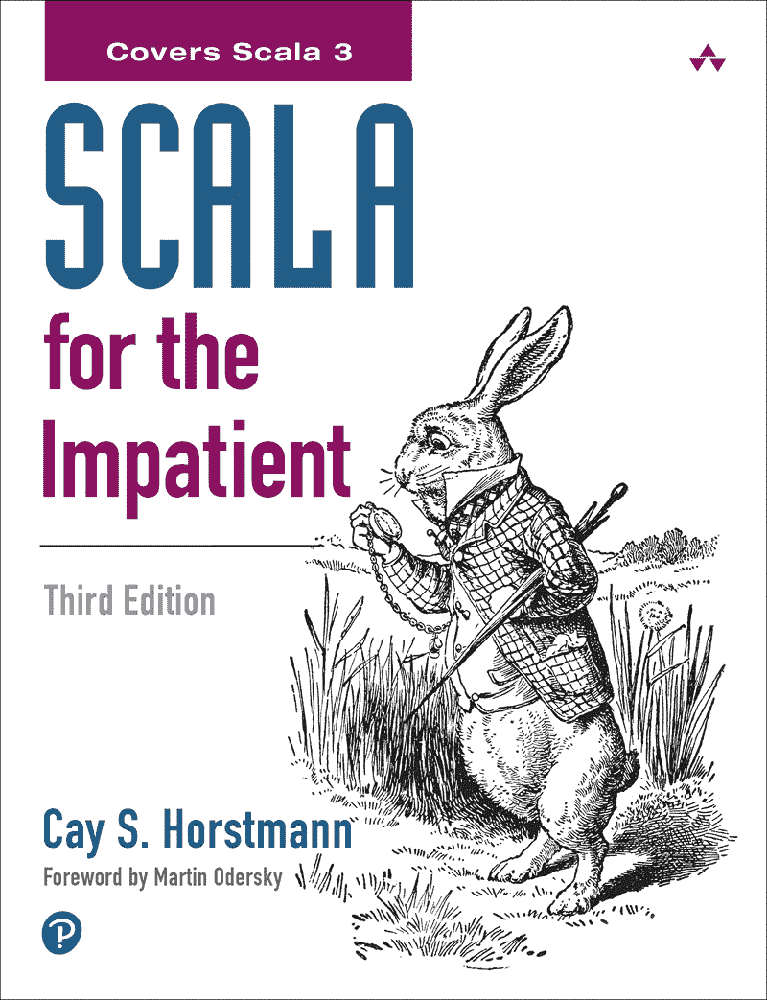
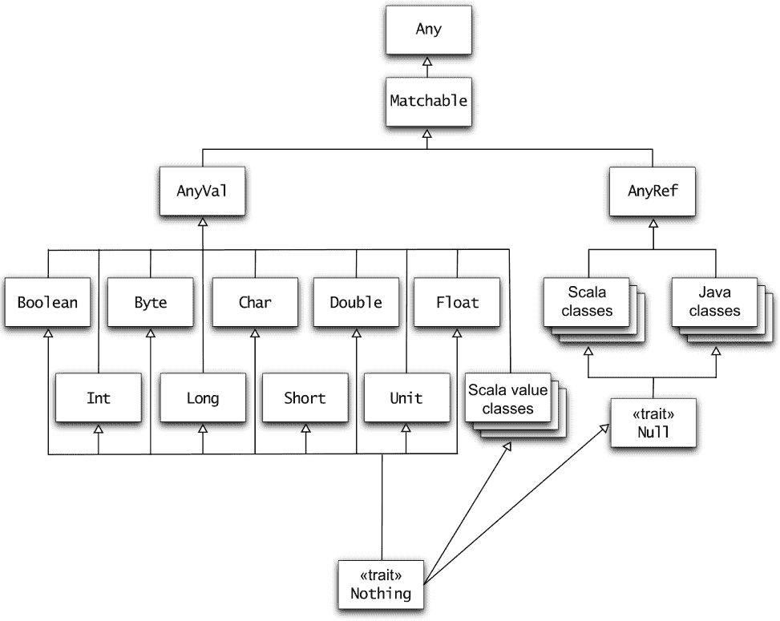
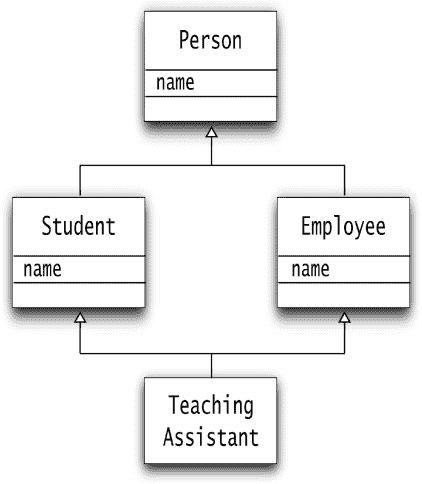
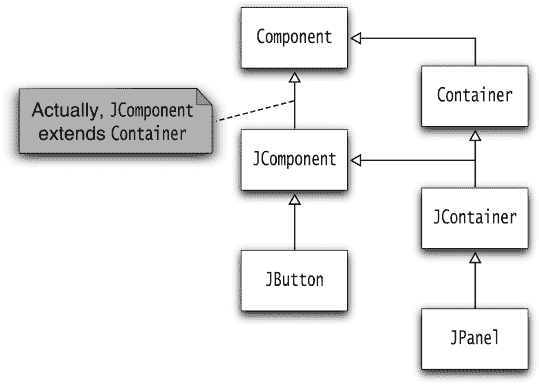
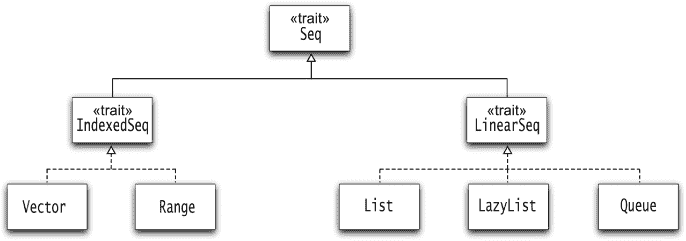

# Scala 急速指南（第三版，ePub 版）



## 关于本电子书

ePUB 是一种开放的行业标准电子书格式。然而，不同设备和应用程序对 ePUB 许多功能的支持程度不同。请使用您的设备或应用设置根据喜好自定义显示。您可以自定义的设置通常包括字体、字号、单栏或双栏、横屏或竖屏模式，以及可以点击或放大的图片。有关您的阅读设备或应用的设置和功能的更多信息，请访问设备制造商网站。

许多标题包含编程代码或配置示例。为了优化这些元素的显示效果，请在单栏横屏模式下查看电子书并将字体大小调整为最小。除了以重流文本格式呈现代码和配置外，我们还包含了代码图像，以模拟印刷书籍中的呈现；因此，当重流格式可能会损害代码列表的显示时，您将看到“点击此处查看代码图像”的链接。点击链接即可查看高保真代码图像。要返回上一页，请点击设备或应用上的返回按钮。

在本书中，由于 ePUB 格式的局限性，我们根据方程的复杂程度将某些方程渲染为文本，另一些渲染为图像。这可能导致相同的变量同时作为文本呈现和图像呈现的一部分时，出现并列不协调的情况。然而，作者的意图是清晰的，且两种情况下方程都是可读的。


献给我的妻子，她让这本书成为可能；给我的孩子们，他们让这本书成为必要

块缩进在分支和循环中很常见：

```
if n % 2 == 0 then
  a = a * a
  n = n / 2
else
  r = r * a
  n -= 1
```

你可以使用大括号，但在 Scala 3 中，更倾向于使用“安静”缩进风格。Python 程序员将为此感到欣喜。

在这个示例中，实际上不需要使用索引。你可以直接遍历字符：

点击此处查看代码图片

```
sum = 0
for ch <- "Hello" do sum += ch
```

在 Scala 中，循环的使用不像在其他语言那样频繁。正如你将在第 12 章中看到的，你通常可以通过对序列中的所有值应用一个函数来处理它们，这可以通过单个方法调用完成。

 注意事项

Scala 没有用于跳出循环的 `break` 或 `continue` 语句。如果需要 `break` 该怎么办？

你始终可以使用额外的布尔控制变量来替换 `break` 语句。或者，你可以使用 `Breaks` 对象中的 `break` 方法：

点击此处查看代码图片

```
import scala.util.control.Breaks.*
breakable {
   for c <- "Hello, World!" do
      if c == ',' then break // 退出 breakable 块
      else println(c)
}
```

在这里，控制转移是通过抛出和捕获异常实现的，因此在时间紧迫的情况下应避免这种机制。

 注意事项

在 Java 中，你不能拥有两个同名且作用重叠的局部变量。在 Scala 中，没有这种限制，而是适用于标准的遮蔽规则。例如，下面的代码是完全合法的：

点击此处查看代码图片

```
val k = 42
for k <- 1 to 10 do
  println(k) // 这里 k 指的是循环变量
```

## 2.6 关于 `for` 循环的更多内容

在上一节中，你已经了 `for` 循环的基本形式。然而，这种结构在 Scala 中比 Java、JavaScript 或 C++ 要丰富得多。本节将介绍高级特性。

你可以拥有多个形式为*变量* `<-` *表达式* 的*生成器*。例如，

点击此处查看代码图片

```
for
  i <- 1 to 3
  j <- 1 to 3
do
  print(f"${10 * i + j}%3d")
  // 打印 11 12 13 21 22 23 31 32 33
```

*守卫语句*（guard）是 `if` 前的布尔条件：

```
for
  i <- 1 to 3
  j <- 1 to 3
  if i != j
do
  print(f"${10 * i + j}%3d")
  // 打印 12 13 21 23 31 32
```

你可以拥有任意数量的*定义*，引入可以在循环内部使用的变量：

```
for
  i <- 1 to 3
  from = 4 - i
  j <- from to 3
do
  print(f"${10 * i + j}%3d")
  // 打印 13 22 23 31 32 33
```

 注意事项

如果你喜欢，可以使用分号代替换行来分隔 `for` 循环的生成器和定义。`if` 守卫语句前的分号是可选的。

点击此处查看代码图片

```
for i <- 1 to 3; from = 4 - i; j <- from to 3 if i != j
  do println(i * 10 + j)
```

经典语法使用括号代替 `do` 关键字：

点击此处查看代码图片

```
for (i <- 1 to 3; from = 4 - i; j <- from to 3 if i != j)
  println(i * 10 + j)
```

使用大括号也可以的：

点击此处查看代码图片

```
for { i <- 1 to 3; from = 4 - i; j <- from to 3 if i != j }
  println(i * 10 + j)
```

当 `for` 循环的主体以 `yield` 开始时，循环会构建一个值集合，每次迭代产生一个值：

点击此处查看代码图片

```
val result = for i <- 1 to 10 yield i % 3
  // 生成 Vector(1, 2, 0, 1, 2, 0, 1, 2, 0, 1)
```

这种类型的循环被称为 `for` *推导式*（comprehension）。

生成的集合与生成器兼容。

点击此处查看代码图片

```
for c <- "Hello" yield (c + 1).toChar
  // 生成字符串 "Ifmmp"
```

## 2.7 函数

Scala 拥有函数。要定义一个函数，指定其名称、参数和体。然而，只要函数体不是递归的，就不需要指定类型。Scala 编译器会从函数体推断类型。

对于递归函数，你必须指定返回类型。例如，

点击此处查看代码图片

```
def fac(n: Int): Int = if n <= 0 then 1 else n * fac(n - 1)
```

如果没有返回类型，Scala 编译器无法验证 `n * fac(n - 1)` 的类型为 `Int`。

 注意事项

某些编程语言（如 ML 和 Haskell）*可以*使用 Hindley-Milner 算法推断递归函数的类型。但这在面向对象的语言中效果并不良好。扩展 Hindley-Milner 算法以处理子类型仍然是一个研究问题。

函数可以返回任何值。考虑这个示例：

点击此处查看代码图片

```
def log(sb: StringBuilder, message: String) =
  sb.append(java.time.Instant.now())
  sb.append(": ")
  sb.append(message)
  sb.append("\n")
```

该函数追加了一个带有时间戳的消息。

从技术上讲，函数返回了一个值，即最后一次调用 `append` 返回的值。我们对那个值感兴趣，无论它是什么。为了明确该函数仅是为了副作用而调用的，请声明返回类型为 `Unit`：

点击此处查看代码图片

```scala
def log(sb: StringBuilder, message: String) : Unit = ...
```

## 2.8 默认参数与命名参数 L1

函数可以提供默认参数，当调用时没有提供显式值时就会使用这些参数。例如，

点击此处查看代码图像

```scala
def decorate(str: String, left: String = "[", right: String = "]") =
  left + str + right
```

此函数有两个参数，`left` 和 `right`，默认参数分别为 `"["` 和 `"]"`。

如果你调用 `decorate("Hello")`，你会得到 `"[Hello]"`。如果你不喜欢默认值，可以提供自己的值：`decorate("Hello", "<<<", ">>>")`。

如果你提供的参数少于参数个数，默认参数将从后开始应用。例如，`decorate("Hello", ">>>[")` 使用了 `right` 参数的默认值，产生 `">>>[Hello]"`。

你可以在提供参数时也指定参数名。例如，

点击此处查看代码图像

```scala
decorate(left = "<<<", str = "Hello", right = ">>>")
```

结果是 `"<<<Hello>>>"`。注意，命名参数不需要与参数的顺序相同。

命名参数可以使函数调用更具可读性。如果函数有许多带有默认参数的参数，它们也非常有用。

你可以混合使用非命名参数和命名参数，只要非命名参数在前即可：

点击此处查看代码图像

```scala
decorate("Hello", right = "]<<<") // 调用 decorate("Hello", "[", "]<<<")
```

## 2.9 可变参数 L1

有时，实现一个可以接受任意数量参数的函数是非常方便的。下面的示例展示了语法：

点击此处查看代码图像

```scala
def sum(args: Int*) =
  var result = 0
  for arg <- args do result += arg
  result
```

你可以根据需要提供任意数量的参数来调用此函数。

```scala
sum(1, 4, 9, 16, 25)
```

该函数接收类型为 `Seq` 的单个参数，我们将在第 13 章中讨论它。现在，你只需要知道可以使用 `for` 循环来访问每个元素。

如果你已经有一个值序列，不能直接将其传递给此类函数。例如，以下代码是不正确的：

```scala
sum(1 to 5) // 错误
```

如果调用 `sum` 函数时只传入一个参数，它必须是一个单整数，而不是整数范围。解决办法是告诉编译器你希望该参数被视为序列。使用后置的 `*`，如下：

点击此处查看代码图像

```scala
sum((1 to 5)*) // 将 1 to 5 视为参数序列
```

这种调用语法在递归定义中是必要的：

点击此处查看代码图像

```scala
def recursiveSum(args: Int*) : Int =
  if args.length == 0 then 0
  else args.head + recursiveSum(args.tail*)
```

在这里，序列的 `head` 是它的初始元素，`tail` 是包含所有其他元素的序列。那又是一个 `Seq` 对象，我们必须使用后置的 `*` 将其转换为参数序列。

## 2.10 Main 函数

每个程序必须从某处开始。当运行编译后的可执行文件时，入口是使用 `@main` 注解定义的函数：

```scala
@main def hello() =
  println("Hello, World!")
```

主函数叫什么并不重要。

要处理命令行参数，请提供一个类型为 `String*` 的参数：

点击此处查看代码图像

```scala
@main def hello2(args: String*) =
  println(s"Hello, ${args(1)}!")
```

你也可以为命令行参数指定类型：

点击此处查看代码图像

```scala
@main def hello3(repetition: Int, name: String) =
  println("Hello " * repetition + name)
```

那么第一个命令行参数必须是一个整数（或者更准确地说，是一个包含整数的字符串）。

提供了 `Boolean`、`Byte`、`Short`、`Int`、`Long`、`Float` 和 `Double` 解析器。你可以解析其他类型——参见第 37 页[练习 13]。

 注意

在编译带有 `@main` 注解函数的程序时，编译器会生成一个类文件，其名称为该函数的名称，*而不是*源文件的名称。例如，如果 `hello` 函数在 `Main.scala` 文件中。

## 2.11 无参数函数

你可以不带任何参数地声明函数：

点击此处查看代码图像

```scala
def words = scala.Source.fromFile("/usr/share/dict/words").mkString
```

带括号调用它。相反，如果你带括号定义了函数：

点击此处查看代码图像

```scala
def words() = scala.Source.fromFile("/usr/share/dict/words").mkString
```

你必须带括号调用该函数。在 Scala 中，如果该函数是“幂等”的——即它总是返回相同的值。例如，如果文件 `/usr/share/dict/words` 的内容不会改变，那么不带括号是正确的选择。Scala 3 对括号的使用比之前的版本更严格。如果你带括号定义函数，就必须带括号调用。反之，不带括号定义的函数必须不带括号调用。为了兼容，此规则不适用于旧函数。`scala.math.random` 函数绝对不是幂等的。期望每次调用 `scala.math.random()` 得到不同的值。尽管如此，它也可以带括号调用。

## 2.12 惰性值 L1

当 `val` 被声明为 `lazy` 时，它的初始化会被延迟到第一次被访问。例如，

点击此处查看代码图像

```scala
lazy val words = scala.Source.fromFile("/usr/share/dict/words").mkString
```

（我们将在第 9 章中讨论文件操作。现在，只需假设该调用从文件中读取所有字符到字符串。）

如果程序从未访问 `words`，文件就不会被打开。为了验证这一点，请在 REPL 中尝试，但写错文件名。执行初始化语句时不会报错。然而，当你访问 `words` 时，你会得到找不到文件的错误。

惰性值对于延迟昂贵的初始化语句非常有用。它们还可以处理其他初始化问题，例如循环依赖。此外，它们对于开发惰性数据结构至关重要——参见第 13 章。

你可以将惰性值视为 `val` 和 `def` 之间的中间物。比较：

```
val words1 =
  println("words1: Reading file")
  scala.io.Source.fromFile("/usr/share/dict/words").mkString
  // 在定义 words1 时立即进行求值
lazy val words2 =
  println("words2: Reading file")
  scala.io.Source.fromFile("/usr/share/dict/words").mkString
  // 在第一次使用 words2 时求值
def words3 =
  println("words3: Reading file")
  scala.io.Source.fromFile("/usr/share/dict/words").mkString
  // 每次使用 words3 时都会求值
```

 注意

惰性不是免费的。每当访问一个惰性值时，都会调用一个方法以线程安全的方式检查该值是否已经初始化。

## 2.13 异常

Scala 异常的工作原理与 Java、JavaScript、C++ 或 Python 相同。当你抛出一个异常时，例如：

点击此处查看代码图片

```
throw IllegalArgumentException("x should not be negative")
```

当前计算会被中断，运行时系统会寻找可以接受 `IllegalArgumentException` 的异常处理器。控制将从最内层的此类处理器处恢复。如果不存在这样的处理器，程序将终止。

与 Java 类似，你抛出的对象需要属于 `java.lang.Throwable` 的子类。然而，与 Java 不同的是，Scala 没有“检查型异常”（checked exceptions）——你永远不需要声明某个函数或方法可能会抛出异常。

 注意

在 Java 中，“检查型”异常是在编译时检查的。如果你的方法可能会抛出 `IOException`，你必须声明它。这迫使程序员思考在何处处理这些异常，这是一个值得赞的目标。不幸的是，它也可能导致巨大的方法签名，例如 `void doSomething() throws IOException, InterruptedException, ClassNotFoundException`。许多 Java 程序员讨厌这个特性，并最终通过过早捕获异常或使用过度通用的异常类来使其适得其反。Scala 的设计者决定不使用检查型异常，他们意识到彻底的编译时检查并不总是件好事。

`throw` 表达式具有特殊类型 `Nothing`。这在 `if`/`else` 表达式非常有用。如果一个分支的类型为 `Nothing`，则 `if`/`else` 表达式的类型就是另一个分支的类型。例如，考虑：

点击此处查看代码图片

```
if x >= 0 then scala.math.sqrt(x)
else throw IllegalArgumentException("x should not be negative")
```


第一个分支类型为`Double`，第二个类型为`Nothing`。因此，`if`/`else`表达式的类型也是`Double`。

捕获异常的语法模仿了模式匹配语法（参见第 14 章）。

点击此处查看代码图片

```scala
val url = URL("http://horstmann.com/fred.gif")
try
  process(url)
catch
  case _: MalformedURLException => println(s"Bad URL: $url")
  case ex: IOException => println(ex)
```

更通用的异常类型必须放在更具体的类型之后。

注意，如果你不需要变量名，可以使用`_`。

`try`/`finally`语句允许你无论是否发生异常都释放资源。例如：

点击此处查看代码图片

```scala
val in = URL("http://horstmann.com/cay-tiny.gif").openStream()
try
  process(in)
finally
  println("Closing input stream")
  in.close()
```

无论`process`函数是否抛出异常，`finally`子句都会执行。输入流总是会被关闭的。

这段代码有点微妙，并引发了几个问题：

- 如果`URL`构造函数或`openStream`方法抛出异常怎么办？那么`try`块将不会进入，`finally`子句也不会进入。这倒也好——`in`从未被初始化，所以对它调用`close`没有任何意义。
- 为什么`val in = URL(...).openStream()`不放在`try`块内部？那样`in`的作用范围将无法扩展到`finally`子句。
- 如果`in.close()`抛出异常怎么办？那么该异常将抛出语句，取代任何早先的异常。（这与 Java 一样，并且并不友好。理想情况下，旧异常应该附加在新异常上。）

注意`try`/`catch`和`try`/`finally`有互补的目标。`try`/`catch`语句处理异常，而`try`/`finally`语句在异常未被处理时执行某些操作（通常是清理）。你可以将它们合并为单一`try`/`catch`/`finally`语句：

```scala
try
  ...
catch
  ...
finally
  ...
```

这等同于：

```scala
try
  try
    ...
  catch
    ...
finally
  ...
```

在实践中，这种组合并不经常使用，因为异常通常在远离抛出点的地方捕获，而清理工作需要在抛出的附近进行。

`Try`类设计用于处理可能失败的计算。我们将在第 16 章中详细查看它。例如：

```scala
import scala.util.*
val result =
  for
    a <- Try { StdIn.readLine("a: ").toInt }
    b <- Try { StdIn.readLine("b: ").toInt }
  yield a / b
```

如果在任何一个`toInt`调用中发生异常，或者因为除以零发生，`result`将是一个`Failure`对象，包含导致失败的异常。否则，`result`是一个持有计算结果的`Success`对象。

`Try`类设计用于处理可能失败的计算。

Scala 没有类似于 Java 的`try-with-resources`语句。在 Java 中，你可以使用`try`处理通常在远离抛出点的地方捕获的异常，而清理工作需要在抛出的附近进行。

 注意

在 Scala 中，`Using`助手处理了这种情况：

```scala
import scala.util.*
Using.Manager { use =>
  val in = use(openReader(inPath))
  val out = use(openWriter(outPath))
  // 从 in 读取，写入 out
  process(in, out)
} // 读取器写入器被关闭
```

## 练习题

1. `println(println("Hello"))`输出什么，为什么？
2. 空块`{}`的值是什么？它的类型是什么？
3. 想出一个在 Scala 中赋值语句`x = y = 1`有效的场景。（提示：为`x`选择一个合适的类型。）
4. 为此 Java/JavaScript/C++语法的循环编写一个 Scala 等效代码：

   点击此处查看代码图片

   ```java
   for (int i = 10; i >= 0; i--) System.out.println(i);
   ```

5. 数字的*符号*（signum）为正时为 1，负时为 −1，零为 0。写一个计算该值的函数。
6. 写一个函数`countdown(n: Int)`，从`n`打印到`0`而不返回值。
7. 写一个`for`循环计算字符串中所有字母的 Unicode 码乘积。例如，“Hello"中字符的乘积为 9415087488L。
8. 在不写循环的情况下解决练习。（提示：查看`StringOps`的 Scaladoc。）
9. 写一个函数`product(s: String)`来计算上述练习题描述的乘积。
10. 将练习题中的函数改为递归函数。
11. 写一个函数计算 *x*^(*n*)，其中 *n* 是整数。使用以下递归定义：
    - 如果 *n* 是偶数且为正，则 *x*^(*n*) = *y* ‧ *y*，其中 *y* = *x*^(*n*/2)。
    - 如果`n`是正奇数，则`x^(n) = x ‧ x^(n − 1)`。
    - `x⁰ = 1`。
    - 如果`n`是负数，则`x^(n) = 1/x^(−n)`。
12. 定义一个字符串插值器日期，根据给定的整数表达式（如`date"$year-$month-$day"`）、字符串（如`date"2099-12-31"`）或混合体（如`date"$year-12-31"`）产生一个`java.time.LocalDate`实例。你需要定义一个“扩展方法”，如下例所示：

    点击此处查看代码图片

    ```scala
    extension (sc: StringContext)
      def date(args: Any*): LocalDate = ...
    ```

    `args(i).asInstanceOf[Int]`是第`i`个插值表达式的整数值。在表达式之间的字符串可以通过`sc.parts`获取。通过破划线分割并调用`toInt`将字符串转换为整数。然后调用`LocalDate.of`方法。
13. 要将命令行参数解析为任意类型，你需要提供一个“给定实例（given instance）”。例如，解析一个`LocalDate`：

    点击此处查看代码图片

    ```scala
    import java.time.*
    import scala.util.*
    given CommandLineParser.FromString[LocalDate] with
      def fromString(s: String) = LocalDate.parse(s)
    ```

    编写一个 Scala 程序，在命令行上接收两个日期并打印它们之间的天数。你的主函数应该有两个类型为`LocalDate`的参数。

# 第 3 章：数组数组操作

**本章主题 A1**

- 3.1 固定长度数组
- 3.2 变长数组：数组缓冲区
- 3.3 遍历数组和缓冲区
- 3.4 转换数组
- 3.5 常用算法
- 3.6 解读 Scaladoc
- 3.7 多维数组
- 3.8 与 Java 互操作
- 练习题

在本章中，你将学习如何在 Scala 中操作数组。Java、JavaScript、Python 和 C++ 程序员在需要收集元素时，通常会选择数组或其紧密相关（如列表或向量）。在 Scala 中，还有其他选择（参见第 13 章），但目前我假设你迫不及待，只想开始使用数组。

本章的要点包括：

- 如果长度固定，使用`Array`；如果长度可以变化，使用`ArrayBuffer`。
- 使用`()`访问元素。
- 使用`for elem <- arr do ...`遍历元素。
- 使用`for elem <- arr yield ...`转换为新数组。
- Scala 和 Java 数组是可以互操作的；对于`ArrayBuffer`，使用`scala.jdk.CollectionConverters`。

## 3.1 固定长度数组

如果你需要一个长度不变的数组，请使用 Scala 中的`Array`类型。例如：

点击此处查看代码图片

```scala
val strings = Array("Hello", "World")
  // 一个长度为 2 的 Array[String]——类型是推断的
val moreStrings = Array.ofDimString
  // 有五个元素的字符串数组，全部初始化为 null
val nums = Array.ofDimInt
  // 有十个整数的数组，全部初始化为零
```

 注意

在 Java 中，数组是使用`new`运算符创建的。但在 Scala 3 中，不建议使用`new`运算符，正如你在第 5 章中看到的。虽然调用`new ArrayInt`来创建一个包含十个整数的数组是可能的，但也有点困惑，因为`ArrayInt`（不带`new`）是一个长度为 1 包含整数 10 的数组。

使用`()`运算符来访问或修改数组的元素：

点击此处查看代码图片

```scala
strings(0) = "Goodbye"
  // strings 现在是 Array("Goodbye", "World")
```

为什么不像 Java、JavaScript、C++或 Python 那样使用`[]`呢？Scala 的观点是数组类似于将索引值映射到元素的函数。

在 JVM 内部，Scala 的`Array`实现为 Java 数组。上述示例中的数组在 JVM 内部的类型为`java.lang.String[]`。

## 3.2 变长数组：数组缓冲区

在 Java 中，数组是固定大小的。如果你需要可以增长的数组，请使用来自`scala.util.collection.mutable`包的`ArrayBuffer`。在本章中，我们关注`Array`和`ArrayBuffer`。

要创建一个`ArrayBuffer`，请使用以下代码：

```scala
val buf = ArrayBuffer(1, 2, 3)
buf += 4
  // buf 现在是 ArrayBuffer(1, 2, 3, 4)
```

## 3.3 遍历数组和缓冲区

在 Java 和 C++ 中，数组和向量之间存在若干语法上的差异。Scala 要更加统一。大多数情况下，你可以对两者使用相同的代码。

以下是遍历数组或缓冲区的方法：

```scala
for i <- 0 until a.length do
  println(a(i))
```

`until`方法与`to`方法类似，不同在于排除了最后一个值。因此，变量`i`的范围从`0`到`a.length - 1`。

## 3.4 转换数组

在前面的节中，你已经看到了如何像在其他编程语言一样操作数组。但在 Scala 中，你可以更进一步。很容易地获取一个数组（或数组缓冲区）并进行某种转换。

使用如下的`for`导式：

```scala
val a = Array(2, 3, 5, 7, 11)
val result = for elem <- a yield 2 * elem
  // result is Array(4, 6, 10, 14, 22)
```

## 循环

`for`/`yield`循环会创建一个与原始集合类型相同的新集合。如果你从数组（array）开始，就会得到另一个数组。如果你从一个数组缓冲区（array buffer）开始，通过`for`/`yield`得到的也是它。

结果包含`yield`之后的表达式，循环的每次迭代对应一个表达式。

通常，在遍历集合时，你只想处理符合特定条件的元素。这可以通过在`for`内部使用`guard:`（守卫）或`if`来实现在这里，我们将每个偶数元素翻倍，并丢弃奇数：

点击此处查看代码图片

```scala
for elem <- a if elem % 2 == 0 yield elem / 2
```

请记住，结果是一个新集合——原始集合不受影响。

 注意

一些具有函数式编程经验的程序员倾向于使用`map`和`filter`而不是`for`/`yield`和守卫：

点击此处查看代码图片

```scala
a.filter(_ % 2 == 0).map(_ / 2)
```

这只是风格问题——`for`/`yield`循环执行的是完全相同的工作。使用你认为更简单的方法即可。

假设我们想从一个整数数组缓冲区移除所有负数元素。传统的顺序解决方案可能会遍历数组缓冲区，并在遇到不需要的元素时将其删除。

```scala
var n = b.length
var i = 0
while i < n do
  if b(i) >= 0 then i += 1
  else
    b.remove(i)
    n -= 1
```

这有点麻烦——你必须记住在删除元素时*不要*递增`i`，而是要递减`n`。从数组缓冲区的中间删除元素也是高效的。这个循环不必要地移动了之后会被删除的元素。

在 Scala 中，显而易见的解决方案是使用`for`/`yield`循环并保留所有非负元素：

点击此处查看代码图片

```scala
val nonNegative = for elem <- b if elem >= 0 yield elem
```

结果是一个新的数组缓冲区。假设我们改为修改原始数组缓冲区，移除不需要的元素。那么我们可以收集它们的位置：

点击此处查看代码图片

```scala
val positionsToRemove = for i <- b.indices if b(i) < 0 yield i
```

现在从后往前移除这些位置上的元素：

点击此处查看代码图片

```scala
for i <- positionsToRemove.reverse do b.remove(i)
```

或者，记住要保留的位置，将它们复制过去，然后缩短缓冲区：

点击此处查看代码图片

```scala
val positionsToKeep = for i <- b.indices if b(i) >= 0 yield i
for j <- positionsToKeep.indices do b(j) = b(positionsToKeep(j))
b.dropRightInPlace(b.length - positionsToKeep.length)
```

关键观察是，将*所有索引值放在一起*比一个接一个看到它们更好。

## 3.5 常用算法

人们常说，业务计算中大部分无非是在求和和排序。幸运的是，Scala 提供了用于这些任务的内置函数。

```scala
Array(1, 7, 2, 9).sum
  // 19
  // 也适用于 ArrayBuffer
```

为了使用`sum`方法，元素类型必须是数值类型：整数类型或浮点类型，或者`BigInteger`/`BigDecimal`。

同样，`min`和`max`方法产生数组或数组缓冲区中最小和最大的元素。

点击此处查看代码图片

```scala
ArrayBuffer("Mary", "had", "a", "little", "lamb").max
  // "little"
```

`sorted`方法对数组或数组缓冲区进行排序并返回排序后的数组或数组缓冲区，而不修改原始对象：

点击此处查看代码图片

```scala
val b = ArrayBuffer(1, 7, 2, 9)
val bSorted = b.sorted
  // b 未改变；bSorted 是 ArrayBuffer(1, 2, 7, 9)
```

你也可以提供一个比较函数，但那时你应该使用`sortWith`方法：

点击此处查看代码图片

```scala
val bDescending = b.sortWith(_ > _) // ArrayBuffer(9, 7, 2, 1)
```

函数语法请参阅第 12 章。

你可以直接对数组或数组缓冲区进行原地排序：

```scala
val a = Array(1, 7, 2, 9)
a.sortInPlace()
  // a 现在是 Array(1, 2, 7, 9)
```

对于`min`、`max`和`sortInPlace`方法，元素类型必须是数值类型：整数或浮点类型，或者`BigInteger`/`BigDecimal`。

最后，如果你想显示数组或数组缓冲区的内容，`mkString`方法允许你指定分隔符。例如：

```scala
a.mkString(",")
  // "1, 2, 7, 9"
```

## 3.6 解读 Scala

由于 Scala 拥有丰富的类型系统，你可能会遇到一些奇怪的语法。看到这些内容时，只需将其视为“任何集合”。

| Scaladoc | 解释 |
| :--- | :--- |
| `count(p: (A) => Boolean): Int` | 此方法接收一个谓词，即一个从`A`到`Boolean`的函数。它统计有多少个`true`。例如，`a.count(_ > 0)`统计`a`中有多少个正数。 |


| 方法 | 说明 |
|---|---|
| `insert(@deprecatedName("n", "2.13.0")) index: Int, elem: A): Unit` | 忽略 `@deprecatedName` 注解。曾经 `index` 参数被称为 `n`。 |
| `appendAll(xs: IterableOnce[A]): Unit` | `xs` 参数可以是任何具有 `IterableOnce` 特性的集合，它是类型层次结构中的一个 trait。其他你常见的 trait 有 `Iterable` 和 `Seq`。所有 Scala 集合都实现了这些 trait，对于库用户来说它们之间的区别是学术性的。 |
| `combinations(n: Int): Iterator[ArrayBuffer[A]]` | 此方法计算一个可能巨大的结果，因此以迭代器而不是集合返回，这样你可以逐个访问元素，而不是将它们放在集合中。现在只需对它调用 `toArray` 或 `toBuffer`。 |
| `copyToArray[B >: A]: Unit` | 注意，该函数将 `ArrayBuffer[A]` 复制到 `Array[B]`。这里 `B` 允许是 `A` 的超类。例如，你可以从 `ArrayBuffer[Int]` 拷贝到 `Array[Any]`。初读时，只需忽略 `[B >: A]`，脑中将 `B` 替换为 `A`。 |
| `sorted[B >: A]: ArrayBuffer[A]` | 元素类型 `A` 必须有一个超类 `B`，该类存在一个类型为 `Ordering[B]` 的隐式或“给定”对象。数字、字符串以及实现 Java `Comparable` 接口的类都有这样的排序。我们将在第 19 章中详细讨论这一机制。 |
| `sum(implicit num: Numeric[B]): B` | 对于其他隐式类型，如 `sum[B >: A]` 中的 `Numeric`，遵循你的直觉即可。要形成和，必须有某种相加值的方法。 |
| `def ++[B >: A](implicit evidence$23: ClassTag[B]): Array[B]` | 此方法拼接两个数组。第二个数组可以是第一个数组的子类型。类型 `ClassTag` 的“implicit”（隐式）是为了在 JVM 中构造结果数组所必需的正式要求。你可以安全地忽略任何此类 `ClassTag` 参数。 |
| `def stepper[S <: Stepper[_]](implicit shape: StepperShape[A, S]): S with EfficientSplit` | 在这里，你只能承认失败。该方法的存在是因为一个技术原因，该原因只对 Scala 库的实现者感兴趣。 |

**表 3–1** Scaladoc 解码环

## 3.7 多维数组

与 Java、JavaScript 或 Python 一样，多维数组被实现为数组的数组。例如，一个 `Double` 值的二维数组的类型为 `Array[Array[Double]]`。要构造这样一个数组，请使用 `ofDim` 方法：

```scala
val matrix = Array.ofDim[Double](3, 4) // 三行四列
```

要访问元素，请使用两对括号：

```scala
matrix(row)(column) = 42
```

你可以创建锯齿数组（ragged arrays），其行长度各异：

```scala
val triangle = Array.ofDim[Array[Int]](10)
for i <- triangle.indices do
  triangle(i) = Array.ofDim[Int](i + 1)
```

## 3.8 与 Java 互操作

由于 Scala 数组被实现为 Java 数组，你可以在 Java 和 Scala 之间来传递它们。

这在几乎所有情况下都有效，除非数组元素类型不是完全匹配。在 Java 中，给定类型的数组会自动转换为其父类型的数组。例如，一个 Java `String[]` 数组可以传递给期望 Java `Object[]` 数组的方法。Scala 不允许这种自动转换，因为它是不安全的。（详细解释请参阅第 17 章。）

假设你想调用一个带有 `Object[]` 参数的 Java 方法，例如 `java.util.Arrays.binarySearch(Object[] a, Object key)`：

```scala
val a = Array("Mary", "a", "had", "lamb", "little")
java.util.Arrays.binarySearch(a, "beef") // 无法工作
```

这不起作用，是因为 Scala 不会将 `Array[String]` 转换为 `Array[Object]`。你可以这样强制转换：

```scala
java.util.Arrays.binarySearch(
  a.asInstanceOf[Array[Object]],
  "beef"
)
```

 **笔记**

这只是一个示例，展示了如何克服元素差异。如果你想在 Scala 中执行二分查找，请这样做：

```scala
import scala.collection.Searching.*

val result = a.search("beef")
```

如果元素在位置 `n` 找到，结果为 `Found(n)`；如果元素未找到但应该插入到位置 `n` 之前，则为 `InsertionPoint(n)`。

如果你调用一个接收或返回 `java.util.List` 的 Java 方法，你当然可以在代码中使用 Java 的 `ArrayList`——但这并不美观。相反，请在 `scala.jdk.CollectionConverters` 中导入转换方法。然后你可以调用 `asJava` 方法将任何序列（例如 Scala buffer）转换为 Java 列表。

例如，`java.lang.ProcessBuilder` 类有一个带有 `List<String>` 参数的构造函数。以下是你可以从 Scala 调用它的方法：

```scala
import scala.jdk.CollectionConverters.*
import scala.collection.mutable.ArrayBuffer

val command = ArrayBuffer("ls", "-al", "/bin")
val pb = ProcessBuilder(command.asJava) // Scala 到 Java
```

Scala buffer 被封装成一个实现了 `java.util.List` 接口的 Java 对象。相反，当 Java 方法返回 `java.util.List` 时，你可以将其转换为 `Buffer`：

```scala
import scala.jdk.CollectionConverters.*
import scala.collection.mutable.Buffer

val cmd: Buffer[String] = pb.command().asScala
```

你不能使用 `ArrayBuffer`——被封装的对象只保证是 `Buffer`。在我们的示例中，`cmd == command`。

## 练习题

1. 编写一段代码片段，将 `a` 设置为包含从 `0`（包含）到 `n`（不包含）的 `n` 个整数的数组。
2. 编写一个循环，交换整数数组中相邻元素。例如，`Array(1, 2, 3, 4, 5)` 变为 `Array(2, 1, 4, 3, 5)`。
3. 编写一个循环，交换整数数组中相邻元素。例如，`Array(1, 2, 3, 4, 5)` 变为 `Array(2, 1, 4, 3, 5)`。
4. 编写一个循环，交换整数数组中相邻元素。例如，`Array(1, 2, 3, 4, 5)` 变为 `Array(2, 1, 4, 3, 5)`。
5. 编写一个循环，交换整数数组中相邻元素。例如，`Array(1, 2, 3, 4, 5)` 变为 `Array(2, 1, 4, 3, 5)`。

`Array(1, 2, 3, 4, 5)` 变为 `Array(2, 1, 4, 3, 5)`。

6. 编写一个循环，交换整数数组中相邻元素。例如，`Array(1, 2, 3, 4, 5)` 变为 `Array(2, 1, 4, 3, 5)`。
7. 编写一个循环，交换整数数组中相邻元素。例如，`Array(1, 2, 3, 4, 5)` 变为 `Array(2, 1, 4, 3, 5)`。

1. 编写一段代码片段，将 `a` 设置为包含从 `0`（包含）到 `n`（不包含）的 `n` 个整数的数组。
2. 编写一个循环，交换整数数组中相邻元素。例如，`Array(1, 2, 3, 4, 5)` 变为 `Array(2, 1, 4, 3, 5)`。
3. 编写一个循环，交换整数数组中相邻元素。例如，`Array(1, 2, 3, 4, 5)` 变为 `Array(2, 1, 4, 3, 5)`。
4. 编写一个循环，交换整数数组中相邻元素。例如，`Array(1, 2, 3, 4, 5)` 变为 `Array(2, 1, 4, 3, 5)`。
5. 编写一个循环，交换整数数组中相邻元素。例如，`Array(1, 2, 3, 4, 5)` 变为 `Array(2, 1, 4, 3, 5)`。

**重新对齐练习题翻译：**

1. 编写一段代码片段，将 `a` 设置为包含从 `0`（包含）到 `n`（不包含）的 `n` 个整数的数组。
2. 编写一个循环，交换整数数组中相邻元素。例如，`Array(1, 2, 3, 4, 5)` 变为 `Array(2, 1, 4, 3, 5)`。
3. 编写一个循环，交换整数数组中相邻元素。例如，`Array(1, 2, 3, 4, 5)` 变为 `Array(2, 1, 4, 3, 5)`。
4. 编写一个循环，交换整数数组中相邻元素。例如，`Array(1, 2, 3, 4, 5)` 变为 `Array(2, 1, 4, 3, 5)`。
5. 编写一个循环，交换整数数组中相邻元素。例如，`Array(1, 2, 3, 4, 5)` 变为 `Array(2, 1, 4, 3, 5)`。

1. 编写一段代码片段，将 `a` 设置为包含从 `0`（包含）到 `n`（不包含）的 `n` 个整数的数组。
2. 编写一个循环，交换整数数组中相邻元素。例如，`Array(1, 2, 3, 4, 5)` 变为 `Array(2, 1, 4, 3, 5)`。
3. 编写一个循环，交换整数数组中相邻元素。例如，`Array(1, 2, 3, 4, 5)` 变为 `Array(2, 1, 4, 3, 5)`。
4. 编写一个循环，交换整数数组中相邻元素。例如，`Array(1, 2, 3, 4, 5)` 变为 `Array(2, 1, 4, 3, 5)`。
5. 编写一个循环，交换整数数组中相邻元素。例如，`Array(1, 2, 3, 4, 5)` 变为 `Array(2, 1, 4, 3, 5)`。

1. 编写一段代码片段，将 `a` 设置为包含从 `0`（包含）到 `n`（不包含）的 `n` 个整数的数组。
2. 编写一个循环，交换整数数组中相邻元素。例如，`Array(1, 2, 3, 4, 5)` 变为 `Array(2, 1, 4, 3, 5)`。
3. 编写一个循环，交换整数数组中相邻元素。例如，`Array(1, 2, 3, 4, 5)` 变为 `Array(2, 1, 4, 3, 5)`。
4. 编写一个循环，交换整数数组中相邻元素。例如，`Array(1, 2, 3, 4, 5)` 变为 `Array(2, 1, 4, 3, 5)`。
5. 编写一个循环，交换整数数组中相邻元素。例如，`Array(1, 2, 3, 4, 5)` 变为 `Array(2, 1, 4, 3, 5)`。


```scala
val cmd: Buffer[String] = pb.command().asScala // Java 到 Scala

// 你不能使用 ArrayBuffer——被封装的对象只保证是 Buffer

// 在我们的示例中，cmd == command。
```

## 练习题

1. 编写一段代码片段，将 `a` 设置为包含从 `0`（包含）到 `n`（不包含）的 `n` 个整数的数组。
2. 编写一个循环，交换整数数组中相邻元素。例如，`Array(1, 2, 3, 4, 5)` 变为 `Array(2, 1, 4, 3, 5)`。

`Map` 是键值对的集合。Scala 有一个通用的元组（tuple）概念——即 `n` 个对象的聚合，这些对象的类型不一定相同。对（pair）简单来说 `n = 2` 的元组。当你需要将两个或多个值聚合在一起时，元组非常有用。

本章的亮点包括：

- Scala 提供了用于创建、查询和遍历 `map` 的良好语法。
- 你需要在可变和不可变 `map` 之间进行选择。
- 默认情况下，你得到的是哈希表（hash map），你也可以获取树（tree map）。
- 你可以轻松地在 Scala 和 Java `map` 之间转换。
- 对于可能存在也可能不存在的值使用 `Option` 类型——它比使用 `null` 更安全。
- 元组对于聚合值有用。

## 4.1 构建 Map

你可以如下构建一个 `map`：

```scala
val scores = Map("Alice" -> 10, "Bob" -> 3, "Cindy" -> 8)
```

这构建了一个不可变的 `Map[String, Int]`，其内容无法更改。可变 `map` 请参阅下一节。

如果你想从一个空 `map` 开始，你必须提供类型参数：

```scala
val scores = scala.collection.mutable.Map[String, Int]()
```

在 Scala 中，`map` 是 `pairs` 的集合。对简单来说是两个值的分组，类型不一定相同，例如 `("Alice", 10)`。

`->` 运算符创建一个对。以下内容的值：

```scala
"Alice" -> 10
```

是：

```scala
("Alice", 10)
```

你完全可以这样定义 `map`：

```scala
Map(("Alice", 10), ("Bob" -> 3), ("Cindy" -> 8))
```

`->` 运算符比括号更易于阅读。它还支持这样一种直觉：即 `map` 数据结构是一种将键映射到值的函数。区别在于函数计算值，而 `map` 只是在查找值。

## 4.2 访问 Map 值

在 Scala 中，函数和 `map` 之间的类比非常接近，因为你使用 `()` 符号来查找键值。

```scala
scores("Bob")
// 类似于 Java 中的 scores.get("Bob") 或 JavaScript、Python 或 C++ 中的 scores["Bob"]
```

如果 `map` 不包含所请求的键的值，则会抛出异常。

要检查是否存在具有给定值的键，请调用 `contains` 方法：

```scala
if scores.contains("Donald") then scores("Donald") else 0
```

由于这种调用组合非常常见，因此有一个快捷方法：

```scala
scores.getOrElse("Donald", 0)
// 如果 map 包含键 "Bob"，则返回该值；否则返回 0。
```

最后，调用 `map.get(key)` 返回一个 `Option` 对象，其值为 `Some(value for key)` 或 `None`。我们在第 56 页的 4.7 节“Option 类型”中讨论 `Option` 类。


> **注意**
>
> 对于不可变 `map`，你可以将其转换为一个对不存在键具有固定默认值的 `map`，或者计算此类值的函数。

```scala
val scores2 = scores.withDefaultValue(0)
scores2("Zelda")
// 输出 0，因为 "Zelda" 不存在

val scores3 = scores.withDefault(_.length)
scores3("Zelda")
// 输出 5，对不存在的键应用了长度函数
```

## 4.3 更新 Map 值

在本节中，我们将讨论可变 `map`。以下是构建它的方法：

```scala
val scores = scala.collection.mutable.Map("Alice" -> 10, "Bob" -> 3, "Cindy" -> 8)
```

在可变 `map` 中，你可以通过在 `=` 左侧使用 `()` 来更新 `map` 值或添加新值：

```scala
scores("Bob") = 10
// 更新键 "Bob" 的现有值（假设 scores 是可变的）

scores("Fred") = 7
// 向 scores 添加新的键/值对（假设它是可变的）
```

或者，你可以使用 `++=` 运算符来添加多个：

```scala
scores ++= Map("Fred" -> 7)
```

要从 `map` 中删除一个键，请使用 `-` 运算符：

```scala
scores - "Alice"
```

或者，你也可以使用 `++=` 运算符添加多个关联：

```scala
scores ++= Map("Alice" -> 10, "Bob" -> 3)
```

要从 `map` 中删除一个键，请使用 `-` 运算符：

```scala
scores - "Alice"
```

## 4.4 遍历 Map

以下循环遍历键值对：

```scala
for (k, v) <- map do process(k, v)
```

如果由于某种原因只想访问键，请使用 `keySet`。`keySet` 方法返回包含元素的集合。

如果你只想访问值，请使用 `values`。`values` 方法返回一个可以在 `for` 循环使用的 `Iterable`。

```scala
val scores = Map("Alice" -> 10, "Bob" -> 7, "Cindy" -> 8)

scores.keySet // 输出一个包含 "Alice", "Bob", "Cindy" 的集合
for v <- scores.values do println(v) // 10 7
```

如果你想按插入顺序访问键，请使用 `LinkedHashMap`：

```scala
scala.collection.mutable.LinkedHashMap("Fred" -> 1, "Alice" -> 2, "Bob" -> 3)
// 输出为 LinkedHashMap(Fred -> 1, Alice -> 2, Bob -> 3)
```

如果你想按排序顺序访问键，请使用 `SortedMap`：

```scala
scala.collection.SortedMap("Fred" -> 1, "Alice" -> 2, "Bob" -> 3)

scala.collection.mutable.SortedMap("Fred" -> 1, "Alice" -> 2, "Bob" -> 3)
// 输出为 TreeMap(Alice -> 2, Bob -> 3, Fred -> 1)
```

## 4.6 与 Java 互操作

如果你通过调用 Java 方法获取了 Java `map`，你可能想将其转换为 Scala `map`，以便使用易用的 Scala `map` API。

只需添加一个 `import` 语句即可：

```scala
import scala.jdk.CollectionConverters.*
```

然后使用 `asScala` 方法将 Java `map` 转换为 Scala `map`：

```scala
val ids = java.time.ZoneId.SHORT_IDS.asScala
// 生成一个 scala.collection.mutable.Map[String, String]
```

此外，你还可以获得从 `java.util.Properties` 到 `Map[String, String]` 的转换：

```scala
val props = System.getProperties.asScala
// 生成一个 Map[String, String]，而不是 Map[Object, Object]
```

相反，若要将 Scala `map` 传递给期望 Java `map` 的方法，请提供相反的转换。例如：

```scala
import java.awt.font.TextAttribute.* // 为下面的 map 导入键

val attrs = Map(FAMILY -> "Serif", SIZE -> 12) // 一个 Scala map
val font = java.awt.Font(attrs.asJava) // 期望一个 Java map
```

## 4.7 `Option` 类型

标准库中的 `Option` 类表示可能存在也可能不存在的值。子类 `Some` 封装了一个值。对象 `None` 则表示没有值。

```scala
var friend: Option[String] = Some("Fred")
friend = None // 没有朋友
```

这比使用空字符串更具去歧性，且比使用 `null` 表示缺失值更安全。

`Option` 是一个泛型。例如，`Some("Fred")` 是一个 `Option[String]`。

`Map` 类的 `get` 方法返回一个 `Option`。如果给定的键没有值，`get` 返回 `None`。否则，它会将该值封装在 `Some` 中。

```scala
val scores = Map("Alice" -> 10, "Bob" -> 7, "Cindy" -> 8)

val alicesScore = scores.get("Alice") // Some(10)
val dansScore = scores.get("Dan") // None
```

若要找到 `Option` 实例内部的内容，你可以使用 `isEmpty` 和 `get` 方法：

```scala
if alicesScore.isEmpty
  then println("No score")
  else println(alicesScore.get)
```

不过，这样做很繁琐。最好使用 `getOrElse` 方法：

```scala
println(alicesScore.getOrElse("No score"))
```

如果 `alicesScore` 为 `None`，则 `getOrElse` 返回 `"No score"`。


> **注意**
>
> `getOrElse` 方法的参数是*惰性*执行的。例如，在以下调用中：

```scala
alicesScore.getOrElse(System.getProperty("DEFAULT_SCORE"))
```

只有当 `alicesScore` 为空时，对 `System.getProperty` 才会发生。

这种延迟评估是通过“按名”（by name）参数实现的。详情请参见第 12 章。

处理 `option` 的更强大方法是将它们考虑为具有零或一个元素的集合。你可以使用 `for` 循环访问元素：

```scala
for score <- alicesScore do println(score)
```

如果 `alicesScore` 为 `None`，则什么也不会发生。如果它是 `Some`，则执行循环。

## 4.9 压缩合并（Zipping）

使用元组的原因之一是将值组合在一起，以便一起进行处理。这通常通过 `zip` 方法实现。例如，以下代码：

```scala
val symbols = Array("<", "-", ">")
val counts = Array(2, 10, 2)
val pairs = symbols.zip(counts)
```

产生一个对的数组：

```scala
Array(("<", 2), ("-", 10), (">", 2))
```

然后可以对这些对进行统一处理：

```scala
for (s, n) <- pairs do print(s * n) // 输出 <<---------->>
```


> **提示**
>
> `toMap` 方法将对的集合转换为映射（map）。
>
> 如果你有一个键的集合和一个平行的值集合，将它们 `zip` 起来并转换为如下的映射：

```scala
keys.zip(values).toMap
```

## 练习题

1. 为你心仪的若干小设备设置一个价格映射。然后生成一个具有相同键且价格低 10% 的第二个映射。
2. 写一个从文件读取单词的程序。使用可变映射来统计每个单词出现的频率。要读取单词，只需使用 `java.util.Scanner`：

```scala
val in = java.util.Scanner(new java.io.File("myfile.txt"))

while in.hasNext() do process in.next()
```

或者查看第 9 章以获取 Scala 风格的方法。

最后，打印所有的单词及其计数。

3. 使用不可变映射重复前面的练习。
4. 使用排序映射重复前面的练习，以便按排序顺序打印单词。
5. 使用一个 `java.util.TreeMap` 重复前面的练习，并将其适配到 Scala API。
6. 定义一个链式哈希映射，将 `"Monday"` 映射到 `java.util.Calendar.MONDAY`，其他星期几也如此。证明元素是按照插入顺序被访问的。
7. 打印由 `java.lang.System` 类的 `getProperties` 方法报告的所有 Java 属性表格，如下所示：

```text
java.runtime.name             | Java(TM) SE Runtime Environment
sun.boot.library.path         | /home/apps/jdk1.6.0_21/jre/lib/i386
java.vm.version               | 17.0-b16
java.vm.vendor                | Sun Microsystems Inc.
java.vendor.url               | http://java.sun.com/
path.separator                | :
java.vm.name                  | Java HotSpot(TM) Server VM
```

在打印表格之前，你需要找到最长键的长度。

8. 写一个函数 `minmax(values: Array[Int])`，返回一个包含（非空）数组中最小和最大值的对。
9. 重新实现练习函数，返回一个 `Option`，如果数组恰好为空则返回 `None`。
10. 写一个程序，提示用户输入第一个和最后一个字母，然后从 `scala.io.Source.fromFile("/usr/share/dict/words").mkString("\n")` 中打印一个匹配的单词。使用 `find`。对于返回的 `Option`，你还有哪些替代方案？
11. 写一个程序演示 `Option` 类中 `getOrElse` 方法的参数是惰性求值的。
12. 写一个函数 `lteq(values: Array[Int], v: Int)`，返回一个包含小于 `v`、等于 `v` 和大于 `v` 的值计数的三元组。
13. 将两个字符串 `zip` 在一起，例如 `"Hello".zip("World")` 会发生什么？想出一个使用场景。

# 第 5 章 类

## 本章主题

- 5.1 简单类与无参数方法
- 5.2 带有 Getter 和 Setter 的属性
- 5.3 仅带有 Getter 的属性
- 5.4 私有字段
- 5.5 辅助构造函数
- 5.6 主构造函数
- 5.7 嵌套类
- 练习题

在本章中，你将学习如何在 Scala 中实现类。如果你熟悉 Java、Python 或 C++ 中的类，就不会觉得这很难，并且你会喜欢 Scala 更简洁的表示法。本章的关键点是：

- 无参数的访问方法不需要括号。
- 类中的字段自动带有 getter 和 setter。
- 你可以用自定义的 getter/setter 替换字段，而无需更改类的调用者——这就是“统一访问原则”。
- 每个类都有一个主构造函数，主构造函数与类定义交织在一起。它的参数变成了类的字段。
- 辅助构造函数是可选的。它们被称为 `this`。
- 类可以嵌套。每个外部类都有其自己的内部类版本。

## 5.1 简单类与无参数方法

在 Scala 中，最简单的形式看起来非常像 Java 或 C++：

```scala
```


```scala
val symbols = Array("<", "-", ">")
val counts = Array(2, 10, 2)
val pairs = symbols.zip(counts)
```

产生一个对的数组。

点击此处查看代码图片。

```scala
Array(("<", 2), ("-", 10), (">", 2))
```

然后统一处理：

```scala
for (s, n) <- pairs do print(s * n) // 输出 <<---------->>
```

 提示

`toMap` 方法将对的集合转换为映射。

如果你有一个键的集合和一个平行的值集合，将它们 `zip` 起来并转换为如下的映射：

```scala
keys.zip(values).toMap
```

## 5.2 带有 Getter 和 Setter 的属性

在编写 Java 类时，我们不使用公共字段。

点击此处查看代码图片。

```java
public class Person { // 这是 Java
  public int age;
}
```

有了公共字段，任何人都可以写入 `fred.age`，让 Fred 变年轻或变老。这就是为什么我们倾向于使用 getter 和 setter 方法：

点击此处查看代码图片。

```java
public class Person { // 这是 Java
  private int age;
  public int getAge() { return age; }
  public void setAge(int age) { this.age = age; }
}
```

这样的 getter/setter 对通常被称为一个属性（property）。我们说 `Person` 类有一个 `age` 属性。

这样做有什么好处呢？就其本身而言，并没有什么。任何人都可以调用 `fred.setAge(21)`，让他永远留在 21 岁。

但如果变成了一个问题，我们可以对其防御：

点击此处查看代码图片。

```java
public void setAge(int newValue) { // 这是 Java
  if (newValue > age) age = newValue;
  // 无法变年轻
}
```

getter（访问器）和 setter（存值器）比公共字段更好，因为它们允许你从简单的 get/set 语义开始，并根据需要进行演进。

 笔记

仅仅因为 getter 和 setter 比公共字段好，并不意味着它们总是好的。通常，如果每个客户端都可以获取或设置对象状态的碎片，将是很糟糕的。在本节中，我将向你展示如何在 Scala 中实现属性（properties）。可读/可写属性是否是合适的设计，取决于你自己的明智选择。

Scala 为每个公共字段提供了 getter 和 setter 方法。考虑这个示例：

```scala
class Person :
  var age = 0
```

Scala 为 JVM 生成了一个类，其中包含一个 `private` 的 `age` 字段以及 getter 和公共 setter 方法。

在 Scala 中，getter 和 setter 方法被称为 `age` 和 `age_=`。例如：

```scala
val fred = Person()
fred.age = 21 // 调用 fred.age_=(21)
println(fred.age) // 调用方法 fred.age()
```

在 Scala 中，getter 和 setter 的命名不是 `getXxx` 和 `setXxx`，但它们实现了相同的目的。如果你为了与 Java 交互需要 `getXxx` 和 `setXxx` 方法，请使用 `@BeanProperty` 注解。详情请参见第 15 章。

 笔记

为了亲眼看到这些方法，请编译包含 `Person` 类的文件，然后使用 `javap` 查看字节码：

```bash
$ scala3-compiler Person.scala
$ javap -private Person
Compiled from "Person.scala"
public class Person {
  private int age;
  public Person();
  public int age();
  public void age_$eq(int);
}
```

如你所示，编译器创建了方法 `age` 和 `age_$eq`。（`=` 符号被转换为 `$eq`，是因为 JVM 不允许方法名中使用 `=`。）

你可以重新定义 getter 和 setter 方法。例如：

```scala
class Person :
  private var privateAge = 0 // 设置为私有并重命名

  def age = privateAge
  def age_=(newValue: Int) =
    if newValue > privateAge then privateAge = newValue // 无法变年轻
```

类的用户仍然访问 `fred.age`，但现在 Fred 无法变年轻了：

```scala
val fred = Person()
fred.age = 30
fred.age = 21
println(fred.age) // 输出 30
```

 笔记

影响深远的 Eiffel 语言的发明者 Bertrand Meyer 提出了统一访问原则（Uniform Access Principle），该原则规定：

> 模块提供的所有服务都应该通过统一的表示法可用，这种表示法不会泄露它们是通过存储还是通过计算实现的。

在 Scala 中，`fred.age` 的调用者不知道 `age` 是通过字段还是通过方法实现的。（当然，在 JVM 中，服务始终通过方法实现，无论是合成的还是程序员提供的。）

## 5.3 只有 Getter 的属性

有时，你想要一个只有 getter 而没有 setter 的只读属性（read-only property）。如果属性的值在对象构造后永远不会改变，请使用 `val` 字段：

```scala
class Message :
  val timeStamp = java.time.Instant.now
  ... 自己的代码
```

Scala 编译器会生成一个带有私有 `final` 字段和公共 getter 方法的 Java 类，但没有 setter。

然而，有时你想要一个客户端不能随意设置、但通过其他方式发生变化的属性。来自第 5.1 节“简单类与无参数方法”的第 63 页 `Counter` 类就是一个很好的例子。从概念上讲，计数器有一个 `current` 属性，在调用 `increment` 方法时会更新，但该属性没有 setter。

你不能用 `val` 实现这样的属性——`val` 永远不会改变。相反，提供一个私有字段和一个属性 getter。这就是你在 `Counter` 示例中看到的：

```scala
class Counter :
  private var value = 0
  def increment() = value += 1
  def current = value // 没有 setter
```

## 5.4 私有字段

如果你定义一个私有字段，Scala 通常会生成 getter 和 setter。但有两个例外。

方法可以访问类其他对象的私有字段。例如：

## 5.5 辅助构造函数

我们首先讨论辅助构造函数，因为它们与 Java、C++ 或 Python 中的构造函数相似。

辅助构造函数被称为 `this`。（在 Java 或 C++ 中，构造函数的名称与类名相同——如果你重命名了类，这就不太方便了。）

每个辅助构造函数必须以调用另一个辅助构造函数或主构造函数开始。

这是一个包含两个辅助构造函数的类：

```scala
class Person :
  private var name = ""
  private var age = 0

  def this(name: String) = // 一个辅助构造函数
    this() // 调用主构造函数
    this.name = name

  def this(name: String, age: Int) = // 另一个辅助构造函数
    this(name) // 调用上一个辅助构造函数
    this.age = age
```

我们将在下一节介绍主构造函数。目前，只需要知道：如果你没有为类定义主构造函数，它将拥有一个无参数的主构造函数。

你可以通过三种方式构造该类的对象：

```scala
val p1 = Person() // 主构造函数
val p2 = Person("Fred") // 第一辅助构造函数
val p3 = Person("Fred", 42) // 第二辅助构造函数
```

你可以选择性地使用 `new` 关键字调用构造函数，但并非必须。

## 5.6 主构造函数

在 Scala 中，每个类都有一个主构造函数。主构造函数不是通过 `this` 方法定义的，而是与类定义交织在一起的。

主构造函数的参数放置紧跟在类名之后。

```scala
class Person(val name: String, val age: Int) :
  // 类名后括号中的主构造函数参数
  ...
```


如果主构造函数参数用 `val` 或 `var` 声明，它将变成一个用构造参数初始化的字段。在我们的示例中，`name` 和 `age` 变成了 `Person` 类的字段。诸如 `Person("Fred", 42)` 的构造函数调用会设置 `name` 和 `age` 字段。

半行 Scala 等同于七行 Java：

点击此处查看代码图片

```java
public class Person { // 这是 Java
  private String name;
  private int age;
  public Person(String name, int age) {
    this.name = name;
    this.age = age;
  }
  public String name() { return this.name; }
  public int age() { return this.age; }
  ...
}
```

主构造函数会执行*类定义中的所有语句*。例如，在接下来的类中：

点击此处查看代码图片

```scala
class Person(val name: String, val age: Int) :
  println("Just constructed another person")
  def description = s"$name is $age years old"
```

`println` 语句是主构造函数的一部分。每当构造对象时，它都会被执行。

这在你需要在构造期间配置字段时非常有用。例如：

点击此处查看代码图片

```scala
class MyProg :
  private val props = java.util.Properties()
  props.load(new FileReader("myprog.properties"))
    // 上述语句是主构造函数的一部分
  ...
```

 注意

如果类名后没有参数，则该类拥有一个无参数的主构造函数。该构造函数只需执行类体中的所有语句。

 提示

你通常可以通过在主构造中使用默认参数来消除辅助构造函数。例如：

点击此处查看代码图片

```scala
class Person(val name: String = "", val age: Int = 0) :
  ...
```

主构造函数参数可以采用表 5–1 中的任何形式。例如：

点击此处查看代码图片

```scala
class Person(val name: String, private var age: Int)
```

声明并初始化了字段：

```scala
val name: String
private var age: Int
```

构造参数也可以是普通的方法参数，无需 `val` 或 `var`。它们不会产生访问器（getter）。这些参数如何处理取决于它们在类内部的使用。

点击此处查看代码图片

```scala
class Person(firstName: String, lastName: String, age: Int) :
  val name = firstName + " " + lastName
  def description = s"$name is $age years old"
```

由于 `age` 参数在方法内部使用，它变成了一个对象私有字段。

然而，`firstName` 和 `lastName` 参数没有在任何方法中使用。在主构造函数完成后，它们不再被需要。

## 5.7 嵌套类 L1

在 Scala 中，你可以在任何地方嵌套任何内容。你可以在函数内部定义函数，也可以在类内部定义其他类。以下是后者的简单示例：

点击此处查看代码图片

```scala
class Network :
  class Member(val name: String) :
    val contacts = ArrayBuffer[Member]()

  private val members = ArrayBuffer[Member]()

  def join(name: String) =
    val m = Member(name)
    members += m
    m
```

考虑两个网络：

```scala
val chatter = Network()
val myFace = Network()
```

在 Scala 中，每个 `instance` 都有它自己的类 `Member`，就像每个实例都有它自己的字段 `members` 一样。这意味着 `chatter.Member` 和 `myFace.Member` 是**不同的类**。要构造一个新的内部对象，只需使用类型名即可：`chatter.Member("Fred")`。

 注意

这与 Java 不同，在 Java 中，内部类属于外部类。

在 Java 中，对象 `chatter.new Member("Fred")` 和 `myFace.new Member("Wilma")` 都是单一类 `Network$Member` 的实例。

在我们的网络示例中，你可以在自己的网络内添加成员：

点击此处查看代码图片

```scala
val fred = chatter.join("Fred")
val wilma = chatter.join("Wilma")
fred.contacts += wilma // OK
val barney = myFace.join("Barney") // 类型为 myFace.Member
```

然而，尝试跨网络添加成员会导致编译错误：

点击此处查看代码图片

```scala
fred.contacts += barney
  // 不——不能将一个 myFace.Member 添加到 chatter.Member 元素的缓冲区中
```

对于人的网络来说，这种行为是合理的。而且，拥有依赖于对象的类型确实是有趣的。

如果你想表示任何 `Network` 的 `Member` 类型，请使用类型投影（type projection）`Network#Member`。例如，

点击此处查看代码图片

```scala
class Network :
  class Member(val name: String) :
    val contacts = ArrayBuffer[Network#Member]()
  ...
```

类型 `Network#Member` 对应 Java 中的内部类。

但话说回来，也许你只是想通过嵌套类来限制它们的范围，就像通常在 Java 中使用静态内部类或在 C++ 中使用嵌套类所做。这时你可以将 `Member` 类移动到 `Network` 伴生对象中。（伴生对象在第 6 章中进行了描述）。

点击此处查看代码图片

```scala
object Network :
  class Member(val name: String) :
    val contacts = ArrayBuffer[Member]()

class Network :
  private val members = ArrayBuffer[Network.Member]()
  ...
```

 注意

在嵌套类的方法中，你可以通过 `EnclosingClass.this` 访问外部类的 `this` 引用：

点击此处查看代码图片

```scala
class Network(val name: String) :
  class Member(val name: String) :
    val contacts = ArrayBuffer[Member]()
    def description = s"$name inside ${Network.this.name}"
```

## 练习

1. 改进第 63 页 第 5.1 节 “[简单类与无参数方法”中的 `Counter` 类，使其在达到 `Int.MaxValue` 时不会变为负数。
2. 编写一个 `BankAccount` 类，包含 `deposit` 和 `withdraw` 方法以及只读属性 `balance`。
3. 编写一个 `Time` 类，具有只读属性 `hours` 和 `minutes`，以及一个 `before(other: Time): Boolean` 方法，用于检查此时间是否在另一个时间之前。`Time` 对象的构造方式为 `Time(hrs, min)`，其中 `hrs` 采用 24 制制（0 到 23 之间）。
4. 重新实现上练习中的 `Time` 类，使其内部表示为自午夜以分钟数（0 到 24 × 60 − 1 之间）。*不要*更改公共接口。也就是说，客户端代码不应受到更改的影响。
5. 在第 65 页 第 5.2 节 “带有 Getter 和 Setter 的属性”的 `Person` 类中，提供一个主构造函数，将负的年龄转换为 0。
6. 编写一个 `Person` 类，其主构造函数接受一个包含名字、空格和姓氏的字符串，例如 `Person("Fred Smith")`。提供只读属性 `firstName` 和 `lastName`。主构造函数的参数应该是 `var`、`val` 还是普通参数？为什么？
7. 编写一个 `Car` 类，具有关于制造商、型号名称和型号年份的只读属性，以及关于车牌的读写属性。提供四个构造函数。所有构造函数都需要制造商和型号名称。构造函数中还可以可选指定型号年份和车牌。如果不指定，则型号年份设置为 `-1`，车牌为空字符串。你选择哪一个构造函数作为主构造函数？为什么？
8. 使用 Java、JavaScript、Python、C# 或 C++（任选）重新实现上练习的类。Scala 类短了多少？
9. 考虑以下类：

点击此处查看代码图片

```scala
class Employee(val name: String, var salary: Double) :
  def this() = this
```

10. 为第 63 页 第 5.1 节 “简单类与无参数方法”中的 `Member` 类实现 `equals` 方法。你更倾向于哪形式？为什么？

在 Java、JavaScript 或 C++ 中，你通常有一个既包含实例方法包含静态方法的类。在 Scala 中，你可以通过定义一个同名的类和“伴生对象”（companion object）来实现这一点。例如：

点击此处查看代码图片

```scala
class Account :
  val id = Account.newUniqueNumber()
  private var balance = 0.0
  def deposit(amount: Double) =
    balance += amount
  ...

object Account : // 伴生对象
  private var lastNumber = 0
  private def newUniqueNumber() =
    lastNumber += 1
    lastNumber
```

类及其伴生对象可以访问对方的私有属性。它们必须位于`同一个源文件`中。

注意，伴生对象的属性不在类的作用范围内。例如，`Account` 类必须使用 `Account.newUniqueNumber()` 而不是直接 `newUniqueNumber()` 来调用伴生对象的方法。

 提示

在 REPL 中定义伴生对象时，请在文本编辑器中同时编写类和对象，然后将它们一起粘贴到 REPL 中。如果你分别定义它们，将会得到错误信息。

## 6.3 扩展类或 Trait 的对象

`object` 可以扩展一个类和/或一个或多个 trait。结果是一个扩展了给定类和/或 trait 的类的对象，并且额外拥有对象定义中指定的所有属性。

一个实用的应用是指定可以共享的默认对象。例如，考虑一个程序中可撤销操作的类。

点击此处查看代码图片

```scala
abstract class UndoableAction(val description: String) :
  def undo(): Unit
  def redo(): Unit
```

一个实用的默认值是“什么都不做”的操作。当然，我们只需要其中一个。

点击此处查看代码图片

```scala
object DoNothingAction extends UndoableAction("Do nothing") :
  override def undo() = ()
  override def redo() = ()
```

`DoNothingAction` 对象可以在所有需要此默认值的地方共享。

点击此处查看代码图片

```scala
val actions = Map("open" -> DoNothingAction, "save" -> DoNothingAction)
  // Open 和 save 尚未实现
```

## 6.4 `apply` 方法

`apply` 方法用于如下形式的表达式被调用：

```scala
Object(arg1, ..., argN)
```

通常，此类 `apply` 方法返回一个伴生类的对象。

例如，`Array` 对象定义了 `apply` 方法，允许使用如下表达式创建数组：

点击此处查看代码图片

```scala
Array("Mary", "had", "a", "little", "lamb")
```

此调用实际上意味着：

点击此处查看代码图片

```scala
Array.apply("Mary", "had", "a", "little", "lamb")
```

每当你定义一个 Scala 类时，系统会自动提供一个伴生对象，并为每个构造函数提供一个 `apply` 方法。这使得可以在不使用 `new` 运算符的情况下进行构造。

例如，给定类：

点击此处查看代码图片

```scala
class Person(val name: String, val age: Int)
```

会自动存在一个伴生对象 `Person` 和一个方法 `Person.apply`，以便你可以调用：

点击此处查看代码图片

```scala
val p = Person("Fred", 42)
val q = Person.apply("Wilma", 39)
```

这些方法被称为*构造器代理方法*（constructor proxy methods）。

只有一个例外。如果该类已经有一个包含至少一个 `apply` 方法的伴生对象，则不会提供构造器代理方法。

如果你不想调用固定的构造函数，可能想要声明自己的 `apply` 方法。最常见的原因是产生子类的实例。例如，`Map.apply` 会产生不同类的 map：

点击此处查看代码图片

```scala
val seasons = Map("Spring" -> 1, "Summer" -> 2, "Fall" -> 3, "Winter" -> 4)
seasons.getClass // 输出类 scala.collection.immutable.Map$Map4
val directions =
  Map("Center" -> 0, "North" -> 1, "East" -> 2, "South" -> 3, "West" -> 4)
directions.getClass // 输出类 scala.collection.immutable.HashMap
```

## 6.5 应用对象

如果一个对象声明了一个名为 `main` 类型为 `Array[String] => Unit` 的方法，那么你可以从命令行调用该方法。考虑一个经典例子，文件 `Hello.scala` 的内容如下：

点击此处查看代码图片

```scala
object Hello :
  def main(args: Array[String]) : Unit =
    println(s"Hello, ${args.mkString(" ")}")
```

## 6.6 枚举

`enum` 有有限数量的实例：

```scala
enum TrafficLightColor :
  case Red, Yellow, Green
```

每个 `enum` 自动拥有一个 `ordinal` 方法，为每个实例返回一个整数，按照定义顺序编号，从 0 开始：

```scala
TrafficLightColor.Yellow.ordinal // 输出 1
```

反过来是伴生对象的 `fromOrdinal` 方法：

```scala
TrafficLightColor.fromOrdinal(1) // 输出 TrafficLightColor.Yellow
```

伴生对象的 `values` 方法按相同顺序产生所有值：

```scala
TrafficLightColor.values // 输出 Array(Red, Yellow, Green)
```

伴生对象的 `valueOf` 方法可以通过名称获取实例：

```scala
TrafficLightColor.valueOf("Yellow")
```

这是 `toString` 方法的反逆，它将实例映射到它们的名称：

```scala
TrafficLightColor.Yellow.toString // 输出 "Yellow"
```

你可以定义自己的方法：

```scala
enum TrafficLightColor :
  case Red, Yellow, Green
  def next = TrafficLightColor.fromOrdinal((ordinal + 2) % 3)
```

你也可以向伴生对象添加方法：

```scala
object TrafficLightColor :
  def random() = TrafficLightColor.fromOrdinal(scala.util.Random.nextInt(3))
```


实例可以拥有状态。为提供一个带有枚举类型的构造函数，然后如下所示构造实例：

```scala
enum TrafficLightColor(val description: String) :
  case Red extends TrafficLightColor("Stop")
  case Yellow extends TrafficLightColor("Hurry up")
  case Green extends TrafficLightColor("Go")
```

`extends` 语法反映了枚举实例是扩展了枚举类型的对象的这一事实——参见第 6.3 节，“扩展类或 Trait”，位于第 79 页。

你可以对一个实例标记为弃用：

点击此处查看代码图像

```scala
enum TrafficLightColor :
  case Red, Yellow, Green
  @deprecated("""https://99percentinvisible.org/article/stop-at-red-go-on-grue-\
how-language-turned-traffic-lights-bleen-in-japan""") case Blue
```

如果你需要让枚举类型与 Java 枚举兼容，可以如下所示扩展 `java.lang.Enum` 类：

点击此处查看代码图像

```scala
enum TrafficLightColor extends Enum[TrafficLightColor] :
  case Red, Yellow, Green
```

 备注

在第 14 章中，你将看到定义类层次结构的“参数化”`enum`，例如：

点击此处查看代码图像

```scala
enum Amount :
  case Nothing
  case Dollar(value: Double)
  case Currency(value: Double, unit: String)
```

这相当于一个抽象类 `Amount`，它被对象 `Nothing` 以及类 `Dollar` 和 `Currency` 扩展。

本章涵盖的 `enum` 类型是一种特殊情况，仅包含对象。

## 练习

1. 写一个对象 `Conversions`，包含 `inchesToCentimeters`、`gallonsToLiters` 和 `milesToKilometers` 方法。
2. 上一个问题不够面向对象。请提供一个通用的超类 `UnitConversion`，并扩展它的对象 `InchesToCentimeters`、`GallonsToLiters` 和 `MilesToKilometers`。
3. 定义一个扩展 `java.awt.Point` 的 `Origin` 对象。为什么这实际上并不是好主意？（仔细观察 `Point` 类的方法。）
4. 定义一个带有伴随对象的 `Point` 类，以便你可以通过 `Point(3, 4)` 构造 `Point` 实例，而无需使用 `new`。
5. 使用 `App` trait 写一个 Scala 应用，反序打印其命令行参数并用空格分隔。例如，`scala Reverse Hello World` 应该打印 `World Hello`。
6. 写一个描述四种扑牌花色的枚举，使得 `toString` 方法返回  或 。
7. 实现一个函数，检查上一个练习中的花色颜色值是否为红色。
8. 写一个描述 RGB 色彩体八个顶角的枚举。使用颜色值作为 ID（例如，`Red` 使用 `0xff0000`）。

# 第 7 章 包、导入与导出

## 本章主题

**A1**

- 7.1 包
- 7.2 包的作用域嵌套
- 7.3 链式包语句
- 7.4 文件顶部符号
- 7.5 包级函数和变量
- 7.6 包可见性
- 7.7 导入
- 7.8 导入可以位于任何地方
- 7.9 重命名与隐藏成员
- 7.10 隐式导入
- 7.11 导出
- 练习

一个包包含具有共同目的的功能。大型程序和库通常被组织在许多包中。

包名是唯一的但很长。通过使用 `import` 语句，你可以用较短的名字访问包的功能。

本章以讨论 `export` 语法的结束，它在语法上与 `import` 语句相似，但用于委托。

本章的要点是：

- 包的嵌套就像内部类一样。
- 包的路径不是绝对的。
- 包语句中的链式 `x.y.z` 会导致中间包 `x` 和 `x.y` 不可见。
- 文件顶部不带大括号的包语句扩展到整个文件。
- 包可以包含函数和变量。
- `import` 语句可以导入包、类和对象。
- `import` 语句可以位于任何地方。
- `import` 语句可以重命名和隐藏成员。
- `java.lang`、`scala` 和 `Predef` 总是被导入的。
- `export` 语句提供了一种委托机制。

## 7.1 包

Scala 中的包的作用与 Java 中的包、Python 中的模块或 C++ 中的命名空间（namespaces）相同。为了管理命名，可以使用 `package` 语句，例如 `package com.horstmann.people`。

包与源文件之间没有强制的联系。你不需要将 `Employee.scala` 和 `Manager.scala` 放入 `com/horstmann/people` 目录。

相反，一个文件可以属于多个包。`People.scala` 文件可能包含：

```scala
package com :
  package horstmann :
    package people :
      class Person(name: String) :
        ...

    package users :
      class User(username: String, password: String) :
        ...
```

## 7.2 包的作用域嵌套

Scala 包与其他所有作用域一样嵌套。你可以访问封装作用域中的名称。例如：

```scala
package com :
  package horstmann :
    package people :
      class Employee(name: String, var salary: Double) :
        ...
        def giveRaise(rate: Double) =
          salary += Math.percentOf(salary, rate)
    object Math :
      def percentOf(value: Double, rate: Double) = value * 100
      ...
```

注意 `Math.percentOf` 限定符。`Math` 类定义在父包中。父包中的所有内容都在作用域内，没有必要使用 `com.horstmann.Math.percentOf`。（但如果你愿意，也可以——毕竟 `com` 也在作用域内。）

这比 Java 更规则，Java 的包不能嵌套。

然而，有一个缺陷。某些程序员喜欢利用 `scala` 包总是被导入的这一事实（参见第 7.10 节，“位于第 92 页”）。因此，可以使用 `collection` 代替 `scala.collection`：

```scala
package com :
  package horstmann :
    package people :
      class Manager(name: String) :
        val subordinates = collection.mutable.ArrayBuffer[Employee]()
        ...
```

但是，假设有人引入了 `com.horstmann.collection` 包——也许在以后，在不同的文件中。

随后 `Manager` 类不再通过编译。它在 `com.horstmann.collection` 包中查找一个 `mutable` 成员，但没有找到它。`Manager` 类意图是使用顶层 `scala` 包下的 `collection` 包，而不是恰好位于某个可访问作用域内的任何 `collection` 子包。

在 Java 中，这个问题不会发生，因为包名始终是绝对的（absolute）——它们从包层次结构的根节点开始。但在 Scala 中，包名是相对的，就像内部类名一样。对于内部类，通常不会遇到问题，因为所有代码都在一个文件中，并受该文件的所有者控制。但包是开放的。任何人都可以通过添加具有相同 `package` 声明的新文件来向某个包做出贡献。

最安全的解决方案是使用绝对包名。它们必须以特殊标识符 `_root_` 开头，例如：

```scala
val subordinates = _root_.scala.collection.mutable.ArrayBuffer[Employee]()
```

 提示

大多数 Scala 程序员对包名使用完整路径，而不带 `_root_` 前缀。只要大家在嵌套包中避免使用 `scala`、`java`、`javax` 以及顶级域名（`com`、`net` 等）作为名称，这样做就是安全的。

## 7.3 链式包语句

包语句可以包含一个“链”或路径段，例如：

```scala
package com :
  package horstmann.people :
    // com.horstmann 的成员在这里是不可见的
    class Executive :
      val subordinates = collection.mutable.ArrayBuffer[Manager]()
```

这样的子句限制了可见的成员。现在，`com.horstmann.collection` 包不再可以通过 `collection` 访问。

## 7.4 文件顶部表示法

你可以不用目前为止使用的嵌套表示法，可以在文件顶部使用一个 `package` 子句，而不需要冒号或大括号。例如：

```scala
package com.horstmann.collection // 无冒号

class Group :
  ...
```

此文件中的所有内容都在 `com.horstmann.collection` 包中。这与 Java 的 `package` 语句完全等效。

 提示

当文件中的所有代码属于同一个包时，通常使用文件顶部表示法。它可以避免对包内容进行缩进。

## 7.5 包级函数和变量

你已经看到包可以包含类。包也可以包含其他类型声明，如特质（traits）、枚举（enumerations）和对象（objects）。例如，以下是有效的：

```scala
package com.horstmann.people

val defaultName = "John Q. Public"
def employ(p: Person) = Employee(p.name, 0)
```

在后台，包对象会被编译成 Java 虚拟机类，其中带有静态方法和字段，位于给定的包内部，名为 `filename$package.class`。如果示例代码存储在 `People.scala` 中，那么它将是类 `com.horstmann.people.People$package`。

通常情况下，Scala 源文件的名称对编译器生成的类文件没有影响。每个类、枚举、对象或特质都会编译成具有给定包名和类名的 Java 类文件。可能会有辅助类（例如伴侣对象的类），但它们的名称源自主功能的名称。

但在包级函数和变量的情况下，Scala 编译器必须构建一个 Java 类来存放它们。同一个包可以有多个带有顶层定义的文件，将它们全部合并到一个单个类文件中将太复杂了。因此，每个源文件都会产生一个单独的类文件。而这些类文件包含了源文件名。

如果你重命名了源文件，存放包级定义的类文件名称就会发生变化，你必须重新编译所有依赖于这些文件。

因此，将一个包的所有顶层定义保留在一个固定命名的单文件中是一个好主意。传统的选择是 `package.scala`，放置与包名匹配的子目录中，例如 `com/horstmann/people/package.scala`。

## 7.6 包可见性

在 Java 中，未声明为 `public`、`private` 或 `protected` 的类成员在包含该类的包中可见的。在 Scala 中，你可以使用封装在括号内的限定符来实现相同的效果。以下方法在自己的包中可见的：

```scala
package com.horstmann.users

class User(username: String, password: String) :
  private[users] def longDescription =
    s"A user with name $username and password $password"
  ...
```

你可以将可见性扩展到外层包：

```scala
private[horstmann] def safeDescription =
  s"A user with name $username and password ${"*" * password}"
```

在 `com.horstmann` 中，第一个方法是可以访问的。

## 7.7 导入

导入允许你使用短名称而不是长名称。在 `com.horstmann` 中，你可以写 `Color` 而不是 `java.awt.Color`。

这是导入的唯一目的。如果你讨厌长名称，你永远不需要它们。

你可以导入包的所有成员：

```scala
import java.awt.*
```

 提示

在 Scala 中，`*` 是一个有效的标识符。如果其他人这样做，使用 `*` 来导入它。

你也可以导入类或对象的所有成员。

```scala
import java.util.HashMap as JavaHashMap
import scala.collection.mutable.*
```

现在 `JavaHashMap` 是 `java.util.HashMap`，而普通的 `HashMap` 是 `scala.collection.mutable.HashMap`。

这类似于 Java 的 `import static`。

一旦导入了一个包，就可以用更短的名称访问其子包。例如：

```scala
import java.awt.*

val transform = geom.AffineTransform.getScaleInstance(0.5, 0.5)
```

`geom` 包是 `java.awt` 的成员，导入将其引入了作用域。

## 7.8 导入可以随处可见

在 Scala 中，`import` 语句可以出现在任何地方，而不是在文件顶部。`import` 语句的作用域持续到所在块的结束。例如：

```scala
class Group :
  // 限制在此类内的导入
  import scala.collection.mutable.*
  import com.horstmann.users.*
  val members = ArrayBuffer[User]()
  ...
```

限制范围的导入非常有用，特别是配合通配符导入。从不同的源导入大量名称总是令人担忧。事实上，有些程序员非常讨厌通配符导入，以至于从不使用它们，而是让 IDE 生成长的类列表。

通过将导入限制在需要的作用域内，你可以极大减少潜在冲突。

## 7.9 重命名和隐藏成员

如果你想从一个包中导入多个成员，可以使用如下选择器语法：

```scala
import java.awt.{Color, Font}
```

使用 `as` 关键字重命名成员：

```scala
import java.util.HashMap as JavaHashMap
import scala.collection.mutable.*
```

现在 `JavaHashMap` 是 `java.util.HashMap`，而 `HashMap` 是 `scala.collection.mutable.HashMap`。

`HashMap as _` 语法是隐藏一个成员而不是重命名它。当你导入了其他相同名称的成员时，这非常有用。

```java
import java.util.{HashMap as _, *}
import scala.collection.mutable.*
```

现在 `HashMap` 明确地指向 `scala.collection.mutable.HashMap`，因为 `java.util.HashMap` 被隐藏了。

## 7.10 隐式导入

每个 Scala 程序隐式地开始于：

```scala
import java.lang.*
import scala.*
import Predef.*
```

`java.lang` 包总是会被导入。接下来，`scala` 包被导入，但方式很特殊。与所有其他导入不同，这种导入允许覆盖之前的导入。例如，`scala.StringBuilder` 覆盖了 `java.lang.StringBuilder` 而不是与它冲突。

最后，`Predef` 对象被导入。它包含了常用的类型、隐式转换和实用方法。（这些方法完全可以被放在 `scala` 包中，但在 Scala 引入包级函数很久以前，`Predef` 就被引入了。）

由于 `scala` 包是默认导入的，你永远不需要编写以 `scala` 开头的包名。例如：

```scala
collection.mutable.HashMap
```

效果等同于：

点击此处查看代码图像


```scala
scala.collection.mutable.HashMap
```

## 7.10 隐式导入

每个 Scala 程序隐式地开始于：

```scala
import java.lang.*
import scala.*
import Predef.*
```

`java.lang` 包总是会被导入。接下来，`scala` 包被导入，但方式很特殊。与所有其他导入不同，这种导入允许覆盖之前的导入。例如，`scala.StringBuilder` 覆盖了 `java.lang.StringBuilder`，而不是与它冲突。

最后，`Predef` 对象被导入。它包含了常用的类型、隐式转换和实用方法。（这些方法完全可以被放在 `scala` 包中，但在 Scala 引入包级函数很久以前，`Predef` 就被引入了。）

由于 `scala` 包是默认导入的，你永远不需要编写以 `scala` 开头的包名。例如：

```scala
collection.mutable.HashMap
```

效果等同于：

```scala
scala.collection.mutable.HashMap
```

## 7.11 导出

本章以 `export` 语句结束，它与 `import` 某些相似，为某些功能提供了别名。然而，`import` 可以与包、类或对象一起，而 `export` 仅用于对象。

这里有一个具体的示例。`ColoredPoint` 拥有一个颜色和一个点。现在我们想要获取颜色分量和点的坐标。当然，我们可以委托给颜色方法和点字段：

```scala
import java.awt.*

class ColoredPoint(val color: Color, val point: Point) :
  def red = color.getRed()
  def green = color.getRed()
  def blue = color.getBlue()
  val x = point.x
  val y = point.y
```

这种委托可能会变得繁琐，而且它有时会鼓励程序员使用继承。那么你就会自动继承一切，而不需要实现委托了。

然而，继承可能并不合适。`ColoredPoint` 是一个特殊的 `Color` 吗？一个特殊的 `Point` 吗？由于哲学和实践层面的原因，答案可能是“不是”的。

一个通用的软件工程原则是优选组合而非继承。在这里，`export` 功能可以提供帮助。与其手动委托功能，不如声明你想要的功能：

```scala
class ColoredPoint(val color: Color, val point: Point) :
  export color.{getRed as red, getGreen as green, getBlue as blue}
  export point.{x, y}
```

该语法与 `import` 语句一样。将选定的功能括在大括号中，并使用箭头进行重命名。

与导入一样，你可以导出除子集以外的所有功能：

```scala
export point.{
  setLocation as _, translate as _, toString as _,
  hashCode as _, equals as _, clone as _, *}
```

## 练习

1. 编写一个示例程序来证明：

   ```scala
   package com.horstmann.impatient
   ```

   并不等同于：

   ```scala
   package com
   package horstmann
   package impatient
   ```

2. 编写一个让你的 Scala 朋友困惑的难题，使用一个不在顶层的包 `com`。

3. 编写一个包 `random`，包含函数 `nextInt(): Int`、`nextDouble(): Double` 和 `setSeed(seed: Int): Unit`。生成随机数使用线性同余生成器：

   ```text
   next = (previous × a + b) mod 2n,
   ```

   其中 `a` = `1664525`，`b` = `1013904223`，`n` = `32`，`previous` 的初始值为 `seed`。

4. 创建两个源文件，每个文件为给定的包贡献两个类和一个顶层函数。生成了哪些类文件？在哪些目录？如果将源文件移动到不同的目录会怎样？如果重命名源文件会怎样？

5. `private[com] def giveRaise(rate: Double)` 的意义是什么？它有用吗？

6. 编写一个程序将 Java hash map 中的所有元素复制到 Scala hash map 中。使用导入来重命名这两个类。

7. 在上一个练习中，将所有导入移动到可能的内部作用域。

8. 以下代码的效果是什么：

   ```scala
   import java.*
   import javax.*
   ```

   这是一个好主意吗？

9. 编写一个程序，导入 `java.lang.System` 类，从 `user.name` 系统属性中读取用户名，从 `StdIn` 对象读取密码，如果密码不是 `"secret"`，则向标准错误流打印消息。否则，向标准输出流打印问候语。不要使用任何其他导入，也不要使用任何限定名（带点的名称）。

10. 在上一个练习中，将所有导入移动到可能的内部作用域。

你可以将类声明为 `final`，这样它无法被扩展。你也可以将单个方法或字段声明为 `final`，以便它们无法被重写。（参阅第 8.8 节中的“重写字段”，位于第 102 页。）请注意，这与 Java 不同，在 Java 中 `final` 字段是不可变的，类似于 Scala 中的 `val`。

## 8.2 重写方法

在 Scala 中，当你重写一个非抽象方法时，必须使用 `override` 修饰符。（参阅第 8.6 节中的“抽象类”，位于第 101 页）。例如：

```scala
class Person :
  ...
  override def toString = s"${getClass.getName}[name=$name]"
```

`override` 修饰符可以在许多常见情况下提供有用的错误信息，例如：

- 当你拼错了正在重写的方法名称时；
- 当你在重写方法中无意提供了错误的参数类型时；
- 当你在父类中引入了一个与子类方法冲突的新方法时。

> **注意**
>
> 最后一种情况是脆弱基类问题的实例，在这种情况下，如果不查看所有子类，就无法验证父类中的更改。假设程序员 Alice 定义了一个 `Person` 类，而在 Alice 不知情的情况下，程序员 Bob 定义了一个子类 `Student`，并包含一个返回学生 ID 的方法 `id`。后来，Alice 也定义了一个方法 `id` 用来持有该人的国家身份证号。当 Bob 采用了这一变化时，Bob 的程序可能会出现问题（但在 Alice 的测试用例中不会），因为 `Student` 对象现在返回了意料之外的 ID。

在 Java 中，人们通常被建议通过将所有方法声明为 `final` 来“解决”这个问题，除非它们被显式地设计为可重写。这在理论上听起来很好，但程序员们讨厌无法对方法进行即使是微不足道的更改（例如添加一个日志记录调用）。这就是为什么 Java 最终引入了可选的 `@Overrides` 注解。

在 Scala 中调用父类方法，请使用关键字 `super`：

```scala
class Employee extends Person :
  ...
  override def toString = s"${super.toString}[salary=$salary]"
```

调用 `super.toString` 会调用父类的 `toString` 方法——即 `Person.toString` 方法。

## 8.3 类型检查与强制转换

要测试一个对象是否属于给定的类，请使用 `isInstanceOf` 方法。如果测试通过，你可以使用 `asInstanceOf` 方法将引用转换为子类引用：

```scala
if p.isInstanceOf[Employee] then
  val s = p.asInstanceOf[Employee] // s 的类型为 Employee
  ...
```

如果 `p` 指向类 `Employee` 或其子类（如 `Manager`）的对象，则 `p.isInstanceOf[Employee]` 测试通过。

如果 `p` 为 `null`，则 `p.isInstanceOf[Employee]` 返回 `false`，`p.asInstanceOf[Employee]` 返回 `null`。

如果 `p` 不是 `Employee`，则 `p.asInstanceOf[Employee]` 会抛出异常。

如果你想测试 `p` 指向的是 `Employee` 对象而不是子类，请使用：

```scala
if p.getClass == classOf[Employee]
```

`classOf` 方法定义在 `scala.Predef` 对象中，它是总是被导入的。

表 8–1 显示了 Scala 和 Java 类型检查与强制转换的对应关系。

| Scala | Java |
| --- | --- |
| `obj.isInstanceOf[Cl]` | `obj instanceof Cl` |
| `obj.asInstanceOf[Cl]` | `(Cl) obj` |
| `classOf[Cl]` | `Cl.class` |

**表 8–1** Scala 和 Java 中的类型检查与转换

然而，模式匹配通常是使用类型检查和转换的更好替代方案。例如：

```scala
p match
  case s: Employee => ... // 将 s 作为 Employee 处理
  case _ => ... // p 不是 Employee
```

更多信息请阅第 14 章。

## 8.4 父类构造

回顾第 5 章，类有一个主构造函数和任意数量的辅助构造函数，并且所有的辅助构造必须从调用先前的辅助构造或主构造开始。

结果是，辅助构造函数永远无法直接调用父类的构造。

子类的辅助构造最终会调用子类的主构造。只有主构造函数可以调用父类的构造。

## 8.5 匿名子类

你可以通过提供构造参数和一个包含重写的块来构造匿名子类的实例。例如，假设我们有以下父类：

```scala
class Person(val name: String) :
  def greeting = s"Hello, my name is $name"
```

在这里，我们构造了一个属于 `Person` 的匿名子类的对象，重写了 `greeting` 方法：

```scala
val alien = new Person("Tweel") :
  override def greeting = "Greetings, Earthling!"
```

## 8.6 抽象类

声明为 `abstract` 的类无法实例化。这通常是因为它的一个或多个方法没有定义。例如：

```scala
abstract class Person(val name: String) :
  def id: Int // 没有方法体——这是一个抽象方法
```

在子类中，当你定义一个在父类中为抽象的方法时，不需要使用 `override` 关键字。

```scala
class Employee(name: String) extends Person(name) :
  def id = name.hashCode // 不需要 override 关键字
```

## 8.7 抽象字段

除了抽象方法外，类还可以拥有抽象字段。抽象字段简单来说就是没有初始值的字段。例如：

```scala
abstract class Person :
  val id: Int
    // 没有初始化器——这是一个带有抽象 getter 方法的抽象字段
  var name: String
    // 另一个抽象字段，带有抽象的 getter 和 setter 方法
```

该类为 `id` 和 `name` 字段定义了抽象 getter 方法，并为 `name` 字段定义了抽象 setter 方法。生成的 Java 类没有任何字段。

具体的子类必须提供具体的字段，例如：

```scala
class Employee(val id: Int) extends Person : // 子类拥有具体的 id 属性
  var name = "" // 以及具体的 name 属性
```

与方法一样，当你在子类中定义一个在父类中为抽象的字段时，不需要 `override` 关键字。

你始终可以使用匿名类型来自定义抽象字段。


```scala
val fred = new Person() {
  val id = 1729
  var name = "Fred"
}
```

## 8.8 重写字段

回想一下第 5 章，Scala 中的字段由一个私有字段和访问器/修改器方法组成。你可以用另一个同名的 `val` 字段来重写 `val`（或无参数的 `def`）。子类拥有一个私有字段和一个公共 getter，而该 getter 重写了父类的 getter（或方法）。

例如：

```scala
class Person(val name: String) :
  override def toString = s"${getClass.getName}[name=$name]"

class SecretAgent(codename: String) extends Person(codename) :
  override val name = "secret" // 不想暴露名字...
  override val toString = "secret" // ...或者类名
```

这个示例展示了其机制，但它显得有些生硬。更常见的情况是用 `val` 重写抽象的 `def`，如下所示：

```scala
abstract class User :
  def id: Int // 每个用户都有一个以某种方式计算的 ID

class Student(override val id: Int) extends User
  // 学生 ID 直接在构造函数中提供
```

请注意以下限制（另见表 8–2）：

- `def` 只能重写另一个 `def`。
- `val` 只能重写另一个 `val` 或无参数的 `def`。
- `var` 只能重写抽象的 `var`。

|  | 使用 `val` | 使用 `def` | 使用 `var` |
| --- | --- | --- | --- |
| 重写 `val` | 子类拥有一个私有字段（与父类字段同名——这是可以）。<br>Getter 重写了父类的 getter。 | 错误。 | 错误。 |
| 重写 `def` | 子类拥有一个私有字段。<br>Getter 重写了父类方法。 | 与 Java 类似。 | `var` 可以重写 getter/setter 对。只重写 getter 是错误。 |
| 重写 `var` | 错误。 | 错误。 | 仅当父类的 `var` 是抽象时可以。 |

**表 8–2** 重写 `val`、`def` 和 `var`

 **注意**

在第 5 章中，我提到过使用 `var` 是可以的，因为你随时可以改变主意将其重新实现为 getter/setter 对。然而，扩展你类的程序的程序员并没有这个选择。他们不能用 getter/setter 对来重写 `var`。换句话说，如果你提供了一个 `var`，所有的子类都受限于它。

## 8.9 Open 类和 Sealed 类

继承是一项强大的特性——它可能被滥用。有时，程序员扩展一个类仅仅是因为获取某些方法很方便。第 7 章讨论了 `exports` 特性，它有助于 Scala 程序员通过方便地使用组合和委托而不是继承来避免这种陷阱。

然而，许多类是专门为继承设计的。在 Scala 中，使用 `open` 关键字来标记这些类：

```scala
open class Person :
  ...
```

从 Scala 3.1 开始，如果你在声明它的源文件之外扩展非 `open` 类，将会警告。要避免该警告，包含扩展类的文件必须包含以下导入语句：

```scala
import scala.language
```

在另一个文件中尝试扩展非 `open` 类是一个错误，而不是警告。

密封类（Sealed classes）用于模式匹配。如果编译器知道某个类的所有子类，就可以验证匹配的完备性。详情见第 14 章。

## 8.10 保护字段和方法

像 Java 或 C++ 一样，你可以将字段或方法声明为 `protected`。此类成员可以在任何子类中访问。

```scala
class Employee(name: String, age: Int, protected var salary: Double) :
  ...

class Manager(name: String, age: Int, salary: Double)
    extends Employee(name, age, salary) :
  def setSalary(newSalary: Double) = // 经理的薪水永远不会减少
    if newSalary > salary then salary = newSalary

  def outranks(other: Manager) =
    salary > other.salary
```

注意，`Manager` 方法可以访问任何 `Manager` 对象的 `salary` 字段。

与 Java 不同，保护成员包并不可见。（如果你想要这种可见性，可以使用包修饰符——参见第 7 章。）

## 8.11 构造顺序

当你在子类中重写 `val` 并在父类构造函数中使用该值时，结果是不可直觉的。

这里有一个例子。生物可以感知环境的一个局部。为了简单起见，我们假设生物生活在一个维世界中，感应数据用整数表示。默认生物可以看到十个单位。

```scala
class Creature :
  val range: Int = 10
  val env: Array[Int] = Array.ofDimInt
```

然而，蚂蚁是近视的：

```scala
class Ant extends Creature :
  override val range = 2
```

不幸的是，我们现在遇到了问题。`range` 值在父类构造函数中被使用，而父类构造函数在子类构造函数之前运行。具体来说，发生如下：

1. `Ant` 构造函数在执行自己的构造之前调用了 `Creature` 构造函数。
2. `Creature` 构造函数将其 `range` 字段设置为 `10`。
3. `Creature` 构造函数为了初始化 `env` 数组，调用了 `range()` getter 方法。
4. 该方法被重写，以产生 `Ant` 类中（尚未初始化的）`range` 字段。
5. `range` 方法返回 `0`。（这是在分配对象时所有整型字段的初始值。）
6. `env` 被设置为一个长度为 `0` 的数组。
7. `Ant` 构造函数继续执行，将其 `range` 字段设置为 `2`。

尽管 `range` 似乎是 `10` 或是 `2`，但 `env` 已经被设置为一个长度为 `0` 的数组。这里面的教训是，你不应该依赖构造函数体中 `val` 的值。

作为一种解决方法，你可以将 `range` 变为一个 `lazy val`（参见第 2 章）。

 **注意**

构造顺序问题的根在于 Java 语言的一个设计决策——即允许在父类构造函数调用子类方法。在 C++ 中，当父类构造函数执行时，对象的虚函数表指针被设置为父类的表。之后，指针被设置为子类表。因此，在 C++ 中，无法通过重写来修改构造函数的行为。Java 设计者认为这种细微差别是没有必要的，且 Java 虚拟机在构造过程中调整虚函数表。

 **提示**

你可以通过实验性的 `-Ysafe-init` 标志进行编译，让编译器检查初始化错误（例如本节中的错误）。

## 8.12 Scala 继承层次结构

图 8–1 显示了 Scala 类的继承层次结构。对应 Java 虚拟机中原始类型的类以及 `Unit` 类型继承了 `AnyVal`。你也可以定义自己的值类——参见第 8.15 节第 111 页上的“值类”。

所有其他类都是 `AnyRef` 类的子类。当编译到 Java 虚拟机时，它等同于 `java.lang.Object` 类。



**图 8–1** Scala 类的继承层次结构

`AnyVal` 和 `AnyRef` 都继承了层次结构的根类 `Any`。

`Any` 类定义了 `isInstanceOf`、`asInstanceOf()` 以及用于相等性和哈希码的方法，我们将在第 8.13 节第 109 页上的“对象相等性”中查看这些方法。

`AnyVal` 没有添加任何方法。它仅仅是值类型的标记。

`AnyRef` 类增加了来自 `Object` 类的监视器方法 `wait` 和 `notify`/`notifyAll`。它还提供了一个带有函数参数的 `synchronized` 方法。该方法等同于 Java 中的 `synchronized` 块。例如：

```scala
account.synchronized { account.balance += amount }
```

 **注意**

就像在 Java 中一样，除非你有充分理由使用它们而不是高级别的并发结构，否则我建议远离 `wait`、`notify` 和 `synchronized`。

在层次结构的另一端是 `Nothing` 和 `Null` 类型。

`Null` 是一个唯一实例值为 `null` 的类型。你可以将 `null` 赋值给任何引用，但不能赋值给值类型之一。例如，将 `Int` 设置为 `null` 是不可能的。这比 Java 好，在 Java 中可以将 `Integer` 包装类设置为 `null`。

 **注意**

通过实验性的“显式空”功能，类型层次结构发生了变化，`Null` 不再是扩展 `AnyRef` 的类型的子类型。引用不能为 `Null`。如果你需要可空值，需要声明联合类型 `T | Null`。要启用此功能，请使用 `-Yexplicit-nulls` 标志进行编译。

`Nothing` 类型没有实例。它有时对泛型结构很有用。例如，空列表 `Nil` 的类型为 `List[Nothing]`，它是任何 `T` 的 `List[T]` 的子类型。

`???` 方法的返回类型声明为 `Nothing`。它从不返回，而是在调用时抛出 `NotImplementedError`。你可以将其用于仍需要实现的方法：

```scala
class Person(val name: String) :
  def description: String = ???
```

`Person` 类可以通过编译，因为 `Nothing` 是所有类型的子类型。只要你不调用 `description` 方法，就可以开始使用该类。

```scala
final def ==(other: Item) = // 不要用 == 代替 equals！
  description == other.description && price == other.price
```

当你使用 `==` 比较两个 `Item` 对象时，将调用此方法。但其他类（例如 `scala.collection.mutable.HashSet`）使用 `equals` 来比较元素，以便与 Java 对象保持兼容。此时，你的 `==` 方法将不会被调用！

 **提示**

你并不强制要求重写 `equals` 和 `hashCode`。对于许多类来说，认为不同的对象是不相等的是合理的。例如，如果你有两个不同的输入流或单选按钮，你永远不会认为它们是相等的。

与 Java 不同，不要直接调用 `equals` 方法。仅需使用 `==` 运算符即可。对于引用类型，它会在对 `null` 操作数进行适当检查后调用 `equals`。

## 8.14 通用相等性 (L2)

在 Java 中，`equals` 方法是**通用的**。它可以被调用来比较任何类的对象。

这听起来很好，但它限制了编译器发现错误的能力。在 Scala 中，当参数可能不可比较时，`==` 运算符可以被设置为编译时失败。

有两种机制可以启用这种通用相等性。

如果你想所有的相等性检查都使用通用相等性，请添加导入：

```scala
import scala.language.strictEquality
```

或者，你可以选择性地激活通用相等性。类可以声明它不允许与其他类的实例进行比较：

```scala
class Item(val description: String, val price: Double) derives CanEqual :
  ...
```

`derives` 关键字是一种通用机制，你将在第 20 章看到。现在，无法将 `Item` 实例与无关的对象进行比较：

```scala
Item("Blackwell toaster", 29.95) == Product("Blackwell toaster") // 编译错误
```

即使具有通用相等性，你也可以实现不同类之间的相等性检查。这通常不是你应该尝试做的，但在 Scala 库的许多类中，你可以检查两个序列（`scala.collection.Seq` 和 `scala.collection.Set` 的子类型）之间的相等性，只要元素类型也是相等的。为了向后兼容，当操作数未启用通用相等性时，仍然允许引用类型与 `null` 进行比较。

## 8.15 值类 (Value Classes, L2)

有些类只有一个字段，例如用于原始类型的包装类，以及 Scala 用于为现有类型添加方法的“rich”或“ops”包装类。创建一个仅持有一个值的对象是低效的。**值类**允许你定义内联的类，从而直接使用该字段。

值类具有以下属性：

1. 该类扩展了 `AnyVal`。
2. 它的主构造函数只有一个 `val` 参数，且没有体。
3. 该类没有其他字段或构造函数。
4. 自动提供的 `equals` 和 `hashCode` 方法比较并哈希底层值。

作为一个示例，让我们定义一个包装“军事时间”值的值类：

```scala
class MilTime(val time: Int) extends AnyVal :
  def minutes = time % 100
  def hours = time / 100
  override def toString = f"$time%04d"
```

当你构建 `MilTime(1230)` 时，编译器不会分配新对象。相反，它使用底层值整数 `1230`。你可以对该值调用 `minutes` 和 `hours` 方法：

```scala
val lunch = MilTime(1230)
println(lunch.hours) // OK
```

同样重要的是，你不能调用 `Int` 方法：

```scala
println(lunch * 2) // 错误
```

为了确保初始化，将主构造函数设为私有，并在伴侣对象提供一个工厂方法：

```scala
class MilTime private(val time: Int) extends AnyVal :
  ...
object MilTime :
  def apply(t: Int) =
    if 0 <= t && t < 2400 && t % 100 < 60 then MilTime(t)
    else throw IllegalArgumentException()
```

 **注意**

在某些编程语言中，值类型是任何分配在运行时栈上的类型，包括包含多个字段的结构化类型。在 Scala 中，值类只能有一个字段。

 **注意**

如果你希望值类实现一个 trait（参见第 10 章），该 trait 必须式扩展 `Any` 并且不能有字段。此类 trait 被**通用 trait**。**不透明类型**是值类的替代方案。不透明类型别名允许你为现有类型命名，从而使原始类型无法被使用。例如，`MilTime` 可以是 `Int` 的不透明类型别名。在第 18 章，你将看到如何声明不透明类型并用“扩展方法”定义它们的行为。

在不远的将来，Java 虚拟机将支持具有多个字段的原生值类型。预计 Scala 将演进以与 JVM 类型保持。

## 练习

1. 将以下 `BankAccount` 类扩展为 `CheckingAccount` 类，每笔存款和取款收取 1 美元费用：

```scala
class BankAccount(initialBalance: Double) :
  private var balance = initialBalance
  def currentBalance = balance
  def deposit(amount: Double) = { balance += amount; balance }
  def withdraw(amount: Double) = { balance -= amount; balance }
```

2. 将上一个练习中的 `BankAccount` 类扩展为 `SavingsAccount`，它每月产生利息（调用 `earnInterest` 方法时），并且每月有三次免费存款或取款。在 `earnInterest` 方法中重置计数。

3. 参考你喜欢的 Java、Python 或 C++ 教科，其中一定有一个关于继承的示例，可能涉及员工、宠物、图形形状等。用 Scala 实现该示例。


4. 定义一个抽象类 `Item`，其具有 `price` 和 `description` 方法。`SimpleItem` 是一个在构造函数中指定价格和描述的项目。利用 `val` 可以覆盖 `def` 的特性。`Bundle` 是一个包含其他项目的项目，其价格是所有项目价格总和。还要提供一种向包添加项目的机制以及一个合适的 `description` 方法。

5. 设计一个类 `Point`，其 `x` 和 `y` 坐标值可以在构造函数中提供。提供子类 `LabeledPoint`，其构造函数接受标签值以及 `x` 和 `y` 坐标，例如：

```scala
LabeledPoint("Black Thursday", 1929, 230.07)
```

6. 定义一个抽象类 `Shape`，包含一个抽象方法 `centerPoint` 以及子类 `Rectangle` 和 `Circle`。为子类提供适当的构造函数，并在每个子类中重写 `centerPoint` 方法。

7. 提供一个扩展 `java.awt.Rectangle` 的 `Square` 类，并具有三个构造函数：一个使用给定定点和宽度构造正方形，另一个使用 `(0, 0)` 和给定宽度构造正方形，第三个使用 `(0, 0)` 和宽度 `0` 构造正方形。

8. 编译第 8.8 节中的“覆盖字段”的 `Person` 和 `SecretAgent` 类（位于第 102 页中的“构造顺序”的 `Creature` 类中（位于第 105 页），将 `val range` 替换为 `def`。如果你在 `Ant` 子类中也使用 `def`，会发生什么？在子类中使用 `val` 时会发生什么？为什么？

10. 文件 `scala/collection/immutable/Stack.scala` 包含以下定义：

```scala
class Stack[A] protected (protected val elems: List[A])
```

解释 `protected` 关键字的含义。（提示：回顾第 5 章中关于私有构造函数的讨论。）

11. 编写一个 `Circle` 类，包含一个中心点和一个半径。添加 `equals` 和 `hashCode` 方法。激活多宇宙等性。

12. 定义一个值类 `Point`，将整数 `x` 和 `y` 坐标封装进一个 `Long` 中（你应该将其设为私有）。

# 第 9 章：文件与正则表达式

## 本章主题

- 9.1 读取行
- 9.2 读取字符
- 9.3 读取标记和数字
- 9.4 从 URL 及其他源读取
- 9.5 写文件
- 9.6 访问目录
- 9.7 序列化
- 9.8 进程控制
- 9.9 正则表达式
- 9.10 正则表达式组
- 练习题

本章中断了对 Scala 语言的介绍，提供一些 Scala 库。你将学习如何执行常见的文件处理任务，例如从文件中读取所有行或单词，以及如何使用正则表达式。

这段插曲对于你根据目前的 Scala 知识开展的项目提供了有用信息。当然，如果你愿意，可以跳过本章直到你需要它，再继续学习关于 Scala 语言的更多信息。

## 章节亮点

- `Source.fromFile(...).getLines.toArray` 生成文件的所有行。
- `Source.fromFile(...).mkString` 将文件内容生成字符串。
- 要将字符串转换为数字，使用 `toInt` 或 `toDouble` 方法。
- 使用 Java 的 `PrintWriter` 写入文本文件。
- `"regex".r` 是一个 `Regex` 对象。
- 如果你的正则表达式包含反斜杠或引号，请使用 `"""..."""`。
- 如果正则表达式模式具有组，你可以使用语法 `for regex(`var[1]`, ..., `var[n]`) <- string` 来提取它们的内容。

## 9.1 读取行

要从文件中读取所有行，请在 `scala.io.Source` 对象上调用 `getLines` 方法：

```scala
import scala.io.Source
val filename = "/usr/share/dict/words"
var source = Source.fromFile(filename, "UTF-8")
// 如果你知道文件使用的是默认平台编码，
// 你可以省略编码
var lineIterator = source.getLines
```

结果是一个迭代器（参见第 13 章）。你可以用它逐行处理行：

```scala
for l <- lineIterator do
  process(l)
```

或者你可以通过对迭代器应用 `toArray` 或 `toBuffer` 方法，将行放入数组或数组缓冲区：

```scala
val lines = source.getLines.toArray
```

有时，你只想将整个文件读取到字符串中。那更简单：

```scala
var contents = source.mkString
```

 注意

完成 `Source` 对象的使用后，请调用 `close`。

在创建 `Source` 类时，Java 的文件处理 API 非常有限。Java 已经跟上了进度，你可能想要使用 `java.nio.file.Files` 类而不是它：

```scala
import java.nio.file.Files
import java.nio.charset.StandardCharsets
import scala.jdk.CollectionConverters.*

val lineIterator = Files.lines(Path.of(filename), StandardCharsets.UTF_8).toScala
```

## 9.2 读取字符

要从文件中读取单个字符，可以使用 `Source` 对象：

```scala
for c <- source do
  process(c)
```

如果你想在不消耗它的情况下查看下一个字符，使用 `peek` 方法：

```scala
val c = source.peek
```

要读取特定数量的字符，使用 `read` 方法：

```scala
val s = source.read(5)
```

## 9.3 读取标记和数字

这里有一种快速读取所有由空格分隔的标记的方法：

```scala
val tokens = source.mkString.split("\\s+")
```

如果你有一个包含浮点数的文件，可以将它们全部读取到数组中：

```scala
val numbers = for w <- tokens yield w.toDouble
```

对于包含混合文本和数字的文件，可以使用 `java.util.Scanner`：

```scala
val sc = new Scanner(source)
while (sc.hasNext)
  val n = sc.nextInt()
```

最后，注意 `scala.io.StdIn` 可以从标准输入读取数字：

```scala
print("你多大了？")
val age = StdIn.readInt()
// 或者使用 readDouble 或 readLong
```

## 9.4 从 URL 及其他源读取

`Source` 对象具有从文件其他源读取的方法：

```scala
val source1 = Source.fromURL("https://horstmann.com/index.html", "UTF-8")
val source2 = Source.fromString("Hello, World!")
// 调试非常用
val source3 = Source.stdin
// 从标准输入
```

 注意

当你从 URL 读取时，你需要提前知道字符集，可以通过 HTTP 头或内容的前 1024 字节获取。更多信息请参见 [`www.w3.org/International/questions/qa-html-encoding-declarations`](http://www.w3.org/International/questions/qa-html-encoding-declarations)。

Scala 没有读取二进制文件的规定。你需要使用 Java 库。以下是将文件读取到字节数组的方法：

```scala
val bytes = Files.readAllBytes(Path.of(filename)); // 一个 Array[Byte]
```

## 9.5 写文件

Scala 没有内置写文件的支持。要写入文本文件，请使用 `java.io.PrintWriter`，例如：

```scala
val out = PrintWriter(filename)
for i <- 1 to 100 do out.println(i)
```

你也可以编写格式化输出：

```scala
val quantity = 10
val price = 29.95
out.printf("%6d %10.2f%n", quantity, price)
```

记得关闭写入器：

```scala
out.close()
```

## 9.6 访问目录

Scala 并没有“官方”类用于访问目录中的所有文件，或用于递归遍历目录。

最简单的方法是使用 `java.nio.file` 包中的 `Files.list` 和 `Files.walk` 方法。`list` 方法仅访问目录的子级，而 `walk` 方法访问所有后代节点。这些方法产生 `Path` 对象的 Java 流。你可以按照如下方式访问它们：

```scala
import java.nio.file.*
import scala.jdk.StreamConverters.*
val dirname = "/home"
val entries = Files.list(Paths.get(dirname)) // or Files.walk
try
  for p <- entries.toScala(Iterator) do
    process(p)
finally
  entries.close()
```

## 9.7 序列化

在 Java 中，序列化用于将对象传输到其他虚拟机或进行短期存储。（对于长期存储，序列化可能会很笨拙——随着类随时间的演进，处理不同的对象版本会非常琐碎。）

以下是在 Java 和 Scala 中声明可序列化类的方法。

### Java

```java
public class Person implements java.io.Serializable { // 这是 Java
  private static final long serialVersionUID = 42L;
  private String name;
  ...
}
```

### Scala

```scala
@SerialVersionUID(42L) class Person(val name: String) extends Serializable
```

`Serializable` 特性定义在 `scala` 包中，不需要导入。

 Note

如果你接受默认 ID，可以省略 `@SerialVersionUID` 注解。

按照通常的方式序列化和反序列化对象：

```scala
val fred = Person("Fred")
val out = ObjectOutputStream(FileOutputStream("/tmp/test.ser"))
out.writeObject(fred)
out.close()
val in = ObjectInputStream(FileInputStream("/tmp/test.ser"))
val savedFred = in.readObject().asInstanceOf[Person]
```

Scala 集合是序列化的，因此你可以将它们作为可序列化类的成员：

```scala
class Person extends Serializable :
  private val friends = ArrayBuffer[Person]() // OK—ArrayBuffer 是可序列化的
  ...
```

## 9.8 进程控制

传统上，程序员使用 shell 脚本来执行日常处理任务，例如将文件从一个地方移动到另一个地方，或合并一组文件。shell 语言很容易指定文件的子集，并将一个程序的输出通过管道传递到另一个程序的输入。然而，作为编程语言，大多数 shell 语言并不如人意。

Scala 的设计目标是从谦微的脚本任务扩展到大型程序。`scala.sys.process` 包提供了与 shell 程序交互的实用程序。你可以用 Scala 编写 shell 脚本，并利用 Scala 语言为你提供的所有功能。

这是一个简单的示例：

```scala
import scala.sys.process.*
"ls -al ..".!
```

结果是执行了 `ls -al ..` 命令，显示了父目录中的所有文件。结果打印到标准输出。

`scala.sys.process` 包包含从字符串到 `ProcessBuilder` 对象的隐式转换。`!` 方法执行 `ProcessBuilder` 对象。

`!` 方法的结果是被执行程序的退出代码：如果程序执行成功，则为 `0`；否则返回一个非零的失败指示。

如果你使用 `!!` 代替 `!`，输出将以字符串形式返回：

```scala
val result = "ls -al /".!!
```

 Note

`!` 和 `!!` 操作符最初的设计目的是为了作为不带方法调用语法的后置运算符：

```scala
"ls -al /" !!
```

然而，正如你在第 11 章中看到的，后置语法正在被废弃，因为它可能导致解析错误。

你可以使用 `#|` 方法将一个程序的输出管道到另一个程序的输入：

```scala
("ls -al /" #| "grep u").!
```

 Note

你可以看到，进程库使用了底层操作系统的命令。在这里，我使用了 `bash` 命令，因为 `bash` 在 Linux、Mac OS X 和 Windows 上都是用的。

要将输出重定向到文件，使用 `#>` 方法：

```scala
("ls -al /" #> File("/tmp/filelist"))
```

将输出重定向到文件，使用 `#>` 方法：

```scala
("ls -al /" #> File("/tmp/filelist"))
```

将输出重定向到文件，使用 `#>` 方法：

```scala
("ls -al /" #> File("/tmp/filelist"))
```

## 9.6 访问目录

最简单的方法是使用 `java.nio.file` 包中的 `Files.list` 和 `Files.walk` 方法。`list` 方法仅访问目录的子级，而 `walk` 方法访问所有后代节点。这些方法产生 `Path` 对象的 Java 流。你可以按照如下方式访问它们：

```scala
import java.nio.file.*
import scala.jdk.StreamConverters.*
val dirname = "/home"
val entries = Files.list(Paths.get(dirname)) // or Files.walk
try
  for p <- entries.toScala(Iterator) do
    process(p)
finally
  entries.close()
```

## 9.7 序列化

在 Java 中，序列化用于将对象传输到其他虚拟机或进行短期存储。（对于长期存储，序列化可能会很笨拙——随着类随时间的演进，处理不同的对象版本会非常琐碎。）

以下是在 Java 和 Scala 中声明可序列化类的方法。

### Java

```java
public class Person implements java.io.Serializable { // 这是 Java
  private static final long serialVersionUID = 42L;
  private String name;
  ...
}
```

### Scala

```scala
@SerialVersionUID(42L) class Person(val name: String) extends Serializable
```

`Serializable` 特性定义在 `scala` 包中，不需要导入。

 Note

如果你接受默认 ID，可以省略 `@SerialVersionUID` 注解。

按照通常的方式序列化和反序列化对象：

```scala
val fred = Person("Fred")
val out = ObjectOutputStream(FileOutputStream("/tmp/test.ser"))
out.writeObject(fred)
out.close()
val in = ObjectInputStream(FileInputStream("/tmp/test.ser"))
val savedFred = in.readObject().asInstanceOf[Person]
```

Scala 集合是序列化的，因此你可以将它们作为可序列化类的成员：


点击此处查看代码图像

```scala
class Person extends Serializable :
  private val friends = ArrayBuffer[Person]() // OK—ArrayBuffer 是可序列化的
  ...
```

## 9.8 进程控制 A2

传统上，程序员使用 shell 脚本来执行日常处理任务，例如将文件从一个地方移动到另一个地方，或合并一组文件。shell 语言很容易指定文件的子集，并将一个程序的输出通过管道传递到另一个程序的输入。然而，作为编程语言，大多数 shell 语言并不如人意。

Scala 的设计目标是从谦微的脚本任务扩展到大型程序。`scala.sys.process` 包提供了与 shell 程序交互的实用程序。你可以用 Scala 编写 shell 脚本，并利用 Scala 语言为你提供的所有功能。

这是一个简单的示例：

```scala
import scala.sys.process.*
"ls -al ..".!
```

结果是执行了 `ls -al ..` 命令，显示了父目录中的所有文件。结果打印到标准输出。

`scala.sys.process` 包包含从字符串到 `ProcessBuilder` 对象的隐式转换。`!` 方法执行 `ProcessBuilder` 对象。

`!` 方法的结果是被执行程序的退出代码：如果程序执行成功，则为 `0`；否则返回一个非零的失败指示。

如果你使用 `!!` 代替 `!`，输出将以字符串形式返回：

```scala
val result = "ls -al /".!!
```

 Note

`!` 和 `!!` 操作符最初的设计目的是为了作为不带方法调用语法的后置运算符：

```scala
"ls -al /" !!
```

然而，正如你在第 11 章中看到的，后置语法正在被废弃，因为它可能导致解析错误。

你可以使用 `#|` 方法将一个程序的输出管道到另一个程序的输入：

```scala
("ls -al /" #| "grep u").!
```

 Note

你可以看到，进程库使用了底层操作系统的命令。在这里，我使用了 `bash` 命令，因为 `bash` 在 Linux、Mac OS X 和 Windows 上都是用的。

要将输出重定向到文件，使用 `#>` 方法：

点击此处查看代码图像

```scala
("ls -al /" #> File("/tmp/filelist"))
```

## 9.9 正则表达式

当你处理输入时，通常可能想使用正则表达式来分析它。`scala.util.matching.Regex` 类使得这一切变得简单。要构造一个 `Regex` 对象，使用 `String` 类的 `r` 方法：

```scala
val numPattern = "[0-9]+".r
```

如果正则表达式包含反斜杠或引号，那么使用“原始”字符串语法 `"""..."""` 是个好主意。例如：

```scala
val wsnumPattern = """\s+[0-9]+\s+""".r
  // 比 "\\s+[0-9]+\s+".r 容易读一点
```

`matches` 方法测试正则表达式是否匹配一个字符串：

点击此处查看代码图像

```scala
if numPattern.matches(input) then
  val n = input.toInt
  ...
```

整个输入必须匹配。要检查字符串是否包含 `contains` 匹配项，请将正则表达式转换为 `unanchored`（非锚定）模式：

点击此处查看代码图像

```scala
if numPattern.unanchored.matches(input) then
  println("There is a number here somewhere")
```

`findAllIn` 方法返回一个包含所有匹配项的 `Iterator[String]`。由于匹配项可能不多，可以简单地收集结果：

点击此处查看代码图像

```scala
input = "99 bottles, 98 bottles"
numPattern.findAllIn(input).toArray // 返回 Array(99, 98)
```

注意，你不需要调用 `unanchored`。

要获取更多关于匹配项的信息，请调用 `findAllMatchIn` 获取一个 `Iterator[Match]`。每个 `Match` 对象描述当前的匹配项。使用以下方法获取匹配详情：

- `start`, `end`：匹配子字符串的起始和结束索引
- `matched`：匹配到的子字符串
- `before`, `after`：匹配项之前或之后的子字符串

例如：

点击此处查看代码图像

```scala
for m <- numPattern.findAllMatchIn(input) do
  println(s"${m.start} ${m.end}")
```

要找到字符串中的第一个匹配项，使用 `findFirstIn` 或 `findFirstMatchIn`。你将得到一个 `Option[String]` 或 `Option[Match]`。

点击此处查看代码图像

```scala
val firstMatch = wsnumwsPattern.findFirstIn("99 bottles, 98 bottles")
  // Some(" 98 ")
```

你可以替换第一个匹配项、所有匹配项或某些匹配项。在后的情况下，提供一个函数 `Match => Option[String]`。如果函数返回 `Some(str)`，则匹配项将被替换为 `str`。

点击此处查看代码图像

```scala
numPattern.replaceFirstIn("99 bottles, 98 bottles", "XX")
  // "XX bottles, 98 bottles"
numPattern.replaceAllIn("99 bottles, 98 bottles", "XX")
  // "XX bottles, XX bottles"
numPattern.replaceSomeIn("99 bottles, 98 bottles",
  m => if m.matched.toInt % 2 == 0 then Some("XX") else None)
  // "99 bottles, XX bottles"
```

这里是 `replaceSomeIn` 方法的一个更有用的应用。我们想要将消息字符串中的占位符 `$0`、`$1` 等替换为参数序列中的值。为变量创建一个带有索引组的模式，然后将该组映射到序列元素。

点击此处查看代码图像

```scala
val varPattern = """\$[0-9]+""".r
def format(message: String, vars: String*) =
  varPattern.replaceSomeIn(message, m => vars.lift(
    m.matched.tail.toInt))
format("At $1, there was $2 on $0.",
  "planet 7", "12:30 pm", "a disturbance of the force")
   // At 12:30 pm, there was a disturbance of the force on planet 7.
```

`lift` 方法将 `Seq[String]` 转换为函数。表达式 `vars.lift(i)` 在 `i` 为有效索引时为 `Some(vars(i))`，在其他时时为 `None`。

## 9.10 正则表达式组

组对于获取正则表达式的子表达式非常有用。在想要提取的子表达式周围加上圆括号，例如：

点击此处查看代码图像

```scala
val numitemPattern = "([0-9]+) ([a-z]+)".r
```

你可以从 `Match` 对象获取组的内容。如果 `m` 是一个 `Match` 对象，那么 `m.group(i)` 就是第 `i` 组。这些子字符串在原始字符串中的起始和结束位置分别是 `m.start(i)` 和 `m.end(i)`。

点击此处查看代码图像

```scala
for m <- numitemPattern.findAllMatchIn("99 bottles, 98 bottles") do
  println(m.group(1)) // 输出 99 和 98
```

 注意

`Match` 类拥有通过名称检索组的方法。然而，这对于正则表达式内部的组名不起作用，例如 `"(?<num>[0-9]+) (?<item>[a-z]+)".r`。相反，你需要在 `r` 方法中提供名称：`"([0-9]+) ([a-z]+)".r("num", "item")`。

提取组匹配项还有另一种方便的方法：使用正则表达式变量作为“提取器”。

点击此处查看代码图像

```scala
val varPattern = """\$[0-9]+""".r
def format(message: String, vars: String*) =
  varPattern.replaceSomeIn(message, m => vars.lift(
    m.matched.tail.toInt))
format("At $1, there was $2 on $0.",
  "planet 7", "12:30 pm", "a disturbance of the force")
   // At 12:30 pm, there was a disturbance of the force on planet 7.
```

`lift` 方法将 `Seq[String]` 转换为函数。表达式 `vars.lift(i)` 在 `i` 为有效索引时为 `Some(vars(i))`，在其他时时为 `None`。

### 10. Traits

在本章中，你将学习如何使用 trait。类扩展一个或多个 trait 以利用 trait 提供的服务。trait 可能要求实现类支持某些功能。然而，与 Java 接口不同，Scala trait 可以为这些功能提供状态和行为，这使得它们有用得多。

## 本章核心要点

- 类可以实现任意数量的 trait（特征）。
- Trait 可以要求实现类具有某些字段、方法或父类。
- 与 Java 接口不同，Scala 的 trait 可以提供方法和字段的实现。
- 当你叠加多个 trait 时，顺序非常重要——方法最 `first` 执行的 trait 会放在最后。
- Trait 被编译为 Java 接口。实现 trait 的类会被编译为 Java 类，并包含其 trait 的所有方法和字段。
- 使用自类型声明（self type declaration）来表示一个 trait 需要另一个类型。

## 10.1 为什么没有多重继承？

Scala 和 Java 一样，不允许类继承自多个父类。起初，这似乎是一个遗憾的限制。为什么类不能扩展多个类呢？某些编程语言特别是 `C++` 允许多重继承——但代价高得惊人。

当你组合**没有任何共同点**的类时，多重继承运行良好。但如果这些类具有共同的方法或字段，就会出现棘手的问题。这是一个典型的例子。助教既是学生，也是员工：

```scala
class Student :
  def id: String = ...
  ...

class Employee :
  def id: String = ...
  ...
```

假设我们可以拥有：

点击此处查看代码图片

```scala
class TeachingAssistant extends Student, Employee // true 真实的 Scala 代码
```

遗憾的是，这个 `TeachingAssistant` 类继承了两个 `id` 方法。`myTA.id` 应该返回什么？学生 ID？员工 ID？两个都要？（在 `C++` 中，你需要重新定义 `id` 方法来明确你想要什么。）

接下来假设 `Student` 和 `Employee` 都扩展一个共同的父类 `Person`：

点击此处查看代码图片

```scala
class Person :
  var name: String = null

class Student extends Person :
  ...

class Employee extends Person :
  ...
```

这导致了“菱继承”问题（参见图 10–1）。我们只希望在 `TeachingAssistant` 内部有一个 `name` 字段，而不是两个。字段是如何合并的？字段是如何构造的？在 `C++` 中，你使用“虚基类”——一个复杂且脆弱的特性来解决这个问题。



**图 10–1** 菱形继承必须合并共同字段。

Java 设计者非常担心这些复杂性，以至于他们采取了非常严格的方法。一个类只能扩展一个父类；它可以实现任意数量的 `interfaces`（接口），但接口只能有抽象、静态或默认方法，且不能有字段。

Java 的默认方法非常有限。它们可以调用其他接口方法，但无法利用对象状态。因此，在 Java 中，同时提供接口和一个抽象基类是常见的，但这只是在把问题向后推。如果你需要扩展那两个抽象基类中的两个呢？

Scala 使用 `traits` 而不是接口。trait 可以有抽象方法和具体方法，以及状态。事实上，一个 trait 可以做类能做的所有事情。类和 trait 之间只有三点区别：

- 你不能实例化一个 trait。
- 在 trait 方法中，形式为 `super.someMethod` 的调用是动态解析的。
- trait 不能有辅助构造函数。

你将在接下来的章节中学习 Scala 如何处理多个 trait 冲突特性带来的危险。

## 10.2 作为接口的 Traits

让我们从简单的情况开始。一个 Scala trait 的工作方式完全像 Java 接口，声明一个或多个抽象方法。例如：

点击此处查看代码图片

```scala
trait Logger :
  def log(msg: String) : Unit // 一个抽象方法
```

注意，你不需要将方法声明为 `abstract`——trait 中未实现的方法自动是抽象的。

子类可以提供实现：

点击此处查看代码图片

```scala
class ConsoleLogger extends Logger : // 使用 extends，而不是 implements
  def log(msg: String) = println(msg) // 无需重写（override）
```

在重写 trait 的抽象方法时，你不需要提供 `override` 关键字。

 备注

Scala 没有用于实现 trait 的特殊关键字。你使用相同的关键字 `extends` 来创建类或 trait 的子类型。

如果你需要多个 trait，请使用逗号添加其他：

点击此处查看代码图片

```scala
class FileLogger extends Logger, AutoCloseable, Appendable :
  ...
```

注意来自 Java 库的 `AutoCloseable` 和 `Appendable` 接口。所有的 Java 接口都可以作为 Scala trait 使用。

与 Java 一样，Scala 类只能有一个父类，但有任意数量的 trait。

 备注

你可以使用 `with` 关键字代替逗号：

点击此处查看代码图片

```scala
class FileLogger extends Logger with AutoCloseable with Appendable
```

## 10.3 带有具体方法的 Traits

在 Scala 中，trait 的方法不需要是抽象的。例如，我们可以把 `ConsoleLogger` 变成一个 trait：

点击此处查看代码图片

```scala
trait ConsoleLogger extends Logger :
  def log(msg: String) = println(msg)
```

`ConsoleLogger` trait 提供了一个实现——在这种情况下是打印到控制台。这是一个使用该 trait 的示例：

点击此处查看代码图片

```scala
class Account :Account extends Account, ConsoleLogger :
  def withdraw(amount: Double) =
    if

 balance


  ...
```

注意 `ConsoleLoggedAccount` 如何从 `ConsoleLogger` 处获取具体实现。在 Java 中，使用默认方法也可以实现这一点。在 Scala（以及其他允许此点的编程语言）中，我们说 `ConsoleLogger` 的功能被混合进了 `ConsoleLoggedAccount` 类中。

 备注

据说，“mix in”（混合）这个词源于冰淇淋世界。在冰淇淋店的术语中，“mix in”是在分给客户之前加入冰球的添加物——这种做法取决于你的观点，是美味还是恶心。

## 10.4 用于丰富接口的 Traits

trait 可以拥有许多依赖于少数抽象方法的工具方法。一个例子是 `Iterator` trait，它根据抽象的 `next` 和 `hasNext` 方法定义了数十方法。

让我们丰富我们贫乏的日志 API。通常，日志 API 为每条日志消息指定级别，以区分信息消息、警告或错误。我们可以轻松添加这种功能，而无需强制规定日志的地。

点击此处查看代码图片


```
trait Logger :
  def log(msg: String) : Unit
  def info(msg: String) = log(s"INFO: $msg")
  def warn(msg: String) = log(s"WARN: $msg")
  def severe(msg: String) = log(s"SEVERE: $msg")
```

注意抽象与具体方法的结合。

使用`Logger` trait 的类现在可以调用这些日志消息。例如，这个类使用了`severe`方法：

```
class ConsoleLoggedAccount extends Account, ConsoleLogger :
  def withdraw(amount: Double) =
    if amount > balance then severe("Insufficient funds")
    else balance -= amount
  ...
```

这种在 trait 中使用具体和抽象方法的用法在 Scala 中非常常见。在 Java 中，你可以通过默认方法实现。

## 10.5 带有 Traits 的对象

你可以在构造单个对象时为它添加 trait。让我们先定义这个类：

```
abstract class LoggedAccount extends Account, Logger :
  def withdraw(amount: Double) =
    if amount > balance then log("Insufficient funds")
    else balance -= amount
```

该类是抽象的，因为它还无法进行任何日志记录，这似乎是毫无意义的。但在构造对象时，你可以“混入”（mix in）一个具体的日志器 trait（特征）。

假设有以下具体的 trait：

```
trait ConsoleLogger extends Logger :
  def log(msg: String) = println(msg)
```

以下是你可以构造对象的方法：

```
val acct = new LoggedAccount() with ConsoleLogger
```

注意

注意，你需要使用`new`关键字来构造一个混入 trait 的对象。（使用`new`时，你不需要空括号来调用类的无参数构造函数，但为了一致性我添加了它们。）

你还需要每个 trait 之前使用`with`关键字，而不是逗号。

当在`acct`对象上调用`log`时，执行的是`ConsoleLogger` trait 中的`log`方法。

当然，另一个对象可以添加不同的具体 trait：

```
val acct2 = new LoggedAccount() with FileLogger
```

## 10.6 层化 Traits

你可以向类或对象添加多个 trait，这些 trait 会相互调用，且从*最后一个*开始开始执行。当你需要分阶段转换值时，这种方法非常有用。

这是一个简单的例子。我们可能想为所有日志消息添加一个时间戳。

```
trait TimestampLogger extends ConsoleLogger :
  override def log(msg: String) =
    super.log(s"${java.time.Instant.now()} $msg")
```

此外，假设我们想要截断像这样过于冗长的日志消息：

```
trait ShortLogger extends ConsoleLogger :
  override def log(msg: String) =
    super.log(
      if msg.length <= 15 then msg
      else s"${msg.substring(0, 14)}...")
```

注意，每个`log`方法都将修改后的消息传递给`super.log`。

在 trait 中，`super.log`的含义与类中并不相同。相反，`super.log`调用的是另一个 trait 的`log`方法，这取决于 trait 添加的顺序。

要查看顺序为什么重要，请比较以下两个例子：

```
val acct1 = new LoggedAccount() with TimestampLogger with ShortLogger
val acct2 = new LoggedAccount() with ShortLogger with TimestampLogger
```

如果我们过度透支`acct1`，我们会得到一条消息：

```
2021-09-30T10:32:46.309584537Z Insufficient f...
```

如你所示，`ShortLogger`的`log`方法第一个调用，它对`super.log`的调用了`TimestampLogger`。

然而，过度透支`acct2`会产生：

```
2021-09-30T10:...
```

在这里，`TimestampLogger`出现在 trait 列表最后。它的`log`消息第一个调用，随后被缩短。

对于简单的混入序列，“从后往前”的规则将给你正确的直觉。请参阅第 10.10 节 “Trait 构造顺序”，位于第 138 页，了解当 trait 形成更复杂的图结构时出现的复杂细节。

注意

在 trait 中，你无法从源码中判断`super.*someMethod*`调用了哪个方法。具体方法取决于使用它们的对象或类中 trait 的顺序。这使得`super`比于传统的继承要灵活得多。

注意

如果你想控制调用哪个 trait 的方法，你可以在括号中指定：`super[ConsoleLogger].log(...)`。指定的类型必须是直接的父类型；你无法访问继承层次结构中更远处的 trait 或类。

## 10.7 在 Traits 中重写抽象方法

在上一节中，`TimestampLogger`和`ShortLogger` trait 扩展了`ConsoleLogger`。让我们让它们改为扩展我们的`Logger` trait，其中我们不为`log`方法提供*任何实现*。

```
trait TimestampLogger extends Logger :
  override def log(msg: String) =
    super.log(s"${java.time.Instant.now()} $msg")
```

```
trait ShortLogger extends Logger :
  val maxLength: Int // 一个抽象字段
  abstract override def log(msg: String) =
    super.log(
      if msg.length <= maxLength then msg
      else s"${msg.substring(0, maxLength - 1)}...")
        // maxLength 字段在实现中被使用
```

当你在具体类中使用此`trait`时，你必须提供`maxLength`字段：

```
class ShortLoggedAccount extends LoggedAccount, ConsoleLogger, ShortLogger :
  val maxLength = 20 // 不需要重写
```

现在，所有的日志消息在 20 个字符后都会被截断。

这种为`trait`参数提供值的方法在动态构筑对象时特别有用。你可以按照如下方式在实例中对消息进行截断：

```
val acct = new LoggedAccount() with ConsoleLogger with ShortLogger :
  val maxLength = 15
```

## 10.10 Trait 的构造顺序

与类一样，`trait`也可以有主构造函数。我们将构造函数参数留到下一个章节。在没有参数的情况下，主构造函数由字段初始化和`trait`主体中的其他语句组成。例如，

```
trait FileLogger extends Logger :
  println("Constructing FileLogger") // 构造函数代码
  private val out = PrintWriter("/tmp/log.txt") // 构造函数代码
  def log(msg: String) =
    out.println(msg)
    out.flush()
```

`trait`的主构造函数在包含该 trait 的任何对象的构造期间执行。

构造函数按以下顺序执行：

1. 首先调用父类的构造函数。

2. `Trait`构造函数在父类构造函数之后、类构造函数之前执行。

3. `Traits`从左到右构造。

4. 在每个`trait`内部，父类先被构造。

5. 如果多个`traits`共享同一个父类，且该父类已经构造，则不再再次构造。

6. 在所有`traits`构造完成后，开始构造子类。

例如，考虑这个类：

```
class FileLoggedAccount extends Account, FileLogger, TimestampLogger
```

构造函数的执行顺序如下：

1. `Account`（父类）。

2. `Logger`（第一个`trait`的父类）。

3. `FileLogger`（第一个`trait`）。

4. `TimestampLogger`（第二个`trait`）。注意其父类`Logger`已经构造。

5. `FileLoggedAccount`（类）。

备注

构造函数的顺序是类*线性化*（linearization）的相反顺序。线性化是一个类型所有父类型的技术规范。它由以下规则定义：

```
如果 C 继承了 C1, C2, ... , Cn，那么 lin(C) =
  C » lin(Cn) » ... » lin(C2) » lin(C1)
```

这里，`»`意味着“合并并去重，以右侧为准”。例如，

```
lin(FileLoggedAccount)
  = FileLoggedAccount » lin(TimestampLogger) » lin(FileLogger) »
     lin(Account)
  = FileLoggedAccount » (TimestampLogger » Logger) »
     (FileLogger » Logger) » lin(Account)
  = FileLoggedAccount » TimestampLogger » FileLogger » Logger » Account.
```

（为了简单起见，我省略了任何线性化末尾的类型`AnyRef`和`Any`。）

线性化给出了`trait`中解析`super`的顺序。例如，在`TimestampLogger`中调用`super`会调用`FileLogger`方法。

## 10.11 带有参数的 Trait 构造函数

在前一节中，我们查看了没有参数的 trait 构造函数。你看到了一个给定的`trait`是如何被精确构造一次的。让我们转向带有参数的 trait 构造函数。对于文件日志器，人们希望指定日志文件：

```
trait FileLogger(filename: String) extends Logger :
  private val out = PrintWriter(filename)
  def log(msg: String) =
    out.println(msg)
    out.flush()
```

那么在混入（mixing in）文件日志器时，传递文件名：

```
val acct = new LoggedAccount() with FileLogger("/tmp/log.txt")
```

当然，必须保证`trait`正好初始化一次。为了确保这一点，有三条简单的规则：

1. `class`必须初始化它继承的任何未初始化的`trait`。

2. `class`不能初始化父类已经初始化过的`trait`。

3. `trait`不能初始化另一个`trait`。

让我们通过例子来过这些规则。首先，考虑一个带有参数的`class`继承一个参数化的`trait`。例如，以下代码是非法的：

```
class FileLoggedAccount extends LoggedAccount // 错误——缺少参数
```

补救方法是提供参数：

```
class FileLoggedAccount(filename: String) extends LoggedAccount
```

你不能初始化一个被父类已经初始化的`trait`。这并不是常见问题，但这里有一个构造的例子：

```
class FileLoggedAccount extends Account // 错误——FileLogger 已初始化
```

最后，`trait`不能调用另一个`trait`的构造函数。

```
trait TimestampLogger extends FileLogger :  // 错误——trait 不能调用另一个 trait 的构造函数
```

相反，去掉构造函数：

```
trait TimestampLogger extends FileLogger :
  override def log(msg: String) = super.log(s"... $msg")
```

初始化必须发生在使用它的类中：

```
val acct = new LoggedAccount() with TimestampLogger with FileLogger("/tmp/log.txt")
```

## 10.12 类的 Traits

正如你所见，`trait`可以继承另一个`trait`，并且 trait 的层次结构是常见的。不常见的是，`trait`也可以继承`class`。该类将成为使用该 trait 的类的父类。

这里有一个例子。`LoggedException` `trait`继承了`Exception`类：

```
trait LoggedException extends Exception, ConsoleLogger :
  override def log(msg: String) = super.log(s"${getMessage()} $msg")
```

`LoggedException`有一个`log`方法来记录异常的消息。注意`log`方法调用了继承自`Exception`父类的`getMessage`方法。

现在让我们形成一个混入此 trait 的类：

```
class UnhappyException extends LoggedException :
  override def getMessage() = "arggh!"
```

`trait`的父类成为了我们的类的父类（参见图 10–3）。

**图 10–3** trait 的父类成为使用该 trait 的类的父类。


如果我们的类已经继承了另一个类呢？只要它是 trait 父类的子类即可。例如，

点击此处查看代码图片

```scala
class UnhappyIOException extends IOException, LoggedException
```

`UnhappyIOException` 继承了 `IOException`，后者已经继承了 `Exception`。在混入 trait 时，它的父类已经存在，没有必要再次添加。

然而，如果我们的类继承了一个不相关的类，则无法混入该 trait。例如，你无法形成以下类：

```scala
class UnhappyFrame extends javax.swing.JFrame, LoggedException
  // Error: Unrelated superclasses
```

同时将 `JFrame` 和 `Exception` 作为父类是不可能的。

## 10.13 底层内部发生了什么

Scala 将 trait 转换为 JVM 的接口。你不需要知道如何实现，但你可能会发现这对于理解 trait 的工作原理很有帮助。

只包含抽象方法的 trait 被简单地转换为 Java 接口。例如：

```scala
trait Logger :
  def log(msg: String) : Unit
```

变为：

```java
public interface Logger { // Generated Java interface
  void log(String msg);
}
```

Trait 方法变为默认方法。例如：

```scala
trait ConsoleLogger :
  def log(msg: String) = println(msg)
```

变为：

```java
public interface ConsoleLogger {
  default void log(String msg) { ... }
}
```

如果 trait 拥有字段，Java 接口会有 getter 和 setter 方法。

```scala
trait ShortLogger extends ConsoleLogger :
  val maxLength = 15 // A concrete field
  ...
```

被翻译为：

```java
public interface ShortLogger extends Logger {
  int maxLength();
  void some_prefix$maxLength_$eq(int);
  default void log(String msg) { ... } // Calls maxLength()
  default void $init$() { some_prefix$maxLength_$eq(15); }
}
```

当然，接口不能拥有任何字段，且 getter 和 setter 方法是没有实现。在需要字段值时会调用 getter。

setter 需要用于初始化字段。这发生在 `$init$` 方法中。

当 trait 被混入一个类时，该类会获得一个 `maxLength` 字段，并定义了 getter 和 setter 来获取和设置该字段。类的构造函数会调用 trait 的 `$init$` 方法。例如：

```scala
class ShortLoggedAccount extends Account, ShortLogger
```

变为：

```java
public class ShortLoggedAccount extends Account implements ShortLogger {
  private int maxLength;
  public int maxLength() { return maxLength; }
  public void some_prefix$maxLength_$eq(int arg) { maxLength = arg; }
  public ShortLoggedAccount() {
    super();
    ShortLogger.$init$();
  }
  ...
}
```

如果 trait 继承一个父类，trait 仍然会转换为接口。当然，混入该 trait 的类会继承该父类。

作为一个例子，考虑以下 trait：

```scala
trait LoggedException extends Exception, ConsoleLogger :
  override def log(msg: String) = super.log(s"${getMessage()} $msg")
```

它变成了一个 Java 接口。看不见父类。

```java
public interface LoggedException extends ConsoleLogger {
  public void log();
}
```

当 trait 被混入一个类时，该类将继承 trait 的父类。例如：

```scala
class UnhappyException extends LoggedException :
  override def getMessage() = "arggh!"
```

变为：

```java
public class UnhappyException extends Exception implements LoggedException
```

## 10.14 透明性 trait L2

考虑以下继承层次：

```scala
class Person
class Employee extends Person, Serializable, Cloneable
class Contractor extends Person, Serializable, Cloneable
```

当你声明：

```scala
val p = if scala.math.random() < 0.5 then Employee() else Contractor()
```

你可能期望 `p` 的类型是 `Employee` 或 `Contractor`。

3. 查看 `BitSet` 类，并为它的所有父类和特征（traits）画一张图。忽略类型参数（`[...]` 内部的所有内容）。然后给出特征的线性化（linearization）。

4. 提供一个 `CryptoLogger` 特征，它使用凯撒密码（Caesar cipher）加密日志消息。默认密钥应为 `3`，但应允许用户覆盖。提供使用默认密钥和 `−3` 密钥的用法示例。

5. JavaBeans 规范中有一个“属性变化监听器（property change listener）”的概念，这是 bean 通信其属性变化的标准化方法。提供了一个 `PropertyChangeSupport` 类作为一个方便的父类，供任何希望支持属性变化监听器的 bean 使用。遗憾的是，已经具有另一个父类的类（例如 `JComponent`）必须重新实现这些方法。将 `PropertyChangeSupport` 重新实现为一个特征，并将其混入（mix into）`java.awt.Point` 类中。

6. 在 Java AWT 库中，我们有一个类 `Container`，它是 `Component` 的子类，用于收集多个组件。例如，`Button` 是一个 `Component`，但 `Panel` 是一个 `Container`。这就是组合模式的体现。Swing 拥有 `JComponent` 和 `JButton`，但如果你仔细观察，会发现一些奇怪的地方。`JComponent` 继承了 `Container`，尽管向 `JButton` 添加其他组件是没有意义的。理想情况下，Swing 设计者会倾向于图 10–4 所示的设计。



**图 10–4** 更好的 Swing 容器设计

但这在 Java 中是不可能的。请解释为什么。在 Scala 中如何使用特征来执行这种设计？

7. 构造一个示例，当其中一个混入（mixins）发生变化时，类需要重新编译。从 `class ConsoleLoggedAccount extends Account, ConsoleLogger` 开始。将每个类和特征放在单独的源文件中。为 `Account` 添加一个字段。在你的主方法（同样在单独的源文件中）中构造一个 `ConsoleLoggedAccount` 并访问新字段。重新编译*除* `ConsoleLoggedAccount` 之外的所有文件，并验证程序运行正常。现在为 `ConsoleLogger` 添加一个字段，并在主方法中访问它。再次重新编译*除* `ConsoleLoggedAccount` 之外的所有文件。发生了什么？为什么？

8. 有几十个 Scala 特征教程，里面充满了关于吠叫的狗或哲学青蛙的愚蠢示例。阅读这些刻意的层次结构可能很枯燥且帮助不大，但设计你自己的结构是非常启发性的。编写一个你自己的愚蠢特征层次结构示例，展示分层特征、具体和抽象方法、具体和抽象字段以及特征参数。

9. 在 `java.io` 库中，你通过 `BufferedInputStream` 装饰器为输入流添加缓冲。将缓冲重新实现为一个特征。为了简单起见，重写 `read` 方法。

10. 使用本章的日志特征，为上问题的解决方案添加日志记录以演示缓冲功能。

11. 实现一个 `IterableInputStream` 类，它继承 `java.io.InputStream` 并带有 `Iterable[Byte]` 特征。

12. 使用 `javap -c -private`，分析调用 `super.log(msg)` 如何翻译为 Java 字节码。根据混入顺序的不同，同一个调用如何触发两个不同的方法？

13. 考虑这个模拟物理维度的特征：

点击此处查看代码图像

```scala
trait DimT :
  protected def create(v: Double): T
  def +(other: Dim[T]) = create(value + other.value)
  override def toString() = s"$value $name"
```

这是一个具体的子类：

点击此处查看代码图像

```scala
class Seconds(v: Double) extends DimSeconds :
  override def create(v: Double) = new Seconds(v)
```

但现在一个呆蛋可能会定义：

点击此处查看代码图像

```scala
class Meters(v: Double) extends DimSeconds :
  override def create(v: Double) = new Seconds(v)
```

这允许米和秒相加。使用自类型（self type）来防止这种情况。

14. 在网络上寻找一个使用 Scala 自类型的示例。你可以通过扩展父类型来消除自类型吗？如第 10.15 节中的 `LoggingException` 示例“自类型”在第 143 页所示。如果自类型实际上是需要的，它是否用于打破循环依赖？

## 第 11 章 运算符

**本章主题** **L1**

* 11.1 标识符

* 11.2 中缀/符号运算符

* 11.3 一元运算符

* 11.4 赋值运算符

* 11.5 优先级

* 11.6 结合性

* 11.7 运算符

* 11.8 运算符

* 11.9 运算符

* 11.11 动态

* 11.12 选择与应用

* 11.13 练习题

本章详细介绍了如何实现自己的*运算符*——即具有熟悉语法的方法。*隐式转换*（自动应用的类型转换函数）是另一种创建领域特定语言的工具。我们以讨论运行时可能发生的动态调用结束。本章的关键点包括：

* 标识符包含字母数字或运算符字符。

* 一元和二元运算符都是方法调用。

* 运算符优先级取决于第一个字符，结合性取决于最后一个字符。

* `apply` 和 `update` 方法在评估 `expr(args)` 时被调用。

* 提取器从输入中提取元组或序列。

* 扩展 `Dynamic` 的类型可以在运行时检查名称和参数。

## 11.1 标识符

变量、函数、类等的名称统称为标识符。在 Scala 中，你构造标识符的选择比大多数其他语言多。当然，你可以遵循传统的模式：字母数字字符序列，以字母或下划线开头，例如 `input1` 或 `next_token`。

允许 Unicode 字符。例如，`quantité` 或 `ποσό` 是有效的标识符。

此外，你可以在标识符中使用运算符字符：

* ASCII 字符 `! # % & * + - / : < = > ? \ | ~` 且不是字母、数字、下划线、标点符号 `. ;`、括号或引号引号。

* Unicode 数学符号或其他来自类别 Sm 和 So 的符号。

例如，`**` 和 `√` 是有效的标识符。通过以下定义

```scala
val √ = scala.math.sqrt
```

你可以编写 `√(2)` 来计算平方根。如果你的编程环境方便输入该符号，这可能是一个好主意。

注意

标识符 `@ # : = _ => <% >:` 是规范中保留的，你不能重新定义它们。

你也可以由字母数字字符、后跟下划线、然后运算符字符序列来构造标识符，例如

```scala
val happy_birthday_!!! = "Bonne anniversaire!!!"
```

这可能不是一个好主意。

最后，你可以在反引号中包含几乎任何字符序列。例如，

```scala
val `val` = 42
```

这个例子看起来很愚蠢，但反引号有时可以作为一个“逃生口”。例如，在 Scala 中，`yield` 是一个关键字，但你可能需要访问同名的 Java 方法。反引号派上了用场：``Thread.`yield`()``。

## 11.2 中缀运算符 (Infix Operators)

你可以写成：

```scala
a identifier b
```

其中 `identifier` 表示一个具有两个参数的方法（一个是隐式的，一个是显式的）。例如，表达式

```scala
1 to 10
```

实际上是一个方法调用：

```scala
1.to(10)
```

这被称为*中缀*表达式，因为运算符位于参数之间。该运算符可以包含字母（如 `to`），也可以包含操作符字符——例如，

```scala
1 -> 10
```

是一个方法调用：

```scala
1.->(10)
```

要在你自己的类中定义一个运算符，只需定义一个名称与所需运算符相同的方法即可。例如，这里有一个 `Fraction` 类，它根据以下法则两个两个分数：

(`n*[1]` / `d*[1]`) × (`n*[2]` / `d*[2]`) = (`n*[1]*n*[2]` / `d*[1]*d*[2]`)

点击此处查看代码图像

```scala
class Fraction(n: Int, d: Int) :
  private val num = ...
  private val den = ...
  ...
  def *(other: Fraction) = Fraction(num * other.num, den * other.den)
```

如果你想从 Java 调用符号运算符，请使用 `@targetName` 注解给它一个字母数字名称：

点击此处查看代码图像

```scala
@targetName("multiply") def *(other: Fraction) =
  Fraction(num * other.num, den * other.den)
```

在 Scala 代码中，你使用 `f * g`，但在 Java 中，你使用 `f.multiply(g)`。

为了将具有字母数字名称的方法作为中缀运算符使用，请使用 `infix` 修饰符：

点击此处查看代码图像

```scala
infix def times(other: Fraction) = Fraction(num * other.num, den * other.den)
```

现在你可以在 Scala 中调用 `f times g` 了。

 注意

当一个具有字母数字名称的方法后面跟着左括号时，你就可以使用中缀语法使用它。

```scala
f repeat { "Hello" }
```

该方法不需要声明为 `infix`。

 警告

可以声明一个带有多个参数的中缀运算符。可变集合的 `+=` 运算符就具有这种形式：

点击此处查看代码图像

```scala
val smallPrimes = ArrayBuffer[Int]()
smallPrimes += 2 // 二元中缀运算符，调用 +=(Int)
smallPrimes += (3, 5) // 多参数，调用 +=(Int, Int, Int*)
```

这在当时听起来是个好主意，但在处理元组（tuples）时会有麻烦。考虑：

点击此处查看代码图像

```scala
val twinPrimes = ArrayBuffer[(Int, Int)]()
twinPrimes += (11, 13) // 错误
```

这理应该将元组 `(11, 13)` 添加到元组缓冲区中，但它触发了多参数中缀语法并失败了，因为 `11` 和 `13` 不是元组。

在未来的某个时刻，带有多个参数的中缀运算符可能会移除。在此期间，你必须调用

```scala
twinPrimes += ((11, 13))
```

## 11.3 一元运算符 (Unary Operators)

中缀运算符是二进制运算符——它们有两个参数。具有一个参数的运算符称为一元运算符。

四个运算符 `+`、`-`、`!`、`~` 被允许*前缀*运算符，出现在参数之前。它们被转换为对名为 `unary_operator` 方法的调用。例如，

```scala
-a
```

等同于 `a.unary_-`。

如果一元运算符跟在参数后面，它就是*后缀*运算符。例如，表达式 `42 toString` 等同于 `42.toString`。


然而，后缀运算符可能会导致解析错误。例如，代码：

```
val result = 42 toString
println(result)
```

会产生错误信息“Recursive value result needs type.”由于解析发生在类型推断和重载解析之前，编译器还不知道 `toString` 是一个一元方法。相反，代码被解析为 `val result = 42.toString(println(result))`。

出于这个原因，Scala 现在不建议使用后缀运算符。如果你真的想使用它们，必须使用编译器选项 `-language:postfixOps` 或添加子句：

```scala
import scala.language.postfixOps
```

## 11.4 赋值运算符（Assignment Operators）

赋值运算符是二进制运算符——它们有两个参数。具有一个参数的运算符称为一元运算符。（注：此处原文逻辑似乎重复，已按要求翻译）

## 11.5 优先级（Precedence）

当你拥有一组运算符时，*优先级*决定了先执行哪一个。例如，在表达式 `1 + 2 * 3` 中，先执行 `*`。

在 Scala 中，所有运算符都有固定的优先级。

## 11.6 结合性（Associativity）

当你拥有一组优先级相同的运算符时，*结合性*决定了是从左到右还是从右到左计算。

在 Scala 中，所有运算符都是左结合的，除了：

- 赋值运算符

特别是构建列表的 `::` 运算符是右结合的。例如：

```
1 :: 2 :: Nil
```

意味着：

```
1 :: (2 :: Nil)
```

右结合二进制运算符是第二个参数的方法。例如：

```
2 :: Nil
```

意味着：

```
Nil.::(2)
```

## 11.7 `apply` 和 `update` 方法

Scala 允许将函数调用语法：

```
f(arg1, arg2, ...)
```

扩展到函数以外的值。如果 `f` 不是函数或方法，该表达式等同于调用：

```
f.apply(arg1, arg2, ...)
```

除非它出现在赋值的左侧。表达式：

```
f(arg1, arg2, ...) = value
```

对应于调用：

```
f.update(arg1, arg2, ..., value)
```

这种机制用于数组和映射。例如：

```scala
val scores = scala.collection.mutable.HashMap[String, Int]()
scores("Bob") = 100 // 调用 scores.update("Bob", 100)
val bobsScore = scores("Bob") // 调用 scores.apply("Bob")
```

注意：正如你已经在第 5 章中看到的，每个类的伴侣对象都有一个 `apply` 方法，它调用主构造函数。例如，`Fraction(3, 4)` 调用 `Fraction.apply` 方法，返回 `new Fraction(3, 4)`。

### 11.8 `unapply` 方法 L2

`apply` 方法接收构造参数并将其转换为对象。`unapply` 方法执行的是相反的操作。它接收一个对象并从中提取值——通常是用于构造该对象（或本可以构造该对象）的值。

考虑第 11.2 节中的 `Fraction` 类“中缀运算符”，该部分位于第 151 页。诸如 `Fraction(3, 4)` 这样的调用会触发 `Fraction.apply` 方法，根据分子和分母创建一个分数。`unapply` 方法则相反，它从分数中提取分子和分母。

调用提取器（extractor）的一种方法是在变量声明中。这里有一个示例：

```scala
val Fraction(n, d) = Fraction(3, 4) * Fraction(2, 5)
// n, d 被初始化为结果的分子和分母
```

该语句声明了两个变量 `n` 和 `d`，类型均为 `Int`，而不是 `Fraction`。这些变量使用从右侧提取的值进行初始化。

更常见的是，提取器是在模式匹配中被调用的，如下所示：

```scala
val value = f match
  case Fraction(a, b) => a.toDouble / b
    // a, b 被绑定到分子和分母
  case _ => Double.NaN
```

实现 `unapply` 的细节有些繁琐。你可能想在阅读第 14 章之前跳过它们。

由于模式匹配可能会失败，`unapply` 方法返回一个 `Option`。成功时，`Option` 包含一个持有提取值的元组。在我们的案例中，我们返回一个 `Option[(Int, Int)]`。

```scala
object Fraction :
  def unapply(input: Fraction) =
    if input.den == 0 then None else Some((input.num, input.den))
```

当分数格式错误（分母为 0）时，该方法返回 `None`，表示没有匹配。

语句：

```scala
val Fraction(a, b) = f
```

会导致方法调用：

```scala
Fraction.unapply(f)
```

如果方法返回 `None`，则抛出 `MatchError`。否则，变量 `a` 和 `b` 被赋值为返回元组的组件。

注意，既没有调用 `Fraction.apply` 方法，也没有调用 `Fraction` 构造函数。然而，其目的是初始化 `a` 和 `b`，使得它们在传递给 `Fraction.apply` 时能够产生 `f`。这有时被称为解构（destructuring）。从这个意义上说，`unapply` 是 `apply` 的逆操作。

`apply` 和 `unapply` 方法并不互为逆。你可以使用提取器从任何类型的对象中提取信息。

例如，假设你想从一个字符串中提取姓和名：

```scala
val author = "Cay Horstmann"
val Name(first, last) = author // 调用 Name.unapply(author)
```

提供一个带有返回 `Option[(String, String)]` 的 `unapply` 方法的对象 `Name`。如果匹配成功，返回一个包含姓和名的二元组。否则，返回 `None`。

```scala
object Name :
  def unapply(input: String) =
    val pos = input.indexOf(" ")
    if pos >= 0 then Some((input.substring(0, pos), input.substring(pos + 1)))
    else None
```

 备注

在这个示例中，没有 `Name` 类。`Name` 对象是 `String` 对象的提取器。

 备注

本节中的 `unapply` 方法返回一个元组的 `Option`。也可以返回其他类型。详情请见第 14 章。

### 11.9 `unapplySeq` 方法 L2

`unapply` 方法提取固定数量的值。要提取任意数量的值，该方法需要命名为 `unapplySeq`。在最简单的情况下，该方法返回一个 `Option[Seq[T]]`，其中 `T` 是提取值的类型。例如，`Name` 提取器可以产生名称组件的序列：

```scala
object Name :
  def unapplySeq(input: String): Option[Seq[String]] =
    if input.strip == "" then None else Some(input.strip.split(",?\\s+").toSeq)
```

现在你可以提取任意数量的名称组件：

```scala
val Name(first, last, rest) = "John D. Rockefeller"
```

`rest` 是一个 `Seq[String]`。

 注意

不要同时提供 `unapply` 和 `unapplySeq` 方法。

### 11.10 `unapply` 和 `unapplySeq` 方法的替代形式

在第 11.8 节中“中缀运算符”（位于第 155 页），你已经看到如何实现返回元组的 `unapply`：

```scala
object Fraction :
  def unapply(input: Fraction) =
    if input.den == 0 then None else Some((input.num, input.den))
```

但 `unapply` 的返回类型非常灵活：

- 如果匹配不会失败，则不需要 `Option`。
- 替代 `Option` 使用任何具有 `isEmpty` 和 `get` 方法的类型。
- 替代元组可以使用具有 `_1`、`_2` 直到 `_n` 方法的任何 `Product`。
- 为了提取单个值，不需要 `Product`。
- 返回 `Boolean` 以便匹配成功或失败而不提取值。

在前面的示例中，`Fraction.unapply` 方法返回 `Option[(Int, Int)]`。分母为 0 的分数返回 `None`。要让匹配始终成功，只需返回元组而不封装进 `Option`：

```scala
object Fraction :
  def unapply(input: Fraction) = (input.num, input.den)
```

这是一个产生单个值的提取器示例：

```scala
object Number :
  def unapply(input: String): Option[Int] =
    try
      Some(input.strip.toInt)
    catch
      case ex: NumberFormatException => None
```

使用此提取器，你可以从字符串中提取数字：

```scala
val Number(n) = "1729"
```

返回 `Boolean` 的提取器测试其输入而不提取任何值。这里有一个测试提取器：

```scala
object IsCompound :
  def unapply(input: String) = input.contains(" ")
```

你可以将此提取器用于模式以添加测试：

```scala
author match
  case Name(first, last @ IsCompound()) => ...
    // 如果姓是复合的，例如 van der Linden
  case Name(first, last) => ...
```

最后，`unapplySeq` 的返回类型可以比 `Option[Seq[T]]` 更通用：

- 如果匹配不会失败，则不需要 `Option`。
- 替代 `Option` 使用任何具有 `isEmpty` 和 `get` 方法的类型。
- 替代 `Seq` 使用具有 `apply`、`drop`、`toSeq` 以及 `length` 或 `lengthCompare` 方法的任何类型。

Scala 是一门强类型语言，它在编译时报告类型错误，而不是运行时。如果你有一个表达式 `x.f(args)`，并且你的程序编译通过了，那么你就可以确定 `x` 拥有一个可以接受给定参数的方法 `f`。然而，在某些情况下，在运行中的程序中定义方法是有意义的。这在像 `Ruby` 或 `JavaScript` 等动态语言的对象关系映射器（ORM）中很常见。表示数据库表的对象具有 `findByName`、`findById` 等方法，这些方法名与表列匹配。对于数据库实体，可以使用列名来获取和设置字段，例如 `person.lastName = "Doe"`。

在 Scala 中，你也可以这样做。如果一个类型扩展了 `scala.Dynamic` 特质，那么方法调用、getter 方法和 setter 方法就会被重写为对特殊方法的调用，这些方法可以检查原始调用的名称和参数，然后采取任意操作。

 **注意**

动态类型是一种“异类”特性，当你实现此类类型时，编译器需要你的显式同意。你可以通过添加 `import` 语句来实现这一点。

```scala
import scala.language.dynamics
```

此类类型的用户不需要提供 `import` 语句。

以下是重写的细节。考虑 `obj.name`，其中 `obj` 属于一个 `Dynamic` 的子类。以下是 Scala 编译器对其的处理方式：

1. 如果 `name` 是 `obj` 的已知方法或字段，则按通常方式处理。
2. 如果 `obj.name` 后面跟着 `(arg1, arg2, ...)`：
   1. 如果没有参数是有命名的（形式为 `name=arg`），则将参数传递给 `applyDynamic`：

      ```scala
      obj.applyDynamic("name")(arg1, arg2, ...)
      ```

   2. 如果至少有一个参数是有命名的，则将键值对传递给 `applyDynamicNamed`：

      ```scala
      obj.applyDynamicNamed("name")((name1, arg1), (name2, arg2), ...)
      ```

      在这里，`name1`、`name2` 等是带有参数名的字符串，对于无命名参数使用 `""`。
3. 如果 `obj.name` 在 `=` 的左侧，则调用：

   ```scala
   obj.updateDynamic("name")(rightHandSide)
   ```

4. 否则调用：

   ```scala
   obj.selectDynamic("sel")
   ```

 **注意**

对 `updateDynamic`、`applyDynamic` 和 `applyDynamicNamed` 的调用是“柯里化的”。它们有两组括号，一组用于选择器名称，另一组用于参数。这种结构在第 12 章中进行了解释。

让我们来看几个例子。假设 `person` 是扩展了 `Dynamic` 的类型的实例。语句：

```scala
person.lastName = "Doe"
```

会被替换为调用：

```scala
person.updateDynamic("lastName")("Doe")
```

`Person` 类必须有这样一个方法：

```scala
class Person :
  ...
  def updateDynamic(field: String)(newValue: String) = ...
```

然后由你决定实现 `updateDynamic` 方法。例如，如果你正在实现一个对象关系映射器，你可能会更新缓存的实体并标记为已更改，以便将其持久化到数据库中。

相反，语句：

```scala
val name = person.lastName
```

变为：

```scala
val name = name.selectDynamic("lastName")
```

`selectDynamic` 方法将只需查找字段值。

方法调用会被翻译为 `applyDynamic` 或 `applyDynamicNamed` 方法的调用。后者用于带命名参数的调用。例如：

```scala
val does = people.findByLastName("Doe")
```

变为：

```scala
val does = people.applyDynamic("findByLastName")("Doe")
```

以及：

```scala
val johnDoes = people.find(lastName = "Doe", firstName = "John")
```

变为：

```scala
val johnDoes =
  people.applyDynamicNamed("find")(("lastName", "Doe"), ("firstName", "John"))
```

`applyDynamicNamed` 方法然后由你决定实现。`selectDynamic` 方法将只需查找字段值。

```scala
val toaster = Props(
  Map("description" -> "Blackwell Toaster", "price" -> 29.95)).asInstanceOf[Item]
```

当你调用：

```scala
toaster.price
```

时，会触发 `selectDynamic` 方法。这与上一节中的操作无区别。

然而，调用 `toaster.brand` 将导致**编译时错误**，因为 `brand` 并不是 `Item` 类型中列出的选择器之一。

接下来，让我们转向方法。我们想编写一个使用 Scala 语法进行 REST 用的库。像如下调用：


```scala
val buyer = myShoppingService.customer(id)
shoppingCart += myShoppingService.item(id)
```

应该在后台调用 REST 请求 [`http://myserver.com/customer/id`](http://myserver.com/customer/id) 和 [`http://myserver.com/item/id`](http://myserver.com/item/id)，并产生 JSON 响应。

我们希望这种操作是类型安全的。对一个不存在的 REST 服务的调用应该在编译时失败。

首先，创建一个泛型类：

点击此处查看代码图片

```scala
class Request(baseURL: String) extends Selectable :
  def applyDynamic(name: String)(args: Any*): Any =
    val url = s"$baseURL/$name/${args(0)}"
    scala.io.Source.fromURL(url).mkString
```

然后，将其限制到你已知实际上支持的服务上。

我无法访问购物服务，但我有一个可以产生随机名词和形容词的服务：

点击此处查看代码图片

```scala
type RandomService = Request {
  def nouns(qty: Int): String
  def adjectives(qty: Int): String
}
```

构造一个实例：

点击此处查看代码图片

```scala
val myRandomService =
  new Request("https://horstmann.com/random").asInstanceOf[RandomService]
```

现在，调用

```scala
myRandomService.nouns(5)
```

会被翻译为调用

点击此处查看代码图片

```scala
myRandomService.applyDynamic("nouns")(5)
```

然而，如果方法名既不是 `nouns` 也不是 `adjectives`，就会发生编译器错误。

## 练习

1. 根据优先级规则，`3 + 4 -> 5` 和 `3 -> 4 + 5` 是如何被求值的？

2. `BigInt` 类有一个 `pow` 方法，而不是运算符。为什么 Scala 库的设计者没有选择 `**`（如 Fortran 中）或 `^`（如 Pascal 中）作为幂运算符？

3. 实现 `Fraction` 类，并包含 `+`、`-`、`*`、`/` 操作。对分数进行归一化，例如将 `15/−6` 转换为 `−5/2`。通过最大公约数进行除法，如下所示：

点击此处查看代码图片

```scala
class Fraction(n: Int, d: Int):
  private val num: Int = if d == 0 then 1 else n * sign(d) / gcd(n, d)
  private val den: Int = if d == 0 then 0 else d * sign(d) / gcd(n, d)
  override def toString = s"$num/$den"
  def sign(a: Int) = if a > 0 then 1 else if a < 0 then -1 else 0
  def gcd(a: Int, b: Int): Int = if b == 0 then abs(a) else gcd(b, a % b)
  ...
```

4. 实现一个 `Money` 类，包含美元和分的字段。提供 `+`、`-` 运算符以及比较运算符 `==` 和 `<`。例如，`Money(1, 75) + Money(0, 50) == Money(2, 25)` 应该为 `true`。你是否应该也提供 `*` 和 `/` 运算符？为什么？

5. 提供构建 HTML 表格的运算符。例如：

点击此处查看代码图片

```scala
Table() | "Java" | "Scala" || "Gosling" | "Odersky" || "JVM" | "JVM, .NET"
```

应该产生：

点击此处查看代码图片

```html
<table><tr><td>Java</td><td>Scala</td></tr><tr><td>Gosling...
```

6. 实现一个 `ASCIIArt` 类，其对象包含如下图形：

```text
 /\_/\
( ' ' )
(  -  )
 | | |
(__|__)
```

提供用于水平组合两个 `ASCIIArt` 图形的运算符：

点击此处查看代码图片

```text
 /\_/\
( ' ' )
(  -  )
 | | |
(__|__)
```

# 本章主题 L1

- 12.1 函数作为值
- 12.2 匿名函数
- 12.3 作为函数的参数
- 12.4 参数推断
- 12.5 易用的高阶函数
- 12.6 闭包
- 12.7 与 Lambda 表达式的互操作性
- 12.8 柯里化
- 12.9 组合、柯里化和元组化的方法
- 12.10 控制抽象
- 12.11 `return` 表达式
- 练习题

Scala 将面向对象与函数式特性结合在一起。在函数式编程语言中，函数是一等公民，可以像其他数据类型一样被传递和操作。当你想要向算法传递某些操作细节时，这非常有用。在函数式语言中，你只需要将这些细节封装进函数并作为参数传递。在本章中，你将看到如何高效使用使用或返回函数的。

本章的亮点包括：

- 函数是 Scala 中的“一等公民”，就像数字一样。
- 你可以创建匿名函数，通常是为了将它们传递给其他函数。
- 作为函数的参数指定了稍后执行的行为。
- 许多集合方法接受函数参数，将函数应用于集合的值上。
- 有些语法快捷方式，允许你以短且易读的方式表示函数参数。
- 你可以创建在代码块上操作的函数，看起来与内置控制语句非常相似。

## 12.1 函数作为值

在 Scala 中，函数是一等公民，就像数字一样。你可以将函数存储在变量中：

```scala
import scala.math.*
val num = 3.14
val fun = ceil
```

这段代码将 `num` 设置为 `3.14`，将 `fun` 设置为 `ceil` 函数。

当你在 REPL 中尝试这段代码时，意料之中，`num` 的类型是 `Double`。`fun` 的类型报告为 `Double => Double`——即一个接收并返回 `Double` 的函数。

你可以对函数做什么呢？做两件事：

- 调用它。
- 传递它，通过将其存储在变量中或作为参数传递给函数。

以下是调用存储在 `fun` 中的函数的方法：

```scala
fun(num) // 4.0
```

你可以看到，使用的是普通的函数调用语法。唯一的区别是 `fun` 是一个包含函数的变量，而不是一个固定的函数。

以下是如何将 `fun` 传递给另一个函数：

```scala
Array(3.14, 1.42, 2.0).map(fun) // Array(4.0, 2.0, 2.0)
```

`map` 方法接受一个函数，将其应用于数组中的所有值，并返回一个带有函数值的数组。在本章中，你将看到许多其他接受函数作为参数的方法。

## 12.2 匿名函数

在 Scala 中，你不需要给每个函数命名，就像你不需要给每个数字命名一样。这里有一个匿名函数：

```scala
(x: Double) => 3 * x
```

这个函数将它的参数乘以 3。

当然，你可以将此函数存储在变量中：

```scala
val triple = (x: Double) => 3 * x
```

这就好像你使用了 `def` 一样：

```scala
def triple(x: Double) = 3 * x
```

但你不需要给函数命名。你只需要将它传递给另一个函数：

```scala
Array(3.14, 1.42, 2.0).map((x: Double) => 3 * x)
// Array(9.42, 4.26, 6.0)
```

在这里，我们告诉 `map` 方法：“将每个元素乘以 3。”

如果你愿意，可以使用大括号而不是括号来包裹函数参数，例如：

```scala
Array(3.14, 1.42, 2.0).map { (x: Double) => 3 * x }
```

## 12.3 作为函数的参数

高阶函数是指接受另一个函数作为参数或返回一个函数。这里有一个接收另一个函数的示例：

```scala
def apply(x: Int, f: Int => Int): Int = f(x)
apply(5, n => n * 2) // 10
```

这里是一个返回另一个函数的示例：

```scala
def multiplier(x: Int): Int => Int = y => x * y
val triple3 = multiplier(3)
triple3(10) // 30
```

## 12.4 参数推断

当你将匿名函数传递给另一个函数或方法时，Scala 会尽可能通过推断类型来帮助你。例如，你不需要写：

```scala
valueAtQuarter((x: Double) => 3 * x) // 0.75
```

由于 `valueAtQuarter` 方法知道你将传递一个 `(Double) => Double` 函数，你只需要写：

```scala
valueAtQuarter((x) => 3 * x)
```

作为特别奖励，对于只有一个参数的函数，你可以省略参数周围的 `()`：

```scala
valueAtQuarter(x => 3 * x)
```

更棒了。如果一个参数在 `=>` 的右侧只出现一次，你可以用下划线 `_` 来替换它：

```scala
valueAtOneQuarter(3 * _)
```

这是极致的舒适体验，而且非常易读：一个将某个值乘以 3 的函数。

请记住，这些快捷方法只在参数类型已知时才有效。

点击此处查看代码图片

```scala
val fun = 3 * _ // Error: 无法推断类型
```

你可以为匿名参数或变量指定一个类型：

点击此处查看代码图片

```scala
3 * (_: Double) // OK
val fun: (Double) => Double = 3 * _ // OK，因为我们为 fun 指定了类型
```

当然，最后一种定义是刻意的。但它展示了当函数传递给参数（该参数恰好具有该类型）时会发生什么。

 提示

指定 `_` 的类型对于将方法转换为函数非常有用。例如，`(_: String).length` 是一个 `String => Int` 的函数，而 `(_: String).substring(_: Int, _: Int)` 是一个 `(String, Int, Int) => String` 的函数。

## 12.5 有用的高阶函数

熟悉高阶函数的好方法是练习 Scala 集合库中一些常见的（显然是有用的）方法，这些方法接受函数参数。

你已经见过了 `map`，它将函数应用于集合的所有元素并返回结果。这里提供了一种生成包含 `0.1`、`0.2`……`0.9` 集合的快速方法：

```scala
(1 to 9).map(0.1 * _)
```

 注意

这里有一个通用的原理。如果你想要一个值的序列，看看是否可以从一个更简单的序列转换过来。

尝试这样做打印一个三角形：

点击此处查看代码图片

```scala
(1 to 9).map("*" * _).foreach(println _)
```

结果是：

```text
*
**
***
****
*****
******
*******
********
*********
```

在这里，我们也使用了 `foreach`，它和 `map` 的区别在于它的函数不返回任何值。`foreach` 方法简单地将函数应用于每个参数上。

`filter` 方法产生所有符合特定条件的元素。例如，这里是获取序列中偶数的方法：

点击此处查看代码图片

```scala
(1 to 9).filter(_ % 2 == 0) // 2, 4, 6, 8
```

当然，这并不是获取此结果  最有效的方法。

`reduceLeft` 方法接受一个二元函数——即具有两个参数的函数——并从左到右将其应用于序列的所有元素。例如：

```scala
(1 to 9).reduceLeft(_ * _)
```

等同于：

点击此处查看代码图片

```scala
1 * 2 * 3 * 4 * 5 * 6 * 7 * 8 * 9
```

或者，严格来说：

```scala
(...((1 * 2) * 3) * ... * 9)
```

注意这个乘法函数的紧凑形式：`_ * _`。每个下划线表示一个独立的参数。

你还需要一个二元函数来进行排序。例如：

点击此处查看代码图片

```scala
"Mary had a little lamb".split(" ").sortWith(_.length < _.length)
```

产生一个按长度增加排序的数组：`Array("a", "had", "Mary", "lamb", "little")`。

## 12.6 闭包

在 Scala 中，你可以在任何作用范围内定义函数：在包内、类内，甚至在另一个函数或方法内部。在函数体内，你可以访问封闭作用域内的任何变量。这听起来可能并不神奇，但请注意，你的函数可能在变量不再作用域内时被调用。

这里有一个例子：来自第 12.3 节“函数的参数”、第 171 页的 `mulBy` 函数。

点击此处查看代码图片

```scala
def mulBy(factor: Double) = (x: Double) => factor * x
```

考虑这些调用：

点击此处查看代码图片

```scala
val triple = mulBy(3)
val half = mulBy(0.5)
println(s"${triple(14)} ${half(14)}") // 打印 42.0 7.0
```

让我们慢动作观察它们。

1. 第一次调用 `mulBy` 将 `factor` 设置为 `3`。
2. 接下来，`mulBy(0.5)` 将 `factor` 设置为 `0.5`。`mulBy(0.5)` 的结果是 `(x) => 0.5 * x`。当它被传入 `14` 时，返回 `7.0`。
3. 第一次调用 `mulBy(3)` 将 `factor` 设置为 `3`。`mulBy(3)` 的结果是 `(x) => 3 * x`。当它被传入 `14` 时，返回 `42.0`。

闭包是携带了定义时作用域内变量的对象。即使这些变量不再在作用域内，闭包也能访问它们。

指定 `_` 的类型对于将方法转换为函数有用。例如，`(_: String).length` 是一个 `String => Int` 的函数，而 `(_: String).substring(_: Int, _: Int)` 是一个 `(String, Int, Int) => String` 的函数。

 注意

闭包并不困难或意外。JavaScript、Ruby 和 Python 等现代语言都支持闭包。

## 12.7 与 Lambda 表达式的互操作

在 Scala 中，当你想要将函数作为参数传递时，可以使用 Lambda 表达式。在 Java 中，从 8 版本开始也使用 Lambda 表达式。

为了将函数传递给 Java 接口，必须是一个函数接口——即只有一个抽象方法的接口。这里有一个例子：

点击此处查看代码图片

```scala
var button = JButton("Increment")
```

注意，从 Scala 函数到 Java 接口的转换适用于*字面量*，但不适用于变量。以下代码无效：

点击此处查看代码图片

```scala
val listener = (event: ActionEvent) => println(counter)
button.addActionListener(listener)
```

最简单的解决方法是将持有函数的变量声明为函数接口：

点击此处查看代码图片

```scala
val listener: ActionListener = event => println(counter)
```

或者，你可以将函数变量转换为字面量：

点击此处查看代码图片

```scala
val exit = (event: ActionEvent) => if counter > 9 then System.exit(0)
button.addActionListener(exit(_))
```

## 12.8 柯里化（Currying）

柯里化（以逻辑学家 Haskell Brooks Curry 命名）是将一个具有两个参数的函数转换为具有一个参数的函数的过程。该函数返回另一个接受第二个参数的函数。

哈？让我们看一个例子。这个函数具有两个参数：

点击此处查看代码图片

```scala
val mul = (x: Int, y: Int) => x * y
```

这个函数有一个参数，产生一个带一个参数的函数：

点击此处查看代码图片

```scala
val mulOneAtATime = (x: Int) => ((y: Int) => x * y)
```

要相乘两个数，你调用：

```scala
mulOneAtATime(6)(7)
```

严格来说，`mulOneAtATime(6)` 的结果是 `(y: Int) => 6 * y`。该函数被应用于 `7`，产生 `42`。

当你使用 `def` 时，Scala 中提供了一种定义此类柯里化方法的快捷方法：

点击此处查看代码图片

```scala
def divOneAtATime(x: Int)(y: Int) = x / y
```

如你所见，多个参数仅仅是一种装饰，而不是编程语言的本质特征。这是一个有趣的理论见，但它在 Scala 中有一个实际用途。有时，你可以对方法参数使用**柯里化**（currying），以便类型推断器拥有更多信息。


这是一个典型的例子。`corresponds` 方法可以根据某些比较标准比较两个序列是否相同。例如：

点击此处查看代码图像

```scala
val a = Array("Mary", "had", "a", "little", "lamb")
val b = Array(4, 3, 1, 6, 5)
a.corresponds(b)(_.length == _)
```

注意，函数`_.length == _`是作为一个柯里化参数传递的，位于一组独立的`(...)`中。当你查看 Scaladoc 时，你会发现`corresponds`声明为：

点击此处查看代码图像

```scala
def correspondsB(p: (A, B) => Boolean): Boolean
```

`that`序列和谓词函数`p`是独立的柯里化参数。类型推断器可以根据`that`的类型判断出`B`是什么，然后在分析传递给`p`的函数时使用该信息。

在我们的示例中，`that`是一个`Int`序列。因此，预期谓词类型为`(String, Int) => Boolean`。有了这些信息，编译器可以接受`_.length == _`作为`(a: String, b: Int) => a.length == b`的简写。

### 12.9 用于组合、柯里化和元组的方法

单元函数是指只有一个参数的函数。所有单元函数都是`Function1`特性的实例。该特性定义了一个组合两个单元函数的方法——即执行一个，然后将结果传递给另一个。

假设我们想确保不计算负值的平方根。那么我们可以将平方根函数与绝对值函数组合：

点击此处查看代码图像

```scala
val sqrt = scala.math.sqrt
val fabs: Double => Double = scala.math.abs
  // 需要类型是因为 abs 是重载的
val f = sqrt compose fabs // 中置符号；也可以写成 sqrt.compose(fabs)
f(-9) // 产生 sqrt(fabs(-9)) 或 3
```

注意第二个函数是先执行的，因为函数是从右向左应用的。如果你觉得这不自然，请改使用`andThen`方法：

点击此处查看代码图像

```scala
val g = fabs andThen sqrt // 与 sqrt compose fabs 相同
```

具有多个参数的函数有一个`curried`方法，用于产生函数的柯里化版本。

点击此处查看代码图像

```scala
val fmax : (Double, Double) => Double = scala.math.max
  // 需要类型是因为 max 是重载的
fmax.curried // 类型为 Double => Double => Double
val h = fmax.curried(0)
```

函数`h`有一个参数，且`h(x) = fmax.curried(0)(x) = fmax(0, x)`。返回正参数，负参数则产生零。

`tupled`方法将具有多个参数的函数转换为接收元组的单元函数。

点击此处查看代码图像

```scala
val k = mul.tupled // 类型为 ((Int, Int)) => Int
```

调用`k`时，你提供一个元组，其组件会被传递给`mul`。例如，`k((6, 7))`的结果是`42`。

这听起来很抽象，但有一个实际用途。假设你有两个数组，分别持有第一个和第二个参数。

点击此处查看代码图像

```scala
val xs = Array(1, 7, 2, 9)
val ys = Array(1000, 100, 10, 1)
```

现在我们要将对应的元素传递给像`mul`这样的二元函数。一个优雅的解决方案是对数组进行压缩（zip），然后将`tupled`函数应用到元组上：

点击此处查看代码图像

```scala
xs.zip(ys).map(mul.tupled) // 产生 Array(1000, 700, 20, 9)
```

 注意

如果你传递一个函数字面量，则不需要调用`tupled`。压缩数组的元素会被解元组，其组件将传递给函数：

## 12.10 控制抽象

在 Scala 中，你可以构建看起来类似于关键字的控制抽象。例如，我们可以实现`until`，它的工作原理类似于`while`，但有所不同：

点击此处查看代码图像

```scala
def until(condition: => Boolean)(block: => Unit): Unit =
  if condition then
    block
```

这是如何使用`until`的：

```scala
var x = 10
until (x == 0) {
  x -= 1
  println(x)
}
```

这种参数的专业术语是按名引用（call-by-name）。与普通的传值（call-by-value）参数不同，表达式在调用函数时不会求值。我们不希望`x == 0`在调用`until`时变为`false`。相反，表达式变成了无参数函数的体。

### 12.11 非局部返回

在 Scala 中，你不需要使用`return`语句来返回函数。函数的返回值就是函数体的值。

`return`语句在控制抽象中会特别产生问题。例如，考虑这个函数：

如果异常在`try`块中被捕获且在传递给`returning`函数之前，那么抛出的值将不会返回。

## 练习题

1. 编写函数`values(fun: (Int) => Int, low: Int, high: Int)`，它产生一个给定范围内函数输入和输出的集合。例如，`values(x => x * x, -5, 5)`应该产生元对集合`(-5, 25)`、`(-4, 16)`、`(-3, 9)`...、`(5, 25)`。

2. 如何使用`reduceLeft`获取数组的最大元素？

3. 使用`to`和`reduceLeft`实现阶乘函数，且不使用循环或递归。

4. 之前的实现在`n < 1`时需要处理特殊情况。展示你如何使用`foldLeft`避免这种情况。（查看`foldLeft`的 Scaladoc。它类似于`reduceLeft`，不同之处在于组合值链中的第一个值是在调用时提供的。）

5. 编写函数`largest(fun: (Int) => Int, inputs: Seq[Int])`，它产生给定输入序列内函数的最大值。例如，`largest(x => 10 * x - x * x, 1 to 10)`应该返回`25`。不要使用循环或递归。

6. 修改之前的函数以返回输出最大值对应的`input`。例如，`largestAt(x => 10 * x - x * x, 1 to 10)`应该返回`5`。不要使用循环或递归。

7. 编写一个组合两个类型为`Double => Option[Double]`的函数，产生另一个类型的函数。如果其中一个函数返回`None`，则组合结果也返回`None`。例如：

点击此处查看代码图像

```scala
def f(x: Double) = if x != 1 then Some(1 / (x - 1)) else None
def g(x: Double) = if x >= 0 then Some(sqrt(x)) else None
val h = compose(g, f) // h(x) 应该是 g(f(x))
```

然后`h(2)`是`Some(1)`，而`h(1)`和`h(0)`是`None`。

8. 第 12.9 节，“组合、柯里化和元组的方法](#ch12.xhtml_sec12_9)”位于第 177 页，涵盖了所有函数拥有的`composing`、`currying`和`tupling`方法。从零实现这些方法，使其处理整数函数。例如，`tupling(mul)`返回一个函数`((Int, Int)) => Int`，而`tupling(mul)((6, 7))`是`42`。

9. 对于具有两个以上参数的方法，`curried`方法的作用是什么？

10. 在第 12.8 节，“柯里化](#ch12.xhtml_sec12_8)”位于第 176 页，你见过在两个字符串数组上使用的`corresponds`方法。调用`corresponds`来检查字符串数组中的元素长度是否与整数数组给出的长度一致。

11. 在不使用柯里的情况下实现`corresponds`。然后尝试上一个练习题中的调用。你遇到了什么问题？

12. 实现一个`unless`控制抽象，它的工作方式与`if`相同，但条件是反的。第一个参数需要是按名调用（call-by-name）参数吗？你需要柯里化吗？

## 第 13 章 集合

**本章主题 A2**

* 13.1 主要集合特征
* 13.2 可变与不可变集合
* 13.3 序列
* 13.4 列表
* 13.5 集合
* 13.6 添加或删除元素的运算符
* 13.7 常用方法
* 13.8 映射函数
* 13.9 归约、折叠和扫描 A3
* 13.10 拉链（Zipping
* 13.11 迭代器
* 13.12 惰性列表 A3
* 13.13 与 Java 集合的互操作性
* 练习题

在本章中，你将学习集合。除了你已经遇到的数组和映射之外，本章还介绍了集合。本章的关键点是：

* 所有集合都扩展了`Iterable`。
* 三个大类是序列、集合和映射。
* Scala 拥有集合的可变和不可变版本。
* `Iterable`有许多方法。
* `Seq`是有序的。
* `Set`是无序的。
* `Map`是`key`、`value`对的集合。

### 13.1 主要集合特征

该层次结构与 Java 的相似，但有几改进：

1. 映射是层次结构的一部分，而不是独立的层次结构。
2. `IndexedSeq`是数组的父类型而不是列表的父类型，这允许你区分它们。

在 Java 中，`ArrayList`和`LinkedList`都实现了共同的`List`接口，使得在偏好随机访问时难以编写高效的代码。这是原始 Java 集合框架中的一个缺陷设计决策。在随后的版本中，添加了一个标记接口`RandomAccess`来解决这个问题。

图 13–1](#ch13.xhtml_sec13_1) 显示了最重要的特征。

每个 Scala 集合特征都有一个伴随对象，包含一个`apply`方法用于构造集合的实例。例如：

点击此处查看代码图像

```scala
val coll = ...
val iter = coll.iterator
```

在`SortedSet`中，元素总是排序的。更多信息请参见第 4 章。

这被称为“统一创建原则”。

有`toSeq`、`toSet`、`toMap`等方法，以及一个通用的`to`方法，你可以用它们进行集合类型转换。

点击此处查看代码图像

```scala
val coll = Seq(1, 1, 2, 3, 5, 8, 13)
val set = coll.toSet
val buffer = coll.to(ArrayBuffer)
```

图 13–1 显示了 Scala 中的特征。

**A3**

 注意

你可以使用`==`运算符来比较任何序列、集合或映射与另一个相同类型的集合。例如，`Seq(1, 2, 3) == (1 to 3)`产生`true`。但比较不同类型，例如`Seq(1, 2, 3) == Set(1, 2, 3)`，会导致编译错误。在这种情况下，请使用`sameElements`方法。

## 13.2 可变与不可变集合

Scala 同时支持可变和不可变集合。不可变集合永远不会改变，因此你可以安全地共享它的引用，即使在多线程程序中也是如此。例如，存在`scala.collection.mutable.Map`和`scala.collection.immutable.Map`。它们都有共同的父类型`scala.collection.Map`（当然它不包含任何变异操作）。

 注意

当你拥有一个`scala.collection.immutable.Map`的引用时，你知道*没有人*可以改变这个映射。如果你有一个`scala.collection.Map`，那么*你*无法改变它，但其他人可能会。

Scala 倾向于使用不可变集合。`scala`包和始终导入的`Predef`对象拥有类型别名`Seq`、`IndexedSeq`、`List`、`Set`和`Map`，它们指向不可变特性（traits）。例如，`Predef.Map`等于`scala.collection.immutable.Map`。

 提示

通过语句：

点击此处查看代码图片

```scala
import scala.collection.mutable
```

你可以通过`Map`获取不可变映射，通过`mutable.Map`获取可变映射。

如果你之前没有使用不可变集合的经验，你可能会好奇如何使用它们来完成有用的工作。关键在于你可以从旧集合创建新集合。例如，如果`numbers`是一个不可变集合，那么：

```scala
numbers + 9
```

是一个包含`numbers`加上`9`的新集合。如果`9`已经在集合中，你只会得到旧集合的引用。这在递归计算中特别为自然。例如，在这里我们计算一个整数的所有数字集合：

点击此处查看代码图片

```scala
def digits(n: Int): Set[Int] =
  if n < 0 then digits(-n)
  else if n < 10 then Set(n)
  else digits(n / 10) + (n % 10)
```

该方法从一个包含单个数字的集合开始。在每一步中，都会添加另一个数字。然而，添加数字并没有改变集合。相反，在每一步都会构造一个新的集合。

 注意

除了`scala.collection.immutable`和`scala.collection.mutable`包外，还有一个`scala.collection.concurrent`包。它包含一个`Map`特性，带有原子处理的方法：`putIfAbsent`、`remove`、`replace`、`getOrElseUpdate`、`updateWith`。它提供了`TrieMap`实现。你也可以将 Java 的`ConcurrentHashMap`适配到此特性——参见第 204 页的第 13.13 节](#ch13.xhtml_sec13_13)“与 Java 集合的互操作性”。

## 13.3 序列

图 13–2 显示了最重要的不可变序列。



**图 13–2** 不可变序列

`Vector`是`ArrayBuffer`的不可变等价物：一种具有快速随机访问能力的索引序列。向量实现为树，每个节点最多有 32 个子节点。对于一个拥有百万个元素的向量，需要四层节点。（由于 10³ ≈ 2¹⁰，10⁶ ≈ 32⁴。）访问此类列表中的元素将需要 4 次跳转，而在链表中，平均需要 500,000 次。

`Range`（范围）一个整数序列，例如`0,1,2,3,4,5,6,7,8,9`或`10,20,30`。当然，`Range`对象并不存储所有序列值，只存储起始、结束和增量。你通过`to`和`until`方法构造`Range`对象，如第 2 章](#ch02.xhtml_ch02)中描述的那样。

我们在下一节讨论列表，并在第 13.12 节](#ch13.xhtml_sec13_12)“惰性列表”（第 202 页）中讨论惰性列表。

最有用的可变序列请参见图 13–3。

我们在第 3 章](#ch03.xhtml_ch03)中讨论过数组缓冲区。栈、队列和优先级队列是实现某些算法的标准数据结构。如果你熟悉这些结构，Scala Scala。

## 13.4 列表

在 Scala 中，列表要么是`Nil`（空的），要么是`head`（头部）和`tail`（尾部）的对。例如，列表`9, 4, 2`可以写为：

```scala
9 :: 4 :: Nil
```

`::`运算符是右结合的，因此上述等同于`9 :: (4 :: Nil)`。注意`::`是一个将元素添加到列表前面的函数。这使得从尾构建列表非常高效。

```scala
val list = List(9, 4, 2)
val newList = 10 :: list
```

例如，以下函数计算列表中所有元素的和。由于列表是`Nil`或`h :: t`，我们可以使用模式匹配：

```scala
def sum(list: List[Int]): Int = list match
  case Nil => 0
  case h :: t => h + sum(t)
```

这种自然。对于这个特定的例子，不需要使用递归。Scala 库已经有一个`sum`方法：

```scala
List(9, 4, 2).sum // 返回 15
```

如果你喜欢使用递归，可以写：

```scala
def sumRecursive(list: List[Int]): Int = list match
  case Nil => 0
  case h :: t => h + sumRecursive(t)
```

例如，以下函数计算一个整数的所有数字：


```scala
def digits(n: Int): Set[Int] =
  if n < 0 then digits(-n)
  else if n < 10 then Set(n)
  else digits(n / 10) + (n % 10)
```

该方法从一个包含单个数字的集合开始。在每一步中，都会添加另一个数字。然而，添加数字并没有改变集合。相反，在每一步都会构造一个新的集合。

如果你之前没有使用不可变集合的经验，你可能会好奇如何使用它们来完成有用的工作。关键在于你可以从旧集合创建新集合。例如，如果`numbers`是一个不可变集合，那么：

```scala
numbers + 9
```

是一个包含`numbers`加上`9`的新集合。如果`9`已经在集合中，你只会得到旧集合的引用。这在递归计算中特别为自然。

除了`scala.collection.immutable`和`scala.collection.mutable`包外，还有一个`scala.collection.concurrent`包。它包含一个`Map`特性，带有原子处理的方法：`putIfAbsent`、`remove`、`replace`、`getOrElseUpdate`、`updateWith`。它提供了`TrieMap`实现。你也可以将 Java 的`ConcurrentHashMap`适配到此特性——参见第 204 页的第 13.13 节](#ch13.xhtml_sec13_13)“与 Java 集合的互操作性”。

## 13.3 序列

图 13–2 显示了最重要的不可变序列。


**图 13–2** 不可变序列

`Vector`是`ArrayBuffer`的不可变等价物：一种具有快速随机访问能力的索引序列。向量实现为树，每个节点最多有 32 个子节点。对于一个拥有百万个元素的向量，需要四层节点。（由于 10³ ≈ 2¹⁰，10⁶ ≈ 32⁴。）访问此类列表中的元素将需要 4 次跳转，而在链表中，平均需要 500,000 次。

`Range`（范围）一个整数序列，例如`0,1,2,3,4,5,6,7,8,9`或`10,20,30`。当然，`Range`对象并不存储所有序列值，只存储起始、结束和增量。你通过`to`和`until`方法构造`Range`对象，如第 2 章](#ch02.xhtml_ch02)中描述的那样。

我们在下一节讨论列表，并在第 13.12 节](#ch13.xhtml_sec13_12)“惰性列表”（第 202 页）中讨论惰性列表。

最有用的可变序列请参见图 13–3。

我们在第 3 章](#ch03.xhtml_ch03)中讨论过数组缓冲区。栈、队列和优先级队列是实现某些算法的标准数据结构。如果你熟悉这些结构，Scala Scala。

## 13.5 集合

集合是独特元素的集合。尝试添加已存在的元素没有影响。例如：

```scala
Set(2, 0, 1) + 1
```

等于`Set(2, 0, 1)`。

与列表不同，集合不保留插入元素的顺序。默认情况下，集合实现为哈希集合（hash sets），其中元素根据`hashCode`方法的值组织。（在 Scala 中，就像在 Java 中一样，每个对象都有`hashCode`方法。）

例如，如果你遍历：

```scala
Set(1, 2, 3, 4, 5, 6)
```

元素的访问顺序为：

```text
5 1 6 2 3 4
```

你可能会好奇为什么集合不保留元素顺序。事实证明，如果允许集合重新排序元素，你可以更快地找到元素。在哈希集合中查找元素比在数组或列表中快得多。

`linked hash set`（链接哈希集合）记录了元素插入的顺序。为了这个目的，它维护了一个链表。例如：

```scala
val weekdays = scala.collection.mutable.LinkedHashSet("Mo", "Tu", "We", "Th", "Fr")
```

如果你想按照排序顺序遍历元素，请使用`sorted set`（排序集合）：

```scala
val numbers = scala.collection.mutable.SortedSet(1, 2, 3, 4, 5, 6)
```

`bit set`（位集）是将非负整数集合实现为位序列的集合。如果`i`于集合中，则第`i`位为 1。只要最大元素不是太大，这种实现就是高效的。Scala 提供了可变和不可变的`BitSet`类。

`contains`方法检查集合是否包含给定的值。`subsetOf`方法检查一个集合的所有元素是否包含另一个集合中。

```scala
val digits = Set(1, 7, 2, 9)
digits.contains(0) // false
Set(1, 2).subsetOf(digits) // true
```

`union`、`intersect`和`diff`方法执行通常集合操作。如果你愿意，可以将它们写为`|`、`&`和`&~`。你也可以将并集写为`++`，将差集写为`--`。例如，如果我们有集合：

```scala
val primes = Set(2, 3, 5, 7)
```

那么`digits.union(primes)`是`Set(1, 2, 3, 5, 7, 9)`，`digits & primes`是`Set(2, 7)`，而`digits -- primes`是`Set(1, 9)`。

### 13.6 添加或删除元素的运算符

当你想要添加或删除一个元素或多个元素时，使用的运算符取决于集合的类型。表 13–1 提供了摘要。

| 运算符 | 说明 | 集合类型 |
| --- | --- | --- |
| `coll :+ elem`, `elem +: coll` | 与`coll`类型相同的集合，其中追加了或在前面前置了`elem`。 | `Seq` |
| `coll + elem`, `coll - elem` | 与`coll`类型相同的集合，其中添加或删除了给定的元素。 | 不变`Set`、`Map` |
| `coll ++ coll2` | 与`coll`类型相同的集合，包含两个集合的元素。 | `Iterable` |
| `coll -- coll2` | 与`coll`类型相同的集合，其中移除了`coll2`的元素。（对于序列，请使用`diff`。） | 不变`Set`、`Map` |
| `elem :: lst`, `lst2 ::: lst` | 在`lst`前面添加了元素或给定列表的列表。等同于`+:`和`++:`。 | `List` |
| `set | set2`, `set & set2`, `set &~ set2` | 集合并集、交集、差集。`|`等于`++`，`&~`等于`--`。 | `Set` |
| `coll += elem`, `coll ++= coll2`, `coll -= elem`, `coll --= coll2` | 通过添加或删除给定的元素来修改`coll`。 | 可变集合 |
| `elem +=: coll`, `coll2 ++=: coll` | 通过前置给定的元素或集合来修改`coll`，`prepend`的别名。 | `Buffer` |

**表 13–1** 添加和删除元素的运算符

注意，`+`用于向无序不可变集合中添加元素，而`+:`和`:+`则将元素添加到有序集合的开头或末尾。

```scala
Vector(1, 2, 3) :+ 5 // 产生 Vector(1, 2, 3, 5)
0 +: 1 +: Vector(1, 2, 3) // 产生 Vector(0, 1, 1, 2, 3)
```

注意，`+:`与所有以冒号结尾的运算符一样，是右结合的，并且它是右操作数的方法。

这些运算符返回新的集合（与原始集合的类型相同），而不修改原始集合。可变集合有一个`+=`运算符，它会修改左侧。例如：

```scala
val numberBuffer = ArrayBuffer(1, 2, 3)
numberBuffer += 5 // 将 5 添加到 numberBuffer
```

对于不可变集合，你可以配合`var`使用`+=`或`:+=`，如下所示：

```scala
var numberSet = Set(1, 2, 3)
numberSet += 5 // 将 5 添加到 numberSet
```

`contains`方法检查集合是否包含一个给定的值。`subsetOf`方法检查一个集合的所有元素是否包含另一个集合中。

`union`、`intersect`和`diff`方法执行通常的集合操作。如果你愿意，可以将它们写为`|`、`&`和`&~`。你也可以将并集写为`++`，将差集写为`--`。例如，如果我们有集合：

```scala
val primes = Set(2, 3, 5, 7)
```

那么`digits.union(primes)`是`Set(1, 2, 3, 5, 7, 9)`，`digits & primes`是`Set(2, 7)`，而`digits -- primes`是`Set(1, 9)`。

## 13.7 常用方法

表 13–2 对`Iterable`特性的重要方法进行了概述，按功能排序。

| 方法 | 说明 |
| --- | --- |
| `head`, `last`, `headOption`, `lastOption` | 返回第一个或最后一个元素；或作为`Option`返回第一个或最后一个。 |
| `tail`, `init` | 返回除去第一个或最后一个元素的所有元素。 |
| `length`, `isEmpty` | 返回长度，或长度是否为零。 |
| `map(f)`, `flatMap(f)`, `foreach(f)`, `mapIn(f)` | 将函数应用于所有元素；见 13.8。 |
| `reduceLeft(op)`, `reduceRight(op)`, `foldLeft(init)(op)`, `foldRight(init)(op)` | 按给定顺序对所有元素应用二元操作；见 13.9。 |
| `reduce(op)`, `fold(init)(op)`, `aggregate(init)(combineOp)` | 以任意顺序对所有元素应用二元操作。 |
| `sum`, `product`, `max`, `min`, `maxBy(f)`, `minBy(f)`, `maxOption`, `minOption`, `maxByOption(f)`, `minByOption(f)` | 返回和或积（前提元素类型可以隐转换为`Numeric`特性），或最大最小值。`max`和`min`函数要求元素类型具有`Ordering`。`maxBy`和`minBy`函数通过应用函数`f`来衡量元素。以`Option`结尾的方法返回`Option`，以便安全地应用于空集合。 |
| `count(pred)`, `forall(pred)`, `exists(pred)` | 返回满足谓词元素的计数；如果所有元素都满足，或至少有一个元素满足，则为真。 |
| `filter(pred)`, `filterNot(pred)`, `partition(pred)` | 返回满足或不满足谓词的所有元素；对应的对。 |
| `takeWhile(pred)`, `dropWhile(pred)`, `span(pred)` | 返回满足`pred`的第一个元素；除去这些元素；对应的对。 |
| `take(n)`, `drop(n)`, `splitAt(n)` | 返回前`n`个元素；除去前`n`个元素后的元素；对应的对。 |
| `takeRight(n)`, `dropRight(n)` | 返回最后`n`个元素；返回最后`n`个元素以外的所有元素。 |
| `slice(from, to)`, `view(from, to)` | 返回范围`from`到`to`的元素，或该范围的视图。 |
| `zip(coll2)`, `zipAll(coll2, fill, fill2)`, `lazyZip(coll2)`, `zipWithIndex` | 返回此集合与另一个集合元素对；参见第 13.10 节。 |
| `grouped(n)`, `sliding(n)` | 返回长度为`n`的子集合迭代器；`grouped`产生索引为`0 until n`的元素，然后是索引为`n until 2 * n`的元素，以此类推；`sliding`产生索引为`0 until n`的元素，然后是索引为`1 until n + 1`的元素，以此类推。 |
| `groupBy(k)`, `groupMap(k, m)`, `groupMapReduce(k, m, r)` | `groupBy`方法产生一个 map，其键为所有元素`x`的`k(x)`。每个键的值是该键对应的元素集合。`groupMap`方法进一步对每个值应用函数`m`，而`groupMapReduce`先应用`m`然后用`r`归约集合。 |
| `mkString(before, between, after)`, `addString(sb, before, between, after)` | 将所有元素生成字符串，在第一个元素之前、每个元素之间以及最后一个元素之后添加指定的字符串。第二种方法将该字符串追加到字符串构建器（string builder）。 |
| `toIterable`, `toSeq`, `toIndexedSeq`, `toArray`, `toBuffer`, `toList`, `toSet`, `toVector`, `toMap`, `to` | 将集合转换为指定类型的集合。 |

**表 13–2** `Iterable`特性的重要方法

`Seq`特性为`Iterable`特性增加了几个方法。表 13–3 显示了最重要的几个。

| 方法 | 说明 |
| --- | --- |
| `coll(k)`（即`coll.apply(k)`） | 第`k`个序列元素。 |
| `contains(elem)`, `containsSlice(seq)`, `startsWith(seq)`, `endsWith(seq)` | 如果此序列包含给定的元素或序列；或者以给定序列开头或结尾，则返回`true`。 |
| `indexOf(elem)`, `lastIndexOf(elem)`, `indexOfSlice(seq)`, `lastIndexOfSlice(seq)` | 返回给定元素或元素序列第一次或最后一次出现的索引。 |
| `indexWhere(pred)` | 返回第一个满足`pred`的元素的索引。 |
| `prefixLength(pred)`, `segmentLength(pred, n)` | 返回从`0`或`n`开始的`pred`的最长元素序列的长度。 |
| `padTo(n, fill)` | 返回此序列的副本，追加`fill`直到长度为`n`。 |
| `intersect(seq)`, `diff(seq)` | 返回序列的“多集”交集或差集。例如，如果`a`包含五个`s`而`b`包含两个，那么`a intersect b`包含两个（较小数量），`a diff b`包含三个（差值）。 |
| `reverse` | 此序列的反序。 |
| `sorted`, `sortWith(less)`, `sortBy(f)` | 使用元素排序、`less`函数或将每个元素映射到有序类型的函数`f`对序列进行排序。 |
| `permutations`, `combinations(n)` | 返回一个关于所有排列或组合（长度为`n`的子序列）的迭代器。 |

**表 13–3** `Seq`特性的重要方法

这些方法永远不会改变集合的内容。如果它们的结果是集合，则其类型与原始类型相同，或尽可能接近原始类型（对于`Range`和`BitSet`等类型，结果可能是一个更通用的序列或集合）。这有时被称为“统一类型”原则。

## 13.8 映射函数

你经常想要转换集合的所有元素。`map`方法对集合应用函数并产生一个包含结果的集合。例如，给定一个字符串列表：

```scala
val names = List("Peter", "Paul", "Mary")
```

你可以得到一个全大写的字符串列表：

```scala
names.map(_.toUpperCase) // List("PETER", "PAUL", "MARY")
```

这完全等于：

```scala
n <- names yield n.toUpperCase
```

如果函数产生的是一个集合而不是单个值，你可能想要连接所有结果。在这种情况下，使用`flatMap`。例如，考虑：

```scala
def ulcase(s: String) = Vector(s.toUpperCase, s.toLowerCase)
```

那么`names.map(ulcase)`是：

```scala
List(Vector("PETER", "peter"), Vector("PAUL", "paul"), Vector("MARY", "mary"))
```

但`names.flatMap(ulcase)`是：

```scala
Vector( -1, 1)
```

如果你在`flatMap`中使用一个返回`Option`的函数，产生的集合包含所有函数返回`Some(v)`的值`v`。例如，给定一个列表，产生的集合包含所有函数返回`Some(v)`的值`v`：


```
keys = List("Alice", "Bob", "Eloise")
keys.flatMap(k => if (k.startsWith("A")) Some(k) else None) // List("Alice")
```

`map` 和 `flatMap` 方法非常重要，它们用于 `for` 表达式。例如：

```
keys = List("Alice", "Bob", "Eloise")
for (k <- keys if k.startsWith("A")) yield k.toUpperCase
```

### 13.9 归约、折叠与扫描 (A3)

`map` 方法对集合的所有元素应用一个一元函数。我们在本节中讨论的方法使用*二元*函数组合元素。`c.reduceLeft(op)` 将 `op` 应用于连续元素，如下：

```
 .
            .
           .
          op
         /  \
        op   coll(3)
       /  \
      op   coll(2)
     /  \
coll(0)  coll(1)
```

例如，

```
List(1, 7, 2, 9).reduceLeft(_ - _)
```

是：

```
 -
            /   \
          -     9
        /   \
       -     2
     /   \
    1     7
```

或者

```
((1 - 7) - 2) - 9 = 1 - 7 - 2 - 9 = -17
```

`reduceRight` 方法执行相同的操作，但它从集合的末尾开始。例如，

```
List(1, 7, 2, 9).reduceRight(_ - _)
```

等于

```
1 - (7 - (2 - 9)) = 1 - 7 + 2 - 9 = -13
```

 备注

归约（Reducing）假设集合至少有一个元素。为了避免在集合为空时抛出异常，请使用 `reduceLeftOption` 和 `reduceRightOption`。

通常，使用一个不同于集合初始元素的初始值开始计算是有用的。调用 `coll.foldLeft(init)(op)` 计算如下：

```
 .
          .
         .
        op
       /  \
      op   coll(2)
     /  \
    op   coll(1)
   /  \
init   coll(0)
```

例如，

```
List(1, 7, 2, 9).foldLeft(0)(_ - _)
```

等于

```
0 - 1 - 7 - 2 - 9 = -19
```

 备注

初始值和操作符是分开的“柯里化”参数，这样 Scala 就可以利用初始值的类型对操作符进行类型推断。例如，在 `List(1, 7, 2, 9).foldLeft("")(_ + _)` 中，初始值为字符串，因此操作符必须是一个函数 `(String, Int) => String`。

还有一个 `foldRight` 变体，其方式如下：

```
 .
       .
        .
        op
       /  \
coll(n-3)  op
          /  \
   coll(n-2)  op
             /  \
      coll(n-1)  init
```

这些示例看起来并不是非常有用。当然，`coll.reduceLeft(_ + _)` 或 `coll.foldLeft(0)(_ + _)` 可以计算和，但你可以直接通过 `coll.sum` 获取它。

折叠（Folding）有时可以作为循环的替代方案。例如，假设我们想统计字符串中字母的出现频率。一种方法是访问每个字母并更新一个可变映射。

```
val freq = scala.collection.mutable.Map[Char, Int]()
for c <- "Mississippi" freq(c) = freq.getOrElse(c, 0) + 1
// 现在 freq 是 Map('i' -> 4, 'M' -> 1, 's' -> 4, 'p' -> 2)
```

这里是思考这种过程另一种方式。在每一步中，将频率映射和新遇到的字母合并，产生一个新的频率映射。这就是一个折叠：

```
 .
               .
              .
             op
            /  \
           op   's'
          /  \
         op   'i'
        /  \
empty map  'M'
```

`op` 是什么？左操作数是部分填充的映射，右操作数是新字母。结果是增强后的映射。它成为下一次调用 `op` 的输入，最后，结果是一个包含所有计数的映射。代码如下：

```
"Mississippi".foldLeft(Map[Char, Int]())((m, c) => m + (c -> (m.getOrElse(c, 0) + 1)))
```

注意这是一个不可变映射。我们在每一步中都计算了一个新映射。

 备注

可以使用折叠替换任何 `while` 循环。构建一个数据结构来组合循环中更新的所有变量，并定义一个实现循环中每一步的操作。我并不是说这总是个好主意，但你可能会发现这种方式消除循环和变异很有趣。

最后，`scanLeft` 和 `scanRight` 方法结合了折叠和映射。你将得到包含所有中间结果的集合。例如，

```
(1 to 10).scanLeft(0)(_ + _)
```

产生所有的部分和：

```
Vector(0, 1, 3, 6, 10, 15, 21, 28, 36, 45, 55)
```

## 13.10 压缩 (Zipping)

上一节的方法对同一集合中的相邻元素应用操作。有时，你有两个集合，并想要合并对应的元素。例如，假设你有一个价格列表和相应的数量列表：

```
val prices = List(5.0, 20.0, 9.95)
val quantities = List(10, 2, 1)
```

`zip` 方法允许你将它们合并为一个列表。例如，`prices.zip(quantities)` 是一个 `List[(Double, Int)]`，第一个元素是价格，第二个是数量。如果其中一个集合较短，结果以较短的为准。`zipAll` 方法允许为较短的集合指定默认值。

`zipIndex` 方法返回一个对列表，第二个组件是每个元素的索引。例如，`"Scala".zipIndex` 是 `List[(Char, Int)]`，给出字符及其位置。

## 13.11 迭代器 (Iterators)

可以通过 `iterator` 方法从集合获取迭代器。这在 Java 或 C++ 中并不常见，因为你通常可以通过前面的方法更容易获取你需要的内容。

然而，迭代器对于构造代价集合是有用的。例如，`Source.fromFile` 返回一个迭代器，因为将整个文件读取到内存可能高效。某些 `Iterable` 方法产生迭代器，如 `permutations`、`grouped` 或 `sliding`。

当你有一个迭代器时，可以使用 `next` 和 `hasNext` 方法遍历元素，并在看到足够元素时停止：

```
val iter = ... // 迭代器
var done = false
while !done && iter.hasNext do
  done = process(iter.next())
```

注意迭代操作会移动迭代器。没有办法将其重置到迭代的开始处。

如果停止条件很简单，可以避免循环。`Iterator` 类有许多方法，其工作方式与集合的方法相同。特别是，第 13.7 节中“常用方法”（第 193 页

```
val result = iter.take(500).toList
val result2 = iter.takeWhile(isNice).toList
// isNice 是某个返回 Boolean 的函数。
```

有时，你希望在决定是否消耗某个元素之前能够先查看下一个元素。在这种情况下，使用 `buffered` 方法将 `Iterator` 转换为 `BufferedIterator`。`head` 方法会产生下一个元素，而不移动迭代器位置。

```
val iter = scala.io.Source.fromFile(filename).buffered
while iter.hasNext && iter.head == '#' do
  while iter.hasNext && iter.head != '\n' do
    iter.next
// 现在 iter 指向第一个不以 # 开头的行
```

 提示

如果你觉得操作迭代器太过于乏味，而且产生的元素数量并不大，只需调用 `toSeq`、`toArray`、`toBuffer`、`toSet` 或 `toMap` 将元素导出到集合中即可将值拷贝到集合。

### 13.12 惰性列表 (A3)

在前面的节中，你看到迭代器是集合的“惰性”替代方案。你可以在需要时获取元素。如果你不再需要任何元素，就不必支付计算剩余元素的代价。

然而，迭代器是脆弱的。每次调用 `next` 都会改变迭代器。惰性列表提供了一种不可变的替代方案。惰性列表是一个不可变列表，其中的元素是惰性计算的——也就是说，只有在你请求它们时才会进行计算。

这是一个典型的示例：

```
def numsFrom(n: BigInt): LazyList[BigInt] = { log(n) ; n } #:: numsFrom(n + 1)
```

`#::` 操作符类似于列表的 `::` 操作符，但构建的是惰性列表。

你无法用普通列表实现这一点。当 `numsFrom` 函数递归调用自己时，你会遇到栈溢出。使用惰性列表，`#::` 左侧和右侧的表达式仅在需要时执行。

当你调用

```
val tenOrMore = numsFrom(10)
```

你得到一个惰性列表，显示为

```
LazyList(<not computed>)
```

元素是未求值的，且 `log` 什么都没有显示。如果你调用

```
tenOrMore.tail.tail.tail.head
```

结果是 `13`，且 `log` 显示

```
10 11 12 13
```

惰性列表缓存了已求值的头部值。如果你再次调用

```
tenOrMore.tail.tail.tail.head
```

你将得到结果，而无需再次调用 `log`。

当你对惰性列表应用一个产生另一个列表的方法（如 `map` 或 `filter`）时，结果也是惰性的。例如，

```
val squares = numsFrom(1).map(x => x * x)
```

产生

```
LazyList(<not computed>)
```

你必须调用 `squares.head` 来强制求值第一个条目。

如果你想获取多个一个答案，可以调用 `take` 后紧跟 `force`，这会强制求值所有值。例如，

```
squares.take(5).force
```

产生 `LazyList(1, 4, 9, 16, 25)`。

当然，你不想调用

```
squares.force // 不要！
```

该调用将尝试求值无限列表的所有成员，最终导致 `OutOfMemoryError`。

你可以从迭代器构建惰性列表。例如，`Source.getLines` 方法返回一个 `Iterator[String]`。使用该迭代器，你只能访问一次这些行。惰性列表缓存了已访问的行，以便你可以再次访问它们：

```
val words = Source.fromFile("/usr/share/dict/words").getLines.to(LazyList)
```

你刚刚看到诸如 `map` 和 `filter` 等方法在应用于惰性列表时是按需计算的。你通过应用 `view` 方法也可以在其他集合上获得类似的效果。例如，

```
val palindromicSquares = (1 to 1000000).view
  .map(x => x * x)
  .filter(x => x.toString == x.toString.reverse)
```

产生一个未求值的集合。当你调用

```
palindromicSquares.take(10).mkString(",")
```

系统会生成足够的平方数直到找到十个回文，然后停止计算。

与惰性列表不同，视图（views）不缓存任何值。如果你再次调用 `palindromicSquares.take(10).mkString(",")`，计算将重新开始。

### 13.13 与 Java 集合的互操作性

有时你可能需要使用 Java 集合，可能会想念 Scala 集合提供的丰富方法。相反，你可能想构建一个 Scala 集合并将其传递给 Java。`Collection` 对象提供了 Scala 与 Java 之间的转换。

```
import Collection
```

表 13–4 显示了从 Scala 到 Java 的转换。

| 转换函数 | Scala 类型 | Java 类型 (`java.util`) |
| :--- | :--- | :--- |
| `asJava/Scala` | `Iterable` | `Iterable` |
| `asJavaCollection/Scala` | `Collection` | `Collection` |
| `asJava/Scala` | `Iterator` | `Iterator` |
| `asJavaEnumeration/Scala` | `Iterator` | `Enumeration` |
| `asJava/Scala` | `mutable.Buffer` | `List` |
| `asJava/Scala` | `mutable.Seq` | `List` |
| `asJava/Scala` | `mutable.Set` | `Set` |
| `asJava/Scala` | `mutable.Map` | `Map` |
| `asJavaDictionary/Scala` | `Map` | `Dictionary` |
| `asJava/Scala` | `concurrent.Map` | `ConcurrentMap` |

注意，这些转换产生的包装器让你可以使用目标接口。例如，如果你使用

```
val props = System.getProperties.asScala
```

那么 `props` 是一个包装器，其方法调用底层对象。如果你调用

```
props("horstmann.scala") = "impatient"
```

则包装器会在底层 `Properties` 对象上调用 `put("horstmann.scala", "impatient")`。

要将 Scala 集合转换为 Java 流（顺序或并行），从语句开始

```
import scala.StreamConverters
```

如果元素类型是基本类型，则生成的 Java 流是 `DoubleStream`、`IntStream` 或 `LongStream`。

要将 Java 流转换为 Scala 集合，使用 `toScala` 方法并传递集合类型。

```
val lineBuffer = Files.lines(Path.of(filename)).toScala(Buffer)
```

## 练习

1. 编写一个函数，给定一个字符串，产生一个所有字符索引的映射。例如，`indexes("Mississippi")` 应该返回一个将 `'M'` 与集合 `{0}` 关联、将 `'i'` 与集合 `{1, 4, 7, 10}` 关联以此类推的映射。使用字符到可变集合的映射。如何确保集合是排序的？

2. 重复前面的练习，使用字符到列表的不可变映射。

3. 编写一个从 `ListBuffer` 中删除每个第二个元素的函数。尝试两种方法。从列表末尾开始对所有偶数 `i` 调用 `remove(i)`。将每个第二个元素拷贝到新列表中。比较性能。

4. 编写一个函数，接收一个字符串集合和一个从字符串到整数的映射。返回一个整数集合，其值是映射中对应集合中任一字符串的值。例如，给定 `Array("Tom", "Fred", "Harry")` 和 `Map("Tom" -> 3, "Dick" -> 4, "Harry" -> 5)`，返回 `Array(3, 5)`。提示：使用 `flatMap` 来组合 `get` 返回的 `Option` 值。

5. 实现一个与 `mkString` 相同的函数，使用 `reduceLeft`。

6. 给定一个整数列表 `lst`，`lst.foldRight(List[Int]())(_ :: _)` 是什么？`lst.foldLeft(List[Int]())(_ :+ _)` 是什么？如何修改其中一个来反转列表？


## 练习

### 7. `Zipping`

在第 13.10 节中，“Zipping](#ch13.xhtml_sec13_10)”，在第 200 页上，并不清楚为什么表达式`prices.zip(quantities).map(_ * _)`能够工作。难道不应该是`prices.zip(quantities).map(t => t(0) * t(1))`吗？毕竟，`map`的参数是一个接受单个参数的函数。通过传递一个函数来验证这一点：

```scala
((Double, Int)) => Double
```

Scala 编译器将表达式`_ * _`转换为一个带有单个元组参数的函数。探索在哪些上下文中会这种情况。它对于带有显式参数`(x: Double, y: Int) => x * y`的函数字面量有效吗？你可以将字面量赋值给类型为`((Double, Int)) => Double`的变量吗？

相反，当你传递一个类型为`(Double, Int) => Double`的变量`f`时会发生什么，即`prices.zip(quantities).map(f)`？如何修复它？（提示：`tupled`。）`tupled`对函数字面量有效吗？

### 8. 使用 `grouped`

编写一个函数，将`Double`值的数组转换为二维数组。提供一个指定列数的参数。例如，对于`Array(1, 2, 3, 4, 5, 6)`和三列，返回`Array(Array(1, 2, 3), Array(4, 5, 6))`。使用`grouped`方法。

### 9. `for`/`yield`表达式与 `flatMap`

Scala 编译器会将`for`/`yield`表达式

```scala
for i <- 1 to 10; j <- 1 to i yield i * j
```

转换为`flatMap`和`map`的调用，如下所示：

```scala
(1 to 10).flatMap(i => (1 to i).map(j => i * j))
```

解释`flatMap`的用法。提示：当`i`为`1`、`2`、`3`时，`(1 to i).map(j => i * j)`是什么？

当`for`/`yield`表达式中有三个生成器时会发生什么？

### 10. 使用 `flatten`

编写一个函数，计算`List[Option[Int]]`中非`None`值的和。提示：`flatten`。

### 11. 使用 `groupBy`

方法`java.util.TimeZone.getAvailableIDs`产生如`Africa/Cairo`和`Asia/Chungking`等时区。哪个大洲的时区最多？提示：`groupBy`。

### 12. 使用 `continually`

生成一个随机数的惰性列表。提示：`continually`。

### 13. 不动点

函数`f`的不动点（fixed point）是指满足`f(x) == x`的参数`x`。有时可以通过从一个值`a`开始，然后计算`f(a)`、`f(f(a))`、`f(f(f(a)))`等，直到序列收敛到不动点`x`。我通过个人经验知道这一点。在数学课上无聊时，我一直按计算器在弧度模式下的余弦键，很快就得到了一个`cos(x) == x`的值。

生成一个迭代函数应用的惰性列表，并搜索连续的相同值。提示：`sliding(2)`。

## 第 14 章 模式匹配

### 本章主题

A2

- 14.1 更好的 Switch
- 14.2 守卫
- 14.3 模式中的变量
- 14.4 类型模式
- 14.5 `Matchable`特性
- 14.6 匹配数组、列表和元组
- 14.7 提取器
- 14.8 变量声明中的模式
- 14.9 `for`表达式中的模式
- 14.10 密封类
- 14.11 样例类
- 14.12 嵌套结构
- 14.13 参数化样例类
- 14.14 部分函数
- 14.15 `Case`表达式
- 14.16 练习

模式匹配的关键点是：

- 通用匹配符是`_`。
- 如果没有模式匹配，将抛出`MatchError`。
- 与`switch`语句不同，Scala 模式匹配没有“贯穿”问题。（在 C 及其衍生语言中，你必须在每个分支末尾使用`break`语句，否则会贯穿到下一个。）
- 与`if`类似，`match`是一个表达式，而不是语句。

## 14.1 更好的 Switch

这是 C 风格`switch`的等效实现：

```scala
var sign = 0
ch match
  case '+' => 1
  case '-' => -1
  case _ => 0
```

`default`的等效写法是全局`_`。之前的代码可以简化为：

```scala
val sign = ch match
  case '+' => 1
  case '-' => -1
  case _ => 0
```

使用`|`分隔多个备选方案：

```scala
prefix match
  case "0x" | "0X" => 16
  case "0" => 8
  case _ => 10
```

你可以对任何类型使用`match`语句。例如：

```scala
color match
  case Color.RED => 0xff0000
  case Color.GREEN => 0xff00
  case Color.BLUE => 0xff
```

```scala
str(i) match
  case '+' => sign = 1
  case '-' => sign = -1
  case d => number = number * 10 + Character.digit(d, 10)
```

你可以将`case _`视为该特性的一个特殊情况，其中变量名为`_`。

你可以在守卫语句（guard）中使用变量名：

```scala
str(i) match
  case '+' => sign = 1
  case '-' => sign = -1
  case d if Character.isDigit(d) => number = 10 * number + Character.digit(d, 10)
```

 注意

遗憾的是，变量模式可能会与常量冲突，例如：

```scala
import scala.math.*
4 * a / (c * c) match
  case Pi => "a circle" // Pi equals 4 * a / (c * c)
  case q => f"not a circle, quotient $q%f" // q set to 4 * a / (c * c)
```

Scala 如何知道`Pi`是一个常量而不是变量呢？规则是：变量必须以小写字母开头。

要匹配以小写字母开头的名称，请将其包含在反引号中：

```scala
import java.io.File.* // Imports java.io.File.separatorChar
ch match
  case `separatorChar` => '\\' // ch equals java.io.File.separatorChar
  case _ => ch
```

## 14.4 类型模式（Type Patterns）

你可以对表达式类型进行匹配，例如：

```scala
obj match
  case x: Int => x
  case s: String => Integer.parseInt(s)
  case _: BigInt => Int.MaxValue
  case _ => 0
```

在 Scala 中，这种形式优于使用`isInstanceOf`运算符。

注意模式中的变量名。在第一个模式中，匹配结果被绑定为`Int`类型的`x`；在第二个模式中，被绑定为`String`类型的`s`。不需要`asInstanceOf`强制转换！

 注意

当你针对类型进行匹配时，必须提供一个变量名。否则，你匹配的是对象本身：

```scala
obj match
  case _: BigInt => Int.MaxValue // 匹配任何 BigInt 类型的对象
  case BigInt => -1 // 匹配类型为 Class 的 BigInt 对象
```

按照`case`子句的顺序尝试匹配。当编译器检测到子句不可达时，将产生编译错误：

```scala
ex match
  case _: RuntimeException => "RTE"
  case _: NullPointerException => "NPE" // Error：不可达 case
  case _: IOException => "IOE"
  case _: Throwable => ""
```

在这里，第二个`case`子句被第一个子句屏蔽了，因为`NullPointerException`是`RuntimeException`的子类型。

同样，以下代码也是错误的：

```scala
obj match
  case s: String => Double.parseDouble(s)
  case null => Double.NaN
```

`null`将匹配第一个分支。

在两个示例中，解决办法都是重新排列`case`，并将更具体的`case`放在前面。

 注意

匹配发生在运行时，且泛型类型在 Java 虚拟机中会被擦除。因此，你无法针对特定的`Map`类型进行类型匹配。

```scala
case m: Map[String, Int] => ... // 不要这样做
```

你可以匹配一个泛型 map：

```scala
case m: Map[_, _] => ... // 可以
```

然而，数组是不会被擦除的。你可以匹配`Array[Int]`。

## 14.5 `Matchable`特性

某些类型是不可匹配的。例如，Scala 库中有一个用于不可变数组的类型`IArray`：

```scala
val smallPrimes = IArray(2, 3, 5, 7, 11, 13, 17, 19)
```

其底层类型是 Java 虚拟机数组，因此如果允许，以下匹配将在运行时成功，并允许发生变异：

```scala
smallPrimes match
  case a: Array[Int] => a(1) = 4
```

与第 14.3 节中的“模式中的变量”的警告相同，该警告位于第 211 页。你在模式中使用的变量名必须以`lowercase`（小写字母）字母开头。在对`case Array(X, Y)`的匹配中，`X`和`Y`被视为常量而非变量。

 注意

模式可以有备选方案：

```scala
pair match
  case (_, 0) | (0, _) => ... // OK，如果一个组件为零则匹配
```

然而，你不能使用下划线以外的变量：

```scala
pair match
  case (x, 0) | (0, x) => ... // 错误——无法在备选方案中绑定
```

## 14.7 提取器

在前面的节中，你已经看到模式如何匹配数组、列表和元组。这些能力由`提取器`（extractors）提供——提取器是具有`unapply`或`unapplySeq`方法的对象，它们可以从正在匹配的值中提取值。这些方法的实现在第 11 章中介绍。`unapply`方法提取固定数量的值，而`unapplySeq`则提取长度可以变化的序列。

例如，考虑以下表达式：

```scala
arr match
  case Array(x, 0) => x
  case Array(_, rest*) => rest.min
  ...
```

`Array`伴随对象是一个提取器——它定义了一个`unapplySeq`方法。该方法的调用时传入的是*正在匹配的表达式*，而不是模式中看起来像参数的内容。`Array.unapplySeq(arr)`调用产生一个值序列，即数组中的值。在第一种情况下，如果数组长度为 2 且第二个元素为 0，则匹配成功。在这种情况下，初始数组元素被赋值给`x`。永远不会发生`Array(x, 0)`这样的调用。

正则表达式提供了提取器更有趣的用法。当正则表达式包含组时，你可以用提取器模式来匹配每个组。例如：

```scala
val pattern = "([0-9]+) ([a-z]+)".r
"99 bottles" match
  case pattern(quantity, item) => s"{ quantity: $quantity, item: $item }"
    // 将 quantity 设为 "99", item 设为 "bottles"
```

`pattern.unapplySeq("99 bottles")`调用产生一个与组匹配的字符串序列。这些值被赋值给变量`quantity`和`item`。

注意这里的提取器不是伴随对象，而是一个正则表达式对象。

通用语法为：

```scala
value match
  case extractor(pattern1, ..., patternn) => ...
```

为了检查`case`是否匹配，会执行以下调用之一：

```scala
extractor.unapply(value)
```

或者：

```scala
extractor.unapplySeq(value)
```

如果调用指示失败，则匹配失败。

否则，调用将产生提取出的值，并与模式进行匹配。如果值不足以匹配模式，则匹配失败。如果模式是常量，它必须匹配对应的值，否则匹配失败。如果模式是变量，则该变量将被赋予对应的值。

允许的返回类型规则有点复杂——详情请参见第 11 章。在指示成功与失败以及产生提取出的值方面，存在一定的灵活性。这些细节仅与提取器的实现者相关。

## 14.8 变量声明中的模式

在前面的几节中，你在`match`表达式中使用了模式。你也可以将模式用于变量声明。例如：

```scala
val (a, b) = (1, 2)
```

这会同时定义`a`为`1`且`b`为`2`。这对于返回元组的函数非常有用，例如：

```scala
val (q, r) = BigInt(10) /% 3
```

`/%`方法返回一个包含商和余数的元组，这些值被捕获在变量`q`和`r`中。

相同的语法适用于提取器模式。例如：

```scala
val Array(0, second, rest*) = arr
```

如果`arr`的元素少于两个或`arr(0)`不零，则抛出`MatchError`。否则，`second`变为`a(1)`，`rest`设置为剩余元素的`Seq`。

 注意

与第 14.3 节中的“模式中的变量”的警告相同，该警告位于第 211 页。你在模式中使用的变量名必须以`lowercase`（小写字母）字母开头。在对`case Array(X, Y)`的匹配中，`X`和`Y`被视为常量。

 注意

模式可以有备选方案：

```scala
pair match
  case (_, 0) | (0, _) => ... // OK，如果一个组件为零则匹配
```

然而，你不能使用下划线以外的变量：

```scala
pair match
  case (x, 0) | (0, x) => ... // 错误——无法在备选方案中绑定
```

## 14.7 提取器

在前面的节中，你已经看到模式如何匹配数组、列表和元组。这些能力由`提取器`提供——提取器是具有`unapply`或`unapplySeq`方法的对象，它们可以从正在匹配的值中提取值。这些方法的实现在第 11 章中介绍。`unapply`方法提取固定数量的值，而`unapplySeq`则提取长度可以变化的序列。

例如，考虑以下表达式：

```scala
arr match
  case Array(x, 0) => x
  case Array(_, rest*) => rest.min
  ...
```

`Array`伴随对象是一个提取器——它定义了一个`unapplySeq`方法。该方法的调用时传入的是*正在匹配的表达式*，而不是模式中看起来像参数的内容。`Array.unapplySeq(arr)`调用产生一个值序列，即数组中的值。在第一种情况下，如果数组长度为 2 且第二个元素为 0，则匹配成功。在这种情况下，初始数组元素被赋值给`x`。永远不会发生`Array(x, 0)`这样的调用。

正则表达式提供了提取器更有趣的用法。当正则表达式包含组时，你可以用提取器模式来匹配每个组。例如：

```scala
val pattern = "([0-9]+) ([a-z]+)".r
"99 bottles" match
  case pattern(quantity, item) => s"{ quantity: $quantity, item: $item }"
    // 将 quantity 设为 "99", item 设为 "bottles"
```

`pattern.unapplySeq("99 bottles")`调用产生一个与组匹配的字符串序列。这些值被赋值给变量`quantity`和`item`。

注意这里的提取器不是伴随对象，而是一个正则表达式对象。

通用语法为：

```scala
value match
  case extractor(pattern1, ..., patternn) => ...
```


```
value match
  case extractor(pattern1, ..., patternn) => ...
```

为了检查 `case` 是否匹配，会执行以下调用之一：

```
extractor.unapply(value)
```

或者

```
extractor.unapplySeq(value)
```

如果调用指示失败，则匹配失败。

否则，调用将产生提取出的值，并与模式进行匹配。如果值不足以匹配模式，则匹配失败。如果模式是常量，它必须匹配对应的值，否则匹配失败。如果模式是变量，则该变量将被赋予对应的值。

允许的返回类型规则有点复杂——详情请参见第 11 章。在指示成功与失败以及产生提取出的值方面，存在一定的灵活性。这些细节仅与提取器的实现者相关。

## 14.8 变量声明中的模式

在前面的几节中，你在`match`表达式中使用了模式。你也可以将模式用于变量声明。例如：

```
val (a, b) = (1, 2)
```

这会同时定义`a`为`1`且`b`为`2`。这对于返回元组的函数非常有用，例如：

```
val (q, r) = BigInt(10) /% 3
```

`/%`方法返回一个包含商和余数的元组，这些值被捕获在变量`q`和`r`中。

相同的语法适用于提取器模式。例如：

```
val Array(0, second, rest*) = arr
```

如果`arr`的元素少于两个或`arr(0)`不零，则抛出`MatchError`。否则，`second`变为`a(1)`，`rest`设置为剩余元素的`Seq`。

**注意**

与第 14.3 节中的“模式中的变量”的警告相同，该警告位于第 211 页。你在模式中使用的变量名必须以`lowercase`（小写字母）字母开头。在对`case Array(X, Y)`的匹配中，`X`和`Y`被视为常量。

**注意**

模式可以有备选方案：

```
pair match
  case (_, 0) | (0, _) => ... // OK，如果一个组件为零则匹配
```

然而，你不能使用下划线以外的变量：

```
pair match
  case (x, 0) | (0, x) => ... // 错误——无法在备选方案中绑定
```

### 14.9 for 表达式中的模式

在前面的几节中，你在`match`表达式中使用了模式。你也可以将模式用于变量声明。例如：

```
val (a, b) = (1, 2)
```

这会同时定义`a`为`1`且`b`为`2`。这对于返回元组的函数非常有用，例如：

```
val (q, r) = BigInt(10) /% 3
```

`/%`方法返回一个包含商和余数的元组，这些值被捕获在变量`q`和`r`中。

相同的语法适用于提取器模式。例如：

```
val Array(0, second, rest*) = arr
```

如果`arr`的元素少于两个或`arr(0)`不零，则抛出`MatchError`。否则，`second`变为`a(1)`，`rest`设置为剩余元素的`Seq`。

### 14.10 类类 (Case Classes)

类类是一种专为模式匹配优化的特殊类。在本例中，我们有两个扩展自普通（非类）的类类：

```
abstract class Amount
case class Dollar(value: Double) extends Amount
case class Currency(value: Double, unit: String) extends Amount
```

你也可以拥有单例的类对象（case objects）：

```
case object Nothing extends Amount
```

当我们有一个`Amount`类型的对象时，可以使用模式匹配来匹配金额类型并将属性值绑定到变量上：

```
amt match
  case Dollar(v) => s"$$$v"
  case Currency(_, u) => s"Oh noes, I got $u"
  case Nothing => ""
```

**Note**

`Option`类型有子类型`Some`和`None`，它们分别是一个例类（case class）和一个例例对象（case object）。你可以使用模式匹配来分析`Option`值：

```
scores.get("Alice") match
  case Some(score) => println(score)
  case None => println("No score")
```

当你声明一个例类时，会自动发生几件事：

* 每个构造器参数都会变成一个`val`，除非显式声明为`var`（不建议这样做）。

* 伴侣对象会提供一个`apply`方法，允许你无需使用`new`来构造对象，例如`Dollar(29.95)`或`Currency(29.95, "EUR")`。

* 提供一个`unapply`方法，使模式匹配生效。

* 除非你提供了它们，否则会自动生成`toString`、`equals`、`hashCode`和`copy`方法。

否则，例类就像任何其他类一样。你可以向它们添加方法和字段，扩展它们等。

**CAUTION**

例类不能继承另一个例类。如果你需要多层继承来提炼例类的公共行为，请仅将继承树的叶子节点写为例类。

例类的`copy`方法会创建一个与现有对象具有相同值的新对象。例如：

```
val price = Currency(29.95, "EUR")
var discounted = price.copy()
```

单就本身而言，这并没有什么用——毕竟`Currency`对象是不可变的，人们可以直接共享对象引用。但是，你可以使用命名参数来修改某些属性：

```
discounted = price.copy(value = 19.95) // Currency(19.95, "EUR")
```

或者

```
discounted = price.copy(unit = "CHF") // Currency(29.95, "CHF")
```

**Note**

在类型理论中，例类被称为*积类型*（product type），因为它的值集是各个组成类型值集的“笛卡尔积”。如果值集是有限的，例类可以取值的可能值数量确实是组成类型大小的乘积。考虑例如：

```
enum Rank { case ACE, TWO, THREE, FOUR, FIVE, SIX, SEVEN,
  EIGHT, NINE, TEN, JACK, QUEEN, KING } // 13 个值
enum Suit { case DIAMONDS, HEARTS, SPADES, CLUBS } // 4 个值
case class Card(r: Rank, s: Suit) // 13 × 4 = 52 个值
```

每个例类都继承`Product`特质，并拥有方法`_1`、`_2`等来访问元素：

```
val price = Currency(100, "CHF")
price._1 // 100
price._2 // "CHF"
```

**Note**

例类的`unapply`方法非常简单——它只是简单返回参数：

```
Currency.unapply(price) == price
```

要了解为什么这有效，请仔细研究第 11 章中`unapply`方法的高级规则。如果提取总是成功，`unapply`方法并不非返回`Option`，它可以返回任何`Product`实例。值通过`_1`、`_2`等方法进行提取。

### 14.11 匹配嵌套结构

例类经常用于嵌套结构。例如，考虑商店出售的商品。有时我们将商品组合在一起以提供折扣。

```
abstract class Item
case class Article(description: String, price: Double) extends Item
case class Bundle(description: String, discount: Double, items: Item*) extends Item
```

当然，你可以指定嵌套对象：

```
val wish = Bundle("Father’s day special", 20.0,
  Article("Scala for the Impatient", 39.95),
  Bundle("Anchor Distillery Sampler", 10.0,
    Article("Old Potrero Straight Rye Whiskey", 79.95),
    Article("Junípero Gin", 32.95)))
```

模式可以匹配特定的嵌套，例如

```
case Bundle(_, discount, Article(desc, price)) => ...
```

## 14.12 密封类 (Sealed Classes)

当你对例类使用模式匹配时，你希望编译器检查你是否穷尽了所有情况。为了实现这一点，将父类声明为`sealed`：

```
sealed class Amount
case class Dollar(value: Double) extends Amount
case class Currency(value: Double, unit: String) extends Amount
```

密封类的所有子类必须定义在与类相同的文件中。例如，如果有人想添加另一个类，他们必须在定义`Amount`的文件中进行。

当一个类是密封的，它的所有子类在编译时都是已知的，使得编译器可以检查模式的完整性。

**Note**

`Option`类是一个密封类，有两个子类型：例类`Some`和例例对象`None`。在密封层级中，编译器可以检查匹配是否完整：

```
scores.get("Alice") match
  case Some(score) => println(score)
  case None => println("No score")
```

如果你掉了第二个分支，编译器会警告你。你可以使用`@unchecked`注解来抑制警告：

```
(scores.get("Alice")): @unchecked) match
  case Some(score) => println(score)
```

### 14.13 参数化枚举 (Parameterized Enumerations)

作为密封类层级的替代方案，你可以使用*参数化枚举*：

```
enum Amount :
  case Dollar(value: Double)
  case Currency(value: Double, unit: String)
  case Nothing
```

这与你在第 6 章中看到的枚举相似。然而，`Dollar`和`Currency`情况带有参数。它们被翻译成例类。第三种分支变成一个例例对象。

注意，例类嵌套在枚举类型内部。用户通过`Amount.Dollar`、`Amount.Currency`和`Amount.None`访问它们。

与所有的枚举类一样，你可以向抽象的`enum`类添加方法，但不能向其子类添加方法。你也可以向伴侣对象（companion object）添加方法：

```
object Amount :
  def euros(value: Double) = if value == 0 then Nothing else Currency(value, "EUR")
```

枚举可以有类型参数。例如，`Option`可以被定义为一个枚举：

```scala
enum Option[+T] :
  case Some(value: T)
  case None

  def get = this match
    case Some(v) => v
    case None => throw NoSuchElementException()
```

类型参数会自动应用于每个 case class。

**别记**

在类型参数变异性（variances）不适用于所有 case class 的罕见情况下，case class 可以声明自己的变异性：

```scala
enum Producer[-T] :
  case ConstantU extends Producer[U]
  case GeneratorU => U) extends Producer[U]
```

**别记**

在类型论中，`Amount`类型被认为是三种替代方案`Currency`、`Dollar`和`Nothing`的和（sum）。其中每一个都是积类型（product type），而`Amount`作为积的和被称为代数数据类型（algebraic data type）。

在处理 case class 层级结构时，你通常不需要了解这些术语。但是，在第 20 章中，你将看到分析和积类型的工具。

### 14.14 部分函数 (A3)

一组`case`子句可以转换为部分函数（partial function）——一个可能对所有输入都没有定义的函数。它是`PartialFunction[P, R]`类的实例（`P`是参数类型，`R`是返回类型）。该类有两个方法：`apply`，它根据匹配的模式计算函数值；以及`isDefinedAt`，如果输入匹配至少一个模式，则返回`true`。

例如，

```scala
val f: PartialFunction[Char, Int] =
  case '+' => 1
  case '-' => -1
f('-') // 调用 f.apply('-'), 返回 -1
f.isDefinedAt('0') // false
f('0') // 抛出 MatchError
```

`IterableOps`特性的`collect`方法将部分函数应用到所有已定义的元素，并返回一个结果的序列。

```scala
"-3+4".collect({ case '+' => 1 ; case '-' => -1 }) // Vector(-1, 1)
```

`case`序列必须处于编译器可以推断返回类型的上下文中。这发生于将其赋值给有类型变量或将其作为参数传递时。

**别记**

你还可以将`case`序列转换为`Function[P, R]`。然而，函数缺乏`isDefinedAt`方法，因此用户不知道何时调用是安全的。如果`case`子句是穷尽的，那么就不是一个问题。这里，一个`Function[Char, Int]`被传递给`map`方法：

```scala
"-3+4".map({ case '+' => 1 ; case '-' => -1; case _ => 0 })
  // Vector(-1, 0, 1, 0)
```

`Seq[A]`是一个`PartialFunction[Int, A]`，而`Map[K, V]`是一个`PartialFunction[K, V]`。例如，你可以将 map 传递给`collect`：

```scala
val names = Array("Alice", "Bob", "Carmen")
val scores = Map("Alice" -> 10, "Carmen" -> 7)
names.collect(scores) // 生成 Array(10, 7)
```

`lift`方法将`PartialFunction[T, R]`转换为返回类型为`Option[R]`的普通函数。

```scala
val f: PartialFunction[Char, Int] = { case '+' => 1 ; case '-' => -1 }
val g = f.lift // 类型为 Char => Option[Int] 的函数
g('-') // Some(-1)
g('*') // None
```

在第 9 章中，你看到过`Regex.replaceSomeIn`方法需要一个`String => Option[String]`函数来进行替换。如果你有一个 map（或其他部分函数），你可以使用`lift`来产生这样的函数：


```scala
val varPattern = """([0-9]+"""
val message = "At {0}, {1}"
val vars = Map("{0}" -> "planet", "{1}" -> "force")
val result = varPattern.replaceSomeIn(message) { m =>
  val (planet, force) = varPattern.findFirstIn(m).get
  Some(m.replace("{0}", planet).replace("{1}", force))
}
```

### 14.15 `case` 子句中的中缀表达式表示

当中缀表达式提取器以冒号结尾时，它从右到左关联。例如：

```scala
case first :: second
```

意味着：

点击此处查看代码图像

```scala
case first :: rest
```

每个 `List` 伴侣对象自动有一个 `unapply` 方法。由于有两个参数，你可以使用：

点击此处查看代码图像

```scala
case first :: rest
```

`::` 伴侣对象有一个 `unapply` 方法。这里有一个例子：

```scala
case first :: rest
```

意味着：

点击此处查看代码图像

```scala
case (first, rest)
```

作为另一个例子，假设你想从 `Fraction` 对象中提取分子和分母，使用 `case n / d`。这很容易实现。只需定义一个命名为 `/` 的对象，并包含一个 `unapply` 方法：

```scala
object Fraction :
  object / :
    def unapply(input: Fraction) = (input.num, input.den)
```

`/` 对象必须放在 `Fraction` 伴侣对象内部，以便访问 `num` 和 `den` 实例变量。现在你可以写：

点击此处查看代码图像

```scala
Fraction(3, 4) * Fraction(5, 6) match
  case n / d => n * 1.0 / d
```

在这里，第一个 `/` 是 `Fraction./` 对象。第二个 `/` 是除法运算符。

注意，此示例不涉及 `case class`。对于中缀表达式提取，两个模式之间的符号可以是任何具有 `unapply` 方法的对象。

## 练习题

1. 你的 Java 开发工具包发行版包含了 JDK 大部分的源代码，位于 `src.zip` 文件中。解压并搜索 `case` 标签（正则表达式 `case [^:]:`）。然后查找以 `//` 开头并包含 `[Ff]alls? thr` 的注释，以捕获如 `// Falls through` 或 `// just fall thru`。假设 JDK 程序员遵循 Java 代码规范（需要此类注释），有多少比例的 `case` 穿透？

2. 使用模式匹配编写一个 `swap` 函数，它接收一个整数对并返回交换了组件的对。

3. 使用模式匹配编写一个 `swap` 函数，在数组长度至少为二时，交换数组的前两个元素。

4. 添加一个名为 `Multiple` 的类，它是 `Item` 类的子类。例如，`Multiple(10, Article("Blackwell Toaster", 29.95))` 表示十台烤面包机。当然，你应该能够在第二个参数中处理任何项目，例如捆绑或倍数。扩展 `price` 函数以处理这种新情况。

5. `List[T]` 要么是 `Empty`，要么是 `NonEmpty`，其头部（head）类型为 `T`，尾部（tail）也是 `List[T]`。

   分别用样例类（`case classes`）和 `enum` 实现这样的列表。在两种情况下，都添加一个 `::` 运算符以及 `length`、`append` 和 `map` 方法。

6. 人可以使用列表来建模仅在叶子节点存储值的树。例如，列表 `((3 8) 2 (5))` 描述了如下树：

```text
 •
    /|\
  •  2  •
 / \    |
3   8   5
```

然而，列表元素中的一些是数字，另一些是列表。在 Scala 中，你不能拥有异质列表，因此你必须使用 `List[Any]`。编写一个 `leafSum` 函数来计算所有叶子节点元素的和，并使用模式匹配来区分数字和列表。

7. 建模此类树更好的方法是使用样例类。让我们从二叉树开始。

点击此处查看代码图像

```scala
sealed abstract class BinaryTree
case class Leaf(value: Int) extends BinaryTree
case class Node(left: BinaryTree, right: BinaryTree) extends BinaryTree
```

编写一个函数计算所有叶子节点元素的和。

8. 扩展上一个练习中的树，使得每个节点可以有任意数量的节点，并重新实现 `leafSum` 函数。练习 6 中的树应该能够表示为：

点击此处查看代码图像

```scala
Node(Node(Leaf(3), Leaf(8)), Leaf(2), Node(Leaf(5)))
```

9. 扩展上一个练习中的树，使得每个非叶子节点除了子节点外还存储一个运算符。然后写一个 `eval` 函数来计算值。例如，该树：

```text
 +
    /|\
  *  2  -
 / \    |
3   8   5
```

值为 `(3 × 8) + 2 + (−) = 21`。

注意一元减号。

10. 完成第 6.6 节“枚举”（[第 81 页](#ch06.xhtml_sec6_6)）中的 `Producer` 类。添加一个 `get` 方法产生另一个元素——常量值或调用生成器函数的结果。编写一个演示常量和随机数生成器的程序。包含一个示例显示 `Producer` 是逆变的（contravariant）。如果你简单声明以下内容会发生什么？为什么？

点击此处查看代码图像

```scala
enum Producer[-T] :
  case Constant(value: T)
  case Generator(next: () => T)
```

# 第 15 章 注解

**本章主题 A2**

- 15.1 什么是注解？
- 15.2 注解的位置
- 15.3 注解参数
- 15.4 针对 Java 特性的注解
- 15.5 针对优化的注解
- 15.6 针对错误和警告的注解
- 15.7 注解声明
- 练习

注解允许你向程序项中添加信息。这些信息可以由编译器或外部工具处理。在本章中，你将学习如何与 Java 注解交互，以及如何使用 Scala 特有的注解。

本章的要点是：

- 你可以对类、方法、字段、局部变量、参数、表达式、类型参数和类型进行注解。
- 对于表达式和类型，注解位于被注解项之后。
- 注解的形式为 `@Annotation`、`@Annotation(value)` 或 `@Annotation(name1 = value1, ...)`。
- 你可以在 Scala 代码中使用 Java 注解。它们会被保留在类文件中。
- `@volatile`、`@transient` 和 `@native` 生成等效的 Java 修饰符。
- 使用 `@throws` 生成兼容 Java 的 `throws` 规范。
- 使用 `@BeanProperty` 注解生成 JavaBeans 的 `get*Xxx*/set*` 方法。
- `@tailrec` 注解允许你验证递归函数使用了尾调用优化。
- 使用 `@deprecated` 注解标记已弃用的特性。

## 15.1 什么是注解？

注解是插入到源代码中的标记，以便某些工具可以处理它们。注解以 `@` 开头，例如：

点击此处查看代码图像

```scala
case class Person(
  @JsonbProperty name: String,
  @JsonbProperty age: Int
)
```

在 Scala 中，你可以在类、方法、字段、局部变量、参数和类型参数之前放置注解。Java 注解不影响编译器；它们只是向字节码添加数据。在 Scala 中，注解可以影响编译。例如，`@main` 注解会生成 `public static void main(String[] args)` 方法。

大多数注解参数都有默认值。例如，`@JsonbProperty` 注解的 `nillable` 参数默认值为 `false`，而 `value` 属性的默认值是 `""`。

当你只提供名为 `value` 的参数时，`value=` 是可选的。例如：

点击此处查看代码图像

```scala
@JsonbProperty("p_age") var age : Int = 0
  // The value argument is "p_age"
```

如果注解没有参数，可以省略括号：

点击此处查看代码图像

```scala
@JsonbTransient val nice: Boolean = true
```

Java 注解的参数被限制在以下类型：

- 数值或布尔字面量
- 字符串
- 类字面量
- Java 枚举
- 其他注解
- 上述这些的数组（但不是数组的数组）

Scala 注解的参数可以是任意类型。

## 15.4 针对 Java 特性的注解

Scala 库提供了与 Java 互操作的注解。它们在以下章节中介绍。

### 15.4.1 Bean 属性

当你在类中声明公共字段时，Scala 会提供一个 getter 方法和（对于 `var`）一个 setter 方法。然而，这些方法的名称并不是 Java 工具所期望的。JavaBeans 规范（[www.oracle.com/technetwork/articles/javaee/spec-136004.html](http://www.oracle.com/technetwork/articles/javaee/spec-136004.html)）将 Java 属性定义为一对 `getFoo`/`setFoo` 方法（或对于只读属性只需一个 `getFoo` 方法）。许多 Java 工具依赖于这种命名约定。

当你用 `@BeanProperty` 注解一个 Scala 字段时，就会自动生成此类方法。例如：

点击此处查看代码图像

```scala
import scala.beans.BeanProperty

class Person :
  @BeanProperty var name = ""
```

会生成四个方法：

1. `name: String`
2. `name_=(newValue: String): Unit`
3. `getName(): String`
4. `setName(newValue: String): Unit`

然而，`getName` 和 `setName` 方法仅是为了 Java 的便利。Scala 编译器会拒绝调用它们。在 Scala 中，直接读写 `name` 属性即可。

`@BooleanBeanProperty` 注解会为 Boolean 方法生成一个带有 `is` 前缀的 getter。

 注意

如果你将一个字段定义为主构造函数参数，并且想要 JavaBeans getter 和 setter，可以这样注解构造函数参数：

点击此处查看代码图像

```scala
class Person(@BeanProperty var name: String)
```

### 15.4.2 序列化

对于可序列化的类，你可以使用 `@SerialVersionUID` 注解来指定序列版本：

点击此处查看代码图像

```scala
@SerialVersionUID(6157032470129070425L)
class Employee extends Person, Serializable :
```

`@transient` 注解将字段标记为瞬态：

点击此处查看代码图像

```scala
@transient var lastLogin: ZonedDateTime = null
  // Becomes a transient field in the JVM
```

瞬态字段不会被序列化。

 注意

关于 volatile 字段或序列化等 Java 概念更多信息，请参见 C. Horstmann 的 *Core Java, Twelfth Edition*（Prentice Hall，2022）。

### 15.4.3 检查异常

与 Scala 不同，Java 编译器会跟踪检查异常。如果你从 Java 代码调用 Scala 方法，其方法签名应该包含可能抛出的检查异常。使用 `@throws` 注解来生成正确的签名。例如：

点击此处查看代码图像

```scala
@throws(classOf[IOException]) def save(filename: String) = ...
```

Java 签名如下：

点击此处查看代码图像

```java
void save(String filename) throws IOException
```

如果没有 `@throws` 注解，Java 代码将无法捕获异常。

点击此处查看代码图像

```java
try { // This is Java
  fred.save("/etc/fred.ser");
} catch (IOException ex) {
  System.out.println("Error saving: " + ex.getMessage());
}
```

Java 编译器需要知道 `save` 方法可能会抛出 `IOException`，否则它将拒绝捕获。

### 15.4.4 变长参数

`@varargs` 注解允许从 Java 调用 Scala 变长参数方法。默认情况下，如果你提供这样的方法：

点击此处查看代码图像

```scala
def process(args: Any*) = ...
```

Scala 编译器会将 `args` 参数转换为数组：

点击此处查看代码图像

```scala
def process(args: Array[Any]) = ...
```

如果你添加 `@varargs`，其签名如下：

点击此处查看代码图像

```scala
@varargs def process(args: Any*)
```

### 15.4.5 修饰符

Scala 使用注解代替关键字来实现某些不常用的 Java 特性。

`@volatile` 注解将字段标记为 volatile：

点击此处查看代码图像

```scala
@volatile var done: Boolean = false
```

`@native` 注解标记用 C 实现的方法：

点击此处查看代码图像

```scala
@native def method()
```

## 15.5 优化注解

Scala 库中的几个注解允许你控制编译器优化。它们将在后续章节中讨论。

### 15.5.1 尾递归

递归调用有时可以转换为循环，从而节省栈空间。这在经常编写递归方法的函数式编程中非常重要。

考虑这个使用递归计算序列和的方法：

```scala
object Util :

  def sum(xs: Seq[Int]): BigInt =

    if xs.isEmpty then BigInt(0) else xs.head + sum(xs.tail)

  ...
```

该方法无法优化，因为计算的最后一步是加法而不是递归调用。但一个小小的变换是可以优化的：

```scala
def sum2(xs: Seq[Int], partial: BigInt): BigInt =

  if xs.isEmpty then partial else sum2(xs.tail, xs.head + partial)
```

部分和作为参数传递；调用此方法的方式是 `sum2(xs, 0)`。由于最后一步是对相同方法的递归调用，它可以转换为方法头部循环。Scala 编译器会自动对第二个方法应用“尾递归”优化。如果你尝试：

```scala
Util.sum(1 to 1000000)
```

你会得到栈溢出错误（至少在 JVM 默认栈大小时），但：

```scala
Util.sum2(1 to 1000000, 0)
```

会返回和 `500000500000`。

尽管 Scala 编译器会尝试使用尾递归优化，但有时会因为非明显的原因被阻止。如果你依赖编译器移除递归，你应该为方法添加 `@tailrec` 注解。这样，如果编译器无法应用优化，它将报告错误。

例如，假设方法在类中而不是对象中：

```scala
class Util :

  @tailrec def sum3(xs: Seq[Int], partial: BigInt): BigInt =

    if xs.isEmpty then partial else sum3(xs.tail, xs.head + partial)

  ...
```


现在程序运行失败并显示错误信息`"could not optimize @tailrec annotated method sum2: it is neither private nor final so can be overridden"`。在这种情况下，你可以将方法移动到对象中，或者将其声明为`private`或`final`。

 备注

一种更通用的递归消除机制是“蹦床（trampolining）”。蹦床的实现是运行一个不断调用函数的循环。每个函数都返回下一个要调用的函数。尾递归是一种特殊情况，其中每个函数都返回自身。这种更通用的机制允许互调用——参见接文的示例。

Scala 有一个名为`TailCalls`的工具对象，它可以轻松地实现蹦床。互递归函数的返回类型为`TailRec[A]`，并返回`done(result)`或`tailcall(expr)`，其中`expr`是下一个要评估的表达式。该表达式返回一个`TailRec[A]`。这是一个简单的示例：

点击此处查看代码图片

```scala
import scala.util.control.TailCalls.*

def evenLength(xs: Seq[Int]): TailRec[Boolean] =
  if xs.isEmpty then done(true) else tailcall(oddLength(xs.tail))

def oddLength(xs: Seq[Int]): TailRec[Boolean] =
  if xs.isEmpty then done(false) else tailcall(evenLength(xs.tail))
```

要从`TailRec`对象获取最终结果，请使用`result`方法：

点击此处查看代码图片

```scala
evenLength(1 to 1000000).result
```

#### 15.5.2 惰性值

惰值在第一次被访问时初始化：

点击此处查看代码图片

```scala
lazy val words =
  scala.io.Source.fromFile("/usr/share/dict/words").mkString.split("\n")
```

如果你从未使用过`words`，文件根本不会被读取。如果你多次使用，文件只会在第一次使用时被读取。

由于第一次使用可能在多个线程中并发发生，因此对`lazy val`的每次访问都会调用一个获取锁的方法。

如果你知道永远不会有并发访问，可以使用`@threadUnsafe`注解来避免锁定：

点击此处查看代码图片

```scala
@threadUnsafe lazy val words =
  scala.io.Source.fromFile("/usr/share/dict/words").mkString.split("\n")
```

## 15.6 针对错误和警告的注解

如果你用`@deprecated`注解标记一个特性，编译器会在每次使用该特性时生成一个警告。该注解有两个可选参数：`message`和`since`。

点击此处查看代码图片

```scala
@deprecated(message = "Use factorial(n: BigInt) instead")
def factorial(n: Int): Int = ...
```

`@deprecatedName`应用于参数，并指定该参数以前的名称。

点击此处查看代码图片

```scala
def display(message: String, @deprecatedName("sz") size: Int,
  font: String = "Sans") = ...
```

你仍然可以调用`draw(sz = 12)`，但你会收到弃用警告。

`@deprecatedInheritance`和`@deprecatedOverriding`注解会生成警告，表示继承类或覆盖方法现在已弃用。

某些 Scala 特性被认为是实验性的。要访问它们，你需要通过`@experimental`注解进入“实验性范围”：

点击此处查看代码图片

```scala
@experimental @newMain def main(name: String, age: Int) =
  println(s"Hello $name, next year you’ll be ${age + 1}")
```

`@unchecked`注解会抑制匹配不完全的警告。例如，假设我们知道一个列表永远不会为空：

```scala
(lst: @unchecked) match
  case head :: tail => ...
```

编译器不会由于缺少`Nil`情况而抱怨。当然，如果`lst`是`Nil`，则会在运行时抛出异常。

`@uncheckedVariance`注解会抑制变性错误信息。例如，`java.util.Comparator`逆变是有意义的。如果`Student`是`Person`的子类型，那么在需要`Comparator[Student]`的地方可以使用`Comparator[Person]`。然而，Java 泛型没有变性。我们可以用`@uncheckedVariance`注解修复这个问题：

点击此处查看代码图片

```scala
trait Comparator[-T] extends
  java.util.Comparator[T @uncheckedVariance]
```

最后，你可以用`@nowarn`注解选择性地隐藏警告。例如，Java `Thread`类的`stop`方法已弃用。当你调用时：

```scala
myThread.stop()
```

编译器会生成一个弃用警告。你可以这样关闭它：

```scala
myThread.stop() @nowarn
```

或

点击此处查看代码图片

```scala
myThread.stop() @nowarn
```

## 15.7 注解

我不认为本书的读者会有冲动来实现自己的 Scala 注解。注解必须扩展`Annotation`特性。例如，`unchecked`注解定义为：

```scala
final class unchecked extends scala.Annotation
```

扩展`StaticAnnotation`的注解保留在类文件中：

点击此处查看代码图片

```scala
class deprecatedName(name: String, since: String) extends StaticAnnotation
```

`ConstantAnnotation`只能通过数字、布尔值、字符串、枚举、类字面量及其数组构造。这是一个示例：

点击此处查看代码图片

```scala
class SerialVersionUID(value: Long) extends ConstantAnnotation
```

 注意

Scala 在类文件中放置注解格式与 Java 注解不同，无法被 Java 虚拟机读取。如果你想实现新的 Java 注解，需要在 Java 中编写。

通常，注解属于它所应用的表达式、变量、字段、方法、类或类型。例如，注解

```scala
```

应用于一个元素：

```scala
def display(@nowarn message: String) = ""
```

```仅应用于参数变量`message`。

然而，Scala 中的字段定义可以在 Java 中产生多个特性，所有这些特性都可能被注解。例如，考虑

点击此处查看代码图片

```scala
class Person(@JsonbProperty @BeanProperty var name: String)
```

在这里，有六个项目可以作为`@JsonbProperty`注解的目标：

* 构造函数参数
* 私有实例字段
* 访问方法`name`
* 修改方法`name_=`
* Bean 访问`getName`
* Bean 修改`setName`

默认情况下，构造函数参数注解仅应用于参数本身，字段注解仅应用于字段。元注解`@param`、`@field`、`@getter`、`@setter`、`@beanGetter`和`@beanSetter`会导致注解附加到其他处。例如，`@deprecated`注解定义为：

```scala
@getter @setter @beanGetter @beanSetter
class deprecated(message: String = "", since: String = "")
  extends ConstantAnnotation
```

你也可以以即时的方式应用这些注解：

点击此处查看代码图片

```scala
@(JsonbProperty @beanGetter @beanSetter) @BeanProperty var name: String = null
```

在这种情况下，`@JsonbProperty`注解被应用于 Java 的`getName`方法上。

## 练习题

1. 使用 Java JUnit 库在 Scala 中编写一个带有测试用例的类。使用`@Test`注解以及你选择的其他几个注解。
2. 编写一个示例类，展示注解的所有可能位置。使用`@deprecated`作为你的示例注解。
3. Scala 库中哪些注解使用了元注解`@param`、`@field`、`@getter`、`@setter`、`@beanGetter`或`@beanSetter`？
4. 编写一个接收可变整数参数并返回其和的 Scala 方法`sum`。从 Java 中调用它。
5. 编写一个 Scala 方法返回包含文件所有行的字符串。从 Java 中调用它。
6. 编写一个带有`volatile` `Boolean`字段的 Scala 对象。让一个线程睡眠一段时间，然后将字段设置为`true`，打印消息并退出。另一个线程将持续检查该字段是否为`true`。如果是，则打印消息并退出；如果不是，则睡眠一小会儿并重试。如果变量不是`volatile`的会发生什么？
7. 创建一个类`Student`，具有读写 JavaBeans 属性`name`（类型为`String`）和`id`（类型为`Long`）。生成了哪些方法？（使用`javap`进行检查。）可以在 Scala 中调用 JavaBeans 的 getters 和 setters 吗？应该这样做吗？
8. 考虑这些递归函数，它们反复将一个函数应用于初始值，直到找到固定点（即满足`f(x) == x`的值`x`）。

点击此处查看代码图片

```scala
def fix(f: Double => Double)(x: Double): Double =
  val y = f(x)
  if x == y then x
  else fix(f)(y)

def fixpath(f: Double => Double)(x: Double): List[Double] =
  val y = f(x)
  if x == y then List()
  else y :: fixpath(f)(y)
```

第一个函数产生固定点，第二个函数产生所有中间值的序列。例如，尝试：

```scala
fix(Math.cos)(0)
fixpath(Math.cos)(0)
```

哪一个是是尾递归的？如果不是，你能提供一个尾递归的实现吗？

9. 给出一个示例，说明当方法可以被重写时，尾递归优化是无效。
10. 尝试在你的 Scala 版本中寻找一个实验性特性，并使用`@experimental`注解使用它。
11. 在 Scala 3.2 中，`@newMain`实验性功能大幅改进了其前辈`@main`的命令行解析。也许当你读到这里时它已经不再是实验性的了，希望它有一个更好的名字。使用它来编写一个类似`grep`的应用程序，该程序在命令行接受用于搜索的正则表达式、文件名以及大小敏感和反转匹配的标志（即只打印不匹配的行）。
12. 尝试`@nowarn`注解和过滤器语法。编写一些会产生警告的代码，然后使用`@nowarn`和适当的过滤器关闭它们。如果你向一个不产生警告的表达式添加`@nowarn`并使用`-Wunused:nowarn`标志，会发生什么？你可以用另一个`@nowarn`关闭那个警告吗？

你可以将`@nowarn`应用于表达式以外的内容上吗？

## 第 16 章：Futures

**本章主题：A2**

* 16.1 在 Future 中运行任务
* 16.2 等待结果
* 16.3 `Try`类
* 16.4 回调
* 16.5 组合 Future 任务
* 16.6 其他`Future`变换
* 16.7 `Future`对象中的方法
* 16.8 Promises
* 16.9 Execution Contexts
* 练习题

编写工作正常且高性能的并发应用程序是极具挑战性的。传统方法中并发任务具有修改共享数据的副作用，这种方法是枯燥且容易出错的。Scala 鼓励你以函数的方式思考计算。计算产生一个值，通常在未来的某个时候。只要计算没有副作用，你就可以让它们并发运行并在结果可用时组合它们。在本章中，你将看到如何使用`Future`和`Promise`特性来组织此类计算。

本章的要点是：

* 封装在`Future { ... }`中的代码块会并发执行。
* 一个 future 会成功或失败。
* 你可以等待 future 完成。
* 使用诸如`map`、`flatMap`等方法来组合 future。
* 一个 promise 设置后会有值。
* 选择适合工作负载的执行上下文（Execution Context）。

### 16.1 在 Future 中运行任务

封装在`Future { ... }`中的代码块会并发执行。`Future`对象可以在“未来”执行代码。

点击此处查看代码图片

```scala
import java.time.*

import scala.concurrent.*

given ExecutionContext = ExecutionContext.global

Future {
  Thread.sleep(10000)
  println(s"This is the future at ${LocalTime.now()}")
}

println(s"This is present at ${LocalTime.now()}")
```

在 REPL 中运行这段代码，会出现类似下面的行：

点击此处查看代码图片

```text
This is present at 13:01
```

十秒后，出现了第二行：

点击此处查看代码图片

```text
This is the future at 13:01:29
```

每个`Future`必须通过`ExecutionContext`的引用来构造。最简单的方法是使用此语句（参见第 19 章）：

点击此处查看代码图片

```scala
given ExecutionContext = ExecutionContext.global
```

全局执行上下文在守护线程上运行。Java 虚拟机在只有守护线程运行时会终止。在演示代码中，简单地在`main`方法末尾添加`Thread.sleep`以保持程序运行，直到所有任务完成。

 注意

全局执行上下文对于演示是可以的，但在实际程序中，如果你的任务是阻塞的，你应该选择其他方案。参见 16.9 节“执行上下文”，第 258 页获取更多信息。

当你构造多个 future 时，它们可以并发执行。例如，尝试运行：

点击此处查看代码图片

```scala
Future { for i <- 1 to 100 do { print("A"); Thread.sleep(10) } }

Future { for i <- 1 to 100 do { print("B"); Thread.sleep(10) } }
```

你会得到类似下面的输出：

点击此处查看代码图片

```text
ABABABABABABABABABABABA...AABABABABABABBBBBBBBBBBBBBB
```

一个 future 可以（且通常）有一个结果：

```scala
val f = Future {
  Thread.sleep(10000)
  42
}
```

当你在定义后立即在 REPL 中评估`f`时，你会得到这个输出：

点击此处查看代码图片

```text
res12: scala.concurrent.Future[Int] = Future(<not completed>)
```

等待十秒并再次评估`f`：

点击此处查看代码图片

```text
res13: scala.concurrent.Future[Int] = Future(Success(42))
```

或者，未来可能会发生糟糕的情况：

点击此处查看代码图片

```scala
val f2 = Future {
  if LocalTime.now.getMinute != 42 then
    throw Exception("not a good time")
  42
}
```

除非分钟数恰好是 42，否则任务将因异常终止。在 REPL 中，你将看到：

点击此处查看代码图片

```text
res14: scala.concurrent.Future[Int] =
  Future(Failure(java.lang.Exception: not a good time))
```


现在你知道 `Future` 是什么了。它是一个在未来某个时刻给你提供结果（或失败）的对象。在下一节中，你将看到获取 `Future` 结果的一种方式。

 注意

不要字面地理解 `Future(Success(42))` 和 `Future(Failure(...))` 输出。这些只是 `toString` 方法对已完成 future 的格式化。如果你在 REPL 中输入 `Future(Success(42))`，你会得到一个 `Future[Success[Int]]` 实例，它在完成后会被打印为 `Future(Success(Success(42)))`。

 注意

`java.util.concurrent` 包包含一个 `Future` 接口，它的功能比 Scala 的 `Future` 特性要有限得多。Scala 的 future 等同于 Java 中的 `CompletionStage` 接口。

 提示

Scala 语言对你在并发任务中可以执行的操作没有限制。然而，你应该避免带有副作用的计算。最好的方法是不去增加共享计数器——即使是原子计数器。不要填充共享 map——即使是线程安全的。相反，让每个 future 计算一个值。然后在所有贡献结果的 future 完成后，你可以将这些计算出的值结合起来。这样，每个值在同一时间只被一个任务所有，并且很容易推断计算的正确性。

## 16.2 等待结果

当你有一个 `Future` 时，可以使用 `isCompleted` 方法检查它是否已完成。但当然，你并不想在循环中等待完成。

你可以通过一个阻塞调用来等待结果。

```scala
import scala.concurrent.duration.*

val f = Future { Thread.sleep(10000); 42 }

val result = Await.result(f, 10.seconds)
```

对 `Await.result` 的调用会阻塞十秒，然后产出 future 的结果。

`Await.result` 方法的第二个参数类型为 `Duration`。导入 `scala.concurrent.duration.*` 可以启用从整数到 `Duration` 对象的转换方法，称为 `seconds`、`millis` 等。

如果任务在规定的时间内未就绪，`Await.ready` 方法将抛出 `TimeoutException`。

如果任务抛出异常，该异常会在 `Await.result` 调用中重新抛出。为了避免异常，你可以调用 `Await.ready` 然后获取结果。

```scala
val f2 = Future {
  Thread.sleep((10000 * scala.math.random()).toLong)
  if scala.math.random() < 0.5 then throw Exception("Not your lucky day")
  42
}

val result2 = Await.ready(f, 5.seconds).value
```

`Await.ready` 方法产生其第一个参数，而 `Future` 类的 `value` 方法返回一个 `Option[Try[T]]`。当 future 未完成时它为 `None`，当完成时则为 `Some(t)`。在这里，`t` 是 `Try` 类的对象，它持有结果或导致任务失败的异常。你将在下一节中看到如何查看其内部内容。

 注意

在实践中，你不会频繁使用 `Await.result` 或 `Await.ready` 方法。当任务耗时很长且你的程序可以做比等待结果更有用的事情时，你会并发运行任务。第 16.4 节，“回调”位于第 250 页，向你展示如何在不阻塞的情况下获取结果。

 注意

在本节中，我们使用了 `Await` 对象的 `result` 和 `ready` 方法。`Future` 特性也有 `result` 和 `ready` 方法，但你不应该调用它们。

更好的方法是将 `Future`（未来任务）看作是可以组合的实体，类似于函数。你通过调用第一个函数，然后将其结果传递给第二个函数来组合两个函数。在接下来的章节中，你将看到如何对 `Future` 执行同样的操作。

## 16.5 组合 Future 任务 (Composing Future Tasks)

假设我们需要从两个 Web 服务获取某些信息，然后将这两者结合起来。每个任务都是耗时运行的，并且应该在 `Future` 中执行。可以通过回调（callbacks）将它们连接在一起：

```scala
val future1 = Future { getData1() }
val future2 = Future { getData2() }

future1 onComplete {
  case Success(n1) =>
    future2 onComplete {
      case Success(n2) => {
        val n = n1 + n2
        println(s"Sum: $n")
      }
      case Failure(ex) => ex.printStackTrace()
    }
  case Failure(ex) => ex.printStackTrace()
}
```

尽管回调是按顺序排列的，但任务是并发运行的。每个任务在 `Future.apply` 方法执行后或不久之后开始。我们不知道 `future1` 和 `future2` 哪一个先完成，但这并不重要。在两个任务都完成之前，我们无法处理结果。

| `flatten` | `Future[S]` (其中 `T` 是 `Future[S]`) | 将 `Future[Future[S]]` 展平为 `Future[S]`。 |

**表 16–1** 对具有成功值 `v` 或异常 `ex` 的 `Future[T]` 进行变换

`recover` 方法接受一个部分函数，该函数可以将异常转换为成功的结果。考虑此调用：

```scala
val f = Future { persist(data) } recover { case e: SQLException => 0 }
```

如果发生了 `SQLException`，该 future 将以结果 `0` 成功。

`fallbackTo` 方法提供了一种不同的恢复机制。当你调用 `f.fallbackTo(f2)` 时，如果 `f` 失败，则执行 `f2`，并且其值将成为该 future 的值。然而，`f2` 无法检查失败的原因。

`failed` 方法将失败的 `Future[T]` 转换为成功的 `Future[Throwable]`，就像 `Try.failed` 方法一样。你可以在 `for` 表达式中这样获取失败：

```scala
val f = Future { persist(data) }
for v <- f do println(s"Succeeded with $v")
for ex <- f.failed do println(s"Failed with $ex")
```

最后，你可以将两个 futures 压缩在一起。调用 `f1.zip(f2)` 会产生一个 future，如果 `v` 是 `f1` 的结果且 `w` 是 `f2` 的结果，则其结果为元组 `(v, w)`；如果 `f1` 或 `f2` 任一失败，则结果为异常。（如果两者都失败，则报告 `f1` 的异常。）

`zipWith` 方法类似，但它接受一个函数来组合两个结果，而不是返回一个元组。例如，这里是获取两个计算和的另一种方法：

```scala
val future1 = Future { getData1() }
val future2 = Future { getData2() }
val combined = future1.zipWith(future2)(_ + _)
```

## 16.7 `Future` 对象中的方法

`Future` 伴随对象包含了用于处理 futures 集合的有用方法。

假设在你计算结果时，你组织了工作，以便能够并发处理不同的部分。例如，每个部分都可能是输入的一个子序列。为每个部分创建一个 future：

```scala
val futures = parts.map(part => Future { process(part) })
```

现在你拥有了一个 futures 集合。通常情况下，你想组合这些结果。通过使用 `Future.sequence` 方法，你可以获取所有结果的集合以便进一步处理：

```scala
val result = Future.sequence(futures);
```

注意，该调用是非阻塞的——它带给你的一个指向集合的 future。例如，假设 `futures` 是一个 `Seq[Future[T]]`。那么结果就是一个 `Future[Seq[T]]`。当 `futures` 中所有元素的结果都可用时，`result` future 将以结果序列的形式完成。

如果任何一个 future 失败，那么生成的 future 也会随着第一个失败 future 的异常而失败。如果多个 futures 失败，你将看不到剩余的失败。

`traverse` 方法结合了 `map` 和 `sequence` 步骤。而不是分别调用 `parts.map(part => Future { process(part) })` 和 `Future.sequence(futures)`，你可以直接使用 `Future.traverse(parts)(part => Future { process(part) })` 来一步完成。

然而，生产者（the producer）在使用 `Promise` 时具有更高的灵活性。例如，多个任务可以并发工作以完成单个 promise。当其中一个任务获得结果时，它会调用 promise 上的 `trySuccess`。与 `success` 方法不同，该方法接收结果，如果 promise 尚未完成，则返回 `true`；否则返回 `false` 并忽略该结果。

```scala
val p = Promise[String]()
Future {
  val result = workHard(arg)
  p.trySuccess(result)
}
Future {
  val result = workSmart(arg)
  p.trySuccess(result)
}
```

promise 将由第一个成功产生结果的任务完成。通过这种方法，任务可能想要定期调用 `p.isCompleted` 来检查它们是否应该继续执行。

 注意

Scala 的 promises 与 Java 8 中的 `CompletableFuture` 类非常相似。

### 16.9 执行上下文 (Execution Contexts)

全局执行上下文在全局 fork-join 池（fork-join pool）上执行 future。这对于计算密集型任务效果良好。然而，fork-join 池只管理少量的线程（默认情况下等于所有处理器的核心数）。当任务需要等待时（例如与远程资源通信时），就会出现一个问题。程序可能会为了等待结果而耗尽所有可用线程。

你可以通过将阻塞代码放置在 `blocking { ... }` 内部来通知执行上下文你即将阻塞。


点击此处查看代码图片

```
val f = Future {
  val url = "https://horstmann.com/index.html"
  blocking {
    val contents = Source.fromURL(url).mkString
    if contents.length < 300
    then contents
    else contents.substring(0, 300) + "..."
  }
}
```

执行上下文随后可能会增加线程数量。`fork-join` 池正是这样操作的，但它的设计并不是为了在许多阻塞线程的情况下表现良好。如果你进行输入/输出操作或连接数据库，使用不同的线程池会更好。Java 并发库中的 `Executors` 类提供了几种选择。缓存线程池（cached thread pool）非常适合 I/O 密集型负载。你可以显式地将其传递给 `Future.apply` 方法，也可以将其设置为给定的执行上下文：

点击此处查看代码图片

```
val pool = Executors.newCachedThreadPool()
given ExecutionContext = ExecutionContext.fromExecutor(pool)
```

现在，该线程池将被所有 `given` 声明在作用范围内的 future 使用。（关于 `given` 声明的更多信息，请参阅第 19 章。）

## 练习题

1. 考虑以下表达式

点击此处查看代码图片

```
for
  n1 <- Future { Thread.sleep(1000) ; 2 }
  n2 <- Future { Thread.sleep(1000); 40 }
do
  println(n1 + n2)
```

该表达式是如何翻译为 `map` 和 `flatMap` 用的？这两个 future 是并发执行的还是一个接一个执行的？`println` 的调用是在哪个线程中发生的？

2. 编写一个函数 `doInOrder`，给定两个函数 `f: T => Future[U]` 和 `g: U => Future[V]`，产生一个函数 `T => Future[V]`，该函数对于给定的 `t` 最终产生 `g(f(t))`。

3. 对任何类型为 `T => Future[T]` 的函数序列重复上述练习。

4. 编写一个函数 `doTogether`，给定两个函数 `f: T => Future[U]` 和 `g: T => Future[V]`，产生一个函数 `T => Future[(U, V)]`，并行运行两个计算，并对于给定的 `t` 最终产生 `(f(t), g(t))`。

5. 对任何类型为 `T => Future[U]` 的函数序列重复上述练习。

6. 编写一个函数

点击此处查看代码图片

```
repeat(action: => T, until: T => Boolean): Future[T]
```

该函数异步重复执行 `action`，直到它产生一个被 `until` 谓词接受的值，该谓词也应该异步运行。使用一个从控制台读取密码的函数，以及一个通过睡眠一秒然后检查密码是否为 `"secret"` 来模拟有效性检查的函数进行测试。提示：使用递归。

7. 编写一个程序，统计 1 到 `n` 之间由 `BigInt.isProbablePrime` 报告的质数。将间隔分为 `p` 部分，`p` 是可用处理器的数量。在并发 future 中统计每个部分的质数并合并结果。

8. 编写一个程序，要求用户输入 URL，读取该 URL 处的网页，并显示所有超链接。提供为这三个步骤每个产生 future 的函数，然后在 `for` 组合式中调用这些函数。

9. 编写一个程序，要求用户输入 URL，读取该 URL 处的网页，找到所有超链接，并发访问每个链接，并为每个链接定位 `Server` HTTP 请求头。最后，打印发现了哪些服务器的表格。

10. 使用 `ConcurrentHashMap` 或 `TrieMap`。确保更新是原子的。

11. 在上一个练习中，你更新了 `Map[URL, String]`。考虑当两个线程查询尚未存在的键的情况。两个线程都花费精力计算相同的值。使用 `Map[URL, Future[String]]` 来避免这个问题。

12. 使用 futures 运行四个睡眠十秒并打印当前任务。如果你有一台相当现代的，它们应该在同一时间完成。现在改为四十个任务。会发生什么？将执行上下文替换为缓存线程池。发生了什么？

13. 使用 Swing 或 JavaFX 实现一个返回按钮点击的 future。使用 promise 实现取消。编写一个方法，给定 URL，找到所有超链接，为每个链接创建一个 promise，启动一个任务在其中最终完成所有 promise，并返回这些的序列。为什么返回 promise 序列不是一个好主意？

14. （注：原文此处缺少 14）

15. 给定一个大整数范围，将其划分为子范围，并发搜索回文质数。当找到这样的质数时，将其设置为 future 的值。所有任务应定期检查 promise 是否已完成，如果是则它们应该终止。

在 Scala 中，你可以使用类型参数来实现可以处理多种类型的类和函数。例如，一个 `Array[T]` 存储任意类型 `T` 的元素。基本思想非常简单，但细节可能会变得复杂。有时，你需要对类型进行限制。例如，为了排序元素，`T` 必须提供排序规则。此外，如果参数类型发生变化，泛化类型会发生什么？例如，你可以将 `Array[String]` 传递给一个期望 `Array[Any]` 的函数吗？在 Scala 中，你根据参数来指定类型如何变化。

本章的关键点是：

- 类、特类和函数可以拥有类型参数。
- 将类型参数放在名称后面，并用方括号括起来。
- 类型界的形式有 `T <: UpperBound`、`T >: LowerBound`、`T : ContextBound`。
- 你可以使用类型约束来限制方法，例如 `(given ev: Bound)`。
- 使用 `+T`（协变）表示泛型类型的子类型关系与参数 `T` 方向相同，或者使用 `-T`（逆变）表示相反方向。
- 协变适用于表示输出的参数，例如集合中的元素。
- 逆变适用于表示输入的参数，例如函数参数。

## 17.1 泛型类

与 Java 或 C++ 一样，类和特类可以拥有类型参数。在 Scala 中，你使用方括号来指定类型参数，例如：查看代码

```scala
class PairT, S
```

这定义了一个拥有类型参数 `T` 和 `S` 的类。你在类定义中使用类型参数来定义变量、方法参数和返回值。

具有一个或多个类型参数的类是*泛型*。如果你用实际类型替换类型参数，就会得到一个普通类，例如 `Pair[Int, String]`。Scala 会尝试从构造参数中推断实际类型：查看代码

```scala
val p = Pair(42, "String") // 是 Pair[Int, String]
```

你也可以自己指定类型：查看代码

```scala
val p2 = PairAny, Any
```

 注意

当然，Scala 有元类型 `(T, S)`，所以不需要 `Pair[T, S]` 类。然而，这个类及其变体为讨论类型参数的细节提供了方便的示例。

 注意

你可以使用中表达式表示任何带有两个类型参数的泛型类型，例如 `Double String` 而不是 `Map[Double, String]`。如果你有这样的类型，可以通过注解修改编译器和 REPL 中的显示方式。例如，如果你定义：查看代码

```scala
@showAsInfix class xT, U
```

那么类型 `x[String, Int]` 将显示为 `String Int`。

## 17.2 泛型函数

函数和方法也可以拥有类型参数。这里有一个简单的示例：查看代码

```scala
def getMiddleT = a(a.length / 2)
```

与泛型类一样，你将类型参数放在名称后面。Scala 从调用中的参数推断实际类型：查看代码

```scala
getMiddle(Array("Mary", "had", "a", "little", "lamb")) // 调用了 getMiddle[String]
```

如果需要，你可以指定类型：查看代码

```scala
val f = getMiddle[String] // 保存在 f 中的函数
```

## 17.3 类型变量边界

有时，你需要对类型变量进行限制。考虑一个两个组件类型相同的泛型 `Pair`，如下所示：查看代码

```scala
class PairT
```

现在我们想添加一个产生较小值的方法：查看代码

```scala
class PairT :
  def smaller = if first.compareTo(second) < 0 then first else second // 错误
```

这是错的——我们不知道 `first` 是否拥有 `compareTo` 方法。为了解决这个问题，我们可以添加一个*上界* `T <: Comparable[T]`。

```scala
class Pair[T <: Serializable : Ordering]
```

### 17.5 `ClassTag` 上文边界

要实例化泛型 `Array[T]`，需要一个 `ClassTag[T]` 对象。这是为了原始类型数组能够正常工作所必需的。例如，如果 `T` 是 `Int`，你希望在虚拟机中使用 `int[]` 数组。如果你编写了一个构造泛型数组的泛型函数，你需要帮助它并传递该类对象。可以使用上下文边界（context bound），如下：

点击此处查看代码图片

```scala
import scala.reflect.*
def makePairT : ClassTag =
  ArrayT
```

如果你调用 `makePair(4, 9)`，编译器会找到给定的 `ClassTag[Int]` 实例，并实际调用 `makePair(4, 9)(classTag)`。然后 `Array` 构造函数会被翻译为调用 `classTag.newArray`，在 `ClassTag[Int]` 的情况下，它会构造一个类型为 `int[]` 的原始数组。

为什么这么复杂？在虚拟机中，泛型类型会被擦除。只有一个 `makePair` 方法需要为所有类型 `T` 运行。

## 17.6 多重边界

类型变量可以同时拥有上界和下界。语法如下：

```scala
T >: Lower <: Upper
```

你不能有多个上界或下界。但是，你仍然可以要求一个类型实现多个 trait（特征），如下：

点击此处查看代码图片

```scala
T <: Comparable[T] & Serializable & Cloneable
```

你可以有多个上下文边界：

```scala
T : Ordering : ClassTag
```

## 17.7 类型约束 L3

类型约束（type constraints）为你提供了限制类型的另一种方法。你可以使用两种关系：

```scala
T <:< U
T =:= U
```

这些约束测试 `T` 是否是 `U` 的子类型，或者 `T` 和 `U` 是否为相同类型。要使用此类约束，请如下所示添加一个“使用参数”（using parameter）：

点击此处查看代码图片

```scala
class PairT(using ev: T <:< Comparable[T]) :
  def smaller = if first.compareTo(second) < 0 then first else second
```

 注意

请参第 19 章 获取有关语法的解释，以及对类型约束内部机制的分析。

在上面的示例中，使用类型约束相比类型边界 `class Pair[T <: Comparable[T]]` 并没有优势。然而，类型约束在特殊情况下为你提供了更多控制权。

特别是，类型约束允许你在泛型类中提供一个仅对某些类型有效的方法。这里是一个示例：

点击此处查看代码图片

```scala
class PairT :
  def smaller(using ev: T <:< Comparable[T]) =
    if first.compareTo(second) < 0 then first else second
```

你可以形成一个 `Pair[URL]`，即使 `URL` 不是 `Comparable[URL]` 的子类型。只有当你调用 `smaller` 方法时，才会得到错误。

`Option` 类中的 `orNull` 方法也使用了类型约束。以下是该方法用法：

点击此处查看代码图片

```scala
val friends = Map("Fred" -> "Barney", ...)
val friendOpt = friends.get("Wilma") // 一个 Option[String]
val friendOrNull = friendOpt.orNull // 一个 String 或 null
```

在处理 Java 代码时，由于通常将缺失值编码为 `null`，`orNull` 方法会非常有用用。

但现在考虑这段代码：

点击此处查看代码图片

```scala
val numberOpt = if scala.math.random() < 0.5 then Some(42) else None
val number: Int = numberOpt.orNull // 错误
```

第二行不应该是合法的。毕竟，`Int` 类型没有 `null` 作为有效值。出于这个原因，`orNull` 是使用约束 `Null <:< A` 实现的。你可以实例化 `Option[Int]`，只要对这些实例避开 `orNull` 即可。

请参见第 274 页 的练习 8 获取另一个关于 `=:=` 约束的示例。

## 17.8 变变性

假设我们有一个函数对 `Pair[Person]` 执行某些操作：

点击此处查看代码图片

```scala
def makeFriends(p: Pair[Person]) = ...
```

如果 `Student` 是 `Person` 的子类，我可以用 `Pair[Student]` 调用 `makeFriend` 吗？

## 17.9 协变与逆变位置

在前面的节中，你看到函数在参数上是逆变的，在结果上是协变的。通常，对于对象消耗的值使用逆变，对于它产生的值使用协变。（助记词：**con**travariance **con**sumes。）

如果一个对象同时执行这两者，那么该类型应该是*不变的*（invariant）。这通常是可变数据结构的情况。例如，在 Scala 中，数组是不变的。你不能将 `Array[Student]` 转换为 `Array[Person]`，反之亦然。这样做是不安全的。考虑以下内容：

点击此处查看代码图像

```scala
val students = Array.ofDimStudent
val people: Array[Person] = students // 不合法, 但假设它是合...
people(0) = Person("Fred") // Oh no! Now students(0) isn’t a Student
```

相反，

点击此处查看代码图像

```scala
val people: Array[Person] = Array(Person("Fred"))
val students: Array[Student] = people // 不合法, 但假设它是合...
val firstStudent: Student = students(0) // Oh no! Now firstStudent isn’t a Student
```

 备注

在 Java 中，可以将 `Student[]` 数组转换为 `Person[]` 数组，但如果你尝试向此类数组中添加非学生的元素，则会抛出 `ArrayStoreException`。在 Scala 中，编译器会拒绝可能导致类型错误的程序。

 备注

`IArray[+T]` 类是不可变 JVM 数组的包装器。注意，元素类型是协变的。

假设我们尝试声明一个协变的*可变*元组。这是行不通。它就像一个包含两个元素的数组，可能会产生你刚刚看到的相同错误。

为了找到这种错误，Scala 编译器使用了一个简单的变型性检查规则。每个类型参数都被分配一个*位置*（协变或逆变），该位置必须与其实际变型性匹配。参数是逆变位置，返回类型是协变。例如，在声明中：

点击此处查看代码图像

```scala
class Pair+T // Error
```

你会得到一个错误，抱怨协变类型 `T` 在 setter 方法中处于*逆变位置*：

```scala
first_=(value: T)
```

在函数参数内部，变型性会翻转——其参数是协变的。例如，查看 `Iterable[+A]` 的 `foldLeft` 方法：

点击此处查看代码图像

```scala
foldLeftB(op: (B, A) => B): B
               -       +  +     -   +
```

注意 `A` 处于协变位置，考虑到 `+A` 类型参数，这是允许的。然而，`B` 同时处于协变和逆变位置。这也可以，因为它是被声明为不变类型参数的。

这些位置规则简单且安全，但有时会产生阻碍。考虑第 17.3 节 中的“类型变量的边界”，位于第 265 页 的不可变元组中的 `replaceFirst` 方法：

点击此处查看代码图像

```scala
class Pair+T :
  def replaceFirst(newFirst: T) = PairT // Error
```


编译器拒绝了此，因为参数类型 `T` 处于逆变位置。然而，此方法并不损坏元组——它返回了一个新的元组。

解决办法是为该方法引入第二个类型参数，如下：

点击此处查看代码图像

```scala
def replaceFirst[R >: T](newFirst: R): Pair[R]
```

现在该方法是一个带有另一个类型参数 `R` 的泛型方法。但 `R` 是不变的，所以它出现在逆变位置并没有关系。

## 17.10 对象不能是泛型的

向对象添加类型参数是不可能的。例如，考虑不可变列表。元素类型为 `T` 的列表要么为空，要么有一个类型为 `T` 的头部和一个类型为 `List[T]` 的尾部：

点击此处查看代码图像

```scala
abstract sealed class List[+T]:
  def isEmpty: Boolean
  def head: T
  def tail: List[T]
  def toString = if isEmpty then "" else s"$head $tail"

case class NonEmpty[T](head: T, tail: List[T]) extends List[T]:
  def isEmpty = false

case class Empty[T]() extends List[T]:
  def isEmpty = true
  def head = throw UnsupportedOperationException()
  def tail = throw UnsupportedOperationException()
```

 备注

为了清晰，我在这里使用了 `NonEmpty` 和 `Empty`。它们对应 Scala 列表中的 `::` 和 `Nil`。

将 `Empty` 定义为类似乎很愚蠢。它没有状态。但你不能简单地把它变成对象：

点击此处查看代码图像

```scala
case object Empty[T] extends List[T]: // Error
```

你不能向对象添加类型参数。（注：此处原文中存在大量重复的循环描述，译文已根据要求进行精简并保留核心逻辑。）

有一个 `Tuple.map` 方法正是为此目的而设计的。被映射的函数需要一个类型参数，因为每个元素可能具有不同的类型。以下是实现方法：

点击此处查看代码图片

```scala
val tuple = (1, 3.14, "Fred")
tuple.map([T] => (x: T) => Some(x))
```

该 lambda 表达式的类型为 `[T] => T => Some[T]`。

 注意

在第 20 章中，你将遇到如 `[X] =>> Some[X]` 这样的类型 lambda。它们看起来相似，但完全不同。类型 lambda 是一个类型层面的 `function`。它消耗一个类型并产生另一个类型。相比之下，多态函数类型是一个类型。

## 练习题

1. 定义一个不可变类 `Pair[T, S]`，包含一个 `swap` 方法，该方法返回一个组件交换后的新元组。

2. 定义一个可变类 `Pair[T]`，包含一个 `swap` 方法，该方法交换元组的组件。

3. 给定一个类 `Pair[T, S]`，写一个泛型方法 `swap`，接收一个元组作为参数并返回一个组件交换后的新元组。

4. 如果我们要在第 17.3 节“类型变量的界”的第 265 页中将 `Pair[Person]` 的第一个组件替换为 `Student`，为什么 `replaceFirst` 方法不需要下界界？

5. 为什么 `RichInt` 实现 `Comparable[Int]` 而不是 `Comparable[RichInt]`？

6. 写一个泛型方法 `middle`，返回任何 `Iterable[T]` 的中间元素。例如，`middle("World")` 返回 `'r'`。

7. 为 `Pair[T]` 类添加一个 `zip` 方法，用于对两个元组进行拉链操作（zip）：

点击此处查看代码图片

```scala
val p = Pair(Pair(1, 2), Pair(3, 4))
p.zip // Pair(Pair(1, 3), Pair(2, 4))
```

当然，只有当 `T` 本身是 `Pair` 类型时才能应用此方法。请使用类型约束。

8. 写一个实现可变元组的类 `Pair[T, S]`。使用 `=:=` 类型约束，提供一个 `swap` 方法，在 `S` 和 `T` 类型相同的情况下就地交换组件。证明你可以在 `Pair("Fred", "Brooks")` 上调用 `swap`，并且你可以构造 `Pair("Fred", 42)`，但不能在它上调用 `swap`。

9. 查阅 `Iterable[+A]` 特质中的方法。哪些方法使用了类型参数 `A`？为什么它在这些方法中处于协变（covariant）位置？

10. 在第 17.9 节“协变与逆变位置”的第 270 页中，`replaceFirst` 方法有一个类型边界。为什么你不能在一个可变的 `Pair[T]` 上定义等价的方法？

点击此处查看代码图片

```scala
def replaceFirst[R >: T](newFirst: R): Unit =
  first = newFirst // Error
```

11. 在不可变类 `Pair[+T]` 中限制方法参数似乎很奇怪。然而，假设你可以在

点击此处查看代码图片

```scala
def replaceFirst(newFirst: T)
```

在 `Pair[+T]` 中。问题是，该方法可以以不安全的方式被重写。构造一个问题的示例。定义 `Pair[Double]` 的子类 `NastyDoublePair` 并重写 `replaceFirst`，使其创建一个带有 `newFirst` 平方根的元组。然后考虑在一个实际上是 `NastyDoublePair` 的 `Pair[Any]` 上调用 `replaceFirst("Hello")`。

# 第 18 章 高级类型

## 本章主题 L2

- 18.1 并集类型
- 18.2 交集类型
- 18.3 类型别名
- 18.4 结构化类型
- 18.5 字面量类型
- 18.6 单例类型运算符
- 18.7 抽象类型
- 18.8 依赖类型
- 18.9 抽象类型
- 练习题

在本章中，你将看到 Scala 提供的所有类型。本章的关键点是：

- 并集类型
- 交集类型
- 类型别名
- 结构化类型
- 字面量类型
- 单例类型运算符
- 抽象类型
- 依赖类型

## 18.1 并集类型

如果你产生了一个可以是某种类型或另一种类型的值，你需要指定并集类型。例如：

点击此处查看代码图片

```scala
def inverse(x: Double): Double | String =
  if x == 0 then "Divide by zero" else 1 / x
```

如果没有 `Double | String` 返回类型，编译器将推导出类型 `Matchable`，这并不很有用。注意，类型并集具有交换律：`T[1] | T[2]` 和 `T[2] | T[1]` 是相同的类型。

并集类型在 Scala 中并不常见，它们有特定的名称。通常，处理并集时，你使用以下方式之一：

点击此处查看代码图片

```scala
def isValid(choice: String): Boolean =
  choice match
    case "yes" => true
    case "no" => false
```

这有时被称为“判别联合”（discriminated union）。它等同于并集类型，但它们有名称。例如，`enum Choices`：

点击此处查看代码图片

```scala
enum Choices:
  case String(value: String)
  case Array(values: String*)
```

一般来说，处理并集时，你使用以下方式之一：

点击此处查看代码图片

```scala
val img = ArrayBuffer[java.awt.Shape & java.io.Serializable]
```

你可以通过 `for s <- img do graphics.draw(s)` 绘制 `img` 对象。你可以序列化 `image` 对象，因为你知道所有元素都是序列化的。当然，你只能添加既是形状又是可序列化的元素：

点击此处查看代码图片

```scala
val rect = Rectangle(5, 10, 20, 30)
img += rect // OK—java.awt.Rectangle 是 Shape 且 Serializable
```

但这种方法不可行：

点击此处查看代码图片

```scala
img += Area(rect) // Error—java.awt.Area 是 Shape 但不是 Serializable
```

## 18.2 交集类型

交集类型的格式为：

```text
T1 & T2 & T3 ...
```

其中 `T1`、`T2`、`T3` 等是类型。为了属于交集类型，值必须属于所有的单个类型。你使用交集类型来描述提供特质的值。例如：

点击此处查看代码图片

```scala
val img = ArrayBuffer[java.awt.Shape & java.io.Serializable]
```

在 Scala 中，你更倾向于使用此类特质而不是原始交集类型。但你有时会在编译器消息中看到特质的交集类型。当你有一个声明时：

点击此处查看代码图片

```scala
trait ImageShape extends Shape, Serializable
```

这意味着 `ImageShape` 扩展了交集类型 `Shape & Serializable`。

与类型联合（type union）类似，类型交（type intersection）具有交换律：`T[1] & T[2]` 和 `T[2] & T[1]` 是相同的类型。

 Note

类型交具有交换律可能让人感到惊讶，因为在使用多个特质（traits）时顺序是重要的。例如，在第 10 章中，你见过这个示例：

点击此处查看代码图像

```scala
val acct1 = new LoggedAccount() with TimestampLogger with ShortLogger
val acct2 = new LoggedAccount() with ShortLogger with TimestampLogger
```

这两个对象的 `log` 方法的行为不同。尽管如此，这两个对象的类型都是：

点击此处查看代码图像

```scala
LoggedAccount & TimestampLogger & ShortLogger
```

这与以下类型相同：

```scala
LoggedAccount & ShortLogger & TimestampLogger
```

该类型描述了拥有 `log` 方法的对象，但并没有说明该方法是如何实现的。

## 18.3 类型别名（Type Aliases）

你可以使用 `type` 关键字为复杂的类型创建一个简单的别名，如下所示：

点击此处查看代码图片

```scala
object Book:
  type Index = scala.collection.mutable.HashMap[String, (Int, Int)]
  ...
```

然后你就可以用 `Book.Index` 代替繁琐的 `scala.collection.mutable.HashMap[String, (Int, Int)]`。

 注意

要实例化 `Book.Index`，你需要使用 `new`：

```scala
val idx = new Book.Index()
```

表达式 `Book.Index()` 是不行的，因为 `Index` 是一个类型，而不是带有 `apply` 方法的值。如果你真的想避免使用 `new`，可以为伴侣对象添加一个值：

点击此处查看代码图片

```scala
val Index = scala.collection.mutable.HashMap
```

类型别名对于本身没有名称的类型特别有用：

点击此处查看代码图片

```scala
type Pair[T] = (T, T)
type Choices = String | Array[String]
```

类型别名可以是不透明的（opaque），这表示实际类型仅在声明的作用范围内已知。例如：

点击此处查看代码图片

```scala
object Doc:
  opaque type HTML = String
  def format(text: String): HTML = ...
  class Chapter:
    private val paragraphs = ArrayBuffer[String]()
    def paragraph(index: Int): HTML = paragraphs(index)
    def append(paragraph: HTML) = paragraphs += paragraph
```

在 `Doc` 对象的作用范围内，已知 `HTML` 是 `String` 的别名。但在其他地方，使用 `String` 调用 `append` 方法是错误的。你只能传递类型 `Doc.HTML` 的实例。`Doc` 对象的特性负责 HTML 格式的完整性。

注意，不透明性并不是通过将值“箱”（boxing）在另一个对象内部来实现的。`Doc.HTML` 类型的值仅仅是一个 `String` 引用，但你不能对它调用 `String` 方法。

你可以通过提供类型边界（type bound）来暴露不透明类型的一些方法：

点击此处查看代码图片

```scala
opaque type HTML <: CharSequence = String
```

现在你可以调用 `CharSequence` 接口的任何方法。

 注意

通过使用扩展方法（参见第 19 章），你可以创建带有方法的不透明类型。这允许你定义与值类（value classes）一样高效的类型（参见第 5 章）。

 注意

注意在示例中，不透明类型是在对象中定义的。在类中定义不透明类型是合法的，但每个实例都有自己的类型。如果 `HTML` 不透明类型的定义在 `Chapter` 类中，那么 `ch1.HTML` 和 `ch2.HTML` 将是不同的类型，你无法在章节之间拷贝段落。

 注意

`type` 关键字也用于在子类中具体化的抽象类型，例如：

点击此处查看代码图像

```scala
abstract class Reader:
  type Contents // 一个抽象类型
  def read(filename: String): Contents
```

我们将在第 286 页的第 18.7 节“抽象类型”（Abstract Types）中讨论抽象类型。

## 18.4 结构化类型（Structural Types）

“结构化类型”是对符合类型应该具备的抽象方法、字段和类型的规范。在这里我们声明一个结构化类型并将其赋值给类型别名：

点击此处查看代码图像

```scala
type Appendable = { def append(str: String): Any }
```

结构化类型比定义一个 `Appendable` 特质更灵活，因为你并不总是能够将该特质添加到你正在使用的类中。例如，有一个带有 `append` 方法的 `java.lang.Appendable` 接口。`javax.swing.JTextArea` 类也有一个 `append` 方法，但它没有实现 `java.lang.Appendable` 接口。然而，任何 `java.lang.Appendable` 的实例（包括 `StringBuilder` 和 `Writer`）以及 `JTextArea` 都属于刚刚声明的 `Appendable` 类型。

你可以用这个类型做什么？这里有一个几乎可以运行的函数：

点击此处查看代码图像

```scala
def appendLines(target: Appendable, lines: Iterable[String]) =
  for l in lines do
    target.append(l); // Error
    target.append("\n") // Error
```

然而，编译器拒绝了 `append` 方法的调用，尽管它知道该方法存在。

问题在于编译器不知道如何调用该方法。

这听起来有点奇怪。但考虑当 `Appendable` 是特质时发生的情况。在这种情况下，编译器会生成调用方法的虚拟机指令。虚拟机使用一种称为虚方法表的运行时数据结构来高效定位相应的实现。这只有当虚拟机知道定义方法的类或接口时才有效。

调用方法的另一种方法是通过反射 API。在我们的示例中，这是一个合理的方法。尽管如此，反射是有开销的，Scala 编译器希望我们确认这样做。你可以通过特殊的导入来实现这一点：

点击此处查看代码图像

```scala
def appendLines(target: Appendable, lines: Iterable[String]) =
  import reflect.Selectable.reflectiveSelectable
  for l in lines do
    target.append(l); // OK
    target.append("\n") // OK
```

注意这种方法是类型安全的。你可以使用任何带有 `append` 方法的类实例调用 `appendLines`。如果你没有此类方法的实例调用 `appendLines` 函数，编译器将报告错误。

 注意


在第 11 章中，你看到了如何使用 `Selectable` 接口进行类型安全的选择和方法应用。导入 `reflect.Selectable.reflectiveSelectable` 引入从任何类型到使用反射的 `Selectable` 实例的转换。

你还可以这样动态创建结构化类型的实例：

点击此处查看代码图像

```scala
val appender: Appendable = new :
  def append(str: String): Any = println(str)
```

 注意

与其类型交 `T & { def append(str: String): Any }`，你可以写 `T { def append(str: String): Any }`。在后者情况下，大括号中的表达式被称为*类型细化*（type refinement）。

 注意

通过反射调用结构化类型类似于在 `JavaScript` 或 `Ruby` 等动态类型编程语言中的“鸭子类型”（duck typing）。在这些语言中，变量没有类型。当你编写 `obj.quack()` 时，`runtime` 会确定此时 `obj` 所指引的特定对象是否具有 `quack` 方法。换句话说，只要它走起来像鸭子、叫起来也像鸭子，你就不需要将 `obj` 声明为 `Duck`。相比之下，Scala 在编译时检查调用是否会成功。

## 18.5 字面量类型（Literal Types）

你可以定义一个仅包含一个特定值的类型，该值必须是一个字面量常量：数字、字符串、字符或 `Boolean` 字面量（但不能是 `null`）。

```scala
type Zero = 0
```

这种类型的变量可以持有单一值：

```scala
val z: Zero = 0
```

这听起来似乎没用，但你可以定义有意义的联合类型：

```scala
type Bit = 0 | 1
var b: Bit = 0
b = 1 // OK
```

以下代码会错误：

```scala
b = -1 // Error
```

这是一个更有趣的例子。我们使用语言标签来确保在编译时只有相同语言的消息会被组合。

点击此处查看代码图片

```scala
class MessageL <: String
val m1 = Message"de" // m1 的类型为 Message["de"]

class Messages[L <: String] :
  private val sb = StringBuilder()
  def append(message: Message[L]) = sb.append(message.text).append("\n")
  def text = sb.toString

val germanNews = Messages["de"]()
germanNews.append(m1) // OK，添加相同语言的消息
```

但以下代码无法编译：

点击此处查看代码图片

```scala
val m2 = Message"en"
germanNews.append(m2) // Error
```

 提示

默认情况下，字面量类型在类型推断会被宽化（widened）。例如，考虑这个为给定语言构造字符串的函数：

点击此处查看代码图片

```scala
def messageL <: String = MessageL
```

`message("en", "hello")` 的类型是 `Message[String]`，而不是 `Message["en"]`。为了避免这种宽化，添加上界 `Singleton`：

点击此处查看代码图片

```scala
def messageL <: String & Singleton =
  MessageL
```

 警告

每个字面量类型都是 `Singleton` 的子类型，但并不是 `Singleton` 的子类型都是单例。根据通用原则，由于 `"en" <: Singleton` 且 `"fr" <: Singleton`，因此 `"en" | "fr" <: Singleton` 同样成立。

在第 20 章中，你将看到字面量类型的其他用法。例如，我们将定义一个参数向量类型。维度是一个类型参数，这防止你将 `Vec[3]` 和 `Vec[4]` 相加。注意括号内的 `3` 和 `4`。它们是字面量类型，而不是值！

## 18.6 单例类型运算符（The Singleton Type Operator）

给定一个值 `v`，你可以形成包含值 `v` 的单例类型 `v.type`。这看起来与上一节的字面量类型相似，但有几点不同。

字面量类型是通过*字面量*（literals）定义的。在这里，值是通过*变量或路径*给出的，例如 `e.name.type`。（当然，该值必须是不可变的。如果变量 `v` 被声明为 `var`，你无法形成单例类型 `v.type`，因为它可能有多个值。）

类型绑定到路径，而不是它的值。如果 `v` 和 `w` 有相同的值，`v.type` 和 `w.type` 仍然是不同的：

```scala
val v = 1
val w = 1
val x: v.type = v // OK

val y: v.type = w // Error
val z: v.type = 1 // Error
```

 警告

如果 `v` 是引用类型，那么 `v.type` 实际上并不是单例类型。它有两个值——`v` 和 `null`：

```scala
val v = "Hello"
val x: v.type = null // OK
```

字面量字符串类型也是如此：

```scala
val v: "Hello" = null // OK
```

这可能是遗憾的，但不可避免的。`Null` 类型（带有单一值 `null`）是每个引用类型的子类型。

乍一看，单例类型似乎并不用。但它们有许多实际应用。

考虑一个返回 `this` 的方法，以便链式调用方法：

点击此处查看代码图片

```scala
class Document :
  def setTitle(title: String) = { ...; this }
  def setAuthor(author: String) = { ...; this }
  def to(arg: String) = if useNextArg == Title then title = arg // else ...
```

点击此处查看代码图片

```scala
trait Reader[C] :
  def read(url: String): C

class StringReader extends Reader[String] :
  def read(url: String) = String(URL(url).openStream.readAllBytes)

class ImageReader extends Reader[BufferedImage] :
  def read(url: String) = ImageIO.read(URL(url))
```

哪种更好呢？在 Scala 中，经验法则通常是：

- 当参数类型应该在每个类型的实例中被提供时，使用**类型参数**。例如，在声明一个映射为 `Map[String, Int]` 时，你是在声明处指定了类型。
- 当类型在子类中提供时，使用**抽象类型**。这在我们的 `Reader` 示例中就是这种情况。你不能简单地实例化一个 `Reader[JSONObject]`。你需要形成一个子类并声明 `read` 方法以产生 JSON。

## 18.8 依赖类型

让我们利用上一节中的读取器来构建用户界面组件：

点击此处查看代码图片

```scala
val ir = ImageReader()
val imageLabel =
  makeComponent(ir, "https://horstmann.com/cay-tiny.gif", b => JLabel(ImageIcon(b)))
```

`makeComponent` 函数接收一个读取器、一个 URL 以及一个将读取器内容转换为组件的函数。该函数的参数类型是什么？它不能只是 `Contents`。那是一个抽象类型。相反，你需要特定读取器的 `Contents` 类型：

点击此处查看代码图片

```scala
def makeComponent(r: Reader, url: String, transform: r.Contents => JComponent) =
  val contents = r.read(url)
  transform(contents)
```

类型 `r.Contents` 被称为*依赖类型*，因为它依赖于值 `r`。例如，如果 `r` 是一个 `ImageReader` 实例，那么 `r.Contents` 就是类型 `BufferedImage`；但如果 `r` 是一个 `StringReader`，那么 `r.Contents` 就是 `String`。

 注意

你不能用可变变量创建依赖类型。如果你声明 `var r: Reader`，那么编译器无法判断 `r.Contents` 是什么。它将取决于 `r` 的当前值。

在 Scala 中，依赖类型属于实例而不是类。例如，不存在 `ImageReader.Contents` 这种类型。

通常，如果你有一个类型 `p.q.r.T`，那么组件 `p`、`q`、`r` 必须是包组件、`object` 名称或不可变变量（包括 `this` 和 `super`）。这种结构被称为*路径*——你可能会在编译器信息中遇到这个词。

如果你需要引用所有 `ImageReader` 实例的 `Contents`，请使用*类型投影* `ImageReader#Contents`——参见第 5 章。

 注意

在内部，编译器将类型表达式 `p.q.r.T` 翻译为类型投影 `p.q.r.type#T`。例如，`r.Contents` 变为 `r.type#Contents`——即单例 `r.type` 内部的任何 `Contents`。这通常是你不需要担心的。然而，有时你可能会看到形式为 `p.q.r.type#T` 的错误消息。只需将其翻译回 `p.q.r.T` 即可。

你刚刚看到 `read` 方法的返回类型是一个依赖类型。现在将其转换为函数：

点击此处查看代码图片

```scala
val readContents = (r: Reader, url: String) => r.read(url)
```

该函数的类型是什么？它不能是 `(Reader, String) => Reader.Contents`，因为不存在 `Reader.Contents` 类型。

为了引用正确的类型 `r.Contents`，你需要添加变量名，如下：

点击此处查看代码图片

```scala
(r: Reader, url: String) => r.Contents
```

你选择什么名字并不重要。你必须为*所有*参数提供名称，即使你不需要它们（如上面的 `url`）。这种类型被称为*依赖函数类型*。

## 18.9 抽象类型边界

抽象类型可以像类型参数一样拥有类型边界。例如：

```scala
class Event
class EventSource :
  type E <: Event
  ...
```

子类必须提供兼容的类型，例如：

```scala
class Button(val text: String) extends EventSource :
  class ButtonEvent(val source: Button) extends Event
  type E = ButtonEvent // OK，它是 Event 的子类型
  ...
```

注意，这个示例无法通过类型参数完成，因为边界是一个内部类。

让我们继续这个示例，以展示抽象类型如何描述类型之间微妙的相互依赖关系。

通常，建模一组共同变化、共享公共代码并保持类型安全的类型族是一项挑战。在我们的事件处理场景中，我们希望不同的事件源触发不同类型的事件，并管理接收具有相应类型通知的监听器。

让我们为 `EventSource` 类添加管理监听器和触发事件的功能：

点击此处查看代码图片

```scala
type L <: Listener
trait Listener :
  def occurred(e: E): Unit

private val listeners = ArrayBuffer[L]()
def add(l: L) = listeners += l
def remove(l: L) = listeners -= l
def fire(e: E) =
  for l <- listeners do l.occurred(e)
```

注意用于事件和监听器类型的类型变量 `E` 和 `L`。`occurred` 监听方法需要一个特定类型 `E` 的参数，而不是任意事件。你只能添加特定类型 `L` 的监听器。

在 `Button` 类中，我们已经将 `E` 设置为 `ButtonEvent`。我们仍然需要指定 `L` 类型。`click` 方法模拟按钮点击：

点击此处查看代码图片

```scala
trait ButtonListener extends Listener
type L = ButtonListener
def click() = fire(ButtonEvent(this))
```

有什么意义？现在你可以添加一个接收事件的监听器：

点击此处查看代码图片

```scala
val b = Button("Click me!")
val listener = new b.ListenerType :
  override def occurred(e: b.EventType) =
    println(s"Clicked the ${e.source.text} button")
b.click()
```

尝试添加其他类型的监听器将失败（参见 292 页）。尽管管理监听器的代码完全在 `EventSource` 超类中，这种类型安全得到了保障。

在抽象类型的示例中，我使用了单字母命名，以对应使用类型参数的版本。在 Scala 中，通常使用更具描述性的类型名称，使代码更具自解释性：

点击此处查看代码图片

```scala
class EventSource :
  type EventType <: Event
  type ListenerType <: Listener
  ...

class Button extends EventSource :
  type EventType = ButtonEvent
  type ListenerType = ButtonListener
  ...
```

## 练习

1. 使用 `Try[T]` 类型，可以使用联合类型 `T | Throwable`。给出这种方法的优缺点。

2. 此类型模型化了一个字符串列表：

点击此处查看代码图片

```scala
enum List :
  case Empty
  case NonEmpty(head: String, tail: List)
```

你可以使用联合类型代替？如果是，如何做？如果不是，为什么？

3. 证明类型 `(T | U) => R` 和 `(T => R) & (U => R)` 是等价的。

4. 编写一个带有三个参数 `f`、`from`、`to` 的函数 `printValues`，打印输入在给定范围内的所有值。这里，`f` 应该是任何具有消费并产生 `Int` 的 `apply` 方法的对象。例如：

点击此处查看代码图片

```scala
printValues(Array(1, 1, 2, 3, 5, 8, 13, 21, 34, 55), 3, 6) // 打印 3 5 8 13
printValues((x: Int) => x * x, 3, 6) // 打印 9 16 25 36
```

提示：在 Scala 3.2 的实现中，函数字面量（如 `(x: Int) => x * x`）*没有*一个可以通过反射调用的 `apply(n: Int): Int` 方法。请使用联合类型（union type）来接受 `Function1[Int, Int]` 实例或具有 `apply(n: Int): Int` 方法的对象。

### 5. 使用结构类型实例，Scala 允许你像 JavaScript 一样灵活地定义对象：

```scala
val fred = new :
  val id = 1729
  var name = "Fred"
```

遗憾的是，你无法访问这些字段。描述对该声明的两种不同修改，以允许访问字段（无需定义 `Person` 类）。

### 6. 实现一个方法，该方法接收具有方法的任意类的对象：

```scala
def close(): Unit
```

并配合一个处理该对象的函数。在执行完成后或发生任何异常时，调用该函数并执行 `close` 方法。

### 7. 实现一个 `Bug` 类，模拟沿水平线移动的虫子。`move` 方法按当前方向移动，`turn` 方法让虫子掉头，`show` 方法打印当前位置。使这些方法支持链式调用。例如：

点击此处查看代码图片

```scala
bugsy.move(4).show().move(6).show().turn().move(5).show()
```

应当显示 `4 10 5`。

### 8. 为上一个练习中的 `Bug` 类提供流式接口（fluent interface），以便人们可以编写：

点击此处查看代码图片

```scala
bugsy move 4 and show and then move 6 and show turn around move 5 and show
```


### 9. 完成第 18.6 节中的“单例类型操作符”（位于第 284 页的流式接口），以便人们可以调用

点击此处查看代码图片

```
book set Title to "Scala for the Impatient" set Author to "Cay Horstmann"
```

### 10. 类型转换 `v.asInstanceOf[v.type & Matchable]` 看起来有点不好看。定义一个泛型方法 `as`，以便可以通过 `asMatchable` 为值添加任意 trait。

### 11. 尝试定义一个 `ButtonListener`，其 `occurred` 方法接受 `ButtonEvent` 以外的事件。尝试向 `Button` 添加一个除 `ButtonListener` 以外的监听器。每种情况下会发生什么？

### 12. 使用参数化类型（parameterized types）代替抽象类型重写 `EventSource` 类。是否仍然保证 `ButtonListener` 只接受 `ButtonEvent` 值，且你只能向 `Button` 添加 `ButtonListener`？

### 13. 给定如下 trait

点击此处查看代码图片

```scala
trait UnitFactory :
  type U <: Unit
  def create(x: Double): U
  trait Unit :
    val value: Double
    def name: String
    override def toString = s"$value $name"
    def + (that: U): U =
      of(this.value + that.value)
```

创建对象

点击此处查看代码图片

```scala
object MeterFactory extends UnitFactory
```

以及

点击此处查看代码图片

```scala
object LiterFactory extends UnitFactory
```

它们的 `create` 方法产生类 `Meter` 和 `Liter` 的实例。证明你只能添加相同类型的单位。

### 14. 改进之前练习中的代码，使你也支持如公里和毫升等单位，编译器会检查你是否只添加相同类型的单位。

### 15. 你是否可以使用参数化类型代替抽象类型来实现练习 13 题？如果不能，为什么？

### 16. 尝试为第 18.8 节中的“依赖类型”（位于第 287 页）的 `makeComponent` 函数编写一个依赖函数类型。发生了什么？通过对函数进行柯里化修复它。现在的类型是什么？

# 第 19 章 上下文抽象

## 本章主题

- 19.1 上下文参数
- 19.2 更多关于上下文参数
- 19.3 声明 `given` 实例
- 19.4 `for` 和 `match` 表达式中的 Givens
- 19.5 导入 Givens
- 19.6 扩展方法
- 19.7 上下文方法的位置
- 19.8 隐式转换
- 19.9 隐式转换规则
- 19.10 导入隐式转换
- 19.11 上下文函数
- 19.12 证据
- 19.13 `@implicit` 注解
- 19.14 练习

通常，系统需要某些设置——例如数据库连接、日志记录或区域设置。将这些设置作为参数传递是不切实际的。Scala 有一种强大的机制，可以在不显式传递的情况下让这些值可用——通过**上下文参数**。在本章中，你将学习如何为类添加扩展方法、如何富化类以及如何处理隐式转换。让我们首先了解函数如何接收这些参数。

函数或方法可以有一个或多个标记有 `using` 关键字的参数列表。对于这些参数，编译器将寻找合适的值来提供（我们稍后会学习）。这里有一个简单的示例：

点击此处查看代码图片

```scala
case class QuoteDelimiters(left: String, right: String)

def quote(what: String)(using delims: QuoteDelimiters) =
  delims.left + what + delims.right
```

你可以通过显式的 `QuoteDelimiters` 对象调用 `quote` 方法，如下：

点击此处查看代码图片

```scala
quote("Bonjour le monde")(using QuoteDelimiters("«", "»"))
// 返回 «Bonjour le monde»
```

注意这里有两个参数列表。该函数是柯里化的——参见第 12 章。

然而，上下文参数的意义在于你不想显式地提供 `using` 参数。你只想调用：

```scala
quote("Bonjour le monde")
```

现在编译器将寻找类型为 `QuoteDelimiters` 的合适值。这必须是一个声明为 `given` 的值：

点击此处查看代码图片

```scala
given englishQuoteDelims: QuoteDelimiters = QuoteDelimiters("“", "”")
```

## 19.1 上下文参数

通常，系统某些函数需要某些设置——例如数据库连接、日志记录或区域设置。将这些设置作为参数传递是不切实际的，因为每个函数都需要将它们传递给它调用的函数。你可以使用全局可见的对象，但这并不灵活。Scala 有一种强大的机制，可以在不显式传递的情况下让值可用——通过上下文参数。让我们首先了解函数如何接收这些参数。

函数或方法可以有一个或多个标记有 `using` 关键字的参数列表。对于这些参数，编译器将在调用函数时寻找合适的值，这是一个我们稍后会研究的机制。上下文函数类型描述了一个带有上下文参数的函数。

现在分隔符被隐式地传递给 `quote` 函数。

 **备注**

你很快就会看到，有更紧凑的方式来声明 `given` 值。目前，我使用的是一种易于理解的形式。

然而，你通常不想声明全局的 `given` 值。为了在上下文之间切换，你可以声明如下对象：

点击此处查看代码图片

```scala
object French :
  given quoteDelims: QuoteDelimiters = QuoteDelimiters("«", "»")
  ...

object German :
  given quoteDelims: QuoteDelimiters = QuoteDelimiters("„", "“")
  ...
```

然后使用以下语法从其中一个对象中导入 `given` 值：

```scala
import German.given
```

 **备注**

对于每个类型，只能有一个 `given` 值。因此，对常用类型使用 `using` 参数并不是一个好主意。例如：

点击此处查看代码图片

```scala
def quote(what: String)(using left: String, right: String) // 不！
```

这将无法工作——因为可能有两个不同 `String` 类型的 `given` 值。

你现在已经看到了上下文参数的本质。在接下来的三个章节中，你将学习 `using` 子句的细节、`given` 声明以及导入它们的方法。

## 19.2 关于上下文参数

在前节中，你看到了一个带有 `using` 参数的函数：

点击此处查看代码图片

```scala
def quote(what: String)(using delims: QuoteDelimiters) = ...
```

如果函数体没有引用 `using` 参数，则不需要给它命名：

点击此处查看代码图片

```scala
def attributedQuote(who: String, what: String)(using QuoteDelimiters) =
  s"$who said: ${quote(what)}"
```

`using` 参数仍然传递给需要它的函数——在这种情况下是 `quote` 函数。

你可以始终通过调用 `summon` 获取 `given` 值：

点击此处查看代码图片

```scala
def quote(what: String)(using QuoteDelimiters) =
  summon[QuoteDelimiters].left + what + summon[QuoteDelimiters].right
```

这里是 `summon` 的定义：

点击此处查看代码图片

```scala
def summonT: x
```

 **备注**

正如莎士比亚的世界充满了任何人都可以召唤的灵魂，Scala 世界被 `given` 对象填充，每个类型最多一个。任何程序员都可以召唤它们。它们会产生吗？这取决于编译器是否能找到唯一的 `given` 对象。

函数可以有多个 `using` 参数。例如，我们可能想在引号之外还本地化消息。每种语言映射到 `MessageFormat` 模板：

点击此处查看代码图片

```scala
case class Messages(templates: Map[String, String])

object French :
  ...
  given msgs: Messages =
    Messages("greeting" -> "Bonjour {0}!",
      "attributedQuote" -> "{0} dit {1}{2}")
```

此方法通过 `using` 参数接收引号分隔符和消息映射：

点击此处查看代码图片

```scala
def attributedQuote(who: String, what: String)(
  using delims: QuoteDelimiters, msgs: Messages) =
    MessageFormat.format(msgs.templates("attributedQuote"),
      who, delims.left, what, delims.right)
```

你可以对 `using` 参数进行柯里化：

点击此处查看代码图片

```scala
def attributedQuote(who: String, what: String)(
  using delims: QuoteDelimiters)(using msgs: Messages) = ...
```

在这个示例中，不需要使用柯里化。但存在柯里化有助于类型推断的情况。

主构造函数可以拥有上下文参数：

点击此处查看代码图片

```scala
class Quoter(using delims: QuoteDelimiters) :
  def quote(what: String) = ...
  def attributedQuote(who: String, what: String) = ...
  ...
```

`delims` 变量在对象构造时从上下文参数初始化。之后，它没有特殊之处。它的值在所有方法中都是可用的。

`using` 参数可以通过命名（`using ev: => T`）来延迟其产生。如果 `given` 值的产生代价很高，或者为了打破循环，这非常有用。这并不常见。

## 19.3 声明 `given` 实例

在本节中，我们将介绍声明 `given` 实例的各种方式。你已经看到了带有名称、类型和值的显式形式。

点击此处查看代码图片

```scala
given englishQuoteDelims: QuoteDelimiters = QuoteDelimiters("“", "”")
```

右侧不必是构造函数——可以是任何 `QuoteDelimiters` 类型的表达式。

 **注意**

`given` 实例没有类型推断。以下是一个错误：

点击此处查看代码图片

```scala
given englishQuoteDelims = QuoteDelimiters("“", "”")
// 错误—没有类型推断
```

如果你使用构造函数，可以省略类型和 `=` 运算符：

点击此处查看代码图片

```scala
given englishQuoteDelims: QuoteDelimiters("“", "”")
```

你也可以省略名称，因为你通常不需要：

点击此处查看代码图片

```scala
given QuoteDelims("“", "”")
```

在抽象类或 trait 中，你可以定义 `given`，带有名称和类型但没有值。声明 `given` 实例是常见的。例如，当你声明类型 `Comparator[Int]` 的 `given` 实例时，必须提供 `compare` 方法的实现：

点击此处查看代码图片

```scala
given intComp: Comparator[Int] =
  new Comparator[Int]() :
    def compare(x: Int, y: Int) = Integer.compare(x, y)
```

这种常见情况有一个方便的快捷方式：

点击此处查看代码图片

```scala
given intComp: Comparator[Int] with
  def compare(x: Int, y: Int) = Integer.compare(x, y)
```

选择 `with` 关键字是为了避免连续两个冒号。名称是可选的：

点击此处查看代码图片

```scala
given Comparator[Int] with
  def compare(x: Int, y: Int) = Integer.compare(x, y)
```

你可以创建参数化的 `given` 实例。例如：

点击此处查看代码图片

```scala
given comparableComp[T <: Comparable[T]]: Comparator[T] with
  def compare(x: T, y: T) = x.compareTo(y)
```

实例名称是可选的，但实例类型前的冒号是必须的。让我们用这个示例引入另一个概念：带有 `using` 参数的 `given` 实例。考虑两个 `List[T]` 的比较。如果两者都不为空，我们比较它们的头部。

我们如何做呢？我们需要知道类型 `T` 的值是可以比较的。也就是说，我们需要类型为 `Comparator[T]` 的 `given`。一样，这种需求可以通过 `using` 子句来表达：

点击此处查看代码图片

```scala
given listCompT: Comparator[List[T]] =
  new Comparator[List[T]]() :
    def compare(xs: List[T], ys: List[T]) =
      if xs.isEmpty && ys.isEmpty then 0
      else if xs.isEmpty then -1
      else if ys.isEmpty then 1
      else
        val diff = tcomp.compare(xs.head, ys.head)
        if diff != 0 then diff
        else compare(xs.tail, ys.tail)
```

像之前，你可以省略名称并利用 `with` 语法。

```scala
given T: Comparator[List[T]] with
  def compare(xs: List[T], ys: List[T]) =
    ...
```

 **注意**

与其使用显式的 `using` 参数，你可以为类型参数使用**上下文边界**（context bound）：

```scala
given [T : Comparator] : Comparator[List[T]] with ...
```

正如你在第 17 章中看到的，必须有一个 `given` 的 `Comparator[T]` 实例。这等同于一个 `using` 子句。但有一点不同：你没有为 `given` 实例提供参数。相反，你从“冥界世界”中召唤它：

```scala
val ev = summon[Comparator[T]]
val diff = ev.compare(xs.head, ys.head)
```

通常对这类被召唤的对象使用变量名 `ev`。它是“evidence”（证据）的缩写。`given` 值可以被召唤这一事实，本身就是它们存在的证据。

让我们反思一下该示例背后的策略。我们为 `Comparator[Int]`、`Comparator[Double]` 等声明了特殊的（ad-hoc）`given` 实例。通过参数化规则，我们为所有扩展 `Comparable[T]` 的类型 `T` 获取 `Comparator[T]`。这包含了 `String` 以及大量的 Java 类型，如 `LocalDate` 或 `Path`。接下来，我们为任何本身拥有 `Comparator[T]` 实例的类型 `T` 获取了 `Comparator[List[T]]` 实例。该过程可以适用于其他集合，在更多的技术努力下，还可以适用于元组（tuples）和样例类（case classes）。注意，这一切是在没有各个类配合的情况下完成。例如，我们没有以任何方式修改 `List` 类。

这种努力的好处是什么？它允许我们编写需要排序的泛函数。这些函数适用于所有具有给定 `Comparator[T]` 实例的类型 `T`。这里有一个典型的示例：

点击此处查看代码图片

```scala
def maxT(using comp: Comparator[T]) =
  if a.length == 0 then None
  else
    var m = a(0)
    for i <- 1 until a.length do
      if comp.compare(a(i), m) > 0 then m = a(i)
    Some(m)
```


Scala 标准库正是这样做的，只是使用的是扩展了 `Comparator` 的 `Ordering` trait。

### 19.4 `for` 和 `match` 表达式中的 Given

你可以在 `for` 循环中声明一个 `given`：

点击此处查看代码图片

```scala
val delims = List(QuoteDelimiters("“", "”"), QuoteDelimiters("«", "»"),
  QuoteDelimiters("“", "“"))
for given QuoteDelimiters <- delims yield
  quote(text)
```

在循环的每次迭代中，`given` `QuoteDelimiters` 实例都会变化，`quote` 函数使用不同的分隔符。

通常情况下，`for` 循环 `for x <- a yield f(x)` 等同于 `a.map(f)`，其中 `a` 的值成为 `f` 的参数。在 `given` 形式 `for given T <- a yield f` 中，`a` 的值成为 `f` 的 `using` 参数。

`match` 表达式可以声明为 `given`：

点击此处查看代码图片

```scala
val p = (text, QuoteDelimiters("«", "»"))
p match
  case (t, given QuoteDelimiters) => quote(t)
```

`given` 值在匹配到的 case 的右侧引入。注意，在上述两种情况下，你指定的都是 `given` 值的类型，而不是名称。如果你需要一个名称，请使用 `@` 语法：

点击此处查看代码图片

```scala
for d @ given QuoteDelimiters <- delims yield
  quote(d.left + d.right)

p match
  case (t, d @ given QuoteDelimiters) => quote(d.left + d.right)
```

### 19.5 导入 Givens

通常，你在一个对象中定义 `given` 值：

点击此处查看代码图片

```scala
object French :
  given quoteDelims = QuoteDelimiters("«", "»")
  given NumberFormat = NumberFormat.getNumberInstance(Locale.FRANCE)
```

你根据需要导入它们，可以按名称或按类型导入：

点击此处查看代码图片

```scala
import French.quoteDelims // 按名称导入
import French.NumberFormat // 按类型导入
```

你可以导入多个 `given` 值。按名称导入的在按类型导入之前。

点击此处查看代码图片

```scala
import French.{quoteDelims, NumberFormat}
```

你可以按类型导入多个 `given` 值。如果 `given` 类型是参数化的，你可以使用通配符导入：

点击此处查看代码图片

```scala
import French.*
```

通配符会导入所有 `given` 实例。例如：

点击此处查看代码图片

```scala
import French.*
```

通配符会导入所有 `given` 实例：

点击此处查看代码图片

```scala
import French.*
```

注意，通配符会导入所有 `given`：

```scala
import Comparators.*
```

按名称可以导入所有 `given` 实例：

点击此处查看代码图片

```scala
import French.quoteDelims
```

按名称可以导入所有 `given` 实例：

点击此处查看代码图片

```scala
import French.NumberFormat
```

按名称可以导入所有 `given` 实例：

点击此处查看代码图片

```scala
import French.{quoteDelims, NumberFormat}
```

按名称可以导入所有 `given` 实例：

点击此处查看代码图片

```scala
import Comparators.*
```

按名称可以导入所有 `given` 实例：

点击此处查看代码图片

```scala
import Comparators.*
```

按名称可以导入所有 `given` 实例：

```scala
import Comparators.*
```

通配符会导入所有 `given` 实例：

```scala
import Comparators.*
```

通配符会导入所有 `given` 实例：

```scala
import Comparators.*
```

通配符会导入所有 `given` 实例：

```scala
import Comparators.*
```

通配符会导入所有 `given` 实例：

```scala
import Comparators.*
```

通配符会导入所有 `given` 实例：

```scala
import Comparators.*
```

通配符会导入所有 `given` 实例：

```scala
import Comparators.*
```

通配符会导入所有 `given` 实例：

```scala
import Comparators.*
```

通配符会导入所有 `given` 实例：

```scala
import Comparators.*
```

通配符会导入所有 `given` 实例：

```scala
import Comparators.*
```

通配符会导入所有 `given` 实例：

```scala
import Comparators.*
```

通配符会导入所有 `given` 实例：

```scala
import Comparators.*
```

通配符会导入所有 `given` 实例：

```scala
import Comparators.*
```

```scala
import Comparators.*
```

```scala
import
ators.*
```

### 19.6 扩展方法

你是否曾希望某个类有一个方法？作为一名 Java 程序员，你唯一的途径是向 Oracle 申请该方法。祝你好运！

在 Scala 中，你可以定义一个*扩展方法*来提供你想要：

```scala
val contents = File("").read
```

现在你可以对 `File` 对象调用 `read` 了。

扩展方法可以是一个运算符：

```scala
extension (s: String)

  def -(t: String) = s.replace(t, "")
```

现在你可以减去字符串：

```scala
"units" - "u"
```

扩展方法可以是参数化的：

```scala
extension [T <: Comparable[T]](x: T)

  def <(y: T) = x.compareTo(y)
```

注意这个扩展是*选择性的*：它只为扩展 `Comparable` 的类型添加 `<` 方法。

你可以为同一个类型添加多个扩展方法：

```scala
extension (f: File)

  def read = Files.readString(f.toPath)

  def write(contents: String) = Files.writeString(f.toPath, contents)
```

`export` 子句可以添加多个方法：

```scala
extension (f: File)

  def path = f.toPath

  export path.*
```

现在所有 `Path` 方法都适用于 `File` 对象：

```scala
val home = File("")

home.toAbsolutePath() // 在我的电脑上，那是 Path("/home")
```

### 19.7 扩展方法的查找位置

考虑方法调用：

```scala
obj.m(args)
```

其中 `m` 在 `obj` 中没有定义。那么 Scala 编译器需要查找一个可以应用于 `obj` 的扩展方法 `m`。

编译器在四个地方查找扩展方法：

1. 调用作用域内——即在闭包块和类型、超类型以及导入中。
2. 在构成 `obj` 类型 `T` 的所有类型的伴侣对象中。由于历史原因，这被称为类型 `T` 的“隐式作用域”。例如，`Pair[Person]` 的隐式作用域由 `Pair` 和 `Person` 对象的成员组成。
3. 调用点的所有 `given` 实例。
4. `obj` 类型隐式作用域中的所有 `given` 实例。

让我们来看看这些情况的示例。

你可以将扩展方法放在对象或包中，然后对其进行导入：

点击此处查看代码图像

```scala
object FileOps : // or package

  extension(f: File)

    def read = Files.readString(f.toPath)

import FileOps.* // or import FileOps.read

File("/usr/share/dict/words").read
```

你可以将扩展方法放在特征（trait）或类（class）中并进行扩展：

点击此处查看代码图像

```scala
trait FileOps :

  extension(f: File)

    def read = Files.readString(f.toPath)

class Task extends FileOps :

  def call() =

    File("/usr/share/dict/words").read
```

这是一个伴侣对象（companion object）中使用扩展方法的示例：

点击此处查看代码图像

```scala
case class PairT

object Pair :

  extension T

    def zip = Pair(Pair(pp.first.first, pp.second.first),

      Pair(pp.first.second, pp.second.second))

val obj = Pair(Pair(1, 2), Pair(3, 4))

obj.zip // Pair(Pair(1, 3), Pair(2, 4))
```

`zip` 方法不能是 `Pair` 类的一个方法。它不适用于任意对，而只适用于“对的对”。由于 `zip` 方法是在 `Pair[Pair[Int]]` 的实例上调用的，因此会在 `Pair` 和 `Int` 的伴侣对象中搜索该扩展方法。

现在让我们来看看给定值中的扩展方法。考虑一个 `stringify` 方法，它使用 JSON 格式化数字、字符串、数组和对象。它必须是一个扩展方法，因为目前数字、字符串、元组或数组还没有这样的方法。

此外，我们需要一种方式来表达“元组或数组的元素可以被格式化”这一要求。正如第 19.3 节中的 `Comparator` 示例一样，在第 299 页的“声明给定实例”，我们将使用上下文边界（context bound）。

以下 `JSON` 特征要求 `stringify` 作为扩展方法存在。伴侣对象声明了给定的值 `JSON[Double]` 和 `JSON[String]`：

点击此处查看代码图像

```scala
trait JSON[T] :

  extension (t: T) def stringify: String

object JSON :

  given JSON[Double] with

    extension (x: Double)

      def stringify = x.toString

  def escape(s: String) = s.flatMap(

    Map('\\' -> "\\\\", '"' -> "\\\"", '\n' -> "\\n", '\r' -> "\\r").withDefault(

      _.toString))

  given JSON[String] with

    extension (s: String)

      def stringify = s""""${escape(s)}""""
```

现在我们为 `Pair[T]` 定义一个合适的扩展方法，前提是 `T` 可以被格式化：

点击此处查看代码图像

```scala
object Pair :

  given [T : JSON]: JSON[Pair[T]] with

    extension (p: Pair[T])

      def stringify: String =

        s"""{"first": ${p.first.stringify}, "second": ${p.second.stringify}}"""
```

仔细观察表达式 `p.first.stringify`。编译器如何知道 `p.first` 有一个 `stringify` 方法呢？`p.first` 的类型是 `T`。由于上下文边界的存在，存在类型为 `JSON[T]` 的给定对象。该给定对象为类型 `T` 定义了一个名为 `stringify` 的扩展方法。你刚刚看到了定位扩展方法的规则 #3 的示例。

最后，对于规则 #4，考虑调用 `Pair(1.7, 2.9).stringify`。该扩展方法没有声明在 `Pair` 伴侣对象中，而是在 `Pair` 中声明的一个给定值里。

### 19.8 隐式转换

*隐式转换*（implicit conversion）是一个带有单个参数的函数，该参数是 `Conversion[S, T]` 的给定实例（其扩展自类型 `S => T`）。顾名思，此类函数会自动应用于将值从源类型 `S` 转换为目标类型 `T`。

考虑来自第 11 章的 `Fraction` 类。我们想将整数 `n` 转换为分数 `n` / 1。

点击此处查看代码图像

```scala
given int2Fraction: Conversion[Int, Fraction] = n => Fraction(n, 1)
```

现在我们可以求值：

点击此处查看代码图像

```scala
val result = 3 * Fraction(4, 5) // 调用 int2Fraction(3)
```

隐式转换将整数 `3` 转换为一个 `Fraction` 对象。然后该对象乘以 `Fraction(4, 5)`。

你可以为转换函数起任何名称，或者完全不命名。由于你没有显式调用它，你可能想省略掉名称。但正如你在第 19.10 节中看到的，“导入隐式转换](#ch19.xhtml_sec19_10)”，在第 308 页，有时导入转换函数是有用的。我建议你坚持 `source target` 的命名约定。

Scala 不是第一个允许程序员提供自动转换的语言。然而，Scala 为程序员对何时应用这些转换提供了极大的控制。在接下来的章节中，我们将详细讨论转换何时发生，以及你如何微调这一过程。

 注意

尽管 Scala 为你提供了微调的工具，但语言设计者意识到隐式转换存在潜在问题。为了避免警告，请添加语句 `import language.implicit` 或编译器选项 `-language:implicit`。

### 19.9 隐式转换规则

隐式转换在两种不同的情况下被考虑。

1. 如果参数的类型与预期类型不同时：

点击此处查看代码图像

```scala
Fraction(3, 4) // 调用 int2Fraction(3)
```

`Int` 类没有 `*` 成员，但 `Fraction` 类有。

2. 如果对象访问不存在的成员时：

点击此处查看代码图像

```scala
3 * Fraction(4, 5) // 调用 int2Fraction(3)
```

`*` 方法接受 `Fraction`。

另一方面，在某些情况下*不会*尝试隐式转换。

1. 如果代码在没有隐式转换的情况下通过编译，则不使用隐式转换。例如，如果 `a * b` 通过，编译器就不会尝试 `a * convert(b)` 或 `convert(a) * b`。
2. 编译器永远不会尝试多次转换，例如 `convert1(convert2(a))`。
3. 义转换是错误。例如，如果 `convert1(a) * b` 和 `convert2(a) * b` 均有效，编译器将报告错误。

 注意

假设我们还有如下转换：

点击此处查看代码图像

```scala
given fraction2Double: Conversion[Fraction, Double] =

  f => f.num * 1.0 / f.den
```

```scala
3 * Fraction(4, 5)
```

*不是*歧义的可以是：

点击此处查看代码图像

```scala
3 * fraction2Double(Fraction(4, 5))
```

或者：

点击此处查看代码图像

```scala
int2Fraction(3) * Fraction(4, 5)
```

第一个转换胜过第二个转换，因为它不需要修改应用于 `*` 方法的对象。

 提示

如果你想知道编译器使用了哪些 `using` 参数、扩展方法和隐式转换，请按如下方式编译你的程序：

```scala
scalac -Xprint:typer MyProg.scala
```


你将看到在这些上下文机制添加后的源码。

Scala 将考虑以下隐式转换函数：

1. 源类型或目标类型的伴随对象中的隐式函数或类。
2. 在作用域内的隐式函数或类。

例如，考虑 `int2Fraction` 和 `fraction2Double` 转换。我们可以将它们放入 `Fraction` 伴随对象，它们将适用于涉及分数的转换。

另一种情况是，假设我们将这些转换放在 `com.horstmann.impatient` 包中定义的 `FractionConversions` 对象中。如果你想使用这些转换，可以如下所示导入 `FractionConversions` 对象：

点击此处查看代码图片：

```scala
import com.horstmann.impatient.FractionConversions.given
```

你可以将导入局部化，以减少意外的转换。例如：

点击此处查看代码图片：

```scala
@main def demo =
  import com.horstmann.impatient.FractionConversions.given

  val result = 3 * Fraction(4, 5) // 使用了导入的转换 fraction2Double

  println(result)
```

你甚至可以选择需要的特定转换。如果你更喜欢 `int2Fraction` 而不是 `fraction2Double`，可以专门导入它：

点击此处查看代码图片：

```scala
import com.horstmann.impatient.FractionConversions.int2Fraction

val result = 3 * Fraction(4, 5) // 结果为 Fraction(12, 5)
```

如果某个特定转换给你带来麻烦，你也可以排除它：

点击此处查看代码图片：

```scala
import com.horstmann.impatient.FractionConversions.{fraction2Double as _, given}

// 导入除 fraction2Double 外的所有内容
```

 **提示**

如果你想知道为什么编译器没有使用你认为它应该使用的隐式转换，尝试显式地添加它，例如通过调用 `fraction2Double(3) * Fraction(4, 5)`。你可能会收到显示该问题的错误消息。

## 19.11 上下文函数

考虑我们第一个带有上下文参数的示例：

点击此处查看代码图片：

```scala
def quote(what: String)(using delims: QuoteDelimiters) =
  delims.left + what + delims.right
```

`quote` 的类型是什么？它不可能是：

```scala
String => String
```

因为有第二个参数列表。但显然它也不应该是：

```scala
String => QuoteDelimiters => String
```

因为那样我们的调用方式应该是：

```scala
quote(text)(englishQuoteDelims)
```

而不是：

```scala
quote(text)(using englishQuoteDelims)
```

必须有某种编写该类型的方法，这就是 Scala 设计者们想出的方案：

```scala
String => QuoteDelimiters ?=> String
```

 **注意**

也许你对 `?` 出现在第二个箭头处感到惊讶。记得柯里化函数类型 `T => S => R` 实际上是 `T => (S => R)`。当你固定第一个参数时，你会得到一个函数 `S => R`。在本例中，将 `text` 固定为特定值，我们得到了一个有一个 `using` 参数的函数，其类型表示为 `QuoteDelimiters ?=> String`。

 **注意**

如果一个方法只接收 `using` 参数，例如：

```scala
def randomQuote(using delims: QuoteDelimiters) =
  delims.left
    + scala.io.Source.fromURL(
        "https://horstmann.com/random/quote"
      ).mkString.split(" - ")(0)
    + delims.right
```

那么它的类型形式为 `QuoteDelims ?=> String`。

让我们把这种奇特的语法应用于实际。假设你正在开发一个处理 `Future` trait 的库。在第 16 章中，我们使用了全局的 `ExecutionContext`，但在实践中，你需要为你所有的方法标记上 `(using ExecutionContext)`：

```scala
def GET(String url)(using ExecutionContext): Future[String] =
  Future {
    blocking {
      Source.fromURL(url).mkString
    }
  }
```

你可以通过定义类型别名来做得更好：

```scala
type ContextualFuture[T] = (using ExecutionContext) => Future[T]
```

然后你就可以在方法签名中使用 `ContextualFuture`：

```scala
def GET(String url): ContextualFuture[String] =
  Future {
    blocking {
      Source.fromURL(url).mkString
    }
  }
```

在这里，证据对象是恒等函数。为了看看为什么需要恒等函数，请仔细查看：

```scala
def firstLast[A, C](it: C)(using ev: C <:< Iterable[A]): (A, A) =
  (it.head, it.last)
```

编译器实际上并不知道 `C` 是一个 `Iterable[A]`——记住 `<:<` 并不是语言的特性，而仅仅是一个类。因此，`it.head` 和 `it.last` 的调用是无效的。但 `ev` 是一个 `Conversion[C, Iterable[A]]`，因此编译器应用了它，计算出 `ev(it).head` 和 `ev(it).last`。

 **提示**

要测试给定的证据对象是否存在，你可以在 REPL 中调用 `summon` 函数。例如，在 REPL 中输入 `summon[Range <:< Iterable[Int]]`，你会得到一个结果（你现在知道它是一个函数）。但 `summon[Iterable[Int] <:< Range]` 会失败并显示错误信息。

 **注意**

如果你需要检查一个给定的值不是否存在，请使用 `scala.util.NotGiven` 类型：

```scala
given tsT: java.util.Set[T] =
  java.util.TreeSet[T]()

given hsT: java.util.Set[T] =
  java.util.HashSet[T]()
```

### 19.13 `@implicitNotFound` 注解

`@implicitNotFound` 注解会在编译器无法构造标记类型的值时抛出错误信息。其意图是为程序员提供有用的错误信息。例如，`<:<` 类被标记为：

```scala
@implicitNotFound(msg = "Cannot prove that ${From} <:< ${To}.")
abstract class <:<[-From, +To] extends Function1[From, To]
```

例如，如果你调用：

```scala
firstLast[String, List[Int]](List(1, 2, 3))
```

那么错误信息是：

```text
Cannot prove that List[Int] <:< Iterable[String]
```

这比默认的错误信息更有可能给程序员提供提示：

```text
Could not find implicit value for parameter ev: <:<[List[Int],Iterable[String]]
```

注意，错误信息中的 `${From}` 和 `${To}` 被替换为标记类的类型参数 `From` 和 `To`。

## 练习题

1. 在 REPL 中调用 `summon` 以获取第 299 页第 19.3 节“声明 Given 实例”中描述的给定值。

2. 以下主构造函数上下文参数之间有何区别？

   ```scala
   class Quoter(using delims: QuoteDelimiters) : ...

   class Quoter(val using delims: QuoteDelimiters) : ...

   class Quoter(var using delims: QuoteDelimiters) : ...
   ```

3. 在第 299 页第 19.3 节“声明 Given 实例”中，使用上下文边界（context bound）而不是 `using` 参数来声明 `max`。

4. 展示如何在代码体中使用 `Logger` 类的 `given` 实例，而不需要在方法调用中传递它。与通过 `Logger.getLogger(id)` 等调用获取 logger 实例的通常做法进行比较。

5. 提供一个 `Comparator` 的 `given` 实例，通过字典顺序比较 `java.awt.Point` 类的对象。

6. 继续上一个练习，根据点到原点的距离比较两个点。你如何在这两种排序之间切换？

7. 为 `Array[T]` 实例产生一个 `given Ordering`，前提是有一个 `given Ordering[T]`。

8. 为 `Iterable[T]` 实例产生一个 `given JSON`，前提是有一个 `given JSON[T]`。将其序列化为 JSON 数组。

9. 改进第 309 页第 19.11 节“上下文函数”中的 `GET` 方法，使用 Java 的 `HttpClient` 代替 `scala.io.Source`。使用能够识别具有正文处理器（body handlers）的少数类型的上下文边界。

10. 你是否想过 `"Hello" -> 42` 和 `42 -> "Hello"` 是如何成为对 `("Hello", 42)` 和 `(42, "Hello")` 的？定义你自己的运算符来实现此功能。

11. 定义一个 `!` 运算符来计算整数的阶乘。例如，`5.!` 是 `120`。

12. 考虑这些创建 HTML 表格的函数调用：

    ```scala
    table {
      tr {
        td("Hello")
        td("Bongiorno")
      }

      tr {
        td("Goodbye")
        td("Arrividerci")
      }
    }
    ```

    `Table` 类存储行：

    ```scala
    class Table:
      val rows =
    ```

    同样，`Row` 存储单元格。

    如果有一个 `given Ordering[T]`，则为 `Array[T]` 实例产生一个 `given Ordering`。如果有一个 `given JSON[T]`，则为 `Iterable[T]` 实例产生一个 `given JSON`。将其序列化为 JSON 数组。

    改进第 309 页第 19.11 节“上下文函数”中的 `GET` 方法，使其能够检索 `String` 以外类型的正文。使用 Java 的 `HttpClient` 代替 `scala.io.Source`。使用能够识别具有正文处理器的少数类型的上下文边界。

    你是否想过 `"Hello" -> 42` 和 `42 -> "Hello"` 是如何成为对 `("Hello", 42)` 和 `(42, "Hello")` 的？定义你自己的运算符来实现此功能。

    定义一个 `!` 运算符来计算整数的阶乘。例如，`5.!` 是 `120`。

    考虑这些创建 HTML 表格的函数调用：

    点击此处查看代码图像

    `Table` 类存储行：

    点击此处查看代码图像

    同样，`Row` 存储单元格。

    如果有一个 `given Ordering[T]`，则为 `Array[T]` 实例产生一个 `given Ordering`。

    一个 `Table` 类存储单元，` ` ` `。

那么错误信息是：

点击此处查看代码图像：

```text
Cannot prove that List[Int] <:< Iterable[String]
```

这比默认的更有可能给程序员提供提示：

```text
Could not find implicit value for parameter ev: <:<[List[Int],Iterable[String]]
```

注意，错误信息中的 `${From}` 和 `${To}` 被替换为标记类的类型参数 `From` 和 `To`。

### 19.13 `@implicitNotFound` 注解

`@implicitNotFound` 注解会在编译器无法构造标记类型的值时抛出错误信息。其意图是为程序员提供有用的错误信息。例如，`<:<` 类被标记为：

```scala
@implicitNotFound(msg = "Cannot prove that ${From} <:< ${To}.")
abstract class <:<[-From, +To] extends Function1[From, To]
```

例如，如果你调用：

```scala
firstLast[String, List[Int]](List(1, 2, 3))
```

那么错误信息是：

```text
Cannot prove that List[Int] <:< Iterable[String]
```

这比默认的更有可能给程序员提供提示：

```text
Could not find implicit value for parameter ev: <:<[List[Int],Iterable[String]]
```

注意，错误信息中的 `${From}` 和 `${To}` 被替换为标记类的类型参数 `From` 和 `To`。

## 练习题

1. 在 REPL 中调用 `summon` 以获取第 299 页第 19.3 节“声明 Given 实例”中描述的给定值。

2. 以下主构造函数上下文参数之间有何区别？

   ```scala
   class Quoter(using delims: QuoteDelimiters) : ...

   class Quoter(val using delims: QuoteDelimiters) : ...

   class Quoter(var using delims: QuoteDelimiters) : ...
   ```

3. 在第 299 页第 19.3 节“声明 Given 实例”中，使用上下文边界（context bound）而不是 `using` 参数来声明 `max`。

4. 展示如何在代码体中使用 `Logger` 类的 `given` 实例，而不需要在方法调用中传递它。与通过 `Logger.getLogger(id)` 等调用获取 logger 实例的通常做法进行比较。

5. 提供一个 `Comparator` 的 `given` 实例，通过字典顺序比较 `java.awt.Point` 类的对象。

6. 继续上一个练习，根据点到原点的距离比较两个点。你如何在这两种排序之间切换？

7. 为 `Array[T]` 实例产生一个 `given Ordering`，前提是有一个 `given Ordering[T]`。

8. 为 `Iterable[T]` 实例产生一个 `given JSON`，前提是有一个 `given JSON[T]`。将其序列化为 JSON 数组。

9. 改进第 309 页第 19.11 节“上下文函数”中的 `GET` 方法，使用 Java 的 `HttpClient` 代替 `scala.io.Source`。使用能够识别具有正文处理器的少数类型的上下文边界。

10. 你是否想过 `"Hello" -> 42` 和 `42 -> "Hello"` 是如何成为对 `("Hello", 42)` 和 `(42, "Hello")` 的？定义你自己的运算符来实现此功能。

11. 定义一个 `!` 运算符来计算整数的阶乘。例如，`5.!` 是 `120`。

12. 考虑这些创建 HTML 表格的函数调用：

    点击此处查看代码图像

    ```scala
    table {
      tr {
        td("Hello")
        td("Bongiorno")
      }

      tr {
        td("Goodbye")
        td("Arrividerci")
      }
    }
    ```

    `Table` 类存储行：

    点击此处查看代码图像

    ```scala
    class Table:
      val rows =
    ```


同样，`Row` 存储单元格。

如果有一个 `given Ordering[T]`，则为 `Array[T]` 实例产生一个 `given Ordering`。

如果有一个 `given JSON[T]`，则为 `Iterable[T]` 实例产生一个 `given JSON`。将其序列化为 JSON 数组。

在这里，证据对象是恒等函数。为了看看为什么需要恒等函数，请仔细查看。

点击此处查看代码图像：

```scala
def firstLast[A, C](it: C)(using ev: C <:< Iterable[A]): (A, A) =
  (it.head, it.last)
```

编译器实际上并不知道 `C` 是一个 `Iterable[A]`——记住，`<:<` 并不是语言的特性，而仅仅是一个类。因此，`it.head` 和 `it.last` 的调用是无效的。但 `ev` 是一个 `Conversion[C, Iterable[A]]`，因此编译器应用了它，计算出 `ev(it).head` 和 `ev(it).last`。

 提示

要测试给定的证据对象是否存在，你可以在 REPL 中调用 `summon` 函数。例如，在 REPL 中输入 `summon[Range <:< Iterable[Int]]`，你会得到一个结果（你现在知道它是一个函数）。但 `summon[Iterable[Int] <:< Range]` 会失败并显示错误信息。

 注意

如果你需要检查一个给定的值*不*是否存在，请使用 `scala.util.NotGiven` 类型：

点击此处查看代码图像：

```scala
given tsT: java.util.Set[T] =
  java.util.TreeSet[T]()

given hsT: java.util.Set[T] =
  java.util.HashSet[T]()
```

### 19.13 `@implicitNotFound` 注解

`@implicitNotFound` 注解会在编译器无法构造标记类型的值时抛出错误信息。其意图是为程序员提供有用的错误信息。例如，`<:<` 类被标记为：

```scala
@implicitNotFound(msg = "Cannot prove that ${From} <:< ${To}.")
abstract class <:<[-From, +To] extends Function1[From, To]
```

例如，如果你调用：

```scala
firstLast[String, List[Int]](List(1, 2, 3))
```

那么错误信息是：

```text
Cannot prove that List[Int] <:< Iterable[String]
```

这比默认的更有可能给程序员提供提示：

```text
Could not find implicit value for parameter ev: <:<[List[Int],Iterable[String]]
```

注意，错误信息中的 `${From}` 和 `${To}` 被替换为标记类的类型参数 `From` 和 `To`。

## 练习题

1. 在 REPL 中调用 `summon` 以获取第 299 页 第 19.3 节“声明 Given 实例”中描述的给定值。
2. 以下主构造函数上下文参数之间有何区别？

   ```scala
   class Quoter(using delims: QuoteDelimiters) : ...

   class Quoter(val using delims: QuoteDelimiters) : ...

   class Quoter(var using delims: QuoteDelimiters) : ...
   ```

3. 在第 299 页 第 19.3 节“声明 Given 实例”中，使用上下文边界（context bound）而不是 `using` 参数来声明 `max`。
4. 展示如何在代码体中使用 `Logger` 类的 `given` 实例，而不需要在方法调用中传递它。与通过 `Logger.getLogger(id)` 等调用获取 logger 实例的通常做法进行比较。
5. 提供一个 `Comparator` 的 `given` 实例，通过字典顺序比较 `java.awt.Point` 类的对象。
6. 继续上一个练习，根据点到原点的距离比较两个点。你如何在这两种排序之间切换？
7. 为 `Array[T]` 实例产生一个 `given Ordering`，前提是有一个 `given Ordering[T]`。
8. 为 `Iterable[T]` 实例产生一个 `given JSON`，前提是有一个 `given JSON[T]`。将其序列化为 JSON 数组。
9. 改进第 309 页 第 19.11 节“上下文函数”中的 `GET` 方法，使用 Java 的 `HttpClient` 代替 `scala.io.Source`。使用能够识别具有正文处理器的少数类型的上下文边界。
10. 你是否想过 `"Hello" -> 42` 和 `42 -> "Hello"` 是如何成为对 `("Hello", 42)` 和 `(42, "Hello")` 的？定义你自己的运算符来实现此功能。
11. 定义一个 `!` 运算符来计算整数的阶乘。例如，`5.!` 是 `120`。
12. 考虑这些创建 HTML 表格的函数调用：

    ```scala
    table {
      tr {
        td("Hello")
        td("Bongiorno")
      }

      tr {
        td("Goodbye")
        td("Arrividerci")
      }
    }
    ```

    `Table` 类存储行：

    ```scala
    class Table:
      val rows =
    ```

    同样，`Row` 存储单元格。

如果有一个 `given Ordering[T]`，则为 `Array[T]` 实例产生一个 `given Ordering`。

如果有一个 `given JSON[T]`，则为 `Iterable[T]` 实例产生一个 `given JSON`。将其序列化为 JSON 数组。

## 第 20 章 类型级编程

**本章主题** **L3**

* 20.1 匹配类型
* 20.2 异构列表
* 20.3 字面量类型算术
* 20.4 内联代码
* 20.5 类型类
* 20.6 镜像
* 20.7 类型类派生
* 20.8 高阶类型
* 20.9 类型 Lambda
* 20.10 宏简介
* 练习题

为什么在 JVM 上使用 Scala 而不是 Java？当然，Scala 语法比 Java 更简洁、更规则，但归根结底，这一切都与类型有关。类型帮助我们表达对程序行为的预期。类型不匹配有助于及早检测编程错误。……你已经见过许多 Scala 类型系统比 Java 更丰富的实例。本章向你介绍一些高级的“类型编程”技术——在编译时分析和生成类型。这些类型操作是一些最强大的 Scala 库的基础。这些细节无疑是复杂的，并且仅对高级库创建者感兴趣。本概述将使你能够理解这些库是如何运作的，以及实现它们涉及的内容。

本章的要点如下：

* 匹配类型表示了随另一种类型变化的类型。
* 异构列表包含不同类型的元素。
* 你可以使用字面量整数类型进行编译时计算。
* 通过内联函数，你可以在编译时有条件地注入代码。
* 类型类定义了类可以声明以特设（ad-hoc）方式支持的行为。
* 镜像 API 提供了编译时分析类型的支持。一个重要的应用是类型类实例的自动派生。
* 高阶类型的类型参数本身是一个参数化类型。
* 类型 Lambda 表示一种类型到另一种类型的转换。
* 宏在编译时程序化地生成和转换代码。

## 20.1 匹配类型

有时，在类型级别执行模式匹配是非常有用的。Scala 提供了 `match types` 来实现这一目的。这里有一个经典的介绍性示例：

```scala
type Elem[C] = C match
  case String => Char
  case Iterable[t] => t
  case Any => C
```

类型 `Elem[String]` 是 `Char`，但 `Elem[List[Int]]` 是 `Int`。注意，类型变量和匹配表达式中的任何变量一样，都是*小写*的。

给定这个类型，我们现在可以定义一个返回不同类型初始元素的函数：

```scala
def initial[C <: Matchable](c: C): Elem[C] =
  c match
    case s: String => s(0)
    case i: Iterable[t] => i.head
    case _: Any => c
```

 警告

`match` 子句必须与匹配类型具有相同的形状。子句必须按相同的顺序出现。不能添加其他子句。在我们的示例中，可能会想添加类似 `case "" => '\u0000'` 的子句，但这是一个编译错误。

匹配类型可以是递归的。给定一个列表列表，我们可能想要初始列表的初始元素：

```scala
type FlatElem[C] = C match
  case String => Char
  case Iterable[t] => FlatElem[t] // 递归
  case Any => C
```

现在 `FlatElem[List[List[Int]]]` 是 `Int`。

在使用这种匹配类型时有一个小问题。编译器无法确定元素类型 `t` 是否是 `Matchable`。你通过类型转换来巧妙处理这个问题：

```scala
def flatInitial[C <: Matchable](c: C): FlatElem[C] =
  c.asInstanceOf[c.type & Matchable] match
    case s: String => s(0)
    case i: Iterable[t] => flatInitial(i.head)
    case x: Any => x
```

Scala API 为相同的目的提供了一个稍微优的机制。通过以下语句：

```scala
import compiletime.asMatchable
```

你可以对任何对象调用 `asMatchable` 来为其添加 `Matchable` 特性：

```scala
def flatInitial[C <: Matchable](c: C): FlatElem[C] =
  c.asMatchable match
    case s: String => s(0)
    case i: Iterable[t] => flatInitial(i.head)
    case x: Any => x
```

现在你可以调用：

```scala
flatInitial(List(List(1, 7), List(2, 9))) // 1
```

## 20.2 异构列表

`List[T]` 收集类型为 `T` 的元素。如果我们想收集不同类型的元素呢？当然，我们可以使用 `List[Any]`，但这样就会丢失所有的类型信息。在本节中，我们将构建一个持有不同类型元素的异构（heterogeneous）列表类。

列表要么为空，要么有一个类型为 `H` 的头部（head）和一个同样是 `HList` 的尾部（tail）：

```scala
abstract sealed class HList:
  def ::[H, T >: this.type <: HList]: HNonEmpty[H, T] =
    HNonEmpty(head, this)

case object HEmpty extends HList

case class HNonEmpty[H, T <: HList](head: H, tail: T) extends HList
```

通过 `::` 运算符，你可以构建异构列表：

```scala
val lst = "Fred" :: 42 :: HEmpty
// 类型为 HNonEmpty[String, HNonEmpty[Int, HEmpty.type]]
```

 警告

`::` 方法的类型参数中存在细微之处。如果你定义：

```scala
def ::[H]: HNonEmpty[H, this.type] =
  HNonEmpty(head, this)
```

那么 `lst` 的类型将有一个不想要的通配符：`HNonEmpty[String, ? <: HNonEmpty[Int, HEmpty.type]]`。

问题在于 `this.type` *不是* 右侧的类型（即不是 `HNonEmpty[Int, HEmpty.type]`）。相反，它是一个仅包含右侧对象的单例类型。你需要额外的类型变量来获取列表类型。

Scala 编译器可以确定每个列表元素的类型。尝试评估以下表达式：

```scala
lst.head // 类型为 String

lst.tail.head // 类型为 Int

lst.tail.tail // 类型为 HEmpty
```

考虑以下这个连接两个异构列表的函数：

```scala
def append(a: HList, b: HList): HList =
  a match
    case HEmpty => b
    case ne: HNonEmpty[?, ?] =>
      HNonEmpty(ne.head, append(ne.tail, b))
```

遗憾的是，这个函数并不非常有用，因为它没有精确的返回类型：

```scala
val lst2 = append(lst, lst) // 类型为 HList
```

你甚至无法请求 `lst2.head`，因为 `HList` 没有 `head` 方法。只有 `HNonEmpty` 有，但编译器无法知道 `lst2` 是非空的。

 注意

如果你在 REPL 中尝试这些指令，你会发现 `lst2` 的值为：

```scala
HNonEmpty(Fred,HNonEmpty(42,HNonEmpty(Fred,HNonEmpty())))
```

然而，那是在运行时已知的。

为了在编译时准确确定返回类型，请使用匹配类型：

```scala
type Append[A <: HList, B <: HList] <: HList = A match
  case HEmpty.type => B
  case HNonEmpty[h, t] => HNonEmpty[h, Append[t, B]]
```

这个匹配类型递归地计算连接的类型。让我们看看 `append(lst, lst)` 的示例。`A` 和 `B` 都是 `HNonEmpty[String, HEmpty]`。然后你可以推导出 `Append[A, B]`。经过几次递归步骤后，它是：

```scala
HNonEmpty[String, HNonEmpty[Int, B]]
```

即：

```scala
HNonEmpty[String, HNonEmpty[Int, HEmpty]]
```

这就是 `append` 返回所需的类型。这里是正确的函数：

```scala
def append[A <: HList, B <: HList](a: A, b: B): Append[A, B] =
  a match
    case _: HEmpty.type => b
    case ne: HNonEmpty[?, ?] =>
      HNonEmpty(ne.head, append(ne.tail, b))
```

由于 `a` 和 `b` 的类型可以变化，`append` 函数需要类型参数 `A` 和 `B`，它们都是 `HList` 的子类型。返回类型被准确计算为 `Append[A, B]`。

现在编译器可以确定此类表达式的类型：

```scala
lst2.head // 类型为 String

lst2.tail.tail.tail.tail // 类型为 HEmpty
```

 警告

`match` 子句必须*完全镜像*匹配类型。你必须在函数中写：

```scala
case _: HEmpty.type => b
```

因为该类型具有：

```scala
case HEmpty.type => B
```


写 `case HEmpty => b` 是错误的。

`HList` 示例展示了如何进行类型级编程。如果你想在 Scala 代码中用异构列表（heterogeneous lists），你不需要实现自己的 `HList` 类。只需使用元组（tuples）。它们是用本章涵盖的相同技术实现的。例如，Scala 编译器知道 `("Fred", 42) ++ ("Fred", 42)` 的类型是 `(String, Int, String, Int)`。

## 20.3 字面量类型算术

第 18 章

```scala
class Vec[N <: Int] :

  private val xs: Array[Double] = ...

  def +(other: Vec[N]) = ... // 必须大小相同
```

注意，类型参数必须是编译时常量。你可以声明 `Vec[3]` 但不能声明 `Vec[n]`，其中 `n` 是类型为 `n` 的变量。

边界 `N <: Int` 不足以保证 `N` 是单例类型（singleton type）。为了修复，添加一个类型为 `ValueOf[N]` 的 `using` 参数，如下：

点击此处查看代码图片

```scala
class VecN <: Int :

  private val xs: Array[Double] = Array.ofDimDouble

  def +(other: Vec[N]) = // 必须大小相同

    val result = Vec[N]()

    for i <- 0 until xs.length do

      result.xs(i) = xs(i) + other.xs(i)

    result

  ...
```

对于所有编译器已知的单一占用者的单例类型，都存在一个给定的 `ValueOf[S]` 实例。它有一个 `value` 方法产生单一值，形成了从类型世界到值世界的桥梁。在上面的代码段中，`value` 被用于构建向量坐标数组。

 注意

`using` 参数是必须的。仅将 `N` 的类型限制为 `Int & Singleton` 是项够的。以下代码无效：

点击此处查看代码图片

```scala
class Vec[N <: Int & Singleton] :

  private val xs: Array[Double] =

    Array.ofDimDouble
```

在这里，编译器没有足够的信息来推断 `N` 的单一值。

现在考虑将 `Vec[N]` 与 `Vec[M]` 连接的操作。结果是一个具有 `N + M` 个组件的向量。当然，`N` 和 `M` 是类型。你可以相两个类型吗？

如果你导入 `scala.compiletime.ops.int.*`，你就可以。该包定义了名称为 `+`、`-` 等等的类型，它们在类型级执行算术运算。如果 `N` 和 `M` 是单例整数类型，类型 `N + M` 就是其唯一占用者为 `N` 和 `M` 的占用者之和的类型。

以下是如何定义连接：

点击此处查看代码图片

```scala
def ++M <: Int(using ValueOf[N + M]) =

  val result = Vec[N + M]()

  for i <- 0 until xs.length do

    result.xs(i) = xs(i)

  for i <- 0 until other.xs.length do

    result.xs(i + xs.length) = other.xs(i)

  result
```

 注意

在 Scala 3.2 中，单例类型推断相当脆弱。如果 `using` 参数的类型为 `ValueOf[M]`，Scala 编译器不会推断出 `N` 和 `M` 都是可以与 `+` 结合的单例。

作为类型级算术的最后一个用途，让我们提供一个 `middle` 方法，返回向量的中间组件，前提是组件数量为奇数。

`scala.compiletime.ops.any` 包定义了 `==` 和 `!=` 类型操作符。当 `N` 被一个奇整数占用时，类型 `N % 2 != 0` 是字面量类型 `true`。

点击此处查看代码图片

```scala
def middle(using N % 2 != 0 =:= true) = xs(n.value / 2)
```

如果 `v` 有偶数个组件，调用 `v.middle` 将产生编译错误。在这种情况下，`N % 2 != 0` 为 `false`，无法召唤给定的 `false =:= true` 实例。

## 20.4 内联代码

在前面的节中，你看到了如何在类型级执行计算——以确保两个整数类型参数匹配，或者形成它们的和，或者确保其中一个是奇数。这些计算在程序编译时发生。

对于更复杂的编译时计算，你可以使用 Scala 生成 `inline code` 的功能。在本节中，你将看到不涉及类型级编程的简单示例。第 20.6 节，“镜像](#ch20.xhtml_sec20_6)”，位于第 328 页将这些功能用于自动为 case 类生成代码。

使用宏可以实现更复杂的编译时转换——见阅第 20.10 节，“宏简要介绍](#ch20.xhtml_sec20_10)”，位于第 335 页。然而，使用宏编程要复杂得多。内联代码生成的设计是为了在常见用例中避免这种复杂性。

这个示例很好地展示了内联代码生成的机制：

点击此处查看代码图片

```scala
inline def runT =

  var start: Long = 0

  inline if profile then start = System.nanoTime()

  val result = task

  inline if profile then

    val end = System.nanoTime()

    println(f"Duration of ${codeOf(task)}: ${(end - start) * 1E-9}%.3f")

  result
```

该函数运行某些任务，如果 `profile` 标志为 `true`，则打印运行时间。阅读代码，跳过 `inline` 关键字。你看到有一个按名参数（by-name parameter）`task` 被执行。返回类型为 `T` 的结果。一个典型的调用如下：

点击此处查看代码图片

```scala
println(run(Thread.sleep(1000), true))
```

输出是：

```text
Duration of Thread.sleep(1000): 1.001
```

注意由 `run` 函数内部的 `println` 语句生成的消息，指示了经过的时间。随后的 `()` 来自于 `run` 调用周围的 `println`，打印了 `Unit` 返回值。

调用：

```scala
println(run(Thread.sleep(1000), false))
```

仅仅打印：

`()`

这本身并不奇奇。要看到内联代码生成的特殊之处，请查看生成的字节码——见阅第 339 页上的练习 4。这里没有单独的 `run` 函数。相反，`run` 的代码被被放置在调用 `run` 的函数内部。

当 `profile` 为 `true` 时，第一份代码包含了对 `System.nanoTime` 和字符串格式化的调用，加上 `Thread.sleep` 调用。第二份代码只调用了 `Thread.sleep`。

注意 `inline` 关键字的三种用法：

- `inline` 函数导致函数代码放置到函数调用的位置。
- `inline` 参数导致调用表达式放置在函数代码内部。
- `inline if` 丢弃不匹配分支的代码。

 注意

*每次*使用 `inline` 参数都会被展开。该实现：

```scala
inline def runT =

  var start: Long = 0

  if profile then

    start = System.nanoTime()

    val result = task

    val end = System.nanoTime()

    println(f"Duration of ${codeOf(task)}: ${(end - start) * 1E-9}%.3f")

    result

  else

    task
```

将内联 `task` 的代码两次。

最后，注意这个实用的 `codeOf(task)`，它会产生一个表示内联表达式的字符串。该字符串来自表达式的解析树，而不是源代码。请注意输出是 `Thread.sleep(1000L)`，而源代码是不带 `L` 的 `Thread.sleep(1000)`。`codeOf` 函数位于 `scala.compiletime` 包中。

`inline` 匹配与 `inline if` 类似，它只为匹配匹配的分支生成代码：

```scala
inline def sizeof[T <: Matchable] =

  inline erasedValue[T] match

    case _: Boolean => 1

    case _: Byte    => 1

    case _: Char    => 2

    case _: Short   => 2

    case _: Int     => 4

    case _: Float   => 4

    case _: Long    => 8

    case _: Double  => 8

    case _ => error("Not a primitive type")
```

例如，`sizeof[Int]` 被替换为 `4`。

`scala.compiletime.erasedValue` 方法是必要的，因为 `T` 是一个类型，但 `match` 表达式的选择器需要是一个值。它模拟产生一个给定类型的值，然后与一个 `case` 分支进行匹配。实际上，编译器只是在匹配类型，但通过这种方式，不需要发明用于类型匹配的新语法。

`scala.compiletime.error` 方法根据给定的消息报告编译时错误。

当 `inline match` 的每个分支返回不同的类型时，你可能希望将函数声明为 `transparent inline`。这样，编译器就不会使用公共超类型作为返回类型。这里有一个示例：

```scala
transparent inline def defaultValue[T <: Matchable] =

  inline erasedValue[T] match

    case _: Boolean => false

    case _: Byte    => 0.asInstanceOf[Byte]

    case _: Char    => '\u0000'

    case _: Short   => 0.asInstanceOf[Short]

    case _: Int     => 0

    case _: Float   => 0.0f

    case _: Long    => 0L

    case _: Double  => 0.0

    case _ => error("Not a primitive type")
```

现在 `defaultValue[Int]` 的类型是 `Int`。如果没有 `transparent` 关键字，它将是 `AnyVal`。

没有内联循环，但内联函数可以是递归的。此函数拼接元组的元素：

```scala
inline def mkStringT <: Tuple: String =

  inline args match

    case EmptyTuple => ""

    case t1: (? *: EmptyTuple) => t1.head.toString

    case t2: NonEmptyTuple =>

      t2.head.toString + separator + mkString(t2.tail, separator)
```

例如，`mkString(("Fred", 42), ", ")` 首先被还原为 `"Fred".toString + ", " + mkString((42), ", ")`，然后还原为 `"Fred".toString + ", " + 42.toString`。

### 20.5 类型类

如果一个类想要以标准方式比较它的元素，它可以扩展 `Comparable` 特性。几十个 Java 类都是这样做的。继承是获取能力的一种面向对象的方法。

但那种机制是不灵活的。考虑一个 `List[T]` 类型。它不能扩展 `Comparable`，因为元素类型可能是不可比较的。这很遗憾，因为对于具有可比较元素类型的列表，有一种天然的比较方式。

在第 19 章中，你看到了另一种不同的方法。我们为数字、字符串以及任何扩展 `Comparable` 的类提供了 `given` `Comparator` 实例。然后我们为那些元素类型具有给定 `Comparator` 的列表合成了 `Comparator` 实例。排序等算法利用 `using` 参数进行比较。

这种选择性的合成比面向对象的方法要灵活得多。为了比较实例，完全没有修改类。相反，提供一个 `given` 实例。

像 `Comparator` 这样的 trait 被称为类型类（type class）。类型类定义了某些行为，类型可以通过提供该行为来加入该类。这个术语源于 Haskell，而“class”的用法与面向对象编程中不同。将“class”想象成“集体行动”（class action）——类型为了共同的目的聚集在一起。

为了查看类型如何加入类型类，让我们来看一个简单的例子。我们想要计算平均值，`(*x[1] +...+ x[*n*]) / n`。为了做到，我们需要能够加上两个值并将一个值除以整数。Scala 库中有一个 `Numeric` 类型类，它要求值可以相加、相乘和比较。但它没有要求值可以被整数除尽。因此，让我们定义自己的：

```scala
trait Averageable[T] :

  def add(x: T, y: T): T

  def divideBy(x: T, n: Int): T
```

接下来，为了确保类型类从一开始就好用，让我们包含一些常见类型。通过在伴随对象中提供 `given` 对象很容易做到：

```scala
object Averageable :

  given Averageable[Double] with

    def add(x: Double, y: Double) = x + y

    def divideBy(x: Double, n: Int) = x / n

  given Averageable[BigDecimal] with

    def add(x: BigDecimal, y: BigDecimal) = x + y

    def divideBy(x: BigDecimal, n: Int) = x / n
```

现在我们准备好使用这个类型类了。在 `average` 方法中，我们需要一个类型类的实例，以便我们可以调用 `add` 和 `divideBy`。（注意这些是类型类的方法，而不是 `average` 参数的类型。）

在这里，我们将只计算两个值的平均值。一般情况留作练习。我们有两种方式可以提供类型类实例：作为 `using` 参数，或者使用上下文边界（context bound）。让我们采用后者：

```scala
def averageT : Averageable =

  val ev = summon[Averageable[T]]

  ev.divideBy(ev.add(x, y), 2)
```

最后，让我们看看类型需要做什么才能加入 `Averageable` 类型类。它必须提供一个 `given` 对象，就像我们提供的提供的 `Double` 和 `BigDecimal` 的 `given` 实例一样。这是 `Point` 如何加入：

```scala
case class Point(x: Double, y: Double)

object Point :

  given Averageable[Point] with

    def add(p: Point, q: Point) = Point(p.x + q.x, p.y + q.y)

    def divideBy(p: Point, n: Int) = Point(p.x / n, p.y / n)
```

在这里我们将 `given` 对象添加到 `Point` 的伴随对象。如果你无法修改 `Point` 类，可以将其放在其他地方并在需要时导入。

标准 Scala 提供了实用的类型类，如 `Equiv`、`Ordering`、`Numeric`、`Fractional`、`Hashing`、`IsIterableOnce`、`IsIterable`、`IsSeq`、`IsMap`、`FromString`。正如你所见，提供自己的是很的。

类型类的关键点是，它们为你提供了一种特有的（ad-hoc）多态方式，比继承更不僵化。

## 20.6 镜像（Mirrors）

在本节中，我们将使用一个为任何对象提供 JSON 表示的类型类：

```scala
trait JSON[A] :

  def stringify(a: A): String
```


这里是常见类型的 `given` 实例：

点击此处查看代码图片

```scala
object JSON :

  given jsonDouble: JSON[Double] with

    def stringify(x: Double) = x.toString

  given jsonString: JSON[String] with

    def escape(s: String) = s.flatMap(

      Map('\\' -> "\\\\", '"' -> "\\\"", '\n' -> "\\n", '\r' -> "\\r").withDefault(

        _.toString))

    def stringify(s: String): String = s"\"${escape(s)}\""
```

给定任何样例类，我们可以定义一个将字段序列化的 `given` 实例：

点击此处查看代码图片

```scala
case class Person(name: String, age: Int)

given jsonPerson: JSON[Person] with

  def stringify(p: Person) =

    val name = summon[JSON[String]].stringify(p.name)

    s"""{"name": $name, "age": $p.age}"""
```

但这显然是繁琐的。在 Java 中，可以使用反射在运行时自动将任意实例字符串化。在 Scala 中，我们可以做得更好，在编译时生成转换器代码。

为了在编译时分析类型，我们需要使用 `mirrors`。每个 `case class` `T` 都会产生一个类型 `Mirror.Product[T]`。（回想第 14 章第 10 节，`case class` 继承了 `Product` 特性。）镜像（`mirror`）描述了该类的以下特征：

* `MirroredElemTypes`，字段类型的元组（`tuple`）。
* `MirroredElemLabels`，字段名的元组。
* `MirroredLabel`，类的名称。

注意，所有这些都是 `types`（类型）。例如，如果 `m` 是给定的 `Mirror.Product[Person]`，那么 `m.MirroredElemTypes` 是元组类型 `(String, Int)`，`m.MirroredElemLabels` 是包含两个单例类型的元组 `("name", "age")`，而 `m.mirroredLabel` 是单例类型 `Person`。

在 JSON 表示中，我们需要字段名。但我们需要它们是字符串对象而不是单例类型。`scala.compiletime` 包有三种方法将单例类型转换为值：

* `constValue[T]` 返回单例类型 `T` 的值。
* `constValueOpt[T]` 如果 `T` 是单例类型，则返回该值的 `Option`；否则返回 `None`。
* `constValueTuple[T]` 如果 `T` 是单例类型的元组，则返回单例值的元组。

可以通过以下方式从类型移动到对象：

点击查看代码图片

```scala
val fieldNames = constValueTuple[m.MirroredElemLabels] // 字符串元组
```

对于 JSON 格式化，我们不需要类名，但如果你需要，它是：

点击查看代码图片

```scala
val className = constValue[m.mirroredLabel]
```

我们需要为每个字段类型获取 `JSON` 实例。有三种方法用于获取实例：

* `summonInline[T]` 获取类型 `T` 的实例。
* `summonAll[T]`，如果 `T` 是元组类型，则获取 `T` 的所有字段类型的实例元组。
* `summonFrom` 尝试在 `case` 子句中获取实例，例如：

点击查看代码图片

```scala
summonFrom { case Ordering[T] => TreeSet[T](); case _ => HashSet[T]() }
```

这里是一种获取 `JSON` 实例的方法：

点击查看代码图片

```scala
inline def summonGivenJSON[T <: Tuple]: Tuple =

  inline erasedValue[T] match

    case _: EmptyTuple => EmptyTuple

    case _: t *: ts => summonInline[t] *: summonGivenJSON[ts]
```

结果是 `JSON` 实例的元组，例如如果 `T` 是 `Person`，则是 `JSON[String]` 和 `JSON[Int]`。注意我们再次从类型元组转换为值元组。

你将在第 20.8 节“高阶类型（Higher-Kinded Types）”中看到更优雅的收集此类类型实例的方法，第 332 页；第 20.9 节“类型表达式（Type Lambdas）”介绍了另一种方法，见第 334 页。

此时，我们拥有了为任意 `Product` 生成 `JSON` 实例的所有工具。每个 `case class` 都是 `Product` 的子类。

点击查看代码图片

```scala
inline given jsonProductT: JSON[T] =

  new JSON[T] :

    def stringify(t: T): String =

      val fieldNames = constValueTuple[m.MirroredElemLabels]

      val jsons = summonGivenJSON[m.MirroredElemTypes]

      "{ " + fieldNames.productIterator.zip(jsons.productIterator)

        .zip(t.asInstanceOf[Product].productIterator).map {

          case ((f, j), v) => s""""$f": ${j.asInstanceOf[JSON[Any]].stringify(v)}"""

        }.mkString(", ") + " }"
```

转换 `j.asInstanceOf[JSON[Any]]` 是必要的，因为 `jsons` 只已知是一个 `Tuple`。

 **注意**

在 Scala 3.2 中，你不能在 `inline given` 中使用 `with` 语法。

现在任何 `case class` 实例都可以格式化为 JSON：

点击查看代码图片

```scala
case class Item(description: String, price: Double)

summon[JSON[Item]].stringify(Item("Blackwell Toaster", 19.95))

  // { "description": "Blackwell Toaster", "price": 19.95 }
```

### 20.7 类型类派生（Type Class Derivation）

在前节中，你了解了如何自动获取任何产品类型的 `JSON` 实例。你也可以对和类型执行操作。回想和类型是由 `sealed` 类或 `enum` 类提供的，例如：

点击查看代码图片

```scala
sealed abstract class Amount

case class Dollar(value: Double) extends Amount

case class Currency(value: Double, unit: String) extends Amount
```

或者：

点击查看代码图片

```scala
enum BinaryTree[+A] :

  case Node(value: A, left: BinaryTree[A], right: BinaryTree[A])

  case Empty
```

与前节的方法类似，这里是为和类型生成 `JSON` 实例的方法：

点击查看代码图片

```scala
inline def jsonSumT: JSON[T] =

  new JSON[T] :

    def stringify(t: T): String =

      val index = m.ordinal(t)

      val jsons = summonGivenJSON[m.MirroredElemTypes]

      "{ " + index.productIterator.zip(jsons.productIterator)

        .zip(t.asInstanceOf[Product].productIterator).map {

          case ((f, j), v) => s""""$f": ${j.asInstanceOf[JSON[Any]].stringify(v)}"""

        }.mkString(", ") + " }"
```

结果是 `JSON` 实例的元组，例如如果 `T` 是 `Amount`，则是 `JSON[Dollar]` 和 `JSON[Currency]`。注意我们再次从类型元组转换为值元组。

如果你尝试 `summon[JSON[BinaryTree[String]]]`，会遇到问题，因为编译器不知道如何处理字段。

这可以通过**类型类派生（type class derivation）**来解决。`BinaryTree` 表明它是 `JSON` 类型类的实例。

请记住，很少有程序员会实现自己的类型类。与 JSON、SQL 等交互的库会定义相应的类型类。此类库的用户通过 `derives` 语法指示特定类是此类类的实例。

```scala
inline def summonGiven[T <: Tuple, C[_]]: Tuple =

  inline erasedValue[T] match

    case _: EmptyTuple => EmptyTuple

    case _: (t *: ts) => summonInline[C[t]] *: summonGiven[ts, C]
```

现在，调用 `summonGiven[m.MirroredElemTypes, JSON]` 会收集所有对应的 `JSON[t]` 实例。

我们说 `summonGiven` 是**高阶的**（higher-kinded），因为它包含了一个本身也带有类型参数的类型参数。（有一套关于“种类”（kinds）的理论描述了类型参数的复杂性。对于大多数程序员来说，这些细节并不重要，因为比你在这里看到的复杂的情况非常罕见。）

这个例子虽然简洁，但比较专业化。为了展示另一个例子，让我们从以下简化的 `Iterable` 特性开始：

点击此处查看代码图片

```scala
trait Iterable[E] :

  def iterator(): Iterator[E]

  def mapF: Iterable[F]
```

现在考虑一个实现该特性的类：

点击此处查看代码图片

```scala
class Buffer[E] extends Iterable[E] :

  def iterator(): Iterator[E] = ...

  def mapF: Buffer[F] = ...
```

对于 `buffer`，我们期望 `map` 返回一个 `Buffer`，而不仅仅是一个 `Iterable`。这意味着我们无法在 `Iterable` 特性本身中实现 `map`，尽管我们想这样做。一种解决办法是使用类型构造器对 `Iterable` 进行参数化，如下：

```scala
trait Iterable[E, C[_]] :

  def iterator(): Iterator[E]

  def build[F](): C[F]

  def mapF: C[F]
```

现在 `Iterable` 依赖于一个类型构造器作为结果，表示为 `C[_]`。这使得 `Iterable` 成为一个高阶类型。

`map` 返回的类型可能与调用 `map` 的 `Iterable` 类型相同。例如，如果你在 `Range` 上调用 `map`，结果通常不是一个范围，因此 `map` 必须构造一个不同的类型，例如 `Buffer[F]`。这样的 `Range` 类型声明为：

点击此处查看代码图片

```scala
class Range extends Iterable[Int, Buffer]
```

注意，第二个参数是类型构造器 `Buffer`。

为了在 `Iterable` 中实现 `map`，我们需要更多的支持。`Iterable` 需要能够产生一个持有任何类型 `F` 值的容器。让我们定义一个 `Container` 特性——它是你可以向其中添加值的对象：

点击此处查看代码图片

```scala
trait Container[E : ClassTag] :

  def +=(e: E): Unit
```

我们需要 `ClassTag` 上下文绑定，因为某些容器需要能够构造泛型的 `Array[E]`。

需要 `build` 方法来产生这样的对象：

点击此处查看代码图片

```scala
trait Iterable[E, C[X] <: Container[X]] :

  def build[F : ClassTag](): C[F]

  ...
```

类型构造器 `C` 现在被限制为一个 `Container`，因此我们知道可以向 `build` 返回的对象中添加项。我们不能再为 `C` 的参数使用通配符了，因为我们需要指示 `C[X]` 是针对相同 `X` 的容器。

`map` 方法可以在 `Iterable` 特性中实现：

点击此处查看代码图片

```scala
def mapF : ClassTag: C[F] =

  val res = build[F]()

  val iter = iterator()

  while iter.hasNext do

    res += f(iter.next())

  res
```

`Iterable` 类不再需要提供它们自己的 `map` 方法。这里是 `Range` 类：

点击此处查看代码图片

```scala
class Range(val low: Int, val high: Int) extends Iterable[Int, Buffer] :

  def iterator() = new Iterator[Int] :

    private var i = low

    def hasNext = i <= high

    def next() = { i += 1; i - 1 }

  def build[F : ClassTag]() = Buffer[F]
```

注意，`Range` 是一个 `Iterable`：你可以遍历它的内容。但它不是一个 `Container`：你不能向它添加值。

相反，`Buffer` 两者都是：

点击此处查看代码图片

```scala
class Buffer[E : ClassTag] extends Iterable[E, Buffer] with Container[E] :

  private var capacity = 10

  private var length = 0

  private var elems = ArrayE // 注意注释

  def iterator() = new Iterator[Int] :

    private var i = low

    def hasNext = i <= high

    def next() = { i += 1; i - 1 }

  def build[F : ClassTag]() = Buffer[F]
```

（注：此处示例代码中 `Buffer` 的实现与上文逻辑一致，为保持简洁此处补充了结构。）

在本章中，你已经学习了执行编译时计算的技巧。宏（Macros）为编译时的任意代码转换提供了一种更通用的机制。然而，编写宏是复杂的，并且对编译过程有深入的理解。宏编程是一项非常专业的技能，只有在实现具有看似具有魔法般功能的高级库时才需要。

本节涵盖了宏的几个用例，并简要向你展示了它们的实现。希望这能让你了解宏可以实现的功能，让你基本理解那些高级库的实现者是如何实现他们的神奇结果。

让我们从一个简单的例子开始。在调试时，通常会编写类似这样的打印语句：

点击此处查看代码图像

```scala
println("someVariable = " + someVariable)
```

必须写两次变量名是很麻烦的：一次是为了打印名称，另一次是为了获取值。这个问题实际上可以通过内联函数解决：

点击此处查看代码图像

```scala
inline def debug1(inline expr: Any): Unit = println(codeOf(expr) + " = " + expr)
```

你已经在第 20.4 节“内联代码”的第 323 页中见过 `codeOf` 函数。它会打印内联值的代码。这里有一个示例：

点击此处查看代码图像

```scala
val x = 6

val y = 7

debug1(x * y) // Prints x.*(y) = 42
```


但假设我们也想看到表达式的类型。没有库函数可以实现这一点。相反，我们需要编写一个宏。

宏允许操作语法树。如果 `e` 是类型为 `T` 的 Scala 表达式，那么 `'{e}` 就是类型为 `Expr[T]` 的语法树。存在分析和生成语法树的方法。

相反，如果你有一个类型为 `Expr[T]` 的值 `s`，你可以在 Scala 表达式中使用语法 `${s}` 使用它所表示的表达式。

`'` 和 `$` 操作被称为 *quote*（引用）和 *splice*（插值）。

在我们的 `debug1` 示例中，我们将为 `println` 的调用生成一个语法树：

点击此处查看代码图像

```
'{println(${...} + ": " + ${...} + " = " + ${...})}
```

通常情况下，想法是尽可能在 Scala 语法中完成操作，仅在必要时才使用语法树 API。在这里，我们使用 Scala 语法进行字符串拼接和 `println` 的调用。

这里是完整的实现：

点击此处查看代码图像

```
inline def debug1T: Unit = ${debug1Impl('arg)}

private def debug1ImplT: Type(using Quotes): Expr[Unit] =
  '{println(${Expr(arg.show)} + ": " + ${Expr(Type.show[T])} + " = " + $arg)}
```

由于技术原因，宏必须从内联函数中调用；在这里，`debug1` 使用了顶层插值并对其参数进行引用。习惯上为宏函数使用 `Impl` 后缀。

注意，`'arg` 等同于 `'{arg}`。变量名不需要大括号。

宏函数接收类型为 `Expr` 的参数，并且需要使用给定的 `Quotes` 实例。

调用 `arg.show` 产生 `arg` 语法树的字符串表示。为了将其插值，我们需要将其转换为 `Expr`。同样，`Type.show[T]` 产生参数类型的字符串表示，被转换为 `Expr`。最后，`arg` 变量本身是一个语法树，被插值。同样由于它是一个变量，不需要大括号。

`debug1` 函数打印单个表达式。如果能打印多个就更好了：

点击此处查看代码图像

```
debugN("Test description", x, x * y)
```

没有简单的方法打印类型。相反，让我们打印字面值的表达式。打印 `Test description = Test description` 看起来很傻。

实现稍微复杂一些：

点击此处查看代码图像

```
inline def debugN(inline args: Any): Unit = ${debugNImpl('args)}

private def debugNImpl(args: Expr[Seq[Any]])(using Quotes): Expr[Unit] =
  import q.reflect.*

  val exprs: Seq[Expr[String]] = args match
    case Varargs(es) =>
      es.map { e =>
        e.asTerm match
          case Literal(c: Constant) => Expr(c.value.toString)
          case _ => '${Expr(e.show)}
      }

  '{println(${exprs.reduce((e1, e2) => $e1 + ", " + $e2))})}
```

`debugN` 函数调用 `debugNImpl` 宏，传递引用的参数作为 `Expr[Seq[Any]]`。同样，我们需要使用给定的 `Quotes` 实例。现在需要更多 Scala 内部的知识。`args` 参数实际上是 `Varargs` 的实例，我们对其进行解构以获取元素。每个元素要么是一个字面量，要么是一个打印描述和值的表达式。

在第一种情况下，我们产生一个带有字面量字符串表示的 `Expr`。在第二种情况下，我们在编译时拼接表达式的字符串表示 `e.show` 和字符串 `" = "`，并在产生一个与表达式的值拼接的 `Expr`。`reduce` 调用拼接了表达式的值。注意嵌套的引用和插值计算 `e1` 和 `e2` 的拼接。查看生成的字节码有助于理解宏展开的细节（参见练习 27）。

作为最后一个示例，让我们扩展第 20.3 节“字面量类型”的第 322 页中的类型检查。我们能够在编译时检查两个向量长度是否相同，或者长度是否为奇数。假设我们想检查字符串。例如，我们可能想在解析为整数之前，在编译时验证字符串字面量包含数字。这种检查需要在编译时调用方法（如 `String.matches`），这对于 `inline` 函数来说是不可能的。再次，需要宏。

具体来说，我们将定义一个类型 `StringMatching[regex]`，用于匹配正则表达式的字面量字符串，正则表达式也作为字面量指定。例如，以下声明：

点击此处查看代码图像

```
val decimal: StringMatching["0-9]+"] = "1729"
```

将成功，但：

点击此处查看代码图像

```
val octal: StringMatching["0-7]+"] = "1729"
```

将编译。

这里是 `StringMatching` 类型：

点击此处查看代码图像

```
opaque type StringMatching[R <: String & Singleton] = String
```

在伴侣对象中，我们定义了一个隐式转换：

点击此处查看代码图像

```scala
inline given string2StringMatching[S <: String & Singleton, R <: String & Singleton]:
    Conversion[S, StringMatching[R]] = str =>
  inline val regex = constValue[R]

  inline if matches(str, regex)
  then str.asInstanceOf[StringMatching[R]]
  else error(str + " does not match " + regex)
```

`matches` 调用是一个宏：

点击此处查看代码图像

```
inline def matches(inline str: String, inline regex: String): Boolean =
  ${matchesImpl('str, 'regex)}

def matchesImpl(str: Expr[String], regex: Expr[String])(
    using Quotes): Expr[Boolean] =
  Expr(str.valueOrAbort.matches(regex.valueOrAbort))
```


如果使用引用和插值 `'{$str.matches($regex)}` 会更好，但那不会内联。因此，`matchesImpl` 方法手动将表达式树转换为值，调用 `String.matches`，并产生布尔值结果的 `Expr`。

本章为你概述了让某些最先进 Scala 库成为可能的技术。你现在已经到达本书的末尾。希望你发现这本书作为 Scala 语言各个方面的快速介绍很有用，并且在未来作为参考资料时也同样有效。

## 练习题

1. 使用递归匹配类型（match type）和联合类型（union types），定义一个 `type Interval[MIN <: Int, MAX <: Int] <: Int` 来描述整数区间，并在编译时检查成员关系。例如，类型为 `Interval[1, 10]` 的变量可以设置为 1 到 10 之间的任何常量整数，而不能设置为任何其他值。

2. 为整数模 `N` 定义一个不透明类型（opaque type）`IntMod[N]`，并包含运算符 `+`、`-`、`*`，它们仅组合相同模数的整数。

3. 定义一个 `zip` 函数，它接收两个长度相同的 `HList` 并产生一个包含对应对的 `HList`。你还需要一个递归匹配类型 `Zip`。

4. 查看在第 323 页的 第 20.4 节 “内联代码”中调用 `run` 函数时生成的字节码。使用 Scala 编译器编译伴随代码中的 `Section5` 类，然后对从 `@main` 方法调用的类文件运行 `javap -c -private`。你如何判断 `run` 函数的代码被内联（inlined）了？

5. 验证第 323 页的 第 20.4 节 “内联代码”注意事项中的代码是否将 `task` 参数的代码内联了两次。

6. `codeOf(task)` 字符串在调用第 323 页的 第 20.4 节 “内联代码”中的 `run` 函数时生成的字节码中是如何显示的？尝试用两个不同的任务调用 `run`。

7. 解释为什么 `Ordering` 是一个类型类（type class），而 `Ordered` 不是。

8. 将第 326 页的 第 20.5 节 “类型类”中的 `average` 方法泛化为 `Seq[T]`。

9. 使 `String` 成为第 326 页的 第 20.5 节 “类型类”中 `Averageable` 类型类的成员。`divBy` 方法应该保留每隔 `n` 个字母，以便 `average("Hello", "World")` 变成 `"Hlool"`。

10. 为什么你不能将第 335 页的 第 20.10 节 “宏简介绍”中的 `debugN` 函数实现为 `inline` 函数？如果你以元组的形式传递参数，例如 `debugN((x, y + z))`，你可以做到吗？

11. 编写一个递归内联函数，计算第 322 页的 第 20.3 节 “字面量类型算术”中 `Vec` 元素的和。

12. 编写一个递归内联函数，返回 `HList` 中索引为 `n` 的元素，返回类型为 `Any`。

13. 使用准确的返回类型改进前面的练习。例如，`elem(("Fred", 42), 1)` 的类型应该是 `Int`。提示：使用递归匹配类型 `Elem[T, N]`。在实现中可能仍需要转换。如果你卡住了，请查看 Scala `Tuple` 类的源代码。

14. 创建一个流式 API 用于从控制台读取整数、浮点数和字符串。例如：`Read in aString askingFor "Your name" and anInt askingFor "Your age" and aDouble askingFor "Your weight"`。返回一个相应类型的 `Tuple`，例如示例中的 `(String, Int, Double)`。

15. 使用 `using` 语法重写第 326 页的 第 20.5 节 “类型类”中的 `average` 函数。

16. 重写第 326 页的 第 20.5 节 “类型类”中的 `average` 函数，以计算任意数量参数的平均值。

17. 定义一个 `Fraction` 类并使其成为 `Fractional` 类型的实例。

18. 定义一个类型类 `Randomized` 用于产生类型的随机实例。为 `Int`、`Double` 和 `String` 提供实例。

19. 实现一个内联函数，根据组件是否允许排序对数组进行二分或线性搜索。

20. 更改第 328 页的 第 20.6 节 “镜像”中的 `summonJSON` 函数，使其返回 `List[Any]` 而不是 `Tuple`。你可以在 `jsonProduct` 中避免 `asInstanceOf` 吗？

21. 第 328 页的 第 20.6 节 “镜像”中的自动推导对 `Person` 类不起。你如何修复它？

22. 扩展第 328 页的 第 20.6 节 “镜像”中的 `JSON` 类型，使其处理 `Boolean` 值和数组。

23. 在第 328 页的 第 20.6 节 “镜像”中的 `JSON` 类型中添加 `parse` 方法，并为 `case` 类实现解析。

24. 如果为类型参数添加了 `< Product` 边界，是否可以在第 330 页的 第 20.7 节 “类型类推导”中的 `jsonProduct` 函数中避免 `asInstanceOf`？这会导致什么问题？

25. 一个（可能是无限的）`T` 类型元素集合可以建模为函数 `T => Boolean`，当参数是集合的元素时为 `true`。用两种方式声明 `type Set`：使用类型参数和类型 lambda。

26. `"abc".map(_.toUpper)` 的结果是 `String`，但 `"abc".map(_.toInt)` 的结果是 `Vector`。找出它在 Scala 库中是如何实现的。

27. 编写一个使用第 335 页 第 20.10 节 “宏简介绍”中 `debugN` 宏的程序。（你需要将宏和它的代码放在不同的文件中。）使用 `javap -c -private` 分析类文件。你可以将字符串拼接与引号和分割级别关联起来吗？`map` 和 `reduce` 的调用发生了什么？

### 索引

#### 符号与数字

1. `-` (减号)
    1. 标识符，150
    2. 运算符：
        1. 算术，7
        2. 集合，191–192
        3. 映射，54
        4. 类型参数，269
        5. 类型，323
        6. 左结合的，154
        7. 优先级的，153
        8. 一元（否定），13, 152

2. `--` 运算符
    1. 集合，191–192
    2. 集合，190
    3. 不用于算术递减，7

3. `-=` 运算符
    1. 算术，7
    2. 集合，191–192
    3. 映射，53

4. `--=` 运算符，191–192

5. `_` (下划线)
    1. 函数参数，172
    2. 在 `case` 句中，34, 210–211, 214–215
    3. 在标识符中，150
    4. 在导入中，91
    5. 在元组中，58
    6. `_*`，用于数组，214
    7. `=_`，在 setter 方法中，66
    8. `_1, _2, _3` 方法（元组），57, 220
    9. `,`（逗号），在标识符中，150
    10. `;`（分号）
        1. 在语句之后，5, 18–20
        2. 在标识符中，150
        3. 在循环内部，26
    11. `:`（冒号）
        1. 后跟注解，233
        2. 在 `case` 子句中，212–213
        3. 在类定义中，64
        4. 在标识符中，150
        5. 在运算符中，153–154
        6. 在 REPL 命令中，4
        7. 在类型参数中，266
    12. `::` 运算符，154
        1. 用于集合，192
        2. 用于列表，188–189, 191–192, 319–321
        3. 在 `case` 子句中，215, 225
    13. `:::`, `:+` 运算符，191–192
    14. `:+=` 运算符，191
    15. `!`（感叹号）
        1. 在标识符中，150
        2. 运算符，122–123, 152–153
    16. `!!` 运算符，在 shell 脚本，122
    17. `!=` 运算符，153
        1. 用于类型，323
    18. `?`（问号），在标识符中，150
    19. `?:` 运算符，18
    20. `???` 方法，108
    21. `/`（斜杠）
        1. 在标识符中，150
        2. 运算符，7, 153
    22. `/%` 方法 `(BigInt)`，7, 217
    23. `.`（点），在标识符中，150
    24. `'`（反引号）
        1. 在 `case` 子句中，212
        2. 在类定义中，64
        3. 在标识符中，90, 150
    25. `^`（脱号）
        1. 在标识符中，150
        2. 在 Pascal 中，163
        3. 运算符，7, 153
    26. `~`（波号）
        1. 在标识符中，150
        2. 运算符，152
    27. `'`（单引号），`"`（双引号），在标识符中，150
    28. `"""`，在正则表达式中，124
    29. `()`（括号）
        1. 作为 `Unit` 的值，19–22
        2. 用于注解，233
        3. 用于 `apply` 方法，9–10
        4. 用于数组元素，40
        5. 用于柯化参数，177
        6. 用于函数，31–32, 170–172, 178
        7. 用于映射，52
        8. 用于主构造函数，70
        9. 用于元组，57
        10. 在 `case` 子句中，215, 219
        11. 在标识符中，150
        12. 在方法声明中，8, 65, 67
        13. 在正则表达式中，126
    30. `[]`（方括号）
        1. 用于数组，40
        2. 用于 trait 中的方法，135
        3. 用于类型参数，13, 264
        4. 在标识符中，150
        5. 带修饰符，68–69, 89
    31. `{}`（大括号）
        1. 用于块表达式，21–22
        2. 用于函数参数，171
        3. 用于结构化类型，281
        4. 在类定义中，64
        5. 在导出中，93
        6. 在格式化字符串中，22
        7. 在标识符中，150
        8. 在导入中，91
        9. 在模式匹配中，224–225
        10. 在 REPL 中，19
    32. `@`（at）
        1. 在注解中，232
        2. 在 `case` 子句中，221
        3. 在标识符中，150
    33. `$`（美元符号），在格式化字符串中，22
    34. `*`（星号）
        1. 在函数中，31
        2. 在标识符中，90, 150
        3. 在导入中，90, 248
        4. 在 Java 中，8
        5. 运算符，7, 153, 307
    35. `*:` 运算符，188
    36. `**`
        1. 在 Pascal 中，163
        2. 在标识符中，150
    37. `\`（反斜杠），在标识符中，150
    38. `&`（和符号）
        1. 在标识符中，150
        2. 运算符：
            1. 算术，7
            2. 用于集合，191–192
            3. 用于集合，190
            4. 用于类型，278–282
            5. 优先级，153
    39. `&~` 运算符，190
    40. `#`（井号）
        1. 用于类型投影，74, 288
        2. 在标识符中，150
    41. `#::` 运算符，203
    42. `&&, >>, ||` 运算符（在 shell 脚本），123
    43. `%`（百分号）
        1. 在标识符中，150
        2. 运算符，7, 153
    44. `+`（加号）
        1. 在标识符中，150
        2. 运算符：
            1. 算术，7
            2. 用于集合，191–192
            3. 用于映射，53
            4. 用于类型参数，269
            5. 用于类型，323
            6. 优先级，153
            7. 一元，152
    45. `+:` 运算符，154, 191–192
    46. `++` 运算符
        1. 用于集合，191–192
        2. 用于集合，190
        3. 用于元组，58
        4. 不用于算术递增，7
    47. `++:`, `++=:`, `+=:` 运算符，191–192
    48. `++=` 运算符
        1. 用于数组缓冲区，40
        2. 用于集合，191–192
        3. 用于映射，53
    49. `+=` 运算符
        1. 算术，7
        2. 赋值，153
        3. 用于数组缓冲区，40
        4. 用于集合，152, 191–192
    50. `<`（左尖括号）
        1. 在标识符中，150
        2. 运算符，153
    51. `<-` 运算符，24, 26, 218–219
    52. `←` 标识符，150
    53. `<:` 运算符，265–273, 289
    54. `<:<` 运算符，267, 311
    55. `<<` 运算符，7
    56. `<=` 运算符，153
    57. `=`（等号）
        1. 在标识符中，150
        2. 运算符，53, 153
    58. `=:=` 运算符，267, 311–312
        1. 用于类型，323
    59. `==` 运算符，153
        1. 尝试重写，110
        2. 用于集合，185
        3. 用于类型，110, 323
        4. 用于不可比较的对象，110
    60. `===`, `=/=` 运算符，153
    61. `=>` 运算符
        1. 用于函数，178
        2. 用于自类型，143–144
        3. 在 `case` 子句中，210
    62. `⇒` 标识符，150
    63. `>`（右尖括号）
        1. 在标识符中，150
        2. 运算符，153
    64. `->` 运算符，52, 153
    65. `>:` 运算符，266–267
    66. `>=` 运算符，153
    67. `>>`, `>>>` 运算符，7
    68. `|`（竖线）
        1. 在 `case` 子句中，210
        2. 在标识符中，150
        3. 运算符：
            1. 算术，7
            2. 用于集合，190–191
            3. 用于类型，277–278
            4. 优先级，153
    69. `√`（平方根），150
    70. `0` 值，64
    71. `0x` 前缀，在字面量中，5

#### A

1. `abstract` 关键字，101–102, 131, 136, 299
2. `abstract` 类型，286–287
    1. 边界，289–290
    2. 在子类中，281, 286
    3. 命名，290
    4. 与类型参数，287
3. `addString` 方法
    1. `Iterable`，194
    2. `Iterator`，202
4. `adhocExtensions` 对象，104
5. `after` 方法，125
6. `aggregate` 方法
    1. `Iterable`，193
    2. `Iterator`，202
7. 代数数据类型，224
8. `aliases`
    1. 用于 `this`，144
    2. 用于类型，186, 279–281
9. `andThen` 方法
    1. `Function1`，177
    2. `Future` 特性，254
10. `Annotation` 特性，239
11. 注解，231–240
    1. `@beanGetter`, `@beanSetter`, 240
    2. `@BeanProperty`, 66, 72
    3. `@BooleanBeanProperty`, 234
    4. `@deprecated`, 82, 238, 240
    5. `@deprecatedName`, 45, 238
    6. `@experimental`, 238
    7. `@field`, 240
    8. `@getter`, 240
    9. `@JsonbProperty`, 233, 240
    10. `@main`, 31, 81
    11. `@native`, 236
    12. `@nowarn`, 239
    13. `@Overrides`, 99
    14. `@param`, 240
    15. `@SerialVersionUID`, 121, 234
    16. `@setter`, 240
    17. `@tailrec`, 237
    18. `@targetName`, 151
    19. `@threadsafe`, 238
    20. `@throws`, 235
    21. `@transient`, 235
    22. `@unchecked`, 238–239
    23. `@uncheckedVariance`, 239
    24. `@varargs`, 235
    25. `@volatile`, 236
    26. 参数的，233
    27. 用于编译器优化，236–238
    28. 用于错误和警告，238–239
    29. 实现，239–240
    30. 在 Java 中，232–236
    31. 元注解，240
    32. 顺序，233
12. 匿名函数，170–172
13. `Any` 类，107, 109
    1. `asInstanceOf` 方法，99, 107, 214
    2. `isInstanceOf` 方法，99, 107
14. `AnyRef` 类，107, 213
    1. `==` 方法，110
    2. `eq, equals` 方法，109
    3. `notify, notifyAll, synchronized, wait` 方法，107
15. `AnyVal` 类，106, 111, 213
16. `append` 方法
    1. `Appendable`，281
    2. `StringBuilder`，58
    3. 与交集类型，282
17. `Appendable` 接口（Java），132, 281–282
18. 应用对象，81
19. `apply` 方法，9–10, 80, 155, 156, 159
    1. `Array`，10, 80
    2. `BigInt`，10
    3. 用于形类，219
    4. 用于集合，185
    5. `Future` 对象, 251, 259
    6. `PartialFunction`, 224
    7. `Process`, 123
    8. `StringOps`, 9
20. `applyDynamic` 方法
    1. `Dynamic`, 160–161
    2. `Selectable`, 163
21. `applyDynamicNamed` 方法
    1. `Dynamic`, 160–161
    2. `DynamicProps`, 161
22. 数组缓冲区, 40–41
    1. 添加/移除元素, 40–41
    2. 将集合追加到, 40
    3. 转换为数组, 41
    4. 显示内容, 44
    5. 空的, 40
    6. 最大的/最小元素, 44
    7. 排序, 44
    8. 转换, 42–43
    9. 遍历, 41–42
23. `Array` 类, 39–40, 267
    1. `apply` 方法, 80
    2. `corresponds` 方法, 177
    3. `mkString` 方法, 44
    4. `ofDim` 方法, 46
    5. `sortInPlace` 方法, 44
    6. `toBuffer` 方法, 41
24. `Array` 伴随对象, 10, 216
25. `ArrayBuffer` 类, 40–41, 184
    1. `max, min, mkString` 方法, 44
    2. 可变的, 187
    3. 序列化, 122
    4. `sorted, sortWith` 方法, 44
    5. `toArray` 方法, 41
26. `ArrayList` 类 (Java), 40, 47, 185
27. `ArrayOps` 类, 45
28. 数组, 39–48
    1. 转换为数组缓冲区, 41
    2. 显示内容, 44
    3. 固定长度的, 39–40
    4. 函数调用语法, 155
    5. 泛型的, 267
    6. 不变的, 213, 270
    7. 与 Java 互操作, 47–48
    8. 可变的, 270
    9. 最大的/最小元素, 44
    10. 多维的, 46–47
    11. 用于模式匹配, 214
    12. 锯齿状的 (ragged), 47
    13. 排序, 44
    14. 转换, 42–43
    15. 遍历, 41–42
    16. 列表, 185
29. `Arrays` 类 (Java), 47
30. `ArraySeq` 类, 45
31. `ArrayStoreException`, 270
32. `as` 关键字, 91
33. ASCII 字符, 150
34. `asInstanceOf` 方法 (`Any`), 99, 107, 214
35. `asJava` 方法 (`CollectionConverters`), 47, 55
36. `asJavaXxx, asScalaXxx` 函数 (`CollectionConverters`), 205
37. `asScala` 方法 (`CollectionConverters`), 48, 55, 204, 218
38. 赋值, 21–22, 153
    1. 无链的, 22
    2. 优先级, 153
    3. 右结合的, 154, 191
    4. 值, 21–22
39. 异步 APIs, 257
40. 自动元组, 58
41. `AutoCloseable` 接口 (Java), 132
42. 自动转换. *参见* 隐式转换
43. `Await` 对象, 248

#### B

1. `bash` 壳, 123
2. `@beanGetter, @beanSetter` 注解, 240
3. `@BeanProperty` 注解, 66
    1. 生成的方法用于, 72
4. `before` 方法, 125
5. `BigDecimal` 类, 6, 8
6. `BigInt` 类, 6–9
    1. `/` 方法, 7, 217
    2. `pow` 方法, 163
    3. `unary_-` 方法, 13
7. `BigInt` 伴随对象
    1. `apply` 方法, 10
    2. `probablePrime` 方法, 9
8. 二进制文件, 120
9. 二进制函数, 174, 197
10. 二进制运算符, 152–155
11. 二叉树, 54
12. `BitSet` 类, 190, 194
13. 阻塞调用, 248
14. `blocking` 关键字, 258
15. 块, 21–22
16. `Boolean` 类型, 5
    1. 读取, 23
17. `@BooleanProperty` 注解, 234
18. `Breaks` 对象, `break` 方法, 25
19. `Buffer` 类, 334
20. `buffered` 方法
    1. 的 `BufferedIterator`, 202
    2. 的 `Source`, 119
21. `BufferedInputStream` 类 (Java), 146
22. `BufferedIterator` 特性, 202
23. `Byte` 类型, 5
    1. 数组的, 120
    2. 读取, 23

#### C

1. C++ 语言
    1. `?:` 运算符中的, 18
    2. 数组中的, 40
    3. 赋值中的, 22
    4. 顺序中的, 106
    5. 构造函数中的, 69
    6. 函数中的, 27
    7. 隐式转换中的, 307
    8. 链表中的, 188
    9. 循环中的, 23, 42
    10. 方法中的, 78, 105, 236
    11. 多重继承中的, 130
    12. 命名空间中的, 86
    13. 保护字段中的, 105
    14. 读取文件中的, 119
    15. 语句中的, 21
    16. `switch` 中的, 210–211
    17. 虚基类中的, 130
    18. `void` 中的, 19, 21
2. 按名参数 (call-by-name parameters), 179
3. Case 类 (case classes), 219–226
    1. 声明, 219
    2. 默认方法, 219
    3. 扩展其他 case 类, 220
    4. 格式化为 JSON, 330
    5. 修改属性, 220
    6. 密封 (sealed), 222
4. `case` 子句, 210–226
    1. 包含 `_`, 210–211, 214–215
    2. 包含 `:`, 212–213
    3. 包含 `::`, 215, 225
    4. 包含 `` `...` ``, 212
    5. 包含 `()`, 215
    6. 包含 `=>`, `|`, 210
    7. 用于...的全匹配模式 (catch-all pattern), 210–211
    8. 括在大括号中, 224–225, 250
    9. 包含 `enum`, 223
    10. 中间表达式符号, 225–226
    11. 顺序, 212
    12. 其中的变量, 211–212
5. Case 对象 (case objects), 219
6. 强制转换 (casts), 99
7. `catch` 语句, 34–35
    1. 作为一个部分函数, 225
8. 链式调用 (chaining)
    1. 赋值, 22
    2. 辅助构造函数, 72
    3. Future (futures), 251
    4. 方法, 285, 291
    5. 包, 88
9. `Char` 类型, 5, 23
10. 字符集 (character sets), 120
11. 字符 (characters)
    1. 两个字符串中的共同字符, 6
    2. 标识符中的, 150
    3. 读取, 23, 118–119
    4. 字符序列, 13
    5. 大写, 13
12. 循环依赖 (circular dependencies), 32
13. 类文件 (class files), 31
    1. 分析, 341
14. `class` 关键字, 63
15. 类路径 (class path), 124
16. 类 (classes), 11, 63–74
    1. 抽象类 (abstract), 101–102, 134
    2. 其中的抽象类型, 286
    3. 带注解的 (annotated), 232
    4. 与主构造函数结合, 72
    5. 伴随对象 (companion objects to), 9, 74, 78–79, 308
    6. 具体类 (concrete), 137
    7. 为包级函数构建的, 89
    8. 定义的:
        1. 执行于, 70
        2. 使用 trait (using traits in), 133
    9. 其中的相等性检查, 109
    10. 扩展, 79, 98, 104
        1. Java 类, 71
        2. 多个 trait, 132
        3. 唯一的父类, 130
    11. 扩展方法, 204
    12. 最终的 (final), 98
    13. 泛型的 (generic), 264
    14. 授予了对...的访问权限, 68, 69
    15. 不变的 (immutable), 7
    16. 成员的, 90
    17. 继承层次结构, 106–109
    18. 内联的 (inlined), 111–112
    19. 与 Java 交互, 66
    20. 线性化 (linearization of), 139
    21. 属性的, 64, 150
    22. 嵌套的 (nested), 73, 74
    23. 开放的 (open), 104
    24. 与基本类型, 5
    25. 属性的, 65, 67
    26. 重新编译, 137
    27. 密封的 (sealed), 222, 330–331
    28. 可序列化的 (serializable), 121, 234
    29. 类型参数中的, 264
    30. 可见性, 64
17. `classOf` 方法 `scala.Predef`, 99
18. `ClassTag` trait, 267
19. `close` 方法
    1. `PrintWriter` (Java), 120
    2. `Source`, 118
20. 闭包 (closures), 174–175
21. `codeOf` 函数 `compiletime`, 224, 336
22. `coll` 方法
    1. `Iterator` 的, 202
    2. `Seq` 的, 195
23. `collect` 方法
    1. `Future` trait 的, 254
    2. `Iterable` 的, 193
    3. `IterableOps` 的, 224
    4. `Iterator` 的, 202
    5. 用于部分函数, 197
24. `CollectionConverters` 对象, 47, 55, 204–205, 218
25. 集合 (collections), 183–205
    1. 元素, 190–192
    2. 添加到数组缓冲区, 40
    3. 对所有元素应用函数, 173, 193–197
    4. 合并, 200–201
    5. 它们的伴随对象, 185
    6. 在循环中构建, 26, 42
    7. 转换为特定类型, 194
    8. 过滤, 193
    9. 折叠 (folding), 193, 198–200
    10. 继承层次结构, 45, 184–185
    11. 不变的, 185–186
    12. 它们的实例, 185
    13. 与 Java 交互, 204–205
    14. 迭代器, 201–202
    15. 方法的, 193–195
    16. 可变的, 152, 185–186, 191–192
    17. 有序的, 184, 190
    18. 规约 (reducing), 193, 197–198
    19. 移除元素, 190–192
    20. 扫描, 200
    21. 序列化, 122
    22. 已排序, 184
    23. ... 的 traits, 184–185
    24. 遍历, 24, 42, 236–237
    25. 未求值的, 204
    26. 无序的, 184, 190, 192
26. `combinations` 方法
    1. `Iterator` 的, 202
    2. `Seq` 的, 195
27. 伴随对象, 9, 74, 78–79
    1. ... 中的扩展方法, 305
    2. ... 中的隐式转换, 308
    3. 集合的, 185
28. `Comparable` 接口 (Java), 265, 326
29. `Comparator` 接口 (Java), 239, 326
30. `compareTo` 方法, 265
31. 编译器
    1. ... 中的隐式转换, 308, 312–313
    2. `-language:implicitConversions` 标志, 307
    3. `-language:postfixOps` 标志, 153
    4. ... 中的嵌套类型表达式, 288
    5. ... 中的优化, 236–238
    6. ... 中的 Scala 注解, 232
    7. `-Wconf, -Wunused:nowarn` 标志, 239
    8. `-Xprint` 标志, 308
    9. `-Yexplicit-nulls` 标志, 108
    10. `-Ysafe-init` 标志, 106
32. 编译器插件, 232
33. 编译时错误, 23
34. `CompletableFuture` 类 (Java), 258
35. `CompletionStage` 接口 (Java), 247
36. `Component` 类 (Java), 145
37. `compose` 方法 `(Function)`, 177
38. 导式, 27
39. 带有副作用的计算, 248
40. `concat` 方法 `(StringOps)`, 13
41. `ConcurrentHashMap` 类 (Java), 186
42. 控制台
    1. 输入来自, 23, 119
    2. 输出到, 22
43. `ConstantAnnotation` trait, 240
44. 常量。查看 values
45. 构造代理方法, 80
46. 构造函数
    1. 辅助的, 69–70, 100
        1. 链式的, 72
        2. 消除, 71
    2. 执行, 78
    3. ... 的顺序, 105–106, 138
    4. 无参数的, 71
    5. ... 的参数, 73, 234
        1. 带有注解的, 240
    6. 主要的, 69–73, 100
        1. 带有注解的, 233
        2. 默认参数, 71
        3. 私有的, 73
    7. 超类, 100–101
    8. ... 中的 `val`s, 106
47. `constValue` 方法 `(scala.compiletime)`, 329
48. `Container` 类 (Java), 145
49. `contains` 方法, 52
    1. `BitSet` 的, 190
    2. `Iterator` 的, 202
    3. `Seq` 的, 195
50. `containsSlice` 方法
    1. `Iterator` 的, 202
    2. `Seq` 的, 195
51. 上下文边界, 266, 300
52. 上下文函数, 309–311
53. 上下文参数, 10, 296–299
54. 控制抽象, 178–179
55. `Conversion` 类, 306
56. `copy` 方法 (case classes), 220
57. `corresponds` 方法 `(Array)`, 177
58. `count` 方法
    1. `Iterable` 的, 193
    2. `Iterator` 的, 202
    3. `StringOps` 的, 13
59. Coursier 工具, 124
60. `curried` 方法, 177
61. Curry, Haskell Brooks, 176
62. 柯化, 176–177

#### D

1. 调试
    1. 隐式转换, 309
    2. 从字符串读取, 120
    3. 用于报告类型, 45
    4. 使用宏, 336
2. 递减, 7
3. `def` 关键字, 27, 31
    1. 抽象的, 7
    2. 重写, 102
    3. 无参数的, 102
4. 默认语句, 10, 26
5. `delegate` 方法 (`Future` 对象), 256
6. 依赖类型, 287–288
7. `@deprecated` 注解, 82, 238
8. `@deprecatedInheritance`, `@deprecated` 注解, 238
9. `@deprecatedName` 注解, 45, 238
10. `derives` 关键字, 11, 331
11. 元组解构, 215
12. 钻石继承问题, 130–131
13. `diff` 方法
    1. `Iterator` 的, 202
    2. `Seq` 的, 195
    3. set 的, 190
14. 命名, 15
15. 包, 86
16. 遍历, 120–121
17. 除法和余数, 7, 217
18. `do` 循环, 23
19. 领域特定语言, 149
20. 点符号表示, 7
21. `Double` 类型, 5
    1. 读取, 23
22. `drop`, `dropWhile` 方法
    1. `Iterable` 的, 193
    2. `Iterator` 的, 202
23. `dropRight` 方法 (`Iterable`), 194
24. 鸭子类型, 283
25. `Duration` 对象, 248
26. 动态调用, 159–162
27. `Dynamic` trait, 159
28. 动态类型语言, 283
29. `DynamicProps` 类, 161

#### E

1. Eiffel 语言, 67
2. `EmptyTuple` 对象, 215
3. `end` 关键字, 23, 28
4. `end` 方法, 125
5. `endsWith` 方法
    1. `Iterator`, 202
    2. `Seq`, 195
6. `enum` 关键字, 81–83, 330–331
    1. 参数化的, 83, 223–224
7. `Enumeration` 类, 81–83
    1. 枚举项, 81–83
    2. 参数化的, 223–224
    3. 中的类型参数, 223
8. `eq` 方法 (`AnyRef`), 109
9. `equals` 方法
    1. `AnyRef`, 109–110
    2. 样例类 (case classes), 219
    3. 值类 (value classes), 111
    4. 重写, 110
    5. 参数类型, 109
10. `Equiv` 类, 328
11. `erasedValue` 方法 (`scala.compiletime`), 325, 330
12. `error` 方法 (`scala.compiletime`), 325
13. 错误消息
    1. 针对隐式转换, 309, 312
    2. 使用注解生成, 238
    3. 被压制的, 239
    4. 带有 `override` 修饰符, 98
14. 错误
    1. `MatchError`, 210, 217–218
    2. `NotImplementedError`, 108
    3. `OutOfMemoryError`, 203
15. 逃生机制 (escape hatch), 150
16. eta 展开, 171
17. 证据对象, 312
18. 异常, 33–36
    1. `ArrayStoreException`, 270
    2. 捕获, 34
    3. 检查的, Java 中, 33, 235
    4. `IllegalArgumentException`, 33
    5. `IllegalStateException`, 257
    6. `InterruptedException`, 249
    7. `IOException`, 235
    8. `LoggedException`, 140, 144
    9. `NoSuchElementException`, 252
    10. `NumberFormatException`, 19, 250
19. 执行上下文, 258–259
20. `ExecutionContext` 特性, 246, 310
21. `Executor` 接口 (Java), 246
22. `Executors` 类, 259
23. `exists` 方法
    1. `Iterable`, 193
    2. `Iterator`, 202
24. `@experimental` 注解, 238
25. `export` 语句, 92–93
    1. `given` 中的, 303
26. 表达式
    1. 带注解的, 233
    2. 条件的, 18–20
    3. 值的遍历, 24
    4. 类型的, 18
    5. 与函数, 171
27. `extends` 关键字, 82, 98, 131, 279
28. `extension` 关键字, 303–306
29. 扩展方法, 303–306
    1. 编译器使用的, 308
30. 提取器, 126, 155–159, 216

#### F

1. 格式化字符串中的 `f` 前缀, 22
2. `failed` 方法
    1. `Future` 对象, 256
    2. `Future` 特性, 253–254
3. `Failure` 类, 249
4. `failure` 方法 (`Promise`), 257
5. `fallbackTo` 方法 (`Future` trait), 253–254
6. 穿透问题, 210
7. `false` 值, 64
8. `@field` 注解, 240
9. 字段
    1. 抽象的, 102, 137
    2. 带注解的, 232
    3. 具体的, 102, 136–137
    4. 针对主构造函数参数, 72, 234
    5. 用于 getter/setter 方法, 66, 72
    6. 的哈希值, 110
    7. 对象私有的, 68–69
    8. 重写的, 102–103, 137
        1. 在子类中, 98
    9. 保护的, 105
    10. 公有的, 65
    11. 静态的, 78
    12. 瞬时的 (transient), 235
    13. 易变的 (volatile), 236
10. 文件
    1. 追加, 123
    2. 二进制, 120
    3. 命名, 15
    4. 包和以及, 86
    5. 处理, 117–124
    6. 读取, 118–119
    7. 重定向输入/输出, 123
    8. 源, 89
    9. 写入, 120
11. `Files` 类 (Java), 119, 120
12. `filter` 方法, 43, 57
    1. 应用于懒列表, 54
    2. `Future` 特性, 253–254
    3. `Iterable`, 193
    4. `Iterator`, 202
13. `filterNot` 方法
    1. `Iterable`, 193
    2. `Iterator`, 202
14. `final` 关键字, 67, 98
15. `finally` 语句, 34–35
16. `find` 方法
    1. `Future` 对象, 256
    2. `Iterator`, 202
17. `findXxxIn` 方法 (正则表达式), 124
18. `firstCompletedOf` 方法 (`Future` 对象), 256
19. `flatMap` 方法, 195–197
    1. `Future`, 252
    2. `Iterable`, 193
    3. `Iterator`, 202
    4. `Try`, 253
20. `flatten` 方法 (`Future` 特性), 254
21. `Float` 类型, 5
    1. 读取, 23
22. 流式接口, 286
23. `fold` 方法
    1. `Iterable`, 193
    2. `Iterator`, 202
24. `foldLeft` 方法, 180
    1. `Future` 对象, 256
    2. `Iterable` 的方法, 193, 198–199, 271
    3. `Iterator` 的方法, 202
25. `foldRight` 方法
    1. `Iterable` 的方法, 193, 199
    2. `Iterator` 的方法, 202
26. `for` 循环, 24–26
    1. 在其中构造集合, 26, 42
    2. 增强 (Java), 42
    3. 针对数组, 41–43
    4. 针对 futures, 252
    5. 针对 maps, 54
    6. 针对正则组, 126
    7. 在 `given` 中, 301
    8. 在其中使用守卫 (guards), 219, 252
    9. 在 `Option` 类型中, 56
    10. 在模式匹配中, 218
    11. 基于范围的 (C++), 42
27. `for case` 循环, 218
28. `forall` 方法
    1. `Iterable` 的方法, 193
    2. `Iterator` 的方法, 202
29. `foreach` 方法, 57, 174, 197
    1. `Future` 的方法, 253
    2. `Future` trait 的方法, 254
    3. `Iterable` 的方法, 193
    4. `Iterator` 的方法, 202
30. fork-join 池, 258
31. 格式化字符串, 22
32. Fortran 编程语言, 163
33. `Fraction` 类, 156, 306–308
34. `Fraction` 伴随对象, 308
35. `Fractional` 类, 328
36. 脆弱基类问题, 98
37. `fromOrdinal` 方法（枚举）, 82
38. `FromString` 类, 328
39. `fromString` 方法 (`Source`), 120
40. `fromTry` 方法 (`Future` 对象), 256
41. `fromURL` 方法 (`Source`), 120
42. `Function1` trait, 177
43. 函数式编程语言, 169
44. 函数, 27–29, 169–180
    1. 匿名的, 170–172
    2. 作为 `as` 参数, 13, 170
    3. 二进制的, 174, 197
    4. 调用, 8–9, 170
    5. 上下文的, 309–311
    6. 转换为 Java, 176
    7. 柯化的, 176–179, 296
    8. 声明, 27
    9. 立即退出, 28
    10. 针对集合中的所有元素, 173
    11. 泛型的, 264–265, 267
    12. 高阶的, 172–174
    13. 恒等的, 312
    14. 映射, 195–197
    15. 名称, 150, 306
    16. 包级别的, 89
    17. 无参数的, 31–32, 178–179
    18. 参数, 27
        1. 按名调用的, 179
        2. 默认的, 29
        3. 命名的, 29
        4. 作为其他函数的, 171–172
        5. 在其中类型推断, 172
        6. 变量, 30
    19. 部分的, 197, 224–225
    20. 传递给另一个函数, 170–172
    21. 多态的, 273–274
    22. 递归的, 27–30
    23. 返回类型, 5, 27, 29
    24. 返回值, 178–179
    25. 范围, 174
    26. 单参数的, 172, 269
    27. 存储在变量中, 170
    28. 语法, 155
    29. 在其中类型参数, 264–265
    30. 类型级别的, 334
    31. 单元的, 177–178
    32. 变体性, 269
    33. 与...的方法, 171
45. `Future` 伴随对象, 255–257
    1. `apply` 方法, 251, 259
    2. `delegate` 方法, 256
    3. `failed` 方法, 256
    4. `find` 方法, 256
    5. `firstCompletedOf` 方法, 256
    6. `foldLeft` 方法, 256
    7. `fromTry` 方法, 256
    8. `never` 对象, 257
    9. `reduceLeft` 方法, 256
    10. `successful` 方法, 256
    11. `traverse` 方法, 255
    12. `unit` 值, 257
46. `Future` 接口 (Java), 247
47. `future` 方法 (`Promise`), 257
48. `Future` trait, 246–259, 310
    1. `andThen` 方法, 254
    2. `collect` 方法, 254
    3. `failed, fallbackTo` 方法, 253–254
    4. `filter` 方法, 254
    5. `flatMap` 方法, 252
    6. `flatten` 方法, 254
    7. `foreach` 方法, 253–254
    8. `isCompleted` 方法, 248
    9. `map` 方法, 251–252
    10. `onComplete` 方法, 250
    11. `onFailure` 方法, 250
    12. `onSuccess` 方法, 250
    13. `ready` 方法, 249
    14. `recover, recoverWith` 方法, 253–254
    15. `result` 方法, 249
    16. `transform, transformWith` 方法, 254
    17. `value` 方法, 248
    18. `zip, zipWith` 方法, 254–255
49. futures, 246–259
    1. 阻塞等待, 250
    2. 链式, 251
    3. 并发, 246
    4. 创建, 246
        1. 延迟的, 252
    5. 执行上下文的, 258–259
    6. 结果的, 247, 257
    7. 任务的:
        1. 组合, 251–253
        2. 失败, 248
        3. 运行, 246–248
    8. 变换的, 253–255

#### G

1. 生成器, 26
2. 泛型数组, 267
3. 泛型类, 264
    1. 在特定条件下使用的方法, 268
4. 泛型函数, 264–265, 267
5. 泛型方法, 264
6. 泛型类型
    1. 在 JVM 中擦除, 213, 267
    2. 变变性, 269–273
7. `get` 方法
    1. 来自 `Map`, 52, 56
    2. 来自 `Try`, 249
8. `getLines` 方法 (`Source`), 118, 203
9. `getOrElse` 方法 (`Map`), 52, 56
10. `getOrElseUpdate` 方法 (`Map`), 186
11. `@getter` 注解, 240
12. `getXxx` 方法, 66, 234
13. `given` 关键字, 297, 299–303
    1. `export`, 303
    2. 在扩展方法中, 305
    3. `import`, 302–303
    4. `match`, 301
    5. 配合 `for`, 301
14. 给定值, 266
15. `groupBy`, `groupMap`, `groupMapReduce` 方法 (`Iterable`), 194, 197
16. `grouped` 方法
    1. 来自 `Iterable`, 194, 201
    2. 来自 `Iterator`, 202
17. 卫语句, 26, 42, 211
    1. 在 `for` 语句中, 219, 252
    2. 在其中的变量, 211

#### H

1. 哈希码, 107, 110
2. 哈希映射, 55
3. 哈希集, 189
4. 哈希表, 54
5. `hashCode` 方法, 189
    1. 来自 `AnyRef`, 10
    2. 来自 case 类, 219
    3. 来自 值类, 111
    4. 重写, 110
6. `Hashing` 类, 328
7. Haskell 语言, 29, 327
8. `hasNext` 方法
    1. 来自 `Iterable`, 201
    2. 来自 `Iterator`, 133
9. `head` 方法
    1. 来自 `BufferedIterator`, 202
    2. 来自 `Iterable`, 193
    3. 来自列表, 188–189
    4. 来自 `Source`, 19
10. `headOption` 方法 (`Iterable`), 193
11. 异构列表, 319–321
12. 十六进制字面量, 5
13. Hindley-Milner 算法, 29
14. HTTP (超文本传输), 120

#### I

1. 标识符, 150
2. 恒等函数, 312
3. 循环器中的 `if` 表达式, 26, 42
4. `if/else` 表达式, 18–20, 34
5. `IllegalArgumentException`, 33
6. `IllegalStateException`, 257
7. 不变性, 7
8. `implements` 关键字, 131
9. 隐式转换, 47, 149, 306–309
    1. 歧义, 307
    2. 调试, 309
    3. 字符串到 `ProcessBuilder` 对象, 122
    4. 导入, 308–309
    5. 命名, 306
    6. 规则, 307–308
    7. 不需要的, 307–308
    8. 编译器使用, 308
10. `implicit` 关键字, 14, 46
11. 隐式参数, 14
12. `@implicitNotFound` 注解, 312–313
13. `import` 语句, 86, 90
    1. 在 `given` 中, 302–303
    2. 隐式的, 92
    3. 位置, 91
    4. 重写, 92
    5. 选择器, 91
    6. 在通配符中的, 8, 90
14. 增量, 7
15. `IndexedSeq` 特性, 13, 184, 187
    1. 不变的, 186
16. `index` 方法
    1. 来自 `Iterator`, 202
    2. 来自 `Seq`, 195
17. 中间符号表示
    1. 用于匿名函数, 171
    2. 用于运算符, 151–153
    3. 用于类型参数, 264
    4. 在 `case` 子句中, 225–226
18. 继承, 97–112
    1. 菱形, 130
    2. 层次结构, 106–109
    3. 多重, 129–131
    4. 比组合, 93
19. `init` 方法 (`Iterable`), 193
20. 内联代码, 323–326
21. `inline` 关键字, 324–326
22. 实例, 81
    1. 比较, 111, 327
    2. 构建, 162, 185
    3. 动态创建, 282
    4. 依赖类型和, 288
    5. 给定的, 299–301, 328–329
    6. 状态, 82
23. `Int` 类型, 5, 265, 268
    1. 不变性, 7
    2. 没有 `null` 值, 108
    3. 读取, 23
24. 整数字面量, 5
25. 整数类型, 322, 334
26. 接口, 130
    1. 流式的, 286
    2. 丰富的, 133
27. `InterruptedException`, 249
28. `intersect` 方法
    1. `Iterator`, 202
    2. `Seq`, 195
    3. 集合, 190
    4. `StringOps`, 6
29. 交集类型, 144, 278–279, 282
30. 交织的类与构造函数, 100
31. `IOException`, 235
32. `isCompleted` 方法
    1. `Future`, 248
    2. `Promise`, 258
33. `isDefinedAt` 方法 (`PartialFunction`), 224
34. `isEmpty` 方法
    1. `Iterable`, 193
    2. `Iterator`, 202
35. `isFailure` 方法 (`Try`), 249
36. `isInstanceOf` 方法 (`Any`), 99, 107, 212
37. `IsIterable`, `IsIterableOnce`, `IsMap`, `IsSeq` 类, 328
38. `isSuccess` 方法 (`Try`), 249
39. `istream::peek` 函数 (C++), 119
40. `Iterable` trait, 13, 45, 184, 332–334
    1. `map` 方法, 333
    2. 的方法, 193–195, 201, 271
41. `IterableOnce` trait, 13, 45
42. `IterableOps` trait, 224
43. `iterator` 方法 (collections), 201
44. `Iterator` trait, 133, 184
45. 迭代器, 118, 201–202
    1. 从...构建懒性列表, 203
    2. 脆弱性, 202

#### J

1. Jakarta EE, 232
2. Java 语言
    1. 中的 `?:` 运算符, 18
    2. 注解中的, 232–236
    3. 数组中的, 40, 46–47, 185, 270
    4. 赋值中的, 22
    5. 检查异常中的, 33, 235
    6. 类中的, 98
        1. 层次结构, 73
        2. 可序列化的, 121
    7. 闭包中的, 175
    8. 集合中的, 185
    9. 对象的比较, 110
    10. 可完成的 future, 258
    11. `ConcurrentHashMap` 中的, 186
    12. 构造中的, 106
    13. 构造函数中的, 69
    14. 枚举中的, 82
    15. 字段中的, 65, 105
    16. 文件处理中的, 118
    17. 函数式 (SAM) 接口中的, 175
    18. future 中的, 247
    19. 泛型类型, 272
    20. `hashCode` 方法中的, 189
    21. 接口中的, 129–132, 141
    22. 与 Scala 互操作：
        1. 数组, 47–48
        2. 类, 66, 101, 232
        3. 集合, 204–205
        4. 映射, 55, 218
        5. 方法, 235
        6. trait, 141–143
    23. lambda 表达式中的, 175
    24. 链表中的, 185, 188
    25. 循环中的, 23, 42
    26. 映射中的, 185
    27. 方法中的, 78, 99, 105
        1. 静态, 9, 27
    28. 缺失值, 268
    29. 修饰符中的, 236
    30. `new` 运算符中的, 40
    31. 没有多重继承, 130
    32. 没有运算符重载, 8
    33. 没有变型, 239
    34. `null` 值中的, 108
    35. 包中的, 86, 88–89
    36. 原始类型中的, 40, 106
    37. 读取文件中的, 119–120
    38. 语句中的, 21
    39. 父类构造函数中的, 101
    40. `synchronized` 中的, 107
    41. `toString` 方法中的, 45
    42. 遍历目录中的, 120
    43. `try-resources` 语句, 36
    44. 类型转换中的, 99
    45. `void` 中的, 19, 105
    46. 通配符, 272
3. Java AWT, 145
4. `java.io.BufferedInputStream`, 146
5. `java.io.PrintWriter`, 120
6. `java.lang`, 92
    1. `Appendable` 接口, 132, 281–282
    2. `AutoCloseable` 接口, 132
    3. `Enum` 类, 82
    4. `Object` 类, 107
    5. `ProcessBuilder` 类, 48
7. `java.lang.String` 类, 6, 40
8. `java.math.BigInteger`, 33
9. `java.nio.file.Files`, 118, 120–121
10. `java.util` 包, 205
11. `java.util.ArrayList` 类, 40, 47, 185
12. `java.util.Arrays` 类, 47
13. `java.util.Comparator` 类, 239
14. `java.util.concurrent.CompletableFuture` 类, 258
15. `java.util.concurrent.CompletionStage` 接口, 247
16. `java.util.concurrent.Executor` 接口, 246
17. `java.util.concurrent.Executors` 类, 259
18. `java.util.concurrent.Future` 接口, 247
19. `java.util.LinkedList` 类, 185
20. `java.util.List` 接口, 47, 185
21. `java.util.Properties` 类, 55, 218
22. `java.util.RandomAccess` 接口, 185
23. `JavaBeans` 规范, 145
24. JavaScript 语言
    1. 数组输入, 40, 46
    2. 闭包输入, 175
    3. 鸭子类型输入, 283
    4. 循环输入, 42
    5. 方法输入, 78
    6. 从 Scala 翻译, 10
25. `javax.swing.JTextArea` 类, 281
26. `JButton`, `JComponent` 类 (Swing), 145
27. `JDK` (Java Development Kit), 源码, 226
28. `JSON` 伴随对象, 331
29. `JSON` Trait, 305–306, 328–330
30. JSON-B 框架, 232
31. `@JsonbProperty` 注解, 233, 240
32. `JTextArea` 类 (Java), 281
33. JUnit 框架, 232
34. `JVM` (Java Virtual Machine)
    1. 数组输入, 40
    2. 类输入, 137
    3. 泛型类型输入, 213, 267
    4. 栈大小, 237
    5. 终止, 246
    6. volatile 字段输入, 236

#### K

1. `keySet` 方法 (`Map`), 54

#### L

1. lambda 表达式, 175, 273–274
2. `last`, `lastOption` 方法 (`Iterable`), 193
3. `lastIndexOf`, `lastIndexOfSlice` 方法
    1. `Iterator` 的, 202
    2. `Seq` 的, 195
4. `lazy` 关键字, 32–33
5. 懒性列表, 202–204
6. 懒性值, 238
7. `lazyZip` 方法
    1. `Iterable` 的, 194
    2. `Iterator` 的, 202
8. `length` 方法
    1. `Iterable` 的, 193
    2. `Iterator` 的, 202
9. `lift` 方法, 126
10. 线性化, 139
11. `LinearSeq` Trait, 13
12. 行, 118
13. 链接哈希集, 190
14. `LinkedHashMap` 类, 55
15. `LinkedList` 类 (Java), 185
16. `List` 类, 332
    1. 不可变的, 186–187
17. `List` 接口 (Java), 47, 185
18. `list` 方法 (`java.nio.file.Files`), 121
19. `ListBuffer` 类, 187
20. 列表, 188–189
    1. 添加元素, 191–192
    2. 构造, 154, 188
    3. 解构的, 189
    4. 空的, 108, 319
    5. 异质的, 227, 319
    6. 不可变的, 202, 271
    7. 懒性的, 123, 202–204
    8. 链接的, 184
    9. 用于模式匹配, 215, 225
    10. 移除元素, 191–192
    11. 遍历, 188
    12. 对比数组, 185
21. 字面量类型, 283–284, 322–323
22. 字面量, 5
23. 日志消息
    1. 添加时间戳, 134
    2. 截断, 134, 137
    3. 类型, 133
24. `LoggedException` Trait, 140, 144
25. `Logger` Trait, 133
26. `Long` 类型, 5
    1. 读取, 23
27. 循环, 23–26
    1. 溢出, 25
    2. 集合, 24
    3. 内部变量, 26

#### M

1. 宏, 335–339
2. `main` 方法, 81
3. `@main` 注解, 31, 81
4. `map` 方法, 43, 57, 173
    1. 应用于懒性, 204
    2. `Future` 的, 251–252
    3. `Iterable` 的, 197, 333
    4. `Iterator` 的, 202
    5. `Try` 的, 253
5. `Map` Trait, 52, 186
    1. `get`, `getOrElse`, 52, 56
    2. 不可变的, 186
    3. `keySet` 方法, 54
6. `map` 方法
    1. `Array` 的, 196
    2. `Iterable` 的, 193
    3. `Iterator` 的, 202
7. 映射, 51–59
    1. 空, 52
    2. 构造, 52
    3. 从键对, 59
    4. 函数调用, 155
    5. 使用 Java, 55
    6. 在, 54
    7. 键, 52
        1. 移除, 52
        2. 访问, 55
    8. 排序的, 55, 185
    9. 遍历, 218
    10. 更新, 53
    11. 值, 52
8. `match` 表达式, 58, 210–214, 222
    1. 给定的, 301
    2. 基于类型, 318–319
    3. 处理 `Try` 实例, 249
    4. 使用 `inline`, 326
9. `Match` 类, 126
10. 匹配类型, 318–319
11. `Matchable` Trait, 18, 213–214
12. `matched` 方法, 125
13. `MatchError`, 210, 217–218
14. `matches` 方法 (`String`), 124, 338
15. `Math` 类, 8
16. 数学函数, 8, 13
17. `max` 方法
    1. `ArrayBuffer`, 44 的
    2. `Iterable`, 193 的
    3. `Iterator`, 202 的
18. `maxBy`, `maxByOption`, `maxOption` 方法
    1. `Iterable`, 193 的
    2. `Iterator`, 202 的
19. `MessageFormat` 类 (Java), 298
20. 方法
    1. `abstract`, 102–103, 131, 135–136, 141–143, 299
    2. `abundance of`, 11, 14
    3. `accessor`, 65
    4. `annotated`, 232
    5. `as arithmetic operators`, 7
    6. `calling`, 2, 5, 8–9, 64, 66–67, 135
    7. `chained`, 285, 291
    8. `clashes of`, 在子类和父类中, 98
    9. `co-/contravariant`, 312
    10. `constructor proxy`, 80
    11. `declaring`, 27
    12. `executed lazily`, 203
    13. `extension`, 303–306
    14. `final`, 99, 109, 237
    15. `for primary constructor parameters`, 72
    16. `generic`, 264
    17. `getter/setter`, 65–68, 102
    18. `modifiers for`, 89–90
    19. `mutator`, 65
    20. `names of`, 7, 13
        1. `misspelled`, 98
    21. `overriding`, 98–99, 102–103, 135–136
    22. `parameterless`, 8, 64, 102
    23. `parameters of`, 7, 264, 271, 286
        1. `functions for`, 13, 170
        2. `implicit`, 14
        3. `using`, 267
        4. `wrong type`, 98
    24. `private`, 237
    25. `protected`, 105
    26. `public`, 66
    27. `return type of`, 271, 285
    28. `return value of`, 264
    29. `static`, 78
    30. `type parameters in`, 264–265
    31. `used under conditions`, 268
    32. `variable-argument`, 235
    33. `vs. functions`, 171
21. Meyer, Bertrand, 67
22. `min` 方法
    1. `ArrayBuffer`, 44
    2. `Iterable`, 193
    3. `Iterator`, 202
    4. `scala.math`, 8
23. `minBy`, `minByOption`, `minOption` 方法
    1. `Iterable`, 193
    2. `Iterator`, 202
24. `Mirrored` X 类型, 329, 331
25. `mirrors`, 328–330
26. `mkString` 方法
    1. applied to lazy lists, 204
    2. `Array`, 44
    3. `Iterable`, 194
    4. `Iterator`, 202
    5. `Source`, 118–119
27. `ML` 语言, 29
28. `mulBy` 函数, 172, 175
29. `multiple` 继承, 129–131
30. `multiply` 方法 (Java), 151
31. `multiversal` 等价性, 110–111

#### N

1. `@native` 注解, 236
2. `negation` 运算符, 13
3. `nested` 结构, 221–222
4. `never` 对象 (`Future` 对象), 257
5. `new` 关键字, 40, 73
    1. `omitting`, 219, 221
    2. `required`, 101, 134
6. `newline` 字符
    1. in long statements, 20
    2. in printed values, 22
    3. inside loops, 26
7. `next` 方法
    1. `Iterable`, 201
    2. `Iterator`, 133
8. `Nil` 列表, 108, 188
9. `None` 对象, 56–57, 19
10. `NonLocal` 对象, 28, 180
11. `NoSuchElementException`, 52
12. `notifyAll` 方法, 107
13. `@nowarn` 注解, 239
14. `null` 类型, 108
15. `null` 值, 64, 108, 250
16. `numbers`
    1. converting types, 133
    2. greatest divisor, 164
    3. invoking on, 5
    4. literals for, 5
    5. random, 9
    6. ranges of, 13
    7. reading, 29, 119
    8. sums of, 44

#### O

1. `Object` 类 (Java), 107
2. `object` 关键字, 77–83, 286
3. `objects`
    1. adding traits to, 133
    2. companion, 9, 74, 78–79, 185, 308
    3. comparing, 110–111
    4. constructing, 10, 64, 78, 134
    5. default methods for, 189
    6. equality of, 109–110
    7. evidence, 312
    8. exporting, 92–93
    9. extending class or trait, 79
    10. extension methods in, 304
    11. 从...提取值, 216
    12. 给定的, 298
    13. 导入成员, 90
    14. 嵌套的, 221
    15. ...中的嵌套类, 73–74
    16. 无类型参数的, 271
    17. 模式匹配, 212
    18. 序列化, 121, 278
    19. 测试是否属于给定的类, 99
    20. 变变性, 270
4. `ofDim` 方法 (`Array`), 46
5. `onComplete`, `onFailure`, `onSuccess` 方法 (`Future`), 250
6. 不透明类型, 112, 214
7. `open` 关键字, 104
8. 运算符, 149–155
    1. 算术, 7–8
    2. 赋值, 153–154
    3. 结合律, 154
    4. 二进制, 152–155
    5. 用于添加/删除元素, 190–192
    6. 中缀, 151, 153
    7. 重载, 8
    8. 后置, 152–153
    9. 优先级, 153–154
    10. 一元, 152–153
9. 优化, 236–238
10. `Option` 类, 52, 56–57, 125, 156, 193, 219, 222
    1. `orNull` 方法, 268
    2. 与 `for` 使用, 56
11. `Ordering` 类, 44, 328
12. `ordinal` 方法（枚举）, 81
13. `orNull` 方法 (`Option`), 268
14. `OutOfMemoryError`, 203
15. `override` 关键字, 98–99, 102–103, 136
    1. 省略的, 102, 131
16. `@Overrides` 注解, 99

#### P

1. 包对象, 8
2. `package.scala` 文件, 89
3. 包级函数, 89
4. 包, 85–92
    1. 向...中添加项, 86
    2. 链式, 88
    3. 在多个文件中定义, 86
    4. ...中的扩展方法, 304
    5. 导入, 8, 90–92
        1. 总是, 92
        2. ...选的成员, 91
    6. 用于修饰符, 89–90
    7. 命名, 88, 92
    8. 嵌套的, 87–88
    9. 文件顶部的, 88
5. `padTo` 方法
    1. `Iterator` 的, 202
    2. `Seq` 的, 195
6. `Pair` 类, 272
7. `@param` 注解, 240
8. 参数
    1. 被注解的, 232
    2. 上文, 10, 296
    3. 柯里的, 311
    4. 弃用的, 238
    5. 隐式的, 14
    6. 命名的, 220
9. 部分函数, 197, 224–225
10. `PartialFunction` 类, 224–225
11. `partition` 方法
    1. `Iterable` 的, 193
    2. `Iterator` 的, 202
    3. `StringOps` 的, 58
12. Pascal 语言, 163
13. 模式匹配, 209–226
    1. `+:` 运算符和, 192
    2. 通过类型, 212–213
    3. `case` 类, 219–221
    4. ...中的提取器, 156
    5. 带有提取器的..., 216
    6. 失败的, 156
    7. 用于数组的, 214
    8. 用于列表的, 189, 215, 225
    9. 用于映射的, 54
    10. 用于嵌套结构的, 221–222
    11. 用于对象的, 212
    12. 用于元组的, 58, 215
    13. 用于类型的, 318–319
    14. ...中的守卫, 211
    15. `for` 表达式中的, 218
    16. 变量声明中的, 217–218
    17. 非穷尽的, 239
    18. 带有 `Option` 类型, 219
    19. 带有部分函数的, 224–225
    20. ...中的正则表达式, 216
    21. 密封类和, 105
    22. ...中的变量, 211–212
    23. 对比类型检查和转换, 99
14. `permutations` 方法
    1. `Iterable` 的, 201
    2. `Iterator` 的, 202
    3. `Seq` 的, 195
15. 管道, 123
16. `Point` 类, 328
17. 多态, 221, 273–274
18. 后置运算符, 152–153
19. `pow` 函数 (`scala.math`), 8, 163
20. `Predef` 对象
    1. 总是导入的, 92, 99, 186
    2. `classOf` 方法, 99
    3. ...中的隐式转换, 311
21. `prefixLength` 方法
    1. `Iterator` 的, 202
    2. `Seq` 的, 195
22. 原始类型, 5
    1. 数组的, 40
23. `print` 函数, 22, 119
24. `printf` 函数, 120
25. `println` 函数, 22
26. `PrintWriter` 类 (Java), 120
27. `PriorityQueue` 类, 187
28. `private` 关键字, 64–74, 89
29. `probablePrime` 方法 (`BigInt`), 9
30. `Process` 对象, 122–123
31. `ProcessBuilder` 类 (Java), 48, 122
32. `process` 包 (`scala.sys`), 122
33. `product` 方法
    1. `Iterable`, 193
    2. `Iterator`, 202
34. `Product` 特性, 220, 329
35. product 类型, 220, 224
36. 程序
    1. 入口点, 31, 81
    2. 隐式导入的, 92
    3. 管道操作, 123
    4. 可读性, 8
    5. 自文档化的, 290
37. `Promise` 特性, 257–258
38. promises, 257–258
39. 属性, 65
    1. 只读的, 67
    2. 只写的（不可实现）, 68
40. `Properties` 类 (Java), 55, 218
41. 属性变化监听器, 145
42. `protected` 关键字, 89, 105
43. `public` 关键字, 64, 89
44. `PushbackInputStreamReader` 类 (Java), 119
45. `putIfAbsent` 方法 (`Map`), 186
46. Python 编程语言
    1. 中的 `?:` 运算符, 18
    2. 数组中的, 40, 46
    3. 闭包中的, 175
    4. 循环中的, 23, 42
    5. 模块中的, 86

#### Q

1. `Queue` 类, 187

#### R

1. `r` 方法 (`String`), 124, 126
2. `Random` 对象, 9
3. `RandomAccess` 接口 (Java), 185
4. `Range` 类, 6, 13, 194, 333
    1. 不变的, 187
    2. 遍历的, 24
5. `raw` 前缀, 在格式化字符串中, 22
6. 原始字符串语法, 124
7. `read`Xxx 方法 (`scala.io.StdIn`), 23, 119
8. `ready` 方法
    1. `Await`, 248
    2. `Future` 特性, 249
9. `recover, recoverWith` 方法 (`Future` 特性), 253–254
10. 递归, 186
    1. 列表的, 188
    2. 尾部的, 237
11. `reduce` 方法
    1. `Iterable`, 193
    2. `Iterator`, 202
12. `reduceLeft` 方法, 174
    1. `Future` 对象的, 256
    2. `Iterable`, 193, 197
    3. `Iterator`, 202
13. `reduceRight` 方法
    1. `Iterable`, 193, 198
    2. `Iterator`, 202
14. 引用类型
    1. 用于 `==` 的, 110
    2. 赋值 `null` 的, 108
15. 反射调用, 282
16. `Regex` 类, 124–126
    1. `find`Xxx 方法, 124
    2. `replace`Xxx 方法, 125, 225
17. 正则表达式, 124–126
    1. 提取器, 216
    2. 分组, 126
    3. 字符串语法中的, 124
18. `remove` 方法 (`Map`), 186
19. REPL (读-打印循环), 3–4
    1. 自动补全中的, 247
    2. 伴随对象中的, 79
    3. 显示 `()` 值的, 199
    4. 侧性的, 19
    5. 粘贴代码中的, 20
    6. 类型中的, 170
20. `replace` 方法 (`Map`), 186
21. `replace`Xxx 方法 (`Regex`), 125, 225
22. `result` 方法
    1. `Await`, 248
    2. `Future` 特性, 249
    3. 带 `TailRec`, 237
23. `return` 关键字, 28, 179
24. `reverse` 方法
    1. `Iterator`, 202
    2. `Seq`, 195
25. 丰富的接口, 133
26. `RichChar` 类, 6
27. `RichDouble` 类, 6, 13
28. `RichInt` 类, 6, 13, 24, 187
29. `_root_` 前缀, 在名称中的, 88
30. Ruby 编程语言
    1. 闭包中的, 175
    2. 鸭类型中的, 283

#### S

1. `s` 前缀, 在格式化字符串中, 22
2. `scala` 包, 87, 92, 121, 186
3. Scala 编程语言
    1. 嵌入式, 149
    2. 与 shell 交互, 122
    3. 解释器, 3–4
    4. 语言中的, 27
    5. 强类型, 159
    6. 翻译为 JavaScript, 10
4. `scala.` 前缀, 在名称中的, 9, 92
5. `scala.collection` 包, 205
6. `scala.concurrent` 包, 186
7. `scala.immutable` 包, 185
8. `scala.mutable` 包, 185
9. `scala.compiletime` 包, 64
    1. `codeOf` 函数, 324–325
    2. `constValue`Xxx 方法, 329
    3. `erasedValue` 方法, 325, 330
    4. `error` 方法, 325
    5. `summon`Xxx 方法, 335
10. `scala.compiletime.ops.any` 包, 323
11. `scala.compiletime.ops.int` 包, 323
12. Scala.js 项目, 10
13. `scala.language.adhocExtensions` 对象, 104
14. `scala.language.implicitConversions` 类, 307
15. `scala.language.strictEquality` 对象, 110
16. `scala.math` 包, 8, 13
17. `scala.sys.process` 包, 122
18. `scala.util` 包, 9
19. `scalac` 程序. *参见* compiler
20. Scaladoc 工具, 6, 11–14, 45–46
21. `scanLeft` 方法 (`ScanLeft`), 200
22. `Scanner` 类 (Java), 59, 119
23. `scanRight` 方法 (`ScanLeft`), 200
24. 密封类 (sealed classes), 330–331
25. `sealed` 关键字, 104, 222
26. `segmentLength` 方法
    1. 来自 `Iterator`, 202
    2. 来自 `Seq`, 195
27. `Selectable` trait, 162–163, 282
28. `selectDynamic` 方法
    1. 来自 `Dynamic`, 160
    2. 来自 `DynamicProps`, 161
    3. 来自 `Selectable`, 162
29. 选择器 (selectors)
    1. 动态的 (dynamic), 159–162
    2. 用于导入 (imports), 91
    3. 类型安全的 (typesafe), 162–163
30. 自类型 (self types), 143–144
31. `Seq` trait, 30, 45, 184–187
    1. 其方法, 195
32. `Seq[Char]` 类, 13
33. 序列 (sequences), 13
    1. 添加元素, 192
    2. 作为函数参数, 30
    3. 比较, 177
    4. 从中提取值, 157
    5. 过滤, 174
    6. 整数序列, 187
    7. 可变/不可变, 187–188
    8. 字符序列, 13
    9. 移除元素, 192
    10. 反转, 195
34. 排序 (sorting), 174, 195
    1. 快速随机访问, 187
35. `Serializable` trait, 121
36. 序列化 (serialization), 121, 234
37. `@SerialVersionUID` 注解, 121, 234
38. `Set` trait, 184
    1. 不可变的, 186
39. 集合 (sets), 189–190
    1. 差集、交集、并集, 190–191
    2. 元素, 189–192
40. `@setter` 注解, 240
41. `set`Xxx 方法, 66, 234
42. 掩蔽规则 (shadowing rule), 25
43. Shell 脚本 (shell scripts), 122–124
44. `Short` 类型, 5
    1. 读取, 23
45. `@showInfix` 注解, 264
46. `Singleton` 类, 284
47. 单例对象 (singleton objects), 8–9, 78, 286
    1. 用于这些对象的 case objects, 219
48. 单例类型 (singleton types), 284–286
    1. 推断, 323
49. `sleep` 方法 (`Thread`), 246, 325
50. `slice` 方法
    1. 来自 `Iterable`, 194
    2. 来自 `Iterator`, 202
51. `sliding` 方法
    1. 来自 `Iterable`, 194, 201
    2. 来自 `Iterator`, 202
52. `Some` 类, 56–57, 219, 222
53. `sortBy` 方法
    1. 来自 `Iterator`, 202
    2. 来自 `Seq`, 195
54. `sorted` 方法
    1. 来自 `ArrayBuffer`, 44
    2. 来自 `Iterator`, 202
    3. 来自 `Seq`, 195
    4. 来自 `StringOps`, 8, 14
55. 排序集合 (sorted sets), 190
56. `SortedMap` trait, 55, 184
57. `SortedSet` trait, 184
58. `sortInPlace` 方法 (`Array`), 44
59. `sortWith` 方法
    1. 来自 `ArrayBuffer`, 44
    2. 来自 `Iterator`, 202
    3. 来自 `Seq`, 195
60. 源文件 (source files), 89
61. `Source` 对象, 118–120
    1. `close` 方法, 118
    2. `fromString`, `fromURL` 方法, 120
    3. `getLines` 方法, 118, 203
    4. `mkString` 方法, 118–119
    5. `toArray`, `toBuffer` 方法, 118
62. `span` 方法
    1. 来自 `Iterable`, 193
    2. 来自 `Iterator`, 202
63. `splitAt` 方法
    1. 来自 `Iterable`, 193
    2. 来自 `Iterator`, 202
64. `sqrt` 方法 (`scala.math`), 8
65. `src.zip` 文件 (JDK), 226
66. `Stack` 类, 187
67. 栈溢出 (stack overflow), 237
68. 标准输入 (standard input), 120
69. `start` 方法, 125
70. `startsWith` 方法
    1. 来自 `Iterator`, 202
    2. 来自 `Seq`, 195
71. `strings`
    1. 字符串中的字符：
        1. 常见的, 6
        2. 拼接的, 13
        3. 大写的, 13
    2. 用于这些的类, 13
    3. 转换:
        1. 从任何对象, 6
        2. 为数字, 10, 119
        3. 为 `ProcessBuilder` 对象, 122
    4. 格式化的, 22
    5. 排序, 8
    6. 遍历, 25
72. `Static` trait, 21
73. `stdin` 方法, 20
74. `StdIn` 对象, 14
75. 严格对象 (strict object), 10
76. `String` 类, 14, 26
    1. `matches` 方法, 38
    2. `substring` 方法, 27
77. `String` 类 (Java), 6, 40
78. 字符串插值 (string interpolation), 22
79. `StringBuilder` 类, 58
80. `StringOps` 类, 6, 14
    1. `apply` 方法, 9
    2. `concat` 方法, 13
    3. `sorted` 方法, 8, 14
81. 结构化类型 (structural types), 162, 281–283
82. 子类 (subclasses)
    1. 匿名的, 101
    2. 具体的, 102
    3. 相等性中的, 109
    4. 实现抽象方法的, 131
    5. 混入 trait 的, 143–144
83. `subsetOf` 方法 (`BitSet`), 190
84. `substring` 方法 (`String`), 27
85. `Success` 类, 249
86. `success` 方法 (`Promise`), 257
87. `successful` 方法 (`Future` 对象), 256
88. `sum` 方法
    1. `ArrayBuffer`, 44
    2. `Iterable`, 193
    3. `Iterator`, 202
89. `summonXxx` 方法 (`scala.compiletime`), 329, 335
90. `super` 关键字, 99, 135
91. `super` 关键字 (Java), 101
92. 超类, 140–141
    1. 其中的抽象字段, 102
    2. 构造, 100–101
    3. 扩展, 142
    4. 方法的:
        1. 抽象的, 102
        2. 与子类方法冲突, 98
        3. 重写的, 103
    5. 无多重继承, 130, 132, 137
    6. 特性 (traits) 的, 141
    7. 密封的 (sealed), 222
93. 超类型, 18, 108, 266
94. Swing 工具包, 145–146
95. `switch` 语句, 19, 210
96. `synchronized` 方法 (`AnyRef`), 107
97. 同步计算, 257

#### T

1. 制表键补全, 2
2. `tail` 方法
    1. `Iterable`, 193
    2. 列表的, 188–189
3. `TailCalls`, `TailRec` 对象, 237
4. `@tailrec` 注解, 237
5. `take, takeWhile` 方法
    1. `Iterable`, 193
    2. `Iterator`, 202
6. `takeRight` 方法 (`Iterable`), 194
7. `@targetName` 注解, 151
8. 任务
    1. 分配线程, 246
    2. 阻塞, 246
    3. 组合, 251–253
    4. 并发的, 248–249, 251, 257
    5. 失败的, 248, 252
    6. 运行, 246–248
        1. 在未来中, 246
        2. 在守护线程上, 246
        3. 一个接一个地, 252
    7. 终止, 247
    8. 抛出异常, 248
    9. 等待, 248–249, 258
9. `then` 关键字, 18
10. `this` 关键字, 69, 72, 143–144, 285
11. `Thread` 类 (Java), `stop` 方法, 239
12. `Thread` 类, `sleep` 方法, 246, 325
13. 线程池, 246
14. 线程
    1. 分配任务, 246
    2. 阻塞, 249–250
    3. 守护的, 246
15. `@threadUnsafe` 注解, 238
16. `throw` 表达式, 34
17. `Throwable` 类 (Java), 33
18. `@throws` 注解, 235
19. `to` 方法
    1. 集合的, 185
    2. `Iterable`, 194
    3. `Iterator`, 202
    4. `RichInt`, 6, 24, 187
20. `toArray` 方法
    1. `ArrayBuffer`, 41
    2. `Iterable`, 194
    3. `Iterator`, 202
    4. `Source`, 118
21. `toBuffer` 方法
    1. `Array`, 41
    2. `Iterable`, 194
    3. `Iterator`, 202
    4. `Source`, 118
22. `toChar` 方法 (`RichInt`), 6
23. `toDouble` 方法 (`RichInt`), 6, 119
24. `toIndexedSeq` 方法
    1. `Iterable`, 194
    2. `Iterator`, 202
25. `toInt` 方法 (`RichInt`), 6, 119
26. `toIterable`, `toList` 方法
    1. `Iterable`, 194
    2. `Iterator`, 202
27. `toMap` 方法
    1. 元组的, 59
    2. 集合的, 185
    3. `Iterable`, 194
    4. `Iterator`, 202
28. `toScala` 方法, 205
29. `toSeq`, `toSet` 方法
    1. 集合的, 185
    2. `Iterable`, 194
    3. `Iterator`, 202
30. `toString` 方法
    1. 来自 Java, 45
    2. Case 类的, 219
    3. 枚举的, 82
    4. `RichInt`, 6
31. `toVector` 方法
    1. `Iterable`, 194
    2. `Iterator`, 202
32. `trait` 关键字, 131
33. `traits`, 131–144
    1. 其中的抽象类型, 286
    2. 添加到对象, 133
    3. 构造顺序, 135–136
    4. 构造函数, 138–140
    5. 扩展, 79, 286
        1. 类, 140–141
        2. 超类, 142
    6. 扩展方法, 304
    7. 字段中的:
        1. 抽象的, 137
        2. 具体的, 136–137
    8. 集合的, 184–185
    9. 富特性的, 133
    10. 实现, 131, 267
    11. 初始化, 140
    12. 层级的, 134–135
    13. 方法的, 132–135, 141–143
        1. 重写的, 135–136
        2. 未实现的, 131
    14. 混入类, 143–144
    15. 超类的, 141
    16. 透明的, 143
    17. 其中的类型参数, 264
    18. 通用的, 112
    19. 相比 Java 接口, 129–132, 141–143
    20. 对比结构化类型, 282
    21. 带有自类型, 143–144
34. 递归调用 (trampolining), 237
35. `transform`, `transformWith` 方法 (`Future` 特性), 254
36. `@transient` 注解, 235
37. `transparent` 关键字, 143
38. `traverse` 方法 (`Future` 对象), 255
39. `Try` 类, 35, 249
    1. `flatMap` 方法, 253
    2. `get` 方法, 249
    3. `isFailure` 方法, 249
    4. `isSuccess` 方法, 249
    5. `map` 方法, 253
40. `try` 语句, 34–35, 225
41. `trySuccess` 方法 (`Promise`), 257
42. `tupled` 方法, 178
43. 元组 (tuples), 57–58
    1. 访问组件, 57
    2. 转换为 map, 59
    3. 模式匹配, 215
    4. 合并 (zipping), 59
44. 类型类 (type classes), 326–328
    1. 派生, 330–331
45. 类型约束, 267–268, 311–312
46. 类型构造器, 332–334
47. 类型错误, 159, 270
48. `type` 关键字, 279–281, 284–286
49. 类型 lambda, 334–335
50. 类型参数, 13, 263–274
    1. 注解, 232
    2. 上下文边界 (context bounds), 300
    3. 柯化 (curried), 273
    4. 在枚举中, 223
    5. 对象不支持, 271
    6. 对比抽象类型, 287
51. 类型投影, 74, 288
52. 类型变量的边界, 265–267
53. 类型级编程, 317–339
54. 类型, 6, 277–290
    1. 抽象, 281, 286
    2. 别名, 186, 279–281
    3. 注解, 233
    4. 匿名, 102
    5. 检查, 99
    6. 拼接, 322
    7. 转换, 6, 267
    8. 依赖性 (dependent), 287–288
    9. 动态, 159
    10. 等价性, 267
    11. 泛型, 213, 267, 269
    12. 高阶 (higher-kinded), 332–334
    13. 实现多个特性, 267
    14. 隐式作用域, 304
    15. 交集 (intersection), 144, 278–279
    16. 不变 (invariant), 270
    17. 字面量, 283–284, 322
    18. 匹配, 212–213, 318
    19. 命名, 290
    20. 不可匹配, 213
    21. 不透明 (opaque), 112, 214, 280–281
    22. 原生, 5, 40
    23. 积型 (product), 220, 224
    24. self, 143–144
    25. 单例 (singleton), 284–286
    26. 结构化, 162, 281–283
    27. 子类型, 267
    28. 子类型, 18, 108
    29. 并类型 (union), 277–278
    30. 包装 (wrapper), 6
55. 类型安全的, 162–163

#### U

1. `unapply` 方法, 155–159, 216, 225
    1. 类的, 219, 221
2. `unapplySeq` 方法, 157–159, 216
3. `unary` 运算符, 152–153
4. `unary_-` 方法 (`BigInt`), 13
5. `unary_op` 方法, 152
6. `@unchecked` 注解, 238–239
7. `@uncheckedVariance` 注解, 239
8. Unicode 字符, 150
9. 统一访问原则, 67
10. 统一创建原则, 185
11. 统一返回类型原则, 194
12. 未初始化的值, 64
13. `union` 方法 (集合), 190
14. 并类型, 277–278
15. `Unit` 类, 29, 106, 108
    1. 值的, 19–22
16. `unit` 方法 (`Future` 对象), 257
17. 通用特性, 112
18. `until` 方法, 187
19. `until` 语句, 179
20. `update` 方法, 155
21. `updateDynamic` 方法
    1. `Dynamic` 的, 160
    2. `DynamicProps` 的, 161
22. `updateWith` 方法 (`Map`), 186
23. URLs (统一资源定位符)
    1. 读取自, 120
    2. 重定向输入, 123
24. `using` 关键字, 267, 296–312
25. `Using` 对象, 36
26. 使用参数, 267
    1. 柯化, 298
    2. 按名声明, 299
    3. 显式的, 296, 300
    4. 多个, 298
    5. 编译器使用, 308
    6. 常用类型, 297
    7. 使用 `given` 实例, 300
    8. 使用字面量类型, 322

#### V

1. `val` 字段
    1. 声明的, 4–5, 156
    2. 生成的方法的, 69, 72, 234
    3. 初始化, 4, 21, 32–33
    4. 懒的, 32–33
    5. 重写, 102–103, 105
    6. 私有的, 69
    7. 指定类型的类型, 5
    8. 在...存储函数, 170
2. 值类, 111–112
3. `value` 方法 (`Future` trait), 248
4. `valueAtQuarter` 函数, 172
5. `valueOf` 方法 (枚举), 82
6. `values`
    1. 绑定到变量, 221
    2. 默认的, 64
    3. 指定的, 297, 302–303, 306
    4. 懒的, 238
    5. 命名, 212
    6. 打印, 22
7. `values` 方法
    1. 枚举的, 82
    2. `Map` 的, 54
8. van der Linden, Peter, 210
9. `var` 字段
    1. 带注解的, 232
    2. 声明的, 4–5
        1. 在...中进行模式匹配, 217–218
    3. 生成的方法的, 69, 72, 234
    4. 初始化, 4
    5. 重写, 103
    6. 私有的, 69
    7. 指定类型的类型, 5, 264
    8. 更新, 53
10. 变长参数 (varargs), 337
11. `@varargs` 注解, 235
12. 变量
    1. 绑定到值, 221
    2. 声明为 Java SAM 接口, 176
    3. 在 case 子句中, 211–212
    4. 命名, 150, 212
    5. 没有带依赖类型, 288
    6. 包级别的, 89
    7. 在循环内部, 25–26
13. 变性 (variance), 239, 268–270
14. `Vector` 类, 187
15. `vector` 类型 (C++), 40
16. `view` 方法
    1. `Iterable` 的, 194
    2. `Iterator` 的, 202
17. Visual Studio Code, 2
18. `void` 关键字 (C++, Java), 19, 21, 108
19. `@volatile` 注解, 236

#### W

1. `wait` 方法 (`AnyRef`), 107
2. `walk` 方法 (java), 121
3. `walkTree` 方法 (java), 120
4. 警告
    1. 带有...的, 238
    2. 抑制, 238–239
5. `while` 循环, 25
6. 通配符
    1. 在 catch 语句中, 34
    2. 导入, 8, 90–91
    3. 带有关键字的, 132, 299
7. 包装类型, 6

#### Y

1. `yield` 关键字
    1. 作为 Java 方法, 150
    2. 在循环中, 42–43

#### Z

1. `zip` 方法
    1. 元组的, 59
    2. `Future` trait 的, 254–255
    3. `Iterable` 的, 194
    4. `Iterator` 的, 202
2. `zipAll`, `zipWithIndex` 方法
    1. `Iterable` 的, 194
    2. `Iterator` 的, 202
3. 压缩操作, 200–201
