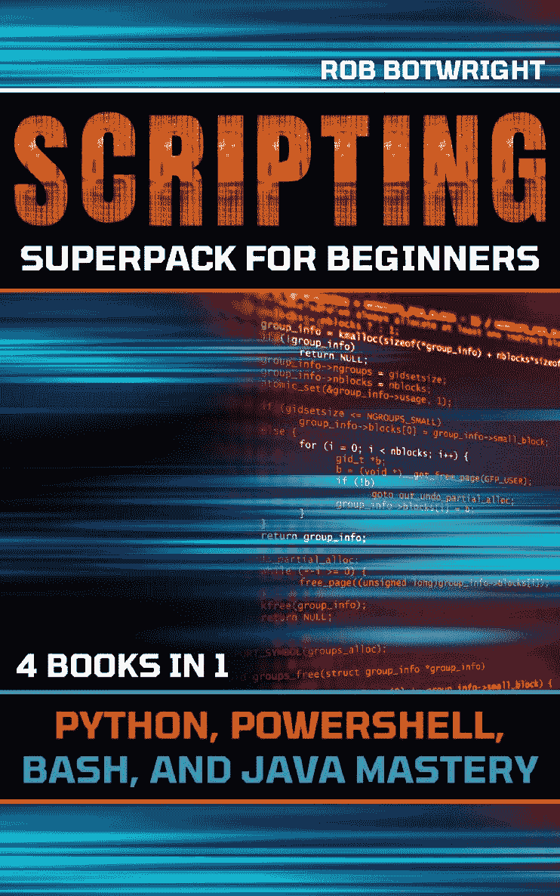

# 初学者脚本超级包：Python、Powershell、Bash 和 Java 精通指南




## 免责声明

本书中的内容基于广泛的研究和现有的历史来源。然而，作者和出版者不对书中包含信息的准确性、完整性或充分性做出任何陈述、承诺或保证。书中的信息按“原样”提供，作者和出版者对信息中的任何错误、遗漏或不准确，或根据此类信息而采取的任何行动不承担任何责任。

书中表达的观点仅代表作者观点，并不一定反映书中提到的任何组织或个人的官方政策或立场。对特定人物、地点或事件的任何引用仅用于提供历史背景，并非旨在诽谤或损害任何团体、个人或实体。

书中的信息仅供教育和娱乐目的，不能作为专业建议或判断的替代。鼓励读者进行自己的研究，并在适当的情况下寻求专业建议。

我们已尽力为书中使用的所有图像和其他版权材料获得必要的许可和感谢。这方面的任何错误或遗漏并非故意，作者和出版者将在未来的版本中予以修正。

---

## 引言

欢迎来到新手脚本超级礼包——这是一场进入脚本与自动化迷人世界的全面之旅。在这个功能强大的合包中，我们为你带来了四本不同的指南，每本都量身定制，旨在帮助你掌握`Python`、`PowerShell`、`Bash`和`Java`脚本技能。

### 第 1 卷：极简脚本：Python 入门指南——揭秘优雅的巨人

我们的冒险从`Python`开始，这是一门以优雅和简单著称的语言。`Python`对于任何脚本初学者都是理想的起点。在《极简脚本》中，我们将引导你学习`Python`的基础知识，揭开其语法机制并探索其多功能性。无论你是完全初学者，还是想扩展自己的脚本技能，这本书将为你提供`Python`脚本的坚实基础。

### 第 2 卷：精通 PowerShell 脚本：从新手到忍者——释放 Windows 自动化威力

接下来，我们将深入`PowerShell`的世界——这是一种专为`Windows`系统管理和自动化设计的脚本语言。《精通 PowerShell 脚本》将带你走过从新手到忍者的旅程，赋予你自动化任务、管理系统以及充分利用`PowerShell`潜力的技能。无论你是 IT 专业人士还是脚本爱好者，这本书将让你成为`PowerShell`大师。

### 第 3 卷：释放 Bash 脚本：初学者及进阶者的实践方法——揭秘命令行魔法

`Bash`是类 Unix 系统的命令行界面，也是一种强大的脚本工具。在《释放 Bash 脚本的威力》（Bash Scripting Unleashed）中，我们将引导你进入 Shell 脚本的世界。从导航 Linux 文件系统到精通循环和函数，这本书将把你转变为一名命令行大师。无论你是初学者还是想要提升自己的 Linux 技能，这本书都为`Bash`脚本编写提供了实用的方法。

### 第 4 卷：Java 脚本大师：从新手到专家的进阶指南——当脚本遇到 Java 的力量

我们的旅程以`Java`结束，这是一种强大且多功能的编程语言。在《Java 脚本大师》（Java Scripting Mastery）中，我们将探索脚本与面向对象编程的交汇。你将学习创建`Java`应用程序，利用库和`APIs`的力量，甚至进入多线程的世界。这本书是你从`Java`领域的新手变为脚本专家的一步级指南。

无论你是在自动化任务、分析数据、管理系统还是创建应用程序，“初学者脚本大包”（Scripting Superpack for Beginners）都能满足你的需求。该包中的每本书都经过精心设计，旨在提供手动的、实用且沉浸式的学习体验。无论你的背景或先前的经验如何，这些书籍将为你开启通往卓越脚本的大门。

加入我们的脚本之旅，我们将一同穿过`Python`、`PowerShell`、`Bash`和`Java`。在这个大包结束时，你将成为脚本大师，准备好应对现实世界的挑战并通过脚本通往成功。让我们一起开启这段激动旅程吧！

# 第 1 本：极简脚本

## Python 初学者指南

### ROB BOTWRIGHT 著

## 第 1 章：Python 脚本简介

`Python`因其在处理各种任务（从自动化重复过程到开发复杂应用程序）方面的简单性和多功能性，在脚本编写领域赢得了巨大的人气。当你选择`Python`来编写脚本时，你正在使用一种以可读性和易用性著称的语言。它读起来像普通的英语，让初学者和资深开发人员都能轻松上手。

`Python`丰富的标准库提供了广泛的模块和包，通过为常见操作提供预构建函数，简化了脚本任务。这个庞大的库减少了重复造轮子的需求，节省了时间和精力。

在你的脚本工作中选择`Python`的另一个重要理由是它的平台独立性。`Python`适用于多种平台，包括`Windows`、`macOS`和`Linux`，确保你的脚本可以在不同系统之间无缝运行。当你需要创建在多种计算环境中运行的脚本时，这种跨兼容性是一个巨大的优势。

`Python`的开源特性意味着你可以获得大量的资源、教程和社区支持。无论你是新手还是专家，`Python`社区都会为你提供帮助并分享知识，让你的脚本之旅更加顺畅愉快。

此外，`Python`的多功能性超出了脚本本身。它是一门能够处理 Web 开发、数据分析、机器学习等任务的完整编程语言。这意味着当你精通`Python`脚本后，你将有机会探索其他领域并扩展你的技能树。

安装`Python`并开始编写脚本轻而易举。像`Anaconda`这样的 Python 发行版以及官方网站提供了友好的安装程序，使得设置过程简单直观。一旦安装了`Python`，你就可以开始编写和执行脚本，无需复杂的配置。

在`Python`中，变量和数据类型是需要理解的基础概念。变量就像存储数据的容器，而数据类型定义了变量可以持有的数据种类。`Python`支持多种数据类型，包括整数、浮点数、字符串等，为你的脚本需求提供了灵活性。

在`Python`中编写脚本时，输入输出操作对于与用户和数据源交互至关重要。`Python`提供了简单的方法从用户获取输入并在屏幕上显示输出。这种简单性使其成为构建需要用户交互或生成信息性输出脚本的理想选择。

`Python`脚本的核心优势之一是它高效控制程序流的能力。条件语句（如`if-else`）允许你根据某些条件在脚本中做出决策。像`for`和`while`这样的循环允许你重复一组指令，从而轻松实现重复任务。

函数是可重用的代码块，有助于组织你的脚本并增强其可读性。在`Python`脚本中，定义和使用函数非常直观。你可以创建函数来封装特定任务，使你的脚本模块化并更易维护。

`Lists`（列表）和`dictionaries`（字典）是 Python 中强大的数据结构，允许你存储和操纵数据集合。`Lists`是有序集合，而`dictionaries`是键值对的无序集合。在脚本中处理大型数据集时，这些数据结构是无价的。

`Python`的文件处理能力在处理脚本中的输入输出时至关重要。你可以使用`Python`轻松地打开、读取、写入和操作文件。这项功能在自动化数据处理任务或与外部数据源工作时至关重要。

为了确保你的脚本健壮且抗错，`Python`提供了处理异常的机制。异常处理允许你优雅地处理脚本中的意外错误和失败，确保即使在不利的情况下也能继续顺利执行。

调试是脚本不可或缺的一部分，`Python`提供了各种调试工具和技术，帮助你识别并解决代码中的问题。在编写复杂脚本时，有效的调试实践可以节省大量的时间和挫败感。

随着你在`Python`脚本之旅不断进步，你将遇到使用更高级技术的需求。这些可能包括集成外部库、访问 Web `APIs`或使用`Python`执行网页爬虫和数据分析等任务。

`Python`脚本的可能性是巨大且多样的。从自动化系统管理任务到创建数据驱动的报告和 Web 应用程序，`Python`赋予你应对各种项目的能力。它的多功能性和简单性使其成为初学者和资深开发人员工具箱中的价值工具。

现在你已经了解了为什么`Python`是编写脚本的极佳选择，你准备好开启你的脚本之旅了。无论你是自动化重复任务、构建小型工具还是开发更复杂的应用程序，`Python`的可读性、多功能性和社区支持都使其成为一门极佳的语言。

在`Python`脚本的每一步，你都会发现简化工作、解决问题和释放创造力的新方法。所以，拿起键盘，打开你喜欢的文本编辑器或集成开发环境，从今天开始用`Python`编写脚本吧。自动化和效率的世界等待着你，而`Python`是这段激动旅程中可靠的伙伴！

`Python`这种备受喜爱、以简单多功能著称的编程语言拥有迷人的历史。它的旅程始于 20 世纪 80 年代后期，当时名叫`Guido van Rossum`的荷兰程序员致力于创建一种强调可读性和易用性的语言。`Guido`的愿景是开发一种能够让开发人员编写清晰简洁代码的语言，从而更容易表达想法和解决复杂问题。

### Python 历史

1989 年 12 月，Guido van Rossum 开始着 Python 第一个版本的开发。他以自己喜爱的英国喜剧小组“蒙蒂派瑟剧团”（Monty Python）为它命名，展现了他古怪且独特的幽默感。Python 的诞生不仅是为了给开发者提供工具，更是为了作为一种鼓励编程社区协作与乐趣的语言存在。

Python 的初始版本`Python 0.9.0`于 1991 年 2 月向公众发布。它已经具备了许多与众不同的特性，例如异常处理和模块，这使得代码的组织和重用成为可能。Python 的这一早期版本为后来成为强大且应用广泛的编程语言奠定了基础。

在整个 20 世纪 90 年代，Python 继续发展，并于 1994 年 1 月发布了`Python 1.0`。这一里程碑版本引入了`lambda`、`map`、`filter`和`reduce`函数等功能，增强了 Python 的能力和表达力。随着 Python 社区的壮大，该语言流行程度也日益增加，特别是在学术和科学领域。

2000 年 10 月发布的`Python 2.0`为该语言引入了列表推导式和垃圾收集。它进一步巩固了 Python 作为不同领域开发者可靠且高效选择的地位。开发团队维护了`Python 2`多年，确保了稳定性和向后兼容性。

然而，随着 Python 流行度的激增，对改进和更新的需求也随之增加。2008 年 12 月，`Python 3.0`发布，也被称为`Python 3000`或简单的`Python 3`。版本的 Python 对语言引入了重大更改，以解决`Python 2`中的问题和不一致之处。虽然`Python 3`与`Python 2`代码带来了一些兼容性挑战，但这是现代化和完善该语言的必要步骤。

由于开发者和库从`Python 2`迁移的过程是渐进的。尽管如此，充满活力的 Python 社区接受了这些变化，并努力确保`Python 3`成为新标准。这一过渡为 Python 的持续增长和演变铺平了道路。

Python 的成功不仅归功于它的可读性和强大功能，还归功于其强大的社区和开源特性。Python 社区多元化、包容且欢迎，使其成为初学者和经验丰富的开发者学习、协作和分享知识的理想环境。

Python 软件基金会（PSF）于 2001 年建立，在促进 Python 的增长和发展方面发挥着至关重要的作用。PSF 支持语言的基础设施，组织活动，并促进 Python 在 Web 开发、数据科学到人工智能和科学研究等各个领域的使用。

Python 的简单易读性使其成为教学编程的极佳选择。它通常是大学和代码训练营教授的第一门语言，向无数学生介绍了编程的世界。Python 直观的语法和清晰的结构帮助初学者快速掌握基础概念。

Python 的多功能性扩展到了 Web 开发，如`Django`和`Flask`等框架简化了构建 Web 应用程序的过程。特别是`Django`，因其健壮性和快速开发能力而闻名。开发者可以轻松地使用 Python 创建网站、Web 服务和 API。

数据科学和机器学习也见了 Python 使用量的激增。`NumPy`、`pandas`和`scikit-learn`等库为数据分析和机器学习提供了强大的工具。Python 的易用性和广泛的生态系统使其成为处理从数据可视化到预测建模等一切工作的专业人士的首选。

Python 在科学研究中的作用同样值得关注。科学家和研究人员使用 Python 执行数据分析、模拟和建模等任务。`SciPy`和`Matplotlib`等库帮助研究人员追求知识，而`Jupyter` notebooks 为实验和协作提供了一个交互平台。

得益于`TensorFlow`和`PyTorch`等库，人工智能和深度学习领域经历了一场 Python 革命。这些框架使研究人员和开发者能够构建复杂的机器学习模型和神经网络，推动技术的发展。

## 第二章：设置你的 Python 环境

现在我们已经探索了 Python 丰富的历史和多功能性，让我们进入在你的系统上安装 Python 的实际步骤。安装 Python 是一个简单的过程，它是你成为 Python 程序员或脚本编写者的必要步骤。

你需要做的第一件事是访问 Python 官网。该网站是所有 Python 相关信息的中心，也是你下载最新版本 Python 的地方。Python 是一门开源语言，你可以免费获取。

当你到达 Python 网站时，你会看到两个主要版本：`Python 2`和`Python 3`。然而，`Python 2`不再活跃开发并已结束生命周期。因此，强烈建议在任何新项目或安装中使用`Python 3`。相比`Python 2`，`Python 3`有许多改进、错误修复和新功能。

一旦你决定使用`Python 3`，你会看到多个可下载的子版本。Python 的发布周期包括稳定版本和开发版本。对于大多数用户，最好下载最新的稳定版本。这些稳定版本经过了充分测试，被认为是可靠的。

现在，你需要选择适用于你操作系统的安装程序。Python 支持 Windows、macOS 和各种 Linux 发行版。每个操作系统都有自己的安装程序，旨在该平台上无缝运行。

如果你使用的是 Windows，你会发现可以下载的 Windows 安装可执行文件（扩展名为`.exe`）。下载与你的系统架构匹配的安装程序，无论是 32 位还是 64 位。大多数现代系统都是 64 位，但验证你的系统架构以确保兼容性至关重要。

对于 macOS 用户，你会找到一个 macOS 安装程序包（扩展名为`.pkg`）。该包专为 macOS 设计，提供了一个直观的安装过程。

Linux 用户的系统中通常已经预装了 Python。然而，需要注意的是，某些较旧的 Linux 发行版中可能仍然存在`Python 2`。要在 Linux 上安装`Python 3`，你可以使用你发行版的包管理器。例如，在像 Ubuntu 等基于 Debian 的系统上，你可以使用`apt`软件包管理器；而在 CentOS 等基于 Red Hat 的系统上，可以使用`yum`或`dnf`。

下载好与你的系统和架构匹配的 Python 安装程序后，下一步是运行安装程序。在 Windows 上，你将双击下载的`.exe`文件来启动安装过程。在 macOS 上，你将打开`.pkg`文件，而在 Linux 上，你将使用包管理器安装`Python`。

在安装过程中，如果你愿意，可以有一个自定义安装的选项。你可以选择安装目录、配置高级选项，甚至将`Python`添加到系统的`PATH`环境变量中。将`Python`添加到`PATH`特别有用，因为它允许你直接从命令行运行`Python`，而无需指定 Python 可执行文件的完整路径。

安装完成后，你可以打开终端或命令提示符并运行以下命令来验证`Python`是否安装正确：

```bash
python --version
```

此命令应显示你已安装的`Python`版本，确认`Python`现在已在你的系统中可用。

此外，你只需在终端或命令提示符中输入`python`并按回车，即可运行 Python 交互式 shell。这将打开一个 Python shell，你可以在其中交互式地编写和执行 Python 代码。

`Python`还带有一个名为`pip`的包管理器。`Pip`允许你轻松安装额外的 Python 包和库。要检查`pip`是否安装，你可以运行：

```bash
pip --version
```

如果未安装`pip`，你可以按照 Python 官方网站上的说明单独下载并安装它。

在系统中成功安装`Python`后，你现在已经准备好开始脚本、编码并探索庞大的 Python 生态系统了。你有能力自动化任务、构建应用程序、分析数据并开启令人兴奋的编程冒险。

无论你是迈出编程第一步的初学者，还是正在扩展技能集的资深开发者，`Python`都为所有人提供了一个友好且强大的环境。所以，准备好释放你的创造力，解决现实问题，并享受学习和精通`Python`的旅程吧。你的编程冒险现在开始！

### 选择集成开发环境（IDE）

现在你已经在系统中安装了`Python`，编程旅程中的下一个重要步骤是选择一个集成开发环境，简称 IDE。`IDE`是一个软件应用程序，为编写、测试和调试你的 Python 代码提供了一个全面的环境。选择合适的`IDE`可以极大提高你的编码体验和生产力。

最流行的 Python IDE 之一是由`JetBrains`开发的`PyCharm`。`PyCharm`以其强大的功能、用户友好的界面和强大的代码分析能力而闻名。它提供免费的社区版（Community）和付费的专业版（Professional），让初学者和专业人士都能使用。

另一个优秀选择是`Visual Studio Code`，通常称为`VS Code`。它是由`Microsoft`开发的免费开源代码编辑器。虽然它不是传统的`IDE`，但`VS Code`提供了广泛的扩展和集成，允许你为 Python 开发进行自定义。它以速度和多功能性而著名。

如果你更倾向于轻量且直接的`IDE`，你可以考虑`Thonny`。`Thonny`是为初学者设计的。它内置了 Python 解释器、简单的界面以及代码补全和调试工具等功能，以降低学习曲线。


对于使用 Python 进行 Web 开发，`Django` 开发者经常使用 `PyCharm` 或 `Visual Studio Code`，因为它们对 Web 框架有很好的支持。`PyCharm` 针对 `Django` 开发提供了专门的功能，使其成为 `Django` 社区的流行选择。

如果你从事数据分析和科学计算，`Jupyter Notebook` 是一个极佳的选择。`Jupyter Notebook` 允许你创建和共享包含实时代码、方程、可视化和叙述性文本的文档。它在数据科学社区被广泛用于探索性数据分析和研究。

许多开发者还偏于使用 `Sublime Text`、`Atom` 或 `Notepad++` 等简单文本编辑器配合命令行进行 Python 脚本编写。这些文本编辑器提供了活性，并且可以通过插件和主题进行高度自定义以适应你的喜好。

在选择 `IDE` 时，请考虑你的经验水平、你将从事的项目类型以及个人喜好等因素。花时间探索不同的 `IDE` 和编辑器，找到最符合你需求和工作流的那一个。

### Python IDE 的核心功能

现在，让我们深入了解 Python `IDE` 中需要寻找的一些核心功能。代码自动完成是一个必不可少的功能，它通过在你输入时建议代码片段、函数名和变量名来节省你的时间。这有助于防止拼写错误并加速编码。

另一个关键功能是强大的调试器。调试工具允许你高效地识别并修复代码中的错误。寻找一个提供可视化调试能力、断点以及用于检查变量和调用栈的清晰界面的 `IDE`。

智能代码分析对于在运行代码之前捕捉潜在问题非常有价值。具有代码分析能力的 `IDE` 可以高亮语法错误、未使用的变量并建议代码改进，从而提高代码的整体质量。

与 `Git` 等版本控制系统的集成对于协作项目或想要跟踪代码更改的人来说至关重要。良好的 `IDE` 应该与版本控制工具无缝集成，方便提交、拉取和推送更改。

高效的项目管理工具也至关重要，特别是对于大型项目。寻找一个允许将代码组织到项目或工作区、管理依赖项并轻松导航项目文件的 `IDE`。

可定制性是一个允许你根据喜好调整 `IDE` 的功能。无论是为深夜编码选择深色主题，还是配置快捷键以匹配你之前的习惯，自定义 `IDE` 外观和行为都能极大提升你的编码体验。

一个经常被忽视但非常有用的功能是代码片段管理。允许创建和存储复用代码片段或模板的 `IDE` 可以在处理相似任务或项目时节省你的精力和时间。

最后考虑 `IDE` 的社区和支持。活跃的用户社区意味着你可以获得教程、插件和常见问题的答案。当你遇到挑战或想扩展知识时，这非常有帮助。

最终，`IDE` 的选择是个人的，最适合你的可能与别人不同。值得尝试几种 `IDE`，找到最符合你需求和喜好的那个。许多 `IDE` 提供免费试用或开源版本，让你轻松探索选项。

随着你对 Python 经验和知识的增加，你可能会发现自己的 `IDE` 偏好发生了变化。一些开发者会根据不同类型的项目或任务切换不同的 `IDE`。根据特定需求调整工具的灵活性是 Python 开发生态系统的优势之一。

总而言之，选择合适的 `IDE` 是你 Python 编程之旅中至关重要的决策。它会显著影响你的编码效率、调试能力以及整体编码体验。请花时间探索可用选项，尝试不同的 `IDE`，如果你发现更适合你需求的工具，请不要犹豫切换。在合适的 `IDE` 帮助下，你将能够从容应对 Python 项目，并开启兴奋的编码冒险。编码愉快！

## 第 3 章：变量与数据类型

在编程世界中，理解变量就像在深入写作之前先掌握字母表一样。变量是程序中用于存储和管理数据的基础构建块，在 Python 以及许多其他编程语言中，它们都起着核心作用。

你可以将变量想象成容器，每个容器都有唯一的标签，你可以在其中存储不同类型的信息。这些容器可以存放数字、文本、日期等，允许你的程序以各种方式处理和操作数据。

在 Python 中，声明一个变量就像给一个名称赋值一样简单。你选择变量的名字（称为标识符），然后使用等号（`=`）给它赋值。例如，你可以创建一个名为 `message` 的变量并给它赋值为 `"Hello, World!"`，如下所示：

```python
message = "Hello, World!"
```

一旦创建了变量，就可以通过它的名称来访问它的值。对于我们的 `message` 变量，你可以这样将其值打印到控制台：

```python
print(message)
```

当你运行这段代码时，控制台会显示 `"Hello, World!"`，因为变量 `message` 持有该值。

Python 中的变量是动态的，这意味着它们的值可以在程序执行过程中发生变化。你只需要给变量赋一个新值即可更新它。例如：

```python
message = "Hello, World!"
print(message)
message = "Welcome to Python!"
print(message)
```

在这段代码中，我们首先给 `message` 变量赋值 `"Hello, World!"` 并将其打印出来。然后，我们将 `message` 的值更新为 `"Welcome to Python!"` 并再次打印。结果将先显示 `"Hello, World!"` 然后显示 `"Welcome to Python!"`。

Python 是一种动态类型语言，这意味着你不需要显式声明变量的数据类型。Python 会根据赋给变量的值自动确定数据类型。例如，如果你给变量赋值一个整数，Python 就知道它是一个整数；如果你赋值一个字符串，它就会识别为字符串。

让我们探索一下可以存储在变量中的不同数据类型。Python 中常见的数据类型包括：

- **整数 (Integers)**：这些是整数，如 `1`、`42` 或 `-10`，在 Python 中表示为 `int` 数据类型。
- **浮点数 (Floating-point numbers)**：这些带有小数点的数字，如 `3.14` 或 `-0.5`。它们表示为 `float` 数据类型。
- **字符串 (Strings)**：字符串是字符序列，如 `"Python"`、`"Hello, World!"` 甚至可以是 `"123."`。它们表示为 `str` 数据类型。
- **布尔值 (Booleans)**：布尔值表示真或假。它们用于逻辑操作，表示为 `bool` 数据类型。
- **列表 (Lists)**：列表是有序的项目集合，可以包含不同类型的数据。
- **字典 (Dictionaries)**：字典是键值对的集合。
- **元组 (Tuples)**：元组是有序的集合，但它是不可变的。
- **集合 (Sets)**：集合是无序的唯一项目集合。

## 变量

理解变量的作用域并知道何时使用全局变量或局部变量对于编写整洁且可维护的代码至关重要。合理管理变量作用域有助于防止意外的副作用并增强代码的清晰度。

除了单个变量外，你还可以使用变量来处理数据集合。`Lists`（列表）、`diction`（字典）、`tuples`（元组）和 `sets`（集合）允许你同时存储和操作多个值。在处理大量数据或当需要组织相关信息时，这些数据结构变得特别有用。

例如，你可能会使用列表来存储一组数字，使用字典来表示键值对，或使用集合来跟踪唯一项目。以下是一些示例：

```python
## 创建一个数字列表
numbers = [1, 2, 3, 4, 5]

## 创建一个学生信息的字典
student = {"name": "Alice", "age": 25, "grade": "A"}

## 创建一个包含唯一颜色的集合
colors = {"red", "green", "blue"}
```

一旦你将这些集合存储在变量中，你就可以访问它们的元素或对它们执行操作。例如，你可以从列表中添加或删除项，更新字典中的值，或者检查某个项是否存在于集合中。

```python
## 向列表添加一个元素
numbers.append(6)

## 更新字典中学生的年龄
student["age"] = 26

## 检查 "yellow" 是否在集合中
if "yellow" not in colors:
    colors.add("yellow")
```

与集合一起工作扩展了你在程序中有效组织和管理数据的能力。在处理复杂应用程序和现实场景时，这些数据结构变得无足可贵。

总之，理解变量是 Python 编程的一个基础方面。变量是数据的容器，允许你在程序中存储、操作和访问信息。你可以使用变量来处理不同的数据类型，执行操作并创建动态且交互的应用程序。此外，掌握变量作用域的概念有助于你在代码中有效地管理变量。无论你是初学者还是经验丰富的程序员，掌握变量都是 Python 旅程中的关键一步，让你让你能够写出高效且表达良好的代码。所以，拥抱变量的力量，从今天开始构建强大的 Python 程序吧！

### 数据类型

在 Python 中，与任何其他编程语言一样，数据类型是你代码的基石，允许你处理各种信息。这些数据类型定义了数据的存储方式以及可以对其执行的操作，这使它们成为编程中至关重要的方面。那么，让我们开启探索 Python 多彩数据类型之旅。

#### 整数 (Integers)

首先，让我们深入最基础的数据类型之一：整数。整数代表整数，无论是正数还是负数。你可以使用整数来执行数学运算，如加、减、乘、除。例如，如果你有两个整数 `x` 和 `y`，可以使用 `+` 运算符将它们相加，如下：`result = x + y`。

#### 浮点数 (Floating-point Numbers)

另一方面，我们有浮点数，通常简单称为 `floats`。与整数不同，浮点数可以表示带有小数数字。它们非常通用，适用于科学计算、金融应用以及许多需要精确数值准确性的场景。

#### 字符串 (Strings)

字符串是另一种本质数据类型，是被单引号（`' '`）或双引号（`" "`）括的字符序列。字符串非常灵活；它们可以包含文本、数字、符号甚至空格。你可以使用 `+` 运算符拼接字符串，从而轻松组合单词或句子。

#### 布尔值 (Booleans)

布尔值通常与真和假值相关，对于代码中的决策制定至关重要。它们代表二进制逻辑，可以是 `True` 或 `False`。当你需要评估条件或创建如 `if` 和 `while` 类的条件语句时，布尔值大有用武。

#### 集合 (Collections)

现在，让我们探索允许你存储多个值的某些数据类型。`Lists` 是此目的最多功能的数据类型之一。列表是项目的有序集合，这些项目可以是不同的数据类型，包括整数、浮点数、字符串甚至其他列表。你可以通过在方括号中包含项目并用逗号分隔来创建列表。

例如，你可以像这样创建一个数字列表：`numbers = [1, 2, 3, 4, 5]`。列表是可变的，这意味着你可以在创建后更改其内容。你可以向列表添加项、删除项或修改现有项。当你需要处理一组相关项时，列表特别有用。

接接下来是 `tuples`（元组），它们与列表相似，但有一个关键区别：它们是不可变的。一旦创建了元组，你就不能更改其内容。元组使用括号定义，并可以包含各种数据类型。它们通常被用于表示固定的集合。

另一方面，`Dictionaries`（字典）是存储键值对的强大数据类型。字典中的每个值都与一个唯一的键相关。你可以将字典想象成现实世界的字典，其中单词（键）与它们的定义（值）相关。当你需要通过关联键快速查找值时，字典特别有用。

最后，我们有 `sets`（集合），它们是唯一项目的无序集合。当你需要确保集合包含不同元素时，集合非常方便。你可以执行各种集合操作，如并集、交集和差集，使得它们在需要高效比较和处理数据的场景中具有价值。

#### 动态类型与转换 (Dynamic Typing and Conversion)

理解数据类型至关重要，因为使你能够有效地处理不同类型的数据。Python 的动态类型系统允许你在不显式指定数据类型的情况下创建变量。Python 根据赋值的值来确定变量的类型。

以下是 Python 中动态类型用 string 的示例：

```python
x = 42  # x 是整数
y = 3.14  # y 是浮点数
name = "Alice"  # name 是字符串
is_true = True  # is_true 是布尔值
```

在这段代码中，Python 根据值自动分配数据类型。

在 Python 中，你也可以使用 `type()` 函数检查变量的类型。例如：

```python
x = 42
print(type(x))  # 输出: <class 'int'>
```

这段代码打印变量 `x` 的类型，即 `int`。

现在，让我们探索类型转换，这是一个允许你更改变量数据类型的过程。Python 提供了用于类型转换的内置函数，如 `int()`、`float()`、`str()` 等。

例如，你可以这样将整数转换为浮点数：

```python
x = 42
y = float(x)
```

代码中，`float()` 函数将整数 `x` 转换为浮点数，导致 `y` 的值为 `42.0`。

相反，你可以使用 `int()` 函数将浮点数转换为整数：

```python
y = 3.14
x = int(y)
```

在这种情况下，`int()` 函数截断了浮点数 `y` 的小数部分，导致 `x` 的值为 `3`。

字符串转换也是直观的：

```python
x = 42
y = str(x)
```

在这里，`str()` 函数将整数 `x` 转换为字符串，使得 `y` 等于字符串 `'42'`。

类型转换在你需要涉及不同数据类型变量的操作时特别有用。例如，你可能想要拼接字符串和整数。在这种情况下，你可以将整数转换为字符串，然后执行拼接：

```python
x = 42
message = "The answer is: " + str(x)
```

`str(x)` 部分将整数 `x` 转换为字符串，以便其与字符串 `message` 组合。

现在，让我们深入探讨与 Python 数据类型相关的更多高级主题。其中一个主题是索引（indexing）和切片（slicing），它们允许你访问字符串和列表等数据结构的特定元素或部分。

##### 索引与切片

Python 中的索引从 0 开始，这意味着序列第一个元素位于索引 0，第二个元素位于索引 1，以此此类推。要访问特定元素，你需要使用方括号并提供索引。

例如，如果你有一个字符串：

```python
text = "Python"
```

你可以通过使用 `text[0]` 来访问第一个字符 'P'。要访问第二个字符 'y'，则使用 `text[1]`，以此此类推。

切片是索引的扩展，允许你提取一个范围内的元素。切片使用冒号 `:` 来指定范围。例如，如果你想提取字符串的前三个字符，可以使用 `text[0:3]`，其结果为 'Pyt'。

切片功能非常强大，它允许你从特定的起始点到结束点提取元素。例如，`text[2:5]` 会从字符串中提取 'tho'。

负索引和负切片也是可能的。负索引从序列末尾开始，其中 `-1` 表示最后一个元素，`-2` 表示倒数第二个元素，以此此类推。负切片允许你从序列的末尾提取元素。例如，`text[-3:-1]` 会从字符串中提取 'ho'。

在 Python 中处理字符串、列表和其他序列时，理解索引和切片是基础性的。它允许你有效地访问和操作特定的元素或数据部分。

##### 类型检查与转换

让我们将关注转向另一个关重要的主题：类型检查和类型转换。Python 提供了如 `isinstance()` 之类的函数来检查变量的数据类型。如果变量是指定的类型或其子类型，该函数返回 `True`；否则返回 `False`。

例如，你可以使用 `isinstance()` 来检查变量是否为整数：

```python
x = 42
if isinstance(x, int):
    print("x is an integer")
else:
    print("x is not an integer")
```

在这段代码中，`isinstance(x, int)` 函数检查变量 `x` 是否为整数并打印相应的消息。

当你处理用户输入或来自外部源的数据时，数据类型可能无法保证，此时类型检查变得尤为有用。

Python 还提供了用于更高级类型转换的函数。例如，你可以使用 `eval()` 来评估包含 Python 表达式的字符串并返回其结果。然而，使用 `eval()` 时要小心，因为它可以在处理不受信任的输入时执行任意代码并带来安全风险。

另一个实用函数是 `str.format()`，它允许你通过用值替换占位符来动态格式化字符串。例如：

```python
name = "Alice"
age = 30
message = "My name is {} and I am {} years old.".format(name, age)
```

在代码中，`{}` 是占位符，会被 `name` 和 `age` 变量的值替换。

Python 还提供了几个处理字符串的内置函数，包括用于获取字符串长度的 `len()`、用于更改字符大小写的 `lower()` 和 `upper()`、用于删除首尾空格的 `strip()` 以及更多函数。

除了这些内置函数外，Python 的标准库还包含了用于更专门的数据类型和操作的模块。例如，`datetime` 模块允许你处理日期和时间，`math` 模块提供了数学函数，而 `random` 模块则提供了生成随机数的工具。

理解数据类型及其操作是 Python 编程的基础。通过牢固地掌握整数、浮点数、字符串和其他数据类型，你就拥有了创建多样化复杂应用的工具。学习如何执行类型转换、索引和切片序列以及使用类型检查函数，将扩展你作为 Python 程序员的能力。随着你继续你的旅程，你将在 Python 丰富的生态系统中发现更多数据类型和模块，让你能够应对各种任务和挑战。所以，拥抱数据类型的世界，对代码进行实验，并享受 Python 编程的创意之旅吧！

## 第 4 章：基础输入与输出

获取用户输入是许多程序的一个关键方面，因为它实现了交互和定制化。在 Python 中，你可以使用 `input()` 函数提示用户进行输入。该函数会显示一条消息，等待用户输入内容，然后将输入的文本作为字符串返回。

例如，如果你想询问用户的姓名，可以这样写：


```python
name = input("Please enter your name: ")
```

在代码中，系统会向用户显示消息 `"Please enter your name: "`，用户输入的文本将作为字符串存储在`name`变量中。

请记住，`input()`函数始终返回字符串，所以如果你需要用户输入作为不同的数据类型（如整数或浮点数），你需要进行类型转换，正如我们在前面的章节中讨论的那样。

用户输入通常用于让程序更具交互性和适应性。例如，你可以创建一个简单的计算器，要求用户输入两个数字和一个要执行的操作：

```python
num1 = float(input("Enter the first number: "))
num2 = float(input("Enter the second number: "))
operation = input("Enter the operation (+, -, *, /): ")
if operation == "+":
    result = num1 + num2
elif operation == "-":
    result = num1 - num2
elif operation == "*":
    result = num1 * num2
elif operation == "/":
    if num2 == 0:
        print("Error: Division by zero.")
    else:
        result = num1 / num2
else:
    print("Invalid operation")

if "result" in locals():
    print("Result:", result)
```

在这个示例中，程序向用户询问两个数字和要执行的操作。然后根据所选的操作计算并显示结果。

当处理用户输入时，优雅地处理潜在错误至关重要。在计算器示例中，程序检查用户是否尝试除以零。如果检测到除以零，它会报错。

为了改进用户体验，你还可以验证和清理用户输入。例如，你可以检查输入是否符合特定标准或格式。如果输入不符合格式，你可以提示用户正确输入信息。

例如，如果你正在构建一个询问电子邮件地址的程序，可以使用正则表达式来验证输入是否符合有效的电子邮件格式。如果用户输入了无效的电子邮件地址，你可以让他们重试。

```python
import re
email_pattern = r'^[\w\.-]+@[\w\.-]+\.\w+$'
while True:
    email = input("Please enter your email: ")
    if re.match(email_pattern, email):
        break
    else:
        print("Invalid email format. Please try again.")
```

在代码中，程序使用正则表达式检查输入的电子邮件地址是否符合格式。如果输入有效，循环退出；否则，它将继续提示用户直到提供有效的电子邮件地址为止。

另一个常见场景是从用户获取输入，例如询问用户的年龄或数字代码。在这种情况下，你可以使用错误处理来捕获并处理非数字输入。

```python
while True:
    try:
        age = int(input("Please enter your age: "))
        break
    except ValueError:
        print("Invalid input. Please enter a valid number.")
```

在这里，程序尝试使用`int()`将用户的输入转换为整数。如果转换失败（例如用户输入了文本而不是数字），会抛出`ValueError`异常，程序显示错误消息。循环持续直到用户提供有效的数字输入。

在提示用户输入和处理错误时，提供清晰且友好的消息是非常重要的。这使得交互更加直观和友好。

除了简单的文本输入，Python还提供了许多用于更高级用户交互的库和模块。例如，如果你正在构建一个图形用户界面（GUI）应用程序，可以使用`Tkinter`、`PyQt`或`Kivy`等库来创建交互式窗口和对话框，允许用户通过按钮、文本字段和下拉菜单等图形化元素输入数据。

此外，如果你的程序需要用户输入文件，可以使用`tkinter.filedialog`等文件对话框模块或`PyQt5.QtWidgets.QFileDialog`等第三方库来提供文件选择对话框。

对于基于Web的应用程序，你可以使用Web表单通过浏览器收集用户输入。像`Django`和`Flask`这样的Python框架可以轻松创建处理表单提交的Web应用程序。

此外，Python支持命令行参数，允许你在从命令行运行脚本时传递输入数据。`argparse`模块简化了定义和解析命令行参数的过程，使其成为创建命令行程序的有用工具。

总之，获取用户输入是编程的一个基础方面，允许你创建交互式且动态的应用程序。Python的`input()`函数是获取用户文本输入的一种简单方便的方法。然而，在处理用户输入时，必须考虑错误处理、验证和用户体验，以确保你的程序健壮且易用。根据你正在构建的应用程序类型，你还可以探索其他方法和库来进一步增强用户交互。因此，拥抱用户的输入，并利用它创建引人入胜且交互性的Python程序！

在Python中显示输出是一项基础技能，允许你与用户通信、提供信息并产生结果。在Python中，`print()`函数是向控制台或终端显示输出的主要工具。

要显示简单的消息，你可以像这样使用`print()`函数：

```python
print("Hello, world!")
```

当你运行这段代码时，它将在控制台打印`"Hello, world!"`。用双引号或单引号括的文本被称为字符串，这也是`print()`函数显示的内容。

你还可以使用`print()`函数显示变量的值。例如：

```python
name = "Alice"
age = 30
print("Name:", name)
print("Age:", age)
```

在这段代码中，`name`和`age`变量的值将与标签一起显示，使输出包含更多信息。

此外，你还可以打印表达式和计算的结果。例如：

```python
x = 5
y = 7
print("Sum:", x + y)
print("Product:", x * y)
```

这段代码计算变量`x`和`y`的和和积，并显示结果。

`print()`函数可以接受多个参数，这些参数用逗号隔开。在显示时，它会自动在参数之间插入空格字符。例如：

```python
first_name = "John"
last_name = "Doe"
print("Full name:", first_name, last_name)
```

这段代码打印`"Full name: John Doe"`，姓之间有一个空格。

除了显示文本和变量值外，你还可以使用字符串格式化技术格式化输出。一种常用方法是使用Python 3.6及更高版本引入的f-strings。f-strings允许你将表达式嵌入字符串字面量中，从而更容易创建动态输出。

这是一个使用f-string的示例：

```python
x = 10
y = 20
result = f"The sum is {x + y} and the product is {x * y}"
print(result)
```

在这个Flask应用中，我们定义了一个路由（`"/"`），它渲染一个名为`"index.html"`的HTML模板，并将变量名`name`传递给模板。随后，HTML模板可以在生成的网页中显示`name`的值。

总而言之，在Python中显示输出是一项多功能且本质的技能，它让你能够与用户通信、创建信息丰富的控制台应用程序、生成图形用户界面以及构建Web应用程序。Python提供了各种工具和库，以不同的格式和媒介显示输出，从简单的文本输出到交互式图形界面以及基于网络的应用程序。无论你是在创建命令行工具、桌面软件还是Web应用程序，掌握输出的艺术都是构建引人注目且用户友好软件的关键。所以，拥抱Python输出的能力，从今天开始创建惊人的应用程序吧！

## 第5章：控制流：条件语句和循环

在编程世界中，决策是一项基础任务。幸运的是，Python为此目的提供了一个强大的工具：`if-else`语句。该语句允许你的代码根据某些条件选择不同的路径并做出决策。

想象你正在构建一个天气应用，并根据温度显示不同的消息。你可以使用`if-else`语句来实现这一点。以下是它的工作原理：

```python
temperature = 25  # 你可以将温度设置为任何值
if temperature > 30:
    print("It's a hot day!")
elif temperature < 10:
    print("It's a cold day!")
else:
    print("It's a pleasant day!")
```

在这个示例中，代码评估`temperature`变量的值。如果`temperature`大于30度，它会打印`"It's a hot day!"`。如果`temperature`小于10度，它会打印`"It's a cold day!"`。否则，它会打印`"It's a pleasant day!"`。

这个`if-else`语句允许你的程序根据`temperature`变量的值适应不同的情况。

`if-else`语句中的一个核心概念是条件，它是布尔表达式，结果为`True`或`False`。在上面的示例中，`temperature > 30`和`temperature < 10`就是条件。根据这些条件是`True`还是`False`，代码会采取不同的路径。

Python支持各种比较运算符来创建条件，例如`>`、`<`、`>=`、`<=`、`==`和`!=`。这些运算符允许你比较值并准确地表达条件。

例如，你可以使用等值运算符`==`来检查两个值是否相等。这是一个示例：

```python
number = 5
if number == 5:
    print("The number is equal to 5.")
```

在这段代码中，条件`number == 5`检查`number`变量是否等于5，如果是，就会打印消息。

你也可以使用`!=`运算符来检查两个值是否不等。例如：

```python
color = "red"
if color != "blue":
    print("The color is not blue.")
```

在这里，代码检查`color`变量是否等于`"blue"`，如果不等于，则打印消息。

组合条件是`if-else`语句的另一个强大方面。你可以使用`and`、`or`和`not`等逻辑运算符来创建复杂条件。

假设你想检查用户的年龄是否在18到65岁之间，以判断他们是否符合某项服务的资格。你可以使用`and`运算符组合两个条件：

```python
age = 25
if age >= 18 and age <= 65:
    print("You are eligible for the service.")
```

在这段代码中，`age >= 18`条件检查`age`是否为18岁或以上，`age <= 65`条件检查`age`是否为65岁或更小。两个条件都为`True`时，才会打印消息。

另一方面，如果你想检查用户是学生还是老年人以向他们提供折扣，你可以使用`or`运算符：

```python
user_status = "student"
if user_status == "student" or user_status == "senior":
    print("You qualify for a discount.")
```

在这里，代码检查`user_status`变量是否为`"student"`或`"senior"`以授予折扣。

要反转条件，你可以使用`not`运算符。例如，如果你想检查用户是否不是管理员以限制访问权限，你可以这样做：

```python
is_admin = False
if not is_admin:
    print("Access denied. You are not an admin.")
```

`not`运算符否定了条件，因此它检查`is_admin`变量是否不是`True`（即为`False`）。

有时，你会遇到需要根据多个条件做决策的情况。你可以通过嵌套`if-else`语句来实现这一点。这是一个示例：

```python
has_ticket = True
is_weekend = False
if has_ticket:
    if is_weekend:
        print("Enjoy your weekend trip!")
    else:
        print("Have a great weekday journey!")
else:
    print("Please purchase a ticket.")
```

在这段代码中，有两个条件需要考虑：`has_ticket`和`is_weekend`。如果用户有票，代码会检查是否是周末。如果是，则打印“周末旅行愉快！”；如果不是，则打印“工作日行程愉快！”。如果没有票，则打印“请购买票务。”

在这个代码中，有两个需要考虑的条件：`has_ticket`和`is_weekend`。如果用户有票，代码会检查是否是周末……（上）

缩进在Python中定义`if-else`语句的范围。与某些编程语言使用`{}`来指示代码块不同，Python使用缩进。缩进确保了Python知道哪些代码属于该块。

例如，考虑这个正确缩进的`if-else`语句：

```python
if condition:
    print("This is inside the if block.")
else:
    print("This is inside the else block.")
```

这是一个错误的缩进示例：

```python
if condition:
print("This code is incorrectly indented.")
else:
print("So is this code.")
```

这会导致语法错误并可能导致代码行为不符合预期。在实践中，`if-else`语句对于创建逻辑至关重要。它们允许你的代码适应不同的情况，使你的应用程序更加动态和用户友好。编程通常涉及重复任务，这就是循环大显身手的地方。在Python中有两种主要的循环类型：`for`循环和`while`循环。这些循环允许你的代码多次执行指令块，为程序提供效率和灵活性。

让我们先探索`for`循环。假设你有一个列表，你想对每个项目执行特定操作。`for`循环是这种场景的理想选择。这是一个示例：

```python
fruits = ["apple", "banana", "cherry"]
for fruit in fruits:
    print(f"I love {fruit}s!")
```

在这段代码中，`for`循环遍历`fruits`列表中的每个元素并将其赋值给`fruit`变量。在循环内部，它打印出喜爱每种水果的消息。循环一直持续到处理列表中的所有项为止。

当你提前知道要执行代码块的次数时非常有用，例如在遍历列表、元组或字符串等集合时。Python的`for`循环简化了这个过程，使得处理迭代对象变得简单。

你还可以使用`range()`函数生成数字序列并遍历它。例如，如果你想打印从1到5的数字：

```python
for number in range(1, 6):
    print(number)
```

在这种情况下，`range(1, 6)`生成了一个从1（包含）到6（不包含）的数字序列，循环打印每个数字。

除了`for`循环外，Python还提供了`while`循环，它提供了一种不同的重复方法。只要指定的条件为`True`，`while`循环就会继续执行。考虑一个简单的倒计时：

```python
countdown = 5
while countdown > 0:
    print(countdown)
    countdown -= 1
print("Blast off!")
```

在这里，`while`循环不断递减`countdown`变量，直到它变为0。只要`countdown`大于0，循环就会一直运行。当条件不再满足时，循环终止，并打印`"Blast off!"`。

当你预先不知道需要多少次迭代，并且依赖某个条件来决定何时停止时，`while`循环非常有用。

在使用`while`循环时必须保持谨慎，因为如果条件永远不满足，可能会创建无限循环。务必确保你的循环条件最终会求值为`False`，以防止意外的后果。

`while`循环的一个常见用例是获取用户输入。例如，你可以提示用户输入有效的数字：

```python
while True:
    user_input = input("Enter a number: ")
    if user_input.isdigit():
        break
    else:
        print("Invalid input. Please enter a number.")
number = int(user_input)
print(f"You entered {number}.")
```

在这段代码中，`while`循环无限运行，直到用户输入有效的数字。`isdigit()`方法检查输入是否由数字组成，当提供有效数字时，循环就会打破。


循环控制语句（如 `break` 和 `continue`）对循环的执行提供了进一步的控制。`break` 会立即退出循环，而 `continue` 会跳过当前迭代并移动到下一次。

例如，考虑一种在列表中找到第一个偶数的场景：

```python
numbers = [1, 3, 5, 4, 7, 9]
for number in numbers:
    if number % 2 == 0:
        print(f"The first even number is {number}.")
        break
```

在这段代码中，`for` 循环遍历 `numbers` 列表。当它遇到第一个偶数时（在本例中为 4），它会打印消息并使用 `break` 退出循环。

另一方面，假设你想跳过奇数并只打印偶数：

```python
numbers = [1, 2, 3, 4, 5, 6, 7, 8, 9]
for number in numbers:
    if number % 2 != 0:
        continue
    print(f"Even number: {number}")
```

在这个例子中，当 `for` 循环遇到奇数时，它使用 `continue` 跳过该迭代，确保只打印偶数。

循环控制语句允许你根据特定的条件和要求精调循环的行为。

嵌套循环是另一个值得探索的高级主题。它们是嵌套在循环内部循环，允许你处理多维数据结构或执行更复杂的迭代。

考虑你有一个列表列表，并想要打印每个元素：

```python
matrix = [[1, 2, 3], [4, 5, 6], [7, 8, 9]]
for row in matrix:
    for item in row:
        print(item)
```

在这段代码中，外部 `for` 循环遍历 `matrix` 的每一行，内部 `for` 循环遍历行中的每个项目。这种嵌套结构允许你访问并处理矩阵的单个元素。

`while` 循环和 `for` 循环提供了不同的迭代方法。`for` 循环适用于你有预定义的项目集或需要迭代的序列的情况，而 `while` 循环适用于你需要重复某项任务直到满足特定条件的情况。

这两种循环都是程序员工具箱中不可或缺的工具，使你能够自动化重复任务、处理数据并创建高效、灵活的代码。通过掌握循环，你获得了创建更动态、更强大的 Python 程序的能力，让你的 Python 编程师之旅变得更加令人兴奋和高效。所以，拥抱循环的世界，并在你的编程冒险中充分利用它们吧！

# 第 6 章节：函数与模块化编程

函数就像编程世界中的构建块，允许你将复杂任务拆分为更小、更易管理的单元。在 Python 中，定义和调用函数是一个基本概念，它可以增强代码的组织结构、重用性和可读性。

想象你正在计划一次公路旅行，需要计算你将行驶的总距离。与其多次编写相同的距离计算代码，不如创建一个函数来处理此任务。以下是在 Python 中定义函数的方法：

```python
def calculate_distance(speed, time):
    distance = speed * time
    return distance
```

在示例中，我们定义了一个名为 `calculate_distance` 的函数。`def` 关键字标志函数定义的开始，后面跟着函数名和一对可以包含参数（也称为参数）的括号。

在这种情况下，函数接收两个参数：`speed` 和 `time`。在函数内部，它通过速度乘以时间计算距离，然后使用 `return` 关键字返回结果。

一旦定义了函数，你通过它的名称并提供所需的参数来调用它：

```python
trip_speed = 60  # 每小时英里
trip_time = 4  # 小时
total_distance = calculate_distance(trip_speed, trip_time)
print(f"You entered {total_distance}.")
```

除了 `for` 循环外，Python 还提供了 `while` 循环，它提供了一种不同的重复方法。`while` 循环只要指定的条件为 `True` 就会继续执行。考虑一个简单的倒计时：

```python
countdown = 5
while countdown > 0:
    print(countdown)
    countdown -= 1
print("Blast off!")
```

在这里，`while` 循环不断递减 `countdown` 变量，直到它变为 0。只要 `countdown` 大于 0，循环就会一直运行。当条件不再满足时，循环终止，并打印 `Blast off!`。

当你预先不知道需要多少次迭代，并且依赖某个条件来决定何时停止时，`while` 循环非常有用。

在使用 `while` 循环时必须保持谨慎，因为如果条件永远不满足，可能会创建无限循环。始终确保你的循环条件最终会求值为 `False`，以防止意外的后果。

`while` 循环的一个常见用例是获取用户输入。例如，你可以提示用户输入有效的数字：

```python
while True:
    user_input = input("Enter a number: ")
    if user_input.isdigit():
        break
    else:
        print("Invalid input. Please enter a number.")
number = int(user_input)
print(f"You entered {number}.")
```

在这段代码中，`while` 循环无限运行，直到用户输入有效的数字。`isdigit()` 方法检查输入是否由数字组成，当提供有效数字时，循环就会打破。


在这段代码中，外部 `"for"` 循环遍历 `matrix` 的每一行，内部 `"for"` 循环遍历行中的每个项目。这种嵌套结构允许你访问并处理矩阵的单个元素。

`"while"` 循环和 `"for"` 循环提供了不同的迭代方法。`"for"` 循环适用于你有预定义的项目集或需要迭代的序列的情况，而 `"while"` 循环适用于你需要重复某项任务直到满足特定条件的情况。

这两种循环都是程序员工具箱中不可或缺的工具，使你能够自动化重复任务、处理数据并创建高效、灵活的代码。通过掌握循环，你获得了创建更动态、更强大的 Python 程序的能力，让你的 Python 编程师之旅变得更加令人兴奋和高效。所以，拥抱循环的世界，并在你的编程冒险中充分利用它们吧！

# 第 6 章节：函数与模块化编程

函数就像编程世界中的构建块，允许你将复杂任务拆分为更小、更易管理的单元。在 Python 中，定义和调用函数是一个基本概念，它可以增强代码的组织结构、重用性和可读性。

想象你正在计划一次公路旅行，需要计算你将行驶的总距离。与其多次编写相同的距离计算代码，不如创建一个函数来处理此任务。以下是在 Python 中定义函数的方法：

```python
def calculate_distance(speed, time):
    distance = speed * time
    return distance
```

在示例中，我们定义了一个名为 `calculate_distance` 的函数。`def` 关键字标志函数定义的开始，后面跟着函数名和一对可以包含参数（也称为参数）的括号。

在这种情况下，函数接收两个参数：`speed` 和 `time`。在函数内部，它通过速度乘以时间计算距离，然后使用 `return` 关键字返回结果。

一旦定义了函数，你通过它的名称并提供所需的参数来调用它：

```python
trip_speed = 60  # 每小时英里
trip_time = 4  # 小时
total_distance = calculate_distance(trip_speed, trip_time)
print(f"You entered {number}.")
```

考虑一种场景：你需要用个性化的消息来问候用户。你可以定义一个函数来处理此任务：

```python
def greet_user(name):
    message = f"Hello, {name}! Welcome to our platform."
    return message
```

现在，你可以在需要问候用户时调用此函数：

```python
user_name = "Alice"
greeting = greet_user(user_name)
print(greeting)
```

通过将问候逻辑封装在函数中，你可以为任何用户复用它，使你的代码更高效且易于维护。

Python 还允许你将在函数内部定义函数，这被称为嵌套函数。这一概念允许你创建仅在较大函数的作用范围内才相关的辅助函数。这是一个例子：

```python
def calculate_total_cost(price, quantity):
    def apply_discount(cost):
        return cost * 0.9  # 10% discount

    subtotal = price * quantity
    discounted_total = apply_discount(subtotal)
    return discounted_total
```

在这段代码中，`calculate_total_cost` 函数有一个名为 `apply_discount` 的嵌套函数。这个内部函数通过应用 10% 的折扣来计算折后的成本。它在外部函数内部用于计算应用折扣后的最终费用。

函数还可以组织成模块并导入到其他 Python 文件中，使得跨多个项目复用代码成为可能。Python 的标准库提供了许多具有各种任务预定义函数的模块，这在你的编程之旅中节省了精精力和。

总之，定义和调用函数是 Python 编程的一个基础方面。函数允许你封装逻辑、改进代码组织、增强可复用性，并让你的程序更易读更高效。无论你是在创建简单的计算、复杂的算法还是交互式应用程序，掌握函数都是成为熟练 Python 程序员的关键。因此，拥抱函数的力量并利用它们来简化并增强你的编程冒险吧！

## 变量的作用域与生命

理解变量的作用域和生命对于编写高效且无 Bug 的 Python 代码至关重要。Python 中的变量就像存储数据的容器，它们具有特定的访问范围（作用域）以及持续存在的时间（生命）。

让我们从探索变量作用域的概念开始。在 Python 中，变量的作用域定义了可以在代码的何位置使用或访问它。Python 有三个主要的变量作用域：局部（local）、闭包（enclosing）和全局（global）。

### 局部作用域 (Local Scope)

局部作用域是最窄的作用域，它包含了特定函数或方法内部的代码。在函数内部定义的变量被视为该函数的局部变量，无法从外部进行访问。这被称为函数级作用域或局部作用域。

例如，考虑以下代码：

```python
def greet():
    message = "Hello, World!"
    print(message)

greet()
print(message)
```

在这段代码中，变量 `message` 定义在 `greet` 函数内部。它具有局部作用域，这意味着它只能在函数内部访问。尝试在函数外部打印 `message` 将导致 `NameError`，因为该变量在全局作用域未定义。

### 闭包作用域 (Enclosing Scope)

闭包作用域也称为非局部作用域，在处理嵌套函数时相关。在 Python 中，一个函数定义在另一个函数内部，创建一个嵌套结构。在闭包函数中定义的变量可以被嵌套函数访问。

这是一个例子：

```python
def outer_function():
    x = 10

    def inner_function():
        print(x)

    inner_function()

outer_function()
print(x)
```

在这段代码中，`x` 定义在 `outer_function` 中。它具有闭包作用域，允许 `inner_function` 访问并打印它的值。然而，尝试在两个函数之外打印 `x` 将导致 `NameError`，因为它在全局作用域未定义。

### 全局作用域 (Global Scope)

全局作用域是最广的作用域，包含了整个 Python 脚本或模块。在脚本或模块顶层定义的变量具有全局作用域，可以从脚本内的任何地方访问。

例如：

```python
y = 20

def print_global_variable():
    print(y)

print_global_variable()
print(y)
```

在这段代码中，变量 `y` 定义在全局作用域中，使其在 `print_global_variable` 函数内部和外部都可以访问。你可以从脚本的任何部分打印它的值。

需要注意的是，当你想从函数内部修改全局变量时，需要使用 `global` 关键字来指示你引用的是全局变量，而不是创建一个新的局部变量。例如：

```python
z = 30

def modify_global_variable():
    global z
    z = z + 5

modify_global_variable()
print(z)
```

在这段代码中，`global` 关键字告诉 Python `z` 指向全局变量，函数通过向其加 5 来修改它的值。

### 变量的生命 (Variable Lifetime)

现在，让我们深入变量生命的概念。变量的生命定义了它在内存中存在的时间。在 Python 中，变量的生命取决于它的作用域。

- 局部变量的生命周期较短。它们在函数被调用时创建，在函数退出时销毁。这意味着在定义它的函数执行完成后，你无法访问该局部变量。
- 闭包作用域变量的生命与闭包函数的持续时间绑定。它们在闭包函数被调用时创建，在闭包函数退出时销毁。只要闭包函数正在执行，嵌套函数就可以这些变量。
- 全局变量具有最长的生命。它们在脚本或模块加载时创建，直到脚本或模块终止才留在内存中。全局变量在其生命周期内可以在脚本的任何部分被访问和修改。

这是一个说明变量生命的示例：

```python
def outer_function():
    p = 50

    def inner_function():
        print(p)

    inner_function()

outer_function()
print(p)
```

在这段代码中，变量 `p` 定义在 `outer_function` 中。它的生命受限于函数的执行时间。它在 `outer_function` 被调用时创建，在函数和嵌套的 `inner_function` 中使用，并在 `outer_function` 退出时销毁。在两个函数之外打印 `p` 将导致 `NameError`，因为它不再内存中。

理解变量的作用域和生命对于编写健壮且于维护的代码至关重要。它可以防止命名冲突，确保变量在需要的地方可用，并有助于内存管理。

需要注意的一个常见陷阱是在函数内部无意创建一个与全局变量同名的局部变量。在这种情况下，局部变量在函数作用域内的优先级高于全局变量，可能会导致意外行为。

这是一个例子：

```python
q = 100

def create_local_variable():
    q = 10  # 这在函数内部创建了一个新的局部变量
    print(q)

create_local_variable()
print(q)  # 这打印的是全局变量 q，而不是局部变量
```

在这段代码中，`create_local_variable` 函数创建了一个值为 10 的新局部变量 `q`，但它并没有修改全局变量 `q`。因此，在函数外部打印其值时，全局变量不受影响。

要在函数内部访问全局变量，你可以使用 `global` 关键字，或者为局部变量选择不同的名称。

总而言之，理解变量的作用域和生命周期对于编写简洁、无 bug 的 Python 代码至关重要。局部、嵌套和全局作用域定义了访问变量的位置，而变量的生命周期决定了它在内存中存在多久。通过掌握这些概念，你可以自信地管理 Python 程序中的变量，防止命名冲突，并确保代码行为符合预期。因此，拥抱变量作用域和生命周期的力量，成为更熟练的 Python 程序员吧！

# 第 7 章：列表与字典的操作

在编程世界中，列表是多功能且本质的数据结构。Python 以简单易读著称，提供了强大的列表操作工具，使你能够高效地执行各种操作。

Python 列表操作能力的核心是内置函数和方法，这些方法允许你添加、删除、访问和修改列表中的元素。让我们开启列表操作之旅吧。

## 添加元素

首先，我们来谈谈向列表添加元素。Python 提供了几种实现此方法。你可以使用 `append()` 方法将元素添加到列表的末尾。例如：

```python
fruits = ["apple", "banana", "cherry"]
fruits.append("orange")
```

在这段代码中，`append()` 方法将字符串 `"orange"` 添加到 `fruits` 列表的末尾。现在，列表包含了四个元素："apple""banana""cherry" 和 "orange"。

添加元素的另一种方法是 `insert()`。它允许你在列表的特定位置插入元素。例如：

```python
fruits = ["apple", "banana", "cherry"]
fruits.insert(1, "orange")
```

在这个示例中，`insert()` 方法将 `"orange"` 放置在 `fruits` 列表的第二个位置（索引 1）。列表变为 `["apple," "orange," "banana," "cherry"]`。

如果你有另一个迭代对象（例如列表或元组），可以使用 `extend()` 方法将其元素追加到现有列表中：

```python
fruits = ["apple", "banana", "cherry"]
more_fruits = ["orange", "grape"]
fruits.extend(more_fruits)
```

执行这段代码后，`fruits` 列表包含了两个列表的所有元素：`["apple," "banana," "cherry," "orange," "grape"]`。

要向列表添加多个相同值的元素，你可以结合列表推导式使用 `*` 运算符：

```python
fruits = ["apple", "banana", "cherry"]
fruits += ["apple"] * 3
```

在这个示例中，我们使用列表推导式创建一个包含三个 `"apple"` 元素的列表，然后使用 `+=` 运算符将它们添加到 `fruits` 列表中。

## 删除元素

现在，让我们来探索如何从列表中删除元素。Python 也提供了各种方法来实现此目标。`remove()` 方法允许你删除特定值的第一次出现：

```python
fruits = ["apple", "banana", "cherry"]
fruits.remove("banana")
```

运行这段代码后，`fruits` 列表不再包含 `"banana"`。它变为 `["apple," "cherry"]`。

如果你知道想要删除的元素的索引，可以使用 `pop()` 方法：

```python
fruits = ["apple", "banana", "cherry"]
removed_fruit = fruits.pop(1)
```

在这里，`pop()` 方法删除了索引 1 处的元素（`"banana"`）并返回它。变量 `removed_fruit` 现在包含 `"banana"`，而 `fruits` 列表为 `["apple," "cherry"]`。

你还可以使用 `del` 语句根据索引删除元素：

```python
fruits = ["apple", "banana", "cherry"]
del fruits[1]
```

在这种情况下，`del` 语句删除了索引 1 处的元素（`"banana"`），导致 `fruits` 列表变为 `["apple," "cherry"]`。

当你想要删除列表中的所有元素时，可以使用 `clear()` 方法：

```python
fruits = ["apple", "banana", "cherry"]
fruits.clear()
```

执行这段代码后，`fruits` 列表为空。

## 访问和修改元素

现在我们涵盖了添加和删除元素，让我们探索访问和修改列表中的元素。在 Python 中，你可以通过索引访问元素，索引从 0 开始。

例如，访问列表的第一个元素：

```python
fruits = ["apple", "banana", "cherry"]
first_fruit = fruits[0]
```

在这段代码中，`first_fruit` 将包含 `"apple"`。

要从列表末尾访问元素，可以使用负索引。例如：

```python
fruits = ["apple", "banana", "cherry"]
last_fruit = fruits[-1]
```

在这种情况下，`last_fruit` 也将包含 `"cherry"`。

你可以通过给特定索引分配新值来修改元素：

```python
fruits = ["apple", "banana", "cherry"]
fruits[1] = "orange"
```

运行这段代码后，`fruits` 列表将变为 `["apple," "orange," "cherry"]`，`"banana"` 被替换为 `"orange"`。

## 切片

切片是处理列表的另一种强大技术。它允许你创建一个新列表，其中包含现有列表子集。切片的基本语法为 `list[start:end]`，其中 `start` 是要包含的第一个元素的索引，`end` 是要排除的第一个元素的索引。

例如，创建一个包含 `fruits` 中第二和第三元素的列表：

```python
fruits = ["apple", "banana", "cherry", "date", "fig"]
subset = fruits[1:3]
```

在这段代码中，`subset` 将是 `["banana," "cherry"]`。

你也可以省略 `start` 或 `end` 来分别包含从列表开始或到末尾的元素：

```python
fruits = ["apple", "banana", "cherry", "date", "fig"]
subset_start = fruits[:3]  # 包含从索引 0 到 2 的元素
subset_end = fruits[3:]  # 包含从索引 3 到最后的元素
```

`subset_start` 将是 `["apple," "banana," "cherry"]`，而 `subset_end` 将是 `["date," "fig"]`。

切片还可以包含步值，允许你跳过列表中的元素：

```python
fruits = ["apple", "banana", "cherry", "date", "fig"]
every_other = fruits[::2]  # 每包含第二个元素
```

在这个示例中，`every_other` 将是 `["apple," "cherry"]`。

你可以通过设置步值为 `-1` 来反转列表：

```python


```python
fruits = ["apple", "banana", "cherry", "date", "fig"]
reversed_fruits = fruits[::-1]  # 反转元素顺序
```

执行这段代码后，`reversed_fruits` 将是 `["fig", "date", "cherry", "banana", "apple"]`。

### 方法

Python 还提供了内置函数来执行常见的列表操作。例如，你可以使用 `len()` 函数确定列表的长度：

```python
fruits = ["apple", "banana", "cherry"]
count = len(fruits)
```

在这段代码中，`count` 将为 3，表示 `fruits` 列表包含三个元素。

排序列表可以使用 `sorted()` 函数，它可以创建一个新的排序列表：

```python
fruits = ["banana", "apple", "cherry"]
sorted_fruits = sorted(fruits)
```

执行这段代码后，`sorted_fruits` 将是 `["apple", "banana", "cherry"]`，而原始 `fruits` 列表保持不变。

要就地排序列表可以使用 `sort()` 方法：

```python
fruits = ["banana", "apple", "cherry"]
fruits.sort()
```

运行这段代码后，`fruits` 列表将变为 `["apple", "banana", "cherry"]`，按字母顺序排序。

要检查元素是否存在于列表中，可以使用 `in` 运算符：

```python
fruits = ["apple", "banana", "cherry"]
is_banana_in_list = "banana" in fruits  # True
is_grape_in_list = "grape" in fruits  # False
```

变量 `is_banana_in_list` 为 True，因为 `"banana"` 在 `fruits` 列表中，而 `is_grape_in_list` 为 False，因为 `"grape"` 不在。

你还可以使用 `count()` 方法统计列表中元素的次数：

```python
fruits = ["apple", "banana", "cherry", "banana", "date"]
banana_count = fruits.count("banana")  # 2
```

在这段代码中，`banana_count` 将为 2，因为 `"banana"` 在 `fruits` 列表中出现了两次。

此外，你可以使用 `index()` 方法查找元素第一次出现的索引：

```python
fruits = ["apple", "banana", "cherry", "date"]
index_of_cherry = fruits.index("cherry")  # 2
```

`index_of_cherry` 变量将为 2，因为 `"cherry"` 位于水果列表的索引 2。

列表推导式（List comprehension）是一种通过对现有列表应用表达式来创建新列表的简洁且强大的方法。它允许你用单行代码过滤、转换或生成列表。

例如，假设你有一个数字列表，并创建一个只包含偶数的新列表：

```python
numbers = [1, 2, 3, 4, 5, 6]
even_numbers = [x for x in numbers if x % 2 == 0]
```

执行这段代码后，`even_numbers` 将变为 `[2, 4, 6]`。

你还可以使用列表推导式对元素进行转换处理：

```python
words = ["apple", "banana", "cherry"]
capitalized_words = [word.upper() for word in words]
```

在这种情况下，`capitalized_words` 将包含 `["APPLE", "BANANA", "CHERRY"]`，每个单词都已转换成大写字母。

列表推导式不仅限于过滤和转换，还可以用于生成具有特定模式的列表：

```python
squares = [x**2 for x in range(1, 6)]
```

运行这段代码后，`squares` 将变为 `[1, 4, 9, 16, 25]`，包含 1 到 5 的平方。

嵌套列表推导式允许你处理嵌套列表（例如列表列表）。你可以将嵌套列表展平为单个列表，或者对内层列表执行操作。例如：

```python
matrix = [[1, 2, 3], [4, 5, 6], [7, 8, 9]]
flattened_matrix = [number for row in matrix for number in row]
```

在这个示例中，`flattened_matrix` 将变为 `[1, 2, 3, 4, 5, 6, 7, 8, 9]`，包含嵌套矩阵中的所有元素。

Python 中的列表操作是一项基础技能，它让你能够高效、有效地处理数据集合。无论是添加、删除、访问还是修改元素，Python 均提供了丰富的工具和技术，让你的编码任务变得更加简单和愉快。通过练习，你将熟练掌握如何根据特定需求操作列表。列表是许多 Python 程序的构建块，掌握列表操作是成为精通 Python 程序员的重要一步。因此，请潜入列表的世界，尝试不同的操作，释放 Python 列表操作能力的全部潜力！

字典（Dictionaries）是 Python 中的基础数据结构，允许你以键值对的形式存储和管理数据集合。它们非常通用，并在 Python 编程中被广泛使用。让我们探索各种字典操作以及它们如何增强你的 Python 代码。

要创建一个字典，你可以使用大括号 `{}` 并指定用冒号分隔的键值对。例如：

```python
person = {"name": "Alice", "age": 30, "city": "New York"}
```

在这个示例中，我们创建了一个名为 `person` 的字典，包含三个键值对：`"name"`、`"age"` 和 `"city"`。键是字符串，而值可以是任何数据类型，包括字符串、数字、列表甚至其他字典。

字典以其快速高效的查找操作而闻名。要检索与特定键关联的值，你可以使用方括号 `[]` 和键本身：

```python
name = person["name"]
```

这里，`name` 将包含字符串 `"Alice"`，因为它对应于 `person` 字典中的 `"name"` 键。

如果你尝试访问字典中不存在的键，Python 将抛出 `KeyError`：

```python
occupation = person["occupation"]  # KeyError: 'occupation' not in dictionary
```

为了避免此类错误，你可以使用 `get()` 方法，它允许在未找到键时提供一个默认值：

```python
occupation = person.get("occupation", "Unknown")
```

在这种情况下，`occupation` 将是 `"Unknown"`，因为 `person` 字典中不存在 `"occupation"` 键。

字典是可变的（mutable），这意味着你可以通过指定键并为其分配新值来修改它们的值：

```python
person["age"] = 31  # 更新年龄
person["occupation"] = "Engineer"  # 添加新的键值对
```

现在，`person` 字典已更新，包含一个键值为 `"Engineer"` 的 `"occupation"` 键，且 `"age"` 键的值已增加到 31。

要从字典中删除键值对，你可以使用 `pop()` 方法，该方法还会返回与被删除键关联的值：

```python
city = person.pop("city")
```

在这个示例中，`city` 将包含字符串 `"New York"`，且 `"city"` 键值对将从 `person` 字典中删除。

你还可以使用 `del` 语句来删除特定键及其关联的值：

```python
del person["age"]
```

运行这段代码后，`"age"` 键及其值将从 `person` 字典中移除。

字典提供了方便的方法来遍历其键、值或键值对。例如，遍历所有键：

```python
for key in person:
    print(key)
```

此循环将打印 `person` 字典中的每个键。

如果你想遍历值，可以使用 `values()` 方法：

```python
for value in person.values():
    print(value)
```

此循环将打印 `person` 字典中的每个值。

要同时遍历键和值，你可以使用 `items()` 方法，它会返回键值对：

```python
for key, value in person.items():
    print(f"{key}: {value}")
```

此循环将打印每个键及其对应的值。

总结来说，字典是 Python 数据结构中不可或缺的一部分，提供了高效的键值对存储和检索。它们让你能够以各种方式组织、操作和表示数据。凭借其灵活性和多功能，字典是解决各种编程挑战（从简单的数据存储到复杂的数据分析和建模）的宝贵工具。因此，拥抱 Python 字典的力量，将你的编程技能提升新的高度！

## 第 8 章：文件处理与数据持久化

让我们深入学习 Python 文件读写的世界。这项基本技能使你能够处理外部数据，无论是从文件中读取数据，还是存储结果以备后用。

要读取文件，你需要使用 Python 内置的 `open()` 函数来打开它。你需要指定文件名以及想要打开它的模式。最常用的模式是用于读取的 `"r"` 和用于写入的 `"w"`。

例如，打开一个名为 `"example.txt"` 的文件进行读取：

```python
file = open("example.txt", "r")
```

一旦文件打开，你就可以使用 `read()` 或 `readline()` 方法来访问其内容。

`read()` 方法将整个文件读取到一个字符串中：

```python
content = file.read()
```

通过此，你现在已经将 `"example.txt"` 的全部内容存储在 `content` 变量中。

另一方面，`readline()` 方法从文件中读取单行：

```python
line = file.readline()
```

你可以多次调用 `readline()` 来读取文件中的连续行。

在完成文件读取后，务必使用 `close()` 方法将其关闭：

```python
file.close()
```

关闭文件是一个良好的习惯，因为可以释放系统资源，并确保你对文件做的任何更改都已保存。

Python 还提供了一种使用 `with` 语句打开文件的更方便的方法。这种方法可以确保文件在程序完成操作后会被自动关闭：

```python
with open("example.txt", "r") as file:
    content = file.read()
```

现在，让我们探索写入文件。要以写入模式打开文件，你可以使用 `"w"` 模式：

```python
file = open("output.txt", "w")
```

文件打开后，你可以使用 `write()` 方法向其添加内容：

```python
file.write("Hello, world!")
```

这段代码将字符串 `"Hello, world!"` 写入 `"output.txt"` 文件。如果文件不存在，则将创建它；如果它已存在，其原有内容将被覆盖。

若要向现有文件追加内容而不覆盖它，你可以使用 `"a"` 模式：

```python
file = open("output.txt", "a")
file.write("Appending new content.")
```

现在，`"output.txt"` 包含了原始的 `"Hello, world!"` 文本和追加的 `"Appending new content."`。

完成后记得关闭文件：

```python
file.close()
```

`with` 语句同样适用于文件写入：

```python
with open("output.txt", "w") as file:
    file.write("Hello, file writing!")
```

`write()` 方法不会自动添加换行符，所以如果你想另起一行，需要在文本中包含 `"\n"`：

```python
with open("output.txt", "w") as file:
    file.write("Line 1\nLine 2\nLine 3")
```

这段代码向 `"output.txt"` 文件写入了三行，每行之间用换行符分隔。

读取和写入文本文件至关重要，但二进制文件（如图像或视频）呢？Python 也可以处理这些。要处理二进制文件，你只需要在读取时指定 `"rb"` 模式，写入时指定 `"wb"` 模式。

例如，读取二进制文件：

```python
with open("image.jpg", "rb") as file:
    binary_data = file.read()
```

将二进制数据写入文件：

```python
with open("new_image.jpg", "wb") as file:
    file.write(binary_data)
```

这在处理媒体文件、数据库或任何非纯文本数据时特别有用。

有时你可能需要逐行处理文件中的行，特别是当你处理大型数据集时。Python 提供了一种使用 `for` 循环实现此点的优雅方法：

```python
with open("data.txt", "r") as file:
    for line in file:
        # 在此处处理每一行
```

循环的每次迭代都会从文件中读取一行，这对于大文件来说是内存高效的。

你还可以使用 `strip()` 方法删除每行开头和结尾的空白字符：

```python
with open("data.txt", "r") as file:
    for line in file:
        clean_line = line.strip()
        # 处理清理后的行
```

现在，让我们讨论文件中的结构化数据，例如 CSV（逗号分隔值）文件。Python 有一个名为 `csv` 的内置模块，可以简化 CSV 文件的读取和写入。

要从 CSV 文件读取数据，你需要导入 `csv` 模块，以文本模式打开文件，并使用 `csv.reader` 对象：

```python
import csv

with open("data.csv", "r") as file:
    csv_reader = csv.reader(file)
    for row in csv_reader:
        # 将每行作为值列表进行处理
```

同样，要向 CSV 文件写入数据，你可以使用 `csv.writer` 对象：

```python
import csv

data = [["Alice", 30], ["Bob", 25], ["Charlie", 35]]

with open("data.csv", "w", newline="") as file:
    csv_writer = csv.writer(file)
    csv_writer.writerows(data)
```

JSON（JavaScript 对象表示）是另一种广泛使用的数据格式。Python 的 `json` 模块可以轻松处理 JSON 文件。读取 JSON 文件：

```python
import json

with open("data.json", "r") as file:
    data = json.load(file)
```

这段代码从 `"data.json"` 读取内容并解析为 Python 字典或列表。

写入 JSON 文件：

```python
import json

data = {"name": "Alice", "age": 30, "city": "New York"}

with open("data.json", "w") as file:
    json.dump(data, file)
```

这段代码将 Python 数据结构（在此例中字典）写入 `"data.json"`。

最后，让我们讨论文件操作中的错误处理。在打开、读取或写入文件时可能会出现各种问题，例如文件不存在、权限不足或磁盘空间不足。Python 允许使用 `try` 和 `except` 块处理这些错误。

例如，在读取文件时，可以使用错误处理来应对文件不存在的情况：

```python
try:
    with open("nonexistent.txt", "r") as file:
        content = file.read()
except FileNotFoundError:
    print("文件不存在")
```

在这种情况下，如果 `"nonexistent.txt"` 不存在，Python 将捕获 `FileNotFoundError` 并打印相应的消息。

在写入文件时，你可能会遇到磁盘空间不足等错误。以下是处理这种情况的方法：

```python
try:
    with open("full_disk.txt", "w") as file:
        file.write("可能会填满磁盘的数据")
except IOError:
    print("写入文件时发生错误")
```


这些错误处理技术确保了在文件操作出现问题时你的代码不会崩溃。

总结来说，读取和写入文件是任何 Python 程序员的必备技能。无论你是处理文本、二进制数据还是 CSV 和 JSON 等结构化格式，Python 都提供了相应的工具和模块来简化这些任务。通过理解文件处理、错误处理和结构化格式的基础知识，你将能够胜任在 Python 项目中处理外部数据的工作，使你的代码更加多功能且实用。

### CSV 格式

CSV 代表“逗号分隔值”（Comma-Separated Values），是一种简单且被广泛采用的表格数据格式。它是一种人类可读文本格式，每行代表一行数据，每行中的值由逗号（有时是制表符或分号等分隔符）分隔。

在 Python 中处理 CSV 文件，通常会使用内置的 `csv` 模块。该模块提供了无缝读写 CSV 文件的工具。

#### 读取 CSV 文件

让我们从读取 CSV 文件开始。假设你有一个名为 `data.csv` 的 CSV 文件，包含如下格式的数据：

```
Name, Age, City
Alice, 30, New York
Bob, 25, Los Angeles
Charlie, 35, Chicago
```

要将这些数据读入 Python 程序，你可以使用 `csv` 模块中的 `csv.reader` 类：

```python
import csv

with open("data.csv", "r") as file:
    csv_reader = csv.reader(file)
    for row in csv_reader:
        # 在此处处理每一行
```

上面的代码以只读模式打开 `data.csv` 文件，创建了一个 `csv.reader` 对象，并遍历 CSV 文件的每一行。每一行都是一个包含 CSV 文件中单行值的列表。

要访问行中的特定值，可以使用索引。例如，要获取第一行的“Name”（姓名）：

```python
name = row[0] # "Alice"
```

同样地，获取第二行的“Age”（年龄）：

```python
age = row[1] # "25"
```

一旦你提取了数据，就可以在 Python 程序中根据需要对它们进行操作了。

#### 写入 CSV 文件

将数据写入 CSV 文件同样简单。你可以使用 `csv.writer` 类创建一个 CSV 写入对象，然后向文件写入多行数据。假设你有一组数据列表，想要将其写入新的 CSV 文件：

```python
data = [ ["Name", "Age", "City"], ["Alice", 30, "New York"], ["Bob", 25, "Los Angeles"], ["Charlie", 35, "Chicago"] ]
```

要将这些数据写入新的 CSV 文件（假设命名为 `output.csv`），你可以使用以下代码：

```python
import csv

with open("output.csv", "w", newline="") as file:
    csv_writer = csv.writer(file)
    csv_writer.writerows(data)
```

在这个示例中，我们以写入模式打开 `output.csv`，创建了一个 `csv.writer` 对象，并使用 `writerows()` 方法将整个数据列表写入文件。`newline=""` 参数确保了无论操作系统如何，换行符都能被正确处理。

### JSON 格式

现在，让我们探索 JSON（JavaScript 对象表示），另一种流行的数据交换格式。JSON 用于在服务器和 Web 应用程序之间存储和交换数据等。它是一种基于文本的格式，人类和机器都易读写。

在 Python 中处理 JSON 数据，可以使用内置的 `json` 模块。该模块提供了将 JSON 数据解析为 Python 对象以及将 Python 对象序列化为 JSON 格式的函数。

#### 读取 JSON 数据

让我们从读取 JSON 数据开始。假设你有一个名为 `data.json` 的 JSON 文件，包含如下数据：

```json
{
  "Name": "Alice",
  "Age": 30,
  "City": "New York"
}
```

要将此 JSON 数据读入 Python 程序，你可以使用 `json.load()` 函数：

```python
import json

with open("data.json", "r") as file:
    data = json.load(file)
```

上面的代码以只读模式打开 `data.json` 文件，并使用 `json.load()` 将 JSON 数据解析为 Python 字典。现在，`data` 变量包含了 Python 字典格式的数据，你可以通过键访问其值：

```python
name = data["Name"] # "Alice"
age = data["Age"] # 30
city = data["City"] # "New York"
```

#### 写入 JSON 文件

将数据写入 JSON 文件，可以使用 `json.dump()` 函数。假设你有一个表示数据的 Python 字典，想要保存到新的 JSON 文件：

```python
data = { "Name": "Alice", "Age": 30, "City": "New York" }
```

要将这些数据写入新的 JSON 文件（假设命名为 `output.json`），你可以使用以下代码：

```python
import json

with open("output.json", "w") as file:
    json.dump(data, file)
```

此代码以写入模式打开 `output.json`，并使用 `json.dump()` 将 Python 字典序列化为 JSON 格式并保存到文件中。

#### 复杂数据结构

使用 JSON 的优势之一是其处理复杂数据结构的灵活性。例如，你可以在 JSON 对象中存储列表、嵌套字典和各种数据类型。这是一个示例：

```json
{
  "Name": "Alice",
  "Age": 30,
  "Address": {
    "Street": "123 Main St",
    "City": "New York",
    "Zip": "10001"
  },
  "Hobbies": ["Reading", "Traveling"]
}
```

## 第 9 章：错误处理与调试

让我们深入异常处理的世界。异常处理是编写健壮代码的关键。

在 Python 中，异常是在程序执行过程中发生的事件，会中断正常流程。这些异常可能由多种原因引起，例如访问不存在的文件、除以零或使用未定义的变量。

为了处理异常，Python 提供了涉及 `try`、`except` 以及可选的 `else` 和 `finally` 块的机制。首先，`try` 块是你放置可能引发异常的代码的地方。它就像代码周围的保护罩。当 Python 在 `try` 块中遇到异常时，它不会立即终止程序，而是跳转到相应的 `except` 块。

这是一个简单的示例：

```python
try:
    result = 10 / 0  # 这将抛出 ZeroDivisionError
except ZeroDivisionError:
    print("哎！不能除以零。")
```

在此代码中，`try` 块尝试除以零，触发了 `ZeroDivisionError`。然而，`except` 块捕获了这个异常并打印了友好的错误信息。处理异常后程序继续运行。

你可以拥有多个 `except` 块来处理不同类型的异常。Python 会执行与引发的异常匹配的 `except` 块：

```python
try:
    file = open("nonexistent.txt", "r") # 这将抛出 FileNotFoundError
except FileNotFoundError:
    print("未找到文件。")
except Exception: # 这是所有其他异常的通用处理器
    print("发生未知错误。")
```

在这个示例中，我们首先尝试打开一个不存在的文件，导致了 `FileNotFoundError`。相应的 `except` 块处理此特定异常。如果发生了完全不同的异常，通用的 `except` 块将捕获它并打印通用的错误信息。

有时你可能在同一个 `except` 块中捕获多个异常。你可以通过指定异常的元组来实现：

```python
try:
    value = int("abc") # 这将抛出 ValueError
except (ValueError, TypeError):
    print("输入无效。请提供有效的数字。")
```

在这里，`ValueError` 和 `TypeError` 异常都被同一个 `except` 块捕获。

现在，我们来聊聊 `else` 块。你可以在 `try-except` 语句的所有 `except` 块之后添加一个 `else` 块。只有当 `try` 块中没有引发任何异常时，`else` 块中的代码才会运行。它是放置一切顺利时执行代码的绝佳位置：

```python
try:
    result = 10 / 2
except ZeroDivisionError:
    print("Oops! 你不能除以零。")
else:
    print(f"结果是 {result}.")
```

在这种情况下，除法操作没有引发任何异常，因此执行了 `else` 块中的代码并显示结果。

最后是 `finally` 块。这个块是可选的，无论是否发生异常，它的代码都会执行。它通常用于清理操作，例如关闭文件或释放资源：

```python
file = None
try:
    file = open("example.txt", "r") # 对文件进行一些操作
except FileNotFoundError:
    print("未找到文件。")
finally:
    if file:
        file.close() # 如果文件成功打开，则关闭文件
```

在这个示例中，`finally` 块确保无论是否发生异常，文件都会被关闭。

有时你可能想在代码中故意抛出异常。你可以使用 `raise` 语句来实现。例如：

```python
age = -5
if age < 0:
    raise ValueError("年龄不能为负数。")
```

在这里，我们抛出了带有自定义错误消息的 `ValueError` 异常，表示不允许年龄为负数。这允许你创建自己的自定义异常来处理代码中的特定情况。

值得提到的是，Python 的异常层次非常庞大，顶部有一个名为 `BaseException` 的基类。在它下面是各种内置异常类，如 `Exception`、`ValueError`、`TypeError` 等许多。你也可以通过定义继承自这些内置异常类的新类来创建自定义异常。

为了在 `except` 块中捕获多个异常，你可以使用元组来指定多个异常类型，如之前所示。然而，处理异常时必须谨慎。捕获过多的异常或使用如 `except Exception` 这样的通用异常处理器会使诊断和修复代码中的问题变得困难。通常，尽可能具体地处理异常更好。

在实际应用中，异常处理是确保软件可靠和用户友好的重要部分。它允许你优雅地处理错误，并向用户提供信息反馈，或者为了调试目的记录详细的错误消息。

随着你对 Python 经验的增加，你将学会更好地判断何时以及如何有效地使用异常处理。记住，处理良好的异常有助于提高代码的韧性和质量，使其更加健壮且对用户友好。所以，拥抱 Python 的异常世界，你将走上成为更熟练、更有的 Python 程序员者的之路！

### Python 中的调试

让我们深入研究 Python 中高效调试的艺术。对于任何程序员来说，调试都是一项必备的技能，它可以帮助你识别并修复代码中的问题，使程序运行顺畅并符合预期。

调试通常被比作侦探工作，你必须仔细检查线索，以发现问题的根源。在编程世界中，你的线索就是错误消息、意外行为和崩溃。

#### 使用 print 语句

Python 调试的基本工具之一是 `print()` 语句。这是一种简单而又强大的方法，用于检查变量的值并理解你的代码是如何执行的。通过在代码中策略性地放置 `print()` 语句，你可以追踪执行流并识别哪里出了问题。

例如，如果你正在处理一个没有产生预期输出的，你可以插入 `print()` 语句来显示变量的值或中间结果：

```python
def calculate_average(numbers):
    total = sum(numbers)
    count = len(numbers)
    print("Total:", total)
    print("Count:", count)
    average = total / count
    print("Average:", average)
    return average
```

在这个示例中，添加 `print()` 语句帮助你理解 `calculate_average()` 函数内部发生了什么。

#### 使用 Python 调试器 (pdb)

然而，虽然 `print()` 语句对于简单调试很有用，但在大型项目或处理复杂问题时，可能会变得难以管理。这时，Python 的内置调试器 `pdb` 就会派上用场了。

Python 调试器 (`pdb`) 允许你设置断点、逐行执行代码、检查变量值并交互式地调查程序行为。要使用 `pdb`，你需要导入它并在代码中想要开始调试的地方插入 `pdb.set_trace()`：

```python
import pdb

def calculate_average(numbers):
    total = sum(numbers)
    count = len(numbers)
    pdb.set_trace() # 在此处开始调试
    average = total / count
    return average
```

当你运行代码并到达 `pdb.set_trace()` 行时，程序将暂停，你将进入一个交互式调试环境，可以在那里输入命令来检查变量并控制程序流。

例如，你可以输入 `n` 执行下一行代码，输入 `s` 进入函数调用，或输入 `c` 继续运行直到下一个断点。你也可以使用 `p variable_name` 打印变量值。

#### 使用断言

另一种有效的调试技术是使用断言（Assertions）。断言是你嵌入代码中的检查项，用于验证特定条件是否满足。如果断言失败，Python 会抛出 `AssertionError` 并提供错误相关信息。

这是一个例子：

```python
def divide(a, b):
    assert b != 0, "不能除以零"
    return a / b

result = divide(10, 0)
```

在这段代码中，我们使用断言确保在执行除法之前 `b` 不为零。如果断言失败，Python 将抛出带有自定义消息的错误，明确除以零是问题所在。

断言是在开发早期捕捉逻辑错误的好方法，因为它们帮助你定义并验证对代码的假设。

### 高级技巧

在处理更复杂的问题（如意外行为或细微错误）时，通过创建最小可复现示例来隔离问题通常会有帮助。这意味着将你的代码简化到仍然表现该问题的最小版本。通过移除不必要的代码，你可以专注于特定问题并更好地理解其根源。

此外，你可以使用像 `Git` 这样的版本控制系统来管理代码。`Git` 允许你跟踪时间的变化、与他人协作，并且在出现 Bug 或问题时可以恢复到之前的版本。通过维护整洁且良好的版本控制历史，你可以有效地导航并定位问题何时以及如何引入的。

协作调试也可能非常有价值，特别是在处理复杂问题或在团队项目中工作时。结对编程或代码审查平台等工具允许多个眼睛来检查和分析代码。协作者可以发现你可能忽略的问题，并提供新的视角和解决方案。

要使用日志（logging）模块，你首先需要配置所需的日志级别（例如 `DEBUG`、`INFO`、`WARNING`、`ERROR`、`CRITICAL`），并指定日志消息的存储位置，例如文件或控制台。配置完成后，你可以在代码的各个位置插入日志语句：

```python
import logging

logging.basicConfig(level=logging.DEBUG, filename='debug.log', filemode='w') 

def calculate_average(numbers):
    total = sum(numbers)
    count = len(numbers)
    logging.debug("Total: %s", total)
    logging.debug("Count: %s", count)
    average = total / count
    logging.debug("Average: %s", average)
    return average
```


在这个示例中，我们配置了日志模块，将日志消息写入名为`'debug.log'`的文件中，并将日志级别设置为`DEBUG`。这允许你记录有关变量值和程序执行流的详细信息。

当问题出现时，你可以查看日志来追溯导致问题的事件序列。日志对于运行在生产环境中的应用程序特别有价值，因为它允许你在不中断程序运行的情况下监控和诊断问题。

在某些情况下，你可能会遇到似乎变幻莫测且让你最好的调试努力失效的错误或问题。在这种情况下，向更广泛的 Python 社区寻求帮助至关重要。在线论坛、邮件列表以及 Stack Overflow 等平台为经验丰富的开发者提供了为挑战性问题提供见解和解决方案的空间。遇到困难时，不要犹豫寻求协助，因为协作解决问题可以带来突破。

在你继续 Python 程序员的旅程中，请记住调试不仅仅是为了发现和修复错误；它还是学习和提高编码技能的机会。每一次调试经验都能帮助你成为更熟练、更有韧性的程序员，能够应对日益复杂的挑战。因此，拥抱调试的艺术，提高你的侦探技巧，让追求无 Bug 代码成为你编程之旅中富有回报的一部分吧！

## 第 10 章：高级 Python 脚本技术

让我们探索 Python 中多线程和多进程的令人兴奋的世界。这些是高级的编程技术，可以显著提升你的应用程序的性能和响应能力。

想象你有一个需要很长时间才能完成的任务，例如从互联网下载大文件或执行复杂的计算。如果你按顺序运行此类任务，你的程序可能会变得无响应，让用户感到沮丧。这就是多线程和多进程发挥用场的地方——它们允许你并发执行多个任务，充分利用现代处理器的能力。

### 多线程

多线程是一种允许单个进程并发运行多个线程的技术。线程是一个轻量级的执行单元，与同一进程内的其他线程共享内存空间。Python 的`threading`模块提供了一种处理线程的方便方法。

这里有一个说明多线程的简单示例。假设你有一个程序需要从互联网下载多个文件。与其一个接一个下载，不如为每个下载任务创建一个独立的线程，让它们并行运行。

```python
import threading
import requests

def download_file(url, filename):
    response = requests.get(url)
    with open(filename, 'wb') as file:
        file.write(response.content)

# 需要下载的文件列表及其对应的 URL
files_to_download = [
    ('file1.jpg', 'https://example.com/file1.jpg'),
    ('file2.jpg', 'https://example.com/file2.jpg'),
    ('file3.jpg', 'https://example.com/file3.jpg')
]

# 为每个下载创建并启动线程
threads = []
for filename, url in files_to_download:
    thread = threading.Thread(target=download_file, args=(url, filename))
    thread.start()
    threads.append(thread)

# 等待所有线程完成
for thread in threads:
    thread.join()

print("All downloads completed.")
```

在这个示例中，我们定义了一个`download_file`函数来从指定的`URL`下载文件并用指定的`filename`保存。然后，我们使用`threading.Thread`为每个下载任务创建一个单独线程。`start()`方法启动下载线程，而`join()`方法确保主程序在继续执行之前等待所有线程完成。

虽然多线程是一种强大的技术，但在 Python 中由于全局解释器锁（`GIL`）的存在，它存在一些局限性。`GIL`是一个互斥锁，允许时刻只有一个线程执行 Python 字节码。这意味着对于 Python 中的 CPU 密集型任务，多线程的效率不如多进程高。然而，对于 I/O 密集型操作（如网络请求或读取/写入文件），它仍然是有益的，因为线程在等待 I/O 操作完成时可以释放`GIL`。

### 多进程

另一方面，多进程通过允许你并行运行多个进程克服了`GIL`的局限性。每个进程都有自己的内存空间并独立运行，使其适用于可以充分利用多个 CPU 核心的 CPU 密集型任务。Python 的`multiprocessing`模块使得处理进程变得简单。

这里有一个使用多进程并发计算数字平方的示例：

```python
import multiprocessing

def square(number):
    result = number ** 2
    print(f"The square of {number} is {result}")

if __name__ == "__main__":
    # 计算平方的数字列表
    numbers = [1, 2, 3, 4, 5]

    # 为每个数字创建并启动一个进程
    processes = []
    for number in numbers:
        process = multiprocessing.Process(target=square, args=(number,))
        process.start()
        processes.append(process)

    # 等待所有进程完成
    for process in processes:
        process.join()

print("All calculations completed.")
```


在这个示例中，我们定义了一个 `square` 函数来计算给定数字的平方。然后我们使用 `multiprocessing.Process` 为每个数字创建一个单独进程。`start()` 方法启动进程，`join()` 方法确保主程序在继续之前等待所有进程完成。

在使用多进程时需要注意的一个重要点是检查代码是否运行在主模块中，如 `if __name__ == "__main__":` 所示。这在某些平台上创建新进程时为了防止无限递归是必要的。

总而言之，多线程和多进程是 Python 中实现并发执行的强大技术。选择使用线程还是进程取决于你任务的性质和特定需求。通过掌握这些技术，你可以创建出响应更快、更高效的 Python 应用程序，充分利用现代硬件并提升整体用户体验。因此，拥抱并发的世界，让你的 Python 程序运行得比任何时候都更快、更流畅！

让我们开启一段探索丰富的 Python 库之旅，这些库可以极大增强你的脚本技能。正如你已经发现的，得益于简单性和易读性，Python 是一种多功能的脚本语言。然而，它真正的力量在于丰富的库生态系统，这些库扩展了它处理从网页爬取到数据分析等各种任务的能力。

## 关键 Python 库

- **Requests**: 想象你的脚本需要与网络服务交互，无论是从 `API` 获取数据，还是在网站上提交表单。`requests` 库是你发送 `requests` 的可靠伙伴。它简化了发送 `GET` 和 `POST`、处理 cookies 以及管理会话等任务。
- **Beautiful Soup**: 当你的脚本需要爬取并解析 `HTML` 或 `XML` 文档时，`Beautiful Soup` 是你的首选工具。它可以帮助你轻松从网页中提取特定数据。`Beautiful Soup` 优雅的语法让解析网页内容变得简单直接。
- **Selenium**: 有时脚本编写涉及超出基础请求的自动化网页交互。`Selenium` 是一个强大的浏览器自动化库，允许你通过程序控制浏览器、填写表单并与 `JavaScript` 交互。
- **Pandas**: 如果你的脚本之旅带你进入数据处理和分析的世界，`Pandas` 是一个你不可或缺的库。它提供了如 `DataFrames` 等高性能数据结构，让你轻松从包括 `CSV` 文件和 Excel 表格在内的各种来源读取、过滤和分析数据。
- **NumPy**: 虽然 `Pandas` 在数据分析非常出色，但 `NumPy` 是科学计算的基石。它提供了多维 `array`，可以对大型数据集进行高效存储和操作，使其对于数学和统计操作特别有价值。
- **Matplotlib**: 数据可视化是数据分析的关键部分，而 `Matplotlib` 是 Python 创建精美图表和绘图的首选库。无论你需要折线图、散点图还是复杂的热图，`Matplotlib` 都能让你以一种既提供信息又有视觉吸引力的方式可视化数据。
- **Seaborn**: 虽然 `Matplotlib` 提供了可视化的基础，但 `Seaborn` 通过提供具有精美主题和色调的高级接口更上了一层。它专为创建美的统计图形而设计，是数据科学家和分析师的绝佳。
- **OpenCV**: 如果你的脚本冒险进入了计算机视觉和图像处理领域，`OpenCV` 是一个工具宝库。它让你能够轻松处理图像和视频，从人脸识别到目标检测应。
- **Requests-HTML**: 构建爬虫通常涉及解析 `HTML`，而 `Requests-HTML` 简化了这一过程。它通过内置解析器扩展了 `requests` 库，让你能够更方便地从网页中提取数据。
- **Scrapy**: 当你的爬虫项目变得更加庞大且结构化时，`Scrapy` 是你应该使用的框架。它提供了一个健壮且扩展的平台用于构建爬虫。`Scrapy` 的功能包括自动处理 `requests` 和 `responses`、自定义爬虫以及对数据流水线的支持，使其成为大规模网页爬取的首选。
- **SQLAlchemy**: 对于涉及数据库操作的脚本任务，`SQLAlchemy` 提供了一个强大且灵活的对象关系映射 (`ORM`) 库。它抽象了数据库交互的复杂性，允许你使用 Python 对象处理数据库。`SQLAlchemy` 支持多种数据库系统，是数据库相关脚本的绝佳选择。
- **Flask**: 有时脚本需要以极小的开销构建 Web 应用。`Flask` 是一个微 Web 框架，专为此设计。它轻量且易于学习，是创建中小型 Web 应用和 `APIs` 的绝佳选择。无论你是构建 `RESTful` 服务还是简单的 Web 板，`Flask` 都能让你以优雅的方式完成。
- **Django**: 当脚本任务涉及创建具有全套功能的 Web 应用时，`Django` 作为高级 Web 框架脱颖而出。它遵循“内置电池”的哲学，提供了构建安全可扩展的 Web 应用所需的所有内容，包括 `ORM`、身份验证和强大的管理界面。`Django` 是要求健壮性和扩展性项目的首选。
- **TensorFlow and PyTorch**: 机器学习和深度学习领域的脚本需要专门的库，`TensorFlow` 和 `PyTorch` 是该领域的领导者。这两个库都提供了构建和训练机器学习模型的灵活工具，包括深度神经网络。无论你是在创建推荐系统还是图像分类器，`TensorFlow` 和 `PyTorch` 都为尖端 AI 脚本提供了基础。
- **NLTK (Natural Language Toolkit) and spaCy**: 当你的脚本尝试涉及自然语言处理 (`NLP`) 时，`NLTK` 和 `spaCy` 会出现营救。`NLTK` 是一个处理人类语言数据的综合库，从分词到语言分类。另一方面，`SpaCy` 以其在 `NLP` 任务中的快速和高效闻名，是实体识别和语言建模等任务的热门。
- **Pygame**: 对于那些进入游戏开发世界的脚本冒险，`Pygame` 是一个令人惊喜的库。它提供了一种简单直观的方法来创建 2D 游戏和多媒体应用。无论你是构建经典的街机游戏还是实验交互多媒体，`Pygame` 都让游戏开发变得触及。
- **GeoPandas**: 当你的脚本需求扩展到地理数据分析和可视化时，`GeoPandas` 就派上用场了。它扩展了 `Pandas` 的地理能力，允许你轻松处理地理数据。从绘制地理特征到进行空间分析，`GeoPandas` 简化了地理脚本。
- **NetworkX**: 如果你的脚本之旅涉及网络分析和图论，`NetworkX` 是一个非常有价值的库。它提供了创建、分析和可视化复杂网络和图的工具。无论你是在建模社交网络还是研究交通系统的连接，`NetworkX` 都支持你基于图的脚本需求。
- **Arrow**: 脚本经常需要处理日期和时间，`Arrow` 是一个增强了 Python 原生 `datetime` 模块的库。它为处理日期时间提供了更直观、更符合人类习惯的接口，让日期运算和格式化等任务变得轻而易举。

### Twisted

当你的脚本之旅带你进入网络和异步编程的世界时，`Twisted` 是一个值得考虑的通用库。它是一个用于构建网络应用程序事件驱动框架，适用于创建服务器、客户端和网络协议等任务。

### PyQt and wxPython

编写图形用户界面（GUI）是另一个令人兴奋的领域，`PyQt` 和 `wxPython` 是极佳的选择。`PyQt` 提供了 `Qt` 工具包的绑定，允许你创建具有原生外观和感受的跨平台桌面应用程序。同样，`wxPython` 为 Python 提供了原生 GUI 工具包，让你能够轻松构建具有 Python 风格的桌面应用程序。

### Cryptography

对于涉及加密、解密和安全通信的脚本任务，`cryptography` 库是一个可靠的伴侣。它为常见任务提供了加密配方，例如生成安全随机数、数据哈希和加密消息，确保你的脚本能够谨慎地处理敏感数据。

### Arrow

脚本通常需要处理日期和时间，`Arrow` 是一个增强了 Python 原生 `datetime` 模块的库。它提供了一个更直观、更符合人类习惯的界面来处理日期和时间，使得日期算术和格式化等任务轻而易举。

### OpenAI GPT-3

在自然语言理解和生成领域，OpenAI 的 `GPT-3` 作为强大的工具脱颖而出。虽然它不是传统的 Python 库，但它提供了 RESTful API，允许你将最先进的自然语言能力集成到脚本中。无论你是创建聊天机器人还是生成类人文本，`GPT-3` 都为高级脚本开启了令人兴奋的可能性。

### Rich

最后，对于想要增强终端脚本输出的人，`rich` 库提供了一种创建美观且丰富的控制台输出的优雅。它提供了语法高亮、表格渲染和进度条等功能，提升了基于终端脚本的视觉吸引力和可用性。

在脚本之旅中探索这些库时，请记住 Python 社区驱动的生态系统正在不断演进，新的库和更新定期发布。与 Python 社区保持联系、探索在线资源以及参与论坛和讨论是发现高级脚本最新工具和最佳实践的绝佳方式。无论你是自动化任务、分析数据还是构建复杂的应用程序，Python 的库都为你提供了高效且富有创意编写脚本所需的工具。因此，请拥抱庞大的 Python 库生态系统，让你的脚本之旅达到新高度！

# 第二卷

# 精通 PowerShell 脚本编写

# 从新手到忍者

# ROB BOTWRIGHT

## 第 1 章：PowerShell 脚本简介

让我们深入探索 PowerShell 脚本的世界，探索为什么它是你自动化和脚本需求的这种极具吸引力的选择。由微软开发的 `PowerShell` 是一种强强大且多功能的脚本语言，在系统管理、自动化和 DevOps 领域赢得了极大的普及。它提供了广泛的功能和能力，使其成为 IT 专业人员、系统管理员和开发者的首选工具。

首先，`PowerShell` 与 Windows 操作系统的集成是无与伦比的。它是 Windows 上的原生脚本语言，这意味着它直接构建在操作系统的内核中。这种深度集成赋予 `PowerShell` 直接访问 Windows 组件的能力，允许你无缝地管理和自动化各种系统任务。

`PowerShell` 的突出特性之一是其广泛的 `cmdlets`（读作 "command-lets"）。`cmdlets` 是执行特定任务的轻量级命令。凭借成千上万的内置 `cmdlets`，`PowerShell` 提供了一个庞大的函数库，用于管理从文件系统到网络设置的一切。无论你是需要创建、修改或删除文件和目录，配置网络设置，甚至是管理系统服务，可能都有可用的 `cmdlet` 来帮助你高效地完成工作。

此外，`PowerShell` 的脚本能力远超基础的命令行交互。它支持循环、条件判断和函数等脚本结构，允许你编写复杂的自动化脚本。当你需要执行重复性任务、部署和配置软件或管理大规模环境时，这种脚本的灵活性是无价的。

`PowerShell` 的另一个显著优势是它对远程管理的支持。通过 `PowerShell Remoting`，你可以在远程机器上执行 `PowerShell` 命令和脚本，使你能够轻松地管理网络中的系统并自动化任务。这一功能对于管理多个服务器或工作站的系统管理员来说特别关键，因为它消除了对手动、现场干预的需要。

`PowerShell` 在处理结构化数据方面也表现出色。它可以处理各种数据格式，包括 `JSON`、`XML`、`CSV` 等。当你需要处理和操作数据时，这种能力至关重要，无论是为了生成报告、从日志中提取信息还是执行数据转换。

此外，`PowerShell` 具有可扩展。你可以创建自定义的 `cmdlets` 和脚本来满足特定需求，或与第三方工具和 API 集成。这种扩展性允许你定制 `PowerShell` 以适应你的独特需求，并将其无缝集成到现有的工作流中。

对于在 DevOps 或以自动化为中心的环境工作的人来说，`PowerShell` 在创建自动化流水线方面起着关键作用。它可以与其他 DevOps 工具（如 `Docker`、`Kubernetes` 和 `Azure DevOps`）集成，协调复杂的部署和自动化工作流。这允许你高效地构建、测试和部署应用程序，确保开发和运维流程高效且可靠。

涉及安全时，`PowerShell` 不令人失望。它提供了强大的安全功能，包括执行策略、脚本签名和基于角色的访问控制。这些功能允许你实施严格的安全措施，确保只有受信任的脚本可以在你的系统上运行。这种控制对于保护你的基础设施免受潜在安全威胁至关重要。

此外，`PowerShell` 拥抱了期望状态配置（DSC）的概念。`DSC` 是一个强大的功能，允许你定义并强制执行系统的期望配置。你可以使用 `DSC` 来确保服务器、工作站和服务的配置保持一致，并符合你组织的标准。这不仅简化了配置管理，还增强了系统的可靠性和稳定性。

### PowerShell：演变与影响

PowerShell 的社区支持是选择它进行脚本编写的另一个引人理由。PowerShell 社区活跃且充满活力，拥有丰富的资源、论坛和用户贡献的模块。这意味着你可以轻松找到常见问题的解决方案，共享你自己的脚本和模块，并从 PowerShell 社区的集体知识和经验中受益。

最后，PowerShell 不再局限于 Windows 环境。随着 `PowerShell Core`（也称为 `PowerShell 7` 及更高版本）的出现，它已成为一种跨平台脚本语言。你现在可以在包括 Linux 和 macOS 在内的多种操作系统上使用 PowerShell。这种跨平台兼容性扩展了 PowerShell 的范围，使其成为适用于更广泛任务和环境的灵活选择。

### 总结

总而言之，由于 PowerShell 与 Windows 的深度集成、丰富的 `cmdlets` 库、脚本能力、对远程管理的支持、结构化数据处理、可扩展性、DevOps 集成、安全特性、预期状态配置 (DSC)、强大的社区支持以及跨平台能力，PowerShell 是脚本编写和自动化的极佳选择。无论你是系统管理员、IT 专业人员还是开发者，PowerShell 都能赋能你自动化任务、简化工作流并高效管理系统。因此，当你开启脚本编写之旅时，请将 PowerShell 视为你所有自动化需求的可靠且强大的伙伴。

### PowerShell 的历史

让我们开启穿越时间的之旅，探索 PowerShell 迷人的演变。这是一种在系统管理和自动化领域留下了不可灭标记的脚本语言。PowerShell 的故事始于 21 世纪初，当时微软认识到，需要一种强大且多功能的脚本语言，来彻底改变 Windows 管理员管理系统的方式。

在当时，Windows 管理员严重依赖批处理文件和 `VBScript` 来自动化任务并管理基于 Windows 的环境。虽然这些工具发挥了作用，但它们具有局限性，阻碍了 IT 操作的自动化能力和效率。

针对这些局限性，微软在 2006 年引入了作为 `Windows PowerShell` 的 PowerShell，最初作为 `Windows Management Framework` 的一部分发布。这是对传统脚本语言的重大突破。PowerShell 的设计目标非常明确：为管理员提供一个现代、一致且可扩展的脚本环境，以处理管理 Windows 系统的复杂性。

### 核心特性与创新

PowerShell 的定义特征之一是它的面向对象的本质。与主要处理文本的传统脚本语言不同，PowerShell 将一切视为对象。这种方法使得处理结构化数据变得更加容易，提供了一种更直观、更强大的信息处理方式。

PowerShell 团队旨在创建一种易于学习和使用的语言，即使对于脚本编写的新手来说也是如此。他们通过引入受通用编程概念启发的简单且一致的语法实现了这一目标。在 `cmdlet` 名称中使用动词和名词（例如 `Get-Process` 或 `Set-Service`），使得 `cmdlets` 具有自描述性且易于理解。

PowerShell 以 `cmdlet` 为中心的方法是突破性的。`cmdlets` 设计用于执行特定任务，如管理服务或文件，并且可以轻松地组合以创建复杂的自动化脚本。这种模块化和以任务为中心的设计显著加速了脚本编写和自动化过程。

但 PowerShell 的创新并未止于此。它引入了“流水线 (pipeline)”的概念，这种机制允许一个 `cmdlet` 的输出成为另一个 `cmdlet` 的输入。这一强大功能简化了数据处理，并使复杂的数据转换工作流成为可能。

### 演变与现代时代

随着 PowerShell 的获得关注，它继续演变。微软发布了更新版本，增加了新功能和模块以扩展其能力。PowerShell 社区在其增长过程中也发挥了至关重要的作用。管理员和开发者贡献他们的脚本、模块和最佳实践，为 PowerShell 爱好者创造了丰富的资源。

一个值得注意的进展是 `Windows PowerShell 集成脚本环境 (ISE)` 的引入。`ISE` 提供了一个用户友好的集成环境，用于编写、测试和调试 PowerShell 脚本。它对于初学者和丰富的 PowerShell 用户来说都是非常有价值的工具。

随着 `Windows PowerShell 2.0` 的发布，微软引入了高级脚本能力，包括远程制式和后台作业。`PowerShell Remoting` 允许管理员无缝管理远程机器，从单个控制台在多台计算机上执行脚本和命令。后台作业允许长时间运行的任务在后台运行而不阻塞控制台。

PowerShell 脚本语言继续成熟，成为系统管理员、IT 专业人员和开发者的不可或缺的工具。可扩展性是其成功的关键。用户可以创建自定义 `cmdlets` 和模块来解决特定需求或与第三方软件集成，扩展了 PowerShell 的范围和适应性。

2016 年，微软宣布 `PowerShell Core`（也称为 `PowerShell 7` 及以后），发生了重大进展。这标志着一个巨大的转变，因为 PowerShell 变得跨平台，除了 Windows 之外还支持 Linux 和 macOS。`PowerShell Core` 的跨平台兼容性为管理各种环境开启了新的可能，并进一步扩大了其用户群。

`PowerShell Core` 在引入改进和增强的同时，保留了 `Windows PowerShell` 的核心特性和 `cmdlets`。它采用了更加开源的方法，邀请社区贡献和协作。这种转变反映了微软致力于适用于所有人的通用且易用工具的承诺。

PowerShell 继续演变，纳入了如预期状态配置 (DSC)` 等功能。`DSC` 允许管理员使用声明式脚本定义并强制系统的预期配置。它简化了配置管理，确保系统保持一致且合规的状态。

随着 `PowerShell 7` 及后续版本的出现，微软继续精炼该语言，提高性能并扩展平台支持。PowerShell 成为构建自动化流水线、编排工作流和管理云资源的强大选择。

`PowerShell Gallery` 作为 PowerShell 模块和脚本的在线存储库，已成为 PowerShell 社区的枢纽。它提供了一种便捷的方式发现、共享和分发 PowerShell 资源，进一步促进了协作和知识共享。

### 现代应用

PowerShell 的影响已超出系统管理。它已成为 DevOps 实践中的关键工具，使团队能够自动化基础设施供应、应用程序部署以及持续集成和持续交付 (CI/CD) 流水线。PowerShell 的多功能使其成为 DevOps 工具箱中不可缺的一部分。

随着 PowerShell 能力的增长，它在多个领域得到了应用，包括云计算、数据分析和安全运营。它的脚本语言非常灵活，可以处理广泛的任务，从管理 `Azure` 中的云资源到轻松处理和分析数据。

PowerShell 社区保持着活力和参与。来自世界的用户在在线论坛、博客和社交媒体上分享他们的经验、脚本和最佳实践。针对 PowerShell 的会议和活动提供了人脉建立和向专家学习的机会。

近年来，微软对 PowerShell 开源开发和跨平台支持的投入日益加强。PowerShell 已成为微软自动化和编排策略的核心组件，并集成到 Azure、Microsoft 365 以及其他微软服务中。

今天，PowerShell 是创新与协作力量的证明。它从一种以 Windows 为中心的脚本语言演变为跨平台的开源强大工具，反映了它在瞬息变化的 IT 和自动化领域经久不衰的生命力。

当你探索 PowerShell 脚本编写的世界时，请记住它所经历的历程、支持它的社区以及它所提供的无限可能。无论你是在管理系统、自动化任务，还是驱动 DevOps 实践，PowerShell 都是你脚本之旅中值得信赖的伙伴。因此，请拥抱 PowerShell 的演进，让它的能力在你的自动化和脚本工作中为你赋能。

## 第 2 章：入门使用 PowerShell：基础与设置

让我们深入安装和配置 PowerShell 的基本步骤，为你使用这一强大工具的脚本之旅奠定基础。安装 PowerShell 似乎是一项简单的任务，但确保你拥有了符合需求的正确版本和组件至关重要。

安装 PowerShell 的第一步是确定适用于你系统的版本。截至本文编写，主要有两个版本需要考虑：`Windows PowerShell` 和 `PowerShell Core`（也称为 `PowerShell 7` 或更高版本）。`Windows PowerShell` 是传统版本，从 `Windows 7` 开始预装在 Windows 操作系统。但值得注意的是，微软已不再对其进行活跃开发。

另一方面，`PowerShell Core` 是现代跨平台版本，正在被活跃维护和改进。它运行在包括 Windows、Linux 和 macOS 在内的多种操作系统上，使其成为跨平台脚本任务的灵活选择。如果你是从零开始，或者希望让你的脚本工作面向未来，`PowerShell Core` 是推荐的选择。

要在 Windows 上安装 `PowerShell Core`，你可以从官方 PowerShell GitHub 仓库下载安装包。为你的 Windows 版本选择合适的包，然后按照安装向导进行操作。这是一个简单的过程，通常涉及接受许可条款和选择安装位置。安装完成后，你可以从开始菜单或通过在终端运行 `pwsh` 命令来启动 `PowerShell Core`。

对于 Linux 和 macOS，可以使用包管理器如 `APT`（适用于 Debian 系系统）、`YUM`（适用于 Red Hat 系系统）或 `Homebrew`（适用于 macOS）来安装 `PowerShell Core`。官方 PowerShell GitHub 仓库为各种 Linux 发行版和 macOS 版本提供了详细的安装说明。只需按照特定平台的说明即可完成安装。

安装 PowerShell 后，你可能想要验证安装情况以确保一切运行正常。要做到这一点，请打开你的终端或 PowerShell 提示符并运行 `pwsh` 命令。这将启动 PowerShell，显示版本号和命令提示符。你还可以运行 `Get-Host` 命令来检查 PowerShell 安装的版本和其他细节。

现在你已经安装了 PowerShell，让我们深入研究一些以优化脚本环境的必要配置。首先考虑的配置之一是设置执行策略（Execution Policy）。执行策略决定 PowerShell 脚本是否允许在你的系统上运行以及处于什么信任级别。

PowerShell 提供了几种执行策略级别，包括：

- `Restricted`：这是默认策略，防止任何脚本运行。你只能运行单个命令。
- `AllSigned`：脚本必须经过受信任发布发布者的数字签名才能运行。
- `RemoteSigned`：本地创建的脚本可以无签名运行，但来自互联网的脚本必须签名。
- `Unrestricted`：无脚本执行限制。

要设置执行策略，你可以使用 `Set-ExecutionPolicy` get 后接所需的策略级别。例如，要将执行策略设置为 `RemoteSigned`，可以运行命令 `Set-ExecutionPolicy RemoteSigned`。请记住，设置执行策略可能需要管理员权限。

另一个关键配置是自定义你的 PowerShell 配置文件（Profile）。PowerShell 配置文件是在启动 PowerShell 会话时自动运行的脚本。它允许你定义别名（Aliases）、函数、变量和其他设置，以增强你的脚本体验。

PowerShell 配置文件有不同的类型，包括当前用户配置和所有用户配置。当前用户配置针对你的用户账户，而所有用户配置影响系统上的所有用户。要创建或修改当前用户配置，可以使用 `$PROFILE` 变量来确定其位置。

例如，要用默认文本编辑器打开你的当前用户配置文件，可以运行命令 `notepad.exe $PROFILE`。这会打开配置文件脚本，你可以在其中添加符合你喜好的自定义内容。常见的自定义包括为频繁使用的 cmdlet 定义别名、自动加载模块或设置环境变量。

说到模块（Modules），PowerShell 提供了丰富的模块，用于扩展其功能并为各种任务提供 cmdlet。模块是为特定目的捆在一起的 cmdlet、函数和脚本的集合。当你安装 PowerShell 模块时，它们就可以在你的 PowerShell 会话中可用。

要发现可用模块并安装它们，可以使用 `Get-Module` 和 `Install-Module` cmdlet。例如，要查找与管理 Active Directory 相关的模块，可以运行 `Find-Module -Name ActiveDirectory`。要安装模块，可以使用 `Install-Module` 并指定模块名称，如 `Install-Module -Name ActiveDirectory`。

一旦安装了模块，你可以使用 `Import-Module` cmdlet 将其导入你的 PowerShell 会话。这会加载模块的 cmdlet 和函数，使其可以在你的脚本和命令中使用。

为了进一步增强你的脚本体验，请考虑自定义你的 PowerShell 提示符（Prompt）。默认提示符可能只显示基本信息，但你可以修改它以显示更多细节，如当前目录、Git 信息或系统状态指示。

自定义提示符涉及在 PowerShell 配置文件中定义名为 `prompt` 的函数。该函数决定了提示符的内容和外观。你可以可以使用 PowerShell 变量和转义序列来你的喜好自定义提示符。

例如，你可以通过在配置文件脚本中添加以下函数，创建一个显示当前目录和 Git 分支指示的自定义提示符：

```powershell
function prompt {
    $location = Get-Location
    $gitBranch = git branch --show-current 2>$null
    if ($gitBranch) {
        "$location [$gitBranch]> "
    } else {
        "$location> "
    }
}
```


```powershell
function prompt { 

    $gitBranch = & git rev-parse --abbrev-ref HEAD 2>$null 

    if ($gitBranch) { 

        "$PWD [$gitBranch]>" 

    } else { 

        "$PWD>" 

    } 

}
```

此函数检查你是否在 Git 仓库中，如果是，则在提示符中包含分支名称。否则，它只显示当前目录。

当你使用 PowerShell 时，很可能会遇到需要为脚本配置特定设置或自动化任务的情况。PowerShell 提供了一组管理 PowerShell 环境的 cmdlet，包括偏好（Preferences）、别名和变量。

例如，你可以使用 `Set-Variable` cmdlet 定义存储值或对象的变量，供脚本使用。变量对于存储数据（如配置设置、用户输入或中间结果）至关重要。

`Aliases`（别名），如前所述，允许你为常用的 cmdlet 创建快捷方式。你可以使用 `Set-Alias` cmdlet 定义自定义别名。通过为频繁使用的 cmdlet 提供更短、更易记忆的名字，这可以显著简化你的脚本工作流。

要探索 PowerShell 环境中可用的设置和配置，你可以使用 `Get-Help` cmdlet 后接 `-Category` 参数。例如，要查看与环境设置相关的帮助主题，可以运行 `Get-Help -Category Environment`。

除了这些基础配置外，PowerShell 还提供了一系列高级设置和功能，用于微调你的脚本环境。这些包括针对不同范围的配置文件脚本、脚本执行策略，甚至自定义 PowerShell 控制台的外观。

随着你对 PowerShell 越来越精练，可能会发现自己的配置偏好发生了演变。这是完全正常的，PowerShell 的灵活性允许你根据不断变化的需求调整脚本环境。

总结来说，安装和配置 PowerShell 为高效高效的脚本体验奠定了基础。无论你选择 Windows PowerShell 还是 PowerShell Core，自定义你的环境、设置执行策略以及探索模块和配置文件都是调整 PowerShell 以满足你要求的基础步骤。当你深入探索 PowerShell 脚本的世界时，这些配置将成为你脚本工具箱中的宝贵资产，让你能够充满信地自动化任务并管理系统。因此，请花时间微调你的 PowerShell 环境，让你的脚本之旅开始吧！

## PowerShell 控制台

让我们开启 PowerShell 控制台的之旅，它是你通往脚本和自动化世界的大门。PowerShell 控制台是你赋予脚本生命、执行命令以及与 PowerShell 环境交互的地方。无论你是初学者还是经验脚本编写人员，理解 PowerShell 控制台对于利用这一多功能工具的威力都至关重要。

当你启动 PowerShell 控制台时，你会看到一个准备好接受输入的命令提示符。它看起来可能很简单，但在表面之下隐藏着一个健壮的脚本环境。控制台提供了一个命令行界面，你可以在其中输入并执行 PowerShell 命令、cmdlet 和脚本。

PowerShell 控制台支持交互式和基于脚本的方法来处理 PowerShell。在交互模式下，你可以输入命令并接收即时反馈。这种模式非常适合测试 cmdlet、探索 PowerShell 的功能以及执行即时任务。交互模式还作为一种强大的学习工具，允许你进行实验并实时查看结果。

例如，你可以输入 `Get-Process` 并按回车键来获取系统上运行的进程列表。控制台以结构化的格式显示进程名称、ID 和其他信息。这个简单的命令展示了 PowerShell cmdlet 的威力，它们提供了一种与底层系统交互的友好方式。

要在 PowerShell 控制台中执行脚本，你可以创建带有 `.ps1` 扩展名的脚本文件，并使用 `&`（连接符）运算符后接脚本的文件路径来运行它们。这种方法非常适合自动化任务、运行复杂操作或执行预编写的脚本。

让我们花点时间探索 PowerShell 控制台内的基本导航和交互。你可以使用方向键（`Up` 和 `Down`）滚动查看命令历史，使重用之前的命令变得简单。`Tab` 键是你自动补全的好伙伴；它可以帮助你快速完成 cmdlet 和参数名称，省去你输入长命令。

PowerShell 还支持通配符，例如 `*` 和 `?`，用于灵活且高效的搜索和过滤。例如，你可以使用 `Get-Service *spool*` 来查找所有名称中包含 "spool" 的服务。通配符对于缩小结果范围和处理大数据集非常有用。

`Get-Help` cmdlet 是你 PowerShell 之旅途中宝贵的伴侣。你可以使用它访问 cmdlet、函数和概念的全面文档和示例。例如，运行 `Get-Help Get-Service` 会提供关于 `Get-Service` cmdlet 的详细信息，包括其语法、参数和用法示例。

PowerShell 控制台另一个不可或缺的功能是它与管道（pipelines）工作的能力。管道允许你将一个 cmdlet 的输出作为另一个 cmdlet 的输入，创建强大的数据转换和处理工作流。你可以使用 `|`（管道符号）来连接管道中的 cmdlet。

例如，你可以使用 `Get-Process | Sort-Object -Property CPU -Descending | Select-Object -First 5` 来获取消耗 CPU 资源最多的前 5 个进程。这个管道结合了用于收集进程信息的 `Get-Process` cmdlet、用于按 CPU 使用率排序进程的 `Sort-Object` 以及用于选择前 5 的 `Select-Object`。

PowerShell 控制台还支持变量，它允许你存储和操作数据。你可以通过使用 `$`（美元符号）后接变量名来创建变量，例如 `$name` 或 `$count`。变量对于在脚本任务期间存储值、结果和中间数据非常有用。

例如，你可以这样设置变量：`$name = "John"`。你可以在命令和脚本中使用该变量，例如 `Write-Host "Hello, $name!"`。这会导致控制台显示 "Hello, John!"。

在探索 PowerShell 控制台时，不要忘记提供者（providers）的概念。提供者允许你以一致的方式导航并交互各种数据存储，就像它们是文件系统的一部分一样。常见的提供者包括 `FileSystem` 提供者（允许你处理文件和目录）以及用于管理 Windows 注册表的 `Registry` 提供者。

要导航提供者，你可以使用 `cd`（更改位置） cmdlet 后接提供者名称和路径。例如，`cd Registry::HKEY_LOCAL_MACHINE\Software` 允许你将位置更改到指定的注册表项。到达那里，你可以使用 `Get-Item` 和 `Set-Item` 等熟悉的命令来操作注册数据。

PowerShell 控制台具有高度的可扩展性，允许你加载额外的模块并自定义环境。模块是 cmdlet 和函数的集合，扩展了 PowerShell 的功能。你可以使用 `Import-Module` cmdlet 将模块加载到会话中，使其 cmdlet 可用。

例如，如果你想处理活动目录，可以通过运行 `Import-Module ActiveDirectory` 来加载活动目录模块。这提供了一系列用于管理活动目录对象（如用户、组和计算机）的丰富 cmdlet。

自定义是 PowerShell 控制台的另一个优势。你可以创建并自定义自己的配置文件脚本（如前一节提到的），以定义别名、函数和其他设置。这允许你根据特定的需求和偏好来定制控制台。

此外，你还可以通过调整颜色、字体大小和布局来更改控制台的外观。右键点击控制台窗口标题栏并选择“属性”（Properties）或“默认”（Defaults，取决于你想将更改应用于当前会话还是所有会话）将打开属性框，你可以在其中进行这些自定义。

随着你对 PowerShell 越来越精练，你可能想进一步探索它的脚本能力。PowerShell 控制台是你编写和测试脚本的宝贵学习环境。你可以从创建简单的脚本来自动化重复任务开始，随着时间的推移逐渐建立你的脚本技能。

除了传统的脚本之外，PowerShell 还支持脚本块（script blocks），它们是包含在花括号 `{}` 包围的代码段。脚本块允许你定义可重用的代码段，并将其作为参数传递给 `cmdlets` 或函数。它们对于创建高级 PowerShell 脚本和模块特别有用。

最后，值得提到的是，PowerShell 控制台只是与 PowerShell 交互的一种方式。PowerShell 还提供了图形用户界面（GUIs）以及集成开发环境（IDEs），例如带有 PowerShell 扩展的 Visual Studio Code，以提供更丰富的脚本编写体验。

总之，PowerShell 控制台是你通往脚本和自动化世界的大门。无论你是在执行命令、探索 `cmdlets` 还是开发脚本，控制台都是一个多功能且强大的工具。它的交互性、对管道（pipelines）、变量（`variables`）、提供程序（`providers`）、模块（`modules`）以及自定义选项的支持，使其成为新手和资深脚本编写人员必不可少的环境。

因此，请将 PowerShell 控制台作为你脚本之旅中可靠的伴侣。这是一个你可以信心地进行实验、学习和自动化任务的地方。当你探索并掌握了它的功能时，你将释放 PowerShell 的全部潜力，并很快成为精练的脚本编写人员。编写愉快！

## 第 3 章：变量与数据类型

让我们深入探索 PowerShell 变量的迷人世界，这些多功能占位符允许你在脚本和命令中存储和操作数据。理解变量是你通往熟练 PowerShell 脚本编写人员之路上的基础步骤。

从核心上说，PowerShell 中的变量就像一个存储信息的容器，无论它是简单的文本、数字还是更复杂的数据结构。变量非常有用，因为它们允许你存储值和计算结果，使你的脚本具有动态性和灵活性。

在 PowerShell 中，变量由美元符号 `$` 后跟变量名表示，例如 `$myVariable`。变量名可以由字母、数字和下划线组成，但必须以字母开头。PowerShell 中的变量名是不区分大小写的，这意味着 `$myVariable`、`$MyVariable` 和 `$MYVARIABLE` 都指向同一个变量。

要给变量赋值，你可以使用赋值运算符 `=`。例如，你可以创建一个名为 `$name` 的变量并为它赋值 `"John"`，如下：`$name = "John"`。一旦你为变量分配了值，就可以在整个脚本或命令中使用该变量来引用所存储的值。

PowerShell 变量在数据类型方面极其灵活。与某些要求你显式声明变量数据类型的编程语言不同，PowerShell 会根据你提供的值动态分配数据类型。这意味着变量在某一时刻可以存储字符串，下一时刻可以是数字，而无需任何显式的类型声明。

例如，你可以创建一个变量 `$age` 并为它赋值 `30`。PowerShell 识别出 `30` 是一个数字并据此设置变量的数据类型。然后，你可以对该变量进行数学运算，例如 `$age + 5`，结果将是 `35`。

要检查变量的数据类型，你可以使用 `GetType()` 方法，如下：`$age.GetType()`。当你想在对变量执行某些操作之前确保它包含预期的数据类型时，这会非常有帮助。

变量不仅限于存储单个值；它们还可以持有数组、集合和其他数据结构。例如，你可以像这样创建一个名称数组：

```powershell
$names = "Alice", "Bob", "Charlie"
```

在这种情况下，`$names` 是一个包含三个字符串的数组变量。你可以使用索引来访问数组中的单个元素，例如使用 `$names[0]` 获取 "Alice"。数组为处理多个数据片段提供了一种方便的方法。

PowerShell 变量还可以用于存储 `cmdlets` 或函数的输出。当你运行 cmdlet 或函数时，可以通过将其输出赋值给变量来捕获它。这允许你进一步操作和处理输出。

例如，你可以使用 `Get-Process` cmdlet 获取运行进程的列表并将其存储在变量中，如下：

```powershell
$processes = Get-Process
```

现在，你将进程列表存储在 `$processes` 变量中，并根据需要对其进行操作。这种能力当你想要对获取的数据进行过滤、排序或执行其他操作时特别有用。

除了存储数据外，PowerShell 变量还可以持有脚本块。脚本块是包含在花括号 `{}` 包围之中的一个或多个 PowerShell 命令的集合。你可以将脚本块分配给变量，然后像调用函数一样调用它。

这里是将脚本块分配给变量的示例：

```powershell
$greeting = { Write-Host "Hello, World!" }
```

你可以使用调用运算符 `&` 调用存储在 `$greeting` 中的脚本块，如下：

```powershell
& $greeting
```

当你运行此代码时，它会在控制台上打印 "Hello, World!"。脚本块提供了一种在脚本中封装和重用代码块的方法。

作用域（Scope）是处理 PowerShell 变量时需要理解的重要概念。它指的是变量在脚本或命令中的可见性和生命周期。PowerShell 有不同的变量作用域，包括脚本作用域（script scope）、函数作用域（function scope）和全局作用域（global scope）。

在脚本内部定义的变量具有脚本作用域，可以在整个脚本范围内访问。相反，函数内部定义的变量具有函数作用域，仅在该特定函数内可用。全局变量具有全局作用域，可以从脚本的任何地方访问。

要创建全局变量，可以使用 `Set-Variable` cmdlet 并将 `-Scope` 参数设置为 "Global"，如下：

```powershell
Set-Variable -Name globalVar -Value "I am global!" -Scope Global
```

现在，变量 `$globalVar` 可以在脚本的任何部分访问。然而，重要的是要谨慎使用全局变量并仅在需要时使用，因为它们会使你的脚本变得复杂且难以维护。

除了默认的变量作用域外，PowerShell 还支持脚本块作用域和动态作用域。脚本块作用域允许你创建特定于脚本块的变量，而动态作用域允许你创建生命周期有限的变量。

在处理变量作用域时，理解优先级（precedence）的概念至关重要。PowerShell 在解析变量名时遵循特定的顺序，从具体的作用域到更通用的作用域。这意味着如果一个变量同时存在函数和全局作用域中，在函数内部引用它时，函数作用域变量具有优先级。

要显式访问不同作用域的变量，可以使用作用域修饰符，它由两个冒号 `::` 后跟变量名组成。例如，在函数内部访问全局变量 `$globalVar` 使用 `$global::globalVar`。

在 PowerShell 中，你还可以使用 `New-Variable` cmdlet 的 `-Option ReadOnly` 参数创建只读变量。只读变量一旦赋值就无法修改，因此非常适用于常量或配置设置。

这里是创建只读变量的示例：

```powershell
New-Variable -Name readOnlyVar -Value "This is read-only" -Option ReadOnly
```


创建只读变量后，任何更改其值的尝试都会导致错误。

### PowerShell 变量

PowerShell 变量为在脚本和命令中存储和处理数据提供了一种强大且灵活的方法。无论你处理的是简单值、数组、脚本块还是函数，理解变量及其作用域都是精通 PowerShell 脚本的关键。

随着你继续探索 PowerShell 世界，你会发现变量是创建动态且高效脚本的不可或缺的基础。因此，请拥抱 PowerShell 变量的世界，让它们赋予你自动化任务、解决问题并释放这种脚本语言全部潜能。编写愉快！

### 数据类型与类型转换

让我们深入探索 PowerShell 中数据类型和类型转换的迷人世界，这是脚本和自动化至关重要的主题。理解数据类型以及如何在它们之间进行转换，对于在脚本中有效处理数据非常重要。

在 PowerShell 中，数据类型就像构建块，定义了变量可以包含的数据类型。这些数据类型包括整数、字符串、布尔值、数组等。每种数据类型都有特定的特性和行为，因此为脚本选择正确的类型非常重要。

#### 整数

以整数为例；它们代表整个数字，如 `1`、`42` 或 `-7`。PowerShell 为整数提供了内置数据类型，如 `[int]`、`[long]` 和 `[short]`，它们各具有不同的大小限制。例如，`[int]` 可以存储 32 位有符号整数，而 `[long]` 可以存储 64 位有符号整数。选择哪种整数数据类型取决于你预期的值范围。

#### 字符串

字符串是 PowerShell 中的另一种基础数据类型。它们代表字符序列，例如 `"Hello, World!"` 或 `"PowerShell is awesome!"`。你可以通过单引号或双引号包裹文本来创建字符串，如 `'Hello'` 或 `"World!"`。PowerShell 允许你操作字符串、拼接它们并执行各种操作来提取或修改其内容。

#### 布尔值

布尔值表示 `True`（真）或 `False`（假）的数据类型。它们在用于决策和控制脚本流时特别有用。例如，你可以使用布尔变量检查条件是否满足并相应执行不同的代码路径。

#### 数组

数组是存储值集合的数据类型。数组可以包含相同或不同数据类型的元素。例如，你可以创建一个整数数组，如 `$numbers = 1, 2, 3, 4, 5`，或者创建一个字符串数组，如 `$fruits = "apple", "banana", "cherry"`。数组为处理多个数据项（如列表或集合）提供了一种方便的方法。

#### 哈希表

哈希表通常称为字典，是存储键值对的数据类型。哈希表中的每个键映射到对应的值。哈希表非常通用，用于配置设置、数据组织和快速数据检索等任务。在 PowerShell 中创建哈希表简单，你可以通过指定键来访问其值。

### 类型转换

现在我们已经探索了一些基础数据类型，让我们来讨论类型转换。类型转换是将值从一种数据类型更改另一种数据类型的过程。PowerShell 提供了多种转换数据类型的方法，确保脚本的灵活性和准确性。

#### 基本转换

一种常见的类型转换涉及将字符串转换为整数或反之。你可以使用 `[int]` 和 `[string]` 类型加速器来执行这些转换。例如，要将包含数字的字符串转换为实际整数，你可以这样使用 `[int]`：`[int]"42"`。这会将字符串 `"42"` 转换为整数 `42`。

相反，你可以通过用双引号包裹整数将其转换为字符串，如 `"42"`。当你需要将整数与其他字符串拼接时，这非常有用，因为 PowerShell 会自动将其转换为字符串。

在处理布尔值时，你可能需要将值转换为 `True` 或 `False`。PowerShell 提供了如 `[bool]` 之类的类型加速器来执行这些转换。例如，`[bool]"True"` 为 `True`，而 `[bool]"False"` 为 `False`。这允许你无论原始格式如何处理布尔值。

#### 高级转换

数组是灵活的，但有时你可能想将数组转换为另一种数据类型，例如字符串或哈希表。要将数组转换为字符串，你可以使用 `-join` 运算符，它使用指定的分隔符将数组元素连接成单个字符串。例如，`$fruits = "apple", "banana", "cherry"; $fruitString = $fruits -join ", "` 将数组元素组合为用逗号分隔的字符串。

在处理哈希表时，你可能需要将其转换为数组以执行排序或过滤操作。你可以使用 `GetEnumerator()` 方法将哈希表转换为数组，该方法返回键值对的集合。然后，你可以像处理其他数组一样处理此数组。

PowerShell 中的类型转换不仅限于我们目前讨论的基础数据类型。你可以在各种数据类型（包括自定义对象和复杂数据结构）之间进行转换，以实现脚本目标。PowerShell 提供了定义自定义数据类型并根据需要执行转换的灵活性。

要在自定义数据类型之间转换数据，你可以创建定义转换逻辑的转换函数或方法。这些函数允许你无缝地从一种格式转换为另一种格式。例如，你可以创建一个带有属性和方法的自定义对象，并定义一个转换函数将其转换为哈希表或其他自定义对象。

#### 类型强制转换

PowerShell 还支持强制转换（Type Casting），这是一种显式指定值所需数据类型的技术。当你想要确保某个值是特定类型时，强制转换非常有用。要将值强制转换为不同的数据类型，可以使用 `[type]` 语法。例如，`[int]42` 将值 `42` 强制转换为整数。

类型强制转换有助于避免脚本中出现意外行为，并确保值被正确处理。它在处理期望特定数据类型作为输入的函数或 cmdlet 时特别有用。

### PowerShell Cmdlet 与流水线

`cmdlets` 最显著的特征之一是其可发现性。PowerShell 为每个 cmdlet 都提供了内置的帮助和文档。你可以使用 `Get-Help` cmdlet 后面跟上想要深入了解的 cmdlet 名称来访问这些信息。例如，`Get-Help Get-Service` 会提供关于 `Get-Service` cmdlet 的详细信息，包括其语法、参数和示例。

得益于直观的命名和一致的语法，cmdlets 设计得易于使用和记忆。大多数 cmdlet 都接受参数，允许你自定义其行为。你可以通过 `-ParameterName` 语法来指定参数。例如，使用 `Stop-Service` cmdlet 停止服务，可以使用 `Stop-Service -Name MyService`。

#### 远程管理与自定义

cmdlets 不仅限于处理本地系统；它们还可以通过 PowerShell 远程传输（PowerShell Remoting）与远程系统交互。这种能力允许你在远程计算机上执行 cmdlet，并像坐在它们面前一样对其进行管理。PowerShell 远程传输是一项强大的功能，简化了网络环境中的管理任务。

除了内置 cmdlet 外，你还可以创建自定义 cmdlet 来扩展 PowerShell 的功能。这些自定义 cmdlet 通常被称为“高级函数（Advanced Functions）”。创建高级函数涉及编写 PowerShell 脚本并使用特定的关键字和属性来定义 cmdlet 的行为、参数和输出。一旦定义，你的自定义 cmdlet 就可以像任何内置 cmdlet 一样使用。

#### 流水线概念

cmdlets 还支持流水线（pipeline）概念，允许你将 cmdlet 连接起来以执行更复杂的操作。流水线是 PowerShell 最强大的功能之一，因为它允许你将一个 cmdlet 的输出作为另一个 cmdlet 的输入，创建数据和操作的无缝流。这种流水线概念灵感源于 Unix 类 shell，是 PowerShell 多功能性的标志。

例如，你可以使用 `Get-ChildItem` cmdlet 列出目录中的文件，然后将结果通过到 `Where-Object` cmdlet 以过滤出特定文件。接着你可以将过滤后的结果管道到 `ForEach-Object` cmdlet 以对每个文件执行自定义操作。流水线中的这种 cmdlet 链式调用允许你轻松完成复杂任务。

#### 数据处理与错误处理

cmdlets 通常以对象的形式输出数据。这些对象包含代表数据不同方面的属性，使其便于访问和操作。你可以使用 `Select-Object` 等 cmdlet 来选择对象的特定属性，使用 `Sort-Object` 按所需的顺序排列数据，并使用 `Format-Table` 或 `Format-List` 以可读的格式呈现数据。

cmdlets 的另一个强大方面是它们的错误处理能力。PowerShell cmdlet 设计为在出错时提供详细的错误信息。这些信息包括错误消息、错误代码，甚至包括解决问题的建议。在脚本中进行适当的错误处理确保你能够有效地识别并解决问题。

#### 模块与集成

cmdlets 不限于仅在本地机器上执行任务。PowerShell 提供了模块来扩展其功能，以管理各种系统和应用程序，从 Active Directory 到 Microsoft Exchange。这些模块包含了针对特定任务定制的额外 cmdlet，并可以根据需要导入到会话中。

要使用模块，你可以使用 `Import-Module` cmdlet，这使得该模块的 cmdlet 在你的会话中可用。一旦导入，你就可以像使用其他 cmdlet 一样使用模块的 cmdlet。模块是扩展脚本能力和与各种技术协作的极佳方式。

cmdlets 还设计为与 `.NET Framework` 无缝工作，为脚本和自动化开启了无限可能。你可以在 PowerShell 脚本中使用 `.NET` 类和方法，从而访问大量的功能和库。这种集成允许你充分利用 `.NET Framework` 的力量，同时从 PowerShell 的脚本能力受益。

#### 效率与生产力

PowerShell 还支持别名（aliases），即 cmdlet 或命令的简写。别名允许你快速执行命令，而无需输入完整的 cmdlet 名称。虽然别名非常方便（特别是对于常用命令），但谨慎使用它们至关重要，因为它们可能会降低脚本的可读性并增加维护难度。

cmdlets 的设计目标是一致性和可预测性，使用户更容易学习和记忆它们。然而，由于可用 cmdlet 非常多，忘记它们的名称或所需的精确参数是很常见的。这时 Tab 补全功能就派上用场了。PowerShell 为 cmdlet 名称、参数和值提供了 Tab 补全，减少了记忆的需求，并允许你高效地探索和使用 cmdlet。

cmdlets 是 PowerShell 能力的核心，允许你执行各种任务，从管理文件和服务，到与远程系统工作以及自定义你的脚本。它们的可发现性、一致性和灵活性使其成为初学者和资深脚本编写人员的强大工具。

在你继续 PowerShell 脚本编写之旅时，请记住 cmdlet 是你的盟友。拥抱它们的能力，探索它们的文档，并练习使用它们来自动化任务、简化工作流并解锁 PowerShell 的真正潜力。编写愉快！

### 使用流水线链式调用命令

欢迎来到 PowerShell 流水线链式调用命令的精彩世界！流水线是一项让 PowerShell 脱颖而出的强大功能，允许你简化脚本并轻松执行复杂操作。在本章中，我们将深入研究链式调用的艺术，并探索这一概念如何简化你的脚本任务。

PowerShell 中的流水线是将数据从一个 cmdlet 传递到另一个的机制，创建了信息和操作的无缝流。将其想象成一条虚拟流水线，每个 cmdlet 处理它收到的数据并将结果传递给链中的下一个 cmdlet。这个过程一直持续，直到数据处理到你满意为止。

让 PowerShell 流水线运行的关键符号是管道符 `|`。你使用它将 cmdlet 连接起来，表示一个 cmdlet 的输出应该是下一个 cmdlet 的输入。这个简单而强大的概念允许你构建复杂的 cmdlet 序列，对你的数据执行一系列操作。

让我们考虑一个实际示例。假设你想找到目录中的所有文本文件，列出它们的内容，然后在每个文件中搜索一个特定的单词。如果没有流水线，你将编写多行代码来实现此目标。但通过流水线，你可以用一个优雅的命令完成相同的任务。

你首先使用 `Get-ChildItem` cmdlet 获取目录中的文件列表。然后，将结果管道到 `Get-Content` 以读取每个文件的内容。最后，将文本数据管道到 `Select-String` 以搜索你需要的单词。在一个无缝的命令中，你执行了一系列数据操作。

流水线的奇之处在于，你可以以各种方式组合 cmdlet，为各种任务创建强大的单行解决方案。无论你是管理文件、分析数据还是与远程系统交互，流水线都为完成工作提供了一种高效且灵活的方法。

除了效率，流水线还促进了“一个 cmdlet，一个任务”的哲学。这意味着将复杂任务拆解为更小、更易管理的步骤，每个步骤由单个 cmdlet 处理。这种方法使你的脚本更具可读性、易于维护且易于排错。

流水线（Pipelines）不仅限于配合 cmdlet（命令项）。你还可以将它们与脚本块、函数甚至可执行程序配合。这种灵活性允许你将自定义逻辑和外部工具整合到流水线序列中，让你对数据和任务拥有更强的控制力。

让我们探索一个常见的场景：处理来自 CSV 文件的数据。你可以使用 `Import-Csv` cmdlet 来读取数据，然后将其管道到其他 cmdlet，以根据需要进行过滤、排序或转换。这对于数据分析、报告生成或数据迁移等任务非常有用。

例如，假设你有一个包含员工信息的 CSV 文件，包括他们的姓名、部门和薪水。你可以使用 `Import-Csv` cmdlet 读取数据，然后将其管道到 `Where-Object` 以过滤出特定部门的员工。接下来，你可以将过滤后的结果管道到 `Sort-Object` 以按薪水进行排序。最后，你可以将排序后的数据管道到 `Export-Csv` 将结果保存到新的 CSV 文件中。只需一行代码，你就完成了对数据的过滤、排序和导出。

流水线的另一个强大之处是可以使用条件逻辑。你可以使用如 `Where-Object` 等 cmdlet 对数据应用条件，并选择性地仅处理符合标准的元素。这允许你对数据的特定子集执行操作，使你的脚本更加聚焦且高效。

假设你有一份计算机列表，并在在这些计算机上运行脚本之前检查它们是否在线。你可以使用 `Test-Connection` cmdlet 探测每台计算机，然后将结果管道到 `Where-Object` 以过滤出在线的计算机。这样，你可以确保脚本只在可访问的计算机上运行，减少不必要的网络流量和等待时间。

流水线还支持并行概念，允许你并发处理数据。通过 `ForEach-Object` cmdlet 和 `-Parallel` 参数，你可以同时在多个元素上执行脚本块。这在处理大型数据集或执行耗时操作时特别有用。

例如，如果你有一个用于从中获取数据的 URL 列表，可以使用 `ForEach-Object` 配合 `-Parallel` 参数并发从多个 URL 下载数据，从而显著加快处理速度。

流水线中的错误处理也非常直观。PowerShell cmdlet 设计为沿流水线传播错误，允许你根据需要捕获并处理它们。你可以使用 `Try-Catch` 或 `Where-Object` 等 cmdlet 来过滤错误并继续处理有效数据。

流水线是 PowerShell DNA 中不可或缺的一部分，它们赋予你创建高效、优雅且简洁脚本的能力。它们的多功能性和易用性使其成为初学者和经验脚本编写人员的宝贵工具。当你继续 PowerShell 脚本编写之旅时，请记住，流水线是你简化复杂任务和提高生产力的秘密武器。

拥抱流水线的力量，探索它们的无限可能，让它们增强你的脚本冒险。无论你是在管理数据、自动化流程还是解决现实问题，流水线都是你通往 PowerShell 精通之路上的可靠伙伴。编写愉快！

## 第 5 章：条件逻辑与循环

让我们开启进入 PowerShell 中 `if` 语句世界的之旅。`if` 语句是脚本编写和编程的基础构建模块，允许你为脚本添加逻辑和决策能力。在本章中，我们将探索什么是 `if` 语句、它们如何工作，以及你如何利用它们来创建动态且智能的脚本。

`if` 语句的核心是一个条件语句，允许你的脚本根据某些条件做出决策。这些条件是表达式或测试，评估结果为“真”（true）或“假”（false）。根据这些测试的结果，你的脚本将采取不同的路径，执行特定的代码块。

假设你正在编写一个用于自动备份重要文件的脚本。你想包含一个条件，在启动备份过程之前检查备份驱动器是否有足够的可用空间。这就是 `if` 语句大显作用的地方。

PowerShell 中 `if` 语句的语法非常直观。它以关键字 `if` 开头，后面跟着在括号内的表达式。该表达式代表你想检查的条件。如果条件为真，则执行 `if` 语句后面的代码块。如果条件为假，则跳过该代码块。

例如，在你的备份脚本中，可以这样写一个 `if` 语句：

```powershell
if (Test-FreeSpace -Path "D:\Backup" -Size 1GB) { Start-BackupProcess }
```

在这个示例中，`if` 语句使用自定义函数 `Test-FreeSpace` 检查 `"D:\Backup` 驱动器是否有至少 1GB 的可用空间。如果条件为真，则继续执行 `Start-BackupProcess` cmdlet。

但如果条件为假呢？这就是 `else` 和 `elseif` 发挥用场的地方。你可以提供备用代码块在条件为假时执行，或者指定要检查的额外条件。

例如，你可能想根据剩余可用空间处理不同的场景。你可以使用 `elseif` 语句指定在第一个条件为假时检查的额外条件。这是一个示例：

```powershell
if (Test-FreeSpace -Path "D:\Backup" -Size 1GB) { Start-BackupProcess } elseif (Test-FreeSpace -Path "D:\Backup" -Size 500MB) { Start-PartialBackupProcess } else { Write-Host "Not enough free space for backup." }
```


在修改后的脚本中，如果可用空间少于 1GB，它会检查是否有至少 500MB 的可用空间。如果该条件为真，则执行 `Start-PartialBackupProcess` cmdlet。如果两个条件为假，则进入 `else` 部分。

PowerShell 中的 `if` 语句不仅限于基于数据检查条件；它们还可以评估 cmdlet 的结果、变量甚至用户输入。这种灵活性允许你构建适应各种场景的智能脚本。

考虑一个你想自动化软件安装的场景。你可以使用 `if` 语句在进行安装过程之前检查软件是否已安装：

```powershell
if (-not (Test-InstalledSoftware -Name "MySoftware")) { Install-Software -Name "MySoftware" }
```

在这个示例中，`if` 语句检查名为 `"MySoftware` 的软件是否未安装。如果未安装，则执行 `Install-Software` cmdlet 进行安装。这种方法确保你的脚本只在需要时安装软件。

`if` 语句还可以通过如 `and` 和 `or` 等逻辑运算符处理复杂条件。这些运算符允许你组合多个条件并创建复杂的决策逻辑。

例如，假设你正在开发一个管理用户账户的脚本。你想禁用既非活跃在过去 90 天内未登录的用户账户。以下是你可以如何使用逻辑运算符配合 `if` 语句来实现：

```powershell
if ($user.IsActive -eq $false -and $user.LastLogin -lt (Get-Date).AddDays(-90)) { Disable-UserAccount -Username $user.Username }
```

在这个示例中，`if` 语句检查用户账户是否非活跃状态（即 `$user.IsActive -eq $false`）以及最后登录日期是否在 90 天之前（即 `$user.LastLogin -lt (Get-Date).AddDays(-90)`）。只有当两个条件都为真时，才会执行 `Disable-UserAccount` cmdlet。

### 简介

`if` 语句不仅限于独立条件；你还可以在它们用于循环、函数和脚本中，以动态控制代码的执行流。这使你能够创建健壮且适应性强的脚本，以响应不断变化的条件和用户交互。

例如，你可以在循环中使用 `if` 语句根据特定标准处理列表中的项。假设你有一份任务列表，并希望在任务截止日期已过时将任务标记为已完成：

```powershell
foreach ($task in $tasks) { if ($task.DueDate -lt (Get-Date)) { Mark-TaskAsCompleted -Task $task } }
```

在这个脚本中，`foreach` 循环遍历列表中的每个任务，而 `if` 语句检查任务的截止日期是否已过期。如果过期，则调用 `Mark-TaskAsCompleted` 令将任务标记为已完成。

`if` 语句是 PowerShell 脚本编写中的基础工具，允许你在脚本中引入逻辑和决策机制。它们使你能够创建动态且响应迅速的自动化解决方案，适应不断变化的条件和用户交互。

当你继续 PowerShell 脚本编写之旅时，请记住 `if` 语句是你处理条件和控制代码流的可靠伙伴。拥抱它们的力量，尝试不同的条件和场景，见证你的脚本变得更加智能和高效。祝你编写愉快！

### PowerShell 中的循环

欢迎来到 PowerShell 中 `for` 和 `while` 循环的精彩世界！循环是脚本编写和编程中必不可少的工具，允许你自动化重复任务并系统地处理数据。在本章中，我们将探索 `for` 和 `while` 循环、它们的工作原理，以及如何利用它们的力量创建高效且动态的脚本。

#### For 循环

让我们从 `for` 循环开始，这是一种多功能的结构，非常适合遍历值范围或项集合。`for` 循环由三个主要部分组成：初始化、条件和递增（或递减）步骤。这些组件共同工作以控制循环的行为。

这是一个 PowerShell 中 `for` 循环的基础示例示例：

```powershell
for ($i = 1; $i -le 5; $i++) { Write-Host "Iteration $i" }
```

在这个循环中，我们首先将变量 `$i` 初始化为 `1`。条件 `$i -le 5` 指定只要 `$i` 小于或等于 5，循环就会继续。在每次迭代之后，使用 `$i++` 简写将变量 `$i` 递增 1。

结果是循环运行五次，每次迭代显示“Iteration 1”、“Iteration 2”等，直到达到“Iteration 5”。

`for` 循环在你需要迭代特定次数或当你有一组值范围需要处理时特别有用。例如，你可以用它来处理数组中的项、生成数字序列，或使用带增量值进行计算。

#### While 循环

现在，让我们关注 `while` 循环，这是 PowerShell 中另一个必不可少的循环结构。与 `for` 循环不同，`while` 循环完全依赖条件来判断是应该继续还是终止。只要指定的条件保持为真，它就会一直执行。这是一个 `while` 循环的简单示例：

```powershell
$counter = 1
while ($counter -le 5) { Write-Host "Iteration $counter"; $counter++ }
```

在这个 `while` 循环中，我们首先将变量 `$counter` 初始化为 `1`。条件 `$counter -le 5` 表示只要 `$counter` 小于或等于 5，循环就会继续。在循环内部，我们显示 `$counter` 的当前值，然后使用 `$counter++` 将其递增。

结果与之前的 `for` 循环相同，显示“Iteration 1”到“Iteration 5”。

当你需要重复一组操作直到满足特定条件时，`while` 循环特别有用。例如，你可以用它来持续检查用户输入、监控系统状态，或遍历数据直到满足特定条件。

`for` 和 `while` 循环都对你的脚本执行流提供了灵活性和控制，允许你高效地自动化各种任务。你可以选择最适合你特定需求和编码风格的循环结构。

#### 嵌套循环与流控制

此外，循环可以相互嵌套，允许你创建更复杂、动态的脚本解决方案。这意味着你可以在一个 `for` 或 `while` 循环内部嵌套另一个 `for` 或 `while` 循环，给你处理复杂场景的能力。

例如，你可能想使用嵌套的 `for` 循环来生成乘法表。这是一个简化的示例：

```powershell
for ($i = 1; $i -le 5; $i++) {
    for ($j = 1; $j -le 5; $j++) {
        $result = $i * $j
        Write-Host "$i x $j = $result"
    }
}
```

在这个脚本中，外部 `for` 循环第一个数字从 1 遍历到 5，而内部 `for` 循环第二个数字从 1 遍历到 5。结果是 1 到 5 的乘法表。

嵌套循环可以处理更复杂的场景，例如处理多维数组或对组织成层次结构的数据上执行操作。

循环还提供了一种使用 `break` 和 `continue` 等关键字来控制脚本执行流的方法。`break` 语句允许你在满足特定条件时提前退出循环。相反，`continue` 语句允许你跳过当前迭代并进入下一次迭代。

例如，假设你正在数组中搜索特定项，并希望在找到它后停止搜索：

```powershell
$items = "apple", "banana", "cherry", "date", "fig"
$target = "cherry"
foreach ($item in $items) {
    if ($item -eq $target) {
        Write-Host "Item found: $item"
        break
    }
}
```

在这个脚本中，一旦找到目标项“cherry”，就会使用 `break` 语句退出循环。这防止了在实现目标后进行不迭代。

另一方面，当你想要在不终止整个循环的情况下跳过特定迭代时，`continue` 语句非常好。例如，你可能想跳过满足某些条件的项：

```powershell
$numbers = 1, 2, 3, 4, 5, 6, 7, 8, 9, 10
foreach ($number in $numbers) {
    if ($number % 2 -eq 0) { continue }
    Write-Host "Odd number: $number"
}
```

在这个示例中，`continue` 语句用于跳过偶数，确保只显示奇数。

## 第 6 章：函数与脚本模块

让我们进入 PowerShell 中创建和使用函数的世界，这是一个能够显著提升你脚本技能的基础概念。函数就像构建块，允许你组织代码、提高其可读性并高效地复用代码逻辑。

简单来说，函数是一个执行特定任务或操作的自包含代码块。它封装了一系列命令，并可以接受输入参数和返回结果。

### 在 PowerShell 中创建函数

在 PowerShell 中创建函数非常简单。你从 `function` 关键字开始，后面跟着函数的名称和一对括号。在这些括号内部，你可以定义函数接受的参数。参数充当占位符，用于在你调用函数时传递给它的值。

例如，这是一个名为 `SayHello` 的基本函数示例，它接受一个单一参数 `Name`：

```powershell
function SayHello ($Name) { Write-Host "Hello, $Name!" }
```

在这个示例中，`SayHello` 是一个接受单个参数 `$Name` 的函数。在函数的代码块内部，它使用 `Write-Host` 词句来显示问候，并结合提供的名称。

要使用此函数，你只需调用它并为 `$Name` 参数提供一个值：

```powershell
SayHello "Alice"
```

当你运行此命令时，它将输出：“Hello, Alice!”。函数让你的代码更有组织性且具有可重用性。你可以使用不同的名称调用同一个 `SayHello` 函数，从而轻松地在整个脚本中生成个性化的问候。

#### 函数返回值

函数还可以返回值，允许你捕获并使用计算或操作的结果。要让函数返回值，你使用 `return` 关键字后跟你想要返回的值。这是一个示例：

```powershell
function Add-Numbers ($a, $b) { return $a + $b }
```

在此 `Add-Numbers` 函数中，它接受两个参数 `$a` 和 `$b`，并使用 `return` 关键字返回这些值的和。要使用此函数的结果，你可以将其赋值给变量：

```powershell
$result = Add-Numbers 5 3
```

现在，变量 `$result` 包含值 8，这是 5 和 3 相加的结果。

函数还可以包含条件语句、循环以及你完成特定任务可能需要的任何其他 PowerShell 代码。这种灵活性允许你在函数内部创建复杂的逻辑，同时保持主脚本的简洁和易读。

#### 强制参数和可选参数

此外，函数可以设计为接受不同类型的输入参数，包括强制参数和可选参数。强制参数是函数运行所必需的，而可选参数具有默认值，在调用函数时可以省略。

考虑这样一种场景：你想创建一个名为 `Calculate-Tax` 的函数，根据给定的收入和税率计算税额。你可能希望收入是强制性的，而税率是可选的并带有默认值：

```powershell
function Calculate-Tax {
    param (
        [Parameter(Mandatory = $true)]
        [double]$Income,
        [double]$TaxRate = 0.2
    )
    return $Income * $TaxRate
}
```

在这个示例中，`Calculate-Tax` 函数接受一个强制参数 `$Income` 和一个可选参数 `$TaxRate`，后者的默认值为 0.2（或 20%）。你可以通过以下多种方式调用此函数：

```powershell
#### 按 20%的默认率计算税
$tax1 = Calculate-Tax -Income 50000

#### 按 25%的自定义费率计算税
$tax2 = Calculate-Tax -Income 75000 -TaxRate 0.25
```

### 复杂任务与模块化

PowerShell 中的函数不仅限于简单的计算或问候；它们可以执行更复杂的任务，例如读取和解析文件、与外部系统交互或自动化你计算机上的管理任务。

例如，你可以创建一个名为 `Get-FileStatistics` 的函数，它读取文件、统计行数、单词和字符数，并返回这些统计信息：

```powershell
function Get-FileStatistics {
    param (
        [Parameter(Mandatory = $true)]
        [string]$FilePath
    )
    $content = Get-Content $FilePath
    $lineCount = $content.Count
    $wordCount = $content | Measure-Object -Word | Select-Object -ExpandProperty Words
    $charCount = $content | Measure-Object -Character | Select-Object -ExpandProperty Characters
    return @{
        LineCount = $lineCount
        WordCount = $wordCount
        CharacterCount = $charCount
    }
}
```

通过此函数，你可以通过提供路径作为参数，轻松获取任何文本文件的统计信息：

```powershell
$fileStats = Get-FileStatistics -FilePath "C:\example.txt"
```

现在，变量 `$fileStats` 包含包含行数、单词数和字符数属性的对象，使得在脚本处理文件统计数据变得简单。

函数不仅是拆解复杂任务的工具；它们还是将代码封装为可重用模块的方法。你可以将函数保存在单独的 PowerShell 脚本文件中，并在需要时将其导入到主脚本中。这种模块化的脚本方法让你的代码更有组织且易于维护。

总之，函数在 PowerShell 脚本编写中至关重要。它们允许你封装代码逻辑、接受输入参数、返回结果并创建模块化和可重用的脚本。随着你继续探索 PowerShell，你会发现函数对于解决各种脚本挑战具有无价之。因此，拥抱函数，尝试不同的参数和逻辑，观察你的脚本变得更加高效和易于维护。编写愉快！

### PowerShell 脚本模块

欢迎来到构建 PowerShell 脚本模块的精彩世界！脚本模块是强大的工具，帮助你以模块化且高效的方式组织和共享 PowerShell 代码。将它们视为你的函数、词句和变量的容器，允许你为 PowerShell 脚本创建可重用和可共享的组件。

让我们先了解什么是 PowerShell 脚本模块，以及你为什么可能想要使用它。脚本模块本质上是 PowerShell 函数、词句和变量的集合，被封装在一个具有 `.psm1` 扩展名的单个文件中。该文件作为你代码的容器，便于管理。

想象一下你创建了一组执行管理任务的函数，例如管理用户账户、处理文件操作或与数据库交互。与其将这些函数散落在各个脚本中，不如将它们分到一个模块中。该模块可以被导入到脚本中。

创建 PowerShell 脚本模块是一个简单的过程。你首先在 PowerShell 脚本文件中（通常带有 `.ps1` 扩展名）定义你的函数、词句和变量。一旦代码准备就绪，就将其保存在目录中，并带上一个包含模块元数据的清单文件（`.psd1` 文件）。

让我们过一下创建一个简单脚本模块的步骤。假设你有一组与用户账户相关的函数，并想将它们封装成名为 `UserManagement` 的模块。

1. **创建函数**：在 PowerShell 脚本文件中编写你的函数，例如 `UserManagementFunctions.ps1`。这些函数可以包括创建用户、重置密码或检索用户信息等操作。
2. **创建清单文件**：创建一个名为 `UserManagement.psd1` 的清单文件来描述你的模块。该文件包含了如模块名称、版本、作者以及导出的函数和变量列表等信息。
3. **构建模块文件夹**：将你的模块文件组织在与模块同名的文件夹中（例如 `UserManagement`）。将脚本文件和清单文件都放在此文件夹中。
4. **导出你的函数**：在清单文件中，指定你想要作为模块一部分导出的函数和变量。导出的函数在模块导入时是可用的。

这是一个清单文件（`UserManagement.psd1`）可能内容的简化示例：

```powershell
@{
    ModuleVersion = '1.0'
    GUID = '12345678-1234-1234-1234-1234567890AB'
    Author = 'Your Name'
    FunctionsToExport = '*'
    VariablesToExport = '*'
    RootModule = 'UserManagementFunctions.ps1'
    ModuleType = 'Script'
    Description = '一个用于用户账户管理的 PowerShell 模块。'
}
```

在本示例中，我们已指定所有函数和变量都应从模块导出。

保存并打包：将你的模块文件夹保存到 `PowerShell` 可以访问的目录中。这可以是系统级模块目录，也可以是你存储自定义模块的特定目录。

一旦你的脚本模块就绪，你就可以使用 `Import-Module` cmdlet 将其轻松地导入到 `PowerShell` 脚本或会话中。一旦导入，你在模块中定义的所有函数和变量都将变得可用。

```powershell
### 导入 UserManagement 模块
Import-Module UserManagement

### 使用模块中的函数
```


`New-User -Name 'JohnDoe' -Password 'Secret123'`

导入模块可以让你访问函数和变量，而不会让你的脚本变得混乱。它促进了代码的可重用性和维护性，因为你可以在多个脚本中使用同一个模块，而无需重复代码。

此外，`PowerShell` 脚本模块可以与他人共享，或提供给更广泛的 `PowerShell` 社区。通过遵循一些标准约定并创建文档良好的模块，你可以为不断增长的、适用于各种任务和场景的 `PowerShell` 模块库做出贡献。

除了导出函数和变量外，脚本模块还可以包含文档，帮助用户理解如何有效地使用模块。你可以提供内联注释、编写帮助文件或使用 `PlatyPS` 等工具生成文档，使你的模块用户友好且易于访问。

随着你越来越精通 `PowerShell` 脚本模块，你可以探索高级功能，如模块依赖、版本控制和模块自动加载。这些功能允许你创建更复杂、相互关联的模块，扩展 `PowerShell` 的功能。

总之，`PowerShell` 脚本模块是组织、共享和重用 `PowerShell` 代码的一种极方式。它们提供了一种结构化的模块化的脚本方法，使你的代码库更清洁、更易维护。无论是为了个人使用构建模块，还是与更广泛的观众共享，脚本模块都是你 `PowerShell` 工具箱中宝贵的工具。所以，开始将你的 `PowerShell` 代码组织成模块吧，你会发现它们如何简化并增强你的脚本体验。编写愉快！

## 第 7 章：使用 PowerShell 管理文件和文件夹

让我们深入探索 `PowerShell` 世界的文件操作。文件操作（如复制、移动和删除文件及文件夹）是脚本和自动化中的基本任务。理解如何高效且安全地执行这些操作可以显著提升你的 `PowerShell` 脚本技能。

你遇到的常见文件操作之一是将文件从一个位置复制到另一个位置。`PowerShell` 提供了一个简单而强大的 cmdlet `Copy-Item` 来实现此目的。通过 `Copy-Item`，你可以轻松地复制文件、目录甚至整个文件夹结构。

要使用 `Copy-Item`，你需要指定源路径和目标路径作为参数。例如，如果你想将桌面上名为 `document.txt` 的文件复制到名为 `Backup` 的文件夹，可以这样操作：

```powershell
Copy-Item -Path C:\Users\YourUsername\Desktop\document.txt -Destination C:\Backup\
```

`Copy-Item` cmdlet 允许你使用各种选项复制文件。你可以使用 `-Recurse` 开关复制整个目录及其内容。此外，你可以指定 `-Force` 切换，如果目标文件夹中存在同名文件，则覆盖它们。

移动文件是另一个基本的文件操作，`PowerShell` 通过 `Move-Item` cmdlet 简化了它。正如名称所示，`Move-Item` 将文件或文件夹从一个位置移动到另一个位置。用法与 `Copy-Item` 非常相似。

例如，假设你的 `Downloads` 文件夹中有一个名为 `report.pdf` 的文件，你想将其移动到 `Documents` 文件夹：

```powershell
Move-Item -Path C:\Users\YourUsername\Downloads\report.pdf -Destination C:\Users\YourUsername\Documents\
```

`Move-Item` cmdlet 不仅移动文件，还允许你在移动过程中对其重命名。通过在目标路径中指定不同的文件名，你可以在移动的同时有效地重命名文件。

删除文件和文件夹是一项常见操作，但也需要谨慎对待。在 `PowerShell` 中，你可以使用 `Remove-Item` cmdlet 文件和目录。然而，在使用此 cmdlet 时要非常小心，特别是使用通配符或 `-Force` 开关时，因为它可能会删除文件和文件夹而没有恢复的机会。

要删除单个文件，可以使用以下命令：

```powershell
Remove-Item -Path C:\Path\To\File\ToDelete.txt
```

要删除目录及其内容，请使用 `-Recurse` 开关：

```powershell
Remove-Item -Path C:\Path\To\Directory\ToDelete -Recurse
```

记住，`-Recurse` 开关可确保指定目录内的所有文件和子目录都被删除。

为了避免意外删除，`PowerShell` 在使用 `Remove-Item` 时可能会提示你确认。然而，你可以通过添加 `-Force` 开关来跳过这些提示。在运行包含文件删除操作的脚本时，务必小心。

虽然 `Copy-Item`、`Move-Item` 和 `Remove-Item` 是文件操作的基本 cmdlet，但 `PowerShell` 为更高级场景提供了额外功能。例如，你可以使用 `Test-Path` cmdlet 在执行操作之前检查文件或文件夹是否存在，减少错误风险。

此外，`PowerShell` 允许你与远程文件系统和网络共享协作。你可以使用 `New-PSDrive` cmdlet 创建远程位置的临时驱动器映射，从而更容易在网络驱动器上复制、移动或删除文件。

让我们探索一个实际示例。假设你需要从远程服务器复制文件到本地机器。首先，创建一个临时驱动器映射：

```powershell
New-PSDrive -Name RemoteServer -PSProvider FileSystem -Root \\ServerName\ShareName -Persist
```

此命令创建一个名为 `RemoteServer` 的驱动器，指向网络共享 `\\ServerName\ShareName`。`-Persist` 开关确保驱动器映射在 PowerShell 会话结束后仍然存在。

现在，你可以使用 `Copy-Item` 将文件从远程服务器复制到本地机器：

```powershell
Copy-Item -Path RemoteServer:\Path\To\Remote\File.txt -Destination C:\Local\Folder\
```

完成后，你可以使用 `Remove-PSDrive` 移除临时驱动器映射：

```powershell
Remove-PSDrive -Name RemoteServer
```

此示例演示了 PowerShell 如何简化文件操作，即使是在处理远程资源时。

除了基础的 `Copy-Item`、`Move-Item` 和 `Remove-Item` cmdlet 外，`PowerShell` 还提供了更专门的模块用于更高级的文件操作。例如，`Robocopy` cmdlet 是健壮复制和同步任务的强大工具，而 `Compress-Archive` cmdlet 允许从文件夹和文件创建压缩存档文件（ZIP）。

导航和操作目录结构是 PowerShell 脚本的一项基础技能，这项技能可以极大地增强你自动化任务以及有效管理文件和文件夹的能力。现在，让我们开启这段旅程，探索如何在 PowerShell 中处理目录结构。

首先，至关重要的是理解 PowerShell 将目录结构视为对象，这意味着你可以使用各种命令行（cmdlets）和方法与它们交互，以执行创建、重命名、删除和遍历目录等任务。

### 创建目录

让我们从基础但至关重要的操作开始：创建目录。PowerShell 提供了 `New-Item` 命令行，允许你同时创建文件和目录。要创建一个新目录，只需指定所需的路径，如下：

```powershell
New-Item -Path C:\Path\To\NewDirectory -ItemType Directory
```

在这个示例中，我们使用了值为 `Directory` 的 `-ItemType` 参数，表示我们想要创建一个新目录。

### 重命名目录

现在你已经知道如何创建目录了，让我们谈谈另一个常见任务：重命名目录。`Rename-Item` 令在这里非常有用。要重命名目录，请提供当前路径和所需的新名称：

```powershell
Rename-Item -Path C:\Path\To\OldDirectory -NewName NewDirectory
```

记住，`Rename-Item` 命令行也可以用于重命名文件。

### 删除目录

一旦你建立了目录，你可能需要删除它们。PowerShell 的 `Remove-Item` 命令行是你执行此任务的首选工具。删除目录的方法如下：

```powershell
Remove-Item -Path C:\Path\To\DirectoryToDelete -Recurse
```

当你想要删除目录及其所有内容（包括文件和子目录）时，`-Recurse` 开关非常重要。使用此命令时务必小心，以避免意外的数据丢失。

### 列出目录内容

现在，让我们深入列目录内容的过程。你可以使用 `Get-ChildItem` 命令行（为了方便通常简写为 `gci` 或 `dir`）来获取指定目录内的文件和子目录列表：

```powershell
Get-ChildItem -Path C:\Path\To\Directory
```

该命令行提供了有用的信息，包括目录中每个项目的名称、类型、大小和修改日期。

如果你想根据某些标准过滤项目，可以使用 `Where-Object` 命令行来精炼结果。例如，要列出目录下所有 `.txt` 扩展的文件，你可以使用此命令：

```powershell
Get-ChildItem -Path C:\Path\To\Directory | Where-Object { $_.Extension -eq '.txt' }
```

此命令使用管道 `|` 将 `Get-ChildItem` 的结果传递给 `Where-Object`，后者根据大括号内指定的条件过滤项目。

### 更改工作目录

现在，让我们讨论如何在 PowerShell 会话中更改当前的工作目录。`Set-Location` 命令行（或简写为 `cd`）允许你更改正在工作的目录。例如，要移动到另一个目录：

```powershell
Set-Location -Path C:\New\Working\Directory
```

通过更改工作目录，你可以简化你的脚本工作流，并更方便地访问文件和目录。

### 遍历目录结构

在处理文件和文件夹时，遍历目录结构是一项常见需求。PowerShell 提供了 `Join-Path` 命令行，允许你安全且高效地拼接路径。该命令行会自动处理反斜杠，并确保路径格式正确。

例如，如果你需要构造特定目录内某个文件的路径，可以这样使用 `Join-Path`：

```powershell
$directory = "C:\Path\To\SomeDirectory"
$filename = "myfile.txt"
$fullPath = Join-Path -Path $directory -ChildPath $filename
```

这种方法非常健壮，避免了常见的路径格式问题。

### 移动目录

重命名和删除目录是简单的任务，但移动它们呢？我们之前讨论过用于文件的 `Move-Item` 命令行也可以用于移动目录。例如：

```powershell
Move-Item -Path C:\Path\To\SourceDirectory -Destination C:\Path\To\NewLocation
```

此命令将 `SourceDirectory` 重新定位到 `NewLocation`。

### 创建目录结构

处理目录的另一个有价值的技术是创建新的目录结构。PowerShell 的 `Test-Path` 命令行有助于确保在目录内创建子目录之前该目录已存在。你可以使用该命令行检查目录是否存在，如果不存在，则创建它：

```powershell
$directoryToCreate = "C:\Path\To\NewDirectory"

if (-not (Test-Path -Path $directoryToCreate)) {
    New-Item -Path $directoryToCreate -ItemType Directory
}
```

通过执行此检查，你避免了在尝试于不存在的目录中创建子目录时可能发生的错误。

### 总结

最后，PowerShell 处理目录结构的能力扩展到了更高级的操作，例如复制整个目录结构、保留文件属性以及同步文件夹内容。这些功能使其成为各种场景下管理和自动化文件及目录任务的强大工具。

总而言之，掌握在 PowerShell 中处理目录结构的艺术对于任何涉及脚本、自动化或系统管理的人来说都是的一项宝贵技能。理解如何创建、重命名、删除、列出和导航目录，使你能够高效、精确地管理文件和文件夹。通过将这些技能与 PowerShell 的其他功能相结合，你可以构建强大的自动化脚本。

## 第 8 章：远程脚本与自动化

欢迎来到 PowerShell 远程执行的迷人领域！在当今互联的世界中，高效管理远程系统是一项至关重要的技能。幸运的是，PowerShell 提供了一种名为 Remoting 的强大功能，允许你在远程计算机上执行命令和脚本。

### 理解 PowerShell Remoting

但 PowerShell Remoting 到底是什么？把它想象成本地 PowerShell 会话与远程系统之间的虚拟桥梁，允许你像在现场一样控制它们。

让我们深入了解 PowerShell Remoting 的细节。首先，你需要确保系统设置正确。Remoting 依赖于客户端服务器模型，因此你必须配置本地和远程系统以允许远程连接。这通常通过 Windows 管理（WinRM）服务来实现。

### 启用 Remoting

若要在本地机器上启用 PowerShell Remoting，请以管理员权限打开 PowerShell 会话并运行以下命令：

```powershell
Enable-PSRemoting -Force
```

此命令配置你的本地机器接受远程连接，并在 WinRM 未运行时启动它。`-Force` 参数确保在必要时覆盖现有设置。

在远程系统上，你需要进行类似的设置。然而，由于你正在配置另一台机器，你有两种选择。你可以登录远程系统并运行相同的 `Enable-PSRemoting -Force` 命令，或者使用 PowerShell Remoting 本身来远程启用它。方法如下：

```powershell
Invoke-Command -ComputerName RemoteComputer -ScriptBlock { Enable-PSRemoting -Force }
```

既然你已经在本地和远程机器上都设置了 PowerShell Remoting，你就可以开始执行远程命令了。`Enter-PSSession` cmdlet（缩写为 `etsn`）允许你与远程计算机建立交互式会话。例如，要进入名为 `Server1` 的计算机的会话，可以使用此命令：

```powershell
Enter-PSSession -ComputerName Server1
```

一旦进入了远程会话，你就可以像直接在远程计算机上工作一样运行命令和脚本。这就像在那个机器上有一个虚拟存在一样。完成工作后，只需输入 `Exit-PSSession` 即可返回本地会话。

但是，如何在不进入交互式会话的情况下在远程机器上运行单条命令呢？PowerShell Remoting 通过 `Invoke-Command` 让你轻松实现这一点。例如，要获取 `Server1` 磁盘空间，可以使用以下命令：

```powershell
Invoke-Command -ComputerName Server1 -ScriptBlock { Get-WmiObject -Class Win32_LogicalDisk | Select-Object DeviceID, FreeSpace, Size }
```

在这里，`-ComputerName` 参数指定目标远程机器，而脚本块包含你想在远程运行的命令。在这个示例中，我们正在检索磁盘空间信息。

PowerShell Remoting 还支持在多台远程计算机上并行执行命令，使其成为管理服务器集群的有力工具。`Invoke-Command` cmdlet 允许你指定多个计算机名称，它将在所有指定的机器上并发执行命令。

```powershell
$computers = "Server1", "Server2", "Server3"
Invoke-Command -ComputerName $computers -ScriptBlock { Get-Service -Name Spooler | Restart-Service }
```

此命令将同时在三台远程计算机上重启打印 Spooler 服务。

此外，你还可以使用 PowerShell Remoting 执行更复杂的自动化任务。通过编写利用远程能力的 PowerShell 脚本，你可以在远程系统上编排任务、检索数据，甚至跨整个网络部署软件或配置。

在处理远程执行时，安全性是首要任务。PowerShell Remoting 设计时考虑了安全性，并使用加密保护系统之间传输的数据。此外，你可以通过配置 `WinRM` 并设置相应的安全组和权限，控制哪些用户允许建立远程会话并执行远程命令。

为了进一步增强安全性，PowerShell Remoting 支持凭据委派。这意味着你可以使用不同的凭据在远程系统上执行命令，这在处理位于不同域或工作组的系统时特别有用。

例如，假设你需要使用不同的凭据在远程服务器上运行脚本。你可以像这样操作：

```powershell
$credential = Get-Credential -Credential RemoteUser
Invoke-Command -ComputerName Server1 -Credential $credential -ScriptBlock {
    # 在此处输入你的脚本代码
}
```


`Get-Credential` cmdlet 会提示你输入远程用户的凭据并将其存储在 `$credential` 变量中，然后在 `Invoke-Command` cmdlet 中使用。

当你进一步探索 PowerShell Remoting 时，你会发现它在管理 Windows 系统（无论是服务器、工作站还是远程设备）方面具有多功能性。对于管理员和自动化爱好者执者来说，它都是一个强大的工具，能够让你简化任务、排排除故障并高效地维护系统。

总而言之，PowerShell Remoting 是进入 Windows 生态系统中远程管理和自动化的门径。通过正确配置并理解如何有效使用其 cmdlet，你可以轻松、自信地控制远程系统。无论你是系统管理员、DevOps 工程师，还是只想简化日常任务的人，PowerShell Remoting 都是你在通往精通 PowerShell 脚本编写之路上值得掌握的技能。远程操作愉快！

## 跨系统任务自动化

欢迎来到跨系统任务自动化的精彩世界！在当今快速迭代的数字版图中，企业依赖于许多互连的设备和服务器，能够在多个系统中无缝自动化任务的能力是一项改变游戏规则的特性。无论你是负责管理服务器网络的的系统管理员，还是简化部署流程的 DevOps 工程师，自动化都是你提高效率、减少错误和增强整体生产力的盟友。

想象这样一个场景：你有一组服务器，需要执行例行维护任务，如软件更新、日志文件轮转和备份。在每台服务器上手动执行这些任务可能是一项艰巨且耗时的工作。这正是自动化发挥用场的地方，它允许你在所有系统上同时执行这些任务，确保一致性并为你节省宝贵的时间。

那么，如何开始跨多系统任务的自动化呢？关键在于利用脚本和自动化工具。出于本次讨论的需要，我们将重点关注 PowerShell，这是一种适用于 Windows 环境的多功能且功能强大的自动化脚本语言。

PowerShell 提供了一系列功能和 cmdlet（发音为 "command-lets"），让你能够高效地自动化任务。自动化的基本组件之一是脚本。通过 PowerShell 脚本，你可以将一系列命令和操作封装成可重用和可自定义的包。

假设你想自动化检查所有服务器磁盘空间利用率的过程。与其单独登录到每台服务器并运行相同的命令，不如你创建一个 PowerShell 脚本，遍历服务器列表并为你检索磁盘空间信息。

```powershell
$servers = "Server1", "Server2", "Server3" foreach ($server in $servers) { $diskSpace = Get-WmiObject -Class Win32_LogicalDisk -ComputerName $server | Where-Object { $_.DriveType -eq 3 } | Select-Object PSComputerName, DeviceID, FreeSpace, Size Write-Output $diskSpace }
```

在数脚本中，我们在 `$servers` 变量中定义了一个服务器名称数组。然后我们使用 `foreach` 循环遍历每台服务器，检索磁盘空间信息并以一致的格式显示。

但自动化不仅限于简单的脚本。PowerShell 提供了高级的远程执行能力，允许你在多个系统上同时执行脚本。这就是我们在上一章节中讨论过的 PowerShell Remoting 成为非常有价值的工具的地方。

通过 PowerShell Remoting，你可以像亲自在每台机器上一样在远程系统上执行脚本。这让你能够在不离开座位的情况下跨系统自动化任务。例如，你可以使用 `Invoke-Command` cmdlet 在多台远程服务器上运行脚本：

```powershell
$servers = "Server1", "Server2", "Server3" Invoke-Command -ComputerName $servers -ScriptBlock { # 在此处输入你的自动化脚本代码 }
```

此命令将在所有指定的服务器上并发执行脚本块，为你节省大量的时间精力。

跨系统任务自动另一个另一个方面是编排。编排涉及协调和排序任务，以确保它们按照正确的顺序运行并满足特定的依赖关系。PowerShell 的工作流功能非常适合此类。

PowerShell 工作流允许你定义一系列步骤（每个步骤由一个脚本块表示），并以控制且有序的方式执行它们。这对于涉及多个系统的复杂任务（例如跨网络部署软件）特别有用。

这里是一个简单的 PowerShell 工作流示例，用于自动向一组服务器部署软件：

```powershell
workflow Deploy-Software { param ( [string[]]$servers, [string]$softwarePath ) foreach -parallel ($server in $servers) { InlineScript { # Copy and install software on the remote server Copy-Item -Path $using:softwarePath -Destination "\\$using:server\C$\Temp\" Invoke-Command -ComputerName $using:server -ScriptBlock { Start-Process -FilePath "C:\Temp\Setup.exe" -ArgumentList "/install" } } } } $servers = "Server1", "Server2", "Server3" $softwarePath = "\\FileServer\Software\Setup.exe" Deploy-Software -servers $servers -softwarePath $softwarePath
```

在此示例中，我们定义了一个名为 `Deploy-Software` 的 PowerShell 工作流，它接受服务器名称数组和软件安装文件的路径作为参数。该工作流使用 `foreach -parallel` 结构同时将软件部署到所有服务器。

此外，自动化不仅限于一次性任务；它还扩展到了计划和循环循环任务。PowerShell 提供了 `ScheduledTasks` 模块，允许你在远程系统上创建、管理和自动化计划任务。

例如，你可以使用 PowerShell 调度脚本在多台服务器的特定时间每天运行，确保例行维护任务自动且一致地执行。

```powershell
$scriptPath = "C:\Scripts\DailyMaintenance.ps1" $servers = "Server1", "Server2", "Server3" foreach ($server in $servers) { Register-ScheduledTask -TaskName "DailyMaintenance" -Action { Start-Process powershell.exe -ArgumentList "-File $using:scriptPath" } -Trigger (New-ScheduledTaskTrigger -Daily -At "3:00 AM") -TaskPath "\MyTasks" -TaskName "DailyMaintenance" -Force }
```

在此示例中，我们在每台服务器上注册了一个计划任务，该任务每天凌晨 3:00 运行 `DailyMaintenance.ps1` 脚本。

当你开启跨系统任务自动化的旅程时，请记住：能力越大，责任越大。安全、错误处理和测试是自动化的至关重要的方面。确保你的自动化脚本是安全的、能够优雅地处理异常，并在部署到生产环境之前在受控环境中经过彻底测试。

总结来说，在当今互联 IT 系统的世界中，自动化是一项超能力。通过正确的工具和技术（如 PowerShell 脚本、远程控制、工作流和计划任务），你可以轻松高效地实现跨系统的任务自动化。无论你是在管理服务器、部署软件还是执行例行维护，自动化都能让你工作得更聪明而不是更辛力，并确保你的系统运行平畅可靠。因此，请带着信心地去实现自动化吧，因为你已经拥有了让 IT 专业人士工作更高效、压力更小的工具。祝自动化愉快！

## 第 9 章：错误处理与调试技术

错误在所难免；这是生活的常态，脚本编写和自动化世界中也是如此。然而，熟练的脚本编写者与新手的区别在于能够优雅处理错误的能力。在本章中，我们将探索 PowerShell 中错误处理的艺术，确保当情况不符合预期时，你的脚本能够智能地响应，并提供价值信息以帮助你有效地排排除故障并解决问题。

想象一下你写了一个 PowerShell 脚本来在服务器上执行一项关键任务，例如应用安全更新。一切运行顺利，直到遇到意外问题，例如服务器离线或文件丢失。如果没有适当的错误处理，你的脚本可能会戛然而止，给你留下一晦涩的错误信息，而对哪里出了问题一无所知。

这就是错误处理大显身场的地方。PowerShell 提供了一种健的错误处理机制，允许你预测并优雅地响应错误。让我们从理解你可能会遇到的错误类型开始。

在 PowerShell 中，错误分为两个主要类型：终止错误（terminating errors）和非终止错误（non-terminating errors）。终止错误是严重的，可能会完全停止脚本的执行。这些错误通常由关键问题引起，例如命令缺失或语法错误。相反，非终止错误性较小，不会停止脚本的执行。它们可能在 cmdlet 遇到问题但仍可以继续处理其他项目时发生。

例如，如果你尝试读取一个不存在的文件，PowerShell 将生成一个非终止错误，允许你的脚本继续处理其他任务。然而，如果你遇到严重错误，如在没有连接的情况下尝试访问网络资源，那就是一个会停止脚本的终止错误。

为了优雅地处理这些错误，PowerShell 提供了一系列 cmdlet 和构造结构，从 `Try...Catch` 语句开始。该语句允许你指定一个代码块进行 `try`（尝试），以及另一个代码块来 `catch`（捕获）并处理执行期间发生的任何错误。

这是一个使用 `Try...Catch` 处理终止错误的简单示例：

```powershell
try { # 尝试执行某些操作 Get-Content -Path "NonExistentFile.txt" } catch { # 处理错误 Write-Host "An error occurred: $_" }
```

在该脚本中，我们正尝试读取一个不存在的文件内容。当错误发生时，脚本会在 `catch` 块内优雅地继续执行，显示一条信息丰富的错误消息。

你也可以通过在 `Catch` 之后指定错误类型来捕获特定类型的错误。例如，仅捕获 `FileNotFound` 错误，你可以这样做：

```powershell
try { # 尝试执行某些操作 Get-Content -Path "NonExistentFile.txt" } catch [System.IO.FileNotFoundException] { # 处理特定错误 Write-Host "File not found: $_" }
```

这种方法允许你根据预期的错误类型定制你的错误处理。

此外，PowerShell 提供了 `Finally` 块，它允许你指定无论是否发生错误都会运行的代码。这对于清理或释放资源非常有用。

```powershell
try { # 尝试执行某些操作 Get-Content -Path "ValidFile.txt" } catch { # 处理错误 Write-Host "An error occurred: $_" } finally { # 无论如何运行 Remove-Item -Path "TemporaryFile.txt" -Force }
```

在该脚本中，无论 `Get-Content` 命令成功还是失败，`finally` 块中的 `Remove-Item` 命令都会确保删除 `TemporaryFile.txt`。

除了 `Try...Catch`，PowerShell 还提供了 `ErrorAction` 参数，它允许你控制 cmdlet 如何响应错误。默认情况下，cmdlet 使用 `Continue`，这意味着它们会生成非终止错误并继续处理。然而，你可以将此行为更改为 `Stop`（导致 cmdlet 生成终止错误并停止脚本执行），或 `SilentlyContinue`（这将抑制错误消息）。

```powershell
# 生成终止错误 Get-Content -Path "NonExistentFile.txt" -ErrorAction Stop
```

在此示例中，使用 `-ErrorAction Stop` 可确保当文件不存在时，`Get-Content` 命令生成终止错误。

此外，PowerShell 引入了错误变量的概念，你可以在其中捕获并检查错误信息。`$Error` 自动变量存储当前会话期间发生的错误对象集合。通过访问这些错误对象，你可以获得有关错误的详细信息，例如描述、异常类型和堆栈跟踪。

```powershell
try { # 尝试执行某些操作 Get-Content -Path "NonExistentFile.txt" -ErrorAction Stop } catch { # 处理错误并访问错误信息 Write-Host "An error occurred: $($_.Exception.Message)" Write-Host "Error at line $($_.InvocationInfo.ScriptLineNumber)" }
```

在此脚本中，我们从 `Get-Content` cmdlet 中捕获错误信息，并显示错误消息以及发生错误的行号。

PowerShell 还提供了 `$ErrorActionPreference` 变量，允许你为当前会话中的所有 cmdlet 设置默认的错误处理偏好。你可以将其设置为 `"Stop"` 以采用严格的错误处理方法，设置为 `"Continue"` 以采用较宽松的方法，或者设置为 `"SilentlyContinue"` 来默认忽略错误。

```powershell
$ErrorActionPreference = "Stop" # 为所有 cmdlet 生成终止性错误 Get-Content -Path "NonExistentFile.txt"
```

在此示例中，将 `$ErrorActionPreference` 设置为 `"Stop"` 可确保所有 cmdlet 默认都会生成终止性错误，即使没有为每个 cmdlet 式指定 `-ErrorAction Stop`。

最后，PowerShell 提供了 `Throw` 语句，允许你在脚本中生成自定义错误和异常。当你想要指示某个特定条件或为错误提供额外的上下文时，这种方法非常有用。

```powershell
function Divide-Numbers { param ( [int]$dividend, [int]$divisor ) if ($divisor -eq 0) { Throw "Division by zero is not allowed." } $result = $dividend / $divisor return $result } try { $result = Divide-Numbers -dividend 10 -divisor 0 } catch { Write-Host "An error occurred: $_" }
```

在此示例中，`Divide-Numbers` 函数使用 `Throw` 在尝试除以零时生成一个自定义错误消息。

总而言之，在 PowerShell 中优雅地处理错误是脚本编写者和自动化爱好者的基本技能。通过 `Try...Catch` 语句、`ErrorAction` 参数、如 `$Error` 等错误变量，以及使用 `Throw` 自定义错误消息的能力，你可以确保脚本在出现意外问题时做出智能响应。通过实现健壮的错误处理，你不仅让脚本更加可靠，而且便于故障排除和调试，从长远来看可以节省时间并减少挫败。因此，请将错误处理视为 PowerShell 脚本编写之旅中的重要环节，自信地编写脚本吧！

### PowerShell 中的调试

调试就像在脚本世界中当侦探，你负责破解谜团、追踪线索，并揭示那些似乎在躲避你的沮丧 bug 背后的真相。我们都经历过这种时刻：运行一个 PowerShell 脚本，却遇到了意料之外的错误消息或异常行为。但不要担心，调试是你揭开脚本谜团并确保它们完美运行的可靠盟友。

那么，调试到底是什么？为什么它在 PowerShell 脚本编写世界中至关重要？调试是识别和解决脚本中问题或错误的过程。这些问题可以从简单的语法错误到防止脚本按预期运行的复杂逻辑问题不等。调试允许你逐步检查脚本的行为，定位问题根源并应用必要的修复方案。

让我们从讨论在 PowerShell 中进行有效调试的一些基本工具和技术开始。

### 必要的调试工具

首先，PowerShell 提供了一个内置的调试功能，允许你逐行执行脚本。要启用调试模式，你可以在运行脚本时添加 `-Debug` 选项，如下所示：

```powershell
.\MyScript.ps1 -Debug
```

一旦进入调试模式，PowerShell 会在脚本的第一行暂停执行，并提供一个命令提示符，允许你交互式地检查变量、运行特定的代码行，并深入了解脚本的行为。

`Set-PSBreakpoint` cmdlet 是你调试工具箱中的另一个强大工具。它允许你在脚本中设置断点，指定脚本应暂停检查的行号或条件。

```powershell
Set-PSBreakpoint -Script .\MyScript.ps1 -Line 10
```

在此示例中，我们在 `MyScript.ps1` 脚本的第 10 行设置了断点。当脚本执行到该行时，它会暂停，允许你检查变量并步进代码。

要在调试模式下启动脚本执行，可以使用集成脚本环境（ISE）中的 `F5` 键，或在控制中使用 `Enter-PSSession` cmdlet。

```powershell
Enter-PSSession
```


进入调试模式后，你可以使用各种命令来控制脚本执行。例如`"Step Into"`（`F11`）允许你执行当前行并在下一行暂停，而`"Step Over"`（`F10`）会执行当前行并移动到下一行，而不进入该行内调用的函数或 `cmdlet`。

此外，`PowerShell` 还提供了`Set-Variable` `cmdlet`，允许你在调试期间交互式地修改变量值。

```powershell
Set-Variable -Name MyVariable -Value "NewValue"
```

通过动态变量值，你可以测试不同的场景并观察它们如何影响脚本的行为。

### 中一种非常有价值的技术是使用`Write-Host`和`Write-Debug` `cmdlet`。虽然`Write-Host`允许你在脚本执行期间显示消息和变量值，但`Write-Debug`专为调试设计。

```powershell
Write-Host "Variable Value: $MyVariable" Write-Debug "Debugging information: $MyVariable"
```

通过在脚本中策略性地放置这些 `cmdlet`，你可以深入了解变量值和脚本流，从而更容易识别问题。

此外，`PowerShell` 提供了一个全面的错误处理系统（正如在前一章中所述）。正确处理错误不仅有助于你排除故障，还能增强脚本的健壮性和友好性。

调试时，理解作用域（`scope`）的概念至关重要。`PowerShell` 有不同级别的作用域，例如脚本作用域、函数作用域和全局作用域。在一个作用域定义的变量可能在另一个作用域中无法访问。要检查不同作用域的变量，可以使用带有`-Scope`参数的`Get-Variable` `cmdlet`。

```powershell
Get-Variable -Name MyVariable -Scope Global
```

此命令获取全局作用域中`MyVariable`变量的值，允许你对其进行检查。

除了这些调试功能外，你还可以利用集成开发环境（`IDE`）如 `Visual Studio Code`（`VS Code`），它为 `PowerShell` 脚本提供了增强的调试功能。`VS Code` 允许你设置断点、检查变量并调试代码。

## 调试的最佳实践

调试时，采用系统化的方法至关重要。首先要能够重现问题，确保能够可靠地触发它。接下来，使用提到的工具和技术来检查变量、步进代码并收集有关问题源的信息。

在调试之旅中，请考虑以下最佳实践：

- **保持简单**：通过创建一个重现问题的最小测试用例来隔离问题。这有助于缩小根源范围。
- **审查代码**：仔细检查脚本逻辑，特别注意可能导致异常行为的条件、循环和变量赋值。
- **检查依赖**：确保脚本依赖的任何外部资源或依赖项运行正常。其他地方的问题可能会影响脚本的行为。
- **使用调试工具**：利用调试工具、断点和日志来获取脚本执行的见解。
- **记录发现**：记录你的调试过程，包括所采取的步骤、观察结果以及对脚本进行的任何更改。
- **寻求帮助**：当你遇到困难时，不要犹豫向在线社区、论坛或同事寻求帮助。分享你的代码和问题细节可以带来宝贵的见解和解决方案。

记住，调试是一项随着练习而进步的技能。你对脚本内部工作机制研究得越深，在识别和高效解决问题方面就越出色。拥抱侦探的角色，你会发现调试既具有挑战性又有回报，最终将带来更健壮、更可靠的 `PowerShell` 脚本。调试愉快！

# 第 10 章：高级 PowerShell 脚本编写：成为忍者

当你开启 `PowerShell` 脚本编写之旅时，理解这一点至关重要：虽然 `PowerShell` 提供了丰富的功能，但编写高效且可维护的脚本是一门需要实践并遵循最佳实践的艺术。在本章中，我们将探索一些关键原则和指南，帮助你成为一名精通脚本编写，并确保你的 `PowerShell` 脚本不仅功能齐全，而且结构良好、易读且易维护。

1. **一致的脚本布局**：保持一致的脚本布局是确保脚本易于阅读和理解的第一步。从脚本开头开始，编写清晰且信息丰富的注释式帮助文档，描述其用途、用法以及任何所需的参数。
2. **使用描述性强的变量名**：选择具有描述性和意义的变量名。避免使用单字母或具有歧义的名称，这些名称会让你的脚本变得困惑且难以追踪。例如，与其使用`$a`或`$x`，不如使用像`$UserName`或`$ServerList`这样的名称。
3. **遵循动宾名词命名规范**：`PowerShell` 为 `cmdlet`（`cmdlets`）和函数内置了一种名为“动词-名词”模式的命名约定。在创建自定义函数或 `cmdlet` 时，遵循此约定可以让你的脚本与原生 `PowerShell` 命令保持一致。例如，使用`Get-UserInfo`或`Set-ServerConfig`等名称。
4. **为代码注释**：在代码中添加注释对于提供背景和说明至关重要。使用注释描述函数、复杂代码块和任何非平凡逻辑的目的。注释应该清晰简洁，帮助任何阅读你脚本的人理解你的思路。
5. **将代码拆分为函数**：避免编写长长的单体式脚本。相反，将你的代码拆分为较小的、可重用的函数。这种模块化方法不仅让你的代码更有组织，而且便于测试和维护。
6. **拥抱管道**：`PowerShell` 的管道（`pipeline`）是处理和转换数据的强大功能。在处理 `cmdlet` 和函数时，请拥抱管道，它可以简化你的代码并使其更优雅。与其使用复杂的循环，不如考虑使用管道将 `cmdlet` 连接起来。
7. **错误处理**：正如前面的章节所讨论，有效的错误处理至关重要。在整个脚本中实现错误处理，以优雅地管理意外情况。使用`Try...Catch`块来捕获并处理错误。
8. **测试你的脚本**：在生产环境中部署脚本之前，始终要在安全环境中测试它们。测试可以帮助你尽早识别并解决问题，减少意外后果的风险。
9. **版本控制**：考虑使用`Git`等版本控制系统来跟踪脚本的更改。版本控制允许你与其他协作，在需要时回滚之前的版本，并维护脚本开发历史。
10. **文档工作**：为你的脚本维护文档。
11. **安全意识**：在运行来自不受信源的脚本时，请务必小心。强大的力量伴随着巨大的责任。在处理用户输入时，考虑安全措施。
12. **持续更新**：`PowerShell` 在不断演进，不断新功能和改进。保持 `PowerShell` 环境最新。
13. **寻求社区支持**：`PowerShell` 拥有充满活力且支持良好的社区。不要在论坛、在线社区和社交媒体平台上寻求帮助。
14. **持续学习**：`PowerShell` 是一门博大且多功能的脚本语言。通过相关的博客、书籍和在线课程不断投入学习。
15. **分享你的知识**：当你精通 `PowerShell` 脚本编写时，考虑将知识分享给他人。教学和指导有助于巩固你的理解。

总之，遵循这些最佳实践不仅帮助你成为更有效的脚本编写者，还能提高脚本的质量。`PowerShell` 是一个多功能且强大的工具，可以自动化任务、简化管理并提高效率。通过遵循这些原则并不断磨练脚本技能，你将解锁 `PowerShell` 的全部潜力并迅速成为精通高手。脚本编写愉快！

当你深入探索 `PowerShell` 领域时，你会遇到一些可以将你的脚本技能提升到新层次的高级技术。这些技术就像等待发现的宝藏，可以极大地增强你处理复杂任务、操作数据和管理系统的能力。在本章中，我们将探索一些高级技术，为你提供掌握 `PowerShell` 的知识和工具。

1. **正则表达式**：正则表达式（称为`regex`）是文本处理的强大工具。在 `PowerShell` 中，你可以使用正则表达式模式在字符串中搜索、匹配和提取特定模式。这种能力对于数据验证、文本解析和日志分析等任务是非常价值的。学习正则表达式可能具有挑战性，但它是处理文本数据时节省大量时间的技能。
2. **高级脚本调试**：基于之前讨论的调试技术，高级脚本调试涉及使用更专业的工具和方法。集成开发环境（`IDE`）提供了高级调试功能，例如条件断点、监视窗口以及调试在远程机器上运行脚本的能力。掌握这些功能可以显著加速你的调试过程。
3. **类和对象**：`PowerShell` 不限于简单脚本，还可以用于面向对象编程。你可以定义自定义类并创建对象来模拟现实实体及其行为。这允许你创建更有结构且易于维护的脚本，特别是大型项目。理解类和对象是构建高级 `PowerShell` 工具和模块的关键步骤。
4. **高级函数**：`PowerShell` 函数非常灵活，你可以通过探索高级功能将其提升到新水平。这包括参数集、验证属性和动态参数。通过这些技术，你可以创建灵活、用户友好且能够处理各种场景的函数。

### 5. 脚本模块 (Script Modules)

脚本模块是封装和共享 `PowerShell` 函数和 `cmdlet` 的极佳方式。通过创建自定义模块，你可以将代码组织成可重用的单元，并轻松将其导入其他脚本或与同事共享。学习如何创建、发布和管理模块可以极大地增强你的脚本分发和协作能力。

### 6. 远程脚本 (Remote Scripting)

`PowerShell` 的远程功能允许你在远程机器上执行脚本，使其成为管理分布式系统的强大工具。你可以使用远程执行部署软件更新、配置服务器设置以及同时从多台计算机收集信息等任务。理解如何安全地设置和使用远程对于高效的系统管理至关重要。

### 7. 工作流 (Workflows)

`PowerShell` 工作流专为需要持久性和中断恢复能力的长多步骤过程设计。它们对于软件部署、补丁管理和工作流自动化等任务特别有用。学习如何设计和实现工作流可以让你的自动化解决方案更加健壮和具有韧性。

### 8. 期望状态配置 (DSC)

`DSC` 是 `PowerShell` 的扩展，允许你定义并强制执行系统的期望状态。通过 `DSC`，你可以声明你希望在机器上应用的配置设置，而 `PowerShell` 将确保该机器保持在该期望状态。这项技术对于维护跨服务器的一致配置以及将基础设施代码（`IaC`）非常有价值。

### 9. 高级输出格式化 (Advanced Output Formatting)

`PowerShell` 为格式化和显示输出提供了灵活的。你可以使用自定义格式文件、格式 `cmdlet`，并控制对象在控制台中显示或保存到文件的方式。精通输出格式化允许你以清晰有序的方式呈现信息，无论是用于交互使用还是生成报告。

### 10. 脚本优化 (Script Optimization)

随着你的 `PowerShell` 脚本变得越来越复杂并处理更大的数据集，性能优化变得至关重要。有效使用管道符、尽量减少不必要的对象创建以及缓存结果等技术可以显著提高脚本的执行速度。分析和基准测试工具可以帮助识别瓶颈和改进区域。

### 11. 脚本签名与安全 (Script Signing and Security)

如果不加管理，`PowerShell` 脚本可能会带来安全风险。学习如何使用数字证书签名脚本并实施安全措施（如执行策略和受限语言模式），对于确保企业环境中脚本的安全完整性至关重要。

### 12. 使用外部模块 (Using External Modules)

`PowerShell` 拥有由社区和微软创建的庞外部模块生态系统。在处理特定任务或集成时，利用这些模块可以节省你的精力和。学习如何查找、安装和使用外部模块以扩展你的脚本能力。

在精通 `PowerShell` 的道路上，这些高级技术将成为你脚本武器库中宝贵的工具。花时间探索每一个主题，在现实场景中练习它们，并逐渐将它们整合到你的脚本项目中。随着你精通了这些高级技术，你会发现自己有能力从容应对最复杂的自动化挑战。编写脚本愉快！

# 第 3 册

# BASH 脚本大解 (BASH SCRIPTING UNLEASHED)

## 针对初学者及进阶者的实用方法

### ROB BOTWRIGHT

## 第 1 章：上手 Bash

欢迎来到 `Bash` 脚本的世界！如果你是初新手，你可能在想：“`Bash` 是什么？我为什么要费力学它呢？”好吧，让我为你详细解释一下。

`Bash` 是 "Bourne Again Shell"布恩再次之壳）的缩写，是一种强大且流行的 `Unix` `Shell` 和脚本语言。但这到底意味着什么？简单来说，`Bash` 是一个命令行界面，允许你使用文本命令与你的计算机操作系统进行交互。

现在，你可能在想：“既然我有一个漂亮、用户友好的图形界面，为什么还想用文本命令呢？”这是一个非常有效的问题，答案在于 `Bash` 的独特优势。

首先，最重要的是，`Bash` 为你提供了巨大的控制力和灵活性。通过几次击键，你就可以导航计算机的文件系统、操作文件和目录，并执行广泛的系统任务。`Bash` 允许你深入挖掘计算机资源，并自动化那些通过图形界面执行既枯燥甚至无法完成的任务。

想象一下，你有一个包含数百个文件的文件夹，你需要将它们全部重命名以遵循特定的命名规范。通过图形界面手动进行操作将花费几个小时，甚至几天。使用 `Bash`，你可以编写一个简单的脚本在几秒钟内完成重命名任务。这太节省时间了！

拥抱 `Bash` 的另一个引人注目的理由是它的可移植性。`Bash` 脚本可以在各种 `Unix` 操作系统上运行，包括 `Linux` 和 `macOS`。这意味着一旦学会了 `Bash` 脚本，你的技能就可以跨系统之间迁移。无论你是在管理 `Linux` 服务器还是 `Mac` 笔记本电脑，你的 `Bash` 技能都会派上用场。

自动化是 `Bash` 世界的核心主题。你可以自动化重复性任务，调度脚本在特定时间运行，并创建强大的、自包含的脚本来执行复杂操作。无论你是寻求简化服务器管理的系统管理员，还是寻求自动化构建和部署流程的开发者，`Bash` 都是你的强大后盾。

`Bash` 社区充满活力且乐于助。有无数资源、论坛和教程可以帮助你学习和解决问题。如果你遇到挑战，很有可能别人以前遇到过，并可以提供指导。

现在，你可能在好奇学习曲线。确实，`Bash` 初看起来由于其命令、选项和语法可能显得有些晦涩。但不要担心！只要有一点耐心和练习，你很快就会熟悉基础知识。当你开始使用 `Bash` 处理现实世界的任务时，你将逐渐建立起技能和信心。

入门最好的方法是通过使用命令行处理日常任务。尝试导航文件系统、创建和删除文件，并运行如`ls`（列出文件）和`mkdir`（创建目录）等基本命令。这些是基础 `Bash` 技能，对你非常有帮助。

一旦你熟悉了基础知识，就可以深入学习 `Bash` 脚本。编写 `Bash` 脚本就像为你的计算机编写食谱。你提供一系列指令，`Bash` 就会按步骤执行。你可以使用变量存储信息，使用条件语句做出决策，并使用循环重复操作。这就像是教你的计算机按照你的节奏跳舞！

`Bash` 还允许你获取用户输入，这为交互式脚本打开了大门。想象创建一个脚本，询问用户的姓名，然后个性化地问候他们。这是一个简单的例子，但它说明了 `Bash` 中用户交互的力量。

随着你在 `Bash` 之旅中不断进步，你将发现更多高级主题，如函数、控制结构和文本处理。这些技能将使你能够应对日益复杂的任务，并构建健壮的自动化解决方案。

而它的美好之处在于：`Bash` 并不是一个非黑即白的选择。你可以从小开始，掌握基础知识，并随着你的需求逐渐扩大知识面。无论你是编写简短的单行命令还是复杂的脚本，`Bash` 都能适应你的专业水平。

除了核心功能外，`Bash` 还拥有丰富的工具和命令生态系统。你可以以创新的方式组合这些工具来解决特定的挑战。这就像拥有一个装满了用于不同任务的多功能工具的工具箱箱。

总而言之，`Bash` 是你通往自动化、控制和效率世界的大门。无论你是系统管理员、开发者，还是仅仅是想要利用命令行力量的人，`Bash` 都是你工具箱中一项非常有价值的技能。它可能需要一点时间来熟悉，但它的回报是非常不虚此此。

在接下来的章节中，我们将深入研究 `Bash` 脚本，探索它的功能、语法和最佳实践。我们将涵盖从基础命令到高级脚本技术的等广泛主题。当你读完这本书时，你不仅将理解 `Bash`，还将有能力编写自己的 `Bash` 脚本，并像专业人士一样实现任务的自动化。

那么，你准备好开启这段通往 `Bash` 脚本世界的精彩旅程了吗？太棒了！让我们一起投入其中，开始探索 `Bash` 的魅力吧。

既然我们已经确定了为什么 `Bash` 是一个非常有价值的工具，让我们进入实操部分：如何在不同的操作系统上安装 `Bash`。根据你使用的是 `Linux`、`macOS` 还是 `Windows`，安装过程会有所不同，但不必，我会引导你完成每一步。

### Linux

如果你正在使用 `Linux` 发行版，那么你很幸运了，因为大多数 `Linux` 系统都预装了 `Bash`。打开终端窗口，你就可以开始使用 `Bash` 了。`Linux` 是 `Bash` 感到如家的地方，你可以在无需额外设置的情况下充分发挥它的威力。

### macOS

对于 `macOS` 用户，`Bash` 同样可用。打开你的 `Terminal` 应用，你可以在 `Applications` 目录下的 `Utilities` 文件夹中找到它。默认情况下，`macOS` 使用 `Bash` 作为默认 `shell`，因此你可以立即输入 `Bash` 命令。

然而，有一个小细节需要考虑。在 `macOS` (10.15) 及更高版本中，`Apple` 引入了 `Zsh` (`Z Shell`) 作为默认 `shell` 代替 `Bash`。不用担心，仍然可以使用 `Bash`。如果你更喜欢 `Bash`，你可以在 `Terminal` 中运行以下命令切换回它：

```bash
chsh -s /bin/bash
```

输入密码后，关闭并重新打开 `Terminal`。你现在将使用 `Bash` 作为你的默认 `shell`。

### Windows

对于 `Windows` 用户，过程会有所不同，因为 `Windows` 没有预装 `Bash`。不过，有一个好消息：你仍然可以在 `Windows` 上使用 `Bash`！

将 `Bash` 引入 `Windows` 环境的最流行方法之一是使用 `Linux` 的 `Windows` 子系统 (`WSL`)。设置方法如下：

1. **启用 WSL**：首先，你需要启用 `Linux` `Windows` 子系统。以管理员身份运行 `PowerShell` 并运行此命令：

```powershell
wsl --install
```

2. **安装 Linux 发行版**：从 `Microsoft Store` 选择你喜欢的 `Linux` 发行版。你可以选择 `Ubuntu`、`Debian` 或或其他。安装完成后，你需要设置用户和密码。


### 3. 运行 Bash

现在，你可以从开始菜单打开已安装的`Linux`发行版。它将打开一个在`Windows`机器上运行`Bash`的终端窗口。

如果你不想使用`WSL`，还有其他备选方案。你可以安装`Git for Windows`，它包含了`Git Bash`，这是一个`Bash`模拟环境。这让你在`Windows`环境中直接获得类似`Bash`的体验。

此外，你还可以使用第三方工具如`Cygwin`或`MinGW`，它们在`Windows`上提供了类 Unix 的环境。虽然这些选项不是真正的`Bash`安装，但它们提供了相似的功能。

所以，无论你是在`Linux`、`macOS`还是`Windows`上，都可以轻松地将`Bash`引入你的工作流。它的多功能使其成为处理广泛任务的价值工具，从文件管理、自动化到系统管理和软件开发。

当你在你选的平台上开始使用`Bash`时，请花些时间探索它的基础命令和语法。尝试浏览你的文件系统、创建目录并运行如`ls`等列出文件的简单命令。`Bash`的关键在于实践和动手经验，所以不要犹豫去实验并建立信心。

在接下来的章节中，我们将更深入探讨`Bash`脚本的世界，涵盖变量、控制结构、函数等主题。你将逐步建立自己的`Bash`技能，让你能够创建强大的脚本并有效地实现任务自动化。所以，无论你是初学者还是想要扩展你的`Bash`知识，你来对地方了。让我们继续探索`Bash`脚本的迷人世界吧！

## 第 2 章：理解 Linux 命令行

导航`Linux`文件系统是每个`Linux`用户和管理员都应该具备的基础技能。这就像熟悉你所在的城市的地路；你需要理解目录结构以及如何找到你的文件和程序。幸运的是，`Linux`文件系统的设计是逻辑化且分层次的，使得导航相对简单。

`Linux`文件系统的核心是根目录，用正斜杠（`/`）表示。这是所有目录和文件分支的起点。你可以把它想象成棵树的主干，从这里向各个方向延伸。

在`Linux`文件系统的中心是根目录，用正斜杠（`/`）表示。这是所有目录和文件分支的起点。

当你打开`Linux`时，第一个遇到的目录是你的家目录。这个目录用波浪号（`~`）表示，是你存储个人文件和配置的地方。它为每个用户提供了专用空间。

为了在文件系统中移动，你将使用一些简单的命令。`pwd`命令意为“打印工作目录”，显示你在文件系统中的当前位置。它是 Linux 世界中的 GPS，显示从根目录到你位置的完整路径。

当你想要更改文件系统中的位置时，使用`cd`命令，它意为“切换目录”。例如，如果你想回到家目录，只需输入`cd`后跟波浪号，如：`cd ~`。

如果你需要返回上一级目录可以使用`cd ..`。此命令带你进入目录结构中的上一层，就像爬楼梯一样，直到到达根目录。

要列出目录的内容，你可以使用`ls`命令，它意为“列出”。默认情况下，`ls`显示当前目录的内容。如果你想列出另一个目录的内容，可以指定该路径，如：`ls /path/to/directory`。

现在，让我们谈谈路径（pathname）。路径是文件或目录在文件系统中的文本表示。路径有两种类型：绝对路径和相对路径。

绝对路径从根目录开始指定文件或目录的完整路径。例如，`/home/user/documents/myfile.txt`就是一个绝对路径。无论你当前位于在哪里，它都提供文件位置的无歧引用。

相反，相对路径是相对于你在文件系统中的当前位置指定文件或目录的路径。例如，如果你在`/home/user`目录，相对路径`documents/myfile.txt`指的是当前位置下`documents`目录中的文件。

在使用相对路径时，意识到你的当前目录至关重要，因为它决定了路径的上下文。为了避免混淆，在脚本或导航到特定位置引用文件或目录时，通常建议使用绝对路径。

现在，让我们来讨论一个名为“点”（dot）和“双点”（dot-dot）目录的有用概念。在 Linux 中，单个点（`.`）表示当前目录，而两个点（`..`）则表示父目录。这些特殊条目允许进行简洁的导航。

例如，如果你位于`/home/user/documents`目录并想返回`/home/user`目录，可以使用相对路径`..`。同样，如果你在`/home/user/documents`并想列出该目录的内容，可以使用`ls .`。

另一个非常有用的导航命令是`ls -l`，它会显示文件和目录的详细列表。这种格式提供了关于每个项目的额外细节，包括权限、所有者、用户组、文件大小、修改日期和名称。当你需要对文件系统进行更全面的查看时，它特别有用。

除了基础命令外，Linux 还提供了几个快捷方式来提高导航效率。正如前面提到的，波浪号（`~`）符号代表你的主目录。此外，连字符（`-`）符号代表你之前所在的目录。这在你在两个位置之间来回切换时非常方便。

总结来说，导航 Linux 文件系统是一项基本技能，它是使用 Linux 的基础。理解根目录、你的主目录以及如何使用`cd`、`ls`和`pwd`等命令将使你能够高效地移动。

随着经验的积累，你将熟练地使用绝对和相对路径来引用文件和目录。通过掌握“点”和“双点”目录，你将能够精确地导航。

在接下来的章节中，我们将深入研究 Linux 文件系统，探索文件权限、文件操作以及用于处理目录的高级命令等主题。因此，继续练习你的导航技能，很快你就能像经验丰富的探险家一样，自信地在 Linux 世界中穿行。

基础命令行操作是你进入与计算机进行文本交互世界的之旅的基石。将命令行看作你的魔棒，它允许你通过几次击键召唤计算机的力量。在本章中，我们将探索一些基本的命令行操作，这些操作将赋予你高效导航、操作文件以及与系统交互的能力。

让我们从一个简单但重要的命令开始：`ls`。当你输入`ls`并按下回车键时，就就像在黑暗的房间里打开了手电筒。`ls`命令列出当前位置的文件和目录。你会看到一个名称列表，你可以使用此命令来探索当前目录中有什么。

要在命令行中移动，你需要知道如何更改目录。这就是`cd`发挥用场的地方。例如，如果你在一个名为`Documents`的目录并想移动到名为`Pictures`的目录，你会输入`cd Pictures`并按下回车键。你刚刚向文件系统深处迈了一步。

现在，假设你想创建一个新目录。你可以使用`mkdir`命令，加上你想创建的目录名称。例如，如果你想创建一个名为`Vacation`的目录，你会输入`mkdir Vacation`并按下回车键。漂亮漂亮！你刚刚创建了一个用于组织文件的新空间。

但如果你有一个不再需要的目录并想删除它怎么办？这时`rmdir`命令就派上用场了。输入`rmdir`后跟目录名称，砰的一声，它就消失了。不过，要小心；`rmdir`只删除空目录。如果目录包含文件或其他目录，你需要使用带有`-r`选项的`rm`来删除它及其内容。

说到删除东西，`rm`命令是你删除文件的首选工具。你只需要输入`rm`后跟要删除的文件名即可。例如，要删除名为`report.txt`的文件，你会输入`rm report.txt`并按下回车键。但有一点警告：使用`rm`时要小心，因为删除的文件通常是无法恢复的。

现在，假设你创建了一个文档，想在不打开花哨文字处理器的情况下查看其内容。`cat`命令可以提供帮助。输入`cat`后跟文件名，它就会在终端中显示文件内容。这就像打开一本书并阅读它的页面一样，但在数字世界中。

但如果你只想查看文件的部分内容怎么办？这就是`head`和`tail`命令大放异彩的地方。`head`让你查看文件的开头，而`tail`则显示末尾。例如，`head -n 10 file.txt`将显示`file.txt`的前十行。这些命令对于快速预览大型日志文件或数据集特别有用。

复制文件是你会遇到的另一个常见操作。要复制文件，你可以使用`cp`命令，加上文件名和目标。例如，`cp file.txt ~/Documents`将`file.txt`复制到你的`Documents`目录。如果你想复制目录及其内容，将使用带有`-r`选项的`cp`。

重命名文件使用`mv`命令可以轻而易举。假设你有一个名为`oldname.txt`的文件，想把它改为`newname.txt`。你会输入`mv oldname.txt newname.txt`，你的文件就被重命名了。这就像给你的文件赋予了一个新身份。

现在，搜索文件怎么办？`find`命令会来救援。假设你在主目录某处寻找名为`important.docx`的文件。你会输入`find ~ -name important.docx`，它将在主目录及所有子目录中搜索该文件。

这些基础命令行操作是你之旅的构建模块。通过它们，你可以高效地导航、管理并与文件目录交互。当你越来越熟悉命令行时，你会发现它是简化工作流的强大工具。

在接下来的章节中，我们将深入研究命令行操作，探索高级命令和技术。你将学习如何像专业人士一样挥驭命令行，无论你是系统管理员、开发者，还是仅仅是数字世界的好奇探索者。

所以，继续练习这些基础操作，很快你就能自信地挥动你的命令行魔棒，完成任务并解决问题。

### Bash 中的变量

与变量工作就像拥有一个可以存放各种信息的盒子。这些被称为变量的盒子允许你在 Bash 脚本和命令中存储和处理数据。将它们看作存储数字、文本、文件名等的容器。

要创建变量，你使用简单的语法：`variable_name=value`。变量名必须以字母开头，并包含字母、数字和下划线。为了确保兼容性和可读性，在变量名中避免空格和特殊字符是非常重要的。

例如，要创建一个值为`John`的变量`name`，你会输入：

```bash
name="John"
```

一旦创建了变量，你可以通过加上美元符号（`$`）来访问其值。所以，要显示变量`name`的，你会使用：

```bash
echo $name
```

此命令将在终端输出 "John"。这就像打开了`name`盒子并在里面发现了 "John"。

变量可以存储各种类型的数据，包括数字。例如，你可以创建一个变量来存储年龄：

```bash
age=30
```

然后你可以使用相同的`echo`命令显示年龄：

```bash
echo $age
```

这将输出 "30"。Bash 默认将所有变量视为字符串，因此即使存储数字，它们也被视为文本。

要对变量进行操作，你可以使用算术运算符。例如，你可以将两个变量相加：

```bash
num1=10 num2=5 sum=$((num1 + num2))
```

在这个示例中，我们创建了两个变量`num1`和`num2`，其值分别为 10 和 5。然后，我们使用`$(((( ))`记法来执行算术运算，并将结果赋值给变量`sum`。之后，如果我们`echo`变量`sum`：

```bash
echo $sum
```

它将显示并显示 "15"，即 10 和 5 相加的结果。

变量也可以用于存储文件路径，这使得处理文件变得变得更加容易。例如，你可以创建一个变量来存储特定目录的路径：

```bash
directory_path="/path/to/my/directory"
```

然后，当你处理该目录下的文件时，可以引用该变量：

```bash
ls $directory_path
```

这将列出存储在`directory_path`变量中的目录内容。

有时，你可能想要组合变量或拼接文本。为了实现这一点，你可以使用拼接运算符，在 Bash 中是点号（`.`）。例如，如果你有两个变量`first_name`和`last_name`，你可以将它们拼接起来创建一个全名：

```bash
first_name="John" last_name="Doe" full_name="$first_name $last_name"
```

现在，如果你`echo`变量`full_name`：

```bash
echo $full_name
```

它将显示 "John Doe"。

变量还可以通过命令替换来存储命令的输出。为了做到这一点，你将命令封装在`$()`之中。例如，你可以这样将当前日期捕到一个变量中：

```bash
current_date=$(date)
```

现在，`current_date`变量包含了`date`命令的输出。

在 Bash 中，还有系统为你设置的特殊变量。例如，`$HOME`变量包含你的家目录的路径，而`$USER`存储你的用户名。你可以使用这些变量让你的脚本更具动态性和可移植性。

在 Bash 中处理变量的另一个关键方面是理解变量的作用域。变量可以具有局部作用域或全局作用域。局部变量仅在当前 shell 或脚本内可用，而全局变量在整个会话中均可用。

要创建一个局部变量，你需要在函数或脚本内部声明它。相反，全局变量在任何函数或脚本之外声明，使得它们可以在会话中的任何地方被访问。

Bash 中的变量是区分大小写的，因此`myVariable`和`myvariable`被视为不同的变量。使用描述性且全小写的变量名是增强可读性的良好做法。

### 总结

在 Bash 中处理变量是一项基础技能，它允许你在脚本和命令中存储、操纵和检索数据。通过理解变量语法、数据类型和作用域，你可以利用变量的力量来创建动态且高效的脚本。

在接下来的章节中，我们将探索更多与 Bash 脚本相关的更高级主题，包括条件语句、循环和函数。因此，请继续练习和实验变量，你将为 Bash 脚本世界中令人兴奋的旅程做好充分准备。

另一个常见的场景是数据验证，你确保用户输入符合预期的格式或范围。例如，如果你正在编写一个需要用户输入数字的脚本，你会在进行计算之前检查输入是否确实是一个有效的数字。像`isdigit()`这样的函数或正则表达式可以帮助你有效地验证输入。

总之，处理数据——无论是字符串还是数字——都是脚本编写和编程中的基础技能。理解如何拼接、插值、格式化以及在不同数据类型之间转换，使你能够创建多功能且动态的脚本和程序。

当你继续你的脚本之旅时，你将遇到许多这些技能具有无与伦比价值的现实场景。从处理用户输入到生成报告以及执行复杂的计算，你处理数据的能力将成为你脚本专长的基石。因此，请继续练习、探索和实验，你很快就会成为一名精练的数据处理专家！

## 第 4 章：控制结构：条件语句和循环

想象你正在用`Bash`编写一个脚本，并希望它根据某些条件做出决策。这就是“if-else”语句大显身场的地方。这些语句允许你的脚本根据条件的真假选择不同的路径或操作。换句话说，它们让你的脚本变得智能且具有适应性。

让我们来分解一下。一个“if-else”语句通常以`if`关键字开头，后面跟着一个括在括号内的条件。这个条件是一个逻辑表达式，可以为真或假。如果条件为真，则执行`if`语句后面的代码块；否则，执行`else`语句（如果存在）后面的代码块。

这里有一个简单的`Bash`示例：

```bash
age=18 if [ $age -ge 18 ]; then  echo  "You are an adult."  else  echo  "You are not yet an adult."  fi
```

在这个脚本中，我们设置了一个变量`age`为 18。`if`语句检查`age`的值是否大于或等于 18。如果是，脚本会输出“You are an adult.”。否则，它会输出“You are not yet an adult.”

结尾的`fi`关闭`if`块，表示条件语句的结束。

`Bash`中的条件通常使用比较操作符表示，例如`-eq`（等于）、`-ne`（不等于）、`-lt`（小于）、`-le`（小于或等于）、`-gt`（大于）和`-ge`（大于或等于）。你也可以使用逻辑操作符如`&&`（逻辑与）和`||`（逻辑或）来组合多个条件。

例如：

```bash
grade=85 if [ $grade -ge 90 ]; then  echo  "You got an A!"  elif [ $grade -ge 80 ]; then  echo  "You got a B."  elif [ $grade -ge 70 ]; then  echo  "You got a C."  else  echo  "You need to improve your grade."  fi
```

在这个脚本中，我们检查变量`grade`的的值并根据成绩范围输出相应的消息。

你还可以使用`if`语句来检查文件或目录是否存在。例如：

```bash
if [ -f myfile.txt ]; then  echo  "myfile.txt exists and is a regular file."  elif [ -d mydirectory ]; then  echo  "mydirectory exists and is a directory."  else  echo  "Neither myfile.txt nor mydirectory exists."  fi
```

在这个示例中，我们使用`-f`标志来检查`myfile.txt`是否为普通文件，使用`-d`标志来检查`mydirectory`是否为目录。

“if-else”语句可以嵌套，允许你创建更复杂的决策结构。例如：

```bash
age=25 income=40000 if [ $age -ge 18 ]; then  echo  "You are an adult."  if [ $income -ge 30000 ]; then  echo  "You have a decent income."  else  echo  "You might want to work on increasing your income."  fi  else  echo  "You are not yet an adult."  fi
```

在这里，我们首先检查该人员是否成年，如果是，我们进一步检查他们的收入水平。

条件语句不仅限于`if`和`else`。你还可以使用`elif`（"else if"的缩写）按顺序测试多个条件。当你有多个条件需要评估时，这非常有用。


## 第 4 章：控制结构：条件语句和循环

想象你正在用 `Bash` 编写一个脚本，并希望它根据某些条件做出决策。这就是“if-else”语句大显身场的地方。这些语句允许你的脚本根据条件的真假选择不同的路径或操作。换句话说，它们让你的脚本变得智能且具有适应性。

让我们来分解一下。一个“if-else”语句通常以 `if` 关键字开头，后面跟着一个括在括号内的条件。这个条件是一个逻辑表达式，可以为真或假。如果条件为真，则执行 `if` 语句后面的代码块；否则，执行 `else` 语句（如果存在）后面的代码块。

这里有一个简单的 `Bash` 示例：

```bash
age=18
if [ $age -ge 18 ]; then
  echo "You are an adult."
else
  echo "You are not yet an adult."
fi
```

在这个脚本中，我们设置了一个变量 `age` 为 18。`if` 语句检查 `age` 的值是否大于或等于 18。如果是，脚本会输出“You are an adult.”。否则，它会输出“You are not yet an adult.”

结尾的 `fi` 关闭 `if` 块，表示条件语句的结束。

`Bash` 中的条件通常使用比较操作符表示，例如 `-eq`（等于）、`-ne`（不等于）、`-lt`（小于）、`-le`（小于或等于）、`-gt`（大于）和 `-ge`（大于或等于）。你也可以使用逻辑操作符如 `&&`（逻辑与）和 `||`（逻辑或）来组合多个条件。

例如：

```bash
grade=85
if [ $grade -ge 90 ]; then
  echo "You got an A!"
elif [ $grade -ge 80 ]; then
  echo "You got a B."
elif [ $grade -ge 70 ]; then
  echo "You got a C."
else
  echo "You need to improve your grade."
fi
```

在这个脚本中，我们检查变量 `grade` 的值并根据成绩范围输出相应的消息。

你还可以使用 `if` 语句来检查文件或目录是否存在。例如：

```bash
if [ -f myfile.txt ]; then
  echo "myfile.txt exists and is a regular file."
elif [ -d mydirectory ]; then
  echo "mydirectory exists and is a directory."
else
  echo "Neither myfile.txt nor mydirectory exists."
fi
```

在这个示例中，我们使用 `-f` 标志来检查 `myfile.txt` 是否为普通文件，使用 `-d` 标志来检查 `mydirectory` 是否为目录。

“if-else”语句可以嵌套，允许你创建更复杂的决策结构。例如：

```bash
age=25
income=40000
if [ $age -ge 18 ]; then
  echo "You are an adult."
  if [ $income -ge 30000 ]; then
    echo "You have a decent income."
  else
    echo "You might want to work on increasing your income."
  fi
else
  echo "You are not yet an adult."
fi
```

在这里，我们首先检查该人员是否成年，如果是，我们进一步检查他们的收入水平。

条件语句不仅限于 `if` 和 `else`。你还可以使用 `elif`（"else if" 的缩写）按顺序测试多个条件。当你有多个条件需要评估时，这非常有用。

`Bash` 还支持 `case` 语句，它类似于其他编程语言中的 "switch" 语句。它们用于将变量或值与多个可能的值进行比较，并根据匹配的条件执行代码。`case` 语句为处理脚本中的多个分支条件提供了一种高效的方法。

这里有一个 `Bash` `case` 语句的简单示例：

```bash
day=Wednesday
case $day in
  Monday) echo "It's the start of the week." ;;
  Wednesday|Thursday) echo "It's a workday." ;;
  Saturday|Sunday) echo "It's the weekend!" ;;
  *) echo "Invalid day." ;;
esac
```

在这个脚本中，我们评估变量 `day` 的值，并根据匹配的条件执行不同的代码块。

需要注意的是，在 `Bash` 中，缩进和空格不是强制要求，但它们极大地增强了脚本的可读性。一致的缩进有助于你和他人理解代码的结构，特别是当你有嵌套的 "if-else" 语句或复杂逻辑时。

总之，处理数据——无论是字符串还是数字——在 `Bash` 中的 "if-else" 语句是创建动态且智能脚本的强大工具。当你继续你的脚本之旅时，你将遇到许多这些技能具有无与伦比价值的现实场景。从处理用户输入到生成报告以及执行复杂的计算，你处理数据的能力将成为你脚本专长的基石。因此，请继续练习、探索和实验，你很快就会成为一名精练的数据处理专家！

接下来，让我们探索 `while` 循环。与 `for` 循环遍历预定义的序列不同，`while` 循环只要指定的条件保持为真就会继续执行。这使得它适用于你想在特定条件满足或变为假之前重复执行代码块的情况。

`Bash` 中 `while` 循环的基础结构如下：

```bash
while condition
do
  # 在条件为真时执行的代码
done
```

在这里，“条件”（condition）代表在循环每次迭代之前求值的表达式。只要条件为真，循环就会继续执行；当条件变为假时，循环就会终止。例如，假设你想使用 `while` 循环从 1 计数到 10：

```bash
counter=1
while [ $counter -le 10 ]
do
  echo "Count: $counter"
  counter=$((counter + 1))
done
```

在这个脚本中，`while` 循环检查 `counter` 的值是否小于或等于 10。只要这个条件成立，循环就会继续，计数器会在每次迭代中增加。虽然 `for` 和 `while` 循环是 Bash 脚本中基本的工具，但注意潜在的陷阱至关重要。在使用文件名进行 `for` 循环时，考虑到空格或特殊字符可能会导致意外的行为。为了处理此类情况，建议在变量周围使用双引号，例如：

```bash
for file in "$directory"/*
```

同样，使用 `while` 循环时，请确保条件最终会变为假；否则你可能会面临创建无限循环的风险，这可能导致 CPU 占用过高。此外，你可以使用 `break` 和 `continue` 等关键字来控制循环流。`break` 允许你提前退出循环，而 `continue` 则跳过当前迭代的剩余部分并进入下一个。

考虑这样一个示例：你想在目录下查找并打印特定文件的第一次出现，然后退出：

```bash
for file in /path/to/directory/*
do
  if [ -f "$file" ]; then
    echo "Found the file: $file"
    break
  fi
done
```

在这个脚本中，`break` 语句用于退出循环。总结来说，循环在 Bash 脚本中不可或缺，它们能让你自动化处理重复任务。无论你需要使用 `for` 循环处理项目列表，还是使用 `while` 循环重复代码块，Bash 都提供了你处理各种场景所需的工具。当你开始探索和实验这些循环时，你会发现它们是你工具箱中宝贵的资产。

## 第 5 章：函数与脚本组织

在 Bash 脚本的世界里，函数就像构建块，允许你对代码进行模块化，使其更有组织、更易读且可重用。它们能够允许你将系列命令封装到一个命名实体中，并可以通过简单的调用来执行。想象你有一个脚本，需要多次执行一组特定的任务，但每次又略有不同。你不需要每次都复制代码，而是创建一个函数来封装这些任务。Bash 中的函数遵循直观的语法：

```bash
function_name() {
  # 要执行的命令
}
```

这是一个实用的示例。假设你经常需要创建一个具有特定结构的目录。你可以创建一个函数来处理此任务：

```bash
create_project_directory() {
  mkdir -p "$projects/$1"
  mkdir -p "$projects/$1"/src
  mkdir -p "$projects/$1"/docs
  echo "Created project directory: $projects/$1"
}
# 调用函数创建一个名为 "my_project" 的目录
create_project_directory "my_project"
```

在这个脚本中，我们定义了 `create_project_directory` 函数，它接受一个参数：目录名称。在函数内部，我们使用 `mkdir -p` 来创建目录结构。`-p` 标志确保如果父目录不存在，则创建它们。最后，我们 `echo` 一条消息来表示目录创建成功。要调用该函数，只需使用它的名称后跟我们想要传递的参数（在本例中为 `"my_project"`）。函数执行，项目目录随之创建。

函数还可以返回值，允许你捕获并使用函数执行的结果。要实现这一点，你可以使用 `return` 语句后跟你想返回的值。这是一个示例：

```bash
calculate_sum() {
  local result=$(( $1 + $2 ))
  echo $result
}
# 调用函数并将结果存储在变量中
sum=$(calculate_sum 5 7)
echo "The sum is: $sum"
```

在这个脚本中，`calculate_sum` 函数接受两个参数，将其相加并将结果存储在名为 `result` 的局部变量中。然后，它返回 `result` 的值。当我们调用函数并将结果赋值给变量 `sum` 时，稍后可以使用 `sum` 来显示 5 和 7 的和。

Bash 函数还可以接收并处理传递给脚本的命令行参数。例如，你可能想创建一个接受用户名并向其问候的函数。Bash 使用特殊变量 `$1`、`$2` 等在函数内部访问命令行参数。这是它的工作原理：

```bash
greet_user() {
  local name="$1"
  echo "Hello, $name! Have a great day!"
}
# 使用命令行参数调用函数
greet_user "Alice"
```

在这个脚本中，`greet_user` 函数接收用户名作为命令行参数，并将其存储在名为 `name` 的局部变量中。然后它 `echo` 一句包含用户名的友好问候。


你还可以通过使用 `$@` 语法允许函数接受数量不定的参数来让函数更具通用性。这允许你在单个函数内处理任意数量的值。这是一个接收并打印任意数量的函数示例：

```bash
print_arguments() {
  for arg in "$@"; do
    echo "Argument: $arg"
  done
}
# 使用多个参数调用函数
print_arguments "apple" "banana" "cherry"
```

在这个脚本中，`print_arguments` 函数使用 `for` 循环遍历所有参数。在定义函数时，你还可以通过提供默认值指定可选参数。这样，如果调用函数时没有传递参数，它将使用默认值。这是一个示例：

```bash
say_hello() {
  local name="${1:-"stranger"}"
  echo "Hello, $name!"
}
# 不带参数调用函数
say_hello
```

在这个脚本中，`say_hello` 函数的 `name` 参数有一个默认值 `"stranger"`。当不带参数调用时，它会向用户说“Hello, stranger!”

最后，函数可以是递归的，这意味着它们可以调用自己。递归函数适用于解决可以分解为更小、相似子问题的问题。例如，这是一个计算阶乘的递归函数：

```bash
calculate_factorial() {
  local n="$1"
  if [ "$n" -eq 0 ]; then
    echo 1
  else
    local result=$((n * $(calculate_factorial $((n - 1)))))
    echo $result
  fi
}
# 计算 5 的阶乘
factorial=$(calculate_factorial 5)
echo "Factorial of 5 is: $factorial"
```

在这个脚本中，`calculate_factorial` 函数通过递归调用自己来计算阶乘，直到达到基础情况（当 `n` 等于 0 时）。然后它返回结果。

想象一下，你花费了几个小时编写了一个完美的脚本来自动化一项枯燥的任务，但当你一个月后再次查看它时，它已经变成了一个难以捉懂的谜题。你不记得哪部分是做什么的了，而且缺乏结构使得更新它变成了一项艰巨的任务。这是脚本编写中的常见陷阱，但只要稍加组织，就可以很容易避免。

脚本组织不仅仅是为了美观，更是为了让你的代码更具可读性、可维护性，并最终更具重用性。这就像整理你的工作空间一样——它可以帮助你在需要的时候找到需要的内容。因此，让我们探索一些有效组织脚本的实用技巧和技术。

### 1. 从明确的目标开始

在深入编码之前，要清楚你的你的脚本应该实现什么。定义良好的目标将引导你脚本的组织。

### 2. 使用有意义的名字

为你的变量、函数和文件起具描述性的名称。名为 `user_input` 的变量比 `x` 包含的信息得多。同样，`calculate_average()` 比 `func1()` 更具表现力。

### 3. 为代码编写注释

注释是你写给未来的自己（或其他开发者）的笔记，解释你的代码在做什么。大量地使用它们来澄清复杂的逻辑或突出重点部分。

### 4. 结构化你的代码

将你的脚本划分为逻辑部分。例如，从导入或库包含开始，然后是常量或配置设置。然后，将主脚本逻辑组织成函数或类，最后处理错误处理和清理工作。

### 5. 缩进和格式化

一致的缩进有助于你可视化代码的结构。为你所选择的脚本语言使用一致的风格指南（如 Python 的 `PEP 8`）。

### 6. 模块化

将你的脚本拆分为更小的、可重用的函数或模块。这样，你就可以在需要在其他脚本中使用这些构建块。

### 7. 遵循约定

坚持命名规范。例如，在 Python 中，函数名通常是小写字母并带下划线（例如 `calculate_average()`），而类名则使用驼峰命名法（例如 `DataProcessor`）。

### 8. 处理依赖关系

如果你的脚本依赖外部库或模块，请在脚本开头清晰地列出这些依赖。这使得他人更容易设置环境。

### 9. 错误处理

实现适当的错误处理使你的脚本更健壮。使用 `try...except` 块优雅地处理异常，并提供丰富的错误信息。

### 10. 版本控制

考虑使用像 `Git` 这样的版本控制系统来跟踪脚本的变化。这允许你与他人协作并维护代码的历史记录。

### 11. 测试

养成彻底测试脚本的习惯。创建测试用例以验证脚本的行为是否符合预期，特别是在进行更改时。

### 12. 文档

除了代码中的注释外，维护一个单独的 `README` 文件来解释如何使用你的脚本。包含示例和使用说明。

### 13. 保持精简

避免脚本臃肿。在共享或部署之前，删除未使用的代码、注释或调试打印语句。

### 14. 备份和版本化

定期备份你的脚本，并考虑使用 `Git` 等版本化工具来跟踪变化。这有助于你在需要时恢复到之前的版本。

### 15. 安全性

（注：此处原文中后续内容似乎断开，根据提供的文本片段进行翻译）

### 16. 代码评审

（注：此处原文中后续内容似乎断开）

### 17. 学习

（注：此处原文中后续内容似乎断开）

### 18. 重用性

（注：此处原文中后续内容似乎断开）

### 19. 注释

（注：此处原文中后续内容似乎断开）

### 20. 扩展性

（注：此处原文中后续内容似乎断开）

在这里，我们使用 `cut` 来提取 CSV 文件（列由逗号分隔）的第一列，然后通过管道传递给 `sort` 以按字母顺序对数据进行排序。

最后，`tee` 是当你想要将文本流分流到多个分支时一个非常实用的命令。它允许你同时在屏幕上显示输出内容并将其保存到文件中。

```bash
ls | tee file_list.txt
```

在这个示例中，`ls` 列出目录内容，而 `tee` 确保列表既显示在屏幕上，又保存到名为 `file_list.txt` 的文件中。

这些只是 Bash 提供的用于处理文本流的工具中的几个。当你对这些命令及其各种选项越来越熟悉时，你会发现自己可以高效地执行复杂的文本处理任务。

记住，精通 Bash 文本流的关键在于实践。尝试不同的命令和组合，不要犹豫咨询手册页（`man` 命令）或在线资源以获取更深入的解释和示例。随着时间的推移和经验的积累，你会成为一名熟练的文本流高手，能够应对各种文本处理挑战。

在文本处理和脚本的世界中，总会有那么一个时刻，你需要在数据中寻找模式——无论是为了从文本流中提取特定信息、验证用户输入，还是执行复杂的搜索和替换操作。这就是正则表达式（通常缩写为 `regex` 或 `regexp`）大显身场的地方，它们是你脚本库中强大的工具。

初看之下，正则表达式可能看起来晦涩且令人生畏，像是一系列看似随机的字符。然而，在一些指导下，你会发现它们是有效处理文本的宝贵资产。

到底什么是正则表达式？简单来说，它是一个定义搜索模式的字符序列。该模式可以用于各种命令和编程语言，以查找、匹配和处理符合该的的文本。想象你正在一个大型文本文档中搜索电子邮件地址。与其费力地扫描每一行以寻找 `@` 符号并希望自己没有漏掉任何一个，你可以编写正则表达式来为你完成这项任务。例如，正则表达式 `[\w\.-]+@[\w\.-]+` 可以识别文本中的大多数电子邮件地址。

让我们拆解这个正则表达式：

- `[\w\.-]+` 匹配 `@` 符号之前的一个或多个单词字符（`\w`）、点（`\.`）或连字符（`-`）。
- `@` 匹配字面量字符 `@`。
- `[\w\.-]+` 同样匹配 `@` 符号之后的一个或多个单词字符、点或连字符。

通过这个正则表达式，你可以在文本的海洋中高效地定位电子邮件地址，节省你的时间和精力。

在 Bash 脚本中，`grep` 命令是基于正则表达式搜索的绝佳助手。你可以用它根据指定的正则表达式模式来过滤文本流中的行。

```bash
grep '[\w\.-]+@[\w\.-]+' emails.txt
```

在这个示例中，`grep` 在 `emails.txt` 文件中搜索包含我们定义的模式的电子邮件地址的行。

正则表达式非常多能，允许你创建复杂的模式来适应你的需求。以下是你编写正则表达式时会遇到的一些常见组件：

- **字符**：你可以使用普通字符（例如 `a`、`1`、`$`）匹配文本中的自身。
- **量化**：它们定义了字符或组应该匹配的次数。例如，`+` 匹配一次或多次出现，而 `*` 匹配零次或多次。
- **字符类**：`[...]` 定义了一个字符类，匹配括号内的任何字符。例如，`[aeiou]` 匹配任何元音。
- **范围**：在字符类内部使用连字符来指定字符范围。`[0-9]` 匹配任何数字。
- **锚点**：`^` 和 `$` 分别代表行的开始和结束。`^regex` 匹配行首，`regex$` 匹配行尾。
- **转义序列**：某些字符在正则表达式中具有特殊含义。你可以使用反斜杠对其进行转义以进行字面量匹配（例如，`\.` 匹配句号）。

`regex` 也是 Bash 中 `sed`（流编辑器）命令的重要部分。它允许你根据正则表达式执行文本转换。例如，你可以使用 `sed` 将文本文件中所有某个单词的内容替换为另一个单词。

```bash
sed 's/old_word/new_word/g' input.txt
```

在这一命令中，`sed` 使用正则表达式搜索 `old_word` 并在 `input.txt` 文件中全局（`g`）将其替换为 `new_word`。

正则表达式不仅限于匹配；它们对于验证也是不可或缺的。当你编写涉及用户输入的脚本时，`regex` 可以帮助确保输入符合特定的格式或约束。例如，你可以使用 `regex` 验证输入的电话号码是否遵循有效格式，或者电子邮件地址结构是否正确。

在 Bash 中，你可以在条件语句中使用 `[[` 命令进行模式匹配。这允许你验证用户输入或检查字符串是否符合某个特定模式。

```bash
if [[ $phone_number =~ ^[0-9]{3}-[0-9]{3}-[0-9]{4}$ ]]; then
  echo "Valid phone number!"
else
  echo "Invalid phone number."
fi
```

在这里，正则表达式 `^[0-9]{3}-[0-9]{3}-[0-9]{4}$` 确保输入字符串匹配典型的美国电话号码格式。

随着你对正则表达式变得越来越熟悉，你会发现自己在脚本编写尝试中频繁使用它们。虽然它们最初看起来很复杂，但正则表达式是高效处理文本的强大工具，无论是数据提取、验证还是转换。接受学习 `regex` 的挑战，你将开启一个可能的世界。

## 第 7 章：使用 Bash 进行文件系统操作

在使用计算机时（无论是为了脚本还是日常任务），基础任务之一就是管理文件和目录。在本章中，我们将探索如何使用各种语言创建、操作和组织文件的奥秘。

让我们从理解文件和目录背后的核心概念开始。文件是数据的容器，它可以包含从文本、图像到程序代码和配置设置的任何内容。相反，目录（通常称为文件夹）是组织和存储文件的容器。就像你在物理档案柜中使用文件夹来对文档进行分类和排序一样，目录可以帮助你组织数字文件。

创建文件和目录是脚本编写和命令行工作的基本技能。在 Bash 中，你可以使用 `touch` 命令创建一个空文件，并使用 `mkdir` 命令创建目录。例如：

```bash
touch new_file.txt
mkdir new_directory
```

这些命令创建了一个名为 `new_file.txt` 的空文件和一个名为 `new_directory` 的新目录。

在 Python 中，你可以使用内置的 `open()` 函数创建新文件，并使用 `os` 模块创建目录。这里有一个在 Python 中创建文件和目录的示例：

```python
### 创建新文件
with open("new_file.txt", "w") as file:
    file.write("Hello, world!")

# 创建新目录
import os
os.mkdir("new_directory")
```

除了创建文件和目录之外，你经常需要与它们的内容交互。在 Bash 中，你可以使用 `ls` 等各种命令列出目录中的文件，并使用 `cat` 显示文件内容。例如：

```bash
ls
cat file.txt
```

这些命令让你了解当前目录的内容并允许你查看特定文件的内容。

在 Python 中，`os` 模块提供了列出目录中的文件、检查文件或目录是否存在以及执行其他文件相关操作的函数。

```python
import os # 列出当前目录下的文件
files = os.listdir() # 检查文件或目录是否存在
if os.path.exists("file.txt"):
    print("File exists!") # 读取文件内容
    with  open("file.txt", "r") as file:
        content = file.read()
        print(content)
```

## 重命名和移动文件及目录

重命名和移动文件目录是另一个常见任务。在 Bash 中，你可以使用 `mv` 命令来重命名和移动文件目录。例如：

```bash
mv old_file.txt new_file.txt
mv file.txt /new_directory/
```

在 Python 中，`os.rename()` 函数允许你重命名文件和目录，而 `shutil.move()` 函数则用于移动它们。这是一个示例：

```python
import os
import shutil # 重命名文件
os.rename("old_file.txt", "new_file.txt") # 将文件移动到新目录
shutil.move("file.txt", "/new_directory/")
```

### 复制文件和目录

复制文件和目录也是必须的。在 Bash 中，你可以使用 `cp` 命令来复制文件目录。例如：

```bash
cp source_file.txt destination_directory/
```

在 Python 中，`shutil.copy()` 函数复制文件，`shutil.copytree()` 复制目录。以下是使用它们的方法：

```python
import shutil # 将文件复制到新位置
shutil.copy("source_file.txt", "destination_directory/") # 将目录及其内容复制到新位置
shutil.copytree("source_directory/", "destination_directory/")
```

### 删除文件和目录

删除文件和目录是一个你需要谨慎执行的任务。在 Bash 中，`rm` 命令可以删除文件和目录。例如：

```bash
rm file.txt
rm -r directory/
```

在 Python 中，`os.remove()` 函数删除文件，`shutil.rmtree()` 函数移除目录。在使用这些函数时要务必极其小心，因为使用不当可能会数据丢失。

```python
import os
import shutil # 删除文件
os.remove("file.txt") # 删除目录及其内容（请谨慎使用）
shutil.rmtree("directory/")
```

高效地组织文件和目录可以节省你的时间和精力。许多脚本涉及批量处理文件，因此了解如何遍历目录并以编程方式对文件执行操作是无价的。无论你处理的是文本文件、图像还是其他类型的数据，掌握这些文件目录管理技巧将让你能够有效地编写脚本并自动化任务。

## 搜索和过滤文件

根据各种标准搜索特定文件并过滤是脚本和自动化中的常见任务。它允许你定位并处理符合特定条件的文件，使你的任务更高效且更有针对性。

想象你有一个包含数百甚至数千个文件的目录，你需要在其中找到一个特定的文件。如果没有正确的工具和技术，这项任务可能会非常棘手。幸运的是，脚本语言和命令行工具提供了强大的文件搜索和过滤功能。

在 Bash 中，`find` 命令是你搜索文件的首选工具。它可以根据文件名、大小、修改日期等多种标准搜索文件。例如，如果你正在查找某个目录及其子目录下的所有文本文件，可以使用：

```bash
find /path/to/directory -type f -name "*.txt"
```

此命令的作用是：

- `/path/to/directory`：将此替换为你想要开始搜索的目录路径。
- `-type f`：此标志告诉 `find` 搜索文件（而不是目录）。
- `-name "*.txt"`：此标志指定你正在寻找文件名以 `.txt` 结尾的文件。

在 Python 中，你可以使用 `os` 和 `fnmatch` 模块来实现类似的文件搜索和过滤任务。以下是一个查找目录及其子目录中所有文本文件的示例：

```python
import os
import fnmatch

directory = "/path/to/directory"
pattern = "*.txt"

for root, dirs, files in os.walk(directory):
    for filename in fnmatch.filter(files, pattern):
        print(os.path.join(root, filename))
```

这个 Python 脚本使用 `os.walk()` 遍历目录层次结构，并使用 `fnmatch.filter()` 根据指定的模式过滤文件。

按大小过滤是另一个常见任务。在 Bash 中，你可以使用 `find` 命令的 `-size` 选项来搜索特定的文件。例如，要找到所有大于 1MB 的文件，可以使用：

```bash
find /path/to/directory -type f -size +1M
```


在 Python 中，你可以使用`os`模块按大小过滤文件，并用`os.path.getsize()`检查文件大小。以下是找到大于 1MB 文件的方法：

```python
import os
directory = "/path/to/directory"
min_size = 1 * 1024 * 1024  # 字节单位的 1MB

for root, dirs, files in os.walk(directory):
    for filename in files:
        file_path = os.path.join(root, filename)
        if os.path.getsize(file_path) > min_size:
            print(file_path)
```

搜索特定时间内修改的文件在许多场景下至关重要。在 Bash 中，`find`命令的`-mtime`选项允许你根据修改时间搜索文件。例如，要找到最后 7 天内修改的所有文件，可以使用：

```bash
find /path/to/directory -type f -mtime -7
```

在 Python 中，你可以使用`os.path.getmtime()`函数按修改时间过滤文件。以下是找到最后 7 天内修改的文件的方法：

```python
import os
import time
directory = "/path/to/directory"
seven_days_ago = time.time() - 7 * 24 * 3600

for root, dirs, files in os.walk(directory):
    for filename in files:
        file_path = os.path.join(root, filename)
        if os.path.getmtime(file_path) > seven_days_ago:
            print(file_path)
```

此外，你可能需要根据文件内部的特定内容或关键词搜索文件。在 Bash 中，你可以使用`grep`和`ack`等工具搜索文件内部的模式。例如，要找到包含“error”单词的所有文件，可以使用：

```bash
grep -r "error" /path/to/directory
```

在 Python 中，你可以使用`open()`函数读取文件内容并使用正则表达式搜索模式来实现类似的功能。

```python
import os
import re
directory = "/path/to/directory"
pattern = re.compile(r"error", re.IGNORECASE)

for root, dirs, files in os.walk(directory):
    for filename in files:
        file_path = os.path.join(root, filename)
        with  open(file_path, "r") as file:
            for line in file:
                if pattern.search(line):
                    print(file_path)
                    break
```

执行（`Execute`）：执行权限允许用户将文件作为程序或脚本运行。如果没有执行权限，无论用户对该文件具有读取还是写入权限，都无法将其作为程序执行。

Linux 文件权限被分配给三类用户：

- **所有者 (Owner)**：创建文件或目录的用户通常是所有者。所有者对文件或目录具有完全控制权，包括更改权限的能力。
- **用户组 (Group)**：Linux 允许将文件和目录分组。属于同一组的用户共享对这些文件或目录的组权限。
- **其他 (Others)**：此类涵盖了系统中所有既不是所有者也不属于该组的其他用户。它本质上代表了所有其他人。

现在，让我们深入了解这些权限在 Linux 中是如何被表示和管理的。

文件权限使用一个 10 个字符的字符串表示，通常称为权限字符串。该字符串由部分组成：

1. 第一个字符表示文件类型。对于普通文件，它通常是一个连字符（`-`）。
2. 接下来三个字符表示所有者的权限。
3. 随后的三个字符表示组的权限。
4. 最后三个字符表示其他人的权限。

这些权限部分均使用三个字母的组合：`r`代表读（read），`w`代表写（write），`x`代表执行（execute）。如果授予了权限，则显示相应的字母；否则使用连字符（`-`）。

例如，考虑一个具有以下权限字符串的文件：`-rwxr--r--`。

在这种情况下，该文件是一个普通文件（不是目录），所有者拥有读、写、执行权限，组只有读取访问权限，其他人只有读取访问权限。

为了管理文件权限，Linux 提供了`chmod`命令，允许你更改文件或目录的权限设置。你可以使用符号表示或八进制表示来指定权限。

在符号表示法中，你使用字母来表示想要更改的操作（添加、删除或设置）以及权限（读、写、执行）。例如，要为文件的所有者添加执行权限，你可以使用：

```bash
chmod u+x filename
```

在八进制表示法中，你使用一个三位数字来表示所有者、组和其他人的组合权限。每个数字对应于读（4）、写（2）和执行（1）权限。例如，要为所有者设置读写权限，并为组和其他人设置只读权限，你可以使用：

```bash
chmod 644 filename
```

文件权限还可以使用`chown`和`chgrp`命令来分别更改所有者和组。

理解并有效管理文件权限是 Linux 用户和管理员的必备技能。正确设置权限可以确保你的文件和目录的安全性和完整性，同时允许你控制谁可以访问和修改它们。无论你是 Linux 初学者还是老练用户，掌握文件权限都是充分利用 Linux 操作系统力量的关键步骤。

用户和组管理是任何 Unix 类操作系统（包括 Linux）的基础方面。它们在确保系统适当的访问控制、安全和资源管理方面起着至关重要的作用。在本章中，我们将探索 Bash（许多 Linux 发行版的默认 shell）中用户和组管理机制。

Bash 用户管理的核心是`/etc/passwd`文件，它存储了系统中用户账户的信息。该文件中的每一行对应一个用户账户，并包含基本细节，如用户名、用户 ID (UID)、组 ID (GID)、家目录和默认 shell。

例如，如果你用文本编辑器打开`/etc/passwd`文件，可能会遇到类似这样的行：

```plaintext
john:x:1000:1000:John Doe:/home/john:/bin/bash alice:x:1001:1001:Alice Smith:/home/alice:/bin/bash
```

在上面的示例中，`john`和`alice`是用户名，`1000`和`1001`是它们的 UID 和 GID，`/home/john`和`/home/alice`是它们的家目录，`/bin/bash`是它们的默认 shell。

Bash 提供了各种命令和工具来管理用户账户。常用的命令是`useradd`，用于创建新用户账户。例如，要创建一个名为`bob`的新用户，可以使用：

```bash
sudo useradd bob
```

该命令将创建一个新的用户账户，家目录位于`/home/bob`，默认 shell 为`/bin/bash`。不过，你可以通过`useradd`命令指定不同的设置和选项，例如设置用户的家目录或指定不同的 shell。

要设置或更改用户密码，可以使用`passwd`命令后跟用户名：

```bash
sudo passwd bob
```

该命令将提示你输入并确认用户`bob`的新密码。

Bash 中的组管理围绕`/etc/group`文件展开，它包含了系统中各个组的信息。该文件中的每一行代表一个组，并包含组名、组密码（很少使用）、组 ID (GID) 以及属于该组的用户列表。

以下是`/etc/group`文件中条目的示例：

```plaintext
users:x:100:john,alice,bob developers:x:101:alice,bob
```

在这个示例中，有两个组：`users`和`developers`。`users`组的 GID 为 100，包含用户`john`、`alice`和`bob`。`developers`组的 GID 为 101，包含`alice`和`bob`。

要创建一个新组，可以使用`groupadd`命令后跟组名：

```bash
sudo groupadd mygroup
```

该命令将根据下一个 GID 创建一个组`mygroup`。

将用户添加到组通过`usermod`命令完成。例如，将用户`john`添加到`developers`组，可以使用：

```bash
sudo usermod -aG developers john
```

`-aG`标志表示你将用户`john`添加（`-a`）到组（`-G`）。

此外，你可以使用`groups`命令查看用户属于哪些组：

```bash
groups john
```

# 第 9 章：自动化与脚本最佳实践

深入脚本的世界，不仅仅是为了让程序运行，更为了高效地运行。脚本的效率和优化是成为精练脚本编写人员的关键方面。在本章中，我们将探索各种策略和最佳实践，以确保你的脚本运行流畅且高效。

首先，至关重要的是理解像`Python`、`PowerShell`、`Bash`和`Java`等脚本语言提供了完成相同任务的方法。然而，某些方法比其他方法更高效。作为一名脚本编写者，你有责任根据任务的具体需求选择最有效的方法。

脚本效率的一个基本原则是尽可能地减少对`CPU`、`memory`和`disk I/O`等资源的使用。这不仅可以提高脚本的性能，还能确保它不会给运行的系统带来不必要的负担。

为了实现这一点，一种常见的做法是避免不必要的循环。循环（如`for`和`while`循环）会消耗大量的处理能力，特别是在处理大型数据集时。务必努力减少脚本需要执行的迭代次数。

此外，尽可能使用内置函数和库。大多数脚本语言都提供了一系列丰富的内置函数和库，这些库针对特定任务进行了高度优化。例如，`Python`的`os`模块提供了与操作系统交互的高效方法，而`datetime`模块则提供了优化的日期和时间处理。

与效率密切相关的是代码的可读性和可维护性。在优化脚本的同时，确保它仍然易于理解和修改。一个过度优化但晦涩难懂脚本将成为维护的噩梦。在性能和可读性之间取得平衡至关重要。

脚本效率的另一个关键方面是错误处理。低效的错误处理会导致资源泄漏和性能下降。确保你的脚本能够优雅地处理错误、妥善关闭资源，并在不再需要时释放内存。

在某些情况下，并行和并发可以显著提高脚本的效率。许多现代脚本语言支持多线程或多进程，允许你同时执行多个任务。这对于 I/O 密集型任务或容易并行化的任务特别有用。

在处理大型数据集时，考虑使用针对你的脚本语言优化的数据结构和算法。例如，在`Python`中，使用`dictionary`进行快速查找或使用`set`进行成员测试可以极大地提高效率。

性能分析（Profiling）和基准测试（Benchmarking）是识别脚本瓶颈和优化区域的重要工具。性能分析工具可以帮助你确定代码中哪些部分消耗了最多的资源或执行时间最长。一旦确定了这些区域，你就可以将精力集中在产生最影响的地方。

脚本效率不仅关乎让脚本运行更快，还关乎减少它们的内存占用。在某些情况下，内存优化比速度优化更关键，特别是在处理大型数据集或长时间运行进程时。

在处理大型数据流时，考虑使用生成器（generators）或迭代器（iterators）。这些结构允许你一次处理一部分数据，减少内存占用。例如，`Python`通过生成器函数和`yield`关键字来实现此目的。

此外，脚本编写者经常处理数据库、Web 服务或文件等外部资源。与这些资源交互时，要注意资源管理。始终关闭数据库连接，释放文件句柄，并在不再需要时立即释放资源。资源泄漏会导致性能下降，甚至导致系统不稳定。

为性能编写脚本时，请关注算法复杂度。理解大 O 表示法和不同算法的效率可以帮助你为特定问题选择最佳方法。例如，使用`quicksort`算法对大型数据集进行排序通常比简单的`bubble sort`更高效。

缓存（Caching）是另一种可以显著提高脚本性能的技术。通过在内存中存储频繁使用的数据或结果，你可以避免冗余计算或昂贵的外部调用。在使用缓存时要小心，以确保缓存数据保持一致且更新。

总结来说，脚本效率和优化是任何脚本编写者的必备技能。无论你使用的是`Python`、`PowerShell`、`Bash`、`Java`还是任何其他脚本语言，效率原则都是通用的。努力编写不仅能运行而且运行高效、消耗资源极少且易于维护的代码。通过采用最佳实践、性能分析、基准测试以及使用正确的数据结构和算法，你可以将你的脚本技能提升到一个全新的水平。

### 文档与代码维护

文档和代码维护往往被忽视，但却是脚本编写至关重要的方面。想象你的脚本是你建造的一栋房子。起初，它可能很小且简单，但随着它的增长，你需要一张蓝图来理解它的结构。这就是文档大显身场的地方。

文档就像是你脚本的说明书。它可以帮助你以及任何使用你代码的人理解其用途、用法和内部原理。它是导航脚本复杂地形的地图，使其更容易维护和扩展。

在脚本世界，文档主要由注释、`docstrings`和外部文档文件组成。

- **注释（Comments）** 是代码中的简短备注，提供解释或明确意图。它们起着路标的作用，帮助你记住为什么要编写某段代码或它是如何工作的。
- **Docstrings** 另一方面，是封装在三引号内的多行字符串，对函数、类或模块提供详细的解释。它们比注释更正式、更结构化，并用于使用`Sphinx`或`Javadoc`等工具自动生成文档。
- **外部文档文件（External documentation files）** 是独立的文档，提供脚本、其依赖项及其用性的高层概述。这些文档可以是各种格式，如`Markdown`、`reStructuredText`或纯文本。它们通常包含安装说明、用法示例以及关于兼容性或依赖的说明。

文档的一个基本原则是在编写代码时编写文档。不要等脚本完成后再添加注释和`docstrings`。在编写每个函数或代码段时，花些时间解释其用途和用法。这种“边写边记录”的方法确保了你不会忘记重要的细节，并使文档成为开发过程中不可或缺的一部分。

记住，你未来的自己和你的合作伙伴会为你编写文档付出的努力感谢你。当你几个月甚至几年后重新查看脚本时，那些良好的注释和`docstrings`就像一位友好的向，帮助你快速熟悉代码库。

除了注释和`docstrings`之外，考虑使用`Git`等版本控制系统。版本控制不仅可以帮助跟踪脚本的变化，还提供了维护代码历史的方法。通过`Git`，你可以轻松比较脚本的不同版本，回滚更改并与他人进行有效协作。

代码维护与文档编写是密不可分的。它涉及保持脚本处于最新状态、修复 bug 并随着时间的推移进行改进。维护是一个持续的过程，如果没有适当的文档，它可能会变成一项令人生畏且易于出错的任务。

代码维护中的一项基本实践是遵循编码规范和风格指南。大多数脚本语言都有既定的规范，这有助于确保一致性和可读性。例如，Python 遵循`PEP 8`风格指南，该指南规定了命名规范、缩进和代码布局。遵循此类准则可以让你的代码更容易被他人理解，并防止常见错误。

测试是代码维护的另一个关键方面。为你的脚本函数和模块编写自动化测试，可以确保它们按预期工作。单元测试、集成测试和回归测试可以帮助你尽早发现并修复问题，防止 bug 侵入代码库。

重构是在不改变外部行为的情况下改进代码的过程。它涉及使你的代码更高效、易读且易于维护。当你在维护过程中识别出需要改进的地方时，考虑重构代码以纳入最佳实践并消除冗余。

脚本编写通常涉及对外部库或包的依赖管理。保持这些依赖的更新对于安全和兼容性至关重要。使用`pip` (Python)、`npm` (Node.js) 或`composer` (PHP) 等包管理器确保你拥有所依赖库的最新版本。

对脚本进行版本控制对于维持不同环境和用户的兼容性至关重要。通过一致的方式指定脚本版本，允许用户理解每次发布包含哪些功能或更改。语义版本化（通常标记为`MAJOR.MINOR.PATCH`）是一种广泛采用的版本控制规范。

在维护期间优雅地处理错误也很重要。随着脚本的演变，可能会出现新的错误。有效的错误处理可确保脚本不会意外崩溃，并在发生问题时向用户提供有意义的反馈。日志（Logging）是记录错误和调试信息的有用工具。

与同事或同伴定期进行代码审查对维护代码质量大有益益。新的视角可以发现你可能错漏的问题，建设性的反馈可以带来改进。代码审查还促进了团队成员之间的协作和知识共享。

涉及外部文档时，考虑维护一份更新日志（changelog）。更新日志是对脚本所做的所有更改的按顺序记录，包括 bug 修复、新功能和改进。它是与用户的通信工具，让他们知道每个版本中可以期待的内容。

最后，密切关注你的脚本环境和依赖项的安全更新。漏洞不时会被发现，了解安全补丁信息对于保护你的脚本及其交互的系统至关重要。

总之，文档编写和代码维护是脚本编写中不可或缺的一部分。编写清晰全面的注释、文档字符串（docstrings）和外部文档，可以确保你的脚本随时间推移保持易懂和可用。代码维护涉及遵循最佳实践、遵守风格指南、编写测试、重构、处理错误以及保持依赖和版本的更新。通过采用这些实践，你可以创建并维护可靠、健壮且用户 friendly 脚本。

## 第 10 章：高级 Bash 脚本：将你的技能提升到新高度

在 shell 脚本的世界里，创意与功能碰撞，高级技术开启了可以显著提升你脚本水平的可能性领域。这些技术就像大师厨师配方中的秘密成分，为你的脚本增加深度、风味和技巧。在本章中，我们将深入一些高级 shell 脚本技术，帮助你成为脚本大师。


# 1. 函数与模块化

与其他编程语言一样，shell 脚本中的函数允许你将脚本拆分为可重用、易管理的片段。它们增强了可读性、维护性和灵活性。通过函数，你可以封装逻辑和参数，使你的脚本更容易调试和扩展。

# 2. 条件执行

精通条件执行是控制脚本流程的关键。你可以使用`if`、`elif`和`else`等结构根据条件做出决策。高级技术涉及使用嵌套条件、逻辑运算符（`&&`和`||`）以及`case`语句来处理更复杂的逻辑。

# 3. 循环与迭代

循环是 shell 脚本的骨干。你可以使用`for`和`while`循环遍历列表、文件或目录。高级脚本涉及遍历数组、使用`parallel`进行并行处理，以及利用`find`命令进行复杂的目录遍历。

# 4. 正则表达式

正则表达式（`regex`）是用于模式匹配和文本处理的强大工具。它们允许你高效地搜索、匹配和替换文本。高级脚本经常涉及大量使用正则表达式进行数据验证、解析和文本转换任务。

# 5. 错误处理与日志

随着脚本变得越来越复杂，健壮的错误处理变得至关重要。高级技术包括实现错误捕获（traps）、将错误记录到文件中以及在出现问题时发送通知。`trap`命令是设置错误处理程序的有用工具。

# 6. 脚本优化

优化是一门可以显著提高你脚本性能的艺术。最小化磁盘 I/O、减少进程派生和缓存数据等技术可以让你的脚本运行飞快。`time`、`strace`和`valgrind`等分析工具可以帮助识别瓶颈。

# 7. 输入与输出重定向

高级脚本通常涉及复杂的输入输出操作。你可以将标准输入（`stdin`）、标准输出（`stdout`）和标准错误（`stderr`）重定向到文件、管道和其他命令。在这里（`<<`）和进程替换（`< (command)`）等技术提供了高级的 I/O 控制。

# 8. 进程管理

脚本有时需要并发管理多个进程。后台作业（`&`）、作业控制（`fg`和`bg`）以及进程替换（`< (command)`）等技术可以帮助你协调复杂的工作流。

# 9. 信号处理

信号是进程之间相互通信的一种。高级脚本涉及优雅地处理信号。`trap`命令允许你捕获并响应信号，如`SIGINT` (Ctrl+C) 或`SIGTERM` (终止)。

# 10. 环境变量

在高级脚本中，你可能需要大量操作环境变量。导出变量、使用命令替换设置变量以及修改`PATH`和`LD_LIBRARY_PATH`等技术都是至关重要的。

# 11. 调试工具

调试是高级脚本中的一项重要技能。`set -x`（调试模式）、`set -e`（出错时退出）以及`bashdb`和`gdb`等交互式调试器可以帮助你快速定位并解决问题。

# 12. 代码风格与规范

遵循编码规范和最佳实践对于可维护的脚本至关重要。高级脚本涉及采用的编码风格、详尽的代码文档并使用检查工具检查错误和风格违规。

# 13. 与外部命令交互

在高级 shell 脚本中，你经常需要与外部命令和工具交互。捕捉命令输出、在命令之间传递数据以及处理命令返回码等技术将成为你的本能。

# 14. 构建交互式脚本

创建能够提示用户输入并提供有意义反馈的交互式脚本是一项高级技能。你可以使用`read`等工具来接受用户输入，并创建菜单和对话框以提供更友好的用户体验。

# 15. 文件处理与数据持久化

高级脚本通常涉及文件操作，包括读取和写入文件、解析结构化数据（例如`JSON`或`XML`）以及处理文件权限和所有权。

通过掌握这些高级 shell 脚本技术，你将能够胜任复杂任务，自动化错综复杂的工作流，并构建不仅功能完全而且优雅高效的脚本。当你继续探索和实验这些技术时，你将发现 shell 脚本真正的威力和多功能性，使你能够解决自动化和系统管理领域中的各种挑战。

欢迎来到这一章节，这是你通往脚本大师之旅中“实战检验”的阶段。在本节中，我们将深入探讨真实世界的示例和案例研究，展示脚本的实际应用。这些示例不仅将展示脚本的力量，还将为你自己的项目提供宝贵的见解和灵感。

# 1. 日志分析与监控

想象你是一个负责几十台服务器的系统管理员。在这种情况下，脚本可以成为你最好的朋友。你可以编写脚本来解析日志文件，识别关键错误或异常，并在问题发生时触发警报或通知。我们将探索实时监控日志文件并通过电子邮件或消息平台发送警报的脚本，让你走在潜在系统故障的前面。

# 2. 数据处理与转换

数据是许多机构的命脉，脚本可以帮助你驯服这头数据巨兽。我们将深入研究脚本如何自动化收集、清洗和转换数据的示例。无论是处理`CSV`文件、从数据库中提取信息，还是从各种来源聚合数据，你都将看到脚本如何将枯燥的数据任务变为顺畅、无错误的过程。

# 3. 系统配置管理

配置管理对于维护整个服务器集群的一致性和可靠性至关重要。我们将探索使用脚本自动化服务器置备、软件包安装和配置更新的案例研究。基于脚本原理构建的`Ansible`和`Puppet`等工具也将出现在我们的讨论中。

# 4. 网络爬虫与自动化

在互联网时代，网络上有丰富的信息。我们将展示如何利用脚本进行网络爬虫——从网站和`APIs`中提取数据。无论是跟踪产品价格、监控社交媒体趋势，还是获取天气信息，你都将学习编写自动收集和处理在线数据的脚本。

# 5. DevOps 与持续集成/持续部署 (CI/CD)

DevOps 实践严重依赖自动化，脚本在这一领域起着关键作用。我们将探索如何使用脚本自动化软件应用程序的构建、测试和部署。你将看到持续集成和持续部署流水线是如何由脚本驱动的，从而实现快速可靠的软件交付。

# 6. 备份与灾难恢复

灾备计划对于确保业务连续性至关重要。脚本可以自动化备份过程并促进灾备演练。我们将深入研究脚本如何创建备份、将数据同步到远程位置并在系统故障时自动化恢复程序的示例。

# 7. 安全与漏洞扫描

安全是当今数字版图中的重中之重。我们将查看脚本如何帮助你扫描系统漏洞、自动化安全补丁并执行安全策略。脚本工具有助于监控网络流量、检测入侵并实时响应安全事件。

# 8. 提高生产力的任务自动化

脚本不仅适用于系统管理员和开发者。它可以是每个人的生产力助推。我们将讨论脚本如何自动化你日常生活中的重复性任务。从文件组织、邮件管理到自定义报告生成，你将看到脚本如何为你节省时间并减少枯燥工作。

# 9. IoT 与家居自动化

物联网（`IoT`）核心是将日常物体连接到互联网上。我们将探索如何使用脚本构建家居自动化系统、控制智能设备并从传感器收集数据。你将学习如何创建脚本，将你的家变成智能、自动化的避风港。

# 10. 游戏与娱乐

脚本不仅限于系统管理员和程序员；它可以是乐趣和创造力的源泉。我们将深入研究用于游戏和娱乐的脚本。无论是创建游戏模组、自动化游戏内任务，还是生成音乐和艺术，脚本都是一项有趣且有回报的尝试。

通过这些真实世界的示例和案例研究，你将对脚本的多功能性和影响有更深入的理解。你将看到如何定制脚本来满足特定需求、自动化复杂过程并解决各个领域的实际问题。此外，这些示例将成为你脚本冒险的跳板，激励你探索新领域并打造出让生活更轻松、更高效、更愉快的解决方案。现在，让我们一起开启这段旅程，解锁脚本在现实世界中的全部潜力。

# 第 4 册

# JAVA 脚本精通

# 从初学者到专家的分步指南

# ROB BOTWRIGHT

## 第 1 章：Java 脚本简介

欢迎来到迷人的 Java 脚本世界。在本章中，我们将探索为什么 Java 是脚本任务的一个极有价值的选择，尽管它更多地与全功能应用程序开发相关。在本章结束时，你将清晰地理解 Java 在脚本方面的优势和能力，以及它如何赋能你有效应对各种任务。

Java 以“编写一次，随处运行”的哲学闻名，长期以来一直是应用开发领域的主导力量。它的平台独立性和健壮性使其成为构建大规模企业级软件的首选。然而，你可能会疑惑，在涉及脚本时，人们为什么会选择 Java，因为还有像`Python`和`Bash`这样被认为更适合脚本的语言。

此外，Java 的静态类型系统提供了编译时的稳健错误检查，减少了运行时错误的概率。这在脚本正确性至关重要的脚本场景中可能具有特别的优势。

Java 强大的面向对象编程（OOP）特性使其非常适合构建模块化且可维护的脚本。你可以将脚本组织成`classes`（类）和`packages`（包），从而提高代码的可用性和可读性。Java 的 OOP 能力使你能够创建结构良好的复杂脚本，使其随着时间的推移而更容易被理解和维护。

在与外部系统和服务的进行交互方面，Java 提供了许多选项。你可以使用`Apache HttpClient`等库来发送 HTTP 请求，或使用`JDBC`进行数据库连接。Java 对 API 和协议的广泛支持，使其成为需要与网络服务、数据库或网络资源交互的脚本任务的可靠选择。

此外，Java 为多线程和并发提供了全面的支持，允许你编写能够高效并行执行任务的脚本。在处理资源密集型或时间关键型操作时，这可能是改变游戏规则的因素。

安全是当今数字版图中一个首要考虑的问题，而 Java 的安全功能已经非常成熟。Java 的运行时环境包含了内置的安全机制，例如`Security Manager`（安全管理器），它可以用于控制不可信代码的操作。这使得 Java 成为涉及潜在不可信或恶意代码的脚本任务的安全选择。

Java 用于脚本的一个关键优势是它的集成能力。你可以将 Java 脚本无缝集成到其他基于 Java 的应用程序和系统中，充分利用 Java 生态系统的强大力量。当你需要用脚本功能扩展或增强现有的 Java 应用程序时，这种集成水平可能是至关重要的。

除了集成能力外，Java 还提供了大量的库和框架，可以简化脚本任务。无论你是需要解析`XML`、操作`JSON`数据、处理文件还是实现复杂的算法，你都能找到帮助你高效完成这些任务的 Java 库。

考虑 Java 用于脚本的另一个原因是它对图形用户界面（GUI）的支持。如果你的脚本任务涉及创建用户友好的界面，可以使用 Java 的`Swing`或`JavaFX`轻松地设计和构建桌面应用程序。当你需要为特定任务创建自定义工具或实用程序时，这尤为有价值。

Java 的长寿和广泛采用也是需要考虑的因素。它已经存在了几十年，并持续演进。这意味着你可以放心地将 Java 用于脚本任务，因为你知道它拥有强大的社区和经过证明的良好记录。

总之，当你考虑到脚本时，Java 可能不是你首先想到的语言，但它提供了一系列极具吸引力的特性和优势，使其成为广泛脚本任务的可行选择。它的多功能性、移植性、性能、安全性和使其成为脚本工具箱的宝贵补充。随着我们深入本章内容，你将获得如何有效利用 Java 脚本潜力的实际见解。因此，让我们开启这段旅程，一起发现 Java 脚本的世界。

既然我们已经确定了为什么 Java 可以成为脚本的一个有价值的选择，让我们深入探讨 Java 脚本与传统 Java 编程之间的比较。虽然两者都涉及 Java 语言的使用，但它们有不同的目的，并带有各自的考量。

顾名思义，Java 脚本主要关注编写 Java 脚本来执行特定任务或自动化过程。这些脚本通常长度较短，为快速执行而设计，并且通常作为实用工具来简化重复或常规任务。相比之下，传统的 Java 编程涉及开发完整的 Java 应用程序，这些应用程序可能是大型、复杂的，并且是为长期使用设计的。

Java 脚本与传统 Java 编程之间最显著的区别之一是它们所解决的项目范围和规模。传统的 Java 应用程序通常设计用于处理广泛的功能，强调可扩展性、可维护性和长期稳定性。这些应用程序横跨从 Web 开发到移动应用开发的各个领域，并需要严谨的规划、设计和测试阶段。

另一方面，Java 脚本旨在快速解决特定问题。这些脚本通常是用后即弃的，为短期任务创建的，可能没有经过与传统 Java 应用程序同等的设计和测试。脚本的核心在于以最小的开销实现即时结果，这使其成为不值得开发全规模应用程序的任务的务实选择。

在复杂性方面，由于应用程序的全面性，传统的 Java 编程通常涉及更广泛的编码工作。你会发现自己正在处理错综复杂的`class hierarchies`（类层次结构）、设计用户界面、实现数据库连接以及管理复杂的数据结构。相比之下，Java 脚本项目通常更直观且更不耗时，专注于完成当前任务所需的特定功能。

另一个需要考虑的层面是抽象级别。传统的 Java 编程通常涉及抽象掉低级细节，针对效率进行优化，并遵循设计模式和最佳实践。相反，脚本倾向于采用更务实的方法，重点是快速完成工作，即使这意味着要牺牲代码的某种程度的抽象或优雅。

测试和质量保证在两者之间也存在显著差异。传统的 Java 应用程序经过严格的测试阶段，包括`unit testing`（单元测试）、`integration testing`（集成测试）和`user acceptance testing`（用户验收测试）。目标是确保应用程序在各种情况下都能正确、可靠且安全地运行。相比之下，Java 脚本的测试通常不那么严格，因为它们是为短期使用设计的，可能没有与完整应用程序同等的关键性。

维护是另一个差异领域。传统的 Java 应用程序需要持续的维护和更新以适应不断变化、修复错误并确保安全。这可能是一个长期承诺，因为应用程序可能会使用几年甚至几十年。相比之下，Java 脚本通常是以更具易弃的心态创建的。一旦任务完成，脚本可能不再需要，或者只需要很少维护。

资源利用也是一个考虑因素。传统的 Java 应用程序设计用于高效使用系统资源，充分利用内存和 CPU。Java 脚本虽然关注资源使用，但可能优先考虑开发和执行速度，而不是资源优化，因为它们通常是短暂的并专注于解决即时问题。

现在，让我们谈谈灵活性。Java 脚本提供了灵活性，可以快速适应不断变化的需求并解决出现的特定需求。由于脚本通常较短且结构较简单，可以相对容易地修改或扩展。传统的 Java 应用程序由于其复杂性和规模，引入更改或新功能可能需要更多的努力和规划。

在部署方面，Java 脚本通常用于临时或一次性的场景。它们可以直接从命令行执行，也可以集成到批处理过程或自动化脚本中。然而，传统的 Java 应用程序通常被封装为独立的可执行 JAR 文件，或部署在应用程序服务器或容器中，这涉及到更复杂的部署流程。

最后，让我们来关注一下学习曲线。由于其丰富的库、多线程和面向对象设计等概念，以及对遵循最佳实践的要求，传统的 Java 编程对初学者来说可能相当挑战性。Java 脚本虽然仍然需要熟悉语言，但对于那些想要快速上手并边学边做的人来说，更容易入门。

总之，Java 脚本和传统的 Java 编程适用于不同的目的，并都有各自的考虑因素。Java 脚本非常适用于优先考虑速度和简单性的短期任务型项目。传统的 Java 编程更适用于对扩展性、可维护性和严格测试至关重要的长期复杂应用程序。在你开启 Java 之旅时，请考虑哪种方法最符合你的特定需求和项目要求。

## 第 2 章：搭建你的 Java 开发环境

安装 Java 开发工具包（通常称为`JDK`）是任何想要从事 Java 工作的人的必要第一步。在本节中，我们将探索在你的系统上安装`JDK`的过程，无论你使用的是 Windows、macOS 还是 Linux。

在深入安装过程之前，让我们简单了解一下什么是`JDK`以及为什么它是 Java 开发的关键组件。`JDK`是由 Oracle、OpenJDK 或供应商提供的软件包，其中包含了开发 Java 应用程序所需的所有工具、库和二进制文件。它本质上是编写、编译和运行 Java 代码的基础。

现在，让我们开始安装过程。我们将从最广泛使用的操作系统 Windows 开始。

### Windows

**下载 JDK**：首先，访问 Oracle 官方网站或 OpenJDK 网站来下载 Windows 版的`JDK`安装程序。选择你想要安装的`JDK`版本。根据最新的更新，`JDK` 8、`11`和`17`属于长期支持版本。

**运行安装程序**：一旦下载了安装程序的可执行文件，就运行它。安装程序将引导你完成安装过程。按照屏幕上的指令进行操作，并确保选择适合你需求的选项。你可能会被要求选择一个`JDK`安装的临时文件夹。

**验证安装**：安装完成后，验证一下是一个好习惯。打开命令提示符并输入`java -version`。你应该能在输出中看到已安装的`JDK`版本。

### macOS

**Homebrew（推荐）**：如果你使用 macOS 流行的包管理器`Homebrew`，你可以通过简单的命令安装`JDK`。打开终端（Terminal）并运行`brew install openjdk@17`（假设你想安装`JDK` 17）。`Homebrew`将为你处理安装和设置。

**手动安装**：或者，你可以从 Oracle 或 OpenJDK 网站下载 macOS 版的`JDK`安装程序。下载完成后，打开安装程序并按照屏幕上的指令操作。

**验证安装**：安装后，打开终端并运行`java -version`以确认`JDK`已正确安装并配置。

### Linux

Linux 用户有多种安装`JDK`的选择，取决于他们使用的发行版。

**使用 APT (Debian/Ubuntu)**：如果你正在使用 Ubuntu 等基于 Debian 的发行版，可以使用`apt`包管理器安装默认的`JDK`软件包。运行`sudo apt update`更新你的包列表，然后运行`sudo apt install default-jdk`安装默认的`JDK`。

**使用 YUM (Fedora/CentOS)**：对于 Fedora 和 CentOS，可以使用`yum`包管理器。运行`sudo yum install java-11-openjdk-devel`（将`11`替换为你所需的版本）来安装 OpenJDK 开发包。

**使用包管理器（其他发行版）**：其他 Linux 发行版可能有它们自己的包管理器和`JDK`包名。请咨询你发行版的文档或包管理器手册以获取指导。

**手动安装**：如果你倾向于手动安装，可以从 Oracle 或 OpenJDK 网站下载`JDK`压缩包，并按照那里提供的安装说明进行。

**验证安装**：与其他平台一样，打开终端并运行`java -version`以验证`JDK`是否正确安装。


一旦在系统上成功安装了 `JDK`，你就可以开始编写和运行 Java 代码了。安装过程看起来可能很简单，但它是你 Java 开发之旅的关键基础。请确保保持你的 `JDK` 更新到最新的安全补丁和更新，并考虑配置如 `JAVA_HOME` 等环境变量以简化你的开发环境。有了 `JDK`，你已经准备好探索 Java 的功能并构建符合你需求的 Java 应用程序了。编码愉快！

## 配置集成开发环境

配置你的集成开发环境（或 `IDE`）是你作为程序员旅程中的关键一步。这类似于在物理办公室中布置你的工作空间；把一切安排得恰当可以显著提高你的生产力和整体开发体验。

首先，让我们了解什么是 `IDE` 以及为什么它对开发者是不可或缺的。`IDE` 是一个为软件开发提供全面环境的软件应用程序。它通常包含用于编写代码的文本编辑器、用于查找和修复问题的调试器，以及用于编译和运行程序的工具。`IDEs` 的设计目标是简化开发过程，使其更高效且更不容易出错。

选择合适的 `IDE` 是至关重要的，因为它会显著影响你的编码体验。`IDEs` 针对不同的编程语言和开发需求，因此选择一个与你工作流匹配的工具非常重要。

如果你从 Python 开始，流行的选择之一是 JetBrains 开发的 `PyCharm`。它提供了一系列功能，包括代码补全、调试和集成测试。对于 Java，`Eclipse` 和 `IntelliJ IDEA` 是备受推崇的选择。`Visual Studio Code` 是微软开发的一个免费开源代码编辑器，功能强大且支持广泛的编程语言，是许多开发者的青睐。

一旦你选择了 `IDE`，就可以配置它以适应你的偏好和项目需求了。`IDEs` 通常带有默认设置，但个性化你的环境可以显著提高你的编码效率。

第一步是设置项目。这包括创建一个工作空间或项目目录，用于存放所有的代码和相关文件。良好的项目结构可以在搜索特定文件或资源时节省大量时间。

接下来，你想要配置编码风格偏好。大多数 `IDEs` 允许自定义代码格式规则、缩进样式和命名规范。遵循一致的编码风格不仅可以提高代码的可读性，还能与他人协作更加简单。

`IDEs` 还提供了版本控制集成选项，这对于协作开发或你想跟踪代码随时间的变化至关重要。`Git` 是一个流行的版本控制系统，被许多 `IDEs` 支持。在你的 `IDE` 中设置 `Git` 可以让你无缝地提交更改、创建分支并将代码推送到远程仓库。

`IDE` 配置的另一个关键方面是插件或扩展的选择。`IDE` 通常支持大量的插件，可以扩展其功能。这些插件涵盖了从特定语言的工具到各种外部服务的集成等。例如，Python 开发者可能会安装一个提供 Django 支持的插件，而 Web 开发者可能会添加用于处理 JavaScript 框架的扩展。

`IDE` 还提供了调试功能，这可以显著提高你识别和修复代码中问题的能力。设置断点、检查变量和单步执行代码是故障排除的宝贵功能。

此外，`IDE` 通常带有集成的测试框架，简化了为代码编写和运行测试的过程。这对于确保软件的可靠性和功能性特别有用。

除了代码编辑和调试之外，`IDE` 通常还提供代码导航工具。“查找引用”、“跳转到定义”和“重构”操作等功能可以帮助你快速理解和修改代码库。

为了进一步优化你的 `IDE`，你可以配置键盘快捷键以匹配你的偏好和工作风格。许多开发者发现，自定义快捷键可以显著加快他们的编码工作流。

最后，定期更新你的 `IDE` 和插件是一个良好的习惯，可以利用错误修复、性能改进和新功能。保持更新可以确保你使用的是所选 `IDE` 的最稳定、安全的版本。

总之，配置你的集成开发环境是建立高效生产力开发环境的关键步骤。无论你是初学者还是经验丰富的开发者，花时间根据你的需求和偏好定制 `IDE` 从长远来看可以节省时间并减少沮恼。记住，你的 `IDE` 是一个应该适应你工作流的工具，而不是相反。所以，探索各种选项，个性化你的设置，充满心地开启你的编码之旅吧！

## 第 3 章：Java 基础语法和数据类型

当你深入 Java 脚本的世界时，理解变量和数据类型是你有效操作和管理程序中信息的门户。将变量想象成存储各种类型数据的容器。这些数据类型定义了可以存储的信息类型以及如何对其处理。

在 Java 中，有几种基本数据类型需要你熟悉。最基础的是 `int` 数据类型，代表“整数”（integer）。这种类型可以存储整数，包括正数和负数，且没有小数。例如，你可能会使用一个 `int` 变量来存储人的年龄或购物车中的物品数量。

接下来，我们有 `double` 数据类型，它处理包含小数点的数字。它非常适合处理测量值，例如摄氏温度或物品价格。如果你在计算中需要更高的精度，请考虑使用 `float` 数据类型，它也处理小数，但具有更高的精度。

由 `String` 数据类型表示的字符串对于处理文本至关重要。你可以使用 `String` 变量来存储名称、地址或任何文本信息。字符串具有很高的通用性，允许你对其进行操作和拼接，使其成为显示动态内容或用户输入的理想选择。

如果你正在处理像真/假（true/false）、是/否、或开启/关闭这样的二进制值，`boolean` 数据类型是你的首选。它只能包含两个值之一：`true` 或 `false`。这种数据类型对于程序中的决策制定至关重要，例如判断用户是否成功登录或是否满足某个条件。

对于字符和符号，`char` 数据类型派上了用场。它非常适合存储单个字符，如 `'A'`、`'1'` 或 `'@'`。在处理文本解析或需要在程序中表示单个字符时，你经常会使用 `char`。

### 变量声明

让我们来聊变量声明。在 Java 中，你通过指定数据类型后跟一个你选择的名称来声明变量。这个名称充当该变量的标识符。例如，如果你想存储某人的年龄，你可以声明一个名为 `age` 的 `int` 变量。

这里是 Java 中变量声明的示例：

```java
int age; // 声明一个名为 'age' 的整数变量
```

一旦声明了变量，你就可以赋值运算符（`=`）给它赋值。例如，为了在 `age` 变量中存储年龄 25，你会写：

```java
age = 25;
```

或者，你可以在一个步骤中声明并初始化变量，如下所示：

```java
int age = 25; // 声明并初始化 'age' 值为 25
```

Java 还支持常量，常量是那些在赋值后值无法更改的变量。常量通常使用 `final` 关键字声明。例如：

```java
final int DAYS_IN_WEEK = 7; // 一个存储一周天数的常量
```

变量不仅仅是为了存储值；它们还可以用于计算。你可以对数值型变量进行算术运算，如加法、减法、乘法和除法。例如：

```java
int num1 = 10;
int num2 = 5;
int sum = num1 + num2; // 将 num1 和 num2 相加计算和
```

要显示变量的值，你可以使用 `System.out.println()` 方法。该方法将变量的值打印到控制台，使其成为调试和显示结果的有用工具。例如：

```java
int apples = 8;
System.out.println("I have " + apples + " apples."); // 显示：I have 8 apples.
```

在处理字符串时，你可以使用 `+` 运算符将它们拼接起来。在上面的例子中，我们将 `"I have "` 与 `apples` 变量中的值以及 `" apples."` 拼接在一起。

### 数据类型转换

变量另一个基本概念是数据类型转换。有时，你可能需要将值从一种数据类型转换为另一种。例如，你可能想将浮点数转换为整数，反之亦然。Java 为此提供了强制转换。

隐式转换（也称为宽转换或自动类型转换）发生在 Java 将较小的数据类型转换为较大的数据类型时。例如，当你将 `int` 值赋值给 `double` 变量时，就会发生隐式转换，因为 `double` 可以容纳更多信息。

另一方面，显式转换是你使用转换操作符手动将值从一种数据类型转换为另一种。当你想要将较大的数据类型转换为较小的数据类型时，这是必须的，因为可能会导致数据丢失。例如：

```java
double pi = 3.14159;
int roundedPi = (int) pi; // 显式将 double 转换为 int
```

在使用显式转换时要小心，因为它会导致数据丢失或意外结果。

总之，理解 Java 变量和数据类型是你脚本之旅的基础。变量充当存储和操作数据的容器，而数据类型定义了你可以存储的数据类型以及如何处理它。通过掌握这些概念，你将为构建能够有效处理各种信息的 Java 脚本和应用程序奠定坚实的基础。

## 运算符和表达式

运算符和表达式是任何编程语言的骨干，Java 也不例外。这些基本概念允许你在 Java 脚本中执行各种操作、处理数据并做出决策。让我们进入运算符和表达式的世界，揭示它们的意义以及如何利用它们的力量。

### 运算符：表达式的基石

运算符是 Java 中的符号或特殊关键字，用于对一个或多个操作数执行特定的操作。操作数可以是变量、常量或表达式。Java 提供了多种运算符，并将它们分为几类，每种类都有独特的用途。

#### 算术运算符

这些运算符允许你执行基础数学计算，如加法、减法、乘法除法。例如，`+` 运算符将两个数字相加，而 `-` 运算符则从一个数字中减去另一个。

#### 赋值运算符

赋值运算符用于给变量赋值。最常用的是 `=`，它将一个值赋给变量。例如，`x = 10;` 将值 `10` 赋值给变量 `x`。

#### 比较运算符

也称为关系运算符，这些运算符比较两个值并返回布尔结果（`true` 或 `false`）。常见的比较运算符包括 `==`（等于）、`!=`（不等于）、`<`（小于）、`>`（大于）、`<=`（小于等于）和 `>=`（大于等于）。

#### 逻辑运算符

逻辑运算符用于组合多个条件并返回单一布尔结果。Java 中的三个主要的逻辑运算符是 `&&`（逻辑与）、`||`（逻辑或）和 `!`（逻辑非）。它们是程序中做出决策和控制执行流的基础。

#### 递增和递减运算符

Java 提供了两个特殊运算符 `++` 和 `--`，分别用于增加或减少变量的值 `1`。这些运算符通常用于循环以及其他需要更新变量的情况。

#### 位运算符

位运算符操作数字二进制表示中的单个比特位。虽然它们的使用频率可能没有其他运算符那么高，但在低级编程和某些高级应用中至关重要。

#### 条件（三元）运算符

条件运算符表示为 `? :`，允许你创建紧凑的条件表达式。它是编写 `if-else` 语句的简写方式，在用得当时可以使你的代码更加简洁。

### 表达式：组合运算符和操作数

Java 中的表达式是运算符和操作数的组合，结果是一个单一值。这些值可以是任何数据类型，取决于在表达式中执行的操作。表达式可以是简单的单个变量，也可以是多个运算符和操作数的复杂组合。

例如，考虑以下表达式：

```java
int result = x + y * 2 - z;
```

在这个表达式中，`x`、`y` 和 `z` 是变量，而 `+`、`*` 和 `-` 是运算符。该表达式组合这些变量和运算符来计算一个值并将其赋值给变量 `result`。运算顺序（优先级）在这里非常重要。乘法（`*`）的优先级高于加法（`+`）和减法（`-`），因此先计算 `y * 2`，然后是加减法。

括号可以覆盖运算符优先级，确保某些操作在其他操作之前执行。例如：

```java
int result = (x + y) * (2 - z);
```

在这个修改后的表达式中，括号内的加减法在乘法之前计算，从而改变了最终结果。

### 复合赋值运算符：效率的简写

Java 提供了一组复合赋值运算符，在一个步骤中结合算术运算和赋值。这些运算符不仅让你的代码更加简洁，还提高了效率。常见的赋值运算符包括 `+=`、`-=`、`*=`、`/=` 和 `%=`。例如，`x += 5;` 等同于 `x = x + 5;`。

### 字符串拼接：特殊情况

在 Java 中，字符串拼接是指使用 `+` 运算符将多个字符串连接在一起。这在构建字符串时非常有用。例如：

```java
String firstName = "John";
String lastName = "Doe";
String fullName = firstName + " " + lastName;
```

### 在实际场景中使用运算符和表达式

运算符和表达式在实际开发中被广泛使用。在处理数据、进行数学计算或构建算法逻辑时，它们都是至关重要。例如，在将摄氏度转换为华氏度的公式中：

```java
fahrenheit = (celsius * 9 / 5) + 32;
```

## 错误处理与防御性编程

在编写程序时，处理潜在错误至关重要。防御性编程意味着预判问题并以优雅的方式处理它们。这可能包括检查空值、处理异常以及防止程序意外崩溃。通过这些技术，你可以编写出更健壮的代码。

```java
if (condition1) { // Code to execute if condition1 is true } else  if (condition2) { // Code to execute if condition2 is true } else { // Code to execute if none of the conditions are true }
```

考虑一个根据用户输入做出不同响应的机器人：

```java
String userMessage = "help"; if (userMessage.equals("hello")) { System.out.println("Chatbot: Hi there!"); } else if (userMessage.equals("help")) { System.out.println("Chatbot: How can I assist you?"); } else { System.out.println("Chatbot: Sorry, I didn't understand."); }
```

在此代码中，机器人首先检查用户消息是否为 `"hello"`。如果不是，它将继续检查消息是否为 `"help"`。如果两个条件都不满足，它将提供一个通用的响应。

### 使用逻辑运算符

`if-else` 语句在与逻辑运算符结合时会变得更加强大。逻辑运算符，如 `&&`（逻辑与）和 `||`（逻辑或），允许你通过组合多个表达式来创建复杂的条件。

例如，你可能想创建一个对各种问候（如 `"hello"`、`hi"` 或 `"hey"`）响应的机器人。你可以通过逻辑或来实现：

```java
String userMessage = "hi"; if (userMessage.equals("hello") || userMessage.equals("hi") || userMessage.equals("hey")) { System.out.println("Chatbot: Hi there!"); } else { System.out.println("Chatbot: Sorry, I didn't understand."); }
```

在这里，如果 `userMessage` 匹配任何问候，机器人都会做出问候。

### 嵌套 `if-else` 语句

有时，你需要在决策中决策。这时嵌套 `if-else` 语句非常有用。你可以将一个 `if-else` 语句放在另一个内部，允许更复杂的决策。

考虑一个检查数字是正、负还是零的场景：

```java
int number = -5; if (number > 0) { System.out.println("Number is positive."); } else if (number < 0) { System.out.println("Number is negative."); } else { System.out.println("Number is zero."); }
```

在这里，外层的 `if-else` 语句检查数字是否为正。如果不是，内层的 `if-else` 语句决定它是负的还是零。嵌套 `if-else` 语句赋予你处理复杂决策场景的灵活性。

### `Switch` 语句：一种替代方案

虽然 `if-else` 语句非常通用，但 Java 还提供了另一种决策结构，称为 `"switch"` 语句。当你需要对单个表达式的多个可能值进行评估时，`switch` 语句尤为有用。

```java
int dayOfWeek = 3; String dayName; switch (dayOfWeek) { case 1: dayName = "Monday"; break; case 2: dayName = "Tuesday"; break; // Additional cases... default: dayName = "Invalid day"; break; } System.out.println("Today is " + dayName);
```

在这个例中，`"switch"` 语句评估 `dayOfWeek` 的值并分配一个相应的 `dayName`。这是处理具有许多可能结果的场景的一种高效方法。

在 Java 编程的世界里，`if-else` 语句是你代码中做出决策的可靠伙伴。无论你需要响应用户输入、处理不同的场景还是导航复杂的逻辑，`if-else` 语句都提供了保持你的 Java 脚本智能且响应的必要工具。通过掌握决策的艺术，你将释放 Java 程序程序的潜力。

## 循环结构

在编程领域，高效地完成重复任务是一个常见的挑战，而这就是循环结构发挥作用的地方。Java 作为一种多功能且广泛使用的编程语言，提供了几种循环结构，即 `"for"`、`"while"` 和 `"do-while"` 循环，帮助你遍历数据、操作元素并自动化重复操作。在本次讨论中，我们将探索这些循环结构，揭示它们的意义、语法和实际应用。

### 循环的多功能性

将循环想象为一组你想重复特定次数或直到满足特定条件的指令。循环是编程的基础，因为它们允许你高效地执行任务，并消除了对重复性、手动编码的需求。让我们进入 Java 循环的世界。

#### `"For"` 循环：控制迭代

`"for"` 循环是一种用于控制迭代的紧凑且多功能的结构。它旨在根据预定义的条件重复执行代码块。它的样子如下：


```java
for (initialization; condition; update) { // Code to be repeated }
```

- **初始化**：通常你在这里初始化一个计数器变量。
- **条件**：只要该条件为真，循环就会继续执行。
- **更新**：这是你修改计数器变量以推进循环的地方。

例如，假设你想用 `for` 循环打印从 1 到 5 的数字：

```java
for (int i = 1; i <= 5; i++) { System.out.println(i); }
```

此循环将`i`初始化为 1，只要`i`小于或等于 5 就会执行，并在每次迭代后将`i`加 1。

#### `While` 循环：条件重复

`while` 循环是一种简单而强大的结构，允许在给定条件为真时重复执行代码块。它的语法非常直观：

```java
while (condition) { // Code to be repeated }
```

例如，你可以使用`while`循环模拟六面骰子直到掷出 6：

```java
int result; Random = new Random(); while ((result = random.nextInt(6) + 1) != 6) { System.out.println("Rolled a " + result + ". Trying again."); } System.out.println("Rolled a 6!");
```

在这个例子中，循环一直运行直到等于 6。

#### `Do-While` 循环：保证执行

`do-while` 循环与`while`循环相似，但有一个关键区别：它保证代码块至少运行一次。它的结构如下：

```java
do { // Code to be repeated } while (condition);
```

假设你想获取用户输入直到匹配预定义的 PIN：

```java
int correctPIN = 1234; int userPIN; Scanner = new Scanner(System.in); do { System.out.print("Enter your PIN: "); userPIN = scanner.nextInt(); } while (userPIN != correctPIN); System.out.println("PIN accepted. Access granted.");
```

此循环确保即使第一次输入了正确的 PIN，也会提示输入。

### 中断与继续

在 Java 循环中，你有能力使用`break`和`continue`语句控制循环内的执行流。

### `Break`

`break`语句允许你提前退出循环。例如，如果你想在满足特定条件时退出循环，可以使用`break`来实现。

```java
for (int i = 1; i <= 10; i++) { if (i == 5) { break; } System.out.println(i); }
```

在这种情况下，循环在`i`等于 5 时停止。

### `Continue`

`continue`语句用于跳过当前迭代并移动到下一次。例如，你可能想打印除 3 的倍数以外的所有数字。

```java
for (int i = 1; i <= 10; i++) { if (i % 3 == 0) { continue; } System.out.println(i); }
```

在这里，`continue`跳过了 3 的倍数。

### 选择合适的循环

选择合适的循环取决于具体的编程需求。当你预知迭代次数时，使用`for`循环；对于初始可能不满足条件的情况使用`while`循环；当你需要确保代码块至少运行一次时，使用`do-while`循环。

在 Java 编程的动态世界中，`for`、`while`和`do-while`等循环结构是不可或缺的工具。它们使你能够自动化重复性任务、遍历数据，并以优雅且精确的方式控制程序流。通过掌握这些循环技术，你将能够从容应对各种编程挑战，并为你的 Java 脚本带来效率。

## 第 5 章：Java 中的方法与函数

在 Java 编程的广阔领域中，方法（methods）是基础构建模块，它们使你能够封装功能、提高代码重用性并简化复杂程序。在本次探索中，我们将深入研究 Java 中定义和调用方法的世界，揭示它们的重要性、语法以及它们如何帮助你创建高效且模块化的代码。

### 理解方法的本质

从核心上来说，Java 中的方法是一个执行特定任务或计算的命名代码块。可以将方法看作独立的函数或过程，它们可以接受输入、处理输入并产生输出。方法在构建 Java 程序结构中起着至关重要的作用，允许你将复杂的任务拆解为易于管理的各个部分，从而促进代码的组织性和可维护性。

### 方法声明：解剖与语法

要在 Java 中创建一个方法，你需要定义它的签名（signature），这包括方法名、返回类型以及它可能接受的任何参数。方法声明的语法如下：

```java
returnType methodName(parameter1Type parameter1Name, parameter2Type parameter2Name, ...) { // 方法体
  //在此处执行任务
  return result; // 可选的返回语句
}
```

- `returnType`：指定方法将返回的值对应的数据类型。如果方法不返回任何内容，则使用`void`关键字。
- `methodName`：为方法提供唯一的标识符。
- `(parameters)`：列出方法期望的任何输入值（参数）。参数是可选的，你可以有零或多个。

这是一个简单的方法示例，它接收两个整数并返回它们的和：

```java
public int add(int num1, int num2) { int sum = num1 + num2; return sum; }
```

在这种情况下，方法`add`接受两个整数参数（`num1`和`num2`）并将它们的和作为整数返回。

### 调用方法：触发与利用

一旦你定义了一个方法，就可以从 Java 程序的其他部分调用（触发）它。要调用方法，你使用方法名后跟括号，并在括号内传递任何所需的参数。

以下是你如何从程序的另一个部分调用`add`方法的：

```java
int result = add(5, 3); // 使用参数 5 和 3 调用 add 方法
System.out.println("The sum is: " + result);
```

`add`方法带有参数`5`和`3`被触发，结果存储在`result`变量中。

#### 方法重载：创建变体

Java 方法的一个引人入胜的特性是方法重载（method overloading）。方法重载允许你在同一个类中定义多个同名的方法，只要它们的参数列表不同。这使你能够创建执行相似任务但接受不同类型或数量参数的方法变体。

例如，你可以重载`add`方法使其同时处理整数和双精度点数：

```java
public int add(int num1, int num2) { return num1 + num2; }
public double add(double num1, double num2) { return num1 + num2; }
```

在这个示例中，我们有两个`add`方法：一个用于整数，另一个用于双精度点数。运行时选择的方法取决于调用它时使用的参数类型。

### 递归：方法调用自身

Java 方法还可以调用自身，这个概念被称为递归（recursion）。递归对于解决可以拆分为更小、相似的子问题的问题特别有用。

考虑使用递归计算数字阶乘的经典示例：

```java
public int factorial(int n) { if (n == 0 || n == 1) { return 1; } else { return n * factorial(n - 1); } }
```

在递归的`factorial`方法中，它会带着较小的`n`值调用自己，直到达到基本情况（`n`等于 0 或 1），此时它开始沿着递归调用链向上返回值。

### 访问修饰符：控制可见性

方法还可以拥有访问修饰符，用于控制它们从程序其他部分的可见性和访问权限。Java 中四个主要的访问修饰符是`public`、`private`、`protected`和包私有（默认）。这些修饰符决定了方法是否可以从其他类访问或在同一个类内访问。

- `public`：方法可以从任何类访问。
- `private`：方法仅在同一个类内可以访问。
- `protected`：方法可以在同一个类及其子类中被访问。
- `Default`（无修饰符）：方法可以在同一个包（相关类的集合）内被访问。

### 方法的力量

在 Java 编程的之旅中，方法是你可靠的伴侣，为你的代码提供了模块化、可重用性和结构。它们赋予了你拆解复杂任务、创建灵活且多功能的程序以及高效组织逻辑的能力。理解定义和调用方法的艺术是通向精通 Java 脚本编写技巧的关键一步，因为它使你能够为软件开发世界中的各种挑战制定优雅且功能强大的解决方案。因此，拥抱方法吧，因为它们是编织你 Java 脚本结构的丝线。

深入探索 Java 方法的世界，我们遇到了两个令人着迷的概念：方法重载和递归。这些强大的技术扩展了你作为 Java 编写者的技能库，使你能够创建灵活且多功能的解决方案来应对各种编程挑战。

#### 方法重载：创建变体

想象一种场景：你有一个执行特定任务的方法，但你希望它足够灵活，可以处理不同类型或数量的参数。这就是方法重载发挥作用的地方。方法重载允许你在类中定义多个同名的方法，只要它们的参数列表不同。

考虑以下示例，我们创建了一个`add`方法，它可以同时处理整数和双精度点数：

```java
public int add(int num1, int num2) { return num1 + num2; }
public double add(double num1, double num2) { return num1 + num2; }
```

在这种情况下，我们有两个`add`方法：一个用于整数，另一个用于双精度点数。当你程序调用`add`方法时，Java 会根据你提供的参数类型确定使用哪个版本。这种灵活性简化了你的代码，因为无需为每种数据类型创建单独的方法。

#### 实际应用

让我们通过一个实际示例来看看方法的重载。假设你正在构建一个表示几何形状的类，并想要计算它们的面积。通过重载`calculateArea`方法，你可以优雅地处理不同的形状：

```java
public double calculateArea(int radius) { // 计算圆的面积
  return Math.PI * Math.pow(radius, 2);
}
public double calculateArea(int length, int width) { // 计算矩形的面积
  return length * width;
}
public double calculateArea(int base, int height) { // 计算三角形的面积
  return  0.5 * base * height;
}
```

现在，你可以使用相同的方法名计算圆、矩形或三角形的面积，取决于你正在处理的形状。

### 递归：自调用方法的力量

递归是一个允许方法调用自身从而扩展你 Java 脚本能力的概念。这听起来可能有些矛盾，但它是一项强大的技术，特别是对于解决可以拆分为更小、相似子问题的问题。

考虑一个使用递归计算阶乘的经典示例：

```java
public int factorial(int n) {
    if (n == 0 || n == 1) {
        return 1; // 基础情况：0 和 1 的阶乘是 1
    } else {
        return n * factorial(n - 1); // 递归情况
    }
}
```

在这个`factorial`方法中，我们检查`n`是否为 0 或 1，这两个都是基础情况。如果是，我们返回`1`，因为 0 和 1 的阶乘都是 1。如果`n`大于 1，我们对`factorial(n - 1)`进行递归调用。这种递归调用将持续进行直到`n`达到 0 或 1，此时，方法开始沿着递归调用链向上返回值，最终计算出阶乘。

## 日常编程中的递归

递归不仅仅是一个抽象概念；它在许多编程场景中有实际应用。例如，它常用于遍历树形结构、搜索算法（例如二分查找）以及解决像汉诺塔游戏这类的问题。

假设你的任务是遍历一个层次化的文件系统。递归允许你能够在目录和子目录之间导航，确保你探索该结构的每一个角落，而无需编写复杂的嵌套循环。

```java
public void traverseFilesystem(File directory) {
    // 处理当前目录下的文件和子目录
    File[] files = directory.listFiles();
    for (File file : files) {
        if (file.isDirectory()) {
            traverseFilesystem(file); // 对子目录进行递归调用
        } else {
            // 处理单个文件
            System.out.println(file.getName());
        }
    }
}
```

在这个示例中，`traverseFilesystem`方法会对它遇到的每个子目录调用自己，这使其成为探索复杂文件结构的强大工具。

## 在方法重载和递归之间选择

使用方法重载还是递归取决于你试图解决的问题。当你希望为任务的不同变体提供一致的接口时，方法重载表现非常出色。另一方面，当你处理具有递归模式的问题或导航层次化结构时，递归是你的首选技术。总之，方法重载和递归是 Java 脚本编写工具箱中必不可少的工具。它们让你能够编写出简洁、灵活且高效的代码，从而适应不同的场景并解决复杂的问题。在你继续 Java 脚本编写之旅中，请记住这些技术，并谨慎地应用它们来构建优雅且有效的解决方案。

## 第 6 章：数据结构操作：数组与集合

数组就像编程中的瑞士军刀。它们多功能，并且对于在 Java 或任何其他编程语言中管理数据集合至关重要。将数组想象成可以包含相同数据类型的多个值的容器，允许你高效地处理数据组。

当你编写 Java 脚本时，你经常发现自己需要处理存储、操作和访问多个数据的情况。这就是数组大显身场的地方，它们提供了一种结构化且组织化的方式来处理此类场景。

### 数组的声明和初始化

在 Java 中，你通过指定数据类型、紧跟方括号`[]`、然后是数组名称来声明数组。例如，如果你想创建一个整数数组来存储年龄列表，你可以这样声明：

```java
int[] ages;
```

这行代码声明了一个名为`ages`的整数数组。然而，在使用此数组之前，你需要通过指定其大小来对其进行初始化，如下：

```java
ages = new int[5];
```

这初始化了`ages`数组的大小为 5，这意味着它可以存储五个整数值。数组的大小在初始化设置后是固定的，因此你不能动态地更改它。

或者，你可以在一行中声明并初始化数组：

```java
int[] ages = new int[5];
```

### 访问数组元素

数组中的每个元素都有一个唯一的索引，从第一个元素的 0 开始，每个随后的元素索引增加 1。要访问某个元素，你使用数组名称后跟包含索引的方括号。例如，访问`ages`数组的第一个元素：

```java
int firstAge = ages[0];
```

记住索引从 0 开始，所以第一个元素位于索引 0，第二个元素位于索引 1，依此类推。

### 使用值初始化数组

通常，你可能想用特定的值初始化数组。Java 允许你使用数组初始化器这样做：

```java
int[] numbers = {1, 2, 3, 4, 5};
```

在这个示例中，`numbers`数组用值 1, 2, 3, 4 和 5 初始化。Java 会根据你提供的值的数量自动确定数组的大小。

### 遍历数组

数组最常见的任务之一是遍历它们以对每个元素执行操作。你可以使用像`for`或`foreach`循环来实现这一点。

例如，这里是你可以使用`for`循环打印`numbers`数组的所有元素：

```java
for (int i = 0; i < numbers.length; i++) {
    System.out.println(numbers[i]);
}
```

`numbers.length`给你数组的大小，你可以用它遍历所有元素。或者，你可以使用`foreach`循环：

```java
for (int number : numbers) {
    System.out.println(number);
}
```

`foreach`循环简化了数组的遍历。

### 多维数组

Java 还支持多维数组，它们本质上是数组的数组。它们对于以表格形式表示数据非常有用，例如棋盘。

这里是一个二维数组示例：

```java
char[][] board = { {'X', 'O', 'X'}, {'O', 'X', 'O'}, {'X', 'O', 'X'} };
```

在这个二维数组中，你可以使用两个索引来访问单元格。例如，`board[0][0]`代表左上单元格，`board[1][2]`代表右上单元格。

### 数组与集合

虽然数组多功能，但它们也有一些局限性。主要的局限性之一是它们固定的大小。一旦定义了数组的大小，你就无法轻松更改。这就是 Java 集合（Collections）出现的地方。集合（例如`ArrayList`）提供了动态大小和许多管理的有用方法。


例如，`ArrayList` 可以随着添加或删除元素动态增长或缩小，使其比数组更灵活。要使用 `ArrayList`，你需要导入它并创建一个：

```java
import java.util.ArrayList; // 创建一个整数 ArrayList
ArrayList<Integer> numbers = new ArrayList<>();
```

### 在数组和集合之间选择

那么，什么时候该使用数组，什么时候该使用集合？这取决于你的特定需求。数组适用于数量已知的固定集合。它们在内存上也略微高效，因为没有动态调整大小的开销。

另一方面，集合适用于需要频繁添加或删除元素的动态集合。它们还提供了许多用于排序、搜索和过滤等常用操作的内置方法。

总之，理解数组是 Java 脚本编写的基础。它们是高效管理和处理数据集的构建块。无论你处理的是数字、字符还是更复杂的数据，数组都为你在 Java 脚本中处理多个元素提供了结构和组织。

让我们深入探索 Java 集合框架（Java Collections Framework）的迷世界。想象你有一个装满了各种用于不同任务工具的工具箱。同样，Java 集合框架提供了一个充满了类和接口的工具箱，用于管理和操作对象集合。集合就像容器，允许你以结构化的方式存储、组织和处理多个元素，例如数字、字符串或自定义对象。

## 多样化的集合

Java 集合框架提供了多种集合类型以满足不同的需求。框架中的一些核心接口包括：

- `List`：`List` 允许重复元素并保持顺序。它们类似于可以根据需要增长或缩小的数组。最常用的实现是 `ArrayList`。
- `Set`：`Set` 不允许重复元素。当你需要存储唯一项目时，它们非常有用。`HashSet` 和 `TreeSet` 是常见的实现。
- `Map`：`Map` 表示键值对，每个键都关联一个值。它们对于根据键检索数据非常有用。`HashMap` 和 `TreeMap` 是流行的实现。
- `Queue`：`Queue` 代表先进先出（FIFO）顺序。通常用于任务调度等场景。`LinkedList` 和 `PriorityQueue` 是其实现。
- `Deque`：`Deque`（双端队列）允许从两端添加或删除元素。它像是一个灵活的队列，支持头部和尾部操作。`ArrayDeque` 是一种常见的实现。

## 操作 `List`

进一步探索 `List` 接口。如前所述，`Lists` 允许重复元素并保持顺序。它们提供了许多实用方法来操作元素。以下是操作 `List` 的示例：

```java
// 创建一个字符串 ArrayList
List<String> names = new ArrayList<>(); // 添加元素
names.add("Alice"); names.add("Bob"); names.add("Charlie"); // 获取元素
String first = names.get(0); // 获取 "Alice" // 修改元素
names.set(1, "David"); // 将 "Bob" 替换为 "David"
names.remove(2); // 删除 "Charlie"
```

`Lists` 可以可以用于存储和处理各种类型的数据。你可以根据要求添加、删除或修改元素。

## 探索 `Set`

另一方面，`Sets` 在维护唯一元素集合时非常棒。以下是操作 `Set` 的简要视图：

```java
// 创建一个整数 HashSet
Set<Integer> numbers = new HashSet<>(); // 添加元素
numbers.add(1); numbers.add(2); numbers.add(3); // 添加重复元素（忽略）
numbers.remove(2); // 删除元素
```

如你所见，集合通过允许每个元素只有一个实例来自动处理重复。

### `Map`

`Maps` 对于键与值的关联不可或缺，广泛用于需要根据唯一标识符存储和检索数据的应用程序。示例示例：

```java
// 创建一个名称年龄 HashMap
Map<String, Integer> ageMap = new HashMap<>(); // 添加键值对
ageMap.put("Alice", 30); ageMap.put("Bob", 25); ageMap.put("Charlie", 35); // 根据键检索值
int aliceAge = ageMap.get("Alice"); // 获取 30 // 删除条目
ageMap.remove("Charlie");
```

`Maps` 提供了基于键的高效数据检索，对于需要快速访问信息的场景非常有价值。

## 集合是泛型

Java 集合框架的一个重要特性是使用泛型（Generics）。`Generics` 允许你指定集合可以包含元素类型，确保类型安全并减少运行时错误。在上面的示例中，你看到了像 `List<String>` 和 `Map<String, Integer>` 这样显式定义元素类型的集合。

## 遍历集合

为了有效地操作集合，通常需要遍历它们。Java 提供了几种遍历集合的方法，包括增强 `for` 循环和迭代器。这是一个使用增强 `for` 循环遍历字符串 `List` 的示例：

```java
List<String> fruits = new ArrayList<>();
fruits.add("Apple"); fruits.add("Banana"); fruits.add("Cherry");
for (String fruit : fruits) {
    System.out.println(fruit);
}
```

这段代码遍历 `List` 并打印每个元素。这是处理集合的一种简洁易读的方法。

## 排序集合

Java 集合框架还提供了强大的排序功能。你可以使用 `Collections.sort()` 方法对列表和集合进行排序。例如：

```java
List<Integer> numbers = new ArrayList<>();
numbers.add(5); numbers.add(2); numbers.add(8);
Collections.sort(numbers); // 按升序排序列表
```

## 集合工具类

`java.util.Collections` 类提供了系列用于操作集合的工具方法。你可以执行如洗乱（shuffling）、反转、寻找最大或最小值等操作。

## 集合同步视图

如果你需要在多线程环境中操作集合，Java 通过 `Collections.synchronizedList()`、`Collections.synchronizedSet()` 和 `Collections.synchronizedMap()` 提供集合的同步视图。这些视图确保了多个线程并发访问同一个集合时的线程安全。

除了内置集合类型外，你还可以实现相应的接口来创建自定义集合类。这允许你根据特定需求定制集合。总之，Java 集合框架是 Java 开发中不可或缺的一部分。它提供了大量的工具来管理、操作和组织数据。无论你是处理列表、集合、映射还是队列，理解如何利用集合框架都将极大增强你编写高效且可维护的 Java 代码的能力。随着你继续 Java 编程之旅，你会发现集合是解决各种现实问题的基础构建块。编码愉快！

## 第 7 章：Java 中的文件输入与输出

让我们进入编程中读写文本文件的世界。想象一种你需要创建一个程序来读取包含信息的文本文件，或者将数据写入文件以备后用的场景。了解如何执行这些基础文件操作至关重要，因为它们是各种数据处理任务的基础。

### 读取文本文件

读取文本文件涉及打开文件、读取其内容然后关闭它。在许多编程语言（包括 Python、Java 和 C++）中，都有标准库或函数使这个过程变得相对简单。

在 Python 中，你可以使用 `open()` 函数读取文本文件，该函数以读模式（默认是 `'r'`）打开文件。这是一个示例：

```python
# 以读模式打开文本文件
with open('sample.txt', 'r') as file:
    content = file.read() # 读取整个文件
### 显示内容
print(content)
```

在这段 Python 代码中，我们首先以读模式打开名为 `sample.txt` 的文件。`with` 语句确保在读取内容后正确关闭文件。我们使用 `read()` 方法将整个文件读取为字符串并显示它。

在 Java 中，你可以使用 `java.io` 包中的类来读取文本文件。这是一个基础示例：

```java
import java.io.BufferedReader;
import java.io.FileReader;
import java.io.IOException;

public class ReadFile {
    public static void main(String[] args) {
        String fileName = "sample.txt";
        try (BufferedReader reader = new BufferedReader(new FileReader(fileName))) {
            String line;
            while ((line = reader.readLine()) != null) {
                System.out.println(line);
            }
        } catch (IOException e) {
            e.printStackTrace();
        }
    }
}
```

在这段 Java 代码中，我们使用 `BufferedReader` 来从 `sample.txt` 文件中读取文本行。`try-with-resources` 语句确保了我们在完成读取后文件能够被正确关闭。

## 写入文本文件

向文本文件写入内容与从其读取内容同等重要。无论你是在保存用户数据、记录应用程序事件（日志记录），还是在生成报告，知道如何将数据写入文件都是至关重要的。

在 Python 中，你可以以写入模式（`'w'`）打开文件，并使用 `write()` 方法向其中添加内容。这里有一个示例：

```python
# Open a text file in write mode
with open('output.txt', 'w') as file:
    file.write("Hello, World!\n")
    file.write("This is a sample text file.")
```

在这段 Python 代码中，我们以写入模式创建了一个新文件 `output.txt`，并使用 `write()` 方法向其添加了两行文本。

在 Java 中，你可以使用 `FileWriter` 类向文件写入文本。这里有一个示例：

```java
import java.io.FileWriter;
import java.io.IOException;

public class WriteFile {
    public static void main(String[] args) {
        String fileName = "output.txt";
        try (FileWriter writer = new FileWriter(fileName)) {
            writer.write("Hello, World!\n");
            writer.write("This is a sample text file.");
        } catch (IOException e) {
            e.printStackTrace();
        }
    }
}
```

在这段 Java 代码中，我们使用 `FileWriter` 创建了一个新文件 `output.txt`，并使用 `write()` 方法向其添加了文本。

## 向文本文件追加内容

有时你可能希望向现有的文本文件添加新内容，而不是覆盖其原有内容。为了实现这一点，你可以在 Python 中以追加模式（`'a'`）打开文件，或者在 Java 中使用带有 `true` 参数的 `FileWriter`。

```python
# Open a text file in append mode
with open('existing.txt', 'a') as file:
    file.write("This text is appended to the file.")
```

```java
import java.io.FileWriter;
import java.io.IOException;

public class AppendFile {
    public static void main(String[] args) {
        String fileName = "existing.txt";
        try (FileWriter writer = new FileWriter(fileName, true)) {
            writer.write("This text is appended to the file.");
        } catch (IOException e) {
            e.printStackTrace();
        }
    }
}
```

在两个示例中，我们都以追加模式打开文件并添加新内容，而不会删除现有数据。

## 异常处理

在处理文件 I/O 操作时，优雅地处理异常至关重要。读取或写入文件可能会遇到文件未找到、权限被拒绝或磁盘空间等问题。适当的错误处理可以确保你的程序不会意外崩溃。

上面的 Python 和 Java 示例都使用了 `try-catch` 块来捕获并处理文件操作过程中可能发生的任何异常。

总结来说，读取和写入文本文件是任何程序员的基础技能。无论你是在处理数据、保存用户偏好还是记录应用程序事件，理解如何与文件交互都是必不可少的。记住处理异常、正确关闭文件并遵循最佳实践，以确保你的代码健壮且可靠。随着你继续你的编程之旅，这些技能将在各种现实场景中大有其益。祝编程愉快！

让我们深入探索编程中二进制文件操作和序列化的迷人世界。假设你有这样一个场景：你需要在文件中存储复杂的数据结构（例如对象或数组），同时保留它们的内部结构。这正是二进制文件操作和序列化大显身场的地方。

## 二进制文件操作

二进制文件操作涉及以二进制格式从文件读取和写入文件，这意味着在最底层处理数据，即处理字节序列。这与文本文件不同，文本中的数据是以字符形式表示的。

在包括 C、C++ 和 Python 在许多编程语言中，你可以使用标准库或函数执行二进制文件操作。让我们通过 Python 来探索二进制文件操作，它提供了一种简单而强大的方式来处理二进制文件。

```python
# Writing binary data to a file
with open('data.bin', 'wb') as file:
    binary_data = bytes([65, 66, 67, 68, 69]) # ASCII values of 'ABCDE'
    file.write(binary_data)

# Reading binary data from a file
with open('data.bin', 'rb') as file:
    read_data = file.read()
    print(read_data) # Output: b'ABCDE'
```

在这段 Python 代码中，我们以二进制写入模式（`'wb'`）打开名为 `data.bin` 的文件并向其写入了一个字节序列。然后，我们以二进制读取模式（`'rb'`）打开同一个文件并读回二进制数据。字符串前面的 `b` 表示我们正在处理二进制数据。

当你需要处理非文本数据（如图像、音频文件或自定义数据结构）时，二进制文件操作非常有用。然而，请记住，二进制文件可能不是人类可读的。

## 序列化

序列化是将复杂数据结构（如对象或数组）转换为可以容易存储或传输的格式的过程。这种格式应该在需要时能够重建原始数据。

序列化的常见用例之一是你想保存对象的状态。在 Python 中，你可以使用 `pickle` 模块来实现序列化。

```python
import pickle

# Serialize an object to a file
data = {'name': 'John', 'age': 30}
with open('data.pkl', 'wb') as file:
    pickle.dump(data, file)

# Deserialize the object from the file
with open('data.pkl', 'rb') as file:
    loaded_data = pickle.load(file)

print(loaded_data) # Output: {'name': 'John', 'age': 30}
```

在这段 Python 代码中，我们使用 `pickle.dump()` 方法将字典对象序列化并保存到文件 `data.pkl` 中。然后，我们使用 `pickle.load()` 反序列化对象并获取原始数据。

需要注意的是，虽然序列化是一个强大的工具，但它也有一些限制。序列化数据可能是特定平台的，并不是所有的编程语言都能轻松地反序列化由另一种语言序列化的数据。此外，从不可信源反序列化数据可能会带来安全风险，因为它可能会执行任意代码。

## 二进制文件操作 vs 序列化

二进制文件操作和序列化服务不同的目的。二进制文件操作主要关注读取和写入原始二进制数据，适用于处理图像、音频或自定义二进制文件格式的任务。而序列化则侧重于保留复杂数据结构的结构和状态，非常适合保存和恢复对象或共享结构化数据。

选择哪一种取决于具体的使用场景。如果你需要存储原始二进制数据而不保留对象的结构，二进制文件操作更合适。如果你想保存并恢复对象的状态或在应用程序之间共享结构化数据，序列化是更好的选择。

## 处理错误和异常

与任何文件操作一样，在处理二进制文件和序列化时，处理错误和异常是非常关重要的。文件可能不存在、权限不足或数据可能会损坏。适当的错误处理可以确保你的程序能够优雅地处理这些情况。


上述两个 Python 代码示例都使用了`with`语句来确保文件在发生异常时也能被正确关闭。此外，你可以将文件操作封装在`try-catch`块中，以处理特定的异常，例如在二进制文件操作或反序列化过程中可能出现的`FileNotFoundError`或`EOFError`。

总之，理解二进制文件操作和序列化对于任何程序员来说都是非常有价值的。无论你是在处理原始二进制数据，还是需要保存和恢复复杂的数据结构，这些概念为处理各种数据存储和操作任务提供了必要的工具。随着你继续编程之旅，你会发现这些技能在各种现实场景中非常有用。祝编码愉快！

## 第 8 章：异常处理与调试

当然，让我们来探索 Java 中异常处理这一重要主题。异常处理是编写健壮且可靠的 Java 程序的关键方面。它允许你优雅地处理程序执行过程中可能出现的意外情况或错误。

### 理解异常

在 Java 中，异常是代表程序执行期间异常或错误状态的事件或对象。异常可能由多种原因引起，例如输入无效、文件未找到或除以零。当异常发生时，它会破坏程序的正常执行流。

为了有效地处理异常，Java 提供了一套由三个主要部分组成的健壮机制：

- **Try**：`try`块包含一段你预计可能会发生异常的代码。你将可能抛出异常的代码放在`try`块内部。

- **Catch**：紧接`try`块之后，你可以拥有一个或多个`catch`块，用于指定如何处理特定类型的异常。每个`catch`块捕获特定的异常类型，并定义在该异常发生时要采取的操作。

- **Finally**：可选，你可以在`catch`块之后包含一个`finally`块。无论是否发生异常，`finally`块中的代码都会执行。它通常用于清理任务，如关闭文件或释放资源。

这是一个 Java 异常处理示例：

```java
try { // 可能抛出异常的代码
  int result = 10 / 0; // 这将抛出 ArithmeticException
} catch (ArithmeticException e) { // 处理 ArithmeticException
  System.err.println("发生了算术异常：" + e.getMessage());
} catch (Exception e) { // 处理其他异常
  System.err.println("发生了异常：" + e.getMessage());
} finally { // 清理代码（可选）
  System.out.println("清理代码已执行.");
}
```

在这个示例中，我们尝试除以零，这会抛出一个`ArithmeticException`。我们捕获了这个特定异常并通过打印错误消息来处理它。如果发生了任何其他异常，它将被更通用的`Exception`块捕获。

### 检查异常与未检查异常

在 Java 中，异常被分为检查异常和未检查异常：

- **检查异常 (Checked Exceptions)**：这些是编译器检查你处理的异常。示例包括`IOException`、`SQLException`或派自`Exception`的自定义异常。你必须使用`catch`块捕获这些异常，或者使用`throws`关键字声明你的方法会抛出它们。

- **未检查异常 (Unchecked Exceptions)**：也称为运行时异常，这些异常不需要显式处理。示例包括`NullPointerException`、`ArrayIndexOutOfBoundsException`和`ArithmeticException`。它们通常表示编程错误，可以被捕获和处理，但你并不被强制这样做。

### 异常处理的最佳实践

在处理 Java 异常时，一些最佳实践可以帮助你编写整洁且可维护的代码：

- **具体化**：尽可能具体地捕获异常。这允许你以不同的方式处理不同的异常并提供有意义的错误消息。

- **记录异常**：始终记录异常，特别是在生产代码中。日志有助于诊断问题并为调试提供价值信息。

- **处理或声明**：对于检查异常，你应该使用`catch`块处理它们，或者使用`throws`关键字声明你的方法会抛出它们。

- **谨慎使用 Finally**：虽然`finally`块对于资源清理至关重要，但要谨慎使用。过度使用`finally`会让代码更难以阅读。

- **避免空 catch 块**：应该避免空 catch 块，例如`catch (Exception e) {}`，因为它们会吞掉异常并使调试困难。

- **自定义异常**：考虑为应用程序创建自定义异常类，以区分不同类型的异常。

- **优雅降级**：当异常发生时，力求优雅降级，而不是突然终止程序。

## 常见的异常处理模式

- **重试 (Retry)**：在某些情况下，你可能想重试一个抛出异常的操作。

- **回退 (Fallback)**：当发生异常时提供一种替代方案或值。

- **日志与报告 (Logging and Reporting)**：记录异常并将其报告给适当的通道以便监控和调试。

- **优雅终止 (Graceful Termination)**：如果异常严重且无法处理，你的程序应该优雅地终止，可能是在记录错误之后。

## 现实应用中的异常处理

在现实世界的 Java 应用中，异常处理对于确保程序能够从错误中恢复并继续运行至关重要。在处理用户输入、数据库操作、网络通信和文件 I/O 时，遇到异常是很常见的。

例如，在构建 Web 应用时，你可能需要处理与数据库连接相关的异常，例如`SQLException`。如果你正在创建一个桌面应用程序，你可能想要处理与读写文件相关的异常，例如`IOException`。

除了优雅地处理异常，现代 Java 应用程序经常使用框架和库来提供高级的错误处理，包括自动日志、错误响应处理和事务管理等方面。

总之，异常处理是 Java 编程的一个基础方面。理解如何预测、捕获和处理异常将帮助你编写更健壮、更可靠的代码。通过遵循最佳实践并采用常见的异常处理模式，你可以构建既有弹性又于维护的 Java 应用程序。

现在让我们深入 Java 有效调试的艺术。调试是任何程序员的必备技能，因为它有助于识别和修复代码中的错误。Java 提供了各种工具和技术，使这个过程更加高效且不那么沮丧。在本章中，我们将探索一些帮助你成为更高效 Java 开发者的调试策略。

1. **使用良好的集成开发环境 (IDE)**：有效调试的第一步之一是选择可靠的 IDE。像`Eclipse`、`IntelliJ IDEA`和`NetBeans`等 IDE 提供了强大的调试功能，包括断点、监视和单步执行。这些工具可以更容易识别和解决 Java 代码中的问题。

2. **理解异常消息**：当异常发生时，Java 提供的错误消息对调试非常有帮助。花点时间阅读并理解这些消息。它们通常提供了有关错误原因的价值信息，包括发生错误的文件和行号。

3. **日志记录**：良好的日志在调试期间可能是救星。使用像`Log4j`或`SLF4J`等日志框架将诊断信息输出到日志文件中。这允许你跟踪程序的执行流，检查变量值并识别代码中的问题区域。

### 4. 从简化开始

当你遇到一个 bug 时，尝试通过简化代码来隔离问题。移除不必要的部分，专注于重现该问题的最小化代码。这种“分而治之”的方法可以帮助更快地定位根源。

### 5. 断点

断点是你放置在代码中的标记，用于在特定点暂停执行。然后，你可以检查变量、逐行单过代码并评估表达式。这种交互式过程对于追踪程序的执行流和识别问题非常有效。

### 6. 监视

在许多 IDE 中，你可以设置监视（Watches）来在调试期间监控特定变量的值。这允许你跟踪变量在程序运行期间如何变化，帮助你识别意外行为何时以及何地发生。

### 7. 条件断点

有时，你只希望在满足特定条件时暂停执行。条件断点允许你指定调试器停止的条件，从而更方便地调查特定场景。

### 8. 异常断点

你可以设置断点，每当抛出特定异常时停止执行。这对于早期捕获异常并理解其发生的原因特别有用。

### 9. 逐行执行代码

调试器提供了逐步执行选项，如“进入（Step Into）”、“单步（Step Over）”和“跳出（Step Out）”。这些命令允许你一次一行地导航代码，使其更容易追踪程序的执行流并识别问题。

### 10. 版本控制

如果你在团队中工作或维护较大的代码库，像`Git`这样的版本控制系统对于跟踪更改和他人协作将是无价的。如果引入了 bug，它们允许你回滚到代码之前的版本。

### 11. 小鸭调试法

有时，向别人甚至一个无生命的物体（如橡小鸭子）解释你的代码，可以帮助你从不同的角度观察问题。这种技术通常会带给你“啊！一豁开朗”的时刻，让你突然理解了哪里出了问题。

### 12. 代码审查

与同事或同行协作审查你的代码，可以发现你可能忽略的问题。新的视角可以发现问题并提出改进建议。

### 13. 文档

通过注释和有意义的变量名来保持代码的良好文档。清晰、自解释的代码更容易调试。当你遇到 bug 时，注释可以提供上下文，帮助你理解代码的预期行为。

### 14. 测试

编写单元测试和集成测试可以在问题变得严重之前捕捉到许多问题。自动化测试帮助你在对代码更改时快速识别回归问题。

### 15. 小鸭调试法（是的，又提了一遍）

这种技术如此有效，以至于值得提两次。大声解释你的代码或问题，即使是面对一个无生命的物体或想象的朋友，也能帮助你从逻辑上思考该问题。

### 16. 避免权宜之计

当你发现一个 bug 时，克制在不理解底层问题的情况下就应用权宜修复的冲动。权宜修复往往会导致未来出现更多问题。花时间去识别根源。

### 17. 堆栈跟踪

当异常发生时，堆栈跟踪（Stack Trace）提供了通向错误之前的详细调用详细历史。理解堆栈跟踪可以帮助你追溯问题的起源。

### 18. 远程调试

在某些情况下，你可能需要调试运行在远程服务器上的代码。Java 提供了远程调试工具，允许你将本地调试器连接到远程`JVM`。

### 19. 保持耐心

调试可能会令人沮丧，但这是一项随着练习而提高的技能。保持积极的态度，并记住你攻克的每一个 bug 都会让你成为更优秀的程序员。

### 20. Stack Overflow 和在线社区

当你卡住时，不要犹豫向像`Stack Overflow`这样的在线编程社区寻求帮助。经验丰富的开发者可以为挑战性问题提供见解和解决方案。

总结来说，有效的调试是 Java 开发人员的一项基本技能。通过使用正确的工具、技术和实践，你可以高效地识别并解决代码中的问题。调试不仅仅是为了修复问题，它关乎学习和提高你的编程技能。将其视为开发过程中不可或缺的一部分，你将成为一个更熟练的 Java 程序员。

## 第 9 章：Java 中的面向对象编程

让我们进入面向对象编程（OOP）的基本概念。面向对象编程是一种强大的范式，帮助开发者创建模块化、可维护和可重用的代码。它是现代软件开发的关键方面，理解其核心概念对于任何程序员来说都是至关重要的。

### 1. 对象

OOP 的核心是对象。对象是用户定义的实例，代表真实世界的实体或概念。例如，如果你正在构建一个银行应用程序，你可能会有代表客户、账户和交易的对象。对象封装了与该实体相关的数据（属性）和行为（方法）。

### 2. 类

类是创建对象的蓝图或模板。它们定义了类对象将具有的结构和行为。类包含属性（也称为字段或属性）来存储数据，以及对这些数据执行操作的方法。在我们的银行示例中，`Customer`类可能有`name`（姓名）和`address`（地址）等属性，以及`deposit`（存款）和`withdraw`（取款）等方法。

### 3. 封装

封装是将操作数据的数据和方法封装在单个单元（即类）中的概念。它强制执行数据隐藏，意味着对象的内部状态无法从类外部直接访问。相反，你通过定义良好的方法与对象交互，这有助于维护数据完整性和代码组织结构。

### 4. 继承

继承允许你基于现有类（基类或父类）创建新类（派生类或子类）。子类继承父类的属性和方法，也可以对其进行扩展或重写。继承促进了代码重用，并在类之间建立了层级关系。例如，你可以有一个继承自更通用`Account`类的`SavingsAccount`类。

### 5. 多态

多态意味着“多种形状”，是 OOP 中的一个基本概念。它允许将不同类的对象被视为公共父类的对象。多态使你能够编写处理各种派生类对象的代码，而无需知道具体类型。方法重写和接口是实现多态的常用机制。

### 6. 抽象

抽象是通过根据对象的本质属性和行为对类进行建模来简化复杂现实的过程。它关注对象“做什么”，而不是它“如何去做”。抽象通过隐藏不必要的细节并只暴露相关内容，帮助管理软件系统的复杂性。

### 7. 组合

组合是一种通过组合简单的对象或类来构建复杂对象的原则。你不再过度依赖继承，而是创建具有其他类引用作为属性的类。这提高了了灵活性，因为你可以通过更改组成部分来改变对象的行为。例如，你可能由`Engine`、`Wheels`和`Chassis`对象组合成一个`Car`对象。

### 8. 关联

关联表示类与类之间的关系。它描述了不同类的对象如何相互连接或相互作用。例如，`Student`类可能通过注册关系与`Course`类相关联。

## 9. 聚合与组合

聚合（Aggregation）和组合（Composition）是关联的特定形式。聚合表示一种“拥有”关系，其中一个类包含或由另一个类组成。组合是聚合的一种更强的形式，它意味着整体对象（容器）负责部分对象（被包含的对象）的存在和生命周期。

## 10. 重载与重写

重载（Overloading）是指在类中定义多个同名但参数不同的方法。相反，重写（Overriding）发生于子类为其父类中已定义的方法提供特定实现时。重载允许你创建名称相同但行为不同的方法，而重写则允许对继承的方法进行自定义。

## 11. 构造函数与析构函数

构造函数是类中的特殊方法，用于在创建对象时初始化它们。析构函数（也称为终结）在对象从内存中移除之前执行清理任务。构造函数确保对象在创建时处于有效状态，而析构函数帮助在对象不再需要时释放资源并执行清理。

## 12. SOLID 原则

SOLID 是一个缩写词，代表了面向对象设计的五个关键原则：单一职责原则（Single Responsibility Principle）、开闭原则（Open/Closed Principle）、里氏替换原则（Liskov Substitution Principle）、接口隔离原则（Interface Segregation Principle）和依赖倒置原则（Dependency Inversion Principle）。这些原则指导开发者创建结构良好、可维护且扩展的代码。

总之，面向对象编程是一种丰富丰富的范式，为软件开发提供了结构化的方法。通过创建类、对象以及它们之间的关系，OOP 帮助开发者为复杂问题设计优雅且可维护的解决方案。理解这些核心 OOP 概念是成为精通`Java`或任何面向对象语言程序员的基础。

## Java 中的类与对象

让我们深入探讨`Java`中创建类和对象的迷人世界。在面向对象编程（OOP）领域，类和对象是允许我们在软件中对现实实体及其行为建模的构建模块。

### 类

`Java`中的类就像是创建对象的蓝图或模板。它定义了对象将拥有的结构、属性和行为。要创建一个类，你使用`class`关键字后跟类名，通常将类定义放在单独的`.java`文件中。

例如，假设你想对一个“汽车（Car）”进行建模。你可以创建一个这样的类：

```java
public class Car { // 属性（字段）
  String make;
  String model;
  int year;
  // 构造函数
  public Car(String make, String model, int year) {
    this.make = make;
    this.model = model;
    this.year = year;
  }
  // 启动汽车的方法
  public void start() {
    System.out.println("The car is starting.");
  }
  // 停止汽车的方法
  public void stop() {
    System.out.println("The car is stopping.");
  }
}
```

在这个示例，我们定义了一个名为`Car`的类，具有`make`、`model`和`year`属性。我们还有两个方法`start`和`stop`，它们代表汽车可以执行的行为。

### 对象

一旦你定义了类，你就可以创建该类的对象（实例）。对象是类蓝图的实体实例，每个对象都有自己独特的数据和状态。

以下是创建`Car`类对象的方法：

```java
public class Main {
  public static void main(String[] args) {
    // 创建 Car 对象
    Car car1 = new Car("Toyota", "Camry", 2022);
    Car car2 = new Car("Honda", "Civic", 2023);
    // 访问对象属性和方法
    System.out.println("Car 1: " + car1.make + " " + car1.model + " " + car1.year);
    car1.start();
    car1.stop();
    System.out.println("Car 2: " + car2.make + " " + car2.model + " " + car2.year);
    car2.start();
    car2.stop();
  }
}
```

在这个示例中，我们创建了两个`Car`对象`car1`和`car2`，并使用构造函数初始化了它们的属性。然后我们访问了它们的属性并调用了它们的方法。

### 构造函数


构造函数是类中用于初始化对象的特殊方法。它们与类名相同，且没有返回类型。构造函数在你创建新对象时被调用。在我们的`Car`类示例中，我们有一个构造函数，接受`make`、`model`和`year`作为参数来设置汽车对象的初始状态。

### 访问修饰符

`Java`提供了`public`、`private`和`protected`等访问修饰符来控制类成员（字段和方法）的可见性。在`Car`类中，为了简单，我们使用了`public`访问。然而，根据封装原则封装类成员并使用访问修饰符是一种良好的做法。

### this 关键字

`Java`中的`this`关键字用于引用对象的当前实例。当你想要区分实例变量（类属性）与传递给同名方法或构造函数的参数时，它特别有用。在我们的`Car`构造函数中，我们使用`this`来设置对象属性的值。

### 方法调用

类中的方法可以在该类的对象上被调用。在`main`方法中，我们在`car1`和`car2`上调用了`start`和`stop`方法。这就是触发与对象相关行为的方式。

### 对象引用

在`Java`中，当你创建一个对象时，你实际上是在创建该对象的引用。这个引用允许你访问和操作对象的属性并调用它的方法。在我们的示例中，`car1`和`car2`是两个不同`Car`对象的引用。

在`Java`中创建类和对象是构建面向对象软件的基础。类定义了对象的结构和行为，而对象代表现实实体并相互交互。

# 同步

想象两个线程同时访问并修改相同的数据。这会导致不可预测且错误的行为。为了防止此类问题，`Java`提供了`synchronized`块和方法。同步确保了一次只有一个线程可以访问共享资源，从而防止冲突。

# 死锁

死锁发生在两个或多个线程无法继续执行，因为它们都在等待对方释放资源。避免死锁是多线程编程中至关重要的一个方面。

# 线程安全

确保`thread safety`对于避免多线程应用中的数据损坏至关重要。这涉及保护共享资源和代码的关键区域。

# 并发实用类

`Java`提供了各种并发工具，例如`Executor`框架，它简化了线程管理和任务执行。这些工具帮助你创建高效、可扩展且组织良好的多线程应用。

# 竞态条件

当程序的输出取决于线程执行的相对时间时，就会发生竞态条件。识别和解决竞态条件对于编写可靠的多线程代码至关重要。

# 线程池

创建和管理单个线程是非常消耗资源的。线程池是一种重用固定数量线程来执行任务的解决方案，这比为每个任务创建一个新线程要高效得多。

# 原子操作

原子操作是在不被中断的情况下完成的操作，这使得它们在多个线程可能相互干扰的情况下非常有用。

# 并行与并发

并行和并发经常被混用，但它们是不同的概念。并行是指同时执行多个任务，通常在多个核心上进行。而并发则侧重于高效地管理多个线程，这些线程可能并行运行，也可能不是。

# 线程优先级

`Java`允许你设置线程优先级，但它们并不保证执行顺序。它们只是向调度器提供了有关线程重要性的提示。

# 线程通信

线程经常需要相互通信。`Java`提供了`wait()`、`notify()`和`notifyAll()`等机制来实现此目的。

# 线程安全模式

像`Immutable Objects`（不可变对象）和`Thread-Local Storage`（线程本地存储）等模式对于简化线程安全有用。

# 测试多线程代码

由于其非确定性，测试多线程应用可能具有挑战性。`JUnit`和压力测试工具对于确保代码的可靠性至关重要。

# 现代并发库

除了`Java`内置的并发工具外，还有现代库，如`Java`的`CompletableFuture`、`Scala`的`Akka`以及`Go`语言，它们使得并发编程变得更加易于管理。

在响应效率至上的世界里，精通多线程和并发是任何开发人员的一项宝贵技能。它允许你构建能够并发处理多个任务的应用，充分利用当今强大的硬件。然而，它也引入了需要仔细规划和关注细节的复杂性。接受这些挑战将带你进入一个更快速、更高效、更健壮的世界，在那里线程和谐地工作以提供卓越的性能。

想象你正在盖盖房子，你拥有所有的基本工具：锤子、锯子和钉子。这些工具是必不可少的，但有时你会遇到需要特殊设备或专业知识的任务。这就是在高级脚本世界中外部库和`API`发挥用场的地方。它们是让你的项目提升到新高度的动力工具和技师。

## 库和 API 定义

在深入研究之前，让我们澄清这些概念。库是预写代码或函数的集合，你可以将其包含在脚本中以执行特定任务。它就像一个组织良好的工具箱，里面有专为特定工作设计的工具。另一方面，`API`（应用程序编程接口）是一组允许不同软件应用程序相互通信的规则和协议。`API`为你的脚本与外部服务、数据库或系统交互提供了方法。

## 使用库和 API 的优势

### 效率

主要优势之一是效率。与其重新发明轮子，不如利用他人的专业知识。库和`API`为常见任务提供了经过测试和优化的解决方案，节省了你的精力和。

### 功能性

它们扩展了你的脚本的能力。需要执行复杂的数学计算吗？可能有一个相应的库。想将你的脚本与社交媒体平台集成？寻找相关的`API`。

### 一致性

库和`API`通常遵循既定的约定和最佳实践，确保提供一致且可靠的体验。这在处理外部服务时尤为重要。

### 可扩展性

随着你的项目的增长，库和`API`可以随之扩展。你可以通过引入额外的库或`API`来添加新功能和能力，而无需重写整个脚本。

## 实际示例

让我们探索一些使用外部库和`API`具有巨大价值的场景：

1. **Web 开发**：在构建 Web 应用时，你可以使用`jQuery`等库来简化`JavaScript`任务。如`Google Maps API`这样的`API`允许你将交互式地图嵌入到网站中。

2. **数据分析**：`Python`中的`NumPy`和`pandas`等库提供了强大的数据处理和分析工具。如`Twitter's API`等`API`允许你收集实时数据进行情感分析。

3. **图形设计**：你可以使用`Pillow`（`Python` Imaging Library）等库在图形设计脚本中进行图像处理。`Adobe Creative Cloud`提供了将设计软件集成到工作流中的`API`。

4. **数据库交互**：在与数据库工作时，`JDBC`（`Java`数据库连接）等库简化了`Java`中的数据库访问。如`JDBC`或`SQLAlchemy`（`Python`）等`API`允许你的脚本与各种数据库系统无缝交互。

5. **机器学习**：`TensorFlow`和`scikit-learn`等库提供了实现机器学习算法所需的工具。来自`Azure Machine Learning`或`Amazon SageMaker`等平台的`API`提供了云机器学习服务。

## 使用库和 API 的最佳实践

- **阅读文档**：通过阅读文档了解如何有效地使用库或`API`。它提供了有关可用函数、参数和用法示例的价值信息。

- **版本控制**：注意你正在使用的库或`API`的版本。更新可能会引入新功能，但也可能会破坏现有代码的兼容性。

- **错误处理**：为使用外部代码时可能出现的错误和异常做好准备。实现健壮的错误处理机制以优雅地处理意外问题。

- **安全性**：安全始终应该是要考虑的问题。确保你使用的库和`API`来自可靠来源。在处理敏感数据时要小心。

- **测试**：在集成外部代码时对你的脚本进行彻底测试。验证其行为符合预期并能够优雅地处理各种情况。

- **探索与实验**：探索是精通库和`API`使用艺术的关键。不要犹豫去探索与你的脚本目标一致的不同库和`API`。尝试示例代码，并逐渐将其整合到你的项目中。你会发现，使用外部资源不仅让你的脚本变得更简单，还开启了无限可能。无论你是在构建应用程序、分析数据、创建艺术还是探索机器学习，库和`API`都是你通往卓越脚本的可靠伙伴。总之，库和`API`就像专业工具，可以将你的脚本项目提升到新水平。它们带来了效率、扩展功能和可扩展性。通过遵循最佳实践并保持好奇的心态，你将充分利用这些外部资源的潜力。因此，当你开启脚本之旅时，记住库和`API`是你的盟友，帮助你实现目标。

## 结论

在脚本的世界里，知识是解锁无限可能的关键。当我们达到《初学者脚本包：`Python`、`PowerShell`和`Java`精通》时，显而易见，脚本不仅是一项技能，更是一种能够赋予你自动化、创建和创新的超能力。在《简化脚本：`Python`初学者指南》中，你深入探索了语法，研究了数据结构，并揭示了编写优雅且高效代码的艺术。`Python`语言以其简单性和多功能性闻名，欢迎你进入脚本的世界。在《精通脚本：从新手到忍者》中，你进入了`Windows`管理的世界，深入研究了`PowerShell`宇宙，学习了如何自动化任务和管理系统，`PowerShell`赋予了你处理复杂任务的能力。在《脚本释放：初学者及其他者的实用方法》中，你进入了脚本的世界，从导航文件系统到掌握循环和函数，你变成了一个命令行大师。`Bash`赋予了你应对变化的技能。在《脚本精通：从初学者到专家的分步指南》中，你进入了`Java`的动态世界，遇到了面向对象编程的稳健性。利用库和`API`的力量，你获得了构建领域且高效的应用的能力。当我们回顾这段通过脚本初学者包完成的之旅时，记住，脚本不仅仅是关于编写代码；它是关于解决现实世界的问题、自动化琐事任务以及释放创造力。它是成为一个数字魔法师，将平凡变为非凡。这份套装赋予了你从`Python`、`PowerShell`和`Java`脚本领域脱颖而出的技能和知识。记住，脚本的世界在不断演变。新的库、工具和技术等待着你的探索。当你继续你的脚本之旅时，保持实验，保持学习，不断突破你能成就的边界。脚本不仅是一项技能，更是一种思维——一种赋予你简化复杂性并让数字世界为你所用的思考方式。因此，无论你是在自动化任务、分析数据、管理系统还是创建应用程序，你现在都拥有自信进行脚本的知识和工具。初学者脚本包开启了脚本可能的世界。力量在你手中。

## 关于 Rob Botwright

`Rob Botwright`是一位资深的 IT 人士，对技术充满热情，职业生涯超过二十年。进入信息技术领域始于对计算机无限的好奇以及对破解内部机制的渴望。凭借对知识的不懈追求，他磨练了自己的技能和专业知识，成为 IT 行业中备受尊重的人物。

`Rob`对技术的迷始于小时候，当时他拆解了自己的第一台电脑以理解它是如何运行的。这种早期的好奇促使他追求计算机科学的正式教育，深入研究了软件开发、网络架构和网络安全的复杂性。在整个学术生涯中，`Rob`始终表现出卓越的解决问题和创新能力。

完成正式教育后，`Rob`开启了职业生涯，与世界上一些最著名的科技公司合作过。他在 IT 领域担任过多种角色，从软件工程师到网络管理员，并在实施尖端解决方案方面发挥了关键作用，优化了各种规模企业的运营并增强了安全性。

`Rob`对 IT 社区的贡献不仅限于企业部门的工作。他是一位多产作家，针对新兴技术、网络安全最佳实践以及不断演变的信息技术格局编写了大量文章、博客和白皮书。他将复杂的技术概念提炼为易于理解的见解的能力赢得了一群渴望留在 IT 趋势前沿的忠实读者。

除了写作，`Rob`还是行业会议和研讨会上受邀的演讲者，在这些场合与其他 IT 专业人士分享他的知识和经验。他以引人入胜且信息丰富的演讲而闻名，激励他人拥抱创新并适应快速变化的 IT 格局。

在技术世界之外，`Rob`是一位尽的导师，热于培养下一代 IT 人才。他相信教育的力量，并积极参与旨在缩小数字鸿沟的倡议，确保年轻一代拥有在数字时代蓬发展所需的工具和知识。

当没有沉浸在 IT 领域时，`Rob`喜欢探索广大自然，在那里他找到灵感和平衡。无论是在崎岖的地形中徒步，还是开启新的冒险，他都以这种驱动他在技术领域取得成功的同种好奇心和决心来面对生活。

`Rob Botwright`穿梭于不断演变的信息技术格局的之旅，证明了他对创新、教育和追求卓越的坚定承诺。他对技术的激情以及对分享知识的奉献使他成为该领域备受尊敬的权威，并成为全球 IT 专业人士的灵感源泉。
