# Scrum：从新手到忍者：敏捷高效开发方法

# 关于 M. David Green

M. David Green 是一位作家、敏捷教练以及 Agile That Works (http://www.agileworks.com) 的创始人，该咨询公司帮助组织内的人员协作不断改进。David 在加州大学伯克利分校学习过人类学，后来获得了社会学 MBA 学位。他曾担任工程师、设计师、营销总监和分析师。凭借超过 10,000 小时的经验，David 喜欢分享他的所见以改进他们的流程。他现在为公司提供咨询，应用敏捷实践来提高生产力、沟通以及与其合作工程师的生活质量。

SitePoint 专门为专业人士出版有趣、易懂的内容。访问 www.sitepoint.com 访问我们的博客、通讯报、文章和社区论坛。你将找到关于 JavaScript、Ruby、移动开发等大量信息。

本书献给我的丈夫，他每天都提醒我什么是真正重要的。

# 第 4 章 Scrum 仪式 51

# 第 5 章 Scrum 产物 79

# 第 6 章 Scrum 约 99

# 第 7 章 故事的生命周期 107

# 第 8 章 执行 Scrum 123

# 第 9 章 让 Scrum 适用于你的 Web 或移动团队 142

# 第 10 章 适应 Scrum 153

## 前言

如果你还没有听过 Scrum，而且你正在从事 Web 或移动端开发工作，那么现在是时候了解它了。Scrum 是一种围绕经过时间检验的技术来组织工程团队的方法，旨在改进沟通、增加产品开发过程的灵活性、支持持续改进，并提供一种痛苦感更少、参与度更高的可持续生产力节奏。

Scrum 提供了一套核心运营原则，并为团队提供了极大的灵活性，使其能够根据特定需求调整流程。如果应用得当，Scrum 可以保护工程师免受干扰和微观管理的干扰，同时赋予产品经理定期适应市场变化的灵活性，以及预测团队能够承担并完成多少工作的能力。

在书中，你将接触 Scrum 的基础知识，并获得一些可以立即应用的示例。由于 Scrum 既关乎流程，也关乎人，我们将向你介绍一个典型的 Web 和移动端开发团队，并为你展示 Scrum 对他们工作、人际关系以及他们职业生涯中最关注的事物的影响。

无论你是不确定 Scrum 是什么，还是你认为自己的流程没有达到理想状态，这本书都能提供帮助。Scrum 并不是魔法，但它能产生的结果非常值得花时间学习如何有效地应用它。

## 谁应该读这本书

这本书适用于任何在团队中构建 Web 或移动端 App 的人员：工程师、测试（QA）、管理人员、设计师和产品经理。它假设读者不熟悉 Scrum 或项目管理技术。虽然它的目标读者是对 Scrum 了解较少的读者，但对于那些目前正在使用 Scrum 但不确定是否获得了预期结果的人来说，这本书也会有用。

## 使用的规范

你会注意到我们在书中使用了特定的排版和布局样式来表示不同类型的信息。请关注以下内容：

### 提示、备注和警告

> ### 嘿，你！

提示（Tips）提供有用的小贴士。

> ### 咳，打扰一下……

备注（Notes）是与当前主题相关但并非关键的有用补充。你可以将它们视为额外的信息碎片。

> ### 请务必始终……

> ……注意这些重要要点。

> ### 注意！

警告（Warnings）强调了在过程中可能会让你绊脚的任何“陷阱”。

## 补充材料

https://www.sitepoint.com/premium/books/scrum1

书籍网站，包含链接、更新、资源等。

http://community.sitepoint.com/

SitePoint 论坛，用于为任何棘手的 Web 问题提供帮助。

books@sitepoint.com

我们的邮箱地址，如果你需要联系我们寻求支持、报告问题或出于其他原因。

## 想进一步学习吗？

感谢你购买 SitePoint 的书籍。你想继续学习吗？现在你可以在 SitePoint Premium 中无限制访问所有 SitePoint 书籍和课程，以及来自我们精选合作伙伴的高质量书籍。立即加入，从今天开始学习！

## 第一章

## Scrum 简介

### 什么是 Scrum？

如果你拿起这本书是为了学习将 Scrum 应用于你的 Web 或移动端开发团队，你可能对 Scrum 和敏捷（agile）这些术语已经熟悉。也许你是从公司拿到这本书的，也许你被赋予了在组织内部实施敏捷流程的任务。无论原因如何，从相关术语的清晰、共享定义开始总是有用的。

**Scrum** 是管理产品开发机构的多种技术之一，被归类在敏捷软件开发这一大类下。**敏捷**方法旨在支持迭代、灵活且持续的方法来运行产品工程组织。

在各种敏捷技术中，Scrum 特别适用于开发网站和移动软件等产品的组织。它专注于开发凝聚力、模块化、可衡量的功能，这些功能可以进行相对估算、易于跟踪，并可能需要快速适应变化的市场状况，这使得 Scrum 特别适用于这些类型的项目。

Scrum 鼓励团队在有限的时间内针对一组定义明确的功能进行专注工作，并理解下一组可能被要求工作的功能可能会由于市场变化、客户反馈或任何数量的因素而变得不可预测。Scrum 允许团队根据之前开发的功能工作，提高其以相对方式估算产出新功能可能需要投入多少精力。Scrum 为团队创造了定期对流程进行反思和改进的机会，将每个人的反馈都考虑在内。

> 不要将仅仅应用 Scrum 术语等同于真正执行 Scrum

在试图掩盖自身流程问题的非敏捷组织中，一种常见的反模式是在其瀑布式技术和工具之上使用一套标记系统。这可能会导致混乱，甚至在那些错误地看到这些术语并误认为自己见过 Scrum 运行的人群中产生负面影响。

在我们阅读这本书的过程中，你将发现更多关于 Scrum 如何运作的知识。你将接触到 Scrum 的各个方面，包括它的仪式（rituals）、产出物（artifacts）以及它为组织中的人员创建的角色。我们将向你介绍一个在 Scrum 环境工作的团队，并向你展示他们最初是如何采用 Scrum 的，以及他们是如何适应它的。

在我们开始之前，花一点时间将 Scrum 置于历史背景中是值得的。Scrum 的出现恰恰当时 Web 开发在工程领域兴起，并随着移动技术成为我们生活的一部分而繁荣。如果你考虑 Scrum 的工作原理、它的源于哪里以及我们如何应用它，我认为你会发现这可能有其原因。

> Scrum 奇特的词汇

Scrum 的词汇非常独特，听起来可能很奇怪。这是故意的。Scrum 使用了仪式（ritual）、产出物（artifact）和故事（story）等术语，以明确这些概念与其他项目管理方法中可能遇到的想法不同。

## Scrum 简史

Scrum 的最初概念源于日本，由 Hiroaka Takeuchi 和 Ikujiro Nonaka 在 1986 年《产品开发游戏》（New Product Development Game）中引入。他们借鉴了橄榄球的 Scrum 概念来描述跨职能团队组织。

他们的概念由 Ken Schwaber 和 Jeff Sutherland 在 1995 年的一次联合演示中被规范化为 Scrum 方法论，基于他们在自己的组织中应用这些概念的个人经验。这项工作启发了 Schwaber 和 Mike Beelde 在 2001 年编写的《敏捷开发》（Agile Development with Scrum）。

当时，最流行的软件开发方法被称为瀑布模型（waterfall model）。在瀑布模型中，产品开发分阶段进行，从需求到设计、实现和发布顺序执行。直到 90 年代，绝大多数软件开发都是针对桌面电脑的包装软件。计算机有很长的开发和发布周期。虽然瀑布模型适用于具有长期开发轨迹的产品，但它并不适应需要不断变化的情况。

在 20 世纪 90 年代后期，出现了涉及电子媒体和互联网的新出版模式。为了支持这些，软件开发组织必须引入更多的活性，以适应变化的浏览器、紧迫的媒体截止日期以及具有不同要求的各种平台。不久，运行在桌面电脑上的大型单体应用程序开发让位于通过移动设备交付的更小、更灵活的 App。开发这些 App 需要一种不同的方法。

敏捷方法被规范化并迅速流行的时期，恰是市场从桌面软件转向 Web 和移动软件的时期，这并非巧合。

## Scrum 与瀑布模型的对比

瀑布式开发的缓慢周期在硬件开发领域，甚至是游戏行业中可能仍然适用。这些行业依赖于长期、稳定的市场，许多决策是重复性的，并受到外部资源，或者由于开发规模巨大且成本高昂，需要提前很久做好准备。

Web 和移动技术演进速度过快，瀑布式方法已无法应任。当你正在为某个问题开发解决方案并收集用户反馈时，技术已经向前发展，你可能只有一个很小的窗口期来让你的解决方案变现。

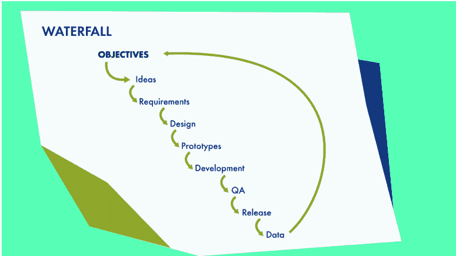

图 1.1 瀑布式模型

在瀑布式方法中，需要开发内容的想法可能来自客户、高管、市场研究，或者决策者和预算制定人员的想象力。这些想法被传递给产品经理，由他们创建一个庞大的产品路线图。他们建立并收集需求，使用经典的产品需求文档，然后将这些需求传递给设计师创建创建线框图（wireframes）和原型图（mockups）原型。这些原型再传递给工程团队，由他们实现这些想法并产生最终可以发布到市场的产品。在产品发布并交到客户手中，过程中不会产生任何反馈。

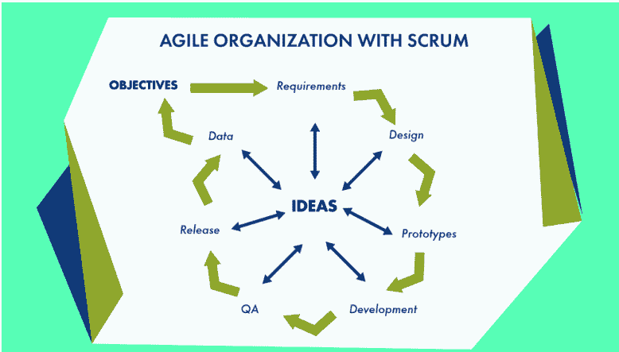

在敏捷组织中，引导性目标和关键绩效指标（KPI）引导流程，但团队自我管理以实现这些目标。产品负责人（Product Owner）维护整体愿景，并与 Scrum Master（敏大师）协作，确保团队中的每个人都清楚目标以及如何衡量。设计师和工程师的输入在这个过程的每个阶段都有。当团队准备好处理某些功能时，功能会被构思并制定成用户故事（stories）。没有任何想法会被锁定在静态的产品时间表中。

公司聘用自己的设计师和工程师团队的价值在于，这些人能够以可持续的方式让他们的设计应对不断变化的市场状况。

在进行 Web 和移动开发时，所有这些优势都能产生真正的影响。大多数 Web 或移动开发的工作通常具有强的时间敏感性，需要对市场变化做出快速响应。无论这意味着新浏览器、新技术，还是需要立即传播的新消息，Web 和移动团队都必须快速响应。

Scrum 提供了一个框架，允许开发者朝着愿景努力，并能够在环境变化时调整方向，而不会感到偏离了重点。

遵循最佳开发实践时，构建和增强 Web 或移动项目涉及的工作类型往往会分解为可以独立处理的离散片段，并以一组基础设施故事为核心，支持广泛的独立功能故事。这使得 Web 或移动项目的一个部分更容易孤立地进行开发，并利用同一项目其他部分的共享资源。

Scrum 鼓励团队详细说明新功能的工作内容，以便可以并行开发，而不依赖于其他尚未开发的功能。通过使用故事，并确保每个故事都经过正确的格式化和估计，团队自己为一致且高效的开发体验奠定了基础。

## Scrum 术语定义

当 Scrum 使用一个词汇时，它的含义完全取决于 Scrum 为其选择的定义。但与《爱丽丝镜镜》中的 Humpy Dumpy 不同，Scrum 依赖于熟悉且易于理解的定义。学习语言是获取新技能的第一步，而语言的一致使用对于努力合作的团队来说至关重要。以下术语只是书中将要详细定义的术语中的一部分，但在阅读时，快速浏览这些概念可能会有所帮助。

- 敏捷（Agile）：一套软件开发实践，旨在帮助工程师协作，并快速、容易地适应变化。
- 产物（Artifact）：Scrum 团队用于促进 Scrum 流程的物理或虚拟工具。
- 阻塞者（Blocker）：任何阻碍工程师继续执行进行中任务的因素。
- 客户（Customer）：任何聘请团队创建产品的人员。
- 工程师/开发者（Engineer/Developer）：负责创建和维护产品技术的人。
- 工程组织（Engineering Organization）：雇用工程师创建和维护产品的的公司部门。
- 产品（Product）：工程组织为客户构建或维护的内容。
- 产品待办列表（Product backlog）：不断演变的潜在功能或变更列表。
- 产品负责人（Product owner）：为团队定义产品，如果客户不满意，其工作可能会面临风险的人。
- 回顾（Retrospective）：团队反思自身表现如何以及哪些可以改进的定期机会。

## 简介 Scrum

| 术语 | 描述 |
| :--- | :--- |
| 仪式（Ritual） | 人们作为 Scrum 流程的一部分，在固定时间内根据特定的议程聚集在一起，以实现明确定义的结果。 |
| Scrum 大师（Scrum Master） | 负责维护产物并监督 Scrum 仪式的人。 |
| 冲刺（Sprint） | 一段固定天数的期间，团队在此期间共同工作产生一组约定的产品变更。 |
| 冲刺待办列表（Sprint backlog） | 团队同意在当前冲刺中可以合理完成的一组有限且定义良好的故事。 |
| 故事（Story） | 一种清晰且一致的方式，用于拆分和讨论团队可能需要的工作。 |
| 用户（User） | 将使用产品的人。 |

## 模块化开发

Scrum 支持以模块化的方式开发项目。因为 Scrum 是基于功能分片的思维方式，它非常适合创建独立的、可操作的特性，这些特性可以原子化的方式进行开发，并和谐地工作在一起。

例如，网站的一个新章节可以从共享样式和 CSS 结构继承样式，并可能从共享模板继承其功能。构建该章节的工作依赖于其他组件保持足够长的时间以完成工作。Scrum 提供了支持这种稳定的稳定性，而不会限制网站其他部分的开发。

同时，更新产品的基础设施以支持新功能可能会在过程中的任何时候发生，因此团队必须预先考虑如何安全地进行这些更改，而不会破坏在其他功能上完成的工作。

另一个例子是，有时网站的每个功能都依赖的 API 可能需要进行更改。Scrum 鼓励团队以模块化、可测试的方式管理代码，这样更改就可以被可能进行中的其他功能故事（feature stories）继承，而不会导致不必要的破坏。

## 灵活调度

为 Web 和移动领域客户服务的公司需要能够快速响应变化。然而，工程师们需要确信在完成功能开发之前，他们工作的内容不会发生变化。要平衡这两个目标可能是困难的。

Scrum 提供了足够长的窗口期，允许 Web 或移动功能被完全开发，同时允许产品在每个迭代（sprint）结束时根据市场数据改变方向。

## 反思与改进

Scrum 团队不仅关注改进产品：他们还关注改进自己的流程。Scrum 团队在估计自己能完成多少工作方面变得越来越擅长，并改进工作方法，以发挥最大的效率。

## 简介 Scrum 11

通过赋予团队机会审视自己的流程，并找出如何更好地协作工作，Scrum 最大程度地利用了任何组织的有限资源。

## 总结

以上是对 Scrum 的快速概述，是从 30,000 英尺俯视角的角的。我们简要介绍了 Scrum是如何运作的，以及为什么它对某些类型的产品开发是有效的。我们将 Scrum 与更传统的软件开发瀑布模型方法进行了对比，并讨论了它为什么在那个时候出现。我们还注意了 Scrum 多么适用于 Web 和移动开发项目。

但 Scrum 不仅仅是一个抽象概念和一堆不熟悉的术语。Scrum 是一种实用且灵活的产品开发方法，它依赖于真实人的积极参与。因此，在下一章中，我们将认识几位可能在 Web 或移动开发组织工作的典型人物。我们将与他们谈谈一些挫败感，找出他们希望从 Scrum 中获得什么，并询问他们在考虑 Scrum 时的顾虑。

在我们阅读这本书的过程中，请记住这些人。我们将再次见到他们，并跟踪他们从学习并开始将 Scrum 应用于工作中的过程。

## 第 2 章

## 认识团队

Scrum 关乎团队如何一起工作，因此从团队成员是谁开始是重要的。典型的 Web 或移动开发项目涉及哪些人员？当他们考虑到 Scrum 时，期待的是什么？

我们将介绍 Web 和移动开发项目中的几位典型参与者。我们将遇到的团队工作于一家虚构的迷因出版公司，负责一个名为 WithKittens.com 的服务——这是一个在网站图像上添加猫咪的引擎。

在 WithKittens.com 工作的每一个人都有目标和问题，这些问题围绕着他们向免费层级 B2C 客户和企业级 B2C 客户交付这一关键服务的角色展开。他们在 WithKittens 组织的职位描述了他们拥有的技能和经验，以及他们在公司层级结构中的位置——这两个因素与 Scrum 是独立的。

我们将遇到的一些人包括：

- 工程师（高级和初级）
- 团队经理
- QA 工程师（质量保证工程师）
- 产品经理
- 设计师

为了帮助进入他们的思考，我们将提问。我们想找出他们的挫败感，找出他们希望从 Scrum 中获得什么，并询问他们在考虑 Scrum 时的顾虑。

### 假设人物

当然，不存在通用的工程师或经理。但你可能会说你不是一个设计师。

### 高级工程师

#### 我的角色

我需要领导开发，但也要理解整个技术栈是如何整合在一起的。经常当问题出现时，我是第一个被联系的人，并且可能是唯一能解决该问题的人。

#### 动机

我有经验可以判断项目是否正朝着正确的方向移动，我希望在支持需求的同时看到代码的改进。我获得头衔是因为我有多年的经验，包括一些完全失控的项目，我再也不想看到那种情况再次发生。

#### 完美的一天

对我来说，完美的一天是不中断的时间来处理我的代码部分。我通常知道下一步需要做什么，我不希望被干扰。我不希望出现开发中的意外。但虽然听起来像个老古怪，但我真的希望大家能让让路，让我做我的工作。

## 挫败感

因为我是团队中最经验丰富的成员之一，当围绕 `Kittens API` 出现问题时，我通常是第一个被询问的。我对系统这部分的经验意味着我是唯一能找到这些问题答案的人。我不介意向感兴趣的人展示如何做某事，但通常提问的人理解得没有我好，所以我可能需要反复解释这件事。

### 对 Scrum 的顾虑

我参与过多个声称是 Scrum 的团队。我不知道他们在做什么，但我希望真正的 Scrum 不是那样。我们似乎有无数次没完没了的会议，以及不断变化的需求。他们抛出“透明度”之类的词汇，但实际上是“微观管理”。我从未有机会在变化之前关注项目的长期目标。相反，我们陷入了关于流程的无休止争论，这干扰了工作的完成。你可以说我对 Scrum 持怀疑态度。

## 初级工程师

### 我的角色

我被请来是为了进行前端性能优化，但从目前来看，我似乎在 `WithKittens.com` 的会员和管理页面上做了大量的样式和布局修复。我好像变成了那个需要修复的漏洞，但其他人都不想碰。我通常能搞定，即使我花的时间比那些更有经验的人要长一点。我想这很合逻辑。这是我的第二份工作，而我才来这里大约六个月。我还在学习。

### 动机

我投身工程行业是因为我喜欢与计算机打交道。当他们给我机会参与 `WithKittens.com` 项目时，我非常兴奋，因为这是一个非常受欢迎的网站。这种经历会让我的简历看起来很出彩。我想做一些能让我感到自豪的项目。而且真的，我想向其他工程师学习。有时我会被周围有这么多才华横溢的人惊讶到，我一直在想，我什么时候才能拥有和这些其他人一样的技能组合。

### 完美的一天

大多数日子都是从完成前一天的工作开始的。我通常有一份很长的任务清单需要完成。任务堆积在我面前，我翻看清单，尝试一个一个地处理，直到完成。在好的日子里，我可以完成四五项任务，并在大家回家之前让它们进入评审阶段。在糟糕的日子里，我发现自己对着同一个任务苦干几个小时直到傍晚。但从某种意义上说，好的日子也是——那些让我有机会进一步了解 `WithKittens.com` 背后的代码的日子。总之，我喜欢我所做的工作。

## 挫败感

我觉得我最大的挫败感是感觉自己像个冒充者。有时我不敢相信他们给了我这份工作。和我一起工作的人似乎经验丰富得多，他们对问题的回答很有深度，而这些问题我完全不知道该如何回答。我在这不同公司工作的经验并不多，据我所知，这里的大多数人对工作都相当满意，所以我不抱怨加班。我只是希望自己有机会做一些比他们分配给我的小任务更多的事情。有时感觉自己就像被困在 CSS 的贫民窟里，而我知道如果给个机会，我可以做得更多。

## 对 Scrum 的担忧

我读过一点关于 Scrum 的知识，我很期待当我们开始执行时会是什么感觉。现在我们有一套行之有效的流程。我知道我被期望要做什么，只要我完成了工作，一切都会进展得很顺畅。我听说在 Scrum 中有很多讨论。我不是那种健谈的人。我倾向于安静地坐着完成工作，我不觉得自己有足够的知识来分享很多观点。我有点担心 Scrum 会把聚光灯打在我身上，强迫我走出超出我舒适范围的壳。

## 工程经理

### 我的角色

我来到 `WithKittens.com` 时是一名高级工程师。在上一任经理离开后，我被晋升为经理。作为经理，我负责确保我的团队拥有他们所需的一切，并确保每个人都在做他们应该做的事情。我向高级管理层汇报，必须为团队预算辩护，并提供报告证明我们正在做公司需要做的事。有时我必须充当裁判，有时我必须做出一些艰难的决定。这是工作的一部分。这不像当工程师那么有趣，但在当时看来似乎是一个晋升的好机会。

### 动机

我非常喜欢我的团队。我雇了他们一半的人，其他人大部分在我来到这里时就在这里工作了。我喜欢想，我所做的一切都是为了他们。我的工作是让每个人保持投入、有工作做并且满意。同时，我对代码如何演进有一些想法，我喜欢确保我的影响力在其中。从本质上说，我是一个工程师，我喜欢与才华横溢的工程师合作。

### 完美的一天

我最好的日子是最安静的日子。作为经理，我经常被要求解决与组织、行政甚至人力资源有关的问题。我享受与团队成员进行一对一会面的机会，并尝试根据工作量安排这些会议。大多数日子的开始和结束都是查看团队正在工作的概览，这样我可以确保工作分配均匀。有时，这既是一门艺术，也是一门科学。

## 挫败感

作为经理，我负责团队的所有人员和预算决策。我决定预算如何支出，我必须确保提供足够的预算，以维持团队拥有完成工作所需的一切。有时感觉我花了一半的时间向高级管理层辩护预算，另一半时间在解释为什么我们没有足够的预算来完成某些每个人都知道应该做的事情。管理的责任还包括处理人际关系问题。人力资源部门可以发布他们喜欢的任何备忘录，但并没有手册可以教你如何让人们和平共处。

## 对 Scrum 的担忧

我听到的关于 Scrum 的描述是他们谈到了自管理团队。这让我有点担心。毕竟，我在团队中的角色是管理。我不喜欢认为某种新流程的引入会绕过我的权威。对于经理在 Scrum 中做什么，我还没有清晰的认识。我读过的很多关于 `Scrum Master`（Scrum 师）、产品所有者、团队成员的内容——它们没有提到经理如何融入其中。

## QA 工程师（测试工程师）

### 我的角色

在 `WithKittens.com` 这样的网站上，有很多工作要做。作为质量保证工程师，我需要关注网站的各个方面，以确保代码演进时不会出错。我的工作非常注重细节。我依赖某些测试工具，以便在功能更新时确保通过测试。部门的其他人并不知道如何工作。

### 动机

有时我被屏幕上的绿点所驱动。当我运行测试套件并看到每一项测试都通过时，会有成就感。但发现那些其他人没有发现的细微 Bug 也是非常有意义的。我尝试测试每一个功能，找出边界情况。例如，如果用户输入一个数字，或者在没有数据的情况下提交表单会发生什么。如果我工作得好，就能让工程师们保持警惕。

### 完美的一天

我最喜欢的情况是有一个定义良好的项目可以测试，并且我正在构建一套测试。我获取代码，运行测试，如果任何一项失败，我会编写报告并通知工程师。在开发新功能时，编写涵盖所有顾虑的测试既有趣又具有挑战性。

## 挫败感

作为报告代码存在问题的人，有时我感觉自己是坏消息的传递者。我的工作在流程的最后，在工程师完成所有工作之后。通常我需要从工程师那里获得他们开发代码的答案以便进行测试。当他们转向下一个任务，并且没有时间回复我所需的信息时，这令人沮丧。当有截止日期时，我也会被要求快速完成工作。这意味着我可能会漏掉一些 Bug。

## 对 Scrum 的担忧

我不确定 Scrum 与我有什么关系。我读到的关于 Scrum 的大部分内容关于代码如何开发，而不是如何测试。我对在 Scrum 环境中工作持开放态度，但我作为 QA 工程师的角色并没有转化为工程师在团队中做的工作。`WithKittens.com` 的 QA 结构涉及我向 QA 经理汇报，而不是向工程团队经理汇报。我不确定我将如何融入。

## 产品经理

### 我的角色

作为 `WithKittens` 网站的产品经理，我隶属于产品小组，该小组向首席执行官（CEO）汇报。我们负责确保提供给客户的服务尽可能完美。我必须平衡许多考量，包括销售部门的功能需求、高管对董事会和投资者的承诺，以及实际的预算和工程需求。同时，我还要关注产品的演进情况，并为下一次发布和下一个版本进行规划。我们的网站需要在继续支持所有现有用户的同时，不断增长以触达新用户。

### 动力

工作中最让我感到兴奋的是有机会构建一种超出客户预期的服务。当我收到用户的邮件，他们从我们获得了卓越的服务时，我会感到非常快乐。但邮件并不是我获取这些信息的唯一途径。我喜欢看到我们的数据随着时间的推移而改善。我们在网站中集成了许多不同的跟踪服务，以便我们衡量提供的服务在哪些方面获得了最大的价值。此外，我最喜欢的职责之一是用户测试，我可以与客户坐在一起，了解他们喜欢我们服务的哪些，以及哪些地方我们需要改进。归根结底，这是为了提供我们能提供的最好的服务，我很享受其中。

### 完美的一天

我典型的一天是在与设计师就新功能反复往返工作、与客户沟通预期、与高管讨论功能预期，以及与工程师讨论这些功能如何开发。我喜欢这种能同时从多个视角观察项目的机会，但我必须频繁切换思路，有时在考虑未来的发展，有时在考虑现在正在发生的事情。我花了大量时间在会议上。当不在开会时，我通常在根据设计、测试和研究编写报告或规范。

## 挫败感

你是否听过那句话：“计划本身一文不值，但规划的过程是无价之宝？”有时这句话描述了我的生活。我可以花费几周时间为 `WithKittens` 的下一次迭代建立一套完美的规范，结果却因为工程部门出于实用考虑的一次拒绝而让一切化为乌有，或者因为高管对某个我们从未想过的功能发表的一句评论。有时我的工作感觉就像在瓶中造船。我必须引导我对产品需要去向的愿景，但我无法实际触及那些部件。我还必须面对这样一个事实：我的日程安排不像设计师或工程师的时间那样是任务关键性的。作为产品经理，我需要在我手头的资源可用时让自己可用，而不是相反。

### 对 Scrum（敏捷开发）的担忧

我对 Scrum 最大的担忧是为什么它似乎没有解决截止日期的问题。我生活在现实世界中，这意味着有时我们必须承诺某些将在特定日期交付的东西。有时你必须非常具体地说明那个东西是什么。Scrum 对截止日期和产品规范的处理似乎很松散，允许敏捷流程来定义它们，而不是相反。我喜欢这种想法：遵循 Scrum 的团队会更擅长估算时间，这样我就可以预先知道我们某些东西需要多久。我不喜欢这种想法：我们可能不确定在特定时间会交付什么。我了解我必须打交道的人，让他们习惯这种不确定性可能会很困难。

## 设计师

### 我的角色

设计是一门触及产品极深层次的学科。我尝试从内向外地设计产品，思考用户期待什么，以及我们如何满足并超越这些预期。这意味着我必须同时从视觉和实验两个角度进行思考。当然，我负责风格指南并维护视觉的一致性。我还负责确保功能的一致性。当用户访问 `WithKittens.com` 时，我的职责是确保他们知道下一步应该做什么。如果我工作得当，我提供给团队的设计将解释用户如何在网站中流转，以及他们在此过程中的体验将是怎样的。

### 动力

我有时会有点偏执，但当我穿过一个我设计的网站，并感到视觉和流程都具有整体的一致性时，会带给我很大的满足感。我希望我产出的东西能给用户提供一种合逻辑、愉快且能发挥产品潜力的体验。对于像 `WithKittens` 这样的网站，我们有很多设计目标，即保持用户体验的趣味性、启发性和幽默感。对我来说，我的工作保持忠于这些设计目标非常重要。我不介意为我信仰的事情而战，尤其是当我知道会有多少人看到这个网站时。我对这些人负有责任，不能让那种体验变成负面的。

### 完美的一天

我成为设计师是因为我喜欢发明、创造和创新。设计是关于观察现实世界的挑战，并提出合理的、能让用户愉悦的有趣解决方案。我认为我最好的日子是有机会去相信并关注我所见的下一代产品面临的挑战。我有很多想改进我们现状的地方，但与此同时，我的脑子里总在思考我们下一个交付什么。我与产品小组紧密合作，头脑风暴创意并提出用户测试的有趣方法。我喜欢那种工作。

## 挫败感

出于实用原因，团队有时把我当成生产工具。作为一名接受过视觉工具训练的人，我经常被要求在最后一刻生成资产。这种工作有时可能很枯燥，但我是唯一有技能来完成它的人。我见过当我们把设计任务交给工程师时会发生什么——通常并不好看。很多时候，最后一刻的需求从设计角度来看是不符合逻辑的，所以这种工作很消耗精力。

## 对 Scrum 的担忧

我努力跟上开发技术，并且读过一些关于 Scrum 的东西。我一直在思考设计如何成为 Scrum 流程的一部分，它似乎从未明确。有些人说将设计整合到 Scrum 流程最好的做法是在每个开发冲刺之前划分独立的设计冲刺，使整个流程敏捷化。另一些建议设计师融入 Scrum 流程的缝隙，成为团队中的伪工程师资源。这些听起来都不吸引我。我已经觉得我的大部分工作都是在最后一刻做的。我不喜欢这种想法：这样做可能会降低 Scrum 流程的速度，或者让我发现自己为了适应团队而不得不面临时间压力。

## 高管

### 我的角色

我为整个公司提供领导。这可以意味着许多不同的方面。在工程方面，它意味着根据我对市场的理解，为产品需要的演进提供方向。我的责任是激励工程团队创造我们需要以保持竞争力和增长的产品。

### 动力

归根结底，如果我没做好工作，公司里的所有人都没有工作做了。这是一份巨大的责任，我非常认真。我需要确保我们正在开发的产品满足客户需求并支持底线。

## 挫败感

由于我对市场的视角，我对自己周围发生的事情有一个俯瞰视角，以及我们下一步需要做什么。我不能总是向所有人解释我做决策时考虑的所有因素，但我需要人们相信，当我说某事现在必须发生时，我知道我在说什么。有时这感觉就像在瓶中造船。我可以看到我想做的事情，但我不能直接亲手伸进去去完成它们。

### 完美的一天

我必须跟踪这里许多不断变动的环节。我没有时间引导每一个人完成整个流程。这就是为什么我雇了经理，这也是为什么我必须退后让他们尽自己的职责。从工程的角度来说，我完美的一天就是当他们交付了我一直在期待的东西，并且我知道这些东西将为客户带来价值。

## 对 Scrum 的担忧

多年来，我见过了许多倡议兴起又落。每隔几年就会出现一种新的受宠的管理模式，并带着一套大家都在谈论的新术语。我读过一些关于 Scrum 的资料，它似乎为工程组织增加了一些额外开销。我想关注这一点。此外，我听到的所有讨论都是关于额外的会议，我确定工程师们不会喜欢这些。我们的工程团队是我们最宝贵的资源之一，我不希望看到我们做任何可能让他们感到不快的事情。

## 总结

这些观点仅代表了当你引入 Scrum 时可能从团队中获得的响应的子集。问题的数量与人数一样多，而你最了解和你共事的人。

上面的响应展示了在 Web 开发项目中工作的典型人员是如何看待 Scrum 如何影响他们的工作的。思考你团队中成员的动机和挫败感。你是否看到了与上述相同的担忧？他们说的话是否属实，或者是否引发了你在团队中看到类似情况时想要警惕的红旗？

> Scrum 无法解决需要在管理层面处理的问题

对于这个团队来说，幸运的是，`With Kittens` 面对的并不是那些对所做的工作从根本上没有动力，或不愿参与流程的人。那些信号可能表明在管理或人力资源层面（在 Scrum 之外）有更深层次的问题需要解决。记住，Scrum 关乎完成工作并帮助团队协作和改进。它独立于组织层级结构和管理流程。

在接下来的章节中，我们将涵盖 Scrum 如何运作的细节。我们将详细查看与 Scrum 流程相关的角色、仪式（rituals）和产物（artifacts），并展示它们如何应用于从事 Web 和移动端开发的团队。

在阅读关于 Scrum 的描述时，请记住上面的响应。问问自己，某些组织角色是否在逻辑上可以映射到任何敏捷角色。思考在团队和组织中共同工作的真实的人会对我们即将讨论的工具和技术做出什么反应。你可能开始看到上述提出的某些挫败感和担忧是如何通过 Scrum 解决的。

# 第 3 章

# Scrum 角色

## 确定谁来做什么

Scrum 是一个支持团队持续生产力的系统。但如果你尝试采用 Scrum，而没有充分考虑 Scrum 分配给参与者的每个角色的目的，你可能会在维护 Scrum 的平衡和节奏时发现问题。在定义的角色上偷工减料是 Scrum 中最常见的反模式之一，通过使角色分配变得审慎且明确，很容易避免这一点。

传统的 Scrum 只定义了三个关键角色：`Scrum Master`（Scrum 师）、`Product Owner`（产品负责人）和团队成员。我们将从这些开始。但 Scrum 运行在一个特定的背景下，对于 Web 和移动端开发来说，这个背景通常是一个试图为客户、用户或消费者创建体验技术实现的公司或组织。

### 无层级制度

敏捷 Scrum 团队运行在一个可能具有管理层级的组织内。但从流程的角度来看，Scrum 中的所有角色都是平等的。

# Scrum 角色

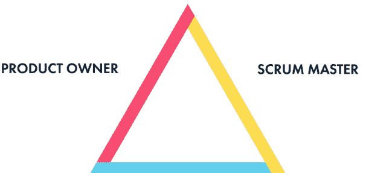

图 3.1. Scrum 中的所有角色都是平等的

虽然标题听起来可能很威严，但 `Scrum Master` 对于 Scrum 流程中作为“仆人领导者”角色所展现的领导力没有权威。`Product Owner` 除了维护产品愿景和引导其通过 Scrum 流程外没有其他权威。团队除了估计、接受、拒绝、承诺工作和完成用户故事的权力外没有其他权威。每个人都应该被赋予执行这些角色的权力以维护敏捷环境。

### 仆人领导者？

在讨论 `Scrum Master` 所占据的微妙平衡的角色时，经常会使用“仆人领导者”一词。`Scrum Master` 对 Scrum 的仪式和产物之外的任何事情都没有正式权威，他们通过接受和宣扬 Scrum 概念从内部领导团队。`Scrum Master` 服务于整个团队的需求——帮助消除障碍（Scrum 工作流的阻碍）并指导人们如何遵循 Scrum 实践——并在倡导和捍卫 Scrum 时应该以身作则。

### Scrum 角色与组织角色

Scrum 角色独立于作为公司层级一部分被分配和管理的正式职位。对于某些团队来说，这可能会导致对不属于正式敏捷流程的人如何融入流程产生困惑。为了让 Scrum 运行，Scrum 团队每个人都需要理解 Scrum。但 Scrum 的重要部分是透明性，Scrum 团队的活动可能会引起过度关注。

在本章中，我们将介绍 `Scrum Master`、`Product Owner` 和团队成员的关键角色。此外，我们还将讨论 Scrum 团队之外许多人的动机和观点，他们的参与可能会影响 Scrum 的运行效果，并最终可能成为在组织中倡导和维护 Scrum 的关键。

### Scrum Master

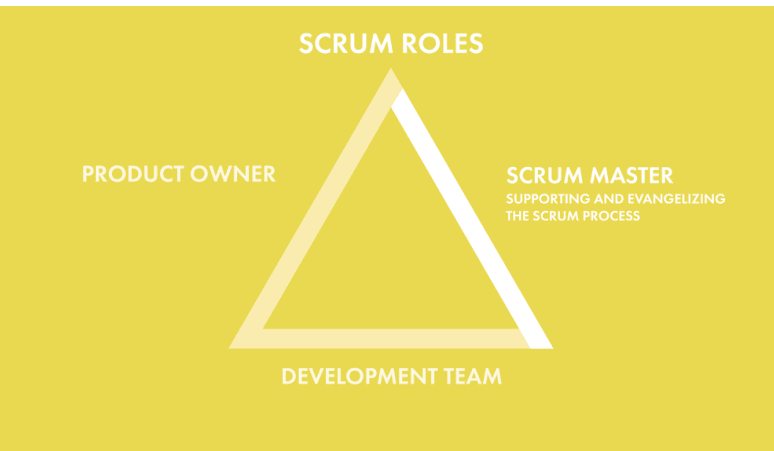

图 3.2. Scrum Master 的角色

`Scrum Master` 是将 Scrum 团队结合在一起的胶水。`Scrum Master` 负责让人们明确自己的角色，管理 Scrum 的仪式和产物（我们很快就会涉及到），并指导团队内部的人。

## Scrum：从新手到忍者

以及跨整个组织，以帮助克服障碍并保持可持续的生产力节奏。

与项目经理不同，`Scrum Master` 带着作为团队仆人领导者的明确定义的使命而来。`Scrum Master` 在组织内部没有正式权威，除了引导团队通过 Scrum 仪式以及维护跟踪团队进度的产物的权威之外。但在当涉及 Scrum 流程及其应用时，`Scrum Master` 拥有最终权威。

### Scrum Master 的参与

Scrum Master 可能是开发团队的一部分，但同样，Scrum Master 可能不参与团队的日常开发工作。对于遵循实践一段时间且对 Scrum 感到熟悉的团队，一个没有开发职责的单一 Scrum Master 能够同时负责两个团队。

### Scrum Master 的职责

Scrum Master 通常是工程部门的一部分，在某些情况下可能是开发团队的成员。Scrum Master 担任开发团队人员的经理存在利益冲突，否则团队可能会因为潜在的影响而抑制于向 Scrum Master 提出问题。

### 职责

Scrum Master 必须遵守几个关键仪式。至少包括每日站会、Sprint 计划会议、Sprint 结束演示和 Sprint 回顾会议。我们很快将详细介绍这些仪式。

除了主持 Scrum 仪式之外，Scrum Master 还负责指导团队通过 Scrum 流程进行。这可能涉及大胆地介入关于个人角色和职责的讨论，并帮助人们以易于理解的方式交流需求和期望。某种意义上，Scrum Master 可以成为团队的倡导者、顾问和联络员。

## Scrum 角色

Scrum Master 还维护着许多产物，帮助团队专注于目标，并衡量其实现承诺的进展的可持续性。这些产物及其包含的数据在团队内部外部都可能存在广泛的解读空间，因此 Scrum Master 需要能够用组织内外广泛受众都能理解的语言来解释团队的状态及其进展。

### 职场的一天

Scrum Master 需要参与产品开发的每一个方面，因此他们必须与许多人紧密合作，并处理许多关键工具——如下列表所示。（如果现在这里有一些你不熟悉的术语，请不要担心。我们很快就会讨论 Scrum 的产物和仪式。）因此，活动包括：

- 计划和主持 Scrum 仪式，包括每日站会、迭代计划会议、迭代演示（`Sprint demo`）和迭代回顾会议
- 协助团队识别阻碍其开发的阻塞因素
- 向团队成员、产品负责人或组织内任何可以帮助消除障碍并让用户故事（`stories`）重新运行的人员寻求帮助
- 维护 Scrum 产物并确保每个人都能访问
- 就其角色和职责对团队成员进行辅导，同时关注问题并帮助解决
- 与产品负责人合作，帮助澄清用户故事并维护维护良好的待办列表（`backlog`）
- 为了产品和团队，向管理层和整个组织代表 Scrum 的需求

每个 Scrum Master 每天都会尝试主持的一种仪式是与整个团队进行的 15 分钟站会，以及任何感兴趣观察的访客。对于某些团队来说，这会在一天早早进行，而其他团队则倾向于在晚些时候进行。

### Scrum：从新手到忍者

Scrum Master 可能会在站会结束后参与若干后续讨论。最重要的讨论将涉及消除那些在没有协助无法解决的团队成员的阻塞。Scrum Master 还会以产品负责人和团队成员的身份与相关人员见面，跟进站会期间提出的其他问题。

在安排了其他仪式（如迭代计划会议、迭代演示或迭代回顾会议）的日子里，Scrum Master 引导整个过程，确保团队已同意的所有步骤都得到遵循，并遵守时间限制。

更新 Scrum 产物是 Scrum Master 的日常职责。这些产物始终维护在一种状态，让任何人都能一眼看出团队在做什么，从而支持维持 Scrum 运行的核心透明度。这包括计算和报告团队指标（如速率 `velocity`），并向团队外的人员澄清这些概念的相关性。

Scrum Master 在支持团队每个成员的 Scrum 职责方面也起着关键作用。Scrum Master 需要在问题出现时随时为团队提供指导，并在问题显现时识别这些问题。这可能意味着帮助产品负责人思考如何为待办列表表述一个故事，观察并参与开发者的结对编程以促进流程，或者用通俗的语言准备团队状态报告——为了那些不在团队中但需要了解发生情况的人。

### 产品负责人

#### 角色

与职责侧重于开发团队的 Scrum Master 不同，**产品负责人**（`product owner`）对团队和客户有共同责任。产品负责人是客户的声音，是客户需求、愿望和期望的代表。

产品负责人通常属于产品或客户支持等部门，并直接与客户接触以理解他们的需求，并将这些需求转化为团队可以估算和处理的清晰描述，我们使用 Scrum 术语中称为“故事”（`stories`）的一致格式。

产品负责人从客户的角度关注大局，查看产品的整体状态、发布周期的时间线以及不断变化的技术格局，同时决定哪些功能是团队在下一个迭代中工作的最高优先级。

产品负责人直接与设计师合作，确保考虑了用户体验流，并确保设计资产已为团队准备就绪。他们还与质量保证（`QA`）工程师合作，验证故事的测试用例是否涵盖了必要的验收标准。产品负责人也与团队合作。

#### Scrum：从新手到忍者

产品负责人需要与客户保持定期沟通，以确保他们编写的故事和正在维护的待办列表符合当前的预期。虽然 Scrum 鼓励透明度，但并非所有团队都会邀请客户直接参与仪式和产物。产品负责人为客户翻译产品状态——演示并获得交付的每个功能片的批准——并从客户那里收集反馈，让团队知道他们是否处于正确的道路上。

此外，产品负责人需要随时服务团队，以解决任何冲突或澄清团队正在处理的故事的细节。作为客户的内部声音，产品负责人需要体现产品的期望，并能够快速做出决策，以便团队继续工作。

#### 一个人不应同时担任 Scrum Master 和产品负责人

一个人不应尝试同时担任 Scrum Master 和产品负责人的角色。这些角色往往具有冲突利益。Scrum Master 关注团队的健康和流程，而产品负责人关注客户需求和产品价值。一个人兼任这两个角色可能会导致利益冲突，从而损害项目。

#### 职责

产品负责人最关键的职责之一是澄清客户的需求，并确保团队有一个清晰的愿景。产品负责人需要随时为团队回答问题并对故事提供反馈。

产品负责人不需要对团队正在工作的内容提前一两个迭代进行详细计划。事实上，对于可能执行它们的迭代来说，提前太早的故事经常被丢弃或重写，因此详细列出它们通常是浪费时间。良好的产品负责人会维护一个关于产品随着单个功能的添加如何演进的愿景，并考虑到在当前迭代为未来可能需要的功能做好铺垫的重要性。

#### 职场的一天

产品负责人将其时间分配给几项职责和相关人员：

- 定期与客户见面，分享团队进展信息，并收集关于客户下一步想要什么的反馈
- 直接与设计师合作，为团队计划并准备资产
- 从团队处获得开发中故事的技术批准
- 验证 `QA` 测试用例的完备性和相关性
- 与 Scrum Master 协调，确保每个人都有完成工作所需的信息
- 在被要求澄清问题和做出决策时与团队成员见面
- 编写故事（`stories`）并梳理产品待办列表（`product backlog`），以反映产品的当前愿景

大多数产品负责人（`product owners`）喜欢参加团队的每日站会（`daily standup`）。作为访客，在每位团队成员陈述之前，产品负责人通常不被允许提问或提供反馈，除非被直接提问。站会结束后，产品负责人将与团队内部或外部的相关人员联系，对站会期间提出的问题进行跟进。

当团队正在进行当前冲刺（`sprint`）中的故事时，产品负责人会不断关注他们的进度。如果某个关键功能切片似乎面临无法完成，产品负责人有权调整当前冲刺中故事的顺序。当当前冲刺中的故事用完时，产品负责人也可以对已准备好开始工作的待办列表故事进行优先级排序。

产品负责人需要花费一天的时间解答关于冲刺期间进行中的故事的问题。如果无法及时联系上产品负责人获取快速答案，负责故事的开发可能会被永久阻塞。因此，许多产品负责人倾向于与团队一起工作，以便能够随时待命。

客户喜爱敏捷开发团队的原因之一是关于产品状态的频繁且准确的信息。通常，产品负责人会与客户直接沟通，报告进度，并对客户可能考虑的任何问题深入了解。

当他们没有协助团队或客户时，产品负责人正在为下一个冲刺编写和精炼故事，梳理待办列表以符合客户对产品的愿景，并与设计师合作，确保团队为这些故事工作所需的所有内容已准备就绪。

### 团队成员

#### 角色

大多数 Scrum 团队由四到八名工程师组成。他们的专业化方向应该经过计划，以支持团队将负责的工作类型，以便他们能够对其进行良好的估算并产出符合团队“完成定义”（`definition of done`）的结果。

预计团队成员将积极参与所有 Scrum 仪式，并以透明的方式运作，让每个人至少在感知上意识到同事正在做什么工作。

#### 交叉培训

专业化对于工程师的职业发展至关重要，但在 Scrum 团队中，并不假设任何工程师会对所有故事的某个特定方面拥有专有责任。Scrum 的力量之一在于它提供的透明性，允许不同背景的工程师了解开发团队已接受的工作任何方面所涉及的内容。

Scrum 鼓励工程师共同工作。一种源自敏捷技术“极限编程”（`Extreme Programming`）的名为“配对编程”（`pair programming`）的做法适用于 Web 和移动项目的工作类型。配对编程提倡将不同经验水平的人匹配在一起编写同一份代码，以便每个人都能从对方的视角中获益。

这种方法的优势是，关于产品在做什么以及如何开发其每个部分的知识在整个团队中共享。我们反对只存在于单个工程师脑海中的信息孤岛，转而鼓励与他人沟通。并不要求每个人都成为产品所有领域的专家，但每个人都应该准备好与自己常规舒适区之外的专家共同工作。

结果是，起初工作可能会慢一点，因为人们需要进入状态。很快，就会形成更深层次的共享上下文，这将加速估算和开发。如果有人中了大奖并决定退休，团队也将变得更具韧性，而不至于会留下一个巨大的知识空白。虽然可能会有很多大洞需要填补，但至少会有人理解其中的部分内容。

#### 配对编程

配对编程的要求非常高。一些预期包括两个人共享一个显示器，交替负责输入代码（驾驶/`driving`）和跟踪接下来需要发生什么（导航/`navigating`）。配对双方在工作时应不断保持交流，配对中的任何成员都不应让电子邮件等干扰干扰该过程。大多数配对发现，这种模式下每天工作不会超过六小时，但生产力的提高和对团队稳定性的好处是值得权衡的。

#### 职责

就 Scrum 流程而言，团队成员负责所开发产品的质量，并负责整个团队 Scrum 流程的维护。这是每位团队成员都有权通过履行职责的方式来影响的两个方面。

产品质量由团队接受或拒绝故事的能力支持。如果展示的故事不够清晰，或者根据项目历史可能无法实现或不切实际，团队应该将工作质量放在首位，并坚持产品负责人重写故事。

估算完成一个故事所需的工作量也是团队责任的一部分。随着团队共同工作并获得处理不同故事的经验，他们应该开始对性质相似的故事开发一种共享且主观的相对工作量标准。工作量通常以点（`points`）衡量，有助于团队计划可以完成多少工作。

预计团队即使在压力下也要维护代码库质量。当团队面临减工的压力时，他们应该抵制并解释长期成本。Scrum Master 还负责保护团队不受外部干扰。

#### 团队成员平等

> 虽然团队成员可能向 Scrum 外的多个经理汇报，但在 Scrum 内部成员都是平等的。如果员工之间存在资历或汇报关系，在遵循 Scrum 流程时应忽略这些关系。

#### 职场的一天

每天，团队成员大部分时间都在编写代码，时间尽可能长且连续。团队成员的核心职责非常简单：

- 开发、检查、测试和记录代码
- 从产品负责人处获取澄清、故事细节和反馈
- 参加 Scrum 仪式
- 与 Scrum Master 合作为同事消除障碍

在想象 Scrum 团队时，脑海中浮出的最常见可能是团队参加每日站会，这将在以后详细讨论。每位团队成员都应该在短短的十五分钟窗口内待命并做好准备。团队通常会尝试错开这个时间，以免干扰团队的工作流。

#### 何时进行站会

> 对于某些团队来说，将站会安排在午饭前或后，或者工作日开始是最合理的。异地办公的团队需要选择一个适合跨多个时区人员的时间。团队可以根据冲刺回顾（`sprint retrospectives`）收集的反馈来调整时间。

### 团队资源

Scrum 团队并非在真空环境中运行。通常会有一个围绕 Scrum 运行的组织，它通过提供 Scrum 团队产出工作所需的资源来支持其工作。Scrum 团队与组织的其余部分之间必须维持着一种双向关系，以便双方都能从这一流程中获益。

仅仅组织及其层级结构不应对 Scrum 的仪式、产物和角色产生任何影响；Scrum 对外部组织的结构没有正式的意见。Scrum 既可以在一个具有明确头衔和角色的紧密结合型团队中成功存在，也可以同样容易地在“全宜制”（一种没有任何指挥链的组织）中运行。只要 Scrum 团队能够获得其工作所需的资源，并能通过产出组织想要的结果来证明其存在的合理性，这种关系就是可以维持的。

关于如何提供资源团队所需的资源，有时会有不同的意见。解决这一问题的敏捷方法是尝试一种方式，观察其运行效果，并通过迭代找到产出最高的方法。

特别是对于大多数表现良好的 Scrum 团队以及移动开发团队来说，他们发现需要的一些关键资源并没有被正式定义为 Scrum 的一部分。

#### 设计师

任何 Web 或移动项目的关键输入都是设计师，他们帮助建立项目的用户体验、流程和视觉一致性。随着设计优先的趋势日益增强。

#### QA 工程师（质量保证工程师）

质量保证是团队每个成员的责任，但大多数组织都有专门受过创建和管理测试套件技术培训的专业人员。对于 Web 和移动工作，这可能是一个错综复杂的过程，涉及模拟各种设备和浏览器行为的工具，以及跟踪产品常见和不常见路径的自动化技术。

`QA` 工程师可能会被隔离在自己的小组中，独立于开发产品的团队进行工作。在这种情况下，与团队的协调至关重要。除非及早考虑 `QA`，否则 Scrum 团队可能会发现自己在冲刺演示（`sprint demo`）会议之前忙于完成用户故事，然后在最后时刻将大量工作堆给 `QA` 团队。与设计师类似，`QA` 工程师有时会被分配一个单独的迭代来进行测试。

将 `QA` 与开发隔离开最大的问题是，工程师们可能会在上一个故事被验证之前就自行接受列表上的下一个故事。在 Web 和移动开发背景下，即使用户故事在技术上是独立的，它们通常也会以微妙的方式相互构建。这可能导致这样的情况：由于测试先前的故事时发现的不一致之处，需要重新完成一个新的故事。理想情况下，`QA` 应该被视为团队对任何故事“完成”（`done`）定义的一部分。这意味着 `QA` 工程师应该在开发者创建代码的同时开始为故事编写测试用例。故事的 `QA` 周期应该是冲刺的一部分，开发故事的开发者在 `QA` 完成之前不应放弃。

在某些团队中，`QA` 工程师直接整合到团队中。这提供了许多优势。开发工程师和 `QA` 工程师的技能和培训是互补的，这两个角色的人可以通过相互配对来学习更多他们所使用的技术和方法，从而在职业上受益。拥有集成 `QA` 工程师的团队自然地将测试和验证视为完成一个故事的工作，并确保故事的大小划分合理，包含了这些内容。

#### 运维

负责网络运行和为公司提供技术支持的人员通常与产品开发团队属于同一个工程部门。因此，一些公司尝试将这些团队的人员整合到他们的 Scrum 流程中。但组织的结构不应影响 Scrum 团队的需求。

除非有充分理由，否则将运维工程师整合到产品开发 Scrum 团队中可能是糟糕的做法。虽然运维人员是受过培训的工程师，但他们处理的职责应该独立于产品开发过程。保持网络运行、计算机工作和服务器在线是一项持续性的工作，其挑战性与产品开发不同。与设计或客户服务类似，将运维视为一个独立的团队可能是务实的做法，也许可以使用看板（`kanban`）方法来帮助他们管理可持续的工作流和优先级排序。

随着产品开发的进展，让运营部门（`Operations`）保持知情至关重要，这样任何可能影响服务和资源可靠可用性的产品变更都能得到考虑。一个优秀的 Scrum 团队包含了工程师和产品负责人（`Product Owners`），他们能够识别何时何地可能对系统或网络负载产生影响，并征求合格运营工程师的意见，以帮助对用户故事（`Story`）进行规划。

#### 运营与结对编程

> 让运营人员脱离其职责来参与开发结对可能是不切实际的，但开发者偶尔与运营工程师进行结对编程，有助于增强他们对影响产品可用性问题的理解。

#### 经理

Scrum 的优势之一是团队有机会进行自组织，并弄清如何迭代地开发产品、进行测试、做出更改并在过程中不断改进。这意味着团队对自己的行为负责，并围绕以最有效的方式完成工作这一目标进行自我组织。结果，经理们有时会对自己在 Scrum 组织中的角色感到困惑。

Scrum 的自组织性质与公司的层级结构无关，尽管公司层级会为员工分配不同的角色和职责。Scrum 对组织的层级结构不应有任何意见，正如组织的层级结构也不应对 Scrum 流程产生影响一样。

在任何公司中，管理都是至关重要的角色。经理负责招聘、解雇、分配资源以及在整个组织代表员工。如果没有经理，当 Scrum 流程之外出现需要解决的问题时，员工将无处可求。经理通常对团队的生产力负责，包括向高级高管汇报结果，并证明 Scrum 流程在运行中的价值。

经理也可能以开发者的身份参与 Scrum 团队。通常，工程部门管理职位的人员对团队可能面临的某些问题具有更深丰富的经验。这些经理可能担任架构师或高级开发人员，并拥有可以分享的知识。在 Scrum 团队内部，经理被视为开发人员之一，不享有比团队中任何其他开发人员更高的权限。

#### 作为开发者的经理

在某些组织中，经理的角色被视为轻蔑的对象。我们都可能见过《迪尔伯特》（`Dilbert`）漫画中那个留着尖头发的老板。Scrum 的优势之一是，它不在乎经理在 Scrum 流程之外表现如何，只要提供了足够的资源来支持持续的 Scrum 流程。一个有效的 Scrum 团队应该独立于这种刻板印象运行，但在 Scrum 团队中与经理作为同伴工作的机会也有助于改进 Scrum 沟通。

团队中感到与经理作为同伴互动不适的员工，或者感到在 Scrum 内权威减少而感到不适的经理，应该与 Scrum Master 讨论这个问题。一个强大的 Scrum Master 将具有处理管理和权威问题以及这些问题与 Scrum 之间关系的经验。

### 世界其他部分

# Scrum 团队与组织

Scrum 团队并非在真空中运行。在 Scrum 团队之外，有一个组织出于某种原因需要开发某种产品。Scrum Master 的职责之一是向公司的其他部分宣传 Scrum 的价值。此外，还有责任确保 Scrum 真正服务于公司和 Scrum 流程利益者的需求。

这些利益者包括公司内部的高管、正在开发的产品的用户、可能委托创建该产品的客户（无论公司内部还是外部）以及公司内部的其他群体。

从外部来看，Scrum 似乎是一个谜团。尽管强调透明性，但 Scrum 的术语可能会让不熟悉术语实际含义的人感到困惑。Scrum 创建的产物和图表似乎暗示了并不存在的意义。来自团队外部的任何困惑都可能影响 Scrum 的稳定性，无论是在资源分配方面，还是在流程的故事流方面。

## 用户

Scrum 团队最明显的利益者之一是产品开发旨在支持的用户群体。用户应该在几乎每一个故事中可见，即使该故事没有影响网站的前端界面，或没有出现在移动设备的屏幕上。管理员用户也是用户。填充内容的经理也是用户。任何与产品交互的人都是用户。

对于使用 Scrum 方法开发的 Web 和移动产品，需要通过工具确保能够有效捕捉和跟踪用户体验。如果没有跟踪点击、手势、目标以及与关键功能交互的工具，产品所有者在决定下一步处理哪些故事最重要时将更少的数据点供参考。Scrum 的意图是支持一种敏捷流程，允许根据真实的用户需求对产品方向进行快速调整。

## 客户

使用 Scrum 开发的产品客户可能是公司的客户，也可能是公司内部的部门。无论如何，与客户的直接互动是产品所有者的责任。强大的产品所有者将保护团队免受客户的影响，并保护客户不感到疏远。

客户可能知道自己想要什么。通常客户会有一个想法，这需要通过 Scrum 流程来完善。这可能意味着与设计师进行几轮工作，可能并在产品开发过程中进行几次迭代。结果，通往现实的理想路径可能没有客户所希望的那么直接。产品所有者介入，让客户保持知情并满意，同时明确客户的愿景，直到团队可以高效地进行估算。

一个优秀的产品所有者是团队与直接互动的混沌之间的坚实防线。这不是一个容易担任的角色，因为客户在付钱，或者为公司内部另一个部门工作。可能需要强大的 Scrum Master 的支持来帮助防御 Scrum 团队。如果团队觉得他们受到了客户的直接影响太大——这种影响没有通过产品所有者的适当过滤——他们应该随时联系 Scrum Master 来帮助改进流程。

## 总结

Scrum 的角色已被明确定义，以确保平等成员之间存在权力平衡，并且所有以敏捷方式开发产品的职责都能得到处理。

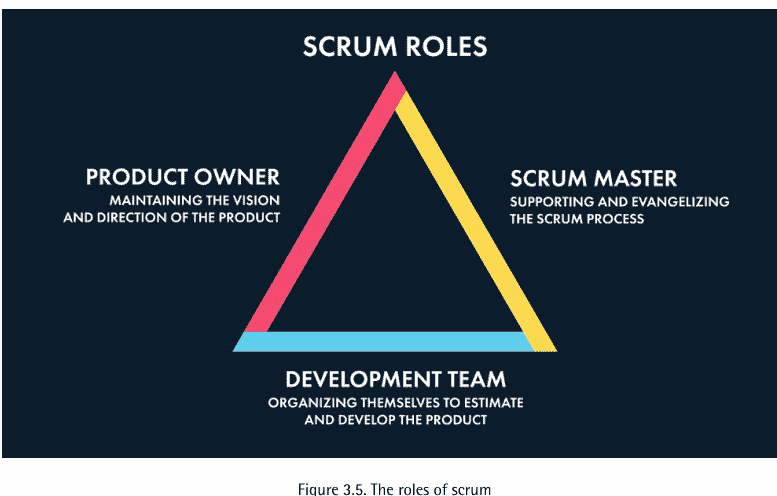

- **Scrum Master** 主持 Scrum 仪式，支持团队，并向 Scrum 内部和外部宣扬 Scrum 流程。
- **Product Owner** 维护产品的愿景和方向，并负责与客户进行交互。
- **Development Team** 由工程师组成，他们通过组织自我来评估并执行构建产品的工作。

现在我们已经回顾了 Scrum 中涉及的角色，在下一章节中，我们将查看他们参与的仪式。请观察这些角色的人员如何相互互动以支持他们的目标，以及他们所实现的稳健平衡如何帮助 Scrum 团队保持高效生产。

# 第 4 章 Scrum 仪式

在 Scrum 团队中工作的实践被组织成一系列仪式。这些仪式标记了执行 `Sprint` 工作过程中的关键事件。Scrum Master 有责任主持每项仪式，并确保他们专注于目标，为整个团队产生预期的结果。

## 什么是仪式？

每个 `ritual` 都是一次实时的面对面聚集，它让人们离开正在工作的工作，并提供了一个就该工作的背景进行针对性沟通的机会。Scrum 认为沟通优于文档，这就是为什么它为各种类型的有用面对面沟通提供了定期且定义明确的机会。

## 不要再开会了！

许多在公司工作的人对会议产生“过敏”，这是有道理的。他们可能被过多的会议所淹没，会议占据了他们太多的时间，而且没有产生任何结果。他们可能习惯了召开会议来解决每一个微小的问题，而没有人负责确保问题得到解决。会议会带人们离开正在工作的工作，中断他们的注意力，而且往往无法提供太多的价值回报。

让我们面对现实，大多数公司在开会方面都是*糟糕*的。

与普通会议不同，Scrum 中的每项仪式都有特定的目标、针对特定的受众、完成目标所需的定义时间范围，以及一组可预测的结果。每个参加仪式的人都知道预期发生什么、如何表现以及承诺的结果应该是什么。Scrum 仪式考虑了它们的整体目的，并尊重参与者的时间和注意力。

## 时间盒

Scrum 仪式中最重要的概念之一是 `time box`。主持仪式的 Scrum Master 有责任让每个人都确切地知道他们为这项仪式投入了多久，以及在仪式的任何一点他们还差多远。

Scrum Master 通常会在房间前面的白板上写下时间，或者保持一个可见的大钟，以便每个人都能跟踪时间（我曾被记录带过一个标有“时间盒”的小立方体时钟参加仪式，并展示在大家都能看到的地方）。`time box` 的概念赋予了仪式中所有活跃参与者力量，让他们在需要时互相鼓励奔主题，并专注于仪式的目标。

> ### 每个时间盒应该多长？
>
> 团队在每项仪式上花费的时间通常取决于每个 `Sprint` 分配的周数。唯一必须保持在 15 分钟 `time box` 内的仪式是每日站会（`daily standup`）。团队需要在迭代和改进他们如何组织进行 Scrum 的过程中，对每项仪式的 `time box` 达成共识。我在下方为团队提供了一些供参考的建议。

Scrum 通过在每个仪式开始时确定 `time box` 是什么，以及这些时间如何分配给仪式的不同方面，表现出对每个参与者时间和承诺的尊重。预计所有参与者在仪式的 `time box` 内保持投入参与，并承诺如果没有良好且实际的理由，除非所有参与者同意延长，否则不会延长仪式。

如果某项仪式似乎超出了 `time box`，Scrum Master 应该请求大家继续仪式一段时间。这样每个人都预先知道要预算多少时间，而且如果需要延长预算，每个人都必须同意。

当然，我们都是人，仪式期间会出现一些侧面问题，如果这些问题需要立即讨论的话。保持关注当前的仪式是 Scrum Master 以及团队其他成员的责任。优秀的 Scrum Master 需要跟踪这些问题，并为了所有相关者的利益，对进行中的仪式 `time box` 保持尊重。

确保重要的侧面讨论不丢失是共同的责任，但 Scrum Master 需要准备好在该过程中采取积极作用。如果人们确信以后可以重新捡起话题，他们会愿意放下离题讨论。

### 冲刺长度

在选择 `Sprint` 长度时，团队有一些选择。`Sprint` 长度应该允许团队预计要处理的故事类型根据团队自己的“完成定义”（`definition of done`）在单个 `Sprint` 内完成。对于许多团队来说，仅持续一周的短 `Sprint` 与易于完成的短故事匹配。有些团队更倾向于处理更复杂的故事，这些故事无法在一个 `Sprint` 内完成，因此他们选择两周、三周、四周或更长的 `Sprint`。

`Sprint` 长度是另一个可以根据团队反馈进行修改的因素，但对于团队来说，选择一个长度并坚持几个 `Sprint` 是很重要的。否则，团队可能永远从这种规律中获益，从而无法学习如何在各个 `Sprint` 之间一致地确定故事大小并正确地估计它们。通常，更改 `Sprint` 长度的选择仅仅可以通过改进故事编写的方式来解决，以便它们可以在一个 `Sprint` 内完成。

### 两周是一个良好的起点

对于网页和移动端团队，两周的 `Sprint` 是一个很好的开始……即使你的故事倾向于是短且有限的，但一周一次 `Sprint` 也有值得考虑的缺点。一些较长的仪式每个 `Sprint` 会重复一次。一周一次 `Sprint` 意味着如此频繁地重复这些仪式可能会阻碍生产力。某些仪式，如回顾会议（`retrospective`），在某些周内甚至可能被缩减或跳过，这可能导致 Scrum 迭代改进方面的崩溃。

倾向于产生更复杂故事的团队可能更喜欢更长的 `Sprint`。记住，超过两周的 `Sprint` 意味着问题需要更长时间才能暴露，对待办列表（`backlog`）的调整将需要延迟到 `Sprint` 完成。更长的 `Sprint` 还鼓励创建更复杂的故事。网页和移动端团队 Scrum 的目标应该是创建简单且独特的故事。

# Scrum 仪式

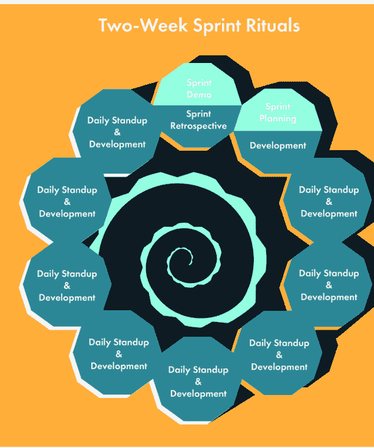

图 4.1. 两周冲刺周期

此图表示了典型的网页或移动端开发 `Sprint` 的两周周期。每个较小的圆代表一个工作日，仪式是基于 `Sprint` 从顶部开始并每两周循环一次标记的。

在接下来的几页中，我们将深入探讨每个仪式，确保你理解它们是如何工作的，以及它们如何应用于网页和移动端开发。

## 迭代计划

标记每个迭代开始的仪式被称为迭代计划。迭代计划由 `Scrum Master` 主持，但负责迭代计划中大部分内容的人是 `Product Owner`。

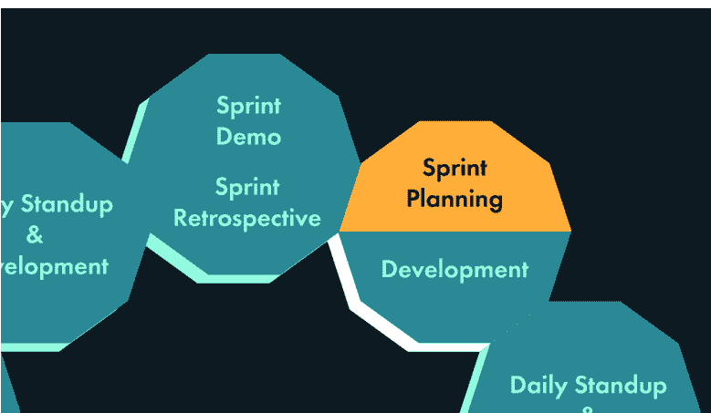

图 4.2. 迭代计划

### 目标

迭代计划的目标是为即将到来的迭代设定日程。团队与 `Product Owner` 和 `Scrum Master` 聚在一起，了解在下一个 `Sprint` 中应该完成的用户故事（`Stories`）。

`Product Owner` 展示了这些故事如何符合产品愿景，团队对 `Product Owner` 引入的故事进行估算，并根据他们的历史速率（`Historical Velocity`——该速率由平均每个 `Sprint` 中能够完成的点数决定）承诺完成尽可能多他们能够胜任的任务。在迭代计划结束时，应该对一组每个人都能认同的特定故事达成承诺。这些故事都应该是清晰的，且它们所代表的工作量在团队在下一次 `Sprint` 中完成的容量范围内。

### 时间盒

取决于团队每个 `Sprint` 承诺的周数，迭代计划可能需要几个小时，也可能需要一整天。对于为期两周的 `Sprint`，团队可能会发现三到四小时对于迭代计划来说是一项很好的投资。这看起来可能是很多时间，但正确的迭代计划对于团队需要产出的内容是非常详细且明确的。Scrum 的核心价值之一是它促进了沟通。迭代计划正体现了这一点。

大多数团队会发现，随着对流程的熟悉，他们能够高效地完成这些仪式的目标。一个强大的 `Scrum Master` 能够对仪式的不同方面维持清晰的 `time box`，这有助于过程尽可能顺畅地进行。

但在迭代计划期间有大量工作要完成，这些仪式需要有足够的空间来处理可能浮现的所有问题。从时间限制开始，会让每个人都有信心认为心中有一个目标和一个终点，并帮助人们保持专注。

### 准备

为了准备这一仪式，`Product Owner` 已经与设计师、客户、各个团队成员以及 `Scrum Master` 合作，创建一个待办列表（`Backlog`），其中包含的故事是清晰且具体的，并且对产品具有最高优先级。

`Product Owner` 负责确保每个故事都已准备好可以进行开发，并且表述方式让任何团队成员都能读并理解每个故事的描述和验收标准（`Acceptance Criteria`）。

### 引入新故事

迭代计划为 Scrum 团队提供了了解 `Product Owner` 希望在产品下次 `Sprint` 中完成的故事的机会。在仪式的这部分，`Product Owner` 将回顾准备好的故事，将其提交给团队进行评估。

团队的每个成员在演示期间积极参与是至关重要的，因为这是他们质疑并挑战每个故事的完整性和恰性的机会。一个优秀的 `Product Owner` 会在此仪式之前，先与团队中的专家讨论过这些故事，以确保预见到的反对意见得到解决。

迭代计划鼓励围绕每个故事进行积极讨论。这一过程开启了对话，让 `Product Owner` 和团队能够详细考虑每个故事的影响和可行性。尽管 `Product Owner` 有权设定 `Sprint Backlog` 中故事的优先级，但团队有权在故事添加到 `Sprint Backlog` 之前，拒绝他们认为无法实现、定义不充分或技术上不恰的故事。

迭代计划仪式的这部分团队还负责展示与代码本身相关的故事。如果说 `Product Owner` 负责产品的愿景，开发团队负责代码的质量和可维护性。Scrum 以产品为导向的关注并不是忽视技术债的借口。

团队通常会引入围绕重构代码、更新代码以满足新标准以及对基础设施进行关键升级的故事。团队提供强有力的论据至关重要，因为 `Product Owner` 拥有最终决定权。不同的团队以不同的方式解决这种权力平衡，这取决于每个团队如何找出在满足产品开发预期的同时解决技术债的方法。

### 故事估算

迭代计划的下一阶段是故事估算。在此过程中，团队将根据过去对类似故事的经验以及他们约定的“完成定义”（`Definition of Done`），估算完成每个故事所需的相对工作量。

团队有许多方法来估算故事。估算时需要记住的一点是，分配给不同故事的值是任意且相对的，与实际时间没有关系。估算练习的目的是提高团队的能力，使其能够查看新故事并判断它与已经工作过的故事相比需要投入多少精力。

大多数团队使用点数系统（`Points system`）来估算故事。一个较小、简单的故事可能被估为 1 分，而一个大型或复杂的故事可能被分配 20 分。许多团队使用改进的斐波那契数列，用数字 0, 1, 2, 3, 5, 8, 13, 20 代表不断增加的工作量。随着时间的推移，目标是让团队对单个 `Sprint` 内可以完成多少点数产生感，以便他们更有效地预测。

每个团队对每个点数的含义都有自己的理解。点数之间不存在逻辑比较。Scrum 中的点数是主观的，仅对该团队有效。其他尺寸方案包括 T 恤尺寸（`T-shirt sizing`）：

- 小
- 中
- 大
- 特大

### 所有人都应该同意

> 你不需要为 Bug 预留容量
>
> 没有预留团队百分比的容量来处理 Bug。在典型的 `Sprint` 中可以预测完成的工作量，已经包含了在修复已接受但未符合验收标准的故事时投入的精力。

## Bug

有一个老笑话说 Scrum 是一个改进团队技术债的系统。显然，开发 Web 或移动应用程序不仅仅是在不断增长、日益复杂的代码库上堆砌功能。最终，这些代码需要重构，基础设施必须进行更改，在解决这些问题之前，团队将无法开发新功能。这些必要的改进对客户可能没有特定价值，但对于保持代码不过时是必要的。

## 任务

任务通常不交付任何实质的用户价值。但任务是必须的，如果团队在迭代计划期间意识到为了保持系统可维护性和避免技术债的必要工作被推迟以开发新功能，那么团队与 `Product Owner` 之间就需要进行谈判。

## 刺探

大多数进入迭代计划的故事应该在团队的技术范围内，但有时会出现需要更深层次研究的故事。此类故事会触发称为刺探的新任务。刺探任务通常不被分配点。然而，一个适当的探针任务（`spike`）具有验收标准。任何探针任务都应该有一个清晰且达成共识的结果。

探针任务会消耗团队的资源，因为个人需要执行并研究可能超出团队当前能力的各种解决方案。因此，为了实现 `Product Owner` 的目标，需要的探针任务越多，团队在每个 `Sprint` 中能完成的点数就越少。

由于探针任务的不确定性，除非受到限制，否则它们会消耗团队大量的资源。通常，在同意将探针任务包含在迭代中，团队会决定在探针任务结束或放弃之前可以投入的最大时间和精力的投入。

## 承诺迭代待办列表

**Committing to a Sprint Backlog**

一旦 `Product Owner` 提交的所有故事（`stories`）都完成了估算，仪式中的所有参与者将共同制定一个对于即将到来的迭代合理的待办列表（`backlog`）。该待办列表的大小将根据团队过去能够完成的历史点数进行估算，并结合新故事的点数估值进行平衡。

虽然 `Product Owner` 对 `Sprint Backlog` 的内容以及顺序拥有最终决定权，但团队有机会在准备待办列表期间为某些更改提出主张。

例如，尽管每个故事都应该是独立的，但对团队来说，按照特定顺序处理特定故事是有意义的。团队可能还希望完成在上一个 `Sprint` 中开始但未完成的故事。完成进行中的故事对开发团队是有用的，因为这有助于他们保持连续性。虽然失去连续性是有成本的，但这种成本是 `Product Owner` 的责任，`Product Owner` 有权为了产品的利益做出这些决策。

一旦创建了最终的 `Sprint Backlog`，团队中的每个人都需要承诺该待办列表。并提出他们认为可能影响其完成所需工作能力的问题。如果仍然存在分歧，`Scrum Master` 需要介入并引导对话，以达成共识。

## Scrum: Novice to Ninja

迭代计划的最终产出是团队中每一个人都能同意的 `Sprint Backlog`。`Scrum Master` 应该对现场进行询问，以确保每个人都同意承诺是现实的，并且他们愿意在接下来的 `Sprint` 中承担它。然后，应该按照优先级将新故事输入团队同意用于 `Sprint Backlog` 的跟踪工具中。

迭代计划提醒每个人准确地知道自己在构建 `Product Owner` 产品愿景的过程中处于什么位置，以及下一次增长的目标是什么。在迭代计划结束时，团队中的每个人都应该对接下来需要做什么有一个良好的感觉，并对在下一次 `Sprint` 期间完成的一系列优先级故事做出坚定的承诺。

## 每日站会

每日站会可能是人们想到 Scrum 时首先想到的仪式。每日站会为团队提供了心跳，让每个人都有定期的机会清晰地了解团队其他人在做什么，以及整个项目的状态。

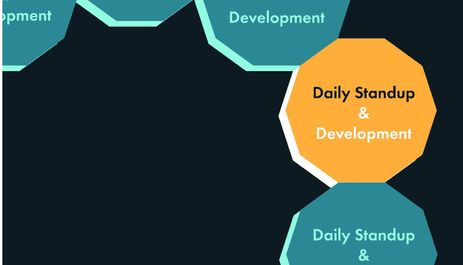

图 4.3 每日站会

### 目标

每日站会的目的是让团队中的每个人都有机会分享他们正在进行的工作状态，并在任何阻塞进展的问题时寻求帮助。团队中的每个人都应该注意同事的报告，以便他们对大家共同工作的整个 `Sprint` 的状态有一个清晰的了解。

对于团队之外感兴趣于了解故事进展以及下一步可能处理工作的任何人来说，这也是一个机会。只有团队成员允许参加每日站会，但公司里的任何人都可以参加，访客应被邀请作为沉默观察者参与。

### 时间盒

传统上，每日站会限制在 15 分钟内。这是一个简短的仪式，它保持尽可能简短和方便，以便每个人都能承诺出席、积极参与并在他人发言时保持注意力。预计每个人都要站立，以保持注意力，并鼓励所有参与者在保持仪式简短和聚焦方面发挥作用。大多数团队尝试在办公桌外举行站会，并反对人们在仪式期间使用笔记本电脑和其他设备。

> 保持站会时长
>
> 将每日站会控制在 15 分钟的 `time box` 内是 `Scrum Master` 的责任，但团队中的每个人都应该觉得有权去执行站会的规则，以防 `time box` 被打破。这包括确保每个人准时开始、保持注意力，并不允许访客干扰。

# 敏捷：从新手到大师

不同的团队会选择一天的不同时间举行站会。早晨或午饭之前都是很好的时间。这些是团队中大多数人共有的日程自然休息时间，因此 15 分钟的站会不会破坏长时间编程时间所需的专注力。

## 准备

敏捷大师在站会之前不需要特殊的准备。唯一的准备是每个团队成员都要思考如何以最有效利用可用时间的方式进行陈述。

## 三个问题

每日站会的核心由敏捷大师绕着团队询问三个问题组成：

- 自上一次站会以来，你做了什么？
- 在下一次站会之前，你计划做什么？
- 是否有事情在阻碍你？

应该就这么简单。团队的每个成员都回答这些问题，一旦最后一个人结束，站会就结束。除非敏捷大师有需要向整个团队发布的紧急公告，否则所有与他人没有特定业务往来的人都可以自由回到工作。

## 警惕站会中的访客

作为访客参加站会的人有一种强倾向去提问、引入新信息或开始与整个团队无关的讨论。任何不是开发团队成员的人在站会期间不应该发言。敏捷大师需要坚决压制这种行为。组织层级中的高层人员在这方面不会获得特殊对待。每个人都需要尊重工程师的时间和注意力，让他们尽快回到工作。

在回答站会问题时，每位工程师都需要准备好一份简洁的描述，说明正在做什么、计划接下来做什么，以及他们是否有任何阻碍。这是一项需要练习的技能，敏捷大师应该准备指导每个团队成员如何以有意义的方式回答这些问题。

如果一个人的报告引发了一定的往来讨论，且该对话对整个团队相关，敏捷大师可能会允许。但这种互动必须限制在尊重站会时间盒的范围内。如果对话超过几句话，敏捷大师应该介入并建议将对话移至线下。一个优秀的敏捷大师会记录站会结束后需要哪些对话，并在之后对其进行跟进。

## 其他状态更新

有些团队选择在每日站会期间在团队共享的看板上更新故事状态，而另一些团队则倾向于在故事完成后单独更新。无论哪种情况，站会都应该是确保每个人都更新了他们工作状态的机会，并且团队中的每个人都知道其他人正在做什么。

对于进行配对编程的团队，站会可以是切换伙伴或切换故事的机会。一些进行配对的团队倾向于让一个工程师从头到尾完成故事。允许多人共同配对同一个故事对团队的灵活性是有益的，特别是如果这涉及到核心功能，且有信息分享的价值，则应定期进行。不同的团队会有不同的方法，但每日站会是进行日常调整的好地方。

站会也是团队成员相互告知的好机会，例如他们是否预计在下一次站会之前完成某个故事，以及他们近期是否有假期。了解团队其他成员的可用性可以启发队友根据即将到来的故事来规划工作，并安排切换配对或适当分配资源。

> **下一步做什么？**
>
> 如果工程师不清楚下一步应该工作什么，应该由`冲刺待办列表`的优先级来引导决策。`产品负责人`负责在整个冲刺期间维护`冲刺待办列表`，并确保它代表了应该处理故事的优先级。

除非有充分的理由，否则任何没有当前故事的工程师都应该开始处理待办列表中优先级最高的故事，无论其专业领域如何。遵循这种模式可以为工程师提供在经验较少领域与他人配对的机会，并帮助在整个团队中传播代码库。

最后，`敏捷大师`可以在站会结束时发布与整个团队相关的公告——每个人都有报告的机会，且仅在剩余时间的情况下进行。这不应成为公司会议、团队午餐和其他聚会等任何团队建设活动的替代品。

# 冲刺演示

在冲刺结束时，当前冲刺期间的所有工作都将向团队、`产品负责人`以及任何邀请观察的人员演示。这种仪式被称为`冲刺演示`，它让所有工程师都有机会演示他们认为已完成的故事。`冲刺演示`是`产品负责人`测试每个故事的机会，检查它是否符合`验收标准`，然后接受或拒绝它。

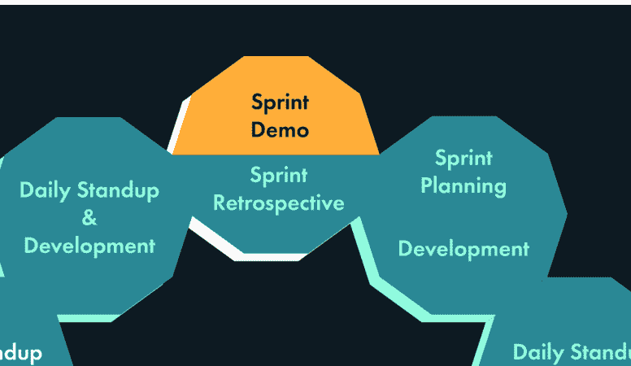

## 目标

`冲刺演示`的目标是明确冲刺期间完成了多少工作，并查看整合了冲刺期间完成的工作后，产品的当前状态将如何。根据被接受的故事，团队可以了解到他们在单个冲刺中可以持续完成多少`故事点`，这提高了他们未来对故事和`冲刺待办列表`进行估计的能力。

> **冲刺演示中的嘉宾**
>
> `冲刺演示`通常是嘉宾非常欢迎的仪式，因为团队之外的人员有机会看到团队一直在做什么，并根据最新产生的工作观察产品在下一次迭代中的状态。但不应允许嘉宾的存在干扰仪式的目标，或改变`时间盒`。嘉宾是观察者，而不是参与者。除非征求嘉宾的反馈，否则应要求他们不对产品或过程发表评论。

## 时间盒

分配给`冲刺计划`的时间取决于冲刺完成的故事数量以及与`验收标准`相关的复杂度。如果团队使用两周一次冲刺，大多数团队会为`冲刺演示`分配半天时间。一旦团队决定投入多长时间进行演示，`敏捷大师`应负责确保所有内容都符合`时间盒`要求。

## 安排演示与回顾

团队经常会将与演示在同一天安排`冲刺回顾`。安排这些活动的优点是最大限度地减少了与仪式相关的生产力中断。对团队的缺点是，这些日子主要产生 Scrum 产物，而不是具体的产品开发。这种权衡需要被考虑，不同的团队会有不同的偏好。

## 准备

`冲刺演示`是团队展示他们所做所有工作的机会，并证明他们工作的所有故事已完成并准备好纳入产品（假设它们尚未发布）。演示涵盖了从冲刺开始的所有故事工作，直到符合团队的`完成定义`。每个处理了准备好演示故事的人都需要准备解释他们的工作内容。

通常，工程师会在演示前与`产品负责人`会合，确保每个人知道要演示的内容。这是演示前一个实用的步骤，因为它确保了演示的故事符合所有`验收标准`。它提醒工程师为未发布的故事做好准备。

`敏捷大师`应该与所有完成故事的工程师见面，确保这些故事已为演示做好准备。运行仪式并确保需要演示的内容在分配的`时间盒`内完成是`敏捷大师`的责任。仪式的程序应包含所有演示列表。

## 由产品负责人引导演示

有些团队让工程师演示故事，但一种良好的做法是让`产品负责人`参与现场测试产品。开发新功能的工程师了解代码的`正常路径`，但`产品负责人`将寻找`边界情况`，并了解最重要的`验收标准`。让工程师设置演示并让`产品负责人`在场可以保持大家的参与度并确保故事已完成。

## 发布故事

发布是将已完成的功能集成到现有产品中的过程，这样用户就可以立即访问这些功能，或者可以对其是否将其纳入未来的发布中进行评估。该过程可能由发布工程师监督，或者在开发人员层面通过一套安全机制和回滚程序进行集成。

Web 和移动端团队在发布方面有许多选择。对于某些团队来说，在故事完成后立即将其向客户发布——有时在一天内会发布几次——是完全合逻辑的。对于其他团队来说，发布过程更为复杂，将整个冲刺阶段的故事进行分组，甚至利用更大规模的发布更符合逻辑。

**持续集成**是一种支持在故事完成时就发布它们的方法，而不是等待冲刺结束。这通常依赖于稳健的测试套件和一套编排良好的发布脚本。对于采用`持续集成`的团队，故事向线上产品的发布已经作为完成故事本身的一部分完成，在演示后不再需要额外的步骤。

> **使用持续集成**
>
> 当团队选择进行`持续集成`时，负责某个故事的工程师在该故事发布并证明其不会给线上产品引入任何问题之前，不要放弃该故事，这一点至关重要。虽然这可能导致工程师出现一些停机时间，但这些时间有时可以用于与维护和改进代码库相关的故事。

对于不使用`持续集成`的团队，还需要另一个任务来将冲刺阶段的所有故事发布到生产环境中。与发布过程相关的任务通常被认为是故事`完成定义`的一部分，但在这种情况下，它们可能需要在演示之后完成。

有些团队会定期在每个冲刺阶段开始时安排发布。其他团队的发布频率更高，或者可能只在年的特定时间发布，或者根据与大型组织或市场需求的某些活动相关的时间表进行发布。确定如何计划和安排发布是团队反思和迭代其流程的机会，以找到最适合他们且最能满足`产品所有者`目标的节奏。

## 按照发布计划工作

无论实际的发布计划如何，团队中的每个人都理解“将发布的只有已完成的内容”是非常重要的。Scrum 并不是为了满足预定的时间表而匆忙于完成特定的故事。Scrum 的核心是以可持续的节奏工作，了解团队的能力，并在准备就绪时发布已完成的内容。

任何为了满足发布时间表而将新故事塞进特定冲刺的努力都应该受到团队的抵制。如果日期无法调整，`产品所有者`应该做好妥协的准备，决定哪些功能需要从计划发布中删除，以便为团队完成最关键的功能留出时间。

# 冲刺回顾

如果每日站会是 Scrum 最标志性仪式之一，那么`冲刺回顾`可能最代表敏捷哲学。`冲刺回顾`为团队提供了在每个冲刺结束时反思他们所做工作的机会，并确定未来希望如何修改流程。

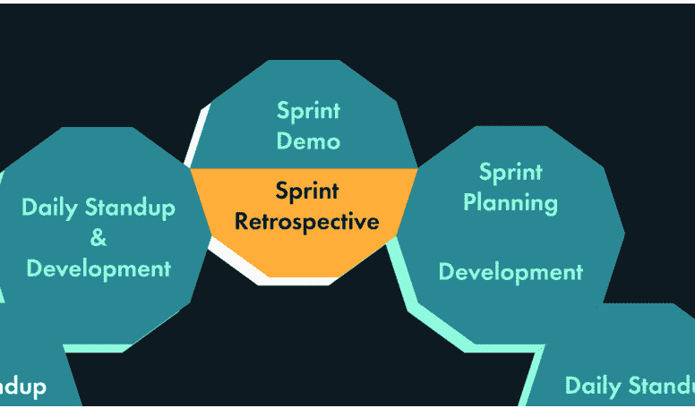

## 目标

`冲刺回顾`将团队聚集在一起，考虑刚刚完成的冲刺对每个人来说进展如何。在仪式期间，房间里的每个人都将被要求说明哪些做得好，哪些做得不好，以及他们愿意作为一个小组做出什么承诺以在下一个冲刺中改进情况。目标是获得一组团队中所有成员都同意的用于下一个冲刺的流程修改方案。

开发团队的所有成员、`Scrum Master` 和`产品所有者`都预期参加`冲刺回顾`。仪式由 `Scrum Master` 引导。

> **回顾会议中很少有访客**
>
> 很少邀请访客参加`冲刺回顾`。这样做是为了鼓励人们对冲刺期间可能发生错误的情况敞开心扉，并坦诚地表达他们的感受以及出现的问题。这种会议可能会带有情感色彩，而私密团队环境的亲密性提供了一个更具支持性的背景。

## 时间箱

团队可能会发现，他们在回顾上花费的时间与他们在`冲刺演示`上可能花费的时间相似。对于一个为期两周的冲刺，团队投入半天时间进行回顾并不稀奇。在安排回顾时，在时间上留得宽裕是比较好的，以避免获得团队成员宝贵见解的机会。

团队投入到`冲刺回顾`中的时间反映了他们对关注自身流程并在过程中不断改进的重视程度。有些团队可能会尝试限制在回顾上花费的时间。这可能会以沟通和改进为代价。Scrum 最重要的方面之一是强调将讨论作为增强产品开发过程的手段。

## 准备

`冲刺回顾`可能是非常情绪激昂的。参与 Scrum 的每个人在参加仪式时都应该带着一些想法，思考冲刺期间可能发生了哪些他们想要评论的事情。对于某些人来说，这可能意味着列出一份长长的问题清单。

`Scrum Master` 参加`冲刺回顾`时应带有一个议程，确保从所有参与者那里收集正负面反馈。确保每个人都有发言机会并做出贡献是 `Scrum Master` 的责任。

> **确保回顾获得适当关注**
>
> `冲刺回顾`是 Scrum 团队经常被缩短甚至被遗弃的仪式。这可能是流程出现问题的信号。如果对回顾没有给予足够的关注，团队就是放弃了改进的机会。通常，投入时间少、关注少的人是那些从现状中受益最多的人。确保这一仪式发生并获得团队每个人的适当关注，是表达关怀和关心的一种。

## 哪些做得好？

`Scrum Master` 应该询问房间里的每个人在冲刺期间哪些做得好。这通常通过绕场一圈让每个人报告一个或多他们做得好的事情来实现。除非这次冲刺是一场彻底的灾难，否则大多数人都应该能提出一些做得好的事情¹。

让人们讨论哪些做得好的价值之一是将人们聚集在一起，并给他们一个机会去认可和感谢他们以及队友负责的良好工作。

### 等待每个人都提出观点后再进行讨论

虽然在会议结束之前应该鼓励每个人的参与，但在每个人有机会分享他们的清单之前，允许人们做出回应或讨论所提出的观点并不是一个好主意。`Scrum Master` 应该在之后提供进行更开放讨论的机会，但在这种深层讨论之前，给团队中的每个人一个发言的机会是最重要的。

## 哪些做得不好？

接下来，`Scrum Master` 应该绕场一圈询问人们报告他们在冲刺期间哪些做得不好。这是一个敏感的话题，因为人们可能会提出令人不安或不愉快的问题。

和之前一样，应该要求每个人都参与。让人们对他们可能感到不舒服的话题给出诚实的回答是 `Scrum Master` 的技巧。如果有人真的不想发言，或者有不想在小组面前提到的想法，应该鼓励他们在仪式之外与 `Scrum Master` 独立交流。

¹这个仪式之所以花费这么多时间的原因之一是因为每个人的参与都是至关重要的。不应该任何人被遗漏。

## 排序仪式

该仪式各个部分的顺序——处理做得好的和不好的部分——可以根据团队的偏好进行反转。`Scrum Master` 也可以选择采用许多实践来提高团队对这一过程的参与度，包括游戏、卡片、提前提交等。在策划这一仪式时，有很大的创意空间。

## 我们应该如何处理？

在每个人都有机会讨论他们认为在冲刺期间哪些做得好、哪些做得不好之后，就应该开放讨论。这让团队中的每个人都有机会进一步地阐述他们提出的问题，以及同事提出的问题，并他们认为团队应该针对这些问题采取什么措施。

对于做得好的地方，团队应该尝试找到在未来的冲刺中复制这些成功的方法。他们可能在上一个冲刺中尝试了一些新方法并证明是成功的，这些方法可以整合到未来的流程中。

对于做得不好的，团队有机会讨论哪里出了问题。有时问题在于没有遵循流程。其他时候，流程实际上造成了阻碍，需要进行调整。应该鼓励每个人对可能有益的改变发表意见。

最终，讨论将集中在团队想要关注的四五个关键问题上。`Scrum Master` 应该引导讨论，使这些问题被表述为修订后的实践——然后团队可以同意在即将到来的冲刺中尝试这些实践。

### 仅在冲刺之间进行可控的更改

虽然可能会讨论许多问题，但团队应该就一组微小且易于管理的更改达成共识，从一个冲刺过渡到下一个。对于用户体验测试来说，在测试之间进行的更改越多，就越难以隔离哪些是有用的，哪些引起了问题。

在这一仪式结束时，`Scrum Master` 应该向团队提供一份简短易懂的流程变更列表。最重要的是，`Scrum Master` 应对全场进行投票，确保每个人对这些更改都赞同。然后，`Scrum Master` 应该记录团队对下一次冲刺修订的承诺。团队反思和改进的能力对其发展至关重要，正如对`冲刺待办列表`的承诺对于产品的发展一样。

# 结论

在本章，我们回顾了 Scrum 的四个关键仪式：`冲刺计划`、`每日站会`、`冲刺演示`和`冲刺回顾`。这些仪式在每个冲刺中重复一次，站会则是每天执行。

这些仪式引导我们从`产品所有者`编写的故事开始，通过团队估算、对`冲刺待办列表`做出承诺、完成所有故事、演示每个故事已完成并符合其所有的`验收标准`，最后对已完成的冲刺中哪些做得好、哪些不好进行反思，以便团队不断改进。

接下来，我们将查看 Scrum 的一些产物。这些工具帮助 Scrum 团队理解他们正在做什么、跟踪进度并有效协作。

# 第 5 章

## Scrum 产物

**产物** 是允许团队管理 Scrum 流程的工具。它们帮助团队成员就他们正在做的工作进行交流，提供团队已经要做和已经完成成就的记录。任何人都可以指向 Scrum 团队的产物，向人们展示他们正在做什么、完成了什么以及他们期望实现什么。

许多产物可以帮助团队在 Scrum 工作过程中进行准备和管理。熟悉 Scrum 语言意味着理解每件产物的用途以及如何使用。在本章中，我们将回顾一些常用的 Scrum 产物，例如：

- `故事`
- `产品待办列表`
- `冲刺待办列表`
- `Scrum 看板`
- `完成定义`
- `速率图`
- `燃烧图`
- `产品增量`

不同的团队在创建和维护所使用的产物方面有不同的方法，但对于网页和移动开发，有些是值得记住的。

## 产物概述

尽管正式的 Scrum 不规定过程产物的具体使用方式，但我们将涵盖一些构建和维护产物的方法，这些方法被证明对网页和移动团队通常的工作类型非常有用。

对于网页和移动工作，Scrum 最基本的产物之一是描述要开发的功能`故事`。故事在待办列表中开发和管理。维护两个独立的待办列表：一个供`产品所有者`跟踪产品的整体愿景，另一个供团队参与当前正在进行的冲刺。这两个待办列表都包含了为了推进产品而需要执行的操作描述，但`产品待办列表`中的项目看起来与`冲刺待办列表`上的故事不同。Scrum 团队使用 `Scrum 看板` 跟踪故事在冲刺中的进度，我们将讨论它们如何协同工作。

Scrum 还提供了许多收集统计数据的工具，有助于跟踪团队绩效，并向 Scrum 团队内部外部人员传达产品开发的情况。其中我们将涵盖跨越多个冲刺的`速率图`，以及跟踪单个冲刺内进度的`燃烧图`。

Scrum 团队会发现其他有用的产物，包括`产品所有者`同意的`完成定义`，以及`产品增量`。

## 故事

# 故事 (Stories)

**故事 (Stories)** 是产品所有者交流需要开发内容的方式。它们在产品待办列表中孵化，并以标准格式表示，以便在冲刺中进行评估。

## 使用故事的起源

使用故事来封装离散工作部分的概念源于极端编程（XP）¹，它是敏捷开发的一种特殊变体，提倡许多开发实践，如结对编程。在进行网页和移动开发时，故事非常有用，因为它们通常具有相同的组件。

¹ http://www.extremeprogramming.org

## Scrum：从新手到忍者

……并进行相对估算。由于原因，对于我们所讨论的类型的工作，我们将认为故事是 Scrum 的基础。

一个故事应该捕捉一个完整的功能切片。每个故事应该是独立的，这样开发者不需要在处理另一个故事之前完成一个故事。一个故事应该是一个小功能切片，可以在一个冲刺期间进行处理并完成。

故事有助于捕捉功能的精髓，并让团队能够以有意义且相对的方式讨论参数和验收标准。根据团队在冲刺内可以完成的大小对故事进行规模化估算是一项非常有用的练习。

每个故事都应该为产品增加价值，并使其更接近产品所有者的愿景。每个故事都应该明确产品所有者将测试最终产品以验证故事已完成。

### 故事不是技术规范

尽管具有工程或产品管理背景的新产品所有者有时倾向于解决所有的技术问题，并为每个功能提出带有详细规范的静态解决方案，但记住故事不是技术规范。它们是产品所有者和工程师之间讨论如何实现功能以及涉及多少努力的机会。这就是为什么故事遵循短而一致格式的原因之一。它抑制了包含更多详细规范的冲动。

编写故事的责任属于产品所有者。编写捕捉客户完整意图和期望的故事是一项可能需要时间发展的技能，但对于有效的 Scrum 导师来说至关重要，他们应该能够帮助产品所有者编写大小合适、表达适当验收标准并开启对话而非关闭对话的故事。

编写故事有一个简单的公式。多年来，人们尝试了许多变体。通过迭代和反思，不同的团队最终可能会演化出适合自己的不同方法，但这是一个很好的开始：

**名称**：简明易懂的功能名称

- 作为一个用户
- 我希望执行某项行为
- 以便实现该行为的理由

**验收标准**：

- 给定一个定义的状态
- 当满足一组条件或事件时
- 得到一个一致且可测试的结果

> ### 什么是好的故事（Story）？
>
> 一个故事应该是短小且直接的。许多 Scrum 团队遵循惯例：故事应该写在三英寸乘五英寸的索引卡的一面，并将验收标准写在同一张卡片的背面。如果编写一个故事需要花费过多的信息，说明规范可能过于详细，或者故事可能太复杂，可能需要将其拆分为多个故事。

例如，考虑一个正在开发画廊应用程序的团队。画廊的访问者可能想对显示的图像进行评分，以便跟踪他们的喜爱。画廊无论有无评分功能都可以运行，因此这项工作可以作为一个完整的功能切片被隔离。根据工程师的估算，添加评分组件涉及的工作可以在单个冲刺（Sprint）内完成。

这就是一个故事可能的编写方式，以便团队对其进行评估、估算，并承诺在冲刺待办列表（`Sprint Backlog`）中完成：

**名称**：画廊图像评分

- 作为一个画廊访问者
- 我想对图像进行评分
- 这样我可以跟踪并排名我评分过的图像

## Scrum：从新手到大师

**验收标准**：

- 给定一个已登录的用户正在查看画廊
- 当用户点击某个图像评分组件中的星级时
- 则该星级的值应记录为该用户对该图像的评分

和

- 给定一个已登录的用户正在查看画廊
- 当显示用户已评分的图像时
- 则评分组件应反映该用户之前输入的评分

和

- 给定一个已登录的用户正在查看画廊
- 当“收藏”开关被打开时
- 则只显示用户已评分的图像，并按评分从高到低排序

对于像这样的故事，团队可能有一套附带在故事上的标准线框图（`Wireframes`）或设计方案，并与其进行沟通。例如，如果这是一个新组件，设计师可能已经准备了一个模型图（`Mockup`）和一组工程师实现该功能所需的资源。产品可能还有一份样式指南或其他文档，需要用相关信息进行更新。

故事与工程决策无关，例如 `API` 如何设计，或者在代码中使用哪些命名规范。虽然团队的完成定义（`Definition of Done`）可能需要创建关于此类技术方面的文档，但产品所有者提出的故事通常不需要对这些点持有意见。

当故事在冲刺计划（`Sprint Planning`）上提出时，工程师应该验证所有必要的资源和信息都已捕获并可用。即将进行的冲刺中要完成的实际工作由故事卡片上的描述以及产品所有者与团队之间产生的对话所定义。

## 产品待办列表（Product Backlog）

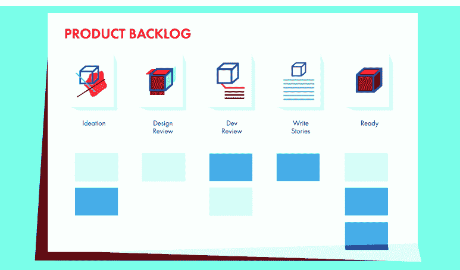

**图 5.2. 产品待办列表**

开发团队的故事源于产品所有者的产品待办列表。产品待办列表记录了产品所有者从客户那里获得的关于产品方向的所有输入，以及产品所有者收集的调研、经验测试、设计和工程反馈。

与冲刺待办列表的故事不同，产品待办列表的项不需要以任何特定方式结构化。它们的主要目的是让产品所有者能够跟踪所有需要的功能。这些产品项在结晶为冲刺待办列表的清晰开发故事之前，可能相当模糊。产品待办列表中的项应该始终反映产品所有者对产品长期目标的最新思考，而团队正在处理当前增量中的特定功能。

## Scrum：从新手到大师

### 产品待办列表是产品所有者的责任

虽然产品所有者可能选择定期与团队共享整个产品待办列表，但这里的项是产品所有者的责任。反复提醒团队产品待办列表中那些久未触碰的项可能是没有成效的，因为这会分散他们对完成当前增量所需要工作的注意力。

虽然许多产品所有者倾向于跟踪产品待办列表中的项，就像它们将成为最终故事一样，但产品待办列表中的项与进入冲刺待办列表的故事之间并不一定有一一的对应关系。产品所有者需要跟踪的功能和需求可能会变成多个故事，或者可以将几项合并成一个具有适当开发规模和范围的统一故事。

例如，如果客户需要为网站添加一个支付系统，这对于开发团队来说可能是一个故事，也可能是多个故事。可能会有关于通过服务接受支付能力的开发者故事，以及关于接受信用卡、支票，甚至是维护一个可以使用虚拟货币进行购买的令牌系统的独立故事。可能独立地开发其中的每一个，并只通过其中一个发布系统。无论先推出哪一个，都需要承担所有其他功能共享的一些核心功能的实现。

许多产品所有者发现使用分阶段过程来跟踪产品待办列表项的状态是非常方便的，通过这种过程，项从构思经过设计到工程验证，直到准备好被表述。

### 在故事准备好之前不要编写故事

产品所有者过早详细地编写故事是一个错误，而且这些故事很容易过时。在故事准备好之前编写故事可能会浪费产品所有者的时间。产品待办列表中的项应该保持模糊和灵活，以便能够适应。

## 冲刺待办列表（Sprint Backlog）

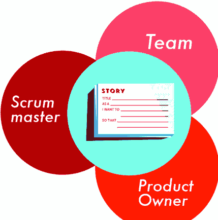

**图 5.3. 冲刺待办列表**

冲刺待办列表是团队在冲刺期间承诺的故事。冲刺待办列表是在冲刺计划的一部分创建的，反映了团队对工作的共同理解。待办列表中的故事遵循我们之前描述的结构。

## Scrum：从新手到大师

当前冲刺的待办列表大小基于冲刺计划期间的谈判。每个故事在冲刺计划期间进行估算，整个待办列表代表了团队认为可以完成的总点数。每个故事都有一个点值，反映了团队认为完成该故事所需的工作量。

冲刺待办列表中的故事顺序最初在冲刺计划期间建立，但产品所有者有权随时更改冲刺待办列表的顺序。产品所有者可能不会向冲刺待办列表添加故事或移除故事，但可以根据需要重新排列，以指示哪些故事最重要。

### 在冲刺期间对故事进行重大更改

如果需要对冲刺待办列表的故事进行重大更改，且真的无法等到冲刺结束，`Scrum Master` 应该停止冲刺并启动一个新的冲刺，进行新的冲刺计划。由于中断和成本，这是一个非常激进的选择。它应该作为最后手段，或者当显然当前冲刺待办列表的工作都不符合已变化的需求时。

冲刺期间，开发者每当完成一个故事并需要新任务时，就会从冲刺待办列表的顶部选择故事。每个工程师都应该选择待办列表顶部的故事，因为那是产品所有者认为在当前冲刺中优先级最高的。选择不是待办列表顶部的故事将导致工作超出优先级顺序。

维护整个产品。这有助于团队变得更加全能，提供学习和成长机会，提高每个人估算新故事（`stories`）的能力，并防止关键信息成为某人的专有责任。在高效开发和知识共享之间找到恰好的平衡取决于每个团队。

## Scrum Board

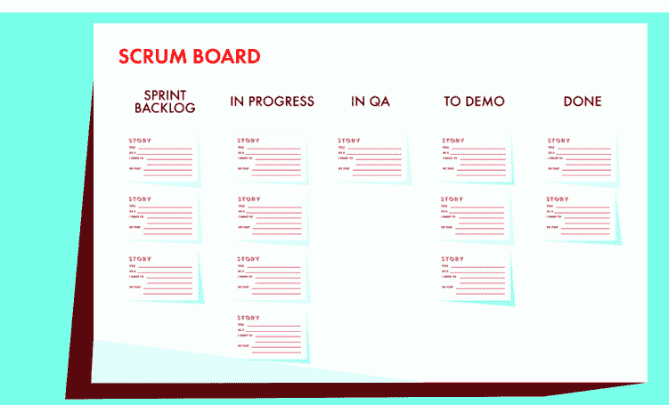

**图 5.4. Scrum 板**

冲刺待办列表（`sprint backlog`）通常是 Scrum 板的第一列。Scrum 板跟踪当前冲刺中正在进行的所有故事的进度，直到它们符合团队的完成定义（`definition of done`）。大多数 Scrum 板使用两到三列，并将故事从一列移动到下一列，以反映哪些故事是优先待办的、哪些正在进行、哪些在测试（`QA`）、以及哪些已准备好演示。

Scrum 板为整个团队提供了焦点。通过在冲刺期间查看 Scrum 板上的故事，团队中的任何人应该能够立即获取冲刺当前状态，以及团队如何朝着其设定的目标进展。良好的 Scrum 板应该是公开的，这样团队外的人也可以查看并了解发生的情况，从而鼓励公司的透明度。

有许多工具可用于通过 Scrum 板监控故事进度。最简单的方法简单地将索引卡贴在墙上，所有人都可以看到。对于同地工作的团队来说，这有许多用处。它不仅鼓励使用索引卡来保持故事简洁扼要，还为每日站会（`daily standups`）创建了一个自然的聚集场所，并作为团队进展情况的共享视觉提醒。

### 物理 Scrum 板带有风险

在墙上由索引卡制成的物理 Scrum 板容易受到滥用、忽视和误操作。人们可能会不小心地重新排列索引卡。从一天到下一天的变化可能很难发现。如果你打算使用物理 Scrum 板，一个主意是每天对其进行拍照，并发布在所有人都可以访问的地方。这种方法并不完美，但如果板在业务过程中被打乱，它可以提供一种恢复机制。

除了使用物理板外，许多公司开发了电子工具，帮助团队在故事从一个状态移动到另一个状态时进行捕获和管理。这些工具包括跟踪点数、生成标准报告甚至设置访问权限。某些工具允许团队在持续集成中触发自动化构建过程。这些工具广泛应用于广泛行业，便于与客户和用户沟通。其他工具可能仅支持故事的电子跟踪，同时允许所有人看到一切并进行任何更改。

最流行的允许故事管理、点数跟踪以及故事各种状态的在线 Scrum 板工具包括：

- `Pivotal Tracker`²
- `Jira Agile`³
- `Trello`⁴（带有插件⁵）

有些团队倾向于使用电子跟踪工具以便远程访问或显示在团队可以看到的大屏幕上。工具领域不断演变，随着新成员的加入，任何特定的建议很快就会过时。此外，创建这些工具的公司对 Scrum 应该如何运作有不同的哲学。这些哲学反映在工具的设计中。

更改工具是一个困难的过程，很少有工具支持直接导出。每个团队都要决定哪种工具的哲学最符合他们的方法，并找到一个他们可以坚持使用的工具。优秀的 `Scrum Master` 应该熟悉不同选项相关的权衡。

> ² https://www.pivotaltracker.com/
>
> ³ https://www.atlassian.com/software/jira/
>
> ⁴ http://www.trello.com
>
> ⁵ http://scrumfortrello.com/

## Definition of Done（完成定义）

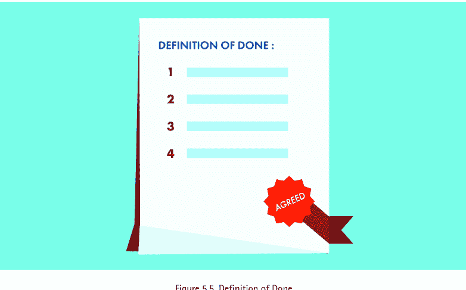

我们提了几次完成定义。**完成定义**适用于冲刺待办列表中的每个故事。宣布一个故事已完成，是根据团队的工作方式验证所有关键方面都已完成的一种。

对于团队来说，对“完成”对自己意味着什么有一个共同的想法至关重要。团队应该创建一个书面的完成定义，并将其作为他们工作的每个故事的清单。此定义应该独立于特定的故事或项目，因为完成定义应该适用于团队的工作方式，无论他们正在处理什么。

完成定义是团队应该共同提出的。它可能在第一次冲刺计划期间创建，并在冲刺回顾期间进行迭代。团队的完成定义可能会随着时间的推移发生剧变，团队在回顾中意识到流程的哪些可能需要改进。

在显著位置发布完成定义并不是一个坏主意。这让团队内部和外部的人都能理解完成任何故事需要多少努力。该文档为关于提议故事是否准备好工作的问题提供参考点。如果故事根据验收标准无法满足完成定义，那么已发布的完成定义可以帮助团队明确这一点。

通常，完成定义包含一系列熟悉的预期。例如，代码应该是完整的，构建不应失败，测试套件不应损坏，产品应该按预期运行。完成定义中经常包含的其他点包括同行评审代码、编写新的单元测试、代码注释和更新产品文档。不同的团队会有不同的需求，创建完成定义的练习对于帮助团队意识到每个故事（而不仅仅是某些故事）很重要。

### 完成定义必须是实用的

虽然完成定义的详尽很重要，但其具有实用性也同样重要。完成定义对于每个故事都必须是可以实现的。团队可能认为为了代码库应该遵循某些做法，但在市场限制下这些做法是不现实的。通常，工程师会主张更详尽的范围，而产品经理可能会主张精简的方法，这取决于产品所有者的预见性和市场的稳定性。每个团队都要提出自己的论点，并在开始工作之前得出一个大家都能同意的完成定义。

## Velocity Chart（速率图）

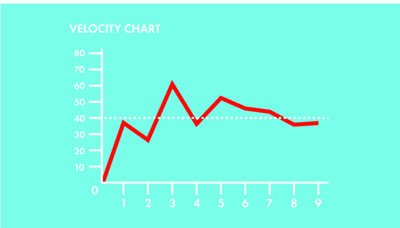

**图 5.6. 速率图**

速率是 Scrum 衡量他们在典型冲刺中可以完成的工作量的方式。速率是历史性的衡量，从一个冲刺到下一个冲刺。通过跟踪团队根据自己的完成定义可以完成的故事点数，他们可以建立起一种可靠且可预测的感觉，判断完成新故事需要多长时间。

跟踪速率是 `Scrum Master` 的责任。在每次冲刺演示结束后，`Scrum Master` 应该计算在此冲刺期间被接受为完成的点数。这个数字应该作为数据点添加到该冲刺的速率图中。

## Scrum 产物 95

与业务环境中的许多图表不同，速率图（`velocity chart`）的目的不是看到持续增长，而是为了看到数值在一个一致的水平线附近收敛。该线代表了团队在单个迭代（`sprint`）中现实且可持续地完成的工作量。

### 速率是估计工具，而非 KPI

Scrum 流程之外的人可能对速率图的本质感到困惑。从管理的角度来看，可能会倾向于增加团队的工作量，并希望速率随着时间的推移而增长。速率图的设计目的是趋于水平平均。你可能会听到高管们讨论尝试提高团队速率，或者对某个速率高于典型迭代的迭代表示庆祝。在这些讨论发生之前，请提醒大家：跟踪速率的目的是提高团队持续且可靠地估计他们可以完成多少工作的能力。显示随时间持续增长（或减少）的速率图通常反映了流程中的问题。

## 燃尽图（Burndown Chart）

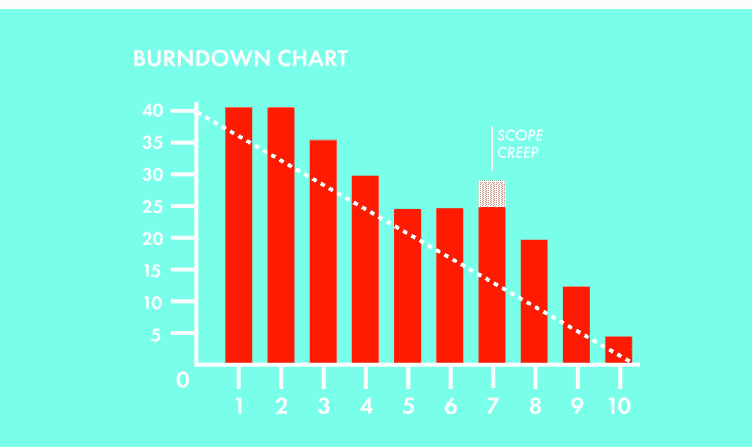

**图 5.7. 燃尽图**

## Scrum：从新手到大师

燃尽图显示了团队在单个迭代内完成其约定完成的所有点数的进度。该图始于团队在本次迭代中承担的总点数，并按天跟踪这些点中有多少完成并准备好进行迭代演示（`sprint demo`）。

燃尽图通常由 `Scrum Master`（`scrum master`）维护，可能会每天更新一次（也许每日站会之后），如果是由团队用于维护 Scrum 看板的工具自动生成，则持续更新。燃尽图的主要受众是团队本身，尽管燃尽图上可能存在对 Scrum 团队之外人员相关的数据点。

典型的燃尽图从左上角到右下角有一条直线对角线，显示了迭代的“理想”燃尽速率。在实践中，重点并不是匹配这种理想状态，而是记住在任何时间点还剩下多少迭代，以及团队预计在迭代的某一天投入到产品开发中的工作量。

燃尽图上的线条或列图可能用于表示迭代中每天实际剩余的工作量点数，从团队在迭代计划会议中承诺的点数开始。随着工作的完成，这些列会变短，直到达到零。

一些团队还选择跟踪每日完成的工作，以故事点（`story points`）或完成故事的单个任务为单位。这可以通过线条或堆叠列来实现，将这些每日指标与燃尽图进行对比，以便在上下文中查看。

燃尽图中的某一列比前一天高几乎没有合理的理由。如果在迭代结束前发现了漏洞（`bug`），并且一个被标记为已完成（`done`）或准备好演示的故事需要再次处理，列的大小可能会从一天到第二天增加。在迭代开始后引入的新故事也可能导致当列比前一天高。燃尽图上列不断上升的模式可能表明工作范围超过了最初约定的迭代待办列表（`sprint backlog`），这在 Scrum 中绝对是一个反模式。

## 警惕范围蔓延（Scope Creep）

每个人都应该尊重迭代待办列表范围。如果在迭代开始后经常添加新故事，那么反映某一天迭代内剩余工作量的列可能会超过前一天的水平。这种模式有时用对比颜色表示，以强调最初约定的范围可能向上蔓延的事实。如果这种情况频繁发生，可能反映了流程中的问题，值得在迭代回顾（`sprint retrospective`）中解决。

## 产品增量（Product Increment）

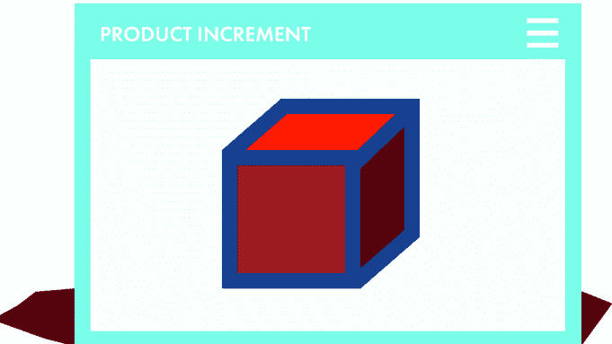

**图 5.8. 产品增量**

Scrum 的最后一个产物是迭代结束时的实际产品增量，其中包含了所有符合“完成定义”（`definition of done`）的故事。在每个迭代结束时，处理过的完成功能应该添加到产品中供迭代演示。此时，产品本身就是 Scrum 流程的产物。

Scrum 流程的目标是开发功能，使产品在每个迭代结束时都处于完成状态，以便发布、向客户演示以获取反馈或作为测试工具。虽然组织根据 Scrum 时间发布产品是强制性的，但此目标允许产品状态成为 Scrum 鼓励的开发、测试、评估和创新的迭代过程的一部分。

大多数组织中产品增量的所有权应属于发布工程师（`release engineers`），并对产品负责人（`product owner`）完全可用。对于 Web 和移动项目，产品通常是产品的实时演示分支，维护在一个安全但可访问的位置。

对于进行持续集成的团队，实时站点可能反映团队完成的最新工作。在这些情况下，公共站点或 App 将就是产品。

# 结论

这些都是需要熟悉的新术语，但我们已经涵盖了故事、待办列表、看板板、速率图、燃尽图和产品增量。现在我们已经掌握了仪式和产物，是时候让我们查看 Scrum 合同了。

## Scrum 合约基础 101

在 Scrum 团队中承担某个角色，意味着愿意在 Scrum 仪式期间出现问题时，与同事以平等的身份交流。任何参与 Scrum 的人都应该自由地分享他们对项目和流程的意见，即使这些意见违背主流观点，或挑战了组织层级中职位较高人士的权威。当冲突发生时，`Scrum Master` 有责任协助调解并促进对话。

从更根本上说，参与 Scrum 意味着愿意成为团队的一部分。Scrum 的角色和仪式设立旨在让每个人都有机会、也有义务参与其中。团队中不分享意见和想法的成员会令团队其他成员感到失落。作为 Scrum 团队的成员，无论你在公司中的职位如何，你的目标都是为了帮助支持每个人的流程。由于小组规模较小且亲密，且参与规则定义得明确，Scrum 为内向的人提供了一个尝试表达自我的安全空间。

由于典型的公司会议与 Scrum 仪式之间存在区别，人们有时可能会对预期的行为方式感到有些困惑。当此类问题出现时，`Scrum Master` 应该是最终的裁决者。每个团队都需要自行定义什么是最有用的行为标准，并对其进行适当执行。

最终，这归结为对同事、对流程以及对你在流程中所处的尊重。如果你有疑问，或者你认为某些事情不起作用，总有机会在回顾会议上提出这些问题。不要错过积极参与的机会。

### 提供透明度

为了让 Scrum 高效运行，团队中的每个人在流程的各个阶段让其他人知道自己正在做什么。有些人称之为透明度。它让每个人都知道别人在做什么，以便每个人都能对项目状态有更清晰的感知，并知道自己如何提供帮助。

透明度有许多用途。Scrum 的价值在于，它让关于项目状态的大量信息对公司任何人可见，这样负责项目的人就不会被中断。通过为团队预留一段非常短且定义明确的时间每天相互更新信息，Scrum 避免了每位工程师都可能面临那些只想知道他们在做什么的人所带来的干扰。

透明度还允许工程团队之外的人员跟踪对他们可能特别重要的问题状态。Scrum 定义冲刺的方式使其不会被新的用户故事中断，但客户以及组织周围的其他人员经常会有想要引入的内容，并且他们可能认为这些变更是紧急的。Scrum 的透明度让他们一眼就能看出团队正在忙什么，以及为什么你对这些事项进行了优先排序。

Scrum 支持的透明度并不是为了微观管理。Scrum 的优势之一是为团队成员创造尽可能多的不受管理的时间，让他们自我管理。Scrum 提供了每日站会作为透明度的触点，以便工程师可以在向团队更新状态时分享有价值的见解，并在干扰最少的情况下开展工作。

Scrum 假设参与流程的每个人从一开始就做出了在团队工作的自觉选择。在团队中共同工作意味着每个人都知道你在做什么，并愿意分享信息和资源。Scrum 在此类项目的 Web 和移动端开发中运行良好的原因之一是，朝着共同目标共同努力，比孤立个人并在事后尝试协调他们的产出要高效得多。

### 建立工作边界

信任是 Scrum 的很大组成部分，延伸之，这也是任何类型团队环境工作的很大组成部分。我们都相互依赖来履行义务并支持团队流程。

人类天生好奇。每当对别人在做什么感到困惑时，往往会有提问和探索的倾向。每个人对别人的所作都有意见，这就是团队共同工作的本质。这种好奇心是健康的。

然而，记住人们需要空间按照他们认为的方式开展工作是非常重要的。在小组中拥有角色意味着允许他人也拥有他们的角色。当涉及到 Web 和移动端开发的 Scrum 时，这意味着工程师能够以一种不受中断的方式，处理他们在冲刺期间内定要完成的故事。这是 Scrum 自主管理性质的一部分，只要保持生产力，它就允许高度程度的个人灵活性。

> 每个人都需要尊重 Scrum 角色
>
> 这种对 Scrum 角色的尊重需要超出团队的限制，甚至超出工程部门的限制，以为支持有效的 Scrum 流程提供所需的稳定性。管理层和 `Scrum Master` 都有责任向公司其他人员传达 Scrum 的价值，这些人员可能对 Scrum 团队的预期产生影响，包括高层管理人员。

在 Scrum 团队中，所有成员都被预期履行其角色的义务，他们相互依赖以做到这一点，以确保整个工作流程的进行。在流程可能出现崩溃的情况下，Scrum 提供了一个机会，让每个冲刺结束的回顾会议期间，团队中的任何人都可以质疑团队是如何协作工作的。

实验的结果并不非得是积极的才能成功。这就是科学方法的本质。如果人们喜欢某项改变，他们可以同意

### 尊重反思性迭代

Scrum 最价值的组成部分之一是它能够随着团队、项目和背景的变化而不断适应。没有任何项目具有完全可预测的轨迹，这在 Web 和移动端领域尤其如此。由于变化不断——不仅在市场环境背景中，而且在执行项目的团队内部——快速适应的能力至关重要。

Scrum 定期花时间审视自己，并查看运行状况如何。通过回顾会议，团队有机会从正在做的事情抽离出来进行思考。回顾会议不仅衡量团队的氛围，还为每个人提供了分享对过去情况的赞扬和批评的机会，并达成调整建议。

# Scrum 合约 105

使其永久化——直到有人在后后的回顾会议上提出了一个充分的理由来更改它。如果人们不喜欢改变，他们就有机会在下一次回顾会议中提出这一点，并可能阻止实验继续进行。

反思性迭代允许运行良好的团队能够继续运行和改进，让存在问题的团队能够识别并调整这些问题。流程中的所有事情都取决于团队的共识。因为总会有下一次回顾会议的到来，如果某些事情不起作用，将会有另一个机会重新审视任何决定并转变方向。

## 遵循共同定义

Scrum 鼓励人们共同工作而不是单打独斗。为了使这种工作变得高效且不具有压迫性，人们需要对工作背景的共同定义达成共识。如果没有一个所有人都能同意的通用词汇，团队将无法管理，Scrum 的用处也将微乎其微。

Scrum 为组织定义了一系列新术语，如冲刺、故事、产物等。这其中的价值之一是，每个组织都有机会获取这些新术语，并以对它们最有效的方式使用它们。这并不意味着打破 Scrum 的核心标准，但确实意味着每个团队对于如何选择在这些定义内部进行运营达成了有意识的协议。

我们讨论的词汇是每个团队所独有的。虽然故事、每日站和分值等共同概念在所有 Scrum 团队中可能是是的，但每个团队如何编写故事、每个团队如何管理其每日站，以及每个团队如何选择分配分值，都是该团队主观且不断演变的属性。

例如，每个团队都需要为自己定义的唯一概念就是“完成定义”。Scrum 的产物之一就是完成定义，在定义中，团队可以对故事从开发阶段移动到验收阶段需要满足的标准达成一致。除非每个人都对一个故事什么才算“完成”有清晰的理解，否则对于如何处理一个故事以及在流程的每个阶段需要发生什么，可能会产生分歧。

Scrum 并不尝试为团队定义什么是“完成”，但 Scrum 期望团队创建并共享一个所有人都能同意的自己的“完成定义”。Scrum 提供了松散的指南，并允许团队在定义自己的标准时具有很大的灵活性，以便他们发现自己通往可持续生产力的道路。

## 总结

在 Scrum 团队工作需要意愿。每个人都需要愿意承担他们正在做的工作，尊重定义每个人角色的边界，共同努力定期迭代和改进流程，并就大家将如何共同工作的定义达成共识。

在记住这些概念的情况下，在下一章中，我们将观察一个正在特定项目的特定团队。它是我们之前见过的同一个团队，来自 WithKittens.com 网站，但现在他们正开始作为一个 Scrum 团队的一部分开始工作。我们将展示该网站的新故事将如何从产品待办列表中的想法发展，以及团队如何评估这些故事以查看它们是否合理，以及它们需要多少精力。

# 第 7 章

## 故事的生命周期

我们已经详细地学习了 Scrum，讨论了保持 Scrum 团队顺畅运行所需的角色、仪式和产物。我们讨论了团队成员的态度，以及人们在进入 Scrum 时的顾虑。现在是时候查看实际的 Scrum 流程了。

要做到这一点，让我们从最开始。在本章中，我们将遇到一位产品负责人，并学习一个现有网页和移动产品变更的想法如何从通用想法变为具体的用户预期，最后变为团队可以开始处理的故事。

我们已经开始与 WithKittens 团队的成员进行交流，并将继续与他们合作。我们将讨论产品最初看起来是什么样子的，以及产品负责人决定引入哪些更改。然后，我们将看到这些更改固化为团队交付的全栈功能切片。

在这个过程中，请记住，该团队实现 Scrum 细节的方法可能与你的团队的方法不同。例如，每个团队都有自己的相对分值比例，并必须遵循它们自己的完成定义。需要关注的重点是我们之前几章中讨论的基础知识。

### 为什么 Scrum 不对每个团队进行标准化？

你可能会问，为什么 Scrum 不简单地对每个团队进行标准化。Scrum 的优势之一是每个团队从一组共同的通用概念开始，然后迭代出最适合自己的流程。这通常会导致一个相当一致的“完成定义”，但它取决于每个团队的开发和部署背景。例如，分值完全取决于团队实际处理的任务，因此它们在团队之间可能会有巨大差异。

# 什么是 WithKittens？

WithKittens 团队由六名工程师、一名产品负责人和一名 `Scrum Master` 组成。他们已经合作了大约三年，人员流动较少，并制作了网站和移动应用程序，旨在为他们客户上传的任何图像添加猫咪照片。

该服务的大部分用户会一直留在免费层级，仅仅在自己的社交媒体图像中添加猫咪并分享它们，得益于叠加在生成图像上的嵌入文本，这推广了 WithKittens。但对于某些客户来说，这也是一项关键服务，他们支付高昂费用，以确保只有最好的猫咪会被持续且可靠地添加到他们的图像中，而且远不止此。

团队包括图像处理专家、后端工程师、网页和移动端的前端工程师，以及安全专家。产品负责人具有产品管理背景，`Scrum Master` 拥有多年的端端经验。除了核心团队外，还有一位专门的设计师与产品负责人合作，以及一对向不同经理汇报的 `QA` 工程师，一组 `DevOps` 工程师负责网站运行并处理 IT 问题。

# 故事的生命周期

我们已经支持 `[redacted]` 超过一年，而且对服务没有收到过任何投诉。他们目前占我们收入的百分之七以上。他们一直在询问为什么不能在图片中添加幼狗。幼狗在互联网上像小猫一样常见，他们希望能够吸引更广泛的受众。我们已经没有借口可找了。我们的竞争对手支持添加所有类型的动物，尽管我们知道他们在质量和控制方面无法与我们相比。但如果我们不更加灵活，那将毫无意义。如果我们无法满足 `[redacted]` 的需求，我们肯定会失去他们。

这封备忘录引起了公司所有者的注意，他经常召集产品负责人开会。他们讨论的问题包括适应不断变化的市场预期的价值，以及增加与公司历史初衷（更不用说公司名称）冲突服务的恰当性。

他们共同决定需要对“幼狗友好型”功能做一些工作——即使只是为了弄清楚在现有基础设施支持下，在小猫功能中支持幼狗可能需要什么。他们认为需要记住的关键问题之一是：维护一个完全独立的服务的开销，与开发和支持一个集成服务的成本相比。

由于销售备忘录的紧迫性，他们决定此任务优先级足够高，必须推迟关键的季节性推广，即整合假期期间新的波斯猫和安哥拉猫推广活动，团队计划在下周处理这项工作。产品负责人带着讨论的细节回到产品负责人处，并获得了对该优先级调整的批准。

### 产品待办列表

带着新的指令，产品负责人回到了产品待办列表，那里记录了该服务的所有未来想法。将列表中的一些其他高优先级想法向后推几乎让人感到痛苦，但很明显，这将是首要完成的任务。

在对竞争服务进行了一一两天的研究后，产品负责人汇总了该想法的细节。大多数其他服务都将动物选择放在客户流程的后期，几乎是作为事后考虑。遵循这种方法，

### 故事生命周期

如果他们要为客户提供幼狗的选择而不仅仅是小猫，这将要求对核心产品进行重大调整，并引入一个新的界面元素。

只有一两个其他服务专门专注于一种幼体。在大多数情况下，它们规模很小，并且没有获得 WithKittens 所拥有的市场认可度。尽管存在市场碎片化的风险，但在核心服务中专注于小猫仍然具有优势。这还避免了在名为 WithKittens 的服务中添加幼狗带来的困惑。

最终，产品负责人决定最好的方法是要求团队克隆 WithKittens 服务的某些部分，并创建一个独立的 WithPuppies 服务。他们已经预料到这种可能性并购买了 `WithPuppies.com` 域名，设计师们已经在随性地围绕这个概念进行构思了。

在继续执行该决定之前，产品负责人找其中一位高级工程师进行了聊天，并确认了这是技术上最直接的方法。他们越早向市场推出一个可以测试的服务，就越早能知道这是否可行。

### 制定功能草案

在勾勒出几个想法后，产品负责人决定快速高效地完成此任务的最佳方法是创建一个面向网页用户的精简版产品。公司可以使用其部署系统将受众限制在小比例的访问者中。

这些访问者在登录时将看到一个提供幼狗而非小猫的链接。如果他们点击该链接，他们将被带离 `WithKittens.com` 域名进入 `WithPuppies.com` 域名。在那里，网站的体验将是相同的，只是小猫被替换成了幼狗。

由于这不是公司大多数客户关心的，它必须让用户非常方便地切换回小猫。如果能提供一种收集访问者反馈的方式就太好了。

### 安排设计资源

产品负责人检查了设计团队正在处理的项目队列。设计将采用看板流程，以便在设计师完成当前工作后可以立即插入新的设计故事。

在与设计师坐下来讨论了从小猫转换为幼狗所引发的一些视觉和用户体验问题后，产品负责人创建了设计故事。设计师同意，在工程工作开始之前不需要完成所有设计。只要在现有参数范围内，这项工作可能在一个冲刺内完成。

### 编写故事

在获得设计和工程部门初步许可后，产品负责人开始编写围绕创建并行服务的想法故事。团队习惯以两周为一个冲刺进行工作，目标是看看是否可以将故事范围缩小得足够小，以便能在一个冲刺内完成。

+ 给定一个选择了小狗选项的登录用户
+ 当该用户查看内容创建页面时
+ 该用户在所有选项中都应该看到小狗而不是小猫，并且一个自定义反馈表单，以及一个带有退出链接的警报横幅

以及

+ 给定一个未选择小狗选项的登录用户
+ 当该用户查看内容创建页面时
+ 该用户应该看到标准的小猫网站，没有关于小狗或小狗测试版的指示

### 展示与估算

团队已经使用 Scrum 模式运行了几个迭代，并且刚刚完成了第十个迭代。在迭代演示结束时，有几个故事已经完成。团队赖以跟踪进度的共享电子 Scrum 看板如所示：

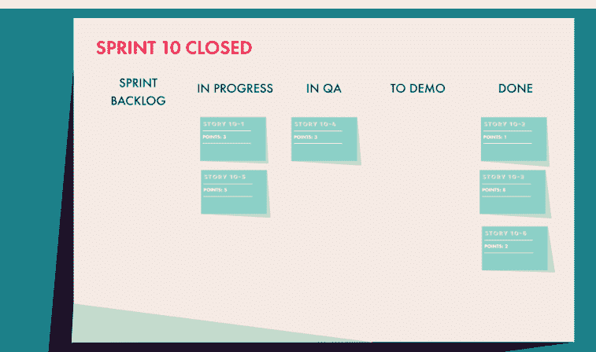

仍有两个故事正在进行中，有一个故事已完成但在演示前尚未通过 `QA` 批准。该迭代的所有其他故事已在演示中被接受，现在已完成。团队在第 10 迭代中完成了 11 分。

为了启动下一个迭代的计划会议做准备，产品负责人制定了小狗故事所需的文案变更，并在共享存储库中创建了一个文档，设计资产都将放在那里。

在迭代计划仪式上向团队解释了新故事的背景后，产品负责人向所有人朗读了整个故事并征求反馈。

# 第 7 章

## 执行 Scrum

工程师们提出的第一个问题之一是小狗是否可以整合到现有网站中，而不是分离出来。另一位工程师在产品负责人有机会之前回答道，指出整合不同类型的动物会让数据管理变得复杂得多。

“但当客户来到一个小猫网站，却被带到一个没有任何小猫的页面时，他们不会感到困惑吗？”第一个工程师问。

“如果他们在明显只是关于小猫的网站上看到小猫和小狗，同样同样困惑。”第二个工程师回答道，“而且，整个导航都是围绕小猫的，包括 URL 方案和 API。”

“是的，URL 呢？”第一个工程师问产品负责人，“我们网站的一切都是关于小猫的。”

“我们必须通过消息来处理这个问题，”产品负责人说，“这是一次有限测试，选择加入的人是刻意为之，并且理解这是一个测试版。”

“这些边缘情况都已经在文案中处理了吗？”第一个工程师问。

“是的，我为所有这些情况都写了消息，我计划在工作期间随时为团队提供帮助，以便我们可以在不中断进度的情况下解决它们。”

这时，Scrum 主管（`Scrum Master`）问：“好的，大家对这个故事的了解足够充分，可以放心进行估算了吗？”

沉默了一两秒，工程师们互相相视，然后之前说话的第一个工程师说：“我认为我们需要对这个的范围有更清晰的认识。”

### 定义范围

“那么这会影响网站其他部分的体验吗？”第一个工程师问，“我看到选择看小狗的用户只在这个特定页面上看到小狗，但网站的其他部分呢？”

“变更的范围将局限于被修改的页面，”产品负责人解释道，“这意味着当用户离开这些页面并导航到网站的其他部分（如账单和确认页面）时，可能会感到视觉上的脱节。毕竟，我们在所有页面中都贯穿了许多小猫和小猫相关的主题。对于这次测试，对整个网站进行更广泛的更改是不在范围内的。”

“我们还能做什么吗？”另一位工程师问，“我们只在这些页面上有警报。我们可以在网站的其他部分也加上它们吗？”

## 故事的生命周期

## Scrum：从新手到大师

“我想我可以同意这一点，”产品负责人（`Product Owner`）说道。

“我不认为代码量够 20 分，”另一位工程师说，“我们可以把它放在一个单独的分支里，并使用显式的命名规范。只要标记得当，很容易提取。”

“那我选 13 分，”第一位工程师说。

“太好了，”Scrum Master（`Scrum Master`）说，“那么这就是 13 分，我们还需要人负责编写重构任务（`Chore`）。”

“我来吧，”第一位工程师说，他仍然皱着看着产品负责人，后者点头表示同意。“我一定会在回顾会议上提到这一点，确保我们像约定的那样落实它。”

# 同意冲刺待办列表（Sprint Backlog）

产品负责人除了关于小狗的故事外，没有其他故事要介绍。这使得建立一个优先的冲刺待办列表变得容易得多。使用团队的命名规范，该故事被标记为 `11-1`。

有几个故事在上一个冲刺中尚未完成，还有一个仍在 QA（质量保证）阶段。产品负责人决定，让处理这些故事的工程师完成它们，而不是撤下它们让他们去处理新故事，这样比较务实。

冲刺待办列表包含了上一个冲刺中完成的所有故事的分数，加上新的 13 分故事。考虑到团队之前的平均速率（`Velocity`）为 18 分，总目标 24 分略微高。但在这种情况下，它包含了几个已部分完成的故事的分数，因此团队认为这是可行的。

那位主张小狗故事应该估为 20 分的工程师，计划留出时间编写一个所需的重构任务，以便尽快引入。

一旦冲刺待办列表完成，Scrum Master 确保团队中的每个人都同意，并确保产品负责人会对这些故事所代表的产品增量满意。然后，在大家达成共识后，Scrum Master 启动了冲刺。

以下是第 11 次冲刺开始时冲刺待办列表的情况：

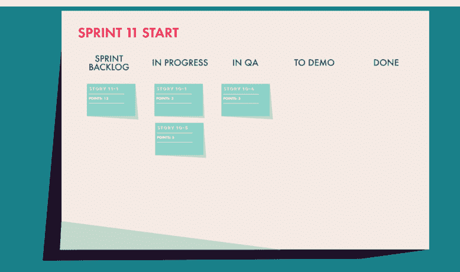

图 7.2. 第 11 次冲刺初始待办列表

## 总结

所以，并不是一切都进展得完美顺畅，但生活中真的事事完美顺畅吗？在网页和移动开发团队中，通常有需要考虑的长期重构问题、性格差异、利益冲突，以及对下一步需要工作的细节的真实分歧。

Scrum 不会让这些问题消失，但它提供了一套流程，能够以专业且高效的方式处理这些问题，并对其进行公开讨论，以便在每个冲刺中改进流程。

在本章中，我们看到一个新需求出现在产品负责者的桌上，挤压了现有的未来开发计划，并迫使对代码库中的技术债务进行讨论。但团队已经能够评估该故事、估计它，并根据修改后的验收标准承诺完成它。

在下一章中，我们将看到团队完成整个冲刺过程并处理新的小狗故事。我们将发现他们是否真的能在一个冲刺内完成它。

# 第 8 章

### 执行 Scrum

在上一章中，我们领略了产品负责人的世界，并体验了为团队开发和创建故事的过程。我们看到了需求是如何收集的、产品待办列表是如何构建的，以及内部和外部客户以及其他利益相关者的期望如何转化为团队清晰定义的 Scrum 故事。

然后，我们经历了观察故事如何引入团队的过程，以及团队如何与产品负责人进行谈判，以确保他们要工作的内容意义意义，并且能够在一个冲刺内完成。

现在是时候跟踪这个故事完成整个冲刺了。在本章中，我们将看到团队如何将像我们一直讨论的那个大故事拆分成更小的任务，并分配这些任务，以便它们都能被处理和完成。我们将看到故事的各个方面如何得到解决，直到它们符合“完成定义（`Definition of Done`）”。

最后，我们将看到团队与产品负责人一起演示（`Demo`）过程，如果运气的话，也许故事会在冲刺结束时被接受。

无论如何，在回顾会议上肯定有很多待讨论的内容。让我们看看会发生什么。

### 执行一个故事

当计划会议结束时，团队已经承诺了一个新的冲刺待办列表。正如你可能记得的，Scrum 看板目前是这样的：

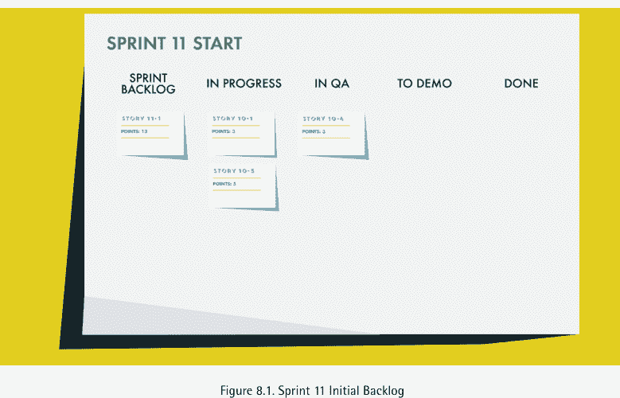

创建一个支持小狗的站点测试版本的新故事（标记为 `11-1`）位于优先级列表的高端，但它的优先级低于一些在上一个冲刺中仍在进行但尚未被接受的故事。这是产品负责人愿意做出的妥协，以确保团队在几乎完成的故事上不会失去势头。

### 承担所有权

第二天早上，团队进行了新冲刺的第一次站会（`Standup`）。像往常一样，团队围成一圈，汇报自上次站会以来做了什么、计划在下一次站会前做什么什么，以及是否有阻碍（`Blockers`）。前三位工程师有上一个冲刺的工作要做，而第四位工程师（团队中最初级的）没有任何阻碍。

“看来我有了，”初级工程师说。

“好的，我们把你的名字写上去，”Scrum Master 说。

“我想我该开始分配任务了，”初级工程师说，“但我需要帮助。”

“没问题，可以和我结对（`Pair`），”下一位工程师说。

“太好了，”Scrum Master 说，“所以你们两个负责这个故事。现在有障碍吗？”

“只有通常的畏畏感，”初级工程师说，“但我想我们能搞定。”

### 定义任务

接手一个大故事时的第一件事是将其任务化（`Task it out`）。这意味着定义可以并行处理的单个任务，以便故事不会困在某人的脑子里。有些人倾向于在计划会议期间将故事拆分为任务，但这个团队决定承担该故事所有权的人也将负责拆分任务。

根据团队的偏好，任务可以像故事一样编写，也可以写成适合工程师间交流的技术规范。任务还可以输入到许多 Scrum 跟踪系统中，在开发、评审和 QA 过程中进行跟踪并分配给不同的人。

负责小狗故事的两个工程师处理实现该故事所需的元素。这花费了几个小时，他们不得不联系产品负责人几次以澄清疑问。当他们完成时，已经拆分出了六多个任务，每个任务在进入 QA 之前都需要完成。

他们共同编写任务描述并将其添加到团队共享的电子 Scrum 看板。在看板上提供任务的另一个优势是，直接负责整个故事的团队成员仍然可以承担某个任务，从而更高效地完成工作。这对关于故事如何实现的知识在团队中传播也具有优势。

### 进度跟踪

一旦定义了所有任务，最初的小组就决定了任务的优先级顺序，并决定需要先完成哪些任务，以支持其他任务的开发。他们之间认为自己具备完成第一个任务所需的技能，因此他们将自己分配给该任务，并开始编写必要的代码，而没有寻求任何帮助。

此时，他们将第一个“小狗故事”（`puppy story`）移到了“进行中”列：

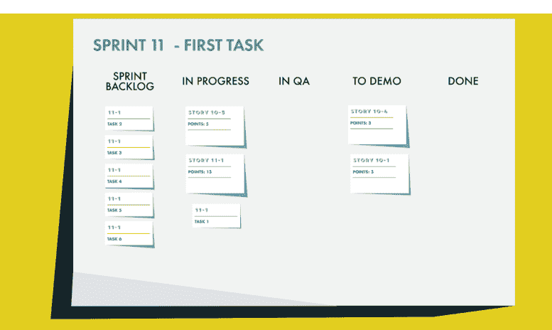

图 8.3 冲刺 11 的第一个任务

过了一会儿，团队中的另一名工程师完成了一个故事，与 QA（质量保证）人员核对确保其已完成，然后就可以开始处理新故事了。该工程师检查了看板，发现这个高优先级故事中的几个新任务尚未开始。在与第一小组确认确保任务之间不会发生重叠后，该工程师接手了顶部故事中下一个优先级最高的任务，更新了 Scrum 看板，并开始工作。

一旦第二个任务进入进行状态，Scrum 看板看起来就像这样：

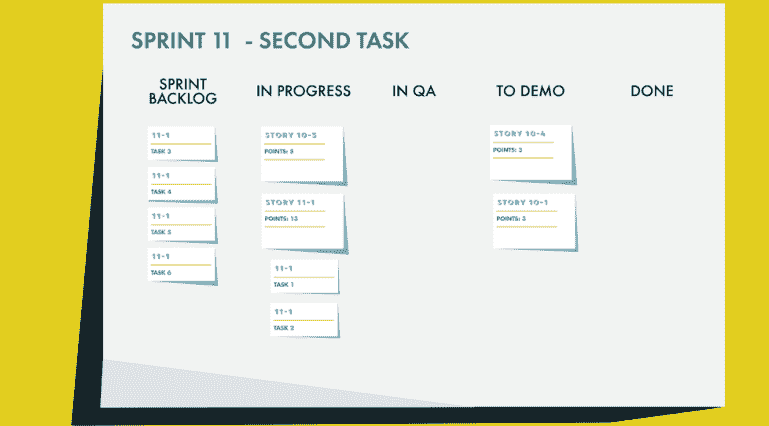

图 8.4 冲刺 11 的第二个任务

产品负责人（`Product Owner`）也在跟进，对小狗故事的文案进行处理，并向设计部门确认资产状态。现在是检查 Scrum 看板查看情况的好时机。

上一个迭代中正在进行但尚未完成的任务现在被列为“准备就绪演示”。创建小狗版网站的新故事已经开始，并被拆分为六个任务，其中两个正在进行中。产品负责人在心里记住，在明天站会（`standup`）后检查任务状态。

在一天结束之前，Scrum Master 检查了看板上故事的状态。新任务已经添加，格式整洁，这意味着负责小狗故事的团队正确遵循了现有惯例。似乎不需要中断正在处理故事的工程师。

### 第一次站会

第二天在每日站会上，负责小狗网站故事的 QA 工程师参加了，并记录了所有任务的状态。产品负责人也参加了。

## 执行 Scrum 流程

### QA 在站会的出席

某些团队将 QA 视为核心团队成员，但对于 WithKittens 团队来说，QA 不需要积极参与所有团队活动。非直接加入团队的人员是否参加站会完全取决于他们自己。只有在被提醒可能会讨论新任务或故事时，WithKittens 的 QA 才会参加站会。产品负责人喜欢尽可能参加所有的站会。当然，无论是 QA 还是产品负责人，在团队中所有工程师汇报状态之前都不会发言。即使如此，Scrum Master 也会限制他们只发表与整个团队相关的陈述。

第一个报告由负责小狗故事的初级工程师做出，他解释了他们如何将故事拆分为任务，以及他们如何开始处理第一个任务。

“我们感谢对任务拆分的任何反馈，”初级工程师说，“我认为我们涵盖了所有的验收标准，但越多的人关注，我心里越踏实。”

“所以你今天剩下的时间都会处理这个任务吗？”Scrum Master 问。

“是的，我想我们会这样。”

“有任何阻塞因素（`blockers`）吗？”Scrum Master 问。

“我不认为有，”初级工程师回答道。

“不，我不认为有任何阻塞因素，”故事的另一位工程师同意道，“我们至少应该一直工作到明天。”

“太棒了，”Scrum Master 说，他记录下要跟进，然后继续循环直到每个人汇报完毕。然后大家散会，工程师们回到各自的项目。

站会结束后，产品负责人与 Scrum Master 讨论了设计工作已经开始。那些需要设计资产的任务尚未开始。

### 第二次站会

在冲刺的第二天，产品负责人和 QA 工程师再次参加了站会。所有工程师都在场，他们处理的故事没有阻塞因素。正当 Scrum Master 准备解散团队时，一名工程师发言了。

“关于这个狗故事如何与网站上的帮助页配合，我有一个简单的问题，”工程师说，“我昨晚考虑了这个问题，这会很困惑。”

“这是一个很好的观点吗？”产品负责人问，“你认为这是我们可以处理的吗？”

“我不确定，”工程师说，“网站的结构，帮助页……”

“嗯，这将是一个棘手问题，”初级工程师说。

“我们需要大家在这里讨论这个问题吗，”Scrum Master 问，“还是我们可以私下讨论？”

“我不知道，”产品负责人说。

“是的，我们可以私下讨论，”初级工程师回答道。

“好的，太好了，”Scrum Master 说，“既然如此，站会结束了。”

当其他团队成员回到办公桌继续工作项目时，Scrum Master 走向产品负责人和两名工程师，他们正在讨论帮助页。

“我们三个人现在讨论这个，还是想稍后跟进？”Scrum Master 问。

## 执行 Scrum 流程

“我想我知道问题所在，”产品负责人说，“我可以写一个故事来解决我想象的方法。”

“我们要把它作为一个新故事添加吗？”Scrum Master 问。

“对我来说这像是范围蔓延（`scope creep`），”第一个工程师说。

“不，我认为原始故事的验收标准已经包含了，”产品负责人说，“这些是网站页面，我们需要像处理其他任何页面一样处理它们。”

“让我们检查一下验收标准以确保万无一失，”四个人一起来到电脑前，打开 Scrum 看板，查看团队估算的故事的验收标准。事实上，验收标准说，支持小狗测试用户的头部更改需要适用于网站的所有页面，而不区分帮助页。

## Scrum：从新手到忍者

他们四个人盯着故事（`story`）的验收标准看了一会儿。然后，敏捷大师（`Scrum Master`）问道：“好的，我们都准备好了吗？别忘了告诉故事所有者你们要添加的任务。”

他们都点头并回到了自己的工作中。几小时后，接受该任务的工程师将任务添加到了 Scrum 看板上，看板看起来像这样：

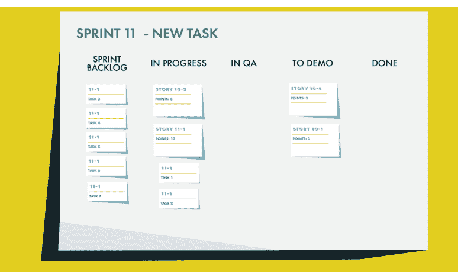

图 8.5 冲刺 11 的新任务

### 冲刺的剩余部分

在冲刺结束时，团队大部分成员都投入到了“小狗故事”中，但没有其他太多任务完成。设计人员已完成了前端用户体验流程和图像资产，并与工程师协作确保它们得到了适当的集成。

当团队编写代码时，质量保证（`QA`）正在开发必要的测试来验证代码。QA 还多次与产品所有者（`Product Owner`）见面，以澄清验收标准。最终，每项任务都从看板上从“进行中（`Progress`）”移动到“待演示（`To Demo`）”。

### 执行 Scrum

### 引入第三名工程师进行代码审查

由于该故事中的许多任务是由结对完成的，因此需要第三名工程师参与代码审查。并不是每个团队都要求结对完成的代码由第三名工程师审查，但这个团队将其包含在“完成定义（`definition of done`）”中。

尽管需要支持帮助页面，团队还是成功完成并审查了所有符合他们要求的代码。由于为了区分这些代码与网站的其他部分，他们采用了一些特殊的命名规范，代码审查过程中出现了一些混乱。这稍微减慢了开发速度，但不至于阻碍负责故事的初级工程师在冲刺结束前将其交付给 QA 进行最终检查。

该团队的“完成定义”包括代码审查和 QA 测试，以及客户验收。由于 QA 从一开始就融入了团队，他们在整个冲刺期间一直根据验收标准构建测试套件。

该故事的大部分任务在完成后都产生了经过审查的代码，可以独立进行单元测试。现在只需运行集成测试，并验证功能从头到尾按预期运行。如果故事被接受并推送到生产环境，这些测试将添加到网站的通用套件中。

### 演示故事

在演示前一天，作为准备工作的一部分，产品所有者与“小狗故事”的初级工程师坐在一起。在冲刺期间他们已经多次过过各个组件，但产品所有者想要确保所有的验收标准都能得到演示。

“我们能及时在生产就绪的服务器上妥善地演示这些吗？”产品所有者问。

“基本可以，”工程师回答道，“那是 QA 一直在测试的服务器。演示应该没问题。”

“我需要了解什么特殊的吗，”产品所有者说，“还是我可以直接去我们现在使用的那台服务器？”

“我现在可以过一遍全部吗？”产品所有者问。

“还不，”工程师回答道，“但 QA 已经通过了所有测试，我们只需要在明天之前完成部署。它应该能在演示前准备好。”

“太好了，我很期待看到它，”产品所有者说。

# 检查验收标准

在演示会上，所有人到齐了，包括 QA 工程师和负责“小狗故事”的设计师。大家对结果如何非常好奇。Scrum 看板显示冲刺期间进行中的所有故事都已准备好演示：

| 冲刺 11 - 演示 | 冲刺待办列表 (BACKLOG) | 进行中 (IN PROGRESS) | QA 中 (IN QA) | 待演示 (TO DEMO) | 已完成 (DONE) |
| :--- | :--- | :--- | :--- | :--- | :--- |
| | | | 故事 10-4 分: 2 | | |
| | | | 故事 10-5 分: 3 | | |
| | | | 故事 10-6 分: 3 | | |
| | | | 故事 11-5 分: 3 | | |

图 8.6 冲刺 11 准备演示

### 发生了什么？

演示结束后，冲刺结束，团队与敏捷大师坐在一起进行冲刺回顾（`retrospective`）。目的是让大家讨论上一个冲刺中哪些做得好的地方，哪些可以改进，以及他们认为未来应该对流程做出哪些更改。

# 138 Scrum 从新手到大师

“我同意，”第二位工程师说，“但现在至少我们对哪里有些乱团有了数数，所以我们知道该关注哪里了。”

“如果我当时能直接跳进去先修复那些东西，本会更简单的，”第三位工程师说，“我已经知道大部分问题在哪里了，但我们这种反道而行之做法仍然让我觉得很困扰。”

“现在你不是唯一知道这些的人了，”第二位工程师指出。

“是啊，但听起来我们可能也没有机会进行重构冲刺（`refactoring sprint`）了，”第三位工程师神色严肃地说。

“在我听来也是这样的，”第四位工程师插道，“他们会坚持完成用户故事，以确保先完成 Beta 版本的设计更改。”

“我们可能会有一些设计类故事来修复 Beta 版本的视觉效果，”Scrum 主管说，“但产品所有者同意，如果我们完成了故事，就会把重构作为首要任务留给我们时间，而我们确实完成了。我会在计划会议之前跟进这件事，以确保这一点。”

“好吧，有一点，”第三位工程师说，“我想用细致的梳子仔细过一遍那些新设计，确保在估算它们之前它们确实是完美的。”

“我们应该为下一次冲刺设定另一个目标吗？”Scrum 主管问。

房间里的工程师们点了点头。在回顾会议结束时，他们列了一份想要改进流程的简短清单，以及几项需要 Scrum 主管向产品所有者跟进的任务。

大家都能认同的两点是：跨越整个栈的工作虽然令人沮丧，但对于暴露代码中需要修复的问题非常有帮助；而且，下一次冲刺的优先级应该是解决这些问题。无论如何，进入下一次冲刺的计划会议将会是非常有趣的会议。

## 总结

我们从 Scrum 中学到的点之一是，它无法给你一个你可能希望拥有的团队，但它可以帮助你优化现有的资源，并支持他们有效地协同工作。

- 我们看到了团队是如何组织工作，并将一个大故事拆解为工程任务，以便进行并行开发的。
- 我们看到团队在验收标准上遇到问题，并从产品所有者那里获得了关于如何在冲刺期间解决这些问题的反馈。
- 我们看到了演示期间产生的妥协，以及这些妥协如何导致了对即将到来的冲刺预期的修订。
- 然后我们听了团队在回顾会议中表达他们的顾虑，讨论了哪些做得很好，哪些可以做得更好，以及他们希望在下一次冲刺中看到什么。

这一切中隐含了 Scrum 背后的协作、透明化和自我管理哲学。在下一章中，我们将讨论如何让 Scrum 为你的团队发挥作用。我们将讨论如何向组织引入 Scrum 概念，支持 Scrum 需要的资源，以及如何处理学习应用 Scrum 时可能出现的某些反模式（`anti-patterns`）。

# 第 9 章

# 让 Scrum 在你的 Web 或移动团队中运作

在本书的大部分内容中，我们都在讨论 Scrum 的实际操作。虽然 Scrum 的核心定义非常通用——支持广泛的应用——但我们针对 Web 和移动团队中适用的 Scrum 机制，进行了相当有主见且详细的解释。（尽管如此，这些许多原则和实践同样适用于其他类型的开发工作。）

既然我们已经有了通用的词汇和概念，在本章中，我们将讨论如何让一个团队开始使用 Scrum。我们将详细介绍在进行 Web 和移动开发中使用 Scrum 的论点。我们将讨论 Scrum 最适合什么，它与替代方案相比如何，并为在公司中推广 Scrum 并应用它时出现的某些问题提供答案。

## 向 Scrum 迈进

我们已经学习了一些关于 Scrum 的知识，以及 Scrum 如何帮助你的 Web 和移动开发项目。下一个问题是如何让你的团队从零开始转向 Scrum。这对于每个团队来说都是不同的，你需要评估自己的情况，以确定组织对采用敏捷方法的准备就绪。

### 认可

如果你的组织目前遵循类似于瀑布模型的流程，循环中每个阶段的人可能对他们目前的角色感到舒适，并且不会急于尝试新事物。你可能需要向他们展示，通过基于 Scrum 的流程，组织可以变得多么高效和高产。

执行人员可能担心他们对自我组织的团队控制权减少，并且对一个自己产生想法的流程投入较少。向他们指出，敏捷流程让他们有机会在每个冲刺中切换和调整优先顺序，从而更有效地适应市场，同时提供他们可以用来指导决策过程的宝贵反馈。

工程经理可能对自己在自我管理的团队中扮演的角色感到困惑，但这种担忧源于对“自我管理”概念的语义上的误解。经理对于帮助团队分配资源、解决个人问题以及识别和留住人才仍然至关重要。经理还将自己的背景和知识带入整个开发过程。工程经理可以自由投入部分时间作为团队中的一名工程师从事一线工作，但他们的责任是确保团队在组织中的地位，确保他们拥有所需的工具和资源，并保护他们免受干扰。

设计师可能会想他们如何融入 Scrum 流程，当他们的工作并不一定遵循同样的周期时。向他们展示 Scrum 为设计师提供了更大的影响力机会，因为设计师可以参与每一个阶段。

工程师可能对角色的变化感到担忧，特别是他们已经擅长某一方面时。敏捷要求每位工程师在团队中承担更广泛的职责，但也开启了新的学习机会。通过对冲刺承诺提供的稳定性，以及确保在冲刺结束前不会更改需求，可能是存在问题的组织中强有力的卖点。

采用敏捷不是单向的对话。Scrum 的推动者应该倾听，并从那些被要求改变方法的人的顾虑中学习。对于每个人来说，记住 Scrum 始终是一场实验，持续时间仅为下一次冲刺，并在那时有机会重新审并更改任何看起来不理想的地方。有时，Scrum 的实验性质是尝试它的最有说服力的理由之一。

### 培训

虽然 Scrum 并不复杂，可以在书中描述得很详尽，但让组织外部的人对团队进行培训是无价的。

客观的第三方培训师可以进入组织，发现组织内部人员可能无法发现的问题。优秀的培训师还可以指导人们处理一些更微妙或复杂的方面，确保他们不仅理解在做什么，还理解为什么要这么做。

Scrum 培训对整个团队可能需要一天或两天，并且最好在场外进行，在一个中立的地方，这样人们就不会被日常工作干扰。不要通过给他们少于所需的培训来改变你的组织。很容易将 Scrum 的标签贴在任何完全不敏捷的流程上。

> 不要仅仅将 Scrum 视为描述现有流程的新方法

将 Scrum 视为描述现有流程的新方法是错误的。Scrum 不仅仅是一组华丽的词汇。有些团队在没有经过适当培训的情况下就开始使用 Scrum，结果仍然遵循过去对他们无效的破旧流程，同时应用诸如“冲刺”等标签。

WOW! eBook

www.wowebookbook.com

“讲故事”，或者每天举行长达一小时的“每日站会”。不要让你的团队变成这种队伍。

要让每个人都积极且专注地参与，对于 Scrum 培训的生根至关重要。任何没有经过适当培训的人可能无法理解如何应用 Scrum，这可能会导致挫败感和困惑，而这些问题通过少量的准备就可以很容易避免。

邀请参加培训的人员名单应该包括一些高层的代表，以及组织中所有每天参与这些仪式的人员。你不需要让公司的每一个人都接受培训，但任何职责涉及与 Scrum 团队直接互动的人都是可能是理想的候选人。

### 人员配置

为了在组织中实施 Scrum，可能并不需要招聘新员工。敏捷团队中的大多数角色都可以由组织架构中现有的员工担任。

产品经理可能是 Scrum 团队中产品负责人（`Product Owner`）角色的理想候选人。工程师——无论是初级、高级还是管理层——尽管他们在组织中的级别不同，但在 Scrum 的开发团队中都应该被视为平等的。通常，QA（质量保证）工程师也被包含在 Scrum 中，这在冗余、跨职培训和组织覆盖方面提供了许多益处。

项目经理可能是组织中担任 Scrum 师（`Scrum Master`）角色的最佳人选，只需对项目管理技能与 Scrum 管理技能之间的差异进行一些培训。在紧急情况下，开发团队的任何成员都可以经过培训担任 Scrum 师。然而，在实施 Scrum 时，一名优秀的 Scrum 师可能是最明智的招聘选择。

一个理解 Scrum 如何运作并熟悉可能出现的问题的人，比一个刚刚熟悉该流程的人更容易轻松地平滑棘手问题。对于 Scrum 师来说，熟悉你们正在进行的工作类型并不如拥有一个擅长引导人们通过 Scrum 过程的人重要。

### 跟踪有效性

Scrum 的核心在于建立一个能够产生真实价值的可持续流程，并定期审查该流程以确保它产生了预期的结果。为什么不使用敏捷技术来确保 Scrum 为你的公司发挥作用呢？

在新组织中实施 Scrum 时，最有用的技术之一是在实施 Scrum 之前建立生产力基准，并用它来衡量 Scrum 的有效性。在何处建立该基准以及如何衡量，是非常主观的。每个组织都有自己的标准和生产力指标。

例如，Web 开发团队可能根据其能够为网站添加的可比较功能的数量来衡量自己。移动端开发机构可能跟踪他们针对典型客户从概念到实现的速度。修复或处理 Bug 的能力也可能相关。问问周围，了解公司是如何判断自身绩效的。（你可能会对正式场合对此事的关注程度之低感到惊讶）。

在实施 Scrum 之前，收集一份关于没有使用 Scrum 的情况下组织表现的代表性样本数据。这样，你就有了一个比较点，用于评估 Scrum 的有效性并向利益方进行报告。随着团队应用 Scrum 并开发其敏捷能力，请不断更新数据。

如果你没有看到改进，可以使用 Scrum 流程在回顾会议（`Retrospective`）期间提出该问题，并找出哪些是有效的，哪些无效的，以及你可以如何改进。

### 故障排除

如果一切从开始到结束每次都能按照你预期的完美运行，那就太好了。这在现实世界中不会发生。Scrum 的优势之一是它并不假装事情总是完美的。Scrum 有内置的检查和平衡机制，确保团队始终对变化的情况做出响应，并强化 Scrum 技术以确保它们支持他们的目标。

## Scrum：从新手到大师

Scrum 的崩溃往往在不同组织中遵循类似的模式。让我们看看我们讨论过的 Scrum 的几个方面，看看问题可能出现在哪里，以及如何解决它们。

### 未定义的时间箱

当团队开始使用 Scrum 时，他们可能不理解应该为他们的仪式分配多少时间。定义一个必须在其中完成仪式的时间箱（`Time Boxes`）有助于每个人的注意力，并表现出对团队时间的尊重。对于不确定要分配多少时间的新团队来说，他们倾向于为仪式的各个环节留出时间箱（而不设具体界限）。

当团队开始为仪式的每个方面显式地定义时间箱时，这尤为重要。有时这些时间箱可能只是猜测，团队将需要通过从一个冲刺（`Sprint`）到另一个冲刺的迭代来学习到底需要多少时间。提一个完全错误的时间箱并执行它比留空时间箱要好。提议和执行时间箱的练习展示了对团队时间的尊重，以及对流程的尊重。

有些专家主张，当团队持续超过时间箱时，将时间箱的长度缩短到可能的最短长度，然后与团队紧密合作，帮助他们在分配的极短时间内完成每个仪式的所有阶段。这有助于建立定义和尊重仪式每个方面时间箱的重要性。如果团队在回顾会议中提到时间箱太短，可以通过共识在下一个冲刺中将其延长。

### 针对冲刺进行优化

在许多规划仪式的末尾，有一个阶段是团队同意一个用于冲刺的待办列表（`Backlog`）。在这个阶段，产品负责人应该已经按照优先级顺序对估算过的故事（`Stories`）进行了排序，并考虑什么能作为冲刺结束时对产品的合理激励。

当估算过的故事进入冲刺待办列表时，团队会讨论他们认为在该冲刺中可以完成多少工作。这种不明智的做法是针对冲刺进行优化，它表现出对 Scrum 核心点的基本误解。故事的优先级排序以及按顺序工作的目的是为产品增加价值，而不是推动一个关于优化 Scrum 的议程。根结底，工作本身更重要，而不是一个冲刺中完成的点数。

最好让该待办列表留短一点，并与团队达成共识：一旦完成了冲刺中承诺的所有故事，他们就可以开始处理下一个优先级的工作。在完成冲刺待办列表的承诺后，团队开始处理任何大小的下一个优先级故事是完全没问题的，即使他们没有在同一个冲刺内完成。最终，团队的点速率（`Velocity`）是跨多个冲刺进行估算的，它会趋于平均。

通常，添加到冲刺待办列表的最后一个故事将不足以匹配他们的预期速率。

### 冗长懒散的站会

每日站会的目的是为了团队捕捉团队的心跳。为了大家的时间，这些仪式被保持简短。团队倾向于犯的首要错误之一是将每日站会视为团队会议。这可以通过许多方式体现，包括让团队在站会期间坐着、在站会开始时安排公告以及不限制站会期间的交谈。

预计每个人在仪式期间站立，这样没有人会倾向于让仪式超过时间。任何人手里都不应该有设备或其他干扰物，也不应该操作笔记本电脑或讨论当前讨论的故事之外的内容。

如果你开始允许团队之外的人在站会开始或结束时发布公告那就是一个滑坡行为。公告倾向于鼓励更多讨论，这可能迅速导致站会持续超过 15 分钟。

（可能会出现一些需要进一步讨论的问题，但这些讨论需要在每日站会结束后在线下进行跟进。团队中的每一个人都应该感到被赋能，支持 `Scrum Master` 阻断其他对话并保持团队的专注。）

### 工作中断

Scrum 的前提之一是，工程师有机会为整个冲刺（`sprint`）期间进行计划，而无需担心他们的工作会被分心或侧重项目中断。团队承诺完成冲刺待办列表（`sprint backlog`），这取决于每个人如何维护该待办列表的完整性，不让额外的工作渗透进来。

现实情况——特别是对于 Web 和移动端开发团队来说——事情总会发生。服务器宕机。功能崩溃。时间敏感的公告发布。用户对新功能感到困惑并需要进行调整。需要解决冲刺开始时未预料到的紧急问题。

在传统的 Scrum 中，对承诺进入冲刺待办列表的故事（`stories`）进行任何更改都要求团队停下来，进行新的计划仪式，并建立新的冲刺待办列表。这被认为是一种极其严厉的措施，其目的是防止任何人违反冲刺的完整性。

由于其工作的动态性质，Web 和移动端开发团队需要在流程中加入某种程度的灵活性。如果团队每次需要修复表单或编辑新闻稿都必须开始一个新冲刺，那将非常不实际。但必须保持一种平衡。如果每当高管或客户对新功能产生绝妙主意时，团队都要放下一切开始处理一个新的紧急功能，那也将同样是低效。

Web 和移动端工作的性质决定了团队需要足够的灵活性来应对紧急情况，但他们也需要对什么是紧急情况保持严格。这是 `Scrum Master`、产品负责人（`Product Owner`）和团队应该作为 Scrum 合约的一部分明确定义的。

任何引入冲刺的新工作都应该考虑到减少团队的速度（`velocity`）。这些额外工作不应该进行估算，因为它们不是团队冲刺待办列表承诺的一部分。如果团队开始经常允许新故事渗透进冲刺，这将使他们偏离待办列表承诺，并反映在他们的速度上。

花时间解决紧急问题至关重要，但前提是“紧急”是一个团队中每一个人都需要达成共识的概念。如果冲刺的完整性需要经常或太随意地被打破，这正是团队在回顾会议（`retrospectives`）期间应该讨论的内容。

### 宽松的演示

每个团队都需要制定清晰的“完成定义”（`definition of done`）。该定义的一部分应该始终包含编写时故事的所有验收标准（`acceptance criteria`）。这将在演示（`demo`）期间进行测试。在演示中接受故事的方式保持一致非常重要，不要让标准变得过于灵活。

一个常见的问题是，有些团队在验收标准未完全满足时就允许故事被接受。有时，故事被接受进入冲刺，但它们的工作一直持续到下一个冲刺之初，因为它们“几乎完成了”。这混淆了上一个冲刺的结束和下一个冲刺的开始，使得很难清楚地说明上一个冲刺中做了什么，下一个冲刺需要做什么，以及团队真实的速度是多少。

让团队在演示中展示他们在他们在冲刺期间完成的所有工作也至关重要。团队经常会发现自己坐在一儿等待，直到开发者完成代码部署，或为演示调整分阶段环境。虽然预期会有紧急情况发生干扰是合理的，但负责该故事的开发者有责任确保它准备好进行演示，并让产品知道如何引导演示。

有些团队对此采取非常严格的方法，不接受任何未完全履行所有验收标准且在演示开始时准备好演示的故事。虽然这看起来很严苛，但要记住的是，把事情带入冲刺并不如完成工作那样重要。

团队在演示验收标准方面可以随心所欲地严厉或松散，只要他们保持一致即可。站在严厉的一方并没有错，确保在冲刺中完成的工作在关键问题范围内得到完成，是为了确保每个人都同意该流程并理解遵循该流程的重要性。

## 回顾会议期间的问题解决

如果没有回顾会议，Scrum 就没有机会从错误中学习，或从成功中获益。回顾会议还发挥着强大的团队建设功能，因为它允许团队成员与同事分享他们内心的想法。虽然团队在回顾会议面临的最常见问题是根本不举行，但名单上的另一个问题是试图在仪式本身上解决回顾会议期间出现的问题。

回顾会议是团队中每个人提出任何他们认为上一个打印周期（`print`）做得好或不好的机会，并讨论未来如何处理这些问题。这涉及到可能敏感的话题，并会让许多情绪浮出水面。对于那些感觉自己处于讨论负面立场的人来说，有一种强烈的冲动在现场解决问题。

回顾会议不是解决问题的最佳时机有几个原因：

- 某些问题可能涉及房间内太多的人，在大家达成共识之前可能需要更多考虑
- 并不是每个人都觉得在回顾会议上公开讨论某些问题，某些问题在较小组的会议中处理可能更好
- 说话声音更大或意见更强硬的人很容易接管大型讨论，而这些意见在不公开的场合可能更容易达成一致
- 此外，尝试解决一个不影响小组内每个人的问题是在浪费某些人的时间。

`Scrum Master` 有责任提醒大家，回顾不是解决问题的场合，而是承认这些问题的存在，并承诺在接下来的冲刺中解决它们。

## 总结

在本章中，我们概述了公司在开始实施 Scrum 时可能采取的一些步骤。

我们讨论了如何获得整个组织的支持，包括工程内部和外部。我们讨论了如何培训团队，以及培训师应该被预期为团队做什么。我们讨论了人员配置，以及组织中现有的员工如何适应以承担 Scrum 的角色。我们讨论了跟踪和衡量 Scrum 有效性的重要性。我们还深入了团队在使用 Scrum 时可能会遇到的问题，以及如何绕过这些问题。

在下一章中，我们将再次与第 2 章遇到的人联系，现在他们已经在 Scrum 环境中工作了一段时间，并将发现他们的担忧是否得到了解决，以及他们是如何适应 Scrum 流程的。

# 第 10 章

## 适应 Scrum

我们已经讨论了让 Scrum 运行起来的系统。我们讨论了 Scrum 在产品开发方面的方法，以及一些帮助承担 Scrum 角色的人以可持续、高效有效的方式完成工作的仪式和产物。

但归根结底，Scrum 关乎人。如果你团队中的成员没有从工作中获得灵感和动力，Scrum 是无法介入并改变这一点的。Scrum 能做的是帮助擅长工作的人以更高效、更有效的方式合作，并不断改进。

在第 2 章中，我们认识了团队的每位成员，并有机会讨论了他们对 Scrum 的一些担忧。现在，让我们回顾一下，看看他们是否学习了足够的知识来帮助他们解决这些担忧。

### 高级工程师

#### 初步担忧

我刚加入 Scrum 时，很担心所谓的“术语管理”。我见过太多公司随处乱用“敏捷”这个词，却并不真正理解它的含义。有些人把敏捷看作增加会议的借口。也许会议让他们觉得更从容，但这对我这样的人来说行不通，因为我的职责可能需要几个小时甚至几天的不中断时间才能正确完成。我不希望经理们在我头顶转转，把我拉进很多会议，并转移我的注意力，分散我工作中所需的思考精力。

#### 我学到的东西

# Scrum：从新手到大师

## Scrum 的理念与实践

Scrum 的理念是好的，重要的是将这些理念付诸实践。我们现在在与敏捷无关的会议上的时间已经大大减少，这让我松了一口气。当有人需要与我交谈时，我可以准确地指出我正在做的工作，并在我太忙时解释原因以及为什么这么忙。如果有人突然提出了他们认为紧急的变更，我周围有一整个团队愿意维护冲刺（`sprint`）的神圣性，这样我们就不必在处理这个新问题的同时调整我们正在工作的内容。

同时，很容易看出谁在负责什么，所以所有问题都不会都汇聚到我这里。现在团队中更多人开始获得我以前负责 100% 的代码部分的经验。这让我能够抽出身来进行一些长期的思考，并利用我的知识来评审其他人的工作，而他们仍在学习我多年来积累的一些教训。

### 仍然让我感到沮丧的

当你不确定项目下一步将走向什么方向时，规划和架构项目可能是困难的。例如，移动开发中的某些方面需要比单个冲刺更长的周期。有时我们必须分层开发，始终思考每个冲刺中哪些可以被视为一个完整的功能切片。

从技术上来说，创建一个足够灵活以适应每个冲刺中潜在剧烈变化的架构是一个挑战。当我看到某些用户故事（`stories`）显然不符合冲刺范围且需要拆解时，我正习惯于向产品所有者（`product owner`）提出反对。这迫使我以更模块化的方式思考，并最终构建一个更灵活的代码库。

现在我已经学会了 Scrum 是如何运作的，最让我感到沮丧的事情之一就是看到这种实践被误用。当产品所有者试图在冲刺中间引入新的用户故事时，我会迅速地挑战他们。这种情况确实会发生，有时它有良好的业务理由，但当我看到它时会感到很心恼。

### 我是如何处理的

团队中的每一个人都达成共识非常有帮助。当我不认为某事符合我的标准时，我可以参考“完成定义”（`definition of done`），当人们问我我尚未开始工作的功能状态时，我可以转向产品所有者。只要知道谁负责什么就非常有帮助。

我最喜欢 Scrum 的点之一是，我可以对我认为运行不良好的事情发表意见，并看到我所说的话实际上产生了影响。例如，当新的用户故事被强加到冲刺中间时，我会放过它而不提出问题，并确保它的发生是有正当理由的。

由于回顾会议（`retrospectives`），我有机会提出我脑海中的问题——相信我，我充分利用了这些机会。Scrum 中的每个人都有平等的发言权。如果我看到某些不起工作的地方，我可以说出来。

## 初级工程师

### 初步担忧

我的角色对我来说还新鲜，我担心自己跟不上节奏。我见过许多经验丰富的开发者在流程中挣扎，我担心我会成为那个拖团队腿的人。我也担心自己没有足够的经验在讨论中做出有意义的贡献。

### 我学到的东西

有一个愿意支持我的团队非常有帮助。我学到了不需要拥有所有的答案，寻求帮助也是可以的。通过与更有经验的开发者紧密工作，我对代码库有了了大量知识。我开始对这个流程感到更加舒适，并开始享受做出贡献。

### 仍然让我感到沮丧的

有时当我卡在某项任务上不知道如何进展时，会感到非常沮丧。当我发现冲刺节奏太快，我没有时间完成我工作的所有时，我也觉得很困难。

### 我是如何处理的

当我卡住时，我会确保寻求帮助，我还会利用回顾会议将我的顾虑提出团队。我还在学习更开放地表达我的想法，并发现与他人分享想法是有帮助的。

## 工程经理

### 初步担忧

在管理了几年团队后，我对所谓的“自管理团队”的想法持警惕态度。我见过人们在缺乏监督的情况下尝试工作时会出现各种问题，而且自我往往会阻碍生产力。我曾被要求去处理人际问题，这需要的比抽象流程多得多。诚实地说，听起来就像 Scrum 试图用一堆术语和固定的程序来取代管理。

当你有固定的截止日期并且可以指出具体的实物结果时，管理团队已经足够困难了。对我来说，敏捷开发（`scrum`）似乎会夺走这种依据，只给我留下一堆未完成的承诺。

### 我学到的东西

有趣的是，自管理团队实际上并没有按照我预想的方式进行管理。我将是团队的经理，他们的人事问题、资源分配和通用领导力将依赖我。公司的其他部门也由我对团队正在的工作负责，并确保我们的工作与公司的需求保持一致。

Scrum 关乎团队在尝试完成工作时遵循的流程。Scrum 并没有取代管理，而是介入并提供了一个每个人都遵循的模式，以提高他们估算故事（`stories`）的能力，并确保每个人都以透明且高效的方式工作。我特别喜欢 Scrum 在产品组和工程组之间设立的协调点。这减轻了我的负担，让我能够专注于管理团队的工作。

老实话，我喜欢 Scrum 给了我机会再次作为开发者参与团队做一些工作。这是我作为经理时错过的，我很高兴能重新回归它。

### 仍然令我感到困扰的事情

Scrum 在工程团队内部是非常棒的，但如果公司里的每个人都能加入其中，效果会好得多。我有时发现自己处于境地，试图向高管理层或销售团队解释 Scrum 的概念，而他们想知道某个功能是否可以在特定日期交付。我的意思是，我理解他们为什么需要这些，但每次都得解释权衡（`trade-offs`）真的很令人沮丧。

### 我是如何处理的

我认为我们在让大多数人接纳并支持 Scrum，以及认可能够快速响应变化的迭代过程的价值方面，已经做得相当不错了。我喜欢向人们解释，Scrum 允许工程团队快速估算新想法，并调整开发轨迹以适应市场变化。

另一种做法是制定一个长期计划并致力于执行，而并不确定市场到底想要什么。在这些事情上总会有妥协，而这正是人际技能发挥作用的地方。大多数高管更倾向于拥有快速改变方向的能力，因为他们意识到 Web 和移动开发中的情况变化非常快——无论团队遵循什么流程，那些被排在非常遥远未来的功能通常都不会发生。

## QA 工程师

### 初始的担忧

最初我并不太担心 Scrum，但话说回来，我没认为它会跟我有这么多关系。我最大的担忧是弄清楚我如何融入新流程。我的工作一直是非常明确的，我不想打破现状。归根结底，我所做很重要，我最担心的是适应敏捷流程意味着要减少我明知产品所需的那些严谨的测试。

### 我学到的东西

参与 Scrum 仪式（`rituals`）很有趣。起初我没什么可说的，但坐在计划会议上让我预见到了自己将来要工作的内容。它还让我有机会尽早提出一些重要问题。事实证明这些问题帮助团队其他成员决定他们将如何规划自己的工作。这是一个额外的收获。

自从我整合到流程中后，我可以在故事开发期间就开始编写该故事的测试套件，而不是等完成后再开始。这意味着开发者不需要等待太久就能得到我的测试结果，并且可以在记忆还新鲜时对代码进行修复。

我也非常喜欢故事（`stories`）的结构方式。验收标准（`acceptance criteria`）明确了我在测试时应该关注哪些方面，哪些方面是误导信息（`red herring`）。多次，在团队甚至开始处理某个故事之前，我就根据能预见的异常情况挑战并修改了验收标准。

### 仍然令我感到困扰的事情

Scrum 的节奏（`cadence`）仍然将我的大部分工作推到了故事完成后的最后。这意味着通常会担心无法按时在演示（`demo`）前完成测试，仅仅是为了满足 Scrum 的预期。

我想大家都理解 Scrum 的截止日期对我们的整体生产力并不是真正重要，Scrum 更多是关于高效协作工作。我知道当团队能够完成他们在冲刺（`sprint`）结束前承诺的所有故事时，他们感觉更好。我不喜欢成为那个让团队错过截止日期的人。但那很大程度上取决于我的工作类型，而不是 Scrum。

### 我是如何处理的

有时，我必须成为那个提醒人们的人：如果我们没能按时为演示完成某个故事，那并不是一个真正的问题。做好工作远比为了 Scrum 而匆忙工作要得多。

## 产品经理

### 初始的担忧

我最初并不太担心 Scrum，但我习惯于制定长期计划并确保其可行。当我们开始讨论 Scrum 时，我觉得我习惯的那种方式被抛弃了。Scrum 忽视了产品长期有效的价值，而不仅仅是未来几周。

### 适应 Scrum

我曾不确定 Scrum 如何以可预测的方式满足客户。但这并不总是能以周为单位发生的。

### 我学到的东西

产品待办列表（`product backlog`）和冲刺待办列表（`sprint backlog`）之间的区别为我解决了很多问题。我仍然做长期规划，但我是在待办列表中做的，在那里我可以培养具有长期潜力的想法。这节省了我的精力，因为我们并不总是能实现每一个想法。但当我们知道想要开发某些东西时，我可以将其带到待办列表的顶部，并将其转化为下次冲刺的故事。

将规格编写成故事起初很困难。我不习惯以完整的功能块来思考。但如果我能跳出工程师思维，专注于我们试图交付的利益，就会更好。为冲刺编写故事时，使用我们约定的结构，我能够获得细节，确保我重要的预期得到满足。通过在演示中扮演客户角色，我可以成为那个判断所完成工作是否合格的人。

### 仍然令我感到困扰的事情

也许对我来说最困难的事情是接受分值（`points`）是相对的，与完成一个故事所需的时间没有关系。当我的管理层问我团队正在做什么，以及我们计划的未来功能的状态时，他们希望我给出具体的日期。

Scrum 的迭代过程产生的数据让我们能够根据市场修改计划，但我仍然感到缺乏控制力。事实是我们仍然有截止日期，并且必须满足它们。有很多假期和其他外部事件，我们需要与之同步。只是我们交付的是已经完成的内容。

一遍又一遍。如果我不相信它，没有亲眼看到它运行得良好，情况将会困难得多。

### 我对此如何应对

底线问题是产品质量。现在我们已经历了几个冲刺周期，我看到由于 Scrum 迭代过程产生的数据导致产品待办列表中的想法发生了变化，我有这些例子可以证明这种方法的价值。我正试图积累更多此类案例，以帮助支持未来采用 Scrum 的论点。

与外部截止日期协调的能力将随着时间的推移而变得更好，我可以看到。做得越多，团队在估计制作特定功能所需时间方面就越熟练。这是我们的大获胜利。当我们能够更有效地进行估计时，我们就能更好地根据日历来协调计划中的功能交付。而且与以前不同，这些日期将是团队能力的真实反映，而不是基于盲目的希望和蛮力。

## 一位设计师

### 最初的顾虑

当我听到我们要尝试 Scrum 时，我最担心的是同意的为期两周的冲刺计划。我的工作并不总是适应在两周内完成，而且通常在其他人开始之前就必须完成工作。我不想成为团队敏捷性降低的原因，而且非常担心没有足够的时间来完成必要的工作以提供经过深思的设计。

同时，我想确保自己能够随时为团队制作最后时刻的资产。我知道一直存在对最后时刻资产和快速决策的需求。与 Scrum 相关的快速周转时间取得平衡是相当令人令畏的。

### 我学到的东西

起初，我以为我必须成为 Scrum 团队的一部分。按照我们的结构，我的工作位于团队之外，我是他们的一个资源。我与 Scrum 导师（`Scrum Master`）合作，确保总有一组设计任务队列等待我处理。得益于看板（`Kanban`）方法，我可以对同时进行的项目数量设定现实限制。

产品所有（`Product Owner`）可能会在任何时候切换队列中项目的优先级，因此我可以预判我将要工作的内容，让我专注于手头的工作。我下一个需要工作的内容是长期设计计划，有时是生成资产或评审实现。某一天有机会进行一些跳出常规的思考，与产品所有分享我的想法，并在第二天看到实现出现在我的队列中，这种感觉太棒了。在我们切换到这种方法之前，这几乎从未发生过。

我喜欢参加所有的站立会议，以了解团队的进展情况，但我通常是以观察者的身份参加，而不是团队成员。有时我在站立会议后会跟进人员，以确保工作按照设计计划进行。当需要我时，我有机会卷起袖子与工程师并肩，解决某些流程或优化界面的呈现。否则，我能够专注于眼前的工作，知道 Scrum 导师会在需要时加入讨论。

### 仍然让我感到困扰的事

对我来说，我似乎永远没有足够的时间来进行长期规划。有时，需要开发的功能需要比一个或两个冲刺更长的时间来进行适当的设计。

在不确定下一个将要处理什么的情况下必须切换状态，也可能有些不安。我需要在这方面保持灵活，以便能够最有效地支持团队和产品，但我怀念完全掌控自己一天的感觉。

### 我对此如何应对

公平地说，我对缺乏长期设计规划的抱怨现在并不比我们开始 Scrum 之前有什么更严重的问题了。至少有了 Scrum，我每次在回顾会议（`Retrospective`）时都有机会抱怨它。我认为这让该问题保持在关注中。

由于我不是团队正式的一部分，我可以直接与产品所有讨论可能比团队正在的工作更长的想法。这让我有机会对设计问题进行提前规划，这些问题更多地与产品生命周期有关，而不是与下一次发布的功能。我们遵循的方法鼓励我将注意力放在可重用的样式模式和指南上，这比一次性的实现示例更具通用性。

我还吸收了数据团队从产品每次迭代产生的大量数据。我们的定义（`Definition of Done`）的一部分包括用户验收测试，我们正在生成关于用户利用哪些功能以及哪些功能对他们没有意义的有趣统计。这帮助我将工作集中在我知道可以增加最多值的领域。

### 一位高管

### 最初的顾虑

我信任我雇佣的经理。我请了一位工程经理来决定如何组织团队，我尽量不进行微管理这类事情。Scrum 讨论了自管团队，我喜欢这个想法，但在实践中我从未见过。另一方面，当经理们必须介入并对公司的每个细节做出决策时，情况会变得难以应付。我在职业生涯早期就学到了这一点，尽管有时很困难，但在这种情况下放手会更好。

### 我学到的东西

最令我惊讶的是，额外的会议实际上带走团队的时间反而比以前少。从我听到的来看，我正越来越习惯 Scrum。工程部门过去是一个黑盒，现在我看到 Scrum 是有效的。

能够查看看板并立即知道正在做什么、谁在做以及进展处于什么位置，这真的很棒。我不喜欢高管在背后监视的主意，但现在我只需要查看看板并向 Scrum 导师问几个问题就能获得我需要的所有信息。

### 仍然让我感到困扰的事

从整体来看，我正在习惯使用 Scrum 不增加额外开销的观点，但这仍然是我正在适应的。我们以前没有专门的项目经理，现在 Scrum 导师承担了这一角色。我看到如果没有人运行流程，事情将无法以那样完成。

### 我对此如何应对

当我计算数据时，Scrum 是划算的。尽管看起来有很多额外的会议和一些管理流程的额外人员，但我可以看到团队正在更高效地完成更多工作，人们工作得更开心。我的经理告诉我，Scrum 也让他们的工作变得更轻松了。

现在我已经见过流程，并看到我的几个想法过滤到 Scrum 看板并在冲刺结束时交付，我变得越来越习惯 Scrum 了。我怀念在工程部门走动并提出建议——基于大局的决策，我做这行已经足够久了，清楚在处理工程师的时间时，这是一种昂贵的奢侈。

Scrum 让我能够将工程组织视为一种可以用数字和统计数据来理解和追踪的资源，并为我提供了所需的信息，以便在不干扰他人的情况下了解组织中每个人正在工作的内容。最终，我需要将重点放在产出的工作上，而 Scrum 为我提供了宝贵的洞察，让我了解团队将在保持公司实力壮大的所需的功能上投入多久时间。

## 结论

这些反馈反映了在解决 Scrum 团队过程中可能出现的问题。我们在这些许多评论中看到的观点之一是：解决方案源于与人的合作以及 Scrum 所提供的流程工作。Scrum 不会解决组织中的所有问题，也不会解决与待完成工作的规划和估算之外的其他问题。

Scrum 提供了必要的工具和技术，在每个冲刺（`sprint`）将问题暴露出来，并在这些问题变成标准操作规范之前进行处理。通过利用每个冲刺中的规划，以及通过回顾会议（`retrospective`）讨论问题并尝试解决办法的机会，团队可以不断提高其有效使用 Scrum 的能力。

也许 Scrum 最棒的一点在于，它创建了一个鼓励性的社区，这种社区基于对每个人正在做什么以及这一切如何相互结合的共同理解。在一个有效的 Scrum 团队中，成员们相互支持以维护流程，并解决可能损害 Scrum 团队的实践。互相帮助对每个人都是有利的。

