# 使用 Sensei 进行安全高质量的 Java 编码：使用 Secure Code Warrior Sensei IntelliJ 插件编写安全高质量代码指南

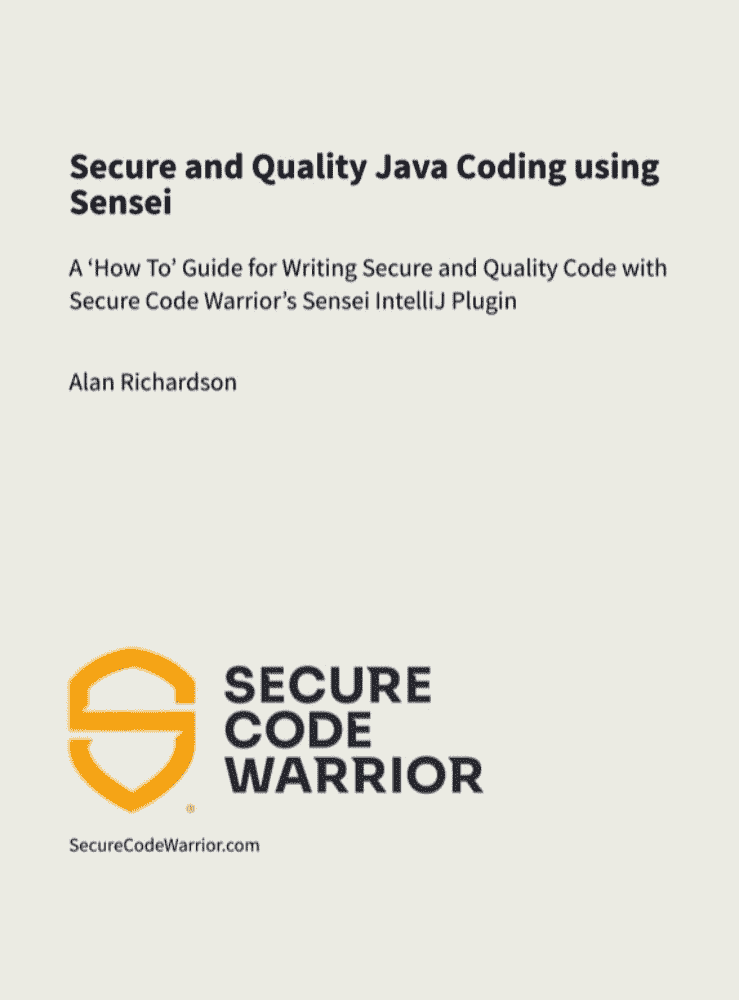

## 引言

[Sensei](https://scw.buzz/38n5uPu) 是来自 [Secure Code Warrior](https://scw.buzz/2PBhLJp) 的免费 IntelliJ 插件，它可以帮助将高质量编码实践规范化为 IDE 中的实时警告，并创建快速修复解决方案来教育你或重写代码。

- [Secure Code Warrior](https://scw.buzz/2PBhLJp) 帮助你将高质量编码实践规范化为 IDE 中的实时警告，并创建快速修复解决方案来教育你或重写代码。
- [Sensei](https://scw.buzz/38n5uPu) 帮助你将高质量编码实践规范化为 IDE 中的实时警告，并创建快速修复解决方案来教育你或重写代码。
- [Sensei](https://scw.buzz/38n5uPu) 帮助你将高质量编码实践规范化为 IDE 中的实时警告，并创建快速修复解决方案来教育你或重写代码。
- [Sensei](https://scw.buzz/38n5uPu) 帮助你将高质量编码实践规范化为 IDE 中的实时警告，并创建快速修复解决方案来教育你或重写代码。
- [Image00000.jpg] 帮助你将高质量编码实践规范化为 IDE 中的实时警告，并创建快速修复解决方案来教育你或重写代码。
- [Sensei](https://scw.buzz/38n5uPu) 帮助你将高质量编码实践规范化为 IDE 中的实时警告，并创建快速修复解决方案来教育你或重写代码。
- [Image00000.jpg](https://scw.buzz/38n5uPu)

### 什么是 Sensei？

[Sensei](https://scw.buzz/38n5uPu) 是来自 [Secure Code Warrior](https://scw.buzz/2PBhLJp) 的免费 IntelliJ 插件，它可以帮助将高质量编码实践规范化为 IDE 中的实时警告，并创建快速修复解决方案来教育你或重写代码。

- [Sensei](https://scw.buzz/38n5uPu) 帮助你将高质量编码实践规范化为 IDE 中的实时警告，并创建快速修复解决方案来教育你或重写代码。
- [Secure Code Warrior](https://scw.buzz/2PBhLJp) 帮助你将高质量编码实践规范化为 IDE 中的实时警告，并创建快速修复解决方案来教育你或重写代码。
- [Sensei](https://scw.buzz/38n5uPu) 帮助你将高质量编码实践规范化为 IDE 中的实时警告，并创建快速修复解决方案来教育你或重写代码。
- [Sensei](https://scw.buzz/38n5uPu) 帮助你将高质量编码实践规范化为 IDE 中的实时警告，并创建快速修复解决方案来教育你或重写代码。
- [Image00000.jpg] 帮助你将高质量编码实践规范化为 IDE 中的实时警告，并创建快速修复解决方案来教育你或重写代码。
- [Sensei](https://scw.buzz/38n5uPu) 帮助你将高质量编码实践规范化为 IDE 中的实时警告，并创建快速修复解决方案来教育你或重写代码。
- [Image00000.jpg](https://scw.buzz/38n5uPu)

### 什么是静态分析？

静态分析是在不执行代码的情况下评估代码的过程。它用于发现潜在的漏洞、安全漏洞以及违反编码标准的行为。

- [Sensei](https://scw.buzz/38n5uPu) 帮助你将高质量编码实践规范化为 IDE 中的实时警告，并创建快速修复解决方案来教育你或重写代码。
- [Secure Code Warrior](https://scw.buzz/2PBhLJp) 帮助你将高质量编码实践规范化为 IDE 中的实时警告，并创建快速修复解决方案来教育你或重写代码。
- [Sensei](https://scw.buzz/38n5uPu) 帮助你将高质量编码实践规范化为 IDE 中的实时警告，并创建快速修复解决方案来教育你或重写代码。
- [Sensei](https://scw.buzz/38n5uPu) 帮助你将高质量编码实践规范化为 IDE 中的实时警告，并创建快速修复解决方案来教育你或重写代码。
- [Image00000.jpg] 帮助你将高质量编码实践规范化为 IDE 中的实时警告，并创建快速修复解决方案来教育你或重写代码。
- [Sensei](https://scw.buzz/38n5uPu) 帮助你将高质量编码实践规范化为 IDE 中的实时警告，并创建快速修复解决方案来教育你或重写代码。
- [Image00000.jpg](https://scw.buzz/38n5uPu)

### 示例 Recipe 仓库

我们提供了几个你可以快速使用的 Recipe 仓库。这些常见 Java 漏洞和实践的 Recipe。

- [Sensei](https://scw.buzz/38n5uPu) 帮助你将高质量编码实践规范化为 IDE 中的实时警告，并创建快速修复解决方案来教育你或重写代码。
- [Secure Code Warrior](https://scw.buzz/2PBhLJp) 帮助你将高质量编码实践规范化为 IDE 中的实时警告，并创建快速修复解决方案来教育你或重写代码。
- [Sensei](https://scw.buzz/38n5uPu) 帮助你将高质量编码实践规范化为 IDE 中的实时警告，并创建快速修复解决方案来教育你或重写代码。
- [Sensei](https://scw.buzz/38n5uPu) 帮助你将高质量编码实践规范化为 IDE 中的实时警告，并创建快速修复解决方案来教育你或重写代码。
- [Image00000.jpg] 帮助你将高质量编码实践规范化为 IDE 中的实时警告，并创建快速修复解决方案来教育你或重写代码。
- [Sensei](https://scw.buzz/38n5uPu) 帮助你将高质量编码实践规范化为 IDE 中的实时警告，并创建快速修复解决方案来教育你或重写代码。
- [Image00000.jpg](https://scw.buzz/38n5uPu)

### 有用文档和链接

欲更多信息，请参考文档和社区论坛。

- [Sensei](https://scw.buzz/38n5uPu) 帮助你将高质量编码实践规范化为 IDE 中的实时警告，并创建快速修复解决方案来教育你或重写代码。
- [Secure Code Warrior](https://scw.buzz/2PBhLJp) 帮助你将高质量编码实践规范化为 IDE 中的实时警告，并创建快速修复解决方案来教育你或重写代码。
- [Sensei](https://scw.buzz/38n5uPu) 帮助你将高质量编码实践规范化为 IDE 中的实时警告，并创建快速修复解决方案来教育你或重写代码。
- [Sensei](https://scw.buzz/38n5uPu) 帮助你将高质量编码实践规范化为 IDE 中的实时警告，并创建快速修复解决方案来教育你或重写代码。
- [Image00000.jpg] 帮助你将高质量编码实践规范化为 IDE 中的实时警告，并创建快速修复解决方案来教育你或重写代码。
- [Sensei](https://scw.buzz/38n5uPu) 帮助你将高质量编码实践规范化为 IDE 中的实时警告，并创建快速修复解决方案来教育你或重写代码。
- [Image00000.jpg](https://scw.buzz/38n5uPu)

### Sensei 团队支持

如果你有任何问题或反馈，请联系我们的团队。

- [Sensei](https://scw.buzz/38n5uPu) 帮助你将高质量编码实践规范化为 IDE 中的实时警告，并创建快速修复解决方案来教育你或重写代码。
- [Secure Code Warrior](https://scw.buzz/2PBhLJp) 帮助你将高质量编码实践规范化为 IDE 中的实时警告，并创建快速修复解决方案来教育你或重写代码。
- [Sensei](https://scw.buzz/38n5uPu) 帮助你将高质量编码实践规范化为 IDE 中的实时警告，并创建快速修复解决方案来教育你或重写代码。
- [Sensei](https://scw.buzz/38n5uPu) 帮助你将高质量编码实践规范化为 IDE 中的实时警告，并创建快速修复解决方案来教育你或重写代码。
- [Image00000.jpg] 帮助你将高质量编码实践规范化为 IDE 中的实时警告，并创建快速修复解决方案来教育你或重写代码。
- [Sensei](https://scw.buzz/38n5uPu) 帮助你将高质量编码实践规范化为 IDE 中的实时警告，并创建快速修复解决方案来教育你或重写代码。
- [Image00000.jpg](https://scw.buzz/38n5uPu)

### 从持续集成中运行 IntelliJ 检查

你可以将 IntelliJ 检查作为 CI/CD 流水的一部分运行，以确保代码符合你的标准。

- [Sensei](https://scw.buzz/38n5uPu) 帮助你将高质量编码实践规范化为 IDE 中的实时警告，并创建快速修复解决方案来教育你或重写代码。
- [Secure Code Warrior](https://scw.buzz/2PBhLJp) 帮助你将高质量编码实践规范化为 IDE 中的实时警告，并创建快速修复解决方案来教育你或重写代码。
- [Sensei](https://scw.buzz/38n5uPu) 帮助你将高质量编码实践规范化为 IDE 中的实时警告，并创建快速修复解决方案来教育你或重写代码。
- [Sensei](https://scw.buzz/38n5uPu) 帮助你将高质量编码实践规范化为 IDE 中的实时警告，并创建快速修复解决方案来教育你或重写代码。
- [Image00000.jpg] 帮助你将高质量编码实践规范化为 IDE 中的实时警告，并创建快速修复解决方案来教育你或重写代码。
- [Sensei](https://scw.buzz/38n5uPu) 帮助你将高质量编码实践规范化为 IDE 中的实时警告，并创建快速修复解决方案来教育你或重写代码。
- [Image00000.jpg](https://scw.buzz/38n5uPu)

## Sensei GUI 概述

Sensei GUI 提供了管理 Recipe 和查看问题的界面。

- [Sensei](https://scw.buzz/38n5uPu) 帮助你将高质量编码实践规范化为 IDE 中的实时警告，并创建快速修复解决方案来教育你或重写代码。
- [Secure Code Warrior](https://scw.buzz/2PBhLJp) 帮助你将高质量编码实践规范化为 IDE 中的实时警告，并创建快速修复解决方案来教育你或重写代码。
- [Sensei](https://scw.buzz/38n5uPu) 帮助你将高质量编码实践规范化为 IDE 中的实时警告，并创建快速修复解决方案来教育你或重写代码。
- [Sensei](https://scw.buzz/38n5uPu) 帮助你将高质量编码实践规范化为 IDE 中的实时警告，并创建快速修复解决方案来教育你或重写代码。
- [Image00000.jpg] 帮助你将高质量编码实践规范化为 IDE 中的实时警告，并创建快速修复解决方案来教育你或重写代码。
- [Sensei](https://scw.buzz/38n5uPu) 帮助你将高质量编码实践规范化为 IDE 中的实时警告，并创建快速修复解决方案来教育你或重写代码。
- [Image00000.jpg](https://scw.buzz/38n5uPu)

### Sensei 菜单

Sensei 菜单可以通过 IntelliJ 菜单栏访问，并提供所有 Sensei 功能。

### 菜谱管理器 (Cookbook Manager)

菜谱管理器允许你查看和管理你的 Recipe。

### 管理 Recipe

在此章节中，你可以启用、禁用或删除 Recipe。

### Recipe 编辑器列表

此列表显示当前菜谱中所有用的 Recipe。

### Recipe 编辑器

Recipe 编辑器是你创建和编辑单个 Recipe 的地方。

### General 设置

通用设置允许你配置 Sensei 插件的行为。

### Recipe - 搜索

此章节允许你搜索特定的 Recipe。

### QuickFix 设置

这些设置允许你配置如何显示和应用快速修复。

### 创建 Recipe

此章节解释了如何从头开始创建一个 Recipe。

### 在 IDE 中发现问题

Sensei 会在你编写代码时高亮问题。

### 触发快速修复

你可以通过点击高亮的问题来触发快速修复。

## 章节 - 用例

此章节探索了 Java 开发中使用 Sensei 的各种场景。

### POJO 用例

这些与简单旧 Java 对象（Plain Old Java Objects）相关的用例。

#### 将 `System.out.println` 转换为 `logger`

此示例展示了如何将 `System.out.println` 替换为正确的日志语句。

### Junit 5 用例

这些与 JUnit 5 测试相关的用例。

#### 添加注解和方法重命名

Sensei 可以帮助你根据标准添加注解并重命名方法。

#### 使用重写操作为注解添加参数

这展示了如何使用重写操作为注解添加参数。

#### 文档链接

相关文档链接。

### Guice 用例

与 Google Guice 依赖注入框架相关的用例。

#### 如何使用 Sensei 捕获并修复依赖注入问题

此示例演示了如何使用 Sensei 识别并解决依赖注入问题。

## 下一步

你可以这样做：

### 安装 Sensei

从 IntelliJ Marketplace 安装 Sensei 插件。

### 研究示例

查看提供的示例以理解 Sensei 的工作原理。

### 阅读文档

查阅官方文档以获取更多细节。

### 实验

尝试创建自己的 Recipe 并探索各项功能。

## 总结

已涵盖内容的总结。

## 关于 Secure Code Warrior

关于 Secure Code Warrior 的信息。

## 关于作者

关于指南作者的信息。

1. 标题页
2. 封面
3. 目录

### 什么是 Sensei？

[Sensei](https://scw.buzz/38n5uPu) 是来自 [Secure Code Warrior](https://scw.buzz/2PBhLJp) 的免费 IntelliJ 插件，它可以帮助将高质量编码实践规范化为 IDE 中的实时警告，并创建快速修复解决方案来教育你或重写代码。

- [Sensei](https://scw.buzz/38n5uPu) 帮助你将高质量编码实践规范化为 IDE 中的实时警告，并创建快速修复解决方案来教育你或重写代码。
- [Secure Code Warrior](https://scw.buzz/2PBhLJp) 帮助你将高质量编码实践规范化为 IDE 中的实时警告，并创建快速修复解决方案来教育你或重写代码。
- [Sensei](https://scw.buzz/38n5uPu) 帮助你将高质量编码实践规范化为 IDE 中的实时警告，并创建快速修复解决方案来教育你或重写代码。

从 [Intellij Marketplace](https://plugins.jetbrains.com/plugin/14015) 下载并安装 Sensei。我们推荐通过 IntelliJ 偏好设置中的插件管理器进行安装（只需搜索“Sensei secure code”即可找到它）。

我们还在 Intellij Marketplace 上创建了一份入门指南 - [入门介绍页](https://scw.buzz/3rveXvC)。

一旦你下载并安装了 Sensei，要让它为你服务的最简单方法是观察你的编码过程并考虑：

- 你经常需要查阅哪些文档？
  - 你可以添加一些 Sensei 配方（recipes），将它们链接回这些文档。
- 你总是在犯哪些简单错误？
  - 你可以临时地将那种糟糕的编码模式代码化为一个匹配器（matcher），并编写一个 `Quick Fix` 重写程序，将代码修正为你真正想写的样子。
- 使用某个库时，你需要编写哪些样板代码？
  - 你可以创建一个 `Quick Fix` 规则来为你编写代码。

Sensei 的设计旨在与你正在使用的任何静态分析工具协同工作。这意味着，如果你发现静态分析报告了相同的违规项，那么你可以在 Sensei 配方中复制该条件。然后你可以添加一个 `Quick Fix`，帮助训练自己不仅能识别错误，还能快速切换到编写正确的代码。

### 什么是静态分析？

静态分析是在不执行应用程序的情况下对源代码进行自动化分析。

当分析在程序执行期间进行时，则被称为动态分析（Dynamic Analysis）。

静态分析通常用于检测：

- 安全漏洞。
- 性能问题。
- 不符合标准的情况。
- 使用了过时的编程结构。

#### 静态分析工具是如何工作的？

所有静态分析工具的共同基本概念是搜索源代码，以识别出带有某种警告或信息的特定编码模式。

这可能简单如“JUnit 5 测试类不需要声明为‘public’”，也可能是复杂的识别类问题，例如“在 SQL 执行语句中使用了不可信的字符串输入”。

静态分析工具在实现此功能的方式上各不相同：

- 使用源代码解析技术来创建抽象语法树（`AST`）；
- 文本正则表达式匹配；
- 或是上述两者的结合。

文本的正则表达式匹配非常灵活，且易于编写匹配规则，但往往会导致大量的误报，而且匹配规则忽略了周围代码的上下文。


`AST`匹配将源代码视为程序代码，而不仅仅是填充了文本的文件。这允许进行更具体的、基于上下文的匹配，并可以减少针对代码报告的误报数量。

## 持续集成中的静态分析

静态分析通常在持续集成（CI）过程中执行，以生成合规性问题报告，通过审查这些报告可以获得代码库随时间推移的客观视图。

有些人将静态分析作为代码质量的客观衡量，通过配置静态分析工具仅测量代码的特定部分，并仅报告规则的子集。

客观性是由所使用的规则提供的，因为这些规则对代码的评估不会随时间推移而改变。显然，所使用的规则组合及其配置是一个主观性决策，不同的团队会在不同时间选择不同的规则。

在 CI 中执行静态分析是有用的，但可能会推迟给程序员的反馈。程序员在编码时并不会收到反馈，而是在代码通过静态分析工具运行后后才会收到反馈。在 CI 中运行静态分析的另一个副作用是结果更容易被忽略。

为了帮助团队更加关注静态分析的结果，通常可以在构建过程中配置一个阈值指标，如果指标超过该阈值则导致构建失败，例如触发的规则数量。

## IDE 中的静态分析

为了更快地接收反馈，有很多 IDE 插件可以根据需要或随着代码更改定期在 IDE 中运行静态分析规则。

这样，程序员在编写代码时，就可以在 IDE 中看到规则违规项；为了让规则难以被忽略，违规项通常可以配置为渲染为编辑器中带下划线的代码。

我个人发现这是一个改进我编码的有用方法，特别是在处理被静态分析工具覆盖的新库时。尽管它可能会由于误报而产生“噪音”，或者包含一些对你不感兴趣的规则。但这可以通过多花一个步骤，配置静态分析工具来忽略某些规则来解决。

## 根据静态分析规则修复代码

对于大多数静态分析工具，修复规则的工作被留给了程序员，因此他们必须理解规则违规的原因以及如何修复它。

极少数静态分析工具也包含修复违规项的能力，因为修复通常取决于团队、所用技术以及他们约定的编码风格。

## 默认规则

当静态分析工具带有默认规则时，可能会对规则的质量产生盲目的自信。人们很容易相信这些规则涵盖了程序员可能遇到的所有问题以及规则应该适用的所有情况。有时，规则应该适用的情况可能是微妙的，并且并不容易检测。

我们希望，通过使用静态分析工具并更详细地研究规则和违规项，程序员将开发出在特定领域背景下检测并避免问题的技能。

当领域需要上下文相关的规则时，静态分析工具可能没有任何匹配你领域或库的规则。此外，这些工具通常难以配置和扩展。

## 困扰之处

这些“困扰”并不是不可逾越的。它们包括：

*   误报
*   缺乏修复方案
*   忽略规则的配置
*   添加特定上下文的规则

它们经常被用作避免使用分析工具的借口，这非常遗憾，因为使用静态分析可以极大地帮助：

*   向初级展示更好的方法。
*   对清晰的编码违规获得快速反馈。
*   识别程序员尚未遇到的问题。
*   强化程序员已采用良好方法（在没有报告违规时）。

## 基于 IDE 的静态分析工具

作为项目的个人贡献者，我喜欢在 IDE 内部运行静态分析工具，以便对我的代码获得快速反馈。

这补充了项目可能有的任何评审流程和 CI 集成。

我尝试识别那些能给我优势并改进我个人工作流的工具。

当工具在 IDE 中运行时，由于它们通常共享相同的界面和配置方法，人们很容易将它们等同看待。

工具之间可能存在重叠的功能或规则集。为了获得最大优势，我安装多个工具来利用它们的各自长处。

我在编码时积极使用的静态分析 IDE 工具包括：

*   内置的 IntelliJ Inspections - 常见的编码模式。
*   `SpotBugs` - 常见的错误。
*   `SonarLint` - 常见的用法。
*   `CheckStyle` - 常见的样式。
*   来自 Secure Code Warrior 的 `Sensei` - 自定义规则创建。

我使用它们是因为它们配合良好。

如果你使用 IntelliJ，那么你已经在使用他们的检查（Inspections）了。

这些是在 IDE 中标记的静态分析规则。其中一些还有 `QuickFix` 选项，可以重写代码以解决问题。

规则可以开启或关闭，并可以选择用于在 IDE 中高亮它的错误级别。

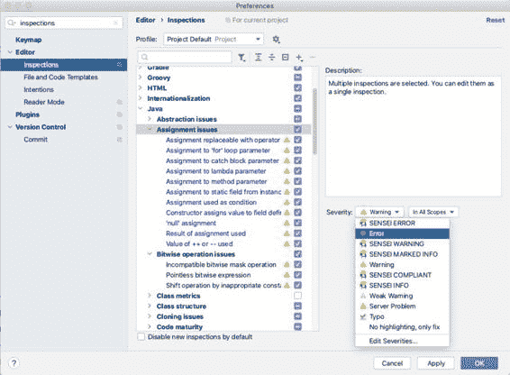

有很多优秀的 IntelliJ 检查（Inspections）。我知道这一点是因为我在写这些内容时通读了它们。我将 IntelliJ 检查作为默认设置且没有进行配置，但为了充分利用这些检查的价值，你应该通读它们，识别出与你的编码风格相关的项，并配置警告级别，以便在代码中注意到它们。

IntelliJ 检查的伟大之处在于它们随 IDE 免费提供，并且可以帮助建立以下肌肉记忆：

* 在编写代码时注意到源码中的警告和错误。
* 将鼠标悬停在被标记的代码上以学习规则违规情况。
* 使用`alt+enter`为问题应用`QuickFix`。

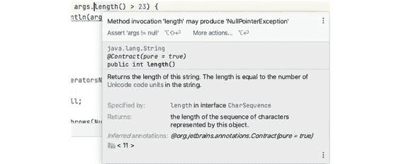

### SpotBugs

[SpotBugs](https://plugins.jetbrains.com/plugin/14014-spotbugs) IntelliJ 插件使用静态分析来尝试提醒你代码中的 bug。

可以从 IntelliJ 偏好设置（Preferences）配置 SpotBugs 来扫描你的代码。实际使用的规则可以在`Detector`标签页中找到。

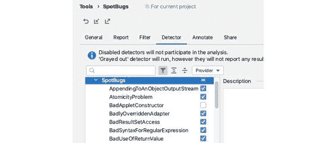

我倾向于在编写并审查代码后使用 SpotBugs。我会运行`Analyze Project Files Including Test Sources`。

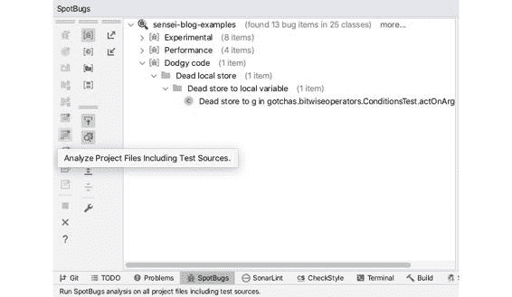

这确实帮助我识别 bug、死代码以及明显的优化点。它还迫使我研究一些被标记的违规项，帮助我决定如何处理。

SpotBugs 会发现问题，但没有提供任何尝试解决问题的`QuickFix`动作。

SpotBugs 很容易配置，我发现它是我在 IDE 中咨询的非常有用的客观第二意见。

### SonarLint

[SonarLint](https://plugins.jetbrains.com/plugin/7973-sonarlint) 插件。

可以从 IntelliJ 偏好设置配置 SonarLint，以选择代码针对哪些规则进行验证。

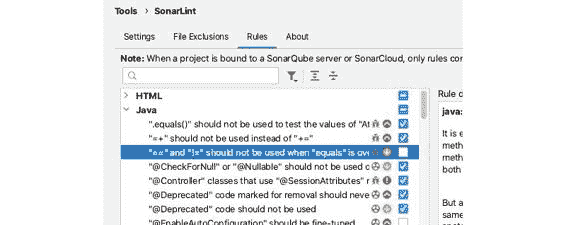

默认情况下，SonarLint 实时运行，并显示你正在编辑当前代码的问题。

SonarLint 不提供快速修复（quick fixes），但与违规报告相关的文档通常是清晰且记录良好的。

我发现 SonarLint 在过去非常有用，它能提醒我在较新版本的 Java 中才熟悉的 Java 特性。

### CheckStyle

[CheckStyle](https://plugins.jetbrains.com/plugin/1065-checkstyle-idea) 插件提供了格式和代码质量规则的混合。

CheckStyle 插件内置了`Sun Checks`和`Google Checks`。

这些定义可以很容易[在线找到](https://checkstyle.sourceforge.io/style_configs.html)。

当一个项目花费时间创建了自己的规则集时，CheckStyle 增加的价值最大。此时，可以配置 IDE 插件来使用该规则集，程序员可以在提交代码到 CI 之前进行扫描。

CheckStyle 经常用作 CI 过程的构建失败插件，当 CheckStyle 违规数量超过阈值时。

### Sensei

[Sensei](https://scw.buzz/38n5uPu) 使用基于抽象语法树（`AST`）的静态分析来匹配代码并创建`Quick Fixes`，这允许对有问题的代码进行特定的识别。

`AST`允许与配方（recipe）相关的`Quick Fixes`理解周围的代码，例如，当在代码中添加新类时，该类的任何 import 仅会被添加到源文件中一次，而不是每次替换都添加一次。

Sensei 的创建是为了方便构建自定义匹配规则，这些规则在其他工具中可能不存在，或者很难配置。

与其修改配置文件，所有配置都可以在 GUI 中完成。在创建新配方时，GUI 可以让你轻松看到该配方匹配哪些代码。在定义`Quick Fixes`时，可以立即比较代码的修改前之后的状态。这使得创建非常有上下文的配方变得更容易，即针对特定团队、技术甚至是个人程序员的配方。

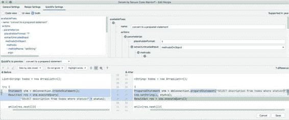

我将 Sensei 与其他静态分析工具结合使用，例如大多数静态分析工具会发现问题但不修复它们。Sensei 的常见用例是在 Sensei 中复制其他工具的匹配搜索，并用`Quick Fix`将其扩展。这样做的好处是，所应用的自定义修复已经符合你项目的编码标准。

我经常发现自己创建了已经在 IntelliJ 意图（Intensions）集中存在的 Sensei 配方，因为意图报告并不完全符合我创建的上下文，或者因为 IntelliJ 提供的`QuickFix`不匹配我想要使用的代码模式。

我是在增强现有的工具，而不是尝试完全取代它们。

当你识别出常用规则的上下文变体时，Sensei 也非常有用，例如，如果你在使用一个静态分析工具不支持的 SQL 库，但静态分析引擎中的常用 SQL 规则仍然适用，那么你可以使用 Sensei 创建这些规则的特定库变体。

Sensei 并不是开箱即用提供像上述静态分析工具那样的通用配方，它的优势在于可以轻松创建新配方，并带有配置好以匹配你特定编码风格和用例的`Quick Fixes`。

*注意：我们正在维护一个公共配方仓库，[你可以在这里找到](https://scw.buzz/30pkFN)。

## 总结

我结合使用所有提到的工具：

* IntelliJ 意图帮助开箱发现常见问题，通常带有`QuickFix`。
* SpotBugs 发现我可能错过的 bug 并提醒我性能问题。
* SonarLint 识别我未知的 Java 特性，并提醒我建模代码的其他方式。
* CheckStyle 帮助我符合约定的编码风格，该风格在 CI 期间执行。
* Sensei 帮助我创建针对静态分析发现的常见场景的`Quick Fix`，并创建难以配置的特定项目或技术配方。

## 示例仓库

我们在 GitHub 上创建了一些示例仓库，可能对学习 Sensei 有用。

* [sensei-blog-examples](https://scw.buzz/3cixLrq)

### 博客示例

该项目包含用于实验的示例配方的代码。

* [github.com/SecureCodeWarrior/sensei-blog-examples](https://scw.buzz/3cixLrq)

**如何使用：**

* [安装 Sensei 插件](https://scw.buzz/3rveXC)。
* 克隆或项目。
* 在 IDE 中打开。
* 示例 Sensei 配方将被加载。
* 阅读用例查看配方如何识别问题并修复代码。

*这是一个多模块 Maven 项目。当你克隆此项目或下载为 zip 包时，请记住将顶层`pom.xml`作为项目打开。`.sensei`文件夹包含支持示例和嵌入`readme.md`文件的示例配方。*

### 公共配方

公共配方仓库是我们知道的所有公共 Sensei 配方的列表。

* [github.com/SecureCodeWarrior/public-cookbooks](https://scw.buzz/30pkFN)
* [securecodewarrior.github.io/public-cookbooks](https://scw.buzz/3btJZhV)

配方的完整说明和文档应该在每个配方的列表中。公共列表中的配方非常有用：

* 可以作为它们所覆盖技术的配方使用。
* 用于学习如何创建配方。
* 理解 Sensei 配方可以应用的领域范围。

* [官方文档](https://scw.buzz/3emSI7l)
* [`sensei-docs-beta.securecodewarrior.com/`](https://scw.buzz/3emSI7l)

## JetBrains 市场上的 IntelliJ

* [从 IntelliJ 市场安装插件的说明](https://scw.buzz/3rveXvC)
* [`plugins.jetbrains.com/plugin/14015-sensei-by-secure-code-warrior-/getstarted`](https://scw.buzz/3rveXvC)

## Secure Code Warrior Sensei 博客

* [博客文章](https://scw.buzz/2OBxgk0)
* 也可以访问 [dev.to/securecodewarrior](https://dev.to/securecodewarrior)
* [`securecodewarrior.com/blog-tags/sensei`](https://scw.buzz/2OBxgk0)

## Secure Code Warrior 视频

* [youtube.com/c/SecureCodeWarrior/videos](https://www.youtube.com/c/SecureCodeWarrior/videos)

要查看 Sensei 视频，请选择 [Sensei 列表](https://www.youtube.com/playlist?list=PL7KK7fPcGxbbmIxZJzkJKXbjtc6K_nJjX)。

## 有用的 Github 仓库

* [Github 示例项目](https://scw.buzz/3cixLrq)
    * [`github.com/SecureCodeWarrior/sensei-blog-examples`](https://scw.buzz/3cixLrq)
* [公开 Sensei 菜谱索引](https://scw.buzz/30pk1FN)
    * [`github.com/SecureCodeWarrior/public-cookbooks`](https://scw.buzz/30pk1FN)
    * [`securecodewarrior.github.io/public-cookbooks/`](https://scw.buzz/3btJZhV)

## Sensei 团队支持

当一个人创建一个配方来提高代码质量或效率时，通过共享菜谱，团队中的每个人都能受益。

Sensei 提供了多种共享菜谱的机制：

* 将菜谱存储在受版本控制的项目中。
* 将菜谱存储在共享文件夹中。
* 将菜谱存储在 Github 中。
* 通过 HTTP(s) 传输压缩文件。

通过共享菜谱，Sensei 帮助团队进行知识共享协作。这种协作有助于改进沟通，并嵌入约定的代码质量方法。

例如，共享菜谱允许：

* 团队成员之间共享实用的配方。
* 团队负责人为初级员工将约定的编码规范规范化。
    * 识别常见的违规行为并为约定的版本提供快速修复。
* 增强团队间的协作。
    * 应用安全（AppSec）团队可能会创建配方来突出代码中的问题，而开发团队可以编写快速修复。

接下来的几部分将解释如何实现每种共享机制。

### 将菜谱存储在受版本控制的项目中

创建菜谱文件时，`.sensei`文件夹是默认选项。

* `project://.sensei`

所有菜谱和配方都将存储在项目中的`.sensei`文件夹中。

最简单的共享方法是将项目的`.sensei`文件夹添加到版本控制中。

然后，`.sensei`文件夹就可以像项目相关的其他共享代码产物一样进行管理。菜谱以 YAML 配置的形式存储，使其在任何提交和审查过程中易于合并。

这是公开项目`sensei-blog-examples`采用的方法。

`https://github.com/SecureCodeWarrior/sensei-blog-examples`

`.sensei`文件夹包含了包含所有配方的菜谱，任何克隆仓库的人都可以使用它们。

### 将菜谱存储在任何文件夹中

团队还可以使用存储在中心位置的菜谱。

将菜谱保存到任何具有共享写入权限的文件夹中，将允许整个团队更新配方，并将其导入到他们恰好正在工作的任何项目中。

该位置将设置为目录路径。

### 在 Github 中存储配方

Sensei 还可以访问存储在 Github 仓库中的配方。支持私有仓库和公共仓库。

#### 通过 SSH 访问 Github

使用以下`Location`语法来配置 SSH 仓库访问：

`git@github.com:SecureCodeWarrior/acookbook.git`

要使此运行，仓库中应包含菜谱文件夹的内容。

例如，我们的基础保护菜谱采用了这种方法，并可以使用该位置作为“本地配置的菜谱”添加：

`git@github.com:SecureCodeWarrior/cookbook-basic-protection-set.git`

还可以配置菜谱的分支和子文件夹，例如在`master`分支的`cookbook`子文件夹中

例如：

`git@github.com:SecureCodeWarrior/sensei-blog-examples.git|master|.sensei`

私有仓库需要配置 SSH 密钥。

* https://github.com/settings/keys

并且密钥不应有密码保护。

#### 通过 HTTPS 访问 Github

也可以通过 HTTPS 访问公共仓库，使用相同的`repo.git|branch|folder`语法，例如：

`https://github.com/SecureCodeWarrior/sensei-blog-examples.git|master|.sensei`

#### 通过 HTTP(s) 传输压缩文件

Sensei 还可以通过 HTTP 或 HTTPS 访问压缩的菜谱。

例如：

`http://localhost:8000/rules.sensei`

压缩文件应包含菜谱文件夹的内容，例如：

`rules.sensei`


### 共享总结

Sensei 支持使用多个菜谱来增加共享。

更重要的是，我们知道当知识共享时，团队工作效率最高。共享（例如应用安全到开发）可以提高团队效率。

有了四种核心共享机制，Sensei 至少有一种你可以增加协作的方法。

## 在持续集成中运行 IntelliJ 检查

IntelliJ IDEA 提供了在编写代码时通过 IDE 帮助改进代码的功能。本节涵盖了开箱即用的 IntelliJ 功能以及自定义扩展。

### IntelliJ 检查

IntelliJ 的检查功能驱动了在编写代码时动态在 IDE 中报告的许多错误，例如：

- 检测可以转换为接口的抽象类。
- 识别冗余的类字段（本地）。
- 关于使用弃用方法的警告。
- 等。

这些检查在 IDE 中高亮匹配代码的意操作，通常带有关联的快速修复。

```
(Image 00008.jpg)
```

代码匹配检查时的实时 IDE 高亮有助于我们动态改进代码。在识别代码中的问题后，使用 IntelliJ 意操作修复代码可以强化更好的模式。

### 检查配置

检查可以在 IDE 内以批处理运行，也可以从命令行或在集成过程中运行。

通过批处理运行 IntelliJ 检查的关键是使用检查配置（Inspection Profile）。

IntelliJ 有两个默认检查配置：存储在项目中，存储在 IDE 中。

可以创建新的检查配置以配置特定的插件或用例，例如：

- 仅运行 Checkstyle 扫描。
- 运行特定的 Sensei 规则。
- 运行 HTML 检查。

配置中的检查可以在 IntelliJ 偏好设置中启用或禁用。偏好设置也是了解可用检查范围的简单方法。

```
(Image 00009.jpg)
```

工具图标允许复制配置并创建一个新配置以收集特定的规则集。

```
(Image 00010.jpg)
```

### 在 IDE 中运行检查配置

可以使用 `Analyze \ Inspect Code...` 菜单在 IDE 内运行检查配置。

```
(Image 00011.jpg)
```

`Analyze` 功能允许你控制 `Inspection` 运行的范围，例如整个项目（包括或排除测试源），或针对特定的文件集。

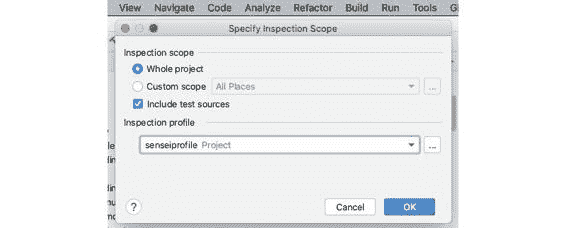

你也可以在此处管理 `Inspection Profiles`（检查配置），以创建或配置特定的配置。

在“Specify Inspection Scope”（指定检查范围）对话框中点击 `[OK]`，将触发 IntelliJ 在定义的范围内运行配置中所有选中的 `Inspections`。

IntelliJ 将在 `Inspection Results`（检查结果）标签页中报告运行 `Inspections` 的结果。

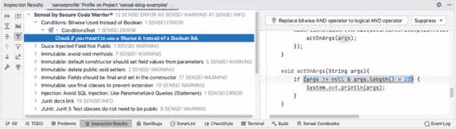

来自 Secure Code Warrior 的 [Sensei](https://scw.buzz/3qvDvDt) 插件允许你创建自定义的代码匹配配方。Sensei 与 IntelliJ 深度集成，使得这些自定义配方的使用像 `IntelliJ Intention Actions`（IntelliJ 意图操作）一样自然。这意味着它们作为 `Inspections` 加载到 IntelliJ 中，并可以使用 `Inspection Profiles` 进行分组、启用和禁用。创建一个自定义的 `Inspection Profile` 并使用 `Analyze Inspect Code` 功能是在整个项目中批量运行 Sensei 配方的推荐方法。

### 从命令行运行检查配置

IntelliJ 具有如 JetBrains 文档所描述的那样从命令行运行检查的能力：

- https://www.jetbrains.com/help/idea/working-with-the-ide-features-from-command-line.html

我主要使用 Mac OS，可以通过以下命令从命令行运行单个 IntelliJ 实例：

```bash
open -na "IntelliJ IDEA CE.app"
```

为了支持更容易执行，我将此添加到 shell 命令脚本中。

`vi /usr/local/bin/idea`

脚本的内容来自 IntelliJ 提供的官方文档。

```bash
#!/bin/sh
open -na "IntelliJ IDEA CE.app" --args "$@"
```

然后我赋予了它可执行权限，以便简化命令行检查过程。

`chmod 755 /usr/local/bin/idea`

Intelliij 官方文档描述了检查命令的一般形式为：

`idea inspect <project> <inspection-profile> <output> [<options>]`

在实践中，我使用了全路径：

```bash
idea inspect /Users/user/GitHub/sensei-blog-examples /Users/user/GitHub/sensei-blog-examples/.idea/inspectionProfiles/senseiprofile.xml /Users/user/GitHub/sensei-blog-examples/scan-results
```

或者使用相对于我用户目录的路径：

```bash
idea inspect ~/Documents/GitHub/sensei-blog-examples ~/Documents/GitHub/sensei-blog-examples/.idea/inspectionProfiles/senseiprofile.xml scan-results
```

这会运行我添加到 `senseiprofile` 中的所有 `Inspections` 并将结果报告在 `scan-results` 文件夹中。

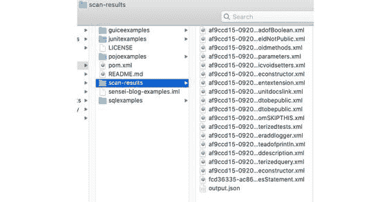

### 查看检查结果

正如稍后看到的，我们可以在持续集成（CI）内部报告这些结果。

我们也可以在 IntelliJ 内部使用 `Analyse \ View Offline Inspection Results…`（分析 \ 查看离线检查结果…）功能查看它们。


这将会将结果加载到 `Inspection Results` 标签页中。

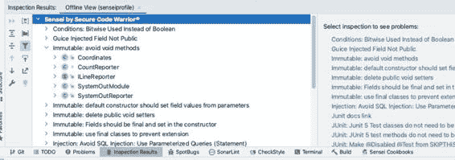

这在 JetBrains 网站上有官方文档记录：

- https://www.jetbrains.com/help/idea/command-line-code-inspector.html#inspection-results

如果将命令行执行整合到持续集成过程中，并且审查人员想要检查任何检查结果条目的完整源码上下文，则可能会在代码审查过程中使用此功能。

### 持续集成中的检查配置

在将命令行检查添加到持续集成时，我们理想情况下希望自动生成报告，我们有许多选项可以选择。

TeamCity 为持续集成中的 `Inspection Profiles` 提供了开箱用的支持。

- https://www.jetbrains.com/help/teamcity/inspections.html

Jenkins Warnings NG 插件支持 IntelliJ 检查的命令行输出作为报告格式之一。

- https://github.com/jenkinsci/warnings-ng-plugin
- https://github.com/jenkinsci/warnings-ng-plugin/blob/master/SUPPORTED-FORMATS.md

存在如 `idea CLI Inspector` 这样的社区项目，用于在其他 CI 工具中使用 `Inspection Profiles`，例如：

- https://github.com/bentolor/idea-cli-inspector

随着 JetBrains Qodana 项目的引入，检查配置在 CI 过程中的未来看起来更加明亮。Qodana 项目是 IntelliJ 的无头版本，带有官方的 Github Actions 和 Docker 镜像。

- https://github.com/JetBrains/Qodana

*Qodana 目前处于测试阶段，但 Sensei 团队正在监控它，使其作为持续集成中运行 Sensei 规则的官方支持平台。*

## 总结

意图操作（Intention Actions）允许我们在编码期间出错时强化编码模式并在 IDE 中快速修复它们。

检查配置（Inspection Profiles）允许我们将这些收集到配置中，并作为 `Analyze and Inspect Code` 操作批量运行。当我们遇到某种模式并想双检是否在代码的其他地方遗漏了该模式时，这非常有用。

检查配置可以从命令行运行，甚至可以整合到持续集成过程中，支持“信任，但要验证”的模型并捕捉任何意外的疏漏。

以上所有都是 IntelliJ 的内置功能，JetBrains 正在通过引入 Qodana 改进他们的持续集成过程。

Sensei 配方作为原生功能加载到 IntelliJ 中。

### 在 YouTube 上观看

我们创建了一个 YouTube 视频，展示了本部分的所有步骤和工具。


[youtu.be/GkAS2Q](https://youtu.be/GkAS2Q)

# Sensei GUI 概述

Sensei 插件允许我创建搜索来匹配我想修改的代码并创建快速修复（Quick Fix）来修改代码。本节将介绍 GUI 的主要部分以及如何使用它们。

## Sensei 菜单

安装 Sensei 后，我们在工具菜单中看到 Sensei 菜单。


## 食谱管理器（Cookbook Manager）

我们可以在这里显示食谱管理器，它将列出我可用的“食谱”（配方列表）。


我可以使用此对话框切换食谱的启用和禁用。可以使用屏幕底部的 `Sensei Cookbooks` 标签页在需要时返回这里。我不需要主菜单。

## 管理配方

由于这是来自 Github 的示例项目，我在项目的 `.sensei` 文件夹中存储了一些配方，并且它们已自动加载。

可以通过点击 `[Manage recipes]` 按钮来管理它们并查看哪些配方可用。

## 配方编辑器列表

每个配方都有一个包含名称、描述和警告级别的配置，这些配置定义了当代码匹配搜索中的模式时在 IDE 中如何渲染。


通过点击配方，我可以对其进行编辑。

## 配方编辑器

配方编辑器有四个主要组件：

- 配方列表，可以在此处添加、删除和复制配方。
- 通用设置标签页，可以在此处配置配方。
- 配方设置标签页，创建搜索和匹配条件。
- 修复设置，配置修改或生成代码的快速修复更改。


## 通用设置

通用设置是我们在主要配置此处：

- `Name` 和 `Description` 在使用 `alt+enter` 时显示在意图快速修复弹出窗口中。
- `Level` 定义了匹配的配方在 IDE 中如何渲染。

如果我将一个配方标记为“错误”（Error），则代码将带有红色下划线并显示为语法错误，但警告将会有轻量高亮。

还有其他设置，但这些用于更高级用法，将在文档中介绍。

- 文档 - [sensei-docs-beta.securecodewarrior.com](https://scw.buzz/3emSI7l)

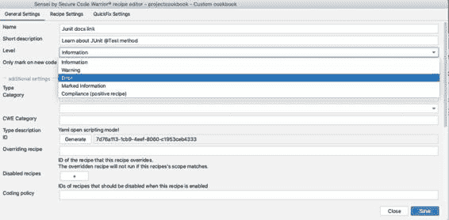

## 配方设置——搜索

“配方设置”（Recipe Settings）包含了搜索配置。

这是我们在代码执行的搜索，用于匹配编码模式。

在这个示例中，我正在搜索方法上的任何 Junit 5 测试注解。

你可以看到代码中的注解已经在代码本身中被高亮了。

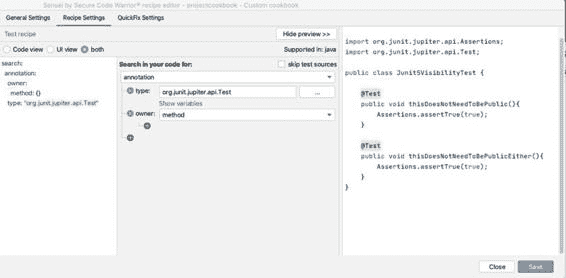

如果我更改了注解类型，代码将无法匹配，因此我们可以直观地看到我们的搜索对于正在处理的代码是否有效。

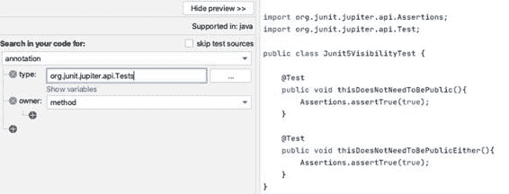

## 快速修复设置

快速修复设置（QuickFix Settings）是在我使用 `alt+enter` 修复问题时在 IntelliJ 中显示的快速修复方案。

你在屏幕底部看到一个差异视图（diff view），显示了应用快速修复的结果。

截图显示的配方向类中添加了一个 `Logger`，差异视图显示了代码修改前后的状态。

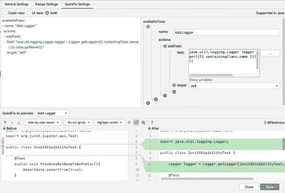

## 创建配方

在代码中，通常位于你想要开始搜索的地方。

按下 `alt+enter` 会显示创建配方的上下文菜单。


我们经常从一个空配方“从零开始”。


## 在 IDE 中发现问题

### 在代码中

当配方被激活后，它们将在代码中被标记。

以下代码显示了一些“错误”和一些“警告”。


我现在现在保存它，然后我们就可以在 IDE 中使用它。

### 问题图标

问题也会通过右上角的 Sensei 问题图标显示。


我可以在这里右键点击，通过“问题”（Problems）选项卡修复问题。

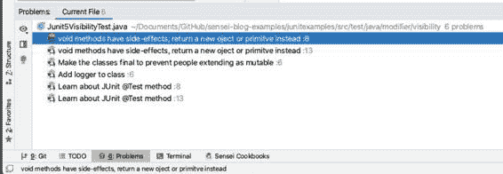

## 触发快速修复

有许多方法可以触发快速修复（QuickFix）。

### 使用问题选项卡

在“问题”选项卡中，右键点击报告的问题并选择“显示快速修复”（Show Quick Fixes）。

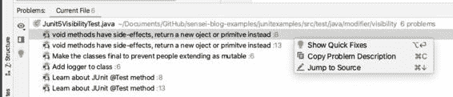

然后从列表中选择快速修复。


### 上下文 `alt+enter`

修复代码最常用的方法是使用 `alt+enter`，我们将看到任何 IntelliJ 建议和 Sensei 快速修复。


如果我选择该操作，代码就会被修改。

### 修复多个操作

如果文件中有多个出现之处，我可以一次性修复它们。

按下 `alt+enter` 并导航到快速修复菜单的下一层级，我们找到了修复当前源文件中所有问题的选项。

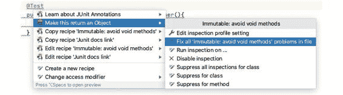

# 章节——用例

Sensei 可以帮助提高高质量代码的编写，无论底层的领域或技术如何。

本节按技术分类分为若干子章节，以演示：

- Sensei 的某些功能。
- 这些功能如何应用。

技术示例已尽可能减小，以说明与技术的交互，但仍保持了较短的学习曲线。这样，即使你不了解该技术，也应该能够跟上。

这里的描述在 Github 仓库中提供了完整的代码示例：

- [github.com/SecureCodeWarrior/sensei-blog-examples](https://scw.buzz/3cixLrq)

要查看的具体代码链接或描述将包含在用例描述中。

## POJO 用例

这些用例使用了原始的 Java。

不需要外部依赖，因此它们是 Sensei 基础功能的良好介绍。

## 将 `System.out.println` 转换为日志

在编写以下代码时，我犯了一些错误：

```java
private String getCountdownString() {

    String output =
```

注意，我将 `SysOutTest` 修改为了 mustache 变量，这样它就能获取我在此配方中所使用的任何类名。同样，由于我不记得 mustache 的语法，我使用了 GUI 命令 `show variables` 来找到我需要的替换内容。

而且通过将 `Logger` 全限定限定为 `java.util.logging.Logger`，Sensei 将添加导入项并编写我想要的代码行，即：

```java
Logger logger = Logger.getLogger(SysOutTest.class.getName());
```

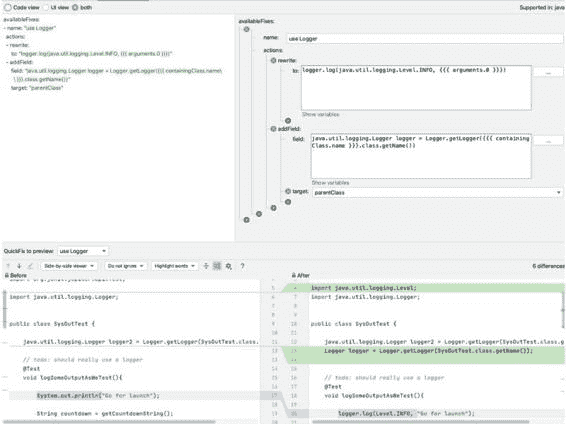

这个配方的一个有用之处是，因为它只会添加一次 `logger` 字段，因此我可以将其应用于任何使用过 `System.out.println` 的现有代码中，并使用 Sensei 更改我代码中所有出现的地方。

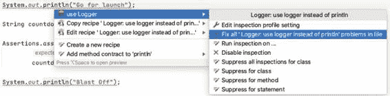

## 下一步骤

一旦我习惯了这一点，我最终将训练自己不再使用 `System.out.println`。

我还可以创建一个第二个配方来帮助我创建 logger，从而利用 Sensei 帮助我主动编写代码。

例如：我可以匹配一个没有名为 `logger` 字段的类，并添加一个。

我创建了一个级别为 `Information` 的配方：

```yaml
Name: Logger: add logger
Description: Add logger to class
Level: Information
```

匹配不带 logger 字段的类：

```yaml
search:
  class:
    without:
      child:
        field:
          name: "logger"
```

然后我将复用之前看到的 QuickFix 的部分：

```yaml
availableFixes:
  - name: "Add Logger"
    actions:
      - addField:
          field: "java.util.logging.Logger logger = Logger.getLogger({{{ containingClass.name\
        \ }}}.class.getName())"
          target: "self"
```


注意这里 `target` 与第一个 QuickFix 相比的区别。这里使用 `self` 是因为我们的搜索匹配了类。第一个 QuickFix 使用 `parentClass` 是因为我们匹配的是类内部的代码。

## 总结

这代表了使用 Sensei 帮助提高个人编程技能的关键流程之一：

- 创建一个配方来帮助实现即时的“最佳实践”。
- 一旦你知道如何使用该最佳实践……就创建一个配方来加速你的工作流。

## 代码链接

在 GitHub 仓库中：

- https://github.com/SecureCodeWarrior/sensei-blog-examples
- 模块：`pojoexamples`
- 路径：`src\test\java\logging`

`AddLoggerTest.java` 包含一些应用配方的指令。

`SysOutTest.java` 是一个你可以尝试的类示例。

## 观看 Sensei 演示


[youtu.be/qPlNm0yaSto](https://youtu.be/qPlNm0yaSto)

# JUnit 5 用例

[JUnit 5](https://junit.org/junit5/) 是一个流行的 Java 单元测试框架。

接下来的用例都使用 JUnit 5 作为实现，但基本概念可以通过对配方进行细微修改，以应用于 JUnit 4 或其他单元测试框架。

## 添加注解和重命名方法

使用 Sensei 改进个人编程流程。

对于这一部分，我重现了学习 JUnit 时使用的一种“糟糕”的编码方法，并将演示如何使用 Sensei 将这种“糟糕”模式转换为公认的且“更好”的编码模式。

当我学习 JUnit 时，我脑中一次次能记住的信息非常有限。我经常忘记在测试不起作用时如何跳过它们。

如果我们是在团队中工作，可以使用拉取请求（pull requests）的代码审查来帮助强制执行编码风格。与经验丰富的程序员进行结对编程时，我们还可以缩短反馈周期。

我们还可以通过工具增强我们的流程，让工具提示我们做正确的事。Thoughtworks 在其[针对 Sensei 的技术雷达列表](https://www.thoughtworks.com/radar/tools/sensei)中将其描述为：

> “让做正确的事变得简单，比应用类似清单的治理规则和程序更容易”

### 禁用 JUnit 测试

理想情况下，正如大家所知，我应该使用 `@Disabled` 注解并写成：

```java
@Disabled
@Test
void canWeAddTwoNumbers() {
    Assertions.fail("this test was skipped and should not run");
}
```

但在学习期间，我不得不训练自己使用 `@Disabled`。

当我忘记如何禁用测试方法时，我会删除 `@Test` 注解并重命名测试：

```java
class SkipThisTest {

    void SKIPTHIScanWeAddTwoNumbers() {
        Assertions.fail("this test was skipped and should not run");
    }
}
```

这并不好，但完成了任务。我当时没有像 Sensei 这样的工具来帮助我记忆，所以我陷入了使用糟糕编码模式中。

我为此 README 采取的任务是：

- 创建一条规则，通过重命名方法来找到被“跳过”或“禁用”的方法。
- 创建一个 QuickFix 来重命名方法并同时添加 `@Test` 和 `@Disabled` 注解。

### 配方设置

我使用 Sensei 的第一步是“打开设置”。

```yaml
Name: open Sensei
```

为了匹配方法，我在配方中使用了以下内容：

```yaml
search:
  method:
    name:
      matches: ".*.*"
```

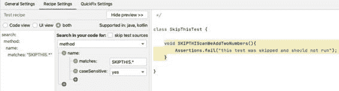

### QuickFix 设置

QuickFix 稍微复杂一些，因为它将重写代码，我将使用 `sed`。

我想做：

- 为方法添加 `@Test` 注解。
- 为方法添加 `@Disabled` 注解。
- 修改方法名。

使用 `addAnnotation` 添加注解非常简单。如果我为注解使用全限定名，Sensei 将自动添加导入项。

```yaml
availableFixes:
  - name: "Add @Disabled and @Test"
    actions:
      - addAnnotation:
          annotation: "@org.junit.jupiter.api.Test"
      - addAnnotation:
          annotation: "@org.junit.jupiter.api.Disabled"
```

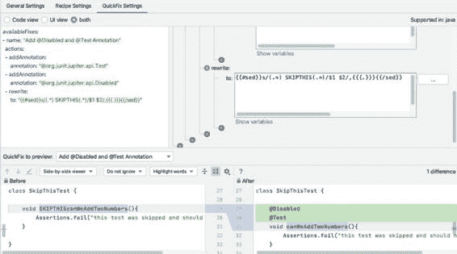

`sed` 的实现要求当参数包含逗号时，必须用 `{{#encodeString}}` 和 `{{/encodeString}}` 裹起来——例如 `{{#encodeString}}{{{.}}}{{{/encodeString}}`。

### 反向配方

由于这是一个示例，而且我们可能在演示中使用它，我想探索如何使用 Sensei 配方来撤销上述更改。

经过思考，我想在执行演示的 `SkipThisTest` 类中找到带有 `@Disabled` 注解的方法：

```yaml
Name: JUnit: demo in SkipThisTest remove @Disabled and revert to SKIPTHIS
Short Description: 为了项目演示目的移除 @Disabled 并恢复为 SKIPTHIS
Level: warning
```

配方设置搜索非常简单，匹配特定类中的注解。

```yaml
search:
  method:
    annotation:
      type: "Disabled"
    in:
      class:
        name: "SkipThisTest"
```

对于 Quick fix，由于我们已经匹配了方法，我们使用重写动作并使用变量填充模板。

```yaml
availableFixes:
  - name: "Remove Disabled and rename to SKIPTHIS..."
    actions:
      - rewrite:
          to: "{{{ returnTypeElement }}} SKIPTHIS{{{ nameIdentifier }}}{{{ parameterList\
            \ }}}{{{ body }}}"
```

我基本上添加了除了修饰符以外的所有变量（因为我想去掉这些注释），并在模板中添加了 `SKIPTHIS` 文本。

这个修复方案的缺点是，通过移除修饰符，我也删除了所有其他注释。

### 添加另一个 Action

我可以添加另一个具名的修复方案，这样当在使用 `alt+enter` 显示 `QuickFix` 时，我可以有一个选择。

```yaml
availableFixes:
  - name: "Remove Disabled and rename to SKIPTHIS..."
    actions:
      - rewrite:
          to: "{{{ returnTypeElement }}} SKIPTHIS{{{ nameIdentifier }}}{{{ parameterList\
            \ }}}{{{ body }}}"
          target: "self"
  - name: "Remove Disabled, keep other annotations, and rename to SKIPTHIS..."
    actions:
      - rewrite:
          to: "{{#sed}}s/(@Disabled\n.*@Test)//,{{{ modifierList }}}{{/sed}}\n\
            {{{ returnTypeElement }}} SKIPTHIS{{{ nameIdentifier }}}{{{ parameterList\
            \ }}}{{{ body }}}"
          target: "self"
```

在这里，我在新的 Quick Fix 中添加了额外的行。

```text
{{#sed}}s/(@Disabled\n.*@Test)//,{{{ modifierList }}}{{/sed}}
```

这会获取修饰符列表，将其编码为字符串，然后使用 `sed` 移除字符串中包含 `@Disabled` 的行，但保留修饰符中的所有其他行，即保留所有其他注释。

注意：记得在 `sed` 中添加逗号“，”，否则你会在预览中看到被添加的注释，因为这是 Sensei 向你通警 `sed` 命令中语法错误的方式。

### 嵌套 `sed` 调用

我很幸运，我可以在一次搜索和替换中同时匹配 `@Disabled` 和 `@Test`。

如果代码更复杂，我想要执行一系列 `sed` 命令，那么我可以通过嵌套它们来实现：

```text
{{#sed}}s/@Test//,{{#sed}}s/@Disabled\n//,{{{ modifierList }}}{{/sed}}{{/sed}}
```

在上面的示例中，我对先对 `{{{ modifierList }}}` 应用 `@Disabled` 替换的结果再次应用 `@Test` 替换。

## 总结

`sed` 是一种实现代码重写的非常灵活的方法，并且可以为复杂的重写条件嵌套 `sed` 函数调用。

像这样的食谱通常是临时的，因为我们使用它们是为了改进编程流程，一旦我们建立了肌肉记忆并且不再使用那种糟糕的编程模式，我们就可以从 Cookbook 中删除或禁用它们。

注意：与其添加两个可用修复，我可以复制配方，但如果这样做，我记得取消勾选“Add disable entry for cloned recipe”（为克隆配方添加禁用项）复选框，否则只有克隆的配方可用。

## 使用 Rewrite Actions 为注释添加参数

在这个示例中，我们将：

- 演示搜索和匹配注释。
- 使用 mustache 模板修改注释。

Sensei 提供了匹配问题代码模式并将其修改为约定实现的能力。在这个示例中，我使用不带参数的 `@Disabled` 作为问题代码模式。

### 在 YouTube 上查看演示


[youtu.be/mjXGliXJ7M8](https://youtu.be/mjXGliXJ7M8)

### 禁用测试注释

没有指定原因的禁用测试长期来看可能会产生问题，因为我们会忘记为什么要禁用它们。

```java
@Disabled
void thisTestMethodHasNoDisabledReason() {
    Assertions.fail("This test is disabled and should not run");
}
```

风险在于，随着时间的推移，代码库发生了变化，禁用的测试不会随代码的目的同步更新，最终变得多余且无关，并且可能永远不会重新启用。

在代码审查期间，我们经常会指出作为注释参数添加解释性描述是一个好主意。

```java
@Disabled("Disabled to demonstrate adding a reason")
void thisTestMethodHasDisabledReason() {
    Assertions.fail("This test is disabled and should not run");
}
```

### 一个 Sensei 食谱

我们可以编写一个食谱来检测何时在没有解释的情况下添加了 `@Disabled`，并编写一个 Quick Fix 提醒我们添加解释为什么要禁用的实际原因。

当我思考要做什么时，我必须：

- 匹配不带任何参数的 `Disabled` 注释。
- 将 `Disabled` 注释更改为带有标记文本“TODO: add a description here”参数的注释。

### 创建警告食谱

我使用 `Alt+Enter` 创建一个新的食谱。


然后在通用信息中添加基础描述性文本。


通用：

```yaml
name: remember to add disabled description
short description: @Disabled should really have a description explaining why
Level: Warning
```

通过将规则设置为警告，任何匹配的代码都会被高亮，但不会显示为明显的错误。


### 查找注释

在食谱编辑器中，我搜索以匹配注释。

这将高亮注释。


例如：

```yaml
search:
  annotation:
    type: "org.jupiter.api.Disabled"
    without:
      parameters: {}
```

### 创建重写修复方案

对于我的 Quick Fix，我将使用 rewrite action。

我使用 `Show Variables` 功能来显示变量。


然后我添加创建注释所需的额外代码。


例如 QuickFix：

```yaml
availableFixes:
  - name: "Add a todo comment"
    actions:
      - rewrite:
          to: "{{{ }}}(\"TODO: add a description\")"
          target: "self"
```

## 总结

构建 Quick Fix 时，如果我们可以操作 `self` 实体将会更容易。

在示例中，我使用 rewrite action 来修改注释。Rewrite 是一种通用的操作，适用于任何代码元素，并且是一个很好的探索方向。

## 文档链接

学习新库或在团队中共享约定的实践的困难之一在于编写文档和创建示例。

我们经常创建示例项目，但在处理实际代码时并没有打开它们。

我经常在想，如果能够链接到我们的示例或在线示例，并在需要时访问 URL 获取更多解释就太好了。

在 Java 中，我们有 JavaDoc 注释，它可以包含一个 `see` 注解：

```java
/**
 * @see <a href="https://junit.org/junit5/docs/current/user-guide/#writing-tests-annotations">Junit 5 Annotation docs</a>a>
 */
```

第三方库中的这种 JavaDoc 非常有帮助，因为我们可以使用 IntelliJ 中的 `Quick Documentation` 功能来获取更详细的说明。


但是，我们都知道注释的更新频率往往不如代码，而且网页呈现的维护通常与库的维护脱节，有时甚至由完全不同的团队执行。

### Sensei 如何帮助

Sensei 提供了匹配库注释和方法的能力，从而提供指向 wiki 或第三方教程网站上长文档的链接。

例如，我正在使用 JUnit 的 `@Test` 注释。

JavaDoc 非常详细，`Quick Documentation` 视图解释了如何使用该注释。

但网站上的官方文档通常更容易读，并且包含更多示例。

当团队开始学习一个库时，拥有一套推荐的教程会非常有用。

Sensei 有一个 `goto` 操作，可以打开 URL，允许我们链接到外部站点以及我们团队认为有用的文档和示例。

## 实现 `goto` URL

为了实现这一点，我将创建一个匹配 JUnit `@Test` 注解的搜索。

```yaml
search:
  annotation:
    owner:
      method: {}
    type: "org.junit.jupiter.api.Test"
```

然后，我将为我发现的每个有用 URL 添加 `goto` 操作。

例如：

- https://junit.org/junit5/docs/current/user-guide/#writing-tests-annotations
- https://junit.org/junit5/docs/current/user-guide/#writing-tests-classes-and-methods

下面的示例将创建一个单一的操作 `JUnit Annotations (learn)`，它将在浏览器中同时打开这两个 URL。

```yaml
availableFixes:
  - name: "Learn about JUnit Annotations"
    actions:
      - goto:
          type: "URL"
          value: "https://junit.org/junit5/docs/current/user-guide/#writing-tests-annotations"
      - goto:
          type: "URL"
          value: "https://junit.org/junit5/docs/current/user-guide/#writing-tests-classes-and-methods"
```

当我在 IntelliJ 中通过 `alt+Enter` 激活它时，我看到了上下文菜单，可以选择它跳转到文档。


## 多操作


我可能会选择多个操作，以便每个 URL 或教程在 `alt+enter` QuickFix 弹出菜单中都有自己的选项。

例如，对于 `@Parameterized` 注解，我可能想链接到官方文档和一组在线示例代码。

* https://junit.org/junit5/docs/current/user-guide/#writing-tests-parameterized-tests
* https://github.com/eviltester/junitexamples/blob/master/src/test/java/parameterized/junit5/InitialExampleTest.java

我只需简单的创建一个搜索该注解的配方（recipe）：

```
search:
  annotation:
    owner:
      method: {}
    type: "org.junit.jupiter.params.ParameterizedTest"
```

并链接到我认为有用的站点：

```
availableFixes:
- name: "JUnit Annotations (learn)"
  actions:
  - goto:
      type: "URL"
      value: "https://junit.org/junit5/docs/current/user-guide/#writing-tests-annotations"
- name: "What is a JUnit Test? (learn)"
  actions:
  - goto:
      type: "URL"
      value: "https://junit.org/junit5/docs/current/user-guide/#writing-tests-classes-and-methods"
```

这两个链接将出现在弹出对话框中。


## 谁会受益？

在使用和学习库时，我会发现这有用，特别是在领导团队并帮助他们采用新库时。

这也能让创建库的团队受益，通过创建一套标准的文档配方，引导人们采用该库或库中的新功能。

如果代码维护和文档维护是由不同的团队执行的，这将会特别有用。

# Guice 用例

每引入一项新技术都会给项目增加风险。依赖注入（Dependency Injection）可以在编码时节省时间，并在配置方面增加额外的灵活性，但始终存在我们忘记连接某些组件或注入错误对象的风险。

本节的用例探索了 Sensei 如何提供帮助。

## 如何使用 Sensei 捕捉并修复依赖注入问题

Sensei 项目本身拥有随时间积累的配方，这是 Sensei 团队构建配方覆盖的场景示例：Guice 的配置错误导致在测试期间运行时报告了 `NullPointerException`。

这可以推广到许多依赖注入场景，在这些场景中，代码语法上是正确的，但因为连接配置错误，导致错误漏掉。

这通常在我们学习某项技术时发生，我们不断犯下忘记连接的简单错误。但也会发生在经验丰富的人士身上，因为……我们都会犯错，而且我们可能没有单元测试来覆盖一切。

### 错误的依赖注入连接导致的运行时异常

下面的代码在运行时因 `NullPointerException` 失败。

```
Injector injector = Guice.createInjector(new SystemOutModule());
CountReporter reporter = injector.getInstance(CountReporter.class);

String [] lines5 = {"1: line", "2: line", "3: line", "4: line", "5: line"};

reporter.reportThisMany(Arrays.asList(lines5));
Assertions.assertEquals(5, reporter.getCount());
```

代码语法上是正确的，但失败是因为我们在 `SystemOutModule` 配置中漏掉了 `requestStaticInjection`。

```
public class SystemOutModule extends AbstractModule {

    @Override
    protected void configure() {
        binder().bind(ILineReporter.class).to(SystemOutReporter.class);
    }
}
```

当我们尝试使用 `reporter` 时，我看到了上下文菜单。

### 警告信号

代码语法上是正确的，但失败是因为我们在 `SystemOutModule` 配置中漏掉了 `requestStaticInjection`。

当我们尝试使用 `reporter` 时，我看到了上下文菜单。

### Sensei 能如何提供帮助？

我们可能不会使用 Sensei 来发现 `requestStaticInjection`，因为我们所有的 Guice 配置连接都需要像这个用例一样简单。

配方中的 QuickFix 会修改被注入的类，但并不是唯一需要修改的代码。

```
availableFixes:
- name: "Change class to public. Remember to also request injection on this class"
  actions:
  - changeModifiers:
      visibility: "public"
      target: "parentClass"
```

当配方被触发时，我仍然需要在代码中执行一个手动步骤，即添加包含 `requestStaticInjection` 的行，以完全实例化该对象。

```
public class SystemOutModule extends AbstractModule {

    @Override
    protected void configure() {
        binder().bind(ILineReporter.class).to(SystemOutReporter.class);
        // 通过依赖注入实例化
        binder().requestStaticInjection(CountReporter.class);
    }
}
```

我完全可以再写另一个配方来捕获这一点。但除非忘记添加静态注入成了我在编码时经常的半常规错误，否则我可能不会这样做。

## 总结

如果我们发现自己在常见的根节点模式上犯了错误，那么 Sensei 可以帮助我们将检测和修复该问题的知识代码化。这样，希望它就不会再逃过代码审查并进入生产环境。

有时我们编写的配方识别的是启发式模式，也就是说匹配这些模式并不保证存在问题，但很有可能存在问题。

我们编写的配方和 Quick Fix 不需要完全完备，但它们需要足够好，帮助我们识别并修复问题，而不会过于复杂。当它们变得过于复杂时，它们会变得难以理解和难以维护。

## 下一步骤

- 安装 Sensei
- 学习一些示例
- 阅读文档
- 实验

## 安装 Sensei

如果你还没有安装，请安装 Sensei。你可以从 JetBrains 市场进行安装，既可以在 IDE 内部进行，也可以通过 `jetbrains.marketplace.com` 完成。

要在 IDE 内部安装，请使用“Preferences -> Plugins”（Mac）或“Settings -> Plugins”（Windows）并搜索“sensei secure code”，然后点击安装。

- [市场平台上的 Sensei 插件](https://scw.buzz/38n5uPu)
- [plugins.jetbrains.com/plugin/14015-sensei-by-secure-code-warrior-](https://scw.buzz/38n5uPu)

有关安装 IntelliJ 插件的帮助，请考虑阅读 JetBrains 支持文档：

- [jetbrains.com/help/idea/managing-plugins.html](https://www.jetbrains.com/help/idea/managing-plugins.html)

## 学习一些示例

在文中前面我们提到了两个主要的 Github 仓库。

[Sensei 博客示例](https://scw.buzz/3cixLrq) 包含了示例代码、适用于代码的配方以及解释用例的 `readme.md` 文件。

[公共菜谱 (Public Cookbooks)](https://scw.buzz/30pk1FN) 索引列出了公开的菜谱，包含示例配方和文档。

- [github.com/SecureCodeWarrior/sensei-blog-examples](https://scw.buzz/3cixLrq)
- [github.com/SecureCodeWarrior/public-cookbooks](https://scw.buzz/30pk1FN)

这两个仓库都包含了许多供学习的配方，以理解 Sensei 的工作原理。

## 阅读文档

[官方文档](https://scw.buzz/3emSI7l) 包含了所有 Sensei 功能和函数的参考指南。此外，它还包含了一份入门上手引导教程，帮助你从零开始创建自己的配方。

- [`sensei-docs-beta.securecodewarrior.com/`](https://scw.buzz/3emSI7l)

## 实验

当你创建帮助改进自身流程或将团队知识代码化的配方时，Sensei 产生的价值最大。

你可能想要尝试的几件事：

- 复制一些静态分析工具警告你的某些规则，但为你应用过的最常用的代码更改创建一个 QuickFix。
- 创建一些辅助代码，为你经常使用的某些库生成样板代码。
- 对你在编码时会犯的错误类型做笔记。创建一个带有修复方案的配方，帮助你下次避免此类问题。

## 总结

[公共菜谱](https://scw.buzz/30pk1FN) 索引列出了你可以立即使用的配方。然而，Sensei 的最大价值在于你创建配方，帮助你根据自己所用技术的标准编写出更高质量的代码。

在 Sensei 中将你的知识代码化，并与你的团队或世界分享，通过向[公共菜谱](https://scw.buzz/30pk1FN)索引贡献你的菜谱。

务必访问我们的网站了解 Sensei 的最新动态：

- [securecodewarrior.com/sensei](https://scw.buzz/2qvDvDt)

# 关于 Secure Code Warrior

Secure Code Warrior 是一家全球安全公司，致力于让软件开发变得更好、更安全。我们的愿景是通过让安全高度可见，使开发者成为组织的第一道防线，为他们提供从一开始编写安全代码的技能和工具。我们强大的平台将重点从响应转向预防，培训并装备开发者在构建和验证技能时具备安全思维进行思考和行动，获取实时建议并监控技能发展。我们的客户包括来自欧洲、北美和亚太地区的金融机构、电信供应商和全球科技公司。

[SecureCodeWarrior.com](https://scw.buzz/2PBhLJp)

# 关于作者

Alan Richardson 是 Secure Code Warrior 的开发者关系负责人。Alan 拥有二十多年的专业软件开发经验，是书籍《Automating and Testing a REST API》和《Java For Testers》的作者。

有关 Alan 的更多信息请访问 [EvilTester.com](https://eviltester.com)
