# Java Selenium 初学者指南：使用 Selenium 和 Java 进行 Web 浏览器自动化测试

## 责任限制与免责声明

本书中包含的信息是真实且正确的，基于作者和出版者所知的最佳水平。作者已尽一切确保这些出版物的准确性，但出版者对书中任何信息可能导致的任何损失或损害不承担责任。书中提到的所有商标均承认其各自所有者的财产，但 BPB Publications 不能保证这些信息的准确性。


www.bpbonline.com

献给 Neeal 和 Maisha 以及 Neelakrish 博士和 Manju 博士，我的孩子们，他们不断让我看到生活的奇迹。还有我的父母，因为有他们，才有了我。

## 关于作者

Pallavi Sharma 是一位多才多会的专业人士。她的职业生涯始于弗吉尼亚理工大学在 Naren Ramakrishnan 博士的指导下担任研究学者，在期间她参与了生物信息学的数据挖掘项目。在 Crestech Software Systems，她是 CEO 下卓越中心团队的一员，负责为交付团队提供尖端解决方案。她使用过 `Selenium`、`Watir`、`RFT`、`JMeter`、`LoadRunner`、`Rational Robot` 等类似的工具。

她管理着内部产品 `OpKey` 的开发人员、测试、支持部门、预售、营销和技术写作团队。她还管理公司的专利和商标部门。

2014 年，她创立了 5 Elements Learning，在并在指导人们学习 `Selenium`、`Appium`、`Cucumber` 生态系统（包括测试自动化项目的技术栈）。她使用 `Java`、`Python`、`CSharp` 和 `Ruby` 等编程语言进行教学。她教过全球超过 1000 多人。她还是 `Udemy` 的讲师，拥有超过 2 万粉丝，并为测试人员主持了许多付费和免费课程。

她继续参与各类全球会议，如 `Selenium Summit`、`APISummit Delhi Software Testing Conference`、`Selenium India Conference`、`Global Testing Retreats`。她曾担任评审、组织委员会成员和演讲者。她非常感谢 Michael Bolton 和 Maaret Pyhäjärvi 在探索性测试概念方面的指导和教学。

自 2021 年以来，她是 Agile Testing Alliance 的指导委员会成员，并长期担任顾问委员会成员。她的工作涉及设计有关各种全球自动化认证的课程、组织会议，并带领团队处理 Agile Testing Alliance 的社交媒体运营。

她是 BPB Publications 出版的书籍作者。她的第一本书《Selenium with Python 初学者教程》是亚马逊该类别中排名前 10 的书籍之一。她的第二本书《Selenium 4 – 快速实用指南》已在 LeanPub 上架。

她相信对自己的学习进行认证，并持有各种认证，如 `ISTQB`、`CP-SAT`、`CP-WST`、`CP-DOF`、`Cucumber School Completion`、`SpecFlow` 等。

她是一个热心的读者、旅行者和内心的作家。她喜欢小说、非虚构类，以及根据自己的生活经历创作诗歌和短故事。她在 `Medium` 上分享自己的作品。她坚信大爱，并喜欢以身作则。她将资源投入 `eVidyaloka`、`People for Animal`、`WildLife SOS` 和 `Jabarkhet 森林储备` 等机构。

## 关于评审员

Jaya Saini 拥有 6.5 年自动化测试和 API 测试经验，使用 `Selenium`、`TestNg`、`Robot Framework`、`Postman` 等工具以及 `Java`、`JavaScript`、`Python` 等语言。Jaya Saini 在拉贾斯坦理工大学获得计算机科学与工程学士学位。她曾工作于 `Sopra Banking` 和 `Thinksys software` 等公司。她目前在诺义的 Thinksys software 担任自动化测试负责人。

## 致谢

我想感谢几位在本书编写期间向我提供持续支持的人。首先，我要感谢 `Selenium` 的创始人 `Jason Huggins` 和 `Selenium WebDriver` 的创始人 `Simon Stewart` 的他们的创造。感谢 `Selenium` 项目和社区背后的人们，他们继续为项目工作并向世界提供支持。

感谢我的丈夫 Ravinder 无条件的爱和俏皮的笑话。感谢我的父母通过帮助他人树立生活榜样。感谢我的孩子们 Neeal 和 Maisha，提醒我保持童心。感谢我的妹妹 Mahak 博士的无限耐心，以及我们关于生活、环境、政治、幽默以及亲戚的谈话。

感谢 Manish Jain 给我在 BPB Publications 工作的机会，帮助我实现了成为作家的梦想。感谢 BPB Publications 编辑和技术团队的持续支持。最后，非常感谢各种见解，让我亲身体验了其无尽的智慧。

## 前言

Selenium 将浏览器自动化，而我们如何利用这种力量取决于自己。这是我们第一次访问 Selenium 官方网站时收到的信息。它是 Web 浏览器自动化最流行的开源解决方案，任何人都可以免费获取和使用。Web 应用领域已经使用 Selenium 多年。它帮助自动化枯燥的任务，提高效率和准确性，最终改进测试流程。Selenium 的力量在于它可以使用任何编程语言实现，可以自动化任何符合 W3C 标准的浏览器，并可以在任何操作系统上运行。Selenium 项目和 WebDriver 合并成了 Selenium WebDriver，它现在是 W3C 标准。各种版本的 Selenium 被用于各种大小的项目。书中的 Selenium 实现是使用 Java 作为编程语言完成的。在书中，我们尝试涵盖 Selenium 的基本类和接口，这些能帮助我们自动化浏览器和元素。我们涵盖了测试脚本之外的数据和对象管理的重要性，并涵盖了其实现。我们讨论了流行的单元测试框架 `TestNG`，并理解了我们可以在测试自动化项目中使用它的各个维度。最后学习了如何使用 `Grid` 为不同环境设置并行执行的测试。

在本书的 12 章中，你将学习到以下内容：

- **第 1 章** – 学习什么是 Selenium。介绍 Selenium 下的三个项目：`Selenium IDE`、`WebDriver` 和 `Selenium Grid`。
- **第 2 章** – 学习如何搭建环境以使用 Selenium 编写测试脚本。学习我们将自动化的不同应用和场景，以理解 Selenium。
- **第 3 章** – 学习 Selenium 的三大支柱：`Java` 客户端库、自动化浏览器的 `WebDriver` 以及处理页面 HTML 元素自动化的 `WebElement`。按类划分。
- **第 4 章** – 理解同步的重要性，以及如何在测试脚本中实现。
- **第 5 章** – 理解如何处理不同的 HTML 元素，如表单元素、表格、下拉列表。
- **第 6 章** – 理解如何处理 Web 元素，如框架（frame）、警框（alerts）和窗口（window）。
- **第 7 章** – 学习一些高级概念，如使用 `action` 处理键盘和鼠标事件。捕捉截图。
- **第 8 章** – 学习什么是 `TestNG`，理解我们可以在测试自动化项目中使用它的各种特性。
- **第 9 章** – 学习如何使用页面对象模型（Page Object Model）实现。
- **第 10 章** – 学习测试脚本之外的数据管理的重要性，并学习如何从外部文件（如 `csv` 和 `excel`）读取数据。
- **第 11 章** – 介绍项目管理工具 `Maven`，理解它在项目管理中的重要性。
- **第 12 章** – 学习 Selenium Grid，它允许我们在不同环境中并行执行测试。

| 邮箱地址： | `type="text" name="email_address"` |
|---|---|
| 密码： | `type="password" name="password" maxlength="40"` |

[`href="https://5elementslearning.dev/demosite/password_forgotten.php?osCsid=a7bbd18f550992ba489722cc2bc9ac35"`>忘记密码？点击此处。]

从代码的 HTML 部分，我们可以获取以下定位器信息。`id` 定位是 HTML 元素的一个属性。例如，如果我们查看前面的代码，可以看到一个登录按钮的 HTML，其中 HTML 元素有一个 `id` 属性。因此，为了识别页面上的此按钮，我们可以轻松地使用 `id` 属性并像如下创建定位器命令——

`name` 定位信息也是从 HTML 元素获取的。`Name` 是与 HTML 元素相关的属性。例如，在前面的 HTML 代码段中，我们看到了邮箱文本框和一个密码文本框；对于这两种识别，我们都可以使用 `name` 定位。

- 邮箱：`driver.findElement(By.name("email_address"))`
- 密码：`driver.findElement(By.name("password"))`

`xpath` 信息源于到达目标 HTML 元素所经过的遍历路径。它主要用于 XML 文档，但我们可以将 HTML 页面视为 XML 页面，然后创建到达所选元素的路径。`xpath` 有两种类型：

- 绝对 XPath (Absolute Xpath)
- 相对 XPath (Relative Xpath)

创建绝对 `xpath` 的语法始终从根节点 `HTML` 开始，而相对路径，它是从节点本身或任何具有强识别性的父节点开始。我们称这些节点为地标节点（landmark nodes），它们拥有 `ID` 属性或 `NAME` 属性。对于这些节点，我们可以创建到达我们想要处理的节点的路径。

例如，邮箱文本框的相对 `xpath` 可以：

- 邮箱框：`//input[@name='email_address']`
- 或者如果我们相对于包含邮箱地址的表单节点创建，它将是：相对于 form 表单节点：`//form/table/tr[1]/td[2]/input`

创建 `xpath` 的语法是——

绝对 `xpath` 始终从 `html` 节点开始——`/html/tag1/tag2/tag3…`

`XPaths` 也可以使用关键字创建。我们可以使用任何属性甚至文本来创建此 `xpath`。例如，对于登录按钮，`xpath` 可以如下创建：`Xpath=//*[contains(text,'Sign In')]`。创建的 `xpath` 定位信息为——`//button[text='Sign In']`

`CSS` 代表级联样式表（Cascading Style Sheets），它们用于帮助 Web 页面元素的样式化。不是为每个单独元素创建样式，而是创建 `CSS` 文件，其中为某种标签类型定义样式。我们可以使用 `CSS` 来识别页面上的对象。创建 `CSS` 的语法如下：`css=#id` 或 `css=htmltag[prop=value]`

文档对象模型（DOM）是任何 HTML Web 页面的基础。它基本上说的是 HTML `DOM` 以树形结构的形式存在，每个节点与其他节点之间都存在层级关系。通常，HTML `DOM` 表示如下：

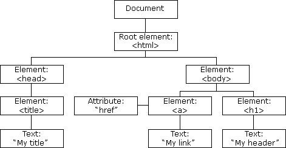

图 3.4：HTML DOM

要使用 `DOM` 信息来识别感兴趣的对象，我们利用了所有 HTML 标签类型都以数组形式分配的特性。为了识别特定 HTML 标签类型的特定对象，可以使用其在创建定位器信息的路径中的位置。

总而言之，我们需要理解对于任何 HTML 元素，我们拥有的相同的 HTML 代码段。通过使用 HTML、XML、`xpath`、`css` 和 `DOM` 等各种 Web 技术，我们可以为对象创建定位器，供 Selenium 消费，并帮助我们在执行操作的 Web 页面上唯一地识别该对象。

## `By` 类的异常

当我们使用 `By` 类配合不正确的定位器时，可以看到以下异常：

- 当使用 `xpath` 选择器策略查找元素时抛出此异常，使用的 `xpath` 语法是错误的。
- 当元素找不到所使用的属性时，发现此异常。
- 当我们尝试处理的元素被禁用，即使它存在于 `DOM` 中，也会发现此异常。

## 结论

在本章中，我们讨论了 `WebDriver` 和 `WebElement` 的接口，以及 `By` 类。在 `WebDriver` 的帮助下，我们能够驱动我们浏览器并与其交互。`WebElement` 实际上是创建 Web 页面的 HTML 元素。每个 Web 元素使用其 HTML 属性和值定义，这些值也被用于在编写自动化脚本时识别它们的策略。Selenium Web 元素接口提供了多种函数对 Web 元素执行操作，帮助我们实现目标。`By` 类拥有一些方法，使用对象的 HTML 属性并利用它们识别对象。我们看到该类是关重要的，因为它有助于识别 Web 页面上的对象。在识别出的对象上将执行操作。它还有方法来识别单个对象或匹配相同信息的对象列表。我们将对这些对象执行操作以实现我们的自动化目的。

`WebElement`、`WebDriver` 和 `By` 类构成了 Selenium `WebDriver` 脚本设计的基础。在后续章节中，我们将根据对 `WebDriver`、`WebElement` 和 `By` 类的学习，在 Selenium 中实现我们的第一个脚本。在接下来的章节，我们将讨论同步（Synchronization）的概念，理解其重要性以及它是如何实现的。

## 问题

- 我们在这里使用了什么版本的 Eclipse？
- 我们在这一章中安装了什么版本的 Java？
- 相对于 Eclipse，Photon 是什么？
- Firefox 驱动程序的名称是什么？
- 可以从哪里下载 Internet Explorer 的驱动程序？
- Web 元素的通用结构是什么？
- 列举一些用于创建元素的 HTML 标签？
- 为什么我们会得到 `NoSuchElementException`？
- `findElement()` 和 `findElements()` 之间有什么区别？
- 我们使用什么方法在文本框上输入？
- 如果提供的 `xpath` 语法错误，会产生什么类型的异常？
- 你如何通过其类在运行时获取对象？

# 第 4 章：同步概念

在上一章中，我们最终实现了关于 Selenium 三大支柱的学习，并自动化了带有 URL 的浏览器启动——Chrome、Firefox 和 Internet Explorer。当我们学习 Selenium 的支柱时，理解测试自动化的主要支柱之一是非常重要的，那就是同步。在本章中，我们将理解它的概念和重要性。

## 结构

本章分为：

- 什么是同步以及为什么它很重要
- 同步的类型
- 如何实现隐式等待 (implicit wait)
- 如何实现显式等待 (explicit wait)
- 可能出现同步的问题

## 目标

学习本章后，你应该能够识别脚本中需要等待的地方并添加隐式或显式等待。你能够识别脚本是否由于同步问题失败并修复它。

## 理解同步及其重要性

同步意味着同时进行两项或更多活动。在没有工具帮助的情况下执行场景时，我们可以根据 Web 应用的速度同步我们的操作。然而，当我们在无人模式（unattended mode）下执行相同的操作时，脚本本身缺乏任何能力来判断是等待操作完成还是继续。在我们在脚本中引入同步的概念时，脚本可能会与 Web 应用的速度不同步导致错误。通过一个例子，假设我们使用 URL 启动应用，如下所示：


图 4.1：启动应用示例

现在我们在 `My Account` 链接上执行操作；下一步是输入邮箱地址，如下：


图 4.2：我的账户页面

可能存在以下情况：

- **理想情况 (Happy)**：点击 `My Account` 链接后，页面按时加载，我们可以在字段输入。
- **其他情况 (Other)**：在无人模式下，人类执行操作时，可以使用能力判断：
  - 页面没有按时加载执行操作。
  - 页面加载了，但字段不存在。
  - 页面没有加载，由于客户端或服务器问题导致错误。
  - 页面没有加载。

当人类在执行先前的步骤时遇到不理想的情况，将采取适当的操作并判断是应该等待页面加载，还是由于网站未工作而报告问题。在脚本中，我们需要构建隐式等待或显式等待。我们还能够识别脚本中需要同步的地方。

## 同步的类型

到目前为止，我们学习了同步的重要性。在本节中，我们将学习如何在脚本中实现它，以及它的方法。方法两种方法：

- 隐式等待 (Implicit wait)
- 显式等待 (Explicit wait)

隐式等待也称为全局等待。它通常在 `WebDriver` 对象初始化后立即实现。一旦实现，此等待适用于脚本中的每个语句。

显式等待被称为局部等待。它用于脚本中可能需要更多时间的地方。通常，当我们使用显式等待时，会将隐式等待设置为零，因为它们可能会相互干扰。当我们使用显式等待时，我们需要一个条件来等待完成或超时指定的秒数。为了创建显式等待条件，Selenium 中有一个类名为 `ExpectedConditions`。我们将在下一节介绍更多。

## 场景

为了在操作中实现隐性和显式等待，我们将选择使用有效用户信息登录应用的场景。让我们首先理解以下步骤：

- 使用 URL 打开应用
- 点击 `My Account` 链接
- 点击 `Sign In` 按钮
- 点击 `Log Off` 链接
- 点击 `Continue` 按钮

按照前面的步骤，我们在浏览器中启动应用如下：


图 4.3：应用主页


然后我们提供有效的用户名和密码，然后点击 `Sign In` 按钮如下：


图 4.4：登录应用

如果信息正确，我们将看到 `My Account` 页面如下：


图 4.5：登录后的页面

在这里，我们然后点击 `Log Off` 和 `continue` 按钮返回主页：

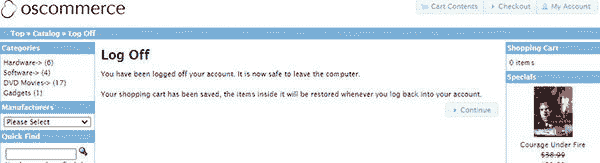

图 4.6：应用退出页面

在前面的场景中，我们需要在对不同元素执行操作时注意到页面的变化。例如，如果我们点击 `My Account` 链接，我们将进入需要填写用户名密码信息的页面。当我们点击 `sign in` 按钮时，我们进入 `My Account` 页面，在那里我们看到 `Log Off` 链接。我们点击 `Log Off` 链接看到 `continue` 按钮，点击后回到主页。在每一步中，我们的脚本都必须设置为等待元素。如果元素在规定时间内出现，则抛出 `Timeout` 异常并结束执行。我们看到的第一种等待是隐式等待，它被引入脚本并作用于脚本中的每个语句。它被称为全局等待。之后，我们将看到显式等待，它被称为局部等待，并引入脚本中比全局设置需要更多等待的地方。正如前面解释，我们不一起使用这些等待，因为它们可能会相互干扰。当使用显式等待时，我们将隐式等待设置为零。

为了实现隐式等待，我们使用以下命令：

```
driver.manage().timeouts().implicitlyWait(10, TimeUnit.SECONDS);
```

在这里，`driver` 是 `ChromeDriver` 的实例并使用其 `manage` 方法。`manage` 方法有 `timeouts`，我们传递给此方法的参数是我们想要隐式等待的时间量。此命令适用于脚本中的每个语句。如果由于某些原因，元素不可用且过了 10 秒，会导致 `NoSuchElementException` 异常。让我们看到使用隐式等待的脚本：

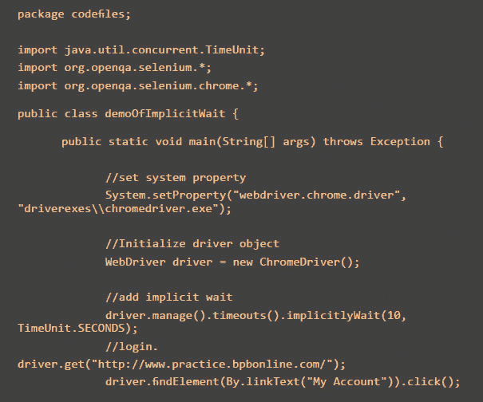


## 实现显式等待

在脚本需要比全局设置更多时间的情况下，实现显式等待或局部等待。在这种情况下，建议增加整个全局超时，因为由于某些原因脚本失败，我们将根据设置的持续等待。我们需要理解同步与脚本速度之间的关系。为了实现显式等待，我们将使用 Selenium 的 `WebDriverWait` 接口和 `ExpectedConditions` 接口。在继续之前，我们先讨论这两个实体。`WebDriverWait` 接口提供了一个 `until()` 方法，该方法接受类型为 `ExpectedConditions` 的参数。Selenium `WebDriver` 类提供了大量方法来检测事件，等等。`ExpectedConditions` 方法是可用的……

提示：`WebDriverWait` 接口需要 `driver` 实例、超时时间。让我们通过一个场景来实施局部等待，即 `Log Off` 链接，如下所示：


当 `Log Off` 链接出现时，我们将继续并退出。我们需要注意，在前面的代码中，我们将隐式等待设置为 0，并在显式等待将其设置为 10 秒。代码的原因是这些等待可能会相互干扰并导致运行时执行问题。

## 遇到异常

我们遇到：

- `NoSuchElementException`：当脚本等待页面上的元素出现，但在给定的持续时间内无法找到它。

- `TimeoutException`：当脚本在给定的持续时间内无法找到元素时生成。`presenceOfLocatedBy` 也抛出 `NoSuchElementException`。

为了看到这一点，我们可以使用 `By.linkText: Junk`。由于 `junk` 不存在，等待 10 秒后，内部生成：

```
Exception in thread "main" org.openqa.selenium.TimeoutException: Expected condition failed: waiting for element located by: By.linkText: Junk (tried for 10 seconds with 500 milliseconds interval)
caused by: org.openqa.selenium.NoSuchElementException: no such element: (Session info:
```


在本章中，我们学习了自动化脚本中等待的需求、Selenium 中的等待类型以及如何实现。在接下来的章节中，我们将讨论处理表单元素、表格和下拉元素。

# 第 5 章：处理 WebElements——表单、表格和下拉列表

在前面的章节中，我们讨论了用于处理浏览器、Web 元素和创建定位器的 Selenium 库。我们也讨论了如何使用概念。`WebElement` 实际上是创建 Web 页面的 HTML 元素。每个 Web 元素使用其 HTML 属性和值定义，这些值也被用于在编写自动化脚本时识别它们的策略。Selenium Web 元素接口提供了多种函数对 Web 元素执行操作，帮助我们实现目标。`By` 类拥有一些方法，使用对象的 HTML 属性并利用它们识别对象。我们看到该类是关重要的，因为它有助于识别 Web 页面上的对象。在识别出的对象上将执行操作。它还有方法来识别单个对象或匹配相同信息的对象列表。我们将对这些对象执行操作以实现我们的自动化目的。

`WebElement`、`WebDriver` 和 `By` 类构成了 Selenium `WebDriver` 脚本设计的基础。在后续章节中，我们将根据对 `WebDriver`、`WebElement` 和 `By` 类的学习，在 Selenium 中实现我们的第一个脚本。在后续章节，我们将讨论同步的概念，理解其重要性以及它是如何实现的。

## 结构

本章分为：

- 处理表单元素，如文本框、单选框、复选框等

- 处理表格元素

- 处理下拉元素

## 目标

学习本章后，你能够：

- 自动化处理表单 HTML 元素

- 理解并处理表格元素

- 理解并处理下拉元素

## 处理表单元素

`Form` 是 HTML 标签，包含了不同 HTML 元素。`form` 元素用于 HTML 网站捕获用户输入。信息通常发送到服务器进行进一步工作。HTML 中的 `form` 元素表示为，它作为文本框、单选框、提交按钮、复选框等不同元素的容器。所有这些不同的元素都用 HTML 标签表示。不同类型的输入元素如下：

（注意：原文中列出了列表但是重复的）

表 5.1：不同类型的输入元素

在我们的练习应用中，更改个人信息的场景是我们看到表格中大多数输入元素的地方。让我们探索该部分。对于更改配置场景，我们必须执行以下步骤：

- 使用 URL 打开应用

- 点击 `My Account` 链接，如图所示：


图 5.1：My Account 链接

- 在登录页面，提供登录详情：用户名是 `bpb@bpb.com`，密码是

- 点击 `Sign In` 按钮如下：


图 5.2：登录页面

在图中，我们看到了输入元素：`text` 和 `password`。

- 登录后，你到达 `Account Information` 页面。在这里，我们需要点击说 `View or change my account` 的链接：

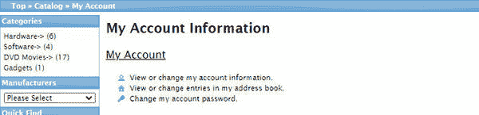

图 5.3：账户信息页面

- 这将带我们进入 `Change Profile` 页面。在该页面，我们看到输入元素 `text` 和 `radio`。

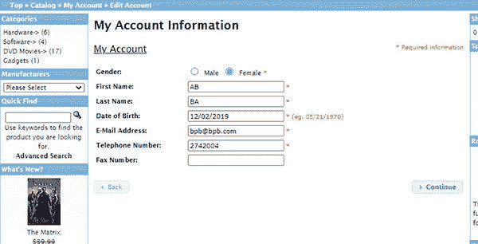

图 5.4：更改页面

我们可以编辑个人部分的任何信息；假设我们要修改 `Telephone Number`，如果选中了 `Male` 单选框，我们向前点击 `Female` 单选框，反之亦然。我们将清除字段内容，然后输入电话号码，并点击 `Continue` 按钮使更改配置操作完成。

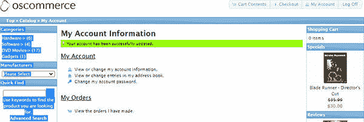

图 5.5：账户信息页面

- 我们现在可以点击 `Log Off` 链接并继续从账户注销，返回主页：

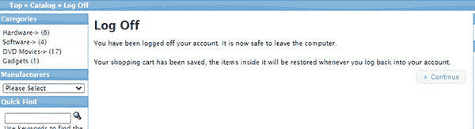

图 5.6：退出链接

在本章中，我们学习了自动化脚本中等待的需求、Selenium 中的等待类型以及如何实现。请注意，在所有这些步骤中，我们没有添加任何验证。Selenium 库默认不支持任何验证，因为那不是浏览器操作。为了将先前的场景添加验证并转换为测试用例，我们需要使用单元测试框架。我们可以选择 JUnit 或 TestNG。在接下来的章节中，我们将探索 TestNG 作为在使用 Java 作为编程语言使用 Selenium 创建测试自动化脚本时使用的单元测试框架。

## 问题

- 为什么我们的自动化脚本中需要同步？

- 解释隐式等待的含义以及如何实现？

- Selenium 中的 `ExpectedConditions` 类是什么？

- 当 `WebDriverWait` 失败时产生什么异常？

`tag` 包含其他 HTML 元素，其中是表格行（`tr`），每个表格行包含表格数据标签（`td`）和表头标签（`th`），它们的表示形式如下。关于此的更多信息可以从这里阅读。HTML 页面中的网络表格如下所示：

`<td>` 是我们在应用程序的 HTML 页面中看到的表格单元格。表格单元格的作用类似于 HTML 页面的 `body` 元素，这意味着它内部可以包含任何 HTML 元素。有时 `table` 标签也可以包含由 `<tbody>` 表示的表格主体。

```html
<table id="table1">
| 1 | 2 | 3 |
| 4 | 5 | 6 |
</table>
```

网页上的此表格将显示如下：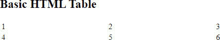 图 5.7：输出

我们发现 HTML 页面中通常使用 Web 表格以表格形式表示信息，看起来整洁有序。Web 表格可以包含静态信息，也可以在页面渲染时获取动态信息。这取决于 Web 应用程序。在本章中，我们将看到如何遍历 Web 表格，从每个单元格中获取信息并将其打印到控制台上。这是我们操作 Web 表格的示例之一；可能还有其他示例。其思想是理解如何处理它们，然后根据我们对自动化的需求来实现它。

为此，我们将查看应用程序的首页。我们看到产品如图像所示列出如下： 图 5.8：应用程序的首页

如果我们使用 Chrome 检查器（inspect）查看此处，我们将看到包含这些信息的 `table` 元素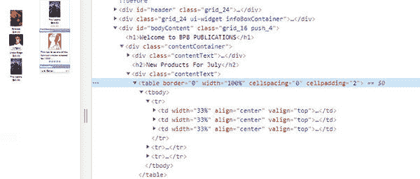 图 5.9：Chrome 检查

让我们看看此产品表中一个单元格中包含的信息：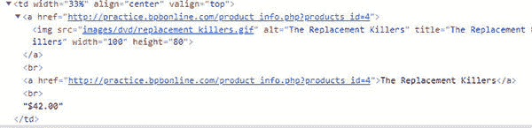 图 5.10：表格单元格的 HTML 内容

正如如图所示，表格单元格包含两个锚点标签（anchor tags）和一个显示产品价格的文本。一个锚点标签显示产品图像，另一个则带我们进入产品页面。在我们将编写的脚本中，我们将遍历此表格并打印表格内容。我们在脚本中将执行的步骤如下：

1. 使用 URL 打开 Web 应用程序。

2. 使用 HTML 标签属性识别 `table` 元素，因为页面上只有一个表格，且它不包含任何我们可以用于识别它的属性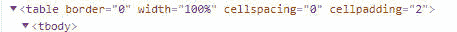 图 5.11：表格元素

3. 一旦获得 `table` 元素，我们将使用 `findElements` 方法查找标签并确定它包含多少行表格（table row），然后我们将取每一行，并仅使用 `findElements` 方法查找它包含多少个表格数据标签（table data tags/`td`）。

4. 一旦找到表格单元格，我们将将其文本内容打印到控制台上。

在这里，值得注意的是，HTML 页的 Web 表格工作原理类似于二维数组，和它一样，我们有行和列，我们需要两个循环来遍历它。

现在让我们来看下面的代码：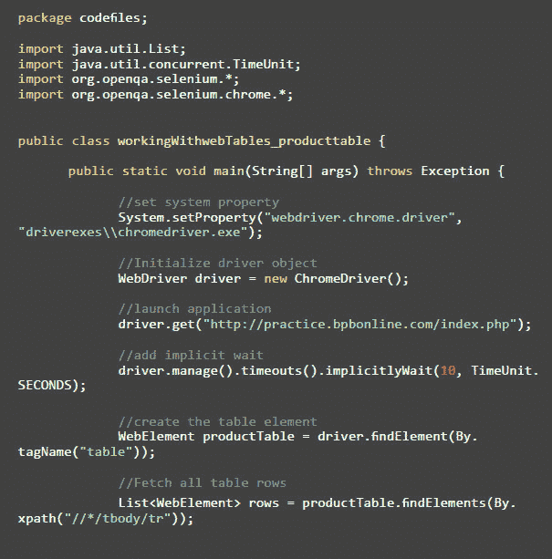 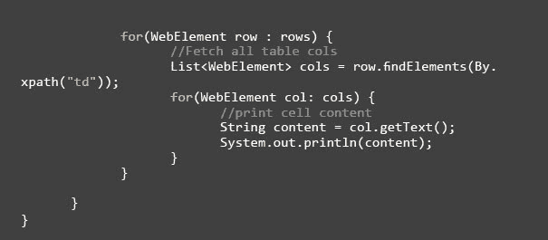

上一个程序的输出在控制台上打印了如下信息： 图 5.12：程序的输出

所以，在这里我们已经了如何处理 Web 表格并获取表格单元格中的内容。在本章的最后一节中，我们将讨论下拉列表元素（dropdown element）。

## 操作下拉列表

下拉元素使用 `<select>` 标签表示。它也是一个容器标签，并包含子标签 `<option>`。下拉列表的示例显示如下：图 5.13：下拉列表示例

当上述 HTML 在网页上渲染时，它的显示如下：图 5.14：下拉列表 HTML 视图

要了解更多关于下拉元素的信息，请参考[相关文档]。Selenium 中的下拉元素不是使用 `WebElement` 接口处理的。相反，下拉元素有其单独的类，称为 `Select` 类。它的详情可以在此处查看：`https://www.selenium.dev/selenium/docs/api/java/org/openqa/selenium/support/ui/Select.html`

之所以使用单独的类是因为下拉元素关联了一些非常特定的操作，这些操作在其他 Web 元素中是不具备。为了理解这些操作，我们需要首先理解下拉元素的 HTML 信息。让我们再次查看之前的下拉 HTML：图 5.15：下拉列表的 HTML 内容

正如我们在 HTML 代码中所示，`<select>` 标签是一个父标签，其中存有子标签 `<option>`。`<option>` 标签包含一个名为 `value` 的字段，并与它关联了一个文本。这就是我们在网页上看到的文本。例如，代码 `<option _="" span="">value="japan">JAP</option>` 在网页上显示为 `JAP`。但在后端，这是与它关联的信息。记住这一点，我们将查看 `Select` 类提供的提供的不同方法，并在代码层面查看其中一些。

表 5.2：`select` 类提供的提供的不同方法

# 第 6 章：操作 WebElement—警报框（Alert）、框架（Frame）、IFrame 和窗口（Window）

在前一章中，我们学习了对不同类型 HTML 元素的处理，例如输入元素、Web 表格和下拉列表元素。在本章中，我们将学习如何自动化处理 JavaScript 警报框（也称为弹出窗口）、`Frame` 元素、`IFrame` 元素、HTML 窗口以及 `action` 类，后者用于处理高级的鼠标和键盘操作。

## 结构

本章分为以下部分：

- 操作 JavaScript 警报框

- 操作 Frame 和 IFrame 元素

- 操作 HTML 窗口

- 操作 action 类

## 目标

阅读本章后，你将能够：

- 使用 Selenium 中的 `Alert` 类处理弹出窗口。

- 与 `IFrame` 元素工作。

- 自动化打开新窗口的场景。

## 操作 JavaScript 警报框

JavaScript 警报框或弹出窗口出现在各种应用程序中。这些弹出窗口可以提供信息或请求用户操作。在处理弹出窗口之前，我们无法在应用程序上进行任何操作。JavaScript 警报框有三种：

- Alert 框（Alert box）

- 确认框（Confirm box）

- 提示框（Prompt box）

Alert 框用于向用户提供信息，用户通常通过点击 `OK` 按钮来处理 图 6.1：Alert 框

确认框用于用户验证或拒绝某操作。它通常有一个 `OK` 或 `Cancel` 按钮。用户可以通过点击来处理它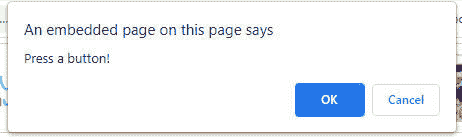 图 6.2：确认框

最后，提示框用于我们需要用户提供某些信息的情况。用户必须输入内容，然后点击 `OK` 或 `Cancel` 按钮 图 6.3：提示框

为了处理这些警报，Selenium 中有一个名为 `Alert` 的单独接口。详情位于：`https://www.selenium.dev/selenium/docs/api/java/org/openqa/selenium/Alert.html`

`Alert` 接口有四个方法，如下表所示：表 6.1：接口的方法

为了理解警报的处理，我们将从 internet Heroku 应用程序查看它们的工作。在该网站上找到所有的警报。为了处理第一种 Alert 框，我们将执行以下操作：

1. 使用 URL 打开应用程序：`https://the-internet.herokuapp.com/javascript_alerts`

2. 点击图中所示按钮 图 6.4：弹出式确认框

3. 处理弹出的警报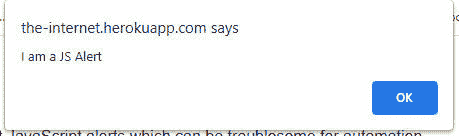 图 6.5：第一种 Alert 框

4. 如果警报已处理，我们将在网页上获得成功消息 图 6.6：页面上的消息

5. 让我们查看处理 Alert 框弹出式的步骤代码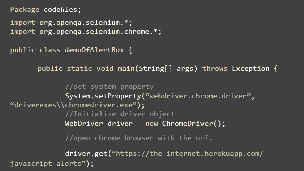 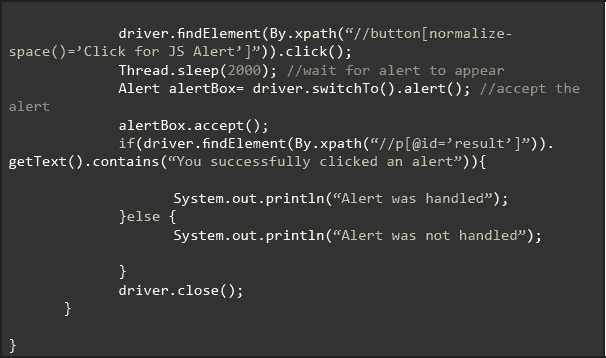

现在让我们操作弹出式确认框。执行确认框的步骤如下：

1. 使用 URL 打开应用程序：`https://the-internet.herokuapp.com/javascript_alerts`

2. 点击第二个按钮 图 6.7：弹出式确认框

3. 在此处，通过点击 `Cancel` 按钮消除警报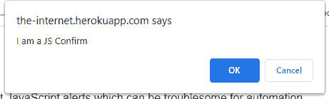 图 6.8：消除 Alert 框


4. 如果警报被消除，我们的网页将显示以下消息：


图 6.9：消除 Alert 框获得的消息

5. 让我们查看实现上述语句的脚本：

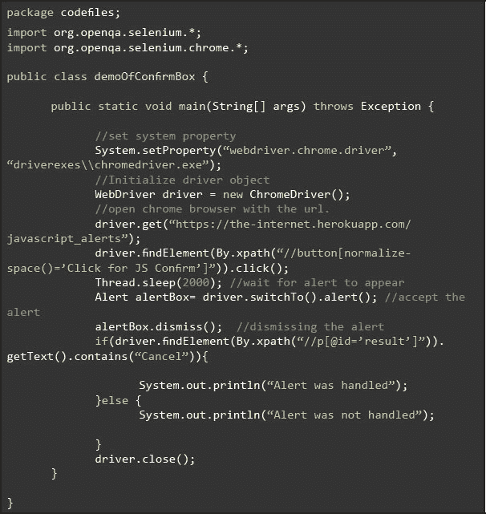

在最后类型的警报处理中，我们将操作提示框。为此，我们将执行以下步骤：

1. 使用 URL 打开应用程序：`https://the-internet.herokuapp.com/javascript_alerts`

2. 点击第三个按钮。

   

   图 6.10：最后类型的警报处理

3. 我们在此获取与警报相关的文本，并向其发送文本 `Hello how are you`。

   

   图 6.11：获取与警报相关的文本

4. 我们最终接受警报，并在警报关闭后看到发送到提示框的消息。

   

   图 6.12：获得的结果

5. 让我们编写处理上述步骤的代码。

   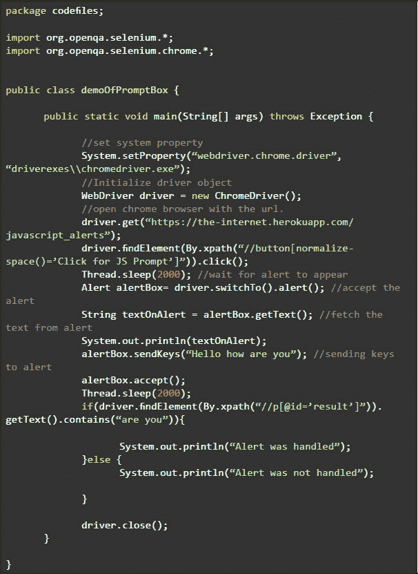

## 操作 Frame 和 IFrame 元素

`frame` 对象允许我们将 HTML 分为多个部分，每个部分内部都可以有一个网页。HTML 5 不再支持 `frame` 标签；相反，我们将使用 `IFrame` 标签。`IFrame` 标签被称为内联框架（inline frame），允许我们在当前文档中嵌入另一个 HTML 页面。

HTML 中的示例如下：

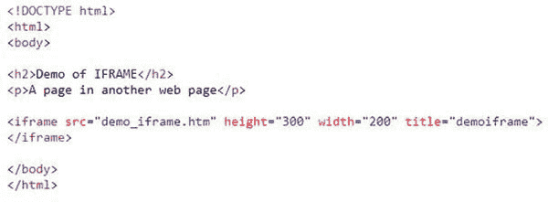

在浏览器中，网页将显示如下：


图 6.13：显示 IFrame 的网页

如果我们有一个包含 `IFrame` 的 HTML 页面，我们首先必须使用 `driver.switchTo()` 命令将焦点切换到 `IFrame`。一旦驱动指向 `IFrame`，我们现在就可以访问并操作内部的 Web 元素。为了演示，我们将使用 Internet Heroku 提供的 `IFrame` 示例。应用程序的 URL 为：`https://the-internet.herokuapp.com/iframe`

1. 使用 URL 打开应用程序：`https://the-internet.herokuapp.com/iframe`

2. 页面启动后，获取页面上 WYSIWYG 编辑器显示的内容。

   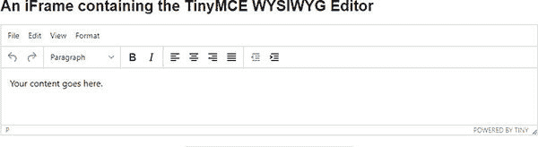

3. 使用 `frame` 标签定位到 `IFrame` 后，其工作如下：

   

4. 为了处理 `IFrame` 内部的内容，我们将使用 `frame` 标签。

   

   图 6.15：IFrame

5. 让我们查看处理位于 `IFrame` 内部的 Alert 框弹出式的上述步骤代码。

   

6. 让我们使用 `frame` 标签定位到 `IFrame`，其工作如下：

   

