# Java Selenium 初学者指南：使用 Java Selenium 进行浏览器自动化测试，第一版

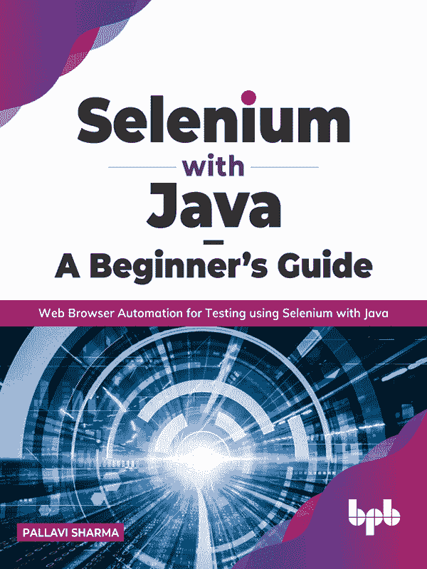


[www.bpbonline.com](http://www.bpbonline.com)

# 献给

**Neeal** 和 **Maisha**

&&

**Dr Neelaksh** 和 **Dr Manju**

我的孩子们，他们让我继续看到生活的奇迹。

以及我的父母，因为有他们才有了我。

# 关于作者

**Pallavi Sharma** 是一位多才多艺的专业人士。她的职业生涯开始于 `Virginia Tech` 的 `Dr Naren Ramakrishnan` 之后担任研究学者，在那里她参与了用于生物信息学的数据挖掘项目。

在 `Crestech Software Systems`，她是 `CEO` 旗下卓越中心团队的一员，负责为交付团队提供尖端解决方案。她曾工作过 `Selenium`、`Watir`、`RFT`、`JMeter`、`LoadRunner`、`Rational Robot` 等工具。

她管理着内部产品 `OpKey` 的开发团队、测试团队、支持部门、预售、营销和技术写作团队。她还管理公司的专利和商标部门。

2014 年，她创立了 `5 Elements Learning`，在那里指导人们学习 `Selenium`、`Appium`、`Cucumber` 生态系统（包括测试自动化项目的技术栈）。她教授使用 `Java`、`Python`、`CSharp` 和 `Ruby` 等编程语言。她教过来自全球的超过 1000 人。她还是 `Udemy` 的讲师，拥有超过 2 万名粉丝，并为测试人员主持了许多付费和免费课程。

她继续活跃于各类全球会议，如 `Selenium Summit`、`APISummit Delhi Software Testing Conference`、`Selenium India Conference`、`Global Testing Retreats`。她曾以`评审`、`组织委员会成员`和`演讲者`的身份参加。

她非常感谢能得到 `Michael Bolton` 和 `Maaret Pyhäjärvi` 在`探索测试（Explor Testing）`概念方面的指导和教学。

自 2021 年以来，她是 `Agile Testing Alliance` 的指导委员会成员，也是长期的顾问委员会成员。她的工作涉及设计关于各种全球自动化认证的课程、组织会议，并带领团队处理 `Agile Testing Alliance` 的社交媒体运营。

她是 `BPB publications` 的出版作者。她的第一本书 `Selenium with Python A beginner's book` 是亚马逊该类别中排名前 10 的书籍之一。她的第二本书 `Selenium 4 – A Quick and Practical Guide` 已在 `LeanPub` 上架。

她相信对自己的学习成果进行认证，持有多种认证，如 `ISTQB`、`CP-SAT`、`CP-WST`、`CP-DOF`、`Cucumber School Completion`、`SpecFlow` 等。

她是一个热心的读者、旅行者和内心的作家。她喜欢小说、非虚构类，以及根据自己的生活经历创作诗歌和短故事。她在 `Medium` 上分享作品，可以通过 [`medium.com/@pallavimuse`](https://medium.com/@pallavimuse) 找到她。

她是更大利益的信者，喜欢以身作则。她将资源投入到 `eVidyaloka`、`People for Animal`、`WildLife SOS` 和 `Jabarkhet` 森林保护区等组织。

# 关于评审员

**Jaya Saini** 在自动化测试和 API 测试方面拥有 6.5 年的经验，使用 `Selenium`、`TestNg`、`Robot Framework`、`Postman` 等工具以及 `Java`、`JavaScript`、`Python` 等编程语言。`Jaya Saini` 在 Alwar 的 `Rajasthan Technical University` 获得计算机科学与工程学士学位。她曾就职于 `Sopra Banking` 和 `Thinksys software`。目前在 Noida 的 `Thinksys software` 担任自动化测试负责人。

# 致谢

感谢几位在我写书期间提供持续支持的人。首先，我要感谢 `Selenium` 的创始人 `Jason Huggins` 以及 `Selenium Webdriver` 的创始人 `Simon Stewart` 的创造。感谢 `Selenium` 项目和社区背后的人，他们持续为该项目工作并向世界提供服务。

如果您在某个领域拥有专长，并对编写或为书籍贡献感兴趣，请访问 [`www.bpbonline.com`](http://www.bpbonline.com/)。我们已经与成千上万像您这样的开发者和技术专业人士合作，帮助他们与全球技术社区分享他们的见解。您可以提交通用申请、申请我们正在招募作者的特定热点，或提交您自己的想法。

*   Selenium 主要组件
    *   Selenium WebDriver
*   为什么 Selenium 流行
*   对作为浏览器自动化工具的 Selenium 有初步了解。

这种丰富的功能集在以前很罕见，在目前许多可用的 Web 应用程序商业、免费和开源测试自动化解决方案中仍然很罕见。另一个原因是开源工具提供的灵活性。它们天生就具有根据你的项目需求进行调整的能力，而不是强迫你在工具的严苛边界内进行调整。此外，获取 `Selenium` 的成本为零。该工具是免费提供的。`Selenium` 变得广泛流行的最重要因素之一是其背后强大的用户社区，该社区仍然非常活跃，可以在此处找到——`https://groups.google.com/forum/#!forum/selenium-users`

# Selenium 的组件

Selenium 目前有三个主要组件，旨在解决以下三个重要标准：

* Selenium IDE
* Selenium Grid

下表解释了每个组件的作用：

| 组件 | 用途 |
| --- | --- |
| Selenium IDE | 它主要用于录制和回放。当前版本的 `selenium ide` 可以同时用于 Firefox 和 Chrome 浏览器。当前版本的 `Selenium IDE` 由 `Applitools` 组织支持，其开发和维护最重要的贡献者是 `Dave Haeffner`。关于他以及 `Applitools` 的更多信息请在此处——[`applitools.com/blog/team-dave-haeffner/`](https://applitools.com/blog/team-dave-haeffner/) |
| Selenium Grid | 该组件允许并行执行测试。它使用了 `Selenium` 的 `selenium remote control` 组件，然后我们将其设置为两种模式：`hub mode`（中心模式）和 `node mode`（节点模式）。这允许我们同时在不同的节点上并行运行不同的测试。 |

**表 1.1:** Selenium 组件的用途

# Selenium 背后的人

Selenium 背后有很多人；确切地说，它是一个很好的范例，由社区驱动和维护，而不是由他们推广。它于 2004 年由 `Jason Huggins` 在 `ThoughtWorks` 组织作为一个工作项目开始，并已向世界开源。关于其使用、适配以及它所经历的各种形态的良好历史，可以在此处查看 [`www.selenium.dev/history/`](https://www.selenium.dev/history/)。

`Selenium IDE` 最初由日本的 `Shinya Kasatani` 创建，后来被 `ThoughtWorks` 的 `Mike Williams` 接手，现在该项目由 `Applitools` 组织、`Dave Haeffner` 以及团队支持并维护。

Google 开始在内部使用 `selenium grid` 并在 `GTAC` 会上公布了这一点；这是由 `Jennifer Bevan` 完成的，她最终成为了 `Selenium` 项目的贡献者之一。`Haw-Bin Chai` 是 `Selenium` 中 `locators UI-Elements` 概念背后的人。我们现在也知道 `Simon Stewart`，他是 `WebDriver` 的想法，现在是我们所知的 Selenium 的奠基人。

## 结论

在本章中，我们介绍了 `Selenium` 这一用于 Web 浏览器自动化工具。我们看到了与其相关的不同组件以及与其开发相关的不同人员。我们还理解了它如此流行的原因。在接下来的章节中，我们将讨论 `Java` 中的 `Selenium API`。

## 问题

1. Selenium 是一个工具还是多个工具组合在一个名称下？
3. 当 `Jason Huggins` 在 `ThoughtWorks` 工作创建它时，Selenium 被称为什么名字？
5. 为什么 Selenium 流行？

# 第 2 章

## 准备被测系统和应用程序

在本章中，我们将在系统上安装 IDE `eclipse`。我们将仅采用 `Windows` 系统。在将 `eclipse` 设置为脚本集成开发环境后，我们将在项目中设置 `Selenium jar` 文件，以便当我们使用 `Java` 作为语言编写程序时，我们的环境能够解析它们。在浏览器中运行测试之前，我们还需要为相应的浏览器设置驱动程序，因此在本章中，我们将学习这一点。在接下来的章节中，我们还将看到如何创建一个 `Maven` 项目并使用它在运行时管理依赖项。但目前，我们将采用前述的方法。

在本章中，我们还将看到将用于探索 `Selenium` 的应用程序。我们将查看提供的一些场景。此外，我们还将探索其他 Web 应用程序，我们将使用这些应用程序的场景来理解 `Selenium` 的概念。

## 结构

在本章中，我们将讨论以下主题：

* 在系统上设置正确的 `eclipse` 版本
* 设置 `Selenium jars`
* `BPB` 应用程序流程演示
* 创建 `Java` 项目
* 如何设置浏览器驱动
* 了解其他应用程序

## 设置 eclipse

在我们在系统上下载和设置 `eclipse` 之前，我们需要确保已安装了 `Java`。我们需要的 `Java` 版本是 8。为了安装它，我们需要访问链接——`https://www.oracle.com/java/technologies/javase8-downloads.html`。根据我们的操作系统，我们将下载相应的文件——`https://www.oracle.com/java/technologies/javase8-downloads.html`。

下载完成后，我们将在系统上安装并设置 `Java JDK`。

Eclipse 是著名的 IDE（集成开发环境），用于使用各种语言创建项目。它支持 Java、Python、Ruby。它是由强大社区支持的开源 IDE。关于它的更多细节可以在此处找到——`https://www.eclipse.org/eclipseide/`。

我们将下载 `Eclipse Photon` 版本来设置 `Selenium 3.141.59` jars。为此，请访问此 URL——`https://www.eclipse.org/downloads/packages/release/photon/r`。

根据你使用的操作系统版本，下载 `Java Developers` 版 `Eclipse IDE`。

```
```

(images/Figure-2.2.jpg)

**Figure 2.2:** 创建工作区

```java
package packageHello;

public class helloWorld {

        // TODO Auto-generated method stub

    }
```

该程序的输出是——我们看到控制台窗口打印了 `Hello World`。

## 添加 Selenium jar 包

我们项目的下一步是添加 Selenium 的 jar 文件。我们将访问 URL——[`www.selenium.dev/downloads/`](https://www.selenium.dev/downloads/)，滚动到 Selenium client 和 WebDriver 语言绑定。当前的 beta 版本为 3.141.59，我们将下载它。


**图 2.7:** Selenium 客户端

一旦在系统中下载了 ZIP 文件，我们将解压它们。这些 jar 文件必须添加到我们的 eclipse 项目中。为此，我们将执行以下步骤：

1. 右键点击 Java 项目并选择 `Properties`（属性）。
   **图 2.8:** 项目属性
2. 下选择 `Java Build Path | Libraries | Add External Jars`，然后浏览系统中解压 Selenium jars 的文件夹。
   **图 2.9:** 添加 Selenium jars
3. 选择外部 jar，进入 `lib` 文件夹并将文件夹中的所有 jar 添加项目。
   **图 2.10:** 添加 Selenium jars
4. 一旦添加了 jar，我们的项目现在准备好编写 Selenium Java 程序了。
5. 在编写任何 Selenium 命令来驱动浏览器之前，我们应该准备好三个浏览器的驱动程序：Internet Explorer、Firefox 和 Chrome。

## 设置浏览器驱动

从 3.0 开始，Selenium 采用 W3C 标准来驱动浏览器，因此 chrome 需要提供 Chrome 驱动，Internet Explorer 需要提供 Internet Explorer 驱动，而 Firefox 提供 geckdriver。在理想情况下，系统中应该拥有最新的浏览器版本并随后下载相应的驱动程序。

首先，在系统中创建一个具有读写权限的文件夹。在该文件夹中，我们将从相应的网站下载三个驱动执行文件：

| 浏览器 | 版本 | 驱动—URL |
| --- | --- | --- |
| Chrome | Chrome version 83 | [`chromedriver.org/downloads`](https://chromedriver.org/downloads) |
| Internet Explorer | IEDriverServer 3.15.1 | [`www.selenium.dev/downloads/`](https://www.selenium.dev/downloads/) |
| Firefox | Geckodriver V0.26.0 | [`github.com/mozilla/geckodriver/releases`](https://github.com/mozilla/geckodriver/releases) |

**表 2:** 浏览器驱动

一旦下载了这些执行文件，将其从文件中解压并添加到如 `.exe` 文件所在的位置。将此文件夹添加到项目：

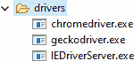

**图 2.11:** 浏览器驱动

我们现在准备好运行简单测试了。

## 应用程序概述

在整个课程，我们将使用一个应用程序进行练习。让我们首先理解工作流。应用程序是 [`practice.bpbon.com/`](http://practice.bpbon.com/)。

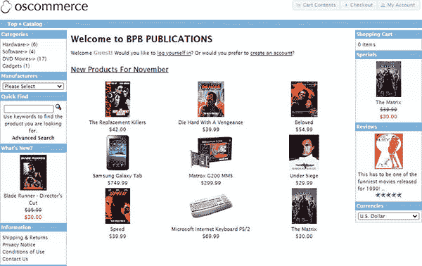

**图 2.12:** 应用程序

这是一个带有基本工作流的示例应用程序，如下：

* 用户注册
* 搜索产品
* 修改配置

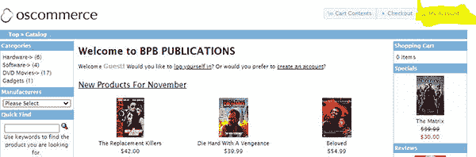

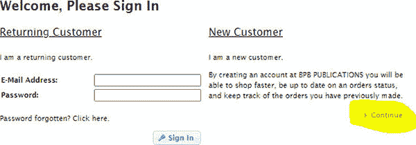

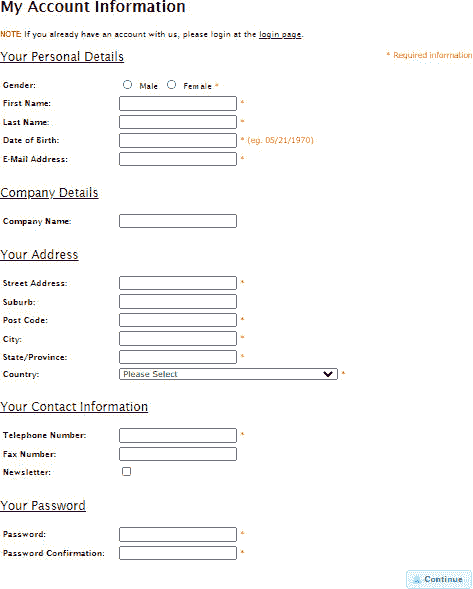

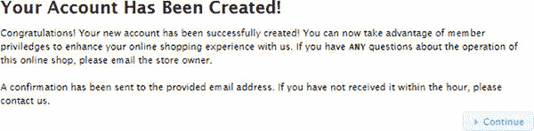

## 问题

2. 我们在本章中安装了什么版本的 Java？
4. Firefox 驱动程序的名称是什么？

## 关于 WebDriver 和 WebElement

* WebDriver 的方法
* 关于 WebDriver 的异常
* WebElement 的方法
* 关于 By 类
    * 理解定位器

* 理解什么是 `WebElement`，并使用其方法处理 Web 元素。
* 在项目中设置浏览器驱动程序。

`WebDriver` 接口为我们提供了方法，帮助我们控制浏览器相关的操作，如打开浏览器、关闭浏览器、管理窗口大小、超时事件等。正如我们在下一节详细讨论方法所示，我们将看到更多内容。

* 选择 Web 元素

`WebDriver` 接口为我们提供了方法，帮助获取当前页面标题、当前 URL 和页面上的内容。这些方法提供的信息与 Web 页面相关，也可以用于验证。

```java
System.setProperty("webdriver.driver.chrome", driverexes\\chrome driver.exe")
```

提供了 `chromedriver.exe` 文件在系统位置中的信息。

下一条命令——`WebDriver driver = new ChromeDriver();` 创建了 `ChromeDriver` 的实例。我们需要注意，为了使此语句生效，在代码文件中导入正确的库是非常关键的：

```java
import org.openqa.selenium.chrome.*;
```

| :--- | :--- |
| `navigate()` | 此函数用于导航到函数提供的页面。 |


| 方法 | 说明 |
|---|---|
| `quit()` | 此函数用于关闭用浏览器会话打开的所有浏览器窗口。 |
| `getTitle()` | 此函数返回当前标题的文本。 |
| `getWindowHandle()` | 此函数返回页面的当前窗口 ID。 |
| `manage()` | 此函数有多个用途。它允许浏览器窗口最大化、最小化。它还有助于隐式时间管理等。 |
| `findElements()` | 此函数返回与给定定位策略匹配的所有元素。 |

**表 3.2：** WebDriver 方法

我们将根据这些方法在浏览器上执行的动作的宽泛分类，来查看上述提到的方法。

## 控制浏览器

我们将查看的用于浏览器控制的方法有 `get()`、`close()`、`quit()`、`switchTo()` 和 `manage()`。我们将查看这些方法的代码片段并将其作为示例。正如我们所知，`get()` 方法允许使用给定的 URL 打开浏览器。`close()` 方法关闭打开的当前浏览器实例。`quit()` 方法关闭使用当前驱动打开的所有窗口，然后 `navigate()` 方法允许我们跳转到另一个 Web URL。`manage()` 方法有其他子方法；我们将看到它用于最大化浏览器的用法。让我们看一下尝试这些方法的代码片段。请注意，`close` 和 `quit` 之间的区别将在“额外概念”章节中处理，在那里我们将详细讨论浏览器的 `switchTo()` 方法以处理弹出窗口、框架或新窗口。现在，让我们看一些操作浏览器的方法：

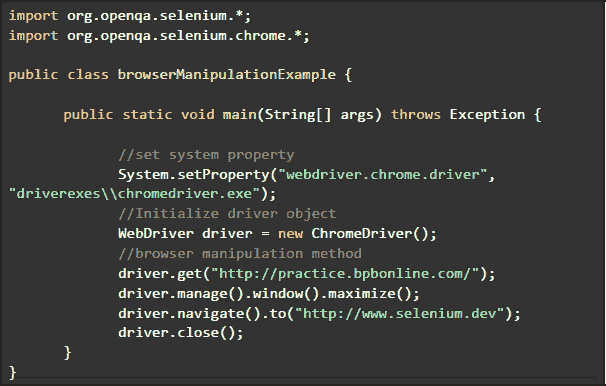

在这些代码中，我们看到了使用 `get` 方法通过 URL 启动浏览器；代码 `manage().window().maximize()` 将浏览器窗口最大化。下一条命令将导航到 Selenium 主网站，最后，`driver.close()` 将关闭浏览器。在下一节中，我们将修改前面的脚本，添加一些可以帮助打印页面相关信息的方法，如标题、`currenturl` 和页面内容。

## 页面信息方法

页面信息方法有 `getCurrentUrl()`、`getPageSource()` 和 `getTitle()`。这些方法将提供页面相关信息，我们可以利用这些信息来判断我们是否处于想要继续操作的正确页面上。这些方法还允许我们执行基于文本的验证，我们在页面内容中搜索文本。让我们来看以下代码片段：

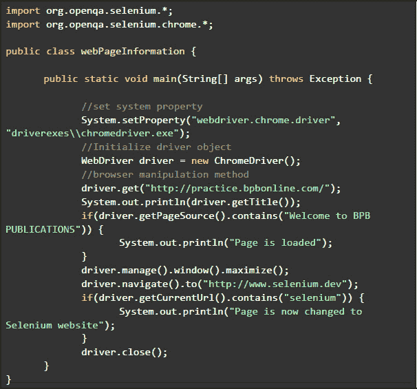

在前面的代码中，我们打开了应用程序的 URL，然后打印了页面标题。接着，我们搜索页面是否包含文本“Welcome to BPB PUBLICATIONS”。最后，我们想要查找跳转后的 URL 是否包含“Selenium”一词。前述代码的输出结果如下：

`BPB PUBLICATIONS`

`Page is loaded`

`Page is now changed to Selenium website`

在下一节中，我们将看到 `findElement` 方法和 `findElements` 方法的使用。

## 查找元素的方法

假设我们想在 BPB 应用的网页上识别 `My Account` 链接。为了执行此操作，我们需要使用 `WebDriver` 提供的 `findElement()` 方法。但我们还需要知道该方法接受一个输入参数。该方法接受的输入参数是一个 `By` 对象，它基本上提供了关于我们可以使用什么定位策略和数据来识别元素的信息。我们还需要理解该方法的返回值是一个 `WebElement` 类型的对象，我们可以在该对象上执行如 `click` 等操作，基本上实现点击 `My Account` 链接的自动化；让我们来看代码片段：

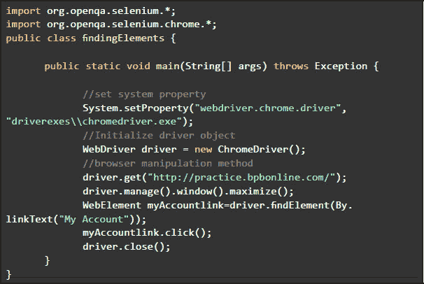

在前面的代码中，我们使用链接文本（link text）定位策略找到了 `My Account` 链接，其中我们将链接文本作为 `My Account` 传递。在下一节中，我们将使用 `findElements` 方法找到主页上所有的链接，并在屏幕上打印与它们相关的文本。代码片段如下：

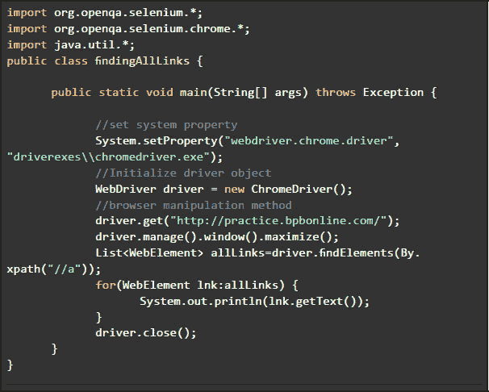

在前面的代码片段中，我们使用了 `xpath` 定位策略来查找网页上所有的链接。我们使用的 `findElements()` 方法会向我们返回找到的所有 Web 元素的列表。一旦找到，我们便使用 `WebElement` 提供的 `getText()` 方法来打印与该方法相关的文本信息。在下一节中，我们将看到 `WebElement` 的不同功能。

### WebElement 接口

Web 元素（Web element）是一个 HTML 元素，用于创建和帮助网页实现功能。这些元素也被称为 HTML 元素。HTML 元素是使用预定义的 HTML 标签创建的。它们可以是链接、表格、表单、按钮、文本框、图像等。根据我们所使用的 HTML 版本，我们可以获得一组新元素，这些元素现在也得到了 Web 浏览的支持。W3C 提供的最新版本是 [`www.w3.org/TR/html52/`](https://www.w3.org/TR/html52/)，即 HTML 5.2 版本。

**注意：** Web 元素的详细列表可以在此处找到：[`www.w3.org/TR/html52/semantics.html#semantics`](https://www.w3.org/TR/html52/semantics.html#semantics)

## WebElement 的通用结构

HTML 元素通常表示如下：

`<HTML TAG PROP=VAL PROP=VAL ..` > TEXT </HTML TAG>`

所以首先 HTML 标签开始，接着是一组属性-值对，然后 HTML 标签结束。正如之前讨论的，HTML 标签已经在 W3C 页面中预定义。通过这些 Web 元素，设计了网页设计，并通过其功能实现了业务目标。用于声明 Web 元素的属性有助于在页面上显示它们，稍后会被自动化工具用于在网页上唯一地识别它们。

## Web 元素的方法

每个 Web 元素都有与其相关的不同功能。某些用于演示目的；某些用于将信息分组。链接、图像等元素用于超引用其他页面或图像。其他如 `span` 和 `div` 等元素有助于创建叠加层。Selenium Web 元素接口库定义了不同的方法，我们可以在 Web 元素上使用这些方法来帮助我们实现操作中的业务场景。

**注意：** 关于 Web 元素方法的详情请见链接：[`www.selenium.dev/selenium/docs/api/java/org/openqa/selenium/WebElement.html`](https://www.selenium.dev/selenium/docs/api/java/org/openqa/selenium/WebElement.html)

在下表中，我们将看到各种声明方法的名称，以及当我们在脚本中使用它们时所解决的问题。

关于使用它们的方法及其返回值，请参考前一个注意事项中分享的链接。

让我们在下表中查看：

| 方法 | 目的 |
|---|---|
| `sendKeys()` | 在给定对象上输入内容，例如在文本框上输入文本。 |
| `getText()` | 获取与 HTML 对象相关的文本。 |
| `isEnabled()` | 此函数用于检查元素是否可用。 |
| `clear()` | 用于文本字段以清除其内容。 |
| `getTagName()` | 提供 HTML 对象的标签名称。 |
| `getRect()` | 返回元素的位置。 |
| `getCssValue()` | 返回与元素相关的 CSS 值。 |
| `findElements()` | 提供所有 Web 元素的列表。 |

为了理解 `getAttribute()`、`getTagName()`、`getText()`、`getRect()` 和 `getSize()` 等 get 方法的工作原理，我们将使用 BPB 应用程序首页上的快速查找（quick find）图标，并对其应用所有这些方法。让我们来看下面的代码片段：

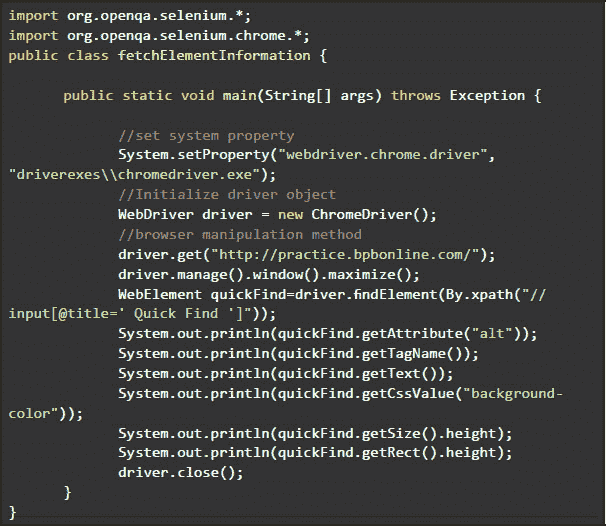

上述代码的输出获取了与 Web 元素 QuickFind 相关的各种信息，如下：

`Quick Find`

`input`

`rgba(0, 0, 0, 0)`

`17`

`17`

## 检查 WebElement 的状态

为了理解 `isSelected()`、`isEnabled()` 和 `isDisplayed` 方法的工作原理，我们将使用 URL—[`the-internet.herokuapp.com/checkboxes`](https://the-internet.herokuapp.com/checkboxes)，该页面显示两个复选框，我们将点击第一个并检查 `isSelected()` 在点击前后的值。

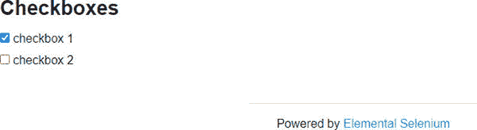

**图 3.3：** 复选框网页

我们将打印复选框中通过 `isEnabled()` 和 `isDisplayed()` 可的信息。让我们来看如下代码片段：

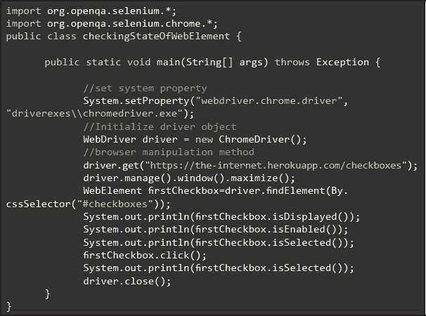

上述代码片段的输出如下：

`true`

`true`

`false`

`false`

在下一节中，我们将简要介绍处理 WebElement 对象时可能出现的异常类型。

## Web Elements 中的异常

在处理 Web 元素时，可能会遇到各种异常。最常见的异常是 `NoSuchElementElementException`。当我们尝试根据给定的定位器信息在网页上查找元素不存在时，就会产生此异常。另一个常见的 Web 元素特定异常是 `StaleElementReferenceException`。当页面刷新且元素状态不再与可用的驱动会话关联时，就会遇到这个问题。另一个常见的是 `ElementNotVisibleException`；这可以很容易追溯；如果我们查看元素的 HTML 属性，会发现它有一个被设为 true 的隐藏属性。此类元素的 `isDisplayed()` 也会返回 false。

**注意：** 关于 Selenium 异常的更多细节可以在此处找到：[`www.selenium.dev/selenium/docs/api/py/common/selenium.common.exceptions.html`](https://www.selenium.dev/selenium/docs/api/py/common/selenium.common.exceptions.html)

## 关于 By 类

在之前的节中，我们已经看到了可用的 WebDriver 对象方法和 WebElement 方法。使用这些方法，我们可以操作 Web 浏览器对象和页面的 Web 元素。为了操作页面上看到的 Web 元素，我们首先需要在页面上唯一地识别它们。By 类有助于识别网页上的对象。它使用了不同的位置定位机制，根据这些机制可以识别不同的 HTML 对象。每个 HTML 对象都是使用 HTML 标签和 HTML 属性定义的。每个 HTML 属性都要求带有一个与其关联的值。通过使用与 HTML 属性相关的信息以及定位器机制的各种技术，我们可以在网页上唯一地识别该对象。一旦唯一地识别了对象，我们就可以对其执行操作。

Selenium 允许识别对象的各种方式是使用 HTML 属性 `ID`、`NAME`。它还允许通过页面上的 XPATH 识别对象。我们还可以使用 CSS 选择器方法，最后，我们可以使用 DOM 方法来识别页面上的对象。

## By 类中的方法

Selenium Java 文档网站列出了与 By 类相关的各种方法：

| 方法 | 说明 |
|---|---|
| `static By className(java.lang.String className)` | 帮助通过 `class` 属性查找元素。 |
| `boolean equals(java.lang.Object o)` `WebElement findElement(SearchContext context)` | 返回找到匹配所用定位器的第一个元素。 |
| `static By id(java.lang.String id)` | 使用元素的 `id` 属性查找元素。 |
| `static By name(java.lang.String name)` | 使用元素的 `name` 属性查找元素。 |
| `static By xpath(java.lang.String xpathExpression)` | 通过查找元素在 HTML 文档中的 XPath 来查找元素。 |

**表 3.4：** By 类方法

## 理解定位器（locators）

让我们通过一个网页 HTML 代码段示例来理解定位器：

```html
```

### ID

```html
<button id="tdb5">Sign In</button>
```

`name` 定位信息也从 HTML 元素获取。Name 与 HTML 元素关联的属性。例如，在前面的代码段中，我们看到一个邮箱框和一个密码框；对于这两者的识别，我们可以使用 name 定位器。

- 邮箱：`driver.findElement(By.name("email_address"))`

`xpath` 信息源于到达感兴趣 HTML 元素所经过的路径。它主要用于 XML 文档，但我们可以将 HTML 页面视为 XML 页面，然后创建到达所选元素的路径。XPath 可以是两种类型：

- 绝对 XPath
- 相对 XPath

```xpath
//input[@name="email_address"]
//form/table/tr[1]/td[2]/input
```

创建 XPath 的语法是：`//htmltag[@prop=value]`。

而绝对 XPath 始终从 HTML 节点开始：`/html/tag1/tag2/tag3…`。

XPath 也可以使用关键字 `contains` 来创建。我们可以使用任何属性甚至文本来创建此 XPath。例如，对于登录按钮，XPath 的创建方式如下：

```xpath
```

创建的 XPath 定位器信息为：`driver.findElement(By.xpath("path"))`。

### CSS


### DOM

- `NoSuchAttributeException`：当找不到元素中使用的属性时，会发现此异常。

2. 我们在本章中安装了什么版本的 Java？
4. Firefox 的驱动程序名称是什么？
6. Web 元素的通用结构是什么？
8. 为什么会得到 `NoSuchElementException`？
10. `findElement()` 和 `findElements()` 方法的区别是什么？（注：原文重复）
12. 你将如何使用类名在运行时获取对象？

# 第 4 章

## 同步概念

在上一章中，我们最终实现了对 Selenium 库中三个重要支柱的知识学习，并在 Chrome、Firefox 和 Internet Explorer 三种浏览器上通过练习应用程序的 URL 实现了浏览器的自动化启动。当我们学习 Selenium 的支柱时，理解测试自动化的一个主要支柱——同步（Synchronization）是非常重要的。在本章中，我们将理解脚本执行与应用程序处理命令保持同步的概念及其重要性。让我们开始吧。

## 结构

本章分为以下章节：

- 什么是同步，以及为什么重要
- 如何实现隐式等待（implicit wait）
- 如何检测可能存在同步问题的脚本

## 目标

学习本章后，你应该能够识别脚本中需要等待的地方，并相应地添加隐式等待或显式等待。你还需要能够识别脚本是否由于同步问题而失败，并修复它。我们还可以在决定在何中使用同步。

## 理解同步及其重要性

同步的字典含义是两个或多个事物同时进行的活动。当我们没有工具帮助而自己执行场景时，我们可以根据 Web 应用程序的速度来同步我们的操作，因为我们可以利用认知能力判断是否应该等待操作完成还是继续执行指令。

- 页面加载了，但文本字段不存在。
- 由于网络连接中断，页面未加载。

当人类测试人员在现场执行上述步骤时，如果遇到不顺意的情况，能够采取适当行动，并判断遇到的情况是应该记录为缺陷（defect），还是应该继续等待页面加载，或者因为网络问题导致网站无法运行而向 Web 管理员报告问题。但当脚本取代人类测试人员时，我们必须在其中构建某些认知能力，使其能够在上述情况下采取恰当行动，正如我们预期具备认知能力的人所做的那样。此外，这里采用或强制执行的方法之一是，首要任务可能是处理好这两个独立进程之间的同步。

当我们使用工具驱动浏览器并在 Web 应用上执行操作时，会有两个独立的过程发生。这里使用的工具 `Selenium` 将执行命令驱动 Web 浏览器并在 Web 应用上执行操作，而 Web 应用将根据其处理速度执行这些操作。如果我们不对这两个进程进行同步，我们的脚本将会失败，导致无法有效且可靠地执行脚本来测试应用程序。原因在于，从脚本来说，`Selenium` 会尝试识别 Web 页面上的元素，但由于上述不顺意情况中列出的各种原因，对象或页面本身可能尚未加载，导致与我们编写的测试脚本产生不一致的行为。

在接下来的章节中，我们将学习如何在脚本中实现同步，以确保两个独立进程能够感知彼此的存在。

## 同步类型

到目前为止，我们学习了同步的重要性。在本节中，我们将学习如何在测试脚本中实现同步以及其实现方法。方法如下所示：

- 隐式等待 (Implicit wait)

2. 点击 `My Account` 链接。
4. 点击 `Sign in` 按钮。
6. 点击 `Continue` 按钮

根据上述步骤，我们在浏览器上启动应用程序并点击 `My Account` 链接（如图所示）。


**图 4.3：** 应用程序首页

然后我们提供有效的用户名和密码信息，并如图所示点击 `Sign In` 按钮。

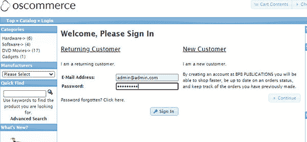

如果信息正确，我们将看到如图所示的 `My Account Information` 页面：

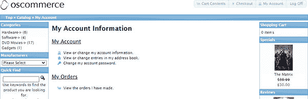

**图 4.5：** 登录后的页面

在这里，我们随后点击 `Log Off` 和 `continue` 按钮返回首页：

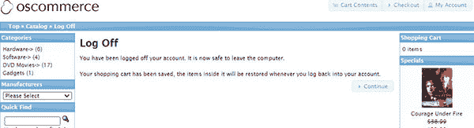

**图 4.6：** 应用程序的注销页面

在上述场景中，我们需要注意在对不同元素执行操作时应用程序页面的变化。例如，如果我们点击 `My Account` 链接，将进入一个需要填写用户名和密码信息的页面。当我们点击登录按钮时，将进入 `My Account Information` 页面，在那里我们可以看到注销链接。我们点击注销链接并看到 `continue` 按钮，点击它后，我们就返回了首页。

在每一步操作中，我们的脚本都必须变得“智能”，以等待元素的出现。如果元素在给定的时间内没有出现，则抛出 `Time Out` 异常并结束执行。我们将看到的第一种等待是隐式等待，它被引入脚本并作用于脚本中的每条语句。它也被称为全局等待。之后，我们将看到显式等待，它被称为局部等待，并引入脚本中比设置全局时间需要更多等待的地方。正如之前提到的，我们不一起使用这些等待，因为它们可能会相互干扰。因此，当我们使用显式等待时，我们将隐式等待时间设置为 0。

## 实现隐式等待

为了实现隐式等待，我们使用以下命令：

```bash

```

```java

```

在这里，`driver` 是 `ChromeDriver` 的实例，并使用了它的方法 `manage`。`manage` 方法拥有 `timeouts`，我们在其中选择了 `ImplicitWait` 选项。我们传递给此方法的参数是我们想要使用的时间单位以及该单位的数量。因此在这里，我们选择隐式等待 10 秒。使用的命令将适用于脚本中写的每条语句。它将等待元素出现最多 10 秒；如果在 10 秒内元素出现，它将执行操作并移动到脚本中的下一条语句。如果由于某些原因元素不可用且过了 10 秒，这种情况将导致 `TimeOut` 异常。

让我们看看以下使用隐式等待的登录脚本：

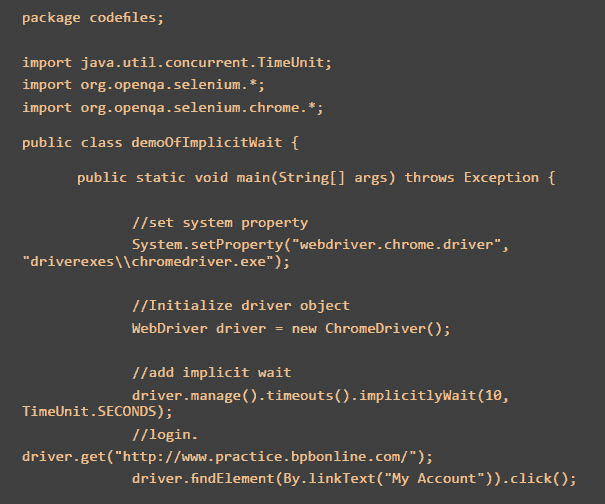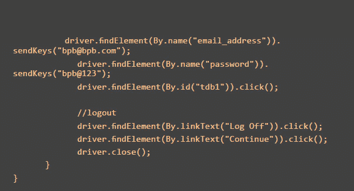

## 实现显式等待

为了实现显式等待，我们将使用 Selenium 的 `WebDriverWait` 接口和 `ExpectedConditions` 接口。在继续之前之前，让我们先谈谈这两个实体。

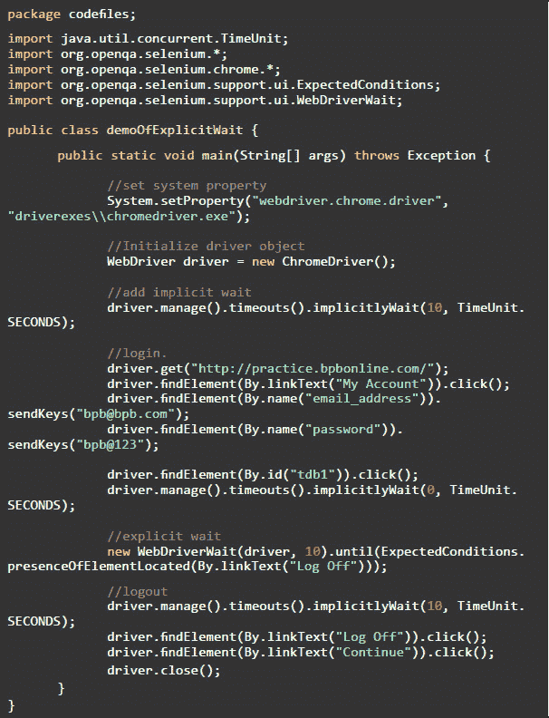

在前面的代码中，我们应该注意到，在使用 `WebDriverWait` 之前，我们将隐式等待设置为 0，在显式等待使用结束后，我们将其设回 10 秒。这里我们需要注意的是，在代码中不应同时使用隐式等待和显式等待。如果我们正在实现显式等待，会将隐式等待设置为 0。这样做的原因是这些等待可能会相互干扰，并导致我们代码中出现运行时执行问题。

## 遇到异常

由于我们在 Selenium 中使用了两种等待命令，我们可能会遇到以下异常：

`No Such Element Found` 和 `TimeOutException`。`NoSuchElementFound` 异常出现在脚本使用给定的定位技术等待元素在页面上出现，但在给定的持续时间内无法找到它时。`TimeOutException` 在脚本无法通过给定的定位器找到元素时生成，这导致了 `NoSuchElementFound` 异常，进一步调用 `TimeOutException`，因为我们无法在规定时间内找到该元素。因此，预期条件方法 `presenceOfElementLocatedBy`（如下文所示）会抛出 `NoSuchElementFound` 异常，进而导致超时异常的发生。

为了验证这一点，我们可以特意尝试使用链接文本 JUNK 查找链接。由于 JUNK 不存在，在使用 `WebDriverWait` 等待 10 秒后，我们将看到 `TimeOutException`，其内部生成是因为该元素不存在。

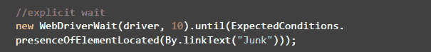

如下述脚本所示抛出的异常：

```
Exception in thread "main" org.openqa.selenium.TimeoutException: Expected condition failed: waiting for presence of element located by: By.linkText: Junk (tried for 10 second(s) with 500 milliseconds interval)

at org.openqa.selenium.support.ui.WebDriverWait.timeoutException(WebDriverWait.java:95)

at org.openqa.selenium.support.ui.FluentWait.until(FluentWait.java:272)

at codefiles.demoOfExplicitWait.main(demoOfExplicitWait.java:33)

Caused by: org.openqa.selenium.NoSuchElementException: no such element: Unable to locate element: {"method": "link text", "selector": "Junk"}

(Session info: chrome=90.0.4430.212)
```

## 结论

因此，在本章中，我们学习了自动化脚本中等待的必要性、Selenium 中的等待类型以及我们如何实现它们。

在接下来的章节中，我们将讨论如何处理不同类型的 HTML 元素，如表单元素、Web 表格和下拉元素。

## 问题

1. 为什么自动化脚本中需要同步？
2. 解释隐式等待的含义以及它是如何实现的？
3. Selenium 中的 ExpectedConditions 类是什么？
4. 当 WebDriverWait 失败时会抛出什么异常？

# 第 5 章：处理 Web 元素——表单、表格和下拉列表

在早的章节中，我们讨论了 Selenium 库、使用它们提供的处理浏览器、Web 元素以及创建定位器的可用方法。我们还讨论了如何使用等待的概念来确保脚本的可靠性，同时兼顾执行速度。在本章中，我们将讨论如何处理不同的 HTML 元素、我们在自动化过程中对它们执行的操作类型，以及 Selenium 如何允许我们处理这些元素。我们将在第一部分讨论表单 HTML 元素、Web 表格元素和下拉列表。

## 结构

本章分为以下部分：

- 处理文本框、单选按钮、复选框等表单元素
- 处理 Web 表格元素
- 处理下拉列表元素

## 目标

学习本章后，你将能够执行以下操作：

- 自动化处理表单 HTML 元素
- 理解并处理 Web 表格元素
- 理解并处理下拉元素

## 处理表单元素

表单（Form）是一个 HTML 标签，包含不同类型的 HTML 元素。表单元素用于 HTML 网站中捕用户输入。信息通常被发送到服务器进行后续处理。HTML 中的表单元素表示为 `<form>`，它作为文本框、单选按钮、提交按钮、复选框等不同元素的容器。所有这些元素都用 HTML 标签 `<input>` 表示。不同类型的输入元素如下：

| 类型 | HTML 信息 | 描述 |
| :--- | :--- | :--- |
| Text | `<input type="text">` | 显示文本输入框。 |
| Radio | `<input type="radio">` | 显示单选按钮。 |
| Checkbox | `<input type="checkbox">` | 显示复选框。 |
| Submit | `<input type="submit">` | 显示提交按钮。 |
| Button | `<input type="button">` | 显示按钮。 |

**表 5.1：不同的输入元素**

在我们的练习应用中，修改资料（change profile）场景我们将看到 5.1 中的大部分输入元素。让我们探索该部分。对于修改资料场景，我们需要执行以下步骤：

1. 使用 URL 打开应用程序：[`practice.bpbonline.com/index.php`](http://practice.bpbonline.com/index.php)。
2. 点击如图 5.1 所示的 `My Account` 链接：
   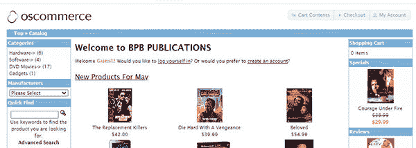
   **图 5.1：我的账户链接**
3. 在 `Sign In` 页面提供登录详情：用户名为 `bpb@bpb.com`，密码为 `bpb@123`。点击如图 5.2 所示的 `Sign In` 按钮：
   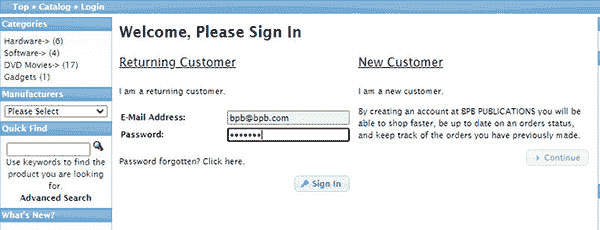
   **图 5.2：登录页面**
   在前面的图中，我们看到了以下输入元素：文本和密码。
4. 登录后进入`Account Information`页面。在这里，我们需要点击显示 `View or change my account information`（查看或更改我的账户信息）的链接：
   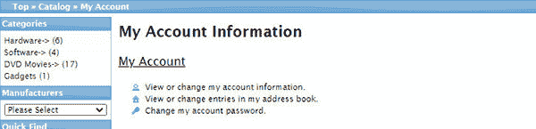
   **图 5.3：我的账户信息页面**
5. 这带我们进入`Change Profile`页面。在该页面上，我们看到了输入元素文本和单选按钮。
   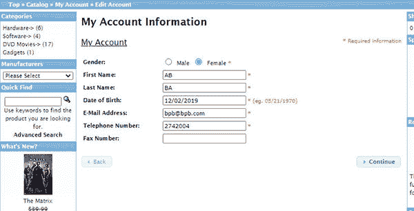
   **图 5.4：修改资料页面**
6. 我们可以编辑个人资料部分的任何信息；假设我们想修改 `Telephone Number`（电话号码）和 `Gender`（性别）。如果选择了 `Male`（男）单选按钮，我们直接点击 `Female`（女）单选按钮，反之亦然。我们将清除该字段的内容，输入电话号码，然后点击 `Continue`（继续）按钮完成修改个人资料的操作。

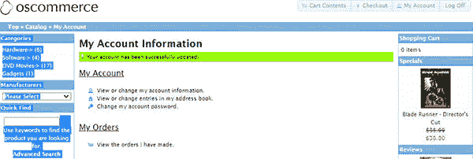

**图 5.5:** 我的账户信息页面

7. 现在我们可以点击 `Log Off`（退出）链接并继续注销账户，返回首页：

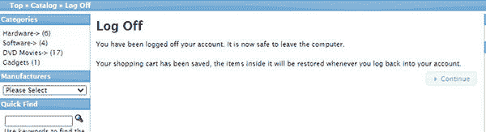

**图 5.6:** 退出链接

请注意，在所有这些步骤中，我们没有添加任何验证逻辑。Selenium 库默认并不具备任何验证支持，因为那不是浏览器操作。要为前面的场景添加验证并使其成为一个测试用例，我们必须使用单元测试框架。我们可以选择 `JUnit` 或 `TestNG`。在接下来的章节中，我们将探索使用 `TestNG` 作为单元测试框架，在使用 `Java` 作为编程语言通过 Selenium 编写测试自动化脚本。目前，我们将简单地使用 `If` 条件语句来验证操作是否完成，并在控制台上打印消息，如下所示脚本所示：

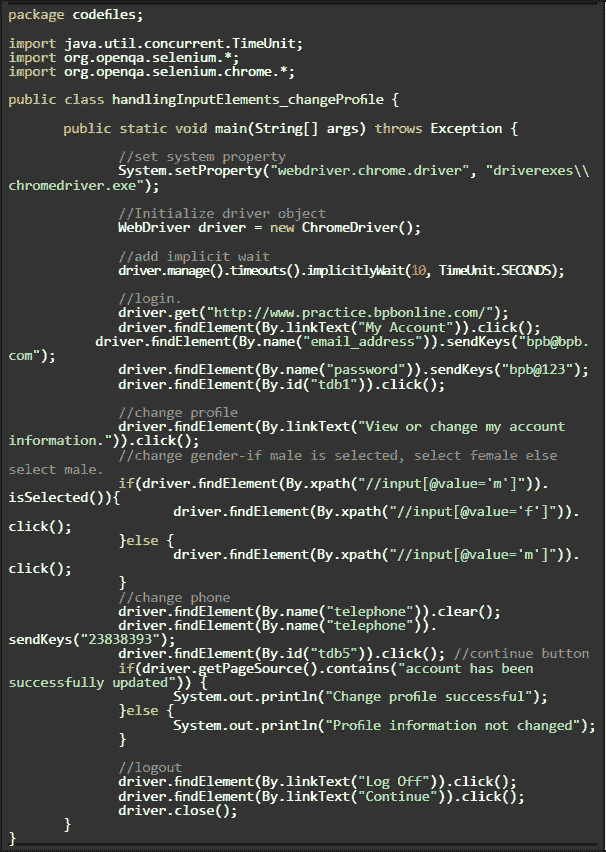

如前面的脚本所示，我们通过处理逻辑操作和修改个人资料操作遇到的不同类型输入元素来执行修改个人资料场景。接下来，我们将查看如何处理 HTML Web 表。

# 处理 Web 表

HTML 页面中的 Web 表使用 `<table>` 标签创建。它是一个容器标签，这意味着该 HTML 标签包含了其他 HTML 元素。`<table>` 标签包含其他 HTML 元素，即表格行 `<tr>`，而每个表格行包含一个表格数据 `<td>`。`<td>` 就是我们在应用程序 HTML 页面中看到的表格单元格。表格单元格就像 HTML 页面的 body 元素，这意味着它内部可以包含任何 HTML 元素。有时表格标签还可以包含由 `<tbody>` 表示的表体以及由 `<th>` 表示的表头标签。关于此点的更多信息可以从此链接阅读——[`www.w3schools.com/html/html_tables.asp`](https://www.w3schools.com/html/html_tables.asp)

HTML 页面中的 Web 表看起来如下：

```html
<table id = table1>
  <tr>
    <td>1</td>
    <td>2</td>
    <td>3</td>
  </tr>
  <tr>
    <td>4</td>
    <td>5</td>
    <td>6</td>
  </tr>
</table>
```


Web 页面上的此表将显示如下所示：

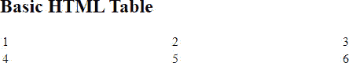

**图 5.7:** 输出

我们发现 Web 表通常在 HTML 页面中以[表格形式](https://zh.wikipedia.org/wiki/表格)表示信息，这种方式看起来整洁且有组织。Web 表可以包含静态信息，或者在页面渲染时它可以获取动态信息。这取决于 Web 应用程序。在本章中，我们将看到如何遍历 Web 表，从每个单元格中获取信息并将其打印到控制台上。这是处理 Web 表的示例之一；很可能还有其他示例。其思想是理解如何处理它们，然后根据我们对自动化的需求来实现。

为此，我们将查看应用程序的首页。我们看到如图片所示列出的产品：


**图 5.8:** 应用程序的首页

如果我们使用 Chrome 检查元素（inspect）查看此处，我们将看到包含这些信息的表格元素。

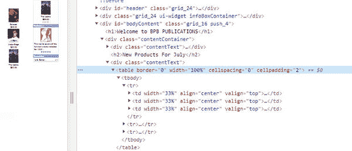

**图 5.9:** Chrome 检查

让我们查看此产品表中一个表格单元格包含的信息：

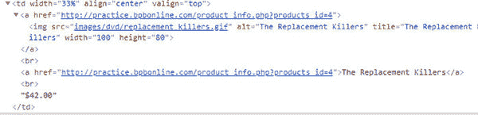

**图 5.10:** 表格单元格的 HTML 内容

正如我们在`图 5.10`中所示，表格单元格包含两个锚点标签（anchor tags）和一个显示产品价格的文本。一个锚点标签显示产品图像，另一个带我们进入产品页面。在我们编写的脚本中，我们将遍历此表并打印表格内容。我们在脚本中执行的步骤如下：

1. 使用 URL 打开 Web 应用程序：[`practice.bpbonline.com/index.php`](http://practice.bpbonline.com/index.php)。
2. 使用 HTML 标签属性识别表格元素，因为页面只有一个表格，且它不包含任何我们可以用于识别它的属性。

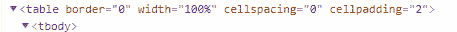

**图 5.11:** 表格元素

3. 一旦获取了表格元素，我们将使用`findElements`方法查找它包含多少行表格，并查找`<tr>`标签，然后获取每一行并使用`findElements`方法查找它包含多少个表格数据标签`<td>`。
4. 一旦获取了表格元素，我们将使用`findElements`方法查找它包含多少行表格，并查找`<tr>`标签，然后获取每一行并使用`findElements`方法查找它包含多少个表格数据标签`<td>`。（注：此处原文逻辑重复，已按原文结构保留）
5. 一旦获取了表格元素，我们将使用`findElements`方法查找它包含多少行表格，并查找`<tr>`标签，然后获取每一行并使用`findElements`方法查找它包含多少个表格数据标签`<td>`。（注：此处原文逻辑重复，已按原文结构保留）
6. 一旦获取了表格元素，我们将使用`findElements`方法查找它包含多少行表格，并查找`<tr>`标签，然后获取每一行并使用`findElements`方法查找它包含多少个表格数据标签`<td>`。（注：此处原文逻辑重复，已按原文结构保留）

（注：原文第 4、5、6 点存在明显的逻辑描述重复，译文遵循“不要漏掉任何一行”的原则进行了对应翻译。）

| `selectByIndex()` | 这允许我们根据元素在下拉列表中的位置来选择元素。 |
| `deselectByValue()` | 这将根据 option 标签的 value 属性从下拉列表中取消选择该元素。 |
| `deselectByVisibleText()` | 这允许我们根据与 option 标签关联的可见文本来取消选择元素。 |
| `deselectByIndex()` | 这允许我们根据元素在下拉列表中的位置来取消选择元素。 |
| `getOptions()` | 此方法将返回下拉列表中所有可 option。 |
| `getFirstSelectedOption()` | 此方法将返回列表中的第一个选中的 option。 |
| `isMultiple()` | 此方法根据下拉列表是否允许多选元素来返回 true 或 false。 |

**表 5.2:** 使用`select`类时可使用的不同方法

在我们的应用程序中，可以找到许多下拉列表。我们将选取主页面上的下拉列表，它显示了制造商。让我们来看一下它。

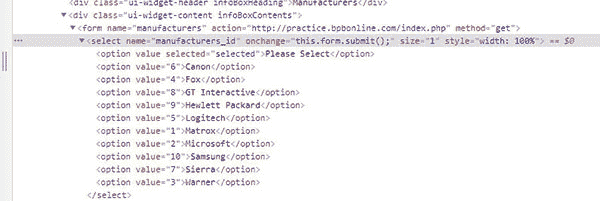

**图 5.16:** 主页面上的下拉列表

从上一个图中可以看出，该列表是 HTML 中的一个`<select>`元素，并且它带有各种`<option>`标签。让我们查看与其相关的完整 HTML。

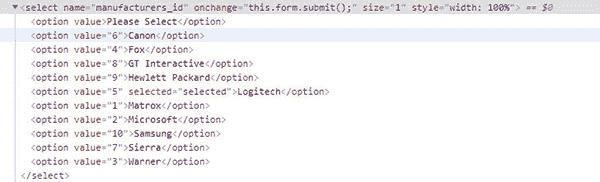

**图 5.17:** Select 标签

我们看到这不是一个多选下拉列表。它包含 11 个 option 标签，其中第一个 option 标签代表`Please Select`。我们应该注意，value 属性包含数字，例如`"1"`、`"2"`直到`"10"`。与每个 option 元素关联的显示文本是我们在网页上看到的制造商名称。我们将采用以下场景创建一个自动化脚本：

1. 使用 URL 启动 Web 应用：[`practice.bpbonline.com/index.php`](http://practice.bpbonline.com/index.php)。
2. 从下拉表中找到所有制造商。
3. 对于找到的每个制造商，从下拉列表中选择它，并在控制台上打印与其关联的所有产品的名称。
4. 在第 3 步中，我们需要理解产品页面是以 Web 表格（Web table）的形式显示信息的；因此，我们必须使用之前讨论过的 Web 表格部分的信息，展示如何遍历表格并打印与其关联的内容。
5. 当我们编写此代码时，通过 Selenium 发现，当从一个制造商移动到另一个制造商时，会发生页面刷新。由于由于，我们的代码中将得到`StaleElementException`。为了处理它，我们必须重新识别下拉元素。
6. 要操作下拉元素，我们需要导入包：`org.openqa.selenium.support.ui.Select`。

现在让我们来看下面的代码：

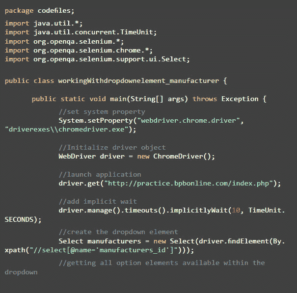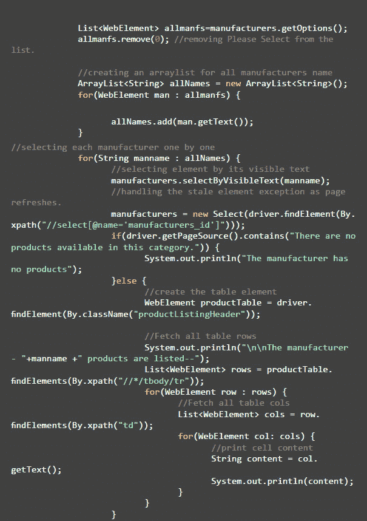[](images/p87.jpg)

如上一个代码所示，为了便于理解，还添加了适当的注释，我们能够打印出制造商名称及其相关产品的输出。输出如下：

```
The manufacturer Canon has no products
The manufacturer - Fox products are listed--
Product Name+ Price Buy Now
Courage Under Fire $38.99 $29.99
Buy Now
Die Hard With A Vengeance $39.99
Buy Now
Speed $39.99
Buy Now
Speed 2: Cruise Control $42.00
Buy Now
... (剩余输出已截断)
```

我们可以根据需要自动化的场景，尝试更多与下拉类相关的函数。

## 结论

在本章中，我们学习了如何处理表单元素、Web 表格和下拉元素。在接下来的章节中，我们将学习如何处理 frame、alert 以及如何处理高级键盘和鼠标操作。

## 问题

1. 我们将使用`WebElement`的哪个函数来判断单选按钮（radio button）是否被选中？
2. Web 表是一个容器元素吗？
3. 列出在下拉列表中选择元素的三个不同方法？
4. 我们什么时候会遇到`StaleElementException`？

# 第 6 章：使用 WebElement—Alert、Frame、IFrame 和 Window

在上一一章中，我们看到了对不同类型 HTML 元素的处理，例如输入元素、Web 表格和下拉元素。在本章中，我们将学习如何自动化处理 JavaScript alerts（也称为弹窗）、Frame 元素、IFrame 元素、HTML 窗口以及 action 类，action 类用于处理高级鼠标和键盘操作。为了理解本章的概念，我们必须探索另一个 Web 应用，该应用托管在此链接上——[`the-internet.herokuapp.com/`](https://the-internet.herokuapp.com/)。该网站由 Elemental Selenium 维护，被 Selenium 社区广泛用于尝试和理解使用 Selenium 操作不同类型 HTML 元素的工作。我们的一些示例将基于此。

## 结构

本章分为以下几个章节：

* 处理 JavaScript alerts
* 处理 Frame 和 IFrame HTML 元素
* 处理 HTML 窗口
* 处理 action 类

## 目标

读完本章后，你将能够：

* 使用 Selenium 中的`Alert`类来处理弹窗。
* 操作 IFrame 元素，并处理 IFrame 内部的对象。
* 自动化处理应用程序中打开新窗口的场景。

## 处理 JavaScript alerts

JavaScript alerts 或弹窗出现在各种 Web 应用场景中。这些弹窗可以提供信息或请求用户操作。在处理弹窗之前，我们无法在 Web 应用程序上进行任何其他操作。三种类型的 JavaScript alerts 如下：

* 框（Alert box）
* 确认框（Confirm box）
* 输入框（Prompt box）

框用于向用户提供信息，用户通常通过关闭或点击`OK`按钮来处理它。

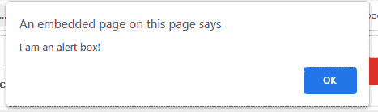

**图 6.1:** Alert 框

确认框用于用户确认某个操作或拒绝该操作。它通常包含一个`OK`或`Cancel`按钮。用户可以通过点击其中任意一个来处理。

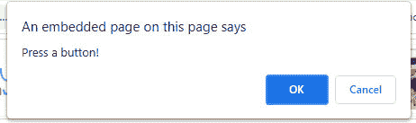

**图 6.2:** 确认框

最后，提示框（prompt box）用于我们需要用户提供某些信息的情况。用户必须输入内容，然后可以点击`OK`或`Cancel`按钮。

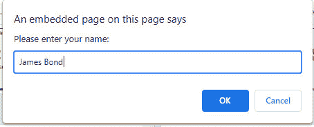

**图 6.3:** 提示框

为了处理这些警报，Selenium Java 绑定中有一个名为`Alert`的独立接口。详情请访问：[`www.selenium.dev/selenium/docs/api/java/org/openqa/selenium/Alert.html`](https://www.selenium.dev/selenium/docs/api/java/org/openqa/selenium/Alert.html)

`Alert`接口有四个方法，如下表所示：

| 方法名 | 操作 |
| :--- | :--- |
| `Accept` | 此方法将接受警报。它将触发点击`OK`按钮。 |
| `Dismiss` | 此方法将取消警报。它将触发点击`Cancel`按钮。 |
| `getText` | 此方法将获取在`Alert`上显示的文本。 |
| `sendKeys` | 此方法将我们在键盘上按下的按键发送到`Alert`。 |

**表 6.1:** 警报接口的方法

为了理解警报的处理，我们将借助互联网 Heroku 应用程序并观察其运行情况。该网站为：[`the-internet.herokuapp.com/javascript_alerts`](https://the-internet.herokuapp.com/javascript_alerts)。在这里，我们可以找到所有三种类型的警报。

要处理第一类警报框，我们将执行以下操作：

1. 使用 URL：[`the-internet.herokuapp.com/javascript_alerts`](https://the-internet.herokuapp.com/javascript_alerts) 在 Chrome 上启动该应用程序。
2. 点击图中所示的按钮：
   
   **图 6.4:** 确认框类型的弹出窗口
3. 处理弹出的警报：
   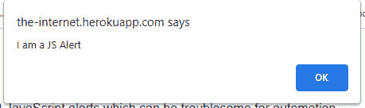
   **图 6.5:** 第一类警报框
4. 如果警报已处理，我们将在网页上看到成功消息：
   
   **图 6.6:** 页面上的结果消息

让我们查看上述步骤的代码，以操作警报框类型的弹出窗口。

```
images/p94.jpg)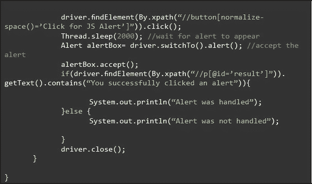
```

现在让我们处理`Confirm`确认框类型的弹出窗口。针对`Confirm`框将执行以下步骤：

1. 使用 URL：[`the-internet.herokuapp.com/javascript_alerts`](https://the-internet.herokuapp.com/javascript_alerts) 在 Chrome 上启动 Web 应用。
2. 点击第二个按钮：
   
   **图 6.7:** 确认框类型的弹出窗口
3. 在这里，让我们通过点击`Cancel`按钮来忽略警报。
   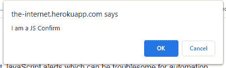
   **图 6.8:** 忽略警报框
4. 如果警报被忽略，我们的网页将显示以下消息：
   
   **图 6.9:** 忽略警报框时获取的消息

让我们查看实现上述语句代码的脚本：

```
images/p96.jpg
```

在最后一种类型的警报处理中，我们将处理提示框（Prompt Box）。为此，我们将执行以下步骤：

1. 使用 URL：[`the-internet.herokuapp.com/javascript_alerts`](https://the-internet.herokuapp.com/javascript_alerts) 启动 Web 应用。
2. 点击第三个按钮：
   
   **图 6.10:** 最后一类型的警报处理
3. 我们在此处获取与警报相关的文本，并向其发送文本`Hello how are you`。
   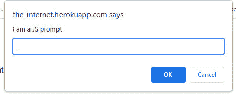
   **图 6.11:** 获取与警报相关的文本
4. 我们最后接受该警报，并在警报关闭后在网页上看到发送到提示框的消息。
   
   **图 6.12:** 获取的结果

让我们编写处理上述步骤的代码：

```
images/p98.jpg
```

在所有先前的代码中，当我们处理警报时，我们看到有一个来自驱动程序的函数可以使用，即`switchTo().alert`。`switchTo()`是与`Webdriver`对象关联的函数，它允许我们将焦点切换到警报、框架（frame）或新窗口。在这里，我们用它来处理警报。

我们已经看到了不同类型的 JavaScript 警报（也称为弹出窗口），以及如何使用 Selenium 处理它们。在下一节中，我们将讨论 Frame（框架）。

# 操作 Frame 和 IFrame

`frame`标签允许我们将 HTML 分为若干部分，每个部分都由框架支持。示例如下：

```
images/figure-no.jpg
```

网页看起来如下：


如果我们有一个包含 IFrame 的 HTML 页面，我们必须首先将焦点切换到 IFrame，然后驱动程序才能访问其中的元素。为了展示这一点，我们将以 Heroku 应用程序为例。应用程序的 URL 为：[`the-internet.herokuapp.com/iframe`](https://the-internet.herokuapp.com/iframe)

我们在这里决定的自动化场景如下：

1. 使用 URL 打开应用程序：[`the-internet.herokuapp.com/iframe`](https://the-internet.herokuapp.com/iframe)
2. 页面启动后，获取 WYWYG 编辑器中显示的内容
   
   **图 6.14:** 带有 WYWYG 编辑器的 IFrame
3. 将其打印到控制台

当我们尝试检查页面上的 WYWYG 编辑器时，发现它在 IFrame 内部，如下所示：


**图 6.15:** 与 IFrame 页面相关的 HTML

因此，为了从编辑器获取内容，我们必须首先将焦点切换到 IFrame，然后驱动程序才能访问网页上的元素。代码将如下：

```
images/p102.jpg
```


在先前的代码中，我们将看到使用了 IFrame 的 `id` 属性来识别它。然后我们使用 `switchTo` 命令将焦点转移到网页上。一旦驱动程序指向它，我们就可以访问 `p` HTML 元素的文本并将其显示在控制台上。工作完成后，我们使用 `switchTo().defaultContent()` 方法将焦点切回主 HTML 页面。

至此，我们完成了使用 Selenium 操作 IFrame 元素及其所在网页。

# 操作 HTML 窗口

很多时候，我们会遇到应用程序在启动时打开新页面，例如电子商务网站在新窗口或新标签页中打开广告页。为了用自动化处理这种情况，我们需要再次使用驱动程序的 `switchTo` 函数。该函数允许我们将 WebDriver 对象的焦点切换到新窗口或标签页。

要处理窗口，我们需要理解每个窗口都关联有一个唯一的窗口句柄（window handle）。该窗口句柄用于识别窗口并将驱动对象与之关联。为了处理所有使用同一个驱动实例打开的窗口，我们可以将它们存储在一个名为 set（集合）的集合中。set 是 Java 中的一种集合，它允许存储唯一的数据值。然后我们使用一个 `Iterator` 来遍历集合中的所有值。让我们来看一个允许我们打开新窗口的应用程序。

我们将自动化的场景如下：

1. 使用 URL：[`the-internet.herokuapp.com/windows`](https://the-internet.herokuapp.com/windows) 打开应用程序。
2. 之后，我们点击如下图所示的链接：

   

   **图 6.16：** 需要点击的链接
3. 当我们点击 `Click Here` 时，它将打开一个带有新页面的新标签页，如下所示：

   

   **图 6.17：** 新的新窗口
4. 我们将验证新页面是否包含文本 `New Window`。
5. 我们现在将关闭该窗口并返回主父窗口并将其关闭。

上述步骤的代码如下：

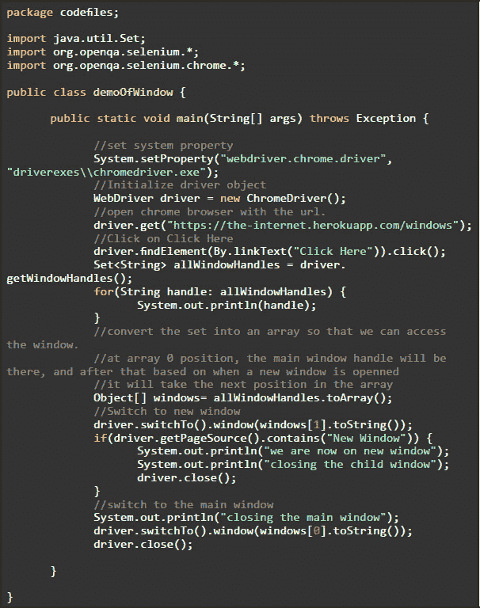

我们可以在代码中看到，一旦我们在 set 中获取了所有窗口句柄，我们就会使用 for each 循环在控制台上打印窗口句柄。之后，我们将 set 转换为对象数组（Object Array）。在这里，我们需要意识到数组中的第一个元素将是父窗口的句柄。数组中的下一个元素将是启动的下一个窗口，依此类推。由于对于我们的场景只有两个窗口，在索引 0 处我们有父窗口的句柄，在索引 1 处我们有子窗口的句柄。

我们随后使用 `driver.switchTo().window` 命令通过传递数组的第二个索引来切换到子窗口。然后我们找到它是否包含所需的文本并将其关闭。接着我们使用数组的第一个元素切换回父窗口并也将其关闭。

因此，在前面的代码中，我们已经了解了如何在 Selenium 中处理窗口。

## 结论

在本章中，我们学习了如何处理作为容器元素的 HTML 元素。容器级 HTML 元素是那些包含其他 HTML 元素的元素。我们看到了如何处理 Web 表格、下拉元素。我们还看到了与 webdriver 相关的 `switchTo` 方法的使用，它允许我们将焦点切换到新的警报、IFrame 或新窗口。总的来说，通过第 8 章和第 9 章学到的知识，我们应该能够处理在 Web 应用程序中看到的各种 HTML 元素。在接下来的章节中，我们将学习 `Action` 类、截图捕获、WebDriver manager 等概念。

# 第 7 章

## 额外概念——动作、截图、WebDriverManager

## 简介

在本章中，我们将讨论 Selenium 中提供的几个额外概念。我们将谈论 `Action` 类，它允许我们处理高级的鼠标和键盘操作。我们将看到如何在执行期间捕获屏幕。我们还将讨论 Selenium 最近引入的一个第三方包，命名为 `WebDriverManager`，它在与 Selenium 工作时非常有用，可以在运行时为选定的执行浏览器自动获取正确的浏览器驱动程序。

## 结构

在本章中，我们将讨论以下主题：

- Actions（动作）
- Screenshot（截图）
- WebDriverManager

## 目标

本章的目标是在使用 Selenium 尝试自动化 Web 应用程序时，介绍一些额外概念。在本章之后，你将能够：

- 使用 `Action` 类自动化高级的键盘和鼠标操作。
- 能够在执行时捕获截图以获得更好的报告。
- 最后，使用 WebDriver manager 的概念来处理自动化脚本的驱动浏览器交互。

### Actions（动作）

在处理 Web 应用程序时，我们可能会遇到需要使用键盘和鼠标执行某些高级用户手势的场景。例如拖放、鼠标悬停、按键释放和按键按下等。为了执行这些操作，我们应该使用 Selenium 提供的 action 接口。该接口位于 interactions 包中——`org.openqa.selenium.interactions`。它还帮助我们创建一个复合动作（composite action），该复合动作可以是两个或多个一起执行的动作的组合。`Action` 类提供了多种方法；可以在此链接中找到更多细节——[`www.selenium.dev/selenium/docs/api/java/org/openqa/selenium/interactions/Actions.html`](https://www.selenium.dev/selenium/docs/api/java/org/openqa/selenium/interactions/Actions.html)。

在处理 Web 应用程序时，我们可能会遇到需要使用键盘和鼠标执行某些高级用户手势的场景。例如拖放、鼠标悬停、按键释放和按键按下等。为了执行这些操作，我们应该使用 Selenium 提供的 action 接口。该接口位于 interactions 包中——`org.openqa.selenium.interactions`。它还帮助我们创建一个复合动作，该复合动作可以是两个或多个一起执行的动作的组合。`Action` 类提供了多种方法；可以在此链接中找到更多细节——[`www.selenium.dev/selenium/docs/api/java/org/openqa/selenium/interactions/Actions.html`](https://www.selenium.dev/selenium/docs/api/java/org/openqa/selenium/interactions/Actions.html)。

### Action 类的方法

Action 类的各种方法如下：

| 方法名称 | 描述 |
| :--- | :--- |
| `click()` | 在当前位置执行点击。通常用于我们创建复合动作。它有一个 `click(WebElement ele)` 变体，点击指定的元素。 |
| `clickAndHold()` | 在当前鼠标位置执行点击并保持。它有一个 `clickAndHold(WebElement ele)` 变体，点击指定的元素。 |
| `doubleClick()` | 在给定的鼠标位置执行双击。它有一个 `doubleClick(WebElement ele)` 变体，点击指定的元素。 |
| `contextClick()` | 该方法在给定的鼠标位置执行右键点击。它们被称为 `contextClick`。它有一个接受 `WebElement` 作为输入参数的方法。`contextClick(WebElement ele)`，将在元素执行 `contextClick`。 |
| `dragAndDrop()` | 该方法接受源元素和目标元素作为参数。它将源元素拖到目标元素。该方法表示为 `dragAndDrop(WebElement source, WebElement target)`。该方法还有一个变体，接受需要拖拽的位置作为输入参数。`dragAndDrop(WebElement src, int offsetX, int offsetY)`。 |
| `moveToElement()` | 该方法接受一个 `WebElement` 并将其移动到元素的中间。其语法为 `moveToElement(WebElement target)`。该方法有一个变体 `moveToElement(WebElement target, int offsetX, int offsetY)`，相对于元素的视图中心移动。 |
| `build()` | 该方法将之前的所有动作组合并创建一个复合动作，然后执行。 |
| `perform()` | 该方法用于最终执行创建的动作或复合动作。 |

**表 7.1：** Action 类的方法

现在我们将查看前面几个 Action 方法的一些代码示例。

我们将看到的第一个示例是拖放。为了查看示例，我们将使用可用的网站 URL：[`jqueryui.com/droppable/`](https://jqueryui.com/droppable/)，正如我们在图中所示。

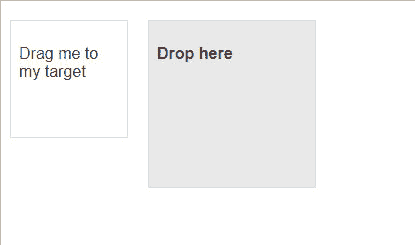

**图 7.1：** 拖放示例

我们需要拖动左侧框并将其放置在右侧框上。执行此操作后，我们将看到下面的图：

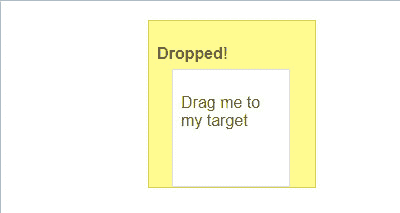

**图 7.2：** 将左侧框拖到右侧框上获得的输出

为了自动化上述操作，我们需要这两个对象的定位器。根据此页面上提供的 HTML 信息，我们可以看到这些对象可以使用现有的 `id` 属性进行识别。

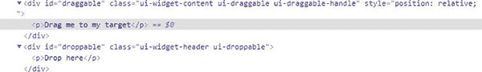

**图 7.3：** ID 属性

我们还需要意识到这些对象位于一个 `iframe` 内部；HTML 如下：

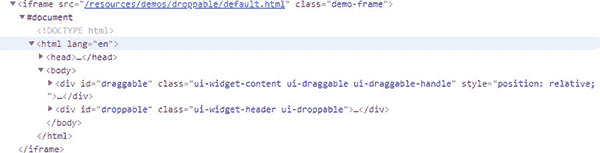

**图 7.4：** `iframe` 内部的对象

让我们编写自动化上述场景的步骤，为此，我们将使用以下 Action 类。

1. 使用 URL 启动应用程序：[`jqueryui.com/droppable/`](https://jqueryui.com/droppable/)。
2. 使用 Selenium 提供的 `JavaScriptExecutor` 类向下滚动页面。该类允许使用 `javascript` 命令并在 Selenium 运行浏览器期间直接执行它。
3. 切换到包含对象的 `iframe`。
4. 创建一个 Action 类对象，并调用 `draganddrop` 方法，传递目标元素（即左侧的框）和源元素（即右侧的框）。
5. 调用方法执行前面的 `draganddrop` 方法以完成操作。
6. 关闭应用程序。

上述步骤的代码如下：

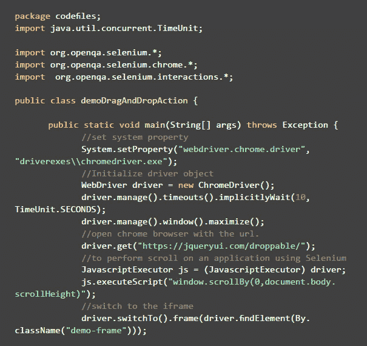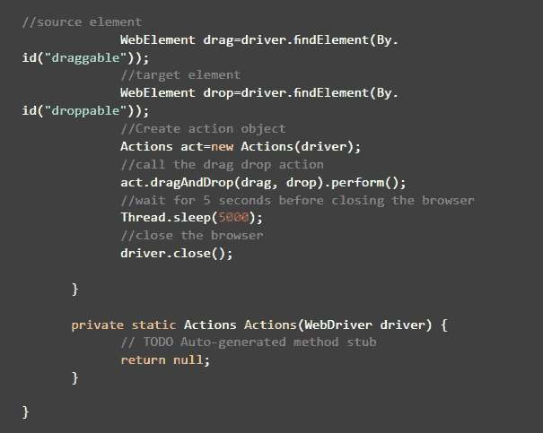

在下一个示例中，我们将选择需要执行复合操作（composite action）的地方。复合操作是将多个操作组合在一起，并首先使用 `build` 方法执行的操作。在本示例中，我们将看到位于地址为——[`the-internet.herokuapp.com/key_presses`](https://the-internet.herokuapp.com/key_presses) 的 Web URL。

在此页面上有一个文本框，我们可以在上面按下 Tab、Space 等按键，当我们这样做时，按下的按键会显示在页面上。在脚本中，我们将首先按下 Tab 键，等待 5 秒，然后按下 Space 键。我们首先需要使用 `build()` 方法创建一个复合操作，然后调用 `perform`。相应的脚本如下：


因此，我们看到了不同的操作方法，也看到了复合操作的示例。

# 截图

Selenium 中的截图接口允许我们在脚本执行时捕获屏幕并以不同的方式存储它。截图是脚本执行期间捕获问题的极佳方法。它们有助于记录更好的错误报告，以便开发人员可以通过查看图像轻松识别问题可能发生的地方。使用截图方法 `getScreenShotAs`，它使用文件类（file class）存储文件。该类可用 `commons.io` jar 包，该包由 Apache 提供。我们需要将此包添加到我们的项目中以便使用该方法。

为了显示截图代码示例，我们将采用使用外部数据文件进行用户登录和注销场景。我们将使用的文件是 CSV 文件，它使用逗号作为分隔符存储数据。该文件将包含两条记录，一个带有有效的用户凭据，另一个带有无效的用户凭据。我们将为有效和无效场景下的用户登录捕屏，以记录应用程序的运行情况。

我们的步骤如下：

1. 创建一个包含两条记录的 CSV 文件，一个包含有效的用户凭据，另一个包含无效的用户凭据；该文件保存在项目的 `DataFiles` 文件夹中，扩展名为 `.csv`。

   

   **图 7.5：** 带有用户凭据的记录

2. 然后编写自动化应用程序登录和注销步骤的脚本如下：

   1. 打开应用程序。
   2. 点击 `My Account` 链接。
   3. 使用从 CSV 文件读取的数据输入用户名。
   4. 使用从 CSV 文件读取的数据输入密码。
   5. 点击 `Sign In`。
   6. 如果用户登录成功，捕屏然后点击 log off 并继续链接。
   7. 如果用户登录失败，则捕屏并关闭应用程序。

3. 为了截图，我们将调用截图接口的 `getScreenShot` 方法。该接口将使用创建的浏览器对象进行初始化。将其存储为 `File` 对象，然后将该文件转换为 `.jpg`。我们为此使用的类是 Commons IO jar 包中的 `FileUtils` 类。
4. 截图将被存储在 `Screenshots` 文件夹中，我们需要在项目创建之前创建该文件夹。因此，我们的项目树结构如图所示：

   

   **图 7.6：** 项目树

以下代码显示了根据上述编写步骤生成的脚本：


之前的代码将为有效用户和无效用户执行两次。执行完成后，我们可以在 `Screenshots` 文件夹中找到为有效和无效用户捕获的两张图像。让我们看看这里捕获的截图。


**图 7.7：** 有效用户


**图 7.8：** 无效用户

如之前所述，执行期间截图有助于我们记录发现的问题。这有助于团队成员通过视觉描述修复问题。

# WebDriverManager

WebDriverManager 允许我们在运行时驱动可执行文件，该文件是浏览器自动化所需的。使用此包，我们不需要根据浏览器版本下载或跟踪驱动程序版本。使用此库，管理相应驱动程序的任务被简化了。

该库由 Boni Garcia 开发，[`github.com/bonigarcia`](https://github.com/bonigarcia)，并由一组贡献者维护。更多细节可以在此处查看——[`github.com/bonigarcia/webdrivermanager`](https://github.com/bonigarcia/webdrivermanager)。

在本节中，我们将编写一段示例代码，使用 `WebDriverManager` 来启动并操作浏览器。我们将编写在三个脚本中启动三个不同浏览器的步骤，然后等待秒并关闭它们。我们选择的浏览器是 Chrome、Firefox 和 Internet Explorer。

使用 `WebDriverManager` 启动 Chrome 所示：


使用 `WebDriverManager` 启动 Firefox 所示：


最后我们看到使用 `WebDriverManager` 启动 Internet Explorer 所示：


因此，我们在本节中看到了如何使用 WebDriverManager 与不同的浏览器交互。我们还看到不需要下载或管理这些浏览器的驱动程序。

在本章中，我们将学习一些额外的概念，这些概念可以结合 Selenium 使用，帮助我们编写更好的脚本。我们学习了 `actions` 类的用法，它可以帮助我们处理鼠标和键盘操作。我们学习了如何在运行时截屏并将其保存为系统中的文件。最后，我们看到了一个名为 `WebDriverManager` 的第三方实用库，它通过在运行时为想要执行的浏览器提供正确的驱动程序，简化了管理相应浏览器驱动程序的任务。在接下来的章节中，我们将介绍一个名为 `TestNG` 的单元测试框架概念，它对于使用 Selenium 设计测试自动化脚本非常有帮助。

## 问题

1. 哪个包包含 `action` 接口？
2. `action` 接口中的 `build()` 方法的作用是什么？
3. 使用哪个方法来捕获截屏？
4. `WebDriverManager` 的用途是什么？

# 第 8 章

## 什么是 TestNG

`TestNG` 代表 `Testing Next Generation`（下一代测试）。它是最广泛使用的测试框架之一，特别是在使用 Java 作为编程语言的测试自动化项目中。另一个经常使用的测试框架是 `JUnit`，但 `TestNG` 对测试项目更具兼容性。TestNG 的主网站是 [`https://testng.org/doc/`](https://testng.org/doc/)。在本章中，我们将探索 `TestNG` 的基础知识，并查看其在 Selenium 测试自动化项目中的功能。

## 结构

在本章中将涵盖以下主题：

- 设计 TestNG 测试
- 在 TestNG 测试中添加断言（assertions）
- TestNG 中的报告

## 目标

本章的目标是理解 TestNG 作为测试框架的特性和功能，以便用于使用 Selenium 设计测试自动化项目。TestNG 是除 `JUnit` 之外使用最广泛的单元测试框架之一。虽然 JUnit 主要由开发人员在设计代码时使用，但 TestNG 的功能更适合测试人员在设计自动化代码时使用。我们将看到 TestNG 套件（suite）的后续如何，讨论 TestNG 提供的各种注解（annotations），理解如何执行套件文件，并讨论可用的执行模式。最后，我们将探索 TestNG 默认提供的报告。

## 简介

TestNG 是一个用于广泛测试活动的测试框架，从单元测试到集成测试。它具有各种特性和广泛的注解，这些对于设计测试套件非常有用。在 TestNG 中设计的任何套件都有一个 XML 文件，其中包含有关测试、执行标准的信息，还可以包含测试在执行期间使用的测试配置参数信息。现在让我们看看如何在 eclipse 环境中安装 TestNG。

## 安装

在本节中，我们将介绍在 eclipse 环境中安装 TestNG。安装 TestNG 有多种方法，在以下链接中提到：[`https://testng.org/doc/download.html`](https://testng.org/doc/download.html)。我们将查看如何使用 Eclipse IDE 的帮助（Help）功能来安装它。让我们一步进行。

1. 在 eclipse 中打开 Java 项目，也就是我们在之前的章节中一直运行的那个项目。在主菜单上，点击 `Help` 并选择 `Install New Software…`。

   

   **图 8.1：** 安装 TestNG

2. 一旦打开了 Install 窗口，我们需要在 `Work with` 文本框中输入 URL。提供的 URL 为 [`https://testng.org/testng-eclipse-update-site`](https://testng.org/testng-eclipse-update-site)，然后按 `Enter` 或点击 `Add…` 按钮：

   

   **图 8.2：** 为 TestNG 提供 URL

3. 一旦执行操作，我们将看到可用的最新版本 TestNG。在本书编写时，可用版本是 `7.4`。

   

   **图 8.3：** 从列表中仅选择 TestNG

4. 选择第一个选项，点击 `Next` 按钮继续安装。这需要一些时间，因为它正在计算各种依赖项。

   

   **图 8.4：** 开始安装

5. 完成后，它将要求你接受许可协议。接受并继续以完成安装。

   

   **图 8.5：** 接受许可协议

6. 一旦在 eclipse 上安装了 TestNG，需要重启 eclipse。完成后，我们需要将 TestNG 库添加到 Java 项目中。为此，右键点击项目并选择 `Properties`。选择 `Java Build Path` 选项。

   

   **图 8.6：** Java 编译路径

7. 点击 `Modulepath`，并选择 `Add Library`。从所示的库列表中选择 TestNG。
8. 一旦安装了 TestNG，当我们右键点击项目时，会显示以下内容。

   

   **图 8.7：** TestNG 类

9. 选择 `Create TestNG class` 选项；我们需要选择套件文件。我们将套件文件命名为 `testng.xml`。

   

   **图 8.8：** 创建 TestNG

10. 我们现在准备好将代码添加到前面的文件中，并使用 `testng.xml` 将其作为 TestNG 套件执行。但在此之前，让我们先通过理解 TestNG 提供的各种注解来理解其结构。

    

    **图 8.9：** TestNG 类

在下一节中，我们将学习 TestNG 拥有的不同注解以及 `testng` 套件文件的结构。

## 结构

TestNG 套件由一个 XML 文件和至少一个 TestNG 类文件组成，类文件是一个包含程序方法使用的 `@test` 注解的 Java 文件。让我们先讨论 TestNG 提供的不同类型的注解，这些可以帮助我们设计测试框架。TestNG 中的注解大致分为两类：`@BeforeAnnotation` 和 `@AfterAnnotation`。下表列出了并的描述：

| 注解 | 描述 |
| :--- | :--- |
| `@BeforeSuite` | 此注解内的语句将在套件执行开始时执行。 |
| `@AfterSuite` | 此注解内的语句将在套件执行结束时执行。 |
| `@BeforeTest` | 此注解中的语句将在套件执行中的测试开始前执行。 |
| `@AfterTest` | 此注解中的语句将在测试完成后执行。它将在套件文件中每个测试完成后执行。 |
| `@BeforeGroups` | 此注解中的语句将在指定的组的测试前执行。 |
| `@AfterGroups` | 此注解中的语句将在指定的组测试完成后执行。 |
| `@BeforeClass` | 此注解中的语句将在类代码中的测试开始前执行。 |
| `@AfterClass` | 此注解中的语句将在类的测试方法结束后执行。 |
| `@BeforeMethod` | 此注解中提到的代码将在测试方法之前执行。 |
| `@AfterMethod` | 此注解中提到的代码将在测试方法之后执行。 |

**表 8.1：** TestNG 注解

在上一个表中，我们看到了各种 TestNG 注解以及对其中每个注解的简要描述。在学习如何使用它们之前，我们需要理解 TestNG 的 suite XML 文件。一个示例的 TestNG suite 文件如下所示：

```xml


```xml
<suite name="RegressionSuite" verbose="1">
  <test name="Chrome">
    <classes>
      <class name="loginLogout"/>
    </classes>
  </test>

  <test name="Regression">
    <classes>
      <class name="loginLogout"/>
      <class name="changeProfile"/>
    </classes>
  </test>
</suite>
```

如上面的 XML 代码段所示，我们有一个 `suite` 标签作为根节点。它可以包含一个或多个 `test` 标签。`test` 标签包含类，这些类是创建的 Java `testng` 类文件，当我们对 suite 进行执行时，它们将被执行。suite `.xml` 文件遵循*图 8.10*所示的层次结构。


**图 8.10：** TestNG 层级结构

此图片显示 `suite` 节点是根节点，它将包含至少一个 `test` 节点。`test` 节点将包含至少一个 `class` 节点。`class` 包含 `testng` 类的信息，其中编写了用于执行的实际测试代码。在 suite 文件的另一种结构中，我们也可以包含组信息。组信息说明了在执行测试期间需要包含或排除哪些类文件。带有组信息的示例 suite 文件如下所示：

```xml
<suite>
  <test name="Regression1">
    <groups>
      <run>
        <exclude name="regressionTest"/>
        <include name="UITest"/>
      </run>
    </groups>

    <classes>
      <class name="loginLogout"/>
      <class name="buyProduct"/>
      <class name="findOrders"/>
    </classes>
  </test>
</suite>
```

此示例 suite 文件列出了执行期间应该包含的组信息以及应该排除的组。组信息作为测试方法的参数信息传递到实际的 TestNG 类文件中。一个包含组信息的示例测试方法如下所示：


类文件中的测试方法有各种可以传递给它的参数。下面的表格列出了描述了其中一些参数：

| 参数 | 描述 |
| :--- | :--- |
| `dataProvider` | 此参数帮助我们为测试指定数据提供者名称，有助于测试参数化。 |
| `dependsOnMethods` | 在这里，我们可以列出该方法执行所依赖的所有方法。 |
| `groups` | 测试方法可以是一个多个组的一部分。如果该组包含在 TestNG 文件中，则方法将执行。如果该组被排除，则测试方法将不执行。 |
| `priority` | 默认，测试方法按照名称的字母顺序执行。如果设置了此项，优先级低的测试方法将先执行。 |
| `alwaysRun` | 即使 `dependsOnMethod` 失败，测试方法也将始终运行。 |

**表 8.2：** 测试方法的参数

**注意：有关参数的更多信息可以通过此链接进行探索：[`testng.org/doc/documentation-main.html#annotations`](https://testng.org/doc/documentation-main.html#annotations)。**

# TestNG 中的断言

断言是验证我们所执行的步骤的一种方式，以理解它们是否正常工作。如果正常，我们将测试用例标记为通过；否则，我们将测试用例标记为失败。TestNG 中有一个内置的断言模块，其中包含多种方法，我们可以在脚本设计中使用来断言我们所执行的操作。

**注意：TestNG 可用的断言方法列在此：[`www.javadoc.io/doc/org.testng/testng/latest/org/testng/asserts/Assertion.html`](https://www.javadoc.io/doc/org.testng/testng/latest/org/testng/asserts/Assertion.html)。**

我们在这里将看到上述链接中的一些方法，我们将在脚本中使用它们。根据场景需要，我们可以选择链接中提到的其他方法。

| 方法 | 描述 |
| :--- | :--- |
| `assertEquals(arg 1, arg 2)` | `assertEquals` 方法有多种形式，它将不同类型的实体与其他进行比较。在这里，传递的参数可以是整数、类对象、数组等。如果参数彼此相等，则该方法返回 true。 |
| `assertNotEquals(arg1, arg2)` | `assertNotEquals` 方法有多种形式，它将不同类型的实体与其他进行比较。在这里，传递的参数可以是整数、类对象、数组等。如果参数彼此不等，则该方法返回 true。 |
| `assertNull(arg)` | 如果传递给方法的参数为 Null，则该方法返回 true。 |
| `assertTrue(boolean condition, string message)` | 如果评估的条件返回 true，则将打印消息。 |
| `fail(string message)` | 此方法将测试标记为失败并打印消息。 |

**表 8.3：** TestNG 中的断言方法

我们将在使用 TestNG 设计的脚本中使用这些方法将测试方法标记为通过或失败。

# TestNG 中的结果与报告

当执行 TestNG suite 文件 `.xml` 时，它生成三种类型的结果文件。这些文件携带相同的信息，但表示方式不同。结果存储在 `test-output` 文件夹中，是在执行后生成的。下面的图片显示了执行 suite 文件后显示的目录结构。


当 TestNG suite 执行时生成的文件，其描述如下：

| 结果文件名称 | 描述 |
| :--- | :--- |
| `index.html` | `index.html` 是 `test-output` 文件夹中的一个文件。它包含了关于 suite 文件的极简信息以及文件中通过或失败的方法。下面的图片显示了该文件的外观。(images/Table-8.4A.jpg) |
| `emailable-report` | `emailable-report` 文件以表格形式包含信息，并按行显示方法。通过的方法标记为绿色，失败的方法标记为红色。它还包含了执行时间的信息。下面的图片显示了该文件的外观。(images/Table-8.4B.jpg) |
| `Test [html file]` | 此结果文件位于 `Suite` 文件夹中。suite 文件夹是使用我们在 `testng.xml` 文件传递的 suite 名称创建的。默认情况下，文件夹的名称将是 suite，结果 HTML 文件名将为 `Test.html`。suite 内部的每个测试都会生成一个结果文件，其名称将是测试的名称。默认情况下，我们看到的将将名为 `Test.html`。该文件包含了关于 suite 执行、开始日期时间、组信息（如果有）以及方法通过和失败的状态。(images/Table-8.4C.jpg) |

**表 8.4：** TestNG 的结果文件

随着测试套件的执行，我们可以在这些结果文件中传递一些报告信息，使它们对利益相关者更具意义且易于阅读。为了在结果文件中记录消息，我们可以使用 TestNG 报告器对象 [`https://javadoc.jitpack.io/com/github/cbeust/testng/master/javadoc/org/testng/Reporter.html`](https://javadoc.jitpack.io/com/github/cbeust/testng/master/javadoc/org/testng/Reporter.html) 并调用 `log` 方法，该方法接受一个字符串作为输入参数。在后续章节中，当我们最终设计 TestNG 测试和套件时，我们将看到它的用法。

## 简介

在本节中，我们将探索如何创建一个 TestNG 类文件。我们选择的场景是登录/注销场景。我们将创建两个类文件，包含两个方法：一个用于成功登录应用程序，另一个用于测试错误的登录。然后，我们将从 TestNG 测试套件文件中调用这些文件。

让我们先查看 `loginLogout` TestNG 类文件的代码。从这里开始，我们将开始使用 `webdrivermanager`；在接下来的章节中，我们将开始更多地讨论帮助我们设计和编写更好的测试自动化套件的各种组件。如果你愿意，也可以继续使用驱动程序执行文件。


正如我们在之前的 TestNG 测试设计所示，有一个 `@BeforeMethod` 注解，我们在其中设置了浏览器对象。我们正在创建 `webdrivermanager` 对象的实例并要求将其设置为 chrome。在 `@Test` 方法中，我们编写了在应用程序中执行登录注销的代码。在此测试中，我们传递了有效的用户登录详情。最后，在 `@AfterMethod` 中，我们编写了关闭浏览器的代码。我们还使用了 TestNG Reporter 方法 `log` 根据测试通过或失败在结果文件中提供信息。让我们看看套件执行完成后的 `Test.html` 文件。下面的图片是它的快照。


**图 8.12：** 套件执行结果文件

这里我们需要理解的是，我们使用了 `testng.xml` 文件，它是执行 TestNG 测试的套件文件。我们使用的套件 XML 文件如下：

```xml
<?xml version="1.0" encoding="UTF-8"?>
<suite parallel="false" name="Suite">
  <test name="Test">
    <classes>
      <class name="testngfiles.loginLogoutWithTestNG"/>
    </classes>
  </test> <!-- Test -->
</suite> <!--Suite -->
```

在此 `testng.xml` 文件中，我们可以看到给测试套件的名称是 `Suite`，测试的名称是 `Test`。我们的测试包含一个用于执行的类文件，我们传递了它的名称，以便文件中提到的代码按照注解的顺序被执行。因此，首先执行 `@BeforeMethod` 中的代码，然后在 `@Test` 方法中执行，最后执行 `@AfterMethod`。

我们需要理解的是，根据我们的代码结构和测试自动化套件设计，我们也可以并且应该使用适当的注解来设计我们的类文件，并在测试套件 XML 文件中使用它们。在下一节中，我们将看到如何使用套件 XML 文件中的 `parameters` 标签将数据传递给我们的测试，并看到如何使用 `@DataProvider` 注解对类文件中的测试方法进行参数化处理。

## 在 TestNG 测试中传递数据

数据管理和结构化是测试自动化套件设计不可或缺的一部分。TestNG 框架为我们提供了不同的方法来管理和处理传递给测试的数据。我们在套件 XML 文件可以使用 `parameters` 标签，并在类文件中可以使用 `@DataProvider` 注解，用它们对 `@Test 方法` 进行参数化。让我们在本节中看看在什么情况下可以使用这两个实体来改进我们的测试设计。

让我们以一个测试套件设计为例，其中有多个测试可用。我们需要将浏览器信息作为配置设置传递，在套件执行开始之前指定测试应该使用哪种浏览器。可能设计一种测试套件文件，使得一组测试使用特定的浏览器进行执行。为了实现这一点，我们需要使用 `Parameter` 标签，该标签在设计套件 XML 文件时可以使用。

要使用它，我们将创建一个包含多个测试的测试套件，并将浏览器信息作为配置设置传递。为了实现这一点，我们将看到我们的套件文件看起来像什么，以及以及如何使用从套件文件传递到测试的 `Parameter` 信息。

例如，让我们的测试套件包含两个测试文件，一个用于有效用户登录，另一个用于无效用户登录，并从套件文件传递浏览器执行信息。为了展示这一点，我们创建了一个 `baseFile`，它有一个方法根据传递给它的浏览器名称来设置驱动对象。然后我们在 TestNG 类文件中调用该方法，并使用传递的 `Parameter` 标签。让我们查看如下代码：

**baseFile**


`loginLogoutWithParams`—Java 代码：


TestNG 套件文件如下：

```xml
<?xml version="1.0" encoding="UTF-8"?>
<suite parallel="false" name="DemoSuite">
  <parameter name="browser" value="chrome"/>
  <test name="LoginLogout">
    <classes>
      <class name="testngfiles.loginLogoutWithParams"/>
    </classes>
  </test>
</suite>
```


在前面的代码中，我们看到了如何通过`Parameter`传递浏览器信息。接下来，我们将看到如何使用数据提供者传递信息。

### DataProvider

`@DataProvider`注解以二维数组的形式接收数据值。我们可以传递任何数据类型，无论是整数、双精度浮还是类对象。我们为`DataProvider`使用的名称会被传递给`@Test`方法。类文件中可能存在多个数据提供者。在我们用以理解`DataProvider`用用的示例中，我们将从 CSV 文件选取用户详情数据。此代码将写在`@DataProvider`注解中。然后我们将使用它对`@Test`方法进行参数化。让我们查看以下代码。

`loginLogoutWithDataProvider`—Java 代码文件：


在前面的文件中，我们通过`Parameter`传递浏览器信息，并使用`@DataProvider`注解从 CSV 文件读取信息并传递给`@Test`方法。我们注意到测试被执行了两次。让我们看看执行后的结果文件如下：

TestNG 是一个广泛使用的框架，在利用如`Selenium`等开源解决方案驱动浏览器设计自动化测试套件时，它是最常用的组件之一。在本章中，我们涵盖了 TestNG 是什么以及我们如何在`eclipse`中安装它。我们了解不同注解的含义，并理解了测试套件 XML 文件。我们查看了执行后生成的不同结果文件，以及如何向这些文件记录信息。最后，我们查看了如何向 TestNG 测试传递数据。在接下来的章节中，我们将讨论页面对象模型（Page Object Model）的概念以及我们如何使用它来设计我们的测试。

## 问题

1. TestNG 提供了哪些不同的注解？
2. 使用什么方法可以向结果文件记录信息？
3. 向 TestNG 测试传递数据的两种方法是什么？

# 第 9 章

## 页面对象模型（Page Object Model）概念

Web 应用程序的自动化是一个复杂的过程，当我们尝试使用`Selenium`等开源技术自动化 Web 应用程序的测试过程时，我们需要在代码层面创建基础设施，以处理代码中所需的许多产物。Web 应用程序的对象（我们在其上执行操作以实现最终结果）是主要的产物之一。处理与对象相关的信息并将其管理在测试脚本之外，对于测试自动化工作的成功至关重要。在本章中，我们将学习如何使用设计模式来处理对象信息，以及`Selenium`类也能如何提供帮助。

## 结构

本章分为以下几个部分：

* 设计模式——页面对象模型
* 页面对象模型的代码示例
* 使用`Selenium`的`page factory`类处理对象
* page factory 的代码示例

## 目标

本章的目标是理解在代码层面实现页面对象模型的必要性。具体来说，当我们使用如`Selenium`等开源技术时，这些技术默认并不提供任何机制来处理和管理测试脚本中使用的对象信息。许多如`UFT`、`test complete`等商业工具都带有一个名为“对象库”（object repository）的功能集，有助于管理测试脚本中使用的 Web 应用程序对象信息。但正如我们所学的，`Selenium`只是一个驱动 Web 浏览器的工具，并没有提供这些功能。我们需要使用良好的编码实践和设计模式来处理代码中的这些产物。在本章中，我们将对此探索。

## 页面对象模型

Martin Fowler 最初以“窗口驱动程序”（window driver）之名描述这一术语，但它被`Selenium`工具推广为“页面对象”（page object），并通常使用该名称。诚心建议通过以下两个链接详细阅读关于页面对象的内容——Martin Fowler-[`martinfowler.com/bliki/PageObject.html`](https://martinfowler.com/bliki/PageObject.html)。

另一个来自 Selenium 官网文档——[`www.selenium.dev/documentation/guidelines/page_object_models/`](https://www.selenium.dev/documentation/guidelines/page_object_models/)。

为了理解页面对象，让我们先理解 Web 页面的两个基本内容。我们说一个 Web 由两个重要实体组成：

* 页面的业务逻辑。
* 页面上可用的、帮助我们实现业务逻辑的对象。

随着应用程序时间的推移，我们会发现业务逻辑的变化可能没有对象信息的变化那么大。在我们设计代码时，我们需要以这种方式编写，将对象信息与页面的业务逻辑分离开。我们还会注意到，在生成自动化测试代码时，我们会遇到在多个测试中出现的场景。例如，在我们的 Web 应用程序中，登录注销场景会出现在登录注销操作、个人资料修改操作、密码修改操作、购买产品操作等许多场景中。我们可以通过两种方式实现上述目标；一种是在代码层面自己设计 POM，我们将先解释这种。第二种方法是使用 page factory，它是`Selenium`定义的一个类，用于帮助我们实现 POM。将在稍后解释。

## 实现页面对象模型

让我们通过一个示例来理解演示站应用程序登录注销场景的页面对象模型实现。为了理解这个概念，让我们看一个页面——我们在从主页或应用程序 URL 点击`My Account`链接 [`practice.bpbonline.com/`](http://practice.bpbonline.com/) 后看到的登录页面。


**图 9.1:** 登录页面

如果我们查看前面的页面，会看到页面上有几个对象，并且该页面有一个业务目标。以下描述了该页面的业务目标：

* 允许具有有效凭据的用户通过提供用户名和密码登录应用程序。
* 不允许详情无效的用户登录应用程序。
* 允许忘记密码的用户通过点击`Password forgotten, Click here`链接找回凭据。
* 允许新用户通过点击`Continue`按钮注册应用程序，这将跳转到注册用户页面。

如果我们查看此页面上可用的对象，它们如下帮助我们实现业务目标：

* `Email Address`: 文本框
* `Password`: 文本框
* `Sign In`: 按钮
* `Password forgotten`: 链接
* `Continue`: 按钮

随着应用程序的发展，我们应该意识到对象信息可能会发生变化，HTML 属性可能会改变，添加新对象或移除旧对象。例如，`Password forgotten`可能会变成按钮，或者`Continue`按钮可能会变成链接，以此此类推。但该页面的业务目标不太可能改变。

页面对象模型概念认为我们将对象信息与页面的业务逻辑分离，并将页面对象与测试脚本代码分开维护。这有助于我们在代码层面引入模块化，因为在开发和设计测试脚本时，作为业务流一部分的相同对象会被反复调用。如果某个构建版本中这些对象发生了变化，在没有实现页面对象的情况下，我们需要打开所有测试脚本进行修改。实现页面对象模型也有助于单独维护和管理对象信息。

为了继续，让我们选取登录注销场景并创建文件来实现其页面对象模型。为此，我们创建一个类并给它一个合适的名称——`login_pom`。在该文件中，我们完成的第一工作为页面的每个 HTML 对象创建`By`类对象。然后，我们为在这些对象上执行每个的操作创建函数。例如，让我们选取`My Account`链接：

`My Account`链接的`By`对象代码：

```
By myaccount_link= By.linkText(“My Account”);
```

为在`My Account`链接上执行的点击操作创建函数：


我们应该注意到函数的返回类型是类本身；其原因是，我们需要在执行操作后获得页面引用，以便后续操作可以在其上进行。

现在，让我们选取页面所有的对象并查看如下代码：


同样，我们可以为注销（log-off）页面场景实现页面对象。为了显示注销页面，我们需要首先登录应用程序。然后，流程是点击`Log Off`链接，然后点击继续（continue）链接从应用程序中注销。下图显示了该流程：


**图 9.2：** 注销页面场景

因此，对于注销页面对象模型，我们将使用注销链接和`Continue`链接。让我们来看代码：

[](images/p150.jpg)

我们现在将创建第三个类，在该类编写登录注销过程的业务逻辑和验证。在这个类中，我们不再编写先识别 Web 元素然后对其执行操作的步骤，而是调用`login_pom`和`logout_pom`中的对象，并访问那里定义的方法。让我们来看代码：

[](images/p151.jpg)

在这段代码中，我们可以看到以下几行：

```
1 Login_Pom login = new Login_Pom(driver);
2 Logout_Pom logout = new Logout_Pom(driver);
3 login.clickMyAccount();
4 login.loginAs("abc@demo.com", "demo@123");
5 login.validateLogin("My Account Information");
6 logout.logOff();
```

第 1 行和第 2 行是定义登录页面对象模型类和注销页面对象模型类的地方。在第 3 行中，我们调用了`clickMyAccount`链接方法。正如我们所知的，该方法声明在`login_pom`类中：


这里还需要注意：`WebDriver`定义在调用类中，当我们实例化`login_pom`对象时，传递了 driver 对象。在`login_pom`构造方法中，我们看到`login_pom`中的`WebDriver`对象被赋值为传进的 driver 对象。方法显示如下：


`logout_pom`类也是如此。第 4 行和第 5 行是实际登录并验证操作的地方。第 6 行调用了`logout_pom`中的注销方法，我们在那里调用了点击注销链接的方法和继续链接的方法。此处显示相同：


## clickLogOff


## clickContinue


现在，在任何需要调用登录和注销操作的测试脚本场景中（例如在`Change Profile`修改配置或`Buy Product`购买产品中），我们可以简单地调用`login_pom`和`logout_pom`中的方法。此外，如果这些类使用的任何对象发生变化，只需在这些类中进行修改，而无需在代码的其他地方修改。

为我们的测试自动化代码实现页面对象模型有很多好处。我们实现了模块化、代码抽象、减少错误概率、减少代码行、独立的对象信息管理、业务逻辑与应用对象的分离。因此，任何使用 Selenium 的良好测试自动化项目实现页面模型概念都是重要的。

## 实现页面工厂

Selenium 为我们提供了一个在代码中实现页面对象模型的类。这个类被称为 page factory（页面工厂）。我们还使用一个通过`FindBy`描述的注解枚举。为了实现`PageFactory`类，我们不使用`By`类来定义对象。相反，我们使用`FindBy`中提供的注解，它允许我们定义我们想要查找内容的方式，例如`NAME`、`ID`、`LinkText`等，以及我们在该属性中搜索的值。`My Account`链接的`FindBy`示例所示：

```
@FindBy(linkText = "My Account")
WebElement myAccLnk;
```

因此在用于`PageFactory`的`login`类中，代码如下：

[](images/p154.jpg)

使用 page factory 实现的`logout`类如下：

[](images/p155.jpg)

在使用 page factory 的登录代码和注销代码中，我们都会在构造函数中看到以下代码行：

```
PageFactory.initElements(driver, this);
```


上一行的目的是使用`driver`对象初始化页面对象元素，这些元素是我们通过类中的`FindBy`注解识别的。最后，调用代码如下：

[](images/p156.jpg)

因此，前面的代码展示了如何使用`page factory`概念实现页面对象模型，我们使用`FindBy`注解来识别对象，然后使用`Page.init`方法使用`driver`对象初始化页面对象。

## 结论

因此，在本章中，我们看到了页面模型的重要性。我们理解了使用 Selenium 提供的`PageFactory`的重要。在接下来的章节中，我们将通过读取 CSV 和 Excel 文件来学习数据驱动测试。

## 问题

1. 解释页面对象的重要性？
2. 什么是模块化，为什么它对代码很重要？
3. `@FindBy`注解的作用是什么什么？

# 第 10 章

## 数据驱动测试

任何 Web 应用测试都需要准备测试数据。测试数据是测试用例中不可或缺的一部分。当我们自动化测试脚本时，会发现我们在脚本中使用了数据。随着应用程序的变化或测试过程的可能变化，测试脚本中使用的数据也很可能发生变化。因此，在测试逻辑之外管理脚本中使用的数据是十分重要的。此外，我们可能还有环境配置数据，如应用程序 URL、报告、日志的一些文件路径等，这些也应该被管理。在本章中，我们将看到如何为测试管理数据并在脚本中明智地使用它们。

## 结构

本章分为以下章节：

- 数据管理的重要性
- 在 CSV 文件、Excel 文件中管理数据并在测试中使用它们

## 目标

本章的目标是理解在设计测试时数据作为一种要素的重要性。在本章中，我们还将看到如何从 CSV 文件或 Excel 文件读取数据。

要读取 CSV 文件，我们将使用 Java 中可用的`OpenCSV`包。`OpenCSV`包的详情可以在此处查看——[`opencsv.sourceforge.net/`](http://opencsv.sourceforge.net/)。我们将使用`CSVReader`类来读取给定的 CSV 文件。为了管理数据，我们将创建独立的文件，并在其中编写从 CSV 文件读取数据的函数。最终，我们还会在此处添加从 Excel 文件读取数据的代码。让我们先编写从 CSV 文件读取数据的代码，然后在场景中实现它。

要读取数据以逗号分隔的 CSV 文件，我们将创建一个`CSVReader`类的对象。`CSVReader`类的信息详细信息可以在此处查看——[`opencsv.sourceforge.net/apidocs/com/opencsv/CSVReader.html`](http://opencsv.sourceforge.net/apidocs/com/opencsv/CSVReader.html)。在编写读取 CSV 文件的代码之前，我们需要在`pom.xml`文件中添加以下依赖项。

  
**图 10.2:** OpenCSV 的依赖信息

我们首先在项目中创建一个名为`dataHandling`的包。在这里有一个名为`DataReaders`的 Java 文件。在这里，我们将创建一个读取 CSV 文件的方法。代码如下：


该方法接受文件名作为参数，第二个参数是需要跳过的行数。因此，如果 CSV 文件不包含任何带有表头的行，我们应该传递 0。如果 CSV 文件包含表头，我们可以传递 1 作为参数。因此，`readAll()`方法在将 CSV 文件内容读取到字符串数组列表（list of arrays of strings）时将跳过第一行。字符串数组列表是该方法的返回值。列表的大小将等于所读取的 CSV 文件中的行数。字符串数组的大小将与 CSV 文件中的列数相同。让我们看看它在测试场景中的用法。

我们选择的场景是此处 Web 应用程序的登录和注销——[`practice.bpbonline.com/`](http://practice.bpbonline.com/)。

登录和注销的步骤如下：

1. 点击`My Account`链接：  
     
   **图 10.3:** My Account 链接

2. 填写用户名和密码，并点击`Sign In`按钮：  
     
   **图 10.4:** 填写登录详情

3. 如果用户详情无效，它将抛出错误信息并不允许登录：  
     
   **图 10.5:** 无效用户信息的错误消息

4. 如果用户有效，它将允许用户登录。我们将看到`Log Off`链接；点击后，我们可以从应用程序注销。  
     
   **图 10.6:** Log Off 链接视图

5. 为了完成注销过程，我们需要点击点击`Log Off`链接后出现的`Continue`链接：  
     
   **图 10.7:** Continue 链接

6. 我们将对上述过程进行数据驱动。我们将使用的 CSV 文件数据如下：  
     
   **图 10.8:** CSV 文件

7. 我们将此文件保存在`src\test\resources`下的`Data`文件夹中。或者你可以保存在认为合适的地方。  
     
   **图 10.9:** CSV 文件位置

在编写以下完整代码之前，让我们查看 TestNG 测试的`DataProvider`方法：


`DataProvider`的返回值是一个`object`类型的二维数组。`getCSVData`返回的是一个字符串数组列表。因此，我们需要遍历返回的数组列表并填充一个二维 2 数组对象，该对象将作为`DataProvider`对象传递给 TestNG 测试文件的测试方法。完整代码如下：


执行的测试报告如下：

  
**图 10.10:** 测试报告

正如我们在之前的测试报告所示，测试运行了两次，数据是从外部 CSV 文件中取的。我们现在可以更改文件中的数据而不影响我们的测试用例。因此，通过这种方式，我们实现了数据驱动的测试用例设计。在下一节中，我们将使用 Excel 文件来完成相同的操作。

## 使用 Excel 管理数据

Excel 文件被广泛用于管理和保存数据信息。它在测试人员中也非常流行。Excel 文件与工作簿（workbook）相关。Excel 工作簿与多个工作表（worksheets）相关。Excel 工作表包含行。Excel 工作表包含行和列。让我们来看以下：

  
**图 10.11:** Excel 文件层级结构

要从 Excel 文件读取数据，我们需要使用`POI`包。`POI`包的依赖信息如下，我们应将其添加到`pom.xml`中：

  
**图 10.12:** POI 的 Maven 依赖

## 从 Excel 文件读取数据

为了从 Excel 文件读取数据，我们在`DataReader.java`文件中创建了一个函数。让我们了解该函数的工作。

```java
String[][] getDataUsingPoi(String filename, String sheetname)
```


在读取 Excel 文件数据的完整函数中，我们已经处理了返回对象可能为 `null` 的情况。这发生在工作表不存在、行和列未填充等情况下。我们在代码中还处理了一种情况：如果单元格包含值 `-1`，则我们不会从该行读取数据。我们也可以使用另一个值来标记从 Excel 文件读取信息的结束。从 Excel 文件读取信息的完整代码如下：


## 使用 Excel 读取函数

让我们来看看需要从其中读取数据的 Excel 文件。该文件的快照如下：


**图 10.13：** 用户详情

我们将为登录注销操作创建一个 `testng` 测试，这与之前为 CSV 文件读取所解释的相同。在这里，我们不是从 CSV 文件读取数据，而是从 Excel 文件读取数据。让我们看看在代码中使用的 `DataProvider` 方法：


我们将 DataProvider 的名称 `loginExcel` 传递给 `test` 方法。`test` 方法将针对有效用户凭据和无效用户凭据的两行各迭代两次。完整代码如下：


因此，前面的代码在应用程序上执行登录注销操作并运行两次，分别针对有效用户详情和无效用户详情。

## 结论

因此，我们已经完成了如何使用外部源数据对测试进行参数化。在本章中，我们看到了两种数据源：CSV 和 Excel。我们看到了用于读取这些不同数据文件的代码。我们还理解了读取数据或管理数据是编程语言和创建程序的人员的工作。默认情况下，Selenium 并不具备处理数据文件的能力。

在接下来的章节中，我们将看到一个名为 Maven 的项目管理工具，它对于使用开源软件解决方案的项目管理其生命周期非常有帮助。

## 问题

1. Selenium 是否支持数据处理？
2. 我们使用哪个包从 Excel 文件中读取数据？
3. 测试迭代多少次？由什么定义它？

# 第 11 章

## 介绍 Maven

在书的上一个章节中，我们理解了如何使用 Selenium 自动化 Web 浏览器。我们理解了 Selenium 中提供的各种类及其其中不同的方法，这允许我们处理 Web 页面上的各种 HTML 元素。通过使用它们，我们可以自动化在 Web 页面上执行的操作。我们还理解到默认情况下，Selenium 并不带有任何功能集来管理数据并为操作提供验证。要创建一个正确的测试，我们需要使用像 `junit` 或 `testng` 这样的单元测试框架。而我们的数据管理方法取决于数据文件的类型以及我们正在使用的编程语言。当我们创建一个测试自动化解决方案时，我们必须理解我们正在创建一个软件构品，它需要与软件开发项目类似的环境、实践和基础设施。为了管理与我们的测试项目相关的项目文档和依赖项，我们需要使用构建管理工具。目前有多种构建管理工具可用，有免费的也有付费的。在本书中，我们将 Maven 作为构建管理解决方案。

## 结构

本章分为以下部分：

- 构建管理的必要性
- 什么是 Maven
- 在 Eclipse 中安装 Maven
- 创建一个简单的 Maven 项目
- 什么是 Maven 仓库（repository）
- 什么是项目对象模型（project object model）

## 目标

使用 Selenium 创建测试自动化解决方案的过程与创建一个完整的软件项目相似。由于它是开源的且仅作为自动化 Web 浏览器的库，我们需要其他类型的解决方案来管理与测试相关的活动。这些活动中的每项都需要在测试编写环境和执行测试环境中提供不同类型的可执行文件。测试自动化解决方案一旦创建，就可以用于各种测试环境，以测试应用程序在不同浏览器、操作系统和其他变量因素下的运行。由于由于原因，我们需要一个有效的构建管理解决方案。一个能够处理项目依赖并足够灵活以与开源软件协作的解决方案。原因是每隔几年（甚至可能更短），开源解决方案就会发生版本变化。而这些我们项目运行所依赖的可执行文件的版本变化可能会影响实现。此外，随着时间的推移，管理我们创建测试自动化项目时使用的不同类型解决方案的各种版本将变得困难。为了所有这些以及更多，我们需要 Maven，一种有效的构建管理工具。让我们在本章中学习更多关于它的知识。

## 构建管理的必要性

当我们使用 Selenium 等开源技术进行工作时，需要使用其他软件来支持我们的测试自动化构建。这些开源构构品会经历版本变化。由于构建测试自动化解决方案时使用的大部分软件都是开源的，Selenium 创建者或其他源解决方案并没有义务为终端消费者提供任何技术支持。然而，Selenium 是一个非常流行且广泛使用的解决方案，拥有广泛的社区支持和活跃小组。但尽管如此，确保你的测试自动化构建始终顺畅运行是我们的责任。此外，测试自动化解决方案需要在各种环境中运行；如果依赖项有固定位置，管理依赖项将成为一个挑战。在这些情况下，构建管理工具会有帮助。构建管理解决方案具有管理正在构建的项目生命周期的所有功能。由于涉及到持续形式的测试，更容易发现是否存在由于集成问题导致构建中断。

Apache 创建 Maven 作为一个内部项目，他们将其用于解决方案的生命周期管理。最终，它作为开源解决方案被发布。我们在这里应该注意，Maven 并不是唯一的构建管理解决方案；还有其他的，例如 ANT。但 Maven 是最常用的解决方案之一。要了解更多关于 Maven 的信息，可以访问它的官方页面：[`maven.apache.org/`](https://maven.apache.org/)。

## 关于 Maven

Maven 是一个项目管理工具，可以管理项目的不同生命周期，均基于项目对象模型（实际上这是一个 XML 文件）。它可以用于管理不同编程语言的项目。它类似于名为 ANT 的构建管理工具，但比它更高级。Maven 允许我们创建项目、管理依赖、帮助测试以及最终的项目部署。它与 CI/CD 工具的无缝集成也有利于 DevOps 流程。Maven 允许创建一个站式的项目对象模型来管理和维护项目依赖项，这些依赖项是从 Maven 仓库获取的。它还带有与各种报告工具集成的支持，基于其 Surefire 插件，允许执行单元测试。现在让我们了解如何安装 Maven 并创建一个简单的 Maven 项目。

## 在 Eclipse 中安装 Maven

我们可以将 Maven 作为插件安装在 Eclipse IDE 中。要执行此操作，我们将采取以下步骤：

1. 打开 Eclipse IDE。
2. 我们需要点击 `Help` 并选择 `Install New Software…`，如图所示：

   

   **图 11.1：** 安装 Maven

3. 此时会弹出一个新窗口，我们在其中输入下载 Maven 的链接。该链接如下：[`download.eclipse.org/technology/m2e/releases/latest/`](https://download.eclipse.org/technology/m2e/releases/latest/)

   

   **图 11.2：** Eclipse 的 Maven 集成

4. 我们现在必须点击 `Next` 按钮以允许安装。它将显示一个接受许可协议的页面。点击 `I accept`。

   

   **图 11.3：** 许可协议

5. 点击 `Finish` 按钮完成安装。这可能需要一些时间。

安装完成后，我们应该能够创建一个 Maven 项目。

## 创建 Maven 项目

要使用 Maven 创建项目，我们必须先在 Eclipse 中创建一个 Maven 项目。让我们来看下执行此操作的步骤：

1. 转到 `File`，选择 `New`，并从中选择 `Project…`：

   

   **图 11.4：** 创建项目

2. 这将打开一个 `New Project` 向导。从那里，选择 `Maven` 并点击 `Maven Project`。

   

   **图 11.5：** 创建 Maven 项目

3. 点击 `Next` 按钮，并勾选复框以创建一个简单项目并跳过模板（archetype）选择。

   

   **图 11.6：** 简单项目模板

4. 当我们点击 `Next` 按钮时，我们将看到创建一个新 Maven 项目的弹出窗口：

   

   **图 11.7：** Maven 项目配置

   在 Figure 11.7 中，我们需要提供一些重要信息，解释如下：

   - **Group Id**：创建项目的公司/域或组的名称。类似于 Java 包。我们提供的是 `org.bpb.com`。
   - **Artifact Id**：将给项目的名称。我们提供的名称是 `demoMavenProject`。

5. 其余字段可以留空。我们点击 `Finish` 按钮。

   

   **图 11.8：** Group ID 和 Artifact ID

6. 当我们点击 `Finish` 时，我们可以看到创建的 Maven 项目，根据项目需求，我们可以为其添加文件。

   

   **图 11.9：** Maven 项目树

## 什么是 Maven 仓库？

Maven 仓库是存放各种类型构建产物和依赖项的地方。Maven 仓库的位置可以是本地的或远程的，所有依赖项都存储在那里。在本章，我们将看到 Maven 中央仓库，这是一个由 Maven 社区提供的仓库。它包含了大量常用的库。要访问它，我们将使用这个链接：[`mvnrepository.com/`](https://mvnrepository.com/)


**图 11.10：** Maven 仓库

例如，如果我们搜索 Selenium，我们将看到这些：


**图 11.11：** Maven 中的 Selenium 依赖 JAR 包

我们可以选择 Selenium 中任何可用的构建，并将依赖信息复制到 `pom.xml` 中。对于本书使用的 Selenium 版本 `3.141.59`，其依赖信息如下：


**图 11.12：** Selenium 依赖 XML

## 什么是项目对象模型（POM）？

项目对象模型（Project Object Model）是每个 Maven 项目包含的一个 XML 文件。它是 Maven 中基本的工作单元。它包含了关于项目、依赖项以及构建 Maven 项目所需的任何配置信息。在我们创建 Maven 项目时，就会创建 `pom.xml`。

任何 pom 文件将包含的最基础信息如下：


**图 11.13：** 默认 POM.xml

让我们查看项目的 `pom.xml`，我们可以在项目树中看到它。


**图 11.14：** 默认 POM.xml 文件

`pom.xml` 包含一个 `dependencies` 标签，其中包含多个 `dependency` 标签。每个 `dependency` 标签包含依赖项的 `groupId`、`artifactId` 和 `version`。

```xml
<dependencies>
    <dependency>
        <groupId>org.seleniumhq</groupId>
        <artifactId>selenium-java</artifactId>
        <version>3.141.59</version>
    </dependency>
</dependencies>
```

`pom.xml` 还包含一个 `build` 标签，用于配置项目的插件。

```xml
<build>
    <plugins>
        <plugin>
            <groupId>org.apache.maven.plugins</groupId>
            <artifactId>maven-compiler-plugin</artifactId>
            <version>3.8.1</version>
        </plugin>
    </plugins>
</build>
```

`pom.xml` 还包含一个 `properties` 标签，用于定义在整个 pom 中使用的变量。

```xml
<properties>
    <maven.compiler.source>1.8</maven.compiler.source>
    <maven.compiler.target>1.8</maven.compiler.target>
</properties>
```

`pom.xml` 还包含一个 `parent` 标签，用于从父项目继承配置。

```xml
<parent>
    <groupId>org.apache.maven</groupId>
    <artifactId>maven-starter-parent</artifactId>
    <version>2.4.0</version>
</parent>
```

`pom.xml` 还包含一个 `dependencyManagement` 标签，用于定义项目依赖项的版本。

```xml
<dependencyManagement>
    <dependencies>
        <dependency>
            <groupId>org.seleniumhq</groupId>
            <artifactId>selenium-java</artifactId>
            <version>3.141.59</version>
        </dependency>
    </dependencies>
</dependencyManagement>
```


本章的目的是理解 Selenium Grid。如前所述，Selenium Grid 是 Selenium 项目之一，用于在多个机器实例上并行执行测试。这基本上意味着我们可以同时在各种机器浏览器组合上并行运行测试。让我们看看本章的各个章节以进一步了解。

## 什么是 Selenium Grid

Selenium Grid 是 Selenium 项目之一，它允许在多个机器浏览器组合实例上并行执行测试。Selenium Grid 由两个组件组成：`hub`（中枢）和`node`（节点），用于构建网格。`hub`和`node`都是使用 Selenium server（Selenium 项目的一个组件）设置的。通过构建网格，我们允许测试在各种机器浏览器实例上并行运行。让我们了解网格两个主要组件以及如何使用它们来实现并行执行测试。下图提供了直观的视角：


**图 12.1:** 网格表示

## Selenium Grid 的组件

Selenium Grid 由一个`node`和`hub`组成。通过它们，我们能够并行执行测试。让我们定义它们：

* **Node（节点）**：节点是实际执行测试的机器浏览器实例。节点可以是一个运行 Edge 浏览器的 Windows 机器，也可以是一个运行 Safari 浏览器的 Mac 机器。我们需要在这里理解，机器也可以是云端的虚拟机。
* **Hub（中枢）**：`hub`是通过运行带有`--hub`标志的 Selenium server 创建的中心组件。`hub`接收所有测试执行请求。根据收到的请求和注册到它的节点，`hub`将请求发送给节点以执行测试。测试的实际执行发生在节点上。

在本章中，我们将看到测试脚本的创建，并在本地机器上同时在两个不同的浏览器上执行。

## 使用 Selenium Grid 在本地环境中执行测试

为了理解 Selenium Grid 的工作原理，我们将在本章举一个例子。我们将创建一个测试脚本，并在本地机器上同时在 Firefox 和 Chrome 两个不同的浏览器上执行。为了实现，我们将执行以下步骤：

1. 在本地机器上设置`hub`。
2. 创建并注册带有 Firefox 浏览器的 Windows 机器节点。
3. 使用 Selenium Grid 在 Firefox 浏览器上创建并运行测试脚本。
4. 创建并注册带有 Chrome 浏览器的 Windows 机器节点。
5. 使用 Selenium Grid 在 Chrome 浏览器上创建并运行测试脚本。
6. 使用`testng`测试套文件在两个浏览器上并行执行测试。

在查看这些步骤的实现之前，我们应该有一个可用的 Selenium server，它将同时用于`hub`和`node`。要下载 Selenium server，我们需要使用此 URL——[`github.com/SeleniumHQ/selenium/releases/download/selenium-3.141.59/selenium-server-standalone-3.141.59.jar`](https://github.com/SeleniumHQ/selenium/releases/download/selenium-3.141.59/selenium-server-standalone-3.141.59.jar)。

请注意，在编写此书时，发布了新的 Selenium 版本即 Selenium 4.0。该版本的网格部分已完全改变。我们在本书中使用的 Selenium Grid 版本是 3.141.59。将下载的 JAR 文件保存到系统的某个位置。我们将使用这些 JAR 文件来创建`hub`和`node`。

### 在本地机器上设置 hub

设置 Selenium Grid 的第一步是启动`hub`。让我们按照以下步骤操作：

1. 打开命令提示符，进入下载 Selenium server JAR 文件的目录：
   
   **图 12.2:** 更改目录

2. 使用以下命令启动`hub`：
   ```
   d:\> java -jar selenium-server-standalone-3.141.59.jar -role hub
   ```
   
   **图 12.3:** 启动 hub

3. 下一步是在浏览器上打开以下 URL 以检查`hub`是否已启动。
   URL—`http://localhost:4444/grid/console`

   如果已启动，你应该能看到以下屏幕：
   
   **图 12.4:** Hub 页面

启动`hub`后，我们将创建一个带有 Firefox 浏览器的 Windows 机器节点。我们需要将其注册到同样在本地运行的`hub`。我们需要注意，`hub`监听的默认端口是`4444`，如果我们需要，可以使用`port`标志并传递端口号来更改端口。

### 创建并注册带有 Firefox 浏览器的 Windows 机器节点

要注册带有 Firefox 浏览器的 Windows 机器节点，我们将执行以下步骤：

1. 根据系统的 Firefox 版本，在系统上下载正确版本的 geckodriver。要下载 geckodriver，使用链接——[`github.com/mozilla/geckodriver/`](https://github.com/mozilla/geckodriver/)。
2. 打开命令提示符，进入下载 Selenium server JAR 文件的目录：
   
   **图 12.5:** 更改目录

3. 使用以下命令启动`node`：
   ```
   java -Dwebdriver.driver="geckodriver.exe" -jar selenium-server-standalone-3.141.59.jar -role node -hub http://localhost:4444/grid/register -browser "browserName=firefox" -port 5556
   ```
   
   **图 12.6:** 节点

在继续之前让我们理解此命令：
- `-Dwebdriver.driver="geckodriver.exe"`（提供 geckodriver 在系统上的路径）
- `-jar selenium-server-standalone-3.141.59.jar -role node`（以`node`角色启动 selenium server）
- `-hub http://localhost:4444/grid/register`（提供节点连接的`hub`位置）
- `-browser "browserName=firefox" -port 5556`（提供浏览器信息以及`node`监听的端口）

4. 要检查节点是否已注册到`hub`，我们将刷新使用 URL `http://localhost:4444/grid/console` 打开的`hub`页面
   
   **图 12.7:** 带有节点的 Hub

## 使用 Selenium Grid 在 Firefox 浏览器上创建并运行测试脚本

要使用 Selenium Grid 在 Firefox 浏览器上创建并运行测试脚本，我们需要创建一个`RemoteWebDriver`实例，而不是`WebDriver`。当我们创建远程 WebDriver 实例时，还将使用`DesiredCapabilities`类来传递 Firefox 浏览器信息。让我们查看下面的代码段：


在代码段中，如我们所示，我们为 Firefox 浏览器创建了`DesiredCapabilities`对象。它被传递给创建的`RemoteWebDriver`实例。该实例还接收`hub`的位置。请注意，这里的`hub`位置是`localhost:4444`。这意味着`hub`运行在本地端口`4444`上。如果我们的`hub`运行在不同的机器实例上，我们将传递该机器 URL 以及`hub`运行的端口地址。一旦驱动实例创建，脚本其余部分保持不变。因此，当我们执行脚本时，请求将发送到`hub`。`hub`随后将请求传递给节点，在节点上根据测试脚本进行实际执行。

我们在这里使用的测试脚本是关于 BPB 练习应用——[`practice.bpbonline.com/`](http://practice.bpbonline.com/)的登录和注销场景。该场景在之前的章节中已经过过。

当我们使用`testng.xml`文件运行时，完整的测试脚本如下：请求将发送到中心（`hub`）。中心会将相同的请求传递给运行 Firefox 浏览器的节点（`node`）。实际执行发生在节点上。


如果你注意中心和节点命令行提示符的一系列活动，我们将看到节点上创建会话的信息以及中心传递请求的过程。以下日志显示了：

### hub 端的日志

```
12:35:46.419 INFO [RequestHandler.process] - Got a request to create a new session: Capabilities {acceptInsecureCerts: true, browserName: firefox, version:}

12:35:46.422 INFO [TestSlot.getNewSession] - Trying to create a new session on test slot {server:CONFIG_UUID=fa81d181-5c13-4ac2-b39a-cbdbb7e57895, seleniumProtocol=WebDriver, browserName=firefox, platformName=WIN10, platform=WIN10}
```

### 节点端的日志

```
12:35:46.510 INFO [ActiveSessionFactory.apply] - Capabilities are: {
"acceptInsecureCerts": true,
"browserName": "firefox",
"version": ""
}
12:35:46.512 INFO [ActiveSessionFactory.lambda$apply$11] - Matched factory org.openqa.selenium.grid.session.remote.ServicedSession$Factory (provider: org.openqa.selenium.firefox.GeckoDriverService)
1635923146670 geckodriver INFO Listening on 127.0.0.1:35267
1635923147076 mozrunner::runner INFO command: "C:\\Program Files\\Mozilla Firefox\\firefox.exe" "--marionette" "-no-remote" "-profile" "C:\\Users\\write\\AppData\\Local\\Temp\\rust_mozprofileoHoDlT"
1635923148049 Marionette INFO Marionette enabled
console.warn: SearchSettings: "get: No settings file exists, new profile?" (new NotFoundError("Could not open the file at C:\\Users\\write\\AppData\\Local\\Temp\\rust_mozprofileoHoDlT\\search.json.mozlz4", (void 0)))
1635923150514 Marionette INFO Listening on port 58568
1635923150722 Marionette WARN TLS certificate errors will be ignored for this session
12:35:50.739 INFO [ProtocolHandshake.createSession] - Detected dialect: W3C
12:35:50.760 INFO [RemoteSession$Factory.lambda$performHandshake$0] - Started new session 5586d987-728a-4b01-bc92-99889b5e4ede (org.openqa.selenium.firefox.GeckoDriverService)
1635923176066 Marionette INFO Stopped listening on port 58568
[Child 50352, IPC I/O Child] WARNING: pipe error: 232: file /builds/worker/checkouts/gecko/ipc/chromium/src/chrome/common/ipc_channel_win.cc:544
```

### 创建并注册带有 Chrome 浏览器的 Windows 节点

要在本地 Windows 上注册 Chrome 浏览器节点，我们需要执行以下步骤：

1. 根据系统中对应的 Chrome 浏览器版本下载 Chrome 驱动。使用 URL——[`chromedriver.chromium.org/`](https://chromedriver.chromium.org/)。

2. 下一步是创建节点，我们需要打开命令行提示符，切换到 Selenium 服务器所在的目录，并输入以下命令：
   ```
   java -Dwebdriver.chrome.driver="chromedriver\chromedriver.exe" -jar selenium-server-standalone-3.141.59.jar -role node -hub http://localhost:4444/grid/register -browser "browserName=chrome" -port 5557
   ```
   
   **图 12.8：**启动 Chrome 浏览器节点

正如我们对 Firefox 节点节点一样，让我们也理解一下 Chrome 节点的命令：
```
java -Dwebdriver.chrome.driver="chromedriver\chromedriver.exe" [这部分提供了 chromedriver 的路径，有助于 chrome 浏览器的执行]
-jar selenium-server-standalone-3.141.59.jar -role node -hub http://localhost:4444/grid/register -browser "browserName=chrome" -port 5557
```


为了在 Chrome 浏览器和 Firefox 浏览器上并行执行测试，我们将对 `testng.xml` 文件进行修改。使用的 `testng.xml` 文件如下：


当我们运行测试套件文件时，将看到 Chrome 和 Firefox 浏览器同时启动并在它们上执行测试：


**图 12.10：** 在 Chrome 和 Firefox 上执行

Selenium Grid 还提供了基于 Docker 的完整设置。因此，我们可以直接使用 Docker 环境来搭建由节点（node）和中心（hub）组成的网。然后使用它来运行测试。要了解更多信息，请访问 URL——[`github.com/SeleniumHQ/docker-selenium`](https://github.com/SeleniumHQ/docker-selenium)。

我们还可以使用各种云端解决方案，如 Sauce Labs、BrowserStack 和 LamdaTest，这些方案都使用 Selenium Grid 文件在云端建立实验室，从而为我们省去了维护本地测试自动化实验室的麻烦。

## 结论

在本章中，我们学习了 Selenium 的 Selenium Grid 组件。我们理解了什么是中心（hub）和节点（node）。我们看到了为 Chrome 和 Firefox 浏览器创建中心和节点。这些中心和节点运行在同一台本地机器上，我们在上面单独以及随后并行执行了登录/注销场景。

## 问题

1. Selenium Grid 是什么用的？
2. 你可以使用 Docker 搭建 Selenium Grid 吗？
3. 中心默认监听哪一个端口？

# 索引

### A

- 绝对 xpath 39
- action 类
- 自动化 95
- 代码示例 93, 94
- 方法 92
- 操作 92
- 警报框 (alert box)
  - 关于 76
  - 操作，执行 77, 78
- 警报接口
  - 关于 77
  - 方法 77
- Applitools
  - 引用链接 3
- 断言 (assertions)
  - 关于 114
  - 在 TestNG 中 114, 115

### B

- 浏览器驱动程序
  - 搭建 13, 23-25
- BrowserStack 186
- 构建管理工具
  - 性 160, 161
- 按类
  - 关于 36
  - 异常 40
  - 方法 37

### C

- 级联样式表 (CSS) 39
- 逗号分隔值 (CSV)
  - 关于 144
  - 用于管理数据 144-150
- 复合操作 96
- 确认框 (confirm box)
  - 关于 76
  - 操作，执行 79, 80
- CSVReader
  - 引用链接 144

### D

- 数据
  - 管理，使用逗号分隔值 (CSV) 146
  - 管理，使用 CSV 144, 145, 147, 150
  - 管理，使用 Excel 文件 150, 151
  - 在 TestNG 中传递 120-122
  - 从 Excel 文件读取 151-153
- 数据处理 145
- DataProvider 注解
  - 关于 123
  - 结果文件 125
- DataProvider 方法
  - 代码 148
- 文档模型 (DOM) 40
- 下拉元素
  - 引用链接 66
  - 使用 66, 69, 71, 73

### E

- Eclipse
  - Maven, 安装 161-163
  - 设置 6-8
- Eclipse Photon 版本
  - 引用链接 6
- 电子商务应用程序
  - 导览 14
- 电子商务工作流
  - 关于 14
  - 注册用户 15-18
- Excel 文件
  - 数据，读取 151, 152
  - 用于管理数据 150, 151
  - 用于读取 153
- Excel 读取功能 155-157
- 异常
  - 遇到 52
- 显式等待
  - 关于 46
  - 实现 50, 51
  - 场景 46-48

### F

- 表单元素
  - 使用 56-59
- Frame
  - 使用 83-86

### G

- geckodriver
  - 引用链接 177
- 全局等待 46

### H

- HTML 5.2 版本
  - 引用链接 30
- HTML 元素 30
- HTML 窗口
  - 使用 87-89
- 中心 (hub) 175

### I

- id 定位器 38
- IFrame
  - 使用 83-86
- 隐式等待
  - 关于 46
  - 实现 49
  - 场景 46-48
- 输入元素 56
- Internet Heroku
  - 关于 19, 20
  - 引用链接 19

### J

- Java JDK 8 版本
  - 引用链接 6
- Java 项目
  - 创建 8-10
- JavaScript 警报
  - 警报框 76
  - 确认框 76
  - 提示框 (prompt box) 77
  - 使用 76

### L

- LamdaTest 186
- 本等待 46
- 定位器 37, 38

### M

- Maven
  - 关于 161
  - 安装，在 Eclipse 中 161-163
- Maven 项目
  - 创建 163-166
  - 仓库 167, 168

### N

- 名称定位器 38
- 节点 (node) 175

### O

- OpenCSV
  - 引用链接 144

### P

- 页面工厂
  - 关于 136
  - 实现 136-140
- 页面对象模型
  - 关于 128
  - 业务逻辑与验证 134-136
  - 业务目标 129-131
  - 实现 129
  - 注销页面 132, 133
  - 引用链接 128
- 弹出窗口 83
- 项目对象模型 168, 169
- 提示框
  - 关于 77
  - 操作，执行 81, 82

### R

- 相对 xpath 39

### S

- Sauce Labs 186
- 截图接口 97
  - 关于 102
  - 代码示例 98-101
- Select 类 66
- Selenium
  - 关于 2
  - 组件 3
  - 特性 2
  - 概述 3, 4
- Selenium Grid
  - 关于 3, 174
  - 中心，在本地机器上搭建 176
  - 测试，在 Chrome 浏览器上使用 TestNG 套件文件 185, 186
  - 测试，在 Firefox 浏览器上使用 TestNG 套件文件 185, 186
  - 用于在 Chrome 浏览器上创建测试脚本 182-184
- Selenium
  - 用于在 Firefox 浏览器上创建测试脚本 178-180
  - 用于在本地环境中执行测试 175
  - 用于在 Chrome 浏览器上运行测试脚本 182-184
  - 用于在 Firefox 浏览器上运行测试脚本 178-180
  - Windows 机器节点，使用 Chrome 浏览器创建 181
  - Windows 机器节点，使用 Firefox 浏览器创建 177
  - Windows 机器节点，使用 Chrome 浏览器注册 181
  - Windows 机器节点，使用 Firefox 浏览器注册 177, 178

## Selenium Grid，组件

- 关于 174
- hub 175
- node 175

## Selenium IDE

3

## Selenium jar files

- 添加 11, 12

## Selenium server

- 引用链接 175

## Selenium WebDriver

3

### 同步

- 关于 44, 45
- 类型 46

# T

## TestNG

- 关于 106
- 注解 111
- 断言 114, 115
- 安装 106-110
- 结果与报告 115-117
- 结构 111
- 测试套文件 112, 113
- 测试方法参数 113

### TestNG 测试

- 数据传递 120-122
- 设计 117-120
- 测试
  - 在本地环境中执行
  - 使用 Selenium Grid 175

# W

## WebDriver

- 关于 22
- 功能 22, 23
- 方法 26

### WebDriverManager

- 关于 102, 104
- 使用 Chrome 启动 102
- 使用 Firefox 启动 103
- 使用 Internet Explorer 启动 103

### WebDriver，方法

- 浏览器控制 27
- 元素查找方法 29, 30
- 页面信息方法 28

### WebElement 接口

- 关于 30
- 操作方法 32, 33
- 异常 36
- 通用结构 31
- 信息方法 34
- 方法 31, 32
- 状态检查 35

## 页面

- 实体 128

## Web 表

- 操作 61-65

# X

## xpath

- 关于 39
- 类型 39
