# Servlets 和 JavaServer Pages：J2EE 技术 Web 层（DevelopMentor 系列）

DevelopMentor 系列书籍特点：

- **自下而上的教学**。在学习“如何做”之前，你必须学习“它是如何工作的”。理解某技术为何这样运作，能够建立开发优秀软件至关重要的问题解决能力。
- **用代码支持理论**。类比和抽象很棒，但真正的测试是“代码是否运行良好”。书中提供了示例代码来解释所涵盖的所有概念。
- **讲述故事**。软件代码并非孤立存在。我们编织了一个故事，而最好的故事是由开发者社区创造的，他们从经验中学习，并找到与同事分享知识的最佳方式。DevelopMentor 的技术团队在真实世界的项目中积累了知识，旨在带你理解软件所需的故事。
- **提供简洁、有价值的信息**。DevelopMentor 系列的风格面向开发者。这些书籍清晰明了，让核心概念一目易懂。同时，内容充实且富有见解。第二次阅读往往会带来与第一次完全不同——且同样有价值的体验。

## 本系列书目

关注 DevelopMentor 系列以及微软 .NET 开发的未来动态。

- J2EE™ 技术 Web 层
- Jayson Falkner
- Kevin Jones
- (800) 382-3419
- (317) 581-3793

Falkner, Jayson.

JAVA Servlets and Java Pages: the J2EE technology web tier/Jason Faulkner, Kevin Mines

1. Java(计算机编程语言) 2. Servlets. 3. JavaServer pages. I. Jones, Kevin.
II. 标题。

005.13'3—dc21

JAVA Servlets and Java Pages: the J2EE technology web tier/Jason Faulkner, Kevin Mines

## 序言

## 8 过滤器

- 介绍过滤器
- 什么是过滤器？
- 过滤器生命周期
- 编写简单的过滤器
- 包装器
- 请求包装
- 响应包装
- 提供 JSP 替换功能的过滤器
- 总结

## 9 在 Web 中管理状态

- HTTP 和 Session 状态
- 使用 ID 识别客户端
- `java.servlet.http.HttpSession`
- Cookies
- 初始化 Session 资源
- 持久状态
- Session 弥散 (Session Smearing)
- 通过数据库共享状态信息
- 与线程安全
- 同步
- 保护 Servlet 状态
- `java.servlet.SingleThreadModel`
- 保护 Session 和应用状态

## 10 安全

- 我们说的安全是什么？
- 声明式安全
- 基于角色的安全
- 配置域 (Realms)
- 整体蓝
- 配置基本或摘要身份验证
- 自定义表单的身份验证
- Servlet/JSP 中的程序化安全
- 安全、加密通信
- 指定 HTTPS
- 安全有多安全？
- 加密、压缩与缓存
- 总结

## 11 设计模式

- 为什么使用设计模式？
- 常见设计模式
- 模型 1
- 模型 2
- 良好的模型 2 实现
- Jakarta Struts
- 安装 Struts
- Struts 控制 Servlet
- Actions
- 使用 Struts
- 模型 1
- 通过自定义标签抽象 DHTML
- 为什么用自定义标签抽象 DHTML？
- 编写 DHTML 控件自定义 Action
- 总结

## 12 国际化

- 内容编码
- ISO-8859-1
- Unicode
- 处理非 ISO-8859-1 编码
- i18n 实现技术
- 语言检测
- 多页面
- 内容抽象
- 数字和日期格式
- 运行时的 i18n 数字和日期
- 使用 `DateFormat`, `NumberFormat` 和 `MessageFormat`
- JSTL 数字和日期格式标签
- 总结

## 13 多客户端支持

- 谁应该读这一章
- 将格式与内容分离
- 实现多客户端支持
- 模板
- 转换
- 解决多客户端问题
- 创建多客户端接口
- 非文本格式
- 总结

## 14 数据库连接

- 什么是数据库？
- SQL
- CRUD
- JDBC
- `javax.sql.DataSource`
- `java.sql.Connection` 和 `java.sql.Statement`
- `java.sql.ResultSet`
- 简单的 JDBC 应用程序
- 优化使用 JDBC
- 连接池
- 优化语句
- 数据库管理员需要具备大量知识
- JDBC Web 应用设计模式
- 数据访问对象 (DAO) 设计模式
- 总结

## 构建完整的 Web 应用程序

- 设计 Web 应用程序
- 物理实现
- 分配负载：谁来做什么
- Web 应用分工的实际应用
- 实现数据库支持：创建数据库并使用 JDBC
- 数据库物理设计

作为 Servlets 和 JSP 的主要竞争对手——微软的 .NET 和微软的 ASP .NET，你将无需任何软件成本或许可费用，并且可以自由选择任何支持 Java 的操作系统，例如 Linux、Windows、OSX 和 Solaris。与许多 PHP 或 Perl 等开源解决方案相比，本书为开发 Web 应用程序提供了一个真正健壮的解决方案。你将获得所需的一切，包括内置的安全性、可移植性和 Web 服务器。基于 Servlet 和 JSP 的应用程序不需要额外安装如 IIS 或 Apache 这样的 Web 服务器来提供 Web 页面并为安全连接提供加密。此外，基于 Servlet 和 JSP 的代码（即使是位于同一服务器上的多个 Web 网站的代码）也可以字面地打包成一个大文件，并在开发环境和生产环境之间移动，即使这两个地方使用的是不同的操作系统——这是使用 PHP 或 Perl 等技术无法做到的。此外，Servlets 和 JSP 是 J2EE 的官方组成部分，Java 解决应用程序编程中最困难问题的解决方案。如果你计划编写最大、最复杂的 Web 应用程序（包括多服务器项目），本书仍然提供了相关的代码——与其他并非专为大型 Web 应用设计的流行开源技术相比，这无疑是一个额外的奖励。

目录提供了本书内容的完整列表，但对于 Servlet 和 JavaServer Pages 的新用户来说，大多数章节的标题是毫无意义的。以下是本书内容的完整描述，按章节划分，解释了为什么这些章节出现在书中：

- **搭建 Servlet 和 JSP 环境（第 1 章）：** 在直接上手这些技术之前，你需要两样东西：了解 Servlets 和 JSP 的重要性，以及一个使用 Servlets 和 JSP 的开发环境（适用于 Windows、Linux 或 OS X）。这两个主题在第 1 章中得到了完全涵盖。虽然这些内容你以后可能不会引用，但它们对于新 Servlet 和 JSP 用户来说是必要的介绍。
- **Java Servlets（第 2 章）和 JavaServer Pages（第 3 章）：** 第 2 章和第 3 章对 Servlets 和 JavaServer Pages 详细介绍。这些章节不是书中最精彩的，但这些材料是后续章节的基础。
- **异常处理（第 4 章）：** 使用 Servlets 和 JavaServer Pages 构建的网站提供了处理异常的特殊方法。这种机制是为了在出现问题时能够恰当地显示用户友好的错误页面。第 4 章解释了 Servlets 和 JSP 如何扩展标准的 Java 异常处理方案。由于错误处理不是 Java 中一个通理解的功能，本章并不假设你熟练使用 Java 的 `try-catch-finally` 语句。
- **JavaBeans 和 JSP 表达式语言（第 5 章）：** “JavaBean”一词在 Java 世界中有许多含义。在应用于 Servlets 和 JSP 时，JavaBeans 不仅仅是简单 Java 类的华丽名称；然而，这种歧义结合它的广泛使用使得对 JavaBeans 的完整讨论成为可能。作为这一讨论的补充是对 JSP 表达式语言（JSP 2.0 新引入）的介绍。这种语言可以极大简化以往 JavaBeans 用于的任务。第 5 章对新的 JSP EL 进行了完整讨论，并讨论了同时使用 JSP EL 和 JavaBeans 的良好编程实践。
- **HttpServlet 页面标准标签库（第 6 章）和自定义标签库（第 7 章）：** 自定义标签是 JavaServer Pages 的一个流行功能，允许将类似 HTML 标签的静态文本与 Java 类连接起来。该功能是几个流行 JSP 编程技术的核心，因为它允许开发者轻松地从用于显示 HTML 的页面中抽象代码。理解并使用 JSP 自定义标签是每个 JSP 开发者都应该具备的技能。第 6 章涵盖了标准自定义标签集，第 7 章专门用于解释创建和使用自定义标签的机制。
- **过滤器（第 8 章）：** 过滤器（Filter）是开发者可以用来干净拦截并修改请求及响应的东西。该功能在缓存和安全方面运行良好；然而，在概念上，它是构建良好的 Web 应用程序的关键部分。第 8 章解释了过滤器并提供了如何正确使用过滤器的几个示例。
- **Web 应用程序中的状态管理（第 9 章）：** 绝大多数 Web 依赖于无状态协议——也就是说，默认情况下与一个用户通信两次与与两个用户通信一次。然而，每个网站都依赖于跟踪谁正在接收信息。第 9 章详细介绍了这个问题和常见的解决方案。Servlets 和 JavaServer Pages 为保持用户状态提供了一个无缝解决方案，但作为 Web 开发者，理解问题是如何解决是非常重要的。如果没有这些知识，即使是简单的 Web 应用程序也遇到不可预测的结果。
- **安全性（第 10 章）：** 安全性是一个至关重要的话题，显而易见：通过互联网通信的信息需要保证机密性。提供安全的任务始终受到试图破解安全的人的持续挑战。Servlets 和 JSP 提供了一种相对简单的方法来使用最新的安全机制。第 10 章详细介绍了安全性如何工作、Servlets 和 JSP 如何实现安全性，以及如何配置安全站点。
- **设计模式（第 11 章）、国际化（第 12 章）和多客户端支持（第 13 章）：** 理解技术如何工作并不意味着知道如何使用该技术。作为本书前面章节的补充，书的最后一部分解释了几个流行的技巧、技术和全面的良好编程实践。这些信息正是开发者需要的信息（假设他们理解了技术），而这正是第 11、12 和 13 章所解释的。
- **数据库连接（第 14 章）：** 数据库几乎总是 Web 网站的中心，很有道理；然而，数据库主题值得专门写一本书。作为开发者，你将从理解数据库基础以及如何结合 Servlets 和 JSP 使用数据库中受益。第 14 章提供了数据库快速课程，但第 14 章将使你能够创建和使用数据库。
- **构建完整的应用程序（第 15 章）：** 本书的结束是对所涵盖内容的宏大回顾。没有什么比构建一个真实的应用程序更好地完成这件事了呢？第 15 章利用之前所有的章节来构建一个本书的支持站点，即在线上看到的 Web 应用程序 `http://www.jspbook.com`。

在代码中相同，但指的是完全不同的含义。在使用技术术语的字面名称或值时，它将始终以 `InTextCode` 样式出现。这表示该词是对文件、变量名、Object 类型或任何其他特定对象的直接引用。

## Foo

整书中有很多代码示例。这些示例都经过了彻底测试，并且是当前讨论点的功能性说明。在大多数情况下，代码总是旨在提供帮助的。然而，有时一个示例需要特定的情况或环境才能具有意义。在这种情况下，可能需要一段略微人造代码来说明重要的示例是什么。在这种情况下，这些人造代码并非用于教学目的之外的帮助。为了清晰区分哪些是略微人造的哪些是实际有用的，使用了一种约定来标记纯粹的教育代码。每当 `foo` 关键字在代码中出现时，包含 `com.jspbook.foo` 包的示例，以及出现在标题中以 `foo` 命名的代码。在 `com.jspbook.foo` 包的情况中，该包本身并没有太大帮助。相反，`com.jspbook.foo` 类通常是为了补充 `com.jspbook` 包中出现的有用的类。当 `foo` 关键字出现在代码标题中时（例如名为 `Foo.jsp` 的 JSP），整个页面都是略微人造的。请留意 `foo` 关键字的出现，不要只关注它们，而要关注它们所说明的观点。

## Mozilla 和 Tomcat

为了一致性，全书使用了两个主要的软件：Mozilla 和 Tomcat，它们将在示例中间接显示。正如后文解释的，所有的 JSP 和 Servlets 都运行在一个名为容器（container）的主要软件上。JSP 的参考容器是 Tomcat，`http://jakarta.apache.org/tomcat`。本书是在 Tomcat 中测试的，在所有这些示例中，Tomcat 是特定的容器，不同的容器可能会有略不同的结果。此警告并不意味着代码在其他容器中无法运行；代码应该可以在任何 JSP 2.0 和 Servlet 2.4 容器上无缝运行。提及这一点仅是为了防止因执行相同结果但不同风格的示例而可能引起的混淆。

Mozilla 是非常流行的开源 Web 浏览器，其构建重点是对互联网标准的遵守。JSP 或 Servlet 的结果几乎总是为了由 Web 浏览器渲染的。在几乎每个截图中，Web 浏览器都是可见的。除非特别说明，否则此浏览器是 Mozilla，`http://www.mozilla.org`。选择 Mozilla 是因为它是一件真正出色的软件，其行为符合其他 Web 浏览器的预期。

## 书的封面

这本书的封面显示了一个 3/4 码院子精灵（yard-gnome）。“yard-gnome”是一种用于装饰院子的陶瓷小精。小精是虚构的生物，与院子几乎没有任何关系。你可能会问的问题是“院子精灵与 Servlets、JSP 或 J2EE Web 层有什么关系？”答案是完全没有关系。封面的产生是因为我们为这本书必须使用的一种风格限制，以及一个显然已经冷了太多人的冷笑话。

## 假期中的院子精灵和法国的院子精灵

既然院子精灵出现在封面上，就对创意的读者提出了两个建议。传统上，院子精灵被隐藏在图片的背景中，特别是度假照片中。拍一张以这本书为背景隐藏的照片，并将其发送给书籍支持网站。你的照片将被显示，除非它违反了常识的法律。此外，有趣的是，在法国有一个严重的团派偷窃院子精灵并将其归还到“自然栖息地”或森林地区（特别是城市公园）的问题。如果你能想出某种利用书封上的小精灵来复制这种现象的方法，请向书籍支持网站发送照片邮件。

## 特谢

有几个人直接对这本书提供了帮助，还有无数人间接地提供了了帮助。感谢每一位帮助过这本书的人：谢谢！

- 英国的园艺小精灵。

特别感谢我们 Addison-Wesley 的编辑 Ann Sellers 和 Shelley Kronzek。你们都是都是非常出色的编辑，没有你们，这本书将无法出版。与你们一起工作是一件愉快的事。

还特别感谢 Kenyon Brown、Patrick Cash-Peterson 和 Tyrrell Albaugh，我们在 Addison-Wesley 的制作团队。制作有时似乎需要很长的时间；多亏了他们，并没有那样。

特别感谢 Eduardo Pelegri-Llopart 和 Mark Roth，感谢他们领导了 JSP 2.0 规范，并将专家组和 JSP 社区的想法正式化。

特别感谢 JSP 和 Servlet 专家组的所有成员。

特别感谢所有帮助这些技术成长和繁发展的 Servlet 和 JSP 开发者。你们是这本书的灵感来源。

特别感谢 Casey Kochmer。Casey 是 Jayson 的老朋友、JSP Insider 的创始人，也是这本书的灵感来源之一。Casey，没有你，这本书永远不会出版。

特别感谢对手稿的无数评审者。我们总是能从评审者那里获得很多好的建议。感谢帮助这本书变得更好。

特别感谢 DevelopMentor 的导师们。这群人不断挑战我思考软件和软件开发的方式。没有他们，我就不会是现在的我。特别感谢 Simon Horrell，不断充当“魔鬼的代言人”，迫使我质疑所有的假设。

# 第 1 章

## 设置 Servlet 和 JSP 环境

在开始使用 Servlets 和 JavaServer Pages 进行开发之前，你需要理解两个非常重要的事情：为什么使用这项技术是值得的，以及使用这项技术需要什么？这一章回答了这两个问题，并在过程中对全书进行了介绍。我们从传统的 Web 开发开始。讨论描述了 Servlets 和 JSP 是如何创建的，以及为什么这些技术目前是流行的。讨论的最后引出了运行书籍所需的软件。

建议你按照本章说明操作，以确保你的编码环境与我们测试代码示例的环境尽可能匹配。如果你使用的是已经建立的 Servlet/JSP 环境，请确保它支持 JavaServer 2.0、Servlets 2.4 以及 Java 标准版 1.4。书中的示例需要这些技术，某些涵盖的功能是不向下兼容的。

## Web 开发简史


# Servlet 和 JSP 环境

Servlet 和 JSP 环境超出了基础 Java 支持范围。任何运行 JSP 或 Servlets 的计算机都需要一个容器。容器是负责加载、执行和卸载 Servlets 和 JSP 的软件。这些原因在很大程度上与服务端开发的历史有关。概述最早著名的服务端内容解决方案之一 CGI，以及它与 Servlets 的区别，对于理解为什么需要 JSP/Servlet 容器非常有帮助。容器管理的精确周期事件将在第 2 章中讨论。

## CGI

通用网关接口（CGI）被认为是创建动态服务器端内容的第一个实用技术之一。通过 CGI，服务器将客户端的请求传递给外部程序。该程序执行、创建内容并将响应发送给客户端。最初开发时，这种功能相比静态内容有了巨大的改进，并极大地扩展了 Web 开发者可以使用的功能。不用说，CGI 迅速流行起来并成为创建动态 Web 页面的标准。然而，CGI 并不完美。

CGI 最初设计是作为 Web 服务器与外部应用程序通信的标准方法。一个值得注意的点是 CGI 的单阶段生命周期，这是一个非常显著的问题。CGI 的扩展性较差，并且经常会导致 Web 服务器停止。

即使按照今天的标准来看，CGI 的性能很糟糕，但它也是服务器端编程演进中革命性的一步。开发者拥有一种跨平台的方法，可以使用他们任何喜爱的脚本和编程语言来创建动态内容。这种流行引发了第二代 CGI 实现，其试图解决原始 CGI 的性能问题，即 FastCGI。虽然单阶段生命周期仍然存在，但 CGI 实现通过为请求池化资源来提高了效率。这消除了为每个请求创建和销毁进程的需要，使 CGI 成为一个更实用的解决方案。它不再是每个进程处理一个请求，而是保持一个进程池来持续处理请求。进程池被保留并用于管理传入的请求，而不是为每个请求启动新进程。

这种池化设计在当今的许多 CGI 实现中仍然可以找到。使用池化技术，CGI 是使用 Web 服务器创建动态内容的可行方案，但它仍然并非没有问题。最显著的是在不同请求之间共享通用日志实用程序或服务器端对象的困难性。解决这些问题涉及使用创造性的修复方法，这些方法适用于特定的 CGI 并且为单个项目量身定制。对于严肃的 Web 应用程序，需要一个更好的解决方案，最好是能解决 CGI 问题的方案。

## Java Servlets

在 Java 世界中，Servlet 的设计是为了解决 CGI 问题并为 Web 开发者创建健壮的服务器端环境。与 CGI 类似，Servlet 允许由程序处理请求，并让同一个程序产生动态响应。Servlet 还定义了一个高效的生命周期，并可以使用单个进程管理所有请求。这消除了 CGI 的多进程开销，并允许主进程在多个 Servlet 和多个请求之间共享资源。

Servlet 程序与第二代 CGI 类似，但并不是所有的 Servlet 都运行在一个主进程或父程序上。这是 Servlet 效率的关键之一，正如我们稍后将看到的，在 JSP 中也能发现同样的效率。通过高效的设计和 Java 的跨平台支持，Servlet 解决了 CGI 的常见问题，并迅速成为动态服务器端功能的流行解决方案。Servlet 仍然流行，现在也被用作 JSP 等其他技术的基础。目前，Servlet 和 JSP 构成了 Java 2 企业版（J2EE）的官方“Web 层”。

> 1. 本书的标题《The J2EE Technology Web Tier》直接来自 Sun 公司使用的营销术语。从逻辑上讲，Web 层意味着与万维网交互的代码。

## 容器

Servlet 的性能可以直接归因于 Servlet 容器。Servlet 容器也称为“容器（container）”或“JSP 容器”，是这部分软件负责与 Web 服务器交互以处理请求，并将其传递给 Servlet 以获得响应。容器的官方定义在 JSP 和 Servlet 规范中都有充分描述。与大多数专有技术不同，JSP 和 Servlet 规范仅定义了容器必须实现的功能标准。来自不同供应商有多种 Servlet 和 JSP 容器实现，价格、性能和功能各不相同。这让 Servlet 和 JSP 开发者在开发软件方面有许多选择。

有了容器后，之前的 Servlet 图使用容器来绘制会更好，容器代表在 Web 服务器上创建、管理和销毁运行 Servlet 线程的单个进程。注意，这可能是一个也可能不是一个独立的物理进程。

在接下来的两个章节中，将详细介绍 Servlet 和 JSP 的生命周期，你会发现容器管理 JSP 的方式与管理 Servlet 完全相同。目前可以安全地假设 Servlet 和 JSP 是同一种技术。未显示的是，在某些情况下容器也充当 Web 服务器，而不是现有服务器的模块。在这些情况下，Web 服务器和容器本质上是同一个东西。

既然你现在对容器有了一定的了解，那么很清楚，必须安装容器才能运行 Servlet 和 JSP。书中的示例需要兼容 Servlet 2.4 和 JSP 2.0 的容器。如果你没有，请不要担心。在本章稍后的部分将提供一个指南，说明如何获取参考实现的 JSP 2.0 和 Servlet 2.4 容器。如果你之前安装了容器，请确保它支持正确版本的 Servlet 和 JSP；其他容器不支持 JSP 2.0 和 Servlet 2.4 的某些功能。

## 获取支持

## 下载 J2SE 1.4

## 设置 Servlet 和环境

## 在 Microsoft Windows 上安装 J2SE 1.4

## 在 Linux 分发版上安装 J2SE 1.4

> 2. 可以在网上找到这本书的免费副本，http://www.mindview.net/Books/TIJ/

适用于您的发行版的对应版本，请随时安装它，记录安装目录，并跳到本章的下一节。

在本节介绍之前，您应该已经下载了 J2SE 1.4 Linux 二进制安装文件。该文件名应类似于 `j2sdk-1_4_0_01-linux-i586`，并带有最新发布版本的适当版本号。任何 1.4 之后的版本都足够；本指南使用版本 1.4.0.0。从命令行提示符赋予文件可执行权限并运行该程序。以下是使文件变为可执行并然后执行它的命令；假设下载位于 `/root/download` 目录，且您拥有适当权限。

```
chmod +x /root/download/j2sdk-1_4_0_01-linux-i586.bin
/root/download/j2sdk-1_4_0_01-linux-i586.bin
```

当文件执行时，将显示 Sun 的许可条款，您可以选择同意并继续安装。

如果您同意这些条款，文件将自动解压到安装程序创建的 `j2sdk1.4.0` 目录。您可以将此目录移动到您喜欢的位置，但请记住 JDK 1.4 所在，因为稍后设置环境变量时将需要它。标准 Java 开发包的安装现在完成。

> 在打开软件媒体包之前，请仔细阅读本协议条款及任何提供的补充许可条款（统称为“协议”）。一旦打开软件媒体包，即表示您同意本协议的条款。如果您是通过电子方式接受软件，请通过在本协议末尾选择“接受（ACCEPT）”来表示您对这些条款的认可。如果您不同意所有条款，请立即将未使用的软件退回购买处以退款，或者如果是通过电子方式设置的，请在本协议末尾选择“拒绝（DECLINE）”按钮。
>
> 1. 使用许可。Sun 授予一项非排他且不可转让的许可，仅供内部使用随附软件文档以及 Sun 提供的任何更正（统称为“软件”），受限于用户数量和计算机硬件类型或我们--

## 针对非 x86 用户：为自己编译 Java

您可能是一个不喜欢非优化代码的高级用户，或者您可能没有 x86 微处理器。这两种情况在很大程度上超出了本书的范围，但如果您正在寻找这些内容，快速的提示可以帮助您顺利上路。“官方”的 Java 代码由 Blackdown Linux 维护，http://www.blackdown.org。如果您需要源代码来优化您的 Java 发行版或将其为不同的架构进行编译，请访问 Blackdown Linux。

# Tomcat

Tomcat 是 Servlets 和 JSP 的参考实现，是开源 Apache Jakarta 项目的一部分，可以从 http://jakarta.apache.org/tomcat 免费下载。Tomcat 可以运行在 Windows、Linux、Macintosh、Solaris 以及大多数其他 Unix 发行版上。您可以根据 Apache 软件基金会许可的规定，将商业和非商业目的使用 Tomcat。

接下来的章节将提供在 Windows、Linux 发行版和 Macintosh OS X 上安装 Tomcat 的步骤说明。如有需要，后续将会有相应的章节介绍正确设置 Tomcat 以供后续示例。

## 在 Windows 上安装 Jakarta Tomcat 5

Windows 版 Tomcat 安装与安装任何其他 Windows 软件非常相似。该过程涉及下载 Tomcat 可执行文件并运行它以启动 Windows 安装向导。点击几次后，向导将设置 Tomcat 与您的 Windows 发行版配合。

如果您尚未下载，请下载用于 Tomcat 安装的 Windows 可执行文件。您可以在以下 URL 找到：http://jakarta.apache.org/builds/jakarta-tomcat/release/。只需按照链接找到最新的 Tomcat 5 Windows 可执行文件——截至本文编写，Tomcat 5.0.2 版本位于 http://jakarta.apache.org/builds/jakarta-tomcat/release/v5.0.2-alpha/bin/jakarta-tomcat-5.0.2.exe。下载可执行文件后，双击它启动安装向导。

> 3. 本书的这部分可能是最重要的。如果由于任何原因在安装 Tomcat 时遇到困难，请查阅书籍支持网站 http://www.jspbook.com，获取完整的、最新的 Tomcat 5 安装指南。

会出现一个屏幕，通知您 Tomcat 安装程序找到了 J2SDK 安装目录。点击 OK 并在显示 Apache 软件基金会许可的屏幕上继续。通读条款并确保您同意 Tomcat 的许可。如果您接受这些条款，安装将继续，您可以选择想要安装的组件。默认组件应该是没问题的。

继续使用安装向导进入下一个屏幕，您可以选择一个安装 Tomcat 的目录。选择您喜欢的任何目录。

选择安装目录后，向导将询问一些初始的 Tomcat 配置信息，包括端口号和管理信息。默认选项是可以的，但在本章稍后的部分，我们将 Tomcat 使用的端口改为 80。配置的最后一部分需要 Java 虚拟机的位置，这在前面提到过。

安装向导找到的默认 JVM 应该是可以，但您可以将其更改为所需的任何 JVM（注意：执行本书的示例需要兼容 1.4 的 JVM）。最后，安装向导将自动安装所有 Tomcat 文件。

要完成安装并运行 Tomcat，可以通过双击 Tomcat 图标或执行位于 `TOMCAT_HOME/bin` 目录下的启动脚本 `startup.bat` 来启动服务器。通过浏览器访问本地计算机端口 8080（如果您通过安装向导更改了 Tomcat 端口则为 80）`http://127.0.0.1:8080` 来检查服务是否运行。应显示 Tomcat 欢迎页。

> 1. 端口 8080 不应被之前占用，但如果被占用，将无法看到 Tomcat 欢迎页。如果您确定已正确安装了 Tomcat 并认为端口绑定导致了问题，请查阅本章后面关于更改 Tomcat 运行端口的章节。

Tomcat 安装完成，您现在准备好运行示例了。Tomcat 随带了 Servlets 和 JSP 的文档和示例。可以随时查看随带的示例，但本书不再进一步介绍它们。在继续之前，有两个脚本需要注意。

- `startup.bat`: `TOMCAT_HOME/bin` 目录下的 `startup.bat` 脚本用于启动 Tomcat 容器和 Web 服务器。Servlet 和 JSP 代码示例依赖于 Tomcat，在测试这些示例之前，你必须开启 Tomcat。
- `shutdown.bat`: `TOMCAT_HOME/bin` 目录下的 `shutdown.bat` 脚本用于终止 Tomcat 容器和 Web 服务器。

意识到这两个脚本是非常重要的，因为在某些情况下，示例将需要重启 Tomcat。当要求此操作时，假设 Tomcat 当前正在运行，并且意味着使用 `shutdown.bat` 脚本和 `startup.bat` 脚本来重新加载服务器。或者，你也可以使用像 Ant 这样的自动化工具（在本章稍后的部分会讨论）来管理重载、编译以及开发 Servlets 和 JSP 的其他重复工作。

## Windows 9X/ME “环境空间不足 (out of environment space)”

仅仅因为你使用的是 Windows 9 或 Millennium，并不意味着你会有问题，但请意识到确实存在这个问题。当执行 `startup.bat` 或 `shutdown.bat` 时，如果出现“out of environment space”错误，请执行以下操作：右键点击 `startup.bat` 和 `shutdown.bat` 文件。点击“属性”，然后点击“内存 (Memory)”选项卡。对于“初始环境 (Initial environment)”字段，输入 4096。如果你点击“应用”，Windows 将目录中创建快捷方式，你可以使用这些快捷方式启动和停止容器。这些快捷方式将启动和停止 Tomcat。

发生的情况是批文件没有分配内存来执行其命令。增加内存非常简单。Tomcat 开发者已经知道了这个问题，并正尝试在 `startup.bat` 和 `shutdown.bat` 中加入修复。

## 在 Linux 和 Macintosh OS X 上安装 Jakarta Tomcat 5

Tomcat 项目不断扩展 Tomcat 发布的各种类型安装包。如果你发现某个与你特定的 Linux 发行版的特殊软件匹配的 Tomcat 安装包，请随时下载并使用适当的文件。在本教程中，安装将是封装在 tar 包中的编译后的 Java 代码。从 http://jakarta.apache.org/builds/jakarta-tomcat/release/ 下载 Tomcat tar 包 `jakarta-tomcat-5.0.tar.gz`。安装就像解压 Tomcat 二进制文件并设置环境变量一样。

使用命令行提示符中的 `tar` 和 `gzip` 压缩工具解压 tar 包。如果你将下载的内容放在 `/usr` 目录下，命令看起来如下：

```
gunzip -c /usr/jakarta-tomcat-5.0.tar.gz | tar xvf
```

Tomcat 二进制文件将位于 `/usr/jakarta-tomcat-5.0` 目录或与下载的 Tomcat 版本匹配的类似名称目录中。在本教程的剩余部分，假设你正在使用该目录。如果不是，请更改示例中的目录名称以与你解压 Tomcat 的位置一致。

在启动 Tomcat 之前，需要设置两个环境变量：`JAVA_HOME` 和 `TOMCAT_HOME`。`JAVA_HOME` 变量对应本章之前安装的 J2SDK 1.4 目录。`TOMCAT_HOME` 变量对应你刚刚解压 Tomcat 的目录。设置并导出这两个环境变量。如果 J2SDK 安装在 `/usr/java/jdk1.4` 目录而 Tomcat 5 安装在 `/usr/jakarta-tomcat-5.0` 目录，命令将类似于；根据具体情况准确替换每个变量：

```
JAVA_HOME=/usr/java/jdk1.4
TOMCAT_HOME=/usr/jakarta-tomcat-5.0
export JAVA_HOME TOMCAT_HOME
```

Tomcat 现在已准备好运行。通过执行 `/usr/jakarta-tomcat-5.0/bin` 目录下的 `startup.sh` 脚本来启动服务器。通过访问本地计算机的 8080 端口 `http://127.0.0.1:8080` 来检查服务是否正在运行。应该显示 Tomcat 欢迎页。Tomcat 的安装完成，你现在准备好运行了。Tomcat 带有 Servlets 和 JSP 的文档和示例。可以随时查看捆绑的示例。

> Tarball（压缩包）是使用 gzip 和 tar 压缩文件的常用术语。分发 Unix 和 Linux 程序的行业标准是使用 tarball，因为压缩效果通常比只有 ZIP 好得多。


# Apache Tomcat/5.0 - Mozilla

文件 编辑 查看 转到 书签 工具 后退 向进 重载 `http://127.0.0.1:8080/`

| 管理 | |
|---|---|
| Tomcat 管理 | |
| Tomcat Manager | |
| 文档 | |
| 发布说明 | |
| Tomcat 文档 | |

如果你通过浏览器看到此页面，说明你已成功设置了 Tomcat。恭喜！

正如你现在可能猜到的，这是默认的 Tomcat 主页。它可以在本地文件系统中找到：

```
$CATALINA_HOME/webapps/index.html
```

其中 `CATALINA_HOME` 是 Tomcat 目录。

## 16 SETTING UP A SERVLET AND JSP

在继续之前，有意识到这两个脚本是非常重要的：

- **startup.bat**: `TOMCAT_HOME/bin` 目录下的 `startup.bat` 脚本用于启动 Tomcat 容器和 Web 服务器。Servlet 和 JSP 代码示例依赖于 Tomcat，在测试这些示例之前，你必须开启 Tomcat。
- **shutdown.bat**: `TOMCAT_HOME/bin` 目录下的 `shutdown.bat` 脚本用于终止 Tomcat 容器和 Web 服务器。

某些情况下，示例将需要重启 Tomcat。当要求此操作时，假设 Tomcat 当前正在运行，并且意味着使用 `shutdown.bat` 脚本和 `startup.bat` 脚本来重新加载服务器。或者，你也可以使用像 `Ant` 这样的自动化工具（在本章稍后的部分会讨论）来管理重载、编译以及开发 Servlets 和 JSP 的重复工作。

## Windows 9X/ME “环境空间不足”

仅仅因为你使用的是 Windows 9 或 Millennium，并不意味着你会有问题，但请意识到确实存在这个问题。当执行 `startup.bat` 或 `shutdown.bat` 时，如果出现“out of environment space”错误（图 1-12 安装后的 Tomcat 欢迎页），请执行以下操作：右键点击 `startup.bat` 和 `shutdown.bat` 文件。点击“属性”，然后点击“内存 (Memory)”选项卡。对于“初始环境 (Initial environment)”字段，输入 4096。如果你点击“应用”，Windows 将在目录中创建快捷方式，你可以使用这些快捷方式启动和停止容器。这些快捷方式将启动和停止 Tomcat。

发生的情况是批文件没有分配内存来执行其命令。增加内存非常简单。Tomcat 开发者已经知道了这个问题，并正尝试在 `startup.bat` 和 `shutdown.bat` 中加入修复。

## 在 Linux 和 Macintosh OS X 上安装 Jakarta Tomcat 5

Tomcat 项目不断扩展 Tomcat 发布的各种类型安装包。如果你发现某个与你特定的 Linux 发行版的特殊软件匹配的 Tomcat 安装包，请随时下载并使用适当的文件。在本教程中，安装将是封装在 tar 包中的编译后的 Java 代码。从 `http://jakarta.apache.org/builds/jakarta-tomcat/release/` 下载 Tomcat tar 包 `jakarta-tomcat-5.0.tar.gz`。安装就像解压 Tomcat 二进制文件并设置环境变量一样。

使用命令行提示符中的 `tar` 和 `gzip` 压缩工具解压 tar 包。如果你将下载的内容放在 `/usr` 目录下，命令看起来如下：

```
gunzip -c /usr/jakarta-tomcat-5.0.tar.gz | tar xvf
```

Tomcat 二进制文件将位于 `/usr/jakarta-tomcat-5.0` 目录或与下载的 Tomcat 版本匹配的类似名称目录中。在本教程的剩余部分，假设你正在使用该目录。如果不是，请更改示例中的目录名称以与你解压 Tomcat 的位置一致。

在启动 Tomcat 之前，需要设置两个环境变量：`JAVA_HOME` 和 `TOMCAT_HOME`。`JAVA_HOME` 变量对应本章之前安装的 J2SDK 1.4 目录。`TOMCAT_HOME` 变量对应你刚刚解压 Tomcat 的目录。设置并导出这两个环境变量。如果 J2SDK 安装在 `/usr/java/jdk1.4` 目录而 Tomcat 5 安装在 `/usr/jakarta-tomcat-5.0` 目录，命令将类似于；根据具体情况准确替换每个变量：

```
JAVA_HOME=/usr/java/jdk1.4
TOMCAT_HOME=/usr/jakarta-tomcat-5.0
export JAVA_HOME TOMCAT_HOME
```

Tomcat 现在已准备好运行。通过执行 `/usr/jakarta-tomcat-5.0/bin` 目录下的 `startup.sh` 脚本来启动服务器。通过访问本地计算机的 8080 端口 `http://127.0.0.1:8080` 来检查服务是否正在运行。应该显示如图 1-13 所示（启动 Tomcat 后出现 Tomcat 欢迎页）。Tomcat 的安装完成，你现在准备好运行了。Tomcat 带有 Servlets 和 JSP 的文档和示例。可以随时查看捆绑的示例，但如果你这样做，将无法看到 Tomcat 欢迎页。如果你确定已正确安装了 Tomcat，并认为是端口绑定导致了问题，请咨询本章后面关于更改端口的章节。

- Tarball（压缩包）是使用 `gzip` 和 `tar` 压缩文件的常用术语。分发 Unix 和 Linux 程序的行业标准是使用 tarball，因为压缩效果通常比只有 ZIP 好得多。


# Tomcat 用户指南

《Tomcat 用户指南》是 Tomcat 的官方文档。在配置和使用 Tomcat 时，这应该是你寻求帮助的首选地方。你可以在 Jakarta 网站 `http://jakarta.apache.org/tomcat` 在线查找到《Tomcat 用户指南》。

# Tomcat 用户邮件列表

Tomcat 用户邮件列表是寻找配置和使用 Tomcat 社区支持的佳场所。该邮件列表由所有的 Tomcat 开发人员以及许多 Tomcat 的当前用户组成。通过在该邮件列表上提问，你可以尝试从当前的 Tomcat 专家处索取信息。你可以按照 Jakarta 邮件列表页面 `http://jakarta.apache.org/site/mail.html` 上的说明订阅此邮件列表。

但请注意，Tomcat 用户邮件列表会产生大量的邮件流量。每天收到百封或更多邮件并不罕见；然而，只有当你不想处理如此数量的邮件，这才会算是一个问题。Tomcat 用户邮件列表中有很多热心肠善的人，这从他们回答的令人难以置信的问题数量中可以看出是显而易见的。使用 Tomcat 邮件列表的替代方案是查询在线存档，可以通过相同的链接找到。

> 图书支持站点

如需获取本章节演练指南的最新信息和更新，请使用图书支持站点 `http://www.jspbook.com`。除了最新版本的演练指南外，该站点还包含与本书相关的章节常见问题解答（FAQ）。这些问题中的许多解答了与各种软件环境 Tomcat 配置相关的问题。此外，图书支持站点旨在提供一个可以处理出版后发生的任何意外问题的地方。

# Web 应用

“Web Application”（Web 应用），而不是通用的“Web application”（指任何精通 Web 的程序），是完整的 Servlet 和/或 JSP 项目的正确术语。每当你开发一个 JSP 或 Servlet 时，它都是更大 Web Application 的一部分。每个 Web Application 都有自己独特的配置文件和资源供使用。

这些文件和资源由 JSP 规范和 Servlet 规范定义，并由你的容器管理。总结来说，它们包含：

- 配置：每个 Web Application 都包含一个配置文件 `web.xml`。该配置文件以高效且结构化的方式自定义 Web Application 的资源。Web Application 将 `web.xml` 对外部访问者私有化，并为私下存储其他配置信息提供了一个地方。
- 静态文件和 JSP：Web Application 的主要目的是在万维网上提供内容。这些内容包括动态资源（如 Servlets 和 JSP），但也包括静态资源（如 HTML 页面）。Web Application 会自动管理部署在其中的 JSP 和静态资源。
- 类文件和包：Web Application 还会加载和管理自定义代码。对于应用程序特定的类文件（如 Servlets），会指定一个特殊位置，容器可以从该位置加载并管理编译后的代码。Web Application 为 Java 归档（JAR 文件）定义了类似的位置，JAR 文件包含了封装的资源。

到本章结束时，大多数这些配置文件和资源都将得到介绍和讨论，但如果不进一步了解更多 JSP 和 Servlets，就无法对它们进行深入分析。因为随着书籍的进行，这些将得到完全定义和探索。在识别 Web Application 的任何部分之前，必须先创建一个。

从零开始创建一个 Web Application 需要两点。首先，需要一个用于存放 Web Application 所有文件的目录。该目录可以位于你本地计算机的任何位置。为了简单起见，请在 Tomcat 安装目录的 `/webapps` 目录下创建一个名为 `jspbook` 的目录。`webapps` 文件夹是 Tomcat 存储 Web Application 的默认位置。要使其成为一个 Web Application，你还需要添加一个 `web.xml` 配置文件。为此，请进入 `jspbook` 目录并创建一个名为 `WEB-INF` 的子目录。在 `/WEB-INF` 目录下创建一个名为 `web.xml` 的文件。将列表 1-1 保存为 `web.xml` 的内容。

## 列表 1-1 web.sun.com/xml 骨架文件

```xml
<web-app xmlns="http://java.sun.com/xml/ns/j2ee" version="2.4">
</web-app>
```

现在不要担心这些细节；这些都将在稍后解释。

接下来，需要通知容器存在一个新的 Web Application。对于 Tomcat 来说，这可以通过两种方式之一完成：在位于 Tomcat 安装目录 `/conf` 目录下的 `server.xml` 文件中添加条目，或者将一个包含配置的 XML 文件放置在 Tomcat 的 `/webapps` 目录下。将文件放置在 `/webapps` 目录下是首选方案；这使得升级 Tomcat 版本变得更容易，因为不需要传输对 `server.xml` 的更改。要配置 Web Application，Tomcat 需要一个 `<Context>` 标签。在 `TOMCAT_HOME/webapps` 目录下创建一个名为 `jspbook.xml` 的文件，内容如列表 1-2。

## 列表 1-2 Tomcat 简单的 Web 应用部署

```xml
<Context path="/jspbook" docBase="jspbook" debug="0">
```

重启 Tomcat 以反映 `server.xml` 配置中的更改并加载新的 Web Application。你现在可以使用以下 URL `http://127.0.0.1/jspbook/` 访问新创建的 `jspbook` Web Application。由于此 Web Application 中没有放置任何内容，因此它将如图 1-14 所示显示一个空目录。

`jspbook` 应用将用于书的其余部分的示例。在你进一步了解一些关于 JSP 和 Servlets 之前，使用此 Web Application 创建动态内容将是困难的；然而，没有什么能阻止你使用如 HTML 文件之类的静态资源。创建一个欢迎访问者的简单 HTML 页面。复制并命名列表 1-3 中的以下 HTML 代码为 `index.html`，并将其放在 Tomcat 安装的 `/webapps` 目录下。

## 列表 1-3 index.html

```html
<html>
<head>
  <title>Welcome!</title>
</head>
<body>
  Welcome to the example Web Application for Servlets and JSP, the J2EE Web Tier.
</body>
</html>
```

接下来的步骤并不是严格必要的，因为 Tomcat 会将 webapps 中的目录识别为 webapp。这种支持不包括子目录。

**图 1-14** jspbook Web 应用空目录列表

刷新你之前查看空目录的浏览器。它现在显示的是简单的欢迎消息，如图 1-15 所示，而不是图 1-14 所示的空目录列表。

放在 Web Application 中的任何静态内容将对用户可见。`index.html` 页面恰好是 Tomcat 为 Web Application 显示的默认页面，这就是为什么刷新空目录时它会出现。注意 URL 自动变成了 `http://127.0.0.1/jspbook/index.html`。这种行为在所有 JSP 容器中都不是标准的，但始终可以基于每个 Web Application 进行配置。Web 应用配置涉及使用 Web 应用描述符文件 `web.xml`。

## /WEB-INF 和 web.xml

Servlet 规范定义了一个名为部署描述符的文件，它包含了 Web Application 的元数据，并在容器加载 Web Application 时使用。该文件始终位于 Web Application 的 `/WEB-INF` 目录下，并且必须命名为 `web.xml`。当容器加载 Web Application 时，正如所述，`web.xml` 包含了应用程序元数据，例如默认页面、加载的 Servlets 以及对文件进行的安全限制。Servlet 规范还规定，任何 Web 应用的整个 `/WEB-INF` 目录必须对应用程序的用户隐藏。换句话说，用户无法浏览到 `http://127.0.0.1/jspbook/`。尝试一下——除非你专门创建了某些内容来暴露，否则客户端无法获取你的 Web 应用的任何配置信息。

你已经有了一个 Web 应用配置文件的骨架。进一步的配置信息可以放在 `<web-app>` 和 `</web-app>` 标签之间。通过添加列表 1-4 来尝试定义你的 Web 应用程序显示的默认页面。

## 列表 1-4 web.xml 文件配置

```xml
<web-app xmlns="http://java.sun.com/xml/ns/j2ee" version="2.4">
<welcome-file-list>
  <welcome-file>welcome.html</welcome-file>
</welcome-file-list>
</web-app>
```

保存更改并重启容器，使 Web 应用反映这些更改。使用 Web 浏览器再次访问 `http://127.0.0.1/jspbook`。这一次默认不再显示 `index.html` 页面；而是显示目录列表（见图 1-16），其中包含 `index.html`。

WEB APPLICATIONS 23

| 文件名 | 大小 | 最后修改时间 |
| --- | --- | --- |
| index.html | 0.1 kb | 2003年3月23日 星期日 18:12:03 GMT |
| Apache Tomcat/5.0 | | |
| --- | | |
| 已完成 | | |

图 1-16 目录列表

上述结果是在 `web.xml` 中添加新元素后的。`<welcome-file-list>` 元素定义了一个按优先级降序排列的欢迎文件列表。每个欢迎文件的名称定义为 `<welcome-file>` 元素的内容。在刚刚添加的元数据中，有一个特定文件被列为默认页面：`welcome.html`。如果文件存在，容器将显示它而不是空目录。如果你想实验一下，尝试将 `index.html` 的名称更改为 `welcome.html`，它将作为 Web 应用的默认页面出现。

`web.xml` 的其余配置将在本书的后续章节中讨论。JSP 和 Servlets 都有许多可以添加到 `web.xml` 的配置元素。本书在示例中涵盖了绝大部分内容，但可以在 Servlet 2.4 规范中总能找到完整的参考。

## Java 类和源文件

在整书中，示例将利用现有的 Java API，并创建 Java 类。初任的 Servlet 和 JSP 开发者会犯的最常见错误之一是他们放置 Java 源码和编译后的 Java 类的位置。最直观的方法是将它们放置在与 Web 应用静态内容相同的目录中。这种方法初看之下似乎是有逻辑的，但它存在两个问题。第一个问题是，任何访问你网站的个人默认情况下都可以访问 `/WEB-INF` 目录之外的任何文件。这意味着你的代码可以供人们自由下载、使用或可能被滥用。第二个问题是容器在加载 Web 应用时会忽略这些代码。

24 设置 SERVLET 和 JSP 环境

第二个问题更为棘手，因为 Web 应用的 Servlets 和 JSP 将无法导入和使用自定义代码。

自定义代码的正确位置是 Web 应用的 `/WEB-INF/classes` 目录。放置在此目录中的代码会在需要时由容器加载，并可以被同一个 Web 应用中的 Servlets 和 JSP 导入。如果代码是包的一部分，请创建一个与包名匹配的目录结构。例如，如果为 `com.foo.example` 包创建一个类，那么放置编译后的 Java 类的合适位置就是 Web 应用的 `/WEB-INF/classes/com/foo/example` 目录。现在，请创建 `/WEB-INF/classes` 目录，以便为稍后的代码做好准备。

## Java 归档 (JAR) 文件

Java 归档文件（JAR）是一种将一组（通常是一个包）类文件合并为一个压缩的、可移植的文件的方便方法。Java 规范定义了 JAR 文件的精确规则，但一种简单的理解方式是它们就是一组 ZIP 在一起的 Java 类。JAR 文件是分发 Java 代码的一种流行方法，并被 Web 应用广泛使用。正如 Servlet 规范中定义的，放置在 Web 应用 `/WEB-INF/lib` 目录中的任何 JAR 文件均供该 Web 应用使用。本书随后的示例将提供使用此功能的某些具体示例。创建和使用基本 JAR 的完整规范不在本书的范围内。你可以在 J2SE 开发附带的 J2SE 文档中找到创建 JAR 文件的完整指南。这项并不困难，但超出了本文的范围。

## Web 应用资源 (WAR) 文件

Web 应用资源（WAR）功能上与 JAR 文件相似，但它们用于将整个 Web 应用合并为一个压缩的、可移植的文件。WAR 文件由 Servlet 规范正式定义。WAR 文件使用的压缩格式也是 ZIP；使用 Java 开发工具包（JDK）可以轻松创建 WAR 文件。大多数章节将涉及 JSP 和 Servlet。这里提到 WAR 文件是为了完整性，并因为它们常用于打包 Web 应用。如果你想跳过输入书中的代码，可以从 `http://www.jspbook.com/jspbook.war` 下载示例 WAR。如果你想创建一个 WAR，只需压缩整个应用程序。例如，任何时候都可以通过压缩 `jspbook` 目录来创建一个 WAR。在 Linux 上使用 ZIP 工具，可以使用以下命令：

```bash
zip -r jspbook.war jspbook
```

该工具随后会将整个应用程序压缩为名为 `jspbook.war` 的文件。要将此文件部署到 Tomcat，只需将其放在 webapps 目录并重启 Tomcat。

- 注意，WAR 文件的移植性取决于你如何使用。在后续章节中会多次提到这一点。例如，如果你使用文件的绝对路径访问文件，无法保证在使用你 WAR 的服务器上都能找到相同的文件。然而，如果自定义文件封装在 WAR 中，则始终可以使用 Servlet API 访问。

## Ant

Ant 执行任意数量的任务，并按任何顺序执行，可能依赖于先完成的任务。Ant 定义了许多默认任务；Ant 也允许 Java 开发者编写自定义任务。在使用时，Ant 采取这是一个简单的构建文件，它定义了要执行的任务并执行这些任务。对于本书，我们将创建一个构建文件，功能是关闭 Tomcat、编译代码，然后重新启动 Tomcat。这些任务都很简单，但在尝试了书中的几个代码示例后，你可能会庆幸 Ant 整合了这些重复的任务。

## 安装 Ant

通过 `http://jakarta.apache.org/ant` 下载最新版本的发行包来安装 Ant。本书使用的是 Ant 1.5，但任何后续发布的版本都应该可以正常工作。Ant 的二进制发行版以 ZIP 或 tar 格式提供。下载你最熟悉的格式并将压缩包保存到方便的位置。解压发行包后，Ant 的安装即完成。由于文件是 Java 二进制文件，因此不需要运行安装程序或编译特定平台的发行版。

## 使用 Ant

Ant 的设计非常简单。Ant 发行包的 `/bin` 目录包含一个运行 Ant 的可执行文件 `ant`。你可以通过运行 `$ANT_HOME/bin/ant` 随时执行 Ant；请将 `$ANT_HOME` 替换为 Ant 的相应目录。默认情况下，Ant 会查找当前目录并尝试使用名为 `build.xml` 的文件作为其构建文件。列表 1-5 包含在示例 WAR 中，是供本书使用的构建文件。

### 列表 1-5 本书专用的 Ant 构建文件

```xml
<xml version="1.0" ?>
<project name="jspbook" default="build" basedir=".">
<target name="build">
<echo>Starting Build [JSP Book - http://www.jspbook.com]</echo>
<!-- Turn Tomcat Off -->
  <antcall target="tomcatOff"/>
<!-- Compile Everything -->
  <antcall target="compile"/>
<!-- Turn Tomcat On -->
  <antcall target="tomcatOn"/>
<echo>Build Finished [JSP Book - http://www.jspbook.com]</echo>
</target>
```

```xml
<target name="tomcatOff">
<echo>Turning Off Tomcat [http://www.jspbook.com]</echo>
  <exec executable="bash" os="Windows">
    <arg value="../bin/shutdown.bat"/>
  </exec>
</target>
```

```xml
<exec executable="bash" os="Linux">
<arg value="../bin/shutdown.sh"/>
</exec>
</target>
```


```xml
<target name="tomcatOn">
  <echo>Starting Tomcat [http://www.jspbook.com]</echo>
  <exec executable="bash" os="Windows">
    <arg value="../bin/startup.bat"/>
  </exec>
  <exec executable="bash" os="Linux">
    <arg value="../bin/startup.sh"/>
  </exec>
</target>
```

```xml
<target name="compile">
  <echo>Compiling Book's Examples [http://www.jspbook.com]</echo>
  <javac
    srcdir="WEB-INF/classes"
    extcdirs="WEB-INF/lib:../common/lib"
    classpath="../common/lib/servlet.jar"
    deprecation="yes"
    verbose="no">
    <include name="com/jspbook/*"/>
  </javac>
</target>
</project>
```

上述代码是位于 jspbook Web 应用程序根目录下的 `build.xml`。你不需要关心构建文件中的条目；不过，它们应该是直观的。如果你感兴趣，可以在网上 http://jakarta.apache.org/ant/manual/index.html 找到 Ant 任务的文档。

使用构建文件简单。从 shell 或 Windows 命令提示符中，切换到 jspbook Web 应用程序的目录。例如，如果 Tomcat 安装在 `/usr/jakarta-tomcat/10`，那么目标目录就是 `/usr/jakarta-tomcat/webapps/jspbook`。从那里执行 Ant，假设：

- 这些是 UNIX 系统。在 Windows 中，开头的 `/` 被驱动器号替换（例如 `C:\`），随后的 `/` 被替换为 `\`。例如 `C:\jakarta-tomcat\webapps\jspbook`。

```bash
root@localhost:jspbook# /usr/jakarta-tomcat-5/webapps/jspbook - Shell - Konsole
[root@localhost jspbook#] /usr/jakarta-ant/bin/ant
Buildfile: build.xml
Build:
[echo] Starting Build [JSP Book - http://www.jspbook.com]
tomcatOff:
[echo] Turning Off Tomcat (http://www.jspbook.com)
[exec] Using CATALINA_BASE :/usr/jakarta-tomcat-5
[exec] Using CATALINA_HOME :/usr/jakarta-tomcat-5
[exec] Using CATALINA_TMPDIR :/usr/jakarta-tomcat-5/temp
[exec] Using JAVA_HOME :/usr/java/j2dk1.4.0

compile:
[echo] Compiling Book's Examples [http://www.jspbook.com]
tomcat:
[echo] Starting Tomcat [http://www.jspbook.com]
[exec] Using CATALINA_BASE :/usr/jakarta-tomcat-5
[exec] Using CATALINA_HOME :/usr/jakarta-tomcat-5
[exec] Using CATALINA_TMPDIR :/usr/jakarta-tomcat-5/temp
[exec] Using JAVA_HOME :/usr/java/j2dk1.4.0
[echo] Build Finished [JSP Book - http://www.jspbook.com]

BUILD SUCCESSFUL
Total time: 12 seconds
[root@localhost jspbook#]
```

*(注：由于原文中存在大量重复段落，译文已根据要求去重，仅保留核心内容)*

## 过滤器

过滤器在 Servlet 2.3 规范中正式引入。过滤器提供了一种抽象方法，可以在客户端请求实际到达端点之前对请求和/或响应进行处理。过滤器极大地地补充了 Servlet，通常用于身份验证、内容压缩和日志记录等。

## 安全

Servlet 已经使用了 Java 虚拟机提供的安全特性，但 Servlet 规范还定义了一种控制 Web 应用程序中资源访问的机制。

## 国际化

Servlet 的优秀特性之一是能够为几乎任何语言开发内容。这种功能在很大程度上直接源于 Java 平台对国际化和本地化的支持。Servlet API 保留了这一功能，并可以轻松用于创建大多数现有语言的内容。

本章的重点是介绍 Servlet 并解释如何使用 HTTP Servlets 在 Web 上上创建动态内容。为了简单起见，本章侧重于 Servlet 的基础知识，并将更复杂的实际示例留到相关的后续章节进行讨论。过滤器、安全和真正的国际化问题由于均涉及 Servlet 和 JSP，将在后面的章节中进行讨论。

# Servlet 生命周期

理解 Servlet 底层功能的关键在于理解它们遵循的简单生命周期。该生命周期管理了 Servlet 运行的多线程环境，并为开发者提供了共享服务器端资源的可用机制的洞察。理解 Servlet 生命周期是本书进入更深层次讨论的开始，本书的大部分内容都遵循这一模式。经常会出现功能性代码示例以说明某个想法或观点。鼓励编译并运行这些示例，以充分理解概念，并为后续章节熟悉 Servlet。

Servlet 生命周期（见图 2-1）是 Servlet 以及 JSP 性能优于传统 CGI 的主要原因。与单次使用的 CGI 生命周期相反，

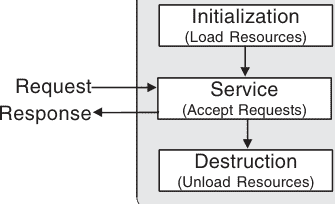

**图 2-1** Servlet 生命周期图

Servlet 遵循一个三阶段的生命周期：*初始化、服务和销毁*，其中初始化和销毁通常执行一次，而服务则执行多次。

初始化是 Servlet 生命周期的第一阶段，代表了 Servlet 服务请求可能所需的资源的创建和初始化。Servlet 必须实现 `javax.servlet.Servlet` 接口。该接口定义了 `init()` 方法以匹配 Servlet 生命周期的初始化阶段。当容器加载 Servlet 时，它会在处理任何请求之前调用 `init()` 方法。

Servlet 生命周期的服务阶段代表了直到 Servlet 销毁之前与请求的所有交互。`Servlet` 接口将生命周的服务阶段映射到 `service()` 方法。Servlet 的 `service()` 方法每个请求被调用一次，负责生成请求的响应。Servlet 规范定义了 `service()` 方法接收两个参数：一个 `javax.servlet.ServletRequest` 和一个 `javax.servlet.ServletResponse` 对象。这些对象代表客户端对动态资源的请求以及 Servlet 对客户端的响应。Servlet 是多线程的，这意味着通常在任何给定时间 JSP 容器只加载一个 Servlet 实例。初始化完成一次，每个请求都由执行 Servlet `service()` 方法的线程并发处理。

- 这种对 Servlet 的描述略有误导性。加载 Servlet 有许多复杂之处，将在本章及书的其他部分中涉及。

- Servlet 需要所有多线程 Java 对象所相同的状态同步。为了简单起见，状态管理相关问题（包括适当的同步）将直到第 9 章才会讨论。在假设你了解所有 Servlet 知识之前，请先阅读。

# 34 JAVA SERVLETS

Servlet 生命期的销毁阶段代表了 Servlet 从容器中移除使用的时刻。Servlet 接口定义了 `destroy()` 方法来对应销毁生命阶段。每当 Servlet 准备被移除使用时，容器都会调用 `destroy()` 方法，允许 Servlet 优雅地终止并清理它可能创建的任何资源。通过合理使用 Servlet 生命周期的初始化、服务销毁阶段，Servlet 可以高效地管理应用资源。在初始化期间，Servlet 加载服务请求所需的所有内容。这些资源在服务阶段被重用，并在销毁阶段被清理。

这些事件形成了 Servlet 生命周期，但在实践中，Web 开发者需要考虑的方法更多。Web 内容主要通过超文本传输协议 (HTTP) 访问。基础 Servlet 对 HTTP 一无所知，但有一个特殊的 Servlet 实现 `java.servlet.http.HttpServlet`，它是专门为之设计的。

## 用于万维网的 Servlet

当提到 Servlet 时，总是暗示 Servlet 是 HttpServlet 的实例。对此的解释很简单：超文本传输协议 (HTTP) 用于万维网上绝大多数事务——你访问的每一个页面都是通过 HTTP（即 http:// 前缀）传输的。并不是说 HTTP 是人类以来最好的协议，但 HTTP 确实有效且已经得到了广泛应用。Servlet 通过 `java.servlet.http.HttpServlet` 类的形式提供了对 HTTP 事务的支持。在展示 HttpServlet 示例之前，重申超文本传输协议的基础知识是有帮助的。许多开发者并没有完全理解 HTTP，而这对充分理解 HttpServlet 至关重要。HTTP 是一种简单的、无状态协议。该协议依赖客户端（通常是 Web 浏览器）发送请求，依赖服务器发送响应。连接持续的时间仅足够完成一次事务。一个事务可以是一个或多个。

## 请求、响应和报头

HTTP 事务的第一部分是 HTTP 客户端创建并向服务器发送请求。最简单形式的 HTTP 请求仅仅是一行指定客户端想要获取内容的文本。这行文本被拆分为三个部分：客户端想要执行的操作类型（方法）；客户端想要访问的资源；以及使用的 HTTP 协议版本。例如：

```
GET /index.html HTTP/1.0
```

上述内容是一个完全有效的请求。第一个单词 GET 是 HTTP 定义的一种方法，用于向服务器请求特定资源；/index.html 是从服务器请求的资源；HTTP/1.0 是所使用的 HTTP 版本。

## 图 2-2 Telnet 连接到 localhost:80

```
root@localhost:/usr/jakarta-tomcat-5/webapps/jspbook - Shell - Konsole
[root@localhost jspbook]# telnet 127.0.0.1 80
Trying 127.0.0.1...
Connected to 127.0.0.1.
Escape character is '^'
```

你刚刚发送了一个基础的 HTTP 请求，Tomcat 返回了一个 HTTP 响应。虽然这通常在后台完成，但所有的 HTTP 请求都与上述相似。除了 GET 之外，还有其他方法，但在讨论它们之前，让我们仔细看看 Tomcat 返回了什么。

Tomcat 返回的第一条内容是一行文本：

```
HTTP/1.1 200 OK
ETag: W/"173-104844503800"
Last-Modified: Sun, 23 Mar 2003 18:43:56 GMT
Content-Type: text/html
Content-Length: 173
Date: Sun, 23 Mar 2003 18:48:20 GMT
Server: Apache Coyote/1.0
Connection: close
GET /jspbook/index.html HTTP/1.0
<html>
<head>
<title>Welcome</title>
</head>
<body>
Welcome to the example Web Application for
<i>Servlets and JSP, the J2EE Web Tier</i></i>.
</body>
</html>
Connection closed by foreign host.
[root@localhost jspbook]#
```

## 图 2-3 手动 HTTP 请求与服务器响应

这是一个 HTTP 状态行（status line）。每个 HTTP 响应都以状态行开始。状态行由 HTTP 版本、状态码和原因短组成。HTTP 响应 200 意味着一切正常，这就是为什么 Tomcat 在响应中包含了请求的内容。如果请求出现某种问题，将使用不同的响应码。你可能还熟悉另一个 HTTP 响应码是 404 “File Not Found”（文件未找到）。如果你点击了一个损坏的超链接，这可能就是返回的代码。

## HTTP 响应码

在实践中，你通常不需要理解所有的特定 HTTP 响应码。JSP、Servlets 和 Web 服务器通常会自动处理这些代码，但并没有阻止你发送特定的 HTTP 响应码。稍后我们将看到使用 Servlets 和 JSP 执行此类操作的示例。完整的 HTTP 响应码列表以及其他 HTTP 信息可以在当前的 HTTP 规范中找到：http://www.ietf.org/rfc/2616.txt。

除了 HTTP 响应码外，Tomcat 还可以在 index.html 内容之前发送几行信息，如图 2-4 所示。

所有这些行都是 HTTP 头部（headers）。HTTP 使用头部在请求或响应中发送元数据。一个头部是一个由冒号分隔的 `name=value` 对——即它包含头部的名称（由冒号分隔），随后跟的是头部的值。典型的响应头部包括内容类型描述、内容长度、一个时间戳、服务器信息以及内容最后修改的日期。这些信息帮助客户端确定发送的是什么、格式是怎样的，以及数据与之前看到的响应相比是否为新的。请求头部包含用户代理（user-agent）以及首选格式、语言和内容编码。这些头部告诉服务器客户端是什么，以及他们希望返回什么样的信息。理解 HTTP 头部很重要，但现在请先将这个概念搁置，直到你学习更多关于 Servlets 的知识。HTTP 头部提供了一些用的功能，但最好通过 HttpServlet 示例进一步解释它们。

- HTTP 1.0 中没有强制性头部；在 HTTP 1.1 中，唯一的强制性头部是 Host 头部。

```
HTTP/1.1 200 OK
ETag: W/"173-104844503800"
Last-Modified: Sun, 23 Mar 2003 18:43:58 GMT
Content-Type: text/html
Content-Length: 173
Date: Sun, 23 Mar 2003 18:48:20 GMT
Server: Apache/1.0
Connection: close
```

**图 2-4** 示例 HTTP 头部

## GET 和 POST

第一个相对广泛使用的 HTTP 版本是 HTTP 0.9。它只支持一个 HTTP 方法（或称为动词），即 GET。作为其执行的一部分，GET 请求可以以查询字符串¹的形式提供有限的信息，GET 方法并非用于发送大量信息。大多数 Web 服务器将完整 URL（包括查询字符串）的长度限制在 255 个字符。多余的信息通常会被忽略。因此，GET 方法用于发送在 URL 中不可见的小量信息。对 GET 还有另一个限制：HTTP 规范将 GET 定义为“安全的”方法，且是幂等的（idempotent）¹。这意味着 GET 必须仅用于在 Web 中执行查询。GET 不得用于执行更新，因为这违反了 HTTP 规范。

为了克服这些限制，HTTP 1.0 规范引入了 POST 方法。POST 与 GET 类似，它也可能包含查询字符串，但 POST 方法可以使用完全不同的机制来发送信息。POST 可以通过套接连接发送无限量的信息。在当前的 HTTP 1.1 版本中，总共存在七种方法：GET、POST、PUT、TRACE、DELETE、HEAD 和 OPTIONS。

* 4xx: 客户端代理错误：请求包含错误的语法或无法完成。

* 5xx: 服务器错误：服务器未能完成一个显然有效的请求。

* 的每个状态码都有一个关联的字符串（原因短语）。

你最常看到的状态码是 200。这意味着一切都成功了，你获得了一个有效的响应。你可能还会看到的其他代码：

  * 401：你没有权限执行此请求

  * 404：找不到请求的 URI

  * 405：你尝试执行的 HTTP 方法不受此 URL 支持（例如，你发送了 POST，但该 URL 只接受 GET）

  * 500：内部服务器错误。如果你正在浏览的资源（如 Servlet）抛出异常，你可能会看到此错误。

如果你向一个 Servlet 发送请求并收到 500 错误，那么很有可能是你的 Servlet 本身抛出了异常。若要发现此异常的根源，你应该检查应用程序的输出日志。Tomcat 的日志存储在 Tomcat 安装目录下的 `/logs` 目录。

> 注意，你可以配置 Tomcat 将输出日志到控制台窗口。这通常在开发期间完成，因为读取控制台比读取日志文件更容易。如果你想这样做，请查看 Tomcat 文档。

## 编写 HttpServlet


之前已经展示了 Servlet 有三个阶段的生命周期：初始化、服务和销毁。`HttpServlet` 对象共享这一生命周期，但针对 HTTP 协议进行了一些修改。`HttpServlet` 对象对 `service()` 方法的实现在每次服务请求期间被调用，该方法会调用七种不同的辅助方法之一：`doGet()`、`doPost()`、`doPut()`、`doHead()`、`doOptions()`、`doDelete()` 和 `doTrace()`。会调用相应的辅助方法来匹配给定 HTTP 请求的方法类型。`HttpServlet` 的生命周期可以如图 2-5 所示。

虽然所有七种方法都会用到，但请记住，通常对于给定的请求只有一个其中一个会被调用。如果开发者重写了这些方法并让它们相互调用，可能会调用多个。Servlet 生命周期的初始化和销毁阶段与之前描述的相同。

编写 `HttpServlet` 非常简单。`javax.servlet.http.HttpServlet` 类负责处理 HTTP 请求的冗余部分，开发者只需要重写需要自定义的方法即可。对给定请求和响应的操作是通过两个对象完成的：`javax.servlet.http.HttpServletRequest` 和 `javax.servlet.http.HttpServletResponse`。这两个对象在调用 HTTP 服务方法时都会作为参数传递。

现在是时候逐步编写并使用一个基础 Servlet 了。一个基础“Hello World” Servlet 适合入门（参见列表 2-1）。将以下代码作为 `HelloWorld.java` 放在 jsp Web 应用程序的 `/WEB-INF/classes/com/jsp` 目录下。

**列表 2-1** HelloWorld.java

```java
package com.jsp;

import java.io.*;
import javax.servlet.*;
import javax.servlet.http.*;

public class HelloWorld extends HttpServlet {

    public void doGet(HttpServletRequest request,
        HttpServletResponse response)
    throws IOException, ServletException
{
    response.setContentType("text/html");
    PrintWriter out = response.getWriter();

    out.println("<html>");
    out.println("<head>");
    out.println("<title>Hello World!</title>");
    out.println("</head>");
    out.println("<body>");
    out.println("<h1>Hello World!</h1>");
    out.println("</body>");
    out.println("</html>");
}
```

## javax.servlet.http.HttpServlet

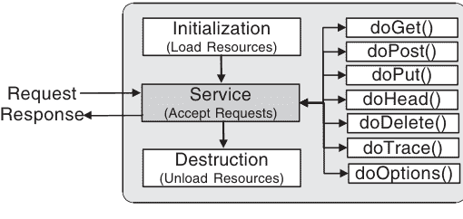

**图 2-5** HttpServlet 生命周期

## 部署 Servlet

Servlet 本身并不是一个完整的 Java 程序。Servlet 依赖于由容器管理的 Web 应用程序的一部分。使用 Servlet 生成动态响应涉及创建 Servlet 以及将 Servlet 部署到 Web 应用程序中使用。

部署 Servlet 并不困难，但它不像你想象的那么直观。与静态资源不同，Servlet 并不是简单地放在 Web 应用程序的根目录下。Servlet 类文件存放在应用程序的 `/WEB-INF/classes` 目录中，与其他所有的 Java 类一起。客户端要访问 Servlet 或一组 URL，需要在 Web 应用程序部署描述符中声明。`web.xml` 部署描述符依赖于新元素：需要在 `web.xml` 中引入 `servlet` 和 `servlet-mapping`。`servlet` 元素用于定义应由 Web 应用程序加载的 Servlet。`servlet-mapping` 元素用于将 Servlet 映射到给定的 URL 或一组 URL。可以使用这两个元素中的任一元素的多个标签来定义所需的许多 Servlet 和 Servlet 映射。这两个元素都有子元素用于进一步描述它们。这些子元素是自描述的，将在后续示例中引入。

> 14. 元素（element）是紧跟在 XML 标签起始小于符号 `<` 之后的唯一单词的名称。

打开 jcookbook Web 应用程序的 `/WEB-INF/web.xml` 文件并编辑使其与列表 2-2 匹配。

**列表 2-2** 部署 Servlet

```xml
<web-app xmlns="http://java.sun.com/xml/ns/javaee" version="2.4">
  <servlet>
    <servlet-name>HelloWorld</servlet-name>
    <servlet-class>com.jsp.HelloWorld</servlet-class>
  </servlet>
  <servlet-mapping>
    <servlet-name>HelloWorld</servlet-name>
    <url-pattern>/HelloWorld</url-pattern>
  </servlet-mapping>
  <welcome-file-list>
    <welcome-file>index.html</welcome-file>
  </welcome-file-list>
</web-app>
```

## Hello World!

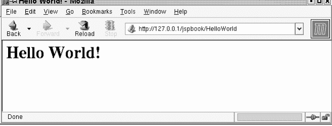

# 了解 Servlet 部署！

部署 Servlet 相对简单但非常重要。请注意前面的示例，因为为了简洁起见，后续示例将不再包含详细的部署描述。通常仅使用诸如“将 Servlet 部署到 URL 映射 y”这样的一句话来完成相同的操作。只有当部署描述符对示例极其重要时，才会提供完整的描述符。

# Web 应用程序部署描述符结构

每一个 Servlet 在供客户端使用之前都需要进行部署。HelloWorld Servlet 示例引入了 Web 应用程序部署描述符元素，但在你部署 Servlet 之前，还有一些信息需要注意。`web.xml` 的架构（schema）定义了可以使用哪些元素以及它们必须出现的顺序。在之前的示例中，这就是为什么 `servlet` 和 `servlet-mapping` 元素出现在 `welcome-file-list` 元素之前。这也是为什么 `servlet` 元素必须出现在 `servlet-mapping` 元素之前¹⁸。

从前面的示例来看，排列似乎是按字母顺序的，但事实并非如此。元素的排列必须与 Web 应用程序部署描述符架构中的列表匹配。这个相当长的标题听起来很熟悉——它就是定义 Servlet 2.4 规范中可见内容的相同 XML 架构。元素的顺序定义为：`web-inf`、`display-name`、`description`、`distributable`、`context-param`、`filter`、`filter-mapping`、`listener`、`servlet`、`servlet-mapping`、`session-config`、`mime-mapping`、`welcome-file-list`、`error-page`、`jsp-config`、`resource-en-ref`、`resource-ref`、`security-constraint`、`login-config`、`security-role`、`en-entry`、`ejb-ref`、`ejb-local-ref`、`message-destination` 以及 `locale-encoding-mapping`。

理解顺序并不困难，但很少有 Servlet 开发者会因此。这值得提到，以避免以后在使用同名的多个元素时产生任何混乱。如果部署了两个 Servlet，这两个 `servlet` 元素必须列在任何 `servlet-mapping` 元素之前。这并不

* 18. 然而，并不是所有的 Servlet 容器都强制执行架构。请参考你的容器文档以获取更多信息。

46 JAVA SERVLETS

> 19. 实际上，在标准 Servlet 库中，Servlet 和 ServletConfig 是同一个对象——也就是说，`GenericServlet` 同时实现了 `javax.servlet.Servlet` 和 `javax.servlet.ServletConfig`。

适当国际化的“Hello”消息。虽然 `HelloWorld.java` 仍然完美兼容所有语言，但它确实演示了初始化参数。修改 `HelloWorld.java` 以匹配列表 2-3 中的代码。

# **列表 2-3** InternationalizedHelloWorld.java

将预测的代码保存为 `InternationalizedHelloWorld.java`，位于 jspbook Web 应用程序的 `/WEB-INF/classes/com/jspbook` 目录下。由于这是第二个代码示例，将提供部署 Servlet 的完整步骤。未来，将你自己将 Servlet 部署到指定的 URL。

打开 jspbook Web 应用程序 `/WEB-INF/` 文件夹下的 `web.xml`，并为 `InternationalizedHelloWorld` Servlet 添加声明和映射。完成后，`web.xml` 应与列表 2-4 匹配。

## 列表 2-4 更新后的 web.xml

```xml
<web-app xmlns="http://java.sun.com/xml/ns/j2ee" version="2.4">

  <servlet>
    <servlet-name>HelloWorld</servlet-name>
    <servlet-class>com.jspbook.HelloWorld</servlet-class>
  </servlet>
  <servlet>
    <servlet-name>InternationalizedHelloWorld</servlet-name>
    <servlet-class>com.jspbook.InternationalizedHelloWorld</servlet-class>
  </servlet>
  <servlet-mapping>
    <servlet-name>InternationalizedHelloWorld</servlet-name>
    <url-pattern>/InternationalizedHelloWorld</url-pattern>
  </servlet-mapping>
  <servlet-mapping>
    <servlet-name>HelloWorld</servlet-name>
    <url-pattern>/HelloWorld</url-pattern>
  </servlet-mapping>

  <welcome-file-list>
    <welcome-file>welcome.html</welcome-file>
  </welcome-file-list>
</web-app>
```

`InternationalizedHelloWorld` Servlet 依赖一个初始化参数来显示经典的“Hello World”问候。通过在 `web.xml` 中添加以下条目来指定该参数。

```xml
<servlet>
  <servlet-name>InternationalizedHelloWorld</servlet-name>
  <servlet-class>com.jspbook.InternationalizedHelloWorld</servlet-class>
  <init-param>
    <param-name>greeting</param-name>
    <param-value>Bonjour!</param-value>
  </init-param>
</servlet>
```

将 `param-name` 元素的体保持为 `greeting`，但将 `param-value` 标签体内的指定值更改为你选择的问候语。法语欢迎消息的候选可以是“Bonjour!”。保存更改后，重新加载 jspbook 应用程序并访问 Internationalized-HelloWorld Servlet 查看新消息。图 2-7 显示了 `InternationalizedHelloWorld` Servlet 输出的浏览器渲染示例。

Servlet 现在显示初始化参数的值，而不是简单的“Hello!”。这种方法是解决国际化问题接近最佳的方案，但在某些情况下可行，并且是引入初始化 Servlet 配置的良好示例。通常情况下，之前所示的初始化参数机制用于为 Servlet 提供简单的配置信息。HelloWorld Servlet 示例演示了初始化参数。

## 配置的局限性：web.xml

初始化参数是提供 Servlet 使用的简单配置的好方法。对于更复杂的 Servlet，创建一个随 `web.xml` 一起存在的单独配置文件并不罕见。在开发 Servlet 时，请记住没有任何阻止你这样做。


**图 2-7** InternationalizedHelloWorld Servlet 的浏览器渲染

创建自定义配置文件并将其与应用程序的其他部分一起打包进 WAR 是完全可以的。第 11 章出现的 Struts 框架就是一个很好的例子。

## 客户端/服务器 Servlet 编程

Servlet 请求和响应由 `javax.servlet.ServletRequest` 和 `javax.servlet.ServletResponse` 或其相应的子类表示。对于 HTTP Servlet，对应的类是 `HttpServletRequest` 和 `HttpServletResponse`。这两个对象在 HelloWorld Servlet 示例中被快速介绍，该示例主要关注于如何部署 Servlet。编码和部署 Servlet 开发的基础部分。先解释部署是因为对于任何 Servlet 来说过程都是完全相同的。

Servlet API 通过使用 `HttpServletRequest` 和 `HttpServletResponse` 对象简单地操作 HTTP 请求和响应。这两个对象都封装了大量功能。不要担心这一节似乎在快速浏览这两个对象。在没有理解其余 Servlet API 的情况下，详细介绍所有方法和成员将既乏味又令人困惑，但 API 讨论必须从某个地方开始，这两个对象无疑是最重要的。在本节中，讨论将仅关注每个对象的一些最常用的方法。

书的后续章节将全面介绍其他方法以及它们的最适用场景。

## HttpServletResponse

要讨论的第一项最重要的功能是类向客户端发送信息。正如其名称所示，`HttpServletResponse` 对象负责这项功能。其本身，`HttpServletResponse` 对象只产生一个 HTTP 响应。发送自定义内容需要使用 `getWriter()` 或 `getOutputStream()` 方法来获取用于写入内容的输出流。这两个方法分别返回适用于向客户端发送文本或二进制内容的对象。对于一个 `HttpServlet` 对象，只能使用这两个方法中的一种。尝试同时调用这两个方法会导致抛出异常。

在列表 2-1 的 HttpServlet 示例中，使用了 `getWriter()` 方法来获取发送 HTML 标记的输出流。在 HelloWorld.java 的几行代码中，通过调用 `getWriter()` 获取了一个 `java.io.PrintWriter` 对象用于返回文本。

```java
PrintWriter out = response.getWriter();
out.println("<html>");
out.println("<head>");
out.println("<title>Hello World!</title>");
```

使用 `PrintWriter` 并不复杂，现在应该很清楚如何使用 `PrintWriter` 对象来发送文本了。除了之前展示的内容之外，还涉及到发送自定义编码的文本。到目前只发送了一种类型的文本，即 HTTP 的默认编码 ISO-8859-1，但更改字符编码是可能的，这将在第 12 章中详细介绍。

## 表 2-1 来自 HelloWorld Servlet 的 HTML 标记

与使用 `getWriter()` 方法相比，当需要对发送到客户端的内容更多控制时，则使用 `getOutputStream()` 方法。返回的 `OutputStream` 可用于发送文本，但通常用于发送非文本相关的二进制信息（如图像）。这是因为 `getOutputStream()` 方法返回的是 `javax.servlet.ServletOutputStream` 对象的实例，而不是 `PrintWriter`。`ServletOutputStream` 直接继承自 `java.io.OutputStream`，允许开发者写入原始字节。`PrintWriter` 对象则锁定了这一功能，因为它始终假设你正在写入字符数据。


在大多数实际情况下，很少需要向客户端发送原始字节，但一个优秀的 Servlet 开发者应该意识到这一功能。错误的思维是认为 Servlets 只能动态地创建内容。通过发送原始字节，Servlet 可以动态地提供任何形式的数字内容。该功能的主要限制在于能够为所需的内容创建所需的字节。对于包括图像和音频在内的常用格式，很少见到为了简化任务而构建的 Java API。将此 API 与 Servlet API 结合，发送自定义格式是相对容易的。一个很好的例子是用于高级成像（JAI）的 Java API。

> 注意，为了提高效率，你可能希望使用 `OutputStream` 而不是 `PrintWriter` 来发送文本。`PrintWriter` 接受 Unicode 字符串，而 `OutputStream` 接受字节。详见 Dov Bulka 的《Java Performance and Scalability Volume 1》。

使用此 API 可以从服务器端生成许多流行的图像格式，即使在不支持 GUI 的服务器上也是如此。

关于非文本生成 Servlets 的全面讨论不在本书的范围之内。通过 Java 生成自定义图像、音频和其他非文本格式并不是 Servlet 特有的功能。Servlet 需要的只是恰当地设置 MIME 类型并发送一些客户端字节，但这并不是完全避免示例的良好理由。为了完整性，列表 2-5 提供了一个 `ServletOutputStream` 示例。

## 列表 2-5 DynamicImage.java

```java
package com.jspbook;

import javax.servlet.*;
import javax.servlet.http.*;
import java.io.*;
import java.awt.*;
import java.awt.image.*;
import com.sun.image.codec.jpeg.*;

public class DynamicImage extends HttpServlet {

    public void doGet(
        HttpServletRequest request,
        HttpServletResponse response)
        throws ServletException, IOException {

        response.setContentType("image/jpeg");

        // 创建图像
        int width = 200;
        int height = 30;
        BufferedImage image = new BufferedImage(
            width, height, BufferedImage.TYPE_INT_RGB);

        // 获取绘制对象
        Graphics2D g = (Graphics2D) image.getGraphics();

        // 填充背景
        g.setColor(Color.gray);
        g.fillRect(0, 0, width, height);

        // 绘制字符串
        g.setColor(Color.white);
        g.setFont(new Font("Dialog", Font.PLAIN, 14));
        g.drawString("http://www.jspbook.com", 10, height/2+4);

        // 绘制边框
        g.setColor(Color.black);
        g.drawRect(0, 0, width-1, height-1);

        // 释放上下文
        g.dispose();

        // 返回图像
        ServletOutputStream sos = response.getOutputStream();
        JPEGImageEncoder encoder = JPEGCodec.createJPEGEncoder(sos);
        encoder.encode(image);
    }
}
```

将上述代码保存为 `DynamicImage.java`，位于 jspbook Web 应用程序的 `/WEB-INF/classes/com/jspbook` 目录下。编译并部署 DynamicImage Servlet，并映射到 jspbook Web 应用程序的 `/DynamicImage` URL 扩展。重新加载 Web 应用程序后，访问 `http://127.0.0.1/jspbook/DynamicImage`。每次对 Servlet 发起请求时都会动态生成一个 JPEG 格式的图像。图 2-8 显示了动态生成的图像的一个示例。


图 2-8 显示了动态生成的图像之一。

注意，为了提高效率，你可能希望使用 `OutputStream` 而不是 `PrintWriter` 来发送文本。`PrintWriter` 接受 Unicode 字符串，而 `OutputStream` 接受字节。详见 Dov Bulka 的《Java Performance and Scalability Volume 1》。

## 响应头 (Response Headers)

- `addHeader(String name, String value)`：`addHeader()` 方法添加带有指定名称和值的响应头。如果头已存在，则会添加一个新值。
- `containsHeader(String name)`：`containsHeader()` 方法返回一个布尔值，指示命名的头是否已设置。
- `setHeader(String name, String value)`：`setHeader()` 方法设置指定名称和值的响应头。如果头已存在，则会覆盖之前的值。
- `setIntHeader(String name, int value)`：`setIntHeader()` 方法设置指定名称和整数值的响应头。如果头已存在，则会覆盖之前的值。
- `setDateHeader(String name, long date)`：`setDateHeader()` 方法设置指定名称和日期的响应头。该日期以自 Unix 纪元以来的毫秒表示。如果头已存在，则会覆盖之前的值。

可以使用 `HttpServletResponse` 对象的 `setStatus()` 方法向客户端发送任何 HTTP 响应码。如果一切运行正常，Servlet 将发送状态码 200。另一个有助于理解的状态码是 302，“资源临时移动”。该状态码告知客户端，它们正在查找的资源不在请求的 URL，而是在 HTTP 响应中 Location 头部指定的 URL 中。302 响应码非常有帮助，因为每个 Web 浏览器会自动跟随新链接而无需通知用户。这允许 Servlet 获取用户的请求并转发到 Web 上的任何资源。

### 表 2-2 HTTP 1.1 响应头部字段

| 头部字段 | 头部值 |
| --- | --- |
| Age | 一个正整数，表示自服务器生成响应以来经过的估算时间。 |
| Location | 某些 HTTP 响应状态会将客户端重定向到新资源。该资源的位置由 Location 头部指定，格式为绝对 URI。 |
| Retry-After | After-response 头部字段可与 503（服务不可用）响应一起使用，用于指示服务预计对请求客户端不可用多长时间。该字段的值可以是日期，也可以是响应时间后的秒数（小数）。 |
| Server | Server 字段是一个字符串，表示生成此响应的服务器相关信息。 |
| Content-Length | Content-Length 实体头部字段表示发送给接收者的消息体的大小，以十进制的字节（8 位字节）的数量为单位；或者在 HEAD 方法的情况下，表示如果请求是 GET 则将具有的实体大小。 |
| Content-Type | 与 HTTP 响应内容相对应的 MIME 类型。此值通常被浏览器用于判断内容应该在内部渲染，还是启动外部应用程序进行渲染。 |
| Date | Date 字段表示消息产生的日期和时间。 |
| Pragma | Pragma 字段用于包含特定于实现的指令，这些指令可能适用于请求-响应链中的任何接收者。最常用的值是“no-cache”，表示资源不应被缓存。 |

竞争对手想要了解其他网站发送了哪些流量。实现此目的的技术涉及提取 HTTP 请求的“referer”（注意：拼写略有不准确）。虽然这很简单，但并没有同样简单的方法来跟踪网站向何处发送了流量。问题的出现是因为，网站上任何通向外部资源的链接都会向其来源站点发送回请求。为了解决这个问题，可以使用一种依赖 HTTP 302 响应状态码的巧妙技巧。不要直接提供指向外部资源的链接，而是编码所有链接，使其指向你网站上的同一个 Servlet，但将真实链接作为参数包含。然后通过 Servlet 记录预期的链接以提供链接跟踪，同时向客户端返回 302 状态码以及要访问的真实链接。

正如你所想象的，使用 Servlet 跟踪链接是具有 HTTP 意识的开发者经常使用的做法。如果 `HttpServletResponse` 对象中有一个方便方法 `sendRedirect()`，则使用该方法处理 HTTP 302 响应状态码。`sendRedirect()` 方法接受一个参数（代表新 URL 的字符串），并自动设置 HTTP 302 状态码以及相应的头部。使用 `sendRedirect()` 方法和 `java.util.Hashtable`，可以轻松创建一个用于跟踪链接使用的 Servlet。将列表 2-6 中的代码保存为 `LinkTracker.java`，并于 jspbook Web 应用程序的 `/WEB-INF/classes/com/jspbook` 目录下。将该 Servlet 部署到 `/LinkTracker` 映射。

## 列表 2-6 LinkTracker.java

```java
package com.jspbook;

import java.util.*;
import java.io.*;
import javax.servlet.*;
import javax.servlet.http.*;

public class LinkTracker extends HttpServlet {
    private static Hashtable links = new Hashtable();

    String tstamp;
    public LinkTracker() {
        tstamp = new Date().toString();
    }

    public void doGet(HttpServletRequest request,
        HttpServletResponse response)
    throws IOException, ServletException {

        String link = request.getParameter("link");
        if (link != null && !link.equals("")) {
            synchronized (links) {
                Integer count = (Integer) links.get(link);
                if (count == null) {
                    links.put(link, new Integer(1));
                } else {
                    links.put(link, new Integer(1+count.intValue()));
                }
            }
            response.sendRedirect(link);
        } else {
            response.setContentType("text/html");
            PrintWriter out = response.getWriter();
            request.getSession();
            out.println("<html>");
            out.println("<head>");
            out.println("<title>Tracker Servlet</title>");
            out.println("</head>");
            out.println("<body>");
            out.println("<p>Links Tracked Since");
            if (links.size() != 0) {
                Enumeration enum = links.keys();
                while (enum.hasMoreElements()) {
                    String key = (String)enum.nextElement();
                    int count = ((Integer)links.get(key)).intValue();
                    out.println("<key>" + count + " visits<br>");
                }
            } else {
                out.println("No links have been tracked!<br>");
            }
            out.println("</body>");
            out.println("</html>");
        }
    }

    public void doPost(HttpServletRequest request, HttpServletResponse response)
        throws IOException, ServletException {
        doGet(request, response);
    }
}
```

为了配合 LinkTracker Servlet，需要一些使用它的链接。只要编码得当，这些链接可以是任何资源。编码链接并不困难；只需要将真实链接作为查询字符串中的 `link` 参数传递。列表 2-7 是一个包含几个正确编码链接的简单 HTML 页面。将该 HTML 保存为 `links.html`，并于 jspbook Web 应用程序的根目录下。

## 列表 2-7 为 LinkTracker Servlet 编码的某些链接

```html
<html>
<head>
<title>Some Links Encoded for LinkTracker Servlet</title>
</head>
<body>
  <a href="LinkTracker?link=http://www.google.com">Google</a><br>
  <a href="LinkTracker?link=http://www.baidu.com">百度</a><br>
  <a href="LinkTracker?link=http://www.github.com">GitHub</a>
</body>
</html>
```

可以是一个简单的“您的请求已处理”页面，该页面在几秒后会刷新以显示响应结果。另一种方法（也是最常用的方法）是等待请求正式完成发送并传回任何内容。这会导致客户端浏览器等待响应，有时看起来就像请求可能会超时，从而导致用户重复地发送了两次耗时较长的请求。

等待页面的另一个实际案例是减慢请求速度，可能是为了更好地确保用户能看到相关信息。例如，在重定向到相应的所需的页面之前，显示一个广告或法律信息的等待页面。

有一点很明确的是，在某些情况下，`Refresh`（刷新）响应头可以大大用用场。虽然它不是一个标准的 HTTP 1.1 请求头，但它有时被视为一种事实标准。

## HTTPRequest

客户端的 HTTP 请求由一个 `HttpServletRequest` 对象表示。`HttpServletRequest` 对象主要用于获取客户端的请求头、参数、文件或数据。Servlet 规范增强了该对象，使其能够与 Web 应用交互。一些最有帮助的功能包括会话管理和在 Servlet 之间转发请求。

## Headers

客户端设置的 HTTP 请求头用于通知服务器客户端是什么软件，以及客户端倾向于如何返回请求的信息。从 Servlet 中，可以通过调用以下方法访问 HTTP 请求头：

- `getHeader(java.lang.String name)`：`getHeader()` 方法以字符串形式返回指定请求头的值。如果请求不包含指定名称的头，则该方法返回 `null`。头的名称不区分大小写。你可以对任何请求头使用此方法。

> 26. 自动刷新页面有助于极大减少这个问题，但你也应该确保 Web 应用能够准确地维护状态。第 9 章详细介绍了状态管理。
>
> 27. 请注意，这里显示的 Refresh 和 Redirect 解决方案有一个缺点。它们涉及到客户端到服务器的额外往返。往返在时间和资源使用方面是昂贵的，Web 应用应该尽量减少往返。


- **`getHeaders(java.lang.String name)`**: `getHeaders()` 方法以 String 对象的枚举（`Enumeration`）返回指定请求头的所有值。某些头（如 `Accept-Language`）可以由客户端作为多个头发送，每个头有一个不同的值，而不是以逗号分隔列表的形式发送头。如果请求不包含任何指定名称的头，该方法返回一个空的 `Enumeration` 对象。头的名称不区分大小写。你可以对任何请求头使用此方法。

- **`getHeaderNames()`**: `getHeaderNames()` 方法返回请求发送的所有头的枚举。通过与 `getHeader()` 和 `getHeaders()` 结合使用，`getHeaderNames()` 可在不直接访问的情况下检索所有发送的头的名称和值。在这种情况下将返回 `null`。

- **`getIntHeader(java.lang.String name)`**: `getIntHeader()` 以 `int` 类型返回指定请求头的值。如果请求没有指定名称的头，该方法返回 `-1`。如果头无法转换为整数，该方法将抛出 `NumberFormatException`。

- **`getDateHeader(java.lang.String name)`**: `getDateHeader()` 以 `long` 值返回指定请求头的值，该值表示一个 `Date` 对象。日期以自纪元以来的毫秒数返回。头的名称不区分大小写。如果请求没有指定名称的头，该方法返回 `-1`。如果头无法转换为日期，该方法将抛出 `IllegalArgumentException`。

HTTP 请求头对于确定各种信息非常有帮助。在后面的章节中，请求头被用作挖掘关于客户端数据的主要资源。这确定客户端偏好什么语言、正在使用什么类型的 Web 浏览器，以及客户端是否支持压缩内容以提高效率。现在，了解这些头的存在并对头中包含什么类型的信息有一个大致的认识是有帮助的。代码列表 2-8 是一个为了实现此目的设计的 Servlet。将以下代码保存为 `ShowHeaders.java`，位于 jspbook Web 应用的 `/WEB-INF/classes/com/jspbook` 目录下。

## Listing 2-8 ShowHeaders.java

```java
package com.jspbook;

import java.util.*;
import java.io.*;
import javax.servlet.*;
import javax.servlet.http.*;
```

```java
public class ShowHeaders extends HttpServlet {

    public void doGet(HttpServletRequest request
```

编译该 Servlet 并将其部署到 jspbook Web 应用的 `/ShowHeaders` 路径。重新加载 Web 应用后，浏览到 `http://127.0.0.1/ShowHeaders` 查看你的浏览器发送的所有 HTTP 头部列表（见图 2-11）。

上述是 Web 浏览器通常发送的头的良好示例。它们具有很强的自描述性。你可能可以想象这些头如何被用于浏览器和国际化信息。稍后

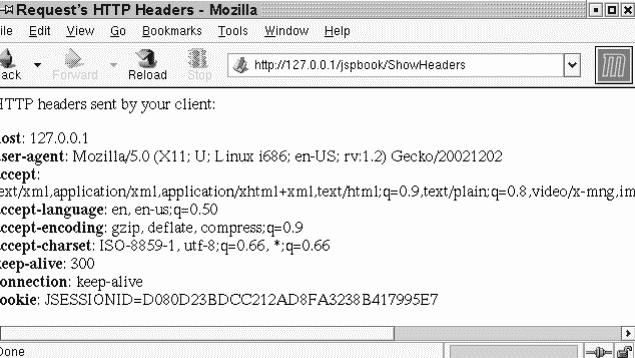

**图 2-11** ShowHeaders Servlet 的浏览器渲染

我们将恰好这样做²28，但现在我们用表 2-3 结束对请求头的讨论，该表列出了一些最相关和有用的头。

## Form Data and Parameters

可能 `HttpServletRequest` 对象的许多常用方法涉及获取请求参数：`getParameter()` 和 `getParameterValues()`。每当一个 HTML 表单被填写并发送到服务器时，字段将作为参数传递。通过查询字符串传递的任何信息在服务器上也是可用的。`HttpServletRequest` 对象包含了以下方法：

- **`getParameter(java.lang.String parameterName)`**: `getParameter()` 方法接收参数名称并返回对应值的 String 对象。如果没有参数，则返回 `null`。

> 28 特别是，`Referer` 头非常适合跟踪谁访问了站点；这与 `LinkTracker` Servlet 类似。然而，通过 Servlet 实现跟踪是繁琐的。因此，跟踪示例将留到后面关于过滤器的章节。

## 表 2-3 HTTP 请求头

| 名称 | 值 |
|---|---|
| Host | `Host` 头指定资源的互联网主机名和端口号，从原始 URL 获取。HTTP 1.1 强制要求。 |
| User-Agent | `User-Agent` 头包含产生请求的用户代理（或浏览器）的信息。这用于统计目的、跟踪协议违反以及为了特定的用户代理限制自动识别用户代理。 |
| Accept | `Accept` 请求头用于指定响应接受的媒体类型。`Accept` 头可以指示请求特定限于一小部分类型。 |
| Accept-Language | `Accept-Language` 请求头与 `Accept` 类似，但限制了作为响应的选自然语言。 |
| Accept-Charset | `Accept-Charset` 请求头用于指示响应接受的字符集。该字段允许能够理解全面或特殊用途字符集的客户端向能够表示这些字符集的服务器信号这种能力。ISO-8859-1 字符集可以被认为所有用户代理都能接受。 |
| Referer | `Referer` 头允许客户端为服务器指定指定获取请求的资源地址（URI）。 |

- **`getParameterValues(java.lang.String parameterName)`**: `getParameterValues()` 方法与 `getParameter()` 方法类似，但在存在多个相同名称的参数时应使用。通常 HTML 表单复选框或组合框会为相同的参数名称发送多个值。`getParameterValues()` 方法是一种方便的方法，以字符串数组的形式获取相同参数名称的所有参数值。

- **`getParameterNames()`**: `getParameterNames()` 方法返回一个 `java.util.Enumeration`，其中包含请求中使用的所有参数名称。与 `getParameter()` 和 `getParameterValues()` 方法结合使用，它可以获取请求中包含的名称列表以及所有参数。

在使用 `ShowHeaders` Servlet 时，拥有一个可以读取并显示请求中发送的所有参数的 Servlet 是很有用的。你可以使用这样的 Servlet 来更深入地熟悉参数，并通过查看发送的信息来调试 HTML 表单。列表 2-9 就是这样一个 Servlet。

## 列表 2-9 ShowParameters.java

```java
import java.util.*;
import java.io.*;
import javax.servlet.*;
import javax.servlet.http.*;

public class ShowParameters extends HttpServlet {

    public void doGet(HttpServletRequest request, HttpServletResponse response) throws IOException, ServletException {

        response.setContentType("text/html");
        PrintWriter out = response.getWriter();
        out.println("<html>");
        out.println("<head>");
        out.println("<title>Request HTTP Parameters</title>");
        out.println("</head>");
        out.println("<body>");
        out.println("<p>Parameters sent with request:</p>");
        Enumeration enum = request.getParameterNames();
        while (enum.hasMoreElements()) {
            String pName = (String) enum.nextElement();
            String[] pValues = request.getParameterValues(pName);
            out.print("<b>" + pName + "</b>: ");
            for (int i=0; i<pValues.length;i++) {
                out.print(pValues[i]);
            }
            out.print("<br>");
        }
        out.println("</body>");
        out.println("</html>");
    }

    public void doPost(HttpServletRequest request,
    HttpServletResponse response)
    throws IOException, ServletException {
        doGet(request, response);
    }
}
```

在 `jspbook` 应用中编译并部署 `ShowParameters` 路径，并映射到 `/ShowParameters`。重新加载 `jspbook` Web 应用程序后，创建几个简单的 HTML 表单并使用该 Servlet 查看参数。如果你对 HTML 不熟练，不要担心。

列表 2-10 提供了一个示例 HTML 表单，并包含一个指向优秀的在线 HTML 参考的链接：`http://www.jspinsider.com/reference/html.jsp`。

## 列表 2-10 exampleform.html

```html
<html>
<head>
<title>Example HTML Form</title>
</head>
<body>
<p>要调试 HTML 表单，请将其 'action' 属性指向 ShowParameters Servlet。</p>
<form action="http://127.0.0.1/jspbook/ShowParameters"
method="post">
Name: <input type="Text" name="name"><br>
Password: <input type="password" name="password"><br>
Select Box:
<select name="selectboxbox">
<option value="option1">Option 1</option>
<option value="option2">Option 2</option>
<option value="option3">Option 3</option>
</select>
Importance:
<input type="radio" name="importance" value="very">Very,
<input type="radio"
name="importance" value="normal">Normal,
<input type="radio" name="importance" value="not">Not<br>
Comment: <br>
<textarea name="textarea" rows="5" cols="40"></textarea><br>
<input value="Submit" type="submit">
</form>
</body>
</html>
```

可以保存上述 HTML，或者创建任何其他 HTML 表单并将 `action` 属性设置为 `http://127.0.0.1/jspbook/ShowParameters`，然后访问该页面。将之前的 HTML 保存为 `jspbook` Web 应用程序根目录下的 `exampleform.html`，并访问 `http://127.0.0.1/jspbook/exampleform.html`。图 2-12 显示了 Web 浏览器渲染后的页面样子。

填写表单并点击标记为 `Submit` 的按钮将信息发送到 `ShowParameters` Servlet。将出现类似于图 2-13 的界面。

在服务器端，表单发送的每条信息都通过你在 HTML 表单中定义的相同名称引用，并与用户输入的值关联。`ShowParameters` Servlet 通过使用 `getParameterNames()` 获取所有参数名称的列表，随后调用 `getParameterValues()` 获取每个参数匹配的值或值集合来实现这一点。该 Servlet 的核心是一个简单的循环。

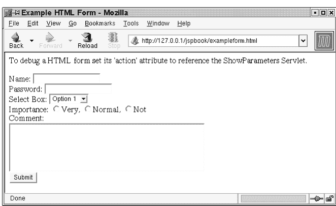

**图 2-12** exampleform.html 的浏览器渲染

## 发送的请求 HTTP 参数 - Mozilla

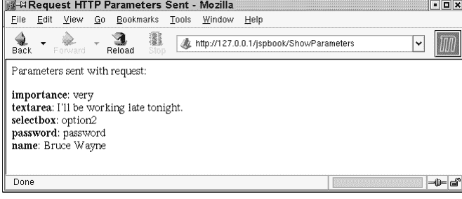

**图 2-13** ShowParameters Servlet 的浏览器渲染

```java
Enumeration enum = request.getParameterNames();
while (enum.hasMoreElements()) {
    String pName = (String) enum.nextElement();
    String[] pValues = request.getParameterValues(pName);
    out.print("<b>" + pName + "</b>: ");
    for (int i=0; i<pValues.length;i++) {
        out.print(pValues[i]);
    }
    out.print("<br>");
}
```

File: <input type="file" name="file"><br>

<input value="Submit" type="submit">

</form>

上述代码作为 `multipart-form.html` 存放在 jspbook Web 应用程序的根目录下并显示。这是一个包含两个输入的小型 HTML 表单：一个名称和一个要上传的文件。图 2-14 提供了该页面的浏览器渲染。

在 Name 字段中填写表单，并在 File 字段中选择任意文件。较好选择较小的文件，因为其内容将由 `ShowForm` Servlet 显示，而大文件会占用大量空间。文件的很好的选择是 `multipartform.html` 本身。完成表单后，点击 Submit 按钮。随后，`ShowForm` Servlet 将显示提交的内容。例如，使用 `multipartform.html` 作为文件结果将类似于以下内容：

```
----------------19675139261365180501540383426
Content-Disposition: form-data; name="name"

blah
--------------------------------19675139261365180501540383426
Content-Disposition: form-data; name="file"
filename="multipartform.html"
Content-Type: text/html
```

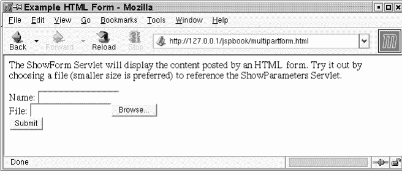

**图 2-14** multipartform.html 的浏览器渲染

SERVLET 配置 75

```html
<html>
<head>
  <title>示例 HTML 表单</title>
</head>
<body>
  <p>ShowForm Servlet 将显示由 HTML 表单提交的内容。通过选择一个文件（较好选择较小的文件）来引用 ShowParameters Servlet 尝试一下。</p>
  <form action="http://127.0.0.1/jspbook/ShowForm" method="post" enctype="multipart/form-data">
    Name: <input type="text" name="name"><br>
    File: <input type="file" name="file"><br>
    <input value="Submit" type="submit">
  </form>
</body>
</html>
```

---------------------------------------------------------------------------1967513926132651805401540383426--

这就是你在处理 `multipart/form-data` 请求时需要解析的信息类型。如果提交的文件不是文本，它的格式不会像前面那样漂亮，但会有相似的格式。每个 multipart 部分都有一个唯一的标记来声明其开始。在前面的示例使用了以下标记：

> 1967513926132651805401540383426


这声明了 multipart 部分的开始，并在结束标记结束，结束标记与开始标记相同，但带有 `--ended`。在开始和结束标记之间是数据段（可能是嵌套的 multipart），使用头部来描述内容。例如，在前面的代码中，首先描述了一个表单参数：

```
Content-Disposition: form-data; name="name"
```

blah

`Content-Disposition` 头部定义信息为表单的一部分，并通过名称“name”进行标识。“name” 的值是随后的内容；其 MIME 类型为 `text/plain`。第二部分描述了上传的文件：

```
Content-Disposition: form-data; name="file"
filename="multipartform.html"
```

76 JAVA SERVLETS

`Content-Type: text/html`

```html
<html>
<head>
  <title>示例 HTML 表单</title>
</head>
<body>
  ...
```

这一次，`Content-Disposition` 头部将表单字段的名称定义为 "file"，这与 HTML 表单中的内容匹配，并将 `content-type` 描述为 `text/html`，因为它不是 `text/plain`。头部之后是上传的内容，即 `multipartformdata.html` 的代码。

你应该很容易地想象出如何创建一个自定义类来解析这些信息并将上传的文件保存到正确的位置。在上传的文件没有使用特殊编码的情况下，任务是从提供的头部中解析文件名并保存内容。列表 2-13 提供了执行此操作的代码，并能够适应任何大小的文件。该 Servlet 充当文件 Servlet，将文件存放在 jbook Web 应用程序的 `/files` 目录，并允许用户浏览、可选下载之前上传的文件。

## 列表 2-13 FileUpload.java

```java
package com.jspbook;

import java.io.*;
import javax.servlet.*;

public class FileUpload extends HttpServlet {
  public void doPost(HttpServletRequest request, HttpServletResponse response)
  throws IOException, SQLException {

    response.setContentType("text/html");
    PrintWriter out = response.getWriter();

    out.println("<html>");
    out.print("File upload success. <a href=\"/jspbook/files/\");\n");
    out.print(">Click here to browse through all uploaded ");\n");
    out.println("files.</a><br>");
  }
}
```

```java
ServletInputStream sis = request.getInputStream();
StringWriter sw = new StringWriter();
int i = sis.read();
```

用于分隔每个部分，以相同的分隔符结束，并追加了 `---`：

--19675139261365180504150403834426--

`FileUpload` 的代码会自动使用分隔符标记一个部分，代码会根据分隔符后立即找到的内容条件地继续执行。如果发现字符序列 `\r\n`，则循环继续并丢弃这些字符。然而，如果发现字符 `--`，则循环将终止，因为已经找到了表单信息的末尾。

`while` 循环的主体负责解析 `form-data` 部分的内容。头部信息通过从分隔符开始解析直到找到适当的字符序列 `\r\n\n` 来获取。

```
StringBuilder h = new StringBuilder();
[] temp = new int[4];
temp[0] = (byte)sis.read();
temp[1] = (byte)sis.read();
temp[2] = (byte)sis.read();
h.write(temp[0]);
h.write(temp[1]);
h.write(temp[2]);
// read header
for (temp[3]=sis.read(); temp[3]!=-1;temp[3]=sis.read())
{
    if (temp[0] == '\r' &&
        temp[1] == '\n' &&
        temp[2] == '\r' &&
        temp[3] == '\n') {
        break;
    }
    h.write(temp[3]);
    temp[0] = temp[1];
temp[1] = temp[2];
temp[2] = temp[3];
}
String header = h.toString();
```

记住，表单部分的头部信息通过一个空行 `\r\n` 与内容隔开——这意味着行尾后跟着一个空行；`\r\n\r\n` 标志着头部和内容信息之间的划分。

SERVLET CONFIGURATION 81

正在搜索 `\r\n\r\n`。实际搜索是简易的；使用一个包含四个字符的临时数组 `temp` 来检查解析的最后四个字符。解析完整个头部后，它会在响应中回显，并确定表单部分的名称。

```
int startName = header.indexOf("name=");
int endName = header.indexOf("",startName+6);
if (startName == -1 && endName == -1) {
    break;
}
String name = header.substring(startName,endName);
```

表单部分如果是指定的，它将使用以下格式：`name="name"`，其中 `name` 是 HTML 表单中通过 `name` 属性指定的名称。之前的代码仅通过 `String` 类的字符串操作来确定 `name` 的值。

在确定了表单部分的名称后，将选择并处理匹配的内容：如果名称为 `"file"`，则将内容保存为文件；任何其他名称都将被视为表单参数并在响应中回显。名称 `"file"` 并没有特殊之处；它只是一个任意选择的名称，以便 `FileUpload.java` 知道将内容保存为文件。用于保存文件的代码与解析头部信息的代码相似，只是这次分隔符是 `\r\n\r\n`。

```
if (name.equals("file")) {
    startName = header.indexOf("filename=");
    endName = header.indexOf("",startName+10);
    String filename =
    header.substring(startName+10,endName);
}
```

82 SERVLETS

```
i = sis.read();
for (i=-1;i=sis.read()) {
  body[e] = (byte)i;
  if (delimiter.equals(new String(body))) {
    break;
  }
  fos.write(body[e]);
  for(int k=0;k<body.length-1;k++) {
    body[k] = body[k+1];
  }
  length++;
}
```

```
fos.flush();
fos.close();
out.println("<p><b>Saved File:</b> "
```

代码首先通过在头部中搜索一个特殊字符串 `filename="name"`（其中 `name` 是文件名）来确定上传的文件名。接下来，在 Web Application31 的 `/` 目录下创建一个同名文件，并保存内容。

为了使用 `FileUpload` Servlet，需要创建一个类似于 `multipart.html` 的 HTML 表单。该表单可以包含任何数量、任何类型的输入元素，且顺序任意，但必须存在一个输入，且该输入必须命名为 `"file"`。列表 2-14 是一个简单的示例。将以下代码保存为 `fileupload.html` 并放在 `jspbook` Web Application 的根目录下。

## 列表 2-14 fileupload.html

```html
<html
<head>
  <title>Example HTML Form</title>
</head>
<body>
  <p>Select a file to upload or
  <a href="jspbook/files/">browse
```

> 31. 本章稍后将讨论的 `Context` 和 `ServletConfig` 对象对于相对于 Web Application 保存文件是所必需的。现在暂时跳过了这部分的讨论，留待稍后提供相应的解释。

SERVLET CONFIGURATION 83

currently uploaded.</p>

<form action="http://127.0.0.1/jspbook/FileUpload" method="post" enctype="multipart/data">

<input type="file" name="file"><br>

<input value="Upload File" type="submit">

</form>

</body>

</html>

```

`FileUpload` Servlet 展示了 Servlet 如何解析多部分表单数据并保存文件。通常情况下，该代码可以适用于其他需要上传文件的场景，例如在线相册或更健的文件共享服务。需要注意的是，对于上传的内容没有任何限制

img/1e80e3cc91264471cf2a1da805a128_107_0.png

图 2-15 fileupload.html 的浏览器渲染

84 SERVLETS

img/1e80e3cc91264471cf2a1da805a128_108_0.png


我们不会深入讨论文件上传 API，但它的工作原理应该是很容易理解的。`FileUpload` 对象抽象了解析 `multipart/form-data` 信息的全部代码职责。我们唯一需要关注的是限制文件上传的大小，并为 API 的工作提供安全的临时目录。`parseRequest()` 方法返回一个从输入中解析出的文件数组——这还要什么完美？从输入中解析出的文件数组，还有什么可要求的呢？

除了简化代码外，还有几个理由支持使用现有的文件上传 API。文件上传有几个细微之处需要处理：可以上传多个文件、可以使用不同的编码，并且可能会上传过大的文件。简而言之，你管理的代码越少越好，一个良好的文件上传 API 能够轻松地应对对 `multipart/form-data` 信息的处理。在处理 Servlets 和文件上传时，务必考虑使用现有的文件上传 API。如果说有什么的话，Jakarta Commons File Upload API 为处理文件上传或创建自定义文件 API 提供了一个极佳的起点。

## 请求委托与作用域

请求委托（Request delegation）是 Servlet API 的一个强大特性。单个客户端的请求可以经过 Web 应用程序中的任何 Servlet 和/或任何其他资源。整个过程完全在服务器端完成，与响应重定向不同，它不需要客户端执行任何操作，也不需要客户端和服务器之间发送额外信息。请求委托通过 `javax.servlet.RequestDispatcher` 对象实现。通过调用 `ServletRequest` 对象的以下方法之一，可以获取适当的 `RequestDispatcher` 实例：

- `getDispatcher(java.lang.String path)`: `getDispatcher()` 方法返回指定路径的 `RequestDispatcher` 对象。该路径值可以指向 Web 应用程序中的任何资源，并且必须从根目录 `"/"` 开始。
- `getDispatcher(java.lang.String name)`: `getDispatcher()` 方法返回指定名称的 Servlet 的 `RequestDispatcher` 对象。有效名称由 `web.xml` 中的 `servlet-name` 元素定义。

`RequestDispatcher` 对象提供了两个方法用于包含不同的资源以及将请求转发到不同的资源。

- `forward(javax.servlet.ServletResponse)`: `forward()` 方法将请求和响应委托给 `RequestDispatcher` 对象的资源。只有在内容已之前发送给客户端的情况下，才能调用 `forward()` 方法。转发完成后，不能再向客户端发送任何后续数据。
- `include(javax.servlet.ServletResponse)`: `include()` 方法的作用与 `forward()` 类似，但存在一些限制。Servlet 可以 `include()` 任意数量可以生成响应的资源，但资源不允许设置响应头或提交响应。

请求委托通常用于将一个大型 Servlet 拆分为更小、更相关的部分。一个简单的例子是分离出网站所有页面共享的通用 HTML 头部。`RequestDispatcher` 对象的 `include()` 方法提供了一种方便的方法，可以将头部包含在被分离的 Servlet 中，也可以在任何其他需要该头部的 Servlet 中。未来对头部的任何更改，所有 Servlet 都会反映该变化。目前，简单的 Servlet 服务器端包含的示例将暂缓发布。Java Pages（JSP）为该问题提供了一个更优雅的解决方案，在实践中，请求委托通常用于完全不同的目的。

32. JSP 直接基于 Servlet，并将在第 3 章中进行详细介绍。

除了简单的服务器端包含外，请求委托还是服务器端 Java 实现流行设计模式的关键部分。对于 Servlet 和 JSP，设计模式通常是公认的方法，用于构建功能健壮且易于维护的 Web 应用程序。设计主题本身自成一章（第 11 章），因此不会直接尝试演示它。相反，讨论将集中在通过解释请求委托引入的新对象作用域，为第 11 章奠定基础。

变量有定义明确的作用域，你应该已经熟悉了。在方法内部声明的局部变量默认在方法的作用域内可用。在类中声明但在方法或构造函数之外的实例变量对 Java 类中的所有方法都可用。还有许多其他作用域，但重点在于这些作用域有助于跟踪对象，并帮助 JVM 准确地垃圾回收内存。对于 Servlet，之前所有的 Java 作用域仍然存在，但有一些需要注意的新作用域。请求委托引入了请求作用域（request scope）。

请求作用域以及本章提到的其他作用域并不是 Servlet 规范正式标记的内容。Servlet 规范仅定义了一组方法，允许对象绑定到 `javax.servlet` 包中的各种容器（容器本身也是对象）中并从中检索。由于对象被其所绑定的容器所引用，因此以这种方式绑定的对象在引用被移除之前不会被销毁。因此，绑定的对象与其所绑定的容器处于同一个“作用域”内。`HttpServletRequest` 对象可用于在所有请求委托的 Servlet 共享的请求作用域中绑定、访问和移除对象。理解这一概念非常重要，并可以通过示例轻松展示。

理解请求作用域的一种简单方法是将其视为在两个或多个 Servlet 之间传递任何对象的方法，并确保该对象在最后一个 Servlet 完成对其处理后离开作用域（即将被垃圾回收）。后续章节将提供更强大的示例，但为了现在帮助澄清这一点，这里有两个传递对象的 Servlet。请将列表 2-16 中的代码保存为 `Servlet2Servlet.java`，并放在 jspbook Web 应用程序的 `/WEB-INF/classes/com/jspbook` 目录下。

33. 请求作用域和其他作用域在 Servlet 规范中被正式认可

## 列表 2-16 Servlet2Servlet.java

```java
package com.jspbook;

import java.io.*;
import javax.servlet.*;
import javax.servlet.http.*;

public class Servlet2Servlet extends HttpServlet {

    public void doGet(HttpServletRequest request, HttpServletResponse response)
            throws IOException, ServletException {

        String param = request.getParameter("value");

        if (param != null && !param.equals("")) {

            request.setAttribute("value", param);

            RequestDispatcher rd = request.getRequestDispatcher("/Servlet2");

            rd.forward(request, response);

        }

        PrintWriter out = response.getWriter();

        out.println("<html>");

        out.println("<head>");

        out.println("<title>Servlet #1</title>");
```


out.println("</head>");

out.println("<body>");

out.println("<h1>form from Servlet #1</h1>");

out.println("<form>");

out.println("Enter a value to send to Servlet #2.<br>");

out.println("<input type=\"submit\" value=\"Send to Servlet #2\">");

out.println("</form>");

out.println("</body>");

out.println("</html>");

}

}

```

# Servlet #2

Servlet #1 通过请求作用域（request scope）传递了一个 String 对象。该 String 的值是：A value。

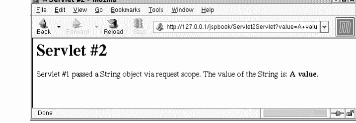

Servlet 通过其 `getServletConfig()` 方法可以访问 `ServletConfig` 对象。`ServletConfig` 对象包含了获取特定 Servlet 的初始化参数的方法，但它也包含了 `getServletContext()` 方法，用于访问相应的 `ServletContext` 实例。`ServletContext` 对象实现了在 `ServletConfig` 中演示的 `getInitParam()` 和 `getInitNames()` 方法。区别在于，这些方法访问的不是某个特定 Servlet 的初始化参数，而是为整个 Web 应用程序（Web Application）指定的参数。

指定整个应用范围的初始化参数使用的是与单个 Servlet 类似的方法，但需要将 `Web.xml` 中的 `init-param` 元素替换为 `context-param` 元素，并且要求该标签放置在任何特定 servlet 标签之外。`context-param` 标签的出现出现在任何 Servlet 之前。应用上下文参数的一个有用用途是指定应用程序管理者的联系信息。使用当前的 `jspweb.xml`，该条目的放置位置如下：

```
<web-app>

  <context-param>

    <param-name>admin</param-name>

    <param-value>admin@jspworld.com</param-value>

  </context-param>

  <servlet>

    <servlet-name>helloworld</servlet-name>

    <servlet-class>com.jspbook.HelloWorld</servlet-class>

  </servlet>

```

我们还没有看到如何正确处理从 Servlet 抛出的错误和异常，但这个初始化参数对于处理错误的 Servlet 是理想的。现在，创建一个 Servlet，假设它将负责处理 Web 应用程序可能出现的错误。在第 4 章中，我们将展示如何增强此 Servlet 以正确处理异常，但现在先防止抛出一个模拟错误。将列表 2-18 中的代码保存为 `MockError.java`，并存于 jspbook Web 应用程序的 `/WEB-INF/classes/com/jspbook` 目录下。

## 列表 2-18 MockError.java

```
import java.io.*;

import javax.servlet.*;

import javax.servlet.http.*;

public class MockError extends HttpServlet {

    public void doGet(HttpServletRequest request,
                       HttpServletResponse response)
            throws IOException, ServletException {

        response.setContentType("text/html");
        PrintWriter out = response.getWriter();

        out.println("<html>");
        out.println("<head>");
        out.println("<title>An Error Has Occurred!</title>");
        out.println("</head>");
        out.println("<body>");

        ServletContext sc = 
            getServletContext().getServletContext();

        String adminEmail = sc.getParameter("admin email");

        out.println("<h1>Error Page </</h1>");
        out.print("Sorry! An unexpected error has occurred.");
        out.print("Please send an error report to "+adminEmail+".");

        out.println("</body>");
        out.println("</html>");

    }

}
```

重新加载 jspbook Web 应用程序并访问 http://127.0.0.1/jspbook/MockError 以查看带有上下文参数信息的页面。

## 错误页面

抱歉！发生了意外错误。请将错误报告发送至 admin@jspbook.com。

图 2-19 MockError Servlet 的浏览器渲染

图 2-19 显示了 MockError Servlet 在由 Web 浏览器渲染时的样子。

注意，错误消息中插入了正确的上下文参数值。此参数也可能用于其他 Servlet，作为页眉或页脚信息的一部分。需要理解的重点是，此参数可以在整个 Web 应用程序中使用，同时在需要时仍易更改。

## 应用作用域（Application Scope）

作为请求作用域的补充，`ServletContext` 实例允许将服务器端对象放在应用范围的作用域内³⁴。这种作用域非常适合放置在 Web 应用程序在任何时间被许多不同部分使用的资源。其功能与 `HttpRequest` 对象描述的相同，并依赖于将对象绑定到 `ServletContext` 实例。为了简洁起见，将不再重复迭代此功能，而是留到书中后的示例中进行演示。

应用作用域应该谨慎使用，这一点很重要。绑定到 `ServletContext` 对象的对象在 `ServletContext` 被移除使用之前将不会被回收，通常在 Web 应用程序关闭或重启时。在应用作用域中放置大量未使用的对象会消耗服务器资源，不是良好的做法。另一个问题（稍后将详细介绍）是 `ServletContext` 并不是真正的

34. 还有一个会话作用域（session scope），将在第 9 章详细介绍。

应用范围的。如果 Web 应用程序运行在多个服务器上（例如，Web 集群），则会有多个 `ServletContext` 对象；集群中某一个服务器上的某个 `ServletContext` 的任何更新将不会同步到其他 `ServletContext` 实例中。

## 虚拟目录翻译（Virtual Directory Translation）

Web 应用程序的所有资源都抽象为虚拟目录。该目录从根目录开始。Web 应用程序的虚拟目录非常有帮助，因为它允许将虚拟路径映射到 Web 应用程序中的真实资源。该功能的唯一缺点是 Web 应用程序开发者无法使用虚拟路径来获取物理资源的位置。为了解决这个问题，`ServletContext` 提供了以下方法：

```
getRealPath(String path)
```

`getRealPath()` 方法返回一个包含给定路径真实路径的 String。真实路径代表资源在运行 Web 应用程序的计算机上的位置。

为了配合 `getRealPath()` 方法，`ServletContext` 还定义了获取 Web 应用程序中资源列表或 `InputStream` 或 `URL` 的方法：

- **getResourcePaths(String path):** `getResourcePaths()` 方法返回由路径指定的 Web 应用程序中所有资源的 `java.util.Set`。路径必须从 Web 应用程序的根目录开始。
- **getResourceAsStream(String path):** `getResourceAsStream()` 方法返回指向 Web 应用程序物理资源的 `InputStream`。当需要读取而非由 Web 应用程序处理资源时，应使用此方法。
- **getResource(String path):** `getResource()` 方法返回映射到指定路径的资源的 `URL`。当需要向客户端显示读取资源时，应使用此方法。

35. 再次注意，Servlet 可以在文件系统以外的地方加载 Web 应用程序（例如，直接从 WAR 文件或数据库）；在这种情况下此方法返回 null。

重要的是，Web 应用程序的设计是可移植的。在 Servlet 代码中硬编码文件位置不是良好的做法，因为这通常会导致 Servlet 在部署到不同服务器或直接从压缩的 WAR 文件运行时无法工作。从 Web 应用程序中读取资源的正确方法是使用 `getResource()` 或 `getResourceAsStream()` 方法。这两个方法确保了即使 Web 应用程序部署在多个服务器上或作为压缩 WAR 包，Servlet 始终能访问所需的资源。

虚拟目录翻译最常见且实用的用途是访问与 Web 应用程序打包在一起的扁平文件。这主要包括配置文件，但也用于诸如简单数据库等其他目的。一个理想的示例是涉及使用自定义配置文件的复杂 Servlet；但这种复杂的 Servlet 将会出现在书中。为了演示，将创建一个简单的 Servlet，从 Web 应用程序中读取原始文件和资源（列表 2-19）。

## 列表 2-19 ShowSource.java

```
package com.jspbook;

import java.io.*;

import javax.servlet.*;

import javax.servlet.http.*;

import java.util.*;

public class ShowSource extends HttpServlet {

    public void doGet(HttpServletRequest request,
                       HttpServletResponse response)
    throws IOException, ServletException {

```


98 JAVA SERVTS

```
String base() {

  Set set = sc.getResourcePaths(base);

  Iterator i = set.iterator();

  while (i.hasNext()) {

    String s = (String)i.next();

    if (s.endsWith("/")) {

      listFiles(sc, out, s);

    }

    else {

      out.print("<option value="+s+"");
      out.println("\>"+s+"</option>");

    }

  }

}
```


将列表 2-15 保存为 `ShowSource.java`，位于 jspbook Web 应用程序的 `/WEB-INF/classes/com/jspbook` 目录下。将 Servlet 编译并部署到 jspbook Web 应用程序的 `/ShowSource` 路径扩展，重新加载 Web 应用程序后，浏览到 http://127.0.0.1/jspbook/ShowSource。图 2-20 显示浏览器渲染 Servlet 输出的结果。

Servlet 的 `getResourcePaths()` 方法用于获取 Web 应用程序中所有文件的列表。选择一个文件后，Servlet 通过 `getResourceAsStream()` 方法获取一个 `InputStream` 对象，用于读取和显示资源的源代码。

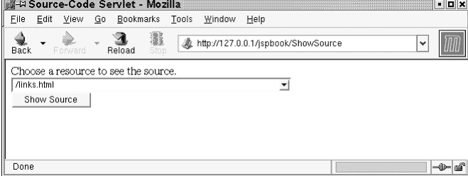

图 2-20 ShowSource Servlet 的浏览器渲染

## 应用程序范围日志

Servlet 的一个优秀且常用的特性是 Web 应用程序范围的日志。`ServletContext` 对象提供了一个公共位置，Web 应用程序中的所有 Servlet 都可以使用它来记录任意信息以及抛出异常的堆栈跟踪。此功能的优势在于它整合了通常用于记录错误和调试信息的杂乱自定义代码。通过 Web 的 `ServletContext` 记录信息，可以使用以下两种方法：

- `log(java.lang.String msg)`：`log()` 方法将指定的字符串写入 Servlet 日志文件或存储库。Servlet API 仅规定 `ServletContext` 对象实现了这些方法。并没有明确说明日志信息应保存或显示在何处。日志信息会被发送到 `System.out` 或容器的日志文件。
- `log(java.lang.String message, java.lang.Throwable throwable)`：此方法同时写入给定的消息和传入参数的 `Throwable` 异常的堆栈跟踪。消息旨在对异常进行简短说明。

在 SDK 1.4 中，Servlet 日志功能不再像以前那样有用了。两个 `log()` 方法的主要优势是它们提供了一个发送有关 Web 应用程序信息的公共位置。通常情况下，像 Tomcat 这样的容器也允许 Servlet 开发者编写一个自定义类来处理由 Web 应用程序记录的信息。这使得自定义 Servlet 日志信息的去向和位置变得简单。使用 `ServletContext log()` 方法的缺点是，只有能够访问 `ServletContext` 的代码才能轻松记录信息。非 Servlet 类需要一种创意的黑科技才能以相同的方式记录信息。Web 应用程序日志的一种更好且更通用的解决方案是创建一个任何类都可以访问并使用的自定义 API 集合。这个想法并不新鲜，可以在流行的项目中找到，例如 Log4j (http://jakarta.apache.org/log4j) 或 J2SDK 标准日志 API `java.util.logging` 包。当需要健壮的日志记录时，应优先选择这两种解决方案中的一种，而不是 Servlet API 日志机制。

本文没有通过演示两个 `ServletContext log()` 方法，而是在第 4 章中提供了 `java.util.logging` 包的简要说明和示例。任何严肃的项目都需要一个灵活且整合的日志记录机制。Servlet API 日志机制在简单情况下确实有效，但本书鼓励使用更健壮的日志 API。

## 分布式环境

在大多数情况下，`ServletContext` 对象可以被视为整个 Web 应用程序的引用。对于运行 Web 应用程序的单个 JVM 的单机服务器，这是成立的。J2EE 的设计并不是为了限制在单个服务器上使用。一个完整的 J2EE 服务器（而不仅仅是支持 Servlet 和 JSP 的容器）允许多个服务器来管理和分担大型 Web 应用程序的负载。这类应用程序在很大程度上超出了本书的范围，需要注意的是，在分布式环境中，应用程序范围（scope）和初始参数将不同。不同的服务器和 JVM 实例通常无法直接访问对方的信息。如果为一组服务器进行开发，请不要假设 `ServletContext` 对象对于每个请求都是相同的。这个主题将在书的后续章节中讨论。

## 临时目录

Servlet 规范中一个细微但非常有用的特性是要求提供一个临时目录，Servlet 和 Web 应用程序中的其他类可以使用它来存储信息。临时目录的确切位置没有指定，但通过设置名为 `javax.servlet.context.tempdir` 的 `ServletContext` 属性来描述目录的 `java.io.File` 对象。存储在该目录中的信息只需要在 Web 运行时持久存在，并且存储在临时目录中的信息将始终对同一服务器上的其他 Web 应用程序隐藏。

容器定义的临时目录有用有一个非常重要的原因：Web 应用程序可以直接从 WAR 中运行；无法保证你依赖的 `ServletContext.getRealPath()` 始终有效。为了解决这个问题，所有 Web 应用程序都可以访问至少一个可以存储临时信息的方便位置，该位置通过 `javax.servlet.context.tempdir` 属性提供。`javax.servlet.context.tempdir` 属性有几个很好的使用场景。在 Web 应用程序本地缓存内容（而非内存中）的任何情况下，`javax.servlet.context.tempdir` 属性都是存储缓存的理想位置。此外，临时目录为存储上传的文件或 Web 正在处理的任何信息提供了一个地方。

在实践中，通常可以假设应用程序将部署在 WAR 之外，特别是当你控制部署时；在这种情况下，应该使用临时目录以确保代码的最大可移植性。

## Servlet 监听器

本章的最后一个主题是 Servlet 监听器。在许多情况下，希望对容器管理的生命周期事件进行通知，以及当 Web 应用程序被移除时。了解这些信息是有用的，因为你可能有依赖它的代码，例如需要在启动时加载并在关闭时保存的数据库。另一个很好的例子是跟踪使用 Web 应用程序的并发客户端。然而，这种功能通过等待客户端启动新会话的监听器可以更容易实现。这里提出的主要观点是容器可以用于通知 Web 应用程序重要事件，而 Servlet 监听器就是这种机制。

所有的 Servlet 监听器都由接口定义。与 Web 应用程序和 Servlet 相关的所有重要事件都有监听器接口。为了接收通知，需要编写一个实现正确监听器的自定义类，并通过 `web.xml` 部署该监听器类。现在将提到所有的 Servlet 监听器；然而，某些监听器在阅读书的后续章节之前还没有意义。通常，所有的监听器工作方式都相同，只要这里至少提供了一个示例，这一事实就成立。

监听器接口分别对应请求生命事件、请求属性绑定、Web 应用程序生命周期事件、Web 应用程序属性绑定、会话³⁶生命事件、会话属性绑定和会话序列化，分别如下：

> 36. 如本章所述，HTTP 是无状态协议。然而，通常需要在持续特定客户端的所有请求期间维护状态。存在一种机制可以实现，该机制通常被称为会话管理。有关该主题的详细讨论请参阅第 9 章。

- `javax.servlet.ServletRequestListener`
- `javax.servlet.ServletRequestAttributeListener`
- `javax.servlet.ServletContextListener`
- `javax.servlet.ServletContextAttributeListener`
- `javax.servlet.http.HttpSessionListener`
- `javax.servlet.http.HttpSessionAttributeListener`
- `javax.servlet.http.HttpSessionActivationListener`

通过一个实现和一个示例部署描述符，每个监听器的用法都是直观的。所有监听器接口都定义了对象创建和销毁的事件，或者对象与特定作用范围绑定或解绑的通知。

例如，我们可以创建一个跟踪并发用户数量的监听器。我们通过跟踪创建了多少请求来实现这一点；然而，本章之前的点击计数器示例已经很好地提供了相同的功能。跟踪并发用户数量是我们尚未看到的内容，而且它允许了会话范围（session scope）的引入。现在，考虑多次访问网站的会话。这与请求不同，请求在客户端请求资源时都会被创建。我们将实现的监听器接口是 `HttpSessionListener`。它提供了两个事件的通知：会话创建和会话销毁。为了跟踪当前用户，我们将维护一个静态计数器变量，当会话创建时它会递增，在会话销毁时会递减。

`HttpSessionListener` 接口所需的物理方法有：

- `void sessionCreated(HttpSessionEvent event)`：当容器创建会话时调用的方法。该方法几乎总是对每个唯一客户端只被调用一次。
- `void sessionDestroyed(HttpSessionEvent event)`：当容器销毁会话时调用的方法。当唯一客户端的会话超时时将调用此方法——也就是说，在他们未能特定时间内（通常为 15 分钟）重新访问 Web 网站之后。

列表 2-20 显示了我们的监听器类代码，它实现了上述两个方法。将代码保存为 `ConcurrentUserTracker.java` 并放在 jspbook Web 应用程序的 `/WEB-INF/classes/com/jspbook` 目录下。

## 列表 2-20 ConcurrentUserTracker.java

```java
package com.jspbook;

import javax.servlet.*;
import javax.servlet.http.*;

public class ConcurrentUserTracker implements HttpSessionListener {

    static int users = 0;

    public void sessionCreated(HttpSessionEvent e) {
        users++;
    }

    public void sessionDestroyed(HttpSessionEvent e) {
        users--;
    }

    public static int getConcurrentUsers() {
        return users;
    }
}
```

监听器的方法非常直观，逻辑简单。该类的创建非常简单，因为容器正在管理所有困难的部分：处理 HTTP 请求、尝试保持会话以及维护计时器以成功超时未使用的会话。

通过在 `web.xml` 中添加列表 2-21 中的项来部署监听器。在任何 Servlet 部署之前，在起始 `web-app` 元素之后添加该项。

## 列表 2-21 Deployment of the Concurrent User Listener

```xml
<listener>
  <listener-class>com.jspbook.ConcurrentUserTracker</listener-class>
</listener>
```

注意部署没有指定使用的是哪种类型的监听器接口。不需要这种类型信息，因为容器可以通过代码识别它；所有不同监听器的部署与上述代码类似。创建一个 `listener` 元素，并包含一个子 `listener-class` 元素，该元素具有监听器类的名称。

在测试并发用户示例之前需要添加一个内容。并发用户跟踪器目前还没有输出关于并发用户的信息！让我们创建一个 Servlet，使用静态的 `getConcurrentUsers()` 方法来显示并发用户数。将列表 2-22 中的代码保存为 `DisplayUsers.java` 并放在 jspbook Web 应用程序的 `/WEB-INF/classes/com/jspbook` 目录下。

## 列表 2-22 DisplayUsers.java

```java
package com.jspbook;

import java.io.*;
import javax.servlet.*;
import javax.servlet.http.*;

public class DisplayUsers extends HttpServlet {

    public void doGet(HttpServletRequest request, HttpServletResponse response)
        throws IOException, ServletException {

        request.getSession();
        response.setContentType("text/html");
        PrintWriter out = response.getWriter();
        out.println("<html>");
        out.print("Users:");
        out.print(ConcurrentUserTracker.getConcurrentUsers());
        out.println("</html>");
    }
}
```


将 Servlet 部署到 `/Display` URL 映射。编译 `ConcurrentUserTracker.java` 和 `DisplayUsers.java` 并重新加载 `jspbook` Web 应用程序使更改生效。通过浏览 `http://127.0.0.1/jspbook/DisplayUsers` 来测试新功能。这将显示一个描述当前有多少用户正在使用 Web 应用程序的 HTML 页面。会提供浏览器渲染结果；然而，该页面字面上只显示文本“Users:”，后面跟着当前用户的数量。

当浏览到该 Servlet 时，它应该显示有一个用户正在使用该 Web 应用程序。如果你刷新页面，它仍然会显示只有一个用户正在使用 Web 应用程序。尝试打开第二个 Web 浏览器，你应该看到页面显示有两个人正在使用 Web 应用程序。当你关闭你的 Web 浏览器后，计数器不会减少，但在 15 分钟内未访问 Web 应用程序后，它就会减少。你可以通过打开两个浏览器（创建两个并发用户）并在接下来的 15 分钟内仅使用其中一个浏览器来测试。最终，未使用的浏览器会话将超时，Web 应用程序将只报告一个用户。

在实际使用中，在任何时刻有几个人正在使用 Web 应用程序的可能性是很大的。在这种情况下，你不需要做任何事情，只需访问 Display 即可查看并发用户。

并发用户跟踪器是一个复杂的代码块；更重要的点是理解事件监听器是如何被编写和部署的。事件监听器是非常直观的，困难之处在于了解何时以及如何更好地使用它们，这在本章中得到了充分解释。

## 总结

在本章中介绍了 Servlet API，并特别关注了 Servlet 是服务器端 Java 的基础构建块。Servlet 具有高度的可扩展性，通过简单的三阶段生命周期（初始化、服务和销毁）优于传统的 CGI。通常，Servlet 实际上指的是 Web 上的 HTTP Servlet。Servlet API 的基础由代表客户端请求 `HttpServletRequest`、服务器响应 `HttpServletResponse`、连接分离请求的会话 `HttpSession` 以及整个 Web 应用程序 `ServletContext` 对象组成。每个对象都提供了访问和操作相关信息的完整方法。这些对象还为 Servlet 开发者引入了两个新的作用范围：请求和应用。将对象绑定这些各种作用范围允许 Servlet 开发者在多个 Servlet 和请求之间共享对象。这在某些浏览器 Internet Explorer 中并不总是有效，这是由于为了用户友好而设计的浏览器技巧。如果你打开两个不同的浏览器（例如 Mozilla 和 Internet Explorer），Web 应用程序将始终报告两个并发用户。如果你在使用 Internet Explorer，请确保打开的是一个新的浏览器副本，而不仅仅是新浏览器窗口。简要提到的是第三种常用的作用范围——会话也是可用的。会话范围引入了一些问题，值得专门用一章来解释。第 9 章将充分解释会话范围以及与其相关的问题。

总体而言，本章是创建和使用 Servlet 的参考。第 3 章通过引入一种互补技术：JavaServer Pages 继续讨论 Servlet。

## 第 3 章 JavaServer Pages

JavaServer Pages (JSP) 和 Servlets 是通过 Java 生成动态 Web 页面的互补技术。虽然 Servlets 是服务器端 Java 的基础，但从开发时间来看，它们并不总是最高效的。编写、阅读、调试、部署和重新编译一个 Servlet 可能是一项繁琐的任务。修复一个简单的语法或标记错误需要翻阅大量的 `print()` 调用、重新编译 Servlet 并重新加载 Web 应用程序。犯语法或标记错误并不困难，而在复杂的 Servlets 中，这个问题会变得更加严重。JSP 通过帮助解决这个问题并简化 Servlet 开发，对 Servlets 进行了补充。

本章将讨论以下主题：

- 对 JSP 的解释以及你可能想要使用该技术的原因。
- JSP 生命周期——即容器如何管理 JSP。
- JSP 与 Servlets 之间的相似之处和差异。
- JSP 语法和语义的介绍。
- 通过 Web 应用程序部署描述符 `web.xml` 配置 JSP。
- JSP 隐式对象的解释以及为什么隐式对象很有帮助。
- 如何使用备用的 JSP XML 语法。

与第 2 章一样，请通读本章。第 2 章和第 3 章描述了所有其他章节都依赖的基础功能。第 2 章介绍了 Servlets 并演示了它们的几种实际用途。本章通过提供对 JavaServer Pages 的类似讨论，补充了第 2 章的内容。

## JSP 2.0 规范

第一个 JavaServer Pages 规范于 1999 年发布。最初，JSP 是模仿其他服务器端模板技术构建的，旨在提供一种在静态标记中嵌入动态内容的简单方法。当对 JSP 内容提出请求时，容器会解释 JSP、执行任何嵌入代码并将结果发送到响应中。这种功能并不是特别新颖，但它是对 Servlets 的一种且仍然非常有用的增强。

自最初发布以来，JSP 经过了多次修订，每次都增加了功能，目前版本为 2.0。JSP 规范与 Servlet 规范一同开发，可以在 Sun Microsystems 的 JavaServer Pages 产品信息页面找到：`http://java.sun.com/products/jsp`。

JSP 2.0 规范定义的功能可以分解如下：

### JSP

JSP 规范定义了 JavaServer Page 的基本语法和语义。一个基础的 JavaServer Page 由纯文本和标记组成，并可以可选地利用嵌入脚本和其他功能来创建动态内容。

### JavaBeans

JavaBeans 由 JSP 规范定义，但 JSP 确实提供了易于使用和操作它们的支持。Web 应用程序服务器端使用的对象通常以所谓的 JavaBean 形式存在。

### 自定义标签和 JSP 片段

JSP 提供了一种机制，可以将通常是标记的内容与自定义 Java 代码链接起来。这种机制可以认为是 JSP 的优点之一，可以用来替代或补充嵌入的 Java 代码。

### 表达式语言 (Expression Language)

JSP 包含了一种为自定义标签定义动态属性的机制。任何脚本语言都可以用于此目的；通常实现的是 Java，但 JSP 规范定义了一种专门为该任务设计的自定义表达式语言。通常，JSP EL 是一种简单得多且灵活的解决方案，特别是当与不使用嵌入脚本的 JSP 设计模式结合时。

讨论 JSP 的基础知识是本章的重点。JavaBeans、自定义标签和 JSP 表达式语言将在建立良好的 JSP 基础后的后续章节中详细讨论。

## JSP 生命周期

与 Servlets 类似，理解 JSP 需要理解 JSP 遵循的简单生命周期。JSP 遵循三阶段生命周期：初始化、服务和销毁，如图 3-1 所示。这个生命周期应该看起来熟悉，并且与第 2 章中的 Servlets 生命周期相同。

虽然 JSP 遵循 Servlet 生命周期，但这些方法的名称不同。初始化对应于 `jspInit()` 方法，服务对应于 `_jspService()` 方法，销毁对应于 `_jspDestroy()` 方法。这三个阶段都作为 Servlet 使用，并允许 JSP 加载资源、为多个客户端请求提供服务并在 JSP 停止服务时销毁已加载的资源。

JSP 的设计旨在简化创建生成文本的 `HttpServlet` 对象的任务，从而消除了编写 Servlet 的所有冗余部分。与 Servlets 不同，普通 JSP 和用于 HTTP 的 JSP 之间没有区别。所有的 JSP 都设计用于与 HTTP 使用，并为全球维网生成动态内容。单一 `_jspService()` 方法还负责对所有七种 HTTP 方法生成响应。对于大多数实际用途来说，JSP 开发者不需要任何关于 HTTP 的知识，在编写动态 JSP 时也不需要任何比基础 Java 更多的知识。

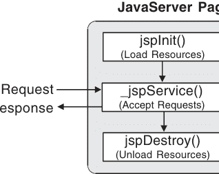

图 3-1 JSP 生命周期

## Servlets 和 JSP 的区别

关于 JSP 有一个明确且重要的区别，即编写其中一个与编写 Servlet 完全不同。从本章的解释来看，JSP 似乎是 Servlet 的一个简单版本。在许多方面，JSP 实际上是创建生成文本的 Servlet 的简单方法；然而，不要被误认为这种想法总是正确的。随着章节的进展，将清楚地看到 JSP 和 Servlets 是两种非常不同的技术。在稍后引入自定义标签之后，两者之间的分离程度似乎会更大。使用 JSP 轻松创建 Servlet 实际上适用于最简单的情况。为了展示代码有多巨大的不同，代码列表 3-1 显示了 JSP 的输出。

**列表 3-1 HelloWorld.jsp**

```html
<html>
<head>
<title>Hello World!</title>
</head>
<body>
<h1>Hello World!</h1>
</body>
</html>
```

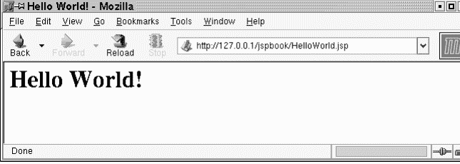

图 3-2 HelloWorld.jsp 的浏览器渲染

```java
import javax.servlet.jsp.*;
import org.apache.jasper.runtime.*;

public class HelloWorld$jsp extends HttpJspBase {
    static {
    }
    public HelloWorld$jsp() {
    }
    private static boolean _jspx_initited = false;
    public final void _jspx_init() throws org.apache.jasper.JspException {
    }
    public void _jspService(HttpServletRequest request, HttpServletResponse response)
        throws java.io.IOException, ServletException {
        JspFactory _jspxFactory = null;
        PageContext pageContext = null;
        HttpSession session = null;
        ServletContext application = null;
        ServletConfig config = null;
        JspWriter out = null;
        Object page = this;
        String _value = null;
        try {
            if (_jspx_initited == false) {
                synchronized (this) {
                    if (_jspx_initited == false) {
                        _jspx_init();
                        _jspx_initited = true;
                    }
                }
            }
            _jspxFactory = JspFactory.getDefaultFactory();
            pageContext = _jspFactory.getPageContext(this, request, response, "", true, 8192, true);
            application = pageContext.getServletContext();
            config = pageContext.getServletConfig();
            session = pageContext.getSession();
            out = pageContext.getOutputStream();
            // HTML // begin
            [file="HelloWorld.jsp";from=(0,0);to=(8,0)]
            out.write("<html>\r\n<head>\r\n<title>Hello World!</title>\r\n<body\r\n<h1>Hello World!</h1>\r\n</body>\r\n</html>\r\n");
            if (out != null && out.getBufferSize() != 0) {
                out.clearBuffer();
            }
        } catch (Throwable t) {
            if (pageContext != null)
                pageContext.handleException(t);
        } finally {
            if (_jspFactory != null) {
                _jspFactory.releasePageContext(pageContext);
            }
        }
    }
}
```

不要尝试去阅读和理解生成的代码。重要的理解点是，容器将 JSP 处理为 Servlet，但是在后台执行的。这直接回到了 JSP 仅仅是 Servlet 的这一大观点。这两种技术之间的区别不在于生命周期或容器在运行时如何管理它们。Servlet 和 JSP 之间的区别在于它们为创建相同功能提供的语法。对于 JSP 来说，创建生成文本的 Servlet 几乎总是简单的，但普通的 Servlet 仍然最适合向客户端写入字节，或在需要对 Java 源代码进行完全控制时。

## JSP 语法与语义

JSP 并不受 Java 规范定义的语法和语义的约束。翻译后的 JSP 源码仅仅是 Java，但当你编写 JSP 时，你遵循的是 JSP 规范中列出的规则。随着 JSP 规范的每次发布，这些规则都在增加，并且无法用几句话简单地总结。本章大部分重点在于解释 JSP 的当前语法和语义。JSP 中发现的大部分功能直接取自底层的 Servlet API，该 API 在第 2 章已经涵盖过。预计将看到许多演示语法的代码示例，而重复的语义仅会略过，并引用之前在第 2 章给出的完整解释。

## 元素与模板数据

JSP 中的一切都被拆分为两类通用类别：元素（elements）和模板数据（template data）。元素是 JSP 的动态部分。模板数据是静态的文本。模板数据很容易分类，因为它们都是任意放置在 JSP 上的文本，并将直接发送给客户端。元素则容易被分类为自定义元素、标签以及 JSP 规范允许在定义之间出现的内容。

理解元素和模板数据的概念非常重要，因为它们决定了文本何时、何地以及以什么形式放置在 JSP 中。本章尚未介绍任何元素，但它已经使用了模板文本。HelloWorld.jsp 示例完全是模板文本。从 HelloWorld.jsp 生成相应的 Servlet 将此视为静态内容，并将其设置为响应的内容。虽然 HelloWorld.jsp 只有一大块模板文本，但复杂的 JSP 遵循相同的规则。任何块模板文本都会按照其在 JSP 上出现的形式直接发送给客户端。另一方面，元素不会直接发送给客户端。元素由 JSP 容器解释，并定义了在生成响应时应该采取的特殊操作。

模板文本不会改变，这一小节对其进行了完全定义。元素是使 JSP 动态的，元素在本章的其余部分得到了进一步解释。元素可以细分为三种类型：脚本元素（scripting elements）、指令（directives）和动作（actions）。后续章节将解释这些元素。

## 两种语法

JSP 容器要求支持两种格式的语法：普通语法和 XML 兼容语法。普通 JSP 语法设计为便于编写。XML 兼容 JSP 语法采用普通 JSP 语法并将其修改为符合 XML¹。两种语法都提供相同的功能，但 XML 兼容语法旨在更方便被开发工具使用。书中的工具倾向于使用普通 JSP 语法，因为它易于阅读、理解，而且如果你用过旧版本的 JSP，你会很熟悉。

仅仅因为 XML 语法不会出现在本书的示例中，并不意味着它是两种语法中较差的那个。在 JSP 1.2 规范中引入的 JSP XML 语法从开发者的角度来看，由于 JSP 的复杂性，确实很麻烦。JSP 2.0 通过提供更灵活的 XML 语法解决了这个问题。本章之后将解释这种灵活语法。

## 脚本元素

使 JSP 动态的最简单方法是在文本块之间直接嵌入 Java 代码。JSP 理论上并不限制脚本元素仅包含 Java 代码，但规范默认只讨论 Java 作为脚本语言。在 JSP 中可用的脚本元素有三种类型：脚本片段（scriptlets）、表达式（expressions）和声明（declarations）。

## 脚本片段

脚本片段提供了在文本块之间插入 Java 代码的方法。脚本片段以 `<%` 开始，以 `%>` 结束，其内容与普通的 Java 代码相同，不需要类声明或任何方法。脚本片段非常适合提供迭代、循环和条件语句等底层功能，但它们也提供了在 JSP 中嵌入复杂代码的方法。

出于许多原因，脚本片段越复杂，维护 JSP 就越困难，而且不易记录；在本章中，脚本片段示例特意保持简单。这有助于演示，而不是为了鼓励使用脚本片段。

¹. 可扩展标记语言，`http://www.w3.org/XML`

引言，列表 3-3 提供了一个简单的 JSP 循环来生成多行文本。循环与 Java 中的实现相同，但通过在脚本元素内部放置相应的 Java 代码来实现。

## 列表 3-3 Loop.jsp

```html
<html>
<head>
<title>循环示例</title>
</head>
<body>
<% for (int i=0; i<5;i++) {%>
重复 5 次.<br>
<% } %>
</body>
</html>
```


</html>

将 `Loop.jsp` 保存在 `jspbook` Web 应用程序的根目录下并访问 `http://127.0.0.1/jspbook/Loop.jsp`。页面将显示五次“重复 5 次”。图 3-3 显示了输出的样式。

值得注意的是，脚本片段的内容没有发送给客户端。只有脚本片段的结果发送了。这很重要，因为它表明了脚本片段是由容器解释的，并且脚本片段内部的代码默认情况下不会与 JSP 的访问者共享。

JSP 可以包含所需的任何脚本片段，但应注意不要过度使用脚本片段。脚本片段会让 JSP 变得难以维护并且不易编写文档；例如 javadoc 无法在 JSP 中工作。

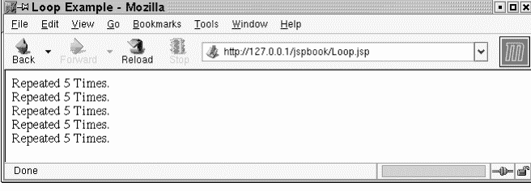

图 3-3 Loop.jsp 的浏览器渲染

### 表达式

表达式提供向客户端发送动态字符串的简单方法。一个表达式必须包含起始符号 `<%=`、结束符号 `%>` 以及中间的表达式内容。表达式元素在语法上与脚本段的不同之处在于，起始符号后必须紧跟一个等号。表达式始终向客户端发送一段文本，但表达式产生的结果对象并不总是最终表现为 `String` 对象的实例。任何作为表达式结果留下的对象都会被自动调用其 `toString()` 方法来确定表达式的值。如果表达式的结果是基本类型，则该基本类型的值被用作字符串。

脚本段和表达式结合对于许多不同用途非常有用。一个很好的例子是使用结合表达式的脚本段来提供遍历值集合的方法。脚本段提供循环，而表达式和静态内容用于在响应中发送信息。`Iteration.jsp`（列表 3-4）提供了此类示例，并演示了如何将非 `String` 对象作为表达式的结果传递。

#### 列表 3-4 Iteration.jsp

```html
<html>
<head>
<title>Iteration Example</title>
</head>
<body>
<%
String[] strings = new String[4];
strings[0] = "Alpha";
strings[1] = "in";
strings[2] = "between";
strings[3] = "Omega";
for (int i=0; i<strings.length;i++) { %>
String[<%= i %>] = <%= strings[i] %><br>
<% }
%>
</body>
</html>
```

将 `Iteration.jsp` 保存到 `jspbook` Web 应用程序的根目录下，并访问 `http://127.0.0.1/jspbook/Iteration.jsp`。该页面显示了遍历数组所有值的迭代列表。图 3-4 显示了 `Iteration.jsp` 输出的浏览器渲染结果。

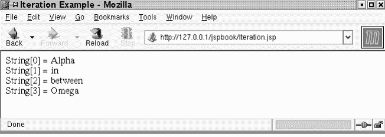

**图 3-4** Iteration.jsp

### 声明

声明是用于 JSP 中嵌入代码的第三种也是最后的脚本元素，但通过声明嵌入的代码在 `_jspService()` 方法之外像脚本段一样被使用。由于这个原因，嵌入声明中的代码可以用于声明新方法和全局类变量，但应采取小心，因为声明中的代码不是线程安全的，除非代码编写者使其具有线程安全性。

列表 3-5 是一个旨在记录页面访问次数计数器的 JSP。该 JSP 通过在声明中声明一个类级变量、使用脚本段在页面访问时增加该变量，以及使用表达式显示变量的值来实现这一目标。

#### 列表 3-5 PageCounter.jsp

```jsp
<%! 
int pageCount = 0;

void addCount() {
  pageCount++;
}
%>
<html>
<head>
<title>PageCounter.jsp</title>
</head>
<body>
<% addCount(); %>
This page has been visited <%= pageCount %> times.
</body>
</html>
```

将 `PageCounter.jsp` 保存到 `jspbook` Web 应用程序的根目录下，并访问 `http://127.0.0.1/jspbook/PageCounter.jsp`。刷新几次浏览器以观察 JSP 如何计数被访问了多少次。图 3-5 显示了访问 JSP 6 次后输出的浏览器渲染结果。

使用脚本段、表达式和声明，使用 JSP 可以创建几乎任何内容。与 Servlet 的类比是：脚本段是放置在服务方法内部的代码，表达式是 `print()` 方法调用，而声明是全局放置于类的代码。在简要解释后，编写脚本段、表达式、声明应该是很直接的，但理解这三种不同的脚本元素转换成 Java 代码仍然很有帮助。

列表 3-6 显示了由 `PageCounter.jsp` 生成的 Tomcat。它包含了所有三个脚本元素的翻译。重要的行用星号标出。

#### 列表 3-6 PageCounter$jsp.java

```java
package org.apache.servlet;

import javax.servlet.*;
import javax.servlet.http.*;
import javax.servlet.jsp.*;
import org.apache.jasper.runtime.*;

public class PageCounter$jsp extends JSPBase {

// begin [file="PageCounter.jsp";from=(0,3);to=(4,0) ]
int pageCount = 0;

void addCount() {
  pageCount++;
}
// end

static {
}

public PageCounter$jsp() {
}

private static boolean _jspx_inited = false;

public final void _jspx_init() throws org.apache.jasper.runtime.JspException {
}

public void _jspService(HttpServletRequest request, HttpServletResponse response) throws java.io.IOException, ServletException {
JspFactory _jspxFactory = null;
PageContext pageContext = null;
HttpSession session = null;
ServletContext servletContext = null;

try {
 (_jspx_inited == false) {
_jspxFactory = JspFactory.getDefault();
_jspx_inited = true;
}
}
_jspxFactory.release();

pageContext = _jspxFactory.getPageContext(this);
session = pageContext.getSession(false);
servletContext = pageContext.getServletContext();

JspWriter out = pageContext.getWriter();
```

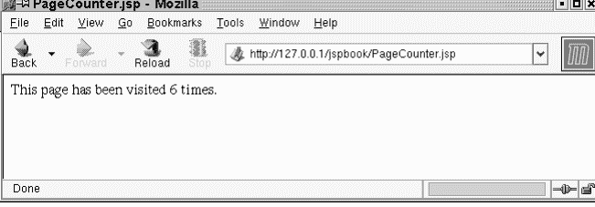

图 3-5 PageCounter.jsp 的浏览器渲染

表达式可以被认为是无害的。除非刻意用于引起冲突，否则表达式总是线程安全的。声明和脚本段则更为复杂。脚本段类似于在 Servlet 的相应服务方法中局部地声明和使用变量。脚本段声明的变量在每次调用 `jspService()` 方法时都会初始化并销毁一次。默认情况下，这些脚本段是线程安全的，但它们不能保证其访问是线程安全的。如果脚本段访问了 `jspService()` 方法作用范围之外的对象，则应该使用同步块来确保线程安全。声明出现在 `jspService()` 方法之外。很多时候，声明被完全误解为脚本段的增强形式。它们并非如此！

一个常见的争论是，在 JSP 中是否真的需要脚本段和声明。JSP 的强大在于创建能够生成文本的 Servlets。如果一个 JSP 主要是标记语言，并且页面作者可以轻松编辑，那么它就是可维护的。许多开发者认为脚本表达式破坏了 JSP 的这一特性，应该被完全替换为自定义动作和 JSP 表达式语言（JSP 2.0 引入的新特性，将在后面的章节中介绍）。这种观点是有效的，并得到了作者的认可，在后续章节中进一步讨论，但与简单的嵌入脚本相比，自定义动作相对较笨重。脚本段、声明，特别是表达式，在 JSP 中确实有的一席之地，但不应被误用。如果一个页面充斥着无数的脚本元素，它们的害可能大于利。始终要意识到脚本元素的使用方式，以及代码是否可以被更好地封装在其他可供少量脚本元素使用的对象中。

### 指令

指令是发送给 JSP 容器的消息。它们不会向客户端输出内容，而是用于定义页面属性，自定义标签库会使用这些属性，其他页面也会包含它们。所有指令都使用以下语法。

```jsp
<%@ directive attribute="value" %>
```

指令在 `<@` 之后和 `%>` 之前可以包含额外的空白字符。页面上可以使用三种不同的 JSP 指令：page、taglib 和 include。

> 还有其他只能在标签文件中使用的指令：tag、attribute 和 variable。

#### page 指令

page 指令为 JSP 容器提供页面特定的信息。这些信息包括各种设置，例如 JSP 要生成的内容类型、页面的默认脚本语言以及要导入供使用的代码库。单个 JSP 或被包含的页面可以使用多个 page 指令，只要除了 `import` 之外，没有特定属性出现多次。page 指令的属性如下。

*   **language**：定义了脚本段和 JSP 中声明时使用的脚本语言。该属性唯一定义且要求的脚本语言值是 `java`。不同的容器提供了额外的语言支持；然而，很少看到 JSP 使用 Java 以外的语言进行脚本编写。
*   **extends**：一个完全限定的 Java 编程类名，用于指定该 JSP 转换后的类类的父类。此属性应谨慎使用，因为它阻止了容器使用预构建的优化类。
*   **import**：描述了在脚本元素中可用的类型。该值与 Java 编程语言中的 `import` 声明相同，列出多个包时可以使用完全限定的 Java 编程类型名称或包名后跟 `*`，表示该包中声明的所有类型。默认导入列表为 `java.lang.*`、`javax.servlet.*`、`javax.servlet.jsp.*` 和 `javax.servlet.http.*`。这些包可以被认为是每个 JSP 的默认包含。`import` 属性目前仅定义用于 `language` 指令值为 `java` 的情况。
*   **session**：表示页面需要参与 HTTP 会话。如果为 `true`，则隐式脚本变量 `session` 引用页面的当前/新会话。如果为 `false`，则页面不参与会话，`session` 隐式脚本变量可用，在 JSP 页面体内对其任何引用都是非法的并会导致致命的翻译错误。默认值为 `true`。
*   **buffer**：指定了隐式脚本变量处理页面内容输出的缓冲模型。如果属性值为 `none`，则没有缓冲，输出将直接通过适当的 ServletResponse PrintWriter 写入。该属性的有效值以千字节为单位，必须带有 `kb` 后缀。默认值为 `8kb`。
*   **autoFlush**：指定当缓冲区满时是否应自动刷新缓冲输出，或者是否应通过异常来指示缓冲区溢出。值 `true` 表示自动缓冲，值 `false` 则抛出异常。默认值为 `true`。当 `buffer` 属性值为 `none` 时，将 `autoFlush` 属性设置为 `false` 是非法的。
*   **isThreadSafe**：页面实现的线程安全级别。如果值为 `false`，则 JSP 容器将按照接收顺序一次地将多个待处理的客户端请求调度到页面实现进行处理，让生成的 JSP 实现 `SingleThreadModel`。如果属性值为 `true`，则 JSP 容器可以同时调度多个客户端请求。默认值为 `true`。
*   **isErrorPage**：指示当前页面是否旨在作为一个错误页面。如果为 `true`，则定义了隐式异常变量。如果值为 `false`，则异常不可用，对其任何引用都会导致翻译错误。默认值为 `false`。
*   **errorPage**：定义了一个相对 URL，任何未捕获的异常将转发到该资源进行处理。如果 `autoFlush` 属性值为 `true`，且初始 JspWriter 内容已刷新到 ServletResponse 输出流，则任何调度异常到错误页面的尝试可能会失败。
*   **contentType**：定义了 JSP 的字符编码以及 JSP 响应的 MIME 类型。默认值为 `text/html;charset=ISO-8859-1`。
*   **pageEncoding**：定义了 JSP 的字符编码。默认值为普通 JSP 为 `ISO-8859-1`，XML JSP 为 `UTF-8`。
*   **isScriptingEnabled**：定义是否允许使用脚本元素。默认值（`true`）启用脚本段、表达式和声明。如果属性值设置为 `false`，当 JSP 使用任何脚本段、表达式（非 EL）或声明时将引发翻译错误。
*   **isELIgnored**：定义 JSP 中使用的 EL 表达式是否要评估。该属性的默认值为 `true`，这意味着根据 JSP 评估 `${..}`。如果属性设置为 `false`，则表达式不会被评估，而是被静态文本。

page 指令默认设置以适应 JSP 最常用的用途：制作动态 HTML 页面。在创建简单的 JSP 时，如果脚本元素需要额外的代码库或生成 XML 内容，通常不需要指定 page 指令的任何属性。

#### include 指令与 `<jsp:include>`

include 指令用于 JSP 翻译时包含文本和/或代码。include 指令遵循相同的语法 `<%@ include file="relativeURL" %>`，其中 relativeURL 的值将被替换为要插入的文件。包含的文件必须是 Web 应用的一部分。由于 include 指令发生在翻译时，它们等同于直接在编译之前将源代码包含在 JSP 中，不会在运行时导致性能损失。

服务器端包含是 JSP 的一个常用功能。包含允许将相同的重复代码从多个页面提取出来，并让所有页面都包含其的一个实例。一个很好的例子是在多个内容页面中包含通用的页头和页脚。通常，这种技术用于保持网站的导航和版权信息在网站上的所有单个页面中都是正确且可维护的。例如，接下来的两个文件：`header.jsp` 和 `footer.jsp`。

`header.jsp` 文件（列表 3-7）包含了出现在页面顶部的信息。它包含了网站导航和其他杂信息。此页头还通过重用 `PageCounter.jsp` 中的代码，跟踪了自上次 Web 应用程序重新加载以来访问该网站的人数。

#### 列表 3-7 header.jsp

```jsp
<%! 
int pageCount = 0;

void addCount() {
  pageCount++;
}
%>
<% addCount(); %>
<html>
<head>
<title>Header/Footer Example</title>
</head>
<body>
<center>
<h2>Servlets and JSP the J2EE Web Tier</h2>
<a href="http://www.jspbook.com">Book Support Site</a>
<a href="ShowSource">Sites Source code</a><br>
This site has been visited <%= pageCount %> times.
</center>
<br/>
```


</body>

</html>

```

footer.jsp 文件（列表 3-8）包含了出现在页面最底部的信息。它包含了版权信息、免责声明以及任何其他杂信息。

## 列表 3-8 footer.jsp

```jsp
<br><br><center>

Copyright &copy; 2003

</center>

</body>

</html>
```

header.jsp 和 footer.jsp 本身并没有做什么，但当它们与某些内容结合时，就可以生成一个完整的页面。对于这个例子，内容并不重要。随意编写一个 JSP，但务必在页面顶部包含 header.jsp 并在底部包含 footer.jsp。列表 3-9 提供了此类页面的示例。

## 列表 3-9 content.jsp

```jsp
<%@ include file="header.jsp" %>

只有页面的内容是唯一的。相同的页头和页脚通过包含指令从 header.jsp 和 footer.jsp 重用

<%@ include file="footer.jsp" %>
```

将所有三个文件 header.jsp、footer.jsp 和 content.jsp 保存在 jspbook Web 应用程序的根目录下，并访问 `http://127.0.0.1/jspbook/content.jsp`。三个文件在此时会被合并，生成一个按相应顺序包含 header.jsp、content.jsp 和 footer.jsp 句的 Servlet。图 3-6 显示了输出的浏览器渲染结果。

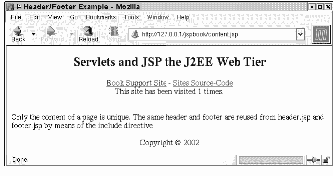

图 3-6 content.jsp 的浏览器渲染

那么，这种方法与从初将 header.jsp、content.jsp 和 footer.jsp 全部合并在一个文件中相比，优势何在？按照目前的设置方式，可以创建更多重用页头和页脚的内容页面。页头和页脚也可以在任何时候进行更改，并且更改会很容易地反映在所有的 JSP 中。

## 翻译时包含 (Translation-Time Includes)

翻译时发生在 JSP 翻译成 Servlet 的时候。生成的 Servlet 并不知道也不在乎使用了哪些文件来生成它。因此，Servlet 无法判断包含的文件何时发生了变化。JSP 规范没有规定解决此问题的机制，但 JSP 容器厂商可以自由实现该问题的解决方案。

在整个网站依赖翻译时包含来提高效率的情况下，简单的容器依赖于 JSP 翻译后的代码来编译并部署相应的 Servlet。当缺少代码时，容器必须重新翻译 JSP 并部署相应的 Servlet。通过强制容器重新翻译所有 JSP，可以确保翻译时包含被使用它们的 JSP 正确地反映。

对于 Tomcat，翻译后的 Servlet 源代码可以在 `TOMCAT_HOME/work` 目录中找到。只需删除该目录的内容，即可让 Tomcat 重新翻译所有 JSP。

对于非翻译时包含，JSP 定义了包含动作（include action）。与包含指令一样，此动作也用于在 JSP 的输出中包含资源，但效率没有那么高，包含动作会自动确保使用被包含文件的最新输出。有关包含动作的更多信息，请参阅本章的 `<jsp:include/>` 节。

## <%@ taglib %>

本章之前提到了自定义动作（Custom actions），但直到第 7 章才会有完全的介绍。自定义动作（也称为自定义标签库）允许 JSP 开发者将标记片段链接到自定义的 Java 代码。taglib 指令导入容器告知页面上的哪些标记片段应该被视为自定义代码，以及标记链接到的代码。taglib 指令始终遵循相同的语法：`<%@ taglib uri="uri" prefix="prefixOfTag"%>`，其中 uri 属性值解析为容器理解的位置，prefix 属性告知容器哪些标记片段是自定义动作。

关于使用 taglib 指令的进一步解释和示例。

## JSP 配置

从最简单的意义上，指令（Directives）就是配置。使用指令唯一的问题是它们必须按页面指定。为了简化配置任务，可以使用 `jsp-config` 元素。`jsp-config` 提供了以下子元素：

- **el-enabled**: el-enabled 元素配置 JSP 是否可以使用 EL。值为 `false` 时禁用。其功能等同于指令的 `isEnabled` 属性。
- **scripting-enabled**: scripting-enabled 元素等同于指令的 `isScriptingEnabled` 属性。值为 `false` 时，如果使用了任何脚本、表达式（非 EL）或指令，JSP 将引发错误。值为 `true` 则启用脚本元素。
- **page-encoding**: page-encoding 元素等同于指令的 `pageEncoding` 属性。如果使用 `page-encoding` 属性设置了编码，而在 JSP 的指令中指定了另一个编码，则会引发错误。
- **include-prelude**: include-prelude 元素用于在 JSP 输出之前在 Web 应用程序中包含另一个资源。实际上，include-prelude 元素提供了一种方法，为所有配置了该属性的 JSP 自动包含页头。
- **include-coda**: include-coda 元素用于在 JSP 输出之后在 Web 应用程序中包含另一个资源。实际上，include-coda 元素提供了一种方法，为所有配置了该属性的 JSP 自动包含页脚。
- **is-xml**: is-xml 元素用于标记 JSP 是否为 XML 文档。

关于标签库的更多信息请参见第 7 章。`jsp-property-group` 元素允许配置；示例用法：

```xml
<jsp-config>
  <jsp-property-group>
    <url-pattern>*.jsp</url-pattern>
  </jsp-property-group>
</jsp-config>
```

在上述代码中，该配置将应用于所有以 .jsp 结尾的文件，这很可能是 Web 应用程序中所有的 JSP。通常，`url-pattern` 元素可以包含任何在通过 web.xml 部署 Servlet 或 JSP 时有效的值。`url-pattern` 元素本身没有任何作用，只是为 JSP 设置了一组属性。

总的来说，`jsp-property-group` 元素的使用非常直观。引入的新功能仅限于 `include-prelude`、`include-coda` 和 `is-xml` 元素。`include-prelude` 和 `include-coda` 的使用也非常简单直接。事实上，这些元素取代了使用 JSP 指令和自定义操作来包含头部和页脚的需求。`is-xml` 元素是新的，如果你不清楚该元素的作用是什么，请不要担心。在本章后面的章节中，将对 XML 语法的 JSP 进行适当的说明。

## 全局范围头部和页脚

构建一个每个页面都包含相同头部和页脚的 Web 应用程序是非常常见的。在这些情况下，有很多方法可以实现这一功能，可以说最简单的方法是使用 `include-prelude` 和 `include-coda` 元素。与如列表 3-9 所示在每个页面上手动包含头部和页脚相比，使用 `include-prelude` 和 `include-coda` 元素虽然收益较小，但由于两个原因略有帮助：首先，头部和页脚的包含被整合到了单一点 `web.xml` 中。可以出于任何原因轻松更改头部和页脚资源的名称或位置。而在使用 `include` 指令或操作时情况并非如此。更改会稍微麻烦一些，但仍然可行。使用 `include-prelude` 和 `include-coda` 元素的第二个好处是，Web 应用程序的页面只需要关注内容，无需考虑其他。诚然，记得包含头部和页脚并不是一项困难的任务，但它仍然是一项任务。

使用 `include-prelude` 和 `include-coda` 元素处理全局头部和页脚是简单的，并且总是以列表 3-10 所示的方式进行。

```jsp
<jsp-config>
  <jsp-property-group>
    <url-patterns>*.jsp</url-patterns>
    <include-prelude>/header.jsp</include-prelude>
    <include-coda>/footer.jsp</include-coda>
  </jsp-property-group>
</jsp-config>
```

如所示，`jsp-property-group` 配置为应用于所有的 JSP 文件；然而，如果需要，可以将配置扩展到包含所有其他资源。重要的点是，配置被应用于所有重要的内容。接下来，`include-prelude` 元素和 `include-coda` 元素分别用于包含头部和页脚。给出的位置是 `/header.jsp` 和 `/footer.jsp`，但可以使用任何其他资源。

## 标准 JSP 操作

操作提供了一种方便的方法，将动态代码链接到出现在 JSP 中的标记语言中。其功能与脚本元素相同，但优点在于完全抽象了任何通常会与 JSP 混杂的代码。操作的设计易于使用，并能很好地保持 JSP 的高效性和可维护性。

JSP 有两种类型的操作供使用：`<prefix:element attribute="value"/>`，其中整个操作是一个兼容 XML 的标签，并包含一个前缀、一个元素以及一组用于自定义操作的属性和值。**标准操作**完全由 JSP 规范指定，并且默认可适用于任何 JSP 容器。**自定义操作**是 JSP 规范定义的一种机制，通过允许开发者创建自己的操作来增强 JSP。自定义操作的功能并不由 JSP 规范定义，并且自定义操作在使用之前必须在 Web 应用程序中安装。

本节总结了标准操作。标准操作包含了在 JSP 中常用的功能，并允许：轻松使用 Java Applet，在运行时包含文件；操纵 JavaBeans；以及在 Web 应用程序资源之间转发请求。

## <jsp:include/>

JSP 通过提供一种在运行时包含资源的标准操作，补充了 `include` 指令。`include` 操作的语法与 `include` 指令相似，如下：`<jsp:include page="page" />`，其中 `page` 属性值是要包含页面在 Web 应用程序中的相对位置。

`include` 操作在 JSP 中的使用方法与 `include` 指令相同。重用列表 3-11 `include` 指令示例中的 `header.jsp` 和 `footer.jsp` 文件是一个在运行时包含头部和页脚的 JSP。

## 列表 3-11 runtimeInclude.jsp

```jsp
<jsp:include page="header.jsp" />

只有页面内容是唯一的。相同的头部和页脚通过 `include` 指令从 header.jsp 和 footer.jsp 重用。

<jsp:include page="footer.jsp" />
```

将 `runtimeInclude.jsp` 的代码保存到 `jspbook` Web 应用程序的根目录下，并访问 `http://127.0.0.1/jspbook/runtimeInclude.jsp`。显示的页面与 `content.jsp` 相同。图 3-7 显示了 `runtimeInclude.jsp` 的浏览器渲染。

最终结果看起来相同，但区分 `include` 指令和 `include` 操作之间的区别是非常关键的。在运行时发生的包含与其所包含的资源始终保持同步。在翻译时完成的包含仅与翻译时的资源状态保持同步。一个简单的示例（列表 3-12）说明了这一点。编辑 `footer.jsp` 以包含一个小的更改——一个免责声明。

## 列表 3-12 编辑后的 footer.jsp

```html
<br><br>

<center>

Copyright&copy; 2003<br>

<small>Disclaimer: all information on this page is covered by this disclaimer.</small>

</center>
```


图 3-7 显示了 runtimeInclude.jsp 的浏览器渲染。


图 3-8 显示了 runtimeInclude.jsp 的浏览器渲染。

尊重 Applet 的代码库。预加载资源可以显著提高 Applet 的性能。

**height** height 属性定义了显示 Applet 的窗口应使用的高度，单位可以是像素或百分比。如果需要，可以通过表达式运行时设置此值。

**hspace** hspace 属性决定了在 Applet 周围插入的水平空白量。

**jreversion** jrevision 属性标识了运行运行所需的 JRE 组件的规范版本号；默认值为 1.2。

**name** name 属性为 Applet 实例指定一个名称，这使得同一页面上的 Applet 能够相互找到对方并进行通信。

**vspace** vspace 属性决定了在 Applet 周围插入的垂直空白量。

**fallback** 动作用于在客户端浏览器无法使用 Java 插件时向客户端提供通知。**fallback** 动作允许包含任意文本消息作为正文，并且必须是 **plugin** 动作的子标签。如果客户端的浏览器不支持 Java 插件嵌入的代码，则会将 **fallback** 动作中包含的文本呈现给客户端。

**params** 动作用于为 **plugin** 动作嵌入的代码设置参数。**params** 动作需要一对多的子动作。**param** 动作有两个属性：name 和 value，它们分别定义了参数的名称和值。当将 **params** 动作与 **plugin** 动作配合使用时，**param** 动作必须是 **plugin** 动作的子标签。

结合 **plugin、fallback、params 和 param** 动作，可以轻松将自定义的 Java Applet 嵌入到 HTML 页面中。使用所有动作的最佳方式是通过示例来展示。列表 3-13 将一个 Applet（`FooApplet.class`）嵌入到由 JSP 生成的 HTML 页面中。

**Listing 3-13** AppletExample.jsp

```html
<html>
<head>
<title>Applet Example</title>
</head>
<body>
<jsp:plugin
type="FooApplet.class"
code="FooApplet.class"
height="100"
width="100"
version="1.2">
<jsp:fallback>
Applet support not found, can't run example.</jsp:fallback>
</jsp:plugin>
</body>
</html>
```

在使用 Applet 和 JSP 时，记住所有操作发生的位置非常重要。JSP 在服务器端执行；Applet 在客户端执行。FooApplet.jsp 的执行结果将是一个带有对 FooApplet.class 引用的纯 HTML 文档。FooApplet.class 的实际代码是由 Web 浏览器通过向提供 HTML 的 Web 服务器发送第二个请求来下载的。JSP 不会在其生成的 HTML 页面内部直接发送 Applet 代码，Applet 也不会在其来源的 Web 服务器上执行。为了进一步说明这一点，列表 3-14 提供了 FooApplet.java 的代码。

# 列表 3-14 FooApplet.java

```java
import javax.swing.*;
import java.awt.*;

public class FooApplet extends JApplet {
    public void init() {
        JLabel label = new JLabel("I'm an Applet.");
        label.setHorizontalAlignment(JLabel.CENTER);
        getContentPane().add(label, BorderLayout.CENTER);
    }
}
```

编译前面的代码和类，`FooApplet.class` 和 `Applet Example.jsp` 位于 jspbook Web 应用程序的根目录下。

解释了 JavaBeans 的示例以及使用它们的自定义 JSP 操作。

## 标签文件操作

存在一组用于自定义标签的 JSP 标准操作。这些操作是 `<jsp:attribute/>`、`<jsp:body/>`、`<jsp:doBody/>` 和 `<jsp:invoke/>`。第 7 章将深入介绍这些操作。

## 留白保留

Servlet 对负责发送响应文本的 `PrintWriter` 对象的调用提供直接控制，而 JSP 则没有。JSP 抽象了对 `PrintWriter` 对象的调用，使模板文本按照其呈现给客户端的方式进行编写。通常不重要的留白会按照其在 JSP 中出现的形式被保留。通过查看本章中任何示例由 JSP 生成的 HTML 源代码，可以看到这种保留。

留白保留也是 JSP 输出中包含某些看似无法解释的格式的原因。例如，以下（列表 3-16）是 `HelloWorld.jsp` 的微改版本。

列表 3-16 HelloWorld.jsp

```jsp
<%@ page import="java.util.Date">
<html>
<head>
<title>Hello World!</title>
</head>
<body>
```


# Hello World

当前日期/时间为：`<%= new Date() %>`。

将 `HelloWorld.jsp` 保存到 `jspbook` Web 应用程序根目录下，并访问 `http://127.0.0.1/jspbook/HelloDate.jsp`。该页面看起来与 `HelloWorld.jsp` 相似，但现在包含了日期。为了导入 `java.util.Date` 类，使用了页面指令。图 3-10 显示了结果的浏览器渲染。

## Hello World!

当前日期/时间为：Sun Mar 23 16:52:37 EST 2003.

图 3-10 HelloDate.jsp 的浏览器渲染

通过查看列表 3-17 中高亮显示的生成的 HTML 源代码可以验证这一点。

### 列表 3-17 HelloDate.jsp 发送到浏览器的 HTML 源代码

```html
<html>
<head>
<title>Hello World!</title>
</head>
<body>
<h1>Hello World</h1>
当前日期/时间为：Sun Apr 07 19:33:11 EDT 2002.
</body>
</html>
```

理解格式被 JSP 保留是非常重要的。在某些情况下（特别是 HTML 中），额外的留白格式并不重要。但在某些情况下，留白和其他额外的格式具有重要意义，特别是当使用 XML 时。在这些情况下，有一个简单的修复方法：不要在 JSP 元素周围使用额外的格式。除了让内容稍微漂亮一点之外，没有必要这样做。例如，如果如列表 3-18 所示编写，`HelloDate.jsp` 可以移除不需要的留白。

### 列表 3-18 HelloDate.jsp 移除不需要的留白

```jsp
<%@ page import="java.util.Date"%><html>
<head>
<title>Hello World!</title>
</head>
<body>
<h1>Hello World!</h1>
当前日期/时间为：<%= new Date() %>
</body>
</html>
```

## 属性

在 JSP 元素中指定属性有两种方法：运行时和翻译时。静态值是在翻译之前输入到 JSP 中的硬编码值。有无数静态值的例子；例如包含操作 `<jsp:include page="header"/>`。在示例中，`page` 属性具有静态值 `header`。每当访问 JSP 时，包含操作都会尝试包含此文件。然而，并不是所有的属性值都要求是静态的。运行时值意味着可以使用表达式来动态创建属性的值。在上述包含操作的前述示例中，可能会出现以下内容：

```jsp
<jsp:include page="<%= request.getParameter('file')%>"/>
```

在这种情况下，值是动态的，并在运行时确定的。如果需要在每次访问 JSP 时自定义包含哪个页面，这将非常有用。

JSP 的大多数基本用法并不依赖属性的运行时值。运行时值在与 JSP 自定义操作配合使用时有用得多，将在第 7 章的自定义标签和第 6 章的 JSTL 中进一步介绍。

## 注释

JSP 允许开发者包含服务器注释，这些注释在生成发送给客户端的响应时会被完全忽略。该功能与 HTML 注释非常相似；但 JSP 注释仅供服务器端查看。JSP 注释必须有开始标记 `<!--`、结束标记 `-->`，以及它们之间的注释信息。这些注释对于提供服务器端信息或“注释掉”部分 JSP 代码很有用。列表 3-19 显示了两个注释示例：一个提供某些信息，另一个注释掉一段代码。

### 列表 3-19 JSPComment.jsp

```jsp
<%@ page import="java.util.Date" %>
<html>
<title>Server-side JSP Comments</title>
<body>
<!-- 一个 JSP 注释的简单示例 -->
代码已注释于 <%= new Date() %>.
</body>
</html>
```

将 `JSPComment.jsp` 保存到 `jspbook` Web 应用程序根目录下，并访问 `http://127.0.0.1/jspbook/HelloDate.jsp`。该页面看起来与 `HelloWorld.jsp` 相似，但现在包含了日期。为了导入 `java.util.Date` 类，使用了页面指令。图 3-10 显示了结果的浏览器渲染。

该代码是一份完全有效的 HTML 文档，在渲染为 HTML 时看起来正常。然而，你会注意到在页面指令周围的格式被保留了。在页面指令使用的地方有一个不必要的换行。通过查看列表 3-17 中高亮显示的生成的 HTML 源代码可以验证这一点。

（注：提供的 OCR 文本在页面间高度碎片化且重复。我将根据提示顺序提供内容的干净合并版本。）

这些由 JSP 容器自动声明，并始终供脚本元素使用。以下是第 2 章中可以识别的 JSP 隐式对象列表。

### config

`config` 隐式对象是 `javax.servlet.ServletConfig` 对象的实例。与 Servlet 一样，JSP 可以利用 Web 部署描述符中提供的初始化参数。

### request

`request` 隐式对象是 `javax.servlet.http.HttpServletRequest` 对象的实例。`request` 隐式对象代表客户端请求，是传入 HttpServlet 适当服务方法的 `HttpServletRequest` 对象的引用。

### response

`response` 隐式对象是 `javax.servlet.http.HttpServletResponse` 对象的实例。`response` 隐式对象代表对客户端的响应，是传入 HttpServletResponse 服务方法的 `HttpServletResponse` 对象的引用。

### session

`session` 隐式对象是 `javax.servlet.http.HttpSession` 对象的实例。默认情况下，JSP 为所有客户端创建一个会话上下文。`session` 隐式对象是一个用于脚本元素中的便利对象，等同于调用 `HttpServletRequest.getSession()`。

### application

`application` 隐式对象是 `javax.servlet.ServletContext` 对象的实例。`application` 隐式对象代表 Servlet 的 Web 应用程序视图，等同于调用 `ServletConfig.getContext()`。

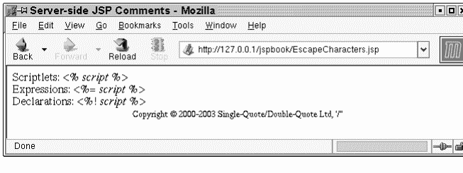

**图 11-3** EscapeCharacters.jsp 的浏览器渲染。

使用任何 JSP 隐式对象都像假设它们已经存在于脚本元素中一样简单。通过之前列出的对象，之前章节中所有的 Servlet 示例都可以在 JSP 中实现。例如，查看 ShowHeaders Servlet（第 2 章中的列表 2-8）。ShowHeaders Servlet 显示了一个小型 HTML 页面，列出了客户端发送的所有请求头。该 Servlet 依赖于 `HttpRequestHeaderNames()` 和 `getHeader` 方法。将此 Servlet 翻译成 JSP 后，代码如列表 3-24 所示。

### 列表 3-24 ShowHeaders.jsp

```jsp
<%@ page import="java.util.*"%>
<html>
<head>
<title>Request's HTTP Headers</title>
</head>
<body>
<p>HTTP headers sent by your client:</p>
<%
Enumeration enum = request.getHeaderNames();
while (enum.hasMoreElements()) {
  String headerName = (String) enum.nextElement();
  String headerValue = request.getHeader(headerName);
  <b><%= headerName %>:</b> <%= headerValue %><br>
}
%>
</body>
</html>
```

将保留的代码保存为 `ShowHeaders.jsp` 并置于 `jspbook` Web 应用程序的根目录下，然后访问 `http://127.0.0.1/jspbook/ShowHeaders.jsp`。结果与之前的 Servlet（`http://127.0.0.1/jspbook/ShowHeaders`）相同。图 3-12 显示了 `ShowHeaders.jsp` 在 Web 浏览器渲染时的输出。

重复 Servlet 代码示例并将其翻译成 JSP 并不是本章的目标。前面的示例目的是清晰地展示如何使用隐式对象，以及如何使用它们来实现 Servlet 的所有功能。前面 JSP 中的脚本段通过使用 `request` 隐式对象（就像它之前已经被 JSP 声明过一样）展示了这一点。


**图 3-12** ShowHeaders.jsp 的浏览器渲染。

```java
Enumeration enum = request.getHeaderNames();
while (enum.hasMoreElements()) {
    String headerName = (String) enum.nextElement();
    String headerValue = request.getHeader(headerName);
}
```

需要注意的是，并没有地方为 JSP 使用而声明了对象请求。它只是被直接使用了。JSP 容器在将 JSP 翻译成 Servlet 时会自动适当地声明隐式对象。JSP 定义了几个额外的隐式对象来配合上述对象。未列出的对象没有直接映射到 Servlet 等效对象。额外的隐式对象是 `pageContext`、`page`、`out` 和 `exception`，它们将在后续章节中进行解释。

## pageContext

`pageContext` 隐式脚本变量是 `javax.servlet.jsp.PageContext` 对象的实例。`PageContext` 对象代表单个 JavaServer Page 的上下文，包括所有其他隐式对象、用于转发和包含 Web 应用程序资源的方法，以及将对象绑定到页面的范围。`pageContext` 对象在本身使用时并不总是很有帮助，因为其他隐式对象已经可用。一个 `PageContext` 对象主要被用作单个对象使用，可以轻松地传递给如自定义 action 等对象。这很有用，因为页面上下文持有对其他隐式对象的引用。

### Request Delegation

`PageContext` 隐式对象提供了用于 JSP 请求委托的等效包含（`include`）和转发（`forward`）指令。脚本段可以使用以下 `PageContext` 方法来提供 JSP 请求委托：

```java
forward(java.lang.String relativeUrl)
```

`forward()` 方法用于重定向或“转发”当前的 `ServletRequest` 和 `HttpServletResponse` 到 Web 应用程序中的另一个资源。`relativeUrl` 的值是通向 Web 应用程序中资源的路径。

```java
include(java.lang.String relativeUrl)
```

`include()` 方法会导致指定的资源作为正在处理的当前 `ServletRequest` 和 `HttpServletResponse` 的一部分被处理。`forward()` 和 `include()` 方法可用于包含或将 `ServletRequest` 和 `HttpServletResponse` 转发。

### Page Scope

除了请求、会话和应用程序范围外，JSP 还引入了页面范围（page scope）。`PageContext` 对象提供了 `getAttribute()`、`setAttribute()` 和 `removeAttribute()` 方法，用于将对象绑定到当前页面。页面范围仅存在于页面的持续期间。页面范围对象不跨多个 JSP 共享。在使用 JSP 通信时，请求范围仍然是合适的范围。

## out

`out` 隐式对象是 `javax.servlet.jsp.JspWriter` 对象的实例，用于在响应中发送内容。`JspWriter` 对象模拟了 `java.io.PrintWriter` 和 `java.io.BufferedWriter` 对象的一些功能，以提供写入文本的方便方法。`out` 隐式对象可以通过 `page` 指令对每个 JSP 进行配置。

### Buffering

初始 `Jsp` 对象与 `ServletResponse` 关联，这取决于页面是否经过缓冲。如果页面没有缓冲，输出将通过 `PrintWriter` 进行。如果页面经过缓冲，则只有在缓冲区刷新时才会创建 `PrintWriter` 对象，这意味着 `setContentType()` 等操作在缓冲区刷新之前是合法的。

通过使用缓冲，当缓冲区溢出时会产生问题。有两种可能：

#### Flush the Buffer

一种直接的方法是在缓冲区满时手动刷新缓冲区。通常会溢出缓冲区的内容现在会向客户端写入额外内容。这种方法的缺点是，一旦内容发送到客户端，就无法更改 HTTP Header。头部始终出现在 HTTP 响应的开头，因此在缓冲区刷新任何内容之前必须确定。

#### Throw an Exception

当需要严格控制内容何时发送到客户端时，刷新缓冲区不是一个好方法。在某些情况下，超出缓冲区是一个致命错误。这样做会导致抛出异常。两种方法都是有效的，因此 JSP 都支持。页面的行为由 `autoFlush` 属性控制，该属性默认值为 `true`。通常情况下，需要确保正确且完整数据已发送到客户端的 JSP 可能希望将 `autoFlush` 设置为 `false`。相反，不需要严格控制的 JSP 可以保留 `autoFlush` 属性为 `true`，这在向浏览器发送 HTML 时很常见。

### JspWriter 和 Response Committed Exceptions

使用 JSP 时一个非常常见且被误解的错误是 `IllegalStateException` 异常，信息为“response already committed”。该错误发生在 `JspWriter` 向客户端发送了一些信息之后，而 JSP 尝试执行假设没有内容的操作。

避免这种异常并不困难，但要求开发者在编程时意识到 `JspWriter` 对象是如何运作的。以下是导致上述异常的两个主要原因。

#### 使用 JSP 设置头部

对 HTTP 响应头部的操作只允许在实际响应内容发送之前进行。这样表述起来似乎非常直观，但许多 JSP 开发者会问，为什么当他们更改头部信息时，会抛出 `IllegalStateException`。解决此问题的简单方法是通过增加页面指令中 `buffer` 属性的值来增大缓冲区大小，或者将产生问题的内容生成代码移动到 JSP 的顶部。将更改头部的代码移动到内容生成之前，可以确保在编辑 HTTP 头部信息时没有缓冲区冲突。

#### 转发

在 JSP 之间进行跳转时，`ServletRequest` 和 `ServletResponse` 对象的完全控制权会被交给目标 JSP。这允许跳转页面对相应的响应具有完全控制权。与 Servlet 不同，JSP 会自动调用 `HttpServletRequest.getWriter()` 方法来获取一个向客户端写入信息的合适对象。在两个 JSP 请求之间跳转并两次调用此方法，在普通的 Servlet 中会抛出异常。然而，JSP 利用 `JspWriter` 缓冲区稍微缓解了这一点。如果 JSP 在内容发送到缓冲区之后、响应提交给客户端之前将请求转发到另一个 JSP，那么一切都是正常的。缓冲区中的数据会被简单丢弃，新的 JSP 可以自由地为客户端创建响应。如果 JSP 将响应提交给客户端，然后将请求转发到另一个 JSP，则会发生异常。

提交响应后转发请求总是会抛出 `IllegalStateException`。可以通过将所有信息包含在一个 JSP 中、不提交响应，或者包含所需的 JSP 而不是转发到它来解决此问题。包含（inclusion）会重用执行包含操作的页面的 `JspWriter` 对象。

理解并避免上述两种情况。晦涩的错误困扰着新的 JSP 开发者。如果能正确理解 `JspWriter` 对象及其关联缓冲区，解决这个问题很容易。

## config

由容器自动完成的普通 JSP 部署方案可以工作，但并没有阻止 JSP 开发者通过 Web 部署描述符 `web.xml` 声明并映射 JSP。可以像部署 Servlet 一样手动部署 JSP，即在 `web.xml` 中创建 Servlet 声明，并将 `servlet-class` 元素替换为 `jsp-file` 元素。声明后，可以将 JSP 映射到单个或一组 URL 作为 Servlet。

例如，如果需要向 `/ShowHeaders` 路径显示 `ShowHeaders` Servlet 和 `ShowHeaders.jsp`，可以通过 `web.xml` 中的以下配置完成此任务。

```xml
<servlet>
  <servlet-name>ShowHeaders</servlet-name>
  <jsp-file>ShowHeaders.jsp</jsp-file>
</servlet>
<servlet-mapping>
  <servlet-name>ShowHeaders</servlet-name>
</servlet-mapping>
```


<url-pattern>/ShowHeaders</url-pattern>

</servlet-mapping>

```

唯一的更改是将之前的行 `<servlet-class>com.jspbook.ShowHeaders</servlet-class>` 替换为 `jsp-file` 元素和 JSP 的位置。

## 初始配置参数

通过使用 `jsp-file` 元素，可以使用 `web.xml` 中的自定义条目来映射 JSP。Servlet 的所有子元素仍然有效，并且可以定义初始参数。在第 2 章中，代码列表 2-3 中的 `InternationalizedHelloWorld` Servlet 用于演示初始参数的功能。代码列表 3-25 是该示例的 JSP 形式快速回顾。

### 代码列表 3-25 InternationalizedHelloWorld.jsp

```jsp
<html>
<head>
<title>Hello World!</title>
</head>
<body>
<h1><%=config.getInitParameter("greeting")%></h1>
</body>
</html>
```

这段代码并没有特别奇之处。需要注意的是，该 JSP 依赖于一个名为“greeting”的初始参数。如果没有这个初始参数，JSP 将无法正常工作，但容器如何都会自动部署该页面。

将代码保存为 `InternationalizedHelloWorld.jsp` 在 `jspbook` Web 应用程序的根目录下，并访问 http://127.0.0.1/jspbook/InternationalizedHelloWorld.jsp。会出现一个显示“null”的页面。图 3-13 显示了浏览器的输出。默认情况下，JSP 没有初始参数，且 JSP 容器不会验证。

要修复此问题，请在 `web.xml` 中添加以下内容：

```xml
<servlet>
  <servlet-name>InternationalizedHelloWorld</servlet-name>
  <jsp-file>InternationalizedHelloWorld.jsp</jsp-file>
  <init-param>
    <param-name>greeting</param-name>
    <param-value>Hello!</param-value>
  </init-param>
</servlet>
<servlet-mapping>
  <servlet-name>InternationalizedHelloWorld</servlet-name>
  <url-pattern>/InternationalizedHelloWorld</url-pattern>
</servlet-mapping>
```

<jsp:expression>link</jsp:expression>
<![CDATA["website</a>]]>
<body>
</html>
<jsp:root>

首先要注意到的一点是页面变大了。这是使用任何形式的 XML 总是存在的一个小缺点。为了遵守 XML 文档结构规则，牺牲了一点点空间效率。在这种情况下，空间本身并不令人担忧，但应该关注的是 JSP 不再能使用自由文本。JSP 脚本必须扩展为完整的标签，并且不符合规则的 HTML 必须被特殊的 XML 语法 `<![CDATA]>>` 包围。这非常繁琐，而且如果没有特殊的 XML 读写工具，会让页面变得难以维护。

这些都不错。这些想法背后的理念是：良好的 XML 在使用得当时，可以是一项非常有用的东西。自定义文档可以极其容易理解，并被目前存在的无数工具轻松操作。唯一的缺点是，HTML 而不是 JSP 在很大程度上被推为一种让动态 HTML 生成变得简单的工具。这并不是 JSP 的限制，但可以说是该技术最常见的用途。要回答的问题是：“你的代码在多大程度上需要 XML 兼容性？”如果 JSP 需要被其他代码处理，那么 XML 是一个很好的选择。另一个要问的问题是：“你是否只使用 JSP 来简化动态 HTML？”如果是这样，那么使用原始的 JSP 语法是更好的选择。

在 JSP 的之前的版本中，大多数用户倾向于使用 JSP 创建动态 HTML。这在很大程度上是因为 HTML 一直是 Web 上的主导技术，这解释了为什么很多 JSP 最初是为了简化创建任务而创建。然而，HTML 不再是最流行的技术了。XML 虽然不完美，但它充分填补了包括 HTML 在内的许多技术的缺陷，并获得了巨大的动力，这种动力体现在行业范围内的使用中。目前，管理内容的最佳方法之一是通过 XML 存储或通信这些内容。使用 XML 实现这些目的允许信息以有意义的方式进行共享和维护。由于这种巨大的灵活性，趋势已经从更受限的技术（如 HTML）转向 XML。JSP 反映了这些变化，因为它也发生了变化，以更好地整合 XML 供 J2EE Web 层次使用。

理解 JSP 文档是非常重要的。XML 的使用在未来将继续增长，理解 JSP 文档像与其交互一样容易的灵活性是非常重要的。理解如何编写 JSP 文档很容易，只要你理解经典 JSP 与 XML 语法下的 JSP 之间的一些简单的转换规则即可。

### JSP 的 XML 语法

161

## XML 规则

“XML rules” 是一个双关语。XML 作为一种技术在互联网上确实是用于编写和共享信息的，但在使用它时，XML 有一些人们必须遵循的重要规则。JSP 文档会自动继承这些规则。如果不理解普通的 XML 语法，直接解释 XML 语法下的 JSP 没什么用。然而，这并不是关于 XML 的。这是关于 JSP 和 Servlets 的。书中没有提供关于 XML 的完整教程。只解释了基础知识，以帮助通过大多数 XML 语法下的 JSP 用例。如果你计划广泛使用 XML 且对 XML 还不了解，这本书不能作为 XML 指南的替代品。为了配合本文，请通读 XML 规范 http://www.w3.org/ ，或者去买一本关于 XML 的好书。

## JSP 文档

除了理解在 XML 语法下编写 JSP 所需的 XML 规则外，普通 JSP 与 JSP 文档之间只有寥寥几个简单的转换。并不是所有的普通 JSP 语法片段都是与 XML 不兼容的格式。JSP 动作（actions）和自定义动作已经是 XML 兼容的语法。它们在 JSP 文档中的用法与在普通 JSP 中相同。JSP 的其余部分即脚本元素（scripting elements）和指令（directives），需要转换为 XML 形式。

## JSP 文档声明

JSP 文档必须被一个根 XML 元素 `root` 完全封装。该元素还需要具有 JSP 命名空间 `jsp`，并带有命名空间声明的以前缀。通常情况下，一个 JSP 文档总是类似于图 3-28。

### 列表 3-28 JSP 文档的声明

```xml
<?xml version="1.0"?>
<jsp:root xmlns:jsp="http://java.sun.com/JSP/Page">
  // JSP 文档内容
</jsp:root>
```

由 JSP 文档封装的内容就是 JSP 的内容。

## 脚本元素

所有的脚本元素都必须转换以供 JSP 文档中使用。经典 JSP 使用的脚本元素语法 `<% %>` 直接与 XML 语法冲突。不要为脚本段（scriptlets）、表达式和声明使用 `<% %>`、`<%% %>` 和 `<%! %>`，而是分别使用 `<jsp:scriptlet></jsp:scriptlet>`、`<jsp:expression></jsp:expression>` 和 `<jsp:declaration></jsp:declaration>`。

这种转换在大多数情况下是非常简单的。参考第一个 JSP 对比 JSP 文档的示例，列表 3-25 和列表 3-26。这里是经典 JSP 示例中使用了脚本段和表达式的代码部分。

```java
String text = "<b>bold text</b>";
String link = "http://www.jspbook.com";
if (true) {
  Here is bold text: <%= text %><br>
}
 }
```

一个指向 <a href="<%= link %>">website</a></a> 的链接。

高亮显示的是脚本段和表达式。转换为 XML 语法下的 JSP 的转换如下：

```xml
<jsp:scriptlet>
String text = "<b>bold text</b>";
String link = "http://www.jspbook.com";
if (true) {
</jsp:scriptlet>
Here is bold text:
<jsp:expression//><><![CDATA[<br>]]>
<jsp:scriptlet></jsp:scriptlet>
<![CDATA[A link to <a href="]]>
<jsp:expression/></jsp:expression>
<![CDATA[%">website</a>.]]
```

从经典脚本元素到 JSP 文档等效项的直接更改可以很容易看出。任何文本搜索替换工具都能轻松完成这项工作。更困难的部分是检查以确保转换结果产生了一个有效的 XML 文档。在前面的例子中，它并没有。该示例专门包含了在使用 JSP 文档时最常见的错误之一。在经典 JSP 中，直接在模板文本中间使用表达式或脚本段是完全合法的：一个指向 <a href="<%= link %>">website</a></a> 的链接。

在 JSP 文档的简单转换中，这最初变成了如下：

一个指向 <a href="<jsp:expression>link</jsp:expression>">website</a> 的链接。

然而，上面的代码没有形成，因为该文档不是 XML。不允许嵌入表达式。要解决这个问题，请将文本封装在 CDATA 区域中或使用实体（entities）。

## 指令

记得 JSP 指令总是遵循格式 `<@directive attribute="value" />`。与脚本元素不同，这种语法使用 `<jsp:directive attribute="value" />`。通常情况下，指令总是这样的。为了清晰起见，列表 3-29 显示了一个经典语法下 JSP 的简要示例，使用了 page 和 include 指令。

### 列表 3-29 JSPDocument.jsp

```jsp
@page errorPage="ErrorPage.jsp"
@include file="header.jsp"
<h1>A Title</h1>
<p>Some text.</p>
@include file="footer.jsp"
```

将代码转换为 XML 与直接替换指令一样简单。这在列表 3-30 中所示。

### 列表 3-30 JSPDocument.jsp

```xml
<?xml version="1.0"?>
<jsp:root xmlns:jsp="http://java.sun.com/JSP/Page">
<jsp:directive.page errorPage="ErrorPage.jsp"/>
<jsp:directive.include file="header.jsp"/>
<h1>A Title</h1>
<p>Some text.</p>
<jsp:directive.include file="footer.jsp"/>
</jsp:root>
```

## 封装模板文本

除了理解在 XML 语法下编写 JSP 所需的 XML 规则外，普通 JSP 与 JSP 文档之间只有寥寥几个简单的转换。并不是所有的普通 JSP 语法片段都是与 XML 不兼容的格式。JSP 动作和自定义动作已经是 XML 兼容的语法。它们在 JSP 文档中的用法与在普通 JSP 中相同。JSP 的其余部分即脚本元素和指令，需要转换为 XML 形式。

原始 XML 语法下的 JSP 有一个荒谬的要求，是要求 JSP 文档将模板文本用 `<jsp:text>` 元素包围。XML 并没有要求这样做。这一要求原本旨在辅助 JSP 解析器，但极大复杂了 JSP 文档中的模板文本。

## 总结

本章介绍了 Java Servlets (JSP)。JSP 是一种补充技术，提供了一种极其高效的开发文本输出 Servlet 的方法。与 Servlets 不同，JSP 不是以 Java 2 兼容语法编写的，但 JSP 被容器翻译并管理为 Servlet。在编写 JSP 后，不需要通过 web.xml 手动部署 JSP 到 URL 扩展。容器会自动部署 JSP，但仍然可以使用 web.xml 条目来为 JSP 提供初始参数或任意的 URL 扩展。

JSP 分为两个部分：模板文本和动态元素。模板文本由通常出现在 Servlet 的 print() 或 println() 调用中的所有内容组成。动态元素是 JSP 规范定义的特殊语法位。动态元素不被直接视为文本，而是被容器评估以执行某些自定义功能。

JSP 元素分为三大类：脚本元素、指令和动作。脚本元素是通过模板文本直接嵌入代码的方法。指令是在翻译时为 JSP 容器提供配置信息的方法。动作用于将兼容 XML 的标签链接到未包含在 JSP 中的自定义代码。JSP 规范定义了一些默认动作，但也存在一种将自定义代码绑定到自定义动作的方法。自定义动作是 JSP 强大功能之一，将在第 7 章中进行详细介绍。

编写 JSP 有两种不同的语法样式可供选择。第一是经典 JSP 语法，自 JSP 最初发布以来一直可用。本书的大部分内容都使用这种经典语法，它通常被认为是编写 JSP 最简单的语法。另一种 JSP 语法适用于需要将 JSP 编写为符合 XML 规范文档的情况。两种语法样式提供相同的功能。在两种 JSP 语法之间进行转换通常是一项轻而易举的任务。

# 第 4 章

## 异常处理

异常是 Java 编程语言不可或缺的一部分。当程序违反 Java 规则时，Java 虚拟机会停止程序的执行并生成异常。异常管理是每个 Java 程序必须做的事情。Servlets 和 JSP 也不例外。到此为止，编程错误的主题在很大程度上被忽视了，重点转向介绍 JSP 和 Servlets。虽然这对于本书的开始是必要的，但错误是不可避免的，需要被理解以便妥善处理。本章的目标是清晰地解释什么是异常，以及如何在 Servlets 和 JSP 中处理它们。

本章将讨论以下主题：

- 对 Java 支持异常的常规回顾以及 Java 异常处理的工作原理。
- 如何使用 Java 内置异常处理机制处理 Servlet 和 JSP 异常。
- 如何使用 Servlet 特有的 Web 应用程序部署文件 web.xml 来处理异常。
- 介绍 `java.util.logging` 包，用于妥善处理需要记录的信息，重点关注异常信息的记录。
- Web 应用程序异常处理和日志记录的通用哲学。

上述观点意味着本章假设读者对 Java 异常处理的先验知识很少或没有。这种假设是正确的；本章的设计既适用于 Java 开发者，也适用于那些从未真正费心学习过异常处理的“Java”开发者（这类人多得惊人）。本章设计为一气呵读完，但如果你已经熟练掌握了 Java 异常处理，可以跳过第一节，直接开始讨论 Servlet 和 JSP 的异常处理。

## 错误与异常

所有 Java 错误都是 `java.lang.Throwable` 类的子类。当运行中的程序发生错误时，会创建该类的适当实例并称之为“抛出”。随后，代码可以捕获该异常并处理它，或者让 JVM 处理问题，这通常会导致当前程序的终止。在某些情况下，Java 强制要求代码尝试处理异常，而在另一些情况下，异常则被自由传递给 JVM。

`Throwable` 类有三个主要的子类，将所有错误分为三大类。如图 4-1 所示，Java 错误被归为 `Error`、`Exception` 或 `RuntimeException` 类的实例。

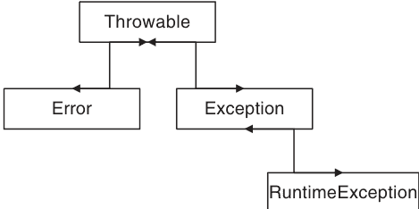

图 4-1 Throwable 子类树

在三个主要的 `Throwable` 子类中，最著名的分支是 `Exception` 实例。`Exception` 对象代表程序必须能够捕获的问题。如果代码忽略了妥善捕获这些代码。与 `Exception` 对应的是，`Runtime` 类的实例代表不需要被代码捕获的运行时错误。然而，仅仅因为错误不需要捕获并不意味着它不是严重的问题。`RuntimeException` 对象用于不应由本地代码处理的错误，且如果声明为 `Exception` 则只会增加复杂性。虽然 `RuntimeException` 本质上是危险的，因为它们不需要代码对其负责，但由于这种风险，`RuntimeException` 对象并不经常作为 `Exception` 对象使用。第三个分支是 `Throwable` 对象是 `Error` 类的子类。`Error` 类的实例代表应用程序不应尝试捕获的异常错误。如果抛出了 `Error` 对象的实例，对程序的执行来说几乎总是是灾难性的。

在编写 Web 应用程序时，使用抛出 `Exception` 对象的代码很常见，在许多情况下，设计用于抛出和捕获 `RuntimeException` 对象的代码也有帮助。本章将进一步涵盖 `Exception` 和 `Runtime` 对象。`Error` 类的实例被假设永远不会发生，并且超出本书的范围。

## 抛出异常

通过使用 `throw` 关键字后要抛出的 `Throwable` 对象来抛出异常。异常可以在任何时间被抛出，但 `throw` 关键字的意图是在运行时检测到问题时抛出异常。抛出异常有许多用途。异常最常用的用途之一是验证传递给函数调参数是否正确。可以抛出一个异常并附带关于发生什么错误的良好说明，而不是使用一组复杂的返回值。

### 列表 4-1 `throw` 关键字的使用


```java
public void fooMethod(String value1, String value2) {
    if (value1 == null)
        throw new Exception("Value 1 can't be null!");
    if (value2 == null)
        throw new Exception("Value 2 can't be null!");
} // 方法代码...
```

随 `throw` 关键字的是 `throws` 子句。`throws` 子句扩展了方法的签名，以反映可能会抛出异常的事实。每个使用 `throw` 关键字且不捕获异常的方法必须使用 `throws` 子句来声明未捕获的异常。要对前面的代码应用 `throws` 子句，你需要将代码更改类似于列表 4-2。

# 列表 4-2 `throw` 关键字的正确用法

```java
public void fooMethod(String value1, String value2) throws Exception {
    if (value1 == null)
        throw new Exception("Value 1 can't be null!");
    if (value2 == null)
        throw new Exception("Value 2 can't be null!");
    // 方法代码...
}
```

## 异常类化

考虑到异常来编写代码总是好的。Java 异常处理机制对于保持代码顺利运行以及在出现问题时进行调试非常有帮助。虽然有效，但之前给出的抛异常示例是为了说明功能是如何运作的。在实际使用中，异常很少作为 `Exception` 类的直接实例抛出。异常最好作为特定的 `Exception` 子类抛出，这样更符合异常的性质。

通过子类化 `Exception` 可以轻松创建自定义异常。通常，自定义错误的代码仅仅是一个继承 `Exception` 的类，并在其中调用 `Exception` 构造函数，如列表 4-3 所示。

## 列表 4-3 CustomException.java

```java
package com.jspbook.foo;

public class CustomException extends Exception {

  public CustomException(String message) {
    super(message);
  }
}
```

`CustomException` 代码将出现在后续示例中，因此它被放在 `com.jspbook.foo` 包中。在 jspbook Web 应用程序的 `/WEB-INF/classes/com/jspbook/foo` 目录下保存并编译 `CustomException.java`。

## Throwable 类的合并

在大多数情况下，抛出发生的每一个异常类型是不现实的。在方法声明中包含无数种 `Throwable` 类型在 Java 编程中不是良好的做法。更好的解决方案是通过包装自定义分类的 `Throwable` 类来合并 `Throwable` 类型。如果两个或多个异常类型确实意味着相同并且旨在通过捕获代码以相同的方式处理，那么就有理由将它们合并。

在 Web 应用程序中合并 `Throwable` 类的一种良好方法是将异常分为两类：用户相关异常和关键应用程序异常。这两种异常代表了运行期间可能发生的通用类型问题：要么用户犯了错误，要么应用程序无法运行。在用户错误的情况下，捕获该问题并告知用户他们做了什么是有帮助的。在应用程序错误的情况下，用户能做的事情很小。相反，应用程序错误应该向用户显示一个礼貌的错误，同时通知管理员。

本书鼓励使用用户和应用程序类型的异常，并贯穿始终。对于后续的示例，请参见列表 4-4，它显示了表示用户异常的自定义 `Throwable` 类。该异常应该立即引发报警，因此通过子类 `Exception` 使其变为“检查”（checked）异常。

## 列表 4-4 UserException.java

```java
package com.jspbook;

public class UserException extends Exception {
    // 一个用于设置异常描述的构造函数
    public UserException(String description) {
        super(description);
    }
}
```

第二个类表示不可预见的应用程序异常，如列表 4-5 所示。此类异常是完全出乎意外的，代表了 Web 应用程序潜在的严重问题。此异常没有被设置为“检查”，但假设会被一个合并的机制捕获，该机制会恰当地记录问题并通知管理员。通过扩展 `RuntimeException` 类，代码不会因为处理该问题而混乱，因为这种情况本不应该发生。

## 列表 4-5 AdminException.java

```java
package com.jspbook;

public class AdminException extends RuntimeException {
    // 一个用于设置异常描述的构造函数
    public AdminException(String description) {
        super(description);
    }
}
```

错误与异常 171

将上述两个类保存并编译到 jspbook Web 应用程序的 `/WEB-INF/classes/com/jspbook` 目录下。恰当处理上述异常是本章将开发的内容。有很多很好的方法，某些方法与其他方法相比具有优势，但在引入任何复杂内容之前，让我们从基础层面开始讨论。

## Try, Catch, Finally

抛出异常是好的，但捕获异常同样重要。向 JVM 抛出异常永远不是良好的做法，因为可能导致你的应用程序停止。可能的情况下，最好将异常处理保持本地。Java 规范使用 `try` 语句配合 `catch` 子句来分别执行可能的异常代码并处理任何可能抛出的异常。通用格式是使用 `try` 语句包围异常代码，并紧跟一个或多个 `catch` 子句，以处理可能出现的不同类型的 `Throwable` 对象。

在提供 `catch` 功能的示例之前，需要一些抛出异常的代码。由于这些代码纯粹用于教育目的，它们将与 `foo` 包中的 `CustomException.java` 在一起。将列表 4-6 保存并编译到 jspbook Web 应用程序的 `/WEB-INF/classes/com/jspbook/foo` 目录下。

## 列表 4-6 ExceptionThrower.java

```java
package com.jspbook.foo;

public class ExceptionThrower {

    public static void throwException(String message) {
        throw new Exception(message);
    }

    public static void throwCustomException(String message)
    throws CustomException {
        throw new CustomException(message);
    }
}
```

`ExceptionThrower.java` 只为了抛出 `Exception` 和 `CustomException` 对象而存在。它的目的是提供一个模拟设置，其中抛出不同的异常，以便演示 `try-catch` 语句。列表 4-7 中的 JSP 使用 `ExceptionThrower` 类随机抛出 `CustomException` 对象或 `Exception` 对象的实例。`try` 语句带有 `catch` 子句包围代码，以处理这两种异常。

## 列表 4-7 ExceptionThrower.jsp

```jsp
<%@ page import="com.jspbook.foo.*" %>
<html>
<head>
  <title>ExceptionThrower</title>
</head>
<body>
<%
try {
  double rand = Math.random();
  if (rand < .5) {
    ExceptionThrower.throwException("foo");
  }
  ExceptionThrower.throwCustomException("foo");
} catch (CustomException e) {
  out.println("Caught a Custom Exception: " + e.getMessage());
} catch (Exception e) {
  out.println("Caught an Exception: " + e.getMessage());
}
%>
</body>
</html>
```

将 `ExceptionThrower.jsp` 保存在 jspbook 应用程序的根目录下，并访问 `http://127.0.0.1/jspbook/ExceptionThrower.jsp`。每次访问该页面都会抛出一个 `Exception` 或 `CustomException`。与其看到错误页面（如图 4-3 所示），JSP 捕获了错误并显示关于它的一点信息。图 4-2 显示了输出的浏览器渲染结果。

在许多情况下，代码将抛出各种类型的异常。某些异常可能由用户错误引起，而另一些可能是应用程序中的严重漏洞。能够捕获、区分并恰当地处理这些异常是保持 Web 应用程序顺利运行的必要条件。

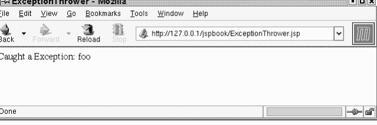

图 4-2 ExceptionThrower.jsp 的浏览器渲染

`try-catch` 机制在书中经常出现，熟悉它非常重要。

## Finally

当抛出异常时，无论异常是否被捕获，`finally` 块都会执行。这对于清理资源有用，例如关闭数据库连接或文件流。`try-catch-finally` 机制在书中经常出现，熟悉它非常重要。

## JSP 和 Servlet 异常

除了 `try-catch-finally` 语句，JSP 和 Servlet 定义了有效异常的特定方法。没有理由不使用它们，它们确保访问者不会面对晦涩的错误页面。

`try-catch` 机制在书中经常出现，熟悉它非常重要。

# 错误处理 JSP

除了 `try-catch-finally` 语句，Java Pages 使用页面指令指定未捕获的异常传递到何处。页面指令的 `errorPage` 属性可以分配一个相对 URL 值，代表设计为错误页的 JSP 或 Servlet。设计为错误页的 JSP 可以将页面指令 `isErrorPage` 属性设置为 `true`；这使得 `exception` 隐式脚本变量自动可用，用于表示传递的异常。

```html
<title>发生了错误！</title>
</head>
<body>
<h3>发生了错误</h3>
抱歉，但此站点无法渲染您请求的服务。
系统中的一个错误导致了错误的发生。
请将问题描述发送至
<%= application.getInitParameter("admin email") %>
</body>
</html>
```

（翻译：）

将 `ErrorPage.jsp` 保存到 `jspbook` Web 应用程序的根目录下。由于错误页面从不会插入用于直接查看，因此请保存**列表 4-10** 中的代码，以便演示 `ErrorPage.jsp`。

## 列表 4-10 ThrowExceptionToError.jsp

```jsp
<%@ page errorPage="ErrorPage.jsp" %>
<% if (true)
    throw new Exception("An Exception");
%>
```

前述代码很好地表示了一个使用 `ErrorPage.jsp` 作为其错误页面的问题 JSP。在 `jspbook` Web 应用程序的根目录下创建 `ThrowExceptionToError.jsp`，并浏览到 `http://127.0.0.1/jspbook/ThrowExceptionToError.jsp`。你将看到的不是之前由于 `ThrowException.jsp` 结果显示的图 4-3，而是一个友好的页面。页面给出了简要的解释，并提供了投诉联系方式。图 4-4 显示了 `ErrorPage.jsp` 输出的浏览器渲染。

`ErrorPage.jsp` 仅仅是 JSP 错误页面的简单示例。它等同于捕获异常后将请求转发到不同的资源。可以构建更复杂的 JSP 页面来利用异常隐式对象（exception implicit object）。当使用页面页面指令中 `errorPage` 属性的页面抛出异常时，异常信息不会丢失。`Throwable` 对象的实例会被保存在请求作用域（request scope）中，名称为 `javax.servlet.jsp.jspException`。作为错误页使用的 Servlet 或 JSP 可以访问此对象，以尝试找出问题所在。JSP 为此目的提供了一个方便的机制。页面指令属性指定了 JSP 是否应该自动初始化隐式脚本变量，作为指向命名为请求作用域属性 `javax.servlet.jsp.jspException` 的引用。

## 发生了错误

抱歉，但此站点无法渲染您请求的服务。系统中的一个错误导致了错误的发生。请将问题描述发送至 admin@jspbook.com。

图 4-4 ErrorPage 的浏览器渲染

通过将 `isErrorPage` 属性设置为 `true`，JSP 会自动获得传递异常的访问权限。

通过修改 `ErrorPage.jsp` 可以创建一个非常有用的 JSP 错误页面。依赖用户准确描述问题是什么并不是一个好主意。更好的解决方案是为他们提供错误代码描述，包含在他们的反馈中。**列表 4-11** 中的代码修改了 `ErrorPage.jsp` 以提供此功能。

## 列表 4-11 EnhancedErrorPage.jsp

```jsp
<%@ page isErrorPage="true" %>
<html>
<head>
  <title>发生了错误！</title>
</head>
<body>
  <h3>发生了错误</h3>
  抱歉，但此站点无法渲染您请求的服务。
系统中的一个错误导致了错误的发生。
  请将问题描述发送至
  <%= application.getInitParameter("admin email") %>，并附上
  "${exception.getMessage()}"，将其列为错误原因。
</body>
</html>
```

`EnhancedErrorPage.jsp` 为用户提供了联系电子邮件和可选的与反馈对齐的异常消息。通过修改 `ThrowExceptionToErrorPage.jsp`，可以将错误消息传递给 `EnhancedErrorPage.jsp` 使用，如**列表 4-12** 所示。

178 异常处理

## 列表 4-12 ThrowExceptionToEnhancedErrorPage.jsp

```jsp
<%@ page errorPage="EnhancedErrorPage.jsp" %>
<% if (true) { throw new Exception("Generated by contrived code."); } %>
```

将 `EnhancedErrorPage.jsp` 和 `ThrowExceptionToEnhancedErrorPage.jsp` 保存到 `jspbook` Web 应用程序的根目录下，并浏览到 `http://127.0.0.1/jspbook/ThrowExceptionToEnhancedErrorPage.jsp`。这一次，为了礼貌处理错误页面，提供了一个异常消息供用户作为反馈发送。该异常消息与异常构造函数中使用的相同。图 4-5 显示了输出的浏览器渲染。

## 错误处理 Servlet

JSP 通常是提供自定义 HTML 错误页面最简单的方法，但 Servlet 的效果同样好。在 Servlet 中，没有等于指令中方便的 `errorPage` 属性的写法。要实现相同的功能，作为错误页的 Servlet 必须从请求作用域显式获取 `Throwable` 对象。这不是一项困难的任务，任何 Servlet 都可以完成。

`ErrorPage.jsp` 的 Servlet 已经在第 2 章的列表 2-17 中演示。将此示例修改为模拟 `EnhancedErrorPage.jsp` 的真实错误页面实际上是一项轻微的任务。等同于 `isErrorPage="true"` 的代码是几行访问请求作用域以所需属性的代码。**列表 4-13** 创建了一个设计用于 JSP 错误页的 `EnhancedErrorPage` Servlet。

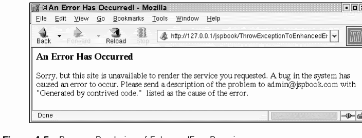

图 4-5 EnhancedErrorPage 的浏览器渲染

## 列表 4-13 EnhancedErrorPage Servlet


```java
package com.jspbook;

import java.io.*;
import javax.servlet.*;
import javax.servlet.http.*;

public class EnhancedErrorPage extends HttpServlet {

    public void doGet(HttpServletRequest request, HttpServletResponse response)
            throws IOException, ServletException {

        response.setContentType("text/html");
        PrintWriter out = response.getWriter();

        // 从应用程序加载联系邮箱
        ServletContext sc = request.getServletContext();
        String adminEmail = sc.getInitParameter("admin email");

        // 获取 JSP 引起的异常
        Exception e = (Exception)request.getAttribute("javax.servlet.jspException");

        out.println("<html>");
        out.println("<head>");
        out.println("<title>发生了错误！</title>");
        out.println("</head>");
        out.println("<body>");
        out.println("<h3>发生了错误</h3>");
        out.println("抱歉，但此站点无法渲染您请求的服务。系统中的");
        out.println("错误导致了错误的发生。请将问题描述发送至");
        out.println(adminEmail + ": " + e.getMessage() + " 将列为错误原因。");
        out.println("</body>");
        out.println("</html>");
    }
}
```

## 180 异常处理

将 `EnhancedPage.java` 保存到 `jspbook` Web 应用程序的 `/WEB-INF/classes/com/jspbook` 目录下。将 Servlet 部署到 `/EnhancedPage` 扩展并重新加载 Web 应用程序。`EnhancedPage` 现在像 `ErrorPage.jsp` 一样作为错误页面运行。列表 4-14 中的 JSP 显示了一个异常以测试该 Servlet。

## 列表 4-14 EnhancedPageTest.jsp

```jsp
<% page errorPage="EnhancedPage" %>
<%
  if (true)
    throw new Exception("An Exception!");
%>
```

# Web 应用程序错误页面

错误页面可以在每个 Web 应用程序部署符 `web.xml` 中定义。`error-page` 元素用于根据抛出的异常类型或为响应设置的 HTTP 状态码来定义错误处理。`error-page` 元素必须包含子元素，以指定指向错误页面的相对 URL 以及与之关联的 HTTP 响应 `Throwable`。

## 基于异常的错误页面

根据抛出的 `Throwable` 类型，Web 应用程序可以将异常重定向到指定的错误页面。此功能在 `web.xml` 中通过使用 `error-page` 元素结合 `exception-class` 和 `location` 元素进行配置。`exception-class` 元素体中指定的值需要完全限定的 Java 类，而 `location` 元素指定 Web 应用程序中相应错误页面的相对 URL。`web.xml` 中的条目始终类似于列表 4-15。

### 列表 4-15 web.xml error-page 元素

```
<error-page>
  <exception-type>Throwable</exception-type>
  <location>Relative URL</location>
</error-page>
```

Servlets 和 JSP 抛出的 `Throwable` 对象有三种通用类型：`IOException`、`ServletException` 和 `JSPException`。当 Servlet 捕获对 `service()` 方法的调用时，可以选择抛出 `IOException` 或 `ServletException` 的实例。任何处理请求的 JSP 都可以抛出 `JSPException` 实例。捕获所有异常可以确保 Servlet 或 JSP 抛出的所有异常导致自定义错误页面。这种捕获非常有用，可以通过向 `web.xml` 添加单个条目来轻松实现。由于 `IOException`、`ServletException` 和 `JSPException` 共享相同的父类 `Exception`，捕获 `Exception` 类的发生情况可以涵盖这三种类型，如列表 4-16 所示。

### 列表 4-16 针对所有检查异常的 web.xml 错误页面

```
<error-page>
  <exception-type>java.lang.Exception</exception-type>
  <location>ErrorPage.jsp</location>
</error-page>
```

将上述条目添加到 `web.xml` 中 `welcome-file-list` 标签之后、`webapp` 结束标签之前。重新加载 JSPbook Web 应用程序以反映更改。有了新的 `error-page` 条目，所有异常都被重定向到 `ErrorPage.jsp`。尝试回溯 `ThrowException.jsp`，http://127.0.0.1/jspbook/ThrowException.jsp。显示的不再是之前图 4-3 所示的错误堆栈跟踪，而是 `ErrorPage.jsp` 的内容。图 4-6 显示了浏览器渲染的结果。

每个 Web 应用程序都应该像刚才所示包含至少一个通用错误页面。确保用户永远不会看到晦涩的堆栈跟踪是良好网站的首要任务。虽然存在更优雅的解决方案，但也应该实现一个简单友好的错误页面作为起点。

Web 应用程序部署符可以捕获多种类型的 `Throwable` 对象。在许多情况下，不同的 Servlet 和 JSP 会抛出不同类型的异常。在这种情况下，拥有两个或多个不同的错误页面来处理不同类型的异常是有意义的。然而，每个条目的 `exception-type` 元素都有唯一的值。在同时存在父类和子类的情况下（例如 `Exception` 和 `ServletException`），父类的错误页面具有优先级。

## 基于 HTTP 状态码的错误页面

用于捕获抛出异常的相同错误页面机制也可适用于具有预期 HTTP 标头的响应。此功能通过 `web.xml` 中的 `error-page` 元素结合 `error-code` 和 `location` 子元素进行配置。`error-code` 元素中的值需要是有效的 HTTP 响应码，导致响应被重定向到错误页面。`location` 元素提供了 Web 应用程序中相应错误处理资源的相对 URL。`web.xml` 中的条目始终类似于列表 4-17。

### 列表 4-17 web.xml error-page 元素

```
<error-page>
  <error-code>HTTP Code</error-code>
  <location>Relative URL</location>
</error-page>
```

为所有 HTTP 响应码提供自定义错误页面总是一个好主意。例如，这里使用 `error-page` 元素为常见的 404，“File Not Found”（文件未找到）HTTP 码提供自定义页面。

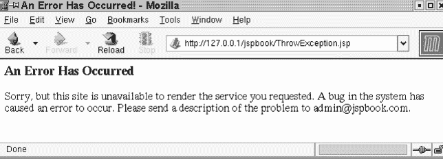

**图 4-6** web.xml 错误页面的浏览器渲染

默认情况下，Tomcat 发送一个服务器生成的页面来描述 404，“File Not Found”错误。此页面比为异常生成的生成的调试页面稍微漂亮一点，但并没有特别之处。图 4-7 显示了 Tomcat 生成的 404 页面示例。可以通过尝试访问 Web 应用程序中不存在的任何资源来复制此页面。

该页面简单且信息丰富，但通常不符合客户端的风格。此外，大多数服务器生成的页面都会显示有关发送页面的服务器的信息。在保持网站安全的情况下，必须连同任何包含相同信息的 HTTP 标头一起移除。

针对错误码的 `.xml` 条目解决了自定义页面的需求，如列表 4-18 所示。

### 列表 4-18 针对 HTTP 404 响应码的 web.xml 错误页面条目

```
<error-page>
  <error-code>404</error-code>
  <location>ErrorPage.jsp</location>
</error-page>
```

针对错误码的 `.xml` 条目解决了自定义页面的需求，如列表 4-18 所示。`web.xml` 中的条目定义了错误页面 `FileNotFound.jsp` 来处理 404 错误。通过访问 JSPbook Web 应用程序中不存在的资源来测试新的错误页面。一个好的选择是 `fictitious.jsp`。

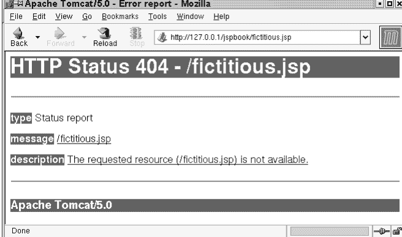

**图 4-7** HTTP 状态 404 - fictitious.jsp

### 列表 4-19 FileNotFound.jsp

```jsp
<html
<head>
  <title>Bad URL</title>
</head>
<body>
  <h3>Bad URL</h3>
  您 正在尝试访问的资源 <%= request.getRequestURL() %> 在此服务器上不存在。
</body>
</html>
```

通常访问 http://127.0.0.1/jspbook/fictitious.jsp 通常会得到一个 Tomcat 生成的页面。现在显示的是自定义页面 `FileNotFound.jsp`。图 4-8 显示了结果的浏览器渲染。

# 自定义 Web 应用程序异常页面

Web 应用程序页面以类似的方法传递额外信息。当使用 `web.xml` 处理错误时，除了请求指定的错误页面外，请求作用域内绑定了一些描述错误的对象。这些对象对用户通常帮助不大，但可以为开发者提供价值。Servlet 规范定义了错误页面时由 Web 应用程序在请求作用域设置的属性：

- `jakarta.servlet.error.status_code`：绑定到请求作用域的属性 `jakarta.servlet.error.status_code` 是一个 `java.lang.Integer` 实例，表示 HTTP 状态码。只有当错误页面作为 HTTP 错误状态码的结果时才会设置此属性。
- `jakarta.servlet.error.exception_type`：绑定到请求的属性是 `java.lang.Class` 实例，表示绑定到请求作用域 `jakarta.servlet.error.exception` 的 `Throwable` 类类型。
- `jakarta.servlet.error.message`：绑定到请求的属性 `jakarta.servlet.error.message` 是一个描述错误的 String 对象。
- `jakarta.servlet.error.exception`：绑定到请求作用域的属性 `jakarta.servlet.error.exception` 是作为异常抛出的 `java.lang.Throwable` 对象的实例。
- `jakarta.servlet.error.request_uri`：绑定到请求作用域的属性 `jakarta.servlet.error.request_uri` 是一个表示导致错误的 Web 应用程序路径的 String 对象。
- `javax.servlet.error.servlet_name`：绑定在请求作用域中的 `javax.servlet.error.servlet_name` 属性是一个 String 对象，表示导致错误的 Servlet 节点。

JSP 或 Servlet 错误页面可以通过转发到错误页的 `HttpServletRequest` 对象的 `getAttribute()` 方法来利用这些属性。在之前的 JSP 页面示例（列表 4-11）中，向用户展示了一个自定义错误页面，告知其在反馈中应包含适当的错误信息。更进一步，可以创建一个包含错误页所有可用属性的自定义错误页面。将此信息直接呈现给用户通常用处不大。相反，使用邮件消息进行自动调试是获取反馈的更好选择。

发送电子邮件并不是一项轻易的任务。有许多实现电子邮件协议的现有 API，通常使用其中一个 API 是最简单的。官方的 J2EE 邮件 API 是 JavaMail API，http://java.sun.com/products/javamail/index.html。遗憾的是，提供 JavaMail API 的教程超出了本书的范围；但了解你可以从 JSP 或 Servlet 发送邮件是一个很好的切入点。列表 4-20 中的 JSP 工作原理类似于 `EnhancedErrorPage.jsp`，但每发生异常时，它会使用 JavaMail API 向应用程序管理员发送电子邮件。请注意，除非你安装了 JavaMail API 并修改了邮件服务器配置信息，否则此示例将无法工作。

## 列表 4-20 ErrorPage.jsp

```jsp
<@isErrorPage="true"
import="java.util.*, javax.mail.*, javax.mail.internet.*" %>
<%
Properties props = new Properties();
props.put("mail.smtp.server", "your smtp server");
```

- 安装 JavaMail API 并不困难。它涉及将 JavaBean Activation Framework 的 JAR 文件添加到 Web 应用程序的 `/WEB-INF/lib` 目录。然而，配置邮件服务器可能会非常诡异，这不是我们希望在书中涵盖的话题。


```java
Session msession = Session.getInstance(props, null);
// 来自第 2 章的电子邮件地址
String email = application.initParameter("admin email");

MimeMessage message = new MimeMessage(msession);
message.setSubject("[Application Error]");
message.setFrom(new InternetAddress(email));
message.addRecipient(Message.RecipientType.TO, new InternetAddress(email));
String debug = "";

Integer status_code = (Integer) request.getAttribute("javax.servlet.error.status_code");
if (status_code != null) {
    debug += "status_code:" + status_code.toString() + "\n";
}
Class exception_type = (Class) request.getAttribute("javax.servlet.error.exception_type");
if (exception_type != null) {
    debug += "exception_type:" + exception_type.getName() + "\n";
}
String m = (String) request.getAttribute("javax.servlet.error.message");
if (m != null) {
    debug += "message:" + m + "\n";
}
Throwable e = (Throwable) request.getAttribute("javax.servlet.error.exception");
if (e != null) {
    debug += "exception:" + e.toString() + "\n";
}
String request_uri = (String) request.getAttribute("javax.servlet.error.request_uri");
if (request_uri != null) {
    debug += "request_uri:" + request_uri + "\n";
}
String servlet_name = (String) request.getAttribute("javax.servlet.error.servlet_name");
if (servlet_name != null) {
    debug += "servlet_name: " + servlet_name;
}

// 设置消息，发送邮件
message.setText(debug);
Transport.send(message);
%>
<html>
<head>
    <title>EmailErrorPage</title>
</head>
<body>
    <h3>发生了一个错误</h3>
    对不起，此站点无法渲染所请求的服务。系统中的一个 bug 导致了错误的发生。
    请将问题描述发送到
    <a href="mailto:%email%">%email%</a>。
</body>
</html>
```

将上述代码保存为 `EmailErrorPage.jsp` 并置于 `jspbook` Web 应用程序的根目录下。请注意，如果你想让示例发送电子邮件，必须修改高亮的代码部分以成为有效的 SMTP 邮件服务器的 IP 地址。此外，在 `web.xml` 中设置的管理员电子邮件地址必须是该服务器的有效地址。编辑 `web.xml` 以使用新的错误页面代替 `ErrorPage.jsp`。`web.xml` 中的条目应类似于：

- 列表 4-21 EmailErrorPage.jsp web.xml Entry

```xml
<error-page>
  <exception-type>java.lang.Exception</exception-type>
  <location>EmailErrorPage.jsp</location>
</error-page>
```

重新加载 Web 应用程序后，错误页面即可使用。下一次生成错误时，系统会自动向站点管理员发送电子邮件。JavaMail 代码处理邮件的发送，而邮件中的信息是从作用域内的异常信息中提取的：

```java
Integer status_code = (Integer) request.getAttribute("javax.servlet.error.status_code");
if (status_code != null) {
    debug += "status_code:" + status_code.toString() + "\n";
}
Class exception_type = (Class) request.getAttribute("javax.servlet.error.exception_type");
if (exception_type != null) {
    debug += "exception_type:" + exception_type.getName() + "\n";
}
String m = (String) request.getAttribute("javax.servlet.error.message");
if (m != null) {
    debug += "message:" + m + "\n";
}
```

开发者开始编写该项目时？如果两个不同的开发者使用完全任意的 `System.out.println()` 或等效调用，每个人都可能干扰执行顺序。如果没有通用的日志机制，协作将变得困难。另一个非常重要的问题是，当日志信息需要重定向到不同的位置时会发生什么？而不是日志文件、电子邮件或公共仓库呢？手动修复无数 `System.out.println()` 调用完全是浪费时间，特别是如果修复方法在以后还需要进行更多更改。

解决调试信息的良好且达成共识的解决方案是使用简单、健壮的日志 API。专用的 API 可以抽象日志过程，为多个开发者提供通用接口，并允许根据性能启用或禁用不同级别的日志信息，还允许未来对日志代码进行轻松更改。如果处理得当，整个日志包的实现可以像几条 `System.out.println()` 语句一样简单。

# JDK 1.4 日志对比 Log4j

日志和专用日志 API 的想法并不新鲜。健壮的日志方法已经存在相当长一段时间，并且已经存在成熟的 API。最著名的日志 API 是 Log4j，Log4j 目前由 Apache 社区支持（http://jakarta.apache.org/log4j），版本为 1.2。Log4j 背后有一群优秀的开发者，是一个真实且经过测试的日志 API。除了 Log4j 之外，标准 Java 开发包 1.4 版本引入了一个新的日志 API——`java.util.logging` 包。这个 JSDK 扩展被定位为标准的 Java 日志 API，并提供了与 Log4j 非常相似的功能。

在编写这本书时，必须在两者之间做出选择。在仔细考虑并彻底使用这两个 API 之后，决定使用 `java.util.logging` 包。事实情况是，这两个包作为日志 API 提供的功能完全足够。Log4j 在此前的测试和广泛的社区使用中具有细微优势，但 `java.util.logging` 包已经包含在默认的 Java 1.4 下载包中，并将出现在未来的发行版中。

## 使用 java.util.logging 包

`java.util.logging` 包包含在每个 Java SDK 1.4 发行版中。在本书示例中使用该 API 不需要额外安装。

如果代码无法运行，你可能没有遵循第 1 章中的安装步骤。请确保你使用的是 Java 2 标准开发包 1.4 版本或更高版本。

`java.util.logging` 包可以泛分为两个部分：Logger（记录器）和 Handler（处理器）对象。Logger 对象负责将日志信息记录到一个或多个 Handler 对象中。Handler 对象负责自定义信息记录的位置和记录的方式。使用 `java.util.logging` 包非常简单，只需创建一个 `Logger` 对象的实例，注册一个或多个 `Handler` 对象，并根据需要记录信息。

对于常见的日志（例如输出到终端或文件），`java.util.logging` 包包含了实现简单日志系统所需的所有内容。在更复杂的情况下，虽然使用了这些功能，但可能需要 `Logger` 和 `Handler` 对象的自定义子类。然而，日志过程始终相同。为了快速介绍该 API 的简单性，查看一个具体的代码示例是有帮助的。4-22 提供了一个实现向 `System.err` 发送信息的 `Logger` 对象的示例。

### 4-22 Logger.jsp

```jsp
<%@ page import="java.util.*" %>

Logger logger = Logger.getLogger("example");
logger.addHandler(new ConsoleHandler());

String info = request.getParameter("info");
if (info != null && !info.equals("")) {
    logger.info(info);
}

<html>
<head>
    <title>A Simple Logger</title>
</head>
<body>
    <form>
        Information to log:<input name="info"><br>
        <input type="submit">
    </form>
</body>
</html>
```

将 `Logger.jsp` 保存到 `jspbook` Web 的根目录下，并访问 http://127.0.0.1/jspbook/Logger.jsp。将显示一个带有一个输入框的小表单。框中输入的任何内容在提交表单后都会记录。图 4-11 显示了 HTML 表单的浏览器渲染。

表单发布的信息被记录到服务器的 `System.err`。默认情况下，Tomcat 将所有信息保存到安装目录下 `/logs` 目录下的 `catalina.out` 文件中。如果通过 HTML 表单提交了 'log test'，则以下行将追加到 `catalina.out` 中。

```text
Mar 18, 2002 8:30:11 PM org.apache.jsp.Logger$jspServer
INFO: log test
```

关于时间，请忽略条目包含的额外信息。此示例的目的是说明如何快速方便地使用 `java.util.logging` 包。实现简单的默认格式日志条目只需要几行代码。`Logger.jsp` 通过以下代码演示了这一点。

```java
Logger logger = Logger.getLogger("example");
logger.addHandler(new ConsoleHandler());
```

在创建 `Logger` 对象并添加 `Handler` 后，系统已准备好记录信息。记录信息有很多方法，但在示例中使用了方便的 `info()` 方法。

```java
logger.info(info);
```

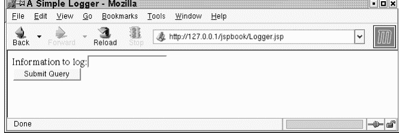

图 4-11 HTML 表单的浏览器渲染

## Handlers

`java.util.logging` 包包含在每个 Java SDK 1.4 发行版中。在本书示例中使用该 API 不需要额外安装。如果代码无法运行，你可能没有遵循第 1 章中的安装步骤。请确保你使用的是 Java 2 标准开发包 1.4 版本或更高版本。

`java.util.logging` 包可以泛分为两个部分：Logger 和 Handler 对象。Logger 对象负责将日志信息记录到一个或多个 Handler 对象中。Handler 对象负责自定义信息记录的位置和记录的方式。使用 `java.util.logging` 包非常简单，只需创建一个 `Logger` 对象的实例，注册一个或多个 `Handler` 对象，并根据需要记录信息。对于常见的日志（例如输出到终端或文件），`java.util.logging` 包包含了实现简单日志系统所需的所有内容。在更复杂的情况下，虽然使用了这些功能，但可能需要 `Logger` 和 `Handler` 对象的自定义子类。然而，日志过程始终相同。为了快速介绍该 API 的简单性，查看一个具体的代码示例是有帮助的。4-22 提供了一个向 `System.err` 发送信息的 `Logger` 对象的示例。

## Formatting

Handler 对象输出信息的样式是完全可配置的。每个 Handler 对象都依赖 Formatter 对象来将 `LogRecord` 转换为适当的信息字符串。用于样式特定 Handler 实例的 Formatter 对象可以通过 `getFormatter()` 或 `setFormatter()` 方法获取或设置。

要编写自定义的 Formatter 对象，请扩展 `Formatter` 类并重写相关方法。有四个可能关注的方法：

* `format(LogRecord)`：`format()` 方法由 Logger 类在发布要记录的信息时调用。传递的参数是描述要记录信息的 `LogRecord` 对象。`format()` 方法返回一个表示要记录信息最终格式的字符串。
* `formatMessage(LogRecord)`：`formatMessage()` 方法是一个方便方法，可以被 `format()` 方法调用，使用资源包（resource bundle）对消息本地化。资源包将在第 12 章中进行进一步解释。
* `getHeader(Handler handler)`：`getHeader` 方法返回一个用于包围一组格式化日志记录的头部。该方法默认返回一个空字符串。在必须包含头部的情况下（例如父 XML 元素的开始处），可以重写此方法以生成正确的字符串。


- `getTail(Handler handler)`: `getTail()` 方法的工作原理与 `getHeader()` 方法类似，但用于返回一个放置在日志记录末尾的尾部。该方法默认返回一个空字符串。在包含尾部的情况下，可以重写此方法以生成正确的文本。

`java.util.logging` 包包含了两个 `Formatting` 对象：`SimpleFormatter` 和 `XMLFormatter`。`SimpleFormatter` 对象接收 `LogRecord` 实例并将其转换为人类可读的字符串。该字符串通常为一行或两行，类似于 Logger.jsp 示例（列表 4-22）中看到的条目。`XMLFormatter` 则接收一个 `LogRecord` 并将其格式化为 XML 格式。

对于大多数用途，`SimpleFormatter` 对象在记录信息方面已经胜任了。`SimpleFormatter` 对象的 `format()` 方法返回的文本包含了时间戳、记录信息的类以及要记录的信息。然而，对于 jspbook Web 应用程序，将创建一个自定义的 `Formatter` 对象作为示例之用，并在贯本书中使用。请将列表 4-23 中的代码保存为 `CustomLogger.java`，位于 jspbook Web 应用程序的 `/WEB-INF/classes/com/jspbook` 目录下。

## 列表 4-23 CustomFormatter.java

```java
import java.io.*;
import java.util.*;
import java.util.logging.*;
```

```java
public class CustomFormatter extends Formatter {
    public String format(LogRecord log) {
        Date date = new Date(log.getMillis());
        String level = log.getLevel().getName();
```

```java
String string = "[" + level + " " + date.toString() + "\n";
string += log.getMessage() + "\n";
Throwable thrown = log.getThrown();
if (thrown != null) {
  string += thrown.toString();
  return string;
}
```

上述自定义格式化器的设计工作原理类似于 `SimpleFormatter` 对象，但使样式化的结果更易读。调用 `format()` 方法返回的字符串包含一个带括号的时间戳，随后是记录的消息和可选的异常堆栈跟踪。其通用格式如下：

[time-stamp]

message

stack-trace

括号用于轻松区分不同的日志条目，而消息和堆栈跟踪提供了有关 Web 应用程序出现什么问题的信息。在实际使用 `CustomFormatter` 之前，需要创建一个自定义的 `Logger` 类以供 jspbook Web 应用程序使用。

## 日志记录器 (Loggers)

Logger 用于为特定的应用程序组件系统记录消息。Logger 的设计具有灵活性，并包含了如本地特定日志记录和根据重要性级别记录日志信息等功能。`Logger` 对象由 `LogManager` 对象管理，该对象负责维护和配置日志记录器的集合集。

本书未涵盖 `Logger` 和 `LogManager` 类的所有功能。这些类的灵活性非常广泛，且通常并不需要。本节涵盖了这些类在 JSP 和 Servlets 中的基本用法。这包括为 Web 应用程序自定义日志记录器，以及利用各种级别的日志信息。`Logger` 类用于本地特定日志的国际化将在第 12 章中介绍。超出此范围的话题留给更深入研究 `java.util.logging` 包的出版物。

## 日志信息级别

通过 `Logger` 对象实例记录的所有信息都与特定级别相关。级别用于高效地管理不同类型的日志信息。级别可以任意分配，但目的是提供有关要记录信息性质的某些信息。`Handler` 和 `Logger` 对象可以选择性地只记录特定级别的信息，使得将不同类型的信息引导到所需位置变得具有实用性。

`java.util.logging` 包使用的级别方案由 `java.util.logging.Level` 对象定义。级别按重要性降序排列如下：

- **SEVERE**：SEVERE 级别是重要性最高的。SEVERE 级别代表要记录的严重、关键消息。SEVERE 级别通常与抛出的异常相关。
- **WARNING**：WARNING 级别代表重要性次高的级别。WARNING 级别代表包含警告的记录消息。警告对于信号可能出现严重问题非常重要，但警告本身并不是严重问题。
- **INFO**：INFO 级别代表要记录的提示性消息。消息重要性低于警告或严重消息，在调试应用程序时最有帮助。INFO 级别通常与习惯使用 `System.out.println()` 语句有关。
- **CONFIG**：CONFIG 级别代表应用程序回显配置信息。CONFIG 级别的消息重要性低于提示消息，旨在帮助调试应用程序。
- **FINE**：FINE 级别代表不属于上述任何类别但比 `FINER` 或 `FINEST` 级别消息重要的消息。
- **FINER**：FINER 级别代表比 `FINE` 消息简单但比 `FINEST` 消息重要的消息。
- **FINEST**：FINEST 级别代表比所有其他消息都不重要的消息。
- **OFF**：OFF 级别具有关闭 `Handler` 或 `Logger` 对象记录的效果。当不需要记录且以绝对性能为目标时可以使用此级别。设置为 OFF 级别的 `Logger Handler` 对象在尝试记录日志时会立即返回。
- **ALL**：ALL 级别设置记录所有级别。

配合这些级别，`Logger` 对象定义了以下方法：

- `getLevel()`：`getLevel()` 方法返回代表当前 Logger 设置记录的级别对象。高于或等于该级别的消息会被记录。
- `setLevel(Level level)`：`setLevel()` 方法设置当前 Logger 对象应记录的级别。低于该级别的消息将被丢弃。当指定 OFF 级别时，所有消息都被忽略。
- `log(Level level, String message)`：`log()` 方法按指定的级别记录给的消息。如果消息低于当前 Logger 对象的级别设置，将被丢弃。对于所有允许的级别，都存在自命名便利方法：`severe()`、`warning()`、`info()`、`config()`、`fine()`、`finer()` 和 `finest()`。所有便利方法都接受代表消息的 String 参数。级别是隐式的。
- `log(Level level, String message, Throwable throwable)`：`log()` 方法按指定的级别记录给的消息。此方法发布的 `LogRecord` 对象还包含作为 throwable 参数的 `Throwable` 对象。

使用上述方法，`Logger` 对象可以在任意级别有效地记录日志信息。这些级别的常用方法是始终安全地记录关键信息，同时仅在开发者需要时保留调试调试信息。记录所有信息与记录重要信息之间的性能差异可能是明显的，区分两者通常是有意义的。

## Fine, Finer, Finest, All

`java.util.logging` 包最受批评的功能之一是包含了 `fine`、`finer`、`finest` 和 `all` 级别。这些级别通常被认为是 `info` 级别的冗余版本。如果情况需要使用 `fine`、`finer` 和 `finest` 记录，这没错，但并没有义务使用它们。

## 自定义Web应用程序日志

`java.util.logging` 包的一个优秀特性是它可以被用于任何类来记录信息。与 `ServletContext` 的 `log()` 方法相比，这种功能非常出色，但并不意味着将日志记录完全从 Servlet 和 JSP 中抽象出来是有益的。为 Web 应用程序设计的日志机制应该充分利用该 Web 应用程序的特性。记住引入 `java.util.logging` 包的原因：普通的日志方案通常是不够的；随着项目的增长，使用 `System.out.println()` 方法会变得效率低下，且未来不利于维护。使用 `ServletContext` 对象的 `log()` 方法局限性很大且意义模糊。像 `java.util.logging` 包这样健壮的日志 API 解决了这些问题。然而，`java.util.logging` 包并非设计为应用程序日志需求的最终解决方案。该框架是可扩展的，可以通过使用该包获得最适合个人的定制实现。

在 Web 应用程序中，`java.util.logging` 包可以与 JSP 和 Servlets 的功能相结合。通过这种组合，站点可以拥有一个健壮的日志机制，该机制可以轻松迁移，并可以使用 Web 应用程序其他部分相同的方法进行配置。结合这两个 API 的一个极佳用法是创建一个自定义的日志 `ServletContextListener`，它可以在 Web 应用程序初始化时运行，配置日志机制，并为管理用途提供一个 Web 接口。列表 4-24 是该 `ServletContextListener` 类。

## 列表 4-24 SiteLogger.java

```java
package com.io.*;

import java.io.*;
import java.util.logging.*;
import javax.servlet.*;
import javax.servlet.http.*;

public class SiteLogger implements ServletContextListener {

    // Logger
    private static Logger logger;

    public static Logger getLogger() throws IOException {
        return logger;
    }

    public void contextInitialized(ServletContextEvent e) {
        ServletContext sc = e.getServletContext();
    }

    // Get an instance of a Logger
    logger = Logger.getLogger("global");
    logger.setLevel(Level.INFO);

    try {
        FileHandler fh = null;
        String root = sc.getRealPath("/");
        sc.setAttribute("com.jsp.SiteLogger", logger);
    }

    public void contextDestroyed(ServletContextEvent e) {
        ServletContext sc = e.getServletContext();
        sc.removeAttribute("com.jsp.SiteLogger");
        logger = null;
    }
}
```

将 `SiteLogger.java` 保存到 jspbook Web 应用程序的 `/WEB-INF/classes/com/jspbook` 目录下。通过在 `web.xml` 中添加项来部署该监听器，如列表 4-25 所示。

## 列表 4-25 SiteLogger.xml Listener 部署

```xml
<listener>
    <listener-class>com.jspbook.SiteLogger</listener-class>
</listener>
```

编译 `SiteLogger.java` 并重新加载 Web 应用程序。现在 `SiteLogger` 类作为一个通用日志类运行。Web 应用程序中的任何其他类都可以调用静态方法 `getLogger()` 来获取应用程序新日志机制的实例。

为了让监听器产生很大帮助，它必须被 Web 应用程序中的其他代码使用。首先，让我们创建一个管理 JSP 以在运行时修改日志器，如列表 4-26 所示。该页面将提供设置日志器当前级别和查看当前日志的方法。

## 列表 4-26 SiteLoggerAdmin.jsp

```jsp
<%@ page import="java.util.logging.*, java.io.*">
<%
    // get logger
    Logger logger = com.jspbook.SiteLogger.getLogger();

    // get request parameters
    String level = request.getParameter("level");
    if (level != null && !level.equals("")) {
        logger.setLevel(Level.parse(level));
    }

    // set current level
    request.setAttribute("l", logger.getLevel());

    // get current log
    StringWriter sw = new StringWriter();
    request.setAttribute("log", sw);

    // parse in current log
    InputStream is = application.getResourceAsStream("/WEB-INF/log.txt");
    if (is != null) {
        for (int i = is.read(); i != -1; i = is.read()) {
            sw.write((char)i);
        }
    } else {
        sw.write("Can't load log file!");
    }
}
%>
<html>
<head>
<title>Site Logging Configuration</title>
</head>
<body>
<h3>Set the site's logging level:</h3>
<b>Current level:</b> ${l}<br><br>
<form>
<select name="level">
  <option value="SEVERE">Severe</option>
  <option value="WARNING">Warning</option>
  <option value="INFO">Info</option>
  <option value="CONFIG">Config</option>
</select><br>
<input type="submit" value="Update Level">
</form>

<h3>Current Log:</h3>
<pre>${log}</pre>
</body>
</html>
```

将前面的代码保存为 jspbook Web 应用程序。代码提供了一个 HTML 表单用于更改日志器的当前级别（仅限于 severe、warning、info 和 config 之间），页面显示当前日志。你可以对其进行测试。

## 日志与性能

在在本章对错误处理和日志记录进行讨论之后，人们无疑会问：“这如何影响 Web 应用程序的性能？”性能问题绝非容易回答，而且总是与具体的使用场景密切相关。在本节中，我们并不尝试提供统计数据或所谓的可靠基准测试。相反，我们对 `java.util.logging` 包的使用以及它如何影响 Web 应用程序的性能进行了简要讨论。

日志记录应被归类为错误处理。这两种技术对于维持项目的运行和持续工作至关重要。日志记录唯一明显的缺点是，在运行时，它的性能总是比不带日志调用的代码慢一点。如果必须保留记录的信息，那么这就不是问题；但如果记录的信息并不重要且应该被忽略，它可能会变成一个问题。`java.util.logging` 包通过允许日志信息分级解决了这个问题。使用级别来确保在生产系统的运行时只保留重要信息。如果发送到 `Logger` 和 `Handler` 对象的信息未高于当前记录的级别，则这些对象将立即返回。这种行为优化了使用日志 API 的低效性，在大多数情况下，由于日志记录导致的性能损失微乎其微。被忽略的日志调用立即返回的时间，远小于通过电线发送 Web 页面 0 和 1 数据所需的时间。

## 异常处理与日志记录的通用哲学

在整个章节中，引入了多种处理异常和记录相关信息的技巧。现在是时候引入一种在处理 Web 应用程序异常和日志记录时可以使用的通用哲学了。这绝不是什么万能哲学；也没有关于其有效性的正式证明，但该哲学将妥善地解决与 Web 应用程序处理和日志记录的所有问题。将所有这些信息集中在一处是有帮助的，特别是在与其他开发者协作时，因为拥有一个通用、有效的标准可以减少你重新发明此类功能所需的时间。

以下列表列出了你在处理异常和日志记录时必须解决的主要问题。每个问题都包含一个解决方案，该解决方案直接基于本章之前涵盖的内容：

- **处理所有异常**：在任何时候都要处理异常。永远不要鼓励忽略异常处理的编码实践——永远不要在代码周围放置一个包而全的 `catch` 块并让该块什么都不做。务要处理、抛出或重新抛出异常，直到它到达合适的、指定的场所。


- **合并抛出的异常**：将异常减少到你关心的且仅关心的部分。对于 Web 应用程序，建议使用之前描述的 `UserException` 和 `AdminException` 类；在 Web 应用程序中，你应该关注两种类型的异常：用户做错的事情——例如，发送了错误信息——以及管理异常——例如，你的代码或 Web 应用程序崩溃了。通过分别扩展 `Exception` 类和 `RuntimeException` 类变为 `UserException` 和 `AdminException`，你可以轻松地合并异常处理。如果代码使用了 `UserException`，则该异常是受检查的，开发者应该使用本地 `catch` 块来处理问题并通知用户。如果代码抛出 `AdminException`，则该异常是未检查的，不期望开发者对其做任何事情——相反，期望某些预先定义的机制（例如在 `web.xml` 中定义的异常处理 JSP 或 Servlet）来处理问题。

大多数 Java API 都有自定义类型的异常，尝试捕获存在的所有不同类型的异常是一件苦事。合并让 Java 异常处理变得具有实用性。

- **始终抽象日志功能**：始终在记录信息的实际代码周围放置一个抽象层；最好使用本章解释的 `java.util.logging` 包。如果没有适当的抽象层，无论编写了什么日志记录方法，你将一直受限。你可能需要不同的方式记录信息，也许记录到不同的位置，例如文件或网络上的特殊计算机，回去修复所有日志代码将花费时间。与更改抽象日志接口的一种种实现（如 `Handler` 对象）相比，硬编码日志功能几乎没有理由。此外，在与多个开发者协作时，一个定义良好的日志接口是必须的。它可以确保信息被记录在正确的地方，并确保信息被正确记录。

- **合并日志功能**：为整个项目的日志记录创建一个易于使用的类。使用 `java.util.logging` 包创建一个 Web 应用程序中每个类都可访问的自定义 `Logger` 对象。`Logger Servlet` 是此功能的绝佳示例。开发者不应该担心重新实现日志 API 或理解复杂的日志系统。此外，将 Web 的日志机制精简为一个日志类，提供了一个更改信息记录位置的直接方法。拥有一个日志类，而不是无数次 `System.out.println()` 方法调用（或其他等效方法），显然是值得追求的。

- **始终创建一个 Web 应用程序通用的错误页面**：使用 `web.xml` 定义至少一个用户友好的错误页面来捕获任何抛出的异常。本章提供了此类错误页面的几个示例。使用至少其中一个来确保用户永远不会看到容器生成的晦涩信息。

这五点代表了处理 Web 应用程序异常和日志需求的完整哲学。在读完本章后，这些点不应该让人意外。采用这一哲学或对其调整以处理异常。

## 总结

异常是 Java 的基础部分。当程序出现问题时，会抛出一个 `Throwable` 对象的实例。Java 通过允许代码片段捕获故障对象来处理抛出的异常。抛出和捕获 `Throwable` 对象是 Java 的基本部分，并不特定于 JSP 和 Servlet。在本章的前半部分，我们回顾了基本的异常处理机制。在这些讨论之后，引入了针对 JSP 和 Servlet 的特定异常处理机制。

与 Java 对象一样，JSP 和 Servlet 也可以抛出异常。抛给 Web 应用程序的异常可以被捕获并转发到相应的错误页面或由容器处理。这种应用级的异常处理是 JSP 和 Servlet 的一个非常实用的功能。防止用户看到晦涩的 Java 调试信息一直是当务之急。Web 应用程序错误处理轻松地提供了解决方案。

Web 应用程序可以管理两种不同类型的错误。第一种错误是 Servlet 或 JSP 抛出的 `Throwable` 对象。使用 `web.xml` 中的 `error-page`、`exception-type` 和 `location` 元素，任何类型的抛出对象都可以被捕获并传递给错误。第二种错误是 Servlet 或 JSP 向响应返回了 HTTP 响应码。通过在 `web.xml` 中指定 `error-page`、`error-code` 和 `location` 元素，可以显示错误页的内容。

在处理 JSP 和 Servlet 异常时，没有很好的方法来跟踪与问题的信息。`ServletContext log()` 方法通常不够，通常选择健壮的日志 API 作为解决方案。本章的后半部分介绍了使用 `java.util.logging` 包是记录 Web 应用程序信息的一种灵活且高效的解决方案。`java.util.logging` 包是运行时跟踪各种信息的良好解决方案。引入 `SiteLogger`（列表 4-24）是为了说明这一点。

异常处理和日志记录是 Servlet 和 JSP 开发中的关键部分，使代码能够对对最坏情况做好准备。本章通过良好的可能问题代码的方法方法完善了基本的 JSP 和 Servlet 技能。有了这些技能，现在可以安全开始引入 J2EE Web 层一些更复杂的功能和用途。下一章将介绍 JavaBean、它们如何与 Servlet 和 JSP 交互，并解释为什么它们在 Web 应用程序中被广泛使用。

# 第 5 章

## JavaBeans 与 JSP 表达式语言

在本章中，我们将介绍 JavaBeans 和 JSP 表达式语言（EL）。本章的前半部分专门介绍 JavaBeans。JavaBeans 已经存在很久了，这个术语对 Java 开发者来说意味着许多不同的含义。理解 JavaBeans 是非常值得的，这样你可以在需要时使用它们，但最重要的是，要理解其他开发者在讨论该话题时是指什么。本章的后半部分解释了 JSP 表达式语言（从 JSP 2.0 开始是新的）。JSP EL 为在 JSP 中嵌入表达式提供了一种简单、优雅的解决方案，并提供了一种避免使用传统 JSP 表达式和某些 JavaBean 动作的方法。在某些情况下，需要 JSP EL 来为问题提供实用的解决方案，例如在 XML 语法编写的 JSP 表达式；在许多其他情况下，EL 提供了一个比 JSP 传统提供的功能更好的解决方案。

现在为什么要引入 JavaBeans 和 JSP EL 呢？有几个原因，但简单来说，JavaBeans 是你应该了解的内容，尽管它的功能没有像以前那样有用了。然而，JSP EL 被认为是通过传统 JSP 表达式或 JavaBean 动作执行任务的优越方法。因此，介绍这些功能是有帮助的，书的其余部分可以鼓励其使用；最后，在处理自定义动作（即第 6 章和第 7 章）时，需要 JSP EL。总的来说，本章在我们深入更复杂的 Servlet 和 JSP 方面之前，处理了一些必要的准备工作；不过，你完全可以在本章中发现许多适用于整个 Servlet 和 JSP 开发的技巧和技术。

本章讨论以下主题：

- 什么是 JavaBean 以及什么构成 JavaBean。
- Servlet 和 JSP 对 JavaBean 的支持。
- JavaBean 的良好用途。
- 什么是 Java 表达式语言（JSP EL）？
- JSP EL 语法。
- JSP 函数：将静态 Java 方法绑定到 JSP EL。
- JSP EL 的良好用途（相对于 JSP 表达式语言和 JavaBean）。

与其他章节相比，这一章很小，但仍然应该从头到尾阅读。关于 JavaBeans 和 JSP EL 的讨论几乎完全分开，直到章节的最后部分。

## JavaBeans

JavaBeans 术语在使用 Servlets 和 JSP 时经常出现。在实践中，JavaBean 实际上只是遵循某些编码规范的类的花哨名称。从技术上讲，JavaBean 是任何实现了 `java.io.Serializable` 接口并提供默认无参数构造函数的类。按照习惯，JavaBean 还提供“getter”和“setter” 方法，但从技术上讲，这些对于一个类被视为 JavaBean 并不是必须的。在 JSP 和 Servlets 中并不总是需要 JavaBean，但它们经常出现是因为它们对于传递作用域信息很有帮助。本章的目标之一是正式介绍 JavaBeans，并解释为什么它们有用以及它们是如何在 JSP 和 Servlets 中通常使用的。

## Get 和 Set 方法

JavaBeans 的创建和使用非常简单。像任何东西一样，JavaBean 可能是复杂的，但 JavaBean 最常见的类型是存储存储在服务器端数据的对象。作为一种数据存储对象，JavaBean 只是一个简单的类，通常具有私有数据，称为属性（properties）。这些属性通常通过公共访问器和变异器（即 getters 和 setters）提供。习惯是取属性的名称，通过在属性名称上添加“get”和“set”来创建两个方法，并且首字母始终大写。例如，如果一个 JavaBean 有一个变量名，那么相应的 get 和 set 方法将是 `getValue()` 和 `setValue()`。

列表 5-1 是一个 Java 类如何正确实现这些方法以便被视为 JavaBean 的示例。

### 列表 5-1 ExampleBean.java

```
public class ExampleBean implements java.io.Serializable {
    String value;

    public ExampleBean() {
    }
    public String getValue() {
        return value;
    }
    public void setValue(String value) {
        this.value = value;
    }
}
```

注意，列表 5-1 中的 get 和 set 方法并不是由接口强制要求的。get 和 set 方法完全取决于变量引用的名称。接口无法充分地描述这一点，接口也无法正确猜出方法所需的返回值或参数。在列表 5-1 的特定情况下，属性类型为 String，它从 `getValue()` 返回一个 String 对象，并为 `setValue()` 需要一个 String 参数。这些要求是任意的，并且根据特定的 JavaBean 而改变。唯一需要保持一致的唯一习惯是在变量名之前添加“get”和“set”。在有许多不同变量的情况下，请使用许多不同的 get 和 set 方法。

## 为什么需要 Get 和 Set 方法？

所以为什么 JavaBean 需要 get 和 set 方法？一言以之，封装。从 `ExampleBean.java` 来看，使用 get 和 set 方法似乎是声明公共变量的一种更麻烦的方法。然而，get 和 set 方法具有非常有用且实用的用途。被 get 和 set 方法使用的变量不需要在类外已知。任何代码都可以包含在 get 和 set 方法中。方法返回的值不必是类中的实际变量。相反，它可能从其他变量派生，甚至从与 JavaBean 完全无关的东西即时创建。这种抽象级别是 get 和 set 方法最有用的特性。

JavaBeans 的另一个有用特性是，可以构建软件来利用它们。在编程世界中，使用方法抽象成员访问并不是新鲜事，但可以通过许多方式实现。get 和 set 方法是提供功能的一种事实方法。这在 Servlets 和 JSP 中非常明显，因为 JSP 提供了一套旨在操作 JavaBean 的标准动作。这些标准动作非常有用且被广泛用于 MVC 等流行设计模式中。本书的第 11 章将涵盖 MVC 以及如何将 JavaBeans 作为该设计范式的一部分使用。目前，重要的是良好理解 JavaBeans 与 JSP、Servlets 之间的关系。

## Servlets, JSP, 和 JavaBeans

如果 JavaBeans 不经常与 JSP 和 Servlets 一起使用，也就不会提到它们。虽然没有强制要求在 JSP 和 Servlets 中使用 JavaBeans，但 JSP 标准动作和 JSP EL 是为所有层级 JSP 开发者使用 bean 提供的一种方便方式。这是 JavaBeans 被如此广泛使用的主要原因。在查看其原因之前，我们需要了解 JSP 提供了哪些 JavaBean 标准动作。

除了与 JavaBean 相关的动作外，JSP 标准动作已在第 3 章的 JSP 章节中介绍过。JavaBean 自定义动作遵循相同的 XML 兼容语法，并且适用于任何符合 JSP 标准的容器。这些容器将在后续章节中进行描述。

## `<jsp:useBean/>`

`useBean` 动作声明了一个用于在 JSP 中使用的 JavaBean。一旦声明，该 bean 就会变成一个脚本变量，可以被 JSP 中的脚本元素和其他自定义标签访问。`useBean` 标签的完整语法如下：

```
<jsp:useBean id="bean" name="bean" scope="bean's" typeSpec="" />
```

`useBean` 动作必须始终指定两个内容：bean 的名称以及关于应该使用哪个类的信息。可选地，`useBean` 动作也可以为声明的 JavaBean 指定特定的作用域。`id` 属性的值可以是任何值，只要它在该 JSP 的其他 `useBean` 声明中是唯一的。如果名称不唯一，JSP 容器将在 JSP 翻译时抛出异常。

`scope` 属性的有效值为：

- **page**：`page` 值将 JavaBean 放在当前页 `javax.servlet.jsp.PageContext` 的属性中。bean 在当前请求完成后会被丢弃。
- **request**：`request` 值将 JavaBean 放在 request 作用域中。可以通过当前页的 `ServletRequest` 对象的 `getAttribute()` 方法访问该 JavaBean。该 JavaBean 在当前请求完成后会被丢弃。
- **session**：`session` 值将 JavaBean 放在 session 作用域中。可以通过与客户端关联的 `HttpSession` 对象的 `getAttribute()` 方法访问该 JavaBean。该 JavaBean 会自动持续到会话失效。如果在声明不参与会话的 JSP 上使用 `session` 值，将抛出翻译错误。
- **application**：`application` 值将 JavaBean 放在 application 作用域中。只要应用程序存在，该 JavaBean 就会持续，并通过 `Application` 的 `ServletContext` 的 `getAttribute()` 方法访问。

除了 `id` 和 `scope` 属性外，`useBean` 动作还需要知道应该将哪个 Java 类初始化为 JavaBean。大多数情况下，这是通过简单使用 `class` 或 `type` 属性并指定完全限定 Java 类名来实现的。然而，`useBean` 动作允许在声明要初始化何种类型的 JavaBean 时使用以下任何组合：

```
class=className
type=typeName class=className
type=typeName beanName=beanName
type=typeName
```

这些属性具有以下含义：

- **class**：`class` 属性必须声明定义 JavaBean 的类的完全限定名。类名对大小写敏感。如果未指定 `class` 和 `beanName` 属性，则在给定的作用域中必须存在该 JavaBean 的实例。
- **beanName**：`beanName` 属性定义 JavaBean 的名称，正如 `java.beans.Beans` 类的 `instantiate()` 方法所期望的那样。`beanName` 属性可以是由表达式指定的运行时值。
- **type**：`type` 属性如果指定，则定义所定义的脚本变量的类型。这允许脚本变量的类型与指定的实现类的类型不同但相关。该类型必须是类本身、该类的父类或指定的类所实现的接口。所引用的对象必须是该类型；否则，在请求时将发生 `java.lang.ClassCastException`。如果未指定 `type` 属性，则该值与 `class` 属性的值相同。

## 使用 `<jsp:useBean/>`

在最简单的情况下，`useBean` 动作等同于声明新实例的脚本段（scriptlet），如示例 5-2 所示。

考虑以下 `useBean` 动作的使用：

### 示例 5-2 useBean 动作


```html
<html>
<head>
  <title>useBean Example</title>
</head>
<body>
<jsp:useBean id="date" class="java.util.Date" />
The date/time is <%= date %>
</body>
</html>
```

示例 5-3 可以很容易地编写为以下代码。两者之间的唯一区别是，前一个代码不需要使用脚本段。

## 示例 5-3 在声明和使用变量时的 useBean 动作

```html
<html>
<head>
  <title>useBean Example</title>
</head>
<body>
<% java.util.Date date = new java.util.Date(); %>
```

```html
<html>
<head>
<title>useBean Example</title>
</head>
<body>
<%
Object temp = pageContext.findAttribute("date");
java.util.Date tdate = null;
if (temp != null && temp instanceof java.util.Date) {
tdate = (java.util.Date) temp;
}
else {
tdate = new java.util.Date();
}
%>

The date/time is <%= tdate %>
</body>
</html>
```

需要注意的是，只有在使用了 `class` 属性时，才会创建 JavaBean。

## `<getProperty/>` 和 `<setProperty/>`

与 `useBean` 动作配套的是 `getProperty` 和 `setProperty` 动作。`getProperty` 动作提供了 get 方法的方便方式，而 `setProperty` 动作提供了 set 方法的方便方式。

## `<getProperty/>`

`getProperty` 动作通过以下语法提供了一种移除脚本段的方法：

```
<jsp:getProperty name="bean" property="property" />
```

`name` 属性引用之前通过 `useBean` 动作引入 JSP 的 JavaBean 名称。`property` 属性是应调用的方法名称。get 方法的结果在转换为字符串后被放在隐式的 `out` 对象中，转换是通过调用 `toString()` 方法或在基本类型情况下直接转换完成的。

```jsp
user.setName("Bob");
user.setPassword("password");
```

Hello <jsp:getProperty name="user" property="name"/> welcome to this web page!

</body>

</html>

```

注意 `getProperty` 动作的 `name` 属性与 `useBean` 动作的 `id` 匹配，且 `property` 属性是 `name` 而不是 `getName()`。访问 `http://127.0.0.1/jspbook/getProperty.jsp` 可以查看 `getProperty` 动作的结果。图 5-1 显示了输出的浏览器渲染。

## `<jsp:setProperty/>`

`setProperty` 动作用于设置 bean 的值。`setProperty` 动作使用的属性与 `getProperty` 动作相似，但增加了一些新属性。`setProperty` 动作的语法如下。

```jsp
<jsp:setProperty name="name" property="method" valueAttribute />
```

`name` 和 `property` 属性是必须的，它们提供了要在 bean 上上调用的 JavaBean 属性设置方法的名称。除了 `name` 和 `property` 属性外，还需要为属性值的设置方法提供一个值。该值可以通过两种方式之一指定：

```jsp
value="value"
```

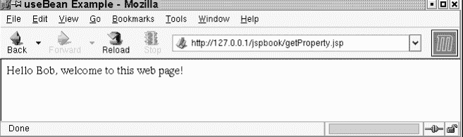

图 5-1 getProperty.jsp 的浏览器渲染

`value` 属性用于将给定值作为设置方法的参数。`value` 属性的值可以是表达式指定的运行时值。

```jsp
param="value"
```

可以从请求参数中获取值。如果使用 `param` 属性，则该属性的值将作为请求参数的名称。请求参数的值将作为 bean 方法的值。

在需要将多个参数设置为 JavaBean 的值的情况下，可以指定方便的 `*` 值。当使用 `*` 作为 `param` 属性的值时，系统会尝试在每个请求参数与同名方法之间建立一一的映射。

可以使用上述方法中的任何一种来为设置方法提供值。如果同时使用两种方法，则会抛出翻译错误。

通过 `useBean`、`getProperty` 和 `setProperty` 动作，可以消除 JSP 中的脚本段（scriptlets）和表达式。这三个动作无法实现的功能只有迭代或条件评估，在第 6 章中，JSTL 弥补了这一缺陷。列表 5-7 可以使用 `setProperty` 动作重写如下。

## 列表 5-7 `setProperty.jsp`

```jsp
<html>
<head>
<title>useBean Example</title>
</head>
<body>
<jsp:useBean id="user" class="com.jspbook.User" />
<jsp:setProperty name="user" property="name" value="Bob"/>
<jsp:setProperty name="user" property="password" value="password"/>
Hello <jsp:getProperty name="user" property="name"/>, welcome to
this web page!
</body>
</html>
```

`setProperty` 动作的使用非常直观。之前在列表 5-5 中使用的脚本段被替换为两个 `setProperty` 动作。在两种 `setProperty` 动作的使用中，`value` 属性都用于指定一个设置的字符串值。JSP 生成的输出与之前图 5-1 所示的相同。

# JAVABEANS 与 JSP 表达式语言

## Bean 初始化

通常情况下，JSP 不会创建 JavaBeans。许多应用程序将使用 MVC 或 Model II 方法编写，在这种情况下，Servlet 会创建 JavaBeans，而 JSP 将对其引用它们。然而，对于仅使用少量 JSP bean 的应用程序，JavaBeans 仍然很有用。在这些情况下，除了创建 bean 之外，JSP 可能还需要初始化这些 bean。

Bean 是带有默认构造函数的 Java 对象，通常 bean 会以原始状态被创建。在在使用之前，可能需要通过调用必要的方法对 bean 进行初始化。为了确保 bean 在 JSP 中使用之前已正确初始化，JSP 使用带有正体（body）的 `useBean` 标签。该标签的任何代码只在 bean 第一次创建时执行。例如，如果请求到达一个 JSP 且 JSP 有一个 `request` 作用域的 `useBean` 标签，JSP 将创建该 bean。如果 `useBean` 带有 "body"，则该主体将通过“执行”。如果 JSP 随后引用另一个，且 JSP 对同一个 bean 同样具有 `request` 作用域的 `useBean` 标签，则它不会被创建。只需从请求对象中获取引用即可。即使该 `useBean` 有主体，该主体也不会执行。`useBean` 标签的主体（逻辑上）是它的构造函数。此处显示一个示例

```jsp
<jsp:useBean id="user" class="com.jsp.User">
<jsp:setProperty name="user" property="name" value="Bob"/>
<jsp:setProperty name="user" property="password" value="password"/>
</jsp:useBean>
```

在此示例中，user bean 处于 `page` 作用域。这意味着每当执行页面时，都会创建该 bean（记住 `page` 作用域意味着该页面私有）。当 bean 创建时，会执行它的主体；这意味着两个 `setProperty` 调用将运行并初始化 bean。

## JavaBeans 的良好使用

JavaBeans 并不是什么让开发者感到惊叹的东西。 JavaBean 提供的功能可能有帮助，但并不宏大。JavaBeans 以及相关的自定义动作为开发者提供了两点：简单、干净的语法以及消除脚本元素。简单、干净的语法由于其固有属性非常有帮助。保持 JSP 的可读性是使其易于维护的关键因素。在与任何开发者协作使用 `useBean`、`getProperty` 和 `setProperty` 动作时，这种简单的语法也有帮助。

良好使用 JAVABEANS 225

脚本元素也容易使用，但 HTML 开发者对几个简单的标签总是更熟悉。JavaBeans 也有帮助，因为它们消除了对脚本元素的需求。通过强制使用 JavaBean、`getProperty` 和 `setProperty` 动作，代码可以保持整洁并采用更符合面向对象的方法。永远不需要在脚本元素中嵌入长段代码。

## 设计模式与 JavaBeans

Javabean、`getProperty` 和 `setProperty` 动作的概念有助于理解。如果使用了标准动作的替代方案，那么它是一个模仿标准动作功能的自定义动作，但针对框架或项目进行了特殊增强。

需要记住的重要的一点是在 JSP 中消除脚本元素的逻辑。由脚本元素封装的逻辑最好放在其他地方，通常在 Java 类中。JSP 的强大之处在于它能变得像真实的 HTML 或 XML 文档一样简单。JSP 可以提供动态服务器端技术可以实现的所有功能，但 JSP 对于任何非 Java 服务器端开发也易于使用。围绕这一强项进行构建是你可以使用的最佳设计模式之一，而 JavaBeans 恰好非常适合。

在编写用于 JSP 的 JavaBeans 时，需要考虑的一点是 JavaBeans 应该是“与环境无关的”。良好的设计将应用程序分为层，如业务逻辑层和用户界面层。JavaBeans 将用于两件事：执行业务逻辑和/或在层之间传递数据。传递数据的 bean 用于业务逻辑层和用户界面层之间的通信。这些 bean 通常具有在业务逻辑层设置并在 UI 层访问简单属性。Bean 还执行业务逻辑。业务逻辑通常独立于执行它的环境——这意味着相同的逻辑可以在 Servlet、JSP 或任何其他 Java 类中执行。

为了确保所有 bean 具有最大的可重用性，bean 功能不应依赖于特定环境的数据类型。在实践中，这意味着例如，如果 Servlet 使用了 bean，那么该 bean 永远不应该传递 Servlet 类型（例如 `HttpServletRequest` 或 `HttpServletResponse`），因为这些对象在其他非 Servlet 环境中不可用。

# JSP 2.0 表达式语言

JSP 2.0 的主要功能之一是提供了一种针对 JSP 特有的表达式语言，通常称为 JSP EL。JSP EL 优于第 3 章描述的 JSP 表达式，因为它提供了更简洁的语法以及一种专为 JSP 设计的语言。此外，EL 与 XML 语法的 JSP 配合良好。正如所解释的，JSP EL 不需要使用属于 XML 标记的字符——这种 JSP EL 原生即可与 XML 语法的 JSP 配合工作；正则表达式。

JSP EL 的优点显而易见。JSP 开发者可以使用表达式，例如 `<%= ... %>`，来访问运行时值。这种语法可以工作，但当将其嵌入标签的属性值时会非常笨拙，而且表达式直接嵌入了 Java 语法。例如，一个带有动态属性的自定义标签以前必须编写如下所示：

```xml
<ex:tag attribute="<%= context.getAttribute("value") %>"
```

这种语法很笨拙，因为它通过在标签内部使用标记使简单的自定义标签复杂化。此外，表达式必须完成 Java 属性，这进一步破坏了标记的简单性。如果使用 JSP EL 编写上述内容，它看起来应该是这样：

```xml
<ex:tag attribute="${value}">
```

功能是相同的，但代码简单得多。JSP EL 的另一个特性是，它可以用于 JSP 的任何地方，而不仅仅是自定义标签的属性。这使得 JSP EL 成为脚本元素的一种简单且强大的替代方案。

## 禁用 EL

因为在 JSP 2.0 中，JSP EL 使用的表达式语法 `${...}` 未被保留。由于由于，EL 可能会导致与 JSP 1.2 及早期代码的向后兼容问题。为了防止 EL 与旧代码产生冲突，默认情况下，使用 `web.xml` 定义为 Servlets 2.3 或以下版本的 Web 应用程序，其 JSP EL 是禁用的。对于使用定义为 2.4 的 `web.xml` 应用程序，JSP EL 会自动启用。任何单独 JSP 都可以使用第 2 章描述的 `isScriptingEnabled` 页面指令来启用或禁用 JSP EL。还可以通过 `web.xml` 配置中的 `scripting-enabled` 元素进行应用范围配置。

## JSP EL 语法

JSP 表达式语言的设计目标是简单、健壮，并尽可能地减少对向后兼容性的影响。该表达式语言同时处理表达式和字面量。表达式始终由 `${ }` 字符包。
例如：

```xml
<c:if test="${value < 10}" />
```

不以 `${` 开头的值仍被视为字面量。字面量的值将根据 TLD（标签库描述符）条目解析为预期类型：

```xml
<c:if test="true" />
```

在字面量值包含 `${` 字符的情况下，必须使用 `\` 字符进行转义。

## 属性

EL 中的属性通过名称访问，并带有可选的作用域（scope）。成员、getters 方法和数组项都以相同的方式处理并替换为值。使用这种方法访问的属性可以任意深度嵌套。例如，一个具有成员 `b` 的数组 `a` 将通过 `${a.b}` 访问。同样，数组可以通过表达式访问 `b` 成员——换句话说，使用 EL 时 `a[b]` 可以写为 `${a["b"]}`。此外，具有 getter 方法 `b` 的 JavaBean 可以使用相同的表达式——换句话说，`a.getB()` 也可以写为 `${a.b}`。注意，两种语法是可互换的，`${a.b}` 等于 `${a["b"]}`。

对象不需要在作用域内，EL 就可以使用它们。EL 通过根据 `PageContext.findAttribute()` 方法的行为查找其值作为属性来识别。例如，`${value}` 将按顺序在 page、request、session 和 application 作用域查找名为 `value` 的属性。如果未找到属性，则返回 `null`。

EL 定义了一组隐式对象，`pageContext`、`page`、`request`、`session` 和 `application` 与 JSP 的对应对象。此外定义了以下隐式对象：

- 隐式作用域属性对象：EL 定义了隐式的 `pageScope`、`requestScope`、`sessionScope` 和 `applicationScope` 对象，每个代表各自作用域中设置的对象的映射（Map）。
- param：`param` 隐式对象是一个 Map，将参数名称映射到单个 String 参数值。该值通过对单个名称调用 `ServletRequest.getParameter()` 方法获得。在实践中，该隐式对象提供了一种访问请求值的方便方法。
- paramValues：`paramValues` 隐式对象是一个 Map，将参数名称映射到 String 对象的数组。对象对应该参数名称。`paramValues` 隐式对象不代表所有请求参数的数组，仅代表同名的参数。`paramValues` 隐式对象通过调用 `ServletRequest.getParameterValues()` 返回值。
- header：`header` 隐式对象是一个 Map，将所有的 header 值映射起来，可以通过 `getHeaders()` 获取。
- headerValues：`headerValues` 隐式对象是一个 Map，将所有的 header 值映射起来，可以通过 `ServletRequest.getHeaders()` 获取。为了完整起见，从请求中读取 header 值时应使用 `headerValues` 对象，但在实践中，通常每个 header 名称只发送一个值，使用 header 对象完全没有问题。
- cookie：`cookie` 是一个 Map，将通过 `HttpServletRequest.getCookies()` 获取的单个 cookie 对象映射。如果存在多个同名的 cookie，则只会将遇到的第一个放入 Map 中。

当表达式通过名称引用其中一个隐式对象时，将返回相应的对象而不是相应的属性。例如，`${request}` 返回 `HttpServletRequest` 对象，即使已经存在一个 request 属性。

## 字面量

表达式语言同时处理表达式和字面量。表达式始终由 `${ }` 字符包。
例如：

```xml
<c:if test="${value < 10}" />
```

不以 `${` 开头的值仍被视为字面量。字面量的值将根据 TLD（标签库描述符）条目解析为预期类型：

```xml
<c:if test="true" />
```


在字面量值包含 `${` 字符的情况下，必须使用 `\` 字符进行转义。

当表达式通过名称引用隐式对象时，将返回相应的对象而不是相应的属性。例如，`${request}` 返回 `HttpServletRequest` 对象，即使已经存在一个 request 属性。

EL 定义了一组隐式对象，`pageContext`、`page`、`request`、`session` 和 `application` 与 JSP 的对应对象。此外定义了以下隐式对象：

- **Boolean**：true 和 false 值。EL 定义了以下字面量：
- **Long**：长整数值。
- **Float**：浮点数值。
- **String**：字符串值。
- **Null**：空字面量。

## 运算符

EL 提供了基础算术运算符：
- `+`
- `-`
- `*`
- `/`

EL 还提供了逻辑运算符：
- `==`
- `!=`
- `<`
- `>`
- `<=`
- `>=`
- `&&`
- `||`

EL 还提供了：
- `!`

## 保留字

EL 定义了一些不应使用的保留字：
- `eq`
- `instanceof`
- `ne`
- `empty`
- `not`

某些词目前没有任何作用，但在未来版本中可能会。

## EL 函数

EL 的一个特性是函数绑定。EL 函数借用了命名空间的概念，允许 EL 语法链接到静态函数。例如：

```xml
<taglib>
  ...
  <function>
    <name>foo</name>
    <function-class>com.book.FooFunctions</function-class>
    <function-signature>
      String (String)
    </function-signature>
  </function>
</taglib>
```

上述代码定义了一个名为 `foo` 的函数，并映射到 `com.book.FooFunctions` 类中的 `bar()` 静态函数。方法的签名通过 TLD 中的 `function-signature` 元素额外定义。如果使用默认命名空间，函数将如下：`${bar('a string')}`。该表达式将返回一个 String 对象，并可以在模板或自定义标签属性中使用。非默认命名空间的函数是必要的，它们必须通过在函数调用之前放置适当的命名空间来声明。例如，假设 `bar` 函数位于前缀为 `f` 的标签库中，则显式声明为 `${f:bar('a string')}`。

## JSP EL 的良好用途

在几种情况下，你可以使用 JSP 表达式、JSP EL、 JavaBean Action 或三者的组合来完成相同的任务。在唯一明显的情况下，即在 XML 语法编写的 JSP 中放置 XML 友好表达式，应始终使用 JSP EL。在大多数其他情况下，也考虑将 EL 作为首选。与普通的 JSP 表达式相比，JSP EL 提供了一种更简单、非 Java 的方法来完成相同的工作。

JSP 表达式、JSP EL 表达式和 JavaBeans 最常见的用例是访问作用域对象并将其作为字符串显示。在这种情况下，JSP EL 的表现非常好，而且对于许多用途，你可能只需要 JSP EL 就能完成。一个简单的 `${foo}` 和任何作用域中的作用域变量都会以字符串的形式显示。这种语法自然、简单，最重要的是足够够用。由于这些原因，你会发现后续章节中的几乎每一个示例都使用了 JSP EL。通常情况下，本书建议对于这类功能，始终优先使用 JSP EL 而不是 JavaBeans 动作和普通的 JSP 表达式。

除了显而易见的良好用途外，你会在书中各处发现 JSP EL 的一个极佳用法是避免使用它的功能。JSP EL 不仅仅是一种表达式语言。是的，JSP EL 可以进行算术运算、布尔操作并绑定静态 Java 方法；但是，不要刻意去使用这些功能。请记住，JSP 提供了多种实现目标的方法。如果你想在本书的后续章节中尝试大多数开发者认为的“良好实践”，你应该注意，自定义标签和 Servlet 相关功能通常被用于封装大量代码，而 JSP 通常仅用作简单的表现层，只需要对 JSP EL 进行基础的 `${foo}` 使用即可。

## JSP EL 不需要 JavaBeans

使用 Web 应用开发的一种简便技术是使用 JSP EL 和 `java.util.Properties` 对象（或任何 map 对象）来替代 JavaBeans。一种良好的传统设计实践是将动态页面分为纯 Java 代码和尽可能少使用脚本元素的简单 JSP。为了在这部分之间进行通信，将使用一个具有适当 getter 和 setter 方法的 JavaBean。编写 JavaBean 是直观的；然而，它需要花费一些精力和时间——如果你不熟悉 Java 或没有为 Web 准备基础构建系统，花费的时间可能比想象的要多得多。以列表 5-5 以及一个在逻辑上与列表 5-6 类似但之前显示过的 JSP 为例。列表 5-6 是使用 JavaBeans 动作访问作用域 JavaBean 的示例。我们将重用该 JSP，但更改代码以使用 JSP EL，然后像列表 5-8 所示，从 JSP 中移除 setter 方法。

### 列表 5-8

```html
<html>
  <head>
    <title>useBean Example</title>
  </head>
  <body>
    Hello ${user.name}, welcome to this web page!
  </body>
</html>
```

注意该页面被简化了（这是上一节建议的良好编码实践的结果），但我们实现了与之前相同的效果。预计作用域 JavaBean 是可用的，以便显示相应的键值。假设你之前看到的 JavaBean 列表 5-5 是一个带有几个 getter 和 setter 方法的简单 Java 类。最后假设设置 bean 值的代码在 JSP 调用之前执行（无论何时或如何执行，这并不重要；后续章节将展示使用 Filter 用于此）。列表 5-9 显示了这些变化。

### 列表 5-9 NoJava.jsp Bean 设置逻辑

```java
// start of the class or scriptlet
String name = request.getParameter("name");
String password = request.getParameter("password");

// perform an validation required...
User user = new User();
user.setName(name);
user.setPassword(password);
request.setAttribute("user", user);
// rest of class or scriptlet
```

这段代码并没有意外；创建了 JavaBean 的新实例，进行了填充并置于 request 作用域中。由于 JSP EL 表达式将字段 "name" 匹配到列表 5-5 中的 `getName()` 方法，JSP 将显示相应的值。

然而，没有理由必须使用 JavaBean。我们可以同样轻松地使用 `java.util.Properties` 对象并完全跳过与 JavaBean 相关的任何时间和精力投入。列表 5-10 显示了代码可能的内容。

### 列表 5-10 NoJava.jsp Bean 设置逻辑，使用 Properties 对象

```java
// start of the class or scriptlet
String name = request.getParameter("name");
String password = request.getParameter("password");

// perform an validation required...
Properties user = new Properties();
user.setProperty("name", name);
user.setProperty("password", password);
request.setAttribute("user", user);
// rest of class or scriptlet
```

现在 JSP（列表 5-7）运行不需要 JavaBean 列表 5-5，我们节省了编写和部署 JavaBean 所需的时间和精力。失去的是对 getter 和 setter 方法期间发生情况的控制（这可能是一个问题，也可能不是），我们还有可能损失一点性能——JavaBean 消耗的内存可能比 Properties 对象多。

无论你如何看待，在大多数实际情况下，JSP EL 都消除了对 JavaBeans 的需求。不仅作用域对象的功能相同，而且默认使用 `java.util.Properties` 对象比使用 JavaBeans 往往更容易。启动项目所需的工作更少，需要维护的代码也更少；然而，这是一个观点。Properties 对象作为数据存储 JavaBean 确实效果很好（正如列表 5-5 所示），但仅此而已。如果你在 getter 和 setter 方法上做一些奇技花招，那么你很可能会陷入编写 JavaBean 来辅助你的 Web 应用的困境中，无论你是否使用 JSP EL。

## 总结

JavaBeans 是 JSP 的一个简单但有用的补充。作为 JSP 使用时，JavaBean 实际上只是一种编码方式的华丽名称。

JSP EL 是 JSP 的另一个有用功能。JSP EL 提供了一种直观的、非 Java 的方法来编写表达式。JSP EL 本身的作用有限，但它通常与自定义标签配合使用。

在本书的剩余部分中，JSP EL 将频繁出现；注意它如何在示例中使用，并思考它如何完善 JSP。

本章提出的最后一点是，JSP EL 有几个用途。简化 JSP（移除类表达式和 JavaBean 动作）是一个很好的例子，而且使用 XML 语法配合 EL 几乎是必须的。然而，JSP EL 在某些方面消除了对 JavaBeans 的需求。

## Server Pages 标准标签库

自定义标签库是 JSP 开发人员可用的有用工具之一；然而，由 JSP 规范定义的称为“标准动作”的标签集仍有不足。JavaServer Pages 标准标签库（JSTL）是 J2EE 的一个补充规范，定义了一组扩展的 JSP 标签。这些标签基于流行的框架和容器常用的用途。

本章讨论了以下内容：

- JSTL 规范简介。
- 为什么你应该考虑使用 JSTL。
- 安装 JSTL 1.0 参考实现 API。
- 各种 JSTL 标签的详细介绍。
- JSTL 实际用途的讨论。

本章的主要目的是通过展示一些认为良好的实现来引入 JSP 自定义标签。除了学习一些有用的标签，这有助于下一章关于如何构建自己的自定义标签的讨论。

### JSTL 1.0 规范

JSTL 1.0 规范是通过 Sun 的 Java 社区过程（JCP）`http://www.jcp.org` 完成的官方 Java 规范请求（JSR）。可以从官方 JSTL 页面 `http://java.sun.com/products/jsp/jstl` 下载 JSTL 规范副本。扩展 JSP 集的想法是标准操作（standard actions）自 JSP 规范早期就一直存在，但直到 JSP 2.0 发布之前才正式出现。JSTL 1.0 版本包含以下标签：

- **迭代与条件判断**：迭代和条件逻辑在 JSP 中非常常用；然而，实现此功能的唯一标准方法是使用脚本元素（scripting elements）。有时并不希望使用脚本，因此构建了自定义标签作为替代方案。JSTL 提供了一套标准的自定义标签，用于遍历集合或提供条件逻辑。
- **表达式语言（Expression Language）**：JSTL 最受期待特性之一是它提供的新表达式语言。JSTL EL 是一种专注于 JSP 的表达式语言，旨在用 JSP 表达式代替嵌入的 Java 代码。JSTL 提供了一种用于评估任意 JSTL 表达式的语言。JSTL 语言在 JSP 2.0 中被表达式语言所取代。
- **URL 操作**：JSP 对 URL 操作的支持非常有限。JSP 外部的资源无法转发到标准 JSP 操作或与之一起使用，且 JSP 并没有提供一种方法来确保 URL 的参数和会话信息经过正确编码。JSTL 使用一组 URL 操作标签解决了所有这些问题。
- **支持国际化的标签格式化**：国际化支持是一项艰巨的任务，JSP 未对其提供默认支持。在自定义标签集中支持 JSTL 的最常用解决方案是通过 i18n 进行标准化的。
- **XML 操作**：XML 在 Java 中被广泛使用，因此 JSTL 提供了一套专门为操作 XML 设计的自定义标签。
- **数据库访问**：数据库是存储复杂动态网站赖以生存信息的标准解决方案。JSTL 提供了一组 SQL 标签，允许在现有数据库上执行 SQL 查询。

JSTL 非常受期待的特性之一是它提供的新表达式语言。JSTL EL 是一种专注于 JSP 的表达式语言，旨在取代脚本段（scriptlets）。JSTL 中包含的标签并非所有都被广泛认为是好主意，但许多标签对 JSP 开发者非常有益。本章将逐一介绍上述一组标签。对于每组标签，都将给出标签的介绍、使用示例，并对这些标签的帮助程度以及适用用途进行客观评价。

### 为什么你应该使用 JSTL

JSTL 相当新颖，但它所取代的功能并不新。JSTL 提供的所有功能都可以通过与特定框架或 JSP 容器匹配的现有自定义标签集来实现，而且通常也是这样做的。假装 JSTL 应该总是优于现有解决方案是没有意义的，但有几个理由说明 JSTL 应该被采用为优选解决方案。JSTL 是一个标准，由 JSP 社区的成员共同构建，并反映了对许多实用函数的良好且有效的实现。拥抱 JSTL 可以节省开发者构建等效元素的时间，或学习特定项目所用标签的时间。JSTL 同时在宽松的开源许可下实现，并由 Jakarta 社区托管。该代码可以无条件地使用，并且有一个强大的开发团队在持续对其进行改进。

另一个使用 JSTL 的理由是，如果你不是一个 Java 程序员，或者你并不那么关心使用被广泛推行的 MVC 设计模式（在第 7 章中解释），该模式涉及使用 Servlets、Filters、JavaBeans 和 JSP。有许多 JSTL 标签的使用与 JSP 冲突，而 JSP 的主要意图是创建用户界面。然而，这些标签在某些情况下是有帮助的。为了在书中推广良好实践，我们并不推荐使用某些 JSTL 标签；原因将在相应章节中给出。但是，如果你正在构建原型或小型应用程序，所有的 JSTL 标签都是很有用的（甚至是那个“邪恶”的 SQL 库）。

### 安装 JSTL

对于本章中的示例，需要安装 JSTL 的实现。可以在此处找到 JSTL 的源码和二进制发行包：`http://jakarta.apache.org/builds/jakarta-taglibs/releases/standard/`。下载二进制发行包并解压压缩文件。JSTL 1.0 版本包含以下文件：

1. JSTL 参考实现——也就是说，容器供应商可以自由地实现 JSTL 并对其进行优化以供其容器使用。
2. 当然，这是作者们的共同意见。

- **README**：README 文件包含了 JSTL 1.0 二进制发行版中包含的所有内容的简要总结。
- **`/lib` 文件夹**：lib 文件夹包含 JSTL 需要的所有 JAR 文件。包含 JSTL 标签处理器的 JAR 文件还包含了所需的 TLD 文件。要简单安装 JSTL，可以将 `/lib` 目录中的所有文件复制到 jspbook Web 应用程序的 `/WEB-INF/lib` 目录中。在实践中，这可能并不总是安装 JSTL 的最佳方法。许多库可能与 JDK 中的文件或应用程序中之前安装的其它 JAR 文件（例如 XML 库）发生冲突。
- **`/tld` 文件夹**：tld 文件夹包含了每个独立 JSTL 标签集所需的 TLD 文件的副本。每组标签包含两个 TLD：一个启用了 JSTL 表达式语言，另一个未启用。
- **`standard-docs.war`**：standard-docs.war 文件是一个包含基础 JSTL 文档的 WAR 包。部署此 WAR 提供了一种保留本地 JSTL 文档副本的方便方法。
- **`standard-examples.war`**：standard-examples.war 文件是一个包含 JSTL 示例的 WAR 包。

出于本书的需要，将不涵盖特定的 JSTL TLD、`standard-docs.war` 和 `standard-examples.war`。要安装供 jspbook 使用的 JSTL，请将 `/lib` 目录下的 `standard.jar` 和 `jstl.jar` 复制到 jspbook Web 应用程序的 `/WEB-INF/lib` 目录。安装完成。

### JSTL 表达式语言

JSTL 的主要特性之一是引入了新的表达式语言，称为 JSTL EL；然而，JSTL 1.0 发布于 JSP 2.0 之前。JSP 2.0 标准化并扩展了第 5 章介绍过的 JSTL EL。在特殊情况下，out 并不重要；直接在页面上放置等效表达式具有相同的效果。

### 双重库

JSTL 的每组标签有两个库。一组标签提供对 EL 支持；另一组则仅依赖 JSP 表达式。非 EL 标签的存在是因为 JSTL 在 JSP 2.0 标准化之前就已经存在。本书没有花时间讨论支持 EL 的 JSTL 标签库，是为了避免两者之间的混淆。

### 核心标签

JSTL 核心标签包含了在大多数 JSP 项目中都有用的标签。这些标签利用 EL 并寻求整合由 JSP 框架、容器供应商和独立作者实现的等标签。核心 JSTL 标签共享相同的 URI `http://java.sun.com/jstl/core`，并根据特定功能进一步扩展。

### 通用标签

核心 JSTL 标签中包含了一组通用标签。这些标签配合 EL 可用于常见的简单任务，但标签本身并非为了实现特定的大目标而设计的。标签由 out、set、remove 和 catch 操作组成。

```xml
<out>
```


out 标签接收 JSTL 表达式并评估结果，将输出发送到页面的 `JspWriter` 对象。该标签作为常用的 `getProperty` 操作的替代方案非常有帮助。

out 标签有三个属性：

- **value**：value 属性的值是要评估的表达式。表达式的结果通过当前页面的 `JspWriter` 发送到客户端。value 属性的值可以在运行时指定。
- **escapeXml**：escapeXml 属性指定结果字符串的输出是否应转换为字符实体。默认值为 true，字符 `<`、`>`、`&`、`'` 和 `"` 会被转换为 `&lt;`、`&gt;`、`&amp;`、`&#39;` 和 `&quot;`。escapeXml 属性的值可以在运行时指定。
- **default**：默认属性定义了在表达式失败或返回 `null` 时使用的默认值。

`out` 动作非常直观。列表 6-1 示例了用于字面量上的 `out` 动作。

### Listing 6-1 JSTLOut.jsp

```jsp
<%@taglib uri="http://java.sun.com/jstl/core_rt" prefix="c" %>

<html>
<head>
<title>&lt;c:out&gt; Action Example</title>
</head>
<body>
<c:out value="${'&lt;tag&gt;'}"/>
</body>
</html>
```

生成的页面如图 6-1 所示。字面量值已经过妥当的转义，因此在浏览器中可以正确显示。如果这不符合需求，可以将 `escapeXml` 属性设置为 `false`，例如 `escapeXml="false"`。

一个很好的问题是，为什么 JSTL 的 `out` 标签比直接在需要的地方嵌入表达式更好？对于大多数实际用途来说，除非你需要转义标记语法——即将 `<` 和 `>` 符号转换为 `&lt;` 和 `&gt;`——否则没有理由。在列表 6-1 中仅使用 EL 表达式会导致输出中出现 `&lt;tag&gt;` 而不是 `<tag>` 文本，并且在浏览器渲染时，该文本将不会显示。

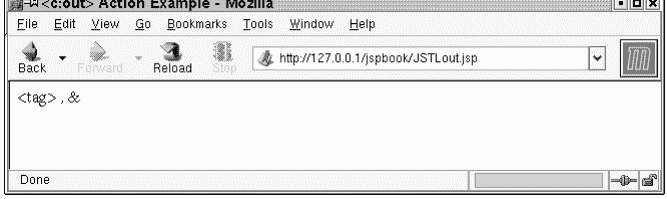

**Figure 6-1** JSTLOut.jsp 的浏览器渲染

---

`set` 动作是 `setProperty` 动作的 JSTL 友好版本。该标签非常有用，因为它会评估表达式并使用结果来设置 JavaBean 或 `java.util.Map` 对象的值。

`set` 动作具有以下属性：

- **value**：value 属性是待评估的表达式。该属性可以是一个运行时值。
- **var**：var 属性是表达式结果的导出变量名称。变量的类型取决于表达式评估的结果。当 `set` 动作评估一个变量以供 JSP 体内容或其他组件使用时，会使用此属性。
- **scope**：scope 属性定义了由属性命名的对象的范围。有效值有 `page`、`request`、`session` 和 `application`，其中 `page` 是默认值。
- **target**：target 属性是将被设置属性的目标对象的名称。结果对象可以是具有适当 setter 方法的 JavaBean 对象，也可以是 `java.util.Map` 对象，可以是一个运行时值。
- **property**：property 属性是要指定的 `target` 指定对象的属性名称。该属性可以是一个运行时值。

`set` 动作预期有两种用法。第一种用法是设置 JavaBean 或 Map 对象的属性。在这种情况下，`set` 动作使用 `value`、`target` 和 `property` 属性：

```jsp
<c:set value="expression" target="target object" property="name of property" />
```

第二种用法是设置一个作用域变量，供 JSP 或 Web 应用程序的其他资源后续使用。在这种情况下，`set` 动作将使用 `value` 和 `var` 属性，可选的还有 `scope` 属性。

```jsp
<c:set value="value" var="varName"/>
```

在两种情况下，都可以省略 `value` 属性，转而使用标签体内容来替换表达式。通常不建议使用 `set` 动作进行设计。与 `setProperty` 动作一样，`set` 动作在 JSP 中嵌入了代码，这是不理想的。逻辑最好完全从 JSP 中抽象出来，正如第 11 章中 Model 2 设计模式所示。

### <c:remove>

`remove` 动作提供了一种移除作用域变量的方法。该动作通常不是特别有用，但它可以帮助确保 JSP 清理其负责的任何作用域资源。`session` 或 `application` 范围的作用域变量可能会带来麻烦，否则不应使用。

`remove` 动作具有两个属性：

- **scope**：scope 属性定义了移除变量时搜索的范围。如果没有定义 `scope` 属性，将通过调用 `PageContext.removeAttribute(varName)` 方法移除变量。如果定义了 `scope` 属性，则通过调用 `PageContext.removeAttribute(varName, scope)` 方法移除变量。
- **var**：var 属性定义了要移除的变量名称。

`remove` 动作的使用非常直观；然而，不建议使用 `remove` 动作。通过良好的设计和作用域变量的合理使用，JSP 永远不需要清理作用域资源。这种逻辑并不最适合 JSP，它应该完全从 JSP 中抽象出来，正如第 11 章中 Model 2 设计模式所示。

### <c:catch>

`catch` 动作为 JSP 的特定部分提供了错误处理方法。该功能非常有用，因为它可以防止非关键异常终止 JSP 的执行。`catch` 动作通过将其体内容封装在 `try` 语句中来工作。

`catch` 动作有一个属性，`var` 属性是存储捕获到的异常的变量名称。变量的类型与抛出的异常类型相同。如果未指定 `var` 属性，则异常会被捕获但不会保存。

`catch` 动作的使用非常直观。只需包裹体内容即可。

---

- **var**：var 属性定义了迭代过程中暴露给标签体的当前对象（基本类型）的名称。其类型取决于底层集合。var 属性必须是一个静态的 String 值。
- **items**：items 属性定义了要迭代的集合。该值可以在运行时指定。
- **varStatus**：varStatus 属性定义了迭代的状态。导出的对象类型为 `javax.servlet.jsp.jstl.LoopStatus`。该属性的值必须是静态的 String 值，并且具有嵌套作用域。
- **begin**：begin 属性是一个 int 值，用于设置迭代开始的位置。如果没有指定值，则迭代索引从 0（即集合中的第一个项目）开始。begin 属性的值可以是运行时值。
- **end**：end 属性是一个 int 值，用于决定迭代停止的位置（包含该位置）。如果没有指定值，则迭代在遍历完整个集合后停止。end 属性的值可以是运行时值。
- **step**：step 属性是一个 int 值，用于确定迭代时使用的“步长”。只有符合步长要求的项目会被迭代——也就是说，如果 step 为 2，则在迭代过程中将跳过每一个其他项目。step 值可以是运行时值。

foreach 标签的典型用法是迭代通过请求对象传递的集合。列表 6-4 展示了在 JSP 中使用的标签。对于更复杂的用法，迭代可以开始、结束，或选择性地迭代特定的对象。列表 6-4 展示了从集合的第二个项目开始的迭代，并且仅使用集合中每三个项目中的第一个。

### Listing 6-4 JSTLIterationComplex.jsp

```jsp
<%@taglib uri="http://java.sun.com/jstl/core_rt" prefix="c" %>

<html>
<head>
<title>Iteration Example</title>
</head>
<body>
<c:forEach var="item" items="${set}" begin="2" step="3">
The value is ${item}
</c:forEach>
</body>
</html>
```

虽然迭代在很多情况下很有帮助，但迭代 JDBC `ResultSet` 并一次只显示特定数量结果的常见任务可能会因为缓存问题引起麻烦。值得注意的是，许多迭代是通过对数据库进行查询生成的，这在第 14 节会有介绍。当只显示结果中的少数条目时（例如第 1 到 20 条或第 21 到 40 条等），缓存整个查询结果并仅按需显示其分块是非常合理的。与每次都查询相比，这可以节省大量时间、内存和处理能力。问题的出现是因为有多个逻辑位置可以缓存信息。其中一个是 JSTL `forEach` 标签，另一个是生成结果的数据库连接。在多个地方缓存信息是不理想的，特别是当结果集非常大时。

避免这个问题很简单。选择在哪里缓存信息，并确保它只被缓存一次。要警惕尝试为你自动缓存的 JSTL `forEach` 标签实现。同样要警惕任何其他为你“简化”这类任务的代码。在让开发变得更方便的同时，你正在权衡对缓存等优化的控制权。

### <c:forTokens>

`forTokens` 标签根据给定的分隔符将字符串解析为标记。随后将迭代所有的标记，这与 `forEach` 标签相同。`forEach` 标签的所有属性都由 `forTokens` 标签共享。它额外允许一个新属性：`delims`。

- **delims**：delims 属性定义了限制源字符串中标记的值。任何 String 值都可以作为分隔符。delims 属性的值也可以是运行时值。

此外，`items` 属性在 `forTokens` 标签中具有新的含义。它不再定义一个要迭代的集合，`items` 属性变为要解析的字符串。

JSTL 参考实现“提供”了 `forEach` 标签的自动缓存功能。这导致了问题，特别是当与 JSTL SQL 标签以及同样自动缓存结果的 JDBC 驱动配合使用时。大型结果将占用双倍内存。

使用时，`forTokens` 标签与 `forEach` 标签相同，通过 `delims` 属性指定标记分隔符。列表 6-5 提供了一个 `forTokens` 迭代字面量字符串值的示例。

### Listing 6-5 JSTLforTokens.jsp

```jsp
<%@taglib uri="http://java.sun.com/jstl/core_rt" prefix="c" %>

<html>
<head>
<title>Iteration Example</title>
</head>
<body>
<c:forTokens var="item" delims="-" items="token1-token2-token3">
The value is <c:out value="${item}" />
</c:forTokens>
</body>
</html>
```

## Conditionals（条件判断）

JSTL 核心条件标签支持简单的语句，如 Java 的 `if` 和 `switch`。这些标签是通常为了实现相同功能所需的脚本段的替代品。与迭代标签一样，通过使用条件标签，可以保持更整洁的面向标记的语法，而不是脚本元素。条件标签主要分为两组：`if` 和 `choose`。`if` 标签模仿简单的 Java `if` 语句，而 `choose` 标签模仿 Java 的 `switch` 或 `if/else` 语句。

### <c:if>

`if` 标签允许根据 `test` 属性的值有条件执行其主体。如果测试结果为 true，则执行标签体内的内容。`if` 标签具有以下属性：

- **test**：如果测试结果为 true，则执行标签体内的内容。
- **var**：如果测试结果为 true，标签体内的内容存储在变量中。
- **scope**：定义变量的作用域。有效值为 `page`、`request`、`session` 和 `application`。

有时 `if` 标签用于显示或隐藏页面的部分。列表 6-6 展示了如何实现这种功能。

### Listing 6-6 JSTLif.jsp

```jsp
<%@taglib uri="http://java.sun.com/jstl/core_rt" prefix="c" %>

<html>
<head>
<title>Iteration Example</title>
</head>
<body>
  <c:if test="${user == null}">
    <form>
      Name: <input name="name">
      Pass: <input name="pass">
    </form>
  </c:if>

  <c:if test="${user != null}">
    Welcome ${user.name}
  </c:if>

  <!-- 页面其余内容 -->
</body>
</html>
```

如果用户已登录，显示欢迎消息。

```jsp
<c:if test="${user != null}">
  Welcome ${user.name}
</c:if>
```

如果用户未登录，显示登录表单。

```jsp
<c:if test="${user == null}">
<form>
  Name: <input name="name">
  Pass: <input name="pass">
</form>
</c:if>
```

两种情况下都会显示完整的页面内容。如果内容受到限制，那么 `if` 操作将不是最佳选择。相反，应该根据用户是否需要登录显示两个完全独立的 JSP。

### <c:choose>, <c:when>, 和 <c:otherwise>

`choose` 执行 `when` 标签的条件块。它渲染第一个测试条件为 true 的 `when` 主体。如果没有测试条件为 true，则执行 `otherwise` 标签的主体。如果没有 `otherwise` 标签，则什么都不会发生。

`choose` 和 `otherwise` 标签没有属性。`when` 标签有一个属性，`test` 属性是一个判断标签条件是否为 true 的表达式。如果为 true，则执行 `when` 标签的内容。

`choose` 标签的使用非常直观，且与 `if` 标签一样有用。在某些情况下，将功能完全移出 JSP 是有意义的，但在某些情况下 `choose` 标签是一种方便的解决方案。例如，你可以使用列表 6-7 显示的 `choose`、`when` 和 `otherwise` 标签来实现等同于列表 6-6 的效果。

### Listing 6-7 JSTLchoose.jsp

```jsp
<%@taglib uri="http://java.sun.com/jstl/core_rt" prefix="c" %>

<html>
<head>
<title>Iteration Example</title>
</head>
<body>
<c:choose>
  <c:when test="${user == null}">
    <form>
      Name: <input name="name">
      Pass: <input name="pass">
    </form>
  </c:when>
  <c:otherwise>
    Welcome ${user.name}
  </c:otherwise>
</c:choose>
</body>
</html>
```


## URL 操作

JSP 对 URL 操作的支持较弱。JSP 的 `include` action 仅允许包含 Web 应用程序内部的资源。外部页面或资源只能通过自定义解决方案来包含。JSP 同样通过 cookie 管理状态，并带有 URL 重写机制作为回退方案。如果客户端不支持 cookie，则必须使用 URL 重写，但没有方法可以自动重写所有 URL。JSTL 通过几个自定义标签为这两个问题提供了解决方案。

### `<c:import>` 和 `<c:param>`

`<c:import>` 标签提供了 `include` action 的所有功能，并允许包含绝对 URL。例如，使用 `<c:import>` 标签可以包含来自不同网站或 FTP 服务器的内容。通过 `<c:import>` 标签检索的内容也可以通过若干种不同的方式提供。默认情况下，信息会直接发送到当前的 `JspWriter` 对象，或者可以使用可选属性来指定提供内容的作用域变量或 `Reader` 对象。

- `url`: `url` 属性的值要导入的 URL。有效值包括相对 URL 和绝对 URL。该值可以通过运行时值指定。
- `context`: `context` 属性可以在访问属于外部上下文的相对 URL 资源时提供该上下文的名称。该值可以通过运行时值指定。外部上下文是在同一 Web 服务器上运行的另一个 Web 应用程序。如果 URL 相对于该命名的外部上下文，则应使用此值。注意，这等同于跨 Web 应用程序边界的请求调度，由于安全或其他限制，在特定容器上可能无效。
- `var`: `var` 属性可用于命名一个作用域变量以包含资源内容。变量类型为 `String`。
- `scope`: `scope` 属性定义由 `var` 属性命名的变量的作用域。有效值为 `page`、`request`、`session` 和 `application`。
- `charEncoding`: `charEncoding` 属性可指定输入资源内容的字符编码。默认使用标准的 ISO-8889-1 编码。
- `varReader`: `varReader` 属性用于创建一个 `Reader` 对象，供 `<c:import>` 标签体的内容使用。`varReader` 属性的值是作用域变量的；变量类型为 `java.io.Reader`。

使用 `<c:import>` 标签有两种方法。第一种是导入本地或远程内容并将其发送到客户端。在这种情况下，需要 `url` 属性，并可选包含 `context` 和 `charEncoding` 属性。

```xml
<c:import url="url" />
```

此类包含的结果取决于所包含的资源。例如，如果以下 JSP 是这样的：

```jsp
<%@ taglib uri="http://java.sun.com/jst/core" prefix="c" %>

<c:import url="http://www.jspbook.com" />
```

其结果将与浏览 http://www.jspbook.com/ 时生成的代码完全相同，样式表和图像不会改变，但代码本身是相同的。

使用 `<c:import>` action 的第二种方法是将 URL 的内容导入到作用域 `Reader` 对象中。这种情况下，`<c:import>` action 可以配合 `url` 属性以及 `varReader` 或 `var` 属性使用，并可选包含 `context`、`scope` 和 `charEncoding` 属性。例如，为了显示本地或远程 Web 页面的源码，你可以像示例 6-8 所示结合 `<c:import>` 和 action。

## 示例 6-8 JSTLImport.jsp

```jsp
<%@ taglib uri="http://java.sun.com/jstl/core_rt" prefix="c" %>

<html>
<head>
<title>&lt;c:import&gt; Action 示例</title>
</head>
<body>
这是主页的源码：
<pre>
<c:import url="welcome.html" var="value"/>
<c:out value="${value}"/>
</pre>
</body>
</html>
```

示例 6-8 的结果是一个页面，显示了从对 http://127.0.0.1/jsp/welcome.html 的响应返回的代码。注意，在 HTML 的情况下，源码与结果相同。然而，如果使用示例 6-8 请求 JSP，它显示的是响应，而不是源码。图 6-2 显示了结果的浏览器渲染情况。

### `<c:param>`

`<c:param>` 标签通过允许在 URL 中指定适当的 URL 请求参数来补充 `<c:import>` 标签。通常，URL 请求参数被硬编码在 URL 的末尾——例如 `test.jsp?name=value`。

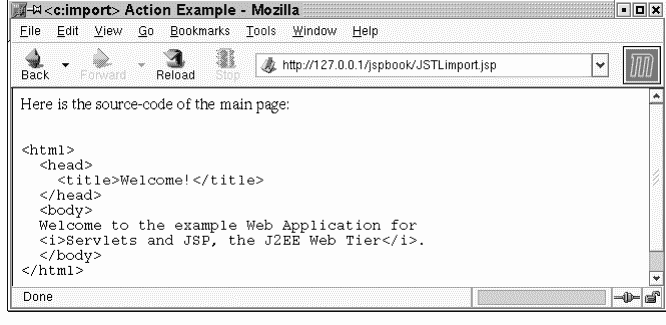

**图 6-2** JSTLimport 的浏览器渲染

然而，这种做法并不总是有效，因为 URL 必须按照 RFC 2396 (http://www.ietf.org/rfc/rfc2396.txt) 定义进行编码。如果没有适当的编码，URL 参数可能无法随请求正确发送。为了确保正确编码，JSTL 提供了 `<c:param>` 标签。

`<c:param>` 标签有两个属性：

- `name`: `name` 属性指定 URL 参数的名称。
- `value`: `value` 属性指定 URL 的值。

`<c:param>` 标签作为 `<c:import>` 标签的子标签使用。

### `<c:url>`

`<c:url>` 标签提供了带参数的 URL 进行编码的方法。例如，以下锚点标签：

```html
<a href="index.jsp">Book Site</a>
```

将变为：

```html
<a href="<%= response.encodeURL("index.jsp")%>">Book Site</a>
```

## i18n 文本格式化

JSTL i18n 标签是一组为国际化网站设计的格式化标签。这些标签是常用格式化解决方案的良好实现。JSTL i18n 格式化标签将在第 12 章中进行介绍。

## 第 7 章 自定义标签库

在第 3 章中，我们介绍了服务器页面。介绍重点是 JSP 的核心概念，并解释了 JSP 如何在 J2EE Web 层中辅助 Servlets；然而，一组非常重要的 JSP 功能被完全忽略了——自定义标签。在第 3 章中，为了建立 JSP 更为基础的概念，我们避开了自定义动作的话题，而在深入研究其可能用途之前理解这一点也同样重要。自定义标签的使用不是通过几页讨论就能完全涵盖的话题。对自定义标签的适当解释就能填满一个章节，而对自定义标签使用的全面覆盖可以轻松再填满几章。

本章对自定义标签进行了完整的介绍。重点关注的话题是如何构建自定义标签以及为什么自定义标签很有帮助。这两个主题是该技术的实际用例。能够设计并实现自己的一套自定义标签对于 JSP 开发者来说是一项无价的技能。这种技能可以应用于第 6 章所示的许多情况，并在后续涵盖安全、国际化和多客户端设计的章节中展示。与简单的 servlet 相比，构建自定义标签需要更多的努力。如果你想成为一名优秀的 JSP 开发者，就需要完全理解 JSP 标签。本章就是这种理解的基础。

我们在本章中讨论了以下主题：

- 为什么你应该使用自定义标签。
- 标签库的基础（所有类型）。
- 当前如何使用自定义标签。
- 新的 JSP 2.0 自定义标签与旧自定义标签。
- 标签库描述符（TLD）；用于自定义标签库的 `web.xml`。
- 简单的 JSP 2.0 自定义标签。
- JSP 2.0 `.tag` 文件；用类 JSP 方式编写自定义标签。
- 经典自定义标签（JSP 2.0 之前）。
- 混合使用新旧自定义标签。
- 标签脚本变量；通过自定义标签设置和使用作用域对象。
- 标签库监听器；通过标签库描述符注册 Servlet 监听器。
- 标签库验证；对自定义标签使用进行编译时检查。

这是一个较长的章节之一；但并不要求你从头到尾通读。只需要本章的前半部分（直到关于“简单”标签和 `.tag` 文件的讨论）以及最后几个主题（标签库监听器和标签库验证）即可；关于自定义标签的完整讨论仅为了完备性而提供。如果你只关心书中后几章节需要的内容（即在开发新的 Web 应用程序时可能需要的内容），请尽管跳过对 JSP 2.0 之前自定义标签的讨论，但请注意，几乎现有的自定义标签库都是通过经典自定义标签实现的。如果你想成为一个见多识广的 JSP 开发者，你将从通读整个章节中受益。

## 为什么使用自定义标签？

我们已经提到了一些关于自定义标签的点，但自定义标签之所以有很多充分理由。在我们考虑如何构建自定义标签之前，了解你为什么想要构建它是有帮助的。总之，以下是主要原因的正式列表：

- **逻辑与内容清晰分离**：自定义标签和脚本元素提供相同的功能。JSP 自定义标签可以完成脚本段可以完成的所有事情。区别在于这两种技术的编写方式。脚本段将代码嵌入到静态标记块中。自定义标签则将代码抽象在类似于 HTML 的标记之后。脚本段不是将逻辑从格式中抽离的好方法。脚本段通常会将处理数据的代码和负责展示数据的代码混合在一起。这导致 JSP 变得过于复杂，并且需要精练的 Java 开发者才能创建它。自定义标签将所有逻辑移动到绑定简单标签的独立 Java 类中。可以轻松地操作逻辑而无需触碰 JSP，而简单标签可以轻松用于编写内容。
- **易用性**：自定义标签易于使用。程序员和非程序员都能直观地使用自定义标签。它们是增强应用程序 Web 特性的理想机制，特别是当与混合背景的开发人员协作时。一个精通 HTML 但没有 Java 经验的开发者可以轻松学会并成功使用自定义标签库。出于这个原因，自定义标签是将复杂逻辑接口到如 HTML 或 XML 等编写的简单表示层语言的极佳方法。
- **可移植性**：自定义标签是可移植的。一套完整的自定义标签可以打包成单个 JAR 文件，并部署到许多 Web 应用程序中。与脚本段相比，无论在开发代码还是使用自定义标签库时，这都是巨大的优势。

思考自定义标签的一种好方法是将其看作一个组件，用 Java 或 JSP 编写，封装了某些行为。对于页面作者来说，自定义标签看起来像 HTML，或者至少像 XML。对于开发者来说，自定义标签可以是一个 Java 类，也可以是 JSP 的片段。在所有情况下，语法都是非常熟悉的，并遵循了各自语言的优点。

## 标签库基础

标签库是自定义标签的集合，通常设计为互补并实现共同目标。库内的标签用 Java 或 JSP 片段编写，并按照标签库描述符（TLD）文件的描述由 JSP 使用。大多数自定义标签集打包成一个 JAR 文件，可以轻松地部署到任何 Web 应用程序中。

思考自定义标签的一种简单方法是将其视为抽象的脚本段。与脚本段类似，标签由 JSP 开发者或开发工具完全编写代码。然而，与脚本段不同，代码本身并不直接出现在 JSP 中。代码不是直接嵌入 JSP 内部，而是与 JSP 解耦了。

## 标签处理器或 JSP 片段

```java
public class FooTag {

    public FooTag() {
        //
    }

    public void doTag() throws JspException {
        //
    }

}
```

```jsp
<%@ taglib prefix="foo" uri="/WEB-INF/foo.tld" %>

<html>
<head>
<title>A page</title>
</head>
<body>
<foo:menu title="A"/>
</body>
</html>
```


## 标签是如何被使用的？

自定义标签通常用于 JSP 的所有动态方面。标签库并不是所有问题的最佳解决方案，但它们是在 JSP 中嵌入动态功能的首选方法。本章出现了许多自定义标签的简单且说明性的用法。不要让这误认为这是该技术的局限性。

### MVC

模型视图控制，也称为 Model 2，是目前开发 Web 应用程序最常用的设计模式。MVC 设计模式之所以流行，是因为它专注于将 Web 应用程序分解为逻辑分区并鼓励开发者遵守这些划分。

### 国际化

国际化是网站开发中一个非常重要的问题。创建一个多语言网站可能是项艰巨的任务。通过 JSP 提供这种功能的一种非常实用的方法是将所有文本元素封装为自定义标签。每个标签将负责根据客户端的本地化确定正确的文本。

```jsp
<%@ taglib prefix="in" uri="/WEB-INF/i18n.tld" %>

<html>
<head>
<in:title id="groups"/>
</head>
```

国际化标签之所以受欢迎，是因为它们用非常干净的方法解决了 i18n 问题。国际化章节包含了关于国际化问题以及使用自定义标签解决这些问题的更多信息。

### 多客户端支持

如今的客户端类型比过去多得多。例如，Web 浏览器具有不同的能力；有些客户端期望 XML，而手持客户端（如手机和个人数字助理 PDA）则期望以 WML 格式获取数据。单一的 Web 网站可以支持这种大量的客户端。这个问题与国际化问题非常相似；是关于格式化而非以不同语言产生相同的内容。与国际化问题一样，自定义标签提供了良好的支持多种内容格式的解决方案。以下是这些标签可能性的示例：

```jsp
<%@taglib prefix="mct" uri="WEB-INF/mct.tld" %>

<mct:page>
<mct:p>Some text</mct:p>
</mct:page>
```


上述是一个与国际化标签的格式类似的说明，但请注意，自定义标签负责为请求内容的客户端生成适当的格式。对于网站来说，这是一个非常有用的设计特性，因为它可能需要根据特定的客户端以 `HTML`、`XHTML`、`XML`、`PDF` 或 `WML` 格式发送相同的内容。

多客户端支持的主题将在第 13 章中进一步介绍。

## 条件判断、循环和简单的必要任务

在 JSP 中似乎总是会出现数不尽的情况。这些情况的一些良好例子是条件判断和循环。一个简单的脚本段（`scriptlet`）就可以充当一个简单的自定义标签使用，但为了保持代码整洁，通常更倾向于使用标签。目前，JSP 尚未提供一组标准动作（`actions`）来解决最常见的情况，但已经有了将此类标签集成到标准动作集中的趋势。正如你在上一章中所读到的，当前版本的 JavaServer Pages 标准标签库（`JSTL`）提供了其中的一些简单标签。

## 数不胜尽的不逻辑方式

尽管要有智慧，但在作者看来，有无数自定义标签正以它们不该使用的方式被使用。这些标签似乎总是存在一个半合理的理由，但被 JSP 社区所诟病。此类标签通常用于将业务逻辑放置在 JSP 中。作者在整本书中一直认为这不是良好的做法。由于标签最初设计的初衷就是为了避免这种做法，因此使用标签来做此似乎是违背初衷。为什么要这样做？答案通常是为了易于使用，但对于所有实际目的来说，这个借口并不充分。

在上一章和本章中，都对这些“坏”标签以及为什么我们应该相信你不应该使用它们给出了清晰的说明和注释。本书的意图并不是为了说明糟糕的做法，但如果不提及这些糟糕的用法，很难清楚地说明哪些类型的自定义标签是你应该仔细考虑是否使用的。此外，无用标签的问题具有重要意义，否则它甚至不会被提及。现有的许多标签集合，即使是标准标签，其实际意义也很小，或者至少应该是。

## 新旧自定义标签

JSP 2.0 规范最初命名为 JSP 1.3 规范，但引入了足够重大的变化，使得将新规范提升为 JSP 2.0 是很有意义的。推动标题更改的一些最重大变化与 JSP 自定义标签直接相关。在 JSP 的之前的版本中，自定义标签是复杂的，且只适用于 Java 开发人员。然而，自定义标签的作用如此有用，以至于非 Java 开发人员抱怨 JSP 应该扩展其灵活性，使自定义标签对所有 JSP 都易于使用。此外，JSP 长期以来受到审查，因为它的许多功能（特别是自定义标签）可以在 `HTTP Servlets` 上下文之外很好地使用。JSP 2.0 引入了解决这些问题的新增特性。

声称 JSP 2.0 中引入的所有自定义标签功能与已存在的功能互补，这完全不是事实。许多新增是构建自定义标签的更优形式。看待 JSP 2.0 自定义标签的更好方法是将它们分为两类：“简单”自定义标签和旧自定义标签。这两种标签都可以正常工作并提供相同的功能。这两类标签的区别在于，新的自定义标签提供了更简单、直观的解决方案。所有自定义标签都可以在 JSP 中以任何组合使用。

本章完全涵盖了自定义标签的这些功能。首先，介绍了并解释了构建自定义标签的较新方法。我们强烈鼓励你使用新的简单方法；然而，也涵盖了实现自定义标签的旧方法。它可以作为可选阅读内容，但理解它非常有帮助，因为几乎每个现有的自定义标签都是按照该策略构建的。

## 标签库描述符 (TLDs)

决定如何处理解释自定义标签的任务是困难的，因为很难确定从哪里开始。标签处理程序（`Tag handlers`）、JSP 片段和 `.tag` 文件是解释自定义标签目前最重要的方面；然而，在大多数自定义标签能够执行任何实用的操作之前，需要 TLD 文件。一个问题的产生是因为，先解释 TLD 文件是有意义的，但 TLD 的许多部分在解释 TLD 处理程序之前看起来都是不合逻辑的。为了解决这个问题，TLD 文件通过贯穿本章的许多小部分来解释。

在本节中，介绍了 TLD 文件的基础，讨论涵盖了开始使用示例标签处理程序的所有内容。本章的这部分没有完全涵盖 TLD 文件。TLD 文件中稍微复杂的部分，例如声明属性和初始参数，将在章的后半部分涵盖。在章末处将对 TLD 文件进行回顾，以总结所有内容。

## 什么是标签库描述符？

从抽象意义上说，标签库描述符（`Tag Library Descriptor`）是将自定义标签绑定到出现在 JSP 中的简单标记的机制。TLD 的具体形式是一个 XML 文件，通常出现在 Web 应用程序的 `/WEB-INF` 目录下。你也可以将 TLD 与封装的标签库 JAR 包一起，并目前假设所有 TLD 文件都以带有 `.tld` 扩展的简单 XML 文件出现。

对于本章，你需要一个描述自定义标签示例的 TLD 文件。通过将列表 7-1 保存为 `example.tld` 到 jspbook Web 应用程序的 `/WEB-INF` 目录中开始。

## 列表 7-1 示例 TLD

```xml
<taglib xmlns="http://java.sun.com/xml/ns/jsp2ee"
        xmlns:xsi="http://www.w3.org/2001/XMLSchema-instance"
        xsi:schemaLocation="http://java.sun.com/xml/ns/jsp2ee/web-jsptaglibrary_2_0.xsd"
        version="2.0">
    <tlib-version>1.0</tlib-version>
    <jsp-version>2.0</jsp-version>
    <short-name>Example TLD</short-name>
    <uri>http://www.jspbook.com/example.tld</uri>
    <tag>
        <name>foo</name>
        <tag-class>com.jspbook.FooTag</tag-class>
        <body-content>empty</body-content>
    </tag>
</taglib>
```

在代码中你可以看到 TLD 仅仅是标签元素的集合。所有的元素都是重要的，它们告知 JSP 关于标签库的信息。这将在章节中进行说明。在列表 7-1 中使用了 `tag` 的子元素：`name`、`tag-class` 和 `body-content`。`name` 定义了自定义标签的唯一名称。`tag-class` 指定了应该作为标签处理程序的 Java 类。`tag-class` 元素的值在 TLD 中是唯一的；它必须是现有 Java 类的限定名。`body-content` 定义了在使用 JSP 时标签体内允许插入什么类型的代码（如果有的话）。关于列表 7-1 的其他几点在代码的前几行。所有其他的 TLD 元素必须出现在起始和结束 `taglib` 标签之间。TLD 的根节点是 `taglib` 元素。在起始 `taglib` 标签之后的是以下元素：

```xml
<tlib-version>1.0</tlib-version>
<jsp-version>2.0</jsp-version>
<short-name>Example TLD</short-name>
```

这些元素是强制性的；然而，与 `tag` 元素不同，它们只能出现一次。`tlib-version` 指定了标签库的版本号。`jsp-version` 定义了标签库依赖的 JSP 版本。此值应该根据你特定的自定义标签版本和所依赖的 JSP 功能设置。`short-name` 元素用于为标签集命名。它是为了辅助 JSP 开发工具。

列表 7-1 并不是 TLD 元素的完整参考。它只是 TLD 文件的最小要求。`example.tld` 文件将随着章节的进展而填充，但它永远不会包含所有可能的 TLD 元素。JSP 2.0 TLD 的完整参考可以在 `http://java.sun.com/xml/ns/jsp2ee/web-jsptaglibrary_2_0.xsd` 获取。

# 使用库描述符

在构建了 TLD 以及 TLD 所引用的代码后，标签库就可以在 JSP 中使用了。目前有多种不同的方法来引用一个自定义标签库。每个方法在不同情况下都很有帮助，理解所有的它们都是很好的。接下来的章节涵盖了其中一些不同的方法。

## 相对 URI (Relative URI)

JSP 规范将相对 URI 定义为没有协议和主机的 URI，它是告知 Web 应用程序 TLD 位置的最直接方法。相对 URI 进一步分为两类：根路径相对 URI（`root-relative URI`）是以 `/` 开头的，而非根路径相对 URI 则没有前导的 `/`。使用相对 URI 非常简单，只需将指向 TLD 文件的相对路径指定为 `taglib` 指令中 `uri` 属性的值即可。

- 例如，来看一个使用 `example.tld` 定义某些自定义标签的简单 JSP。列表 7-2 展示了此类代码可能的示例。该示例还假设 JSP 保存在 jsp Web 应用程序的根目录下。

## 列表 7-2 相对 URI 定义

```jsp
<%@ taglib uri="WEB-INF/example.tld" prefix="foo" %>
<html>
<body>
<foo:bar/>
</body>
</html>
```

HTML 代码和 `foo` 标签都没有实际用途，仅用于说明标签。关键点在于 `taglib` 指令如何知道去哪里寻找标签库的 TLD 文件。TLD 是文件路径 `/WEB-INF/example.tld` 标识的。

相对 URI 是学习最简单的方法，因为它直接且通常直观；然而，它存在一些缺点，使得这种方法在实际中使用并不理想。如果使用非根路径相对 URI，例如 `<%@ taglib uri="example.tld" prefix="foo" %>`，则特定 JSP 的 URI 取决于实际 JSP 文件相对于 TLD 文件的位置。如果将 JSP 移动到 Web 应用程序的不同部分，则需要更改 URI 值。如果移动了 TLD 文件，则所有通过相对 URI 引用它的 JSP 都将需要更新。在上述两种情况任一频繁发生的情况下，使用相对 URI 会变得非常不便。

1. 注意，无论服务器使用何种操作系统，相对 URI 应该始终使用正斜杠 `/`，而不是反斜杠 `\`。

相对 URI 也可能非常复杂，取决于 Web 应用程序内文件的位置。一个位于根目录三级子目录下的 JSP，其相对 URI 类似于 `./../../WEB-INF/example.tld`，这对于追踪来说有些烦恼。

根路径相对 URI 没有这个问题；然而，它有其他问题。假设标签开发者决定将其标签封装成一个 JAR 文件——除非 TLD 不再位于指定位置，否则这个相对 URI 现在就没用了。这需要的是“一个额外的间接层”。2.

## Web 应用程序定义的 URI (Web Application-Defined URI)

与相对 URI 相比，更实用的方法是定义一个应用程序范围内的 URI，该 URI 对应 TLD 文件的实际位置。想要使用相应标签库的 JSP 将使用 Web 应用程序来解析 TLD 文件的实际位置。这种方法是有益的，因为它允许任何 JSP 使用虚拟的 TLD 并利用这些标签。

应用程序定义 URI 的唯一缺点是设置起来比相对 URI 稍微复杂。应用程序范围内的 URI 通过 Web 应用程序的 `web.xml` 文件中的项定义。将列表 7-3 添加到 jspbook Web 应用程序的 `/WEB-INF/web.xml` 中。在任何 `error-page` 元素之后插入该项。

## 列表 7-3 web.xml TLD URI 定义

```xml
<taglib>
    <taglib-uri>http://www.jspbook.com/example</taglib-uri>
    <taglib-location>WEB-INF/example.tld</taglib-location>
</taglib>
```

`taglib` 元素定义了一个对应于给定 TLD 文件位置的抽象 URI。两个子元素 `taglib-uri` 和 `taglib-location` 分别用于创建唯一的、虚拟的 URI 并引用实际 TLD 的位置。`taglib` 元素每个这些子元素只能有一个，但一个 TLD 文件可以有多个 `taglib` 元素。这些 `taglib` 元素的集合被称为标签库映射（`taglib map`）。

2. “计算机科学中不存在任何通过增加一个额外的间接层就无法解决的问题”。

在 `web.xml` 文件中设置一组 `taglib` 项是一个手动且可能出错的过程。为了解决这个问题，JSP 规范提供了一个简单的解决方案：为你构建映射。要简单地实现这一点，你只需做两件事：在 TLD 文件中添加 `<uri></uri>` 条目，包含你希望开发者使用的 URI，并将 TLD 文件放置在 Web 应用程序的 `WEB-INF` 目录或 `WEB-INF` 的子目录中。给定上述 URI，将以下内容

```xml
<uri>http://www.jspbook.com/example</uri>
```

添加到 TLD 文件并将其置于 `WEB-INF` 中，其效果与向 `web.xml` 文件中添加 `taglib` 映射完全相同。

作为另一种便利条件，开发者可以将标签库封装为 JAR 文件。在这种情况下，开发者应该将任何 TLD 文件放入 JAR 的 `META-INF` 目录（或子目录）。放置在 Web 应用程序中的任何 JAR 文件都会被容器读取，在 JAR 的 `META-INF` 目录中发现任何 TLD 的 URI 都被添加到映射中。

3. 注意，无论服务器使用何种操作系统，相对 URI 应该始终使用正斜杠 `/`，而不是反斜杠 `\`。
4. 容器会将已知 URI 添加到映射。

## 列表 7-4 使用标签

```jsp
<%@ taglib uri="http://www.jspbook.com/example" prefix="foo" %>
<html>
<body>
<foo:bar/>
</body>
</html>
```

## XML 命名空间与 JSP 中的 XML

随着 JSP 2.0，指定自定义标签的原始方法之一已被更灵活的方法所取代。JSP 1.2 引入了“XML 中的 JSP”语法。由于 `taglib` 指令不兼容 XML，因此使用了替代的命名空间方法。这种方法可行，但已被对命名空间的完全支持所取代。XML 命名空间使用列表 7-5 中的语法。

## 列表 7-5 标签库声明

```xml
<prefix:name xmlns:prefix="URI"/>
```


在上述代码中，`prefix` 和 `URI` 对应于相应的 `taglib` 属性，而 `name` 是标签的名称。注意，为了编写和使用这种格式的标签库，JSP 必须是 XML 格式，例如 `.jsp` 文件。

## JSP 2.0 简单自定义标签

JSP 2.0 对开发者以前认为的自定义标签有了新的含义。JSP 2.0 引入了具有生命周期且可以使用 JSP 而非 Java 代码编写的自定义标签。这些标签被称为“简单”有两个原因：首先是因为它们比经典的标签处理器可能更容易编写和使用；第二个原因是因为其功能基于 `javax.servlet.jsp.SimpleTag` 接口。

理解简单自定义标签的起点是理解标签的生命周期。该生命周期适用于通过 Java 或 JSP 文件编写的标签。

生命周期有两个部分：初始化和 `doTag()`。初始化设置标签的父元素和主体。父元素和主体很重要；父元素允许标签间的协作，主体允许标签可选地处理其内容。简单生命周期的第二部分是 `doTag()` 方法。该方法在标签执行操作时被调用。当 `doTag()` 方法返回时，自定义标签就完成了工作。

作为自定义开发者，通常只对 `SimpleTag` 生命周期的 `doTag()` 部分感兴趣。JSP 容器会相应地设置父元素和主体。

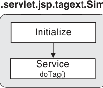

图 7-2 SimpleTag 生命周期

这使得简单标签的编码变得非常简单。如果你想让自定义标签执行任何操作，只需提供一个 `doTag()` 方法。确保适当的同步和状态管理完全在 `doTag()` 方法的代码中完成⁵。

## SimpleTag 接口

`javax.servlet.jsp.tagext.SimpleTag` 接口是所有 `SimpleTag` 类必须实现的接口。`SimpleTag` 接口没有继承 `javax.servlet.jsp.tagext.Tag` 接口，工作方式也不像经典的自定义标签。`SimpleTag` 接口定义了以下方法：

- **doTag()**: `doTag()` 方法由 JSP 容器在执行自定义标签时调用。自定义标签开发者应该重写 `doTag()` 方法以执行标签负责的任何自定义逻辑。在执行 `doTag()` 方法之前，JSP 容器会先调用 `setParent()`、`setJspBody()` 和 `setJspContext()` 方法。这允许完全访问代表其正体的 `JspFragment` 对象和当前的 `JspContext`。`doTag()` 方法可以返回 `EVAL_PAGE` 或 `SKIP_PAGE`，分别表示在标签后继续评估页面或跳过剩余 JSP 的评估。
- **getParent()**: `getParent()` 方法返回该标签的自定义标签（如果存在）。返回 `java.lang.Object` 类型的自定义标签，其可能是 `SimpleTag` 或 `Tag` 的实例。

> 与经典的标签处理器相比——即在 JSP 2.0 之前，自定义标签并没有这种奢侈。即使是完成迭代和状态管理等简单任务，也需要一些编码技巧。如果你感兴趣，本章的后半部分将讨论这些过时的问题。

- **setJspBody(javax.servlet.jsp.JspFragment)**: `setJspBody()` 方法在运行时设置当前的 `JspFragment` 对象。该方法保证在 JSP 容器在运行时于 `doTag()` 方法之前被正确调用。
- **setJspContext(javax.servlet.jsp.JspContext)**: `setJspContext()` 方法在运行时设置当前的 `JspContext` 对象。该方法保证在 JSP 容器在运行时调用 `doTag()` 方法之前被正确调用。
- **setParent(javax.servlet.jsp.JspTag)**: JSP 容器调用 `setParent()` 方法设置父标签（如果存在）。该方法接受一个 `javax.servlet.jsp.JspTag` 参数作为父标签，其可以是 `Tag` 或 `SimpleTag` 的实例。为了类型安全，`SimpleTag` 充当了 `Tag` 和 `SimpleTag` 的基类（注）。

`SimpleTag` 接口的使用旨在是简单直接。`javax.servlet.jsp.tagext.SimpleTagSupport` 是该接口的一个基础实现。只有自定义标签作者需要扩展 `SimpleTagSupport` 并重写 `doTag()` 方法。例如，一个简单且原始的“Hello World!”标签的编码方式如列表 7-6 所示。

### 列表 7-6 HelloSimpleTag.java

```java
package com.jspbook;

import javax.servlet.jsp.tagext.SimpleTagSupport;
import javax.servlet.jsp.*;
import java.io.IOException;

public class HelloSimpleTag extends SimpleTagSupport {

    public void doTag() throws JspException, IOException {
        JspWriter out = jspContext.getWriter();
        out.println("Hello World!");
    }
}
```

代码非常简单。`doTag()` 方法获取当前的 `JspContext` 对象 `jspContext`，并使用它向当前的 `JspWriter` 对象发送“Hello World!”当在 JSP 上使用该标签时，它会将自定义标签语法替换为“Hello World!”尝试在 `/WEB-INF/example.tld` 中部署它。

```xml
<tag>
  <name>hello</name>
  <tag-class>com.jspbook.HelloSimpleTag</tag-class>
  <body-content>empty</body-content>
</tag>
```

将 `HelloSimpleTag.java` 保存到 jsp Web 应用的 `/WEB-INF/classes/com/jspbook` 目录下，编译代码并重新加载应用使更改生效。一旦应用重新加载，标签就可以使用了。列表 7-7 是使用该标签的简单 JSP。

### 列表 7-7 HelloSimpleTagTest.jsp

```jsp
<%@ taglib prefix="ex" uri="WEB-INF/example.tld" %>
<html>
<head>
  <title>A test of HelloSimpleTag.java</title>
</head>
<body>
  <ex:hello/>
</body>
</html>
```

前面的代码是一个简单的 HTML 页面，其正体使用了 `hello` 标签。将列表 7-7 保存到 jsp Web 应用的目录并访问 `http://127.0.0.1/jspbook/HelloSimpleTag.jsp`。生成的页面将 `hello` 标签替换为“Hello World!”图 7-3 显示了结果的浏览器渲染。

`SimpleTag` 接口的所有用法与列表 7-7 类似。需要看到的重要概念是，任何代码都可以放在 `doTag()` 方法中。在前面的示例中，我们看到了代码如何访问页面的当前 `JspContext` 对象。这很重要，因为 `JspContext` 提供了访问页面的当前 `JspWriter`，它可以转换为 `PageContext` 对象以访问 `HttpServletRequest` 和 `HttpServletResponse`。`doTag()` 方法可以返回 `EVAL_PAGE` 或 `SKIP_PAGE`，分别表示在标签后继续评估页面或跳过剩余 JSP 的评估。


图 7-3 SimpleTag.jsp 的浏览器渲染

## 静态属性和 TLD 声明

静态属性需要 JSP 开发者做两件事。首先，自定义类需要为所有属性实现 setter 方法，与 JavaBean 方法相同。例如，一个自定义标签需要显示当前日期。此外，日期的格式需要是灵活的，以便标签的不同用法可以显示不同的内容。

```java
SimpleDateFormat sdf = new SimpleDateFormat(format);
out.println(sdf.format(new Date()));
```

这正是 `doTag()` 方法正在执行的操作，`format` 变量被用于定义格式。日期标签的用户可以选择 `SimpleDateFormat` 对象提供的任何格式化选项。

使用静态属性的第二个部分是在自定义标签的 TLD 中声明它。在 TLD 中，通过向标签条目添加 `attribute` 子元素来声明属性。而 `attribute` 元素反过来需要更多的元素来描述该属性。

- **name**: `name` 元素定义了属性的名称。对于特定的标签，每个属性名称必须是唯一的。
- **required**: `required` 元素告诉容器页面作者是否必须为此属性提供值；由于由于是可选的，如果该元素缺失，容器将提供默认值。默认值为 `false`。
- **rtexprvalue**: `rtexprvalue` 元素用于声明标签的运行时表达式值是否有效。可能需要静态值，以便 `TagLibraryValidator` 对象能够正确验证 JSP。`TagLibraryValidator` 对象将在本章稍后介绍。
- **type**: `type` 元素定义了此属性的 Java 类类型。默认分配 `String`，但自定义标签属性可以是任何 Java 类类型。
- **fragment**: `fragment` 元素用于声明该属性值是否应该被处理为 `JspFragment`。

定义属性需要 `name` 元素，但取决于属性的使用方式，你可能需要包含一些可选的属性元素。

为了完成 `FormatTag.java` 示例，需要为 `format` 属性添加一个声明。列表 7-9 包含了 `example.tld` 中的条目。

### 列表 7-9 在 TLD 中添加简单的属性条目

```xml
<tag>
  <name>date</name>
  <tag-class>com.jspbook.DateFormatTag</tag-class>
  <body>content:empty</body>
  <attribute>
    <name>format</name>
  </attribute>
</tag>
```


在前述的列表中，高亮的代码行是负责声明属性的行。请确保完整的条目位于 `WEB-INF/example.tld` 中，这样自定义标签就可以准备好使用了。通过创建一个使用该标签的 JSP 来尝试自定义标签。列表 7-10 就是这样一个 JSP。

## 列表 7-10 DateTagTest.jsp

```jsp
<%@ taglib prefix="ex" uri="http://www.jspbook.com/example" %>

<html>
<head>
  <title>A Custom Tag Example</title>
</head>
<body>
  The current date is <ex:date format="dd/MM/yyyy"/>.
</body>
</html>
```

`format` 属性与 TLD 中定义的以及 `DateFormatTag.java` 中编码的相同。在 `format` 属性中指定的值被用作日期标签生成的时间戳的格式化设置。可以通过重新访问 `DateFormatTagTest.jsp` 来验证这一点。编译 `DateFormatTag.java` 并重新加载 `jbook` Web 应用程序，使 TLD 和标签处理器生效，然后访问 http://127.0.0.1/jspbook/DateFormatTagTest.jsp。结果是一个具有 `format` 属性中指定的日期格式的 HTML 页面。图 7-4 显示了浏览器对结果的渲染。

时间戳的格式在未来也可以通过更改 `format` 属性的值来更改。这个过程非常简单，可以在不更改 TLD 或标签处理器类的情况下完成。例如，如果标签在美国使用，`format` 属性可能是 "MM/dd/yyyy"。如果该标签在英国使用，`format` 属性可能是 "dd/MM/yyyy"。这些值可以是 `java.text.SimpleDateFormat` 类支持的任何值。


**图 7-4** 具有新时间戳格式的 FirebaseAuthTagTest.jsp

一个标签可以根据需要使用许多静态属性。唯一的要求是每个属性在相应的 TLD 中都有一个条目，并且在自定义标签类中存在该属性的 setter 方法。另一个需要注意的点是，静态属性可以被标记为必须的。如果从 JSP 输入的标签中缺少 "required" 属性，页面将无法编译。

## 动态属性

对于自定义标签开发者来说，在 setter 方法中编码和在 TLD 中添加条目可能会变得繁琐。在某些情况下，可能需要使用一个没有预定义有效属性集的自定义标签。在这两种情况下，JSP 开发者可以使用动态属性。这的一个很好的例子是标签库中一个模拟 HTML 元素的标签。HTML 元素有许多属性，此类标签只需要将它们回显到输出流。使用静态属性编写这样的标签将很困难，但使用动态属性将轻而易举。动态属性不需要在 TLD 中逐个声明，但 TLD 必须引用该标签并定义哪些动态属性是可用的。

编写使用动态属性的自定义标签与使用静态属性的标签略有不同。动态属性不再要求每个属性都有 setter 方法，它们都由 `DynamicAttributes` 接口处理。该接口定义了三个参数：

- 第一个参数是 URI。
- 第二个参数是 name。
- 第三个参数是 value。

```java
void setDynamicAttribute(String uri, String name, Object value);
```

以下代码显示了如何实现 `DynamicAttributes` 接口。

## 列表 7-11 DynamicAttributeTag.java

```java
package com.jspbook;

import javax.servlet.jsp.*;
import javax.servlet.jsp.tagext.*;
import java.util.*;
import java.io.IOException;

public class DynamicAttributeTag extends TagSupport implements DynamicAttributes {

    protected Hashtable<String, Object> map = new Hashtable<>();

    public void setDynamicAttribute(String uri, String name, Object value) {
        map.put(name, value);
    }

    public void doTag() throws JSPException, IOException {
        JspWriter out = jspContext.getWriter();
        Enumeration keys = map.keys();
        while (keys.hasMoreElements()) {
            String key = keys.nextElement();
            Object value = map.get(key);
            out.print("<b>Attribute:</b><br>");
            out.print("name: " + key + "<br>");
            out.print("value: " + value + "<br>");
        }
    }
}
```

在大多数情况下，通过 `setDynamicAttribute()` 方法传递的值将被应用，例如列表 7-8 中的 `format` 属性。此外，可以在自定义标签代码中添加属性验证。如果运行时格式无效，`doTag()` 方法可以抛出 `JSPException` 实例。

像静态属性一样，使用动态属性的自定义标签必须通过 TLD 进行声明；但是，条目只需要包含 `dynamic-attributes` 元素作为子元素，而不是许多子属性元素。列表 7-11 的条目为：

```xml
<tag>
  <name>dynamicAttribute</name>
  <tag-class>com.jspbook.DynamicAttributeTag</tag-class>
  <dynamic-attributes>true</dynamic-attributes>
</tag>
```

将此条目保存到 `WEB-INF/example.tld` 并将 `DynamicAttributeTag.java` 保存到 JSP 应用程序的 `/WEB-INF/classes/com/jspbook` 目录下。编译代码并重新加载应用程序。新标签就可以准备使用了。使用列表 7-12 中的 JSP 尝试自定义标签。

## 列表 7-12 DynamicAttributeTag.jsp

```jsp
<%@ taglib uri="http://www.jspbook.com/example" prefix="ex" %>
<html>
<head>
<title>A test of DynamicAttributeTag.java</title>
</head>
<body>
  <ex:dynamicAttribute format="dd/MM/yyyy" color="red" size="14"/>
</body>
</html>
```

```html
<head>
<body>
<ex:dynamicAttribute name="test" value="a value"/>
</body>
</html>
```

将 `DynamicAttributeTag.jsp` 保存到 `jspbook` Web 应用程序根目录下，并浏览到 http://127.0.0.1/DynamicAttributeTag.jsp。将出现一个页面，列出为 `Dynamic Attribute` 标签设置的所有属性。尝试编辑该页面以移除属性，查看结果的变化。图 7-5 提供了列表 7-12 的浏览器渲染图。

重要的点是，自定义标签可以定义属性。这些属性可以是静态的，也可以是动态的；根据你的项目需求混合并使用这些功能。请记住，在编写实现 `DynamicAttributes` 接口的标签时，你仍然可以为单个属性编写 `setter` 方法，以防日后决定使用静态属性。

## 运行时属性值

默认情况下，属性在页面翻译时计算，并且要求是硬编码的字符串。在之前所有的自定义标签属性中，都有静态的名称/值对——例如，`name="value"` 或 `format="MM/dd/yyyy"`。这并不是自定义标签的限制。需要时，可以使用运行时 `String` 对象和非字符串对象作为自定义属性。我们首先查看如何使用运行时 `String` 对象而不是静态字符串值来满足标签属性的要求。

当使用运行时 `String` 对象代替静态字符串值时，在标签 TLD 对应的属性声明中，必须将 `rtexprvalue` 元素设置为 `true`。假设代码已经为静态字符串值设计好，这是 TLD 和标签处理程序中唯一需要做的更改。

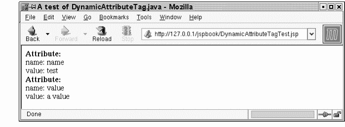

**图 7-5** `DynamicAttributeTagTest.jsp` 结果的渲染。

继续之前的日期标签示例，运行时值可以用于 `format` 属性，以动态设置生成日期的格式。这结合了 HTTP `accept-language` 请求头，允许 JSP 根据客户端的本地化（locale）猜测并设置日期格式。

对于运行时值，需要两点。首先，需要更新 TLD 以允许 `format` 属性成为运行时值。该更改很小，并在列表 7-13 中突出显示。

### 列表 7-13 通过 TLD 允许运行时属性

```xml
<tag>
  <name>date</name>
  <tag-class>com.jsp.FormatDateTag</tag-class>
  <body-content>empty</body-content>
  <attribute>
    <name>format</name>
    <rtexprvalue>true</rtexprvalue>
  </attribute>
</tag>
```

`FormatDateTag.jsp` 中的更改是显著的，并不是因为 TLD，而是因为 HTTP 请求头的数据挖掘。将 `FormatDateTagTest.jsp` 存为 `FormatLocaleTest.jsp` 并在列表 7-14 中添加以下更改。

## 列表 7-14 FormatLocaleTest.jsp

```jsp
<%
String format = "yyyy/MM/dd";
request.setAttribute("format", format);
String language = request.getHeader("accept-language");
if (language != null) {
  if (language.indexOf("en-us") != -1 ||
      language.indexOf("en-US") != -1 ||
      language.indexOf("EN-US") != -1) {
      format = "MM/dd/yyyy";
  }
} else {
  if (language.indexOf("en-uk") != -1 ||
      language.indexOf("en-UK") != -1) {
}
%>
```

本地化头在第 2 章作为 HTTP 请求头提到过。第 12 章继续了从 HTTP 请求头中挖掘本地化信息的讨论。

```jsp
if (language.indexOf("EN-UK") != -1) {
  format = "dd/MM/yyyy";
}
```

```jsp
<%@ taglib prefix="ex" uri="http://www.jspbook.com/example" %>
<html>
<head>
  <title>FormatTag.java 的测试</title>
</head>
<body>
  日期是 <ex:date format="${format}"/>.
</body>
</html>
```

此前的代码使用一个简单的脚本段（scriptlet）来填充一个脚本变量，用作日期标签的 `format` 属性。最终效果是 `format` 属性动态使用了 `"yyyy/MM/dd"`，但如果脚本段检测到英国客户端，则使用适当的格式。默认情况下，原始目的是尝试匹配客户端的本地化。图 7-6 显示了来自美国客户端的浏览器渲染。

在某些情况下，将非 `String` 对象传递给标签属性可能会很有帮助。在声明和编写支持这些属性时，需要进行一些更改。在 TLD 中，需要使用 `type` 元素，并配合指定对象 Java 类的 `value`。以以下代码为例，它是 JSP 中的一行。

```jsp
<foo:example date='<%= new Date() %>'/>
```

默认情况下，此行代码会抛出翻译异常。当使用表达式（expression）来设置自定义标签属性的值时，它不会自动调用该对象的 `toString()` 方法。相反，在调用相应标签处理器的 `set` 方法时，会使用该对象。为了验证标签处理程序预期的是正确的类（在本例中是 `java.util.Date` 而不是 `java.lang.String`），需要在 TLD 中声明相应的 `type` 元素。

```xml
<tag>
  <name>date</name>
  <tag-class>com.jsp.FormatDateTag</tag-class>
  <body-content>empty</body-content>
  <attribute>
    <name>format</name>
    <rtexprvalue>true</rtexprvalue>
    <type>java.util.Date</type>
  </attribute>
</tag>
```

## .tag 文件

JSP 规范旨在为所有层级的开发者提供有用的功能。自定义标签（Custom tags）众所周知是 JSP 最复杂的功能之一。虽然事实如此，但只有在你不熟悉 Java 的情况下自定义标签才会变得困难。对于 Java 开发者来说，能够将简单的标记与纯 Java 类连接起来应该是一件乐事。JSP 为简单快速地创建内容提供了一个前端。支持 JSP 的标签类提供了通向 Java 编程语言灵活性的直接接口。

JSP 2.0 引入了 .tag 文件。这些是 JSP 规范中一个非常强大的补充。.tag 文件的作用是消除了在使用自定义标签时对 Java 的需求。在很多情况下这非常有帮助。使用 JSP 和 Servlet 的原因之一是将内容与逻辑分离；强制这种分离的方法是不允许在 JSP 中脚本，也不允许在 Servlet 中调用 `out.write()`。然而，经典标签和新标签通常都会包含 `out.write()` 调用，因此发生的变化只是生成输出的代码从一个 Java 组件（Servlet）移动到了另一个（标签）！.tag 文件通过允许开发者在标签中编写代码来解决这个问题。就像在 JSP 中一样，这种力量不应被滥用——Java 代码解决的问题与将代码放在 JSP 中是相同的。相反，“tag”文件应该编写为脚本和表达式的混合体。tag 文件和用 Java 编写的简单标签是互补的技术。当你主要需要逻辑但带少量数据时，使用简单标签；当你需要作为模板且带有较多（大致）文本和少量表达式的标签时，使用 tag 文件。

## 什么是 .tag 文件？

.tag 文件是一个 JSP 源文件，带有一些额外的指令和可用的标准动作（standard actions）。完整的 .tag 文件功能与简单标签（Simple Tag）完全相同，并可以作为自定义标签在另一个 JSP 中使用。例如，你可以使用 .tag 文件编写 `HelloSimpleTag.java`（如上文列表 7-4 所示）。完整的 .tag 文件在列表 7-17 中。

## 列表 7-17 hello.tag

```jsp
Hello World!
```

非常简单，而且是的，这是一个完整的自定义标签！要将此 .tag 文件作为自定义标签使用，唯一需要的就是将 .tag 文件放入 Web 应用程序中。像 Servlet 类一样，标签不能简单添加到应用的根目录；相反，它们位于 WEB-INF 下一个名为 tags 的子目录中，或者 tags 目录的子目录中。不需要 TLD，不需要标签库映射（tag lib map）；直接丢进去即可。

要在 JSP 中使用该标签，JSP 必须引用该标签。列表 7-18 显示了此类示例。将此文件保存为 `HelloSimpleTagFile.jsp` 到 jspbook Web 应用程序的根目录下。

## 列表 7-18 HelloSimpleTagFile.jsp

```jsp
<%@ taglib prefix="h" tagdir="WEB-INF/tags" %>
<html>
<head>
<title>A test of HelloSimpleTag.java</title>
</head>
<body>
<h:hello/>
</body>
</html>
```


前述代码是一个简单的 JSP 页面，其正体使用了 `hello` 标签。访问 `http://127.0.0.1/jspbook/HelloSimpleTagFile.jsp`。生成的页面显示了带有“Hello World!” 的 `hello` 标签。图 7-3 显示了结果的浏览器渲染。

注意，该标签是通过标签指令的 `tagdir` 属性引入页面的。这是 JSP 2.0 引入的，用于支持标签文件。`tagdir` 指令告诉容器在哪里找到标签文件，它必须以 `/WEB-INF/tags` 开头。

位于 "tags" 目录相同子目录下的所有标签都被定义为同一个标签库，以下包含三个标签库：

- `WEB-INF/tags/alice.tag`
- `WEB-INF/tags/bob.tag`
- `WEB-INF/tags/support/help.tag`
- `WEB-INF/tags/date/date.tag`

其中 `alice` 和 `bob` 位于 "tags" 标签库，`help` 位于 `support` 标签库，`date` 位于 `date` 标签库。通过这些信息，容器为每个标签库构建一个隐式的 TLD。TLD 包含每个标签库的短名称以及目录中的每个标签。短名称源自目录。如果标签文件位于 `tags` 目录，那么短名称就是 `tags`；否则（在 Windows 下将 `/` 或 `\` 替换为 `-` 并移除 `WEB-INF/tags`），因此 `WEB-INF/tags/date/time` 变成了 `date-time`。注意短名称是唯一的。例如，开发者也可以创建一个名为 `WEB-INF/tags/date-time` 的目录。

`tag` 文件也可以封装在 JAR 文件中。在这种情况下，`.tag` 文件应该放在 JAR 的 `META-INF/tags` 目录中，并为它们创建一个 TLD。就像简单标签一样，这个 TLD 定义了标签。JSP 2.0 定义了两个用于定义 `.tag` 文件的元素：`<file>` 和 `<path>`。`<tag-file>` 元素是 `<taglib>` 元素的子元素，而不是 `<tag>`。`tagfile` 包含名称和路径；在 JAR 文件中路径必须以 `META-INF/tags` 开头。例如：

```xml
<taglib>
  <!-- elements for clarity -->
  <tag-file>
    <name>alice</name>
    <location>META-INF/tags</location>
  </tag-file>
</taglib>
```

# 编写 .tag 文件

在编写 `.tag` 文件之前，有一些重要的指令和标准 JSP 动作需要注意。这些指令类似于第 3 章中的 JSP 指令，但它们用于指定所有的信息。`tag` 文件可使用的指令有 `taglib`、`include`、`tag`、`attribute` 和 `variable`。`taglib` 和 `include` 指令与介绍过的 JSP 指令相同。其他指令仅供 `.tag` 文件使用并将在后续章节中介绍。

```jsp
<%@ tag %>
```

`tag` 指令对于 `tag` 文件来说，就像 `page` 指令对于 JSP 来说一样。`tag` 指令是完全可选的，用于定义自定义标签的信息。提供的大部分信息与 TLD 提供的元数据相同。`tag` 指可以在同一个 `.tag` 文件中出现多次，但如果两个 `tag` 指令定义了相同属性的值，就会产生翻译错误。

`tag` 指令的属性如下：

- **display-name**: `display-name` 属性定义了一个供工具显示的短名称。如果没有指定值，则该属性默认为 `name` 属性的值。
- **body-content**: `body-content` 属性提供了标签体内容的信息。该属性的有效值为 `empty`、`dependent` 或 `scriptless`。使用 JSP 或任何其他值将导致翻译错误。默认值为 `scriptless`。
- **dynamic-attributes**: `dynamic-attributes` 属性指示此标签是否支持动态名称的属性。如果值为 `true`，生成的标签处理程序必须实现 `javax.servlet.jsp.tagext.DynamicAttributes` 接口。该属性的可能值为 `true` 和 `false`。默认值为 `false`。如果 `.tag` 文件指定了此属性，那么容器会为传入的每个动态属性创建一个页面作用范围变量。
- **small-icon**: `small-icon` 属性定义了相对于标签源文件的图像文件路径，该文件包含一个可供工具的小图标。默认情况下假设标签不使用小图标。
- **large-icon**: `large-icon` 属性定义了相对于标签源文件的图像文件路径，该文件包含一个可供工具的大图标。默认情况下假设标签不使用大图标。
- **description**: `description` 属性定义了一个描述此标签的任意字符串。默认值为暂无描述。
- **example**: `example` 属性定义了一个表示该操作用法的非正式描述的任意字符串。默认假设没有可用示例。
- **pageEncoding**: `pageEncoding` 属性的功能与 JSP 页面指令中的 `pageEncoding` 属性完全相同。
- **language**: `language` 属性的功能与 JSP 页面指令中的 `language` 属性完全相同。
- **import**: `import` 属性的功能与 JSP 页面指令中的 `import` 属性完全相同。
- **isELIgnored**: `isELIgnored` 属性的功能与 JSP 页面指令中的 `isELIgnored` 属性相同。与页面指令不同，`isELIgnored` 标签属性没有对应的 `web.xml` 配置元素。

标签指令的使用非常简单。在大多数情况下，你可以完全跳过该指令并让一切运行正常——例如，列表 7-17 中的 `hello`。在 TLD 中，自定义标签唯一强制的信息是标签的唯一名称和标签代码的位置。开发者指定的标签文件（tag file）不包含其中任何一个，因为它们可以由容器推断。

在标签文件的更复杂或更健壮的用法，可能需要提供关于自定义标签的额外信息。在这种情况下，可以根据需要使用相应的属性。

## `<@attribute %>`

属性指令类似于 TLD 文件中的属性元素。在同一个 `.tag` 文件中可以使用多个属性指令。属性指令具有以下属性：

- **name**: `name` 属性定义了被声明的属性的唯一名称。如果在同一个 `.tag` 文件中使用多个 `attribute` 指令且它们的 `name` 属性值相同，则会导致翻译错误。在任何出现 `attribute` 指令的地方，都必须定义 `name` 属性。
- **required**: `required` 属性是一个可选属性，用于确定所描述的属性是必**的（`true`）还是可选的（`false`）。默认假设值为 `false`。
- **fragment**: `fragment` 属性是一个可选属性，用于确定该属性是否为由标签处理器评估的片段。如果 `value` 为 `true`，则 `type` 属性固定为 `javax.servlet.jsp.tagext.JFragment`，如果指定了 `type` 属性，将会导致翻译错误。此外，如果此属性为 `true`，且指定了 `rtxprvalue` 属性，则会导致翻译错误。如果 `fragment` 属性的值为 `false`，则假设属性的值为由 JSP 容器评估的“普通”值。默认值为 `false`。
- **rtxprvalue**: `rtxprvalue` 是一个可选属性，用于确定属性的值可以通过表达式在运行时动态计算。默认值为 `false`。
- **type**: `type` 属性是一个可选属性，用于确定属性的运行时类型。默认假设类型为 `java.lang.String`。
- **description**: `description` 属性是一个可选属性，可以提供属性的描述。

`attribute` 指令的使用类似于 TLD 中对应的条目。区别在于值是通过 `attribute` 指令设置的。你应该能够轻松将之前的日期格式化简单标签转换为 `.tag` 文件。与其重新哈希那个示例，让我们引入自定义标签最实用的功能之一：抽象 HTML。本书一直在提示一种良好的服务器、JSP 和 Java 设计模式 MVC，该模式将在后面的章节中进行详细介绍。这种设计有效地阻止了精通 Java 和 HTML 的开发者胡乱无章地使用 HTML 和各种 Java 代码段来创建不可维护的页面；然而，这种设计模式无法阻止任何野心勃勃的 HTML 开发者滥用 XHTML——例如，使用 HTML、JavaScript 和级联样式表的组合来创建同样融合的 HTML 页面。解决方案是：通过自定义标签抽象 DHTML。

通过使用自定义标签（特别是 `.tag` 文件），你可以轻松地将 DHTML 组件抽象为几个简单的标签。例如，流行的简单 DHTML 鼠标悬停（rollover）效果。当鼠标移动到图像上时，图像会变化；通常是按钮图片变为被按下状态的按钮。当鼠标离开图像时，图像恢复原始。这种效果无非就是一小段 JavaScript 代码。列表 7-18 提供了一个带有脚本的 HTML 示例。

## Listing 7-18 rollover.html

```html
<html
The 'off' image:<br>
The 'on' image:<br>
The rollover image:<br>
<a href="index.html" onmouseover="button.src='button_on.gif';" onmouseout="button.src='button_off.gif';">
/></a>
</html>
```

将 HTML 页面保存到 jspbook Web 应用程序的根目录下尝试该效果。为了方便起见，你可以从 `http://www.jspbook.com/images` 下载 `button_on.gif` 和 `button_off.gif`。将这两个图片都保存在 jspbook Web 应用程序的根目录下。访问 `http://127.0.0.1/jspbook/rollover.html` 查看效果。图 7-7 提供了一个示例。

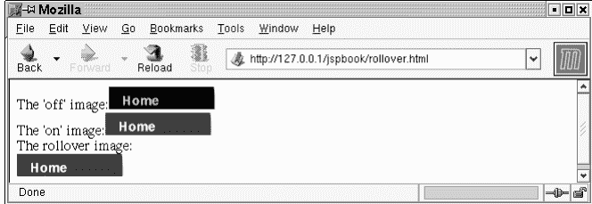

图 7-7 HTML 鼠标悬停图像效果（显示“开启”按钮）

自定义标签库

注意，浏览器的渲染并不完全准确，因为这是一个动态效果。显示的是按钮的一种状态，但当你移动鼠标进入和移出时，图像会从开启状态切换到关闭状态。

脚本通过处理 DHTML 鼠标事件来工作。最初，根据 HTML `img` 标签显示一个图像。

```html
<<a>
```

```jsp
<@ attribute name="image" required="true" %>
<a href="${link}" onmouseover="${image}.src='${image}_on.gif';" onmouseout="${image}.src='${image}_off.gif';">
  </a>
```

上述代码是 jspbook Web 应用程序 `/WEB-INF/tags` 目录下的 `rollover.tag`。该代码创建了一个自定义标签 `rollover`，它需要两个属性：`link` 和 `image`。`link` 属性在点击图像时提供链接，`image` 属性提供 rollover 的基名称（在此例中假设为 GIF 文件）。

尝试在 JSP 中使用 rollover 来测试它。将列表 7-20 保存为 jspbook Web 应用程序根目录下的 `rollover.jsp`。

## 列表 7-20 rollover.jsp

```jsp
<@ taglib prefix="x" tagdir="WEB-INF/tags"><html>
  'off' 图像:<br>
  'on' 图像:<br>
  rollover 图像:<x:rollover image="button" link="index.html"/>
</html>
```


浏览到 `http://127.0.0.1/jspbook/rollover.jsp` 来测试该页面。
结果与之前的 HTML 示例相同。

领略自定义标签的力量吧！JSP 开发人员可以抽象任何他们想要构建的内容并封装为一个简单的标签，或者最大限度地减少完成某任务所需的代码。与其为页面重复手动编写诸如 HTML 控件之类的内容，不如使用简单的标签来抽象 DHTML。标签文件特别适合抽象 HTML，因为编写标签文件与编写 HTML 一样简单。

这种设计模式扩展了通过自定义标签抽象 DHTML 的思想。

## <% variable %> 

变量指令与 TLD 中的变量元素类似。在同一个 `.tag` 文件中可以使用多个变量指令。

变量指令具有以下属性：

- **name-given**: `name-given` 属性定义了要在调用此标签的页面中定义的脚本变量。如果两个变量指令具有相同的 `name-given`，则会发生致命的转换错误。
- **variable-class**: `variable-class` 属性可选的，用于定义变量的类型。默认值为 `java.lang.String`。
- **scope**: `scope` 属性可选地定义脚本变量的作用范围。该属性的有效值为 `AT_BEGIN`、`AT_END` 或 `NESTED`。默认值为 `NESTED`。
- **declare**: `declare` 属性可选地声明该变量是否已声明。默认值为 `true`。
- **description**: `description` 属性可以用于提供变量的可选描述。默认情况下，假设没有描述。

变量指令在所有脚本变量对简单标签有帮助的情况下都非常有用。JSTL 的设计初衷是能够方便地利用作用域变量。不需要 Java，完全可以仅使用自定义标签进行编程，这是一种由 JSTL（以及一些偏于使用 JSP 而非 Servlets 的开发者）推崇的设计模式，但本书并不建议使用这种设计模式。

此前，脚本变量是通过脚本段和声明引入的；然而，自定义标签也可以创建脚本变量。由自定义标签创建的脚本变量可以像由脚本段声明的一样被访问，这意味着取决于变量如何声明，它可以在 JSP 的其他地方使用。默认情况下，变量仅存在于标签体（NESTED 作用域），但可以将作用域设置为 `AT_BEGIN` 或 `AT_END`，以便变量分别从自定义标签的开始或结束处起就对页面可见。

通常情况下，标签声明的脚本变量本身并没有太大帮助。当它们与设计用于使用脚本变量的自定义标签结合时，就非常有用了。脚本变量的话题将详细讨论；但为了完整性，这里有一个变量指令的示例。你记得 `PageCounter.jsp`（第3章3-5），它使用了声明、表达式和脚本段来计算页面访问次数。自定义标签也可以通过使用 `.tag` 文件创建，通过设置脚本变量来计算页面访问次数，如列表 7-21 所示。

简单 JSP 2.0 自定义标签 297

## 列表 7-21 PageCounter.jsp

```jsp
<%@ taglib prefix="x" tagdir="WEB-INF/tags" %>

<x:count/>

<html>

<head>

<title>PageCounter.jsp</title>

</head>

<body>

此页面已被访问 <%= pageCount %> 次

</body>

</html>
```

将上述代码保存为 jspbook Web 应用程序根目录下的 `PageCounter.jsp`。该代码是 PageCounter.jsp 的增强版本，尽管它没有使用指令，而是依赖自定义标签来跟踪页面访问。自定义标签是一个计数文件，并设置了作用域变量 `pageCount` 给 JSP 使用，如列表 7-22 所示。

## 列表 7-22 counttag

```jsp
<%@ variable name="pageCount" variable-class="java.lang.Integer" %>

<%
Integer pageCount = (Integer)getAttribute("pageCount");
if (pageCount == null) {
    setAttribute("pageCount", new Integer(1));
} else {
    setAttribute("pageCount", new Integer(pageCount.intValue() + 1));
}
%>
```

将代码保存为 jspbook 应用 `/WEB-INF/tags` 目录下的 `counttag.tag`。

## 基础标签

基础标签是实现 `Tag` 接口的标签。基础标签用于创建不需要处理其体或迭代体内容的标签。简单标签是所有其他自定义标签接口中最简单的，也是最容易编写和理解的标签。

## 标签生命周期

`Tag` 接口定义了所有自定义标签必须实现的六个方法。方法是 `doStartTag()`、`doEndTag()` 和 `release()`。`doStartTag()` 方法在评估 JSP 并发现自定义标签开始元素时调用。`doEndTag()` 方法在自定义标签结束元素完成后完成并调用，`release()` 方法被调用以清理标签可能初始化的资源。图 7-8 显示了该生命周期的图形表示。

生命周期是不言自明的。遇到自定义标签时调用 `doStartTag()` 方法。

## javax.servlet.jsp.tagext.Tag

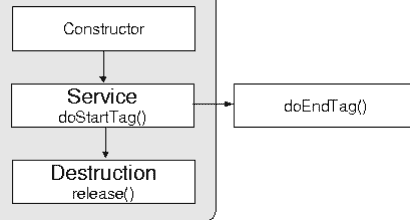

图 7-8 Tag 的生命周期

`doEndTag()` 方法被调用且标签结束。如果该标签是一个空元素——例如 `<t:someTag/>`，则 `doStartTag()` 和 `doEndTag()` 方法会被连续调用。通常情况下，对于自定义标签的多个实例，会加载并使用独立的标签处理程序实例，但如果传递给两个标签元素的属性集匹配，容器可以自由重用标签实例。在标签实例最后一次使用后，会调用 `release()` 方法。

想象如下虚构的 JSP，它在两个不同的地方使用了 `foo` 标签（见图 7-9）。通常情况下，每个地方都会有一个对应于 `foo` 标签的独立标签处理程序类实例。图中标记了调用 `doStartTag()` 和 `doEndTag()` 方法的概念点。

```html
<html>
<body>
<h1>A Header</h1>
<foo> <-- doStartTag()
Some text on the page.
</foo> <-- doEndTag())
</body>
</html>
```

图 7-9 JSP 标签生命周期调用示例

这意味着任何显示为简单标签正体的内容都无法由标签直接处理，标签的内容可能仍由容器处理，并且任何产生的输出都会被写入到页面的输出流中。

## Tag 接口

前文已简要提到了 `Tag` 接口的三个方法：`doStartTag()`、`doEndTag()` 和 `release()`。然而，这些方法尚未被完全解释，而且 `Tag` 接口中还包含了另外三个方法：`getParent()`、`setPageContext()` 和 `setParent()`。这六个方法对于理解该接口至关重要，并总结如下。

## int doStartTag()

当 JSP 遇到自定义标签的开始时，会调用 `doStartTag()` 方法。该方法可以初始化标签其他方法所需的资源，也可以执行某些逻辑，并选择跳过标签正体内容的评估或跳过 JSP 剩余部分的评估。JSP 在调用 `doStartTag()` 方法后的行为取决于该方法的返回值。`doStartTag()` 方法有两个有效的返回值范围：`SKIP_BODY` 和 `EVAL_BODY_INCLUDE`。这两个值都是 `Tag` 接口定义的 `final static int` 原始类型常量。如果 `doStartTag()` 返回 `SKIP_BODY`，JSP 容器将跳过标签正体内容的评估。如果 `doStartTag()` 返回 `EVAL_BODY_INCLUDE`，JSP 容器将标签正体的内容评估到当前的 JSP 输出缓冲区中。

## int doEndTag()

当 JSP 遇到自定义标签的结束元素时，会调用 `doEndTag()` 方法。该方法用于在标签正体内容评估之后、标签实例释放以便可能的重用之前执行任何需要执行逻辑。调用 `doEndTag()` 方法后，JSP 的评估将根据方法的返回值继续进行。`doEndTag()` 方法有两个有效的返回值：`SKIP_PAGE` 和 `EVAL_PAGE`。这两个值都是 `Tag` 接口定义的 `final static int` 原始类型常量。如果 `doEndTag()` 方法返回 `SKIP_PAGE` 值，当前 JSP 将停止评估当前页面。如果 `doEndTag()` 返回 `EVAL_PAGE`，当前 JSP 将继续被处理。

## void release()

`release()` 方法是自定义标签上被调用的最后一个方法。当自定义标签不再被 JSP 容器使用时，会调用 `release()` 方法让其释放状态。保证在标签被提交垃圾回收之前至少调用一次 `release()`，在调用 `release()` 之后可能会发生多次 `doStartTag()` 和 `doEndTag()` 方法。

## Tag getParent()

`getParent()` 方法允许自定义标签访问最近的封装父标签。标签作为父类 `Tag` 返回，但可以进行相应的类型转换。

### void setParent(Tag t)

`setParent()` 方法由 JSP 容器在运行时调用，用于设置特定自定义标签的父 `Tag` 对象。如果没有封装的自定义标签，则设置为 `null`。

### void setPageContext(PageContext p)

`setPageContext()` 方法为 JSP 设置适当的页面对象。`setPageContext()` 方法由 JSP 容器在调用 `doStartTag()` 方法之前调用。

## 编写 BasicTag

对于大多数实际用途来说，开发者在实现简单标签时只关心 `doStartTag()` 和 `doEndTag()` 方法。`setPageContext()` 和 `setParent()` 方法由容器处理，而 `getParent()` 和 `release()` 方法仅在少数情况下需要。

简单标签可以用几种不同的方式编写；但开发者很少需要从头实现 `Tag` 接口。JSP API 包含了 `javax.servlet.jsp.TagSupport` 类，这是一个适配器类，提供了简单标签的默认实现。编写简单标签最简单且实用的方法是扩展 `TagSupport` 并重写任何需要自定义的方法。

以本章示例中使用的 `foo` 标签为例。

```java
package tagbook;

import javax.servlet.jsp.*;
import javax.servlet.jsp.tagext.*;
import java.io.*;

public class FooTag extends TagSupport {
    public int doStartTag() throws JspException {
        JspWriter out = getPageContext().getOut();
        try {
            out.println("foo");
        } catch (IOException e) {
            throw new JspException(e);
        }
        return SKIP_BODY;
    }
}
```

与其总是通过循环验证父类类型，可以使用 `findAncestorWithClass()` 方法。

`TagSupport` 辅助类将在本章后续的迭代标签部分中进行详细介绍。

## 在 JSP 中使用标签处理程序和 TLD

到目前为止，我们已经讨论了如何构建简单标签所需的所有组件，但尚未实际将所有内容整合在一起。走这个流程并从零开始演示一个自定义标签的运行示例是一个很有帮助的练习。到目前为止，我们在本章构建的唯一标签是相当没什么帮助的 `foo`。如果你还记得，这个标签已经有一个适当的 TLD 条目，并准备好使用。为了补充这一点，让我们构建另一个稍微有点用的基础标签。

我们将构建的新标签是 `date` 标签——另一个基础处理器，它被设计用于提供执行该 JSP 的服务器当前日期和时间。将列表 7-27 保存为 `DateTag.java`。

### 列表 7-27 DateTag.java

```java
package com.jspbook.*;

import javax.servlet.jsp.tagext.*;
import javax.servlet.jsp.*;
import java.util.*;
import java.io.*;

public class DateTag extends TagSupport {
    public int doStartTag() throws JspException {
        JspWriter out = pageContext.getOut();
        try {
            Date date = new Date();
            out.println(date.toString());
        } catch (IOException e) {
            throw new JspException(e.getMessage());
        }
        return SKIP_BODY;
    }
}
```

前面的代码与 `FooTag.java` 非常相似。它是一个扩展 `TagSupport` 并重写 `doStartTag()` 方法的简单标签处理器。这两个标签唯一的区别是 `DateTag.java` 创建了一个新的 `java.util.Date` 对象并将其序列化以便用户查看。

创建 `date` 标签的主要原因是需要向示例 TLD 文件添加一个新标签。这是每当向标签库添加标签时都需要完成的操作之一——熟悉这个过程是有帮助的。你可能记得 `example.tld` 文件之前创建并保存在 jspbook Web 应用程序的 `/WEB-INF` 目录中。编辑此文件，如列表 7-28 所示，为新创建的 `date` 标签添加条目。

## 列表 7-28 DateTag.java 添加到 examples.tld

```xml
<tag>
<name>date</name>
<tag-class>com.jspbook.DateTag</tag-class>
<body-content>empty</body-content>
</tag>
```

确保你的顺序作为 `taglib` 元素的子标签出现，并紧跟在标签实例之前或之前。编译 `FooTag.java` 和 `DateTag.java` 文件，并重新加载 jspbook Web 应用程序以反映更改。

两个标签处理程序的代码完成后且 TLD 也准备就绪，标签库即可在 JSP 中使用了。将列表 7-29 保存为 jspbook Web 应用程序根目录下的 `TagLibraryExample.jsp`。

## 列表 7-29 TagLibraryExample.jsp

```jsp
<%@taglib prefix="x" uri="http://www.jspbook.com/example" %>
<html>
<head>
<title>A Custom Tag Example</title>
</head>
<body>
The date/time is <x:date/>, <x:foo>!
</body>
</html>
```


浏览 `http://www.jspbook.com/TagLibraryExample.jsp` 查看自定义标签的结果。图 7-10 显示了 Web 浏览器渲染的输出。`date` 和 `foo` 标签都已正确执行，并作为 HTML 页面中的某些文本的形式呈现客户端。

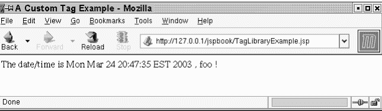

## 图 7-10 TagLibraryExample.jsp 的浏览器渲染

图 7-10 显示的页面是此自定义标签简单演示实现的结论。你现在已经知道如何创建一个简单标签、在 TLD 中定义它并创建一个使用该标签的 JSP。这是理解自定义标签的良好开始，但我们还没有看到许多让自定义标签变得强大的功能。

## 复用标签

一个重要且经常被误解的点是，容器可以选择缓存标签，而不是在每个 JSP 使用自定义标签时都创建一个新标签。这允许容器创建一个标签的实例，并出于效率考虑复用它。然而，对可以复用的标签是有限制的。当标签被使用时，它将由容器初始化。标签元素中的所有属性都会传递给标签；如果标签具有可选属性且这些属性在页面上未定义，则标签将为这些元素使用默认值。复用标签意味着容器不需要重新初始化标签；这有两个后果。第一，只有当标签的属性集与之前的使用完全相同时，才能被复用。其次，标签实例将任何值已更改的属性重新初始化为它们在调用 `startTag()` 方法之前的状态，是至关重要的。在许多情况下，第二个疑虑是有问题的，因为容器依赖于 `doTag()` 方法被调用时标签的重置。在编写初始化类范围变量的自定义标签时，请确保这些变量在每次调用 `doEndTag()` 方法时都被重置。

此的一个简单示例是 `FormattedDateTag.java`。`FormattedDateTag.java` 声明了类范围变量 `format`。为了保持简单，特意忽略了在标签被缓存时通过 `startTag()` 方法将 `format` 重置为 null 的，这不是一个严重的问题。然而，为了确保 `FormattedDateTag.java` 按预期工作，需要添加以下内容。

## 列表 7-30 修复一致性的 FormattedDateTag.java

```java
package com.jspbook;

import javax.servlet.jsp.tagext.*;
import javax.servlet.jsp.*;
import java.util.*;
import java.text.*;
import java.io.*;

public class FormattedDateTag extends TagSupport {

    private String format;

    public void setFormat(String format) {
        this.format = format;
    }

    public int startTag() throws JspException {
        JspWriter out = pageContext.getOut();
        try {
            if (format != null) {
                SimpleDateFormat sdf = new SimpleDateFormat(format);
                out.println(sdf.format(new Date()));
            } else {
                out.println(new Date().toString());
            }
        } catch (IOException e) {
            throw new JspException(e.getMessage());
        } finally {
            format = null;
        }
        return SKIP_BODY;
    }
}
```

## TryCatchFinally 接口

标签的生命周期由 JSP 规范完全定义。如前，`doStartTag()` 方法在标签完全初始化后被调用；在 `doStartTag()` 和 `doEndTag()` 调用之间，容器假设标签持有必须保留的状态。在 `doEndTag()` 方法之后，标签可以复用。在进行垃圾回收之前会调用 `release()` 方法。容器假设标签放弃了所有资源，包括属性、引用等。

然而，`doEndTag()` 方法可能永远不会被调用。这种情况发生在标签在通常调用 `doEndTag()` 之前抛出异常。如果标签创建或管理并在 `doEndTag()` 方法中通常释放资源，标签现在就有问题了！为了保证即使在失败情况下释放资源，标签应该实现 `TryCatchFinally` 接口。`TryCatchFinally` 是第 4 章所示 `try-finally` 块的接口表示，具有两个方法：`doCatch()` 和 `doFinally()`。这些方法提供了与 `try` 语句的 `catch` 和 `finally` 相同的功能。理解这一概念简单方法是假设实现 `TryCatchFinally` 接口的自定义标签总是转换为具有以下代码的 Servlet：

```java
Tag tag = getTagFromSomewhere();

// 初始化标签
// ...

// 使用标签
try {
    tag.doStartTag();
    tag.doEndTag();
} catch (Throwable t) {
    // 捕捉异常
    tag.doCatch(t);
} finally {
    // release usage specific resources
    tag.doFinally();
}
tag.release(); // release long-term resources
```

前面的代码说明了容器如何使用 `TryCatchFinally` 接口为自定义标签提供等同于 `try-catch-finally` 块的功能。理解这一概念至关重要，因为它是跨越基于 `Tag` 接口的自定义标签生命周期方法的 `try-catch-finally` 语句的唯一方法。标签作者有责任在自定义标签中正确地声明和实现 `TryCatchFinally` 接口方法。

## 协作标签 (Cooperating Tags)

编程的核心规则之一是保持方法短小，并将复杂代码拆分为可重用的组件。超级标签（Supertags）绝不应该编写来完成所有工作。每个标签都应该是一个执行目标部分内容的自包含单元。这意味着，如果标签要良好工作，就需要与其他标签协作。

标签通常通过将一个标签嵌套另一个标签内部来协作。

```xml
<taglib prefix="mt" uri="WEB-INF/mytags.tld" %>
<mt:outerTag>
    <mt:innerTag/>
</mt:outerTag>
```

为了协作，内部标签（innerTag）需要获取外部标签（outerTag）的引用。正如我们之前看到的，当标签初始化时，容器持有 `setParent()` 方法，并传递父 Java 对象的引用。对于上一个示例所示外部标签，传递的父级将是 `null`。然而，之前的内部标签将接收到实现 `outerTag` 的 Java 类的引用。传递的引用类型为 `Tag`。内部标签随后可以调用方法或从父标签获取数据。要做到这一点，内部标签只需将该引用强制转换为正确的类型，如列表 7-31 所示。

### 列表 7-31 虚构的协作标签处理器

```java
public class InnerTag extends TagSupport {
    OuterTag outerTag = null;

    public int doStartTag() throws JspException {
        outerTag = (OuterTag)parent;
        // invoke any needed methods
        outerTag.fooMethod();
        // do other work
    }
}
```

注意，虽然内部标签可以获取其父标签的引用，但并没有标准方法让引用反向传递。父标签不会获取其子标签的引用。

在列表 7-31 中，内部标签的 `startTag()` 方法定义了一个类型为 `OuterTag` 的变量，假设该变量是 `outerTag` 的标签处理器类。要使用外部标签的引用，内部标签只需将父数据成员强制转换为 `OuterTag`。但标签从哪里获取父数据成员呢？它并没有在标签中定义。记住标签扩展了 `TagSupport`，而 `TagSupport` 实现了 `TagSupport`，这意味着 `TagSupport` 提供了 `setParent()` 方法的实现。该实现简单地定义了一个变量 `Tag parent;` 并保存了传递给 `setParent` 用的用的：

```java
public void setParent(Tag t) {
    parent = t;
}
```

虽然在简单情况下列表 7-31 工作运行完美，但这段代码存在一个缺陷。代码盲目地将父值强制转换为它应有的类型，前提是假设 `innerTag` 总是直接嵌套在 `outerTag` 之下的一层。但假设标签是嵌套在好几层深。这是一个完全有效的 JSP：

```xml
<taglib prefix="mt" uri="WEB-INF/mytags.tld" />
<taglib prefix="yt" uri="WEB-INF/yourtags.tld" />
<mt:outerTag>
    <yt:someOtherInnerTag>
        <mt:innerTag/>
    </yt:someOtherInnerTag>
</mt:outerTag>
```

注意，标签不仅与其父标签分离了一层；它的父标签还来自不同的标签库。内部标签可能对其父标签一无所知。不仅如此，为了让内部标签工作，它必须获取 `outerTag` 的引用，而不是夹在中间的随机标签。

使用 `Tag` 接口来解决这个问题相当困难，需要遍历父标签并检查每个标签处理器的类型。另一种替代方案是 `TagSupport` 提供的 `findAncestorWithClass()` 方法。回想 `TagSupport` 提供了以下方法：

```java
static Tag findAncestorWithClass(Tag from, java.lang.Class klass)
```

该方法寻找由类参数指定的特定 Java 类实现的标签引用。容器维护了一个通过其父值链接的标签栈。从 `from` 参数开始，该方法在该栈中查找该 `Class` 实例。

根据刚才解释的内容，列表 7-31 的代码实现应该如列表 7-32 所示。

## 列表 7-32 协作标签的更好实现

```java
public class InnerTag extends TagSupport {
    OuterTag outerTag = null;

    public int startTag() throws JspException {
        outerTag = (OuterTag)findAncestorWithClass(this, OuterTag.class);
        if (outerTag != null) {
            // invoke needed methods
            outerTag.callParentMethod();
            // do other work here
        }
    }
}
```

此代码不受任意深度嵌套标签以及来自不同标签库的标签混合情况的影响。

### 将新标签与经典标签混合

经典标签之间的协作相当简单，因为所有经典标签都实现了 `Tag` 接口。这意味着 `getParent`、`setParent` 和 `findAncestorWithClass` 都可以依赖于一个事实：我们正在处理的标签是 `javax.servlet.jsp.tex.Tag` 的实例。（注：OCR 文本在后续部分包含了一些重复和错误）。

迭代标签（Iteration tags）是简单标签的增强版本。迭代标签可以完成简单标签的所有工作，并能够重复评估其主体。这种重新评估通过在自定义标签生命周期中引入新方法 `doAfterBody()` 来实现。`doAfterBody()` 方法在 `doStartTag()` 方法之后 `doEndTag()` 方法之前调用。`doAfterBody()` 方法决定是否需要重新评估主体（再次调用 `doAfterBody()`），或者调用 `doEndTag()` 方法。

## javax.servlet.jsp.tagext.IterationTag

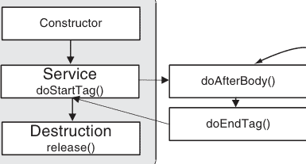

**图 7-11** 迭代标签生命周期

## IterationTag 接口

要使标签处理器被视为迭代标签，它必须实现 `javax.servlet.jsp.IterationTag` 接口。IterationTag 接口是 Tag 接口的子类，它只定义了一个新方法：

```java
public int doAfterBody() throws JspException
```

如果 `doStartTag()` 方法返回 `EVAL_BODY_INCLUDE`，则在执行之后调用 `doAfterBody()` 方法。如图 7-11 所示，`doAfterBody()` 方法可以根据方法的返回值被调用多次。如果 `doAfterBody()` 返回 `EVAL_BODY_AGAIN`，则标签的主体将被重新评估并再次调用 `doAfterBody()` 方法。如果 `doAfterBody()` 方法返回 `SKIP_BODY`，则调用 `doEndTag()` 方法。

虽然没有再次列出，但请记住，所有简单标签方法对于迭代标签仍然可用。将简单标签转换为迭代标签非常简单，只需实现 `IterationTag` 接口并为标签编写一个 `doAfterBody()` 方法即可。

## 编写迭代标签

迭代标签的编写与简单标签一样简单。辅助类 `TagSupport` 同时实现了 `Tag` 和 `IterationTag` 接口。从实际用途来说，对于 JSP 开发者来说，扩展 `TagSupport` 来同时处理简单标签和迭代标签并没有影响。`IterationTag` 接口增加的单个方法不会干扰简单标签的执行，也不会给代码增加显著的开销。编写简单标签和迭代标签之间的真正区别在于，你何时需要 `doAfterBody()` 方法的功能。如果需要 `doAfterBody()` 方法，只需将其编写到标签处理器中，并让 `doStartTag()` 方法返回 `EVAL_BODY_INCLUDE` 即可。

迭代标签最有用的特性正如其名称“iteration”（迭代）所暗示的。通过使用迭代标签，可以消除 JSP 中冗余的模板块。其功能与使用 `for`、`while` 或 `do` 循环的脚本段（scriptlet）相同。考虑列表 7-33 中的 JSP。

### 列表 7-33 带有少量链接的 JSP

```java
// 一个链接数组
String[] links = new String[5];
links[0] = "http://www.jspbook.com";
links[1] = "http://www.java.sun.com";
links[2] = "http://www.jspinder.com";
links[3] = "http://www.developer.com";
links[4] = "http://www.aw.com";

<html>
<head>
<title>消除冗余</title>
</head>
<body>
一些有用的 JSP 和 Servlet 链接
<ul>
<li><a href="%= links[0] %>"><%= links[0] %></a></li>
<li><a href="%= links[1] %>"><%= links[1] %></a></li>
<li><a href="%= links[2] %>"><%= links[2] %></a></li>
<li><a href="%= links[3] %>"><%= links[3] %></a></li>
<li><a href="%= links[4] %>"><%= links[4] %></a></li>
</ul>
</body>
</html>
```

列表 7-33 展示了 JSP 的糟糕用法。与等效的 HTML 相比，该页面的优点之一是它重用了数组值。这种简单的重用允许数组值的每个单次更改都能反映在随后的两个 JSP 使用中。然而，此 JSP 仍然包含大量的冗余标记。无序列表标签 `<ul>` 之间的每一行代码都与其上方的一行完全相同，除了访问的数组槽位外。这些代码应该被消除，取而代之的是在迭代数组中的值时重复使用的一行代码。这可以通过脚本段以及任一 `for`、`while` 或 `do while` 循环轻松完成（如第 3 章所示），但也可以通过迭代标签来实现。

现在取决于你如何根据已经关于迭代标签的说明来消除这些标记。这可以通过列表 7-34 中的迭代标签来实现。

## 列表 7-34 LinkIterationTag.java

```java
import javax.servlet.jsp.tagext.TagSupport;
import javax.servlet.jsp.JspException;
```


```java
import javax.servlet.http.HttpServletRequest;

public class LinkIterationTag extends TagSupport {

    String[] links;

    int count;

    public int doStartTag() throws JspException {

        // 获取链接数组
        HttpServletRequest request = pageContext.getRequest();
        links = (String[]) request.getAttribute("links");

        // 重置计数
        count = 0;

        // 设置当前链接
        pageContext.setAttribute("link", links[count]);
        count++;

        return EVAL_BODY_INCLUDE;
    }

    public int doAfterBody() throws JspException {

        if (count < links.length) {
            try {
                pageContext.setAttribute("link", links[count]);
                count++;
            } catch (Exception e) {
                throw new JspException();
            }
            return EVAL_BODY_AGAIN;
        } else {
            return SKIP_BODY;
        }
    }
}
```

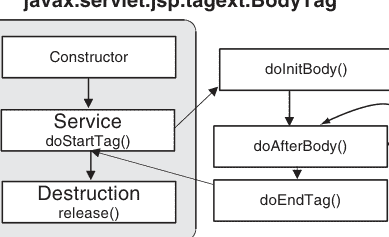

**图 7-13** 主体生命周期

它是 `JspWriter` 的子类，并提供了一个标签处理器可以本地使用的缓冲区，用于写入内容。除了 `JspWriter` 提供的方法外，`BodyContent` 对象还提供了以下方法。

- **`void clearBody()`:** `clearBody()` 方法清除当前 `BodyContent` 对象的内容。当需要清除 `BodyContent` 的内容以便写入新内容时，该方法非常有用。
- **`void flush()`:** 不应使用 `flush()` 方法。它是对 `JspWriter` 的 `flush()` 方法的重写，用于禁用 `BodyContent` 对象的内容被刷新。如果需要清除 `BodyContent` 对象的内容，请使用 `clearBody()` 方法。若要将 `BodyContent` 对象的内容写入当前的 JSP 输出流，请使用 `writeOut()` 方法并传入相应的 `JspWriter` 对象。
- **`JspWriter getEnclosingWriter()`:** `getEnclosingWriter()` 方法返回用于构建 `BodyContent` 标签的 `JspWriter` 对象。
- **`java.io.Reader getReader()`:** `getReader()` 方法将此 `BodyContent` 对象的内容作为 `Reader` 对象返回。当 `BodyContent` 对象的内容需要用于其他进程（如转换）时，该方法非常有用。
- **`String getString()`:** `getString()` 方法将 `BodyContent` 对象的缓冲区内容作为 `String` 返回。
- **`void writeOut(java.io.Writer out)`:** `writeOut()` 方法将 `BodyContent` 对象的缓冲区内容写入指定的 `Writer` 对象。

## 编写主体标签

以前编写简单标签和迭代标签时使用的 `TagSupport` 对象没有实现 `BodyTag` 接口。与基本的简单标签或迭代标签相比，`BodyTag` 接口增加了显著的开销。除非标签想要访问其主体，否则标签不需要管理 `BodyContent` 对象。出于此原因，JSP API 提供了 `TagSupport` 对象的独立扩展类用于编写主体标签，即 `BodyTagSupport`。`BodyTagSupport` 对象是 `TagSupport` 的子类，并提供了 `Tag`、`IterationTag` 和 `BodyTag` 接口所需的所有方法。

除了 `BodyTag` 接口的所有方法外，`BodyTagSupport` 还提供了两个额外方法：

- **`BodyContent getBodyContent()`:** `getBodyContent()` 方法返回主体标签的 `BodyContent` 对象，扩展了 `BodyTag`。
- **`JspWriter getPreviousOut()`:** `getPreviousOut()` 方法返回封装当前标签的 `JspWriter`。

与其它标签类似，主体标签的主体可以包含两种类型的内容：静态文本或 JSP。然而，对于主体标签来说，为标签提供正确类型的主体内容稍微重要。由于主体标签可以访问其主体，因此标签可能期望逐字解释内容，而不是在 JSP 容器对其进行评估后解释。这在主体标签可能被用于解释可能会被 JSP 容器篡改的类 JSP 代码的情况下，尤为重要。

在实践中，很少使用主体标签。它们提供的功能虽然有用，但并不是一种倾向于遵循良好编码实践（流行的设计模式）的功能。在少数情况下（其中某些由 JSTL 实现），主体标签被用于评估其主体内包含的代码。具体来说，看到一组可以处理嵌入 XML 或 SQL 块的自定义标签并不罕见。在这些情况下，标签虽然存在但很少被使用，因为一种不同的、不依赖标签的设计可以更好地实现相同的功能。

## 嵌套主体标签的歧义

主体标签与我们目前对 JSP 的理解引入了一些歧义。问题的出现是因为主体标签用于处理内容的 `BodyContent` 缓冲区。`BodyContent` 对象充当主体标签内容内内容的 `JspWriter`。当嵌套标签调用 `PageContext.getOut()` 方法时会发生什么？`getOut()` 方法返回代表 JSP 的 `PageContext` 对象存储的 `JspWriter`。这通常是与发送输出到最终刷新到客户端的缓冲区相关联的 `JspWriter` 对象。然而，直接调用此方法似乎会破坏系统。主体标签的内容应该发送到相应主体标签的 `BodyContent` 中。它不应该跳过此过程直接访问主 JSP 的输出流。需要理解的一个重要点是，在这种情况下，嵌套标签并没有破坏系统。当主体标签获取 `BodyContent` 对象时，是通过调用 `PageContext` 的 `pushBody()` 方法实现的。该方法保存现有的 `JspWriter`，并创建一个与 JSP 的 `PageContext` 对象关联的新对象作为当前输出流。结果是，主体标签内的嵌套标签始终接收与父主体标签关联的 `JspWriter`，因此能够按预期工作。

## 标签脚本变量

自定义标签具有定义供脚本元素使用的脚本变量的能力。这种功能并不常用，因为它往往倾向于违背公认的良好 JSP 设计模式。自定义标签的最佳用法是消除 JSP 中出现的脚本元素数量。使用自定义标签创建几个脚本变量只会鼓励使用更多的脚本元素。这是一种坏做法，会导致代码不可维护。出于此原因，通常不建议使用整个节节。包含它仅是为了保持完整性，并以便你的读者能够识别出哪些尝试使用该功能的用法。

JSP 开发者可以通过两种方法通过自定义标签声明脚本变量。第一种解决方案是通过标签额外信息 (TEI) 类。该类最初设计为在翻译时声明脚本变量并验证标签的唯一方法。在 JSP 1.2 中，TEI 类被用于声明变量的 TLD 元素和 `TagLibraryValidator` (TLV) 类取代。这两种方法将在后续章节中介绍，`TagLibraryValidator` 类将在稍后部分介绍。

## TLD 声明的脚本变量

可以通过 TLD 中的 `variable` 子元素声明脚本变量。`variable` 元素又有几个子元素来描述正在声明的脚本变量。子元素如下：

- **`name-given`:** `name-given` 元素定义脚本变量的名称。该名称在相同作用域的脚本变量名称中必须是唯一的。
- **`name-from-attribute`:** `name-from-attribute` 元素指定属性的名称，该属性的翻译时值将作为变量名称。`name-given` 或 `name-from-attribute` 必须其一。
- **`variable-class`:** `variable-class` 元素指定变量的类。默认类是 `java.lang.String`，但任何 Java 类都是有效的。
- **`declare`:** `declare` 元素指定是否声明变量。默认值为 `true`。
- **`scope`:** `scope` 元素定义脚本变量的作用域。作用域可以是 `AT_BEGIN`、`AT_END` 或 `NESTED`。`AT_BEGIN` 指定在自定义标签开始时进入作用域。`AT_END` 指定脚本变量进入作用域并在自定义标签结束后可用。`NESTED` 指定变量仅在自定义标签的主体内可用。

要声明一个简单的脚本变量，只需要 `name-given` 属性。以迭代标签的示例为例（列表 7-34）。为了这种简单性，通过脚本段使用 `PageContext.getAttribute()` 方法从标签处理器中访问对象。最佳解决方案是在另一个自定义标签后面抽象地访问属性，但另一个相当好的解决方案是让标签处理器声明几个脚本变量。这可以通过向标签的 TLD 条目添加更改来轻松实现，如列表 7-37 所示。

```xml
<body-content>JSP</body-content>

<variable>
  <name-given>link</name-given>
  <variable-class>String</variable-class>
</variable>

</tag>
```

修改 `example.tld` 以包含上述声明。新声明的变量将可以供使用 `iterateLinks` 标签的 JSP 使用。7-38 节修改了 `LinkIterationTag.jsp` 以展示如何使用该脚本变量。

## 列表 7-38 LinkIterationVariable.jsp

```jsp
<%
// 一个链接数组
String[] links = new String[5];
links[0] = "http://www.jspbook.com";
links[1] = "http://java.sun.com";
links[2] = "http://www.jspinsider.com";
links[3] = "http://www.developer.com";
links[4] = "http://www.aw.com";
request.setAttribute("links", links);
%>

<%@ taglib prefix="x" uri="http://www.jspbook.com/example" %>

<html>
<head>
<title>消除冗余</title>
</head>
<body>
一些有用的 JSP 和 Servlet
<ul>
<x:iterateLinks>
<li><a href="${link}">${link}</a></li>
</x:iterateLinks>
</ul>
</body>
</html>
```

上述代码与 `LinkIterationTag.jsp` 的代码之间的唯一区别在于，上述代码可以直接引用 `link` 变量，而无须使用 `PageContext.getAttribute("link")`。由于 TLD 声明了 `link` 脚本变量，因此使用对 `link` 变量的直接引用是有效的，尽管它之前没有在脚本段中声明过。

## TagExtraInfo 类

`TagExtraInfo` 类是从标签处理程序中声明脚本变量的原始方法。TEI 类提供了与 TLD `variable` 元素相同的信息，但实现方法略有不同。与 TLD `variable` 元素不同，TEI 类是在 Java 类内部声明元素的。TLD 仅用于引用相应的 TEI 类。

创建 TEI 类时，需要两个条件：一个 `javax.servlet.jsp.TagExtraInfo` 子类以及标签 TLD 声明中的一个 `teiclass` 元素。`TagExtraInfo` 子类负责声明标签创建的任何脚本变量，而 `teiclass` 元素提供该类的名称。TEI 类本身负责提供一个 `getVariableInfo()` 方法，该方法返回一个 `javax.servlet.jsp.tagext.VariableInfo` 对象的数组，用于描述所有的脚本变量。

`VariableInfo` 对象是脚本元素所需信息的 Java 对象表示：对于脚本变量，包括变量的类型、其可用作用域以及页面是否需要声明该变量。这些值分别对应 TLD `variable` 元素中的 `name-given` 或 `name-from-attribute`、`variable-type`、`scope` 和 `declare` 元素。在代码中，所有这些值都是通过列表 7-39 所示的 `VariableInfo` 对象构造传递的。

## 列表 7-39 用于 LinkIterationTag.java 的 TEI 类

```java
import javax.servlet.jsp.tagext.*;

public class LinkIterationTEI extends TagExtraInfo {

    public VariableInfo[] getVariableInfo(TagData data) {
        // 创建一个 VariableInfo
        VariableInfo info = new VariableInfo("link", "String", true, VariableInfo.NESTED);
        VariableInfo[] vi = { info };
        return vi;
    }
}
```

上述代码与之前 `iterateLinks` 标签的 TLD 条目（列表 7-35）等效。如果你想尝试 TEI 类，请将上述代码保存为 `LinkIterationTEI.java` 到 jspbook Web 应用程序的 `/WEB-INF/classes/com/jspbook` 目录下。编译 `LinkIteration.java` 并将列表 7-40 添加到 `example.tld` 中。

## 列表 7-40 TEI TLD 条目

```xml
<tag>
  <name>iterateLinks</name>
  <tag-class>com.jspbook.LinkIterationTag</tag-class>
  <teiclass>com.jspbook.LinkIterationTEI</teiclass>
  <body-content>JSP</body-content>
<!--
  <variable>
    <name-given>link</name-given>
    <variable-class>String</variable-class>
  </variable>
-->
</tag>
```

在 `example.tld` 中添加上述条目后，重新加载 jspbook 应用程序并访问 `http://127.0.0.1/jspbook/LinkIterationTagVariable.jsp`。显示的结果与图 7-12 相同，但这次 JSP 使用的是 TEI 类而不是 TLD 条目来描述脚本变量。

## 标签库监听器

自定义标签库可能依赖于 Servlet 事件监听器提供的功能，但我们从第 2 节知道，监听器对象需要在 `web.xml` 中进行注册。为了解决这个问题，JSP 自定义标签开发者需要通过标签库描述符来部署监听器。

```xml
<ELEMENT taglib (tlib-version, jsp-version, short-name, uri,
display-name?, small-icon?, large-icon?, description?, validator,
listener*, tag+) >
```

`listener` 元素如下：

```xml
<listener>some.MyListener</listener>
```

作为标签形式定义的监听器的调用顺序是未定义的；通常是容器发现 TLD 文件的顺序。

## 验证

自定义标签库可能依赖于 Servlet 事件监听器提供的功能，但我们从第 2 节知道，监听器对象需要在 `web.xml` 中进行注册。为了解决这个问题，JSP 自定义标签开发者需要通过标签库描述符来部署监听器。

```xml
<ELEMENT taglib (tlib-version, jsp-version, short-name, uri,
display-name?, small-icon?, large-icon?, description?, validator,
listener*, tag+) >
```

`listener` 元素如下：

```xml
<listener>some.MyListener</listener>
```


作为标签形式定义的监听器的调用顺序是未定义的；通常是容器发现 TLD 文件的顺序。

## 验证

自定义标签库可能依赖于 Servlet 事件监听器提供的功能，但我们从第 2 节知道，监听器对象需要在 `web.xml` 中进行注册。为了解决这个问题，JSP 自定义标签开发者需要通过标签库描述符（Tag Library Descriptor）来部署监听器。

```xml
<ELEMENT taglib (tlib-version, jsp-version, short-name, uri,
display-name?, small-icon?, large-icon?, description?, validator,
listener*, tag+) >
```

`listener` 元素如下：

```xml
<listener>some.MyListener</listener>
```

## 总结

自定义标签为 JSP 开发者提供了极其灵活的功能集。每个 JSP 开发者在尝试使用自定义标签之前都应该充分理解它们。

编写一个主要的 JSP 项目。在本章中，我们学习了自定义标签的基础知识，为后续章节奠定了坚实的基础，以便扩展此处学到的概念并演示自定义标签的用例。

自定义标签分为三大类：简单标签、迭代标签和正体标签。这些类别分别由 `Tag`、`IterationTag` 和 `BodyTag` 接口强制执行。不同类型的标签从简单标签的基本功能扩展，以提供更健壮的功能。简单标签仅仅是一种简单的机制，将 Java 代码从 JSP 中抽象到标签处理程序类中。迭代标签扩展了简单标签，允许对自定义标签的内容体进行重复求值。正体标签同时扩展了简单标签和迭代标签，允许标签能够抽象代码、多次评估其正体，并还可以操作其正体。

自定义标签本身并不完成所有工作。为了增强标签的功能，JSP 规范允许自定义标签拥有属性、脚本变量、验证器和监听器。所有这些增强功能都使自定义标签成为 JSP 开发者的强大工具，并允许通过自定义标签完成许多任务。

# 第 8 章

## 过滤器

虽然 Servlet 和 JSP 非常强大且实用，但它们并不是满足 Web 应用程序开发者需求的最佳方法。通常，应用程序要求每当发送到应用程序内任何资源（或可能是某些资源的子集）请求时，执行某些代码。安全就是这类经典例子。如果应用程序要求用户登录，那么通常应用程序内的每个资源（登录页面除外！）都需要在执行资源之前运行安全检查。应用程序通常需要此类服务，而大多数 Web 服务器都有提供这些服务的方法。例如，Tomcat 有“阀门”，微软 Internet Information Server (IIS) 有 ISAPI 过滤器。为了让 JEE Web 应用程序开发者能够以独立于容器的方式提供这些服务，Servlet 2.3 规范引入了过滤器。

本章将讨论以下主题：

- 过滤器简介及 Servlet 过滤器概述。
- 过滤器的生命周期。
- 编写一个简单的过滤器。
- 过滤器配置。
- 包装器、请求和响应的过滤。
- 每个 Web 应用程序都应该有的两个过滤器：缓存和压缩过滤器。
- 使用过滤器替换 JSP 功能。

本章应该从头到尾阅读，强烈建议你这样做，因为这是一个非常重要的章节。过滤器极大地补充了 JSP，基本上取代了 Servlet，你将在后面的章节中看到许多过滤器的使用。特别是在第 15 章中，当我们创建一个完整的 Web 应用程序时，会有几个问题通过简单部署一个在本章、设计模式章节或国际化章节中提供的过滤器来解决（相同的问题可以在大多数现有的 Web 应用程序中通过相同的操作来解决；过滤器是通用的）。你需要理解 Servlet 过滤器。

## 过滤器简介

过滤器是位于请求与该请求目标终点之间的组件。终点可以是静态或动态资源，例如 HTML 页面、JSP 或 Servlet¹。过滤器能够：

- 在通往终点的途中读取数据。
- 在传递请求之前对其进行包装。
- 在传递响应之前对其进行包装。
- 在返回过程中操作响应数据。
- 向客户端返回错误。
- 将请求分发到另一个资源并忽略原始 URL。
- 在返回给客户端之前生成自己的响应。

这使得过滤器非常强大——事实上，强大到让开发者在使用它们时必须非常小心。使用过滤器时，开发者比 Servlet 更接近 HTTP 协议，并且必须更详细地理解协议。例如，使用 Servlet 时，开发者几乎可以忽略 HTTP `content-length` 头部，但使用过滤器并产生数据时，过滤器写入器可能需要知道内容的大小并设置该头部的值。

## 什么是过滤器？

从物理上讲，过滤器是拦截指向 Web 应用程序资源请求的组件。过滤器以链的形式存在，链的最后一个环节是被请求的资源。过滤器可以选择通过请求，在这种情况下，请求将转发到过滤器链中的下一个过滤器，或者如果这是链中的最后一个过滤器，则转发到被请求的资源。过滤器在响应返回给客户端之前也能看到它。图 8-1 所示

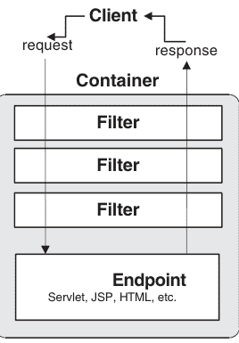

1. 过滤器也适用于“虚拟”资源。通常会产生 404 错误的请求可以通过过滤器，而同一个过滤器可以可选地为其生成响应，而不是显示错误。

图 8-1 经过滤器到达 Servlet 的路径

图 8-1 显示了过滤器被调用时的代码路径。客户端向资源（如 Servlet、JSP 或静态文件）发送请求，Web 应用程序配置为对该请求调用任意数量的过滤器。每个过滤器被轮流调用，每个过滤器将请求向下传递通过过滤器“链”，直到终点执行。

过滤器非常有帮助，因为它们允许 Web 开发者在请求和响应上整洁地添加任意数量的预处理和后处理。这种功能可以通过 Servlet 和请求分发来模拟，但这是一种稍微复杂的方法，并在到达最终终点之前将所有请求通过一个或多个 Servlet。通过使用过滤器，可以无缝地定义并将过滤器应用到现有的 Web 应用程序资源上。

Servlet 2.4 规范进一步扩展了过滤器的实用性。现在可以安装在 `RequestDispatcher` 转发或包含以及发生错误时被调用的过滤器。

## 过滤器生命周期

过滤器的生命周期在概念上与三阶段 Servlet 生命周期相同。过滤器经过初始化、服务和销毁。初始化只发生一次，即过滤器首次被 Web 应用程序加载时。过滤器的服务阶段在每次过滤器应用于请求和响应时调用。销毁阶段在 Web 应用程序完全结束使用过滤器后调用，并且过滤器的所有资源需要适当终止。图 8-2 展示了过滤器的生命周期。

图 8-2 的图表不需要太多的解释。与 Servlet 生命周期 2-1 相比，它包含了完全相同的 `init()` 和 `destroy()` 方法，分别对应初始化和销毁阶段。唯一需要解释的是新的 `doFilter()` 方法，它对应于生命周期的服务阶段。`doFilter()` 方法是容器将过滤器应用于 `ServletRequest` 和 `ServletResponse` 时调用的方法。请求和响应都作为参数传递给该方法并在对过滤器进行自定义。

## 编写一个简单的过滤器

过滤器必须实现 `javax.servlet.Filter` 接口。该接口定义了过滤器的生命周期并强制执行支持所有方法的自定义过滤器。`Filter` 接口定义了三个方法：

- `void init(FilterConfig config) throws ServletException`：`init()` 方法在容器首次加载过滤器时调用。此方法用于从 `web.xml` 文件中获取初始化参数并执行方法中的任何其他初始化代码。它接收一个 `FilterConfig` 对象的引用，用于访问初始化数据。该方法被调用且仅调用一次。
- `void destroy()`：当 `Filter` 从内存中卸载时，会调用 `destroy()` 方法。通常发生在应用程序关闭时。`destroy()` 方法用于妥善关闭由 `Filter` 占用的任何外部资源。
- `void doFilter(ServletRequest request, ServletResponse response, FilterChain chain) throws IOException, ServletException`：`doFilter()` 方法是 `Filter` 执行所有工作的地方。该方法接收了三个参数：`ServletRequest` 实例、`ServletResponse` 实例和 `FilterChain` 对象。在 `HttpServlet` 的情况下，`ServletRequest` 和 `ServletResponse` 对象是 `HttpServletRequest` 和 `HttpServletResponse` 的实例。`Filter` 需要将它们强制类型转换，以便分别访问 `HttpServletRequest` 和 `HttpServletResponse` 对象。

与 `service` 方法类似，`doFilter()` 方法可能被多个线程同时调用。对非局部变量（成员变量）和资源的访问需要以线程安全的方式进行。

上述三个方法应该相当直观，但引入了两个新对象：`FilterConfig` 和 `FilterChain`。`FilterConfig` 对象用于 `Filter` 的配置，而 `FilterChain` 代表了当前应用于请求和响应的 `Filter` 链。这两个对象都将在本节的后续部分进行进一步解释。

对于所有用途而言，`Filter` 提供的功能与 `Servlet` 相同。唯一的区别是 `Filter` 在链中的每个资源之间强制执行了清晰的分离。这是一个重要的理解概念，因为这就是为什么 `Filter` 是 `Servlet` 的有用补充，在某些情况下，它是比 `Servlet` 更优越的形式。为了说明这一点，请看列表 8-1 中的 `Filter`。它是一个为客户端生成简单响应的 `Filter`——等同于第 2 章中看到的 HelloWorld。

## 列表 8-1 HelloWorldFilter.java

```java
package com.jspbook;

import java.io.*;
import javax.servlet.*;
import javax.servlet.http.*;

public class HelloWorldFilter implements Filter {

    public void init(FilterConfig config) {
    }

    public void doFilter(ServletRequest req, ServletResponse res, FilterChain filter)
            throws IOException, ServletException {

        HttpServletRequest request = (HttpServletRequest) req;
        HttpServletResponse response = (HttpServletResponse) res;

        response.setContentType("text/html");
        PrintWriter out = response.getWriter();

        out.println("<html>");
        out.println("<head>");
        out.println("<title>Hello World!</title>");
        out.println("</head>");
        out.println("<body>");
        out.println("<h1>Hello World!</h1>");
        out.println("</body>");
        out.println("</html>");
        return;
    }

    public void destroy() {
    }
}
```

尝试一下 HelloWorld Filter。将列表 8-1 保存为 `HelloWorldFilter.java`，存放在 jspbook 应用程序 `/WEB-INF/classes/jspbook` 目录下。编译代码，但在查看任何结果之前，Filter 需要与 Web 应用程序一起部署。Filter 的部署与 Servlet 类似。唯一的区别是所使用的 `web.xml` 元素名称不同。使用的不是 `servlet`、`servlet-name` 和 `servlet-class` 元素，而是 `filter`、`filter-name` 和 `filter-class` 元素。这三个新元素提供了各自相同的功能，唯一的区别是加载和配置的是 `Filter` 而不是 `Servlet`。在用法中，它看起来类似于列表 8-2 中的条目。将以下代码添加到 jspbook 应用程序 `/WEB-INF` 目录下的 `web.xml` 中。

## 列表 8-2 web.xml 中的 HelloWorldFilter 条目

```xml
<filter>
  <filter-name>HelloWorld</filter-name>
  <filter-class>com.jspbook.HelloWorldFilter</filter-class>
</filter>

<filter-mapping>
  <filter-name>HelloWorld</filter-name>
  <url-pattern>/HelloWorld/*</url-pattern>
</filter-mapping>
```


确保 `web.xml` 中的上述条目出现在任何 `servlet` 元素之前，`context-param` 元素之后。保存更改并重新加载 `jspbook` Web 应用程序。访问 `http://127.0.0.1/jspbook/HelloWorldFilter` 查看新添加的 Filter 使用情况。图 8-3 显示了浏览器渲染的结果。

显而易见，Filter 可以完成 Servlet 能做的所有事情。“Hello World”示例简单且直接，但不要忽略核心点：Filter 是带有某些额外功能的 Servlet。第 2 章中的任何示例都可以实现为 Filter。本章将不会纠结于“你可以将第 2 章中的所有示例重新创建为 Filter”这一点。重点在于 Filter 比 Servlet 表现得更好。

## Filter 链

Filter 链是 Filter 变得有用的原因。列表 8-2 展示了如何像 Servlet 一样使用 Filter，但这并不是 Filter 设计初衷。回想 Filter 接口中最重要的方法是 `doFilter()` 方法，它传递了三个参数，分别是 `ServletRequest`、`ServletResponse` 和 `FilterChain` 对象的实例。`ServletRequest` 和 `ServletResponse` 对象已经在第 2 章中进行了详细介绍。但 `FilterChain` 是新的。`FilterChain` 对象代表了在特定请求和响应上执行的可能的 Filter 栈。在这里，Filter 提供了一种方便的增强，以便清晰地为 Servlet 应用多层层功能。

如图 8-1 所示，Filter 为 `HttpServletRequest` 和 `HttpServletResponse` 提供了一种机制。这与 Servlet 设计为单端点的理念形成对比。通过使用 Filter，可以将功能划分为多个逻辑层并按需进行处理。使用 Servlet 时，这种功能必须通过某些巧妙的请求补丁来实现。图 8-4 解释了这一概念。

图 8-4 显示了 Web 应用程序的一些真实需求的模拟示例。安全、效率和内容生成都是概念性需求。在实践中，这些需求的实现方式各异，但随着 Web 应用程序的增长，除非使用清晰的功能强制分离，否则很难管理这些需求。这种分离既可以通过 Servlet 也可以 Filter 实现，而 Filter 提供了一个非常直接的分离和强制层。

Filter 所代表的分层分离归功于 Filter 链 —— `FilterChain` 对象。`FilterChain` 对象被配置用于特定的真实的或虚拟的端点。在运行时调用 `doFilter()` 方法期间，Filter 会接收到此对象，因为它需要决定 Filter 应该完全处理请求和响应，还是仅处理这对对象并传递给链中的下一个 Filter。在多个 Filter 应用于同一端点的情况下，Filter 的顺序至关重要。

```java
ServletException {

    HttpServletRequest request = (HttpServletRequest) req;

    HttpServletResponse response = (HttpServletResponse) res;

    String uri = request.getRequestURI();

    String path = request.getContextPath();

    String turi = uri.substring(path.length(), uri.length());

    if (turi.startsWith("/redirect")) {

        String url = request.getParameter("url");

        // error check!

        if (url == null || url.equals("")) {

            response.sendRedirect(path);

            return;

        }

        Link l1 = new Link();

        l1.url = url;

        l1.count = 1;

        l1.lastVisited = Calendar.getInstance().getTimeInMillis();

        if (responses.get(l1.url) != null) {

            l1 = (Link) responses.get(l1.url);

            l1.count++;

        }

    } else {

        responses.put(l1.url, l1);

    }

    response.sendRedirect(url);

    return;

}

    if (uri.endsWith(".js") || uri.endsWith(".css") ||

        uri.endsWith(".gif") || uri.endsWith(".png") ||

        uri.endsWith(".jpg") || uri.endsWith(".jpeg")) {

        chain.doFilter(req, res);

        return;

    }

}

{

    // Log request

    Link l1 = new Link();

    l1.url = uri;

    l1.count = 1;

    l1.lastVisited = Calendar.getInstance().getTimeInMillis();

    if (requests.get(l1.url) != null) {

        l1 = (Link) requests.get(l1.url);

        l1.count++;

    } else {

        requests.put(l1.url, l1);

    }

}

// log referer

String referer = request.getHeader("referer");

if (referer != null && !referer.equals("")) {

    Link l = new Link();

    l.url = referer;

    l.count = 1;

    l.lastVisited = Calendar.getInstance().getTimeInMillis();

    if (referers.get(l.url) != null) {

        l = (Link) referers.get(l.url);

        l.count++;

    } else {

        referers.put(l.url, l);

    }

}

// log the hit

count++;

chain.doFilter(req, res);

public void init(FilterConfig filterConfig) {

    this.fc = filterConfig;

}

public void destroy() {

    this.fc = null;

}

// total visitors

public int getCount() {

    return count;

}

public static Link[] getRequests() {

    Collection c = requests.values();

    Vector v = new Vector(c);

    Collections.sort(v, new LinkComparator());

    return (Link[])v.toArray(new Link[0]);

}

public static Link[] getResponses() {

    Collection c = responses.values();

    Vector v = new Vector(c);

    Collections.sort(v, new LinkComparator());

    return (Link[])v.toArray(new Link[0]);

}

public static Link[] getReferers() {

    Collection c = referers.values();

    Vector v = new Vector(c);

    Collections.sort(v, new LinkComparator());

    return (Link[])v.toArray(new Link[0]);

}

public long getDays() {

    Calendar now = Calendar.getInstance();

    long a = startDate.getTimeInMillis();

    long b = now.getTimeInMillis();

    long between = b - a;

    long days = (between / (1000*60*60*24));

    if (days < 1) {

        days = 1;

    }

    return days;

}
```

该 Filter 通过维护三个 `Hashtable` 对象来跟踪传入的请求、传入请求的引用来源以及响应请求。

```java
public static Hashtable requests = new Hashtable();

public static Hashtable responses = new Hashtable();

public static Hashtable referers = new Hashtable();
```

每处理一个请求时，Filter 都会更新对应的表。如果该 URL 之前出现过，则计数加 1；否则，会创建一个新的 `Link` 对象。这使得应用程序能够有效地跟踪访问者统计数据和引用路径。

位于 `jspbook` Web 根目录下的列表 8-7 `linktracker.jsp`。

## 列表 8-7 linktracker.jsp

```jsp
<%@ page import="com.jsp.sun.**" %>

<%@ taglib uri="http://java.com/jsp/core_rt" prefix="c" %>

<%

  requests = LinkTrackerFilter.getRequests();

  responses = LinkTrackerFilter.getResponses();

  referers = LinkTrackerFilter.getReferers();

%>

<p class="h1">请求 (Requests)</p>

<c:forEach var="r" begin="0" items="${requests}">

<p class="nopad"><a href="${r.url}">${r.url}</a> ${r.count}

${r.lastVisited}</p>

</c:forEach>

<p class="h1">响应 (Responses)</p>

<c:forEach var="r" begin="0" items="${responses}">

<p class="nopad"><a href="${r.url}">${r.url}</a> ${r.count}

${r.lastVisited}</p>

</c:forEach>

<p class="h1">引用来源 (Referers)</p>

<c:forEach var="r" begin="0" items="${referers}">

<p class="nopad"><a href="${r.url}">${r.url}</a> ${r.count}

${r.lastVisited}</p>

</c:forEach>
```

该 JSP 使用了三个树来显示关于请求、响应和引用的有序信息。这些信息分别从链接跟踪 Filter 的 `getRequests()`、`getResponses()` 和 `getReferers()` 方法获取。结果是一个 HTML 页面，显示了 `LinkTracker` Filter 跟踪的信息。

尝试通过编译 `LinkTracker.java`、`Link.java` 和 `LinkComparator.java` 来测试跟踪 Filter，重新加载 Web Application，并访问 `http://127.0.0.1/jspbook/linktracker.jsp`。你将看到一个显示链接跟踪统计的页面。图 8-5 显示了结果的浏览器渲染情况。

最初信息是稀疏的；在您对 Web Application 中的各种资源发送 HTTP 请求之前，没有任何内容可供跟踪。尝试浏览之前的代码示例。返回 `linktracker.jsp` 后，你将看到它们的信息已被添加。只有当链接专门为链接跟踪 Filter 进行了编码时，响应才会被跟踪。指向外部资源的链接需要通过设置 URL 参数重定向（到 `jspbook` Web Application 内部）到该出站 URL。例如，出站链接 `"http://google.com"` 需要更改为 `"redirect?url=http://google.com"`。该技术与第 2 章列表 2-6 中 `LinkTracker` Servlet 使用的技术相同。如果需要，请复习第 2 章的示例以获取完整说明及其使用方法。

那么，这个示例获得了什么呢？该示例说明了 Filter 的预期且流行的用法，即作为一种可以为整个 Web Application 添加功能的组件，而不需要底层资源。`doFilter()` 方法负责这一点，意识到这种功能的强大性至关重要。想象其他分层服务，如安全、缓存或内容压缩，你就能轻松地看出为什么 Filter 是 Servlet 规范的有用补充。

## Filter 配置

Filter 的配置方法与 Servlet 相同。Filter 的 `web.xml` 元素可以包含任何 `init-param` 元素来定义自定义初始化参数。此处跳过了对 `init-param` 以及子元素 `param-name` 和 `param-value` 的讨论，因为这些在第 2 章的 Servlet 配置中已经解释过了。

为 Filter 定义的初始参数可以通过参数传递给 `init()` 方法的 `FilterConfig` 对象访问。`FilterConfig` 类与用于 Servlet 的 `ServletConfig` 类非常相似。`FilterConfig` 提供了以下方法：

- `String getFilterName()`：返回在 Filter `web.xml` 条目中定义的 Filter 名称。
- `String getInitParameter(String name)`：`getInitParameter()` 方法返回与给定初始参数名称匹配的值。参数的名称和值分别由 Filter `web.xml` 条目中的 `param-name` 和 `param-value` 元素定义。如果没有找到匹配项，则返回 `null`。
- `Enumeration getInitParameterNames()`：`getInitParameterNames()` 方法返回一个 `java.util.Enumeration` 对象，包含 Filter 的所有初始参数名。初始参数名是 Filter `web.xml` 条目中 `param-name` 元素定义的。
- `ServletContext getServletContext()`：`getServletContext()` 方法返回 Filter 应用程序的 `ServletContext`。

## Filter 与请求分发

默认情况下，会构建 Filter 链来处理客户端的请求。如果使用 `RequestDispatcher` 对象的 `forward()` 或 `include()` 方法分发请求，则不会应用 Filter。然而，此功能可以通过 `web.xml` 配置。`filter-mapping` 元素可以包含任何请求分发元素，以配置 Filter 应用于请求。分发器元素有四个值：`REQUEST`、`INCLUDE`、`FORWARD` 和 `ERROR`。不同的值代表 Filter 应该仅应用于客户端请求、仅应用于包含、仅应用于转发、仅应用于错误，或者这四者的任何组合。

例如，将列表 8-5 仅应用于 `RequestDispatcher` `include`，可以通过以下方式实现：

```xml
<filter>
  <filter-name>LinkTracker</filter-name>
  <filter-class>com.jspbook.LinkTracker</filter-class>
</filter>

<filter-mapping>
  <filter-name>LinkTracker</filter-name>
  <url-pattern>/*</url-pattern>
</filter-mapping>
```


列表 8-7 位于 jspbook Web 根目录下的 `linktracker.jsp`。

## 列表 8-7 linktracker.jsp

```jsp
<%@ page import="com.jsp.sun.*" %>
<%@ taglib uri="http://java.com/jsp/core_rt" prefix="c" %>

<%
  requests = LinkTrackerFilter.getRequests();
  responses = LinkTrackerFilter.getResponses();
  referers = LinkTrackerFilter.getReferers();
%>

<p class="h1">请求 (Requests)</p>
<c:forEach var="r" begin="0" items="${requests}">
  <p class="nopad"><a href="${r.url}">${r.url}</a> ${r.count} ${r.lastVisited}</p>
</c:forEach>

<p class="h1">响应 (Responses)</p>
<c:forEach var="r" begin="0" items="${responses}">
  <p class="nopad"><a href="${r.url}">${r.url}</a> ${r.count} ${r.lastVisited}</p>
</c:forEach>

<p class="h1">引用来源 (Referers)</p>
<c:forEach var="r" begin="0" items="${referers}">
  <p class="nopad"><a href="${r.url}">${r.url}</a> ${r.count} ${r.lastVisited}</p>
</c:forEach>
```

该 JSP 使用了三个树来显示关于请求、响应和引用的有序信息。这些信息分别从链接跟踪 Filter 的 `getRequests()`、`getResponses()` 和 `getReferers()` 方法获取。结果是一个 HTML 页面，显示了 `LinkTracker` Filter 跟踪的信息。

尝试通过编译 `LinkTracker.java`、`Link.java` 和 `LinkComparator.java` 来测试跟踪 Filter，重新加载 Web Application，并访问 `http://127.0.0.1/jspbook/linktracker.jsp`。你将看到一个显示链接跟踪统计的页面。图 8-5 显示了结果的浏览器渲染情况。

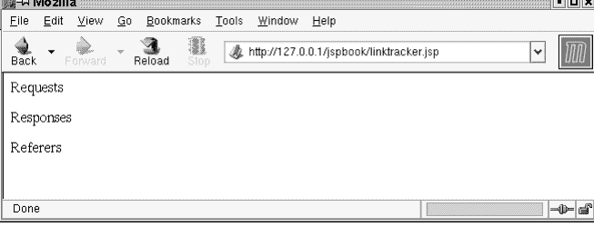

最初信息是稀疏的；在您对 Web Application 中的各种资源发送 HTTP 请求之前，没有任何内容可供跟踪。尝试浏览之前的代码示例。返回 `linktracker.jsp` 后，你将看到它们的信息已被添加。只有当链接专门为链接跟踪 Filter 进行了编码时，响应才会被跟踪。指向外部资源的链接需要通过设置 URL 参数重定向（到 jspbook Web Application 内部）到该出站 URL。例如，出站链接 `http://google.com` 需要更改为 `redirect?url=http://google.com`。该技术与第 2 章列表 2-6 中 `LinkTracker` Servlet 使用的技术相同。如果需要，请复习第 2 章的示例以获取完整说明及其使用方法。

那么，这个示例获得了什么呢？该示例说明了 Filter 的预期且流行的用法，即作为一种可以为整个 Web Application 添加功能的组件，而不需要底层资源。`doFilter()` 方法负责这一点，意识到这种功能的强大性至关重要。想象其他分层服务，如安全、缓存或内容压缩，你就能轻松地看出为什么 Filter 是 Servlet 规范的有用补充。

## Filter 配置

Filter 的配置方法与 Servlet 相同。Filter 的 `web.xml` 元素可以包含任何 `init-param` 元素来定义自定义初始化参数。此处跳过了对 `init-param` 以及子元素 `param-name` 和 `param-value` 的讨论，因为这些在第 2 章的 Servlet 配置中已经解释过了。

为 Filter 定义的初始参数可以通过参数传递给 `init()` 方法的 `FilterConfig` 对象访问。`FilterConfig` 类与用于 Servlet 的 `ServletConfig` 类非常相似。`FilterConfig` 提供了以下方法：

- `String getFilterName()`：返回在 Filter `web.xml` 条目中定义的 Filter 名称。
- `String getInitParameter(String name)`：`getInitParameter()` 方法返回与给定初始参数名称匹配的值。参数的名称和值分别由 Filter `web.xml` 条目中的 `param-name` 和 `param-value` 元素定义。如果没有找到匹配项，则返回 `null`。
- `Enumeration getInitParameterNames()`：`getInitParameterNames()` 方法返回一个 `java.util.Enumeration` 对象，包含 Filter 的所有初始参数名。初始参数名是 Filter `web.xml` 条目中 `param-name` 元素定义的。
- `ServletContext getServletContext()`：`getServletContext()` 方法返回 Filter 应用程序的 `ServletContext`。

## Filter 与请求分发

默认情况下，会构建 Filter 链来处理客户端的请求。如果使用 `RequestDispatcher` 对象的 `forward()` 或 `include()` 方法分发请求，则不会应用 Filter。然而，此功能可以通过 `web.xml` 配置。`filter-mapping` 元素可以包含任何请求分发元素，以配置 Filter 应用于请求。分发器元素有四个值：`REQUEST`、`INCLUDE`、`FORWARD` 和 `ERROR`。不同的值代表 Filter 应该仅应用于客户端请求、仅应用于包含、仅应用于转发、仅应用于错误，或者这四者的任何组合。

例如，将列表 8-5 仅应用于 `RequestDispatcher` `include`，可以通过以下方式实现：

```xml
<filter>
  <filter-name>LinkTracker</filter-name>
  <filter-class>com.jspbook.LinkTracker</filter-class>
</filter>

<filter-mapping>
  <filter-name>LinkTracker</filter-name>
  <url-pattern>/*</url-pattern>
  <dispatcher>INCLUDE</dispatcher>
</filter-mapping>
```


# Filter 与请求分发（接上文）

...（上省略，以下是后续的 Filter 包装器部分翻译）

## 包装器

Filter 的另一个强大功能是可以可选地对请求或响应进行包装。包装是为了将请求或响应封装在另一个（自定义的）对象内部。包装的用处在于可以通过自定义包装对象来操作请求或响应。包装器是 Filter 极其重要的部分。包装有许多用处——本章及后续章节将展示其中。

关于包装器的一点是，它们并不是 Filter 特有的。这种功能和相关类是在 Servlet 2.3 中引入的。

## 请求包装

请求和响应的包装方式是不同的。包装器实际上只是被包装对象的实现。请求包装器将是 `ServletRequest` 的实现。在 `HttpServletRequest` 的情况下，包装器是 `HttpServletRequest` 的实现。Servlet API 提供了 `ServletRequestWrapper` 和 `HttpServletRequestWrapper` 类作为用于子类的包装器。创建自定义包装器可以通过扩展相应的类并编写方法来实现。

在包装请求的情况下，目前还没有好的用处。对请求的预处理通常是为了填充 Servlet 或 JSP 显示的对象。JavaBeans 经常由 Filter 填充，以便 JSP 轻松通过 `<property>` 标准动作或 EL 显示。在这种常见情况下，请求包装器是可行的，但通常使用几行代码填充 JavaBean 更简单。

在某些情况下，绝对需要请求包装。这些情况发生在任何需要更改 `ServletRequest` 或 `HttpServletRequest` 功能时。作为这些情况的某个示例，想象对 `HttpServletRequest` 进行自定义以提供审计信息。每当调用方法时，都会将信息记录到日志中。通常这种审计很难实现，因为它需要编辑 `HttpServletRequest` 实现的源代码，但请求包装轻松提供了这种功能。列表 8-8 中的包装器是 `HttpServletRequest` 的自定义版本，留下了方法调用的审计轨迹。

### 列表 8-8 针对 HttpServletRequest 的审计跟踪包装器

```java
package com.jspbook;

class AuditRequestWrapper extends HttpServletRequestWrapper {

    Logger logger;

    public AuditRequestWrapper(Logger logger, HttpServletRequest request) {
        super(request);
        this.logger = logger;
    }

    public String getContentType() {
        String contentType = super.getContentType();
        logger.fine("ContentType[" + contentType + "]");
        return contentType;
    }

    public int getContentLength() {
        int contentLength = super.getContentLength();
        logger.fine("getContentLength[" + contentLength + "]");
        return contentLength;
    }

    public long getDateHeader(String s) {
        long date = super.getDateHeader(s);
        logger.fine("getDateHeader[" + s + ": " + date + "]");
        return date;
    }

    public String getHeader(String s) {
        String header = super.getHeader(s);
        logger.fine("getHeader[" + s + ": " + header + "]");
        return header;
    }

    public int getIntHeader(String s) {
        int header = super.getIntHeader(s);
        logger.fine("getIntHeader[" + s + ": " + header + "]");
        return header;
    }

    public String getQueryString() {
        String queryString = super.getQueryString();
        logger.fine("getQueryString[" + queryString + "]");
        return queryString;
    }

    // 为了清晰起见，省略了其他方法
}
```

该包装器非常简单。如下所示，logger 使用 Web 应用程序可用的 logger 调用某些方法。注意，包装器有一个构造函数，它接收一个 `Logger` 和一个 `HttpServletRequest`。这是 Filter 使用的包装器类所必需的。列表 8-9 包含了该包装器的代码。

### 列表 8-9 AuditFilter.java

```java
package com.jspbook;

import java.io.*;
import java.util.logging.*;
import javax.servlet.*;
import javax.servlet.http.*;

public class AuditFilter implements javax.servlet.Filter {

    public void doFilter(ServletRequest req, ServletResponse res, FilterChain chain) throws IOException, ServletException {
        Logger logger = SiteLogger.getLogger();
        AuditRequestWrapper wrappedRequest = new AuditRequestWrapper(logger, (HttpServletRequest) req);
        chain.doFilter(wrappedRequest, res);
    }

    public void init(FilterConfig filterConfig) {
        // nop
    }

    public void destroy() {
        // nop
    }
}
```

注意 Filter 在何处包装了请求。在调用 `chain.doFilter()` 方法之前，AuditFilter 使用 `AuditRequestWrapper` 类对 `HttpServletRequest` 对象进行了包装。

```java
Logger logger = SiteLogger.getLogger();
AuditRequestWrapper wrappedRequest = new AuditRequestWrapper(logger, (HttpServletRequest) req);
chain.doFilter(wrappedRequest, res);
```

现在，后续的资源（例如 JSP 或 Servlets）将留下方法调用的审计轨迹信息。

通过将 AuditFilter 部署到 jspbook Web 应用程序来测试它。在 `web.xml` 中添加以下条目。

```xml
<filter>
  <filter-name>AuditFilter</filter-name>
  <filter-class>com.jspbook.AuditFilter</filter-class>
</filter>
<filter-mapping>
  <filter-name>AuditFilter</filter-name>
  <url-pattern>/*</url-pattern>
</filter-mapping>
```

保存对 `web.xml` 的更改，编译 `AuditFilter.java`、`AuditRequestWrapper.java`，并重新加载 jspbook Web 应用程序，以便更改对它们在 `HttpServletRequest` 对象上调用的方法留下审计轨迹。

可以使用简单的 JSP 对 AuditFilter 进行直接测试。将列表 8-10 保存为 `TestAuditFilter.jsp` 位于 jspbook Web 应用程序的根目录下。

### 列表 8-10 TestAuditFilter.jsp

```jsp
<html>
<body>
<%
  request.getContentLength();
  request.getHeader("Host");
%>
</body>
</html>
```

```java
if (req instanceof HttpServletRequest) {
    HttpServletRequest request = (HttpServletRequest) req;
    HttpServletResponse response = (HttpServletResponse) res;
    String ae = request.getHeader("accept-encoding");
    if (ae != null && ae.indexOf("gzip") != -1) {
        System.out.println("GZIP supported, compressing.");
        GZIPResponseWrapper wrappedResponse = new GZIPResponseWrapper(response);
        chain.doFilter(req, wrappedResponse);
        wrappedResponse.finishResponse();
    }
    chain.doFilter(req, res);
}

public void init(FilterConfig filterConfig) {
    // noop
}

public void destroy() {
    // noop
}
```

如前所述，处理响应的 Filter 代码编写起来要困难一些。这是因为处理 Filter 仅捕获原始输出，还需要重置 HTTP 响应头以匹配这些更改。前面的 GZIP Filter 代码就说明了这一点，而 GZIP Filter 本身并没有这样做。在主 `doFilter` 方法中，它会检查客户端是否支持 GZIP 压缩。

```java
String ae = request.getHeader("accept-encoding");
if (ae != null && ae.indexOf("gzip") != -1) {
    GZIPServletResponseWrapper wrappedResponse = new GZIPServletResponseWrapper(response);
    chain.doFilter(req, wrappedResponse);
    wrappedResponse.finishResponse();
}
return;
```

如果是，则使用 `GZIPResponseWrapper`。如果不是，Filter 则不使用。`GZIPResponseWrapper` 用于捕获正常生成的内容并通过一个 `GZIPOutputStream` 进行传输。`GZIPResponseWrapper` 类也是一个自定义类。以下是 `GZIPResponseWrapper` 的代码。将列表 8-12 存为 `GZIPResponseWrapper.java`，位于 jspbook 应用程序的 `/WEB-INF/classes/com/jspbook` 目录下。

### 列表 8-12 GZIPResponseWrapper

```java
package com.jspbook;

import java.io.*;
import java.util.*;
import javax.servlet.*;
import javax.servlet.http.*;

public class GZIPResponseWrapper extends HttpServletResponseWrapper {

    protected HttpServletResponse origResponse = null;
    protected ServletOutputStream stream = null;
    protected PrintWriter writer = null;

    public GZIPResponseWrapper(HttpServletResponse response) {
        super(response);
        origResponse = response;
    }

    public ServletOutputStream createOutputStream() throws IOException {
        return (new GZIPResponseStream(origResponse));
    }

    public void finishResponse() {
        try {
            if (writer != null) {
                writer.close();
            } else {
                if (stream != null) {
                    stream.close();
                }
            }
        } catch (IOException e) {
        }
    }

    public void flushBuffer() throws IOException {
        stream.flush();
    }

    public ServletOutputStream getOutputStream() throws IOException {
        if (writer != null) {
            throw new IllegalStateException("getWriter() has already been called");
        }
        if (stream == null) {
            stream = createOutputStream();
        }
        return (stream);
    }

    public PrintWriter getWriter() throws IOException {
        if (writer != null) {
            return (writer);
        }
        if (stream != null) {
            throw new IllegalStateException("getOutputStream() has already been called!");
        }
        stream = createOutputStream();
        writer = new PrintWriter(new OutputStreamWriter(stream, "UTF-8"));
        return (writer);
    }

    public void setContentLength(int length) {
    }
}
```

前面的代码仅执行了一个重要的任务：使用 `GZIPResponseStream` 代替 `ServletOutputStream`。代码的其余部分只是填充，以确保包装类在所有 `HttpServlet` 方法中都使用 `GZIPResponseStream`。`GZIPResponseStream` 是完成所有工作的地方。在这个类中，通常直接发送到客户端的内容被捕获到缓冲区中，并通过 `GZIPOutputStream` 传输。压缩后的内容随后连同相应的 HTTP 响应头一起发送给客户端。通过 `GZIPResponseWrapper`，`GZIPResponseStream` 也是此示例所需的自定义类。以下是 `GZIPResponseStream` 类的代码。将列表 8-13 存为 `GZIPResponseStream.java`，位于 jspbook Web 应用程序的 `/WEB-INF/classes/com/jspbook` 目录下。

### 列表 8-13 GZIPResponseStream


package com.jspbook;

import java.io.*;
import java.util.zip.GZIPOutputStream;
import javax.servlet.*;
import javax.servlet.http.*;

```java
public class GZIPResponseStream extends ServletOutputStream {
    protected ByteArrayOutputStream baos = null;
    protected GZIPOutputStream gzipstream = null;
    protected boolean closed = false;
    protected HttpServletResponse response = null;
    protected ServletOutputStream output = null;

    public GZIPResponseStream(HttpServletResponse response) throws IOException {
        super();
        this.response = response;
        this.output = response.getOutputStream();
        baos = new ByteArrayOutputStream();
        gzipstream = new GZIPOutputStream(baos);
    }

    public void close() throws IOException {
        if (closed) {
            throw new IOException("This output stream has already been closed");
        }
        gzipstream.finish();
        byte[] bytes = baos.toByteArray();
        response.addHeader("Content-Length", String.valueOf(bytes.length));
        response.addHeader("Content-Encoding", "gzip");
        output.write(bytes);
    }

    public void flush() throws IOException {
        if (closed) {
            throw new IOException("This output stream has already been closed");
        }
        gzipstream.flush();
    }
}
```

```java
public ServletOutputStream getOutputStream() throws IOException {
    if (writer != null) {
        throw new IllegalStateException("getWriter() has already been called");
    }
    if (stream == null) {
        stream = createOutputStream();
    }
    return (stream);
}
```

```java
public PrintWriter getWriter() throws IOException {
    if (writer != null) {
        return (writer);
    }
    if (stream != null) {
        throw new IllegalStateException("getOutputStream() has already been called!");
    }
    stream = createOutputStream();
    writer = new PrintWriter(new OutputStreamWriter(stream, "UTF-8"));
    return (writer);
}
```

```java
public void flush() throws IOException {
    if (closed) {
        throw new IOException("This output stream has already been closed");
    }
    gzipstream.flush();
}
```

```java
public void close() throws IOException {
    if (closed) {
        throw new IOException("This output stream has already been closed");
    }
    gzipstream.finish();
    byte[] bytes = baos.toByteArray();
    response.addHeader("Content-Length", String.valueOf(bytes.length));
    response.addHeader("Content-Encoding", "gzip");
    output.write(bytes);
}
```

```java
public boolean closed() {
    return closed;
}
```

最终结果是，如果客户端支持 GZIP，`GZIPFilter` 会自动压缩该客户端请求的内容。如果不支持压缩，则发送内容的普通未压缩形式。

可以看到请求和响应。要查看 `GZIPFilter` 的效果，请为 jspbook Web 应用程序中的一个资源伪造另一个 HTTP 请求。以欢迎页 `http://127.0.0.1/jspbook/welcome.html` 为例。通过在 80 端口运行 `telnet` 来伪造一个 HTTP 请求。

```bash
telnet 127.0.0.1 80
```

在程序手动加载后，发送 HTTP 请求。

```http
GET /jspbook/welcome.html HTTP/1.0
```

结果是一个包含页面内容的 HTTP 响应。图 8-6 显示了整个过程。

```text
root@localhost:/usr/jakarta-tomcat-5/webapps/jspbook - Shell - Console

[root@localhost jspbook]#$ telnet 127.0.0.1 80

Trying to 127.0.0.1...
Connected to 127.0.0.1.
Escape character is '^'

GET /jspbook/welcome.html HTTP/1.0

HTTP/1.1 200 OK
ETag: W/"173-104843123000"
Last-Modified: Sun, 23 Mar 2003 18:12:03 GMT
Content-Type: text/html
Content-Length: 173
Date: Tue, 25 Mar 2003 02:32:06 GMT
Server: Coyote/1.0
Connection: close

<html>
<head>
<title>Welcome!</title>
</head>
<body>
Welcome to the example Web Application for
JavaServlets and JSP, the J2EE Web Tier-.
</body>
</html>

Connection closed by foreign host.
[root@localhost jspbook]# _
```

图 8-6 往 welcome.html 的伪造 HTTP 请求

173 字节未被压缩。这是因为伪造的 HTTP 请求没有包含一个告知服务器它接受通过 GZIP 压缩编码的内容的 HTTP 标头。重新执行伪造请求，但这次在请求中添加以下行。

```http
GET /jspbook/welcome.html HTTP/1.0
accept-encoding: gzip
```

```text
root@localhost:/usr/jakarta-tomcat-5/webapps/jspbook - Shell - Konsole

[root@localhost jspbook]# telnet 127.0.0.1 80

Trying 127.0.0.1...
Connected to 127.0.0.1.
Escape character is '^'

GET /jspbook/welcome.html HTTP/1.0
accept-encoding: gzip

HTTP/1.1 200 OK
ETag: W/"3412-08443123000"
Last-Modified: Sun, 23 Mar 2003 18:12:03 GMT
Content-Encoding: gzip
Content-Type: text/html
Content-Length: 145
Date: Thu, 25 Mar 2003 02:35:22 GMT
Server: Apache Coyote/1.0
Connection: close

1.
uEUEAsUrpsj kY==Ö©1D0TRF=sn-i,Do2c-iPiaJ*Å8YNYDV;azU|u+iConnection closed by host.
[root@localhost jspbook]#
```

图 8-7 往 welcome.html 的带压缩的伪造 HTTP 请求

现在响应内容被压缩了。请求和响应如图 8-7 所示。

内容是乱码，但是是压缩后的乱码。关键点是 GZIP 压缩过滤器正在工作。如果客户端接受压缩内容，它就会被发送。我们手动无法轻易地压缩内容，但如果浏览器正在读取此响应，它解压缩并渲染内容将不会很困难。

### 压缩：我们获得了什么？

压缩过滤器是书中较长的例子之一，但它也是最有用的例子之一。压缩过滤器是一个可重用的组件，可以应用于几乎每一个 Web 应用程序。该过滤器的优点是它减少了客户端必须下载的信息量。缺点是它增加了生成响应消耗的额外后处理时间。在大多数情况下，生成响应所需的时间远小于客户端下载响应的时间。通常使用像 `GZIP Filter` 这样的纯压缩过滤器总是有用的补充，但为了获得最佳效率，可以将压缩过滤器与缓存过滤器结合。

已经提到过，GZIP 算法很好，因为它缩小了发送给客户端的内容尺寸。希望你已经认可压缩算法的用处，但为了清晰起见，我们只需展示它有多用。一个简单的 Servlet 就可以说明这一点。将列表 8-15 `CompressionTest.java` 保存到你的 jsp Web 应用程序的 `/WEB-INF/classes` 目录下。

#### CompressionTest.java

```java
import java.io.*;
import java.net.*;
import javax.servlet.*;
import javax.servlet.http.*;

public class CompressionTest extends HttpServlet {
    public void doGet(HttpServletRequest request, HttpServletResponse response) throws IOException {
        response.setContentType("text/html");
        PrintWriter out = response.getWriter();
        out.println("<html>");
        out.println("<head>");
        out.println("<title>Compression Test</title>");
        out.println("</head>");
        out.println("<body>");
        out.println("<h1>Compression Test</h1>");
        out.println("<form action=\"url\">");
        String url = request.getParameter("url");
        if (url != null) {
            out.println("<input size=\"50\" name=\"url\" value=\"" + url + "\">");
        } else {
            out.println("<input size=\"50\" name=\"url\">");
        }
        out.println("<input type=\"submit\" value=\"Check\">");
        out.println("</form>");
        out.println("URL: ");
        if (url != null) {
            URL connection = new URL(url);
            HttpURLConnection huc = (HttpURLConnection) connection.openConnection();
            huc.setRequestProperty("user-agent", "Mozilla");
            huc.connect();
            ByteArrayOutputStream baos = new ByteArrayOutputStream();
            InputStream is = huc.getInputStream();
            int byte;
            while ((byte = is.read()) != -1) {
                baos.write(byte);
            }
            byte[] b1 = baos.toByteArray();
            out.print("Uncompressed: " + b1.length);
            out.println("Compressed: " + b2.length);
            out.println("Space saved: " + (b1.length - b2.length) + " bytes, or " + ((b1.length - b2.length) * 100 / b1.length) + "%");
            out.println("Downstream (2kbps)");
            out.println("No GZIP: " + (float) b1.length / 2000 + "seconds");
            out.println("GZIP: " + (float) b2.length / 2000 + "seconds");
            out.println("Downstream (5kbps)");
            out.println("No GZIP: " + (float) b1.length / 5000 + "seconds");
            out.println("GZIP: " + (float) b2.length / 5000 + "seconds");
            out.println("Downstream (10kbps)");
            out.println("No GZIP: " + (float) b1.length / 10000 + "seconds");
            out.println("GZIP: " + (float) b2.length / 10000 + "seconds");
        }
        out.println("</body>");
        out.println("</html>");
    }
}
```

> 注：示例代码中 `b2` 的定义在提供的代码片段中不完整，此处假设为压缩后的字节数组。

### 包装器

### 压缩测试

缓存是响应包装最有用的用途之一。缓存过滤器的核心思想是尽可能地减少生成动态页面所需的时间。这一功能与压缩过滤器相辅并成，极大减少了使用 JSP 和 Servlets 等动态资源时的开销。

缓存过滤器的工作原理是在内存或本地磁盘上保留响应的副本，并将其重用于后续对同一资源的请求。通过这种方式，缓存过滤器可以拦截传入的请求，检查缓存是否有效，并可选地发送缓存的响应版本。时间上的优势源于使用缓存而不是生成动态响应。在 Servlet 或 JSP 执行某些复杂逻辑或访问耗时资源的情况下，缓存机制可以大幅提高性能。


# 缓存过滤器实现

缓存的缺点是消除了动态生成；某些页面无法缓存。使用动态页面的核心意义在于创建一个无法静态完成的动态页面。缓存仅仅是页面输出的静态版本。动态页面和缓存似乎存在冲突，但在实践中，有很多非常有用的缓存场景。每当客户端发起请求时，动态页面之所以是动态的，是因为它们包含了可能变化但很可能不会改变的资源。最常见的情况之一是动态包含，例如头部或页脚。使用动态页面很棒，但在其中包含的内容未发生变化之前，页面的末尾不会发生变化。变化之间的所有请求都接收相同的响应。在这种情况下，只要缓存定期重置或在包含内容发生变化时重置，缓存就会非常有效。相同类型的缓存也可以应用于新闻页面或由数据库生成的链接列表。

点在于，拥有一个良好的缓存过滤器是有用的，因为并不是所有的动态资源都需要在客户端每次请求时都生成。我们尚未在书中看到一些应用缓存过滤器的良好示例，但在后面的章节中将会出现几个。为了这些示例并为了给缓存提供一个具体的例子，我们现在将构建一个简单的缓存过滤器。将代码 8-16 保存为 `CacheFilter.java` 到 jbook Web 应用程序的 `/WEB-INF/classes/com/jspbook` 目录下。

## 列表 8-16 CacheFilter.java

```java
package com.jspbook;

import java.io.*;
import javax.servlet.*;
import javax.servlet.http.*;
import java.util.*;

public class CacheFilter implements Filter {

    ServletContext sc;
    FilterConfig fc;
    long cacheTimeout = Long.MAX_VALUE;

    public void doFilter(ServletRequest req, ServletResponse res,
        FilterChain chain)
        throws IOException, ServletException {
        HttpServletRequest request = (HttpServletRequest) req;
        HttpServletResponse response = (HttpServletResponse) res;

        // 检查是否是一个不应该被缓存的资源。
        String r = sc.getRealPath("");
        String path = fc.getParameter(request.getRequestURI());
        if (path != null && path.equals("nocache")) {
            chain.doFilter(request, response);
            return;
        }
        path = r + path;

        // 自定义匹配参数
        String id = request.getRequestURI() + request.getQueryString();

        // 可选的本地化敏感性
        String localeSensitive = fc.getParameter("locale-sensitive");
        if (localeSensitive != null) {
            Writer lda = new StringWriter();
            Enumeration locales = request.getLocales();
            while (locales.hasMoreElements()) {
                Locale locale = (Locale) locales.nextElement();
                lda.write(locale.getISOLanguage());
            }
            id = id + lda.toString();
        }

        File tempDir = (File) sc.getAttribute(
            "java.servlet.context.tempdir");

        // 获取可能的缓存
        String temp = tempDir.getAbsolutePath();
        File file = new File(temp + id);

        // 获取当前资源
        if (path == null) {
            path = sc.getRealPath(request.getRequestURI());
        }
        File current = new File(path);

        try {
            long now = Calendar.getInstance().getTimeInMillis();
            // 时间戳检查
            if (!file.exists() || (file.exists() &&
                current.lastModified() > file.lastModified()) ||
                cacheTimeout < now - file.lastModified()) {
                String name = file.getAbsolutePath();
                name = name.substring(0, name.lastIndexOf("/"));
                new File(name).mkdirs();
                ByteArrayOutputStream baos = new ByteArrayOutputStream();
                CacheResponseWrapper wrappedResponse =
                  new CacheResponseWrapper(response, baos);
                chain.doFilter(req, wrappedResponse);
                FileOutputStream fos = new FileOutputStream(file);
                fos.write(baos.toByteArray());
                fos.flush();
                fos.close();
            }
        } catch (Exception e) {
            if (!file.exists()) {
                throw new ServletException(e);
            }
        } catch (IOException e) {
            if (!file.exists()) {
                throw e;
            }
        }

        FileInputStream fis = new FileInputStream(file);
        String mt = sc.getMimeType(request.getRequestURI());
        response.setContentType(mt);
        ServletOutputStream sos = res.getOutputStream();
        for (int i = fis.read(); i != -1; i = fis.read()) {
            sos.write((byte)i);
        }
    }

    public void init(FilterConfig filterConfig) {
        this.fc = filterConfig;
        String ct = fc.getInitParameter("cacheTimeout");
        if (ct != null) {
            cacheTimeout = 60 * 1000 * Long.parseLong(ct);
        }
        this.sc = filterConfig.getServletContext();
    }

    public void destroy() {
        this.sc = null;
        this.fc = null;
    }
}
```

上述代码通过将所有应用到的资源都缓存在 Servlet 定义的临时工作目录中来工作。如果缓存不存在且响应可以缓存，则过滤器封装响应并调用 `doFilter` 方法以便容器生成响应。然后过滤器缓存响应并将其发送到缓存。对于相同资源的未更改请求，将直接从缓存中使用响应，完全跳过 `doFilter` 方法。

数据被缓存了但需要定期更新——例如，通过查询数据库生成的新闻页面？为了性能考虑，缓存页面可能是可以的，但缓存应该隔一段时间自动过期以刷新新闻，无论新闻页面是否发生了变化。缓存过滤器也提供了这种功能，允许将缓存超时值指定为初始参数。该参数名称为 `cacheTimeout`，其值为缓存失效前的分钟数。

`CacheFilter.java` 只是完整缓存过滤器的一部分。为了创建响应的缓存副本，需要对响应进行捕获。`CacheFilter` 使用 `CacheResponseWrapper` 类来捕获并缓存响应。`CacheResponseWrapper` 类的代码与 `GZIPResponseWrapper` 非常相似，如下。将 Listing 8-17 保存为 `CacheResponseWrapper.java` 到 jsp 应用程序 `/WEB-INF/classes/com/jsp` 目录下。

## Listing 8-17 CacheResponseWrapper.java

```java
package com.jsp;

import java.io.*;
import javax.servlet.*;
import javax.servlet.http.*;

public class CacheResponseWrapper extends HttpServletResponseWrapper {
    protected HttpServletResponse origResponse = null;
    protected ServletOutputStream stream = null;
    protected PrintWriter writer = null;
    protected OutputStream cache = null;

    public CacheResponseWrapper(HttpServletResponse response, OutputStream cache) {
        super(response);
        this.origResponse = response;
        this.cache = cache;
    }

    public ServletOutputStream createOutputStream() throws IOException {
        return new CacheResponseStream(origResponse, cache);
    }

    public void flushBuffer() throws IOException {
        stream.flush();
    }

    public ServletOutputStream getOutputStream() throws IOException {
        if (writer != null) {
            throw new IllegalStateException(
              "getWriter() has already been called!");
        }
        if (stream == null) {
            stream = createOutputStream();
            return (stream);
        }
        return stream;
    }

    public PrintWriter getWriter() throws IOException {
        if (writer != null) {
            return (writer);
        }
        if (stream != null) {
            throw new IllegalStateException(
              "getOutputStream() has already been called!");
        }
        stream = createOutputStream();
        writer = new PrintWriter(new OutputStreamWriter(stream, "UTF-8"));
        return (writer);
    }

    public ServletOutputStream createOutputStream() throws IOException {
        return (new CacheResponseStream(origResponse, cache));
    }
}
```

关于 `CacheResponseWrapper.java` 有一个重要的点需要注意。该类返回的不是 `ServletOutputStream`，而是 `CacheResponseStream`。在输出捕获响应包装器中应该出现一种清晰的模式。包装类本身通常与捕获响应关系不大。创建响应涉及的所有逻辑都封装在 `ServletOutputStream` 类中。自定义包装对象通常只是将 `ServletResponse` 返回的默认 `ServletOutputStream` 更改为 `ServletOutputStream` 的自定义子类。在这种情况下，自定义类是 `CacheResponseStream`。重要的缓存代码发生在 `CacheResponseStream` 类中。

`Filter` 使用 `CacheResponseStream` 将响应内容保存到给定的输出流中。缓存过滤器使用 `ByteArrayOutputStream` 对象作为输出流，并将响应保留为字节数组。缓存的字节用于保存响应并将其发送给客户端。`CacheResponseStream` 的代码如下。将 Listing 18-8 保存为 `CacheResponseStream.java` 到 jsp Web 应用程序 `/WEB-INF/class/com/jspbook` 目录下。

## Listing 18-8 CacheResponseStream.java


```java
package java.io.*;
import javax.servlet.*;
import javax.servlet.http.*;

public class CacheResponseStream extends ServletOutputStream {
    protected boolean closed = false;
    protected HttpServletResponse response = null;
    protected ServletOutputStream output = null;
    protected OutputStream cache = null;

    public CacheResponseStream(HttpServletResponse response, OutputStream cache) throws IOException {
        super();
        closed = false;
        this.response = response;
        this.cache = cache;
    }

    public void close() throws IOException {
        if (closed) {
            throw new IOException(
                "This output stream has already been closed");
        }
        cache.close();
        closed = true;
    }

    public void flush() throws IOException {
      if (closed) {
        throw new IOException(
          "Cannot flush a closed output stream"
      }
      cache.flush();
    }

    public void write(int b) throws IOException {
      if (closed) {
        throw new IOException(
          "Cannot write to a closed output stream");
      }
      cache.write((byte)b);
    }

    public void write(byte b[]) throws IOException {
      write(b, 0, b.length);
    }

    public void write(byte b[], int off, int len) throws IOException {
      if (closed) {
        throw new IOException(
          "Cannot write to a closed output stream");
      }
      cache.write(b, off, len);
    }

    public boolean closed() {
      return (this.closed);
    }

    public void reset() {
        //noop
    }
}
```

关于 `CacheResponseStream` 有一个重要的点需要注意。所有的写入方法都经过重写，以便先写入缓存，然后写入原始响应。这确保了内容在捕获用于缓存的同时，仍被发送给客户端。

```java
baos.write((byte)is.read());
}
long stop = Calendar.getInstance().getTimeInInMillis();
times[i] = stop-start();
}
request.setAttribute("t1", new Long(times[0]));
request.setAttribute("t2", new Long(times[1]));
request.setAttribute("url", url);
```

```html
%><html>
<head>
<title>Cache Test</title>
</head>
<body>
<h1>Cache Test Page</h1>
Enter a URL to test.
<form method="POST">
<input name="url" size="50">
<input type="submit" value="Check URL">
</form>
<p><b>Testing: ${t1} milliseconds</b></p>
Request 1: ${t1} milliseconds<br>
Request 2: ${t2} milliseconds<br>
Time saved: ${t1-t2} milliseconds<br>
</body>
</html>
```

该页面是一个用于测试 URL 的 jsp 页面，类似于 `TestCompression.jsp`。它会打开到特定 URL 的连接并请求两次内容。假设服务器目前没有缓存该 URL 的响应；第一个请求应该花费生成请求所需的全部时间。然而，假设第二个请求会命中缓存。虽然我们做不了什么确保 `TestCache.jsp` 对所有 URL 都能按预期工作，但由于我们可以控制缓存，测试将会为我们服务。

确保所有的缓存 Filter 类都已编译，保存修改，并重新加载 `jspbook` Web 应用以反映更改。

浏览到 http://127.0.0.1/jspbook/TestCache.jsp 开始测试。在表单中填入要测试的 URL：http://127.0.0.1/jspbook/time.jsp。提交信息后，将显示响应时间的报告。图 8-10 提供了结果的浏览器渲染图。

384 过滤器

## 缓存测试页面

输入一个 URL 进行测试。

Testing: http://127.0.0.1/jspbook/timemonger.jsp

Request 1: 3950 milliseconds

Request 2: 4 milliseconds

Time saved: 3946 milliseconds

图 8-10 缓存 Filter 工作的浏览器渲染图。

速度差异来自于 Tomcat 为 `jspbook` Web 应用保留的临时工作目录中的 Filter，你会发现出现了一个新文件 `timemonger.jsp.null`。该文件是 `timemonger.jsp` 生成的 HTML 副本。缓存 Filter 将通过使用此文件而不是在每次请求时重新评估 `timemonger.jsp` 来节省时间。注意，由于当前 Filter 配置了一分钟的缓存超时，`TestCache.jsp` 每分钟只会工作一次。

缓存 Filter 的益处显而易见；缓存优化了生成静态（或通常是静态的）内容所需的时间。本章介绍的缓存 Filter 是 Web 应用中值得了解和使用的有用 Filter。使用内容的缓存副本与使用 JSP 或 Servlet 的动态响应相比，时间差异可能是巨大的。如果可能，缓存动态生成的响应始终是值得的。

## 缓存 Servlet 响应

我们创建的缓存 Filter 根据于 URL 并通过检查生成 URL 的文件是否已过期来缓存信息——即，它检查 JSP 或 HTML 页面的时间戳。然而，Servlet 的响应像 JSP 或 HTML 页面生成的响应一样容易被缓存，但当 Servlet 更新时，很难根据 URL 确定哪个 .java 文件响应该 Servlet。这可以通过解析 `web.xml` 并检查 URL 映射元素来实现，但这是留给你的的任务。为了简单起见，`CacheFilter.java` 使用手动检查。如果 URL 映射到 Servlet，你可以通过设置初始配置元素来确保在每次更新 Servlet 代码时都更新缓存。

在本章的前面，提到了如何让 `CacheFilter.java` 缓存特定的 URL。可以设置一个与 URL 同名的初始参数，值为 "nocache"。例如，以下配置将跳过对 `index.jsp` 的缓存。

```xml
<filter>
  <filter-name>Cache</filter-name>
  <filter-class>com.jsp.CacheFilter</filter-class>
  <init-param>
    <param-name>/jsp/index.jsp</param-name>
    <param-value>nocache</param-value>
  </init-param>
</filter>
```

没有说明如果值不是 "nocache" 会发生什么。任何其他值都将被视为 Web 应用中一个需要检查时间的文件位置。例如，如果 URL `/index.jsp` 是由 Servlet `/WEB-INF/classes/com/jsp/Index.java` 生成的，则映射会将缓存失效映射到该文件。

```xml
<filter>
  <filter-name>Cache</filter-name>
  <filter-class>com.jsp.CacheFilter</filter-class>
  <init-param>
    <param-name>/index.jsp</param-name>
    <param-value>WEB-INF/classes/com/jsp/Index.java</param-value>
  </init-param>
</filter>
```

使用上述映射，如果对 `Index.java` Servlet（或任何文件）进行了更改，则 `/index.jsp` 的缓存将重置。通过提供此功能，可以控制隐式映射资源（如 HTML 或 JSP 文件）和显式映射资源（如 Servlet 和 Filter）的缓存。

## 缓存与容错

值得提到的的一个极佳用法是容错性。响应的缓存副本不仅可以加速请求，还有其他好处。想象一下，当 Web 应用在缓存 Filter 加速响应的情况下运行得完美时，如果发生了变化（例如 JSP 拼写错误或数据库故障）会发生什么？通常会抛出异常并向用户显示错误页面，如第 4 节所示。然而，假设存在响应的缓存，可能不需要显示错误页面。相反，显示缓存并持续直到资源完成——即代码拼写错误修复或数据库恢复在线。

我们刚刚创建的缓存 Filter 尝试具有容错性。调用 `doFilter()` 方法的代码被 `try-catch` 语句包裹。

```java
try {
} catch (ServletException e) {
    if (!file.exists()) {
      throw ServletException(e);
    }
}
catch (IOException e) {
    if (!file.exists()) {
      throw e;
    }
}
```

# 第 9 章

## Web应用程序中的状态管理

状态（State）是所有类型编程中都需要关注的重要概念。毕竟，传统编程依赖于准确持久化程序已执行的操作。Web 编程也不例外，在 Web 应用程序中管理状态时，有很多需要注意的事项。然而，在良好的 Web 应用程序中，某些情况下你可以完全假设 Web 应用程序的状态保持了足够的一致性以进行正常运行。Web 应用程序开发人员需要理解为什么状态管理是一个问题，以及如何始终确保正确地执行。本章的目标是清晰地定义并说明如何在 Web 应用程序中适当地管理状态。

本章讨论了以下主题：

- 使用无状态协议 HTTP 维护会话状态。

- `javax.servlet.http.HttpSession` 对象以及对会话作用域的理解。

- 持久化会话状态。

- Cookies 以及在客户端浏览器中保存信息。

- 初始化会话资源。

- 状态与线程安全。

- `javax.servlet.SingleThreadModel` 接口（这是一个不应该使用的接口）。

本章旨在从头到尾阅读；然而，对于开发简单的面向 JSP 的 Web 应用程序来说，这一章并不是关键的。你可以快速略过本章仍然可以完成工作，尽管本章提出的和涵盖的问题对于必须正常运行的 Web 应用程序是至关重要的。如果你计划以成为 JSP 或 Servlet 开发人员为职业，你需要阅读整个章节。

## HTTP 与会话状态

HTTP 和会话状态涉及到 Web 应用程序如何使用 HTTP 来维护用户会话的状态。HTTP 是一种连接型协议；它通过 TCP^1 运行而非 UDP^2。当浏览器向服务器发送请求时……

你可能认为可以通过 IP 地址来识别用户。IP 地址在网络上是唯一的，为什么不能使用它们呢？不使用 IP 地址有许多原因。例如，编写本章的计算机 IP 地址为 192.168.0.2，这是一个“不可路由”的 IP^3 地址。此类地址仅用于识别本地网络上的计算机。该计算机通过路由器连接。该路由器拥有由其所使用的 ISP 提供了一个真实的可路由 IP 地址。路由器使用网络地址转换（NAT）处理 IP 地址和到互联网的连接。当计算机跳转到服务器时，服务器看到的是路由器的 IP 地址，而不是 PC 的地址。许多用户通过各种描述的路由器或代理服务器连接。他们的 IP 地址从未进入互联网；相反，发送的是代理的 IP 地址，因此尝试使用 IP 地址唯一标识客户端的服务器最终将识别出代理背后的某组客户端！

- 1. 传输控制协议 (TCP) 是一种“面向连接”的协议，因为该服务提供了信息到达目的地的保证。

- 2. 用户数据报协议 (UDP) 是一种“无连接”的协议，因为它不确保信息能到达目的地。

- 3. 网网协议 (IP) 将地址明确划分为不同的类别以便使用。不可路由地址属于多个范围；其中一个范围以 192.168 开头，这仅在内部网络上有效。

需要理解的重要概念可以通过列表 9-1 中的 JSP 清楚地说明。

### 列表 9-1 ShowIPAddress.jsp

```html
<html
<head>
<title>ShowIPAddress.jsp</title>
</head>
<body>
Remote Address : <%= request.getRemoteAddr() %><br/>
</body>
</html>
```

将上述代码保存为 `ShowIPAddress.jsp` 并放置在 jbook Web 应用程序的根目录下。尝试运行代码来查找你的 IP；浏览到 http://127.0.0.1/jspbook/ShowIPAddress.jsp。将显示你本地计算机的 IP 地址。图 9-1 显示了 Servlet 输出的浏览器渲染结果。

name。通常，该对象是子类的实例，在使用之前必须对其进行适当的类型转换。

- `Enumeration getAttributeNames()`: `getAttributeNames()` 方法返回一个 `java.util.Enumeration` 对象，包含所有绑定到 session 的对象名称。结合 `getAttribute()` 方法使用，该方法有助于确定当前 session 作用域中绑定了哪些对象。

- `removeAttribute(java.lang.String name)`: `removeAttribute()` 方法从 session 作用域中移除给定名称的对象并返回它；如果没有与该名称绑定的对象，则返回 null。

- `void setAttribute(String name, Object attribute)`: `setAttribute()` 方法用于将对象通过指定的名称绑定到 session。之前与该名称绑定的任何对象将被移除。

应用程序使用这些方法来代表客户端存储数据。存储在 session 作用域中的数据以名称/值对的形式保存。名称是字符串，值是 Java 对象。

session 作用域对于限制后续请求中可能访问的任何对象的范围非常有帮助。例如，如果一个应用程序管理购物车，那么关于购物车的信息需要以某种方式在来自客户端的多次请求中持久化。

用于虚拟购物车对象的持久化代码如下：这是该代码：

```java
ShoppingCart shoppingCart = new ShoppingCart();
HttpSession session = request.getSession();
session.setAttribute("cart", shoppingCart);
```

随后对同一个 servlet 或完全不同的 Servlet 的调用可以通过其 session 绑定来操作同一个购物车。

```java
HttpSession session = request.getSession();
ShoppingCart shoppingCart =
(ShoppingCart)session.getAttribute("cart");
```

从前面的示例中可以清楚看到如何使用 `HttpSession` 对象以及为什么你可能想要使用它。然而，之前提到过 HTTP 是一个无状态协议，且无法使用 IP 来准确跟踪会 ID。你可能会好奇 Web 应用程序是如何成功跟踪用户的。唯一 ID 是如何在服务器和客户端之间往回传输的？这种机制使用了以下两种技术之一：Cookies 或 URL 重写。

## Cookies

Cookies 最初由 Netscape Communications 开发，用于解决使用 HTTP 保持会话上下文的问题。Cookies 组成：服务器发送某些信息（即“cookie”）供客户端存储在本地；在后续向服务器发送的请求中，客户端通过 HTTP 头部传回 cookie 信息。假设客户端软件支持 cookies，整个过程不需要用户交互，是保持会话上下文的理想工具。


Cookies 目前已由互联网工程任务组 (IETF) 标准化，参考 `http://www.iet.org/rfc/rfc2609.txt`，但这并不意味着 cookies 在所有精通 Web 的软件中都有绝对支持。由于 cookies 的特性，它们可以在有限范围内监视客户端的浏览习惯。在大多数情况下，cookie 滥用并不是问题，但由于这个问题，大多数浏览器都允许禁用 cookies。

Cookies 是名称/值对，在 HTTP 中通过两个头部进行交换：`Set-Cookie` 和 `Cookie`。`Set-Cookie` 从服务器发送到客户端，`Cookie` 从客户端发送到服务器。`Set-Cookie` 头部会在会话建立时发送一次。Cookies 有超时时间，客户端会保留一份过期 cookie 值的副本。

可以使用第 2 节所示的方法伪造 HTTP 请求来查看头部。例如，向 Tomcat 发出的伪造请求会导致以下内容。`Set-Cookie` 头部很容易被发现：

```
HTTP/1.1 200 OK
Date: Thu, 30 May 2002 16:48:08 GMT
Transfer-Encoding: chunked
Server: Apache Tomcat/5.0 (HTTP/1.1 Connector)
Set-Cookie:
JSESSIONID=50BAB1DB58D45F833D789EC1C5A10C5;Path=/jspbook...
```

后续对内容的请求负责将给定的 cookie 信息传回服务器：

```
GET /jspbook/servlet/com.jspbook.SessionState HTTP/1.1
Accept: image/gif, image/x-xbit, image/jpeg, image/jpeg,
application/vnd.ms-excel, application/vnd.ms-powerpoint,
application/msword, /*
Accept-Language: en-gb
Accept-Encoding: gzip, deflate
User-Agent: Mozilla/4.0 (compatible); MSIE 6.0; Windows NT 5.1; .NET
CLR 1.0.3705;
Host: localhost:8080 Connection: Keep-Alive
Cookie: JSESSIONID=50BAB1DB58D4F58337D89EC1C5A10C5
```

Cookies 设计并不是为了提供会话 ID；它们可以共享任何“cookie”信息。Servlet 规范定义了一个 Web 应用程序应该用于传递会话 ID 的 cookie：`JSESSIONID`。cookie 的值位于等号后面，是一个长十六进制字符串——这就是会话 ID。`JSESSIONID` 是一个保留名称，你需要确保 Servlet 和 JSP 代码不会不当地操作它。

除了使用 cookie 的值进行简单的名称/值之外。然而，了解确切的方法并不重要，因为 Servlet API 使用 `java.servlet.http.Cookie` 抽象了 cookie 的技术细节。

-   6. `http://ciac.llnl.gov/ciac/bulletins/i-034.shtml`

## HTTP AND SESSION STATE 395

## 列表 9-3 ShowCookies.jsp

```jsp
<%@ taglib uri="http://java.sun.com/jstl/core_rt" prefix="c" %>
<html>
<head>
  <title>Cookies Sent By Your Client</title>
</head>
<body>
  <h1>Cookies sent by your client</h1>
  <c:forEach var="c" begin="0" items="${cookie}">
    Name: ${c.name}<br>
    Value: ${c.value}
  </c:forEach>
</body>
</html>
```

该 JSP 使用 JSTL 和 JSP EL 来遍历所有的 cookies 并显示每个 cookie 的信息。将 `ShowCookies.jsp` 保存在 `jspbook` Web 应用程序的根目录下。运行时访问 `http://127.0.0.1/jspbook/Cookies.jsp` 以查看你的浏览器当前跟踪哪些 cookies。图 9-3 显示了由 Web 浏览器渲染时的输出效果。

**图 9-3** ShowCookies.jsp 的浏览器渲染

该 JSP 使用 JSTL 和 JSP EL 来遍历所有的 cookies 并显示每个 cookie 的信息。将 `ShowCookies.jsp` 保存在 `jspbook` Web 应用程序的根目录下。运行时访问 `http://127.0.0.1/jspbook/Cookies.jsp` 以查看你的浏览器当前跟踪哪些 cookies。图 9-3 显示了由 Web 浏览器渲染时的输出效果。

图 9-3 让我们对 Web 应用程序正在使用哪些 cookie 有了很好的见解；然而，这并不是读取 cookie 值的唯一方式。cookie 中包含的信息可以用于任何地方。

根据特定浏览器，客户端跟踪的 cookie 数量各异，但通常允许来自特定来自 20 个 cookie。cookie 的用途取决于具体实现，但通过另一个简单的 Servlet 就可以很容易如何创建、修改和销毁 cookie。为了扩展 `ShowCookies.jsp`，列表 9-4 是一个允许任意添加、删除或编辑 cookie 的 Servlet。

## 列表 9-4 EditCookies.jsp

```java
import java.util.*;
import java.io.*;
import javax.servlet.*;
import javax.servlet.*;

public class EditCookies extends HttpServlet {
```

```java
public void doGet(HttpServletRequest request,
                              HttpServletResponse response)
        throws IOException, ServletException {
```

```java
response.setContentType("text/html");
PrintWriter out = response.getWriter();
Cookie[] cookies = request.getCookies();
```

```java
// 获取用于添加/编辑 cookie 的参数。
String cookieName = request.getParameter("name");
String cookieValue = request.getParameter("value");
if (cookieName != null && !cookieName.equals("")) {
    if (cookieValue != null && !cookieValue.equals("")) {
        Cookie cookie = new Cookie(cookieName, cookieValue);
        response.addCookie(cookie);
        response.sendRedirect("/jsp/EditCookies");
    }
}
```

```java
// 如果请求，则删除 cookie。
String cookieToDelete = request.getParameter("deleteCookie");
if (cookieToDelete != null && !cookieToDelete.equals("")) {
    for (int i=0; i<cookies.length; i++) {
        Cookie cookie = cookies[i];
        if (cookie.getName().equals(cookieToDelete)) {
            cookie.setMaxAge(0);
            response.addCookie(cookie);
        }
    }
}
```

HTTP 与会话状态 399

```java
response.sendRedirect("/jspbook/EditCookies");
}

out.println("<html>");
out.println("<title>Cookies sent by your client</title>");
out.println("</head>");
out.println("<body>");
out.println("<p>The following cookies were sent:<br></p>");
if (cookies == null) {
    out.println("No cookies were sent!<br>");
}
else {
    // 列出当前的 cookies。
    for (int i=0; i<cookies.length; i++) {
        Cookie cookie = cookies[i];
        out.println("<h3>Cookie #" + i + "</h3>");
        out.println("<form method=\"post\">");
        out.println("<b>Name:</b> <input name=\"name\" value=\"");
        out.println(cookie.getName() + "<br>");
        out.println("<b>Value:</b> <input name=\"value\" value=\"");
        out.println(cookie.getValue() + "<br>");
        out.println("<input type=\"submit\" value=\"Update Cookie\"><br>");
        out.println("</form>");
    }
}

// 创建新 cookie 的表单。
out.println("<h3>Create a New Cookie</h3><br>");
out.println("<form method=\"post\">");
out.println("<b>Name:</b> <input name=\"name\"><br>");
out.println("<b>Value:</b> <input name=\"value\"><br>");
out.println("<input type=\"submit\" value=\"Add Cookie\"><br>");
out.println("</form>");
out.println("</body></html>");

// 删除 cookies 的表单。
if (cookies==null) {
    out.println("<h3>Delete a Cookie</h3><br>");
    out.println("<form method=\"post\">");
    out.println("<select name=\"deleteCookie\"><br>");
    for (int i=0; i<cookies.length; i++) {
```

## Cookie 访问器追踪 - Mozilla

文件 编辑 视图  Go 书签 工具 窗口 帮助

返回 重新加载 `http://127.0.0.1/jspbook/CookieTracker.jsp`

你上次访问此网站的时间：EST 2003年3月28日 周五 01:19:03

已完成

**图 9-5** CookieTracker.jsp 的浏览器渲染

在发送请求之前需要理解 HTTP，这种方法对于通用的会话跟踪通常是足够的。

顾名思义，URL 重写（URL rewriting）通过通过重写 URL 来生成新 URL，提供了一种通过 HTTP 跟踪会话的有效方法。URL 重写的目标是让原始 URL 同时包含其自身和一个会话标识符。只要服务器能够正确从重写后的 URL 中解析出信息，URL 重写并没有特定的最佳实现方法。有效的方法包括从添加参数到创建完全全新的 URL 的任何方式。一个简单的示例展示了重写后的 URL 可能看起来什么样。假设你正在访问 `http://www.jspbook.com`，且服务器分配给你的会话标识符为 12345。某些重写后的 URL 可能类似于以下：

- `http://www.jspbook.com?session=12345`
- `http://www.jspbook.com/session=12345`
- `http://www.jspbook.com/session=12345`

URL 重写的缺点是它在每次生成页面时都需要重写每一个 URL。如果服务器发送的链接忽略包含会话信息，当用户点击该链接时系统就会崩溃——ID 丢失。一个良好的实现不会让这种情况发生，这意味着每个页面都必须为不同的客户端动态创建。这对于依赖静态页面和缓存来获得良好性能的来说是个问题。没有什么好的方法可以规避这种限制。除非有充分的理由重写 URL，否则不要费劲。使用 Cookie。Cookie 运行良好，并且被绝大多数客户端支持。

通过 Cookie，Servlet API 使 URL 重写变得简单。`HttpServletResponse` 对象提供了以下重写 URL 的方法：

- `encodeURL(java.lang.String url)` ：`encodeURL()` 方法接收一个需要编码的 URL 作为参数，并返回一个表示编码后 URL 的字符串。如果不需要编码，则按原返回 URL。
- `encodeRedirect(java.lang.String url)` ：`encodeRedirect()` 方法的工作方式相同，但它通过 HTTP 302 响应码对 URL 进行重定向。

使用 Servlet API 编码 URL 是直观的。列表 9-6 中的 JSP 展示了如何使用 `encodeURL()` 方法对给定的 URL 编码会话 ID。

## 列表 9-6 EncodeURL.jsp

```jsp
<html>
<head>
<title>Examples of URL encoding</title>
</head>
<body>
A local URL: index.jsp<br>
<%= response.encodeURL("index.jsp") %><br>
<%= response.encodeRedirect("index.jsp") %><br>
A remote URL: http://www.jspbook.com<br>
<%= response.encodeURL("http://www.jspbook.com") %><br>
<%= response.encodeRedirect("http://www.jspbook.com") %><br>
</body>
</html>
```

将此代码保存为应用程序（Application）根目录下的 `EncodeURL.jsp`。在你的浏览器中禁用 Cookie 支持，并访问 `http://127.0.0.1/jspbook/EncodeURL.jsp`。查看 Tomcat 返回的源码：

```
<html>
<head>
<title>Examples of URL encoding</title>
</head>
<body>
A local URL: index.jsp<br>
index.jsp;sessionid=12345<br>
A remote URL: http://www.jspbook.com<br>
http://www.jspbook.com;sessionid=12345<br>
http://www.jspbook.com<br>
</body>
</html>
```

注意这里有两个 URL，其中一个经过了编码而另一个没有。编码是由 `HttpServletResponse encodeURL()` 方法完成的，用于将会话 ID 附加到 URL 上。如果点击了链接，服务器将自动解析 ID 并根据需要使用它。直接显示给 JSP 的示例通常被认为是一个坏主意（更多细节请参见设计章节）。如果你还记得，JSP 包含了恰好执行此操作的 action。此外，自定义标签库（custom tag libraries）是抽象所有重写逻辑的理想机制，这意味着它可以用于任意操作用于重写 URL 的逻辑。多客户端支持章节（第 13 章）讨论了这一概念并提供了一个示例。

## 初始化会话资源

通常，在创建会话时初始化资源是有帮助的，这样资源可以在整个会话期间使用。一个极佳的例子是初始化数据库连接或任何远程连接，并在会话的整个生命期间使用它。这比为每个请求创建、使用和销毁远程连接要好，因为建立远程连接需要花费大量时间。

初始化会话资源有两种方法。第一种更为优雅，它依赖于每次访问会话时检查 `HttpServletSession` 对象是否是新的，调用 `isNew()` 方法。

```
HttpSession session = null;
session = request.getSession(true);
if (session.isNew()) {
  //initialize session resources...
}
```

这种方法之所以有效是因为它是对 `isNew()` 方法的显式调用，但之所以优雅是因为它需要条件检查。第二种更优雅的方法是使用 `javax.servlet.http.HttpSessionListener` 接口。`HttpSessionListener` 接口定义了两个方法，在会话创建或销毁时通知资源：

- `void sessionCreated(HttpSessionEvent event)` ：当会话创建时调用此方法。


- `void sessionDestroyed(HttpSessionEvent event)`：当会话销毁时调用此方法。

（注：原文此处方法签名缺失参数名，译文已根据语境补全为 `event`）

未实现序列化接口。此外，不应依赖静态变量来保存应用状态：相反应该使用数据库。如果有时间，请充分使用 `HttpSessionActivationListener` 接口。

# 知晓对象是否绑定到会话

`ServletContext` `HttpSessionBindingListener` 接口。该接口提供了两个方法，允许监听器对象在对象绑定或从会话中移除时被通知：

- `valueBound(HttpSessionBindingEvent event)`：`valueBound()` 方法通知对象它已绑定到会话，并标识该会话。
- `valueUnbound(HttpSessionBindingEvent event)`：`valueUnbound()` 方法通知对象它已从会话中取消绑定，并标识该会话。

注册此接口的监听器对象在对象绑定或取消绑定到会话作用域时会收到通知。当使用监听器来管理会话作用域内对象所需的资源时，它非常有用。例如，用户信息通常持久化在数据库中。当用户被加载到会话作用域时，可能需要为其填充正确的信息；同样，当对象被卸载时，可能需要用最新信息更新数据库。`HttpSessionBindingListener` 接口可以用于创建一个监听器类，相应地在数据库中加载和持久化用户信息。相关代码如下：

```java
public class UserListener implements HttpSessionBindingListener {
    public void valueBound(HttpSessionBindingEvent e) {
        // 检查正确的对象类型
        if (e.getValue() instanceof foo.User) {
            foo.User user = (foo.User) e.getValue();
            // 从数据库加载用户信息
        }
    }

    public void valueUnbound(HttpSessionBindingEvent e) {
        // 检查正确的对象类型
        if (e.getValue() instanceof foo.User) {
            foo.User user = (foo.User) e.getValue();
            // 将用户信息序列化到数据库
        }
        // 其他方法
    }
}
```

当对象被添加到会话或从会话中移除时，会调用此对象上的方法。

> 8. 在书中使用了静态变量来维护状态——例如访问页面 JSP。这种做法保存应用状态是不恰当的，Tomcat 5 在单机服务器环境中仅运行在一个 JVM 上。

## 会话超时

所有 `HttpSession` 对象都有有限的生命周期。当会话一段时间未活动时，会话会超时，会话也可以被应用程序失效。应用程序可以通过调用 `invalidate()` 方法在任何时候指示会话失效。如果会话没有被显式失效，它将在给定时间后自动失效。会话在超时前可以空闲的时间可以通过 `web.xml` 中的 `session-config` 元素及其子元素 `session-timeout` 来设置。

```xml
<session-config>
  <session-timeout>15</session-timeout>
</session-config>
```

默认情况下，会话在 15 分钟后超时。如果在 `session-timeout` 元素体中指定整数值，它将被视为 Web 应用程序保存有关客户端会话信息的分钟数。负数或 0 值表示会话无限期。

除了直接调用 `HttpSession` 对象的 `invalidate()` 方法外，还有其他方法可以用于获取信息和管理会话超时：

- `getCreationTime()`：`getCreationTime()` 方法返回一个字符串，表示自纪元时间（格林威时间 1970 年 1 月 1 日午夜）以来的毫秒数。
- `getLastAccessedTime()`：`getLastAccessedTime()` 方法返回客户端发送与此会话相关请求的最后时间，自纪元时间（格林威时间 1970 年 1 月 1 日午夜）以来的毫秒数，并以容器接收请求的时间标记。
- `invalidate()`：`invalidate()` 方法使会话失效并移除绑定到它的任何对象。
- `isNew()`：`isNew()` 方法返回布尔值，表示会话是否新创建且客户端尚未感知。
- `setMaxInactiveInterval(int time)`：`setMaxInactiveInterval` 方法可设置后续请求之间间隔的时间（秒）。

## 持久化状态

到目前，本章只讨论了会话和会话 API 的具体用法。会话管理的另一个方面必须讨论：如何在多服务器（或多 JVM）环境中管理状态。会话持有用户状态，而到目前为止讨论的模型不是将状态存储在 Web 服务器内存中的模型。当使用多个服务器处理请求时，这会导致一个问题：系统必须确保来自同一用户的所有请求始终发送到同一台服务器（请求服务器），或者系统中的所有服务器都需要共享会话信息。

第一种解决方案（将用户的所有请求发送到同一台服务器）可能由于两个原因而不理想：负载均衡和会话备份。*负载均衡* 是一组服务器处理单台服务器无法应对的大型任务——例如，在每个请求的基础上可以进行过多的 HTTP 请求；每次向应用程序发送请求时，由负担最轻的服务器处理请求。理想情况下，Web 应用程序的负载均衡可以基于请求进行，每次向应用程序发送请求时，由负担最轻的服务器处理请求。图 9-6 展示了这一概念。

然而，将会话信息保留在一个服务器上并强制所有请求都向该服务器会破坏这种做法。服务器不必进行基于请求的负载均衡，而必须进行基于会话的负载均衡。该解决方案可行，但通常不受青睐，因为它失去了基于请求系统的性能优势。第二个问题是，当服务器崩溃时会发生什么？如果状态仅保存在一台服务器的内存中而该服务器崩溃了，信息将会丢失。这显然是不可接受的情况。首选的方法是第二种：共享状态信息，使会话信息对所有需要的服务器可用。通常，这通过两种方式之一实现：会话漫播或使用专用数据库。


图 9-6 使用服务器池的请求负载均衡

## 会话漫播

会话漫播（Session Smearing）通常是特定厂商的解决方案。大多数容器、J2EE 服务器提供了某种方法将许多计算机无缝聚类到一个 Web 应用程序。Servlet 规范定义了 `distributable web.xml` 元素来处理这种情况。当 `distributable` 元素位于 `web.xml` 中，意味着 Web 应用程序可能分布在许多不同的服务器上。这意味着会话和应用作用域的管理都变得更加困难。特别是 `HttpSession` 对象可能会根据处理该会话请求的服务器在服务器之间进行序列化和移动。

Servlet 规范通过定义几个监听器和一个要求解决了这个问题：会话作用域内的对象必须实现 `java.io.Serializable` 接口（或必须被容器识别为可序列化；见后文）。支持多服务器环境的容器至少必须支持 `Serializable` 接口，并能够相应调用 `writeObject()` 和 `readObject()` 来持久化和加载会话信息。作为开发者，这让你拥有了对这些方法的控制权，并能够自定义对象在不同服务器和 JVM 之间移动时的行为。

使用 `Serializable` 接口是有效的，且通常这就是你为了让会话作用域对象成功周围漫播所需要做的。

多服务器环境。然而，`Serializable` 接口存在一些缺点，包括 Java 默认对象序列化的性能限制，以及序列化在处理活动连接（如打开的 URL）的切换时效果不佳。Servlet 规范通过允许厂商可选地实现他们希望的任何其他会话持久化功能来解决这一问题。这既是好事，也是坏事。特定厂商的功能通常运行良好，但会将开发者绑定为只能使用该厂商的产品。如果你不想被绑定到特定厂商，应该避免使用特定厂商的容器特性进行 Web 应用程序的状态管理。

## 通过数据库共享状态信息

通过数据库共享状态信息简单来说就是使用一个中心化的服务器来管理重要的 Web 应用程序状态信息。状态共享服务器是 Web 应用程序唯一需要容错支持的部分。大多数数据库都提供了这一点，其他服务器可以依靠状态共享服务器获取所需的任何信息。图 9-7 提供了该概念的说明。

状态共享数据库是一个吸引人的解决方案，因为它允许 Web 应用程序开发者对状态持久化功能拥有完全的支持。创建的任何代码不受特定厂商，并且针对特定的使用场景进行完全优化。构建状态共享数据库的工作比使用厂商提供的解决方案要多，但这绝不是一项艰巨的任务。Servlet API 提供了几个监听器类，作用与 `ServletRequestListener` 和 `HttpSessionListener` 一样良好。

这两个类之前都在本章和第 2 章中作为 Servlet API 的基础介绍过。这些监听器在状态共享数据库中非常有用，因为它们可以根据监听器的创建和销毁事件来加载和保存信息。对于基于请求的负载均衡，`ServletRequestListener` 接口是理想的。当请求创建时，该接口可以访问状态共享数据库并填充所需的任何信息。当请求销毁时，监听器可以将任何更改保存到状态共享数据库。对于基于会话的负载均衡，`HttpSessionListener` 是理想的。状态信息的加载和保存与 `ServletRequestListener` 对象相同，但它是以会话为单位进行的。

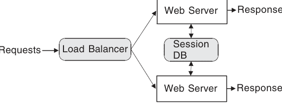
图 9-7 使用专用状态共享数据库共享状态

持久化状态 413

不提供创建和使用状态共享数据库的示例，原因有两个。第一个原因是，普通的基于 Servlet 和 JSP 的项目并不需要这种功能。概念应该是清晰的，如果你需要，实现此类系统将由你决定。第二个原因是，这种功能可以很容易减慢多服务器应用程序的速度，并违背最初实现该系统的目的。中心数据库几乎总是应用程序中性能最差的软件部分，因为它通常是经过优化最多的。在不理解第 14 章概念的情况下，很难开始构建良好的状态共享数据库，即使如此，在不知道使用的特定数据库和要共享的状态信息的情况下，也很难构建一个优化的。

## 状态与线程安全

Web 服务器的设计是为了处理许多并发用户以及这些用户的许多并发请求。通常，为了处理请求，Web 服务器会创建许多线程，每个线程处理一个请求。记住，给定的 Servlet 是单例——这意味着内存中只有一个给定 Servlet 的实例。这意味着当 Web 服务器接收到某个 Servlet 的多个请求时，所有请求都会在多个并发线程上分发给该 Servlet，这意味着 Servlet 必须写成线程安全的。本节检查了 Servlet 中的线程安全以及如何实现它。这是不可避免的：Servlet 和 JSP 必须以线程安全的方式编写。

- 表 9-1 显示了 Web 服务器中的应用程序将使用的数据的各种“范围”。某些数据是“天然”线程安全的，不需要采取特殊措施来保护对数据的访问。然而，某些数据可能被多个线程同时访问，在使用这些数据时必须小心。

在许多情况下，什么需要和不需要保护是显而易见的。局部变量是线程安全的：线程只有一个栈，局部变量存储在该栈上；在任何给定时间只有一个线程可以接触变量。方法参数通常由于同样的原因也是安全的；特别是 `HttpServletRequest` 和 `HttpServletResponse` 保证是线程安全的。Web 服务器要么为每个新请求创建一个新的请求和响应对象，要么池化请求和响应对象。无论在何种情况下，调用都保证获得它自己的请求和响应对象。

其他对象显然不是线程安全的；静态数据、实例数据、会话范围数据和应用范围数据都属于这一类。这些对象值得进一步讨论，因为处理这些对象的代码设计不当可能会导致意外之外的 Web 行为。接下来的章节将进一步解释相关问题以及如何确保线程安全。

> 9. 会话状态可以被多个线程并发访问，这可能并不显而易见。显然一个客户端意味着一个线程。然而，应用程序可能有多个帧；客户端可能会发送请求；等等。

### 表 9-1 Web 应用程序中的数据范围

| 范围 | 天然线程安全吗？ | 示例 |
| --- | --- | --- |
| 静态变量 | 否 | `class foo{ private static double d; }` |
| 实例数据 | 否 | `class foo{ private double d; }` |
| 方法参数 | 是 | `void doGet(HttpServletRequest req, HttpServletResponse resp)` |
| 局部变量 | 是 | `void doGet(HttpServletRequest req, HttpServletResponse resp) { double a; }` |
| 会话状态 (HttpSession) | 否 | `HttpSession sess = req.getSession();` |
| 应用状态 (ServletContext) | 否 | `ServletContext ctx = getServletContext();` |

## 同步

在 Java 中保护状态在理论上很容易，但在实践中较困难。Java 通过 `synchronized` 关键字提供了内置的同步支持。它可以用于同步整个方法，也可以作为“临界区”的形式保护代码块。Java 2 规范在第 17 节“线程与锁”中定义了官方的同步机制。如果你不熟悉线程，请花时间阅读这一节。Java 规范可以在 `http://java.sun.com` 免费获取。

同步应该在应用程序中尽可能少地使用。同步时，你本质上是对代码块加了“锁”，而锁会导致竞争。许多形式的线程都会阻塞扩展性；线程竞争也是如此。正因如此有一个黄金法则要记住：同步你拥有的！例如，对数据的读取访问远高于写入访问。因此可以允许许多读取器并发访问数据从而减少竞争。然而，只允许一个写入者访问数据项。Java 不提供原生的读写同步，但这些可以自己开发（有很多昂贵的资源）。投入时间定义读锁和写锁来限制竞争是非常值得的。无论应用程序采取什么方法，保持最短总是至关重要的。

### 保护 Servlet 状态

Servlet 开发者经常在线程安全上遇到麻烦，因为他们没有意识到 Servlet 容器是多线程的。一个 Servlet 实例将与许多并发客户端请求共享。默认情况下正是这样做，这使得 Servlet 成为高度可扩展的代码。理解这个概念的一种简单方法是：容器只加载一个 Servlet 实例到内存中，但每当客户端发送请求时都会调用服务方法，无论上一个请求是否完成。

对于你的代码而言，服务方法内部声明的任何变量¹⁰（如 `doGet()`）对于特定请求都是唯一的。然而，服务方法之外定义的任何变量都由所有请求共享。这包括所有客户端的所有请求，而不仅仅是同一客户端的请求。由于这个原因，

> 10. 相同的问题存在于 JSP 中。记住，声明元素在 JSP 服务方法之外声明代码。

除非有充分理由，否则在服务方法之外声明变量是一种坏习惯。这通常是直觉的，但请理解，线程安全是其中的原因之一。为了清晰起见，让我们来看一个非线程安全的 Servlet，并准确指出其问题所在。例如，查看清单 9-8，它是 `NotThreadSafe` Servlet 的代码。该 Servlet 的目标是读取几个请求参数并将它们显示给用户；然而，由于 Servlet 存在线程安全性差的问题，这一过程无法正确实现。

#### 清单 9-8 NotThreadSafe.java

```java
package com.jspbook;

import java.io.*;
import javax.servlet.*;
import javax.servlet.http.*;

public class NotThreadSafe extends HttpServlet {

    String value1;
    String value2;

    public void doGet(HttpServletRequest request
```

问题在于将变量声明为实例变量，而不是 `doGet()` 方法的局部变量。Servlet 实际执行的操作是显示最后保存到变量中的任意一组请求参数，而不一定是客户端的参数集。客户端可能会设置变量并立即执行显示这些值的请求，但这无法保证。第二个请求可能会在 `NotThreadSafe` Servlet 显示这些值之前更改它们的值。为了避免这个问题，变量应该声明在 `doGet()` 方法内部。清单 9-9 中的 `ThreadSafe` Servlet 展示了如何修复代码，以确保始终显示正确的参数值集。

#### 清单 9-9 ThreadSafe.java


```java
package com.jspbook;

import java.io.*;
import javax.servlet.http.*;

public class ThreadSafe extends HttpServlet {

    public void doGet(HttpServletRequest request, HttpServletResponse response) throws IOException, ServletException {

        response.setContentType("text/html");
        PrintWriter out = response.getWriter();
        out.println("<html>");
        out.println("<head>");
        out.println("<title>ThreadSafe</title>");
        out.println("</head>");
        out.println("<body>");
        out.println("The values are:<br>");

        String value1 = request.getParameter("value1");
        String value2 = request.getParameter("value2");
        out.println("Value 1: "+value1+"<br>");
        out.println("Value 2: "+value2+"<br>");
        out.println("They are the same as submitted.");
        out.println("</body>");
        out.println("</html>");
    }
}
```

# 418 Web 中的状态管理

从上述简单的示例中，请不要认为线程安全等同于在服务方法内部声明所有变量。情况显然并非如此，并且为许多线程声明公共变量有许多充分理由。示例包括任何放置在 `session`（会话）作用域或 `application`（应用）作用域中的某些 Servlet 特有变量，例如 `LinkTracker` Servlet 中使用的 `Hashtable`（第 2 章第 2-6 节）。请理解，大多数情况下，变量应该被放在适当的服务方法内部。虽然有时效率低下，但它通常能确保代码是线程安全的。

当一个变量需要被多个请求共享时，有方法可以确保适当的同步。简单的方法直接将整个方法声明为 `synchronized`。将 `synchronized` 关键字应用于整个方法，实际上限制了单个 Servlet 一次处理一个客户端的请求。这种风格的同步 `NotThreadSafe` Servlet 示例如清单 9-10 所示。

## 清单 9-10 SynchronizedNotThreadSafe.java

```java
package com.jspbook;

import java.io.*;
import javax.servlet.*;
import javax.servlet.http.*;

public class SynchronizedNotThreadSafe extends HttpServlet {

    String value1;
    String value2;

    protected synchronized void doGet(HttpServletRequest request,
            HttpServletResponse response)
            throws IOException, ServletException {

        response.setContentType("text/html");
        PrintWriter out = response.getWriter();
        out.println("<html>");
        out.println("<head>");
        out.println("<title>NotThreadSafe!</title>");
        out.println("</head>");
        out.println("<body>");
        out.println("The values are:<br>");

        String value1 = request.getParameter("value1");
        String value2 = request.getParameter("value2");
        out.println("Value 1: "+value1+"<br>");
        out.println("Value 2: "+value2+"<br>");
        out.println("Are they the same as submitted?");
        out.println("</body>");
        out.println("</html>");
    }
}
```

虽然保证了适当的同步，但在实践中，上述 Servlet 的性能将极其糟糕。不要这样做！更好的方法是仅将 `synchronized` 语句包裹在需要同步的代码块周围。这种方法是为许多线程作用域内的对象提供同步的优选方法。你可以参考 `LinkTrackerServlet`（清单 2-6）的源代码，作为以这种方式使用 `synchronized` 语句的良好示例。

## javax.servlet.SingleThreadModel

Servlet API 包含一个名为 `javax.servlet.SingleThreadModel` 的接口。这是一个标记接口（即它没有需要实现的方法），如果 Servlet 实现它，会将该 Servlet 标记为单线程的。这意味着什么？通常，Web 服务器会创建一个 Servlet 的单实例来处理对同一 Servlet 的所有请求（记住使用部署描述符中的 `servlet-name` 元素可以拥有同一个 Servlet 的多个实例），这是 Servlet 必须是线程安全的原因之一。然而，当 Servlet 实现了 `javax.servlet.SingleThreadModel` 时，容器必须只允许一个线程访问该 Servlet。表面上这似乎是个好主意，但事实并非如此。`SingleThreadModel` 接口在引入问题的同时并没有解决任何问题。使用 `SingleThreadModel` 会立即导致你的应用程序出现扩展性问题。容器可以创建许多 `SingleThreadModel` Servlet 实例来缓解此问题，但某些并没有。你只允许一个线程通过该 Servlet，Servlet 变成了瓶颈。更大的问题是，实现 `SingleThreadModel` 的 Servlet 仍然需要考虑线程。如果实现 `SingleThreadModel` 的 Servlet 使用了 `HttpServlet`，对这些对象的访问必须以线程安全的方式进行。`SingleThreadModel` 接口仅保证了该 Servlet 实例是单线程的。它并没有阻止服务器中的所有线程，其他 Servlet 或同一 Servlet 的实例可以（并且会）访问 `ServletContext` 和 `HttpServlet`。不要使用 `javax.servlet.SingleThreadModel` 接口。它的代价巨大，由于该接口在 Servlet 2.4 规范中已被废弃。

## 保护会话和应用状态

`HttpServlet` 对象和 `ServletContext` 对象都是共享资源。`ServletContext` 对象可以被许多 Servlet 或 JSP 同时访问。`HttpSession` 对象可以被客户端的两个不同请求同时访问。在这些这些对象时，应使用适当的同步。

提供准确会话和应用状态的最简单解决方案是始终将对相关对象的访问封装在同步块中。清单 9-11 展示了使用同步块封装会话。

## 清单 9-11 Synchronizing Session Access

```java
User user = new User();
HttpSession session = request.getSession(true);
synchronized(session) {
    session.setAttribute("user", user);
    // 其他会话访问代码
}
```

注意，同步块是对会话对象本身进行同步。这确保了对会话的所有都是同步方式进行的。同样，用于操作 `ServletContext` 对象的代码应该包含类似的同步块，如清单 9-12 所示。

## 清单 9-12 Protecting Access to the ServletContext

```java
ServletContext ctx = getServletContext();
synchronized(ctx) {
    User user = (User) ctx.getAttribute("user");
    // 其他应用访问代码
}
```

## 总结

本章介绍了 Servlets 和 JSP 中一些重要且容易被忽视的问题。所有的 Web 应用程序都期望维护状态。作为一名 Web 开发者，理解这种状态是如何维护的至关重要。本章提到的最重要的状态管理主题可能是 `HttpSession` 对象。默认情况下，HTTP 是无状态的。解决此问题的是 HTTP Cookie，但 Cookie 并不总是有效。为了实现绝对的会话维护，应该使用 URL 重写。

状态维护可能是困难的，特别是在多服务器环境中。在多服务器环境中，Web 应用程序并不是运行在一个服务器上的一个 JVM 之中。相反，使用许多服务器来管理 Web 应用程序的运行，以处理大量的入请求。当 Web 应用程序通过 `web.xml` 标记为可分布式时，会话会在 Web 应用程序之间自由迁移。应确保会话作用范围内的资源被妥善序列化并共享。

本章的最后一部分讨论了至关重要的同步主题。Servlets 和 JSP 是 Java 代码，并可能有许多线程并发访问它们。为了确保正确维护状态，应该采用标准的 Java 线程安全技术。Servlets 应该避免静态变量和实例变量，JSP 应该额外避免声明。在所有访问应用程序或会话作用域的情况下，将相关代码封装在同步块（`synchronized`）是非常重要的。

# 第 10 章

## 安全

Java 的特性之一是代码可以很容易地下载并组合成运行中的应用程序。然而，此类代码具有执行操作敏感数据关键操作的潜力，因此区分可以信任的请求和不可信的代码至关重要。为此，Java 安全模型基于运行代码的来源。根据当前堆栈中的类是从哪里加载的，或者由谁签署了它们，来允许或禁止敏感操作。

在分布式系统中，表示业务操作的代码托管在一个或多个服务器上。客户端请求充当执行服务器代码的触发器，这些代码具有执行敏感数据关键操作的潜力。任务是区分可以信任的请求和不可信的请求。服务器必须根据尝试运行代码的人来执行安全策略，并且能够验证客户端的身份。

当客户端和服务器通过公共网络通信时，确保安全变得更加复杂，因为服务器可能被轻易伪造。客户端可能还希望在接受或提供某些信息之前确保服务器是真实的。有很多问题需要回答：如何指定哪些客户端可以访问哪些功能？客户端如何知道哪些服务器是可信的？如何防止恶意人员访问系统或篡改请求和响应？如何让敏感数据免受窥探的目光？本章将回答所有这些安全问题。

- 什么是安全。
- 声明式安全：通过 `web.xml` 保护资源。
- 程序化安全。
- 加密通信：保护在客户端和服务器之间传输的信息。
- 安全有多安全：关于 Web 应用程序安全到底有多安全的略微旁题。

本章的内容旨在一气读完。Web 应用程序安全主题具有重要意义。没有它，你如何防止用户访问网站的受限部分？更重要的是，对于用于电子商务的 Web 应用程序；或者如果你经营着一家在线业务，必须具备安全性来保护客户的个人信息（例如信用卡号）。

## 我们说的安全是指什么？

在谈论安全时，我们需要引入几个术语。第一个术语是安全主体（security principal）或简称为主体（principal）。主体是参与通信的方之一。在安全文献中，主体通常会被命名。Alice 和 Bob 是两个尝试通信的主体；Eve 是一个在通信通信的窃听者；Mallory 是一个试图更改通信数据或以某种方式干扰通信的恶意攻击者。本章将使用这种命名约定，我们将引入许多主体。

分布式系统中的安全基于主体之间能够相互信任。在相互信任之前，主体必须知道他们正在与谁通信——也就是说，Alice 必须能够知道通信另一端是 Bob，反之亦然。为了做到，Alice 必须能够证明她正在和 Bob 说话。这个过程被称为**认证**（Authentication）。在客户端/服务器场景中，服务器通常想要验证客户端。然而，有时客户端想要验证服务器——例如，如果客户端向服务器发送信用卡详情，客户端必须能够信任服务器。此外，还有需要相互认证的情况。要验证一个主体，主体必须提供一组凭据。凭据可以是用户名/密码对、指纹、视网膜扫描、证书或任何可以唯一标识主体的东西。这些凭据随后被传递给一个受信任的权威（在安全文献中称为 Trent）进行检查。Trent 可以是一个存储凭据的数据库，也可以是一个 Kerberos 服务器，或其他某些第三方——例如认证机构——如 Theta 或 Verisign。

一旦主体通过了认证，就会的下一个问题是：他们被允许执行他们请求的任何操作吗？Alice 可能已经证明她正在和 Bob 说话，但 Bob 被允许执行请求的操作吗？这一步被称为*授权*（authorization）。

当 Alice 和 Bob 交换数据时，攻击者可能在数据传输过程中更改数据。Alice 和 Bob 可能需要知道数据已被更改。可以使用某些技术来执行这种检查。在安全中，这被称为*数据完整性*（data integrity）。

最后，假设 Alice 和 Bob 之间的数据交换必须是保密的——也就是说，不仅 Mallory 能够更改数据，Eve 也应该不能读取它。在这种情况下，数据必须加密。在 HTTP 世界中，用于管理加密的技术是传输层安全（TLS），以前称为安全套字层（SSL）。这通过稍后将的 HTTPS 协议使用。

## 声明式安全

为应用程序添加安全是一项枯燥但必要的任务，无论应用程序如何编写，许多工作都是相似的。例如以下所有应用程序共享的安全操作：

- 接收请求。
- 验证调用者身份。
- 检查调用者的授权。
- 允许或拒绝访问。

由于不同应用程序需要执行的安全工作相似，在 J2EE 的情况下，安全框架通常不是程序化的，而是声明式的。将安全抽象到框架中是可能的。这意味着什么？应用程序可以通过部署设置（即 `web.xml`）指定给定资源所需的安全级别，并且该安全由 Web 应用程序容器提供。这种声明式方法相当灵活且易于使用。Servlet 规范还允许应用程序在提供安全的容器中添加“钩子”，以允许应用程序微调容器提供的安全。

应用程序也可以选择完全忽略这种声明式安全并提供自己的安全。通常，这样做的应用程序会提供一个 Filter 来处理所有请求，并在 Filter 中进行所有必要的安全检查。安全的一点重要点是，所有的检查应该尽可能早地进行。例如，应用程序不应该让一直到

在决定调用者是否有权使用数据库之前进行检查。请记住，安全在资源消耗方面是昂贵的；因此要尽早检查，并且根据需要频繁检查。例如，一旦用户通过了验证，可能不需要在每次请求时对其进行重新验证。

## 基于角色的安全性

我们将讨论的第一种声明式安全性是基于角色的安全性。在 Servlet 世界，安全性基于两点：资源和角色。

- 资源是需要保护的内容。
- 角色是授权访问这些资源的用户。

那么什么是角色呢？想象一个拥有成千上万独立用户的公共网站，其中大多数用户对网站维护者来说是陌。不同的用户将被赋予不同级别的访问权限。例如，网站可能有一部分是对所有人开放的免费区域，有一部分仅对付费订阅的用户开放，而另一部分仅对网站管理员开放。在理论上，可以根据用户的凭据对网站的每一次访问进行检查，这样 Alice 可以访问整个网站，Bob 可以访问非订阅部分，Joe 可以访问非订阅部分和订阅部分，以此类推，并适用于网站的所有不同主体（principals）。对于成千上万的用户，管理单个用户的访问将迅速变成一场噩梦。想象一下，如果用户被分配到一个“角色”会发生什么。在这种情况下可能有三个角色：非订阅者、订阅者和管理员。每个用户在向网站显示时都会被分配一个角色。然后，网站中的每个资源将仅对某些角色开放。请注意，角色和角色名称完全取决于特定应用程序；没有所有应用程序都可以使用或必须使用的标准角色。

Servlet 规范对于如何将用户分配给角色没有特殊规定，无论是在你使用的命名方案中，还是在用于执行该操作的代码中。规范简单地说明角色是存在的，并且容器必须识别它们。在 Tomcat 中，管理角色的默认机制是 Tomcat 安装目录下 `/conf` 目录中的 `tomcat-users.xml` 文件。默认文件如下：

```xml
<tomcat-users>
  <user name="tomcat" password="tomcat" role="tomcat" />
  <user name="rolele" password="tomcat" roles="rolele" />
  <user name="both" password="tomcat" roles="tomcat,rolele" />
</tomcat-users>
```

> 请记住，唯一的标准容器必须遵守 `web.xml` 中的声明式规则，而不是 `tomcat-users.xml` 文件或其他 Tomcat 机制。如果你正在使用不同的容器，请参考该容器关于定义角色的文档。


此文件定义了用户名、密码和角色之间的简单映射。注意，给定的用户可能有多个角色，例如，用户名 `name="both"` 属于 "tomcat" 角色和 "rolele" 角色。在 Tomcat 中，定义角色为领域（realms）的区域，特别是这种基于 XML 文件的机制被称为内存领域（memory realm）。如果你不更改 Tomcat 配置，你会在应用程序中默认获得该领域。然而，Tomcat 还附带了其他领域，特别是 JDBC 领域和 JNDI 领域。这些为应用程序提供了更大的灵活性。我们稍后会回到领域和配置，但首先让我们看看角色在应用程序中是如何使用的。

可以使用 `web.xml` 中的 `security-constraint` 元素在 Web 应用程序资源上放置基于角色的安全性限制。例如，在 jspbook Web 应用程序的 `/WEB-INF` 下的 `/web.xml` 中添加列表 10-1：

### 列表 10-1 web.xml 中的安全约束项

```xml
<web-app>

  <security-constraint>
    <web-resource-collection>
      <web-resource-name>SecuredBookSite</web-resource-name>
      <url-pattern>/secured/*</url-pattern>
      <http-method>GET</http-method>
      <http-method>POST</http-method>
    </web-resource-collection>
    <auth-constraint>
      <role-name>Reader</role-name>
    </auth-constraint>
  </security-constraint>
  <login-config>
    <auth-method>BASIC</auth-method>
    <realm-name>Read Access</realm-name>
  </login-config>

</web-app>
```

前面的条目使用 `<security-constraint>` 元素限制对任何匹配 `/secured/` 的任何 HTTP GET 或 POST 调用。`web-resource-name` 子元素用于提供一个任意名称，在本例中为 `SecuredBookSite`：

你选择什么名称并不重要。稍后我们将会看到该名称仅用作元信息。更重要的子元素是 `url-pattern` 和 `http-method`。`url-pattern` 元素的功能与 Servlet、JSP 或 Filter 映射中的 `url-pattern` 元素完全相同。`http-method` 元素是新的，但使用起来直观。它可以有一个匹配任何 HTTP 方法的值，并且会在指定的每个方法之前进行检查。例如，在示例中指定了 GET 和 POST：

```xml
<http-method>GET</http-method>
<http-method>POST</http-method>
```

这两个条目意味着任何对匹配 `/secured/*` 的 URL 发出的 HTTP GET 或 POST 请求都将受到安全限制。

`<auth-constraint>` 的最后部分，即 `auth-constraint` 子元素，用于将安全限制匹配到定义的角色。单个角色由 `role-name` 元素定义。前面的条目角色 `Reader` 提供了访问受保护资源的权限：

```xml
<auth-constraint>
  <role-name>Reader</role-name>
</auth-constraint>
```

最后，`login-config` 元素用于描述身份验证。

```xml
<login-config>
  <auth-method>BASIC</auth-method>
  <realm-name>Read Access</realm-name>
</login-config>
```

等等，抱歉。提交表单后，Web 应用程序将检查用户名和密码。如果信息正确，则访问请求的资源。如果是虚构的 URL，将显示 404 页面，但如果存在真实资源，则显示它。通常情况下，这种声明式安全性在 Web 应用程序中工作。你决定哪些 URL 映射是安全的以及需要哪些规则，然后在 `web.xml` 中添加相应的安全约束项。

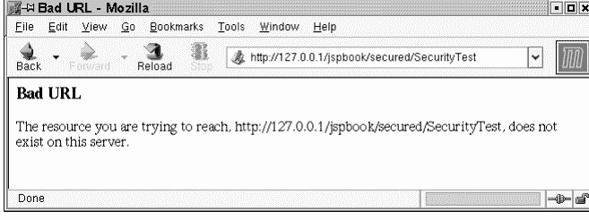

**图 10-3** 用户身份验证

对于所有领域，`<Realm>` 元素的配置形式都是相同的，如下所示：

```
<Realm className="classname" otherAttr="" otherAttr2="" etc/>
```

对于内存领域（memory realm），条目看起来如下：

```
<Realm className="org.apache.catalina.realm.MemoryRealm"
       debug="0"
       digest="MD5"
       pathname="conf/tomcat-users.xml"/>
```

- `debug` 指定了领域产生的日志信息级别：数字越大，详细信息越丰富；默认值为 0。
- `digest` 指定了要使用的安全摘要算法名称，以便密码以非明文形式存储。
- `pathname` 是包含 .xml 文件相对于 `CATALINA_HOME` 的绝对或相对路径，该文件包含角色定义。这默认值为 `conf/tomcat-users.xml`。

内存领域的主要问题是它是静态的——也就是说，一旦应用程序启动，你就无法动态地向角色添加新用户。内存领域应仅用于测试和演示目的（此处），而不应用于实际应用程序。

请注意，Tomcat 对其任何领域都不提供“用户管理”。完全取决于应用程序提供机制来向领域内的角色添加和删除用户。还要注意，这里定义的机制是 Tomcat 特有的。Servlet 规范仅容器提供认证用户与角色组之间的映射。规范并没有规定如何进行这种映射这完全取决于容器，每个容器将有自己的实现此点的机制。

## 总体视图

图 10-4 显示了客户端尝试访问受保护资源时的控制流。Bob（客户端）最初向 Alice（服务器）发送一个 HTTP 请求。Alice 检查 `web.xml` 中的 `security-constraint`（安全约束）元素，寻找 `user-data-constraint`（用户数据约束）元素。如果 `user-data-constraint` 指定 DIGEST 或 CONFIDENTIAL，Alice 将重定向初始请求，以便生成一个新请求，这将在稍后详细介绍。当请求到达时，Alice 现在会在相应的安全约束元素内检查一个 Web-resource 元素，以查看对请求资源的访问是否受到请求中发送的 URL 和 HTTP 方法的限制。这种检查只有在 Bob 已经分配了一组角色时才能进行。为了分配这些角色，Bob 必须经过 Alice 的认证。所以，如果 Alice 之前没有认证过 Bob，她现在将进行认证。这种认证如何发生很快就会讨论。如果 Bob 未通过认证，

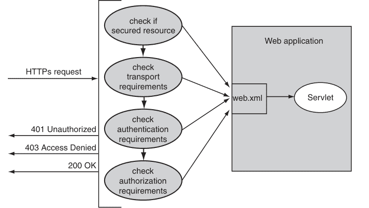

### 图 10-4 身份验证与授权的控制流

Alice 返回一个错误。如果 Bob 通过了认证，则 Alice（而不是应用程序）将客户端分配给一个角色。Alice 检查 Bob 是否有执行此调用。如果 Bob 有权，则调用成功；如果 Bob 无权访问此资源，则 Alice 将返回另一个不同的错误。注意，所有这些工作都是由实际 Web 服务器（在示例中是 Tomcat）完成的，而不是在你的应用程序内部。在通过所有这些检查之前，应用程序无法看到请求。

HTTP 定义了一种简单的挑战/响应认证机制，支持两种内置认证方案：基础认证（basic authentication）和摘要认证（digest authentication），每种方案都会验证交换双方是否知道一个共享的密码。基础认证被定义为 HTTP RFC（RFC 2616）的一部分，而摘要认证定义在主 HTTP RFC（RFC 2617）中。为了说明挑战/响应机制，以基础认证为例。如果 Bob 尝试访问受保护的资源，就需要认证，例如如列表 10-2 所示向 Alice 发送 HTTP 请求。

### 列表 10-2 客户端 HTTP 请求

```
GET /secureApp/secured/SecurityTest HTTP/1.1
Host: localhost
```

HTTP 认证基于挑战/响应：Alice 发出挑战，Bob 必须用适当的凭据响应。在这种情况下，来自 Alice 的挑战形式为 HTTP “401 Unauthorized”响应，并带有 HTTP “WWW-Authenticate”头部，如列表 10-3 所示。

### 列表 10-3 基础认证的服务器挑战

```
HTTP/1.1 401 Unauthorized
WWW-Authenticate: Basic realm="jspbook"
```

“WWW-Authenticate”头部包含认证方案名称（“Basic”）和安全领域（“jspbook”）。安全领域告诉 Bob 应该使用哪些凭据。Bob 的响应是重新提交请求，并附带一个额外的 HTTP “Authorization”头部，其值包含方案（“Basic”）、领域（“jspbook”）和凭据。凭据只是经过 base-64 编码的用户名和密码。

列表 10-4 说明了这一点。

### 列表 10-4 客户端使用基础认证凭据重新提交 HTTP 请求

```
GET /secureApp/secured/SecurityTest HTTP/1.1
Host: localhost
Authorization: Basic Znm1ZlDp0b2jYXQ=
```

如果认证失败，Alice 会发送另一个“401 Unauthorized”响应。如果认证成功，则 Alice 将尝试进行授权检查。这决定了认证用户是否被允许。基础认证的问题是它以明文发送密码。然而，如果连接是通过 SSL/TLS 建立，那么密码将免受窃听。

摘要认证更安全，因为它没有在网络上传输密码。相反，它发送密码的哈希值和服务器提供的随机数（nonce）。服务器随后执行相同的计算并与从客户端收到的响应进行比较。如果它们匹配，则客户端通过了认证。

摘要认证的问题是它的实现更复杂，并且它需要服务器维护状态。然而，对于许多应用程序，它提供了足够的安全性。

当 Alice 收到此请求时，她也会使用与客户端相同的数据创建一个消息摘要。Alice 必须通过某种“带外”（out-of-band）技术接收 Bob 的密码。然后，Alice 将她生成的摘要值与 Bob 发送的摘要值进行比较。如果值相同，则凭据有效，并在经过授权检查后，调用者被允许访问请求的资源。如果值不同，则身份验证失败，服务器将返回“401 Unauthorized”错误。如果授权失败，服务器将返回“403 Access Denied”错误。

由于密码从未以明文形式发送，因此摘要认证（digest authentication）比基础认证（basic authentication）安全得多，但它并不完美。例如，服务器必须以适用于计算 MD5 摘要的格式保存每个用户的密码，这些密码必须安全地存储，因为任何拥有它们的人都可以伪装任何有效用户。此外，取决于服务器对随机数（nonce）的选择，摘要认证可能面临重放攻击。没有任何东西能阻止 Mallory 简单地复制请求并在保持摘要完整的情况下将其重新发送给 Alice。一种推荐的方法是让服务器由资源 URL 的哈希值、资源“ETag”（ETag 本质上是请求资源的唯一标识符；更多关于 ETag 的信息请参见 HTTP RFC）、时间戳和仅服务器已知的私钥组成随机数。服务器可以通过将随机数的重用限制在指定的资源上并限制由时间戳定义的随机数有效期来防止重放攻击。这对于 HTTP GET 调用可能足够了，但为了防止针对 HTTP POST 请求的非幂等操作的重放攻击，服务器需要拒绝接受以前见过的随机数。鉴于 HTTP 协议是无状态的，这增加了服务器的工作量。通常，随机数越安全，服务器的负载越大，调用者需要的重新身份验证就越多。

在保护资源时，基础认证或摘要认证对服务器来说都是可以的，在这种情况下，服务器可以像列表 10-7 所示发送带有多个“WWW-Authenticate”标头的挑战。

> 除了发送密码之外，任何方法在之前都已以安全方式发送，否则假设摘要提供了安全性将毫无意义。
>
> 一般的来说，所有的数字安全都需要更多的工作来确保某事是安全的——即对于恶意主体来说破解它具有适当的难度。

### 列表 10-7 基础或摘要认证的服务器挑战

```
HTTP/1.1 401 Unauthorized
WWW-Authenticate: Basic realm="jspbook"
WWW-Authenticate: Digest realm="jspbook",
realm="auth",
once="5f9ef9f6239b0526151d6eebd412196cdc",
opaque="c8020b69f571bd3f32e4c4c6ee2466"
```

使用多种认证方案不是一个好主意。客户端可以选择它理解的最强方案，因此身份验证可能会降级为基础认证——换句话说，客户端可能不理解摘要。这为“中间人”攻击打开了大门，Mallory（记住，他是恶意的）可以假装成客户端，降级认证方案并开始获取密码。

这里没有探讨的其他技术可以在客户端和服务器的摘要认证范围内实施，以最大限度地减少标准“中间人”攻击的概率，并提高保护质量，以确保标头和数据都免受篡改。尽管摘要认证比这里描述的要安全一些，但它纯粹是为了改进基础认证更严重的缺陷而设计的，它不是、也从未打算作为完全安全通信的手段。基础认证和摘要认证方案都依赖于共享密钥。这两种方案都没有：

- 定义初始可能如何交换密钥，
- 允许客户端和服务器在密码学上确认对方的身份，
- 强制使用密钥来保证双方之间交换的数据未被篡改，
- 强制使用密钥对对话进行加密，以便他人看不到。

有些攻击只能通过在密码加密的通道上发送 HTTP 请求和响应来防止，因此即使坏人可以拦截交易，对他们也无用处。后文将讨论的安全套接层（SSL）解决了所有这些问题。

## 配置基础或摘要认证

在声明式 `web.xml` 条目的原始示例中，使用了基础认证。这是因为基础认证是 Web 应用程序将使用的默认认证。要更改认证方案，必须使用 `login-config` 元素：

```xml
<login-config>
  <auth-method>BASIC</auth-method>
  <realm-name>Reader</realm-name>
</login-config>
```

这段代码是之前在章节中使用过的 `login-config` 元素的示例。认证方案是通过通过将 `auth-method` 子元素设置为所需的方案来配置的。到目前我们已经看到了基础认证和摘要认证。这些方案分别由 `BASIC` 和 `DIGEST` 值定义。在给定的代码中，指定了基础认证。`realm-name` 元素提供了安全域的名称。

## 自定义表单认证

在进行 HTTPS 之前，有一个非常值得讨论的旁插内容。默认的认证框（表 10-1）并不是强制要求的。你可以构建一个展示给用户的自定义表单。Servlet 规范将其定义为“Form”（表单）。

当 `auth-method` 设置为 `FORM` 时，应用程序控制其外观和感觉。列表 10-8 显示了如何在部署描述符中配置它。

### 列表 10-8 基于表单的认证

```xml
<web-app>
  <login-config>
    <auth-method>FORM</auth-method>
    <form-login-config>
      <form-login-page>/login.jsp</form-login-page>
      <form-error-page>/error.jsp</form-error-page>
    </form-login-config>
  </login-config>
</web-app>
```

注意：除了 `auth-method` 元素外，还使用 `form-login-page` 来定义页面和错误页面。自定义的登录页面和错误页面可以是任何类型的资源，例如 Servlet、JSP、HTML，并使用它们喜欢的样式。唯一的限制是登录页面必须将请求指向 `j_security_check` 并为 `j_username` 和 `j_password` 参数提供值，如列表 10-9 所示。

### 列表 10-9 基于表单的登录页面

```html
<html>
<body>
  <form method="POST" action="j_security_check">
    用户名: <input type="text" name="j_username"><br/>
    密码: <input type="password" name="j_password"><br/>
    <input type="submit" value="登录">
  </form>
</body>
</html>
```

你可以通过编辑 `web.xml` 使用列表 10-8 中的 `login-config` 元素来追踪之前的页面，将列表 10-9 保存为 jspbook Web 应用程序根目录下的 `login.jsp`，并重新加载 Web 应用程序以使更改生效。应用程序加载后，回到 http://localhost/jspbook/secured/SecurityTest。这次显示的不是图 10-1，而是 HTML 表单。图 10-5 提供了输出的浏览器渲染。


当 `auth-method` 为 `FORM` 时，容器仍然执行身份验证，而不是你的应用程序。出于此原因，Servlet 将表单 `action` 的值为 `j_security_check`，并将用户名和密码字段的名称定义为 `j_username` 和 `j_password`，必须使用 `POST` 作为表单方法。当容器使用 `j_security_check` 时，它使用某种内部机制来验证调用者的身份。

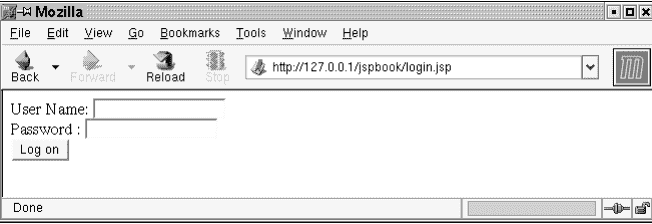

图 10-5 自定义 HTML 认证表单的浏览器渲染

如果登录成功但调用主体不允许访问请求的资源，则服务器将返回“403 拒绝访问”响应。如果登录失败，服务器将返回由 `form-error-page` 设置指定的页面。

基于表单的认证面临与基本认证相同的问题。它显然默认是不安全的，因为没有对服务器进行认证，且密码会被清除。正如本章后面将讨论的，通过为受保护资源指定传输保证，可以强制基于表单登录交互在安全通道上进行。表单认证的另一个问题是，基于表单的认证和 URL 重写的会话跟踪非常困难（因为需要 `j_security_check`），因此通常为了让表单认证生效，必须启用 cookie。

## Servlet/JSP 中的程序化安全

之前所有的认证机制导致两种结果之一：要么用户未通过认证，要么用户通过了认证并被分配了一个或多个角色的成员身份。

*角色* 只是经过认证的主体的分组，通常由某些功能定义，如销售、营销、读者等。将主体置于角色中的方法完全取决于供应商，且不在 Servlet 规范的范围内。一旦创建了角色并定义了角色成员身份，就可以将基于角色的安全约束应用到 Web 集合。在满足以下情况下，将授予资源的访问权限：

- 没有任何认证方案。
- Web 集合没有基于角色的安全约束。
- 调用者处于至少一个允许访问的角色中。

否则，访问被拒绝。

基于角色的安全是很好的，因为我们可以将访问控制与 Servlet 和 JSP 代码分离。如果程序员不想写，他们就不需要写任何安全相关的代码。但这种机制的现实性如何？基于角色的安全是一种相当静态且缺乏活性的方法：调用者要么根据角色成员身份通过访问检查，要么没有通过。如果调用者通过了，则返回资源或开始执行 Servlet/JSP 代码。如果未通过，则向调用者返回“403 拒绝访问”响应。

然而，无法在运行时根据如“调用者的信用额度是多少？”等问题来确定是否允许访问。此外，一个通用资源对于两个不同角色的调用者可能具有类似的方式。想象一个请求返回客户详情。对于销售人员，该请求可能会返回除信用额度以外的所有客户信息，而对于经理，该请求将返回包括信用额度在内的所有信息。在这种情况下，如果应用程序完全根据调用者的角色来决定是否允许调用者，那么应用程序需要两个独立的资源。这些资源非常相似，唯一的区别在于输出中是否包含信用额度。复制资源是容易错误的；如果客户详情发生变化，那么两个资源都必须进行修改。

为了处理这类场景，应用程序可以在运行时获取有关调用者或调用者角色成员身份的信息，并根据发现的内容执行不同的逻辑。`HttpServletRequest` 对象提供了以下方法，可用于运行时挖掘安全信息：

- `String getAuthType()`：返回表示保护 Servlet 所用认证方案名称的 String。虽然这通常没有帮助，但可以用来确定表单信息是如何提交的。
- `boolean isUserInRole(java.lang.String role)`：返回一个布尔值：如果用户在给定的角色中则返回 true，否则返回 false。
- `String getProtocol()`：返回一个表示发送请求所用协议的 String 对象。检查此值可以确定是否使用了安全协议。
- `boolean isSecure()`：返回一个表示请求是否使用 HTTPS 发出的布尔值。值为 true 表示该请求和连接是安全的。值为 false 表示请求不是。
- `String getUserPrinciple()`：返回一个包含已认证用户名称的 `java.security.Principal` 对象。

这些方法中最有用的是 `isUserInRole()` 方法。该方法可以方便地提供程序化检查，查看用户是否处于特定角色中。

`security-role-ref` 元素提供了一个 Servlet 可以引用的具体名称，以及一个部署者可以可选更改的配置名称，以匹配使用的任何角色命名方案。`security-role-ref` 元素有两个定义了此位置的子元素：`role-name` 和 `role-link`。`role-name` 元素定义了 Servlet 可能引用的静态值。`role-link` 值是部署者可以根据需要修改的角色名称。在用法中，`security-role-ref` 元素总是类似于列表 10-10。

### 列表 10-10 web.xml security-role-ref 元素示例

```xml
...
<servlet>
  <servlet-name>FooServlet</servlet-name>
  <servlet-class>com.jspook.FooServlet</servlet-class>
  <security-role-ref>
    <!-- role-name 用于应用程序中 -->
    <role-name>ReaderRole</role-name>
    <role-link>Reader</role-link>
  </security-role-ref>
</servlet>
```

```xml
<security-role>
  <role-name>Reader</role-name>
</security-role>
```

`security-role-ref` 元素用作 `servlet` 元素的子元素。该引用仅对其被定义的 Servlet 有效。此外，`security-role` 元素被定义用于创建“Reader”。

```xml
<security-role>
  <role-name>Reader</role-name>
</security-role>
```

这种 `security-role-ref` 元素在需要进行认证时是必须的。

## 安全通信

之前的讨论提到了使用安全来执行认证、授权和数据完整性。然而，还有其他事情必须为 Alice 和 Bob 之间提供完全安全的对话。如果 Bob 想向 Alice 发送私有数据（例如信用卡号），最好加密。如果端点本身不可信，也就是说，在 Bob 向 Alice 发送私有数据之前，Bob 应该知道他正在与 Alice 通信。现代加密允许这些情况发生。加密有两种类型：对称加密和非对称加密。

对称密钥代表共享秘密，同一个密钥用于加密和解密。对称加密的问题是“密钥交换”。双方如何安全地交换对称密钥？Alice 不能直接发送给 Bob，因为 Mallory 可以看到。

非对称密钥被分为两个部分：私钥和公钥。两者都可以解密数据——也就是说，公钥加密的数据只能用私钥解密，反之亦然。注意，一个密钥加密的数据可以用另一个密钥解密。私钥是真正的私有的，只有单个实体已知。公钥是真正的公开的，所有人都可以。使用公钥加密数据是有用的，因为该数据只能用私钥解密。这意味着除了私钥所有者外没人可以。如果 Bob 使用 Alice 的公钥加密数据，只有 Alice 可以解密该数据。

使用私钥加密数据如何？如果 Alice 向 Bob 发送一些明文，并用她的私钥对其加密并发送加密数据，Bob 可以获取加密数据并使用 Alice 的公钥解密。然后他可以将解密数据与明文进行比较。如果比较结果相等，则明文一定来自 Bob 所拥有的公钥对应的。在这种情况下，Alice 被认为“签名”了数据，通常签名的是数据的哈希值而不是数据本身。

公钥私钥对也有其他问题。例如，攻击者拥有公钥的副本；攻击者拥有大量用私钥加密的密文。攻击者还可能猜测某些被加密的明文（例如请求行和 HTTP 头部）。攻击者拥有的数据越多，破解加密就越容易。

使用的是非对称密钥。非对称加密不仅适用于生成数字签名，还适用于对称密钥的安全交换。

Alice 和 Bob 想要交换会话密钥。Alice 生成一个会话密钥并用 Bob 的公钥对其加密。她用自己的私钥对加密后的会话密钥进行签名，并将签名后的加密会话密钥发送给 Bob。Bob 使用 Alice 的公钥来验证来自 Alice 的数据，并解密会话密钥。Bob 现在对 Alice 和该会话密钥产生了信任。Bob 现在用 Alice 的公钥对会话密钥进行加密。他用自己的私钥对加密后的会话密钥进行签名，并将签名后的加密会话密钥发回 Alice。Alice 现在对 Bob 和该会话密钥产生了信任。当然，这假设 Alice 和 Bob 已经交换了公钥。尽管公钥可以被任何人读取和使用，但他们无法做到的是在网络传输中互相发送公钥。

Mallory 想要拦截密钥交换，他完全可以坐在中间，伪装成 Alice 的 Bob 以及伪装成 Bob 的 Alice，并读取他们之间的流量。如果 Alice 和 Bob 彼此认识，他们可以面对面交换公钥，让 Mallory 无法介入。如果不能，他们可以使用一个受信任的中间人 Trent（他们过去曾与其安全交换过密钥的人）。假设 Alice 和 Bob 都信任 Trent，并且已经获取了 Trent 的公钥。假设 Trent 信任他们，并且获取了他们的公钥，并将详情封装在一个名为“证书”的包中，对其签名，然后发送给 Alice。Alice 知道该证书来自 Trent，且 Trent 可以信任其内容。同样，Trent 可以将 Alice 的公钥放在一个签名的证书中并发送给 Bob，Bob 从 Trent 那处获知此信息，且在传输过程中未被篡改。事实上，Trent 可以为 Alice 和 Bob 分发由他签名的各自证书。通过这种方式，例如，Bob 只需对包含其公钥的（由 Trent 签名的）证书签名，就可以向任何同样信任 Trent 的其他方验证自己的身份。

这种涉及证书交换的身份验证技术仅适用于信任 Trent 的人。拥有 Trudy 签名证书的人无法与拥有 Trent 签名证书的人交换证书，除非——也就是说，Trudy 和 Trent 本身都拥有由他们共同信任的 Todd 颁发的证书。这被称为证书链。在这种情况下，Bob 若要向 Carol（信任 Todd 的人）验证身份，他必须提交自己的证书（由 Trent 签名）和 Trent 的证书（由 Todd 签名）。通过这种方式，Carol 就可以验证 Bob 了 Trent 的信任，而 Trent 又被 Todd 信任，这是可以的，因为 Trudy（Carol 信任的人）也被 Todd 信任。在树的顶端必须有一个所有人都信任的证书颁发机构（CA），它能够签署自己的证书。

在现实世界中，证书有一种名为 X509 的标准，并且有几家被所有人信任且其公钥广为人知的 CA——例如，Verisign。由 Verisign 颁发的证书在全球范围内认可，Verisign 的公钥会随着浏览器和 Web 服务器等商业客户端和服务器软件一起分发。公司可以作为其所有部门的证书颁发机构，但这些证书只能在公司内部使用，无法在全球范围内使用。

我们处于什么位置？为了让双方相互验证身份，他们交换证书，然后可以使用非对称加密安全地交换会话密钥。从那时起，可以使用共享会话密钥对数据进行加密或签名。这本质上就是 SSL，尽管它比这要复杂一点。SSL 中有两种合理的模式。第一是双向身份验证，调用者和服务器交换证书，以便他们都知道对方的身份。第二是服务器身份验证，服务器向调用者发送证书，以便调用者知道服务器是谁。SSL 使用四次握手（如图 10-6 所示），在双方之间逐步建立信任。

以下是一个极其简化的解释，涉及一个代表 Alice 运行的客户端和一个代表 Bob 运行的服务器。

- 阶段 1：Alice 向 Bob 发送一个随机数和一个允许接受的加密套件有序列表（每个加密套件都表示用于数据加密、签名等要使用的算法）。
- 阶段 2：Bob 接收 Alice 的传输，并回传一个他自己的随机数（独立于客户端生成的数字）、选定的加密套件、他的证书，以及可选的对调用者（Alice）证书的请求。
- 阶段 3：Alice 接收 Bob 的传输并验证 Bob 的证书。如果证书有效，她现在拥有了 Bob 的公钥，但在另一端无法证明。如果 Bob 请求了她的证书，她就会发送它。然后她生成另一个随机数（称为预主密钥），并用 Bob 的公钥对其加密（这样只有他能读取）并发送。接下来，她使用（使用她的私钥）对目前为止构成对话的所有握手数据构建签名并发送。这有时被称为证书验证代码。之后，她使用预主密钥根据与 Bob 协商的加密套件生成执行数据加密和提供签名所需的所有密钥。她发送一条指令，表示她将开始使用协商好的加密套件。

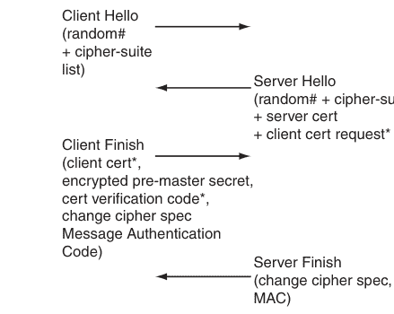

图 10-6 四次握手的示意

最后，她发送一个消息认证码（MAC）。这是（使用来自协商加密套件的签名生成密钥）对目前为止构成对话部分的所有握手数据的签名。

- 阶段 4：Bob 接收 Alice 的传输。他验证她的证书（如果她发送了的话），如果证书有效，他现在拥有了 Alice 的公钥，但在另一端无法证明。如果 Alice 请求了他的证书，他就会发送它。然后他解密预主密钥，并根据与 Alice 协商的加密套件生成执行数据加密和提供签名所需的所有密钥。他发送一条指令表示他将开始使用协商好的加密套件。最后，他发送一个消息认证码（MAC）。这是（使用来自协商加密套件的签名生成密钥）对目前为止构成对话的所有握手数据的签名。

Alice 接收 Bob 的传输并使用的加密套件进行解密并验证 MAC。如果有效，她确定对方是 Bob，因为只有他能解密预主密钥来生成 MAC。他们完成了。Alice 知道自己在和 Bob 通信，并可能知道对方（如果对方请求了证书）。他们交换了用于数据加密和确保完整性的密钥。

SSL/TLS 是一项巨大的工程！这项工作是必须的。在必须尽可能确保信息安全和真实的情况下，你别无选择 SSL。好消息是，在 Web 应用程序中使用它之前，你不需要实现整个 SSL 协议。如果你的容器支持 SSL，那么实现它是容器供应商的工作。在大多数流行的容器（包括 Tomcat）中，都提供了 SSL 支持。你只需要提供来自 CA 的证书即可。

## 指定 HTTPS

必须解释的 .xml 元素之一是 `user-data-constraint` 元素。`user-data-constraint` 元素可用于指定请求和响应必须遵循的安全级别。子元素 `transport-guarantee` 可用于将其设置为 `NONE`、`INTEGRAL` 或 `CONFIDENTIAL`。`NONE` 值是默认值，不强制任何安全级别。`INTEGRAL` 值指定容器必须确保信息的完整性——即信息在传输过程中没有更改，但可能被他人读取。`CONFIDENTIAL` 值要求请求和响应中发送的信息既私密又未更改——例如，SSL。

`user-data-constraint` 元素非常直观。例如，为了确保 Web 应用程序的保护部分保持机密，可以使用以下条目：

```xml
<security-constraint>
  <web-resource-collection>
    <web-resource-name>SecuredBookSite</web-resource-name>
    <url-pattern>/tlsecured/*</url-pattern>
    <http-method>GET</http-method>
    <http-method>POST</http-method>
  </web-resource-collection>
  <user-data-constraint>
    <transport-guarantee>CONFIDENTIAL</transport-guarantee>
  </user-data-constraint>
</security-constraint>
```

现在，Web 应用中 `/tlssecured` 文件夹下的所有资源都是完全私密的，而不仅仅是难以查看。如果你在个人电脑上尝试这种操作——例如，访问 http://127.0.0.1/jspbook/tlssecured/Foo——浏览器将不再从 HTTP 自动重定向到安全的端口/协议、实例，即使用端口 443 的 https://127.0.0.1/jspbook/tlssecured。你可以在自己的电脑上尝试这一点，但有几项工作必须完成。

- 在你的 Tomcat 安装目录下的 `/conf/server.xml` 文件中找到该项，并确保 `port` 的值为 "443"，因为 Tomcat 默认使用 8443：

```xml
<Connector
  className="org.apache.catalina.connector.http.HttpConnector"
  port="443" minProcessors="5" maxProcessors="75"
  enableLookups="true"
  acceptCount="10" debug="0" scheme="https" secure="true">
```

- 默认情况下，上述代码是被注释的；请将其取消注释。
- 同样在 `server.xml` 中找到以下项：


```xml
<Connector
  className="org.apache.catalina.connector.http.HttpConnector"
  port="80" minProcessors="5" maxProcessors="75"
  enableLookups="true" redirectPort="443"
  acceptCount="10" debug="0"
  connectionTimeout="60000"/>
```

确保 `port` 被设置为 80（如第 1 节所示），且 `redirectPort` 被设置为 443。这些值是默认的 HTTPS 和 HTTP 端口；默认 Tomcat 实例的对应值分别为 8443 和 8080。现在重要的是，第二项中 `redirectPort` 的值必须与第一项的 `port` 值匹配；在在此处显示的示例中，它们都是 443。

一旦你取消了 HTTPS 项的注释，Tomcat 几乎就准备好监听 HTTPS 请求了，但要这样做，你必须安装安全证书。正如后文所示，证书是 HTTPS 不可缺的一部分。输入以下命令之一生成证书：

- 在 Windows 中，执行：
  ```
  %JAVA_HOME%\bin\keytool -genkey -alias tom -keyalg RSA
  ```
- 在 Linux 中，执行：
  ```
  $JAVA_HOME/bin/keytool -genkey -alias tomcat -keyalg RSA
  ```

在填写 `keytool` 要求的值时，这些值可以是虚构的，因为这是你创建的自定义证书，但它们稍后会出现。确保所要求的两个密码都是“changeit”（不带引号）。图 10-7 显示了程序的完整执行过程。

一旦完成，你的主目录下将生成一个 `.keystore` 文件，其中包含了证书所需的所有信息。Tomcat 需要知道执行操作的用户的主目录。默认情况下，Tomcat 知道 `.keystore` 文件的主目录，这非常方便。现在你可以访问 `/tlsecured` 虚拟目录下的资源，并将使用 SSL。例如，尝试访问 `http://127.0.0.1/jspbook/tlsecured/`。URL 将重定向到 `https://127.0.0.1/jspbook/tlsecured/` 并要求你输入用户名和密码。假设你输入正确，整个响应都经过了彻底加密（即使只是一个 404 页面）。由于你创建了自定义证书，如果网络浏览器对证书的有效性报错，请不要惊讶。没有任何第三方会验证该证书，因为你从未向 CA 注册它。例如，Mozilla 会弹出类似于图 10-8 的错误，但由于该证书仅用于示例。

通常，在 HTTPS 中只有服务器通过验证——即服务器不在乎你是谁，但需要安全连接。正如上述对 SSL 握手的讨论所示，HTTPS 允许双向认证。

6. 如果你使用的是 JDK 1.4 之前的版本，你需要下载并安装 Java 安全扩展（JSSE）。更多信息请访问 Sun 网站：`http://java.sun.com/products/jsse/`。

7. 如果 Tomcat 找不到 `.keystore` 文件，你将需要使用工厂元素 `keyStore` 属性手动设置其位置。相关信息请参见 `http://jakarta.apache.org/tomcat/tomcat-5.0-doc/ssl-howto.html`。

```
root@localhost:/usr/jk/tomcat-5/webapps/jspbook - Shell - Konsole
[root@localhost jspbook]# /usr/java/j2sdk1.4.0/bin/keytool -genkey -alias tomcat -keyalg RSA
Enter password: password
What is your first and last name?
[Unknown]: Bruce Wayne
What is the name of your organizational unit?
[Unknown]: The Batcave
What is the name of your organization?
[Unknown]: Wayne Industries
What is the name of your City or Locality?
[Unknown]: Gotham
What is the name of your State or Province?
[Unknown]: New York
What is the two-letter country code for this unit?
[Unknown]: NY
is CN=Bruce Wayne, OU=The Batcave, O=Wayne Industries, L=Gotham, ST=New York, C=NY?
[Unknown]: yes
Enter password for keystore: password
Enter new password for keystore: password
Enter keystore password: password
```

**图 10-7 使用 keytool 创建证书**

一旦完成，你的主目录下将生成一个 `.keystore` 文件，其中包含了证书所需的所有信息。Tomcat 需要知道执行操作的用户的主目录。默认情况下，Tomcat 知道 `.keystore` 文件的主目录，这非常方便。现在你可以访问 `/tlsecured` 虚拟目录下的资源，并将使用 SSL。例如，尝试访问 `http://127.0.0.1/jspbook/tlsecured/`。URL 将重定向到 `https://127.0.0.1/jspbook/tlsecured/` 并要求你输入用户名和密码。假设你输入正确，整个响应都经过了彻底加密（即使只是一个 404 页面）。由于你创建了自定义证书，如果网络浏览器对证书的有效性报错，请不要惊讶。没有任何第三方会验证该证书，因为你从未向 CA 注册它。例如，Mozilla 会弹出类似于图 10-8 的错误，但由于该证书仅用于示例。

通常，在 HTTPS 中只有服务器通过验证——即服务器不在乎你是谁，但需要安全连接。正如上述对 SSL 握手的讨论所示，HTTPS 允许双向认证。

6. 如果你使用的是 JDK 1.4 之前的版本，你需要下载并安装 Java 安全扩展（JSSE）。更多信息请访问 Sun 网站：`http://java.sun.com/products/jsse/`。

7. 如果 Tomcat 找不到 `.keystore` 文件，你将需要使用工厂元素 `keyStore` 属性手动设置其位置。相关信息请参见 `http://jakarta.apache.org/tomcat/tomcat-5.0-doc/ssl-howto.html`。

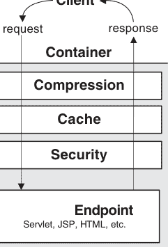

**图 10-9** 堆叠不当的过滤器

加密主题也已经介绍，你可能为了安全而想要非标准的加密。请务必注意加密相对于缓存和压缩的堆叠位置。切不要将加密放在缓存或压缩层之后，如图 10-9 所示！

图 10-9 是错误的，因为如果缓存了预加密内容的副本，就无法指望非对称加密能够正常工作。像 SSL 等技术由于其通过良好的加密提供了安全性，需要大量的处理能力和带宽。通过缓存来消除这个问题并不是可行的！

另一个重要点是，压缩的目标是消除内容中可能包含的所有冗余。而加密的目标是完全随机化内容并消除任何模式。尝试压缩加密内容是徒劳的。这样做会导致产生额外的、不必要的服务器端工作。

始终应用压缩和加密的正确方法是：先对内容进行压缩，然后对压缩后的内容进行加密，如图 11-10 所示。

缓存可以实现在压缩之前、压缩之后或在两个地方都实现。这取决于你使用缓存时试图优化什么。从本节中得到的概念是：加密、压缩和缓存的实现位置以及方式至关重要。坦率地说，Servlet 规范定义的安全机制设计用于防止这些问题的发生。然而，在构建包含敏感内容或服务的 Web 应用时，构建自定义过滤器（如果你使用 IIS、Apache 等来补充容器，则使用类似过滤器的功能）时要意识到你正在做什么！

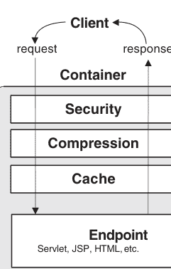

**图 10-10** 实现加密、压缩和缓存的正确方法

## 总结

安全性非常重要，Web 应用在设计时也考虑了这一点。理解密码学基础以及它如何通过 Servlets 和 JSP 实现将进一步完善你的技能 set。你现在不再是创建一个任何人都可以自由访问和使用的网站，而是能够清晰地定义谁可以查看什么以及如何查看。在构建包含敏感性质内容或服务的 Web 应用时，提供这种安全能力是至关重要的。

密码学很复杂，但在 Web 应用中实现密码学被设计得尽可能简单。Servlet 规范明确定义了一个接口，容器厂商可以通过此接口实现任何形式的安全。作为开发者，唯一需要完全理解的是如何配置 Servlet 提供的接口。在大多数情况下，这是通过 `web.xml` 使用声明式安全完成的。在需要更细粒度控制的情况下，可以实现程序化安全。

本章涵盖的特定安全实现从简单到复杂不等。涵盖了 HTTP 基础认证和摘要认证，以及 Web 应用提供自定义表单和错误页的方法。在复杂密码学领域，引入了 SSL/TLS 协议以及用于创建真正安全通信的证书。虽然本文没有涵盖适用于 SSL/TLS 的任何特定算法，但它表明，其提供的安全性足以确保“安全”的连接。

# 第 11 章

## 设计模式

开发者们构建 JSP 和 Servlet Web 应用已经有多年之久了。通过良好的 Servlets 和 JSP 生成内容有许多方法，但只有少数方法被公认为是标准的。了解已有的（无论是好的还是坏的）可以增加你构建良好的 Web 应用的能力。本章是 Web 应用开发者实现的常用设计模式的概述。在许多方面，这是本书最重要的章节之一，因为只有在对 JSP 和 Servlet 有良好理解的情况下，才能进行实验。

本章讨论了以下主题：

- 关于为什么要使用设计模式的解释。
- 对 Model 1 设计模式的讨论：命名新开发者经常编写的代码。
- 对 Model 2 设计模式的讨论：推荐的构建 Web 应用的方法。
- 对 Model 1½ 设计模式的讨论：执行 Model 2 的实用方法。
- 使用 Jakarta Struts 框架：引入一种非常流行的 Model 2 框架。
- 通过自定义标签抽象 HTML。

本章旨在从头到尾通读，特别是本章中的信息在 Servlet 和 JSP 规范中是找不到的。在之前的许多章节中，信息无非对各种官方 J2EE 文档中可以找到内容的增强描述。在本章中，请意识到所呈现内容的价值。这并不是一个让你通过复制粘贴示例来制作最终产品的章节。本章是关于概念以及如何使用 Servlets 和 JSP 应用这些概念的。

## 为什么要使用设计模式？

设计模式之所以受到青睐有很多原因。以下是益处的正式列表：

- **缩短开发时间**：良好的设计模式有助于在概念上将复杂系统分解为可管理的任务。这允许开发者单独编写最适合其部分的 Web 应用部分。它还允许在不破坏现有代码库的情况下构建和替换单个组件。
- **缩短维护时间**：大多数项目都涉及对现有系统的维护。如果一个系统在最初构建时是胡凑而成的，那么维护可能会变成噩梦。良好的设计具有预见性，可以简化未来的维护工作。
- **协作**：并非所有开发者都拥有相同的知识。在大型项目中，通常会分配一个混合开发者小组来成功完成任务。良好的设计可以成功地将项目功能强制分离到协作开发者最熟悉的领域，并确保项目的不同部分无缝衔接。

设计模式的重要性随着项目规模的扩大而增加。重建一个现有的、运行良好的 Web 应用永远不是人所愿的。虽然重建一个小型 Web 应用是可行的，但重建一个大型 Web 应用是不行的。良好的设计确保 Web 应用永远不需要彻底重构。

# 常用设计模式

分类设计模式有许多方法。重要的是设计模式背后的概念，而不是术语或缩写。本章聚焦于一个重要概念：逻辑上分离 Web 应用的功能。这一概念是流行的 JSP 和 Servlet 设计模式的基石，并意味着了 Java、Servlets 和 JSP 的良好实践。

为了解释常用的 JSP Servlet 设计模式，需要一种通用词汇。本章使用了 Model 1、Model 2 和 Model 1½ 这些流行术语。Model 1 和 Model 2 设计模式是 Web 应用结构的通用分类。Model 1½ 是一种实现 Model 2 概念的实用方法，之后可以迁移到 Model 2。Model 1 和 Model 2 将在后面的章节中进一步解释。

## Model 1

Model 1 被用来指代通常是使用 JSP 和 Servlets 时的直觉方法；Model 1 架构是新的 JSP 和 Servlet 开发者可能会构建的。Model 1 架构背后的概念是：哪里需要功能哪里代码。这种方法非常流行，因为它既简单又能提供即时反馈。如果需要安全性，就应该编写。

Model 1 架构的概念应该是很容易理解的。一切都取决于请求发送到一个资源，由该资源返回正确的回复。图 11-1 说明了这一概念。

注意图 11-1 中的单个资源是 JSP 或 Servlet，而不是 Web 应用。虽然 Web 应用始终负责处理请求和响应，但我们强调的问题是 Web 应用如何处理请求和响应。在 Model 1 架构的极端情况下，整个请求和响应由单个节点（如 JSP 或 Servlet）处理。

## 简单的 Model 1 网站

在代码中这个概念很容易说明。考虑一个简单的新闻 Web 网站。该网站由三个不同的页面组成：关于新闻的页面、一个页面以及一个用于添加新闻。假设该网站仅需支持 HTML 格式，且用户在向网站添加新闻之前无需登录。将列表 11-1 保存为 `index.jsp`，位于 jspbook Web 的 `/model1` 目录下。

## 列表 11-1 模型 1 示例：index.jsp

```jsp
<jsp:include page="header.jsp"/>
<%@ page import="
java.io.*,
javax.xml.parsers.*,
org.w3c.dom.*" %>
ServletContext sc = pageContext.getServletContext();
String dir = sc.realPath("/model1");
File file = new File(dir+"/news.xml");
DocumentBuilderFactory dbf =
DocumentBuilderFactory.newInstance();
DocumentBuilder db = dbf.newDocumentBuilder();
Document doc = null;
if (file.exists()) {
  doc = db.parse(file);
}
if (doc != null) {
  NodeList nodes = doc.getElementsByTagName("story");
  for (int i = 0; i < nodes.getLength(); i++) {
    Element e = (Element) nodes.item(i);
%>
<hr>
<h3><a href="<%= e.getAttribute("link") %>">
<%= e.getAttribute("title") %></a></h3>
<%= e.getAttribute("story") %>
<%
  }
}
%>
<jsp:include page="footer.jsp"/>
```

`index.jsp` 页面是网站的主页，负责显示所有当前新闻。需要注意的 `index.jsp` 的重要点是，该页面没有包含表单，但包含了一些脚本元素。这些脚本元素用于加载和读取有关当前新闻的信息。新闻保存在 jspbook Web 应用程序 `/model1` 目录下的 `news.xml` XML 文件中。我们稍后会创建该 XML 文件。

由于几个原因，平直文件不是持久化信息的良好选择；正如第 14 章后面解释的那样，数据库管理系统（DBMS）是更优的选择。现在使用的平直文件足以说明重要的设计模式概念。稍后在模型 2 设计模式中将展示，从 JSP 或 Servlet 开发者的角度来看，数据持久化的具体选择实际上并不重要。

列表 11-2 是添加新闻的代码。将列表 11-2 保存为 `addnews.jsp`，位于 jsp Web 应用程序的 `/model1` 目录下。

## 列表 11-2 模型 1 示例：addnews.jsp


```jsp
<jsp:include page="header.jsp"/>
<%@ page import="java.io.*,
javax.xml.parsers.*,
org.w3c.dom.*,
javax.xml.transform.*,
javax.xml.transform.stream.*,
javax.xml.transform.dom.*" %>
<%
String title = request.getParameter("title");
String link = request.getParameter("link");
String story = request.getParameter("story");
if (title != null && !title.isEmpty() && link != null && !link.isEmpty()) {
    ServletContext sc = pageContext.getServletContext();
    String dir = sc.getRealPath("/model");
    File file = new File(dir + "/news.xml");
    DocumentBuilderFactory dbf = DocumentBuilderFactory.newInstance();
    DocumentBuilder db = dbf.newDocumentBuilder();
    Document doc;
    if (file.exists()) {
        doc = db.parse(file);
    } else {
        doc = db.newDocument();
    }
    Element root = doc.getDocumentElement();
    doc.appendChild(root);
    Element element = doc.createElement("story");
    element.setAttribute("title", title);
    element.setAttribute("link", link);
    element.setAttribute("story", story);
    root.appendChild(element);
    TransformerFactory tf = TransformerFactory.newInstance();
    Transformer t = tf.newTransformer();
    DOMSource source = new DOMSource(doc);
    StreamResult result = new StreamResult(new FileOutputStream(file));
    t.transform(source, result);
    out.println("<p>新闻已添加！<a href='index.jsp'>返回主页</a></p>");
} else {
%>
<jsp:include page="footer.jsp"/>
```

`addnews.jsp` 页面的重要点是，它包含了脚本元素和一个向用户收集信息的表单。脚本元素用于检查新闻是否已提交。如果是，则创建新闻记录；如果不是，则显示 HTML 表单让用户填写。

关于新闻网站信息的页面是三个页面中最简单的。将列表 11-3 保存为 `about.jsp`，位于 jspbook Web 的 `/model` 目录下。

## 列表 11-3 模型 1 示例：about.jsp

```jsp
<jsp:include page="header.jsp"/>
<h2>关于</h2>
<p>Foo 新是一个关于 Foo 的新闻资源。通过 @jspbook.com 与我们联系。</p>
<pre>
foo/foo/ 1. 厌恶语。2. [非常常用] 通用于任何内容的示例名称，特别是程序文件（临时文件）。3. 语法示例中标准的元语法变量。另见 bar。*
</pre>
*引自 http://www.jargon.org
<jsp:include page="footer.jsp"/>
```

`about.jsp` 的重要点是，该页面不包含脚本元素，且缺乏向用户收集反馈的方法。页面仅由用于显示信息的 HTML 组成。三个页面共同简单的页眉和页脚。将列表 11-4 保存为 `header.jsp`，列表 11-5 保存为 `footer.jsp`，分别位于 jspbook Web 应用程序的 `/model` 目录下。

## 列表 11-4 模型 1 示例：header.jsp

```html
<html>
<head>
<title>Foo News - 关于 Foo 的新闻</title>
</head>
<body>
<h1>Foo News</h1>
关于 Foo 的新闻。
<center>
<a href="about.jsp">关于</a>
<a href="addnews.jsp">添加新闻</a>
<a href="index.jsp">查看新闻</a>
</center>
</body>
</html>
```

## 列表 11-5 模型 1 示例：footer.jsp

```html
<center>
  <small>Copyright &copy; 2002 Foo Inc.</small>
</center>
```

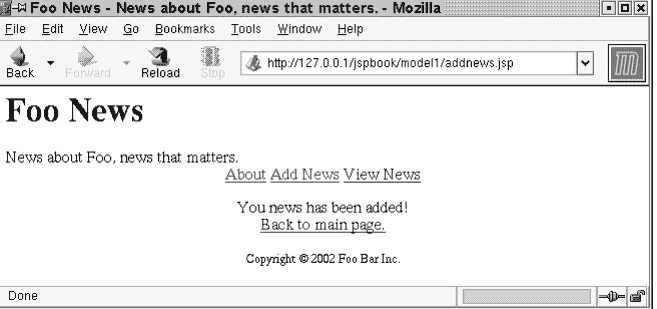

图 11-4 addnews.jsp 感谢页的浏览器渲染

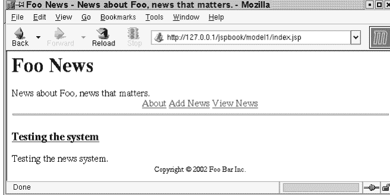

图 11-5 index.jsp 的浏览器渲染

466

## 设计模式

模式不起作用，讨论它将是荒谬的。可以理解之前的网站是可以正常工作的，并且它被认为是 Model 1 架构。

## 为什么这是 Model 1？

起初避免了对网站代码的讨论，因为在例示例中，代码本身并不是关注点。本章中提到的所有设计模式都可以用于构建任何类型的网站。本章的重点是代码放置的位置。回想介绍 Model 1 架构时，曾提到该设计的分类方式是每个请求都映射到单个端点（`endpoint`）。该端点专门负责生成最终响应。

示例应用程序之所以遵循 Model 1 架构，是因为它直接遵循了这一点。Web 应用程序的规则如图 11-6 所示。

每个请求 URL 都指向 Web 应用程序中的某一个资源。所有生成响应的逻辑都包含在同一个资源中，结果是三个不同复杂程度的 JSP。在这个例中，所有三个页面都是特意选择的，以包含不同类型的功能。请记住，在更真实的 Web 应用程序中，有很多相同类型的页面。然而，为了讨论设计，请考虑这三个大类：

- **静态页面（static page）**：静态页面可以使用 HTML 等语言轻松编写。页面内容不会改变，且将页面作为单个文档编写是最佳方法。`about.jsp` 页面就是静态类型页面的示例。`about.jsp` 生成的内容不依赖于 JSP 和 Servlets 提供的任何高级功能（例如脚本元素）。

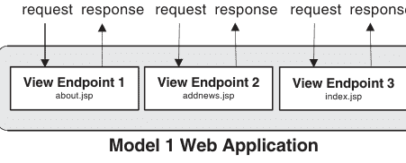

图 11-6 Model 1 架构图

常用设计模式 467

- **动态页面（dynamic page）**：动态页面依赖于 Servlets 和 JSP 提供的动态服务器端功能。动态页面无法作为静态页面编写，因为生成的内容可能随每个请求而不同。在示例应用程序中，`index.jsp` 是动态页面的示例。页面的响应取决于嵌入的脚本元素。没有它们，页面将无法运行。

- **动态表单页面（dynamic form page）**：动态表单页面是需要用户参与的动态页面。在大多数情况下，它是带有 HTML 表单的页面。在示例 Web 应用程序中，`addnews.jsp` 是一个带有动态页面的示例。

上述三种类型都是重要的，但赋予这些类型的特定名称并不重要。所列出的名称仅仅是作为参考所需的自描述性术语。

这些类型之所以重要，是因为它们说明了不同设计模式的优缺点。所有设计模式都会使用静态页面。通常情况下，尽可能多的静态页面是理想的，因为它们使用使用的格式语言（通常是 HTML 或 XML）很容易编写。动态页面是设计模式重要的地方。动态页面逻辑的放置位置将极大影响未来开发和维护页面的便利。正如 `about.jsp`、`index.jsp` 和 `addnews.jsp` 所示，Model 1 架构通过为每个页面创建一个单页并添加动态功能来处理这三种类型的页面。

## Model 1 的劣势

Model 1 设计模式没有任何优点，完全不建议你使用它。你应该考虑使用 Model 1 架构的时刻是你正在构建一个微不足道的 Web 应用程序。除此之外，该架构唯一可能的良好论点是它可以由对 JSP 和 Servlets 知识和经验有限的开发者构建。编写的简便通常是与该架构相关的益处，但事实并非如此。Model 1 架构缺乏足够的优点来支持专门用一个章节进行讨论。相反，我们将直接关注该架构的劣势，作为引入 Model 2 设计模式的引言。

Model 1 设计模式的许多弱点在检查时变得显而易见。该设计将动态页面的开发限制在熟悉 JSP 和 Servlets 的开发者。由于过量的嵌入脚本，该设计使得动态页面过度复杂且晦涩。该设计创建了难以维护的页面，并在构建页面时难以协作。所有这些弱点都使得 Model 1 设计模式变得不宜使用。

开发和维护问题是 Model 1 设计模式中最问题的问题。Web 应用程序的构建和维护通常涉及一组混合类型的开发者。Model 1 设计模式直接将动态代码嵌入到静态格式旁；这种做法要求所有开发者都熟悉所使用的所有技术。通常所需的技术包括 HTML、Java、JSP 和 Servlets，但也可能存在许多其他技术，如 SQL、HTML、XML、EJB 和 XSLT。要求所有开发者熟悉如此庞大的技术基础是有问题的，因为很难确保每个开发者都有足够的技能来妥妥地操作 Web 应用程序，特别是在项目生命周期后期需要维护时。冗长、复杂且通常晦涩的 JSP 和 Servlets 很难在不破坏功能的情况下进行编辑。

Model 1 模式引入的复杂性的良好示例可以在 `index.jsp` 和 `address.jsp` 中看到。与 `about.jsp` 相比，这些页面很难被化！你会记得 `index.jsp` 的以下部分（列表 11-6）。

## 列表 11-6 index.jsp 中使用的脚本元素

常用设计模式 469

```jsp
e.getAttribute("title") %></a></h3
<%= e.getAttribute("story") %>
<%
}
%>
```

该代码正在遍历每个新闻条目，并创建显示它们所需的 HTML。使之复杂的是加载和解析包含新闻条目的 XML 文件所需的所有代码。这些代码是需要的，但没有理由将代码嵌入在脚本段（`scriptlet`）中。点在于，Model 1 设计模式是有缺陷的，因为它允许开发者随心所欲地到处插入 Java 代码。数据访问代码与负责生成响应的代码之间没有分离。同样的缺陷在处理 XML 的代码中也存在。另一个随意使用脚本的良好示例可以在 `addnews.jsp` 中看到。该页面实际上应该是两个独立的页面。相反，两个页面被合并了一个巨大的 JSP（列表 11-7）。

## 列表 11-7 addnews.jsp 中的条件

```jsp
<%
String title = request.getParameter("title");
String link = request.getParameter("link");
String story = request.getParameter("story");
if (title != null && !title.equals("") &&
    story != null && story.trim().equals("") &&
    link != null && !link.equals("")) {
%>
<p align="center">You news has been added!<br>
<a href="index.jsp">Back to main page.a></p>

<% }
else {
%>
<h3>Add News</h3>
<p>Fill in all fields to add your news.</p>
<form method="post">
Title: <input size="50" name="title"><br>
Link: <input size="50" name="link"><br>
Story:<textarea cols="50" rows="10" name="story" /> <br>
<input type="submit" value="Add News">
</form>
<% %>
```

合并页面是一个坏主意，因为它将几个简单的页面变成了复杂的代码。一个难以管理，而且对页面代码的尝试可能会破坏其他页面。在 `addnews.jsp` 的情况下，合并页面引起的问题可能没有看起来那么明显。由于代码合并的简单，看起来像是一个巧妙的 JSP，但页面不应该被破坏。合并页面在 Model 1 设计模式中很常见，特别是使用表单从用户获取反馈并尝试保留单个端点时。

带有表单的动态页面带来了另一个 Model 1 设计所使用的混合逻辑和格式的良好说明。当从用户索取信息时，必须对信息进行适当验证。对于 HTML 表单，尽可能在客户端进行验证以避免往返；然而，通常验证唯一的良好位置是在服务器端。没有理由将验证逻辑放在用于格式输出的代码中。然而，在 Model 1 设计模式中，这正是 `addnews.jsp` 代码所在的位置，用于确保用户已输入信息（列表 11-8）。

## 列表 11-8 addnews.jsp 中的验证代码

```jsp
<%
String title = request.getParameter("title");
String link = request.getParameter("link");
String story = request.getParameter("story");
if (title != null && !title.equals("") &&
    story != null && story.trim().equals("") &&
    link != null && !link.equals("")) {
%>
<p align="center">You news has been added!<br>
<a href="index.jsp">Back to main page.a></p>

<% {}
else {
%>
```

470

设计模式

```java
if(title == null) {
  title = "";
}
if(link == null) {
  link = "";
}
if(story == null) {
  story = "";
}
```

## 添加新闻

<p>填写所有字段以将您的新闻添加到 Foo news 中。</p>

```html
<form method="post">
Title: <input size="50" name="title" value="<%=title%"><br>
Link: <input size="50" name="link" value="<%=link%"><br>
Story:
<textarea cols="50" rows="10" name="story">
<%= story%
</textarea>
<br>
<input type="submit" value="Add News">
</form>
 %>
```

这段代码长度与创建 HTML 表单所需的标记一样长！标记和验证代码混合在一起，是一团乱麻。页面变得过于复杂，不利于维护。

现在应该已经明显，Model 1 设计模式的缺陷源于 JSP 脚本元素。JSP 脚本元素是格式标记与负责生成动态内容的 Java 代码之间糟糕的接口。结果是一个由交织的标记和 Java 代码组成的晦涩的 JSP。在逻辑上不同类型的代码之间没有清晰的边界。

## Model 2

Model 2（也称为模型视图控制或 MVC）设计模式是一种寻求解决 Model 1 问题的设计模式。Model 2 设计模式在逻辑上合理、有效，并且被认为是使用 Servlets 和 JSP 实现 Web 应用的最佳方法。Model 2 架构通过 Jakarta Struts Framework 在 JSP 和 Servlet 社区中流行。http://jakarta.apache.org/struts。Struts 仍然是一个流行的模型框架，它将在章节后后介绍，Model 2 设计的示例是从零开始构建的，以便最好说明重要概念。

Model 2 设计模式定义了 Web 业务逻辑与显示逻辑的清晰分离。业务逻辑包含获取运行时所需的所有内容。显示逻辑包含将信息格式化为客户端期望格式的内容。通过将两者分离，两部分都保持简单且易于操作。Model 2 也称为 MVC，因为通常这种分离被称为模型（Model）、视图（View）和控制（Control）。模型组件是应用程序数据存储的表示，以及涉及读、写和验证信息的代码。视图组件负责与用户交互。控制组件连接其他两个组件，负责为用户提供适当的视图并保持当前模型。

应用于 JSP 和 Servlets 时，Model 2 范式可以通过几种不同的方式实现。视图组件几乎完全通过 JSP 完成。JSP 为常用的 HTML 和 XML 格式创建视图提供了极佳的方法。模型组件通常封装为一组 JavaBeans，易于通过 JSP 进行操作，而控制组件则是 Servlet 或 Filter，设计用于接收并恰当引导从客户端发送的请求和响应。设如图 11-7 所示的设计。


# 关于 Model 2 设计模式

关于 Model 2 设计模式有几个重要的概念需要理解。如图 11-7 所示，一切都是清晰分离的。这种清晰分离是该设计模式最重要的方面，因为它对不同类型的功能进行了分层。图 11-7 显示的更重要的概念是：

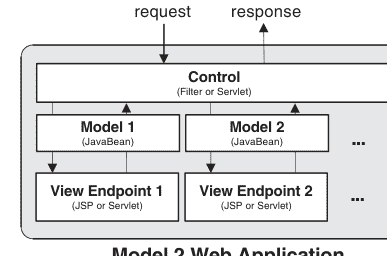

图 11-7 Model 2 架构

是设计中不同部分用于通信的接口。最重要的是视图使用的 `JavaBeans`。正如后文解释的，此接口有助于极大地简化提供适当视图所需的 JSP 的创建和维护。最后一个需要注意的重要概念是控制组件是如何实现的。接收所有请求和响应的 `Filter` 或 `Servlet` 是实现安全性、日志记录以及任何其他应用级功能的非常方便的地方。

## 简单 Model 2 网站

我们现在将重构 Model 1 部分中使用的简单应用程序，以遵循 Model 2 架构。该示例对于具体说明此设计模式的概念是必要的。如果您期望将此示例无缝地扩展到实际使用，有几点需要注意，但这些注意事项将在稍后讨论，并随后介绍一个用于实际应用程序的良好 Model 2 框架。

重构示例应用程序需要添加一些新类。使用 `Filter` 用作控制组件，并且一个 `java bean` 与 JSP 视图页面进行通信。生成的应用程序是 Model 2 架构的一个示例。

并不是所有的 Model 1 应用程序都需要重构。静态页面 `header.jsp`、`footer.jsp` 和 `about.jsp` 都是相同的。将这些页面从 `/jspbook/model1` 目录复制到 `/jspbook/model2` 目录。通常，在 Model 1 与 Model 2 设计方面，静态页面的效率已达到最高。模式之间的差异在于动态功能。同样将 `news.xml` 从 `/jspbook/model` 目录复制到 `/jspbook/model2` 目录。这保留了 Model 1 示例中使用的条目。

新设计中最复杂的部分是用于拦截所有请求并执行假设包含 Model 2 逻辑的隐式 Java 类 `Filter`。将列表 11-9 保存为 `ControlFilter.java` 到 jspbook Web 应用程序的 `/WEB-INF/classes/com/jspbook` 目录。`Filter` 如何工作的讨论将在代码之后。

### 列表 11-9 ControlFilter.java

```java
package com.jspbook;

import javax.servlet.*;
import javax.servlet.http.*;
import java.io.*;

public class ControlFilter implements Filter {

    protected FilterConfig config;

    public void init(FilterConfig filterConfig) {
        config = filterConfig;
    }

    public void doFilter(HttpServletRequest request, HttpServletResponse response, FilterChain chain)
            throws IOException, ServletException {

        String uri = request.getRequestURI();
        String name = uri.substring(uri.indexOf("/"));

        try {
            Object o = Class.forName("com.jspbook." + name).newInstance();
            if (o instanceof Control) {
                Control control = (Control) o;
                control.doLogic(request, response);
            } else {
                throw new ServletException("Class com.jspbook." + name + " does not implement Control");
            }
        } catch (ClassNotFoundException e) {
            // ignore
        } catch (InstantiationException e) {
            throw new ServletException(e);
        } catch (IllegalAccessException e) {
            throw new ServletException(e);
        }

        // if
        chain.doFilter(request, response);
    }

    public void destroy() {
        // no
    }
}
```

### 列表 11-11 Model 1 index.jsp 脚本元素

```jsp
<%
ServletContext sc = pageContext.getContext();
String dir = sc.getRealPath("/model1");
File file = new File(dir+"/news.xml");
DocumentBuilderFactory dbbf =
    DocumentBuilderFactory.newInstance();
DocumentBuilder db = dbbf.newDocumentBuilder();
Document doc = null;
if (file.exists()) {
    doc = db.parse(file);
}
if (doc != null) {
    NodeList nodes = doc.getElementsByTagName("story");
    for (int i = 0; i < nodes.getLength(); i++) {
        Element e = nodes.item(i);
    }
}
%>
<hr>
<h3><a href="<%= e.getAttribute("link") %>"><%= e.getAttribute("title") %></a></h3>
<% e = e.getAttribute("story") %>
%>
```

对于 Model 2 版本的 index 页面，我们尝试移除所有脚本。因此，脚本的逻辑需要构建到一个逻辑组件中，以便与 `Control Filter`（控制过滤器）配合使用。我们假设 index 页面也将命名为 `index.java`。这个 Web 网站意味着它的隐含逻辑组件是 `index.java`。将列表 11-12 保存为 `index.java`，存于 jspbook Web 的 `/WEB-INF/classes/com/jspbook` 目录下。

### 列表 11-12 index.java

```java
package com.jspbook;

import javax.servlet.http.*;
import javax.servlet.*;
import java.io.*;
import javax.xml.parsers.*;
import javax.xml.transform.*;
import javax.xml.transform.stream.*;
import javax.xml.transform.dom.*;
import org.w3c.dom.*;
import org.xml.sax.*;
import java.util.*;

public class index implements Control {
    public boolean doLogic(HttpServletRequest request,
            HttpServletResponse response)
            throws ServletException, IOException {
        try {
            ServletContext sc = 
                request.getSession(false).getServletContext();

            String dir = sc.getRealPath("/model2");
            File file = new File(dir+"/news.xml");
            DocumentBuilderFactory dbf = 
                DocumentBuilderFactory.newInstance();
            DocumentBuilder db = dbf.newDocumentBuilder();
            Document doc = null;
            if (file.exists()) {
                doc = db.parse(file);
            }
            if (doc != null) {
                NodeList nodes = doc.getElementsByTagName("story");
                Properties[] ads = new Properties[nodes.getLength()];
                for (int i = 0; i < nodes.getLength(); i++) {
                    Element e = (Element)nodes.item(i);
                    ads[i] = new Properties();
                    ads[i].setProperty("link", e.getAttribute("link"));
                    ads[i].setProperty("title", e.getAttribute("title"));
                    ads[i].setProperty("story", e.getAttribute("story"));
                }
                request.setAttribute("news", ads);
            }
        } catch (SAXException e) {
            throw new ServletException(e.getMessage());
        }
        return true;
    }
}
```

列表 11-10 与列表 11-11 代码之间的唯一主要区别在于 Model 2 版本不直接向客户端发送输出。相反，每个新闻项的值被存储在 `java.util.Properties` 对象中：

```java
Properties[] ads = new Properties[nodes.getLength()];
for (int i = 0; i < nodes.getLength(); i++) {
    Element e = (Element)nodes.item(i);
    ads[i] = new Properties();
    ads[i].setProperty("link", e.getAttribute("link"));
    ads[i].setProperty("title", e.getAttribute("title"));
    ads[i].setProperty("story", e.getAttribute("story"));
}
```

所有的新闻项都被放置在一个数组中，然后放入请求作用域（request scope）。

```java
request.setAttribute("news", ads);
```

通过使用请求作用域变量，我们为展示 JSP 创建了一个接口。现在不再依赖脚本，如果我们使用 JSTL 和 JSP EL，JSP 就可以完全纯化。`index.jsp` 的新代码如下。将列表 11-13 保存为 `index.jsp`，存于 jspbook Web 应用的 model2 目录下。

### 列表 11-13 Model 2 index.jsp

```jsp
<%@taglib uri="http://java.sun.com/jstl/core-rt" prefix="c">
<jsp:include page="header.jsp"/>
<c:forEach var="story" begin="0" items="${news}">
<hr>
<h3>
<a href="${story.link}">${story.title}</a>
</h3>
${story.story}
</c:forEach>
<jsp:include page="footer.jsp"/>
```

与列表 11-1 相比，代码非常简单！这种区别很重要，因为 `index.jsp` 变得极其容易维护。编辑页面就像编辑 HTML 页面一样简单。得益于 JSP 标准动作、表达式语言和 JSTL，不再需要脚本元素。

该页面产生的结果与你之前在图 11-5 中看到的相同。尝试编译 `ControlFilter.java` 并部署过滤器以接受指向 Model 2 应用的所有请求。`web.xml` 需要列表 11-14。

### 列表 11-14 用于 ControlFilter.java 的 web.xml

```xml
<filter>
  <filter-name>ControlFilter</filter-name>
  <filter-class>com.jspbook.ControlFilter</filter-class>
</filter>
<filter-mapping>
  <filter-name>ControlFilter</filter-name>
  <url-pattern>/model2/*</url-pattern>
</filter-mapping>
```

部署过滤器后，访问 `index.jsp`。`web.xml`、`header.jsp` 和 `footer.jsp` 存于 model2 目录。Model 2 架构的好处：`index.jsp` 相比复杂的脚本变得简单。编辑页面就像编辑 HTML 页面一样简单。Model 2 架构的好处在于逻辑组件，不再需要一个复杂的 JSP，而是创建一个简单的逻辑组件。将列表 11-15 保存为 `index.java`，存于 jspbook Web 应用的 `/WEB-INF/classes/com/jspbook` 目录下。

### 列表 11-15 index.java

```java
package com.jspbook;

import javax.servlet.http.*;
import javax.servlet.*;
import java.io.*;
import javax.xml.parsers.*;
import javax.xml.transform.*;
import javax.xml.transform.stream.*;
import javax.xml.transform.dom.*;
import org.w3c.dom.*;
import org.xml.sax.*;
import java.util.*;

public class index implements Control {

    public boolean doLogic(HttpServletRequest request,
            HttpServletResponse response)
            throws ServletException, IOException {

        try {

            ServletContext sc = 
                request.getSession(false).getServletContext();

            String dir = sc.getRealPath("/model2");

            File file = new File(dir+"/news.xml");

            DocumentBuilderFactory dbf = 
                DocumentBuilderFactory.newInstance();

            DocumentBuilder db = dbf.newDocumentBuilder();

            Document doc = null;

            if (file.exists()) {
                doc = db.parse(file);
            }

            if (doc != null) {
                NodeList nodes = doc.getElementsByTagName("story");
                Properties[] ads = new Properties[nodes.getLength()];
                for (int i = 0; i < nodes.getLength(); i++) {
                    Element e = (Element)nodes.item(i);
                    ads[i] = new Properties();


# 11-11 Model 1 index.jsp 脚本元素

```jsp
<%
ServletContext sc = pageContext.getContext();
String dir = sc.getRealPath("/model1");
File file = new File(dir+"/news.xml");
DocumentBuilderFactory dbbf =
    DocumentBuilderFactory.newInstance();
DocumentBuilder db = dbbf.newDocumentBuilder();
Document doc = null;
if (file.exists()) {
    doc = db.parse(file);
}
if (doc != null) {
    NodeList nodes = doc.getElementsByTagName("story");
    for (int i = 0; i < nodes.getLength(); i++) {
        Element e = nodes.item(i);
    }
}
%>
<hr>
<h3><a href="<%= e.getAttribute("link") %>"><%= e.getAttribute("title") %></a></h3>
<%= e.getAttribute("story") %>
```

对于 Model 2 版本的 index 页面，我们尝试移除所有脚本。因此，脚本的逻辑需要构建到一个逻辑组件中，以便与 Control Filter（控制过滤器）配合使用。我们假设 index 页面也将命名为 index.java。这个 Web 网站意味着它的隐含逻辑组件是 index.java。将列表 11-12 保存为 index.java，存于 jspbook Web 的 `/WEB-INF/classes/com/jsp` 目录下。

# 11-12 index.java

```java
package com.jspbook;

import javax.servlet.http.*;
import javax.servlet.*;
import java.io.*;
import javax.xml.parsers.*;
import javax.xml.transform.*;
import javax.xml.transform.stream.*;
import javax.xml.transform.dom.*;
import org.w3c.dom.*;
import org.xml.sax.*;
import java.util.*;
```


```java
public class index implements Control {
    public boolean doLogic(HttpServletRequest request,
            HttpServletResponse response)
            throws ServletException, IOException {
        try {
            ServletContext sc = 
                request.getSession(false).getServletContext();

            String dir = sc.getPath("/model2");
            File file = new File(dir+"/news.xml");
            DocumentBuilderFactory dbf = 
                DocumentBuilderFactory.newInstance();
            DocumentBuilder db = dbf.newBuilder();
            Document doc = null;
            if (file.exists()) {
                doc = db.parse(file);
            }
            if (doc != null) {
                NodeList nodes = doc.getElementsByTagName("story");
                Properties[] ads = new Properties[nodes.getLength()];
                for (int i = 0; i < nodes.getLength(); i++) {
                    Element e = (Element)nodes.item(i);
                    ads[i] = new Properties();
                    ads.setProperty("link", e.getAttribute("link"));
                    ads.setProperty("title", e.getAttribute("title"));
                    ads.setProperty("story", e.getAttribute("story"));
                }
                request.setAttribute("news", ads);
            }
        } catch (SAXException e) {
            throw new ServletException(e.getMessage());
        }
}
```

列表 11-10 与列表 11-11 代码之间的唯一主要区别在于 Model 2 版本不直接向客户端发送输出。相反，每个新闻项的值被存储在 `java.util.Properties` 对象中：

```java
Properties ads = new Properties[nodes.getLength()];
for (int i = 0; i < nodes.getLength(); i++) {
    Element e = (Element)nodes.item(i);
    Properties ads = new Properties();
    ads.setProperty("link", e.getAttribute("link"));
    ads.setProperty("title", e.getAttribute("title"));
    ads.setProperty("story", e.getAttribute("story"));
}
```

所有的新闻项都被放置在一个数组中，然后放入请求作用域（request scope）。

```java
request.setAttribute("news", ads);
```

通过使用请求作用域变量，我们为展示 JSP 创建了一个接口。现在不再依赖脚本，如果我们使用 JSTL 和 JSP EL，JSP 就可以完全纯化。index.jsp 的新代码如下。将列表 11-13 保存为 index.jsp，存于 jspbook Web 应用的 model2 目录下。

## 11-13 Model 2 index.jsp

```jsp
<@tag uri="http://java.sun.com/jstl/core-rt" prefix="c">
<jsp:include page="header.jsp"/>
<c:forEach var="story" begin="0" items="${news}">
<hr>
<h3>
<a href="${story.link}">${story.title}</a>
</h3>
${story.story}
</c:forEach>
<jsp:include page="footer.jsp"/>
```

与列表 11-1 相比，代码非常简单！这种区别很重要，因为 index.jsp 变得极其容易维护。编辑页面就像编辑 HTML 页面一样简单。得益于 JSP 标准动作、表达式语言和 JSTL，不再需要脚本元素。

该页面产生的结果与你之前在图 11-5 中看到的相同。尝试编译 `ControlFilter.java` 并部署过滤器以接受指向 Model 2 应用的所有请求。web.xml 需要列表 11-14。

## 11-14 用于 ControlFilter.java 的 web.xml

```xml
<filter>
  <filter-name>ControlFilter</filter-name>
  <filter-class>com.jspbook.ControlFilter</filter-class>
<filter-mapping>
  <filter-name>ControlFilter</filter-name>
  <url-pattern>/model2/*</url-pattern>
</filter-mapping>
```

部署过滤器后，访问 index.jsp。web.xml、header.jsp 和 footer.jsp 存于 model2 目录。Model 2 架构的好处 index.jsp 相比复杂的脚本变得简单。编辑页面就像编辑 HTML 页面一样简单。Model 2 架构的好处在于逻辑组件，不再需要一个复杂的 JSP，而是创建一个简单的逻辑组件。将列表 11-15 保存为 index.java，存于 jspbook Web 应用的 `/WEB-INF/classes/com/jsp` 目录下。

## 11-15 index.java

```java
package com.jspbook;

import javax.servlet.http.*;
import javax.servlet.*;
import java.io.*;
import javax.xml.parsers.*;
import javax.xml.transform.*;
import javax.xml.transform.stream.*;
import javax.xml.transform.dom.*;
import org.w3c.dom.*;
import org.xml.sax.*;
import java.util.*;
```

```java
public class index implements Control {
    public boolean doLogic(HttpServletRequest request,
            HttpServletResponse response)
            throws ServletException, IOException {
        try {
            ServletContext sc = 
                request.getSession(false).getServletContext();

            String dir = sc.getPath("/model2");
            File file = new File(dir+"/news.xml");
            DocumentBuilderFactory dbf = 
                DocumentBuilderFactory.newInstance();
            DocumentBuilder db = dbf.newBuilder();
            Document doc = null;
            if (file.exists()) {
                doc = db.parse(file);
            }
            if (doc != null) {
                NodeList nodes = doc.getElementsByTagName("story");
                Properties[] ads = new Properties[nodes.getLength()];
                for (int i = 0; i < nodes.getLength(); i++) {
                    Element e = (Element)nodes.item(i);
                    ads[i] = new Properties();
                    ads.setProperty("link", e.getAttribute("link"));
                    ads.setProperty("title", e.getAttribute("title"));
                    ads.setProperty("story", e.getAttribute("story"));
                }
                request.setAttribute("news", ads);
            }
        } catch (SAXException e) {
            throw new ServletException(e.getMessage());
        }
}
```

ControlFilter.java。除了 Filter 之外，还有非常简单的 JSP header.jsp、footer.jsp、about.jsp、addnews.jsp 和 index.jsp。这些页面通过请求范围变量（request-scoped variables）与 Filter 通信。与我们的 Model 2 图 Filter 11-6 相比，代码结构如图 11-8 所示。

该图展示了呈现与业务逻辑的清晰分离。Filter 11-7 与 Model 1 示例对应的图 Filter 11-6 之间存在显著差异。在 Model 1 中，所有请求直接发送到一个端点。在 Model 2 中，所有请求首先通过 Control（控制器），可选执行 Model 逻辑，然后发送到相应的 View（视图）。与三个复杂的 Model 1 JSP 相比，最终结果是少数易于管理的 Model 2 组件。这是 MVC 架构的典型特征。它不是创建几个难以维护的组件，而是创建了几个易于维护的组件，这正是使用 Model 2 设计模式之处之处。

## Model 2 的优势

Model 2 架构的主要优势是业务逻辑与呈现层的清晰分离。这在 index.jsp（从代码段 11-1 到 11-13）以及 addnews.jsp（从代码段 11-2 到 11-16 以及 11-7）的更改中得到了清晰说明。与 Model 1 版本相比，这些页面整洁、优雅。维护工作就像编辑 HTML 一样简单。还要考虑到，任何 View 组件中的代码都不可能破坏 Model 代码。这一点很重要，因为这是困扰 Model 1 模式的问题。在 Model 1 页面中修复一个简单的拼写错误可能会无意中影响整个应用程序的代码。在 Model 2 设计模式中这种情况是不可能的。用于传递 View 信息的请求范围变量仅包含所需的 View 信息。View 页面不知道信息从哪里来，也不关心。查看 Model 2 示例中的 index.jsp、addnews.jsp 和 about.jsp，你可以看到页面可能的最坏情况只是产生了一些糟糕的 HTML。

逻辑与呈现的分离也有利于 Model 组件。View 绝不会关心信息是如何获取的。无论 Model 使用数据库、扁平文件还是其他任何东西并不重要。一个关键点体现了 Model 2 设计模式优于 Model 1：在 View 和 Model 组件之间始终存在适当的抽象层。Model 2 应用程序可以需要自由更改 Web 应用程序的底层数据模型，而没有破坏 View 组件的危险。只要两者之间的接口（即请求范围变量）被正确使用，JSP View 就能工作。

Model 2 设计模式的另一个微小但有用的优势来自 Control 组件。Control 组件为处理通过 Web 应用程序的所有请求和响应提供完美的地方。它是安全、日志记录、错误处理以及 Filter 常用的其他用途方便的地方。在某些情况下，Control 组件是最佳选择。总的来说，与 Model 1 相比，Model 2 架构有许多优势。逻辑与呈现的分离也有利于 Model 组件。

## Model 2 的劣势

Model 2 架构的主要优势是业务逻辑与呈现层的清晰分离。这在 index.jsp（从代码段 11-1 到 11-13）以及 addnews.jsp（从代码段 11-2 到 11-16 以及 11-7）的更改中得到了清晰说明。与 Model 1 版本相比，这些页面整洁、优雅。维护工作就像编辑 HTML 一样简单。还要考虑到，任何 View 组件中的代码都不可能破坏 Model 代码。这一点很重要，因为这是困扰 Model 1 模式的问题。在 Model 1 页面中修复一个简单的拼写错误可能会无意中影响整个应用程序的代码。在 Model 2 设计模式中这种情况是不可能的。用于传递 View 信息的请求范围变量仅包含所需的 View 信息。View 页面不知道信息从哪里来，也不关心。查看 Model 2 示例中的 index.jsp、addnews.jsp 和 about.jsp，你可以看到页面可能的最坏情况只是产生了一些糟糕的 HTML。

逻辑与呈现的分离也有利于 Model 组件。View 绝不会关心信息是如何获取的。无论 Model 使用数据库、扁平文件还是其他任何东西并不重要。一个关键点体现了 Model 2 设计模式优于 Model 1：在 View 和 Model 组件之间始终存在适当的抽象层。Model 2 应用程序可以需要自由更改 Web 应用程序的底层数据模型，而没有破坏 View 组件的危险。只要两者之间的接口（即请求范围变量）被正确使用，JSP View 就能工作。

Model 2 设计模式的另一个微小但有用的优势来自 Control 组件。Control 组件为处理通过 Web 应用程序的所有请求和响应提供完美的地方。它是安全、日志记录、错误处理以及 Filter 常用的其他用途方便的地方。在某些情况下，Control 组件是最佳选择。总的来说，与 Model 1 相比，Model 2 架构有许多优势。逻辑与呈现的分离也有利于 Model 组件。

## 本示例的注意事项

Model 2 架构的主要优势是业务逻辑与呈现层的清晰分离。这在 index.jsp（从代码段 11-1 到 11-13）以及 addnews.jsp（从代码段 11-2 到 11-16 以及 11-7）的更改中得到了清晰说明。与 Model 1 版本相比，这些页面整洁、优雅。维护工作就像编辑 HTML 一样简单。还要考虑到，任何 View 组件中的代码都不可能破坏 Model 代码。这一点很重要，因为这是困扰 Model 1 模式的问题。在 Model 1 页面中修复一个简单的拼写错误可能会无意中影响整个应用程序的代码。在 Model 2 设计模式中这种情况是不可能的。用于传递 View 信息的请求范围变量仅包含所需的 View 信息。View 页面不知道信息从哪里来，也不关心。查看 Model 2 示例中的 index.jsp、addnews.jsp 和 about.jsp，你可以看到页面可能的最坏情况只是产生了一些糟糕的 HTML。

逻辑与呈现的分离也有利于 Model 组件。View 绝不会关心信息是如何获取的。无论 Model 使用数据库、扁平文件还是其他任何东西并不重要。一个关键点体现了 Model 2 设计模式优于 Model 1：在 View 和 Model 组件之间始终存在适当的抽象层。Model 2 应用程序可以需要自由更改 Web 应用程序的底层数据模型，而没有破坏 View 组件的危险。只要两者之间的接口（即请求范围变量）被正确使用，JSP View 就能工作。


Model 2 设计模式的另一个微小但有用的优势来自 `Control` 组件。`Control` 组件为处理通过 Web 应用程序的所有请求和响应提供完美的地方。它是安全、日志记录、错误处理以及 `Filter` 常用的其他用途方便的地方。在某些情况下，`Control` 组件是最佳选择。总的来说，与 Model 1 相比，Model 2 架构有许多优势。逻辑与呈现的分离也有利于 `Model` 组件。

## 良好的 Model 2 实现

Model 2 架构的主要优势是业务逻辑与呈现层的清晰分离。这在 `index.jsp`（从代码段 11-1 到 11-13）以及 `addnews.jsp`（从代码段 11-2 到 11-16 以及 11-7）的更改中得到了清晰说明。与 Model 1 版本相比，这些页面整洁、优雅。维护工作就像编辑 HTML 一样简单。还要考虑到，任何 `View` 组件中的代码都不可能破坏 `Model` 代码。这一点很重要，因为这是困扰 Model 1 模式的问题。在 Model 1 页面中修复一个简单的拼写错误可能会无意中影响整个应用程序的代码。在 Model 2 设计模式中这种情况是不可能的。用于传递 `View` 信息的请求范围变量仅包含所需的 `View` 信息。`View` 页面不知道信息从哪里来，也不关心。查看 Model 2 示例中的 `index.jsp`、`addnews.jsp` 和 `about.jsp`，你可以看到页面可能的最坏情况只是产生了一些糟糕的 HTML。

# Model 2 栈

| 业务逻辑 |
| :--- |
| 表现逻辑 |

图 11-10 Model 2 栈

它需要创建一个响应。正如我们之前所看到的，这种功能堆叠方法是很好的，因为它让创建和维护 Web 应用程序比 Model 1 的方法更加简单。现在的问题是，在考虑到 `Servlets` 和 `JSP` 是用于构建它的工具的情况下，我们该如何改进这个 Model 2 栈呢？

我们可以对这个 Model 2 栈进行一个巨大的改进：将可重用的业务逻辑提取到更高层。这导致了将业务逻辑层的可重用逻辑移动到栈的新、更高层级中。这个更高层可以放置那些不关心栈的特定端点的代码。它只关心处理请求或响应。改进后的新 Model 2 栈如图 11-11 所示。

注意栈的新顶层，`可重用过滤器（Reusable Filters）`是一个可以放置在许多 Web 应用程序之间重用的代码区域，对于特定的端点还是所有端点通用的业务逻辑，它都有帮助。我们这样做是因为它可以进一步使代码模块化，并使构建新的 Web 应用程序变得简单。

# 改进后的 Model 2 栈

| 可重用过滤器 |
| :--- |
| 业务逻辑 |
| 表现逻辑 |

图 11-11 改进后的 Model 2 栈

通过改进后的 Model 2 栈所做的操作可以通过现有的代码示例清楚地展示。考虑在本章构建的 Model 2 应用程序。从 Model 1 应用程序的脚本元素中提取出的代码总是与特定的端点有关。由于这个原因，所有代码自然地进入改进后的 Model 2 设计的业务逻辑中。然而，考虑应用程序的一些实际需求。如果用户需要登录 Web 应用程序的某个部分，或者希望对响应进行缓存或压缩？这些代码应该放在哪里？在纯概念的 Model 2 应用程序中，它们将和其他所有业务逻辑放在一起。但在实践中，代码将如第 8 章所示实现为一个过滤器（`Filter`）。原因是显而易见的：通过将代码保持在过滤器中，更容易在未来的 Web 应用程序中重用该过滤器。如果代码与特定端点的其他业务逻辑编写在一起，那么它就无法在未来的 Web 应用程序中重用。因此，安全、缓存或压缩的代码将放置在改进后的 Model 2 设计的可重用过滤器层中。

理解 Model 2 是重要的。它可以节省开发和维护 Web 应用程序的大量时间；然而，了解如何使用 `Servlets` 和 `JSP` 最佳实践地实现 Model 2 应用程序可以让你进一步优化设计模式的优势。在任何情况下，在考虑物理上如何实现 Model 2 应用程序时，尝试使用 Model 2 设计。在许多情况下，利用过滤器创建适用于任何应用程序的组件。

# Jakarta Struts

Struts 框架通常被称为使用 `Servlets` 和 `JSP` 开发 Model 2 Web 应用程序的“框架”。Struts 框架源于 Apache Jakarta 项目 `http://jakarta.apache.org` 以及 `Tomcat`。得益于许多 Jakarta 开发者的奉献和支持，Struts 迅速成为开发 Model 2 Web 应用程序的良好框架。

Struts 仍然是构建 Model 2 Web 应用程序的良好框架。Struts 框架提供了通用的控制 `Servlet`、用于创建表单的支持标签库以及国际化支持等其他功能。Struts 框架带有一完整的用户和开发者文档，而且 Struts 拥有周围最活跃的用户社区之一。由于所有这些原因，Struts 是 `Servlet` 和 `JSP` 开发者既理解又使用的优秀框架。为了完成对设计模式的讨论，我们将查看 Struts 框架以及一些使用该框架让项目快速启动的技巧。

# 安装 Struts

Struts 框架以二进制和源码分发的形式提供，并遵循 Apache Software Foundation 许可证。该项目可以免费用于商业和非商业项目，但如果你对 Apache 许可证不熟悉，请务必花时间阅读并理解它。Apache 组组支持了一些极佳软件的开发，你至少做的是花时间正确地理解那份长长的许可证。

本章涵盖 Struts，是因为它是开发 Model 2 Web 应用程序的一个非常有用的框架。以几个简单的 Model 2 示例结束并不是开始一个真实世界项目的方法。对于 Struts 的讨论，你需要下载最新版本的 Struts。本书使用的特定版本是 Struts 1.0.2 的二进制发布版本。可以在 `http://jakarta.apache.org/struts` 下载。如果你还没有，请现在下载。

# 什么是 Struts 1.0.2？

Struts 1.0.2 包含许多内容，包括：Struts、文档以及一个快速上手 Web 应用程序。Struts 下载说明在其包含的文档和在线版本中解释了这一切。在书中重新叙述这些优秀的文档没有意义，特别是当这里涵盖的材料可能随着 Struts 新版本的发布而过时时。相反，本章提供了 Struts 的简要概述，旨在补充文档。如果你想在本书范围之外的项目中使用 Struts，我们诚心建议你阅读官方的、当前的文档。

本章能比 Struts 文档做得更好的一点是提供对 Struts 1.0.2 功能的客观视图，并解释它如何与我们在书中书中涵盖的所有其他概念一起工作。这是我们将采取的方法，但首先你需要了解 Struts 下载带了哪些内容。

将 Struts 的二进制安装包解压到方便的目录中。存在以下文件：

- `lib/struts.jar`：此 JAR 文件包含了 Struts 中所有的 Java 类。它的存在使得现有 Web 应用程序可以利用 Struts。
- `lib/struts.tld`：`/lib` 目录下的所有 `.tld` 文件都是 Struts 自定义标签库的标签库描述文件。为现有 Web 应用程序安装 Struts 时，需要这些文件来描述 Struts 标签库。
- `webapps/struts-blank.war`：`struts-blank.war` 是一个安装了所有 Struts 资源的空 Web 应用程序。从头开始一个新的 Web 应用程序，此文件是一个极佳的方法。
- `webapps/struts-documentation.war`：`struts-documentation.war` 文件包含了所有的 Struts 文档。文档包含了生成的 Java API 文档以及用户和开发者指南。`struts-documentation.war` 中的所有文档可以在 `http://jakarta.apache.org/struts` 找到。该 WAR 只是保留本地 Struts 文档的一种方便方法。
- `webapps/struts-example.war`：`struts-example.war` 文件是一个使用 Struts 构建的示例 Web 应用程序。该应用程序包含了完整的演练过程。
- `webapps/exercise-taglib.war`：`exercise-taglib.war` 是包含 Struts 支持的自定义标签测试页的 Web 应用程序。该 主要 主要 Struts 开发者，但也可以作为各种 Struts 标签使用的简单示例。
- `webapps/struts-template.war`：`struts-template.war` 文件是一个介绍并演示 Struts 标签的 Web 应用程序。
- `webapps/struts-upload.war`：`struts-upload.war` 文件是一个演示如何使用 Struts 框架上传文件的 Web 应用程序。

在本章中，仅涵盖了现有和新应用程序中包含的几个 Struts 文件，以及使用 Struts 控制 `Servlet`。示例文件、文档、模板和标签库 WAR 文件将不涵盖。

# 创建新的 Struts Web 应用程序

从头创建一个基于 Struts 的 Web 应用程序是简单的。`struts-blank.war` 文件是一个自动部署空 Web 预装 Struts 应用程序。只需使用容器部署 WAR 文件，即可获得一个已安装好 Struts 的 Web 应用程序。通过将 `struts-blank.war` 复制到 `Tomcat` 的 `/webapps` 目录可以部署 `Tomcat` Web 应用程序。重启 `Tomcat`，WAR 文件将被部署到同名的子目录中。在部署 Web 应用程序之前重命名 WAR 文件可以获取自定义名称的目录。

部署 `struts-blank.war` 文件后，Web 应用程序已准备就绪。为了本章后续的示例，需要一个应用程序。将 `struts-blank.war` 复制到你 `Tomcat` 安装目录下的 `/webapps` 目录。重启 `Tomcat`，应用程序即被部署。访问 `http://127.0.0.1/struts-blank` 来测试新的 Web 应用程序是否正确安装。如果是，应该显示图 11-12 所示的屏幕。

你拥有了一个准备就绪的 Struts Web 应用程序。作为如何使用 Struts 的示例，我们将使用 Struts 框架重新实现示例 2 应用程序。并不是所有的部分都需要重新构建。`JSP` 视图页面保持不变。将 `/jspbook/model2` 目录下的 `header.jsp`、`footer.jsp`、`index.jsp`、`about.jsp`、`news.xml` 和 `address.jsp` 复制到你 `Tomcat` 安装下的 `/webapps/struts-blank` 目录。对于视图页面，需要 `JSTL`。将 `/webapps/jspbook/WEB-INF/lib` 中的 `jstl.jar` 和 `standard.jar` 复制到你 `Tomcat` 安装下的 `/webapps/strutsblank/WEB-INF/lib` 目录。之前创建的 Java JavaBean 在 Struts 版本的应用程序中也将被复用。将 `jspbook` Web 应用程序中的 `News.java` 复制到 `struts-blank` Web 应用程序的 `/WEB-INF/classes/com/jspbook` 目录。

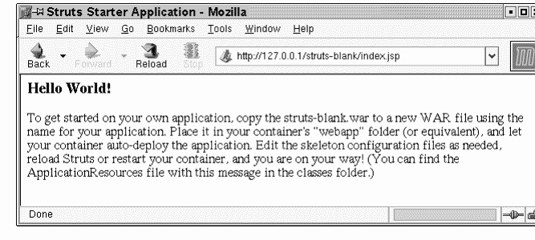

图 11-12 Struts Blank Web 应用程序的部署

视图组件是唯一与新的基于 Struts 的 Web 应用程序无缝工作的。在接下来的章节中，我们将重新构建模型和控制组件，以利用 Struts 的优势。

# 为现有 Web 应用程序安装 Struts

Web 应用程序可以通过安装和配置所需的 Struts 资源随时开始使用 Struts。与使用 `struts-blank.war` 文件相比，手动安装 Struts 稍微困难一些。关于在现有 Web 应用程序中安装 Struts 的完整指令可以在《Struts 用户指南》中找到。

# Struts 控制 Servlet

Struts 框架的核心是预构建的 Control Servlet（控制 `Servlet`）。该组件允许插件化的模型组件并与表单轻松交互。我们可以利用 Struts 控制 `Servlet` 为我们的 Model 2 应用程序的模型组件提供一种健壮的机制。回想这是之前 Model 2 示例最大的限制。Struts 提供了一个比在 `ControlFilter.java` 中硬编码逻辑更具吸引力的替代方案。

Struts 是基于 `JSP 1.1` 和 `Struts 2.2` 规范构建的。这意味着 Struts 目前没有利用 `Filter` 功能。相反，Struts 框架依赖于所有以虚拟扩展名（通常为 `.do`）结尾的请求。控制 `Servlet` 拦截所有带有该虚拟扩展名的请求，并将其转发到适当的 `JSP` 或 `Servlet`。Struts 控制 `Servlet` 的特定配置是 `web.xml` 中的一个项，与其他任何 `Servlet` 一样。`struts-blank.war` 文件自动部署了该 `Servlet`。

如果你查看 `struts-blank` Web 应用程序的 `web.xml`，你应该找到列表 11-18 中的代码。

- 列表 11-18 默认 Struts `web.xml`

```xml
...
<servlet>
  <servlet-name>action</servlet-name>
  <servlet-class>org.apache.struts.ActionServlet</servlet-class>
..
</servlet-mapping>

<servlet-mapping>
  <servlet-name>action</servlet-name>
  <url-pattern>*.do</url-pattern>
</servlet-mapping>
```

Struts 控制拦截所有以 `.do` 结尾的请求。从前面的项中截取出来的是控制 `Servlet` 的特定初始化参数。所有这些参数在 Struts 文档中都有解释。控制 `Servlet` 的默认项对于大多数情况（包括本示例）都是足够的。

理解控制 `Servlet` 的一个重要点是它如何与之前的 Model 2 示例中的 `Filter` 不同。请求可以直接去往具体的端点——例如，`index.jsp` 的 URL 是 `http://127.0.0.1/struts-blank/index.jsp`。在 Struts 重定向 `Servlet` 中，请求需要去虚拟的 `.do` 端点。虽然虚拟端点可以重定向到任何具体的端点，但区别通常只是将 `.jsp` 交换为 `.do`——例如对 `index.jsp` 的请求在 Struts 中通过请求 `http://127.0.0.1/struts-blank/index.do` 来完成。这种差异是微小的，由于 Struts 实现 Model 2 控制组件的方式。

使用 `Servlet` 或 `Filter` 作为控制组件来实现 Model 2 设计有优缺点。总的共识是 `Filter` 是最佳方法。在具体的端点之上无缝且干净地层叠 `Filter` 要直观得多，且配置更少。然而，使用 Struts 方法是有帮助的，因为它在请求和端点之间保持了一层抽象。

通过这样做，解决该问题的方案是将所有 `JSP` 源代码移动到 `/WEB-INF` 子目录，但内部重定向仍然有效。

# Actions

使用 Struts 的伟大之处在于利用预构建的控制组件。随着 Model 2 应用程序这部分的自动安装并准备就绪，我们只需要担心模型和视图组件。在 Struts 中，模型组件被称为 `Actions`。控制 `Servlet` 允许 `org.apache.struts.action.Action` 的子类来封装特定请求所需的业务逻辑。Struts 中的 `Action` 类比于 `ControlFilter.java` 中使用的硬编码业务逻辑。

Struts `Actions` 是使用 Struts 控制器而非简单 `ControlFilter.java` 的一个理由。通过使用 Struts `Action` 类，与特定页面相关的所有业务逻辑完全封装在一个类中。这允许在出现问题时轻松插入和调试 `Action` 类。它还防止了控制组件充满模型代码。

# 使用 Action 类

使用 `Action` 需要两个要素：用于封装特定请求业务逻辑的 `Action` 子类，以及 Struts 配置文件的项，允许 Struts 将特定请求或一组请求与特定 action 关联。

`Action` 类作为 Java 类的基类。新的 Struts action 类需要扩展 `org.apache.struts.action.Action` 并重写 `perform()` 方法。`perform()` 方法由 `Servlet` 在转发请求到视图之前调用。

`perform()` 方法如下：

```java
ActionMapping perform(ActionMapping am, HttpServletRequest request, HttpServletResponse response)
```

`perform()` 方法传递的参数与 `Servlet` 服务方法相同，但带有 Struts `org.apache.struts.action.ActionMapping` 类和 `org.apache.struts.action.ActionForm` 类参数。`ActionMapping` 类是配置映射的表示，Struts 用于确定合适的 `Action` 类。`ActionForm` 类是一个可选类，可以用于表示基于 HTML 表单的请求。`perform()` 方法返回一个 `org.apache.action.ActionForward` 实例，它提供了关于控制 `Servlet`（Control Servlet）应该如何处理请求的信息。如果返回 `null`，则假设请求和响应已完全由当前 `Action` 类处理完毕。


自定义 Action 类的骨架始终是相同的。扩展 `Action` 并重写 `perform()` 方法。列表 11-19 显示了骨架类的样式。

## 列表 11-19 BlankAction.java

```java
package com.jspbook;

import java.io.*;
import javax.servlet.*;
import javax.servlet.http.*;
import org.apache.struts.action.*;

public final class BlankAction extends Action {

    public ActionForward perform(ActionMapping mapping,
                               ActionForm form,
                               HttpServletRequest request,
                               HttpServletResponse response)
            throws IOException, ServletException {

        //handle request and response...

        return null;
    }
}
```

前面的类是一个无所事事的自定义 Action 类的示例。该类的更实用实现将涉及合适的地方放置业务逻辑。由于 `perform()` 方法的参数包含了当前的 `HttpServletRequest` 和 `HttpServletResponse`，可以使用与 JSP 或 Servlet 相同的业务逻辑。例如在 `ControlFilter.java` 中用于 `index.jsp` 的代码，作为 Struts Action 编写的代码如下。将列表 11-20 保存为 `IndexAction.java`，位于 struts-blank Web 应用程序的 `/WEB-INF/classes/com/jspbook` 目录下。

## 列表 11-20 IndexAction.java

```java
package com.jspbook;

import java.io.*;
import javax.xml.parsers.*;
import org.w3c.dom.*;
import org.xml.sax.*;
import javax.servlet.*;
import javax.servlet.http.*;
import org.apache.struts.action.*;
import java.util.*;

public final class IndexAction extends Action {

    public ActionForward perform(ActionMapping mapping,
            ActionForm form,
            HttpServletRequest request,
            HttpServletResponse response)
            throws IOException, ServletException {
        ServletContext sc = getServletContext();
        try {
            String dir = sc.getPath("/");
            File file = new File(dir+"/news.xml");
            DocumentBuilderFactory dbf = (DocumentBuilderFactory)DocumentBuilderFactory.newInstance();
            DocumentBuilder db = dbf.newDocumentBuilder();
            Document doc = null;
            if (file.exists()) {
                doc = db.parse(file);
            }
            if (doc != null) {
                NodeList nodes = doc.getElementsByTagName("story");
                Properties[] ads = new Properties[nodes.getLength()];
                for (int i = 0; i < nodes.getLength(); i++) {
                    Element e = (Element)nodes.item(i);
                    ads[i] = new Properties();
                    ads[i].setProperty("link", e.getAttribute("link"));
                    ads[i].setProperty("title", e.getAttribute("title"));
                    ads[i].setProperty("story", e.getAttribute("story"));
                }
                request.setAttribute("news", ads);
            }
        catch (SAXException e) {
            throw new ServletException(e.getMessage());
        } catch (ParserConfigurationException e) {
            throw new ServletException(e.getMessage());
        }

        // Forward控制到指定的成功 URI
        return (mapping.findForward("success"));
    }
}
```

前面的代码与 `ControlFilter.jsp` 中使用的代码相比有两个变化。第一个变化是类访问 Web 应用程序的 `ServletContext` 对象的方式。第二个变化是 `perform()` 方法返回的对象。

Action 类不是 Servlet 或 Filter 的实例。在本书中之前所有的示例中，我们都使用了 `ServletConfig` 对象来访问 Web 应用程序的 `ServletContext`。在 `ControlFilter.java` 中，需要 `ServletContext` 是为了找到 `news.xml` 的正确位置。

```java
ServletContext sc = fc.getServletContext();

String dir = sc.getRealPath("/model2");
File file = new File(dir+"/news.xml");
```

在 `IndexAction.java` 中，访问 `ServletContext` 对象的方式略有不同。它不是从配置对象获取引用，而是使用 `getServlet()` 方法来引用控制 Servlet，而该 Servlet  `getServletContext()` 方法。

```java
ServletContext sc = getServlet().getServletContext();

String dir = sc.getRealPath("/");
File file = new File(dir+"/news.xml");
```

这种变化是因为 `Action` 子类访问相应 `ServletContext` 的方式不同。

第二个变化重要得多，并且与 Struts 配置文件密切相关。注意 `IndexAction.java` 返回了一个从传递给 `perform()` 方法的 `ActionMapping` 参数获取的 `ActionForward` 实例。

```java
public ActionForward perform(ActionMapping mapping,
    ActionForm form,
    HttpServletRequest request,
    HttpServletResponse response)
throws IOException, ServletException {
    return (mapping.findForward("success"));
}
```

返回的对象告诉控制 Servlet 业务逻辑已成功完成，标识为“success”的视图现在应该处理请求和响应。在 `BlankAction.java` 中返回的是一个 `null` 值。`null` 值通知控制 Servlet 已结束，这等同于跳过 `Filter()` 方法中可选的 `FilterChain.doFilter()` 。。通过返回一个 `ActionForward` 对象，Action 类等同于调用了 `FilterChain.doFilter()` 方法。

与 Filter 不同，Struts 调用的资源依赖于 Struts 配置文件。Struts 配置文件是位于 `/WEB-INF` 目录下的 XML 文件。Struts 配置文件包含四个不同的根元素：

- `data-sources`：`data-sources` 元素用于定义多个 data-source 元素，每个定义数据源。数据源是 JDBC 2.0 标准扩展对象。Struts 配置文件定义的数据对象作为 `ServletContext` 属性可用（即应用范围）。数据源是与常用数据仓库接口的方便模块化。
- `form-beans`：`form-beans` 元素用于定义多个 form-bean 元素，每个定义 Struts Bean。form bean 是 HTML 表单的 JavaBean 表示。HTML 表单常用于 Web 应用程序，Struts 对此有专门支持。关于 Struts form beans 的完整介绍可见 Struts 文档。
- `global-forwards`：`global-forward` 元素用于定义多个 global-forward 元素，每个定义 Struts 全局。全局跳转是将抽象 URL 映射到 Web 应用程序真实端点的的方法。全局跳转对 Struts 开发者很有帮助，但该功能与本章无关。关于 Struts 全局跳转的介绍可见 Struts 文档。
- `action-mappings`：`action-mappings` 元素用于定义多个 action-mapping 子元素，每个定义一个 Action 映射。Action映射是 Action 类与抽象 Struts URL 之间的映射。映射还定义了 Action 类可能跳转的端点。

目前我们对使用 Struts 配置文件定义一些 Action映射感兴趣。编辑 struts-blank Web 应用程序中的 `struts-config.xml` 文件，包含列表 11-21 中的代码。

## 列表 11-21 struts-config.xml 片段

```xml
<action-mappings>
  <action
    path="/jspbook"
    type="com.jspbook.IndexAction">
    <forward name="success" path="/index.jsp"/>
  </action>
</action-mappings>
```

此条目为 `/jspbook` URL（即 `index.do`）和自定义的 `IndexAction` 类增加了映射映射。`type` 属性定义了使用的自定义 Action 类。此外，`forward` 子元素定义了一个名为“success”并指向 `index.jsp` 的 Action 跳转。

Listing 11-21 的所有部分都应该是直观易懂的。该条目将 `IndexAction.java` 与 `index.do` 关联起来。此外，为“success”定义了一个 View，表明 `index.jsp` 是调用 `IndexAction.java` 的 `perform()` 方法后可以使用的一个端点。回想 `IndexAction.java` 中，由“success”标识的 `ActionForward` 对象始终在 `perform()` 方法结束时被返回。`ActionForward` 对象仅仅是 action 映射中 forward 元素的表示。

有了 `struts-config.xml` 中前面的条目和新创建的 action 类，Struts 已准备好显示 Model 2 应用程序索引页。在测试之前，可以确定编译 `IndexAction.java` 并将相关文件（`index.jsp`、`news.xml`、`header.jsp` 和 `footer.jsp`）拷贝到 struts-blank Web Application。重新加载 struts-blank Web Application 使更改生效。访问 http://127.0.0.1/struts-blank/index.do 查看新创建的 action 映射。

可以为任意数量的 action 向 struts-config 文件添加额外的 action-mapping 元素。action-mapping 元素和 forward 子元素的完整参考可以在 Struts 文档中的 Struts 用户指南中找到。需要理解的重要功能是，Struts 提供了一种方便的方法来封装和实现 Model 逻辑。这很好地补充了我们之前看到的 JSP 视图组件，使 Struts 成为一个非常有用的框架。

对应于 `addnews.jsp` 的 Model 逻辑需要另一个 action。该 Struts action 与 `IndexAction.java` 非常相似，但它封装了用于 `addnews.jsp` 的 Model 代码。将 Listing 11-22 保存为 `AddNewsAction.java`。

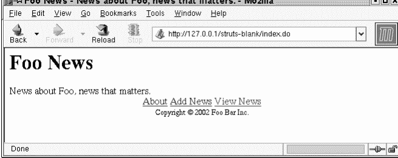

图 11-13 index.do 的浏览器渲染

502  设计模式

## 列表 11-22 AddNewsAction.java

```java
package com.jsp;

import java.io.*;
import javax.xml.parsers.*;
import org.w3c.dom.*;
import org.xml.sax.*;
import javax.xml.transform.*;
import javax.xml.transform.stream.*;
import javax.xml.transform.dom.*;

import javax.servlet.*;
import javax.servlet.http.*;
import org.apache.struts.action.*;
```

```java
public final class AddNewsAction extends Action {

    public ActionForward perform(ActionMapping mapping,
            ActionForm form,
            HttpServletRequest request,
            HttpServletResponse response)
            throws IOException, ServletException {

        ServletContext sc = getSession().getContext();

        try {
            String title = request.getParameter("title");
            String link = request.getParameter("link");
            String story = request.getParameter("story");
            if (title == null || title.equals("") ||
                story == null || story.trim().equals("") ||
                link == null || link.equals("")) {
                News an = new News();
                an.setTitle(title);
                an.setLink(link);
                an.setStory(story);
                request.setAttribute("form", an);

                return (mapping.findForward("failure"));
            }
        }
```

```java
String dir = sc.getRealPath("//");
File file = new File(dir+"/news.xml");
```


# Listing 11-22 AddNewsAction.java

```java
package com.jsp;

import java.io.*;
import javax.xml.parsers.*;
import org.w3c.dom.*;
import org.xml.sax.*;
import javax.xml.transform.*;
import javax.xml.transform.stream.*;
import javax.xml.transform.dom.*;

import javax.servlet.*;
import javax.servlet.http.*;
import org.apache.struts.action.*;
```

```java
public final class AddNewsAction extends Action {

    public ActionForward perform(ActionMapping mapping,
            ActionForm form,
            HttpServletRequest request,
            HttpServletResponse response)
            throws IOException, ServletException {

        ServletContext sc = getSession().getContext();

        try {
            String title = request.getParameter("title");
            String link = request.getParameter("link");
            String story = request.getParameter("story");
            if (title == null || title.equals("") ||
                story == null || story.trim().equals("") ||
                link == null || link.equals("")) {
                News an = new News();
                an.setTitle(title);
                an.setLink(link);
                an.setStory(story);
                request.setAttribute("form", an);

                return (mapping.findForward("failure"));
            }
        }
    }
```

```java
String dir = sc.getRealPath("//");
File file = new File(dir+"/news.xml");
```

```java
DocumentBuilderFactory dbf = 
DocumentBuilderFactory.newInstance();
DocumentBuilder db = dbf.newDocumentBuilder();
Document doc = null;
if (file.exists()) {
    doc = db.parse(file);
} else {
    doc = db.newDocument();
    Element root = doc.createElement("news");
    doc.appendChild(root);
}
Element news = doc.createElement("story");
news.setAttribute("title", title);
news.setAttribute("link", link);
news.setAttribute("story", story);
doc.getDocumentElement().appendChild(news);
```

```java
TransformerFactory tf = 
Transformer t = tf.newTransformer();
DOMSource source = new DOMSource(doc);
StreamResult result = new FileOutputStream(file);
t.transform(source, result);
```

```java
return (mapping.findForward("success"));
catch (TransformerException e) {
    throw new IOException(e.getMessage());
}
catch (SAXException e) {
    throw new ServletException(e.getMessage());
}
catch (ParserConfigurationException e) {
    throw new ServletException(e.getMessage());
}
```

前面的代码是一个 Struts action，它封装了 `addnews.jsp` 所需的所有业务逻辑。此代码与之前在 `ControlFilter.java` 中使用的所需代码之间有两个主要的变动。Struts action 根据用户提交的信息返回两个不同的 `ActionForward` 对象。如果信息有效，则返回对应于 "success" 的 `ActionForward` 对象。

```java
return (mapping.findForward("success"));
```

如果验证失败，则返回对应于 "failure" 的 `ActionForward` 对象。

```java
String title = request.getParameter("title");
String link = request.getParameter("link");
String story = request.getParameter("story");
if (title == null || title.equals("") ||
story == null || story.trim().equals("") ||
link == null || link.equals("")) {
    News an = new News();
    an.setTitle(title);
    an.setLink(link);
    an.setStory(story);
    request.setAttribute("form", an);

    return (mapping.findForward("failure"));
}
```

`struts-blank` Web Application 使更改生效。访问 `http://127.0.0.1/struts-blank/index.do` 查看新创建的 action 映射。

可以向 `struts-config` 文件添加任意数量的 action 添加 `action-mapping` 元素。`action-mapping` 元素和 `forward` 子元素的完整参考可以在 Struts 文档中的 Struts 用户指南中找到。需要理解的重要功能是，Struts 提供了一种方便的方法来封装和实现 Model 逻辑。这很好地补充了我们之前看到的 JSP 视图组件，使 Struts 成为一个非常有用的框架。

对应于 `addnews.jsp` 的 Model 逻辑需要另一个 action。该 Struts action 与 `IndexAction.java` 非常相似，但它封装了用于 `addnews.jsp` 的 Model 代码。将 Listing 11-22 保存为 `AddNewsAction.java`。


图 11-13 index.do 的浏览器渲染

502  设计模式

通常情况下，如果你习惯于构建大量的 JSP 和少数的 Java 类，你可能会同意 JSP 的开发速度快得多。然而，如果你习惯于开发 Java 类并有一个良好的构建工具（如 `Ant`），你就能像构建 Model 1 一样快速构建 Model 2 应用程序。

本章介绍了 Model 1½，因为它是一种快速开发类 Model 2（Modelish）代码的非常实用的技术。如果你不喜欢使用构建工具，或者处于没有可用构建工具的情况下，Model 1 是一种仅使用 JSP 快速开发类似 Model 2 页面的极佳方法。随后，这些类 Model 2 的代码可以很容易转换为整洁的 JSP 和由 Java 类封装的业务逻辑。引入 Model 1½ 的另一个次要原因是，书中大部分示例都是通过这种方式演示的。如果书中之前的某个示例对你有帮助，你应该很容易就能将其迁移到 Model 2 应用程序中。

Model 1½ 设计模式的实现非常简单。首先，开发一个 JSP，就像它将成为 Model 2 Web 应用程序的一部分一样——也就是说，只负责显示逻辑。接下来，在 JSP 头部创建一个脚本段（scriptlet），来封装所有的业务逻辑。

```java
String foo = "Hello World";
request.setAttribute("foo", foo);
<html>
Today's message is ${foo};
</html>
```

虽然这很简单，但你应该能理解要点。页面的第一部分处理所有与 JSP 相关的业务逻辑：指令以及加载 JavaBeans 或其他作用域变量的 Java 代码片段。

```java
String foo = "Hello World";
request.setAttribute("foo", foo);
```

注意，将变量留在隐式页面作用域（implicit page scope）中是不好的，因为 Model 2 控制组件不会与 JSP 共享页面作用域。始终使用请求作用域、会话作用域或应用作用域，可以确保变量对于 Model 1 或 Model 2 JSP 来说处于正确的作用域中。

JSP 的第二部分是所有的表现逻辑——也就是说，如果在 Model 2 Web 应用程序中使用，JSP 应该拥有的所有内容。

```html
<html>
Today's message is ${foo}.
</html>
```

在实践中，Model 1½ 设计模式的工作方式如下：使用 JSP 快速开发可能变动的代码。一旦代码经过充分测试，将所有业务逻辑迁移到单独的 Java 类中并从 JSP 中删除。通过这样做，由于使用了 JSP，开发时间可以保持高效；而由于使用了模块化的 Java 类，未来的维护也可以保持高效。Model 1½ 方法唯一的微小缺点是 Java 类将无法使用可用的隐式 JSP 变量。这可以通过将相应的类变量命名为与 JSP 隐式变量相同的名称，或者通过搜索和替换来解决。

## Model 1½ 的缺点

总的来说，Model 1½ 是一个值得关注的有用概念。成为一个过度热的 Model 2 开发者会让生活变得困难，并导致疏远 Model 2 开发者。Model 1½ 是 Model 2 概念如何应用于 Model 1 环境的范例说明，它在 Model 1 和 Model 2 设计模式之间提供了一个很好的功能“灰色地带”。然而，Model 1½ 设计模式并不完美，也不是 Model 2 的替代品。Model 1½ 仍然允许 Model 2 旨在消除的严重 Model 1 缺陷。通过在 JSP 中允许脚本元素，所有的 Model 1 缺陷都存在于 Model 1½ 中。对于 Model 2，添加脚本无效的 JSP 2.0 配置元素是切实际的，以确保当 JSP 被容器翻译时不存在脚本元素。对于 Model 1½，则不是。除非你是独立开发，或者与一个非常友善的开发者小组一起工作，否则假设 Model 1½ 设计真的有效是不明智的。

Model 1½ 设计模式的另一个意义在于，它不能确保适当的错误处理。Model 2 的优势之一是业务逻辑可以充分利用 `try-catch` 块，并且编译器会强制对检查错误进行适当处理。由于存在隐式的 `try-catch` 块，脚本段可以例如：


```
try {
<%scriptlet code %>
}
catch (Exception e) {/JSP error handling}
```

- 5. 你可以在 2.0 之前的 JSP 版本中创建自定义标签库验证器类。

Model 1½ 代码没有提供类似的强制机制来确保适当的错误处理。如果代码是在假设 JSP 错误处理存在的情况下实现的，那么将 Model 1½ 代码迁移到 Model 2 设计将非常繁琐。

## 通过自定义标签抽象 HTML

在标签库章节中提到了自定义标签是抽象 HTML 的绝佳工具。总的来说，思考自定义标签的一种好方法是将其视为用于抽象 JSP 中重复、杂乱部分的工具。将其应用于 HTML 和 XHTML，HTML 是抽象的极佳候选者。良好的 Model 2 设计可以确保 Java 代码不会无谓地干扰 HTML 并使页面复杂；然而，通常的 Model 2 设计并不能确保 HTML 本身不杂乱。HTML 本身易于使用和维护，但 HTML 本身作用有限。为了给 HTML 增色，使用了诸如文档对象模型 (`DOM`)、`JavaScript`、`Jscript` 和层叠样式表 (`CSS`) 等补充技术，统称为动态 HTML (`DHTML`)。通常被认为“良好”的 HTML 页面包含了所有 HTML 补充技术的难以晦懂的混合。

HTML 页面的额外好处是它可以进行样式化并包含动态功能，例如下拉菜单或鼠标悬停图像。HTML 页面的缺点是维护起来往往是一场灾难；由于 HTML 本身作用有限，为了让 HTML 丰富起来，需要补充技术。通常被认为“良好”的 HTML 页面包含了所有 HTML 补充技术的难以晦懂的混合。

## 为什么要通过自定义标签抽象 HTML

在标签库章节中提到了，自定义标签是抽象 HTML 的绝佳工具。自定义标签是用于抽象 JSP 中重复、杂乱部分的良好方法。将其应用于 HTML 和 XHTML，HTML 是抽象的极佳候选者。良好的 Model 2 设计可以确保 Java 代码不会无谓地干扰 HTML 并使页面复杂；然而，通常的 Model 2 设计并不能确保 HTML 本身不杂乱。HTML 本身易于使用和维护，但 HTML 本身作用有限。为了给 HTML 增色，使用了诸如文档对象模型 (`DOM`)、`JavaScript`、`Jscript` 和层叠样式表 (`CSS`) 等补充技术，统称为动态 HTML (`DHTML`)。通常被认为“良好”的 HTML 页面包含了所有 HTML 补充技术的难以晦懂的混合。

## 编写 DHTML 控件操作

抽象 DHTML 最困难的部分是知道如何编写 DHTML。标签文件在书中之前介绍过，并提供了编写 DHTML 的直观方法。整体策略是将 DHTML 控件简化为最通用的形式。Listing 11-24 提供了你可以使用的通用代码。将其保存为 `.tag` 文件（或几个 `.tag` 文件），然后将其部署到 Web 应用程序。一个很好的示例是标签库章节中过的翻滚效果。你会记得第 7 章中的 Listing 11-18，那是 `rollover.html` 的代码。它包含了单个图像的 DHTML。

### Listing 11-24 用于图像翻滚的 DHTML

```html
<a href="index.html" onmouseover="button.src='button_on.gif';" onmouseout="button.src='button_off.gif';">

</a>
```

这段代码是翻滚图像所需的 DHTML 的特定实例。`JavaScript` 用于根据鼠标是否悬停在图像上来更改图片。使用的特定图像是 `button_on.gif` 和 `button_off.gif`。

为了让 Listing 11-24 通用，删除任何特定的名称或值，并将其替换为变量。Listing 11-25 的通用形式是由之前在第 7 章 Listing 17-18 中看到的 `rollover.tag` 所示。

### Listing 11-25 rollover.tag（为了方便重新设计）

```jsp
<%@ attribute name="link" required="true" %>
<%@ attribute name="image" required="true" %>
<a href="${link}" onmouseover="${image}.src='${image}_on.gif';" onmouseout="${image}.src='${image}_off.gif';">

</a>
```

注意链接和图像的特定值被替换为了变量。这种策略是在运行时为组件的特定用例替换值；自定义标签必须以某种方式提供特定值，可能是通过使用其属性。在 `rollover.tag` 的情况下，任务正是这样完成的：`image` 属性提供了图像的基础名称，`link` 属性提供了链接。

总的来说，使用自定义标签抽象 HTML 组件的技巧是简单且有用的。使用这种设计模式可以确保 HTML 页面不会因为 HTML 而变得复杂。

## 总结

设计模式可以极大地简化 Web 应用程序构建和维护的过程。对于 JSP 和 Servlets，有两种主要的设计模式：Model 1 和 Model 2。对于所有实际用途，Model 1 并不是真正的设计模式；它更多是大多数 Web 应用程序直觉构建方式的称呼。JSP 和 Servlets 的最佳用法不是将演示逻辑和业务逻辑结合同一个端点。这种做法会产生不可维护的代码，并忽略了 JSP 和 Servlets 的优势。解决该问题的流行且证明有效的方案是强制执行业务逻辑与演示逻辑的分离。Model 2 设计模式提倡这种分离，在开发 Web 应用程序时它比 Model 1 设计模式更优。

理解和实现 Model 2 设计模式是两回事。灵活的 Model 2 框架可以在很大程度上强制良好的 Model 2 实现。在本章中，介绍了 `Struts` 框架作为模块化 Model 2 框架的实用解决方案。将 `Struts` 组件与 JSP 和 `JSTL` 结合，可以构建任何规模的 Model 2 Web 应用程序。

# 第 12 章

## 国际化

万维网并非真正全球通用。大多数网站以及用于构建这些网站的技术都是为西欧语言（主要是英语）设计的。这并不是 Web 的局限性，而是开发者选择或无法超越的限制。国际化支持的问题在于能够提供一个产生多种语言内容的网站。在本章中，重点是如何成功地构建一个国际化的 Web 应用程序。

国际化（通常缩写为 `i18n`，因为它以 `I` 开头，以 `N` 结尾，中间有 18 个字母）是一个需要理解的重要概念。理想情况下，本章适用于负责非英语 Web 应用程序的开发者，或者必须同时支持多种语言的 Web 应用程序开发者。虽然今天你个人可能不需要构建非英语 Web 网站，但在未来你几乎肯定会。对于一个优秀的 Servlet 和 JSP 开发者来说，理解这些概念是非常重要的，而且用于应用程序国际化的实现技术也可以应用于其他地方。即使你正在开发一个仅限英语的网站，作为开发者你仍应该意识到 `i18n` 开发。例如，同一种语言的多个版本，如英国英语和美式英语之间的差异。英国读者不喜欢看到 `colour` 等英语单词拼写错误，以及在应该使用“s” 的地方使用字母“z”，例如使用 `familiarise` 而不是 `familiarize`。

- 1. 当然，这是由作者团队的英国部分编写的；美国部分坚持 `colour` 的拼写是 `color`。
- 2. 18 世纪，诺亚·韦伯斯特出版了第一本权威的美式英语字典，这在很大程度上归功目前的拼写差异。

## 内容编码

直白地说，万维网与西欧语言紧密相关，甚至是围绕这些语言构建的。这种联系可能是由于 Web 的早期起源，它起源于欧洲，然后在美国和欧洲国家壮大。然而，作为开发者，重要的是 HTTP 的默认字符编码是 `ISO-8859-1`，也称为 `Latin-1`。该编码包含了英语、西班牙语、法语、意大利语和德语等西欧语言常用的字节到字符映射。此外，HTML 为 `ISO-8859-1` 字符集提供了方便的转义序列。

默认使用 `ISO-8859-1` 之外的字符会导致基于 `ISO-8859-1` 的应用程序中出现乱码。这是许多初学者 Web 开发者都有过的经历，而且很容易理解原因。将非 `ISO-8859-1` 字符被视为 `ISO-8859-1` 字符会产生乱码；例如来自 Yahoo! Japan (`http://www.yahoo.co.jp`) 的日语文本，如图 12-1 所示。

将内容视为 `ISO-8859-1` 编码会导致图 12-2 的结果。

需要理解的是，没有正确的编码，文本是没有意义的。在开发 `i18n` Web 应用程序时，你需要小心使用正确的编码，而不仅仅是默认编码。字符编码完整列表和相关的 RFC 文档可以在 `http://www.iana.org/assignments/character-sets` 找到。

## ISO-8859-1

作为 Web 开发者，你需要熟悉 `ISO-8859-1`。不仅是你键盘上的键，还包括 HTTP 默认支持的所有字符。如果你正在构建一个只需要 `ISO-8859-1` 支持语言的网站，那么使用该标准是有意义的。英语、西班牙语、丹麦语、法语、意大利语、德语和其他支持 `ISO-8859-1` 语言的网站拥有这种待遇。

使用 `ISO-8859-1` 时出现的问题是大多数键盘是针对特定语言设计的。

3. 蒂姆·伯纳斯-李在 1989 年于 CERN（Conseil Européen pour la Recherche）定义了万维网，并在 1991 年将其发布。更多细节请参见 `http://www.w3.org/People/`。


键盘不包含某些西班牙语字符，例如波浪号（`ñ`）。为了创建这个字符，有两个很好的选择。第一个是可以使用插入键盘不存在字符的文本编辑器。只要文档编码为 `ISO-8859-1`，在浏览器中显示就没有问题。第二种选择是使用字符实体。HTML 2.0 引入了这种。考虑到 HTML 已经是第 4 版，可以假设大多数 HTML 客户端支持字符实体。

HTML 实体允许使用一系列 ASCII 字符输入任何 `ISO-8859-1` 字符。该序列以符号（`&`）开始，以分号（`;`）结束，中间包含一组独特的字符。通常这些字符是所需字符正确名称的缩写。例如，可以使用这些序列之一正确编写 `ampersand`。`ampersand` 的序列是 `&amp;`。当 Web 浏览器渲染时，不会直接显示 `&amp;`；相反只显示 `&` 字符。

知道如何制作 `ampersand` 并没有帮助，知道所有 `ISO-8859-1` 字符的字符实体是有用的。完整的参考可以在 `http://www.w3.org/TR/REC-html40/sgml/entities.html` 和 `http://www.htmlref.com/reference/html40/iso88591-entities/`。通过使用这些字符，特定 `ISO-8859-1` 语言的开发者可以创建任何默认语言。例如，列表 12-1 是 `HelloWorld.jsp` 的西班牙语等效版本，仅使用 ASCII 编写。

### 列表 12-1 HolaMundo.jsp

```jsp
<html>
<head>
<title>&iexcl;Hola Mundo!</title>
</head>
<body>
En &nbsp;ol:<br>
<h1>&iexcl;Hola Mundo!</h1>
</body>
</html>
```

文本也可以从 Servlet 发送。输出的字符应该都是熟悉的；有趣的是浏览器渲染字符的方式。图 12-3 显示了仅来自 `HolaMundo` 的输出。

正如刚才所示，这些命名的字符实体并没有代表所有的 `ISO-8859-1` 字符。不常用的字符必须使用数值实体。其区别在于插入一个井号（`#`）和一个数值。方便的是，这些数值对应字符的 Unicode 转义序列，这将在本章稍后进行解释。

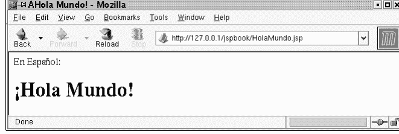

## Unicode

确实存在一种通用字符集。`ISO-8859-1` 的问题在于它无法轻易扩展，因为它只使用了 8 位，意味着 $2^8$，或 256 种可能的字符。许多语言（如日语或中文）需要成千上万的字符和符号。解决问题的办法是扩展用于存储信息的位数。Unicode 全球字符标准正是这样做的：使用两个字节，$2^{16}$，或 65,536 种可能，并为美洲、欧洲、中东、非洲、印度、亚洲和太平洋的主要书写语言提供了支持。

可以在 `http://www.unicode.org` 找到 Unicode 标准。请记住，Java 使用 Unicode 作为其默认编码，J2SDK 1.4 文档概述的编码：`http://java.sun.com/j2se/1.4/docs/guide/intl/encoding.doc.html`。Java 支持的当前版本可以通过引用 `java.lang.Character` 类随时找到。Java 1.4 支持 Unicode 3.0。此外，核心 Java `i18n` 类为构建 `i18n` 应用程序的开发者提供了一个有用的机制。在本章后面将使用其中一些类。如果你不熟悉 Java `i18n` 类，请参考 Sun 的 Java 国际化文档，`http://java.sun.com/j2se/1.4/docs/guide/intl/index.html`。

- 4. 作为一个国际化脚注，这个字符 (`#`) 在英国被称为 `hash`（关于该字符的趣味讨论请参阅 `http://www.theregister.co.uk/content/28/26042.html`）。

## UTF-8 和 UCS-2

在大多数情况下，生成页面的方法是将其放入客户端特定的编码中。然而，在必须在同一页面显示多种语言的情况下，可以使用 Unicode。使用 Unicode 有两种常用方法：`UCS-2` 和 `UTF-8`。通用字符集双字节格式（`UCS-2`）以自然格式编码 Unicode 字符；8 位格式（`UTF-8`）根据字符集使用不同数量的字节来编码 Unicode 字符。`UTF-8` 更为现代，被广泛使用是因为它只需每个字符一个字节即可编码美国-ASCII 字符集。由于这个原因，万维网上使用 `UTF-8` 比使用 `UCS-2` 多得多。

大多数现代应用程序（特别是 Web 浏览器）都完全支持 `UTF-8`。在编写多语言 Web 页面时，使用 `UTF-8` 编码是事实标准。关于 `UTF-8` 的更多信息可以从 RFC 2279，`http://www.ietf.org/rfc/rfc2279.txt` 获取。

## 使用非 ISO-8859-1 编码


虽然标准编码很常见，但从不强制客户端使用它，你也是如此。默认情况下，Web 应用程序假设通过 HTTP 请求发送的信息是用 ISO-8859-1 编码的。如果不是，则假设发送了额外信息来确定正确的内容编码。编码信息通过 `HttpServletRequest.getContentEncoding()` 方法提供。

如果客户端使用不同的编码，信息通常指定在 content-type 头部中。例如，使用 UTF-8 编码的纯文本信息应该具有 content 头部：`text/plain; charset=UTF-8`。首先，头部指定了 MIME 类型（如其应的那样），但随后是一个分号，后面跟着编码信息。这些编码信息被用于确定应用到内容上的编码类型。在服务器或客户端搞砸了这个头部的情况下，就无能为力了。

在大多数情况下，调用如 `getParameter()` 等方法会返回一个编码适当的 `String` 对象。在少数情况下，编码可能会被错误地解码并产生乱码结果。为了避免这个问题，可以使用几行简单的代码手动更改提交信息的解码：

```
String value = request.getParameter("param");
value = new String(value.getBytes());
request.getCharacterEncoding();
```

或者，如果你确切知道要使用的编码，可以通过替换调用来设置。例如，强制使用 UTF-8 将如下：

```
String value = request.getParameter("param");
value = new String(value.getBytes(), "UTF-8");
```

不建议为通用用途假设某种编码，因为这会产生之前存在的问题：编码方式不同的内容会被错误地解码。然而，如果必须手动设置编码，可以使用前面的代码段。

在向客户端发送内容时，可以以类似的方式操作 content-type 头部来指定非默认编码。直接调用 `setContentType()` 方法，并在 MIME 类型后附加编码信息。然而，在执行此操作时，确保使用指定的编码向客户端发送内容。对于 Servlet，这可以通过调用 `setContentType()` 并手动创建一个 `PrintWriter` 来实现。例如，使用 UTF-8 将如下：

```
response.setContentType("text/html; charset=UTF-8");
ServletOutputStream sos = response.getOutputStream();
PrintWriter out = new PrintWriter(new OutputStreamWriter(sos, "UTF-8"), true);
```

其他编码以相同的方式通过页面指令的 `pageEncoding` 和 `contentType` 属性设置。这些属性的含义略微取决于一个、两者或都没有。这些属性总结在表 12-1 中，取自 JSP 2.0 规范第 4.1 节。

| 属性 | 描述 |
| :--- | :--- |
| <defaultType> | 标准 JSP 页面为 text/html，XML 文档为 text/xml。 |
| <contentType> | 如果指定，为 <contentType> 的 charset 部分；如果没有指定，则默认为 <defaultEncoding>。 |
| <defaultEncoding> | 标准 JSP 页面为 ISO-8859-1，XML 文档为 UTF-8 或 UTF-16（取决于 XML 规则检测检测）。 |

内容编码 519

请注意，在 include 指令的情况下，默认输入编码来自初始页面，而不是任何包含的页面。

### 表 12-1 pageEncoding contentType 属性 含义

| pageEncoding | contentType | 输入 JSP 源 | 输出内容 |
| :--- | :--- | :--- | :--- |
| Page 指令 | Page 指令 | Encoding | Type |
| 属性 (<encoding>) | 属性 (<contentType>) | | |
| specified | specified | <encoding> | <contentType> |
| specified | not specified | <encoding> | "<defaultType>;charset=<encoding>" |
| not specified | specified | <contentType charset> | <contentType> |
| not specified | not specified | <defaultInput Encoding> | "<defaultType>;charset=<default Encoding>" |

执行时，Servlet 会显示一系列 hello，每种都使用不同的语言。渲染后的页面如图 12-4 所示。为了正确显示页面，您的网络浏览器必须完全支持 UTF-8。

在 `i18HelloWorld.java` 中，使用了 Unicode 转义字符来编写 ASCII 中不存在的 Unicode 字符。请记住，Java 源文件也可以直接以 Unicode 格式编写，这也是大多数非 ASCII 开发者的做法。仅使用 ASCII 和转义字符是繁琐的。或者，大多数现代 Java 编译器都提供了一个命令行选项，可以编译几乎任何编码的源文件。例如，与 J2SDK 1.4 绑定的 Sun javac 允许通过 `encoding` 标志列出支持的编码，以指定 Java 源文件的编码；Unicode 以及其他编码也可以用于 JSP。如 JSP 规范表 12-1 所示，`encoding` 属性可指定非默认的输入编码。例如，列表 12-3 中的 JSP 展示了 `i18HelloWorld.java` 的等效 JSP 版本。

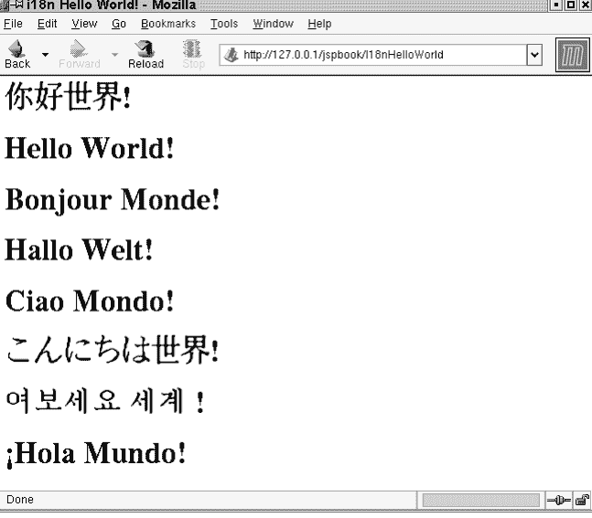

**图 12-4** i18nHelloWorld.java 的浏览器渲染输出

### 列表 12-3 i18HelloWorld.jsp

```jsp
<%@ page pageEncoding="utf-8"><<html>
<head>
<title>i18n Hello World!</title>
</head>
<body>
<h1>你好世界!</h1>
<h1>Hello World!</h1>
<h1>Bonjour Monde!</h1>
<h1>Hallo Welt!</h1>
<h1>Ciao Mondo!</h1>
<h1>こんにちはは世界!</h1>
<h1>여보세요 세계!</h1>
<h1>¡Hola Mundo!</h1>
</body>
</</html>
```

该页面采用 UTF-8 编码，`pageEncoding` 属性确保了 JSP 被正确解析，并以正确的编码发送给客户端。如果您在此页面中输入字字符，请务必使用支持 UTF-8 的编辑器。

## i18n 实现技术

非标准字符编码允许在 Servlet 和 JSP 中使用任何语言，但实现多语言 Web 应用程序本身是一项性工程。i18n 给 Web 开发者带来的问题是如何存储和格式化多个版本的内容。在本书之前的所有示例中，都假设 Web 应用程序是为了显示一种语言的一种格式而构建。这种假设简化了示例，允许将内容和格式硬编码在同一个 Servlet 或 JSP 中。有了 i18n，这一假设不再成立。

提供对相同内容的多个版本的支持可以通过许多不同的方法实现。本章概述了两种广泛使用且被认为最实用的方法。第一种方法涉及解决问题的简单但粗暴的方法：为每种语言创建一个单独的页面。第二种方法是一种优雅但复杂的方法：将内容从格式中抽象出来。这两种方法都适用于不同的需求。然而，构建优化 Web 应用程序的建议是采用第二种。

本章未涵盖的另一种提供 i18n 支持的方法动态翻译已完成的 Web 页面。简单的过滤器（`Filter`）和一组良好的翻译 API 可以实现这一点；然而，目前没有良好的标准 Java 翻译 API。

## 语言检测

所有的 i18n 实现技术都依赖于 Web 应用程序能够检测用户偏好的语言类型。理解如何正确检测用户的语言至关重要，因为否则，你只能猜测想要什么类型的内容。猜测并不比向所有用户显示一种语言好。对于所有的 i18n 实现技术，都假设可以检测到相应的语言。

检测客户端偏好语言有方法：

- **询问 (Inquire)**：使用 HTML 表单询问用户偏好的语言。这种方法不是最优雅的，但有效。
- **HTTP accept-language 和 accept-charset 头部**：网络浏览器可以通过分别设置 HTTP `accept-language` 和 `accept-charset` 头部来识别用户偏好的语言和编码。这些头部的值包含了客户端支持的两个字母语言代码和支持的编码格式。
- **URL 编码**：语言偏好可以编码在 URL 中。URL 可能会指向带有正确语言的真实页面，或者指向由 i18n 组件拦截的虚拟资源。

## 询问

通过 HTML 表单询问用户是你应该熟悉的内容。读取表单参数在第 2 章中介绍过。使用这种技术唯一困难的部分是如何恰当地显示表单。如果表单只有一种语言，它将无法被理解。

## 多页面方案

开发国际化（i18n）Web 应用程序首次通常最快的方法是为所有内容创建多个副本。每个副本都翻译成目标语言，并根据需要将用户引导到正确的副本。虽然这种方法在维护方面存在问题，但它的实现非常直观，非常适用于小型项目。

从本质上，该策略是为每种语言创建一个 Web 应用程序的副本。一种语言的内容引用该语言中的其他内容。一种常见的命名方案可以将内容的不同翻译版本隔离开。例如，`welcome.html`（第 1 章中的列表 1-3）就是一个包含一些英文内容的 Web 页的简单示例。

```html
<html>
<head>
  <title>Welcome!</title>
</head>
<body>
Welcome to the example Web Application for
  <i>Servlets and JSP the J2EE Web Tier</i>
</body>
</html>
```

遵循多副本设计，一种有效的命名方案是给所有英文页面指定一个名称，随后对这些页面进行翻译，并在英文名称之前插入该语言的三位代码，并在后跟一个“-”。例如，`welcome.html` 的法语版本将保存为 `welcome-fra.html`，并包含列表 12-4 中的代码。

### 列表 12-4 welcome-fra.html welcome.html 的法语翻译

```html
<html>
<head>
  <title>Bienvenue!</title>
</head>
<body>
Bienvenue à la demande d'enchaînement d'exemple de
  <i>Servlets and JSP the J2EE Web Tier</i>
</body>
</html>
```

如果页面需要动态内容，则会插入代码并将其保存为 JSP。要看到的是，这种实现是通过在服务器端提供预翻译的整个 Web 页面来实现的。该技术对 Servlet 过滤器（`Filters`）有效，因为单个过滤器可以无缝地拦截对资源（例如 `welcome.html`）的所有请求，并根据客户端的偏好语言尝试本地化为（例如 `welcome-fra.html`）。整体效果是，所有请求都可以发送到单个页面（如 `welcome.html`），但如果服务器拥有内容的翻译版本，则响应将适当进行本地化。为了说明这种技术，列表 12-5 包含了这样一个过滤器。

### 列表 12-5 Simple8nFilter.java

```java
package com.jspbook;

import java.io.*;
import java.util.*;
import javax.servlet.*;
import javax.servlet.http.*;

public class Simple8nFilter implements Filter {
    protected static FilterConfig config = null;

    public void init(FilterConfig filterConfig) {
        config = filterConfig;
    }

    public void destroy() {
        config = null;
    }

    public void doFilter(ServletRequest req,
                           ServletResponse res,
                           FilterChain chain)
            throws IOException, ServletException {
        if (res instanceof HttpServletResponse) {
            HttpServletRequest request = (HttpServletRequest) req;
            HttpServletResponse response = (HttpServletResponse) res;

            String uri = request.getRequestURI();
            if (uri.startsWith("/")) {
                chain.doFilter(request, response);
                return;
            }

            String path = request.getContextPath();
            uri = uri.substring(path.length(), uri.length());
            uri = getLanguage(uri, request);
            ServletContext sc = config.getServletContext();
            sc.getRequestDispatcher(uri).forward(request, response);
        }
    }

    public static String getLanguage(String uri,
        HttpServletRequest request) {
        ServletContext sc = config.getServletContext();
        Enumeration enum = request.getLocales();
        String postfix = uri.substring(uri.lastIndexOf("."), uri.length());
        String temp = uri.substring(0,uri.length()-postfix.length());
        while (enum.hasMoreElements()) {
            Locale l = (Locale)enum.nextElement();
            String lang = l.getISO33Language();
            String file = sc.getRealPath(temp+"-"+lang+postfix);
            System.out.println("Trying: "+file);
            File f = new File(file);
            if (f.exists()) {
                return temp+"-"+lang+postfix;
            }
        }
        return uri;
    }
}
```

该代码通过拦截请求并尝试将其转发到内容的最本地化版本来工作。

```
String uri = request.getRequestURI();
String path = request.getContextPath();
uri = uri.substring(path.length(), uri.length());
uri = getLanguage(uri, request);
ServletContext sc = config.getServletContext();
sc.getRequestDispatcher(uri).forward(request, response);
```

`getLanguage()` 方法负责确定最本地化的语言。

```
Enumeration enum = request.getLocales();
String postfix = uri.substring(uri.lastIndexOf("."), uri.length());
String temp = uri.substring(0,uri.length()-postfix.length());
while (enum.hasMoreElements()) {
    Locale l = (Locale)enum.nextElement();
    String lang = l.getISO33Language();
```


它编写了与基础文件同名的文件（如 `welcome-fra.html`），以匹配客户端的偏好语言。通过调用 `HttpServletRequest` 的 `getLocale()` 方法获取偏好，并使用 `ServletContext` 的 `getRealPath()` 方法检查文件。如果没有找到本地化版本，则返回基础文件名的文件。

保存列表 12-5 `Simple8nFilter.java` 在 `WEB-INF/classes/com/jspbook` 目录下，重启 Tomcat 以更改效果。浏览 `http://127.0.0.1/jspbook/welcome.html` 以查看本地化路径。假设你将英语作为偏好语言，显示的是 12-5。

如果你将另一种语言设置为偏好且存在该页面的本地化版本，则显示该版本。例如，由于 `welcome.html` 所在的目录下有 `welcome-fra.html`，如果你将浏览器偏好设置为法语，显示的是 12-6。

注意请求的 URL 仍然是 `http://127.0.0.1/jspbook/welcome.html`，但内容 welcome-fra.html。这是因为过滤器在服务器端适当地本地化内容；对于客户端来说，似乎 `welcome.html` 是用其偏好语言编写的。这非常有帮助，因为这意味着 Web 应用程序不需要为语言本地化页面链接。与手动为 `welcome-fra.html`、`welcome-jpn.html` 等进行编码相比，基于语言的方法要简单得多。支持新语言只需添加新页面并进行适当命名，以便 Simple i8n 过滤器使用它们。此外，过滤器设计为使用 UTF-8 编码，这意味着它可以支持 Unicode 支持的所有语言。

使用整个 Web 页面的预翻译副本对于可能变化的小型 Web 应用程序效果良好。“小型 Web 应用程序”应该解释为任何对于你的翻译方法来说没有负担的程序。这种提供 i18n 支持的技术对于经常变化的页面很快就会变成问题。每进行一次更改，必须复制到所有翻译页面中。在内容方面，没什么能做的来阻止这一点，但没有理由让页面格式的更改也随之进行更改。通过将信息整合到一个模板页面并将内容从页面中抽象出来，可以把该问题降到最低。这是开发复杂的 i18n Web 应用程序的建议方法，将在下一节中介绍。

## 内容抽象

实现一个可以增长和变化的 i18n Web 应用程序涉及内容的抽象。遵循 Model 2 设计模式，该过程很容易。

实现。在之前的示例中，假设内容只需要一种语言。页面上的动态部分是即时生成的；静态内容与格式代码一起硬编码的。在多语言 Web 应用程序中，内容需要被抽象，因为内容不再总是同一种语言。

例如，`welcome.html` 是欢迎用户访问 Web 应用程序的页面，在第 1 章的图 1-12 中显示过。你可能记得 `welcome.html` 的代码如下：

```html
<html>
<head>
  <title>Welcome!</title>
</head>
<body>
Welcome to the example Web Application for
  <i>Servlets and JSP the J2EE Web Tier</i>
</body>
</html>
```

对于国际化应用程序来说，这个页面的用处并不大，因为它们是英语的。从该页面中抽象内容可以使其对国际化（i18n）友好。列表 12-6 中的代码是该页面的动态版本，允许使用任意数量的语言⁵。

**列表 12-6** `welcome.jsp`

```jsp
<html>
<head>
  <title>${content.title}</title>
</head>
<body>
  ${content.welcome}
</body>
</html>
```

页面中唯一的静态部分是格式，假设只产生 HTML，那么这样做是完全没问题的。在需要不同格式的情况下，应该使用第 13 章中讨论过的多客户端设计。列表 12-6 的意义在于，标题和欢迎消息实际上是标识符。这些标识符引用了要显示的实际文本。而这些文本

+   5. 假设使用了正确的编码。

可以在运行时更改，以针对特定语言对页面页面。假设使用了 Model 2 设计，一个控制组件将负责为一个对象（例如 JavaBean）填充该页面的正确标题和欢迎消息，然后通过请求作用域（request scope）传递该对象，图 12-7。

如果用户偏好英语，生成的欢迎页面可能类似于图 12-7。或者，同样灵活的是，如果用户偏好法语，生成的欢迎页面可能类似于图 12-8。

实现这种内容抽象的唯一困难部分是确定正确的语言，以便填充要显示的值。这种逻辑处理可以通过许多不同的方式实现，但 Java API 方便地提供了资源包（Resource Bundles）。

## 资源包

资源包是 J2EE 确定并为用户准备本地化内容的默认方法。资源包由 `java.util.ResourceBundle` 对象表示。该对象提供了一组静态方法，接收一个基名（base name）和一个 Locale 对象，并返回一个填充了适当值的资源包。这些值是通过搜索提供的文件并确定哪一个与请求的 Locale 最匹配得到的。资源包在实践中运行良好，是提供 i18n 支持的默认标准方法。

资源包是你鼓励你使用的 i18n 机制。因此，我们需要更熟悉它们是如何运作的。使用资源包首先需要一个描述用户本地化的 Locale 对象。使用该 Locale，资源包加载适当的资源文件以获取特定的资源信息。适当的资源文件是通过组合基名和本地化信息确定的。基名决定了文件的起始名称。

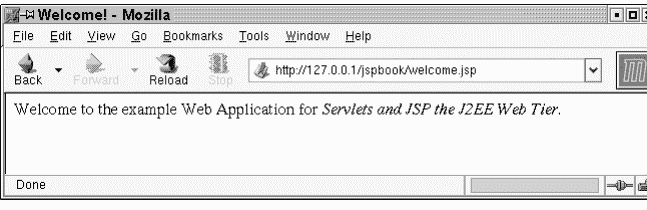

**图 12-7** 英语版的 `welcome.jsp`，由 Web 浏览器渲染


**图 12-8** 法语版的 `welcome.jsp`，由 Web 浏览器渲染

特定本地化的文件通过附加“_”以及该本地化相应的两位数字国家代码来确定。例如，欢迎页面资源包的基名可能是 `welcome`。英语资源包将是 `welcome_en`，因为 `en` 是英语的两位语言代码。法语资源包将是 `welcome_fr`，因为 `fr` 是法语的两位本地化代码。命名方案适用于所有使用的语言。该方案还扩展到了方言。例如，正如我们已经讨论过的，美国英语与英国英语不同，加拿大法语与法语不同，瑞士法语与法国法语不同。为了编码这些差异，资源包的名称还包含了另一个用于国家的两位编码。这意味着你可以拥有 `welcome_fr_CH` 或 `welcome_fr_FR`。为了进一步扩展，算法还是一个“变体（variant）”值，用于指定特定特定的信息。加载资源包的算法从最具体到最不具体的值进行。也就是说，如果应用程序请求“瑞士法语”本地化（fr_CH）且其不存在，但存在更通用的法语本地化，则加载现有的法语（fr）本地化资源包。

资源包属性文件中的信息通过键/值对指定。属性文件的每行都包含一个名称，后跟着一个用等号分隔的值。该格式设计得非常简单，非常适合存储少量信息。例如，产生之前图 12-7 所示相同英语输出所需的属性文件是列表 12-7。

+   6. `java.util.Locale` 提供了两个字母的语言代码。

**列表 12-7** `welcome.properties`

```properties
title=Welcome!
welcome=Welcome to the example Web Application for Servlets and JSP the J2EE Web Tier
```

## INTERNATIONALIZATION

**列表 12-8** `Welcome.java`

```java
public class Welcome {
    protected String title;
    protected String welcome;

    public String getTitle() {
        return title;
    }

    public void setTitle(String title) {
        this.title = title;
    }

    public String getWelcome() {
        return welcome;
    }

    public void setWelcome(String welcome) {
        this.welcome = welcome;
    }
}
```

适当的 getter 和 setter 方法是该 JavaBean 使用的所有方法。加载 i18n 值的代码。使用从 `HttpServletRequest` 获取的 Locale 对象，初始化具有正确的 i18n 内容。只需要两行代码，因为 `ResourceBundle` 对象封装了所有的逻辑。

```java
Locale locale = request.getLocale();
ResourceBundle rb = ResourceBundle.getBundle("welcome", locale);
```

注意，为了简单，Model 1 设计中代码包含在 JSP 中。在 Model 2 设计中，页面开头的突出代码将被移除并放在控制组件中。

**列表 12-9** `welcome.jsp` (Model 1 Style)

```jsp
<%@page import="java.util.*, javax.jsp.*" %>
Locale locale = request.getLocale();
ResourceBundle rb = ResourceBundle.getBundle("welcome", locale);
Welcome content = new Welcome();
content.setTitle(rb.getString("title"));
content.setWelcome(rb.getString("welcome"));
request.setAttribute("content", content);
%>
<%@ taglib uri="http://java.sun.com/jst/core" prefix="c" %>
<html>
<head>
<title>${content.title}</title>
</head>
<body>
${content.welcome}
</body>
</html>
```

请确保将 `welcome_fr.properties` 保存在您的 Web 应用程序类路径中，例如 `/WEB-INF/classes` 目录。现在，如果有法语语开发者访问该网站，返回的内容将是法语。最终结果与图 12-8 所示相同。该示例可以不断扩展，您可以为许多不同的语言构建属性文件。

在 `welcome.jsp` 中使用的代码说明了为什么在国际化（i18n）开发中推荐使用资源包络（resource bundle）。另一种自定义解决方案（例如使用数据库存储内容）也行得通，但会复杂化存储和检索 i18n 内容的逻辑。资源包既简单，又允许 i18n 开发人员为所需的 i18n 语言区域（locales）持续创建和修改属性文件。关于在 Model 2 中使用 i18n 页面，还有另一点值得注意：使用如列表 12-9 所示的方法，内容并不局限于来自资源包。如果资源包不存在，可以将所需的代码替换为资源包代码。

## JSTL i18n 消息标签

作为在 i18n 内容上遵循严格 Model 2 设计模式的替代方案，JSTL 提供了一组 i18n 标签。JSTL i18n 标签的一个特定子集是消息标签，它们模仿了 `welcome.jsp` 中所示的功能。使用 JSTL 消息标签的优势是它们消除了对 JavaBean 和控制组件的需求。相反，JSTL 封装了加载资源包所需的所有逻辑，并从中检索属性。JSTL 消息标签的缺点是它们限制了 JSP 开发人员只能使用资源包。

建议您遵循本章之前描述的严格 Model 2 方法。它在 JSP 和 i18n 内容生成之间保持了适当的抽象层级，适用于复杂且不断增长的 Web 应用程序。然而，理解 JSTL 方法是有帮助的，因为它允许快速开发 i18n 应用，且只有一个微小的缺点。

共有三种不同的 JSTL 消息标签，其中每种的两个用法都很直观易懂；但目前感兴趣的只有两个标签：

-   **Bundle**：该标签加载资源包并将其置于上下文中，供其他 JSTL i18n 标签使用。该标签有两个属性：`basename` 和 `prefix`。`basename` 属性是属性文件的基名——例如，在 `welcome.jsp` 中使用了 "welcome"。`prefix` 属性允许在属性键后自动添加前缀。前缀值有助于确保没有两个属性名相同——例如，在 `welcome.en.properties` 中使用了键 "title" 和 "welcome"。可以为每个键附上 `com.jspbook` 前缀以创建一个更唯一的名称。

-   **Message**：消息标签依赖于现有的资源包并从包中提取消息。消息标签需要一个 `key` 属性，用于指定要检索的属性消息键。消息标签还提供了属性，用于将值导出到作用域上下文变量中和/或从给定的资源包导出。消息标签的完整文档可以在 JSTL 规范中找到。

第三个标签是 `param` 标签，它有助于简化运行时动态 i18n 消息的生成。主题将在本章后续部分进行进一步讨论。

`bundle` 和 `message` 标签的使用设计与 `welcome.jsp` 中的操作非常相似。区别在于 Model 1 代码被 `bundle` 标签取代，而 `out` 标签的使用被 `message` 标签取代。例如，列表 12-11 中的 JSP 提供了与 `welcome.jsp` 相同的功能，只要资源包始终被加载。

## 列表 12-11 `jstl.welcome.jsp`，`welcome.jsp` 的 JSTL 版本

```jsp
<%@ taglib uri="http://java.sun.com/jstl/fmt" prefix="fmt" %>
<fmt:bundle basename="welcome">
<html>
<head>
<title><fmt:message key="title"/></title>
</head>
<body>
<fmt:message key="welcome"/>
</body>
</html>
</fmt:bundle>
```

前面的代码是完整的 JSP。访问 `jstl_welcome.jsp` 将根据您的语言区域产生相同的输出，正如 `welcome.jsp` 的示例所示。

使用 JSTL i18n 消息标签的益处应该是显而易见的：它们简单易用——甚至易用到足以让非 Java 程序员也能愉快地使用它们。然而，您不应该仅仅为了避免 Model 2 设计模式所需的 Java 代码而使用 JSTL 标签。JSTL 标签对于快速开发简单的 i18n Web 应用程序非常棒。当确定将始终使用资源包，且对检索到的信息只需要极少的验证逻辑时，JSTL 标签是开发应用程序的理想选择。

## 数字和日期格式化

最后一个 i18n 主题是针对特定语言区域正确格式化日期和数字。不同的语言和区域对日期和数字使用不同的格式。例如，欧洲和美国的日期格式化风格不同。美国标准是使用月份、后日期、然后年份。欧洲标准是使用日期、后月份、然后年份。两者显示相同的信息，唯一的区别在于信息的呈现方式。

数字和日期格式化是一个重要主题，因为这是可以在运行时准确完成的。基于一种通用表示法——Java 对象核心集——可以生成语言区域所需的特定数字或日期。这种功能类似于用一种语言编写应用程序，并能够自动准确翻译成任何其他语言。你已经知道目前不存在良好的、标准的语言翻译框架，但 Java API 为数字和日期提供了这样一个框架。

Java API 提供了 `java.text.Format` 作为创建 i18n 内容的基类。`Format` 本身并没有什么用，但 Java API 提供了扩展 `Format` 的其他类来创建特定语言区域的内容。在所有存在的类中，我们感兴趣的是 `java.text.DateFormat`、`java.text.NumberFormat` 和 `java.text.MessageFormat`。`DateFormat` 和 `NumberFormat` 类分别将日期和数字格式化为特定格式。`MessageFormat` 类结合了这两个类的功能，并插入本地化的数字和日期。

理解标准的 Java 格式类很重要，因为其概念很重要。通过通用方式表示数字和日期，可以构建从格式到目标格式的翻译框架。使用这种框架非常有帮助，因为它大大减少了每次需要生成日期或数字的工作量。现有的 Java i18n 框架非常好，因为它运行良好且具有扩展性。作为 Java 开发者，在已经有一个框架的情况下开发完全不同的框架意义不大。

## 运行时数字和日期

在展示使用 Java 格式类的示例之前，了解何时使用它们很重要。之前的方法涉及将内容整合、格式化并抽象到属性文件中。现在解释的技术用于生成运行时数字和日期值。静态的数字和日期仍然抽象到属性文件中。

例如， i18n 货币交换页面需要在运行时生成日期和数字。想象该网站生成今天的日期和货币列表。当通过 Web 浏览器以英语渲染时，它将类似于图 12-9。

假设该服务是完全真实的，且日期和数字是动态生成的。图 12-9 中的所有日期和数字信息都需要是动态的，在 i18n 友好的网站中，也应该使用 Java 格式类。Model 1 风格的代码将类似于列表 12-12。

## 列表 12-12 Model 1 `i18n_exchange.jsp`

```jsp
<%@ page import="java.util.*, java.text.*" %>
<%
MessageFormat usdf = new MessageFormat("0,currency", Locale.US);
MessageFormat gbpdf = new MessageFormat("0,currency", Locale.UK);
%>
```


**Figure 12-9 浏览器渲染的 i18n_exchange.jsp**

```java
MessageFormat cadf = new MessageFormat("{0,number,currency}", Locale.CANADA);
```

```java
double usd = 1;
double gbp = .65505;
double cad = 1.5716;
String usdusd = usf.format(new Object[] {new Double(usd)});
String usdgbp = usf.format(new Object[] {new Double(gbp)});
String uscad = usf.format(new Object[] {new Double(cad)});
String gbpusd = gbp.format(new Object[] {new Double(usd/gbp)});
String gbggbp = gbp.format(new Object[] {new Double(1)});
String gbpcad = gbp.format(new Object[] {new Double(cad/gbp)});
String cadusd = cad.format(new Object[] {new Double(usd/cad)});
String cadgbp = cad.format(new Object[] {new Double(gbp/cad)});
String cadcad = cad.format(new Object[] {new Double(1)});
```

```html
<html>
<head>
<title>i18n 货币交换</title>
</head>
<body>
<h1>货币汇率</h1>
<b>数值更新至：
<% DateFormat.getInstance().format(new Date()) %></b>
<table border="1">
  <tr>
    <td></td>
    <td>USD</td>
    <td>GBP</td>
    <td>CAD</td>
  </tr>
  <tr>
    <td>美元</td>
    <td><%= usd %></td>
    <td><%= usdgbp %></td>
    <td><%= uscad %></td>
  </tr>
  <tr>
    <td>英镑</td>
    <td><%= gbpusd %></td>
    <td><%= gbggbp %></td>
    <td><%= gbpcad %></td>
  </tr>
  <tr>
    <td>加元</td>
    <td><%= cadusd %></td>
    <td><%= cadgbp %></td>
    <td><%= cadcad %></td>
  </tr>
</table>
</body>
</html>
```

注意所有的日期和数字最初都以 `java.util.Date` 对象或 `double` 原型形式存在。从那里开始，信息通过 `MessageFormat` 和 `DateFormat` 对象传递，以产生特定区域的格式。为了简单，数字信息是静态的；在实际应用程序中，它将从实时数据库中提取。

列表 12-9 是利用 Java 格式化类的良好示例。相比相反，它是这些类没有太大帮助的例子。想象一个包含故事、文章或任何包含数字和日期的静态信息的网页，例如图 12-10 所示的输出。

一个生成图 12-10 输出的 i18n 友好型应用程序仍然应该遵循本章早些所示的推荐 i18n 方法：抽象内容并合并格式。生成图 12-10 所需的代码与列表 12-13 类似。

## 列表 12-13 i18n_static.jsp

```jsp
<%@ page import="java.util.*, java.text.*" %>
<%
ResourceBundle rb = ResourceBundle.getBundle("i18nstatic");
MessageFormat mf = new MessageFormat("{0,number,currency}");
Double doub = new Double(rb.getString("price"));
String price = mf.format(new Object[]{doub});
request.setAttribute("price", price);
Locale locale = request.getLocale();
DateFormat df = DateFormat.getInstance();
Date d = df.parse(rb.getString("date"));
String date = DateFormat.getInstance().format(d);
request.setAttribute("date", date);
%>
```

```jsp
<%@ taglib uri="http://java.sun.com/jstl/core" prefix="c" %>
<html>
<head>
<title><%= date %> - 今日的故事</title>
</head>
<body>
在 <c:out value="${date}"/>，美国股市达到历史新低，FooTech (Foo) 股票价格每股达到 <c:out value="${price}"/>。
</body>
</html>
```

与之前的 i18n Hello 世界页面示例一样，需要加载用于资源包的列表属性文件。英语属性文件将是列表 12-14 中的代码。

## 列表 12-14 英语 i18n_static 属性文件

```properties
date=8/21/02 10:08 PM
price=1
```

其他语言的属性文件将类似，但内容为相应的语言。为 `tedious_messageformat.jsp` 使用属性文件的繁琐之处在于它需要一个复杂的端点。

## 使用 DateFormat、NumberFormat 和 MessageFormat

`MessageFormat` 类是 `DateFormat` 和 `NumberFormat` 的组合。嵌入了标记的简单字符串可以使用特定区域的字符串进行格式化。

```jsp
request.setAttribute("integer", integer);
%
<%@ taglib uri="http://java.sun.com/jstl/core" prefix="c" %>
<html>
<head>
  <title>Message Format Example</title>
</head>
<body>
${message1}${name}${message2}${date}
${message3}${integer}${message4}
</body>
</html>
```

上述代码说明了当使用简单的属性文件和资源包（resource bundles）或其等效功能时，会发生什么问题。页面中的动态信息越多，页面内容越需要被分成许多小块，每个小块都被加载并传递给 JSP 页面视图。解决问题的常用方案是使用令牌（tokens）来表示动态信息，例如 `MessageFormat` 使用的格式。

`MessageFormat` 类允许诸如 `tedious_message_format.jsp` 这样的页面被几个字符串填充，类似于 `welcome.jsp`。这是通过使用令牌对动态信息进行转义实现的。具体的格式由 `java.text.MessageFormat` 的 Java 文档完全规定，但基本格式是将一个字符串和一个 Java 对象的令牌传递给格式方法。字符串包含一组编号的令牌，如 `{0}`、`{1}` 和 `{2}`。每个令牌被传递给格式方法的数组中的相应项替换。例如，以下代码：

```java
String string = "Hello {0}, good {1}";
Object[] objects = {"foo", "morning"};
String result = MessageFormat.format(string, objects);
```

最终的结果为 "Hello foo, good morning."。

除了简单的令牌替换外，`MessageFormat` 对象还对 `DateFormat` 和 `Number` 类有直接支持。令牌除了传递给 `format()` 方法的对象数组的索引数字外，还可以包含额外信息。可以使用 `java.text.MessageFormat` API 文档中定义的日期、时间和数字选项；请参考 API 文档以获取特定信息。

将特定区域的数字、时间或日期作为令牌指定的方法，需要在令牌的 `{ }` 和索引之间添加一些额外信息。

数组项的数字仍然是第一个参数。可以使用逗号分隔符在数组索引数字后附加额外信息。添加的第一个参数可以指定该令牌是数字、日期还是时间，进一步的信息可以详细说明有关令牌的更多信息。例如，以下：

```java
String string = "Hello {0}, it is {1,date} and you have {2, number, currency} in your pocket";
Object[] objects = {"foo", new Date(), new Integer(0)};
String result = MessageFormat.format(string, objects);
```

结果是一个字符串相当于 "Hello foo, it is July 31, 2002 and you have $10.00 in your pocket"，但它是根据你的默认区域设置和当前日期进行格式化的。这段代码的益处在于，相同的对象数组可以传递给英文字符串，但翻译成任何语言。例如，英语属性文件将具有与列表 12-17 中相同的字符串作为键的值。

## 列表 12-17 messageformat.properties

```properties
message=Hello {0}, it is {1,date} and you have {2, number, currency} in your pocket.
```

此外，法语属性文件将具有与之前使用资源包示例相同的翻译后的字符串，如列表 12-18 所示。

## 列表 12-18 messageformat_fr.properties

```properties
message=Bonjour {0}, c'est {1, date} et vous avez {2, number, currency} dans votre poche.
```

注意，令牌不是逐字对应的，因为它们已经是 `MessageFormat` 期望的格式。通过这两个属性文件可以看到的一点是，通过使用像 `MessageFormat` 这样的对象，可以避免像列表 12-19 所示繁琐使用属性文件。具有正确格式的动态数字和日期的 i18n 内容减少到属性文件中的几条记录。

## 列表 12-19 messageformat.jsp (模型 1-½ 样式)

```jsp
<%@ page import="java.text.*, java.util.*"%>
<% Locale locale = request.getLocale();
ResourceBundle rb = ResourceBundle.getBundle("messageformat", locale);
Object[] objects = {"foo", new Date(), new Integer(10) };
MessageFormat mf = new MessageFormat(rb.getString("message"), locale);
String result = mf.format(objects);
request.setAttribute("result", result);
%>

<%@ taglib uri="http://java.sun.com/jstl/core" prefix="c" %>
<html>
<head>
  <title>Message Format Example</title>
</head>
<body>
${result}
</body>
</html>
```

在尝试上述代码之前，将 `messageformat.jsp` 保存到 `jspbook` Web 应用程序的属性目录中，并将 `messageformat_fr.properties` 保存到 `/WEB-INF/classes/` 目录下。重启 Tomcat 使更改生效，并访问 `http://127.0.0.1/jspbook/messageformat.jsp`。假设你的浏览器语言偏好是英语，图 12-12 显示了一个示例。如果你的浏览器语言偏设置为法语，则会显示图 12-13。

理解为什么使用像 `MessageFormat` 这样的对象来简化处理动态 i18n 内容是有用的。数字和日期可以自动


**图 12-12 messageformat.jsp 示例**

**国际化**


**图 12-13 messageformat.jsp 法语版**

数字和日期可以自动

### JSTL 数字和日期格式化

JSTL 包含了一套完整的 i18n 数字和日期标签。标签本身是根据 `DateTime`、`NumberFormat` 类建模的，易于使用。使用 i18n 标签的优势在于，你始终依赖资源包来满足你的国际化需求。然而，资源包已经是你能找到的最理想的解决方案了。

### 带参数的 JSTL Message 标签

之前提到的 `param` 标签是作为 `message` 标签的子元素工作的标签。正如你之前在 12-8 中看到的，显示 message 标签可以引用资源包的键。如果该键对应的值是带有 `MessageFormat` 令牌的字符串，那么令牌需要 `param` 标签来定义相应的对象。例如，列表 12-20 是 12-8 的修改，它仅使用 JSTL 就实现了相同的功能。

数字和日期格式化

## 列表 12-20 jstl_message_format.jsp

```jsp
<%@ taglib uri="http://java.sun.com/jstl/fmt" prefix="fmt"%>
<fmt:bundle basename="messageformat">
<html>
<head>
<title></title>
</head>
<body>
<% java.util.Date date = new java.util.Date();
request.setAttribute("date", date);
%>
<fmt:message key="message">
<fmt:param value="foo"/>
<fmt:param value="${date}"/>
<fmt:param value="${10}"/>
</fmt:message>
</body>
</html>
</fmt:bundle>
```

`param` 动作易于使用，并设置了 `MessageFormat` 所需的值。

## 总结

在开发真正面向全球社区的 Web 应用程序时，国际化是一个严肃的问题。构建成功的 i18n 网站围绕着三个主要问题：内容抽象、理解内容编码以及将数字和日期格式化为特定区域。

通过内容抽象，可以使用多种类型的语言来配合国际友好的格式。例如，HTML 格式无论语言如何都是相同的。只有嵌入格式中的内容是特定语言的。通过抽象这种内容，相同的格式可以在该页面设计的所有语言中反复重复使用。在本章

## 第二章给出了特定类型的内容抽象：通过 Model 2 和 JSTL i18n 消息标签。

内容编码是开发支持国际化（i18n）的 Web 应用程序时需要理解的另一个关键问题。核心 Web 技术（如 HTTP 和 HTML）是为西欧语言构建的——使用 ISO-8859-1 编码。然而，世界不仅仅由西欧国家。Unicode 确实存在并开始解决这个问题，但目前重要的是，要确保生成的非 ISO-8859-1 编码的内容能正确地从客户端发送和检索。

本章涵盖的最后一个问题是如何将数字和日期格式化为特定区域的格式。在很多情况下，不同语言的数字和日期信息是相同的，但格式有所不同。在这种情况下，没有必要为不同语言保留完全独立的内容副本。可以在应用正确格式后重用相同的内容。

# 第 13 章

## 多客户端支持

大多数网站的目标是构建一个所有人都能看到的东西；有许多不同类型的软件用于访问 Web 。在构建静态网站时，除了构建一个希望所有人都能看到的东西外没有其他选择。动态网站通过允许在运行时针对特定客户端生成内容来缓解这一问题。通过利用动态功能，可以构建出所有人都能正确看到的东西。


# 多客户端支持

“多客户端”一词意味着有多种不同类型的客户端访问网站。最常见的是，开发者只将网站视为 HTML，并假设客户端正在使用某种可以查看 HTML 的软件。然而，这种做法并不总是有效，因为 HTML 并不是 Web 上使用的唯一技术，即使是，仍然有问题需要解决。

首先，考虑 HTML 有多个版本这一事实。为了与 HTML 1.0 完全向后兼容而编写代码并没有太大帮助，因为它阻止了利用当前的 HTML 特性。单单这一事实就意味着存在对不同版本的 HTML 支持程度不一的软件。最好的选择是尝试支持所有不同的 HTML 版本，或者选择性地支持大多数用户能够使用的 HTML 版本。

现在考虑除 HTML 之外的所有其他技术。存在许多技术来补充 HTML，例如层级样式表（CSS）、ECMAScript 和文档对象模型（DOM），以及许多可以替代 HTML 的技术，如 XHTML、XML、MS Word 和 Adobe 的便携式文档格式（PDF）。仅选择支持基础 HTML 将极大地限制 JSP 能向用户交付的内容类型。同样，只选择支持 MS Word 等格式会限制能够服务的用户数量。本章的内容关于如何以允许适应多种不同类型客户端的方式来使用 Servlets 和 JSP。

本章讨论了以下主题：

- 本章的读者群：多客户端设计很棒，但通常不是必须的。
- 将格式与内容分离。
- 模板：快速而粗略的多客户端支持。
- 转换：健壮但更难实现的多客户端支持。
- 解决常见的多客户端问题：创建抽象接口、客户端检测和 URL 编码。
- 生成非文本格式。

与其他章节类似，本章旨在从头到尾阅读；然而，本章对于开发基于 Servlet 和 JSP 的项目并非关键，理解此书的其他部分不需要这些材料。本章中介绍的内容是为了让一组内容产生诸如 HTML、XHTML、PDF 等格式。除了能够产生一种以上的格式外，本章所介绍的概念还产生了一些编程技术，并对它们的用途进行了说明。通常情况下，本章涵盖了一个目前在 Servlets 和 JSP 世界中变得流行的话题，但通常不被认为是必要的。如果你想了解更多关于抽象表现逻辑的趋势，请阅读本章。

## 谁应该读这一章

在继续之前，了解本章旨在帮助的人群非常重要。通常情况下，良好的多客户端设计对任何网站都有益。原因与在考虑国际化问题时设计网站相同。提供的功能不会阻碍之前开发的任何内容；它只是扩展了网站增长以支持未来客户端的易度。在国际化的情况下，网站可以更容易地增长以支持不同的语言。通过多客户端设计，网站可以更容易地增长以支持不同的内容格式。

多客户端的设计原理与考虑国际化问题的网站设计相同。提供的功能不会阻碍之前开发的任何内容；它只是扩展了网站增长以支持未来客户端的易度。在国际化的情况下，网站可以更容易地增长以支持不同的语言。通过多客户端设计，网站可以更容易地增长以支持不同的内容格式。

## 将格式与内容分离

多客户端设计基于将格式与内容分离。提供的功能不会阻碍之前开发的任何内容；它只是扩展了网站增长以支持未来客户端的易度。在国际化的情况下，网站可以更容易地增长以支持不同的语言。通过多客户端设计，网站可以更容易地增长以支持不同的内容格式。

在实现多客户端设计时，请考虑代码 13-1 和 13-2 所示的代码仅适用于文本格式化，如果内容是单一语言。这些并不是实现方法的局限性。在本章的剩余部分，我们将展示适当的多客户端实现可以允许任何格式，包括非文本。良好的多客户端设计补充了国际化（i18n）设计，支持多种格式的站点！

## 实现多客户端支持

有一些常用的技术可以提供多客户端支持。许多方法都是有效的，但理想的多客户端设计应该具备：

- **消除冗余**：如果某些内容只需要一次，就使用一次。静态文本和格式相关的代码属于此类。良好的多客户端设计不应该需要多份相同的代码。如果存在多份副本，维护将变得困难，因为修改其中一个就需要修改所有的。这就是为什么 Model 2 设计提供了实现多客户端支持的好方法。当业务逻辑嵌入 JSP 时，每个 JSP 页面都需要代码副本。格式化代码应该只出现一次。
- **良好的扩展性**：实现多客户端设计的原因是为了允许超过一种格式。限制在一组格式并不比限制单一格式更好。良好的多客户端设计为现在和未来可能需要的任何类型格式提供了框架。格式之间应该保持良好的分离。操作一种格式不应影响其他。
- **易于使用**：良好的多客户端设计应该是易于使用的。JSP 是一个强大的工具，因为它简单。与 JSP 相关的标记比 Java 代码更容易理解，特别是对于不熟悉 Java 的开发者。背离 JSP 的简单性违背了使用该技术的目的。

使用 Servlet 和 JSP 完全支持这些功能。在实践中，良好的多客户端设计只是 Model 2 设计的具体实现。如之前所述，Model 2 模式提供了整合业务逻辑并与显示代码分离的方法。这是因为在多客户端支持中，重点在于显示代码。因此，通过 Model 2 设计开始，Web 应用程序已经完成。剩下的是自定义显示代码以产生多种格式。实现此目标有两种：模板和转换。

## 模板

模板术指的是创建一个推送内容的 JSP 格式化模板。可以通过创建一个新模板来实现对新格式的支持。在实践中，这种方法需要为每种所需的格式构建一组 JSP。图 13-1 显示了高级设计的外观。

### 图 13-1 通过模板支持多客户端

需要注意的一个重要点是，请求可能有多个端点。不同的端点生成等效的页面但格式不同。端点的数量就是所需的格式数量。由于额外的部分，对业务逻辑的 Filter 或 Servlet 需要进行微调。与其总是假设单一端点，控制组件需要选择性地转发到负责特定格式的 JSP。

选择性转发的代码可以通过使用虚拟 URL 和一些浏览器检测代码来轻松完成。例如，可以使用 Filter 拦截所有指向 Web 应用程序的请求。以 `.html` 结尾的虚拟 URL 请求被转发到 HTML 格式 JSP；以 `.xhtml` 结尾的虚拟 URL 请求被转发到 XHTML 格式 JSP。只要 JSP 模板页面遵循通用方案，实现就很简单。考虑一个使用代码 13-1 和 13-2 进行不同格式化的网站，并使用 Filter 封装所有业务逻辑。Filter 的代码在代码 13-3 中。

### 代码 13-3 MCTemplateFilter.java

```java
package com.jsp.*;

import java.io.*;
import java.util.*;
import javax.servlet.*;
import javax.servlet.http.*;

public class MCTemplateFilter implements Filter {
    FilterConfig fc = null;

    public void doFilter(ServletRequest req,
                         ServletResponse res,
                         ServletChain chain) throws IOException, ServletException {
        HttpServletRequest request = (HttpServletRequest) req;
        String uri = request.getRequestURI();
        String client = "HTML";
        if (uri.endsWith("xhtml")) {
            client = "XHTML";
        }

        // 业务逻辑...
        HashMap user = new HashMap();
        user.put("name", "Bruce");
        request.setAttribute("user", user);

        ServletContext sc = fc.getServletContext();
        sc.getRequestDispatcher("/mc/MCExample" + client + ".jsp").
        forward(request, res);
    }

    public void init(FilterConfig filterConfig) {
        fc = filterConfig;
    }

    public void destroy() {
        fc = null;
    }
}
```

部署 Filter 后，重新加载 jsp Web 应用程序并浏览到 `http://127.0.0.1/jspbook/mc/MCexample.html`。显示的页面是 HTML 版本。

`user-agent` 字段。该标头包含了客户端访问网站时使用的软件客户端信息。可以通过挖掘 `user-agent` 标头来确定客户端正在使用 Mozilla、Internet Explorer、Netscape 还是任何其他流行的 Web 浏览器，并针对该浏览器定制页面。例如，如果用户正在使用 Internet Explorer，可以对网页进行定制，以利用 MS 特有的 Windows 特性。同样，如果客户端正在使用 Mozilla，响应可以利用 XUL¹。它可以支持任意数量的格式。只需要一组 JSP 模板来生成正确的格式即可。

## 模板的优点与缺点

模板的优点是创建简单且直观，特别是对于标记语言格式。JSP 在生成这些格式方面已经非常擅长，而且大多数作者都知道如何使用 JSP 来制作它们。使用模板的缺点是每种格式都需要一个新的 JSP。JSP 会让 Web 应用程序变得杂乱，更重要的是，多个副本会导致开发者在模板中放入冗余内容。例如，在列表 13-1 和列表 13-2 中，只有部分内容是动态的，即用户名。页面上的其余内容都是直接复制的，导致相同信息的两个副本。如果更改了 HTML 模板，则需要对 XHTML 模板进行相同的更改。

解决模板上的冗余内容问题需要一些工作。解决方案是将所有文本视为动态内容，并从一个中心位置提取内容。静态内容随后被整合到一个地方，从而更易维护。模板页面最终看起来就像国际化章节中的示例一样。列表 13-6 显示了如果以这种方式编写页面，列表 13-1 可能会是什么样的。

### 列表 13-6 合并后的内容

```html
<html>
<head>
  <title>${content.title}</title>
</head>
<body>
  
  <h1>${content.welcome}</h1>
  <p>${content.intro}</p>
</body>
</html>
```

注意所有内容（包括静态和动态内容）是如何替换为 JSP 表达式的。这些表达式从名为 `content` 的作用域对象显示动态值；假设这些值对应于页面标题、欢迎消息和介绍所需的文本。

通过合并代码（如列表 13-6 所示），消除了冗余内容问题。所有内容都可以存储在一个中心位置，并传递给 JSP 视图组件。这种解决方案还允许为了国际化目的而轻松集成多种语言。

使用模板进行多客户端支持只有一个主要缺陷：让内容适应模板。当内容不适应模板时，就会出现问题。在刻意的示例中，内容总有合适的地方来适应格式，如列表 13-6 所示。在实践中，存在格式不匹配的情况。例如，考虑以下 HTML 段落。

```html
<p>this is a paragraph authored in HTML.</p>
```

将其抽象到模板中，可以简化为以下内容：

```html
<p>${paragraph}</p>
```

如果需要在段落中嵌入格式（例如文本中间的链接），就会出现问题：

```html
<p>this is a paragraph with a <a href="foo.html">link</a> in it.</p>
```

对于非 HTML 格式，之前抽象到模板的方法不再适用。链接将字面上出现在 PDF 或 MS Word 文档的中间，显示为“`<a href="foo.html">link</a>`”。这个问题是使用模板作为全功能多客户端解决方案的弊端。如果刻意避免这个问题，模板仍然有效；但一个真正健壮的多客户端设计需要从中间格式到最终格式的完全转换。

## 转换

与模板相比，转换是一种更复杂但更健壮的多客户端解决方案。模板与转换之间的区别在于，转换使用接口或伪格式来清晰地抽象最终格式。当客户端请求特定格式时，伪格式连同内容会被转换为最终结果。

### 图 13-2 转换在 Web 应用程序中的应用

注意，图 13-2 只有一个端点，而不是许多必需的模板。使用转换时，只需要一个端点，因为端点是带有伪格式的内容。到最终格式的实际转换在别处完成。

由于转换为格式提供了清晰的抽象，因此它是多客户端设计的理想解决方案。考虑模板的严重缺陷：让内容适应模板。使用转换时这不是问题，因为伪格式可以自由使用。例如，考虑以下转换 JSP：

```jsp
<%@ taglib uri="transformation tags..." prefix="t" %>
<t:h1>标题</t:h1>
<t:p>某些包含信息的段落。</t:p>
```

注意没有使用静态格式；所有格式都通过自定义标签完成。JSP 通过使用自定义标签进行转换。如果将前面的代码转换为 HTML，自定义标签将输出等效的 HTML 格式，对于 XHTML 或任何格式也是如此。

回想模板的问题是出现在内容中的格式。在转换的情况下，这不是问题，因为所有格式都是多客户端接口的一部分。例如，有问题的模板的等价是以下转换 JSP：

```jsp
<%@ taglib uri="transformation tags..." prefix="t" %>
<t:h1>标题</t:h1>
<t:p>带有 <t:link url="foo.html">链接</t:link> 的段落。</t:p>
```

链接的位置相同，但注意它是一个自定义标签。与其他自定义标签一样，链接标签负责在运行时生成正确的格式。由于链接不是静态 HTML，因此不存在与非 HTML 格式冲突的问题。

友好的格式。关于多客户端标签（MCT）的更多信息可以从 `http://www.jspspider.com/jspkit/mct/` 找到。

转换是提供多客户端支持的最佳方法。因此，进一步研究如何在 Servlets 和 JSP 中实现转换是值得的。在本章的后续示例中，我们将使用来自 JSP Insider 的多客户端标签项目，`http://www.jspspider.com`。该项目非常适合演示，因为它对 JSP 开发者来说既简单又直观。它还是开源的，并采用宽松的许可协议。

## 安装多客户端标签

在继续之前，您需要下载 JSP Insider 多客户端标签，用于本章后续的示例。请从 `http://www.jspspider.com/jspkit/ji-mct.war` 下载示例 WAR 文件。将该 WAR 放置在 Tomcat 安装的 `/webapps` 目录下并重新加载 Tomcat。该 WAR 会自动部署到 Tomcat 的 `/webapps/ji-mct` 目录。

示例 Web 应用程序与第 12 节使用的 Struts WAR 文件相似。从零开始时，MCT WAR 是理想的，因为它安装了框架所需的所有组件和配置文件。但是，如果需要在现有的 Web 应用程序中安装 MCT，请参考 `http://www.jspspider.com/jspkit/mct` 安装文档。

## 解决多客户端问题

实现多客户端支持围绕寻找多客户端问题的良好解决方案展开。在接下来的章节中，将以 MCT 为基础概述并解决多客户端问题。常见问题包括为转换定义一个良好的接口、检测客户端类型以及提供非文本格式。

# 创建多客户端接口

多客户端接口是所有其他格式派生的中间格式。定义一个健壮的接口非常重要，这样就不会限制接口可以用于定义的格式类型。此外，接口的易用性也同样重要，否则多客户端支持的实现将变得繁琐。对于我们的接口，我们将重用由多客户端标签定义的简单接口。

多客户端标签直接模仿 HTML，包含了几个允许在页面上定义文本、表格、链接和图像的标签。标签如下：

- **page**：`page` 标签用于表示页面的公共页眉和页脚。所有其他 MCT 标签都必须作为此标签的子元素。每个页面允许出现一个 `page` 标签实例。
- **p**：段落标签 `p` 的用法与 HTML 段落标签相同。被标签包围的文本会自动插入换行符。该标签是一种为特定文本块应用的一种方便方法。
- **c**：字符标签 `c` 的用法类似于 HTML `span` 标签。被标签包围的文本将应用样式。字符标签与段落标签的区别在于，它不会在包含的文本前后插入换行符。

---

¹ XUL 是由 Mozilla 开发者（`http://www.mozilla.org`）设计的 HTML 替代技术。该技术与 HTML 类似，但使用 XML 和 JavaScript 创建了一个更强大的开发工具。


- **link**：链接标签提供了一种在文档中嵌入链接（如果支持的话）的方法。在 HTML 等格式中，链接标签的作用与锚点标签相同。
- **image**：图像标签提供了一种将外部图像嵌入文档的方法。在 HTML 中，这与 `img` 标签相同。在其他格式（如 PDF）中，图像会尽力匹配并嵌入。
- **table**：`table` 标签类似于 HTML `table` 标签。该标签通过将页面分割行和列，允许文档进行结构化格式化。
- **tr**：`tr` 标签类似于 HTML 表行标签 `tr`。该标签必须作为表格的子标签使用，并定义表格的行。
- **tc**：`tc` 标签类似于 HTML 表格划分标签 `td`。该标签必须作为表格行的子标签使用，并定义行的划分。

大多数 MCT 标签都非常直观，且功能与 HTML 等效物相同。这是因为这些标签主要生成 HTML，而大多数 JSP 开发者已经熟悉 HTML。然而，重要的是该接口能够支持所有所需的功能。例如，这些标签允许处理文本、链接、图像和表格。对于大多数实际用途，这已经足够了；但如果需要更多功能，则需要制作标签。

与所有标签补充的是符合级联样式表（CSS）的属性和样式规则。CSS 是 W3C 定义的用于设置 HTML 元素的技术。相同的 HTML CSS 规则适用于 MCT 标签。这组少量自定义标签和 CSS 规则共同为网站最常见的需求提供了充分的多客户端接口。

MCT 接口对任何具有 HTML 经验的人来说都是直观的。在大多数方面，它与编写生成 HTML 的 JSP 完全一样，但页面上的标签需要 MCT 标记。例如，将列表 13-7 的 JSP 保存为 `/ji-mct` Web 应用程序的根目录下的 `HelloWorld.jsp`。

## 列表 13-7 多兼容 Hello

```html
<page>
<p style="font-size:20pt;color:blue;">Hello!</p>
</page>
```

该页面等同于书中第一个 Servlet 和 JSP 示例的“Hello World”。此示例的区别在于使用了一组多客户端自定义标签。在运行时，标签会动态生成客户端想要查看的相应格式。尝试访问 `http://127.0.0.1/ji-mct/HelloWorld.html` 查看 HTML 版本。同样，[可以生成]相同的 XHTML、PDF 或文本格式。

## Listing 13-10 HtmlHandler.java

```java
package com.jspinsider.jspkit.mct;

public class HtmlHandler extends AbstractHandler {
    public void startTag(int uri, Attributes attributes)
        throws Exception {
        switch (uri) {
            case P: {
                write("<p"+style.getInline()+">");
                break;
            }
            case C: {
                write("<span"+style.getInline()+">");
                break;
            }
            case PAGE: {
                if (includes) {
                    write("<html"+style.getInline()+">");
                }
                break;
            }
            case IMAGE: {
                String u = (String)attributes.get("uri");
                if (u == null)
                    break;
                if (u.startsWith("file:"))
                    u = u.substring(5,u.length());
                write("");
                break;
            }
            case TC: {
                write("<td"+style.getInline()+">");
                break;
            }
            default: {
                break;
            }
        }
    }
}
```

```java
protected void startLink(String u) throws Exception {
    MultiClientConfig mcc = MultiClientFilter.getConfig();
    String localRedirect = "";
    String prefix = ".html";
    if (u.indexOf(".") != -1) {
        prefix = "";
    }
    String href = u+prefix;

    // get the link rewriter
    try {
        Object o = Class.forName(mcc.getProperty("com.jspinsider.jspkit.mct.MultiClientRewriter")).newInstance();
        if (!(o instanceof MultiClientRewriter)) {
            throw new Exception("Class does not implement MultiClientRewriter");
        }
        MultiClientRewriter mcr = (MultiClientRewriter)o;
        href = mcr.rewrite(href);
    } catch (ClassNotFoundException e) {
        //ignore
    } catch (InstantiationException e) {
        // no
    } catch (IllegalAccessException e) {
        // noop
    }
    write("<a href=\"");
}
```

```java
default: {
  break;
}
}
```

`HtmlHandler` 类有几个重要的部分。首先，该类继承了 `com.jspinsider.jspkit.mct.AbstractHandler` 类。`AbstractHandler` 类提供了解析器所需的所有内容：一个写入内容的方法、一个触发开始标签事件的方法，以及一个触发结束标签的方法。

```java
package com.jspinsider.jspkit.mct;

public class HtmlHandler extends AbstractHandler {
  public void startTag(int uri, Attributes attributes) throws Exception {
  }
  public void endTag(int uri) throws Exception {
  }
}
```

内容写入方法由 `AbstractHandler` 类隐式实现。该方法可以被重写，但它被留作你可以自行尝试的练习。更重要的是前面代码段中高出的 `startTag()` 和 `endTag()` 方法。每当解析一个新的 MCT 标签时，`startTag()` 方法就会被触发。当解析到结束标签时，`endTag()` 方法就会被触发。每个方法的参数包含一个整数值，用于指定解析了哪个 MCT 标签。

仔细检查 `startTag()` 方法以查看其预期的用法。

```java
public void startTag(int uri, Attributes attributes) throws Exception {
  switch (uri) {
    case P:
      write("<p"+style.getInline()+");
      break;
  }
  case C: {
    write("<span>"+style.getInline()+">");
    break;
  }
  case PAGE: {
    if (!includes) {
      write("html"+style.getInline()+");
      break;
    }
  }
}
```

整数值 `uri` 用于 `switch` 语句。每个不同的 `case` 分别地将 MCT 语法翻译为相应的输出格式。例如，`P` 情况（为 p 标签即段落定义的静态整数）会生成段落的 HTML 标记。

```java
case P: {
  write("<p"+style.getInline()+");
  break;
}
```

同样，在 `endTag()` 方法的 `switch` 语句中，`P`（段落）的情况会生成补全的 HTML。

```java
public void endTag(int uri) throws Exception {
  switch (uri) {
    case P: {
      write("</p>");
      break;
    }
  }
}
```

`startTag()` 和 `endTag()` 方法共同被用于生成格式化。在 `startTag()` 方法中，还会传递一个表示标签属性的对象。

`HttpClient` 类并不是处理 MCT 框架的唯一处理器。所有默认的格式都有对应的处理器类，你可以在 Multi-Client Tags 框架的 `com.jspinsider.jspkit.mct` 包中找到源代码。将所有处理器类汇集的是一个 `Servlet Filter`。该 Filter 处理 HTTP 请求，通过将请求转发到 JSP 生成 MCT 语法，并将 MCT 传递到处理器类中。完整的代码可以在 `com.jspinsider.jspkit.mct` 类中找到；然而，Listing 13-11 中的代码段可以让你看到 Filter 正在做什么。

## 解决多客户端问题 575

### Listing 13-11 MCT Servlet Filter 代码段

```java
// Get the link rewriter
// Get the response, assumed to be MCT syntax
CacheResponseWrapper crw = new CacheResponseWrapper((HttpServletResponse)response);
sc.getRequestDispatcher(
    getURI(request)).forward(request, crw);

// get byte array representing content
byte[] content = buffer.toByteArray();

// Make SAXParser
SAXParserFactory spf = SAXParserFactory.newInstance();
SAXParser sp = spf.newSAXParser();

// wrap appropriately for the client
switch (client.getType()) {
    case MultiClient.HTML : {
        HtmlHandler h = new HtmlHandler();
        h.setOutputStream(out);
        sp.parse(new ByteArrayInputStream(content), h);
        h.flush();
        break;
    }
}
```

## 检测客户端类型

多客户端设计对于支持最新、最出色的格式以及保持对其他所需格式的支持非常有益。起初，多客户端设计可以设计为支持一种可能平淡但必需的技术。稍后，可以根据需要添加新的专门格式。使多客户端设计设计的精要之处不仅在于知道如何生成许多不同的格式。当有多个一个格式时，问题就出现了：如何恰当地检测客户端想要哪种格式，或者应该给客户端提供哪种格式。

如之前在列表 13-3 所示，有一种非常直接的方法可以确保多客户端设计生成适当的格式。只需对 URL 进行编码，使其对于不同的格式变得截然不同。图中所示的方法是根据所需的格式类型更改 URL 的扩展名——例如，`.html` 生成 HTML，`.pdf` 生成 PDF 等以此类推。不同的 URL 虽然行得通，但它们有两个严重的缺点。首先，对于 HTML 和 XHTML 等格式，有许多指向其他文档的嵌入链接。当使用不同的 URL 时，这些链接中的每一个都必须在运行时进行编码，以指定正确的格式。这个问题虽然细微，但并不难解决；在本章中将结合 URL 重写进行讨论。第二个严重问题是如何区分相同格式的两种略有不同的实现，例如，臭名昭著的 Internet Explorer 和早期 Netscape Navigator 4.x 及之前的版本。这两个浏览器都支持 HTML，但它们对动态 HTML（Dynamic HTML）都有独特的支持。如果你的多客户端设计支持 HTML，那么必须能够区分应该发送哪种特定样式的 HTML 和客户端脚本。

以下是检测 Web 应用程序偏好什么种类型格式的最佳方法：

- **询问**：通常是最不优雅的解决方案，可以使用简单的 HTML 表单来询问客户端偏好什么种类型的格式。信息可以存储在会话内容中以便以后访问。
- **HTTP user-agent 头部**：HTTP user-agent 头部是客户端软件可以用来描述自身的 HTTP 标头。在实践中，此标头几乎总是被准确填充的。非主流软件包甚至允许客户端伪造此值，假定它将被服务器使用。通过这种方式，软件可以故意请求允许查看服务器通常会保留的内容。
- **HTTP accept 和 accept-encoding 头部**：`accept-encoding` 头部之前在第 6 章的 GZIP 压缩 Filter 示例中解释过。该标头对于确定客户端可以接受的特殊格式非常有帮助。在实践中，大多数格式与多客户端设计无关；特定的 Filter（如 GZIP Filter）更适合处理这些类型的格式。对多客户端设计更有帮助的是 HTTP 头部。该标头列出了客户端可以接受的所有 MIME 类型。特别是 Web 浏览器需要接受不同种格式，所有格式通常都由此标头列出。

为了进一步讨论，将更仔细地检查 HTTP user-agent 和 accept 头部。创建 HTML 表单和使用会话上下文（session context）是你应该已经非常熟悉的内容。

回想第 2 章，曾为该客户端构建了一个 Servlet。此 Servlet 部署在 `jspbook` Web 应用程序中，可以通过访问 `http://127.0.0.1/jsp/ShowHeaders` 来查看。图 13-6 显示了浏览器渲染结果的样子。

注意我们感兴趣的两个 HTTP 头部。它们由客户端作为所有其他 HTTP 请求标头一起发送。访问它们并不新奇；理解它们才新奇。关注 user-agent 头部。这里是图 13-6 所示的示例。


图 13-6 ShowHeaders Servlet 的浏览器渲染

### Mozilla/5.0 (X11; Linux i686; en-US; rv:1.0.0) Gecko/20021202

对于你可以期望在该标头中找到的信息量来说，这是平均水平。包含一个 Web 浏览器的单个文本标识，随后是关于运行软件的平台的更具体信息。软件 ID 通常是有帮助的：它可以区分使用 Netscape 4.x、Internet Explorer 和 Mozilla 的浏览器。之前的浏览器 ID 是 `Mozilla/5.0`。这个标识是针对新的 Mozilla Web 浏览器，它也是 Netscape 6.x 的核心。ID 的第一部分将 Mozilla 引用为浏览器，最后部分声称浏览器版本为 5.0。早几版本的 Navigator 使用此 ID，但更改了版本号。通过这个版本号，你可以判断浏览器是 Netscape 4.x 或更低版本，还是重建的基于 Mozilla 浏览器的版本。

或者，这是 Internet Explorer 发送的 user-agent 头部看起来的样子：

`Mozilla/4.0 (compatible; MSIE 6.0; Windows NT 5.0; Q312461)`

注意那个混淆的 "Mozilla/4.0" 标识。为什么这不清楚，但据传与早期 Netscape 浏览器大战有关。IE 标识的独特之处在于后来的 "MSIE 6.0"。这就是从服务器端区分 Netscape、Mozilla 和 IE 的方法。这三个浏览器占据了浏览万维网的人使用的大多数软件。

HTTP user-agent 头部中的其他信息更细粒度，可以用于了解更多关于特定的内容。例如，Mozilla 头部识别出计算机运行在 Intel Pentium 3 的 Linux 上。平台信息并没有帮助，但它会影响多客户端设计。user-agent 头部还用于判断客户端是否为移动设备。

## URL 重写

使用 JSP 自定义标签进行转换时，一个微妙但非常有益的副作用是链接生成的抽象。通过遵循本章之前建议的模式，生成链接的接口是一个自定义标签，等同于 HTML 锚点标签。

```html
```


<link uri="URL">link text</link>

在 MCT 框架中，锚点标签被重命名为 `link` 标签，但该标签的功能是一样的。“URL”被指定为 `link` 标签的属性。通过这种方式，URL 的值可以在转换为输出格式之前进行处理。这允许使用会话信息、参数编码以及其他自定义 URL 编码。

回想第 9 章关于如何维护会话上下文的讨论。默认情况下使用 cookie，且通常工作得非常完美。然而，cookie 支持并非强制性的。HTTP 是一个无状态协议，客户端可以禁用 cookie 支持。为了保持会话上下文激活，所有本地链接必须编码以包含会话上下文，例如，指向 `/index.html` 的链接将变为 `/index.html;jsessionid=ID`。特定的 ID 只有在运行时才可用。`sessionid` 处理起来很麻烦。必须通过调用 `HttpServletResponse.encodeURL()` 方法来完成。在 HTML 的情况下，编码后的锚点标签看起来如下：

```html
<a href="response.encodeURL('URL')">link text</a>
```

或者，可以使用第 6 章解释的 JSTL `url` 标签。无论使用哪种语法，这种写法都很笨拙。从纯视觉角度来看，一个多客户端 `link` 标签更容易编写和阅读，且不会牺牲功能。笨拙的 `encodeURL()` 都可以移动到处理器代码中，类似于下面的代码：

```java
public void setHRef(String rawURL) {
    HttpServletResponse response = pageContext.getResponse();
    this.url = response.encodeURL(rawURL);
}
```

更重要的是，URL 的编码被完全抽象了。例如，假设 Web 应用中所有的本地链接都使用了 `encodeURL()` 方法或 JSTL `url` 动作。会话上下文得到了保证，但如果应用程序需要开始使用远程链接（正如第 2 章中的链接跟踪 Servlet 和第 8 章中的链接跟踪 Filter 所示），这种变化将需要对 URL 进行再次编码，意味着所有的链接都必须更改！链接越多，任务就越耗力且耗时。通过使用多客户端 `link` 标签，变化以及未来的任何变化都整合到了一个标签处理器中。这使得支持任何格式所需的自定义 URL 编码逻辑变得简单。

# 使用 MCT 框架进行 URL 重写

了解 URL 重写是一项重要的工作。对前面讨论的补充是一个使用 MCT 框架的具体示例。MCT 的功能之一是支持 URL 重写，理解该功能如何运作是非常重要的。你会记得之前的讨论指出，使用多客户端接口的好处是可以轻松 URL 重写。列表 13-12 显示了一个 JSP 示例。

## 列表 13-12 带有少量链接的 JSP

```html
<page>
  <p>Some Links:</p>
  <p>
    <link uri="http://www.jspbook.com">Book Support Site</link>
    <link uri="helloworld.html">helloworld.html</link>
    <link uri="helloworld.xhtml">helloworld.xhtml</link>
    <link uri="helloworld.pdf">helloworld.pdf</link>
    <link uri="helloworld.rtf">helloworld.rtf</link>
  </p>
</page>
```

该 JSP 包含一组链接（使用了 MCT `link` 动作）。将上述列表 13-12 保存为 `links.jsp` 并放在 `ji_mct` Web 应用的根目录下。默认情况下，列表 13-13 中的 JSP 生成一个 HTML 页面。

## 列表 13-13 由 links.jsp 生成的源码

```html
<html>
  <p>Some Links:</p>
  <p>
    <a href="http://www.jspbook.com">Book Support Site</a>,
    <a href="helloworld.html">helloworld.html</a>,
    <a href="helloworld.xhtml">helloworld.xhtml</a>,
    <a href="helloworld.pdf">helloworld.pdf</a>,
    <a href="helloworld.rtf">helloworld.rtf</a>
  </p>
</html>
```

你可以通过访问 `http://127.0.0.1/ji_mct/links.html` 来亲自测试。每个超链接都有如预期的 `href` 值，即在 MCT `link` 标签中指定的相同信息。然而，假设你需要对所有链接进行编码以支持 Web 应用的某个特定功能，也许是为了兼容第 25 章所示的链接跟踪系统。现在，每个链接都需要重写以使用该系统。使用第 2 章中的 `LinkTracker` Servlet，列表 13-14 显示了新的源代码。

## 列表 13-14 启用了 LinkTracker

```html
<html>
  <p>Some Links:</p>
  <p>
    <a href="http://www.jspbook.com">Book Support Site</a>
    <a href="/LinkTracker?url=helloworld.html">helloworld.html</a>
    <a href="/LinkTracker?url=helloworld.xml">xml</a>
    <a href="/LinkTracker?url=helloworld.pdf">helloworld.pdf</a>
    <a href="/LinkTracker?url=helloworld.rtf">helloworld.rtf</a>
  </p>
</html>
```

`LinkTracker` Servlet 允许链接进行编码以支持 Web 应用的某个特定功能，也许是为了兼容第 25 章所示的链接跟踪系统。现在，每个链接都需要重写以使用该系统。使用第 2 章中的 `LinkTracker` Servlet，列表 13-14 显示了新的源代码。

封闭的文档。更好的替代方案是转向预构建的 Java 库来完成任务。

查找并使用用于特定格式的 Java API 是一项由你完成的任务。Servlet Filter 提供了一种向客户端发送任意二进制内容的方法。你需要找到能够生成所需格式的 API。以 MCT 为例，PDF 的支持通过使用 FOP 项目实现，`http://xml.apache.org/fop/index.html`。之前，我们研究了 MCT 如何使用 `HtmlHandler` 来理解如何生成文本格式；现在我们检查 Filter 如何揭示如何生成二进制格式，如列表 13-17 所示。

## 列表 13-17 MCT Filter 的 PDF 生成代码片段

```java
case MultiClient.PDF : {
    response.setContentType("application/pdf");
    // FO format
    FOHandler h = new FOHandler();
    ByteArrayOutputStream baos = new ByteArrayOutputStream();
    h.setOutputStream(baos);
    sp.parse(new ByteArrayInputStream(content), h);
    h.flush();
    // use FOP
    Driver driver = new Driver(new InputSource(
        new ByteArrayInputStream(baos.toByteArray())),
        out));
    driver.setRenderer(Driver.RENDER_PDF);
    driver.run();
    break;
}
```

PDF 使用 FOP 框架的 PDF 生成器产生。恰巧 FOP 框架要求 XML FO 语法（即文本）作为其接口。Filter 使用 `FOHandler` 从 MCT 语法生成 XML FO。

```java
// FO format
FOHandler h = new FOHandler();
ByteArrayOutputStream baos = new ByteArrayOutputStream();
```

```java
h.setOutputStream(baos);
sp.parse(new ByteArrayInputStream(content), h);
h.flush();
```

```java
// use FOP
driver = new Driver(new InputSource(
    new ByteArrayInputStream(baos.toByteArray()),
    out));
driver.setRenderer(Driver.RENDER_PDF);
driver.run();
```

FOP 框架使用响应作为输出流，将 PDF 内容发送到客户端。注意，该语句显式将响应内容类型设置为 `"application/pdf"`，这是 PDF 的 MIME 类型。

如果你对 FOP 项目如何从 XML FO 生成 PDF 具体感兴趣——换句话说，如果你想知道如何从头创建 PDF，请查看 FOP 项目的代码。从实际目的来说，像那样理解它并没有意义；因为 FOP 项目已经正确生成了 PDF。我们关心的是拥有一个用于生成二进制格式的 Java 接口。一旦有了 Java，我们就有使用它的方法，即 Servlets 和 JSP。

## 总结

多客户端设计允许 Servlet 和 JSP 开发者创建真正健壮、动态的 Web 应用程序。许多简单的网站只需要一种格式的内容，即 HTML。然而，仅围绕 HTML 进行设计从本质上限制了 Web 应用程序的能力。通过抽象格式化逻辑（类似于抽象内容以实现国际化 i18n 应用程序），可以在同一内容上使用任意数量的不同格式。网站可以支持基础 HTML、现代 XHTML 以及任何其他所需的格式。

通过多客户端设计抽象逻辑，开发者可以轻松获得几项优势。开发同一格式的多个版本是完全可能的。例如，可以无缝地支持普通 HTML 和打印机友好型 HTML。URL 重写也是多客户端设计的固有优势之一。表示内容之间链接的抽象为编码会话、i18n 信息或任何其他杂信息（如链接跟踪）的自定义逻辑提供了理想的场所。

通常 Servlets 和 JSP 被认为只用于生成带有文本内容的动态 Web 页面；然而事实并非如此。虽然生成纯文本更直观，但生成非文本格式无疑是可能的。为了生成任何二进制格式，必须使用 Servlet 或 Filter，类似于第 2 章中的动态图片 Servlet。通过自定义标签补充 Servlet 或 Filter，可以允许 JSP 也能产生任何二进制格式。

# 第 14 章

# 数据库连接

为什么在关于 Servlets 和 JSP 的书中会有关于数据库连接的章节？数据库在当今业务中被广泛使用。几乎每个现实世界的应用程序都会以某种形式使用数据库。J2EE 中宣传的理念是构建一个使用 EJB 层来隐藏数据库连接的应用程序。在实践中这可以可行，但它带来的问题往往多于帮助。在本章中，我们采取的方法是你不必使用 EJB，而是应该更多地了解数据库连接。通过这种方法，你能够完成 Web 应用程序而无需担心大量的其他 J2EE 规范。然而，如果有一天你决定需要那些其他规范，你已经做好了准备。在本章中，我们将简要介绍数据库和 SQL，但重点将放在 JDBC 以及成功使用 Java 操作数据库上。如果你想成为数据库专家，预计你需要找一本关于 SQL 的好书。

本章讨论了以下主题：

- 什么是数据库、关系型数据库和 SQL。
- CRUD（创建、读取、更新和删除数据库表）。
- JDBC（Java 数据库连接）。
- `java.sql.DataSource`：获取数据库引用的抽象方法。
- `java.sql.Connection`：数据库连接的 Java 表示。
- `java.sql.Statement`：执行查询。
- `java.sql.ResultSet`：获取结果。

企业级 JavaBeans (EJB) 将在第 15 章中讨论。

# 什么是数据库？

数据库是相关数据的集合。在大多数情况下，这些数据存储在关系型数据库中，并组织成表。表是行列的集合。每行代表单条记录，每列代表该记录的一个属性。

关系型数据库松散基于集合数学。在实践中，为了性能和使用，数学模型被修改，但如果你学习过集合，就应该识别这些概念。最流行的关系型数据库类型由 Edgar F. Codd 于 1969 年提出，以后成为主导形式。在设计良好的数据库中，每列只包含一个值。每个表都有一个列被称为主键；主键将唯一地标识记录（即标识行）。例如，图 14-1 中的 `EMPLOYEE_NO` 标识了每个人，因为其他信息可能不是唯一的。

| EMPLOYEE_NO | FIRST_NAME | LAST_NAME | SOFTWARE_ITEM |
|---|---|---|---|
| 1001 | Fred | Wesley | 8001 |
| 1002 | Sarah | Smith | null |
| 1003 | Rachel | Axelrod | null |
| 1004 | Alice | Bennet | 8013 |
| 1005 | Michael | Sinclair | null |
| 1006 | Louis | Smith | 8013 |

图 14-1 一个表

- **一对一（one-to-one）**：在一对一关系中，一个表中的记录引用另一个表中的恰一条记录，外键引用恰好一个主键。
- **一对多（one-to-many）**：在一对多关系中，一个表中的记录引用另一个表中的许多记录，而第二个表中的单条记录引用主表中的某一条记录（图 14-2 中的表显示的是一对多关系）。
- **多对多（many-to-many）**：在多对多关系中，一个表中的许多记录引用另一个表中的许多记录。由于主键必须是唯一的，无法直接建立多对多关系。相反，这种关系通常通过连接表来实现，即提供两个一对多的关系。

关系的类型出于多种原因变得非常重要，关于创建和引用表的最佳方法也有许多理论。在实践中，这个主题非常重要，因为它直接影响关系型数据库中存储数据的管理和维护效率。然而，对该主题的充分讨论超出了本文的范围。在开始设计用于实际使用的表集之前，强烈建议你阅读 Thomas Connolly 和 Carolyn Begg 写的《Database Systems: A Practical Approach to Design, Implementation, and Management 3/e》。

# SQL

用于管理和操作关系型数据库中数据的语言是结构化查询语言，通常被称为 SQL。它易于学习但难以精通。我们将花一点时间使用 SQL 来帮助学习基础，但全面的介绍将推迟到之前建议的书中。为了学习 SQL，拥有一个关系型数据库会有帮助。现在有许多可用数据库，来自 Oracle、IBM 和 Microsoft 等各种供应商。甚至还有一些优秀的、免费的开源数据库，如 MySQL 和 PostgreSQL。对于书中的示例，我们将使用 hsqldb（以前称为 Hypersonic SQL）。这是一个开源的纯 Java 数据库，非常适合本课程，因为它是免费的、用 Java 编写的，且易于下载和安装。虽然 hsqldb 对于学习和测试 SQL 非常棒，但它并不适用于大多数现实情况。该数据库的简单性是以牺牲性能和缺乏高级功能为代价的。

# 安装 hsqldb

你确实需要下载并安装一个 hsqldb 用于本章的示例。如果你可以访问现有的关系型数据库，也可以运行，但建议使用 hsqldb 以避免任何细微差异。最新的 hsqldb 位于 `http://hsqldb.sourceforge.net`。书中的示例使用的是 1.7 版本，可以直接从 `http://prdownloads.sourceforge.net/hsqldb/hsqldb_1_7_0.zip` 下载。

安装 hsqldb 非常简单。解压 ZIP 文件并将 `hsqldb.jar` 放置在 Tomcat 安装目录的 `/commons/lib` 目录中。安装即完成。

# 创建数据库

主要由于上述原因，本章将侧重于使用 SQL 进行数据库操作，但 SQL 也用于从头创建数据库。SQL 语句用于创建表、对这些表设置限制，以及你在创建数据仓库时会考虑的其他内容。为了不被描述良好的数据库设计和创建数据库所需的 SQL 所干扰，这里提供了一个预制的 SQL 脚本。在实践中，数据库只创建一次；大部分工作是通过向数据库填充信息以及使用数据库进一步操作信息完成的。

为了简单起见，数据库的创建将封装在一个 JSP 中。承认这是完成此任务糟糕的方法之一，但它很熟悉且足够使用。将列表 14-1 保存为 `CreateDatabase.jsp` 并置于 jbook Web 应用程序根目录下。

## 列表 14-1 CreateDatabase.jsp

```jsp
<%@ page import="java.io.*,java.sql.*" %>
<%
// keep code portable
File tempDbDir = (File)application.getAttribute("javax.servlet.context.tempDir");
String dbDir = tempDbDir.getAbsolutePath();
```


# JDBC 与数据库操作

## 数据库连接配置

```java
String url = "jdbc:hsqldb:" + dbDir + "//jspbook";
String user = "sa"; // hsqldb 默认
String password = ""; // hsqldb 默认
```

## 类路径配置说明

`/commons/lib` 目录使得 Tomcat 和其运行的所有 Web 应用程序都可以访问该 API。你可以将 `hsqldb.jar` 放在 `/WEB-INF/lib` 目录，但后面的示例将无法工作，因为它们依赖于 Tomcat 访问 API。

## 创建数据库表

```java
// load JDBC driver - BAD! Use DataSource.
Class.forName("org.hsqldb.jdbcDriver");
Connection conn = DriverManager.getConnection(url, user, password);
try {
    Statement statement = conn.createStatement();
    String link = ""; // create LINK table
    link += "CREATE TABLE LINK(";
    link += " URL VARCHAR(128) PRIMARY KEY,";
    link += " TITLE VARCHAR(128),";
    link += " DESCRIPTION VARCHAR(256)";
    link += ");";
    statement.executeQuery(link);
    String uri = ""; // create TABLE URI
    uri += "CREATE TABLE URI(";
    uri += " URI VARCHAR(40),";
    uri += " URL VARCHAR(128),";
    uri += " PRIMARY KEY (URI, URL)";
    uri += ");";
    statement.executeQuery(uri);
} finally {
    conn.close();
}
```

```html
<html>
<head>
    <title>JSP Sample Creation</title>
</head>
<body>
The Database has been successfully created.
</body>
</html>
```

不要担心理解前面的代码。这个 JSP 的背后的思想非常简单：访问 `127.0.0.1/jspbook/CreateDatabase.jsp`。在创建数据库后，将返回一个确认创建的页面。不要反复运行 `CreateDatabase.jsp`，否则将因为数据库表已经创建而抛出 SQL 相关的异常。

## INSERT 语句

INSERT 语句的基本结构如下：

```sql
INSERT INTO table-name VALUES(value1, value2, value3)
```

其中，`table-name` 使用正确表的值，该行所需的所有值都指定在 `VALUES` 之后的括号内。这些值必须是有效的 SQL 类型，且不能用逗号分隔。

在之前由 `CreateDatabase.jsp` 创建的表中，数据完整性规则非常简单。所有值都是字符串，这意味着它们是引号内的字符串字面量。`LINK` 表有三列：`url`、`title` 和 `description`。字符串的长度最多可达 128、128 和 256 个字符。`url` 字符串必须与表中所有其他值唯一。`URI` 表有两个列：`uri` 和 `url`。列的大小最多可达 40 和 128 个字符。`uri` 和 `url` 列的组合必须与表中所有其他组合唯一。在记住这些简单规则的情况下，你应该能够想象出向数据库中存入某些值所需的 SQL INSERT 语句。尝试这些语句；显示列表 14-2 中的 JSP 提供了一种对数据库执行 SQL 语句的简单方法。

## 列表 14-2 ArbitrarySQL.jsp

```jsp
<%@ page import="java.io.*,java.sql.*" %>
<%
// keep code portable
File tempDir = (File) getServletContext().getAttribute("javax.servlet.context.tempdir");
String dbDir = tempDir.getAbsolutePath();
String url = "jdbc:hsqldb:" + dbDir + "/jspbook";
String user = "sa"; // hsqldb default
String password = ""; // hsqldb default
Statement sStatement = null;
Connection cConnection = null;
// load JDBC driver BAD! Use DataSource.
Class.forName("org.hsqldb.jdbcDriver");
cConnection = DriverManager.getConnection(url, user, password);
try {
    sStatement = cConnection.createStatement();
} catch (Exception e) {
    // Handle exception
}
%>
<html>
<head>
    <title>JSP Book Sample Database Creation.sql</title>
</head>
<body>
<%
// poor form, Model 1
String query = request.getParameter("query");
if (query != null && !query.equals("")) {
    out.println("<h2>Results of query:</h2>");
    out.println(query);
    ResultSet rs = sStatement.executeQuery(query);
    ResultSetMetaData rsmd = rs.getMetaData();
    out.print("<table border=\"1\">");
    out.print("<tr>");
    for (int i = 0; i < rsmd.getColumnCount(); i++) {
        out.print("<td>" + rsmd.getColumnName(i + 1) + "</td>");
    }
    out.print("</tr>");
    while (rs.next()) { // show results
        out.println("<tr>");
        for (int i = 0; i < rsmd.getColumnCount(); i++) {
            out.println("<td>" + rs.getString(i + 1) + "</td>");
        }
        out.println("</tr>");
    }
    out.print("</table>");
    cConnection.close();
}
%>
<h2>New Query</h2>
<form method="POST">
    Query: <textarea name="query" cols="65"></textarea><br>
    <input type="submit">
</form>
<%
} catch (Exception e) {
    out.println("<h2>Problem with Query</h2>");
    out.print(e.getMessage());
} finally {
    cConnection.close();
}
%>
</body>
</html>
```

将列表 14-2 保存为 `ArbitrarySQL.jsp` 并置于 `jspbook` Web 应用程序的根目录下。目前不需要完全担心它的具体作用；稍后相关章节将进行解释。该页面提供了一个简单的表单，允许对数据库执行语句并显示数据库返回的任何信息。访问 `http://127.0.0.1/jspbook/ArbitrarySQL.jsp` 进行测试。

通过执行 SQL INSERT 语句向链接添加一个值。例如，“Book Support Site”将是：

```sql
INSERT INTO LINK VALUES
('http://www.jspbook.com',
'Book Support Site',
'The book support site for Servlets and JSP; the J2EE Web Tier');
```

该行不需要换行；这样做只是为了适应本文的格式。输入前面的插入语句并点击“Submit Query”按钮。语句将在数据库上执行并显示结果。

注意，看起来似乎什么都没有发生，但那是因为 INSERT 语句并不从数据库中读取信息。它只添加信息。要读取信息，需要使用 SELECT 语句。

## SELECT 语句

SQL SELECT 语句类似于 CRUD 中的字母“R”，即 Read（读取）。SELECT 语句查询数据库中的信息，数据库返回一个结果集。


### 查询结果示例

```text
INSERT INTO LINK VALUES('http://www.jspbook.com', 'Book Support Site', The book support site for Servlets and JSP; the J2EE Web Tier');
```

## 新查询


注意，看起来似乎什么都没有发生，但那是因为 INSERT 语句并不从数据库中读取信息。它只添加信息。

查询结果：

```text
INSERT INTO LINK VALUES('http://www.jspbook.com', 'Book Support Site', The book support site for Servlets and JSP; the J2EE Web Tier');
```

## 新查询

查询：

当 `table-name` 值被替换为表名时，`column-value(s)` 是该表列的用逗号分隔的值集，而可选的 `WHERE` 子句则用于选择要更新的特定行。例如，可以通过执行以下语句创建书籍支持网站条目：

```sql
UPDATE LINK SET title = 'Superb Support Site'
WHERE url = 'http://www.jspbook.com'
```

尝试使用 `ArbitrarySQL.jsp` 执行该语句，并紧跟一个 `SELECT` 语句来列出新标题的内容。描述书籍支持网站的该行现在将具有新标题。

上述 `UPDATE` 语句中未说明的是，同时可以使用逗号分隔来指定多个值。然而，请注意，`UPDATE` 语句所做的任何更改都受数据库数据完整性规则的约束。例如，唯一主键值不能通过 `UPDATE` 语句更改。同样，任何其他限制也会防止列值被更改。在尝试执行任意 `UPDATE` 语句之前，请确保你已理解数据库的数据完整性规则。


## DELETE 语句

最后一个 SQL CRUD 语句是 `DELETE`。SQL `DELETE` 语句用于从表（多个表）中删除指定数量的行。SQL `DELETE` 语句的基本语法如下：

```sql
DELETE FROM table-name WHERE condition(s)
```

`table-name` 是要从中删除信息的表，`WHERE` 子句指定要删除的行。只有完整的行才能被删除。

## 被跳过的 SQL

之前提到过 SQL 易学难精。这句话非常中肯。SQL 的基础知识易于学习，可以在几分钟内讲完，但要理解 SQL 能做的一切以及它的工作原理并非易事。事实上，许多高薪的 SQL 专家被雇用的唯一任务就是管理数据库。精通 SQL 超出了本书的范围，这理所当然。书中涵盖的内容已足够你执行足够的 SQL 操作来应付。这绝不是一个完整的教程。

本章跳过了许多 SQL 和数据库相关的信息。让你意识到这一点并认真考虑读一本好的数据库/SQL 书至关重要。结合本文，它将使你能够构建出一些真正令人深刻的 Web 应用程序。仅使用本章涵盖的内容，你很可能无法在上面构建几乎任何 CRUD 操作或事务，你将缺乏确保数据库完整性所需的理论和技术。不要轻视这个主题。如果你想同时兼任 Web 层开发者和数据库管理员，就学习它们吧！

## JDBC 概述

所有的数据库管理系统（DBMS）都提供了对数据库执行 I/O 的机制。然而，大多数 DBMS 的 I/O 机制都是私有的。如果在特定的 I/O 操作与项目代码之间没有适当的抽象层，项目将受限于其构建的数据库。

- 事务是一系列相关的 SQL 语句，它们必须是原子单元的一部分——即所有语句通过或所有语句失败。事务将在本章稍后部分通过 JDBC 引入。

解决此问题的流行方案是使用标准的 JDBC API。JDBC 是 Java 的通用数据访问策略。它允许使用常用的 Java API 访问存储在不同数据库中的数据。JDBC 定义了一组抽象接口，数据库提供者将这些接口实现为称为 JDBC 驱动程序的代码。数据库客户端选择合适的驱动并使用这些接口访问底层数据库。

在本章之前的所有代码中，JDBC 用于与 `hsqldb` 通信。通常情况下，使用数据库的 Java 几乎都使用 JDBC 与其通信。通过学习 JDBC，你能够成功将数据库与基于 Servlet 和 JSP 的 Web 层集成。

为了使用 JDBC，你需要注意以下几个关键类和接口：

- `java.sql.DataSource`：`DataSource` 接口是获取数据库连接的 JDBC 方法。
- `java.sql.Connection`：`Connection` 对象代表与数据库的物理连接。数据库与 `Connection` 对象之间的通信由底层的 JDBC 驱动管理。
- `java.sql.Statement`：`Statement` 接口为 Java 开发者提供了在数据库上执行 SQL 语句的方法。结果以 `java.sql.ResultSet` 对象的形式返回。
- `java.sql.ResultSet`：`ResultSet` 对象表示 SQL 语句的结果。该对象主要与 SQL 语句配合。

上述所有对象将在接下来的章节中进一步介绍。此外，还有许多 JDBC 对象可以优化地执行数据库操作。这些对象将在相关之处进行讨论，但在很大程度上被视为上述关键类的次要优先级。

## javax.sql.DataSource

`DataSource` 接口是获取数据库连接的首选方法。`DataSource` 对象提供了 `getConnection()` 方法，用于获取数据库连接。作为 Java 开发者，使用 `DataSource` 接口是理想的，因为它完全抽象了可能附加到数据库连接的任何特定厂商的信息。当与另一种 Java 技术 JNDI 结合时，`DataSource` 对象还提供了一种方便的方法来合并获取数据库连接的方式。这很重要，因为它在理论上可以完全切换数据库而不会对你的现有代码产生问题。

`DataSource` 对象并非一直是获取 JDBC 连接的方法。早期的 JDBC 版本依赖于名为 `DriverManager` 的对象来手动加载和返回连接对象。可以在 `CreateDatabase.jsp` 和 `ArbitrarySQL.jsp` 中找到这种操作方法。代码如下：

```java
String url = "jdbc:hsqldb:" + dbPath + "/jspbook";
String user = "sa"; // hsqldb 默认
String password = ""; // hsqldb 默认
Class.forName("org.hsqldb.jdbcDriver");
Connection conn = DriverManager.getConnection(url, user, password);
```

该代码可以分解为几个简单的部分。首先，创建一个 JDBC URL，指定数据库的名称和位置以及相应的用户密码信息。所有这些信息都被 JDBC 驱动用于连接数据库。代码的第二部分加载合适的 JDBC 驱动实例：

```java
Class.forName("org.hsqldb.jdbcDriver");
```

在前面的代码中，加载 `org.hsqldb.jdbcDriver` 是因为它是 hsqldb 项目使用的 JDBC 驱动。这行代码看起来毫无意义，但对于稍后的 `DriverManager.getConnection()` 方法调用是必要的。

```java
Connection conn = DriverManager.getConnection(url, user, password);
```


`DriverManager` 管理 JDBC 驱动并根据 JDBC url 尝试返回合适的驱动。假设使用了有效的 JDBC url 且 JDBC 驱动已被类加载器加载（`Class.forName()` 调用），将打开数据库连接。

如前所示，可以使用 `DataSource` 对象获取数据库连接，但使用之前显示的方法有一些非常不理想的地方。一个小问题是，原本厂商无关的代码突然变成了特定厂商的，由于

> 6. 在实践中，有几个厂商特定的“功能”可能不允许在不同数据库之间无缝转换，但这是一个需要根据具体情况处理的问题。在本章中使用基础 SQL 时，可以安全地假设代码可以轻松移动到任何数据库。

`Class.forName()` 调用。通过创造性地放置调用位置可以避免这个问题，但确保类加载器具有适当类的最佳方法是如前述代码所示的。代码的另一个非常严重的问题是 `DriverManager` 不是一个接口，而是一个类。这意味着供应商无法轻松优化对 `DriverManager` 的使用。有许多出色的 Driver JDBC 技术可以显著提高性能，但使用 `DriverManager` 阻碍了这些技术与基础 JDBC 对象的集成。

`DataSource` 解决了经典 JDBC 代码中的所有问题。由于 `DataSource` 是一个接口，供应商可以按照他们选择的方式编写 `DataSource` 对象，并包含各种优化。此外，容器可以方便地管理 `DataSource` 对象，这样对 `Class.forName()` 的多次调用以及用户名/密码和 JDBC URL 的加载就可以合并在一起。

## 在 Tomcat 上配置 DataSource

在 `ArbitrarySQL.jsp` 和 `CreateDatabase.jsp` 中使用 `DataSource` 对象的原因是 `DataSource` 需要配置供 Tomcat 使用。配置非常简单，但推迟了执行。将列表 14-3 添加到 Tomcat 安装目录下 `/conf` 目录下的 `server.xml` 文件中。确保该条目是定义 `jspbook` Web 应用的 `Context` 元素的子元素。

**Listing 14-3** 用于 jspbook Web 应用的 Tomcat server.xml DataSource 配置

```xml
<Context path="jspbook" docBase="jspbook" debug="0">
  <Resource name="jdbc/jspbook" auth="Container" type="javax.sql.DataSource"/>
  <ResourceParams name="jdbc/jspbook">
    <parameter>
      <name>username</name>
      <value>sa</value>
    </parameter>
    <parameter>
      <name>password</name>
      <value></value>
    </parameter>
    <parameter>
      <name>driverClassName</name>
      <value>org.hsqdb.jdbcDriver</value>
    </parameter>
    <parameter>
      <name>url</name>
      <value>JDBC url</value>
    </parameter>
  </ResourceParams>
</Context>
```

7. `DataSource` 配置是在依赖容器的方法完成的。如果您没有使用 Tomcat，请咨询您特定容器的文档。

关于特定元素的信息可以在 Tomcat 文档中找到，但应该很容易理解该条目的含义。`DataSource` 对象正在被注册为资源。包含了 JDBC 驱动程序所需的所有信息：用户名、密码和连接 URL。注意，高亮的代码没有包含 `url` 参数的具体值。这是因为该值将取决于 `hsqdb` 存储的位置。在您的计算机上选择一个数据库应该序列化的位置；良好的候选是您的容器提供的临时目录，或者 `jspbook` Web 应用 `/WEB-INF` 目录下的某个地方。为了简单起见，在 `jspbook` Web 应用的 `/WEB-INF` 目录下选择 `jspbookdb` 作为名称。例如，如果 Tomcat 安装在 `/usr/jakarta-tomcat-5`，则值将如下（URL 必须以 `jdbc:hsqld:` 开头）：

```xml
<parameter>
  <name>url</name>
  <value>jdbc:hsqld:usr/jakarta-tomcat-5/webapps/jspbook/WEB-INF/jspbookdb</value>
</parameter>
</ResourceParams>
</Context>
```

此条目将 `hsqdb` 的内容序列化到几个以 `jspbookdb` 开头并位于 `jspbook` Web 应用 `/WEB-INF` 目录下的文本文件中。具体选择在何处保存数据库并不重要；选择一个位置，随后的所有示例将自动使用它。

## 升级 CreateDatabase.jsp 和 ArbitrarySQL.jsp

`CreateDatabase.jsp` 和 `ArbitrarySQL.jsp` 在接下来的示例中都非常有帮助。通过删除以下行来更改这两个示例：

```java
// 保持代码的可移植性
File tempDir = (File)application.getAttribute("java.servlet.context.tempdir");
String dbDir = tempDir.getAbsolutePath();
String url = "jdbc:hsqdb:" + dbDir + "/jspbook";
String user = "sa"; // hsqdb 默认
String password = ""; // hsqdb 默认
// 加载 JDBC 驱动 - 不良：使用 DataSource。
Class.forName("org.hsqdb.jdbcDriver");
Connection conn = DriverManager.getConnection(url, user, password);
```

替换为以下内容：

```java
InitialContext ctx = new java.naming.InitialContext();
DataSource ds = (java.sql.DataSource)ctx.lookup("java:comp/env/jdbc/jspbook");
Connection conn = ds.getConnection();
```

此外，在页面指令中导入 `java.sql` 和 `java.naming` 包。将新代码分别保存为 `CreateDatabaseDataSource.jsp` 和 `ArbitrarySQLDataSource.jsp`，以区分于旧代码。为了完整起见，列表 14-4 和 14-5 分包含了每个页面的代码。

## Listing 14-4 CreateDatabaseDataSource.jsp

```jsp
<%@ page import="java.io.*,java.sql.*,java.naming.*" %>
<%
InitialContext ctx = new InitialContext();
DataSource ds = (DataSource)ctx.lookup("java:comp/env/jdbc/jspbook");
Connection conn = ds.getConnection();
try {
    Statement statement = conn.createStatement();
    String link = ""; // 创建 LINK 表
    link += "CREATE TABLE LINK ";
    link += "("; // 创建表
    link += "TITLE VARCHAR(255) PRIMARY KEY,";
    link += "DESCRIPTION VARCHAR(255),";
    link += "URL VARCHAR(255)"; // 结束创建表
    link += ")";
    statement.executeUpdate(link);
} finally {
    conn.close();
}
%>
<html>
<head>
<title>JSP Sample Creation</title>
</head>
<body>
数据库 已成功创建。
</body>
</html>
```

## Listing 14-5 ArbitrarySQLDataSource.jsp

```jsp
<%@ page import="java.io.*,java.sql.*,java.naming.*" %>
<%
InitialContext ctx = new InitialContext();
DataSource ds = (DataSource)ctx.lookup("java:comp/env/jdbc/jspbook");
Connection conn = ds.getConnection();
try {
    Statement statement = conn.createStatement();
    String query = request.getParameter("query");
    if (query != null && !query.equals("")) {
        ResultSet rs = statement.executeQuery(query);
        out.println("<h2>查询结果：</h2>");
        // 此处省略结果集遍历代码
    }
} finally {
    conn.close();
}
%>
```

## DataSources 和 JNDI

Java 命名目录接口 (JNDI) 是提供目录访问的 Java 标准。目录是访问的中心化位置。考虑 JNDI 的良好方法就像电话簿。如果你想给朋友打电话，可以通过他们的姓名查找电话簿。在 JNDI 中，可以使用唯一字符串在目录中查找所需的对象。不讨论 JNDI 使用的底层机制。在单服务器上，JNDI 可以被视为一种调用工厂方法获取类的迂回方法。在多服务器环境中，JNDI 为目录提供了抽象，该目录可能负责运行在不同 JVM 和计算机上的多个应用的索引。

对于我们的用途，JNDI 的使用非常直接。例如，使用 JNDI 上文实例来查找 `DataSource`：

```java
InitialContext ctx = new InitialContext();
DataSource ds = (DataSource)ctx.lookup("java:comp/env/jdbc/jspbook");
```

`DataSource` 通过唯一字符串 `"java:comp/env/jdbc/jspbook"` 识别，该字符串之前通过添加到 Tomcat `server.xml` 的条目定义：

```xml
<ResourceParams name="jdbc/jspbook">
  ...
</ResourceParams>
```

# java.sql.Connection 和 java.sql.Statement

JDBC 连接由 `java.sql.Connection` 对象表示。该对象可以用于许多操作，包括获取 `java.sql.Statement` 对象。`Statement` 对象是 JDBC 进入你熟悉的领域。一旦获取了 `Statement` 对象，就可以用它在数据库上执行 SQL 查询。

`Statement` 对象提供了许多执行 SQL 查询的方法。最直接且最常用的方法是 `Statement.execute()`。`execute()` 方法接受一个描述 SQL 查询的 `String` 对象作为参数，并返回来自数据库的结果。例如，如果你查看 `ArbitrarySQLDataSource.jsp` 的代码，这应该是该 JSP 执行 SQL 语句的方式：

```java
InitialContext ctx = new InitialContext();
DataSource ds = (DataSource)ctx.lookup("java:comp/env/jdbc/jspbook");
Connection conn = ds.getConnection();
try {
    Statement statement = conn.createStatement();
    String query = request.getParameter("query");
    ResultSet rs = statement.executeQuery(query);
    // 处理结果集
} finally {
    conn.close();
}
```

首先，获取一个 `DataSource`，然后用它来获取 `Connection` 对象。获取到 `Connection` 对象后，使用它来获取 `Statement` 对象，再由 `Statement` 执行 SQL 语句。名为 "query" 的请求参数是 `ArbitrarySQLDataSource.jsp` 中表单文本区域的值：它仅仅是一个 SQL 语句，例如 `SELECT * FROM LINK`。

# 仔细管理连接

数据库连接是宝贵的资源，特别是当数据库位于多台计算机共享的专用服务器上时。数据库连接如此宝贵的原因有几个。最重要的是，当程序抛出异常时，数据库连接不会自动关闭。它会保持开启状态直到超时，此时数据库才会关闭连接。在本章的所有代码示例中，你会注意到 `Connection` 对象始终使用 `finally` 子句来关闭。这一点很重要，因为数据库服务器允许保持的连接数量是有限的。如果留下大量未关闭的连接，数据库性能可能会下降，甚至完全无法使用。为了确保这种情况不会发生，始终确保妥善关闭连接至关重要。JDBC 语句也同样适用。JDBC 版本 2 的驱动程序在连接关闭时必须关闭任何 `Statement`。JDBC 版本 3 的驱动程序（目前大多数驱动程序都是如此）不需要这样做；在 JDBC 3 中，连接会自动关闭任何相关的 `Statement`。因此，在关闭连接之前，对任何开启的 `Statement` 调用 `close` 是重要的。请注意，`Statement.close()` 和 `Connection.close()` 都被标记为抛出 `SQLException`。`finally` 块中的 `close` 方法必须封装在 `try-catch` 子句中。不过，这一切在 `try-catch` 中可以做的只是为了记录异常。

实践中管理数据库连接是非常简单的。只需在 `finally` 子句中调用 `Connection` 对象的 `close()` 方法即可。如果没有 `try` 语句，它将提醒你需要创建一个。

# SQL 事务

到目前为止，我们对 JDBC 的观察似乎涉及一个额外的步骤。`Connection` 对象的唯一目的似乎是提供获取 `Statement` 对象的手段。虽然部分正确，但 `Connection` 对象还负责另一件非常重要的事务：SQL 事务。一个 SQL 事务是一组必须作为原子单元执行的 SQL 语句。它们要么全部成功，要么全部失败。这很重要，因为很多时候对数据库的操作必须受到受控。例如，想象一个银行的网站。该网站提供账户服务，这意味着人们可以使用该系统取现和存款。考虑一个人给另一个人转钱时所需的动作：

- 银行从 A 处扣款。
- 银行将钱存入 B 的账户。

现在想象 B 不存在。会发生什么？钱从 A 的账户中取出，但无处可去。让钱消失无疑会加剧银行用户的怨满。相反，应该检测到问题并将钱退回 A 的账户。总而言之，这就是 SQL 事务的意义所在，而且在很多情况下都需要事务。

在此之前，我们只在数据库上执行一条 SQL 语句并观察发生了什么。有了 SQL 事务，过程略有不同。`Connection` 对象控制 SQL 语句如何提交（commit）或正式生效。提供了以下方法：

- `boolean getAutoCommit()`：`getAutoCommit()` 方法返回一个布尔值，表示 SQL 语句是否会自动提交到数据库。如果为 `true`，则使用此连接发送的每条语句都会自动提交到数据库且无法撤销。如果为 `false`，则在调用 `commit()` 方法之前，语句不会提交。
- `void setAutoCommit(boolean commit)`：`setAutoCommit()` 方法设置 SQL 语句是否自动提交。如果为 `true`，语句自动提交。如果为 `false`，则必须显式使用 `commit()` 方法提交。
- `void commit()`：`commit()` 方法用于显式提交一组 SQL 语句。
- `void rollback()`：`rollback()` 方法提供了一种撤销自上次调用 `commit()` 以来执行的所有 SQL 语句的方法。数据库负责在执行回滚时记录并正确撤销 SQL 语句。

在这个层面上，事务非常容易使用，因为数据库负责跟踪语句并在需要时对其进行回滚。在此之前，假设 SQL 语句会自动提交到数据库，也就是说，语句执行后可以立即看到更改。如果需要 SQL 事务，只需进行细微修改。例如，以下代码将转换在 `jspbook` 数据库的 `LINK` 表中插入三条链接的操作。

```java
conn.setAutoCommit(false);
try {
    statement.execute("INSERT INTO LINK VALUES('foo', 'foo', 'foo')");
    statement.execute("INSERT INTO LINK VALUES('bar', 'bar', 'bar')");
    statement.execute("INSERT INTO LINK VALUES('baz', 'baz', 'baz')");
    conn.commit();
} catch (Exception e) {
    conn.rollback();
}
```


显然，放入 `LINK` 表中的值是虚假的，但并不是这个示例的重点。除非将 `autoCommit` 设置为 `false`，否则数据库将为每个执行的语句使用事务。要对一组语句使用事务，必须先将连接设置为非提交模式。接下来，使用 `try` 块封装所有语句，包括显式调用提交更改。如果发生错误，则使用 `catch` 子句处理异常并回滚任何语句。通过这样做，始终确保 SQL 事务要么成功发生，要么似乎从未发生过。

# 数据库元数据

`Connection` 对象的另一个功能是提供元数据，即关于其所连接数据库的数据。本章的重点在于能够安全地执行 SQL 语句。然而，如果你对数据库里有什么完全不知怎么办？你如何知道有哪些表以及它们包含什么信息？这些信息可以通过 `java.sql.DatabaseMetaData` 对象获取。可以通过调用 `Connection` 对象的 `getMetaData()` 方法获取 `DatabaseMetaData` 对象。`DatabaseMetaData` 对象提供了一组强大的方法，用于确定有关数据库表、表使用的模式以及数据库的其他元数据。请参考 Java 文档获取所有元数据的完整信息。

作为 Web 层开发者，`DatabaseMetaData` 对象的用途有限。如果你不是负责创建数据库，那么通常会有有关数据库的信息提供给你；否则，你将无法完成工作。很少有项目会维护关于所用数据库的教程，除非有数据库管理员或创建数据库的 SQL 副本；其中任何一种都可用来发现可用内容。

本书将不再进一步介绍 `DatabaseMetaData` 对象。它确实存在，但如果你作为 Web 开发者从未需要过它，也不要意外。

# java.sql.ResultSet

`java.sql.ResultSet` 接口用于描述在数据库上成功执行的 SQL 语句的结果。

请求的 SQL 查询始终以表格的形式存在，因此本质上 `ResultSet` 对象只是信息表格的表示。每当 `Statement` 在数据库上执行查询时，都会返回一个 `ResultSet` 实例。随后，可以使用游标跟踪当前正在读取的行，按行从 `ResultSet` 中获取信息：

- `boolean next()`：`next()` 方法请求 `ResultSet` 移动到返回信息表中的下一行。
- `boolean first()`：`first()` 方法将游标移动到 `ResultSet` 的第一行。返回一个布尔值：如果有第一行则返回 true，如果没有行则返回 false。如果由于任何原因 `ResultSet` 无法将游标移回第一行，则抛出 `SQLException`。
- `boolean last()`：`last()` 方法将游标移动到 `ResultSet` 的最后一行。返回一个布尔值：如果是最后一行则返回 true，如果结果中为空则返回 false。如果由于任何原因 `ResultSet` 无法将游标移动到最后一行，则抛出 `SQLException`。
- `boolean previous()`：`previous()` 方法将游标移动到 `ResultSet` 中的上一行。返回一个布尔值：如果游标在有效行上则返回 true，如果游标在 `ResultSet` 之外返回 false。

`next()` 方法是最常用的。这是因为存在不同类型的 `ResultSet` 对象。所有 `ResultSet` 对象都允许使用 `next()` 方法遍历行，但许多 `ResultSet` 实例不允许使用 `first()`、`last()`、`previous()` 或任何非向前方法来跳转游标。要确定结果集具有哪些功能，可以使用 `getType()` 方法并与 `ResultSet` 接口定义的一组自描述静态值进行匹配。

通常，与仅使用 `next()` 方法进行迭代相比，确定是否可以向前向后滚动 `ResultSet` 工作量太大。在代码中，迭代非常简单，如之前的 `ArbitrarySQL.jsp` 所示。

```java
ResultSet rs = statement.executeQuery(query);

while (rs.next()) { // show results
    // read from row here...
}
```

一旦到达结果集中所需的某行（通常是想要所有行），就可以通过调用不同的 `get` 方法来获取列信息。在所有情况下，`get` 方法都将要检索的列作为参数。返回的值取决于方法。例如，可以调用通用的 `getObject()` 方法，它将返回一个可以进行类型转换的 `Object`；或者调用 `getString()` 方法，它以 `String` 对象返回列的值。通常，对于所有不同的 SQL 数据类型都存在一种方便的方法。

在我们了解了 `ResultSet` 对象后，就可以开始编写一些利用 SQL 和 JDBC 的代码。作为第一个示例，让我们构建一个简单的 JSP 来显示 LINK 和 URI 表的当前状态，如列表 14-6 所示。

# 列表 14-6 ShowTables.jsp

```jsp
<%@ page
import="java.io.*, java.sql.*, javax.sql.*, java.naming.InitialContext"
%>

<%
InitialContext ctx = new InitialContext();
DataSource ds = (DataSource) ctx.lookup("java:comp/env/jdbc/jspbook");
Connection conn = ds.getConnection();

try {
    Statement statement = conn.createStatement();
%>

<html>
<head>
    <title>Show LINK and URI Tables</title>
</head>
<body>
    <h2>Contents of LINK Table</h2>
    <table border="1">
        <tr>
            <td>URL</td>
            <td>Title</td>
            <td>Description</td>
        </tr>
        <%
        ResultSet rs = statement.executeQuery("SELECT * FROM LINK");
        while (rs.next()) { // show results
            out.println("<tr>");
            out.println("<td>" + rs.getString("url") + "</td>");
            out.println("<td>" + rs.getString("title") + "</td>");
            out.println("<td>" + rs.getString("description") + "</td>");
            out.println("</tr>");
        }
        %>
    </table>

    <h2>Contents of URI Table</h2>
    <table border="1">
        <tr>
            <td>URI</td>
            <td>URL</td>
        </tr>
        <%
        rs = statement.executeQuery("SELECT * FROM URI");
        while (rs.next()) { // show results
            out.println("<tr>");
            out.println("<td>" + rs.getString("uri") + "</td>");
            out.println("<td>" + rs.getString("url") + "</td>");
            out.println("</tr>");
        }
        %>
    </table>

    <%
    } catch (Exception e) {
        out.println("<h2>Problem with Query</h2>");
        out.print(e.getMessage());
    } finally {
        conn.close();
    }
    %>
</body>
</html>
```

上述代码作为 `ShowTables.jsp` 位于 jspbook Web 应用程序的根目录下。在尝试该 JSP 之前，请确保访问了 Create Database DataSource.jsp 以确保数据库已就绪。此外，向两个数据库表添加信息。使用 `ArbitrarySQLDataSource.jsp` 执行以下 SQL 命令：

```sql
INSERT INTO LINK VALUES('http://www.jspbook.com', 'Book Support Site', 'The book support site.');
INSERT INTO LINK VALUES('http://www.jspinsider.com', 'JSP Insider', 'JSP information site.');
INSERT INTO LINK VALUES('http://www.jspbook.com', 'JSP information site.');
INSERT INTO LINK VALUES('http://www.jspinsider.com', 'JSP Insider');
```

- `boolean getMoreResults()`：`getMoreResults` 方法移动到已执行语句的下一组结果。可以通过执行 `Statement` 接口的 `getResultSet()` 方法来获取新结果。`getMoreResults()` 方法返回一个布尔值：如果存在另一组结果，则返回 true；否则返回 false。
- `boolean getMoreResults(int current)`：`getMoreResults()` 方法移动到下一组结果，并对当前结果集执行指定的动作。该操作通过使用接口中不同的自命名静态整数值来决定：`CLOSE_ALL_RESULTS`、`CLOSE_CURRENT_RESULT` 或 `KEEP_CURRENT_RESULT`。

一个 SQL 语句不会产生多个结果。除非执行了会导致多个结果的特殊 JDBC 操作，否则请勿担心处理多个结果。在这种情况下，请相应地使用 `getResults()` 和 `getResultSet()` 方法来编写代码。

## 一个简单的基于 JDBC 的应用程序

到为止，SQL 和 JDBC 的所有基础都已经涵盖了。每个主题都值得用一本书来充分介绍；然而，通过本章介绍，你应该对 SQL 和 JDBC 的基本概念有良好的理解。现在是时候将这些概念付诸实践了。LINK 和 URI 表的设计用于作为网站的链接管理系统。我们现在将构建这样一个系统，作为将 SQL 和 JDBC 应用于 JSP 和 Servlets 的练习。

系统的基本理念易于理解。大多数网站以某种形式提供了指向万维网上其他资源的链接。这些链接可以指向同一网站的其他页面，也可以指向完全不同的网站。哪个应用程序使用 LINK 和 URI 表来管理链接集合并根据公共索引对其进行分组？回忆一下 LINK 和 URI 表中的条目；浏览到 ShowTables.jsp。排除你可能添加的任何额外链接，链接应该出现在图 14-9 所示的 LINK 表中。URI 表应该包含图 14-10 所示的信息。

如果链接不在，请返回并执行之前在讨论 ResultSet 接口时提供的 SQL 语句。如果你还没有注意到，LINK 表和 URI 表之间存在着一种模式。LINK 表提供了关于链接的原始信息：URL、标题和描述。URI 表提供了不同类型链接的索引，并使用唯一 URL 或外键将它们与 LINK 表关联。

### LINK 表的内容

| URL | 标题 | 描述 |
| --- | --- | --- |
| http://servlets.com | Servlets.com | 关于 Java Servlets 的信息站点。 |
| http://www.jspbook.com | Book Support Site | 书籍支持网站。 |
| http://www.jspinsider.com | JSP Insider | JSP 信息站点。 |

**图 14-9** LINK 表中的链接

例如，URI 表包含两行 URI 列值为 `jsp` 的数据。这些行中的每一行都有一个可以引用 LINK 表中链接的 URL。最终结果是可以对 URI 表进行查询，以找到所有由 `jsp` 索引的链接，或者正如其含义所示，关于 JSP 主题的链接。SQL 查询语句如下：

```sql
SELECT l.url, l.title, l.description FROM LINK l, URI u WHERE u.url = l.url AND u.uri = 'jsp'
```

### URI 表的内容

| URI | URL |
| --- | --- |
| jsp | http://www.jspbook.com |
| jsp | http://www.jspinsider.com |
| servlets | http://servlets.com |

**图 14-10** URI 表中的索引

> 外键是一个数据库表中的值，引用另一个表中的主键。因为主键被保证是唯一的，所以外键是关联数据库表的方法。

上述 SQL 语句使用两个表的“连接（join）”来查找由 `jsp` 索引的适当 LINK 条目。该查询可以使用多个 `select` 语句完成，但上述是执行查询的正确方法。与 l 关联的 LINK 表和与 u 关联的 URI 表合并为一个大表。然后对该大表进行评估，找到 URL 匹配且 uri 值为 'jsp' 的条目。

使用 `ArbitrarySQLDataSource.jsp` 尝试上述查询。结果如预期所示：一个使用 JSP 的链接列表。排除的是显然不是 jsp 的站点 http://servlets.com。图 14-11 显示了浏览器对结果的渲染。

### 利用 URI 和 LINK 表


> 连接（join）是 SQL 技能的一个很好的例子，这种技能非常有用甚至是必要的，但本章没有涵盖。基于索引的链接。例如，列表 14-7 是一个在 HTML 中打印链接列表的页面。

## 列表 14-7 ShowLinks.jsp

```jsp
<%@page import="java.io.*, java.sql.*, javax.sql.*, java.naming.*, java.util.*" %>
<%
InitialContext ctx = new InitialContext();
DataSource ds = (DataSource) ctx.lookup("java:comp/env/");
%>
```

```java
URL u = new URL(url);
boolean failed = false;
try {
    HttpURLConnection huc = (HttpURLConnection) u.openConnection();
    int responseCode = huc.getResponseCode();
    if (responseCode >= 400 && responseCode < 500) {
        failed = true;
    }
    huc.disconnect();
} catch (UnknownHostException e) {
    failed = true;
} catch (UnknownException e) {
    failed = true;
}
if (failed) {
    statement.execute("DELETE FROM LINK WHERE url = '" + url + "'");
    deleted.add(url);
} finally {
    conn.close();
}
```

```html
<html>
<head>
    <title>链接检查</title>
</head>
<body>
    <h2>已删除的链接</h2>
    <%
    while (deleted.size() > 0) {
        String deletedUrl1 = (String) deleted.remove(0);
    %>
    <%= deletedUrl1 %>
    <%
    }
    %>
    <%@ taglib uri="http://java.sun.com/jst/core_rt" prefix="c" %>
    <c:forEach var="link" begin="0" items="${links}">
        <br>
        <h3>
            <a href="${link.url}">${link.title}</a>
        </h3>
        ${link.description}
    </c:forEach>
</body>
</html>
```

```jsp
</c:forEach>
</body>
</html>
```

该代码使用了 `java.net.URL` 和 `java.net.URLConnection` 类来尝试对 `LINK` 表中的每个链接建立连接。

```java
ResultSet rs = statement.executeQuery("SELECT * FROM LINK");
while (rs.next()) { // 显示结果
    String url = rs.getString(1);
    URL u = new URL(url);
    boolean failed = false;
    try {
        HttpURLConnection huc = (HttpURLConnection) u.openConnection();
```

如果连接可以打开，则获取并检查 HTTP 响应码。如果响应码在 400 到 499 范围内，该链接被认为是无效的，并将布尔标记 `failed` 设置为 `true`。同样，如果无法打开连接——即抛出了异常——则将删除标记设置为 `true`。


```java
int responseCode = huc.getResponseCode();

if (responseCode >= 400 && responseCode < 500) {
  failed = true;
}

huc.close();
```

```java
catch (UnknownHostException e) {
  failed = true;
}

catch (UnknownServiceException e) {
  failed = true;
}
```

最后，如果设置了删除标记，则使用 SQL `DELETE` 语句删除该链接。由于数据库的完整性规则，这也会删除 `URI` 表中任何相关的条目。

```java
if (failed) {
  statement.execute("DELETE FROM LINK WHERE url = '"+url+"'");
  deleted.add(url);
}
```

最终结果是，`LINK` 表中所有无效的链接都被删除。通过访问 `http://127.0.0.1/jspbook/` 尝试运行 `LinkChecker.jsp`。你可能希望使用 `ArbitrarySQLDataSource.jsp` 添加几个虚假链接以观察它们被删除。`LinkChecker.jsp` 删除的任何链接都会显示在 HTML 页面上。图 14-14 显示了浏览器在删除一些坏链接后的样子。

总的来说，`LINK` 和 `URI` 表还有许多其他用途。更多的用途包括构建一个让人们提交链接的简单页面，也许是某种在线留言板，或者构建一个投票系统，可以跟踪链接的流行程度并根据信息对链接进行分类。链接跟踪很容易（如第 2 章所示），而且由于数据库中存储了链接信息，访问和修改也非常容易。重点在于，一个装满链接的数据库可以用于许多事情。如果没有 JDBC 和数据库，要实现相同的功能将是很困难的，而且不需要花费时间去编写一种即时的解决方案。

通常情况下，将信息整合到类似数据库的系统中是一件非常好的事情。通过将所有内容保留在一个中心位置，将更容易管理整体信息。毕竟，数据库背后的理念是它们在编程领域被如此广泛采用的原因。所演示的链接管理系统是 JDBC 和数据库为 Web 应用程序添加功能的极佳示例。使用它吧！

# 优化使用 JDBC

与 SQL 类似，JDBC 的内容远比一个章节能完全涵盖的。然而，本章目前为止解释的 JDBC 内容详细说明了在应用程序中成功使用 JDBC 所需的一切内容。


尚未涵盖的是 JDBC 的一些更复杂的用法，这些用法通常直接涉及到对 DBMS 更复杂的使用。在本章的这一节中，将介绍 JDBC 和 DBMS 的一些更复杂的概念。在可能的情况下，会提供具体的示例，但许多功能与所使用的特定数据库以及提供的 JDBC 实现直接相关。尝试涵盖所有可能的数据库或猜测你未来将使用哪种数据库是徒劳的。出于某些原因，将会有几个章节介绍一些重要的概念。

# 连接池

这些都是创建的，它向池提供连接，而不是从 `DataSource` 请求新连接。自定义 `Connection` 对象需要包装厂商的 `Connection` 对象并重写 `close()` 方法。包装器不是关闭连接，而是将开启的 `Connection` 返回给池。结果是你的 `DataSource` 对象围绕固定数量的开启连接循环，从而避免了花费时间创建新连接。

资源池是一个非常值得注意的性能概念，它可以应用于数据库连接之外的许多事情。自定义标签就是一个很好的例子；只需看其生命周期。在本章中提供一个关于 `DataSource` 池化的巧妙示例是很有吸引力的，但许多免费 JDBC 已经将池化代码集成到了它们的产品中。出于这些原因，你不得不咨询厂商的 JDBC 文档，如果没有连接池，请参考以下链接：

- **Jakarta DBCP**: `http://jakarta.apache.org/commons/dbcp.html`：数据库连接池 (DBCP) 项目是 Jakarta Commons 的一部分，旨在池化 JDBC 连接。该项目恰好是 Tomcat 用于池化数据库连接的组件。由于采用了 Apache 许可，该组件非常适合学习和使用。

- **Jakarta Commons Pool**: `http://jakarta.apache.org/commons/pool.html`：Jakarta Pool 项目是一组通用 API，用于池化任何类型的对象（并不是所有对象都应该池化）。该 API 是 DBCP 项目的基础。由于采用了 Apache 许可，它非常适合学习和使用。

# 优化语句

SQL 语句的执行通常是数据库交互中最慢的部分。打开和关闭连接是可以管理的，一个设计糟糕的语句会极大地减慢数据库。确保 SQL 语句性能良好的第一步是优化语句本身。这涉及以某种方式结构化 SQL，以优化表之间的连接和条件的检查。优化 SQL 可能非常复杂，并且超出了本书的范围。本书涵盖了可以使用的不同类型的 JDBC `Statement` 接口。

在本章中，仅使用了 `Statement` 接口。该接口适用于对数据库提供完全临时（ad hoc）查询，但它的设计并不是为了让数据库轻松优化这些语句。还有两个 `Statement` 接口可以用于此目的：`java.sql.PreparedStatement` 和 `java.sql.CallableStatement`。

## 预编译语句 (Prepared Statements)

`PreparedStatement` 接口继承自 `Statement`，支持带有输入参数的预编译参数化语句。可以通过调用 `Connection` 接口上的工厂方法 `prepareStatement()` 来获取特定厂商 `PreparedStatement` 对象。`prepareStatement()` 方法有多个不同的版本，每个版本都有特定的用途。本文将介绍最基础的一个版本，尽管在概念上所有这些方法都是相似的。

在 `PreparedStatement` 中，`prepareStatement(String sql)` 方法允许使用参数化的 SQL 语句并返回一个 `PreparedStatement` 对象。传递给 `prepareStatement()` 方法的 SQL 语句将针对重复使用进行优化，要求 `PreparedStatement` 填充所需的参数。

在用法上，`PreparedStatement` 就像是在获取语句时就提供了 SQL 的 `Statement`。现在不再使用无参数的 `createStatement()` 方法，而是使用依赖于先前 SQL 的 `prepareStatement()` 方法。例如，获取 `LINK` 表中所有条目的简单查询如下所示：

```java
PreparedStatement ps = connection.prepareStatement("SELECT * FROM LINK");
ResultSet rs = ps.executeQuery();
```

优化的发生在让数据库在执行之前看到该语句。通过这种方式，数据库可以自由地将语句编译成最优形式以供日后使用。对于单次使用的临时语句，这种优化显然没有太大帮助。当使用 `Statement` 接口时，数据库无法在使用前轻松地优化 SQL 语句。而当需要使用同一语句或相似语句执行多次查询时，`PreparedStatement` 接口就非常有帮助。例如，如果前面的代码执行了多次该预编译语句，其速度很可能比使用 `Statement` 对象执行相同的操作快得多。

当 `PreparedStatement` 接口以参数化形式使用时，它非常方便。在 `prepareStatement()` 调用中使用的初始 SQL 语句不需要完整。参数可以用问号 `?` 替换，并在执行语句之前进行替换。这样做允许数据库优化 SQL 语句，并对优化后的语句使用不同的参数值。例如，在 `ShowLinks.jsp` 中，我们知道基础 SQL 语句是：

```sql
SELECT l1.url, l1.title, l1.description FROM LINK l1, uri u WHERE u.url = l1.url AND u.uri = ?
```

唯一的未知参数是应该使用哪个 `uri`，或者应该显示哪种类型的链接。编写 `ShowLinks.jsp` 的更好方法是使用 `PreparedStatement` 代替 `Statement` 并指定 SQL。在运行时，JSP 不再需要每次查询时都获取新语句。相反，可以应用更改的参数并调用 `PreparedStatement` 对象上的适当方法。`set` 方法与 `ResultSet` 上的方法非常相似。要设置字符串，使用 `PreparedStatement.setString()` 方法。对于所有 SQL 数据类型都有不同的 `set` 方法。`ResultSet` 方法和 `set` 方法都需要一个指定正在设置哪个参数的索引号。对于所示的 SQL，只有一个参数：

```java
String uri = request.getParameter("uri");
PreparedStatement ps = connection.prepareStatement("SELECT l1.url, l1.title, l1.description FROM LINK l1, uri u WHERE u.url = l1.url AND u.uri = ?");
ps.setString(1, uri);
ResultSet rs = ps.executeQuery();
```


在预编译的 SQL 语句中使用了多个问号的情况下，则需要为每个参数调用多个 `set` 方法。

我们在这里没有提供使用 `PreparedStatement` 的完整示例；然而，应该尽可能使用 `PreparedStatements` 以最大限度地提高您的数据库性能。`PreparedStatement` 的使用模型与 `Statement` 完全相同：

- 获取一个连接（`Connection`）；
- 创建一个 `PreparedStatement`；
- 使用该 `PreparedStatement`；
- 关闭该 `PreparedStatement`；
- 关闭连接（`Connection`）；

`PreparedStatements` 的强大之处在于允许数据库优化正在执行的语句，通常通过创建一个所谓的“执行计划”（execution plan）来实现。然而，当语句被关闭时，数据库会丢弃该执行计划。当你观察之前的使用模式时，你会发现每次使用 `PreparedStatement` 时，数据库都会工作创建一个执行计划，并在语句关闭时立即丢弃该计划，因此这看起来使用 `PreparedStatement` 实际上是损害而非提高了性能。作为此的脚注，永远不要让语句或连接持续持续超过绝对必要的时间。`Connection` 和 `Statement` 都是数据库资源：这些资源应尽快释放，以便让数据库尽可能高效。在 `Servlets` 的情况下，连接和语句不能跨越单个 HTTP 往返（一对请求/响应）。为了让开发人员能够获得使用 `PreparedStatement` 带来的性能提升，且不违反每个请求后关闭开启语句的规则，许多数据库池实现也对 `Statements` 进行池化，这意味着就像数据库连接在关闭时放回池中一样，语句的保持时间也会比单次请求长，但池只会保留有限数量的（由数据库管理员指定）。

## 存储过程

`CallableStatement` 接口继承自 `PreparedStatement`，用于执行原生编程在数据库中的语句。性能的提升源于代码不需要由数据库全部编译。相反，程序员可以在数据库上原生编写存储过程，利用任何特定于数据库的 API，并编译该过程以备备用。存储过程非常特定于数据库，但它们也是执行数据库查询最优的方法。通过调用 `Connection` 对象的 `callableStatement()` 方法可以获取 `CallableStatement`。与 `PreparedStatement` 类似，在调用 `callableStatement()` 方法时需要提供参数化语句。与 `PreparedStatement` 不同，JDBC 使用 XOpen 转义子 `{call procedure name(?,)}` 提供了一种厂商无关的调用准备语句的方法；然而，许多厂商也允许使用特定厂商的语句。获取 `CallableStatement` 后，JDBC 开发者需要使用与 `PreparedStatement` 相同的方法提供正确的参数。执行 `CallableStatement` 的结果可以通过调用类似于 `ResultSet` 的方法或使用继承自 `Statement` 接口的功能获得。由于存储过程的性质，将不再进一步讨论。

## 数据库管理员预计需要很多知识

技术类书籍可能昂贵且读起来枯燥。这正是为什么本章被加入到书中，这也是为什么你必须被引导去买一本好的 JDBC 书。在实践中，你在本章中学到的内容应该足够让你避开一本 JDBC 书了。你应该能够直接与数据库交互，并将 JDBC 整合到你的 `Servlets` 和 `JSPs` 中。然而，如果出于某种原因你同时也兼任数据库管理员的角色，请认真考虑寻求额外的帮助。本章之前建议的 SQL 书是一个极佳的起点，但对你将要使用的数据库了解了解也有帮助。如果你选择的数据库带有卓越的文档，那么问题就解决了。如果没有，或者你正在使用非常健壮（可能很复杂）的数据库，例如微软、Oracle 或 IBM 系列的产品，请查阅一本涵盖 JDBC 和该数据库的好书。

## JDBC Web 应用程序设计模式

SQL 和 JDBC 是增加你技能组的强大技能，可以极大地增强 Web 应用程序；然而，像所有事情一样，实现功能的方法有好有坏。遗憾的是，本章在良好的 SQL 和 JDBC 概念之后展示了一个又一个坏实现。

为了纠正这一错误行为，这里提供了一个关于如何实现数据库功能的恰当讨论。

首先，本节仅讨论 JDBC 的实现。安装数据库并确定用于数据库的 SQL 语句应该与你的 Servlet 和 JSP 代码完全独立。因此，这种对 JDBC 设计模式的讨论适用于所有数据库，对任何 Web 应用程序的使用都有帮助。无论你使用的是哪种数据库/JDBC 产品（无论是开源还是商业产品），都应该将本章的这作为指南，学习如何将 JDBC 功能编码到你的 Servlets 和 JSPs 中。

在 Web 应用程序中将 JDBC 编码有三种大致不同的方法：模型 1、模型 2 以及使用数据访问对象（DAO）。考虑到上一章关于设计模式的内容，前两种方法应该是不言自喻的。这两种方法假设 Web 应用程序开发人员中了解 JDBC 的人数不同。在模型 1 方法中，假设 Servlet 和 JSP 开发者都了解 JDBC。模型 1 的实现在 JSP 或 Servlet 需要的地方自由地混用 JDBC，但本章中的所有示例虽然直观，却都受到模型 1 设计模式所有问题的影响。模型 2 方法假设只有“模型”开发人员需要了解 JDBC。回想一下，模型 2 设计是基于对信息何时以及如何到达 JSP 或 Servlet（通常只是一个 JSP）进行抽象。相反，重点是限制 JSP 或 Servlet 仅关注显示逻辑；所有其他代码都放置在单独的、补充的组件中。

对于大多数 Web 应用程序和涉及 Web 应用程序的协作项目，模型 2 设计模式将是 Servlets 和 JSP 实现 JDBC 的最佳方法。理解 JDBC 的人数会更少，但在某些情况下，必须保证 JDBC 功能被负责任地使用。通常，这种情况可以通过负责数据库的人员识别，他们不希望开发人员具有对数据库使用即时查询（ad hoc queries）的能力。原因在于，少数恶意或编写糟糕的查询可能会导致关键的数据存储库崩溃。

在 JDBC 功能必须绝对负责任使用的情况下，有两个很好的选择。第一个是找到一个非常优秀的数据库管理员，让他们费力地保护数据库免受任何问题查询的侵害。可以使用 SQL 来指定适当的数据完整性规则、用户权限和数据库视图¹。然而，寻找这样的数据库管理员可能是困难的。另一种解决方案是使用 DAO 模式抽象数据库访问。

¹ 视图是用户在数据库中能够看到和访问的内容。视图可以是完全虚构的，也可以从数据库的其他部分衍生。

# 数据访问对象设计模式

应用于 Java/JDBC 的数据访问对象（DAO）设计模式是创建一组 Java 对象，提供适当的 CRUD 操作。这些对象随后被用作访问数据库的 Web 应用程序开发者的唯一接口。该设计模式有很多优点。该设计模式的关键优势在于，包括 SQL 查询在内的访问都变为了编码 DAO 的人员的责任。这意味着 DAO 可以以管理员权限登录数据库，如果编码得当，这就不会是一个问题。该设计模式的另一个优势是只有对象编码器需要了解 JDBC。Web 应用程序开发者面对的是一个 Java 接口，它可以尽可能简单和/或直观。最后，该设计模式提供了所用数据库的完全透明性。如果以后想切换到完全不同的数据库，只需要对 DAO 进行编码。Web 应用程序的其他部分将是安全的，不会损坏。

从概念上说，DAO 设计模式并不是新事物。它是对特定数据库代码的逻辑抽象。在 J2EE 中，该概念的官方实现被称为企业级 JavaBean（EJB）。EJB 可以作为 DAO 设计模式的功能性实现，但许多开发者（包括本书的两位作者）认为 EJB 对于大多数用途来说大材小用了。概念是好的，EJB 的学习曲线很难，而且该技术的性能往往因为实现糟糕而受到影响。首选的方法是分析组成 EJB 的各种组件并理解它们为什么重要。从那里开始，根据你的特定项目实现这些概念。这就是本书推崇的方法，也是本章最后一部分（以及下一章的一部分）试图解释的内容。

# 实现 DAO 设计模式

如果你遵循了之前对 CRUD 的讨论，那么实现 DAO 设计模式就很简单。要做的事情是一组具有 `create()`、`update()`、`delete()` 和 `read()` 方法或等效方法的对象。常见的做法是直接将这些方法放在关联的 JavaBean 上。列表 14-9 `News.java` 就是一个示例。

## 列表 14-9 News.java

```java
package com.jspbook;

public class News {

    protected String title = null;

    protected String link = null;

    protected String story = null;

    public String getTitle() { return title; }

    public void setTitle(String title) { this.title = title; }

    public String getLink() { return link; }

    public void setLink(String link) { this.link = link; }

    public String getStory() { return story; }

    public void setStory(String story) { this.story = story; }

}
```

*(注：由于原文后续部分存在大量重复和乱码，此处已根据上文逻辑完成核心内容的翻译)*

```java
public String getTitle() { return title; }

public void setTitle(String title) { this.title = title; }
```

```java
public String getUrl() { return url; }

public void setUrl(String url) { this.url = url; }
```

```java
public String getDescription() { return desc; }

public void setDescription(String desc) { this.desc = desc; }
```

将 `LinkBean.java` 保存到 jspbook Web 的 `/WEB-INF/classes/com/jspbook` 目录下。该代码非常直观；它包含了用于链接 URL、标题和描述的 getter 和 setter 方法。之前的代码没有其他重要的内容。

接下来最有趣的代码是一个工厂类，它提供了 CRUD 方法来操作与 `LinkBean` 对象对应的数据库条目。列表 14-11 是一个示例。

## 列表 14-11 LinkFactory.java

```java
package java.util.*;

import javax.naming.*;

import java.sql.*;

import javax.sql.*;
```

```java
public class LinkFactory {

    public static void create(LinkBean[] links) throws Exception {

        InitialContext ctx = new InitialContext();

        DataSource ds = 
            (DataSource)ctx.lookup("java:comp/env/jdbc/jspbook");

        Connection conn = ds.getConnection();

        Statement statement = conn.createStatement();

        try {

            for (int i=0; i<links.length; i++) {

                LinkBean link = links[i];

                if (link == null) continue;

                if (link.getUrl() == null) {

                    throw new Exception("Link #"+link.getDescription()+"");

                }

            }

        } finally {

            statement.close();

            conn.close();

        }

    }

    public static List<Link> read(String index) throws Exception {

        String sql = "SELECT * FROM LINK";

        if (index != null) {

            sql = "SELECT u.url, u.title, u.description FROM LINK u, URI uri WHERE u.url = uri.url AND uri.uri = '"+index+"'";

        }

        InitialContext ctx = new InitialContext();

        DataSource ds = (DataSource) ctx.lookup("java:comp/env/jdbc/jspbook");

        Connection conn = ds.getConnection();

        Statement statement = conn.createStatement();

        LinkedList l11 = new LinkedList();

        try {

            ResultSet rs = statement.executeQuery(sql);

            while (rs.next()) { // show results

                LinkBean link = new LinkBean();

                link.setUr(rs.getString(1));

                link.setTitle(rs.getString(2));

                link.setDescription(rs.getString(3));

                l11.add(link);

            }

        } finally {

            LinkBean[] links = new LinkBean[l11.size()];

            for(int i=0;i<l11.size(); i++) {

                links[i] = (LinkBean)l11.remove(0);

            }

            return links;

        } finally {

            conn.close();

        }

    }

    public static void update(LinkBean[] links) throws Exception {

        // validate input

        if (links == null || links.length == 0) return;

        InitialContext ctx = new InitialContext();

        DataSource ds = 
            (DataSource) ctx.lookup("java:comp/env/jdbc/jspbook");

        Connection conn = ds.getConnection();

        Statement statement = conn.createStatement();

        LinkedList ll = new LinkedList();

        try {

            for (int i=0;i<links.length;i++) {

                LinkBean link = links[i];

                if (link.getUrl() == null) continue;

                statement.executeQuery("UPDATE LINK SET title='"+link.getTitle()}' WHERE url='"+link.getUrl()+'");

            }

        } finally {

            statement.close();

            conn.close();

        }

    }

}
```


将之前的代码保存为 `LinkFactory.java`，放置在 jspbook Web 应用的 `/WEB-INF/classes/com/jspbook` 目录下。重要的是，之前的代码封装了 JDBC Web 应用的所有需求。自描述方法 `create()`、`read()`、`update()` 和 `delete()` 仅使用 `LinkBean` 对象作为接口。开发者不需要了解关于数据库的任何信息；唯一需要的是理解 `LinkFactory` 类。

与本章其他示例相比，`LinkFactory.java` 的代码相对较长，但代码中没有新内容。每个 CRUD 方法负责执行操作数据库所需的 SQL 语句，并使用 `LinkBean` 对象对信息进行接口。例如，`read()` 方法接收一个索引字符串并返回 `LinkBean` 对象数组。首先，将索引传递给该方法并打开数据库的连接：

```java
public static LinkBean[] read(String index) throws Exception {
    // validate input
    if (index == null) return new LinkBean[0];
    InitialContext ctx = new InitialContext();
    DataSource ds = (DataSource)ctx.lookup("java:comp/env/jdbc/jspbook");
    Connection conn = ds.getConnection();
}
```

接下来，使用 SQL 语句查询相应的链接：

```java
Statement statement = conn.createStatement();
LinkedList list1 = new LinkedList();
try {
    ResultSet rs = statement.executeQuery("SELECT u.url, u.title, u.description FROM LINK u, URI uri WHERE u.url = uri.url AND uri.uri = '" + index + "'");
```

最后，遍历 `ResultSet` 以创建 `LinkBean` 对象数组。

```java
while (rs.next()) { // show results
    LinkBean link = new LinkBean();
    link.setUrl(rs.getString(1));
    link.setTitle(rs.getString(2));
    link.setDescription(rs.getString(3));
    list1.add(link);
}
LinkBean[] links = new LinkBean[list1.size()];
for (int i = 0; i < list1.size(); i++) {
    links[i] = (LinkBean)list1.remove(0);
}
return links;
```

其他 CRUD 方法以类似的方式工作。要么接收一个 `LinkBean` 对象数组并用于删除数据库，要么生成一个 `LinkBean` 对象集合。由于这种抽象，JSP 开发者不需要担心 JDBC、SQL、数据库或任何与 `LinkBean` 和 `LinkFactory` 对象无关的内容。JSP 开发者在任何时候都不需要担心执行查询，也不会出现任何关于数据库更改的问题。`LinkChecker.jsp` 是另一个使用 `LinkBean` 和 `LinkFactory` 类的良好示例。与其将 JSP 和 JDBC 代码混合，可以使用 DAO 和 Model，如列表 14-13 所示。

### 列表 14-12 ShowLinks.jsp

```jsp
<%@ page import="com.jsp.*" %>
<%
    String uri = request.getParameter("uri");
    LinkBean[] links = LinkFactory.read(uri);
    request.setAttribute("links", links);
%>
<html>
<head>
    <title>JSP Database Creation</title>
</head>
<body>
    <%@ taglib uri="http://java.sun.com/jstl/core" prefix="c" %>
    <c:forEach var="link" items="${links}">
        <h3 style="margin-bottom:0px;">
            <a href="${link.url}">${link.title}</a>
        </h3>
        ${link.description}
    </c:forEach>
</body>
</html>
```

### 列表 14-13 DAOLinkChecker.jsp

```jsp
<%@ page import="com.jsp.*, java.net.*, java.util.*" %>
<%
    LinkBean[] links = LinkFactory.read(null);
    for (int i = 0; i < links.length; i++) {
        LinkBean link = links[i];
        String url = link.getUrl();
        LinkedList deleted = new LinkedList();
        request.setAttribute("deleted", deleted);
        boolean failed = false;
        try {
            URL u = new URL(url);
            HttpURLConnection huc = (HttpURLConnection)u.openConnection();
            int responseCode = huc.getResponseCode();
            if (responseCode >= 400 && responseCode < 500)
                failed = true;
        } catch (UnknownHostException e) {
            failed = true;
        } catch (UnknownServiceException e) {
            failed = true;
        } catch (MalformedURLException e) {
            failed = true;
        }
        if (failed) {
            LinkFactory.delete(new LinkBean[] {link});
            deleted.add(url);
        }
    }
%>
<html>
<head>
    <title>Link Checker</title>
</head>
<body>
    <%@ taglib uri="http://java.sun.com/jstl/core" prefix="c" %>
    <c:forEach var="link" items="${links}">
        <h3 style="margin-bottom:0px;">
            <a href="${link.url}">${link.title}</a>
        </h3>
        ${link.description}
    </c:forEach>
</body>
</html>
```

```html
<h2>已删除链接</h2>
<%@ taglib uri="http://java.sun.com/jstl/core_rt" prefix="c" %>
<c:forEach var="link" begin="0" items="${deleted}">
    ${link}<br>
</c:forEach>
</body>
</html>
```

将上述代码保存为 `DAOLinkChecker.jsp`。如果你愿意，可以尝试访问 `http://127.0.0.1/jspbook/DAOLinkChecker.jsp` 来测试该代码。结果与 `IfChecker.jsp` 相同。关于上述代码，重要的点不在于它执行了什么，而在于它是如何实现的。通过移除所有的 JDBC 代码并代之以对 `LinkFactory` 中 CRUD 方法的几次调用，代码再次得到了简化。JSP 开发者能够轻松利用数据库，而无需担心 JDBC、SQL 或 `LinkBean` 和 `LinkFactory` 之外的任何内容。

根据前面的示例，显而易见可以使用 DAO 设计模式来抽象 JDBC 逻辑。`LinkFactory` 类的 `create()` 和 `update()` 方法在示例中没有显示，但从概念上讲，其功能应该是非常清晰的。作为一个练习，尝试构建一个使用 `LinkBean` 和 `LinkFactory` 对象进行添加或更新的 JSP 或 Servlet。

## 总结

本章概述了 Java 数据库连接以及如何实现一个用于 Servlets 和 JSP 的数据库。数据库是整合网站重要信息的事实标准，事实也如此。本章引入了 SQL、JDBC 以及将数据库连接代码整合到你的 Web 应用程序中的方法。所有这些主题本身都可以独立扩展成一本书，特别是 SQL 和 JDBC，但本章涵盖的内容足以让你在 Java 数据库连接方面走上道路。

本章中涉及较少的是 SQL 主题。我们没有尝试对 SQL 进行全面的突击式学习，而是只引入了基本概念。在开发数据库驱动的项目时，可能会有一位精通 SQL 的数据库管理员在附近处理 SQL 查询。然而，如果你想同时兼任 Web 层开发者和数据库管理员的角色，书中推荐了一本优秀的 SQL 书籍。

本章的最后部分讨论了 JDBC 的最佳用法以及在 Servlets 和 JSPs 中对 JDBC 逻辑的实际实现。在最佳用法方面，引入了连接池、预处理语句（prepared statements）和存储过程等重要概念。在实际实现讨论中，解释了在采用 Model 1 或 Model 2 设计时 JDBC 代码的适用位置，并且在需要完全抽象数据库功能的特殊情况下，引入了数据访问对象（DAO）设计模式供使用。

下一章将结束本书。你之前已经学习了书中要教给你的所有关于 Servlets 和 JSPs 的知识，并且已经完成了至关重要的数据库连接分支。在最后一章中，我们将对整本书的内容进行快速回顾，并讨论 J2EE 中的其他一些技术，以及为什么你可能想要考虑使用它们。

# 第 15 章 构建一个完整的 Web 应用程序

这就是——最后一章了！到目前为止，你已经学习了编写 Servlets、JavaBeans、自定义标签和过滤器（Filters）。为了完善这些技能，书中还包含了诸许多流行的设计模式，如 Model 2、Model 1、多客户端设计和国际化（internationalization）。最后，我们还讨论了错误处理和数据库访问等几个实际课题，以便你能够真正使用 Servlets 和 JSP 创建一个完整的 Web 应用程序。然而，书的内容仍然存在一个缺陷：我们没有在任何时候构建过一个真实的、完整的 Web 应用程序。每一章都完全集中于单一主题。虽然几个章节多次依赖之前的材料，但它们从未被组合成你真正想要做的事情：构建一个完整的 Web 应用程序。

本书的最后一章将提供对整本书材料的回顾，正如应该做的那样：通过你自己构建一个完整的 Web 应用程序。在写书时，很容易声称在实践中需要使用创建一个示例来说明一个很好的观点。当你构建一个完整的 Web 应用程序时，书中会提供一个真实的、完整的、而不是所创建的示例。为了教学目的，本章讨论了以下主题：

- 设计 Web 应用程序
- 为 Web 应用程序分配工作负载
- 实现数据库；使用 JDBC
- 实现业务逻辑；过滤器（Filters）和 Model 2
- 实现表现逻辑；JSP 和国际化
- 结束工作；错误处理和压缩

上述大纲确定了 Web 应用程序最初具备的标准，但它仍然需要关于页面内容的更多细节。一个更实际的开发者（在我们的情况下就是我们）还会要求以下标准：

## 设计 Web 应用程序

所有的 Web 应用程序，通常情况下都从同一个点开始：设计。有人负责决定 Web 应用程序需要什么，以及如何实现。取决于你构建的是哪种 Web 应用程序以及你的工作环境，设计有几种不同的方式。通常，设计是由一个开发人员（例如，你想构建 Web 应用程序）、一个开发团队（例如，我们需要构建 Web 应用程序）完成的。其中最有价值的是第一个，但它几乎预示着有一项艰巨的任务。漫画，如 Dilbert (http://dilbert.com)，依赖于 Web 应用程序的企业。

本章将从这个角度设计并实现 Web 应用程序，但假设实现 Web 应用程序的任务是由几个独立的团队完成的。这种策略将完成两件事：你将负责构建整个 Web 应用程序，并且你对如何将构建 Web 应用程序的任务拆分为更小的任务获得一些见解。

我们在本章中使用了“完整的 Web 应用程序”而不是“真实的 Web 应用程序”。我们设计的是“真实的 Web 应用程序”，意味着你在互联网上看过的东西。本章涵盖了该网站 http://www.jspbook.com 设计和实现。然而，“真实的 Web 应用程序”具有误导性，因为它暗示之前的章节都是空话。使用“完整的 Web 应用程序”这个词是因为这正是本章所做的：一个复用了之前章节中真实概念和真实代码的完整 Web 应用程序。

该设计的基本大纲是为了满足以下标准：

- 为这本书创建一个支持网站，包括一个新页面、一个详细介绍书籍信息的页面、一个纠错页面、常见问题解答（FAQ）、一个读者反馈页面、一个提供书籍代码并尽可能提供功能示例的页面，以及包含示例章节和宣传照片的宣传页面。
- 支持常用的 Web 浏览器——即它必须使用 HTML 编写。
- 支持内容的翻译版本，以便不同语言的读者能够以他们喜欢的语言查看网站。
- 提供一个管理前端，以便非 SQL 开发者和 Java 开发者可以管理 Web 应用程序的相关部分。
- 适当的数据抽象层；使用数据库，以便未来更易维护项目。
- 适当的代码抽象层；使非 Java 开发者也能创建样式化的内容；同时确保 Web 应用程序的代码在未来易于维护。
- 跟踪用户信息；跟踪请求和响应，并对访问量、站点引荐页、热门页面、最常用的用户代理（即浏览器）以及最常请求的语言提供实时查看。
- 妥善处理所有错误；永远不要向用户显示 Tomcat 生成的晦涩堆栈跟踪信息（stack trace）。
- 保持敏感信息的敏感性；使用 Web 应用程序的安全机制确保用户只能访问他们有权访问的内容。
- 在应用程序中加入一个彩蛋。

本章实现了上述列表标准，并在 http://www.jspbook.com 提供了一个示例。通常情况下，上述标准正是你对良好的初始 Web 应用程序设计所预期的。本设计刻意设计得稍微复杂一些，特别是在国际化（i18n）需求方面，比你作为一名普通的 Web 开发者时可能需要构建的要复杂；但如果你是一名优秀的 Web 开发者，所有这些要求都是合理的。

## 物理实现

Web 应用程序设计通常分为两个阶段：逻辑设计和物理设计。逻辑设计是对应用程序必须支持的功能的粗略描述。物理设计描述了如何实现这些逻辑需求，在我们的案例中是 Servlets 和 JSP。一个优秀的开发者应该能够实现适当的物理设计，无论该设计是谁做的。以下是书籍支持网站物理实现的总结。更详细的内容将在本章稍后的部分进行讨论。

> **注**：我们在开玩笑，但在书籍支持网站的情况下，为了好玩增加了一个——恰好就像我们是那些薪水过低、工作过量且略有创意的 Web 开发者。
>
> **注**：本书对逻辑设计和物理设计的讨论要么是严重缺陷（传统商人的观点），要么是过度（传统工程师的观点）。更重要的点是，设计对于当前项目是足够的，这通过本文其余部分得到了说明：使用的数据库是 hsqldb（第 14 章中的数据库），并且通过 DataSource 对象使用 JDBC 连接。不使用任何特定于数据库的优化，以防未来使用其他符合 SQL 标准的数据库。

Web 应用程序将遵循简单的 Model 2 设计。一个过滤器（Filter）将封装连接数据库和填充请求作用域变量（request-scoped variables）所需的所有 Java 代码。JSP 将用于以适当格式呈现请求作用域变量和任何其他静态信息。

从概念上讲，应该形成一个站点布局的思路。图 15-1 提供了站点物理组件的概念视图。

直觉上，物理设计表示每个逻辑门关都将使用本书之前涵盖过的材料来完成。物理设计的细节将在后续章节中扩展说明。

## 为书籍支持网站创建 Web 应用程序

构建任何新 Web 应用程序的第一步是在你的容器中创建它。通过在 Tomcat 的 `/webapps` 目录下创建一个新目录来启动书籍支持网站。在 Tomcat 安装目录的 `/webapps` 目录下创建 `jspbook_site` 目录。接下来，添加默认目录 `jspbook_site/WEB-INF`、`jspbook_site/WEB-INF/lib` 和 `jspbook_site/WEB-INF/classes`，并创建一个空的 `web.xml` 文件。最后，创建一个 Tomcat 需要的新的 XML 文件来描述新的 Web 应用程序。将该文件保存为 Tomcat `/webapps` 目录下的 `jspbook_site.xml`。


> **注**：第 1 章中的列表 1-1 是空 `web.xml` 文件的示例。我们现在正在重复使用 Tomcat 创建 Web 应用程序所需的步骤——这正是第 1 章涵盖的内容。

```xml
<Context path="/jspbook_site" docBase="jspbook_site" debug="0" privileged="true">
</Context>
```


所有内容创建完成后，`/webapps` 目录应该包含以下条目：

- `webapps/jspbook_site.xml`
- `webapps/jspbook_site`
- `webapps/jspbook_site/WEB/WEB-INF`
- `webapps/jspbook_site/WEB/WEB-INF/web.xml`
- `webapps/jspbook_site/WEB/WEB-INF/lib`
- `webapps/jspbook_site/WEB/WEB-INF/classes`

## 分配工作：划分任务分工

该项目有三个不同的部分：数据库工作、Java 编程和演示。数据库工作包括创建 Web 应用程序的数据库并提供 JDBC 连接（或其他形式的 Java 连接）。Java 编程包括所有位于 Model 2 逻辑组件中的 Java 代码——即使用数据库填充请求作用域变量的代码。演示逻辑包括创建显示请求作用域信息和任何静态信息的页面。这三个划分在逻辑上可以在所有基于 Model 2 的项目中找到，根据它们进行分工通常是一个好主意。为什么？因为每个部分都有定义的接口，而且每个部分都需要不同的技能。

以任何涉及多个开发者的项目为例。每个开发者将拥有不同的技能组合，并且同时工作是理想的。然而，在匹配技能和分配工作时，确保开发者之间不互相干扰是非常重要的。精通 HTML 但缺乏 Java 的开发者不应该接触数据库或 Java 代码。同样，没有审美能力的 Java 或 SQL 大师不应该编辑网站的用户界面。每个开发者都应该完全专注于自己部分的工作，并知道自己的工作不会阻碍其他开发者。更重要的点是：为了效率，总是应该强制分工。真正强制分工也很重要——如果一个开发者不应该做某事，就让他做不到。

# 实现数据库支持：创建数据库和使用 JDBC

我们将讨论的第一项分工是网站的数据库。本部分涉及创建网站数据库并提供一个 JDBC 方法（即 `DataSource` 对象）以访问数据库的任务。在本书章之前关于网站数据库及其逻辑设计的讨论中，很少涉及这些内容。现在，我们创建了一个完整的物理设计，该物理设计将由我们的代码数据库 `hsqldb` 来实现。

## 数据库物理设计

如第 14 节所述，创建关系型数据库使用 SQL。对于实际所需的 SQL 以及如何确保存储在数据库中的信息按预期方式保留——换句话说，如何确保数据完整性，讨论较少。这个主题值得专门写一本书。如果你想成为一名真正的数据库管理员，请阅读推荐书籍并学习一种流行的数据库。在几乎所有使用数据库的场景中，都期望专业的数据库管理员来实施；但作为一名 Java、Servlet 和 JSP 开发者，这可能不是你的工作。

本章不假设你是数据库管理员，但我们将讨论所需的内容并提供具体的语法。如果你想了解关系型数据库或已经理解关系型数据库，你将在这里获得有关书籍支持网站数据库的所有重要信息。

从逻辑上讲，网站数据库需要跟踪我们即将处理的所有动态信息。在书籍支持网站案例中，有几个地方使用数据库是合理的：错误（errata）、新闻条目、常见问题（FAQ）和用户反馈。这些每一项都是网站的动态部分——用户能够读取当前列表并建议添加。此外，网站管理员将希望能够编辑这些信息。为了跟踪错误、反馈和新闻，数据库将会有四张表。每张表将跟踪内容并带有时间戳，并用一个标记来跟踪内容是否可见。图 15-2 提供了数据库表的概念视图。

上述四张表的想法是，每张表都可以查询出相关信息的当前列表或已验证列表。例如，如果需要新闻条目的当前列表，可以查询新闻表以获取最新的几条已通过验证并显示的新闻。表中的每行描述的是新闻条目的唯一标识符（这恰好也是时间戳），以及该项目是否已经过管理员的验证。

### 数据库 (hsqldb)

| 错误 (Errata) | 常见问题 (FAQ) |
| :--- | :--- |
| index-to-content, visible | index-to-content, visible |
| 反馈 (Feedback) | 新闻 (News) |
| index-to-content, visible | index-to-content, visible |

**图 15-2** 数据库表

显示给网站访问者的内容并不在数据库中，因为有国际化的要求。我们不在数据库中管理信息，而是将其安排在一个简单的文件结构中。该文件结构简单且易于扩展：默认（英语）内容编写在一个任意命名的 JSP 中。其他语言也在 JSP 中，名称与之相同，但末尾添加了 `_` 和三位代码。例如，如果创建了一个内容页面 `index.jsp`，法语备选页面（如果存在）将是 `index-fra.jsp`：假设编码问题已得到适当处理。关于国际化支持的更多内容将在构建实际内容时讨论。

## 数据库创建 SQL

在提供创建 Web 应用程序数据库的 SQL 之前，将重用现有的数据库，因为它是有效的且第 14 节已讨论过。不需要重新安装 `hsqldb` JAR 文件，因为它之前已经放置在 Tomcat 安装的 `/common/lib` 目录下，该目录由所有 Web 应用程序共享。安装要求是为 `jspbook_site` Web 应用程序进行新的资源部署。编辑 Tomcat `/webapps` 目录下的 `jspbook_site.xml` 以匹配列表 15-1。

> **注**：
> 6. ISO 639-2 (`ftp://dukg.uk/i18n-639-2.txt`) 列出了标准的三位语言代码。`java.util.Locale` 对象提供了 `getISOLanguage()` 方法，提供三位国家代码。
> 7. 将所有 JAR 文件放置在特定 Web 应用程序的 `/WEB-INF/` 目录下仍然是一个坏主意。`/WEB-INF/` 中的 JAR 文件包含在 WAR 中，它们提供的功能是可移植的，这意味着你可以在任何 Web 应用程序中重用它。然而，Tomcat `/common/lib` 目录中的代码必须从一个容器手动复制到另一个；`hsqldb.jar` 被放置在 `/common/lib` 目录下的唯一原因是正如第 14 节所述，我们使用 Tomcat 来部署 JDBC `DataSource`。

### 列表 15-1 书籍支持网站的 DataSource 配置

```xml
<Context path="jspbook_site" docBase="jspbook_site"
  debug="0" privileged="true">

  <Resource name="jdbc/jspbook_site"
    auth="Container"
    type="javax.sql.DataSource"/>

  <ResourceParams name="jdbc/jspbook_site">

    <parameter>
      <name>username</name>
      <value>sa</value>
    </parameter>

    <parameter>
      <name>password</name>
      <value></value>
    </parameter>

    <parameter>
      <name>driverClassName</name>
      <value>org.hsqldb.jdbc.JDBCDriver</value>
    </parameter>

    <parameter>
      <name>url</name>
      <value>jdbc:hsqldb:mem:jspbook_site;shutdown=false</value>
    </parameter>

  </ResourceParams>

</Context>
```

上述代码初始化了 Java 开发者使用的 `DataSource`。Tomcat 会自动池化连接。重载 `jspbook_site` Web 应用程序以使更改生效。在 `ArbitrarySQL.jsp` 中使用以下代码：

```jsp
<%@ page import="java.io.*, java.sql.*, javax.sql.*, java.naming.*" %>

InitialContext ctx = new InitialContext();

DataSource ds = (DataSource) ctx.lookup("java:comp/env/jdbc/jspbook_site");

Connection conn = ds.getConnection();
```

代码 `ArbitrarySQL.jsp` 现在与数据库工作。列表 15-2 中的代码创建了表。

### 列表 15-2 数据库创建列表

```sql
CREATE TABLE NEWS (ts BIGINT PRIMARY KEY, content CLOB, visible BIT);

CREATE TABLE FAQ (ts BIGINT PRIMARY KEY, content CLOB, visible BIT);

CREATE TABLE FEEDBACK (ts BIGINT PRIMARY KEY, content CLOB, visible BIT);

CREATE TABLE ERRATA (ts BIGINT PRIMARY KEY, content CLOB, visible BIT);
```

随着表的创建和 `DataSource` 对象的可用，数据库工作已完成。图 15-3 显示了结果的浏览器渲染。

### 新查询


**图 15-3** 数据库创建的浏览器渲染

## 无需 SQL 的接口

在直接编写站点组件之前，有一个值得说明的小点。假设面对数据库的 Java 开发者理解 SQL。给定一个 `DataSource` 对象，Java 开发者就有执行 SQL 语句和 CRUD 操作的方法，这是一个很好的解决方案，假设 Java 开发者知道 SQL。然而，SQL 应该是数据库开发者特有的技能；Java 开发者需要一种替代接口。回顾第 14 节提到的数据访问设计模式。如果需要，Java–JDBC 开发者可以构建一组对象，使用简单的 Java 对象抽象 SQL 调用。

# 实现业务逻辑：过滤器和 Model 2 设计模式

数据库到位后，Web 应用程序的下一步是构建与数据库和请求范围变量交互的 Model 2 逻辑组件。书籍支持网站在本章早期已经进行了本地建模。网站本身并不复杂，不值得复杂的 Model 2 方案。对于网站的 Model 2 设计，我们将重用第 11 节中的简单 Model 2 过滤器。回顾过滤器依赖于名为的隐式逻辑组件。

在访问 URL 后，如果该 URL 存在逻辑组件，它将在显示 URL 内容之前被加载并使用。

复制第 11 章中列表 11-9 的简单 Model 2 Filter 以及第 11 章中列表 11-10 的所需的接口，并将它们保存到 `jspbook_site` Web Application 的 `/WEB-INF/classes/com/jspbook` 目录下。如列表 15-3 所示，部署 Filter 以拦截指向 Web Application 的所有请求。

### 列表 15-3 更新后的 web.xml

```xml
<web-app xmlns="http://java.sun.com/xml/j2ee" version="2.4">

<filter>
  <filter-name>ControlFilter</filter-name>
  <filter-class>com.jspbook.ControlFilter</filter-class>
</filter>

<filter-mapping>
  <filter-name>ControlFilter</filter-name>
  <url-pattern>*.jsp</url-pattern>
</filter-mapping>

</web-app>
```

重新加载 Web Application 使更改生效。现在，Model 2 Filter 在每次请求时都会尝试加载并执行隐式逻辑组件。

为了国际化支持，网站将依赖于第 12 章创建的 i18n Filter。该 Filter 接收请求并尝试将资源本地化——例如，Filter 解析来自偏好法语的客户端对 `index.jsp` 的请求，会首先查找 `index-fra.jsp`，如果没有找到，则回退到英文版本 `index.jsp`。对于所有其他语言，过程是类似的，英语始终是默认语言。这一决策使得 i18n 支持变得翻译页面并使用相应的国家代码保存一样简单。部署 `Simplei8nFilter` 以拦截指向 JSP site Web Application 的请求。列表 15-4 显示了更新后的 `web.xml`。

### 列表 15-4 更新后的 web.xml

```xml
<web-app xmlns="http://java.sun.com/xml/j2ee" version="2.4">

<filter>
  <filter-name>ControlFilter</filter-name>
  <filter-class>com.jspbook.ControlFilter</filter-class>
</filter>

<filter>
  <filter-name>SimpleI8nFilter</filter-name>
  <filter-class>com.jspbook.SimpleI8nFilter</filter-class>
</filter>

<filter-mapping>
  <filter-name>ControlFilter</filter-name>
  <url-pattern>*.jsp</url-pattern>
</filter-mapping>

<filter-mapping>
  <filter-name>SimpleI8nFilter</filter-name>
  <url-pattern>*.jsp</url-pattern>
</filter-mapping>

</web-app>
```

通过部署这两个 Filter，我们为 Model 2 设计模式提供了支持，并为 Web Application 增加了一种添加国际化内容的可扩展方法。得益于 Filter 和本书的前面的章节，这一过程并非易事。请注意，这两个 Filter 的部署方式非常重要；隐式的 Model 2 Filter 需要在 i18n Filter 之前拦截请求。否则，隐式的 Model 2 Filter 将会搜索隐式控制对象 `index_en` 等，这并不是我们想要的。没有理由让这个 Web Application 为特定语言拥有多个版本的 Control 组件。

## 编写 Model 2 逻辑类并填充请求范围变量

Model 2 Filter 和 `SimpleI8nFilter` 是 Web Application 的关键部分，但它们并不是网站 Java 开发人员需要维护的部分。一旦部署了 Filter，就不再需要更改。大部分工作在于创建 Model 2 逻辑类和 JSP 内容页面。按照本章前面建议的分工，目前我们扮演的是 Java-JDBC 开发人员的角色。现在需要实现的是一组 Model 2 逻辑组件，它们与数据库交互并填充请求范围变量。

回想一下，首页、错误页面、FAQ 页面和反馈页面显然需要逻辑组件。这些组件需要分别查询数据库中的当前新闻、错误、反馈或 FAQ，并为 JSP 开发人员填充请求范围变量。接下来的章节将分别讨论这些逻辑组件。

## 抽象逻辑组件

由于我们在第 11 章中使用了 `ControlFilter`，我们知道所有逻辑组件都实现了 `Logic` 接口的 `doLogic()` 方法。一种很好的解决方案是像第 11 章那样从头开始编写每个逻辑组件；但是，如果你考虑本书支持的网站使用的接口，存在一个更简单的解决方案。几个动态逻辑组件正在做相同的事情：查询数据库表并填充同名的请求范围变量。这些逻辑组件之间唯一变化的是查询的数据库表名和请求范围变量名。

由于网站的数据库到请求范围变量接口具有相似性，我们可以将逻辑组件的代码合并到一个抽象组件中，并利用 Java 的多态来支持接口的特定实例。列表 15-5 包含了抽象接口类的代码。

### 列表 15-5 AbstractContent.java

```java
package com.jspbook;

import javax.servlet.http.*;
import javax.servlet.*;
import java.io.*;
import java.util.*;
import java.sql.*;
import javax.naming.*;
import java.text.*;

public abstract class AbstractContent implements Control {

    public abstract boolean doLogic(HttpServletRequest request,
        HttpServletResponse response)
    throws ServletException, IOException;

    public boolean doLogic(HttpServletRequest request,
        HttpServletResponse response,
        String table)
    throws ServletException, IOException
    {
        LinkedList content = new LinkedList();
        request.setAttribute(table, content);

        try {
```


```java
InitialContext ctx = new InitialContext();

DataSource ds = 
    (DataSource) ctx.lookup("java:comp/env/jdbc/jspbook_jsp_site");

Connection conn = ds.getConnection();

try {
    Statement statement = conn.createStatement();
    ResultSet rs = 
        statement.executeQuery("select * from " + table + " where visible=true");
    ResultSetMetaData rsmd = rs.getMetaData();

    while (rs.next()) { // show results
        long l = rs.getLong(1);
        Timestamp ts = new Timestamp(l);
        SimpleDateFormat sdf = 
            new SimpleDateFormat("EEE, MMM d, yyyy HH:mm:ss z");
        java.util.Date d = new java.util.Date(ts.getTime());
        String con = 
            "<p class=\"d\">" + sdf.format(d) + "</p>";
        String u = 
            "/WEB-INF/" + table + "/" + new Long(l).toString() + ".jsp";
        // fix this...
        StringWriter sw = new StringWriter();
        String file = 
            request.getSession(false).getServletContext(u)
            .getPath("/Simplei18nFilter.getLanguage(u, request))");
        FileInputStream fis = new FileInputStream(file);
        int i = 0;
        while ((i = fis.read()) != -1) {
            sw.write(i);
        }
        con += new String(sw.toString());
        content.add(con);
    }
} catch (Exception e) {
    throw new ServletException(e);
} finally {
    conn.close();
}
} catch (SQLException e) {
    throw new ServletException(e);
} catch (NamingException e) {
    throw new ServletException(e);
}
return true;
}
}
```

```java
try {
  InitialContext ctx = new InitialContext();
  DataSource ds = (DataSource) ctx.lookup("java:comp/env/jdbc/jspbook_site");
  Connection conn = ds.getConnection();
  try {
    Statement statement = conn.createStatement();
    ResultSet rs = statement.executeQuery("select * from " + table + "");
  ..
```

假设有一个控制组件将扩展 `AbstractContent` 类并重写 `doLogic()` 方法，以查询正确的数据库并填充命名适当的请求作用域变量。例如，新闻页的代码将如下所示重写 `doLogic()` 方法：

```java
public boolean doLogic(HttpServletRequest request,
  HttpServletResponse response)
  throws SQLException, IOException {
  doLogic(request, response, "news");
  return true;
}
```

索引逻辑组件的代码将在本章后文提供；然而，`AbstractContent` 类是如何使用的应该是显而易见的。通过传入 "news" 作为动态值，"news" 将被用作表名——即数据库中的新闻表，并且 "news" 将用作请求作用域变量的名字。这种功能非常有帮助，因为新闻、勘、反馈和 FAQ 页面都复用相同的代码。我们不需要编写与 `AbstractContent.java` 类似的类，只需将动态传递的值更改为 "news"、"errata"、"feedback" 或 "faq"。

## index.jsp 的逻辑组件

书籍网站的索引页用于显示当前新闻。当前新闻文章的信息由 Web 应用程序数据库中的 News 表维护。`index.jsp` 的逻辑组件需要使用 JDBC 查询数据库中的当前新闻，并填充一个放在请求作用域中的新闻项数组。

意图是使用 JSTL 和 JSP 表达式语言来访问请求作用域变量。因此，不需要特定的组件（如 `News` 对象）来表示每个新闻项。接口如下：

请求作用域变量 `news` 是一个 `String` 对象数组。每个 `String` 代表新闻项的语言本地化内容。该接口旨在通过以下 JSP 代码进行演示：

```jsp
<%@taglib uri="http://java.sun.com/jstl/core_rt" prefix="c" %>
<c:forEach var="n" begin="0" items="${news}">
${n}
</c:forEach>
```

需要注意的是，不需要编写脚本（scripting）。这很重要，因为脚本将被禁用。JSP 开发人员——即内容开发人员——不应该能够在 JSP 中嵌入任意的 Java 代码。

逻辑组件本身非常简单，这得益于 `AbstractContent` 类（列表 15-6）。

## Listing 15-6 index.java

```java
package javax.servlet.http.*;
import javax.servlet.*;
import java.io.*;
public class doLogic extends AbstractContent {
    public boolean doLogic(HttpServletRequest request,
        HttpServletResponse response)
        throws ServletException, IOException {
        doLogic(request, response, "news");
        return true;
    }
}
```

上述代码作为 `index.java` 位于 `/WEB-INF/classes/com/jspbook_site` Web 应用程序中。该代码通过重写 `doLogic()` 方法，复用了用于查询网站数据库并填充请求作用域变量的代码。

```java
doLogic(request, response, "news");
```

如高亮代码所示，传递了值 "news"，以便使用 News 表并创建请求作用域变量。

由于得益于我们之前安装的简单 Model 2 Filter，部署 Model 2 逻辑组件是非常轻微的。通过将代码保存在 `/WEB-INF/classes/com/jspbook` 目录下，逻辑组件即可准备使用。配置文件需要更新，因为控制 Filter 在每次请求 `index.jsp`（或其虚拟派类）时都会自动检查逻辑组件。

## 添加和编辑新闻的逻辑组件

为了让网站对管理员更友好，需要一种非技术方法来添加和编辑新闻；技术方法是存在的，即手动创建内容文件并通过 `ArbitrarySql.jsp` 编辑数据库。非技术方法将是一组 HTML 表单，允许添加、编辑或删除相关信息。对于这组 HTML 表单（我们将创建），需要一组逻辑组件。将列表 15-7 保存为 `addnews.java` 位于 `jspbook_site` Web 应用程序的 `/WEB-INF/classes/com/jspbook` 目录下。

### Listing 15-7 addnews.java

```java
package com.jspbook;
import javax.servlet.*;
import java.io.*;
import java.sql.*;
import java.util.*;
import javax.naming.*;
public class addnews implements Control {
    public boolean doLogic(HttpServletRequest request,
        HttpServletResponse response)
    throws ServletException, IOException {
        String title = request.getParameter("title");
        String link = request.getParameter("link");
        String text = request.getParameter("text");
        // 检查值是否为空
        if (title == null || link == null || text == null) {
            return true;
        }
    }
}
```

上述代码通过 JDBC 和 SQL 向网站数据库的 News 表添加条目。假设一个 HTML 表单将提交三个参数：新闻项的标题、新闻项的链接以及新闻本身。该逻辑组件的第一的第一件事是检查这三个参数。

```java
String title = request.getParameter("title");
String link = request.getParameter("link");
String text = request.getParameter("text");
// 检查值是否为空
if (title == null || link == null || text == null) {
    return;
}
```

如果检查失败，逻辑组件不会执行——请求将继续到 HTML 表单。如果请求通过，信息将保存到 `/WEB-INF/news` 目录下的内容文件中。

```java
ServletContext sc = request.getSession().getServletContext();
String dir = sc.getRealPath("/WEB-INF/news");
new File(dir).mkdirs();
long l = Calendar.getInstance().getTimeInMillis();
FileWriter fw = new FileWriter(dir + "/" + l + ".jsp");
fw.write("<p class=\"title\"><a href=");
fw.write("<link\"" + link + "");
```

注意文件名是一个时间戳——即长值——代表今天的日期和时间。相同的时间值用于在网站数据库的 News 表中创建一个条目。

使用标准的 SQL 插入语句来添加条目。默认情况下，新闻项未设置为可见，这意味着除非某些操作将可见标志设置为 true，否则它不会出现在网站上。稍后我们将看到这在几个方面是有益的，允许匿名人员添加新闻项。执行 SQL 语句后，响应将重定向到索引页，假设为 `index.jsp`。

## 672 构建完整的 Web 应用程序

为了让 `addnews` 逻辑组件工作，需要两个互补的 HTML 表单。将列表 15-8 保存为 `addnews.jsp` 位于 `jspbook_site` Web 应用程序的 `/admin` 目录下。

### Listing 15-8 addnews.jsp

```html
<html>
<h2>Add News</h2>
<form method="POST">
Title: <input name="title"><br>
Link: <input name="link"><br>
Text: <textarea name="text"></textarea><br>
<input type="submit" value="Submit">
</form>
</html>
```

表单代码是标准的 HTML，没有特殊之处。提供了新闻项的标题、链接和文本。注意表单名为 `addnews.jsp`，这意味着它将隐式使用 `addnews.java` 逻辑组件。

第二个表单是通用索引页。我们已经为 Web 创建了索引页，但必须为管理页面创建一个索引页——即 `/admin` 目录下的所有内容。将列表 15-9 保存为 `index.jsp` 位于 `jspbook_site` Web 应用程序的 `/admin` 目录下。

### Listing 15-9 index.jsp

```html
<html>
<h2>Add</h2>
<a href="addnews.jsp">Add News</a>/<br>
<a href="addfaq.jsp">Add FAQ</a>/<br>
<a href="adderrata.jsp">Add Errata</a>/<br>
<a href="addfeedback.jsp">Add Feedback</a>/<br>
<h2>Edit</h2>
<a href="edit.jsp?table=news">Edit News</a>/<br>
<a href="edit.jsp?table=faq">Edit FAQ</a>/<br>
<a href="edit.jsp?table=errata">Edit Errata</a>/<br>
<a href="edit.jsp?table=feedback">Edit Feedback</a>/<br>
<h2><a href="ArbitrarySQL.jsp">SQL Interface to DB</a></h2>/<br>
</html>
```

<a href="../index.jsp">返回索引。</a>
</html>

再次，此页面上没有任何复杂的技巧；它们都是标准的 HTML。这里有几个链接，其中一些目前并不存在。不用担心不存在的链接；它们稍后会添加。总的来说，页面只是为了管理员提供方便。

你现在可以向 Web 应用添加条目。确保保存并编译新代码并加载 jspbook_site Web 应用以使更改生效。加载后，跳转到 `admin/addnews.jsp`。HTML 表单出现，你可以输入新条目的信息。图 15-4 提供了结果的浏览器渲染。

填写表单并点击“新增”按钮提交信息。一旦提交，信息将添加到数据库；目前我们还没有查看信息的方法。你可以使用 SQL `select * from news` 进行快速验证，我们现在将创建一个更用户友好的界面供以后使用。另一个 HTML 表单和逻辑组件用于编辑现有条目。类似于 `AbstractContent.java`，我们可以整合用于新闻、错误、FAQ 和反馈页的代码，这正是我们要做的。将列表 15-10 保存为 `edit.java` 到 jspbook_site Web 应用的 `/WEB-INF/classes/jspbook` 目录下。

**图 15-4** addnews.jsp 的浏览器渲染

构建完整的 WEB 应用

# Listing 15-10 edit.java

```java
package com.jspbook;
import javax.servlet.http.*;
import javax.servlet.*;
import java.io.*;
import java.util.*;
import java.sql.*;
```


# 代码示例

```java
import javax.servlet.sql.*;
import javax.servlet.naming.*;
import java.text.*;

public class edit implements Control {
    public boolean doLogic(HttpServletRequest request) {
        long l = rs.getLong(1);
        longs.add(new Long(1).toString());
        Timestamp ts = new Timestamp(1);
        SimpleDateFormat sdf = new SimpleDateFormat("EEE, MMM, yyyy HH:mm:ss");
        java.util.Date d = new java.util.Date(1);
        dates.add(sdf.format(d));

        if (rs.getBoolean(2)) {
            visibles.add("checked");
        } else {
            visibles.add("");
        }

        ServletContext sc = request.getServletContext().getContext();
        String f = sc.getRealPath("/WEB-INF/table/" + String.valueOf(l) + ".jsp");

        StringWriter sw = new StringWriter();
        FileReader fr = new FileReader(f);
        for (int i = fr.read(); i != -1; i = fr.read()) {
            sw.write(i);
        }
        exts.add(sw.toString());

        request.setAttribute("dates", dates.toArray(new String[0]));
        request.setAttribute("longs", longs.toArray(new String[0]));
        request.setAttribute("visibles", visibles.toArray(new String[0]));
        request.setAttribute("texts", texts.toArray(new String[0]));
    } catch (Exception e) {
        throw new ServletException(e);
    } finally {
        conn.close();
    }

    catch (SQLException e) {
        throw new ServletException(e);
    }
    catch (NamingException e) {
        throw new ServletException(e);
    }
    return true;
}
```

前面的代码依赖于从 HTML 表单提交的参数 `table`。

```java
String table = request.getParameter("table");
if (table == null) {
    response.sendRedirect("index.jsp");
} else if (!table.equals("faq") && !table.equals("news") &&
           !table.equals("errata") && !table.equals("feedback")) {
    response.sendRedirect("index.jsp");
}
```

该参数用于选择正在编辑哪张表——例如，如果值为“news”，则将显示新闻表。验证代码也用于确保选择了 FAQ、新闻、错误或反馈。如果请求的 `table` 参数值无效，则将重定向回默认索引页。

`/admin` 目录下的 `index.jsp` 链接已经为四个数据库表提供了正确值。

```html
<a href="edit.jsp?table=news">编辑新闻</a><br>
<a href="edit.jsp?table=faq">编辑 FAQ</a><br>
<a href="edit.jsp?table=errata">编辑错误</a><br>
<a href="edit.jsp?table=feedback">编辑反馈</a><br>
```

编译 `edit.java` 并重新加载 `jspbook_site` Web 应用使更改生效。接下来，将列表 15-11 保存为 `edit.jsp` 到 `jspbook_site` Web 应用的 `/admin` 目录。

## 列表 15-11 edit.jsp

```html
<html>
<h2>编辑</h2>
<form action="update.jsp" method="POST">
<input type="submit" value="更新"><br>
<input type="hidden" name="table" value="<%= request.getParameter("table") %>">
</form>
<%
String[] dates = (String[]) request.getAttribute("dates");
String[] longs = (String[]) request.getAttribute("longs");
String[] visibles = (String[]) request.getAttribute("visibles");
String[] texts = (String[]) request.getAttribute("texts");
for (int i = 0; i < dates.length; i++) {
%>
<h3><%= dates[i] %></h3>
可见: <input name="visible-<%= i %>" type="checkbox" checked <%= visibles[i] %>>
删除: <input name="delete-<%= i %>" type="checkbox">
新闻条目: <textarea name="text-<%= i %>" cols="40" rows="4"><%= texts[i] %></textarea><br>
<%
}
%>
</html>
```

# FAQ 逻辑组件

FAQ 页面设计用于显示常见问题列表及其答案。关于单个问题的信息存储在 FAQ 表中。`faq.jsp` 的逻辑组件需要查询 FAQ 表并包含当前 FAQ 的本地化版本。通常情况下，FAQ 逻辑组件的代码与 `index.java` 类似，但针对的是 FAQ 表。

将列表 15-14 保存为 `faq.java`，存放在 `jspbook_site` Web 应用程序 `/WEB-INF/classes/com/jspbook` 目录下。

## 列表 15-14 faq.java

```java
package com.jspbook;

import javax.servlet.http.*;
import javax.servlet.*;
import java.io.*;

public class faq extends AbstractContent {
    public boolean doLogic(HttpServletRequest request,
                           HttpServletResponse response)
            throws ServletException, IOException {
        return doLogic(request, response, "faq");
    }
}
```

与 `index.java` 相比的变化微不足道，但是必要的。

```java
doLogic(request, response, "faq");
```

注意传递的是 `"faq"` 而不是 `"news"`，这会查询数据库中的 FAQ 表，并填充 FAQ 请求作用域变量。

`faq.java` 的部署方式与 `index.java` 相同。Control Filter 会隐式检查 `/WEB-INF/classes/com/jspbook` 目录下是否存在该类。不需要额外的配置。

# 添加和编辑 FAQ 的逻辑组件

用于添加和编辑 FAQ 的额外逻辑组件非常简单。我们将依赖 `edit.java` 和 `update.java` 来编辑值。唯一的新组件是向 FAQ 数据库添加条目的。类似于 `addnews.java`，FAQ 添加逻辑组件依赖 HTML 表单提交信息。所需的信息是 FAQ 在逻辑上需要的所有内容：一个问题和一个答案。将列表 15-15 保存为 `addfaq.java`。

## 列表 15-15 addfaq.java

```java
package com.jspbook;

import javax.servlet.http.*;
import javax.servlet.*;
import java.io.*;
import java.sql.*;
import javax.sql.*;
import java.util.*;
import java.naming.*;

public class addfaq implements Control {
    public boolean doLogic(HttpServletRequest request,
                           HttpServletResponse response)
            throws ServletException, IOException {
        String question = request.getParameter("question");
        String answer = request.getParameter("answer");
        // 检查值是否为空
        if (question == null || answer == null) {
            return true;
        }
        try {
            InitialContext ctx = new InitialContext();
            DataSource ds = (DataSource) ctx.lookup("java.comp/env/jdbc/jspbook_site");
            Connection conn = ds.getConnection();
            Statement statement = conn.createStatement();
            ServletContext sc = request.getSession().getServletContext();
            String dir = sc.getRealPath("/WEB-INF/faq");
            new File(dir).mkdirs();
            long l1 = Calendar.getInstance().getTimeInMillis();
            // 输出新闻项目
            FileWriter fw = new FileWriter(dir + "/" + l1 + ".jsp");
            fw.write("<p class=");
        }
    }
}
```

既然我们已经检查过 `addnews.java` 的代码，那么 `addfaq.java` 的代码就非常简单。首先，检查两个必要的信息：问题和答案。

```java
String question = request.getParameter("question");
String answer = request.getParameter("answer");
```

```java
if (question == null || answer == null) {
    return;
}
```

这些信息与新闻项目的标题、链接和文本类似：如果问题和答案不存在，则链接组件也不存在。如果信息提交正确，它将保存在一个内容文件中，并插入站点数据库的 FAQ 表中。

最后，请求被重定向回默认索引页。

```java
response.sendRedirect("index.jsp");
```

在尝试新的逻辑组件之前，需要一个配套的 HTML 表单。将列表 15-16 保存为 `addfaq.jsp`，存放在 `jspbook_site` Web 应用程序的 `/admin` 目录下。

## 列表 15-16 addfaq.jsp

```html
<html>
<h2>Add FAQ</h2>
<form method="POST">
Question: <textarea name="question"></textarea><br>
Answer: <textarea name="answer"></textarea><br>
<input type="submit" value="Add FAQ">
</form>
</html>
```

前述表单并没有特别之处；它是一个包含问题和答案字段的标准 HTML 表单。通过编译 `addfaq.java` 并重新加载 `jspbook_site` Web 应用程序使更改生效，来尝试该功能。加载后，访问 `http://127.0.0.1/jspbook_site/admin/addfaq.jsp`。图 15-6 提供了结果的浏览器渲染。


在表单中填写信息并点击 Add FAQ 按钮。表单的内容随后将被添加到站点数据库的 FAQ 表中。你可以通过下一步尝试编辑表内容 `http://127.0.0.1/jspbook_site/edit.jsp?table=faq` 来验证新逻辑组件是否工作。你刚刚添加的条目应该会显示并可以编辑。图 15-7 提供了该结果的浏览器渲染。


# 创建 MCT 页眉和页脚

除了内容之外的任何事情。样式化、检查拼写错误和编辑语法都是有效的问题，但围绕脚本段（scriptlets）编写代码则是不行的。通过像我们现在这样保持展示逻辑简单，网站最变化的部分之一将易于维护。

然而，展示编码员的工作不仅限于编写如 `index.jsp` 等页面。如果你实际上访问了当前的 `index.jsp`，你会发现内容非常单调。访问 `http://127.0.0.1/jspbook_site/index.jsp`。图 15-8 显示了输出的浏览器渲染示例。


诚然，内容是以 HTML 格式呈现的，但它并不吸引人。展示编码员工作的另一部分是为内容设置样式。本书对样式问题的关注较少，其次是为了让本项目的支持网站看起来体面一些。

我们将为支持网站添加的第一个样式元素是页眉和页脚，它们将出现在所有页面，并为页面提供一致的外观。它还提供了一种易于实现导航栏的方法，类似于层叠样式表（CSS）。代码本身并没有什么意义：它仅仅是 HTML；然而，我们如何实现页眉和页脚的使用稍微值得关注。首先，我们将处理页眉和页脚的代码，然后我们将讨论如何使用 `web.xml` JSP 配置元素使它们正常工作。

将列表 15-18 保存为 `prelude.jsp` 并位于 `jspbook_site` Web 应用程序的根目录下。

## 列表 15-18 prelude.jsp

```html
<html>
<head>
<title>Servlets and JSP the J2EE Web Tier - Jayson Falkner and Kevin Jones</title>
<link rel="Stylesheet" type="text/css" href="style.css">
</head>
<body style="margin:0px;padding:0px;font-family:helvetica">
<table width="100%" cellpadding="0" cellspacing="0">
<tr>
<td height="78" style="background-color:#f88dad; border-width:2px; border-style:solid; border-color:black; padding:0px; margin:0px; valign="bottom">


</td>
</tr>
<td height="15" style="color:white; background-color:#444444; border-width:2px; border-style:solid;">
```


# 创建 MCT 页眉和页脚

我们将为支持网站添加的第一个样式元素是页眉和页脚，它们将出现在所有页面，并为页面提供一致的外观。它还提供了一种易于实现导航栏的方法，类似于层叠样式表（CSS）。代码本身并没有什么意义：它仅仅是 HTML；然而，我们如何实现页眉和页脚的使用稍微值得关注。首先，我们将处理页眉和页脚的代码，然后我们将讨论如何使用 `web.xml` JSP 配置元素使它们正常工作。

将列表 15-18 保存为 `prelude.jsp` 并位于 `jspbook_site` Web 应用程序的根目录下。

## 列表 15-18 prelude.jsp

```html
<html>
<head>
<title>Servlets and JSP the J2EE Web Tier - Jayson Falkner and Kevin Jones</title>
<link rel="Stylesheet" type="text/css" href="style.css">
</head>
<body style="margin:0px;padding:0px;font-family:helvetica">
<table width="100%" cellpadding="0" cellspacing="0">
<tr>
<td height="78" style="background-color:#f88dad; border-width:2px; border-style:solid; border-color:black; padding:0px; margin:0px;" valign="bottom">


</td>
</tr>
<tr>
<td height="15" style="color:white; background-color:#444444; border-width:2px; border-style:solid; border-top-width:0px; border-color:black;" align="center">
<a style="color:white;" href="http://www.jspbook.com/about.jsp">关于书籍</a>
<a style="color:white;" href="http://www.jspbook.com/code.jsp">代码</a>
<a style="color:white;" href="http://www.jspbook.com/errata.jsp">勘误</a>
<a style="color:white;" href="http://www.jspbook.com/faq.jsp">常见问题</a>
<a style="color:white;" href="http://www.jspbook.com/freechapters.jsp">免费章节</a>
<a style="color:white;" href="http://www.jspbook.com/index.jsp">新闻</a>
<a style="color:white;" href="http://www.jspbook.com/feedback.jsp">读者反馈</a>
</td>
</tr>
</table>
```

将列表 15-19 保存为 `coda.jsp` 并位于 `jspbook_site` Web 应用程序的根目录下。

## 列表 15-19 coda.jsp

页眉 `prelude.jsp` 和页脚 `coda.jsp` 包含的内容仅仅是 HTML。如之前提到的，相关的部分不在代码中，而在于我们如何使用它。为了让代码显示在网站的所有页面上，我们将使用 `web.xml` 中的 `include-prelude` 和 `include-coda` JSP 配置元素。回想第 3 章引入了这些元素。因为 Web 应用程序通常在页面内容的前后包含相同的代码，因此创建了一种标准机制来简化任务。列表 15-20 是 `web.xml` 的条目。

## 列表 15-20 用于全站页眉和页脚的更新 web.xml

```xml
<jsp-config>
<jsp-property-group>
<url-pattern>*.jsp</url-pattern>
<include-prelude>/prelude.jsp</include-prelude>
<include-coda>/coda.jsp</include-coda>
</jsp-property-group>
</jsp-config>
```

重载 `jspbook_site` Web 应用程序使更改生效。有了新配置，每个页面都将自动在开头包含 `prelude.jsp` 的内容并在结尾包含 `coda.jsp`；此功能与手动操作相同。

除了内容之外的任何事情。样式化、检查拼写错误和编辑语法都是有效的问题，但围绕脚本段（scriptlets）编写代码则是不行的。通过像我们现在这样保持展示逻辑简单，网站最变化的部分将易于维护。

然而，展示编码员的工作不仅限于编写如 `index.jsp` 等页面。如果你实际上访问了当前的 `index.jsp`，你会发现内容非常单调。访问 `http://127.0.0.1/jspbook_site/index.jsp`。图 15-8 显示了输出的浏览器渲染示例。


诚然，内容是以 HTML 格式呈现的，但它并不吸引人。展示编码员工作的另一部分是为内容设置样式。本书对样式问题的关注较少，其次是为了让本项目的支持网站看起来体面一些。


# 创建 MCT 页眉和页脚

我们将为支持网站添加的第一个样式元素是页眉和页脚，它们将出现在所有页面，并为页面提供一致的外观。它还提供了一种易于实现导航栏的方法，类似于层叠样式表（CSS）。代码本身并没有什么意义：它仅仅是 HTML；然而，我们如何实现页眉和页脚的使用稍微值得关注。首先，我们将处理页眉和页脚的代码，然后我们将讨论如何使用 `web.xml` JSP 配置元素使它们正常工作。

将列表 15-18 保存为 `prelude.jsp` 并位于 `jspbook_site` Web 应用程序的根目录下。


图 15-8 未样式化的 index.jsp 浏览器渲染

## 列表 15-18 prelude.jsp

```html
<html>
<head>
<title>Servlets and JSP the J2EE Web Tier - Jayson Falkner and Kevin Jones</title>
<link rel="Stylesheet" type="text/css" href="style.css">
</head>
<body style="margin:0px;padding:0px;font-family:helvetica">
<table width="100%" cellpadding="0" cellspacing="0">
<tr>
<td height="78" style="background-color:#f88dad; border-width:2px; border-style:solid; border-color:black; padding:0px; margin:0px; valign="bottom">


</td>
</tr>
<tr>
<td height="15" style="color:white; background-color:#444444; border-width:2px; border-style:solid; border-top-width:0px; border-color:black; align="center">
<a style="color:white;" href="http://www.jspbook.com/about.jsp">关于书籍</a>
<a style="color:white;" href="http://www.jspbook.com/code.jsp">代码</a>
<a style="color:white;" href="http://www.jspbook.com/errata.jsp">勘误</a>
<a style="color:white;" href="http://www.jspbook.com/faq.jsp">常见问题</a>
<a style="color:white;" href="http://www.jspbook.com/freechapters.jsp">免费章节</a>
<a style="color:white;" href="http://www.jspbook.com/index.jsp">新闻</a>
<a style="color:white;" href="http://www.jspbook.com/feedback.jsp">读者反馈</a>
</td>
</tr>
</table>
```

将列表 15-19 保存为 `coda.jsp` 并位于 `jspbook_site` Web 应用程序的根目录下。

## 列表 15-19 coda.jsp

```html
</body>
</html>
```

页眉 `prelude.jsp` 和页脚 `coda.jsp` 包含的内容仅仅是 HTML。如之前提到的，相关的部分不在代码中，而在于我们如何使用它。为了让代码显示在网站的所有页面上，我们将使用 `web.xml` 中的 `include-prelude` 和 `include-coda` JSP 配置元素。回想第 3 章引入了这些元素。因为 Web 应用程序通常在页面内容的前后包含相同的代码，因此创建了一种标准机制来简化任务。列表 15-20 是 `web.xml` 的条目。

## 列表 15-20 用于全站页眉和页脚的更新 web.xml

```xml
<jsp-config>
<jsp-property-group>
<url-pattern>*.jsp</url-pattern>
<include-prelude>/prelude.jsp</include-prelude>
<include-coda>/coda.jsp</include-coda>
</jsp-property-group>
</jsp-config>
```

重载 `jspbook_site` Web 应用程序使更改生效。有了新配置，每个页面都将自动在开头包含 `prelude.jsp` 的内容并在结尾包含 `coda.jsp`；此功能与手动操作相同。

除了内容之外的任何事情。样式化、检查拼写错误和编辑语法都是有效的问题，但围绕脚本段（scriptlets）编写代码则是不行的。通过像我们现在这样保持展示逻辑简单，网站最变化的部分将易于维护。

然而，展示编码员的工作不仅限于编写如 `index.jsp` 等页面。如果你实际上访问了当前的 `index.jsp`，你会发现内容非常单调。访问 `http://127.0.0.1/jspbook_site/index.jsp`。图 15-8 显示了输出的浏览器渲染示例。

诚然，内容是以 HTML 格式呈现的，但它并不吸引人。展示编码员工作的另一部分是为内容设置样式。本书对样式问题的关注较少，其次是为了让本项目的支持网站看起来体面一些。


# 创建 MCT 页眉和页脚

我们将为支持网站添加的第一个样式元素是页眉和页脚，它们将出现在所有页面，并为页面提供一致的外观。它还提供了一种易于实现导航栏的方法，类似于层叠样式表（CSS）。代码本身并没有什么意义：它仅仅是 HTML；然而，我们如何实现页眉和页脚的使用稍微值得关注。首先，我们将处理页眉和页脚的代码，然后我们将讨论如何使用 `web.xml` JSP 配置元素使它们正常工作。

将列表 15-18 保存为 `prelude.jsp` 并位于 `jspbook_site` Web 应用程序的根目录下。

## 列表 15-18 prelude.jsp

```
<html>
<head>
<title>Servlets and JSP the J2EE Web Tier - Jayson Falkner and Kevin Jones</title>
<link rel="Stylesheet" type="text/css" href="style.css">
</head>
<body style="margin:0px;padding:0px;font-family:helvetica">
<table width="100%" cellpadding="0" cellspacing="0">
<tr>
<td height="78" style="background-color:#f88dad; border-width:2px; border-style:solid; border-color:black; padding:0px; margin:0px; valign="bottom">


</td>
</tr>
<tr>
<td height="15" style="color:white; background-color:#444444; border-width:2px; border-style:solid; border-top-width:0px; border-color:black; align="center">
<a style="color:white;" href="http://www.jspbook.com/about.jsp">关于书籍</a>
<a style="color:white;" href="http://www.jspbook.com/code.jsp">代码</a>
<a style="color:white;" href="http://www.jspbook.com/errata.jsp">勘误</a>
<a style="color:white;" href="http://www.jspbook.com/faq.jsp">常见问题</a>
<a style="color:white;" href="http://www.jspbook.com/freechapters.jsp">免费章节</a>
<a style="color:white;" href="http://www.jspbook.com/index.jsp">新闻</a>
<a style="color:white;" href="http://www.jspbook.com/feedback.jsp">读者反馈</a>
</td>
</tr>
</table>
```

将列表 15-19 保存为 `coda.jsp` 并位于 `jspbook_site` Web 应用程序的根目录下。

## 列表 15-19 coda.jsp

```
</body>
</html>
```

页眉 `prelude.jsp` 和页脚 `coda.jsp` 包含的内容仅仅是 HTML。如之前提到的，相关的部分不在代码中，而在于我们如何使用它。为了让代码显示在网站的所有页面上，我们将使用 `web.xml` 中的 `include-prelude` 和 `include-coda` JSP 配置元素。回想第 3 章引入了这些元素。因为 Web 应用程序通常在页面内容的前后包含相同的代码，因此创建了一种标准机制来简化任务。列表 15-20 是 `web.xml` 的条目。

## 列表 15-20 用于全站页眉和页脚的更新 web.xml

```
<jsp-config>
<jsp-property-group>
<url-pattern>*.jsp</url-pattern>
<include-prelude>/prelude.jsp</include-prelude>
<include-coda>/coda.jsp</include-coda>
</jsp-property-group>
</jsp-config>
```

重载 `jspbook_site` Web 应用程序使更改生效。有了新配置，每个页面都将自动在开头包含 `prelude.jsp` 的内容并在结尾包含 `coda.jsp`；此功能与手动操作相同。

除了内容之外的任何事情。样式化、检查拼写错误和编辑语法都是有效的问题，但围绕脚本段（scriptlets）编写代码则是不行的。通过像我们现在这样保持展示逻辑简单，网站最变化的部分将易于维护。

然而，展示编码员的工作不仅限于编写如 `index.jsp` 等页面。如果你实际上访问了当前的 `index.jsp`，你会发现内容非常单调。访问 `http://127.0.0.1/jspbook_site/index.jsp`。图 15-8 显示了输出的浏览器渲染示例。


诚然，内容是以 HTML 格式呈现的，但它并不吸引人。展示编码员工作的另一部分是为内容设置样式。本书对样式问题的关注较少，其次是为了让本项目的支持网站看起来体面一些。

实现展示逻辑 689


# 创建 MCT 页眉和页脚

重载 `jspbook_site` Web 应用程序使更改生效。有了新配置，每个页面都将自动在开头包含 `prelude.jsp` 的内容并在结尾包含 `coda.jsp`；此功能与手动操作相同。

除了内容之外的任何事情。样式化、检查拼写错误和编辑语法都是有效的问题，但围绕脚本段（scriptlets）编写代码则是不行的。通过像我们现在这样保持展示逻辑简单，网站最变化的部分将易于维护。

然而，展示编码员的工作不仅限于编写如 `index.jsp` 等页面。如果你实际上访问了当前的 `index.jsp`，你会发现内容非常单调。访问 `http://127.0.0.1/jspbook_site/index.jsp`。图 15-8 显示了输出的浏览器渲染示例。


诚然，内容是以 HTML 格式呈现的，但它并不吸引人。展示编码员工作的另一部分是为内容设置样式。本书对样式问题的关注较少，其次是为了让本项目的支持网站看起来体面一些。

我们将为支持网站添加的第一个样式元素是页眉和页脚，它们将出现在所有页面，并为页面提供一致的外观。它还提供了一种易于实现导航栏的方法，类似于层叠样式表（CSS）。代码本身并没有什么意义：它仅仅是 HTML；然而，我们如何实现页眉和页脚的使用稍微值得关注。首先，我们将处理页眉和页脚的代码，然后我们将讨论如何使用 `web.xml` JSP 配置元素使它们正常工作。

将列表 15-18 保存为 `prelude.jsp` 并位于 `jspbook_site` Web 应用程序的根目录下。

## 列表 15-18 prelude.jsp

```html
<html>
<head>
<title>Servlets and JSP the J2EE Web Tier - Jayson Falkner and Kevin Jones</title>
<link rel="Stylesheet" type="text/css" href="style.css">
</head>
<body style="margin:0px;padding:0px;font-family:helvetica">
<table width="100%" cellpadding="0" cellspacing="0">
<tr>
<td height="78" style="background-color:#f88dad; border-width:2px; border-style:solid; border-color:black; padding:0px; margin:0px; valign="bottom">


</td>
</tr>
<tr>
<td height="15" style="color:white; background-color:#444444; border-width:2px; border-style:solid; border-top-width:0px; border-color:black; align="center">
<a style="color:white;" href="http://www.jspbook.com/about.jsp">关于书籍</a>
<a style="color:white;" href="http://www.jspbook.com/code.jsp">代码</a>
<a style="color:white;" href="http://www.jspbook.com/errata.jsp">勘误</a>
<a style="color:white;" href="http://www.jspbook.com/faq.jsp">常见问题</a>
<a style="color:white;" href="http://www.jspbook.com/freechapters.jsp">免费章节</a>
<a style="color:white;" href="http://www.jspbook.com/index.jsp">新闻</a>
<a style="color:white;" href="http://www.jspbook.com/feedback.jsp">读者反馈</a>
</td>
</tr>
</table>
```

将列表 15-19 保存为 `coda.jsp` 并位于 `jspbook_site` Web 应用程序的根目录下。

## 列表 15-19 coda.jsp

页眉 `prelude.jsp` 和页脚 `coda.jsp` 包含的内容仅仅是 HTML。如之前提到的，相关的部分不在代码中，而在于我们如何使用它。为了让代码显示在网站的所有页面上，我们将使用 `web.xml` 中的 `include-prelude` 和 `include-coda` JSP 配置元素。回想第 3 章引入了这些元素。因为 Web 应用程序通常在页面内容的前后包含相同的代码，因此创建了一种标准机制来简化任务。列表 15-20 是 `web.xml` 的条目。

## 列表 15-20 用于全站页眉和页脚的更新 web.xml

```xml
<jsp-config>
  <jsp-property-group>
    <url-pattern>*.jsp</url-pattern>
    <include-prelude>/prelude.jsp</include-prelude>
    <include-coda>/coda.jsp</include-coda>
  </jsp-property-group>
</jsp-config>
```

重载 `jspbook_site` Web 应用程序使更改生效。有了新配置，每个页面都将自动在开头包含 `prelude.jsp` 的内容并在结尾包含 `coda.jsp`；此功能与手动操作相同。


<jsp-property-group>

<url-pattern>*.jsp</url-pattern>

<include-prelude>/prelude.jsp</include-prelude>

<include-coda>/coda.jsp</include-coda>

</jsp-property-group>

</jsp-config>

```

重载 `jspbook_site` Web 应用程序使更改生效。有了新配置，每个页面都将自动在开头包含 `prelude.jsp` 的内容并在结尾包含 `coda.jsp`；此功能与手动操作相同。

除了内容之外的任何事情。样式化、检查拼写错误和编辑语法都是有效的问题，但围绕脚本段（scriptlets）编写代码则是不行的。通过像我们现在这样保持展示逻辑简单，网站最变化的部分将易于维护。

然而，展示编码员的工作不仅限于编写如 `index.jsp` 等页面。如果你实际上访问了当前的 `index.jsp`，你会发现内容非常单调。访问 http://127.0.0.1/jspbook_site/index.jsp。图 15-8 显示了输出的浏览器渲染示例。

诚然，内容是以 HTML 格式呈现的，但它并不吸引人。展示编码员工作的另一部分是为内容设置样式。本书对样式问题的关注较少，其次是为了让本项目的支持网站看起来体面一些。

## 创建 MCT 页眉和页脚

我们将为支持网站添加的第一个样式元素是页眉和页脚，它们将出现在所有页面，并为页面提供一致的外观。它还提供了一种易于实现导航栏的方法，类似于层叠样式表（CSS）。代码本身并没有什么意义：它仅仅是 HTML；然而，我们如何实现页眉和页脚的使用稍微值得关注。首先，我们将处理页眉和页脚的代码，然后我们将讨论如何使用 `web.xml` JSP 配置元素使它们正常工作。

将 15-18 保存为 `prelude.jsp` 并位于 `jspbook_site` Web 应用程序的根目录下。


图 15-8 未样化的 index.jsp 浏览器渲染

实现展示逻辑 689

## 列表 15-18 prelude.jsp

```html
<html>
<head>
<title>Servlets and JSP the J2EE Web Tier
- Jayson Falkner and Kevin Jones</title>
<link rel="Stylesheet" type="text/css" href="style.css"
</head>
<body style="margin:0px;padding:0px;font-family:helvetica">
<table width="100%" cellpadding="0" cellspacing="0">
<tr>
<td height="78" style="background-color:#f88dad;
border-width:2px;
border-style:solid;
border-color:black;
padding:0px;
margin:0px; valign="bottom">


</td>
</tr>
<td height="15" style="color:white;
background-color:#444444;
border-width:2px;
border-style:solid;
border-top-width:0px;
border-color:black; align="center">
<a style="color:white;"
href="http://www.jspbook.com/about.jsp">关于书籍</a>
<a style="color:white;"
href="http://www.jspbook.com/code.jsp">代码</a>
<a style="color:white;"
href="http://www.jspbook.com/errata.jsp">勘误</a>
<a style="color:white;"
href="http://www.jspbook.com/faq.jsp">常见问题</a>
<a style="color:white;"
href="http://www.jspbook.com/freechapters.jsp">
免费章节</a>
<a style="color:white;"
href="http://www.jspbook.com/index.jsp">新闻</a>
<a style="color:white;">"
```

```

href="http://www.jspbook.com/feedback.jsp">
<td>
读者反馈</a>
</td>
</tr>
</</table>
```

将列表 15-19 保存为 `coda.jsp` 并位于 `jspbook_site` Web 应用程序的根目录下。

## 列表 15-19 coda.jsp

页眉 `prelude.jsp` 和页脚 `coda.jsp` 包含的内容仅仅是 HTML。如之前提到的，相关的部分不在代码中，而在于我们如何使用它。为了让代码显示在网站的所有页面上，我们将使用 `web.xml` 中的 `include-prelude` 和 `include-coda` JSP 配置元素。回想第 3 章引入了这些元素。因为 Web 应用程序通常在页面内容的前后包含相同的代码，因此创建了一种标准机制来简化任务。列表 15-20 是 `web.xml` 的条目。

## 列表 15-20 用于全站页眉和页脚的更新 web.xml

```xml
<jsp-config>
<jsp-property-group>
<url-pattern>*.jsp</url-pattern>
<include-prelude>/prelude.jsp</include-prelude>
<include-coda>/coda.jsp</include-coda>
</jsp-property-group>
</jsp-config>
```

重载 `jspbook_site` Web 应用程序使更改生效。有了新配置，每个页面都将自动在开头包含 `prelude.jsp` 的内容并在结尾包含 `coda.jsp`；此功能与手动操作相同。

除了内容之外的任何事情。样式化、检查拼写错误和编辑语法都是有效的问题，但围绕脚本段（scriptlets）编写代码则是不行的。通过像我们现在这样保持展示逻辑简单，网站最变化的部分将易于维护。

然而，展示编码员的工作不仅限于编写如 `index.jsp` 等页面。如果你实际上访问了当前的 `index.jsp`，你会发现内容非常单调。访问 http://127.0.0.1/jspbook_site/index.jsp。图 15-8 显示了输出的浏览器渲染示例。

诚然，内容是以 HTML 格式呈现的，但它并不吸引人。展示编码员工作的另一部分是为内容设置样式。本书对样式问题的关注较少，其次是为了让本项目的支持网站看起来体面一些。

## 创建 MCT 页眉和页脚

我们将为支持网站添加的第一个样式元素是页眉和页脚，它们将出现在所有页面，并为页面提供一致的外观。它还提供了一种易于实现导航栏的方法，类似于层叠样式表（CSS）。代码本身并没有什么意义：它仅仅是 HTML；然而，我们如何实现页眉和页脚的使用稍微值得关注。首先，我们将处理页眉和页脚的代码，然后我们将讨论如何使用 `web.xml` JSP 配置元素使它们正常工作。

将 15-18 保存为 `prelude.jsp` 并位于 `jspbook_site` Web 应用程序的根目录下。


图 15-8 未样化的 index.jsp 浏览器渲染

实现展示逻辑 689

## 列表 15-18 prelude.jsp

```html
<html>
<head>
<title>Servlets and JSP the J2EE Web Tier
- Jayson Falkner and Kevin Jones</title>
<link rel="Stylesheet" type="text/css" href="style.css"
</head>
<body style="margin:0px;padding:0px;font-family:helvetica">
<table width="100%" cellpadding="0" cellspacing="0">
<tr>
<td height="78" style="background-color:#f88dad;
border-width:2px;
border-style:solid;
border-color:black;
padding:0px;
margin:0px; valign="bottom">


</td>
</tr>
<td height="15" style="color:white;
background-color:#444444;
border-width:2px;
border-style:solid;
border-top-width:0px;
border-color:black; align="center">
<a style="color:white;"
href="http://www.jspbook.com/about.jsp">关于书籍</a>
<a style="color:white;"
href="http://www.jspbook.com/code.jsp">代码</a>
<a style="color:white;"
href="http://www.jspbook.com/errata.jsp">勘误</a>
<a style="color:white;"
href="http://www.jspbook.com/faq.jsp">常见问题</a>
<a style="color:white;"
href="http://www.jspbook.com/freechapters.jsp">
免费章节</a>
<a style="color:white;"
href="http://www.jspbook.com/index.jsp">新闻</a>
<a style="color:white;">"
```

```

href="http://www.jspbook.com/feedback.jsp">
<td>
读者反馈</a>
</td>
</tr>
</</table>
```


将列表 15-19 保存为 `coda.jsp` 并位于 `jspbook_site` Web 应用程序的根目录下。

## 列表 15-19 coda.jsp

页眉 `prelude.jsp` 和页脚 `coda.jsp` 包含的内容仅仅是 HTML。如之前提到的，相关的部分不在代码中，而在于我们如何使用它。为了让代码显示在网站的所有页面上，我们将使用 `web.xml` 中的 `include-prelude` 和 `include-coda` JSP 配置元素。回想第 3 章引入了这些元素。因为 Web 应用程序通常在页面内容的前后包含相同的代码，因此创建了一种标准机制来简化任务。列表 15-20 是 `web.xml` 的条目。

## 列表 15-20 用于全站页眉和页脚的更新 web.xml

```xml
<jsp-config>
  <jsp-property-group>
    <url-pattern>*.jsp</url-pattern>
    <include-prelude>/prelude.jsp</include-prelude>
    <include-coda>/coda.jsp</include-coda>
  </jsp-property-group>
</jsp-config>
```

重载 `jspbook_site` Web 应用程序使更改生效。有了新配置，每个页面都将自动在开头包含 `prelude.jsp` 的内容并在结尾包含 `coda.jsp`；此功能与手动操作相同。

除了内容之外的任何事情。样式化、检查拼写错误和编辑语法都是有效的问题，但围绕脚本段（scriptlets）编写代码则是不行的。通过像我们现在这样保持展示逻辑简单，网站最变化的部分将易于维护。

然而，展示编码员的工作不仅限于编写如 `index.jsp` 等页面。如果你实际上访问了当前的 `index.jsp`，你会发现内容非常单调。访问 `http://127.0.0.1/jspbook_site/index.jsp`。图 15-8 显示了输出的浏览器渲染示例。

诚然，内容是以 HTML 格式呈现的，但它并不吸引人。展示编码员工作的另一部分是为内容设置样式。本书对样式问题的关注较少，其次是为了让本项目的支持网站看起来体面一些。

## 创建 MCT 页眉和页脚

我们将为支持网站添加的第一个样式元素是页眉和页脚，它们将出现在所有页面，并为页面提供一致的外观。它还提供了一种易于实现导航栏的方法，类似于层叠样式表（CSS）。代码本身并没有什么意义：它仅仅是 HTML；然而，我们如何实现页眉和页脚的使用稍微值得关注。首先，我们将处理页眉和页脚的代码，然后我们将讨论如何使用 `web.xml` JSP 配置元素使它们正常工作。

将列表 15-18 保存为 `prelude.jsp` 并位于 `jspbook_site` Web 应用程序的根目录下。


图 15-8 未样式化的 index.jsp 浏览器渲染

实现展示逻辑 689

## 列表 15-18 prelude.jsp

```html
<html>
<head>
<title>Servlets and JSP the J2EE Web Tier - Jayson Falkner and Kevin Jones</title>
<link rel="Stylesheet" type="text/css" href="style.css">
</head>
<body style="margin:0px;padding:0px;font-family:helvetica">
<table width="100%" cellpadding="0" cellspacing="0">
<tr>
<td height="78" style="background-color:#f88dad; border-width:2px; border-style:solid; border-color:black; padding:0px; margin:0px; valign="bottom">


</td>
</tr>
<tr>
<td height="15" style="color:white; background-color:#444444; border-width:2px; border-style:solid; border-top-width:0px; border-color:black; align="center">
<a style="color:white;" href="http://www.jspbook.com/about.jsp">关于书籍</a>
<a style="color:white;" href="http://www.jspbook.com/code.jsp">代码</a>
<a style="color:white;" href="http://www.jspbook.com/errata.jsp">勘误</a>
<a style="color:white;" href="http://www.jspbook.com/faq.jsp">常见问题</a>
<a style="color:white;" href="http://www.jspbook.com/freechapters.jsp">免费章节</a>
<a style="color:white;" href="http://www.jspbook.com/index.jsp">新闻</a>
<a style="color:white;" href="http://www.jspbook.com/feedback.jsp">读者反馈</a>
</td>
</tr>
</table>
```


# 创建 MCT 页眉和页脚

我们将为支持网站添加的第一个样式元素是页眉和页脚，它们将出现在所有页面，并为页面提供一致的外观。它还提供了一种易于实现导航栏的方法，类似于层叠样式表（CSS）。代码本身并没有什么意义：它仅仅是 HTML；然而，我们如何实现页眉和页脚的使用稍微值得关注。首先，我们将处理页眉和页脚的代码，然后我们将讨论如何使用 `web.xml` JSP 配置元素使它们正常工作。

将列表 15-18 保存为 `prelude.jsp` 并位于 `jspbook_site` Web 应用程序的根目录下。


图 15-8 未样式化的 index.jsp 浏览器渲染

## 列表 15-18 prelude.jsp

```html
<html>
<head>
<title>Servlets and JSP the J2EE Web Tier - Jayson Falkner and Kevin Jones</title>
<link rel="Stylesheet" type="text/css" href="style.css">
</head>
<body style="margin:0px;padding:0px;font-family:helvetica">
<table width="100%" cellpadding="0" cellspacing="0">
<tr>
<td height="78" style="background-color:#f88dad; border-width:2px; border-style:solid; border-color:black; padding:0px; margin:0px; valign="bottom">


</td>
</tr>
<tr>
<td height="15" style="color:white; background-color:#444444; border-width:2px; border-style:solid; border-top-width:0px; border-color:black; align="center">
<a style="color:white;" href="http://www.jspbook.com/about.jsp">关于书籍</a>
<a style="color:white;" href="http://www.jspbook.com/code.jsp">代码</a>
<a style="color:white;" href="http://www.jspbook.com/errata.jsp">勘误</a>
<a style="color:white;" href="http://www.jspbook.com/faq.jsp">常见问题</a>
<a style="color:white;" href="http://www.jspbook.com/freechapters.jsp">免费章节</a>
<a style="color:white;" href="http://www.jspbook.com/index.jsp">新闻</a>
<a style="color:white;" href="http://www.jspbook.com/feedback.jsp">读者反馈</a>
</td>
</tr>
</table>
```

将列表 15-19 保存为 `coda.jsp` 并位于 `jspbook_site` Web 应用程序的根目录下。

## 列表 15-19 coda.jsp

页眉 `prelude.jsp` 和页脚 `coda.jsp` 包含的内容仅仅是 HTML。如之前提到的，相关的部分不在代码中，而在于我们如何使用它。为了让代码显示在网站的所有页面上，我们将使用 `web.xml` 中的 `include-prelude` 和 `include-coda` JSP 配置元素。回想第 3 章引入了这些元素。因为 Web 应用程序通常在页面内容的前后包含相同的代码，因此创建了一种标准机制来简化任务。列表 15-20 是 `web.xml` 的条目。

## 列表 15-20 用于全站页眉和页脚的更新 web.xml

```xml
<jsp-config>
<jsp-property-group>
<url-pattern>*.jsp</url-pattern>
<include-prelude>/prelude.jsp</include-prelude>
<include-coda>/coda.jsp</include-coda>
</jsp-property-group>
</jsp-config>
```

重载 `jspbook_site` Web 应用程序使更改生效。有了新配置，每个页面都将自动在开头包含 `prelude.jsp` 的内容并在结尾包含 `coda.jsp`；此功能与手动操作相同。

除了内容之外的任何事情。样式化、检查拼写错误和编辑语法都是有效的问题，但围绕脚本段（scriptlets）编写代码则是不行的。通过像我们现在这样保持展示逻辑简单，网站最变化的部分将易于维护。

然而，展示编码员的工作不仅限于编写如 `index.jsp` 等页面。如果你实际上访问了当前的 `index.jsp`，你会发现内容非常单调。访问 `http://127.0.0.1/jspbook_site/index.jsp`。图 15-8 显示了输出的浏览器渲染示例。

诚然，内容是以 HTML 格式呈现的，但它并不吸引人。展示编码员工作的另一部分是为内容设置样式。本书对样式问题的关注较少，其次是为了让本项目的支持网站看起来体面一些。


# 创建 MCT 页眉和页脚

我们将为支持网站添加的第一个样式元素是页眉和页脚，它们将出现在所有页面，并为页面提供一致的外观。它还提供了一种易于实现导航栏的方法，类似于层叠样式表（CSS）。代码本身并没有什么意义：它仅仅是 HTML；然而，我们如何实现页眉和页脚的使用稍微值得关注。首先，我们将处理页眉和页脚的代码，然后我们将讨论如何使用 `web.xml` JSP 配置元素使它们正常工作。

将列表 15-18 保存为 `prelude.jsp` 并位于 `jspbook_site` Web 应用程序的根目录下。


图 15-8 未样式化的 index.jsp 浏览器渲染

## 列表 15-18 prelude.jsp

```html
<html>
<head>
<title>Servlets and JSP the J2EE Web Tier - Jayson Falkner and Kevin Jones</title>
<link rel="Stylesheet" type="text/css" href="style.css">
</head>
<body style="margin:0px;padding:0px;font-family:helvetica">
<table width="100%" cellpadding="0" cellspacing="0">
<tr>
<td height="78" style="background-color:#f88dad; border-width:2px; border-style:solid; border-color:black; padding:0px; margin:0px; valign="bottom">


</td>
</tr>
<tr>
<td height="15" style="color:white; background-color:#444444; border-width:2px; border-style:solid; border-top-width:0px; border-color:black; align="center">
<a style="color:white;" href="http://www.jspbook.com/about.jsp">关于书籍</a>
<a style="color:white;" href="http://www.jspbook.com/code.jsp">代码</a>
<a style="color:white;" href="http://www.jspbook.com/errata.jsp">勘误</a>
<a style="color:white;" href="http://www.jspbook.com/faq.jsp">常见问题</a>
<a style="color:white;" href="http://www.jspbook.com/freechapters.jsp">免费章节</a>
<a style="color:white;" href="http://www.jspbook.com/index.jsp">新闻</a>
<a style="color:white;" href="http://www.jspbook.com/feedback.jsp">读者反馈</a>
</td>
</tr>
</table>
```

将列表 15-19 保存为 `coda.jsp` 并位于 `jspbook_site` Web 应用程序的根目录下。

## 列表 15-19 coda.jsp

```html
</body>
</html>
```

页眉 `prelude.jsp` 和页脚 `coda.jsp` 包含的内容仅仅是 HTML。如之前提到的，相关的部分不在代码中，而在于我们如何使用它。为了让代码显示在网站的所有页面上，我们将使用 `web.xml` 中的 `include-prelude` 和 `include-coda` JSP 配置元素。回想第 3 章引入了这些元素。因为 Web 应用程序通常在页面内容的前后包含相同的代码，因此创建了一种标准机制来简化任务。列表 15-20 是 `web.xml` 的条目。

## 列表 15-20 用于全站页眉和页脚的更新 web.xml

```xml
<jsp-config>
<jsp-property-group>
<url-pattern>*.jsp</url-pattern>
<include-prelude>/prelude.jsp</include-prelude>
<include-coda>/coda.jsp</include-coda>
</jsp-property-group>
</jsp-config>
```

重载 `jspbook_site` Web 应用程序使更改生效。有了新配置，每个页面都将自动在开头包含 `prelude.jsp` 的内容并在结尾包含 `coda.jsp`；此功能与手动操作相同。

除了内容之外的任何事情。样式化、检查拼写错误和编辑语法都是有效的问题，但围绕脚本段（scriptlets）编写代码则是不行的。通过像我们现在这样保持展示逻辑简单，网站最变化的部分将易于维护。

然而，展示编码员的工作不仅限于编写如 `index.jsp` 等页面。如果你实际上访问了当前的 `index.jsp`，你会发现内容非常单调。访问 `http://127.0.0.1/jspbook_site/index.jsp`。图 15-8 显示了输出的浏览器渲染示例。

诚然，内容是以 HTML 格式呈现的，但它并不吸引人。展示编码员工作的另一部分是为内容设置样式。本书对样式问题的关注较少，其次是为了让本项目的支持网站看起来体面一些。


# 创建 MCT 页眉和页脚

我们将为支持网站添加的第一个样式元素是页眉和页脚，它们将出现在所有页面，并为页面提供一致的外观。它还提供了一种易于实现导航栏的方法，类似于层叠样式表（CSS）。代码本身并没有什么意义：它仅仅是 HTML；然而，我们如何实现页眉和页脚的使用稍微值得关注。首先，我们将处理页眉和页脚的代码，然后我们将讨论如何使用 `web.xml` JSP 配置元素使它们正常工作。

将列表 15-18 保存为 `prelude.jsp` 并位于 `jspbook_site` Web 应用程序的根目录下。

## 列表 15-18 prelude.jsp

```
<html>
<head>
<title>Servlets and JSP the J2EE Web Tier - Jayson Falkner and Kevin Jones</title>
<link rel="Stylesheet" type="text/css" href="style.css">
</head>
<body style="margin:0px;padding:0px;font-family:helvetica">
<table width="100%" cellpadding="0" cellspacing="0">
<tr>
<td height="78" style="background-color:#f88dad; border-width:2px; border-style:solid; border-color:black; padding:0px; margin:0px; valign="bottom">


</td>
</tr>
<tr>
<td height="15" style="color:white; background-color:#444444; border-width:2px; border-style:solid; border-top-width:0px; border-color:black; align="center">
<a style="color:white;" href="http://www.jspbook.com/about.jsp">关于书籍</a>
<a style="color:white;" href="http://www.jspbook.com/code.jsp">代码</a>
<a style="color:white;" href="http://www.jspbook.com/errata.jsp">勘误</a>
<a style="color:white;" href="http://www.jspbook.com/faq.jsp">常见问题</a>
<a style="color:white;" href="http://www.jspbook.com/freechapters.jsp">免费章节</a>
<a style="color:white;" href="http://www.jspbook.com/index.jsp">新闻</a>
<a style="color:white;" href="http://www.jspbook.com/feedback.jsp">读者反馈</a>
</td>
</tr>
</table>
```

将列表 15-19 保存为 `coda.jsp` 并位于 `jspbook_site` Web 应用程序的根目录下。

## 列表 15-19 coda.jsp

```
</body>
</html>
```

页眉 `prelude.jsp` 和页脚 `coda.jsp` 包含的内容仅仅是 HTML。如之前提到的，相关的部分不在代码中，而在于我们如何使用它。为了让代码显示在网站的所有页面上，我们将使用 `web.xml` 中的 `include-prelude` 和 `include-coda` JSP 配置元素。回想第 3 章引入了这些元素。因为 Web 应用程序通常在页面内容的前后包含相同的代码，因此创建了一种标准机制来简化任务。列表 15-20 是 `web.xml` 的条目。

## 列表 15-20 用于全站页眉和页脚的更新 web.xml

```
<jsp-config>
<jsp-property-group>
<url-pattern>*.jsp</url-pattern>
<include-prelude>/prelude.jsp</include-prelude>
<include-coda>/coda.jsp</include-coda>
</jsp-property-group>
</jsp-config>
```

重载 `jspbook_site` Web 应用程序使更改生效。有了新配置，每个页面都将自动在开头包含 `prelude.jsp` 的内容并在结尾包含 `coda.jsp`；此功能与手动操作相同。

除了内容之外的任何事情。样式化、检查拼写错误和编辑语法都是有效的问题，但围绕脚本段（scriptlets）编写代码则是不行的。通过像我们现在这样保持展示逻辑简单，网站最变化的部分将易于维护。

然而，展示编码员的工作不仅限于编写如 `index.jsp` 等页面。如果你实际上访问了当前的 `index.jsp`，你会发现内容非常单调。访问 `http://127.0.0.1/jspbook_site/index.jsp`。图 15-8 显示了输出的浏览器渲染示例。


诚然，内容是以 HTML 格式呈现的，但它并不吸引人。展示编码员工作的另一部分是为内容设置样式。本书对样式问题的关注较少，其次是为了让本项目的支持网站看起来体面一些。

## 实现展示逻辑


# 列表 15-19 coda.jsp

将列表 15-19 保存为 `coda.jsp` 并位于 `jspbook_site` Web 应用程序的根目录下。

页眉 `prelude.jsp` 和页脚 `coda.jsp` 包含的内容仅仅是 HTML。

该页面与之前的 `addnews.jsp` 类似，位于 `/admin` 目录下。通过访问 `http://127.0.0.1/jspbook_site/addnews.jsp` 来验证该页面是否可用。图 15-11 显示了结果的浏览器渲染图。

现在用户和管理员都可以像编辑新闻一样进行编辑；但只有管理员可以编辑新闻并决定哪些项目公开显示。通过填写表单并提交信息来测试该页面。我们之前创建的 `addnews.java` 逻辑处理了此新页面并将条目添加到网站的数据库中。要编辑新的新闻条目，访问 `http://127.0.0.1/jspbook_site/admin/edit.jsp?table=news`，你将发现新条目——而且它默认情况下是不可见的。

## 其他展示页面

通过 `index.jsp`，我们已经完成了构建展示页面枯燥部分：创建页眉、页脚和样式。对于其他的展示页面：


图 15-11 addnews.jsp 的浏览器渲染

只需要一个准确描述页面的文档。对于静态页面（如“关于我们”页面），除了几段文字外没有别的。对于动态页面（如 FAQ、反馈和错误列表页面），将会有静态文本和一些显示请求变量的代码——就像 `index.jsp` 一样。

为了完整性，还提供了两个 JSP 视图页面示例：一个动态页面和一个静态页面。然而，对于 `index.jsp` 的代码，应该而易见的是如何创建这些页面。代码没有引入任何新或有趣的内容；静态页面只是 HTML 标记和一些内容。动态页面与 `index.jsp` 类似，但静态文本不同。

## 编写关于书籍的页面

“关于我们”页面是对《Servlets and JSP: The J2EE Web Tier》一书的描述。在许多方面，它是这本书序言的摘要版本；如列表 15-23 所示，此页面没有任何可疑之处。不要浪费时间阅读所有的标记；文本在渲染为 HTML 时更易读。

### 列表 15-23 about.jsp

```html
<p class="h1">About The Book</p>
<p><i>Servlets and JSP the J2EE Web Tier</i>是一本由 Jayson Faulkner 和 Kevin Jones 编写关于 Servlets 和 JSP 最新技术的书籍。这本书的当前版本涵盖了 Servlets 2.4、JSP 2.0 和 JSTL 1.0。Jayson 和 Kevin 都直接参与了规范的制定，并对出版首批涵盖这些技术的书籍之一感到自豪。Servlets and JSP the J2EE Web Tier 内容详全面，涵盖了你构建 Java Web 应用程序所需的所有知识。</p>

<p class="h2">Who Is This Book For?</p>
<p>Servlets and JSP the J2EE Web Tier 是为所有水平的开发者设计的。这本书假设读者熟悉 HTML，书籍从介绍如何安装 Servlet/JSP 环境以及 JSP 2.0、Servlet 2.4 和 JSTL 1.0 规范的内容开始。在讨论了原始技术后，书籍侧重于它们的实际用途。书的后续章节涵盖了状态管理、设计模式、国际化、多客户端设计和 Java 连接性等主题。在所有可能的地方，Jayson 和 Kevin 都试图分享他们作为长期 Servlet 和 JSP 开发者从中学中学到的无论是在规范内还是规范之外的数百万个小细节。</p>

<p>如果你是新用户，这本书非常适合你。它从基础开始，涵盖了从基础到最高级的主题。如果你是经验丰富的开发者，这本书为 Servlet 2.4、JSP 2.0 和 JSTL 规范提供了参考，并对高级设计模式和解决问题的技术进行了良好的讨论。如果你处于管理层，建议你购买多份：这是一本会被员工永久借阅的书。</p>

<p class="h2">Book Specs</p>
<p class="nopad">Title: Servlets and JSP the J2EE Web Tier</p>
<p class="nopad">Published: 2003 Addison Wesley</p>
<p class="nopad">Pages:</p>
<p class="nopad">ISBN:</p>

<p>Table of Contents:</p>
<p class="nopad">Preface</p>
<p class="nopad">-1 Setting Up a Servlet and JSP JSP Environment</p>
<p class="nopad">-2 - Java Servlets</p>
<p class="nopad">-3 JavaServer Pages</p>
<p class="nopad">-4 Exception Handling</p>
<p class="nopad">-5 JavaBeans</p>
<p class="nopad">-6 Custom Tag Libraries</p>
<p class="nopad">-7 Java Pages Standard Tag Library</p>
<p class="nopad">-8 Filters</p>
<p class="nopad">-9 Managing State in a Web Application</p>
<p class="nopad">-10 Security</p>
<p class="nopad">-11 Design Patterns</p>
<p class="nopad">-12 Internationalization</p>
<p class="nopad">-13 Multi-Client Support</p>
<p class="nopad">-14 Connectivity</p>
<p class="nopad">-15 Building a Web Application</p>

## 别人对这本书的评价

<p>该网站由书的作者提供的。虽然我们尽力保持客观，但从第三方那里可以获得一些有用的信息。这里是我们发现的所有评论列表。</p>

<p class="nopad">
<a href="http://www.jspbook.com/feedback.jsp">发送给书籍网站的反馈</a>
</p>
<p class="nopad">
<a href="Amazon.com">Amazon 评论</a></p>
<p class="nopad">
<a href="Barnes and Nobles">Barnes and Nobles 评论</a></p>

<p class="h2">Kevin Falkner</p>
<p>Jayson 的介绍</p>

<p class="h2">Kevin Jones</p>
<p>Kevin 的介绍</p>
```

前面的 `about.jsp` 位于 `jspbook_site` 根目录下。由于它完全是 HTML 标记，没有使用 JSP 动作或表达式，除非我们想要对其语言的使用，否则不会对其进行讨论。为了完整性，图 15-12 是该页面的渲染。访问 `http://127.0.0.1/jspbook_site/about.jsp` 在本地查看。

如果你愿意，可以阅读这段描述。由于这是书的序言，你会发现它是重复的，但对于书籍网站 `http://www.jspbook.com/` 的新访问者来说，这些是他们感兴趣的信息。

## 编写其他静态页面：免费章节页面和代码页面

网站的免费页面是另一个纯静态页面。页面解释了这本书的部分是免费提供的，以及如何获取这些免费部分。如果你对源代码感兴趣，该页面解释了这本书的部分是免费提供的，以及如何获取这些免费部分。如果你对源代码感兴趣，该页面解释了这本书的部分是免费提供的，以及如何获取这些免费部分。如果你对源代码感兴趣，该页面解释了这本书的部分是免费提供的，以及如何获取这些免费部分。如果你对源代码感兴趣，该页面解释了这本书的部分是免费提供的，以及如何获取这些免费部分。

Tier 并不完美，作者也是如此。我们已经尽最大努力在第一次就做好所有工作，并且已经在尝试为第二版改进书籍了。如果您认为书的下一版还有可以改进的地方，请 <a href="mailto:jayson@jspider.com">告诉我们</a>。第一版的正式勘误表列在此页面上。您可以正式地为书的某个版本建议新的勘误。<a href="adderrata.jsp?here=a./"></p>

```jsp
<%@ taglib uri="http://java.sun.com/jstl/core_rt" prefix="c" %>
<c:forEach var="e" begin="0" items="${errata}">${e}</c:forEach>
```

在上述代码中，感兴趣的是我们使用的请求作用域（request-scoped）接口。

```jsp
<c:forEach var="e" begin="0" items="${errata}">${e}</c:forEach>
```

与 `.jsp` 一样，JSTL 迭代标签与 JSP 表达式结合在了一起。除了使用 "errata" 请求作用域对象代替使用 "news" 请求作用域对象的语法变化外，没有其他值得进行技术讨论的内容；大部分代码都是简单的样式化内容。

## 让用户建议勘误

与新闻项目一样，允许用户建议勘误是有益的。像每页页脚那样提供书籍作者的电子邮箱地址是一个很好的解决方案，但与简单的 HTML 表单相比，这很麻烦——尤其是当提交者希望匿名时。为了让用户能够轻松地建议勘误，我们将重用 `adderrata.java` 逻辑组件并创建一个错误用户页面。

将列表 15-25 保存为 `adderrata.jsp`，并位于 `jspbook_site` Web 应用程序的根目录下。

### 列表 15-25 adderrata.jsp

```html
<p class="h1">建议勘误</p>
<p>您可以通过填写以下表单来建议勘误，包括需要修复的位置（例如：页码、图表或代码）。请注意，建议的勘误在经过本书作者之一的验证之前不是不正式的。不要期望建议的勘误会立即出现在书的勘误页面上。</p>

<form method="POST" action="adderrata.jsp">
  <p><textarea cols="60" rows="5" name="errata"></textarea></p>
  <input type="submit" value="建议勘误">
</form>
```

现在，用户可以通过 `adderrata.jsp` 以匿名或实名的方式提交勘误。访问 `http://127.0.0.1/jspbook_site/adderrata.jsp` 来测试该页面。图 15-13 提供了结果的浏览器渲染图。

通过填写表单并提交信息来验证页面。接下来，编辑 errata，`http://127.0.0.1/jspbook_site/admin/edit.jsp?table=errata`，以查看新条目。该页面能够工作并不令人意外，因为我们没有编辑 HTML 表单或 `adderrata` 逻辑组件，只是修改了页面的样式。

## 其他动态页面：FAQ 页面和反馈页面

网站的其他动态页面（FAQ 页面和反馈页面）与索引页和勘误页都相似。一个页面包含描述以及 JSTL 迭代标签和 JSP EL 表达式来显示动态内容。


图 15-13 adderrata.jsp 的浏览器渲染

其他页面是允许用户向网站提交新内容的 HTML 表单。这些页面没有可以讨论的，因为其代码与本章中之前的动态页面几乎完全相同。如果您需要，可以从 `http://www.jspbook.com` 获取源码。

## 本地化内容

直到现在，人们一直假设书籍支持网站仅支持英语语言。然而，我们创建了一个通用的系统，允许编写特定语言版本的的内容。英语仅被假设为默认语言。如果将来可用书籍支持网站内容的内译版本，可以将这些内容放入应用程序中供使用。为了被识别，翻译后的内容必须与默认内容的名称相同开头，但后面跟着一个“-”，然后是三个字母的语言代码。

我们将查看几个本地化内容的页面。其中一个示例将使用适用于 HTTP 编码的语言（例如，法语），另一个示例将使用需要不同编码的语言（例如，日语）。这两个示例共同演示了如何向书籍支持网站添加任何特定语言的内容——更重要的点在于，依赖 ISO-8859-1 和 HTTP 编码并不总是有效的，但通过使用更通用的编码（如 UTF-8），你就可以应对大多数实际用途。

## 法语 (En Francais)

首先考虑网站必须支持法语。人们可能会喜欢网站内容的法语版本，而且我们的框架支持法语文本。编写法语内容的方法是在默认内容页面末尾添加“fra”（法语的三个字母语言代码）。例如，索引页保存为 `index.jsp`。要创建索引的法语版本，将 15-26 保存为：

```html
<p class="h1">建议勘误</p>
<p>您可以通过填写以下表单来建议勘误，包括需要修复的位置（例如：页码、图表或代码）。请注意，建议的勘误在经过本书作者之一的验证之前不是不正式的。不要期望建议的勘误会立即出现在书的勘误页面上。</p>

<p class="h1">新闻</p>

<c:forEach var="e" begin="0" items="${errata}">${e}</c:forEach>
```

## Servlets 与 JSP：J2EE Web 层

关于书籍 - 代码 - 勘错表 - FAQ - 免费章节 - 新闻 - 读者反馈

欢迎访问《Servlets and JSP: the J2EE Web Tier》官方支持网站。该网站由本书作者创建并维护，旨在帮助读者。你可以发现最新的新闻、对书中所有常见问题的解答、勘错表、书籍代码以及书籍的示例章节。

英文

图 15-15 索引页的法语版

```html
border-color:black;
padding:0px;
margin:0px; valign="bottom"


</td>
<tr>
<td height="15" style="color:white; background-color:#444444; border-width:2px; border-style:solid; border-top-width:0px; border-color:black; align="center">
<a style="color:white;" href="http://www.jspbook.com/about.jsp&fmt=message key="about"></a>
<a style="color:white;" href="http://www.jspbook.com/code.jsp&fmt=message key="code"></a>
<a style="color:white;" href="http://www.jspbook.com/errata.jsp&fmt=message key="errata"></a>
```


- `<a style="color:white;" href="http://www.jspbook.com/faq.jsp"><fmt:message key="faq"/></a>`
- `<a style="color:white;" href="http://www.jspbook.com/freechapters.jsp"><fmt:message key="freechapters"/></a>`
- `<a style="color:white;" href="http://www.jspbook.com/index.jsp"><fmt:message key="news"/></a>`
- `<a style="color:white;" href="http://www.jspbook.com/feedback.jsp"><fmt:message key="feedback"/></a>`
</td>
</tr>
</table>
<fmt:bundle>

将列表 15-28 保存为 jspbook Web 应用程序根目录下的更新后的 `coda.jsp`。

## 列表 15-28 coda.jsp（更新为使用 i18n 标签）

```jsp
<%@ taglib uri="http://java.sun.com/jstl/fmt" prefix="fmt" %>
<fmt:bundle basename="coda">
<br/>
<p align="center"><fmt:message key="contact"/></p>
<p align="center" style="font-size:8pt"><fmt:message key="copyright"/></p>
</body>
</html>
</fmt:bundle>
```

新文件依赖资源包来显示适当的内容。现在，本地化引言（prelude）和结语（coda）只需在 `/WEB-INF/classes` 目录下创建适当的属性文件即可简单。例如，列表 15-29 提供了法语属性文件。

## 列表 15-29 prelude_fr.properties

```properties
title=Servlets and JSP the J2EE Web Tier - Jayson Falkner and Kevin Jones
out=Au sujet du livre
code=Code
errata=Errata
aq=Questions Fréquemment Posées
freechapters=Chapitres Libres
news=Nouvelles
feedback=La Rétroaction Du Lecteur
```

## 列表 15-30 coda_fr.properties

```properties
contact=Soutien de contact des questions ou des commentaires.
copyright=Copyright &copy; 2003 Jason Faulkner
```

将两个属性文件保存到 jspbook_site Web 应用程序的 `/WEB-INF/classes` 目录下并加载 Tomcat 以确保更改生效。当首选法语或任何其他语言时，将使用本地化的头部和页脚。在浏览器偏好仍设置为法语的情况下，返回 `http://127.0.0.1/jspbook_site/index.jsp`。图 15-16 显示了结果的浏览器渲染。

引言和结语的本地化内容已恰当放置。通常情况下，这现在适用于所有语言；可以添加新的本地化属性文件，它们将被适当使用。


**图 15-16** 带有头部和页脚的法语内容浏览器渲染

### 708 构建完整的 Web

为了简洁起见，本章将不会剩余的内容页面翻译成法语。相反，我们将关注与国际化内容相关的另一个问题：使用非默认编码。

## 日本语 (in Japanese)

将内容翻译成日语的总体思路与翻译成法语相同：每个页面都需要经过翻译并以适当的扩展名保存。然而，与法语内容不同，使用 JSPs 编写日语文本稍微困难一些。我们不能依赖默认编码，必须告知作者 JSP 将使用特殊的编码，且 JSP 需要一种特殊的输出编码。此外，编写日语文本需要一个能够生成日语字符的文本编辑器。如果您没有这样的编辑器，那么编写本节的内容将很困难，因此建议您从 `http://www.jspbook.com` 下载示例。

为了以日语编码编写文档，我们必须使用支持日语字符的编码。本节中的所有示例都使用了 UTF-8 编码。无论您使用什么编辑器，只要它能以 UTF-8 保存即可。假设您正在使用可生成 UTF-8 的文本编辑器，输入列表 15-31。

## 列表 15-31 index-jsp.jsp

```jsp
<p style="padding-left:15px">公式のバックエンドの場所への歓迎の<c style="font-style:italic;">Servlets and JSP; the JEE Web Tier</c>。読者を助けるためにこの場所に本書の著者によって作成され、継続されます。ここには質問人々への発見の答えは本の本の材料の尊根、誤り、本のコード、及び速い本関連ニュースを見ることができます。</p>
<p class="h1">ニュース</p>
<%@ taglib uri="http://java.sun.com/jsp/core_rt" prefix="c" %>
<c:forEach var="n" begin="0" items="${n}">${n}</c:forEach>
```

将前面的代码保存为 jspbook_site 应用程序根目录下的 `index-jsp.jsp`。该代码是 `index.jsp` 中内容的 JSP 翻译版本。与该页面的法语版类似，主要的区别在于内容不再是英语；与 `index.jsp` 的另外两个版本不同，`index-jsp.jsp` 必须使用不同的内容编码。我们通过 JSP 指令显式声明编码：

```jsp
<%@ page pageEncoding="utf-8" %>
```

然而，更优的方法是使用 `web.xml` 中的 JSP 配置元素来配置所有 JSP。这节省了在每个页面放置 JSP 指令的精力。

```xml
<jsp-config>
  <jsp-property-group>
    <url-pattern>*.jsp</url-pattern>
    <include-prelude>prelude.jsp</include-prelude>
    <include-coda>coda.jsp</include-coda>
    <page-encoding>UTF-8</page-encoding>
  </jsp-property-group>
</jsp-config>
```

列表 15-32 提供了 `web.xml` 配置。为了以日语编码编写文档，我们必须使用支持日语字符的编码。本节中的所有示例都使用了 UTF-8 编码。无论您使用什么编辑器，只要它能以 UTF-8 保存即可。假设您正在使用可生成 UTF-8 的文本编辑器，将列表 15-33 保存到 jspbook 应用程序的 `/WEB-INF/classes` 目录。

## 列表 15-33 prelude_ja.properties

```properties
title=Servlets and JSP the J2EE Web Tier - Jayson Falkner and Kevin Jones
out=Au sujet du livre
code=Code
errata=Errata
aq=Questions Fréquemment Posées
freechapters=Chapitres Libres
news=Nouvelles
feedback=La Rétroaction Du Lecteur
```

将列表 15-34 作为 `coda_ja.properties` 保存到同一目录下，并加载 Tomcat 以确保更改生效。当首选法语或任何其他语言时，将使用本地化的头部和页脚。在浏览器偏好仍设置为法语的情况下，返回 `http://127.0.0.1/jspbook_site/index.jsp`。

## 列表 15-34 coda_ja.properties

```properties
contact=Soutien de contact des questions ou des commentaires.
copyright=Copyright &copy; 2003 Jason Faulkner
```

引言和结语的本地化内容已恰当放置。通常情况下，这现在适用于所有语言；可以添加新的本地化属性文件，它们将被适当使用。

## 完成网站

在继续之前，网站还有一些部分需要添加。网站的大部分由之前的自定义组件组成。

本章将介绍的内容。所有所需的自定义组件都需要从零开始编码。现在，我们将处理几个在之前章节中演示过的补充组件。所有组件的实现都相对简单；我们不需要从零开始编码，而是简单地部署之前解释过的代码列表。

需要实现的内容列表如下：全站错误处理、安全性、链接跟踪、缓存、压缩以及网站隐藏的“彩蛋”。每个组件在之前的章节中都已过完全介绍，但在接下来的章节中，由于要将其用于书籍支持网站，将对每个组件进行简要回顾。

## 站点错误处理

之前为书籍支持网站提供的代码都使用了适当的错误处理；然而，Web 应用程序仍然抛出错误（尽管可能永远不会发生）。如果发生这种情况，容器必须以对开发者友好的方式处理错误，这意味着向用户显示一个晦涩的页面。为了防止这种情况发生，我们需要创建一个 Web 应用程序错误页面。你可能还记得在第 4 章中详细讨论过这个话题。错误页面只需要一个通过 `web.xml` 注册的简单 JSP 或 Servlet 即可。

## 列表 15-35 error.jsp

```jsp
<p class="h1">糟糕！</p>
<p>发生了一个错误。有关问题的信息已记录，并将由管理员尽快处理。如果您想发送更多信息，请联系 <a href="mailto:support@jspbook.com">support@jspbook.com</a></p>
```

该页面并没有什么花哨的内容。它抱歉地告知用户网站未能正常运行。此外，还提供了一个电子邮件地址，以防用户希望就该问题进行沟通。

将 `error.jsp` 保存到 `jspbook_site` Web 应用程序的根目录下。通过将列表 15-36 添加到 `web.xml`，将该页面部署为站点的默认错误页面。

## 列表 15-36 error.jsp 作为站点默认错误页面

```xml
<error-page>
  <exception-type>java.lang.Throwable</exception-type>
  <location>error.jsp</location>
</error-page>
```

重载 Web 应用程序以使更改生效。现在我们有一个 Tomcat 的故障计数器，用于显示晦涩的堆栈跟踪。尽管这不应该发生，但要为最坏的情况打算。你可以通过浏览 `http://127.0.0.1/jspbook_site/error.jsp` 来测试该页面。该页面提供了礼貌的错误信息，并使用网站隐式的头部和页脚进行渲染。图 15-18 提供了站点英文版本的浏览器渲染。

同时注意，Model 2 和 i18n 过滤器应用于此页面。通过创建 `error.jsp` 的本地化版本，可以添加本地化的错误页面。

## 错误日志

第 4 章用了大量的篇幅讨论错误处理，如果忽视了书籍支持 Web 应用程序的这些概念将非常遗憾。日志记录可以更广泛地用于提供有关书籍中任何代码的信息（例如数据库查询），但为了简单起见将其省略了。现在日志记录不能省略了。错误页面处理了重要信息；我们必须能够跟踪 Web 应用程序出现了什么问题。


**图 15-18** 礼貌错误页面的浏览器渲染

管理员可以尝试纠正问题。为了处理错误日志，我们将重用 `SiteLogger` 代码（第 4 章中的列表 4-24）。

为 `jspbook_site` Web 应用程序部署 `SiteLogger` 监听器，并将列表 4-23 和列表 4-24 保存并编译到 `WEB-INF/classes/com/jspbook` 目录。该监听器负责创建一个 `Logger` 类，错误页面可以随时使用该类来记录信息。部署日志器需要列表 15-37。

## 列表 15-37 用于部署 SiteLogger 类的 web.xml 更新

```xml
<listener>
  <listener-class>com.jspbook.SiteLogger</listener-class>
</listener>
```

应用程序需要重新加载以使更改生效，但在重加载之前，它会将 `SiteLogger` 监听器所需的类复制到 `jspbook_site` Web 应用程序中。

部署日志器后，我们现在可以利用它记录有关站点的任何信息。执行此操作的 Java 代码可以由 Model 2 组件很好地封装。列表 15-38 是错误页的隐式 Model 2 组件。

## 列表 15-38 error.java

```java
package com.jspbook;

import javax.servlet.*;
import javax.servlet.http.*;
import java.io.*;
import java.util.logging.*;

public class error implements Control {
    public boolean doLogic(HttpServletRequest request,
                            HttpServletResponse response)
            throws ServletException, IOException {

        // 获取日志器
        Logger logger = com.jspbook.SiteLogger.getLogger();
        // 获取异常
        Exception e =
            (Exception)request.
                getAttribute("javax.servlet.jsp.jspException");

        // 记录堆栈跟踪
        if (e != null) {
          StringWriter message = new StringWriter();
          e.printStackTrace(new PrintWriter(message));
          logger.severe(message.toString());
          return true;
        }
        return false;
    }
}
```

将代码保存为 `error.java` 并位于 `/WEB-INF/classes/com/jspbook` 目录下，用于 `jspbook_site` Web 应用程序。日志器部署后，我们现在可以利用它来记录有关站点的任何信息。执行此操作的 Java 代码可以被 Model 2 组件很好地封装。列表 15-38 是错误页的隐式 Model 2 组件。

```xml
<tomcat-users>
  <user username="admin" password="password" roles="jspbook_admin"/>
</tomcat-users>
```

通过列表 15-40，我们已经完成了 Web 应用程序的安全配置。通常情况下，添加安全性是容易的，除非你正尝试使用更复杂的安全方案，例如为用户设置多个不同的安全级别，或者使用 SSL/TLS 来保护包含个人信息和信用卡号的敏感 HTTP 流量。如果你忘记了如何使用这些复杂的安全机制，请重新阅读第 10 章。

## 链接跟踪

大多数 Web 应用程序都关注点击量、引用页（referrers）和出站流量。这一功能可以作为 Servlet 或 Filter 轻松实现。在第 2 章和第 8 章中，我们看到了链接跟踪 Servlet 和链接跟踪 Filter 的示例。对于本书的辅助网站，我们将重用第 8 章中演示的链接 Filter。复制 Filter 的代码（第 8 章中的列表 8-3、8-5 和 8-6），并保存到 jspbook_site Web 应用程序的 `/WEB-INF/classes/com/jspbook` 目录中。部署 LinkTracker Filter 以拦截所有请求（列表 15-41）。

## 列表 15-41 部署 LinkTrackerFilter

```xml
<filter>
  <filter-name>LinkTrackerFilter</filter-name>
  <filter-class>com.jspbook.LinkTrackerFilter</filter-class>
</filter>
<filter-mapping>
  <filter-name>LinkTrackerFilter</filter-name>
  <url-pattern>/*</url-pattern>
</filter-mapping>
```

此部署的重要注记是，LinkTracker Filter 在 Simple8nFilter 之前生效。国际化 Filter 不会通过 Filter 链中的 else 继续传递请求。Filter 部署后，Web 应用程序在概念上类似于图 15-20。

现在我们有三个不同的 Filter 堆叠在一起提供各种功能。链接被跟踪，Model 2 逻辑组件被执行，国际化的多客户端内容也得到了适当处理。Filter 链的末尾是负责生成内容的预呈现 JSP。


**图 15-20** Web 应用程序的更新版本


如果没有互补的 JSP，链接跟踪 Filter 就是没有意义的。Filter 会跟踪链接，但没有方法查看这些信息。将列表 15-42 保存为 `linktracker.jsp` 以查看链接跟踪信息。

## 列表 15-42 linktracker.jsp

```jsp
<%@ taglib uri="http://java.sun.com/jstl/core_rt" prefix="c" %>
<p class="h1">Requests（请求）</p>
<c:forEach var="r" begin="0" items="${requests}">
<p class="nopad"><a href="${r.url}">${r.url}</a> ${r.count}
$${r.lastVisited}</p>
</c:forEach>
<p class="h1">Responses（响应）</p>
<c:forEach var="r" begin="0" items="${responses}">
<p class="nopad"><a href="${r.url}">${r.url}</a> ${r.count}
$${r.lastVisited}</p>
</c:forEach>
<p class="h1">Referrals（引用页）</p>
<c:forEach var="r" begin="0" items="${referrers}">
<p class="nopad"><a href="${r.url}">${r.url}</a> ${r.count}
$${r.lastVisited}</p>
</c:forEach>
```

前面的代码是一个 JSP，它遍历了三个 `Link` 对象的数组，假设这些数组已加载到请求作用域（request scope）中。为了让页面正常工作，我们需要使用 `LinkTracker` 类的 `getRequests()`、`getResponses()` 和 `getReferrers()` 方法添加 Model 2 逻辑组件来填充请求作用域变量。将列表 15-43 保存为 `linktracker.java` 位于 jspbook_site Web 应用程序的 `/WEB-INF/classes/jspbook` 目录。

## 列表 15-43 linktracker.java

```java
package com.jspbook;

import javax.servlet.*;
import javax.servlet.http.*;
import java.io.*;

public class linktracker implements Control {
    public boolean doLogic(HttpServletRequest request,
            HttpServletResponse response)
            throws ServletException, IOException {

        Link[] requests = LinkTrackerFilter.getRequests();
        request.setAttribute("requests", requests);
        Link[] responses = LinkTrackerFilter.getResponses();
        request.setAttribute("responses", responses);
        Link[] referrers = LinkTrackerFilter.getReferrers();
        request.setAttribute("referrers", referrers);

        return true;
    }
}
```

现在可以使用 `linktracker.jsp` 查看由 `LinkTrackerFilter` 跟踪的统计数据。访问 `http://127.0.0.1/jspbook_site/linktracker.html` 查看跟踪信息的摘要。图 15-21 提供了结果的浏览器渲染。

### Servlets 和 JSP - J2EE Web 层

| 请求（Requests） | 响应（Responses） | 引用页（Referrals） |
| :--- | :--- | :--- |
| /jspbook/site/linktracker.jsp | | 有任何问题或意见请联系支持。 |

**图 15-21** linktracker.jsp 的浏览器渲染

安装 Filter 后，它将成功跟踪传入的请求和引用信息；然而，出站请求更难跟踪。跟踪出站请求的方法是将其发送回本地站点，记录出站 URL，并使用 HTTP 客户端重定向。`LinkTrackerFilter` 提供了记录和重定向请求的代码，但它依赖于 Web 应用程序中的所有链接都经过编码才能使用。

链接的编码方案非常简单：每个链接必须指向 `/linktracker` 并包含一个名为“url”的 HTTP 参数，该参数提供出站 URL。编码链接的困难之处在于 Web 应用程序中的每一个链接都必须编码。手动完成这项工作是枯燥的，对于大型 Web 应用程序建议不要这样做；但对于书籍辅助网站，我们不需要做太多。使用你喜欢的文本编辑器进行快速搜索和替换即可。回想一下在多客户端章节中，建议了一种改进的链接编码方案：抽象所有链接（类似于 JSTL 标签所做的）。然后链接可以在运行时通过抽象层（可能是一个自定义标签）进行编码。

在将链接更改为使用链接跟踪 Filter 后，指向外部引用的链接现在被编码为本地。例如，指向 Tomcat 的链接（通常是 `http://jakarta.apache.org/tomcat`）被更改为 `redirect?url=http://jakarta.apache.org/tomcat`。如果你点击该链接，它看起来仍然直接跳转到 Tomcat 网站，但实际上它回到了书籍辅助网站，记录了出站 URL，最后重定向到 Tomcat 的主页。

通过重新访问 `http://127.0.0.1/jspbook_site/linktracker.jsp` 来验证出站流量是否正常——注意出站链接出现在跟踪统计数据中。图 15-22 提供了结果的浏览器渲染。

该站点的链接跟踪功能现在已经完成。`LinkTrackerFilter` 是一个可以添加到任何站点的优秀组件。唯一困难的部分是出站链接（如果你想跟踪它们），但多客户端框架使这项任务变得轻而易举。

## 缓存与压缩

书籍辅助网站的最后一个点睛之笔可以显著提高效率和容错能力。为了简化站点编码，抽象了多个层的功能。这些功能的示例包括用于格式化的 MCT、查询数据库动态信息以及使用 Model 2 逻辑组件。出于实际考虑，如果书籍辅助网站的流量不会超过中水平，这些抽象并不重要；然而，抽象确实会降低速度。为了消除生成动态响应所需的时间，我们可以使用 Filter 缓存响应，如第 8 章所示。缓存也可以作为容错机制，以防由于某些原因（例如糟糕的“修复”或数据库崩溃）导致 JSP 抛出异常。此外，为了优化性能，我们可以利用 HTTP 的压缩机制，如第 8 章所示。

对于书籍辅助网站，我们将直接重用第 8 章创建的缓存和压缩 Filter。正如第 8 章所述，这些 Filter 可以轻松重用到每个 Web 应用程序中，事实确实如此，并且非常方便。一旦应用了 Filter，Web 应用程序的概念视图将类似于图 15-23。

Filter 的应用顺序应该是：压缩在前，缓存在后。并非所有的 HTTP 客户端都支持压缩，因此我们不能假设一直使用压缩。通过将列表 15-44 添加到 `web.xml` 来部署这两个 Filter。

### 列表 15-44 缓存与压缩 Filter 部署

```xml
<filter>
  <filter-name>Cache</filter-name>
  <filter-class>com.jspbook.CacheFilter</filter-class>
  <init-param>
    <param-name>cacheTimeout</param-name>
    <param-value>1</param-value>
  </init-param>
  <init-param>
    <param-name>locale-sensitive</param-name>
    <param-value>true</param-value>
  </init-param>
</filter>

<filter>
  <filter-name>Compress</filter-name>
  <filter-class>com.jspbook.GZIPFilter</filter-class>
</filter>

<filter-mapping>
  <filter-name>LinkTracker</filter-name>
  <url-pattern>/*</url-pattern>
</filter-mapping>

<filter-mapping>
  <filter-name>Compress</filter-name>
  <url-pattern>*.jsp</url-pattern>
</filter-mapping>

<filter-mapping>
  <filter-name>Cache</filter-name>
  <url-pattern>*.jsp</url-pattern>
</filter-mapping>
```

接下来，将两个 Filter 及其类的代码从 `jspbook/WEB-INF/com/jspbook` 目录复制到 `jspbook_site/WEB-INF/com/jspbook` 目录（分别对应第8章中的代码 8-11、8-12、8-13、8-15、8-16 和 8-17）。最后，重新加载 Web 应用程序使 Filter 生效。

需要注意的一点是，尽管我们使用了本地化内容，缓存 Filter 仍在正常工作。请尝试通过不同的语言偏好请求相同的资源来测试缓存 Filter；你将获得与我们在在本章之前获得相同的内容。回想第 8 章，我们完全根据请求的 URL 来建立缓存。这种策略对于 `Simple i18n Filter` 显然行不通；请记住，相同的 URL——例如 `index.jsp`——可能指向同名资源或本地化资源，例如 `index-fra.jsp`。为了解决这个问题，缓存 Filter 设置了 `locale-sensitive` 参数。

```xml
<filter>
  <filter-name>Cache</filter-name>
  <filter-class>com.jspbook.CacheFilter</filter-class>
  <init-param>
    <param-name>cacheTimeout</param-name>
    <param-value>1</param-value>
  </init-param>
  <init-param>
    <param-name>locale-sensitive</param-name>
    <param-value>true</param-value>
  </init-param>
</filter>
```

这个参数在第 8 章中还没有引入，因为我们还没有讨论 i18n，但现在这个参数就很有意义了。你会记得 `CacheFilter` 类中的代码使用了以下参数：

```java
// optionally append i18n
String localeSensitive = fc.getInitParameter("locale-sensitive");
if (localeSensitive != null) {
  PrintWriter ldata = new StreamWriter();
  Enumeration locales = request.getLocales();
  while (locales.hasMoreElements()) {
    Locale locale = (Locale)locales.nextElement();
    ldata.write(locale.getISO3Language());
  }
  id = id + ldata.toString();
}
```

该代码获取了用户所有偏好的语言并使用它们来定制缓存。通过这种方式，缓存有效地与 URL 以及决定语言偏好的 HTTP 请求头绑定在一起。在这者之间，缓存 Filter 成功地处理了非 i18n 内容和 i18n 内容，这正是我们正在做的。通常情况下，一个良好的缓存 Filter 应该允许几个变量来决定它如何管理内容的缓存副本——例如 URL 和语言偏好头——并允许通过初始化参数配置这些选项。这使得同一个 Filter 只需配置几个参数即可适用于大多数 Web 应用程序——确实是一个非常有用的 Filter。

### 不要始终缓存动态变化的资源！

使用缓存 Filter 有另一个巨大的“陷阱”：缓存必须是动态的资源。为了简单起见，我们部署了缓存 Filter 来拦截所有指向 `.jsp` 结尾资源的请求；在实际使用中，这是一个错误。考虑所有必须保持动态的资源——例如添加新闻组件或任何其他依赖客户端通过 HTML 表单上传信息的组件。如果我们让缓存 Filter 保持现状，所有这些资源都将失效；因为缓存 Filter 发生在控制 Filter 之前。

```xml
<filter-mapping>
  <filter-name>Cache</filter-name>
  <url-pattern>*.jsp</url-pattern>
</filter-mapping>

<filter-mapping>
  <filter-name>ControlFilter</filter-name>
  <url-pattern>*.jsp</url-pattern>
</filter-mapping>
```

问题是，当需要执行控制逻辑时，它不会执行。如果存在缓存，缓存 Filter 会返回它并阻止链中的任何其他 Filter 执行。这将导致 `ControlFilter` 永远没有机会执行与 URL 相关的逻辑组件。

解决方案是什么？从某种意义上说，只需将缓存 Filter 放在控制 Filter 之后即可生效，但这违背了缓存 Filter 的初衷。与执行 JSP 或 Servlet 相比，控制组件花费的时间较长，因此缓存这段时间是有帮助的。有几个不错的解决方案可以使用。

```xml
<filter-mapping>
  <filter-name>Cache</filter-name>
  <url-pattern>*.jsp</url-pattern>
</filter-mapping>

<filter-mapping>
  <filter-name>ControlFilter</filter-name>
  <url-pattern>*.jsp</url-pattern>
</filter-mapping>
```

```xml
<filter-mapping>
  <filter-name>Cache</filter-name>
  <url-pattern>index.jsp</url-pattern>
</filter-mapping>
```

该表单与第 2 章文件上传讨论中演示的 HTML 表单几乎相同。有三个要点：表单被发送到 `upload.jsp`（我们稍后会创建），表单被编码为 `multipart/form-data`，并且存在一个用于提交文件的输入项。关于表单的更多信息，请参阅第 2 章。

目前，`upload.jsp` 还不存在，但它是表单提交内容的地方。我们创建 `upload.jsp` 的最重要的目的是创建一个可以处理上传图片的逻辑组件。处理上传图片的通用方案将与处理网站其他内容的方案类似。图片将保存在特殊目录（`/images`）中，并在网站数据库中创建一个条目，并将图片设置为不可见。假设稍后网站管理员将验证图片无误并将其标记为可见。列表 15-46 提供了上传逻辑组件的代码。

## 列表 15-46 upload.java


```java
package com.jspbook;

import javax.servlet.http.*;
import javax.servlet.*;
import java.io.*;
import java.sql.*;
import javax.naming.*;
import java.util.Calendar.*;
import org.apache.commons.fileupload.*;
import java.util.*;

public class upload implements Control {
    public boolean doLogic(HttpServletRequest request,
                            HttpServletResponse response)
            throws ServletException, IOException {
        long ts = Calendar.getInstance().getTimeInMillis();

        ServletContext sc =
            request.getSession(false).getServletContext();
        String path = sc.getRealPath("/images");
        org.apache.commons.fileupload.FileUpload fu = new FileUpload();
        fu.setMaxSize(-1);
        fu.setRepositoryPath(path);
        try {
            List list = fu.parseRequest(request);
            Iterator i = list.iterator();
            while (i.hasNext()) {
                FileItem fi = (FileItem)i.next();
                String postFix = ".unknown";
                String name = fi.getName();
                int lastDot = name.lastIndexOf(".");
                if (lastDot != -1) {
                    postFix = name.substring(lastDot);
                }
                fi.write(path+"/"+ts+postFix);
            }

            // update db
            try {
                InitialContext ctx = new InitialContext();
                DataSource ds = (
                    (DataSource) ctx.
                    lookup("java:comp/env/jdbc/jspbook_site")
                );
                Connection conn = ds.getConnection();
                try {
                    Statement statement = conn.createStatement();
                    statement.executeQuery("insert into images values('"+ts+postFix+"', 0)");
                } catch (Exception e) {
                    throw new ServletException(e);
                } finally {
                    conn.close();
                }
            } catch (SQLException e) {
                throw new ServletException(e);
            } catch (NamingException e) {
                throw new ServletException(e);
            } catch (Exception e) {
                throw new ServletException(e);
            }

            response.sendRedirect("index.jsp");
            return false;
        }
    }
}
```

一个 `Images` 表（我们很快就会创建）被用于存储图片名称以及关于哪些图片可以显示的信息。稍后，此表将有助于确定 egg 应该显示哪些图片。

在尝试使用 `upload.jsp` 的代码之前，请确保在表数据库中创建了 `Images`。使用 `ArbitrarySQLDataSource.jsp` 执行以下 SQL 语句：

```sql
CREATE TABLE IMAGES (
 TS VARCHAR PRIMARY KEY,
)
```

在测试新的上传组件之前，确保 Tomcat 不会因为缺少 `upload.jsp` 而抛出异常。将 15-47 保存为 `upload.jsp`——用户不应该看到它。

# Listing 15-47 upload.jsp

上传完成。

## 索引

### A

- about.jsp 用于书籍支持站 JSP, 697–699
- Model 1, 463–464
- 关于页面 (About Page), 696–699
- 抽象逻辑内容, 665–668
- `AbstractContent.java` Servlet, 665–669
- `AbstractHandler` 类, 574
- 抽象 (Abstraction)
  - HTML, 293–295, 510–512
  - 用于国际化, 531–533
  - JSTL 1.1 消息标签, 537–539
  - 资源包 (resource bundles), 用于 533–537
  - 用于日志, 209–210
- accept header, 68, 579–580
- accept-charset header, 68, 525–526
- accept-encoding header, 579
- accept-language header, 68, 525–526
- `Action` 类, 496, 499
- action-mapping 元素, 501–502
- action-mapping 元素, 501
- `Actionform` 类, 496–497
- `Actionforward` 类, 500, 505
- `ActionMapping` 类, 579
- 用于 HTML 控件, 511–512
- 在 JavaBean 中, 144–145, 216
- `jsp:property`, 221–223
- `jsp:setProperty`, 223–234
- `jsp:useBean`, 217–221
- 在 JSP 中, 136
- JavaBean, 144–145
- `jsp:fallback`, `jsp:params` 和 `jsp:param`; 139–143
- `jsp:forward`, 143–144
- `jsp:include`, 136–139, 144
- 标签文件 (tag file), 145
- 在 JSTL 中
  - `c:catch`, 242–243
  - `c:out`, 239–240
  - `c:remove`, 242
  - `c:set`, 241–242
- 在 Struts 中, 496–507
- `addCookie` 方法, 397
- `addCount` 方法
  - 在 `header.jsp` 中, 130
  - 在 `PageCounter.jsp` 中, 120
- `addDateHeader` 方法, 57, 701–702
- `adderrata.jsp` JSP, 683–685
- `addfq.java` Servlet, 683
- `addfq.jsp` JSP, 685
- `addHeader` 方法, 56
- `addservlet` 方法, 57
- `addnews.java` Servlet
  - 用于书籍支持站, 670–674
  - Model 2, 481–483
- `addy.jsp` JSP
  - 用于书籍支持站, 673, 695–696
  - Model 1, 461–463, 465–466, 470–471
  - Model 2, 483–484
  - Struts, 504–507
- `addnews_thanks.jsp` JSP, 484
- `addActionMapping.java` Servlet, 503–505
- admin 目录 (admin directory), 715–716
- `AdminException.java` 文件, 171–172
- Age字段 (Age field), 58
- align 属性 (align attribute), 139
- ALL 日志级别, 201
- 实体符号 (&)
  - 在表达式语言中, 230
  - 用于 ISO-8859-1 字符, 516
  - 在 SELECT 中, 601
- AND 运算符
  - 在表达式语言中, 230
  - 在 SELECT 中, 601
- Ant 工具类, 14
- 目的, 26–27
- 使用, 27–29
- Apache Jakarta 社区, 237
- `AppletExample.jsp` JSP, 140–142
- application 隐式对象, 151–152
- 应用作用范围 (Application scope), 95–96, 218
- 线程安全中的应用状态, 415, 421
- 全局应用日志, 100–101
- Applications。参见 Web 应用程序 (Web Applications)
- `applicationScope` 对象, 228
- `ArbitrarySQLj` JSP
  - 用于 SQL 语句, 598–600
  - 升级, 610–613
- archive 属性 (archive attribute), 139–140
- 算术运算符, 230
- 星号 (*)
  - 在表达式语言中, 230
  - 在 SELECT 中, 601
- 非对称密钥标准, 443–445
- `ATag.tag`, 229
- 属性直接 (attribute direct), 291–296
- 属性元素 (attribute element), 277
- 属性 (Attributes)
  - 自定义标签, 275
  - 动态 (dynamic), 279–282
  - 运行时 (runtime), 282–285
  - 静态 (static), 275–279
  - 在表达式语言中, 228–229
  - 在 JSP 中, 147
- `AuditFilter.java` Servlet, 305
- `AuditRequestWrapper` 类, 353–354
- auth-method 元素, 338–439, 451
- 认证 (Authentication), 424
- 配置, 437–438
- 在声明式安全中, 432–437
- 基于表单的 (form-based), 438–440
- 在基于角色的安全中, 429–431
- 授权 (Authorization), 425
- 自动刷新页面, 63–64
- `AutoFlush`, 128, 155
- `BodyContent` 类, 324
- `BodySimpleTag.java` 文件, 286
- `BodySimpleTagTest.jsp` JSP, 286
- `BodyTag` 接口, 321–323
- `BodyTagSupport` 接口, 323
- 书籍支持站应用, 655–656
- 业务逻辑，参见 业务逻辑 (Business logic)
- 缓存与印象, 721–726
- 用于数据库, 161–662
- 物理设计, 658–661
- 在 egg 中, 725–733
- 错误处理, 712–715
- 跟踪, 717–721
- 用于呈现 (presentation)，参见 呈现 (Presentation)
- 安全 (security), 715–717
- 负载分布, 656–657
- 布尔条件 (Boolean conditions) 在 SELECT 中, 601
- 布尔字面量 (Boolean literals), 229
- 绑定对象 (Bound objects), 409–410
- buffer 属性 (buffer attribute), 128
- 构建 (Building), 155
- `build xml` 文件, 26–28
- 包标签 (bundle tag), 537–538
- 业务逻辑 (Business logic), 305
- 用于书籍支持站, 662–665
- 抽象复杂 (abstract complex), 665–668
- 添加新闻, 670–674
- 编辑新闻, 675–681
- 常见问题解答 (FAQ), 682–687
- `faq.jsp`, 682
- 反馈与消息, 687
- `index.jsp`, 668–670
- 叠加组件 (overly components), 687
- 封装 (encapsulating), 507
- 在 Model 2, 475–488
- 标签, 264
- 反斜杠 (\) 在 JSP 中, 150
- basename 属性 (basename attribute), 534
- 资源基名 (Basenames for resources), 534
- 基础认证 (Basic authentication), 433–434, 437–438
- 基础标签 (Basic tags), 300–305
- `Beaninfo` 类, 216
- bean 属性 (bean attribute), 218
- begin 属性 (begin attribute), 245
- 站点 (Black site), 9
- `BlackAction.java` Servlet, 497
- 块执行 (Block execution), 条件, 249
- body-content 属性 (body-content attribute), 291
- body-content 元素 (body-content element), 267
- Body 标签 (Body tags), 321–323
- 编码 (coding), 323–324
- 自定义 (custom), 285–287
- 嵌套 (nested), 324

### C

- `c:catch` 操作, 242
- `c:if` 操作, 247–249
- `c:import` 标签, 250–252
- `c:out` 操作, 239–240
- `c:param` 标签, 252–253
- `c:remove` 操作, 242
- `c:set` 操作, 241–242
- `c:tag`, 367
- `c:url` 标签, 253–254
- `CacheFilter.java` Servlet, 372–378
- `CacheResponseStream.java`, 380–382
- `CacheResponseWrapper` 类, 377
- `CacheResponseWrapper.java`, 378–380
- 缓存与缓存过滤器 (Caches and cache filters), 371–385
- 用于书籍支持站, 721–726
- 用于加密, 453–455
- 容错性 (tolerance), 386
- 用于 Servlet 响应, 385–386
- 标签, 308
- 可调用Statement 接口, 637–638
- 可调用Statement 方法, 637
- CAs (证书), 446
- 级联样式表 (CSS)
  - 于书籍支持站, 693–695
  - 用于多客户端支持, 568
- 子句 (clause), 240
- at 子句, 172–174
- 捕获错误 (Catching errors), 168
- CDATA 段, 164
- 证书机构 (Certificate authorities), 446
- 在加密中, 444–447
- 用于 keytool, 450–441
- 链 (Chains), 过滤器, 334–335, 339–350
- 挑战响应认证 (Challenge-response authentication), 433–437
- 类实体 (class entities), 516
- char 标签, 567
- charEncoding 属性 (charEncoding attribute), 251
- 检查的异常 (Checked exceptions), 182–183
- choose 标签, 249
- class 属性 (class attribute), 218
- 类文件, 20
- 类 (Classes), 24
- 经典 JSP, 160
- 经典标签, 314
- `clearBody` 方法, 321


# 索引

## A

- **Client IDs**, 391
- **客户端/服务器编程**, 51
- **多个客户端** 参见 **多客户端支持 (Multi-client support)**
- **ClientTable 类**, 561
- **close 方法**
  - 在 `CacheResponse` 中, 380–381
  - 在 `GZIPResponse` 中, 362–365
  - 在 `Statement` 中, 615
- **closed 方法**
  - 在 `CacheResponse` 中, 381
  - 在 `GZIPResponse` 中, 363
- **Cocoon 框架**, 565
  - **body 标签**, 323–324
  - **自定义标签**, 303–305
  - **过滤器**, 336
  - **HelloWorld**, 42–43
  - **迭代标签**, 316–321
  - **脚本**, 125–126
  - **.tag 文件**, 291–299
- **协作设计模式**, 458
- **集合迭代**, 224
- **用于 HTTP 头的冒号 (:)**, 38
- **数据库中的列**, 592–593
- **com.jspservlet.jspkit.servlet.AbstractHandler 类**, 574
- **com.jspservlet.jspkit.servlet.ClientTable 类**, 58
- **com.sun.image.codec.jpeg 包**, 561
- **用于脚本的逗号 (,)**, 117–149
- **提交方法**, 616
- **已提交的异常 (Committed exceptions)**, 155–156
- **通用网关接口 (CGI)**, 2–3
- **通用池项目 (Common Pool project)**, 634
- **社区过程 (Community Process)**, 323
- **Comparator 类**, 348
- **compare 方法**, 348
- **比较**, 230
- **编译 JSE 1.4**, 9
- **整合**
  - 在支持站中, 721–726
  - 动态, 357
  - 使用加密, 453–455
  - 在 WAR 文件中, 25–26
- **压缩过滤器**, 357–371
- **CompressionTest Servlet**, 368–371
- **并发任务跟踪类 (ConcurrentTaskTracker class)**, 104
- **条件标签**, 236–250
- **自定义标签的条件**, 264

## B

- **数据库系统 (DBMS)**, 256
- **DatabaseMetaData 类**, 617
- **用于书籍支持站点**
  - 接口, 661–662
  - 物理设计, 658–661
  - 创建, 595–597
  - 用于 JDBC API. 见 **JDBC API**
  - 对 JSTL 的访问, 236
  - 其中的链接, 628–632
  - 部分内容, 592–594
  - 用于共享状态信息, 413–414
  - **SQL. (结构化查询语言)**
- **DataSource 接口**, 606–614
- **Date 类**, 276, 277–543
- **Date 字段**, 538
- **日期格式化**, 539
- **用于 JSTL 的标签**
  - 在运行时, 540–543
- **date 标签**, 284
- **DateFormat 类**, 539, 534–544
- **DateTag, Servlet**, 306–307
- **DBP (数据库连接池) 项目**, 634
- **DBMS (数据库管理系统)**, 256
- **调试, 用于 TRACE 的**, 40
- **声明**
  - 在 JSP 中, 120, 125–163
  - 在 TLD 中:
    - 用于脚本变量, 325–329
    - 用于静态属性, 275–279
- **声明式安全**, 425
  - 其中的身份验证配置, 437–438
  - 其中的控制流, 422–437
  - 基于表单的, 438–440
  - **Realms 中的**
    - 基于角色的, 426–430
- **declare 属性**, 297
- **declare 元素**, 382
- **默认属性**, 240
- **默认 HTTP 端口**, 17–18
- **委托, 请求**, 87–89, 154
- **CRUD 中的删除操作**, 597
- **DELETE 方法**, 40
- **delete 方法**
  - 在 `LinkFactory` 中, 645
  - 在 `News` 中, 641–642
- **DELETE 语句**, 605
- **delims 属性**, 246–247
- **部署 Servlets**, 43–47
- **部署描述符**
  - 用于异常的, 183
  - 用于 Web, 46–47
- **description 属性**
  - 在属性指令中, 293
  - 在标签中, 292
  - 在变量中, 297
- **description 元素**, 277
- **设计模式**, 457–458
  - 其优点, 458
  - 常见的, 458–459
  - **DAO**, 639–649
  - **HTML 抽象**, 510–512
  - 用于 JavaBeans, 226
  - 在 JDBC 中, 638–649
  - **Model 1**, 459
  - 特性, 467–468
  - 在 JDBC 中, 639
  - 其弱点, 467–482
  - 网站, 459–467
  - **Model 1/2**, 570
  - **Model 2**, 见 **Model 2 设计模式**
  - **Struts 框架**, 668–661
- **设计**
  - 数据库, 658–661
  - Web, 652–654
- **destroy 方法**
  - 在 `AuditFilter` 中, 355
  - 在 `CacheFilter` 中, 375
  - 在 `FilterControl` 中, 476
  - 在 `Filter` 中, 336–337
  - 在 `GFilter` 中, 359
  - 在 `HelloWorldFilter` 中, 338
  - 在 `LinkTrackerFilter` 中, 343
  - 在 `MCTemplateFilter` 中, 560
  - 在 `Servlet` 中, 35
  - 在 `Simple1BeanFilter` 中, 528
  - **Servlet 生命周期销毁阶段**, 35
- **开发, 设计模式用于**, 458
- **HTML**
  - 抽象, 293–295, 510–512
  - 其中的鼠标事件, 295–296
- **digest 属性**, 433–438
- **指令**
  - 在 JSP 中, 126–133
  - 在 XML 中, 164–615
- **目录**
  - 用于 JNDI, 613–614
  - 临时的, 101–102
  - 用于 Tomcat 安装, 10–11
- **目录翻译**, 96–99
- **Dispatcher**, 351
  - 带有过滤器的 Dispatcher, 351–352
- **display-name 属性**, 291
- **DisplayUsers.java Servlet**, 105
- **多客户端支持的唯一 URL**, 578
- **distributable 元素**, 412
- **分布式环境**, 101
- **downAfterBody 方法**
  - 在 `IterationTag` 中, 315–301
  - 在 `LinkerTag` 中, 318–391
- **doBodyaction**, 299
- **doBodyExample.jsp**, 299
- **doCatch 方法**, 310
- **doDelete 方法**, 41
- **doDynamicAttribute 方法**, 281
- **doEndTag 方法**
  - 在自定义标签中, 300–301, 310
  - 在 `Tag` 中, 302–303
- **doFilter 方法**, 355
- **doAudit 方法**, 355
- **CacheFile**, 372–373
- **在 Controller 中**, 475–486
- **Filter**, 337–391
- **GZIPFileWorld**, 358–359
- **HelloHelloWorld**, 338
- **在 LinkTrackerFile 中**, 341–346
- **McTemplateFile**, 559
- **在 Simple1/8File 中**, 528–529
- **doFinally 方法**, 310
- **在 Control 中**, 477
- **在 edit 中**, 675–676
- **在 error 中**, 714–715
- **在 faq 中**, 682
- **在 index 中**, 479–669
- **在 update 中**, 679–681
- **在 update 中**, 728–729
- **doOptions 方法**, 41
- **doPost 方法**
  - 在 `EditCookies` 中, 401
  - 在 `Upload` 中, 77–79
  - 在 `HttpServlet` 中, 341
  - 在 `Form` 中, 74
  - 在 `Parameters` 中, 700
- **doPut 方法**, 41
- **doStartTag 方法**
  - 在自定义标签中, 300–301, 310
  - 在 `DateTag` 中, 306
  - 在 `FooTag` 中, 304
  - **FormattedDateTag**, 309
  - 在 `Inner` 中, 311–315
  - 在 `LinkerTag` 中, 318
  - 在 `Tag` 中, 302–303
- **doGet 方法**
  - 在 `CompressionTestTag` 中, 368–369
  - 在 `DisplayUsers` 中, 105
  - 在 `DynamicImage` 中, 54–55
  - 在 `EditCookies` 中, 399–401
  - 在 `EnhancedErrorReport` 中, 180
  - 在 `Upload` 中, 79–80
  - 在 `Commons` 中, 86–87
  - 在 `HelloWorld` 中, 42–43
  - 在 `HttpServlet` 中, 41
  - 在 `InternationalizedHelloWorld` 中, 520–522
  - 在 `LinkerTag` 中, 59–60
  - 在 `Mock` 中, 94
  - 在 `NotThreadSafe` 中, 417–418
  - 在 `Server` 中, 90
  - 在 `Servlet` 中, 91
  - 在 `Form` 中, 74
  - 在 `Headers` 中, 66
  - 在 `Parameters` 中, 69–70
  - 在 `Source` 中, 97–98
  - 在 `SynchronizedNotThreadSafe` 中, 419–420
  - 在 `ThreadSafe` 中, 418
- **dohead 方法**, 411
- **doBody 方法**, 321
- **美元符号 ($) 在表达式语言中**, 228
- **doLog 方法**
  - 在 `AbstractContent` 中, 665–669
  - **addfaq**, 683–684
  - **doBodySimple**, 286–287
  - 在自定义标签中, 271–272, 285
  - **dynamicAttributeTag**, 280
  - **FormatAttributeTag**, 266–277
  - 在 `HelloSimple` 中, 273–274
  - 在 `SimpleTag` 中, 272
- **doTrace 方法**, 241
- **双引号 (*) 在 JSP 中**, 150
- **下载 Java 标准版 1.4**, 6–7
- **DriverManager 类**, 607
- **dynamic-attributes 属性**, 291
- **自定义标签的动态属性**, 275, 279–282
- **动态压缩**, 357–371
- **缓存**, 372–725
- **form**, 461
- **in Model**, 1, 468
- **动态字符串**, 119
- **DynamicAttributes 接口**, 279–280
- **dynamicAttributeTag.java Servlet**, 280
- **dynamicAttributeTag.jsp Servlet**, 281–282
- **dynamicImage.java Servlet**, 54–55
- **易用性**
  - 自定义标签, 261
  - 多客户端支持, 557
- **edit.java Servlet**, 675–681
- **Model 2**, 482–483
- **edit.jsp**, 677–678
- **EditCookies.java Servlet**, 398–402
- **编辑**
  - cookies, 398–402
  - FAQ, 686–687
  - news, 675–681
- **egg.jsp**, 377
- **EJB (Enterprise JavaBeans)**, 591, 640
- **El. 表达式语言 (EL)**
  - 已启用, 134
  - JSP 中的元素, 116
  - 错误页面用于, 187–191
- **ErrorPage.jsp**, 187–191
- **封装业务逻辑**, 507
- **模板测试**, 165
- **encodeURL 方法**, 405
- **EncodeURL.jsp**, 405–406, 582
- **编码内容**, 514
  - **ISO-8859-1**, 514–517
  - **非 ISO-8859-1**, 518–523
  - **Unicode**, 517–518
- **加密**, 443–448–452
- **entag 方法**, 573–575
- **EnhancedErrorPage.jsp**, 178–181
- **EnhancedTest.jsp, JSP**, 181
- **表达式语言中的感叹号 (!)**, 230
- **execute 方法**, 614
- **表达式语言 (EL)**, 110–111, 213
  - 用于属性, 228–228
  - 禁用, 227
  - 用于函数, 230–231
  - 用于 JavaBeans, 232–234
  - 在 JSTL 中, 236–239
  - 中的字面量, 229–230
  - 中的运算符, 230
  - 在表达式语言中的, 230
  - 使用, 228
- **Expressions**
  - 在 JSP 中, 119
  - 用于模板, 563
  - 已启用, 134
- **扩展性, 多客户端支持**, 557
- **企业样式语言 (EL)**, 377
- **带有过滤器的 Dispatcher**, 351–352
- **用于 Servlet**, 336–337
- **用于安全**, 425
- **用于**, 34
- **,**, 328
- **在 SynchronizedNotThreadSafe 中**, 419–420
- **在 ThreadSafe 中**, 418
- **dohead 方法**, 411
- **doBody 方法**, 321
- **美元符号 ($) 在表达式语言中**, 228
- **doLog 方法**
  - 在 `AbstractContent` 中, 665–669
  - **addfaq**, 683–684
  - **doBodySimple**, 286–287
  - 在自定义标签中, 271–272, 285
  - **dynamicAttributeTag**, 280
  - **FormatAttributeTag**, 266–277
  - 在 `HelloSimple` 中, 273–274
  - 在 `SimpleTag` 中, 272
- **doTrace 方法**, 241
- **双引号 (*) 在 JSP 中**, 150
- **下载 Java 标准版 1.4**, 6–7
- **DriverManager 类**, 607
- **dynamic-attributes 属性**, 291
- **自定义标签的动态属性**, 275, 279–282
- **动态压缩**, 357–371
- **缓存**, 372–725
- **form**, 461
- **in Model**, 1, 468
- **动态字符串**, 119
- **DynamicAttributes 接口**, 279–280
- **dynamicAttributeTag.java Servlet**, 280
- **dynamicAttributeTag.jsp Servlet**, 281–282
- **dynamicImage.java Servlet**, 54–55
- **易用性**
  - 自定义标签, 261
  - 多客户端支持, 557
- **edit.java Servlet**, 675–681
- **Model 2**, 482–483
- **edit.jsp**, 677–678
- **EditCookies.java Servlet**, 398–402
- **编辑**
  - cookies, 398–402
  - FAQ, 686–687
  - news, 675–681
- **egg.jsp**, 377
- **EJB (Enterprise JavaBeans)**, 591, 640
- **El. 表达式语言 (EL)**
  - 已启用, 134
  - JSP 中的元素, 116
  - 错误页面用于, 187–191
- **ErrorPage.jsp**, 187–191
- **封装业务逻辑**, 507
- **模板测试**, 165
- **encodeURL 方法**, 405
- **EncodeURL.jsp**, 405–406, 582
- **编码内容**, 514
  - **ISO-8859-1**, 514–517
  - **非 ISO-8859-1**, 518–523
  - **Unicode**, 517–518
- **加密**, 443–448–452
- **entag 方法**, 573–575
- **EnhancedErrorPage.jsp**, 178–181
- **EnhancedTest.jsp, JSP**, 181
- **表达式语言中的感叹号 (!)**, 230
- **execute 方法**, 614
- **表达式语言 (EL)**, 110–111, 213
  - 用于属性, 228–228
  - 禁用, 227
  - 用于函数, 230–231
  - 用于 JavaBeans, 232–234
  - 在 JSTL 中, 236–239
  - 中的字面量, 229–230
  - 中的运算符, 230
  - 在表达式语言中的, 230
  - 使用, 228
- **Expressions**
  - 在 JSP 中, 119
  - 用于模板, 563
  - 已启用, 134
- **扩展性, 多客户端支持**, 557
- **企业样式语言 (EL)**, 377
- **带有过滤器的 Dispatcher**, 351–352
- **用于 Servlet**, 336–337
- **用于安全**, 425
- **用于**, 34
- **,**, 328
- **在 SynchronizedNotThreadSafe 中**, 419–420
- **在 ThreadSafe 中**, 418

## F

- **格式化对象项目 (FOP)**
  - 用于 PDF, 587–588
  - 用于转换, 565
- **表单 (Forms)**, 392
  - 用于认证, 438–440
  - 用于 `HttpServletRequest`, 67–72
- **forName**, 607–608
- **forTokens tag**, 243, 246–247
- **forward action**, 143–144
- **forward element**, 502
- **forward 方法**
  - 在 `PageContent` 中, 154
  - 在 `RequestDispatcher` 中, 88, 351–352
- **forward 正斜杠 (/)**
  - 在表达式语言中, 230
  - 用于 URI, 268
  - 用于 JSP, 156
- **四路 SSL 处理器**, 446–447
- **401 未授权响应**, 403–434
- **403 拒绝访问响应**, 404
- **页面**, 184–185
- **片段属性 (fragment attribute)**, 293
- **片段元素 (fragment element)**, 277
- **JSP 中的片段**, 110
- **空闲页面**, 699
- **法语内容**, 703–709
- **FROM 子句**, 601–602
- **函数**, 230–231
- **getCookies method**, 229, 397, 399
- **getCount method**
  - 在 `Link` 中, 347


# 索引

## I

`inLinkTracker`, 343

`getCreation` method, 410

`getHeader` method
- in `AuditRequestWrapper` 中, 354
- in `HttpServletRequest` 中, 65

`getDays` method, 344

`getDescription` method, 643

`getDomain` method, 396

`getEncodingWriter` method, 322

`getFilterName` method, 350

`Formatter` method, 197

`getHeader` method
- in `AuditRequestWrapper` 中, 354
- in `Format` 中, 198
- in `HttpServletRequest` 中, 64

`getNames` method, 65

`getHeaders` method
- in `HttpServletRequest` 中, 555
- in `ServletRequest` 中, 229

`getInitParameter` method, 93

in `ServletConfig` 中, 351

in `ServletConfig` 中, 477

`getParameterNames` method, 351

`getParameterNames` method, 93

`getInputStream` method, 73

`getInstance` method
- in `DateFormat` 中, 544
- in `NumberFormat` 中, 544

`getHeader` method
- in `AuditRequestWrapper` 中, 354
- in `HttpServletRequest` 中, 65

`getLanguage` method, 529

`getLastAccessedTime` method, 410

`getVisited` method, 207

`getLevel` method, 301

`getLink` method, 641

`getLocal` method, 544

`getLogger` method, 202, 206–207

`getMaxAge` method, 396

`getMetaData` method
- in `DatabaseMetaData` 中, 617
- in `ResultSet` 中, 622

`getMoreResults` method, 624

`getName` method
- in `Cookie` 中, 396
- in `User` 中, 222

`getNamedDispatcher` method, 88

`getJSONObject` method, 619

`getOut` method, 324

`getOutputStream` method
- in `CacheResponseWrapper` 中, 379

## G

通用标签, 239–243

`GenericServlet` 类, 47

GET 请求, 36–37–40

用于 JavaBeans, 214–216

用于基于角色的安全控制, 428

`getAdapter` method, 314

`getAttribute` method, 303

in `HttpServletRequest` 中, 187

in `Session` 中, 393–394

in `PageContent` 中, 154, 321–325

`getAttributeName` method, 393

`getAttributeType` method, 441

`getAutoCommit` method, 616

`getBodyContent` method, 323

`getColumn` method, 623

`getColumnType` method, 623

`getComment` method, 396

`ConcurrentUsers` method, 104

`getConnection` method, 606

`getContentEncoding` method, 518

`getContentLength` method, 354, 357

`ContentType` method, 354

`getContextPath` method, 63

`getOutputStream` 继续
- in in `GZIPResponseWrapper` 中, 361
- in in `HttpServletResponse` 中, 52–53

`getParameter`
- in in `HttpServletRequest` 中, 67, 73, 80, 518–519
- in in `ServletRequest` 中, 229

`getParameter` method, 69, 71

`getParameters` method, 67–68, 71

`getParent` method, 272, 300, 303

`getPassword` method, 222

`getPath` method, 396

`getPrevious` method, 323

`getProperty` action, 144, 220–223–226

`getProperty.jsp`, 222–233

`getProtocol` method, 441–442

`getQueryString` method, 354, 357

`getReader` method
- in `Body` 中, 332
- in in `HttpServletRequest` 中, 73

`getRealPath` method, 96, 101

`getRefers` method, 349

in `LinkTracker` 中, 79

in in `TrackerFiller` 中, 344

`getDispatcher` method, 88

`getRequests` method, 349

in `LinkTracker` 中, 79

in in `TrackerFiller` 中, 344

`getRequest` method, 346

`getResource` method, 97

`getResourceAsStream` method, 96–97

`getResources` method, 96, 99

`getResponse` method, 349

in `LinkTracker` 中, 79

in in `TrackerFiller` 中, 344

`getSecure` method, 396–397

`getServlet` method, 499

`getSetConfig` method, 47, 93

`getServletContent` method, 499

in `FilterConfig` 中, 351

in `ServletConfig` 中, 93

`getSession` method, 392–393, 407

`getStatement` method, 635

`getters` method, 631

`getString` method, 322, 619

`getTitle` method, 643

in `LinkBean` 中, 54

in `Welcome Welcome`, 535

`getType` method, 618

`getUrl` method
- in `Link` 中, 347
- in `LinkBean` 中, 643

`getUser` method, 442

`getValue` method
- in `Cookie` 中, 397
- in `ExampleBean` 中, 215

`getVersion` method, 397

`getWelcome` method, 535

`getWriter` method
- in `CacheWrapper` 中, 379
- in in `GZIPResponseWrapper` 中, 361
- in in `HttpServletRequest` 中, 156
- in in `HttpServletResponse` 中, 52

global elements, 501

global elements, 501

Good coding practice, 125–126

in expression language, 230

is in Servlet, 693

operator, 230

gzip compression, 358, 370

`getZIPFilter.java` Servlet, 358–359

`getOutputStream` method, 358–359

`GZIPResponseStream.java`, 362–364

`GZIPResponseWrapper` class, 359–360

`GZIPServletWrapper` class, 364

## H

`Handler` 类, 194–197

Handlers 用于日志, 196–199

`Hashtable` 类, 344–345

HEAD method, 40

header implicit object, 229

`header.jsp`
- Model 1, 463–464
- purpose of, 130
- a-refresh and wait pages, 63–64
- for site, 689–692

in in HTTP, 38–39

in for `HttpServletRequest`, 64–67

in in `HttpServletResponse`, 56–57

in in JSP, 135–136

redirection with, 57

headerValues implicit object, 229

height attribute, 140

`hello.tag` file, 288

`HelloDate.jsp`, 145–147

`HelloSimpleTag.java` Servlet, 273–274

`SimpleTagFile.jsp`, JSP, 289

`HelloSimpleTagTest.jsp`, JSP, 274–275

## HelloWorld.java Servlet

coding, 42-43

multi-client, 568-569

Servlet equivalent, 112-112

`HelloWorldFilter.java` Servlet, 337-338

`HelloWorldJsp` jsp, 114-115

`HolaMundo.jsp`, 516-517

Host field, 68

hspace attribute, 140

hspdgub, 199

HTML
- for forms, 67-77
- headers for, 57
- links in, 60-61
- print in, 32-53

`HttpServlet.java` Servlet, 571-575

HTTP (Hyper Text Transfer Protocol)
- headers in, 38-39
- requests in, 36-37, 39-40
- response codes in, 38, 40-41
- responses in, 37-39
- Servlets in, 32
- session state in: See Session state
- Tomcat ports for, 17-18

HTTP 404 exception code, 184-185

`http-method` element, 428

HTTP status bad error codes, 183-185

HTTPS, 448-452

`HttpServlet.class`, 351

coding objects in, 41-43

life cycle of objects in, 41-42

`HttpServletRequest` class, 42, 51, 64
- for uploads, 72-78
- form data and parameters for, 67-72
- headers for, 64-69
- request delegation in, 87-89
- request scope in, 89-92
- for security information, 441
- thread safety with, 415
- with wrappers, 353-354

`HttpServletResponse` class, 42, 51-56
- response headers for, 56-57
- auto-refresh and with pages, 63-64
- redirection in, 57
- thread safety with, 415
- for URL, 404-406

`HttpServletResponseWrapper` class, 357

`HttpSession` class, 392-394
- timeouts with, 410-411

`ActivationListener` interface, 408-409

`BindingListener` interface, 409

`HttpSessionEvent` class, 407

`HttpSessionListener` interface, 103-104, 406-407, 413-414

Hyper Transfer Protocol (HTTP)
- headers in, 38-39
- requests in, 36-37, 39-40
- response codes in, 38, 40-41
- responses in, 37-39
- Servlets in, 32
- session state in: See Session state
- Tomcat ports for, 17-18

Internationalization, 33, 513
- capable text, 236
- exchange,jsp, 540-543
- filter, 663
- static_jsp, 542-543
- property class, 56

`HelloWorld.java` Servlet, 520-522

`HelloWorld.jsp`, JSP, 59

id attribute, 217

for session state, 391

if tag, 247-249

Illegal exception, 144, 155

order, 295-296

image tag, 567

`image.tag`, 731-732

Encoder class
- implicit objects, 150-153
- out, 154-155
- page
- `pageContext.class`, 153-154

import page, 127

tag tag, 292

import post, 250-252

include action, 139-147

include-code element, 134-135

include directive, 129

include method
- in `PageContent`, 88, 351-352

include-exclude element, 134-135

include-code element, 134

`index-fra.jsp`, 703-704

`index.html` file, 21

`index.java` Servlet
- for book site, 669

`index-jp.jsp`, 709-710

language detection, 524-526

business logic, 668-670

multiple pages, 527-531

Model 1, 460, 469

numbers and dates, 539

Model 2, 480-481

DateFormat and NumberFormat:
- class, 501-502
- 53-544

`CreateIndex` Java Servlet, 498-500, 502

JSTL tags for
- atime, 540-543

info level, 206

InternationalizedHelloWorld, 48-50

method, 195

`InternationalizedHelloWorld.jsp`, 157-159

int method

`Introspector` class, 216

in `AuditFilter`, 355

invalid method, 410-411

in `ControlFilter`, 475

`IOException` exceptions, 182

Filter, 336

IP (Internet Protocol), 390

IP addresses, 390-391

`GZIPFilter`, 359

isml element, 134-135

`HelloWorldFilter`, 338

`isELEabled` attribute, 129

in `LinkTrackerFilter`, 343

`isELIgnored` attribute, 292

in `InurementFilter`, 560

`isErrorPage` attribute, 126-178

Servlet, 34

`isNew` method
- `Simple118Server`, 528
- in `HttpSession`, 406

param-element, 421

for session resources, 406

ISO CODE-629, 156

for custom tags, 271

ISO-8859-1, 514-517

JavaBeans, 225

ISO-8859-1, 518-523

Server life cycle, 334

UCS-2, 518

session resources, 406-407

Unicode, 517-518

custom tags, 263

Inner class, 311-315

implementation techniques for, 523-524

Java 2 企业 (J2EE), 32

Java 2 标准版 1.4 (J2SE 1.4), 6–7

编译, 下载, 6–7


# 索引

## A

- 在 Linux 上安装, 7–8
- 在 Windows 上安装, 7–8

## H

- 高级索引 Java API (AI), 53–54, 56

## J

- Java 归档 (JAR) 文件, 25, 270, 290
- `java.beans.BeansInfo` 类, 216
- `java.beans.Introspector` 类, 216
- `java.beans.PropertyDescriptor` 类, 216
- Java 组件模型 (JCM), 33
- `JAVA_HOME` 环境变量, 15–16
- `java.io.File` 类, 101
- `java.io.OutputStream` 类, 53
- `java.io.PrintWriter` 类, 52, 145, 519
- `java.io.Serializable` 接口, 214, 412–413
- `java.io.SerializationError`, 408
- `java.lang.Character` 类, 517
- `java.lang.Throwable` 类, 168
- Java 命名目录接口 (JNDI), 613–614
- `java.net.URL` 类, 370, 631
- `java.net.URLConnection` 类, 631
- Java 服务端页面. 参见 JSP (Java Server Pages)
- Java 规范请求 (JSR), 235
- `java.sql.Connection` 类, 614–617
- `java.sql.DatabaseMetaData` 类, 33–316
- `java.sql.ResultSet` 类, 617–624
- `java.sql.DateFormatter` 类, 539, 543–554
- `java.sql.Date` 类, 539
- `java.sql.TextMessage` 类, 539, 544–550
- `java.util.Date` 类, 276–277, 542–543
- `java.util.Locale` 类, 534, 544
- `java.util.logging` 包, 193–194
- `java.util.Level` 类, 200–201
- `java.util.Properties` 类, 232–234, 480
- `java.util.ResourceBundle` 类, 533
- JavaBeans, 110, 213–214
  - actions 和 in, 144–215
  - `getProperty` 类, 221–223
  - `setProperty` 类, 223–224
  - `jsp.useBean` 类, 217–221
  - 设计模式用于, 232–234
  - get 和 set 方法用于, 214–216
  - 初始化, 225
  - 规范用于, 216
  - 用途, 222–225
- Java 标准标签库. 参见 JSTL (JavaServer Pages 标准标签库)
- `java.servlet.error.error_message` 属性, 186
- `java.servlet.error.error_exception_type` 属性, 186
- `javax.servlet.error_message` 属性, 186
- `javax.servlet.request_uri` 属性, 186–187
- `javax.servlet.error.servlet_name` 属性, 187
- `javax.servlet.error.status_code` 属性, 186
- `javax.servlet.Filter` 接口, 336–337
- `javax.servlet.http.HttpServlet` 类, 35, 41–43
- `javax.servlet.http.HttpSession` 类, 392–394, 410–411, 421
- `javax.servlet.http.HttpSessionListener` 接口, 103–104, 406–407, 413–414
- `javax.servlet.jsp.JspWriter` 类, 154–156, 586
- `javax.servlet.jsp.PageContext` 类, 153–154, 271–275
- `javax.servlet.jsp.tagValidator` 类, 329
- `javax.servlet.jsp.tag.DynamicAttributes` 接口, 279–280
- `javax.servlet.jsp.tag.VariableInfo` 类, 327
- `javax.servlet.Servlet` 类, 34
- `javax.servlet.ServletContext` 接口, 352
- `javax.servlet.ServletOutputStream` 类, 53, 380
- `javax.servlet.ServletResponse` 类, 34, 339–340
- `javax.servlet.SingleThreadModel` 接口, 420–421
- `javax.sql.DataSource` 类, 606–614
- JCP (Java 连接器连接平台), 323
- JDBC, 605–606
  - 用于连接池, 633–634
  - 用于连接, 614–615
  - 设计模式用于, 638–649
  - `java.sql.Connection` 和 `java.sql.Statement`, 614–617
  - `java.sql.ResultSet` 类, 617–624
  - `java.sql.DataSource`, 606–614
  - 用于元数据, 617
  - 优化的使用, 632–635
  - 其中的语句, 635–637
  - 示例应用程序, 624–626
  - 用于 SQL 事务, 615–617
  - 存储过程中的, 637–638
- JNDI (Java 命名目录接口), 613–614
- 池化表格, 626
- 版本属性, 140
- JSESSIONID, 396
- JSP (Java 服务端页面), 109
  - actions 用于, 136
  - JavaBean, 144–145
  - `jsp:fallback`, `jsp:params`, 以及 `jsp:param`, 139–143
  - `jsp:forward`, 143–144
  - `jsp:include`, 136–139, 144
  - tag 文件, 145
  - 属性用于, 147
  - 注释用于, 147–149
  - 配置, 133–135
  - 声明用于, 120–125, 162–163
  - 指令用于, 126–133
  - 元素和模板数据用于, 116
  - 错误处理, 176–179
  - 表达式语言: 参见 Expression Language (EL)
  - 表达式用于, 119–120
  - 良好的实践用于, 125–126
  - 头部和页脚用于, 135–136
  - 隐式对象, 50–153
    - out, 154–155
    - page, 153–154
  - JSP 2.0 规范, 110–111
  - 生命周期, 111–112
  - 引号和转义字符用于, 149–150
  - 响应提交, 155–156
  - 脚本用于, 117–118
  - Servlet 异常, 174–176
  - 对比 Servlets, 112–115
  - 语法标签用于, 116–217
  - 标签处理器和 TLD 用于, 306–308
  - 用于 Web, 20
  - xml 用于, 157–158
  - 空白用于, 145–147
  - 在 XML 语法中, 159–165, 271
- `jsp-config` 元素, 133
- `jsp-body` action, 299
- `jsp-element`, 157–158
- `jsp-forward`, 143–144
- `jsp-getProperty` action, 144, 220–226
- `jsp-include` action, 136–139, 144
- `jsp-directive` 用于, 129–132
- `jsp-init` 方法, 114–115
- `jsp-page` 元素, 157
- `jsp-param` action, 139–143
- `jsp-params` action, 139–143
- `jsp-plugin` action, 139–143
- `jsp-property` 组, 133–135
- `jsp-request` action, 过滤器, 387–388
- `jsp-setProperty` action, 144, 220–223
- `jsp-usebean` action, 217–221
- `jsp-version` 元素, 267
- `jsp-book.xml` 文件, 660–661
- `jsp-book` Web, 21–22
- `jsp-component` jsp, 147–148
- `jsp-destroy` 方法, 111
- `jspDirective.jsp` jsp, 165
- `jspDocument.jsp` jsp, 160–161
- `jspDirective.jsp` jsp, 164
- `jspException` 异常, 182
- `jspFragment` 类型, 285
- `jspinit` 方法, 111
- 在 `HelloWorld.jsp` 中, 114
- 在 JSP 生命周期中, 111
- 线程安全, 122
- `JspWriter` 类, 154–156, 586
- `jsp_init` 方法, 122
- `jsp_service` 方法, 122–125
- JSR (JSP 标签库), 235
  - 用处, 237
  - 表达式语言中的, 236–239
  - 安装, 237–238
  - 规范用于, 235–237
  - 条件判断, 247–250
  - 核心, 239
  - 通用, 239–243
  - I18N 消息, 537–539
  - 迭代, 243–247
  - 带有消息标签, 549–550
  - 以及数字, 249
  - SQL, 256–258
  - URL, 250–254
  - XML, 255–256
- `jstl_method.jsp` jsp, 550
- `jstl_welcome.jsp` jsp, 538
- `jstl_choose.jsp` jsp, 249–250
- `jstlForTokens.jsp` jsp, 247
- `jstlImport.jsp` jsp, 248
- `jstlLibrary.jsp` jsp, 252
- `jstlIteration.jsp` jsp, 245
- `jstlIterationComplex.jsp` jsp, 245–246
- `jstlOut.jsp` jsp, 240
- JVMs (Java 虚拟机), 10–12

## K

- 密钥加密, 443–443
- 用于语言的密钥, 314
- 密钥用于数据库, 593, 625
- 安全性, 444–446
- 密钥库文件, 450
- 密钥工具工具, 450–451

## L

- 划分, 557
- 属性用于, 127
- 语言: 参见国际化
- 标签属性, 292
- 最后方法, 618
- Latin- 编码, 517
- 小于 (<)
  - 表达式语言中的, 230
  - 脚本, 117
- Level 类, 200–201
- 日志级别, 200–201
- 用于,
- lib 文件夹, 238
- `lib/struct.jar` 文件, 491
- 库, 235
- 用于 Tomcat, 19
- 标签, 211
- 字面量, 229–230
- 循环, 118
- 加载会, 331–414
- 线程线程范围, 445–45
- 534
- 本地化, 534
- 本地内容: 参见国际化
- 本地元素, 182–183
- log 方法
  - 在 Logger, 201
  - 在 ServletContext, 100, 192
- Log4 API, 193
- Logger 类, 194–195, 199–201
- `Logger.jsp` jsp, 194–195
- 日志, 191
  - 应用范围的, 100–101
  - 书籍支持, 713–715
  - 过滤器, 345–346
  - 处理器用于, 199–196
  - `java.util.logging` 包用于,
  - JDK 1.4 与 Log4, 193
  - 日志器用于, 199–207
  - 性能用于, 208–210
  - 哲学用于, 208–210
  - 带 int, 192–193
  - 在 Web 应用中, 202–207
- 逻辑: 参见业务逻辑
- 逻辑编辑器, 230
- 登录配置元素, 428, 438–439
- LogRecord 类, 196
- 长字面量, 229–230
- `循环.jsp` jsp, 118
- 操作符, 230

## M

- MAC (消息认证码), 447
- 在 macOS X 上安装 Tomcat, 15–17
- 宏管理异常, 181
- Tomcat 邮件列表, 19
- 维护, 设计模式用于 458
- 多对多关系, 594
- Map 类, 229
- 映射
  - 路径, 45
  - Struct, 505–506
- `MCexampleHTML.jsp` jsp, 561
- `MCexampleXHTML.jsp` jsp, 561
- 内存框架, 229
- RCT 框架
  - 用于头部和页脚, 689–692
  - 用于 URL 重写, 583–586
- `MemplateFilter.jsp` Servlet, 558–560
- 内存处理器类, 196
- message attribute, 186
- 消息认证码 (MAC), 447
- 消息标签, 538, 539–550
- `messageformat.properties.file`, 547
- `messageformat.jsp` JSP, 545, 547–549
- `messageformat.properties.file`, 547
- 消息, 国际化, 544–550
- 元数据 (Meta-data)
  - database, 617
  - ResultSet, 622–623
- 方法参数范围，线程安全性, 415
- 微管理示例, 176, 181
- MIME 类型, 73
  - 带有缓存响应的, 377
  - 用于多客户端支持, 581
  - Jius 登录表达式语言, 233
  - 与 class 混合标签, 313–315
  - `MockError.java` Servlet, 94–96
- Model 1 设计模式, 459
  - 特性, 467–468
  - 在 JDBC 中, 639
  - 弱性, 468–472
  - 网站, 459
- Model 1/2 设计模式, 507–510
- 去模式化, 472–474
- 用于书籍支持, 662–665
  - 抽象逻辑组件, 665–668
  - 添加新闻, 574–574
  - 编辑新闻, 675–681
  - 常见问题 (FAQ), 682
  - jsp, 682
  - 反馈和勘误页, 687
  - `index.jsp`, 668–670
  - 过度复杂的组件, 687
  - 特性, 484–485
  - 对应的自定义标签, 262–263
  - 实现, 470–490
  - 在 JDBC 中, 538
  - 展示 jsp, 见 55–557
  - 优势, 484–486
  - 弱性, 484–487
  - 网站, 474–488
- Model 2 中的 Model 组件, 473
- 模型视图控制器 (MVC)。 参见 Model 2 设计模式
- 鼠标事件, 295–296
- `mt:classic:class` 标签, 314
- `mt:simple` 标签, 314
- 多客户端支持, 553–555
  - 客户端类型检测, 578–581
  - 对应的自定义标签, 263–264
  - 实现, 557–558
  - 接口, 566–569
  - 非文本格式, 586–588
  - 打印友好的格式, 581–582
  - 从内容格式化的格式, 555–557
  - 模板, 558–563
  - 转换, 563–566, 579
  - URL 重写, 522–586
- 多客户端标签框架 (Multi-Client Tags Framework), 565–567
- `multipart.html` 文件, 74–76
- 多种认证方案, 437
- 用于国际化的多个页面, 527–531
- JDBC 中的多结果, 622–634
- 相互认证, 446
- MVC (模型视图控制器)。 参见 Model 2 设计模式
- MySQL, 594, 638

## N

- name 属性
  - 在属性指令中, 293
  - 在 getProperty 中, 221, 223
  - 在 jspplugin 中, 140
  - 在 param 中, 253
  - 在 property 中, 223
- name 元素
  - 在属性中, 277
  - 在标签中, 267
- name-from 属性元素, 325
- name-given 属性, 296
- name-given 元素, 325
- Cookie 的键值对, 395
- 命名空间 (XML Namespaces), 271
- NAT (网络地址转换), 390
- 嵌套体标签, 324
- 网络地址转换 (NAT), 390
- 新闻
  - 添加, 670
  - 编辑, 681
  - 建议的, 698
- `News.java` Servlet, 640–642
- `next` 方法, 618
- `NoJavaBean.bean` jsp, 232–233
- NoOSB-88591, 518–523
  - 用于多客户端支持, 586–588
- 数字参数, 435
  - JSP 中的标准语法, 116–117
  - 非逻辑运算符, 230
- `ThreadSafe.java` Servlet, 417–418
- 空字面量, 239
- 数字格式化, 539
  - 用于 DateFormat 和 Numberformat, 543–544
  - 用于 JSTL 标签, 549
  - 在运行时, 540–543
- 数字符号 (#), 517
- Numberformat 类, 539, 543–544

## O

- OFF 日志级别, 200
- 一对多关系, 594
- 一对一关系, 594
- 运算符
  - 在表达式语言中, 230
  - 在 SELECT 中, 603
- OPTIONS 方法, 40
- OR 运算符
  - 在表达式语言中, 230
  - 在 SELECT 中, 601
- `org.apache.structs.action.ActionClass`, 496, 499
- `org.apache.structs.action.FormClass`, 496–497
- `org.apache.structs.action.ActionMapping`, 496
- OS X 安装 Tomcat, 15–17
- 否则, 249
- out action, 239–240


# 索引

## 数字/符号

- `out` 隐式对象, 154–155
- "Out of space", 14–15
- `OutputStream` 类, 53
- 表达式语言中的括号 `()`, 231
- `parseRequest` 方法, 87
- 持久化会话, 408

## 密码

- 散列认证, 426
- 基于角色的请求, 429–430

## P

- `page` 标签, 567
- 包 (`Packages`), 20
- `page` 指令 (`directive`), 127–128
- `page-encoding` 元素, 134
- `page` 隐式对象, 154
- `page` 代码, 159
- `page`, 567
- `page` value, 217
- `pageContext` 类, 153–154
- `pageContext` 隐式对象, 154
- `pageContextJSP save`, 120–121
- `pageContextJSP` 类, 125–126
- `pageContextJSP use`, 258–259
- `pageData` 类, 330
- `pageEncoding` 属性
  - 在, 129–130
  - 在标签中, 292
- `pageScope` 隐式对象, 228
- `paragraph` 类, 567
- `param` action, 139–143
- `param` 隐式对象, 229
- `param-name` 元素, 47, 50
- `param` 标签, 252–253
- `param-value` 元素, 47, 50
- 在函数中, 231

## 参数

- 在 Servlet, 341
- 连接, 633–634
- 流行的请求源, 665
- 对应的自定义标签, 260
- 端口 (`Ports`), 17
- `POST` 请求, 39–40
- 美元符号 (`$`), 17
- `Pragma` 字段, 58
- `prefix` 属性, 537–538
- `prelude.properties` 文件, 507–708
- `pre..`, 710
- `prelude.jsp`, 689–691
- `prelude.class`, 732
- `prelude`, 705
- 主键, 446
- 预编译语句 (`Prepared statements`), 635–637
- `prepareStatement` 接口, 635–637
- `prepareStatement` 方法, 635–636

## 展示

- 支持, 687–688
- 关于页面, 693–695
- 层叠样式表 (`Cascading Style Sheets`), 689
- 代码页, 699
- 勘误页, 700–701
- 建议的, 702
- 免费内容, 703–711
- 本地化内容, 711–712
- 来自新闻, 695–696
- 用于页面, 697–698
- 上一个方法, 699–700

## Q

- 量子计算机, 452
- 查询字符串, 39
- JSP 中的引用, 149–150

## R

- CRUD 中的 `Read` action, 597
- `read` 方法
  - 在 `LinkFactory` 中, 644, 646
  - 在 `News` 中, 641–642
- JSTL 的 `README` 文件, 228
- `readObject` 方法
  - 在 `Serializable`, 412
  - 在序列化中, 408
- 域 (`Realms`), 430–432
- 原因阶段, 40–441
- `redirect` 标签, 254
- 重定向 (`Redirection`), 57–63
- 用于多客户端支持, 557
- 引用者 (`Referers`), 58
- 关系型数据库, 592
- 数据库中的关系, 594
- 相对 URI, 268–296
- `release` 方法
  - 在自定义标签中, 300–301, 310
  - 在标签中, 302
- 保留字, 230
- `reset` 方法
  - 在 `CacheResponseStream` 中, 381
  - 在 `GZIPResponseStream`, java, 363
- 资源包 (`Resource bundles`), 533–557
- `ResourceBundle` 类, 533, 536
- 响应状态码, 38–41
- 响应头 (`Response headers`)
  - 自动刷新和等待页面, 57–63
  - `HttpServletResponse`, 56–57
  - 带有重定向的, 57–63
- `response` 隐式对象, 151
- 已提交的请求, 155–156
- 在 HTTP 中, 37–41. 见 `HttpServletResponse`
- `class`
  - 缓存过滤器, 371–385
  - 压缩过滤器, 357–371
- `Resultset` 接口, 617–624
- `refry` 字段, 58
- 可用的字段, 489–490
- 可用的分层功能, 488
- 重用标签, 308–309
- `rewrite` 方法, 585
- 重写, URL, 392
- 用于多客户端支持, 582–586
- 操作的, 403–406
- 基于角色的安全性, 426–431, 441
- `role-link` 元素, 442
- `role-name` 元素, 428, 442
- `rollback` 方法, 616
- `rollover.html` 文件, 294
- `rollover.jsp` J296
- `rollover.tag` 文件, 295-296, 511-512
- 滚停效果, 295-296, 511-512
- 数据库中的行, 592-593
  - 删除, 605
  - 插入, 597-600
  - 选择, 600-603
  - 更新, 603-604
- `trtpexvalue` 属性, 293
- `trtpexvalue`, 277
- XML 语法中的规则, 162

## 运行时

- 属性值位于, 282-285
- includes 处, 138
- 数字和日期格式化, 540-543
- `RuntimeException` 类, 168-169
- `runtimeinclude.jsp` JSP, 137-138
- 程序化的, 440-443
- is servlets, 33
- `security-constraint` 元素, 427, 432
- 安全主体 (`Security Principals`), 424
- `security-role` 元素, 443
- `security-role-ref` 元素, 442-443
- `SELECT` 语句, 600-603
- 分号 (用于 ISO-8859-1 字符, 516
- `sendRedirect` 方法, 59, 62-63

## 分离

- 从格式中, 555-557
- 在逻辑中, 260-261
- `Serializable` 接口, 214, 412-413
- 序列化顺序, 408
- 服务器认证, 446
- 服务器字段, 58
- 服务器端包含, 130
- `server-xml` 文件, 201, 608-609
- `service` 方法
  - 在 `HttpServlet`, 41
  - is Servlet, 34
- Servlet 生命周期中的 `service` 阶段, 34
- `servlet-class` 元素, 43-44
- `servlet` 接口, 34
- `serv-mapping` 元素, 43-44, 46, 158
- `serving-name` 属性, 187
- `serving-name` 元素, 44, 420
- `Servlet2` Java Servlet, 90
- `Servlet22` Java Servlet, 91-93
- `ServletConfig` 类, 47, 93
- `ServletContext` 接口, 92
  - 在应用范围内, 95-96
  - 对于整个应用, 100-101
  - 对于分布式环境, 101
  - 在日志记录, 192
  - 对于共享对象, 421
  - 对于临时目录, 101-102
  - 在虚拟目录转换中, 96-99
  - 对于 Web 应用参数, 92-95
- `ServletException` 异常, 182
- `ServletOutputStream` 类, 53, 380
- `ServletRequest` 类, 34, 229, 339-340
- `ServletListener` 类, 413-414
- `ServletWrapper` 类, 353
- `ServletResponse` 类, 339-340
- `ServletWrapper` 类, 357

## Servlets

- 在其中缓存响应, 185-386
- 配置, 47-51
- 部署, 43-47
- 在其中错误处理, 179-181
- 在其中异常, 174-176
- 在其中过滤器, 33
- HTTP, 32

## S

- `SAXParser` 类, 577

## 范围 (`Scope`)

- `application`, 95-96, 218
- `attribute`, 228
- `page`, 154
- `request`, 89-92
- `session`, 393-395

## `scope` 属性

- in `if`, 248
- in `import`, 251
- in `remove`, 242
- in `set`, 241
- in `url`, 254
- in `useBean`, 217-218
- in `variable`, 297
- `scope` 元素, 325

## 声明

- 120-125
- 指令, 126-133
- 表达式, 119-120
- 在其中的良好的编码实践, 125-126
- 脚本, 117-118
- 标签变量, 324-328
- 从 XML 中, 163-164
- `script-enabled` 元素, 134, 227
- `scriptletation.jsp` JSP, 243
- `scriptlets`, 117-118

## 安全 (`Security`)

- 423-425
- 对于 book 范围, 715-717
- 声明式的. 参见 Declarative security
- 在其中加密, 443-448
- 使用压缩和缓存, 453-455
- 的有效性, 452-453
- HTTPS, 448-452

## Servlets 延续

- 对于国际化, 33
- vs JSP, 112–115
- 生命周期, 35–33
- 目的, 4, 31
- 在在, 33
- 对于 Web 应用, 32

## Session

- `session` 属性, 127–128
- Session备份, 411
- `session-config` 元素, 410
- `session-ids`, 隐式对象, 151
- `session` 状态, 390–391
- 在绑定对象中, 410–409
- client IDs, 391
- cookies 对于, 395–403
- `HttpSession`, 392–393
- 在其中持久化和加载, 400–407
- 资源初始化, 406–407
- `scope` 在其中, 393–395
- 线程安全, 315, 421
- timeouts 在, 410–411
- URL, 对于 403–406
- `session-timeout` 元素, 410
- `session` value, 217
- `sessionCreated`
  - in `ConcurrentTracker`, 104
  - in `HSessionListener`, 103, 407
- `sessionDestroyed`
  - in `ConcurrentTracker`, 104
  - in `HSessionListener`, 103, 407
- `sessionDidActivate`, 408
- keys for, 445
- resource initializations for, 406–407
- mearing, 412–413
- state in. 参见 session state
- for URLs, 252–254
- `sessionScope` 隐式对象, 228
- `sessionWill` 方法, 397
- `set-ContentType`, 395
- `set` methods for JavaBeans, 214–216
- `setAttribute` 方法
  - in `HttpSession`, 394
  - in `PageContext`, 154
- `setAutoCommit` 方法, 616
- `setBodyContent` 方法, 321–322
- `setComment` 方法, 397
- `setLength` 方法, 361
- `nton` method, 519
- `setHeader` method, 56–57
- `setDomain` method, 397
- `setDynamicAttribute` 方法
  - in Dynamic Attributes, 279–280
  - in DynamicAttribute method, 280–281
- `setFormat` method
  - in `FormatDateTag`, 276
  - in `FormattedDateTag`, 309
- `setFormatter` 方法, 197
- `setHeader` method, 56
- `setHref` 方法, 382
- `setInitParameters` method, 330
- `setThread` method, 56
- `setJspBody` method, 273, 285
- `setJspContext` method, 273
- `setLevel` method, 201
- `setMaxInterval` method, 411
- `setMax` method, 397
- `setLocale` method, 519
- `setSetName` method, 222
- `setPageContext` method, 303
- `setParent` method, 314
  - in `SimpleTag`, 273
  - in `Tag`, 303
- `setPassword` method, 222
- `setPath` method, 397
- `setProperty` action, 144, 220–224
- `setProperty` jsp, 224
- `setSecure` method, 397
- `setStatus` method, 57
- `setString` method, 636
- `setTitle` method, 535
- `setValue` 方法
  - in `Cookie`, 37
- `setVersion` method, 397
- `setWelcome` method, 535
- `SE` level, 200
- `SGML` (标准标记语言), 275
- 共享状态信息, 411–412
  - databases for, 413–414
- `ShowCookies.jsp`, 398
- `ShowForm.java`, Servlet, 73–74
- `ShowHeaders`, Servlet, 66–67, 779
- `ShowHeaders.jsp`, 152–153
- `setShowAddress.jsp`, 391–392
- `setShowLink`, 627–629
- `setShowParameters`, Servlet, 69–370
- `ShowSession.jsp`, 392–393
- `ShowSource.java`, Servlet, 97–999
- `ShowTables.jsp`, 619–621
- `shutdown.bat` get, 14–15
- `shutdown.sh` get, 17
- `SimpleFormatter` 类, 198
- `SimpleFilter.java`, Servlet, 528–530
- `setTag` 接口, 271–275
- `setTag` tag, 314
- Single-quotes (`'`) 在 JSP, 149

## INDEX

- `SingleThreadModel` 接口, 420-421
- `Logger.java`, Servlet, 202-003, 714
- `LoggerAdmin.jsp`, 205-207
- `LoggerAdmin.jsp`, 204-205
- Slashes (`/`)
  - in expression language, 230
  - for URI, 268
- `small-icon` 属性, 292
- `SocketHandler` 类, 197
- 源文件, 24
- Spaghetti code, 657
- SQL (结构查询语言), 594
  - CRUD 缩写在, 257
  - for database, 595-597, 659-661
  - `DELETE` 语句, 615
  - `INSERT` 语句, 600
  - installing, 598
  - JDBC: for 615-617
  - in JSTL, 256-258
  - `SELECT` 语句, 600-603
  - `UPDATE` 语句, 603-604
- SSL, 安全, 444-449
- `standardclasses.war` 文件, 238
- `standard-example.war` 文件, 238
- Standard Generalized Markup Languages (`SGML`), 275
- `startLink` 方法, 572-573
- `starttag` 方法, 571-572, 574-575
- `startup.bat` get, 14-15
- 状态维护, 380-390
  - persistent in, 411-414
  - session state in: 参见 session
  - read, 414-415
  - Servlet in, 416-420
  - session and application state in, 421
  - `SingleThreadModel` for, 420-421
  - synchronization in, 416
- `Statement` 类, 614-618
- 静态属性, 275-279
  - in Model 1, 467
  - for Web Applications, 20
- Statics; scope, thread safety with, 415
- `status_code` 属性, 186
- `step` attribute, 245
- Stored procedures, 637-338
- `Streamer` 类, 196
- `String` 类, 286
- String Literals, 230
- Structured Query Language. 参见 SQL (Structured Query Language)
- `struts-blank.war` file, 492-494
- `struts-config.xml` file, 501-502, 505-506
- `struts-documentation.war` file, 492
- `struts-example.war` file, 492
- `struts-exercise-taglib.war` file, 492
- Struts framework, 51, 490-491


# 索引

## A

- **actions** in, 496-507
- **contents of**, 491-492
- **Control Servlet**, 494-495
- **stalling**, 491
- **for Model 2 design patterns**, 472-473
- **for Web Applications**, 492-494
- **working with**, 507
- **struts.jar 文件**, 492
- **struts-template.war file**, 492
- **struts-upload.war file**, 492
- **style.css 文件**, 693
- **Style sheets** for book, 693-695
- **for multi-client support**, 668-697
- **Success in Struts**, 505
- **Support sites**, 19
- **Symmetric key**, 443-445
- **Synchronization in thread safety**, 416
- **synchronized keyword**, 416
- **Synchronization-StrutsThread.java**, Servlet, 419-420
- **Syntax types in JSP**, 116-117
- **System.err**, 195
- **System.out.println 方法**, 192-193

## T

- **Tables in databases**, 592-593
- **tag-class 元素**, 267
- **tag directive**, 291-292
- **tag Extra Information (TEI) classes**, 324, 327-328
- **tag files**, 265, 288-299
- **tag interface**, 302
- **Tag Descriptors. TLDs (Tag Library Descriptors)**, 261-262, 265-267, 492
- **tag attribute**, 289
- **tagExternalInfo 类**, 327
- **tag directive**, 132-133, 291
- **tag element**, 263-270
- **tag-location 元素**, 269
- **tagLibraryExample.jsp**, JSP, 307
- **tagLibraryValidator (TLV) classes**, 324, 329
- **tags and tag libraries**. 参见 Custom tags
- **for internationalization**, 537-539
- **in JSP; JSTL (JavaServer Tag Library)**
- **TagSupport 类**, 305-306
- **target attribute**, 241
- **tc tag**, 567
- **TCP as connected protocol**, 390
- **TEI (Tag Extra Information) classes**, 324, 327-328
- **teiclass 元素**, 277
- **Templates and text**
  - **encapsulating**, 165
  - **in JSP**, 116
  - **for multi-client support**, 558-563
- **temporary directory**, 101-102
- **test attribute**, 247, 249
- **Testfilter.jsp**, 355
- **TestCache.jsp**, 383-385
- **Thread safety**, 124-126, 414-415
  - **Servlet site in**, 416-420
  - **session and application state in**, 421
  - **SingleThreadModel, for**, 420-421
  - **synchronization in**, 416
- **ThreadSafeServlet.java**, Servlet, 419-420
- **throw keyword**, 169-170
- **Throwable class**, 168
  - **CustomException method**, 172
  - **Exception.jsp**, 175
  - **ThrowExceptionDetailPage.jsp**, 177
- **Throwable exceptions**, 155, 169-172
- **Throwable errors**, 168
- **Throw exceptions, consolidating**, 209
- **throws clause**, 169
- **timeonger.jsp**, 382-383
- **timeouts, session**, 410-411
- **/ld folder**, 238
- **TLDs (Tag Library Descriptors)**, 261-262, 265-267, 492
  - **declarations in**
    - **for scriptinglets**, 325-326
    - **with JSP**, 306-308
    - **for static attributes**, 275-279
    - **for relative URIs**, 268-269
    - **for Web Application defined URIs**, 269-270
    - **working with**, 267-268
    - **for XML datasets**, 279
- **tib-element method**, 267
- **TLV (TagLibraryValidator) classes**, 324, 329
- **tokens, parsing**, 246-247
- **Tomcat**, 5
  - **configuring**, 17-19
  - **DataSource in**, 608-610
  - **exceceptions in**, 175
  - **installing**
    - **in Linux and OS X**, 15-17
    - **in Windows**, 9-15
  - **JSP directory in**, 113
  - **Realms in**, 430-432
  - **roles in**, 426-427
  - **translation-time includes in**, 132
- **Update action in CRUD**, 597
- **java Servlet, update.jsp**, 681
- **update method**
  - **in LinkFactory**, 644-645
  - **in News**, 641-642
- **UPDATE statement**, 603-604
- **upload Servlet**, 728-730
- **upload.jsp**, 728, 730
  - **files, for**, 772
- **URIs**
  - **relative**, 268-269
  - **Web Application defined**, 269-270
- **url attribute**
  - **in import**, 250
  - **in redirect**, 254
- **TOMCAT_HOME environment variable**, 15-16
- **Tomcat User's Guide**, 19
- **tomcat-users.xml file**, 426-430
- **toastring method**, 284
- **tr tag**, 567
- **TRACE method**, 40
- **Tracking links**, 59-62, 349-350, 718-721
  - **users**, 402-404
- **Transformations**
  - **for multi-client support**, 563-566, 569-577
  - **XML tags, for**, 256
- **Translation in response**, 62-63
- **virtual directory**, 96-99
- **Translation phase in JSP**, 113
- **Translation-line includes**, 129, 130
- **transport-guarantee element**, 448
- **try statement**, 172-174
- **tCatchFinally interface**, 310-311
- **type attribute**
  - **in attribute directive**, 293
  - **in is.plugin**, 139

## U

- **UCS-2 (Universal Character Set 2-byte form)**, 518
- **UCS Transform Format, 8-bit form (UTF-8)**, 518
- **UDP as connection-less protocols**, 390
- **Unicode**
  - **escapes in**, 520-523
  - **support for**, 517-518
- **Universal Character Set 2-byte form (UCS-2)**, 518
- **URL 重写**, 392
  - **用于多客户端支持**, 582–586
  - **操作**, 403–406
- **url 标签**, 253–254, 582
- **URLConnection 类**, 631
  - **配合过滤器**, 346
  - **用于 JDBC**, 607
  - **在 JSTL 中**, 236, 250–254
  - **在语言检测中**, 526
  - **用于多客户端支持**, 578
- **useBean action**, 217–221, 225–226
- **useBeanScriptlet.jsp**, JSP 220
- **useBeanScriptCheck.jsp**, JSP 220–221
- **user-agent header**, 68, 572–580
- **user 类**, 222
- **user-data-content 元素**, 432, 448
- **用户名位于**, 429–430
- **UserException.java 文件**, 171
- **UserListener 类**, 409–410
- **UTF-8 UCS 转换 (8-位格式)**, 518
- **用于标签**, 324–328
- **varReader 属性**, 251
- **varStatus 属性**, 245
- **竖线 (|)**
  - **在表达式语言中**, 230
  - **在 SELECT 中**, 601
- **视图组件**, 473
- **虚拟目录转换**, 96–99
- **vspace 属性**, 140

## V

- **validate 方法**, 330
  - **自定义验证**, 329–330
- **ValidationMessage 类**, 330
- **value 属性**
  - **in out**, 239
  - **in param**, 253
  - **in set**, 241
  - **in setProperty**, 224
- **valueBound**, 253
  - **in HttpSessionBindingListener 中**, 409
  - **in UserListener 中**, 409
- **valueBound 方法**
  - **in HttpSessionBindingListener 中**, 409
  - **in UserListener 中**, 409–410
- **var 属性**
  - **in catch**, 242
  - **in forEach**, 245
  - **in fact**, 247
  - **in import**, 251
  - **in remove**, 242
  - **in set**, 241
  - **in url**, 254
- **variable-class 属性**, 297
- **variable-class 元素**, 325
- **variable 指令**, 291, 296–299
- **variable 元素**, 325
- **VariableInfo 类**, 327
- **Variables**
  - **填充**, 665

## W

- **等待页面**, 63–64
- **WAR (Web Application-Resource) 文件**, 25–26
- **WARNING 日志级别**, 200
- **Web**, 19–22, 651–652
  - **书籍支持站点**. 参见 Book support application
  - **部署描述符用于**, 46–47
  - **设计器**, 652–654
  - **错误页面**, 210
  - **异常处理**; 参见 Exception handling
  - **实现**, 654–655
  - **登录**, 202–207
  - **参数**, 92–95
  - **用于 Servlets**, 32
  - **状态维护中的**. 参见 State maintenance
  - **用于 Struts**, 492–494
  - **urURI 标识符**, 269–270
- **Web 开发历史**, 1–2
  - **CGI**, 2–3
  - **示例**, 4
- **WEB-INF 目录**, 22–24
- **Web-resource-collection 元素**, 432
- **Web-resource-name 元素**, 427
- **web.xml 文件**, 20–22
  - **用于支持站点**, 663–664, 691, 710, 714–716
  - **用于缓存过滤器**, 382
  - **配置文件**, 50–51
  - **用于电子邮件**, 189–191
  - **错误页面**, 183–189–191
  - **感知**, 182–183
  - **用于过滤器**, 339, 481
  - **在 gzipFilter 中**, 346
  - **在初始参数中**, 47
  - **用于 InternationalizedHelloWorld**, 48–50
  - **用于 JSP**, 157–159
  - **用于监听器元素**, 407
  - **用于安全**, 427, 442–443
  - **用于 Servlet 部署**, 43–44
  - **用于 Struts**, 494–495
  - **ur URI 定义**, 269–270
  - **用于欢迎文件**, 23–24
- **webapps/directory**, 492
- **webapps/struts-documentation.war 文件**, 492
- **welcome_file**, 23–24
- **welcome_en.properties 文件**, 535
- **welcome-file-list 元素**, 46
- **welcome_fr.properties 文件**, 536–537
- **welcome-fr.html 文件**, 527–528
- **welcome.html 文件**, 527–528, 530–532
- **Welcome.java Servlet**, 535
- **welcome_jsp JSP**, 532–534, 537
- **when 标签**, 249
- **WHERE 子句**, 601–602
- **空白**
  - **指令**, 126
  - **在 JSP 中**, 145–147
- **Widgets, 操作**, 511–512
- **width 属性**, 140
- **Windows**
  - **在 Windows 上安装 JSE 2.4**, 77
  - **在 Windows 上安装 Tomcat**, 9
  - **Windows 安装向导**, 9
- **work目录**, 113
- **负载**, 656–657
- **Wrappers**, 352
  - **request**, 353–357
  - **response**
    - **缓存过滤器**, 371–387
    - **压缩过滤器**, 357–371
- **write 方法**
  - **in CacheResponseStream 中**, 381
  - **in GZIPResponseStream 中**, 363–364
  - **in PrintWriter**, 52
- **writeObject 方法**
  - **in Serializable**, 412
  - **in Serialization**, 408
- **writeOut 方法**, 323
- **WWW-Authenticate 头部**, 437–437

## X

- **X509 证书**, 446
- **X509Certificate 类**, 451
- **XHTML**
  - **HelloWorld.jsp 中**, 568
  - **Model 2 展示中**, 556–557
  - **在 JSTL 中操作 XML**, 236, 255–256
- **XML 命名空间**, 271
- **XML 语法**
  - **指令中**, 164–165
  - **以及 JSP 中**, 116–117, 165–271
  - **规则中**, 162
  - **脚本元素中**, 163–164
  - **模板文本封装中**, 165
- **XMLComment.jsp**, 148–149
- **XMLFormatter.jsp**, 198
- **XSLT (可扩展样式语言转换)**, 378–388

## Z

- **zip 工具**, 26
