# Java 8 形状绘图工具：JavaFX 8 教程（JavaFX 逐步编码构建图形工具包指南第 2 卷）

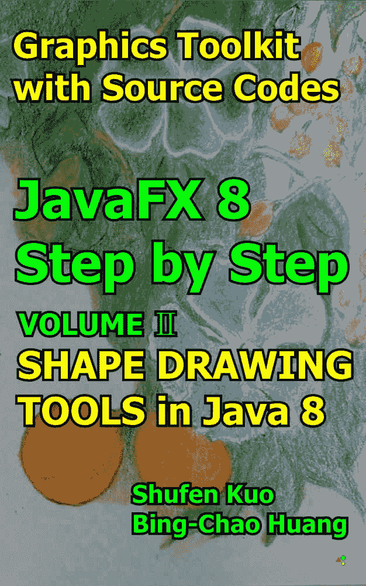

## JavaFX 历史

现在让我们回顾 JavaFX 的时间线：

Sun 公司于 2005 年 9 月收购了 Spring，并在 2007 年 5 月开发了名为 JavaFX 的语言。2008 年 12 月发布 JavaFX 1.0。2010 年 1 月，Oracle 完成对 Sun 公司的收购并继续维护 JavaFX。2010 年 9 月 JavaOne 大会上，Oracle 宣布将放弃 JavaFX Script。2011 年 10 月发布 JavaFX 2.0，开发者开始使用标准 Java 语言而非 JavaFX Script 来访问 JavaFX。2013 年 2 月发布 JavaFX 2.2.7，JavaFX SDK 和 Runtime 被包含在 JDK 7 中。JavaFX 与 JDK 的带来了极大的便利。使用 JDK 7 及更高版本编译的 JavaFX 应用不再需要额外安装。2014 年 3 月 18 日，JavaFX 8 作为 Java™ SE 开发工具包 (JDK 8) 的一部分发布。截至本书 2016 年 3 月出版，最新的 JDK 版本为：2015 年 10 月 20 日的 JDK 866 以及 2016 年 1 月的 JDK 872。JDK 9 的可用发布计划为 2017 年 3 月 23 日。

## 前提条件

书中介绍的 JavaFX 应用使用提供的包构建 GUI。不需要 Swing 包，但读者必须熟悉 Java 语言的基础。如果你是 Java 新手，请访问此网站 [`docs.oracle.com/javase/tutorial/index.html`](http://docs.oracle.com/javase/tutorial/index.html) 获取 Java 技术的初步知识。按以下顺序阅读 Oracle 在线文档：

1. 简单的 Java 应用程序“Hello World!”与安装：[`docs.oracle.com/javase/tutorial/getStarted/index.html`](http://docs.oracle.com/javase/tutorial/getStarted/index.html)
2. Java 语言的概念和特性：[`docs.oracle.com/javase/tutorial/java/index.html`](http://docs.oracle.com/javase/tutorial/java/index.html)
3. Java 集合框架：[`docs.oracle.com/javase/tutorial/collections/index.html`](http://docs.oracle.com/javase/tutorial/collections/index.html)

访问 [`docs.oracle.com/javase/tutorial/essential/index.html`](http://docs.oracle.com/javase/tutorial/essential/index.html)

# JavaFX 概览

以下示例旨在为 JavaFX 初学者提供帮助，帮助他们快速预览如何创建一个 JavaFX 应用程序。

要开始学习，你需要创建一个扩展 `javafx.application.Application` 的类，该类是 JavaFX 程序的入口点，并重写必须被覆盖的抽象 `start` 方法。以下是一个典型的 `start` 方法示例：

```java
package imageviewer;

import javafx.application.Application;
import javafx.scene.Scene;
import javafx.scene.layout.BorderPane;
import javafx.scene.layout.StackPane;
import javafx.stage.Stage;

/**
 * File Name: ImageViewer.java
 *
 * @author Shufen Kuo
 */

public class ImageViewer extends Application {

  @Override
  public void start(Stage stage) {
    BorderPane rootPane = new BorderPane();
    StackPane imageArea = new StackPane();
    rootPane.getChildren().add(imageArea);

    Scene scene = new Scene(rootPane, 600, 400); 
    stage.setTitle("ImageViewer V1.0");
    stage.setScene(scene);
    stage.show();
  }

  public static void main(String[] args) {
    launch(args);
  }
}
```

## Scene（场景）与 Stage（舞台）

`start` 方法中出现了两个重要的类：`Scene` 和 `Stage`。通常情况下，主要任务是创建在名为场景图（scene graph）的层级树结构中管理的图形用户界面（GUIs），将场景图的根节点与 `Scene` 对象关联，然后将场景放置在 `Stage` 对象上。`Stage` 代表 JavaFX 应用程序的顶层容器，作为场景图的窗口，与应用程序用户进行交互。

下面的快照让你对我们将构建的 JavaFX 应用程序的 GUI 外观有一个初步概念：

图 1. JavaFX 应用程序快照。

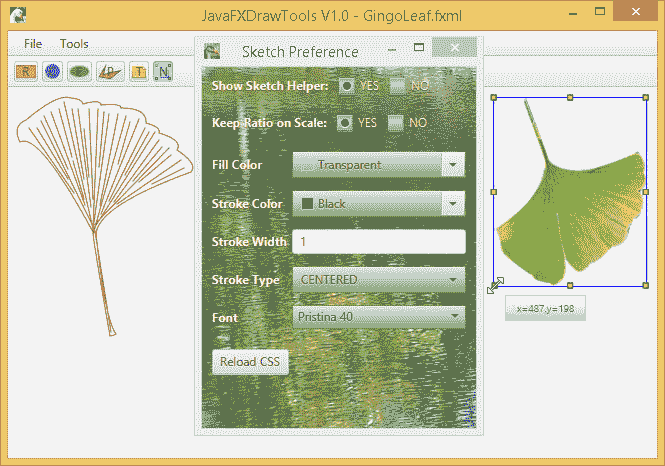

## Nodes（节点）

JavaFX 引入了一个基础类 `javafx.scene.Node`，它继承自 `java.lang.Object`，并为所有可用用户界面提供了常用的属性和方法。我们经常使用“节点”一词来指代 GUI。

场景图可能包含各种节点。节点可以是父节点（拥有子节点的节点）或叶子节点（没有子节点的节点）；每个节点只有一个父节点，根节点没有父节点。场景图中的所有节点都派自 `javafx.scene.Node` 类。

为了快速掌握场景图中节点类型的精髓，我们将根据它们是否能够添加子节点来对其进行区分。

* 你可以向这些节点添加子节点：

  以下类经常被用作父节点：`Group`、`Pane` 以及内置布局面板（它们是 `Pane` 的直接子类）。通常，你调用 `getChildren()` 方法获取一个类型为 `ObservableList<Node>` 的列表（它是 `java.util.List` 的子接口），然后使用 Java 开发者熟悉的、定义在 `Collection` 接口中的基本工具类来操作列表的内容。

* 你不能向这些节点添加子节点：

  以下类始终被用作叶子节点：`Canvas`、`ImageView`、`MediaView` 以及所有 `Shape` 的直接子类，如 `Rectangle`、`Circle`、`Ellipse` 等。

## JavaFX 与 Swing

现在，有一个有趣的问题。多年来，Java 开发者一直使用 Swing API（Java Foundation Classes JFC 的 GUI 组件）来构建 Java 应用程序的 GUI，为什么除了 Swing 还需要 JavaFX？

如果你有大量使用 Swing 编写的遗留代码，并希望在 Swing 代码中引入 JavaFX 特性，JDK 8 提供了机制；反之，你可以在 JavaFX 应用程序中包含 Swing 组件。

本书未涵盖 JavaFX-Swing 互操作性的话题。如果你对此主题感兴趣，请在此访问 Oracle 在线文档“JavaFX: Interoperability -- JavaFX-Swing Interoperability”：

[`docs.oracle.com/javase/8/javafx/interoperability-tutorial/fx_swing.htm`](http://docs.oracle.com/javase/8/javafx/interoperability-tutorial/fx_swing.htm)

JavaFX 是下一代 Java GUI。为了说明使用 JavaFX 能力的优势，除了 JavaFX 和 Swing 之间的互操作性外，我们在下面的章节中介绍了 JavaFX 的重要特性。

## JavaFX 的精髓

JavaFX 不仅允许你快速创建具有视觉用户界面的应用程序，还包含引人注目且独特的功能。它们如下：

### 内置布局面板（Layout Panes）

JavaFX 的布局面板是能够自动对节点执行各种类型布局的容器。你可以在布局面板中放置任意数量的节点，节点本身也是节点，因此也可以嵌套另一个布局面板。使用布局面板的主要优势是避免手动指定每个节点的大小和位置的繁琐。由于场景图中的节点是以树结构管理的，布局算法会根据其布局类型和指定的布局属性递归计算每个节点的大小和位置，并在窗口大小调整事件发生时动态触发重新计算。

共有 8 种内置布局面板，位于 `javafx.scene.layout` 中：

`BorderPane`

`BorderPane` 将节点分别放置在五个位置，以创建经典的外观：顶部用于菜单栏或工具栏，底部用于状态栏，左右区域用于导航面板，中心区域用于工作区。

`HBox`

`HBox` 将节点放置在一行中（水平方向）。

`VBox`

`VBox` 将节点放置在一列中（垂直方向）。

`GridPane`

`GridPane` 将节点放置在多行多列的网格中。显示键值对属性的方便界面。

`StackPane`

`StackPane` 将所有节点堆叠在中心，对齐方式为中心。子节点在容器中心相互重叠，后创建的节点位于先节点之上。但你可以使用静态方法 `StackPane.setAlignment(Node child, Pos value)` 和 `StackPane.setMargin(Node child, Insets value)` 来调整每个节点的强制性位置。

`FlowPane`

你可以指定 `FlowPane` 的方向属性。对于水平 `FlowPane`，节点从左到右排列，在容器宽度边界处换行。对于垂直 `FlowPane`，节点从上到下排列，在容器高度边界处换列。

`TilePane`

`TilePane` 与 `FlowPane` 类似，但 `TilePane` 网格中的每个单元格大小相同。

`AnchorPane`

`AnchorPane` 根据指定的锚点放置节点，共有四个锚点：`topAnchor`、`rightAnchor`、`bottomAnchor` 和 `leftAnchor`。

#### 参考 Oracle 在线文档“Working with Layouts in JavaFX”：

[`docs.oracle.com/javase/8/javafx/layout-tutorial/index.html`](http://docs.oracle.com/javase/8/javafx/layout-tutorial/index.html)

### 使用 CSS 自定义

JavaFX 允许使用 CSS（层联样式表）描述应用程序用户界面的样式。使用 CSS 定义显示属性（如颜色、字体、边距、内边距、宽度、高度、线条、背景图像等）并将与代码分离，在许多方面显示出显著的便利性：

* 软件提供者的自定义：

  从同一组代码编译的应用程序可以具有不同的样式，以满足不同的客户需求。

* 应用程序用户的自定义：

  即使在软件发布后，如果应用程序用户对 UI 的外观有偏好，在客户现场修改 CSS 文件中定义的显示属性也是可行的。

## 对演示样式设计者的优势

将应用程序代码与演示样式定义分离可以提高代码的可读性，并让图形设计师专注于处理 `CSS`，从而简化了任务。

## 对软件开发人员的优势

在测试过程中，开发者可能需要频繁更改 `CSS` 文件中定义的样式属性，以评估 GUI 的多样化外观。如果每次更改都必须退出并重启程序，那将是一项非常麻烦的任务。为了方便这一评估过程，最佳策略是设计一个临时的 `Load` 按钮，当任何样式属性发生变化时，只需点击该按钮重新加载 `CSS`，而无需退出并重启应用程序，从而节省大量的测试时间。

## JavaFX 中 CSS 与 HTML 中 CSS 的相似性

JavaFX 中的 `CSS` 语法与 HTML 中的 `CSS` 相同，因此任何具有浏览器 `CSS` 经验的设计师都可以极少的学习成本为 JavaFX 应用程序的 UI 设置样式。

#### 参考 Oracle 在线文档“使用 CSS 装饰 JavaFX 应用程序”：

[`docs.oracle.com/javase/8/javafx/user-interface-tutorial/css_tutorial.htm`](http://docs.oracle.com/javase/8/javafx/user-interface-tutorial/css_tutorial.htm)

## 使用 FXML 创建用户界面

FXML 是一种符合 `XML`（可扩展标记语言）格式并带有额外规则的标记语言，用于创建 JavaFX 应用程序的用户界面。考虑到手动编写 `FXML` 容易出错，一种可行的方法是通过 GUI 生成器生成 `FXML` 代码。

在本系列书籍中，我们介绍了一个实用的应用程序 `JFXDrawTools`，它是一种专门用于创建派自 `Shape` 的子类实例的 GUI 生成器。用户可以交互地创建一个草图（无论是 `Shape` 还是 `ImageView`），操作其属性并将编辑结果保存为 `FXML` 格式的文件，这些文件随后可以被加载回来以继续编辑过程，或者被其他 JavaFX 应用程序动态加载。

将应用程序的 GUI（视图）与其业务逻辑（模型）分离被认为是一种良好的编程实践。`FXML` 文件表示视图，而控制器是一个在视图和模型之间传递信息的 Java 类。使用 `FXML` 构建 GUI 能够让应用程序开发人员有效地采纳 `MVC`（模型-视图-控制器）架构。

#### 参考 Oracle 在线文档“JavaFX: 掌握 FXML”：

[`docs.oracle.com/javase/8/javafx/fxml-tutorial/index.html`](http://docs.oracle.com/javase/8/javafx/fxml-tutorial/index.html)

## 属性与绑定的吸引人能力

JavaFX 特有的 `Properties` 概念遵循了 `JavaBeans` 组件中引入的设计规范，它通常与 `Binding` 机制结合使用，整体上为各种编程需求提供了强大且优雅简洁的解决方案。

在本系列书籍介绍的 `JFXDrawTools` 中，我们充分演示了 `Properties` 和 `Binding` 的用法。在 `Properties` 窗口的实现中，使用了合适的 UI（如文本字段、选择框、组合框等）来查看相关对象的属性。`Binding` 机制用于将 UI 控件与其对象的相应属性进行双向链接，这种关系在 `Properties` 窗口即将显示时建立。当用户更改 UI 控件显示的数据时，更改会立即反映到相关对象的相应属性上。

#### 参考 Oracle 在线文档“JavaFX: 属性与绑定教程”：

[`docs.oracle.com/javase/8/javafx/properties-binding-tutorial/index.html`](http://docs.oracle.com/javase/8/javafx/properties-binding-tutorial/index.html)

## 变换与过渡的复杂机制

JavaFX 内置的节点变换功能对于开发图形编辑器、绘图工具、图像查看器、GUI 生成器等图形包非常方便。

以下是处理变换的类：`Translate`、`Rotate`、`Scale` 和 `Shear`。它们都派自 `Transform` 类并位于 `javafx.scene.transform` 包中。

JavaFX 过渡为创建动画提供了简洁的方法。许多应用程序都需要动画功能，这里是一些用例：在警报情况下引起注意、在删除操作期间将对象丢入回收箱、在数据加载期间指示中间状态……

在本系列书籍介绍的 `ImageViewer` 应用程序中，我们将幻灯片功能中的图像对象应用了 `FadeTransition` 和 `ParallelTransition`，以便同时新图像淡入且旧图像淡出。

以下是处理过渡的类：`FadeTransition`、`RotateTransition`、`ScaleTransition`、`TranslateTransition`、`FillTransition`、`StrokeTransition`、`PathTransition`、`ParallelTransition`、`SequentialTransition`、`PauseTransition`。它们都派自 `Transition` 类（一个定义动画基本功能的抽象类），并位于 `javafx.animation` 包中。

#### 参考 Oracle 在线文档“JavaFX: 变换、动画和视觉效果”：

[`docs.oracle.com/javase/8/javafx/visual-effects-tutorial/index.html`](http://docs.oracle.com/javase/8/javafx/visual-effects-tutorial/index.html)

## 2D 几何原语和文本都是 JavaFX 节点

JavaFX 提供了一个 `Shape` 类，它扩展了 `javafx.scene.Node` 类，是 2D 几何基础的基类。在几何原语上应用面向对象的概念有助于图形应用程序的。


以下是派自 `Shape` 类的类：`Arc`、`Circle`、`CubicCurve`、`Ellipse`、`Line`、`Path`、`Polygon`、`Polyline`、`QuadCurve`、`Rectangle`、`SVGPath`、`Text`。除了 `Text` 类外，其他类均位于 `javafx.scene.shape` 包中。

请注意，位于 `javafx.scene.text` 包的 `Text` 类也被视为一种形状，它赋予了文本绘制工具开发能力。适用于 JavaFX 节点的所有功能都可以像处理几何形状一样处理它。文本对象可以放在布局面板中利用自动放置功能，应用变换和过渡，以及使用 `CSS` 自定义演示样式。

#### 参考 Oracle 在线文档“在 JavaFX 中使用文本”

[`docs.oracle.com/javase/8/javafx/user-interface-tutorial/text-settings.htm`](http://docs.oracle.com/javase/8/javafx/user-interface-tutorial/text-settings.htm)

JavaFX 架构中嵌入了一个 Web 引擎组件，并提供了一套位于 `javafx.scene.web` 包中的 API，用于开发具有浏览器功能的应用程序。要查看网页，首先需要创建一个 `WebView` 对象，该对象继承自 `javafx.scene.Parent` 并继承了节点（node）的所有特性，然后获取与其关联的 `WebEngine`。`WebEngine` 提供了与操作网页相关的方法，例如：通过给定的 URL 或页面内容加载/显示网页、访问由 `WebEngine` 为加载的网页创建的文档对象模型（DOM）、处理由 JavaScript 触发的各种事件……等。

## 对 Oracle 在线文档“JavaFX: Adding HTML Content to JavaFX Applications”的参考

[`docs.oracle.com/javase/8/javafx/embedded-browser-tutorial/index.html`](http://docs.oracle.com/javase/8/javafx/embedded-browser-tutorial/index.html)

### 用于编辑 HTML 页的 `HTMLEditor` 类

对 HTML 编辑能力的完整支持来自 `HTMLEditor` 类，它继承自 `javafx.scene.control.Control` 并位于 `javafx.scene.web` 包中。要在你的 JavaFX 应用程序中嵌入 HTML 编辑器，只需创建 `HTMLEditor` 的实例，并将其添加到场景图（scene graph）中，然后就可以与用户交互了。以下两个方法用于获取和设置编辑器的 HTML 内容：`getHtmlText()`、`setHtmlText(java.lang.String htmlText)`。

与处理多行纯文本的类似控件 `TextArea` 不同，`HTMLEditor` 的是符合 HTML 语法的文本。

HTML 编辑器的用法在软件各个领域被广泛需要，例如：博主撰写文章发布（内容管理系统）、邮件系统用户编写消息（消息系统）、在线卖家为商品上架准备产品描述（电子商务管理系统）……等。

## 对 Oracle 在线文档“JavaFX: Working with JavaFX UI Components -- HTML Editor”的参考

[`docs.oracle.com/javase/8/javafx/user-interface-tutorial/editor.htm`](http://docs.oracle.com/javase/8/javafx/user-interface-tutorial/editor.htm)

### 用于渲染数据的图表组件

以下类位于 `javafx.scene.chart` 包中，用于绘制各种类型的图表：

- `AreaChart`、`StackedAreaChart`
- `BarChart`、`StackedBarChart`
- `BubbleChart`
- `LineChart`
- `PieChart`
- `ScatterChart`

`Chart` 类是所有图表组件的基类，继承自 `javafx.scene.layout.Region` 类，因此继承了来自 `javafx.scene.Node` 类的所有适用特性。

## 对 Oracle 在线文档“JavaFX: Working with JavaFX UI Components -- Working with JavaFX Charts”的参考

[`docs.oracle.com/javase/8/javafx/user-interface-tutorial/charts.htm`](http://docs.oracle.com/javase/8/javafx/user-interface-tutorial/charts.htm)

### 用于播放媒体的 `MediaView` 类

`MediaView` 类继承自 `javafx.scene.Node`，与 `MediaPlayer` 和 `Media` 类一起使用，在你的 JavaFX 应用程序中播放媒体。所有与媒体相关的类都位于 `javafx.scene.media` 包中。

## 对 Oracle 在线文档“JavaFX: Incorporating Media Assets Into JavaFX Applications”的参考

[`docs.oracle.com/javase/8/javafx/media-tutorial/`](http://docs.oracle.com/javase/8/javafx/media-tutorial/)

## JavaFX 基础 UI 组件

除了上述的 JavaFX 核心之外，JavaFX 还提供了基础 UI 组件，它们位于 `javafx.scene.control` 包中并派自 `javafx.scene.control.Control` 类；它们通常被称为 UI 控件。

以下是可用的 UI 控件，未标记星号（*）的控件在 Swing 中有对应的相似控件：

- `Label`、`Button`、`RadioButton`、`ToggleButton`
- `CheckBox`、`ChoiceBox`
- `ComboBox`、`ListView`、`TableView`
- `TextField`、`TextArea`、`PasswordField`、`HTMLEditor`（*）
- `ScrollBar`、`ScrollPane`、`Slider`、`ProgressBar`、`ProgressIndicator`（*）、`ToolBar`
- `MenuBar`、`MenuButton`、`SplitMenuButton`（*）
- `ColorPicker`、`DatePicker`（*）、`Separator`、`Pagination`（*）、`SplitPane`、`TabPane`、`TitledPane`（*）、`Accordion`（*）、`TreeView`、`TreeTableView`（*）、`Hyperlink`（*）

以下 UI 组件通常与上述 UI 控件被分为同一类。

- `Tooltip`

  位于 `javafx.scene.control` 包中，但派自 `javafx.scene.control.PopupControl` 类。

- `MenuItem`、`Menu`、`CheckMenuItem`、`RadioMenuItem`

  位于 `javafx.scene.control` 包中。继承自 `java.lang.Object` 的 `MenuItem` 是另外三个类的基类。

- `FileChooser`

  位于 `javafx.stage` 包中并继承自 `java.lang.Object`。

## 对 Oracle 在线文档“JavaFX: Working with JavaFX UI Components”的参考

[`docs.oracle.com/javase/8/javafx/user-interface-tutorial/ui.htm`](http://docs.oracle.com/javase/8/javafx/user-interface-tutorial/ui.htm)

# 第 1 章：折段绘制（Line Drawer）

## 前言

在本章中，我们将开发一个通过鼠标事件交互式创建 `Line` 对象的模块。通过逐步增强，最后将其集成到一个综合的 JavaFX `Shape` 应用中。通过详细的描述和示例代码，你将熟悉 JavaFX 的基本能力。

`Line Drawer` 的完整开发过程具有以下步骤特征：

### 1.1 创建 `Application` 的子类 `LineDrawer`

`Line` 类位于 `javafx.scene.shape` 包中，是 `Shape` 类的直接子类之一，提供了渲染 2D 几何图形的 API。

为了深入 JavaFX `Shape` 类的特性，请阅读“2D 几何图形与 `Text` 是 JavaFX 节点”简介节的描述，此外还可以参考“卷Ⅰ：开发图像查看组件”第 2 章“带浏览按钮的增强图像查看器”第 2.1 节“添加下一个按钮”，其中我们演示了如何使用 `Polygon` 和 `Rectangle` 等形状设计视觉对象。

`Line` 类定义了以下属性：

- `startX`

  这是一个类型为 `DoubleProperty` 的属性，用于指定 `Line` 起点的 X 坐标。

- `startY`

  这是一个类型为 `DoubleProperty` 的属性，用于指定 `Line` 起点的 Y 坐标。

- `endX`

  这是一个类型为 `DoubleProperty` 的属性，用于指定 `Line` 终点的 X 坐标。

- `endY`

  这是一个类型为 `DoubleProperty` 的属性，用于指定 `Line` 终点的 Y 坐标。

为了创建一个可操作的 `Line` 对象，必须指定上述属性的值，因为它们的默认值为 `0.0`。

这里是一个创建一个硬编码 `Line` 对象的示例：

导入语句：

```java
import javafx.scene.shape.Line;
```

列表 1-1。创建一个起点在（120, 120）、终点在（360, 360）的 `Line`：

```java
Line line = new Line(120.0f, 120.0f, 360.0f, 360.0f);
```

这里是创建相同 `Line` 对象的另一种方法：

列表 1-2。创建一个起点在（120, 120）、终点在（360, 360）的 `Line`：

```java
Line line = new Line();
line.setStartX(120.0f);
line.setStartY(120.0f);
line.setEndX(360.0f);
line.setEndY(360.0f);
```

`Shape` 类提供了通过 API 渲染各种样式的草图；我们将使用此方法：

```java
public final ObservableList<Double> getStrokeDashArray()
```

用于指定虚线模式，其参数是一组表示划线长度后接空格长度的双精度值序列。

以下是创建一个线宽设置为 4.0 像素的虚线的示例。

列表 1-3。创建一个起点在（120, 120）、终点在（360, 360）且描边宽度设置为 4.0 像素的虚线：

```java
Line line = new Line();
line.setStartX(120.0f);
line.setStartY(120.0f);
line.setEndX(360.0f);
line.setEndY(360.0f);
// 设置划线和空格的长度（像素）
// 16 为划线，8 为空格，2 为划线，8 为划线
// 然后重复该模式
line.getStrokeDashArray().addAll(16.0, 8.0, 2.0, 8.0);
line.setStrokeWidth(4.0);
```

接下来的快照显示了通过上述代码渲染的 `Line`：

图 1-1。上述代码渲染的虚线快照

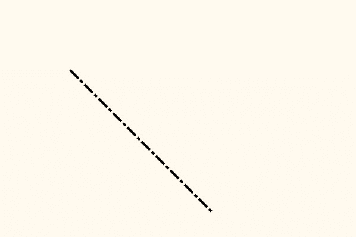

现在，我们将演示如何开发一个 `LineDrawer` 应用程序，以交互方式绘制 `Line` 对象。线条起点和终点的（X, Y）坐标通过鼠标按下和鼠标拖动事件动态获取。

最终，这个简单的模块将演变成一个复杂的绘图工具，不仅处理 `Line` 对象，还能处理 `Polyline`、`Polygon`、`Path`、`circle` 等。

#### 1.1.1 在 `BorderPane` 的中心添加 `Pane` 作为绘板

在“卷Ⅰ：开发图像查看组件”第 1 章“基础图像查看器”第 1.1 节“创建作为 Application 子类的 ImageViewer 类”中，我们已经展示了 `BorderPane` 类的功能；它是内置布局面板之一，位于 `javafx.scene.layout` 包中，是 `javafx.scene.layout.Pane` 类的直接子类。

与 `ImageViewer` 应用程序类似，`LineDrawer` 应用程序采用 `BorderPane` 作为场景图的根节点，并将 `Pane` 放置在 `BorderPane` 的中心作为草图绘板。

以下是 `Node` 类的部分后代树，展示了 `Parent` 与 `Pane`、`Group` 以及容器的关系。

图 1-2。`Node` 类部分后代树图，显示了 `Pane` 的位置

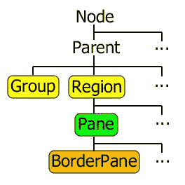

`Pane` 类是 `Region` 的直接子类，位于 `javafx.scene.layout` 包，是 JavaFX 内置布局面板的基类。首先，我们将探索为什么采用 `Pane` 类作为我们的绘板。

为在鼠标指向的位置渲染对象开发交互式绘图工具需要一个满足以下两个基本条件的容器：

1. 它不会自动布局其子元素。
2. 它提供 `getChildren()` 方法以添加所需数量的节点。

`Group` 类是 `javafx.scene.Parent` 的直接子类，位于 `javafx.scene` 包，也满足这两个条件；然而，将 `Group` 作为绘板是不可行的。`Group` 无法由父容器调整大小，其边界完全由其内容的边界决定。当应用程序启动时，草图容器是空的。而一个没有任何子节点的 `Group` 在场景中不占用任何空间，因此无法接收事件。

空的 `Pane` 不会产生像空 `Group` 那样的问题。

### 1.2 注册事件处理器来处理鼠标事件和按键事件

采用了一种有效且简单的方法来画线，即在绘板 `Pane` 上拖动鼠标。以下是其工作原理预览：

当按下鼠标时，我们获取事件的 x 位置和 y 位置，这将成为要创建线条的起点。当紧随鼠标按下事件的第一个鼠标拖动事件发生时，会创建一个临时的 `Line` 对象，并将之前获取的位置设置为线条的起点。当鼠标在绘板上拖动时，线条的终点将根据属性和绑定机制，根据最新的鼠标拖动位置不断调整。当发生鼠标释放事件以结束鼠标拖动事件序列时，该临时线条的绘制完成完成。

重复 `MOUSE_PRESSED`—`MOUSE_DRAGGED`—`MOUSE_RELEASED` 事件循环，直到你对这条线条的渲染满意为止。按下 `ESCAPE` 键取消此线条，按下 `ENTER` 键确定此线条。一旦按下 `ENTER` 键，该线条将永久存在于绘板上，下一次 `MOUSE_PRESSED` 事件将开始画一条新线条。

在草图绘制应用程序的最终版本 `JFXDrawTools` 中，我们将实现 `Delete` 操作来擦除选定的现有草图，并实现 `Show Properties` 操作来更新草图的可用属性。

#### 1.2.1 使用便利方法注册事件处理器

以下 `Node` 类提供的便利方法用于注册上述事件的事件处理器：

```java
public final void setOnMousePressed(EventHandler<? super MouseEvent> value)
```

设置 `Node` 类中定义的 `OnMousePressed` 属性值，提供 `handle` 方法的实现，该方法在鼠标在此节点上按下时被调用。

```java
public final void setOnMouseDragged(EventHandler<? super MouseEvent> value)
```

设置 `Node` 类中定义的 `OnMouseDragged` 属性值，提供 `handle` 方法的实现，该方法在鼠标在此节点上拖动时被调用。

```java
public final void setOnMouseReleased(EventHandler<? super MouseEvent> value)
```

设置 `Node` 类中定义的 `OnMouseReleased` 属性值，提供 `handle` 方法的实现，该方法在鼠标在此节点上释放时被调用。

### 1.3 `LineDrawer` 中的属性与绑定

#### 1.3.1 定义存储鼠标事件位置的属性

#### 1.3.2 定义存储草图的 `ObjectProperty<Shape>`

#### 1.3.3 绑定线条终点的属性

### 1.4 获取按键事件的键码

### 1.5 `LineDrawer` 的完整源代码

### 1.6 总结


```java
public final void setOnKeyPressed(EventHandler<? super KeyEvent> value`)
```

设置 `Node` 类中定义的 `OnKeyPressedd` 属性值，提供 `handle` 方法的实现，该方法在键在此节点上按下时被调用。

以下代码片段展示了如何注册事件处理器来处理 `MOUSE_PRESSED`、`MOUSE_DRAGGED`、`MOUSE_RELEASED` 和 `KEY_PRESSED` 事件。

导入语句：

```java
import javafx.event.EventHandler;
import javafx.scene.input.KeyEvent;
import javafx.scene.input.MouseEvent;
```

列表 1-5。注册事件处理器处理 `MOUSE_PRESSED`、`MOUSE_DRAGGED`、`MOUSE_RELEASED` 和 `KEY_PRESSED` 事件：

```java
final Pane drawPane = new Pane();

drawPane.setOnMousePressed(new EventHandler<MouseEvent>() {
  @Override
  public void handle(MouseEvent me) {
    //在此处添加代码处理鼠标按下事件
  }
});

drawPane.setOnMouseDragged(new EventHandler<MouseEvent>() {
  @Override
  public void handle(MouseEvent me) {
    // 在此处添加代码处理鼠标拖动事件
  }
});

drawPane.setOnMouseReleased(new EventHandler<MouseEvent>() {
  @Override
  public void handle(MouseEvent me) {
    // 在此处添加代码处理鼠标释放事件
  }
});

drawPane.setOnKeyPressed(new EventHandler<KeyEvent>() {
  @Override
  public void handle(KeyEvent ke) {
    // 在此处添加代码处理按键事件
  }
});
```

## 1.3 `LineDrawer` 类中的属性与绑定

### 1.3.1 定义属性以保存鼠标事件的位置

为了在发生鼠标事件时跟踪鼠标位置，我们定义了以下 `DoubleProperty` 类型的属性。

导入语句：

```java
import javafx.beans.property.DoubleProperty;
import javafx.beans.property.SimpleDoubleProperty;
```

列表 1-6。定义 `DoubleProperty` 类型的属性 `startX`、`startY`、`translateX` 和 `translateX`：

```java
// startX, startY 保存鼠标按下事件的位置
DoubleProperty startX = new SimpleDoubleProperty();
DoubleProperty startY = new SimpleDoubleProperty();

// translateX, translateY 存储拖动/移动位置到 startX, startY 的距离
DoubleProperty translateX = new SimpleDoubleProperty();
DoubleProperty translateY = new SimpleDoubleProperty();
```

`MouseEvent` 类位于 `javafx.scene.input` 包中，是 `javafx.scene.input.InputEvent` 的子类；它提供了 `getX()` 和 `getY()` 方法，用于获取事件发生时鼠标的 X、Y 位置。

```java
public final double getX()
```

获取相对于该事件源对象原点的鼠标 X 位置。

```java
public final double getY()
```

获取相对于该事件源对象原点的鼠标 Y 位置。

`startX` 和 `startY` 的值在处理鼠标按下事件的事件处理器中设置，代码如下：

列表 1-7。注册事件处理器处理 `MOUSE_PRESSED` 事件：

```java
final Pane drawPane = new Pane();

drawPane.setOnMousePressed(new EventHandler<MouseEvent>() {
  @Override
  public void handle(MouseEvent me) {
    // 获取起始起始位置
    startX.set(me.getX());
    startY.set(me.getY());
  }
});
```

`translateX` 和 `translateY` 的值在处理鼠标拖动事件的事件处理器中设置，代码如下：

列表 1-8。设置属性 `translateX`、`translateY` 的值：

```java
drawPane.setOnMouseDragged(new EventHandler<MouseEvent>() {
  @Override
  public void handle(MouseEvent me) {
    // 计算从鼠标位置到起始位置的距离
    double x2 = me.getX();
    double y2 = me.getY();
    translateX.set(x2 - startX.get());
    translateY.set(y2 - startY.get());

    ...

  }
});
```

### 1.3.2 定义 `ObjectProperty<Shape>` 以存储草图

定义类型为 `ObjectProperty<Shape>` 的类字段 `shape`，用于临时存储绘制在绘板上的草图（即一个 `Shape` 对象）。当检测到第一次鼠标拖动事件时，会创建一个线条对象并将其设置为 `shape` 属性的值。

在鼠标拖动事件处理器内部，我们需要判断这是否是鼠标按下事件后的第一次鼠标拖动事件；如果是，则创建一个线条，该线条在一次 `MOUSE_PRESSED—MOUSE_DRAGGED—MOUSE_RELEASED` 事件周期中仅会被创建一次。为此，我们定义了一个布尔型（`boolean`）字段 `dragged`，它在检测到第一次鼠标拖动事件时被设置为 `true`，在发生鼠标释放事件时被重置为 `false`。以下是完成这些任务的代码片段：

导入语句：

```java
import javafx.beans.property.ObjectProperty;
import javafx.beans.property.SimpleObjectProperty;
import javafx.scene.paint.Color;
import javafx.scene.shape.Line;
import javafx.scene.shape.Shape;
```

列表 1-9。定义形状属性和 `dragged` 变量，在鼠标开始拖动时创建线条：

```java
// 用于存储当前绘制的形状
ObjectProperty<Shape> shape = new SimpleObjectProperty<>();

// 该变量在鼠标拖动事件处理器内部被设置为 true
// 当第一次鼠标拖动事件发生时，
// 在鼠标释放事件发生时被重置为 false。
boolean dragged = false;

drawPane.setOnMouseDragged(new EventHandler<MouseEvent>() {
  @Override
  public void handle(MouseEvent me) {
    double x2 = me.getX();
    double y2 = me.getY();
    translateX.set(x2 - startX.get());
    translateY.set(y2 - startY.get());

    if (!dragged) {
      // 仅执行一次
      if (getShape() == null) {
        Shape tmpShape = new Line();
        tmpShape.setStroke(Color.BLUE);
        shape.set(tmpShape);
      }

      dragged = true;

      ...

    }
  }
});

drawPane.setOnMouseReleased(new EventHandler<MouseEvent>() {
  @Override
  public void handle(MouseEvent me) {
    if (dragged) {
      dragged = false;

      ...

    }
  }
});
```

为 `shape` 属性添加了监听器以观察值的变化。如果设置了非空值，它将被添加到绘板的子列表中，形状将在应用程序窗口中可见。

导入语句：

```java
import javafx.beans.value.ChangeListener;
import javafx.beans.value.ObservableValue;
```

列表 1-10。为形状属性添加监听器：

```java
// 监听形状属性的值的变化，
// 如果创建了新形状，将其添加到绘板。
shape.addListener(new ChangeListener<Shape>() {
  @Override
  public void changed(ObservableValue o, Shape oldVal, Shape newVal) {
    System.out.format("shape value changed: %s%n", newVal);
    if (newVal != null) {
      drawPane.getChildren().add(newVal);
    }
  }
});
```

当线条被确定时（即按下 `Enter` 键时），线条的起点和终点将被确定，并且 `shape` 属性的值被设置为 `null`，此操作在注册 `KEY_PRESSED` 事件类型的事件处理器内部执行，将在后文章节描述。

### 1.3.3 为线条的终点绑定属性

以下定义了两种方法来处理 `bind` 和 `unbind`，针对 `endX` 属性和 `endY` 属性，这些属性代表当前在绘板上绘制线条的终点。

`void onMouseDragStarted()`

`void onMouseDragFinished()`

在 `onMouseDragStarted()` 方法内部，我们使用了 `javafx.beans.binding.DoubleExpression` 类中提供的 `add` 方法来生成一个 `DoubleBinding`，该绑定计算起始位置和位移距离的和：

```java
public DoubleBinding add(ObservableNumberValue other)
```

以下是 `onMouseDragStarted()` 方法和 `onMouseDragFinished()` 方法的实现：

列表 1-11。定义处理线条属性的方法，由 `MOUSE_DRAGGED` 和 `MOUSE_RELEASED` 事件处理程序调用：

```java
void onMouseDragStarted() {
  Line line = (Line) getShape();

  // 设置属性 startX, startY 的值
  line.setStartX(startX.get());
  line.setStartY(startY.get());

  // 对属性 endX, endY 进行绑定
  line.endXProperty().bind(startX.add(translateX));
  line.endYProperty().bind(startY.add(translateY));
}

void onMouseDragFinished() {
  Line line = (Line) getShape();

  // 此处必须验证 shape 不为空
  // 如果按了 Enter 键或 Esc 键，shape 将设置为 null
  if (line != null) {
    // 对属性 endX, endY 进行解绑
    line.endXProperty().unbind();
    line.endYProperty().unbind();
  }
}
```

`onMouseDragStarted()` 方法从处理 `MOUSE_DRAGGED` 事件的事件处理程序调用，它在每个 `MOUSE_PRESSED—MOUSE_DRAGGED—MOUSE_RELEASED` 事件循环中执行一次，用于计算线条起始点属性和终点属性的值。

以下是注册事件处理程序以处理 `MOUSE_DRAGGED` 事件的完整代码：

列表 1-12。注册事件处理程序处理 `MOUSE_DRAGGED` 事件：

```java
drawPane.setOnMouseDragged(new EventHandler<MouseEvent>() {
  @Override
  public void handle(MouseEvent me) {
    double x2 = me.getX();
    double y2 = me.getY();
    translateX.set(x2 - startX.get());
    translateY.set(y2 - startY.get());

    if (!dragged) {
      // 仅执行一次
      if (getShape() == null) {
        Shape tmpShape = new Line();
        tmpShape.setStroke(Color.BLUE);
        shape.set(tmpShape);
      }

      dragged = true;
      onMouseDragStarted();
    }
  }
});
```

同样，`onMouseDragFinished()` 方法从处理 `MOUSE_RELEASED` 事件的事件处理程序调用，它在每个 `MOUSE_PRESSED—MOUSE_DRAGGED—MOUSE_RELEASED` 事件循环中执行一次，处理线条终点属性的解绑。

以下是注册事件处理程序以处理 `MOUSE_RELEASED` 事件的完整代码：

列表 1-13。注册事件处理程序处理 `MOUSE_RELEASED` 事件：

```java
drawPane.setOnMouseReleased(new EventHandler<MouseEvent>() {
  @Override
  public void handle(MouseEvent me) {
    if (dragged) {
      dragged = false;
      onMouseDragFinished();
    }
  }
});
```

### 1.4 获取按键事件的键码

`KeyEvent` 类位于 `javafx.scene.input` 包中，是 `javafx.scene.input.InputEvent` 的子类。它定义了事件类型的静态字段，例如 `KEY_PRESSED`、`KEY_RELEASED`、`KEY_TYPED` 等。

`static EventType<KeyEvent> KEY_PRESSED`

`KEY_PRESSED` 事件在按键被按下时发生。

`static EventType<KeyEvent> KEY_RELEASED`

`KEY_RELEASED` 事件在按键被释放时发生。

`static EventType<KeyEvent> KEY_TYPED`

`KEY_TYPED` 事件在按键被按下并释放时发生。

`KeyCode` 类位于 `javafx.scene.input` 包中，是一个枚举类型，定义了键盘按键的常量；它涵盖了字母键（`A` 到 `Z`）、数字键（`DIGIT0` 到 `DIGIT9`）、修饰键（如 `CONTROL`、`SHIFT` 等）、功能键（如 `F1`、`F2`）、`ENTER`、`ESCAPE`、`HOME`、`END`、`BACKSPACE` 等。


以下是 `KeyEvent` 类提供的两个方法，用于在 `KEY_PRESSED` 或 `KEY_RELEASED` 事件发生时获取键的信息。

### `getCode()`

```java
public final KeyCode getCode()
```

在 `KEY_PRESSED` 或 `KEY_RELEASED` 事件发生时，获取按下或释放的按键的码，类型为 `KeyCode`。对于 `KEY_TYPED` 事件，返回 `KeyCode.UNDEFINED`。

### `getText()`

```java
public final String getText()
```

在 `KEY_PRESSED` 或 `KEY_RELEASED` 事件发生时，以 `String` 表示形式获取按下或释放的按键的信息。对于 `KEY_TYPED` 事件，返回空字符串。

`KeyEvent` 类中还提供了以下布尔方法，用于验证在按键事件发生时是否同时按下了修饰键。

### `isControlDown()`

```java
public final boolean isControlDown()
```

检查事件发生时 Ctrl 键是否被按下。

### `isAltDown()`

```java
public final boolean isAltDown()
```

检查事件发生时 Alt 键是否被按下。

### `isShiftDown()`

```java
public final boolean isShiftDown()
```

检查事件发生时 Shift 键是否被按下。

要使源节点接收键事件，应将 `focusversable` 属性设置为 `true`；其默认值为 `false`。

### `setTraversable(boolean value)`

```java
public final void setTraversable(boolean value)
```

将 `focusversable` 属性的值设置为 `true`，使节点可遍历并能够获得焦点，通常通过 `TAB` 键或 `SHIFT+TAB` 键在遍历节点之间移动焦点。

以下代码片段展示了如何注册事件处理程序处理 `KEY_PRESSED` 事件，以及 `handle(KeyEvent event)` 方法的写法。

#### 导入语句

```java
import javafx.scene.input.KeyCode;
import javafx.scene.input.KeyEvent;
```

#### Listing 1-14：注册事件处理程序处理 `KEY_PRESSED` 事件

```java
// 需要设置 focusversable 为 true 才能处理 KeyEvent，
// 默认值为 false。
drawPane.setTraversable(true);
drawPane.setOnKeyPressed(new EventHandler<KeyEvent>() {
  @Override
  public void handle(KeyEvent ke) {
    KeyCode kc = ke.getCode();
    switch (kc) {
      case ENTER:
        // 按下 Enter 键完成线条
        System.out.format("Enter key hit%n");
        // 必须调用 dragged finished 方法解绑
        onMouseDragFinished();
        setShape(null);  // 完成线条
        break;
      case ESCAPE:
        // 按下 Esc 键清除此线条
        System.out.format("Esc key hit");
        Shape s = getShape();
        if (s != null) {
          // 必须调用 dragged finished 方法解绑
          onMouseDragFinished();
          drawPane.getChildren().remove(s);
          setShape(null);  // 清除线条
        }
        break;
    }
  }
});
```

## 1.5 `LineDrawer` 类的完整源代码

#### Listing 1-15：创建继承 `Application` 类的 `LineDrawer` 类

重写 `start` 方法，创建 `BorderPane` 作为场景的根节点，并将 `Pane` 置于 `BorderPane` 的中心作为绘板。


```java
package drawtool;

import javafx.application.Application;
import javafx.beans.property.DoubleProperty;
import javafx.beans.property.ObjectProperty;
import javafx.beans.property.SimpleDoubleProperty;
import javafx.beans.property.SimpleObjectProperty;
import javafx.beans.value.ChangeListener;
import javafx.beans.value.ObservableValue;
import javafx.event.EventHandler;
import javafx.event.EventType;
import javafx.scene.input.KeyCode;
import javafx.scene.input.KeyEvent;
import javafx.scene.input.MouseEvent;
import javafx.scene.layout.BorderPane;
import javafx.scene.layout.Pane;
import javafx.scene.paint.Color;
import javafx.scene.shape.Line;
import javafx.scene.shape.Shape;
import javafx.scene.Scene;
import javafx.stage.Stage;

/**
 * File Name: LineDrawer.java
 * (in directory: LineDrawer1.0/src/example1/drawtool/)
 * This JavaFX application is the initial phase of implementation of a comprehensive
 * drawing tool JFXDrawTools.
 * The first step is to implement Line drawing through consecutive mouse dragged events
 * A Pane object is employed as a drawing board
 * It takes the following mouse events to draw lines on a drawing board:
 *   MOUSE_PRESSED, MOUSE_DRAGGED, MOUSE_RELEASED
 * As MOUSE_PRESSED event occurs, the mouse position is obtained to be used as
 * the start point of a line,
 * a line is created when a MOUSE_PRESSED event is followed immediately by a
 * MOUSE_DRAGGED event,
 * the ending point of this line binds to the position of MOUSE_DRAGGED event,
 * this line is completed as MOUSE_RELEASE event occurs,
 * repeat MOUSE_PRESSED, MOUSE_DRAGGED, MOUSE_RELEASED event cycles until you are
 * satisfied with the rendering of this line
 * To finalize this line, hit ENTER key,
 * the next MOUSE_PRESSED event will start a new line
 * To cancel this line, hit  ESCAPE key
 *
 * @author: Shufen Kuo
 */
public class LineDrawer extends Application {

  // Keep track of the cursor locations while mouse event occurs
  // startX, startY hold locations of mouse pressed event
  DoubleProperty startX = new SimpleDoubleProperty();
  DoubleProperty startY = new SimpleDoubleProperty();

  // translateX, translateY hold the distance from dragged/moved location to the startX, startY
  DoubleProperty translateX = new SimpleDoubleProperty();
  DoubleProperty translateY = new SimpleDoubleProperty();

  // This is to hold the shape of current drawing 
  ObjectProperty<Shape> shape = new SimpleObjectProperty<>();

  // This variable is set to true inside mouse dragged event handler
  // when the first mouse dragged event occurs,
  // and reset to false when mouse released event occurs.
  boolean dragged = false;

  @Override
  public void start(Stage stage) {
    BorderPane rootPane = new BorderPane();
    // We can't use Group object as drawPane here because
    // the size of group is not dynamically adjusted when size of rootPane changed
    final Pane drawPane = new Pane();
    rootPane.setCenter(drawPane);

    drawPane.setOnMousePressed(new EventHandler<MouseEvent>() {
      @Override
      public void handle(MouseEvent me) {
        // Get the starting mouse location
        startX.set(me.getX());
        startY.set(me.getY());
      }
    });

    drawPane.setOnMouseDragged(new EventHandler<MouseEvent>() {
      @Override
      public void handle(MouseEvent me) {
        // Compute distance from mouse location to starting location
        double x2 = me.getX();
        double y2 = me.getY();
        translateX.set(x2 - startX.get());
        translateY.set(y2 - startY.get()); 
        if (!dragged) {
          // Did this only once
          if (getShape() == null)	{
            Shape tmpShape = new Line();
            tmpShape.setStroke(Color.BLUE);
            shape.set(tmpShape);
          } 
          dragged = true;
          onMouseDragStarted();
        }
      }
    });

    drawPane.setOnMouseReleased(new EventHandler<MouseEvent>() {
      @Override
      public void handle(MouseEvent me) {
        if (dragged) {
          dragged = false;
          onMouseDragFinished();
        }
      }
    });

    // Must set focusTraversable to true in order to handle KeyEvent, 
    // default is false.
    drawPane.setFocusTraversable(true);
    drawPane.setOnKeyPressed(new EventHandler<KeyEvent>() {
      @Override
      public void handle(KeyEvent ke) {
        KeyCode kc = ke.getCode();
        switch (kc) {
          case ENTER : 
            // Hit Enter key to finalize this line
            System.out.format("Enter key hit%n");
            // Must call dragged finished method to unbind
            onMouseDragFinished();
            setShape(null);  // complete this line
            break;
          case ESCAPE:
            // Hit Esc key to clear this line
            System.out.format("Esc key hit%n");
            Shape s = getShape();
            if (s != null) {
              // Must call dragged finished method to unbind
              onMouseDragFinished();
              drawPane.getChildren().remove(s);
            }
            break;
        }       
      }
    });

    // Listen to the value changed of shape,
    // add the shape to drawing board if a new shape is created.
    shape.addListener(new ChangeListener<Shape>() {
      @Override
      public void changed(ObservableValue o, Shape oldVal, Shape newVal) {
        System.out.format("shape changed: %s%n", newVal);
        if (newVal != null) {
          // add to drawing board
          drawPane.getChildren().add(newVal);
        } else {
          // clear this line
          drawPane.getChildren().remove(oldVal);
        }
      }
    });

    Scene scene = new Scene(rootPane, 600, 400);
    stage.setTitle("LineDrawer V1.0 Shufen");
    stage.setScene(scene);
    stage.show();
  }

  public Shape getShape() {
    return shape.get();
  }

  public void setShape(Shape value) {
    shape.set(value);
  }

  public ObjectProperty<Shape> shapeProperty() {
    return shape;
  }

  void onMouseDragStarted() {
    Line line = (Line)getShape();
    line.setStartX(startX.get());
    line.setStartY(startY.get());
    line.endXProperty().bind(startX.add(translateX));
    line.endYProperty().bind(startY.add(translateY));
  }

  void onMouseDragFinished() {
    Line line = (Line)getShape();
    // verify shape is not null
    if (line != null) {
      // unbind properties endX, endY
      line.endXProperty().unbind();
      line.endYProperty().unbind();
    }
  }

  public static void main(String[] args) {
    launch(args);
  }
}
```

图 1-3. 使用 `LineDrawer` 模块的截图


编译并运行应用程序。尝试以下步骤进行测试：

1. 按住鼠标在画板上拖动。
2. 释放鼠标。
3. 重复上述两个步骤多次。
4. 按下 `Enter` 键。
5. 按住鼠标在画板上拖动。
6. 释放鼠标。
7. 重复上述两个步骤多次。
8. 按下 `Esc` 键。

在命令行中编译和运行程序的输出：

```
 Microsoft Windows [Version 6.3.9600]
(c) 2013 Microsoft Corporation. All rights reserved.

F:\My Documents\DocRoot\SHUFEN_JAVA\MyBookJFX\VolumeTwo\LineDrawer1.0\src\example1> javac -encoding utf-8 -Xlint:unchecked drawtool\*.java

jar cf DrawTool.jar drawtool

java -cp DrawTool.jar drawtool.LineDrawer

shape changed: Line[startX=0.0, startY=0.0, endX=0.0, endY=0.0, stroke=0x0000ffff, strokeWidth=1.0]
Enter key hit
shape changed: null
shape changed: Line[startX=0.0, startY=0.0, endX=0.0, endY=0.0, stroke=0x0000ffff, strokeWidth=1.0]
Esc key hit
shape changed: null
```

### 1.6 总结

本章介绍了 JavaFX 库的以下关键方面，按在章节中出现的顺序列出：

*   `Line` 类，位于 `javafx.scene.shape` 包中，是 `javafx.scene.shape.Shape` 的直接子类。它提供了四个属性来指定线条的位置：`startX`、`startY`、`endX` 和 `endY`。

    （参见章节 作为 `Application` 的子类创建 `LineDrawer` 类）

*   `public final ObservableList<Double> getStrokeDashArray()` 是 `Shape` 类中定义的方法，用于指定绘制 `Shape` 边界的虚线模式。

    （参阅此处）

*   `Pane` 类继承自 `javafx.scene.layout.Region` 并位于 `javafx.scene.layout` 包中，是 JavaFX 内置布局面板的基类。

    （参见章节 在 `BorderPane` 的中心添加 `Pane` 作为绘图板）

*   `Group` 类位于 `javafx.scene.Group` 包中，是 `javafx.scene.Parent` 的子类，其边界由其内容决定，且无法被父节点调整大小。

    （参阅此处）


- `EventHandler<T extends Event>` 是一个扩展自 `java.util.EventListener` 的接口，它定义了 `handle(T 事件)` 方法，该方法在指定事件发生时被调用。

  （参见章节：使用便利方法注册事件处理器）

- `MouseEvent` 类位于 `javafx.scene.input` 包中，是 `javafx.scene.input.InputEvent` 的子类。它定义了多种事件类型，如 `MOUSE_CLICKED`、`MOUSE_DRAGGED`、`MOUSE_ENTERED`、`MOUSE_EXITED`、`MOUSE_MOVED`、`MOUSE_PRESSED`、`MOUSE_RELEASED` 等，并提供了如 `getX()`、`getY()` 等方法，用于获取事件发生时鼠标指针的位置。

  （参见章节：使用便利方法注册事件处理器以及定义属性以存储鼠标事件的位置）

- `Node` 类提供了一些便利方法，用于注册 `EventHandler` 以处理鼠标事件和键事件。

```java
public final void setOnMousePressed(EventHandler<? super MouseEvent> value)
```

```java
public final void setOnMouseDragged(EventHandler<? super MouseEvent> value)
```

```java
public final void setOnMouseReleased(EventHandler<? super MouseEvent> value)
```

```java
public final void setOnKeyPressed(EventHandler<? super KeyEvent> value)
```

（参见章节：使用便利方法注册事件处理器、此处、此处、此处以及此处）

- 一些位于 `javafx.beans.property` 包中的类：

```java
DoubleProperty
```

一个派生自 `javafx.beans.binding.DoubleExpression` 类的抽象类，实现了 `Property<Number>` 和 `WritableDoubleValue`。

`WritableDoubleValue` 扩展自 `WritableNumberValue`。

```java
SimpleDoubleProperty
```

派生自 `DoubleProperty` 类。

```java
ObjectProperty<T>
```

一个派生自 `javafx.beans.binding.ObjectExpression<T>` 类的抽象类，实现了 `Property<T>` 和 `WritableObjectValue<T>`。

```java
SimpleObjectProperty<T>
```

派生自 `ObjectProperty<T>` 类。

（参见章节：定义属性以存储鼠标事件的位置以及定义 `ObjectProperty<Shape>`）

```java
void addListener(ChangeListener<? super T> listener)
```

该方法定义在 `javafx.beans.value.ObservableValue` 接口中，通过提供 `changed(ObservableValue<? extends T> observable, T oldValue, T newValue)` 方法来添加 `ChangeListener`，该方法在属性值发生改变时被调用。

（参阅此处）

```java
void bind(ObservableValue<? extends T> observable)
```

和

```java
void unbind()
```

是 `Property` 接口中定义的方法，位于 `javafx.beans.property` 包中，用于为此属性创建或移除单向绑定。

（参见章节：为线条终点绑定属性）

```java
DoubleBinding
```

`DoubleBinding` 是一个位于 `javafx.beans` 包中的抽象类，扩展了 `DoubleExpression` 并实现了 `NumberBinding`。为了实例化 `DoubleBinding`，需要实现 `computeValue()` 方法。

```java
public DoubleBinding add(ObservableValue<? extends Number> other)
```

该方法定义在 `javafx.beans.binding.DoubleExpression` 类中，返回一个新的计算 `DoubleExpression` 与给定 `NumberValue` 之和的 `DoubleBinding`。

```java
KeyEvent
```

类位于 `javafx.scene.input` 包中，是 `javafx.scene.input.InputEvent` 的子类。它提供了如 `isControlDown()`、`isShiftDown()`、`isAltDown()` 等布尔方法，用于验证修饰键是否按下。

（参见：获取键码）

- `KeyCode` 类位于 `javafx.scene.input` 包中，是按键的枚举类型，涵盖了字母键（`A` 到 `Z`）、数字键（`DIG0` 到 `DIG9`）、修饰键（如 `CONTROL`、`SHIFT` 等）、功能键等。

  （参阅此处）

- `focusTraversable` 是 `Node` 类中定义的一个属性，用于指定该节点是否可以通过遍历轨迹来接收焦点。

  （参阅此处）

```java
Polyline polyline = new Polyline(
      50.0, 20.0,
      220.0, 170.0,
      50.0, 320.0,
      50.0, 250.0,
      140.0, 170.0,
      50.0, 90.0);
```

这是创建相同 `Polyline` 对象的另一种方法：

列表 2-2：给定 6 个点，创建一个由 5 个线段组成的 `Polyline`：

```java
Polyline polyline = new Polyline();
Double[] dArray = {
      50.0, 20.0,
      220.0, 170.0,
      50.0, 320.0,
      50.0, 250.0,
      140.0, 170.0,
      50.0, 90.0};
polyline.getPoints().addAll(dArray);
```

以下快照显示了上述代码渲染的 `Polyline`：

图 2-1：由上述代码创建的折线的快照。

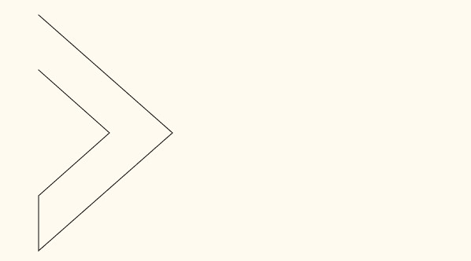

以下插图显示了上述代码中渲染 `Polyline` 的每个点的坐标。

图 2-2：快照说明了在给定 6 个点的情况下，由 5 个线段组成的折线。

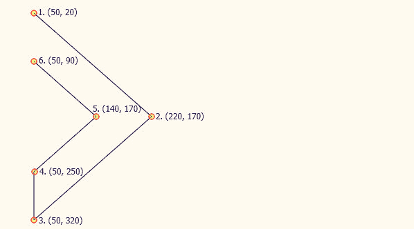

现在，我们将演示如何开发一个 `PolylineDrawer` 应用程序来交互式绘制 `Polyline` 对象。`Polyline` 所有点的 (X, Y) 坐标是通过鼠标按下和鼠标拖动事件动态获取的。

在绘板上交互式绘制折线的方法与上一章描述的画线类似。以下是 `PolylineDrawer` 工作原理预览：

通过每一个 `MOUSE_PRESSED`—`MOUSE_DRAGGED`—`MOUSE_RELEASED` 事件循环创建一个代表 `Polyline` 一个线段的 `Line`。根据 `Polyline` 的需要绘制尽可能多的线段。如果此线段的起点与上一个线段的终点相同，则会自动创建一个连接两者的线段。按下 `Enter` 键完成 `Polyline`，或按下 `Esc` 键取消。

在源码方面，`PolylineDrawer` 模块和 `LineDrawer` 模块开发之间的主要区别位于两个方法内部：`onMouseDragStarted()` 方法和 `onMouseDragFinished()` 方法。

以下是 `PolylineDrawer` 类的初始外观，创建一个 `BorderPane` 作为 `Scene` 的根节点，并将一个 `Pane` 置于 `BorderPane` 的中心：

列表 2-3：创建扩展 `Application` 类的 `PolylineDrawer` 类，重写 `start` 方法，创建 `BorderPane` 作为 `Scene` 的根节点，并将 `Pane` 置于 `BorderPane` 的中心作为绘板：

```java
package drawtool;

import javafx.application.Application;
import javafx.scene.layout.BorderPane;
import javafx.scene.layout.Pane;
import javafx.scene.paint.Color;
import javafx.scene.Scene;
import javafx.stage.Stage;

/**
 * File Name: PolylineDrawer.java
 * @author: Shufen Kuo
 * /
 */
public class PolylineDrawer extends Application {

  @Override
  public void start(Stage stage) {
    BorderPane rootPane = new BorderPane();
    // 我们在这里可以使用 Group 对象作为 drawPane，因为
    // 当 rootPane 大小改变时，group 的大小不会动态调整
    Pane drawPane = new Pane();
    rootPane.setCenter(drawPane);

    Scene scene = new Scene(rootPane, 600, 400, Color.FLORALWHITE);
    stage.setScene(scene);
    stage.setTitle("PolylineDrawer V1.0 Shufen Source Code");
    stage.show();
  }

  public static void main(String[] args) {
    launch(args);
  }
}
```

### 2.1.1 创建 `Polyline` 实例

`Polyline` 对象在 `MOUSE_DRAGGED` 事件的处理程序内部创建。在完成折线所有线段的绘制之前，它被设置为 `shape` 属性的当前值。当按下 `Enter` 键时，`shape` 的值被重置为 `null`，从而完成形状；或者按下 `Esc` 键，取消形状。

要了解如何使用 `Node` 类提供的便利方法注册事件处理程序来处理鼠标事件和键事件，请阅读第 1 章中的节 1.2.1“使用便利方法注册事件处理器”和节 1.4“获取按键事件的键码”。

以下是在处理 `MOUSE_DRAGGED` 事件的处理程序内部创建 `Polyline` 实例的代码。

导入语句：

```java
import javafx.beans.property.ObjectProperty;
import javafx.beans.property.SimpleObjectProperty;
import javafx.event.EventHandler;
import javafx.scene.input.MouseEvent;
import javafx.scene.paint.Color;
import javafx.scene.shape.Shape;
import javafx.scene.shape.Polyline;
```

`Line Drawer` 和 `Polyline Drawer` 实现之间的主要区别位于 `onMouseDragStarted()` 方法中。该方法在发生第一次拖拽事件时，由 `MOUSE_DRAGGED` 事件的事件处理程序调用。

对于 `Polyline Drawer`，在这里执行了以下两个任务：

- 创建一个临时的 `Line` 对象，其起点设置为鼠标按下的位置，终点绑定到一个 `DoubleBinding` 对象上，该对象用于计算起始位置和平移距离之和。
- 验证当前绘制线段的起点是否与上一个线段的终点相同。如果它们不相同，说明当前线段与上一个段没有连接，我们将把当前线段的起点添加到 `Polyline` 的点列表中。
  - 请注意，上一个线段的终点可以在 `Polyline` 的点列表中找到，它存储在点列表的最后两个单元格中。
  - 如果 `Polyline` 的点列表包含空点，则意味着当前绘制的线段是 `Polyline` 的第一段，只需将该线段的起点添加到点列表中，它将成为 `Polyline` 的第一个点。

### Import Statements

```java
import javafx.collections.ObservableList;
```

### Listing 2-6：实现 `onMouseDragStarted()` 方法

该方法由 `MOUSE_DRAGGED` 事件的事件处理程序调用：

```java
void onMouseDragStarted() {
  Line tmpLine = new Line();
  // 将 tmpLine 设置为 line 属性的值，
  // 结果是它将被添加到绘制板的子列表中，
  // 在 line 属性的监听器内部。
  line.set(tmpLine);
  tmpLine.setStroke(Color.AQUA);
  tmpLine.setStartX(startX.get());
  tmpLine.setStartY(startY.get());
  tmpLine.endXProperty().bind(startX.add(translateX));
  tmpLine.endYProperty().bind(startY.add(translateY));

  Polyline polyline = (Polyline) getShape();
  // 验证此线的起点是否与上条线的终点相同
  // 如果不相同，说明此段与上一个段没有连接，
  // 我们将此段的起点添加到 polyline 的点列表中。
  ObservableList<Double> list = polyline.getPoints();
  if (list.size() > 1) {
    // 检查最后一个点是否与此线的起点相同
    double lastX = list.get(list.size() - 2);
    double lastY = list.get(list.size() - 1);
    // 如果此段的起点与 polyline 点列表中的
    // 最后一点重合，
    // 无需将起点 polyline
    if (lastX != startX.get() && lastY != startY.get()) {
      // 将起点添加到 polyline
      polyline.getPoints().addAll(startX.get(), startY.get());
    }
  } else {
    // 点列表中还没有点，
    // 将起点添加到点列表中，
    // 这就是 polyline 的起始点。
    polyline.getPoints().addAll(startX.get(), startY.get());
  }
}
```

### 2.1.4 实现 `onMouseDragFinished()` 方法

`onMouseDragFinished()` 方法由 `MOUSE_RELEASED` 事件的事件处理程序调用。

它执行以下任务：

- 取消绑定 `Line` 的终点，并将 `line` 属性的值设置为 `null`，导致该线从绘制板中移除，参见 `line` 属性监听器的代码。
- 将 `Line` 的终点添加到 `Polyline` 的点列表中，该点列表临时存储在 `shape` 属性中。

`MOUSE_DRAGGED` 事件随后的 `MOUSE_RELEASED` 事件完成了 `Polyline` 中一个段的绘制。

### Listing 2-7：实现 `onMouseDragFinished()` 方法

该方法由 `MOUSE_RELEASED` 事件的事件处理程序调用：


```java
void onMouseDragFinished() {
    Line tmpLine = line.get();
    if (tmpLine != null) {
      tmpLine.endXProperty().unbind();
      tmpLine.endYProperty().unbind();
      line.set(null); // 清除此线
    }

    Polyline polyline = (Polyline)getShape();
    // 处必须验证 shape 不为空
    // 如果按了 Enter 键或 Esc 键，shape 将设置为 null
    if (polyline != null) {
      // 将当前线的终点添加到 polyline
      polyline.getPoints().addAll(startX.get() + translateX.get(),
        startY.get() + translateY.get());
    }
  }
```

## 2.2 `PolylineDrawer` 类的完整源代码

与前一章中的 `LineDrawer` 类相比，更改已用**粗体**显示：

### Listing 2-8. 创建 `PolylineDrawer` 类，其继承自 `Application` 类，重写 `start` 方法，创建 `BorderPane` 作为场景的根节点，并将 `Pane` 放置在 `BorderPane` 的中心作为绘制板：

```java
package drawtool;

import javafx.application.Application;
import javafx.beans.property.DoubleProperty;
import javafx.beans.property.ObjectProperty;
import javafx.beans.property.SimpleDoubleProperty;
import javafx.beans.property.SimpleObjectProperty;
import javafx.beans.value.ChangeListener;
import javafx.beans.value.ObservableValue;
import javafx.collections.ObservableList;
import javafx.event.EventHandler;
import javafx.event.EventType;
import javafx.scene.input.KeyCode;
import javafx.scene.input.KeyEvent;
import javafx.scene.input.MouseEvent;
import javafx.scene.layout.BorderPane;
import javafx.scene.layout.Pane;
import javafx.scene.paint.Color;
import javafx.scene.shape.Line;
import javafx.scene.shape.Polyline;
import javafx.scene.shape.Shape;
import javafx.scene.Scene;
import javafx.stage.Stage;

/**
 * 文件名: PolylineDrawer.java
 * (位于目录: PolylineDrawer1.0/src/example1/drawtool/)
 * 此 JavaFX 应用通过连续的鼠标拖拽事件实现折线绘制，
 * 之后将集成到综合绘图工具 JFXDrawTools 中。
 * 采用 Pane 对象作为绘图板。
 * 它通过以下鼠标事件在绘图板上绘制折线的每个线段：
 *   MOUSE_PRESSED, MOUSE_DRAGGED, MOUSE_RELEASED
 * 线段的绘制通过以下动作完成：
 * 当发生 MOUSE_PRESSED 事件时，获取鼠标位置并将其用作
 * 折线线段的起点，
 * 创建一个折线（polyline）对象并将其设置为 shape 属性的值，
 * 直到所有线段完成，
 * 也就是说，当按下 Enter 键完成绘制时，或按下 Esc 键取消绘制时。
 * 当 MOUSE_PRESSED 事件后紧接着发生
 * MOUSE_DRAGGED 事件时，
 * 创建一条临时线（line）作为折线的当前线段，
 * 它被存储在 line 属性中，
 * 该线的终点绑定到 MOUSE_DRAGGED 事件的位置，
 * 当发生 MOUSE_RELEASED 事件时，此当前折线线段绘制完成，
 * 重复 MOUSE_PRESSED-MOUSE_DRAGGED-MOUSE_RELEASED 事件循环以绘制下一个线段。
 * 需要注意的一个细节：如果下一个线段的起点不是
 * 上一个线段的终点，
 * 将自动添加一个新的线段来连接这两个线段。
 * 当你完成折线的所有线段后，按下 ENTER 键完成绘制，
 * 下一个 MOUSE_PRESSED 事件将启动新折线的第一个线段。
 * 要取消此折线，按下 ESCAPE 键。
 *
 * @author: Shufen Kuo
 */
public class PolylineDrawer extends Application {

  // 在鼠标事件发生时跟踪光标位置
  // startX, startY 存储鼠标按下事件的位置
  DoubleProperty startX = new SimpleDoubleProperty();
  DoubleProperty startY = new SimpleDoubleProperty();

  // translateX, translateY 存储从拖拽/移动位置到 startX, startY 的距离
  DoubleProperty translateX = new SimpleDoubleProperty();
  DoubleProperty translateY = new SimpleDoubleProperty();

  // 用于存储当前绘制的形状
  ObjectProperty<Shape> shape = new SimpleObjectProperty<>();

  // 用于存储代表折线一个线段的临时线
  ObjectProperty<Line> line = new SimpleObjectProperty<>();

  // 此变量在鼠标拖拽事件处理器内部被设置为 true
  // 当发生第一次鼠标拖拽事件时，
  // 并在鼠标释放事件发生时重置为 false。
  boolean dragged = false;

  @Override
  public void start(Stage stage) {
    BorderPane rootPane = new BorderPane();
    // 我们不能使用 Group 对象作为 drawPane，因为
    // 当 rootPane 大小改变时，group 的大小不会动态调整。
    final Pane drawPane = new Pane();
    rootPane.setCenter(drawPane);

    drawPane.setOnMousePressed(new EventHandler<MouseEvent>() {
      @Override
      public void handle(MouseEvent me) {
        // 获取起始鼠标位置
        startX.set(me.getX());
        startY.set(me.getY());
      }
    });

    drawPane.setOnMouseDragged(new EventHandler<MouseEvent>() {
      @Override
      public void handle(MouseEvent me) {
        // 计算鼠标位置到起始位置的距离
        double x2 = me.getX();
        double y2 = me.getY();
        translateX.set(x2 - startX.get());
        translateY.set(y2 - startY.get()); 
        if (!dragged) {
          // 只执行了一次
          if (getShape() == null)	{
            Shape tmpShape = new Polyline();
            tmpShape.setStroke(Color.BLUE);
            shape.set(tmpShape);
          } 
          dragged = true;
          onMouseDragStarted();
        }
      }
    });

    drawPane.setOnMouseReleased(new EventHandler<MouseEvent>() {
      @Override
      public void handle(MouseEvent me) {
        if (dragged) {
          dragged = false;
          onMouseDragFinished();
        }
      }
    });

    // 必须将 focusTraversable 设置为 true 以处理 KeyEvent，
    // 默认是 false。
    drawPane.setFocusTraversable(true);
    drawPane.setOnKeyPressed(new EventHandler<KeyEvent>() {
      @Override
      public void handle(KeyEvent ke) {
        KeyCode kc = ke.getCode();
        switch (kc) {
          case ENTER:
            // 当你完成折线的所有线段后，按下 ENTER 键完成绘制，
            // 下一个 MOUSE_PRESSED 事件将启动新折线的第一个线段。
            // (此处逻辑在示例代码中主要为注释说明)
            break;
          case ESCAPE:
            // 要取消此折线，按下 ESCAPE 键
            break;
        }
      }
    });
  }
}
```

## 图 2-3. 使用 `Polyline Drawer` 模块绘制草图的截图

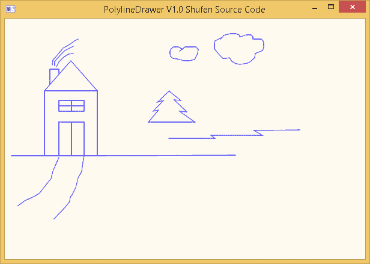

编译并运行应用程序。尝试以下步骤进行测试：

1. 按住鼠标并在绘图板上移动。
2. 松开鼠标，绘制出多折线的第一条线段。
3. 在相同位置（上一个线段的终点）按住鼠标，在绘图板上移动并松开鼠标，绘制出另一条与前一个线段连接的线段。
4. 重复上述步骤几次，以绘制更多相互连接的线段。
5. 按下 `Enter` 键完成一条多折线的绘制。
6. 现在开始绘制另一条多折线。
7. 将鼠标移动到新位置，按住鼠标并在绘图板上移动。
8. 松开鼠标，绘制出多折线的第一条线段。
9. 将鼠标移动到另一个位置（不同于上一个线段的终点），在绘图板上移动并松开鼠标，绘制出另外两条线段。
10. 重复上述步骤几次。
11. 按下 `Enter` 键完成一条多折线的绘制。
12. 尝试类似的按下-拖动-释放步骤几次，然后按下 `Esc` 键取消绘制。

在命令行中编译和运行程序的输出输出：

```
Microsoft Windows [Version 6.3.9600]
(c) 2013 Microsoft Corporation. All rights reserved.

F:\My Documents\DocRoot\SHUFEN_JAVA\MyBookJFX\VolumeTwo\PolylineDrawer1.0\src\example1>
javac -encoding utf-8 -Xlint:unchecked drawtool\*.java

jar cf DrawTool.jar drawtool

java -cp DrawTool.jar drawtool.PolylineDrawer

shape value changed: Polyline[points=[], fill=null, stroke=0x0000ffff,
strokeWidth=1.0]
line value changed: Line[startX=0.0, startY=0.0, endX=0.0, endY=0.0,
stroke=0x000000ff, strokeWidth=1.0]
line value changed: null
line value changed: Line[startX=0.0, startY=0.0, endX=0.0, endY=0.0,
stroke=0x000000ff, strokeWidth=1.0]
line value changed: null
line value changed: Line[startX=0.0, startY=0.0, endX=0.0, endY=0.0,
stroke=0x000000ff, strokeWidth=1.0]
line value changed: null
line value changed: Line[startX=0.0, startY=0.0, endX=0.0, endY=0.0,
stroke=0x000000ff, strokeWidth=1.0]
line value changed: null
Enter key hit
shape value changed: null
shape value changed: Polyline[points=[], fill=null, stroke=0x0000ffff,
strokeWidth=1.0]
line value changed: Line[startX=0.0, startY=0.0, endX=0.0, endY=0.0,
stroke=0x000000ff, strokeWidth=1.0]
line value changed: null
line value changed: Line[startX=0.0, startY=0.0, endX=0.0, endY=0.0,
stroke=0x000000ff, strokeWidth=1.0]
line value changed: null
line value changed: Line[startX=0.0, startY=0.0, endX=0.0, endY=0.0,
stroke=0x000000ff, strokeWidth=1.0]
line value changed: null
Enter key hit
shape value changed: null
shape value changed: Polyline[points=[], fill=null, stroke=0x0000ffff,
strokeWidth=1.0]
line value changed: Line[startX=0.0, startY=0.0, endX=0.0, endY=0.0,
stroke=0x000000ff, strokeWidth=1.0]
line value changed: null
line value changed: Line[startX=0.0, startY=0.0, endX=0.0, endY=0.0,
stroke=0x000000ff, strokeWidth=1.0]
line value changed: null
Esc key hit
shape value changed: null
```

## 2.3 总结

本章介绍了 JavaFX 库的以下关键方面，按它们在章节中出现的顺序列出：

* `Polyline` 位于 `javafx.scene.shape` 包中，是 `javafx.scene.shape.Shape` 的直接子类。使用 `getPoints()` 方法获取一个类型为 `ObservableList<Double>` 的列表，然后使用 `Collection` 接口定义的基本工具，将一组存储在 `Double` 值数组中的 x 和 y 坐标添加到列表中，这些坐标表示 `Polyline` 的点。

    （参见节 [作为 `Shape` 的子类创建 `PolylineDrawer` 类]）

* 某些类位于 `javafx.beans` 中：

    `PolyProperty`，

    是一个派自 `ObjectProperty` 的抽象类，实现了 `WritableValue`。

    （参见节 [`PolylineProperty`）

* `Line` 类位于 `javafx.scene.shape` 中，是 `Shape` 的直接子类之一。

    （参见节 [`Polyline`）

* `addListener(ChangeListener<? super T> listener)` 方法定义在 `javafx.beans` 中，用于在属性更改时添加一个监听器。

* `bind(ObservableValue<? extends T> observable)` 和 `unbind()` 是定义在 `Property` 中的方法，用于为该属性创建或移除绑定。（参见[此处]）


`public DoubleBinding add(NumberValue other)` 方法由`javafx.beans.DoubleExpression`类提供，返回一个新的`DoubleBinding`，该绑定计算此`DoubleExpression`与给定的`NumberValue`之和。

```
Polygon polygon = new Polygon();
Double[] dArray = {
    50.0, 20.0,
    220.0, 170.0,
    50.0, 320.0,
    50.0, 250.0,
    140.0, 170.0,
    50.0, 90.0};
polygon.getPoints().addAll(dArray);
polygon.setFill(Color.web("#B3E6E6"));
polygon.setStroke(Color.BLACK);
```

下面的快照显示了上述代码渲染的`Polygon`结果：

图 3-1。上述代码创建的多边形快照。

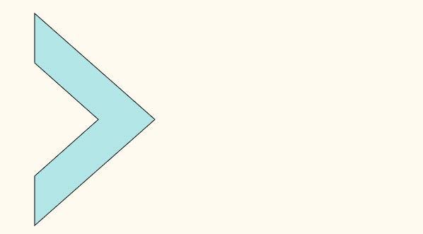

下面的插图显示了上述代码中渲染`Polygon`的每个点的坐标。

图 3-2。快照说明了由 6 个点和 6 条线段组成的多边形。

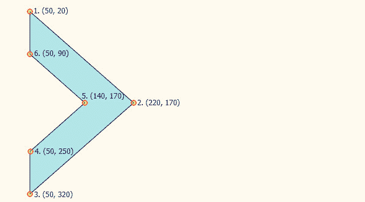

为了创建`PolygonDrawer`类，我们采用了上一章中开发的`PolylineDrawer`类的完整源代码，并进行了微调。

到目前为止，你一定已经注意到`onMouseDragStarted()`和`onMouseDragFinished()`这两个方法在每个形状绘制器的开发过程中至关重要。`PolygonDrawer`的源代码与`PolylineDrawer`非常相似，这两个方法不需要修改任何行代码。

从用户的角度来看，在画板上交互式绘制多边形的方法与上一章描述的绘制折线的方法相同。当检测到首次鼠标拖动事件时，会创建一个`Polyline`对象，这与`PolylineDrawer`完全相同；其实现上的细微差异描述如下：

## 创建`Polygon`实例

当按下`Enter`键时，`Polyline`对象将从`Pane`的子列表中移除，并创建一个具有相同点集的`Polygon`对象，然后将其添加到`Pane`的子列表中。

以下是`createPolygon(Pane pane)`方法，它在按下`Enter`键时从`KeyEvent`事件处理器中调用。

导入语句：

```
import javafx.scene.shape.Polygon;
```

列表 3-3。在`KEY_PRESSED`事件的处理器内部，按下`Enter`键时创建`Polygon`实例：

```
drawPane.setOnKeyPressed(new EventHandler() {
    @Override
    public void handle(KeyEvent ke) {
        KeyCode kc = ke.getCode();
        switch (kc) {
            case ENTER :
                // 按下 Enter 完成此形状
                System.out.format("Enter key hit%n");
                // 必须调用拖拽结束方法解除绑定
                onMouseDragFinished();
                createPolygon(drawPane);
                setShape(null);
                break;
            case ESCAPE:
                // 按下 Esc 清除此形状
                System.out.format("Esc key hit%n");
                Shape s = getShape();
                if (s != null) {
                    // 必须调用拖拽结束方法解除绑定
                    onMouseDragFinished();
                    drawPane.getChildren().remove(s);
                    setShape(null);  // 清除此形状
                }
                break;
        }
    }
});

void createPolygon(Pane pane) {
    Polyline polyline = (Polyline)getShape();
    if (polyline != null) {
        Polygon polygon = new Polygon();
        polygon.setFill(polyline.getFill());
        polygon.setStroke(polyline.getStroke());
        polygon.getPoints().addAll(polyline.getPoints());
        pane.getChildren().remove(polyline); // 清除折线
        pane.getChildren().add(polygon); // 添加多边形
    }
}
```

## `PolygonDrawer`完整源代码

以下是完整源代码。与上一章的`PolylineDrawer`类相比，更改部分已用加粗字体显示：

列表 3-4。创建扩展`Application`类的`PolygonDrawer`类，重写`start`方法，创建`BorderPane`作为场景的根节点，并将`Pane`放置于`BorderPane`的中心作为画板：


# `PolygonDrawer.java` 文档

## 文件信息

- **文件名**: `PolygonDrawer.java`
- **目录**: `PolygonDrawer1.0/src/example1/drawtool/`

## 概述

此 JavaFX 应用通过连续的鼠标拖动事件实现多边形绘制，后续将集成到综合绘制工具 `JFXDrawTools` 中。采用 `Pane` 对象作为画板。

## 鼠标事件处理

它通过以下鼠标事件在画板上绘制多边形的每个段：

- `MOUSE_PRESSED`
- `MOUSE_DRAGGED`
- `MOUSE_RELEASED`

### 绘制流程

线段通过以下动作进行绘制：

- 当 `MOUSE_PRESSED` 事件发生时，获取鼠标位置作为多边形线段的起点，创建一个 `polyline` 对象并将其设置为 `shape` 属性的值，直到所有线段完成。
- 也就是说，当按下 `Enter` 键时完成绘制，或按下 `Esc` 键时取消。
- 当 `MOUSE_PRESSED` 事件紧接着 `MOUSE_DRAGGED` 事件时，会创建一个临时的 `line` 作为 `polyline` 的当前段，它存储在 `line` 属性中，该线线的终点绑定到 `MOUSE_DRAGGED` 事件的位置。
- 当 `MOUSE_RELEASED` 事件发生时，完成 `polyline` 的当前线段，重复 `MOUSE_PRESSED-MOUSE_DRAGGED-MOUSE_RELEASED` 事件循环以绘制下一段。
- 需要注意的一个细节：如果下一段的起点不是上一个段的终点，将自动添加一个新的线段来连接这两段。
- 当你完成 `polyline` 的所有线段时，按下 `ENTER` 键完成绘制，下一次 `MOUSE_PRESSED` 事件将启动新多边形的第一段。
- 要取消此 `polyline`，按下 `ESCAPE` 键。

### 与 `PolylineDrawer` 的区别

- 按下 `Enter` 键时，创建一个与 `Polyline` 对象具有相同点集的 `Polygon` 对象，移除 `Polyline` 对象，并将 `Polygon` 对象添加到画板中并在场景中显示。

## 代码实现

```java
package drawtool;

import javafx.application.Application;
import javafx.beans.property.DoubleProperty;
import javafx.beans.property.ObjectProperty;
import javafx.beans.property.SimpleDoubleProperty;
import javafx.beans.property.SimpleObjectProperty;
import javafx.beans.value.ChangeListener;
import javafx.beans.value.ObservableValue;
import javafx.collections.ObservableList;
import javafx.event.EventHandler;
import javafx.event.EventType;
import javafx.scene.input.KeyCode;
import javafx.scene.input.KeyEvent;
import javafx.scene.input.MouseEvent;
import javafx.scene.layout.BorderPane;
import javafx.scene.layout.Pane;
import javafx.scene.paint.Color;
import javafx.scene.shape.Line;
import javafx.scene.shape.Polygon;
import javafx.scene.shape.Polyline;
import javafx.scene.shape.Shape;
import javafx.scene.Scene;
import javafx.stage.Stage;

/**
 * 文件名: `PolygonDrawer.java`
 * (目录: `PolygonDrawer1.0/src/example1/drawtool/`)
 * 此 JavaFX 应用通过连续的鼠标拖动事件实现多边形绘制，后续将集成到综合绘制工具 `JFXDrawTools` 中。
 * 采用 `Pane` 对象作为画板。
 * 它通过以下鼠标事件在画板上绘制多边形的每个段：
 *   `MOUSE_PRESSED`, `MOUSE_DRAGGED`, `MOUSE_RELEASED`
 * 线段通过以下动作进行绘制：
 * - 当 `MOUSE_PRESSED` 事件发生时，获取鼠标位置作为多边形线段的起点，创建一个 `polyline` 对象并将其设置为 `shape` 属性的值，直到所有线段完成。
 * - 也就是说，当按下 `Enter` 键时完成绘制，或按下 `Esc` 键时取消。
 * - 当 `MOUSE_PRESSED` 事件紧接着 `MOUSE_DRAGGED` 事件时，会创建一个临时的 `line` 作为 `polyline` 的当前段，它存储在 `line` 属性中，该线线的终点绑定到 `MOUSE_DRAGGED` 事件的位置。
 * - 当 `MOUSE_RELEASED` 事件发生时，完成 `polyline` 的当前线段，重复 `MOUSE_PRESSED-MOUSE_DRAGGED-MOUSE_RELEASED` 事件循环以绘制下一段。
 * - 需要注意的一个细节：如果下一段的起点不是上一个段的终点，将自动添加一个新的线段来连接这两段。
 * - 当你完成 polyline 的所有线段时，按下 `ENTER` 键完成绘制，下一次 `MOUSE_PRESSED` 事件将启动新多边形的第一段。
 * - 要取消此 `polyline`，按下 `ESCAPE` 键。
 * 
 * 与 `PolylineDrawer` 的区别如下：
 * - 按下 `Enter` 键时，创建一个与 `Polyline` 对象具有相同点集的 `Polygon` 对象，移除 `Polyline` 对象，并将 `Polygon` 对象添加到画板中并在场景中显示。
 * 
 * @author: Shufen Kuo
 */
public class PolygonDrawer extends Application {

  // 在鼠标事件发生时跟踪光标位置
  // startX, startY 存储鼠标按下事件的位置
  DoubleProperty startX = new SimpleDoubleProperty();
  DoubleProperty startY = new SimpleDoubleProperty();

  // translateX, translateY 存储拖动/移动位置到 startX, startY 的距离
  DoubleProperty translateX = new SimpleDoubleProperty();
  DoubleProperty translateY = new SimpleDoubleProperty();

  // 此用于存储当前绘制的形状
  ObjectProperty<Shape> shape = new SimpleObjectProperty<>();

  // 此用于存储代表 polyline 其中一个段的临时线条
  ObjectProperty<Line> line = new SimpleObjectProperty<>();

  // 此变量在鼠标拖动事件处理器内部被设置为 true
  // 当发生第一次鼠标拖动事件时设置，在鼠标释放事件发生时重置为 false。
  boolean dragged = false;

  @Override
  public void start(Stage stage) {
    BorderPane rootPane = new BorderPane();
    // 我们不能在这里使用 Group 对象作为 drawPane，因为当 rootPane 大小改变时，group 的大小不会动态调整
    final Pane drawPane = new Pane();
    rootPane.setCenter(drawPane);

    drawPane.setOnMousePressed(new EventHandler<MouseEvent>() {
      @Override
      public void handle(MouseEvent me) {
        // 获取起始鼠标位置
        startX.set(me.getX());
        startY.set(me.getY());
      }
    });

    drawPane.setOnMouseDragged(new EventHandler<MouseEvent>() {
      @Override
      public void handle(MouseEvent me) {
        // 计算鼠标位置到起始位置的距离
        double x2 = me.getX();
        double y2 = me.getY();
        translateX.set(x2 - startX.get());
        translateY.set(y2 - startY.get()); 
        if (!dragged) {
          // 只执行了一次
          if (getShape() == null)	{
            Shape tmpShape = new Polyline();
            tmpShape.setFill(Color.web("#E6F2E8"));
            tmpShape.setStroke(Color.DARKSEAGREEN);
            shape.set(tmpShape);
          } 
          dragged = true;
          onMouseDragStarted();
        }
      });

    drawPane.setOnMouseReleased(new EventHandler<MouseEvent>() {
      @Override
      public void handle(MouseEvent me) {
        if (dragged) {
          dragged = false;
          onMouseDragFinished();
        }
      }
    });

    // 必须在 handle 中将 focusable 设置为 true，默认为 false。
    drawPane.setFocusable(true);
    drawPane.setOnKeyPressed(new EventHandler<KeyEvent>() {
      @Override
      public void handle(KeyEvent ke) {
        KeyCode kc = ke.getCode();
        switch (kc) {
          case ENTER :
            // 按下 Enter 键完成此形状
            System.out.format("Enter key hit");
            // 必须调用方法解除绑定
            onMouseDragFinished();
            createPolygon(drawPane);
            setShape(null);
            break;
          case ESCAPE:
            // 按下 Esc 键清除此形状
            System.out.format("Esc key hit");
            Shape s = getShape();
            if (s != null) {
              // 必须调用方法解除绑定
              onMouseDragFinished();
              drawPane.getChildren().remove(s);
              setShape(null);  // 清除此形状
            }
            break;
        }
      }
    });

    // 监听 shape 属性的变化，如果创建了新形状，将其添加到画板
    shape.addListener(new ChangeListener<Shape>() {
      @Override
      public void changed(ObservableValue<? super Shape> observable, Shape oldVal, Shape newVal) {
         System.out.format("shape value changed: %s", newVal);
         if (newVal != null)
           drawPane.getChildren().add(newVal);
      }
    });

    // 监听 line 属性的变化，如果创建了新线条，将其添加到画板
    // 如果 polyline 的一个段完成，则移除线条。
    line.addListener(new ChangeListener<Line>() {
      @Override
      public void changed(ObservableValue<? super Line> observable, Line oldVal, Line newVal) {
         System.out.format("line value changed: %s", newVal);
         if (newVal != null)
           drawPane.getChildren().add(newVal);
         else if (oldVal != null)//移除此临时线条
           drawPane.getChildren().remove(oldVal);
      }
    });

    Scene scene = new Scene(rootPane, 600, 400, Color.FLWHITE);
    stage.setScene(scene);
    stage.setTitle("PolygonDrawer V1.0 Shufen Code");
    stage.show();
  }

  public Shape getShape() {
    return shape.get();
  }

  public void setShape(Shape value) {
    shape.set(value);
  }

  public ObjectProperty<Shape> shapeProperty() {
    return shape;
  }

  void createPolygon(Pane pane) {
    Polyline polyline = (Polyline)getShape();
    if (polyline != null) {
      Polygon polygon = new Polygon();
      polygon.setFill(polyline.getFill());
      polygon.setStroke(polyline.getStroke());
      polygon.getPoints().addAll(polyline.getPoints());
      pane.getChildren().remove(polyline); // 清除 polyline
      pane.getChildren().add(polygon); // 添加多边形
    }
  }

  void onMouseDragStarted() {
    Line tmpLine = new Line();
    // 将此 tmpLine 设置为 line 属性的值，结果是在 line 属性的监听器内部中被添加到画板的子列表中
    line.set(tmpLine);
    tmpLine.setStroke(Color.AQUA);
    tmpLine.setStartX(startX.get());
    tmpLine.setStartY(startY.get());
    tmpLine.endXProperty().bind(startX.add(translateX));
    tmpLine.endYProperty().bind(startY.add(translateY));

    Polyline polyline = (Polyline)getShape();
    // 验证此线条的起点是否与上一线条的终点相同
    // 如果它们不同，说明此段与最后一段没有连接
    // 我们将此段的起点添加到 polyline 的点列表中
    ObservableList<Double> list = polyline.getPoints();
    if (list.size() > 1) {
      // 检查最后一个点是否与此线条的起点相同
      double lastX = list.get(list.size()-2);
      double lastY = list.get(list.size()-1);
      // 如果此段的起点与 polyline 点列表中的最后一个点
      // 重合，则不需要将起点添加到 polyline。
      if (lastX != startX.get() && lastY != startY.get()) {
        // 将起点添加到 polyline
        polyline.getPoints().addAll(startX.get(), startY.get());
      }        
    } else {
      // 点列表中还没有点，将起点添加到点列表中，
      // 这点就是 polyline 的起点。
      polyline.getPoints().addAll(startX.get(), startY.get());
    }
  }

  void onMouseDragFinished() {
    Line tmpLine = line.get();
    if (tmpLine != null) {
      tmpLine.endXProperty().unbind();
      tmpLine.endYProperty().unbind();
      line.set(null); // 从画板上清除此线条
    }

    Polyline polyline = (Polyline)getShape();
    // 必须在此处验证 shape 不为空
    // 如果按下 Enter 键或 Esc 键，shape 将设置为 null
    if (polyline != null) {
      // 将当前线条的终点添加到 polyline
      polyline.getPoints().addAll(startX.get() + translateX.get(),
        startY.get() + translateY.get());
    }
  }
}
```

## 图 3-3. 使用 `Polygon Drawer` 模块绘制草图的截图


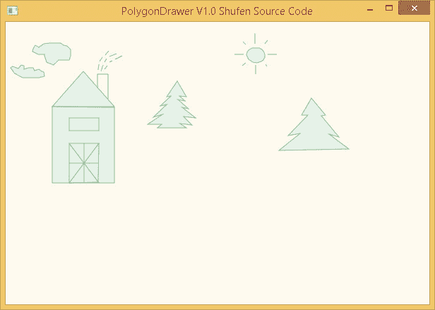

编译并运行应用程序。尝试以下步骤进行测试：

1. 按住鼠标并在画布上拖动。
2. 松开鼠标，绘制出多形形的第一条线段。
3. 在相同位置（上一个线段的终点）按下鼠标，在画布上拖动鼠标并松开鼠标，将绘制出一条与上一个线段连接的线段。
4. 重复上一步多次，以绘制更多相互连接的线段。
5. 按 `Enter` 键完成一个多形形的绘制。
6. 现在开始绘制另一个多形形。
7. 将鼠标移动到一个新位置，按下鼠标并在画布上拖动。
8. 松开鼠标，绘制出多形形的第一条线段。
9. 将鼠标移动到另一个位置（与上一个线段的终点不同），在画布上拖动鼠标并松开鼠标，将绘制另外两条线段。
10. 重复上一步多次。
11. 按 `Enter` 键完成一个多形形的绘制。
12. 尝试多次类似的“按下-拖动-释放”步骤，然后按 `Esc` 键取消绘制。

## 在命令行中编译和运行程序的输出：

```
Microsoft Windows [Version 6.3.9600]
(c) 2013 Microsoft Corporation. All rights reserved.

F:\My Documents\DocRoot\SHUFEN_JAVA\MyBookJFX\VolumeTwo\PolygonDrawer1.0\src\example1>
javac -encoding utf-8 -Xlint:unchecked drawtool\*.java

jar cf DrawTool.jar drawtool

java -cp DrawTool.jar drawtool.PolygonDrawer

shape value changed: Polyline[points=[], fill=0xe6f2e8ff, stroke=0x8fbc8fff,
strokeWidth=1.0]
line value changed: Line[startX=0.0, startY=0.0, endX=0.0, endY=0.0,
stroke=0x000000ff, strokeWidth=1.0]
line value changed: null
line value changed: Line[startX=0.0, startY=0.0, endX=0.0, endY=0.0,
stroke=0x000000ff, strokeWidth=1.0]
line value changed: null
line value changed: Line[startX=0.0, startY=0.0, endX=0.0, endY=0.0,
stroke=0x000000ff, strokeWidth=1.0]
line value changed: null
line value changed: Line[startX=0.0, startY=0.0, endX=0.0, endY=0.0,
stroke=0x000000ff, strokeWidth=1.0]
line value changed: null
line value changed: Line[startX=0.0, startY=0.0, endX=0.0, endY=0.0,
stroke=0x000000ff, strokeWidth=1.0]
line value changed: null
line value changed: Line[startX=0.0, startY=0.0, endX=0.0, endY=0.0,
stroke=0x000000ff, strokeWidth=1.0]
line value changed: null
line value changed: Line[startX=0.0, startY=0.0, endX=0.0, endY=0.0,
stroke=0x000000ff, strokeWidth=1.0]
line value changed: null
line value changed: Line[startX=0.0, startY=0.0, endX=0.0, endY=0.0,
stroke=0x000000ff, strokeWidth=1.0]
line value changed: null
Enter key hit
shape value changed: null
shape value changed: Polyline[points=[], fill=0xe6f2e8ff, stroke=0x8fbc8fff,
strokeWidth=1.0]
line value changed: Line[startX=0.0, startY=0.0, endX=0.0, endY=0.0,
stroke=0x000000ff, strokeWidth=1.0]
line value changed: null
line value changed: Line[startX=0.0, startY=0.0, endX=0.0, endY=0.0,
stroke=0x000000ff, strokeWidth=1.0]
line value changed: null
line value changed: Line[startX=0.0, startY=0.0, endX=0.0, endY=0.0,
stroke=0x000000ff, strokeWidth=1.0]
line value changed: null
Enter key hit
shape value changed: null
shape value changed: Polyline[points=[], fill=0xe6f2e8ff, stroke=0x8fbc8fff,
strokeWidth=1.0]
line value changed: Line[startX=0.0, startY=0.0, endX=0.0, endY=0.0,
stroke=0x000000ff, strokeWidth=1.0]
line value changed: null
```

创建一个路径元素的垂直线，并指定终点 Y 坐标。该线从上一个元素的终点绘制到指定的 Y 坐标。

这里是一个创建一个硬编码 `Path` 对象的示例，它由 8 个 `PathElement` 组成，由 4 个笔画构成一个汉字：

### 导入语句：

```
import javafx.scene.shape.HLineTo;
import javafx.scene.shape.MoveTo;
import javafx.scene.shape.Path;
import javafx.scene.shape.QuadCurveTo;
```

### 列表 4-1. 创建由 8 个 `PathElement` 组成的 `Path`（共 4 笔画）：

```
Path path = new Path();

// 画画 1：
// 从 (87, 76) 到 (211, 76) 绘制一条水平线
MoveTo moveTo1 = new MoveTo(87.0f, 76.0f);
HLineTo hLineTo1 = new HLineTo(211.0f);

// 画画 2：
// 从 (93, 115) 到 (206, 115) 绘制一条水平线
MoveTo moveTo2 = new MoveTo(93.0f, 115.0f);
HLineTo hLineTo2 = new HLineTo(206.0f);

// 画画 3：
// 从 (149, 76) 到 (86, 188) 绘制一条二次曲线
// 控制点在 (156, 166) 
MoveTo moveTo3 = new MoveTo(149.0f, 76.0f);
QuadCurveTo quadCurveTo1 = new QuadCurveTo(156.0f, 166.0f, 86.0f, 188.0f);

// 画画 4：
// 从 (149, 115) 到 (212, 188) 绘制一条二次曲线
// 控制点在 (167, 173) 
MoveTo moveTo4 = new MoveTo(149.0f, 115.0f);
QuadCurveTo quadCurveTo2 = new QuadCurveTo(167.0f, 173.0f, 212.0f, 188.0f);

path.getElements().addAll(
  moveTo1, hLineTo1, moveTo2, hLineTo2,
  moveTo3, quadCurveTo1, moveTo4, quadCurveTo2);

path.setStrokeWidth(3.0);
```

这里是创建相同 `Path` 对象的另一种方法：

### 列表 4-2. 创建由 8 个 `PathElement` 组成的 `Path`（共 4 笔画）：

```
Path path = new Path();

// 从 (87, 76) 到 (211, 76) 绘制一条水平线
MoveTo moveTo1 = new MoveTo();
moveTo1.setX(87.0f);
moveTo1.setY(76.0f);
HLineTo hLineTo1 = new HLineTo();
hLineTo1.setX(211.0f);

// 从 (93, 115) 到 (206, 115) 绘制一条水平线
MoveTo moveTo2 = new MoveTo();
moveTo2.setX(93.0f);
moveTo2.setY(115.0f);
HLineTo hLineTo2 = new HLineTo();
hLineTo2.setX(206.0f);

// 从 (149, 76) 到 (86, 188) 绘制一条二次曲线
// 控制点在 (156, 166) 
MoveTo moveTo3 = new MoveTo();
moveTo3.setX(149.0f);
moveTo3.setY(76.0f);
QuadCurveTo quadCurveTo1 = new QuadCurveTo();
quadCurveTo1.setControlX(156.0f);
quadCurveTo1.setControlY(166.0f);
quadCurveTo1.setX(86.0f);
quadCurveTo1.setY(188.0f);

// 从 (149, 115) 到 (212, 188) 绘制一条二次曲线
// 控制点在 (167, 173) 
MoveTo moveTo4 = new MoveTo();
moveTo4.setX(149.0f);
moveTo4.setY(115.0f);
QuadCurveTo quadCurveTo2 = new QuadCurveTo();
quadCurveTo2.setControlX(167.0f);
quadCurveTo2.setControlY(173.0f);
quadCurveTo2.setX(212.0f);
quadCurveTo2.setY(188.0f);

path.getElements().addAll(
  moveTo1, hLineTo1, moveTo2, hLineTo2,
  moveTo3, quadCurveTo1, moveTo4, quadCurveTo2);

path.setStrokeWidth(3.0);
```

以下快照显示了列表 4-2 代码中 `Path` 的渲染结果：

图 4-1. 根据代码创建的路径快照；它是一个由 4 个笔画组成的汉字。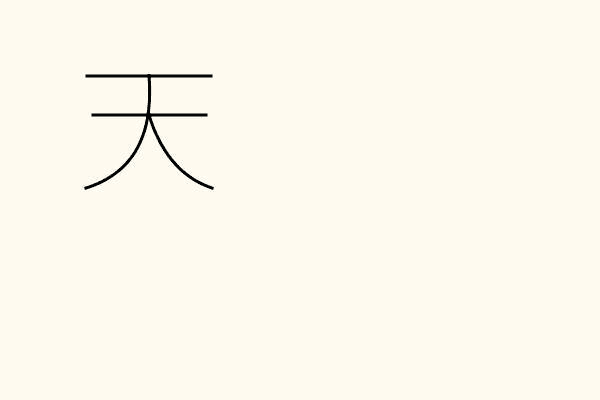

请注意，在上面的图中，每个笔画的起点并不是上一笔画的终点，因为每个笔画前面都有 `MoveTo` 元素。以下快照说明了列表 4-2 代码中 `Path` 的笔画绘制顺序：

图 4-2. 根据代码的 `Path` 笔画绘制顺序图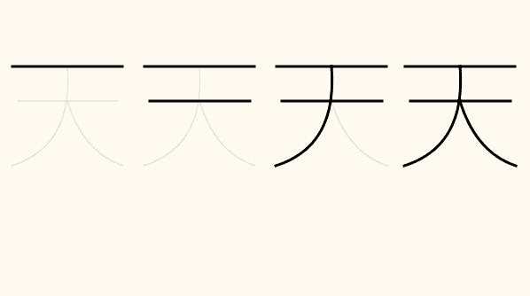

下面是另一个由 `MoveTo`、`HLineTo`、`QuadCurveTo` 和 `LineTo` 组成的硬编码 `Path` 示例。它包含 3 个笔画，其中第一个笔画的终点是第二个笔画的起点，第二个笔画的终点是第三笔画的起点：

### 导入语句：

```
import javafx.scene.paint.Color;
import javafx.scene.shape.HLineTo;
import javafx.scene.shape.LineTo;
import javafx.scene.shape.MoveTo;
import javafx.scene.shape.Path;
import javafx.scene.shape.QuadCurveTo;
import javafx.scene.shape.StrokeLineCap;
import javafx.scene.shape.StrokeLineJoin;
```

### 列表 4-3. 创建由 4 个 `PathElement` 组成的 `Path`（共 3 笔画）：

```
Path path = new Path();

// 第 1 笔：从 (120, 87) 到 (195, 87) 绘制一条水平线
MoveTo moveTo = new MoveTo();
moveTo.setX(120.0f);
moveTo.setY(87.0f);
HLineTo hLineTo = new HLineTo();
hLineTo.setX(195.0f);

// 第 2 笔：从 (195, 87) 到 (205, 170) 绘制一条二次曲线
// 控制点在 (36, 201)
// (195, 87) 是第一笔画的终点
QuadCurveTo quadCurveTo = new QuadCurveTo();
quadCurveTo.setControlX(36.0f);
quadCurveTo.setControlY(201.0f);
quadCurveTo.setX(205.0f);
quadCurveTo.setY(170.0f);

// 第 3 笔：从 (205, 170) 到 (209, 149) 绘制一条线
// (205, 170) 是第 2 笔画的终点
LineTo lineTo = new LineTo();
lineTo.setX(209.0f);
lineTo.setY(149.0f);

path.getElements().addAll(
  moveTo, hLineTo, quadCurveTo, lineTo);

// 设置某些属性的值
path.setStrokeLineCap(StrokeLineCap.ROUND);
path.setStrokeLineJoin(StrokeLineJoin.BEVEL);
path.setStrokeWidth(8.0);
path.setStroke(Color.web("#A0522D"));
```

请注意，为了使路径与独特，我们设置了 `Shape` 类中定义的几个属性的值：

`strokeLineCap`

这是一个类型为 `ObjectProperty<StrokeLineCap>` 的属性，用于指定线的端点样式。`StrokeLineCap` 是一个枚举类型，定义了常量：`BUTT`、`ROUND` 和 `SQUARE`。在代码中尝试这些值以理解它们之间的差异。默认值为 `SQUARE`。

`strokeLineJoin`

这是一个类型为 `ObjectProperty<StrokeLineJoin>` 的属性，用于指定笔画之间的连接样式。`StrokeLineJoin` 是一个枚举类型，定义了常量：`BEVEL`、`MITER` 和 `ROUND`。在代码中尝试这些值以理解它们之间的差异。默认值为 `MITER`。

`strokeWidth`

这是一个类型为 `DoubleProperty` 的属性，用于指定笔画的宽度。默认值为 `0.0`。

`stroke`

这是一个类型为 `ObjectProperty<Paint>` 的属性，用于指定绘制形状边界的颜色。对于 `Line`、`Polyline` 和 `Path`，默认值为 `Color.BLACK`；对于其他形状为 `null`。

以下快照显示了列表 4-3 代码中 `Path` 的渲染结果：

图 4-3. 根据列表 4-3 代码创建的路径快照；它是一个由 3 个笔画组成的汉字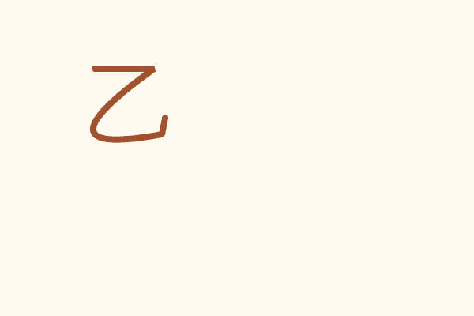

以下快照说明了列表 4-3 代码中 `Path` 的笔画绘制顺序：

图 4-4. 根据列表 4-3 代码的 `Path` 笔画绘制顺序图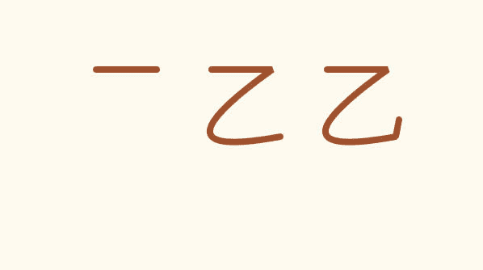

现在，我们将演示如何开发一个 `PathDrawer` 应用程序来交互式地绘制 `Path` 对象。组装 `Path` 的每个 `PathElement` 中点的 (X, Y) 坐标是通过鼠标按下和鼠标拖动事件动态获取的。为了简化此阶段的方法，我们只实现了两种类型的 `PathElement`：`MoveTo` 和 `LineTo`。在下一章，我们将演示如何交互式绘制由 `MoveTo` 和 `QuadCurveTo` 组成的 `Path`。


为了创建`PathDrawer`类，我们采用了`PolylineDrawer`类的完整源代码，并进行了细小修改。关键区别在于两个方法`onMouseDragStarted()`和`onMouseDragFinished()`的实现，它们将在后章节中进行描述。

Listing 4-4. 创建继承`Application`类的`PathDrawer`类，重写`start`方法，创建`BorderPane`作为`Scene`的根节点，并将`Pane`于`BorderPane`的中心作为绘板：

```
package drawtool;

import javafx.application.Application;
import javafx.scene.layout.BorderPane;
import javafx.scene.layout.Pane;
import javafx.scene.paint.Color;
import javafx.scene.Scene;
import javafx.stage.Stage;

/**
 * File Name: PathDrawer.java
 * @author: Shufen Kuo
 *
 */
public class PathDrawer extends Application {

  @Override
  public void start(Stage stage) {
    BorderPane rootPane = new BorderPane();
    Pane drawPane = new Pane();
    rootPane.setCenter(drawPane);

    Scene scene = new Scene(rootPane, 600, 400, Color.FLORALWHITE);
    stage.setScene(scene);
    stage.setTitle("PathDrawer V1.0 Shufen Source Code");
    stage.show();
  }

  public static void main(String[] args) {
    launch(args);
  }
}
```

### 4.1.1 创建`Path`实例

通常情况下，`Polyline`和`Path`都被识别为具有多个元素的`Shape`。`Polyline`是一种具有多条线的形状，通过按给定顺序连接一系列点来构建；相邻的两条线始终是连接的。然而，由于`MoveTo`元素的存在，`Path`中的两个相邻元素可能是不连接的。`MoveTo`元素仅仅是将路径移动到指定的X、Y坐标，而不执行任何绘制。`Path`在JavaFX动画`PathTransition`中也起着有趣的角色，该动画沿着指定的`Path`切换JavaFX`Node`。

要了解如何使用`Node`类提供的便利方法注册事件处理器来处理鼠标事件和按键事件，请阅读第1章中的第1.2.1节使用便利方法注册事件处理器和第1.4节获取按键事件的键码。

以下代码显示了检测到第一个鼠标拖拽事件时，在`MOUSE_DRAGGED`事件处理器内部创建一个`Path`对象：

导入语句：

```
import javafx.scene.shape.Path;
```

Listing 4-5. 注册`MOUSE_DRAGGED`事件的处理器，在检测到第一个鼠标拖拽事件时创建`Path`实例：

```
drawPane.setOnMouseDragged(new EventHandler<MouseEvent>() {
      @Override
      public void handle(MouseEvent me) {
        // 计算鼠标位置到起始位置的距离
        double x2 = me.getX();
        double y2 = me.getY();
        translateX.set(x2 - startX.get());
        translateY.set(y2 - startY.get()); 
        if (!dragged) {
          // 只执行了一次
          if (getShape() == null)	{
            Shape tmpShape = new Path();
            tmpShape.setStroke(Color.BLUE);
            shape.set(tmpShape);
          } 
          dragged = true;
          onMouseDragStarted();
        }
      }
    });
```

### 4.1.2 实现`onMouseDragStarted()`方法

`onMouseDragStarted()`方法在发生第一次拖拽事件时，从`MOUSE_DRAGGED`事件的处理器被调用。它执行以下任务：

* 创建一个`MoveTo`对象：

  将此`MoveTo`元素的x、y坐标设置为鼠标按下的位置；这是稍后将引用的起始位置。

* 创建一个`LineTo`对象：

  将此`LineTo`元素的x、y坐标绑定到一个`DoubleBinding`对象上，该对象计算起始位置和位移距离之和。

* 将`MoveTo`和`LineTo`添加到路径：

  获取此路径的`PathElement`列表，并将`MoveTo`和`LineTo`添加其中。

以下是`onMouseDragStarted()`方法的初始实现。

导入语句：

```
import javafx.scene.shape.LineTo;
import javafx.scene.shape.MoveTo;
```

Listing 4-6. 实现`onMouseDragStarted()`方法，从`MOUSE_DRAGGED`事件的处理器被调用：

```
void onMouseDragStarted() {
    MoveTo moveTo = new MoveTo();
    moveTo.setX(startX.get());
    moveTo.setY(startY.get());

    LineTo lineTo = new LineTo();
    lineTo.xProperty().bind(startX.add(translateX));
    lineTo.yProperty().bind(startY.add(translateY));

    Path path = (Path)getShape();
    path.getElements().addAll(moveTo, lineTo);
  }
```

现在，让我们花一点努力来改进上面的代码。

并不一定为每个`MOUSE_PRESSED`—`MOUSE_DRAGGED`—`MOUSE_RELEASED`事件周期都添加`MoveTo`元素。首先，我们将检查这是否是一个新路径的开始，因为`Path`需要一个`MoveTo`元素来开始绘制。如果是现有路径，我们检查最后一个`LineTo`的坐标是否发生了变化。

这里是增强后的`onMouseDragStarted()`方法实现：

导入语句：

```
import javafx.scene.shape.LineTo;
import javafx.scene.shape.MoveTo;
import javafx.scene.shape.Path;
import javafx.scene.shape.PathElement;
```

Listing 4-7. 增强`onMouseDragStarted()`方法：

```
void onMouseDragStarted() {
    Path path = (Path)getShape();
    ObservableList<PathElement> list = path.getElements();

    if (list.size() > 0) {
      LineTo lineTo = (LineTo) list.get(list.size() - 1);
      if (lineTo.getX() != startX.get() || lineTo.getY() != startY.get()) {
        MoveTo moveTo = new MoveTo();
        moveTo.setX(startX.get());
        moveTo.setY(startY.get());
        path.getElements().add(moveTo);

        LineTo lineTo = new LineTo();
        lineTo.xProperty().bind(startX.add(translateX));
        lineTo.yProperty().bind(startY.add(translateY));
        path.getElements().add(lineTo);
      }
    } else {
      MoveTo moveTo = new MoveTo();
      moveTo.setX(startX.get());
      moveTo.setY(startY.get());
      path.getElements().add(moveTo);

      LineTo lineTo = new LineTo();
      lineTo.xProperty().bind(startX.add(translateX));
      lineTo.yProperty().bind(startY.add(translateY));
      path.getElements().add(lineTo);
    }
  }
```

### 4.1.3 实现`onMouseDragFinished()`方法

`onMouseDragFinished()`方法从`MOUSE_RELEASED`事件的处理器被调用。它执行以下任务：

* 获取此路径的`PathElement`列表。

* 检索最后一个`LineTo`元素。

* 取消最后一个`LineTo`元素的x、y坐标绑定。

一系列`MOUSE_DRAGGED`事件后一个`MOUSE_RELEASED`事件完成了`Path`中一个`PathElement`的绘制。

Listing 4-8. 实现`onMouseDragFinished()`方法，从`MOUSE_RELEASED`事件的处理器被调用：

```
void onMouseDragFinished() {
    Path path = (Path)getShape();
    if (path != null) {
      ObservableList<PathElement> list = path.getElements();
      if (list.size() > 1) {
        LineTo lineTo = (LineTo) list.get(list.size() - 1);
        lineTo.xProperty().unbind();
        lineTo.yProperty().unbind();
      }
    }
  }
```


```java
package drawtool;

import javafx.application.Application;
import javafx.beans.property.DoubleProperty;
import javafx.beans.property.ObjectProperty;
import javafx.beans.property.SimpleDoubleProperty;
import javafx.beans.property.SimpleObjectProperty;
import javafx.beans.value.ChangeListener;
import javafx.beans.value.ObservableValue;
import javafx.collections.ObservableList;
import javafx.event.EventHandler;
import javafx.event.EventType;
import javafx.scene.input.KeyCode;
import javafx.scene.input.KeyEvent;
import javafx.scene.input.MouseEvent;
import javafx.scene.layout.BorderPane;
import javafx.scene.layout.Pane;
import javafx.scene.paint.Color;
import javafx.scene.shape.LineTo;
import javafx.scene.shape.MoveTo;
import javafx.scene.shape.Path;
import javafx.scene.shape.PathElement;
import javafx.scene.shape.Shape;
import javafx.scene.Scene;
import javafx.stage.Stage;

/**
 * 文件名: PathDrawer.java
 * (目录: PathDrawer1.0/src/example1/drawtool/)
 * 此 JavaFX 实现了通过连续的鼠标拖动事件绘制路径，
 * 之后将集成到综合绘制工具 JFXDrawTools 中
 * 
 * 对于每个 MOUSE_PRESSED-MOUSE_DRAGGED-MOUSE_RELEASED 事件循环，
 * 仅当鼠标按下事件的位置与上一个 LineTo 元素的 x, y 坐标不符时，
 * 才会创建一个 MoveTo 元素，并且始终会创建一个 LineTo 元素。
 * 当你完成此路径的所有元素时，按下 ENTER 键将其最终确定，
 * 下一个 MOUSE_PRESSED 事件将开始新路径的第一个元素
 * 要取消此路径，按下 ESCAPE 键
 *
 * @author: Shufen Kuo
 */
public class PathDrawer extends Application {

  // 在发生鼠标事件时跟踪光标位置位置
  // startX, startY 存储鼠标按下事件的位置
  DoubleProperty startX = new SimpleDoubleProperty();
  DoubleProperty startY = new SimpleDoubleProperty();

  // translateX, translateY 存储从拖动/移动位置到 startX, startY 的距离
  DoubleProperty translateX = new SimpleDoubleProperty();
  DoubleProperty translateY = new SimpleDoubleProperty();

  // 此用于持有当前绘制的形状
  ObjectProperty<Shape> shape = new SimpleObjectProperty<>();

  // 此变量在鼠标拖动事件处理程序内部被设置为 true
  // 当第一次鼠标拖动事件发生时，
  // 当鼠标释放事件发生时重置为 false。
  boolean dragged = false;

  @Override
  public void start(Stage stage) {
    BorderPane rootPane = new BorderPane();
    // 我们不能在这里使用 Group 对象作为 drawPane，因为
    // 当 rootPane 尺寸改变时，group 的大小不会动态调整
    final Pane drawPane = new Pane();
    rootPane.setCenter(drawPane);

    drawPane.setOnMousePressed(new EventHandler<MouseEvent>() {
      @Override
      public void handle(MouseEvent me) {
        // 获取起始鼠标位置
        startX.set(me.getX());
        startY.set(me.getY());
      }
    });

    drawPane.setOnMouseDragged(new EventHandler<MouseEvent>() {
      @Override
      public void handle(MouseEvent me) {
        // 计算从鼠标位置到起始位置的距离
        double x2 = me.getX();
        double y2 = me.getY();
        translateX.set(x2 - startX.get());
        translateY.set(y2 - startY.get()); 
        if (!dragged) {
          // 只执行了一次
          if (getShape() == null)	{
            Shape tmpShape = new Path();
            tmpShape.setStroke(Color.BLUE);
            shape.set(tmpShape);
          } 
          dragged = true;
          onMouseDragStarted();
        }
      }
    });

    drawPane.setOnMouseReleased(new EventHandler<MouseEvent>() {
      @Override
      public void handle(MouseEvent me) {
        if (dragged) {
          dragged = false;
          onMouseDragFinished();
        }
      }
    });

    // 必须将 focusTraversable 设置为 true 以处理 KeyEvent，
    // 默认为 false。
    drawPane.setFocusTraversable(true);
    drawPane.setOnKeyPressed(new EventHandler<KeyEvent>() {
      @Override
      public void handle(KeyEvent ke) {
        KeyCode kc = ke.getCode();
        switch (kc) {
          case ENTER : 
            // 按下回车键完成此形状
            System.out.format("Enter key hit%n");
            // 必须调用 dragged finished 方法来解除绑定
            onMouseDragFinished();
            setShape(null);  // 完成此形状
            break;
          case ESCAPE:
            // 按下 Esc 键清除此形状
            System.out.format("Esc key hit%n");
            Shape s = getShape();
            if (s != null) {
              // 必须调用 dragged finished 方法来解除绑定
              onMouseDragFinished();
              drawPane.getChildren().remove(s);
              setShape(null);  // 清除此形状
            }
            break;
        }       
      }
    });

    // 监听 shape 属性的值的变化，
    // 如果则将形状添加到绘制板
    shape.addListener(new ChangeListener<Shape>() {
      @Override
      public void changed(ObservableValue extends Shape> observable, Shape oldVal, Shape newVal) {
        // 观察 shape 属性的值变化，
        // 如果 newVal 不为空
        // 如果按下回车键或 Esc 键则解除绑定
        if (newVal != null) {
          // 将形状添加到绘制板
          System.out.format("shape changed: %s%n", newVal);
          drawPane.getChildren().add(newVal);
        }
      }
    });

    Scene scene = new Scene(rootPane, 600, 400);
    stage.setTitle("PathDrawer V1.0 Shufen");
    stage.show();
  }

  public ObjectProperty<Shape> shapeProperty() {
    return shape;
  }

  public void setShape(Shape value) {
    shape.set(value);
  }

  public Shape getShape() {
    return shape;
  }

  void onMouseDragStarted() {
    Path path = (Path)getShape();
    // 是否是路径的开始
    ObservableList<PathElement> list = path.getElements();
    if (list.size() == 0) {
      // 需要一个 MoveTo
      MoveTo moveTo = new MoveTo();
      moveTo.setX(startX.get());
      moveTo.setY(startY.get());
      path.getElements().add(moveTo);
    } else {
      // 不是路径的开始
      // 获取最后一个 LineTo 并检查 x,y 坐标
      LineTo lineTo = (LineTo) list.get(list.size() - 1);
      if (lineTo.getX() != startX.get() || lineTo.getY() != startY.get()) {
        // 需要一个 MoveTo
        MoveTo moveTo = new MoveTo();
        moveTo.setX(startX.get());
        moveTo.setY(startY.get());
        path.getElements().add(moveTo);
      }      
    }

    // 创建 LineTo 并添加到列表
    LineTo lineTo = new LineTo();
    lineTo.xProperty().bind(startX.add(translateX));
    lineTo.yProperty().bind(startY.add(translateY));

    path.getElements().add(lineTo);
  }

  void onMouseDragFinished() {
    Path path = (Path)getShape();
    // 此处必须验证 shape 是否不空
    if (path != null) {
      ObservableList<PathElement> list = path.getElements();
      // 解除绑定列表中最后一个 lineTo 元素的 x, y 位置
      if (list.size() > 1) {
         LineTo lineTo = (LineTo) list.get(list.size() - 1);
         lineTo.xProperty().unbind();
         lineTo.yProperty().unbind();
      }
    }
  }

  public static void main(String[] args) {
    launch(args);
  }
}
```

图 4-5. 使用 `PathDrawer` 模块绘制各种图标的截图。

`images/00016.jpeg`

编译并运行应用程序。尝试以下步骤进行测试：

1. 将鼠标移动到绘制板上的某个位置。
2. 按住鼠标并在绘制板周围拖动。
3. 释放鼠标在路径中创建一条线。
4. 在相同位置按下鼠标并在周围拖动。
5. 释放鼠标创建与前一个连接的另一条线。
6. 重复之前的两个步骤几次，以创建更多条逐一连接的线。
7. 将鼠标移动到远离上一条线段终点的新位置。
8. 按住鼠标并在画板上拖动。
9. 松开鼠标创建一条与前一条不连接的线。
10. 重复之前的三个步骤几次，以创建多条互不连接的线。
11. 按 `Enter` 键完成一个路径的绘制。
12. 尝试重复类似的移动-按下-拖动-释放步骤几次，然后按 `Esc` 键取消该路径的绘制。

在命令行中编译和运行程序的输出：

```
 Microsoft Windows [Version 6.3.9600]
(c) 2013 Microsoft Corporation. All rights reserved.

F:\My Documents\DocRoot\SHUFEN_JAVA\MyBookJFX\VolumeTwo\PathDrawer1.0\src\example1>
javac -encoding utf-8 -Xlint:unchecked drawtool\*.java

jar cf DrawTool.jar drawtool

java -cp DrawTool.jar drawtool.PathDrawer

shape value changed: Path[elements=[], fill=null, fillRule=NON_ZERO,
stroke=0x0000ffff, strokeWidth=1.0]
Enter key hit
shape value changed: null
shape value changed: Path[elements=[], fill=null, fillRule=NON_ZERO,
stroke=0x0000ffff, strokeWidth=1.0]
Esc key hit
shape value changed: null
```

## 4.3 总结

本章介绍了 JavaFX 库的以下关键方面，按它们在章节中出现的顺序列出：

* `Path` 类，位于 `javafx.scene.shape` 包中，是 `Shape` 的直接子类。`Path` 是 `PathElement` 构建的。

    （参见章节：作为 `Application` 的子类创建 `PathDrawer` 类 和 创建 `Path` 实例）

* `PathElement` 是一个抽象类，位于 `javafx.scene.shape` 包中；其直接子类为：`ArcTo`、`ClosePath`、`CubicCurveTo`、`HLineTo`、`LineTo`、`MoveTo`、`QuadCurveTo`、`VLineTo`。

    （参见此处 和章节 实现 `onMouseDragStarted()` 方法）

* `Path` 类提供的 `public final ObservableList<PathElement> getElements()` 方法返回一个类型为 `ObservableList<PathElement>` 的列表。使用 `Collection` 接口中定义的基本工具将 `PathElement` 对象添加到列表中。

    （参见此处 和 此处）

* `HLineTo` 位于 `javafx.scene.shape` 包中，是 `PathElement` 的直接子类，创建一个水平线作为路径元素，指定终点 X 坐标，从上一个元素的终点绘制到指定的 X 坐标。

    （参见此处）


* `MoveTo` 位于 `javafx.scene.shape` 包中，是 `PathElement` 的直接子类，创建一个路径元素，将位置移动到指定的 x, y 坐标。

  （参见此处 和章节 实现 `onMouseDragStarted()` 方法）

* `LineTo` 位于 `javafx.scene.shape` 包中，是 `PathElement` 的直接子类，为路径创建一个线条元素，从上一个元素的终点到指定的 x, y 坐标。

  （参见章节：实现 `onMouseDragStarted()` 方法](#part0010_split_001.html_implement-on-mouse-darg-started) 和 实现 `OnMouseDragFinished()` 方法）

* `strokeLineCap` 是定义在 `Shape` 类中的类型为 `ObjectProperty<StrokeLineCap>` 的属性，用于指定线条的端点样式。

  （参见此处）

* `StrokeLineCap` 类位于 `javafx.scene.shape` 包中，是一个 `enum` 类型，定义了这些常量：`BUTT`、`ROUND` 和 `SQUARE`。

  （参见此处）

* `strokeLineJoin` 是定义在 `Shape` 类中的类型为 `ObjectProperty<StrokeLineJoin>` 的属性，用于指定笔触之间的连接样式。

  （参见此处）

* `StrokeLineJoin` 类位于 `javafx.scene.shape` 包中，是一个 `enum` 类型，定义了这些常量：`BEVEL`、`MITER` 和 `ROUND`。

  （参见此处）

* `strokeWidth` 是定义在 `Shape` 类中的类型为 `ObjectProperty<Double>` 的属性，用于指定笔触的宽度。

  （参见此处）

* `stroke` 是定义在 `Shape` 类中的类型为 `ObjectProperty<Paint>` 的属性，用于指定笔触的颜色。

  （参见此处）

为了创建 `BezierCurveDrawer` 类，我们采用了 `PathDrawer` 类的完整源代码，并对其了必要的修改。主要的区别在于对 `MOUSE_DRAGGED` 和 `MOUSE_RELEASED` 事件处理器的实现。

以下是 `BezierCurveDrawer` 类的初始结构，它创建一个 `BorderPane` 作为 `Scene` 的根节点，并将 `Pane` 放置在 `BorderPane` 的中心：

列表 5-1. 创建扩展 `Application` 类的 `BezierCurveDrawer` 类，重写 `start` 方法，创建 `BorderPane` 作为 `Scene` 的根节点，并将 `Pane` 放置在 `BorderPane` 的中心作为画板：

```java
package drawtool;

import javafx.application.Application;
import javafx.scene.layout.BorderPane;
import javafx.scene.layout.Pane;
import javafx.scene.paint.Color;
import javafx.scene.Scene;
import javafx.stage.Stage;

/**
 * File Name: BezierCurveDrawer.java
 * @author: Shufen Kuo
 *
 */
public class BezierCurveDrawer extends Application {

  @Override
  public void start(Stage stage) {
    BorderPane rootPane = new BorderPane();
    Pane drawPane = new Pane();
    rootPane.setCenter(drawPane);

    Scene scene = new Scene(rootPane, 600, 400, Color.FLORALWHITE);
    stage.setScene(scene);
    stage.setTitle("BezierCurveDrawer V1.0 Shufen Source Code");
    stage.show();
  }

  public static void main(String[] args) {
    launch(args);
  }
}
```

### 5.1.1 介绍二次贝塞尔曲线

我们将演示如何在画板上动态地绘制二次贝塞尔曲线。

构造一条二次贝塞尔曲线需要三个点：

1. 起点
2. 终点
3. 控制点

这三个点的坐标是通过交互式鼠标事件获取的，其具体工作原理如下：

1. 最初，将鼠标移动到所需位置，并单击鼠标，鼠标点击事件的位置即成为起点。参考图 5-1 中的步骤 1，其中起点被描绘为一个红圈。

2. 然后，将鼠标移动到新位置，按下鼠标（不要松开），鼠标按下事件的位置即成为终点。参考图 5-1 中的步骤 2。

3. 现在，拖动鼠标，控制点将绑定到鼠标拖动事件的位置。当你拖动鼠标时，随着控制点的改变，曲线的形状也会不断变化。参考图 5-1 中的步骤 3，其中曲线的终点显示为绿圈，控制点为蓝圈。在拖拽事件过程中，我们隐藏了鼠标光标，以便关注在追踪鼠标拖拽位置的控制点上。

4. 最后，释放鼠标。参考图 5-1 中的步骤 4，一旦释放鼠标，控制点和终点将被隐藏，红圈将移动到曲线终点的位置。

图 5-1 绘制二次贝塞尔曲线的插图截图。

| 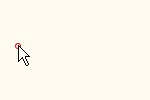 | 步骤 1 点击鼠标 |
| :--- | :--- |
| 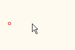 | 步骤 2 移动到某位置 |
| 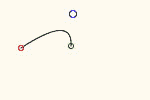 | 步骤 3 拖动绘制曲线 |
| 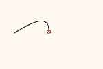 | 步骤 4 释放鼠标 |

上述动作序列在画板上绘制了一条二次贝塞尔曲线。假设这是一个新路径的开始，现在 `Path` 包含两个元素：一个 `MoveTo` 和紧随其后的 `QuadCurveTo`。

`MoveTo` 元素是鼠标点击的结果（在图 5-1 步骤 1 的结束处）。

而 `QuadCurveTo` 元素在拖动开始时创建（在图 5-1 步骤 3 的开始）。二次贝塞尔曲线从上一个元素指定的坐标绘制到鼠标按下的位置。

有两种方法可以在图 5-1 所示的同一条路径中创建更多更多的二次贝塞尔曲线：

1. 创建一个与上一条曲线不相连的新曲线：

   重复从步骤 1 到步骤 4 的动作序列。

2. 创建一个与上一条曲线连接的新曲线：

   跳过鼠标点击事件（步骤 1 所示），只需将鼠标移动到新位置并按下鼠标不松开，拖动它直到你对曲线形状满意，然后释放鼠标。鼠标按下事件的位置是新曲线的终点，而上一条曲线的终点是新曲线的起点。

图 5-2 展示了如何绘制连接到上一曲线的新曲线。步骤 1 到步骤 4 渲染第一条曲线。步骤 5 到步骤 7 渲染第二条曲线。

图 5-2 绘制贝塞尔曲线的插图截图。

|  | 步骤 1 点击鼠标 |
| :--- | :--- |
|  | 步骤 2 移动到某位置 |
|  | 步骤 3 拖动绘制曲线 |
|  | 步骤 4 释放鼠标 |
| 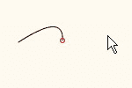 | 步骤 5 移动到某位置 |
| 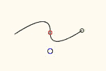 | 步骤 6 拖动绘制曲线 |
| 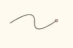 | 步骤 7 释放鼠标 |

上述动作序列在画板上绘制了一条二次贝塞尔曲线。假设这是一个新路径的开始，`Path` 现在包含两个元素：一个 `MoveTo` 和紧随其后的 `QuadCurveTo`。

`MoveTo` 元素是鼠标点击的结果（在图 5-1 步骤 1 的结束处）。

而 `QuadCurveTo` 元素在拖动开始时创建（在图 5-1 步骤 3 的开始）。二次贝塞尔曲线从上一个元素指定的坐标绘制到鼠标按下的位置。

在某些情况下，你可能需要直线。使用 `QuadCurveTo` 绘制直线的方法：

1. 将鼠标移动到起点，该点显示为一个小红圈。参考图 5-3 中的步骤 1：

   红圈中心将成为起点。

2. 按下鼠标不松开，拖动到所需位置。参考图 5-3 中的步骤 2：

   当首次检测到拖拽事件，创建一个 `QuadCurveTo` 对象，其 `X`、`Y` 属性以及 `controlX` 和 `controlY` 全部绑定到鼠标拖拽的位置。

3. 释放鼠标。参考图 5-3 中的步骤 3：

   鼠标释放的位置将成为终点。

上述动作导致了从红圈中心到鼠标释放位置的直线渲染。

图 5-3 绘制直线的插图截图。

| 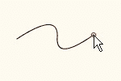 | 步骤 1 移动到红圈 |
| :--- | :--- |
| 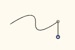 | 步骤 2 拖动绘制直线 |
| 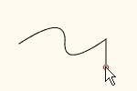 | 步骤 3 释放鼠标 |

### 5.1.2 注册鼠标拖拽事件处理器

在 `MOUSE_DRAGGED` 事件处理器内部，如果不存在 `Path` 对象，则创建一个，并调用 `onMouseDragStarted` 方法，该方法承担了后节描述的主要任务。

回忆一下，`startX` 和 `startY` 是存储鼠标按下事件位置的属性，它们的值在鼠标按下事件处理器内部被设置。`translateX` 和 `translateY` 是存储平移距离的属性，从鼠标按下的位置到鼠标拖拽的位置计算得出。

以下是为画板注册 `MOUSE_DRAGGED` 事件处理器的源代码。

列表 5-2. 注册 `MOUSE_DRAGGED` 事件处理器，创建 `Path` 实例并调用 `onMouseDragStarted` 方法：

```java
drawPane.setOnMouseDragged(new EventHandler<MouseEvent>() {
      @Override
      public void handle(MouseEvent me) {
        // 计算鼠标位置到起始位置的距离
        double x2 = me.getX();
        double y2 = me.getY();
        translateX.set(x2 - startX.get());
        translateY.set(y2 - startY.get()); 
        if (!dragged) {
          // 仅执行此一次
          if (getShape() == null)	{
            Shape tmpShape = new Path();
            shape.set(tmpShape);
          } 
          dragged = true;
          onMouseDragStarted(drawPane);
        }
      }
    });
```

### 5.1.3 注册鼠标释放事件的事件处理器

在 `MOUSE_RELEASED` 事件的事件处理器内部，我们检查该 `MOUSE_RELEASED` 事件之前是否先过任何 `MOUSE_DRAGGED` 事件。如果没有，则我们认为这是一个真正的鼠标点击事件，并调用定义用于处理鼠标点击事件的方法 `handleMouseClicked(Pane pane)`。否则，我们认为这是一系列鼠标拖拽事件的结束，调用 `onMouseDragFinished(Pane pane)` 方法，这与之前章节中开发的其他形状绘制器的方法相同。

请记住，布尔变量 `dragged` 在第一次发生拖拽事件时，在 `MOUSE_DRAGGED` 事件的事件处理器内部被设置为 `true`。由于拖拽事件已结束，它在 `MOUSE_RELEASED` 事件的事件处理器中被重置为 `false`。

列表 5-3 注册 `MOUSE_RELEASED` 事件的事件处理器，如果鼠标释放前没有经过鼠标拖拽，则调用 `handleMouseClicked` 方法，否则调用 `onMouseDragFinished` 方法：

```java
drawPane.setOnMouseReleased(new EventHandler<MouseEvent>() {
      @Override
      public void handle(MouseEvent me) {
        if (dragged) {
          dragged = false;
          // 这是鼠标拖拽事件的结束
          onMouseDragFinished(drawPane);
        } else {
          // 这是一个真正的鼠标点击事件
          handleMouseClicked(drawPane);
        }

      }
    });
```

## 5.2 实现 `handleMouseClicked(Pane pane)` 方法

当检测到真正的鼠标点击事件时，从 `MOUSE_RELEASED` 事件的事件处理器调用 `handleMouseClicked(Pane pane)` 方法，该方法执行以下任务：

* 如果 `Path` 实例不存在，则创建一个。

* 检查这是否是一个新路径的开始。如果是，创建一个 `MoveTo` 实例（它是 `PathElement` 的直接子类），将其 `x`、`y` 属性设置为鼠标点击的位置，并将其添加到路径。

* 否则，检查现有路径的最后一个元素是否为 `MoveTo` 类型。如果是，更新其 `x`、`y` 属性。如果不是，创建一个 `MoveTo`，将其 `x`、`y` 属性设置为鼠标点击的位置，并将其添加到路径。

以下是 `handleMouseClicked(Pane pane)` 方法的源代码：

导入语句：

```java
import javafx.collections.ObservableList;
import javafx.scene.shape.MoveTo;
import javafx.scene.shape.Path;
import javafx.scene.shape.PathElement;
```

列表 5-4 实现 `handleMouseClicked(Pane pane)` 方法，从 `MOUSE_RELEASED` 事件的事件处理器调用：

```java
void handleMouseClicked(Pane pane) {
    // 如果路径不存在，则创建一个新的 Path
    if (getShape() == null)	{
      Shape tmpShape = new Path();
      shape.set(tmpShape);
    }
    Path path = (Path) getShape();
    // 如果这是路径的开始，添加一个 MoveTo 元素
    // 否则，获取最后一个元素
    // 如果最后一个元素是 MoveTo，更新其 x, y 属性。
    // 如果最后一个元素不是 MoveTo，在列表中添加一个 MoveTo
    ObservableList<PathElement> list = path.getElements();
    if (list.size() > 0) {
      // 这不是新路径的开始。
      // 获取最后一个元素
      PathElement element = list.get(list.size() - 1);
      if (element instanceof MoveTo) {
        // 更新其 x, y
        MoveTo moveTo = (MoveTo) element;
        moveTo.setX(startX.get());
        moveTo.setY(startY.get());
        setStartPoint(startX.get(), startY.get());
      } else {
        // 不是 MoveTo，向列表添加 MoveTo
        addMoveTo(pane, path);        
      }
    } else {
      // 这是一个新路径，必须创建一个 MoveTo 来开始路径
      addMoveTo(pane, path);        
    }
  }
```

### 5.2.1 向 `Path` 中添加 `MoveTo` 元素

我们定义了一个 `addMoveTo(Pane pane, Path path)` 方法来执行这些任务：

1. 创建一个 `MoveTo` 实例并将其添加到指定的路径中。

2. 将 `MoveTo` 的位置设置为起始点的位置。

3. 在指定的窗格上画一个圆来表示起始点。

除了从 `handleMouseClicked(Pane pane)` 调用外，`addMoveTo` 方法还可能从 `onMouseDragStarted` 调用，参见后文章节。以下是 `addMoveTo` 的实现：

列表 5-5 创建 `MoveTo` 并添加到指定的路径：


```
void addMoveTo(Pane pane, Path path) {
    MoveTo moveTo = new MoveTo();
    moveTo.setX(startX.get());
    moveTo.setY(startY.get());
    path.getElements().add(moveTo);
}
```

### 5.2.2 绘制表示二次曲线点的圆

为了区分构造二次曲线的点，我们用不同的颜色绘制圆：

1. 起始点，使用红色。
2. 控制点，使用蓝色。
3. 终点，使用绿色。

以下是初始化这些内容的源代码：

导入语句：

```
import javafx.scene.shape.Circle;
import javafx.scene.paint.Color;
```

列表 5-6 创建圆并初始化颜色：

```
// 用于绘制贝塞尔曲线的点
Circle startPoint = new Circle(2.5f, Color.TRANSPNT);
Circle endPoint = new Circle(2.5f, Color.TRANSPNT);
Circle controlPoint = new Circle(3.5f, Color.TRANSPNT);
{
    startPoint.setStroke(Color.RED);
    endPoint.setStroke(Color.GREEN);
    controlPoint.setStroke(Color.BLUE);
}
```

处理这些圆的工具方法定义如下：

列表 5-7 显示点、隐藏点的工具方法：

```
void setStartPoint(double x, double y) {
    startPoint.centerX(x);
    startPoint.setCenterY(y);
}

void setEndPoint(double x, double y) {
    endPoint.centerX(x);
    endPoint.setCenterY(y);
}

void showStartPoint(Pane pane, double x, double y) {
    if (!pane.getChildren().contains(startPoint))
        pane.getChildren().add(startPoint);
    setStartPoint(x, y);
}

void showEndPoint(Pane pane) {
    if (!pane.getChildren().contains(endPoint))
        pane.getChildren().add(endPoint);
}

void showEndPoint(Pane pane, double x, double y) {
    if (!pane.getChildren().contains(endPoint))
        pane.getChildren().add(endPoint);
    setEndPoint(x, y);
}

void showControlPoint(Pane pane) {
    if (!pane.getChildren().contains(controlPoint))
        pane.getChildren().add(controlPoint);
}

void hideStartPoint(Pane pane) {
    pane.getChildren().remove(startPoint);
}

void hideEndPoint(Pane pane) {
    pane.getChildren().remove(endPoint);
}

void hideControlPoint(Pane pane) {
    pane.getChildren().remove(controlPoint);
}
```

## 5.3 实现 `onMouseDragStarted(Pane pane)` 方法

`QuadCurveDrawer V1.0` 的主要任务在 `onMouseDragStarted(Pane pane)` 方法中完成，该方法从 `MOUSE_DRAGGED` 事件的事件处理器调用。

它执行以下任务：

- 将光标设置为 `Cursor.NONE`：

  此部分的重点是追踪鼠标拖拽事件位置的控制点。

- 向路径添加一个 `MoveTo` 对象：

  将此 `MoveTo` 元素的 `x`、`y` 坐标设置为鼠标按下的位置。

  只有当路径包含空元素时，才会在此处创建 `MoveTo` 对象。在正常过程中，`MoveTo` 是由鼠标点击事件触发而创建的，请参阅介绍二次贝塞尔曲线和实现 `handleMouseClicked(Pane pane)` 方法。

  然而，我们允许初学者通过简单地按下并拖动鼠标来开始新路径，而无需预先触发鼠标点击事件。

- 向路径添加一个渲染效果为直线的 `QuadCurveTo` 对象：

  将此 `QuadCurveTo` 元素的 `x`、`y` 属性以及 `controlX`、`controlY` 属性绑定到鼠标拖拽的位置。

  如果此拖拽事件发生在新路径的开头，除了添加 `MoveTo` 对象外，还会添加一条直线 `QuadCurveTo`。

  如果此拖拽事件未发生在新路径的开头，则只有当鼠标按下的位置（存储在 `startX` 和 `startY` 属性中）位于起点圆圈区域内时，才会创建并将直线 `QuadCurveTo` 添加到路径中（参阅图 5-3 中的步骤 1）。

- 向路径添加一个常规的 `QuadCurveTo` 对象：

  将 `x` 和 `y` 属性绑定到鼠标按下的位置，并将 `controlX` 和 `controlY` 属性绑定到鼠标拖拽的位置。

  这是正常情况，我们获取三个不同的点来构造一个 `QuadCurveTo` 元素。即曲线的终点与起点不重合，且控制点绑定到鼠标拖拽的位置。

以下是 `onMouseDragStarted` 方法的源代码。

导入语句：

```
import javafx.scene.Cursor;
```

列表 5-8. 实现 `onMouseDragStarted` 方法，由 `MOUSE_DRAGGED` 事件处理器调用：

```
void onMouseDragStarted(Pane pane) {
    // 隐藏光标
    pane.setCursor(Cursor.NONE);
    Path path = (Path)getShape();
    ObservableList<PathElement> list = path.getElements();
    // 检查是否为新路径的开头
    if (list.size() == 0) {
        // 这是一个空元素的新路径
        // 添加一个 MoveTo，紧跟一个 QuadCurveTo
        // 因为构造曲线需要三个点，
        // 此处我们只有两个点，
        // QuadCurveTo 将看起来像一条直线，
        // 终点和控制点都在同一个位置。
        addMoveTo(pane, path);
        addLineTo(pane, path);
    } else {
        // 这是一个列表中已有元素的现有路径
        // 验证鼠标按下的位置是否在起点圆区域内
        if (startPoint.contains(startX.get(), startY.get())) {
            // 这是一个特殊情况，
            // startX, startY 在起点圆区域内，
            // 我们只能画出像直线的 QuadCurveTo，
            // 终点和控制点都在同一个位置。
            addLineTo(pane, path);
        } else {
            // 这是一个正常情况，
            // startX, startY 不在起点的范围内
            // 创建一个常规的 QuadCurveTo
            addQuadCurveTo(pane, path);
        }
    }
}
```

### 5.3.1 向 `Path` 添加直线 `QuadCurveTo` 元素

我们定义了一个 `addLineTo(Pane pane, Path path)` 方法，由 `onMouseDragStarted` 方法调用，用于向 `Path` 添加一个渲染效果为直线的 `QuadCurveTo` 元素。该方法执行以下任务：

1. 创建 `QuadCurveTo` 实例并将其添加到给定的路径。
2. 将曲线的终点（由 `x` 和 `y` 属性指定）绑定到一个 `DoubleBinding` 对象，该对象计算起始位置和位移距离的和。
3. 将曲线的控制点（由 `controlX` 和 `controlY` 属性指定）绑定到一个 `DoubleBinding` 对象，该对象计算起始位置和位移距离的和。
4. 将控制点圆的中心（由 `centerX` 和 `centerY` 属性指定）绑定到一个 `DoubleBinding` 对象，该对象计算起始位置和位移距离的和。
5. 将终点圆的中心（由 `centerX` 和 `centerY` 属性指定）绑定到一个 `DoubleBinding` 对象，该对象计算起始位置和位移距离的和。
6. 显示控制点圆和终点圆。

以下是 `addLineTo(Pane pane, Path path)` 方法的源代码：

导入语句：

```
import javafx.beans.binding.DoubleBinding;
import javafx.scene.shape.QuadCurveTo;
```

列表 5-9. 实现 `addLineTo` 方法，由 `onMouseDragStarted` 方法调用，创建 `QuadCurveTo`，执行必要的绑定，显示控制点圆，显示终点圆：

```
void addLineTo(Pane pane, Path path) {
    // 创建一个像直线的 QuadCurveTo
    QuadCurveTo quadCurveTo = new QuadCurveTo();
    path.getElements().add(quadCurveTo);
    // 创建计算起始位置
    // 位移距离的 DoubleBinding
    DoubleBinding draggedX = startX.add(translateX);
    DoubleBinding draggedY = startY.add(translateY);
    // 将曲线终点绑定到鼠标拖拽的位置
    quadCurveTo.xProperty().bind(draggedX);
    quadCurveTo.yProperty().bind(draggedY);
    // 将曲线控制点绑定到鼠标拖拽的位置
    quadCurveTo.controlXProperty().bind(draggedX);
    quadCurveTo.controlYProperty().bind(draggedY);
    // 处理终点圆：
    // 终点圆中心绑定到拖拽位置
    endPoint.centerXProperty().bind(draggedX);
    endPoint.centerYProperty().bind(draggedY);
    showEndPoint(pane);
    // 处理控制点圆：
    // 圆心绑定到拖拽的位置
    controlPoint.centerXProperty().bind(draggedX);
    controlPoint.centerYProperty().bind(draggedY);
    showControlPoint(pane);
}
```

### 5.3.2 向 `Path` 添加常规 `QuadCurveTo` 元素

我们定义了一个 `addQuadCurveTo(Pane pane, Path path)` 方法，由 `onMouseDragStarted` 方法调用，用于向 `Path` 添加一个常规的 `QuadCurveTo` 元素。该方法执行以下任务：

1. 创建 `QuadCurveTo` 实例并将其添加到给定的路径。
2. 将曲线的终点（由 `x` 和 `y` 属性指定）设置为鼠标按下的位置（由 `startX` 和 `startY` 属性指定）。
3. 将终点圆的中心设置在鼠标按下的位置并显示。
4. 将曲线的控制点（由 `controlX` 和 `controlY` 属性指定）绑定到一个 `DoubleBinding` 对象，该对象计算起始位置和位移距离的和。
5. 将控制点圆的中心（由 `centerX` 和 `centerY` 属性指定）绑定到一个 `DoubleBinding` 对象，该对象计算起始位置和位移距离的和。
6. 显示控制点圆，在鼠标拖拽过程中其位置保持变化。

以下是 `addQuadCurveTo(Pane pane, Path path)` 方法的源代码：

列表 5-10. 实现 `addQuadCurveTo` 方法，由 `onMouseDragStarted` 方法调用，创建 `QuadCurveTo`，设置 `x`、`y` 属性，执行必要的绑定，显示控制点圆，显示终点圆：

```
void addQuadCurveTo(Pane pane, Path path) {
    QuadCurveTo quadCurveTo = new QuadCurveTo();
    path.getElements().add(quadCurveTo);

    // Set x, y properties of curve to mouse pressed location
    quadCurveTo.setX(startX.get());
    quadCurveTo.setY(startY.get());
    // Show end point circle at mouse pressed location
    showEndPoint(pane, startX.get(), startY.get());

    // Create a DoubleBinding calculates the sum of
    // start position and translate distance
    DoubleBinding draggedX = startX.add(translateX);
    DoubleBinding draggedY = startY.add(translateY);

    // Bind control point of curve to mouse dragged location
    quadCurveTo.controlXProperty().bind(draggedX);
    quadCurveTo.controlYProperty().bind(draggedY);
    // Bind center of control point circle to dragged location
    controlPoint.centerXProperty().bind(draggedX);
    controlPoint.centerYProperty().bind(draggedY);
    // Show control point circle
    showControlPoint(pane);
}
```

## 5.4 实现 `OnMouseDragFinished(Pane pane*)` 方法

`OnMouseDragFinished(Pane pane*)` 方法由 `MOUSE_RELEASED` 事件的事件处理器调用，用于完成路径中一个 `QuadCurveTo` 元素的绘制。

该方法完成了以下任务：

1. 恢复默认鼠标光标，该光标在鼠标拖动事件开始时被设置为 `none`。
2. 获取此路径的 `PathElement` 列表，从列表中提取最后一个元素，并对最后一个元素执行以下任务（该元素必须是 `QuadCurveTo` 实例）：
   - 执行必要的解绑定。

     如果曲线是通过 `AddLineTo` 方法创建的，则它是一个直线形式的 `QuadCurveTo` 元素，与控制点和终点相关的属性需要解绑定。如果曲线是通过 `AddQuadCurveTo` 方法创建的，则它是一个普通的 `QuadCurveTo` 元素，只有与控制点相关的属性需要解绑定。

   - 隐藏终点圆圈。
   - 隐藏控制点圆圈。
   - 将起点圆圈移动到此曲线的终点位置。

`MOUSE_DRAGGED` 事件紧随 `MOUSE_RELEASED` 事件完成了 `Path` 中一个 `PathElement` 的绘制。

以下是 `OnMouseDragFinished(Pane pane*)` 方法的源代码：

列表 5-11. 实现 `onMouseDragFinished` 方法，该方法由 `MOUSE_RELEASED` 事件的事件处理器调用：


```java
void onMouseDragFinished(Pane pane) {
  // 恢复光标
  pane.setCursor(Cursor.DEFAULT);
  Path path = (Path) getShape();
  // 此处必须验证 shape 是否为空
  // 如果按了 Enter 键或 Esc 键，shape 设置为 null
  if (path != null) {
    ObservableList<PathElement> list = path.getElements();
    // 列表至少包含 2 个由 addLineTo
    // 或 addQuadCurveTo 方法创建的元素，
    // 这里的检查是多余的。
    if (list.size() > 0) {
      PathElement element = list.get(list.size() - 1);
      // 元素必须是 QuadCurveTo
      QuadCurveTo quadCurveTo = (QuadCurveTo) element;
      if (quadCurveTo.xProperty().isBound()) {
        quadCurveTo.xProperty().unbind();
        quadCurveTo.yProperty().unbind();
      }
      if (quadCurveTo.controlXProperty().isBound()) {
        quadCurveTo.controlXProperty().unbind();
        quadCurveTo.controlYProperty().unbind();
      }
      // 处理终点圆圈
      if (endPoint.centerXProperty().isBound()) {
        endPoint.centerXProperty().unbind();
        endPoint.centerYProperty().unbind();
      }
      hideEndPoint(pane);
      // 处理控制点圆圈
      if (controlPoint.centerXProperty().isBound()) {
        controlPoint.centerXProperty().unbind();
        controlPoint.centerYProperty().unbind();
      }
      hideControlPoint(pane);
      // 处理起点圆圈：
      // 此元素的终点现在变为
      // 下一个新元素的起点。
      setStartPoint(quadCurveTo.getX(), quadCurveTo.getY());
    }
  }
}
```

## 5.5 注册按键按下事件处理器

回顾之前章节中开发的其他形状绘制模块的操作：按下`Enter`键完成草图，按下`Esc`键取消草图。`Bezier Curve Drawer`模块也是如此。这些任务在`KEY_PRESSED`事件的事件处理器内部完成。除了处理`Enter`键和`Esc`键外，`Bezier Curve Drawer`模块还处理额外的按键：`Delete`键按下事件。

很多时候，用户对刚刚完成的曲线不满意，但按下`Esc`键取消整个路径又太极端了。我们提供了`Delete`键的功能，它不是删除整个路径，而是删除路径中的最后一个元素。重复击`Delete`键将逐个删除元素，直到路径不再包含元素。然而，你无法从按下`Enter`键后立即确定的路径中删除任何元素。

以下是注册`KEY_PRESSED`事件处理器的源代码：

列表 5-10. 导入语句：

```java
import javafx.scene.input.KeyCode;
import javafx.scene.input.KeyEvent;
```

列表 5-11. 注册`KEY_PRESSED`事件处理器，处理`ENTER`、`ESCAPE`和`DELETE`代码：

```java
drawPane.setOnKeyPressed(new EventHandler<KeyEvent>() {
  @Override
  public void handle(KeyEvent ke) {
    KeyCode kc = ke.getCode();
    switch (kc) {
      case ENTER:
        // 按下 Enter 键完成形状
        // 必须调用完成方法以处理解绑定
        if (getShape() != null) {
          if (dragged) {
            onMouseDragFinished(drawPane);
          }
          hideStartPoint(drawPane);
          setShape(null); // 完成形状
        }
        break;
      case ESCAPE:
        // 按下 Esc 键清除形状
        Shape s = getShape();
        if (s != null) {
          if (dragged) {
            onMouseDragFinished(drawPane);
          }
          hideStartPoint(drawPane);
          drawPane.getChildren().remove(s);
          setShape(null); // 清形状
        }
        break;
      case DELETE:
        // 按下 Delete 键删除最后一个元素
        if (getShape() != null && !dragged) {
          // 如果在拖动过程中，则不允许删除操作
          // 即如果在拖动时按下 Delete 键，
          // 则什么都不会发生。
          deleteLastPathElement(drawPane, (Path) getShape());
        }
        break;
    }
  }
});
```

### 5.5.1 实现`deleteLastPathElement(Pane pane, Path path)`方法

`deleteLastPathElement(Pane pane, Path path)`方法删除给定路径的最后一个元素，由按下`Delete`键时的事件处理器调用。

除了从`PathElement`列表中删除最后一个元素外，我们还需要更新代表起点的圆的位置。删除最后一个元素后，如果列表为空，只需隐藏起点圆圈；否则，更新圆圈的位置。

### 列表 5-13. 实现`deleteLastPathElement`方法，从给定的路径获取`PathElement`列表，从列表中移除最后一个元素，并更新起始点圆的状态：

```java
void deleteLastPathElement(Pane pane, Path path) {
  ObservableList<PathElement> list = path.getElements();
  if (list.size() > 0) {
    list.remove(list.get(list.size() - 1));
    // 如果结果列表为空，
    // 隐藏起始点的圆
    if (list.size() == 0) {
      hideStartPoint(pane);
    } else {
      PathElement element = list.get(list.size() - 1);
      if (element instanceof MoveTo) {
        // 更新起始点圆的中心坐标
        MoveTo moveTo = (MoveTo) element;
        setStartPoint(moveTo.getX(), moveTo.getY());
      } else {
        // 它必须是一个 QuadCurveTo
        // 更新起始点圆的中心坐标
        QuadCurveTo quadCurveTo = (QuadCurveTo) element;
        setStartPoint(quadCurveTo.getX(), quadCurveTo.getY());
      }
    }
  }
}
```

### 5.6 `BezierCurverDrawer`类的完整源代码

这里是完整的源代码。与上一章节中的`PathDrawer`类相比，主要区别已用粗体显示：

#### 列表 5-14. 创建继承`Application`类的`BezierCurveDrawer`类，重写`start`方法，创建`BorderPane`作为场景的根节点，并将`Pane`放置在`BorderPane`的中心作为画板：


```java
package drawtool;

import javafx.application.Application;
import javafx.beans.binding.DoubleBinding;
import javafx.beans.property.DoubleProperty;
import javafx.beans.property.ObjectProperty;
import javafx.beans.property.SimpleDoubleProperty;
import javafx.beans.property.SimpleObjectProperty;
import javafx.beans.value.ChangeListener;
import javafx.beans.value.ObservableValue;
import javafx.collections.ObservableList;
import javafx.event.EventHandler;
import javafx.event.EventType;
import javafx.scene.Cursor;
import javafx.scene.input.KeyCode;
import javafx.scene.input.KeyEvent;
import javafx.scene.input.MouseEvent;
import javafx.scene.layout.BorderPane;
import javafx.scene.layout.Pane;
import javafx.scene.paint.Color;
import javafx.scene.shape.Circle;
import javafx.scene.shape.MoveTo;
import javafx.scene.shape.Path;
import javafx.scene.shape.PathElement;
import javafx.scene.shape.QuadCurveTo;
import javafx.scene.shape.Shape;
import javafx.scene.Scene;
import javafx.stage.Stage;

/**
 * 文件名: BezierCurveDrawer.java
 * (目录: QuadCurveDrawer1.0/src/example1/drawtool/)
 * 此 JavaFX 应用程序是一个交互式绘制工具，用于绘制
 * 添加到路径对象中的二次贝塞尔曲线
 * 你可以创建任意数量的路径，
 * 当你完成此路径的所有元素时，
 * 按下 ENTER 键完成完成，
 * 若要取消此路径，按下 ESCAPE 键
 * 如果你对刚刚完成的曲线不满意，
 * 按下 DELETE 键删除此曲线
 * 然而，在拖拽过程中无法执行 DELETE 操作
 * DELETE 键会删除你当前正在操作的路径中的最后一个元素
 * 重复按 DELETE 键将逐个删除元素。
 * 一旦按下 ENTER 键，路径即告完成，
 * 你无法从完成的路径中删除任何元素
 *
 * @author: Shufen Kuo
 */
public class BezierCurveDrawer extends Application {

  // 在鼠标事件发生时跟踪光标位置
  // startX, startY 存储鼠标按下事件的坐标
  DoubleProperty startX = new SimpleDoubleProperty();
  DoubleProperty startY = new SimpleDoubleProperty();

  // translateX, translateY 存储从拖拽/移动位置到 startX, startY 的距离
  DoubleProperty translateX = new SimpleDoubleProperty();
  DoubleProperty translateY = new SimpleDoubleProperty();

  // 用于存储当前绘制的形状 
  ObjectProperty<Shape> shape = new SimpleObjectProperty<>();

  // 此变量在鼠标拖拽事件处理程序内部被设置为 true
  // 当第一次鼠标拖拽事件发生时，
  // 在鼠标释放事件发生时重置为 false。
  boolean dragged = false;

  // 用于显示绘制二次贝塞尔曲线所需的 3 个点的位置
  Circle startPoint = new Circle(2.5f, Color.TRANSPARENT);
  Circle endPoint = new Circle(2.5f, Color.TRANSPARENT);
  Circle controlPoint = new Circle(3.5f, Color.TRANSPARENT);
  {
    startPoint.setStroke(Color.RED);
    endPoint.setStroke(Color.GREEN);
    controlPoint.setStroke(Color.BLUE);
  }

  @Override
  public void start(Stage stage) {
    BorderPane rootPane = new BorderPane();
    // 我们不能在这里使用 Group 对象作为 drawPane，
    // 当 rootPane 大小改变时，group 的大小不会动态调整
    final Pane drawPane = new Pane();
    rootPane.setCenter(drawPane);

    drawPane.setOnMousePressed(new EventHandler<MouseEvent>() {
      @Override
      public void handle(MouseEvent me) {
        // 获取鼠标起始位置
        startX.set(me.getX());
        startY.set(me.getY());
      }
    });

    drawPane.setOnMouseDragged(new EventHandler<MouseEvent>() {
      @Override
      public void handle(MouseEvent me) {
        // 计算鼠标位置到起始位置的距离
        double x2 = me.getX();
        double y2 = me.getY();
        translateX.set(x2 - startX.get());
        translateY.set(y2 - startY.get()); 
        if (!dragged) {
          // 仅执行一次
          if (getShape() == null)	{
            Shape tmpShape = new Path();
            shape.set(tmpShape);
          } 
          dragged = true;
          onMouseDragStarted(drawPane);
        }
      }
    });

    drawPane.setOnMouseReleased(new EventHandler<MouseEvent>() {
      @Override
      public void handle(MouseEvent me) {
        if (dragged) {
          dragged = false;
          // 鼠标拖拽事件的结束
          onMouseDragFinished(drawPane);
        } else {
          // 这是一个真正的鼠标点击事件
          handleMouseClicked(drawPane);
        }
      }
    });

    // 必须将 focusTraversable 设置为 true 以处理 KeyEvent，
    // 默认是 false。
    drawPane.setFocusTraversable(true);
    drawPane.setOnKeyPressed(new EventHandler<KeyEvent>() {
      @Override
      public void handle(KeyEvent ke) {
        KeyCode kc = ke.getCode();
        switch (kc) {
          case ENTER : 
            // 按回车完成此形状
            // 必须调用 drag finished 来处理解绑定
            if (getShape() != null) {
              if (dragged)
                onMouseDragFinished(drawPane);
              hideStartPoint(drawPane);
              setShape(null);  // 完成形状
            }
            break;
          case ESCAPE:
            // 按 Esc 清除此形状
            Shape s = getShape();
            if (s != null) {
              // 必须调用 drag finished 处理解绑定
              if (dragged)
                onMouseDragFinished(drawPane);
              hideStartPoint(drawPane);
              drawPane.getChildren().remove(s);
              setShape(null); // 清除形状
            }
            break;
          case DELETE:
            // 按 Delete 删除最后一个元素
            if (getShape() != null && !dragged) {
              // 如果正在拖拽，则不允许删除操作
              deleteLastPathElement(drawPane, (Path)getShape());
            }
            break;
        }       
      }
    });

    // 监听 shape 属性的变化
    // 如果创建了新形状则添加到画布
    shape.addListener(new ChangeListener<Shape>() {
      @Override
      public void changed(ObservableValue o, Shape oldVal, Shape newVal) {
         // shape 值改变
         if (newVal != null)
           drawPane.getChildren().add(newVal);
      }
    });

    Scene scene = new Scene(rootPane, 600, 400, Color.WHITE);
    stage.setScene(scene);
    stage.setTitle("BezierCurveDrawer V1.0 Source");
    stage.show();
  }

  public Shape getShape() {
    return shape.get();
  }

  public void setShape(Shape value) {
    shape.set(value);
  }

  public ObjectProperty<Shape> shapeProperty() {
    return shape;
  }

  /* 以下是用于显示起点、终点和
   控制点的工具。它们都由不同颜色的圆表示
   */
  void setStartPoint(double x, double y) {
    startPoint.setCenterX(x);
    startPoint.setCenterY(y);
  }

  void setEndPoint(double x, double y) {
    endPoint.setCenterX(x);
    endPoint.setCenterY(y);
  }

  void showStartPoint(Pane pane, double x, double y) {
    if (!pane.getChildren().contains(startPoint))
      pane.getChildren().add(startPoint);
    setStartPoint(x, y);
  }

  void showEndPoint(Pane pane) {
    if (!pane.getChildren().contains(endPoint))
      pane.getChildren().add(endPoint);
  }

  void showEndPoint(Pane pane, double x, double y) {
    if (!pane.getChildren().contains(endPoint))
      pane.getChildren().add(endPoint);
    setEndPoint(x, y);
  }

  void showControlPoint(Pane pane) {
    if (!pane.getChildren().contains(controlPoint))
      pane.getChildren().add(controlPoint);
  }

  void hideStartPoint(Pane pane) {
    pane.getChildren().remove(startPoint);
  }

  void hideEndPoint(Pane pane) {
    pane.getChildren().remove(endPoint);
  }

  void hideControlPoint(Pane pane) {
    pane.getChildren().remove(controlPoint);
  }

  /**
   * 当按下 DELETE 键时调用此方法
   */
  void deleteLastPathElement(Pane pane, Path path) {
    ObservableList<PathElement> list = path.getElements();
    if (list.size() > 0) {
      list.remove(list.get(list.size() - 1));
      // 如果列表为空，
      // 隐藏起点圆
      if (list.size() == 0) {
        hideStartPoint(pane);
      } else {
        PathElement element = list.get(list.size() - 1);
        if (element instanceof MoveTo) {
          // 更新起点圆的中心坐标
          MoveTo moveTo = (MoveTo) element;
          setStartPoint(moveTo.getX(), moveTo.getY());
        } else {
          // 必须是 QuadCurveTo
          // 更新起点圆的中心坐标
          QuadCurveTo quadCurveTo = (QuadCurveTo) element;
          setStartPoint(quadCurveTo.getX(), quadCurveTo.getY());
        }
      }
    }
  }

  /**
   * 创建一个 MoveTo 并将其添加到路径
   * 它的 x, y 属性被设置为 startX, startY
   * 显示起点
   */
  void addMoveTo(Pane pane, Path path) {
    MoveTo moveTo = new MoveTo();
    moveTo.setX(startX.get());
    moveTo.setY(startY.get());
    path.getElements().add(moveTo);
    showStartPoint(pane, startX.get(), startY.get());
  }

  /**
   * 创建一个 QuadCurveTo 并将其添加到路径。
   * 由于我们只获取了两个点的坐标，
   * 渲染的是直线而不是曲线。
   * 它的 x, y 属性（终点）绑定到
   * 起点加上距离，
   * 终点的 centerX, centerY 属性也对
   * 起点加上距离进行绑定。
   * 显示点。
   */
  void addLineTo(Pane pane, Path path) {
    // 创建一个像直线的 QuadCurveTo
    QuadCurveTo quadCurveTo = new QuadCurveTo();
    path.getElements().add(quadCurveTo);
    // 创建 DoubleBinding 计算
    // 起位置和偏移距离之和
    DoubleBinding draggedX = startX.add(translateX);
    DoubleBinding draggedY = startY.add(translateY);
    // 将终点绑定到鼠标拖拽位置
    quadCurveTo.xProperty().bind(draggedX);
    quadCurveTo.yProperty().bind(draggedY);
    // 将控制点绑定到鼠标拖拽位置
    quadCurveTo.controlXProperty().bind(draggedX);
    quadCurveTo.controlYProperty().bind(draggedY);
    // 将终点圆的 centerX, centerY 绑定到
    // 拖拽位置
    endPoint.centerXProperty().bind(draggedX);
    endPoint.centerYProperty().bind(draggedY);
    showEndPoint(pane);
    // 将控制点圆的 centerX, centerY 绑定到
    // 拖拽位置
    controlPoint.centerXProperty().bind(draggedX);
    controlPoint.centerYProperty().bind(draggedY);
    showControlPoint(pane);
  }

  /**
   * 添加 QuadCurveTo
   */
  void addQuadCurveTo(Pane pane, Path path) {
    QuadCurveTo quadCurveTo = new QuadCurveTo();
    path.getElements().add(quadCurveTo);

    // 将曲线的 x, y 属性设置为鼠标按下位置
    quadCurveTo.setX(startX.get());
    quadCurveTo.setY(startY.get());
    // 在鼠标按下位置显示终点
    showEndPoint(pane, startX.get(), startY.get());

    // 创建 DoubleBinding 计算
    // 起位置和偏移距离之和
    DoubleBinding draggedX = startX.add(translateX);
    DoubleBinding draggedY = startY.add(translateY);

    // 将控制点绑定到鼠标拖拽位置
    quadCurveTo.controlXProperty().bind(draggedX);
    quadCurveTo.controlYProperty().bind(draggedY);
    // 将控制点圆的 centerX, centerY 绑定到
    // 拖拽位置
    controlPoint.centerXProperty().bind(draggedX);
    controlPoint.centerYProperty().bind(draggedY);
    // 显示控制点
    showControlPoint(pane);
  }

  void handleMouseClicked(Pane pane) {
    if (getShape() == null) {
      Shape tmpShape = new Path();
      shape.set(tmpShape);
    }
    Path path = (Path) getShape();
    // 如果是路径的开头，添加 MoveTo 元素
    // 否则，获取最后一个元素，
    // 如果最后一个元素是 MoveTo，更新其 x, y 属性。
    // 如果最后一个元素不是 MoveTo，在列表中添加 MoveTo。
    ObservableList<PathElement> list = path.getElements();
    if (list.size() > 0) {
      // 不是新路径的起点。
      // 获取最后一个元素
      PathElement element = list.get(list.size() - 1);
      if (element instanceof MoveTo) {
        // 更新其 x, y
        MoveTo moveTo = (MoveTo) element;
        moveTo.setX(startX.get());
        moveTo.setY(startY.get());
        setStartPoint(startX.get(), startY.get());
      } else {
        // 不是 MoveTo，在列表中添加 MoveTo
        addMoveTo(pane, path);
      }
    } else {
      // 是新路径，必须创建一个 MoveTo 来开始路径
      addMoveTo(pane, path);
    }
  }

  void onMouseDragStarted(Pane pane) {
    // 隐藏光标
    pane.setCursor(Cursor.NONE);
    Path path = (Path)getShape();
    ObservableList<PathElement> list = path.getElements();
    // 检查是否为新路径的开头
    if (list.size() == 0) {
      // 这是一个空元素的新路径
      // 先添加一个 MoveTo 后跟一个 QuadCurveTo
      // 因为构造曲线需要 3 个点，
      // 这里我们只有两个点，
      // QuadCurveTo 将看起来像一条直线，
      // 终点和控制点在同一位置。
      addMoveTo(pane, path);
      addLineTo(pane, path);
    } else {
      // 这是一个列表中包含元素的现有路径，
      // 验证鼠标按下位置是否在起点圆区域内
      if (startPoint.contains(startX.get(), startY.get())) {
        // 这是一个特殊情况，
        // startX, startY 在起点区域内，
        // 我们只能画出像直线的 QuadCurveTo，
        // 终点和控制点在同一位置。
        addLineTo(pane, path);
      } else {
        // 这是一个正常情况，
        // startX, startY 不在起点区域内
        addQuadCurveTo(pane, path);
      }
    }
  }

  void onMouseDragFinished(Pane pane) {
    // 恢复光标
    pane.setCursor(Cursor.DEFAULT);
    Path path = (Path)getShape();
    // 必须验证形状不为空
    // 如果按下 Enter 或 Esc 键，形状会被设置为 null
    if (path != null) {
      ObservableList<PathElement> list = path.getElements();
      // 列表由 addLineTo 方法或 addQuadCurveTo 方法
      // 创建了至少两个元素，这里的检查是多余的。
      if (list.size() > 0) {
        PathElement element = list.get(list.size() - 1);
        // 元素必须是 QuadCurveTo
        QuadCurveTo quadCurveTo = (QuadCurveTo) element;
        if (quadCurveTo.xProperty().isBound()) {
          quadCurveTo.xProperty().unbind();
          quadCurveTo.yProperty().unbind();
        }
        if (quadCurveTo.controlXProperty().isBound()) {
          quadCurveTo.controlXProperty().unbind();
          quadCurveTo.controlYProperty().unbind();
        }
        // 处理终点圆
        if (endPoint.centerXProperty().isBound()) {
          endPoint.centerXProperty().unbind();
          endPoint.centerYProperty().unbind();
        }
        hideEndPoint(pane);
        // 处理控制点圆
        if (controlPoint.centerXProperty().isBound()) {
          controlPoint.centerXProperty().unbind();
          controlPoint.centerYProperty().unbind();
        }
        hideControlPoint(pane);
        // 处理起点圆：
        // 该元素的终点现在成为下一个
        // 新元素的起点。
        setStartPoint(quadCurveTo.getX(), quadCurveTo.getY());
      }
    }
  }

  public static void main(String[] args) {
    launch(args);
  }
}
```


# 图 5-4：使用 `Bézier Curve Drawer` 模块绘制各种图标的截图

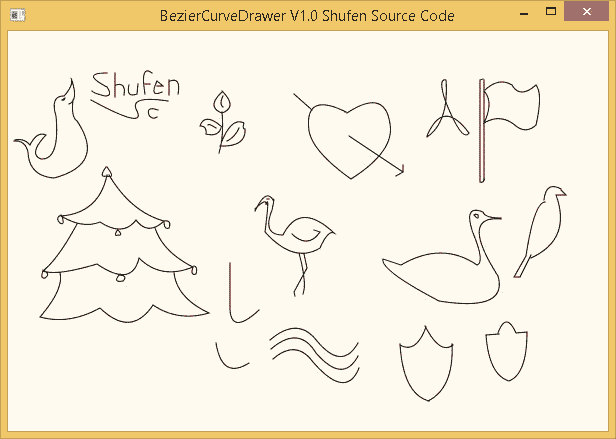

编译并运行应用程序。尝试以下步骤进行测试：

1. 将鼠标移动到绘板上的某个位置。
2. 按住并释放鼠标而不拖动，此操作创建一个起点，绘板上会显示一个红圆圈。
3. 将鼠标移动到另一个位置并在绘板上拖动以绘制一条曲线。
4. 当你对曲线的形状满意时，释放鼠标。
5. 将鼠标移动到另一个位置，拖动绘制另一条与之前的曲线连接的曲线。
6. 当你对这条曲线的形状满意时，释放鼠标。
7. 重复上述两个步骤几次，以绘制更多添加到路径中的曲线。
8. 如果你对刚刚绘制的曲线不满意，按下 `Delete` 键将其删除，并继续绘制更多曲线。
9. 现在，尝试画一条直线：将鼠标移动到红色圆圈区域，拖动鼠标到某个位置，然后释放鼠标。
10. 绘制更多曲线和线条并添加到同一路径中。
11. 尝试绘制一条与之前的曲线不连接的曲线：
    1. 将鼠标移动到某个位置并按下并释放鼠标而不拖动，此操作创建一个起点。
    2. 将鼠标移动到某个位置并按下鼠标，这是终点。
    3. 拖动鼠标绘制一条曲线。
    4. 最后，当你对这条曲线的形状满意时，释放鼠标。
12. 按下 `Enter` 键完成此路径。
13. 尝试类似的步骤创建另一个路径，然后按下 `Esc` 键取消绘制。

## 在命令行中编译和运行程序的输出

```text
Microsoft Windows [Version 6.3.9600]
(c) 2013 Microsoft Corporation. All rights reserved.

F:\My Documents\DocRoot\SHUFEN_JAVA\MyBookJFX\VolumeTwo\QuadCurveDrawer1.0\src\example1>
javac -encoding utf-8 -Xlint:unchecked drawtool\*.java

jar cf DrawTool.jar drawtool

java -cp DrawTool.jar drawtool.BezierCurveDrawer
```

## 5.7 总结

本章介绍了 JavaFX 库的以下关键方面，按它们在章节中顺序列出：

- `Path` 类，位于 `javafx.scene.shape` 包中，是 `Shape` 的直接子类。`Path` 是通过 `PathElement` 构建的。

  （参见章节：作为 `Application` 的子类创建 `BezierCurveDrawer` 类、注册鼠标拖动事件的事件处理器、实现 `handleMouseClicked(Pane pane)` 方法）

- `PathElement`，抽象类，位于 `javafx.scene.shape` 包中；其直接子类有：`ArcTo`、`ClosePath`、`CubicCurveTo`、`HLineTo`、`LineTo`、`MoveTo`、`QuadCurveTo`、`VLineTo`。

  （参见此处、向 `Path` 添加 `MoveTo` 元素、此处、此处以及实现 `deleteLastPathElement(Pane pane, Path path)` 方法）

- `EventHandler<T extends Event>`，一个自 `java.util.EventListener` 的接口，定义了 `handle(T 事件)` 方法，当指定事件发生时调用。

  （参见章节：注册鼠标拖动事件的事件处理器、注册鼠标释放事件的事件处理器、注册按下事件的事件处理器）

- `MouseEvent` 类，位于 `javafx.scene.input` 包中，是 `javafx.scene.input.InputEvent` 的子类。它定义了事件类型，如 `MOUSE_CLICKED`、`MOUSE_DRAGGED`、`MOUSE_ENTERED`、`MOUSE_EXITED`、`MOUSE_MOVED`、`MOUSE_PRESSED`、`MOUSE_RELEASED` 等，并提供了如 `getX()`、`getY()` 等方法来获取事件发生时鼠标指针的位置。

  （参见章节：注册鼠标拖动事件的事件处理器）

- `Node` 中提供的用于处理鼠标事件的一些便利方法：

  - `public final void setMousePressed(EventHandler<? super MouseEvent>)`
  - `public final void setMouseDragged(EventHandler<? super MouseEvent>)`
  - `public final void setMouseReleased(EventHandler<? super MouseEvent>)`
  - `public final void setKeyPressed(EventHandler<? super KeyEvent>)`

  （参见注册鼠标拖动事件的事件处理器、注册鼠标释放事件的事件处理器、注册按下事件的事件处理器）

- `QuadCurveTo`，位于 `javafx.scene.shape` 包中，是 `PathElement` 的直接子类，为路径创建一个二次贝塞尔元素。

  （参见介绍贝塞尔曲线、此处、此处）

- `public final ObservableList<PathElement> getElements()` 方法，位于 `Path` 类，返回一个类型为 `ObservableList<PathElement>` 的列表。使用 `Collection` 中定义的实用工具向列表添加 `PathElement` 对象。

  （参见此处、此处、此处）

- `void bind(ObservableValue<? extends T> observable)` 和 `void unbind()` 是 `Property` 接口定义的方法，位于 `javafx.beans.property` 包，用于为此属性创建或移除单向绑定。

  （参见向路径添加直线 `QuadCurveTo` 元素、向路径添加普通 `QuadCurveTo` 元素）

- `DoubleBinding`，抽象类，位于 `javafx.beans.binding` 包，自 `DoubleExpression` 并实现 `NumberBinding`。为了实例化 `DoubleBinding` 对象，需要实现 `computeValue()` 方法。

- `public DoubleBinding add(ObservableNumberValue other)` 方法，位于 `javafx.beans.binding.DoubleExpression` 类，返回一个新的 `DoubleBinding`，该绑定计算此 `NumberExpression` 与给定的 `NumberExpression` 之和。

- `KeyEvent` 类位于 `javafx.scene.input` 包中，是 `javafx.scene.input.InputEvent` 的子类。它定义了如 `KEY_PRESSED`、`KEY_RELEASED`、`KEY_TYPED` 等事件类型，并提供了 `getCode()`、`getCharacter()`、`getText()` 等方法，用于以 `KeyCode` 或 `String` 的类型获取按键信息。它还提供了布尔方法，如 `isControlDown()`、`isShiftDown()`、`isAltDown()` 等，用于验证某些修饰键是否同时被按下。

  （请参见章节：注册按下键事件的事件处理器）

- `KeyCode` 类位于 `javafx.scene.input` 包中，是一个枚举类型，定义了键盘按键常量，涵盖了字母键（`A` 到 `Z`）、数字键（`DIGIT0` 到 `DIGIT9`）、修饰键（如 `CONTROL`、`SHIFT` 等）、功能键等。

  （请参见章节：注册按下键事件的事件处理器）

# 第 6 章：基础绘制工具

## 开发形状绘制工具 V1.0

### 前言

到目前，我们已经开发了各种形状绘制器，每个都是一个独立的应用程序。第一个绘制器是 `Line Drawer`，对于其他的，我们简单地采用在前章节中开发的绘制器的完整源代码，并进行必要的修改。这是一种临时方案，专注于实现交互式绘制每个不同的形状，这些形状派自 `Shape` 类，如 `Line`、`Polyline`、`Polygon` 等。形状通过鼠标拖动事件在绘制板上绘制；代码的主要差异大多嵌入在鼠标拖动事件的事件处理器中。

在本章中，为了避免繁琐地修改现有代码并简化任何新形状绘制应用程序的开发，我们开发了一个名为 `drawtool` 的包，其中包含一组实用的综合形状绘制 API。最初，它包含两个类：`ShapeDrawer` 和 `DrawPane`。

`ShapeDrawer` 是所有绘制器的基类，定义了渲染形状的属性以及在绘制板上绘制形状的必要方法。而 `DrawPane` 是 `Pane` 的子类，作为绘制板，定义了所需的变量并注册了事件处理器来处理在其上交互式绘制形状的重要事件。

我们还将向你展示如何应用这些绘制 API 来简化交互式绘制应用程序的开发，例如 `Rectangle Drawer`、`Circle Drawer` 和 `Ellipse Drawer`。

通过从 `形状绘制工具 V1.0` 的开发以及形状绘制应用程序中提取的详细描述和文档良好的示例代码，你将熟悉 JavaFX 库在总结部分中介绍的基本能力。

`形状绘制工具 V1.0` 的完整开发过程具有以下步骤的特征：

- 6.1 创建 `ShapeDrawer` 类
  - 6.1.1 定义属性
  - 6.1.2 定义方法
  - 6.1.3 完成 `ShapeDrawer` 类的源代码
- 6.2 创建 `DrawPane` 类
  - 6.2.1 定义属性
  - 6.2.2 在默认构造函数内部注册事件处理器
  - 6.2.3 定义 `drawOnMouseDragged` 方法
  - 6.2.4 为 `ENTER` 键、`ESCAPE` 键和 `DELETE` 键采取默认操作
  - 6.2.5 定义带有类型 `ShapeDrawer` 参数的构造函数
  - 6.2.6 完成 `DrawPane` 类的源代码
- 6.3 使用 Draw Tool APIs 开发绘制器应用程序
  - 6.3.1 创建 `Application` 子类 `RectangleDrawer` 类
  - 6.3.2 创建 `Application` 子类 `CircleDrawer` 类
  - 6.3.3 创建 `Application` 子类 `EllipseDrawer` 类
- 6.4 总结

## 6.1 创建 `ShapeDrawer` 类

`ShapeDrawer` 是所有绘制器的基类，定义了渲染形状的属性以及在绘制板上绘制形状的必要方法。

### 6.1.1 定义属性

`ShapeDrawer` 定义了所需的变量。`shapeClass` 是要绘制的形状类型。`shape` 是绘制板上的形状。`strokeColor` 是绘制形状边界的颜色。`fillColor` 是填充形状内部的颜色。

如果 `shapeClass` 的值为 `null`，则发生鼠标事件时不会绘制形状。以下代码片段定义了 `ShapeDrawer` 中的属性：

导入：

```java
import javafx.beans.property.ObjectProperty;
import javafx.beans.property.SimpleObjectProperty;
import javafx.scene.paint.Color;
import javafx.scene.shape.Shape;
```

列表 6-1 在 `ShapeDrawer` 类中定义属性：

```java
public abstract class ShapeDrawer {

  public ObjectProperty<Class extends Shape>> shapeClass =
    new SimpleObjectProperty<>();
  public ObjectProperty<Shape> shape =
    new SimpleObjectProperty<>();

  public ObjectProperty<Color> strokeColor =
    new SimpleObjectProperty<>(Color.GREENYELLOW);
  public ObjectProperty<Color> fillColor =
    new SimpleObjectProperty<>(Color.TRANSPARENT);

     ...

}
```

以下代码片段是 `ShapeDrawer` 中用于操作上述属性的工具：

列表 6-2 提供操作属性的工具：

```java
public Class extends Shape> getShapeClass() {
  return shapeClass.get();
}

public void setShapeClass(Class extends Shape> value) {
  shapeClass.set(value);
}

public ObjectProperty<Class extends Shape>> shapeClassProperty() {
  return shapeClass;
}

public Shape getShape() {
  return shape.get();
}

public void setShape(Shape value) {
  shape.set(value);
}

public ObjectProperty<Shape> shapeProperty() {
  return shape;
}

public Color getStrokeColor() {
  return strokeColor.get();
}

public void setStrokeColor(Color value) {
  strokeColor.set(value);
}

public ObjectProperty<Color> strokeColorProperty() {
  return strokeColor;
}

public Color getFillColor() {
  return fillColor.get();
}

public void setFillColor(Color value) {
  fillColor.set(value);
}

public ObjectProperty<Color> fillColorProperty() {
  return fillColor;
}
```

### 6.1.2 定义方法

`ShapeDrawer` 是一个抽象类。它定义了两个抽象方法如下：

## 列表 6-3：定义抽象方法

```java
public abstract void onMouseDragStarted(DrawPane drawPane);
public abstract void onMouseDragFinished(DrawPane drawPane);
```

传递给这两个方法的参数类型为 `DrawPane`，该类提供了绘图板的功能，将在本章稍后的部分进行讨论。

`onMouseDragStarted` 方法在发生鼠标拖动事件时被调用，用于处理用户定义的动作。请注意，它在检测到第一个拖动事件时仅会被调用一次。

`onMouseDragFinished` 方法在鼠标释放事件完成鼠标拖动事件序列序列时被调用。

以下是在绘图板上交互式地绘制形状的工作原理：当在鼠标按下事件后紧接着发生鼠标拖动事件时，会创建一个 `shapeClass` 形状（其属性指定了要绘制的形状）并显示在绘图板上，然后调用 `onMouseDragStarted` 方法。根据应用程序设置的规范，可能会更改形状的各种属性。当一系列拖动事件通过鼠标释放事件结束时，将调用 `onMouseDragFinished` 方法。简而言之，完成一个形状的绘制需要以下鼠标事件：一个鼠标按下事件，紧接着一系列鼠标拖动事件，并由鼠标释放事件结束。

以下创建一个 `ShapeDrawer` 实例的示例，该实例绘制矩形形状，并将 `Rectangle.class` 作为参数传递给构造函数，并提供了两个抽象方法的实现：

## 列表 6-4：定义 `newRectangleDrawer()` 方法

返回一个 `ShapeDrawer` 实例以在绘图板上绘制矩形；创建 `DoubleBinding` 来计算矩形的 `x`、`y`、`width` 和 `height` 属性的值；调用 `DoubleBinding` 类定义的 `bind(Observable... dependencies)` 方法来观察此 `DoubleBinding` 对象的依赖值变化；调用 `bind` 方法绑定两个观测值，并调用 `unbind` 方法移除绑定。


```
ShapeDrawer newRectangleDrawer() {
    return new ShapeDrawer(Rectangle.class) {
      @Override
      public void onMouseDragStarted(final DrawPane drawPane) {

        Rectangle rect = (Rectangle)getShape();

        DoubleBinding xB = new DoubleBinding() {
          {
            super.bind(drawPane.dragXProperty());
          }

          @Override
          protected double computeValue() {
          return (drawPane.getDragX() < 0.0)
              ? drawPane.getStartX() + drawPane.getDragX() : drawPane.getStartX();
          }
        };

        DoubleBinding yB = new DoubleBinding() {
          {
            super.bind(drawPane.dragYProperty());
          }

          @Override
          protected double computeValue() {
            return (drawPane.getDragY() < 0.0)
                ? drawPane.getStartY() + drawPane.getDragY() : drawPane.getStartY();
          }
        };

        DoubleBinding wB = new DoubleBinding() {
          {
            super.bind(drawPane.dragXProperty());
          }

          @Override
          protected double computeValue() {
            return Math.abs(drawPane.getDragX());
          }
        };

        DoubleBinding hB = new DoubleBinding() {
          {
            super.bind(drawPane.dragYProperty());
          }

          @Override
          protected double computeValue() {
            return Math.abs(drawPane.getDragY());
          }
        };

        rect.xProperty().bind(xB);
        rect.yProperty().bind(yB);
        rect.widthProperty().bind(wB);
        rect.heightProperty().bind(hB);   
      }

      @Override
      public void onMouseDragFinished(final DrawPane drawPane) {
        Rectangle rect = (Rectangle)getShape();
        if (rect != null) {
          rect.xProperty().unbind();
          rect.yProperty().unbind();
          rect.widthProperty().unbind();
          rect.heightProperty().unbind();
        }
      }
    };
  } 
```

请注意，在上述列表的`onMouseDragStarted`方法内部，我们将矩形形状的起点、`x`坐标和`y`坐标绑定到了鼠标按下事件的`x`位置和`y`位置，这些位置分别定义在`DrawPane`的`startX`和`startY`属性中。同样，我们将矩形形状的`width`和`height`绑定到鼠标拖动事件的平移`x`和平移`y`，这些分别定义在`DrawPane`类的`dragX`和`dragY`属性中。由于属性绑定的存在，你会看到当鼠标在绘图板上拖动时，矩形的终点会不断调整以与鼠标当前位置一致。

为了完成一个矩形的绘制，我们需要解绑，这在`onMouseDragFinished`方法内部完成，该方法在鼠标释放事件结束鼠标拖动事件序列时立即被调用。

### 6.1.3 `ShapeDrawer`类的完整源代码

以下是`ShapeDrawer`类的完整源代码。

### 列表 6-5 创建`ShapeDrawer`类：

## `ShapeDrawer.java`

```java
package drawtool;

import javafx.beans.property.ObjectProperty;
import javafx.beans.property.SimpleObjectProperty;
import javafx.scene.paint.Color;
import javafx.scene.shape.Shape;

/**
 * 文件名: ShapeDrawer.java
 * (目录: DrawTool1.0/src/example1/drawtool/)
 * ShapeDrawer 是所有绘制绘制的基类，用于在绘板上绘制形状
 * 它提供了基本方法，以方便形状绘制应用程序的开发
 * 形状是通过鼠标拖动事件在绘板上绘制的 
 * 
 * shapeClass 是一个属性，用于指定在绘板上要绘制的形状
 * 如果未设置该值，则在绘板上发生鼠标拖动事件时将不会绘制任何形状 
 * 参见以下两个示例：
 *   LineDrawer 是 ShapeDrawer 的子类，在 LineDrawer 的构造函数中 shapeClass 的值
 *   设置为 Line.class
 *   ShapeMover 是 ShapeDrawer 的子类，shapeClass 的值设置为 null，
 *   因此，当拖动鼠标时将不会绘制任何形状
 *   ShapeMover 的作用是在鼠标在其上方拖动时移动现有的形状
 *
 * shape 是一个属性，用于临时保存在绘板上绘制的形状
 *
 * strokeColor/fillColor 是属性，用于存储要在绘板上绘制的形状的
 *   描边/填充属性的值 
 * 
 * ShapeDrawer 的子类必须实现以下抽象方法：
 *   public abstract void onMouseDragStarted(DrawPane drawPane)
 *   public abstract void onMouseDragFinished(DrawPane drawPane)
 *
 * 以下是无实际操作的方法，它们可以被 ShapeDrawer 的子类重写：
 *   public void handleMouseClicked(DrawPane drawPane) {}
 *   public void handleDeleteKeyPressed(DrawPane drawPane) {}
 *   public void clean(DrawPane drawPane) {}
 *
 * @author: Shufen Kuo
 */
public abstract class ShapeDrawer {

  /* 声明变量 */

  public ObjectProperty<Class<? extends Shape>> shapeClass =
    new SimpleObjectProperty<>();
  public ObjectProperty<Shape> shape = new SimpleObjectProperty<>();

  // 渲染形状的基本属性
  public ObjectProperty<Color> strokeColor =
    new SimpleObjectProperty<>(Color.GREENYELLOW);
  public ObjectProperty<Color> fillColor =
    new SimpleObjectProperty<>(Color.TRANSPARENT);

  /* 定义抽象方法 */

  public abstract void onMouseDragStarted(DrawPane drawPane);
  public abstract void onMouseDragFinished(DrawPane drawPane);

  public ShapeDrawer(Class<? extends Shape> sc) {
    shapeClass.set(sc);
  }

  /* 定义无操作方法 */

  public void handleMouseClicked(DrawPane drawPane) {}
  public void handleDeleteKeyPressed(DrawPane drawPane) {}
  public void clean(DrawPane drawPane) {}

  /* 访问属性的工具方法 */

  public Class<? extends Shape> getShapeClass() {
    return shapeClass.get();
  }

  public void setShapeClass(Class<? extends Shape> value) {
    shapeClass.set(value);
  }

  public ObjectProperty<Class<? extends Shape>> shapeClassProperty() {
    return shapeClass;
  }

  public Shape getShape() {
    return shape.get();
  }

  public void setShape(Shape value) {
    shape.set(value);
  }

  public ObjectProperty<Shape> shapeProperty() {
    return shape;
  }

  public Color getStrokeColor() {
    return strokeColor.get();
  }

  public void setStrokeColor(Color value) {
    strokeColor.set(value);
  }

  public ObjectProperty<Color> strokeColorProperty() {
    return strokeColor;
  }

  public Color getFillColor() {
    return fillColor.get();
  }

  public void setFillColor(Color value) {
    fillColor.set(value);
  }

  public ObjectProperty<Color> fillColorProperty() {
    return fillColor;
  }

}
```

## 6.2 创建`DrawPane`类

`Pane`类继承自`javafx.scene.layout.Region`，它不会对其子节点强制自动布局，因此最适合作为绘板。因此，我们创建了`DrawPane`类作为`Pane`类的直接子类，以定义所需的变量并注册事件处理器来处理交互式绘制形状的重要事件。

在第 1 章 Line Drawer 部分 1.1.1 节阅读更多关于`Pane`类的信息：作为绘板添加到`BorderPane`中心。

### 6.2.1 定义属性

以下是在`DrawPane`类中定义的属性，用于在发生鼠标拖动事件时绘制形状。

### `startX`

类型为`DoubleProperty`的属性，用于指定鼠标按下事件的`X`位置。

### `startY`

类型为`DoubleProperty`的属性，用于指定鼠标按下事件的`Y`位置。

### `dragX`

类型为`DoubleProperty`的属性，指定从当前鼠标拖动位置到`startX`计算的`X`距离。`startX`是鼠标拖动事件之前发生的鼠标按下事件的`X`位置。

### `dragY`

类型为`DoubleProperty`的属性，指定从当前鼠标拖动位置到`startY`计算的`Y`距离。`startY`是鼠标拖动事件之前发生的鼠标按下事件的`Y`位置。

### `dragged`

类型为`BooleanProperty`的属性，用于指定是否正在拖动。

### `drawer`

类型为`ObjectProperty<Shape>`的属性，指定当前的绘制工具。

以下是`DrawPane`类的代码片段：

```java
import javafx.beans.property.BooleanProperty;
import javafx.beans.property.DoubleProperty;
import javafx.beans.property.ObjectProperty;
import javafx.beans.property.SimpleBooleanProperty;
import javafx.beans.property.SimpleDoubleProperty;
import javafx.beans.property.SimpleObjectProperty;
import javafx.scene.layout.Pane;

public class DrawPane extends Pane {

  /* 声明变量 */

  public DoubleProperty startX = new SimpleDoubleProperty();
  public DoubleProperty startY = new SimpleDoubleProperty();
  public DoubleProperty dragX = new SimpleDoubleProperty();
  public DoubleProperty dragY = new SimpleDoubleProperty();

  public BooleanProperty dragged = new SimpleBooleanProperty();

  public ObjectProperty<Shape> drawer = new SimpleObjectProperty();

  ...
}
```

列表 6-6. 定义属性：

```java
public double getStartX() {
  return startX.get();
}

public void setStartX(double value) {
  startX.set(value);
}

public DoubleProperty startXProperty() {
  return startX;
}

public double getStartY() {
  return startY.get();
}

public void setStartY(double value) {
  startY.set(value);
}

public DoubleProperty startYProperty() {
  return startY;
}

public double getDragX() {
  return dragX.get();
}

public void setDragX(double value) {
  dragX.set(value);
}

public DoubleProperty dragXProperty() {
  return dragX;
}

public double getDragY() {
  return dragY.get();
}

public void setDragY(double value) {
  dragY.set(value);
}

public DoubleProperty dragYProperty() {
  return dragY;
}

public boolean isDragged() {
  return dragged.get();
}

public void setDragged(boolean value) {
  dragged.set(value);
}

public BooleanProperty draggedProperty() {
  return dragged;
}

public Shape getDrawer() {
  return drawer.get();
}

public void setDrawer(Shape value) {
  drawer.set(value);
}

public ObjectProperty<Shape> drawerProperty() {
  return drawer;
}
```

列表 6-7. 提供操作属性的工具方法：

（上述代码提供了属性访问器）。

## 6.2.2 在默认构造函数内部注册事件处理器


`DrawPane` 类注册了事件处理器来处理以下类型的事件：`MOUSE_PRESSED`、`MOUSE_DRAGGED`、`MOUSE_RELEASED` 和 `KEY_PRESSED`。通过处理这些事件，我们就可以轻松地在绘板上交互式地绘制形状。

以下是 `DrawPane` 的默认构造函数，其中使用 `Node` 类提供的简便方法注册了所有必要的事件处理器。

**Listing 6-8. 定义默认构造函数以注册事件处理器：**

```java
public DrawPane() {
  setOnMousePressed(new EventHandler<MouseEvent>() {
    @Override
    public void handle(MouseEvent me) {
      drawOnMousePressed(me);
    }
  });

  setOnMouseDragged(new EventHandler<MouseEvent>() {
    @Override
    public void handle(MouseEvent me) {
      drawOnMouseDragged(me);
    }
  });

  setOnMouseReleased(new EventHandler<MouseEvent>() {
    @Override
    public void handle(MouseEvent me) {
      drawOnMouseReleased(me);
    }
  });

  // 将 focusTraversable 属性设置为 true 以处理 KeyEvent，
  // 默认是 false。
  setFocusTraversable(true);
  setOnKeyPressed(new EventHandler<KeyEvent>() {
    @Override
    public void handle(KeyEvent ke) {
      drawOnKeyPressed(ke);
    }
  });
}
```

### 6.2.3 定义 `drawOnMouseDragged` 方法

一旦检测到鼠标拖动事件，就会创建一个形状并将其设置为在 `ShapeDrawer` 类中定义的 `shape` 属性的值。我们定义了 `drawOnMouseDragged` 方法来执行这些任务。它从注册用于 `MOUSE_DRAGGED` 事件的事件处理器的 `handle` 方法调用。以下是 `drawOnMouseDragged` 方法的实现：

**Listing 6-9. 定义 `drawOnMouseDragged` 方法处理鼠标拖动事件，设置 `dragX` 属性和 `dragY` 属性的值，创建形状对象并设置为 `ShapeDrawer` 类中定义的 `shape` 属性的值，并调用同样在 `ShapeDrawer` 类中定义的 `onMouseDragStarted` 方法：**

```java
protected void drawOnMouseDragged(MouseEvent me) {
  setDragX(me.getX() - getStartX());
  setDragY(me.getY() - getStartY());

  if (!isDragged()) {
    // 仅执行一次，并且为每个 PRESSED-DRAGGED-RELEASED 事件周期
    // 仅创建一次临时形状。
    if (getDrawer() != null && getDrawer().getShapeClass() != null) {
      ShapeDrawer tool = getDrawer();
      Shape sketch = tool.getShape();

      if (sketch == null ||
          !tool.getShapeClass().isInstance(sketch)) {
        try {
          Shape tmpShape = tool.getShapeClass().newInstance();
          tmpShape.setFill(tool.getFillColor());
          tmpShape.setStroke(tool.getStrokeColor());
          tool.setShape(tmpShape);
          getChildren().add(tmpShape);
        } catch (InstantiationException | IllegalAccessException ex) {
        }
      }
    }

    setDragged(true);

    // 在 ShapeDrawer 中定义的 onMouseDragStarted 方法从处理 MOUSE_DRAGGED 类型鼠标事件的事件处理器调用，
    // 它只被调用一次，
    // 在第一次检测到鼠标拖动事件时调用。
    if (getDrawer() != null) {
      getDrawer().onMouseDragStarted(this);
    }
  }
}
```

这些主要任务在 `drawOnMouseDragged` 方法中执行：

1. 计算从当前鼠标拖动位置到鼠标按下位置的位移距离，并分别存储在 `dragX` 属性和 `dragY` 属性中。
2. 在拖动动作开始时创建一个形状，调用 `getShapeClass()` 方法来确定创建哪种形状。
3. 调用在 `ShapeDrawer` 类中抽象定义的 `onMouseDragStarted` 方法。

以下是 `drawOnMouseDragged` 方法被调用的位置：

```java
setOnMouseDragged(new EventHandler() {
  @Override
  public void handle(MouseEvent me) {
    drawOnMouseDragged(me);
  }
});
```

### 6.2.4 对 `ENTER` 键、`ESCAPE` 键和 `DELETE` 键执行默认操作

`DrawPane` 类注册了事件处理器来处理按键事件的 `KEY_PRESSED` 类型。在这里，我们将详细说明对 `ENTER` 键、`ESCAPE` 键和 `DELETE` 键分别采取默认操作：

- 当按下 `ENTER` 键时，临时存储在 `ShapeDrawer` 类定义的 `shape` 属性中的形状对象将被确定。
- 当按下 `ESCAPE` 键时，形状对象被取消——从绘板的子列表中删除。
- 当按下 `DELETE` 键时，什么都不做。

以下是为了完成上述任务定义的方法：

**Listing 6-10. 定义处理 `ENTER`、`ESCAPE` 和 `DELETE` 键码的方法：**

```java
/**
 * 此方法从按下按下事件处理器的 handle 方法调用
 */
protected void drawOnKeyPressed(KeyEvent ke) {
  KeyCode kc = ke.getCode();

  switch (kc) {
    case ENTER:
      drawOnEnterKeyPressed();
      break;
    case ESCAPE:
      drawOnEscapeKeyPressed();
      break;
    case DELETE:
      drawOnDeleteKeyPressed();
      break;
  }
}

protected void drawOnEnterKeyPressed() {
  // 按下 Enter 键以完成形状
  // 必须调用完成方法来处理绑定
  ShapeDrawer tool = getDrawer();

  if (tool != null && tool.getShape() != null) {
    if (isDragged()) {
      tool.onMouseDragFinished(this);
    }

    tool.clean(this);
    tool.setShape(null); // 完成形状
  }
}

protected void drawOnEscapeKeyPressed() {
  // 按下 Esc 键以清除形状
  if (getDrawer() != null && getDrawer().getShape() != null) {
    // 必须调用完成方法来处理绑定
    ShapeDrawer tool = getDrawer();
    Shape s = tool.getShape();

    if (isDragged()) {
      tool.onMouseDragFinished(this);
    }

    tool.clean(this);
    getChildren().remove(s);
    tool.setShape(null); // 清除形状
  }
}

protected void drawOnDeleteKeyPressed() {
  if (getDrawer() != null) {
    getDrawer().handleDeleteKeyPressed(this);
  }
}
```

从前面的列表可以看出，`DrawPane` 通过调用 `handleDeleteKeyPressed` 方法来处理 `DELETE` 键。该方法在 `ShapeDrawer` 类中定义如下：

```java
public void handleDeleteKeyPressed(DrawPane drawPane) {}
```

复杂的绘图应用程序可能在按下删除键时需要删除功能，如果是这样，只需在实例化 `ShapeDrawer` 类时重写 `handleDeleteKeyPressed` 方法。同样，你可以创建 `DrawPane` 的子类，并重写 `drawOnKeyPressed` 方法为 `ENTER` 键和 `ESCAPE` 键执行不同的操作，以满足应用程序的需求。

### 6.2.5 定义带有 `ShapeDrawer` 参数的构造函数

现在让我们让我们带有 `ShapeDrawer` 参数的构造函数：

**Listing 6-11. 定义带有 `ShapeDrawer` 参数的构造函数：**

```java
public DrawPane(ShapeDrawer tool) {
  this();
  drawer.set(tool);
}
```

必须创建一个 `ShapeDrawer` 的实例并将其传递给 `DrawPane` 类的构造函数，以便有效地交互地参与绘制任务。如果 `drawer` 属性的值从未被设置，则 `DrawPane` 只是一个普通的 `Pane`，其交互绘制能力未被利用。

要了解更多关于创建 `DrawPane` 对象的信息，请阅读本章后续章节。

### 6.2.6 `DrawPane` 类的完整源代码

以下是 `DrawPane` 类的完整源代码。

**Listing 6-12. 创建 `DrawPane` 类：**


```java
package drawtool;

import javafx.beans.property.BooleanProperty;
import javafx.beans.property.DoubleProperty;
import javafx.beans.property.ObjectProperty;
import javafx.beans.property.SimpleBooleanProperty;
import javafx.beans.property.SimpleDoubleProperty;
import javafx.beans.property.SimpleObjectProperty;
import javafx.beans.value.ChangeListener;
import javafx.beans.value.ObservableValue;
import javafx.event.EventHandler;
import javafx.scene.input.KeyCode;
import javafx.scene.input.KeyEvent;
import javafx.scene.input.MouseEvent;
import javafx.scene.layout.Pane;
import javafx.scene.shape.Shape;

/**
 * 文件名: DrawPane.java
 * (目录: DrawTool1.0/src/example1/drawtool/)
 * DrawPane 是 Pane 的子类，它不对其子节点执行自动布局。
 *
 * 定义变量
 *   startX, startY, dragX, dragY 是用于存储双精度值的属性：
 *
 *     startX/startY 指定了鼠标按下事件的坐标。
 *
 *     dragX/dragY 指定了从当前拖动位置到鼠标按下位置的平移距离。
 *
 *   dragged 是一个布尔属性，其值初始化为 false，
 *   在第一次鼠标拖动事件发生时被设置为 true。
 *   当拖动事件结束时会被重置为 false，即
 *   当鼠标释放事件结束了一系列鼠标拖动事件时。
 *
 *   drawer, 是一个用于存储当前绘制器的属性，它是 ShapeDrawer 的子类。
 *   ShapeDrawer 位于 drawtool 包中，是所有绘制器的基类。
 *
 * 注册事件句柄程序以处理以下事件：
 *  鼠标按下、鼠标拖动、鼠标释放、按键
 * 这些事件对于在绘板上交互式绘制形状至关重要。
 *
 * @author: Shufen Kuo
 */
public class DrawPane extends Pane {

  /* 声明变量 */

  // 鼠标按下时的鼠标位置
  public DoubleProperty startX = new SimpleDoubleProperty();
  public DoubleProperty startY = new SimpleDoubleProperty();
  // 从鼠标拖动位置到
  // 鼠标按下位置计算出的拖动距离
  public DoubleProperty dragX = new SimpleDoubleProperty();
  public DoubleProperty dragY = new SimpleDoubleProperty();

  public BooleanProperty dragged = new SimpleBooleanProperty();

  // 指定 pane 的当前绘制器
  // 应用程序可以创建多个绘制器并根据需要动态地在绘制器之间切换
  public ObjectProperty<ShapeDrawer> drawer = new SimpleObjectProperty<>();

  // 将绘制器传递给构造函数
  public DrawPane(ShapeDrawer tool) {
    this();
    drawer.set(tool);
  }

  public DrawPane() {
    setOnMousePressed(new EventHandler<MouseEvent>() {
      @Override
      public void handle(MouseEvent me) {
        drawOnMousePressed(me);
      }
    });

    setOnMouseDragged(new EventHandler<MouseEvent>() {
      @Override
      public void handle(MouseEvent me) {
        drawOnMouseDragged(me);
      }
    });

    setOnMouseReleased(new EventHandler<MouseEvent>() {
      @Override
      public void handle(MouseEvent me) {
        drawOnMouseReleased(me);
      }
    });

    // 将 focusTraversable 属性设置为 true 以处理 KeyEvent，
    // 默认是 false。
    setFocusTraversable(true);
    setOnKeyPressed(new EventHandler<KeyEvent>() {
      @Override
      public void handle(KeyEvent ke) {
        drawOnKeyPressed(ke);
      }
    });
  }

  /**
   * 此方法由鼠标按下事件句柄的 handle 方法调用
   *
   * 在关联属性中保留鼠标按下位置的坐标
   */
  protected void drawOnMousePressed(MouseEvent me) {
    setStartX(me.getX());
    setStartY(me.getY());
  }

  /**
   * 此方法由鼠标拖动事件句柄的 handle 方法调用
   *
   * 将平移距离保留在 dragX 和 dragY 属性中，
   * 它是从当前鼠标拖动位置到鼠标按下位置计算出的
   *
   * 当拖动动作开始时创建一个形状，
   * 调用 getDrawer().getShapeClass() 方法来确定要创建哪个形状
   */
  protected void drawOnMouseDragged(MouseEvent me) {
    setDragX(me.getX() - getStartX());
    setDragY(me.getY() - getStartY()); 
    if (!isDragged()) {
      // 仅执行一次，并且在每个 PRESSED-DRAGGED-RELEASED 事件循环
      // 中仅创建一次临时形状。
      if (getDrawer() != null && getDrawer().getShapeClass() != null) {
        ShapeDrawer tool = getDrawer();
        Shape sketch = tool.getShape();
        if (sketch == null ||
            !tool.getShapeClass().isInstance(sketch)) {
          try {
            Shape tmpShape = tool.getShapeClass().newInstance();
            tmpShape.setFill(tool.getFillColor());
            tmpShape.setStroke(tool.getStrokeColor());
            tool.setShape(tmpShape);
            getChildren().add(tmpShape);
          } catch (InstantiationException | IllegalAccessException ex) {
          }
        }
      } 
      setDragged(true);
      // onMouseDragStarted 方法定义在 ShapeDrawer 中，从此处调用
    }
  }

  // ... (后续方法省略，保持逻辑一致)
}
```

## 6.3 使用 Draw Tool APIs 开发绘制器应用程序

在本节中，我们将开发几个应用程序，用于在画板上交互式绘制不同的形状对象。与之前开发的其他绘制器不同，在这里我们将利用 `drawtool` 包中定义的两个类——`ShapeDrawer` 和 `DrawPane` 来处理动态绘图中繁琐的低级任务。编码过程变得直观得多，每个绘制器只需实现 `ShapeDrawer` 类中定义的两个抽象方法：`onMouseDragStarted` 方法和 `onMouseDragFinished` 方法。

### 6.3.1 创建 `Application` 的子类 `RectangleDrawer` 类

在这里，我们演示如何使用 `drawtool` 包提供的 API 来开发 `RectangleDrawer` 应用程序，该程序用于在画板上绘制矩形形状。

一旦检测到鼠标拖拽事件，就会创建一个矩形形状对象。在检测到鼠标拖拽事件之前，鼠标按下事件的位置被设定为矩形的起始点。随着鼠标拖拽事件的持续，矩形的终点会不断调整，以与最后一次鼠标拖拽事件的 x 坐标和 y 坐标保持一致。这是通过属性绑定机制实现的，请参阅 Listing 6-4.。

为了创建一个有效的 `DrawPane` 实例（`Pane` 的直接子类），我们将一个 `ShapeDrawer` 对象传递给 `DrawPane` 的构造函数。`ShapeDrawer` 知道要绘制什么形状以及如何绘制。具体来说，`shapeClass` 属性指定了要在 `DrawPane` 上绘制形状，而 `onMouseDragStarted` 方法描述了如何绘制它。以下是创建 `DrawPane` 对象的代码行。

```
DrawPane drawPane = new DrawPane(newRectangleDrawer()); 
```

我们定义了一个 `newRectangleDrawer()` 方法，它返回一个 `ShapeDrawer` 对象，该对象在 `DrawPane` 上绘制矩形形状，请参阅 Listing 6-4.。然后将 `DrawPane` 设置在 `BorderPane` 的中心作为画板。

以下是 `RectangleDrawer` 类的完整源代码：

Listing 6-13. `RectangleDrawer` 类的完整源代码：

```
package rectangledrawer;

import javafx.application.Application;
import javafx.beans.binding.DoubleBinding;
import javafx.scene.Scene;
import javafx.scene.layout.BorderPane;
import javafx.scene.layout.Pane;
import javafx.scene.paint.Color;
import javafx.scene.shape.Rectangle;
import javafx.stage.Stage;
import drawtool.*;

/**
 * File Name: RectangleDrawer.java
 * (in directory: DrawTool1.0/src/example1/rectangledrawer/)
 *
 * @author: Shufen Kuo
 */

public class RectangleDrawer extends Application {

  @Override
  public void start(Stage stage) {
    BorderPane rootPane = new BorderPane();
    DrawPane drawPane = new DrawPane(newRectangleDrawer());
    rootPane.setCenter(drawPane);

    Scene scene = new Scene(rootPane, 600, 400, Color.FLORALWHITE);
    stage.setScene(scene);
    stage.setTitle("RectangleDrawer V1.0 Shufen Source Code");
    stage.show();
  }

  ShapeDrawer newRectangleDrawer() {
    return new ShapeDrawer(Rectangle.class) {
      @Override
      public void onMouseDragStarted(final DrawPane drawPane) {

        Rectangle rect = (Rectangle)getShape();

        DoubleBinding xB = new DoubleBinding() {
          {
            super.bind(drawPane.dragXProperty());
          }

          @Override
          protected double computeValue() {
          return (drawPane.getDragX() < 0.0)
              ? drawPane.getStartX() + drawPane.getDragX() : drawPane.getStartX();
          }
        };

        DoubleBinding yB = new DoubleBinding() {
          {
            super.bind(drawPane.dragYProperty());
          }

          @Override
          protected double computeValue() {
            return (drawPane.getDragY() < 0.0)
                ? drawPane.getStartY() + drawPane.getDragY() : drawPane.getStartY();
          }
        };

        DoubleBinding wB = new DoubleBinding() {
          {
            super.bind(drawPane.dragXProperty());
          }

          @Override
          protected double computeValue() {
            return Math.abs(drawPane.getDragX());
          }
        };

        DoubleBinding hB = new DoubleBinding() {
          {
            super.bind(drawPane.dragYProperty());
          }

          @Override
          protected double computeValue() {
            return Math.abs(drawPane.getDragY());
          }
        };

        rect.xProperty().bind(xB);
        rect.yProperty().bind(yB);
        rect.widthProperty().bind(wB);
        rect.heightProperty().bind(hB);   
      }

      @Override
      public void onMouseDragFinished(final DrawPane drawPane) {
        Rectangle rect = (Rectangle)getShape();
        if (rect != null) {
          rect.xProperty().unbind();
          rect.yProperty().unbind();
          rect.widthProperty().unbind();
          rect.heightProperty().unbind();
        }
      }
    };
  }

  public static void main(String[] args) {
    launch(args);
  }
}
```

图 6-1. 使用 `RectangleDrawer` 绘制的

### 6.3.2 创建 `Application` 的子类 `CircleDrawer` 类

在这里，我们演示如何使用 `drawtool` 包提供的 API 来开发 `CircleDrawer` 应用程序，该程序用于在画板上绘制圆形形状。


一旦检测到鼠标拖拽事件，就会创建一个圆形形状对象。在检测到鼠标拖拽事件之前，鼠标按下事件的位置被设定为圆心的位置。随着鼠标拖拽事件的持续，圆的半径会不断调整，以与最后一次鼠标拖拽事件的 `x` 坐标和 `y` 坐标保持一致。这是在 `onMouseDragStarted` 方法内部通过属性绑定机制实现的。结果是你会看到圆的半径不断调整，使得最后一次鼠标拖拽的位置留在圆周上。

为了完成一个圆的绘制，我们需要处理解除绑定，这在 `onMouseDragFinished` 方法中完成，该方法由 `MOUSE_RELEASED` 事件的事件处理器调用，该事件结束了一系列鼠标拖拽事件。

为了实例化一个处理圆形绘制的 `ShapeDrawer`，我们按照如下定义了 `newCircleDrawer` 方法：

```java
ShapeDrawer newCircleDrawer() {
  return new ShapeDrawer(Circle.class) {
    @Override
    public void onMouseDragStarted(final DrawPane drawPane) {

      Circle cs = (Circle)getShape();

      DoubleBinding rB = new DoubleBinding() {
        {
          super.bind(drawPane.dragXProperty(), drawPane.dragYProperty());
        }

        @Override
        protected double computeValue() {
          double dx = drawPane.getDragX();
          double dy = drawPane.getDragY();
          return Math.sqrt(dx*dx + dy*dy);
        }
      };
      cs.centerXProperty().bind(drawPane.startXProperty());
      cs.centerYProperty().bind(drawPane.startYProperty());
      cs.radiusProperty().bind(rB);
    }

    @Override
    public void onMouseDragFinished(final DrawPane drawPane) {
      Circle cs = (Circle)getShape();
      if (cs != null) {
        cs.centerXProperty().unbind();
        cs.centerYProperty().unbind();
        cs.radiusProperty().unbind();
      }
    }
  };
}
```

从前面的代码列表中，我们看到圆形状的中心点、`centerX` 属性和 `centerY` 属性绑定到了鼠标按下事件的位置，这些位置分别定义在 `DrawPane` 类的 `startX` 属性和 `startY` 属性中。此外，我们将圆的半径绑定到了如下方式计算的拖拽距离：

```java
@Override
protected double computeValue() {
  double dx = drawPane.getDragX();
  double dy = drawPane.getDragY();
  return Math.sqrt(dx*dx + dy*dy);
}
```

`dragX` 和 `dragY` 是在 `DrawPane` 类中定义的属性，请参阅定义属性（`DrawPane`）。

`DrawPane` 实例创建方式如下：

```java
DrawPane drawPane = new DrawPane(newCircleDrawer());
```

`newCircleDrawer()` 方法返回一个 `ShapeDrawer` 对象，该对象作为参数传递给 `DrawPane` 类的构造函数。创建一个 `DrawPane` 实例作为放置在 `BorderPane` 中心区域的画板。

以下是 `CircleDrawer` 类的完整源代码：

列表 6-15. `CircleDrawer` 类的完整源代码：

```java
package circledrawer;

import javafx.application.Application;
import javafx.beans.binding.DoubleBinding;
import javafx.scene.layout.BorderPane;
import javafx.scene.layout.Pane;
import javafx.scene.paint.Color;
import javafx.scene.Scene;
import javafx.stage.Stage;
import javafx.scene.shape.Circle;
import drawtool.*;

/**
 * File Name: CircleDrawer.java
 * (in directory: DrawTool1.0/src/example1/circledrawer/)
 *
 * @author: Shufen Kuo
 */

public class CircleDrawer extends Application {

  @Override
  public void start(Stage stage) {
    BorderPane rootPane = new BorderPane();
    DrawPane drawPane = new DrawPane(newCircleDrawer());
    rootPane.setCenter(drawPane);

    Scene scene = new Scene(rootPane, 600, 400, Color.FLORALWHITE);
    stage.setScene(scene);
    stage.setTitle("CircleDrawer V1.0 Shufen Source Code");
    stage.show();
  }

  ShapeDrawer newCircleDrawer() {
    return new ShapeDrawer(Circle.class) {
      @Override
      public void onMouseDragStarted(final DrawPane drawPane) {

        Circle cs = (Circle)getShape();

        DoubleBinding rB = new DoubleBinding() {
          {
            super.bind(drawPane.dragXProperty(), drawPane.dragYProperty());
          }

          @Override
          protected double computeValue() {
            double dx = drawPane.getDragX();
            double dy = drawPane.getDragY();
            return Math.sqrt(dx*dx + dy*dy);
          }
        };
        cs.centerXProperty().bind(drawPane.startXProperty());
        cs.centerYProperty().bind(drawPane.startYProperty());
        cs.radiusProperty().bind(rB);
      }

      @Override
      public void onMouseDragFinished(final DrawPane drawPane) {
        Circle cs = (Circle)getShape();
        if (cs != null) {
          cs.centerXProperty().unbind();
          cs.centerYProperty().unbind();
          cs.radiusProperty().unbind();
        }
      }
    };
  }

  public static void main(String[] args) {
    launch(args);
  }
}
```

图 6-2. 使用 `Circle Drawer` 模块绘制各种圆的截图。

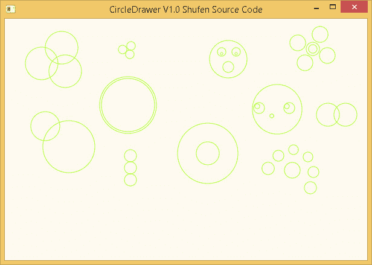

编译并运行应用程序。尝试以下步骤进行测试：

1. 将鼠标移动到画板上的某个位置。
2. 按住鼠标不放，在画板上拖动以画出一个圆。
3. 当你对圆的大小满意时，松开鼠标。
4. 按 `Enter` 键完成圆的绘制。
5. 重复上述步骤几次以绘制多个圆，每个圆都有不同的中心和半径，记得按下 `Enter` 键。
6. 重复 `MOUSE_PRESSED`—`MOUSE_DRAGGED`—`MOUSE_RELEASEED` 事件循环几次，不要按 `Enter` 键，观察发生什么。
7. 现在，按 `Esc` 键取消画板上最后一个圆。

在命令行中编译和运行该程序的输出：

```text
Microsoft Windows [Version 6.3.9600]
(c) 2013 Microsoft Corporation. All rights reserved.

F:\My Documents\DocRoot\SHFEN_JAVA\MyBookJFX\VolumeTwo\DrawTool1.0\src\example1>
javac -encoding utf-8 -Xlint:unchecked drawtool\*.java

jar cf drawtool.jar drawtool

javac -encoding utf-8 -Xlint:unchecked -cp drawtool.jar circledrawer\*.java

jar cf circledrawer.jar circledrawer

java -cp drawtool.jar;circledrawer.jar circledrawer.CircleDrawer
```

这里我们演示了如何使用 `drawtool` 包提供的 API 开发一个在画板上绘制椭圆形状的 `EllipseDrawer` 程序。

与之前描述的所有绘制器类似，一旦检测到鼠标拖拽事件，就会创建一个椭圆形状对象。在检测到鼠标拖拽事件之前的鼠标按下事件的位置被设置为椭圆的中心点。椭圆的 `radiusX` 属性和 `radiusY` 属性分别对应 `dragX` 属性和 `dragY` 属性。这是在 `onMouseDragStarted` 方法内部通过属性绑定机制实现的。结果是，随着鼠标拖拽事件的持续，椭圆的半径 `x` 和半径 `y` 会不断调整，且最新的鼠标拖拽位置始终位于圆周上。

为了完成一个椭圆的绘制，我们需要处理解除绑定，这在 `MOUSE_RELEASED` 事件的处理程序中完成，该事件标记了一系列鼠标拖拽事件的结束。

为了实例化用于处理椭圆绘制的 `ShapeDrawer`，我们如下所示定义 `newEllipseDrawer` 方法：

列表 6-16. 定义 `newEllipseDrawer` 方法，返回一个在画板上绘制椭圆形状的 `ShapeDrawer` 实例。

```java
ShapeDrawer newEllipseDrawer() {
  return new ShapeDrawer(Ellipse.class) {
    @Override
    public void onMouseDragStarted(final DrawPane drawPane) {

      Ellipse es = (Ellipse)getShape();

      DoubleBinding wB = new DoubleBinding() {
        {
          super.bind(drawPane.dragXProperty());
        }

        @Override
        protected double computeValue() {
          return Math.abs(drawPane.getDragX());
        }
      };
      DoubleBinding hB = new DoubleBinding() {
        {
          super.bind(drawPane.dragYProperty());
        }

        @Override
        protected double computeValue() {
          return Math.abs(drawPane.getDragY());
        }
      };
      es.centerXProperty().bind(drawPane.startXProperty());
      es.centerYProperty().bind(drawPane.startYProperty());
      es.radiusXProperty().bind(wB);
      es.radiusYProperty().bind(hB);
    }

    @Override
    public void onMouseDragFinished(final DrawPane drawPane) {
      Ellipse es = (Ellipse)getShape();
      if (es != null) {
        es.centerXProperty().unbind();
        es.centerYProperty().unbind();
        es.radiusXProperty().unbind();
        es.radiusYProperty().unbind();
      }
    }
  };
}
```

从上述代码列表中可以看出，我们将椭圆形状的中心点、`centerX` 属性和 `centerY` 属性绑定到了鼠标按下事件的位置，这些位置分别定义在 `DrawPane` 类的 `startX` 属性和 `startY` 属性中。此外，我们将半径 `X` 绑定到如下计算的拖拽 `X` 距离：

```java
@Override
protected double computeValue() {
  return Math.abs(drawPane.getDragX());
}
```

并且将半径 `Y` 绑定到如下计算的拖拽 `Y` 距离：

```java
@Override
protected double computeValue() {
  return Math.abs(drawPane.getDragY());
}
```

`dragX` 和 `dragY` 是定义在 `DrawPane` 类内部的属性，参考定义属性。

`DrawPane` 实例创建方式如下：

```java
DrawPane drawPane = new DrawPane(newEllipseDrawer());
```

`newEllipseDrawer()` 方法返回一个 `ShapeDrawer` 对象，该对象作为参数传递给 `DrawPane` 的构造函数。创建一个 `DrawPane` 实例以作为放置在 `BorderPane` 中心区域的绘板。

以下是 `EllipseDrawer` 类的完整源代码：

### 列表 6-17. `EllipseDrawer` 类的完整源代码：


```java
package ellipsedrawer;

import javafx.application.Application;
import javafx.beans.binding.DoubleBinding;
import javafx.scene.layout.BorderPane;
import javafx.scene.layout.Pane;
import javafx.scene.paint.Color;
import javafx.scene.Scene;
import javafx.stage.Stage;
import javafx.scene.shape.Ellipse;
import drawtool.*;

/**
 * File Name: EllipseDrawer.java
 * (位于目录: DrawTool1.0/src/example1/ellipsedrawer/)
 *
 * @author: Shufen Kuo
 */
public class EllipseDrawer extends Application {

  @Override
  public void start(Stage stage) {
    BorderPane rootPane = new BorderPane();
    DrawPane drawPane = new DrawPane(newEllipseDrawer());
    rootPane.setCenter(drawPane);

    Scene scene = new Scene(rootPane, 600, 400, Color.FLORALWHITE);
    stage.setScene(scene);
    stage.setTitle("EllipseDrawer V1.0 Shufen Source Code");
    stage.show();
  }

  ShapeDrawer newEllipseDrawer() {
    return new ShapeDrawer(Ellipse.class) {
      @Override
      public void onMouseDragStarted(final DrawPane drawPane) {

        Ellipse es = (Ellipse)getShape();

        DoubleBinding wB = new DoubleBinding() {
          {
            super.bind(drawPane.dragXProperty());
          }

          @Override
          protected double computeValue() {
            return Math.abs(drawPane.getDragX());
          }
        };
        DoubleBinding hB = new DoubleBinding() {
          {
            super.bind(drawPane.dragYProperty());
          }

          @Override
          protected double computeValue() {
            return Math.abs(drawPane.getDragY());
          }
        };
        es.centerXProperty().bind(drawPane.startXProperty());
        es.centerYProperty().bind(drawPane.startYProperty());
        es.radiusXProperty().bind(wB);
        es.radiusYProperty().bind(hB);
      }

      @Override
      public void onMouseDragFinished(final DrawPane drawPane) {
        Ellipse es = (Ellipse)getShape();
        if (es != null) {
          es.centerXProperty().unbind();
          es.centerYProperty().unbind();
          es.radiusXProperty().unbind();
          es.radiusYProperty().unbind();
        }
      }
    };
  }

  public static void main(String[] args) {
    launch(args);
  }
}
```

图 6-3. 使用 `Ellipse` 绘制的快照 (`images/0003.jpeg`)

编译并运行应用程序，尝试以下步骤：

1. 在绘板上移动鼠标。
2. 在绘板上按下并拖动绘制椭圆。
3. 对椭圆的大小满意后，释放鼠标。
4. 按回车键完成椭圆。
5. 重复不同中心点和半径的 `MOUSE_PRESSED`—`MOUSE_DRAGGED`—`MOUSE_RELEASED` 事件循环，观察每个事件会发生什么。
6. 现在，按 `Esc` 键取消。

编译并运行 `Ellipse` 程序的命令行输出：

```text
Microsoft Windows [Version 6.3.9600]
(c) 2013 Microsoft Corporation. All rights reserved.

F:\My Documents\DocRoot\SHUFEN_JAVA\MyFX\Volume\DrawTool1.0\src\example1>
javac -encoding utf-8 -Xlint:unchecked drawtool*.java

jar cf drawtool.jar drawtool

javac -encoding utf-8 -Xlint:unchecked -cp drawtool.jar ellipsedrawer*.java

jar cf ellipsedrawer.jar ellipsedrawer

java -cp drawtool.jar;ellipsedrawer.jar ellipsedrawer.EllipseDrawer
```

## 总结

本章介绍了 JavaFX 库的关键特性，按出现顺序列出：

- `javafx.beans.property` 中的某些类：

  - `ObjectProperty<T>`：一个抽象类，继承自 `javafx.beans.binding.ObjectExpression<T>` 类，实现了 `Property<T>` 和 `WritableObjectValue<T>`。
  - `SimpleObjectProperty<T>`：继承自 `ObjectProperty<T>` 类。
  - `DoubleProperty`：一个抽象类，继承自 `javafx.beans.binding.DoubleExpression` 类，实现了 `Property<Number>` 和 `WritableDoubleValue`。
  - `SimpleDoubleProperty`：继承自 `DoubleProperty` 类。
  - `BooleanProperty`：一个抽象类，继承自 `javafx.beans.binding.BooleanExpression` 类，实现了 `Property<java.lang.Boolean>` 和 `WritableBooleanValue`。
  - `WritableBooleanValue`：扩展了 `WritableValue<java.lang.Boolean>`。
  - `SimpleBooleanProperty`：继承自 `BooleanProperty` 类。

  （参考章节：定义属性、定义属性）

- `WritableObjectValue<T>` 接口位于 `javafx.beans.value` 包，并扩展了 `WritableValue<T>`，定义了以下方法：

  - `get()`：获取包装的值。
  - `set(T value)`：设置包装的值。

- `DoubleBinding` 是一个位于 `javafx.beans.binding` 包中的抽象类，继承自 `DoubleExpression` 并实现了 `NumberBinding`。为了实例化 `DoubleBinding` 对象，需要实现 `computeValue()` 方法。通常调用 `bind(Observable... dependencies)` 方法来观察此 `DoubleBinding` 依赖项的值变化。

  （参见此处、此处、此处）

- `Property<T>` 接口位于 `javafx.beans.property` 包中，定义了所有属性共有的方法，例如：

  ```java
  void bind(ObservableValue<? extends T> observable)
  ```

  将此属性单向绑定到给定的 `ObservableValue`。

  ```java
  void unbind()
  ```

  取消此属性的绑定。

  （参见此处、此处、此处）

- `Pane` 类继承自 `javafx.scene.layout.Region`，并位于 `javafx.scene.layout` 包中，是 JavaFX 内置布局类的基类。

  （参见章节：创建 `DrawPane` 类）

- `WritableBooleanValue` 接口位于 `javafx.beans.value` 包，并继承自 `WritableValue<Boolean>`，定义了以下方法：

  ```java
  boolean get()
  ```

  获取封装的值。它返回原始类型 `boolean`。

  ```java
  void set(boolean value)
  ```

  设置封装的值。它接受原始类型 `boolean`。

  （参见此处）

- `WritableDoubleValue` 接口位于 `javafx.beans.value` 包，并继承自 `WritableNumberValue`，定义了以下方法：

  ```java
  double get()
  ```

  获取封装的值。它返回原始类型 `double`。

  ```java
  void set(double value)
  ```

  设置封装的值。它接受原始类型 `double`。

  （参见此处）

- `EventHandler<T extends Event>` 是继承自 `java.util.EventListener` 的接口，定义了 `handle(T event)` 方法，在指定事件发生时调用。

  （参见章节：在默认构造函数中注册事件处理器）

- `MouseEvent` 类位于 `javafx.scene.input` 包中，是 `javafx.scene.input.InputEvent` 的子类。它定义了事件类型，如 `MOUSE_CLICKED`、`MOUSE_DRAGGED`、`MOUSE_ENTERED`、`MOUSE_EXITED`、`MOUSE_MOVED`、`MOUSE_PRESSED`、`MOUSE_RELEASED` 等，并提供了 `getX()`、`getY()` 等方法，用于获取事件发生时鼠标指针的位置。

  （参见章节：在默认构造函数中注册事件处理器）

- `Node` 类提供了一些便利方法，用于注册 `EventHandler` 来处理鼠标事件。

  ```java
  public final void setOnMousePressed(EventHandler<? super MouseEvent> value)
  ```

  注册一个 `EventHandler` 来处理 `MouseEvent` 的 `MOUSE_PRESSED` 事件类型。

  ```java
  public final void setOnMouseDragged(EventHandler<? super MouseEvent> value)
  ```

  注册一个 `EventHandler` 来处理 `MouseEvent` 的 `MOUSE_DRAGGED` 事件类型。

  ```java
  public final void setOnMouseReleased(EventHandler<? super MouseEvent> value)
  ```

  注册一个 `EventHandler` 来处理 `MouseEvent` 的 `MOUSE_RELEASED` 事件类型。

  （参见章节：在默认构造函数中注册事件处理器）

- `KeyEvent` 类位于 `javafx.scene.input` 包中，是 `javafx.scene.input.InputEvent` 的子类。它定义了事件类型，如 `KEY_PRESSED`、`KEY_RELEASED`、`KEY_TYPED` 等，并提供了 `getCode()`、`getCharacter()`、`getText()` 等方法，用于获取 `KeyCode` 或 `String` 类型的按键信息。它还提供了布尔值方法，如 `isControlDown()`、`isShiftDown()`、`isAltDown()` 等，用于验证某些修饰键是否同时按下。

  （参见章节：在默认构造函数中注册事件处理器；对 `ENTER` 键、`ESCAPE` 键和 `DELETE` 键执行默认操作）

- `Node` 类提供的便利方法：

  ```java
  public final void setOnKeyPressed(EventHandler<? super KeyEvent> value)
  ```

  这是 `Node` 类提供的一个便利方法，注册一个 `EventHandler` 来处理 `KeyEvent` 的 `KEY_PRESSED` 事件类型。

  （参见章节：在默认构造函数中注册事件处理器；对 `ENTER` 键、`ESCAPE` 键和 `DELETE` 键执行默认操作）

- `focusTraversable` 是 `Node` 类中定义的一个属性，用于指定该节点是否可以通过并有资格接收焦点。

  （参见此处）

- `KeyCode` 类位于 `javafx.scene.input` 包中，是一个枚举类型，为键盘按键定义常量；它涵盖了字母键（`A` 到 `Z`）、数字键（`DIGIT0` 到 `DIGIT9`）、修饰键（如 `CONTROL`、`SHIFT` 等）、功能键等。

  （参见章节：对 `ENTER` 键、`ESCAPE` 键和 `DELETE` 键执行默认操作）

- `Shape` 类位于 `javafx.scene.shape` 包中，提供了渲染二维几何基元（如矩形、圆形、椭圆等）的功能。

  （参见章节：使用绘图工具 API 开发绘图应用程序）

- `Rectangle` 类位于 `javafx.scene.shape` 包中，是 `javafx.scene.shape.Shape` 的直接子类。它提供了绘制具有指定属性的矩形的功能，如 `x`、`y`、`width`、`height` 等。

  （参见章节：作为 `Application` 子类的创建 `RectangleDrawer` 类）

- `Circle` 类位于 `javafx.scene.shape` 包中，是 `javafx.scene.shape.Shape` 的直接子类。它提供了绘制具有指定属性的圆形的功能，如 `centerX`、`centerY` 和 `radius`。

  （参见章节：作为 `Application` 子类的创建 `CircleDrawer` 类）

- `Ellipse` 类位于 `javafx.scene.shape` 包中，是 `javafx.scene.shape.Shape` 的直接子类。它提供了绘制具有指定属性的椭圆的功能，如 `centerX`、`centerY`、`radiusX` 和 `radiusY`。

  （参见章节：作为 `Application` 子类的创建 `EllipseDrawer` 类）

## 7.1 增强 `ShapeDrawer` 类

### 7.1.3 增强型 `ShapeDrawer` 类的完整源代码

## 7.2 创建 `ShapeDrawer` 的子类

### 7.2.1 实现 `LineDrawer` 类

#### 7.2.1.1 创建线条绘制应用程序

### 7.2.2 实现 `PolylineDrawer` 类

#### 7.2.2.1 创建折线绘制应用程序

### 7.2.3 实现 `PolygonDrawer` 类

#### 7.2.3.1 创建多边形绘制应用程序

### 7.2.4 实现 `PathDrawer` 类

#### 7.2.4.1 创建路径绘制应用程序

### 7.2.5 实现 `BezierCurveDrawer` 类

#### 7.2.5.1 创建贝塞尔曲线绘制应用程序

### 7.2.6 实现 `RectangleDrawer` 类

#### 7.2.6.1 创建矩形绘制应用程序

### 7.2.7 实现 `CircleDrawer` 类

#### 7.2.7.1 创建圆形绘制应用程序

### 7.2.8 实现 `EllipseDrawer` 类

#### 7.2.8.1 创建椭圆绘制应用程序

### 7.2.9 实现 `ShapeMover` 类

## 7.3 增强 `DrawPane` 类

## 7.4 总结


`ShapeDrawer` 是一个抽象类，是所有通过在绘板上移动鼠标绘制形状的绘制器的基类。它提供了基本方法来方便形状绘制应用程序的。在本节中，我们将定义额外的属性。

### 7.1.1 定义形状渲染属性

`ShapeDrawer` 类需要更多用于形状渲染的属性。

导入语句：

```java
import javafx.beans.property.DoubleProperty;
import javafx.beans.property.SimpleDoubleProperty;
import javafx.beans.property.ObjectProperty;
import javafx.beans.property.SimpleObjectProperty;
import javafx.scene.paint.Color;
import javafx.scene.shape.StrokeType;
```

列表 7-1. 在 `ShapeDrawer` 类中定义形状渲染属性：

```java
public ObjectProperty<Color> fillColor =
    new SimpleObjectProperty<>(Color.WHITE);
public ObjectProperty<Color> strokeColor =
    new SimpleObjectProperty<>(Color.GREY);

// 更多用于渲染形状的属性
public DoubleProperty strokeWidth = new SimpleDoubleProperty(1);
public ObjectProperty<StrokeType> strokeType =
    new SimpleObjectProperty<>(StrokeType.CENTERED); // 默认
```

你将在后续章节中看到有效用法，届时我们将为 `ShapeDrawer` 的每个子类分配不同的填充颜色和描边颜色。

### 7.1.2 定义布尔属性 `polySegment`

对于折线绘制器、多边形绘制器、路径绘制器和贝塞尔曲线绘制器，我们需要一个布尔属性来将它们与线条绘制器、矩形绘制器、圆形绘制器和椭圆绘制器区分开。在我们最初的方法中，需要用户按下 `Enter` 键来完成形状。为了简化用户界面，增强方法忽略了完成矩形、圆形或椭圆形状的 `Enter` 键，也就是说在 `MOUSE_PRESSED-MOUSE_DRAGGED-MOUSE_RELEASED` 事件循环后，形状将留在绘板上，除非按了 `Esc` 键。而对于折线、多边形或路径等包含多个段的形状，则需要按下 `Enter` 键来完成。

导入语句：

```java
import javafx.beans.property.BooleanProperty;
import javafx.beans.property.SimpleBooleanProperty;
```

列表 7-2. 在 `ShapeDrawer` 类中定义 `polySegment` 属性：

```java
// 此属性用于绘制折线、多边形、路径等多段形状
public BooleanProperty polySegment = new SimpleBooleanProperty();
```

`polySegment` 类型为 `BooleanProperty`，指定要绘制的形状是否由多个段组成；默认值为 `false`。它的值会在 `DrawPane` 类默认构造函数中注册的 `MouseDragged` 事件的 `handle` 方法内部检查。

### 7.1.3 增强型 `ShapeDrawer` 类的完整源代码

增强型 `ShapeDrawer` 类的完整源代码如下。

列表 7-3. 增强型 `ShapeDrawer` 类：

```java
package drawtool;

import javafx.beans.property.BooleanProperty;
import javafx.beans.property.SimpleBooleanProperty;
import javafx.beans.property.DoubleProperty;
import javafx.beans.property.SimpleDoubleProperty;
import javafx.beans.property.ObjectProperty;
import javafx.beans.property.SimpleObjectProperty;
import javafx.scene.paint.Color;
import javafx.scene.shape.Shape;
import javafx.scene.shape.StrokeType;

/**
 * File Name: ShapeDrawer.java
 * (in directory: DrawTool1.1/src/example1/drawtool/)
 * ShapeDrawer 是所有在绘板上绘制形状的绘制器的基类。
 * 它提供了基本方法以促进形状绘制应用程序的。
 * 形状是通过鼠标拖动事件在绘板上绘制的。
 *
 * shapeClass 是一个属性，用于指定在绘板上绘制的形状。
 * 如果未设置值，当绘板上发生鼠标拖动事件时，将不会绘制任何形状。
 * 请以下两个示例：
 *   LineDrawer 是 ShapeDrawer 的子类，shapeClass 的值在 LineDrawer 的构造函数
 *   中设置为 Line.class。
 *   ShapeMover 是 ShapeDrawer 的子类，shapeClass 的值设置为 null，
 *   因此，当鼠标拖动时，将不会绘制任何形状。
 *   ShapeMover 用于在上方拖动鼠标时移动现有的形状。
 *
 * shape 是一个临时存储在绘板上绘制的形状的属性。
 *
 * strokeColor/fillColor 是属性，用于存储在绘板上绘制的形状的
 *   描边/填充属性的值。
 *
 * 抽象方法必须由 ShapeDrawer 的子类实现：
 *   public abstract void onMouseDragStarted(DrawPane drawPane)
 *   public abstract void onMouseDragFinished(DrawPane drawPane)
 *
 * 以下是不执行操作的方法，它们可以被 ShapeDrawer 的子类重写：
 *   public void handleMouseClicked(DrawPane drawPane) {}
 *   public void handleDeleteKeyPressed(DrawPane drawPane) {}
 *   public void clean(DrawPane drawPane) {}
 *
 * @author: Shufen Kuo
 */
public abstract class ShapeDrawer {

  /* Declare variables */

  public ObjectProperty<Class<? extends Shape>> shapeClass =
    new SimpleObjectProperty<>();
  public ObjectProperty<Shape> shape = new SimpleObjectProperty<>();

  // 渲染形状的基本属性
  public ObjectProperty<Color> fillColor =
    new SimpleObjectProperty<>(Color.WHITE);
  public ObjectProperty<Color> strokeColor =
    new SimpleObjectProperty<>(Color.GREY);

  // 用于渲染形状的属性
  public DoubleProperty strokeWidth = new SimpleDoubleProperty(1);
  public ObjectProperty<StrokeType> strokeType =
      new SimpleObjectProperty<>(StrokeType.CENTERED); // 默认

  // 此属性用于绘制多边段，如折线、多边形、路径
  public BooleanProperty polySegment = new SimpleBooleanProperty();

  /* Define abstract methods */

  public abstract void onMouseDragStarted(DrawPane drawPane);
  public abstract void onMouseDragFinished(DrawPane drawPane);

  public ShapeDrawer(Class<? extends Shape> sc) {
    shapeClass.set(sc);
  }

  /* Define methods that do nothing */

  public void handleMouseClicked(DrawPane drawPane) {}
  public void handleDeleteKeyPressed(DrawPane drawPane) {}
  public void clean(DrawPane drawPane) {}

  /* Utilities to access properties */

  public Class<? extends Shape> getShapeClass() {
    return shapeClass.get();
  }

  public void setShapeClass(Class<? extends Shape> value) {
    shapeClass.set(value);
  }

  public ObjectProperty<Class<? extends Shape>> shapeClassProperty() {
    return shapeClass;
  }

  public Shape getShape() {
    return shape.get();
  }

  public void setShape(Shape value) {
    shape.set(value);
  }

  public ObjectProperty<Shape> shapeProperty() {
    return shape;
  }

  public boolean isPolySegment() {
    return polySegment.get();
  }

  public void setPolySegment(boolean value) {
    polySegment.set(value);
  }

  public BooleanProperty polySegmentProperty() {
    return polySegment;
  }

  public Color getStrokeColor() {
    return strokeColor.get();
  }

  public void setStrokeColor(Color value) {
    strokeColor.set(value);
  }

  public ObjectProperty<Color> strokeColorProperty() {
    return strokeColor;
  }

  public Color getFillColor() {
    return fillColor.get();
  }

  public void setFillColor(Color value) {
    fillColor.set(value);
  }

  public ObjectProperty<Color> fillColorProperty() {
    return fillColor;
  }

  public void setStrokeType(StrokeType value) {
    strokeType.set(value);
  }

  public StrokeType getStrokeType() {
    return strokeType.get();
  }

  public ObjectProperty<StrokeType> strokeTypeProperty() {
    return strokeType;
  }

  public void setStrokeWidth(double value) {
    strokeWidth.set(value);
  }

  public double getStrokeWidth() {
    return strokeWidth.get();
  }

  public DoubleProperty strokeWidthProperty() {
    return strokeWidth;
  }

}
```

## 7.2 创建 `ShapeDrawer` 的子类

在本节中，我们将实现类——`LineDrawer`、`PolylineDrawer`、`PolygonDrawer`、`PathDrawer`、`BezierCurveDrawer`、`RectangleDrawer`、`CircleDrawer`、`EllipseDrawer` 和 `ShapeMover`，它们继承自 `ShapeDrawer` 并位于 `drawtool.drawer` 包。

在本书后面的章节中，我们将利用它们来构建 `JFXDrawTools` 应用程序，这是一个全面的草图工具，用于在绘板上动态绘制各种形状。

### 7.2.1 实现 `LineDrawer` 类

`LineDrawer` 类通过实现两个抽象方法来扩展 `ShapeDrawer`：

```java
public abstract void onMouseDragStarted(DrawPane drawPane)
public abstract void onMouseDragFinished(DrawPane drawPane)
```

关于 `Line` 对象的详细描述，请参考第 1 章线条绘制器--开发线条绘制器 V1.0。

以下是 `LineDrawer` 的完整源代码。

列表 7-4. 实现 `LineDrawer` 类，它是 `ShapeDrawer` 的直接子类：

```java
package drawtool.drawer;

import javafx.scene.paint.Color;
import javafx.scene.shape.Line;

import drawtool.*;

/**
 * File Name: LineDrawer.java
 * (in directory: DrawTool1.1/src/example1/drawtool/drawer)
 *
 * @author: Shufen Kuo
 */
public class LineDrawer extends ShapeDrawer {

  public LineDrawer() {
    super(Line.class);
    setFillColor(null);
    setStrokeColor(Color.ORANGERED);
  }

  @Override
  public void onMouseDragStarted(DrawPane drawPane) {
    Line line = (Line)getShape();
    // 设置属性 startX, startY 的值
    line.setStartX(drawPane.getStartX());
    line.setStartY(drawPane.getStartY());
    // 绑定属性 endX, endY
    line.endXProperty().bind(
      drawPane.startXProperty().add(drawPane.dragXProperty()));
    line.endYProperty().bind(
      drawPane.startYProperty().add(drawPane.dragYProperty()));
  }

  @Override
  public void onMouseDragFinished(DrawPane drawPane) {
    Line line = (Line)getShape();
    // 此处必须验证形状不为空
    // 如果按了 Enter 键或 Esc 键，shape 将设置为 null
    if (line != null) {
      // 解除属性 endX, endY 的绑定
      line.endXProperty().unbind();
      line.endYProperty().unbind();
    }
  }

}
```

### 7.2.1.1 创建线条绘制应用程序

为了测试 `LineDrawer` 类，我们创建了一个简单的绘制应用程序，它仅在绘板上动态地绘制线条。以下是完整的源代码。

列表 7-5. 线条绘制应用程序的源代码：


```java
package drawerapp;

import javafx.application.Application;
import javafx.scene.layout.BorderPane;
import javafx.scene.paint.Color;
import javafx.scene.Scene;
import javafx.stage.Stage;

import drawtool.*;
import drawtool.drawer.*;

/**
 * File Name: LineDrawerApp.java
 * (in directory: DrawTool1.1/src/example1/drawerapp/)
 * 该应用程序在绘板上动态绘制线条。
 * 这是一个测试 LineDrawer 类的简单应用程序。
 *
 * @author: Shufen Kuo
 */

public class LineDrawerApp extends Application {

  @Override
  public void start(Stage stage) {
    BorderPane rootPane = new BorderPane();
    DrawPane drawPane = new DrawPane(new LineDrawer());
    rootPane.setCenter(drawPane);

    Scene scene = new Scene(rootPane, 600, 400, Color.FLORALWHITE);
    stage.setScene(scene);
    stage.setTitle("LineDrawerApp V1.0 Shufen Source Code");
    stage.show();
  }

  public static void main(String[] args) {
    launch(args);
  }
}
```

图 7-1. 使用 `Line Drawer App` 模块绘制线条的截图。

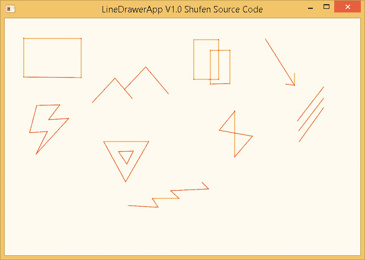

在命令行中编译和运行 `Line Drawer App` 的输出：

```text
Microsoft Windows [Version 6.3.9600]
(c) 2013 Microsoft Corporation. All rights reserved.

F:\My Documents\DocRoot\SHUFEN_JAVA\MyBookJFX\VolumeTwo\DrawTool1.1\src\example1>
javac -encoding utf-8 -Xlint:unchecked drawtool\*.java

javac  -encoding utf-8 -Xlint:unchecked -cp . drawtool\drawer\*.java

jar cf drawtool.jar drawtool

javac -encoding utf-8 -Xlint:unchecked -cp drawtool.jar drawerapp\*.java

jar cf drawerapp.jar drawerapp

java -cp drawtool.jar;drawerapp.jar drawerapp.LineDrawerApp
```

### 7.2.2 实现 `PolylineDrawer` 类

`PolylineDrawer` 类通过实现两个抽象方法扩展了 `ShapeDrawer`：

```java
public abstract void onMouseDragStarted(DrawPane drawPane)
public abstract void onMouseDragFinished(DrawPane drawPane)
```

在父类 `ShapeDrawer` 中定义的 `polySegment` 属性需要在构造函数中被设置为 `true`。要完成一个多折线对象的绘制，必须按下 `Enter` 键。

关于绘制 `Polyline` 对象的详细描述，请参考第 2 章 Polyline Drawer--开发 Polyline Drawer V1.0。

以下是 `PolylineDrawer` 类的源代码。

列表 7-6。实现 `PolylineDrawer` 类，它是 `ShapeDrawer` 的直接子类：

```java
package drawtool.drawer;

import javafx.beans.property.ObjectProperty;
import javafx.beans.property.SimpleObjectProperty;
import javafx.collections.ObservableList;
import javafx.scene.paint.Color;
import javafx.scene.shape.Line;
import javafx.scene.shape.Polyline;

import drawtool.*;

/**
 * File Name: PolylineDrawer.java
 * (in directory: DrawTool1.1/src/example1/drawtool/drawer)
 *
 * @author: Shufen Kuo
 */

public class PolylineDrawer extends ShapeDrawer {
  // 此用于持有一个临时线条，代表多折线的一个线段
  ObjectProperty<Line> line = new SimpleObjectProperty<>();

  public PolylineDrawer() {
    super(Polyline.class);
    setPolySegment(true); // 默认为 false
    setFillColor(null);
    setStrokeColor(Color.BLUEVIOLET);
  }

  @Override
  public void onMouseDragStarted(DrawPane drawPane) {
    Line tmpLine = new Line();
    drawPane.getChildren().add(tmpLine);
    // 将此 tmpLine 设置为 line 属性的值，
    // 结果它将会在添加到绘板的子列表中，
    // 在 line 属性的监听器内部。
    line.set(tmpLine);
    tmpLine.setStroke(getStrokeColor());
    tmpLine.setStartX(drawPane.getStartX());
    tmpLine.setStartY(drawPane.getStartY());
    tmpLine.endXProperty().bind(
      drawPane.startXProperty().add(drawPane.dragXProperty()));
    tmpLine.endYProperty().bind(
      drawPane.startYProperty().add(drawPane.dragYProperty()));

    Polyline polyline = (Polyline)getShape();
    // 验证此线条的起点是否与
    // 上一条线条的终点相同
    // 如果它们不相同，意味着此线段
    // 没有与上一个线段连接，
    // 我们将此线段的起点添加到 polyline 的点列表中。
    ObservableList<Double> list = polyline.getPoints();
    if (list.size() > 1) {
      // 检查最后一个点是否与此线条的起点相同
      double lastX = list.get(list.size()-2);
      double lastY = list.get(list.size()-1);
      // 如果线段的起点与 polyline
      // 点列表中的最后一个点重合，
      // 则无需将起点添加到起点
      if (lastX != drawPane.getStartX() && lastY != drawPane.getStartY()) {
        // 将起点添加到 polyline
        polyline.getPoints().addAll(drawPane.getStartX(), drawPane.getStartY());
      }
    } else {
      // 点列表中还没有点，
      // 将起点添加到点列表中，
      // 这是多折线的起始点。
      polyline.getPoints().addAll(drawPane.getStartX(), drawPane.getStartY());
    }
  }

  @Override
  public void onMouseDragFinished(DrawPane drawPane) {
    Line tmpLine = line.get();
    if (tmpLine != null) {
      tmpLine.endXProperty().unbind();
    }
  }
}
```

### 7.2.3 实现 `PolygonDrawer` 类

在父类 `ShapeDrawer` 中定义的 `polySegment` 属性需要在构造函数中被设置为 `true`。要完成一个多边形对象的绘制，必须按下 `Enter` 键。

以下是 `PolygonDrawer` 类的完整源代码，它们与 `PolylineDrawer` 几乎相同，不同部分已用粗体显示。

列表 7-8。实现 `PolygonDrawer` 类，它是 `ShapeDrawer` 的直接子类：

```java
package drawtool.drawer;

import javafx.beans.property.ObjectProperty;
import javafx.beans.property.SimpleObjectProperty;
import javafx.collections.ObservableList;
import javafx.scene.paint.Color;
import javafx.scene.shape.Line;
import javafx.scene.shape.Polygon;

import drawtool.*;

/**
 * File Name: PolygonDrawer.java
 * (in directory: DrawTool1.1/src/example1/drawtool/drawer)
 *
 * @author: Shufen Kuo
 */

public class PolygonDrawer extends ShapeDrawer {
  // 用于存储一个临时线条，代表多边形的一个条段
  ObjectProperty<Line> line = new SimpleObjectProperty<>();

  public PolygonDrawer() {
    super(Polygon.class);
    setPolySegment(true); // 默认为 false
    setStrokeColor(Color.MEDIUMBLUE);
    setFillColor(Color.AQUA);
  }

  @Override
  public void onMouseDragStarted(DrawPane drawPane) {
    Line tmpLine = new Line();
    drawPane.getChildren().add(tmpLine);
    // 将 tmpLine 设置为 line 属性的值，
    // 结果是它会被添加到绘制板的子列表中
    // 在 line 属性的监听器内部。
    line.set(tmpLine);
    tmpLine.setStroke(getStrokeColor());
    tmpLine.setStartX(drawPane.getStartX());
    tmpLine.setStartY(drawPane.getStartY());
    tmpLine.endXProperty().bind(
      drawPane.startXProperty().add(drawPane.dragXProperty()));
    tmpLine.endYProperty().bind(
      drawPane.startYProperty().add(drawPane.dragYProperty()));

    Polygon polygon = (Polygon)getShape();
    // 验证此线条的起点是否
    // 等于上一个线条的终点
    // 如果它们不相同，意味着该条段
    // 没有与上一个段连接，
    // 我们将此条段的起点添加到多边形的点列表中
    ObservableList<Double> list = polygon.getPoints();
    if (list.size() > 1) {
      // 检查最后一个点是否与此线条的起点相同
      double lastX = list.get(list.size()-2);
      double lastY = list.get(list.size()-1);
      // 如果此条段的起点与多边形点
      // 列表中的最后一个点重合，
      // 则不需要将起点添加到多边形
      if (lastX != drawPane.getStartX() && lastY != drawPane.getStartY()) {
        // 将起点添加到多边形
        polygon.getPoints().addAll(drawPane.getStartX(), drawPane.getStartY());
      }
    } else {
      // 点列表中目前还没有点，
      // 将起点添加到点列表中，
      // 这是多边形的起始点。
      polygon.getPoints().addAll(drawPane.getStartX(), drawPane.getStartY());
    }
  }

  @Override
  public void onMouseDragFinished(DrawPane drawPane) {
    Line tmpLine = line.get();
    if (tmpLine != null) {
      tmpLine.endXProperty().unbind();
      tmpLine.endYProperty().unbind();
      line.set(null); // 清除此临时线条
      drawPane.getChildren().remove(tmpLine);
    }

    Polygon polygon = (Polygon)getShape();
    // 在此处必须验证 shape 是否为空
    // 如果按下 Enter 键或 Esc 键，shape 设置为 null
    if (polygon != null) {
      // 将当前线条的终点添加到多边形
      polygon.getPoints().addAll(drawPane.getStartX() + drawPane.getDragX(),
        drawPane.getStartY() + drawPane.getDragY());
    }
  }

}
```

### 7.2.3.1 创建多边形绘制器应用程序

为了测试 `PolygonDrawer` 类，我们创建了一个简单的绘制应用程序，它可以在绘制板上动态地绘制多边形。以下是完整的源代码。

列表 7-9。多边形绘制应用程序的源代码：


```java
package drawerapp;

import javafx.application.Application;
import javafx.scene.layout.BorderPane;
import javafx.scene.paint.Color;
import javafx.scene.Scene;
import javafx.stage.Stage;

import drawtool.*;
import drawtool.drawer.*;

/**
 * File Name: PolygonDrawerApp.java
 * (in directory: DrawTool1.1/src/example1/drawerapp/)
 * 该应用程序在绘制板上动态绘制多边形。
 * 一个测试 PolygonDrawer 类的简单应用程序。
 *
 * @author: Shufen Kuo
 */

public class PolygonDrawerApp extends Application {

  @Override
  public void start(Stage stage) {
    BorderPane rootPane = new BorderPane();
    DrawPane drawPane = new DrawPane(new PolygonDrawer());
    rootPane.setCenter(drawPane);

    Scene scene = new Scene(rootPane, 600, 400, Color.ALICE);
    stage.setScene(scene);
    stage.setTitle("PolygonDrawerApp V1.0 Shufen Source Code");
    stage.show();
  }

  public static void main(String[] args) {
    launch(args);
  }
}
```

```java
package drawtool.drawer;

import javafx.beans.property.ObjectProperty;
import javafx.beans.property.SimpleObjectProperty;
import javafx.collections.ObservableList;
import javafx.scene.shape.LineTo;
import javafx.scene.shape.MoveTo;
import javafx.scene.shape.PathElement;
import javafx.scene.paint.Color;
import javafx.scene.shape.Path;

import drawtool.*;

/**
 * File Name: PathDrawer.java
 * (in directory: DrawTool1.1/src/example1/drawtool/drawer)
 *
 * @author: Shufen Kuo
 */

public class PathDrawer extends ShapeDrawer {

  public PathDrawer() {
    super(Path.class);
    setPolySegment(true); // 认为 false
    setStrokeColor(Color.DODGERBLUE);
    setFillColor(null);
  }

  @Override
  public void onMouseDragStarted(DrawPane drawPane) {
    Path path = (Path)getShape();
    ObservableList<PathElement> list = path.getElements();
    // 检查这是否是一个新路径的起点
    if (list.size() > 1) {
      // 这不是新路径的起点。
      // 检查是否需要 MoveTo。
      // 获取上一个 LineTo 并验证其 x,y 坐标。
      LineTo lineTo = (LineTo) list.get(list.size() - 1);
      if (lineTo.getX() != drawPane.getStartX() ||
          lineTo.getY() != drawPane.getStartY()) {
        // 需要一个 MoveTo 元素
        MoveTo moveTo = new MoveTo();
        moveTo.setX(drawPane.getStartX());
        moveTo.setY(drawPane.getStartY());
        path.getElements().add(moveTo);
      }      
    } else {
      // 这是一个新路径，必须创建一个 MoveTo
      MoveTo moveTo = new MoveTo();
      moveTo.setX(drawPane.getStartX());
      moveTo.setY(drawPane.getStartY());
      path.getElements().add(moveTo);
    }

    // 创建一个 LineTo 并添加到列表
    LineTo lineTo = new LineTo();
    lineTo.xProperty().bind(
      drawPane.startXProperty().add(drawPane.dragXProperty()));
    lineTo.yProperty().bind(
      drawPane.startYProperty().add(drawPane.dragYProperty()));

    path.getElements().add(lineTo);
  }

  @Override
  public void onMouseDragFinished(DrawPane drawPane) {
    Path path = (Path)getShape();
    // 此处必须验证 shape 不为空
    // 如果按下 Enter 键或 Esc 键，shape 将被设置为 null
    if (path != null) {    
      ObservableList<PathElement> list = path.getElements();
      // 解绑定列表中最后一个 lineTo 元素的 x, y 位置
      if (list.size() > 1) {
         LineTo lineTo = (LineTo) list.get(list.size() - 1);
         lineTo.xProperty().unbind();
         lineTo.yProperty().unbind();
      }
    }
  }

}
```

### 7.2.4.1 创建路径绘制器应用程序

为了测试`PathDrawer`类，我们创建了一个简单的绘制应用程序，它只是在绘图板上动态地绘制直线组成的路径。以下是完整的源代码。

列表 7-11. 路径绘制应用程序的源代码：

```java
package drawerapp;

import javafx.application.Application;
import javafx.scene.layout.BorderPane;
import javafx.scene.paint.Color;
import javafx.scene.Scene;
import javafx.stage.Stage;

import drawtool.*;
import drawtool.drawer.*;

/**
 * File Name: PathDrawerApp.java
 * (in directory: DrawTool1.1/src/example1/drawerapp/)
 * 此应用程序在绘图板上动态
 * 绘制直线路径。
 * 一个测试 PathDrawer 类的简单应用程序。
 *
 * @author: Shufen Kuo
 */
public class PathDrawerApp extends Application {

  @Override
  public void start(Stage stage) {
    BorderPane rootPane = new BorderPane();
    DrawPane drawPane = new DrawPane(new PathDrawer());
    rootPane.setCenter(drawPane);

    Scene scene = new Scene(rootPane, 600, 400, Color.FLORALWHITE);
    stage.setScene(scene);
    stage.setTitle("PathDrawerApp V1.0 Shufen Source Code");
    stage.show();
  }

  public static void main(String[] args) {
    launch(args);
  }
}
```

请注意，图 7-4 显示了一个包含多个元素的单个`Path`对象。该路径被渲染成多条直线。

图 7-4. 使用`Path Drawer App`模块绘制一个路径的截图。

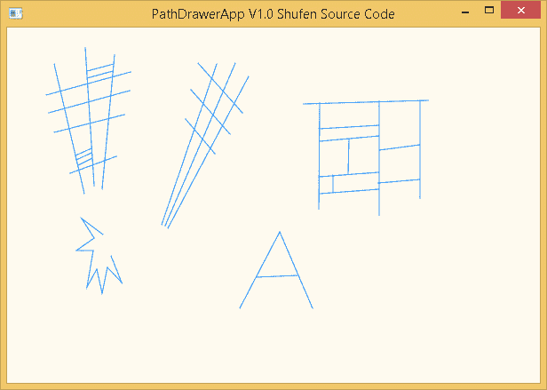

在命令行中编译和运行 Path Drawer App 的输出：

```
Microsoft Windows [Version 6.3.9600]
(c) 2013 Microsoft Corporation. All rights reserved.

F:\My Documents\DocRoot\SHUFEN_JAVA\MyBookJFX\VolumeTwo\DrawTool1.1\src\example1>
javac -encoding utf-8 -Xlint:unchecked drawtool\*.java

javac -encoding utf-8 -Xlint:unchecked -cp . drawtool\drawer\*.java

jar cf drawtool.jar drawtool

javac -encoding utf-8 -Xlint:unchecked -cp drawtool.jar drawerapp\*.java

jar cf drawerapp.jar drawerapp

java -cp drawtool.jar;drawerapp.jar drawerapp.PathDrawerApp
```

### 7.2.5 实现 BezierCurveDrawer 类

`BezierCurveDrawer`类通过实现两个抽象方法来扩展`ShapeDrawer`：

`public void onMouseDragStarted(DrawPane drawPane)`

`public abstract void onMouseDragFinished(DrawPane drawPane)`

父类`ShapeDrawer`中定义的`polySegment`属性需要在构造函数中被设置为`true`。要完成一个路径对象的绘制，必须按下`Enter`键。

`BezierCurveDrawer`像`PathDrawer`一样绘制`Path`对象；然而，与`PathDrawer`将路径渲染成直线不同，`BezierCurveDrawer`将路径渲染成多条二次贝塞尔曲线。关于绘制由多个二次贝塞尔曲线组成的`Path`对象的详细描述，请参阅 [第 5 章 二次贝塞尔曲线绘制器——开发二次贝塞尔曲线绘制器 V1.0]。


```java
package drawtool.drawer;

import javafx.beans.binding.DoubleBinding;
import javafx.beans.property.ObjectProperty;
import javafx.beans.property.SimpleObjectProperty;
import javafx.collections.ObservableList;
import javafx.scene.Cursor;
import javafx.scene.shape.Circle;
import javafx.scene.shape.LineTo;
import javafx.scene.shape.MoveTo;
import javafx.scene.shape.PathElement;
import javafx.scene.shape.QuadCurveTo;
import javafx.scene.shape.Shape;
import javafx.scene.paint.Color;
import javafx.scene.shape.Path;

import drawtool.*;

/**
 * 文件名：BezierCurveDrawer.java
 * （位于目录：DrawTool1.1/src/example1/drawtool/drawer）
 *
 * @author：Shufen Kuo
 */
public class BezierCurveDrawer extends ShapeDrawer {
  // 用于显示绘制二次贝塞尔曲线所需的 3 个点的位置
  Circle startPoint = new Circle(2.5f, Color.TRANSPARENT);
  Circle endPoint = new Circle(2.5f, Color.TRANSPARENT);
  Circle controlPoint = new Circle(3.5f, Color.TRANSPARENT);

  {
    startPoint.setStroke(Color.RED);
    endPoint.setStroke(Color.GREEN);
    controlPoint.setStroke(Color.BLUE);
  }

  public BezierCurveDrawer() {
    super(Path.class);
    setPolySegment(true); // 默认为 false
    setFillColor(Color.MOCCASIN);
    setStrokeColor(Color.SIENNA);
  }

  /**
   * 创建一个 MoveTo 并将其添加到路径中。
   * 其 x、y 属性被设置为 startX、startY。
   * 显示起点。
   */
  void addMoveTo(DrawPane drawPane, Path path) {
    MoveTo moveTo = new MoveTo();
    moveTo.setX(drawPane.getStartX());
    moveTo.setY(drawPane.getStartY());
    path.getElements().add(moveTo);
    showStartPoint(drawPane, drawPane.getStartX(), drawPane.getStartY());
  }

  /**
   * 创建一个 QuadCurveTo 并将其添加到路径中。
   * 由于我们只获取 2 个点的坐标，因此渲染的是直线而不是曲线。
   *
   * 其 x、y 属性（终点）绑定到起点加上偏移距离，
   * 对 controlX、controlY 属性也执行相同的绑定。
   *
   * 将终点圆形的 centerX、centerY 绑定到起点加上偏移距离。
   * 显示终点。
   *
   * 将控制点圆形的 centerX、centerY 绑定到起点加上偏移距离。
   * 显示控制点。
   */
  void addLineTo(DrawPane drawPane, Path path) {
    // 创建一个渲染为直线的 QuadCurveTo
    QuadCurveTo quadCurveTo = new QuadCurveTo();
    path.getElements().add(quadCurveTo);

    // 创建一个 DoubleBinding 来计算起始位置和偏移距离的和
    DoubleBinding draggedX =
        drawPane.startXProperty().add(drawPane.dragXProperty());
    DoubleBinding draggedY =
        drawPane.startYProperty().add(drawPane.dragYProperty());

    // 将曲线的终点绑定到鼠标拖动位置
    quadCurveTo.xProperty().bind(draggedX);
    quadCurveTo.yProperty().bind(draggedY);

    // 将曲线的控制点绑定到鼠标拖动位置
    quadCurveTo.controlXProperty().bind(draggedX);
    quadCurveTo.controlYProperty().bind(draggedY);

    // 处理终点圆形：
    // 终点圆形的中心绑定到拖动位置
    endPoint.centerXProperty().bind(draggedX);
    endPoint.centerYProperty().bind(draggedY);
    showEndPoint(drawPane);

    // 处理控制点圆形：
    // 圆形的中心绑定到拖动位置
    controlPoint.centerXProperty().bind(draggedX);
    controlPoint.centerYProperty().bind(draggedY);
    showControlPoint(drawPane);
  }

  void addQuadCurveTo(DrawPane drawPane, Path path) {
    QuadCurveTo quadCurveTo = new QuadCurveTo();
    path.getElements().add(quadCurveTo);

    // 将曲线的 x、y 属性设置为鼠标按下位置
    quadCurveTo.setX(drawPane.getStartX());
    quadCurveTo.setY(drawPane.getStartY());

    // 在鼠标按下位置显示终点圆形
    showEndPoint(drawPane, drawPane.getStartX(), drawPane.getStartY());

    // 创建一个 DoubleBinding 来计算起始位置和偏移距离的和
    DoubleBinding draggedX =
        drawPane.startXProperty().add(drawPane.dragXProperty());
    DoubleBinding draggedY =
        drawPane.startYProperty().add(drawPane.dragYProperty());

    // 将曲线的控制点绑定到鼠标拖动位置
    quadCurveTo.controlXProperty().bind(draggedX);
    quadCurveTo.controlYProperty().bind(draggedY);

    // 将控制点圆形的中心绑定到拖动位置
    controlPoint.centerXProperty().bind(draggedX);
    controlPoint.centerYProperty().bind(draggedY); // 注意：此处原代码似乎有误，本应为 draggedY

    // 显示控制点
    showControlPoint(drawPane);
  }

  /**
   * 当按下 DELETE 键时调用此方法删除最后一个元素。
   */
  void deleteLastElement(DrawPane drawPane, Path path) {
    ObservableList<PathElement> list = path.getElements();

    if (list.size() > 0) {
      list.remove(list.size() - 1);

      // 如果列表为空，隐藏起点
      if (list.size() == 0) {
        hideStartPoint(drawPane);
      } else {
        PathElement element = list.get(list.size() - 1);

        if (element instanceof MoveTo) {
          // 更新起点圆形
          MoveTo moveTo = (MoveTo) element;
          setStartPoint(moveTo.getX(), moveTo.getY());
        } else {
          // 必须是 QuadCurveTo
          // 更新起点圆形
          QuadCurveTo quadCurveTo = (QuadCurveTo) element;
          setStartPoint(quadCurveTo.getX(), quadCurveTo.getY());
        }
      }
    }
  }

  /**
   * ShapeDrawer 定义，在按下 Enter 键时调用此方法。
   */
  @Override
  public void clean(DrawPane drawPane) {
    hideStartPoint(drawPane);
  }

  /**
   * ShapeDrawer 定义，在按下 Delete 键时调用此方法。
   */
  @Override
  public void handleDeleteKeyPressed(DrawPane drawPane) {
    // 按下 Delete 删除最后一个元素
    if (getShape() != null && !drawPane.isDragged()) {
      // 如果正在拖动，则不允许删除操作
      // 在拖动过程中按下 Delete 将什么都不会发生
      deleteLastElement(drawPane, (Path) getShape());
    }
  }

  /**
   * ShapeDrawer 定义，当检测到真实点击并释放鼠标时调用此方法。
   */
  @Override
  public void handleMouseClicked(DrawPane drawPane) {
    // 如果不存在，则创建一个新的 Path
    if (getShape() == null) {
      Shape tmpShape = new Path();
      drawPane.setTmpShape(this, tmpShape);
      setShape(tmpShape);
      drawPane.getChildren().add(tmpShape);
    }

    Path path = (Path) getShape();

    // 如果是路径的开头，添加 MoveTo 元素；
    // 否则，获取最后一个元素。
    // 如果最后一个元素是 MoveTo，更新其 x、y 属性。
    // 如果最后一个元素不是 MoveTo，将 MoveTo 添加到列表。
    ObservableList<PathElement> list = path.getElements();

    if (list.size() > 0) {
      // 这不是新路径的开头
      // 获取最后一个元素
      PathElement element = list.get(list.size() - 1);

      if (element instanceof MoveTo) {
        // 更新其 x、y
        MoveTo moveTo = (MoveTo) element;
        moveTo.setX(drawPane.getStartX());
        moveTo.setY(drawPane.getStartY());
        setStartPoint(drawPane.getStartX(), drawPane.getStartY());
      } else {
        // 不是 MoveTo，将 MoveTo 添加到列表
        addMoveTo(drawPane, path);
      }
    } else {
      // 这是新路径，必须创建一个 MoveTo 来开始路径
      addMoveTo(drawPane, path);
    }
  }

  @Override
  public void onMouseDragStarted(DrawPane drawPane) {
    // 隐藏光标
    drawPane.setCursor(Cursor.NONE);

    Path path = (Path) getShape();
    ObservableList<PathElement> list = path.getElements();

    // 检查是否是新路径的开头
    if (list.size() == 0) {
      // 带有空的新路径
      // 先添加 MoveTo 后添加 QuadCurveTo
      // 构建曲线需要 3 个点，
      // 这里我们只有两个点，
      // QuadCurveTo 将看起来像一条直线，
      // 终点和控制点都在同一位置。
      addMoveTo(drawPane, path);
      addLineTo(drawPane, path);
    } else {
      // 这是列表中带有元素的现有路径，
      // 验证鼠标按下位置是否在起点圆形区域
      if (startPoint.contains(drawPane.getStartX(), drawPane.getStartY())) {
        // 这是一个特殊情况，
        // startX、startY 在起点圆形区域内。
        // 我们只能绘制看起来像直线的 QuadCurveTo，
        // 终点和控制点都在同一位置。
        addLineTo(drawPane, path);
      } else {
        // 这是一个正常情况，
        // startX、startY 不在起点的范围内。
        // 创建正常的 QuadCurveTo。
        addLineTo(drawPane, path);
      }
    }
  }

  @Override
  public void onMouseDragFinished(DrawPane drawPane) {
    // 恢复光标
    drawPane.setCursor(Cursor.DEFAULT);

    Path path = (Path) getShape();

    // 此逻辑在原始代码中似乎不完整
    if (path != null) {
      ObservableList<PathElement> list = path.getElements();

      if (list.size() > 0) {
        // 此部分遵循原始文本结构
      }
    }
  }

  /*
   * 以下是显示起点、终点、控制点的工具方法。
   * 它们由不同颜色的圆形表示。
   */
  void setStartPoint(double x, double y) {
    startPoint.setCenterX(x);
    startPoint.setCenterY(y);
  }

  void setEndPoint(double x, double y) {
    endPoint.setCenterX(x);
    endPoint.setCenterY(y);
  }

  void showStartPoint(DrawPane drawPane, double x, double y) {
    if (!drawPane.getChildren().contains(startPoint)) {
      drawPane.getChildren().add(startPoint);
    }

    setStartPoint(x, y);
  }

  void showEndPoint(DrawPane drawPane) {
    if (!drawPane.getChildren().contains(endPoint)) {
      drawPane.getChildren().add(endPoint);
    }
  }

  void showEndPoint(DrawPane drawPane, double x, double y) {
    if (!drawPane.getChildren().contains(endPoint)) {
      drawPane.getChildren().add(endPoint);
    }

    setEndPoint(x, y);
  }

  void showControlPoint(DrawPane drawPane) {
    if (!drawPane.getChildren().contains(controlPoint)) {
      drawPane.getChildren().add(controlPoint);
    }
  }

  void hideStartPoint(DrawPane drawPane) {
    drawPane.getChildren().remove(startPoint);
  }

  void hideEndPoint(DrawPane drawPane) {
    drawPane.getChildren().remove(endPoint);
  }

  void hideControlPoint(DrawPane drawPane) {
    drawPane.getChildren().remove(controlPoint);
  }
}
```


### 7.2.5.1 创建 Bezier 曲线绘制应用程序

为了测试 `BezierCurveDrawer` 类，我们创建了一个简单的绘制应用程序，它可以在画布上动态地绘制贝塞尔（Bezier）曲线路径。以下是完整的源代码。

列表 7-13. Bezier 曲线绘制应用程序的源代码：

```java
package drawerapp;

import javafx.application.Application;
import javafx.scene.layout.BorderPane;
import javafx.scene.paint.Color;
import javafx.scene.Scene;
import javafx.stage.Stage;

import drawtool.*;
import drawtool.drawer.*;

/**
 * 文件名: BezierCurveDrawerApp.java
 * (位于目录: DrawTool1.1/src/example1/drawerapp/)
 * 该应用程序在画布上动态地
 * 绘制贝塞尔（Bezier）路径。
 * 一个测试 BezierCurveDrawer 类的简单应用程序。
 *
 * @author: Shufen Kuo
 */
public class BezierCurveDrawerApp extends Application {

  @Override
  public void start(Stage stage) {
    BorderPane rootPane = new BorderPane();
    DrawPane drawPane = new DrawPane(new BezierCurveDrawer());
    rootPane.setCenter(drawPane);

    Scene scene = new Scene(rootPane, 600, 400, Color.FLORALWHITE);
    stage.setScene(scene);
    stage.setTitle("BezierCurveDrawerApp V1.0 Shufen Source Code");
    stage.show();
  }

  public static void main(String[] args) {
    launch(args);
  }
}
```

请注意，图 7-5 显示了一个包含多个元素的单个 `Path` 对象。该路径被渲染为多条贝塞尔曲线。

图 7-5. 使用 `Bezier Curve Drawer App` 模块绘制路径的截图。

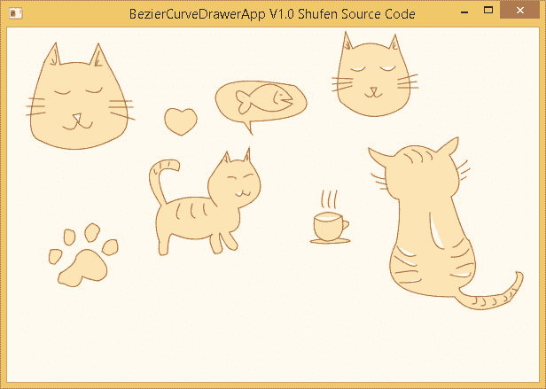

在命令行中编译并运行 Bezier Curve App 的输出：

```text
Microsoft Windows [Version 6.3.9600]
(c) 2013 Microsoft Corporation. All rights reserved.

F:\My Documents\DocRoot\SHUFEN_JAVA\MyBookJFX\VolumeTwo\DrawTool1.1\src\example1>
javac -encoding utf-8 -Xlint:unchecked drawtool\*.java

javac  -encoding utf-8 -Xlint:unchecked -cp . drawtool\drawer\*.java

jar cf drawtool.jar drawtool

javac -encoding utf-8 -Xlint:unchecked -cp drawtool.jar drawerapp\*.java

jar cf drawerapp.jar drawerapp

java -cp drawtool.jar;drawerapp.jar drawerapp.BezierCurveDrawerApp
```

### 7.2.6 实现 `RectangleDrawer` 类

`RectangleDrawer` 类通过实现两个抽象方法来扩展 `ShapeDrawer`：

```java
public abstract void onMouseDragStarted(DrawPane drawPane)
public abstract void onMouseDragFinished(DrawPane drawPane)
```

关于绘制 `Rectangle` 对象的详细描述，请参考第 6 章 基础绘制工具——开发形状绘制工具 V1.0 第 6.3.1 节 作为 `Application` 的子类创建 `RectangleDrawer` 类。

以下是 `RectangleDrawer` 类的完整源代码。

列表 7-14. 实现 `RectangleDrawer` 类，它是 `ShapeDrawer` 的直接子类：

```java
package drawtool.drawer;

import javafx.beans.binding.DoubleBinding;
import javafx.scene.paint.Color;
import javafx.scene.shape.Rectangle;

import drawtool.*;

/**
 * 文件名: RectangleDrawer.java
 * (位于目录: DrawTool1.1/src/example1/drawtool/drawer)
 *
 * @author: Shufen Kuo
 */

public class RectangleDrawer extends ShapeDrawer {

  public RectangleDrawer() {
    super(Rectangle.class);
    setFillColor(Color.MISTYROSE);
    setStrokeColor(Color.LIGHTPINK);
  }

  @Override
  public void onMouseDragStarted(final DrawPane drawPane) {
    Rectangle rect = (Rectangle)getShape();

    DoubleBinding xB = new DoubleBinding() {
      {
        super.bind(drawPane.dragXProperty());
      }

      @Override
      protected double computeValue() {
      return (drawPane.getDragX() < 0.0)
        ? drawPane.getStartX() + drawPane.getDragX() : drawPane.getStartX();
      }
    };

    DoubleBinding yB = new DoubleBinding() {
      {
        super.bind(drawPane.dragYProperty());
      }

      @Override
      protected double computeValue() {
        return (drawPane.getDragY() < 0.0)
          ? drawPane.getStartY() + drawPane.getDragY() : drawPane.getStartY();
      }
    };

    DoubleBinding wB = new DoubleBinding() {
      {
        super.bind(drawPane.dragXProperty());
      }

      @Override
      protected double computeValue() {
        return Math.abs(drawPane.getDragX());
      }
    };

    DoubleBinding hB = new DoubleBinding() {
      {
        super.bind(drawPane.dragYProperty());
      }

      @Override
      protected double computeValue() {
        return Math.abs(drawPane.getDragY());
      }
    };

    rect.xProperty().bind(xB);
    rect.yProperty().bind(yB);
    rect.widthProperty().bind(wB);
    rect.heightProperty().bind(hB);
  }

  @Override
  public void onMouseDragFinished(DrawPane drawPane) {
    Rectangle rect = (Rectangle)getShape();
    // Must verify shape is not null
    if (rect != null) {
      rect.xProperty().unbind();
      rect.yProperty().unbind();
      rect.widthProperty().unbind();
      rect.heightProperty().unbind();
    }
  }
}
```

#### 7.2.6.1 创建 Rectangle 应用程序

为了测试 `RectangleDrawer` 类，我们创建了一个简单的绘制应用程序，它可以在画布上动态地绘制矩形。以下是完整的源代码。

列表 7-15. 矩形绘制应用程序的源代码：

```java
package drawerapp;

import javafx.application.Application;
import javafx.scene.layout.BorderPane;
import javafx.scene.paint.Color;
import javafx.scene.Scene;
import javafx.stage.Stage;

import drawtool.*;
import drawtool.drawer.*;

/**
 * 文件名: RectangleDrawerApp.java
 * (位于目录: DrawTool1.1/src/example1/drawerapp/)
 * 该应用程序在画布上动态地
 * 绘制矩形。
 * 一个测试 RectangleDrawer 类的简单应用程序。
 *
 * @author: Shufen Kuo
 */
public class RectangleDrawerApp extends Application {

  @Override
  public void start(Stage stage) {
    BorderPane rootPane = new BorderPane();
    DrawPane drawPane = new DrawPane(new RectangleDrawer());
    rootPane.setCenter(drawPane);

    Scene scene = new Scene(rootPane, 600, 400, Color.FLORALWHITE);
    stage.setScene(scene);
    stage.setTitle("RectangleDrawerApp V1.0 Shufen Source Code");
    stage.show();
  }

  public static void main(String[] args) {
    launch(args);
  }
}
```

请注意，图 7-6 显示了一个包含多个元素的单个 `Path` 对象。该路径被渲染为多条矩形。

图 7-6. 使用 `Rectangle Drawer App` 模块绘制路径的截图。

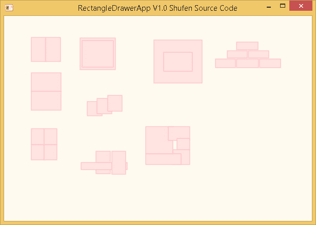

在命令行中编译并运行 Rectangle Drawer App 的输出：

```text
Microsoft Windows [Version 6.3.9600]
(c) 2013 Microsoft Corporation. All rights reserved.

F:\My Documents\DocRoot\SHUFEN_JAVA\MyBookJFX\VolumeTwo\DrawTool1.1\src\example1>
javac -encoding utf-8 -Xlint:unchecked drawtool\*.java

javac  -encoding utf-8 -Xlint:unchecked -cp . drawtool\drawer\*.java

jar cf drawtool.jar drawtool

javac -encoding utf-8 -Xlint:unchecked -cp drawtool.jar drawerapp\*.java

jar cf drawerapp.jar drawerapp

java -cp drawtool.jar;drawerapp.jar drawerapp.RectangleDrawerApp
```

```java
package drawtool.drawer;

import javafx.beans.binding.DoubleBinding;
import javafx.scene.paint.Color;
import javafx.scene.shape.Circle;

import drawtool.*;

/**
 * File Name: CircleDrawer.java
 * (in directory: DrawTool1.1/src/example1/drawtool/drawer)
 *
 * @author: Shufen Kuo
 */

public class CircleDrawer extends ShapeDrawer {

  public CircleDrawer() {
    super(Circle.class);
    setFillColor(Color.GOLD);
    setStrokeColor(Color.CORAL);
  }

  @Override
  public void onMouseDragStarted(final DrawPane drawPane) {
    Circle cs = (Circle)getShape();

    DoubleBinding rB = new DoubleBinding() {
      {
        super.bind(drawPane.dragXProperty(), drawPane.dragYProperty());
      }

      @Override
      protected double computeValue() {
        double dx = drawPane.getDragX();
        double dy = drawPane.getDragY();
        return Math.sqrt(dx*dx + dy*dy);
      }
    };
    cs.centerXProperty().bind(drawPane.startXProperty());
    cs.centerYProperty().bind(drawPane.startYProperty());
    cs.radiusProperty().bind(rB);

  }

  @Override
  public void onMouseDragFinished(DrawPane drawPane) {
    Circle cs = (Circle)getShape();
    // Must verify shape is not null here
    // shape is set to null if Enter key or Esc key has been hit
    if (cs != null) {
      cs.centerXProperty().unbind();
      cs.centerYProperty().unbind();
      cs.radiusProperty().unbind();
    }
  }

}
```

### 7.2.7.1 创建圆形绘制器应用程序

为了测试 `CircleDrawer` 类，我们创建了一个简单的绘图应用程序，它只是在绘图板上动态绘制圆。以下是完整的源代码。

列表 7-17. 圆形绘制应用程序的源代码：


```java
package drawerapp;

import javafx.application.Application;
import javafx.scene.layout.BorderPane;
import javafx.scene.paint.Color;
import javafx.scene.Scene;
import javafx.stage.Stage;

import drawtool.*;
import drawtool.drawer.*;

/**
 * File Name: CircleDrawerApp.java
 * (in directory: DrawTool1.1/src/example1/drawerapp/)
 * 此应用程序在绘图板上动态地绘制圆。
 * 一个测试 CircleDrawer 类的简单应用程序。
 *
 * @author: Shufen Kuo
 */
public class CircleDrawerApp extends Application {

  @Override
  public void start(Stage stage) {
    BorderPane rootPane = new BorderPane();
    DrawPane drawPane = new DrawPane(new CircleDrawer());
    rootPane.setCenter(drawPane);

    Scene scene = new Scene(rootPane, 600, 400, Color.FLORALWHITE);
    stage.setScene(scene);
    stage.setTitle("CircleDrawerApp V1.0 Shufen Source Code");
    stage.show();
  }

  public static void main(String[] args) {
    launch(args);
  }
}
```

图 7-7. 使用 `CircleDrawerApp` 模块绘制圆的截图。

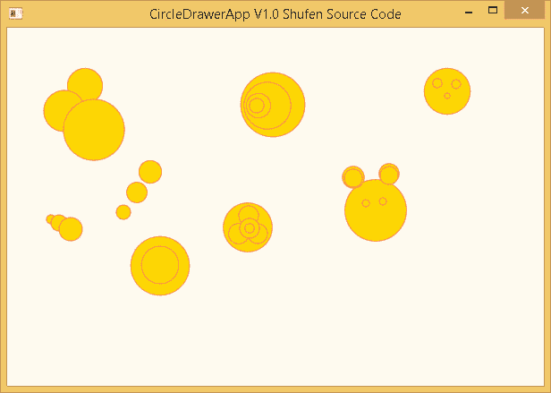

在命令行中编译和运行圆形绘制器程序的输出：

```
Microsoft Windows [Version 6.3.9600]
(c) 2013 Microsoft Corporation. All rights reserved.

F:\My Documents\DocRoot\SHUFEN_JAVA\MyBookJFX\VolumeTwo\DrawTool1.1\src\example1>
javac -encoding utf-8 -Xlint:unchecked drawtool\*.java

javac -encoding utf-8 -Xlint:unchecked -cp . drawtool\drawer\*.java

jar cf drawtool.jar drawtool

javac -encoding utf-8 -Xlint:unchecked -cp drawtool.jar drawerapp\*.java

jar cf drawerapp.jar drawerapp

java -cp drawtool.jar;drawerapp.jar drawerapp.CircleDrawerApp
```

### 7.2.8 实现 `EllipseDrawer` 类

`EllipseDrawer` 类通过实现两个抽象方法来扩展 `ShapeDrawer`：

```java
public abstract void onMouseDragStarted(DrawPane drawPane)
public abstract void onMouseDragFinished(DrawPane drawPane) 
```

有关绘制 `Ellipse` 对象的详细描述，请参考第 6 章 基础绘图工具——开发形状绘制工具 V1.0 第 6.3.3 作为 `Application` 子类的创建 `EllipseDrawer` 类。

以下是 `EllipseDrawer` 类的完整源代码。

列表 7-18. 实现 `ShapeDrawer` 的直接子类 `EllipseDrawer` 类：

```java
package drawtool.drawer;

import javafx.beans.binding.DoubleBinding;
import javafx.scene.paint.Color;
import javafx.scene.shape.Ellipse;

import drawtool.*;

/**
 * File Name: EllipseDrawer.java
 * (in directory: DrawTool1.1/src/example1/drawtool/drawer)
 *
 * @author: Shufen Kuo
 */

public class EllipseDrawer extends ShapeDrawer {

  public EllipseDrawer() {
    super(Ellipse.class);
    setFillColor(Color.YELLOW);
    setStrokeColor(Color.DARKGREEN);
  }

  @Override
  public void onMouseDragStarted(final DrawPane drawPane) {
    Ellipse cs = (Ellipse)getShape();

    DoubleBinding rB = new DoubleBinding() {
      {
        super.bind(drawPane.dragXProperty(), drawPane.dragYProperty());
      }

      @Override
      protected double computeValue() {
        double dx = drawPane.getDragX();
        double dy = drawPane.getDragY();
        return Math.sqrt(dx*dx + dy*dy);
      }
    };
    cs.centerXProperty().bind(drawPane.startXProperty());
    cs.centerYProperty().bind(drawPane.startYProperty());
    cs.radiusProperty().bind(rB);
  }

  @Override
  public void onMouseDragFinished(DrawPane drawPane) {
    Ellipse cs = (Ellipse)getShape();
    // 此处必须验证形状是否为空
    // 如果击了 Enter 键或 Esc 键，shape 将设置为 null
    if (cs != null) {
      cs.centerXProperty().unbind();
      cs.centerYProperty().unbind();
      cs.radiusProperty().unbind();
    }
  }

}
```

### 7.2.8.1 创建椭圆绘制器应用程序

为了测试 `EllipseDrawer` 类，我们创建了一个简单的绘图应用程序，它只是在绘图板上动态绘制椭圆。以下是完整的源代码。

```java
package drawerapp;

import javafx.application.Application;
import javafx.scene.layout.BorderPane;
import javafx.scene.paint.Color;
import javafx.scene.Scene;
import javafx.stage.Stage;

import drawtool.*;
import drawtool.drawer.*;

/**
 * File Name: EllipseDrawerApp.java
 * (in directory: DrawTool1.1/src/example1/drawerapp/)
 * 此应用程序在绘图板上动态地绘制椭圆。
 * 一个测试 EllipseDrawer 类的简单应用程序。
 *
 * @author: Shufen Kuo
 */
public class EllipseDrawerApp extends Application {

  @Override
  public void start(Stage stage) {
    BorderPane rootPane = new BorderPane();
    DrawPane drawPane = new DrawPane(new EllipseDrawer());
    rootPane.setCenter(drawPane);

    Scene scene = new Scene(rootPane, 600, 400, Color.FLORALWHITE);
    stage.setScene(scene);
    stage.setTitle("EllipseDrawerApp V1.0 Shufen Source Code");
    stage.show();
  }

  public static void main(String[] args) {
    launch(args);
  }
}
```

图 7-8. 使用 `EllipseDrawerApp` 模块绘制椭圆的截图。

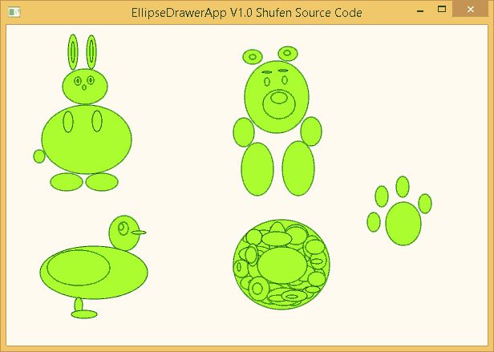

在命令行中编译和运行椭圆绘制器程序的输出：

```
Microsoft Windows [Version 6.3.9600]
(c) 2013 Microsoft Corporation. All rights reserved.

F:\My Documents\DocRoot\SHUFEN_JAVA\MyBookJFX\VolumeTwo\DrawTool1.1\src\example1>
javac -encoding utf-8 -Xlint:unchecked drawtool\*.java

javac -encoding utf-8 -Xlint:unchecked -cp . drawtool\drawer\*.java

jar cf drawtool.jar drawtool

javac -encoding utf-8 -Xlint:unchecked -cp drawtool.jar drawerapp\*.java

jar cf drawerapp.jar drawerapp

java -cp drawtool.jar;drawerapp.jar drawerapp.EllipseDrawerApp
```

### 7.2.9 实现 `ShapeMover` 类

与 `ShapeDrawer` 的其他子类不同，`ShapeMover` 在鼠标拖拽事件发生时并不执行任何绘制，它是在绘图板上移动目标节点。

```
public abstract void onMouseDragStarted(DrawPane drawPane)
public abstract void onMouseDragFinished(DrawPane drawPane) 
```

绘制器（drawer）与移动器（mover）在实现上的主要区别在于，移动器的 `shapeClass` 属性值被设置为 `null`，并传递给父类的构造函数。

以下是 `ShapeMover` 类的源代码。

### 列表 7-20. 实现 `ShapeMover` 类，它是 `ShapeDrawer` 的直接子类：

```java
package drawtool.drawer;

import javafx.event.EventTarget;
import javafx.scene.Node;
import javafx.scene.shape.Shape;
import javafx.scene.input.MouseEvent;
import drawtool.*;

/**
 * File Name: ShapeMover.java
 * (in directory: DrawTool1.1/src/example1/drawtool/drawer)
 *
 * @author: Shufen Kuo
 */

public class ShapeMover extends ShapeDrawer {

  public ShapeMover() {
    super(null);
  }

  @Override
  public void onMouseDragStarted(final DrawPane drawPane) {
    MouseEvent me = drawPane.getMouseEvent();

    if (me != null) {
      EventTarget et = me.getTarget();
      if (et instanceof Shape) {
        Node node = (Node)et;
        double origx = node.getTranslateX();
        double origy = node.getTranslateY();
        node.translateXProperty().bind(drawPane.dragXProperty().add(origx));
        node.translateYProperty().bind(drawPane.dragYProperty().add(origy));
      }
    }

  }

  @Override
  public void onMouseDragFinished(DrawPane drawPane) {
    MouseEvent me = drawPane.getMouseEvent();
    if (me != null) {
      EventTarget et = me.getTarget();
      if (et instanceof Shape) {
        Node node = (Node)et;
        node.translateXProperty().unbind();
        node.translateYProperty().unbind();
      }
    }
  }

}
```

`ShapeMover` 的用法将在下一章中探讨，在下一章中我们将开发 `JFXDrawTools` 程序的初始版本。

## 7.3 增强 `DrawPane` 类

为了满足高级形状绘制应用的需求，我们赋予了 `DrawPane` 功能。

以下是增强后的 `DrawPane` 类的源代码，与 V1.0 版本相比的主要差异（基于第 6 章 基础绘制工具——开发形状绘制工具 V1.0 开发）已用**粗体**显示。

### 列表 7-21. 增强 `DrawPane` 类：


```java
package drawtool;

import javafx.beans.property.BooleanProperty;
import javafx.beans.property.DoubleProperty;
import javafx.beans.property.ObjectProperty;
import javafx.beans.property.SimpleBooleanProperty;
import javafx.beans.property.SimpleDoubleProperty;
import javafx.beans.property.SimpleObjectProperty;
import javafx.beans.value.ChangeListener;
import javafx.beans.value.ObservableValue;
import javafx.event.EventHandler;
import javafx.scene.input.KeyCode;
import javafx.scene.input.KeyEvent;
import javafx.scene.input.MouseEvent;
import javafx.scene.layout.Pane;
import javafx.scene.shape.Shape;

/**
 * 文件名：DrawPane.java
 * (目录：DrawTool1.1/src/example1/drawtool/)
 * DrawPane 是 Pane 的子类，它不会对其子元素执行自动布局。
 *
 * 定义变量
 *   `startX`, `startY`, `dragX`, `dragY` 是用于持有双精度值的属性：
 *
 *     `startX`/`startY` 指定鼠标按下事件的坐标。
 *
 *     `dragX`/`dragY` 指定从当前拖拽位置到鼠标按下位置的平移距离。
 *
 *   `dragged` 是一个布尔属性，其值初始化为 false，在第一次鼠标拖拽事件发生时被设置为 true。当拖拽事件结束时重置为 false，即当一系列鼠标拖拽事件由鼠标释放事件结束时。
 *
 *   `drawer`，一个用于持有当前绘制器的属性，它是 `ShapeDrawer` 的子类。`ShapeDrawer` 位于 `drawtool` 包中，是所有绘制器的基类。 
 *
 * 注册事件处理器来处理以下事件：
 * 鼠标按下、鼠标拖拽、鼠标释放、按按下
 * 这些事件对于在绘板上交互式地绘制形状非常重要。
 *
 * @author: Shufen Kuo
 */
public class DrawPane extends Pane {

  /* 声明变量 */

  // 鼠标相对于 MouseEvent 源原点的位置，源是 `DrawPane`
  public DoubleProperty eventX = new SimpleDoubleProperty();
  public DoubleProperty eventY = new SimpleDoubleProperty();

  // 鼠标相对于屏幕原点的位置，此信息在按键事件发生时被引用
  public DoubleProperty screenX = new SimpleDoubleProperty();
  public DoubleProperty screenY = new SimpleDoubleProperty();

  // 用于 `ShapeMover`，在发生鼠标事件时获取事件目标
  public ObjectProperty<MouseEvent> mouseEvent = new SimpleObjectProperty<>();

  // 鼠标被按下时的鼠标位置
  public DoubleProperty startX = new SimpleDoubleProperty();
  public DoubleProperty startY = new SimpleDoubleProperty();
  // 从鼠标拖拽位置到鼠标按下位置计算出的拖拽距离
  public DoubleProperty dragX = new SimpleDoubleProperty();
  public DoubleProperty dragY = new SimpleDoubleProperty();

  public BooleanProperty dragged = new SimpleBooleanProperty();

  // 指定面板的当前绘制器
  // 可以根据需要创建多个绘制器并在绘制器之间动态切换
  public ObjectProperty<ShapeDrawer> drawer = new SimpleObjectProperty<>();

  // 将绘制器传递给构造函数
  public DrawPane(ShapeDrawer tool) {
    this();
    drawer.set(tool);
  }

  public DrawPane() {
    setOnMouseMoved(new EventHandler<MouseEvent>() {
      @Override
      public void handle(MouseEvent me) {
        drawOnMouseMoved(me);
      }
    });

    setOnMousePressed(new EventHandler<MouseEvent>() {
      @Override
      public void handle(MouseEvent me) {
        drawOnMousePressed(me);
      }
    });

    setOnMouseDragged(new EventHandler<MouseEvent>() {
      @Override
      public void handle(MouseEvent me) {
        drawOnMouseDragged(me);
      }
    });

    setOnMouseReleased(new EventHandler<MouseEvent>() {
      @Override
      public void handle(MouseEvent me) {
        drawOnMouseReleased(me);
      }
    });

    // 将 focusTraversable 属性设置为 true 以处理 KeyEvent，默认为 false。
    setFocusTraversable(true);
    setOnKeyPressed(new EventHandler<KeyEvent>() {
      @Override
      public void handle(KeyEvent ke) {
        drawOnKeyPressed(ke);
      }
    });

    // 监听属性 drawer 值的变化
    drawerProperty().addListener(new ChangeListener<ShapeDrawer>() {
      @Override
      public void changed(ObservableValue o, ShapeDrawer oldVal, ShapeDrawer newVal) {
         // 这对于多段线形状形状关重要
         // 需要处理未完成的任务
         // 特别是当旧绘制器是路径绘制器而新绘制器是贝塞尔曲线绘制器时
         if (oldVal != null)
           finalizeUnfinished(oldVal);
      }
    });
  }

  void setMouseLoc(MouseEvent me) {
    eventX.set(me.getX());
    eventY.set(me.getY());
    screenX.set(me.getScreenX());
    screenY.set(me.getScreenY());
    mouseEvent.set(me);
  }

  public void setTmpShapeProperties(ShapeDrawer drawTool, Shape tmpShape) {
    tmpShape.setFill(drawTool.getFillColor());
    tmpShape.setStroke(drawTool.getStrokeColor());
    if (drawTool.getStrokeWidth() > 0)
      tmpShape.setStrokeWidth(drawTool.getStrokeWidth());
    if (drawTool.getStrokeType() != null)
      tmpShape.setStrokeType();
  }
}
```

## 7.4 总结

本章介绍了 JavaFX 库的以下关键方面，按照它们在章节中出现的顺序列出：

*   `Shape` 类，位于 `javafx.scene.shape` 包中，提供渲染矩形、圆形、椭圆等 2D 几何原语的功能。

（参见章节：增强 `ShapeDrawer` 类, 实现 `ShapeMover`, 增强 `DrawPane` 类）

*   `javafx.beans.property` 包中的一些类：

    - `BooleanProperty`：一个抽象类，继承自 `javafx.beans.binding.BooleanExpression` 类，实现了 `Property<java.lang.Boolean>` 和 `WritableBooleanValue`。

    - `WritableBooleanValue` 扩展 `WritableValue<java.lang.Boolean>`。

    - `SimpleBooleanProperty`：继承自 `BooleanProperty` 类。

    - `DoubleProperty`：一个抽象类，继承自 `javafx.beans.binding.DoubleExpression` 类，实现了 `Property<Number>` 和 `WritableDoubleValue`。

    - `WritableDoubleValue` 扩展 `WritableNumberValue`。

    - `SimpleDoubleProperty`：继承自 `DoubleProperty` 类。

    - `ObjectProperty<T>`：一个抽象类，继承自 `javafx.beans.binding.ObjectExpression<T>` 类，实现了 `Property<T>` 和 `WritableObjectValue<T>`。

    - `SimpleObjectProperty<T>`：继承自 `ObjectProperty<T>` 类。

（参见章节：定义形状渲染属性, 定义布尔属性 `polySegment`）

*   `Color`，位于 `javafx.scene.paint` 包中，是 `Paint` 类的直接子类（颜色和渐变色的基类），用于绘制 `Shape` 的背景或边框。

（参见此处, 此处, 此处, 此处, 此处, 此处, 此处, 此处, 此处, 此处)）

*   `Shape` 类中定义的某些属性：

    - `fill`：指定一个 `Paint` 对象作为形状的背景颜色。

    - `stroke`：指定一个 `Paint` 对象作为形状的边框颜色。

    - `strokeType`：指定一个 `StrokeType` 对象（枚举类型）作为形状的边框类型。常量值为：`CENTERED`、`INSIDE`、`OUTSIDE`。默认值为 `CENTERED`。

    - `strokeWidth`：指定一个双值作为形状的边框宽度。

（参见定义形状渲染属性, 此处）

*   `WritableObjectValue<T>` 接口，位于 `javafx.beans.value` 包中并扩展 `WritableValue<T>`，定义了以下方法：

```
T get()
```

获取封装的值。

```
void set(T value)
```

设置封装的值。

（参见此处, 此处）

*   `Line` 类，位于 `javafx.scene.shape` 包中，是 `javafx.scene.shape.Shape` 的直接子类。它提供了指定线条位置的属性：`startX`、`startY`、`endX` 和 `endY`。

（参见 LineDrawer）

*   `Property<T>` 接口，位于 `javafx.beans.property` 包中，定义了以下通用方法：

```
void bind(ObservableValue observable)
```

将此属性绑定到给定的 `ObservableValue`。

```
void unbind()
```

解绑此属性。

（参见此处, 此处, 此处, 此处, 此处, 此处, 此处）

*   `Polyline`，位于 `javafx.scene.shape` 包中，是 `javafx.scene.shape.Shape` 的直接子类。使用 `getPoints()` 方法获取 `ObservableList<Double>` 列表，然后使用 `Collection` 接口中的基本方法添加一系列双值坐标来表示折线。

（参见 LineDrawer）

*   `Polygon`，位于 `javafx.scene.shape` 包中，是 `javafx.scene.shape.Shape` 的直接子类。使用 `getPoints()` 方法获取 `ObservableList<Double>` 列表，然后使用 `Collection` 接口中的基本方法添加一系列双值坐标来表示多边形。

（参见 LineDrawer）

*   `Path` 类，位于 `javafx.scene.shape` 包中，是 `Shape` 的直接子类。`Path` 由 `PathElement` 构造而成。

（参见章节：PathDrawer, BezierCurveDrawer）

*   `PathElement` 抽象类，位于 `javafx.scene.shape` 包中；其直接子类有：`ArcTo`、`ClosePath`、`CubicCurveTo`、`HLineTo`、`LineTo`、`MoveTo`、`QuadCurveTo`、`VLineTo`。

（参见章节：PathDrawer, BezierCurveDrawer）

*   `Path` 类提供的 `public final ObservableList<PathElement> getElements()` 方法返回一个类型为 `ObservableList<PathElement>` 的列表。使用 `Collection` 方法将 `PathElement` 对象添加到列表中。

（参见章节：PathDrawer, BezierCurveDrawer）

*   `LineTo`，位于 `javafx.scene.shape` 包中，是 `PathElement` 的直接子类；它为路径创建一个线条元素，从上一个元素的终点到指定的 x、y 坐标。

（参见 PathDrawer）

*   `MoveTo`，位于 `javafx.scene.shape` 包中，是 `PathElement` 的直接子类；它创建一个路径元素，将位置移动到指定的 x、y 坐标。

（参见章节：PathDrawer, BezierCurveDrawer）

*   `QuadCurveTo`，位于 `javafx.scene.shape` 包中，是 `PathElement` 的直接子类；它为路径创建一个二次贝塞尔曲线元素。

（参见 BezierCurveDrawer）

*   `DoubleBinding` 是一个位于 `javafx.beans.binding` 包的抽象类，继承自 `DoubleExpression` 并实现了 `NumberBinding`。为了实例化 `DoubleBinding` 对象，需要实现 `computeValue()` 方法。通常调用 `bind(Observable... dependencies)` 方法来观察依赖项对该 `DoubleBinding` 的值变化。

    （查看此处, 此处, 此处, 此处)

*   `Rectangle` 类位于 `javafx.scene.shape` 包，是 `javafx.scene.shape.Shape` 的直接子类。它提供了绘制具有指定属性（如 `x`、`y`、`width`、`height` 等）的矩形形状的功能。

    （查看章节实现 `RectangleDrawer` 类）

*   `Circle` 类位于 `javafx.scene.shape` 包，是 `javafx.scene.shape.Shape` 的直接子类。它提供了绘制具有指定属性（如 `centerX`、`centerY` 和 `radius`）的圆形形状的功能。

    （查看章节实现 `CircleDrawer` 类）

*   `Ellipse` 类位于 `javafx.scene.shape` 包，是 `javafx.scene.shape.Shape` 的直接子类。它提供了绘制具有指定属性（如 `centerX`、`centerY`、`radiusX` 和 `radiusY`）的椭圆形状的功能。

    （查看章节实现 `EllipseDrawer` 类）


*   `Pane` 类继承自`javafx.scene.layout.Region`并位于`javafx.scene.layout`包，是 JavaFX 内置布局面板的基类。

    （查看章节增强`DrawPane`类）

*   `EventHandler<T extends Event>`是一个继承自`java.util.EventListener`的接口，定义了`handle`(`T`事件)方法，在指定事件发生时被调用。

    （查看此处）

*   `MouseEvent`类位于`javafx.scene.input`包，是`javafx.scene.input.InputEvent`的子类。它定义了如`MOUSE_CLICKED`、`MOUSE_DRAGGED`、`MOUSE_ENTERED`、`MOUSE_EXITED`、`MOUSE_MOVED`、`MOUSE_PRESSED`、`MOUSE_RELEASED`等事件类型，并提供了如`getX()`、`getY()`等方法来获取事件发生时鼠标光标的位置。

    （查看此处）

*   `Node`类中提供的某些便利方法，用于注册`EventHandler`以处理鼠标事件。

    ```java
    public final void setOnMouseMoved(EventHandler<? super MouseEvent> value)
    ```

    注册一个`EventHandler`来处理`MouseEvent`的`MOUSE_MOVED`事件类型。

    ```java
    public final void setOnMousePressed(EventHandler<? super MouseEvent> value)
    ```

    注册一个`EventHandler`来处理`MouseEvent`的`MOUSE_PRESSED`事件类型。

    ```java
    public final void setOnMouseDragged(EventHandler<? super MouseEvent> value)
    ```

    注册一个`EventHandler`来处理`MouseEvent`的`MOUSE_DRAGGED`事件类型。

    ```java
    public final void setOnMouseReleased(EventHandler<? super MouseEvent> value)
    ```

    注册一个`EventHandler`来处理`MouseEvent`的`MOUSE_RELEASED`事件类型。

    （查看此处）

*   `KeyEvent`类位于`javafx.scene.input`包，是`javafx.scene.input.InputEvent`的子类。它定义了如`KEY_PRESSED`、`KEY_RELEASED`、`KEY_TYPED`等事件类型，并提供了如`getCode()`、`getCharacter()`、`getText()`等方法来获取以`KeyCode`或`String`类型表示的按键信息。它还提供了一些布尔方法，如`isControlDown()`、`isShiftDown()`、`isAltDown()`等，用于验证某些修饰键是否同时被按下。

    （查看此处, 此处）

*   ```java
    public final void setOnKeyPressed(EventHandler<? super KeyEvent> value)
    ```

    这是`Node`类提供的一个便利方法，用于注册一个`EventHandler`来处理`KeyEvent`的`KEY_PRESSED`事件类型。

    （查看此处）

*   `focusTraversable`是`Node`类中定义的一个属性，用于指定该节点是否可遍历并符合接收焦点条件。默认值为`false`。

    （查看此处）

*   ```java
    void addListener(ChangeListener<? super T> listener)
    ```

    方法定义在`javafx.beans.value.ObservableValue`接口中，通过提供`changed(ObservableValue<? extends T> observable, T oldValue, T newValue)`方法来添加`ChangeListener`，当该属性的值发生变化时会被调用。

    （查看此处）

*   `KeyCode`类位于`javafx.scene.input`包，是一个枚举类型，定义了键盘按键的常量，涵盖了字母键（`A`到`Z`）、数字键（`DIGIT0`到`DIGIT9`）、修饰键（如`CONTROL`、`SHIFT`等）、功能键等。

    （查看此处）

```java
package jfxdrawtools;

import javafx.application.Application;
import javafx.scene.image.Image;
import javafx.scene.layout.BorderPane;
import javafx.scene.paint.Color;
import javafx.scene.Scene;
import javafx.stage.Stage;

import drawtool.*;

/**
 * 文件名: JFXDrawTools.java
 *
 * 此应用程序在绘板上动态绘制各种形状。
 *
 * @author: Shufen Kuo
 */

public class JFXDrawTools extends Application {
  // 用于动态绘制/移动形状的绘板
  DrawPane drawPane;

  @Override
  public void start(Stage stage) {
    BorderPane rootPane = new BorderPane();
    drawPane = new DrawPane();
    rootPane.setCenter(drawPane);

    rootPane.setStyle("-fx-background-color: transparent;");
    Scene scene = new Scene(rootPane, 600, 400, Color.FLORALWHITE);

    stage.setScene(scene);
    stage.setTitle("JFXDrawTools V1.0 Shufen Source Code");

    // 设置应用程序的关闭图标
    String iconName = "/resource/swan16.jpg";
    Image iconImage = new Image(getClass().getResourceAsStream(
        iconName));
    stage.getIcons().add(iconImage);

    stage.show();
  }

}
```

在上面的代码中，我们设置了一张图像`/resource/swan16.jpg`作为应用程序窗口的最小化图标。这是该图像：

图 8-1. 作为应用程序窗口最小化图标的图像。


如果你是一个想要成功编译此程序的开发者，可以将图标图像替换为你喜欢的图片，或者从此电子书的 HTML 文件中提取图像文件`swan16.jpg`到一个名为`resource`的目录中。`resource`目录应该位于你放置`jfxdrawtools`包的目录内。

关于将电子书的`.mobi`格式转换为 HTML，这里的建议如下：

1. 在你的电脑上安装`Calibre`，这是一个免费开源的电子书管理软件。

2. 使用`Calibre`中的`Add books`功能将此电子书的`.mobi`文件添加到`Calibre Library`中。

3. 使用`Calibre`中的`Convert books`功能，选择`HTMLZ`为输出格式，点击`OK`按钮进行转换。

4. 转换完成后，你将得到一个扩展名为`.htmlz`的输出文件。将扩展名改为`.zip`并解压缩文件，你将得到一个大型 HTML 文件和一个名为`images`的目录，该目录包含 HTML 文件内容引用的所有图像文件。

   如果你正在使用 Windows 8，`.htmlz`输出文件存储在该目录的子目录中：

   ```
   C:\Users\<User Name>\Documents\Calibre Library
   ```

### 8.1.2 创建状态栏

创建了一个包含`Text`对象的`HBox`并将其放置在`BorderPane`的底部作为状态栏。定义了一个`StringProperty`类型的`footer`，用于指定在状态栏上显示的字符串。以下是实现这些操作的代码片段：

导入语句：

```java
import javafx.beans.property.SimpleStringProperty;
import javafx.beans.property.StringProperty;
import javafx.geometry.Insets;
import javafx.scene.layout.HBox;
import javafx.scene.text.Font;
import javafx.scene.text.FontWeight;
import javafx.scene.text.Text;
```

列表 8-2. 创建状态栏，放置在 border pane 的底部：

```java
 // 指定在底部状态栏上显示的文本
  StringProperty footer = new SimpleStringProperty();

  @Override
  public void start(Stage stage) {
    ...
    // 将状态栏添加到底部
    HBox statusBar = createStatusBar();
    rootPane.setBottom(statusBar);

    ...
  }

  /***
   * 创建状态栏
   */
  HBox createStatusBar() {
    HBox statusBar = new HBox();
    Text statusText = new Text("");

    // 将状态栏的文本绑定到 footer
    statusText.textProperty().bind(footer);
    statusBar.setPadding(new Insets(4));
    statusBar.setSpacing(4);
    statusText.setFont(new Font("Courier", 14, FontWeight.BOLD));
    statusText.setFill(Color.web("#black"));
    statusBar.getChildren().add(statusText);

    return statusBar;
  }
```

### 8.1.3 创建菜单

创建一个`MenuBar`并将其放置在`BorderPane`的顶部作为菜单栏。定义了一个`StringProperty`类型的`footer`，用于指定在状态栏上显示的字符串。以下是实现这些操作的代码片段：

导入语句：

```java
import javafx.beans.property.SimpleStringProperty;
import javafx.beans.property.StringProperty;
import javafx.geometry.Insets;
import javafx.scene.layout.HBox;
import javafx.scene.text.Font;
import javafx.scene.text.FontWeight;
import javafx.scene.text.Text;
import javafx.scene.control.MenuBar;
import javafx.scene.control.Menu;
import javafx.scene.control.MenuItem;
```

列表 8-3. 创建菜单栏，放置在 border pane 的顶部：

```java
 // 指定在底部状态栏上显示的文本
  StringProperty footer = new SimpleStringProperty();

  @Override
  public void start(Stage stage) {
    ...
    // 将菜单栏添加到顶部
    MenuBar menuBar = createMenuBar();
    rootPane.setTop(menuBar);

    ...
  }

  /***
   * 创建菜单栏
   */
  MenuBar createMenuBar() {
    MenuBar menuBar = new MenuBar();
    Menu menuTools = createTools();
    menuBar.getMenus().add(menuTools);

    return menuBar;
  }

  /***
   * 创建工具
   */
  Menu createTools() {
    Menu menuTools = new Menu("Tools");
    ...
  }
```

### 8.1.4 设置菜单项的快捷键

`MenuItem`中的`accelerator`属性指定了一个`KeyCombination`来触发`ActionEvent`。以下是为`RadioMenuItem`设置快捷键的代码片段。

导入语句：

```java
import javafx.event.ActionEvent;
import javafx.event.EventHandler;
import javafx.scene.input.KeyCharacterCombination;
import javafx.scene.input.KeyCombination;
```

列表 8-4. 为`RadioMenuItem`设置快捷键，创建一个处理`ActionEvent`的`EventHandler`，并调用`setOnAction`方法来注册该事件处理器：


```java
// 此事件处理器用于 ActionEvent，
// 它由 MenuItem 的快捷键调用
EventHandler<ActionEvent> toolSelector =
    new EventHandler<ActionEvent>() {
  @Override
  public void handle(ActionEvent e) {
    RadioMenuItem mi = (RadioMenuItem)e.getSource();
    // 当用户按下定义的键组合时，
    // 会触发 ActionEvent，
    // 我们必须显式地设置为 true
    mi.setSelected(true);
  }
};

// 创建单选菜单项
RadioMenuItem drawLine = new RadioMenuItem("Line Drawer");
drawLine.setAccelerator(
    new KeyCharacterCombination("L", KeyCombination.CONTROL_DOWN));
drawLine.setOnAction(toolSelector);
```

### 8.1.5 定义枚举类型 `DrawTools`

我们定义了一个枚举类型 `DrawTools`，用于指定表示当前可用形状绘制器的常量。它们是：`LineDrawer`、`PolylineDrawer`、`PolygonDrawer`、`PathDrawer`、`BezierCurveDrawer`、`RectangleDrawer`、`CircleDrawer`、`EllipseDrawer` 和 `ShapeMover`。关于这些预定义形状绘制器的详细描述，请参考前面的章节。

以下是定义 `enum` 类型 `DrawTools` 的代码：

Listing 8-5. 定义 `enum` 类型 `DrawTools`：

```java
enum DrawTools {
    LINE_DRAWER,
    POLYLINE_DRAWER,
    POLYGON_DRAWER,
    PATH_DRAWER,
    BEZIER_CURVE_DRAWER,
    RECTANGLE_DRAWER,
    CIRCLE_DRAWER,
    ELLIPSE_DRAWER,
    SHAPE_MOVER,
    NO_TOOL
} 
```

`DrawTools` 中的值被用作单选菜单项的 `id`；见下面的代码片段：

Listing 8-6. 为 `RadioMenuItem` 设置 `id`：

```java
// 创建单选菜单项
RadioMenuItem drawLine = new RadioMenuItem("Line Drawer");
drawLine.setId(DrawTools.LINE_DRAWER.name());
```

### 8.1.6 `JFXDrawTools` 类骨架的完整源代码

这里是 `JFXDrawTools` 类骨架的完整源代码。

Listing 8-7. 创建 `JFXDrawTools` 的骨架：


```java
package jfxdrawtools;

import javafx.application.Application;
import javafx.beans.property.SimpleStringProperty;
import javafx.beans.property.StringProperty;
import javafx.beans.value.ChangeListener;
import javafx.beans.value.ObservableValue;
import javafx.event.ActionEvent;
import javafx.event.EventHandler;
import javafx.geometry.Insets;
import javafx.scene.control.Menu;
import javafx.scene.control.MenuBar;
import javafx.scene.control.MenuItem;
import javafx.scene.control.RadioMenuItem;
import javafx.scene.control.Toggle;
import javafx.scene.control.ToggleGroup;
import javafx.scene.image.Image;
import javafx.scene.input.KeyCharacterCombination;
import javafx.scene.input.KeyCombination;
import javafx.scene.layout.BorderPane;
import javafx.scene.layout.HBox;
import javafx.scene.paint.Color;
import javafx.scene.Scene;
import javafx.scene.text.Font;
import javafx.scene.text.FontWeight;
import javafx.scene.text.Text;
import javafx.stage.Stage;

import drawtool.*;

/**
 * 文件名: JFXDrawTools.java
 * (位于目录: JFXDrawTools1.0/src/example1/jfxdrawtools/)
 * 该应用程序在绘板上动态绘制各种形状。
 *
 * @author: Shufen Kuo
 */

enum DrawTools {
    LINE_DRAWER,         // 线条绘制
    POLYLINE_DRAWER,     // 折段线绘制
    POLYGON_DRAWER,      // 多边形绘制
    PATH_DRAWER,         // 路径绘制
    BEZIER_CURVE_DRAWER, // 贝塞尔曲线绘制
    RECTANGLE_DRAWER,    // 矩形绘制
    CIRCLE_DRAWER,       // 圆形绘制
    ELLIPSE_DRAWER,      // 椭圆绘制
    SHAPE_MOVER,         // 形状移动
    NO_TOOL              // 无工具
}

public class JFXDrawTools extends Application {
  // 用于动态绘制/移动形状的绘板
  DrawPane drawPane;

  // 指定在 borderPane 底部状态栏显示的文本
  StringProperty footer = new SimpleStringProperty();

  @Override
  public void start(Stage stage) {
    BorderPane rootPane = new BorderPane();
    drawPane = new DrawPane();
    rootPane.setCenter(drawPane);

    // 在 BorderPane 顶部添加菜单栏
    MenuBar menuBar = createMenuBar();
    rootPane.setTop(menuBar);

    // 添加状态栏显示页脚
    HBox statusBar = createStatusBar();
    rootPane.setBottom(statusBar);

    rootPane.setStyle("-fx-background-color: transparent;");
    Scene scene = new Scene(rootPane, 600, 400, Color.FLORALWHITE);

    stage.setScene(scene);
    stage.setTitle("JFXDrawTools V1.0 Shufen Source Code");

    // 设置应用程序的关闭图标
    String iconName = "/resource/swan16.jpg";
    Image iconImage = new Image(getClass().getResourceAsStream(
        iconName));
    stage.getIcons().add(iconImage);

    stage.show();
  }

  /***
   * 创建菜单栏
   */
  MenuBar createMenuBar() {
    MenuBar menuBar = new MenuBar();
    Menu menuTools = createMenuTools();
    menuBar.getMenus().add(menuTools);

    return menuBar;
  }

  /***
   * 创建工具
   */
  Menu createMenuTools() {
    // 创建切换组
    ToggleGroup groupTools = new ToggleGroup();

    // 此事件处理器用于 ActionEvent，
    // 它由加速键调用
    EventHandler<ActionEvent> toolSelector =
        new EventHandler<ActionEvent>() {
      @Override
      public void handle(ActionEvent e) {
        RadioMenuItem mi = (RadioMenuItem)e.getSource();
        // 当用户按下定义的按键组合时，
        // 会触发 ActionEvent，
        // 我们必须显式将其设置为 true
        mi.setSelected(true);
      }
    };

    // 创建单选菜单项
    RadioMenuItem drawLine = new RadioMenuItem("线条绘制 (Line Drawer)");
    drawLine.setId(DrawTools.LINE_DRAWER.name());
    drawLine.setAccelerator(
        new KeyCharacterCombination("L", KeyCombination.CONTROL_DOWN));
    drawLine.setOnAction(toolSelector);
    drawLine.setToggleGroup(groupTools);

    RadioMenuItem drawPolyline = new RadioMenuItem("折段线绘制 (Polyline Drawer)");
    drawPolyline.setId(DrawTools.POLYLINE_DRAWER.name());
    drawPolyline.setAccelerator(
        new KeyCharacterCombination("P", KeyCombination.CONTROL_DOWN));
    drawPolyline.setOnAction(toolSelector);
    drawPolyline.setToggleGroup(groupTools);

    RadioMenuItem drawPolygon = new RadioMenuItem("多边形绘制 (Polygon Drawer)");
    drawPolygon.setId(DrawTools.POLYGON_DRAWER.name());
    drawPolygon.setAccelerator(
        new KeyCharacterCombination("G", KeyCombination.CONTROL_DOWN));
    drawPolygon.setOnAction(toolSelector);
    drawPolygon.setToggleGroup(groupTools);

    RadioMenuItem drawPath = new RadioMenuItem("路径绘制 (Path Drawer)");
    drawPath.setId(DrawTools.PATH_DRAWER.name());
    drawPath.setAccelerator(
        new KeyCharacterCombination("T", KeyCombination.CONTROL_DOWN));
    drawPath.setOnAction(toolSelector);
    drawPath.setToggleGroup(groupTools);

    RadioMenuItem drawBezierCurve = new RadioMenuItem("贝塞尔曲线绘制 (Bezier Drawer)");
    drawBezierCurve.setId(DrawTools.BEZIER_CURVE_DRAWER.name());
    drawBezierCurve.setAccelerator(
        new KeyCharacterCombination("B", KeyCombination.CONTROL_DOWN));
    drawBezierCurve.setOnAction(toolSelector);
    drawBezierCurve.setToggleGroup(groupTools);

    RadioMenuItem drawRectangle = new RadioMenuItem("矩形绘制 (Rectangle Drawer)");
    drawRectangle.setId(DrawTools.RECTANGLE_DRAWER.name());
    drawRectangle.setAccelerator(
        new KeyCharacterCombination("R", KeyCombination.CONTROL_DOWN));
    drawRectangle.setOnAction(toolSelector);
    drawRectangle.setToggleGroup(groupTools);

    RadioMenuItem drawCircle = new RadioMenuItem("圆形绘制 (Circle Drawer)");
    drawCircle.setId(DrawTools.CIRCLE_DRAWER.name());
    drawCircle.setAccelerator(
        new KeyCharacterCombination("C", KeyCombination.CONTROL_DOWN));
    drawCircle.setOnAction(toolSelector);
    drawCircle.setToggleGroup(groupTools);

    RadioMenuItem drawEllipse = new RadioMenuItem("椭圆绘制 (Ellipse Drawer)");
    drawEllipse.setId(DrawTools.ELLIPSE_DRAWER.name());
    drawEllipse.setAccelerator(
        new KeyCharacterCombination("E", KeyCombination.CONTROL_DOWN));
    drawEllipse.setOnAction(toolSelector);
    drawEllipse.setToggleGroup(groupTools);

    RadioMenuItem moveShape = new RadioMenuItem("形状移动 (Shape Mover)");
    moveShape.setId(DrawTools.SHAPE_MOVER.name());
    moveShape.setAccelerator(
        new KeyCharacterCombination("M", KeyCombination.CONTROL_DOWN));
    moveShape.setOnAction(toolSelector);
    moveShape.setToggleGroup(groupTools);

    // 为切换组添加监听器
    groupTools.selectedToggleProperty().addListener(new ChangeListener<Toggle>() {
      @Override
      public void changed(ObservableValue<? extends Toggle> ov,
                          Toggle oldVal, Toggle newVal) {
        if (newVal != null) {
          RadioMenuItem mi = (RadioMenuItem) newVal;
          footer.set(String.format("%s 已选中", mi.getText()));
        }
      }
    });

    // 创建工具菜单
    Menu menuTools = new Menu("工具 (Tools)");
    menuTools.getItems().addAll(drawLine, drawPolyline, drawPolygon, drawPath, drawBezierCurve, drawRectangle, drawCircle, drawEllipse, moveShape);

    return menuTools;
  }

  /***
   * 创建状态栏
   */
  HBox createStatusBar() {
    HBox statusBar = new HBox();
    Text statusText = new Text("");
    // 绑定文本和页脚
    statusText.textProperty().bind(footer);
    statusBar.getChildren().add(statusText);

    statusBar.setPadding(new Insets(4, 12, 4, 12));
    statusBar.setSpacing(4);
    statusBar.setStyle("-fx-background-color: linear-gradient(from 0% 0% to 100% 100%, #7080A7 55%, #F0FFFF); -fx-border-color: #e6e6d3;");

    statusText.setFont(Font.font("Courier New", FontWeight.BOLD, 14));
    statusText.setFill(Color.web("#F0FFFF"));

    return statusBar;
  }

  public static void main(String[] args) {
    launch(args);
  }
}
```

- 图 8-2：`JFXDrawTools` 应用程序的初始外观截图。
- 图 8-3：点击“工具”菜单时的截图。
- 图 8-4：当“线条绘制”单选菜单项被选中时的截图。
- 图 8-5：选择 `Bezier Curve Drawer` 单选菜单项时 `Tools` 菜单的快照。

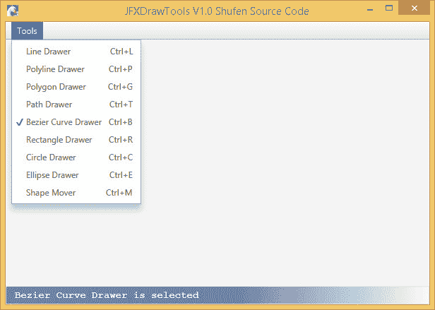

编译并运行应用程序。尝试以下步骤进行测试：

1. 点击 `Tools` 菜单显示菜单。
2. 点击 `Line Drawer` 菜单项选择 `Line Drawer`。
3. 点击其他菜单项。
4. 按下组合键 `Control-B` 选择 `Bezier Curve Drawer`。
5. 尝试其他组合键：`Control-L`、`Control-P`、`Control-G`、`Control-T`、`Control-R`、`Control-C`、`Control-E` 和 `Control-M`。选中的菜单项文本显示在页脚上。

在命令行中编译和运行 `JFXDrawTools` 程序的输出：


```
Microsoft Windows [Version 6.3.9600]
(c) 2013 Microsoft Corporation. All rights reserved.

F:\My Documents\DocRoot\SHUFEN_JAVA\MyBookJFX\VolumeTwo\DrawTool1.1\src\example1>
javac  -encoding utf-8 -Xlint:unchecked drawtool\*.java

javac  -encoding utf-8 -Xlint:unchecked -cp . drawtool\drawer\*.java

jar cf drawtool.jar drawtool

F:\My Documents\DocRoot\SHUFEN_JAVA\MyBookJFX\VolumeTwo\JFXDrawTools1.0\src\example1>

copy /Y "..\..\..\DrawTool1.1\src\example1\drawtool.jar".

javac -encoding utf-8 -Xlint:unchecked -cp drawtool.jar jfxdrawtools\*.java

jar cf jfxdrawtools.jar jfxdrawtools resource

java -cp drawtool.jar;JFXDrawTools.jar jfxdrawtools.JFXDrawTools
```

## 8.2 创建形状绘制器的实例

在上一章中，我们已经实现了各种`ShapeDrawer`。现在我们将为其中的每一个绘制器创建一个实例。以下是代码片段：

导入语句：

```
import drawtool.drawer.*;
```

列表 8-8. 创建绘制器实例：

```
LineDrawer lineDrawer = new LineDrawer();
PolylineDrawer polylineDrawer = new PolylineDrawer();
PolygonDrawer polygonDrawer = new PolygonDrawer();
PathDrawer pathDrawer = new PathDrawer();
BezierCurveDrawer bezierCurveDrawer = new BezierCurveDrawer();
RectangleDrawer rectangleDrawer = new RectangleDrawer();
CircleDrawer circleDrawer = new CircleDrawer();
EllipseDrawer ellipseDrawer = new EllipseDrawer();
ShapeMover shapeMover = new ShapeMover();
```

### 8.2.1 为绘制面板激活绘制器

我们一次性创建应用程序所需的所有绘制器，但绘图板上同时只能有一个绘制器。应用程序可以根据需要实例化多个绘制器，并在它们之间切换激活状态。要激活绘制器，我们调用`setDrawer(ShapeDrawer shapeDrawer)`方法来设置在`DrawPane`类中`drawer`属性的值。定义了一个`activateDrawer(DrawTools value)`方法来实现此操作：

列表 8-9. 定义`activateDrawer`并调用`setDrawer`方法激活绘制器：

```
void activateDrawer(DrawTools value) {
    switch (value) {
      case LINE_DRAWER:
        drawPane.setDrawer(lineDrawer);
        break;
      case POLYLINE_DRAWER:
        drawPane.setDrawer(polylineDrawer);
        break;
      case POLYGON_DRAWER:
        drawPane.setDrawer(polygonDrawer);
        break;
      case PATH_DRAWER:
        drawPane.setDrawer(pathDrawer);
        break;
      case BEZIER_CURVE_DRAWER:
        drawPane.setDrawer(bezierCurveDrawer);
        break;
      case RECTANGLE_DRAWER:
        drawPane.setDrawer(rectangleDrawer);
        break;
      case CIRCLE_DRAWER:
        drawPane.setDrawer(circleDrawer);
        break;
      case ELLIPSE_DRAWER:
        drawPane.setDrawer(ellipseDrawer);
        break;
      case SHAPE_MOVER:
        drawPane.setDrawer(shapeMover);
        break;
      default:
    }
  }
```

`void activateDrawer(DrawTools value)`方法是从为切换组的`selectedToggle`属性注册的监听器的`changed`方法中调用的。以下是代码片段：

列表 8-10. 从为`selectedToggle`属性注册的监听器的`changed`方法中调用`activateDrawer`方法：

```
 // 为切换组添加监听器   
groupTools.selectedToggleProperty().addListener(new ChangeListener() {
  @Override
  public void changed(ObservableValue<? extends Toggle> ov,
                      Toggle oldVal, Toggle newVal) {
    if (newVal != null) {
      RadioMenuItem mi = (RadioMenuItem) newVal;
      footer.set(String.format("%s is selected", mi.getText()));
      activateDrawer(Enum.valueOf(DrawTools.class, mi.getId()));
    }
  }
}); 
```

## 8.3 JFXDrawTools 类的完整源代码

`JFXDrawTools`类的完整源代码如下所示：

列表 8-11. `JFXDrawTools`类的完整源代码：


```java
package jfxdrawtools;

import javafx.application.Application;
import javafx.beans.property.SimpleStringProperty;
import javafx.beans.property.StringProperty;
import javafx.beans.value.ChangeListener;
import javafx.beans.value.ObservableValue;
import javafx.event.ActionEvent;
import javafx.event.EventHandler;
import javafx.geometry.Insets;
import javafx.scene.control.Menu;
import javafx.scene.control.MenuBar;
import javafx.scene.control.MenuItem;
import javafx.scene.control.RadioMenuItem;
import javafx.scene.control.Toggle;
import javafx.scene.control.ToggleGroup;
import javafx.scene.image.Image;
import javafx.scene.input.KeyCharacterCombination;
import javafx.scene.input.KeyCombination;
import javafx.scene.layout.BorderPane;
import javafx.scene.layout.HBox;
import javafx.scene.paint.Color;
import javafx.scene.Scene;
import javafx.scene.text.Font;
import javafx.scene.text.FontWeight;
import javafx.scene.text.Text;
import javafx.stage.Stage;

import drawtool.*;
import drawtool.drawer.*;

/**
 * 文件名: JFXDrawTools.java
 * (位于目录: JFXDrawTools1.0/src/example2/jfxdrawtools/)
 * 该应用程序在绘板上动态绘制各种形状。
 *
 * @作者: Shufen Kuo
 */

enum DrawTools {
    LINE_DRAWER,
    POLYLINE_DRAWER,
    POLYGON_DRAWER,
    PATH_DRAWER,
    BEZIER_CURVE_DRAWER,
    RECTANGLE_DRAWER,
    CIRCLE_DRAWER,
    ELLIPSE_DRAWER,
    SHAPE_MOVER,
    NO_TOOL
} 

public class JFXDrawTools extends Application {
  // 用于动态绘制/移动形状的绘板 
  DrawPane drawPane;

  // 指定在 border pane 底部状态栏显示的文本 
  StringProperty footer = new SimpleStringProperty();

  // 创建绘制器
  LineDrawer lineDrawer = new LineDrawer();
  PolylineDrawer polylineDrawer = new PolylineDrawer();
  PolygonDrawer polygonDrawer = new PolygonDrawer();
  PathDrawer pathDrawer = new PathDrawer();
  BezierCurveDrawer bezierCurveDrawer = new BezierCurveDrawer();
  RectangleDrawer rectangleDrawer = new RectangleDrawer();
  CircleDrawer circleDrawer = new CircleDrawer();
  EllipseDrawer ellipseDrawer = new EllipseDrawer();
  ShapeMover shapeMover = new ShapeMover();

  @Override
  public void start(Stage stage) {
    BorderPane rootPane = new BorderPane();
    drawPane = new DrawPane();
    rootPane.setCenter(drawPane);

    // 在 BorderPane 顶部添加菜单栏
    MenuBar menuBar = createMenuBar();
    rootPane.setTop(menuBar);   

    // 添加状态栏以显示页
    HBox statusBar = createStatusBar();
    rootPane.setBottom(statusBar);

    rootPane.setStyle("-fx-background-color: transparent;");
    Scene scene = new Scene(rootPane, 600, 400, Color.FLWHITE);

    stage.setScene(scene);
    stage.setTitle("JFXDrawTools V1.0");

    // 设置应用程序图标
    String iconName = "/resource/swan16.jpg";
    Image iconImage = new Image(getClass().getResourceAsStream(iconName));
    stage.getIcons().add(iconImage);

    stage.show();
  }

  /**
   * 创建菜单栏
   */
  MenuBar createMenuBar() {
    MenuBar menuBar = new MenuBar();
    Menu menuTools = createMenuTools();
    menuBar.getMenus().add(menuTools);

    return menuBar;
  }

  /**
   * 创建工具
   */
  Menu createMenuTools() {
    // 创建切换组
    ToggleGroup groupTools = new ToggleGroup();

    // 此事件处理器用于 ActionEvent，它从 MenuItem 调用
    EventHandler<ActionEvent> toolSelector = new EventHandler<ActionEvent>() {
      @Override
      public void handle(ActionEvent e) {
        RadioMenuItem mi = (RadioMenuItem)e.getSource();
        // 操作中：%s 被选中
        // 当用户按下定义的快捷键组合时，触发 ActionEvent，我们必须显式地设置为 true
        mi.setSelected(true);
      }
    };

    // 创建单选菜单项
    RadioMenuItem drawLine = new RadioMenuItem("线条绘制器");
    drawLine.setId(DrawTools.LINE_DRAWER.name());
    drawLine.setAccelerator(new KeyCharacterCombination("L", KeyCombination.CONTROL_DOWN));
    drawLine.setOnAction(toolSelector);
    drawLine.setToggleGroup(groupTools);

    RadioMenuItem drawPolyline = new RadioMenuItem("多折线绘制器");
    drawPolyline.setId(DrawTools.POLYLINE_DRAWER.name());
    drawPolyline.setAccelerator(new KeyCharacterCombination("P", KeyCombination.CONTROL_DOWN));
    drawPolyline.setOnAction(toolSelector);
    drawPolyline.setToggleGroup(groupTools);

    RadioMenuItem drawPolygon = new RadioMenuItem("多边形绘制器");
    drawPolygon.setId(DrawTools.POLYGON_DRAWER.name());
    drawPolygon.setAccelerator(new KeyCharacterCombination("G", KeyCombination.CONTROL_DOWN));
    drawPolygon.setOnAction(toolSelector);
    drawPolygon.setToggleGroup(groupTools);

    RadioMenuItem drawPath = new RadioMenuItem("路径绘制器");
    drawPath.setId(DrawTools.PATH_DRAWER.name());
    drawPath.setAccelerator(new KeyCharacterCombination("T", KeyCombination.CONTROL_DOWN));
    drawPath.setOnAction(toolSelector);
    drawPath.setToggleGroup(groupTools);

    RadioMenuItem drawBezierCurve = new RadioMenuItem("贝塞尔曲线绘制器");
    drawBezierCurve.setId(DrawTools.BEZIER_CURVE_DRAWER.name());
    drawBezierCurve.setAccelerator(new KeyCharacterCombination("B", KeyCombination.CONTROL_DOWN));
    drawBezierCurve.setOnAction(toolSelector);
    drawBezierCurve.setToggleGroup(groupTools);

    RadioMenuItem drawRectangle = new RadioMenuItem("矩形绘制器");
    drawRectangle.setId(DrawTools.RECTANGLE_DRAWER.name());
    drawRectangle.setAccelerator(new KeyCharacterCombination("R", KeyCombination.CONTROL_DOWN));
    drawRectangle.setOnAction(toolSelector);
    drawRectangle.setToggleGroup(groupTools);

    RadioMenuItem drawCircle = new RadioMenuItem("圆形绘制器");
    drawCircle.setId(DrawTools.CIRCLE_DRAWER.name());
    drawCircle.setAccelerator(new KeyCharacterCombination("C", KeyCombination.CONTROL_DOWN));
    drawCircle.setOnAction(toolSelector);
    drawCircle.setToggleGroup(groupTools);

    RadioMenuItem drawEllipse = new RadioMenuItem("椭圆绘制器");
    drawEllipse.setId(DrawTools.ELLIPSE_DRAWER.name());
    drawEllipse.setAccelerator(new KeyCharacterCombination("E", KeyCombination.CONTROL_DOWN));
    drawEllipse.setOnAction(toolSelector);
    drawEllipse.setToggleGroup(groupTools);

    RadioMenuItem shapeMover = new RadioMenuItem("形状移动器");
    shapeMover.setId(DrawTools.SHAPE_MOVER.name());
    shapeMover.setAccelerator(new KeyCharacterCombination("M", KeyCombination.CONTROL_DOWN));
    shapeMover.setOnAction(toolSelector);
    shapeMover.setToggleGroup(groupTools);

    // 创建工具菜单
    Menu menuTools = new Menu("工具");
    menuTools.getItems().addAll(
        drawLine, drawPolyline, drawPolygon, drawPath,
        drawBezierCurve, drawRectangle, drawCircle,
        drawEllipse, shapeMover);

    return menuTools;
  }

  /**
   * 创建状态栏
   */
  HBox createStatusBar() {
    HBox statusBar = new HBox();
    Text statusText = new Text("");
    // 绑定文本和页脚
    statusText.textProperty().bind(footer);
    statusBar.getChildren().add(statusText);

    statusBar.setPadding(new Insets(4, 12, 4, 12));
    statusBar.setSpacing(4);
    statusBar.setStyle("-fx-background-color: linear-gradient(from 0% 0% to 100% 100%, #7080A7 55%, #F0FFFF);-fx-border-color: #e6ed3;");

    statusText.setFont(Font.font("Courier New", FontWeight.BOLD, 14));
    statusText.setFill(Color.web("#F0FFFF"));

    return statusBar;
  }

  /**
   * 激活绘板的绘制器
   * 此方法由切换组 selectedToggle 属性的监听器的 changed 方法调用
   */
  void activateDrawer(DrawTools value) {
    switch (value) {
      case LINE_DRAWER:
        drawPane.setDrawer(lineDrawer);
        break;
      case POLYLINE_DRAWER:
        drawPane.setDrawer(polylineDrawer);
        break;
      case POLYGON_DRAWER:
        drawPane.setDrawer(polygonDrawer);
        break;
      case PATH_DRAWER:
        drawPane.setDrawer(pathDrawer);
        break;
      case BEZIER_CURVE_DRAWER:
        drawPane.setDrawer(bezierCurveDrawer);
        break;
      case RECTANGLE_DRAWER:
        drawPane.setDrawer(rectangleDrawer);
        break;
      case CIRCLE_DRAWER:
        drawPane.setDrawer(circleDrawer);
        break;
      case ELLIPSE_DRAWER:
        drawPane.setDrawer(ellipseDrawer);
        break;
      case SHAPE_MOVER:
        drawPane.setDrawer(shapeMover);
        break;
      default:
    }
  }

  public static void main(String[] args) {
    launch(args);
  }

}
```

图 8-6. 使用相似笔触逐一测试所有绘制器的快照。


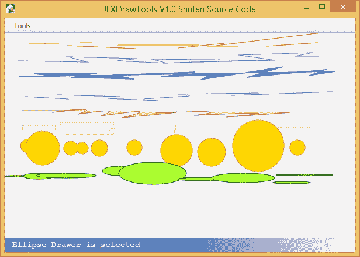

图 8-7. 使用初始版本的`JFXDrawTools`应用程序绘制各种图标的快照。

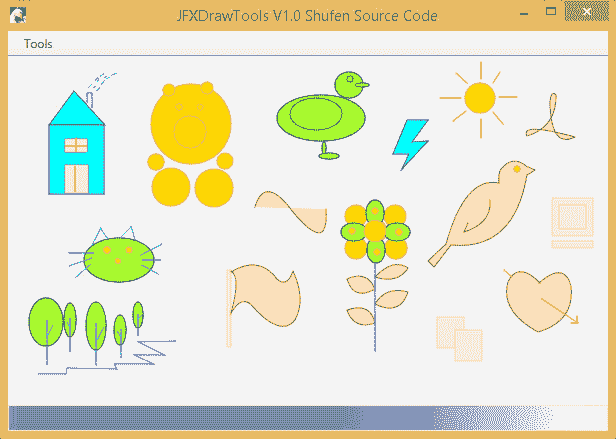

编译并运行应用程序。尝试以下步骤进行测试：

1. 点击`Tools`菜单，选择`Line Drawer`菜单项。
2. 将鼠标移动到绘板上，拖动鼠标绘制几线。
3. 逐一点击其他菜单项，进行相同的拖拽操作以查看每个形状的不同渲染效果。
4. 逐一测试所有加速器以选择一个绘制器。
5. 选择`Shape Drawer`菜单项，尝试在绘板上移动一些形状。

在命令行中编译和运行`JFXDrawTools`程序的输出：

```
Microsoft Windows [Version 6.3.9600]
(c) 2013 Microsoft Corporation. All rights reserved.

F:\My Documents\DocRoot\SHUFEN_JAVA\MyBookJFX\VolumeTwo\DrawTool1.1\src\example1>
javac  -encoding utf-8 -Xlint:unchecked drawtool\*.java

javac  -encoding utf-8 -Xlint:unchecked -cp . drawtool\drawer\*.java

jar cf drawtool.jar drawtool

F:\My Documents\DocRoot\SHUFEN_JAVA\MyBookJFX\VolumeTwo\JFXDrawTools1.0\src\example2>

copy /Y "..\..\DrawTool1.1\src\example1\drawtool.jar".

javac -encoding utf-8 -Xlint:unchecked -cp drawtool.jar jfxtools\*.java

jar cf jfxtools.jar jfxtools

java -cp drawtool.jar;JFXDrawTools
```

## 8.4 总结

本章介绍了 JavaFX 库的以下关键方面，按它们在本文出现的顺序列出：

* 来自`javafx.beans.property`包的两个类：
    * `StringProperty`：这是一个继承自`javafx.beans.binding.StringExpression`的抽象类，实现了`Property<java.lang.String>`和`WritableStringValue`。
    * `WritableStringValue`：继承自`WritableValue<java.lang.String>`。
    * `SimpleStringProperty`：派自`StringProperty`类。
    （参见创建菜单栏）
* `HBox`类：内置 JavaFX 布局之一，位于`javafx.scene.layout`包，是`javafx.scene.layout.Pane`的直接子类，将其子元素水平排列。
    （参见创建菜单栏）
* `Text`类：位于`javafx.scene.text`包，是`javafx.scene.shape.Shape`类的一个直接子类，处理几何图形渲染的共同需求。
    （参见创建菜单栏）
* `void setPadding(Insets value)`方法：由`Region`类定义区域的上、右、下、左内边距。
    （参见此处）
* `void setSpacing(double value)`方法：由`HBox`提供，指定`HBox`子元素之间的水平间距。
    （参见此处）
* `void setStyle(String value)`方法：由`Node`提供，指定此节点的 CSS 样式。
    （参见此处）
* `static Font font(java.lang.String family, FontWeight weight, double size)`方法：由`javafx.scene.text.Font`提供，用于获取渲染文本的字体。
    （参见此处）
* `void bind(ObservableValue<? extends T> observable)`方法：定义`Property`接口，位于`javafx.beans.property`包，将此属性单向绑定到给定的`ObservableValue`。
    （参见此处）
* `MenuBar`、`Menu`和`MenuItem`是基础 JavaFX UI 组件，位于`javafx.scene.control`包，用于用更少的空间设计紧凑的图形界面。
    （参见创建菜单栏）
* `RadioMenuItem`和`ToggleGroup`：位于`javafx.scene.control`包，用于在菜单中创建互斥选择。
    （参见创建菜单栏）
* `void addListener(ChangeListener<? super T> listener)`方法：定义`ObservableValue`接口，通过提供`changed(ObservableValue<? extends T> observable, T oldValue, T newValue)`方法添加`ChangeListener`，当此属性值改变时调用。
    （参见此处）
* `EventHandler<T extends Event>`：扩展`java.util.EventListener`的接口，定义了`handle(T event)`方法，当指定事件发生时调用。
    （参见设置菜单项的加速器）
* `void setOnAction(EventHandler<ActionEvent> value)`方法：由`MenuItem`提供，注册一个`EventHandler`在发生`ActionEvent`时进行通知。
    （参见设置菜单项的加速器）
* `accelerator`属性：由`MenuItem`定义，指定一个`KeyCombination`来触发`MenuItem`的`ActionEvent`。
    （参见设置菜单项的加速器）
* `KeyCombination`：位于`javafx.scene.input`包的抽象类，定义了`KeyCombination.Modifier`类型的静态字段，例如`CONTROL_DOWN`、`META_DOWN`、`SHIFT_DOWN`等，这些在构造`KeyCharacterCombination`实例时有用。
    （参见设置菜单项的加速器）
* `KeyCharacterCombination`：位于`javafx.scene.input`包，是`javafx.scene.input.KeyCombination`的直接子类，用于创建触发`ActionEvent`的快捷键。
    （参见设置菜单项的加速器）

## 结语

作者们正在编写该书丛的其他卷册，并将很快陆续发布。让我们提前看看除前言部分披露的其他功能之外，即将推出的特性：

* 更多交互式绘图工具：自由绘制器、橡皮带绘制器、文本写入器、颜色渐变器、弧绘制器、光标键移动器等。
* 色板工具
* 图像裁剪工具
* 路径过渡动画器
* 动态上下文菜单控制器
* 以及更多……

祝您猴年快乐、健康、万事如意。
