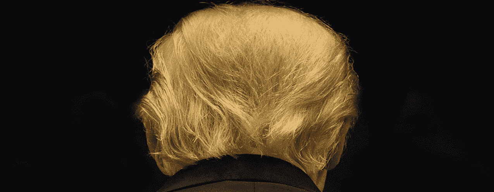
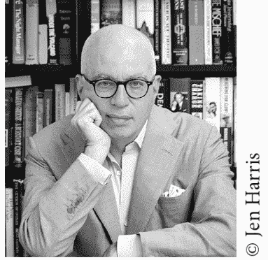

# 围攻：遭受火力的特朗普

## 围攻

处于风火之中的特朗普

如需关于作者的邮件更新，请点击[此处]()。

纪念我的父亲 Lewis A. Wolff

## 致谢

在《愤怒与狂怒》出版后，总统公开且愤怒地与斯蒂芬·K·班农断绝关系，后者被认为是让他当上总统最有责任的人，而起因是书中提到的某些言论。唐纳德·特朗普的愤怒导致班农失去了他的赞助人——亿万富翁鲍勃·默瑟及其女儿莉贝卡的支持，并迫使他离开了布莱尔巴特新闻（Breitbart News），该新闻网站由班农领导并由默瑟家族控制。

班农对《愤怒与狂怒》中的言论坚持立场，没有任何抱怨、争辩或委屈，这足以说明了他的性格。在这一行当年的职业生涯中，我很少遇到某些信源在暴露身份后，不指责暴露他们的人。

斯蒂夫·班农作为我所知的最清醒的特朗普现象解读者，作为任何人都可能幸运拥有的进入“特朗普世界”的向导维尔吉尔——以及作为一个对他所创造的怪物怀有复杂情感的弗兰肯斯坦博士——他在书中再次回归，且是有据可查的。感谢他的信任与合作。

Henry Holt 的斯蒂芬·鲁宾和约翰·斯特林是大多数作家曾梦寐以求的理想型出版商和编辑。斯蒂夫那全速前进的热情和信心驱动了这本书。约翰的严谨和洞察力贯穿每一页；他的优雅再次让这本书跨越了终点。Holt 的玛吉和帕特·艾斯曼以热情和老练将此书推向了市场。

描写一位不可预测且具有报复之心的美国总统涉及着非寻常的出版风险。非常感谢麦米林出版社（Holt 的母公司）的约翰·萨格特和唐·魏斯伯格，他们提供了坚定、甚至震耳欲聋的支持。

我的经纪人安德鲁·怀莱以及他的同事，纽约的杰弗里·波斯特塔纳克和伦敦的詹姆斯·普勒伦，在提供几乎每日的建议和服务之外，还协调了一场复杂且无缝的国际出版。

负责本书的律师埃里克·雷曼和戴安娜·弗罗斯特在《愤怒与狂怒》出版后都经受了总统的法律威胁，他们保持了冷静、乐观、无畏，并坚定地站在出版完整故事的一边。

我一如既往地依靠莉拉·德·克雷塞尔的友谊和建议。非常感谢对手稿进行事实检查的丹尼·利多，审核事实的里斯·德·克雷塞尔，以及我优秀的研究助手爱德华·埃尔森和托马斯·戈丁。

米克尔·杰克逊、约翰·里昂斯、杰·罗奇和阿里·埃马纽尔，是我试图将特朗普白宫戏剧化的伙伴们，他们帮助我思考了如何讲述一个政治故事的关键方面——这与其说是关于权力的传统观念，倒不如说是关于一个男人与几乎所有人——也许最重要的是与自己——的一场非凡公开斗争。

非常感谢这里这些无名的信源，在撰写这本书期间，他们定期（如果不是每天）向我提供建议。

我的妻子维多利亚一直是我的支柱和灵感来源。

## 作者的话

在唐纳德·特朗普就任美国第四十五位总统后不久，我被允许作为旁观观察者进入西翼楼。我的书《愤怒与狂怒》就是对特朗普执政前七个月内组织混乱和不断的戏剧冲突——与其说是政治剧，不如说是心理剧——的记录。这里有一位反复且不确定的总统，他几乎每天向世界释放他怪异的愤怒，而美国历史上最不常白宫的第一阶段在 2017 年 8 月结束，标志着首席战略官斯蒂芬·K·班农的离职和退休将军约翰·凯利任命白宫办公长。

这份新的记录始于 2018 年 2 月，即特朗普执政第二年的开始，此时情况已发生了巨大的变化。总统反复无常的愤怒遭遇了日益组织化和有条理的制度性回应。在许多方面，他自己的政府，甚至是他自己的白宫，已经开始反对他。几乎每一个右翼权力中心都认为他是不胜任的。

> 他的敌人包围着他，致力于将他送回家。

我对比特朗普的痴迷——即深信他终将毁灭自己——与我自当选以来遇到的几乎所有人是一致的。与他共事意味着要面对极端且令人迷失的行为。这绝非夸大其词。

许多在编写《愤怒与狂怒》期间帮助过我的白宫人员现在已在政府之外，但他们比以往任何时候都投入。许多特朗普的白宫亲信继续听从并支持他；与此同时，作为他们担忧和不可信的表达，他们之间以及其他人报告他的时间、情绪和冲动。总的来说，我发现离他越近的人，对他的心理状态感到越不安。他们都在猜测这将如何结束——他们得出结论，对他而言将非常糟糕。

……讲述者。这是他们的“魔鬼契约”。但对于作家来说，采访这种具有两面性的来源陷入了两难境地，因为这需要依赖那些既会撒谎又说真话的人——而且这些人日后可能会否认他们曾说过的真话。事实上，特朗普白宫发生的许多非同寻常的事情往往被其发言人以及总统本人所极力否认。然而，在对该届政府的每一次后续描述中，其荒谬的程度——尽管这一标准一直在提高——几乎无一例外地得到了证实。

在一个推崇甚至频繁要求夸张性语调的氛围中，夸张本身就成了准确性的一个关键部分。例如，最关键的一点是，通过大量与他接触的人来说，总统经常被描述为精神极度不稳定。“我从未见过任何比唐纳德·特朗普更不稳定的人，”这是一名工作人员的说法，另外十多位拥有第一手经验的人也向我表达了无数次同样的观点。你如何将这种话转化成对这个独特白宫的负责任评价？我的策略是尝试通过“展示”而非“叙述”，描述最广泛的背景，传达这种经历，让它足够真实，以便读者自己去评估唐纳德·特朗普在人类行为那令人眩晕的尺度上处于什么位置。这种状态，一种情感状态而非政治状态，是本书的核心。

# 1

## 一击命中

总统露出了他那惯性的令人作呕的臭脸，然后挥了挥手，仿佛在驱赶一只昆虫。

“别告诉我这个事，”他说，“你为什么要告诉我这个？”

特朗普的私人律师约翰·道德（John Dowd）在 2018 年 2 月下旬（当时特朗普执职仅满一年多）——正试图解释，检察官可能会对特朗普集团的一些业务记录发出传票。

特朗普的反应似乎与其说是对对其事务进行这种深度挖掘的含义感兴趣，不如说是对这件事本身感兴趣。他的恼火引发了一段小规模的咆哮。这很大程度上不是因为有人想陷害他——尽管确实有人想陷害他——而是因为没有人在为他辩护。问题出在他自己的人身上，尤其是他的律师们。

特朗普希望他的律师能“解决”问题。“不要给我带来问题，给我带来解决方案，”这是他经常重复的一句深受喜欢的首席执行官格言。他根据律师们的暗地操作或花招之术来衡量他们，并在他们无法让问题消失时追究他们的责任。他的问题就成了他们的错。“让它消失”是他经常下达命令之一。他通常会重复三遍：“让它消失，让它消失，让它消失。”

白宫法律顾问唐·麦高恩（Don McGahn）——代表的是白宫而非总统本人（这是特朗普永远无法理解的差别）——展现了让问题消失的能力，并成为了特朗普狂怒和辱骂的恒定受气包。他对行政部门适当职能的法律解释往往阻碍了老板的意愿。

另一方面，道德和他的同事蒂夫·科布（Ty Cobb）和杰伊·塞库洛（Jay Sekulow）——这三个引导总统应对个人法律问题的律师三人组——已经变得非常擅长避开客户糟糕的情绪，这种情绪通常伴随着带有威胁性的、勉强克制的人身攻击。这三个人都明白，成为唐纳德·特朗普一名成功的律师正是他所愿达的。

特朗普对理想律师拥有一种神话，这与法律实践几乎毫无关系。他总是提到他的纽约老朋友、律师兼硬汉导师罗伊·科恩（Roy Cohn），以及罗伯特·肯尼迪（Robert Kennedy，后者是约翰·F·肯尼迪的弟弟）。“他总是像罗伊·科恩和鲍比·肯尼迪那样盯着我不放，”史蒂夫·班农（Steve Bannon）说道，这位政治策略家可能比任何人都对特朗普的胜利负责任。“罗伊·科恩和鲍比·肯尼迪，”他会说，“我的罗伊·科恩和鲍比·肯尼迪在哪？”科恩为了自己的利益和传奇，建立了一个特朗普继续遵循的神话：只要有足够的手段和力量，法律系统总是可以被操纵的。鲍比·肯尼迪是他哥哥的司法部长和“刀子手”，他保护了肯尼迪，并为了家族利益在权力的后巷运作。

这是特朗普恒久的主题：击败系统。“我是那个能脱身的人，”他经常向纽约的朋友们吹嘘。

与此同时，他不想知道细节。他只想让律师们确保他正在赢。“我们赢了，对吧？”他只是这样。这是我想要知道的。“如果我们搞砸了，”他在某天对他的法律团队大喊道，“我们就完蛋了。”

被认为与调查中的犯罪活动有个人关联。或者最令人担忧的是，你是一个“目标”，意味着检察官正寻求让大陪审团对你提起指控。证人往往会变成调查对象，而调查对象往往又会变成目标。

在 2018 年初，随着穆勒调查及其大陪审团维持着历史水平的保密性，白宫内没有人能确定谁是谁、处于什么位置。或者谁在对谁说了什么。任何为总统或其某个高级助手工作的员工，都可能在与特别顾问交谈。这项调查的沉默准则延伸到了西翼楼。没有人知道，也没有人说，是谁在泄露消息。

几乎每一位白宫高级职员——那群与总统有直接接触的顾问群体——都已聘请了律师。事实上，从特朗普进入白宫的第一天起，他错综复杂的法律背景以及对法律显而易见的漠视，就给在他手下工作的人蒙上了一层阴影。高层人员在学习如何穿过西翼楼这个“兔子穴”时，已经在寻找律师了。

2017 年 2 月，在就职几周后，以及联邦调查局对国家安全顾问迈克尔·弗林提出质疑后，首席办公长普里巴斯走进史蒂夫·班农的办公室说：“我要帮你一个大忙。把你的信用卡给我。别问我为什么，给我就行。你余生都会感谢我的。”

班农打开钱包，把他的美国运通信用卡还给了普里巴斯。普里巴斯不久后将卡还给了班农，并说：“现在你有法律保障了。”

在接下来的这一年里，作为一名事实证人，班农花费了数百小时与他的律师待在一起，为他在特别顾问和国会面前的证词做准备。他的律师们也花费了大量时间与穆勒团队以及国会顾问进行交谈。到年底，班农的法律费用达到了 200 万美元。

每位律师对他或其客户提供的第一条建议都是直白且明确的：不要和任何人交谈，除非证言你所说的话成为必要。不久后，特朗普白宫高级职员们持续关注的头等大事就是尽可能少地了解情况。这是一个颠倒的世界：传统上，“在场”是梦寐以求的地位，而现在你只想待在会议之外。你想避免成为对话的证人；如果你足够聪明的话，你想避免成为某些对话的见证者。显然，没有人是你的朋友。你无法知道同事在调查中处于什么立场；因此，你无法得知他们有多大可能需要就他人——也许是你——提供证词，并以此作为与特别顾问合作以自救的筹码，即所谓的“反戈一击”。

每个在那儿工作的人迅速意识到——尽管这成了他们不想在那儿工作的另一个理由——白宫是一场正在持续的刑事调查现场，这场调查可能会困住任何出现在附近的人。

竞选、过渡期以及进入白宫第一年期间秘密的终极守护者是白宫新闻总监霍普·希克斯。她见证了几乎所有事。她看到过总统说了什么：她知道总统这个无法控制自己内心独白的男人的所知的一切。

2018 年 2 月 27 日，在向众议院情报委员会作证时（此前她已经在特别顾问面前出过证），她被追问是否为总统撒过谎。也许一个更资深的公关专家可以从这种困境中脱身，但希克斯除了担任唐纳德·特朗普的发言人外几乎没有经验（这通常意味着要处理对事实的忽视），她发现自己陷入了一个突然且意料之外的道德真空，并试图公开赞扬她老板谎言的相对重要性。她承认说过“白谎”，即在某种程度上，比最大的谎要轻。这一承认足以让她需要与律师进行近二十分钟的简短证词，她对自己可能承认的内容感到痛苦，并对总统不断的颠倒事实任何解构可能导致的后果感到困扰。

在她作证后不久，另一位在穆勒大陪审团面前的证人被问及希克斯如何为总统撒谎。该证人回答道：“当涉及到为特朗普做‘唯唯诺诺’的任何事时，她会做的——但她不会为他挡子弹。”这句话既可以被看作是反讽的赞奖，也可以是对特朗普白宫忠诚度可能延伸到多远的估计——可能不会太远。

可以认为，特朗普政府中几乎没有人从传统意义上胜任自己的工作。但除了总统本人外，没有人能更好地说明希克斯所代表的这种准备不足且缺乏资历的总统了。她没有实质性的媒体或政治经验，也没有经过多年高压工作磨练的性格。她总是穿着特朗普青睐的短裙，似乎总是无一例外出现在新闻头条中。特朗普钦佩她并不是因为她有保护他的政治手段，而是因为她那顺从且尽职的品格。她的工作就是全心投入对他的照顾和喂养。

“当你和他交谈时，用积极的反馈开头，”希克斯建议道，她理解特朗普需要不断被肯定，并且几乎无法谈论自己以外的任何事。她对特朗普的关注和顺从的性格让她在二十九岁时就登上了白宫最高的新闻职位。从务实角度来说，她充当了事实上的首席办公长。特朗普不希望他的政府由专业人士组成；他希望由那些陪伴他并迎合他的人组成。

希克斯——特朗普口中的“小霍”——既是总统的守门人，也是他的安全毯。她是他审慎关注的常见话题：特朗普即使在白宫也偏于业务往来是私人化的。“谁在妈操霍克斯？”他会要求知道。特朗普的女儿伊万卡和她的丈夫贾德·库什纳，都对希克斯表达了担忧。

由于班农得知希克斯与波特的这种关系，在白宫内部的人，白宫不公开让希克斯。

德维斯（Dravis）协助将希克斯与波特恋情的细节泄露给了《每日邮件报》，该报在 2 月 1 日发表了关于此的故事。

但德维斯在波特前妻们的加入下，输了一个令人愤慨的决定：认为他在《每日邮件报》的形象里其实很有面子——他是一对风光权势夫妇的一员！波特打电话给德维斯嘲讽她：“你以为你能搞定我吗！”德维斯和他的前妻们全部公开了受他的虐待。他的第一任妻子说他踢打拳打她；她甚至出了一张自己被打青眼的照片。他的第二任妻子告诉媒体，她已经对他申请了紧急保护令。

白宫，或者至少凯利——很可能还有希克斯——已经知晓这些指控，并有效地掩盖了它们。（“白宫职位通常有足够称职的人来撰写报道，但在特朗普的白宫，你没法如此草率，”波特的一位共和党熟人说道。）围绕波特及其令人不安的“混蛋史”爆发的舆论不仅让特朗普恼火——“他身上散发着负面新闻”——进一步削弱了凯利。2 月 7 日，在他的两个前妻都接受了 CNN 的采访后，波特辞职了。

一个回避关注的希克斯——特朗普非常看重那些不占用他记者机会的下属——突然发现自己的感情生活暴露在强烈的媒体审查聚光灯下。她与名誉扫地的波特之间的私情，凸显了她与总统及其家人之间奇特的关系，也凸显了特朗普白宫内部混乱的管理、人际关系的功能障碍以及整体政治敏感性的匮乏。

奇怪的是，这段恋情在希克斯的问题中是最微不足道的。事实上，对希克斯来说，这场丑闻可能比西翼内部几乎所有人认为的真正阴云更是一个让她离开政府的更好挡风港。

2 月 27 日，华盛顿内部简报《阿克西斯》（Axios）的记者、乔纳森·斯万（Jonathan Swan，白宫泄密信息的宠儿渠道）报道，乔什·拉费尔（Josh Raffel）将离开白宫。根据一种新颖的安排，拉费尔于 2017 年 4 月进入白宫，担任总统女婿贾雷德·库什纳（Jared Kushner）及其妻子伊万卡（Ivanka）的唯一发言人，绕过了白宫通讯团队。拉费尔和库什纳一样都是民主党，曾在海尔齐克策略公司（Hiltzik Strategies）工作，那是一家代表伊万卡服装线的纽约公关公司。

霍普·希克斯（Hope Hicks）也曾在海尔齐克公司工作过——该公司最著名的可能是长期代表电影制片人哈维·韦恩斯坦（Harvey Weinstein），而希克斯在 2017 年秋季卷入了一场影响时代的骚扰与虐待丑闻及掩盖事件。她最初的角色与拉费尔相同但级别更高；她是总统的个人发言人。9 月，希克斯被升为白宫通讯总监，拉费尔成为她的二把手。

麻烦发生在之前的夏天。2017 年 7 月，希克斯和拉费尔都在“空军一号”上，当时正值小唐纳德·特朗普（Donald Trump Jr.）在竞选期间于特朗普大厦与俄罗斯政府中间人会面并获取希拉里·克林顿黑料的消息爆发。在从德国 G20 峰会回美国的飞机上，希克斯和拉费尔协助总统发布了一个关于成为掩盖行动一部分的大型虚假故事。

尽管拉费尔在白宫只待了九个月，但《阿克西斯》的报告说，他的离职已经讨论了几个月。事实并非如此。那是一次突如其来的离开。

第二天，同样突然地，白宫里离总统最近的人——霍普·希克斯也辞职了。

这位对特朗普竞选和白宫运作比任何人都了解的人突然离开了大门。白宫内部深切的担忧是一个合理的推测：希克斯和拉费尔既是总统掩盖其儿子和女婿与俄罗斯人见面细节努力的证人和参与者，也是穆勒调查的对象或目标——或者更糟，已经达成了交易。

总统在公开对希克斯的赞美溢于言表，并没有试图阻止她离开。在接下来的几周里，他对她的缺席有所期待——“我的小霍在哪儿？”——但事实上，他一听到她可能会说话，就想甩掉她，并开始在一次重大的改写中，降低她在竞选和白宫的地位和重要性。

然而，从特朗普的角度来看，希克斯身上有一点是希望的：尽管她在他的总统生涯中如此核心，但她的职责实际上只为了取悦他。她绝不是宏大战略和伟大阴谋的意想不到的执行者。特朗普的团队仅由跑龙套人物组成。

约翰·道德（John Dowd）可能不愿意给客户带来坏消息，但他非常清楚一个拥有几乎无限资源的彻底检察官是危险的。意志越坚定的联邦探员小组（G-men）坐守、搜查和检查得越多，揭露有计划和偶然犯罪的机会就越大。搜索越全面，结果就越不可避免。唐纳德·特朗普的案件——凭借他加密货币的历史、金融魔术、可疑的关联以及普遍的法外感——似乎确实为检察官们提供了一份“令人苦恼的财富”。

但对他来说，唐纳德·特朗普还不相信他的技能和直觉至少能与美国司法部的严谨和资源相匹配。他甚至认为他们穷追不舍的方法会对他有利。“无聊，让每个人都困惑，”他驳斥了道德等人提供的调查报告，“你无法跟上其中任何内容。没有线索。”

特朗普总统期间的许多怪异方面之一是，他认为当总统（无论是责任还是曝光）与他当总统前的生活并没有不同。在四十年的大部分时间里，他忍受了几乎无数的调查和诉讼。

与此同时，许多人也许所有人都在私下深信，对特朗普的财务过去进行深度挖掘——或者只是粗略检查——都会发现大量的显而易见的违法行为，而且可能发现一种职业腐败的模式。

这并不意外，自从特别检察官开始调查，特朗普就试图在穆勒和特朗普的财务之间划出一条分界线，并公开威胁如果穆勒离开的话会怎样。特朗普的假设仍然是，特别检察官害怕他，意识到他的容忍会在何时以及以何种方式结束。坚信，通过“心眼”的暗示还是赤裸裸的威胁，都能让穆勒团队明白他们的局限性。

“他们知道得不到我，”他告诉他晚宴后访客圈的某位成员，“因为我从未参与过。我不是目标。什么都没有。我不是目标。他们告诉我，我不是目标。他们知道如果把我列为目标会发生什么。每个人都心知肚明。”

关于特朗普四十五年商业生涯的书籍和报道充斥着他的阴暗交易，而他进入白宫仅仅是为了帮助这些交易，并浮出更劲的丑闻。房地产是世界上最喜爱的洗钱货币，而特朗普的 B 级房地产业务——被特朗普拼命营销为 AAA 级——显然是为了吸引洗钱者而设计的。至于，特朗普自己的财务困境以及为了维持其亿万富翁生活方式、声望和市场竞争力的绝望努力，迫使他陷入不断且不稳定的计划中。在他讽刺的领域，贾雷德·库什纳在法学院期间、在遇到伊万卡之前，在一篇论文中研究过在某特定房地产交易中对特朗普组织可能提出的欺诈指控——这在他当时的人脉中是一个颇有些趣的话题。从务实上说，检察官似乎发现特朗普正在大眼皮底下隐藏。

例如，在2004年11月，杰弗里·爱普斯坦（这位后来被卷入涉及本科生收益丑闻的金融家）同意以3600万美元的价格从破产拍卖中购买佛罗里达州棕榈滩的一栋房子，该房产已经在市场上挂了两年。爱普斯坦和特朗普已是十多年的老朋友——可以说是并肩作战的花花公子——特朗普经常寻求爱普斯坦帮助他处理混乱的财务事务。在谈完棕榈滩房子的交易后不久，爱普斯坦带特朗普去看房产，寻求有关移动泳池的工程问题的建议。但当他准备最终定购该房子时，爱普斯坦发现当时资金极度短缺的特朗普已以4100万美元竞标了该房产，并通过一个名为“特朗普物业所有公司”的实体从爱普斯坦手中买下了它。这笔交易完全由德意志银行资助，而特朗普已经对特朗普组织和特朗普个人背负了大量贷款。

特朗普曾让爱普斯坦在房地产交易中“借用”他的名字——即为了高额费用，特朗普将担任门面，以掩盖房地产交易中的实际所有权。（这在某种意义上是特朗普基本商业模式的另一种变体，即为他人拥有的商业物业授权。）愤怒的爱普斯坦确定特朗普只是为真实所有者做托，威胁要揭露这项交易，该交易在佛罗里达的报纸上得到了广泛报道。当购买后不久，特朗普将这栋房子以1.25亿美元的价格上市，这场斗争变得更加激烈。

但如果爱普斯坦知道特朗普的秘密，特朗普经常在爱普斯坦现在的棕榈滩房子见到这位金融家，特朗普知道爱普斯坦几乎每天都去，而且多年来一直如此，由他雇佣的女孩送达有圆满结局的消息——这些女孩招募自当地餐厅、脱衣俱乐部，以及特朗普自己的马尔阿拉科卡庄园。就在这两位朋友之间因买房产生的恩怨加剧时，爱普斯坦发现自己正受到棕榈滩警察的调查。随着爱普斯坦法律问题的升级，这栋仅经过微小改进的房子以9600万美元被德米特里·里博洛夫列收购。这位寡头是俄罗斯普京支持的政府关联型工业家圈的一员，事实上，他从未住进那栋房子。特朗普奇迹地在没有投入一分钱的情况下赚了5500万美元。或者，更有可能，特朗普只是为了隐藏真实所有者而赚了一笔费用——那个影子所有者很可能出于房子价值之外的其他原因从里博洛夫列那里输送现金。又或者，真实所有者和真实买家其实是同一个人。里博洛夫列可能实际上是为这栋房子付了钱，从而为第二次购买这栋房子清洗了额外的5500万美元。

这就是唐纳德·特朗普的房地产世界。

仿佛使用了心理控制技巧一般，贾里德·库什纳已经非常精通地克制他对岳父的深层挫败。当特朗普发火、发脾气或做出愚蠢的政治或政策决定时，他保持无表情——有时看起来几乎纹丝不动。库什纳作为这个疯狂宫廷里的侍臣，拥有一种诡异的冷静和镇定。他也非常担心。这既令人惊讶又荒唐的是，这样一个像遮羞布一般的技术细节——“总统，你不是目标”竟然能给他的岳父带来这样的安慰。

库什纳明白，特朗普被一系列致命的箭矢包围着，其中任何一个都可能杀死他：阻碍司法案；共谋案；对他长长而可疑的财务历史的任何审视；一直潜伏的女性问题；中期选举惨败的前景，以及如果中期选举针对他时面临的弹劾威胁；共和党人的反复无常，他们可能随时背叛他；以及被挤出去的高级工作人员。

但这位当选总统的关注点在别处：他更敏锐、愤怒地关注着一点，在像特朗普这样的中型房地产公司不断寻找融资的过程中，阿波罗资本从未亲自为特朗普组织提供过资金。现在，看来显而易见，阿波罗支持库什纳夫妇仅仅是因为这个家族与政府的联系。特朗普在脑海中不断计算谁在从谁那里获利，并认为自己为创造了每个人都能获利的环境而应得到什么报酬，这是让他彻夜难眠的原因之一。

“你以为我不知道是怎么吗？”特朗普对他的女儿冷笑道，她是他通常会特意去安抚的少数人之一，“你以为我不知道是怎么吗？”

库什纳夫妇赢了。而他没有。

总统的女儿为丈夫辩护。她提到了这对夫妇为华盛顿付出的不可想象的牺牲。为了什么？“我们的生活被毁了，”她戏剧性地说道——却又带有相当的真实性。这对纽约社交名流已沦落为潜在的犯罪被告和媒体的笑柄。

在经历了一年朋友和顾问私下说他的女儿和女婿是白宫混乱的根源后，特朗普再次认为他们本不该来。通过改写历史，他告诉深夜的几位访客，他一直认为他们本不该来。在女儿激烈的抗议下，他拒绝干预其女婿的安全审查问题。联邦调查局继续扣留库什的审查——总统可以根据裁量权批准，这提醒过他。但特朗普什么也没做，让他的女婿在风中悬空。

库什纳拥有超常的耐心和决心，他等待着自己的机会。在“特朗普耳语者”中，诀窍在于集中特朗普的注意力，因为你永远无法指望他能参与任何带有合情往来性质的正常对话。体育和女性是可靠的话题；这两者都能立刻吸引他的注意。不忠诚也能引起特朗普的注意。这两者都涉及阴谋。还有金钱——永远是钱。

库什纳自己的律师是阿比·洛维尔（Abbe Lowell），他是华盛顿刑事辩护界一位著名的“表演派”，他以自己为傲，并通过一份关于检察官即将抛出的诡计或策略的、实时更新的传闻和见解构成的“菜单”，来管理他客户的预期和注意力。一位知名诉讼律师所提供的真正优势，或许不是法庭技巧，而是聊天室的情报网。

洛维尔补充了道德（Dowd）收到的报告，告诉库什纳，检察官将实质性地加深总统——以及特朗普家族的困境。道德一直在继续安抚总统，但库什纳凭借洛维尔提供的情报，带着关于这场针对他的法律战新战线的报告告诉了他的岳父。终于，在3月15日，消息爆发，特检察官已对特朗普集团的记录发出了传票证：这是一份深层且广泛的指令，追溯到了多年以前。

库什纳警告他的岳父，调查将越过穆勒小组（其关注点仅限于与俄罗斯勾结），蔓延到纽约州南部区——即曼哈顿的联邦检察官办公室——这意味着调查将不再局限于俄罗斯的调查。这是一种旨在回避特检察官对俄罗斯相关事务限制的变通之策，也是穆勒小组试图阻止总统解散或缩减其调查任何尝试的努力。通过将调查的部分内容移至南部区，穆勒正如库什纳向特朗普解释的那样，确保了即使没有特检察官，对总统的调查也将继续。穆勒在玩着一种“金丝雀”游戏或“保护自己”的游戏，同时也遵循着精确的程序：即使他专注于调查的有限领域，他也在分配其他可能犯罪的证据并将其发送到其他司法管辖区，所有这些地方都渴望参与这场搜捕。

情况更糟了，库什纳告诉特朗普。

南部区曾由特朗普的朋友、前纽约市长鲁迪·朱利亚尼（Rudy Giuliani）管理。20世纪80年代，朱利亚尼是联邦检察官——有趣的是，詹姆斯·科米（James Comey）曾为他工作——南部区成为了针对黑手党和华尔街的首要检察机构。朱利亚尼先驱利用对《黑手党影响和腐败组织法》（RICO Act）的严苛且许多人认为违宪的解释来对抗黑手党。他将同样的解释应用于大型金融领域，在1990年，RICO起诉的威胁（政府几乎可以无差别地没收资产）击垮了德拉克塞尔·伯纳姆·兰伯特投资银行（Drexel Burnham Lambert）。

南部区一直让特朗普感到不安。当选后，他与那里的联邦检察官普里特·巴拉拉（Preet Bharara）有一次不体面的会面，这一举措令唐·麦格汉和顾问司法部长杰夫·塞申斯在内的所有顾问都感到局势危险。（这次会面预示了特朗普不久后与科米的会面，在期间他寻求一份确保工作安全的忠诚承诺。）他与巴拉拉的会面是不满意的：巴拉拉不愿意迁就他——或者在不久后没有接他的电话。2017年3月，特朗普解雇了他。

库什纳说，现在即使没有巴拉拉，南部区正将特朗普集团视为一个类黑手党企业；其律师将利用RICO法对付它，并像对待毒枭大佬或黑手党老大一样对待总统。库什纳指出，公司没有第五修正案的特权，而且你不能赦免一家公司。此外，用于犯罪或从犯罪中获得的资产可以被政府没收。

换句话说，在唐纳德·特朗普成为总统之前担任过官员的50多家公司和独立实体中，许多可能面临没收。一次成功的没收行动的一个潜在受害者是总统的房地产：政府可以没收特朗普大厦。

3月中旬，一位对特朗普集团运营非常了解的证人乘火车前往华盛顿，在穆勒大陪审团出庭。该证人被FBI在联合车站接走，并送往联邦地区法院。从上午10:00到下午5:00，穆勒小组的两名检察官阿伦·泽林斯基（Aaron Zelinsky）和珍妮·希（Jeannie Rhee）与证人一起审查了包括特朗普集团结构在内的其他问题。

检察官询问证人关于经常与特朗普交流的人，他们见面的频率如何，以及为了什么目的。

霍普·希克斯（Hope Hicks）、前国家安全顾问H·R·麦克斯特（H. R. McMaster），以及支持总统女婿和女儿的不断萎缩的盟友圈。

巴农经常奔波在外。他在欧洲与崛起的民粹主义右翼团体会面，在美国则与急于理解“特朗普变量”的对冲基金经理会面。他还在寻找每一个机会试图说服自由主义者，民粹主义也应该是他们的一种。今年早些时候，巴农去剑桥见了里·萨默斯（Larry Summers），萨默斯曾任比尔·克林顿的财政部长、巴拉克·奥巴马经济委员会主席，并曾担任过哈佛大学校长。萨默斯的妻子拒绝让巴农进入家中，因此会议改在哈佛大学举行。萨默斯显得不修边幅，穿着一件掉了一两颗扣子的衬衫，而巴农则穿着他的双层衬衫、工装裤和狩猎外套。会议现场的一人说：“他们两个看起来都像阿斯伯格症患者。”

“你到底知不知道你朋友在做什么？”萨默斯对特朗普及其政府大吼道，“你他妈就是这个国家！”

“精英民主党人——你们只关心利润，关心富人，或者关心穷人，”巴农反驳道。

“你那套贸易胡言会将世界陷入大萧条，”萨默斯如雷般吼。

“而你把美国的工作出口到了中国！”高兴的巴农宣布道，他总是享受这种与体制内成员结在一起的机会。

巴农——或者至少他认为自己是——一个解决者、权力掮客、没有头衔的造王者。他像是一个怪版的克拉克·克利福福德（Clark Clifford），那位20世纪60、70年代的政治名流和影响力掮客。或者是一个政治边缘的智者，这并不是一种终极的矛盾。又是一个辅助政府的首脑。又或者，是真正独一无二的：没有人像巴农这样在美国的国家政治生活中扮演过如此核心的角色，或者成为过如此眼中眼中钉。至于特朗普，有了像巴农这样的朋友，还需要敌人呢？

两人可能对彼此至关重要，但他们也互相蔑视和嘲讽。巴农不断公开分析特朗普难以捉摸的本性——包括其喜剧和悲剧的成分，一个疯狂叔舅的行为——更不用说他对特朗普家族无限种麻烦的直言不讳，这持续加剧了他与总统之间的疏远。然而，尽管两人不再交谈，他们却时刻关注对方的话语——每个人都渴望知道对方在如何谈论自己。

无论巴农现在对特朗普持有何种情感——他的情绪从沮丧到愤怒再到不可信不等——他继续相信美国政坛没有人能比得上特朗普那种中场式的表演性。是的，唐纳德·特朗普让美国政治重回了表演性——他剥离了政治的严肃性。总而言之，他了解他的观众。同时，他无法走直路。每向前迈一步都受到他下一次转弯的威胁。像许多伟大的演员一样，他天生的自我毁灭倾向总是与其敏锐的生存本能发生冲突。总统周围的一些人只是相信后者会赢得前者，无论这种努力有多令人沮丧，他们理解他有多需要被无形的手引导——这种“无形”正是关键属性。

在没有人告诉他反对的情况下，巴农继续在无形中，从他的餐桌到宾夕法尼亚街为总统处理事务。

下午，一个两党国会以出人惊讶的轻松通过了1.3万亿美元的2018年拨款案。“麦康尼尔、莱恩、舒默和佩洛西，”巴农评价共和党和民主党的国会领导层说，“在他们独特的两党大慷之慨时刻，占了特朗普的便宜。”

这一立法里程碑是特朗普脱钩的结果，以及其他人为了深入预算过程细节所付出的专注努力。大多数总统渴望获得很少或完全没有利益。因此，共和党和民主党的领导层——在这里得到了预算和立法团队的支持——（此处原文似乎不完整，但根据要求翻译至此）。

一个毫无防备的特朗普开始听到来自他那些喧闹的后排议员的传言，他们突然陷入了愤怒。

巴农理解特朗普在做什么。细节并非。事实并非如此。但那种某些有价值的东西可能立即被夺走的感觉让他立刻警觉。如果你直面他正面临的失败，他会立刻调转方向。事实上，调转方向是他唯一的应对策略。“他不是需要赢得这一周、这一天，甚至这一小时，”巴农反思道，“他需要赢得那一秒。在那之后，他就会漂移。”

对于那些硬核的特朗普支持者来说，这回到了特朗普主义的一个基本原则：你必须不断提醒特朗普自己站在哪一边。当巴农对总统的选民基础组织激烈的抗议时，他审视了特朗普的现实：“如果他不需要为没能筑墙而付出政治代价，那么墙永远不会存在。”

如果到11月的中期选举时墙还没有动工，将显得特朗普是虚假、后悔且软弱的。围墙必须是真实的。支出法案中缺失了墙，正如其表面所示：特朗普完全不在状态。特朗普最有效的信息，即特朗普叙事的前线——对非法移民的极大侵略——已被削弱。这是在他毫不知情的情况下发生的。

22日晚上，福克斯新闻的阵容——塔克·卡尔森、劳拉·英格拉姆和肖恩·汉尼迪——猛击这一信息：背叛。

战斗爆发了。国会的共和党领导层以及捐赠者阶层在政治现实和数百亿政府支出的前景面前保持着清醒和务实——他们绝没有幻想着墨西哥会为墙买单。与他们对的是福克斯的评论员们，他们对特朗普主义真实情感的诉求是正义且不屈的。

特朗普在整个晚上期间的个人转变是痉挛式的。三位福克斯评论员都进行了一系列电击，电流不断增强。特朗普离开了这场运动。或者，更糟，特朗普被智胜并被算计了。特朗普在电话中在痛苦和愤怒中咆哮。他是受害者。他没有任何支持者。他无法信任任何人。国会领导层：反对他。白宫本身：反对他。背叛？白宫里的几乎每个人都背叛了他。

第二天早上情况变得更糟了。皮特·赫格塞特，福克斯特朗普粉丝中最谄媚的一个，在《福克斯与朋友》节目中似乎几乎被特朗普的背叛激得流泪。

然后，几乎在赫格塞特哀嚎的同时，特朗普突然——令人费解地——转变了立场并推特说他正在考虑否决拨款法案。而这同一个法案在24小时前他还表示拥护。

那个周五早晨，他从住所来到椭圆形办公室，愤怒异常暴烈，以至于一瞬间他的头发散开了。在在场人员的震惊下，那是一个完全光秃的唐纳德·特朗普。

总统的突然变卦让整个共和党陷入了恐慌。如果特朗普履行他的威胁不签署法案，将引发他们恐惧的：政府停摆。他很可能会将停摆归于自己的政党。

众议院自由党团主席、国会中坚定的特朗普盟友马克·梅多斯从欧洲给总统打电话，说在周四下午投票后，大多数成员已离开这里参加国会休假，他们无法撤销前天的投票，停摆将在几小时后开始。

米奇·麦康纳敦促国防部长吉姆·马蒂斯采取，告诉总统如果他不签署法案，美国士兵明天将领不到工资。这是一次重演：马蒂斯在1月份一次威胁停摆期间也发布过类似的警告。

> “永远……永远……永远不再……”特朗普大喊道，每说一个“永远”就敲击一次桌子。

他最终妥协并同意签署法案。但他发誓，下次会有数十亿的资金用于筑墙，否则真的会停摆。真的。

巴农以前经历过这种情况，太多次了。

“哥们儿，他可是那个该死的特朗普，”巴农在总统签署法案的第二天，按着头坐在他在大使馆的桌子旁说道。

巴农并不困惑：他非常清楚特朗普对巴农的愿景和职业来说可能是一个多大的负担。在周围人紧张的笑声中，巴农相信自己是民粹主义的天命，而不是唐纳德·特朗普。

这里的紧迫感是真实的。巴农认为自己代表工人阶级，反对企业-政府-技术官僚机器，后者的选民是受过大学教育的人。在巴农的浪漫视角中，工人阶级身上有烟草味，手被掐在里面，并且像砖头一样坚硬——而不是在健身房里健身。这种对过去、对（如果曾经存在过）一个工人阶级为其工作和身份感到自豪的平等世界的记忆，巴农认为正在激发一种全球性的愤怒。这是一场革命——这种全球性的不安、恐惧和对自由主义假设的日日颠覆——它确实如此。他目标中的全球霸权。他是幕后黑手——他可能也是幕前的人——试图从后现代的无秩序状态中夺回世界，并恢复某种类似于1962年那种同化且邻密的拥抱。

还有中国！还有即将到来的诸神黄昏！对巴农来说，这是生活方式。中国是1962年的俄罗斯——但更聪明、更有韧性、更有威胁性。美国对冲基金经理在秘密支持中国，特朗普对这些了解多少？特朗普对这一议程投入多少？早已得知，特朗普“根本不在乎议程。”

侧翼掩护，极力向总统的律师们保证，他并没有追求总统的商业利益；与此同时，他将调查人员收集的关于特朗普业务和个人事务的证据交给了其他联邦检察官。

4月9日，在纽约联邦检察官的指示下，FBI搜查了迈克尔·科恩（Michael Cohen）的家和办公室，以及他在公园大道摄丽政酒店（Regency Hotel）使用的一间房间。科恩自称为特朗普的私人律师，在FBI进行搜查时，他在厨房里被戴上手铐坐了几个小时，FBI逐列清单并运走了他们发现的每一个电子设备。

巴农（Bannon）碰巧的是，他频繁前往纽约时也住在摄丽政酒店，有时会在酒店大堂与科恩相遇。巴农在竞选期间就认识科恩，而这位律师在竞选问题上的神秘介入如今令他感到担心。现在，在华盛顿，看到科恩的新闻，巴农知道另一块关键的多米诺骨牌倒下了。

> “我们不知道终点在哪里，”巴农说，“我们可以猜它可能从哪里开始：从科恩兄弟开始。”

4月11日，在总统签署预算案三周后，保罗·莱恩（Paul Ryan）——考虑到共和党掌控华盛顿，他是政府最有权的人物之一——宣布了辞去议长并离开国会的计划。

> “听听保罗·莱恩说什么，”巴农那天一早坐在大使馆的办公桌前说道。“结束了。完了。保罗·莱恩今天想让特朗普滚蛋。”

莱恩一直告诉愿意听的人，在七个月后的中期选举将失去五六十个席位。莱恩的副手、全国共和党国会委员会主席史蒂夫·蒂弗斯（Steve Stivers）估计将损失九十到一百个席位。在这个阴郁的时刻，民主党消除其二十三个席位的差距并获得比共和党目前拥有的更大的多数，似乎更有可能。只不过，与共和党不同，他们将是一个统一的政党——至少是一个反对唐纳德·特朗普的统一。

莱恩和蒂弗斯并不是唯一看到这种结果的人。米奇·麦康纳尔（Mitch McConnell）告诉捐赠者甚至不要为议院选举捐款。资金应该流向参院选举，那里的维持共和党多数的前景要明朗得多。

在巴农看来，这对唐纳德·特朗普来说，甚至比《艾许·霍利维德偷拍视频录带》的曝光还要糟糕。他在法律上已经处于困境，穆勒（Mueller）和南部地区检察院正步步紧逼；现在，看着中期选举可能的一场惨败，他也面临着严重的政治危险。

巴农往日的兴奋很快恢复了。随着他通过谈话走出自己的低谷，他变得近乎喜悦。如果建制民主党、共和党、各种温和派思想者都认为唐纳德·特朗普需要被赶出城，那么巴农热于捍卫他的前景。对于巴农来说，这是使命，也是一种体育竞技。巴农在冷门的可能性中生存。他之所以跃上世界舞台是因为特朗普竞选活动深陷绝望，以至于他被允许接管。然后，在2016年11月9日，在反对所有困难和预期的情况下，特朗普在巴农的竞选带领下赢得了总统职位——而巴农的主导地位是特朗普最难下咽的苦药之一。现在，即使11月选举的几乎所有指标看起来都很淡，巴农相信他可以看到如何将共和党的损失控制在拯救议院多数所需的二十三个席位内。尽管如此，这将是一场艰苦的战斗。

“当特朗普晚餐后给他的纽约朋友们打电话，抱怨他在世界上一个朋友都没有时，他在某种程度上是对的，”一个言辞犀利的巴农说道。

# 巴农的策略与特朗普的法律困境

## 巴农的“右脑”政治观

巴农认为针对唐纳德·特朗普的案件既本质上是政治性的——他的敌人愿意不惜一切代价来击垮他——而且本质上是真实的。他并不怀疑特朗普对他所指控的大多数行为是有罪的。“他是如何凭借他的‘流动性’问题在初选和普通选举中挺进的？”巴农摊开双手，挑起眉问道。“我们别纠结了。”

但对巴农来说，美国政治有两个面——与其说是左右之分，不如说是右脑和左脑。左脑由法律系统代表，它是实证的、有证据的、有方法的；如果有机会，它将不可避免且正确地定罪唐纳德·特朗普。右脑由政治代表，因此由情绪化、易变、狂热且总是渴望掷骰子的选民所代表。“让那些‘可怜之物’兴奋起来，”他拍击双手，发出雷鸣般的效果，“我们会救我们的人。”

一年多以后，2016年的所有问题仍然如既往一样有力且原始：移民、白人男性的怨恨以及自由派对工人阶级的蔑视。对于巴农来说，2018年才是真正的2016年：“可怜之物”的基础已变成了可怜的国家。“这是内战，”巴农说，这是他经常重复的快乐判断。

最引起共鸣的问题是唐纳德·特朗普本人：那些努力从他们手中夺回他的人。巴农对主流共和党在即将到来的选举中的努力感到震惊。这场选举关于唐纳德·特朗普的命运。

最后，与其近距离给特朗普提供建议，不如从远处，这样做更容易且效率更高。做必须做的事，而又不让特朗普本人实际参与、甚至察觉正在发生的事情，这是一种更安全的做法。

## “盲打球”计划

在莱恩（Ryan）宣布退出众议院的早晨，巴农（Bannon）特别渴望向特朗普发送一些建议。他策划了一个“盲打球”，邀请了《华盛顿邮报》记者罗伯特·科斯塔（Robert Costa）前往大使馆拜访。

巴农每天花大量时间与记者交谈。在某些日子，也许是大多数日子，他的匿名引用声音——隐藏在“此说明引用自现任及前任官员的采访”这一熟悉的署名之后——盖过了关于笼罩特朗普政府的新型危机的其他大多数声音。这些引用的作用就像是舞台上的悄悄话，特朗普可以假装没听见。事实上，特朗普一直在寻求巴农的建议，但前提是必须有一丝微小的理由让他相信这些建议是来自巴农的其他地方。事实上，特朗普非常乐意听巴农在某次采访中说任何话，然后声称那是他自己想到的。

科斯塔在巴农的餐桌旁坐了两个小时，听了巴农关于如何拯救特朗普于自身的处方。

特朗普那种愚蠢的想法：巴农说，有时可以被转化为一种美德。巴农的想法是：总统应该提出一项追溯性的行政特权主张。*我不知道。没人告诉我。这是不明智的建议。*

看到特朗普卑躬屈膝地承认自己缺乏掩饰和技巧，科斯塔看出巴农露出了满意的。

巴农明白，这种追溯性的行政特权主张没有成功的希望——也不应该成功。但这种做法极大的胆量可以为他们赢得四到五月的法律延迟。延迟是他们的朋友，可能是他们唯一的朋友。这个追溯性的行政特权主张，无论多么荒谬，可以一直拖到最高法院。

为了这个计划，总统必须辞退他那些无能的律师。此外他还必须解雇罗德·罗森斯坦（Rod Rosenstein），这位负责监督穆勒调查的副司法检察长。巴农曾反对解雇科米（Comey），在特别检察官任命后的几个月里，他一直抵制总统几乎每天想解雇穆勒和罗森斯坦的冲动，认为这是引发弹劾最稳妥的邀请。（只要别管他的疯狂胡话。）他曾这样敦促总统周围的人。但现在他们已经穷途末路了。

“解雇罗森斯坦是我们唯一的出路，”巴农告诉科斯塔，“我不是轻率说这话。一旦他们去找科恩（Cohen）——那是他们在处理黑帮案件时为了获得真实目标的反应的手段。你可以坐在那里等被放血——被大陪审团起诉——或者你可以进行政治斗争。离开这个我们正在失败并将继续输掉的法律秩序体系。新的副司法检察长将审查我们在这件事上的立场，这可能需要几个月。延迟、延迟、延迟——然后在政治上转型。我们能赢吗？我完全不知道。这并不完美……但我们生活在一个不完美的世界里。”

科斯塔的故事当天晚些时候发布在网上，据四位知情讨论人士透露，巴农“正在向白宫盟友和国会盟友推销一项计划，瘫痪对2016年俄罗斯干预选举的联邦调查”。但无论科斯塔接触了多少人关于史蒂夫·巴农的幕后运作，重要的是他已经直接与巴农本人进行了长谈，而巴农正利用《华盛顿邮报》向总统推销这项计划。

巴农为特朗普制的三部分计划立即送到了椭圆形办公室。第二天早上，总统采纳了库什纳（Kushner）的观点，即应该解雇罗森斯坦，恢复行政特权主张，并找一位强硬派律师。

库什纳推销自己的策略的同时，敦促他的岳父在处理罗森斯坦问题时要谨慎。

“贾德被吓到了，”特朗普当天晚些时候在与密信者通话时轻蔑地说，“真像个娘！”

## 3. 律师

白宫内部一直有一个针对“最倒霉的人”的抽奖或办公室赌注。许多人都获得过这个头衔，但最频繁的赢者之一是白宫法律顾问唐·麦格恩（Don McGahn）。他一直是老板轻视、嘲笑、用假声模仿他的目标，以及对他的目标和用处进行全盘贬低的目标。

“这就是为什么我们无法拥有美好的东西”

麦格恩的背景很大程度上是一名联邦选举律师。他大多处于金钱更多、透明度较低的一方——他反对而非支持激进执行选举法。他曾担任特朗普竞选活动的法律顾问，这可以说是近期历史上对选举法合规性最不粗心的人。在加入特朗普政府之前，麦格恩没有白宫或行政分支的经验。他从未在司法部工作过，事实上，从未在政府任何地方工作过。他曾是与科赫兄弟相关的非营利组织的律师，科赫兄弟以极端党派著称：当当时的白宫法律顾问、麦格恩的前任凯西·鲁姆勒（Kathy Ruemmler）联系他表示祝贺并提议提供以往实践资源时，麦格恩没有回复她的邮件。

麦格恩的工作之一是处理可能是现代政府中最复杂的关系：他是白宫和司法部之间有效的中间联系人。因此，他的职责范围之一就是忍受总统对于为什么司法部[不是]白宫的工具而产生的持续愤怒和困惑。“这是我的司法部，”特朗普经常会对麦格恩说，而且经常重复这句话[不止一次]。

即使在司法部和联邦调查局那些观点更为微妙、并意识到部门与白宫关系共生性质的人中，仍然存在一种强烈的、不可逾越的界限感。司法部和联邦调查局自水门事件以来使他们必须对国会和法院负责。任何从上而下影响调查的努力，或任何屈服于影响的证据——记录在备忘录或电子邮件中——都可能导致职业生涯终结。

2018年2月，助理司法长拉切尔·布兰（Rachel Brand）辞职，她曾是布什政府的律师，曾被奥巴马提名司法部这一职位。她辞职是为了担任沃尔玛的律师。如果特朗普在布兰任职期间解雇了罗森斯坦（Rosenstein），她将成为代理司法长，负责穆勒的调查。她告诉同事，她想在特朗普解雇罗森斯坦并要求她开除穆勒之前离开。她宁愿留在阿肯色州的本顿维尔（沃尔玛总部），也不留在华盛顿。

整整一代或更久，白宫与司法部之间的这种独立关系往往看起来像两个武装营之间无休止的冲突。比尔·克林顿几乎无法忍受他的司法长珍妮特·雷诺（Janet Reno）因其对鲁比岭（Ruby Ridge）对峙——一场幸存者与FBI之间致命的过度反应的对峙；以及韦科（Waco）——另一起针对基督教教派的失败的对峙；以及对李文和博士（Dr. Wen Ho Lee）的调查而遭受的反弹；司法部因对这位疑似间谍的鲁莽追求而受到指责。克林顿曾非常接近解雇他的FBI局长路易·弗里（Louis Free），因为后者公开批评他，但他设法按捺了怒火。布什政府白宫、FBI和司法部的高层人员几乎在病危的司法长约翰·阿什克罗特（John Ashcroft）病床前发生了肢体冲突——詹姆斯·科米（James Comey）本人挡在试图让阿什克罗特续签国内监控计划的白宫代表面前——白宫最终不得不退让。在奥巴马执政期间，当时担任FBI局长的科米进一步争夺FBI独立于司法部的自主权，他单方面决定结束并在后重启对希拉里·克林顿的调查——此举可以说他将选举拱手送给了她的对手。

唐纳德·特朗普登场了，他既没有政治经验也没有官僚经验。他的整个职业生涯都在经营一个本质上是小家族运作的机构，这个机构的设计是为了满足他的意愿，并顺从他的办事风格。在他当选时，他完全缺乏现代政府及其运作规则和习俗的理论知识。

特朗普不断受到司法部关于“习俗与传统”重要性的教训。他一如既往地回答道：“我不想听这些鬼话！”

一位助手观察到，他需要“一条硬的、黑色的底线。如果没有一条他无法逾越的硬底线，他就会逾越它。”

特朗普相信他认为显而易见的事实：司法部和FBI是为他工作的。他们受他的指导和控制。他们完全按照他的要求办事；他们必须通过他设置的关卡。“他向我汇报！”一个愤怒且无法理解的特朗普在任期初期，就反复提到他的司法长杰夫·塞申斯（Jeff Sessions）和FBI局长詹姆斯·科米时这样说道，“我是老板。”

“我本可以让我哥哥当司法长的，”特朗普坚持认为，尽管事实上他甚至没有和他哥哥说过话（罗伯特，一位71岁的退休商人）。“就像肯尼迪那样。”在约翰·F·肯尼迪任命他哥哥担任司法长六年后，国会通过了《联邦反亲属法》，即“鲍比·肯尼迪法”，以防止未来发生此类事件——尽管这并没有阻止特朗普聘用他的女婿为高级顾问。

任何解释政府各部门之间关系细微之处的努力都让特朗普感到沮丧，并使他加深了自己的正义感和特权感。他经常觉得人们在围攻他，这让他更加愤怒。正如他生活中发生过很多次那样，律师们正要对付他。他无法从脑子里甩掉：科米、穆勒、罗森斯坦和麦凯比（McCabe）是一个他不所属的俱乐部成员。“他们互相交流，‘他们完全是一伙的’，”特朗普会说。

如果美国总统与其司法长之间的典型关系必然是冷淡的，如果不是总是紧张的，特朗普也让这种关系变得糟糕无法想象。他公开羞辱杰夫·塞申斯——他在国会中的支持者之一——使塞申斯变成了特朗普仇恨的对象。特朗普不仅在嘲讽塞申斯，还在威胁他，或者至少可能在强迫他辞职或撤回回避。总统曾多次指示麦格恩（McGahn）施压塞申斯让他撤回回避。特朗普敦促他的许多（如果不是全部）助手加入这一斗争。在塞申斯就俄罗斯相关事项申请回避后不久，总统指示克里夫·西姆斯（Cliff Sims）——一个年轻的白宫内勤人员，他曾通过讨好总统赢得了信任（在巴农描述中是“一只溜溜钻进去的鼬子”），而且和塞申斯一样来自阿拉巴马州——在周六早上前往司法长家中，要求他撤回回避。在这种案例中，巴农否决了总统对西姆斯的指令。

如果存在这样一个世界，即总统任命的司法长可以利用其权威将总统与司法部检察官之间的紧张关系降低一两个等级，那么杰夫·塞申斯在忍受了总统几乎所有的虐待后并不辞职。在特别紧张的时期，塞申斯向总统发话，如果他继续纠缠和威胁，他将辞职并建议弹劾总统。

在4月9日突击迈克尔·科恩（Michael Cohen）的办公室和住所后的几天里，总统正怒不可遏。不仅司法部反对他，司法部还在密谋打击他最脆弱的弱点——他的律师。对于迈克尔·科恩过去将自己描述为特朗普的“私人律师”，特朗普只是纠正道：“他是为我做公关的。”

司法部是如何获得搜查科恩的许可的？一方面，特朗普坚持认为搜查与他无关。这完全关于科恩的出租生意的——而且，总统声称，科恩是被围攻的。另一方面，他认为搜查证明了司法部利用借口散布了对特朗普对话被窃听的恐惧。在以特朗普为中心的世界观中，他的政府——一个由志同道合的人组成的永久底层结构，以某种方式忠于巴拉克·奥巴马和乔治·布什——正在针对他。

在一种奇特而深刻的角色反转中，执法部门对政府的监管和执法产生了怀疑，甚至是偏执。随着穆勒调查的进行，“深层政府”存在且其正对付特朗普的这种信念已根植于右翼文化中；这种信念被许多标准的共和党人虽然是不情愿地接受了。它已成为福克斯新闻明星肖恩·汉尼迪（Sean Hannity）的主要论点之一，无论是在电视上还是在私人电话中。“肖恩在疯子国，”巴农观察到，“但这些对总统来说是很好的睡前故事。”

同样，许多过去对FBI检察官和情报界持敌意的自由主义者，现在指望政府调查人员无情地追踪特朗普及其家人，并以此保护民主免于毁灭。在NBC频道上，FBI探员已成为神。在新的自由主义世界观中，那些深受鄙视的执法部门人物受到了热烈的欢迎。像詹姆斯·科米这样的人，他对希拉里·克林顿的调查帮助特朗普当上总统铺平了道路，已成为反特朗普运动的英雄。

4月17日，科米的书《更高的忠诚》（A Higher Loyalty）出版。科米和深夜秀主持人斯蒂芬·科尔伯特（Stephen Colbert）在全国电视上碰杯（实际上是纸杯）。

在书的其他揭露中，或许有两点应该让唐纳德·特朗普感到特别担忧：书中关于特朗普类黑帮行为的潜在主题，以及科米对特朗普集团字字未提的事实。如果前FBI局长说你表现得像个黑手党老大，那将是一个霓虹灯信号。如果他没有提到处于你业务和家庭生活中心的组织，那么这就是一个暗示：该组织是FBI的目标。

尽管白宫知道他要来，但对他的准备仍极度不足——由于特朗普对这一的剧烈反应，凯莉安·康威（Kellyanne Conway）被迅速派出去反驳这本书，但将重点集中在科米对克林顿邮件的处理上，暗示科米将选举拱手送给了特朗普——这在特朗普白宫是你绝对不想说的，因为选举结果可能不是唐纳德的决定性胜利。

在约翰·道德（John Dowd）离开后，特朗普将怒火指向了泰勒·库比（Ty Cobb）。他是白宫在2017年夏天招募的第二位“老律师”，此前特朗普未能找到顶尖的诉讼团队。特朗普对这位68岁的律师大加羞辱和指责，尤其是因为库比留着胡子。所有的胡子都让特朗普反感，但这根打过蜡的胡子似乎让他觉得格外厌恶。（在某种不完全清晰的嘲讽逻辑中，或者可能只是那一瞬间，特朗普把库比——他与一位棒球巨星同名——称为西·杨（Cy Young），那是另一位棒球巨星的名字。）而且，总统坚信库比不是穆勒调查小组的对手。

到4月初，特朗普开始每天就开除库比进行一系列你问我式的对话。“我该怎么办？我觉得我应该开除库比。你觉得我应该开除他吗？我觉得我应该。”

他需要一位杀手级律师。他向每个人质问这个问题：“我的杀手级律师在哪里？”突然，又出现了一种推动，要求寻找一家有资源能对抗美国政府的大型律所。但大型律所有执行委员会，会仔细权衡接受唐纳德·特朗普这种棘手客户的利弊。在这种情况下，弊端——被特朗普公开开除然后被拒付律师费的可能性——太大了。

没关系。特朗普反正并不想要来自大型律所的律师。他想要的是一位杀手级律师。“你知道的，”他会说，仿佛带着精确的特定要求，“杀手。”

对他来说，法律不是规则，而是一个战场，一个剧场。他知道自己想要的是哪种类型的“杀手型演员”。

近几个月来，史多米·丹尼尔斯（Stormy Daniels）一直出现在新闻中。她曾与特朗普有过关系的情星，迈克尔·科恩（Michael Cohen）理论上已经通过一笔封口费处理了她。特朗普对丹尼尔斯毫无兴趣，赤裸裸地向所有人撒谎——尽管所有人都明白他在撒谎——他与丹尼尔斯的情事从未发生过。

但史多米·丹尼尔斯的新律师迈克尔·阿文纳蒂（Michael Avenatti）似乎怎么都不满足。这个男人是个杀手。同样重要的是，他在电视节目上的表现非常好。阿文纳蒂看起来很有范儿；他看起来就像那种能在电视上扮演律师角色的人。这正是特朗普想要的律师。

“他是个巨星，”特朗普说。如果他要面对这种压力和这类攻击，他需要这样的人。“给我找个明星。”

由此推论的是，他所有的小问题都演变成了大问题，因为他没有一个像阿文纳蒂那样的律师——一个不惜一切代价也要达成目的的律师。这种思维迅速变成了阴暗的自怜：他坚信，由于某种原因，所有的杀手级律师都被隔绝在他之外。

“德肖维茨（Dershowitz），”特朗普不断宣布，“他是美国最著名的律师。”然后他会补充道，“让我们请德肖维茨。”

尽管艾伦·德肖维茨（Alan Dershowitz）在哈佛法学院担任教职，并于2014年退休，但在许多业内人士眼中，与其说他是一位法律学者或尽职的执业者，不如说他是一个搅局鬼和自以为是的家伙。他介入了各种公共辩论和高知名度的案件，包括涉及帕蒂·希斯特（Patty Hearst）、迈克·泰森（Mike Tyson）和奥·杰·辛普森（O. J. Simpson）的案件。但他写的书以及通过电视节目和电影获得的关注如果没有提升他作为学者的声誉，也创造了一种能给他提供其他价值的明星效应。他的侵略性、博学、主席身份和宏大情感确实让他成为了美国最著名的律师之一。当然，这些并不一定意味着他是一个优秀的律师。一位知名且不满的德肖维茨前客户说：“无论他建议什么，反着做。”但德肖维茨确实是美国最才华、最成功的电视律师之一——而特朗普最想要的就是那种能在电视上表演律师的人。在他看来，表演是更大、更重要的法律技能。

最近，德肖维茨通过一系列电视节目辩称，认为美国总统凌驾于法律之上，或者至少他处于一种特殊的、国王般的地位。4月初，德肖维茨受邀在白宫共晚餐，讨论代表总统一事。他正是总统认为自己需要的律师：一位能在电视上辩护自己的激进辩护者。

晚餐期间，德肖维茨索要了百万美元的预付款。特朗普一直认为法律游戏的一部分就是不付律师费，他告诉德肖维茨会回复他。但对话已经结束了。他这万年也不会预付给律师一百万美元的！

鲁迪·朱利亚尼（Rudy Giuliani），这位曾被称为“美国市长”的人已经离职十七年了。在那期间，他当过失败的总统候选人、四处奔波的演讲者、司仪、摇钱树、顾问，以及为了六位数年薪可以做任何事的人。根据他的客户兼老友、前福克斯新闻首席主管罗杰·艾尔斯（Roger Ailes）的话，他渴望回到舞台中心。

朱利亚尼的前两段婚姻很糟糕，但第三段更糟。对于朱利亚尼的朋友们来说，这是一个引发不断不可置信和大笑的话题。朱迪·朱利亚尼（Judy Giuliani）无情挑刺并贬低这位前市长。

“可怜的鲁迪，我从没见过这种乱象，”他的朋友唐纳德·特朗普如是说。特朗普特别讨厌朱迪·朱利亚尼，命令让她离他远点。

婚姻的绝境，在艾尔斯震惊看来，导致了朱利亚尼在特朗普的消息发布后，愿意在数小时的电视节目中贬低自己。

## 4. 独守无援

一个愤怒且充满复仇心的特朗普似乎是白宫里的常客，但事实上，这个特朗普往往被另一个懒散、心不焉、甚至自得其乐的特朗普所掩盖——一个七十一岁的老人，正深情地回顾着自己非凡的表演和成就。

“看起来可能很糟糕，真的很糟糕，但他可能表现得非常开心，”伊万卡·特朗普向一位朋友描述她父亲在白宫的心情时说道。

这就是“泡泡”。特朗普无法承认自己的脆弱——哪怕只有一点也不行。他无法承认他的白宫可能正面临不安，或者他自己正处于危险之中。在广泛的熟人和同事圈中，我们曾听到他表达遗憾、怀疑，或希望采取与过去行为不同的行动。当特朗普的泡泡破裂，爆发出除了崇拜以外的任何情绪，就需要有人来负责——而且很可能是别人。

但大多数时候，泡泡依然存在。特朗普法律困境日益增加的一个影响是，越来越多的人担心自己会卷入这些问题，从而避免与他谈论他的麻烦。他的许多深夜地产伙伴——里查德·勒弗拉克、斯蒂文·罗斯和汤姆·巴拉克，他们都曾从某种程度上担任现实主义和务实的发声人——都害怕被穆勒传唤。特朗普的泡泡变得越来越小，也变得越来越难以渗透：他被留在了床上，吃着他最喜爱的巧克力——“三剑士”，并和一个慷慨且令人宽慰的肖恩·汉尼蒂聊天。

# 特朗普只能待于一个对他提供无条件忠诚服务的组织中

特朗普只能待于一个对他提供无条件忠诚服务的组织中；他完全无法想象其他类型。他坚持要求白宫的运作模式更像“特朗普集团”，一家致力于满足他个人需求、并致力于追随和掩盖他四处奔波且冲动兴趣的企业。特朗普的管理实践完全是以自我为中心的，而不是以任务为导向或以组织为基础。对外界的关注，或任何形式的关注，都不是他关心的，也不是他的方法。

除非半夜发生什么让他不满，否则特朗普总是迟到办公室，然后在大多数日子里，在椭圆形办公室或罗斯福会议室与某个人或小组进行一系列安排好的会议，这些会议的目的是赞美、祝贺并分散他的注意力。正如他的员工们现在已经非常清楚的那样，一个心分心的特朗普就是一个开心的特朗普。

当特朗普心不在焉时，白宫的各个部门也很快乐。在这种有利的环境下，政治和官僚专业人士能够继续开展特朗普不感兴趣的工作——而特朗普对他们绝大部分的工作都不感兴趣。

如果说特朗普倾向于在分心时最快乐，那么当陷入经常发展的个人迷恋中时，他也可能心情很好。尽管这些迷恋无一例外会过去，但在那一刻是力量巨大的。迈克尔·弗林曾陷入过迷恋。巴农曾是其中之一。罗布·波特甚至保尔·莱恩都曾拥有过他们的高光时刻。

然后是海军少将罗尼·杰克逊，他是白宫的医生。杰克逊在向总统献上奉承时，简直无异于狂热。在2018年1月对总统健康状况进行评估时，他专业地评价道：“有些人的基因非常好。我告诉总统，如果他在过去的二十年里饮食得健康健康，他可能会活到两百岁。”

3月下旬，特朗普辞雇了退军人事务部部长大卫·舒尔金，并提名杰克逊接替他的职位。这是一个老掉的——杰克逊没有行政经验，对退伍军人事务也没有任何专业接触——但这完全符合特朗普奖励朋友和支持者的愿望。在随后的几周里，特朗普隐约察觉到白宫内部的一个骨干开始了一场复杂的行动，旨在破坏他的提名人，这场行动源于副总统办公室。

特朗普从未对他的副总统产生好感——事实上，迈克·彭斯从执政的前几周起就让他感到恼火。（彭斯在2013年至2017年担任印第安纳州州长；在此之前的十二年里，他是议员。）特朗普要求顺从，但当他得到这种顺从时，又会对提供它的人产生怀疑。彭斯表现得越卑，特朗普就越试图弄清他的意图。

“他为什么要那样看着我？”特朗普对彭斯似乎总是近乎圣洁地凝视他的样子问过。“他是个宗教狂，”特朗普总结道，“他当时是一位在任州长，在我们给他这份工作时他就要落选了。所以我猜他充分的理由爱我。他是国会上最愚蠢的人。”

2017年，巴农帮助让尼克·艾尔斯——一个年轻、有纪律、渴望出头的共和党政治运作人员——担任彭斯的首席办公人员。彭斯，用巴农的话说是“我们的后备方案”，“一半时间都不知道自己在哪儿”，显然需要帮助。结果是，由艾尔斯领导的彭斯办公室成了西翼执行效率最高的运作部门。

这话其实并没太大分量。到2018年春天，特朗普周围的许多个人领地都处于相对崩溃的边缘。由于特朗普对凯利持续的敌意，幕僚长办公室是历史上最薄弱的办公室之一。库什纳在白宫的各种倡议和权力中心——特别是白宫美国创新办公室——都已熄灭。国家安全顾问H.R. 麦克马斯特在3月最终辞职，在长达六个月的大部分时间里，他在西翼几乎被视为不受欢迎之客，特朗普经常模仿麦克马斯特（一种无人机般的声音和沉重的呼吸声）。自从拨款案蔑视事件以来，马克·肖特和国会联络办公室一直被总统冷落。

而通讯部门则处于荒谬的混乱之中。三个关键人物——白宫战略通讯总监梅尔赛德·斯卡拉普；新闻秘书莎拉·哈卡基比·桑德斯（对特朗普来说，“哈卡基比女孩”）；以及凯莉安·康维奇（她的通讯职责其他人基本不清楚）——每个人每小时都在互相破坏，而霍普·希克斯作为媒体的“不具背景”发言人，在白宫外可靠地抨击她的前同事们。“一场猫鼠大战，”特朗普带着明显的满足宣布道，同时他正通过自己的手机处理很大一部分的媒体接触工作。

迈克·彭斯的时代——他是执政前七个月的幕僚长，他的统治让白宫变成了一场管理不善的喜剧——与现在的混乱相比，现在看起来像20世纪50年代的IBM。在崩溃之中，由于由于两个人：尼克·艾尔斯和彭斯的妻子凯伦，彭斯的办公室是可以信赖执行白宫事务的。

在执政初期，《滚石杂志》的一篇文章引用了彭斯称他的妻子为“母亲”。这个称号流传开了。从那时起，彭斯夫人在西翼被称为“母亲”，而且并不是带着爱意。她被视为副总统王背后的力量——支撑她丈夫的精明、意志坚定的战略家。“她真的让我起毛发然，”特朗普避开彭斯夫人说道。

由于乔治·康维（凯莉安·康维奇的丈夫，一位华尔街顶尖诉讼律师，他曾在推文中嘲讽总统），以及约翰·凯利的妻子凯伦（她习惯通过拉住陌生人来表达她丈夫讨厌总统），以及史蒂夫·姆钦的妻子、前演员路易丝·林林顿（她经常提供这种笑话），“母亲”又是一个带着怀疑看待总统的配偶。

当彭斯每天对特朗普、艾尔斯和母亲表现出顺从，而母亲正在为特朗普总统任期做最坏的打算，并将彭斯定位为弹劾或辞职时的软着陆时，母亲以各种方式向朋友们将这种可能性评定为60/40。到2018年4月，艾尔斯和母亲都认为众议将在11月会被淹没，参议院多数派面临危险，这在彭斯圈内产生了一种新的、自傲的野心。

然而，特朗普似乎并没有意识到彭斯（或彭斯家族）的背信。他没有察觉，提名杰克逊即将成为一次对“母亲-艾尔斯”（以及彭斯）实力的考验，也是对总统弱点的考验。

杰克逊——奥巴马政府和现在特朗普白宫的医生——是总统、内阁成员和高级职员的首选医生，负责监督白宫的现场医疗部门。杰克逊在向总统献上奉承时，简直无异于狂热。在2018年1月对总统健康状况进行评估时，他专业地评价道：“有些人的基因非常好。我告诉总统，如果他在过去的二十年里饮食得健康健康，他可能会活到两百岁。”

对于其他人，杰克逊被认为是一个特别容易对付的安眠药物目标。“和男人相处得很好——一个老派的酒者，”在描述中写道。

一个女人越界了母亲。

在特朗普总统任的第一年，她曾就杰克逊（Jackson）咨询过一个妇科问题。杰克逊在参与对副总统夫人的普遍嘲讽时，对她的问题表现得不慎。“母亲”（Mother）很快得知了这一违背，她的羞辱和愤怒迅速变成了复仇的决心。

许多关于杰克逊饮酒、滥用药物以及针对他的骚扰指控的泄密——特朗普开始将这些归咎于民主党和其他敌人，而且到4月中旬，这些内容已成为特朗普每日新闻循环的一部分——都来自“母亲”和艾尔斯（Ayers）。不久后，提名被扼杀。杰克逊在4月26日退出了考虑。

“这是我见过的西翼办公室内做过的最令人印象深刻之一，对那个海军将发动了打击，”巴农（Bannon）说，“他们干掉了那个混蛋。”

杰克逊事件可以被解读为：与其说是反对特朗普或对其不忠诚，不如说是在尽管如此仍继续处理手头事务。特朗普似乎脱离了政府的技术性操作，盯着电视，被电视中每一分秒的挑战和侮辱所折磨，并没有真正与自己的白宫产生交集。“母亲”和艾尔斯进行政治报复是因为他们可以。虽然罗尼·杰克逊是特朗普的人选，但那是一个心不在焉的人选。杰克逊显然不是特朗普任何宏大计划的一部分，而且，他还得罪了“母亲”，那么为什么不干掉他呢？

尽管特朗普漫不经，但杰克逊的惨剧加深了他的信念，即他应该任命任何他喜欢的人。任命是一个可靠的热点；对他人事选择的反对似乎是直接的挑战。发现总统权力具有局限性让他困惑，他开始将这些局限性视为自己的——他软弱的标志。退伍军人事务是一个无道的小事，为什么他不能任命他想要的人呢？是白宫在挡路。是整个庞大的官僚机构未能给予他支持。

尽管有这些感受，特朗普周围的许多人对他一个意之外的性格特征感到惊讶：他并不偏执。他自怜且戏剧化，但并不时刻警备。负面情绪和背叛总是让他感到震惊。事实上，自恋其实是偏执的反面：特朗普认为人们正在并且应该保护他。当意识到自己必须照顾自己时，他感到惊讶，并深感受伤。

在这里，就像支出法案一样，是一个传达苦涩教训的时刻。即使是那个马屁的迈克·彭斯也没有做他的后盾。当伊万卡向他解释了具体问题——杰克逊对彭斯夫人的不尊重时——特朗普选择了回避那个令人不安的问题。相反，他继续纠结于自己权力有限的问题。他是美国总统。为什么他得不到他想要的？

问题出在白宫本身。它的许多个性和权力中心要求圆滑、礼貌、外交和干练——事实上，一种与他人合作的意愿——这与特朗普生活中的一切背道而驰，他打算展现出这些品质。白宫的许多空缺职位部分是因为缺乏候选人；然而，特朗普对任何人都不无动于色。

过去十五个月的故事并不是关于一个总统在加强他的白宫，而是关于特朗普匆忙接受的那支相对弱小的团队的损耗。白宫管理的几乎整个高层在不到一年内流失了。弗林（Flynn）、普里布斯（Priebus）、巴农、康恩（Cohn）、希克斯（Hicks）、麦克马斯特（McMaster）——所有许多其他人都走了。在某种意义上，他没有办公厅主任，没有传播部门，没有国家安全委员会，没有政治运作，没有国会联络办公室，只有一个运转不灵的白宫法律办公室。

留下来或加入的人似乎更理解规则：他们是为了唐纳德·特朗普，而不是为了美国总统。如果你想生存，就不能将其视为一种制度性的关系；相反，你需要接受自己正在服务于一个完全特立独行的老板，他把一切都个性化了。迈克·波姆奥（Mike Pompeo）进展如此顺利，以至于他似乎下了一场大赌，他的未来在于顺从特朗普。事实上，是他推测这种克制和沉默可能会让他当总统。与此同时，拉里·库德洛（Larry Kudlow）在国家经济委员会接替了加里·康恩，约翰·博尔顿（John Bolton）接替了H·R·麦克马斯特——他们是完美的替代者，因为他们都迫切需要这份工作——库德洛失去了他在CNBC的节目，而博尔顿长期以来被放到了外交政策的荒野，几乎没有逃脱的希望。

除了这些替代者，在特朗普执政一年多后，许多白宫职位仍然空缺。法律成本的风险太高，为唐纳德·特朗普工作的痛苦太大，对职业生涯的污点也太明显。

有时，西翼办公室内看起来几乎空空如也。特朗普像以前任何时候都一样孤独。

但真的，这重要吗？对唐纳德·特朗普有效的唯一节目是一场独人秀。

白宫记者晚宴是一项年度活动，总统们传统上会对各种政治人物和媒体人士进行“吐槽”，反过来自己也被受欢迎的喜剧演员吐槽。这场晚宴定于4月28日举行。特朗普的晚宴可能是一个独特的例子，不仅代表了媒体无休止地围攻他，而且正如他所看到的，媒体坚持要求他表现出顺从。

“我不是马屁精。特朗普不讨好。如果我讨好，我就不是特朗普了，”他告诉一个朋友，那个朋友认为参加晚宴并讲一些关于自己的笑话对他有好处。他拒绝去，说：“现在再没人出现了。它完蛋了。”

“我不是马屁精。特朗普不讨好。如果我讨好，我就不是特朗普了，”他告诉另一个朋友，那个朋友认为参加晚宴并讲一些关于自己的笑话对他有好处。他拒绝去，说：“现在再没人出现了。它完蛋了。”

我们的国家正在发生什么，他们那样做了，他们对杰克逊海军将领那样做。他们对很多人都这样做。

暗示。你知道的，在过去，当报纸写文章时，他们会写下名字。今天他们说：“消息人士透露特朗普总统……”消息人士！他们从不说这些来源是谁，他们根本没有来源。在很多情况下，来源并不存在。他们没有来源，而且在很多情况下，来源也不存在。这些人是非常不诚实的人，其中许多都是。他们是非常不诚实的人。假新闻，非常不诚实。但你看着，看着他撒谎的方式，然后他手里拿着备忘录。我好奇他在什么时候写的这些备忘录的，对吧？然后他有了备忘录并把它们拿。看着他撒谎的样子，简直不可思议……

顺便说一下，顺便说一下，顺便说一下，这比那个虚假的华盛顿白宫晚餐好吗？这更有趣吗？我今晚可以站在那里微笑，就像我喜欢他们那样攻击你，一记接一记。这些人恨你入入骨，砰砰一击，然后我应该……[他笑了]。你知道的，你必须微笑。如果你不微笑，他们会说：“他太糟糕了，他受不了。”如果你微笑了，他们会说：“他在笑什么？”你知道的，这没有赢……

特朗普放无忌忌且正处于他的擅长领域，就这样持续了八十分钟。

# 5

# 罗伯特·穆勒 (ROBERT MUE)

特朗普可能经常处于解雇穆勒的边缘，但他总是适可而止。这与其说是克制，不如说是一场猫鼠游戏：威胁要开除他却没开，这是特朗普的法律策略。被别人吓倒或者你吓倒别人，是特朗普的法律策略。几个关于穆勒即将被解雇的传闻是源于特朗普自己的直接泄露。“你必须得搞乱他们，”他解释道。

随着这项没有泄露的调查持续进行——这种沉默在特朗普那反常的华盛顿里是最反常的事情之一——这位特任检察官成了西西廊的一种种全息投影，一直在那里，却又不在。尽管穆勒调查的持续存在经常让唐纳德·特朗普感到恼火，但他幽灵般无形的特质似乎也鼓励了他。他相信，如果他们手里有什么东西，他们会泄露的。

“他们拥有的全是狗屁，”特朗普在就职第一年结束后不久对一位亲友的来电者说道。“狗屁，狗屁，狗屁。当我切换‘狩猎目标’时——这是他经常使用的用来指代穆勒调查的绰号——我的意思是全是狗屁。”

特朗普认为自己清楚自己在做什么。毕竟，在他整个职业生涯中，他几乎不停地处于诉讼中。他的职业生涯充满了法律冲突。他相信自己可以挑衅对方。穆勒是那种他一直鄙视的对手——一个事事都按规中矩行事的家伙——他很清楚如何对付他。其他人可能认为穆勒的正直是他的强项，但特朗普将其视为他的弱点。

“记住，”他对麦甘恩说，“穆勒不想被开雇。那个被尼克松开雇的人发生了什么？周六之夜大屠杀，当然。但你记得那个被开雇的人吗？不记得。”

穆勒是个“伪君子，”特朗普说，是一个“笑话”，一个认为自己很聪明其实并不聪明的人——特朗普的意思不是指不圆滑，不是指不惜一切代价去做任何事。“我认识这种人——装得很硬但其实不是。”

特朗普和穆勒出奇地拥有着平行的传记。平行的，但同时也是彼此的镜像。

特朗普于1946年出生于纽约；穆勒于1944年出生于纽约。两人都血源于19世纪到达纽约的德国移民。两人都在战后时代长大，他们的父母是排外且健康的极上层中产阶级成员。

但相似之处到此为止了。特朗普是一类美国典型人物的儿子：他的父亲弗雷德，凭借动物般的直觉，在他看来残酷且零和和的世界里运作，相信不惜一切代价也要胜利。特朗普从很小起就打算胜过他。穆勒是另一种类型的儿子：他的父亲是杜邦公司的一位循规蹈矩的白领主管，带着20世纪50年代的升华精神，在一个成功与不惹风波密不可分的世界里运作。而穆勒从很小起就打算遵循父亲的榜样。

罗伯特·S·穆勒三世，普林斯顿66级，是最后一代常春藤共和党人的成员——温和派、建制派、上层阶级共和党人。自20世纪60年代以来，常春藤不可妙地变成了一个左翼文化俱乐部，但在现代记忆中，其真实的自我由布什家族和其他乡绅人物得到了很好的代表。他的高级版本是穆勒家族：毫无情感的盎格鲁白皮人（WASPS），他们避开个人虚荣，没有任何任何理所当然的感觉。鲍勃·穆勒是一个学者运动员——一种结合了大脑和肌肉的过时理想——在纽罕普什尔州康科德的圣保罗学校，他每个赛季都是运动健将。他是那种会出现在20世纪40、50、60年代的某些小说和故事中的人物：约翰·诺尔斯于1959年出版的《分裂的和平》，书中阶级感和礼节已经正在消逝；路易斯·奥金克罗斯的小说，关于美国贵族人的痛苦和失望；以及那个时期《新纽约人》杂志上的小说，描绘了一种优美的克制和压抑的情感生活。这些人物在后来的小说中遭到了不少嘲笑。

和圣保罗学校的同学约翰·凯瑞（未来的参议员、总统候选人和国务卿）一样，穆勒在1968年大学毕业后去了越南。反战运动很快终结了常春藤士兵的传统，凯瑞将作为反战发言人崛起于政坛，并在自由派政治中建立事业。但穆勒凭借在政府中平行的职业生涯，设以某种方式在过去的四十年文化和政治动荡中保持抽离。“他是在其之上，或者是在其之外——你并不一定能看出是哪，”一位司法部同事说。

由于只有极少数的亲信圈，很少有人能深入了解他感受什么、相信什么，或者他（如果有的话）可能真正想表达些什么。虽然有些人发现他具有一种可以被解读为智慧或天才的神秘感，但其他人经常怀疑他仅仅是他们所认为有争议的最重要的现代FBI局长：在9/11之前刚刚上任，他将FBI从一个关注起诉美国犯罪的组织转变为一个专注于打击全球恐怖的组织。而且，加勒特·格拉夫在《威胁矩阵》一书中记录了反恐战争和新FBI的建立，他发现穆勒的公众形象如此谦逊，以至于看起来就像是一个“配角”。

穆勒对性格的敏锐怀疑变成了他的性格。他是一个旧意义上的检察官，代表官僚机构；他按规程办事，从不推崇自己的独立性，是一种反朱利亚尼式的人物。他没有媒体天赋或兴趣，并发现任何有这种兴趣的人都几乎不可理解且在道德上令人不安。在旧的术语中，他是一个体面的家庭丈夫，与高中恋结婚，两个孩子的父亲。简而言之，他是一个无可救的古板，即使美国文化将古板送进历史的垃圾桶，他依然如此——奇怪的是，这现在让他成为了左翼、文化潮流、反特朗普美国人的英雄。

在一项显著的变化中，他FBI局长的十年任期在2011年被巴拉克·奥巴马延长了。奥巴马的助手透露，这两人在政府服务准则、个人美德、解决所有问题的分析方法，以及对个人和职业剧变的厌恶上几乎几乎如一致。

很难想象比罗伯特·穆勒更对立的人是唐纳德·特朗普。可能没有两个同龄且背景相似的人在观点、性格、个人行为和道德理解上能有更大的差异了。可能没有两个人都能更好地说明制度权重与规则、个人机敏、风险承担和傲慢之间的差异。但这也许与其说是文化的冲突，不如说是一场简单的错位：对称对非对称，诚恳对破坏，克制对全注。

当史蒂夫·班农于2018年1月出现在特别检察官面前时——15名FBI探员和8名检察官挤满房间，仿佛要见见“达斯·维达”——穆勒在证词开始前刚好进入房间。他直接走向班农，以一种绅士的方式向他打招呼，然后说了一句让班农完全措不及的话：“我真的觉得莫琳会喜欢西点军学院的。”

班农的女儿莫琳是一位陆军上尉，连她最亲近的朋友都不知道她刚刚接受了西点军学院的职位。班农回忆道：“我当时想：‘妈的，搞什么鬼？’”

间歇期间，班农询问他的律师伯克：“你觉得那是是怎么回事？”

“我我知道是怎么回事——根据《美国法典》第1505条，指控总统腐败的方式——或通过武力威胁和威胁性信息——影响、阻碍或妨碍美国部门或机构正在进行的法律程序。第二项指控根据第1512条，指控总统篡改证人、受害者或举报人。第三项指控根据第1513条，指控总统对证人、受害者或举报人进行报复。”

根据起诉书草案，唐纳德·特朗普阻碍司法的计划始于执政的第七天。它追踪了阻碍的线索：从国家安全顾问迈克尔·弗林对FBI关于与俄罗斯代表接触的谎言，到总统试图让詹姆斯·科米保护弗林，到解雇科米，到总统试图干预特别检察官的调查，到试图掩盖他与女与俄罗斯政府特人的会面，到试图干预FBI副局长麦凯布的证词并对其进行报复。起诉书还阐明了特别检察官认为的特朗普执政的主题：自上任以来，特朗普一直竭尽全力保护自己免受法律审查和问责，并削弱任何调查其行为的其他官员或联邦官员。

# 自水门事件以来

自水门事件以来（现在是四十五年前），检察官是否可以像对待普通公民一样将现任总统带上法庭并审判其违法行为的问题一直徘徊在宪法理论和白宫丑闻的边缘。`法律顾问办公室`是`司法部`的一个鲜为人知的附属机构，负责为`司法部长`提供法律建议。在水门事件期间以及`克林顿-莱辛斯`丑闻之后，它曾提供过现任总统不能被起诉的意见。尽管这并非法律禁止或法院反对起诉总统的裁决，但这已成为默认立场，尤其是因为没有人尝试过起诉总统。

在某些宪法界，关于总统是否可以被起诉的问题引发了激烈的辩论。在许多自由派的反对下，调查`比尔·克林顿`的独立检察官`肯·斯塔尔`认为，宪法并没有现任总统免受起诉的豁免，像任何其他公民一样，他也必须受到起诉和刑事控。有人认为`斯塔尔`的是越权。

到3月底，`穆勒团队`不仅掌握了拟议起诉书的细节，还有一份法律备忘录草案，反对“被告”——即`唐纳德·特朗普`——预期的驳回起诉动议。

该备忘录明确反驳了`法律顾问办公室`发布的现行意见。备忘录指出，法律并未任何地方规定总统的法律地位可以不同于其他联邦官员，而所有官员都可以被起诉、定罪并被弹劾。宪法在其授予的豁免方面是精确的——而没有为总统提供任何豁免。

> “弹劾判决条款同样适用于所有民职官员，包括总统，”该诉状辩称道，“规定民职官员可以被弹劾并免职，但被定罪的一方仍须根据法律承担受起诉、审判、判决和惩罚的责任。”
>
> “弹劾判决条款假定……官员在弹劾之前将受到起诉和刑事调查。如果不是这样，该条款将为民职官员创造出恰恰是宪法起草者所拒绝的特种豁免权。”

这一论点是清晰且基本的。法律并未为总统提供任何法定例外；相反，事实上整个宪法框架已经明确表明，总统在任何方面都**高于**法律。弹劾是一种可以用于所有美国官员的救济措施，但它不能保护他们免受起诉；因此，弹劾条款不应保护总统免受起诉。所谓的平衡论点——即刑事程序给总统带来的负担会干扰其履行选民职责的能力——是虚假的，因为这种负担并不比参与弹劾程序所涉及的重大负担更大。

但`鲍勃·穆勒`并不是通过误读官僚权力界限而爬到联邦政府最高层的。事实上，他是政府最出色的执行者之一。

`穆勒`和他的员工每天都在评估总统可能解雇他们的特殊概率。检察官调查的存在在某种意义上已成为调查本身的首要问题。由于一种被低估的讽刺性，考虑到`穆勒团队`正在建立的阻碍案，关闭调查、推迟调查或损害调查，是总统或其所选代理人的自然下一步举措。

在2018年的整个冬季和春天，在拼凑针对总统的阻碍案件期间，`特别检察官办公室`试图跟上这一潜在的终极阻碍行为。他们获得的信息并不令人放心。

> “`特朗普`总统命令`塞斯`撤回`特别检察官条例`（如果不执行就解雇他）？”一份内部传阅的备忘录问道。

> “简单的回答肯定的，”`穆勒`的研究得出结论。尽管`塞斯`拒绝了，总统可以直接解雇`特别检察官`。研究认为，唯一似乎支持`特别检察官`的是，相关条例从未由国会颁布。

> “`穆勒顾问`的任期将届满并促使法院将其解散。”而且，很有可能，工作成果将通过碎纸机走向垃圾桶。

尽管如此，研究仍然描述了一个更具希望的情景：“也有可能另一位‘政府授权律师’（最可能是某间`美国检察官办公室`）将继续这项大团调查，在这种情况下，法院并不一定会解散大团。”

但如果最坏的情况真的发生了呢？如果总统解雇了`特别检察官`呢？或者如果负责调查的指挥链遭到了系统性的屠杀呢？有人能反抗吗？遗憾的是，`特别检察官`的研究得出，无论是`司法部长`还是`副司法部长`都无法反抗自己的被免除，因为他们都是由总统任命的。

问题接踵而来。`特别检察官`是否因为不是总统任命的，就可以挑战他的解雇？几乎是不可能的，因为根据《`特别检察官条例`》，这里没有“私人诉讼权”。他可能会声称这违反了宪法——即妨碍司法的实例。此外，`特别检察官`的研究理论认为，`国会`成员可能拥有诉讼地位。甚至`特别检察官`工作人员的个人成员也可能起诉。或者，可能存在“第三方地位”——例如`美国律师会`或`司法观察组织`（`Judicial Watch`）——即原告不能为了维护他人权利而提起诉讼规则的例外。但研究表明，到这种程度，可能性已经寥寥无几，大多是扭曲的情景。

数页又数页的研究探索了试图关闭`特别检察官`及其运作的各种不同情景。但事实真相很直接：只要总统仍然获得`国会`多数党的持续支持，他就握有了一手非常强大且可能获胜的底牌。

# 鲁迪·朱利亚尼的登场

5月2日，在一家中期选举主题餐厅喝完酒后，`鲁迪·朱利亚尼`参加了`汉蒂`（`Hannity`）的节目，完成了现代政治史上最奇特的电视亮相之一，在18分钟的采访中，将荒谬与不连贯结合在一起。这是一个“吧板凳律师”在传达总统的法律策略。

> “我认识`詹姆斯·科米`。我认识总统。抱歉，吉姆，你是个谎子——一个无廉可耻的谎子，”`朱利亚尼`对`汉蒂`说，“如果上帝当初没让你担任`联邦调查局`局长，那对上帝来说真是件好事。”
>
> 他归咎于：“看看`北朝鲜`正在发生什么。我告诉总统，你会获得`诺贝尔和平奖`的。”
>
> 还有：“我相信`司法部长塞申斯`（我的好朋友）以及那个我不认识的`罗森斯坦`，我相信他们应该为了正义的利益，结束这项调查。”
>
> 而且：“我不会让我的当事人、我的总统、我的朋友，一位在一年半内克服了重重困难、所取得成就超过任何人预期的总统——我不会让他受到比`比尔·克林顿`更糟糕的对待……我是说，他在宣誓下绝对是个谎子……我的意思是，他受到的待遇比`希拉里·克林顿`糟糕得多……我不会让他受到比`希拉里·克林顿`更糟糕的对待。”
>
> 还有：“抱歉，`汉蒂`，我知道对我的胜利感到失望，但你是个罪犯。”

`巴农`对`朱利亚尼`的表现感到惊恐。“哥们儿，你不能这样做，”`巴农`事后对`汉蒂`说，“你不能像那样放他出去。”

> “我不是保姆工，”`汉蒂`回答道。
>
> “那是`鲁迪`。你必须是。”

但`朱利亚尼`并没有结束。在`汉蒂`节目之后几天，`朱利亚尼`接受了`ABC`新闻`乔治·斯蒂芬诺波斯`的采访。`朱利亚尼`否认了`特朗普`与`风暴·丹尼尔斯`的关系，同时承认`特朗普`确实付过钱。

> “对我来说重要的是两件事，”`朱利亚尼`对`斯蒂芬诺波斯`说，“有两个相关的法律问题，这是我的工作。第一，这不是竞选捐款，因为无论如何都会付。这是我为名人处理过的此类。每个做这类工作的律师都做过。第二，即使被认为是竞选捐款，也完全是用个人资金报销的，我觉得我们永远不会走到那一步，因为第一点就足够了。所以……结案——`唐纳德·特朗普`案。”

看着节节目，`巴农`评论说`斯蒂芬诺波斯`对`朱利亚尼`几乎非常温和。“`斯蒂芬诺波斯`本可以毁了他，但你知道他是个残废。你怎么能踢那家伙？”

`巴农`惊讶地摇摇头。“除了喝酒不谈，哥们儿会告诉你`鲁迪`无法进行真正的对话。从他的面部抽搐、大眼睛和插话就能看出——当他在告诉你某些爆炸性消息时，他其实是在自言自语。得吧：`鲁迪`的妻子，未来的美国夫人或至少是迷雾山谷的女王，除非她知道柠檬已经榨不出水了，否则她是不会离开的。这简直不可思议。”

连`特朗普`也对`鲁迪`感到困惑。

他很高兴看到`朱利亚尼`接受了`艾兰·德尔肖维茨`（`Alan Dershowitz`）提出的无效法律理论，这让他在多次电视采访中留下了深刻印象：总统行使宪法权力不会承担刑事责任，无论他行使的原因是什么。如果总统选择解雇某人，宪法赋予了他解雇的权力，仅此而已。即使总统解雇是为了某个掩盖计划的一部分，也没有问题。总统的绝对权力就是绝对的。

但`德尔肖维茨`关于总统豁免权的理论在`朱利亚尼`口中显得很奇怪。作为`纽约南区`的`美国检察官`，他的声誉——以及随后的政治生涯——是建立在那些击倒名人的案件和起诉之上的。对于他那种不留情的手段来说，他与狡猾、机智敏捷、相对主义的辩护律师完全相反。但现在，他似乎在扮演这个角色。

`特朗普`总是关注身体细节，不断重播`朱利亚尼`的电视表现，并指出他“疯狂、疯狂的眼睛”。`特朗普`还评论了他的体重（正向300磅增长）以及不稳定的步态。“他看起来像个精神病人，”`特朗普`说。

他已经起草的那些文件告诉他，这符合`司法部`的既有意见，即总统不能被起诉。

这是一个半途而废、也许是醉酒的`朱利安尼`。或者是一个疯狂的、不对称的策略。或者两者兼有。

`朱利安尼`的计策——公开宣布`特别检察官`持有的法律立场——被当作一种挑衅。现在，`穆勒`面临着选择。他可以不同意总统律师的意见，从而打开大门并进入政治辩论；他也可以保持沉默，继续坚持自己的主张，让大家默认地认为`朱利安尼`说的是真的。事实上，在接下来的几个月里，几乎每个专家和媒体机构都盲目接受了总统并没有面临起诉的危险。

当`安德鲁·魏斯曼`（`Andrew Weissmann`）想要起诉总统时，`鲍勃·穆勒`（`Bob Mueller`）则想维持业务运营。尽管`特朗普`的律师们很想相信总统不能被起诉，但他们也意识到自己的客户可能是例外。

延迟成了双方的代价。

从`特朗普`的角度来看，如果政府进入了中期选举——`特朗普`仍然私下里认为他自己和`共和党`会获胜——而`穆勒`没有对总统采取行动，那么他就可以毫无问题的解雇`穆勒`。`穆勒团队`认为，如果他们在没有被解雇的情况下进入中期选举，且`民主党`赢得`众议院`，那么他们的调查就大获胜利了。

在4月左右与`特朗普`律师的电话会议中，`穆勒团队`概述了他们寻求询问总统的感兴趣领域。`杰·塞库伦`（`Jay Seklun`）将`特别检察官`提出的观点列成一份问题清单——然后泄露了它们，尽管这些实际上是`特别检察官`的问题。

虽然这似乎意味着封锁即将到来，但从某种意义上说，这是检察官和`特朗普`律师们共同设计的，旨在产生相反的效果：警告`特朗普`并阻止他全速前进。对于双方来说，提出总统作词的可能性——以及除了总统之外的每个人都绝对确定无限制的证词会让他垮台——这都是一种拖延术。

如果问题清单没有完全震住`特朗普`，它们至少让他停下了脚步。尽管如此，这位意志坚定、口才流、永远充满自信的总统相信，没有任何一个地方是他的存在和说服力无法动摇的。当然，他也不会承认有任何程度的恐惧。他的律师可能会害怕，但他绝不会。在他自己，他是一个天才推销员，一个老练的诱惑者，地球上最有魅力的男人。为了实现他的目的，必要时他不会犹豫使用谄媚奉承。他可以让任何人相信任何事情。

这种方法在`纽约`对`特朗普`可能很有效，因为那里的通行证是推销术。但在`华盛顿`，根据`班农`的，在`特朗普`试图运用他那不可抗拒的`特朗普`魅力的数千次尝试中，成功过一次的也没有。

这就是事实上的休战条款：只要`特别检察官`及其人员不追问得太紧，总统就不会立即与他们对抗。只要`特朗普`仍然有力量执行他消灭`穆勒团队`的威胁，他们就不会立即与他对抗。这种状态维持着——至少目前。

# 6

# 迈克尔·科恩 (`MICHAEL COHEN`)

`班农`经常带着持续的惊讶讲述总统多次“直视我的眼睛撒谎”，而且他总是以极大的镇定和从容做到。

“录像带事件”是一次成性的教训。

2017年1月6日，在就职典礼两周前，`美国情报首脑`来到`特朗普大厦`，向当选总统通报了一些国家机密。当时的`FBI`局长`斯蒂尔`（`Steele`）留了下来，并告诉`特朗普`关于《`斯蒂尔报告`》（`Steele dossier`），这是一份由`英国情报人员` `克里斯托弗·斯蒂尔`（`Christopher Steele`）编写、并主要由`民主党`资助的报告。该报告——一份已经在美国各大媒体流传的关于传言和推测的原始文件，其中一个或多个可能很快就会发表——称`俄罗斯人`拥有包括2013年`环世界小姐大赛`期间，`特朗普`入住`莫斯科里思卡尔顿酒店`房间内场景的视频和音频录音，尤其是妓女在特大床上撒尿的画面，而那正是`巴拉克`和`米歇尔·奥巴马`访问`莫斯科`时睡过的这张床。

简报后不久，愤怒而坚定的`特朗普`让`班农`坐下。带着强有力的、直率的保证和直接的眼神交流，`特朗普`宣称这是荒谬的——事实上是不可能的。原因很简单：他没有在酒店过夜。那天飞机落地后，他与他的安全助手`基思·席勒`（`Keith Schiller`）从机场去`里思卡尔顿`换衣服，参加选美比赛和晚餐，然后回到飞机。

> “那个故事被告诉过我十次，可能更多，一字不差，而且细节从未改变过，”`班农`回忆道，“后来我才发现那是正确的，但只有一个微小的区别：他们提前了一天到达。他们是周五早上到的，而不是周六早上，他们在那里呆了整整一天——那时女孩们过来，`基思`（在修改后的说法中）把她们送走了。”

在`班农`的谎言清单上还有`特朗普`的断言，称他从未与色情明星`史汤·丹尼尔斯`（`Stormy Daniels`）度过一夜。“没发生过，”他告诉`班农`。他对于给`丹尼尔斯`的封口费也撒了谎：他一无所知。这两个否认很快就崩塌了。

`班农`开始理解，`特朗普`的谎言是强迫性的、持续的，而且没有任何最起码的现实基础。一次，`特朗普`不安地否认不可否认的事实告诉`福克斯新闻`主播`塔克·卡尔森`（`Tucker Carlson`），那段抓下部的录像带里实际上并不是他——只是为了让他看起来难看的诡计。

结束了！——至少在辞头上是如此。他是个骗子，但这并不是令人惊讶的地方。惊讶的是，`特朗普`在显而易见的事面前，竟然如此坚定地否认关于他可疑交易和违职行为的种种细节击击。关于他的身上很少东西是真实的，但他却成功地让至少一半的人相信了他，以至于他能够继续这场骗局。

这正是他真正显威之处；他始终保持人设。当一个深知真相的人表面上波澜不惊时，那种效果是非常非凡的。这种在火中表现出的这种冷静，以一种几乎无法想象的程度，充分利用了“无罪推定”这一概念。`特朗普`相信自己永远不会被证明是有罪的；因此，他是无辜的。他带着无辜者那种完全的自信，甚至是从容——或者至少是一个人深知要证明一个拒绝承认任何事、从不动摇的人有罪有多么困难。他一直没有入狱，这一事实对许多人来说令人印象深刻，说明了这个系统是多么容易被操纵。从这个角度来看，他真的可能是一个天才。

整个过程中，`特朗普`始终不可战胜。他可能会抱怨针对他的指控是荒谬的，但他对最终结果的态度似乎从未减少过乐观。

> “我总是赢的，”他经常宣布。“我知道如何处理它。”或者，另一句他喜欢的：“我从不眨眼。”

`特朗普`经营自己的业务确实就像经营一家犯罪企业一样。在`特朗普集团`（`Trump Organization`），真相需要被限制在一个严密的圈子内——这就是他的秘诀。`特朗普`衡量忠诚度（这是他生意和放荡生活方式中的重要货币）的标准取决于谁对他有多么依赖，并且像他被暴露得那样清楚，以至于他们会为他招揽谎言。

这里的模式是黑党的生活。`特朗普`不仅认识黑道分子，还和他们做生意，他甚至浪漫化了他们。黑党的生活更有趣。他不会顺从体面所需的行为；他会特意不去表现得体面。`特朗普`是“花花绅士”（`Dapper Don`）；这是一个他拥抱的笑话。他的`纽约`，他的夜晚和拳击时代——有黑党律师界的金标准`罗伊·科恩`（`Roy Cohn`）在身边身边——那是黑党的黄金时代。

因此，他在`特朗普集团`的内部圈子具有特殊性质。他们都是真正属于他的：他的执行助理（任高级总裁）`罗娜·格拉夫`（`Rhona Graff`）；他的会计、`特朗普集团CFO` `艾伦·魏斯伯格`（`Allen Weissberg`）；他的律师`迈克尔·科恩`（`Michael Cohen`）和`马克·卡萨索维茨`（`Marc Kasowitz`）；他的安全人员`基思·希席勒`（`Keith Schiller`）；他的保镖`马特·卡拉马里`（`Matt Calamari`，后来被升为`特朗普集团COO`）；他的孩子们。后来，在白宫，`霍普·希克斯`（`Hope Hicks`）加入了这个信赖的圈子，`科里·莱万多斯基`（`Corey Lewandowski`）也是如此。

这种极端的相互依赖。你成了`DJT`的延伸，这个奇怪有机体的一部分，它每天都展现出生存一切威胁的神奇能力。

在`特朗普`成为总统十二年前，就一个人成了这个有机体的一部分：`埃里克·怀特斯顿`（`Erik Whitestone`），`纽约市`的一位年轻音响工程师。`怀特斯顿`为`马克·伯内特`（`Mark Burnett`）工作，这位电视制片人在2004年启动了《`学徒`》（`The Apprentice`），这部真人秀将几乎破产的`特朗普`描绘成极其成功的商人——并让他闻名于世。在制作的第一周，`怀特斯顿`被分配了将麦克风固定在`特朗普`衣服上的任务。鉴于这项任务所需的物理距离——你必须手伸进外套和衬衫下面——制作团队的其他人人都拒绝了。`特朗普`凭借他的体型、身高和怒视的神态，不仅让人产生反感；而且在没有明显的情况下，他会拉开裤链并向下拉褪到一半，露出紧绷的白色内裤。“那就像是把头伸进狮子口，”`怀特斯顿`说，他发现自己被困在了这项任务上。

节目制作进入正轨后不久，已担任常驻`特朗普`麦克风工作的`怀特斯顿`请了一天假，任务被分给了另一个`美国`音响技师。`特朗普`发疯了。

急忙无措的`伯内特`在家里打了`怀特斯顿`的电话。`特朗普`把自己锁在了浴室里。“`唐纳德`你不来他就不肯出来，”`伯内特`说，“所以立刻过来！”

一小时后，`怀特斯顿`冲过去，发现`特朗普`在浴室门后大大大叫。“`埃里克`，搞什么鬼，他们想搞死我……他们在我的领子上留了脏指纹，他们想弄坏我的领带。”

当天的拍摄结束后，`伯内特`把`怀特斯顿`带到一边。“哥们儿，从现在起，你要做的就是跟着`唐纳德`，”`伯内特`说，将`怀特斯顿`变成了《`学徒`》官方的“`特朗普风者`”。

在那之后，在接下来十四年的拍摄季的每一个早上，`怀特斯顿`都会出现在`特朗普`的公寓并见到`基思·希席勒`，成为`特朗普`生活中一个恒常的影子——正如他所说的，“在他的公寓里坐了无数小时。”

回想起这段经历时，`怀特斯顿`说：“我和他如此亲密地相处了这么久，他变得有点感性了：‘`埃里克`，你就像我的儿子，而我有一个叫`埃里克`的儿子，这不奇怪吗？’”

这并不是什么亲密关系。`特朗普`会送给`怀特斯顿`一些他免费得到的礼物，比如来自“`剃须刀艺术`”（`Art of Shaving`）的产品，那是一个廉价的网状品牌。`特朗普`把每个人变成家里人，同时对他家人的缺点进行持续的评论。“他一直说他多么希望没把姓传给小唐（`Don Jr.`），他可以收回来，”`怀特斯顿`回忆道。

有一次，在轿车里，`特朗普`突然有了灵感。“`埃里克`，我要给你父亲写封信，说你是个多棒的人。”一周后，`罗娜`打电话来要我父母的地址。两周后，我爸爸打电话来说，“我收到了`特朗普`先生的一封很棒信，你是个很棒的人。”

在某种意义上，`特朗普`周围的每个人，亲密圈子里的每个人，都成了`特朗普`的保镖。“我们正飞往`芝加哥`，`特朗普`的飞机坏了，所以我们得用另一架飞机，我不得不面对面坐着膝盖几乎碰在一起——他因为飞机坏了而非常恼火。我拿出一本书来避免眼神交流。那是一本《`迪士尼战争`》（`DisneyWar`）。但他不能被忽视。他需要说话。“那是什么书……是关于什么的……我在里面吗？读读给我听。”我告诉他那书里有`马克·伯内特`推销《`学徒`》的内容。“这让我看起来怎么样？”

> 你必须适应一个古怪且相当令人不安的生物，”`怀特斯顿`说，“他走不稳楼梯……走不稳山坡。[他有]心理障碍……他]处理不了数字……数字对他来说毫无意义。”

他的透明度既令人触震惊，又令人着迷。“有一次，我们正和一群人在一起，小唐建议说`特朗普`连续看了两场洋足赛，那两场都输了，也许他父亲是霉运。他大发雷霆。“你他妈在这些人人面前说这种话？这些死的鬼会传遍全世界去……”

并告诉所有人，“`特朗普`是个坏运之星。”小唐几乎哭了。

> “爸爸，我对不起。我真的对不起，爸爸。”

> “在医院，当他的孙子出生时，小唐的孩子出生了[`特朗普`说]：‘我他妈为什么要看这个孩子？小唐有太多该死的孩子了。’”

特朗普周围的每个人都被拉进了他的计划中。在总统竞选的早期，惠特斯通（Whitestone）在很大程度上是因为价格低廉，成为了媒体团队的一部分。“他有一个计划。我要来制作他的竞选广告：‘我想让你们用我们的会议室布景，找一群阿拉伯人以及他们所有的阿拉伯设备，我们在桌子上放一个写着“SPEC”的牌子，让他们大喊“Hoooluuluuhoohoo, hoooluillylywood”，然后我们再配上字幕，“杀死美国人”或者“我们要横扫美国人”，然后我走进去说一堆总统级别的胡话……然后我们让它火起来。给科里·莱万多夫斯基（Corey Lewandowski）打电话——号码在这里——安排好。’”

作为惠特斯通，那个被《学徒》节目内部人士经常接触的、不受约束的特朗普，被记录在数千小时的废弃片段中。一些褪色的磁带仍然存在，但它们现在由伯内特（Burnett）和米高（MGM）控制。“就像《夺宝奇兵》中的圣约之柜一样，它们在某个托盘上，用胶带包裹着放在洛杉矶外的沙漠里。八台摄像头每天拍摄二十四小时，记录在DVD上……我们当时没有硬盘。”

这可能是关于一个人在非居住类职业身份期间的最丰富的历史记录——十四年的《学徒》被保留了下来。惠特斯通清晰地记得某些时刻。

有人说了一个“cunt”（贱货），另一个人说：“你不能在电视上说这个词，”结果爸爸说：“你不能说这个词，”然后他大口地重复着：Cunt, Cunt, cunt, cunt。我在电视上说过了。现在你可以说了。”

还有：“你真漂亮，站起来走过来，转个圈。”那里一直都在讨论谁的节目收视率更高，然后和制片人就不要使用某项内容发生争执。“我们为什么不能用呢？”他说。“这太棒了。这是很棒的电视节目。”

在泛论特朗普时，惠特斯通说：“一个长着男人身体的十二岁小孩，他所做的就是根据人的外表来攻击别人——矮、胖、秃头，无论是什么。没有制片人能说‘别那样说’……我们只会把他推进门然后按下录制键……这就像坐在一个超级醉酒司机开的车后座……老天。他当时说话逻辑混乱……不，没比现在差……就像现在一样，重复着想法和奇怪的短语……他那奇怪的吸鼻子声（‘我有我有烧’）……[他]一直在吃奥斯卡梅香肠……[有一次]他抽片香肠塞进我嘴里……”

迈克尔·科恩（Michael Cohen）于2006年进入特朗普的圈子。科恩是一个中产阶级、医生之子，一个长岛犹太裔。受一位拥有一家黑帮背景的布鲁克林餐厅（一个热门聚会点）叔叔的影响，科恩将自己塑造成一个想当硬汉的人。娶了一个来自乌克兰的女孩，她的家人移民到了布鲁克林，然后毕业于密歇根西立大学托马斯·M·库里法学院（根据法律网站 Above the Law 的说法，这是美国排名最低的法学院），成为一名律师，并积累了一支出租车队。他妻的父亲帮助科恩结识特朗普，而对科恩来说，特朗普脱颖而出：他是一个随意的商业行为模式和富名流奢华生活方式的耀眼典范。

在特朗普组织获得成功的关键取决于能否获得特朗普的注意和青睐。科恩像特朗普一样，扮演黑帮大佬，甚至变得成为了一员。你表现得越粗俗、越恶心、越直白就越好；这种行为巩固了他在老板面前的地位。经常使用的指令——“不要给我带来问题，给我带来解决方案”——被视为既是许可也是指导，意味着他可以不惜一切代价去推进特朗普的事业。

萨姆·南伯格（Sam Nenberg）在穆勒大陪审团面前作证时说，在竞选前的几年，他在特朗普大厦工作时，曾看到科恩提着一袋现金。对特朗普来说，科恩字面意义上就是一个黑帮分子，处理女性和其他账外问题。

在组织的世界里，特朗普的部下很大一部分报酬是通过侧交易获得的。迈克尔·科恩把自己定位为在全球范围内代表特朗普；他试图谈判利润丰厚的交易并抓住“品牌机会”。这些努力让科恩遭到了伊万卡（Ivanka）及其兄弟的敌意，而这正是他们应该做的事。在他们眼里，这个律师是争取特朗普关注的另一个竞争者。

在2016年竞选期间，科恩不断试图强加于运营，在特朗普大厦的特朗普组织办公室和负责竞选的楼层之间穿梭。最后，在2016年8月，巴农（Bannon）禁止他进入政治办公室。有一次，科恩试图独自“搞定”选举，与无数自称拥有希拉里·克林顿三万三千封失踪邮件的人中的一个进行了自己的谈判。当他没有接到取代科里·莱万多夫斯基担任竞选经理的电话时，他感到震惊；科恩本以为已经和小唐谈好了这件事，但保尔·曼福特（Paul Manafort）却得了那份工作。当他发现没有被选中取代曼福特时，他再次感到震惊——那份工作被巴农拿走了。

对于媒体来说，科恩是关于特朗普和竞选的可靠线人。在竞选的高级助手中，他后来被NBC记者凯蒂·图尔（Katy Tur）关于竞选的书视为一个核心人物，尽管特朗普对她充满反感。

在特朗普出人意料地获胜后，科恩仍然目标高远：他希望当上幕僚长。将科恩排除在白宫之外是特朗普总统圈付出的巨大努力。他的被排除是一个巨大的失望。

除了特朗普自己，科恩实际上没有其他支持者，而特朗普对几乎所有人的支持都是浅且转瞬即逝的。“他本应该是一个解决问题的人，”特朗普评价科恩时说，“但他搞坏了很多东西。”

特朗普的所有人都把科恩看作一个闪烁的危险信号。在巴农摇头的头的观点里，你必须仔细限制对他的怀疑，关于“他这些年来和特朗普一起做了什么样的疯狂狗事。你根本无法想象他干过什么事——完全没有。”

在对科恩的办公室进行搜查后，特朗普对科恩的忠诚度不再确定。特朗普圈的许多人观点不同：他们知道科恩不仅感到被特朗普冷落，而且经常被其欺骗。科恩秘密录音了一些与特朗普的会议，至少部分是为了记录他们那些松散的财务安排。但同时，科恩欺骗特朗普的可能性与他讨好特朗普的可能性一样大。无论哪种，他们都是一伙的。

给斯托米·丹尼尔斯（Stormy Daniels）的封口费是一个典型的科恩行动，其设计是为了让特朗普解决一个特定问题。特朗普的外部律师马克·卡萨科维奇（Marc Kasowicz）拒绝了任何形式付款的想法。毕竟，丹尼尔斯的故事已经传开了：《华尔街日报》引用2006年和2007年与凯伦·麦道加尔（Karen McDougal）另一段外情的报告，也提到了这。巴农也耸了肩说，在那个私密录带出现后，关于特朗普另一段丑闻的文章不会改变任何选票。但特朗普像他常做的那样忽略了顾问的建议，并鼓励他最忠诚的解决问题者去解决它。

特朗普对FBI在搜查科恩家和办公室期间的行为感到个人被冒犯，即对他的律师使用的“盖世太保战术”。他也表现得很奇怪。“我有赦免权，”他重复道，以此安慰。

事实是，没人认识科恩。特朗普组织是一个自由职业事务，每个人根据唐纳德·特朗普的意愿行事。

无论如何，特朗普相信无论科恩知道什么，他都不会说，因为特朗普一直可以赦免他——这对于特朗普和科恩来说，都是银行里的存款。

受她父亲注意力的影响，特朗普天生对关注萨曼莎·科恩（Samantha Cohen）产生了兴趣，科恩的动态记录了这位十九岁少女昂贵的旅行之旅，自从她父亲陷入困境以来，这些旅行就从未停止。这位青少年似乎特别喜欢穿着各种层出不穷的比基尼和度假装摆姿势。

随着4月的推移，特朗普开始痴迷于科恩可能从这些关注中获得什么。特朗普说，他正试图成为一个明星。“他有一套媒体策略，”特朗普带着显而易见的惊讶宣布。他开始将科恩与曼福特（Manafort）进行不利的比较，而后者正在“低调做事”。

这是黑手党准则中一个奇异且具有潜在危险的突破。虽然更传统的方法可能会明智地关注对迈克尔·科恩的照顾与供养，并理解特朗普与科恩利益的交集，但特朗普像在许多情况下一样，似乎无法将因果联系起来。相反，他似乎刻意去对抗他的前律师，在公开场合对其贬低和侮辱。

他也转头攻击科恩的女儿以及她的Instagram旅行日记。“她只是在那儿晃来晃去晃胸部，”他告诉一个朋友，“对局面完全没有尊重。”

特朗普通过坚持科恩完全不重要，反而创造了恰恰相反的局面：在为特朗普组织做了多年谄媚和跑腿工作之后，在对唐纳德·特朗普付出了无休的照料和照顾之后，在崇拜了一个完全没有回报的男人之后，迈克尔·科恩到场了。突然之间，他和特朗普以平等的地位和权力结合在了一起，他们的名字每天出现在新闻报道的同一个段落中。他们的命运交织在一起了——正如迈克尔·科恩一直梦想的那样。

# 7

## 女性

5月7日，总统步履蹒跚地走出玫瑰园。在问候了坐在草坪聚会前排的副总统后，特朗普在折叠椅上坐下。

一台巨大的户外电视显示器开始播放一段视频。总统夫人在配音中，用她刻意发音、带有口音的英语介绍了她作为第一夫人将重点关注的主题。在十七个月里，白宫一直不确定梅拉尼娅·特朗普的信息或目的应该是什么。现在就在这里了：她将促进儿童利益，警示人们社交媒体的危险，并帮助引起对阿片类药物流行的关注。第一夫人的倡议被称为“Best（最佳）”，这很奇怪地强调了她有限的英语水平。

一周后，梅拉尼娅进入了华尔特·里德国家军医疗中心。白宫对这一事件几乎毫无准备。似乎没有人计划如何宣布或定性她的住院；似乎没有人知道该如何处理对于这种被描述为“良性肾脏状况”的情况可能产生的自然问题，这一说法没有让任何人满意。

第一夫人是很好的新闻素材。第一夫人的住院是足以轰动媒体的头条。白宫的标准剧本非常简单直接：对所有提问给出答案。神秘或秘密会为推测打开大门，而推测不可避免是白宫的敌人。但由于缺乏可靠的事实，对梅拉尼娅健康的猜测很快变得令人窒息。为什么第一夫人在医院待了整整一个星期——而且是在华尔特·里德，没有人选择逗留——仅仅为了一个根据描述本不需要多留一个晚上，甚至应该应该是门诊手术的状况？很快，百种理论百花齐放，从阴谋论到令人毛骨悚然的应有之。

最后，沟通失败的责任在逻辑上似乎落在了两个目标身上：白宫通讯团队绝望性的功能失调，或者是总统婚姻的绝望性功能失调。总统选择了前者。这是他经常抱怨的内容：他通讯工作人员里的那群白痴。但白宫的几乎所有人都选择归咎于他的婚姻。

所有的总统婚姻都是一个谜团。你如何辩护并补偿婚姻的核心意义——私有生活的丧失？然而，在这种情况下——至少在几乎所有近距离观察他们关系的人看来——情况更为清晰。一项交易已经达成了。人们的普遍理解是：“这是一场凯蒂·霍姆斯与汤姆·克鲁斯式的交易。”这里的谜团在于这项交易是否能够维持。

随着特朗普竞选在2016年势头正涨，围绕婚姻的问题变得更加严重。伊万卡（Ivanka）显然不是她继母的粉丝，她不断发布警示信号。令人关注的是与梅拉尼娅作为东欧模特背景有关的问题，以及这对夫妇如何相遇的问题。

羞辱了他。那次羞辱让特朗普的儿子崩溃了。但他学会了忍受。但他正在玩的一场俄罗斯轮盘，等待着那将让他彻底崩溃的羞辱。

特朗普似乎完全无法承认自己拥有个人生活，更不用说这种生活需要任何形式的情感宽容或理解。事实上，他的个人生活只需要像事业生活一样进行同样的“处理”。当马拉·梅普尔斯（Marla Maples）在20世纪90年代初在他结婚前怀孕时，他曾与一个朋友讨论过如何避免结婚和生孩子。他考虑的方案包括把梅普尔斯推下楼梯导致流产。

对特朗普来说，婚姻充其量是一场徒劳的复杂化。对于他的顾问来说，这变成了一个严肃的政治挑战，因为特朗普在一次对总统职位准备不足的案例中，他允许或不允许讨论如何将他的个人生活纳入政府的基本信息或白宫的视觉风格中。巴农在评价他在白宫期间时说：“我从未看到过任何婚姻的迹象。”关于梅拉尼娅（Melania）的提及，特朗普通常露出困惑的眼神，仿佛在说：“这有什么关系？”

特朗普带着一个十岁的儿子进入白宫。拥有年幼的孩子通常是总统传记中人性化且令人振奋人心的部分，但特朗普与巴隆（Barron）的关系寥寥无几。

在执政初期，一位新加入特朗普圈的助手曾建议特朗普拍一张和儿子一起打高尔夫球的照片。该助手没完没了地谈论高尔夫球父亲与儿子之间的特殊纽带，直到他发现自己遭遇了“特朗普式的冷脸”——这种能力能让你假装对方不存在，同时又让你感到，如果你真的存在，他可能会杀了你。

相比之下，梅拉尼娅的唯一焦点是她的儿子。母子俩在特朗普的泡泡内部占据了一个泡泡。她勤勉地保护巴隆，免受父亲疏远的影响。由于经常受到特朗普成年子女的冷落，梅拉尼娅和巴隆是特朗普家族内部的“非特朗普化”家人。

梅拉尼娅有时会和巴隆说斯洛文尼亚语，特别是当她的父母在场时——他们经常在场——这让特朗普非常愤怒，导致他离开他们所在的任何房间。但白宫的私人居住区比他们在特朗普大厦的家小得多，让特朗普和妻子更难彼此分开。

“我们不属于这里，”她向朋友们反复重复这句话。

事实上，心神意乱的梅拉尼娅在竞选期间反复得到丈夫保证说他没有获胜可能，最初拒绝搬到华盛顿。

而且，事实上，第一夫人并不真的住在白宫。梅拉尼娅花了近六个月才正式从纽约搬到华盛顿，但这很大程度上只是名义上的。除了在白宫有他们独立的卧室——他们是自肯尼迪和杰基以来第一对分居的总统夫妇——梅拉尼娅的大部分时间花在一个房子里，在那里安置了她的父母，并为自己建立了实质上独立的生活。

这就是这种安排。对于特朗普来说，这是可行的；但对于梅拉尼娅来说，没那么容易。马里兰州还行——她参与了巴隆所在的学校，即波托马克（Potomac）的圣安德鲁斯公学学校——但随着特朗普与儿子的关系变得日益困难，她在白宫的职责变得越来越繁重沉重。

在过去的一年里，在2018年3月生日后的巴隆对父亲变得更加疏远。这对于一个那个年龄的男孩来说可能不是异常行为，但特朗普却以敌意回应。这种回应表现为在他们必须在一起时忽视儿子；特朗普还特意避免任何可能遇到他的情况。当他在公共场合与儿子一起出现时，他会用第三人称谈论儿子——很少直接对儿子说，但通常是关于他的。

特朗普对房间里最高的人有种迷恋；到2018年，巴隆在经历了一次突然的增长后已经接近6英尺。“我该如何抑制他的生长？”成了特朗普关于他儿子身高的一个常态化笑话。

特朗普的朋友们，包括基思·席勒（Keith Schiller），告诉梅拉尼娅，特朗普一直以来都是这样对待他的孩子，尤其是他的儿子们的。当他们聚在一起时，他经常不承认他的儿子埃里克（Eric）。他似乎只是特意挑出小唐（Don Jr.）来嘲笑——同时又赞扬特朗普政治圈内小唐的竞争对手科里·莱万多夫斯基（Corey Lewandowski）。他与第二任妻子马拉·梅普尔斯所生的女儿蒂芙妮（Tiffany）基本上未被提及，而他对他官方最宠爱的女儿伊万卡（Ivanka）则另有加加。

“阴道……我的阴道。”你在早晨 8:03 会听到这句话，然后她会开始哭泣。两天后又会有下一个女孩……接着是下一个。这将是一场围攻战。今天这一个，让它切开，然后取出来另一个再放进去。我们会处理二十五个、三十个，或者一百个。一千个。我们会一个接一个处理，而国家的每一个女性都会说：“等一下，他做了什么，她为什么在哭？”

在大陪审团面前，来自特别检察官办公室的检察官深入挖掘了特朗普性行为的细节——地点、频率、与谁发生，以及性质如何。一位在证词中描述了特朗普“卑劣活动”的证人推测，这种做法既是为了让大陪审团对特朗普这个下流胚产生偏见，也是为了梳理那些导致了款项的关系——例如与丹尼尔斯和麦克道加的关系——并进一步调查《斯蒂尔卷宗》中的指控。同样，议院情报特别委员会也为了证实《斯蒂尔卷宗》并确定俄罗斯人可能对特朗普掌握多少底，在密封状态下取了一位曾在1996年随特朗普前往莫斯科的个人的证词。此人还作为证据在机密记录中提交了特朗普在旅行中与伴游的照片。

如果有新的或重复的指控，没人能预测特朗普那些一揽式的否认还能维持多久，特别是在支持者群体中。但随着这些可能发生的发展，最终的新闻剧本是，新指控会导致梅拉尼娅离开他。

这并无帮助。在迈克尔·阿维内蒂（Michael Avenatti）的领导下，特朗普与情色明星斯托米·丹尼尔斯的关系在2018年春天已变成常态。这已经够糟糕了，夫人尽力让她的儿子不受那些不断的报道干扰。然而，对梅拉尼娅来说，无法理解的冒犯是无保护性。迈克尔·阿维内蒂几乎将此作为一种个人的嘲讽。在阿维内蒂的描述中，特朗普和客户并没有发生性关系，他们进行的是特定类别的性行为，“无保护性行为”。

特朗普的人对梅拉尼娅产生了高度的尊重：她深藏不露，而且玩得很好。她最终可能是特朗普家族里更好的谈判者。她明确了自己的筹码，并满足于她能得到的东西。但不断的修补和新的安排掩盖了双方的波动。没有人排除过这种可能性，正如一整类故事和理论所言，传闻中特朗普殴打梅拉尼娅的电梯视频可能确实存在。白宫内部的观点是，如果视频确实存在，该事件发生在洛杉矶，可能是在2014年与律师会面之后，那场会议正是为了谈判修改他们的婚姻协议而安排的。

交易总是围绕着让唐纳德·特朗普。“我只和漂亮的女孩做——你可以证明这一点，”他向一位造访白宫的好莱坞朋友这样说（他曾给塔克·卡尔森留过语音邮件，卡尔森曾批评过特朗普的发型：“你的头发确实比我好，但我比你更有骚。”）。做唐纳德·特朗普——那个唐纳德·特朗普，不受约束的唐纳德·特朗普——对他来说最重要的。他会为此慷慨地补偿梅拉尼娅。

但自从特朗普进入白宫以来，风险和梅拉尼娅的筹码已经呈天文数字级增长。

西翼没有人相信夫人医院故事的解释。梅拉尼娅于5月14日进入沃尔特·里德医院，在二十个小时内，几乎没有尝试提供一个连贯的故事。“我什么都没看到。我什么都不知道。”然后，猜测推到了顶点，白宫内部激动的推测镜像了、或者说引导了外部的推测。整形？肢体冲突？药物过量？精神崩溃？财务谈判中的僵局？

是东翼——梅拉尼娅的助手史蒂芬·格里舍姆（Stephanie Grisham）被认为对夫人格外保护——对抗西翼，后者顺着总统的带领，表现得好像梅拉尼娅并不重要。随着一周的过去，没人能说出梅拉尼娅到底什么时候回来。

不那么显著的是特朗普的处变不惊。随着质疑增多，“她到底怎么了？”凯利问。总统反驳道：“除了媒体，没人在乎。她是夫人，不是总统。”带着他所有的生存危机（可以说其速度比政治历史上任何时候都快），他反转了局面。梅拉尼娅很好。他们的婚姻很好。完全没问题。是他周围的世界是有毒的、残忍的、邪恶的、痴迷的、充满谎言的。

事实上，共识是，特朗普认为这里没有任何事是在正常业务范围之外，无论在他的婚姻中，还是更广泛地说，在他的个人生活中。他的婚姻可能是一个波特姆金村庄，但这本就应该是那样。那是安排！

这是一种扭曲的逻辑。根本没有婚姻——至少没有人见过。那么婚姻还会出问题吗？

在这里，对各种旁观者来说，这是他们许多人职业和未来所依赖的区别。唐纳德·特朗普是一个拥有一切且无忧无虑的愤世大师？还是唐纳德·特朗普只是对他那可怕的脆弱一无所知，完全没有意识到在任何时刻它都可能塌在他身上的真实可能性？

5月19日周六，夫人回到了白宫——事实上，她回到了她在马里兰州与父母的家。九天后，她错过了阿灵顿国家公墓的年度阵亡纪念日献花仪式。6月1日，特朗普罕见地带着全家人前往戴维营地（包括蒂芙尼），但没有带梅拉尼娅或巴隆。6月4日，她终于再次出现；场合是纪念金星家庭的白宫年度活动。她此前已经消失了二十四天，自从她在5月10日她的“做最好”（Be Best）活动亮相之后。

6月21日，在意外访问德克萨斯州的一个移民儿童避难所期间，她被拍到穿着一件Zara夹克，背上写着一行字：我真的不在乎，你在乎吗？

# 总统坚持认为她指的是假新闻媒体

# 8

在6月初，穆勒团队准备反对一项他们认为即将到来的事情：总统对迈克尔·弗林的特赦，这位傲自大且转瞬即逝的前国家安全顾问曾因向联邦调查局撒谎而被起诉。

特朗普经常调侃自己可以赦免谁。他的名单包含了当代人物和历史人物。助手们被敦促就谁可以被加入名单提供建议。贾里德寻求他的父亲查理·库什纳获得赦免；那次努力无功而终（特朗普并不喜欢查理·库什纳）。但反移民人物和支持者警长阿帕里奥获得了赦免。同样，被特朗普频繁嘲讽的布什政府泄密者——总统布什未能赦免的人——也获得了赦免，右翼作者迪尼什·苏扎也是如此。玛莎·斯图特是一个可能。还有像特朗普式的狂妄无礼的罗德·布莱奇，这位腐败的前伊利诺伊州州长。特朗普的赦免与其说是司法纠正或宽容仁慈，不如说是对抗声明。

但特朗普需要对这种权力的范围得到不断的确认。他想知道“绝对”到底有多绝对。他的律师们竭力向他保证，他的权力确实是绝对的，让他对自己的命运拥有终极控制权：在关头，他可以赦免自己。同时，他们敦促他暂时按兵不动。他们说，现在大家都理解了你拥有赦免的权力并愿意使用它，这传递了你想传达的信号。

“这真是一张免死牌，”特朗普向一位经常来电的人自豪地惊叹。“他们告诉我，如果我赦免某人，没人能做任何事情。我完全受到保护。而且我可以为了任何事保护任何人。我完全可以赦免自己。真的。”来电者说，特朗普经常回到这个话题。

对于特朗普来说，赦免变得就像尼克松录带一样。这里有一个他深有感情的话题：如果尼克松只烧掉那些录带，没问题。同样，如果特朗普简单地赦免所有人，也没问题。

听到这种推测，唐·麦格恩担心自己所处的处境正如履薄冰。他仅仅是在解释法律赋予总统的特赦权，还是在实际上在建议特朗普如何利用这些权力来阻碍司法？特赦变成了白宫的另一个“高压线”话题——每个人都知道，他们不想在大陪审团小组或国会特别小组面前再次回顾关于特赦的讨论。

特朗普继续说服自己，穆勒是一种侮辱，而非威胁。相比之下，白宫的高级工作人员对穆勒感到前所未有的恐惧。内部有各种类似于办公室赌注的计算，衡量穆勒最坏的情况是阻碍司法、通谋、伪证、选举欺诈，还是与特朗普的俄罗斯野心相关的金融犯罪。高级助手们最害怕的其实是特朗普而非穆勒：没有人能有把握地认为他没有在多种情况下违反过法律，也没有理由相信如果他真的违法了，他会事后清理。这又是他执政期间的一个关键因素：任何为特朗普工作的人对他都没有任何幻觉。“这就是唐纳德·特朗普”是他们每天面临的这种异世界状态和生存威胁的伞式解释。

令人担忧的是，白宫还没有建立起任何正式程序，使其能够处理除涉及总统调查之外的一切问题。穆勒的团队于2017年5月开始工作；现在一年过去了，实际上，总统仍然没有真正的律师。没有专门的法律团队，没有针对他某项案件（或多个案件）的资深诉讼专家储备。特朗普的科布——在约翰·道德充当替罪羊之后，在总统心中，所有持续调查的责任应由他承担——已在5月初旬离开了。特朗普只剩下杰伊·塞库洛，一个不属于律师事务所的右翼倡导律师，以及他指定的电视辩护人鲁迪·朱利安尼。特朗普似乎理解朱利安尼可能提供的任何公关优势，但他可能几乎立即收回这些优势，因为他沉醉于获得进一步关注的渴望中，或者纯粹是醉了。特朗普显然并不依赖他的任何一个律师。事实上，他继续向每个人征求建议——因此可能让每个人都牵连。

每一天都是雷区。特朗普不断大声说出想法。他可能没有完全私有的想法，而且在表达他脑海中的内容时，显然没有任何编辑机制。因此，每个人都可能卷入一场广泛的阴谋中。每个人都知晓掩盖真相的细节。

工作人员甚至担心他们之间会合谋以避免成为掩盖行为的一部分——“我没听你说什么”或“那是场你绝对想避开的会议”——因此，他们建立了一个共享律师的后渠道网络。例如，比尔·伯克代表了唐·麦格恩、斯蒂夫·班农和林因斯·普里布斯。结果，这三个人都可以在律师特权的封锁保护下进行交流。

每个人都自顾自利。到2018年春天，工作人员正经历着一种只有在所有途径和选择都耗尽、在局势已成定局时才可能看到的恐慌。每个人都承认一个现实的可能：特朗普政府可能会垮台，并带走许多人。几率可能是50/70吗？那是约翰·凯利给朋友的概率；凯利的妻子私下说概率更高。这种近乎末日的氛围导致西翼楼几乎所有的资深成员都在考虑应急预案：他们什么时候可以合理地离开？唐·麦格恩深陷抑郁，发现自己被困住了，因为他觉得出于荣誉感，在其他人同意接手之前他不能离开职位——而这很难推销。

又有一位律师被专门邀请加入白宫法律办公室，以应对可能发生的弹劾做准备。埃米特·弗洛德是这一小众白领政治辩护领域经验最丰富的律师之一，他曾在今年早些时候，由于要求获得特朗普不愿或无法给予的自主权而拒绝了这份工作。随后的一连串拒绝——再加上他一次一次辞职的威胁——最终获得了筹码，坚持要求特朗普满足弗洛德的要求。5月，弗洛德取代了科布，并给出了保证：在履行保护总统利益的责任时，他将拥有所需的自主权。

总统并不知情，麦格恩在2017年底开始配合穆勒调查。班农意识到麦格恩的举动，对这种讽刺百味未尝。特朗普痴迷于约翰·迪恩，那位揭露尼克松总统时代的白宫工作人员；然而，特朗普似乎并没有完全意识到迪恩和麦格恩一样都是白宫法律顾问。而且特朗普似乎完全没有注意到麦格恩恨到了什么程度——“一种黑色的仇恨，”麦格恩的一位朋友观察到。

在麦格恩的影响下，穆勒团队开始怀疑特朗普（尽管他曾被建议克制自己）会赦免弗莱恩，并试图剥夺调查的一名重要证人。

事实上，班农认为穆勒的处境比白宫认为的要弱得多。他认为特朗普那些被有效误导的直觉是对的：穆勒对特朗普的恐惧超过了特朗普对穆勒的恐惧。唐纳德·特朗普可能是特别检察官的目标——一个丰富的目标——但他对总统来说也是致命威胁，他保持着对国会的控制——因此免受惩罚。由于众议院是共和人多数，穆勒是一只纸老虎。他是一枚对准总统的子弹，但缺乏触发机制。他占据了道德高地，却没有能力捍卫它。

此外，班农在今年早些时候向特别检察官作证后，怀疑穆勒手里并没有证据。事实上，班农认为穆勒的处境比白宫认为的要弱得多。他认为特朗普那些被有效误导的直觉是对的：穆勒对特朗普的恐惧超过了特朗普对穆勒的恐惧。唐纳德·特朗普可能是特别检察官的目标——一个丰富的目标——但他对总统来说也是致命威胁，他保持着对国会的控制——因此免受惩罚。由于众议院是共和人多数，穆勒是一只纸老虎。他是一枚对准总统的子弹，但缺乏触发机制。他占据了道德高地，却没有能力捍卫它。

（注：由于提供的OCR文本在后面页面包含大量重复和碎片化句子。我已根据提供的逻辑片段重构了预图的叙事流。）

特朗普、莱万道斯基、波西、汉尼提以及自由党团员的马克·梅多斯斯。他还敦促特朗普的辩护团队效仿克林顿模式，将人气等同于美德。确实，比尔·克林顿的批准率一直在50%以上，而特朗普的接近40%，特朗普的支持者是核心的，程度令人惊讶。在班农看来，特朗普是那个时代最受喜爱的总统——如果不是最受恨的话。穆勒作为那些讨厌特朗普的人的盟友，旨在违背喜爱总统的人的意愿。班农认为这应该是有力的论点。

但白宫——特别是鲁迪·朱利安尼——似乎无法提出一个正义的辩护理由。事实上，他提出的论点是：是的，总统可能有罪，因为他是那个被允许犯罪的总统。（这是特朗普自己职业生涯座右铭的变体：是的，他可能是一个坏蛋，但他是一个成功的坏蛋。）

他们仍然难以相信这存在一个计划、一个阴谋或一个宏大的蓝图。唐纳德·特朗普可能做过许多事，根据常识和法律条文，这些事本不该做。但以他短浅的注意力、无法管理多个变量的能力、对自身即时需求的排他性，以及对所有未来结果的普遍漠视，将一个宏大的阴谋归咎于身上似乎显得太过于牵强了。

不，特朗普的支持者反驳道，这只是自由派分子和穆勒在利用“特朗普就是特朗普”——利用一个永远是自己最大敌人的男人。你可以捍卫特朗普的本性，因为他是那个人——尽管他有那些肮脏的同僚、夸张的言辞、对事实的随意的轻视以及不断触越法律底线——他依然是在所有缺陷暴露在外的情况下被选出来的。

因此，搞阴谋的不是特朗普，而是……奥巴马。2018年春天，长期被总统采纳的奇异“深层政府”理论，终于以某种半说服的形式汇合在一起。民主党认为，特朗普与俄罗斯人通谋操纵选举。而特朗普的支持者认为，奥巴马政府与情报机构通谋，让*看起来像是*特朗普和他们的人与俄罗斯人通谋操纵选举。成功窃取选举的不是特朗普和俄罗斯人；而是奥巴马和他的同伙试图窃取却失败了。

针对唐纳德·特朗普的阴谋，正如最硬核的特朗普支持者描述的那样，始于2014年。当时奥巴马的国防情报局（DIA）局长、退休将军迈克尔·弗莱恩出现在剑桥的一场间谍会议上。（特朗普的支持者会特意指出，剑桥正是克里斯托弗·斯蒂尔尔被招募针对俄罗斯进行间谍活动的地方。）在大学大厅聚晚餐的间谍大多是冷战战士，对弗莱恩愿意接触俄罗斯人保持警惕，因为他个人认为伊朗才是真正的地缘政治恶魔。从这一点起，在特朗普的支持者看来，情报部门的眼睛一直盯着弗莱恩。事实上，是弗莱恩帮助特朗普意识到俄罗斯人在反对极端伊斯兰教祸害方面的意愿。这就是针对特朗普一人的所谓“通谋案”的关键所在：是老派的痴迷俄罗斯的情报机构，对抗像弗莱恩和特朗普这样赏识我们新敌人——国际恐怖主义结伙的人。以反间谍战的方式，间谍界利用特朗普世界对俄罗斯较友好的态度，实际上将特朗普的支持者推向了那个方向。

现在，为了削弱穆勒的信誉，国会共和党人在5月敦促司法部揭露其究竟是如何开始针对特朗普竞选团队的。斯特凡·哈尔珀的名字出现了，很可能是由白宫泄露的。

在共和党的理论中，哈尔珀是一个身在英国剑桥的美国人，与英国海外情报机构——军六局（MI6）有密切接触。他在奥巴马政府通过军六局行动的指使下，招募了两个不幸的特朗普追随者——卡特·佩奇和乔治·帕帕多普洛普斯，加入了一个接触俄罗斯人的计划。这是特朗普一方的新叙事：奥巴马一方实施了陷阱计划。

戴着深不可测的眼睛，穿着一件需要更换的外衣，74岁的哈尔珀是剑桥另一位“间谍对间谍”的参与者。在班农的晦涩总结中，这里“条路通罗马”。（班农对剑桥非常熟悉；他和哈尔珀作为剑桥分析公司的后台员工在同一条街道上行走，那是班农关联的一家阴暗科技公司，该公司或多或少收购了大量的选举元数据。）事实上，斯特凡·哈尔珀是一个间谍，美英间谍界的重量级人物，曾与传奇CIA人物雷·克莱恩的女儿结婚，克莱恩在古巴导弹危机期间负责该案件。哈尔珀还是一名专业的间谍招募者——剑桥的一只捕蝇器。现在，哈尔珀方便地从深层政府浮出，来招募特朗普的那些笨脚虫。

在班农看来，奥巴马白宫和情报机构在竞选期间会密切盯着特朗普。特朗普多年来一直是一个多疑的人物；负责人员难道不会对他突然出现在世界舞台上而感到警觉吗？而且，他肯定选不中——不仅如民意调查所显示的那样，而且正如自信的奥巴马在2016年整个秋季私下向民主党捐款者保证的那样——所以，即使作为一个大党候选人，也不必被视为一个严肃的候选人。但只要他在候选人的身份范围内，他显然看起来像是一个曼丘尔式候选人，一个被可疑提拔的小偷子。所以，你当然会正确地追踪他。

事实就在那里，几乎显而易见：奥巴马政府正在对一名总统候选人进行反间谍调查，尽管这个人的虚假成分多于真实。

虽然开展一个小规模的情报行动来追踪一个与俄罗斯有疑联系的犯人——这个人由于一个荒谬的巧合恰好是大党的总统候选人——可能是明智的，但如果目标真的成为了总统，这项行动将变得极难辩护。竞选期间看起来审慎且负责的做法，事后看将是阴险且不民主的。

“你会认为这个国家的副司法部长能够动笔写一张便条写道：‘当然没有与监控总统竞选或美国当选总统交接有关的文件’——签名，罗德斯坦，”班农在概述案件时说道，“但是”班农拍了一下手——他做不到，原因显而易见。得手了！”

这再次是特朗普总统任期的悖论：他是如此不适应、甚至不胜任这一职位，对既有秩序的冲击是如此，以至于这种秩序的所有捍卫者当然被迫从他手中保护这种秩序。但他随后赢了选举，这赋予了他既有秩序的合法性——至少他认为这赋予了他合法性。

然而，特朗普并没有足够狡猾、足够圆滑或足够有耐心来证明并确保这种合法性。相反，他只是简单地坚持这一点。在选举前被现在绝大多数选民认为是不合法的同一个人，现在却跺着脚要求，这被视为一种简单的反转：建制阶层——深层政府——认为我是合法的，并违反民主原则拒绝让我进入白宫。但我赢了；因此，他们是不合法的。

众议院情报委员会主席德文·努尼斯成为“揭露深层政府”计划中的共和党版堂吉诃德，要求司法部打破协议并揭露其早期对特朗普调查的细节。这种希望，或者说是“最后的祷告”，是为了证明司法部的行动（受奥巴马白宫的影响）是操纵选举阴谋的一部分，或者至少是某些搅浑水的肮脏交易——肖·汉尼迪痴迷地列述了这些细节。这涉及了哈尔珀之外的两名FBI探员彼得·斯特佐克和莉莎·佩奇（他们留下了对特朗普充满蔑视的短信）；前FBI局长詹姆斯·科米；前CIA局长约翰·布伦南；以及前国家情报局长詹姆斯·克拉珀。构成这一阴谋的还有对《外国情报监控法》（FISA）的涉嫌滥用以及《斯蒂尔文件》，共和党认为该文件是民主党制造谣言和阴谋的产物，是针对总统案件的腐败基础。

在某种程度上，特朗普的支持者是正确的。权力机构对于追踪一个与俄罗斯有疑联系的犯人——这个人由于一个荒谬的巧合恰好是大党的总统候选人——可能是明智的，但由于他在竞选期间反常且令人不安的行为，他们对他做出的反应是如此剧烈，但这并没有改变特朗普依然是特朗普，以及他所声称的一切都必须调查的事实。

特朗普的支持者核心圈——班农、卢尼斯、布格西、汉尼迪——不断敦促麦格恩和白宫加入德文·努尼斯，并坚持罗德斯坦发布所有与奥巴马政府调查特俄关系有关的文件。罗德斯坦可以无限期推延国会的请求，但他无法忽视他的老板，总统。下达命令吧，特朗普的支持者施压道，如果他不从，就解雇他。

麦格恩已经是穆勒调查的秘密证人，他拒绝了。他担心机密情报文件的全球泄露，以及白宫与司法部冲突的进一步影响。

在此时，处于反阴谋的巅峰时刻，卢尼斯和布格西正赶于他们的第二本关于特朗普政府的书，该书重点关注深层政府破坏总统的努力。卢尼斯和布格西聘请了福克斯新闻贡献者、汉尼迪的同事萨拉·卡特作为他们的代笔，并派她去大使馆从班农那里获取更多关于阴谋的细节。

《敌人：深层政府如何侵蚀总统权力》。班农说：“你应该意识到，这一切都不是真的。”

迈克尔·弗莱恩在穆勒调查中的意义在于，尽管他在执职期间仅有二十五天，但他却是一个局内人物——在一个特朗普不允许除自己之外的任何人成为真正局内人的的世界里。在竞选期间，特朗普可能没有与任何人建立过情感纽带。事实上，在过渡期的早期，弗莱恩就已经是即将上任的特朗普白宫的首批官员之一。在特朗普或库什纳的直接指示下（或者更有可能是两者的共同指示），弗莱恩在过渡期期间接触了俄罗斯大使，并就奥巴马政府的制裁达成了一项单独的和解，穆勒团队在拟定的对特朗普的起诉书中似乎是这样暗示的。许多民主党人心中挥之不去的历史遗憾是，尼克松成功地让北越谈判代表在巴黎谈判和平条约，而这些代表本认为只要等到尼克松政府上台就能获得更好的待遇。特朗普和弗莱恩似乎在玩类似的阴招。

此外，特朗普显然试图阻碍FBI对弗莱恩的调查，这使特朗普走向了开除科米的道路，而这正是引发穆勒调查的导火索。

在赦免案中，特别检察官准备进入联邦法院申请一项禁令，禁止特朗普赦免弗莱恩。然而，问题在于，正如特朗普所确信的那样，总统的赦免权从实际操作上来说是无不可摧的。

特别检察官对该主题的研究得出结论：“看起来总统很有可能赦免其家庭成员或关联，即使其目的是阻碍调查。”在司法测试中，法院曾认为总统的赦免权是“完全且绝对的，仅有少数例外”。而且事实上，总统很可能可以赦免自己。尽管在对基本逻辑和得体性标准的任何合理理解中，这可能是“不当”的，但“宪法并未明确禁止自我赦免……如果总统没有自我赦免的权力，根据文本主义的解读，宪法制定者本会专门增加文字来限制总统自我赦免的能力。”

但在得出赦免权实际上不可动摇的结论后，穆勒法律团队认为，特朗普可能会对这种权力提出几个独特的例外。

首先，在法律论证中，宪法赋予赦免权的第II条第2款第1条确实提供了两个限制。一方面，赦免权仅适用于联邦法，这意味着任何州级指控都被排除在外。另一方面，该权力排除了任何与弹劾有关的内容。总统无法阻止弹劾（无论是我们的还是任何人的），他也无法阻止议院在弹劾后定罪联邦官员并因此剥夺其职务。但仅此而已：在其他情况下，赦免权的影响是极其深远的。

其次，特别检察官的研究关注了1974年的一起最高法院案件`Schick v. Reed`。该案在支持宽泛赦免权的同时，增加了一项限制条件：如果行使该权力“没有在其他方面违反宪法”，则它是合法的。在1915年的一起案件`Burdick v. United States`中，法院废除了一项赦免，因为威尔逊总统曾赦免了一名报纸编辑（针对其可能犯下的任何联邦罪），并因此迫使他作证。因此，法院认为该赦免是对该编辑宪法权利的侵犯。然而，研究指出，`Burdick`是法院废除赦免的*唯一*案例。

第三，总统可以颁发法律赦免，但团队认为，通过这种方式，他本人可能会犯罪。团队在此提供的支持依据是2017年7月21日发表在《纽约时报》上的一篇评论文章。作者丹尼尔·赫梅利和埃里克·波斯纳写道：“如果总统为了金钱而赦免——这将违反联邦贿赂法。如果总统……那么可以推断出，赦免权宽泛且不可审查的性质并不能保护总统因滥用该权力而承担刑事责任。”

最后，特别检察官在法律规划中审查了可能被视为“所有争议性赦免之母”的情况：比尔·克林顿在 2001 年离职前几小时，对金融家马克·里奇（Marc Rich）进行的赦免。里奇逃往瑞士以逃避财务欺诈、勒索和逃税的指控，巧的是，他曾为克林顿的竞选活动捐巨资。通过赦免里奇，克林顿勉强避免了因可能的妨碍司法、贿赂、洗钱等指控的起诉。这里的点在于（尽管看起来很复杂），在克林顿赦免里奇后，联邦检察官非常接近于认定克林顿可以因滥用赦免权而被起诉。事实上，司法部选择不走这条路。（里奇的赦免似乎涉及与以色列的外交利益交换，里奇很可能是摩萨德的情工。）这一事实被认真考虑，表明对总统的为了取私的赦免提出挑战并非不可能。

尽管如此，赦免弗莱恩——而且对于任何法律理由可能诱使他赦免或反对总统作证的人——将是总统利用其权威使自己脱离法律范围的典型案例。这种赦免将正如 *Schick v. Reed* 案中的关键语句，“违反宪法”。简单来说，总统绝对的赦免权面临着另一项宪法保障：没有人凌于法律之上。

这就是这种论点——即对宪法的侵犯——但极少数宪法专家和司法部律师认为这种方法根本没有希望。但特别检察官旨在阻止总统预计赦免迈克尔·弗莱恩的诉状草案，试图在没有任何任何道歉或限制的情况下推进这一论点：

> “特朗普试图进行的赦免是独特且前所未有的，”草案写道，“从未有哪个总统通过赦免一个积极与执法部门合作的被告，来公然阻碍正在进行的调查。总统的赦免之所以更加独特，并远超出宪法允许的行为范围，是因为总统本人正是这项他试图通过赦免来阻碍的调查的对象。”

在“末日审判”的观点下，目前的数学模型显示特朗普可能面临为期两年的总统期。共和党目前增加了23个席位，但在11月6日可能会失去30、40个甚至60个席位。在这个极极分化的时刻，这个国家可能会选出一个将进行弹劾调查的国会。如果参议院落入民主党手中，这个国家可能会选出一个面临定罪风险的国会。

诚然，共和党可能会守住参议院。但班农（Bannon）已经开始相信众院选举的结果是二元化的。如果共和党守住众院，特朗普的总统任期和特朗普议程将保持可行；总统可以遏制那些针对他的坚决力量。但如果共和党失去了众院，特朗普将无法忍受一个敌对的国会，这个国会将会乐于深度挖掘他的一切事宜。更糟糕的是，他不可避免的反应——班农承诺这将是“病态的”——将会损害他在参议院共和党人的支持。

如果众院失守，共和党将陷入一片怒火。五千名共和党工作人员将失去工作。共和党游说公司可能轻松从每年1000万美元的账单降至150万美元。华盛顿机制的一场灾难——一场由特朗普引发的灾难。

在“照常行事”的观点下，数学结果其实大体相同。但在这种情况下，失去30到60个席位经过一点批判性的解读，将是对特朗普的一份礼物——至少在共和党守住参议院的前提下。正如他在2016年对抗华盛顿那样，现在他在2020年也可以同样做到。特朗普在面对敌人时表现最好：他需要民主党作为他僵化且歇斯底里的反对派。他需要南西·佩洛西（Nancy Pelosi）担任众院议长。

针对佩洛西给特朗普带来了能量。嘲笑她带给他一种特殊的快乐——而且她是一个女性，这也是一个加分项。弹劾？放来吧。由于他在参议院有保险措施，这一切都将是场戏——他的戏。

单面对面（Mano a mano）符合特朗普的胃口。这有助于他避免持续不断分心。库什纳（Kushner）觉得，与国会抗争是一项高尚的事；他也总体认为，最好让特朗普不要陷入混乱的中期选举斗争中。这是标准“照常行事”数学逻辑的一部分：如果你有一个不受欢迎的总统——特朗普的民调数据在中期前的这个节点几乎处于任何一位总统曾过的最低水平——那么你就不要派他去那些胜负未卜的选区进行造势。

还有特朗普自己的观点：他发现自己很难对他人的政治问题产生任何形式的关注。政党的概念、总统终究是更大努力中的一名士兵的想法，对他来说永远没有意义。即使是就别人而发表演讲——赞美别人——的想法，对他来说都是一颗很难下咽的药。

众院选区的细枝末节是另一个问题。政治可能是地方性的，但地方性对特朗普来说是嘈杂且琐微的。特别令他恼的是那些候选人尴尬的跳舞，他们既想要他的背书，又同时想与他保持独立。他需要并要求最大限度的尊重和关注。但最让他的是失败者。所有关于中期选举的强制性讨论都集中在势均力敌的比赛上，这意味着每一位候选人都是潜在的失败者——因此，失败者的身份可能会以一种难闻的方式附着在他身上。

米奇·麦康纳（Mitch McConnell）不仅告诉人们众院已经失守。他还在将其转化为自己的优势，利用注定失败的众院作为卖点，为参议院筹集资金。他掌控着参议院多数席——民主党增加了26个席位，对比共和党的席位。此外，他认为共和党可能会赢得两个甚至更多席位。麦康纳保证，特朗普在参议院是安全的。麦康纳正日益巩固他作为终极生存者、这一代人中唯一真实玩家的声誉，他已经在展望2020年，届时参议院的防御可能会变得困难得多。

班农认为，麦康纳宁愿放弃众院——一个与大党捐赠者集团共同做出的战略决定——远未达到阴谋。如果民主党与特朗普处于一场公开且致命的战争，那么共和党领导层，或者至少麦康纳和莱恩（Ryan），正在与总统进行一场秘密战争。这是一场争夺党控制权的战斗。

麦康纳对特朗普的蔑视是无边际的。他不只是麦康纳遇到过的最聪明的人，他是麦康纳在政治界遇到的最愚蠢的人——这本身已经很有分量了。他和妻子、运输部长伊莱·赵（Elaine Chao）经常嘲笑和模仿特朗普，这是他们会在朋友面前表演的一段节目。

如果共和党以某种方式在2018年守住了众院，那么在班农的重来版本中，这将是特朗普的又一次胜利。2016年那场反常、变牌式的选举现在将变得不可置疑。未能获得众院控制权将对民主党产生核弹效应，但成功捍卫共和党的众院多数席位对共和党也将产生几乎同样的影响。这比特朗普在2016年的胜利还要，它预示着共和党建派的死亡。

随着中期选举战进入白热化，很难判断巴农的首要任务是挫败麦康奈，还是为了拯救特朗普。当然，他同样在为自己寻找立足点。他信在特朗普之外还有另一场运动——在这场运动中，他可以成为造王者，甚至是国王——而这场运动的关键在于共和党的建制阶层。因此，如果说他对特朗普的态度至少是委婉地说是模棱两可的，那么他认为在这艘即将沉没的船上，在那些“可怜者们”（deplorables）眼中，他必须是最后一个离开船的人。

共和党建制阶层以及白宫的许多人对巴农的仇恨正如他讨厌他们一样。“史蒂夫的钱从哪里来？”是2018年一个心照不宣的问题。梅瑟家族——对冲基金亿万富翁鲍和他的女儿莉贝卡——一直支持巴农和布莱特巴特新闻。但这种关系在2018年结束了，或者至少他们的公开支持结束了，因为由于恶性的负面报道和针对梅瑟家族的人身威胁，该家族认为这些威胁源于他们与特朗普、巴农以及布莱特巴特的关联。

2017年8月离开白宫后，巴农像许多跨越意识形态光谱的政治企业家一样，开始了匿名活动。在离开政府后的几个月里，巴农保持着极大的自律和专注，结络了所有的特朗普捐赠者。

这场无声的活动证明异常成功，引起了白宫的恼火，因为总统的一些捐赠者可能会通过支持巴农、甚至以牺牲特朗普为代价来支持巴农。这很容易建立联系：特朗普许多大额支持者钦佩特朗普的大多数政策，但几乎讨厌特朗普本人。巴农成了特朗普的“救护车低语者”。他辩称，特朗普并不是重点。特朗普可以引导重点的方向——重要的是目的地，而不是带你到达那里的个人。巴农的推销引起了共鸣。在那些认为特朗普很荒唐但又必须支持他的人之间，存在一种心照的默契。

尽管如此，巴农还需要一个组织前提，一种紧迫感。这种紧迫感是将特朗普从他自己手中拯救。因此，巴农的C4组织（资金并不充足）将支持一项选举行动，这项行动如果不是与白宫的行动竞争，也要忽视它——同时盖过共和党声称拥有选举的努力。

到5月，巴农已经组集了一支团队，并开始通过每日晨间会议来协调他们的工作。他在大使馆办公，迅速开发出了一套一致的信息、一套代理人运作方案（安排人们出现在每天电缆和谈话电台节目中），以及一个对六十多场势均力敌选举进行筛选的民调流程。

> 这不是改革，蠢货。

巴农坚信特朗普必须出现在每场选举的选票上。政治家和运营人员经常被指责总是参加他们赢得过的最后一场比赛，而对巴农来说，这是2016年的重演。只有特朗普才能激发足够的激情，让那些“可怜者们”参加那些无名的国会选举。他们需要为他投票。

乐队再次重聚了。

南伯格、大卫·波西、科里·列万万夫斯基、杰森·米勒以及其他几人加入了——每个人都是巴农在竞选期间收为麾下的。巴农这支乐队的问题在于，这确实是他的乐队，对特朗普的忠诚只是次要的，而且往往是有问题的。对巴农是如此，对他们也是如此：特朗普是他们生活中那个无法负责、令人困惑、极其烦人且至关重要的中心。特朗普是他们的执念。

关于特朗普的叙述中，很大并非正面的部分源自这个群体，从巴农开始，并由其他人不断地补充，无论是私下还是公开。小丑式的特朗普、白痴式的特朗普、疯子特朗普。“我才不在乎”式特朗普、“担心”式特朗普、“连裤都穿不好”式特朗普。这出滑稽剧出自这群人。

尽管巴农的乐队成员们努力支持特朗普，他们也给这场竞选带来了复杂的、如果不是说是痛苦的情绪。这在某种程度上与他们接近特朗普的关系有关：他们都曾被特朗普拥抱，也被他伤害过。这也与被拉入他轨道的人的本质有关。每个人都生活在某种程度的特朗普世界的荒诞和情感波动中；特朗普是他们持续的人生过山车的一部分。

杰森·米勒，一位长期受苦的政治运营人员和公关主管，是由肯·库森引入特朗普竞选团队的。

特朗普批评了媒体，在许多情况下他是在批评萨姆·努伯格（Sam Nunberg）。

努伯格经常是连接特朗普传闻与特朗普新闻的纽带。在接收到一个传闻后，努伯格会实时将其作为不容置疑的事实传给一个或多个来源，这增加了了他的有用性，尽管可能没有增加他的信誉。“我想起麦吉·哈伯伯曼（Maggie Haberman）——那位负责报道特朗普的《纽约时报》记者——就像我想起我祖母一样，”努伯格说，“我总是会去找她。”

然而，像其他人一样，无论这段婚姻多么糟糕，他都与特朗普密不可分。

二月，努伯格被传唤到穆勒大陪审团进行作证。在他准备作证前不久，他得知特朗普对他发表了一些刻薄的言论。他感到备受打击——再次感到备受打击——他从一个周末的古柯因和妓女中寻求慰藉。周一早晨，他因失眠且处于亢奋状态，拒绝参加大陪审团的预约。他在不少于十一场电视和广播节目中连续宣布并重申了他的拒绝——这种拒绝在当天结束前就发生了反转——这是一场真实的特朗普式情感剧，也是一场充满痛苦、指责和药物滥用的火车车祸。这也是一次媒体巡演的杰作。

1998年，莫妮卡·刘辛斯基的律师威廉·H·金斯堡（William H. Ginsburg）在同一天出现在所有五档周日晨间谈话节目中。这被称为“金斯堡模式”。而“全努伯格模式”的成就毫不亚于金斯堡，而且还发生在一个狂欢的周末。

> “每个人都说：‘你不能雇他，他搞砸了而且还上了十一场节目，’班农（Bannon）说。“但我能不雇他呢？他花了一个周末搞定了一群女孩，然后起床就做了十一场节目。这取决于你‘去你妈’的质量，而这是一次相当高水平的‘去你妈’。”

你无法忽视这里这种相互依赖的感觉。特朗普的支持者为他工作，是因为没有其他人会要他们。

对于班农来说，尽管现在对许多事感到愤恨，但在六十四岁时正处于人生的巅峰，选出特朗普是终极的“去你妈”。他的使命部分正是选出特朗普，以此震惊并激怒所有强烈不希望他被当选的人。“如果民主的目的不是为了制造冷门，那还有什么意义？”他会问。特朗普是特朗普本身是另一个问题；是的，他是一件不完美的武器，但他却是手头唯一的武器。

对于班农来说，特朗普的竞选和他的总统任某种程度上是一种挑战。有能就停下我——如果你停不住，你就活该得到特朗普。他对民主党的蔑视在某种意义上并不是针对民主党本身，而是针对他认为的他们产生的平庸之——一群缺乏必要政治天赋的垫脚石。他会一口气列出他们的名字：希拉里·克林顿、伊丽莎白·沃伦、科里·布克、卡马拉·哈里斯、柯斯汀·吉利布兰。“他们就有这些人？他们就有这些人？够了！你们快笑死我了。”

尽管如此，掌控国会是在违背特朗普的情况下才能发生的事。这才是关键：特朗普无法管理或完成他自己的选举。至少可以说，他无法执行。然而，特朗普只是一个符号，尽管碰巧，他是一个极其强大的符号。因此，斯蒂夫·班农是必须的。

在总统竞选中，目标并不是赢得，而是将分差从17分或20分缩小到更体面的6分。对于班农来说，那将是证明概念足够的证据；它将证明民粹主义事业的力量。然后特朗普实际上赢了，产生了一种完全不同的、也并非没有问题的动态。

现在，在期中选举中，一次接近的失败可能对班农来说效果更好。失去二十五个席位——比多数派多出两个——意味着特朗普需要他所每一个朋友，包括班农。也许最重要的是班农。

> “我认为我们实际上有可能完成任务并保住众议院，”努伯格说。“这是可能的——真的。但是，如果没有，看着特朗普挣扎会很有趣的。我愿意为此买单。”

# 10

## 库什纳

当唐纳德·特朗普在2017年夏天，于新泽西州贝德敏斯特高尔夫球场午餐后，通过漫无目的的言论对朝鲜发出“火与愤怒”的威胁时，他的女婿开始了一场完全不同的对话。

中国——在亨利·基辛格的帮助下，对特朗普对朝鲜的执着深表担忧，同时也意识到朝鲜局势带给他们的筹码——联系了贾德·库什纳（Jared Kushner）。这个年轻人虽然缺乏明显的经验，却静静地与许多世界领导人，同样与他的岳父建立了联系，成为特朗普外交政策背后（如果有的话）的大脑。

总统经常威胁要“抛弃”他的国务卿雷克斯·蒂尔森（Rex Tillerson），他很快对他产生了反感，并用库什纳取代他。库什纳告诉朋友还太早了；基辛格建议他等等，建议他先将自己的名字放在一项重大倡议上。

那个夏天，中国人让库什纳与美国投资者加布里埃·舒尔茨（Gabriel Schulze）取得了联系。舒尔茨是新一代国际财富猎人的一部分，他们在国际金融市场与棘手政（包括朝鲜）的交汇处工作。人际关系，特别是在独裁统治者的地区，是最宝贵的货币。自从进入白宫以来，库什纳一直在努力与那些领导人建立关系，这些人只需一句话就能改变世界舞台的格局。这类人可以迅速促成一切，库什纳和特朗普都想打破国际世界秩序缓慢而谨慎的节奏。

舒尔茨是开启后门的信使者，在中国的鼓励下，针对朝鲜领导人金正恩。特朗普曾宣布要发动战争。但中国人看到了机会：在2017年4月于马尔阿拉湖举行的特朗普与总统的会面——在基辛格和库什纳的引导下——他们对特朗普的开放、无常和缺乏基本信息感到惊讶。

中国人认为特朗普公开的观点不应被认真对待。事实上，舒尔茨的倡议代表了对特朗普外交现实的理解。在特朗普的华盛顿，可以避开国务院、外交政策精英、情报界以及几乎所有其他正常的外交程序。绕过制度的主要方法是通过库什纳，这位自封的外交专家。白宫甚至开玩笑说（带着惊讶的脸），库什纳是现代版的梅特涅尼。

从2017年秋季到冬季，库什纳私地敦促他的岳父对朝鲜问题采取不同的观点。他告诉特朗普，如果他实现了和平，他就能获得诺贝尔和平奖，就像奥巴马一样。

因此，2018年6月10日，在舒尔茨接触库什纳不到一年后，总统抵达新加坡会见金正恩。去年夏天，由于不了解与朝鲜僵局涉及的问题，特朗普曾威胁要开。现在，在几乎没有信息的情况下，他向这位韩国领导人提供了外交史上最奉承且最奇特的拥抱。

在他岳父当选后不久，库什纳——由于他们在帕克大道的一栋特朗普品牌大楼做邻居而鲁伯特·默多奇的支持——联系了亨利·基辛格寻求建议和指导。库什纳决定他将在特朗普白宫担任正式职位，通过他的家人，他们将为自己开辟一个与总统直接沟通的角色。在此，他想象可以为世界上最紧迫的问题带来一种新的清晰度和效率——个人接触。除了他在《纽约时报》读到的之外，他对这些问题的了解似乎并不重要。

库什纳将基辛格视为他大跨越的关键。这位老者（当时94岁）被这位年轻人的关注所令受悦。库什纳不仅顺从体贴，还热情地拥抱了基辛格主义——即共同利益应当是追求最终优势在国际棋盘上采取明智行动的基础。

库什纳对于自己的岳父对外交事务缺乏兴趣并不抱有幻想，他将自己（正如基辛格曾经看待自己那样）视为一位比不老练的总统更明智、更专注的顾问。尽管其他人可能认为基辛格已经变成了一个老油条——而且他确实一如既往地是个个不知廉耻的社交攀爬者——但库什纳相信，基辛格可以在他在华盛顿的新世界中提供特殊优势。

库什纳毫无廉耻地提起他这位新朋友的名字：“亨里说……”“我刚和亨里聊过……”“我想听听亨里对那的看法……”“让我们把亨里加入……”

“贾德的亨里叔”这可能是伊万卡一个并不完全认可的称呼。

对于基辛格而言——他依然在全球范围内奔波，大多数时间都在基辛格协会公司，仍在攀爬——他在这个高龄之际获得的令人惊讶的机会，是成为美国政府最重要的外交政策制定者之一、甚至是最重要的外交政策制定者的关键顾问。正如基辛格向朋友们解释的那样，核心点在于，库什纳在国际关系方面零经验，是一张白纸。

选举后的几周内，基辛格特意广泛赞扬贾德的倾听意愿以及学习速度。而库什纳则赞扬了基辛格那始终如一的胆识，以及在复杂世界中重新焕发的影响力。基辛格甚至提过让基辛格担任国务卿的建议，并将这一想法传回给了基辛格。

特朗普曾说，普京完全支持他与俄罗斯建立新友谊的愿望，并称基辛格对弗拉基米尔·普京怀有“极大的尊重——爱死他了”。在新政府的第一年的大部分时间里，贾德继续经常拜访基辛格。随着特朗普的外交政策开始向不确定的方向狂奔——随性且漫无目的、每日的关税威胁、对独裁人物的奴隶式拥抱——基辛格享受着提升的威望，保持着克制，并安慰他广泛感到担忧的外交政策专家和国际商人：那些戏剧和推特是无关紧要，冲动的特朗普正被深思熟虑的库什纳所制约。

但在2017年初，在库什纳的游说下，基辛格为了给《时代》杂志的年度百大影响力名单为这位年轻人写一篇赞美之词，似乎被迫在自己追逐地位的倾向与库什纳缺乏外交背景的事实之间寻求平衡。

作为特朗普家族的一员，贾德熟悉总统的那些难以言说的特质。作为哈佛大学和纽约大学的毕业生，他拥有广博的教育；作为一名商人，他拥有行政管理知识。这一切都应该帮助他成功完成那个“接近太阳飞行”的、令人生畏的职责。

他对库什纳的赌注中那种微妙的对冲，没有被新特朗普政府的外交政策专业人士察觉。

在他们在华盛顿的第一年的大部分时间里，贾德和伊万卡似乎经常后悔进入官方职位。总统似乎经常产生动疑。一个深陷困境的库什纳被认为被他的岳父指责了无数决定，包括解雇科米。他曾受到史蒂夫·班农的欺凌，在公开场合是刻毒的，在私下则是杀人般的凶狠。在短时间内，库什纳已成为现代政治中最不受同情的人物之一。（小唐德在右翼圈内已成为其父亲非常受欢迎的代理人，而一项为了提升贾德的公众……[注：此处原文大量重复短语，已按要求处理]）

一个受石油产出支持、日益壮大且要求更高的王室。这位31岁的副王子的解决方案是经济多元化。这将通过让沙特拥有的石油公司阿美拉姆（Aramco）上市来筹资金，预计估值达2万亿美元。

但首先，该计划必须克服一个不可忽视的障碍：`JASTA`《反恐怖主义法案》，该法案明确旨在让 `9/11` 事件受害者能够起诉沙特阿拉伯。如果阿美拉姆在外国交易所上市，它将极易受到任何利用 `JASTA` 提供的漏洞的人攻击；事实上，阿美拉姆的责任几乎是无限制的。如此，谁还会来投资呢？

不用担心：`库什纳`（`Kushner`）正在处理。如果 `MBS`（穆罕德）能为 `贾德`（`Jared`）提供一份包括巴勒斯坦内的事项清单，`贾德` 就会帮助 `MBS`。事实上，在支持其堂哥王子 `穆罕默德·本·纳耶夫`（`MBN`）的国务院震惊的情况下，`MBS` 成为白宫的首位访问客。三个月后，在白宫没有任何反对的情况下，`MBS` 逐了他的堂哥并成为王子，成为位的顺位继承人和沙特实际日常领导人。

这是 `特朗普` 政府的第一场政变。

为了赢得 `库什纳` 的青睐，富裕的海湾国家——卡塔尔、阿拉伯联合酋长国和沙特阿拉伯——相互竞争或合作。在此过程中，`库什纳` 发现自己（或将自己定位）为全球最大的非监管自由现金流池之一的关键参与者。

`特朗普` 白宫以一种近乎正式的方式将中国定为头号敌人，取代了俄罗斯和前苏联。`特朗普` 对中国有一种个人亲和力——他们不仅是“黄色威胁”，还是不公平的竞争者。这完成了 `班农`（`Bannon`）对 21 世纪的统一场理论：中国既是即将淹没美国的崛起力量，也是即将破裂并将世界拖入恐惧漩涡的经济泡沫。

`库什纳` 的立场要模糊得多。

`库什纳` 的一个关键联系人是 `黑石集团`（`Blackstone Group`）的首席执行官 `史华泽·舒尔曼`（`Stephen Schwarzman`），全球最大的私募股权基金之一，他的业务观点很大程度上建立在中国消费市场的持续增长之上。`库什纳` 将 `舒尔曼` 带入白宫领导一个业务顾问小组；结果，`舒尔曼` 成为了 `特朗普` 最重要的蓝筹业务联系人。

`库什纳`、`舒尔曼` 以及政府内的其他华尔街人物，形成了反对 `班农` 以及 `特朗普` 贸易政策架构师 `彼得·纳瓦罗`（`Peter Navarro`）和 `罗伯特·莱希泽`（`Robert Lighthizer`）的阵营。反华集团建议与中国进行全面贸易战。而 `库什纳` 小组与中国有着深且日益增长的关系，寻求达成更温和的交易。

2017 年初，美国情报官员秘密向 `库什纳` 简报了 `鲁伯特·默多奇`（`Rupert Murdoch`）的前妻 `董洁莹`（`Wendi Deng`）。十年前，`董莹` 曾促成了 `库什纳` 与 `默多奇` 的关系，以及 `库什纳` 与 `伊万卡`（`Ivanka`，`董` 的密友之一）的关系。当他们在公园大道的 `特朗普大厦` 做邻居时，`默多奇-董` 以及 `库什纳-特朗普` 的关系继续蓬勃发展。现在，在白宫，`库什纳` 被告知，有理由相信 `董莹` 是中国人的间谍。`库什纳` 获悉，她经常从其社交和政治人脉中获取信息提供给中国官员和商人。

事实恰巧，这正是她的前夫对几乎所有人说的话：`董莹` 在为中国工作，她可能一直都在为中国工作。（“我就知道，”`特朗普` 宣称道。）`库什纳` 否认了这一情报评估，并自信地表示，`默多奇` 有点老糊了。

选举八天后，`库什纳` 在 `董莹` 的介绍下，与 `安邦保险集团`（`Anbang Insurance Group`）主席 `吴小辉` 共进晚餐。`吴小辉` 作为中国金融巨头，曾与 `舒尔曼` 在多项交易中合作，是中国领导层的亲密盟友——`吴小辉` 的妻子是中国前任领导人 `邓小平` 的孙女。作为当今最成功的全球大亨之一，`吴小辉` 在十年内将 `安邦` 从一家年营业额几百万美元的公司发展为资产 3000 亿美元的企业。

`库什纳` 家族在政府执政的头几个月里，与 `吴小辉` 进行谈判，并推动对第五大道 666 号达成救助协议。2017 年 3 月，在有关交易的负面报道后，双方均退缩了。6 月，中国政府将 `吴小辉` 逐出公司，随后因财务腐败指控判其入狱。

在白宫，`库什纳` 和 `班农` 代表了自由全球主义与右翼民族主义的对立阵营。一方面，`班农` 认为 `库什纳` 展现了自由全球主义真实且深层自利的面目。`库什纳` 家族对资金的迫切需求使美国外交政策变成了一个投资银行计划，致力于为 `库什纳` 债务进行再融资，这定期为未来的私人职业生涯和财富铺平道路，但在 `班农` 看来，`库什纳` 正将这种行为推向了令人震惊的新高度。

即使在 `班农` 被挤出白宫后，他与 `库什纳` 之间的个人和意识形态上的血债依然存在。事实上，许多人认为 `班农` 只是在等待 `库什纳` 被暴露并放逐，从而为自己的回归开启大门。`班农` 开始认为你无法将 `贾德` 与总统分开，而 `贾德` 现在是 `特朗普` 又一个致命的暴露点。“他们彼此之间干涉太深了，如果一个被撞倒，另一个也会，”`班农` 说，“但他们彼此之间干涉太深了……”

要在自己的父亲和岳父之间做选择，而岳父恰好是总统。`洛威尔`（`Lowell`）似乎很享受这种左右为难的抉择。与此同时，`洛威尔` 似乎无处不在，声称 `库什纳`（`Kushner`）已经脱离了危险——并以此揽功。`洛威尔` 已成为不仅是 `库什纳` 法律问题，而且是 `贾德` 和 `伊万卡` 更广泛的政治战略的关键顾问之一。

对于 `库什纳` 来说，长远目标是 2020 年的竞选。他坚信共和党将在 2018 年 11 月失去众议院；随它吧。但无论 2020 年的民主党候选人是谁，选举很可能是一场非常胶着的战斗。这一前景在竞选期间可能是一种优势：微小的票数差距会让党内保持团结。只要共和党稳住，他们就能阻止民主党的毒害。在参议院拥有多数的情况下，弹劾只是一个无牙的威胁。

`库什纳` 告诉朋友，他的模式是以色列总理兼其家友“`比比`”（`Bibi`）`内塔尼亚胡`。无论对他提出什么样的指控，对选民基础始终保持关注的 `比比` 都能化解它们，因为可以指望他赢得下一次选举。2018 年初，`库什纳` 任命了 `布拉德·帕`（`Brad Parscale`——他负责 2016 年总统竞选的数据工作）担任 2020 年竞选的负责人。展望未来，`库什纳` 计划在合适的时机亲自接管竞选大局。

挡在现在与那时之间的障碍是他岳父的反复无常。只有在 `库什纳` 家族内部，特别是在与父亲和兄弟的交谈中，`贾德` 才讨论了与 `特朗普` 合作并试图管理他的所面临的极端挑战。`库什纳` 的分析与所有在总统身边花费大量时间的人几乎相似。他像个孩子——还是一个多动的孩子。没有明确的原因解释某事为何引起他的兴趣，也没有办法预测他的反应或对其反应做出调整。他没有区分重要事项和次要事项的能力。似乎不存在所谓的客观现实。

`库什纳` 的弟弟 `乔什`（`Josh`）是一个坚定的反 `特朗普`，总是试图向朋友解释哥哥参与 `特朗普` 政府的原因。`乔什` 强调，他的感觉和别人都一样。他看得很清楚。

但 `贾德` 的未来取决于对 `特朗普` 的管理。他必须完成几乎不可能完成的任务——而事实上，他相信自己能做到。风险是巨大的，但收益同样巨大。他和妻子看到了一个未来，在那个未来里，他们将自己在国际舞台上的光时刻转化为对他们具有巨大价值的东西。

这是 `特朗普` 白宫的一个核心特征。要完全理解这对夫妇想要前进的欲望，你必须理解他们的信念：在他们面前，有一条通往*他们自己*白宫的坦途。这个 `特朗普` 白宫仅仅是他们的垫脚石。

尽管 `库什纳` 一直是解雇 `科米`（`Comey`）的主要推动者——这一行动引发了随后的几乎所有的危机——但他现在已成为不解雇 `穆勒`（`Mueller`）或 `罗森斯坦`（`Rosenstein`）的坚定倡导者。在 `阿比·洛威尔` 的指导下——一位朋友说，“`贾德` 喜欢有导师”——他开始将法律程序视为一种遏制和管理。

你不希望让问题变得清晰，而 `特朗普` 不断的转移注意力在此起了很大帮助。但你也不想增加冲突升级，而那是 `特朗普` 对任何问题的自然反应。在 `库什纳` 脑子里，他的父亲 `查理`（`Charlie`）颠覆联邦检察官发起调查的战斗成了“不该这样做”的反面教材。

> “别搞坏任何东西，”`库什纳` 对他那个像闯进瓷器店的公牛一样的岳父常说。

当 `班农`（`Bannon`）越来越相信中期选举的持久性时，`库什纳` 认为这取决于他岳父的运气——以及他自己的运气——取决于能否成功准备并参加 2020 年竞选。你只需要到达那里，让 `特朗普` 继续前进。

管理他岳父的关键——正如 `特朗普` 家族的每一个人、`特朗普集团` 的每一个人、《学徒》中的每个人以及现在白宫的每一个人所理解的那样——是分散注意力。例如，`库什纳` 越能说服 `特朗普` 参与外交政策，他就越少执结于自己更紧迫的政治和法律问题。这也成了 `库什纳` 信念的一个有力证明：他实际上可以拉拢住他的岳父，并且比白宫的任何其他人都更能理解并利用 `特朗普` 真实的欲望和议程。或者，更狡猾的是，他可以让*自己的议程*变成 `特朗普` 的议程。

2018 年初，当 `库什纳` 完善他将 `特朗普` 注意力从当前困扰中转移开的策略时，他的想法反映了他从 `基辛格`（`Kissinger`）那里得到的建议，`基辛格` 曾担任 `尼克松` 的安全顾问和国务卿。`尼克松` 通过外交活动分散了法律问题的注意力，`库什纳` 注意到，这也分散了媒体的注意力。

新年后在 `贝德敏斯特` 吃午餐时，`库什纳` 告诉岳父，他应该完全重新考虑他对朝鲜的方法。`库什纳` 勾勒了有利的结果：他不仅将改变世界对他总统的看法，还能在他的成就中让许多 `特朗普` 的支持者感到不已。面对世界上最不稳定的局势之一并扭转它，在公关上是不言而易的。

`库什纳` 告诉总统，`尼克松` 访问中国是一个重大的历史发展。载入史册——这是他喜欢的短语和标准。

`库什纳` 向岳父保证，他不仅能改变世界对他总统的看法，还能在他的成就中让许多 `特朗普` 的支持者如梗不已。面对世界上最不稳定的局势之一并扭转它，在公关上是不言而易的。

***

在前往新加坡进行大旅行前的几周，关于向总统简报困难的担忧既是一个关键的关注点，也是一个幽默的话题。几乎没有特定的——地理、经济、而非军事、而非历史——这似乎抓住了要点。他甚至能在地图上认出朝鲜半岛吗？

但随着旅行的临近，`特朗普` 充满了日益增长的信心和活力。他的表现得像一个指挥官。他完全进入了角色。对于自己将如何表现，他似乎没有产生丝毫的犹豫，尽管整个白宫似乎都意识到，他对于眼下的局面一如指掌。

对于 `马蒂斯` 而言，他感到厌恶且难以置信。他开始告诉人们，他怀疑自己无法对这一过程做出任何贡献，无论是在如何克制总统还是如何推动他。

`特朗普` 承诺要“去核化”，而白宫和外交政策专家们紧随其后，试图澄清一个并不存在的实现这一目标的流程以及相关的条款。

在 12 日，总统和 `金正恩` 在上午 9 点后会面。

“我感觉非常棒，”总统在与 `金正恩` 合影时说，“我们将进行一次非常棒的讨论，我认为会取得巨大的成功。我们将获得巨大的成功。这是我的荣幸。我们将拥有极佳的关系，我毫无疑问。”

“嗯，来到这里并不容易，”`金正恩` 通过翻译说道，“过去是束手脚的枷锁，旧有的偏见和做法是我们前行道路上的障碍。但我们克服了这一切，今天我们在这里了。”

他们会面了 38 分钟。

这并不是那种两国关系将取决于任何最终协议细则的峰会。相反，这次会议标志着两个男人之间新型反转关系的开始，他们都不通对方的语言。在峰会之前，他们是死敌；之后，他们变成了真诚相互尊重的朋友。任何实质性的政策讨论（即使是在助手之间）也很大程度上被取消了。两位都仅仅想确认他们的新关系以及作为顶级领袖的地位。

在艾尔斯（Ailes）下台后，福克斯领导层被默多奇家族占据，这个家族陷入了每日的争斗——究竟是父亲还是他的两个儿子之一拥有实际控制权。鲁珀特本人在领导全球最具攻击性且最成功的报纸集团六十五多年后，对电视新闻仍然兴趣寥寥；而他的两个儿子，拉克兰和詹姆斯是政治温和派，也是想成为自由派社交人士，他们经常为福克斯感到羞耻。然而，整个家人都看重这家电视台带来的巨额财富——因此，至少在目前，他们困于福克斯的节目观点中。在艾尔斯离开后的几个月里，领导层真空和品牌模糊性进一步加剧，福克斯两位最知名、收视率最高的主播——梅根·凯利（Megyn Kelly）和比尔·奥雷利（Bill O’Reilly）离开了电视台。由于凯利曾公开反对艾尔斯，福克斯的许多明星和老板都疏远了她；而奥雷利则因自己的性骚扰丑闻被迫下台。

频道的日常运营交给了艾尔斯忠诚但平庸的下属，他们都习惯于执行艾尔斯的指示，几乎没有自己的远见。福克斯价值十亿美元的黄金档段节目被留给了汉尼迪（Hannity），这位奥雷利和凯利身后实力较弱的选手；塔克·卡尔森（Tucker Carlson），一位二线替补主播；以及在一次失败的小组讨论尝试后，劳拉·因格姆（Laura Ingraham），一位从未在电视上取得成功的保守派电台主持人。

汉尼迪鄙视默多奇和他的儿子，并不是因为他确定他们认为他很卑鄙。他认为他们很快就会开除他。在特朗普就职后不久，他开始告诉人们，他留在福克斯是为了“为唐纳德·J·特朗普而战”。这是一种节目策略——对唐纳德·特朗普的卑躬效忠——在对非法移民之恶的痴执警告支撑下，突然让汉尼迪变成了电缆电视的金矿。

曾是杂志作者的卡尔森通过 CNN 和 MSNBC 进了福克斯，在那里，他在扮演戴着领结、看起来年轻却像老董的保守派角色时一直苦苦挣扎。随着自由派频道关闭了他们的保守派声音，他面临了意料之中的结局。在福克斯，艾尔斯认为卡尔森是那种自由派分子——也就是说，对电视台有用，但并非核心——他为那些硬核保守派喜爱的大明星坐冷板凳（当热替补），每周从华盛顿飞往纽约，主持收视率较低的周末节目。

在镜头之外，卡尔森是一个幽默、脾气温和、自封为自由意志主义者的人。他喜欢华盛顿那些亲密的小圈子，每天在大都会俱乐部吃午餐；该俱乐部距离白宫仅两个街区之遥，是该市最老牌、最浑浊的俱乐部之一。多年来，卡尔森与特朗普非常熟悉，在私下谈话时，他是介绍特朗普怪诞和疯狂行为的机智向导。卡尔森某种程度上是顺位继承了凯利在黄金档的席位——他面临着税务问题和财务困境，且现在接近五十岁——看到了自己在黄金档获得成功的最后机会。卡尔森明白，为唐纳德·J·特朗普而战以及“美国优先”的辩护，既提供了一个叙事天赐，又提供了一条通往高收视率的清晰途径。凭借新的韧性和一套日常面部表情——对左派的愚蠢和虚伪完全不置信——他终于在职业生涯中成为了一个自由派恨之入骨的保守派。

因格姆作为 2016 年共和党全国大会的主旨演讲者之一，可能是三人中最绝望的一个。“她从未在电视上做过过热门节目。我会问，为什么？原因如下：人们不喜欢她。我喜欢她还行，但不爱她。”她同时向默多奇和汉尼迪抱怨——“你们得给我找个厉害点。”在很多方面，她在电视台的地位取决于一个人的观众。

福克斯曾作为一个连贯的整体——艾尔斯的企业以著名的自上而下著称，其主题和每日信息在每个节目中协调一致——已在内部萎缩为混乱的信息和动作。三位晚间主播完全没有困惑；他们专注于特朗普的信息。

福克斯不再是品牌；特朗普才是品牌。

而特朗普品牌的叙事是电视天才之作。建制派成员——精英、媒体、深层政府、伟大的自由派阴谋——试图推翻唐纳德·特朗普。在福克斯，这是一个高收视率的信息：他必须被保护。他最具有特朗普特色的本能，尤其是涉及移民的部分，必须得到支持，以免他偏离这些立场。

福克斯的每一位黄金档主播都曾在私下承认，如果特朗普下台，他们很可能也会跟着下台。每个人都承认，如果福克斯改变方向，他们认为自己会被卷铺盖走人。他们系的是唐纳德·特朗普，而不是福克斯。

这三个人——加上福克斯的法官珍妮（Judge Jeanine）和卢·多布斯（Lou Dobbs）——组成了一个总统顾问和助威队的智库团，这种群体此前大多数时候都处于不公开状态。这是新事物：福克斯团队充当了特朗普支持者（福克斯观众）与特朗普白宫之间的公共渠道。同样，来自班农（Bannon）一方特朗普党派的许多信息也是通过福克斯黄金档节目传递并支持的——其中最一致且简洁的是关于移民的信息。这一切都通过汉尼迪与特朗普不断的通话不断得到喂养和强化。

白宫内两个班农追随者的朋友，斯蒂芬·米勒（Stephen Miller）和朱莉·汉（Julie Hahn），即特朗普的反移民智库，经常通过汉尼迪向特朗普游说。事实上，汉尼迪的工作现在分为了政策和公关，其中萨拉（Sarah）是与汉尼迪的直接联系人——她不仅给了汉尼迪白宫的位置，还给了他班农-米勒-汉的位置，汉尼迪会将这些信息重新转达给特朗普。（注：原文为 "she was the direct contact"）。

汉尼迪听从他的建议，部分是因为他认为自己的通讯部门无法提供实用的建议。他们“无知”。此外，他们看起来糟糕。汉尼迪乐于支持特朗普对自己团队的蔑视。通讯部门本应该在汉尼迪和总统之间起到作用；相反，汉尼迪与班农加入了其中，班农自封为影子通讯总监。两人都享受特朗普对自己团队的虐待。如果特朗普虐待媒体，他更虐待自己的媒体，对他们的言行、发型和捍卫他的热情进行不断批评。“你会把自己的生命取决于凯莉安·康维、梅西迪·施拉普或哈奇比那个女孩吗？”班农反问道。“那真是有头脑。”

明确地说，这是该网络有效新业务模式的实现：福克斯就是特朗普电视网。

现在需要的只有……墙。

墙是品牌形象的核心元素。特朗普曾在不同时期理论化过关于墙的替代方案：华丽的栅栏，或者机炮塔和非军事化哨所，又甚至可能是一道无形的墙，一种能像对狗那样产生震慑的力场。但对于汉尼迪来说，墙是实实在在，因为他认为这是为了特朗普的其他选民基础准备的。墙必须由水泥制成——汉尼迪会说，“不需要虚头脑脑。”它必须是“让美国再次伟大”的物理体现。

这个口号很简单：如果没有墙，就没有特朗普。阻止移民是他们的激情。对移民问题怎么强硬都不为过。你越强硬，在11月获胜的机会就越大。

肖恩·汉尼迪是正确的：鲁珀特·默多奇和他的儿子们几乎无法动他。从某种意义上说，汉尼迪是特朗普对默多奇家族产生广泛影响的一部分。特朗普帮助让这位87岁的保守派政治领军人物默多奇的晚年变成了一段痛苦的时光，默多奇不得不向特朗普卑躬，而他本认为特朗普是个骗子和傻瓜，他的儿子们则指责他自己在无意中为特朗普的崛起推波助澜。

默多奇将特朗普和汉尼迪都视为小报式的漫画人物。他们是那种充斥在他报纸上的形象（他继续习惯以报纸而非电视的思维进行思考）；但这些人并不是默多奇世界中那些理解自身利益——以及其他权力持有者更广泛利益——并经常冒着权力风险的人。特朗普所嘲讽的精英，至少是保守派的那些精英，正是默多奇尊重的人。

波动是权力的敌人。默多奇认为特朗普和汉尼迪是表演者——他们都是小丑。汉尼迪对他有用；而特朗普在当选之前，无非是默多奇《纽约邮报》的素材。

那些有权势的人往往会对那些渴望权力的平庸之人的微小成就感到有趣。对于默多奇和艾尔斯来说，特朗普和汉尼迪都是共同的不可思议之处，衡量了一个凭着巨大的野心和极小的脑力能走多远。

2016年，默多奇拒绝接受特朗普当总统的可能性，并指示艾尔斯将频道的报道重心转向预期中的总统克林顿。但在特朗普当选后，始终务实的默多奇强迫自己与新总统建立关系，而后者反过来也几乎无法相信自己终于被默多奇认真对待了。

“我没让那个混蛋挂电话，”默多奇在特朗普进入白宫后对一位助手说，此时他伸出手机，总统的声音在空中回荡。

与此同时，由于他能接触到特朗普以及福克斯收视率的上升，默多奇在理论上亲自运营频道，这使得他的黄金时段主持人能够全身投入特朗普。这一举措遭到了儿子詹姆斯的激烈反对，詹姆斯对特朗普和黄金时段的阵容都感到反感。詹姆斯大量饮酒，与父亲的冲突变得日益激烈。（“他的儿子是个酒鬼，”特朗普会这样说，很少错过指出这一点的机会。）詹姆斯的妻子凯瑟琳对她多程度上厌恶福克斯新闻直言不讳，事实上，她也同样厌恶默多奇的政治。父子俩为了汉尼迪和特朗普发生了激烈的争吵。年轻的默多奇宣布，默多奇家族变成了共谋者。世界将记住。他们公司的未来正面临危机。

但默多奇痛苦地受困于他依赖特朗普且利润不断增长的频道，他认为这是职业生涯中第一次，业务需求和政治权宜可能导致他经历某种类似于良心的危机。他无法放弃特朗普，却无法忍受他。他埋怨特朗普导致他与儿子詹姆斯的关系日益疏远。这又是一个莎士比亚式的结局：最终的福克斯结果，正在拆解默多奇家族。

看到没有办法管理家族内部的不和——此时默多奇已几乎不再与早已指定为继承人的詹姆斯说话——在特朗普当总统六个月后，他开始计划出售公司。他于2017年12月与迪士尼达成协议包含了公司的大部分资产，除了迪士尼不想要的福克斯新闻，以及福克斯网络和当地电视电台（后者会引起监管机构的麻烦）。詹姆斯将离开公司，剩余资产将由默多奇的长子拉克兰运营，直到它们也被卖掉。

但愿意购买福克斯的企业买家很少，而且默多奇家族认为，如果肖恩·汉尼迪仍然是交易中的关键部分，可能一个买家都没有。汉尼迪的阴谋论不仅荒谬，而且不可理喻：他公开为特朗普进行政治主张，经常游走在违反联邦通信委员会（FCC）规定的边缘；而且在特朗普可能下台的情况下，汉尼迪的价值也会随之下跌。

2018年，福克斯试图对电视艺人金伯莉·吉尔洛伊采取行动，她曾与唐纳德·特朗普世子有恋情，在此之前还与短暂的白宫通讯总监安东尼·斯卡拉穆齐有关联。（吉尔洛伊也谈到她认为特朗普曾多次调戏她。）吉尔洛伊本该被踢出公司，当时正因其他行为问题接受调查，即在同事中传播色情照片。拉克兰·默多奇在这里看到了一个可能的机会，他相信肖恩·汉尼迪可能卷入了涉及吉尔洛伊手机的某些敏感物品中，这可能为年轻的默多奇提供说服父亲撤掉汉尼迪所需的筹码。

但汉尼迪留在了那里。福克斯内部人士认为，特朗普替汉尼迪向默多奇求了情。此外，默多奇家族可能对此妥协了。

汉尼迪和巴农担心特朗普在移民问题上的立场，而且在特朗普可能下台的情况下，汉尼迪的价值也会随之下跌。（注：此处原文英文逻辑似乎存在重复或断层，已根据语境理顺）

*修正后的逻辑翻译：*

吉尔洛伊本该被踢出公司，当时正因其他行为问题接受调查，即在同事中传播色情照片。拉克兰·默多奇在这里看到了一个可能的机会，他相信肖恩·汉尼迪可能卷入了涉及吉尔洛伊手机的某些敏感物品中，这可能为年轻的默多奇提供说服父亲撤掉汉尼迪所需的筹码。

但汉尼迪留在了那里。福克斯内部人士认为，特朗普替汉尼迪向默多奇求了情。此外，默多奇家族可能对此妥协了。

汉尼迪和巴农担心特朗普在移民问题上的立场，而且在特朗普可能下台的情况下，汉尼迪的价值也会随之下跌。

（注：原文最后几段存在明显的逻辑跳跃或重复错误，以上翻译已尽可能还原原意并保持通顺。）

这种运作原则是：他要求周围的人对他百依百顺，然后因为他们的软弱而羞辱他们。

接着就是钱的问题。特朗普总是鄙视任何试图从他身上获利但不与他分享财务收益的人。对特朗普来说，汉尼迪的高收视率实际上是他自己的；因此，他认为自己被欺骗了。

在特朗普的圈子里，汉尼迪既幽默又慷慨——经常提议提供他的飞机——并且为这个几乎总是处于困境的特朗普阵营注入了活力和乐观情绪。与此同时，几乎所有人（包括特朗普世界上大多数最忠于特朗普的人物在内）都认为汉尼迪是一个才华横溢但逻辑混乱的人。即使是特朗普，也会对着电视大喊：“不关注，肖恩，不关注。”

巴农也喜欢汉尼迪和他的飞机，但他对汉尼迪独白中诡异的方向感到震惊，那些独白回响了某些最极端的谋论转向。巴农在看晚间节目时会喃喃自语：“哥们儿，哥们，别让我发疯。”

这个内部笑话变成了——效仿卡尔·罗夫作为布什的大脑，后来变成了肖恩·汉尼迪是特朗普的驻场天才。特朗普最终得到了一个比他还要愚蠢的人。然而，这恰恰合适，因为特朗普深切地恨这种暗示，即他需要依赖别人的明见或智力——或者说，实际上可能存在任何比他聪明的人。有了汉尼迪作为他的助手，他可以确信没有人会认为他依赖于比自己更聪明的人。（事实上，这是一个经常的内部争论：是特朗普还是汉尼迪，谁更愚蠢？）

随后，在6月20日签署了一份撤销家庭分拆政策的行政命令后，特朗普陷入了新的情绪低谷，指责所有人（尽管奇怪的是没有指责他的女儿）让他看起来很软弱。

但在6月26日，剧本再次发生反转，最高法院推翻了之前的判决，并维持了总统的旅行禁令——这一旅行禁令在他执政初期几天曾如此争议且看起来如此荒唐。现在，特朗普大发雷霆，认为如果他没有签署那份关于家庭分离的行政命令，他将获得双重胜利。“我本会有魔力的，”他告诉一位助手，“我的魔力。”

事实上，尽管人们知道涉及旅行禁令的案件将是法院夏季休假前裁决的最后案件之一，但白宫没有人对这一决定做好准备。即使在获得胜利后，新闻稿发布也延迟了一天，而在发布之前，传播部门爆发了大量关于由谁来撰写新闻稿的争吵邮件。

对移民感到厌倦的特朗普，在6月27日得知安东尼·肯尼迪法官从最高法院退休，突然变得兴奋起来，这为一位新的保守派法官留出了席位。移民问题一夜之间变成了一个被遗忘的问题，而汉尼迪变成了一个麻烦。“非法移民，非法移民，非法移民。世界还大大了呢，”总统在对一位晚间来电者抱怨时说道，“应该有人告诉老肖恩。”

## 特朗普出国

白宫以其如今已司空见惯的张扬风格，在特朗普的突然坚持下，为原定计划于7月11日至12日在布鲁塞尔举行的北约会议增加了两个行程：停在英国会见女王，然后在赫尔辛基与普京总统举行快速会晤。

7月10日早晨，他在登上飞往布鲁塞尔的飞机前向媒体简短发表了讲话。“我有我有约，我有英国——这是一个动荡不安的局面。我还有普京。”

英国之行最让巴农担心。他利用所有可用渠道传递信息，称这次停靠注定充满灾难。街上可能会有一百万人来嘲讽特朗普。甚至在旅行开始之前，由于预计会有抗议，特朗普就被敦促避开伦敦。而与他梦寐以求想要的女王会面，显然更像是一种冷遇：皇室的其他成员将将“不在城”。贾里德和伊万卡比总统对细微差别更敏感，他们在感受到王室的侮辱时就明白了，并取消了行程。

然而，特朗普既想打高尔夫，也想见女王。他还想让他在苏格兰的阿伯丁高尔夫球场获得一次公关助力。此外，白宫不断鼓励他离开城市，最好离开国家。“远离且忙碌之中，”总统说道。

总统初选辩论，“你想让其他其他人看起来都像有一股难闻的味道。”

他在峰会上的声称目标是说服北约成员国增加财政贡献。这是保守派人士长期以来的不满：结盟关系和外国援助几乎没能确保美国不被欺骗。班农（Bannon）说，这是典型的“卢·多布斯（Lou Dobbs）101课程”。“小学水平的辞令。这并不复杂：他看了卢·多布斯三十年的节目。这是他唯一一个会从头到尾看完的节目。”

其他人则看到了更诡异、更阴暗的东西。特朗普想要削弱整个欧洲。在他的脑子里，或者说在某种隐秘的共识中，特朗普已将权力轴心从欧洲重新对准了俄罗斯，现在正为了俄罗斯的利益（即便并非完全受其指使）而试图削弱欧洲。

尽管特朗普不喝酒，但他北约峰会上的表现却有种醉酒的状态：他取消了与罗马尼亚、阿塞拜疆、乌克兰和格鲁吉亚领导人的会议；他在没有任何预警的情况下迟到了其中一场关键会议；他发表了公开和私下的言论，包括威胁单方面离开这个拥有六十九年历史的联盟。在政策方面，他无法超越他的单一观点，那个凌驾于一切之上并刻固在他脑海里的元素：欧洲人应该付更多钱。他对他们拒绝这一要求的这种满腔情绪似乎演变成了深切的仇恨。他似乎将北约视为敌对领土：北约聪明过头，是敌人。

在这一点上，他再次与自己的外交政策顾问针锋相对，最尤其是他的国防部长。马蒂斯（Mattis）试图在峰会上充当美国唯一安抚与理性的声音，他告诉他的欧洲同行们，局势已经到了崩溃边缘。

当特朗普在北约峰会上制造混乱（或说在大撒大闹）时，班农则结队前往伦敦，希望搭乘汉尼迪（Hannity）的飞机过去。班农知道，亲近汉尼迪就等于亲近特朗普。汉尼迪的每日广播电台节目（在旅途中期间将在欧洲广播）几乎等同于直接与总统对话。在某种意义上这样更好，因为别人可以说话，而特朗普必须听。班农的声音通过汉尼迪之口，会进入特朗普的脑海。

这是班农活跃的障眼法之一，他与总统所进行的对话层级。当被问及时，他没有说自己正在和特朗普说话，但也没有说没说。或者，如果他说没说，考虑到保密条款，你可以合理地推断他确实说了。但即使他没有直接与特朗普对话，班农也坚信特朗普在听他所说的每一句话。通过这种方式，班农可以合理地向他的客户代表，或巧妙地暗示，他确实得到了特朗普的垂青。

更有甚，处于竞选模式的班农现在相信 11 月的中期选举正向好方向发展。班农脑子里记着五十到六十场国会选举，并对摇摆选区的走势有着近乎实时的感知。“我简直不敢相信我曾这么说过，”班农苦笑道——“如果我在九月和十月进入每个关键选区一次或多次，共和党就能保住众议院。”

尽管直觉尚好，班农已开始再次想象自己回到白宫。这种想法中有些东西似乎是命中注定的。但并非如此。

班农明白，如果共和党在 11 月保住了众议院，特朗普就无法让班农回来作为胜利奖励。这意味着特朗普必须承认是班农为他赢得了众议院。如果输掉了众议院，他也无法让班农回来，因为那是承认了对班农的需求。

此外，特朗普继续指责班农诱导他支持那个“儿童性侵犯者”——阿拉巴马州的罗伊·摩尔（Roy Moore），这位是班农支持的一位失败的参议员候选人。（更准确地说，在特朗普看来，班农说服他去支持了“那个失败的儿童性侵犯者”。）摩尔被发现曾游荡在阿拉巴马州的购物中心，寻找青少年女孩，这一发现动摇了他的竞选。

所以，是的，确实没有任何一种场景能让班农和特朗普达成平等的统一。尽管如此，班农继续构想各种场景，在这些场景中，他被视为政治战术大师、全球民族主义民粹主义事业的远见家，是将那个被打得落花流水的特朗普带回身边的人。

在伦敦，住在梅费尔（Mayfair）布朗酒店（Brown's Hotel）每晚 4500 美元的套房里，班农玩着一场猫鼠游戏。他在围守酒店的记者群群中谨慎移动，他计算着自己应该和谁露面，又应该避开谁。特别是，知道特朗普一直在监控他的动向，他不想与任何可能激怒总统的人在一起。

班农的酒店套房是那周欧洲极右活动的中心。他的长期计划是冲刺 2019 年 5 月的欧洲议会选举。欧盟受到所有欧洲右翼政党不同程度的抵抗，由欧洲议会控制。因此，为什么不通过这种方式接管欧盟并对其进行改革——或者解体它呢？班农知道欧洲议会选举总是很容易参与的；没人出来投票。因此，选票很容易操纵。“世界上最有杠杆的选举，”他宣称，“每票的成本最低。”

尽管如此，如果班农将意大利视为他的巨大成功，并看到匈牙利维克多·奥尔班（Viktor Orbán）那严峻的身影，那么作为一个崛起的力量，这只是一个开始。意大利和匈牙利并非欧洲的历史性领导者；他需要法国。

班农将布朗酒店的另外几个房间变成了法国的研讨会。路易·阿利奥——马林·勒庞的“丈夫/伴侣”，她那位拥有纳粹倾向的父亲——带着一个代表团来到伦敦。像投资银行家一样，班农现在正在审查法国国民党的财务状况，仿佛准备将其上市。

问题在于，法国国民党最大的投资者是为普京效力的俄罗斯黑帮。过去几年来，俄罗斯人一直在资助勒庞家族及其政党。视觉效果不好，更不用说不安的政治现实了。如果法国国民党在 2019 年接管欧洲议会，这意味着普京或比普京更糟糕的俄罗斯将成为欧洲内部政策的重要力量。

在俄罗斯试图影响西方的阴影世界中，有一个奇妙的裸事实：俄罗斯人确实资助反对党。许多欧洲右翼政党接受了俄罗斯的帮助。这种支持仅被松散隐藏，尽管没有具体的违法行为，但这种资金引发了一个明显的问题：如果俄罗斯人在支持法国国民党（奇妙的是，班农也在支持法国国民党），为什么不支持所有其他右翼政党呢？

班农努力克制对客户的挫败感。这也不怪：当班农说话时，未来法国右翼的部长们彼此交换担忧和困惑的目光。如果这就是欧洲的未来，它具有某种小调的、鲁特兰式的特质。

尼格尔·法拉——也在布朗酒店与班农会面，并正寻找清晨的笑容——似乎也考验了班农的自控力。

在俄罗斯，班农开玩笑说，政治是有回报的。确实，它比在美国更丰厚，这就是为什么俄罗斯人正在接管。

正如班农所预测的那样——而且很快就向大家提醒了他的这一预测——特朗普在英国的灾难正在上演。

媒体重点关注的是一个即将飞越伦敦的巨型气球：画中的特朗普是一个穿着纸尿裤的橙色婴儿。指责他行为像个婴儿的指控是一个可靠的特朗普爆发点，也是特朗普的一贯重复的调调。“我不是婴儿！你认为我是婴儿吗？你才是婴儿，不是我！”

特朗普来到英国时，带着一种“脱欧前”的信息，并且几乎或完全不理解脱欧让英国处于何种境地。他根本不在乎：对特朗普来说，脱欧争议引发了分裂性的不耐烦。这显然是正确的。显然英格兰（他没有区分英格兰和英国其他地区）不想成为欧洲的一部分。在这里，他诉诸丘吉尔、第二次世界大战以及英美之间的“特殊关系”。他宣布，英格兰（这不一定是在开玩笑）应该成为第 51 个州。

7 月 12 日下午 2 点许，特朗普降落在伦敦，并受到了他的纽约老友兼死党伍迪·约翰逊的欢迎。特朗普驻英国大使约翰逊，是约翰与约翰逊公司的继承人、纽约喷射队的所有者，也是纽约备受争议的社交名媛和派对男孩（“别让我开始说，”班农说，“在这一长不合格者名单里，你在这里看到了最不合格的一个。”）。特朗普与约翰逊一同抵达温菲尔德庄，这是大使位于摄政公园边缘的大使官邸；当时正播放着披头士的《我们可以一起解决》，与抗议者的嘲笑声和口号声竞争在一起。

特朗普直接接受了默多奇所有的小报《太阳报》的采访。应默多奇的要求，这次访谈是由大卫和伊万卡安排的。《太阳报》曾承诺提供一个带有正面基调的采访，即避开脱欧并重点关注特殊关系。但特朗普从布鲁塞尔出来后，心情呈现出特朗普式的斗志、自鸣自足和失眠。

这也许是曾以来任何特朗普采访中最疯狂的一次——而且这次与《太阳报》的对话是毫无章法且未经过滤的。他看起来由衷地乐于把一切都摆在台面上。他是一个无忧无虑的老板，对不受置疑的权威感到非常自在，是一个极少切中话题的非凡奇才。他不向任何人负责。

在采访过程中，特朗普闯入了英国政治近期记忆中最动荡的局势。他说的每一点都是典型的、尽管令人震惊的特朗普式金句：

- 如果英国接受了特蕾莎·梅政府青睐的脱欧协议，那么，好吧——他似乎耸了耸肩——就没有了贸易协定。是的，这将结束与美国之间主要的贸易关系。
- 他与欧盟的谈判方式会与梅所做的不同得多。他告诉过她，但她没有听。他本已准备好离开。“我告诉了她关于她应该做什么以及应该如何谈判的观点。但她没有遵循这些观点。这没关系……但现在发生的事情太糟糕了。”
- 总理现在提议的脱欧方案“与民众投票的方案完全不同。那不是公投中的协议。”（事实上，公投中并没有协议，除了未说明离开欧盟之外。）目前提议的协议将“无疑会影响与美国的贸易——以一种负面的方式，这将是不幸的。”
- 他对梅的主要政敌之一鲍里斯·约翰逊赞誉有加，约翰逊曾因不满梅政府更谨慎的脱欧计划而辞去外交部长。针对约翰逊可能很快将对梅发起领导权争夺的猜测，特朗普说：“我认为他会成为一名伟大的总理。我认为他具备这种能力。”
- 关于英国的国防开支：应该翻倍。
- 移民欧洲是一场“遗憾——它改变了欧洲的结构。”而且“它永远不会回到原来的样子了——我的不是积极层面的意思……我认为你们正在失去自己的文化。”
- 关于伦敦市长萨迪克·汗，这位英国地位最高的穆斯林官员：“他做得太糟糕了。好好看看伦敦正在发生的一切。我认为他做得太糟糕了……所有这些移民……所有带入的犯罪。”而且“他对一个非常重要的政府并不友善。”所以，他说，“当他们让你感到不受欢迎时，我为什么还要留在那儿呢？”

随后，他否认了关于他可能损害美英关系的推测。首相带着极大的克制在旁旁观。在电影《真爱至上》中，有一幕是由休伯·格兰特饰演的首相指责并羞辱一位粗鲁的美国总统，这一场景瞬间在英国变成了一个网络迷因。

接着，他来到了温莎莎并与女王会面。值得注意的是，92 岁的女王是与特朗普单独会面的。她的丈夫菲利普亲王通常会与她一起参加各国首脑会晤，但在这次会议中她缺席了，所有王室成员也同样如此。

宫巧妙地避开了美国总统的正式国事访问。查尔斯王子目前正通过一场谨慎的竞选来塑造自己作为未来国王的形象，他不希望留下自己与唐纳德·特朗普在一起的持久形象。他的儿子们——那些英国王子们，对于与总统会面的前景甚至感到震惊。不，让女王来处理吧。即使是唐纳德·特朗普也无法降低她的威严。

总统和女王对花园进行了简短而尴尬的视察，检阅了荣誉部队——期间几乎没有任何交谈，总统由于反感听从指令，在应该站立的地方笨手笨脚——随后他们进入城堡快速喝了杯茶。

这一切都平淡无奇，本该如此。但在喝茶期间，作为对美国总统的某种警告，以及对稍后将会面的俄罗斯总统特朗普的某种蓄意冒犯，罗伯特·穆勒起诉了十二名俄罗斯人，指控他们在 2016 年黑客攻击民主党。

# 13

## 特朗普与普京

穆勒调查的一个焦点是特朗普竞选团队试图购买希拉里·克林顿失踪的 33,000 封电子邮件。通过在暗网市场购物，特朗普竞选团队联结了俄罗斯国家黑客。

对于巴农来说，这是一个完整且充满讽刺的循环。2015 年，布莱特巴特资助了彼得·施维泽著作《克林顿现金》的研究（该书后被拍成了纪录片），该书试图追踪流入希拉里和克林顿企业的巨额资金来源。正是由于施维泽和几个右翼团体在克林顿担任国务卿期间对其电子邮件发起的几乎不停的信息自由法请求，才让克林顿邮件处理行为暴露于众。

随后的丑闻引发了 FBI 的调查，该调查在 2016 年选举前几周重新开启，可能对克林顿的竞选造成了最大的打击。但即使在克林顿交出了大部分私人服务器的邮件后，仍有 33,000 封被她认为是“个人”的邮件无法解释。巴农与其他许多共和党人怀疑，这批邮件中有一份清晰的揭示了比尔和希拉里如何资助克林顿基金会的路线图，他们怀疑这是用希拉里在奥巴马政府的职位换取的现金捐赠。2016 年 7 月，特朗普向俄罗斯黑客发出了号召。

到那时，巴农和布莱特巴特寻找失踪邮件已有一多年。通过深入国际黑客攻击的“兔子洞”，他们遇到了大量的“寻找者”和热切的卖家。唯一的问题是，似乎有许多不同的集合和许多版本的邮件可供选择。巴农说：“这就像是在德克萨斯州教科书储藏室买砖”——那是李·哈维斯·奥斯瓦德射杀肯尼迪时所在的那栋楼。“不要告诉那个亲属的人，那栋楼还立着。”

当巴农在 2016 年 8 月加入特朗普竞选团队时，他已经知道并没有所谓的克林顿邮件“圣杯”——至少没有可靠的圣杯。但竞选团队中的各种跑腿和传声筒，其中包括候选人家庭的成员，仍试图通过获取这些邮件来讨好特朗普，特朗普相信这些邮件会损害克林顿。

这些努力让巴农证实了特朗普竞选团队的无所适从，以及后期穆勒通谋案的软弱。穆勒所能做的最好的事情就是起诉一个荒唐的案件，让特朗普支持者徒劳地寻找并不存在的东西。这项调查只会证明竞选团队——以及候选人的愚蠢。

特别检察官办公室获得的针对十二名俄罗斯情报特工的起诉书在总统访问女王期间公布，这在特朗普计划从苏格兰结束高尔夫假期，前往赫尔辛基与俄罗斯总统普基米·普京会晤的前三天。

起诉书明确指出，2016 年 7 月 27 日，俄罗斯黑客试图入侵克林顿的系统……（注：原文此处存在大量重复的句子，译文已去重冗余）。

签名和押金，没有任何一种程度的自卑是特朗普无法容忍的。那么，在冬天，他就会切断暖气。

看看他在新加坡对金正恩的效果有多好！特朗普对金正恩百加讨好，作为回报，金正恩也如此特朗普。即使其他地方都没有变化，脾气变了。公开的敌意变成了包容，甚至是温柔——尽管手里仍有核武器。这是一场胜利，不是吗？这一切都归功于“愉快交谈”。

如果特朗普从与普京的会面出来时是和那头俄罗斯熊手牵手，那也是一种胜利。他，特朗普，将利用魅力和个人外交来赢得那头猛兽——凭他自己之力。对特朗普来说，这似乎是轻而易举的。这将成为他最喜欢的商业准则的另一个完美范例：“摘易果实”。如果特朗普和普京互相奉承，他们互相威胁或向对方要求的可能性就会小得多。目前，特朗普只需要一个握手，而他可以不予给予。

7 月 13 日周五，在赫尔辛基峰会召开三天，总统及其团队在傍晚抵达了苏格兰的特恩伯度假村，在此之前他们从机场途中经过了牧场和欢呼的市民——但没有抗议者。

迈克·波尼奥和约翰·博尔顿带着厚厚的简报书籍。这本该是一个穿插着高尔球的准备周末。约翰·凯利、莎拉·哈卡比·桑德斯、比尔·沙恩以及其他几个助手也一同到来。

周六阳光明媚，气温在华氏十多左右，除了高尔球外没有其他安排。但此时，已经有一些抗议者一路来到了特恩伯。在总统下午打高尔球期间，一小群人喊道：“不要特朗普，不要 KKK，不要种族主义的美国”。

特朗普在结束北约和英国会议后精力充沛——“我们把他们收拾了一番”——并没有心情准备与普京的会面。即使是他那种典型的、极度随意的准备——伪装成八卦的准备——也没有发生。波尼奥和博尔顿将装订成的文件夹缩减为一页纸。总统并没有关注它。

他很好。他为什么不能好呢？他进入与金的会面时甚至无法在地图上认出朝鲜，但这并不重要。他是主宰者，一个正在创造和平的强人。

“不要把我框死，”他告诉他的顾问们。“我需要保持开放，”他不断重复，仿佛这是一个治疗过程。波尼奥和博尔顿紧迫地就他讨论峰会的基要点——现在仅剩几小时了——但他们无所作为。

第二天早上他去打了高尔球，天开始下雨了。

总统随团在周日晚上 9:00 抵达赫尔辛基，距离日落还有一个小时半，然后前往希尔顿酒店。在他们飞行期间，法国在莫斯科卢日尼基球场举行的俄罗斯世界杯中击败了克罗地亚，普京总统出席了比赛。

7 月 16 日周一上午用于举行仪式会议和与芬兰总统见面，但特朗普花时间发推文谈穆勒起诉案以及追捕他的“被操纵的巫猎”。

普京抵达赫尔辛基的时间比预期的要晚——普京总是迟到——让特朗普等了将近一小时。等待结束后，特朗普和他的团队下午 2:00 左右到达芬兰总统宫。特朗普和普京坐在一起，合了照，并进行了几分钟的公开发言，特朗普祝贺俄罗斯总统世界杯获得成功。随后大门关上，他们的一对一私下会议开始了。

会议持续了两个两个多小时。在额外的一小时左右时间，俄罗斯和美国的顾问及外交官加入了两位领导人。最后，特朗普和普京被带进大厅举行会后发布会——在那里，世界，确切地说是特朗普自己的人，看到了一个完全陌生的面孔。

巴农对特朗普的描述迅速变成了特朗普圈内几乎通用的说法：“他看起来像一只被击败的狗。”甚至贾雷德可能并不清楚这个描述源自巴农，也重复了这一话。

对于特朗普世界里的每个人来说，只有一个问题：在里面到底发生了什么？

特朗普和普京是以平等的姿态进去的，却是以受害者和胜利者的身份离开的。特朗普的“愉快交谈”议程是如何变成如此明显的羞辱的？普京一定用极其糟糕不愉快的方式刁难了总统——也许甚至是威胁生命的不愉快！但这种压力的顺序到底是什么？普京手里有什么？白宫的几乎每个人都参与了辩论。

“可能是什么呢？”工作人员们兴致勃勃地问。

巴农列出了各种可能性：

- 尿尿带？“我保证，”巴农说，“如果存在这种东西并曝光了，他会简单、大胆、绝对地说，那个长得像唐纳德·J·特朗普的人不是他。假的。假的。这不会放慢他的速度。”
- 小约翰想买邮件？“他根本不在乎小约翰。你在开玩笑吗？”
- 寡头获得资助的证据
- 或者，如果普京将会议从愉快交谈变成了地缘政治问答？巴农在想，普京到底有多残忍？会要求他在地图上指出克里米亚吗？“我的天，克里米亚和乌克兰的关系。别问他那个，求求了！”

站在他身边。他有什么理由对唐纳德·特朗普产生兴趣？

为什么尚恩没有阻止？新闻发布会怎么会持续那么久？特朗普是如何被允许继续说下去，每一条评论都比前一条更糟糕，让自己越陷越深的？而在这一切期间，普京就站在他身边，像是一只刚吞下金丝雀的最最镇定的猫。

“我们迎来了一个运气的反转，”班农说，“那是‘小大角战’。”

但班农也意识到特朗普已经被一位大师玩于股掌。“天哪，”他说，“普京是个硬汉。”

当特朗普的公开羞辱终于结束时，他似乎并不知道发生了什么。在梅兰妮、尚恩和约翰·凯利的跟随下，他直接从新闻发布会进了总统宫内一个改造成电视演播室的小房间。

特朗普同意接受福克斯塔克·卡尔森的会后采访——卡尔森也来到赫尔辛基报道峰会，他通过直接打通特朗普的手机获得了这次采访机会。但卡尔森的同事肖恩·汉蒂也一直跟着特朗普遍历欧洲，他发了火。在班农的催促下——“你是肖恩·汉蒂！你有采访唐纳德·特朗普！”——汉蒂亲自给特朗普打电话并哀求。于是，这个总是倾向于接受任何人的迎合、更不用说每一个友好宣传的机会的特朗普，突然在连续的时间段内在同一个临时演播室里为同一家电视网提供了两场采访，大家都挤在一起。

那里几乎没有站立的地方：除了特朗普、梅兰妮、尚恩和凯利，还有卡尔森、汉蒂、一个摄像组和两位执行制片。特朗普似乎对这场灾难性的新闻发布会无动于衷。凯利咆哮着，几乎无法忍住他的愤怒和不解，在身体上推开了别人，包括卡尔森。梅兰妮——很少被特朗普的员工或随从人员接近，也绝从未被他们抱过——明显地从汉蒂的亲密拥抱中缩了回来。

和特朗普一样，似乎也错过了新闻发布会的意义。他们的采访以一种调情的方式进行——特朗普故作姿态、漫漫不焉，汉蒂则极尽谄媚。看着汉蒂的表现，卡尔森的执行制片说，特朗普在与汉蒂的采访中，通过在第一个问题中挑刺他错误识别了国家数量来开始的（让所有人都惊讶的是，特朗普事实上似乎知道正确答案）。

“不会搞错的，”特朗普说，“有多少个国家？我每晚都看。我可以让你重新问一遍，请讲吧。”接着在与卡尔森的采访中——他仍然不知道自己因为对普京的奴性已经招致了世界的谴责和诋蔑——总而言之，他说，对于为盟友辩护他持有相当矛盾的态度，这实际上是放弃了战后秩序的基础。

“成员身份迫使任何其他成员进行保卫，”卡尔森指出。特朗普注意到那位成员说他不想战斗。在回家的飞机上，情况变得更糟了。起初，特朗普看起来在急切寻求认可，但很快，关于他的灾难性报道开始进入他的脑海。他对所发生事情的认知几乎有 180 度的差别。特朗普——几乎是自愿地独自在不看电视的情况下——沉默地回到了自己的卧室。

当空一号机飞翔时，他抵制了劝说他向顾问简报与普京会面事的努力。他与俄罗斯总统进行了两个小时的私谈，但美国政府没有人知道他说了什么。俄罗斯政府可能知道一切。那个周一晚上 9 点后，总统团回到美国。比尔·尚恩和约翰·波尔顿跟着总统下飞机。特朗普仍然拒绝与任何人说话。

第二天，总统与国会成员坐在一起谈论改革，挥手开了邀请他讨论赫尔辛基峰会的努力。蓬培、波尔顿、马蒂斯、整个美国外交政策领导层——所有人对讨论了什么仍然一无所知。没有人知情。是总统没听别人说的话吗，还是他不记得了？与此同时，俄罗斯人开始泄露似乎在峰会期间达成的系列协议的细节。这些包括——令人难以置信的是，几乎没有——对在乌克兰东部举行公投的支持，以及承诺美国官员将在司法调查中作证。

白宫的许多人对普京的厚颜脸表示震惊的赞赏：他真的提出了这样的提议，更不用说让总统同意了？在某种超现实的意义上，这一刻美国政府意识到，它的领导人不仅是悲剧性地——或喜剧性——力不从心，是一个可怜的目标。形容政府内部绝对的困惑或共和党内部日益增长的恐慌几乎都不为过其实。

7 月 17 日周二，副总统彭斯授权负责人前往椭圆形办公室告诉总统他必须撤回他的言论。彭斯强调，这不仅仅是民主党人；国会山的共和人也正处于崩溃边缘。白宫将要发生大规模辞职。

刘森德斯基和汉蒂认为，众院距离投票弹劾条款可能只有几小时。众议院情报委员会多数工作人员的德里克·哈维斯批判性地打了白宫电话，称六名共和人可能会投票传唤特朗普与普京会面期间为美国工作的翻译员。

最后，在下午与国会成员进行进一步会议后，特朗普回答了媒体提问并进行了他的言回表演。约翰·凯利、伊万万卡·特朗普、比尔·尚恩、约翰·波尔顿、迈克·彭斯和史蒂夫·曼都在附近。

“我首先声明，我对美国伟大的情报机构充满完全信任和支持，”总统生硬地说，“我接受情报部门的结论，俄罗斯对 2016 年选举的干预确实发生了。”噢，而且他坚持认为，并没有“通谋”。

政府——针对性地缺席内阁会议。到处都是传言，许多似乎来自与国防部长非常亲近的人，称马蒂斯将在几小时内因抗议辞职。

然而，尽管情况已经很糟糕，当特朗普突然宣布他邀请普京京访问白宫时，情况变得更加恶化。

舆论炸开了锅。他带着受伤的感觉和爆发性的愤怒做出反应，现在开始寻找指责的对象。由于马蒂斯发出末日般的辞职暗示，特朗普突然开始对助手们大吼马蒂斯以及他对跨性别支持者的宽容。“他想给坦克兵分配任务。‘学会开枪，我就给你一个任务，’特朗普模仿着他的语气说道。

白宫迅速试图评估如果马蒂斯离开所可能产生的反应——在两党双方看来，马蒂斯都是白宫里唯一的“成年人”——会产生怎样的影响。国会领导层成员告诉他们，开除国防部长可能会让“周六之夜大屠杀”看起来像是一场和平的夜晚。

“如果他失去了马蒂斯，”班农说，他对比特朗普心理状态的担忧比以往任何时候都要深，“他就会失去总统位。”马蒂斯是与两派建制（尽管这种脆弱）之间的纽带。没有了马蒂斯，中心可能真的无法维持。

总统被说服将注意力从马蒂斯移开，接着将矛指了凯利，凯利曾在赫尔辛基暗示过自己要辞职。然后，国家情报局长丹·科茨也走进了火线。

科茨当时正在阿斯彭参加一个关于全球安全问题的会议。在舞台上接受采访时，他告知特朗普刚刚邀请了普京访问白宫。科茨瞪得大眼睛几乎快要掉出来，他无法抑制住惊讶，也没有试图抑制。“再说一遍？”他问道。当观众爆发笑声时，他继续说道：“好吧……那将会很特别。”

几分钟内，几乎所有的电视新闻媒体都在播放科茨未加滤的反应录带。特朗普大怒道：“他对我处全是混蛋！”

让科茨的失态变得糟糕的是，这一事件的消息抢在白宫计划的转移注意力之前：在伊万卡的陪伴下，总统准备签署一项新的行政命令，成立“美国工人委员会”，作为其女儿职业培训计划的一部分。与此同时，总统还将签署另一项行政命令，任命贾德·库什纳为新劳工委员会的负责人。但现场竟然没有电视转播！

特朗普投票开除了科茨。凯利立即反对：凯利说，如果你开除科茨，另外十十个人会辞职。而且如果国会没有因为你开除科茨而弹劾你，他们也定会谴责你。

特朗普开始疯狂地翻动有线电视频道，寻找他的支持者，却一无所获。凯莉安在哪儿？他质问要个答案。莎拉在哪儿？还有人在哪儿？

由于担心汉尼蒂（Hannity）会要求特朗普开除科茨，并这会注定科茨的命运，白宫又陷入了另一次恐慌。在罗斯福室接受 CBS 采访之前，凯利、沙恩、莎拉·哈卡比·桑德斯和梅赛德斯·施拉普发生了一场激烈的冲突，争论谁来告诉总统必须保卫科茨。这项任务落在了凯利头上。

在节目中，总统似乎异常地渴望讨好。他像一只怪物虾一样坐在椅子上，双手放在双腿之间，弯身对着采访者杰夫·格洛尔（Jeff Glor）。也许终于意识到了自己的危险，看起来精神沮丧，渴望给出正确的答案。

> 格洛尔：你说同意美国情报部门的观点，俄罗斯干预了 2016 年的选举。
>
> 特朗普：是的，我以前说过这个，杰夫。我以前说过很多次了，我会说那是真的，是的。
>
> 格洛尔：但你没有具体地谴责普京。你认为他个人负有责任吗？
>
> 特朗普：嗯，我会这么认为，他负责这个国家。就像我认为自己对国家发生的事情负责一样。当然，作为一个国家的领导人，你当然希望他承担责任，是的。
>
> 格洛尔：你对他说了什么？
>
> 特朗普：我非常强调，我们不能有干预，我们不能有那种事情……

班农意识到，民主党已经处于了生死存亡的关头。如果他们输掉了这一仗，他们将失去所有一切。

在白宫内部，弥漫着倦怠、宿命论，而且最重要的是，对于现在似乎已不可避免的惨败结果，他们不愿承担责任。民主党的心态与2016年相比发生了巨大变化，但特朗普一家却没有：正如2016年一样，他们假定自己会失败，而且注定会失败。

没有人没有察觉，小唐（Don Jr.）在每个人眼中都是特朗普家族前进道路上的一个薄弱环节，但他却是他父亲最得力的助推者。（这一进展甚至让总统本人感到担忧。“他是个挺笨的男孩，”一个务实的特朗普这样说道。）小唐享受着他的曝光度，他的儿子现在告诉每个人，输赢并无所谓，弹劾是一件好事。“让他们试看吧。我很高兴这将是可能发生的最好的事情，”小唐一边说着，一边用拳捶着胸口，“民主党将会非常、非常后悔的。”

> “我只希望人们不要真的相信这些狗屁”

奇怪的是，当班农和党内其他人对特朗普变得越来越厌恶和疲惫（对许多人来说这是一种无情的力竭）的同时，现在又对特朗普那种王牌式的天才产生了广泛的痴迷。他的想象力、直觉或无耻程度完全超越了传统政治行为的边界，以至于任何传统政治家——而政治仍然是传统政治家的领地——尚未找到预测和反击特朗普这种破坏性行为的方法。“这是一场艰巨的斗争，但归根结底我们拥有特朗普，美国政坛还没有人弄清楚如何应对这一点，”班农说道。

这对共和党和民主党同样如此。在某种意义上，共和党——共和党全国委员会和国会领导层——几乎没有在进行中期竞选。毕竟，11月的选举并不是为了共和党。选举是为了唐纳德·特朗普的。这个政党只是在走过场，等待特朗普创造奇迹。以某种方式。

共和党人计划在众议院选举中花费超过5亿美元（他们最终花费了6.9亿美元）。但这与特朗普自己的竞选是分开的——或者说在他看来，真正的竞选是后者重点在于特朗普最擅长做的事情，以及他认为这是2016年胜利的唯一原因：集会。

在某些或许是无意识但并不明显的方面，特朗普总统任的目的——其风格、重点和对关注的追求——并不是为了赢得票，而是为了填满体育场。在这里，特朗普受到班农几乎不断的告诫的滋养，选举必须*围绕*他展开。在距离选举还有102天时，班农出现在汉尼蒂的福克斯电视节目中，他们直接对总统说话：只有你才能拯救命运。

班农宣称，特朗普的命运取决于那些“可怜虫们”（deplables），他们必须被推向这样一种恐惧的情绪高潮，才能让他们走向投票站。只有特朗普能做到这一点。

共和党内部弥漫的放弃情绪是压倒性的。失败的前景证明了赢得的唯一逻辑。“如果我们不赢，我们的处境将是灾难性的，至于我们甚至想都不会去，”班农说，“米奇·麦康纳、建制派、捐赠者之间的内战、这场血战——将没有人能幸存。”

然而，这种逻辑对民主党也同样。输掉中期选举的政党将崩溃并被内斗吞噬。班农虽然经营着政治对冲基金，但他希望从任何一方的内战中获益。

如果共和党失去了众议院多数，特朗普无疑将是失败的关键原因。同样地，他会用他最枯竭、最具侮辱性的辞藻，将责任推卸给共和党领导层。特朗普在与其敌人的对比中表现得最活跃。负责政党保卫众议院工作的共和党运营者科里·布利斯（Corry Bliss）告诉人们，他们并不害怕失去众议院，而是害怕失去众议院且唐纳德·特朗普留在白宫。鉴于特朗普绝不会归咎自己，也不会把功劳归于民主党，那么错误将落在国会共和党人及其捐赠者的头上。

正如班农不得不经常提醒他的共和党朋友那样，特朗普实际上并不是共和党人。他的政党派属纯粹是出于便利的关系，随时准备被打破。“如果你觉得现在的特朗普很危险，”班农说，“一个受伤的特朗普将无所顾忌。”

对于班农来说，失去众议院实际上可能是一个完美的计划。他与特朗普苦苦斗争的很大——除了每个人都在与特朗普激烈斗争这一点之外——很大程度上是因为特朗普愿意共和党领导层用他们的议程取代自己的议程。特朗普和班农的民粹主义革命经常击败了标准的共和党政治。因此，在失败中，班农可能会获得他与共和党的全面战争。那些“名义上的共和党人”（RINOs）没有充分地保护特朗普；因此，如果众议院丢了，将是那些名义上的共和党人对他的弹劾负责。

如果众议院易手，特朗普面临弹劾威胁，该党的“可怜虫”派将士气高涨并占据主导地位（即使对班农来说，这种能量的性质也有可怕的前景）。什么能激发特朗普的情绪，他已经准备好引入，他能看到唐纳德·特朗普的殉道化可能对他和民粹运动产生净的积极影响。特朗普将变成一个强大的符号，一个受害者和一个殉道者，最终，这可能比特朗普本人作为运动中令人恼火且不可预测的旗帜者效果更好。

但如果民主党未能赢得众议院，这个结果对班农来说也充满了各种优势。这将是一场时代的清算。整个自由派光谱对唐纳德·特朗普的普遍厌恶让民主党在2016年选举后团结在一起。他们指责特朗普偷取了选举；更有逻辑的是，他们没有指责自己输掉了选举。但如果他们无法对抗他——通过金钱、正义、地面部队，且没有希拉里·克林顿的负担——那就是对抗民主党本身。在这种情况下，也将是建制派对抗政党自身那些寻找新意义和领导力的底层左翼，在班农看来，左翼将拥抱他们自己的激进版民粹主义。

而在这种极化和重组中，存在着班农的机会——和乐趣。事实上，班农发现自己同样被左翼和右翼所吸引。尚未与左翼分享的见解是，他可以成为其自然领导者之一。意大利是他的概念证明：他帮助将民族主义的北方联盟和民粹主义的五星运动结合在一起。这两个政党对企业影响、精英权力掮人、刻薄的现状和维持自足的专业知识都感到反感——这就是统一的力量。

当巴农在拉拢主流和左翼媒体时，他正忙于创作一部右翼——甚至是极右翼的宣传作品。巴农的流动职业之一是独立电影制人；他制作了大约十八部电影，大部分是保守派纪录片，但也有三部好莱坞长片。《特朗普战争》（*Trump War*）是一充满攻击性、令人头疼的作品，充满了拳击、尖叫、火光以及路障前的激烈对峙。巴农认为，左翼本会乐意拍摄这部关于右翼无情攻击左翼好人的电影；然而，在他的的电影中，却是左翼在无情地攻击右翼的好人。

# 15

## 曼福特

7月31日，在弗吉尼亚州东区，罗伯特·穆勒（Robert Mueller）将保罗·曼福特（Paul Manafort）——这位前国际游说者、政治顾问，以及近期唐纳德·特朗普总统竞选活动主席——带上了法庭。他面临18项逃税和其他欺诈指控。

穆勒还准备在华盛顿的美国地区法院对曼福特涉及的其他指控进行审判——共谋、洗钱、干扰证人。控方曾试图将华盛顿的所有指控合并审，但曼福特的法律团队认为自己握有筹码（尽管事实上根本没有），拒绝同意合并。因此，政府采取了一项连续审判的计划，这使其定罪机会增加了一倍，并且在他们试图逼迫曼福特作证指控特朗普时，几乎确保了他的个人破产。

对于史巴农（Bannon）来说，曼福特一直是一个不可理喻且滑稽的存在，审判的开始让他陷入了某种幻幻的情绪中。这是一个荒诞的故事，曼福特是一个典型的角色，对特朗普来说既有用又有趣，同时，对他来说又是一个潜在的致命威胁。

> “这里，”史巴农回忆起在大使馆餐桌旁的某个夏天说道，“我是怎么认识保罗·曼福特的……
>
> “我当时在纽约，坐在布莱恩特公园看报纸。那是2016年8月11日或12日，我看到《纽约时报》上玛姬·哈伯曼（Maggie Haberman）关于特朗普竞选活动彻底、持续崩溃的震惊报道。我打电话给莉贝卡·梅塞尔（Rebekah Mercer）。我说：‘你知道这事儿全完了了吗？’她说：‘让我打几个电话。’五分钟后她回电说：‘更糟了。麦康奈和莱恩已经在说，周二或周三他们就把特朗普从共和党委员会踢出去，把所有资金集中在众议院和参议院。他们告诉捐赠者，特朗普已经完了。’然后鲍勃[Bob Mercer，莉贝卡的父亲]打了电话，我说：‘你们知道，我们会为此背锅。会是布莱特巴特、史巴农和梅塞尔家把这家伙推给共和党的。这就是为什么他们没有鲁比奥或杰布·布什，甚至是泰德·克鲁。’于是鲍勃说：‘史夫，情况不会比这更糟了。你可以经营这个局，并把它收紧到只输五六分——而不是输二十分！’我说：‘嘿，你们，我还是觉得这事是可以赢的——真的。’
>
> “于是他们联系了伍迪·约翰逊（Woody Johnson）。鲍勃和莉贝卡飞去他在周六在汉普顿安排的筹款活动，他们知道特朗普会在那里。他们安排先见见特朗普，并让他接受竞选活动由我和凯莉安（Kellyanne）接管。努楚金（Mnuchin）在场，但他们把他赶了出去。莉贝卡完全没有社交技巧，所以就像是：‘你是谁？’‘我是史夫·努楚金，我负责高净值捐赠。’莉贝卡说：‘噢，你做得糟糕极，因为没有大捐赠者给钱。’事实上，伍迪那里有一个能容一千人的帐篷。当然，汉普顿的每个人都读《纽约时报》，如果不露面就丢脸——结果只有五十个人来，其中三十个已经掏空了口袋。特朗普走出去，看到只有几个蠢货，就发疯了。他不跟任何人握手，只是瞪着看。
>
> “他们安排了我昨晚和特朗普[在纽约]交谈。我们通了三个小时的电话。我是他的告解父。他说：‘竞选完蛋了。是曼福特的错。曼福特——那个该死的曼福特。’他一直在说：‘该死的曼福特。该死的曼福特。该死的曼福特。’我说：‘听我的，我们能搞定的。真的。真的。’于是我们约好第二天早上一起吃早餐。他说:‘听我的，这事儿是可以赢的——真的。’（注：此处原文似乎出现大量重复和乱码，译文已根据语境进行逻辑还原）”
>
> （注：原文后半部分存在大量重复和逻辑混乱，如“曼福特”、“该死的”、“纽约时报”以及“汉普顿的每个人都读《纽约时报》，如果不露面就丢脸——结果只有五十个人来，三十个已经掏空了口袋”等内容的反复出现，译文已遵循指令避免重复输出原文内容。）

所以我意识到《纽约时报》甚至没有触及皮毛。这里什么都没有发生。这不是一个组织无章的竞选活动。这根本不是一个竞选。但我在想，“哇，这真是一场糟糕的秀。”但正因为如此，对我来说没有坏处。我会做好最坏的打算，让人们知道这是一个什么样的笑话。我在想，我甚至不知道是否有机会在五六个百分点的差距内弥补这一点。我在想，“特朗普说他已经加入了我们。”但你不知道他听到了什么，因为他只是在说。

“我的手机响了，是马纳福特（Manafort），他说：‘你在哪儿？’我说：‘我在竞选总部，’然后我说：‘不周末没人上班吗？’他说：‘你在说什么？’我说：‘这里没人。’他说：‘真的吗？’我说：‘黑漆漆。’他说：‘我不知道周四晚上要去汉普顿（Hamptons），我以为大家都在那里。’接着他说：‘你能上来见我吗？’我说：‘你上来见我什么你在特朗普大厦。’他说：‘是的，上来见我。我在四十三层。’然后他开始描述一条从侧面通往住所的漫长而复杂的路线，就像特朗普告诉我如何去温莎郡（Windsor）一样。我说：‘我不能绕到建筑的另一侧吗？’‘是的，，他说，‘你可以那样做。’”

“我上去走进去，他有一间漂亮的公寓，沙发上坐着一个穿着白色长袍（caftan）的某个年纪的女士。当2017年马纳福特的女儿的手机被破解时，我们得知保罗（Paul）喜欢看多个男人搞他的妻子——他的女儿在其中一封邮件中问姐姐：‘妈妈检查过性病了吗？’嗯，那是妈妈正躺在沙发上。

“总之，”他说。‘他们说你是个很懂媒体的人，也许你对在这里做什么有个好主意——看看这个。’他递给我的那个东西上的标题将在《纽约时报》上发表，是：**马纳福特为外国竞选获取1400万美元**。我说：‘从哪儿来的1400万美元？怎么来的？为了什么？’他说：‘从乌克兰。’我说：‘你妈的是什么？’他说：‘嘿，嘿，嘿。等等。我有很多支出。’我说：‘保罗，你知道这事多久了？’我说：‘我不知道，几个月前了。’‘几个月前？’然后我说：‘他们说什么时候会出来？’他说：‘我不知道，我不知道。他们说可能今晚就会发上网。’‘今晚！’然后我说：‘特朗普知道这事吗？’他说：‘也许知道一点点。也许不知道细节。’我说：‘哥们儿，你现在得去见见他。我告诉过你，你是主席，我是CEO，你没有权力，但我不会让你难脸的。你看起来像是个不错的人，但这是……他会疯掉的。你都知道这事两个月了？你为什么不告诉任何人？’‘嗯，我的律师说我不应该说。’我说：‘你需要换个律师，这是我听过最愚蠢的话了。’他说：‘是的，我正在找新的代理人。’我说：‘兄弟，你没法挺过这一关的。’

他上去见了他，然后妈死的特朗普打我电话说：‘1400万美元！1400万美元！为了他的开支！’‘这就是我是如何遇到保罗·马纳福特的。’

班农（Bannon）讲这个故事是对特朗普和马纳福特的攻击，但也是为他们辩解。在这里，他的意思是，这些人是穆勒（Mueller）在他网中捕到的人，是那些分不清南北的人。特朗普周围都是功能失调且无能的人；事实上，特朗普需要被功能失调且无能的人围绕，因为他自己就是功能失调且无能。只有在盲人的国家他才是王。如果你认为保罗·马纳福特是某种支柱，那么你就陷入了保罗·马纳福特似乎向你推销的同样的幻想。

但检察官并不关心他们起诉的人的阶层和智力水平。检察官确实关心——在这里马纳福特可以提供更好的证明——当你关于自己是谁，或你认为自己应该是谁的幻想跨越了现实时。

马纳福特被请去领导特朗普竞选是因为汤姆·巴拉克（Tom Barrack）的建议，他是特朗普的老友兼商业伙伴。巴拉克专长于困境房地产债务投资。他在试图影响华盛顿的单一领导人州拥有相当大的商业利益，这通常不是那种你希望担任总统竞选活动中高级顾问的人选。选举后，当特朗普要求他担任白宫办公厅主任时，巴拉克意识到自己的利益冲突和风险，拒绝了。但他确实同意管理2017年的特朗普就职典礼，筹集了更多资金——班农怀疑其中很大一部分来自他做业务的那些单一领导人州的渠道——这比以往任何就职典礼筹集的都要多。

巴拉克曾建议马纳福特，2016年春天，特朗普竞选已处于绝望的混乱中，至少是因为它在没有任何具有总统竞选经验的人的情况下运作。

德里帕斯（Deripaska）在某种近距离宇宙幽玩笑中，恰好发现自己陷入了自身的疯狂混乱，而处于另一个更大的疯狂之中。

在自由派的想象中，意料之中，这些联系建立得如此清晰，以至于阴谋论成了板上钉钉。

例如，贾雷德·库什纳（Jared Kushner）就对这种观点表示反对。自从接手他岳父总统竞选活动的积极管理以来，他一直告诉人们：“对特朗普不要太字面化。很多时候，事情并非表面看起来那样。阴谋论？你在开玩笑吗？”

库什纳说，马纳福特（Manafort）是个混蛋，但不是一个阴谋家。尽管奥列格·德里帕斯看起来像个詹姆斯·邦德式的反派，在每一座闪烁城市的奢华街区都拥有房产，开着载满愿服从美女的豪华游艇，并每年在达沃斯举办最棒的派对，但他实际上只是一个谨慎的商人。他习惯严谨，性格内向，厌恶风险，他绝是一个会跨越俄罗斯政治中最精心预设的权力轨道、以及俄罗斯铝业（RUSAL，这家公司曾多次是世界最大或第二大公司）需求的人。

2017年的一个晚上，在联合国周期间，他与旧识在纽约共进晚餐——这是一年中他唯一一次在联邦调查局探员的随下被允许来到纽约——德里帕斯被直截了当地问及特朗普与普京是否有后门关系。“不，这不是在俄国的做法，”他宣称，暗示普京圈内权力的细微差别远超美国政客、检察官和记者的理解能力。

- “特朗普竞选是否通过俄罗斯政府、人员或与之相关的实体提供过任何帮助？”他被问到。
- “没有。但我不知道这些。”
- “那马纳福特呢？”
- “他不是个好人。他是否试图利用他在竞选中的地位来解决和你们之间的矛盾？”
- “他没有解决和我之间的矛盾。”
- “但他尝试了？”
- “他没有成功。”

2018年春天，马纳福特被起诉后，特朗普政府对德里帕斯及其公司实施了新的严厉制裁。

这被某些人视为白宫对德里帕斯的警告，让他远离马纳福特的审判；又可能是司法部为了换取德里帕斯协助追捕马纳福特而进行的讨价还价；又或许是对俄罗斯表现强硬的一种种随机手段。无论动机是什么，这都是一个可能没有人深思熟虑过的，因为它立即导致了全球铝价的飙升。

德里帕斯告诉一个朋友，他成了“国家的负担”，并对自己的生命感到恐惧。这被认为他确实是特朗普与普京之间的关键连接人，需要被清除；或者他想表明自己完全不是普京的亲信——恰恰相反。又或许这仅仅是俄式的戏剧性表演，是他他希望通过谈判来取消加在他身上制裁的前奏。（事实上，这些制裁最终被取消了。）

无论如何，核心问题依然存在。这些世界上最腐败、最危险的人之间是否存在随机关联？还是这是一场极其厚颜无耻的阴谋？

随着马纳福特审判的进行，特朗普——在白宫里以及在夏季假期攻击巴丁顿羽毛球（那里通常是特朗普愤怒加剧的地方）——似乎在挣扎于一种对手正在逼近他的感觉。8月1日，他向他的检察长发火，再次要求杰夫·塞申斯（Jeff Sessions）停止穆勒调查。8月12日，特朗普白宫的助手指控马纳福特在竞选现场使用种族歧视词，引发了关于总统是否是种族主义者的全国性讨论。特朗普则顺水推舟，将马纳福特斥为“狗”和“疯狂的下流”。8月13日，在特朗普的压力下，FBI解雇了斯通（Stone），斯通在俄罗斯调查期间的短信显示，他对比特朗普获胜的前景感到个人惊恐。

为了吸引来自沙特王国的投资，他们出版了一本赞扬该国卓越美德以及惊人旅游商业机会的专题杂志。

佩克（Pecker）曾是一名杂志行业会计师，他将《询问者》（The Enquirer）从一份低端小报转变为中低端市场的名人与八卦杂志，并在他的麾下增加了多个其他刊物。据他的盟友认为，是他带领公司度过了几次破产。（另一些人则认为，他也导致了这些破产。）但佩克和霍华德（Howard）并不是那种擅长品牌和营销的类型；他们是戴蒙·鲁永（Damon Runyon）式的顽固且自豪的硬汉，并且对自己赚钱的方式深有感性。

佩克意识到，

例如，《询问者》曾与电影制片人哈维·温斯斯坦（Harvey Weinstein）密切合作，温斯斯坦为美国媒体公司（AMI）达成了一项制作交易，换是他同意不发表关于最终导致他灭亡的连环性骚扰和虐待指控的消息。AMI 还与前健美运动员、前加州州长、多次性骚扰者阿诺德·施西格格（Arnold Schwarzenegger）合作，后者作为杂志沉默的交换，利用他的影响力帮助公司收购了一组健身杂志。但这家公司完美的名人伙伴或许是唐纳德·特朗普（Donald Trump）。

特朗普和佩克定义了一种所谓的“均值回归”。在特朗普职业生涯的大部分时间里，他一直试图与主要的媒体大亨们结交，但其中许多人像鲁伯特·默多奇（Rupert Murdoch）那样冷落了他。佩克也一样，他总是试图与一线名人结交，而他们却避开他。特朗普和佩克最终在一种名声狼藉的确定中选择了彼此。

这两个男人对媒体有相似的观点。他们是财富、影响力和权力工具——只有傻瓜才会不这么认为。20世纪90 年代初，当佩克经营法国出版商哈斯特（Hachette）拥有的美国杂志公司时（拥有《时尚画报》、《汽车与驾驶》和《女性日报》等刊物），他支持了约翰·F·肯尼迪二世（John F. Kennedy Jr.）创办一本关于政治的流行文化杂志《乔治》（George）的想法。在佩克看来，这是一个天才的商业产物：一本拥有名人编辑的名人杂志。这种关系之所以能够建立，是因为佩克认为，肯尼迪是一个典型的落落子，而且是一个自以为是的家伙，他把《乔治》看是一本真正关于政治的杂志。

佩克像特朗普一样，想象自己不仅是一个商人，也是一个媒体人物。每当他被报道或被描写时，他几乎会打电话给该出版物的高层主管，游说为自己争取更好的报道——就像特朗普做的那样。

他们曾共同计划。佩克有一个像华尔特·米蒂式的梦想，想要拥有《时代》杂志；特朗普说他会帮助他购买。在竞选总统不久前，特朗普预感到会失败，正在策划一个“特朗普频道”；他告诉佩克他希望他参与那笔交易。福克斯新闻的创始人罗杰·艾尔斯（Roger Ailes）在 2016 年秋季与特朗普积极讨论他的媒体未来，他称佩克为“特朗普的端水小傻瓜”。艾尔斯补充道：“一个傻瓜需要一个更大的傻瓜来给他端水。”

与此同时，对特朗普来说，还有女性——这是他三段婚姻中一直存在、且在某种程度上是体育竞技式的问题。管理那些让特朗普失望、侵犯或羞辱过的女性是一项公认的流程。

特朗普引以为傲的一点是，过着一种辛纳特拉式的、乐帮式的、“随手就捏”的性生活——同样令他引以为傲的是，当一个女人威胁他时，他可以解决这个问题。“我的人知道如何处理事情”是特朗普的一种特别自豪。

这些女性中任何人的终极威胁都是公开。她们可以起诉——但特朗普的律师知道如何通过和解来处理。或者她们可以发表——而对于迈克尔·科恩（Michael Cohen）和马克·卡萨索维茨（Marc Kasowitz）这两个特朗普的“个人”律师来说，他们可以寻求佩克。

在互联网泛滥兴起之前，佩克收购了超市类小报的大部分（包括《环球报》、《触碰》、《OK!》、《星报》和《美国周刊》），实际上控制了这类市场。不仅是他的少数出版物会发布这类故事，而且佩克是那个可靠的支付黑料的客户。但在过去的十年里，在这个一切皆可发布的时代，市场发生了剧变。守门人不再有效；黑料开始自由流动。在这个新世界里，洛杉矶律师基思·戴维森（Keith Davidson）是一个专家。戴维森是一个现实生活中的“平事者”，是出售录带的顶级名人代表。在另一个提升职业的交易中，包括最著名的帕丽·希尔顿（Paris Hilton）和赫尔克·霍根（Hulk Hogan）。……（后续重复字符部分省略）

特朗普的朋友们一直在等待这位 72 岁的魏斯伯格（Weissberg）身份曝光。他是一位正统犹太人，职业生涯一直为特朗普家族服务，先是为了弗德，后是为了唐纳德。他曾担任过经营失败的特朗普赌场业务的首席财务官，并担任特朗普在总统期间控制其资产的信托基金。魏斯伯格管理着家族的个人开支；他还负责准备特朗普组织的支票并拿给特朗普签字。他就像电影《不可侵犯者》中的那个会计。

这种仪式化的呼应与回应让他感到一种独特的满足和充实；他总是让集会持续进行，几乎没有时间限制，直到他完全得到满足。尽管有所有的证据和反对建议，他仍然坚信共和党将赢得众议院和参议院的席位。这是一种盲目而快乐的自信。

与此同时，穆勒观察到司法部的惯例，似乎认为不会做任何可能对即将到来的选举产生影响的事情。然而，他的团队继续默默刻苦工作。

部分是出于尊重穆勒停火，白宫封了朱利安尼。这主要是麦甘恩的功劳：麦甘恩与他的律师李·伯克（Lee Burck）合作，正致力于布雷特·卡西瓦格（Brett Kavanaugh）进入最高法院的提名，他们决定朱利安尼强调——或引出的——特朗普与穆勒之间潜在的冲突可能会由卡西瓦格在最高法院的投票来决定。

穆勒和他的团队——一路走到这一步，尽管特朗普多次威胁要关闭他们的调查，他们依然坚持运营——现在相信他们将安全地度过11月，而且民主党的胜利将为他们提供一道防火墙。更重要的是，特别检察官的预算请求已获得批准——他们度过了那道官僚障碍（特朗普可能从未理解过预算过程是他可以用来对付特别检察官的武器——似乎没有人告诉过他。）事实上，尽管特朗普不断威胁，但他并没有对干预特别检察官的工作和任务采取任何实际行动。

当穆勒工作时，特别检察官办公室之外的许多政府律师发现，参与这个针对总统的扩大案件并分一杯羹几乎是不可拒绝的。如果你是一名政府检察官且没有参与对唐纳德·特朗普的调查，你可能会错过职业生涯中的重大时刻。

穆勒团队的调查已进行超过15个月，继续将收集的证据传给其他检察官，不仅是为了确保其努力的长期可行性，还因为有很多攻击途径。特朗普之所以脆弱，是因为他是一个业余人士，在一个受复杂的选举规则统治的复杂世界里竞选高层职位。特朗普之所以脆弱，是因为他无法控制周围的许多无能且缺乏纪律的人。特朗普之所以脆弱，是因为他无法闭嘴——或者闭上他的Twitter动态。特朗普之所以脆弱，是因为在四十年来，他的运作越来越像一个半犯罪企业（“我想我们可以把那个‘半’字去掉，”班农咯笑着说）。

不仅仅是总统。还有他的家人，他将家人紧密地与政府绑定在一起。约翰·凯利（John Kelly）继续告诉人们，贾德（Jared）和小唐纳（Don Jr.）很快就会起诉。

曼哈顿地区检察官西·范斯（Cy Vance）——需要为没有对哈维维·温斯汀的性侵犯指控进行调查，也没有对伊万卡·特朗普和小唐纳在纽约特朗普酒店可能涉及欺诈性销售努力中的参与行为进行调查——现在正通过追诉特朗普和库什纳家族来寻求政治资本。他的团队正在传阅一份有前景的途径清单：

1. 从计算机黑客处接收受盗财产
2. 财务犯罪，包括洗钱和伪造商业记录
3. 贿赂/回扣和其他腐败罪
4. 官员失职/阻碍司法
5. 违反纽约市游说法
6. 税务欺诈

猎犬正在全力追捕。

许多与特朗普有关的人——从麦甘恩到凯利，从通讯人员到史夫·班农——最强烈地生活在重现实中；他们接受总统可能被追捕他的力量击垮的可能性，但他们也惊奇并有时品味他尚未被击垮这一非凡事实。然而，这以一种无法解释的方式，导致了一个令人震惊的可能性：他可能永远不会被击垮。

这是一个奇特的现象，部分源于总统内圈的许多人并不在乎他身上发生什么——如果他倒台，他们不会悲伤或惊讶——但也源于你根本无法预测可能会发生什么。白宫的许多人认为自己是这场戏的旁观者，而不是参与者。没有任何逻辑可以令人满意的解释，那么为什么要担心呢？例如，约翰·凯利持有一种宿命论观点。如果上帝想要特朗普的命，他就会取走——那确实就在那里。如果他没取，一定有原因。所以忍着吧。

“他有不可思议的运气，”萨姆·努嫩格（Sam Nunberg）说，“最不可思议的运气。我没法告诉你。他有多幸运简直令人难以置信。运气可能会用光的。但也许不会。”

特朗普的辩护，在某种意义上是唯一的辩护，继续坚持他已被选为总统。他是谁、是什么是非常清楚的，但他仍然被选了。选民已经表态。针对特朗普的案件是非合法的——“虚假的”——不是因为他没有做过被指控的大事，而是因为没有人指控他做了大多数大多数人已经知道他做过的事。（迈克尔·科恩和大卫·佩克的邪恶行径真的会让任何人感到震惊吗？）在错综复杂的目的论术语中，其他人都掩盖了自己的不诚实，但特朗普的不诚实是众目皆见的。

事实上，“冒烟枪”的定义，即推倒总统所需的证据门槛，突然变得高得多。要定罪这位总统，将他赶下，你不仅需要证明特朗普就是特朗普。纠结于特朗普与俄罗斯人的某些无成效对话的相对重要性，似乎可以争论为太小了，不足以影响。这似乎在某种程度上是不公平的，完全是特征的违规行为就能击垮特朗普。

对于离总统最近的人来说，很清楚，法律是字面上的，你几乎可以建立一个强有力的案件，证明他多次违反了法律条文。因此，真正的辩护，真正的策略，是对特朗普魔法属性的信念。在班农的评估中，特朗普是独特的。“没有人，”他说，“可以这样做。”

尽管如此，由共和党领袖和主要捐赠者组成的群体（现在被称为“捍卫民主””）完全是一个挑战特朗普的残余势力。随着衰落开始，他的丑闻仍然被视为内部事务，这维持了他在基础阶层的强大支持。

葬礼吸引了两界建制派的精英，在场的几乎每一个人——也许特朗普家族的代表除外——都对特朗普表达了尖锐的证词。许多共和党人希望被看到：全球主义共和党人、具有军事思维的冷战共和党人，以及维护世界秩序的国家安全共和党人。即使他们不知道如何反击特朗普，或者还没有准备好，他们也可以在约翰·麦恩面前伸出一根指。

至于特朗普，他试图通过推特来盖过葬礼，然后去打高尔夫了。

到了劳动节周末，华盛顿建制派和主流媒体——许多特朗普支持者认为两者基本上是同一体——正热切期待着鲍勃·伍德沃的新书《恐惧》（*Fear*），这本书是关于特朗普执政第一年的。他的出版商在9月11日出版之前就接受了这本书，而泄露的预告引发了巨大的期待，同时也给白宫带来了同等巨大的恐慌。由于书中将包含伍德沃对特朗普的重量级陈述，共和党建制派的许多人认为，伍德沃可以反映他们的观点——甚至为他们的观点提供掩护。

伍德沃和他的合伙人卡尔·伯恩斯坦通过水门事件报道创造了政治记者的现代模式。他们随后关于水门事件的书以及关于追查理查·尼松的电影让他们闻名世界。伍德沃一直忠于《华盛顿邮报》，写了更多畅销书，赚了比历史上任何华盛顿记者都多的钱。七十五岁的伍德沃是这座城市的纪念碑之一，或者至少是其机构性人物之一。

自从水门事件以来，他的职业生涯大部分部分时间花在了仔细解析政治官僚机构，所谓的“沼泽”。有时，他似乎几乎成为了它的声音。在某种意义上，这就是水门事件的终极教训。在政治压力剧烈的时期，官僚体系会照顾自己并保护自己，因此任何聪明的记者只需要听它的。压力越剧烈，泄密者越活跃，故事就越大。现在，比任何时候都，由于白宫里是一个局外人和业余级门手，被特朗普大肆抨击的“沼泽”正在反击。

多年来为伍德沃提供了了多独家新闻的沼泽官僚机构特定，是它最深且最根深蒂固的部分——庞大的国家安全系统。在伍德沃新书出版后，一眼看出他的核心来源之一是H.R.麦克斯特，这位三星星将军于2017年2月加入特朗普政府，担任国家安全顾问，取代了迈克尔·弗林。失去弗林（俄罗斯调查的首位牺牲品）成为特朗普早期的一个沮丧的时刻，他不得不在没有过多考虑的情况下接受了员工对弗林继任者的选择。在最初的采访中，麦克斯特是一个注重细节和计划的、“幻灯片型”将军，他让总统感到无味。特朗普只想快点结束并避免后续访谈，于是同意雇佣他。

他们的关系从未好转过。麦克斯特成为了特朗普嘲讽和蔑视的目标。这位将军戳中了特朗普的所有痛点：他的外貌、他的诚恳、他的自大和他矮小的身材。

“你在写什么，记录员先生？”特朗普嘲笑麦克斯特，后者在会议期间总是在一本小笔记本上写上写写。“你是秘书吗？”

在写书研究的后期，伍德沃联系了班农。对于班农来说，几乎没有人比伍德沃更能代表华盛顿建制派——在这里，后者是他的敌人。但仅仅几分钟的交谈，他开始理解伍德沃拥有的东西。那是对麦克斯特小笔记本的访问权限，记录了详细的、有时几乎精确到分钟的麦克斯特在白宫十个月里参加的每场会议。班农决定他需要进行损害控制。

班农理解，伍德沃的书被设定为“美国团队”的报复。这是一群自封的成年人、专业人士或（如他们有时承认的）反抗者，在特朗普的白宫工作，他们将自己视为保护国家免受他们所工作的总统侵害的爱国者。在不同时刻，该小组包括麦克斯特，以及吉姆·马蒂斯、雷克斯·蒂尔森、尼基·海瑞、加里·科恩、迪娜·鲍威尔、国家安全委员会的马特·波廷格尔、国家安全委员会发言人迈克尔·安东，在某些阶段还有约翰·凯利。该小组排除了大多数活跃在特朗普建制派的人。

对于班农来说，建制派对特朗普的消极反应——他们愿意容忍一个他们如此公开厌恶的人——在某种程度上进一步证明了建制派的软弱和懦弱。全球主义者和所谓专业人士的行为进一步证明了他们不可信。他们无法反抗一个他们明明讨厌且对方也恨他们的人。

即使是这个小组的成员也轮流离开了白宫，似乎并没有意愿、能力或勇气去公开反对特朗普。加里·科恩没有找到新工作，很大程度上是因为他与特朗普的关系，但尽管他继续在私下里吐槽特朗普的荒诞行为，但他似乎仍然太担心自己的声誉，以至于不公开表达他的警觉和厌恶。迪娜·鲍威尔对特朗普散布的传言感到愤怒，但希望有一天能获得联合国大使的职位；尼基·海瑞则说，她正注视着出口，继续维持她与贾雷德和伊万卡的关系，同时在私下考虑参加反对特朗普的初选（事实上，她希望特朗普可能离开，而且初选挑战不会导致她必须进入白宫的必要结果）。

但伍德沃和他的书现在为传递一个强有力的信息提供了掩护：美国团队代表了对特朗普极端、狂躁且不受节制行为的集体反抗。对于每个在白宫工作并可能想去其他地方工作的人来说，真正关键且具有个人意义的是，特朗普脆弱的合法性。他们尝试了一切，有些是羞愧地，有些是幸运地坚持认为：他是被选出来的，不是吗？但事实证明，当过总统实际上并没有让你成为一个合法的总统——至少在建制派的眼中，建制派似乎仍然是此类判断的最终裁决者。

传递这一信息需要协调努力。对伍德沃书的内部观点——那些曾作为来源的人，无论他们现在声称多么高尚，都会因为他们曾在白宫工作这一事实而永远声名——是一种严厉的信心打击。伍德沃的书变成了一个政治事件，许多人希望它能像四十四年前伍德沃的第一本书所做的那样：帮助推翻总统。在白宫内部，特朗普不仅收到了这个信息，他突然无法停止谈论尼松以及他受了多大的委屈。特朗普宣布，尼松是最伟大的。“磁带，”特朗普说，正如他以前常说的那样，“会毁了它们。”

随着秋季竞选周的开始，特朗普计划每周有五天在路上，白宫高级工作人员的情绪——从不愉快，极少希望——达到了新的低点。这并不是因为他们被前同事攻击，而是因为他们被遗下了。成为特朗普的员工已经变成了一种生存困境：即使你想离开（而且几乎他们所有人都是这样），也没有地方可去。

班农比任何人都更理解为什么为特朗普工作的人可能会自然或不可避免地转而反对他。他理解人们认为特朗普不胜任的所有经验理由。他意识到，当总统的艺术之一（特朗普可能最因缺乏这一点而被被人记住）是让自己保持不被下台。但班农也相信，如果你能绕过特朗普令人反感的人格、智力缺陷和显眼的心理健康问题，你应该能够看到特朗普正受到那些试图让他赶下台的力量的肆意攻击，因为他做了许多他被选出来要做的事。事实上，特朗普主义正在起作用。

欧盟几乎要向美国的大多数要求妥协了。墨西哥正在接受特朗普对《北美自由贸易协定》（NAFTA）的调整，加拿大也必会随其后。至于中国？它正处于极度恐慌之中。特朗普威胁征收500亿美元关税的作用，正如里根的军事备备对苏联产生一样。如果特朗普能守住底线，这可能是中国“必然性”的终结。

班农认为，这正是推翻总统企的真实本质：建制阶层不想让特朗普离开，不是因为他是一个失败的总统，而是因为他是一个成功的总统。特朗普是一个冷战总统，中国是他的敌人——这一点他再清楚不过了。如果说特朗普在其他任何方面都信息不灵且不可信，那么但他确实有一个不可动摇的信念，一个他真正理解的信念：中国坏。这是强政策的基础，这些政策将使美国与中国正面对峙。如果成功，这些政策可能会推倒中国，并因此破坏一个经济未来——正是加里·科恩、高盛以及“美国团队”的大多数人押注了未来的那个未来——而这种未来正在惩罚甚至削弱美国工人阶级。

班农挥舞着双手，现在显得非常愤怒。科恩、麦克马斯特、蒂尔森和国家安全委员会的官僚机构正在出卖国家。他们捍卫的——以及其他所有向伍德纳进行非低声交流的人——是现状。此外还有保罗·莱恩、米奇·麦康纳和他们的对冲基金盟友，他们正在权衡总统的弱点，考虑是否、何时以及与谁一起对他。

忘记特朗普是个白痴，并且显然是他自己招引了向他袭来的一切。政变正在进行中。

9月5日，劳动节后的那个周三，显然是为了配合伍德纳书籍的即将出版——而且恰得其，正值约翰·麦凯恩葬礼后的几天——《纽约时报》发表了一篇由特朗普政府的一位“高级官员”撰写的匿名文章。

特朗普总统面临着一个与任何现代美国领导人都经历过的不同的测试。

不仅仅是因为特别检察官压力巨大，或者因为国家对特朗普先生的领导力存在分歧。甚至是因为他的政党可能会失去一个一心要击垮他的反对党。

这种困境——他并未完全理解——在于，他自己政府中的许多高级官员正在内部努力工作，以阻挠他议程的部分内容和他最糟糕的倾向。

我很清楚。我就是其中之一。

这篇文章将特朗普描绘成几乎每个人都知道的那种人：反复无常、注意力不集中、鲁莽、可能神智不太健全。但文章似乎还突出了更高层次的关注：“尽管他是作为共和人当选的，但这位总统对保守派所倡导的理想几乎没有认同感：自由的思想、自由的市场和自由的人民。最好情况下，他只是在设定的环境中引用了这些理想；最坏的情况下，他直接攻击了它们。”

文章继续论证（伍德纳也对此呼应），政府的很大部门正积极试图破坏特朗普的意愿和政策。这被视为一种一线生机，或者作者所说的“冷酷的慰藉”，但也可能被视为政府无能的证明：文章暗示，特朗普的总统时期正在自我颠覆。具有针对性的是，文章结尾提到了约翰·麦凯恩和他的遗书。

在二十四小时内，美国政府似乎发生了一些以前从未有过的大事。政府的一部分对另一部分发动公开的内战，并得到了国家最有影响力的媒体的帮助。

报纸文章的来源很少这样仔细地被剖析过。“高级官员”到底意味着什么？是总统助理、内阁部长或副部长，还是某个主要机构的首脑？但《纽约时报》在对关于作者的问题给出晦涩回复时，暗示他们可能甚至不知道作者是谁。（编辑在回答查询时说，“这位写稿人是由一位我们认识并信任的中介介绍给我们的。”）特朗普指责“苏尔伯格家族”以及他们如何针对他，这是右翼有时使用的一种辞令，用来提醒人们控制《时报》的家族具有犹太背景。

在白宫内部，关于作者的推测变成了一种狂热的客厅游戏，大多数猜测集中在国家安全委员会，以及两三位现任和前任 NSC 的合作。

但也可能是政府中任何处于高位的人，他们与一位律师有密切关系，这位律师可以担任《纽约时报》的中间人，并且根据律师与客户特权，如果进行正式调查，可以保护作者的身份。此外，这位律师需要是《纽约时报》可以信任的人。如果《纽约时报》正如可能的那样不知道作者的确切身份，这一点就至关重要。

一个猜测是马修·波廷格（Matthew Pottinger），他在国家安全委员会负责中国事务工作，尽管他可能不被视为“高级官员”，但他可能与 H·R·麦克马斯特和麦克马斯特的发言人迈克尔·安顿（Michael Anton）合作过，后者曾就 2016 年竞选写过许多广传的匿名文章。（他的文章支持特朗普，但安顿在与总统的斗争中站在麦克马斯特一边。）波廷格的父亲是纽约律师斯坦利·波廷格（Stan Pottinger），他在自由派圈子和《时报》中很有名，尤其是作为女性主义偶像格洛丽亚·斯泰纳（Gloria Steinem）的长期伴侣。

但事实上，政府中可能有多少人写了这篇文章或对其做过贡献，这令人惊讶。几乎没有人可以被排除。“叛国”——这是一个在美国政治中使用的词，但从未在白宫使用过，却曾被应用于总统及其儿子，以提到……（注：提供的文本在末处有一些重复/片段。我将根据逻辑叙述流进行合并）。

***

## 18

在 7 月 9 日宣布布雷特·卡瓦诺（Brett Kavanaugh）提名后，特朗普似乎对自己的选择非常满意——“他很安全，”特朗普不断重复，“十上稳胜。”但在夏天结束时，他开始在一些电话中表示保留意见。又出现了一个例子，这位总统经常觉得他的白宫在反对他。有人在向他灌输怀疑。一个朋友推测这可能是他的姐姐玛丽安·巴里（Maryanne Barry），一位已离职的联邦法官，尽管她和她的兄弟并不亲近。但这个信息无论来自哪里，都变成了一个突然的烦恼：最高法院没有新教徒。“你知道这一点吗？”他质问一位朋友。在现任的八位法官中，他们不是犹太人就是天主教徒。卡瓦诺也是天主教徒，备选人艾米·康尼·巴雷特（Amy Coney Barrett）也是。对于尼尔·戈尔苏奇（Neil Gorsuch），存在一些困惑，特朗普得到了冲突的观点。但戈尔苏奇确实是按天主教养大的，甚至上过卡瓦诺读过的同一所天主教学校。

“我们找不到既不是天主教徒也不是犹太人的律师吗？”特朗普想。“难道已经没有白人盎格鲁-撒克逊新教徒（WASP）律师了吗？（是的，他告诉了——鲍勃·穆勒。）”

让特朗普感到困惑的是，他竟然没有意识到关于最高法院的这一新事实。不可思议的是，历史的洪流已经转向，但没有人注意到——或告知他。

“你们以前有新教徒，现在几年没了。这不奇怪吗？”他沉思道。“完全没有。”名义上是长老会信徒的特朗普继续说道：“但我不能，我想在法院上任命一个新教徒以获得更好的代表性。”不，你不能那样说。但我应该可以。让这个国家主要的宗教在最高法院获得代表。

这是麦高恩（McGahn）所为的吗？特朗普想，他现在对白宫顾问深表怀疑。他是白宫最高法院提名的负责人；他也是个天主教徒。麦高恩在塞法……

法院吗？卡瓦诺像戈尔苏奇一样，获得了联邦主义者协会（Federalist Society）的预审，而该协会的关键人物伦纳德·利奥据报道是天主会（Opus Dei）这一秘密极右翼天主教组织的成员。特朗普表示，他被告诉利奥与梵蒂冈勾结在一起。

通过将二加二结合——一种缓慢的定论——特朗普开始关注堕胎问题。在这里他陷入了僵局：每当这个问题出现时，在只讨论了几句话后，他往往会开始动摇。他现在已成为标准的生命权观点会回到他之前支持选择权的观点。8 月下旬，在提名卡瓦诺几周后，特朗普想知道：这个人是否是天主教废除堕胎计划中的一员？

突然面对非新教派法院的现实，他继续需要确认，确保布雷特·卡瓦诺不仅仅是为了让堕胎非法。他被告诉，卡瓦诺是一个“文本主义者”，这意味着他主要关注的是限制日益扩张的、且在文本主义者看来是违宪的行政国家权力。堕胎远不是他的首要问题。

尽管如此，当白宫工作人员为他们认为将是激烈竞争的确认程序做准备时，特朗普觉得自己并没有得到全部信息。这种焦躁引发了在戈尔苏奇提名期间出现的一个更大规模的主题：为什么他不被允许选择他认识的人？他认识很多律师；为什么他不能选这一个？

几乎每一个特朗普总统任期的观察者都同意，尼尔·戈尔苏奇的任命和确认是白宫最顺畅的运作之一。他们也同意，之所以如此顺利，是因为白宫——以及特朗普本人——与此几乎没有关系。

在竞选期间，联邦主义者协会产生了一份法官名单，他们认为对于最高法院任何空缺席位都是合适的。所有候选人都经过了严格审查，声誉良好，且是顶尖法学院的毕业生；所有法官都支持文本主义观点，且没有支持过亲堕胎决定。这成为特朗普竞选期间一个“无过错”的论点：如果有机会，他将提名名单上的某人。（这种方法与竞选团队草率拟定一份可能的外国政策顾问名单形成了鲜明对比。该名单是在竞选内部生成的，包含了一群很大程度上随机的无名人物，特别是卡特·佩奇和乔治·帕帕多普洛斯，两人后来都帮助竞选团队和未来的白宫陷入了俄罗斯丑闻中。）

但无论联邦主义者协会的名单有多稳固，或者对戈尔苏奇的选择有多成功，特朗普只是产生了反抗情绪。这是一份优渥的工作；为什么不把它给他的朋友呢？他可能不是律师，但比大多数律师都懂得多。毕竟，他雇佣和解雇了近五十年的律师。在纽约，这是标准操作程序：你想要欠你人情的法官。

特朗普推动提名朱利亚尼（碰巧也是个天主教徒）作为他的首个最高法院提名人，但他被私下劝说放弃了这个主意——朱利亚尼是支持堕胎的。现在卡瓦诺像戈尔苏奇一样，被呈现为一个板上钉钉。还有其他备选人，比如巴雷特，以及作为麦高恩-联邦主义者协会选择的卡瓦诺，即体制内的选择。他们有一个明确的计划：卡瓦诺将在夏季推出，他们的听证会在劳工节后立即开始。时机再好不过了。在中期选举前几周，民主党人几乎会上钩，进行一次嘈闹而徒劳的努力来阻碍总统的选择。总统将充分捍卫他这位稳固且正直的提名人，一位被法律界接受的法官。他还将履行对选民的必要承诺：一位硬核保守派和维护生命权的最高法院法官。

但现在，乐观的特朗普变成了更具好斗性的特朗普。他想要更多。他想把自己的人加入名单。如果情况迫在眉睫，他需要可以信赖的人。为了防止任何人误解意图，他强调了这个问题：他想要一张“免死金牌”。

这随后成了特朗普的焦点。鉴于他无数的个人暴露、特别检察官的追捕以及民主党众议院正冲向弹劾的前景，他需要知道卡瓦诺会保护他。麦高恩和其他人能确定卡瓦诺会挺他吗？他的欲望总是从不掩饰，他进一步施加压力：他们能从他那里得到一个承诺吗？

这不是问题。特朗普被告诉，卡瓦诺已经辩称，该职位赋予了特殊地位，现任总统实际上免于个人法律责任。（事实上，曾为克林顿检察官肯·斯塔尔工作的卡瓦诺，在克林顿调查期间也辩称过相反的，尽管现在似乎支持强力行政，但细节仍然显得相当模糊。）是的，特朗普的顾问反复向他保证，所有可能提交法院的有关特朗普的问题——关于他的商业利益、关于行政特权、关于他可能被起诉——在卡瓦诺那里都是非常安全的。

卡瓦诺的提名对安德鲁·魏斯曼和穆勒团队来说是一个显眼的红旗。如果特别检察官继续对总统提起起诉，总统豁免问题无疑将提交最高法院，并产生一个可能与布什诉戈尔案或涉及尼克松录带的案件一样影响巨大的决定。事实上，这一决定可能确保特朗普对白宫的控制，也可能让他下台。如果法院走到了十字路口，卡瓦诺效应会是什么？

几乎从一开始，穆勒团队就假定总统的命运，可能还有特别检察官调查的命运，将由最高法院决定。但现在，处于可能案件核心的宪法问题将由一个似乎已经对总统的易错性下了定论——并判定总统是完全不可侵犯的人来考虑。假设参议院确认了卡瓦诺（考虑到共和党多数，这几乎是肯定的），法院最新的法官可能会提供那种会让他们的调查变得毫无意义的“总统豁免权”。

但当特朗普团队试图让卡瓦诺成为总统的保险机制时，魏斯曼一直在寻找方法回避这位可能的新法官以及他可能为总统提供的保护。在卡瓦诺听证会前夕，特别检察官团队推演了如果司法部要求卡瓦诺回避会发生什么。

这种方法在立场上是有道理的，尽管不一定符合法律。如果你是一个法官，发现自己正在权衡一个你可能合理产生偏见的人的命运——例如如果他曾给过你恩惠，让你成为了法官——你应该回避。这是公正的法官所做的。如果他们不这样做，法官可能会通过向高级法院上诉而被迫使自我回避。尽管联邦法院的所有法官都受有关利益冲突相同标准的限制，但并不清楚这一标准是否适用于最高法院的法官——或者至少，是否有人可以执行这一标准。

特别检察官自己对法律的审查并未提供太多乐观的空间：“最高法院的规则没有为提交回避申请提供规定。正如预期的，此类申请很少被提交，我们没有发现过任何获准的实例，”魏斯曼团队准备的一份回避备忘录中写道。而且我们没有见过美国政府提交法官回避申请的先例。

在最基本的法律问题上，文件是糟糕的：“通常规范联邦法官回避决定的伦理准则——由司法会议颁发的《美国法官行为准则》——其条款并不约束最高法院的法官。

尽管如此——在这里法律没有最终例外，没有帝国式的选择：“联邦回避法案——其条款适用于美国的[任何]法官、法官助理或治安法官。” 此外，最高法院的裁决非常明确，回避是公正和正义表现的基本问题，这涉及正当程序。

因为“没有机制可以对最高法院法官的回避决定进行上诉，也没有办法除法官之外向任何司法观众提出这个问题。”

魏斯曼拟议的卡瓦诺解决方案似乎失败了。如果布雷特·卡瓦诺成为最高法院法官，司法部可以要求他回避这可能是世纪之案的案件。但卡瓦诺可以简单拒绝——而一切就此结束。

当特别检察官在卡瓦诺提名后权衡各种选择时，参议院少数党民主党人也是如此。他们得出的结论是，只有对卡瓦诺的人格正直进行攻击，才能阻挠这项提名。一位参议院工作人员的一封邮件列出了一些可能阻碍卡瓦诺的“绝命一击”问题：“性或财务不检、毒品、暴力和愤怒管理问题、抄袭、赌债。”

在整个夏天，关于卡瓦诺在耶鲁大学所属兄弟会德塔-卡帕-欧森（Delta Kappa Epsilon）的传闻一直存在。几十年前，类似的传闻曾跟随乔治·W·布什的总统竞选；他也是 DKE 的成员，关于他极端酗酒和性侵略性行为的传闻也曾一直随他。

但真正困扰卡瓦诺的是他的高中生活。加利福尼亚州参议员、参议院司法委员会资深成员迪安·费因斯坦（Dianne Feinstein）向多位朋友透露，她收到一封机密信，其中指控了卡瓦诺在某次预备学校派对晚上的行为。卡瓦诺的指控者是一个名叫克里斯汀·布莱西（Christine Blasey）的女性，她有时使用夫姓福德（Ford）。她是帕洛阿尔托大学的心理学教授，看起来很可信且背景深厚。但她害怕继续揭发；此外，费因斯坦怀疑布莱西描述的那个单一事件是否会引起重视。费因斯坦疑惑那个事件是否会留下记录。连续几周，费因斯坦一直封着那封信。

卡瓦诺的确认听证会于 9 月 4 日开始。起初，听证会并没有引起提名人支持者的恐慌。但卡瓦诺的反对者们迫于绝境，在国会山民主党的一系列泄密后，布莱西·福德（Blasey Ford）无论主观与否，都成为了针对提名人的指定武器。在被迫公开后，她在 9 月 16 日发表于《华盛顿邮报》的一篇文章中，描述了她与卡瓦诺的唯一经历。

她讲述的故事发生在 1982 年夏天的马里兰州，当时一小群青少年晚上聚在其中一个人的家中。布莱西·福德当时十五岁；布雷特·卡瓦诺（Brett Kavanaugh）十七岁，是一个远远的相识，她在蒙哥马利县的私立学校圈子里偶尔遇到他。据布莱西·福德描述，那天晚上当她上楼找厕所时，醉酒的卡瓦诺带着一个醉酒的朋友，强迫她进入卧室，将她推倒在床上扑在她身上，抓弄她的衣服，并捂住她的嘴，时间久到布莱西·福德开始恐慌。

特朗普似乎对这个故事百听不厌。“他把她推倒在床上然后呢？”他按了她多久？特朗普想知道。“他只是倒在上面去亲吻吗？还是在磨蹭？”

当特朗普被卡瓦诺的朋友马克·贾奇（Mark Judge，布莱西·福德称他在场）写了一本关于他在高中醉酒事迹的书时，特朗普拍了一下。“你给我找了些什么样的蠢货？”

接着，他又坚持认为，如果他当初选择了另一个提名人，情况会好得多。“这太丢人了，”他说，“天主教学校的小男孩。”这引发了他对自己十七岁时事迹的回忆：他不仅仅是偷了吻，那是肯定的。

随着布莱西·福德的故事瞬间主导了新闻，特朗普对卡瓦诺产生了一种突然的轻蔑。“他看起来很弱。不坚强。他可能被一个神父骚扰过。”

随着卡瓦诺越来越处于防御状态，这项提名突然陷入危险。白宫和卡瓦诺团队拒绝了 CBS 电视一次可能的采访，认为提名人无法经受敌对的质询。此时，卡瓦诺需要以某种方式保卫自己，因为白宫同意在福克斯新闻进行一次软性采访，并提前提供问题。

在 9 月 24 日这次微妙的会面中，一个挫败且自怜的卡瓦诺说，他在高中时期是处男，随后的很长一段时间内也是。特朗普几乎无法相信。“住口！谁会那样说？我的处男法官。这个男人没尊严！老天，我是说这个男人吗？我不这么认为。”

特朗普似乎急于止损并继续。只有他的几位高级工作人员发出的几次振奋的警告，强调放弃卡瓦诺可能对几周后举行的中期选举中的共和党选民产生消极影响，阻止了总统发送推文抛弃他的提名人。

混乱此外，伊万卡（Ivanka）正告诉她父亲卡瓦诺在女性面前的表现有多糟糕。他正在给共和党即将到来的中期选举机会造成严重损害。民主党几乎无法相信，但卡瓦诺之战似乎正在不可逆转地向他有利的方向转变。

当特朗普得知乔治·W·布什——特朗普最蔑视的政治家之一——竟然为卡瓦诺辩护，且许多共和党人认为是布什让这项提名维持下去时，他的怒火进一步升级。“醉鬼是一类的，”特朗普说，“如果他是布什的人，他就不是特朗普的人。我们可以指望他简直是胡扯。处男男会卖了我的。”

在 9 月 24 日那一周，布莱西·福德的公开证词似乎悬而未决。她会出现吗？这种悬念造成的不确定性和紧张感似乎特别让特朗普心烦——布莱西·福德占据了所有的注意力。

卢瓦斯基（Lewandowski）和波西（Bossie）在班农（Bannon）的煽动下，告诉特朗普如果他输掉了卡瓦诺，或者更糟，认定了卡瓦诺，他在 11 月不仅会失去众院，还会失去参议院。

特朗普似乎通过关注迈克尔·阿维纳蒂（Michael Avenatti，风暴·丹尼尔斯[Stormy Daniels]的律师）和罗南·法罗（Ronan Farrow，一名故事经常关注性侵的记者）找到了决心，这两人都在最后关头产生了卡瓦诺的指控者，正如布莱西·福德由于愿意作证的那样。阿维纳蒂的指控者讲述了一个故事。

当对卡瓦诺的指控增加时，特朗普似乎认同了他的提名人，或者意识到针对卡瓦诺的愤怒也针对他。

“他们在盯着我，”他说道，仿佛带着自豪。

什么人会在四十年后还记得一个吻？四十年后她依然耿耿于怀？开我玩笑吧。开。我。吧。

第二天，来自亚利桑那州的即将卸任的参议员杰夫·弗莱克（Jeff Flake）在电梯里遭到泪流满面且咄咄逼人的布莱西·福特（Blasey Ford）支持者和卡瓦诺（Kavanaugh）反对者的对峙，除非 FBI 进行进一步调查，否则他将威胁投反对确认票。

“弗莱克花脸（Flake Fancy）”特朗普宣布。但尽管感到某种挫折，但他对卡瓦诺的提名通过仍充满信心。“这是一场完全胡扯的调查。完全胡扯。”

在预定的确认投票前四天——当时 FBI 正在进行另一轮审查——特朗普要求在密西西比州举行集会。到此时，他已变得神气风发。

“我只喝了一瓶啤酒。”“我只喝了一瓶啤酒。”嗯……你觉得那是吗？不！一杯啤酒。噢，太好了。你是怎么回家的？“我不记得。”你是怎么去那里的？“我不记得。”我不记得。那是多少年前的事了？“我不知道。”我不知道。我不知道。是哪个社区？“我不知道。”房子在哪里？“我不知道。”楼上？楼下？它在哪儿？“我不知道。”但我只喝了一瓶啤酒。这是我唯一记得的。而一个男人的生活支离破碎。一个男人的一生破碎了。

特朗普的强硬扭转了局势：现在没有什么能阻碍卡瓦诺的提名。

10 月 6 日，布雷特·卡瓦诺获得全参议院的确认，票数是 50 比 48。

投票结束后，班农（Bannon）几乎是欢喜得大声叫喊。“永远不要低估民主党那种自乱阵脚并把事情搞砸的能力。卡瓦诺就是总统之选。”民主党在提名面前不仅无能为力，他们还将其演变成了一场生死攸关的战斗。然而，在测试了胜利后，他们在最后时刻输掉了那场战斗。

在班农看来，特朗普必须站在那些不相信民主党和布莱西·福特的人一边，以及那些不认为几十年前的一场两分钟争斗与豆价毫无关系的人一边。但班农也明白，特朗普可能不可挽回地失去了全国每一个受过大学教育的女性。

尽管如此，肖·汉尼迪（Sean Hannity）在布莱西·福特与卡瓦诺听证会当晚拥有 580 万观众，“那真是一群该死的比特人，”班农说道。

对班农来说，这是一个划界时刻。势头正盛的民主党将即将到来的选举视为生死战。现在，那些比特人也这么认为。佩洛西（Pelosi）的人四周前还确定众议院将增加六十个席位，现在私下里将估值减到三十席。

班农几乎无法相信中期选举正向他这边倾斜。“终于，妈死的终于，卡瓦诺让这场选举全国化了。”

他只希望现在是 11 月 6 日而不是 10 月 6 日。他热切地希望不再有外部事件发生。

# 19

## 霍萨吉 (KHASHOGGI)

贾马尔·霍萨吉（Jamal Khashoggi）——沙特阿拉伯公民、美国居民，记者，波斯湾政治的高端玩家，也是 32 岁王子兼沙特统治者穆罕默德·本·萨尔曼的麻烦制造者——于 2018 年 10 月 2 日下午 1 点后不久进入了位于伊斯坦布尔的沙特领事馆。迎接他的是由变幻莫测的王子派遣的暗杀队，他是贾德·库什纳（Jared Kushner）在主导外交政策方面最亲的国际盟友。在霍萨吉被杀害并肢解后，霍萨吉似乎被溶解在酸桶里，或者他的肢体通过外交邮袋飞出了土耳其。

这支毫无准备的沙特暗杀队不知道，土耳其安全部门记录了霍萨吉最后时刻的大部分影像。在之后的几个小时和几天里，当沙特方面坚持霍萨吉是完好无损地离开大使馆时，与沙特敌人卡塔尔和伊朗结盟的土耳其总统埃尔多安（Recep Tayyip Erdoğan）授权逐条泄露霍萨吉失踪和被杀的黑暗细节。

特朗普总统驳回了关于霍萨吉失踪可能死的首份可疑报告。当更多细节开始显现时，他说他不信任土耳其人。最后他催促贾德“给你的朋友打电话”——王子。

“穆罕默德，”贾德汇报道，“正在调查。他知道的并不比我们多。”

10 月 4 日，《华盛顿邮报》在霍萨吉专栏“本该出现”的地方留了一块空白。《邮报》将霍萨吉被杀的嫌疑指向了沙特统治者的家门。第二天，土耳其人证实霍萨吉进入了沙特大使馆，但从未离开。

正如特朗普世界中经常发生的那样，一次重要而罕见的胜利——卡瓦纳赫的确认投票——几乎瞬间就被这一新的丑陋现实所吞噬，即特朗普及其家人与一个明显杀人犯之间亲密的个人关系。

沙特阿拉伯拥有复杂且棘手的王室家族、与恐怖组织的结盟、法律与文化的残酷、大量的石油，以及在中东的关键地位，这一直要求美国总统具备最高水平的外交技巧和法律。由于缺乏这些技能，特朗普政府在充满挑战的选举四周前，发现自己正拥有并公开辩护一种公然的酷刑和政治报复，而更血腥的细节每天都在浮现。

作为一个班农所恐惧的外部事件的戏剧案例，这里有一扇窗户——没有人能看到关上——通向特朗普及其家人在某些可疑角落的奇异交易。

在外交圈，这是一个早已公开得不严密的秘密：穆罕默德·萨尔曼（MBS）患有可卡因问题，可能会消失几天或更久，或者在自己的游艇上进行漫长且可怕（至少对其他乘客来说是这样）的旅行。他每天都会花几个小时坐在屏幕前玩电子游戏。像特朗普一样，他经常被描述为一个任性的小孩。由于无法控制，他决心要铲平庞大王室内部对他对其统治的任何反对，并为了这一目标而使用的残暴程度甚至超过了该王国通常的野蛮品牌。美国外交政策和情报界了解到，MBS 即便对沙特人来说也是个难对付的人物——就像电影《疤面煞星》中的托尼·蒙塔纳。

更难理解的是贾德·库什纳对这个男人的异常拥抱。他们不仅变得真正亲密，库什纳还花费了时间和精力和大量的政治资本来推这位王子。沙特人在美国已经进行的庞大公关活动中，包含了库什纳作为其重要支持者之一。10 月 5 日和 6 日，随着总统与王子频繁接触，库什纳实际上成为了他的危机经理。来自众议院的消息证实了土耳其计划：指控 MBS 霍萨吉的失踪是埃尔多安重建奥斯曼哈里发计划的一部分。来自众议院的消息显示，执行暗杀任务的飞机从利雅得出发，但在中途降落。

库什纳在与一名记者的非正式会话中，论证了沙特方面的观点：“这家伙（霍萨吉）是王室某些派系与奥萨马之间的联系。我们清楚这一点。记者？这是一个伪装成记者的恐怖分子。”

对于吉·马蒂斯（Jim Mattis）这位对此厌恶的国防部长来说，霍萨吉再次证明了特朗普及其家人与世界各地坏蛋之间那种怪异且不可理喻的关系，从普京到金正恩，以及与海湾国家永无止境的肥皂剧式的纠葛。这栋位于第五大道的办公和零售大楼是在 2007 年——在全球金融崩溃前夕——由贾德·库什纳购买的，在他父亲入狱期间达成了这项交易。这次收购是库什纳（Kushner）家族宏大计划的一部分，旨在将其资产重心和业务重点从低调的新泽西州转移到纽约市的焦点中心。库什纳家族以 18 亿美元买下了第五大道 666 号楼，这是曼哈顿大楼每平方英尺价格记录的两倍。从一开始，这处物业由于需要大规模装修，在吸引优质租客方面一直困难。此外，在经过几次重组后，一笔 14 亿美元的到期大贷款于 2019 年到期，并以家族的其他许多资产作为交叉抵押。

在选举之前，该家族曾尝试获得再融资协议，但并未取得太大成功。维持 666 号楼的运转，可能是该家族保持亿万富翁身份与陷入极其丧耻的境地之间的区别。形势更加紧迫的是，贾德（Jared）的大部分个人财富都系于他的家族业务中。

贾德与史蒂夫·班农（Steve Bannon）的关系在进入白宫后就一直不妙，当库什纳得知维持 666 号楼的“隐喻倒计时钟”将会崩溃并拖垮整个家族时，这种关系爆发了早期的冲突。无疑，库什纳在白宫的工作让再融资努力变得更具挑战性：任何为该家族提供贷款的人都会面临伦理审查和媒体关注。如果还有贷款人的话，他们会让该家族陷入困境，并迫使他们达成一项困境交易——除非，当然，与库什纳家族做生意有其他潜在的利益，让贷款人愿意支付溢价。

随着贾德成为美国外交政策最有影响的声音之一，库什纳家族试图从卡塔尔、沙特、中国、俄罗斯、土耳其以及阿拉伯联合酋长国获得融资，在这些国家，私人资金始终与国家利益保持一致。在每一个案例中，外国投资者都得出结论：由于在有限的亿级高风险房地产投资者群体中难以找到意向的伙伴，与库什纳家族打交道的潜在收益已遭到了严重削减。

2018 年 8 月，库什纳家族似乎通过与一家总部位于多伦多的布鲁克菲尔德资产管理（Brookfield Asset Management）投资公司达成救援 666 号楼的交易，实现了自救。布鲁克菲尔德管理的资产近 3000 亿美元，它为全球的主权基金建立了公司——卡塔尔是其重要投资者之一——这些基金可能需要高水平的匿名性。在许多交易中，平平无奇的“布鲁克菲尔德”比公开的卡塔尔投资局更具优势。在布鲁克菲尔德、其主权基金和库什纳家族组成的这个不道德的圈子里，不仅有中东资金可能寻求特朗普白宫的影响，还有布鲁克菲尔德在华盛顿寻求白宫的影响。

在白宫，宣布布鲁克菲尔德交易后，约翰·凯利（John Kelly）发火了。他与贾德和伊万卡（Ivanka）的关系一直是相互斗争的跷跷板，如今已达到最低点，凯利指责库什纳出卖了他的岳父的政府。

到 10 月中旬，在卡什吉（Khashoggi）噩梦发生近两周后，它的每一个部分都变得更加糟糕，且更加公开。沙特人和白宫似乎完全无法适应此案的事实。沙特人否认了显而易见的事实，主要采取荒诞的反叙述；而白宫则用半熟的逻辑将显而易见的事合理化。

奇怪的是，总统的顾问们让特朗普通过了言辞上的漏洞。在就这场刺杀发表讲话或推特时，特朗普似乎在与自己公开争论，在某种意义上，他大声地痛苦于现实政治行为与道德价值观之间的冲突。连续五天，他提供了各种观点和理由。

> “我们正在以非常、非常严肃的态度对待这件事，如果是那样的话[沙特人下令杀害]，我会感到非常沮丧和愤怒，”他在 10 月 14 日说。“截至目前，他们否认。而且坚决否认。这可能吗？是的，”他承认道，似乎并不情愿，语气简短。

10 月 15 日：“我刚刚和沙特国王通了电话。”

事实上，沙特国王在很大程度上处于无行为状态——据外交政策精英阶层的许多人所知——因此这场对话实际上并没有发生过。

10 月 16 日，特朗普继续挣扎着寻找避开该话题的方法或坚持的一致立场。“我们又来了，你们知道的，‘在证明清白之前有罪’。我不喜欢那样。我们刚刚在卡瓦诺（Justice Kavanaugh）身上经历过这种情况，在我看来，他从头到尾都是清白的。”

同一天：“刚刚和沙特王储通了电话，他完全否认对他们土耳其领事馆发生的事情知情。通话期间国务卿迈克·蓬佩奥（Mike Pompeo）也在，并告诉我他已经开始并将迅速扩大一项全面且彻底的调查。”

10 月 17 日还有更多：“我们会查明真相。我希望沙特国王和王储不知道这件事。这是我眼中的关键因素……我完全不退让。他们是盟友。我们在中东还有其他优秀的盟友。”

那天，白宫宣布沙特人刚刚向美国转账了 1 亿美元，作为他们一年多年前同意支付的美国武器未付款项的一部分。

最后，在 10 月 18 日被问及是否认为卡什吉已经去世时，特朗普说：“对我来说确实是这样。我们正在等待一些调查……我认为我们将发表一份声明，一份非常强力的声明。这必须是严厉的。我的意思是，那是糟糕、糟糕的事情。我们看看发生什么。”

那周，特朗普在对其中一个电话时给出了不同的说法：“当然，他杀了他——谁在乎呢？”

与此同时，公开和私下，白宫处理这一后果的效果并不理想。MBS 并没有意识到在沙特的媒体报道非常积极。但库什纳在与 MBS 建立关系的过程中，错失了关于沙特人的核心问题。整个世界都取决于一个封建王子。

未来曾与沙特石油交易挂钩，而这笔交易发生的可能性越来越小。

“MBS 中的‘M’代表 Maddox，”一位受邀咨询沙特石油交易的美国金融家说道。MBS 的权力，更不用说他的未来，取决于他能否推销某种非常像庞氏骗局的东西，而库什纳已成为其中的参与者和赞助者。

自从特朗普当选以来，库什纳一直在制定一个详尽的、色彩乐观的方案，其中包括对沙特石油的支持以及日益增长的沙美经济联系。这一方案还伴随着一项承诺，即沙特人将利用他们对巴勒斯坦人的影响力，与以色列达成和平协议。这反过来将是库什纳的巅峰成就——库什纳相信，这一巨大的成功将帮助他的岳父继续执政，并推动他的政治命运。

在库什纳的鼓励下，MBS 对美国进行了广泛的投资和商务访问。在此期间，特朗普的出版界朋友大卫·佩克被承诺为他的 AMI 公司提供沙特资金；特朗普《学徒》的制片人阿里·埃马纽埃尔为他的 WME 公司也得到了同样的待遇；还有特朗普和库什纳最喜爱的商人、私募股权巨头黑石的首席执行官斯蒂芬·施瓦茨曼，也从沙特人那里获得了 200 亿美元，用于建立一项新的投资基金。

库什纳并没有认为自己被家族在中东寻找资金以及由各方朋友盟友谈判的交易所胁迫，而是认为自己处于调和这些冲突的独特地位。他开始经常提及《奥斯陆》，这是一部关于 1993 年挪威外交官努力促成伊扎克·拉宾和亚西尔·阿拉法特会面的剧作。他认为自己是唯一一个拥有足够智慧和气概让该地区所有参与者达成决议的人。

2018 年夏天，库什纳准备了他认为可能是终极的倡议——个人版“奥斯陆行动”。他的想法是建立一个泛中东经济发展平台；通过合资贷款计划，该平台将引发政治讨论并形成持久和平的理念框架。他所构想的规模之大，将创造一种合作与相互依赖的结构。正如他描述的那样，这个共享平台是该地区空前的。在追求这一理念时，库什纳是在外交渠道之外运作的。他还在没有白宫深度参与的情况下独自推进，尽管他向岳父承诺他的倡议将是“非常重大的”。

随着想法的演变，库什纳建议由世界银行支持该项目，并来自地区每个最富国家的巨额投资。该项目将由库什纳早已选定的人运营，一位名叫迈克尔·莱恩的投资银行家。

事实上，莱恩对该项目表示怀疑，他私下告诉人们，他认为库什纳的动机除了在中期选举前夕宣布该倡议的迫切愿望外，还有将自己推销为政府不可或缺的人。库什纳和莱恩正在发起一场公关活动，旨在应对万一他面临起诉时可能出现的负面影响：库什纳希望自己看起来对于实现中东和平至关重要。

这或许不是该计划中未能承认现实的唯一方面。事实上，莱恩的选择非常奇特，这反映了库什纳似乎无法察觉即使是暗示冲突出现的闪烁信号。莱恩曾是花旗银行家，拥有一个类似于塞利格的人脉网络，在俯瞰曼哈顿市中心圣帕特里克大教堂的宽敞办公室，那是一个帕凡萨风格的空间，只有他本人和少数助手占据。一位参与过与莱恩笔交易的银行家观察到，他属于那种人：似乎识别出了世界上最富有的十个人，然后竭尽一切努力与其中至少一人建立私人关系。沙特人是他目前的最大客户。他为 MBS 提供投资建议，并为以 2 万亿美元价格公开发行沙特石油的计划提供战略建议，这将是全球规模最大的公募。2017 年 6 月，莱恩随特朗普的首次外访抵达了利雅得。

库什纳的倡议以及莱恩的参与，凸显了 MBS 对于库什纳的计划及其世界观是具有多么核心的地位。库什纳和 MBS 的私人银行家将共同在中东实现和平。但库什纳的雄心计划在 2018 年夏天末崩溃了，就在沙特石油公开发行失败不久后。

“沙漠中的达沃斯”于 10 月 23 日开幕，那是沙特石油公开发行失败三周后。

一位印度裔美国人是南卡罗来纳州首位女性州长，46 岁的海利——她在特朗普当选前曾仅对他表示反感——是库什纳的私人招募进入她父亲那由白人男性主导的白宫。海利的干劲，即使在那些充满进取心的人中，共和党内部已是一个奇迹。她告诉特朗普她想担任国务卿。在最初的会面中，她自豪地宣布自己在外交谈判中取得了巨大的成功和独特的经历：她说服了德国人在南卡罗来纳州建立了一家梅赛德斯工厂。特朗普通常对那些直言不讳的人感到厌烦，但他被她的热情所吸引，完全对她缺乏经验无不在意。与他面试的外交政策职位的许多人不同，海利并没有试图教导他。对于她的外交领域第一份工作来说，国务卿可能有些不可及，但特朗普乐意任命她为驻联合国大使。

人才鉴赏家挖掘出了海利的过人之处：她学习极快，能够察言观色，反应敏捷，并将个人魅力与坚韧结合在一起。此外，她是共和党的人口统计学上的天赐，是极少数打破共和党模式的政党领袖之一。

通过将她派往联合国，特朗普不仅赋予了她国家地位和即时的外交背景，还让她有利地搬到了纽约——这个国家的媒体和金融中心。政治预测师开始将纽约的尼基·海利与纽约的理查德·尼克松相提。在 1962 年加州州长选举落败后，尼克松搬到了曼哈顿，并为了一个没人认为他能拥有的未来做准备，结交了富人和权贵。

学习能力极快的海利精通了联合国，接着精通了社交圈。她很快就与华尔街的权力人物以及该城市的精英女性阶层称兄道弟。在一个每个人身上都染了特朗普色彩的政府里，她利用与他之间的地理距离以及她对主流建制的从容，成为了一个反差焦点，一个联合国与政府背景的人物。好奇的是，当特朗普白宫里的几乎每个人都在私下或不公开地痛苦地抱怨他时，海利因克制而闻名。或者，更尖锐地说，她似乎刻意不谈论他。她的政治技巧广受关注：对于少数积极制定超越唐纳德·特朗普之未来的共和党领袖和捐赠者圈——“共同捍卫民主”小组——海利已成为选项 A。

当海利安顿于她的高职并迅速找到进一步提高知名度的方法时，特朗普似乎对如何看待她感到不确定。他应该感到感激还是怀疑？他在 2018 年春季的一个马阿拉歌周末，通过民意调查询问人们他是否会开除她，同时称赞她是他政府中唯一一个获得良好报道的人。后者显然也是开除她的理由——她引起了太多的关注。

在最基础的层面上，特朗普对付女性高管毫无章法。在他的轨道上，女性要么是侍奉他的官员——如白宫的霍普·希克斯，或他特朗普组织的秘书兼随从或门面的罗娜·格拉夫；要么是像他的妻子和女儿那样的点缀。他只能将海利与……自己相比。他迷恋她 2010 年竞选州长的细节，当时她躲过了两个声称曾是情人的男人的指控。在他看来，她的幸存就像他在私密录像带风波后的自己一样。

2017 年秋季，特朗普告诉多位信友，海利给了他一击——这是他的话。这里的事实是，他确实是这么说的；这是他著名的“更衣室闲话”的一种。而远不确定的是他说的话是否真实，他周围很少有人对此给予太大信赖。

海利对有关与特朗普关系的报道感到非常愤怒，坚决否认这种说法完全没有真实性。在纽约，她与几位同样著名的共和党女性建立了友好关系，而这些人本身对特朗普持有深烈的反对意见。现在，他们的讨论重点之一是海利如何避免特朗普可能对她造成的伤害——不仅通过她与他的关联，还因为他那种本能的拉低周围所有人的需求。

关于他们是否认为她的冷笑话好笑，并对她的“百货商店礼服”发表了评论。

班农并不是海利的粉丝。他认为海利只是共和党建制派虔诚信条的可靠的传声筒——“她那脑子里没有一个原创的想法。”但他禁不住佩服她。“她懂，不是吗？”班农说，“特朗普无法获胜的可能性非常高。所以要据此制定计划。”

班农认为，海利那精心策划的离开不仅进一步预示了该党在 11 月 6 日之后与受过大学教育的女性之间面临的问题，而且失去海利是该党失去几乎所有受过教育的人员的前兆。对于一个美国政党来说，这是一个未知的领域，但这反映了特朗普主义的核心教义，而特朗普主义反而对此变本加厉。“我们现在成了农民的政党，”班农不无不悦地说道。

现在，班农明白，*Et voilà*（瞧，这就）需要他的外部事件来点燃基层。车队来了。

10 月 12 日，两百多名洪都拉斯人（估计人数从两百人到一千人不等）从圣佩德罗苏拉市出发，前往墨西哥和美国。大多数人声称是在逃离法外之地和帮派暴力；到达美国后，他们希望获得庇护。

当车队开始移动时，班农飞往墨西哥城，对一个对冲基金经理会议发表演讲，这些人是由英国历史学家、作家兼保守派评论员尼尔·弗格森汇聚在一起的。这次旅行也让班农有机会寻找有关那个将成为墨西哥总统的人——安德烈斯·曼努埃尔·洛佩斯·奥夫拉多尔的信息，这是一个准备挑战右翼民粹主义者特朗普的左翼民粹主义者。“一个坚毅的人，廉洁，前墨西哥市长，”班农评论道，“从未拿过一分钱——墨西哥第一个没拿过小费的市长，喷火的民粹主义者，真材实料，他的整个竞选主调都是‘我是那个站出来对抗特朗普的人’。”这场预期对决的一个不断发展的方面是潜在的边界冲突，班农在墨西哥旅行期间被提醒了正在聚集的车队，以及墨西哥允许其跨越边界的倾向。

班农与保守派媒体保持密切联系，成为车队叙事的主要传播者。对班农来说，这个故事线非常熟悉：他是让·拉斯帕伊写的 1973 年法国右翼邪典经典《圣徒营》（*The Camp of the Saints*）的崇拜者，这是一部排外的文明末日小说，书中描写了数百艘船将第三世界的移民运往法国。当船只到达直布罗陀时，法国总统派遣军队南下阻止他们——但无济于事。

车队背后的想法是，集体旅行的移民比独自徒步更安全。当你独自一人或仅与家人在一起时，你是犯罪组织和警察的容易目标；此外，你往往过于依赖不择手段的走私者。但大量人数可以提供某种安全感和媒体关注，在中期选举前夕，一系列令人震惊的图像似乎袭来。

# 21

## 11月6日

到选举时，斯蒂夫·巴农已经连续五周每天都在奔波。“如果我曾想过会在布法罗住一晚，在斯塔滕岛住一晚……”

当他在选举前两周到达布法罗时，当地共和党人准备在竞选活动上为一张握手的照片收取25美元。

那是一场惨淡的聚会，男人们走进一个狭小、昏暗的会议厅，围在咖啡壶旁。这些人是勤劳的工会成员——或者曾经是工会成员。他们是烟民。是老兵。穿着工作服，脚着工作靴。巴农说，他们看起来像1965年的美国样子，看到这些“可怜虫”，他心中很感伤。

“我不会让这些人为了我的照片付25美元，”巴农对活动组织者说，“我父母会疯掉的。”相反，他说会为每张照片和每次握手向当地政党组织付费。

在为期五周的冲刺中，巴农试图遍及全国许多关键摇摆选区。他与特朗普可能没有说话，但巴农至少在脑海中认为自己是特朗普军队中最好的士兵。这几乎已经成了一个模因——巴农穿着工装裤和羽绒背心，在一系列无休止的面对少数人的散漫演讲中站着的照片。

他将竞争范围缩小到了生存本质。众议院有43场选举：其中20场是毫无希望的；另外20场是扣人心弦的战斗，而共和党只负担得起失去其中的五个；另外三场可能会从民主党转为共和党。如果一切都按照共和党的有利发展，共和党将失去22个席位，从而维持一票优势的多数。这一票为特朗普提供了安全保障，但如果共和党失去一个席位的多数，特朗普将处于持续的危险之中。失去30个或更多席位将是灾难——而且，巴农认为，那是特朗普总统制的实际终结。

竞选最后几周的某一次，巴农访问了纽约市，拜访了一位密切监控总统心理状态的老亲信。巴农在想，如果共和党的失败真的是决定性的，新的民主党多数派通过传票、激进的调查和持续的敌对监督接踵而至，会发生什么？特朗普能挺住吗？特别是考虑到他已经开除或恐吓了几乎所有曾为他提供支持体系的人。“我认为他会自杀，”巴农回答了自己的问题。

“不，不，”特朗普的老友说，“他会假装心脏病发作。”

是的，巴农笑了起来，那无疑是特朗普式的脱身方法。

对巴农来说，后果是显而易见的：要么是两任总统，要么是四任总统，要么是一个战败的特朗普。在这场最后的战斗中，巴农有时觉得自己就像是一个人的共和党——或者是一个人的特朗普党，或者是一个人的巴农党。由库什纳的代理人布拉德·帕斯凯尔领导的特朗普行动小组，正在调整中期选举的策略，并在乐观的否认中展望2020年。

值得注意的是，除了帕斯凯尔之外，2016年竞选团队中几乎没有人留在了特朗普的政治团队中。帕斯凯尔是来自德克萨斯州圣安东尼奥的一位自由网页设计师，在竞选开始之前的十多年时间里，他一直为特朗普集团工作，设计廉价的网站。他建立了竞选的首个网站，被提升为数字媒体总监，随后在库什纳的安排下，负责数据目标定位和在线筹款策略。巴农注意到，帕斯凯尔在中期选举前的举措之一是委托进行一项关于特朗普是否应该使用更具包容性的语言的民意调查。（笑话，”巴农说。）在现代政治史上最具挑战性的时刻之一，特朗普再次选择了平庸而非卓越，让帕斯凯尔担任他的首席政治策略师。

这导致白宫对中期竞选准备不足，并且在许多方面对其表现得漠不关心，甚至是敌视。在巴农看来，白宫对中期战斗几乎没有做出贡献。凯利说提供帮助不是他的工作，而且他反正几乎不和特朗普说话。通讯总监比尔·沙恩——现在是特朗普嘲讽和抱怨的主要焦点——试图不让自己被看到。白宫的其他部分仍然保持着他们惯常的混乱，反正特朗普也乐见于无视这一切。小唐 Jr.和他的女朋友金伯莉·吉尔福伊正在激进地进行巡回活动，但特朗普认为唯一可能留住女性选民的人，伊万卡·特朗普，却缺席了且忙于其他事。

如果说共和党有什么策略，那就是花费巨额媒体资金并跳过更具挑战性的地面战。巴农认为，在胶着的竞争中，胜负取决于一方更大的热情以及对经营电话银行、选区、敲门工作的奉献——用巴农的话说，“谁更刻苦，谁就赢。”在这个选举周期中，是民主党人在打电话、走访和敲门。

“从未有过拯救众议院的组织计划，”巴农说，“士兵们留在了家里——从未有过战斗，从未有过交锋。”在最后两周，共和党领导层最乐观的估计是失去35个席位。

特朗普继续在路上，在白宫认为可以填满的任何体育馆继续活动。对于巴农来说，这些集会已经变得完全常规，已经带有了怀旧色彩，与其说是人心，不如说是熟悉。但这些集会让特朗普留在他的快乐泡泡里，尽管他忽视民调，人群看到他时依然欣喜不已。

“他根本不知道会发生什么，他完全不知道，”巴农说，“完全是白日梦。他认为南希·佩洛西是一个烦人的老太太，而不是一枚直指他的钢制子弹。”

随着选举日的临近，巴农很忧郁，但他仍然相信……（注：由于原始文本在此处中断，已根据提供的片段进行了合并）。

国会大圆顶的视频，但摄像头需要穿过厚实的塑料罩进行拍摄，这些塑料罩正保护着政党免受雨大风大夜晚的侵害。更重要的是，那些右翼评论人士和在整个晚上提供评论的网站的信号不断消失。此外，那些好奇的媒体记者——连同巴农聚集的另类右翼支持者和极右翼欧洲代表，更不用说朋友和亲属了——都想与巴农面对面交流，结果失望地发现，从晚上6:30开始，他一直被带到了社交媒体的直播间。

在接下来的六小时里，巴农一直站着，在一段近乎独白的旁白中数着什么。斯蒂夫·努伯格（Steve Nunberg）坐在他身边，为他提供数据和评论。“请不要发表意见，”当努伯格试图插话时，巴农说道，“只要数字。”

随着第一批选举结果的传出，气氛变得乐观起来。几乎所有人都能看出来，在当晚最受瞩目的参议院选举中，特德·克鲁斯（Ted Cruz）与新秀贝托·奥鲁尔（Beto O’Rourke）在德克萨斯州的竞争，挑战者将无法实现他的冷门，这场冷门可能会击碎共和党。乔治亚州的州长选举——主角是斯泰西·阿布拉姆斯（Stacey Abrams），一位可能成为乔治亚州首位女性及首位非洲裔州长的民主党人——看起来也很好，而且在这里，一次失败也将严重动摇该党。在佛罗里达州，州长选举和参议院选举（这两者近期都倾向于民主党）正在发生回暖。

当天早些时候，巴农曾宣布芭芭拉·科姆斯托克（Barbara Comstock）为“今晚的风向标”。正如弗吉尼亚州第10区的科姆斯托克表现如何，该党的命运也将如何。弗吉尼亚州第10区涵盖了华盛顿南部郊区的一大片区域，白人比例几乎占70%，具有温和的共和党倾向。自1980年以来，该地区一直向众议院输送稳定的共和党人。

科姆斯托克今年59岁，毕业于米德伯和乔治敦大学，拥有三个孩子，她是理想的“中产阶级共和党人”，对商业和女性友好。她住在环带区之外，和她的许多选民一样，她是一个完全的“环带区内”人物。她在国会山担任国会助理、律师和公关顾问的工作是实打实的共和党派色彩，但她知道如何与民主党人合作。如今正结束她在国会的第二个任期，科姆斯托克深受所属党的欢迎，尽管也有人指责她可能不够保守。

总的来说，该党认为她是一个摇摆选区的强有力候选人，在选举周期之初，她的席位被认为是安全的。

然而，在盛夏时，随着第一波令人震惊的民调开始让共和党人感到不安，科姆斯托克落后了10分。她的对手詹妮弗·韦克斯顿（Jennifer Wexton）和科姆斯托克一样，也是律师和当地政治人物；唯一的真实区别在于，韦克斯顿是一个温和的民主党人，而非温和的共和党人。在竞选的大部分时间里，巴农认为共和党应该放弃科姆斯托克，将资源投入到更有前景的战斗中。但她是该党广受欢迎的人物，主流的建制派观点认为，如果有一场为了摇摆票的战斗，那么作为一名温和的现任女性，她应该去战斗，政党也应该支持她。

到10月，弗吉尼亚州第10区已成为美国最昂贵的共和党众议院选举之一。但在选举前的几天，民调显示科姆斯托克仅落后4%——这场曾看似共和党注定输掉的比赛已变得异常胶着。随着11月6日的临近，弗吉尼亚州第10区的数据传给了总统，信息是该党在摇摆选民中的表现明显好于预期。告诉特朗普，他们正在回来。

> “只要科姆斯托克落后在4%或以下，我们就能守住众议院，”巴农在选举之夜派对开始后高昂地说，“搞定了。”

但科姆斯托克的竞争是当晚首批明确的众议院结果之一。第10区的民调在晚上7:00关闭；到7:40，随着56%的票数统计（包括科姆斯托克所在的强势选区），她落后了16分。

听到这个结果，巴农转向努伯格。“那个数字是多少？”他还在想象今晚能带来战利和荣耀，但他很怀疑。“这可能对吗？”

> “看起来是这样。”

> “查一下。”

> “我查过了。”

巴农站在楼顶，身后是国会大圆顶，他的情绪剧烈波动，仿佛在瞬间之间从振奋转为绝望。

科姆斯托克的数字让巴农感到沮丧，而他收到的关于7分钟后另一个选区的报告同样让他感到沮丧。

在白宫充满仪式感的东厅，总统的员工举办了一场模拟竞选日的烧烤派对，准备了汉堡和热狗。身价340亿美元的大捐者谢尔登·阿德尔森（Sheldon Adelson）在那里，还有身价130亿美元的页岩油大亨哈罗德·哈姆（Harold Hamm）；身价120亿美元的黑石集团CEO斯蒂夫·施瓦茨曼（Steve Schwarzman）；速贷创始人、多家体育特许经营权所有者丹·吉尔伯特（Dan Gilbert），身价60亿美元；前华尔街交易员、90年代初因内幕交易入狱的“垃圾债券王”迈克尔·米尔肯（Michael Milken），身价40亿美元；还有阿肯色州的禽肉类大亨罗恩·卡梅隆（Ron Cameron），以及特朗普的朋友、曾负责总统就职式的房地产大亨汤姆·巴拉克（Tom Barrack），每个人身价都是十亿。参加派对的还有福音牧师比利·格拉姆之子富兰克林·格拉姆（Franklin Graham），他对特朗普的支持毫不妥协；以及出席的唯一内阁部长贝西·德沃斯（Betsy DeVos）（她本人也是亿万富翁）。副总统和妻子在宾客间穿梭，代表2020竞选和总统政治运营的布拉德·帕斯凯尔（Brad Parscale）也是在其中。

是“一分耕耘一分收”与全球资本积累之间的博弈。这是一场针对强大经济对手进行的经济战争，而非与管理衰退作斗争。乘上中国的列车走向新的全球秩序，对资本市场而言是一项非常有利的活动，但对美国蓝领工人和女性的就业前景来说却是毁灭性的。

然而，巴农认为，在这场战场上，他们成功了。这就是过去两年的成就：一个国家和一套政策机器，过去对中国要么漠不在乎，要么听命于不得不妥协，现在却猛然转向这个国家。越来越多的精英阶层现在认同了巴农（以及特朗普）的核心信念：“中国不好。”

每当周六巴农身在华盛顿时，彼得·纳瓦罗（Peter Navarro）——巴农为了对抗库什纳（Kushner）的华尔街精英而招募进白宫的反华经济学家——会骑自行车来到巴农的大使馆，并上楼进入餐厅。这两个人会花半天时间策划对付他们的自由贸易全球敌手。在巴农的桌旁，他们制定了利用紧急措施对钢、铝和技术征收关税的计划。正如他们所预测的那样，一个不可战胜的中国很快变成了一个极其忧虑的中国。在很短时间内，他们将对手逼退了脚步。

这种关键视角的转变正是特朗普白宫所取得的成就。或者更准确地说，这是那些与特朗普银行家及银行朋友圈作斗争的小规模中国鹰派所拥有的。

然而，战斗远未结束。施瓦茨曼（Schwarzman）的黑石集团深度投资了中国的增长——巴农和纳瓦罗视他为事实上的中国代理。由于他与库什纳的关系以及他拥有的数十亿财富，他对特朗普拥有巨大的影响力。通过说服和分散注意力，施瓦茨曼几乎无一失手地将特朗普“中国不好”的决心转变为某种程度的缺乏兴趣。

“那两个史蒂夫，”特朗普曾半开玩笑地这样说过，仿佛在用其中一个威胁另一个。

巴农深夜站在他的屋顶上，看着选举地图的情势不断恶化，他知道民主党接管众议院对他的伟大事业没有帮助。民主党是高盛的政党。高盛是中国的投资银行。如果特朗普需要从民主党控制的国会手中自救，他一定会与中国达成交易，一份讨好高盛的交易。

“他会和中国达成一项巨大的交易，”巴农在直播间隙中说道，“股市将飙升，施瓦茨曼会喜欢它，媒体会看到特朗普成功了。这对于我们正在进行的真实战争来说，将是一场灾难。”

当总统到达时，东厅的烧烤活动已经进行了一个多小时。早期的选举结果仍在带来好消息，让房间里的气氛轻松欢快。一位客人注意到，特朗普总是更像个推销员而不是政治家，似乎有只关注好消息的能力。对于总统来说，当晚有限的积极结果完全取代了明显正在暗淡的趋势。

特朗普对一位客人说：“很棒的夜晚。太棒了。横扫。崩盘。大优势。大的……浪潮？什么红浪潮？彻底的浪潮。”这位客人发现自己正经历了一个快速且令人困惑的过程：起初认为总统是认真的，接着认为他是在讽刺，最后意识到这是他自内心的结论。

事实上，特朗普不仅看起来下定决心要结果按照他想要看到的方式呈现，他根本没有足够的信息来做出严肃的评估。他与几乎所有专业人士的不同在于，他显然对实际数据不感兴趣。一如既往，数字让他感到无味。

即使是总统的政治眼睛耳朵布拉德·帕斯凯尔（Brad Parscale）似乎也只稍微了解一点，因此保持着乐观。任何白宫应该比任何地方的任何人都有更好、更快的数据，但这个白宫收集和处理数字似乎很慢，或者根本不感兴趣。并不是因为特朗普不在状态，他的一位客人反思道，而是因为他似乎从未进入过状态。当晚的成功或失败取决于几十场众议院席位竞争，但那是小规模的，超出了他的关注范围。他似乎无法理解，这是一个他的总统生涯可能赢得或输掉的夜晚。

“绝没可能！”巴农在东部标准时间晚上9:33对努伯格（Nunberg）说道。

在这个令人困惑的瞬间，福克斯新闻（Fox News）成为第一个宣布众议院控制权的电视台。福克斯称，民主党将赢得多数，并获得随之而来的所有传票、监督和调查权。

“停下，”真正困惑的巴农说，“你们真的要耍我吗——他们现在就开始宣布？”

其他新闻网络正在参考民调数据公司迪森研究（Edison Research）的数据。福克斯则依靠美联社（AP）。民主党胜利的预测出现在新闻对共和党来说仍然相对乐观的时刻。此时西海岸刚过6:30。对于共和党仍有机会赢得众议院的持续信念，可能还会鼓励共和党人在西部各州的一系列胶着战中投票。

巴农列出了加利福尼亚及其他地区仍待胜负的比赛。在他标记为可以获胜的20场摇摆州比赛中，仍有12场民调开放。在他看，其中一些比赛可能通过少于一千张票决定胜负。

在国家部分地区还留有90分钟投票时间的情况下宣布选举结果的决定落在了福克斯新首席执行官拉克兰·默多奇（Lachlan Murdoch）身上。年轻的默多奇正试图绕过他更保守的父亲对公司行使权威，他批准了提早宣布。巴农站在他的临时办公桌前，试图计算已经造成的损害，特别是对加州比赛的损害，他惊呆了。“默多奇那家伙，”他说，“刚刚毁了特朗普的老脸。”

巴农认为福克斯的提早宣布是一种表态，是对特朗普的另一个警告。接下来的四小时里，在他们的社交媒体直播期间，巴农和努伯格整理了数据和选区报告。整个晚上，他们目睹了巴农那20场摇摆赛落入民主党。当晚显现的主题极其惨淡。共和党可能失去的任何议院比赛都会失去。要保住席位，他们需要绝对多数的支持。

未决定者、中间派、犹豫不决者、任何对特朗普感到不兴奋的人——他们全部都投给了民主党，或者反对共和党。这太糟糕了，到结束时，共和党可能会以8%或9%的差距输掉众议院。巴农派努伯格去查突破了什么历史性的天花板。

# 22

## 停摆

11月7日周三的早晨，特朗普给几位朋友打了电话。其中一位接听者将他与总统的对话描述为“诡异的事情——来自另一个世界”。特朗普似乎并没有意识到中期选举已经违背了他的意愿，他正面临着一次令人震惊的政治挫败。他似乎认为——并似乎从那天早晨的其他谈话中得知——在政治上他取得了进展，参议院方面——取得了一场“如此巨大的胜利”。

那位朋友没有反驳，并推断总统与其交过的其他人也是这么想。“大胜利，大胜利，大胜利，”特朗普说，“这就是我们一直在等待的。”

总统告诉他的朋友，“胜利计划”已经准备就绪，塞申斯——“那个混蛋”——已经下台了。穆勒将被困于困境。

“你打算做到哪地步？”朋友问道——也就是说，总统现在是否要关闭特别检察官办公室？

“一条路，”总统回答道。

总统还自信地谈到了可能成为众议院议长的南西·佩洛西。他告诉朋友，他希望她能成功，而不会“被叛徒们投票出去”。她已经七十九岁了，他反复说了好几次。他注意到她看起来很好，并评论说维持容貌必须花费大量时间。与此同时，他说，他们相处融洽。相处很好。他们完全互相理解。如果她能成为议长，那就太棒了。那是她的所愿愿。他说，每个人都得到了他们想要的。而且他知道如何对付南西。这不是问题。他知道她想要什么。她想要看起来体面。“我知道如何安排，”总统说。

现在，随着中期选举结束，他终于可以做他一直想做的一切了。“那个混蛋凯利的最后一天是今天，”特朗普说，“他的屁股被解雇了。”（事实上，凯利还会在岗位上留一个月。）

“一切都将变得不同，”特朗普坚持道。“新的机构架构。完全不同。”

随着对话的进行，朋友认为特朗普可能受到了教训。也许，在那场灾难性的选举后的第二天，他正在心里为即将到来的事情做心理准备。但朋友也明白，另一种可能是总统——在经历了近近连续八周几乎每天的体育场集会后仍处于某种亢奋状态——对发生了什么并没有清晰的理解，而且对未来完全没有概念。

中期选举后的第二天早晨，班农提醒了特朗普最初团队的几位成员——那些在近两年前，即2017年1月20日进入白宫的人——关于在就职典礼三天后举行过的一次会议，那是特朗普新政府的首个工作日。这是一场传统的就职典礼后活动：国会领导层受邀与总统及其工作人员会面。

林斯·普里布和斯蒂夫·班农坐在新总统的右侧。南西·佩洛西坐在他们对面。看着众议院少数党领袖

总统在11月7日的主要事务是最终解雇他的司法部长，可能是他政府中最受人恨、也是那个最仇恨他的人。他没有浪费时间：到中午，他已经接受了塞斯斯的辞职，并发布了一条敷衍的感谢推文。

他还宣布了他的“胜利计划”的第二部分，任命马修·惠特克——担任代理司法部长——他是一位忠诚的律师，曾在政府内部被推来推去，除了特朗普外几乎没有支持者。惠特克有冲突史且法律记录不尽完美，即使在共和党控制的参议院也不是一个受欢迎的选择。显而易见，这是特朗普削弱司法部并保护自己免受特别检察官调查的最新尝试。总统显而易见的希望是，穆勒会将他的调查结果交给惠特克，同时封存该报告，并给特朗普一个对其发起攻击的机会。

惠特克在司法部高层的新角色得到了司法部法律顾问办公室的认可——这正是同一个发布过“总统不能被起诉”意见的办公室。法律顾问办公室愉快地宣布，总统可以在没有参议院建议和同意的情况下，临时任命一名可以任职210天的任命员，如果永久司法部的确认程序正在进行，则可以更久。这就是特朗普的终极替代方案：终于，他有了自己的私人司法部长。

惠特克被任命后不久，凯莉安·康维的丈夫、乔治（Wachtell Lipton律师事务所的律师）以及曾在奥巴马政府担任过一年总检察长的尼尔·凯蒂亚尔在《纽约时报》上发表了一篇文章，在文中认为惠特克的任命是不合法的。这篇文章旨在为任何将任命诉至法院的斗争提供极大助力。它也将为新国会提供抵抗穆勒挑战的弹药。

特朗普还听到了谢尔登·阿德尔森的消息，这位亿万富实际上是他的主要赞助者。对于阿德尔森在中期选举花费的1.3亿美元，他只要求一个保证：选举丹尼·塔基基安，他在内华达州第三联邦选区的亲自指定的候选人。但没戏：塔基基安在民主党的浪潮中落败了。在阿德尔森看来，他的投资回报为零。

“谢尔登看起来非常愤怒，”一个并不担心的特朗普对一个来电者说。

11月9日周五，特朗普飞往法国参加第一次世界大战结束百周纪念活动。（在离开之前，他向几个人反复提到，他最喜欢的书是一战小说《西线无声事》，那是他在高中时读过的。）飞行期间，英国首相特莎·梅英来电祝贺他——她提前被告知，他将中期选举视为胜利。

他们确实如他们自己所愿的那样，是王座后的幕后推手。他们对这次登顶的感受充满了痛苦与高傲。他们最近决定离开位于华盛顿的住所，因为邻居们让他们感到不受欢迎；现在，他们希望在一个更具包容性的社区购买一套新房。这是一颗格外难咽的苦药。毕竟，他们不是曾一次又一次、单凭自己就安抚并克制了总统吗？

此外，政府在2018年的一项重大立法成果——少数几个由白宫完全制定并主导通过国会的法案之一——是他们的心结晶。《第一步法案》（The First Step Act）是一项刑事司法改革法案，在期中选举后的几周内先后通过了众议院和参议院。他们认为，这项措施似乎与特朗普政府试图实现的所有其他目标完全不可理解地背道，这恰恰证明了他们是无名英雄。

贾里德（Jared）和伊万卡（Ivanka）正如他们喜欢向朋友提醒的那样，也是唯一似乎向总统谈论其政治和法律危险的人。特朗普对任何提出这一话题的人不是大发雷霆就是付之一笑——或者他直接走出房间。库什纳（Kushner）以一种总统喜欢的观点告诉特朗普，最好的防御就是留在政位。

> 库什纳将总统描述成一个需要特殊安抚和处理的神经紧张的孩子，在向朋友描述迅速汇聚的法律和政治风云时，表示这些超出了特朗普能够完全理解的范围。“他需要的是直接的问题，”库什纳说道，而对特朗普及其家人面临的威胁每天都在增加。

期中选举几天后，纽约州最高法院允许纽约州总检察长对特朗普基金会的诉讼继续进行。该家族新当选的州总检察长莱蒂蒂亚·詹姆斯（Letitia James）的竞选政纲完全致力于攻击特朗普并利用她的职位将其拉下。库什纳告诉总统，如果不是通过其他途径，这里就是通往“特朗普纳税单”这一圣杯的快速车公路，因为纳税人在纽约州提交的报税单仅仅是他联邦报税单的镜像。尽管美国国税局（IRS）对获取税单设置了高高的门槛，但在纽约州，这些障碍要低得多。

与此同时，纽约南区联邦法院在私下表示其工作与穆勒（Mueller）调查并不协调，但私下也表示，对特朗普组织的调查在很大程度上与穆勒的调查处于“时间线上”——并且会让穆勒报告先出来。库什纳和他的律师阿伯·洛威尔（Abe Lowell）已经跟踪这项调查近一年了。据说迈克尔·科恩（Michael Cohen）和特朗普组织的财务官艾伦·魏斯伯格（Allen Weissberg）都在配合——以吝啬闻名的魏斯伯格聘请负责此案的联邦检察官罗伯特·库扎米计划在春末前与南区抗争，但希望先结束特朗普案。

库什纳对失去众议院多数席位后总统所面临的政治危机列清单同样严峻。四位即将被击败的民主党国会委员会主席现在都盯上了总统。纽约民主的议员杰里·纳德勒（Jerry Nadler）——特朗普在20世纪90年代一次关于纽约房地产开发的冲突中曾称他“肥胖的小犹太人”——将领导司法委员会，该委员会将处理任何弹劾事项。埃莱贾·卡明斯（Elijah Cummings）领导的监督与改革委员会将关注民主党认为特朗普政府滥用各政府机构的行为。曾被总统多次公开侮辱的马克辛·沃特斯（Maxine Waters）担任银行委员会主席；她将调查总统的财务问题，并已经点名了他与德意志银行之间错综复杂的关系。亚当·希夫（Adam Schiff）将担任众议院情报委员会主席，他也许是众议院最大的头条新闻，他将指导对俄罗斯参与2016年选举的情况进行调查。

四个委员会试图瓜分同一块蛋糕，这是导致内斗和混乱的根源，南希·佩洛西（Nancy Pelosi）起草了不亚于巴拉克·奥巴马（Barack Obama）的人来与其战斗，以维持她部队的纪律。他们不会通过轻率行事来输掉这场战斗。她告诉人们，在一个理想的世界里，应该是共和党推动快速解决所有这些问题，而民主党则负责进行各项调查。

在整个过程中，贾里德和伊万卡仍然保持着一种超脱的自信。他们的盟友尼克·艾尔斯（Nick Ayers）——在每个人眼中都是白宫最优秀的政治运作人员——即将成为办公厅长，这无疑有所帮助。在这对夫妇看来，艾尔斯既是总统的办公厅长也是他们的，最终将白宫置于他们的直接控制之下。

随着约翰·凯利（John Kelly）的离开迫在眉睫——他的辞职公告定于12月8日周日发布，最后一天工作日是1月2日——艾尔斯于12月5日周三上任。但艾尔斯的接管很快崩溃了：周日，在为他朋友口描述的“完全疯掉的先生”工作了四天后，艾尔斯告诉总统他最终不会担任这份工作了。在白宫肥皂剧的另一个令人头晕的章节中，艾尔斯在正式上班前就辞职了。因此，到周一，没有了艾尔斯，没有凯利，也没有办公厅长。

12月11日周三——在没有办公厅长且很大程度上缺乏新闻主任的情况下，特朗普继续避开比尔·沙恩（Bill Shine），总统邀请民主党领导层在椭圆形办公室举行电视静坐会议。在会议期间，他威胁甚至邀请就围墙资金问题导致政府关门。在几分钟内，当选的众议院议长南希·佩洛西在特朗普试图威逼击败她时，在全国观众面前完成了蜕变。她告诉人们，在一个理想的世界里，应该是共和党推动快速解决所有这些问题，而民主党则负责进行各项调查。

（注：原文后续部分存在大量重复段落，译文已根据要求去重，仅保留核心内容。）

这位当选总统毫无留情地，满嘴都是F开头的脏话；她对他雇用她家人的“该死的脑子主意”显得尤为刻薄。尽管如此，正因为他言辞犀利，特朗普非常佩服她。特朗普带着敬意评价库尔特（Coulter）说：“她说话杀人——别惹她。太棒了，非常棒的电视节目。”他还将其归功于她与其选民基础有着某种神话般的联系。

但现在，那个选民基础正愤怒不已，而库尔特即将煽动蜂群。在彭斯前往国山的同一个周三，库尔特在班农接受调查期间，在《布莱特巴特》（Breitbart）发表了专栏；标题是《墙墙国家的胆小总统》。当天晚些时候，她接受《每日呼者》（Daily Caller）录制了一期播客，在播客开头，她说特朗普的执政就是一个“笑话”。第二天，她发了一条言辞严厉的推文：

> 我们的口号不是“在未来的某个时刻签署一份关于‘边境安全’的充满谎言承诺的法案，注定会失败！”而是“修筑墙！”

那天晚上一位与特朗普交谈的朋友被总统反应的激烈程度震惊了。“老实说，他的声音在颤抖，”那位朋友说，“安（Ann）真的毁了了他。选民基础，那些选民基础。他完全恐慌了。”

12月21日周五，为了回应库尔特的挑衅，特朗普突然转变了立场，拒绝在预算法案上做出任何妥协，因为该法案没有包含修建围墙的资金。午夜，政府关门了。

在特朗普担任总统的两年里，几乎任何其他时候都是迫使政府关门的更佳时机。2017年8月，当班农离开白宫时，他曾认为下个月月底是理想的契机：由于预算投票与债务上限投票重合，特朗普将拥有最大的筹码。政府关门将导致财政部枯竭——班农认为，这是进行边境政策的完美时机。然而，总统退缩了，然后通过另一项有效期到2018年1月的临时持续决议（CR）将问题推向了以后。这种情况在2018年2月再次发生过，随后在2018年9月再次发生，而现在的CR又将在12月到期。

在这里，在库尔特的诱导下，特朗普终于坚持要为围墙提供资金。就在民主党即将夺政权的时刻——而且由于他对他极的敌意，就在他们以前史以来未有如此团结的时刻——他划下了一道底线。此外，他还给了南希·佩洛西（Nancy Pelosi，现任民主党的实际领人也是他最直接的对手）一个戏剧性的舞台。过去，特朗普曾展现出削弱对手、嘲讽并贬低他们的非凡能力；而在这一次，他所做的恰恰相反。在十天时间里，特朗普把佩洛西变成了一个政治巨头。

特朗普关闭政府的决定对民主党和共和党来说几乎是不可理喻的。民主党无法相信自己竟然获得了如此有利的机会，而共和党则只看到政党的政治灾难和总统面临的负面结果。任何拥有议会经验或敏锐度的人无法预见到特朗普将如何摆脱此困。

参议院领袖米奇·麦康纳（Mitch McConnell）以其铁腕控制参议院发生的一切事而闻名，现在他仅仅宣布自己只是一个旁观者，一个等待发展的观察者。他离开了，回到了肯塔基州的家。

在白宫，令大家普遍惊讶的是，总统宣布他在假期期间将不会陪家人前往马阿拉湖庄（Mar-a-Lago）——对于任何知道他来说都是一个令人困惑且时刻警觉的转折，因为他们有多看重高尔夫和温暖气候的机会胜过任何总统事务。梅拉尼娅（Melanie）显然没有留下的打算。其他问题外，朋友们暗示她对他在圣诞夜与一个七岁男孩进行的炉边谈话依然耿耿于怀，期间特朗普问那个男孩是否还相信圣诞老人。“梅拉尼娅觉得那不好笑，”一位助手说。特朗普“显然是一个从未接触过七岁小孩的人。”

至于他自己，留下的总统开始对巡逻白宫区域的秘密勤局特工感到痴迷，他向来电者报告，发现他们化着“黑脸”，手持机枪指向他。他试图通过在窗户挥手来引起他们的注意，但他们无视了他。“阴森极了，”他说，“就像我是个囚犯一样。”

在空空荡荡的白宫里，一位年轻助理将他的西翼文件和通话清单带到住所处，她告诉朋友，发现他时他正穿着内裤。而这里，突然出现了另一个副线。

特朗普在过渡时期最初就注意到了那个女人，他不断重复着“她身上有味道”，这是他对年轻女性那种标志性的、令人毛骨悚然的认可。现在，总统告诉朋友们，他留守白宫不是因为政府关门——他留在这里是因为他正在“搞”那个年轻的西翼助理。

关门后的虚张？更衣室闲话？还是这都是某种似乎只有他自己生活其中的全新替代现实的一部分？

## 23

## 墙

假期结束后，众议院回到了民主党手中。在库尔特的诱导下，特朗普终于坚持要为围墙提供资金。就在民主党即将夺政权的时刻——而且由于他对他极的敌意，就在他们以前史以来未有如此团结的时刻——他划下了一道底线。此外，他还给了南希·佩洛西（Nancy Pelosi，现任民主党的实际领人也是他最直接的对手）一个戏剧性的舞台。过去，特朗普曾展现出削弱对手、嘲讽并贬低他们的非凡能力；而在这一次，他所做的恰恰相反。在十天时间里，特朗普把佩洛西变成了一个政治巨头。

特朗普关闭政府的决定对民主党和共和党来说几乎是不可理喻的。民主党无法相信自己竟然获得了如此有利的机会，而共和党则只看到政党的政治灾难和总统面临的负面结果。任何拥有议会经验或敏锐度的人无法预见到特朗普将如何摆脱此困。

参议院领袖米奇·麦康纳（Mitch McConnell）以其铁腕控制参议院发生的一切事而闻名，现在他仅仅宣布自己只是一个旁观者，一个等待发展的观察者。他离开了，回到了肯塔基州的家。

在白宫，令大家普遍惊讶的是，总统宣布他在假期期间将不会陪家人前往马阿拉湖庄（Mar-a-Lago）——对于任何知道他来说都是一个令人困惑且时刻警觉的转折，因为他们有多看重高尔夫和温暖气候的机会胜过任何总统事务。梅拉尼娅（Melanie）显然没有留下的打算。其他问题外，朋友们暗示她对他在圣诞夜与一个七岁男孩进行的炉边谈话依然耿耿于怀，期间特朗普问那个男孩是否还相信圣诞老人。“梅拉尼娅觉得那不好笑，”一位助手说。特朗普“显然是一个从未接触过七岁小孩的人。”

至于他自己，留下的总统开始对巡逻白宫区域的秘密勤局特工感到痴迷，他向来电者报告，发现他们化着“黑脸”，手持机枪指向他。他试图通过在窗户挥手来引起他们的注意，但他们无视了他。“阴森极了，”他说，“就像我是个囚犯一样。”

在空空荡荡的白宫里，一位年轻助理将他的西翼文件和通话清单带到住所处，她告诉朋友，发现他时他正穿着内裤。而这里，突然出现了另一个副线。

特朗普在过渡时期最初就注意到了那个女人，他不断重复着“她身上有味道”，这是他对年轻女性那种标志性的、令人毛骨悚然的认可。现在，总统告诉朋友们，他留守白宫不是因为政府关门——他留在这里是因为他正在“搞”那个年轻的西翼助理。

关门后的虚张？更衣室闲话？还是这都是某种似乎只有他自己生活其中的全新替代现实的一部分？

在特朗普担任总统的两年里，几乎任何其他时候都是迫使政府关门的更佳时机。2017年8月，当班农离开白宫时，他曾认为下个月月底是理想的契机：由于预算投票与债务上限投票重合，特朗普将拥有最大的筹码。政府关门将导致财政部枯竭——班农认为，这是进行边境政策的完美时机。然而，总统退缩了，然后通过另一项有效期到2018年1月的临时持续决议（CR）将问题推向了以后。这种情况在2018年2月再次发生过，随后在2018年9月再次发生，而现在的CR又将在12月到期。

在这里，在库尔特的诱导下，特朗普终于坚持要为围墙提供资金。就在民主党即将夺政权的时刻——而且由于他对他极的敌意，就在他们以前史以来未有如此团结的时刻——他划下了一道底线。此外，他还给了南希·佩洛西（Nancy Pelosi，现任民主党的实际领人也是他最直接的对手）一个戏剧性的舞台。过去，特朗普曾展现出削弱对手、嘲讽并贬低他们的非凡能力；而在这一次，他所做的恰恰相反。在十天时间里，特朗普把佩洛西变成了一个政治巨头。

特朗普关闭政府的决定对民主党和共和党来说几乎是不可理喻的。民主党无法相信自己竟然获得了如此有利的机会，而共和党则只看到政党的政治灾难和总统面临的负面结果。任何拥有议会经验或敏锐度的人无法预见到特朗普将如何摆脱此困。

参议院领袖米奇·麦康纳（Mitch McConnell）以其铁腕控制参议院发生的一切事而闻名，现在他仅仅宣布自己只是一个旁观者，一个等待发展的观察者。他离开了，回到了肯塔基州的家。

在白宫，令大家普遍惊讶的是，总统宣布他在假期期间将不会陪家人前往马阿拉湖庄（Mar-a-Lago）——对于任何了解他来说都是一个令人困惑且时刻警觉的转折，因为他们有多看重高尔夫和温暖气候的机会胜过任何总统事务。梅拉尼娅（Melanie）显然没有留下的打算。除此之外，朋友们暗示她对他在圣诞夜与一个七岁男孩进行的炉边谈话依然耿耿于怀，期间特朗普问那个男孩是否还相信圣诞老人。“梅拉尼娅觉得那不好笑，”一位助手说。特朗普“显然是一个从未接触过七岁小孩的人。”

至于他自己，留下的总统开始对巡逻白宫区域的秘密勤局特工感到痴迷，他向来电者报告，发现他们化着“黑脸”，手持机枪指向他。他试图通过在窗户挥手来引起他们的注意，但他们无视了他。“阴森极了，”他说，“就像我是个囚犯一样。”

在空空荡荡的白宫里，一位年轻助理将他的西翼文件和通话清单带到住所处，她告诉朋友，发现他时他正穿着内裤。而这里，突然出现了另一个副线。

特朗普在过渡时期最初就注意到了那个女人，他不断重复着“她身上有味道”，这是他对年轻女性那种标志性的、令人毛骨悚然的认可。现在，总统告诉朋友们，他留守白宫不是因为政府关门——他留在这里是因为他正在“搞”那个年轻的西翼助理。

关门后的虚张？更衣室闲话？还是这都是某种似乎只有他自己生活其中的全新替代现实的一部分？

## 23

## 墙

假期结束后，众议院回到了民主党手中…… (The rest of the text was a repetition of the above segments).

但现在，那个选民基础正愤怒不已，而库尔特即将煽动蜂群。在彭斯前往国山的同一个周三，库尔特在班农接受调查期间，在《布莱特巴特》（Breitbart）发表了专栏；标题是《墙墙国家的胆小总统》。当天晚些时候，她接受《每日呼者》（Daily Caller）录制了一期播客，在播客开头，她说特朗普的执政就是一个“笑话”。第二天，她发了一条言辞严厉的推文：

> 我们的口号不是“在未来的某个时刻签署一份关于‘边境安全’的充满谎言承诺的法案，注定会失败！”而是“修筑墙！”

那天晚上一位与特朗普交谈的朋友被总统反应的激烈程度震惊了。“老实说，他的声音在颤抖，”那位朋友说，“安（Ann）真的毁了了他。选民基础，那些选民基础。他完全恐慌了。”

12月21日周五，为了回应库尔特的挑衅，特朗普突然转变了立场，拒绝在预算法案上做出任何妥协，因为该法案没有包含修建围墙的资金。午夜，政府关门了。

没有国家紧急状态，没有解决方案，没有提议，没有进展。特朗普在全国人民的注视下陷入了困境。

麦康尔一向是个棋手，他希望在停摆期间保持距离，直到达成协议为止——而且此中还有一个不小的好处是，他想让特朗普陷入境地。但班农认为麦康尔还有第二个政治意图：麦康尔与其他共和党领导人及捐赠者合作——这些已经开始为2020年进行民调的“捍卫民主”小组——试图让佩洛西下台，为尼基·海利成为共和党总统候选人扫清道路。他知道，许多有权共和党人正迅速形成一个共识：特朗普在下一次选举成为候选人的最佳方案是……但令人担心的是，到2020年冬天，特朗普将成为一个伤痕累累的人物，没有足够地位的人可以挑战他或接管选票。似乎没有人认为迈克·彭斯是一个合理的选择，即使他在明年成为默认总统也是如此。对于一个在特朗普领导下几乎完全放弃了全国范围内郊区和受过大学教育的人的政党来说，唯一的实际候选人只有尼基·海利。

与此同时，班农正忙于他自己的追逐。到目前为止，他已在特别检察官面前出现过五次。（某些班农的敌人希望他每一场都去作证）。他没有被在大大审团面前传唤，这可能意味着他是穆勒调查的调查对象，甚至是目标。2016年秋季的邮件可以被解读为他与罗杰·斯通有关，而斯通显然参与了某种看似是特朗普竞选活动为确保民主国家委员会被黑的材料发布而进行的推动。班农曾把斯通赶走，但斯通是另一个一个会拖累所有人的特朗普派系成员。

班农仍然相信，如果案件取决于斯通，那么就可能存在一起俄罗斯阴谋案，而斯通是一个不稳定的造谎者，是特朗普周围的许多人之一。斯通的职业生涯始于尼克松的追随，随后短暂地与保罗·曼纳福合作，成为一名成功的20世纪80年代风格的国际游说和调解人，直到90年代的一场性丑闻使他变得漫画化并自我嘲讽。他现在体现了狂热的疯狂与个人利益的结合——他总是在卖书或产品——这种特质在现代政治边缘似乎越来越多地存在。事实上，他是特朗普式的，但更甚者，他经常导致特朗普将他标记为麻烦和疯子。班农认为，如果针对总统的案件最终落到斯通、朱利安·阿桑和杰罗·科西身上——这些都是疯子、阴谋者、满口胡言者和边缘人物——那无疑是一种奇特的正义。

科西是一个右翼的跳苍蝇，近期成为调查中的一个人物，将斯通与维基解密和阿桑联系起来。他曾领导了传言，称布赖特发现安德鲁·布赖特（于2012年因心脏病去世）被刺杀——且班农与中情局勾结。（愤怒的班农对质科西：“如果你不停止，我会勒断你的脖子。安德鲁有一个遗孀和四个孩子。别再说他被谋杀了。）班农现在觉得科西可能在任何实际阴谋中发挥重要作用是荒谬的。同样，班农也很难相信保罗·曼纳福会再次突然成为关键人物，尽管有确凿证据表明他将特朗普竞选活动的民调数据传给了俄罗斯。（“特朗普竞选活动做的唯一民调就是胡言，”班农观察到。）

然而，剧阵容中的这些小人物并没有改变特朗普“永远在给疯子下达命令”的事实，班农说，“他下达命令后忘得也一样快。”这可能引发的是动荡而非碰撞，但从某种意义上说，发现总统如此无可救地深陷于琐事之中，简直是毁灭性的。

在纽约的调查中，锁死僵局的关键将是对特朗普慈善基金的调查，这可能牵及整个家族。如果涉及到特朗普，就像任何人一样，他会想要保护他的孩子；甚至特朗普自己也不得不自我牺牲。除了家族慈善基金之外，还有纽约的RICO（反组织及腐败组织法）调查，这很容易导致特朗普个人的财务破产——所有那些贷款申请，所有的银行欺诈。

“这里并不是政治政治巫猎——即使对于核心派来说，在这里他也变回了一个狡诈的商人，而且是1.5亿，而不是100亿，”班农说，一直处于厌恶的边缘。“不是他所称的亿万富翁，只是另一个人渣。”

对班农来说，无论是穆勒、纽约南区、民主党还是特朗普自己的“疯子”行为提供了毁灭的引擎，总统下台的概率仍然如以往一样大——而且，”班农说，“并不是光荣。”

然而，班农最迫切的内部辩论不是关于总统是否会下台。而是关于他何时与特朗普分手——在班农看来，为了特朗普的运动从未仅仅是工具和代理。他坚持认为，自己一直预见到这一刻的到来：“当然，从一开始就很明显，真正的挑战将让这场运动跨越特朗普。”

然而，当班农考虑与特朗普分手时，也考虑过反面。特朗普的不幸一直是班农的机会。当2016年8月，当特朗普的竞选活动陷入低谷时，特朗普毫无设问地转向了班农。“他完全是可以操纵的。我做了我想做的一切——一切。”

现在一个类似的时刻降临了。特朗普无路可选。班农开始进行民调。“如果他们让我重新回去，我应该吗？”这会让他获得获救吗？他已经预见到了这一刻。

被他党内某些人支持的否决法。无论结果如何，他显然不会更糟；这让他赢得了共和党同僚的好感。

情况愈上加厉；指责接连不断。1月29日，CIA局长吉娜·拉斐尔尔（Gina Raphael）、FBI局长克里斯托弗·W（Christopher W）以及国家情报局局长丹·科茨（Dan Coats）——均为特朗普任命的人——来到国会山，并实际上表示，总统在对美国威胁的评估中完全不知道自己在说什么。情报首脑从未如此公开地反驳总统。他们似乎在说，特朗普生活在另一个现实中。

2月初，参议院共和人集体与特朗普决裂，反对他从叙利亚撤军的计划。自从夺回众议院以来，民主党一直宣称国会是与白宫并行的政府分支。现在共和党也表达了同样的观点。

纽约南区法院在展开RICO案件之之际，泄露消息称他正在审问特朗普集团的高管。纽约的联邦检察官突然发布了一份新的、广泛的传票，涉及特朗普竞选委员会筹集和支出的资金，这意味着线索正追随着巴农那注定的毁灭之路。

总统听取了库什纳（Kushner）的话，继续某种相信民主党会给他一个留面子的交易。他一直说，查克·舒默（Chuck Schumer）是一个可以和他交流的人。

卢·多布斯（Lou Dobbs）作为特朗普支持者和哲学的代表者，告诉巴农，他无法相信特朗普变得多么幻幻。

政府停摆三天后，南希·佩洛西邀请总统于2月5日发表国情咨演。在演讲前的几天，贾里德和伊万卡的盟友开始泄露报告，称特朗普将发表一场“团结”演讲。他告诉亲信，这是库什纳持续计划的一部分，旨在与民主党培养一种新的氛围和新的“亲和力”。库什纳甚至建议，特朗普可能会离开共和党，并与民主党达成几项关键交易——涉及基础设施、药物定价，以及库什纳基金构想的一项影响深远的移民法案。

正如从他执政之初开始一样，一个本质上自恋且对其他事务不感兴趣的特朗普，愿意顺从他女儿和女婿对体制地位的渴望。与此同时，他——而且他通常（并非总是）理解这一点——完全依赖于他核心支持者的信念，即他代表了他们所代表的价值观。他会可靠地在这些不同的极点之间摇摆，但程度取决于一天中的时刻。

国情咨演前几天，巴农在纽约与特朗普的一位老友共早餐。讨论带着一种日益增长的紧迫感，是关于我们，即唐纳德·特朗普的命运。

“我认为他会回到我们这边，”巴农预测国情咨演演讲的基调和力度说道，“他是一个杂技演员。他不能失去他的观众。他能察言观色。”但巴农也明白，特朗普现在正处于回报迅速递减的世界中运作。“整个运作机构都在抛弃他，”他观察到。

特朗普的老友列举了所有正在进行的调查并预判了最终的结局，疑惑道：“他和谁谈判？他如何下台？”

“嗯，他不会体面地离开，”巴农回答道。尼松很体面，尽管他就是尼松——而且他聪明。我们既不聪明也不体面。如果你想想的话，美国历史上并没有许多不为人知的时刻。即使是坏人，在最后也会接受惩罚。这不会是那样的。这将非常难看。”

“罗姆尼？也许是罗姆尼去吧，”朋友谈起这位最近当选参议院员的前总统候选人道，“或者是麦康奈尔？”

“罗姆尼——被恨的，”巴农说，“米奇？也被恨，但米奇是个做交易的人。你必须去找他并走完一个程序。特朗普离开的唯一办法是获得一份豁免。司法部、外交部、劳工部、所有的RICO相关事项，无需坐——而且他保留所有的钱。这必须是干净的。”

“不会的，”朋友说，“没有这种干净的交易。没人会给他。所以，好吧，必须由伊万卡和贾里德去见他。就像朱莉和大卫·艾森豪威尔（Julie and David Eisenhower）曾去尼松那里一样。”

“大卫·艾森豪威尔是艾森豪威尔的孙子，”巴农说，“贾里德和伊万卡的出身完全不同。他们是骗子”——巴农从政府执政初期就开始使用的词，并将其引入了现代政治词汇。“他们明白，如果他下台，苦日子就结束了。只要他还在，苦日子就会持续下去。这就是骗局。这就是他们如何让苹果公司回电话，这也是她从中国那里获得商标的方式。得吧，他们不过是无名小卒。如果他走了，没人会围着他们转。凭什么，贾里德和伊万卡会让卡梅洛特（Camelot）长存吗？”

在白宫度过两年后，特朗普还没有撰稿人。在准备国情咨演时，总统工作人员将写作任务外包给了纽特·金里奇（Newt Gingrich）和他的人。工作的其他部分由贾里德和伊万卡管理，他们并没有实际动笔；而是提出战略性想法。斯蒂芬·米勒（Stephen Miller）也发挥了作用，但他只在PowerPoint里写，至少说，是一个文笔有限的作家。参与的还包括莱万多斯基（Lewandowski）和波西（Bossie），他们曾……

他面临着一个实际上誓言要毁灭他的民主党多数众议院。他还能再次逃脱吗？

2月14日，威廉·P·巴尔（William P. Barr）就任司法部长。除了其他职责外，他现在的工作是监督联邦检察官和正在调查总统的大大陪审团。巴尔接替了特朗普提拔的代理司法部长马修·惠特克（Matthew Whitaker）。在惠特克尔被任命后的那几天里，米奇·麦康尔（Mitch McConnell）告诉总统，绕过参议院批准的计划行不通。特朗普需要提名一个共和党多数派的人选——而且必须在几周内而不是几个月完成。

共和党领导层预计，司法部长需要成为司法部调查（包括穆勒的调查）与总统之间的调解人。从长远来看，在为了避免宪法危机而可能需要与总统进行的极其复杂且极其微妙的谈判中，司法部长很可能是负责人。

比尔·巴尔是麦康尔建议的人选。他是一个安全的选择：巴尔曾担任过一次司法部长，从1991年至1993年在乔治·H·W·布什总统时期。他受到了白宫法律帕特·西波洛尼（Pat Cipollone）甚至总统律师鲁迪·朱利亚尼（Rudy Giuliani）的青睐，这表明如果真的到了节节骨眼，对于事情的发展方向似乎存在某种共识。

# 巴尔向总统推销为一位受尊敬的律师

他拥有坚信强力行政权的记录。他曾公开对穆勒的调查表示疑虑，特别是其对阻碍司法的强调。2018年6月，巴尔在一份未被要求的司法部备忘录中发表了他的观点；这封备忘录在许多法律观察者看来，不亚于法学院一年级学生的努力，其目的仅仅是为了讨好总统。

但从更广泛的意义上说，特朗普错过了重点。巴尔代表的是精英阶层的观点。他不仅是共和党的老常青人物和布什家族的忠诚，而且还在`CIA`工作过，并与情报界有着长期的联系。在向总统介绍他的资质时，所有细节都被刻意地掩盖了。

与此同时，巴尔告诉朋友，他正在寻找一笔大钱。如果他能成功应对这种易燃的局势——一个不可预测且可能极不稳定的总统、一个不妥协的民主党多数众议院以及一个不满的共和党领导层——同时还能满足某些无法言说的共和党精英理想，那么他未来将数百万的收益。

巴尔的任务是既避免宪法大火，也避免共和党的灭亡。在巴尔看来，成功避开与唐·特朗普的公开对决应该换来一笔巨款——这是他应得的报酬。

特朗普在2月14日晚上一直在通打电话，试图通过谈话摆脱困境，他重申了过去几周的连串灾难。

> “没有人为他辩护，”他苦苦抱怨道。“没有人为他出来。联邦政府在逼魏斯伯格（`Weissberg`）说话，”他声称贾德（`Jared`）阻止了他在围墙上坚持立场。顺便提一下，他说，事情已经定局了——贾德将被起诉。这是他听到的消息。

于是产生了一个主意：如果他赦免所有人呢？所有人！为了国家的利益！他再次回到了他赦免权的魔力中，“我可以赦免‘小查普’，”他说。

> “所有的民主党人都是软弱的，”他突然坚定地说道。“软弱！我可以摧毁他们所有人。但米奇在操纵我。麦康尔真是条该死的蛇。”

他还有另一个主意：换一个副总统。砰！彭斯（`Pence`）走人。新鲜血液。大大的。惊喜。“可能会选尼基·海雷，”他补充道，语气变得稍微忧郁了一些。

他知道自己会在国家紧急状态这件事上被杀死。但他还能做什么？他必须这么做。他应该这样做吗？他必须做。墙，墙，墙。那该死的墙。

> “他像一头被射中的鹿，”吃得厌足的班农（`Bannon`）说道。

第二天早上，由于恐慌、不理性、陷入了自己意识流的循环中——似乎只是为了尽快结束，因为乐趣已经消失了——他宣布了国家紧急状态。

## 结语

## 报告

在1月3日众议院新一民主党多数派就职后，每一天都可能是、甚至可能是特检察官对其总统调查报告交付的日子。几周过去了，报告仍无迹象；到2月底，它作为潜在的局势转折者和特朗普终结者的魔力似乎已经超乎常理。许多人认为，延迟意味着罗伯特·穆勒（`Robert Mueller`）发现了一个无底的恶行垃圾场，迫使他不断深地挖掘唐·特朗普黑暗的人格和扭曲的交易。

对于特朗普来说，报告未交付的事实让他们感到内心不安，随着时间的推移，他们的预感日益增加。一个明显的衡量标准是贾德·库什纳的律师阿比·洛威尔（`Abbe Lowell`）。几个月来，洛威尔一直非常肯定地说他的当事人是——说他已经让他脱了身——现在洛威尔似乎隐匿起来了。这种沉默显得很诡异。

与此同时，库什纳正在描绘一个阴暗的场景。即使在最理想的情况下，没有任何高层竞选官员——库什纳自己、弗林、马纳福、唐·特朗普二号，甚至可能不包括总统本人——因阴谋罪被起诉，他们几乎可以预见到对竞选粗心行为以及对接受俄罗斯帮助的随意态度（如果不是渴望的话）将面临毁灭性的批评。穆勒的报告同样可能以痛苦的细节列举特朗普家族在竞选期间追求自身利益的行为。对于阻碍司法，库什纳仍希望自己能逃过一劫，但他假设他的姐夫唐·特朗普二号不会，而总统至少会被列为未被起诉的共谋者。在没有起诉的情况下……

3月5日，总检察长与特别检察官会晤，穆勒详细阐述了他的报告的结论。

3月14日，原定在马阿拉科湖举行的特朗普与习近平会晤被推迟。总检察长随后正式要求在下周前提交报告：最后期限定为3月22日周五。

当天，即14号，鲍勃·穆勒的关键副手安德鲁·魏斯曼（`Andrew Weissmann`）宣布他将离开特别检察官。魏斯曼曾承诺会坚持调查到底。但现在，他感到极度失望，他告诉朋友们，由于穆勒在缩小调查范围上表现得如此且果决，他不想再多待一秒钟。

罗伯特·穆勒（`Robert Mueller`）这位沉稳的陆战队士兵，在近近两年的调查过程中，向同事和员工显露出自己其实非常像个哈姆雷特。或者，没那么戏剧化地说，是一个谨慎且优柔不决的官僚。他反复在“渴望动用全部权力对付唐纳德·特朗普”与“深信自己没有这种权力”的执念之间挣扎。他知道，自己可以成为那个放荡且腐败总统的纠偏者；但同时他也自问，他有什么权力去纠正这个当选的国家领导人？一方面，他可以因为总统表现得凌驾于法律之上而对其起诉；那份概述总统随意滥用权的秘密起诉书草案已经在穆勒的办公桌上放了近一年。但另一方面，一个理智的人可能会在某些微妙的层面，认为总统职权的某些方面确实是在法律之下的。

从某种意义上说，这是特检察办公室异常沉默导致的一个意料之外的结果：它完全生活在自己的精神世界里。它将自己隔绝在公共讨论之外，浸在自己的氛围中——鲍勃·穆勒的氛围。对于这位特别检察官来说，正确的事情变得越少越好。

穆勒让人们知道，他也关注调查比尔·克林顿的独立检察官肯·斯塔尔（`Ken Starr`）。正如穆勒提醒他的员工的那样，特别检察官与独立检察官之间存在实质差异。特别检察官办公室并不是独立的：它直接为司法部工作。此外，穆勒认为斯塔尔凭借其泄密严重的办公室、受目标驱动的调查以及对比尔·克林顿骨的仇恨，损害了总统职位。

肯·斯塔尔强迫比尔·克林顿在大大陪审团作证。决定是否传唤总统可能是穆勒调查中最核心的断裂点——当特别检察官决定不传唤总统时，他违背了其大部分员工的意愿。在这里，穆勒的分析部分不仅关乎特检察官有限的权力，也是他意识到，让总统出证在某种意义上将是一场公平的战斗，因为特朗普一定会自证其罪。

在某种程度上，罗伯特·穆勒不得不接受唐纳德·特朗普的前提——即特朗普就是特朗普。利用总统的本质性格来反驳他，这等同于循环论证。另一种方式是，在面对唐纳德·特朗普时，鲍勃·穆勒摊了手。惊讶的是，他发现自己与白宫的大多数人达成了共：唐纳德·特朗普就是总统，无论好坏，所见即所得——这也是国家投票产生的结果。

但总统本人还不知道这一切。关于报告内容的预警已经传到了白宫某些人员手中，但有人正竭力防止这些情报传给那位不可控的总统，以免在程序完成之前就开始他的选举。直到最后，根据三位不同盟友的描述，他依然“疯疯癫癫”。他的推文一向受控，但在报告截止日期前的周末达到了强迫症级别的水平，他的心理焦虑表现得淋漓尽致。他依然坚信自己会获胜，或者说，鲍勃·穆勒没有胆子反抗他。他的敌人将穆勒推向英雄，但特朗普仍视其为一无物。

奇怪的是，在正式提交报告前的几天里，总统频繁通话的人之一是他的老友兼竞选捐款人罗伯特·克拉夫特（`Robert Kraft`），新英格兰爱国队的老板2月份，克拉夫特在访问佛罗里达州棕榈滩的一家按摩店时被指控招嫖妓女。

特朗普似乎在为他朋友的法律困境提供建议中获得了安慰，他提供了大量的建议，并坚称自己在这方面比任何律师都强得多。他知道该做什么。他知道如何处理。他们总是想达成和解。但不要让步半一步。

> “你是无辜的，”他说道，尽管警察在录像带上拍下了克拉夫特在按摩店的情况。

3月22日营业结束时，穆勒报告终于提交了。周五的大陪审团没有发布任何起诉书，特检察办公室也证实其调查不会产生任何新的起诉。

目前还不清楚报告有多长，或者涉及程度有多深。还不清楚这22个月努力的的成果有多少被发给了总检察长。但在接受报告后立即，总检察长巴尔（`Barr`）写了给国会的一封信，表示他可以迅速提供一份特别检察官发现的摘要，可能在48小时内。

精英阶层感到了一股寒意。也许报告里并没有那么多东西。

从某种意义上说，这是核心问题：鲍勃·穆勒缩小了多少他的调查范围？如果他的那两年时间不是花在构建调查，而是花在限制调查呢？

周日，在一个春意如日的下午，华盛顿气温64度，总检察长将他的报告摘要发给了国会。在一封四页的信中，巴尔表示，特别检察官未能发现特朗普或其助手、代表与俄罗斯政府之间影响2016年选举的阴谋证据。此外，虽然特别检察官发现了可能妨碍司法的证据，但他将是否追求该问题留给了总检察长的裁量。巴尔在信中说，他已判定证据不足以起诉。

信中又晦晦地补充道：“在调查过程中，特别检察官还将其他事项交给了相关部门以采取进一步行动。”事实上，现在已经有数十项涉及特朗普白宫、特朗普集团、特朗普家族以及唐纳德·特朗普本人的其他联邦和州级调查。正在调查的犯罪包括洗钱、竞选资金欺诈、滥用总统赦免权、涉及就职基金的腐败、在财务披露中撒谎以及银行欺诈。

但目前，唐纳德·特朗普似乎逃脱了追捕者。正如自得其的史蒂夫·班农（`Steve Bannon`）评论道：“永远不要让陆战队士兵去干杀手的工作。”

到周日晚上，一种可能让人想起2016年选举之夜的、荒凉且困惑的感觉，在主流媒体、自由派精英阶层以及所有坚信自己已经包围唐纳德·特朗普并让他无处遁形的人中蔓延。这就是——再没有更好的说明了——从胜利的咽喉中夺回的失败。

## 索引

本书印刷版中出现的索引与您电子书中的页码不符。请使用您电子阅读设备上的搜索功能查找您感兴趣的术语。供您参考，印刷索引中出现的术语列如下：

- 堕胎
- `Above the Law` 网站
- Abrams，斯泰西
- `Access Hollywood` 录像
- Adelson，谢尔登
- Ailes，罗杰
- 亚罗巴马州，参议院选举
- Aliot，路易斯
- Allen，伍迪
- 《西线无声》（雷马马克）
- 阿·史密斯晚餐
- 铝
- 美国优先
- 美国律师协会
- 《美国正义》（纪录片）
- 美国媒体公司 (`AMI`)
- 安邦保险集团
- Anderson，克里斯汀
- “匿名”社论文章
- 反犹太主义
- Anton，迈克尔
- `AP`（美联社）
- Apollo 全球管理
- 《学徒》（电视节目）
- 阿拉法特，亚赛尔
- 阿拉美科
- 阿派奥，乔
- 瑞安德森（公司）
- 阿什克罗夫，约翰
- Assange，朱利亚安
- Auchincloss，路易斯
- Avenatti，迈克尔
- Axios
- Ayers，尼克
- 塞尔拜疆
- Bannon，莫琳
- Bannon，史蒂夫
- ……盟友
- ……的野心
- 被白宫驱逐
- 布鲁塞尔北约峰会和
- 预算法案和
- Burck 和
- 剑桥分析和
- 大篷车和
- 中国和
- Cobb 和
- Cohen 和
- Corney 和
- Conway 和
- 国会和
- Corsi 和
- 民主党和
- Daniels 和
- 深层政府和
- 可鄙视者和
- 捐赠者和
- 2016 年选举和
- 2020 年选举和
- 关于终局
- 统治阶层和
- 欧洲和
- 外生性事件和
- 家庭拆散和
- 电影《特朗普战争》和
- ……的财务
- 福克斯新闻和
- 朱利安和
- 政府停摆和
- Haley 和
- Hannity 和
- 赫尔辛基峰会和
- 希拉里·克林顿的邮件
- 弹劾威胁和
- 就职和
- 伊万卡和
- Jackson 和
- Jared 和
- Kavanaugh 和
- 卡什什吉谋杀案
- 自由派全球主义和
- 自由派媒体和
- Manafort 和
- Mattis 和
- 墨西哥和
- 中期选举和
- 穆勒和
- 穆勒报告
- 多奇和
- 国家紧急状态和
- 北朝鲜和
- 佩洛西和
- 彭斯和
- 拯救特朗普的计划
- 民粹主义和
- Porter 和
- Priebus 和
- 右翼和
- 促使解雇罗森斯坦
- 俄罗斯和
- Ryan 和
- Sessions 和
- 国情咨演和
- 斯蒂尔档案
- Summers 和
- 伦敦之行
- 特朗普和
- 特朗普与梅拉尼娅的婚姻
- 特朗普的性格
- 特朗普的性丑闻
- 英国和
- ……的统一场理论
- 美国政治和
- 墙和
- 白宫员工和
- 伍德沃德
- Barr，威廉·P.
- Barrack，汤姆
- Barrett，玛丽·康尼
- Barry，玛丽安·特朗普
- 贝德明斯塔高尔夫俱乐部
- Berman，杰弗里
- Bernstein，卡尔
- Bharara，普里特
- 本拉登，奥萨马
- 出生地公民
- Black，莱昂
- 贝莱石集团
- Blagojevich，罗德
- Blasey Ford，克里斯汀
- Bliss，科里
- Bloomberg，迈克尔
- Bolton，约翰
- Booker，科里
- 边界安全。另见“墙”
- Bossie，大卫
- Bowers，罗伯特·格雷戈里
- Bracamontes，路易斯
- Brand，瑞切尔
- Breitbart，安德鲁
- Breitbart 新闻
- Brennan，约翰
- 英国脱欧
- 贿赂
- 英国（联合王国）
- 毅博资产管理
- 预算法案
- Burck，比尔
- Burdick 诉美国
- Burnett，马克
- 布什，乔治·H·W.
- 布什，乔治·W.
- 布什，杰布
- 布什家族
- 布什诉戈尔
- Calamari，马特
- Calley，布莱恩
- 剑桥分析公司
- Cameron，罗纳
- 选举竞选资金法
- 《圣营》（帕斯盖）
- 加拿大
- 《汽车与驾驶》
- 大篷车
- Carlson，塔克
- Carter，莎拉
- 天主教徒
- CBS
- 中央情报局 (`CIA`)
- Chao，伊莱恩
- 查尔斯，威尔王子
- 中国
- 北朝鲜和
- 关税和
- 中国俱乐部
- Christie，克里斯
- 丘吉尔，温斯顿
- Cipollone，帕特
- 花旗银行
- 公民团结
- Clapper，詹姆斯
- Clifford，克拉克
- Cline，雷
- Clinton，比尔
- 弹劾和
- 特朗普赦免
- 克林顿，希拉里
- 《克林顿现金》（施魏泽）
- 克林顿基金会
- CNBC
- CNN
- Coats，丹
- Cobb，泰
- Cohen，迈克尔
- Daniels 和
- FBI 突击和
- 认罪声明和
- McDougall 和
- 特朗普大楼莫斯科
- Cohen，萨曼莎
- Cohn，加里
- Cohn，罗伊
- Colbert，斯蒂芬
- Comey，詹姆斯
- Ashcroft 和
- 克林顿的邮件和
- 深层政府和
- 2016 年选举和
- Flynn 和
- 朱利安和
- 《更高的忠诚》
- Comstock，芭芭拉
- 国会领导层基金 (`CLF`)
- Conway，乔治
- Conway，凯莉安妮
- Corsi，杰罗姆
- Costa，罗伯特
- Coulter，安
- 美国理事会
- 克里米亚
- 刑事司法改革
- Cruz，泰德
- 古巴导弹危机
- Cummings
- 司法部 (`DOJ`)
- Barr 担任总检察并
- 刑事欺诈部门
- 对现任总统的起诉以及
- Kavanaugh 和
- McGahn 和
- 赦免权和
- Whitaker 担任代理总检察以及
- Karem, Jordan
- Kasowitz, Marc
- Katyal, Neal
- Kavanaugh, Brett
- Kelly, John
- Coats 被解雇以及
- Don Jr. 和
- 赫尔辛基峰会和
- Jared 和
- McCain 和
- Melania 和
- 中期选举和
- 北约峰会和
- Porter 和
- ...的辞职
- 新加坡峰会和
- 美国团队和
- Trump 与 Hannity 的通话
- Trump 与 的关系
- Kelly, Megyn
- Kennedy, Anthony
- Kennedy, Jacqueline
- Kennedy, John F., Jr.
- Kennedy, Robert F.
- Kerry, John
- Khan, Sadiq
- Khashoggi, Jamal
- 赫鲁晓夫, Nikita
- Khuzami, Robert
- 金正恩
- Kissinger, Henry
- Klein, Michael
- Knight, Shahira
- Knowles, John
- Koch, Charles
- Kraft, Robert
- Kudlow, Larry
- Kurdi, Alan
- Kurson, Ken
- Kushner, Charlie
- Kushner, Jared
- Ayers 和
- Bannon 和
- 中国和
- Christie 和
- Come 和
- 法院政治和
- 2016 年选举和
- 2020 年选举和
- ... 的财政
- 外交政策和
- 政府停摆和
- Haley 和
- 赫尔辛基峰会和
- Hicks 和
- 华盛顿的住宅和
- 移民和
- Kelly 和
- Khashoggi 杀害案和
- Kissinger 和
- 对 ... 的法律威胁
- Lewandowski 和
- Mattis 和
- 中东和平希望和
- 中期选举和
- Mueller 和
- Murdoch 和
- 纽约观察报和
- 朝朝鲜和
- 为父亲的赦免和
- 卡塔尔和
- Raffel 和
- Rosenstein 和
- 俄罗斯和
- 沙特人和 MBS 和
- SDNY (纽约南区联邦法院)
- 安全许可和
- 国情演说和
- Tillerson 和
- Trump 的房地产交易和
- Trump 与 的关系
- Trump 的英国之行和
- Trump 的反复无常
- Trump 收到法律威胁警告
- Wall 和
- 华街和
- Whitaker 和
- 白宫的角色和
- Kushner, Josh
- Kushner 家族房地产业务
- Lee, Wen Ho
- Lee Hsien Loong
- LeFrak, Richard
- Leo, Leonard
- Le Pen, Marine
- Lewandowski, Corey
- “深层政府”和
- 政府停摆和
- Kavanaugh 和
- 中期选举
- Lewinsky, Monica
- Libby, Scooter

- 自由派
- Lighizer, Robert
- Linton, Louise
- Lohan, Lindsay
- López Obrador, Andrés
- Lowell, Abbe
- Macron, Emanuel
- Madoff, Bernard
- 黑手党和
- Manafort, Paul
- Deripaska 和
- 2016 年起诉和
- 罪责认罪
- ...
- Manigault, Omar
- Mar-a-Lago
- Marla
- 政府停摆和
- Trump 与 Xi 会
- Mattis, James
- 预算案和
- 赫尔辛基峰会和
- Khashoggi 和
- 北约和
- 新加坡峰会和
- 辞职
- May, Theresa
- McCabe, Andrew
- McCain, John
- McCain, Meghan
- McCarthy, Kevin
- McConnell, Mitch
- Barr 和
- 政府停摆和
- 中期选举
- ... 的权力
- Whitaker 和
- McDougal, Karen
- McGahn, Don
- Kavanaugh 和
- McNamara, R.
- Meadows, Mark
- Menendez, Bob
- Mercedes-Benz
- Mercer, Bob
- Mercer, Rebekah
- Merkel, Angela
- #MeToo
- ...; Wall 边界和
- NAFTA (北美自由贸易区)和
- MI6 (英国情报局)
- 中东
- 经济发展平台
- Jared 的财政和
- Jared 的和平计划和
- 22 (电影)
- Milken, Michael
- Miller, Jason
- Miller, Stephen
- 2013 选美大赛
- Mnuchin, Steve
- Mohammed bin Salman (MBS), 沙特王子
- Jared 和
- Mohammed bin Zayed (MBZ), 阿布扎比王子
- Khashoggi 杀害案
- Kissinger 和
- Pecker
- 武器支出
- Sayoc, Cesar
- Scaramucci, Anthony
- 《脸面》(电影)
- Scino, Dan
- ...
- Moonves, Leslie
- Moore, Michael
- Roy
- Morris, Errol
- Mossad
- MSNBC
- Mueller, Robert S., III
- 任命特别检察官
- ... 的背景
- Bannon 和
- Barr 和
- 预算案
- 大学毕业的
- 国会领导层
- 深层政府和
- 狗哨和
- 捐者和
- 2016 年选举和
- 2020 年选举和
- 福克斯新闻
- 政府停摆
- Haley 和
- 赫尔辛基峰会和
- Hillary Clinton 的邮件和
- 移民
- 常春藤盟和
- Kavanaugh 和
- McCain 葬礼和
- 中期选举
- Mueller 和
- 参院控制
- Short 作为立法主任
- 叙利亚和
- 减税和
- Trump 与 的关系
- Wall 和
- Whitaker
- Rhee, Jeannie
- Rich, Marc
- RICO 法案（1970年《黑手党影响腐败组织法》）
- 右翼
- 《滚石杂志》
- 罗马尼亚
- Romney, Mitt
- Rosen, Ira
- Rosenstein, Rod
- Roth, Steven
- Rove, Karl
- Rowan, Marc
- Rubio, Marco
- 红宝石岭对峙
- Ruddy, Chris
- Ruemmler, Kathy
- RUSAL 公司
- 俄罗斯
- 中国和
- 国会
- 深层政府
- Don Jr. 和
- 欧洲和
- Flynn 和
- 黑客攻击起诉
- Haley 与制裁对比
- Jared 和
- Kissinger 和
- Manafort 和
- Mueller 报告
- Steele 档案
- Stone
- Trump 和
- 俄罗斯寡头
- Ryan, Paul
- Rybolovlev, Dmitry
- Salvini, Matteo
- Sanders, Sarah Huckabee
- 沙特阿拉伯
- 沙漠达沃斯
- Jared 和
- Khashoggi 杀害案
- Kissinger 和
- Pecker
- 武器支出
- Sayoc, Cesar
- Scaramucci, Anthony
- 《脸面》(电影)
- Scino, Dan
- ...
- Schiff, Adam
- Schiller, Keith
- Schlapp, Mercedes
- Schuette, Bill
- Schulze, Gabriel
- Schumer, Chuck
- Schwarzman, Stephen
- Schwarzenegger, Arnold
- Schweizer, Peter
- 苏格兰
- 秘密特工
- Sekulow, Jay
- 《最后的和平》(Knowles)
- 2001年9月11日
- Sessions, Jeff
- ... 的解雇
- Sheen, Charlie
- Sherman, Gabe
- Shine, Bill
- Short, Marc
- Shulkin, David
- Simpson, O. J.
- Sims, Cliff
- * 辛纳拉，弗兰克
- * 新加坡，金正
- * 歌手，保罗
- * 《60分钟》（电视节目）
- * 五五大道666号
- * 索罗斯，乔治
- * 纽约南区联邦法院 (SDNY)
- * 韩国
- * 苏联
- * 斯大林，约瑟夫
- * 星
- * 斯塔，肯
- * 国务部
- * 斯蒂尔，克里斯托弗
- * 斯蒂尔档案
- * 钢铁关税
- * 斯坦纳姆，格洛丽亚
- * 史蒂诺波洛斯，乔治
- * 斯图特，玛莎
- * 斯蒂弗斯，史蒂
- * 斯托尔滕堡，延斯
- * 斯通，罗杰
- * 斯特佐克，彼得
- * 萨默斯，拉里
- * 太阳
- * 最高法院
- * 伦理准则和
- * 戈尔苏奇和
- * 卡塔诺维奇和
- * 旅行禁令和
- * 苏拉比亚安，安迪
- * 苏兹伯格家族
- * 斯万，乔纳森
- * 斯威夫特，泰勒
- * 叙利亚
- * 塔卡尼安，丹尼
- * * 税改法案
- * 《美国队长》
- * 茶叶党
- * 恐怖主义
- * 特斯特，乔
- * 《威胁矩阵》（格拉夫）
- * 蒂勒森，雷克斯
- * 《时代》
- * 旅行禁令
- * 生命之树犹太教堂枪击事件
- * 特朗普，巴伦
- * 特朗普，唐纳德
- * “匿名”评论文章和
- * ……的出现
- * 由……任命的
- * 《学徒》和
- * 艾耶斯和
- * ……的背景
- * 班农和
- * 班农关于……的电影
- * 班农对……的私下耳语
- * 巴尔担任司法部长和
- * 贝尔哈拉被……解雇
- * 万富翁们和
- * 简报和
- * 预算法案和
- * 预算过程和
- * 内阁和
- * 竞选资金和
- * 大车队和
- * 查理·库什纳和
- * 幕僚长和
- * 中国和
- * 中国和，金正峰会
- * 科茨和
- * 科恩和
- * 大学成绩单和
- * * 科锡和
- * 对……的国会调查
- * 腐败和
- * 库尔特
- * 深层政府和
- * 民主党领导层的拖延策略
- * 可部署者和
- * 德里帕斯卡和
- * 德意志银行和
- * 司法部 (DOJ)和
- * 德被……解雇
- * 普瑞西药物和
- * 2016年选举和
- * 2020年选举和
- * 伊丽莎白二世和
- * 终局和
- * 爱斯泼斯坦和
- * 欧盟和
- * 行政令和
- * 行政特权和
- * 行政时间和
- * 家庭分离和
- * 家庭的法律脆弱性
- * 联邦调查局 (FBI)和
- * ……的财务状况
- * 弗林和
- * 外交政策和
- * 福克斯新闻和
- * 德国和
- * 朱利亚尼和
- * 高尔夫球和
- * 共和党 (GOP)和
- * 政府停摆和
- * 孙辈和
- * 海利和
- * 汉纳迪和
- 希克斯和
- 海拉里·克林顿邮件和
- 移民和
- 弹劾威胁和
- 就职和
- 起诉威胁和
- ……的内圈
- ISIS 推文和
- 伊万卡和
- 杰逊退伍人事务提名
- 贾德和
- 犹太人和
- 约翰·迪恩和
- 卡伦·彭斯和
- 凯利担任幕僚长和
- 卡沙吉遇杀案和
- 基辛格和
- 深夜电话和
- ……的法律团队
- 对……的法律威胁
- ……总统的合法性
- 莱万科夫斯基和
- 白宫内的孤独感
- 谎言和
- 曼福特和
- ……的管理风格和
- 与玛拉·梅普尔斯的婚姻和
- 与梅拉尼娅·特朗普的婚姻和
- 马蒂斯和
- 麦凯布和
- 麦肯和
- 麦康纳尔和
- 麦甘恩和
- 麦克马斯特和
- 媒体和
- 墨瑟家族和
- 中东和
- * 中期和
- 黑手和
- 穆勒和
- 穆勒，关于……的问题
- 穆勒，冒枪问题
- 穆勒，解雇的威胁
- 穆勒报告和
- 穆尔瓦尼担任代理幕僚长和
- 多德和
- 北美自由贸易协定 (NAFTA)
- 国家紧急状态和
- 《国家询问者》和佩科尔和
- 北约 (NATO)和
- 朝鲜和
- 努恩伯格和
- 奥巴马和
- 特赦权和
- 特赦权，以及阿帕里奥
- 特赦权，以及科恩
- 特赦权，以及弗林
- 特赦权，以及曼福特
- 特赦权，以及自我特赦
- 尿尿带和
- 佩洛西和
- 彭斯和
- 性格，以及击胜系统的欲望
- 性格，以及对软弱的厌恶
- 性格，以及处理数字的能力
- 性格，以及关注和
- 性格，以及对政府知识的缺乏
- 性格，以及输与赢
- 性格，以及精神不稳定
- 性格，以及自恋
- 性格，以及生存本能
- 彭普阿斯和
- 波特和
- * 普京和
- 种族主义和
- 集会和
- 房地产业务
- 共和党参议院党团和
- 罗森斯坦和
- 俄罗斯和
- 沙特阿拉伯和
- SDNY和
- 塞申斯和
- 性丑闻和
- 性丑闻和
- 性丑闻，以及丹尼尔的款金
- 闪耀吧
- 儿子巴伦和
- 儿子小号和
- 儿子埃里克和
- 国情咨和
- 斯蒂尔档案和
- 太阳和
- 最高法院和，戈尔苏奇提名
- 最高法院和，卡塔诺维奇提名
- 最高法院和，退休
- 叙利亚推文和
- 贸易政策和
- 过渡和
- 旅行禁令和
- 去布鲁塞尔，参加北约峰会
- 伦敦之旅
- 去法国，参加世界大战周年纪念
- 去德国，参加G20峰会
- 去赫尔辛基，参加普京峰会
- 去沙特阿拉伯，参加金正峰会
- 去越南，参加金正峰会
- 特朗普集团和
- * 特朗普大厦会议
- * 莫斯科特朗普大厦
- * 塔克·卡尔森
- 联合国亮相
- 行走困难
- 沃尔和
- 魏斯豁免协议
- 惠特克担任代理司法部长
- 白宫记者晚宴
- 白宫员工和
- 伍德沃德
- 特朗普，唐纳德号
- 科恩和
- 吉尔福伊事件和
- 起诉威胁和
- 莱万科夫斯基和
- 中期和
- 穆勒报告和
- 右翼圈和
- 特朗普与……的关系
- 特朗普大厦会议和
- 范斯和
- 特朗普，埃里克和
- 特朗普，弗雷德和
- 特朗普，伊万卡和
- ……的野心
- 艾耶斯和
- 班农和
- 内阁和
- 中国和
- 克里斯蒂和
- 服装线
- 科恩和
- 政府停摆和
- 海利和
- 赫尔辛基峰会和
- 希克斯和
- * 华盛顿的住所
- 移民和
- 杰逊退伍人事务提名
- 贾德的安全审查许可
- 职业培训计划和
- 卡塔诺维奇和
- 凯利和
- 梅拉尼娅和
- 中期和
- 穆尔瓦尼和
- 拉费尔和
- 国情咨和
- 特朗普与……的关系
- 范斯和
- 邓迪邓和
- 白宫员工和
- 特朗普，梅拉尼娅和
- 赛·杨（Young, Cy）
- 亚伦·泽林斯基（Zelinsky, Aaron）

## 迈克尔·沃尔夫（MICHAEL WOLFF）其他著作

## 火焰与愤怒：特朗普白宫内部

## 电视即新电视：旧媒体在数字时代的意意外胜利

## 掌控新闻的人：鲁伯特·默多克的秘密世界内部

## 大亨们的秋天：我与那些大媒体巨头、装腔者以及掌控并搞砸大媒体的金钱大佬们的奇遇遭遇

## 烧钱率：我如何在互联网淘金热中生存下来

## 我们的处境

## 白人种孩子

## 关于作者

迈克尔·沃尔夫是《火焰与愤怒》的作者，这本书是畅销书，首次讲述了特朗普白宫的内幕故事。他的作品获得过众多奖项，包括两项国家杂志奖。作为此前七本书书的作者，他一直是《时尚时尚》、《纽约时报》、《好莱坞记者》、《英国GQ》等杂志和报纸的定期专栏作家。他住在曼哈顿，有四个孩子。你可以在这里订阅邮件更新。

## 感谢购买

Henry Holt and Company 电子书。

欲获取特价优惠、额外内容以及新书和其他优佳读物信息，请订阅我们的新闻邮件。

或访问我们的网站：

us.macmillan.com/newslettersignup

获取作者的邮件更新，请点击此处。

SERGE.版权 © 2019 Michael Wolff。保留所有权利。更多信息请联系 Henry Holt and Co., 120 Broadway, New York, N.Y. 10271。

www.henryholt.com

封面设计：Rich Pracher

封面照片 © Drew Angerer/Getty Images

提供印刷版的美国国会图书馆编目数据（CIP data）。

e-ISBN 9781250253811

第一版：2019年6月

我们的电子书可用于促销、教育或商业目的批量购买。请联系 Macmillan 企业高级销售部门：(800) 221-7945，分机 5442，或发送电子邮件至 MacmillanSpecialMarkets@macmillan.com。

## 目录

1. 扉页
2. 版权声明
3. 献辞
4. 致谢
5. 作者注
6. 1. 直击中心
7. 2. 重来
8. 3. 律师
9. 4. 孤身一人
10. 5. 罗伯特·尤勒
11. 6. 迈克尔·科恩
12. 7. 女性们
13. 8. 迈克尔·弗林
14. 9. 中期选举
15. 10. 库什纳
16. 11. 汉尼迪
17. 12. 特朗普出国
18. 13. 特朗普与普京
19. 14. 百日
20. 15. 曼福特
21. 16. 佩克尔、科恩、魏塞尔伯
22. 17. 麦凯、伍德沃德、匿名人士
23. 18. 卡瓦诺赫
24. 19. 哈什吉
25. 十月惊喜
26. 十一月六日
27. 停
28. 墙
结语：报告
索引
迈克尔·沃尔夫其他著作
关于作者
版权
