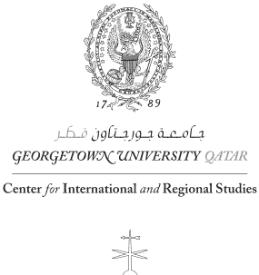
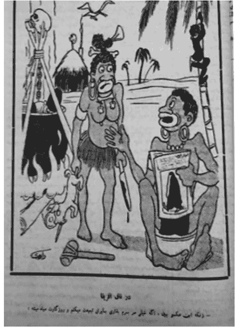
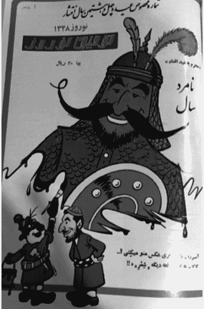
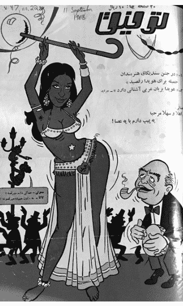
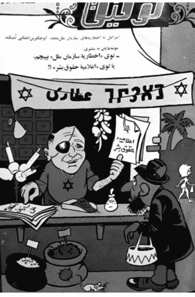
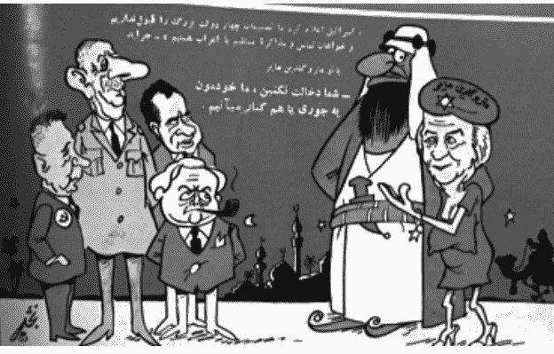
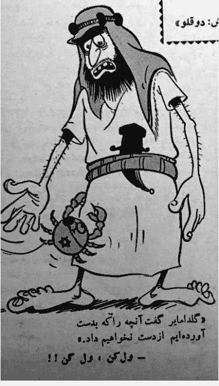
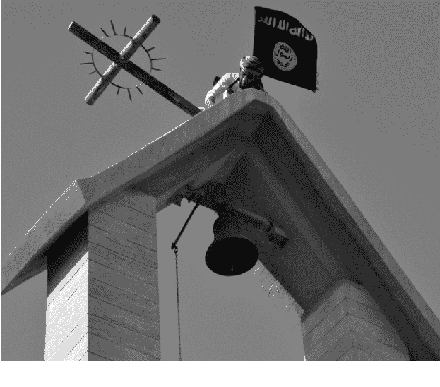

# 多元主义之地：中东的社区政治 / Firat Oruc 编

# 致谢

本卷是 2016 年由卡塔尔乔治敦大学分校国际与区域研究中心（CIRS）发起的“中东多元主义与社区研究倡议”的成果。我要感谢中心主任 Mehran Kamrava 和研究副主任 Zahra Babar，他们发起并支持了这项重要且切及时的研究计划。该项目的目标是通过各种多学科视角，审视中东族裔、语言、文化和宗教社区的意义与动态，并为该主题增加原创见解。我感谢本书中各章节的作者，以及参加工作小组会议的其他学者——Paolo D'Urbano、Amanda Garrett 和 Shak Hanish，他们慷慨地贡献了自己的专业知识以实现这一目标。

如果没有 CIRS 优秀的全体员工，我将无法完成这项工作。CIRS 出版物运营经理 Suzi Mirgani 在本书制作的每一个步骤中都提供了帮助。我感激 Jackie Starbird、Elizabeth Wanucha、Misba Bhatti 和 Umber Latafat 为他们从项目启动之初提供的所有后勤支持。我也很大受益于匿名评审员的建设性反馈，以及 Michael Dyer、Jon de Peyer、Daisy Leitch 和 Kathleen May 的编辑支持。我要感谢卡塔尔教育、科学与社区发展基金会，他们致力于对每个领域关于我们时代紧迫问题的学术研究提供长期支持。

最后，但同样重要的是，我非常感谢我的妻子 Nurgül 以及我们的孩子 Ikbal、Ebrar 和 Tarık，在我撰写本书期间给予了多元化的支持。他们坚定不移的爱、关怀和耐心让我深感幸运。

# 作者简介

Ehsan Abdoh-Tabrizi 是一位独立研究员。他的研究兴趣涵盖伊朗的国家与社会。他与 Afshin Shahi 合著了即将出版的关于伊朗、什叶派国家和逊尼少数群体的书籍。

Taghreed Jamal Al-Deen 是澳大利亚迪基大学大学阿尔弗雷德·迪基公民与全球化研究所的副研究员。她的学科背景是教育社会学，研究兴趣包括迁移、跨国主义、多文化主义、族裔、阶级和性别。Al-Deen 目前正致力于一项评估叙利亚和伊拉克遗产破坏的研究项目。她的出版物包括：“有时我觉得自己是个坏母亲：移民母亲参与子女学校教育的情感维度，”发表于《社会学杂志》第 53 卷第 1 期（2016年），以及“移民母亲参与子女教育：文化资本与跨国阶级过程，”发表于《教育社会学国际研究》第 25 卷第 4 期（2015年）。

Nazar AlSayyad 是一位建筑师、规划师、城市历史学家和公共知识分子。他是加州大学伯克利分校建筑与规划教授，曾担任阿拉伯社会与环境中心（CASES）和中东研究中心（CMES）的主任。他拥有开罗大学的建筑工程学士学位和规划文凭、麻省理工学院的建筑硕士学位以及加州大学伯克利分校的建筑历史博士学位。他是多本书的作者、合著者或编辑，包括《中世纪开罗》（2005）、《电影城市主义》（2006）、《教旨主义城市》（2010）、《开罗：城市历史》（2011）以及《传统：真实、超验与虚拟》（2014）。AlSayyad 曾撰写、共同制作并执导过国家艺术基金会资助的电视节目，并在 2008 年获得加州大学伯克利分校卓越教学奖。

James Barry 是澳大利亚墨尔本迪基大学阿尔弗雷德·迪基研究所的研究员。Barry 在 2013 年获得纳什大学的人类学博士学位，目前在迪基大学伊斯兰研究中心工作。他的著作《伊朗的亚美尼亚基督徒：一个社区的历史》（Monash Press, 2013）目前在迪基大学伊斯兰研究中心。在 2014-15 年，他荣获古金斯坦奖学金。

Kathleen A. Cavanaugh 是一位法律学者，目前担任戈尔韦大学法学院讲师。她的研究重点是国际法、人权和迁移。选择性出版物包括《紧急状态》（2018）。

Benjamin Isakhan 是乔治敦大学政治与政策副教授，也是该校政治与国际关系网络 POLIS 的创始人。他是《伊拉克民主：占领、独裁与民主化下的公民身份》（伦敦: B. Tauris, 2017）的作者。

Islam Hassan 是乔治敦大学国际与区域研究中心的研究分析师。他目前的研究集中在海湾和土耳其的国家建设。

Firoozeh Kashani-Shabi 是宾夕法尼亚大学沃尔特·H·安嫩伯格历史教授。她是《边疆虚构：塑造伊朗国家》（普林斯顿大学出版社, 1999）和《构想公民：伊朗的女性与母性》（牛津大学出版社, 2011）的作者。

Firat Oruc 是卡塔尔乔治敦大学外交关系学院世界文学助理教授。他的研究以中东的文化和文学为中心，通过两个书籍项目进行：一部关于土耳克的翻译与民族主义，另一部关于阿拉伯半岛的电影史。

Annika Rabo 自 2007 年以来一直是斯德哥尔摩大学社会人类学系的教授。她在 1986 年完成了关于叙利亚东北幼发拉河沿岸巨大灌溉工程对政治和社会影响的论文后，获得了社会人类学博士学位。

自20世纪70年代后期以来，她在中东（主要是叙利亚）以及瑞典开展了大量项目，关注领域涵盖了性别、亲属关系、家庭法和教育，以及城乡发展和跨国移民等多种课题。她近期的出版包括：《人类学方法与记忆分析：拉卡省迁移的过去与现在》，发表于《中东难民研究杂志》（2017）；《瑞典亚述人/叙利亚教人的冲突与认同》，收于《中东认同与冲突及其离散文化》（2016）；以及《“它计划了”：论当代叙利亚的我们与强大作品》，收于《美国与中东的理论：比较视角》（2014）。

Afshin Shahi 是布拉德福德大学中东政治高级讲师。他的研究包括中东政治与安全、政治伊斯兰教和宗教派别主义。沙希的著作包括《沙特阿拉伯真理管理的政治》（Routledge, 2013），他还在与埃赫桑·阿卜杜·塔布里齐合著一本即将出版的书，名为《伊朗、什叶派国家与逊尼派少数群体》。他的文章包括《安达卢斯化：伊朗正处于去伊斯兰化的轨道吗？》，发表于《英国中东研究杂志》第42卷第四期（2015）；以及《伊朗弥赛亚政策的悖论》，发表于《中东研究摘要》22期（2012）。他在杜伦大学获得政治学博士学位。

José Antonio González Zarando 是澳大利亚迪金大学阿尔弗雷德·迪金公民与全球化学院的副研究员。他也是墨西哥经济研究与教学中心历史系的副研究员。他的研究兴趣包括偶像崇拜、艺术破坏和遗产破坏。他最近在法医建筑（伦敦大学金史密斯学院）完成了一项访问学者计划（由英国人文学院资助），期间他与维多利亚和阿尔伯特博物馆合作，创作了《反抗地图》，这是为伦敦设计双年展制作的一场展览，关于辛贾尔亚齐迪人陵墓被毁的情况。

# 引言

Firat Oruc

今天，许多生活领域多元主义倾向的这种强大力量，引发了一系列反对它的运动。¹

我们如何在不将其视为理所当然的事实或每个社会所反映的规范价值的情况下，处理中东的多元主义和社区概念？中东被视为一个深陷基础主义和威权主义深渊、在宗教、文化、法律和政治多元主义承认方面极度匮乏的地区；或者是一个和平共存数百世纪的马赛克社区。然而，许多分析者怀疑：“一个半个世纪的地区曾是多元主义和宗教和谐的全球出口国……现在变成了星球上最不宽容、最不稳定的地方？”² 专家主张恢复多元主义是解决中东所谓民主赤字的可靠药方。³

但政策制定层未能意识到，多元主义不仅仅是适应不同群体内部及之间差异的务实方法，它是一个多维的谈判与竞争场所。引用东东史学家奥里特·巴什金（Orit Bashkin）非常有用的定义，多元主义涉及

“对哲学或政治领域单一概念的拒绝，对社会领域多样性的接受，并将社会主体视为多重成员身份的场所。”⁴ 虽然多元主义与认同政治、多文化主义和少数群体权利等相关概念重叠，但该概念特指特定社会场域中多种社区形态（宗教、族裔、法律、公民等）的内在共存。“场域”是一个构建、发生、活动和互动的地点。作为本书的核心隐喻，“场域”指的是一系列用于集体行动和参与的异质领域和平台。因此，多元主义场域涵盖了个人和群体在政治和社区中声称、监管和竞争权力关系的各种区域。同样重要的是，多元主义并不是将多样性、宽容和对话视为理所当然，而是要求投入承诺，去承认和理解跨越感知或声称的界限的他人。⁵

无论一个人坚持平衡模型还是冲突模型，多元主义都体现在特定的政治和历史背景下执行的包容与排除过程中。因此，它是一种“历史

不可避免地“作为一个政治项目既具有争议，且其影响又令人不安”的考量方式。”¹⁰ 因此，任何试图产生一个多元主义的规范性框架的尝试都是错误的，恰恰因为这只会“导致我们标记其实际应用中的缺陷，而不是去理解其在特定语境下意味着什么。”¹¹ 同样，社区并非一个具有一组共同特征的自然、非自愿的整体，社区始终是关系性的，是由与其他实体的差异以及与其关联而形成的。² 社会学家杰拉尔德·德兰蒂（Gerald Delanty）指出的：“社区的核心在于一种矛盾性。一方面，它表达了局部性和特殊性——亲密社会关系的领域、熟悉感、邻近性；另一方面，它指的是所有人类参与其中的普世社区。”³ 在亲属关系与社会之间，

“身份政治”与“多元文化主义”的出现发生着转变——23 尽管全球化承诺创造出一种寻求鼓励多样性的“世界文化”，但结果的包容性却并不高。随着文化变得日益具有领土化，文化的再生产越来越多是通过信息流实现的，而非通过在地点和空间中的物理体验。因此，构建和表述复杂身份的各种渠道将不得不浮现。所有这些因素的汇聚证实，中东在追踪文化如何调解全球转型方面将继续是一个关键地区。

在阿拉伯之春后的转折点上，对中东多元主义和社区的大部分研究正围绕着将身份视为国家项目失败的源头而非结果来展开。中东许多国家目前深陷激烈内战的泥潭，这种冲突正在撕裂维持这些社会凝聚的社会文化织面。随着该地区大部分地区派别主义的加剧、国家结构的崩溃和国界的蒸发，以及公开冲突和战争席卷了该地区的大片区域，种族和宗教身份的韧性问题变得日益重要。在某些政策圈内，有一种观点认为，问题的核心在于不同族裔语言社区和宗教社区之间根本性的不兼容性，而这些陈旧的分裂阻碍了任何形式的政治解决和社会凝聚。但人们也可以认为，阿拉伯之春让社区变得越来越可见，并显示了在实践和理论上对差异进行新框架化的不可避免的必要性.^24 自那以后，许多中东国家的国家社区关系发生了巨大变化。更重要的是，该地区的政治动荡导致了剧烈的人口结构变化，迫使当地社区迁移到他处。该地区境内持续存在的难民、寻求庇护者、移民和受贩人员的流离失所社区危机，将处于中东多元主义和社区问题的核心。几年前，谁能想到几乎每个土耳其城市都会有自己的叙利亚社区呢^25

迁移和强制流离失所的问题不仅将改变该地区的社会、经济和政治生活，还将对调适政治提出新挑战，特别是当其挑战了公民身份与多元主义之间假想的联系时。^26 尽管面临着流离失所的痛苦和不确定性，流离失所社区在失去国家提供的安全保障和亲缘纽带后，正积极地在新的“临时性景观”中寻找并创造新的“生存单元”形式。27 最终，基于通过新形式的流动性、主体性和凝聚力来增强社区赋权的多元主义社会政治范式，是否能在所谓的“新中东”的和平建设和国家重建中发挥作用，无论如何，这需要与伊马德·萨拉梅（Imad Salamey）所说的“国家共同体”（state communocracy）不同的理解，后者是一个通过国家内部不同群体权力分配来实现冲突后解决的框架。社区并非需要国家和“主流”社会调适的标记实体。与国家认可的社群主义将社区置于固定历史叙事、象征、价值观、传统和实践的观点相反，新的多元主义范式必须考虑到该地区社区变化的、灵活的、适应的和塑造的纹理。否则，我们始终面临产生“一种多元主义意识形态的风险，这种意识形态表述并自然化了试图减少、克服或调解的差异边界”——29

本书的特征之一是每一章都超越了当下，为其所探讨的主题提供了基于历史的解释。这些章节共享一个共识，即中东在历史上是一个多样化的地区，见证了不同社区之间的和平共处。关于多元主义具体场所的研究似乎也普遍存在一个明显的空白。这些章节探讨了国家政策对在多个层面表现出的国家身份的多样性和异质性的影响，包括教育、文化遗产、建筑、经济活动、公民身份和身份形成。本卷并未将其重点局限于该地区的宗教和少数族裔。^30 它也没有重复关于穆斯林社会多样性和伊斯兰教认识论多元性的论点.^31 相反，贡献者将中东的多元主义和社区问题视为人口不断穿梭包容与排斥机制边界的经历。

本书第一部分侧重于“国家与社区关系”，分析治理机构和制度在配置……中的作用

在该部分的第一章中，凯琳·卡瓦纳（Kathleen Cavanaugh）强调了治理和法律是设计和实施包容政策的两个基本领域。卡瓦纳对法律的政治和理论维度有着深厚的理解，试图为当代人权项目留出一个信仰的空间。我们是否可能跳出目前与暴力和极端主义的负面关联来思考宗教社区？“宗教”在法律和权利的框架中占据什么位置？卡瓦纳指出，当代自由民主的世俗主义指令已将基于信仰的社区排除在人权项目之外。³ 特别是伊斯兰教可以为社区提供某些组织和社会准则的想法，一直以来受到地区和国际政治参与者的极大怀疑。特别是在9/11袭击之后，欧洲和美国的穆斯林社区在公共和法律领域都受到了警务和监控。卡瓦纳引用了几个法庭案例，声称立法者积极参与限制伊斯兰教在公共场所的存在，理由是伊斯兰表达（如头巾）可能违反了公民平等原则。在阿富汗裔德国穆斯林女教师费雷斯塔·卢夫特（Fereshta Luft）案中，法院裁定她不能戴着头巾进入教室，声称希贾（hijab）传递了一种在国家中立框架内无法调适的“信号效应”。头巾被视为一种服装选择，而是被视为公共领域中一种分裂的标记。

作为克服“信仰对理性”二元对立的方法，卡瓦纳整合了对人权话语的两种解读：第一是作为在平等权重下消除差异的普遍化话语；第二是作为需要文化和规范顺从并有助于理解国际规范和原则的话语。从这些解读中可以得出，差异必须在项目内部得到促进或与项目并行存在。卡瓦纳的主要论点是，法律既不是固定的也不是稳定的，伊斯兰教在公共领域的存在仍然是对重新思考人权项目中所嵌入的排斥区域的测试。世俗主义霸权范式的抽象范畴大多是为了建立一种一元论视角，旨在将宗教贬为私人领域。作为世俗主义政体制的替代方案，卡瓦纳提出了一个多元主义框架，该框架将促进不同信仰和法律系统的共存。揭示信仰与理性的二元定位为文化多元主义与……之间的张力

卡瓦纳认为，欧洲中心主义的一元论使国际法延续了殖民计划的负面遗产。法律本身并没有确保非暴力关系，而是演变成了一种强加一个社区认为对所有人都有好的形式。这种殖民逻辑在西方对穆斯林社区的法律监管，以及对中东主权国家的法律治理中达到了顶点。

在西方法律框架下，伊斯兰教和穆斯林社区被边缘化的同时，中东国家在涉及其少数群体和宗教社区的问题上参与了国际法律机制，同时也利用伊斯兰法律实践来推动或抛弃适当的范式。国家立法者和宗教法学家提供了极其广泛的声音和解释，丰富了这些实践。根据卡瓦纳的观点，这种多元性与沙里亚的历史形成有关。由于伊斯兰法编写的来源（《古兰经》和圣训）没有提供完整的内容，诠释学的努力变得不可避免。更重要的是，这使得伊斯兰法与穆斯林社区保持着强互动，并为适应不同的社会和文化背景留下了巨大的空间。然而，卡瓦纳警告不要对国家进行浪漫化。国家为伊斯兰法律多元主义辩护，而个人行为体则利用伊斯兰法来实现基于权利的良好治理，并对女性、少数民族和其他宗教社区的限制进行合法化。无论如何，重要的是，伊斯兰法律诠释将继续演变。问题再次在于国际人权体系对它们的承认存在回避态度。正如卡瓦纳提醒我们的，在阿拉伯之春后的转折点，促进伊斯兰法与人权计划之间对话的重要机会被浪费了。在与阿拉伯之春紧张政治局势中产生的政治社区接触时，权力精英又回到了老调调，认为宗教是中东社会民主化的障碍。

另一个国家在其领土主权下监管社区多元化结构的重要场所是国家教育。教育一方面是国家用以塑造和引导包容与排斥叙事的权力工具，另一方面是许多社区向青少年传授传统和文化的必要手段。正如世界大多数地区一样，该地区公共教育的推广被视为国家建设的一部分。然而，尽管大多数阿拉伯国家在20世纪对教育投入巨大，但2002年的《阿拉伯人类发展报告》关注到了地区教育政策的不足，认为其无法支持个人社区和国家发展。报告指出，该地区的教育以相当狭隘的条款定义了“新公民”，教育在本质上主要是以阿拉伯人为中心的，排除了语言、民族和宗教的多元性。在这些案例研究国家，多样性并未被视为课堂中的资产。

通过安妮卡·拉博（Annika Rabo）对黎巴嫩和叙利亚的案例研究认为，学校课程排除了某些具有矛盾或争议的观点、学科和历史。尽管这两个国家在语言、宗教和民族上都是异质的，但它们管理多元主义的方法完全不同。叙利亚在内战之前拥有一套极其集中的教育体系，形式和内容在全国范围内相似。与此同时，黎巴嫩的情况几乎完全相反，差异化的学校占据了主导地位。黎巴嫩异质化的教育政策要么软弱，要么不可执行。此外，自19世纪中叶以来，外国学校和高等教育机构一直是该国的特征。此外，到奥斯曼帝国末期，所有宗教团体都有自己的教育机构。因此，黎巴嫩的教育公共支出较低，私营部门规模远大于公共部门。法语学校仍然倾向于占据主导地位，尽管英语日益被视为全球通用语言，英语学校正变得越来越流行。然而，尽管就读于这些语言学校，黎巴嫩学生仍然必须通过九级中考（brevet）和十二级毕业考试（baccalaureate），才有资格进入当地大学或加入职业协会。相比之下，叙利亚奥斯曼帝国晚期的正式教育发展要缓慢得多。法国托管时期对教育的投入很小，教育主要以法语进行，并侧重于法国的知识。直到独立后的头几年，外国和私立学校才受到更多控制，并开始将阿拉伯语作为主要教学语言。这些教育政策在1963年复兴党政变后得到加强，当时教育变为国家控制、强制性六年学制且免费，并成为培养现代和阿拉伯民族主义公民的重要工具。

# 引言

由于黎巴嫩的大部分教育是非标准化的，且政党经常使用外国教科书，许多学生并不熟悉本国的历史和地理。然而，在1990年内战结束后，人们决定将历史教科书标准化，以反映一种既精确又模糊的历史——这是参与内战的不同群体所拥有的许多冲突历史版本的产物。尽管如此，在内战结束二十年后，对于如何呈现黎巴嫩历史尚未达成共识。相反，公民教育旨在促进统一的黎巴嫩认同感和黎巴嫩公民的角色感，取得了更大的成功。

相比之下，在叙利亚，直到2011年内战，由于复兴党盛行的意识形态统治，关于公民身份和历史的讨论要少得多。地理、历史和宗教教育的课程经过精心琢磨，以推行党的思想。历史和地理课程侧重于国家和地区历史，并始终强调泛阿拉伯视角。在意识形态上，最重要的学校科目是“民族运动”，由该学科的专家授课。通过该科目意味着宣布自己是政治体系的潜在反对者。更重要的是，不通过该科目就无法通过九级或十二级的考试。

通过这一案例研究，拉博认为差异的管理通过对争议问题保持沉默以及国家的多元性来实现的，尽管这两个国家都必须由于内战的结果应对这些问题。教育被认为局限于国家秩序，仅仅是这里公民关注的问题。必须注意的是，在叙利亚，自内战以来教育体系迅速恶化，学生无法获得稳定的教育，在黎巴嫩和约旦可能继续无法获得服务。³34

在第三章中，伊斯兰·哈桑（Islam Hassan）提供了另一个案例研究，探讨了国家在国家认同构建中对某些社区产生边缘化的作用。他认为，卡塔尔执政精英通过一种社会保守的方法，能够在卡塔尔社会中维持持续的霸权，这种方法考虑阿拉伯部落社会价值观、文化、传统和习俗，并根据与这些特征的亲近程度推行一种排斥与包容的方案。此外，通过狭窄定义了什么构成“卡塔尔人”，并对公民与“卡塔尔人”之间进行了区分。阿比德（Abid，奴隶）、胡瓦拉（Huwalah，源自伊朗的逊尼派）和波斯人的后裔可能享有公民权利，但在社会阶层中并不处于高位，也不被视为卡塔尔文化的合法代表和大使。“本国民”与外国人之间的婚姻——尽管并不违法——在社会上受到监管，且通常被认为对卡塔尔女性是不利的，因为这种婚姻会导致她们在社会和政治地位上下流化。在国家层面，卡塔尔政府通过让女性在与外国人结婚后在法律上很难为其子女获得卡塔尔国籍，从而直接影响了女性的婚姻选择。

通过哈桑（Hassan）所描述的“葛兰西式霸权”维持阿尔萨尼（Al Thani）部落及其他阿拉伯部落的政治和社会统治地位，这意味着卡塔尔国家构建了一种排他性的历史叙事，强调了阿拉伯部落对国家建设的贡献，而忽视了阿比德、胡瓦拉和波斯人的贡献。阿拉伯部落在维持这种结构方面有其既得利益，因为这种结构注定为他们带来物质财富。统治家族通过在政府和军事职位上优先考虑阿拉伯部落，能够依靠他们的支持。因此，根据哈桑的观点，官方叙事所描述和推广的卡塔尔社会是“想象的”，与人们的记忆和生活现实相冲突。将卡塔尔描绘为一个历史上的同质社会，忽视了它几个世纪以来一直是阿拉伯、波斯和胡瓦拉人混合体的事实。

在第一部分的最后一章中，阿夫辛·沙希（Afshin Shahi）和埃赫桑·阿卜杜-塔比齐（Ehsan Abdoh-Tabrizi）将分析框架转向国家与社区关系的社会经济方面。通过对土耳其人、库尔德人和俾卢人等逊尼人口的详细研究，他们考察了部门国家政策对伊朗社区发展的影响。虽然他们的研究涉及早期历史时期，但主要重点是1979年伊朗革命对逊尼人口的影响，特别是锡斯坦-俾卢支斯坦（Sistan-Baluchistan），那里的大部分人在经济上变得贫困，并一直得不到新政府的发展支持。

20世纪初帕赫拉维统治期间政府的集权化，意味着国家通过税收和关税征收收入的能力增强，这种影响波及伊朗社会的各个层面，特别是逊尼部落人口。此外，这些人口在旨在连接锡斯坦-俾卢支斯坦与国家其他地区的发展项目中，仅仅充当了体力劳动的角色。

政府的强迫征收土地和部落重新安置削弱了部落组织，并产生了有害的经济和社会影响。被称为“萨尔达（sardā）”的俾卢支部落长老们在某种程度上幸免了这些措施最恶劣的影响，因为他们与现代国家形成了庇护-客户关系。这种关系的形成是由于中央政府的优先事项以及无法与俾卢支部落建立保护关系的结果。在大多数情况下，现代民族国家对这些地区的控制涉及任意的武力、几乎没有经济补偿的残忍重新安置，以及对大多数逊尼派伊朗人整个生活方式的破坏。

随着礼萨·沙（Reza Shah）登基王位，政府的强硬政策有所减少，但在大多数情况下，强迫重新安置仍在继续。礼萨·沙使用了与其前任不同的政策来建立一个理想的国家。他并没有简单地对这些群体使用任意武力，而是试图通过将更“可靠”的族群迁到那些地区，将其融入新的波斯伊朗国家。然而，像他的前任一样，他没有向这些地区推行发展计划，也没有分配通过石油热潮获得的任何财富。相反，他倾向于将财富和发展集中在城市和工业化地区，从而加剧了什叶派城市中心与逊尼派农村地区之间不平衡的发展。

1979年的伊朗革命再次导致国家对逊尼少数民族政策的改变。伊斯兰共和国对社会公正和经济平等的承诺间接改善了逊尼人的生活，政权启动了一项雄心勃勃的计划，为农村和临时居住地提供电力和自来水。其国有化和再分配的政策并未延伸到这些在很大程度上仍被边缘化且缺乏发展的地区，尽管有这些言辞，政府仍未能解决由于族裔问题导致的持续边缘化。在引入宗教歧视加剧族裔问题后，政府对族裔的歧视变得显而易见。此外，公共部门的什叶派偏见意味着在帕赫拉维时期能够进入中产阶级的逊尼人被剥夺了机会。革命后出现并定义国家的什叶派话语加剧了伊朗族裔地区的发展落后。由于系统性的疏远和经济排斥，这些地区的非正式经济占据了主导。

本书的第二部分“身份的边疆”（Frontiers of Identity）展示了中东四种不同的身份案例。贯穿本部分章节的主题是人文地理——城市空间、遗址、祖地和边界——对于社区和个人认同的作用。身份通过空间包容和排斥的过程被构建或抑制。在阿拉伯城市中犹太人或科普特人的地位如何？在土耳其和亚美尼亚的官方叙事中，霍帕伊斯兰化的亚美尼亚人又是如何？在波斯民族想象中的南部族裔边界又是如何？在伊斯兰国（IS）破坏其遗址后，伊拉克和叙利亚的雅西迪人和亚述人又如何？这些案例引导人们关注了多元化衡量中被忽视的领域。

城市的建造方式和社区的整合反映了不同社区之间如何互动。城市中的某些区域可能与特定身份专门相关，无论它们是贫民窟还是少数民族感到自己对地方和传统拥有控制权的空间。在本书的贡献中，尼扎·阿尔赛亚德（Nazar Alsayyad）试图绘制20世纪和21世纪中东城市转变的地图。他认为，阿拉伯城市和社会建筑演变发生在三个不同的时期——殖民时期、独立和国家建设时期以及全球化时期，每个时期对应一种特定的城市设计：分别是混合式、现代或伪现代、以及后现代。通过构建这一特定框架来分析和理解中东城市主义，阿尔赛亚德认为，当地区身份的流动性显而易见时，族裔和宗教冲突的原因以及这些冲突转化为特定社会包容和排斥的形式也变得更加容易辨别。

对中东城市主义的影响在历史上产生了有争议的社会审美分类，以及证明不符合居民传统社会文化需求的城市。阿尔赛亚德指出，尽管这些社会曾被强加了西方现代性观念，而在某些时候又是自愿采纳并适应了特定的建筑和设计趋势，但传统与现代之间的张力持续并存。阿尔赛亚德（AlSayyad）章节中提出的批判性问题非常切中：替代性的现代性是否能从这些矛盾中产生？

中东城市中中东现代性和社会转型的核心问题在于社会包容与排斥的问题。通过考察摩洛哥的犹太人和埃及的科普特基督徒的案例，阿尔赛亚德试图捕捉这些少数群体如何在中东城市中导航并履行他们的身份认同。他注意到，科普特妇女开始在开罗的街道上戴头巾，以避免吸引人们的注意。这体现了阿尔赛亚德所说的“同质性霸权之内的生存策略”。相反，在摩洛哥，少数群体（即犹太人）的接纳/排除并非通过同化实现的，而是通过自我实施的隔离。根据对传统伊斯兰城市的历史和理解，阿尔赛亚德认为，隔离在历史上是少数群体开辟自己领地的方式，而无需赋予城市其他地区任何权利。在摩洛哥等中东国家，被称为“梅拉”（mellah）的犹太人区与西欧的贫民窟形成了鲜明对比，后者似乎更像是惩罚性空间而非积极的社区认同空间。与贫民窟不同，“梅拉”是从内部锁住的，社区对非犹太人进入的日期和时间行使控制，通常在安息日和其他宗教节日期间关闭街区大门。此外，由于他们的存在被认为给城市带来了财政和商业繁荣，犹太人往往免受骚扰，他们的存在也受到了重视。因此，阿尔赛亚德认为，摩洛哥的例子反驳了关于“排斥是负面的”这一常规认知，在特定情况下，排斥为少数群体社区赋能并开辟了空间。

在接下来的章节中，詹姆斯·巴里（James Barry）研究了另一个少数群体——亚美尼亚裔穆斯林，涉及其对奥斯曼“米勒特”制度（根据宗教归属对帝国臣民分类）的现代解读，以及该制度对土耳其穆斯林和亚美尼亚基督徒身份的持续影响。在整个分析过程中，巴里强调了基督教在历史上如何被视为亚美尼亚身份以及主张亚美尼亚性的核心，以及伊斯兰教如何经常被视为压迫者的宗教，而皈依伊斯兰教则被视为放弃了个人的身份。

巴里认为，当共和国接管时，奥斯曼的米勒特结构被保留了下来，穆斯林米勒特变成了土耳其民族，而非穆斯林米勒特（包括犹太人、希腊正教徒和亚美尼亚格列格亚教会信徒）则保持原样。但在这种从帝国到民族国家的过渡中，米勒特制度变得民族化了。根据巴里的观点，该制度在严格的族裔宗教类别中延续，是霍帕-赫姆申（Hopa Hemshin——一个居住在安纳托利亚东北部的亚族裔群体）认同自己为土耳其人并否认其亚美尼亚起源的主要原因。关于霍帕-赫姆申的大多数研究没有提到他们的亚美尼亚遗产，而是将他们称为“土耳其部落”。巴里论证道，这是现代米勒特制度民族化效应的体现，霍帕-赫姆申人因为其穆斯林身份，其亚美尼亚起源没有得到承认。他们与伊斯兰教的关系与那些非自愿皈依的伊斯兰化亚美尼亚人非常不同。对于伊斯兰化亚美尼亚人来说，皈依是在迫害时期逃避暴力的手段。

巴里还追溯了基督教与亚美尼亚身份之间等同性的溯源，源于亚美尼亚民族教会和米勒特制度的创始传说。亚美尼亚人声称是世界上最古老的基督教国家，教会通过遵守非迦克墩会议教义和使用古典亚美尼亚语礼拜来维持其排他性和等级制度。与其他教会和教团不同，亚美尼亚教会将自己定义为民族教会，服务于亚美尼亚民族的需求，而这个民族是由领土分散以及缺乏主权来定义的。结果，亚美尼亚身份和民族开始根据共同的语言、祖先、与祖籍家园的象征性联系以及团结感被定义。在缺乏实际王国的情况下，教会承担了国家政府的角色。因此，教会成为定义和维护亚美尼亚身份的最首要权威，并利用和巩固了基督教与亚美尼亚身份之间的联系。

尽管这些群体在整个中东持续存在，但他们的历史在国家历史叙事中在很大程度上是缺位的。虽然穆斯林往往作为亚美尼亚历史中的边缘元素出现，而亚美尼亚裔伊斯兰教徒的贡献在很大程度上被忽视了。直到14世纪，穆斯林与亚美尼亚人之间的互动主要发生在学术领域，亚美尼亚知识分子对处理穆斯林与基督教关系的问题表现感兴趣。到14世纪，吹扬亚美尼亚人优越性的论战著作开始流传。利用他们发明的伊斯兰教或犹太教的“想象论证”被用来从“非此”（非伊斯兰或非犹太）的角度来定义亚美尼亚身份。虽然亚美尼亚人可能采用了阿拉伯、土耳其或波斯名字，使他们与所生活的人们无法区分，但宗教仍然是他们与邻居之间的鸿沟。在很大程度上，这种鸿沟今天依然存在是因为对亚美尼亚社区持续的压迫和迫害。正是基于这段历史，巴里利用亚美尼亚穆斯林的案例，来理解中东亚美尼亚社区内部发生的关于身份和自我感知的变化。

与宗教、教派、种族和语言不同，种族的概念通常不是研究中东社会的中心。关于种族和颜色叙事如何转化为政治、社会和文化领域的讨论非常有限。种族话语在国家神话创造中的作用没有得到像在美国、法国、南非和英国那样的学术关注。我们的著作涵盖了菲鲁兹·卡沙尼-萨贝特（Firoozeh Kashani-Sabet）的章节，该章节讨论了广大参与者在形成现代伊朗过程中对种族话语的使用，这些参与者包括19世纪的欧洲东方主义者、国家建设者、20世纪60年代的殖民知识分子以及1970年后的伊斯兰政府。卡沙尼-萨贝特认为，肤色、文化或族裔差异的歧视在某些伊朗社区仍然很常见。事实上，在流行想象中，正如“巴什苏”（Bashu）所所示，黑色继续与狡诈等同。伊朗的案例有其特殊性，但对种族话语的持续吸收并不使其与其他中东国家有所不同，这些国家大量借鉴了西方的国家概念，这些概念强调一个群体对另一个群体的优越性。此外，与其他中东国家一样，种族话语的使用“往往具有防御性质”，因为国家试图凝聚他们获得的族裔多元的领土。不可避免的是，这导致了对“族裔语言同质化文化的强加，从而排除了少数民族的文化和语言”。

卡沙尼-萨贝特注意到，尽管这种情况在第一次世界大战后的几乎所有东方国家都发生了，但种族话语的推广在波斯湾被尤为强调并产生了极其灾难性的结果。在波斯湾，英国官员和人类学家在对当地文化和语言了解有限的情况下往往错误地贴上“阿拉伯人”、“土耳其人”和“波斯人”等种族标签。此外，他们倾向于夸大库尔德人、俾路支人、鲁尔人和其他族群之间的族裔语言差异。

伊朗的社群源自波斯人，尽管要识别或追踪任何未与这些群体混合的波斯血裔存在困难。这些族群语言的划分变得无处不在。在19世纪，在波斯民族主义运动的高潮和关于雅利安主义的辩论中，这些划分往往被用来推行种族优越的议程。卡沙尼-萨贝特的这一章节追踪了殖民参与者和机构产生的关于种族和身份的知识，这些知识被伊朗国家吸收，并发展为一种试图维持社会阶层和划分的雅利安主义话语。

主要的族群语言界限之一可以追溯到中世纪，位于波斯人和阿拉伯人之间。阿拉伯人往往被构建和构想为波斯人在道德上破产的他者，尽管从物理特征来看，通常很难区分阿拉伯人与卢尔人或居住在现代伊朗南部地区的人。20世纪初，随着伊拉克和伊朗开始主张自己的主权权利，族裔问题成为两国之间特别有争议的问题。对这些模糊性的不安以及关于族裔的未解决纠纷，增加了战间期对雅利安主义和波斯例外主义的狂热。20世纪60年代，伊朗人开始参与去殖民化、第三世界主义、伊斯兰主义和社会主义的全球话语，这些围绕种族、文化和身份的对话在内容和语气上有所不同。讽刺的是，像贾拉尔·阿尔-哈迈德、阿里·沙里提和马努彻赫·海尔扎尼等知识分子开始贡献这些全球讨论，而伊朗国家却沉溺于对雅利安主义的夸张拥抱，这在穆罕默德·里扎·帕列维的加冕以及他采用“雅利梅”（Aryanmehr）作为王室称号中表现得最为明显。直到20世纪60年代，伊朗的关键知识分子才开始远离波斯优越主义导向的国家路线，开始关注那些经历过殖民和种族歧视的民族和国家的斗争。

近期伊斯兰国（IS）的出现动摇了中东多元化的结构。因此，本卷以本杰明·伊萨坎（Benjamin Isakhan）、安东尼奥·冈萨雷斯·萨兰多（Antonio González Zarando）和塔格里德·贾马尔·丁（Tagreed Jamal Al-Deen）关于伊斯组织针对宗教少数派的人类痛苦与遗产破坏之间相互作用的章节结束。作者们记录并探讨了针对伊拉克和叙利亚北部雅西迪派和基督教人口的“文化清洗”。他们对这一主题的讨论处于遗产、社区和暴力的概念框架内，并考虑了这种破坏对中东文化马赛克的影响。

作者认为，遗址的破坏与种族灭绝计划相结合，是族群宗教冲突的核心，因为遗产在社区的体现中发挥着至关重要且具象的作用。因此，遗产的破坏必然充当一种实际和象征性的暴力形式，破坏了身份并撕裂了社会组成。

雅西迪人经历了长期的迫害和种族灭绝历史，针对他们的最后一次是在萨达姆·胡赛因发起的安法尔运动之前，胡赛因在1988年反对库尔德人的残暴运动中摧毁了他们的村庄。这次攻击还导致许多人流离到伊拉克境内及外的城市中心，他们的宗教场所已成为仪式和公共集会更为关键的地点。与雅西迪人类似，基督徒在中东世俗国家出现后也饱受了宗教迫害和压迫。结果，该地区的基督教人口在过去一个世纪中剧减。³36 伊斯对基督徒的再次袭击导致他们的纪念碑、雕像、壁画、墓地和教堂被破坏、污损和破碎。再次，对这些群体的攻击试图抹除他们的历史和集体身份。

新一轮的暴力带来了迫害和种族灭绝的痛苦记忆，唤起了过去的创伤。它们也抹除了、并使中东多样性的可能性变得越来越小。在持续冲突中，伊斯成为一个促进压制和拒绝差异的计划和意识形态的顶点。当爆发性冲突在该地区发生，且教派、宗教和民族划分往往是这些冲突的核心时，作者理直气壮地警告道：

> 中东（特别是伊拉克和叙利亚）需要的是一个强大且敏感的过程，在这个过程中，要公开诚实地面对过去的创伤。这将是持续混乱的一种良药，并是迈向跨族和宗教关系、创造凝聚的地区以及一个现代、和平且多元文化的中东的关键第一步，让所有公民无论族裔、宗教或政治倾向如何，都能自由地和平生活。³⁷

因此，尽管人们努力平息和抹除差异，一个异质的中东可能得以保留，但持续冲突以及20世纪的冲突表明，如果没有明确的政策在公民社会的不同领域以更包容、调和的方式促进差异，冲突将继续爆发。

# 历史的谱系

本卷重点介绍的历史谱系和场所证明，多元化的工作本身需要基层社群的多维向量参与。多元化和社区的概念在中东及世界其他地区无疑处于过渡状态。但社区领域远未消失，它们仍然继续定义着我们的归属感，并在日益不安全和不确定的世界中引导我们。

## 凯琳·卡纳瓦（Kathleen A. Cavanaugh）

关于中东宗教紧张和不平等的本质主义思维通常将分歧归于阿拉伯社会内部的文化和遗留，而这些反过来与伊斯兰教的本质密不可分。将宗教置于该地区极端主义和暴力的核心，产生了发展世俗政治实践的巨大压力。尽管世俗项目作为中东冲突解决办法的优点已受到挑战，但宗教与良好治理的要求格格不入的观点仍然存在。

> * 作者感谢由乔治大学在卡塔尔发起的“东方多元化与社区”工作组成员，他们对本章节的早期版本提供了意见；特别感谢阅读了草稿的 Matthew McManus 和 Julia Hall。

Kathleen A. Cavanaugh，“信仰与国家：关于多样性的当代冲突”。收录于《多元化：中东的社区政治》，Firat Oruc 编，牛津出版社 (2019)。牛津出版社。DOI: 10.1093/978010952713.003.002

公共领域对宗教的监管在人权项目中尤为激烈，它符合公共国际法的以国家为中心的方法，法律在某种程度上通过排除其他形式的社会调节（例如习俗、风俗、道德和宗教）来实现合法性。在人权话语中，世俗主义的吸引力“鼓励人们在理性的词汇而非信仰中寻求解放”，被用于促进政治和民事、少数群体权利、私域的宗教自由以及公共领域的法律分离。这种人权的世俗化——将信仰从以权利为中心的话语中剔除——导致人们认为人权话语本身已变成了一种新宗教，反映了一种特殊的西方自由主义权利解读。

> 那沙里亚忠实反映了宗教设定的教义和神圣法则，它是稳定且不变的。政治领域的多元化或公共自由的不断演进等原则在其中没有地位…… 人很难在尊重民主和人权的同时，支持一个基于沙里亚的政权，因为它显然偏离了公共价值观，特别是在刑事法律和程序、关于女性法律地位的规定以及根据宗教教条干预生活所有领域方面。

这种对伊斯兰教的理解（及其在人权法中的他者化）强化了这样观点：人权项目具有深根蒂固的世俗自由议程。

在此背景下，本章将试图考察在各种分析趋势中勾勒出的法律政治伊斯兰法与国际法。我通过打破这些法律话语中“固定性”的观念，并重新审视它们在各自政治自我中的位置，认为这是应对某项挑战的关键第一步——这一挑战占据了大量关注伊斯兰教与权利的文献——即在人权项目中开辟一个可以同时容纳信仰与理性的空间。本章的第一部分将广泛探讨人权项目如何介入公共领域的宗教事务。它将定义“世俗主义（`secularism`）”与“世俗性（`secularity`）”的概念，并考察信仰与国家关系的本质。它将转向这些概念在伊斯兰教与人权普遍交汇之处是如何被界定的，并特别是在将其应用于中东国家时。根据叙述者出发点的不同，人权以两种方式之一被解读：在第一种解读中，人权被视为一种普世的善，它要求公共空间的建立，并使差异在平等规范的权重下被消除。相比之下，第二种解读则要求考虑文化和背景，以理解并应用国际法律准则和原则。因此，差异必须在项目内部受到保护（甚至是促进），或者与之并存。

第二部分侧重于伊斯兰教法律表述的多元化解读。对伊斯兰法的差异化解读（我认为这与国际法是共有的）产生了对伊斯兰国际法准则和原则的解释及适用性的差异化方法。以这种方式对待法律——在这里两者既不是固定的也不是绝对的——重新校准了我们对公共广场上伊斯兰教的理解，并促使我们重新思考传统上被读入人权项目的排斥性区域。本章第三部分将关注伊斯兰刑法和诉讼法中的分析趋势。由于有权威文本承担了这项任务，本节不会重复这些努力，而是对（表面上）伊斯兰法律原则的公法指令提供概述，并考察这些解读在何处（以及如何）导致了针对人权的“伊斯兰式”限制。随后，本章将观察宗教与所谓的“民主国家之必要”的内容之间的紧张关系，是如何在“阿拉伯之春”之后在中东北非地区发生并持续持续的政治转型中被勾勒出来的。随着这些法律和政治叙事的霸权博弈展开，结论部分将重新审视信仰理性的问题。

## 公共广场的去咖啡化⁷

无论对人权的起源如何理解，⁸在当代，其词汇表是世俗的。作为一个世俗化项目，人权将信仰与基于权利的话语隔离开来，保护私有领域的同时监控公共空间。人权项目普世化过程的一部分嵌入了一种“世俗主义的霸权知识体系”，⁹，其中，表达出的意志将成为强大宗教表达之“强制性”影响的派生物。正如大卫·肯尼迪（`David Kennedy`）指出的：

> 如果你认为世俗主义是现代西方糟糕之处之一，你可能会主张人权共享了世俗精神，作为一种虔诚的情感词汇，它取代了宗教，提供自己作为一种廉价的替代品。你可能会声称人权（包括宗教权利）的执行将宗教降级为私人和个人的投入，或在其他方面推进了世俗项目.¹⁰

关于宗教与法律界限程度的辩论并不新鲜。亨利·梅因（`Henry Maine`）十九世纪的经典著作假设宗教与法律是结合的：“从中国到秘鲁，没有任何记录的法律制度在最初引起关注时，没有被发现与宗教仪式和规范纠缠在一起¹¹¹。”世俗化对于法律从宗教的掌控中解放出来是必要的。梅因认为，进步的衡量标准是法律与宗教的模糊向法律与宗教领域界限的。这种对早期文化中宗教与法律关系的观点被 `A.S. 戴蒙`（`A. S. Diamond`）非常激进地挑战，他主张法律从一开始（`ab initio`）就是世俗的。虽然戴蒙承认在两个特定领域——神圣犯罪以及诉讼中的誓言或命令——但他认为这些只是其他世俗法律的例外。

在重新审视这一案例时，`哈维尔·马蒂内斯·特隆`（`Javier Martínez Trón`）和 `W. 杜哈姆`（`W. Durham`）指出，梅因和戴蒙的假设——法律要么是世俗的，要么受宗教驱动——未能考虑到法律与个人的关系²，这种关系可能对某些人具有世俗意义，对另一些人则具有宗教意义，且这种关系会随时间而变化¹⁴将这种推理应用于私人/公共的划分时，特隆和杜哈姆建议，在多元社会中必须考虑到这种差异，⁵

这种差异性实际上在考察信仰与国家的关系时显现出来，因为所有国家在国家关系上都采用了特定的话语，通常体现在宪法和制定法、以及司法和行政裁决中。尽管这些立场不是固定或不可更改的，且通常存在于争议空间之中，但可以对它们沿着一个连续体进行定位。在这一端，是强世俗的国家，表现出约瑟夫·卡萨诺瓦（`José Casanova`）所说的非理性世俗性⁶；另一端是那些世俗的、在修辞和法律上保持中立，但与宗教团体保持较高水平合作的国家；最后是具有非世俗（例如宗教）取向的国家。国家在这一连续体上的位置影响了宗教问题（特别是宗教的表现）如何被处理，以及相关的宗教社区如何在国家内得到安置。

对自由民主国家内部宗教与国家关系的研究揭示了两种广泛的模式或模型——定义为“世俗主义（`secularism`，或世俗化）和世俗性（`secularity`）”。虽然这些模式会随时间而变化，某些国家可能不遵循光谱的任何一方——即它们可能对两者都表现出倾向——每种研究点对于对个人国家和地区的趋势进行某种分类都是有用的。第一类“世俗性”适用于那些“主张实质性而非形式性的平等与中立观念的国家的治理体系，认真对待出于宗教动机的诉求”。¹⁷这种模式提供了一个多元化的框架，国家在其中尝试法律多元化的形式。

### 多元主义之地

在第一个案件中，26岁的费雷什塔·（`Fereshta Luft`）是一位信仰穆斯林的德国女教师，她被巴登-符腾堡州学校系统的教学岗位拒绝，因为她在教学时佩戴希巾。在委员会看来，这与德国《基本法》（`Grundgesetz`）中的政教分离原则不兼容。委员会认为，希巾具有一种“信号效应”（`Signalwirkung`），他们认为这与国家中立原则（`staatlichen Neutralitätsgebot`）不兼容。¹⁸ 他们进一步认为，头巾是文化划分的表达，也是一种宗教符号。¹⁹ （`Luthin`）通过德国行政法院的三个渠道对裁决提起上诉。前两个层级——斯图加特行政法院（`Verwaltungsgericht`）在2000年3月24日的裁决，以及巴登-符腾堡州行政法院（`Verwaltungsgericht`）在2001年6月26日的裁决——均维持了委员会的裁定。在向德国最高上诉法院联邦行政法院（`Bundesverwaltungsgericht`）提出的最终上诉中，该裁决于2002年7月4日最终被推翻，但至关重要的是，裁决本身留下了明显的可能性——事实上，其措辞暗示了不可避免性——随着德国内部多样性的增加以及由此可能产生的冲突，未来可能会出现某些条件，使得管理教师的“外表”（`äußeres Auftreten`）变得成为必要。¹⁰

类似的方法在土耳其宪法法院的莱拉·沙辛（`Leyla Şahin`）案中被采用，她当时24岁，是是伊斯坦布尔大学切拉哈帕沙医学院的五年级学生 `pigit21` 1998年3月，沙辛因佩戴希巾被拒绝参加其中一场笔试，这违反了伊斯坦布尔大学副校长1997年的一项裁定，该裁定规定：

> 根据宪法、法律法规，并根据最高行政法院和欧洲人权委员会的判例以及大学行政委员会通过的决议，“头部被遮盖”（佩戴伊斯斯兰头巾）的学生和留胡须的学生（包括留学生）不得被允许参加讲座、课程或辅导课 `pigit22`}

此后，沙辛因因佩戴希巾违反禁令而多次被拒绝进入大学。土耳其宪法法院裁定，通过维护宗教自由和法律面前平等的原则，该禁令是必要的，旨在保护个人免受宗教事务的外部压力 `pigit23`}

国家对公共广场的这种监管也在地区层面进行，国家通常被赋予对宗教表现干预具有一定的裁量权。欧洲人权法院（`ECHR`）采纳了要求的定义，^{24} 在用尽国内救济手段后，沙辛向欧洲人权法院提起诉讼。2004年，一个七法官庭拒绝了沙辛的观点，即高等教育机构禁止伊斯兰头巾违反了她在欧洲人权公约若干条款（包括第9条）下的权利自由。在裁决中，法院认为，“伊斯坦布尔大学限制佩戴伊斯兰头巾的规定以及实施这些规定的措施是合理的，并与所追求的目标成比例，因此可以被认为是民主社会中是必要的。”该案随后被提交至大法庭，裁决在那里得到了维持 `pigit25`} 重要的是，法院在做出决定时，参考了比利时、法国^{26 德国、荷兰、瑞士和英国等欧洲国家关于伊斯兰头巾和国家教育的法院裁决和法律辩论。仔细观察沙辛案中法院的推理发现，法院认为“伊斯兰头巾在民主社会中具有一种感知上的政治和潜在的负面意义”。^{27}

“综合来看，”正如一位评论员提到的，

### 多元主义之地

这些案例对于日益多元的政治环境（在欧盟及其他地区）中宗教自由的可能性和局限性提出了关键性问题。一方面，它们标志着一个旨在“人权的文化延伸和法律执行”（包括宗教和信仰自由）的“新世界秩序”与现状之间的紧张日益增加。另一方面，这些案例反映了对被视为“文明冲突”指标的宗教实践的警惕性增强，以及为了公共秩序之名对自由所做的限制。这些案例还证明了泛欧洲宗教符号法律话语的增长，这些符号不仅被视为文本，更被视为一种广泛且模糊的社会控制机制。⁸

自该裁决以来，土耳其的政治格局发生了显著变化，因为2002年公正正义与发展党（以下简称`AK党`）的当选将宗教带回了政治领域。然而，这种转变并未在欧洲其他地区，那里的国家继续通过日益私有化的宗教规范模型来安置以穆斯林为主的移民社区。伴随这种私有化的法律叙事将世俗霸权政权与民主社会的必要因素交织在一起。然而，有趣的是，世俗内部引出了一种隐含的、弥散的沉没的基督教文化身份。在这方面，“世俗”与“基督教”文化身份在欧洲人之间以复杂且罕见的模式交织在一起。³

尽管国际法对中东国家的世俗监管通常被框架在一个以权利为导向的话语中，这种话语提供了平等、性别平等以及政教分离体制中必要边界的概念，但其相关的政策（和监管）在历史上一直是殖民利益的延伸。将法律的应用置于“殖民当下”表明，现代国际法的叙述无法与其欧洲殖民项目的历史、文化和政治背景分离。尽管“剧目”可能不同，但“西方与东方”之间的征服与统治可以同时存在于公共国际法之中——从国际经济和贸易法、人权法，到在全球反恐战争背景下建立的例外状态中管理的武力使用法（`jus bellum`）和国际人道法（`jus in bello`），以及与此处相关的，关于权利导向话语之世俗灵魂的斗争。

在殖民语境下阅读的世俗主义，不再是一个促进宽容、开明和多元主义的理念或价值——《欧洲人权公约》（`ECHR`）认为这些品质是民主社会所的.^31 反反，它是一个与“资本主义民族国家体系兴起密切相关的概念——这些国家在权力和繁荣上相互猜忌且不平等，每个国家都拥有通过不同中介而获得保障并受到威胁的集体人格”。33 `塔拉·阿萨德`（`Talal Assad`）观察到，“世俗国家并不保证宽容；它引发了不同的野心与恐惧结构”。33 此外，这些项目建立在一个错误的假设之上，即国家可以被描述为一种道德：即自我（‘西方’）与其他者之间存在着‘真正的非暴力’关系”。34 `约翰·埃斯波托`（`John Esposito`）和`阿扎姆·塔米米`（`Azzam Tamimi`）认为，现实是：

> 今天整个穆斯林世界，我们正目睹着一场国家/文化认同的内部战争。这是一场定义国家认同和灵魂的战斗，它将根深蒂固的地区和精英与新的社会力量对立起来，后者是希望其社会走向现代化而非世俗化倾向的社会部门。这种斗争日益包含了对加强政治参与和民主化的呼声。讽刺的是，世俗主义力量为了保留自己的权力和特权，往往为了威权主义而非民主化而战。西方政府在面对长期现实和策略时，对短期收益更加满意并选择了妥协.^35

虽然后殖民世界的其他地区经历过殖民统治时期，这些时期塑造了他们认同的当代轮廓，但中东和北非（`MENA`）地区的特征是不同类型的统治浪以及现代国家内部持续的外部影响。将国际法置于这些政治现实之中而非之外，要求我们在开始解释“普世”国际法之前，必须首先明确“指的是什么样的或谁的国际法观点”。36 正如`萨缪尔·莫恩`（`Samuel Moyn`）所说，权利“长期存在”，但“它们从一开始就是国家权威的一部分，而不是被用来超越权威的”。37 挑战国际法及相关理论是“一套与国际政治对立的稳定的规范要求集”的假设，揭示了这是一个“将政治偏好转化为法律主张的过程，而这些主张‘无法与其产生的政治争夺环境分离’”。38 国家经常以权利的形式阐述政治诉求，力求降低采纳或抛弃权利的政治成本。然而，即使在国家选择抛弃国际法的情况下，其残余依然存在。

国际法中法律规则运作的深层表演性揭示了一种建设性的模糊性，这种模糊性开启了一个空间，使得关于对法律的“什么”和“谁的”解读的争论在此展开。尽管根据《国际法院（`ICJ`）规程》第38条（条约、习惯、一般法律原则和司法裁决）所确定的国际法主要来源并不存在争议，但与伊斯兰法一样，其规范和原则也受到解释和不同分析趋势的影响。国际法的差异化方法通过三种方式体现：第一是文本主义方法，即基于文本的“通常含义”进行限制性解释。这类似于对伊斯兰法的文本主义解读，这种方法对文本的字面意义赋予了很大权重。第二是“主观”方法——关注条约的基础、起草者的意图，并在解释相关原则时“结合其语境”阅读条约。第三种方法是解释性方法——有时被称为有效解释。在这里，文本是“根据其对象和目的”被的，类似于我在伊斯兰教内部所描述的语境化方法。正如下一节详细提到的，公共国际法中显而易见的不同分析趋势也存在于伊斯法律话语中，当伊斯兰教进入公共领域时，也产生了竞争性的叙事。

即使粗略回顾那些试图解构或将伊斯兰教与各种国际法律规范和规定相结合的文献，也会揭示矛盾、重叠，有时甚至是`安·梅纳`（`Ann Mayner`）描述得非常好的“环境噪音”。由于伊斯兰教不是一个行动者，对伊斯兰教的各种解读既偏离又到达了先知启示的不同解释。“文本主义”解读与“语境主义”解读之间的斗争，是在一种固定不变的伊斯兰教解读与一种试图在特定历史背景下阅读文本的解读之间进行的。尽管“伊斯兰教是唯一的，定义它的基本原则是所有穆斯林所遵循的”，39 但为演变、转型以及适应各种社会环境留下了“重要的空间”。40 这产生了这些多元的解读以及各自（通常是不同的）教义和社会态度。虽然伊斯兰内部的倾向源于相同的规范准则，但这些不同的解读产生了对伊斯兰法规范和原则的差异化方法。41 这种理解伊斯兰法的方法意味着之前提出的关于“什么”或“谁的”版本的问题也

从对伊斯兰教的不同解读中提炼出“理想”，并将其从穆斯林国家的“实际法律、法律制度和政治”中剥离出来，揭示了特定国家的法律实践——包括对人权的修辞性使用以及在宪法等文件中采纳正式的权利语言——源于多种来源，这些来源随时间变化，可能与西方的经验不同，在不同穆斯林社区之间也不一致。5 而且，正如所示，生活在中东的穆斯林对人权存在多种观点，这表明正如`迈耶`（`Mayer`）所主张的那样，“我们不应该谈论‘伊斯兰教’，仿佛存在一种让所有穆斯林以特定方式看待权利的伊斯兰人权哲学一样。”⁴6 尽管据称源自相同的来源，这些不断变化的建构和对伊斯兰教的“多元解读”是至关重要的。

穆斯林共同体？57 `Mashood Baderin` 认为，集玛（`ijma`）在当代可能从穆斯林国家的实践中汲取共识（类似于习惯法）。58 第二个次要来源是类比（`qiyas`）或类推。由于这一过程基于人类理性（且值得注意的是，伊季哈[`itihad`]在公元9世纪末已经关闭），因此将类比作为沙里亚法（`shari’a`）的来源仍存在某些争议。然而，类比的过程仅限于“其他来源均不适用，且其结果被认为与沙里亚法的整体以及其任何既定原则和规则完全一致”的情况。”—59

如前所述，伊斯兰法学者将其法律元素分为两个领域：一部分处理个人与造物主之间的关系，大多数问题在此处得到定决；第二部分关注个人与他人之间关系的问题。在后一类别中，有人认为现行的法法学（`fiqh`）与不断变化的政治和社会背景所带来的需求和挑战之间存在空白。在不同的伊斯兰倾向中，存在着两种观点的斗争：一方认为所有内容已通过现有的首要、次要或微要来源、方法和技术得以开启；另一方则认为我们必须重新审视产生伊斯兰法的过程，或重新开启伊季哈之门，允许来源的更新。由于没有共识的立场，国际法所定义的民事和政治权利与人权方面表面上的“伊斯兰式”限制之间如何关联，必须在许多不同的语境下进行理解。60

只有当我们转向伊斯兰刑法和程序的问题时（这一问题占据了研究人权与伊斯兰法的大部分材料），上述警告才会变得尤为尖锐。伊斯兰刑法与人权原则的交汇在涉及实体法、证据和程序的事务上是潜在的冲突点。由于有大量著作对刑事司法管理和沙里亚法的应用审计，本节将简要总结这些著作，并为进一步和更详细的审查提供参考文献。从伊斯兰法学的通用原则中提取出了三种类型的犯罪——酷戒（`hudud`）、刑罚（`jinayat`）和惩罚（`ta’zir`）——每种案件都对应固定的、报复性的、金钱的或

早期的穆斯林学者和法学家并未区分沙里亚法的宗教、伦理和法律方面，更不用说识别特定的法律领域。因此，与现代术语中所谓的刑法、证据和程序相关的沙里亚原则和规则，只能从通用的且广泛的伊斯兰法学论著中提取出来.¹¹

这一点在伊斯兰刑法的程序和实际应用中最为明显。虽然哈德罪（`hadd offense`）可能伴随着固定的惩罚，但关于宣布该犯罪的程序的文本来源却被描述为“原始且非正式的”。¹² 对伊斯兰刑法应用的历史性回顾表明，其二战后的现代构建可能反映了来自许多不同学派（已消灭的、微要的主要的）的法学家以及方法（从文本主义到语境主义）的多个大小级来源的嫁接。简而言之，这是伊斯兰法最不发达的领域之一。进一步探讨这一领域超出了本章的范围，且关于伊斯兰刑法的二级文献有很多。这里值得注意的是，在阅读关于现代伊斯兰刑法程序构建的评论时，正如`梅耶`（`Mayer`）所指出的，存在一种“将现代刑事正义原则向后投射到它们并不知的法律秩序的时代主义倾向”。¹³ 同样，`赛义德··雷扎`（`Sayid Reza`）认为，对伊斯兰刑事程序的调查有可能将刑事程序“伊斯兰化”，因为可以争论的是，目前的体系并非基于《古兰经》，而是基于国家权威。¹⁴ 他认为：

> 当代伊斯兰刑法系统执行的是源自伊斯兰教义的刑事禁止和惩罚，这些教义已有十四年的历史，其主要在20世纪从欧洲国家采用的程序法和实践下运行。因此，今天执行沙里亚刑法禁止和惩罚的国家，其做法很大程度上取决于并非源于管理伊斯兰刑法而产生的程序规则和原则.¹¹⁵

从这些分歧的方法中可以明显看到的是，对现代伊斯兰刑法的构建存在审查空间，特别是在涉及证据和程序相关的原则时，这使得一些语境主义者能够提出“改革”刑事程序的方法使其与国际刑法一致。尽管如此，在这一文本空白中，较新的穆斯林国家实践有所不同，且穆斯林国家内部伊斯兰刑法的某些实施确实与国际刑法确立的规则和程序发生了冲突。

# 伊斯兰刑法与国际刑法规范的尖锐碰撞

伊斯兰刑法与国际刑法规范的尖锐碰撞主要发生在酷戒罪（hudud）案件中。正是在这里，国家对这些相当严厉的犯罪的惩罚几乎没有裁量权，正如梅耶所指出的，“实施截肢、交叉截肢和十字架等惩罚的法律显然违反了《公民权利和政治权利国际公约》的第七条。”⁶⁶ 虽然有六种酷戒罪，但阿卜杜拉·艾哈迈德·纳因（Abdullah Ahmed An-Naim）建议，在其中两种案件中——醉酒和叛教，《古兰经》并未提供具体的惩罚措施，他认为这些不应被理解为酷戒罪（带有固定惩罚）。⁶⁷ 哈德罪与惩罚罪（ta’zir）之间的区别不仅仅是分类问题。哈德罪的惩罚是固定的，不允许任何裁量；⁶⁸ 根据沙里亚作为宗教法的逻辑，“一旦《古兰经》和圣训表清晰且明确，信徒没有选择，只能服从。”⁶⁹

对于希望桥接或“改革”伊斯兰原则以更符合国际人权的学者来说，酷戒罪以及哈德罪惩罚中读出的表面上的“宗教命令”构成了巨大的挑战。然而，即使文本对特定犯罪给出了明确的惩罚，语境主义学者也对酷戒的定义和范围提出了质疑。尽管这种方法仅由少数学者采用，但他们的论点仍然值得关注，因为它们可能提供在不挑战文本中所启示的神圣判定审查处罚的方法。在转向这些之前，现代伊斯兰刑法作家还识别了其他犯罪类别——刑罚（jinayat）和惩罚（ta’zir）。刑罚罪（即杀人或伤害）的惩罚是报复（qiyas）或金钱补偿（diya），取决于害者的意愿。惩罚罪赋予统治者及其法官对每个犯罪惩罚的裁量权。这两种犯罪的裁量性质与酷戒罪表面上固定的规定形成了对比。

## 解决冲突的途径

有一些学者（尽管规模较小）试图打开伊斯兰法与人权之间最明显的兼容性问题空间。巴德林指出，伊斯兰刑法规定与国际法禁止的酷刑、不人道或侮辱待遇之间的冲突法律可以通过以下方式之一解决。

第一种方式承认当局在非哈杜（non-hudud）罪行中开放的裁量机制。这赋予了国家裁量权，可用于使任何实施的惩罚与国际人权法保持一致。Reza 在提出以下观点时也提供了类似的证据：某些国家的宗教警察在调查违规行为时，超出了《古兰经》赋予其的权限。穆斯林个体的隐私权可以为强制执行伊斯兰刑事诉讼提供一种“关键的制衡力量” ——《古兰经》对裁量权和宽限的强调表明，以沙里亚法之名进行的严厉惩罚是国家行使权威的结果，而非《古兰经》的指令。

第二种方法是 Baderin 所阐述的应对复杂的哈杜罪行的尝试。效仿 An-Na’im 关于刑事程序的一些著作，Baderin 建议，一个潜在的突破口是通过程序性手段（例如，将所有合理的疑虑扩大到被告身上）。在对这些涉及《古兰经》的罪行应用中执行“对程序和证据要求的严格遵守”时，这可能是可能的——而且 Baderin 指出，这已经在穆斯林国家一个较新的案例中得到了应用——“通过伊斯兰法内部可用法律程序间接允许的可能‘和解’，在避免（哈杜）惩罚的同时，不损害法律的权威。”Reza 认为，“圣训（Sunna）中的若干事件反映了对哈杜罪行的偏好——无论其多么严重，即使它们满足了‘显性性’的要求……也完全不予起诉。”根据 Reza 的说法，“先知者本人无法忽视哈杜罪行，因为惩罚它们是真主的权利（haqq Allah），而他是真主在世上的代理；但正因如此，同为穆斯林应当避免将这些罪行呈现在他们面前。”本研究强调了，在伊斯兰刑事程序中存在一种不予起诉的推定，这种推定结合 Baderin 和 An-Na’im 所阐述的程序要求，可能允许国家在忠实于真主和先知者文字的同时，减少哈杜惩罚的数量。

## 重新审视伊斯兰法的公共干预

重新审视伊斯兰法的公共干预，包括沙里亚法在国内法中的应用及其与国际人权法的界面，并不是要暗示各种对伊斯兰的权利话语解读没有后果。Mayer 提醒我们，在国际法的解释和应用中将文化和背景考虑在内需要一些权衡，因为亚洲或伊斯兰“受文化限制”的价值观和规范对于“人权的敌人”来说具有“政治实用价值”，而且从政治议程中剥离这一概念是面临着挑战的。

将伊斯兰塑造为限制进入人权“普遍主义”解读的守门人，这无疑是穆斯林国家特有的。然而，价值观和利益体系都面临着它们所面对的社会现实挑战。事实上，只有当我们审视更广泛政治空间内发生的情况时，才能更好地理解任何特定国家或区域系统的法律格局。国家（穆斯林或非穆斯林）的利益（道德的、政治的）有时重叠，但通常与国际权利机制冲突，正如我所主张的，这套机制内部也存在冲突。

# 对民主的信仰？

美国和欧洲“巡演团”对中东“民主”国家建设项目的读解，使得围绕宗教在国家中扮演‘角色’的框架在很大程度上，正如 Elizabeth Hurd 几乎没有察觉到的那样，“是一种关于‘政治中的宗教’的现代话语。”这种话语是特定于特定并获得特定权威认可的，它们依赖于“对政治和社会中被称为‘宗教’或‘教派’的不断变化的角色，进行固定且稳定的呈现。”

在“阿拉伯之春”后进入“伊斯兰之冬”的大量评论中，分析的重点并非该地区政治格局的复杂性，而是伊斯兰政党在政治舞台上的参与（及获益）。这在对穆斯林兄弟会和正义党（FJP）2011年选举成功的评论中尤为如此。许多分析集中在这些政党的（尽管是温和的）伊斯兰议程上，而不是关注于它是一个资金充足、组织严密的政党，能够利用埃及社会内部的既有网络，这使其比那些组织尚不成熟的政党具有独特优势。仅从世俗/非世俗的选举胜负来正视埃及大选，拉开了一个复杂得多的故事，使得更多实质性问题——即争议了或至少语境化了宗教作为政治动员工具这一观点——被忽视或未被介入。随后，在内部和外部利益的共同推动下，正义党被逐出权力，这种话语发挥了作用，这种话语以一种全化的方式占据了我们的想象。

在中东内外许多采取激进世俗主义议程的评论者，可能对信仰政权对人权的影响表示真实担忧。事实上，某些国家和非国家行为体采用的伊斯兰话语形式对该地区的人权体系产生了显著影响。然而，其核心在于，这种世俗霸权知识体系历史上一直是殖民利益的延伸，而且不出意外，内部确实如此，因为当代教派主义（民族/宗教）中的殖民主义是该地区连续主权国家行使和维持控制的工具。尽管如此，身份政治继续在中东的“殖民当下”中产生深远影响，这一点是不争疑问的。然而，正如 Eric Davis 提醒我们的那样，“关键任务不是识别教派情绪的存在，而是解释为什么在特定时间点，这种情绪会转化为暴力行为。”答案可能包含在运动本身之中。

公民社会部门的边缘化以及我们在群体中建立的教派体系——有时基于宗教分裂，以及部落或民族归属——是根植于中东的教派政治的一个特征。虽然这些分裂在当前的革命运动中异常地仍然存在，但从突尼斯到巴林，公民社会所表述（并继续表述）的国家结构性不平等的语言，得到了广泛包容的平等、非歧视原则以及对法治保障的支持。在本文写作期间，从这些动荡土地中产生的政治社区在该地区内如何被组织和治理尚是不确定的。尽管如此，它们可能包含某种程度的法律实用性，包括对许多信仰社区继续具有重要意义的个人自治规则。这种以法治观念及配套法律体系为前提的治理体系，在现代西方语境下很少被理解。然而，尽管人们一再试图将其标准化或制度化，个人法在中东仍然生存了下来。处理涉及个人身份问题的阿拉伯国家可能也会关注黎巴嫩的例子，将这些视为避免冲突的短期解决方案，同时意识到需要培养真正的、相互尊重和统一认同的“国家”项目。

是否存在民主仍然是一个真实且未解决的辩论，在欧洲（以及在某种程度上，美国）在中东及世界其他地区一样存在。然而，协商宗教的公共空间可能会反映社会的多样性；而且正如我所认为的，这应该是如此。无疑，国家制定了特定文化和宗教框架的论点——并不是为了为其他声音留出空间——而是一种压制女性、少数群体等的权利的霸权技术。正如前面提到的，穆斯林国家有关人权的权利语言以及随之产生的更具正式性的法律实践，更有可能受到伊斯兰原则对该国家历史社会形成和深层权力政治的影响和塑造。¹¹⁸⁷ 正如我在其他地方论证的那样，“穆斯林国家出现的权利语言和更正式的法律实践……借鉴了多种难以捉摸且可能变化的来源，就像对伊斯兰教的解读一样，在不同的穆斯林案例中并不保持一致。”⁸⁸⁸ 承认这一点为建立分析框架提供了可能，在这个框架内，我们可以更好地理解国家实践——关于穆斯林世界的人权（通常基于伊斯兰权威）如何交织并影响现代宪政主义和国际法。

# 结论

权力政治植根于基于权利的话语中，正如本章所详述的，并非中东北非（MENA）地区或实际上整个穆斯林世界特有。然而，正是在这个地区，“理性是否可以拥有信仰”的问题最为突出，而且一些关于宗教与权利的最活跃且持久的辩论也在此产生。我曾论证，在“普世”语言的霸权与多样性声音之间的拉锯中，“所谓民主的‘敌人’被想象成那些在公共理性中引入宗教论点的人，”⁸⁸⁹ 对公共广场进行监管，以确保宗教限制在基于对权利和宗教的固定解读而所建立的私人排斥区域。正如本章所详述的，这种方法存在严重缺陷。

这种认为信仰永远无法被理性接纳的信念，被映射到人权话语的核心，它将一种本质化的（普世的）“真理”与现代性的边缘对立起来。然而，当人类计划为“他者”发声、坚持一种普世性的“真理”时，它创造了一个产生差异的排除区域，引发了一种康德式的自由主义，这种主义“邀请我们假设每个人都希望被像我们对待那样对待。”⁹ 乔恩·斯科特（Joan Scott）指出，唯一的替代方案是：

- 拒绝反对平等，并持续强调差异——差异作为个人和集体身份的条件，差异作为对这些身份固定的恒久挑战，历史作为差异演变的重复说明，差异作为平等本身的意义。

以这种方式重构话语承认了权利语言可能会特权精英的人类经验并压制真实的“他者”人类经验。这表明，与其通过对这些边缘进行欧洲中心主义的解读来挟持“相对性”质，我们必须解构那种取代/排除替代声音的普世真理概念。这迫使我们思考，是否存在某些话语/叙事/集体想象能够质疑、克服并最终动摇“东方”与“西方”的范畴。打破权利是中性和前政治的观念，为质疑国际法和伊斯兰法的法律起点开辟了空间。此外，它也开启了一个空间，让我们开始重新构建我们如何理解和影响人权的“普世性”概念。

肯尼迪（Kennedy）认为，重新调整这些权利辩论可能为更广泛的权利体系内的平行系统共存腾出某些空间，²，我认为，这应该包含而非排除基于信仰的发展。而且，随着中东政治项目的不断成型和发展，“正是在这些政体建立和重建的时刻，当正义义务延伸到此前被排斥的群体时，宗教、哲学和外理性的说服模式是最迫切需要的？”⁹³

---

# 信仰与国家之间：正式教育、公民身份与排斥

安妮卡·拉博（Annika Rabo）

作为培养公民的国家机器，正式教育构成了审查社会包容与排斥的理想场所。通过政策、教学原则和课堂实践，学校终究是为后代准备的成年生活做准备的地方。本章的主要目的是通过关注黎巴嫩和2011年以前叙利亚的正式教育体系，为这种审查做出贡献。这两个国家在如何培养未来公民，以及在政策、课程和课堂实践中排斥和包含谁方面，体现了截然不同的方法。排斥必须通过包容的对比来理解。在教育体系中，某些观点、学科、学生等被排斥在另一些之外。不存在一个包含所有人和所有事的教育体系，但被包含和被排斥的内容是教育机构传播的价值观的指标。

叙利亚和黎巴嫩可以被描述为语言、宗教和民族上的异质化，但这两个国家以非常不同的方式管理这种多元性。在叙利亚，直到最近，正式教育在全国范围内高度集中，且形式和内容相似。在黎巴嫩，由于私立学校的主导地位，情况几乎相反。我认为，同质且集中的叙利亚系统与碎片化且异质的黎巴嫩系统之间的差异，为多元化社会中的国家与社区关系提供了批判性的视角。

## 从现代社会到知识社会

大众教育以个人为中心单位，而“教育系统试图通过增强个人发展来构建集体社会，这种一致性是令人惊讶的”。这一表述目前仍然成立。正式学校教育和大众教育作为社会与其成员之间完全全新的制度安排的一部分而出现。孩子们从他们的亲属群体和家庭中被视为珍贵而抽离出来，被安置在学校学习如何成为新集体的成员。通过这种方式，我们可以将大众教育视为一种“现代公民的仪式性构建”。⁹ 缺乏正式教育的人被视为“一种异常，对道德秩序的违反”。¹⁰ 教育的这种高度道德化的方面也存在于阿拉伯世界。如果一个人没有上过学，他就不可能是现代的。正式教育是成为现代的最重要的手段。正如我们今天所看到的，受教育是一项权利，也是一种义务，而且可以成为挖掘国家开发的潜力。¹¹

教育与发展构成了学术和公众关注的巨大子领域。¹² 从20世纪50年代到90年代，阿拉伯世界以及所谓的发展中国家的主流教育研究和政策通常被框定在现代化范式之内。现代性和发展只有通过采用种族化的教学方法才能实现。发展中国家应当模仿西方的成功模式。这一方向研究的一个极具雄心的例子是约瑟夫·斯齐洛维奇（Joseph Szylowicz）的《中东的教育与现代化》（1973）。¹³ 该书的分析起点是对比一个背负过时传统、停滞且不平等的中东，与一个充满活力、平等、拥抱变化和社会流动性的西方。¹⁴ 在这种观点下，中东需要进行深远的教育改革以爬上发展的阶梯。¹⁵ 国际比较统计显示，几十年来，中东/阿拉伯世界在实施普及正式教育方面很大程度上落后于其他地区，该地区许多国家在女孩和男孩入学率之间存在巨大差异。

对教育失败的认知并非阿拉伯世界内部及其辩论所特有。在实践中，到21世纪初，教育改革的呼声几乎是全球性的。在教科文组织（UNESCO）和经合组织（OECD）等国际组织的领导下，一种适用于信息或知识社会的新教育范式被宣告并迅速成为主导。他们需要更具创业精神、对国家教育和就业依赖性更少的新公民。¹⁵ 全球对新自由主义政治和新治理形式的甚至影响了叙利亚等国家，在这些国家，“积极公民”的思想符合国家资助教育和吸收教育人才日益增强的能力。

这种向仍然占据主导地位的教育范式的转变与全球化进程以及跨国联系的增强密切相关。经济发展取决于思想的生产，而非物质的生产。在对“知识社会”的推动下，国家与教育之间的关系发生了变化。个人（或家庭）对学校和教育的选择对经济发展至关重要。从这个角度来看，黎巴嫩长期拥有大型私立教育部门可以被视为借鉴的例子。

2002年第一份《阿拉伯人类开发报告》引起了巨大的地区和国际关注，因为它对阿拉伯世界教育无法支持个人和国家发展进行了严厉批评。¹⁶ 报告强调，该地区的教育取得了进展，但正在恶化，因此需要重构以帮助新一代应对不确定的未来。¹⁷ 然而，在《发展报告》和其他批判性文本中，呈现了一种相当狭隘的“新公民”观点。¹⁸ 这种公民与现代化范式教育中传播的主流民族主义观点没有太大区别。“新公民”仍然被认为主要是阿拉伯人，而接受教育的国家本质上仍认为是阿拉伯的。语言、民族和宗教的多元化被忽视或否认。正如安德烈·埃利亚斯·马扎维（Andrés Eliaz Mazawi）指出的，关于所谓知识的讨论通常排斥了“贫民、难民、流离失所者、妇女、残疾人、游牧民族、农村和农业社区等”。¹⁹ 国际和国家教育改革的需求继续推动一种单一文化的理想公民。此外，对于包容和排斥如何通过教育发生——甚至产生——人们的兴趣有限。

包容性教育是一个常用概念，表示对支持并为所谓特殊需要的学生提供平等教育机会的准备——关键需求；即具有某种身体或心理障碍的学童。20 然而，在本章中，教育中的包容与排斥将在多元化社会的背景下进行分析（即在宗教、语言和种族归属、认同和/或社区方面具有异质性的社会）。这种异质性并不总是得到承认，在阿拉伯世界也少被视为资产，但忽视异质性的现象也发生在世界其他地区。例如，直到不久前，瑞典的主导历史轨迹仍然基于国家在语言、伦理和宗教上同质的观念。随着二战后大规模劳动力移民（以及20世纪70年代中期以后许多非欧洲难民的到来），社会从同质性转向异质性。但异质性——无论如何定义——并不是现代移民的产物。相反，同质瑞典人的观念必须被视为民族国家建设的产物。正式的义务教育构成了传播这种观念的主要载体。但到1997年，瑞典通过议会宣布成为多元文化社会，多元主义——无论是历史性的还是近期的——被视为日常生活的一个积极方面。21

包容与排斥是相互构成的。对某人或某事的包容与对其他人或其他物的排斥相关联。少年的正式义务教育是分析包容与排斥的一个特别富有成果的领域，因为它是有意识地为了教育和培养下一代。存在不同类型的教育包容/排斥，或包容性/排除性过程。一个问题涉及受教育机会。在阿拉伯世界的许多国家，获得补贴教育的机会取决于国籍或至少是永久居住权。例如在叙利亚，巴勒斯坦人与叙利亚人一样享有公共教育。22 2003年后来到叙利亚的伊拉克儿童被允许进入学校，但该国东北10万库尔德人的儿童（及孙辈）（他们在1962年被剥夺了国籍）被拒绝了接受基础教育的机会。

即使拥有受教育的权利，获取机会也可能存在巨大差异。对阿拉伯世界受教育机会的批判通常从性别角度阐述，而不是例如马什雷格地区的库尔德人或马格里布地区的柏柏人等语言少数民族的教育机会。在该地区的所有统计中，基础教育现在都是强制性的，且通常免费提供。然而，在黎巴嫩这样的国家，公立学校的免费教育质量与私立学校的收费教育质量是——或被认为——非常不同的。父母愿意做出许多经济牺牲，将孩子送往私立学校，而且存在一个高度差异化的市场，学校有不同的价格标签。在私立学校，学费在3,000美元到12,000美元之间，但有许多父母无法负担这些费用，转而将孩子送往他们认为低劣的公立学校。因此，在黎巴嫩这样一个教育市场高度发达的国家，受教育机会在很大程度上取决于父母的经济能力。黎巴嫩的教育原则上是强制性的直到十六岁，但法律并没有得到执行。许多公立学校的辍学率很高。

2011年之前的叙利亚，公立学校主导着教育体系，但学校的分布和质量并不均衡。城市学校通常认为比农村学校拥有更资历的教师，城市富裕街区提供的学校比贫民街区拥有更好的学习环境。因此，尽管原则上受教育机会是平等的，但受教育的质量取决于人的居住地。

除了机会之外，包容/排斥还可以从接触程度来衡量。学校里传播、提供或引发争议的是何种关于差异和多元化的观点？包容性/排除性的接触可以通过对课程（包括教科书）的审查，以及课堂实践（包括师生互动和生生互动）来评估。接触也可以通过多元主义的范围和界限来评估。可以研究所有学校科目，以评估宗教、语言和种族差异以及性别在课程中被多大程度上纳入其中或被排除在课程之外。例如，在20世纪80年代的瑞典，曾努力在数学和科学教科书中强调女孩的名字，以反驳只有男孩擅长此类学科的刻板印象。十年后，讨论集中在教材中的儿童不仅要命名“玛丽娜”（Marianne）和“马库斯”（Marcus），还要命名“米丽姆”（Miriam）和“穆罕德”（Muhammad）。但所有学科和所有教材都反映了一些包容与排斥的概念，作为宗教教育、地理、社会研究和公民教育的科目更容易对包含和排斥的内容进行审查（即多元主义是如何被理解或管理的）。如上所述，所有的教育体系都取决于选择，而被排斥的内容因系统而异。

所有社会都以某种方式存在差异。种族、语言和宗教差异在政策、课程和教科书中是被忽视、被否认、承认还是被利用？世界的多样性和多元性问题可以通过以下阿拉伯世界以外的例子来说明：在瑞典的教育体系中，教室和社会的多样性几乎完全与移民相关。多元文化主义得到了官方承认，并被认为涵盖所有居住在瑞典的人，但在具体的课堂实践中，通常是具有移民背景的学生被认为代表了多样性。这些学生经常被问及“他们的宗教”和“他们的文化”，因此被认为体现了与理所当然的瑞典特质之间的特定差异。法国的政策、课程和课堂实践与瑞典有很大不同。正如在法国发现的，种族、语言和其他差异在全球范围内得到了承认。然而，在学校里，这些差异不仅被忽视，而且被否认。学校是一个灌输“单文化”价值观的地方。学生必须学会在校门处放下自己的差异，以享受共和国的权利。

这种推理不应被视为一种强调“包容”优于“排斥”的规范性工具。相反，我将其视为一种思考教育系统复杂性的方法。在研究教育时，重要的是追踪社会同质性和多元主义如何在政策、课程、教科书和课堂实践中通过话语化被部署，并对两者的内在思想进行批判。瑞典的“多元文化主义”和法国的“单文化”显然与分类人的政策有关。

## 黎巴嫩和叙利亚的未来公民教育：过去与现在

黎巴嫩具有长期极端教育异质性的历史。国家教育政策缺失，教育体系薄弱或难以执行。自19世纪中叶以来，外国学校和高等院校一直是该教育体系的一个显著特征。此外，当地宗教组织也开始建立自己的学校。在奥斯曼帝国末期，黎巴嫩的所有宗教团体都有各自的教育机构。黎巴嫩的教育公共支出较低，私营部门规模大于公共部门。2011–12年，私立学校的入学人数超过60万学生，而公立学校的学生数少于30万。这些学生中，约有一半在接受政府补贴的私立学校就读。这项政策发展于法国托管时期，当时私立学校招收了贫困学生。此类学校在教育部注册，其课程大纲通常与国家课程相似。

直到今天，法语教学学校或遵循法国课程的学校仍然主导着主要以英语教学或遵循英国、美国课程的学校的地位。然而，由于英语被认为是一门更具全球通用性的语言，法语正在失去阵地。许多学校在阿拉伯语、英语和法语方面都提供良好的教学，且三语课程备受重视。黎巴嫩的教育体系在很大程度上由主要教学语言不是阿拉伯语的学校或遵循黎巴嫩课程的学校所主导。然而，为了进入国家大学、黎巴嫩职业协会或成为公职人员，学生必须通过国家九级初中考试（brevet）和十二级毕业考试（baccalaureate）。这迫使许多黎巴嫩学生同时修读往往是艰巨的课程。

在奥斯曼帝国末期，与黎巴嫩相比，叙利亚省的正规教育发展速度缓慢得多，也保守。此外，在法国托管时期，对教育的有限投资集中在法语教学和关于法国的知识上。1943–44年，在人口超过三百万的情况下，“叙利亚只有13所公立中学，服务于不到5000名学生；至少有80%的人口是不字。”在独立后的头几年，外国和私立学校受到了更多控制，并开始努力将阿拉伯语作为主要教学语言。这些政策通过1963年的复兴政党政变得到了加强。教育变为国家控制、免费，并强制执行六年。教育——连同年轻男性的义务兵役一起——被视为塑造现代和阿拉伯民族主义公民最重要的教育。教育政策和教育决策高度集权，全采用使用相同的教科书，教学也遵循相同的课时常规流程。

受过教育的公民有权就业，但也有义务服务国家。例如，医生、土木工程师和农业工程师被要求在国家机构、公共企业和行政部门服务多年。作为全国教育扩张的一部分，教师们被派往农村地区。这种“报国”政策在我在20世纪70年代和80年代所结识的叙利亚人中并不普遍受欢迎，但许多人很感激就业权利，例如，这极大地提高了女性的劳动力参与率。

1990年，学生构成了唯一的“职业类别”。20世纪90年代末，总人口的四分之一处于一至十二级的学段中。关于该国教育质量低下的低调辩论开始显现。随着经济紧缩的加剧，无论是小学、中学还是高等教育机构，都无法跟上每一年增长和不断扩大的学生群体。从20世纪80年代末开始，获得公共就业就变得越来越困难。在世纪之交，国家赋予了私营部门更多自由，并允许营利性学校存在直到世纪末。尽管如此，国家对教育政策保持着严格控制。叙利亚几乎所有的私立学校都遵循国家课程，并提供国家九级和十二级考试。相似性的塑造在叙利亚学校中仍然非常强大。

在黎巴嫩，课程中（包括教材和课堂实践——如历史、地理和宗教教育等学科）中被排除和包含的内容是极其多样化的。在许多不以阿拉伯语为教学媒介的私立学校中，使用的书籍通常是在世界其他地区制作并侧重于其他地区的。许多黎巴嫩学生可能并不非常熟悉他们居住国家的历史、地理等知识。所有公立学校唯一的共同课程（以及计划参加黎巴嫩九级和十二级考试的私立学校学生学习的内容）是公民教育（被称为“国家教育、公民培养”）。公民教育的主要目的是促进黎巴嫩人之间的团结与凝聚，或许是作为对历史的制衡，因为历史已被证明是教育政策和课程中的分裂因素。与发展动荡的历史相比，公民教育的发展非常有趣。

1991年所谓的《泰伊夫协议》旨在结束黎巴嫩为期十五年的内战，其中包含了该国教育改革的规定。决定之一是统一并标准化公立学校使用的所有历史教科书。为了弥合战争创伤并建立新的共同基础，成立了一个由各种宗教和政治团体代表组成的委员会。历史教学的目标有很多且既模糊又不精确：

- 提高国家意识，培养国家集体记忆，承认黎巴嫩文化的重要性以及黎巴嫩人在更广泛的阿拉伯文明中的贡献，承认内部争议造成的损害，识别外国势力发挥的作用，扩大对宗教价值观（基督教和伊斯兰教）的欣赏，并承认根植于锡安主义的条约。

1999年，穆尼尔·巴舒尔（Munir Bashshour）描述为“被驯化的、去敏感化的”的文件再次提交。最后，在2000年，政府批准了一项课程，规定黎巴嫩是全体人民的家园。然而，早期关于它是“阿拉伯身份”和“阿拉伯归属”的建议被修改为“黎巴嫩身份”。“阿拉伯文化”等术语也被删除了。尽管如此，即使有了这份“被驯化的”课程，编写历史教科书仍被证明是不可能的。2001年，小学二、三年级发发了新的历史书。阿拉伯人被列为曾占领但最终离开黎巴嫩的外国征服者。在反对后，这些页面被删除了。

2003年，在战争结束十年后，巴舒尔得出黎巴嫩人无法就如何编写历史达成一致。统一课程的努力失败了。在巴舒尔研究多年以后，事实依然如此。在公立学校，使用了几本内容非常相似的阿拉伯语教材，以符合1970年发布的政策。换句话说，黎巴嫩内战之后“没有历史”。

虽然历史对于黎巴嫩公立学校来说是一个过于敏感、难以改革和更新的主题，但公民教育实际上已经发展了一门统一的学科，在范围内拥有共同的课程和教科书。

国家。一年级到十二级每周都要上一小时的公民课。在课程开发过程中，教育部咨询了黎巴嫩、美国和法国专家的意见，并让六大政治和宗教团体的代表参与，以确保教科书被所有人接受。其目标与国际上发现的非常相似，即为青少年应对当代“知识社会”的需求做准备。学生将接受民主公民的培养，这需要商量、决策和公民参与能力。在总目标中，学生将“作为社会成员培养社会技能，这种社会的统一性因其多样性而变得丰富”，而且学生将意识到“无论性别、肤色、语言、宗教或文化差异，与他人拥有兄弟情”。

历史和公民课都是可以构思未来公民的学校科目。“历史教科书为未来突显了过去的精辟教训，借此增强未来。”公民课为未来社会的理想公民提供了一种蓝图。在黎巴嫩，历史过去及现在仍然是一个敏感的话题，公众审查的内容尚未涵盖20世纪70年代初之后的事件。相比之下，公民课拥有政治共识的课程和教科书，却表现出极度的平淡。“价值观要么极其具体（不要乱扔垃圾、开车小心），要么非常抽象（要有耐心和宽容）。”同时，黎巴嫩公立学校对这些科目的重视程度并不高。历史和公民课的时数和学分比科学和语言类少。此外，在九级考试中，公民课、历史和地理的总分最高为六十分，而其他每个科目单独最高也只有六十分。学习公民课和历史书主要是为了通过考试，而不是为了对内容进行商量。

黎巴嫩学校选择与阶级、宗教归属和语言偏好有关。学校格局非常复杂，从昂贵的非国际英语教学学校到法国政府支持的学校，再到带有非黎巴嫩基督教元素的外国学校，以及由各类宗教机构设立的黎巴嫩学校。富裕阶层跨越宗教归属，反之则通常适用于穷人。在这样一个教育体系中，学生通常与背景相似的人进行社交。在2013年的一次教育会议上，一位知名伊斯兰教育协会的校长对不同黎巴嫩族群如何看待彼此表达了担忧。

她声称，黎巴嫩的多样性没有被视为教育或社会中的资产。她说，新的公民课程和旧的历史教科书并没有提供帮助。这位校长提出此类担忧并非孤例。例如，历史的内涵是此类辩论中的一个重要问题。是否应该重新努力统一黎巴嫩的历史，还是应该呈现不同的、竞争性的历史视角？在黎巴嫩的案例中，我们看到社会和教育系统的异质性并不会自动导致对多元化的包容性观点。与上述问题一致，社会中的多元主义是被承认的，但充满了张力，并与政治冲突相关。因此，在教室里，多元主义被忽视了。

2011年之前叙利亚关于公民教育的公开或半公开的辩论，广泛来说，由于执政复兴党极端的意识形态主导地位，比黎巴嫩更加微妙。地理、历史和宗教教育的课程经过精心磨炼，以传播政党信息“一个拥有永恒使命的民族”。即使是小学的读物也向学生灌输了这样的信息。各种历史英雄在文本、插图和歌曲中被描绘成早期的阿拉伯民族主义者。从初级阶段开始，实行军事军事。升旗（每天，每周两次）、唱歌和赞美现任及前任总统阿萨德是强制性的。

在20世纪80年代和90年代，这里讨论的科目包含大量文本，插图很少。地理和历史教学重点是其本身，然后是更广泛的地区，关于全球南方其他地区的信息极少。在地理方面，重点是农业、工业和贸易的区域进步。历史侧重于阿拉伯/伊斯兰历史，并在不同的学段中重复各种历史“阶段”，对细节的关注日益增加。关于世界其他地区的教学极少，全球范围内的历史几乎不存在。每一段阿拉伯/伊斯兰历史作为后期“阶段”的参考点都极其重要。学生被教导阿拉伯人曾是强大、独立且正义的。这种信息非常在20世纪80年代后期学生写的文章非常常见。在叙利亚，奥斯曼帝国近500年时期被描述为黑暗、剥削和土耳其占的时期。阿拉伯起义在叙利亚教科书中几乎被忽视，重点放在了阿拉伯民族主义上，并将叙利亚作为其中心和心脏。复兴革命对该国的现代历史显然很重要，但没有提到叙利亚复兴党与伊拉克复兴党之间的差异和冲突。有趣的是，尽管对现任政治领导有直接和间接的歌颂，但对邻国的政治体制几乎没有批评。歌颂并不是以地区其他国家为代价的。他们只是被忽视了，相反，现代历史被坚定地与一个国家轨迹联系在一起，叙利亚在舞台上奇特地孤立。

虽然历史作为一个学校科目被剥离了许多内容，并且通常作为重要事件的编年史进行教授，但在其他科目中，意识形态信息和基本公民价值观是显见的。与该地区的其他国家相比，宗教教育并不是独立后叙利亚的主导科目。例如，在约旦公立学校，过去与伊斯兰教紧密相关。它作为一个对当代世界具有高度道德意义的科目进行教学，尽管文本通常很抽象。在约旦公立学校，无论是否是穆斯林，宗教教育都是强制性的。在叙利亚公立学校，基督学生接受基督教宗教教育。在穆斯林学生学习的宗教教育中，伊斯兰教与阿拉伯文明的普遍进步联系起来。与复兴意识形态一致，伊斯兰教被描绘成阿拉伯扩张和征服的工具，而非相反。教科还将伊斯兰教与世俗正义联系起来，并强调反对政治压迫是复兴党代表实现独特阿拉伯文明的文化遗产。

然而，初级和高中意识形态上最重要的科目是民族起义。在这一主题下，复兴意识形态由专门从事该科目的教师进行教学。学生被详细指导复兴革命、政党的进展及其大方向和成就。在20世纪80年代，该科目从官方表述的“国家意识和进步意识科目”转变为一个政党领导层声明的。特别是哈菲兹·阿萨德总统，他被作为科学真理来传授。在世纪之交，当复兴党的影响力减弱时，对哈菲兹·阿萨德（以及2001年后对其继位的儿子）的强调变得更加显著。在2011年之前的叙利亚，在“国民教育”上不及格意味着宣布自己是政治体制的危险对手。直到今天，遵循叙利亚政权课程体系的学生如果想通过九年级或十二级考试，在该科目上不能失败——内容保持不变。在叙利亚教育系统中，与黎巴嫩相反，正是这种高度集中且同质化的体系培养了对多元主义的否定。

### 黎巴嫩与叙利亚对多元主义的忽视、否认、承认或利用

正如过的，黎巴嫩的公共教育是一种非常不具体的包容性课程案例。该国有十七个受承认的宗教社区，这对于政治生活的组织和公民的身份至关重要。国家的宗教多样性在文件和课程中得到了承认，学生应该学会尊重这些差异。然而，这些社区在公民课教学材料中没有被区分，在历史课中被极度淡化。黎巴嫩关于黎巴嫩人阿拉伯或腓尼基“民族”归属的冲突（其中阿拉伯身份与伊斯兰教相关，非阿拉伯身份与天主教基督教相关）在今天可能没有那么显著了。然而，它仍然被认为是敏感的，是该国暴力冲突的原因。关于这一问题的辩论没有直接出现在教科书中，而是通过回避这一话题间接地存在。在私立学校学习的黎巴嫩学生可能会其他类型的学校材料学习黎巴嫩社会和历史，通常以非阿拉伯语为媒介。

在政权控制的叙利亚，宗教社区和归属被同时得到承认、接受并淡化了。无论宗教如何，所有叙利亚人在宪法上都是平等的（并且应当同样是阿拉伯人），宗教与国家在许多方面是分离的。身份基于宗教归属，对家庭生活非常重要。国家的身份基于哈纳尼法派法学，德鲁兹派（Druze）和基督徒在婚姻、离婚和继承方面拥有某些例外。伊斯兰教和基督教都作为学校科目进行教授。正如黎巴嫩一样，穆斯林和基督徒学生在宗教教育上分开。宗教教育教科书是通用的，不同穆斯林派别和基督教派之间的差异或历史发展未被讨论或承认。“民族起义”侧重于国家的团结，如前所述，是对复兴党特别是阿萨德家族的崇化。这里没有公民教育让学生学习国家的多元性。大多数穆斯林从伊斯兰教的角度了解基督教和基督徒。基督徒对伊斯兰教和穆斯林的了解多得多，因为他们接触这种公共生活。穆斯林在教育系统中没有得到平等对待。包括阿拉维派在内的什派穆斯林以及德鲁兹派在学校教学没有地位。国家的民族和宗教差异在历史和地理中被完全沉默。

因此，叙利亚人之间的宗教多元主义在一般的伊斯兰教——基督教水平是被接受和承认的，但根据宗教通过不同的课程进行管理。某些民族和语言的多元化也是接受的，尽管没有出现在教科书中。亚美尼亚人、亚述利亚人和叙利亚人被承认为非阿拉伯基督徒，他们在自己的学校里使用母语是被接受的。遵循国家课程并接受额外语言教学的叙利亚人，2011年之前主要位于哈勒颇和该东北部。这些社区的基督徒通常被视为国家阿拉伯躯体中的“访客”，对政权不构成政治威胁。然而，构成叙利亚最大的非阿拉伯社区的库尔德人被允许在学校里发展自己的语言。许多人在20世纪60年代被剥夺了公民身份，其后代被允许上学。库尔德人被认为是一个具有连续继承主权的威胁性“外国”社区。一些较小的穆斯林非阿拉伯社区（如切尔克斯人和土耳其人）对复兴政权来说更容易接受且不具威胁，但他们的存在在课程中也被忽视了。尽管叙利亚和黎巴嫩学校在处理宗教、语言和民族多样性方面存在差异，但有一种现象在两个教育系统中因缺失而引人注目。

黎巴嫩和叙利亚课程中一个显眼的排除是对迁移和流动（无论是“强制”的还是“自愿”的）的忽视，以及“本土”和“外国”移民的缺失。2002年《阿拉伯人类开发报告》指出，“阿拉伯地区内部、离开和进入的迁移是一个重要的人口特征。”然而这并没有反映在教育讨论中。这种空白确实发人深省，反映了整个地区关于发展和教育的霸权话语。教育仍然被认为受国界限制，仅关注活跃在那里的公民。尽管如此，对个人和视角的排除或包含并不止于国界。例如，黎巴嫩一半的人口住在国外，每个黎巴嫩学生都有迁移的家庭成员。他们的汇款对黎巴嫩经济至关重要，但在教科书中并未讨论这一点。也没有讨论黎巴嫩人在长期或短期内迁移（例如前往阿拉伯半岛国家）时建立的跨国联系。课程或教科书中没有提到来往黎巴嫩的劳工移民。他们是完全隐形的。然而，“知识社会”中的全球连接和国际影响在修辞层面受到高度重视。在黎巴嫩，私立学校在向潜在客户推销自己时，强调了流动性和接受市场化教育的重要性。在世纪之交，当叙利亚允许更多私立学校出现后，它们的国际联系被用作卖点。

因此，利用课程理论的视角，黎巴嫩和叙利亚教育系统中的许多紧张关系脱颖而出。政策制定者和/或认为敏感的问题在官方教科书中被规避了。在黎巴嫩，存在围绕课程的更开放、更“多元”的斗争，这是该国政治动员不可或缺的一部分。结果是培养了对世界开放的爱公民，但应对国家挑战的工具较少。

# 叙利亚与卡塔尔的教育、身份认同与社会结构

## 叙利亚：沉默的课程与破碎的抱负

在2011年之前的叙利亚，在学校及其他地方公开讨论民族、语言和宗教差异的厌恶在官方上被视为维护国家统一的方法。但如果认为叙利亚的意识形态宣传是全方位或成功的，那是一个错误。对宗教和民族差异的这种公开沉默使得许多叙利亚人对此非常敏感。^57 2015年，齐娜·巴利（Zeina Bali）采访了年龄在25至35之间、具有不同宗教和民族归属并迁移至加齐安塔普的叙利亚男女。她向他们询问了对叙利亚学校压迫经历的回忆。^58 她的材料显示，他们产生了与学校传播的相反的信念。我在20世纪80年代末在叙利亚和约旦收集的论文表明，我教的年级学生掌握了强制性的逻辑课。例如，在约旦，大约200名学生中的每一个人都以伊斯兰祈文“奉真主的名，仁慈主，慈悲主”开始他们的写作。

这种慈悲之心反映了宗教教育在学校中的官方重要性。在叙利亚，没有一个学生使用过这种称唤，即使这些学校位于那些校外经常使用这种称唤的地区。然而，这种意识形态上的信息并不等同于接纳它。从学生的角度来看，学校是强大的机构，学生在学校外也有自己的生活。政治家、教育规划者和政策制定者往往强调教育在特定方向上塑造后代的能力。尽管如此，我们当然不应该忽视教育在为后代培养公民意识和友好相处氛围的潜力。

1988年和1989年，我要求约旦和叙利亚的十二年级学生写关于他们自己未来以及国家未来的文章。尽管存在个人和国家层面的差异，这些文章反映了他们对祖国、阿拉伯世界以及自身令人印象深刻的发展和教育雄心。这些文章还反映出一种观点，认为叙利亚在民族和语言上是同质的，几乎没有容纳文化差异的空间。大马士革一个保守社区学校的一名女孩写道：

> “关于我的未来，我想成为社会中一个觉醒的干部来建设我的祖国。我希望学习一门科学并将其付诸实践，比如医学，我想在我的祖国工作：我首先为自己是一个阿拉伯女孩感到自豪，其次为自己是一个叙利亚人感到自豪。我希望叙利亚的名字闻扬全球，特别是在国外。他们不相信我们拥有知识，事实恰恰相反。阿拉伯人是文明、知识和科学的源头，我们将回到这一地位。如果真主保佑，我们将与所有人一样平等，任何真正想要学习的人都可以通向知识。渴望成功，不仅是为了我自己和叙利亚，也是为了整个祖国，在需要时我们将承担起责任。”

在三十年前其他年级学生撰写的文章中，一个叙利亚男孩诗意地描述了生活在20世纪末的场景，“时间是一场斗争，我们都想理解自己在生活舞台上的角色。”他像许多人一样，表达了学习医学、服务人类的愿望，并渴望获得诺贝尔奖，从而提升他国家的国际声誉。回首过来，这种雄心既是荒谬的又是令人心碎的。自2011年以来，叙利亚教育体系迅速恶化，许多国内外的儿童和青少年无法接受或只能接受有限的教育。^59

在写作时（2017年中期），叙利亚约2000万人口中有一半流离失所，其中一半在境外，主要在那些承受了逃民潮压力的邻国。到2014年夏天，黎巴嫩收容了联合国难民署（`UNHCR`）登记的280万叙利亚难民中的近半数，以及超过50万未登记的叙利亚人。^60 大约60万学龄叙利亚人需要教育援助，而仅少于10万人获得了黎巴嫩公立学校的服务。在土耳其和约旦，教育需求与供应之间的差距要小得多。伊拉克库尔德斯坦的情况略好一些，但像土耳其一样，问题在于语言。在黎巴嫩随读黎巴嫩课程的学生并未对公立学校中外语的重要性做好准备。在约旦，约2万名叙利亚学生在营地内接受了部分教育，约10万人在营地外接受了教育。在约旦和黎巴嫩，公立学校系统的压力都是相当大的，尽管叙利亚人接受到的教育比当地公民少且质量更差。

获得优质教育对于叙利亚境内和境外的儿童和青少年来说都是巨大的问题，但课程内容几乎也存在同等程度的问题。在黎巴嫩和土耳其，各种叙利亚和非叙利亚组织建立了自己的学校，且通常有自己的课程。在叙利亚境内，在非政权控制区域的地区，引入了新的课程。有时这仅涉及对“民族起义”的表述并从其他学校科目中清除政权宣传，但在受圣战组织控制的地区，许多科目消失了，一种新的且扩展的伊斯兰宗教教育课程成为强制。对于叙利亚人来说，教育中包含了什么、排除了谁，显然是尤为绝望的。尽管如此，整个阿拉伯世界都需要发展一种承认多元视角的教育。要实现这种发展，需要政策制定者、课程专家和公民在“斯西拉拉岩礁”和“卡利布迪斯旋涡”之间引导教育之船。

---

## 卡塔尔：官方历史叙事与社会分层

**伊斯兰·哈桑**

围绕卡塔尔社会组成和演变的官方历史叙事是一种*想象*，它有助于复制一种基于包容与排斥的社会和政治秩序。¹ 官方历史叙事强调了阿拉伯部落在居住过程中的作用、卡塔尔治理权威的演变以及国家的建立，而忽视了社会的其他部分，特别是具有阿卜（`Abd`）、哈瓦莱赫（`Hawalech`）和波斯背景的人。本文认为，自165年前上台以来，卡塔尔统治家族一直采用社会保守的方法来巩固其地位，在此过程中维持了卡塔尔原有的社会阶层。³ 国家寻求实现这一目标的方法是缩小对什么是“卡塔尔人”的定义。正如我们将看到的，统治家族推广了阿拉伯社会价值观、文化、传统和习俗，以延续一个基于包容和排斥的体系，从而巩固他们自己以及阿拉伯社会参与者在卡塔尔国家顶端的地位。⁴ 作为这一过程的一部分，国家还利用法律手段——其宪法、法律体系以及与婚姻和国籍相关的政策——来巩固一种维持现有秩序的意识形态和叙事。

### 表 3.1：1908-1977年人口估计

| 年份 | 总数 | 外国人 | 外国人 (%) |
| :--- | :--- | :--- | :--- |
| 1908 | 26,000-27,000 | 6,000 | 23 |
| 1939 | 28,000 | 11,000 | 39 |
| 1940/5 | 25,000 | | |
| 1969 | 80,000 | | |
| 1970 | 79,000 | | |
| | 80,000 | | |
| | 111,000 | | |
| | 111,100 | | |
| | 112,000 | | |
| 1971 | 90,000 | | |
| | 111,000 | 65,300 | 59 |
| 1972 | 100,000 | | |
| | 126,000 | | |
| 1973 | 170,000 | | |
| 1975 | 92,000 | | |
| | 160,000 | | |
| | 170,000 | | |
| | 150,000 | | |
| 1976 | 180,000 | | |
| | 202,000 | | |
| | 210,000 | | |
| 1977 | 200,000 | 150,000 | 75 |

与阿拉伯半岛和中东的其他国家一样，卡塔尔拥有许多民族、语言和文化。从17世纪第四季度开始，来自沙特阿拉伯为了逃避干旱和饥荒而迁卡塔尔的浪潮，以及来自波斯和非洲的规模较小的类似潮流，促成了卡塔尔多元化社会结构的形成和演变。结果是卡塔尔聚集了不同身份的人群，这些人在卡塔尔、整个阿拉伯半岛和岸边之间高度流动。

### 表 3.2：1907年居住在卡塔尔沿海的部落家族

| 部族名称 | 居住在多哈的人数 | 居住已知区域的人数 | 居住在未知区域的人数分布 |
| :--- | :--- | :--- | :--- |
| 阿·哈尼 (`Al Thani`) | 100 | 瓦克拉 (`Al Wakra`) | 70 | 705 |
| 阿·巴尼里 (`Al Binali`) | 300 | 祖巴拉 (`Al Zubarah`) | 1,450 | 无 |
| 阿·斯瓦迪 (`Al Swaidi`) | 80 | 无 | 无 | 320 |
| 阿·马纳阿 (`Al Manaah`) | 10 | 切马尔 (`Chemal`) | 70 | 320 |
| 阿·穆萨拉姆 (`Al Mussalam`) | 40 | 无 | 无 | 无 |
| 阿·布库瓦拉 (`Al Bukuwarrah`) | 20 | 塞亚因和富韦赖特 (`Al Thaeayn and Fwirait`) | 250 | 2,300 |
| 阿·萨达 (`Al Sada`) | 280 | 切马尔 (`Chemal`) | 无 | 无 |
| 阿·库巴萨 (`Al Kubassah`) | 无 | 切马尔 (`Chemal`) | 700 | 无 |
| 阿·布罗迈赫 (`Al Buromaih`) | 无 | 乌姆阿尔马 (`Um Al Maa`) | 98 | 430 |
| 阿·穆赖赫特 (`Al Muraikht`) | 无 | 霍霍尔 (`Al Khor`) | 无 | 2,600 |
| 阿·苏拉塔 (`Al Sulatta`) | 650 | 杜哈 (`Dukhan`) | 无 | 无 |
| 班尼·哈贾 (`Bani Hajjar`) | 无 | 瓦克拉 (`Al Wakra`) | 400 | 无 |
| 阿·拜因因 (`Al Buainain`) | 无 | 瓦克拉 (`Al Wakra`) | 无 | 无 |
| 阿·布法拉萨 (`Al Bufalasah`) | 无 | 瓦克拉 (`Al Wakra`) | 20 | 无 |
| 阿·阿马马尔 (`Al Amammmar`) | 20 | 瓦克拉 (`Al Wakra`) | 40 | 无 |
| 阿·班尼·马格拉 (`Al Bani Maqla`) | 10 | 无 | 无 | 无 |
| 阿·达瓦塞尔 (`Al Dawaser`) | 无 | 无 | 200 | 无 |
| 阿拉布·内杰 (`Arab Najd`) | 500 | 无 | 无 | 无 |
| 阿·巴哈纳纳 (`Al Baharnah`) | 500 | 无 | 无 | 无 |
| 阿·哈里法 (`Al Khalifat`) | 无 | 瓦克拉 (`Al Wakra`) | 170 | 10 |
| 阿·穆塔纳赫 (`Al Muthanakh`) | 无 | 无 | 无 | 无 |
| 阿·马哈德 (`Al Mahand own`) | 无 | 霍霍尔 (`Al Khor`) | 无 | 无 |
| 阿·贾拉希姆 (`Al Jalahimah`) | 无 | 切马尔 (`Chemal`) | 无 | 无 |
| 班尼·雅 (`Bani Yas`) | 15 | 瓦克拉 (`Al Wakra`) | 110 | 无 |
| 贝杜人（游牧民 `Bdu`） | 25 | 无 | 无 | 400 |
| 阿·比德（奴隶 `Al Abid`） | 1,000 | 瓦克拉 (`Al Wakra`) | 1,000 | 无 |
| 自由奴隶 (`Free Slaves`) | 2,000 | 无 | 无 | 2,000 |
| 瓦瓦拉 (`Al Huwalah`) | 2,000 | 无 | 无 | 无 |
| 阿·巴卡拉 (`Al Baqalah`) | 50 | 无 | 无 | 40 |
| 阿·胡迈迪 (`Al Humaidit`) | 无 | 霍霍尔 (`Al Khor`) | 250 | 无 |

波斯湾处于当时存在的松散行政机构的管理之下。⁶到1907年，卡塔尔的定居人口由27,000人组成，主要是部落和游牧个体，“由25个大家族组成，主要集中在多哈和瓦克拉”，此外还有占人口23%的阿·比德和波斯人，其人数在随后的几十年里持续增长。⁷尽管卡塔尔的居民中没有一个土住民（他们是在之前的几次迁徙中抵达的），

### 社会群体起源与族群对照表

| 所谓的 | 波斯人 | 瓦瓦拉人 (`Huwala`) | 阿拉布部落 |
| :--- | :--- | :--- | :--- |
| 起源 | | 从阿拉伯半岛迁到波斯，并在20世纪30年代至1950年代间返回的原始逊尼派阿拉伯人 | 起源可追溯到阿拉伯半岛的卡塔尔部落 |
| 家族与部族 | `Al-Ansari` | `Al-Ansari` | `Al Thani` |
| | `Al-Fardan` | `Al-Darwish` | `Al-Artiya` |
| | `Mustafi` | `Al-Hammadi` | `Al-Buainiya` |
| | | `Al-Jaber` | `Al-Humaidi` |
| | | `Al-Malki` | `Al-Khater` |
| | | `Al-Muftah` | `Al-Kubaisi` |
| | | `Al-Jassim` | `Al-Kuwari` |
| | `Al-Ahmed` | `Al-Maadeed` | |
| | | `Al-Malki` | |
| | | `Al-Jahni` | |
| | | `Al-Marri` | |
| | | `Al-Mohannadi` | |
| | | `Al-Mahmood` | |
| | | `Al-Mana` | |
| | | `Al-Mannai` | |
| | | `Al-Mismned` | |
| | | `Al-Muraikhi` | |
| | | `Al-Noami` | |
| | | `Al-Sulaiti` | |
| | | `Al-Suwaidi` | |

* 最初源于巴林。

来源：Mehran Kamrava，“卡塔尔的国家-商业关系与客户主义”，《阿拉伯研究杂志》，7 (2017)，第6页。

卡塔尔社会由三个元素组成：数量极少的少数贝都因人，他们全部具有阿拉伯部落起源；而居住在多哈和瓦克拉的村民和商人城镇民。

### 表 3.4：定居人口（城市人口）：主要职业

| 部族名称 | 从业的活动/工艺 | 部族名称 | 从业的活动/工艺 |
| :--- | :--- | :--- | :--- |
| 阿·本尼·阿里 (`Al Bin Ali`) | 采珍珠和贸易 | 阿·萨达 (`Al Sada`) | 潜水、放牧 |
| 阿·巴哈纳纳 (`Al Baharnah`) | 珍珠贸易、金匠、造船、铜器 | 阿·阿马尔 (`Al Ammar`) | 潜水、狩猎 |
| 阿·瓦瓦拉 (`Al Huwala`) | 各类贸易、潜水、手工 | 阿·穆萨拉姆 (`Al Mussalam`) | 珍珠贸易、潜水 |
| 阿·马哈德 (`Al Mahed`) | 珍珠贸易、潜水 | 阿·布法拉 (`Al Bufalas`) | 潜水、狩猎 |
| 阿·布库瓦拉 (`Al Bukuwarrah`) | 潜水、狩猎 | 阿·布卡拉 (`Al Buqalah`) | 潜水、放牧 |
| 阿·苏拉塔 (`Al Sulatta`) | 珍珠贸易、潜水 | 阿·迪亚 (`Dias`) | 潜水、狩猎 |
| 阿·马哈纳 (`Al Mahannah`) | 珍珠贸易、放牧 | 阿·穆达哈 (`Mudhah`) | 放牧 |
| 阿·哈里法 (`Al Khalifat`) | 珍珠贸易、潜水、放牧 | 阿拉布·内杰 (`Arab Najd`) | 各种职业 |
| 阿·库巴萨 (`Al Kubassah`) | 潜水、狩猎 | 阿·比德（奴隶 `Abd`） | 各种奴隶 |
| 阿·马纳阿 (`Al Manaah`) | 珍珠贸易、放牧 | 伊朗人 (`Iranians`) | 潜水、手工艺 |

来源：Al Janahi，“现代卡塔尔的国家身份认同：新视角”。

阿拉伯部落声称阿·比德和波斯人是土住民。到1907年，卡塔尔的定居人口由27,000人组成，主要是部落和游牧个体，“由25个大家族组成，主要集中在多哈和瓦克拉”，此外还有占人口23%的阿·比德和波斯人，其人数在随后的几十年里持续增长。⁷尽管卡塔尔的居民中没有一个土住民（他们是在之前的几次迁徙中抵达的），

卡塔尔社会由三个元素组成：一个数量极少的少数贝都因人，他们全部具有阿拉伯部落起源；而居住在多哈和瓦克拉的村民和商人城镇民。

波斯湾处于当时存在的松散行政机构的管理之下。⁶到1907年，卡塔尔的定居人口由27,000人组成，主要是部落和游牧个体，“由25个大家族组成，主要集中在多哈和瓦克拉”，此外还有占人口23%的阿·比德和波斯人，其人数在随后的几十年里持续增长。⁷尽管卡塔尔的居民中没有一个土住民（他们是在之前的几次迁徙中抵达的），

## 表 3.2：1907年居住在卡塔尔沿海的部落家族

| 部族名称 | 居住在多哈的人数 | 居住已知区域的人数 | 居住在未知区域的人数 分布 |
|---|---|---|---|
| 阿·哈尼 (Al Thani) | 100 | 瓦克拉 (Al Wakra) | 70 | 705 |
| 阿·巴尼里 (Al Binali) | 300 | 祖巴拉 (Al Zubarah) | 1,450 | 无 |
| 阿·斯瓦迪 (Al Swaidi) | 80 | 无 | 无 | 320 |
| 阿·马纳阿 (Al Manaah) | 10 | 切马尔 (Chemal) | 70 | 320 |
| 阿·穆萨拉姆 (Al Mussalam) | 40 | 无 | 无 | 无 |
| 阿·布库瓦拉 (Al Bukuwarrah) | 20 | 塞亚因和富韦赖特 (Al Thaeayn and Fwirait) | 250 | 2,300 |
| 阿·萨达 (Al Sada) | 280 | 切马尔 (Chemal) | 无 | 无 |
| 阿·库巴萨 (Al Kubassah) | 无 | 切马尔 (Chemal) | 700 | 无 |
| 阿·布罗迈赫 (Al Buromaih) | 无 | 乌姆阿尔马 (Um Al Maa) | 98 | 430 |
| 阿·穆赖赫特 (Al Muraikht) | 无 | 霍霍尔 (Al Khor) | 无 | 2,600 |
| 阿·苏拉塔 (Al Sulatta) | 650 | 杜哈 (Dukhan) | 无 | 无 |
| 班尼·哈贾 (Bani Hajjar) | 无 | 瓦克拉 (Al Wakra) | 400 | 无 |
| 阿·拜因因 (Al Buainain) | 无 | 瓦克拉 (Al Wakra) | 无 | 无 |
| 阿·布法拉萨 (Al Bufalasah) | 无 | 瓦克拉 (Al Wakra) | 20 | 无 |
| 阿·阿马马尔 (Al Amammmar) | 20 | 瓦克拉 (Al Wakra) | 40 | 无 |
| 阿·班尼·马格拉 (Al Bani Maqla) | 10 | 无 | 无 | 无 |
| 阿·达瓦塞尔 (Al Dawaser) | 无 | 无 | 200 | 无 |
| 阿拉布·内杰 (Arab Najd) | 500 | 无 | 无 | 无 |
| 阿·巴哈纳纳 (Al Baharnah) | 500 | 无 | 无 | 无 |
| 阿·哈里法 (Al Khalifat) | 无 | 瓦克拉 (Al Wakra) | 170 | 10 |
| 阿·穆塔纳赫 (Al Muthanakh) | 无 | 无 | 无 | 无 |
| 阿·马哈德 (Al Mahand own) | 无 | 霍霍尔 (Al Khor) | 无 | 无 |
| 阿·贾拉希姆 (Al Jalahimah) | 无 | 切马尔 (Chemal) | 无 | 无 |
| 班尼·雅 (Bani Yas) | 15 | 瓦克拉 (Al Wakra) | 110 | 无 |
| 贝杜人（游牧民 Bdu） | 25 | 无 | 无 | 400 |
| 阿·比德（奴隶 Al Abid） | 1,000 | 瓦克拉 (Al Wakra) | 1,000 | 无 |
| 自由奴隶 (Free Slaves) | 2,000 | 无 | 无 | 2,000 |
| 瓦瓦拉 (Al Huwalah) | 2,000 | 无 | 无 | 无 |
| 阿·巴卡拉 (Al Baqalah) | 50 | 无 | 无 | 40 |
| 阿·胡梅迪 (Al Humaidit) | 无 | 霍霍尔 (Al Khor) | 250 | 无 |

来源：Butaina Mohammed Al Janahi，“现代卡塔尔的国家身份认同：新视角”，卡塔尔：卡塔尔大学，2014年，第49页。

波斯湾处于当时存在的松散行政机构的管理之下。⁶到1907年，卡塔尔的定居人口由27,000人组成，主要是部落和游牧个体，“由25个大家族组成，主要集中在多哈和瓦克拉”，此外还有占人口23%的阿·比德和波斯人，其人数在随后的几十年里持续增长。⁷

## 表 3.3：1907年居住在卡塔尔沿海的部落家族

| 所谓的 | 波斯人 | 瓦瓦拉人 (Huwala) | 阿拉布部落 |
|---|---|---|---|
| 起源 | | 从阿拉伯半岛迁到波斯，并在20世纪30年代至1950年代间返回的原始逊尼派阿拉伯人 | 起源可追溯到阿拉伯半岛的卡塔尔部落 |
| 家族与 | 阿·安萨里 (Al-Ansari) | 阿·安萨里 (Al-Ansari) | 阿·哈尼 (Al Thani) |
| 部族 | 阿·法尔丹 (Al-Fardan) | 阿·达维什 (Al Darwish) | 阿·阿尔提亚 (Al Artiya) |
| | 穆斯塔菲 (Mustafi) | 阿·哈马迪 (Al-Hammadi) | 阿·拜因亚 (Al Buainiya) |
| | | 阿·贾贝尔 (Al Jaber) | 阿·胡梅迪 (Al Humaidi) |
| | | 阿·贾达 (Al Jaidah) | 阿·卡比 (Al-Kaabi) |
| | | 阿·马尔基 (Al-Malki) | 阿·哈特尔 (Al Khater) |
| | | 阿·穆夫塔 (Al Muftah) | 阿·库拜西 (Al-Kubaisi) |
| | | 阿·贾西姆 (Al Jassim) | 阿·库瓦里 (Al-Kuwari) |
| | 阿·艾哈迈德 (Al Ahmed) | 阿·马迪德 (Al-Maadeed) | |
| | | 阿·马尔基 (Al-Malki) | |
| | | 阿·贾尼 (Al-Jahni) | |
| | | 阿·马里 (Al-Marri) | |
| | | 阿·穆哈纳迪 (Al-Mohannadi) | |
| | | 阿·马哈穆 (Al Mahmood) | |
| | | 阿·马纳 (Al Mana) | |
| | | 阿·曼奈 (Al-Mannai) | |
| | | 阿·米斯内德 (Al Mismned) | |
| | | 阿·穆赖赫 (Al Muraikhi) | |
| | | 阿·诺亚米 (AlNoami) | |
| | | 阿·苏莱蒂 (Al Sulaiti) | |
| | | 阿·苏瓦迪 (Al Suwaidi) | |

卡塔尔社会由三个元素组成：一个数量极少的少数贝都因人，他们全部具有阿拉伯部落起源；而居住在多哈和瓦克拉的村民和商人城镇民。

## 表 3-4：定居人口（城市人口）：主要职业

| 部族名称 | 从业的活动/工艺 | 部族名称 | 从业的活动/工艺 |
|---|---|---|---|
| 阿·本尼·阿里 (Al Bin Ali) | 采珍珠和贸易 | 阿·萨达 (Al Sada) | 潜水、放牧 |
| 阿·巴哈纳纳 (Al Baharnah) | 珍珠贸易、金匠、造船、铜器 | 阿·阿马尔 (Al Ammar) | 潜水、狩猎 |
| 阿·瓦瓦拉 (Al Huwala) | 各类贸易、潜水、手工 | 阿·穆萨拉姆 (Al Mussalam) | 珍珠贸易、潜水 |
| 阿·马哈德 (Al Mahed) | 珍珠贸易、潜水 | 阿·布法拉 (Al Bufalas) | 潜水、狩猎 |
| 阿·布库瓦拉 (Al Bukuwarrah) | 潜水、狩猎 | 阿·布卡拉 (Al Buqalah) | 潜水、放牧 |
| 阿·苏拉塔 (Al Sulatta) | 珍珠贸易、潜水 | 阿·迪亚 (Dias) | 潜水、狩猎 |
| 阿·马哈纳 (Al Mahannah) | 珍珠贸易、放牧 | 阿·穆达哈 (Mudhah) | 放牧 |
| 阿·哈里法 (Al Khalifat) | 珍珠贸易、潜水、放牧 | 阿拉布·内杰 (Arab Najd) | 各种职业 |
| 阿·库巴萨 (Al Kubassah) | 潜水、狩猎 | 阿·比德（奴隶 Abd） | 各种奴隶 |
| 阿·马纳阿 (Al Manaah) | 珍珠贸易、放牧 | 伊朗人 (Iranians) | 潜水、手工艺 |

阿拉伯部落声称阿·比德和波斯人是土住民。到1907年，卡塔尔的定居人口由27,000人组成，主要是部落和游牧个体（此处省略重复），此外还有占人口23%的阿·比德和波斯人，其人数在随后的几十年里持续增长。⁷尽管卡塔尔的居民中没有一个土住民（他们是在之前的几次迁徙中抵达的），

萨乌利（Saouli）声称制度“从社会力量的互动中演化”，并“由一个或多个社会权力设计，以巩固权力、调节权力关系或对权力垄断设定限制”。20 此外，“社会权力可以是领导人、部落、政党、氏族、统治家族、君主制、教派精英或经济社会力量。这些形式的社会权力由少数精英代表，他们寻求表达更大群体的利益”。21 他补充说，社会权力是现有的物质和文化结构、国家经济基础，以及遵循特定趋势和模式的人类行为的结果。22 作为不同结构之间互动的一部分，制度倾向于“通过对社会行动者设定某些标准和准则来塑造……政治行为”。23 因此，“塑造了”由于政治化以及试图修订和复制文化及物质结构而导致的“政治斗争”。24

在关注年轻的卡塔尔国家时，可以看到它正处于一个对社会构建并施加格兰西式霸权的持续过程中。然而，注意格兰西与萨乌利对“国家”定义的区别是非常重要的。对于格兰西来说，“国家是统治阶级不仅用来证明和维持其统治地位，而且设法赢得统治者积极承认的实践和理论活动的整个体”。25 尽管格兰西对国家的定义与萨乌利不同，在运用国家时，格兰西式的霸权仍然适用。格兰西认为国家有两个上层建筑层面：公民社会和国家。26 这两个层面“一方面对应于主导集团在整个社会中行的‘霸权’功能，另一方面对应于在国家范围内实施的‘直接统治’或命令以及‘法律性’政府”。27 主导集团利用其作为“代理人”来构建一个社会霸权架构。这一架构由两个基本基础加固。第一个是民众对主导集团（在本例中为卡塔尔统治家族）所传播的意识形态的“自发性”承认。这种承认源于统治家族在社会中所获得的地位和身份所享有的“历史性”威望。第二个基础是“国家强制权力机器，它在‘法律上’对那些积极或被动不服从的人强制执行纪律”。28

卡塔尔国家机构的行为通过“社会保守主义”的视角能得到最好的理解。29 莱尔·A·斯克格斯（Lyle A. Scruggs）和詹姆斯·P·艾伦（James P. Allan）认为，“保守福利政权中的社会政策的首要目标是维护社会中传统的地位差异”。30 通过这些政策，社会领域的政治机构加强了现有的社会阶层。

作者以俾斯麦时德国为例，说明了那些发展福利国家的人如何通过强调有关社会结构和家庭的“传统”角色，强化了国家作为中央权威的角色。31 当社会领域维持着地位差异时，保守福利政权中国家的特权地位就得到了保护。32

卡塔尔统治家族利用其对公民社会（学校、媒体、清真寺等）的霸权，纳入了一种排他性的历史叙事，强调了共享同一领土的阿拉伯部落对国家建设的贡献。这种历史叙事反过来成为统治家族意识的基础。33 这种意识得到了具有部落起源的卡塔尔人的承认，原因显而易见，有趣的是也得到了阿比德（Abid）、胡瓦拉（Huawal）以及在某种程度上波斯人的承认。正如本章讨论的，阿比德和胡瓦拉倾向于拥抱阿拉伯遗产，或至少隐藏自己的遗产。另一方面，卡塔尔波斯人则避免挑战国家，因为这可能会损害他们的商业利益。梅赫兰·卡马拉（Mehran Kamala）在其文章《卡塔尔的国家与商界关系与客户主义》中描述了这种行为，我在此冒然引用如下：

- 许多阿贾米（Ajami）和胡瓦拉（Huwala）家族随着时间的推移变得越来越富有，同时保持忠于阿尔塔尼家族（Al Thani）。今天，在最著名的商业家族中，许多阿贾米和胡瓦拉家族忠于阿尔塔尼家族。由于显而易见的原因，这种意识得到了具有部落起源的卡塔尔人的承认，有趣的是也得到了胡瓦拉人的承认。卡塔尔的商业家族中一半属于阿贾米，一半属于胡瓦拉。表II列出了卡塔尔一些最著名的商业家族。在总共14个家族中，阿尔-法尔丹家族（Al-Fardan）属于阿贾米，阿尔-达尔维什家族（Al-Darwish）和阿尔-贾达家族（Al-Jaidah）属于胡瓦拉，通常被认为是卡塔尔最著名且最富有的商业家族。在获得权力和影响力的过程中，这些家族一直是阿尔塔尼家族最忠诚的支持者。考虑到他们在卡塔尔社会中相对稳定的地位，他们是国家最忠诚的支持者。34

胡瓦拉和波斯卡塔尔人承认阿拉伯部落的霸权，因此放弃了政治转向商业。由于统治家族处于国家政治的中心，胡瓦拉和波斯卡塔尔人对统治家族非常忠诚。来自卡塔尔不同行动者的这种承认反过来加强了阿拉伯部落的霸权。这种霸权通过宪法条款、法律等法律结构得以巩固，不受阶级挑战。

社会霸权与法律结构的相互作用维持了统治家族及其部落联盟处于社会阶层的顶端。⁵

“民族认同”指的是单一社区看待自身的方式，基于五个主要特征：历史领土或家园；共同的神话和历史记忆；共同的大众文化；成员共同的权利义务；以及具有流动性的共同经济。⁶

卡塔尔与库威特一样，承认在1930年前居住在该国的人成为卡塔尔公民的权利。7 然而，成为国家公民并不意味着个人满足官方的卡塔尔民族认同特征，因为公民享有国家宪法和法律规定的政治、社会和经济权利，而“民族”不仅是公民，而且拥有“民族”主要特征的个人。因此，波斯或阿德起源的卡塔尔籍公民可能享有平等的政治和社会经济权利，但可能不被视为卡塔尔民族认同的代表。

这符合安东尼·D·史密（Anthony D. Smith）的观点，民族认同不同于任何国家概念。⁸ 根据公民对卡塔尔民族认同五个特征的满足情况，其民族认同会被评估，因此被认为属于特定的社会阶层，并获得或被限制进入有影响力的政治职位和利润合同。然而，这并不是说波斯人、胡瓦拉人和阿德人从未出现在重要的政治职位上。事实上，“例如在2015年2月，内阁中有……一位阿贾米（阿里·谢里夫·阿尔·埃马迪，财政部长）和两个胡瓦拉人（穆罕默德·阿尔·哈马迪，教育与高等教育部长；以及胡萨·阿尔·贾贝尔，通信与信息技术部长）。”39 相反，这里提出的观点是，阿拉伯部落裔的卡塔尔人在国家最高层占据主导地位。

### 历史领土、共同的神话和历史记忆

卡塔尔国家通过其官方历史叙事、宪法和官方符号来强化其阿拉伯和部落身份。其历史叙-

这种叙事在表面上倾向于阿拉伯部落，因为它强调了阿拉伯部落进入卡塔尔的居住过程和迁移模式，突出了来自阿比德（Abid）、阿贾姆（Ajam）和哈瓦莱赫（Hawaleh）背景的人扮演的角色⁴⁰。这一点很重要，因为在1907年的27,000人口中，奴隶和自由奴隶占总人口的18.5%，哈瓦莱赫占比高达7.4%，此外还有历史上也居住在该地区的波斯人。因此，卡塔尔的官方叙事忽视了卡塔尔社会很大一部分人的定居过程。此外，官方叙事还未能考虑到阿比德人、波斯人、哈瓦莱赫人和阿拉伯居民之间的社会互动与斗争。这至关重要，因为根据表3.1所示，这些社会参与者中的大多数人都参与了珍珠采集业，而采珠是当时卡塔尔经济的基石。因此，尽管卡塔尔文化并非完全源于阿拉伯部落，但传统上一直被描述为阿拉伯起源，使其成为一种并不一定反映现实的想象。

自从该国发现石油以来，国家就复制了这种文化，确保阿拉伯部落背景的人主导了石油经济⁴¹。通过培养和确保一种主导性的文化结构并控制国家的物质结构，阿拉伯社会参与者在政治领域主导了其他社会参与者。政治机构利用了这一点，因为部落成为了个人获得国家国籍的首要决定因素⁴²。这有助于复制部落认同和主导文化，这些文化继续体现在卡塔尔人的生活方式中。尽管部落忠诚在目前的社会重要性低于石油发现之前的时期，但它仍然影响着“个人的地位、婚姻伙伴的可能性、商业机会、土地权利和遗产”。⁴³。

正如也门的情况一样，可以认为卡塔尔的阿拉伯部落发挥了等同于西方政党或公民社会组织的作用⁴⁴。阿里·阿尔·沙维（Ali Al Shawi）认为，卡塔尔有几个部落在卡塔尔政治舞台扮演着政党的角色⁴⁵。国家倾向于任命这些家族成员担任重要的政府和军事职位，通过让他们参与政治生活来获得他们的效忠⁴⁶。这也是阿拉伯部落社会参与者统治的一种表现，反过来导致主导文化的复制，并确保了统治家族和其他部落社会参与者在卡塔尔政治体系中的主导地位。将塔尼家族（Al Thani）置于社会金字塔的顶端，随后根据起源、种族和对君主的忠诚程度排名其他部落，是卡塔尔官方叙事的直接结果。

## 多元化的场所

《卡塔尔宪法》第一条规定卡塔尔是一个阿拉伯国家，卡塔尔人是“阿拉伯民族的一部分”。⁴⁷。此外，由卡塔尔外交部出版的《卡塔尔2009年鉴》指出：

由于卡塔尔与阿拉伯半岛地理位置上的邻近，以及他们与阿拉伯人共享深厚的文化背景，卡塔尔人是阿拉伯血缘部落的后裔。由于这些因素，现今卡塔尔人的构成是由17世纪和18世纪不同时期来自邻近的内吉德（Najad）、阿尔-伊赫萨（al-Ihsa）和阿曼内陆地区的大规模移民浪潮形成的。⁴⁸。

这种官方叙述非常重要，特别是考虑到之前提出的关于卡塔尔社会构成的统计数据时。还应该考虑具有波斯背景的卡塔尔家族，他们迁移到卡塔尔，并随着国家的建立和1961年第2号《卡塔尔国籍法》的颁布而被归化为其他阿拉伯部落。然而，官方对卡塔尔人口和部落迁移的描述忽视了这些不同的群体，尽管他们在公民权方面与其他阿拉伯部落是法律上平等的。

波斯湾阿拉伯国家利用文化遗产产业来强化其国家身份认同叙事并巩固其合法性，卡塔尔也不例外⁴⁹。阿拉伯半岛各地的博物馆一直忽视并排斥特定国家身份认同中的社会结构部分，最显著的是波斯人、阿比德人和胡瓦人。2015年，半私立的卡塔尔教育、科学与社区发展基金会的子公司Msheire Properties开设了本·杰尔穆德之家（Bin Jelmood House），这是一家座讲述阿比德人历史以及他们对卡塔尔文化贡献的博物馆。博物馆讲述了阿比德人如何到达卡塔尔、他们对卡塔尔经济的贡献、与卡塔尔主人的互动，以及他们的文化传统方面——特别是莱瓦（Laywa）舞蹈和扎尔-博里（Zar-bori）附灵仪式，博物馆声称奴隶是“在私下进行的”。博物馆对阿比德人在卡塔尔作用的叙述结束于1952年卡塔尔统治者谢赫·阿里·本·阿杜拉·本·纳西姆·塔尼废除奴隶制。然而，这种叙述中缺失废除奴隶制后阿比德人融入卡塔尔社会的情况，它不断忽视了那些奴隶出身在解放后对卡塔尔历史的贡献。

阿比德背景的人存在于所有在废除奴隶后赋予奴隶部落姓名的卡塔尔部落中，也存在像`Al Abdullah`家族这样的由无关奴隶组成的家族¹¹。这种对被释放奴隶在卡塔尔社会中所发挥作用的忽视得到了阿拉伯人和自由奴隶的认可。阿拉伯部落非常看重阿拉伯血统的纯洁性，这使他们处于社会金字塔的顶端。承认不同种族的自由奴隶融入这些部落会稀释他们对纯洁和优越性的主张。另一方面，自由奴隶选择不挑战官方叙事以避免损害其社会地位，这促进了卡塔尔对奴隶遗产忽视文化的形成。

《卡塔尔宪法》承认伊斯兰教为国家官方宗教，沙里法为主要法律来源，阿拉伯语为国家官方语言²。此外，`2005年第38号关于获得卡塔尔国籍的法律`第二条要求非卡塔尔人获得卡塔尔国籍必须具备良好的阿拉伯语知识³。这对于信仰伊斯兰教以外宗教的奴隶来说尤其重要，因为他们必须皈依伊斯兰教才能融入卡塔尔社会。

因此，官方叙事简单地从卡塔尔国家认同中删除了奴隶及其文化扮演的角色，因为奴隶们必须放弃自己的传统才能获得解放并融入社会。

卡塔尔身份认同叙事的一个重要方面是该国盛行的特定伊斯兰教版本，即国家赞助的`Wahhabism`，这体现在以伊玛目穆哈默德·本·阿卜杜·瓦哈比命名清真寺的决定上。在清真寺的落成仪式上，卡塔尔埃米尔塔米姆·本·哈马德·阿尔·塔尼殿下表示：

> 我们以伟大的改革者、著名的伊玛目穆哈默德·本·阿卜杜·瓦哈比命名清真寺，以纪念穆斯林学者，他们仍然秉持他的思想并呼吁复兴以服务伊斯兰教和穆斯林……
>
> 他沿着光明之径遍及阿拉伯半岛，根据圣古兰经和圣训引导人们走向正确的道路，消除了困扰灵魂的迷茫和偏离……
>
> 我们今天聚在这里开启这座清真寺并以伊玛目穆哈默德·本·阿卜杜·瓦哈比命名，是为了向那些仍传承他的思想和信息以服务伊斯兰教和穆斯林的学者。我荣了各位开启这座清真寺，并祈求全真主帮助我们现在和未来让这座清真寺成为光明的平台和引导的火炬。

因此，国家赞助并支持瓦哈比教派，尽管值得注意的是，卡塔尔人认同的瓦哈比实践比沙特阿拉伯王国实行的瓦哈比主义形式要自由得多。然而，官方叙事并不一定反映卡塔尔人的宗教信仰，而是国家为了创造出“我们”和“他们”而推广的内容，将遵循其他宗教教派或宗派的社会群体（如波斯卡塔尔人）排除在卡塔尔国家认同的定义之外。通过这种方式，国家能够整合个人的社会地位并维持稳定的社会秩序，因为这些群体不太可能皈改，而且即使他们皈改了，其他因素（如原始信仰或民族身份）也将限制其在社会阶层光谱上的任何移动。

部落身份也被国家视为卡塔尔国家认同的不可分割的一部分而予以加强。例如，`2007年`，国家将国庆日从`9月3日`（庆祝卡塔尔从英国帝国独立）改为`12月18日`，以纪念贾西姆·本·穆哈默德·阿尔·塔尼谢赫在`1878年`统一卡塔尔部落。国庆通过“军事阅兵、卡塔尔国旗的自觉意识展示和‘国家’符号”来庆祝。庆祝活动不可或缺的一部分是不同部落的接待埃米尔，通过民俗展示他们的阿拉伯部落身份，并更新他们对统治家族的效忠。因此，除了国家，阿拉伯部落社会参与者也传播着卡塔尔国家认同的官方叙事。

人们还可以看到，`2006年`，“法尔斯集市（`Souk al-Farsi`，因其商人的背景得名）以传统的海湾风格进行了重修，并更名为瓦基夫集市（`Souq Waqif`）”，这是为了试图将任何波斯文化符号替换为阿拉伯“海湾式”（`Khaleci`）文化。卡塔尔博物馆管理局的一位顾问声称，当局要求将任何涉及国内或地区范围内波斯人的活动从卡塔尔历史时间表中删除。关于梅谢比博物馆（`Mesheib Museums`），在早前的叙述中，“当主人睡着时，[奴隶]就会溜出房子去看`tanura`或`laywa`表演。” 这段叙述表明，只有阿拉伯人才跳这些舞蹈，而且仅在私域领域进行。然而相反，在梅谢比博物馆群的另一座博物馆——穆哈默德·本·贾西姆住宅的视频中，一位卡塔尔人回忆了他在多哈生活的童年。他说，在开斋节和斋月，孩子们会走上街头表演`laywa`舞蹈，这种舞蹈已融入卡塔尔文化，并也由卡塔尔人表演。人们真实的生存记忆与国家官方历史叙事之间的差异，反映了国家试图呈现一种服务当代议程的经过审查的历史。国家并没有将卡塔尔认同同质化以包含所有不同文化的卡塔尔人，而是将卡塔尔社会的部分（特别是波斯和阿拉伯裔）排除在卡塔尔国家身份认同的官方版本之外。

根据史密斯的观点，国家认同的基本特征包括“所有成员共同的法律权利和义务”以及“具有领土流动性的共同经济”。在卡塔尔的情况下，……[文本继续]……

[注：提示中提供的文本也包含重复章节以及“多元主义的场所”和“统治家族的霸权”的标题。根据提供的结构，以下是按照要求处理的流程]

[注：提供的OCR文本包含重叠和重复的部分。以下反映了提示中提供的后部分的清理内容。]

根据史密斯的观点，国家认同的基本特征包括“所有成员共同的法律权利和义务”以及“具有领土流动性的共同经济”。在卡塔尔的情况下，……[文本继续]……

### 婚姻制度与家庭法

婚姻中的门当户对或 `kafa’a`；婚姻证人；嫁妆规定；嫁妆、嫁品及财产纠纷；婚姻类型；与达成婚姻相关的条款；夫妻双方的权利；赡养；婚姻支持；亲属支持；子女抚养；通过床位证明父权；通过承认证明父权；通过证词否认父权；通过相互诅咒（即 `li’aan`）否认父权；父权主张。这一大纲概述了国家在婚姻制度的所有方面进行干预和制定规定的方式。然而，需要注意的是这些规定并非卡塔尔所有，因为它们也适用于其他国家，例如埃及.¹180

通过监管婚姻制度，卡塔尔国家直接影响了家庭作为一种制度的形态和形成。例如，《卡塔尔家庭法》第`26`至第`30`条承认“父亲、父系祖父、儿子、同父异母的伯父和舅父”为女儿的监护人.¹18¹ 如果父亲不批准，婚姻无法达成；在父亲去世的情况下，必须由上述顺序中的下一个法定监护人批准婚姻.¹18² 如果第一位监护人拒绝了婚约，只要另一位监护人批准，法官即可达成婚姻.¹18³ 最终，女儿的父亲必须同意婚姻才能达成，在父亲去世的情况下，必须由其中一名监护人批准。在任何情况下，如果没有其父亲或法定监护人的批准，女儿不能结婚。

考虑到上述条款，第`31`至第`35`条与 `kafa’a`（即潜在配偶之间的匹配性）的关系非常具有启发性。家庭法将 `kafa’a` 视为“一种侧重于契约时虔诚和良好道德的可执行条件”。¹18⁴ 尽管法律将虔诚和良好道德作为 `kafa’a` 的标准，但它保留了个人主观性和个人判断，因为它不像监护权等其他问题那样，没有提供关于如何评判 `kafa’a` 的确定依据。在卡塔尔捐赠与伊斯兰事务部主管的网站 `Islamweb` 上发布的一份法特瓦（伊斯兰教法令）中称，`kafa’a` 可以根据血缘和族裔进行判断，但同一份法特瓦也建议 `kafa’a` 不应基于族裔和血缘.¹18⁵

伯纳德·刘易斯（`Bernard Lewis`）声称 `kafa’a` 在伊斯兰法中的功能是“确保男人至少与其结婚的女性平等……其目的是保护受人尊敬家庭的荣誉，让他们在愿意时能够停止不合适的婚姻。”¹18⁶ 在此基础上，可以认为：

《卡塔尔家庭法》通过监护权条款赋予了父亲或法定监护人拒绝婚约的权利，如果他们认为丈夫社会地位平等，即使女性接受这种社会差异。此外，家庭法的 `kafa’a` 赋予女性及其父亲或法定监护人在一年内拒绝或撤销婚姻的权利，只要妻子未生育或未怀孕（基于社会平等）。这很重要，因为这给了父亲一个机会去重新考虑是否将女儿嫁给社会地位较低的丈夫。此外，如果父亲在结婚一年内去世，且女性没有怀孕、没有生育，法律允许谱系中的下一个法定监护人撤销婚姻，前提是父亲生前曾拒绝过该婚约。因此，卡塔尔家庭法有助于维护传统的社会价值观，从而延续了一个基于族裔的社会排斥体系。

由于该法律源于伊斯兰法，它并非卡塔尔所有。尽管这一点是正确的，但必须考虑伊斯兰法学界对这一问题存在争议。根据 `Islamweb` 本身的说法，在宗教上在妻子和丈夫之间干预导致离婚是不可接受的，即使是基于 `kafa’a` 主张¹⁸⁷

### 国籍法与婚姻限制

`1961年`，卡塔尔国家发布了第`2号法令`，规定卡塔尔国籍；尽管该法律后被废除，但其一个条款揭示了国家监管社会生活的努力，值得进一步讨论。第`12`条规定：“与外籍人士结婚的卡塔尔女性，如果其丈夫国法律允许，可以获得其国籍，否则她可以在婚姻合同签署之日起保留其卡塔尔国籍一年。”¹18⁸

因此，该条款赋予了国家在卡塔尔女性与外籍结婚时剥夺其国籍的权利，从而证明了国家建立障碍以防止卡塔尔女性与非卡塔尔男性结婚的意图。尽管该法律后被废除，但其最初的发布可能产生了社会影响，使人们在卡塔尔女性与非卡塔尔男性结婚的情况下，对其自称为卡塔尔人的权利产生质疑，从而影响了采取这一步的人的社会地位。

同样，`2005年`关于获得卡塔尔国籍的第`38号法律`（获得宪法效力）列出了关于卡塔尔母亲和外籍父亲子女的一系列规定.¹¹¹⁹ 第`2`条规定：

> 任何非卡塔尔人均可通过埃米尔法令获得卡塔尔国籍，前提是：
>
> 1. 在申请卡塔尔国籍之日，已在卡塔尔连续居住不少于二十五年。如果申请人在一个日历年内离开卡塔尔不超过两个月，且申请人有返回意图，则此规定不不受申请人离境时间的影响。这些离境期间应从实际居住期中扣除。如果申请人在提交国籍申请后离开卡塔尔，且不在卡塔尔超过六个月，内政部长保留无视其之前居住情况的权利并驳回其申请。
> 2. 他有合法的收入来源。
> 3. 他声誉良好，未犯过任何损害其荣誉或诚信的罪行。
> 4. 他精通阿拉伯语。
>
> 在适用卡塔尔国籍规则时，根据本条的规定，应优先考虑那些拥有卡塔尔母亲的申请人。
>
> 在卡塔尔或境外出生于入籍卡塔尔父亲的子女，应被视为入籍卡塔尔人。
>
> 在卡塔尔出生但父母未知的者也应被视为入籍卡塔尔人。遗弃儿童除非另有证明，否则应被视为在卡塔尔出生.¹¹⁹

尽管该法律在主张国籍权利时优先考虑卡塔尔母亲的子女，但`Ghada Al-Subacy`声称，卡塔尔母亲的子女可能仍然难以获得这一身份，因为官僚主义的限制使得此类子女很难获得卡塔尔国籍.¹¹⁰ 这些子女的父亲必须“在卡塔尔居住`25年`，有合法的生活来源，声誉良好并通阿拉伯语。”² 如果满足条件，子女在达到`十八岁`后可以申请入籍；然而，他们不会自动获得卡塔尔国籍，必须申请并等待委员会的决定¹⁹ 相比之下，遗弃儿童（`laqit`，父母未知的儿童）只要证明其在卡塔尔出生，就有获得卡塔尔公民的资格；因此，一个可能并非卡塔尔裔的遗弃儿童在主张卡塔尔国籍时，实际上比卡塔尔母亲的子女具有更高的优先级¹

卡塔尔法律还通过`1988年第21号法律法令`（后经`1994年第11号法律`和`2005年第8号法律`修订）在婚姻事务上影响人们的选择。法律强制获得

任何卡塔尔公民与外国人的婚姻都必须获得内政部长的批准.95 这提供了另一个例子，说明国家干预公民的个人生活，以维护基于种族和宗教建立的现有社会秩序。

法律第`1`条禁止了广泛的人员与外国人结婚，包括部长和副部长；机构负责人、公共机构及其副负责人；外交人员和领事馆职员；军官、士官以及武装部队、警察和其他其他安全机构的成员；以及无论是由国家资助还是自费的留学生.96 如果婚姻对象是海湾合作委员会（`GCC`）成员国家的国民、堂兄弟姐妹，或出生于卡塔尔母亲，则该法律不适用.97

第`2`条要求卡塔尔人与非卡塔尔伴侣结婚必须有一个“社会理由”，但并未定义什么是“社会理由”。这项法律在起草时特意采用了模糊表述，以便让国家在维护社会秩序方面拥有更大的权力。

上述讨论的条款揭示了国家如何试图利用这些法律建立障碍，阻止卡塔尔公民与外国人结婚，从而干预卡塔尔人的婚姻选择，并限制了不同种族和文化背景的卡塔尔人之间的通婚。在考虑不同国籍配偶之间婚姻的影响时，这一点非常重要，因为这种婚姻会影响主流的社会包容与排斥体系，特别是在女性身上。例如，如果一个不具备卡塔尔社会相同种族和价值观的外国人与一位阿拉伯女性结婚，这将影响她的“阿拉伯人身份”以及她的家庭和后代的身份。除了她的父亲或法律监护人可能根据《家庭法》赋予的监护和对等（`kafa'a`）权利拒绝这种婚姻外，如果这种婚姻真的发生，将降低她及其家庭的社会阶层和地位。

## 结论

卡塔尔国家并没有创建一个包含不同背景卡塔尔人的同质化卡塔尔身份，而是一直推动

## 多元主义的场所

一种历史叙事强调了卡塔尔社会的组成和演变，这种叙事仅强调了阿拉伯部落在定居过程中的作用、卡塔尔治理权威的演变以及卡塔尔国家的建立。这种官方叙事忽视了卡塔尔社会的一个主要群体，特别是具有`Abid`、`Huwalah`和波斯背景的人群，尽管在卡塔尔发现石油之前，这些社会群体在卡塔尔的经济中曾发挥重要角色。

阿拉伯社会参与者以牺牲其他社会参与者为代价，在卡塔尔的社会政治结构中获得了支配地位，特别是具有`Abid`、`Huwalah`和波斯背景的参与者。他们与国家一起执行了一种主导叙事，这种叙事未能承认其他参与者是真正的卡塔尔人，其目的是支持他们对国家物质结构的统治。这种统治延续了卡塔尔社会中的社会包容与排斥体系。

通过采取社会保守的方法，卡塔尔国家维持并加深了现有的社会阶层及其基础的包容与排斥体系。国家使用了两种方法来实现这一目标。第一种是限制定义卡塔尔国民身份的标准，将对家国的定义、共同神话和历史记忆限制为阿拉伯部落起源，并信仰逊尼派瓦哈比派伊斯兰教。通过这种方式，国家系统地阻碍了垂直社会流动的可能性，并确保了君主及其阿拉伯部落盟友处于社会金字塔的顶端。这反过来限制了不同社会参与者之间的权力分配，影响了卡塔尔社会的多元主义。权力仍然没有分散，因为非阿拉伯社会参与者缺乏有效的代表手段。鉴于他们不愿挑战主流体系，边缘社会参与者要么隐藏自己的出身以避免损害其社会地位（特别是`Abid`和`Huwalah`人如此），要么顺从这种叙事以避免损害其在经济中的地位（特别是那些波斯裔卡塔尔人，他们在卡塔尔商界中占比例过高，且经常获得丰厚的政府合同）。

除了公共领域之外，国家还依靠其法律结构来维持阿拉伯部落在社会政治阶层中的主导地位。正如我们看到的，这种对卡塔尔国民身份的收窄反映在该国的宪法、法律体系和国家象征，以及卡塔尔政府推动的官方历史中。通过这些工具，国家延续了一套社会包容与排斥体系，一个

## 统治家族的霸权

一个体系也延伸到公民的私人生活，因为国家延续了一套社会包容与排斥体系，一个

## 什叶派国家与社会经济挑战

这种状况在伊斯兰共和国四十年统治下被放大。逊尼派伊朗人如何受到中东暴力教派主义兴起的影响仍有待观察，特别是在叙利亚，伊朗和沙特阿拉伯在那里正进行着带有教派色彩的代理人战争。

英语、波斯语和法语中有很多许多关于伊朗库尔德人和俾卢支人等族群的学术著作，但它们关注的通常是族群而非教派。据我们所知，这是首次针对全范围内逊尼派伊朗人所面临的社会经济挑战的研究。鉴于缺乏与此主题直接相关的学术文献，本研究受益于伊朗广泛的手手资料。

本章首先绘制了伊朗逊尼派人口的分布图。在讨论这一部分社会成员的社会经济挑战之前，强调他们之间地理、文化和语言上的脱节至关重要。随后是对伊朗什叶派与逊尼派分裂演变的简要历史概述。在`15世纪`以前，伊朗是一个逊尼派占多数的国家，随后该国经历了伊斯兰历史上最重大的社会宗教转型之一。尽管这种激进的自上而下的社会工程政策改变了国家的宗教格局，但它未能使所有社会群体同化。通常，这些社区在随后的几个世纪里成功维持了他们的逊尼派身份。

对什叶派和逊尼派社区之间关系更清晰的历史洞察有助于我们理解现状。在简要讨论了萨法维时期和加贾时期逊尼派人口的社会政治现实后，本章概述了帕尔维时期的发展。帕尔维王朝者开启了一场激进的民族国家建设过程，这种过程是中央集权且以波斯人为中心的。该王朝的创始人列扎沙皇通过强硬手段使国家现代化，他的部分某些政策对生活在伊朗社会边缘的族群产生了严重影响。尽管帕尔维王朝的政策没有教派基础，但属于各种边缘化族群的逊尼派社区仍受到了这些现代化政策的影响。

本章更多地关注了伊斯兰共和国成立后的逊尼派社区，这一时期将什叶派神职人员推到了伊朗政治的前沿。它将考察伊斯兰共和国成立四十年间逊尼派人口的社会经济状况。尽管伊斯兰共和国主张向国家贫困边缘地区分配财富，但逊尼派多数省份面临了多年的经济边缘化和落后，且往往与教派歧视交织。革命后伊朗出现的以什叶派为中心的政治模式加剧了`Sistan-Baluchestan`等逊尼派多数省份的社会经济状况。这为叛乱和政治暴力铺平了道路，而国家通过压迫性政策予以应对。

## 伊朗逊尼派人口分布

三个不同的族裔在族群和教派上均属于双重少数，构成了伊朗逊尼派社区的主体：俾卢支人（居住伊朗东南部，主要是`Sistan-Baluchestan`省）、库尔德人（位于西北部的`Kurdistan`、`Kermanshah`、`Ilam`、西阿塞拜疆、东阿塞拜疆和`Ardabil`省）以及土库曼人（位于`Golestan`省和北方`Khorasan`省的不同地区）。除了这三个逊尼派族群外，还有大量的逊尼派伊朗人，包括居住在`Gilan`省西北部和里海沿岸的塔莱什斯人，以及`Khorasan`省和`Fars`省的说波斯语的逊尼派，最著名的是靠近波斯湾沿岸的`Lur`地区，那里在历史上伊朗岸和阿拉伯岸之间一直存在长期的迁徙。这些南部沿海社区的大量伊朗人（包括阿拉伯语和波斯语语者）是逊尼派，并继续保持着“双重归属身份”。这种身份并不稀奇，因为在`1920年代`以前，伊朗的俾卢支人、库尔德人、土库曼人和其他边境游牧民也处于类似的境地。库尔德人实际上被划分在奥斯曼帝国和伊朗帝国之间，而俾卢支人和土库曼人也在领土上被困在衰落的`Qajar`王朝伊朗、壮大的英属印度和扩张的俄罗斯沙俄帝国之间。这些地缘政治因素对这些逊尼派族群产生了重要影响：历史土地被邻国瓜分、双重归属，以及（对于游牧的土库曼人和俾卢支人而言）无国状态。更重要的是，这意味着游牧边境民能够相对不受惩罚地在边界之间移动。这种情况在第一次世界大战后发生了变化，随着土耳其、伊朗、伊拉克现代民族国家的崛起以及苏联的威胁性存在，边境控制变得更加严密。然而，尽管伊朗边境民（包括逊尼派族群成员）的移动自由显著减少，但从未完全消失，伊朗的边境民仍可以在伊朗与其邻国之间移动，这对国家而言具有明确的经济、政治和安全影响。

上述大多数群体生活在伊朗与伊拉克、土耳其、土库曼斯坦、阿富汗和巴基斯坦的边界地区；除`1923年`建立的伊拉克外，名义上都是逊尼派占多数的国家。还有其他少数生活在边境地区的逊尼派伊朗人，包括几乎不为人知的逊尼派阿塞拜疆土耳其人（当地人称为 `Küresni`），他们居住在东阿塞拜疆省孤立且人口稀少的村庄。尽管逊尼派伊朗人仍居住在他们的历史居住地，但现代发展和城市化模式导致一些逊尼派伊朗人迁到国家更中心地区，例如大都市德黑兰。

伊朗和阿富汗有着长期的历史联系，在苏联入侵阿富汗几十年前，阿富汗工人就在伊朗活跃。¹⁰ 自苏联入侵阿富汗以来，伊朗也一直是数百万阿富汗难民违意的东道主。由于这些阿富汗人没有获得任何权利，并面临日益增长歧视和敌意，他们是伊朗最重要的劳动力之一，不仅在边境地区，在德黑兰也有与伊朗公民结婚的情况。¹¹ 至少一半的富汗移民是逊尼派的塔吉克人和普什汗人。² 尽管试图将他们遣回，但他们的存在似乎是不可逆的，并继续增加了伊朗社会、文化和宗教的复杂性。

# 帕尔维时期之前的什叶派伊朗人

## 多元主义的区域

萨法维王朝最终将伊朗的大部分地区转变为什亚派伊斯兰教。然而，他们未能成功转化位于其帝国边缘的领土。这在伊朗的阿富汗地区表现得最为明显，尽管文化和语言上有许多共同点，但萨法维的什亚教并未在此扎根。

在萨法维王朝灭亡后，一种完全混乱和战争的状态席卷了伊朗，直到十八世纪的最后一天，卡贾尔部落最终击败了所有部落竞争者并夺取了王位。在卡贾尔统治期间，对伊朗逊尼派人口居住地区（全部为边境地区）的官方控制在某些地区微乎其微，在另一些地区则完全不存在。什亚派与逊尼派的分裂在这种情况下几乎没有起任何作用，因为伊朗的国家和社会在1722年萨法维王朝灭亡后未能实现统一。卡贾尔王朝不具备萨法维王朝所享有的宗教合法性，也从未能够恢复中央控制、维持可靠的武装力量或建立强大的经济。正如霍玛·卡图齐扬（Homa Katouzian）所描述的那样，伊朗治理的长期问题在于缺乏合法性来源，而“合法性”的终极考验在于夺取和维持权力的能力。

卡贾尔王朝无法维持和行使权力，导致伊朗陷入了半永久的土匪、部落主义和不稳定的状态，这在波斯语中被称为“*molik-at-ta'vefi”（部落统治），与混沌是义词。毫无疑问，什亚派和什亚派的团结并不足以以克服专制统治带来的问题。许多由什亚派主导的地区处于统治者的控制之下，只要卡贾尔人的无能超过某个特定水平，这些统治者就会扣留贡赋并拒绝服从，并在机会出现时发动叛乱。伊朗逊尼派地区的叛乱和不服从状态并非特例，而是常态。

在萨法维时期，伊朗的逊尼派人口居住地区一直是伊朗与其竞争对手——逊尼派邻国，如奥斯曼土耳其、锡河中地区的乌兹别克汗国以及印度的莫卧儿帝国之间的争议边境。19世纪，伊朗的东部领土及其与传统东部邻国的关系被“大博弈”从根本上重塑，由于俄罗斯沙皇在中亚的侵略扩张以及英国对印度的主导。俄罗斯对伊朗和印度的野心以及英国对抗这些机制，导致了伊朗领土及其区域大国地位的急剧缩小，伊朗失去了其大部分东部领土，这些地区主要是逊尼派人口居住。

卡贾尔沙阿们收回这些地区萨法维王朝的旧领土并非徒劳，这导致了与英国就伊朗阿富汗领土产生的冲突，以及与逊尼派土库曼人和俾卢支人之间长期的血仇。^21

## 什亚国家与社会经济挑战

然而，什亚派伊朗与其邻国及臣民关系的动态因此发生了彻底改变，而逊尼-什亚分裂在这一结果中起的作用微不足道。奥斯曼与伊朗之间的宿怨已经结束，因为他们现在有更大的关注点。在卡贾尔统治者试图夺回锡河中和阿富汗的伊朗旧领土、镇压大量土库曼人和俾卢支人的多次叛乱期间，他们很少从宗教角度为自己的行为辩护。他们的主张完全基于重建伊朗在这些地区的传统权威，以及国家的休战权和驻军地区的特权。什亚派与逊尼派的分裂可能加深了卡贾尔统治者与反叛的土库曼人和俾卢支人之间的仇恨，但并不是他们冲突的关键原因。总而言之，这些宿怨源于与专制国家之间看似无止境的冲突，该国家将坚定且不屈的土库曼和俾卢支部落成员视为不受待的“野蛮人”。^22 仇恨的什亚因素进一步加剧了这些冲突，这些冲突有时会变得极其暴力，即使以当时的标准衡量也是如此。^23

软弱的卡贾尔国家经常与名义上属于什亚派的顽固部落作斗争。因此，各种部落和家族相互争斗，其什亚派倾向并未导致政治和谐。伊朗逊尼派人口居住地区的案例在这方面具有很强的启发意义。土库曼的逊尼派在19世纪他们试图确保伊朗在锡河中和阿富汗的旧领土时，宗教认同是土库曼身份的决定性因素。在没有其他因素的情况下，土库曼人强烈的部落主义并不允许基于伊斯兰教的团结感。^24

土库曼部落通常由于伊斯兰教而相互争斗，这反导致了长期的血仇。^25 这些血仇甚至蔓到土库曼部落内部，他们通常被分为两个或多个主要家族。^26 同样的情况出现在逊尼派俾卢支部落中，他们处于永久的战争状态。在面临被中央政府攻击的可能性时，产生冲突的俾卢支部落会迅速与国家力量结盟，以牺牲其俾卢支对手为代价。^27

这一切都证明了具有部落思维的俾卢支人和土库曼人缺乏任何民族意识。另一个结论是，至少在19世纪中期以前，共同的逊尼派倾向无法在土库曼人和俾卢支人之间建立起团结感和统一感。

与萨法维王朝不同，卡贾尔沙阿们几乎没有动力去推行什亚派信仰。尽管他们根据十二伊玛派什亚教维护沙里法，并作为有责任捍卫“真信仰”的什亚派统治者，但他们并未发动宗教运动或强制改宗。卡贾尔国家与伊朗东部逊尼派土库曼人和俾卢支人的关系通常是暴力的；伊朗的教派暴力案例很少。其中最严重的一次发生在第一次世界大战混乱期间，但它是由穆斯林-基督教对立引起的，而非什亚-逊尼分裂，并局限于东北部的阿拜疆省。^28 当时中立但无助的伊朗成为帝国俄罗斯和英国之间的前线，而教派暴力可能是由奥斯曼发起的亚美尼亚大屠杀引发的。^29

# 巴列维国家的经济政策与逊尼人：发展不平衡与种族不平等

在经济上，伊朗的许多地区包括俾卢支、库尔德和土库曼地区，在部落、民族和社区内部进行整合，经济关系很大程度上基于自给自足。^30 这可能是由于缺乏城市中心和普遍缺乏稳定性，这并没有鼓励贸易和生产。农村和游牧生活是这些大多数部落地区主要的生活形式。在俾卢支斯坦的偏远地区，存在着好战心态和掠夺经济。^31 这些地区与国家之间唯一的经济关系是它们在中央政府足够强大执行时缴纳的税收。

然而，这种情况并不意味着伊朗逊尼派人口居住的边疆地区没有区域贸易。伊朗的土库曼地区——到19世纪末已成为伊朗与俄罗斯帝国的边界——通过格米什塔帕赫港与俄罗斯商人进行了食品和其他物资的丰厚贸易。^32 同样地，伊朗的波斯湾逊尼人长期与其水对岸的兄弟们保持着贸易关系，这种关系一直持续今天。³33

礼扎沙皇的崛起以及他通过武力重建秩序，对于许多城市和贸易伊朗人来说可能是一种救星，但也意味着国家对社会经济实施了前所未有的控制。国家利用其新增加的权力索取税收和关税等收入，而恺加尔时代的政治和地区精英——其中许多人几十年来没有交过任何税款——很快就在礼扎沙皇财政的沉重压力下苦苦挣扎。³34 国家的武力是如此剧烈，且如此羞辱，以至于导致一位宪政时期的前总理兼大地主自杀。³35

政治和经济权力渗透到了伊朗社会的各个角落，逊尼伊朗人也不例外。20世纪20年代，国家对贸易和海关的强硬政策在伊朗波斯湾沿岸变得极端，以至于许多逊尼居民为了逃避这些政策而离开，岸的阿拉伯侧。³66 然而，没有哪个地方对新秩序权力的感受比伊朗部落人口更为深刻，这些人口包含了该国的大多数逊尼社区。在击败土库曼、库尔德和俾卢支的部落力量后，政府机构（如警察、邮政、税务局和国家学校）相继建立，通信和道路得到了极大扩张，这一切都是为了中央政府巩固并扩大其对这些地区的控制。³37

逊尼土库曼人受到的打击尤为严重，因为国家对地区经济的重组，加上对苏联的因素考量，中断了与俄罗斯繁荣的本土贸易，并从根本上摧毁了 Gomishtappeh 成功的贸易路线。³38 城市化也成为政府控制的工具，政府为此目的建立了许多新城市。其中最重要的是土库曼地区的巴哈达尔沙皇（现在的巴哈达尔·土库曼斯坦）和哈黑旦，后者成为了新设的锡斯坦-俾卢支斯坦省的首府。在政府资源将它们转变为省级中心之前，这两座城市都是村庄。哈黑旦和巴哈达尔沙皇由于邻近伊朗边界，具有营利贸易的潜力，并且都被纳入了伊朗的通用铁路系统。在这一切中，尽管本土土库曼人和俾卢支人占人口多数，但他们几乎没有发挥作用。

1940年，巴哈达尔·土库曼斯坦是一个小城市，分为两个部分：一边是围绕火车站建立的现代化，有新的街道和其他一些政府资助的建筑，那里几乎所有的居民和政府员工都是波斯语者和阿塞拜土耳其；39 城市的另一边居住着大多数人口，完全由土库曼人组成。几乎没有土库曼人在火车站或任何政府机构工作；他们的主要职业是传统的畜牧业和地毯编织。40

哈黑旦的情况也类似。从20世纪30年代到50年代，大多数政府员工（教师、公职人员和执法人员）并非俾卢支人；虽然贸易仍掌握在雅兹迪商人和印度锡克商人手中，41 且大多数公立学校教师是霍拉珊尼波斯裔锡斯坦人或霍拉珊尼波斯语语者。42 在这两座城市中，本土民族人口除了作为体力劳动者，对经济几乎没有发挥作用。

礼扎沙皇的统治对逊尼族裔伊朗人带来了其他负面影响，因为他试图摧毁或至少消除社会经济秩序，以换取政府控制，无论这给部落和民族人口带来多少困难。部落定居的普遍政策是残酷的，它严重削弱了部落组织。43 许多库尔德部落被迫迁移并定居在固定地点，而反叛部落则从他们的祖地被转移到其他省份。44 强占土地、将库尔德领袖迁往特黑兰以及其他措施被用于确保库尔德部落的服从。45

在当地库尔德领袖未反对国家权威地区，部落组织得以完全，但各种国家政策和战术破坏了部落生活方式、部落团结和当地经济实践。事实上，如果礼扎沙皇没有在1941年退位，他将完全摧毁部落组织。46 俾卢支部落精英没有受到那么严酷的对待，因为在符合他们利益时，他们会与帕拉维政合作。与其他民族和部落人口一样，伊朗的俾卢支斯坦也经历了一段过度军事化的时期，似乎礼扎沙皇也打算消除俾卢支部落首领。47 然而，政权与一群俾卢支部落领袖（被称为 sardārs）建立了持久的客户-庇护关系，他们与国家的军事存在一起，保持了俾卢支斯坦的安全并处于国家控制之下。48

现代国家对俾卢支 sardār 制度的妥协主要是优先考虑顺序和资源的问题。除了重建权威外，中央政府几乎没有动力在俾卢支斯坦进行大规模重组。大部分土地贫瘠，在中短期内几乎没有成为收入来源的前景。礼扎沙皇政府的各种开发项目始终资金短缺，在俾卢支斯坦进行大规模变革风险巨大，且回报不确定——领导遥远地区游牧俾卢支人的 sardārs 可能会引发与政府军进行长期而激烈的战斗。从经济角度来看，通过分配适量的资金和其他特权来维持 sardārs 的忠诚要明智得多。59 根据菲利普·萨尔曼的说法，俾卢支首领 bokum 被国家完全取代了，由于这些地区的人过非游牧生活，这一过程变得更容易。50 相比之下，如果没有 sardārs 的合作，要在遥远边境和游牧地区建立直接管理极其困难。51 结果是俾卢支人维持了他们的跨界地位以及在伊朗和英属俾卢支斯坦（未来的巴基斯坦）之间移动的能力，而库尔德人和土库曼人则失去了这种能力或或受到严重限制。

## 多元化的场所

### 多元主义之地

在礼扎·沙下台后，帕列维政权的强硬政策有所收敛；然而，在其继任者穆哈默德·礼扎·沙的统治期间，国家与伊朗少数民族之间的政治紧张局势依然持续。这种紧张导致北部库尔德地区出现了公开的敌意和敌对，并以马哈巴德市为中心。库尔德民族主义在当地尤为强劲，导致了往往在苏联帮助下形成的分裂主义运动的兴起。1946年，这一运动试图通过建立马哈巴德共和国来夺取权力，但在一年后苏联撤出伊朗后遭到失败。⁶ 考虑到伊朗国家与受到广泛民众支持的库尔德民族主义者之间持续的敌对，许多观察者认为，穆哈默德·礼扎·沙故意扣留了用于库尔德斯坦发展项目的资金。

在礼扎·沙时代，国家试图通过在动荡地区安置其他更可靠的族裔来加强其地位。成千上万的说波斯语的哈扎拉人被安顿在土库曼地区，而在库尔德斯坦，叛乱库尔德部落的栖息地被给了什叶土库曼语族。⁷ 帕列维国家还采取了其他社会工程政策以建立其理想国家，这种改变库尔德和土库曼地区地理格局的尝试可能是为了在新的伊朗国家同化这些族裔。类似的内部迁移也发生在胡齐斯坦省，那里说波斯语的群体增加，损害了伊朗阿拉伯人的利益。⁸ 这项政策引发了库尔德人、俾路支人和土库曼人之间更多的怨恨。

在穆哈默德·礼扎·沙统治期间，由于政府政策，伊朗人面临的经济状况持续恶化。随着伊朗石油收入的增加，以及沙主统治地位带来的稳定和经济规划，从1960年至1978年，伊朗拥有着繁荣、充满活力且不断扩张的经济。帕列维政权成功实现了其大部分经济和社会目标：1960年至1977年间，伊朗的实际增长率接近9.6%，远高于其他发展中国家。⁹ 然而，这些巨大的进步掩盖了许多根本性的弱点。最引显著的是，伊朗经济的现代化是不均衡的，其经济增长是不平衡的，削弱了整体。。这两个因素对伊朗的许多地区产生了负面影响，特别是在包含伊朗大多数少数族裔的省份地区。这些根本性问题被植入了经济政策之中

## 什叶国家与社会经济挑战

帕列维政权的政策倾向于中央集权、城市化和工业化。这些因素加上政权的沙文主义倾向，边缘化了许多非中心地区，包括土库曼、库尔德和俾路支地区。

帕列维政权政策带来的不均衡现代化和不平衡增长，对伊朗的逊尼派土库曼人、库尔德人和俾路支族裔造成了特别的损害。1960年，农业占伊朗GDP的份额约为30%，但到1977年，这一数字已下降到10%以下。此外，农业的年增长率远低于工业和服务业的相应数字。⁶⁰ 这对于在农业部门劳动的57.1%的俾路支劳动力来说几乎无利。尽管受雇的库尔德人和土库曼人人数不如俾路支人多，但仍然具有意义。⁶¹ 大多数逊尼派伊朗工人工作在农业部门，而政府政策在缩小该部门的同时，没有在其他领域提供替代就业，因为大多数工业位于说波斯语的伊朗本土以及德黑兰、伊斯法罕和希拉兹等城市。

帕列维的发展政策将大部分资源和资金分配给城市地区，而大多数库尔德、土库曼和俾路支地区的城市处于政府发展预算的最底端。1974年，在石油收入多年增长后，只有4%的伊朗村庄用上了电和自来水饮用水。⁶² 几乎所有的伊朗人都受益于政权对医疗和教育领域的现代化，以及婴儿死亡率、营养不良、流行病和文盲率的相应下降。但再次是，这些服务（特别是教育）在靠近中心的地区得到了更好的改善。⁶³

虽然帕列维政权沙文主义民族主义的程度和水平随着时间的移动而下降——从礼扎·沙时代的巅峰到穆哈默德·礼扎·沙统治时期一度放松时期——但这种经济保持了相对完整。礼扎·沙时代采用的经济现代化是一种集中的指令经济，它优先考虑城市发展和工业化，而牺牲了地区和农村发展以及农业。这项政策一直持续到帕列维时代，伊朗的非中心农村地区和非波斯语族裔在国家预算和发展计划中获得的优先级较低。这，当然是不均衡的，因为阿塞塞拜土库曼人在历史上一直植根于伊朗国家，并在帕列维体系中继续拥有相当的政治代表和经济优势。逊尼派土库曼、

### 多元主义之地

库尔德和俾路支族裔由于除教派之外的许多原因，可能是其他伊朗族裔中境遇最糟糕的。缺乏多元化的发展模式、国家与族民族主义的库尔德运动之间的政治敌对、俾路支斯坦的传统社会以及普遍的贫困，是这种经济不平等的主要驱动因素。

从20世纪60年代开始，帕列维的经济政策由受过西方教育的技术官僚控制，他们鼓励政权实施集中的城市化和工业化政策。尽管在石油收入增加使其成为可能时，给库尔德和俾路支地区的预算分配有所增加，但国家并未采取政策来解决贫困问题。伊朗俾路支地区的文盲率最高，直到1965年，还没有俾路支学生进入任何高等教育机构。随着20世纪70年代后期大学俾路支人数量增加，情况开始缓慢变化，国家开始在俾路支斯坦建立首批高等教育机构。到1978年，位于扎黑丹的两所大学和恰巴哈尔的一所大学开始在俾路支地区运营。

然而，这些改进并没有改变帕列维早期盛行的经济状况，因为速度太慢，无法克服已经存在的差距。马哈巴德大坝的建设为北部库尔德地区提供了水、电和其他需求，该工程从1966年持续到1974年。这些地区在发展和工业农业方面具有巨大潜力，但处于原始水平，导致了贫困的加剧。锡斯坦-俾路支的农业和发展面临相似的问题，即使最高层的影响也未能说服沙主及其技术官僚改变政权的经济路线。

阿米尔·阿萨杜拉拉·阿拉姆是沙主的亲信，几十年来一直担任沙主的首相和法法院部长。阿拉姆来自锡斯坦地区一个传统的世袭统治家族，与俾路支部落首领有联系，可能是伊朗俾路支斯坦最重要的决策者。尽管如此，阿拉姆仍未能说服沙主对锡斯坦-俾路支省采取连贯的发展和农业政策。沙主对这些地区同样漠不，只有在当地紧张局势达到危机时刻时才看到发展的必要性。

## 什叶派与社会经济挑战

1972年，巴基斯坦的俾卢支民族主义起义威胁要波及伊朗俾卢支斯坦。沙皇采取了极端措施来应对这一潜在危机，包括大幅增加俾卢支斯坦的军事和开发项目预算，特别是查巴哈尔港的设施建设。⁶⁷ 然而，几年后，这一危机通过外交和军事手段的结合得到了解决，沙皇遗忘了他对俾卢支斯坦的发展计划，恢复了往常的事务。

俾卢支斯坦最重要的发展计划是具有地缘政治意义的查巴哈尔港，它具有巨大的潜力但直到今天仍未完成。由于缺乏政府规划和投资，俾卢支斯坦的农业陷入了更加惨淡的境地。20世纪70年代，公正观察者的报告显示出一种令人沮丧的状态。缺水、部落冲突以及现代规划和投资的缺乏困扰着当地农业部门，导致贫困根深蒂固，迫使许多俾卢支人前往阿曼和其他阿拉伯酋长国寻求工作。其他报告显示，当地人口中鸦片比例迅速增加，这在之后的几十年里演变成了更严重的问题。⁶⁸ 以上这一切证实了阿克巴·阿格贾尼的观点，即帕拉维政权不平衡的发展政策和对族裔社区的表面整合实际上促进了这些地区的贫困和落后：⁶⁹

政治集权、对波斯语和文化的支配以及早期工业化的集权化，在很大程度上导致了伊朗现代化早期固有不平等的产生。在20世纪60至70年代，集权和以城市为基础的经济增长扩大了现有差距。这之所以可能，是因为政府能够获得日益增加的石油收入，而这些收入的产生几乎没有依靠国内生产手段。⁷⁰

阿格贾尼声称，这种不发达状态是伊朗现代化特殊性的产物，对所有非波斯族裔群体（包括什叶派阿塞尔土其人和阿拉伯人）产生了有害影响。

### 帕拉维政权的宗教中立与伊朗繁荣的中产阶级

两任帕拉维统治者都不乐意采用一种可以在伊朗社会核心与边缘之间建立桥梁的多元化发展模式。结果是，帕拉维时期，逊尼社区的经济状况没有得到重大改善。尽管尽管存在种种缺陷和缺点，帕拉维国家并未寻求建立一个基于什叶派的同质化社会。第一任帕拉维君主穆罕默德·礼扎沙皇的主要宗教政策既是反什叶派的也是反教士的。⁷¹ 第二任帕拉维君主对什叶派教士的压迫较小，但他同样优先考虑西方化的进步、现代化和世俗国家的建立，这导致了他与霍梅尼及其宗教追随者发生冲突。逊尼派伊朗人对政权的世俗政策有异议，但在某种程度上，他们从帕拉维政府的宗教宽容中受益。这很重要，因为在帕拉维时期，政府仍然最重要的就业来源，特别是在20世纪60和70年代，当时各项政府计划导致了公共部门极其活跃。⁷²

# 帕拉维改革与新中产阶级的形成

帕拉维改革还创造了一个新的中产阶级，这一阶级由受过教育的伊朗人、知识分子、政治家、女性、国家雇员、现代商人、技术官僚、医生等组成。他们的共同点是，无论是直接还是间接地，他们的生存都归功于帕拉维改革，他们的经济、政治和文化特征与伊朗传统的中产阶级有显著不同，后者主要是围绕集巴扎等传统机构形成的。尽管这个新阶级的生存归功于帕拉维王朝，但他们对国家并没有产生自动的忠诚感。⁷³ 大多数挑战帕拉维王朝并导致1979年革命的社会政治力量都来自这个阶级。

以上所有都是帕拉维时代广泛变化的一部分，这些变化改变了伊朗社会的结构。由于政府能够获得几乎没有国内生产手段的日益增加的石油收入，这种中心化的经济增长成为可能。政府对逊尼派没有制度歧视，逊尼派人能够进入政府机构，在各种政府计划导致的活跃的公共部门中任职。

许多逊尼派人，特别是库尔德人前往特拉黑和其他大城市寻找更好的机会。许多获得重要职位的逊尼派人，其成就归功于个人特质，而非整个逊尼裔社区。⁷⁴ 毛维·阿卜杜哈米德·埃斯马伊尔泽希（出生于1947年），当今最重要的逊尼派宗教领袖之一，这样总结了现状：

> 君主制度想要不惜一切代价维持权力。它是政教分离和世俗的，不涉及宗教。伊朗的逊尼社会状况并不理想……他们缺乏领导社会和政治事务的受过教育的人物。逊尼地区处于国家边缘，逊尼派没有任何政治地位。有时某些人进入议会和政府，但他们并不是人民的代表。制度会任命和提拔少数忠诚的人以满足自己的需要。另一方面，逊尼派可以就业，特别是在军队中，没有太多歧视并可以获得高层。他们也可以担任公务员……据我所知，这些机构的就业形式并不询问你是什叶派还是逊尼派。他们反对宗教歧视……从这个角度来看，伊朗逊尼派的情况是相对积极的⁷⁵

# 逊尼派人与伊斯兰共和国

自1979年革命和伊斯兰共和国建立以来已过去了近四十年。在此期间，伊朗经济经历了不同的转型阶段，在某种程度上，农村社区（包括逊尼裔社区）的经济状况在过去几十年得到了改善。伊斯兰共和国对社会公正和经济平等的主要承诺之一包括了一项宏大的农村和省份家庭供电计划，该计划取得了巨大的成功，农村用电覆盖率从1977年的16.2%增加到2004年的98.3%。此外，农村家庭自来水普及率也得到了根本性的改善，从11.7%增加到89%。¹⁷ 然而，伊朗少数民族的边缘化仍在继续，帕拉维时期的基本经济问题持续到了伊斯兰共和国时期。

逊尼族裔社区持续边缘化的主要指标之一是逊尼派省份的高失业率。现有数据表明，伊朗族裔省份的失业率比中部的波斯语区省份更严重。2009年，西阿塞拜疆斯坦、东阿塞拜疆斯坦和赞詹省（土耳其语族占多数，绝多数为什叶派）、胡齐斯坦省（阿拉伯人占多数，绝多数为什叶派）、库尔斯坦省和锡斯坦俾卢斯坦省（逊尼派多数）的失业率均为双位数¹。包含吾尔曼地区的戈列斯坦省是唯一一个失业率低于10%的省份。然而，根据当地估计，吾尔曼人占戈列斯坦180万人口的比例不足35%，而波斯语者（来自不同族裔）占40%至45%的相对多数。由于庞大的移民群体，包括高比例的逊尼派俾卢奇人（占人口的约about%），使得戈列斯坦成为伊朗在民族和宗教上最多元化的省份之一¹。接近伊斯兰共和国的消息人士认为，戈列斯坦是社会同化和经济繁荣的成功案例。这在某种程度上是真的；与俾卢奇和库尔德地区不同，伊朗的吾尔曼地区没有受到叛乱和民族紧张局势的困扰。然而，吾尔曼地区在1979年革命后初期是最早经历冲突的地区之一，那段短暂而血腥的记忆依然挥之不去。吾尔曼人口比例相对较小，领土也相对较小，使得他们更容易管理。他们的地区一直是非波斯人占多数省份的一部分，根据巴赫勒维王朝和伊斯兰共和国两个时期的政策，由于地理位置优越，吾尔曼地区的经济状况较好。然而，吾尔曼地区仍存在一些经济不平等的迹象。吾尔曼人占绝对多数的一个主要地区是班达尔吾尔曼（原名沙希市），该地区饱受着高失业率的困扰¹。失业率从1966年的24.3%下降到1990年的19.6%，但平均水平仍然很高。此外，当地的地毯编织业在过去的几十年里未能与竞争对手竞争。此外，班达尔吾尔曼在与中亚和俄罗斯的贸易中未能发挥重要作用⁸。尽管吾尔曼人面临的经济状况尚不完全，但伊斯兰共和国对逊尼派的歧视以及戈列斯坦强烈的民族竞争是导致受害者心理的危险因素。

## 什叶派国家与社会经济挑战

在其他逊尼派省份，受害者心理要强烈得多且更有理据。伊朗库尔德和俾卢奇地区的贫困化和落后迁移现象依然存在。一个主要问题是缺乏促进这些地区当地经济的特定政策。巴赫勒维时代的工业增长政策在这些地区没有得到统一实施，也没有取得成功。许多库尔德人声称，他们地区现有的工业部门无法提供高水平的就业，由于农业受到管理不当和干旱的影响，许多人被迫参与非法活动，特别是货物走私⁸。

类似的情况在伊朗的俾卢奇地区也存在，由于锡斯坦-俾卢斯坦地区的局势影响，巴赫勒维时期的工业增长政策在革命初期就注定失败并被遗弃了。尽管该政策在20世纪90年代的重建时期重新启动并获得了国家的大力支持，但它未能改变锡斯坦-俾卢斯坦陷入困境的经济，导致失业率上升，“非正式经济”成为人口的主要职业。如果说有什么变化的话，从20世纪90年代到21世纪00年代，锡斯坦-俾卢斯坦地区工业的创造就业能力开始缓慢下降⁸。

俾卢斯坦的某些项目，如因沙赫（Inshahr）的巴夫纺织厂，是跨国公司的合资企业并依赖外国投资，遭受了革命带来的波动。该工厂的建设始于1974年，旨在提供当地就业、扩大城市化并与巴基斯坦的纺织生产竞争。工厂的建设因革命而推迟，由于管理不当和国际伙伴的退出，出现了各种问题。直到今天，该工厂尚未达到满产能力，并不断从公有部门向私营部门转移⁸。

同样，查巴哈港及其特区也面临类似的延迟和问题，该港口仍未按原预期运行。由于这些问题，许多当地工人搬到了伊朗其他地区和海湾阿拉伯酋国以寻求更好的生活⁸。

### 宗教歧视

与前政权一样，伊斯兰共和国不愿接纳伊朗的社会文化多元化。在过去的四十年里，伊斯兰共和国在解决自巴赫勒维时代以来存在的逊尼派省份经济问题方面成功有限。由于人口增长和经济管理不当，现有的差距进一步扩大。官方统计数据显示，逊尼派伊朗人居住省份——特别是库尔德和俾卢奇地区——失业率最高，这产生了许多社会经济问题⁸。虽然对非波斯少数民族的歧视持续，但伊斯兰共和国通过歧视逊尼派和其他宗教少数群体恶化了这种情况。新政治体制的教派不宽容在革命后立即表现出来，因为伊斯兰共和国宪法正式规定总统不能是非什叶派。此外，最高领袖职位也专属于什叶派神职人员。除了宪法限制，不成文的歧视做法和对逊尼伊朗人的排斥在国家机构内部变得普遍。自革命以来，很少有逊尼人能够加入伊斯兰共和国的阶层和政治精英，或在国家官僚机构或军队中担任有影响的职位。这种做法在地方也得到了维持：自1979年以来，很少有逊尼人担任省长（`ostandār`）甚至市长。伊斯兰共和国的温和派和改革派在哈塔米和罗哈尼总统期间试图挑战这种做法，但他们的努力效果有限，并面临来自什叶派教士阶层和强硬派的强烈抵抗。

这种地方性的反逊尼派歧视在俾卢奇和库尔德伊朗人中产生了巨大的愤恨。除了象征和政治后果外，该政策还加剧了地方的不平等感。国家公开鼓励伊朗庞大公共部门中的什叶派倾向和反逊尼派偏见，这对逊尼伊朗人的经济机会产生了真实影响。逊尼俾卢奇对锡斯坦-俾卢斯坦省当地专家职位分配不均的投诉被伊斯兰共和国当局很大程度上忽视了⁸⁶。例如，在0世纪60年代初，锡斯坦俾卢斯坦省几乎所有的老师都来自邻近的山西和河南⁷。当时受过教育能教授波斯语的俾卢奇人极少，这种情况是可以理解的。然而，尽管现在有成千上万大学毕业的俾卢奇人，类似的情况在查巴哈等许多俾卢奇地区仍然存在⁸⁸。

卢支齐人。他们指出，伊斯兰共和国当局并未利用卢支齐的人力资源和潜力，这反过来加剧了卢奇人的不满和非法经济活动。89 伊兰的人权活动人士、流亡的反对派和卢支齐民族主义者在反对伊斯兰共和国的运动中也提出了同样的指控。著名的卢支齐民族主义者穆哈默德·哈桑·霍塞因博（Mohammad Hassan Hossein’bor）将这种情况描述为无非“经济歧视”。霍塞因博认为，如果卢支齐人控制自己的资源管理，或者他们独立或自治，卢支斯坦的矿产财富及其沿海地区的经济能力本解决贫困问题。90

有迹象表明，伊斯兰共和国在锡斯坦卢支斯坦继续了帕勒维时期的人口工程政策，旨在通过国家资助的移民增加卢支齐地区非卢支齐什叶派人口。91 这在查巴哈尔港（Chabahar）最为明显，该港拥有卢支齐地区最大的增长和发展潜力，但许多卢支齐人却被国家边缘化了。92

## 非正式经济与武装叛乱

各省少数逊尼派伊朗人经济边缘化的后果之一，是所谓“非正式经济”和非法经济活动的急剧增长。这种现象的种子种于帕勒维时代，但在伊斯兰共和国时期，非正式经济的规模扩大，现在涵盖了各种货物的走私以及伊朗卢支齐地区毒品交易的增长。

这些活动是非法的，并受到当局的严厉惩罚，但国家的强硬政策在阻止这些活动方面成功有限。在库尔德和卢支齐地区，某些社会群体和“职业”的出现维持了非正式经济。这些群体的主要活动是走私货物。在卢支斯坦，走私者被称为“Baduk”，在库尔德斯坦，他们被称为“库尔巴”（Kul’bar，复数形式）；这两个群体通常由在正式经济中前景渺茫的年轻人组成。走私者穿梭于伊朗库尔德斯坦与巴基基斯坦卢支斯坦之间的边境，在两国之间运输货物。他们通常步行旅行，携带随身能带的所有物品。由于没有其他就业来源，几十年来此类活动大幅增加。

2014年8月，伊朗警察局长警告说无视警察警告的人将被击毙。93 伊朗库尔德人权组织和伊朗劳工权益活动人士估计，仅在2014年，就有至少27名库尔德库尔巴被伊朗警察和边境卫队击死，28人受伤，另有6人因暴露在当地恶劣的自然条件下而死亡。94

## 多元化的场所

……（这在萨达姆·侯赛因倒台后立即发生），据估计价值数十亿美元。95。在某些地区，官员已完全放弃了对抗此类活动。库尔德城市巴内赫（Ba’neh）在全兰因廉价购物目的地而闻名，商贩远赴特黑兰购买消费品。虽然与邻近伊拉克库尔德斯坦的贸易惠了当地巴内赫商人，并在微观层面创造了财富，但并未为整个库尔德省带来太大的繁荣。96

在卢支斯坦，据报道，Baduk没有遭受类似的死亡打击，但国家打击非法走私货物的运动同样存在问题。走私和毒品交易在卢支斯坦具有宗教色彩。伊斯兰共和国的人民和安全机构承认逊尼派卢支齐教士（被称为“Molaves”）谴责了对毒品的使用，并对毒品交易发布了宗教法法（fatva），这在阻止卢支齐人参与毒品贸易方面产生了积极影响。97 然而，Molaves对货物走私的态度完全不同，与伊斯兰共和国的法律和政策背道而驰，因为逊尼派卢支齐教士认为这种活动并非非法。相反，他们认为没收走私货物应归还其合法所有者——即走私者。98 这是什叶派当局与逊尼派卢支齐领导人之间不断冲突的根源。在与拉夫桑贾尼总统及一个Molaves代表团会面期间，总统引用后者拒绝禁止走私作为不任用逊尼派卢支齐人担任省政府职务的部分理由。99

近年来，特别是在马哈穆德·艾哈迈迪内杰总统任期间的石油热潮，燃料产品（特别是汽油和柴油）的走私被列入伊朗边境地区的犯罪经济活动清单。自然，由于与巴基斯坦和阿富汗接壤的东部不像没有石油工业的伊拉克，这项业务利润得多。对许多卢支齐人来说，这已成为共同职业，当局估计2013年每天交易的石油产品在300万到1千万升之间；他们还声称锡斯坦卢支斯坦67%的车辆专门从事这项业务。100 卢奇并不是走私燃料的唯一群体，在2010-11年伊朗警察针对该业务的行动中，至少有50名外国人（大部分是阿富汗人）死亡。101

卢奇人在这一贸易中的活动导致了伊朗卢支齐地区严重的死亡和民事动荡。2013年11月，伊朗警察和海岸卫队在西里克（Sirik）试图没收一艘船时击死两个卢支齐海员，引发该市公众愤怒和抗议。102 类似的情况在2015年5月发生在因沙希尔（Inshahir），导致一名卢支齐籍司机死亡。随之而来的公众愤怒导致了警察局遭到袭击并焚毁了一辆警车。103

自20世纪90年代以来，伊斯兰共和国试图通过在卢支齐和库尔德地区建立边境市场来打击非法走私。104 近年来，他们甚至试图扩大到能源领域，建立燃料边境市场。105 尽管有了这些努力，货物和燃料的走私仍是伊朗逊尼派边境的主要经济活动。金融专家和伊斯兰共和国承认，走私是伊朗价值200亿美元的生意，遍布所有边境省和波斯湾海岸。还有传言称伊斯兰卫队在这些行动中非常活跃，特别是在港口。106

货物和武器的非法贸易自帕勒维时代早期起一直发生在伊朗卢支齐地区，但毒品贸易是较近的。从成立之初，伊斯兰共和国对毒品的使用、生产和分发采取零容忍政策。早期，吸食或贩卖毒品被视为可判处死刑的反革命犯罪。全球毒品贸易对东南地区产生了巨大影响，因为锡斯坦卢支斯坦成为了阿富汗和巴基斯坦茂盛鸦片田的运输路线。几十年来，国家在公众和国际的支持下开展了自身的“禁毒战争”。根据2014年联合国毒品和问题办公室《世界毒品报告》，伊朗在2012年缴获的鸦片占全球的74%，海洛因和吗啡占全球的25%。108$ 该地区广泛的毒品贩散了关于卢支斯坦是法外之地的刻板印象，使“卢支齐”一词成为“毒贩”的同义词。

## 多元主义的场所

锡斯坦-俾卢支斯坦的安全化。此外，禁毒战争已导致卢支克人人口以及伊朗安全和执法力量的高死亡率。1998年，伊朗消息人士估计，在过去的二十年里，在与打击毒品走私者的战争中，有超过2500多名警察和安全人员被杀害，5000多人受伤.¹¹⁰⁹ 尽管该国每年在边境管制上花费10亿美元，但仍有10万名毒品相关囚犯以及100万至三百万名毒瘾者，这表明伊朗的禁毒战争未能实现其目标.¹¹¹⁰ 与此同时，每年有数百人因毒品指控被处决，其中相当数量是逊尼派卢支克人。虽然没有关于逊尼卢支克人相关处决比例的官方数据，但考虑到锡斯坦-俾卢斯坦在全球毒品贸易中的重要性，这无疑是可能的。Mohammad Hassan Hossein-bor 宣称，卢支克人占伊朗人口的不到10%，却占全国处刑率的一半.¹¹ 这一切加剧了伊朗逊尼派卢支克人中已经强烈的怨恨和被害感。

俾卢支斯坦对经济活动的犯罪化，以及对逊尼派伊朗人的歧视，导致了“真主之队”（Jundollah）组织的兴起。这是一个逊尼派卢支克人武装军事组织，于2005年至2010年在伊朗地区地区地区，直到创始人阿卜杜尔·马利克·里吉（Abdul Malik Rigi）被捕并处决。在此期间，里吉及其追随者在该地区大肆破坏，通过轰动和暴力的行动造成了数百名平民和士兵伤亡。伊斯兰共和国的官方立场将里吉描述为受毒品资金和帝国主义美国资助的职业罪犯和宗教极端主义者。真主之拉确实部分得到了毒品业务的资金，这是巴基斯坦和阿富汗圣战极端主义组织的常见现象¹² 而且也有可靠报告表明，乔治·W·布什政府曾考虑过资助真主之拉的想法.¹³

还有来自颇具煽动色彩的巴基斯坦记者已故的萨莱姆·沙哈扎德（Saleem Shahzad）的一些不太具说服力的报告，称里吉在一个以产生伊斯兰极端主义者闻名的巴基斯坦宗教学校待过一段时间.¹⁴ 然而，一份关于他生活的半官方报告暗示了他活动的另一个动机。报告称，里吉出生于典型的贫困卢支克家庭，因为成绩不佳和违纪被高中开除。因此，作为一名青少年，他开始买卖非法CD和其他走私物品等商品，并专门从酒精贸易中获利，而酒精在伊朗伊斯兰共和国也是非法的。报告声称里吉和他的朋友参与了一场抢劫，并被伊朗刑侦警察（Agāhi）捕获，在此期间里吉遭到了警察的残暴对待。里吉移往巴基斯坦及其假设的激进化发生在这一事件后的某个时候¹¹¹⁵ 这份报告展示了事件的核心，揭示了里吉是环境的产物，除了非法经济活动、犯罪以及最终与什叶派波斯语安全部队的冲突外，几乎几乎没有机会和其他选择。也许可以说，如果没有这些，里吉和伊朗许多其他逊尼派卢支克人本会采取不同的道路。这些和其他推测概述了如果安全局势有希望改善，就必须从根本上改善卢支克人的社会经济状况。伊斯兰共和国的当局意识到了这种必要性，强硬派对此仅口头承诺。在里吉被捕并处决几个月后，伊斯兰共和国警察总司令艾赫马迪-穆格达姆将军（General Ahmadi-Moghadam）表明，如果没有俾卢支斯坦发生根本变化，该地区的安全挑战和毒品相关犯罪将无法解决¹¹⁶

虽然卢支克起义军和真主之拉的继承者失去了里吉那样的耐力和敏捷，但他们仍与当局发生血腥冲突，而帮助产生里吉的环境因素将持续存在。2015年，一名联合国人权监测员报告称，伊朗经历了二十年来伊斯兰共和国内最高的处决率，大部分是毒品相关犯罪。同一份报告警告说，伊朗伊斯兰共和国的人均处决人数超过世界上任何其他国家¹¹⁷ 2016年2月，哈桑·罗哈尼（Hassan Rohani）的副总统沙欣·多克·莫拉韦迪（Shahin-dok Molaverdi）以直率不苟闻名，她指出一个卢支克村庄的所有男性人口因不明罪名被杀害或处决，而且他们都涉及了走私活动¹¹⁸

逊尼派边境地区的失业和经济犯罪化不仅限于库尔德地区和卢支克地区。阿塞拜疆省的逊尼土耳其人（如Küselli）也参与了非法贸易和边境走私。2011年，关于三人因贩毒被处决的极罕见媒体报道之一，其中两人是什叶派阿塞拜疆人¹¹⁹ 如果伊斯兰共和国的决策者不启动根本性变革（这似乎不太可能），逊尼派伊朗人的被害感和怨恨将不可增长到日益危险的水平。

## 多元主义的场所

## 结论

尽管伊朗是该地区多样化程度的国家之一，但国家一直不愿意对社会政治经济发展采取多元化方法。自伊朗现代国家建设工程开始以来，国家以波斯为中心的政策破坏了多元化民族意识的演变，这种意识本可以赋能并整合生活在伊朗社会边缘的边缘化社区。革命和什叶派至上主义话语的出现加深了中心与逊尼派社区之间现有的分裂。要在边缘和核心之间建立桥梁将是困难，除非国家承认文化多元主义以便在全国实施有效且包性的发展政策。帕赫拉维政权和伊斯兰共和国的政策都没有考虑到多元主义，逊尼派地区的边缘化社区并未受益于经济发展。尽管帕赫拉维王朝在全国实施了重大的社会政治改革计划，但逊尼派地区并未从20世纪60年代和70年代的经济飞跃中受益。虽然前一个政权没有推行任何公开世俗政策，但其以波斯为中心的集权主义方法对改变逊尼派多数地区严酷的社会经济现实作用有限。1979年革命和伊朗伊斯兰共和国的形成进一步恶化了逊尼派伊朗人的处境。伊斯兰共和国的意识形态基于财富再分配和赋能贫困阶层。然而，生活在国家最贫困地区的少数族逊尼派伊朗人几乎没有得到德黑政权的关注。自革命以来，一些贫困地区经历了巨大的经济发展，但逊尼派多数地区的根本性经济挑战在很大程度上没有改变。由于缺乏可行的替代方案，包括走私和贩毒在内的非正式经济已成为许多逊尼派伊朗人最有利且常见的职业。国家为应对非正式经济而采取的强制政策有助于加深逊尼派的怨恨和被害感。缺乏经济复苏和国家的

逊尼派伊朗人将这种冷遇视为既是教派的边缘化，也是一种歧视。

贫困、受害者心态、社会经济发展替代方案的匮乏以及国家对非正式经济采取的强硬政策，促成了锡斯坦-俾卢支斯坦等地“真主军”（Jundollah）等叛乱组织的兴起——这些组织在维护逊尼派少数群体权利的斗争中采取了暴力手段。尽管国家在短期内有能力镇压此类组织，但其他叛乱组织出现的先决条件依然存在，并构成了国家重大的安全障碍。

# 5 城市中的包容与排斥：中东的身份与城市主义论述

**纳扎·萨亚德（Nazar AlSayyad）**

城市世界在20世纪末和21世纪初经历了巨大的转型。资本的跨国化、劳动的国际化、全球贸易与通信的稳定增长，以及跨国公司之间的激烈竞争，导致各国及其政府试图在全球范围内定位自己。没有哪一个地区能逃脱这些变化，阿拉伯中东的许多国家受其影响尤为严重。在本章中，我希望展示“中东”作为一个概念的构建是如何影响其城市主义的演变的。在此过程中，我将阐述在殖民和现代条件下身份的流动性，同时也讨论了全球化时代的古老民族冲突和宗教竞争如何继续通过不同形式的排斥来塑造当代的阿拉伯中东城市。

> Nazar AlSayyad, *Inclusion and Exclusion in the Arab City: Discourses on Identity and Urbanism in the Middle East*. Edited by First Oruc, Oxford University Press (2019). Oxford University Press.
> DOI: 10.1093/oso/9780190052713.03.006

在一个由日益意识到其民族和种族根源的国家社会所构成的全球化压缩的世界中，个人和集体自我的认同变得越来越复杂。[^2] 显然，任何对趋势的分析师都必须考虑到构建“全球”概念时所独特的文化背景和不平等条件。[^3] 如果不承认“传统”文化的历史特殊性、其受殖民化的过程以及其作为国家的兴起，理解全球化也将变得困难。所有问题的核心都是身份问题。很少有地方能比中东更明显这一点，在那里，“传统/现代”的矛盾辩证法经常被唤起。当然，所有社会都是相互关联而构建的，并通过情境化话语的意识形态和叙事被生产、表现和感知。例如，“中东”作为一个类别的定义在很大程度上取决于“西方”的存在。这两个术语主要通过差异来定义，通过与对方对立来构建，并在各种后殖民和反殖民话语中产生——尽管两者都不构成一个单一的、预先存在的、真实的主体。[^5]

## 从殖民到独立

在研究西方与中东的关系及其对相应的人和建筑身份的影响时，可以辨别出三个历史阶段：殖民时期、独立与国家建设时期，以及最近的阶段——全球化。这些阶段似乎伴随着三种相应的城市形态：混合的、现代的（或伪现代的）以及后现代主义的。由于阿拉伯中东内部子区域的多样性，任何试图对其现代性进行历史化的尝试都将是一项抽象的练习，影响有限。对中东不同国家的概括——一个作为一个单一文化区域存在的说法应当受到质疑的脆弱政治实体——可能在追求与该地区相关的其他普遍主题时才是合理的。[^6]

在殖民时代之前，在阿拉伯中东的大部分地区，许多城市社区生活在前工业条件下。他们栖息地的本土形式既受到周围自然环境的影响，也受到社会文化关注的影响。它们可能在潜意识层面反映了其居住者的身份。

19世纪中期，世界见证了现代工业资本主义的兴起以及由殖民主义代表的组织化政治统治。从传统时代到殖民时代的范式转移创造了不平等的文化和社会经济交换关系。在分析中东的身份问题时，必须始终考虑到这一点，并承认由于这种经历，其人民的身份被侵犯、忽视、扭曲或刻板化的过程。特别是在城市规划中，殖民过程影响了决定发展模式的整体模型。这是一个现代主义思想从欧洲国家流向中东的时代。20世纪50年代和60年代，当许多阿拉伯中东国家发起解放和独立战争时，殖民者以其古老的城市策略——摧毁某些传统城镇的核心区作为回应。其目标是打破居住在那里的反叛者的抵抗力。但最终，殖民时代产生了一种混合的城市状况，这种状况很大程度上取决于被殖民者的文化，也很大程度上取决于殖民者的文化。

当中东人民开始反抗这种殖民秩序时，他们在建立主权的过程中几乎没有可以使用的概念语言。他们被迫使用现有秩序的术语，连同其所有的物理负担和意识形态构建，例如国家。生活在殖民权力下同一地区的不同的人群（通常具有不同的宗教、语言、民族和传统——如伊拉克和苏丹的情况）必须团结起来实现自由。独立和民族主义的第二阶段并没有从根本上改变建筑环境。然而，在殖民时代，已经做了影响这些环境生产的重要决策。例如，在埃及和阿拉伯半岛大部分地区，新的建筑规范（基于西方标准）迫使传统的庭院消失。与此同时，新建筑以不适应当地气候的平庸单户住宅形式出现。

## 多元化的场所

由于不适应现代时代而被遗弃。结果是，城市系统出现了严重失衡，许多国家的城市环境变得伪现代化。[^7]

伴随民族主义早期对现代性的痴迷以及大多数政府的关注，导致了城市转型以反映进口的发展模式。事实上，这些模式成为独立后接手各官僚机构的城市中产阶级成员的主要参考框架。在某些意义上，这意味着仅仅是继续以殖民时代为特征的做法，但有了本土的面孔。

## 中东的民族身份

全球化可以被认为是中东与西方关系的第三个阶段。有趣的是，这一阶段也标志着对新身份的寻找。一旦独立成为现实，将不同群体结合在一起的胶水便不再起作用。苏丹长期的民族战争、美国对伊拉克的占领以及叙利亚、利比亚和也门的内战暴露了这些弱点。这些国家内部不同群体之间的冲突证明了当地人口的真实关联，在这些地方民族起源或宗教归属一直是或重新成为集体身份的主要防御者。[^8]

政府所感知的民族身份本质上与其希望在国际舞台上展示的形象紧密相连。一些阿拉伯东方政府曾诉诸当地和外国建筑师来帮助他们创造新风格。虽然许多独立后的项目延续了现代主义模式，但另一些则退缩到更老的传统形式——有时甚至是回到他们声称基于特定历史先例的发明形式。这从这些政府在建设国家和机构建筑时所采用的嘈杂的建筑风格中可以清楚地观察到。

当然，认同不能基于某种神话或过去（在那种过去，认同可能凝聚成对抗对感知中统治者的慰藉），人们往往忘记了，对于过去，还必须接受并妥协殖民主义本身的建筑和城市遗产。现代身份的问题还因为当今世界特征性的广泛经济交流而变得更加复杂。中东国家不仅必须在前殖民遗产与殖民遗产、传统与现代之间进行调解，还必须应对全球化和所谓的“新世界秩序”的影响。

# 全球化与阿拉伯中东

“全球化”指的是世界正在成为一个单一经济实体的过程，其特征是信息交换、互联的生产模式以及在一个以资本主义为主的世界体系内的劳动力和资本流动。这一趋势的一部分是从中东和北非前殖民地向其前殖民者所在地欧洲的大规模迁移，以及相应的族裔亚文化对主流欧洲社会的渗透。这种人口变化往往是社会冲突的原因，因为这些当地文化（通常是穆斯林文化）诉诸种族、种族或宗教联盟以防止被多数文化吞噬。[^10]

欧洲目前对多元文化的尝试——以及许多欧洲政府应对其穆斯林人口（通常来自中东国家）的斗争——可以被解释为一种将差异视为国家认同之基本组成部分的努力。在欧洲，前殖民国家的国家认同正在被讨论和重新评估，通常是为了变得更具包容性。与此同时，中东和北非曾受殖民国家（正如东欧和南亚大部分地区一样）的国家认同正朝着相反的方向发展，往往变得更具排他性，并与国家起源或宗教关联直接相关。事实上，二十世纪见证了一些国家的回归，在这些国家，属于特定的宗教或民族团体是享受完全公民权利或地位的前提条件。[^11]

我们必须记住，国家认同始终处于转型和流动的过程之中。虽然全球化的矛盾力量可能对传统的忠诚和价值观造成破坏，并挑战各种意识形态和实践，但一个包含中东传统的单一“世界文化”仍然是一个遥远的愿景。因此，本雅明·巴伯（Benjamin Barber）在其标题恰当的著作《圣战对抗世界》（1995）中指出，中东和伊斯兰国家想要面纱，但他们也想要互联网和可口可乐。[^12] 另一方面，蒂莫西·米切尔（Timothy Mitchell）认为，圣战与麦当劳的发展并不对立，麦当劳实际上是“圣战者”（Mujahid），它是多种社会逻辑和经济的必要结合，受通信技术优势的驱动并从中受益，这种技术导致了（特别是中东）基地组织等当前圣战运动的兴起。[^13] 在这里，中东国家演化出了他们自己对西方实践的本土化吸收，而没有接受其逻辑。

我在其他地方主张，人们对传统、文化和过去表现出两种冲突的情感。第一是出于害怕改变而诉诸文化和传统——这种改变本身是不可避免的。对未知或不熟悉事物的保护主义可以且往往会变成基础主义。有些人可能会简单地认为，这种立场为某些中东国家及其人民对西方的态度提供了解释。然而，我认为问题比这要复杂，需要更具全球性的视角。

第二种情感的特征是对神秘的“他者”文化感兴趣（这一想法引发了欧洲东方主义者对中东最初的兴趣），源于一种完全不同的感受——即与“他者”融合并分享一种更广泛或不同的集体意识的渴望。[^14] 有趣的是，这种情感今天明显出现在生活在西方的、完全西方化的中东群体中，他们不再对与自己的中东遗产保持舒适感感兴趣；而这正如那些居住并热爱中东国家的欧洲人和美国人团体那样。公民跨越边界的巨大运动和受保护的族裔少数的兴起表明，这两种情感（两者都是合法的）并不一定相互矛盾。事实上，它们可能同时发生，或者根据时间和地点产生而异。[^15] 我认为，这两种情感之间的相互作用塑造了许多第一世界和第三世界的态度，特别是中东地区。正在这里，需要进行大量的工作和分析，来揭开“中东”与“西方”之间关系的复杂性。

中东在过去几十年经历的全球化变化，特别是在美国9/11袭击后与西方的对抗，开启了现代性的新体验。因此人们可能会问：今天开罗、贝鲁特、迪拜和多哈的那些排他性购物中心——那里祈祷室（musalla）距离用半裸模特展示内衣的维多利亚秘密商店仅几米远——是否提供了一种全新的、独特的东方现代性？[^16] 或者更简单地说，面纱（niqab）和短裙在中东更大的城市空间内和谐共存，正如它们经常在豪华的私人和家庭空间内那样？最后，协调“自我世界”（MeWorld）与圣战的尝试会导致一种全新的、不同的替代现代性吗？还是我们将看到向传统主义的退缩，而没有放弃……的基本假设。

## 同化与隔离：融合与排斥

### 多元场所

在从融合与排斥的角度分析中东城市时，必须询问：谁被包含了，谁在排斥，而又是谁在排斥？当然，我们已经知道了答案：在不同的情况下出于不同的原因，霸权或主导群体通常是这些实践的执行者。然而，我相信任何对融合和排斥进行真正研究的人必须更进一步，探究“融合会导致结果”这一底层假设。对于谁来说？为什么？最后，必须提出这个问题：排斥的实践是否总是导致一个不好的城市？或者，从反面来看：对融合的追求是否为那些想要排斥的人带来了更好的生活？但直率地说，我想提出融合并不总是能带来更好的城市和谐。毕竟，人们必须承认融合是一个文化决定且具有文化相关性的概念。

### 阿拉伯城市的包容与排斥

#### 身份话语：论包容与同化的不同形式

任何关于城市包容性的讨论，关键在于身份与差异的概念，这些概念有时分歧，有时互补，并频繁定义了城市中包容与排斥行为的原因和预期。词源显示，“身份”（identity）一词源于拉丁语根 *idem*，意为“相同”，它也与拉丁语 *identidem* 相关，意为“反复地”。[^20] 与此同时，“差异”（difference）被定义为“不同、性质或事实，或在性质或本质上不相同”。与其他定义相比，它指的是“两个或多个事物之间不一致或非身份的关系，即分歧”。[^21] 从这些定义中可以得出，对差异的压制或消除是某些集体认同的条件。

非西方或殖民地世界的国家认同通常不是本土产生的概念。正如我之前描述的这种状况：

> 在殖民政策下生活在同一地区的人群，可能只有几百年的共同历史，但属于不同的宗教、语言、文化、传统和种族，他们别无选择，只能团结在一起以实现这一新的、据称更好的“自由与独立”阶段。[^22]

这些是西方“启蒙运动”的理想——即殖民者的世界——而被统治的群体借用这些理想来让自己从殖民统治中解放出来。然而，一旦实现独立，将这些不同群体结合在一起的胶水就不再存在。

凯特琳·伍德德（Kathryn Woodward）将这种状况称为“身份危机”，即身份分解为宗教、种族、族群等不同子身份的崩塌。虽然“身份”可能植根于“相同”，[^23] 但在这里，重要的是承认族群、种族、宗教和领土一直是国家认同（以及在某种程度上城市认同）形成中至关重要但不平等的元素。

在这方面，范妮莎·沃森（Vanessa Watson）认为，特定国家内部人们某些基本且不可调和的差异可能导致无法产生共识或解决，其结果通常是导致分裂或碎片化的国家人口。[^24] 她认为身份的概念“往往是杂糅、融合和文化创新的产物”，而且“通常是自我生成和自我构建的”。[^25] 正如她所说的，这些“深度差异”要求我们接受共识驱动型政治的局限性，并将差异视为一种治理机制。因此，对于像马来西亚或新加坡这样种族混合的国家，尽管存在这些差异，强制执行国家公民身份范式以将混合人口同化为单一的国家认同可能更具实践性，正如20世纪初美国的情况一样。然而，在当今美国，熔炉心态已让位于一种推崇“连字符身份”的文化的出现，即使这些身份挑战了国家认同。近期茶党运动的兴起以及导致唐纳德·特朗普当选的浪潮表明，在这个世界上唯一的超级大国——一个由移民建立的国家——这些问题远未解决。

同化的历史表明，这种同化是民族国家在非常特定的条件下追求的，这些国家感兴趣于确保所有公民（无论其种族差异）都认为属于一个更大国家形象的创造中。这段历史也表明，帝国——例如奥斯曼帝国——很少感到这种做法的需要，也许因为它们是通过武力维持的。然而，新的民族国家，以及组成群体之间存在种族或语言冲突的国家，往往诉诸同化话语来创造国家叙事，从而创造出一个“国家公民”——没有种族、族群或宗教差异的公民。

然而，基于“相同”作为国家认同前提的“国家公民”理念已受到攻击。作为原因，可以归因于全球新迁移模式（特别是流向北方国家）导致的杂糅文化的兴起。取而代之的是，差异的概念在20世纪末出现，成为一个基础组成部分。随之产生的是，差异作为国家认同的根本构成要素。通过这些阐释，我们对国家认同有了完全不同的理解，即上述包容的层次梯度——从宽容、互惠到同化——已在国家认同中产生并显现。

如果说在美国，同化和包容是基于多元文化范式的；而在东南亚地区，如新加坡或马来西亚，一种包容通过“比例逻辑”运作，这意味着在城市生活的各个方面实现包容。在欧洲的情况下，包容仅作为一种同化的形式被执行，因为主流群体通常要求少数群体同化，这在法国和英国关于头巾的争议中尤为明显，在这两种情况下，少数族裔的反应往往是抵抗和拒绝服从。

#### 包容与排斥：对阿拉伯地区的反思

广义的中东，少数族裔似乎对自己作为少数族裔有更敏锐的感知。在这里，可以引用摩洛哥的犹太人或埃及的科普特人的案例。在这里，少数族裔开始接受某种程度的同化，作为对多数人统治的一种形式。因此，通过接受差异来构建认同的整体过程通常限于国家尺度，可能无法渗透到城市领域。在东南亚和欧洲，国家意识形态通常会渗透到局部，但在中东，在城市尺度上差异的对话可能会被完全抹除。例如，一些科普特妇女开始在开罗街头戴头巾。她们的选择并非出于宗教信念，也不是政府或市政法规的结果；这仅仅是一种便利措施，为她们提供保护并让其不显眼。因此，它体现了在制裁霸权内部的一种生存策略，这种策略是由参与城市实践的必要性所要求的。

## 多元主义的场所

正如伊拉·拉皮杜斯（Ira Lapidus）指出的，“从古代到伊斯兰时代早期，强大的当地社区是中东社会的基石。在伊斯兰时代初期，阿拉伯移民加强了这种结构，他们被组织成由部落对齐的、联系紧密的家族和氏族。”他特别描述了伊斯兰首都巴格达那些种族和宗教混合的人口是如何被分为不同的街区和地区的。他还指出，中东地区的人口在民族组成和社会结构上通常存在巨大差异；在城市领域，氏族、帮派和其他地方团体往往聚集成独立的街区，而这种结构构成了社会的基本形态。事实上，根据拉皮杜斯的说法，在一个只有在与亲属在一起时才感到安全的世界上，这些联系紧密的城市社区通过团结来寻求安慰和保护。个人在家庭或社区之间存在某种程度的隔离；拉皮杜斯认为，即使在穆斯林内部，不同的民族或种族群体也是分开居住的。特别是，“某些社区因为靠近堡垒和公共事务而受到富人的青睐，赋予了这些地区一种‘上层’阶级特征，但没有任何一个社区能统治整个地区。”

尽管在阿拉伯中东的许多地方，职业团体或行会提供了城市社会的基础，但在许多街区，团结是基于教派宗教归属以及谢赫（sheikh）的领导，而非种族或家族关系。社会和行政角色通常分配给特定的街区，进一步加强了街区社区围绕共同责任的凝聚力。然而，社会生活并不仅仅取决于街区，因为巴扎（bazaars）是重要的场所，来自街区的人们脱离他们的社区角色，在这里处理整个城市的关注事宜。

尽管这种对传统伊斯兰城市的统一观点遭到质疑，但重要的是要记住，“庞大的伊斯兰帝国并不是一个单一的实体，它包含了具有不同原始文化、不同经济体系、不同民族遗产和特征、不同气候地理条件以及不同战略防御需求的不同的人民。” 阿尔伯特·霍拉尼（Albert Hourani）通过从元素角度重新定义典型的伊斯兰城市，挑战了马克斯·韦伯（Max Weber）的定义，后者此前将其与西方标准对立。他警告说，任何试图将伊斯兰城市视为一种物理类型的考量都是危险且困难的。因此，尽管伊斯兰城市的画面是一切都被局限、围墙和关门之内的，但这种程度的物理隔离导致了城市排斥。也许伊斯兰城市中犹太人区（通常被称为 mellah）的例子可以进一步说明这一点。

### 犹太人区作为包容/排斥空间/地的案例

犹太教在独特的城市背景下发展和传播。这使得一些人认为，犹太历史上的自我隔离传统一直是由城市必要性驱动的。社区聚集在犹太会堂周围，因为那是遵守安息日最方便的方式，安息日需要一定数量的犹太人来满足“明”（minyan，祈祷需要十个男子，每天三次）的要求。由于饮食律法，犹太人还需要接触清真屠肉师。

在欧洲，犹太人区通常是强制执行的贫民窟。例如，15世纪初的威尼斯犹太人被限制居住以保护非教徒。这种贫民窟可以被解释为一种惩罚空间。它的存在也导致了在创造一个独立世界的需求下，演化出了丰富且独特的文化生活。这些状况的一个反映是，意第绪语（Yiddish）在犹太人被排斥的欧洲城市中被广泛使用。

伊斯兰城市与少数犹太人人口的经历更为多样化和多元文化。例如，并没有针对犹太人的某种神学上的纯洁主义策略。在伊斯兰教中，犹太人被接受为“书之民”，而不是被视为本质上的异类。因此，欧洲和伊斯兰城市体验的一个主要区别在于，欧洲贫民窟的门是由非教徒决定从外面锁上的。相比之下，mellah 在晚上是从内部锁上的——正如典型的伊斯兰城市其他街区的门也是如此。这些门可能根据居民的决定在安息日和宗教节日关闭。

尽管犹太人显然被隔离或排斥在围墙区内，但这些空间是有渗透性的，在较大的城市社区内部，穆斯林和犹太人之间存在着强大的社会经济纽带。建筑上看起来像排斥的东西在社会层面上要复杂得多。事实上，人们必须观察谁被“排斥”以及为什么的历史，才能理解欧洲和中东犹太人区社会现实的差异。有趣的是，许多穆斯林统治者非常看重犹太人，因为他们有助于促进自己的繁荣。事实上，一位奥斯曼苏丹曾评论说，斐尔南南和伊莎贝拉将犹太人赶出西班牙为他们的敌人送去了保障财富。³由于这个原因，一些穆斯林统治者试图保护犹太人免受城市动乱和外部部落的抢劫——犹太人是此类攻击的受害者，因为他们传统上经营流动资本和货物，而不是投资农业和土地投资。因此，他们有时会将犹太社区搬到卡巴（Kasbah）旁边。

回想起来，犹太人人口集中在 mellah 可能在多个方面惠及犹太人和穆斯林。首先，这通常让统治者或苏丹能够接触到犹太社区，以及他们独特提供的商品和服务——这种关系赋予了犹太人很大的政治筹码。这种安排授权了犹太人，使他们能够过相对自主的生活。因此，作为纳税的回报，他们由他们的犹太谢赫（sheikh al-yahud）代表，这位谢赫有权监押人员并管理社区，从而在统治者那里使用这种筹码。第三，虽然在物理上是隔离的，但他们仍然整合到更大的城市经济和社区中。犹太人在法庭和集市（souqs）工作，并在城市内部进行商业活动。第四，他们有时会将犹太社区搬到卡巴旁边。这种事实上的做法——正如许多社会一样——是全球化的产物。

## 阿拉伯城市的包容与排斥

那么，对于中东的身份和城市化，这给我们留下了什么？首先，有人可能会认为，随着许多国家汇聚成一种“世界文化”，这种文化的特征是对多样性的管理，而非统一性。这种所谓的世界文化是现代化鼎盛时期产生的想法，本质上仍然是主导群体的文化，伴随着持续的局部多样性。第二点涉及这种全球文化与日常生活发生的场所之间的联系。事实上，这种全球文化是由地方、国家和外国社区的快速互联创造的。从这个意义上说，它的逻辑很大程度不受特定社会的控制，但它的影响影响着每个人。哪里都不比中东更能观察到这一点。在这里，它对城市化的影响意味着文化体验——即使在那些认为不可变化的地区——也可能变得根植场所并基于信息。这种全球文化的无地方性，以及今天阿拉伯和中东难民向世界许多地方的不断迁移，已经在破坏公认的公民规范，包括按照民族或宗教划分的居住隔离观念。这些运动最终可能会破坏那些公民仅属于一个民族或一个宗教的国家，并强制一个文化多样性不再是选择而是必然的未来。这一项目需要不同的出口来构建阿拉伯和中东人民在其祖国和居住国多元且日益复杂的身份。

## 多元主义的场所

中东国家再次将是此类观察的主要场所。随着全球化进程中的中东国家日益认识到自己的宗教和种族根源，它们可能会寻求代表这些亚认同的形式和规范。

构成阿拉伯中东的不同国家是否能够应对其日益多样化的民族、宗教和教派社区，仍待观察。但有一点是肯定的，他们需要一种新的政治文化和相应的空间表达，超越传统主义、宗教复兴和反现代主义的口号。

## 米勒特民族

### 伊斯兰化的亚美尼亚人与亚美尼亚身份

詹姆斯·巴里（James Barry）

中东的亚美尼亚民族身份是围绕语言、宗教、血缘以及“离散-家园”的概念构建的。亚美尼亚人在千年的大部分时间里经历了流散和缺乏自我统治，其历史领导权集中在亚美尼亚使徒教会（这是一个非迦克墩正教教派）。亚美尼亚人与基督教之间存在着同义关系，这种关系直到最近（写作时的情况是准确的）在中东及其他地区在很大程度上未受到争议。历史上，皈依其他宗教的亚美尼亚人会被驱逐，不再被视为亚美尼亚人。然而，在过去的几十年里，对亚美尼亚穆斯林的“重新发现”为亚美尼亚境内及离散群体提出了一个核心问题：穆斯林人真的可以是亚美尼亚人吗？这些问题的根源在于从奥斯曼帝国“米勒特制度”（millet system）继承而来的中东宗教身份的民族化。

James Barry, Millet Ethnicity: Islamicized Armenians and Armenian Identity. In: *Sites of Pluralism: Community Policies in the Middle East*. Edited by Firat Oruc, Oxford University Press (2019). © Oxford University Press. DOI: 10.1093/oso/97819005273.003

## 多元主义的场所

……现代民族国家（以及少数民族民族主义）。这种政治代表根据宗教教派划分进行划分的制度，在今天中东的奥斯曼继任国家终结。在本章中，我将参考土耳其现代米勒特制度、民族和国家身份之间的关系，特别是土耳其穆斯林和亚美尼亚基督徒身份的构建，以及这对具有亚美尼亚裔的穆斯林的影响。在考察了米勒特身份的民族构建后，我将介绍基督教在亚美尼亚身份中的一般背景，以及亚美尼亚文献历史上对伊斯兰教的描述。通过这些，我将明确亚美尼亚人传统上将基督教视为与亚美尼亚性（*hayut'yun*）等同的概念，而伊斯兰教被描绘为压迫者的宗教，皈依伊斯兰教被解释为放弃或丧失亚美尼亚身份。从这里开始，我将考察两个挑战亚美尼亚人与伊斯兰教关系的现代案例研究：霍帕-赫姆辛人（Hopa Hemshin）和“伊斯兰化的”亚美尼亚人。霍帕-赫姆辛人是土耳其东北部的说亚美尼亚语的穆斯林社区，尽管他们源自亚美尼亚皈依者，但他们认同为土耳其部落。“伊斯兰化的”、“隐藏的”或“秘密的”亚美尼亚人是20世纪初迫害时期皈依伊斯兰教的亚美尼亚人的后裔，他们保留着对亚美尼亚起源的记忆。在中东亚美尼亚社区的不同派别中，对承认这两个群体的兴趣和相应的抵制引发了一个重要问题，我将在章节后部分讨论这个问题：亚美尼亚人对伊斯兰教的态度正在发生吗？

## 米勒特民族

穆斯塔法·凯马尔·阿塔图尔克（Mustafa Kemal Atatürk）对土耳其人的定义是领土性的，这意味着任何出生在现代土耳其境内的人实际上都是“土耳其人”。在实践中，凯马尔主义国家推广的土耳其身份具有强烈的民族和宗教内涵，否定公民之间的差异被推为一种制造同质性和平等的策略，同时维持着一种关于土耳其族、逊尼派穆斯林领导权的自相矛盾政策。土耳其共和国的统治者并未将其定位为奥斯曼帝国的继任国，而是作为土耳其人的救星，但尽管新国家据称是世俗的，仍存在许多延续性。其中就米勒特制度：根据阿图尔克（Akturk）的说法，伊斯兰米勒特在1923年后变成了土耳其米勒特，它是

## 米勒特民族

揭示了“米勒特”仍然是“土耳其语中最广泛使用的民族词”。²在奥斯曼米勒特制度下，有几个基督教米勒特分为不同的民族教会——亚美尼亚、希腊和叙利亚。然而，只有一个代表整个帝国的穆斯林米勒特，不分民族和教派差异。在实践中，这个米勒特的领袖是一个土耳其族逊尼派教徒，即奥斯曼苏丹，他通过宣布自己为哈里发来使其领导地位合法化。奥斯曼帝国崩溃后，米勒特制度继续存在。这在一定归功于1923年的《洛桑条约》，欧洲列强在该约中承认了土耳其共和国的边界。条约要求土耳其承认并保护宗教少数族的权利。这些少数族的权利由安卡拉决定。凯马尔政府定义了三类——犹太人、希腊正教徒和亚美尼亚格列高利派（Gregorian）徒——这是奥斯曼早期最初三个非穆斯林米勒特的延续。此外，穆斯林米勒特转变为土耳其民族，保持着土耳其族和逊尼派身份，并旨在吸收其他少数民族（如库尔德人、切尔克斯斯人和拉兹人）以及非逊尼派群体，其中最大的是阿拉维派（Alevis）。奥斯曼米勒特与现代土耳其民族概念之间的连续性，正是为什么霍帕-赫姆辛人认同土耳其人并否认他们的亚美尼亚起源，而伊斯兰化的亚美尼亚人经常寻求在洗礼时将名字从奥斯曼帝国时期的土耳其穆斯林名字改为基督教名字。

土耳其绝不是唯一一个在前奥斯曼帝国境内延续米勒特制度的国家，黎巴嫩、叙利亚、埃及和以色列/巴勒斯坦也是如此。正如一位学者所说，继任国和势力将米勒特制度解构为新的代码。在土耳其，宗教少数族的地位根据宗教和民族术语进行分类。尽管对谁是亚美尼亚人的定义因国家而异——实际上因人而异——但有很多民族民族主义者特别关注的显著特征。这些是亚美尼亚人的身份锚点，

141

## 多元主义的场所

宗教、语言、家园和血缘。这些运动巩固了亚美尼亚人的定义，即由宗教（基督教）、语言（亚美尼亚语）、家园（一个明确定义的家园）和血缘（最好源自亚美尼亚父母）所纽结的民族亲缘。要证明从奥斯曼教会建立至今亚美尼亚身份具有不间断的连续性是非常困难的，甚至是不可能的。这三个主题在几个世纪以来一直是亚美尼亚精英关注的焦点。然而，我们今天所知的民族身份是从17世纪开始出现的，随着遍布欧洲和亚洲的离散商人社区开始从事艺术文学的知识活动。由一位奥斯曼帝国亚美尼亚修士创立的亚美尼亚天主教教团米塔尔派（Mkhitarists），对现代亚美尼亚语以及现代亚美尼亚史学的发展产生了巨大影响。到18世纪末，亚美尼亚社区开始出版要求解放的出版物。这些期刊和传单进一步发展了现代口语，并与奥斯曼和波斯帝国的亚美尼亚社区建立了团结。这些努力得益于如以色列·奥里（Israel Ori, 1658–1711）和约瑟夫·埃明（Joseph Emin, 1726–1809）等人物，他们都曾为独立的亚美尼亚而斗争，以及奥斯曼、俄罗斯和波斯帝国的外部发展，共同导致了19世纪亚美尼亚人民族觉醒的兴起。在奥斯曼帝国，这引发了亚美尼亚政治政策的制定，主张在他们模糊定义的家园（以东安纳托利亚为中心）内争取权利。本章的两个案例研究——霍帕-赫姆辛人和“伊斯兰化的”亚美尼亚人，具备亚美尼亚民族运动发展标准的某些方面，但并非全部。霍帕-赫姆辛人拥有亚美尼亚血缘，说亚美尼亚语并生活在亚美尼亚家园，但他们是穆斯林。伊斯兰化的亚美尼亚人拥有部分亚美尼亚血缘，生活并很少使用亚美尼亚语，处于边缘穆斯林状态，一些人寻求回归基督教。然而，在更具体研究这两个案例之前，我将首先建立基督教在亚美尼亚身份中的作用，以及亚美尼亚人与伊斯兰教之间随之的关系。为了理解为什么亚美尼亚人传统-

## 米勒特民族

尽管拒绝了亚美尼亚裔的穆斯林人（如赫姆辛人和伊斯兰教化的亚美尼亚人），理解亚美尼亚使徒教会在定义什么是亚美尼亚人的历史角色至关重要。

## 亚美尼亚性与基督教的同义性

亚美尼亚人声称是世界上最老的基督教国家。亚美尼亚传统认为，教会是由耶稣的两位门徒塔德乌和巴多禄创立的，这就是为什么国家教会自称为“使徒教会”。直到301年光照者格列各使特达特国王后，亚美尼亚才成为一个基督教国家，格列各被尊为亚美尼亚教会的主保圣人和首任教主（牧主教）。这些传统在很大程度上是神话，因为这些故事的首要功能是追溯过去为现在的起源寻找解释。学者们对亚美尼亚人在314年作为一个民族皈归基督教的说法普遍持怀疑态度，认为更有可能是在314年君士坦丁转化罗马后，基督教才成为亚美尼亚的国教。⁷此外，这种转变不太可能是突然发生的，考虑到亚美尼亚基督教的修道性质，它可能花了几个世纪才渗透到农村农民中。这些传统基于亚美尼亚编史者的历史，这些历史是在相关日期后几个世纪撰写的，特别是摩西西的《亚美尼亚史》。这些传统为亚美尼亚民族的起源提供了整洁的解释，并描述了他们的独特性。

- 亚美尼亚使徒教会还有许多其他方面使其与众不同，并促进了其独立性。首先，亚美尼亚教会是非查尔铎信的，这意味着它拒绝基督具有两个分离特质（一个神性的，一个是人的）的观点，这一学说使其与罗马教会和拜占庭正教教会隔离开。⁸这种教义情况似乎是由于惯性而非教会立场造成的：政治动荡阻止了亚美尼亚神职人员参加451年的查尔铎会议，而未能批准该会议加强了教会相对于希腊教会和拉丁教会的独立性。此外，亚美尼亚教会有自己的礼仪，并保持着自己的传统和等级制度，这些在发展国家教会的排他性方面发挥了重要作用。亚美尼亚书写系统和礼仪形式的发展使亚美尼亚神职人员能够让他们的信徒远离周围的希腊和闪米特基督教影响，以及他们许多居住的波斯地区的祆教教影响。到8世纪，教主奥杜恩的约翰最终汇编了构成亚美尼亚使徒教会核心的教义立场和组织结构。

亚美尼亚教会将自己定义为国家教会，仅为亚美尼亚民族的需求服务。因此，它不传教，只对亚美尼亚裔进行洗礼。教会以及后来的民族主义者建立了一个神话，即所有亚美尼亚人都源于同一个人——海克（圣经大洪水中诺亚的孙子）。从海克那里，他们获取了自己的名字（bay）、语言（hayeren）和国家名称（hayastan）。¹⁰ 现代亚美尼亚民族的概念源于19世纪以前对“民族”一词的含义，在那个时代，民族指的是不是“主权人民”，而是“具有共同血缘的文化群体”。¹¹以色列人声称是族祖亚伯拉罕的孙子雅各的后裔，亚美尼亚编史也声称所有亚美尼亚人的祖先可以追溯到海克。这些传统让安东尼·史密斯将亚美尼亚人定义为*民族*（ethnie），一种先于民族国家的民族形式。史密斯与约翰·哈金森一起将民族定义为一群拥有共同专名、共同祖先神话、历史记忆、共同文化元素（如语言）、与家园的象征性联系以及团结感的人群。¹¹² 更具体地说，他将亚美尼亚*民族*放在一个他称为“垂直型”或“民俗型”的类别中，这意味着与犹太人和爱尔兰人一样，亚美尼亚人的定义是基于领土的离散以及对家园缺乏主权的，他们通过共享共同的遗产和文化（包括独特的语言和宗教）以及共同防御身份的义务联系在一起的。¹³ 这是基于这样一种观察：在几个世纪以来，许多亚美尼亚人缺乏自己的王国，教会在占领时期接管了国家政府的角色。

事实上，所提的国家教会在历史上和现实中都是一个神话。亚美尼亚基督教是多中心的，有时表现出剧烈的分裂，拥有四个牧主教区：埃奇米亚亚辛（位于雅里文附近）、君士坦丁堡（伊斯坦布尔）、西里奇亚的锡（位于黎巴嫩附近）和耶路撒冷。每个牧主教区的建立都是为了服务自身的政治需求。埃奇米亚亚辛通常被称为“母教”，埃奇米亚亚辛的教主被视为高级牧主教，

## 米勒特民族

拥有“全亚美尼亚大牧主教”（Amenayn Hayots' Kat'oghikos）的头衔。然而，并非一直如此，埃奇米亚亚辛牧主教区被证明是所有流动性最大的，在历史上在不同城市之间迁移，以满足教会及其统治者的政治需求。耶路撒冷是最老的牧主教区之一，但目前是政治意义最小的，尽管其地理位置具有意义，其相对独立也是如此。伊斯坦布尔曾是最强大的，曾是奥斯曼帝国时期亚美尼亚米勒特（millet）的治理机构，其目前的权威仅限于亚美尼亚大屠杀后的土耳其亚美尼亚人。它的出现是为了服务位于现代土耳其地中海岸的中世纪亚美尼亚流散西里奇亚王国，但教主在共和国早期被从土耳其驱逐并迁往黎巴嫩的安特利亚（Antelias），这就是为什么它通常被称为安特利亚牧主教区。安特利亚和埃奇米亚亚辛在冷战期间相互分裂，因为安特利亚代表了反共的亚美尼亚政治团体，他们拒绝承认埃奇米亚亚辛教主教是苏联傀儡。这些教会之间的分裂在后苏联时代得到了愈合，而安特利亚在中东仍保持着相对政治地位。

除了牧主教区之间的紧张关系外，西方（奥斯曼）和东部（波斯/俄罗斯）亚美尼亚人之间存在历史性的敌对。这种紧张关系同样出现在西方亚美尼亚语使用者和东部亚美尼亚语使用者之间，在排除伊朗亚美尼亚人的情况下，这通常对应于流散地与其后苏联祖国之间的紧张关系。此外，尽管声称是统一的国家教会，但这个多中心的亚美尼亚使徒教会一直面临来自天主教和新教的挑战。亚美尼亚使徒教会（正教）与亚美尼亚天主教之间的竞争已有几个世纪的历史，而新教的挑战直到19世纪中东美国教会学校建立后才出现。这种分裂的程度是：今天，亚美尼亚使徒教会的一些成员不承认亚美尼亚天主教徒和新教徒是亚美尼亚人，而是他们是“叛徒”。

然而，这并不是否定一个事实：在中东及其他地区的许多亚美尼亚人脑中，一个单一的教会和身份是存在的，这支持了亚美尼亚性与基督教是同义的这一显著断言。这在中东“亚美尼亚人”与“基督徒”相对同义词的支持。例如，在

## 多元主义的场所

在伊朗，波斯语单词 *armani*（亚美尼亚语）和 *masīhi*（基督教）被交叉使用，意为“基督徒”，土耳其历史上也存在过类似的关联（尽管近几十年来受到亚美尼亚与土耳其之间紧张关系的影响）。这种关联性通过奥斯曼帝国的米利特制度（millet system）得到了加强，该制度将君士坦丁堡主教定为半自治亚美尼亚民族的首领；而在萨法维时期的伊朗，沙哈与伊斯新朱尔法（New Julfa）的大主教之间也有类似的安排。在现代，米利特制度仍在延续，尽管是以现代形式存在，即宗教少数社区的法庭和治理是分开的。基督教与亚美尼亚身份之间的历史联系由亚美尼亚使徒教会来解释，该教会至今仍视自己为中东亚美尼亚人的政府。

在这种背景下，亚美尼亚人发展出一种封闭的世界观，这种观点不仅敌视伊斯兰教（在他们心中这是一种不可捉摸且具有迫害性的宗教），也敌视基督教的其他形式，特别是天主教。虽然这并没有阻止亚美尼亚人与穆斯林之间的关系，而且他们在贸易、手工业和官僚领域互动频繁，但它为亚美尼亚人与非亚美尼亚人的接触设定了明确的界限，创造了一种亚美尼亚人与穆斯林并肩生活却彼此隔离的局面。19世纪的小说作家拉菲（Raffi，1835–1888）在其著作《Parsakan Patner》（波斯影像）中写道，离开基督教的亚美尼亚人就不再是亚美尼亚人了。¹⁶ “外地人”一词（*otar）在这种情况下效果最显著，因为它在词源上指的是疏远的行为（*otard*）。¹⁷ 这种模式持续到了现在，因为在中东许多地区，亚美尼亚使徒教会不承认跨宗教通婚，更不用说改教了。¹⁸ 在伊朗，通婚可能导致社区背弃该个人，甚至他们自己的家庭也可能拒绝他们。¹⁹ 这些分歧，以及对亚美尼亚人与基督教统一性的矛盾性信念，构成了下文关于亚美尼亚人与伊斯兰教讨论的背景。

# 亚美尼亚视角下的伊斯兰教

亚美尼亚历史与伊斯兰历史是相互关联的，主要因为这两个叙事中心都集中在同一个地理区域：中东。然而，在伊斯兰历史叙事中很少提到亚美尼亚人，而穆斯林在亚美尼亚历史中也只是边缘元素。此外，亚美尼亚历史很少关注大量改信伊斯兰教的亚美尼亚人，这些人他们曾是近现代中东军事阶层的重要组成部分。这在奥斯曼帝国几乎对“亚美尼亚裔”禁卫军（janissaries）以及萨法维时期伊朗的对等力量“古拉姆”（gholām）的忽视尤为显著。²⁰ 近年来，一些亚美尼亚人关注了著名改教者的起源，例如16世纪的奥斯曼建筑师辛南（Sinan），但这通常限于民族主义的政治炒作，²¹ 而大多数亚美尼亚穆斯林却被忽视了。在伊朗亚美尼亚人中，对米尔扎·马尔库姆汗（Mirza Malkum Khan，一位19世纪的政治家和改革者）有一定的认可，尽管亚美尼亚出版物通常没有提到他曾改信伊斯兰教。²² 这证明了亚美尼亚穆斯林在亚美尼亚史书中要么被洗白要么被拒绝的方式。

在历史的大部分时间内，基督徒和穆斯林居住在不同的定居点，包括许多城镇中不同的区域，这导致了他们与其他宗教群体的疏远。Seta Dadoyan 认为，直到14世纪，穆斯林与亚美尼亚人之间的互动仅限于学术领域，亚美尼亚知识分子对处理基督教-穆斯林关系表现出不大的兴趣，主要是由于亚美尼亚农民缺乏宗教知识。然而，到14世纪，辩论性著作开始出现，这些著作旨在教授亚美尼亚人基督教和伊斯兰信仰的本质，其唯一目的是证明前者优于后者。²³ 辩论和护教性著作是中世纪基督教—穆斯林—犹太教互动强有力的文献之一。辩论性作品旨在反驳他人的宗教，因此他们针对自己虚构的基督教（或伊斯兰教或犹太教）构建了一场“想象中的论证”。²⁴ 从社会学角度来说，这类作品的目的是通过定义“谁不是”来定义“亚美尼亚人是谁”，在这种情况下，指的就是穆斯林。这种模式持续了几个世纪，在中东许多地区，亚美尼亚使徒教会不承认通婚。基督徒和穆斯林生活在不同的定居点，这加剧了他们与其他宗教群体的疏远。

在17世纪和18世纪，亚美尼亚人很少改信伊斯兰教。然而，根据居住地区的不同，亚美尼亚基督徒经常采用阿拉伯、土耳其或波斯名字，以避免歧视。⁵ 这种证据可以在法律记录中，也可以在时期的艺术遗产中找到。例如在伊朗，手抄本边缘的注释显示亚美尼亚人采用了波斯或阿拉伯名字，甚至用亚美尼亚语写作。⁶

尽管如此，宗教一直是亚美尼亚人与其邻居之间的隔阂。对于亚美尼亚人来说，伊斯兰教传统上被视为压迫者的宗教。17世纪，来自比利里斯的阿拉凯尔（Arakel of Tabriz）一位修士和编史学家在描写穆斯林时使用了许多刻板印象，将他们描绘为只能通过武力征服基督徒的压迫者，²⁷，并经常将他们描绘为同性恋和道德变态。²⁸ 亚美尼亚人传统上拒绝改教者的部分他们在受压社区中所扮演的角色。例如，成为沙哈阿巴斯二世相的穆哈默德·贝格（Mohammad Beg）在他任内鼓励了迫害基督徒。²⁹ 同样，17世纪的另一个改教者利用他的新身份对亚美尼亚对手进行报复，指控他们亵渎。³⁰ 穆斯林作为压迫者、改教者作为叛徒的叙事在后几个世纪仍在继续。例如，亚美尼亚小说家拉菲曾说，穆斯林的本质就是剥削基督徒并正当地攻击他们。³¹ 现在，这种现象仍然普遍，特别是在种族种族主义之外，宗教差异也是偏见的根源。

在过去一个世纪里，土耳其人被描绘为亚美尼亚人的天敌和亚美尼亚大屠杀的作施者。这种话语围绕亚美尼亚身份的叙事展开，这种叙事在当下非常普遍，并在很大程度上被描绘为种族竞争而非宗教竞争。“土耳其人”一词被各种应用于不同的行为体，并带有极负面的色彩。其应用范围包括土耳其政府——被视为旧奥斯曼政府的继承者，因此对亚美尼亚大屠杀负责任——以及土耳其的所有公民，无论是“土耳其人”、库尔德人或其他任何非亚美尼亚人。它有时也被应用于阿塞疆和阿塞拜疆人。³² 自9/11袭击以来，将亚美尼亚-土耳其敌对置于更广泛的基督教-穆斯林二元立的倾向日益增加，特别是在推动承认亚美尼亚大屠杀和纳戈尔诺卡巴赫独立等政治问题时。这意味着一些亚美尼亚团体与支持反伊斯兰议程的右翼政治家建立了结盟，例如澳大利亚的牧师弗雷·尼尔（Fred Nile）和英国的考克斯男爵（Baron Cox）。

赫姆申人（亚美尼亚语中称为 Hamshen）是一个独特的、既是亚美尼亚人又是土耳其人的亚族群。赫姆申人是过去千年中源自安纳托利亚中东北部赫姆申地区（现今土耳其里泽省）的亚美尼亚人的后裔。“赫姆申”一词实际上适用于三个群体：在奥斯曼帝国征服后逃离赫姆申、定居在亚布哈齐亚和克拉斯诺达尔黑海沿岸的亚美尼亚基督徒；目前居住在赫姆申地区以及更靠东靠近格鲁吉亚边界阿尔特文省的几个穆斯林社区的亚美尼亚裔穆斯林人，他们继续使用一种被称为 Homshetsma 的亚美尼亚方言；第三组群体通常根据其居住的地区被称为“霍帕赫姆申人”（Hopa Hemshin），他们在亚美尼亚本土及海外的亚美尼亚人中受到了最多的关注，因此是本分析的重点。

# 多元主义之地

霍帕赫姆申人的语言被称为 Homshetma 或 Hhamsheti，是一种西亚美尼亚方言，尽管它被认为与其他西亚美尼亚方言并不互通。这种语言由居住在阿尔特文省霍帕和博尔奇卡地区村庄的 20,000 至 30,000 人使用，并可能被土耳其西部城市的务工社区使用（至少能理解）。他们的方言在语言上是独特的，因为它没有受到标准亚美尼亚语的影响，特别是19世纪改革以及对古典亚美尼亚词的重新引入。因此，它保留了大量的土耳其词汇，而这些词汇在其他亚美尼亚方言中已被“清除”，这意味着 Homshetma 是亚美尼亚语少数“纯正”方言之一。除了说亚美尼亚方言外，霍帕赫姆申人与亚美尼亚基督徒共享许多文化节日，特别是瓦尔达瓦特（Vardavat）。在亚美尼亚基督徒中，瓦尔达瓦代表基督变像节，通常在7月庆祝。然而，这个节日是为了庆祝基督教，并在波斯语地区也曾被庆祝，在那里被称为 tirgān 或 ab-rizān。霍帕赫姆申人的节日去除了基督教含义；然而，他们参与了互相泼水的传统，这展示了与前伊斯兰教和前基督教时期的延续性。

与下一节讨论的伊斯兰化亚美尼亚人不同，在土耳其出版的所有关于赫姆申主题的书籍几乎没有提到过他们的亚美尼亚血统。相反，土耳其作者倾向于将他们归类为“土耳其部落”，而如果提到了亚美尼亚语言的联系，则解释为他们与历史上的安纳托利亚亚美尼亚社区距离较近。大多数赫姆申人在种族上认同为土耳其人，这是现代米勒特制度（millet system）民族化效应的。考虑到亚美尼亚人可能是如今土耳其“最受讨厌的民族”，他们拒绝承认亚美尼亚血统是可以理解的。然而，这也构成了他们的独特性，因为他们被认为是亚美尼亚人和土耳其人，尽管并不总是由同一人认可。

泰莎·霍夫曼（Tessa Hofmann）曾认为，赫姆申人“挑战了将亚美尼亚性限制为身份宗教组成部分的任何尝试……[并且]具有跨越穆斯林和基督教身份之间传统鸿沟的‘现代’能力。”这在霍帕赫姆申人身上尤为真实，他们通过拥有亚美尼亚血统并说语言展示了亚美尼亚身份最关键的方面，却没有满足作为基督徒的宗教标准。因此，他们一直是关于亚美尼亚本土、中东及其他地区亚美尼亚人亚美尼亚身份的许多学术和伪学术推测的焦点。在这些情况下，首要目标是证明他们的亚美尼亚性并反驳他们的土耳其性。例如，来自亚美尼亚的一项研究利用 DNA 分析认为，赫姆申人与“西亚美尼亚人”（源自埃尔祖姆亚美尼亚人的父系后裔）的关系比中亚人（此处指乌兹别克人）更亲近。尽管这项工作的结论近乎完美，但它揭示了亚美尼亚人如何看待这个奇特群体的深刻见解。

与伊斯兰化的亚美尼亚人不同，赫姆申的历史与亚美尼亚人大屠杀的叙述无关。相反，有说法暗示赫姆申人作为加害者参与了相关事件，并且有证据表明他们在第一次世界大战后通过占领亚美尼亚村庄至少从驱逐中获利。然而，亚美尼亚人被迫皈依伊斯兰的同时保持其语言和文化的形象具有高度的象征意义。需要强调，在亚美尼亚民族主义者提出的普遍理解中，亚美尼亚人绝不会自愿皈依伊斯兰，除非是为了自身利益而改教的不道德分子，通常是以牺牲其他亚美尼亚人为代价。皈依者成为亚美尼亚人压迫者的案例（如上述提到的穆哈默德·贝格）被用来支持这些符号符合现有的对穆斯林（特别是土耳其人）作为亚美尼亚人压迫者的描述，同时也将他们定位为尽管遭受迫害仍幸存并坚持的人。事实上，中东地区存在与赫姆申相似的社区，例如伊朗的格鲁吉亚人，他们改变了宗教，但在语言和传统上保持了与同教信徒的不同性。近年来的一个重要进展是土耳其国内出现了赫姆申作家，他们从赫姆申的角度撰写了关于这些问题的文章。他们不仅限于霍帕赫姆申，还包括安纳托利亚的其他土耳其语赫姆申社区。这些出版物涵盖了诸如赫姆申身份以及第一次世界大战前后亚美尼亚人与赫姆申人关系等话题。这些作者挑战了赫姆申人仅是亚美尼亚知识分子关注的观点，并为亚美尼亚学做出了重要贡献。

# 多元主义之地

亚美尼亚人对与霍帕赫姆申偶然相遇的描述经常被呈现为对失散亲戚的“重新发现”。这类遭遇随着土耳其在20世纪60年代的快速城市化而加速，当时农村霍帕人第一次向亚美尼亚人学习。然而，赫姆申人早已被亚美尼亚的学术精英所知，因为亚美尼亚词典编纂者和语言学家哈恰亚·阿贾利亚安（Hrachia Adjarian）在其研究中记录了赫姆申方言。尽管如此，直到20世纪后叶法国语言学家乔尔斯·杜梅塞尔（Georges Dumézil）开始描写他们，亚美尼亚人才对这一群体仍然陌生。

许多亚美尼亚学者对霍帕赫姆申寄予了厚望，因为他们许多人仍在说这种语言。例如，卡伦·汗拉里（Karen Khanlari）写道，赫姆申人并不特别宗教，绝不会成为“穆斯林狂热分子”，他们更容易接受亚美尼亚身份，并对自己的“民族意识”表现出更多兴趣。因此，海外亚美尼亚人社区一直在激烈争论是否可以邀请赫姆申定居在亚美尼亚，特别是在纳巴赫以及被亚美尼亚军队占领的纳巴赫周边领土（如拉钦）。这些讨论很少与赫姆申人本人进行协商，且完全是理论性的，但仍然充满争议。从一个角度来看，穆斯林在冲突中将始终站在穆斯林一边，这意味着与土耳其的战争可能会导致赫姆申人（或者说伊斯兰化的亚美尼亚人）反对亚美尼亚。此外，基础设施的匮乏以及整合纳巴赫战争（1988-94）期间从阿塞拜疆被驱逐的亚美尼亚人的问题，导致了亚美尼亚尚未准备好接收赫姆申和其他“伊斯兰化”亚美尼亚人的观点盛行。这仍然是问题的核心，也可能是亚美尼亚共和国可能永远接纳他们的原因之一。

## 米勒特民族（MILLET）

### 伊斯兰化的亚美尼亚人

赫姆辛人（尤其是霍帕赫辛人）相对容易描述，因为他们是一个特定的族群地区。然而，对于其他亚美尼亚裔的土耳其穆斯林来说，情况要复杂得多。这从使用的通用术语及其描述的内容开始。在土耳其，“隐藏”亚美尼亚人（gizli Ermeniler）是一个常用，而在亚美尼亚语出版物中，名称从“隐藏”或“秘密”亚美尼亚人（t’ak hayer）到加密亚美尼亚人（tsptyal hayer），再到伊斯兰化的亚美尼亚人（islamats vats hayer）。英语出版物反映了这些不同的用法，虽然“隐藏”和“伊斯兰化”亚美尼亚人是最常用的。在土耳其的库尔德语地区，亚美尼亚裔的穆斯林被称为 *Mislimeni* 和 *Müslāman*，以便将他们与其他穆斯林区分开，同时暗示他们处于一种不完全伊斯兰化的状态。⁴⁴ 这些术语实际描述的内容使得命名变得更加复杂。例如，汗拉里群体（特别是亚美尼亚裔的庞蒂亚穆斯林）被归类为“伊斯兰化的亚美尼亚人”，因为他们认为自己是穆斯林；而将1896年至1923年间被强制改依伊斯兰并保留起源记忆的亚美尼亚人后裔定义为“隐藏亚美尼亚人”。⁵⁵ 然而，这些术语的界限不可避免地存在争议。目前为止最有见地的研究可能是由切伦·奥兹古尔（Ceren Özgül）进行的，她注意到相关人士拒绝应用他们身上的各种术语——隐藏亚美尼亚人、穆斯林亚美尼亚人、加密亚美尼亚人和德恩梅-亚美尼亚人——认为这些术语不准确，甚至是冒犯性的，这就是为什么她选择了“被强制伊斯兰化的亚美尼亚人的后裔”。⁶⁶

在本章中，我使用不准确的术语“伊斯兰化的亚美尼亚人”来指代在915年至1923年期间皈依伊斯兰并保留起源记忆的亚美尼亚裔穆斯林。我选择这个术语和边界是因为它们反映了对撰写该主题的亚美尼亚学者和评论员感兴趣的群体。这些边界是刻意的，因为它们聚焦于亚美尼亚大屠杀事件，而这些亚美尼亚人的（推测是强制性的）改教是与大屠杀叙事相关的身份话语的重要部分。“加密”（crypto）一词在这里并没有特别帮助，因为它暗示了对收复失地运动后西班牙加密犹太人和加密穆斯林社区的描述。因此，它倾向于用于来自特定宗教社区（亚美尼亚基督徒）的人，他们或其祖先被强制改依另一种宗教（伊斯兰教），但继续有意识地部分或全部实践他们先的宗教，同时公开宣称并实践主流宗教。57 在许多情况下，这些亚美尼亚裔穆斯林并没有有意识地实践基督教，事实上也没有实践伊斯兰教，因此该术语并不适用。此外，“隐藏”或“秘密”并不是准确的形容词，因为他们许多人公开承认自己的亚美尼亚起源。如果不是上述关于宗教和种族的身份争论，“穆斯林亚美尼亚人”将是理想的，而且这样的术语将涵盖赫姆辛人等群体，尽管他们的历史起源不同。因此，在这种情况下，我决定采用“伊斯兰化的亚美尼亚人”。

改依伊斯兰教是迫害时期逃避暴力的手段，并反映了米勒特教派的民族性质。事实上，通过改依伊斯兰教来逃避迫害以及改变政治身份的手段，可以在中东的伊斯兰教统治下发生。58 历史上，许多亚美尼亚妇女和儿童在被带穆斯林家庭后也采用了伊斯兰教，对于女性来说是强制婚姻的一部分，对于儿童则是奴隶或收养者。这些亚美尼亚人被改教并赋予了穆斯林名字。在第一次世界大战期间，改教在消除安纳托利亚亚美尼亚性方面的作用显而易见，当时执政的进步联盟党正在考虑多种方案来激励亚美尼亚人改依伊斯兰教。塔拉特·帕夏（Talaat Pasha）授权让亚美尼亚女孩与穆斯林男性强制通婚，并免除了亚美尼亚改教者被驱逐。59 一些亚美尼亚人设法在没有改教的情况下逃了驱逐，但处于孤立状态并逐渐融入当地。最著名的例子是雅亚格巴斯山家族（被称为瓦尔托亚美尼亚人），据信他们从未正式改依伊斯兰教，私下保留着基督教信仰，但融入了库尔德人口，并在身份卡上登记为“土耳其人”。伊斯坦布尔的亚美尼亚主教区很早就就通过迁往伊斯坦布尔寻找工作的家庭成员知晓瓦尔托亚美尼亚人的存在。60 这是不寻常的，并反映了他们的“加密基督徒”身份，因为主教区以及更广泛的亚美尼亚使徒教会极度不愿洗礼或承认安纳托利亚其他亚美尼亚裔穆斯林，其原因我将在下文列出。

自20世纪60年代以来，有少数伊斯兰化的亚美尼亚人回归了基督教，虽然他们感受到了来自家庭的压力——他们的家族世世代代全心拥抱伊斯兰教——让他们这样做。⁶¹ 在许多地方，“官方”亚美尼亚人（身份卡上注明为亚美尼亚人的人）与“隐藏”亚美尼亚人之间的区别很难确定，因为土耳其政府在凯末尔主义时期初期定义亚美尼亚性的方式。例如，在1960年的人口普查中，不会说亚美尼亚语的人被定义为亚美尼亚人，因为居住在伊斯坦布尔以外、说土耳其语且仍实践基督教的农村亚美尼亚人被视为土耳其人。⁶² 话说，安纳托利亚实践伊斯兰教的亚美尼亚人与实践基督教的亚美尼亚人之间的区别有时被认为与土耳其共和国无关。这反映了土耳其共和国的民族主义，它在多样性面前寻求同质化，有时绕过宗教类别之间长期存在的民族区分以实现这一目标。

亚美尼亚改教者，特别是被绑架或强制改教者，其污名一直延续到下一代。⁶³ 这意味着许多人在20世纪的大部分时间内无论是自愿还是违愿都保持着内婚。宗教信仰程度不一；到20世纪80年代初，宗教自由的报告指出，叙利亚边界附近维兰谢尔（Viranşehir）的“官方”亚美尼亚人发现公开实践宗教很难，而在西北几小时路程马拉蒂亚（Malatya）的亚美尼亚人几乎没有隐藏其信仰的压力。⁴⁴ 这模糊了他们亚美尼亚身份的“隐藏性”和“官方性”。

许多散居的亚美尼亚人认为，伊斯兰化的亚美尼亚人有必要回归其亚美尼亚起源。⁶⁵ 通过此，他们实际上是重新入基督教，这证明了这样一个观点：为了成为真正的亚美尼亚人，必须也是基督徒。然而，现实是，伊斯兰化的亚美尼亚人如果要回归或实践基督教，或者上亚美尼亚学校，需要搬到伊斯坦布尔。⁶⁶ 这是因为伊斯坦布尔提供了比省其他地区更大的宗教自由。此外，伊斯坦布尔的亚美尼亚社区免于屠杀期间的驱逐，因此其机构很大程度上保持完整，其成员使用亚美尼亚语，使其成为共和国境内最强大的亚美尼亚社区。由于这个原因，虽然大多数伊斯兰化亚美尼亚人的洗礼是在伊斯坦布尔进行的，但大多数“回归者”（kronlardardner）实际上来自阿迪亚曼、巴特曼、滕杰利（Disim）、迪亚尔巴克尔、马拉蒂亚、西瓦斯（塞巴斯提亚）以及东安纳托利亚的其他地区。⁶⁷

## 多元主义的场所

此外，一些人在移民到西方国家后回归了基督教¹¹68

无论是土耳其国家还是亚美尼亚使徒教会对这些回归教的行为都感到特别不安。一方面，虽然许多伊斯兰化的亚美尼亚人保留了对他们之前亚美尼亚名字的记忆，但法院往往让改教者难以在官方上更改姓名¹⁶⁹。另一方面，亚美尼亚使徒教会不愿为伊斯兰化的亚美尼亚人施洗，因为他们担心会像宗教极端分子那样与国家发生冲突。在土耳其，亚美尼亚教会对国家采取了顺从的态度，认为这是保护其社群的基础。改革的复杂性受到两个因素的影响：根据伊斯兰教法，叛教会被处以死刑⁷⁰，且宗教与民族是交织在一起的。叛教罚在1844年被奥斯曼土帝国废除，许多之后被强制改教的亚美尼亚人此后可以自由回到原始信仰；然而，来自穆斯林邻居的社会压力和自警人员的恐吓起到了威慑作用⁷¹今天土耳其的情况也是如此。虽然叛教法没有法律承认，但它仍然让改教者和为其施洗的教会面临宗教极端分子的威胁⁷²。在土耳其境外，亚美尼亚使徒教会同样不愿为他们施洗。例如，2015年，亚美尼亚媒体报道，一群来自土耳其的伊斯兰化亚美尼亚人访问亚美尼亚希望受洗，但被教会拒绝了。埃奇米亚辛主教的一位发言人表示，教会对那些声称是亚美尼亚人的人怀疑，认为他们某些人实际上对亚美尼亚人怀敌，并监探或渗透土耳其的亚美尼亚社区，特别是在德尔西姆和迪亚尔巴克尔市⁷³。针对这一事件，埃奇米亚辛亚美尼亚教会表示，除非潜在改教者能够提供一份伊玛目的文件证明他们在家乡未被承认为穆斯林，否则不会为任何土耳其穆斯林施洗⁷⁴ 由于当局预计伊玛目提供此类文件的可能性很低，他们本质上是将自己的机构与这一问题剥离开。这体现了围绕伊斯兰化亚美尼亚人话题的争议程度。

在土耳其，对亚美尼亚血统的认知正变得不再禁忌并日益普及。这是过去二十年土耳其身份认同的变化之一，允许了更多的包容和事实上庆祝，这有时被称为“新奥斯曼主义”，这种情绪在2002年公正发展党当选后尤为盛行。这并不意味着需要回归基督教，尽管已经出现了几个知名的改教者，例如伊兹密尔九月大学的前任校长埃明·阿尔尔奇（Emin Alci）教授⁷⁵。大多数情况下，这些表现为对亚美尼亚血统的公开承认。例子是著名的人权律师费特蒂耶·切廷（Fethiye Çetin），她出版了一本关于亚美尼亚祖母的回录⁷⁶ 她的故事呈现为土耳其的一段隐藏历史，安纳托利亚不为人道世的亚美尼亚起源不再是禁忌，但当然，像切廷这样的描述避免了将这些事件定性为种族绝，因为这仍然是一条红线。尽管如此，在阅读或讨论像切廷这类书籍的亚美尼亚离散社区中，这些回忆录在本质上与亚美尼亚大屠杀相连。赫兰特·丁克基金会（Hrant Dink Foundation）也致力于将伊斯兰化亚美尼亚人的问题推向前，举办了关于该主题的学术会议并出版了论文集⁷⁷ 这些出版物为伊斯兰化亚美尼亚人和梅辛人提供了此前讨论中很大程度上缺失的声音。

## 结论

总体而言，亚美尼亚人认为“亚美尼亚穆斯林”是一个矛盾体的观点正逐渐受到挑战，尽管基督教（无论名义如何）作为亚美尼亚身份的核心地位依然稳固。在划分亚美尼亚基督教徒与土耳其穆斯林的鸿沟中，存在米莱特制度（millet system）的强大遗产，这在现代背景下使宗教身份“民族化”。要记住，不仅是土耳其国家创造了这种情况；神职和世俗双方对这种安排表示认可，并因此寻求促进它。

亚美尼亚性与基督教之间的同义关系是通过亚美尼亚使徒教会的领导形成的，特别是教会与亚美尼亚语言和国家之间的强烈联系。这种联系在几个世纪中，通过教会在占领和流散期间经常承担的治理角色，特别是在奥斯曼帝国的米莱特制度下形成。由于这个原因，皈依任何其他宗教都是被拒绝的，因为亚美尼亚人将不再是亚美尼亚人。这导致了对亚美尼亚血裔穆斯林的认可缺失。将伊斯兰视为对立和压迫的观点在几个世纪中发展起来，尽管这种认知也被民族化了，亚美尼亚人的主要敌人被描述为土耳其人，而不是一般的穆斯林。

## 多元主义的场所

因此，看到亚美尼亚离散社区对居住在土耳其的亚美尼亚血裔穆斯林的态度发生了变化是有趣的。亚美尼亚人对其中一个群体寄予厚望，霍帕梅辛人（Hopa Hemshin），尽管几个世纪前他们仍继续使用亚美尼亚语。然而，这个问题仍然存在争议，霍帕梅辛人直到目前为止一直拒绝他们的亚美尼亚身份，将自己描述为土耳其人，证明了米莱特制度在定义“世俗”共和国时期的持续力量。第二群体伊斯兰化亚美尼亚人，他们对亚美尼亚离散社区具有象征意义，因为他们与亚美尼亚大屠杀的叙事有关，特别是作为被强制改教伊斯兰教的亚美尼亚人。出于因此，大多数亚美尼亚评论人士认为回归基督教是重新获得亚美尼亚身份的一部分。然而，这造成了两个问题：亚美尼亚教会本身（无论土耳其境内外）对施洗保持谨慎。尽管如此，对霍帕梅辛人和伊斯兰化亚美尼亚人潜在亚美尼亚身份的思考，加上离散社区的热烈参与，表明在关于“什么是亚美尼亚人”的现代观念中，变化正在发生。

## 种族色彩

这些独特的政治因素或许解释了伊朗关于种族关系的研究尚处于起步阶段。

然而，将伊朗社会（无论历史还是其他）描绘为对种族免疫是一种谬误。正如1986年由巴赫拉姆·贝宰执导的电影《巴舒：小外星人》（*Bashu: The Little Stranger*）所生动演绎的那样，根于表型差异的种族主义存在于伊朗社会，并具有历史先例。巴舒是在两伊战争期间饱受战争的伊朗南部失去家人的男孩，他逃离了杀戮，在吉兰省（Gilan）茂盛的牧场寻找慰藉，一个名叫奈（Nai）的村庄妇女带着两个孩子一起收留了他。奈的丈夫外出打工了，她打理着家庭的所有事务。尽管之间存在交流隔阂，奈还是发现了巴舒并收留了他。巴舒说的方言与奈不同，尽管他懂波斯语。奈主要用吉尔拉基语（Gilaki）交流，而巴舒则用南方方言对话。当村里的长老和奈的亲戚来看她时，他们对她的举止和他的深色皮肤感到失望。一个角色轻蔑地将他的肤色比作被烟熏黑的灯泡（lamp-e digite）。在一封信中，奈向丈夫描述巴舒为“ati siyah ray”——一个“黑盒子”。在另一个情节中，奈与那几个村民发生了争执，为了保护巴舒，她承诺要洗掉他的深色皮肤。她带他去河边摩擦他深色的肤色；巴舒绝望自己的颜色完全没有变浅。

在整部电影中，错位感经常席卷巴舒，他深受战争的创伤记忆，尤其是失去母亲的痛苦所困扰。他想起了南方班达里音乐（bandari music）独特的旋律，并希望重现那些曲调，这些曲调在他新的环境中引起了不和谐的回响。尽管如此，尽管他与其他村民之间偶尔爆发民族、种族和社会冲突，巴舒还是慢慢融入了奈的生活。巴舒听不懂吉尔拉基语，他只用波斯语或南方方言交流。电影将巴舒的肤色黝黑与其推测的“阿拉伯”族裔联系起来——事实上巴舒表面上可以是波斯人或南亚人——这些文化在伊朗南部大部分地区同样盛行。巴舒并不一定具有非洲裔血统，他面临的歧视可能并非源于奴隶传统，而是因为他肤色深。电影引发了关于伊朗身份和种族主义的有趣问题。

在寻找共同点时，村里的一个男孩告诉巴舒用波斯教科书上的语言说话来弥合他们之间的交流隔阂，巴舒最终做到了。随着时间的推移，奈试图在说话中加入更多波斯语，以便与巴舒更好地交流。在电影结尾处一个感人的场景中，奈的丈夫回了家；他拥抱巴舒，巴舒意识到父亲失去了一只手臂，自己也遭受着创伤。尽管电影以家庭慈悲地接纳巴舒为养子作为结束，但在伊朗文化多样性的和谐中调和民族、语言和种族差异的尝试仍然充满了冲突。

根源于肤色、文化或族裔差异的歧视存在于某些伊朗社区。例如，一首用吉尔拉基语朗诵的流行幽默民谣概括了北方（通常肤色较浅）伊朗人对深色皮肤者的蔑视态度：*Bashu, bashu, man tere nakham / tu yiashi tere nakham / tu tere nakham*（走开，走开，我不想要你 / 你是黑的，我不想要你 / 你狡诈，我不想要你）。在吉兰省展开的电影《巴舒》描绘了对这个进入村庄的深色皮肤外人的最初本能的种族主义。^3 在巴舒的身上，这种歧视伴随着对外人的不信任——因此有了电影中微妙的副标题（*gharibah-i kuch*）。这种对区域文化心态的有限样本表明，尽管没有发生大规模的种族暴乱，伊朗也与种族主义斗争过。

伊朗史学界的最新研究在以往对身份形成、种族主义话语和民族主义研究的基础上，考察了族裔和种族的元素。^4 特别是对非裔伊朗人历史日益增长的兴趣引发了关于伊朗奴隶遗产的讨论。然而，在这些研究中，表型种族主义的主题尚未得到充分调查，尽管已形成一个普遍共识：深色皮肤奴隶经历的种族主义通常是白人奴隶所没有的。

巴巴（Bab）领袖赛义德·穆罕默德·希拉齐的亲属阿布·卡西姆·阿夫南写了恺加时期精神运动和社会政治反抗领袖巴巴家中奴隶的经历。阿夫南认为，“深色皮肤非洲人和白皮肤格鲁吉亚人和高加索人可能被包含伊朗城市的普通奴隶中，尽管白人奴隶通常受到优待并生活在更好的条件下。^5 然而，伊朗的白人奴隶也遭受不平等，一些格鲁吉亚妇女成为了伊朗士兵的妻子。^6

## 多元主义的场所

巴巴的著名弟子之一——米尔扎·胡赛因·阿里·努里——白色世界的梦想将无遗憾地消逝在甘愿死去的物之中，而人类真正的进化将从所有种族的同意合作和激励天才开始。为此，第一届世界种族大会做了很多努力。

尽管阿卜杜·巴哈没有到现场，但代他读了一封信。正如他解释的，“世界处于不稳定的状态，种族之间相互敌对……”（注：原文此处存在大量重复的 OCR 错误，译文已清理并恢复了逻辑结构）。

# 多元主义之地

本章主要探讨根植于种族的种族主义。它思考了深色皮肤（而非特指黑肤）是如何成为与伊朗各种形式的“他者化”和歧视联系在一起的，同时也展示了波斯人在波斯湾同样面临着来自阿拉伯人和英国人的歧视。本章并非专门关注非裔-伊朗社区本身，而是考虑了伊朗各种形式种族主义（包括表型种族主义）的起源和表现。值得注意的是，本章评估了“阿拉伯性”如何在伊朗与某些贬低性刻板印象联系在一起，并同时也探讨了阿拉伯文化、英国帝国设计以及对阿拉伯社区的支持如何抹去了波斯文化的存在。伊朗对种族理论的吸收、最终在知识上远离雅利人论，以及伊朗关键知识分子与非洲国家斗争的团结，表明该国对种族和种族主义意识的重大转变。

### 关于种族与国家的理论对话

中东的政治异见集中在种族、民族和宗教的差异上。这些紧张局势表现为一波抗议和分离主义运动。在伊朗，民族主义也断断续续地出现，文化景观迅速成为一个争论的场所。与大国发生的一系列不对等战争，使得中东唯一的两个独立国家——奥斯曼帝国和伊朗，面临着帝国主义强加以及基于民族和宗教独特性分离主义运动的挑战。在波斯湾，大英帝国绘制了一种全新的设计不当的地图，这种地图强调民族语言差异（通常这种设计很粗浅），而非文化的连续性。在柯尔逊（Curzon）和阿诺德·威尔逊（Arnold Wilson）等殖民强权和管理者的监视下，奥斯曼帝国和伊朗分别采用了按照民族和语言路线划分该地区的国家观念，这可能与实际情况并不符。¹¹⁸

关注法国、南非、美国和拉丁美洲种族的历史学家和社会科学家们广泛论述了为什么种族政治在他们的社会中起到了分裂和塑造的作用。¹⁹ 20世纪80年代，包括埃内斯特·格尔纳（Ernest Gellner）、埃里克·霍布斯鲍姆（Eric Hobsbawm）和本尼迪克特·安德森（Benedict Anderson）在内的政治理论家通过对民族国家原始观念的批判，为这些对话做了贡献。他们关注国家建设的工具（新闻、人口普查、地图），以“发明”一种政治存在的传统。²⁰ 随着各个社区努力使自己在区域竞争对手面前变得具有相关性，甚至更优越，种族主义被嵌入到民族主义的话语中。这种并置状态典型地描绘了历史上将阿拉伯人和波斯人相互对立起来的种族化话语——特别是在伊朗、伊拉克和波斯湾——并部分解释了这些国家目前追求的文化霸权驱动力。

文化评论家埃蒂安·巴利巴尔（Étienne Balibar）认为，种族主义“铭刻在实践（暴力、蔑视、不宽容、羞辱和剥削的形式）、话语和表述中……这些围绕对他者的污名（名字、肤色、宗教实践）展开”。²¹ 尽管暴力行为应与伴随种族主义的心态（贬低行为、职业不当行为和歧视）区分开来，但此类态度往往会滋生根于种族主义的多样性。由于几个原因，中东民族主义不可避免地包含了种族主义特征：首先，受西方国家观念的驱动，这些观念强调一个群体相对于另一个群体的种族优越性；其次，它们通常具有防御性质，因为国家试图强制其所获得的多样领土；最后，中东国家强加了民族语言同质化的文化，导致了对少数文化和语言的预期。中东国家利用了种族等级观念，为那些强加一个社区优于另一个社区的权威指令提供合理性。

人类学家审视了民族称谓如何缺乏历史性。克利福德·格尔茨（Clifford Geertz）解构了各种社会群体的“原始依恋”。²² 正如他所主张的，“基于种族、语言或文化的不满威胁到分裂、领土收复或合并，即对国家边界的重新划绘，对其领域的重新定义”。²³ 在伊朗，这种依恋和原始纽带也引发了基于文化差异的分离主义运动。一位学者认为，宗教和语言是伊朗民族身份最重要的决定因素，尽管某些社区“表现出物理特征”。²⁴ 这种基于语言和民族的文化纽带虽然是在当地锻造的，但被致力于推进帝国事业的西方殖民管理者所利用，威胁了伊朗的领土完整。19世纪的欧洲作家对当地文化知之甚少，他们创建民族志地图来解释服装、言语、种族和民族的区域差异，而这些通常基于粗浅且未经证实的观察。当伊朗及其邻国被迫定义边界线，以便在新承认的边界上创建不同的社区时，种族和民族的称谓变得尤为重要。

# 多元主义之地

然而，知识生产的历史过程——即对殖民管理者和西方旅行者记述中关于种族、语言和民族的假设进行仔细审查——几乎没有被探讨。因为在边境等长期且经常接触的地区，想要准确地区分大量的流动的阿拉伯人、土耳其人、俾路支人或波斯人大家群，绝非易事。然而，考虑到对这些许多社区中民族和种族少数群体的影响，对此类常识进行细致的解构对于关于伊朗和波斯湾种族与民族的对话是至关重要的。

我的研究虽然建立在这些广泛文献的基础上，但在特定方面偏离了关键理论家和历史家的某些前提。虽然我承认伊朗像第一次世界大战后中东的其他社会一样，通过压制文化差异创造了一种同质文化以统一，但也认为殖民强权（特别是位于伊朗和波斯湾的英国）强调并利用了种族和民族分歧，其方式在现实中要复杂得多。一些欧洲旅行者、殖民管理者或学者贴上“阿拉伯人”、“土耳其人”和“波斯人”等民族或种族称谓的方法是错误的，并且基于对当地文化和语言的有限理解。此类文化标签尽管不准确，往往在殖民管理和民族国家构建中被视为事实。

正如人类学家弗雷德里克·巴特（Frederik Barth）所言，“属于一个民族类别意味着成为某种类型的人，拥有那种基本身份，它意味着根据与该身份相关的标准来接受评判和自我评判”。²⁵ 巴特对伊朗并不陌生——他曾在1958年研究了伊朗南部游牧人口——他创作了一项开创性的研究，概述了这一社区的迁移生活和文化习俗。巴特观察到，法尔斯地区是一个复杂和混合的地区，部落单位通过政治标准而非民族或地理标准来定义最为合适。²⁶ 他强调巴塞里部落成员主要说波斯语，“使用阿拉伯语或土耳其语方言”。巴特强调了这一社区的多语言性。这被认为是对“波斯游牧”的首次重大分析，²⁷ 巴特的研究表明，身份是复杂的，是由多个文化单元组成的。部落和民族类别在伊朗及其周边包括-

## 是色盲还是被颜色所蒙蔽？

在伊拉克或波斯湾，人们依赖于部落归属、亲缘关系、语言或宗教等多种文化标记进行区分。在缺乏要求自我认同的人口普查的情况下，学者们必须仔细解构这些边疆地区关于种族和民族的历史假设。

伊朗居民的民族和种族定义往往缺乏历史和科学的准确性或遗传上的特异性。政治渗透到了民族和种族标记的定义中，这些标记有时会被操纵，以促进特定的帝国或国家目标。伊朗关于种族和民族的辩论虽然在范围内模仿了其他背景下的社会模式，但反映了对种族的关注。对于伊朗而言，其人口的民族多样性变成了一个棘手的政治问题，被其邻国、竞争对手和反对者所利用。相比之下，伊朗在邻近地区的存在受到了学术关注，恰恰是因为地区民族主义试图从官方叙述中抹除伊朗社区。

## 种族与语言的人类学

1771年，当威廉·琼斯爵士出版了里程碑式的《波斯语语法》时，他的意图并非对人类种族进行分类。然而，琼斯面临着种族和语言起源的问题，19世纪对波斯地区的观察者同样对“东方”古代感兴趣。欧洲旅行者（其中许多是殖民官员）经常根据语言和种族对种族进行假设。语言学家试图设计出区分种族和民族的方法。

旅行者和学者记录的民族志观察（尽管尚未由受过训练的人类学家）为推测语言和种族提供了必要的素材。1805年，“人类学家”一词带有其认可的含义在英国出现；到1884年，人类学已确立了与自然史并行的学科地位。人类学进入了人类进化问题，并将文化研究与自然科学相结合。

19世纪人类学的兴起引发了对种族和语言差异的好奇，中东成为了此类人类学调查的中心。外交官、谈判代表和学者（地理学家、医生、语言学家和民族志学家）收集的数据带来了旨在解释人类经验和文化差异的理论。更重要的是，那个时代的人类学家不仅将他们的发现发表在专业期刊上，还发表在普通读者的出版物中。因此，他们关于中东种族、语言和文化的观点得以流传。人类学为民族志背景下的种族和语言研究提供了制度和学术框架。

西方作家倾向于使用种族和民族类别，种族和民族之间并不总是存在清晰的界限。因此，阿拉伯人、外国人或波斯人被描述为“种族”，并最终成为国族的标记，而表型差异也导致了种族分类。民族学家和人类学家用来区分种族的方法出现在各种人类学期刊上。1877年，一份领先的人类学期刊通过对头发样本的评估区分了中东的人。阿拉伯人的头发被描述为（长长的）。例如，亚洲人、波斯人和印度人的头发非常黑，属于第二或第三类；他们的头发呈现出中性颜色，或者在中心无法区分出特征。如果中东个体之间的差异有时基于这种虚假的“科学”和种族或民族的奇特标记，那么关于伊朗及其周边地区种族和民族的英国观察应该被重新审视。

有时，对于语言起源和族群之间的关系很少达成共识。正如一位观察者所言，“语言民族学家付出了大量徒劳，试图证明语言是人类种族的可靠测试。”通过回顾语言和种族可能被混淆的各种场景，例如在波斯湾西部地区和阿拉伯，这位作者指出，“我们无法确定在古代，说其他语言的种族是否像在世界其他地方一样被阿拉伯人淹没或根除，”正如叙利亚和埃及是“由不同于阿拉伯人的族群居住的国家”。尽管如此，对种族和语言的混乱在英国以及更广泛的欧洲中东人民描述中仍然存在，此类描述有时传播了关于该地区语言、民族和种族的质疑理论。对种族的关注反映了维护西方优越感的愿望。

19世纪以前，偶尔访问伊朗的欧洲旅行者并不总是将其主人视为“白人”或具有吸引力。约翰·沙丁爵士曾臭名昭著地写道：“波斯人的血液是粗鲁的……他们丑陋、畸形……皮肤粗糙且肤色暗。”沙丁指出，波斯人的这种身体特征在伊朗和印度的边疆地区尤为显著。然而，它将南部地区和其他地区的伊朗人区分开来。正如他描述的，“由于格鲁吉亚人和切尔克斯人血的混合，波斯人的血液变得非常美丽，这些人天生被赋予了最具吸引力的人质。”如果没有这种高加索和波斯血的混合，沙丁深信波斯人将保持是最不可看的人之一，因为他们的血液将与居住在里海和中国之间的地区的鞑靼人混合，赋予他们亚洲特征，并使肤色呈现出“令人不悦的黄黑色。”尽管沙丁的话粗俗且主观，但仍被几位19世纪开启东方种族和民族历史的作家引用。

其他观察者声称，“现代波斯人是一个非常混合的种族，是由波斯人、阿拉伯人、土耳其人、鞑靼、蒙古人和高加索地峡人混合而成的。”詹姆斯·考尔斯·普里查德被誉为英国英语和人类学领域的开创者，他对沙丁提出了批评，指出“足够数量”的切尔克斯人被带到伊朗，“以对该种族的有机特征产生任何影响。”普里查德将北岸和南岸伊朗人色素的差异归于气候的差异。1865年，俄罗斯外交官和民族志学家尼古拉·哈尼科夫对伊朗人进行了评估。按照当时的时尚，哈尼科夫从事了颅骨研究，并依靠其他身体测量来阐述他的观点。在论证塔吉克人和波斯人的相似性时，哈尼科夫在他们身上观察到了原始的伊朗特征：“通常，他们的地位较高；他们有黑色的眼睛和黑头发。”此外，他察觉到东部西部波斯人之间的区别，得出结论认为，“波斯血液在2000多年来通过各种人口的杂交得到了改良，特别是与闪米特人和突厥人。”虽然很难从这些描述中确定“波斯性”的质量，但显而易见，哈尼科夫将波斯民族视为种族和文化的混合物。

## 多元主义的所在地

其他民族学家对这些社会群体之间的差异提供了额外的解释。1867年，约翰·克拉福德（John Crawford）为伦敦民族学会撰文时称，“欧洲人的肤色是具有不同深浅程度的白色；亚洲人的肤色则或多或少黝黑。”他补充道，“随着我们从西向东移动，人的美感和对称性似乎在下降。波斯人没有格鲁吉亚人帅。”^44 这种观点强化了当时的信念，即包括伊朗人在内的“亚洲人”并不被某些欧洲作家视为白人。

随着关于雅利主义的辩论在19世纪的欧洲蔓延，伊朗也成为了这些对话的焦点。^45 许多作家宣布，古代伊朗语言属于印欧语系。从种族学的角度来看，这意味着什么？《美国百科全书》宣布，“伊朗或波斯种族构成了雅利人或印欧语族的分支。”然而，尚并不清楚这种定性是否赋予了波斯人“白人”的标签。^46 英国语言学家海德（Hyde）主张，“在任何东方人的眼中，波斯和西欧都是多样的；他们通过科学家联系在一起，因为他们说印欧语并长着白色的皮肤。”^47 然而，克拉克（Clarke）的哲学断言并未完全说服他的同行们，并引发了争议。^48

其他旅行者和地理学家，尤其是19世纪访问并测绘该国的英国探险家，将伊朗描述为一个多种族和民族混杂的国家，描绘了一个非常异质的种族和民族社区。人们甚至认为，某些英国作家有时倾向于夸大库尔德人、俾路支人和波斯人之间的民族语言差异，因为在历史的任何时刻，都很难识别或追踪一个“纯种”的波斯人种族。^49 然而，这些民族语言的划分依然存在，煽动了激烈的波斯民族主义情绪和分离主义运动。

## 阿拉伯/波斯的二元对

虽然一些欧洲作家可能试图在边疆地区区分阿拉伯人和波斯人，但伊斯兰作家往往对自己的身份有某种察觉。许多中世纪的本土地理学家和作家认同特定的族群。^50 正如伯纳德·刘易斯（Bernard Lewis）所观察到的，在现代中东社会，虽然存在民族差异的意识，但这种划分并不一定根源于种族：“正如《古兰经》中一样，在古代阿拉伯诗中，我们也发现了对差异的意识——阿拉伯人对波斯人、希腊或其他身份的情绪。然而，我们并没有发现任何明确迹象表明这种感觉是从种族角度感受到的。”^51 中世纪伊斯兰史也提供了群体间敌意的充足证据，特别是阿拉伯人和波斯人。正如哈米德·达巴希（Hamid Dabashi）敏锐地评论道：“‘波斯人’作为‘阿拉伯人’的道德异质者的构成，对于中世纪的帝国哈里发王朝具有决定性。”^52 波斯人对阿拉伯帝国主义的反抗成为中世纪的一个重要修辞——这种修辞在现代时期呈现出不同的特征，因为一战后，中东大部分地区被重绘，尽管这些国家具有民族和宗教的多元性，但仍被主要标记为“阿拉伯地区”。

伊朗南部和波斯湾是英国、奥斯曼帝国和伊朗争夺控制权的争议地区。与此同时，各个阿拉伯部落试图通过与英国结盟来维护其自治权，而英国官员重视阿拉伯主张，并经常将该地区描述为“阿拉伯”。即使是伊朗领土内的省份也必须不断强调它们与国家的联系。19世纪，米尔扎·贾法尔·汗·穆希尔·道瓦拉（Mirza Ja’far Khan Mushir al-Dawlah）出发使命，将伊朗的胡齐斯坦省划定为伊朗不可分割的历史部分。根据米尔扎·贾法尔·汗的话，卡阿拉伯部落在伊斯兰兴起后从内吉德迁徙，最初信奉逊尼派，但在萨法维时期他们放弃了逊尼派并转向了什叶派。^53 加贾王朝的作家对伊朗对胡齐斯坦省的脆弱控制表现出敏感。在他的游记中，著名的天文学家和地理学家阿卜杜勒·加法尔·纳杰姆（Abd al-Ghaffar Najm）断称，外国对看到伊朗行使影响力几乎不感兴趣。^54

然而，在描述胡齐斯坦省时，未来的印度总督乔治·纳塔尼尔·柯尔松（George Nathaniel Curzon）并不了解那里的历史。他坚持认为“该地区要么是纯阿拉伯人的，要么更多是阿拉伯人和波斯人的混合。”他注意到，征服伊朗后的“自发移民”让该地区有了更多阿拉伯人。然而，该省似乎也包含了许多本土波斯人，他们在胡齐斯坦一直保持着重要的存在，因为一个整个地区的民族构成很少会完全被移民社区的民族身份所吞噬。正如切尔马克（Cermak）所评论道，“这些阿拉伯部落中很少有人保持其血统纯洁。大多数人已与波斯人混杂，”以至于“波斯人的服装甚至波斯宗教都被普遍采纳了。”^55 柯尔松对胡齐斯坦描述的这种不一致性——一方面是“纯阿拉伯的”，另一方面又被波斯元素主导——显露了他强调该地区阿拉伯性的意图，尽管他的观察恰恰相反。与其他裁定伊朗边界主权的英国官员一样，他将种族和民族倾向于一种优先考虑阿拉伯成分的混合文化。同样，测绘过巴鲁奇斯坦和阿富汗边界的托马斯·霍尔迪奇上校（Colonel Thomas Holdich）在1899年注意到，那里最初有大量的波斯人存在并与阿拉伯人混杂。关于该地区的种族构成，霍尔迪奇指出，虽然这两个民族有融合，但在印度河谷——正如在马克兰一样，“所有部落的语言现在都是波斯语的古形式，我们称之为巴鲁奇语。”^56 ...他提到了。

## 色盲还是被颜色蒙蔽了？

波斯语单词 `nezhad` 意为种族，也用于称呼伊朗人（`bavad-i nezhad`）。^61

伊朗在世界大战及其结束后苦苦于维持其独立。在此过程中，伊朗人日益强调他们的“波斯性”，特别是在面对英国支持阿拉伯运动时。礼扎沙（Reza Shah）在登基之前镇压了胡齐斯坦谢赫赫（Shaykh Khaz’）的分离愿望，并征服了全国其他部落的影响。阿拉伯民族主义史学试图强调胡齐斯坦的“阿拉伯性”，但20世纪初的报纸文章为一个担心南部波斯湾落入英国阴谋的活跃“波斯”社区发了声。伊朗南部的一些作家对波斯文化的侵蚀表示了担忧。^62

1919年，一位领袖哈吉·哈桑·谢巴特（Haji Hasan Shabbat）承认了谢赫的混血，同时声称他是阿拉伯人。谢巴特这样描述卡扎勒（Khazal）：“真半波斯人，但他有阿拉伯思想。”^63 即使是当地的领袖也难以回避种族和民族政治。

与此同时，土耳其和伊朗之外的中东战后历史被编写成阿拉伯人剥夺的历史。尽管阿拉伯社区在一战期间与盟国合作，但许多人成为了殖民主义的受害者，几个阿拉伯国家直到二战期间以后才实现独立。作为回应，阿拉伯人也强调了他们的民族独特性。正如阿尔伯特·霍拉尼（Albert Hourani）解释道：

> 第一次大战以奥斯曼帝国的最终消失结束。从帝国废墟中出现了一个新的独立的土耳其国家，阿拉伯省份被英法控制；整个阿拉伯世界除阿拉伯半岛部分地区外受欧洲统治。^64

在19世纪的最后二十年，霍拉尼宣布奥斯曼帝国很大程度上变成了一个“土耳阿拉伯”国家。^65 这种国家——然而——掩盖了霍拉尼所谓的“阿拉伯世界”中的民族和种族多样性，那里还包括波斯、土耳其、亚述和库尔德后裔的人民等，他们说阿拉伯语以及其他语言。正如苏克鲁·霍格卢（Sukru Hoglu）指出的，第一次世界大战之前的几年，奥斯曼帝国的居民实际上是非常通晓且文化多元的。直到1911年，当“所有奥斯曼帝国联盟”发布号召奥斯曼臣民团结时，“它是用九种语言发布的：奥斯曼土耳语、阿拉伯语、亚美尼亚语、保加利亚语、希腊语、拉丁语、塞尔维亚语、叙利亚语（使用两种不同的字体：聂斯派和塞塔）以及法语”。然而，受过英国培训的霍里亚尼（Horiani）并不是唯一指责现代中东具有过度的阿拉伯或“土耳阿拉伯”特征，并忽视了其长期存在的民族和社区的人。

1917年，奥斯曼-伊朗边界委员会秘书吉尔伯特·恩恩斯特·哈巴德（Gilbert Ernst Hubbard）——据测是一位熟悉边境人口的官员——明确地表示，“首先，美索不达米亚是一个阿拉伯国家。”尽管哈巴德承认在这一模糊边界两侧生活着不同的族群，但他坚持认为，“在我们的任何地图上显示的阿拉伯半岛清晰界线没有任何事实依据，甚至这一特定地区土耳其帝国与波斯帝国之间的边界，也标志着‘边界可以是地理的、种族的、语言的、宗教的，甚至是人为的’。”根据他的描述，奥斯曼-伊朗边界的划定借鉴了多种边界划分模式，包括部落、宗教和语言归属。因此，他认为边疆是“种族的，特别是在南部，它将伊朗人与闪米特人隔离开，或者更具体地说，将鲁尔人与阿拉伯人隔离开。” 区分鲁尔人和阿拉伯人的过程，可能与海湾边界的确定一样充满了模糊性和错误。

哈巴德甚至断言，“伊拉克中种族土耳其人和阿拉伯比斯斯坦中种族波斯人的比例几乎可以忽略不计，而且全境使用的语言都是阿拉伯语。”这种对波斯湾南部沿岸民族多样性的广泛抹杀，忽视了长期存在的非阿拉伯（南亚、波斯、非洲）社区的并存事实，其中许多人作为移民、朝圣者和商人抵达，并最终在那里定居。考虑到哈巴德声称阿拉伯部落主要是“游牧”的，且在这些岸边有移民存在，他对人口民族构的评估令人费解。其他英国官员的官方报告也同样断言“阿拉伯种族”的主导地位，即使在波斯湾南部沿岸出现了“波斯血统的混合”。1920年，由

### 外盲还是被颜色蒙蔽？

Historical Section）出版的《波斯湾手册》，被委任在巴黎和平会议之前准备此类文件。该手册反复强调阿拉伯文化的盛行，而非该地区民族的多样性。例如，在描述阿拉伯沿海地区的种族和语言时，手册断言人口“几乎完全是阿拉伯人，尽管出现了外来元素”。居住在哈萨（Hasa）、卡提夫（Qatif）和巴哈林（Bahrayn）绿洲的原住民社区“Baharina”，被描述为“被阿拉伯人征服或吸收的部落”，或“约300年前阿拉伯部落皈依什叶派而形成的阶级”，这恰好与萨法维王朝的兴起相吻。

一个多世纪后，英国历史学家史蒂芬·赫姆斯利·隆（Stephen Hemsley Long）声称Baharina是“半逊尼阿拉伯人”，尽管不情愿承认“岛上从未放弃的波斯存在不需要我们担心，尽管大量的什叶派元素与之不可分”。然而，尽管缺乏支持这一观点的历史记录，人们仍然认为阿拉伯“种族”在Baharina的民族构成中占据主导。根据《波斯湾手册》，现在在波斯湾西岸使用的“Baharina”称呼实际上是阿拉伯语什叶派穆罕默德人的同义词，他们可能说其他语言，包括波斯语、乌尔德语和俾卢奇语，并源于不同的民族和文化。”然而直到2014年，阿拉伯阿拉伯族的主导地位依然存在。例如，历史学家马克·瓦莱里（Marc Valerie）将Baharina标记为“阿拉伯什叶派”，并统计阿曼社区有1000到2000名成员。民族冲突（特别是逊尼派和什叶派之间的冲突）加剧，扩大了阿拉伯人、南亚人（俾支人、印度人）和波斯人之间的隔阂。

在伊朗，礼扎沙（Reza Shah）登基是在执行了激进的解除武装政策之后。在帕赫勒维时期，伊朗塑造了一种同质性和世俗文化，以建立统一并削弱根于民族差异的分离主义运动。被困在教育改革和服饰转变的网中，现代伊朗强制性实验了新颖且不断变化的文化规范。口罩和帕赫勒维帽消失了。取而代之的是，伊朗（尤其是城市人）发现了排球、滑雪和游泳等新运动，并采用了适当的时尚来参与这些现代娱乐和休闲形式。在省份，社区更有针对性地应对了这些强加的影响，当地社区

### 多元主义之地

反抗了为现代公民征收新文化规范的指令。同时，不同民族和种族背景的伊朗人交替地抵抗或参与了国家新的公民思想，包括对波斯文化的强调。

对伊朗古代的兴趣，加之欧洲对文化和语言起源的奇奇，催生了种族理论和等级制度，一些伊朗知识分子接受了这些理论，以此论证波斯人的优越性。20世纪20年代的教科书倾向于以相当简单的方式定义种族差异和类别。对伊朗历史的讨论强化了古代伊朗人属于“雅利族”（`iran nizhad`）的观念。1927年，一本中学教科书这样解释阿契美德王朝的起源：“阿契美德王朝的创始人哈卡马尼什（Hakamanesh）是南部雅利族部落的首领。他在埃拉姆建立了一个政府，他的继承者控制着部落和埃拉姆。”随着伊朗追求一个净化波斯文化中外来术语的徒劳工程，雅利主义的接受通过其他方式继续。

在伊朗西部，包括新成立伊拉克在内的阿拉伯社区声称其阿拉伯性。随着邻国主张自己的权利，民族成为伊拉克和伊朗之间争议的问题。1928年，伊朗在巴斯拉（Basrah）的领事为居住在塞拉特阿拉伯河（Shat al-Arab，或阿尔凡德河）水道附近河域的部落的波斯人提供了波斯国籍证明。显然，巴斯拉河岸的一些耕作者发送了关于“伊拉克政府压迫个人波斯人”的投诉。然而，伊拉克政府声称“巴斯拉的波斯文化通过向他们发放波斯护照，诱导耕作者们放弃效忠。”因此，未解决的民族和主权问题困扰着这种关系。

这场争议延伸到了语言和文化领域。1938年，来自伊拉克教育部的检查员访问了伊朗，并就为霍拉姆沙赫（Khorramshahr）的伊拉克人两所阿拉伯学校进行了调查。根据内部备忘录，由于认为伊拉克允许经营波斯学校，胡齐斯坦（Khuzistan）官员被建议接受这一请求。伊朗唯一的坚持是学校外不挂阿拉伯语标牌。伊朗担心在伊朗南部开设两所阿拉伯语学校可能伴随宣传，它认为这可能具有“危害性”。伊拉克曾允许伊朗学校在那里悬挂包含国名的波斯语标牌

### 是色盲，还是被色彩蒙蔽？

狮子与太阳的标志。当时，伊朗在伊拉克维持着五所波斯语基础小学和一所中学。为了让这些学校能够持续运营，伊朗批准了伊拉克代表开办两所学校的要求。然而，它禁止伊朗儿童就读这些伊拉克机构。如果伊朗公民决定将孩子送往此类学校，他们将受到监视。⁸ 关于外国学校语言教学监管的争论也反映了伊朗国家对试图破坏波斯语言和文化企图的缺乏安全感和担忧。

在两次世界大战期间，伊朗关于种族和民族的辩论通常集中在雅利安主义和波斯民族例外论上，对“白人化”、“黑色”、混血或其他类别的关注较少。这种对话发生在战间伊朗最终于1928年致力于废除奴隶制期间。然而，这幅来自20世纪40年代的漫画（图7.1）展示了当时对一个未特定有色人社区的蔑视和冒犯描绘方式。

图 7.1：Baba Shamal，第144号，1326年11月1日/1948年1月22日

### 多元主义之地

图片中的男人威胁要将女人送到伊朗，他预计她在那里作为一个穿得严严的穆斯林女性，将遭受比在自己的土著社会中更惨的命运。换句话说，戴面被描述为对女性的一种原始惩罚。尽管这幅漫画讽了伊斯兰着装规范的刻板，但它也贬低当地社区是半裸、野蛮且原始的。

将波斯族裔与所谓的雅利安主义美德联系起来的愿望在伊朗的官方话语中一直存在。1944年，伊朗遭受外国占领，一本描述法斯省（Fars）地理的军事教材强化了该省居民与雅利安主义之间的联系。文中提到，达什蒂斯坦（Dashtistan）和唐吉斯坦（Tangistan）边境社区的种族和语言（其中一些人保留了琐�教信仰）是原始雅利安人，尽管在阿拉伯入侵伊朗南部海岸后已经发生了种族混血。

#### 从雅利安主义到第三世界主义

二战后，对种族和民族的接受或反对的表达变得愈激烈，当时伊朗人参与了全球危机，这些危机将种族政治以更激烈的方式带到了他们的家门口。虽然民族这一主题仍然是人类学和政治关注的焦点，但种族和种族主义在20世纪60年代凸颖出来，不同派系的知识分子标榜了自己的政治派别和倾向。波斯高级文化和流行文化与当代社会中的种族和色彩观念作斗，而第三世界主义、伊斯兰主义和社会主义等意识形态也影响了这些知识和公共辩论。在这些里，伊朗扩大了其国际关系网络，到1976年，它与31个非洲国家建立了联系。1979年伊朗革命之前的几十年里，围绕种族、文化和身份的对话在内容和语气上与之前的时代有显著不同。

伊朗作家和学生在处理他们独特的身份危机的后现代挑战时，考虑了全球去殖民化和解放运动的影响。伊朗与去殖民化运动的团结体现在其积极参与联合国去殖民化特别委员会。伊朗一些领先的知识分子辩论了殖民主义的影响以及美国在其中的角色。这些讨论中仍然存在种族问题。20世纪60年代，当贾拉勒·阿里·艾哈马德受亨利·基辛格的邀请访问哈佛大学时，他会见了著名的美国作家、奴隶的孙孙拉尔夫·埃尔森。^85 罗·莫塔哈德说，阿里·艾哈马德认为埃尔森对种族问题的看法比其他作家更深层，因为他在怨恨的背景下看待美国黑人，而埃尔森的立场就像加缪在阿尔及利亚的立场。^86 在日记中，阿里·艾哈马德注意到研讨会的欧洲参与者并没有特别推崇埃尔森的书《隐形人》，他将其标记为一份“黑人的宣言”。^87 为了为埃尔森辩护，阿里·艾哈马德称自己辩论过，其他黑人作家（如理查德·莱特和詹姆斯·鲍德温）在他们的作品中采取了（或至少他们的角色采取了）更具报复性的立场。^88

和他同代人一样，阿里·艾哈马德与去殖民化和帝国主义意识形态斗争，试图在该辩论中确定种族的位置。阿里·艾哈马德记录了他的美国旅行日记。从第一次看到自由神像（“它没有冒火焰”）到对美国艺术和消费主义的描述，阿里·艾哈马德保持着批判态度。他和其他同事记者们撰写了多篇关于殖民化的文章，调查了国际背景下的身份和种族政治问题。有些人通过讨论美国与古巴的关系以及对保罗·萨特相关著作的分析，接受了第三世界主义。^89

20世纪60年代，阿里·艾哈马德的同事曼努切赫尔·赫扎尔卡尼（Manuchehr Hezarkhani）将艾姆·塞扎尔的《论殖民主义》（Discours sur le colonialisme）翻译成波斯语，这本书于1950年首次出版。出生于马丁尼克的法语裔作家和诗人塞扎尔曾面对有关种族和殖民主义的棘手问题。这篇文章被交描述为“战争宣言”或“第三世界宣言”，它尖锐地攻击了各种殖民背景下的欧洲野蛮行为。^90 如他写道：“在印度支纳是酷刑，在马达加斯加是监狱，在黑是非监狱，在西印度群岛是镇压。到目前，被殖民者知道他们比殖民者更有优势。他们知道他们的临时‘主人’们在撒谎。”这种政治动荡暴露了伊朗社会的裂痕。学生们通过他们支持阿尔及利亚革命者和反对中条约组织（CENTO）的公开集会和游威，表达了对第三世界事业的团结。^91

### 多元主义之地

阿里·沙里提（Ali Shariati）是当年的另一位顶尖知识分子，他在70年代著名地出版了弗兰茨·法农《大地上的苦隶》的译本。^92 沙里提对去殖民化政治表示认同，并反对随非洲及其他地区帝国主义政权的压迫政策。知识分子对其他第三世界案例感兴趣，包括非洲国家的动荡政局以及各个国家独裁者和军事政变的兴起。例如，在提到尼日利亚内战时，一张漫画（图7.2）描绘了尼日利亚领导人丘库韦马·奥德姆·奥朱库（Chukwuema Odeum Ojukwu）的离开，他建立了比亚弗拉临时国家。漫画讽刺地指出，奥朱库承诺只要他的刚果对手莫伊斯·松通贝（^94）就会回到比亚弗拉。鉴于对非洲政治日益增长的兴趣，学术辩论也开始关注伊朗及其他地方的非洲裔社区。“非裔伊朗人”或“非裔波斯人”术语在20世纪60年代出现在学术语境中，因为阿拉伯-波斯人的分歧在非洲历史上得到了进一步探讨。^95

讽刺的是，当领先知识分子不仅在伊朗而且第三世界对种族和身份进行更复杂的辩论时，伊朗国家却沉于对雅利安主义的浮夸拥抱，这在穆罕默德·雷扎·沙·帕莱维的加冕及其采用的“雅利安·梅尔”（Arya Mehr）称号，以及1971年波斯波利斯的奢华庆祝活动中表现得最为露骨。

## 是色盲，还是被色彩蒙蔽？

尽管伊朗及其阿拉伯邻国支持去殖民化，并在抵御帝国主义政治的斗争中并肩，阿拉伯人与波斯人之间的分裂在流行文化中依然存在。然而，以色列国家的军事崛起有时使这种关系变得复杂。尽管伊朗已与以色列建立了关系，但大众媒体对犹太人军事领袖表达了敌意，特别是在1967年战争之后。尽管如此，阿拉伯“他者”往往被描绘成深色皮肤和传统形象。例如，当伊斯兰月份穆哈拉姆（Muharram，在什叶派文化中与纪念卡拉巴屠杀有关）与前伊斯兰时期的波斯新年重合时，讽刺性波斯杂志《陶夫菲克》（Tawfiq）的封面将杀害侯赛因伊玛的什姆尔（Shemr，图7.3）描绘为一个极大的恶棍，因为他为伊朗的新年庆祝活动蒙上了阴影。像其他阿拉伯人一样，什姆尔拥有深色皮肤并留着胡须。

图7.3：《陶夫菲克》，1348年法尔瓦丁14日/1969年3月21日

在另一幅漫画（图7.4）中，著名的肚舞女贾莉哈（Jamileh）被描绘为当时的总理阿米尔·阿巴斯·霍维达（Amir Abbas Hoveeda）表演，后者用阿拉伯语对她说话。通过这种方式，贾莉哈与阿拉伯性联系在一起，意意不乎地被描绘成深色皮肤且腋毛明显的形象。

图7.4：1968年9月11日

# 多元主义之地

在1967年与以色列及其阿拉伯邻国的战争后，一些伊朗知识分子对他们的阿拉伯同胞产生了认同，这使得将阿拉伯人和波斯人简单描绘为不可调和的敌对种族的观点变得复杂。当以色列在对抗阿拉伯邻国中取得明确胜利时，《陶夫菲克》频繁将以色列标记为侵略者。在几期杂志中，它讨论了美国与犹太国家之间紧密的军事关系。尽管沙皇在外交信函中承诺支持以色列，但公众对该地区新军事力量的容忍度要低得多。（图7.5）该图使用模仿希伯来字母的乱码字母，描绘了一个自得得意的摩谢·戴丹（Moshe Dayan，当时的以色列国防部长），他完全不关注《人权宣言》，也不理会联合国的谴责。在另一幅图中（图7.6），总理戈尔达·梅耶尔（Golda Meir，她经常被描绘为一个老态妇女，并被戏谑地称为“美联·高尔温·梅耶尔”（Metro Goldwyn Mayer））正站在一位阿拉伯领袖旁边，表现出希望在没有外部干预的情况下解决阿拉伯以冲突。阿拉伯人物依然是深色皮肤，穿着传统服饰并留着胡须。尽管《陶夫菲克》经常支持阿拉伯事业并对以色列及美以关系进行无情批评，但它强化了对阿拉伯人根深蒂固的负面刻板印象，特别是经常被嘲笑的穿着传统装、手持匕首的沙漠人形象。尽管在附图中（图7.7）中螃蟹代表以色列，更具体地代表摩谢·戴丹，这幅漫画仍然采用了贬性的刻板印象。

图7.5：1348年沙赫里瓦尔4日/1969年9月4日

## 多元化的场所

这些插图表明，在面对来自国外的竞争性民族主义时，伊朗在接纳少数群体以及种族和种族宽忍方面经历了挣扎。

## 结论

伊朗的种族意识和歧视的出现是为了应对政治冲突和帝国主义强加的影响，这些影响往往带有种族和语言的色彩。19世纪，在伊朗及其边境地区运作的殖民官员在对地形的了解并不完善的情况下，能够理解并定义该地区的文化和社区。西方民族学家产生并传播这些信息，并向伊朗及其边疆地区传播不同种族和民族分类的这些——这些理论暴露了他们对中东知识的局限性和语言的流变；这些理论产生于文化和语言流变的瞬间，且当时英国在中东的霸权主导了有利于其帝国需求而非当地群体需求的政策和文化阐释——这并不一定反映地面上不同社区的政治愿望。

在中东地区强加单一民族和单一语言的认同，特别是在伊朗、伊拉克和波斯湾的边境地区——以及将许多此类社区标记为主要是“阿拉伯人”或“阿拉伯的”的倾向，直到今天仍加剧了这些地区的派别和文化分裂。98

图7.6：1348年法尔瓦丁28日/1969年4月17日

第一次世界大战后，中东社区面对着试图在违背地区文化多样性的情况下植入国家同质性的陈旧意识形态，而面对地区从殖民主义那里继承的广泛文化分类的能力有限。新国家迫使人口采用国家的主导特征。在伊朗、伊拉克和波斯湾的边境地区，种族、民族和语言的交织有时使得主张一种文化对另一种文化的绝对存在变得困难。

图7.7：《陶夫菲克》，1348年沙赫里瓦25日/1969年8月23日

## 多元化的场所

伊朗关于种族的对话最初根根于语言和民族差异，随后进入了当地和国际政治。虽然远非色盲，但关于种族和认同的知识产生已离开了殖民行为者和机构（尤其是非本土机构），转而成为国家机构的功能，这些机构有时会重新产生偏见和简单的分类。到20世纪60年代，尽管国家对文化、民族和种族的理解仍然停滞，但关键的伊朗知识分子已经离开了了雅亚主义，转而参与了长期遭受殖民和种族歧视的人们和国家的斗争。尽管无法完全摘掉眼罩，伊朗终于开始看到色彩世界。

# 多元主义之地

在伊斯国（IS）统治下发生的遗产破坏的程度、速度和多样性。目标遗址从古代美索不达米城国家到希腊、罗马和拜占庭遗址，从古典伊斯兰遗址到那些体现该地区丰富多样性的历史和信仰的遗址，以及博物馆、美术馆和图书馆等世俗国家机构。

意所当然，许多媒体的关注和几部重要的学术著作都探讨了伊斯国统治下发生的人类悲剧和遗产破坏。除了对伊斯国根源、其意识形态及其残酷基本愿景的更广泛叙述外，其他研究还侧重于记录中东民族少数群体的困境、针对这些社群的攻击在多大程度上符合“种族灭绝”和“种族灭绝”的不同定义，以及在国际人权法下追究像伊斯国这样的组织责任的问题。同时，一系列学术文章记录了伊斯国统治下遗产破坏的规模：它利用社交媒体将破坏呈现为面向当地、地区和全球观众的戏剧性奇观；其破坏在多大程度上利用了宗教和政治主张的传统，用于维护并合法化其空间政治权力；它通过国际文物黑市进行非法掠夺和走私所获得的收入；利用卫星图像监控破坏；以及现有的国际法和各国政府及多边组织所采取的措施在很大种程度上是无效的。

虽然在对伊斯国引发的人类苦难和遗产破坏的任何细致叙述中，必须考虑上述每一个因素，但上述研究忽略了一个事实：像伊斯国这样的组织利用暴力的偶像破坏运动来清除世界上复杂且具有国际主义色彩的过去，鼓励社群之间的暴乱和敌对，并对神圣宁静国家的创造进行亵渎。作为一个具有同质化意识形态议程的恐怖组织，伊斯国试图破坏许多形式的宗教和文化多元主义，破碎长期以来构成中东的丰富多彩的马赛克图案。换句话说，人类苦难与伊斯国实施的遗产破坏之间的交集很少受到关注。在这里，人类苦难和遗产破坏是交织的：施加在人们身上的苦难被投射到他们的仪式和崇拜场所——正如这些遗址的破坏是故意策划的，旨在给特定社群带来象征性的痛苦，并破碎该地区的民族和宗教多样性。因此，本章将探讨并

# 对雅兹迪人和基督徒及其遗产的攻击

记录伊斯国针对两个脆弱的少数群体——即生活在伊拉克北部和叙利亚北部的雅兹迪人和基督徒人口——所进行的人类/遗产“文化清洗”。¹¹² 本章首先将这一讨论置于“遗产、社区、暴力”的概念框架内，并最后讨论了这种破坏对中东丰富的文化马赛克造成的后果。

# 遗产、社区、暴力

尽管在人类苦难和遗产破坏并行的历史案例中并不缺少，但大多数学术研究尚未充分证明它们之间复杂的相互关系。事实上，尽管对第一次世界大战和亚美尼亚大种族灭绝，¹³、第二次世界大战和大屠杀，¹⁴、柬埔寨的“文化清洗”运动，¹⁵、黎巴嫩内战，¹⁶、北爱尔兰民族主义冲突，¹⁷以及2003年战争等不同背景的调查通常将大规模人类苦难与遗产破坏放在一起，¹⁸，但两者之间的关系尚未得到充分探讨。对于那些研究孤立事件的研究（即遗产遗址成为特定政治参与者的目标，例如1992年印度巴比里清真寺的被毁，¹⁹，或2001年塔利班在阿富汗破坏巴米岩大佛）¹⁰）可以这样说：对这类现象的调查在20世纪90年代破碎巴尔干地区的毁灭性事件后获得了最大的紧迫性。战争的民族宗教性质显然意味着对立派的遗产成为了了直接目标。¹¹² 巴尔干地区对清真寺、教堂、博物馆、民事记录、纪念碑和文物的故意破坏被认为源于一种抑制“文化多样化和混合过去的证据”的狂热欲望，以追求一个民族统一的神话“黄金时代”。²² 在此背景下，虽然里德尔迈尔（Riedlmeier）声称“系统性迫害和驱逐民族及宗教社群与目标社群相关的文化和宗教遗产破坏之间存在联系”，²³但他没有探讨这种“联系”的本质以及人类纽带。

与种族灭绝计划或民族宗教冲突相结合的遗产攻击之所以发生，是因为遗产作为社区的实体表现发挥着关键作用。¹²⁴ 具有宗教或历史意义、公共仪式或纪念意义的场所使

# 多元主义之地

群体能够建立一个“想象的社区”，在其中个人培养集体认同感。²⁵ 因此，遗产遗址“作为识别该地身份的标记”，²⁶ 这是一个物理结构，可以被各种参与者使用（在许多情况下被滥用）——从压迫性国家到解放运动，从分裂的民族宗教分离主义者到统一的公民社会组织——以为了一个共同目标号召人们聚集在一起。²⁷ 然而，当社群之间和内部发生差异时，特定群体成为目标，他们的遗产遗址可能变成争论和冲突的场所。⁸ 在这种情况下，针对遗产的参与者旨在破坏的遗址本身，而是作为给定社群符号的遗址——其历史、习俗和身份。²⁹ 然而，对社群及其遗产的针对可能会产生不同的后果和反应，³⁰ 从对生活方式的完全抹除，到后代对苦难的重新利用（社区在那里纪念他们的“痛苦与羞耻之地”）。³¹ 在某些情况下，遗址变成了纪念碑，创伤在那里被纪念，冲突在那里得到调解。²²

尽管具有这种转化潜力，将遗产遗址作为代理（或与攻击人类相结合）的目标行为仍未得到深入研究。罗伯特·比范（Robert Bevan）认为，冲突期间对遗产遗址和人类的攻击可以被视为以建筑为媒介的不可区分的文化清洗时刻。³³ 近期，W. J. T.·米切尔（W. J. T. Mitchell）认为，“图像的破坏[偶像破坏]与‘种族灭绝’直接相关。移除图像、神圣场所和个人是同一个过程……为了清除世界上这些图像以及对于他们来说是身份和地点归属的重要标志的‘居民’。”³⁴此外，针对伊斯国的暴行行为，联合国教科文组织总干伊琳娜·博科娃（Irina Bokova）将这些暴行称为“文化清洗”，认为如果没有对文化少数体的迫害和杀戮，无法理解遗产的破坏。它是“旨在破坏身份、破坏社会结构并煽动仇恨”，因为“暴力极端主义者攻击任何维持多样性、批判性思维和言论自由的东西——学校、老师、记者、文化少数群体和纪念碑。”³⁵ 基于这项工作，本章的其余部分将寻求记录伊斯国统治下雅兹迪人和基督徒的困境，以及对他们作为人类社群及其特定遗产遗址的故意针对。与其他不同在于

## 对雅齐迪人、基督徒及其遗产的袭击

历史上的破坏圣像事件显示了这种蓄意的象征性运动的迅速与残暴。36 另一个不同之处在于，尽管人们非常关注伊斯兰国（IS）破坏某些遗址——特别是与圣经叙事或“西方文明”起源有明确联系的古代考古遗址，如帕尔米拉或尼姆鲁德——但西方媒体很少提及那些对构成现代中东的许多民族和宗教少数群体具有当代意义的遗址。

## “恶魔崇拜者”与审判日：伊斯兰国对雅齐迪人的袭击

雅齐迪人是一个分布在伊拉克、叙利亚、伊朗、土耳其和跨高加索地区（亚美尼亚、格鲁吉亚和阿塞拜疆）的少数民族社区，德国、瑞士、瑞典和俄罗斯也有规模较大的雅齐迪人社区。37 最大的社区位于伊拉克北部，特别是摩苏尔谢赫区的拉莱什谷（Lalesh Valley），那里是他们最神圣遗所在地。据估计总人数为45万。38 在整个历史上，雅齐迪人一直遭受迫害，如今在故土维持传统也面临着巨大挑战。尽管他们的起源在某种程度上较为模糊，但学者承认他们独特的宗教和信仰体系深受基督教、伊斯兰教（包括苏菲派）、诺斯底教和琐罗亚教的影响并吸收了元素。39 在伦理和语言上，大多数人被认为是库尔德人，尽管也存在其他变体。因此，雅齐迪人被视为“民族宗教身份最引注目的例子之一”，40，因为他们的身份认同结合了独特的宗教、文化和民族元素。

雅齐迪人长期遭受迫害，这也构成了他们身份认同的核心部分。41 例如，在20世纪70年代，萨达姆发起了一场阿拉伯化运动，这导致了雅齐迪人村庄遭到摧毁和/或被逊尼阿拉伯人重新定居，并将数百名库尔德人和雅齐迪人迁往所谓的“集体村”，以便复阿特政权压制他们的独立性。20世纪80年代，复阿特政权对库尔德人和雅齐迪人发起了多次袭击，包括残忍的安法尔运动（Anfal Campaign）。42 不言说，这些行动迫使雅齐迪人定居城市中心，破坏了他们的农村生活方式。最近，在2007年8月，辛贾尔地区发生了一系列爆炸，四辆卡车在伊拉克北三个村庄爆炸，导致250名雅齐迪人死亡，350人受伤。43 与基地组织相关的逊尼叛分子被广泛认为是这些袭击的责任者，一名美国陆军将军将其描述为“一种种族清洗行为……最严重的种族灭绝”。44

## 多元化的场所

与其他许多许多群体一样，雅齐迪人的物质遗产遗址在他们的社区和宗教身份中起着核心作用。他们主要的遗址类型是圣人墓，以及神化人物在仪式中聚集的寺庙和神龛。这些神龛、寺庙和墓主要位于农村地区和丘上，“为了与公共空间分开”，它们在强调雅齐迪身份方面发挥着重要作用：它们是社区和宗教神圣之地、公共集会场所以及对神集体崇拜的场所。45 雅齐迪寺庙可以通过外面上描绘的两个受尊的信仰偶像来轻松识别：孔雀和蛇。第一个象征着孔雀天使（Melek Taus），他们他们神灵 Xwate 的代表，被认为是一个坠落凡间并变成这种色彩斑斓的鸟类的天使。46 雅齐迪人也崇拜蛇，因为他们相信蛇在洪水中帮助他们幸存，当诺亚的方舟撞击岩石后，这种动物用身体封堵了漏水点。47 对堕落天使和蛇的崇拜在犹太教、基督教和伊斯兰教这三大亚伯拉罕宗教中是有争议的，因为在这些宗教中，天使和蛇与恶魔的故事联系在一起。这经常导致雅齐迪人被错误地描述为“恶魔崇拜者”。

最近的一个例子是伊斯兰国（IS），其宣传材料中频繁将雅齐迪人称为“恶魔崇拜者”，并对被给予改教或死亡选择的人称为“卡菲尔”（不教者）。2014年8月3日，伊斯兰国开始了一场恐怖的行动，不仅为了夺取伊拉克西北部的城市辛贾尔，还要清除该地区的雅齐迪人口。在伊斯兰国的宣传杂志《达比格》（Dabiq）中，圣战分子解释了他们想要消除雅齐迪社区的愿望是因为担心审判日：

> 在征服尼尼瓦省（Wilayat Ninawa）的辛贾尔地区后，伊斯兰国面对的是雅齐迪人，这是一个长期存在在伊拉克和黎凡（Sham）地区的异教少数民族。他们今天的存在是一个穆斯林质疑的问题，因为他们在审判日将被回答这个问题，考虑到真主在1400年前曾启示了《剑章》（Ayat As-Saf）。48

他们称代表神进行种族灭绝后果是毁灭性的。在几天内就有高达500名雅齐迪人被杀害，数万人（包括多达2.5万儿童）因恐惧逃离家园，许多人被困在辛贾尔山上，没有食物、水或武器。50

## 对雅齐迪人、基督徒及其遗产的袭击

根据联合国在2016年委托编写的一份报告，许多雅齐迪妇女（包括年仅九岁的女孩）被掳为奴隶并遭到强奸。51 在2015年11月伊拉克和库尔德军队重新夺回辛贾尔后，发现了六处大型坟墓，其中含有至少200名四十至八十岁的女性遗体，她们被认为年纪太大无法作为性奴隶。52 伊斯兰国对雅齐迪人和少数民族实施的身体暴力是2015年3月一份联合国报告的主题，该报告认为伊斯兰国“可能实施了种族灭绝”，基于其意图。53 美国大屠杀博物馆的一份类似报告结论认为，伊斯兰国“根据身份针对特定群体”，54，并且无疑在“实施种族灭绝”。55

除了针对雅齐迪人的暴力外，伊斯兰国还采取了一场激进的行动，清除该地区的身份物质体现，包括许多遗产遗址。一旦伊斯兰国清除了辛贾尔地区的雅齐迪人，就开始标记雅齐迪房屋以区分穆斯林的房屋。不言说，雅齐迪房屋遭到“洗劫，有些被毁”。56 同样在2014年，伊斯兰国似乎摧毁了四处重要的雅齐迪文化遗址，包括杰达拉的谢赫·马德神庙、加巴拉的谢赫·哈桑神庙、西凯尼亚的马拉克克·法赫尔丁神庙以及索拉格的马赫马·拉沙神庙。57 2015年，伊斯兰国摧毁了辛贾尔13世纪的库特·丁·穆罕默德宣礼塔，在填满炸药后将其爆炸并夷平。58 2015年6月25日，在塔尔阿法，伊斯兰国还摧毁了海德尔·埃利亚斯（绿人/埃利亚斯）神庙，他是基督徒、穆斯林和雅齐迪人共同尊敬的圣徒。59 同样在2015年，雅齐迪信仰中第二重要的遗址——辛贾尔附近的沙拉夫·代赫尔（Sharaf Al-Dehr）遭受了伊斯兰国的波波进攻。它由仅十八名雅齐迪人成功防守，他们留下来保护了这座13世纪的神庙。60

愿意冒生命危险保护他们的宗教场所，充分说明了集体身份和文化与他们的遗产紧密相连。正如一位雅齐迪人在反思伊斯兰国对辛贾尔的袭击时所说，“这不仅仅是我们的遗产……这是我们的心魂。”61 位于休斯顿的全球雅齐迪组织亚兹（Yazda）主席海德尔·埃利亚斯（Haider Elias）也强调了破坏圣地对雅齐迪身份的抹杀：“新一代人，他们不知道，他们没有崇拜场所……他们不知道”

# 多元性之地

……我们是谁。这对于亚兹迪文化来说是可怕的。”62 因此，对亚兹迪人的袭击，包括其人口的流离失所和圣迹的破坏，等同于该社区在本体论上的死亡。\63 如人权活动人士纳迪·穆拉德（曾被ISIS绑架并卖为奴隶的亚兹迪人）说：“这是一场针对我们身份的种族灭绝。”她补充道，ISIS“唯一目标是通过武力、强奸、招募儿童和摧毁一切来消灭亚兹迪身份”。64 这凸显了ISIS对亚兹迪人实施的暴力种族灭绝与其遗产遗址的平行破坏之间的内在联系，并指向了人类/遗产苦难之间可怕的关系。

## “N”代表“纳撒人”：伊斯对基督教的袭击

长期以来，基督教在中东的社会生活中扮演着重要角色，为该地区的多元性做出了贡献，这种影响在20世纪和21世纪剧减。中东的地缘政治深刻地塑造了基督教的历史，正如其在出生地的生存一样。\65 如一位人类学家所言，中东的基督教除了作为宗教外，还需要被“理解”为一种文化和政治系统。”66 中东的基督徒属于广泛的不同派别，包括凯尔基派或东仪正教（希腊正教、俄罗斯正教）、凯尔基派单体派（马罗尼派）、非凯尔基派或东方正教（叙利亚正教或叙利亚正教、科普特教和埃塞俄俄比亚正教）、非以弗所派（聂斯实体派或亚美尼亚人）以及东方天主教（联合教会）。与亚兹迪人一样，中东基督徒散布在不同地区：科普特人主要居住在埃及；亚美尼亚人居住在叙利亚、黎嫩、亚美尼亚、土耳其和伊朗；马罗尼派和天主教主要在黎嫩；希腊和叙利亚正教派住在叙利亚；聂斯实体派、叙利亚正教和凯尔基派住在伊拉克。\67 除了教义差异，中东基督徒并非单一，他们拥有不同的文化、政治和民族身份。无论身在何处，中东基督徒的群体身份——正如其他地区的基督徒一样——都体现在各种物质文化的形态中，特别是以显眼的圣十字架为标志的教堂。崇拜在这些神圣空间进行，人们也聚在一起参加洗礼、婚礼和葬礼等仪式，并纪念复活节和圣诞节等重要的宗教节日。

# 对亚兹迪人、基督徒及其遗产的袭击

与许多宗教和民族少数群体一样，基督教社区在中东遭受了来自不同势力之手的长达几个世纪的迫害和压迫。在某种程度上，这受到中东基督徒与西方之间实际和感知上的政治联系的塑造，这种遗产可以追溯到十字军东征时期，但也影响了殖民时期及更近期军事干预期间对基督徒的态度。\68 从历史上看，该地区的许多政府对基督徒采取了不同程度的歧视和迫害。从限制宗教教育或禁止他们的古代语言（例如阿拉米语），如第一次世界大战结束时的亚美尼亚种族灭绝，或1933年伊拉克政府实施的西梅莱大屠杀。\69 事实上，迫害和压迫在构建与种族灭绝叙述相关的身份话语中发挥了重要作用，特别是在亚美尼亚基督教社区的情况下。\70 在伊斯兰法的解释下，虽然亚兹迪人被视为*kafir*（异教徒）和魔鬼崇拜者，但基督徒被视为*Ahl Al-Kitab*（书中之民），只要他们缴纳*jizya*税即可获得保护。随着ISIS等各种基础主义组织的兴起，基督徒曾再次面临迫害，许多人选择逃亡。专家证明，中东基督徒人口在过去一个世纪剧减：1910年，基督徒占中东总人口的13.6%，但到2010年仅占4.2%，考虑到阿拉伯起义后的环境以及ISIS等组织的兴起，这一数字可能会进一步下降。\71

事实上，当ISIS席卷叙利亚和伊拉克时，该地区的基督徒面临着严酷的通牒：要么皈依伊斯兰并缴纳`jizya`税，要么离开故土，要么被处决。\72 仅在叙利亚，自2011年内战开始以来，就有60万基督徒在努斯拉前线和ISIS等极端组织的驱逐下逃离该国。\73 他们所遭受的人权侵犯是毁灭性的。例如，许多基督徒被ISIS钉在十字架上，并在公共场所被任由数日。\74 同样，自2003年伊拉克战争以来，几乎所有基督徒逃离了伊拉克，国内仅剩约30万人。\75 在摩苏，ISIS在全城所有的基督徒财产上标记了红色的阿拉伯字母“N”，代表“纳撒人”（Nasarene，一个对基督徒的蔑称，源自据称耶稣度过年的拿撒勒城）。许多被标记的建筑后来被ISIS掠夺和拆毁。在基督教遗产遗址方面，ISIS破坏了

# 多元性之地

图 8. 1：在摩苏市破坏一个偶像崇拜的符号（《达比克》杂志，第10期，2015年）

数百尊塑像、被毁的壁画、被亵渎的基督教墓地，用大锤破坏教堂外墙、炸毁古老的修道院，并从教堂上移除十字架代之以ISIS的黑旗，随后将其转变为清真寺或其他用途。正如一位历史学家所指出的，对摩苏基督教遗产的破坏具有特别的战略意义，“摩苏是东仪教会精神中心之一。”\86 这种行为被极端分子证实，极端分子在摩苏通过破坏这些教堂来彻底抹除我们的历史。\77

例如，在摩苏，ISIS破坏了先知犹拿之墓（Nebi Yunus）（2014年7月），圣母玛利亚也被破坏了。\78 此外，拥有1400年历史的圣以利亚亚修道院在

# 对亚兹迪人、基督徒及其遗产的袭击

德尔埃利亚亚修道院在2014年8月被完全夷平。\79 这座修道院是伊拉克最古老的，属于世界上最早的基督教社区之一。伊拉的其他宗教遗址包括：2014年9月破坏提里特的7世纪亚述实体派教堂；\80；2015年2月破坏摩苏的7世纪阿尔塔赫拉教堂；\81；2015年3月破坏库尔马卡斯的10世纪凯尔基派教堂；\82；以及摩苏特尔凯夫基督教修道院的破坏，以及2015年3月位于卡拉科什的贝赫纳姆和玛拉莎殉道者墓墓。\83

此外，在2015年7月，ISIS破坏了摩苏一座被认为有1000年历史的凯尔基派教堂，即“圣母教堂”。\84 尽管被破坏，但摩苏的圣以弗腓教堂（叙利亚正教教区的所在地）在占领了一年后，ISIS清空了教堂内所有能拿走的物品，然后将该场所纳入其控制。2015年6月，ISIS计划将该教堂改为所谓的“圣战者清真寺”。\85

# 多元主义之地

一座位于阿勒颇东东35公里处、于公元490年的拜占庭时期教堂遗址，在2013年被伊斯兰武装力量用作军事基地。\90 或者也许广为人知的例子是叙利亚代尔祖尔阿尔-R什德社区的亚美尼亚圣殉道者教堂被ISIS（IS）或其分支组织努萨拉前（Jablat al-Nusa）于2014年9月彻底毁。\91 这座建筑于20世纪80年代中期建成，1991年落成，\92，被称为亚美尼亚大屠杀纪念教堂或圣亚美尼亚教堂，它拥有世界上最大且意义最重要的关于1915年亚美尼亚大屠杀的档案之一，以及一个埋有数百名受害者遗骸的地下室。\93 每年，成千上万亚美尼亚人在4月25日聚集在该教堂，这一天是他们纪念大屠杀开始的日子，旨在纪念1915年被杀害的150万亚美尼亚人。

包含数千份关于亚美尼亚大屠杀文件的档案被化为灰烬，而为了纪念一个世纪前的大屠杀而存放在教堂地下室的数百名受者的遗骨，则被扔到了遗迹旁的街道上。\94

对叙利亚贾齐拉地区（Jazirah）哈布尔河地区基督徒的攻击也具有非常象征意义，那里的一个亚述社区在遭受伊拉克政府的西梅莱屠杀后，于1933年定居在哈萨（Al-Hasaka）和拉斯阿因（Ras al-Ain）之间的35个村庄。2015年2月，正当ISIS摧毁摩苏尔博物馆吸引全球媒体关注的同时，该组织还占领了哈布尔河沿岸村庄，驱逐了数千名基督徒。\95 并绑架了220和250名亚述平民。\96 该组织焚毁了塔尔霍尔穆兹（Tal Hormoz）村的教堂——该地区最古老的教堂之一——并摧毁了塔尔梅杰尔（Tal Merger）镇的三座教堂。\97 其他报告声称，ISIS纵火了特尔沙米拉（Tel Shamiran）、卡布尔沙姆利（Qabr Shamly）和特尔巴卢瓦（Tel Baloua）村的教堂。\98 2015年复活节，在塔尔纳斯里（Tal Nasri）村，ISIS炸毁了拥有88年历史的亚述圣母教堂，将其化为废墟。当他们继续前往哈布尔河沿岸的许多教堂时，ISIS在教堂内设置了陷阱，当他们回到村庄和圣地时。\99 总之，哈布尔河沿岸所有1933年后建造的建筑都遭到了摧毁、损坏或破坏。\100

不言说，这是一种前所未有的遗产破坏行为，不仅强调了针对叙利亚亚述人的教派暴力，而且试图抹除该社区的历史和集体认同。这证明了人类与遗产纽带在针对基督教社区行动中的重要性。

## 对雅西迪人和基督徒及其遗产的攻击

ISIS针对基督教社区的这些攻击凸显了ISIS等组织对针对攻击人类及其神圣场所的重视。正如一位叙利亚基督教难民所说，当问及何时回到哈萨的村庄时，他回答：“回去哪里？我目睁看着ISIS炸了我们的教堂。\101 这充分说明了ISIS行动的意图和效力——不仅要消除基督徒，还要移除对他们最神圣的场所。

## 结论

尽管ISIS控制伊拉克和叙利亚大部分领土的日子似乎即将结束，^102 但该组织留下了可怕的遗产。解读和分析这一遗产的关键，在于对ISIS所实施的毁灭性残暴和遗产破坏的认同，这包含了对伊拉克和叙利亚两个最脆弱的少数族族的蓄意攻击：雅西迪人和徒。这是一场双管齐下的运动：一方面，它包含了导致奴隶制、集体强奸、酷刑和屠杀的暴力性种族屠杀式暴乱；另一方面，是一项非常刻意的平行努力，旨在破坏丰富这些社区集体认同的遗产遗址和符号。这种对特定社区人类/遗产维度的攻击，遗憾地撕裂了他们的认同，肢解了他们彼此以及与集体过去的联系。

然而，在此之外，ISIS造成的人类/遗产破坏还有一个更黑暗的维度。该组织对雅西迪人和基督徒的许多攻击是刻意策划的，旨在与这些群体经历的早期种族屠杀浪相联系。例如，ISIS针对雅西迪人的许多攻击包括摧毁他们的村庄并强迫他们向城市中心迁移，这让人想起巴斯党在如0世纪70年代和80年代进行的阿拉伯化计划。更重要的是，ISIS对代尔祖尔亚美尼亚教堂和哈布尔河沿岸村庄等基督教场所的攻击，被刻意设计唤起对亚美尼亚大屠杀和西梅莱屠杀的尖锐记忆。重演早期的种族屠杀使ISIS能够在意识形态、时间和物理上，将其当代与雅西迪和基督教历史中最敏感、最痛苦的时刻联系起来。这种对种族屠杀的刻意叠加，意味着直接迫害的时刻超越了现在的人类/遗产痛苦，召唤了过去的创伤。这一信息再清楚不过了：安法尔运动中的亚美尼亚大屠杀虽然失败了，而ISIS的神圣使命将成功。它意图抹除任何多元化中东的残迹，以建立一个由最扭曲的伊斯兰法解释所统治的单一且压迫的哈里发国。

然而，正是在ISIS对差异的拒绝和镇中，我们发现了该组织灭亡的种子。中东丰富多彩的马赛克一直是其独特历史和生活方式的核心。在击败ISIS的政治和军事努力之外，更迫切的需求是击败中东——特别是伊拉克——需要一个强大且敏感的过程，在这个过程中要公开真实地面对过去的创伤。这将成为持续混乱的良药之一，也是创建一个现代、和平和多元文化中东的关键第一步，在那里所有公民无论种族、宗教或政治倾向如何，都能自由生活。

# 注释简介：多元主义竞技场中的社区

- 1. William E. Connolly, *Pluralism*: Duke University Press, 2005, p. 5.

- 2. Nicolas Pelham, *Holy Lands: Reviving Pluralism in the Middle East*, New York: Columbia Reports, 2016, p. 17. 另见 Shadi Hamid “The End of Pluralism,” *The Atlantic*, 2014年7月23日.

- 3. 例如，Marwan Muasher, *The Second Awakening: And the Battle for Pluralism*, New Haven: Yale University Press, 2014.

- 4. Merit Bashkin, *The Other Iraq: Pluralism and Culture in Hashemite Iraq*, Stanford: Stanford University Press, 2008, p. 17.

- 5. Diane Eck, “What Is Pluralism?,” The Pluralism Project at Harvard University; http://pluralism.org/pages/what_is_pluralism (2018年6月25日访问).

- 6. Courtney Bender and Pamela Klassen, “Habits of Pluralism,” in Courtney Bender and Pamela Klassen, *After Pluralism: Reimagining Religious Engagement*, New York: Columbia University Press, 2010, p. 6.

- 7. Maria Bagrahian and Attract Ingram, “Introduction,” in Maria Bagrahian and Attract Ingram (eds), *Pluralism: The Philosophy and Politics of Diversity*, London: Routledge, 2013, p. 3.

- 8. 关于 John Rex提出的分类，“The Concept of a Multicultural Society,” in John Rex and Montserrat Guernau (eds), *The Ethnicity Reader: Nationalism, Multiculturalism and Migration*, 2nd edn, Cambridge: Policy Press, 2010, p. 217–29.

- 9. Al R. Abootalebi, “Nationalism, Power Politics, and Pluralism in Divided Societies,” in Fonkem Achankeng (eds.), *Nationalism and Intra-State Conflicts in the Postcolonial World*, Lanham: Lexington Books, 2015, p. 113.

- 10. Kabir Tamer, *The Reckoning of Pluralism: Pluralistic Belonging and the Demands of History in Turkey*, Stanford: Stanford University Press, 2014, p. 5.

# 注释

第 [3–5] 页

- 11. 同上。

- 12. Anthony P. Cohen, 《社区的符号化构建》，伦敦: Routledge, 2001, 第 12 页。

- 13. Gerard Delanty, 《社区》，伦敦: Routledge, 2003, 第 12 页。

- 14. James C. Scott, 《抵抗的艺术：隐藏的文本》，新耶尔: 耶尔大学出版社, 1990。

- 15. 关于巴勒斯坦的具体案例，请参见 Julia Droeber, 《中东共存的动态：巴斯坦基督徒、穆斯林、犹太人和撒马利亚人之间的边界谈判》，伦敦: I. B. Taurus, 2014。

- 16. 扩展威廉·詹姆斯、以赛亚·柏林、斯图特·汉普斐斯特和约翰·罗尔斯等先驱人物多元主义理论的代表性学术包括：Connolly, 《多元主义》；Robert Talisse, 《多元主义与自由主义政治》，纽约: Routledge, 2012；Richard E.man, 《多元主义与自由民主》，巴尔的摩: 约翰霍普金斯大学出版社, 2005；Peter Lassman, 《多元主义》，剑桥: Polity Press, 2013；Thomas E. Hill, 《尊重、多元主义与公正：康德视角》，牛津: 牛津大学出版社, 2010；自然道德：对多元主义相对主义的辩护》，牛津: 牛津大学出版社, 2009。

- 17. 关于传统法治，请参见 Edo Shahar, 《圣法律多元主义：耶路撒冷的竞争性法庭、法庭择优与制度动态》，伦敦: Routledge, 2016；Aner M. Em, 《伊斯兰法中的宗教多元主义：法律帝国中的迪米米人及其他人》，牛津: 牛津大学出版社, 2012；Karen, 《奥斯曼帝国法律多元主义的方面》，载于 A. Benton 和 Jeffrey Ross (编), 《法律多元主义与帝国，1500–1850》，纽约: 纽约大学出版社, 2013, 第 83–108；Timur Karan, 《中东宗教少数民族的经济崛起：伊斯兰法律多元主义的角色》，《法律研究杂志》， 33, 2 (2004), 第 475–515 页；Shlomo Deshen 和 Walter P Penner (编), 《穆斯林中的犹太人：前殖民时代中东的社区》，伦敦: Macmillan, 1996。

- 18. Tambar, 《多元主义的考量》，第 5 页。

- 19. 同上，第 14 页。

- 20. 同上，第 14 页。

- 21. Monique Deveaux, 《文化多元主义与公正的困境》，伊塔卡: 康奈尔出版社, 2000, 第 6 页。

- 22. 关于应对这一系列挑战的最新研究，参见：Stefano Moroni 和 David Weiner (编), 《空间与多元主义：当代城市作为宽忍之地》，布达佩斯: 中欧大学出版社, 2016；Will Kymlicka, 《多元文化奥德赛：航行多样性的新国际政治》，牛津: 牛津大学出版社, 2009；Thomas F. Banachoff, 《民主与新的宗教多元主义》，牛津: 牛津大学出版社, 2007。

- 23. 关于这一转型的反思性文章，请参见：Zygmunt Bauman, 《社区：在不安全的世界寻求安全》，剑桥: Polity Press, 2013。

# 注释

- 24. James Tully, "中东法律与政府多元主义：从民意视角看领域”，《中东法律与治理》，4, 2–3 (2012), 第 55–63 页。

- 25. 关于研究叙利亚难民的案例，请见 John G. 《阿拉伯之春后的后果与影响》，在 Lexington Press, 2015, 叙利亚难民》。Ibrahim Sireci, Kadir Unutmaz, Deniz Eroglu Utku (编), 《叙利亚人：今日与未来》，伦敦: Transnational Press, 2017。此外参见 Louay Constant, 《叙利亚难民教育：土耳其、黎巴嫩和约旦的危机管理》，圣莫尼卡, CA: Rand Corporation, 2015。

- 26. 阿拉伯之春后的移民紧迫性在许多学术著作中有所体现，包括：Martina Tazzoli, 《流动性》，在 Lexington Press, 2015, 《治理空间》，Natalia Ribas (编), 《地中海的移民》，纽约: Routledge, 2016；Edward F. (编), 《地中海的移民》，纽约: Palgrave, 2016；地中海的的少数群体》，纽约: Palgrave, 2018；Joshua Casey 和 Katherine A. Vaughn (编), 《中东的少数群体》，牛津: 牛津大学出版社, 2013。

- 27. Sami Zubaida, "派系问题"，载于 27. Sami Zubaida (编), 《阿拉伯之春的多元主义》，伦敦: Routledge, 第 19 页。

- 28. Robert W. Hefner, 《重塑穆斯林政治：多元主义》，普林斯顿: 普林斯顿大学出版社, 2010。

- 29. Bender 和 Klassen, 《习惯》，第 17 页（强调为补充）。此外见《Islam and Secularism in Post-Colonial》，纽约: Routledge, 2017；Will Kymlicka 和 Eva Pföstl (编), 《多元文化与少数群体权利》，牛津: 牛津大学出版社, 2014；Bas Taomer (编), 《中东的宗教起源》，莱登: Brill, 2011。

- 31. 参见 Zulfikar Hirji (编), 《伊斯兰中的多样性与多元主义》，第 7–24 页，University Press, 2005；此外见： Anne M. Emon, Benjamin Gahn (编), 《伊斯兰法与国际法：寻找共同点》，牛津: 牛津大学出版社, 2012。

- 32. 关于宗教与世俗框架之间紧张关系的早期章节，见《State, Contestation》， Princeton University Press。

- 34. Shelly Culberton 和 Louay Constant, 《叙利亚难民儿童教育：土耳其、黎巴嫩和约旦的危机》，圣莫尼卡, CA: Rand Corporation, 2015。

- 35. 关于土耳其的新研究，参见：Murat Ergin, 《土耳其人是白人吗？现代身份塑造中的种族》，柏林, 2017。

- 36. Paul Rowe, John Dyck 和 Jens Zimmermann (编), 《基督徒与中东冲突》，伦敦: Routledge, 2014。

- 37. Benjamin Isaac, Antonio Gonzalez Zarona 和 Taghreed Jamal Al-Deen, 《伊斯兰国下的文化清洗与偶像破坏：对雅兹迪人和基督教遗产的攻击》，本本书第 8 章。

# 1. 信仰与国家：关于多样性的当代冲突

- 1. 参见 Saba Mahmood 的研究，她在书中认为导致该地区宗教紧张和不平等的并非世俗主义在中东扎根，而是现代世俗治理的存在。Saba Mahmood, 《世俗时代的宗教差异：一份简报告》，普林斯顿: 普林斯顿大学出版社, 2015。

## 2. 正规教育系统作为包容与排斥的场所：黎巴嫩和叙利亚的比较案例研究

# 注释

(编)，《民主教育的斗争：平等与参与》，纽约：Falmer Press, 1989, pp. 191–220；Göran Linde，《课程转型：教学内容选择的阐释》，斯德哥尔摩：HLS, 1993。

- 6. Ernest Gellner，《国家与民族主义》，Oxford：Blackwell, 1989, p. 34.

- 7. John Boli，《新社会的新公民：瑞典大众教育的制度起源》，Oxford：Pergamon Press, 1989, p. 108.

- 8. 同上，p. 109.

- 9. 同上，p. 41。关于对现代教育的极具原创且发人深远的分析，请参见 Peter McLaren，《作为仪式表演的教育》，第3修订版，伦敦：Routledge & Keegan Paul, 1999。

- 10. Boli，《新社会的新公民》，p. 41。

- 11. Andy Green 在《教育、全球化与民族国家》中（Basingstoke：Macmillan Press, 1997, p. 142）指出，20世纪80年代的教育与国家经济竞争力紧密相关，而非国家建设和国家凝聚力。

- 12. 有关该领域的有用概述，请参见 Ingemar Fagerlind 和 Lawrence J. Saha，《教育与国家发展：比较视角》，Oxford：Pergamon Press, 1983。

- 13. Joseph S. Szylowicz，《中东的教育与现代化》，伊萨卡：Cornell University Press, 1973。

- 14. 如果读者跳出书中过时的框架来看，它实际上包含了大量关于中东地区发展、特别是19世纪和20世纪土耳其、伊朗和埃及发展的非常有趣且有价值的数据。

- 15. 例如，《迈向知识社会：联合国教科文组织报告》，巴黎：UNESCO Publications, 2005。

- 16. 联合国开发计划署和阿拉伯经济社会发展基金，《2002年阿拉伯人类发展报告：为后代创造机会》，纽约：联合国出版局, 2002。该报告随后于2003、2004、2005和2009年出了后续报告；Osama Abu-Merged（编），《阿拉伯世界的教育轨迹：遗产与挑战》，伦敦：Routledge, 2010，是对该报告反应的一个极佳案例。

- 17. 《2002年阿拉伯人类发展报告》，p. 55。

- 18. 例如，Mohammad Faour 和 Marwan Mush，“阿拉伯世界的公民教育，《卡内基论文》，纽约：Carnegie Middle Center, 2011；以及 Rima Karami Akarry，“面对阿拉伯世界教育改革的挑战，《教育变革杂志》，15 (2014), pp. 179–202。

- 19. Andrés Elias Mazawi，“命名想象：构建阿拉伯知识社会与为发展而开展的教育改革的争议性场域”，收录于 Abu-Merged，《阿拉伯世界的教育轨迹》，pp. 215–216。

第 [48–53] 页

# 注释

- 20. 关于阿拉伯世界，例如 Muna Amr，“阿拉伯世界的包容性教育：约旦的案例，《展望》，41 (2011), 399–413。

- 21. Annika Rabo，“Talet om mangfald i svensk utbildning（瑞典教育中的多样性）”，Anders Gustavsson 等（编），《Främlingskap och tokning: En bok till läervisare（异化与疯狂：一本写给教师的书）》，斯德哥尔摩：Stockholms Förlag, 2008, p. 133。

- 22. 2011年之前的叙利亚巴勒斯坦人可以上公立学校或联合国学校。后者在2011年之前为叙利亚的约4.5万名学生和黎巴嫩的约4万学生提供服务。考虑到融合与排除，黎巴嫩和叙利亚巴勒斯坦人的问题非常相关且重要，但由于篇幅太大，无法纳入本文。

- 23. 考虑到黎巴嫩许多学校的教育质量以及公共教育支出，识字率之高可能令人惊讶：根据教科文组织的统计数据，2015年15岁以上的人口中有94%是字字。

- 24. 关于瑞典教育多元文化政策变化的批判性分析，请参见 Sabine Gruber 和 Annika Rabo，“瑞典式多元文化：教育政策与教科中的转变与沉积，《教育政策未来》，12 (2014), pp. 56–66。另见 Rabo，“Talet om mangfald i svensk utbildning”，pp. 32–51。

- 25. 关于法国和瑞典教师实践的一项非常有趣的比较，请参见 Janee Hentati，“Skolan ut och sig（学校之外与内部）”，博士论文，斯德哥尔摩大学, 2017。关于更广泛且更具创新的比较，请参见 Werner Schaffer 等（编），《公民教育：黎巴嫩的国家与公民教育》，英国、德国和法国，纽约：Bergh Books, 2004。

- 26. Rima Bahous, Mona Nabahani 和 Annika Rabo，“全球化世界的狭隘教育？全球化世界的教学，《教育变革杂志》，15 (2014), pp. 179–202。

第 57–59 页

# 注释

“民族”（Qaum）显然与“族”（ethnos，即人民）相关，这是复斯特意识形态中的一个核心概念。此外，在叙利亚，该学科标题中并没有“公民”（madani）一词。

- 47. 这种强调可能与20世纪80年代初所谓“事件”后叙利亚的情况有关，当时武装的穆斯林兄弟会成员（以及左翼分子）起义并遭到镇压。

- 48. 该学科在政权控制地区进行教学，也面向在黎巴嫩或土耳其参加“国家级”叙利亚考试的学生。

- 49. 黎巴嫩第二大基督教社区的成员——黎巴嫩希正教徒，通常认同自己为阿拉伯人。

- 50. 我在本节中使用现在时，是因为尽管在写作时大部分学校系统已沦为废墟，但在政权控制地区，课程没有变化，也没有努力重新审视复斯特主义的民族主义，或停止阿尔-阿萨德家族的长期统治。

- 51. 然而，根据宪法，总统应当是穆斯林。

- 52. 我所指的“叙利亚人”，是指那些不以阿拉伯语为母语，或认为自己是非阿拉伯人的叙利亚东洛正教徒或叙利亚天主教徒。从奥斯曼时期以来的亚美尼亚和叙利亚教育历史多样且复杂，参见例如：Nicola Palermo，“Kulluna suriyyin?”：当代叙利亚的亚美尼亚社区与国家”，*Revue du monde musulmans de méditerranée*, 115–16 (2006), 第 97–115 页，名为《La Syrie au quotidien: Cultures et pratiques du changement》的特刊。

- 53. 这些非阿拉伯“访客”在现在的叙利亚地区拥有悠久的历史，但许多人也是第一次世界大战期间动荡的岁月到达叙利亚北部和东北部的。

- 54. 2011年以前叙利亚库尔德的情况相当复杂，超出了本文范围，但政权或非库尔德人并未否认库尔德的存在。居住在国家中心的许多人几个世纪已被阿拉伯化，但仍保持着库尔德认同并被视为如此。

- 55. 《2002阿拉伯人类发展报告》，执行摘要，第 2 页。

- 56. 我没有对整个阿拉伯语课程中迁移的可见性或不可见性进行过系统性研究，但我怀疑这种情况与黎巴嫩和叙利亚相似。

- 57. 有关2011年以前叙利亚关于“多数/少数”辩论和敏感性的复杂问题，请参见例如：Annika Rabo，“Conviviality and Conflict in Contemporary Aleppo”，收于 Ann Nga Longva 和 Sofia Rao（编），*Religious Minorities in the Middle East: Domination, Self-Empowerment, Accommodation*, Leiden: Brill, 2011, 第 123–47 页。

- 58. Zeina Baili，“Domination, Privilege and Fear: Uncommon a Hidden Curriculum of Oppression in the Syrians’ Narratives on School”，硕士论文，隆德大学，2015年。该论文对政权持高度批判态度，且作者还采访了经历过压迫并支持2011年起义的前任学生。

- 59. 关于2011年后叙利亚人教育的大部分信息取自由 Dawn Chatty 指导的研究报告：Hashem Ahmadazadeh 等，“Ensuring Quality Education for Young Refugees from Syria (12–25 Years): A Mapping Exercise”，牛津大学难民研究中心，2014年9月。该出版物可从该中心网站下载。

- 60. 逃往邻邻的叙利亚人中，许多是自力定居的，并非所有人已向联合国难民署（UNHCR）注册。

# 3. 统治家族的霸权：卡塔尔社会的包容与排斥

- 1. 穆哈默德·阿库恩（Mohammed Arkoun）将“社会想象”（social imaginaire）定义为“社会组织其内部和外部关系的动态想象性模式。这种模式是想象性的，因为它本质上是集体表征，而非理性构建的概念。然而，它们在社会想象中找到了起源，并成为历史变化过程的一部分。”参见 Reinholt, Henry Jensen, and Lucy Janssen-ofland，《Canonical Texts: Beavers of Absolute Authority. Bible, Phenomenological Study*, Amsterdam: Rodopi, 1994。关于“想象”概念的进一步讨论，请参见 Mohammed Arkoun，《The Unthought in Contemporary Islamic Thought*, London: Saqi Books, 2002。

- 2. “Abd”意为大小。“哈瓦拉”（Hawalah）是指那些在阿拉伯半岛干旱和饥荒时期迁移到波斯，随后又回到阿拉伯半岛的阿拉伯部落。这些部落的血缘纯洁因与波斯人通婚的可能性而受到考验。

- 3. 社会包容与排斥是一个基于影响社会凝聚力的感知的动态过程，导致了排斥者与被排斥者之间的对立关系。

- 4. Adham Saouli，《The Arab State: Dilemmas of Late Formation*, New York: Routledge, 2012, 第 16–19 页。

- 5. Zakariya Al Shalak 等，《Al Tarikh Al Khaleej Arabiyya: Hadith Wal Moaser》，第七版，Modern Printing, 2015，第 82 页。

- 6. Jill Crystal，《Oil and Politics in the Gulf: Rulers and Merchants in Kuwait and Qatar*, Cambridge: Cambridge University Press, 1990，第 133 页。

- 7. 同上。

- 8. Zahlan，《The Creation of Qatar*, 第 99 页。

- 9. Great Britain. Admiral Staff, Naval Intelligence Division, and Geographical Section，《A Handbook of Arabia*, vol 1, Oxford: Oxford University Press, 1920。

- 10. John Gordon Lorimer，《Gazetteer of the Persian Gulf*, Westmead: Gregg International Publishers, 1970, 第 153–1 页。

- 11. 同上，第 228 页。

- 12. Crystal，《Oil and Politics in the Gulf*, 第 119 页。

- 13. Max Weber，《From Max Weber: Essays in Sociology*, Oxford: Oxford University Press, 1946，第 181 页；Robert C. Tucker（编），《Marx–Engels Reader》，第二版，New York: W. W. Norton，第 441 页。

- 14. Islam Hassan，“Social Stratification in Qatari Society: Family, Marriage, and Khalaleji Culture”，收于 *Family in the Arabian Peninsula*, Lauren-Elizabeth Wan 和 Zahra Babar（编），HWA（待）。

- 15. Zahlan，《The Creation of Qatar*, 第 99 页。

- 16. Crystal，《Oil and Politics in the Gulf*, 第 146 页。

- 17. 同上，第 146–7 页。

- 18. Saouli，《The Arab State*, 第 8–9 页。

- 19. 同上，第 19 页。

- 20. 同上，第 16 页。

- 21. 同上，第 21 页。

- 22. 同上，第 18–19 页。

- 23. 同上，第 20 页。

- 24. 同上，第 19–21 页。

- 25. Antonio Gramsci，《Selections from the Prison Notebooks of Antonio Gramsci*, Quentin Hoare 和 Geoffrey Nowell-Smith 编译，London: Lawrence & Wishart, 1971，第 244 页。

- 26. 同上，第 12 页。

- 27. 同上。

- 28. 同上。

- 29. James Harvey Farley，《Social Conservatives and Party Politics in Canada and the United States*, Toronto: University of Toronto Press, 2012, 第 21–23 页。

- 30. Lyle A. Scruggs 和 James P. Allan，“Social Stratification and Welfare Regimes for the 21st Century: Revisiting the ‘Three Worlds of Welfare Capitalism,’”论文发表于2006年芝加哥第十五届欧洲国际会议，第 3 页；http://councileuropeanstudies.org/files/ScruggsAllan.pdf。

- 31. 同上，第 4 页。

- 32. 同上，第 6 页。

- 33. Thomas R. Bates，“Gramsci and the Theory of Hegemony”，《Journal of the History of Ideas*, 36, 2 (1975年4月–6月)，第 355 页。

- 34. Mehran Kamrava，“State–Business Relations and Clientelism in Qatar”，《Journal of Arabian Studies*, 7, 1 (2017)，第 7 页。

- 35. 关于此主题的进一步讨论，请参见 Karen Exell，《Modernity and the Museum in the Arabian Peninsula*, New York: Routledge, 2016；E. Davis，“Theoretic Statecraft and Social Change in Arab Oil-Producing Countries，”收于 E. Davis 和 N. Gavavlides（编），《The Middle East: Oil, Historical Memory and Popular Culture*。

第 76–80 页

# 注释

- 56. Kishwar Rizvi, *The Transnational Mosque: Architecture and Historical Memory in the Contemporary Middle East*, North Carolina: University of North Carolina Press, 2015, p. 155.

- 57. Mehran Kamrava, *Qatar: Small State, Big Politics*, Ithaca: Cornell University Press, 2013, p. 134.

- 58. Allen James Fromherz, *Qatar: A Modern History*, London: I. B. Taur, 2012, p. 93.

- 59. Kamrava, *Qatar*, p. 123.

- 60. 同上，p. 61.

- 61. 同上，p. 123.

- 62. Islam Hassan 访谈。个人访谈。多哈，卡塔尔，2016年11月14日。

- 63. Bin Jelmood House 展墙说明, 2016, Msheireib Museums, 多哈。

- 64. 斋（Ramadan）是伊斯兰历中的圣月，穆斯林在此期间需从日出到日落禁食。开斋节（Eid al-Fit）标志着斋月的结束，宰牲节（Eid al-Udha）标志着朝觐（前往麦加朝圣）季节的结束。

- 65. Smith, *Identity*, p. 14.

- 66. *卡塔尔：2009年年鉴*, p. 3.

- 67. 卡塔尔政府。“国庆日”，Hukoomi 网站：http://portal.www.gov.qa/wps/portal/about-qatar/nationalday（访问日期：2015年11月13日）。

- 68. *卡塔尔：2009年年鉴*, p. 3.

## 4. 什派国家与伊朗逊尼派社区面临的社会经济挑战：历史与当代视角

- 1. 《伊朗伊斯兰共和国宪法》，第12条和第13条。
- 2. 值得注意的是，宪法承认了多元化，但并未赋予任何族裔少数群体地位。
- 3. Louis Beck, “Iran’s Ethnic, Religious, and Tribal Minorities,” Lawrence Potter (ed.), *Sectarian Politics in the Persian Gulf*, London: 2014, pp. 245.
- 4. 同上。
- 5. Stéphane A. Dudoignon, “Sunnis and Shiites in Iran 1979: Confrontations, Exchanges,” Brigitte Marchel and Sami Zenemi (eds), *The Dynamics of Sunni-Shia Relations: Doctrine, Transnationalism, Intellectuals and the Media*, London: Hurst, 2013, pp. 143–4.
- 6. Sekandar Amanaholi, “A Note on Ethnicity and Ethnic Groups in Iran,” *Iran & Caucasus*, 9, 1 (2005), pp. 39–40.
- 7. Amin Moghamad, “The Other Shore, Iranians in the Arab Emirates: Between Visibility and Invisibility,” Annabelle Sebreny and Massoumeh Torfeh (eds), *Cultural Revolution in Iran, Contemporary Popular Culture in the Islamic Republic*, London: I. B. Taurus, 2013, p. 248.
- 8. Sabri Ateş, *Ottoman–Iranian Borders: Making a Boundary*, 1843–1914, Cambridge: Cambridge University Press, 2013, pp. 50–1; 以及 Shiraz Kazemzadeh, *Russia and Britain in Persia: Imperial Ambitions in Qajar Iran*, London: I. B. Tauris, pp. 91–93.
- 9. Akbar Zavari-Rezayi, ‘Et’elāt-i Darbāreh-i Küsönni-hā-i Azarbyjān’ [关于阿塞拜疆逊尼派的一些信息], 2011年5月13日；http://azurmia.blogfa.com/post-2557.aspx
- 10. Fariba Adkelah and Zuzanna Olszewska, “The Iranian Afghans, Afghan Afghans,” *Iranian Studies*, 40, 2 (2007年4月), p. 141.
- 11. Taraneh Banī-yāghub, “Mādar-i Hamsār, Farzandān-i Bišenāmeh: Zendeh-i Zan-i Zanān-i Irānī b Hamsār-i Afgan”（“失去身份权力的母亲和孩子：与阿富汗丈夫生活的伊朗女性”），《伊朗》报，1395年4月30日/2016年7月26日，p. 9。
- 12. Adkelah and Olszewska，“伊朗阿富汗”，p. 143.
- 13. Moojan, *An Introduction to Shi’ism: The History and Doctrines of Twelver Shi’ism*, New Haven: Yale University Press, 1985, pp. 103–4.
- 14. Colin Turner, *Iran without Allah? The Rise of Religious Externalism in Safavid Iran*, Richmond: Curzon Press, 2000, pp. 48–50; 以及 Rasul J’fariyan, *Tārikh-I Shāhī-Irān: az āghaz tā zūvāl-i dowlat-i Safavi* [伊朗什派历史：从开始到萨法维王朝的兴起], Tehran: Nāhtr-i Iran, 2007 [1386], pp. 74–6 和 80–29.
- 15. *Iran without Allah?* p. 209.
- 16. Andrew J. Newman, *Safavid Iran, Rebirth of a Persian Empire*, London: I. B. Tauris, 2006, pp. 55–60; *Iran without Allah*, pp. 79–90; 以及 Ahghārian, *Mahdame-e barāsdeh-i faith va dowlat dar Irīn-i safavi* [萨法维时期信仰与国家关系的序言], pp. 129–3.
- 17. Ervand Abrahamian, *Iran between Revolutions*, Princeton: University Press, 1982, pp. 45–7.
- 18. Homa Katouzian, “Political Stratification in Iran,” *British Journal of Middle Eastern Studies*, 24, 1 (1997年), p. 59.
- 19. Kazemzadeh, *Russia and Britain in Persia*.
- 20. Philip C. Salzman, *Black Teeth of Baluchistan*, Washington, DC: Smithsonian Institution Press, 2000, pp. 52.
- 21. Steven R. Ward, *Military Forces*, Georgetown Certificate of Arab and Regional Studies, 2008, pp. 74–75.
- 22. Mahmoud Zend-Moghamad, *Hekāyatat Baloch*, vol. 2, Tehran: Tirājeh, 1371/1992, pp. 155–6.
- 23. Abrahamian, *Iran between Two Revolutions*.
- 24. Asghar Asari, *The Making of State*, Tehran: Shabāhāng, 1319/1940, pp. 29–31.
- 25. *Turkmen*, *Iran & Caucasus*, 9, 1 (2005), pp. 39–4.
- 26. Bibi Rībe’a Lugwash, Turkmen’hī–Irān [土耳曼人], Shabāhāng, 1366/1980, pp. 47–8.
- 27. Sīrus Izadī Hossein Tahvili, *Iranian Turkmenmens*, Tehran: Elm, p. 250.

第 96–101 页

# 注释

- 47. Philip Carl Salzman, “巴鲁奇部落领导的连续性与变化”，《中东研究国际期刊》，第4卷第4期（1973年10月），第428–30页：Ahmad Reza Taheri, 《伊斯兰革命后伊朗的巴鲁奇人：政治研究 (1979–2008)》，无出版地：2010年，第 35–8页。
- 48. 同上。
- 49. 同上。
- 50. 摘自 Salzman 的博士论文，载于 Selig S. Harrison 编，《阿富汗阴影下：巴鲁奇民族主义与苏联的诱惑》，华盛顿特：卡内基国际和平基金会，1981年，第 95页。
- 51. 同上。
- 52. William Irons, “约穆特土库曼人：中亚土耳其语人口的社会组织研究”，密歇根大学博物馆人类学论文集第58号，1975年，第 74页。
- 53. Lugashwa, 《伊朗的土库曼人》(Turkmen-hāy-Irān)，第 146–9页。
- 54. Goli, 《土库曼人的政治社会历史》(Tārikh-Siyāsi Ejtemāee Turkmen-hā)，第 192–3页。
- 55. Amir Hamidi, 《伊朗的种族与民族主义：种族与民族主义、神话与现实》(Ghomiat va Ghomarayī dar Irān, Asfāneh and Vāgheray Iran)，德黑兰：Nashr-i Ney，1378年/1999年，第 222–4页。
- 56. Abraham, 《两次革命之间的伊朗》，第 217–18页，1998–401页；McDowell, 《库尔德人现代史》，第 239–44页。
- 57. Lughashwa, 《伊朗的土库曼人》，第 148页；McDowell, 《库尔德人现代史》，第 225–6页。
- 58. Aghajanian, “伊朗的种族不平等”，第 213页。
- 59. Amuzgar, 《伊斯兰共和国时下的伊朗经济》，第 5页。
- 60. 同上。
- 61. Aghajanian, “伊朗的种族不平等”，第 214页。
- 62. Amir-Assadollah Alam, 《阿姆日记：全文》(Yād-dāshkhā-y-Alam, Matn-i Kāmel)，第4卷：1353年/1974年，Ali-Naqi Alīkhānī 编，德黑兰：Maziār & Mo’en，1391年/2000年，第 67–8页。
- 63. Aghajanian, “伊朗的种族不平等”，第 215–17页。
- 64. Taheri, 《伊斯兰革命后伊朗的巴鲁奇人》，第 60–1页。
- 65. Habibollāh Tallām, 《以土耳曼库尔德斯坦为例，库尔德斯坦自然、经济和省份状况与土耳曼库尔德斯坦的对比研究》(Barresi-i Ostārī Tacbee Eghtesadī va Ostānī Kordestan dar Nemayneh-i Kurdistan’s natural, economical, and provincial situation)，马哈巴德：Seyedān，1358年/1979年，第 47, 58, 62, 120页。
- 66. Alam, 《阿姆日记》，第6卷：1355年/1976年和1356年/1977年，第 173页。
- 67. 同上，第2卷：1349年/1970年和1351年/1972年，第 244页。
- 68. Mohammad Borghaieh’e, 《望巴鲁奇斯坦概览：游记》(Nazari be Balochestan, Safarnāmehh, [Balochistan at a glance, a travel journal])，德黑兰：Sepid，1352年/1972年，第 65, 81–3, 97–9, 125–7页。
- 69. Aghajanian, “伊朗的种族不平等”，第 213页。

# 注释

- 71. Katouzian, 《现代伊朗的政治经济学》，第 128页。
- 72. Amuzegar, 《伊斯兰共和国时下的伊朗经济》，第 4页。
- 73. Abrahamian, 《两次革命之间的伊朗》，第 152–4页。
- 74. Parviz Sābiti, 《帕尔维兹·萨比特的回忆录：伊朗主要安全机构萨瓦克（Savak）的高层成员》(Dar gāmāh-ibādes, bar-resī-i elatha va avāmel-i forpūshi-i hokūmat-i Shāhānhshī, gof’goyi-i Parviz Sābiti)，Erfan Qane'iford 编，洛杉矶：Ketab Corp，2012年，541页。
- 75. 接受 Mohammad Abdul-Hamed-Amid 采访，“扎黑达的宗教学校和麦基大真寺的历史”(Trīkh-i Dār al-ūlum-i Zādeden va Masjed-i Jeme’i Makki)，《伊斯兰之声》(Nedaye Eslam)，第55, 56（1992年/2013年夏季），第 24–4页。
- 76. Djavad Saleh-Ishahi, “伊朗的革命与再分配：25年后穷人的处境”(Revolution and Redistribution in Iran: How the Poor Faced 25 Years Later)（2006年5月），第35页，http://sources.worldbank.org/INTDECINEQ/149208-1477892867/IIWBB_Redistribution.pdf
- 77. Persian Deutsche Welche, “为什么伊朗少数民族的失业率更高？”(Cherā Bikārī dar Miyān-i Alghiyat-hā Iran Bishtar? [Why is unemployment higher among Iran’s ethnic minorities?])，2011年4月23日；http://www.dw.com/fa-ir/a-65059
- 78. Shoār-i Sal, 《戈尔斯坦省的现状》(Āhvām-i Säken-i Golestan [The ethics of Golestan])，2016年9月20日；http://shoaresal.ir/fa/news/29716/
- 79. Rahim Bardi Āni-Morād, “土库曼部落的发展”(Tahvolvāt-i Etajma’e Panj Sāh Āni-shyer-i Torkaman (Motāye- Mordi: Bandar Turkmen) [Social development among Turkmen tribes in the past fifty years])，《科学杂志》，第1卷第1期（1390年夏季），第5页。
- 80. 同上，第55页。
- 81. Persian Deutsche Welche, “库尔德斯坦的就业状况”(Negāhī Beh Estehtghāl dar Kordestan [A glance at employment in Kurdistan])，2011年4月23日；http://www.dw.com/fa-ir/a-50285

## 参考文献

- 82. Reza Namak-Shenas（锡斯坦和巴鲁奇斯坦经济副长），“锡斯坦-巴鲁奇斯坦报告”(Sherkat’hāyi Sānāt-i Sām, Chālesh va Ayandeh [A report on Sistan-Balochistan])，《挑战与未来》(Majaleb-yi Ebtadi)，第5卷第49期，1384年阿扎/2005年，第 98–113页。

- 83. Kamāl-al Din，《巴鲁奇斯坦：被拒绝的时间复兴：历史、社会分析与前往巴鲁奇斯坦的游记》(Balochistan, Yādgār-i Ghorān [Balochistan, the rejected renaissance of time: A mixture of history, social analysis, and travel journal of an revolutionary to Balochistan])，第 138–9页；“工厂现状及修复需求报告”(Kārhneh-yi Bāzī Irān’shahr Nīmand [A report on the state of the factory and its need for restoration])，2013年5月12日，锡斯坦-巴鲁奇斯坦官方网站；www.sbportal.ir/fa/news/4436；“领袖哈梅尼直接干预下政府控制的工厂开放报告”(Damidan-i Jān-i Dobāreh beh Kārhneh [A report on the opening of the factory under government control by the direct intervention of Supreme Leader Khameni])，2016年1月1日；wsna.ir/news/9410261

- 84. Mohammad-Karim Raisi，“巴鲁奇斯坦向海湾国家迁移的原因和后果”(Moherajat Az Jonubī Balchestān (Mokran) by Keshvarāk-i Khalij [Causes and consequences of migration from Baluchistan to the Gulf countries])，《政治与经济》(Political & Economic Ettelaad)，第21，23–4（2007年2月–3月），第 172–9页。

- 85. Persian Deutsche Welche，“为什么伊朗少数民族的失业率更高？”(Cherā Nerkh-i Bīkari Az Miyin-i Aghliyat dar Iran Bishtar?)

- 86. Persian Deutsche Welche，“巴鲁奇人在省级职责中的歧视”(Eterārz-i Balūch-hā beh Tabiz dar Masliyat [Baluch discrimination in provincial responsibilities])，2013年4月12日；http://www.dw.com/fa-ir/a-16741

- 87. Mu’iz-al Mahdī，“中级官员视角下的凯曼、巴鲁奇及南部港”(Jākīn Mīmurzat, Owāš Kerman and Balochistan [The situation of Kerman, Balochistan, and southern ports by a mid-ranking officer])，德黑兰：Chākhhā-i Bahman，1342年/1963年，第 8页。

- 88. 伊朗劳动新闻社 (ILNA)，“恰哈达市会主席：恰哈达80%的教育工作由外地人占据”(Ra’is-i Shorā-i Shahr-i Chabahar: Hashabāt Dars Az Mashghi-i Amuzesh Chabahar dar Ekhtiyar Gharib [Chairman of Chabahar’s city council: 80 percent of Chabahar’s educational jobs are occupied by non-natives])，1393年夏瓦瓦/2014年9月13日；http://ilna.ir/news.cfm?id=203910

- 89. Tabnak，“巴鲁奇人在省高级职位上的微小变化”(Sahn-Māh-Balūch-hā dar Posthi-Kalani [The Baluch’s insignificant change in province’s senior posts])，2013年4月9日；www.tabnak.ir/fa/news/312482

- 90. 接受 Mohammad Hossein Hosseibor 采访，Arababy网站，波斯语版，2012年12月3日；www.arababy.net/articles/2012/12/03/253118.html.

- 91. Carina Jahani，“作为民族的巴鲁奇人”(The Baloch as an Ethnic Group)，载于 Potter，《现代波斯湾》，第285–6页。

- 92. 同上，第285页。

- 93. Radio Zamaneh，“反走私警察局长：我们将杀死库尔德人和商人”(Ra-is-i Polis-Mobāreh beh Ghācha-i Kālā va Arz [Chief of anti-smuggling police: We will shoot Kurds and dealers])，1393年阿扎/2014年9月23日；www.radiozamaneh.com/17541

- 94. Radio Zamaneh，“关于对库尔德人进行系统性屠杀的报告”(Jan Gero’ee Nan, Gozāreh-ish Sistematik Kurdb-ān va Kāseb [A report on the systematic slaughter of Kurdish Kurds and dealers])，1394年七月/2015年10月22日；www.radiozamaneh.com/241070

- 95. Fazel Hawramy，“伊朗在解决库尔德地区走私问题上面临的困难”(Iran Struggles to Address Smuggling in Kurish Areas)，Al-Monitor，2017年7月19日；www.al-monitor.com/pulse/originals/2017/07/iran-kolbardistan-smuggling-social-security-coverage-html

- 96. Najmeh，“与《金融时报》的大交易”，2014年12月18日。

- 97. 锡斯坦与巴鲁奇斯坦，Rahim Bardi Āni-Morād，“过去五十年来土库曼部落的发展”(Tahvolvāt-i Etajma’e Panj Sāh Āni-shyer-i Torkaman (Motāye- Mordi: Bandar Turkmen) [Social development among Turkmen tribes in the past fifty years])，《科学杂志》，第1卷第1期（1390年夏季），第5页。

- 98. 同上。

- 99. Akbar Hashemi，《锡斯坦和巴鲁奇斯坦的四千万托马尼燃料》(Dāneh-i Sistan-i fourteen million Toom)”，德黑兰：Nashr-i 1371年/2000年。

- 100. Persian Deutsche Welche，“锡斯坦与巴鲁奇斯坦的火”，

- 101. BBC波斯语，2011年7月28日。

## 注释

第 [110–118] 页

111. 对 Mohammad Hassan Hossein-bor 的访谈，阿拉伯半电视台波斯语频道，2012年12月3日；www.alarabiya.net/articles/2012/12/03/253118.html

112. Umar Farooq，“伊朗与巴基斯坦之间的秘密战争，《每日野兽》（Daily Beast），2014年12月29日；www.thedailybeast.com/articles/2014/12/29/the-dangerous-drug-funded-secret-war-between-iran-and-pakistan.html

113. Seymour M. Hers，“准备战场，《新纽约人杂志》，2008年7月7日，www.newyork.com/magazine/2008/07/07/preparing-the-battlefield

114. Syed Saleem Shahbazad，“巴基斯坦武装分子藏于何处，《亚洲时报在线》（Asia Times Online），2009年10月23日；www.atimes.com/South_Asia/KJ23JF03.html.

115. “恐怖分子的生活：从小贩到割喉与自杀式任务”，1393年12月4日/2015年2月23日；www.asheream.com/fa/doc/news/66505

116. Esmālh Hadi-Moghadam，“锡斯坦与俾路支斯坦的治安策略，《秩序与安全简报》（Pajāhesh/Nāmeh-i Nazm va Amniyat-i Entezām-h-i Entezām dá Jogrhrāī-y Yīstān va Balūchestān），第2期（2010年冬季），第1–32页。

117. Colin Lynch，“伊朗人均执行人数世界最高，《外交政策》（Foreign Policy），2015年10月27日；http://foreignpolicy.com/2015/10/27/rou-hani-zariif-state-department-human-rights-siran-iran-world-record-for-most-executions-per-capita

118. Molaverdi 因“撒谎”被传出庭，《伊朗时代》（Iranian Times），2016年4月15日；http://iran-times.com/molaverdi-summoned-to-court-for-telling-lies-

119. Renad Mansho，“乌尔米亚处三名库尔尼人（Edān-i sch kūr-i sonni dar orumīyeh）”，2011年10月7日；www.radiofarda.com/content/f3_execution_in_iran/24366803.html

## 5. 包容与排除：中东认同与城市主义的课程

1. 参见 Anthony D. King（编），《文化、全球化与世界体系》，贝廷斯托克：麦林出版社与纽约州立大学宾明顿分校艺术与史系合作，1991年。

2. Roland Robertson，“社会理论、文化相对性与全球化问题”，收录《文化、全球化与世界体系》中。

3. 全球化的许多概念是在社会科学中发展的，或植根于经济理论。本章主要取自文化研究领域。

4. Jane T. Wolff，“全球性与特殊性：思考‘文化’的冲突理论”，收录《文化、全球化与世界体系》中。

5. 参见 Stuart Hall，“旧与新认同。旧与新民族性”，收录《文化、全球化与世界体系》中；Nezar Asyad，“既非同质非异质：现代主义在穆斯林世界的挣扎”，收录《表征同质化》（Homogenisation of Representations），Modjtaba Sadria 编辑，阿加汗建筑奖，第87页。

6. 我在 Nezar Alsayyad 的“从现代主义到全球化：背景下的中东”中详细阐述了这一点，San Instadt 和 Kishwar Rizvi（编），《二十世纪的建筑与中东》，西雅图：华盛顿大学出版社，2014年，第255–66页；Alsayyad，“既非同质非异质”，第88页。

7. Nezar Alsayyad，“从本土性到全球主义：传统定居点、传统住宅与定居点研究的时间现实”，《传统定居点研究》，第7卷第1 (1995)，第23–24页；Alsayyad，“既非同质非异质”，第89–90页。

8. Nezar Alsayyad，“城市主义与主导方程”，收录 Nezar Alsayyad（编），《主导的形式：论殖民企业的建筑与城市主义》，伦敦：Abbey出版社，1992年。

9. Alsayyad，“既非同质非异质”，第92页。

10. Nezar Alsayyad 和 Manuel Castels（编），《穆斯林欧洲或欧洲伊斯兰》，兰哈姆，马里兰州：Lexington Books，2002年；Alsayyad，“既非同质非异质”，第92–93页。

11. Nezar Alsayyad，“城市主义与主导方程”。

12. 参见 Benjamin Barber，《圣战与世界》（Jihad vs. World），纽约：Ballantine Books,1995年。

13. Timothy Mitchell，“美国背景下的圣战”，《社会文本》（Social Text），第20卷第4 (2002)，第1–15页；Alsayyad，“既非同质非异质”，第93页。

14. 我在 Nezar Alsayyad 的“认同、文化与城市主义：从殖民主义到全球化的观察”中详细阐述了这一点，收录《认同的领土：全球化时代的建筑》，伦敦：Routledge,2013年，第135–44页。Sonyum Bandyopadhyay 和 Guillermo Montiel（编）。

15. Nezar Alsayyad，“文化、认同与城市主义”，收录 Michael A. Cohen（编），《未来》，华盛顿：Woodrow Center Press,1996年；Alsayyad，“既非同质非异质”，第94页。

16. Nezar Alsayyad，“谁的开罗？”，收录 Diane Singer 和 Paul Amar（编），《开罗主义：开罗大学》，2006年。

17. Ananya Roy 和 Nezar Alsayyad，“中世纪现代性：当代人类学中的公民”，《人类学家》（Anthropologist），第25卷第2 (2005)，第147页。

18. “包含”（Include），牛津英语字典在线，1989年修订版；http://dictionary-aryoed.com (2006)。

19. “排除”（Exclude），牛津英语字典在线，1989年修订版；http://dictionary-aryoed.com (2006)。

20. “认同”（Identity），牛津英语字典在线，1989年第2版；http://dictionary-aryoed.com (2006)。

21. “差异”（Difference），牛津英语字典在线，1989年第2版；http://dictionary-aryoed.com (2006)。

22. Nezar Alsayyad，“城市主义与主导方程”，第19页。

23. Nezar Alsayyad，“序言：混合城市主义；混合城市主义；潘多拉盒中的‘第三空间’”，收录 Nezar Alsayyad（编），《混合城市主义》，威斯波特：Praeger,2001年，第4页。

24. Vanessa Watson，“深度差异：多元、规划与伦理”，《规划理论》（Planning Theory），第5卷第1 (2006)，第32页。

25. Vanessa Watson，“冲突的理性：对规划理论与伦理的影响”，《规划理论与实践》，第4卷第2 (2003)，第402页。

26. Ira M. Lapidus，《晚期的伊斯兰城市》，剑桥：剑桥大学出版社，1984年，xi页。

27. 同上，第87页。

28. 同上，第92页。

29. 同上，第95页。

30. Alsayyad，“伊斯兰城市笔记”，第15页。

31. 同上，第16页。

32. Emily Gottsch，《马拉喀什的梅拉：摩洛哥城市的犹太人与穆斯林空间》，布鲁明顿：印第纳大学出版社，2006年。

33. 同上。

34. 同上。

35. Roy 和 Alsayyad，“中世纪现代性”，第158页。

36. Manuel Castels，“世界已经改变：规划能改变吗？”，《景观与城市规划》，第22卷第1 (1992)，第73–8页；Alsayyad，“既非同质非异质”，第94–95页。

37. Alsayyad，“混合城市主义；既非同质非异质”，第95页。

## 6. 米勒特民族性：伊斯兰化的亚美尼亚人与亚美尼亚认同

1. Foz Ahmed，《认同之追》，牛津：Onworld Publications,2003年，第89页。

2. Sener Akturk，“作为奥斯曼遗产的伊斯兰米勒特的持续：土耳其民族性的单一宗教与反民族定义”，《中东研究》（Middle Eastern Studies），第45卷第6 (2009)，第993页。

3. Ceren Belge 和 Ekrem Karakoc，“中东的少数群体：民族性、宗教与权威主义的支持”，《政治研究季报》（Political Research Quarterly），第68卷第2 (2015)，第283页。

4. Akturk，“作为奥斯曼遗产的伊斯兰米勒特”，第904页。

5. Razmik Panossian，《亚美尼亚人：从国王祭司到商人与专员》，纽约：哥伦比亚大学出版社，2006年，第88页。

6. 同上，第94页。

7. George Bournanian，《亚美尼亚人史》，第一卷：史前到公元1500年，科斯塔梅萨：Mazda Publishers,1993年。

8. John Binns，《基督教正教简介》，剑桥：剑桥大学出版社，2002年，第68页。

9. Theo Maarten，“第一千年的亚美尼亚认同”，《教会历史与宗教文化》，第89卷 (2009)，第251–78页，见第269–70页。

10. Bournanian，《亚美尼亚人》，第一卷，第20页。

+ 11. Kevin Blackburn，“19世纪末澳大利亚人类学者的‘国家’概念，《澳洲历史》（Aboriginal History），第26卷 (2002)，第131–58页。

+ 12. John Hutchinson 和 Anthony Smith，“引言”，收录 John Hutchinson 和 Anthony Smith（编），民族性（Ethnicity），牛津：牛津大学出版社，1996年，第3–16页。

+ 13. Anthony Smith，“国家的起源，《民族与种族研究》（Ethnic and Racial Studies），第12卷第3 (1989)，第340–67页。

+ 14. 我在 Nezar Alsayyad 的“认同、文化与城市主义：从殖民主义到全球化的观察”中详细阐述了这一点，收录《认同的领土：全球化时代的建筑》，伦敦：Routledge,2013年，第135–44页。Vazen Ghouassian，《17世纪新朱尔法区的崛起》，亚特兰大：印第纳大学出版社，1998年，第116页。

+ 15. Henry Astartjian，“我们的穆斯林兄弟，《亚美尼亚周刊》，2011年6月24日；http://www.armenianweekly.com/2011/06/24/our-muslim-brothers/（2011年6月25日访问）。

+ 16. 引自 Holly Berber，《亚美尼亚人与伊朗宪政1905–1911：自由之爱没有父亲》，布勒：Westview,2001年，第42页。

+ 17. Jenny Phillips，《符号、神话与修辞：亚美尼亚裔美国人的文化政治》，纽约：ASM出版社，1989年，第111页。

+ 18. Ali Granmyer，“革命后伊朗的少数群体与政治”，收录 T. Paritt 和 Y. Egorov（编），犹太人、穆斯林与大众媒体：调解“他者”，伦敦：Routledge,2004年，第55–67页。

第 141–143 页

# 注释

- 20. James Barry，“商人、雇佣兵与君主：萨法维时期伊朗的基督徒”，A. A. Di Castro 和 D. Templeman（编），《亚洲地平线：朱塞·图齐的佛教、印度、喜马拉雅及中亚研究》，墨尔本：Monash大学出版社，2015，第 184–96 页，此处第 184 页。

- 21. 参见例如，Tigran Petrosyans 和 Garegin Ghazazaryan，《2000 Hayazgi Generaler yev Tovovskalner》（亚美尼亚将领与海军将），埃里温：Heghinakayn Haratakuan，2009，第 45 页。

- 22. 参见例如，Ghent Lazarian，《Dashnāmāmeh-ye irāniān-e armani》（亚美尼亚伊朗人百科全书），德黑兰：Hirmand出版社，2003，第 98–101 页。

- 23. 参见例如，Seto Dadoyan，《中世纪伊斯兰世界中的亚美尼亚人：互动范式》，第三卷，中世纪世界主义与伊斯兰形象（13世纪至14世纪），新布伦瑞克：Transaction出版社，2013，第 25 页。

- 24. Jacob Neusel，《讲述故事：理解基督教与犹太-基督教对话的意义》，Stock，1993，第 6 页。

- 25. Elyse Semerdjian，“亚美尼亚女性、法律博弈与17、18世纪哈勒颇宗教转换的性别政治”，《中东女性研究杂志》，12, 1 (2016)，第 10–11 页。

- 26. Alice Taylor，《伊斯兰艺术：17世纪波斯的多样性与身份》，马马里布：盖蒂博物馆，1995，第 67–68 页。

- 27. Arabel of Tabriz 与 George Bournat：Mazda出版社，2010，第 412–13 页。

- 28. 同上，第 408 页。

- 29. Aptin Khanbaghi，《火、星与十字架：少数宗教与早期伊朗》，伦敦：2006，第 121 页。

- 30. Goussagian，《新朱尔法教区》，第 112 页。

- 31. Raffi [Hakok Melik]，《全集：第 9 卷》，埃里温：苏联作家出版社，1987，第 6 页。

- 32. Stepan Austrian，“国家、祖国与流散：亚美尼亚与阿塞拜疆案例》，中高加索：民族主义与流散，伦敦：Routledge出版社，2005，第 80–112 页，此处第 86 页。

- 33. Ceren Özgür，“法律上的亚美尼亚人：土耳其法院中的宽容、转换与改名，《社会与历史比较研究》，56, 3 (2014)，第 622–49 页。

- 34. Björklund，“雅典与伊斯坦布尔的亚美尼亚人：转型中的国家，《全球网络》，3, 3 (2003)，第 337–54 页，此处第 344 页。

- 35. Nicola Miglieriano，“在黎嫩和叙利亚（重）建亚美尼亚人身份”，纽约：Berghahn出版社，2008，第 128 页。

- 36. James Barry，“这不是我们的国家：伊斯兰穆斯林世界多样性的下降”，15, 3 (2015)，第 281–98 页，此处第 285 页。

- 37. Hovann H. Simonian，“赫姆申人（Hemshin）的历史与身份，《中亚研究》，25, 1 (2006)，第 157–78 页，此处第 160 页。

- 38. Bert Vaux，“Homshetsma：赫姆申亚美尼亚人的语言”，”，收录于 Hovann H. Simonian（编），《赫姆申：土耳其东北部高地的历史、社会与身份》，纽约：Routledge出版社，2007，第 257–78 页，此处第 257, 259 页。

- 39. 同上，第 257 页。

- 40. Simonian，“赫姆申人的历史与身份”，第 162 页。

- 41. Lina Melkonian，《Gozidebi az ta’amolat vas tashahobat farhangi-e irvan vas armestan》（从古代至今伊朗与亚美尼亚之间的文化互动选选），德黑兰：Nairi出版社，2010，第 87 页。

- 42. Simonian，“赫姆申人的历史与身份”，第 165 页。

- 43. 同上，第 166 页。

- 44. Tessa Hoffman，“一个国家；三个亚族裔群体：亚美尼亚及其流散群的案例”，埃里温：Publishers，2011，第 29 页。

- 45. Ashot Margaryan 等，“父系分析支持赫姆申人具有亚美尼亚而非中亚的遗传起源，《人类生物学》，84, 4 (2012)，第 405–22 页，此处第 418 页。

- 46. Hoffman，《一个国家》，第 28–9 页。

- 47. 参见例如，Baku Rezvay，“身份的地理呈现与叙事，《中东人类学》，4, 2 (2009)，第 52–74 页。

- 48. Mahir Özkan，“赫姆申的：库尔德与亚美尼亚人的文化、语言与宗教”，收录于 İltuğay（编），《伊斯兰化的亚美尼亚人》，2013，伊斯坦布尔：Hrant Dink基金会，第 99–100 页。

- 49. Halil Erhan，“1915年至80年的黑海：亚美尼亚人、社区、生活”，İletişim Yayınları。

- 50. Simonian，“亚美尼亚人的历史与身份”，第 157 页。

- 51. Karen Khanlari，“21世纪的亚美尼亚人’，3, 9 (2005)，第 123–37 页。

- 52. Azbarez 通信社，“亚美尼亚人定居在卡拉巴赫”，Azbarez，2011年5月11日；http://azbarez.com/95834/hamshen-armenians-to-resettle-in-karaba（2016年7月26日访问）。

- 53. Julia Hakobyan，“不同的传统：亚美尼亚人的身份奋斗与承认，《Armenia Now》，2007年2月2日；https://www.armenianow.com/features/7103/a_different_tradition_hamshen-arme（2016年7月26日访问）。

- 54. Ramazan Aras，“土耳其库尔德社区中基督教和穆斯林亚美尼亚人的认知”，11 (2014)，第 91–1110 页。

- 55. Karen Khlari，“1923–2005年土耳其共和国的官方亚美尼亚人，《Teghekagir》，22 (2008)，第 45–97 页，此处第 46 页。

- 56. Özül，“法律上的亚美尼亚人、隐信徒、秘密叛教者：中东的秘密犹太人与秘密基督徒”，收录于 Dennis Bashburn 和 A. Kevin Reinh（编），《转换：宗教、意识形态与现代性的转型》，莱登：Brill出版社，2007，第 49–53 页，此处第 413 页。

- 58. Uğür Ümit Üngür，“奥斯曼帝国1914–1923年战争与迫害的社会后果：孤儿、基督徒与妓女”，收录于《战争史》，19, 2 (2012)，第 173–92 页，此处第 181–2 页。Ruben Melkonian，《伊斯兰化的亚美尼亚人：土耳其伊斯兰化亚美尼亚社区调查》，埃里温：Novarkank，2009，第 46–47 页。

- 61. Üngör，“孤儿、基督徒与妓女”，第 185 页。

- 62. Khlanari，“土耳其的后亚美尼亚人”，第 73 页。

- 63. Aras，“Misleni”，第 108 页。

- 64. Khlanari，“土耳其的后亚美尼亚人”，第 81 页。

- 65. Melkonian，“伊斯兰化的亚美尼亚人”，第 81 页。

- 66. Khlanari，“土耳其的后亚美尼亚人”，第 94 页。

- 67. Melkonian，“伊斯兰化的亚美尼亚人”，第 29 页。

- 68. Üngör，“孤儿、基督徒与妓女”，第 186 页。

- 69. Özül，“法律上的亚美尼亚人”，第 62–63 页。

- 70. James Barry，“务实的教条：理解伊朗对查尔斯·贝洛攻击回应中的意识形态连续性，《伊斯兰与基督教-穆斯林关系》》，27, 1 (2016)，第 77–93 页，此处第 83 页。

- 71. Selim Deringil，“亚美尼亚问题最终解决：1895–1897年汉密尔大屠杀期间安纳托利亚亚美尼亚人的大规模宗教转换，《历史与社会比较研究》，51, 2 (2009)，第 344–71 页，此处第 347 页。

- 72. Melkonian，“伊斯兰化的亚美尼亚人”，第 35 页。

- 73. S.e.c., Benjamin Iskan, Antonio Gonzalez 和 Tagreed Al-Deen，“‘伊斯兰国’中的文化清洗与偶像破坏：对雅兹迪和基督徒人类/遗产的攻击”，收录于本书。

- 74. 同上。

- 75. Melkonian，“伊斯兰化的亚美尼亚人”，第 128 页。

- 76. Fethiye Çetin，《我的祖母》，Maureen Freely 译，2007。

# 注释

3. 我的小说《殉道者街》（Martyrdom Street）也探讨了种族与接纳。其中一个角色雅萨曼（Yasaman）对她的种族认同进行了反思：“茉莉的花朵。珍珠的光泽。象牙的叮当。椰奶的流动。雪花的飘落。颜色的纯真。这是什么？此外，‘想象一下白砂糖糖在锅里融化。那就是我。一种深焦糖棕色。我祖母告诉我，当我出生时，我母亲说服我不属于她。我做不到。我的肤色太深了。当医院拒绝接收我时，我的父亲来接我。他去找了他。他不是白人。’”——卡沙尼-萨贝特（Kashani-Sabet），《殉道者街》，叙拉古：叙拉古大学出版社，2010年，第28页。

4. 关于伊朗奴隶制的研究，请参见 Thomas M. Ricks，《18和19世纪波斯湾的奴隶与奴隶交易者：评估》，发表于《奴隶与废除》，第3卷，第3期（1988年），第60–70页；Ricks，《1500–1900年阿里伊朗的奴隶与奴隶贸易》，发表于《亚洲与非洲研究杂志》，第36卷，第4期（1988年），第407–18页；Ricks，《9至12世纪的波斯湾航海与东非》，发表于《非洲历史研究》，第3卷，第2期（1970年），第339–57页。Abu’-Qasim Afnan，《黑珍珠：巴布与巴哈哈拉拉家中的仆人》，Karimat Press，1998年；Vanessa Martin，《19世纪伊朗的奴隶与黑人奴隶》，收录于《恺贾时期：19世纪波斯的谈判、抗议与国家》，伦敦：I. B. Tauris，2005年；Willem Floor，《1825–1925年伊朗南部的奴隶贸易与地位》，发表于《印度-非洲期刊》，第41卷，第2期（2012年），第255–94页。Behnaz Mirzai 在她的书籍《1800–1929年伊朗奴隶与解放史》中（奥斯汀：德克萨斯大学出版社，2017年）错误地声称她“开发了非裔伊朗（Afro Iranian）这一术语”（2017年，第287页，注174）。如上所示，该术语在作者声称其于1998年开发之前很久就已经创造了。尽管如此，这本书几乎没有涉及种族问题。此外，Mirzai 遗漏了一些关于伊朗奴隶制的可用研究（包括 Vanessa Martin 和 Willem Floor 的研究）。她的参考文献中缺少了由 Narges Alipour 编的关于伊朗奴隶制的合集《Asnad-i Bardja-farsi man va an ‘asr’ Qajar》（2002年）。此外，她没有参与伊朗民族主义理论的讨论，例如 Ali Ansari，《现代伊朗的民族主义政治》，剑桥：剑桥大学出版社，2012年，以及 Zia-Ebrahimi，《民族主义的兴起》，纽约：哥伦比亚大学出版社，2016年。此外，Mirzai 对伊朗民族主义和“边疆”概念的自由采纳，忽略了伊朗史学中对这些概念进行理论化的关键书籍，这些书籍为她关于伊朗边疆奴隶贸易的讨论提供了框架。她在没有对信息来源进行完整且透明引用的情况下就融入了此类观点，这在第15页显得很奇怪，她在该页指出“Intrazamin（领土内部）”的概念并非“创新”，但引用的作者既没有追溯伊朗命名法的起源，也没有在那些文章及该语境下用过“创新”一词来讨论伊朗及其土地。与之对比的是，F. Kashani-Sabet，《脆弱的边疆：恺贾伊朗萎缩的领域》，发表于《国际中东研究期刊》（1997年5月），该文明确明确指出“伊朗及其相应的领土并非19世纪的产物”，并为构建19世纪伊朗的外交和领土经验提供了详尽的参考文献和理论范式。最后，Mirzai 对奴役的叙述有时不恰当地将“ray'at”（农民/臣民）的经历与被奴役人员的经历混为一谈。相比之下，她的纪录片《非裔伊朗人的生活》加入了少数关于非裔伊朗社区的电影和摄影集，提供了关于伊朗南部及其当地社区的有趣素材。遗憾的是，这部电影深受作者试图记录非裔伊朗文化的窥探式尝试的影响。她在向观众“介绍”非裔伊朗时，那种审问式的立场和对非洲裔伊朗近乎幼稚的痴迷，疏远而非整合了这一社区。关于电影评论（包括对上述作品的批判），可见 Pedram Khosronejad，《一篇评论》，发表于《加拿大历史杂志》，第52卷，第2期（2017年秋季），第323–5页。关于非裔伊朗人的相关讨论，请参见 Beeta Baagholzadeh 的对话：https://kgou.org/post/historical-beeta-baagholzadeh-sheds-light-unique-forgotten-history-story。关于奴隶贸易的背景，请参见 Barrett Kelly，《英国与波斯湾，1795–1880》，牛斯津：Clarendon Press，1968年；以及 Anne Lambton，《中世纪波斯的连续与变化》，伦敦：Turis，1988年；以及 Peter Avery, Gavin Hamly, and Charles Melville（编），《剑桥伊朗史》，第1卷，剑桥：大学出版社，2001年。

# 注释

Crenshaw 等人，《种族理论：形成这一运动的关键著作》，纽约：New Press，1995；Howard Winant，《种族的新政治：全球化、差异与正义》，明尼阿波波利斯：明尼苏达达大学出版社，2004；John Solomon（编），《种族与种族主义理论：读者读》，Routledge，2000；Henry Louis Gates Jr.（编），《种族、写作与差异》（1985）；Stephen Jay·戈尔，《人的尺度》，纽约：Norton，1996；Richard J. Herrnstein 和 Charles Murray，《智力曲线：美国生活中的智力与阶级结构》，纽约：Free Press，1994；Nicholas Wilde，《新时代》，2011年6月14日；www.com/2011/06/14/14kull.html?r=0；Didier Fassin，“种族化：如何通过身体制造种族”，载于 France E. Macia-Lee（编），《身体与具身人类学手册》，马尔登：Wiley-Blackwell，2011；Didier Fassin 和 Eric Fassin，《从社会问题到理性问题》（2006）；Abdoulaye Gueye，《种族之谜：不报之国》（2010）。关于另一项相关研究，参见 Jonathan Glassman，《石头之战：殖民时期桑齐巴尔的种族思想与暴力》，印第安纳大学出版社，2011；我特别感谢 Didier Fassin 以及 2015–16 学年在普林斯顿高等研究学院举办的“边界”研讨会的所有参与者，感谢他们就边界、种族、民族和文化提供了丰富的阅读材料和讨论。

本尼迪·安德森，《想象的共同体：对民族主义起源的反思》，伦敦：Verso，1991；Ernest Gellner，《民族与民族主义》，牛斯津：Blackwell，1983；Eric Hobbawsam 和 Terence Ranger（编），《传统的发明》，剑桥：剑桥大学出版社，1992。

Etienne Balibar，“存在无种族主义的吗？”，载于 Etienne Balibar 和 Emanuel Wasserstein（编），《种族、国家、阶级：模糊的身份》，伦敦：Verso，2011，第 17–18 页。

Clifford Geertz，《文化的阐释：选集》，纽约：Basic Books，1973，第 259 页。

同上，第 261 页。更广泛地说，第 259–69 页。

Sekandar Amanolahi，“关于伊朗民族与族群的说明”，《伊朗与高加索》，第 9 卷第 1 期（2005），第 37–41 页。

Fredrik Barth，“引言”，《种族群与边界》，伦敦：George Allen and Unwin，1969，第 14 页。

Fredrik Barth，《南波斯地区的游牧者：卡梅什联盟的巴塞里部落》，未出版地：Spight Press，1961，第 1 页。关于伊朗外国人类学家的有见性回顾，请参见 Ali Bulukbashi，“外国人类学家对伊朗学的贡献”，载于 Shahnaz Najmabadi（编），《伊朗人类学的概念化：过去与现在的视角》，2009，第 19–29 页。全书为伊朗人类学的发展与实践提供了有用的视角。

Carleton S. Coon，“对 Frederik Barth《南波斯地区的游牧者：卡梅什联盟的巴塞里部落》的评述”，《美国人类学家》，64 卷（1962），第 [161–163] 页。

# 注释

+ 28. 关于一篇探讨此问题的文章，我的论文《中亚的波斯俘虏与迁移：重新审视“曲昌之女儿”》，即将出版。最初提给 2014 年伊朗研究会议并被其录用。此外，我的文章《穿过波斯湾：商业与消费的历史》曾于 2015 年 10 月在普林斯顿大学演讲，我的论文《跨越帝国：苏丹与沙哈的什叶派朝圣者》于 2016 年 1 月在普林斯顿高等研究学院发表。

+ 29. William Jones，《波斯语语法》，伦敦，1771。此外，Garland Cannon，“威廉·琼斯、波斯语、梵语与亚洲学会”，《认识论史》（Histoire épistémologique），第 6 卷第 2 期（1984），第 83–94 页。

+ 30. Kenneth A. R. Kennedy，“威廉·琼斯爵的遗产：自然史、人类学、考古学”，《德干研究研究所公告报》，第 54, 55 期（1994），第 23–33 页；Garland H. Cannon，“威廉·琼斯爵的波斯语言学”，《美国东方学会杂志》，第 78 卷第 4 期（1958 年 10 月–12 月），第 262–737 页；Hasan Samiei，《西方历史中的古代波斯：希腊化与阿契美德王朝的表征》，I. B. Taur，2014，第 15–18 页。然而，Samiei 对伊朗民族主义的讨论已彻底调查了此类主题。另请参见 M. Tavakili-Targhi 关于琼斯以及本土著作对琼斯学术影响的讨论：“东方主义的起源与遗忘”，《南亚、非洲与中东比较研究》，第 16 卷第 1 期（1996 年春季），第 1–96 页。（注：此处原文存在大量 OCR 重复错误，已清理）。

+ 31. 本尼迪·安德森，《想象的共同体：对民族主义起源的反思》，伦敦：Verso，1991。

+ 32. 种上，第 8 页。

+ 33. 种同。Samiei，《在历史中的古代波斯：希腊化与阿契美德王朝的表征》，I. B. Taur，2014，第 15–18 页。

+ 34. 全书为伊朗人类学的发展与实践提供了有用的视角。

+ 35. Hyde Clarke，“亚洲与欧洲人口的史前与原初关系”，《英国与爱尔兰人类学学会杂志》（1872），第 55 页。

+ 36. Jean Chardin，《波斯民族志学记》（1866）。

# 注释

第 [163–164] 页

232.

+ 37. 同上。

+ 38. 同上。

+ 39. Louis François Jéhan，《新人类学百科全书》，第 42 卷（1853），第 268 页。Jéhan 指出伊朗的许多部落并非他所指的种族，他指的是土耳其人、蒙古人和汗人。

+ 40. Richard S. Fisher，《世界之书》（1852），第 435 页。

+ 41. James Cowles Prichard，《人类的物理历史》（1844），第 64 页。对于 Hannah Augustin，《James Cowles Prichard的人类学：重塑 19 世纪英国的科学》，阿姆斯特丹：Rodopy，1999。

+ 44. 

+ 45. Charles Morris，《雅利人族：其起源与成就》，芝加哥：S. C. Briggs，1988；Tallany，《东方主义与种族：大英帝国中的雅利主义》，贝斯廷：Palgrave，2006；R. Trautmann，《雅利人与英国印度》，柏克利：加州大学出版社，2006；Léon Poliak，《欧洲种族主义与民族主义思想的历史》，纽约：Barnes & Noble，1977；Fereydun Junaydi，《雅利人与民族倾向》（1979）。

+ 46. 古代百科全书

+ 47. Hyde Clarke，“亚洲与欧洲人口的史前与原初关系”，《英国与爱尔兰人类学学会杂志》（1872），第 55 页。

+ 48. Hilary Henson argued...

# 注释

第 [164–168] 页

- 50. Kashani-Sabet, "Fragile Frontiers"; Hamid Dabashi, *The World of Persian Literary Humanism*, Cambridge, MA: Harvard University Press, 2012; Ibn Khaldun, *The Muqaddimah*, Franz Rosenthal 译 (1981)。

- 51. Lewis, *Race and Slavery in the Middle East*, 第 22 页。

- 52. Dabashi, *Persian Literary Humanism*, 第 83 页。关于阿拉伯-波斯关系的卓越历史评估，见 Ahmed al-Daimi，“Confusion: The Haw between Persians and Arabs in the Contemporary Gulf,” *The Persian Gulf in Modern Times*, Basingstoke: Palgrave, 2014, 第 299–326 页。此外，Joseph Massad, *Desiring Arabs*, Chicago: University of Chicago Press, 2007，讨论了许多在东方主义和阿拉伯著作中将阿拉伯人与波斯人对立的文学故事。

- 53. Mirza Zaay’far Khan Mushir al-Dawlah, *Risalah-i Tabqiyat-i Sarhadiyyah* (1969), 第 59 页。该出版日期具有意义，因为在英国决定放弃对这些地区的控制后不久，伊朗试图维持其在波斯湾的领土主张。

- 54. Kashani-Sabet, "Fragile Frontiers," 第 222–3 页，以及 Kashani-Sabet，“Cultures of Iranianness,” 见 Nikki R. Eldridge 和 Ruddi Matte (编), *Iran and the Surrounding World*,

- 55. George Nathaniel Curation, *Persian and the Persian Question*, 第 2 卷，London: Longmans, Green & Co, 第 321 页。

- 56. Thomas Holden，“The Arab Tribes of our Indian Frontier,” *Journal of the Anthropological Institute of Great Britain and Ireland*, 29 (1899), 第 10–18 页。

- 57. Mirza Aqa Khan, *Sad Khatabed*, Muhammad Jafar Mahbub 编（网络版），第 5 号，第 14–15 页。

- 58. 同上，第 16 页。

- 59. Nematollah Fasi, *The Politics of Culture in Iran*, New York: Routledge, 2006。

- 60. Sohela Shahshahani，“History of Anthropology in Iran, *Iranian Studies*, 9, 1 (1986), 第 65–86 页。关于他在这一辩论中的重要参与，见 Henry Field, Contributions to the Anthropology of Iran,

- 61. Nida-yid Vatan, 第 144 和 145, 1908 年 1 月 6 日，第 5–8 页。此外，Nida-yid Vatan, 第 149 号，第 2–3 页；第 157/8 号，第 4–7 页。关于 Abu Musa 的旁话，见 *Nida-yid Vatan*, 第 142 号，1908 年 1 月 1 日，第 2 页。

- 62. Nida-yid Vatan, 第 151 号，1908 年 1 月 2 日，第 4 页。

- 63. Junub, 第 2 号 (Dulhijjah 1328/1910/1911—日期不详), 第 5 页。

# 注释

第 173–182 页

- 64. Iraq Administration Reports, 3, 1919, 第 11 页。有趣的是，英国对美索不达米亚的分析将穆罕马谢赫描述为“波斯人”。Iraq Administration Reports (1914–1918), 第 1 卷，第 24 页。

- 65. Albert Hourani, *A History of the Arab Peoples*, Cambridge, MA: Belknap Press of Harvard University Press, 1991, 第 164 页。

- 66. 同上。

- 67. Sukri Hangiolu, *A Brief History of the Late Ottoman Empire*, Princeton: Princeton University Press, 2010, 第 33 页。在随后的页面中以有趣的方式继续。

- 68. Gilbert Hubbard, *From the Gulf to Ararat: An Expedition through Mesopotamia and Kurdistan*, New York: Dutton, 1917, 第 19–20 页。

- 69. 同上。

- 70. 同上，第 33 页。

- 71. 同上。

- 72. Persian Gulf, Handbooks Prepared Under the Direction of the Historical Section of the Foreign Office, 第 76 号, London: H. M. Stationery Office, 1920, 第 29 页。

- 73. 同上。

- 74. Stephen Longrigg, *The Geometry of the Middle East*, New York: Routledge, 2009, 第 169 页。

- 75. Persian Gulf, 第 29 页。

- 76. 同上。

- 77. Marc Valeri, “Identity Politics and Nation-Building under Sultan Qaboos,” 见 Lawrence Potter (编) *Sectarian Politics in the Persian Gulf*, London: Hurst, 2013, 第 184 页。这是一个非常有趣的章节，探讨了阿曼国家如何应对其境内的少数文化和民族多样性问题。根据 1920 年的《波斯湾手册》，巴哈林人人数约为 100 人。

- 78. Houchang E. Chehabi, “The Juggernaut of Globalization: Sport and Modernization in Iran,” *The International Journal of History* 19, 2–3 (2002), 第 275–94 页。

- 79. Tarikh-i Mukhtasar-iran, zamamil-tarikh-i-alam, jabhat-panjum-madaris (1927), 致 Sir Chamberlain。

- 80. FO 46/83, 1928 年 8 月 8 日，致 Sir Chamberlain。

- 81. Vizarat-i Dakhil, 10/11/1316–1938 年 1 月 30 日。此外，Vizarat-i Muafq, 17/11/1316–1938 年 2 月 2 日。

- 82. Vizarat-i Dakhil, 16/11/1316–1938 年 2 月 5 日。

- 83. 关于二战期间伊朗的分析，见即将出版的文章 “Culture Wars to a World: The Allied Occupation of Iran and Its Aftermath,” 资料汇编见 Mohammad Gholi, *Iran under Allied Occupation in World II: The Bridge to Victory & Land of Famine*, Washington, DC: University Press of America, 2016。

- 84. Nikki Keddie, *Iran and the Muslim World: Resistance and Revolution*, Basingstoke: Palgrave, 1995。

- 85. Shireen Hunter, *Iran’s Foreign Policy in the Post-Soviet Era: Rising the International Order*, Santa Barbara: Praeger, 2010, 第 226 页。

- 86. Jalal-e Ahmad 的日录发表于 Jalal-e Ahmad, *Safar* (2001)。

- 87. Roy Mottahede, *The Mantle of the Prophet*, Oxford: Oneworld, 1985, 第 321 页。

- 88. Ahmad Karimi Hakkak 在引用 Manuchehr Hezarkhani 与 Al-E Ahmad 的对话时指出，Al-E Ahmad 对伊朗未来的愿景是模仿阿尔及利亚革命的。见 Ahmad Karimi Hakkak, *Sarguzht-e nafar-jam-e bumigerayi roshan-irani va gharb* (1999), 第 265 页。

- 89. Al-E Ahmad,

- 90. 同上。

- 91. Mahnamab-i Jahan-i Naw, 1996。

- 92. Aimé Césaire, *Discourse on Colonialism*, Joan Pinkham 译，Robin D. Kelly 新序，New York: Monthly Review Press, 2001, 第 7 页。我对 Cesare 的翻译与 Pinkham 提供的略有不同。

- 93. Mehrad Borzordjani, “Iranian Intellectuals of the West: The Tormented Triumph of Nativism,” 博士论文，American University, 1996, 第 40 页，包括 n. 28。

- 94. Ali Shariati, *Dukzhayian-i royeh*, Majd, *Iran under Allied Occupation in World II*。

- 95. 关于 Shariati 之 Fanon，见 Farzanh Farahad, “Voice and Visibility: Fanon in the Persian Context,” 见 Kathryn Batchelor 和 Sue-Ann Harding (编) *Translating Fanon Across Continents and Languages*, New York: Routledge, 2017, 第 29–50 页。

- 96. Tawfiq, 1348/1968 年 2 月，封底。

- 97. Francis Robert Morales, *The Importance of Being Black: An Asian Look at Africa* (1966), 第 278 页。见 Charles Morton, *African National Developments* (1967), 第 175 页。Google Books 也显示了 1967 年对 “Afro-Iranian” 的引用。

- 98. Tawfiq, 1968 年 9 月，封面。

- 99. Tawfiq, 1996。关于 Tawfiq 以及美国参与阿拉伯-以色列冲突的更多，见我即将出版的书 *Between Heroes and Hostages*。

- 100. 关于这一论点的更多，见 F. Kashani-Sabet, “Tales of Trespassing: Borderland Histories of Iran, Iraq, and the Persian Gulf,” 即将出版。

# 8 伊斯兰国统治下的文化清洗与偶像崇拜：对雅兹迪人和基督徒及其遗产的攻击

- 1. 作者们感谢澳大利亚国防部和澳大利亚研究委员会（DE121003015）对本研究的资助。本章观点不代表国防或政府政策。

- 2. Benjamin Iskhan (编), *The Legacy of Iran: From the 2003 to the "Islamic State"*, Edinburgh: Edinburgh University Press, 2015; David Kilcullen, *Blood Year: Islamic State and the Failures of the War on Terror*, London: Hurst, 2016; 以及 Jessica Stern 和 J. M. Berger, *ISIS: The State of Terror*, New York: Harper, 2015。

- 3. Benjamin Iskhan (编), *The Legacy of Iran: From the 2003 to the "Islamic State"*, Edinburgh: Edinburgh University Press, 2015; David Kilcullen, *Blood Year: Islamic State and the Failures of the War on Terror*, London: Hurst, 2016; 以及 Jessica Stern and J. M. Berger, *ISIS: The State of Terror*, New York: Harper, 2015。

- 4. Craig Whiteside, “Post-Conflict Heritage, Postcolonial Tourism: Culture, Politics and Development at Angkor,” *Dynamics of Asymmetric Conflict*, 8, 3 (2015), 第 23–50 页。

- 5. Werner Nel, “Prosecuting Extremism: Counteracting Impunity,” *International Freedom*, 7, 2 (2014), 第 55–76 页。

- 6. Claire Smith 等, “The Islamic State’s Symbolic War,” *Near Eastern Archaeology*, 78, 3 (2015)。

- 7. Benjamin Isaksan 和 José Antonio Gonzálezando, “Layers of Religious and Political Iconlasm under the Islamic State,” *International Journal of Heritage Studies*, 24, 1 (2017), 第 1–16 页。

- 8. Chiara De, “Post-Colonial Ruins: Archaeologies of Political Violence,” *Anthropology Today*, 31, 6 (2015), 第 25 页。

- 9. Andrew Keller, *Documenting ISIL’s Antiquities Trafficking: The Looting and Destruction of Iraqi and Syrian Cultural Heritage: What We Know and What Can Done*, Washington, DC: Department of State, 2015。

- 10. Emma Cuniffe, “Archaeological Site Damage in the Cycle of War and Peace: A Syrian Case Study,” *Journal of Eastern Archaeology & Heritage Studies*, 2, 3 (2015), 第 229–47 页。

- 11. Neil Brodie, “Iraq and Its Regional Neighbours: A Case of Cultural Property Failure?,” *International Journal of Cultural Property*, 22, 2–3 (2015), 第 317–35 页。

- 12. 在记录 IS 对这些群体造成的人类痛苦和破坏时，本文依赖详尽记录这些事件的次级来源。鉴于伊拉克和叙利亚当前冲突的复杂性和不对称性，这些报告中的许多主言尚未得到现场独立行动者或本文作者的验证。然而，来自美国东方研究学院、人权观察和联合国教科文组织等机构的报告采用了严谨的方法，且评估通常平衡且保守。

- 13. Donald Blocham, *The Great Game of Genocide: Imperialism, Nationalism, and the Destruction of the Ottoman Armenians*, Oxford: Oxford University Press, 2005。

- 14. Elizabeth Simpson (编), *The Spails of War: World War II and its Aftermath; The Loss, Reappearance and Recovery of Cultural Property*, New York: Henry A. Abrams, 1997。

- 15. Tim Winter, *Post-Conflict Heritage, Postcolonial Tourism: Culture, Politics and Development at Angkor*, London: Routledge, 2007。

第 183–184 页

# 注释

- 16. Caroline A. Sandes, “城市遗产与武装冲突：贝鲁特中心特区的案例”，收于 J. D. Kila 和 J. Zeidler（编），《十字火力下的文化遗产：冲突期间的文化财产保护》，莱登: Brill, 2013。

- 17. Graham Dawson, 《与过去和解？创伤与爱尔兰动荡》，曼彻斯特：曼彻斯特大学出版社，2007。

- 18. Benjamin Iskhan, “创建伊拉克文化财产数据库：计算遗产破坏指数,” “国际遗产期刊” 第 21 卷，第 1 期 (2015), 第 1–2 页；“火中的遗产：伊拉克对文化财产保护的启示”，收于 W. Logan, M. N. Craith 和 U. Kockel（编），《遗产研究手册》，伦敦: John Wiley & Sons, 2016, 第 268–79 页。

- 19. Robert Layton 和 Julian Thomas, “引言：文化财产的破坏与保护”，收于 R. Layton, P. G. Stone 和 J. Thomas（编），《文化财产的破坏与保护》，伦敦: Routledge, 2001。

- 20. Finnarr Barry Flood, “在信仰与文化之间：巴米扬、伊斯兰偶像破坏运动与博物馆,” 《艺术公告》 第 84 卷，第 4 期 (2002), 第 64–59 页。

- 21. Helen Wasek, 《波斯尼亚与文化遗产的破坏》，伦敦: Routledge, 2015。

- 22. Layton 和 Thomas, “引言,” 第 12 页。

- 23. Andreas J. Riedlmay, 《波斯尼亚和黑塞哥维那文化遗产的破坏，1992–1996：对选市的战后调查》，海牙：前南斯拉夫亚国际刑事法庭，第 3 页。

- 24. 与社会科学和人文领域的其他许多学者一样，“遗产”是一个极具争议的术语，学者们从不同的方法论视角对其历史和理论进行辩论，但尚未提供一个统一的定义（参见 William Logan, Mairead Nic Craith, 和 Ulrich Kock, 《遗产研究手册》，奇切切斯特: Wiley-Blackwell, 2016; Lauraje Smith, 《遗产的使用》，伦敦: Routledge, 2006; David Lowenthal, 《过去是一个异国乡》，剑桥: Cambridge University Press, 1985; 以及 Rodney Harrison, 《遗产：批判性方法》，伦敦: Routledge, 2013）。出于本文的目的，我们将遗产定义为在当下、为了未来、对过去进行的有形和无形的颂扬。这种颂扬可以以纪念碑、雕像或国家图书馆的形式存在，也可以以舞蹈、歌曲和故事的形式传承给后代。不言而喻，遗产的破坏是任何偶像破坏计划的重要部分，正如 IS 的计划那样，其目标不仅是这些遗产的物理载体，还包括其最抽象的表现形式。

- 25. Eric Hosobsaugh 和 Terence Ranger, 《传统的发明》，剑桥: Cambridge University Press, 1992 [1983]；Benjamin Iskhan, “针对巴阿斯政伊拉克的象征维度：文化破坏、历史记忆与国家认同,” 《中东文化与传播杂志》 第 4 卷，第 3 期 (2011)；Philip Kohl, “民族主义与考古学：论国家的构建与遥远过去的重构,” 《人类学年评》 第 27 (1998)；Benedict Anderson, 《想象的共同：对民族主义起源与传播的反思》，伦敦: Verso, 1991 [1983]。

- 26. Lynn Meskell, “暴力之地：考古学当下的恐怖主义、旅游与遗产,” 收于 Lynn Meskell 和 Peter Pels（编），《植入伦理》，纽约: Berg, 2005, 第 19 页。

- 27. Dominic Bartmański，“1892年的偶像革命：政治中的文化与偶然性，”收于 Dominic Bartmański, Jeffrey Alexander 和 Gerhard Giesen（编），《偶像权力：社会生活的物质性与意义》，纽约: Palgrave Macmillan, 2012; Britt Baillie 和 Wendy Pullan（编），《城市冲突：民族主义与日常》，贝斯托: Palgrave Macmillan, 2013; Cornelius Holorf，“文化遗产中的破坏，《国际遗产期刊》第21卷，第4期 (2015); Lauren Rivera，“国家认同：战争，《美国评论》第7卷，第4期 (2008)。”

- 28. Max Horheimer 和 Theodor Adorno，“文化工业：启蒙的大众接受，”收于 Meenakshi Durham 和 Douglas Kellner（编），《媒体与文化研究》，牛津: Blackwell, 2001 [1944]；Benjamin Ishak，“伊拉克的破坏与暴力，”收于 Kila 和 Zeidler（编），《巴尔干文化遗产》，Sarah Barat，“波斯尼亚和黑塞哥维那战损文化遗产重建的挑战与困境，”收于 Layton 和 Thomas，《破坏与保护》，斯坦福: Stanford University Press, 2010。

- 29. Herscher，《暴力之地》；Robert Bevan，《记忆的破坏》，伦敦: Routledge, 2006。

- 30. González-Ruíbal，“破坏的时间：超现代性的考古学，《当代人类学》第49卷，第2期 (2008)；第150页；González-Ruíbal，“拥抱破坏，”收于 Jan Driessen（编），《考古学与历史视角》，洛文: Université Catholique de Louvain, 2013；González-Ruíbal 和 Martin Hart，“遗产与暴力，”收于 Lynn Meskell（编），《全球遗产》，芝加哥: 2015; Holtorf，A

- 31. William Logan 和 Keir Reeves（编），痛苦与羞辱之地：处理困难遗产》，伦敦: Routledge, 2009；John Lennon 和 Malcolm Foley，《黑暗旅游：死亡与灾难的吸引》，伦敦: Continuum, 2000。

- 32. John Daniel Giblin，“冲突后遗产：象征性与文化更新，《国际遗产期刊》第20卷，第5期 (2014)；Tim Winter，《后殖民旅游：文化、政治与发展》，伦敦: Routledge, 2007。

- 33. Bevan，《记忆》，第8页。

- 34. W. J. Mitchell，《图像科学：图像学》，芝加哥: University of Chicago Press, 2016。

- 35. Irina Bokova，“反对文化清洗：利用法律保护遗产，《哈佛国际评论》第36卷，第4期 (2015)。”

- 36. 与“遗产”一样，“偶像破坏”也是一个争议性术语，对其精确定义缺乏学术共识。本章对偶像破坏的定义为出于政治或宗教原因破坏图像和遗产（参见 James Noyes，《偶像破坏：宗教与文化》，伦敦: I. Tauris, 2013）；Stacy Boldrick, Leslie Rubaker 和 Richard Clay（编），《图像：过去与现在的偶像破坏者》，法汉: Ashgate, 2013; Gamboni，《艺术的破坏：法国革命以来的破坏》，芝加哥: University of Chicago Press, 2007; 以及 Bruno Latour 和 Peter Wiebel（编），《偶像破坏：科学、宗教与艺术图像战争》，剑桥: MIT Press, 2002。

- 37. Ahmet Gökçen，“野外笔记：雅西德教：背景中的新声音与演进文化，《英国中东研究杂志》第33卷，第7期 (2010), 第408页。

- 38. Garnik Asrian 和 Victoria Arakova，《孔雀神的宗教》，阿宾登: Routledge, 2014, 第1页。

- 39. 有关雅西德人历史和起源的全面视角，参见 Estelle Amy De La Btrque，《旋律的天堂：亚美尼亚雅西德人的哀歌；文学，政治》，巴黎, 2013, 第6页；Birül Akkyildiz，《雅西德人：社区、文化与宗教的历史》，伦敦: Curzon Press, 2001；Axel Steinnann 等人 Spät，《雅西德库尔斯坦》，伦敦: Saqi Books, 2005；Christine Allison，《伊拉克库尔斯坦的雅西德口头传统》，伦敦: Curzon Press, 2001；Eszter Spät，《雅西德库尔斯坦》，伦敦: Saqi Books, 2005；Robin Kreybenk，《雅西德：背景、仪式与文本传统》，第62卷，《宗教文本与研究》，纽约州刘易斯顿: Edwin Mellen Press, 1995；Robin Schneider 和 Ernst Tugendhat，《库尔德雅西德人：一个走向灭亡的民族》，德语口袋书1011，哥斯廷: Gesellschaft Für Behälter Vler, 1984。

- 40. Astrian 和 Arakova，《孔雀神的宗教》，第viii–ix页。

- 41. Akçıyldiz，《雅西德人》，第60页；George Black，“伊拉克的种族：针对库尔德人的安法尔运动，”收于《中东观察报告》，人权观察, 1993。

- 42. James Glanz，“伊拉克炸弹死亡人数升至250人，《纽约时报》，2007年8月15日。

- 43. 美联社和国家公共广播台报道，“号召攻击雅西德人族群民族

# 注释

第 [186–187] 页

“清洗,” 2007; www.npr.org/templates/story.php?storyId=12800852。关于针对雅齐迪人袭击的概述，请参阅联合国难民署 (UNHCR)；《联合国难民署评估伊拉克寻求庇护者国际保护的资格指南》，日内瓦，2007年8月。

- 45. Akçıldiz, 《雅齐迪人》(The Yazidis), 第 202 页。

- 46. Robert Langer, “学术文献与实际实践之间的雅西迪教：从‘异端’伊斯兰教与‘融合主义’到跨国雅齐迪‘正统’的形成，”《英国中东研究杂志》，第37卷第3期 (2010)，第396页。西方学者自19世纪以来一直呼应这一观点；见：Austen Henry Layard, *尼尼乌微及其遗迹：附访问库尔斯坦德兰基督徒和雅齐迪人（或崇拜者之记；以及对古代亚述人习俗与艺术的调查*；新版，附索引，两本合一，纽约：George P. Putnam, 1853；Alphonse Mingana, “崇拜者：他们的信仰与圣经，”，《皇家学会杂志》，第48卷第3期 (1916)。

- 47. Akçıldiz, 《雅齐迪人》(The Yazidis), 第 159–160 页。

- 48. 伊斯兰国 (Islamic State), “审判前的奴隶复兴，”Dabiq (2014)；https://media.clarionproject.org/files/islamic-state/islamic-state-issue-magazine-Issue-4-the-failed.pdf

- 49. Marzio Babile, “关于伊拉克儿童死亡的声明，”联合国儿童基金会 (UNICEF) 发布，2014年5月5日；www.unicef.org/media/media_74676.html

- 50. 联合国伊拉克特别援助团 (UNAMI)/联合国人权高级专员办公室 (OHCHR), “伊拉克武装冲突中平民保护的报告：2014年7月6日至9月10日，”巴格达：联合国伊拉克特别援助团联合国人权高级专员办公室，2014。根据该报告，“多达200,00人在辛贾尔山寻求避难，其中包括75%的雅齐迪人和5%的其他什叶派穆斯林或基督徒，”同书，第13页。

- 51. 独立调查委员会, “他们来是为了毁灭：针对雅齐迪人的罪行，”联合国人权高级专员办公室。

- 52. “伊拉克辛贾尔附近发现雅齐迪人集体墓，ISIS被指指责，”BBC新闻，2015年11月28日。

- 53. 联合国新闻中心 (UNNC), “人权报告称ISIS可能在伊拉克犯了种族灭绝和战争罪，”联合国新闻中心，2015年3月19日。

- 54. Naomi Kikoler, “我们这一代已经了：伊斯兰国对伊拉克少数族族的针对，”美国纪念博物馆，2015年，第 26 页。

- 55. 同书，第 28 页。

- 56. 调查，“他们来是为了毁灭，”第 19 页。

- 57. 同书。

- 58. Michael D. Danti 等人, “每周报告 33，”ASOR 文化遗产倡议 (CHI)：叙利亚和伊拉克遗产地保护规划，2015。

第 [187–189] 页

- 59. 人权观察组织 (HRW), “伊拉克绑架ISIS土尔库曼人，摧毁圣地，”人权观察组织，2014年6月27日；www.hrw.org/news/2014/06/27/iraq-isis-kidnaps-shi-turkmen-destroys-shrines

- 61. Martin Cholov, “雅齐迪人因ISIS圣战分子绑架妇女和女孩而受苦，”，《卫报》，2014年8月12日。

- 62. Angel Leventis, “辛贾尔种族灭绝中的雅齐迪受害者将摧毁古代信仰与文化，《芝加哥论坛报》，2016年6月24日。

- 63. Talha Halal, “叙利亚和伊拉克少数族的流离：对人类安全的影响，”载《无国籍与跨洲迁移》，巴塞罗那：联合国全球化、文化与移动学院，2015，第 15 页。

- 64. Michael W. Chapman, “ISIS的雅齐迪受害者：被强奸，他们称之为‘性圣战’，《CNS新闻》，2016年9月6日。

- 65. 关于人口下降过程中涉及因素的概述，见 Betty Jane Bailey 和 Martin Bailey (编)，《中东的基督徒是谁？》；密歇拉普斯，密州：William B. Eerdmans,2003。

- 66. James Bailey, “这不是我们的国家：印度伊斯兰共和国多样性的下降，”，《穆斯林世界》，第105卷第3期 (2015)。第 282 页。

- 67. 关于中东基督教社区的概述，见 Bailey 和 Bailey，《中东的基督徒是谁？》；Jean-Pierre Valard, **东方基督徒的生活：从起源到今日*，巴黎：Fayard,1994；Anthony Mahony 和 Emma Louise (编)，《现代中东的基督教》，Abingdon：Routledge,2010。关于亚美尼亚社区的概述，见本书中 Bailey 的。

- 68. Joseph Sassoon, 《伊拉克难民：中东的新危机》，伦敦：B. Taur,2010；“这不是我们的国家，”第 282 页。

- 69. Donald Bloxham, 《大博弈：帝国主义、民族主义与奥斯曼帝国的毁灭》，Oxford：Oxford University Press,2005；Sargon, *被遗忘的历史：20世纪的亚美尼亚人》，爱丁堡：Edinburgh University Press,2015。

- 70. 关于该主题的讨论，见本书中。

- 71. Todd Johnson 和 Gina Zurlo, “持续的流离：基督徒离开中东的轨迹，《哈佛中东政治杂志》，第3卷 (2014)，第 40 页。

- 72. “ISIS通牒后，伊拉克基督徒逃亡，”BBC，2014年7月18日。

- 73. Elisa Griswold, “中东基督教的终结了吗？”，《纽约时报》，2015年7月22日。

- 74. Imran Khan, “伊拉克基督徒面临伊斯兰国的警告，”半岛斯电视台，2014年7月20日。

- 75. Aryan Baker, “基督徒与暴君，”，《时代杂志》，2014年4月10日，第 38 页。关于2003年伊拉克战争及其后续的概述，见 Benjamin，《伊拉克民主：历史、政治》，伦敦：Routledge,2012。

- 76. Jack Moore, “ISIS将正教教堂改为战斗者的激真寺，”，《新闻周》，2015年6月9日。

- 77. Muhammad Alrubaisi 和 Mowafaq Mohammad, *摩苏尔之后：中东不再是居住的地方》，Al-Hayat,2014年8月23日。

- 78. Alissa Rubin, “ISIS将伊拉克基督徒赶出摩苏尔，《纽约时代》，2014年7月19日。

- 79. “ISIS破坏了伊拉克最古老的基督教修道院，卫星图像证实，”，《卫报》，2016年1月20日。

- 80. “ISIS摧毁伊拉克七世纪清真寺，”半岛电视台，2014年9月26日。

- 81. Suad al-Sally, “ISIS夺取摩苏尔博物馆的真相，”半岛电视台，2015年3月9日。

- 82. Michael Danti 等人, “每周报告 32，”ASOR 文化遗产倡议 (CHI)：叙利亚和伊拉克遗产地保护规划，2015，第 32–8 页。

- 83. Danti 等人, “每周报告 47–48，”ASOR 文化遗产倡议 (CHI)：叙利亚和伊拉克遗产地保护规划，2015，第 2 页。

- 84. Michael Danti 等人, “每周报告 45，”ASOR 文化遗产倡议 (CHI)：叙利亚和伊拉克遗产地保护规划，2015，第 5 页。

- 85. Philip Jenkins, “离开尼尼乌：摩苏尔基督徒的最后日子，《基督教世纪》，第17卷 (2014)，第 11 页。

- 86. Kanish Tharoor 和 Miriam Maruf, “失物博物馆：马埃利安修道院，”BBC，2016年3月7日；www.bbc.com/news/magazine-37525220

- 87. Dana Ballout, “伊斯兰国摧毁叙利亚基督教修道院：最新武装组织针对偶像崇拜的运动，《华尔街日报》，2015年8月21日。

- 88. “圣战之都的生活：天空更加阴暗的秩序，《纽约时代》，2014年7月23日。

- 89. Ross Burns, “当世界关注帕米拉时，叙利亚其他遗产地正面临毁灭风险，《阿波罗》，2016。2016年5月，俄罗斯任务的破坏导致了修道院被毁（见联合国，“联合国总局长对叙利亚世界遗产圣西西门教堂受损表示遗憾”，新闻稿，2016年5月18日，https://en.unesco.org/news/director-general-unesco-deplores-severe-damage-church-saint-simeon-world-heritage-site-syria。））

- 90. Michael Danti 和 Kurt Prescott, “每周报告 8，”ASOR 文化遗产倡议 (CHI)：叙利亚和伊拉克遗产地保护规划，2014。

第 [192–193] 页

- 92. 亚美尼亚国家研究所, “叙利亚德尔祖尔纪念碑与纪念群，”亚美尼亚国家研究所；www.armenian-genocide.org/Memorial.110/current_category.72/memorials_detail.html。

- 93. Robert Fisk, “努斯林起义军炸毁了德尔祖尔的亚美尼亚教堂：响彻亚美尼亚历史的野蛮一击，”，《独立报》，2014年11月10日。”亚美尼亚人被认为是第四世纪第一个建立王国的基督徒。

- 94. 同书。

- 95. Griswold, “中东基督教的终结了吗？”

- 96. 叙利亚阿拉伯共和国独立调查委员会, “叙利亚阿拉伯共和国独立调查委员会报告，”联合国人权高级专员办公室，2016，第 16 页。

- 97. Mandy Belz, “民兵将ISIS赶出叙利亚基督教地区，《世界报》，2015年5月29日。

- 98. AINA, “ISIS袭击叙利亚亚美尼亚村庄，导致4人死亡，数十人被俘，教堂被毁，”亚美尼亚国际新闻社，2015年2月23日。

- 99. Michael Danti 等人, “每周报告 93–94，”ASOR 文化遗产倡议 (CHI)：叙利亚和伊拉克遗产地保护规划，2016，第 28–9 页。

- 100. 关于哈布尔河沿岸教堂受损的完整报告，见 Michael Danti 等人，“每周报告 81–82，”ASOR 文化遗产倡议：叙利亚和伊拉克遗产地保护规划，2016，第 20–7 页。

- 101. Rebecca Collard, “美国应该优先考虑基督教难民吗？不我们，一些阿拉伯基督徒这样说，《时代杂志》，2017年2月14日。”

# 索引

注释：页码后带有“n”的表示注释。

阿巴斯二世（Abbas II），国王，142

阿布杜-塔布里齐（Abdoh-Tabrizi, Ehsan），11, 87

阿比德（奴隶），11, 66–8, 71–5, 77, 84, 85

阿布·穆萨（Abu Musa），166

阿契美德（Achaemenids），170

活跃公民，47

正义发展党（AK Party），30

阿德贾里亚（Adjarian, Hrachia），146

阿富汗，91, 93, 108–10, 166

巴米岩大佛，被毁情况，183

阿法南，阿布·卡西姆（Afnan, Abu’Qasim），155

非洲，64, 173, 174

非洲裔伊朗，157

《非洲裔人的生活》（纪录片），229n4

非洲裔伊朗人，155, 157, 158, 174, 229n4, 230n15

非洲波斯裔，174

阿加贾尼扬，阿巴卜（Aghajanian, Akbar），101

阿赫尔-索纳特（Abhl-isonat’at），88

阿尔-艾哈迈德，贾拉勒（al-Ahmad, Jalal），172

阿尔-丁，塔格里·贾马尔（Al-Deen, Taghreed Jamal），181

阿尔-哈马迪-穆哈达姆，埃斯马勒（Alhmadi-Moghadam, Esma’l），111

艾哈马内杰德，马赫穆德（总统），108

# 索引

阿昆扎德，米尔扎·法塔赫·阿里（Akhundzade, Mirza Fath Ali），166

阿尔·阿卜杜拉家族（卡塔尔），75

阿尔·贾贝尔，胡萨（Al Jaber, Hussa），72

阿尔·沙维（Al Shawi），73

阿尔·塔尼，塔米姆·本·哈马德谢赫殿下（Al Thani, His Highness Sheikh Tamim bin Hamad），76

阿尔·塔尼，贾西姆·本·穆哈马德谢赫（Al Thani, Sheikh Jassim bin Mohamed），76

阿尔·塔尼部落，68, 73

阿拉姆，阿米尔·阿萨杜拉（Alam, Amir Asadollah），100

阿拉维派（Alawites），58

阿尔·埃·艾哈迈德，贾拉勒（Al-e Ahmad, Jalal），173, 235n85

阿尔·埃-埃马迪，阿里·谢里夫（Al-e-Emadi, Ali Sharif），72

阿列维派社区与现代土耳其共和国的关系，4

阿利奇，埃米尼（Alici, Emin），151

阿艾兰，詹姆斯·P.（Allan, James P.），70

基地组织（Al-Qa’ida），122, 186

阿尔·赛亚德，内扎尔（AlSayyad），13–14, 117, 129

阿尔·塔赫拉教堂（Al-Tahera church），被毁情况，191

阿尔·塔尼，阿里·本·阿卜杜拉谢赫（Al-Thani, Sheikh Ali bin Abdulla）

阿尔·瓦哈卜，穆哈马德·本·阿卜杜谢（Al-Wahhab, Imam Mohamed Ibn Abd），76

阿马齐格（Amazigh），48

美国东方研究学院，237n

安纳托利亚亚美尼亚人，144

安德森森，本尼迪克（Anderson, Benedict），158

安法尔战役（Anfal Campaign），185, 194

安·纳伊姆，阿卜杜拉希··艾哈迈德（An-Na'im, Abdullahi Ahmed），37, 38, 201n

种族与语言人类学，161–4

反逊尼派偏见，106

《阿拉伯人类发展报告（2002年）》，9, 47, 58

阿拉伯“海合国”文化，77

阿拉伯中东，包容与排斥，117–32

同化，123–7

殖民化，118–20

全球化与，121–3

其中的身份认同，130–2

认同话语，125–7

独立，118–20

整合，123–4

犹太区，作为包容/排斥空间/地的案例，129–30

民族身份认同，120–1

对其的反思，127–9

隔离，123–4

城市中的身份认同，130–2

阿拉伯/波斯二元论，164–72

阿拉伯之，5, 8, 25, 39, 197

阿拉伯半岛，59, 74, 76, 119, 167, 209n

阿拉伯人，17, 53, 55, 60, 68, 75, 101, 158–60, 162, 163, 165–7, 169, 175, 208n

伊朗裔，98

逊尼派，185

里黑兹阿拉克，142武装起义，104, 107–11

亚美尼亚，133, 136, 137, 140, 145, 146, 150, 188

东亚美尼亚，139

西亚美尼亚，139

雅西迪社区，185

阿塞拜疆土其人，91, 96, 101

巴什金，奥里特（Bashkin, Orit），1–2

巴舒尔，穆尼尔（Bashshour, Munir），53

《巴舒：陌生人》（电影），16, 154–5, 227n

巴阿斯党（Ba'th Party），9, 10, 51, 56, 58

贝克，洛伊斯（Beck, Lois），88

贝格，穆哈马德（Beg, Mohammad），142, 155

贝鲁特，123

贝宰，巴赫拉姆（Beizai, Bahram），154

比利

教育机构中的佩戴希贾，29

比万，罗伯特（Bevan, Robert），184

巴布里清真寺（Babri Masjid mosque），被毁情况，183

巴登-符腾堡教育体系，28

巴德林，马什胡德（Baderin, Mashhood），35, 37–8, 201n58

巴杜克，107, 108

巴夫纺织故事，伊兰沙赫，105

巴格达，128

巴格拉姆，玛丽亚（Baghramian, Maria），2

巴布勒，阿卜杜（Babul, Abdul），156

拜伊斯，156

巴哈里纳，169, 235n76

巴林，40

巴厘，齐伊娜（Bali, Zeina），59

巴利尔，埃蒂昂（Libar, Étienne），159

巴尔干，183

俾鲁支人，90, 93–4, 96, 100, 160

俾支斯坦，94, 96, 97, 100, 104, 105–107–11, 166, 217n8

俾鲁支人，11, 12, 16, 89, 90, 93, 94, 97–9, 103, 106–11, 164, 166, 169

巴米岩大佛，被毁情况，183

班达尔阿巴斯，166

班达尔土库曼（巴尔沙），95–6, 104

巴内赫（Bânneh），108

洗礼，135, 149

巴伯，本杰明（Barber, Benjamin），122

巴里，詹姆斯（Barry, James），14–16, 133

巴斯，弗雷德里希（Barth, Frederik），160

巴多洛梅（Bartholomew），137

本·杰穆德住宅（Bin Jelmood House），74, 75, 77

黑人身份，16, 154–7, 227n

博科娃，伊莉娜（Bokova, Irina），184

波利，约翰（Boli, John），46

英国，见英国王国

英国外务部，波斯湾，168–9

英国属印度，90

拜占庭正教教会，137

开罗，14, 127

柬埔寨，其清洗运动，183

天主教教，139, 140

所有亚美尼亚人（Hayotsogh），139

中央条约组织（CENTO），173

切廷，费特蒂耶（Çetin, Fethiye），100, 101, 106

亚塞冬天主教教会，被毁情况，191

亚塞多尼亚人，188

钱伯莱，亚历山大·弗朗西斯（Chamberlain, Alexander Francis），156

查丁，约翰爵（Chardin, Sir John），163

基督教，14, 53, 56, 185, 186, 198

与亚美尼亚裔的同义词，137–40

基督徒，17

科普特教，14, 127

对……攻击，184–55

对伊斯兰国家的攻击，88–93

对……的袭击，18

圣西麦恩教堂，被毁情况，191–2

切萨利亚人，58, 135, 163

公民权平等，4, 7

公民权，74, 122

在黎巴嫩教育中的，52–55

公民社会，7, 18, 39–41, 70, 171, 173, 184

内战，9, 10, 53, 120, 189

克拉克，海德，164

可口可乐，122

集体身份认同，18, 41, 120, 125, 184, 187, 192, 193

无色盲，153–80

联盟委员会，148

社区身份认同，88

社区（们），1–19

族语言的，5

伊斯兰国家，183–5

政治的，3

宗教的，3, 5, 8

普遍的，3

复杂分层模型，68

多元主义冲突模型，2

保守社会分层，69–72

君士丁堡，138, 140

伊朗伊斯共和国宪法

第12条，213n

第13条，213n

亚塞冬会议，137

考克斯，男爵（Cox, Baroness），142

克劳福德，约翰，164

身份认同危机，125

加密亚美尼亚人（tspty hayer），147

文化清洗，17, 181–94

文化多样性，4, 131, 155, 179

文化多元主义，4, 7, 112

课程理论，42, 59

柯绥，乔治·内森尼尔（Curzon, George Nathaniel），165–6

柯绥，158

达巴希，哈米德（Dabashi, Hamid），165

达多扬，塞塔（Dadoyan, Seta），141

大马士革，60

需要（darura），34

戴斯，埃里克，40

阿尔-道瓦拉，米尔扎·贾法尔汗·穆希尔（al-Dawlah, Mirza Ja’far Khan Mushir），165

丹，摩谢（Dayan, Moshe），177

去殖民化，17, 157, 172–3, 174, 175

德兰蒂，杰拉德（Delanty, Gerard），3

民主的，4, 23, 24

赤字，1

信仰，39–41

民主公民权，54

贬低行为，159

德沃，莫妮克（Deveaux, Monique），4

戴蒙，A. S.（Diamond, A. S.），26

差异定义，125

歧视

经济，107

种族，17, 155, 157n

宗教，180

多样性，179

当代冲突关于，23–42

血金（货币补偿），37

多哈，66, 77, 123

毒品，107n

迪拜，123

杜伊斯，W. E.（Dubois, W. E.），156

杜多涅，斯蒂芬（Dudoignon, Stéphane），88

东阿塞拜疆，103

东亚美尼亚天主教，188

东欧，121

东方正教，188

经济犯罪化，111

经济歧视，107

教育，8–9

正式教育，9–10

免费教育质量，44

在包容/排斥中，47–50

大众的，44–56

宗教的，55–7

《中东的教育与现代化》（约瑟夫·西洛维奇[Joseph Sylowicz]），46

瑞典研究委员会教育委员会，204n

教育异质性，48, 50

教育改革，46, 47, 53, 169

爱德华，奥斯马（Edward, Osama），191

埃及，119, 153

科普特教，14, 127

婚姻制度中的，80

## 目录

女性生器切割 (FGM), 203–487

fiqh (法兰法), 34, 35, 201n48

第一次大战, 16, 90, 94, 145, 148, 160, 165, 167, 179, 183, 208n53

固定性, 25

Wemelen, Floor, 228n4

正式教育体系, 43–61

法国, 16, 28, 153

未来公民，教育, 51

教育机构中佩戴希贾, 29

教育中的包容/排斥, 50

在地的伊斯兰学校, 127

单文化主义, 50

其中的种族主义, 158

伊朗种族兄弟会 (baradaran-irani nezzad), 127

免费教育的质量, 48

正义与自由党 (FJP), 39

法语学校, 9

未来公民，教育, 50–02

《教育学文本与教育政策中的未来公民：黎巴嫩、瑞典和土耳其案例》, 204n3

全球北方, 126

全球反恐战争, 30

全球化, 4, 5, 13, 47, 117, 118, 120, 131

以及阿拉伯中东, 121–33

诺斯主义, 185

Golestan, 104

《波斯语语法》（威廉·琼斯爵士）, 161

葛葛兰西霸权, 70

大英国，见联合王国 (UK)

启光者格列高利, 134

海湾合作委员会 (GCC), 83

哈扎拉人，职业, 67

哈德刑 (Hadd punishments), 37, 38, 202n68

阿契美德帝国, 170

al-Hammadi, Muhammad, 72

Hamsentsi, 144

哈纳斐学派, 57, 200n42

哈纳布里学派, 200n42

Hanioglu, Sukru, 168

Hassan, 伊斯兰, 10–11, 63

哈扎拉, 98

Henson, Hilary, 233n48

遗址，破坏, 183–5

Hezarkhani, Manuchehr, 17, 173

“隐藏的”亚美尼亚人 (gizli Ermeniler), 17–9

教育机构中佩戴希贾的禁令, 28–29

印度教徒, 198n6

历史领土, 72–5

历史记忆, 72–5

《亚美尼亚人史》（科伦的摩西）, 137

历史

在黎巴嫩教育中的历史, 52–5

在叙利亚教育中的历史, 55–7

霍斯鲍姆, 埃, 158

格尔茨, 克利福德, 159

格尔纳, 埃内斯特, 45, 158

性别政策, 37

在叙利亚教育中的地理, 55–7

格鲁吉亚，雅兹迪社区, 18

格鲁尼亚人, 145, 155, 157, 163, 164

德国基本法 (Grundgesetz), 28

德国, 28

在教育机构中佩戴的禁令, 28, 29

雅兹迪社区中的, 185

贫民窟, 13, 14, 129

gholāmān, 141

Glahnn, 班杰明, 33

Hofman, Tessa, 144

Okoms, 97

Holdich, 托马斯, 166

大屠杀, 183

圣殉道者亚美尼亚教堂，*见* 亚美尼亚圣殉道教堂

Homshetsma, 144

Hopa Hemshin, 13, 15, 134, 143–77

Hossein-boroud, Mohammad, 107, 110

Hourani, 阿尔伯特, 128, 167

Hoveda, 阿米尔, 176

Hubbard, 吉尔伯特·埃内斯特, 168

Huda, 38, 201n51

Hukumi, 77

人权, 7, 8, 24–7, 30, 35, 37–42, 44, 107, 111, 151, 189

人权观察组织, 237n12

Herald, 埃丽莎白, 39

侯赛因，萨达姆, 18, 108, 185

伊斯兰（印度裔），

ICC, 第7条, 37

身份, 153–80

集体在阿拉伯中东, 130–02

集体, 18, 41, 120, 125, 184, 187, 192, 193

话语, 125–77

民族, 88

国家, 3, 6, 10, 68, 72, 74, 76–9, 84, 120–1, 125, 126, 131

政治, 2

宗教, 5, 13, 40, 88, 151, 185, 186

部落的, 72, 73, 76–9

ijma, 34, 35, 201n58

ijtihad (法理推理), 34, 35, 201n49

包容, 4

在阿拉伯城市, 117–32

在教育中, 47–50

在卡塔尔社会, 63–85

包容主义, 4

印度

巴里清真寺，破坏, 183

不平等, 106

100, 103, 104

民族, 94–101

非正式经济, 107–11

制度化种族主义, 156

整合, 123–4

国际阐释方法, 32

《隐形人》（拉夫·埃里森）, 173

伊朗, 165, 175, 178, 179

武装起义, 107–11

非正式经济, 107–71

中产阶级, 101–3

种族主义在, 159, 160

宗教歧视, 105–7

什派-逊尼分歧, 88, 89, 93, 94

逊尼伊朗，见 逊尼

人口统计, 90–1

雅兹迪社区中的, 185

伊朗帝国, 90

1979年伊朗革命, 11, 12, 88, 172

伊朗战争, 154

伊朗扎, 228n4

伊拉克, 119, 178, 179

教育部, 178

种族主义在, 159

2003年战争, 183

雅兹迪社区, 185

Ishakan, 班杰明, 17, 181

伊斯兰, 15, 24, 53, 56, 57, 185, 186

通过亚美尼亚人, 140–3

边缘化, 8

在公共广场, 32–5

什派, 88, 91, 92

苏菲, 88

93

伊斯兰刑法和程序, 35–9

伊朗共和国，*见* 伊朗

伊朗革命卫队

伊斯兰国 (IS)

对基督徒的袭击, 188–93

对雅兹迪人的袭击, 185–8

社区, 183–5

文化清洗和圣像破坏, 17–18, 181–94

遗产, 183–5

暴力, 183–5

伊斯兰主义, 17, 172

伊斯兰化的亚美尼亚人 (*伊斯兰教徒的*), 134, 147–52

伊斯兰网, 80

以色列, 175

习惯 (法理偏好), 34

习惯 (连续性假设), 34

ihlab, 34

Ja’fari 学派, 200n42

耶路撒冷, 138, 139

犹太区，作为包容性/扩张的空间/场所, 14, 29–30

圣战作为*全球村*（班杰明·巴伯）, 122, 123

jinjay, 35, 37

吉亚税, 189

威廉·琼斯爵士, 161

约旦, 10, 59–60, 61

犹太教, 15, 129, 141, 186, 198

朱达拉, 110, 111, 113

正义与发展党, 151, 200n29

kafa’a, 80, 81, 83

kafir (不信者), 186, 189

Kahn, 阿尔弗雷·J., 78

Kamerman, 谢拉·B., 78

Kamrava, 赫兰, 71

康德自由主义, 41

纳巴赫战争 (1988–94), 146

Kashani-Saber, 费鲁兹, 16–17, 153

Katouzian, 霍玛, 92

Kennedy, 戴维, 26, 42

Kerman, 米尔扎·阿卡, 166

Khan, 米尔扎·马尔库姆, 141

Khan, 尼古拉, 163

霍梅尼, 亚图拉, 88, 102

库拉珊, 90, 106

库兹斯坦, 98, 104

胡齐齐斯坦, 165–7, 170

Kino, 190

辛西, 亨利, 173

知识社会, 45–54, 59

库尔德族, 107, 108

库尔德民族主义, 98

库尔德伊朗人, 105, 106–8

库尔斯坦, 61, 90, 98, 104, 107, 108

库尔德人, 11, 16, 58, 88–90, 97

# 索引

文化，4, 7, 112

定义，1–2

否认，57–60

民族的，9, 47, 58, 165n32

忽略，57–60

语言的，9, 47, 58

宗教的，9, 47, 58, 165

多元化发展模式，101

政治共同体，3, 8, 40

前现代亚美尼亚国家，138

普里查德，詹姆斯·考尔斯斯（Prichard, James Cowles），92

私有与公有的划分，202n70

职业道德行为，159

# 索引

## 进步党
148

## 新教主义
139

## 公共文化
75–78

## 公共广场
26–30, 41

## 伊斯兰教
32–35

## 第31至第35条
80

## 卡塔尔社会：包与排斥
63–85

## 共同神话
72–75

## 家庭政策
78

## 历史领土
72–75

## 历史记忆
72–75

## 法律体系
79

## 与外国人结婚
81–83

## 国家认同：收窄
72

## 国家与保守社会阶层化
69–72

## 同仇大
34, 201n51

## 类比报复
34, 35, 37

## 《古兰经》
8, 34–36, 165, 201n51, 202n70, 204n87

## 贾加尔
90

## 卡塔尔

### 哈达尔人口：职业
65

### 捐赠与伊斯兰事务部
80

### 外交部
74

### 人口估计（1908–1977）
64

### 部落家庭（1907年）
65, 66

### 卡塔尔教育科学与社区发展基金会
74

### 《卡塔尔2009年鉴》
74

### 卡塔尔宪法
75, 84

#### 第1条
74, 83, 211n47, 211n52

#### 第2条
75, 81–82, 83

#### 第12条
81

#### 第21条
79

#### 第24条
79

#### 第67条
79, 212n76

#### 第76条
79

## 拉博，安妮卡
9, 43

## 种族/种族主义
16, 17, 120, 125, 128, 140, 142, 153–180

### 其人类学
16–17

### 制度化的
156

### 关于其理论对话
158–161

> 另见：黑人身份；族族

## 种族意识
156, 178

## 种族歧视
17, 15, 157–159, 178, 180

## 种族等级
159, 166

## 种族宽容
156, 178

## 拉夫斯尼，阿克巴尔·哈谢米（总统）
108

## 斋月
77, 212n64

## 拉亚特
229n4

## 改宗
150

## Refab诉土耳其
24

## 宗教歧视
105–107

## 叙利亚的宗教教育
55–78

## 宗教自由
24, 30, 149

## 卡塔尔家庭法
79–81, 83

### 第26至第30条
80

## 宗教认同
5, 13, 40, 88, 151, 185, 186

## 巴哈勒维政权下的宗教中立
101–103

## 宗教多元主义
9, 47, 58, 165

## 雷扎，赛亚德
36, 38

## 叛教罪
37

## 里德尔迈尔，安德亚斯
183

## 基于权利的良好治理
8

## 里吉，阿杜勒·马利克
110–111

## 罗哈尼，哈桑
111

## 罗马天教会
137

## 游牧民族主义
94

## 俄罗斯的亚兹迪社区
185

## 城市的
130

## 闪米特人
166

## 安息日，哈吉哈桑
167

## 沙斐派
200n42

## 沙希，阿什凡辛
11, 87

## 沙扎德，赛莱米姆
110

## 沙里法
8, 33–46, 38, 201n48

## 沙里亚提阿里
17, 174

## 什叶派
12–13, 88, 99

### 阿塞拜人
111

### 伊斯兰教
88, 91, 92

### 偏爱
106

## 什叶派主义
91, 92, 94, 102

## 犹太人谢赫
130

## 马哈纳·拉沙圣地
187

## 谢赫·哈桑·加巴拉圣地
187

## 谢赫·马吉德·杰达拉圣地
187

## 舒拉委员会
21

## 信号效应
28

## 新加坡
126

## 希里克
109

## 在西里西亚
138, 139

## 锡斯坦-俾鲁支斯坦
12, 90, 95, 100, 104–113, 96

## 史密斯，安东尼·D.
72

## 走私贸易
122

## 社会保守主义
72

## 社会排斥
209n3

## 社会想象：定义
209n1

## 社会包容
209n3

## 社会主义
172

## 苏克·阿尔法尔斯
77

## 南非
16, 153

## 南亚
121

## 南部伊朗
165

## 萨法维王朝
92, 94, 162

## 苏菲教团
91

## 沙欣，莱拉
29

## 萨尔曼，菲利普
97

## 苏利，阿哈姆
69–70

## 萨特，让·保罗
173

## 沙阿拉伯
64, 76, 89

## 斯科特，乔恩
41–42

## 斯鲁格，莱尔·A.
70

## 第二次世界大战
36, 48, 167, 172, 183, 235n82

## “秘密”亚美尼亚人
147, 148

## 派系主义
5, 40, 89

## 世俗主义/世俗化
7, 23, 24, 26, 31

## 世俗性
27

## 隔离
14, 123–127

### 物理隔离
131

### 自我隔离
129

## 苏联
90, 95

## 西班牙
28

## 民主
6

## 国家
69–72

## 现代化的：定义
45–46

## 世俗化命令
28

## 巴哈维王朝的经济政策
94–101

## 阶层化体系
68

## 国际法院
38, 32

## 国际法
32

## 从属社区
3

## 苏丹
119, 120

## 苏菲伊斯兰教
88

## 苏菲主义
185

## 醉酒
37

## 逊尼派
8, 34, 36

## 逊尼伊朗人
12, 87–91, 112, 113

### 在伊斯兰共和国
103–111

### 在巴哈维时期
91–94

### 宗教中立
102, 103

## 逊尼伊斯兰教
88, 93

## 逊尼人口：分布
90–91

## 逊尼派
87–88, 165

## 瑞典

### 教育中的包容/排斥
49, 50

### 多元文化
50

### 多元化
48

### 瑞典亚兹迪社区
185

### 瑞典委员会
204n3

## 瑞士

### 教育机构中的戴头巾
29

## 叙利亚
120

### 巴勒斯坦人的教育
206n22

### 未来公民的教育
50–52

### 地理、历史与宗教教育
55–57

### 教育中的包容/排斥
47–50

### 知识社会
45–47

### 现代化社会
45–47

### “国民培养”课程
10, 55–57, 47–50, 57–60

### 多元化
58, 61

### 2011年的正式教育体系
9–10, 43–61

### “为国效力”政策
52

## 斯齐洛维奇，约瑟夫
46

## 刑戒
35, 37

## 《塔伊夫协议》（1991）
53

## 塔吉克斯坦人
91

## 塔赫赫人
90

## 塔利班
183

## 塔梅，卡比尔
3–4

## 塔米米，阿扎姆
31

## 坦
77

## 鞑靼人
90

## 德黑兰
94

## 文本诠释方法
32

## 塞德斯
13

## 第三世界
17, 172

## 先知陵墓的破坏
190

## 托雷斯，哈维埃尔
26

## 高加索地区的亚兹迪社区
185

## 部落家庭（1907年）
65, 66

## 部落认同
72, 73

## 部落主义
79, 92

## 特朗普，唐纳德

## 突尼斯，莫西
174

## 土耳其人
160

## 土耳其阿拉伯国家
167

## 土耳其
28

## 土耳其人
11, 58, 90, 93, 95, 96, 100, 104, 111, 121, 134, 135, 146, 148, 149, 152, 153, 160, 162, 163, 165, 167, 168, 174, 177, 179, 181, 183, 184, 185, 186, 187, 188, 189, 190, 191, 192, 193, 197

## 土库曼人
15

## 联合国去殖民化特别委员会
103–106, 109

## 联合国开发计划
45

## 失业
103–109, 111

## 联合国教科文组织
45, 46, 237n12

## 奥曼帝国联盟
168

## 英国
16, 153, 158, 165

### 与波斯二元对立
167

### 伊斯兰学校中的
127

## 联合国
187

## 联合国人权宣言
177

## 联合国难民事务专处
61

## 美国
16, 40, 153

### 同化与包容
126

## 也门
73, 120

## 亚兹迪
17, 18, 189, 193

### 人类遗产遭受袭击
184–185

### 伊斯兰国家袭击
185–188

## 犹太语
129

## 扎黑达
95, 96, 100

## 扎哈兰，赛义
68–69

## 赞詹
104

## 扎里德派
200n42

## 锡亚主义
53

## 亚兹迪教
185
