# 速写本：印度女性：100+ 页 8x10 空白纸，适用于绘画、涂鸦或速写

Ted Neward 序言

献给我的妻子 Lorraine 以及我们的孩子们 Elizabeth 和 Emily。

- 6.2 消息 ................................. 285
- 7.7 使用 `jaxws.xml.endpoint` 的 Java SE 部署 ................. 347

# 第 8 章 SOA 组件的打包与部署 (JSR-181 和 JSR-109) . . . . . . . . . . 357

- 8.1.2 使用 EJB-JAR 打包 EJB 端点 ................... 363
- 8.1.3 自动部署 ................................................... 365
- 8.1.4 容器部署处理概述 ................... 365
- 8.1.5 EJB 端点的部署与分发 ...................... 371

## 第 11 章 基于 SOA-J 以 WSDL 为核心的 Java Web 服务 . . . . . . . . . . 481

- B.4 安装书籍示例代码 . . . . . . . . . . . . . . . 528

本页特意留白

# 前言

Pat Helland，曾任职于微软，有一个很好的缩写……[根据 OCR 上下文继续]

我将转身来担任你的向导——如果可以的话，就像但丁的维吉尔——带你穿过这些艰难的部分。

因为到最后，这一切都是为了“将事物连接在一起”（Hooking Stuff Together）。

> Ted Newward
>
> Java, .NET, XML 服务
>
> 咨询、教学、演讲、写作
>
> www.tednewward.com

# 前言

Java 在 2006 年成为面向服务的架构（SOA）的强大开发平台。2006 年 5 月发布的 Java EE 5 显著增强了应用服务器上 Web 服务的功能和易用性。随后，2006 年 12 月发布的 Java SE 6 将这些功能中的大部分整合到了 Java 编程语言的标准版中。

由于稳健的 Web 服务技术是实现 SOA 的基础，Java 现在为现代企业将其 Java 应用集成到 SOA 基础设施提供了所需的工具。

当然，Java 一直以来具有基础的 Web 服务能力。JAX-RPC 1.0 于 2002 年 6 月发布。2003 年 11 月定定的 J2EE 1.4 包含了 JAX-RPC 1.1。那么，最新版本的 Java Web 服务（JWS）API 有什么意义？

答案是强大和易于使用。程序人员会发现，在 Java EE 5 和 J2EE 1.4 中使用 Web 服务构建企业级应用变得更加简单。这一证明包含第 9 章和第 10 章中，这些章节描述我开发的一个用于整合 eBay、Yahoo! 和 Amazon 在线购物的应用。这是一个纯 Java EE 5 应用，名为 SOAShopper，它消耗了这些购物网站的 REST 和 SOAP 服务。SOAShopper 还提供了自身的用于跨平台搜索的 SOAP 和 REST 端点，并支持 Ajax 前端。如果使用 J2EE 1.4 和 JAX-RPC，开发 SOAShopper 将非常困难。使用新的 Java Web 标准，编写它是一件乐事。

本书重点关注以下组成新 Web 服务的标准：

- **JAX-WS 2.0** [JSR 224]——基于 XML 的 Web Java API。它是 JAX-RPC 的继者，使能够用 Java 构建并消费 Web 服务。
- **JAXB 2.0** [JSR 222]——XML 绑定的 Java 架构。JAXB 与 JAX-WS 紧密集成，控制 Java 对象如何表示为 XML。
- **WS-Metadata** [JSR 181]——Java 平台的 Web 服务，WS-Metadata 提供了注解，便于 Java Web 服务的灵活定义和部署。
- **WSEE 1.2** [JSR 109]——Java EE 的 Web 服务。WSEE 定义了 Java EE 容器中 Web 服务的编程模型和运行行为。

这些标准包含了一些重大改进和许多细微增强，它们加起来构成了一个显著更强大的 Web 服务编程平台。例如，新的注解使得编写 Web 服务应用程序变得更容易。而且，`JAX-WS 2.0` [JSR 224] 中将 Java/XML 绑定委托给 `JAXB 2.0` [JSR 222]，与 `JAX-RPC` 相比，极大地提高了 `JAX-WS` 的易用性。部署模型通过 `WS-Metadata 1.0` [JSR 181] 和改进后的 1.2 版本 `WSEE` [JSR-109] 得到了极大简化。

第 1 章和第 2 章详细回顾了这些 JWS 标准，并描述了它们如何改进了之前的旧 JWS 标准。第 3 章到第 10 章重点关注编写代码。要真正理解新 Web 服务的强大和易用性，你需要开始编写代码。这正是本书的主题。第 3 章到第 10 章充满了示例，展示了如何充分利用这些强大的功能、避开某些陷阱并绕过某些局限性。

第 11 章展望未来，并提供了一些想法以及一个原型实现，了一种以 WSDL 为中心的创建 Web 服务的方法，这可能会改进 JWS 作为面向服务架构平台的表现。

## 前言 xxiii

在收窄本书的重点时，不可避免地会让某些读者感到失望，因为他们感兴趣的特定主题未涵盖在内。我的评审者指出的其中一些主题在此处列出，并说明了之所以没有包含它们的原因。

### SOA 设计原则

本书并不是介绍面向服务的体系架构（SOA）背后的概念和设计哲学的。它是一本指南，旨在教授 Java 开发者如何使用 Java Web Services 创建 SOA 组件。若想深入了解 SOA 概念和设计，我推荐 Thomas Erl 的著作《面向服务的体系架构》[Erl]。

### UDDI

UDDI 非常重要。Java EE 5 包含了指向 UDDI 仓库的 `JAX-R` 标准接口。但 `JAX-R` 自 JEE 1.4 以来没有发生过变化，而且在许多其他书籍和在线教程中已经得到了很好的介绍。因此，为了保持本书的篇幅在可控范围内，我省略了它。

### 企业消息传递

我希望能够包含一个关于企业消息传递的章节。毕竟，它是 SOA 的基石。然而，本书限制在 JWS 提供的功能。JWS 不支持 `WS-Reliable Messaging` [WS-RM] 或任何面向 SOAP/WSDL 的可靠消息传递机制。当然，Java EE 5 包含了对 `Java Message Service API` (JMS) 的支持。JMS 是实现 SOA 程序的有用工具。但 JMS 本身并不是一种 Web 服务工具。因此，为了重点突出，我省略了它。

### WS-Addressing、WS-Security 以及许多其他 WS-* 标准

解释 Web 服务栈的无数标准将需要数千页的幅。由于这些 `WS-*` 标准尚未成为 JWS 的一部分，我没有涵盖它们。此外，我感觉大多数 Java 开发者仍在掌握 HTTP 之上的 SOAP。为程序提供 `WS-*` 指南的需求可能要在几几年后才会出现。

### 字体与特殊字符

`Courier` 字体用于 Java 类型、XML Schema 组件以及文中包含的所有代码示例。例如：

```
java.lang.String——一个 Java 类（全限定限定名）
MyPurchaseOrder——一个 Java 类
xs:string——一个 XML Schema 类型
po:billTo——一个 XML Schema 全局元素
```

`Courier` 字体也用于表示特定软件环境的项目（例如：路径、目录、环境变量）以及与计算机的文本交互。例如：

```
JAVA_HOME——一个环境变量
$JAVA_HOME/bin——一个目录
mvm install —— 输入到控制台的指令
```

斜体表示该术语在词表中有定义。我并不总是使用斜体——仅在当一个术语之前可能没有定义，且我认为读者可能想知道它在词表中已有定义时使用。例如，第 2 章使用了这个句子：

> 当部署一个具有最少源代码注释的服务实现豆 (SIB) 时，结果生成的 WSDL 是基于此默认映射的。

在这种用法中，“service implementation bean”（服务实现豆）这一术语尚未定义。斜体也可用于强调，如示例所示：

然而，虽然标准映射使得部署 Web 服务变得容易，但并不清楚结果是否是一个实用的 Web 服务。

`<>` 表示特定的环境目录位置。例如：

```
<AppServer>——Java EE 5 应用程序服务器的安装位置
<book-code>——书籍示例代码的安装位置
```

### 正文中的代码前缀

文中包含了许多代码片段来解释讨论。每个代码片段的底部都有显示其来源的文件路径。例如，文件 `code` 来源于 `<book-code>/chap03/eisrecords/src/xml/order.xml`。此外，左侧的行号显示了代码所在文件中的行号。

```xml
<Order xmlns="http://www.example.com/oms"
  xmlns:xsi="http://www.w3.org/2001/XMLSchema-instance">
  <OrderKey>ENT2345</OrderKey>
  <OrderHeader>
    <SALE_ORG>NE</SALE_ORG>
    <PURCH_DATE>2005-09</PURCH_DATE>
    <CUST_NO>00713</CUST_NO>
    <PYMT_MTH>POC</PYMT_MTH>
    <PURCH_ORD>PO-7213</PURCH_ORD>
    <WAR_DEL>2005-16</WAR_DEL>
  </OrderHeader>
  <OrderItems>
    <item>
      <ITEM_NUMBER>52345</ITEM_NUMBER>
      <STORAGE_LOC>NE02</STORAGE_LOC>
      <TARGET_QTY>50</TARGET_QTY>
      <TARGET_UOM>CNT</TARGET_UOM>
      <PRICE_PER_UM>7.95</PRICE_PER_UM>
      <SHORT_TEXT>7 mm Gasket</SHORT_TEXT>
    </item>
    <item>
      <ITEM_NUMBER>543210</ITEM_NUMBER>
      <TARGET_QTY>5</TARGET_QTY>
      <PRICE_PER_UM>7.95</PRICE_PER_UM>
    </item>
  </OrderItems>
</Order>
```

文件 `code` 来源于 `<book-code>/chap03/eisrecords/src/xml/order.xml`。

# 使用 Java Web Services 构建面向服务的架构

现代企业级 Java 应用需要支持面向服务的架构（SOA）的原则。大多数 SOA 应用的基础是 Web 服务（Web Services）。因此，如果你是一个企业 Java 开发者，你可能想要掌握 Java EE 5 和 Java SE 6 中包含的 Web 服务标准。这些标准包括 `JAX-WS`（以前称为 `JAX-RPC`）[JSR 224]、`JAXB` [JSR 222]、Web 服务元数据（`WS-Metadata`）[JSR 181]、带附件的 Java 版 SOAP API（`SAAJ`）[JSR 67] 以及用于 Java EE 的 Web 服务（`WSEE`）[JSR 109]。我将这些标准统称为 Java Web Services（JWS）。

SOA 应用是由松耦合的 Web 服务构建而成的。因此，自然而然地，作为企业 Java 开发者，我们转向使用 JWS 工具来创建 SOA 应用。此外，领先的 Java 开发者将 JWS 技术视为构建 SOA 应用的首选开发平台。

因此，JWS 标准非常重要。它们是使用企业 Java 进行 SOA 开发的基础。而松耦合的 SOA 应用对于企业的竞争力至关重要，因为它们使业务流程变得灵活，并能够适应快速变化的全球市场。

遗憾的是，如果你像我一样，你可能会发现 Java Web 服务的学习曲线有点陡峭。似乎仅仅为了部署一个 Java 作为 Web 服务，或者创建一个简单的客户端来消费此类服务，就需要许多强大且复杂的机制。当然，你可以让 Java EE 5 教程中简单的“Hello World”应用程序运行起来。

> 1. 作为 EE 容器的部署标准，`WSEE` 仅在 Java EE 中支持，Java SE 中不支持。

# 使用 Java Web Services 构建面向服务的架构

然而，当你需要部署你的采购订单系统时，事情似乎突然变得复杂得多。要么你开始时使用的 WSDL 被编译成无数奇异的类，你必须手动地将这些类进行包装并映射到你真实的采购系统中；或者，如果你从你的 Java 类开始，生成的 WSDL 并不符合你的需求。如果你曾被这类问题困扰过，我非常同情你。我也是如此，这正是促使我写这本书的动力。

## 1.1 是我太蠢，还是 Java Web Services 真的很难？

起初，我只是认为自己很蠢。在接触 Java Web Services 之前，我一直在经营一家咨询公司。由于过去几年我一直是经理，我大脑中负责技术的那部分已经萎缩了。“继续努力！”我对自己说，“你就会掌握这些东西的。”那是三年前了，当时我正在与 JWS 注解、部署描述符、WSDL 代理、Schema 编译器作斗争，并且在纠结是否要将我的“教训教训”汇成此书。

在这三年里，我掌握了 Java 泛型、反射、持久化和并发等主题。我研究了 Apache Axis [AXIS, AX2] 的源代码——甚至提交了几个补丁。我说服了自己并不蠢。然而，对我来说，对 JWS 标准建立直观的理解是一场长期的斗争。而且，我不是唯一经历过此的人。

Richard Monson-Haafel 是一位卓越的技术专家，他在 2003 年底出版了一本关于 J2EE 1.4 版本这些 Java Web 规范的 960 页大书 [Monson-Haafel]。九百六十页！单这一个事实就表明，JWS 伴随着显著的学习曲线。并不是说某个特定主题非常困难。确实，弄清楚 `JAX-WS API` 的作用需要花一点时间。然而，所有这些 API 以及它们与 Web 服务标准（例如 XML、WSDL 和 SOAP）、HTTP 协议以及其他 Java EE 容器服务（例如依赖注入）之间的关系，要在脑海中将 Java 层面发生的情况与底层的 WSDL、SOAP、XML 和 HTTP 连接起来，会让工作变得困难。

### 应对 Web 服务的五个阶段

- **否认（Denial）**：Web 服务是简单的吗？
- **过度实现（Implementation）**：好吧，我必须去研究这些实现。
- **愤怒（Anger）**：我无法相信这些（规范）已经变得这么困难了！
- **内疚（Guilt）**：是我的问题，我一定遗漏了什么。


- **接受（Acceptance）**：Web 服务就是这样。

Richard Monson-Haafel 是一位卓越的技术专家，他在 2003 年底出版了一本关于 J2EE 1.4 版本这些 Java Web 规范的 960 页大书 [Monson-Haafel]。九百六十页！单这一个事实就表明，JWS 伴随着显著的学习曲线。

本书将帮助你导航 JWS 标准，并向你展示如何使用 JWS 来构建强大的 SOA-style 应用。这段旅程的终点是 SOAPpper 应用，位于第 9 章和第 10 章，它集成了 eBay、Amazon 和 Yahoo!，ShoAPpper 发布了 REST 和 SOAP 的端点，并提供了 Ajax 前端。

## 1.1 是我太笨，还是 Java Web 服务真的很困难？

作为 JWS 规范如何改进的一个例子，请考虑 `JAX-WS 2.0`。第 6 章和第 7 章详细描述了该规范，目前，我将简要预告一下为什么我认为它相比 `JAX-RPC 1.1` 是如此巨大的改进。首先，`JAX-RPC` 数据绑定已被移除，规范被简化为专注于 WSDL 映射以及 REST 端点。来自 `JAX-RPC` 的 XML Schema 到 Java 的数据绑定被 `JAXB 2.0` 取代，这是一种更优越且广泛使用的技术。其次，`JAX-WS` 使用注解（annotations）来控制从 Java 接口生成的 WSDL 结构。这种对注解的使用简化了（在某些情况下消除了）部署 `JAX-RPC` 服务所需的部署描述符。第三，`JAX-WS` 提供了接口（客户端的 `dispatch` 和服务器端的 `Provider`），使程序员能够直接访问并处理 XML——当他们不想使用 `JAXB` 数据绑定时，这可以有效地跳过它。

可以肯定的是，`JAX-WS 2.0` 仍有改进空间。我能想到的最大改进是提供一种替代绑定（除 `JAXB` 之外），让开发者能够直接处理 WSDL 及其关联模式中指定的原生类型。某种对 Java 的 XML 扩展（例如 `XJ` [X]）可能会完成这项工作。开发者在处理 `JAX-WS` 时经历的大部分复杂性和困惑，源于难以确定 `JAX-WS/JAXB` 生成的类是如何通过 `JAX-WS` WSDL 编译器创建并映射到 WSDL 中指定的 XML 消息的。然而，这本身就是一个研究领域（创建一种能够简单地直接使用原生类型进行编程的语言），我们仍在等待某些突破。我的观点不是说 `JAX-WS` 是理想的，而是说它相比 `JAX-RPC` 有了进步，就像 `EJB 3.0` 相比 `EJB 2.1` 有进步一样。

总结一下，在 WSDL 规范发布后的这些多年里，企业级 Java 社区基于 Web 服务技术从零开始创建了一个以 Java 为中心的分布式计算平台。这是一项艰巨的任务，规范难以理解这不应该让任何人感到惊讶！从这个角度来看，JWS 标准并不糟糕。事实上，它们是 Java 成为 SOA 开发平台的一大步。这些标准为我们提供了 API，让我们能够与 Web 服务开发的复杂性作斗争。

那么，我们为什么感到幻灭？当我们沉浸在幻灭中时，应该吸取什么教训？我认为这是我们在这个行业反复学到的同一个教训——“不要盲信（喝百酷乐水）！”（Don’t drink the Kool-Aid!）如果我们从一开始就不是假设 Web 服务将是分布式计算的灵丹妙药，我们就不会感到幻灭了。相反，我们应该保持乐观。

### 1.1.2 JWS 是一个工具集，而不是应用框架

意识到 Web 服务本质上是困难的，迫使我重新思考对 JWS 规范的假设。我不再相信这些规范可以被显著简化。我接受它们的复杂性是底层分布式计算问题的自然表达。我不再将 JWS 视为一个应用框架，而是将其识别为消费和部署 Web 服务的工具集——基于 SOA 的分布式计算环境的组件。我的问题在于对工具寄予过高的期望。使用 JWS 创建 SOA 应用需要一些纪律和设计眼光。在本书书中，我提供了良好设计的示例，使得使用 JWS 进行应用开发变得更容易。

例如，在第 4 章，我使用 XML Schema 库作为分离关注点的机制。此类库将类型定义过程（使用 Web 服务创建 SOA 应用的必要部分）与接口定义过程（即创建单个组件的 WSDL 表示）分开。另一个例子是第 5 章展示了如何通过向系统引入映射层，将你的类与应用程序的其他部分隔离开。

另一种鼓励良好设计并让编程变得更简单的方法是使用应用框架，例如，`Apache Struts` [STRUTS] 框架、模型视图控制器（MVC）框架。这些框架框架允许你访问 Java 实例。良好的 SOA 框架应该使用 XML。一个良好的 SOA 框架应该将你的类与应用程序的其他部分隔离。

### 1.1.3 顿悟

意识到 JWS 是一个工具集而不是应用框架是我的顿悟。一旦我过了这一点，我意识到要成功使用 JWS，需要花费大量时间熟悉该工具集是如何运行的。本书提供了这方面的示例。

在深入研究代码之前，我需要引入一些通用术语来讨论用于开发和部署 Web 服务的平台。将任何此类平台称为 Web 服务架构（WSPA），它是我们讨论 Web 服务时的通用术语。在我们讨论 Web 服务时，我们将参考 WSPA 来讨论其优缺点。

- 1. 除了 Java EE 5，其他部署 Web 服务的平台还包括 `Axis` [AXIS] [AXIS2]、`Systinet Server` [SYINET] 和 `XFire`

## 1.2 Web 服务架构

Web 服务平台是使用特定编程语言调用和部署 Web 服务的工具集。尽管我的重点是 Java，本节描述的概念适用于所有语言。

平台分为服务端组件和客户端组件。服务端组件通常封装在某种容器中（例如 Java 应用服务器或 Servlet 引擎）。客户端组件通常封装为访问 Web 服务的工具。无论是 `Apache Axis`、`XFire`、`Systinet Server` [SYINET] 还是 JWS，都需要提供三个核心子系统：调用、序列化部署。在开始之前，对这些子系统的抽象讨论将有助于理解 JWS 的设计目标，并为我们提供一些术语。

### 1.2.1 调用

服务端和客户端都有调用机制。在服务端，调用机制负责：

- 服务端调用

1. 从传输层（例如从 HTTP 或 JMS 端点）接收 SOAP 消息。

2. 调用预处理消息的处理器（例如为了可靠性目的持久化消息，或处理 SOAP Header）。

3. 确定消息的目标服务——也就是说，要调用哪个 WSDL 操作。

4. 给定的目标 WSDL 操作，确定调用哪个 Java 类/方法。我将这个 Java 称为目标。确定 Java目标被称为*分发（dispatching）*。

5. 将 SOAP 消息交给序列化子系统，将其反序列化为 Java 对象并作为参数传递给 Java Java。

6. 使用序列化子系统生成的参数调用 Java Java，并获取方法返回的 Java 对象。

> 4. 我使用“序列化”作为“序列化和反序列化”的简写。

## 1.2 Web 服务平台架构

- 7. 将返回的对象交给序列化子系统，将其序列化为符合目标 WSDL 操作指定的返回消息的 XML 元素。

- 8. 将返回的 XML 元素封装为符合目标 WSDL 操作的 SOAP 消息响应。

- 9. 处理 SOAP 响应并将其交回传输层进行交付。

在此过程的每个阶段，调用子系统还必须处理异常。当发生异常时，调用子系统通常必须将其封装为 SOAP fault 消息并返回给客户端。在实践中，调用过程比这要微妙且复杂得多。这里概述的步骤为我们讨论 Java Web 服务架构提供了一个良好的起点。后续章节将详细介绍——特别是第6和第7章（我将了 JAX-WS），以及描述 SOA-j 调用机制的第11章。

如你所见，调用过程并非易事。其复杂性部分源于必须支持 SOAP。我们将在第3章中查看一种被称为 REST（表述状态转移）的简单替代方案。然而，即使是 REST，调用仍然是复杂的。这不仅仅是为了解决将 Web 服务的 XML 描述映射到 Java 目标并用 XML 消息调用它的通用问题。

在客户端侧，调用过程类似于你使用 Java 接口调用 Web 服务。这种方法并不总是调用 Web 服务的最合适方式——这很大程度上取决于你正在解决的问题。如果你的客户端正在处理 XML，那么可能直接从 XML 构建 SOAP 消息并将其传递给服务会更容易。另一方面，如果你的客户端正在处理 Java 对象，JWS 假设客户端调用子系统负责：

## 客户端调用

- 1. 创建 Web 服务端点的实例，该实例实现了一个 Java 接口，在 JWS 术语中称为服务端点接口（SEI）。调用子系统拥有一个或多个用于创建 SEI 实例的工厂。这些实例要么动态创建，要么通过 JNDI 访问。通常，SEI 实例是使用 Java 代理和调用处理器实现的。我将在第6章中深入介绍这一主题。

- 2. 处理 SEI 实例的调用。

SOA-j 在第1.5 节中引入，它是一个构建在 JWS 之上的应用程序框架。

## 基于 Java 服务的面向服务的架构

- 3. 获取传递给 SEI 的参数，并将它们传递给序列化子系统，以序列化为符合目标服务 WSDL 指定 XML Schema 的 XML 元素。

- 4. 根据目标服务的 WSDL 将参数元素封装在 SOAP 消息中。

- 5. 调用处理器对消息进行后处理（例如，为了可靠性而持久化消息，或根据服务质量 (QoS)或其他需求设置 SOAP 表头）。

- 6. 将消息交给传输层以交付给 Web 服务。

- 7. 从传输层接收 SOAP 消息响应。

- 8. 将 SOAP 消息交给序列化子系统，将其反序列化为 SEI 返回类型所指定的类的 Java 实例。

- 9. 通过反序列化 SOAP 响应来完成 SEI 的调用。

为了演示简单起见，我省略了对异常处理过程的描述。通常，客户端调用是服务器端调用的逆过程。在服务器端，调用子系统通过 WSDL 定义的代理 SOAP 操作为 Java 方法提供前端。它通过调用 Java 方法来执行 WSDL 操作。相反，在客户端侧，调用子系统通过代理 Java 接口为 WSDL 定义的 SOAP 操作提供前端。它通过执行 WSDL 操作来处理 Java 方法。图 1–1 描述了这种镜像关系。

这里有一个很有趣的点，只有图 1–1 的中间部分（即 SOAP 请求/响应）是由 WSDL 指定的。从 Web服务的角度来看，两端的 Java 方法调用完全是任意的。事实上，你在客户端侧有一个 Java 方法签名，而在服务器侧有一个完全不同的方法签名。在大多数情况下，方法签名是不同的，使用的编程语言也是不同的，因为如果双方都使用相同的 Java 类库，这种调用可以通过 Java RMI 发生。

另外请记住，图 1–1 仅仅说明了客户端和服务器侧调用的镜像特性。在实践中，该图的一侧或侧可能并没有在执行 Java 方法调用。例如，Web 服务允许我们使用 Java 客户端通过 SOAP/HTTP 调用 CICS 事务。在这种情况下，你只在客户端侧有一个 Java 调用子系统，而在服务器侧有其他将 SOAP 转换为 CICS 的东西。

## 1.2 Web 服务平台架构

| 调用子系统（客户端侧） | | 调用子系统（服务器侧） |
| :--- | :--- | :--- |
| param | 请求: SOAP | param |
| param | 请求: SOAP | param |
| ... | 请求: SOAP | ... |
| param | 响应: SOAP | param |
| SEL: Java Proxy | 响应: SOAP | Target: Java Object |
| return | | return |

图 1-1 客户端调用子系统将 Sei 代理上的方法调用翻译为 SOAP 请求/响应，反之，服务器侧调用子系统将 SOAP 请求/响应翻译为 Java 目标上的方法调用。

## 1.2.2 序列化

序列化是将 Java 类实例转换为 XML 元素的过程。相反的过程（将 XML 元素转换为 Java 类实例）被称为反序列化（deserialize）。在本本书中，我经常将这种序列化和反序列化统称为“序列化”。

序列化无疑是任何 Web 服务平台最重要的组件。图 1-2 展示了序列化解决的问题。我将在这里深入序列化与 SOAP 的关系，以解释 WPA（Web 服务平台架构）中的序列化子系统在做什么。托管在 Web 服务容器中的可能有许多 SOAP 端点——每个端点都关联着一个 WSDL 接口，该接口定义了在端点上执行的操作。

- 6. 如果你需要更好地理解 WSDL 和 SOAP，不用担心，我将在第 4 章中详细介绍。现在只需关注整体概念即可。

## 基于 Java 服务的面向服务的架构

在图 1–2 中，右下角的注释显示了这样一个 WSDL 接口的片段。查看此片段并注意 `<types>` 元素。该元素包含了 Web 服务使用的 XML Schema 类型定义。片段显示了名为 `customerPurchase` 的元素的定义。该元素的命名空间限定为 `wrapper`。如你所见，该元素被用作 oncustomerPurchase 消息定义的定义。继续查看片段，portType CustomerPurchase 定义了一个操作 `processPurchase`，它使用 `oncustomerPurchase` 消息作为输入。

因此，片段定义了一个服务 `processCustomerService`，它需要一个包含 `wrapper:customerPurchase` 单个实例的输入。调用此 Web 服务需要构建一个包含 `wrapper:customerPurchase` 实例的 SOAP 消息。注意 WSDL 片段中 `wrapper:customerPurchase` 的定义引用了元素 `customer` 和 `po`。这两个元素的 Schema 未显示，但从前缀名称（imported）我们可以假设它们在其他地方导入了 WSDL。因此，构建 SOAP 消息创建了 `imported:customer` 和 `imported:po` 的实例。

现在，查看图 1–2 左侧注释中的 Java 片段并注意导入类 `com.soabook.sales.Customer` 和 `com.soabook.purchasing.PurchaseOrder`。这些类被用作 `newPurchase` 方法的参数类。图 1–2 所示的 Web 服务代理将 Java 接口方法 `newPurchase` 绑定到 WSDL 操作 `processCustomerPurchase`。该代理是由调用子系统创建的。它通过发送 SOAP 消息来调用部署在端点上的 WSDL 操作。Web 服务代理的方法实现调用了某些机制，该机制接收 `com.soabook.sales.Customer` 和 `com.soabook...` 的实例并创建一个 `wrapper:customerPurchase` 实例，使其可以嵌入 SOAP 消息的主体。

## 1.2 Web 服务平台架构

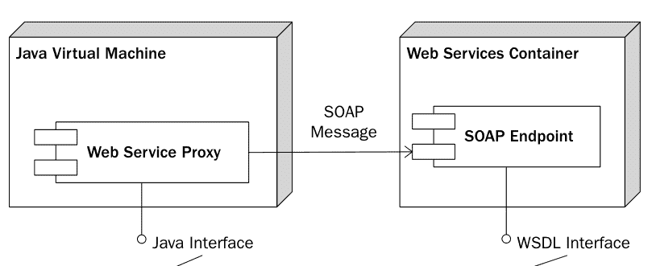

```java
package com.soabook;

import com.soabook.sales.Customer;
import com.soabook.purchasing.PurchaseOrder;

public interface PurchaseTransactions {

    public void newPurchase(
        Customer cust,
        PurchaseOrder po);
    ...
}
```

```xml
<definitions ...
targetNamespace="http://soabook.com"
xmlns:soa="http://soabook.com"
xmlns:wrapper="http://soabook.com/wrapper">
<types>
  <schema elementDefault="qualified"
    targetNamespace="http://soabook.com/wrapper">
    <element name="customerPurchase">
      <complexType>
        <sequence>
          <element ref="imported:customer"/>
          <element ref="imported:po"/>
        </sequence>
      </complexType>
    </element>
  </schema>
</types>
<message name="onCustomerPurchase">
  <part element="wrapper:customerPurchase"
    name="purchase"/>
</message>
<portType name="CustomerPurchase">
  <operation name="processCustomerPurchase">
    <input message="soa:onCustomerPurchase"/>
  </operation>
</portType>
</definitions>
```

图 1–2 序列化将 Java 实例转换为 XML 文档，以便通过 SOAP 传输到 Web 服务。

# 使用 Java Web 服务的面向服务架构

- 3. 将参数 `po`（`com.soabook.purchasing.PurchaseOrder` 的实例）序列化为 `imported:po` 实例


- 4. 将这两个元素合并为 `wrapper:customerPurchase` 实例
- 5. 将 `wrapper:customerPurchase` 实例交付给 Web 服务，以便嵌入到 SOAP 消息中并发送到 SOAP 端点

正如这个简单的示例所示，序列化子系统是通过 Java 接口调用 Web 服务的流程核心。序列化子系统将参数（传递给接口代理的参数）从各自的 Java 类实例转换为目标 XML Schema 实例——在这种情况下，目标是 `wrapper:customerPurchase`。这些映射——从 Java 类到目标 XML Schema 组件的映射——被称为类型映射。为了完成此转换，序列化引擎需要一组映射策略（如图 1–3 所示），告诉它如何实现类型映射；换句话说，即如何将 Java 类实例序列化为 XML Schema 组件的实例。

映射策略将 Java 类、其目标 XML Schema 类型以及序列化器（或反序列化器）的描述关联起来，序列化器可以将类的实例转换为 Schema 类型的实例（反亦然）。序列化上下文是一组映射策略，序列化子系统可以利用它实现特定 Web 服务部署所使用的类型映射。

不同的 Web 服务平台提供不同的机制来指定构成序列化上下文的映射策略。在许多情况下，会使用多种方法。这些机制包括：

## 实现类型映射的机制

- **标准绑定**。映射由 Java 类到 XML Schema 的标准绑定预定义。每个 Java 类在 XML Schema 中都有唯一的表示。JWS 从这种方法开始并允许进行自定义。标准绑定由 JAXB 和 JAX-WS 规范描述。
- **源代码注解**。JWS 使用这种方法在标准绑定之上提供自定义。目标 Java 类源码中的注解修改标准绑定，以指定类如何映射到 XML Schema 组件以及 Web 服务的 WSDL 描述如何构建。
- **算法类**。映射嵌入在序列化子系统执行的算法中。JAX-RPC 1.1 和 Axis 1.x [AXIS] 采用了这种方法。
- **基于规则**。映射以规则的形式指定，可以独立于序列化子系统进行创建和编辑。规则由序列化子系统解释。SOA-J（在 1.5 节引入）使用基于规则的方法进行映射。Castor [CASTOR] 序列化框架也通过其映射文件机制支持这种方法。

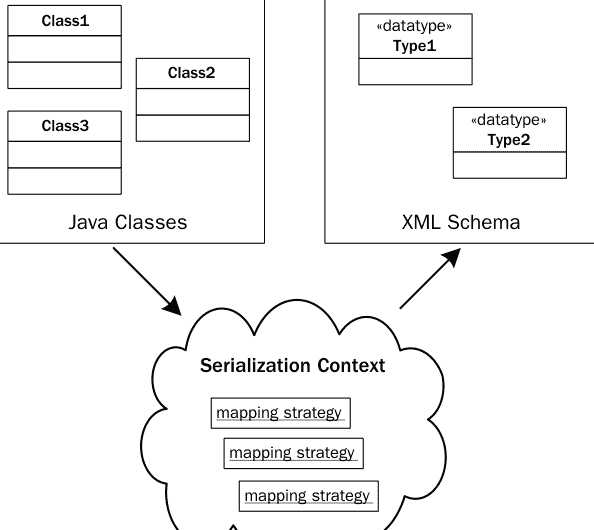

**图 1-3** 序列化上下文包含了序列化子系统用于执行序列化的映射策略。

这些方法各有优缺点。JWS 采用源代码注解作为机制，让 Java 程序员更容易指定 Java 目标如何表示为 WSDL 操作。我正好喜欢基于规则的方法，因为它允许终端用户将现有的 Java 类映射到 XML Schema 类型——如果你在使用 Web 服务在松耦合的 SOA 风格中进行企业集成，其中有许多遗留类和 Schema 需要处理，这将非常有用。

序列化是一个丰富且迷人的的话题。不同的方法适用于不同类型的任务（例如，遗留集成与绿地开发）。这就是为什么市场上可能一直会有多种不同的序列化方法在竞争。我将在第 5 章深入研究 JAXB 2.0 序列化。

## 1.2.3 部署

部署子系统提供设置 Java 目标的工具，使其可以通过 SOAP 消息作为 Web 服务被调用。在高级层次，部署子系统需要处理：

## 部署子系统的职责

- **部署 Java 目标**。这很大程度上取决于调用发生的容器。
- **将 WSDL 操作映射到 Java 目标**。这涉及配置 Web 服务平台，以便调用系统能够正确关联传入的消息。
- **定义序列化上下文**。部署子系统为序列化子系统配置序列化上下文（见图 1–3），用于绑定来自 WSDL 的 XML Schema 类型。
- **发布 WSDL**。部署子系统将 Java 目标与包含其绑定操作的 WSDL 文档关联。该 WSDL 文档以 URL 或其他形式（例如在 UDDI 注册表中）向 Web 服务客户端可用。
- **配置 SOAP 处理器**。部署子系统配置必要的 SOAP 处理器，以提供 Java 目标调用之前的或之后的 QoS。这些处理器提供了身份验证、可靠性和加密等服务。虽然调用子系统调用处理器，但它们是由部署子系统配置并关联的。
- **配置端点监听器**。部署子系统配置容器，在 WSDL 指定 URI 处设置 SOAP 消息传输监听器。在某些 Web 服务平台中，提供的 WSDL 未定义端点，端点由部署子系统从部署文件中“填充”。

从此描述可以看出，部署子系统需要执行许多严谨的任务。为了处理各种情况（例如 QoS 要求、自定义 Java/XML 绑定、可配置的端点 URL 等），部署文件（部署子系统使用的 XML 文件）变得复杂且难以工具可视化工具。图 1–4 显示了 Web 服务平台使用的可能的部署文件及其底层容器的关系。

总结，Web 服务平台架构（WSPA）定义了三个子系统：调用、序列化和部署。在书的其余部分对 Java Web 服务的探索中，我将

- 历史上，部署文件的泛滥在处理 EJB 2.1 时是一个常见的抱怨。在 J2SE 1.4 中引入 Web 服务后，部署文件变得更加复杂！幸运的是，在 Java EE 5 中，对部署文件的需求大大减少。

# 基于 Java Web 服务的面向服务的架构

## Web 服务平台

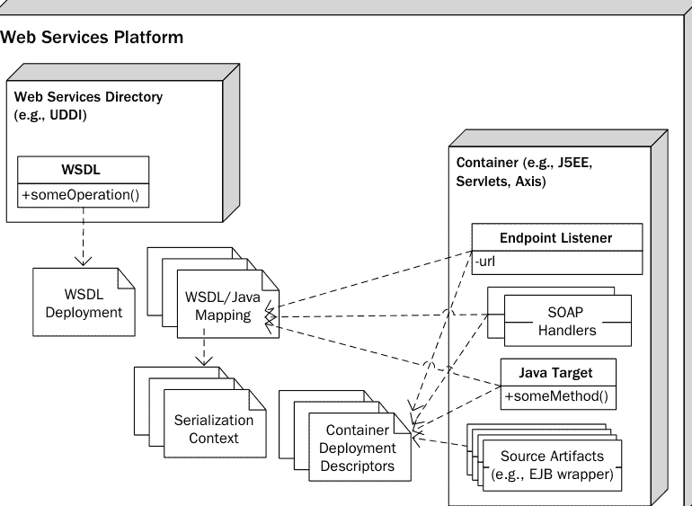

**图 1–4** 部署子系统可以使用许多可能的部署描述符。

这些子系统及其细节，将讨论 JWS 各种组件在 Java EE 和 Java SE 指定的整体 WSPA 中分别扮演的角色。

## 1.3 Java Web 服务标准：第 2 章至第 8 章

如所述，本书的主要目的是让你对如何在 SOA（面向服务的架构）应用开发中使用 Java Web 服务有详尽的技术理解。由于真正的技术理解仅源于实际代码编写，因此本书提供了许多软件示例供你研究和实践。建立详尽技术理解的第一步是深入探索 JWS API，检查它们的优势和局限性。第 2 章提供了 JWS API 的高层概览。第 3 至第 8 章提供了关于如何使用这些 API 编写和部署 Web 服务的详细示例。这些示例远超供应商提供的常规“Hello World”教程。相反，它们提供了详细的真实世界实现。除了向你展示如何使用这些 API 编程，我还通过这些示例回到第 1.2 节描述的 Web 服务平台架构。以下这些章节的摘要以及它们如何协同工作。

**第 2 章：Java Web 服务概述**——提供了 Java Web 服务 API 特性、优势和劣势的高层概览，包括 JAX-WS 2.0 [JSR 224]、JAXB 2.0 [JSR 191]、WS-Metadata 2.0 以及 Java EE 的 Web 服务 1.2 [JSR-109]。我探索了这些 API 分别如何融入 Web 服务中。Java 的 SOAP 附件 API (SAAJ) [JSR 67] 在此处未讨论，但在 JAX-WS 章节的 SOAP 处理背景下对其进行了调查。

**第 3 章：使用 REST 的基础 SOA**——示例从 Web 服务的最简单方法表现状态转移（REST）开始。我展示了如何使用纯 HTTP 和 JWS 实现 RESTful 服务。我还讨论了 REST 作为 SOA 集成方法的局限性。理解这些局限性是下一章引入 SOAP 和 WSDL 的动机。

**第 4 章：WSDL、SOAP 和 Java/XML 映射在 SOA 中的作用**——本章首先讨论为什么 SOA 需要 WSDL 和 SOAP。然后详细描述了 SOAP 和 WSDL 如何在真实的 SOA 集成场景中使用。我将 SOAP 和 WSDL 与第 1.2 节描述的 Web 服务架构联系起来，说明 SOAP 请求的调度取决于 WSDL 的结构。指出了 JAX-WS 2.0 调度机制的一些局限性。本章讨论了 SOAP 请求携带的 XML 如何映射到实现 Web 服务的 Java 类。引入 JAXB 2.0 作为实现此类映射的工具，并描述了它的局限性。

**第 5 章：JAXB 2.0 数据绑定**——深入介绍了 JAXB 2.0 以及映射到 Java 的其他方法。提供了模式编译器以及生成的注解的详细示例。我还描述了 JAXB 运行时如何根据注解执行序列化和反序列化，以及如何使用自定义注解来定制 JAXB 序列化和反序列化过程。我将 JAXB 2.0 回到本书使用的 Web 服务平台架构。详细探讨了 JAXB 2.0 的局限性——特别是从基于 JAXB 2.0 的序列化子系统中抽象映射的困难，以及它如何违反了关注点分离。演示了这些局限性的解决方法，包括如何使用 `XmlAdapter` 类的详细示例以及如何构建基于 JAXB 2.0 的自定义子系统。在这里引入的自定义序列化方案将在第 11 章进一步阐述。

**第 6 章：JAX-WS 2.0——客户端开发**——详细介绍了 JAX-WS 2.0 的客户端 API。我解释了如何使用提供目标服务的 Java 接口的代理类来调用 Web 服务。在这些示例中，我展示了如何使用 JAX-WS WSDL 编译器（例如 `wsimport` 工具）在编译时创建接口，以及如何使用这些接口创建可以在运行时调用 Web 服务的 JAX-WS 类实例。除了这些基础示例，第 6 章对 JAX-WS 2.0 WSDL 到 Java 的映射进行了深入讨论。理解这一点对于如何使用 JAX-WS WSDL 编译器生成的类至关重要。描述了生成的接口类使用的注解，并演示了这些注解如何塑造由 JAX-WS 2.0 代理发送和接收的 SOAP 消息。本章还讨论了异常处理。在掌握基础之后，我回到 REST 模型，深入探讨了如何使用 J2SE 中的 `javax.xml.Endpoint` 类进行无容器部署。

**第 7 章：JAX-WS 2.0——服务端开发**——本章是 JWS 讨论的后半部分，专注于服务端 API。讨论从服务端架构及其如何映射到 Web 服务平台参考设计开始。描述之后，我引入了一系列示例，说明如何同时使用 `@WebService` 和 `@WebServiceProvider` 注解部署服务。探索了 WebContext 的资源注入作为处理随 SOAP 请求传递的 HTTP 头的机制。我还详细介绍了如何使用 Castor ([CASTOR]) 部署 Web 服务。如前言所述，所有示例都是使用 GlassFish 开发和测试的。然而，IBM、JBoss 和 Oracle 的 JAX-WS 工具将实现相同的 WSDL 到 Java 的映射。

**第 8 章：SOA 组件的打包和部署（JSR-181 和 JSR-109）**——本章通过关注 Web 服务如何打包和部署的细节总结了对 JWS 标准的详细讨论。我涵盖了 WS-Metadata [JSR 181] 注解以及如何使用它们通过 EJB 和 servlet 端点部署 Web 服务的示例。你将学习如何在没有任何部署描述符的情况下部署 Web 服务（是的，Java EE 5 可以做到的），以及何时使用部署描述符覆盖默认值和基于注解的部署机制是合理的。本章包含了 servlet 端点部署所需的 WAR 结构，以及用于 EJB 端点的 EJB JAR/EAR 结构。此外，我详细概述了 Java EE 5 容器如何处理部署过程（即容器如何处理部署的 Web 服务）。与其他 JWS API 描述一样，该讨论回到了 Web 服务平台架构设计，旨在批判 Java EE 5 Web 服务部署子系统的优缺点。在打包和部署方面有许多变体，十个不同的打包示例说明了每种变体的适用情况。最后，我涵盖了 Java EE 5 提供的 OASIS XML Catalogs [XML Catalog 1.1] 支持。

## 1.4 SOAShopper 案例研究：第 9 章和第 10 章

第 9 章和第 10 章整合了第 2 至第 8 章描述的所有技术和技巧，并演示了如何使用 JWS 构建一个 SOA 集成应用。SOAShopper 应用是一个集成来自 eBay、Amazon 和 Yahoo! Shop 的在线购物系统。

# 基于 Java Web 服务的面向服务的架构

ping. 它是一个 Web 服务消费者，因为它是购物网站的客户端。它也是一个 Web 服务提供者，因为它部署了 REST 和 SOAP 端点，提供跨三个购物网站的搜索服务。

## 第 9 章：SOAShopper：集成 eBay、Amazon 和 Yahoo! 购物

尽管 SOAShopper 是一个演示应用程序，但它展示的技巧是非常强大的。在本章中，你将看到之前章节中的所有工具汇聚，创建一个真实的 SOA 集成系统。本章的讨论和示例包含了消费和部署 RESTful 服务的代码、消费和部署 WSDL/SOAP 服务、使用 JAXB 实现类型映射、以 WSDL 为中心的服务集成，以及对 Ajax 客户端的支持。

## 第 10 章：Ajax 与 Java Web 服务

第 10 章使用了第 9 章中开发的 SOAShopper 应用，并展示了如何构建一个 Ajax 前端来消费其提供的 RESTful 服务。本章的重点在于如何使用 JWS 来支持 Ajax 客户端。

## 1.5 SOA-J 和以 WSDL 为中心的发展：第 11 章

只想学习 Java Web 服务 (JWS) 的读者可以跳过第 11 章。然而，如果你对如何实现一种以 WSDL 为中心并使用 JWS 提供的工具的 Web 服务平台架构 (WSPA) 感兴趣，你应该阅读第 11 章。最后一章提供了 SOA-J 的详细介绍。

“以 WSDL 为中心”一词意味着通过构建其 WSDL 并在文档中引用实现它的 Java 元素进行注释来创建 Web 服务。以 WSDL 为中心的方法适用于需要创建集成到标准企业或电子商务框架中的 Web 服务的情况（即存在标准模式和消息描述的情况）。

SOA-J 是一个原型应用程序框架。我创建它是作为一种概念验证，以探索使用 JWS 进行以 WSDL 为中心的 SOA 开发的可行性。SOA-J 的源代码（开源）包含在你可以从本书下载的代码示例中。¹1⁰ 你也可以在 `http://soa-j.org` 找到 SOA-J 的最新版本。

- 9. 这类情况在第 4 章中进行了讨论。
- 10. 参见附录 B 关于如何下载、安装和配置软件的说明。

## 第 11 章：基于 SOA-J 的以 WSDL 为中心的 Java Web 服务

本章详细介绍了 SOA-J 如何设计为基于 JWS 之上的应用程序框架。我展示了它如何通过构建其 WSDL 来提供一种组合 SOA 组件的简单机制。本章中有许多 UML 图，因为我详细阐述了 SOA-J 的架构。这些讨论对于任何好奇过 Web 服务引擎（又称“SOA 服务器”）如何工作的人来说都是很有用的。这里使用的原理总结在 WSPA 中，并被 Axis 和 XFire 等产品采用。我包含实现细节的动机追溯到我早期对 Apache Axis 的实验。当我第一次查看 Axis 源代码时，我感到完全无所措。在读完我对 SOA-J 的描述后，希望你以后在查看另一个 Web 服务引擎的源代码时不会再感到迷茫。

- 11. 参见第 1.2 节。

# Java Web 服务概述

本章概述了 Java EE 5 和 Java SE 6 支持的 Java Web 服务 (JWS) 标准所提供的功能。讨论从第 2.1 节开始，根据 Java 规范¹查看了 SOA 能力的作用。接下来（第 2.2 节），涵盖了一些 Java EE 5 的“易用性”特性。简化编程过程被列为 Java EE 5 Web 服务发布的第一目标，因此在开头就对这些易用性决策及其对开发的影响进行了快速回顾。

本章的主要讨论（第 2.3–2.5 节）将每个 JWS 能力分组，根据 Java 规范¹定义它。随后回顾了某些 Java EE 5 的“易用性”特性——平台架构 1.2。在这里和书中讨论的主要 JSR 包括 JAX-WS 2.0 [224]、JAXB 2.0 [222]、WS-Metadata 2.0 [181] 以及 Web Services JEE [109]。

本章在第 2.7 节结束，查看了一些并非特定 Web 服务 JSR 但对 Web 服务开发有影响的 Java EE 5 创新。讨论涵盖了如依赖注入等功能以及 EJB 3.0。

本章提供了对整体框架的理解，并为深入探讨第 3 到 11 章的设计和编程细节奠定了基础。

- 1. Java 社区使用 JSR 定义了新功能。JSR 在 `www.jcp.org` 定义并批准。

## 2.1 JWS 在 SOA 应用开发中的作用

基本上，JWS 包含了一套使用 Java 消费和创建 Web 服务的技术。为了讨论 JWS 在 SOA 开发中的位置，检查了一个假设的 SOA 应用。

### 2.1.1 一个假设的 SOA 应用

图 2–1 显示了本讨论使用的假设 SOA 应用。它是一个处理客户订单的订单管理应用程序。它接收 SOAP 请求并返回订单确认。

图 2–1 中央的订单管理应用标记为“SOA 复合应用”，以强调它是底层服务的组合。在 [Erl] 的第 46 页，Thomas Erl 写道：“服务作为独立的逻辑单元存在。业务流程可以分解为一系列服务，每个服务负责执行一部分。”用 Erl 的语言来描述，人们可以说 SOA 复合应用正在自动化订单管理业务流程。该业务流程分解为图 2–1 所示的步骤。

## 订单管理业务流程

1. 客户发送客户订单，其中包含其他信息 PO 号和订单项目列表（订购的产品和数量）。
2. PO 号和订单项目被传递给采购订单系统。它检查采购订单以确定是否涵盖了订购的项目以及所需的付款条款。
3. 如果 PO 涵盖了订单项目，则返回授权和描述。
4. 接下来，订单项目被转发到库存管理系统，以确定是否有货以及交货日期是什么。
5. 返回这些信息——物品可用性。
6. 最后，向客户发送回执——订单确认，详细列出付款条款和交货日期。


**图 2–1** 一个用于订单管理的 SOA 复合应用。

## 2.1 JWS 在 SOA 应用开发中的作用

如图 2–1 所示，订单管理服务（Order Management Service）是用 Java EE 5 实现的。

### 2.1.2 JWS Enables SOA 开发


# Java Web 服务概述

## 2.1 JWS 在 SOA 应用开发中的作用

在考虑此订单管理设计时，显然复合 SOA 应用要求底层服务调用定义良好的接口。例如，订单管理系统向采购订单系统（Purchase Order System）请求授权和支付条款，它必须确切知道该请求的格式。它必须知道如何将该请求封装在可以被采购订单服务接收并理解的消息中。在这个示例中，Web 服务（Web Services）提供了定义所需接口的结构。虽然 SOA 强制要求，但 Web 服务提供了一套接口和消息标准，有助于以平台中立的方式构建 SOA 应用。在刚才讨论的示例中，采购订单服务实现在 Java EE 5 上，而库存管理服务实现在 .NET 上。然而，由于 Java EE 5 和 .NET 都支持 Web 服务，因此可以通过调用这些底层应用的 Web 服务接口来构建订单管理系统。

在使用 Web 服务时，接口定义使用 WSDL [WSDL 1.1, WSDL 2.0] 进行。因此，图 2–1 中所示的每个服务都被描述为与一个 WSDL 文档相关。WSDL 使用 XML 表达式。它根据 XML Schema [XSD Part 0] 定义了 Web 服务的输入和输出参数。输入参数通过消息结构传递给 Web 服务。同样，输出参数在消息中接收。但一个显而易见的选择是 SOAP [SOAP 1.1, SOAP 1.2]。SOAP 消息可用于携带 WSDL 接口定义指定的输入和输出参数。因此，Web 服务提供了 SOA 开发所需的两个关键要素：接口定义语言（WSDL）和消息标准（SOAP）。

SOAP 消息可以通过多种传输协议（例如 HTTP、SMTP 和 JMS）进行交换。在之前描述的订单管理示例中，使用的是 HTTP 传输。通过发布 HTTP GET 请求从服务中获取 WSDL 接口定义，并使用 HTTP POST 来处理 SOAP 请求/响应交换。这就是基础 Web 服务框架（即带有 SOAP/HTTP 的 WSDL）被用于 SOA 应用开发的方式。

JWS 标准提供了在 Java 编程语言内部处理 WSDL 和 SOAP/HTTP 的工具。存在服务端工具，允许 Java 方法通过 SOAP 被调用，并发布相关的 WSDL 接口定义。同样，存在客户端工具，用于读取 WSDL 文档以及发送/接收 SOAP 消息。图 2–2 显示了各种 Java Web 服务标准（JSRs）在服务端，服务的部署和调用是通过图 2–2 中的数字标签进行追踪的。现在的讨论将变得更加注重细节，从 10,000 英尺高度的 SOA 视角下沉到 100 英尺高度，即 JWS 标准开始被讨论的层面。

为了理解图 2–2 所说明的内容，从底部的标记为“Port Component（端口组件）”的文件夹开始。这代表一个正在部署到 Java EE 5 中心的软件包 Web 服务。中间标记为“Web Service Application（Web 服务应用）”的框代表实现 Web 服务的运行时实例（部署后）。上方是一些标记为“Java Parameters（Java 参数）”的框和一个标记为“Java Return（Java 返回）”的单框。参数框代表传递给使用 Web 服务应用的某个类中的方法的 Java 对象的运行时实例。回想采购订单服务的示例（图 2–1），这些参数可能是订单号（PO Number）和订单项目（Order Items）。同样，上方的框标记为“XML Parameters（XML 参数）”和“XML Return（XML 返回）”，代表这些参数和返回值的 XML 形式。继续向上看，顶部是一个标记为“Endpoint（端点）”的圆圈。它代表 Web 服务应用接收用于其 WSDL 接口定义文档的 HTTP GET 请求，以及用于交换 SOAP 输入输出消息的 HTTP POST 请求。

图 2–2 中的阴影条说明了 JSRs 如何对应 Web 服务部署和调用的各个阶段。通过追踪图 2–2 中的标签 1–10，解释了 JSRs 在每个阶段的作用：

### Web 服务的服务端部署和调用

1. JWS 将 `Port component（端口组件）`（有时称为 Port）定义为 Web 服务的服务端视图。端口组件可以打包为 WAR（部署为 servlet 端点）或打包为 EJB JAR（部署为 EJB 端点）。WSEE [JSR 109] 是定义部署过程和打包结构（包括部署描述符）的主要标准。WS-Metadata [JSR 181] 描述了在包类上的注解如何影响部署（例如，代表端口组件的 WSDL 接口可以使用 WS-Metadata 注解进行自定义）。Java EE 5 端口组件的部署对应第 1 章引入的 WSPA 参考中部署系统的功能。第 8 章提供了对部署的深入讨论。


图 2–2 服务端——Java EE 5 Web 服务 JSRs

移动到图 2–2 的顶部，此描述追踪了由端口组件部署的 Web 服务。端点支持描述 Web 服务的 HTTP GET 请求。该 WSDL 的结构由 JAX-WS 映射。这种映射在第 6 章有详细描述。映射可以使用 JAX-WS、JAXB 和 WS-Metadata 定义的注解自定义。通常，JAX-WS 注解控制所使用的 WSDL 样式（关于 WSDL 样式的讨论见第 4 章）。另一方面，JAXB 注解控制 Java 参数和返回类型的 XML 表示。WS-Metadata 注解控制 WSDL 接口的细节（例如 WSDL 文档中许多 XML 元素的目标命名空间和本地名称）。处理 WSDL 请求并不是 WSPA 的官方组成部分；但它是 Web 服务平台调用子系统的一个功能。

部署的 Web 服务的调用是在端点通过 HTTP POST 接收到 SOAP 请求时启动的。Web 服务的端点通常由监听端点 URL 的 servlet 类实现（见步骤 1）。该 servlet 不是由端口组件开发者指定的，而是 JWS 的 Java EE 5 实现的一部分。在部署期间，WSEE 运行时读取注解和部署描述符，确定端点 URL，并配置容器内部以在该端点部署监听器。该过程在第 8 章有详细描述。设置端点是 WSPA 部署子系统的功能。

说明了 SOAP 请求已变为一组 XML 参数——WSDL 中指定为参数的 XML Schema 组件的实例。JAX-WS 运行时负责从 SOAP 消息中提取这些参数。这是一个相当复杂的转换，将在第 4 章中详细讨论。这些 XML 参数的提取被定义为由 WSPA 中的调用子系统处理的分发过程的一部分。

6. 接下来，将 XML 参数反序列化为 Java 参数。此反序列化由 JAXB 运行时处理。反序列化通过目标 Java 类上的注解来控制（即定义类型映射）。JAXB 运行时使用内省（introspection）来检查目标类上的注解，这些信息（连同通过 JAXB 的标准 Java/XML 绑定）被用于生成目标参数实例。JAXB 序列化和注解将在第 5 章中描述。这一步对应于 WSPA 中的序列化子系统。

7. 一旦有了参数，就会调用 Java 类/方法。在 WSPA 中，这是调用子系统的职责。在 Java EE 5 中，它由 JAX-WS 运行时处理。提供调用方法的类可以是 EJB 也可以是 POJO。图 2–2 显示 JAX-WS、JAXB 和 WS-Metadata 都在定义构成 Web 服务应用的注解类中起着作用。这是因为这些 JSR 中的每一个注解都用于这些类中。被调用的类（称为服务实现豆）必须被 WS-Metadata 注解标记（例如 `@WebService`），表示它实现了一个 Web 服务。表示参数和返回类型的类可能具有许多 JAXB 注解。此外，JAX-WS 注解可能已用于服务实现，以控制 WSDL 的样式。

8. 调用之后，此过程中的步骤将反向运行。该 Java 返回类型类被交给 JAXB 序列化以变成一个 XML 返回实例。这种序列化（类似于第 6 步描述的反序列化）由 Java 类上的注解控制。

9. 接下来，JAX-WS 运行时获取 XML 返回类型实例并将其封装在 SOAP 响应中。

10. 最后，将 SOAP 响应作为 HTTP 响应的负载发送回请求者。

此描述中省略了一些步骤（例如服务器端处理器的调用）。然而，它提供的细节足以向人们传达当 Web 服务部署和调用时，Java EE 5 容器内部发生了什么的想法。

## 2.2 易用性功能快速概述

JWS 的主要目标是让 Java 开发者更容易进行创建和部署。仅由 Java EE 5 或 Java 6 支持。

### 2.2.1 标准 WSDL/Java 映射

JAX-WS 定义了 WSDL 到 Java 以及从 Java 到 WSDL 的标准映射。当部署具有极少源码注解的服务实现豆（SIB）时，生成的 WSDL 是基于这种默认映射的。这种默认映射使得可能不太熟悉 WSDL 或 XML 的 Java 程序员能够更容易部署 Web 服务，这也是为了在 Java 编程语言中直接构建 Web 服务支持的这一宏大目标的一部分。

然而，尽管标准映射使得部署 Web 服务变得简单，但尚不清楚其产生的结果是否是一个实用的 Web 服务。标准映射的问题在于，如果你的 Web 服务需要符合现有的 WSDL 合约，那么标准映射就无济于事。诚然，上文讨论的注解允许你“塑造”生成的 WSDL，但这种自定义在能够达到的程度上是有局限性的。例如，你不能将同一个 WSDL 端口上的两个操作映射到来自两个不同 SIB 的方法。因此，如果你有一个具有 `foo` 和 `bar` 操作的 `wsdlport`，那么 `foo` 和 `bar` 必须映射到同一个 Java 类或接口上的方法。你不能将 `foo` 映射到 `MyClass.doFoo()` 而将 `bar` 映射到 `AnotherClass.doBar()`。

此外，你无法将 WSDL 端口映射到 SIB 以外的任何东西——无法将未注解的类部署为 Web 服务。

再次，时间将证明标准的 WSDL/Java 映射到底有多用。现在对其进行赞誉或批评都为时过早。在此时，你最好的选择是充分理解它，以判断它是否满足你的需求。

尽管标准 WSDL/Java 映射的有效性尚无定论，但我必须说，Java 拥有 WSDL 的标准映射这一事实本身极其重要。标准映射尽管有局限性，但使得将 Java 类部署为 Web 服务成为可能。它还允许从现有的 WSDL 自动生成服务端点接口（SEI），如图 2–3 所示。

> 服务实现豆是一种可以部署为 Web 服务端点的类类型。它可以是 POJO 或无状态会话豆，并且必须满足第 8 章第 8.1 节讨论的某些标准。
>
> 该局限性在第 4 章第 4.3.6 节中进一步讨论。
>
> 根据 [JSR 181] 的第 3.1 节，SIB 的实现需要具有 `@WebService` 注解。

### 2.2.2 标准化上下文

标准化上下文通过消除在 Web 服务部署时指定类型映射和序列化器的需求来简化开发。换句话说，当使用标准化上下文时，你不需要定义 Java 类所映射的 XML。标准化上下文提供了一个默认映射。JWS 通过将序列化委托给 JAXB 实现了这一点。JAXB 对于 XML Schema 组件与 Java 对象之间的（反）序列化具有标准规则。使用 JAXB 限制了支持的映射类型，但极大地简化了 Web 服务的规范。

这绝对是一个欢迎简化的领域，且 JAXB 为 Java/XML 绑定提供了一个坚实的框架。同样，当我们开始考虑此类标准化框架的结果在实践中到底有多用时，困难也随之而来了。具体来说，当我们使用 JAXB 编译 XML Schema 时，生成的 Java 类往往与我们的任何现有类都不像。因此，例如，如果你想使用 JAXB 框架部署一个使用某些订单 XML Schema（例如 `imported:po`）的 Web 服务，你将无法使用你的 `purchaseOrder` 类。你将不得不使用 JAXB 从 `imported:po` 生成的 `PO` 类。

如果你是从零开始开发，那么使用生成的 JAXB 类是可以的。这是因为当你从零开始时，使用 JAXB 映射到 `imported:po` 的生成的 `PO` 类并没有问题。然而，如果你是基于现有的类（例如你的 `purchaseOrder` 类）部署 Web 服务，JAXB 的价值可能就较小了。处理这个问题有两种方法——这两种方法在第 5 章中都讨论过。首先，你可以自定义标准的 JAXB 映射来“塑造”生成的类。使用这种方法，你可能为你的 `purchaseOrder` 类添加注解，以便 JAXB 将其映射到 `imported:po`。然而，正如你在第 4 章中反复看到的那样，很多时候产生所期望的映射是不可能的。其次，你可以使用包装器（wrappers）将你的家族类映射到 JAXB 生成的代码。使用包装器方法，你需要编写 Java 代码来翻译生成的 `PO` 类和你现有的 `Purchase-Order` 类。包装器是有效的，但如果你编写了它们，就必须维护它们。包装器方法本质上是将 Java/XML 映射存储为 Java 代码——这通常是不被推荐的，因为难以调试和维护。例如，如果 `imported:po` 发生了变化，生成的 `PO` 类也会发生变化，此时你就需要更新包装代码。

对 JAX-RPC 的以往经验提供了一个教训。JAX-RPC 1 告诉我们，通过限制支持的类型映射来实现简化是不切实际的。在 JAX-RPC 1.1（结合 J2EE Web 服务原始规范 JSR-109）中，序列化上下文定义在 JAX-RPC 映射文件中。该映射文件可以由工具自动生成，也可以手动编写以允许映射被“塑造”。在该框架中，可以定义映射规则，但只能映射到简单类型，如 `java.lang.String`、简单类型数组或 JAX-RPC 1.1 第 5.4 节中定义的特殊 Java Bean，这被称为“JAX-RPC 值类型”。这种限制是为了简化 JAX-RPC 1.1 的序列化而实施的。遗憾的是，对于许多场景，Web 服务需要对非“JAX-RPC 值类型”的类进行部署。这种局限性限制了 JAX-RPC 1.1 作为 Web 服务平台的实用性。类似地，基于注解的标准 JAXB 类型映射机制虽然确实更容易，但它限制了可以部署到 Web 服务中的 XML，从而限制了 JAXB 作为 Web 服务部署标准序列化框架的实用性。

## Web 服务的客户端调用

图 2–3 显示了各种 JWS 标准（JSRs）如何支持 Web 服务等式的客户端侧。此讨论适用于使用 Java SE 6 或 Java EE 5 的客户端实现。在服务器端描述中，将通过遵循图 2–3 提供的数字标签跟踪读取 WSDL 和调用服务的过程，来解释这些各种 JSR 的作用。

图 2–3 中重叠的阴影区域显示了各种 JSR 在客户端侧发挥作用的地方。

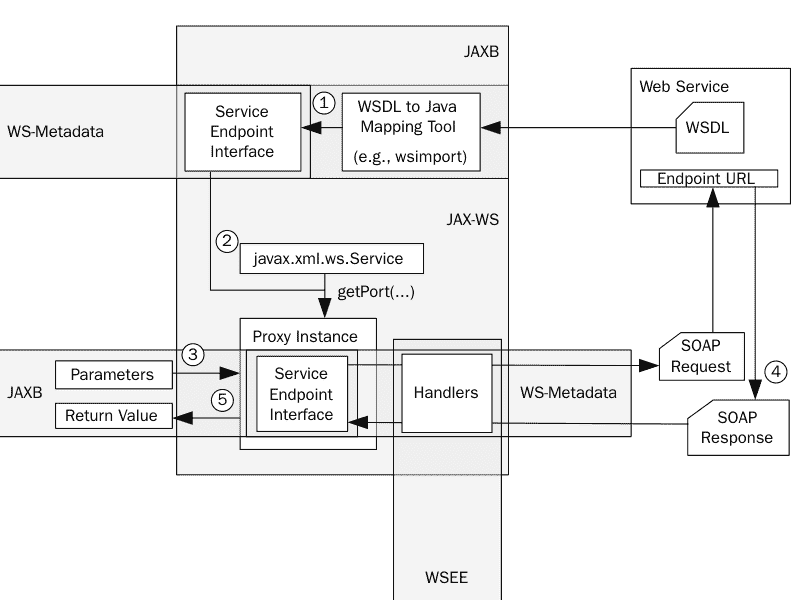

图 2–3 客户端——Java Web 服务 JSR 的作用。

1. 客户端调用 Web 服务的第一步通常涉及使用 WSDL 映射工具生成服务端点接口（SEI）。SEI 是被调用 Web 服务的 Java 表达式。SEI 在编译客户端应用程序之前生成，因为其接口定义被用于客户端应用程序。图 2–3 显示生成 SEI 涉及 JAXB、JAX-WS 和 WS-Metadata。JAXB 映射 SEI 中描述的 XML 参数和返回类型。WS-Metadata 注解装饰了 SEI 中使用的返回类型。WS-Metadata 注解记录了从 wsdl:operations 到 Java 方法的映射。同时，JAX-WS 提供从 WSDL 到 SEI 结构中捕捉并用 WS-Metadata 注解记录的标准映射。

> 也可以通过直接向 Web 服务发送 XML 在不生成 SEI 的情况下调用 Web 服务。这种方法使用了 JAX-WS Dispatch 接口，将在第 6 章中详细描述。

2. 在运行时，使用 JAX-WS `javax.ws.class` 实例来提供被调用 Web 服务的客户端视图。使用 `service.getPort` 方法之一来获取上一步生成的 SEI 的运行时实例。该运行时实例使用 Java 代理技术实现，并在图 2–3 中表示为“代理实例”（Proxy Instance）。如图所示，代理实例实现了服务端点接口（SEI）。

3. 接下来，通过调用代理实例上的 SEI 方法之一来启动 Web 服务调用。传递给 SEI 方法的参数是在创建 SEI 期间（第 1 步）生成的类实例。这些类由 JAXB 映射 SEI 中包含的架构。

4. 调用之后，此过程中的步骤将反向运行。该 Java 返回类型类被交给 JAXB 序列化以变成一个 XML 返回实例。这种序列化（类似于第 6 步描述的反序列化）由 Java 类上的注解控制。

5. 接下来，JAX-WS 运行时获取 XML 返回类型实例并将其封装在 SOAP 响应中。

6. 最后，将 SOAP 响应作为 HTTP 响应的负载发送回请求者。

此描述中省略了一些步骤（例如服务器端处理器的调用）。然而，它提供的细节足以向人们传达当 Web 服务部署和调用时，Java EE 5 容器内部发生了什么的想法。

还记得 Dave Podnar 处理 Web 服务的第五阶段吗？“接受——事实就是如此，Web 服务并不简单，也不容易。”

这些步骤中呈现的所有信息将在后续章节中更详细地解释，如果现在感到有些目不暇，请不要气馁。


总而言之，我的感觉 JAXB 2.0 并没有限制性，并在简单性和功能性之间取得了平衡。

## 2.2.4 开发模型

JWS 设计旨在让 Web 服务变得更简单。在“从 Java 开始”的模式下，你拥有现有的 XML Schema 类型，它们必须映射到现有的 Java 对象（参数和返回类型）。因此，任何试图简化序列化问题的 Web 服务平台（例如通过定义标准的 JAX-RPC 1.1 序列化上下文）都会导致对包装代码的需求，以解决“从 WSDL 和 Java 开始”的问题。包装代码用于将你对现有 WSDL 和 XML Schema 文档的 Java 表示转换到你的现有类。在实践中，这是解决问题的常用方法。

注意，如果没有一个高度可定制的持久系统，无法优雅地解决“从 WSDL 和 Java 开始”的问题。在“从 WSDL 和 Java 开始”的开发模式下，你拥有现有的 XML Schema 类型，它们必须映射到现有的 Java 对象（参数和返回类型）。

# Java Web 服务概览

“WSDL 与 Java”问题。开发者使用 JAX-WS WSDL 编译器从现有的 WSDL 生成 SEI（服务端接口），遵循“从 WSDL 开始”的开发模式。然后通过封装器（wrappers）将 SEI 映射到现有的类。

另一方面，有一种观点认为，当 WSDL 和 Java 都已定义时，“从 WSDL 和 Java 开始”的开发模式实际上是最容易处理的；开发者不需要设计灵活且实用的 WSDL 或良好的 Java API。也就是说，开发者不需要从设计者的角度进行设计，但从开发者的角度来看，“从 WSDL 和 Java 开始”是使用 JWS 工具时最难解决的问题。JAX 可以根据你的 Java 代码生成有效的 WSDL，但在涉及将现有的 Java 映射到现有的 XML 架构（XML Schema）和 WSDL 时，它提供不了太大帮助。

正因为这些问题给 JWS 工具带来了困难，我深信理解 Web 服务开发和部署的最好方法是假设你已经有了现有的 WSDL 和 Java 制品需要处理。作为开发者，如果你学会了解决“从 WSDL 和 Java 开始”的问题，其他两种开发模式就会容易处理得多。这是因为“从 WSDL 和 Java 开始”迫使你学习 JWS Java/XML 绑定（JAXB）以及 Java/WSDL 映射（JAX-WS）的细节。此外，你将学会识别“从 Java 开始”和“从 WSDL 开始”的局限性，从而避免创建在后期可能导致问题的 Web 服务架构。

## 2.2.5 JWS 权衡

如前所述，JWS 的每种简化都是与 Web 服务平台创建和部署实用 Web 服务的能力之间的权衡。例如，JWS 的“从 Java 开始”开发使得部署 Web 服务变得简单，但该服务有多用呢？它是否符合你的企业或行业 XML 架构标准类型？我在第 3 到 10 章中讨论了这些权衡——针对 JAX-WS、JAXB、W-Metadata 和 WSEE。在第 11 章中，我将介绍另一种处理这些权衡的设计方法，该方法关注于“从 WSDL 和 Java 开始”，并通过更容易解决变更管理问题，解释我所谓的“以 WSDL 为中心”的开发。

在深入第 3 到 10 章并进一步解释和批判 JWS 细节之前，我将用本章的剩余部分为你概述 JWS 编程模型，该模型与第 1 章第 1.2 节描述的通用 Web 服务平台架构相关。JWS 内部有许多强大的机制，你越了解它，就就有越多的工具可以应对你自己的 Web 服务开发挑战。本章的剩余部分将对这些机制进行快速导览。

## 2.3 JAX-WS 2.0

JAX-WS 2.0 规定了 JWS 的调用子系统、部署子系统的一部分，甚至包含了一部分序列化子系统。它是 JAX-RPC 1.1 的后续规范，并对该规范提供了许多改进。

JAX-WS 提供了许多功能，表 2–1 显示了其中一些功能位于第 1 章第 1.2 节描述的 Web 服务平台架构中。本节描述了表 2–1 中列出的每个功能。

### 表 2–1 JAX-WS 功能映射

| 调用 | 序列化 | 部署 |
| --- | --- | --- |
| 动态和静态客户端 | WSDL 样式——支持 RPC/Literal 和 Document/Literal Wrapped | Java/WSDL 映射 静态 WSDL |
| 使用 Java 接口代理进行调用 | | XML 服务提供程序 |
| 使用 XML 调用 | | XML 目录 |
| 消息上下文处理程序框架 | | 运行时端点发布（仅限 Java SE） |
| SOAP 绑定 | | |
| HTTP 绑定 | | |
| 将异常转换为 SOAP 故障（Faults） | | |
| 异步调用 | | |
| 单向操作 | | |
| 客户端线程管理 | | |
| 伪引用映射 | | |

### 2.3.1 Java/WSDL 映射

JAX-WS 2.0 规范 [JSR 224] 定义了标准的 Java/WSDL 映射。这种标准的 Java/WSDL 映射是 JWS 部署系统的一部分。它决定了 WSDL 操作如何绑定到 Java 方法——也就是说，当 SOAP 消息调用 WSDL 操作时，Java/WSDL 映射决定了调用哪个 Java 方法，以及 SOAP 消息如何映射到方法的参数。反之，映射还决定了方法的返回值如何映射到 SOAP 响应。

这种标准映射允许人们从 Java 类开始，通过 JAX-WS 处理器（通常是 `java2wsdl` 或 `wsgen` 等工具），生成 Web 服务端点的 WSDL 描述。开发者可以通过像第 2.5 节 WS-Metadata 讨论中对 Java 源码进行注解来影响生成的 WSDL 形状。生成的 WSDL 始终符合 WS-I Basic Profile 1.1 [WS-I BP 1.1]。这被称为“从 Java 开始”开发模式。

相反，人们可以从 WSDL 文档开始并生成 Java 类和接口。标准映射可以通过嵌入的绑定声明（使用 `jws:bindings` 扩展元素对 WSDL 源代码进行的注解）或提供包含声明的外部绑定文件来定制。通过这种方式获得的 Java 类是封装类（wrapper classes），开发者需要填充实现 Web 服务所需的业务逻辑。以这种方式生成的类包含了描述 WSDL/Java 映射的代码注解。带有生成的注解部署这些类，将产生一个 Web 服务，它“忠实地反映（reflects）作为处理类输入的 WSDL 文档中的信息……因此，它们可能与你开始时的 WSDL 不完全相同，但在功能上应该是等价的。这被称为“从 WSDL 开始”开发模式。

如果你已经注意到一旦部署阶段，“从 Java 开始”开发模式与“从 WSDL 开始”是一样的，对吧。JWS 是一种以 Java 为中心的 Web 服务方法。即使你从 WSDL 开始，你也使用 JAX-WS 将 WSDL 翻译成带注解的 Java 源码，这些源码成为 JWS 实现对你 Web 内部定义。JAX-WS 将 WSDL 视为接口定义语言 (IDL)，从中生成 Java 类。运行时显示的实际 WSDL 是根据注解得出的。

尽管注解让你在确定 WSDL 形状方面具有极大的灵活性（例如，你可以强制 Java 方法的某些参数为 SOAP 头部元素），但 WSDL/Java 映射的基本原理并不灵活：

- WSDL 端口映射到 Java 接口：`wsdl:portType` 元素映射到一个称为 SEI 的 Java 接口。这是一个粒度限制。你无法将端口中的单个操作映射到不同的 Java 接口。JWS 模型强制 SEI 与端口类型之间一一对应。
- 参数和返回类型映射必须与 JAXB 兼容：注解允许为 SEI 参数和返回类型指定特定的类型映射。但是，类型映射必须与 JAXB 2.0 兼容。也就是说，用于 SEI 参数和返回类型的类必须使用 JAXB 注解来指定它们映射的 XML 架构组件。

### 2.3.2 静态 WSDL

JAX-WS 允许开发者指定静态 WSDL 文档，从而跳过基于标准 WSDL/Java 和 XML/Java (JAXB) 映射的自动生成。当你需要发布符合特定 WSDL 的 Web 服务时，这是一项重要的能力——这是系统集成常见的用例。

这种能力还让你能够根据现有的架构（例如你的 `po:purchaseOrder` 元素定义）发布 WSDL，而不是 JAXB 生成的类型。静态 WSDL 方法用于“从 WSDL 和 Java 开始”开发模式（见第 2.2.4 节）。

### 2.3.3 处理器框架

JAX-WS 定义了一个处理器框架，用于处理 SOAP 消息。处理器可以访问和修改 SOAP 消息的头部和主体。处理器链可以在客户端和服务端配置。处理器实现 `javax.xml.ws.handler.Handler` 接口。SOAP 处理器实现 `javax.xml.ws.handler.soap.SOAPHandler` 接口，逻辑处理器实现 `javax.xml.ws.handler.LogicalHandler` 接口。

### 2.3.4 使用 Java 接口代理调用

动态生成和静态生成的 `Service` 实例都可以通过服务端点接口（SEI）创建用于调用 Web 服务的代理。可以使用 `service.getPort` 方法之一来创建 SEI 实例，并将该实例绑定到目标 `wsdl:port`。理所当然的是，所使用的 SEI 必须与 JAX-WS 的 Java/WSDL 映射以及 JAXB 的 XML/Java 映射保持一致。由于这个原因，当使用 SEI 代理时，通常是与一个静态生成的实例配合使用，该实例是在 JAX-WS 处理工具（例如 GlassFish 的 `wsimport`）在运行时之前编译目标 WSDL 时连同 SEI 一起创建的。

### 2.3.5 使用 XML 调用

作为使用 Java 接口代理调用的备选方案，可以使用 `Service` 实例通过发送和接收 XML 消息来调用 Web 服务。在这种情况下，服务通过 `createDispatch` 方法之一提供一个 `javax.xml.ws.Dispatch` 实例。当你想要绕过 JAXB 序列化时，这是一个非常有用的功能。它允许你构建自己的 SOAP 消息并直接发送到 Web 服务。它还允许你直接通过 XML 与 Web 服务进行交互，而无需在 Java 进出之间转换。通常，在进行 Web 服务时，你会发现直接处理 XML 是完成任务最自然的方式。向 JAX-WS 架构师们致敬（这在 JAX-RPC 中被遗漏了）！

### 2.3.6 XML 服务提供者

就像你可以使用 XML 消息调用 Web 服务（见第 2.3.5 节）一样，也可以部署一个发送和接收 XML 消息而不提供任何自动化绑定的服务。JAX-WS 通过 `javax.xml.ws.Provider` 接口提供了这种能力。当使用 `Provider` 接口创建服务时，它不使用 SEI——绕过了 JAX-WS 的 Java/WSDL 映射。`Provider` 接口允许你编写直接与 XML 工作的服务。第 6 章提供了一个如何使用 `Dispatch` 绕过 JAXB 序列化的示例。

```java
14. javax.xml.ws.handler.soap.SOAPHandler<T extends SOAPMessageContext>
15. javax.xml.ws.handler.LogicalHandler<C extends LogicalMessageContext>
```

### 2.3.7 消息上下文

JAX-WS 允许处理器（handlers）、端点（endpoints）和客户端操作随请求/响应消息一起传输的消息上下文（`javax.xml.handler.MessageContext`）。这是一个非常有用的工具，可以实现处理器、端点和响应处理器之间的通信。为了理解如何使用消息上下文，假设你想实现某种类型的消息排序（例如如 Web 服务消息 [WS-RM] 所示），并且你有一个请求处理器，它可以从 SOAP 头部元素中提取出特定顺序的消息顺序。在这种情况下，并发处理消息的端点可能不想在所有之前的消息都处理完之前发送响应。响应的顺序，甚至端点的处理，都可以由请求处理器存放在消息上下文中的顺序信息来控制。端点实现可以使用依赖注入来访问消息上下文（见第 2.7.1 节）。

客户端可以使用 `BindingProvider` 接口的 `getRequestContext` 和 `getResponseContext` 方法访问消息上下文。这种能力可以用于促进特定功能的初始化。虽然从严格来说，这在 Web 服务栈之外，但它可以非常有用。例如，此功能允许你通过在客户端指定用户名和密码来处理 HTTP 认证。

### 2.3.8 SOAP 绑定

JAX-WS 2 为 SOAP 消息处理了 SOAP 绑定。这包括对 SOAP 1.2 和最终角色的支持。SOAP 绑定还支持 SOAP 处理器——SOAP 头部处理见第 2.3.3 节。SOAP 绑定将处理器和服务的异常映射到 SOAP fault 消息（见第 2.3.11 节）。WS-Metadata 注解可自定义此 SOAP 绑定。JAX-WS 实现必须支持 SOAP HTTP 绑定、SOAP 附件和 SOAP MTOM。

16. 或者，等效于 SOAP 1.1 的 actor 角色。
17. 或者，在 SOAP 1.1 中等效于省略 actor 属性。

### 2.3.9 HTTP 绑定

除了传统的 SOAP 绑定外，JAX-WS 还提供了 XML/HTTP 绑定，以便使用 REST 框架 [Fielding] 部署和消费 Web 服务。此类服务通常被称为 RESTful，它们通过 HTTP 传输发送和接收 XML 而不使用 SOAP。HTTP 绑定使得 JAX-WS 能够部署和消费 RESTful 服务。

### 2.3.10 异常转换为 SOAP fault

JAX-WS 2 指定了用于 SOAP 消息处理的 SOAP 绑定。这包括对 SOAP 1.2 和最终角色的支持。SOAP 绑定还支持 SOAP 处理器——SOAP 头部处理见第 2.3.3 节。SOAP 绑定将处理器和服务的异常映射到 SOAP fault 消息。WS-Metadata 注解自定义此 SOAP 绑定。JAX-WS 实现必须支持 SOAP HTTP 绑定、SOAP 附件和 SOAP MTOM。

### 2.3.11 异步支持

JAX-WS 为 JAX-RPC 1.1 定义的调用模型增加了异步支持。这对企业 Java 来说是进步的一步，因为异步是一项基本需求。然而，更好的是 JAX-WS 支持两种异步请求响应消息模型：轮询和回调。轮询允许反复检查响应对象以确定响应是否已接收。另一种方法回调方法定义了一个处理器，在响应可用时异步处理它。异步回调类似于在 Java 消息服务 (JMS) [JSR 914] 上定义临时消息队列来处理异步进入的响应。当响应服务“回调”时，监听器会被调用。轮询在等待响应到达时定期检查临时队列。

### 2.3.12 单向操作

JAX-WS 2.0 支持将 Java 方法映射到 WSDL 单向操作。这是一项重要功能，因为它允许类似于 JMS 但基于 HTTP 的 SOAP 的“发即忘”消息。单向操作为开发者提供了添加消息协议（例如 Web 服务可靠消息 [WS-RM]）的支持方法。可靠消息将允许 JWS 创建基于消息风格 Web 服务的松耦合应用程序——这是 SOA 设计的核心目标。

### 2.3.13 客户端线程管理

可以在 JAX-WS 客户端（即 `javax.xml.Service` 实例）上设置 `java.util.concurrent.Executor` 实例以提供自定义线程控制。这允许开发者在使用异步 Web 服务调用时控制线程的创建和使用。此能力的用途之一是实现自定义线程池以增强性能。更多关于异步调用的信息见第 2.3.11 节。

### 2.3.14 WSDL 样式——支持 RPC/Literal 和 Document/Literal Wrapped

JAX-WS 将序列化交给 JAXB。然而，为了将序列化后的参数封装到 SOAP 消息中，JAX-WS 需要提供一些指导。该指导取决于部署的 Web 服务所使用的 WSDL 样式——这种样式在服务部署时就已经确定。例如，参数可以被封装为 SOAP body 元素的单个子元素（未解封装），也可以被封装在 body 的单个子元素中（已解封装）。

JAX-WS 支持两种最流行的、符合 WS-I 标准的 WSDL 样式：rpc/literal 和 document/literal wrapped。rpc/literal 被 JAX-WS 规范称为“RPC”。它通过使用具有以下属性的 `javax.jws.SOAPBinding` 注解来指定：`style` 为 RPC，`use` 为 LITERAL，`parameterStyle` 为 WRAPPED。document/literal wrapped 样式在 JAX-WS 规范中被称为“Document Wrapped”。它通过使用具有以下属性的 `javax.jws.SOAPBinding` 注解来指定：`style` 为 DOCUMENT，`use` 为 LITERAL，`parameterStyle` 为 WRAPPED。

WSDL 样式是一个令人困惑的话题，但它对于跨平台（例如 Java 和 .Net）Web 服务的互操作性至关重要。这个主题将在第 4 章第 4.3 节中详细描述。

根据所使用的 WSDL 样式，JAX-WS 为每个方法定义了两个 bean：一个请求 bean 和一个响应 bean。这些 bean 本质上是请求参数和响应值的封装。当通过 JAXB 序列化时，请求 bean 和响应 bean 分别产生正确的 SOAP 消息体和 SOAP 响应消息体。

### 2.3.15 XML Catalogs

JAX-WS 对 XML Catalog 支持——包括 OASIS XML Catalogs 1.1 规范。这是一个非常强大的功能，因为正如第 4 章讨论过的，WSDL 文档导入外部 schema 是很有用的，这样每当你使用标准类型时，就不必在每个 WSDL 文档中重复相同的 schema 信息。导入 schema 的挑战在于能够在运行时找到它们。你应该将 schema 部署在某些本地 HTTP 服务器上吗？你可以这样做，但如果它是 `http://localhost/myschema.xsd`，它在另一台机器上将无法正确解析。


XML Catalog 允许你将外部引用映射到导入的 schema 的本地实例。如果你正确地进行了打包（例如，将 schema 添加到应用程序 jar 文件中），这些实例在运行时应该可以通过上下文加载器访问。第 8 章第 8.7 节提供了一个说明如何使用 XML Catalog 的编程示例。

- 19. 它还支持 document/literal/bare，该样式不符合 WS-I 标准。
- 20. 参见 [JSR 224] 的 3.6.2.3 节。
- 21. 参见 [JSR 224] 的 3.6.2.1 节。

### 2.3.17 伪引用传递（用于 Out 和 In/Out 参数的 Holder<T>）

Java 方法调用通过值传递对象引用。当 Java 方法调用中传递 `PurchaseOrder` 实例时，接收对象是该 `PurchaseOrder` 的引用——而不是 PurchaseOrder 的拷贝。Web 服务并不是这样工作的。当 `PurchaseOrder` 传递给 Web 服务时，该实例的序列化拷贝会被封装在 SOAP 消息中并通过网络传输。

当你想要调用更改 `PurchaseOrder` 实例状态的方法（例如，规范化地址）时，传递引用有时是有用的。JAX-WS 2.0 提供了一种基于 `Holder` 类的伪引用传递机制。当然，人们无法真的通过 SOAP 传递一个位于本地地址空间的对象的引用，但 JAX-WS 可以通过使用 `Holder<PurchaseOrder>` 类作为你的 `PurchaseOrder` 的引用，使其看起来是那样。在调用 Web 服务期间，JAX-WS 向目标发送你的 `PurchaseOrder` 拷贝，并返回一个修改后的版本（例如，经过规范化的账单地址）。在底层，JAX-WS 更新 `Holder<PurchaseOrder>`。

### 2.3.18 运行时发布（仅限 SE）

JAX-WS 提供了在运行时发布 endpoint 的能力。这允许你使用一个简单的 API (`javax.xml.ws.Endpoint`) 来将 Web 服务分配到 URL。

运行时发布是非常棒的——JAX-WS 提供了在运行时发布 endpoint 的能力。这允许你使用一个简单的 API (`javax.xml.ws.Endpoint`) 来将 Web 服务分配到 URL。

以下代码片段展示了 Endpoint API 的强大和简单：

```
MyServiceImpl myWebService = ... // 构建你的 Web 服务
Endpoint myEndpoint = Endpoint.publish("http://javector.com/myService", myWebService);
```

JAX-WS 运行时负责创建必要的服务器基础设施。这包括创建 HTTP 上下文并在 URL 上监听 SOAP 请求。

额外的 Endpoint 方法允许你自定义绑定（如果你想要其他于 SOAP/HTTP）和服务器上下文。JAX-WS 还允许每个 endpoint 设置自定义的 `java.util.concurrent.Executor` 实例以控制并发请求。如果你需要针对并发或性能目标进行优化，这是一个很好的功能。

## JAXB 2.0

第 2.3 节突出了我认为 JAX-WS 规范中最有趣且重要的功能。这些功能将在后续章节中详细介绍——特别是第 6 章和第 7 章，分别关注 JAX-WS 客户端和服务端。

在本节中，重点是 JAXB 2.0 的重要且有趣的功能。JAXB 2.0 定义了从 Java 表示到 XML Schema 组件的标准 Java/XML 绑定。它解决了一个棘手的问题。XML Schema 是一种复杂且表达丰富的语言。Java 也是。在这些语言之间实现标准绑定是一项庞大且复杂的任务。难怪规范的重量超过了 370 页！

JAX-RPC 定义了自己的 Java/XML 绑定——独立于 JAXB 1.0。JAX-WS 2.0（JAX-RPC 的继任者）不再定义 Java/XML 绑定，该工作已委托给 JAXB 2.0。

我这本书的目标不是提供一份全面的 JAXB 2.0 编程指南。相反，这本书专门关注它在 Web 服务中的应用——即它作为 JAX-WS 2.0 的 Java/XML 绑定框架的作用。第 2 章的这一节讨论了 JAXB 可以解决哪些问题，在哪些方面并不理想。第 4 章和第 5 章提供了更多关于 JAXB 的详细信息和编程示例。

## 2.4 JAXB 2.0

我将 Java/XML 映射定义为一组类型映射。它并不一定是一个函数——换句话说，同一个 Java 类可以被映射到两个不同的 XML Schema 类型。如果一个 Java/XML 映射将每个 Java 编程元素都发送到一个唯一的 XML Schema 组件（即它定义了一个函数），我将其称为 Java/XML 绑定。

除了这种“每个 Java 类唯一表示一个 schema 组件”的绑定定义外，该框架在鼓励你思考序列化的方式上，与类型映射框架鼓励你思考的方式之间存在差异。使用绑定进行工作的程序员倾向于将 Java 类看作是某些 schema 类型或元素的表示。也就是说，从绑定的角度来看，Java 类代表了它所绑定的 schema。而这种绑定被认为是一种用于操作 schema 实例的高级 API（例如，比 DOM 更高层的 API）。

相反，使用类型映射框架的程序员并不被鼓励将 Java 类看作代表（或绑定到）特定的 schema 组件。相反，映射仅仅代表了从 Java 世界通往 XML 世界的桥梁。在这种思维下，Java 类的存在不仅仅是为了表示一个对应的 XML schema 组件。相反，它们在现有系统（例如采购）中执行某种功能，并在需要时，它们可以从适当的 XML 格式序列化/反序列化以与其他系统交换数据。

使用这些术语，JAXB 2.0 最好被认为是一个 Java/XML 绑定工具。这是因为 JAXB 2.0 使用的类上的注解定义了一个绑定。每个类根据其注解映射到一个唯一的 XML Schema 组件。第 5 章第 5.1 节更详细讨论了绑定与映射之间的区别。

在阅读本节时，请记住，JAXB 2.0 规范为 Java 程序员提供了一种 XML schema 的绑定，以便他们处理该 schema 的 XML 实例。JAXB 2.0 的目标是提供一种比在 Java 编程语言中使用 Java 实现 SAX、DOM、XPath 或其他处理 XML 的方法更高层次的抽象。该绑定通过将一组 Java 类与 XML schema 关联来实现这种机制，使得可以使用 Java 方法操作 schema 实例。

> + 25 在 `@XmlRootElement` 注解的情况下，这并不完全准确。类可以同时定义一个 XML Schema 类型和该类型的全局元素。然而，基本概念仍然成立。在单个 Java 类上没有定义两组注解（从而定义两个类型映射）的方法。

# Java Web 服务概述

JAXB 2.0 的作者构想了产生绑定的两种场景：

- 从 Java 开始：在这种情况下，Java 类首先存在，并用于通过 JAXB 2.0 schema 生成器生成 XML schema。这些类不需要被显式地添加注解，因为 JAXB 2.0 定义了默认值，在任何需要的地方提供隐式注解。
- 从 XML Schema 开始：在这种情况下，schema（多个）首先存在，数据绑定中的 Java 类是使用 JAXB 2.0 schema 编译器创建的。

请注意，这两种情况都没有设计用于处理在面对 SOA 风格集成问题时常见的“从 XML 和 Java 同时开始”的状况。在那种场景下，你通常有一个 XML schema——或者至少有一些企业标准的 XML 类型——是你需要使用的。你还有一组现有的 Java 类，需要用 Web Services 接口作为前端。因此，挑战在于将现有的 XML schema 映射到现有的 Java 类——即“从 XML 和 Java 开始”的问题。在集成场景中，你感兴趣的是定义一个 Java/XML 映射以及实现其类型映射的序列化器，而不是应用现有的 Java/XML 绑定——例如由 JAXB 2.0 定义的。一个区别是，你可能有多个 Java 类需要映射到单个 schema。另一个区别是，你不能依赖 schema 编译器或生成器来自动创建 SOA 风格集成所需的映射。映射必须由开发者指定。在某些情况下，这些映射可能无法使用 JAXB 2.0 注解来实现。JAXB 2.0 规范 [JSR 222] 第 1.3 节指出：“JAXB 注解机制并不足以将任意类映射到所有 XML 概念。”

“从 Schema 和 Java 开始”的问题无法通过 JAXB 2.0 直接解决，但你可以将 JAXB 2.0 作为解决该问题的工具。第 5 章描述了一些使用 JAXB 2.0 解决“从 Schema 和 Java 开始”问题的临时方法。更通用、更复杂的方法在第 11 章中描述，该章分析了 SOA-J 序列化子系统。

与 JAX-WS 类似，JAXB 提供了许多功能，表 2–2 显示了我认为的最重要或有趣的功能如何映射到第 1 章第 1.2 节中描述的 Web 服务平台架构的调用、序列化和部署子系统。本节的其余部分描述了表 2–2 中列出的每种功能。

> + 26 这与第 2.2.4 节描述的“从 WSDL 开始”的情况类似。

## 表 2–2 JAXB 功能映射

| 调用 | 序列化 | 部署 |
| :--- | :--- | :--- |
| 运行时 (Marshal/Unmarshal) | 映射 XML Schema 到 Java | |
| 注解 | 映射 Java 类型到 XML Schema | |
| 部分绑定 | 语言 | |
| 二进制数据编码 (MTOM 或 WS-I) | | |

### 2.4.1 将 XML Schema 映射到 Java 表示

正如之前讨论，JAXB 提供了一种将 XML 组件（例如，元素、属性）表示为 Java 类的绑定。通常情况下，schema 派生的元素被称为 Java 类。每个类都提供了对应的 schema 组件。然而，Java 类的基本结构是由其源决定的。例如，多次出现的元素，如

```xml
<xs:element name="foo" type="Bar" maxOccurs="unbounded"/>
```

可以映射到 `List<Bar>`，但无论如何，结构都是相同的。现在，假设你想将代表区域代码和本地号码的 XML schema 组件映射到一个单一字符串的 Java 属性（参见示例 2–1）。

#### 示例 2–1 将两个属性映射到单个 Bean 属性

```xml
<xs:element name="phone">
  <xs:complexType>
    <xs:attribute name="area" type="xs:string"/>
    <xs:attribute name="localnum" type="xs:string"/>
  </xs:complexType>
</xs:element>
```

```java
String getPhone(); // 返回 area+localnumber
void setPhone(String s); // 其中 s = area+localnumber
```

使用 JAXB 实现这一点，你需要编写扩展自 `javax.xml.bind.annotation.adapters.XmlAdapter` 的自定义映射类（参见第 2.4.3 节）。

在像 `xs:string` 这样的复杂类型中——特别是内置 XML 类型映射到对应的 Java 原生类型或持有类（例如 `java.lang.String`, `java.lang.Integer`, `int`）。

在 JWS 框架的使用之外，JAXB 类可以是高层次操作 XML 实例的极佳工具。沿着这些实例，schema 编译器生成了创建元素实例的工厂。这些工厂和值类能够从 schema 轻松创建有效的 XML 实例。使用低层次 API——DOM 使编写创建有效 schema 实例的程序变得困难得多。例如，使用 DOM 时，程序员评估信息然后必须通过 JAX 验证器运行以捕获错误。

JAXB 对 XML Schema 的表示的主要缺点是它无法帮助我们序列化现有的 Java 对象以验证现有 schema 组件的实例。正如第 2.2.4 节所述，“从 WSDL 和 Java 开始”（SFJW）问题对于 SOA 风格集成至关重要。JAXB 局限性导致的后果是，当你


使用现有的 WSDL 部署 Web 服务（或从某些现有的架构/schema 构建 WSDL），生成的 Java 接口（即 `SEI`）具有作为 JAXB 值类的参数和返回类型。若要在你现有的 Java 应用程序中使用这些类，你需要编写映射代码，将现有的类映射到 JAXB 值类。这与编写你自己的序列化器的工作量几乎相差无几！

## 2.4.2 将 Java 类型映射到 XML 架构

JAXB 2.0/XML 架构还提供了从 Java 类到 XML 架构的标准映射。JAX-WS 2.0 使用此映射从部署为 Web 服务的 Java 类生成 WSDL。这种“从 Java 开始”（SFJ）的 Web 服务处理方法（见第 2.2.4 节）是 JAXB 到 XML 标准映射的主要用例。

在执行 SFJ 时，被部署为 `wsdl:operation` 的 Java 方法的参数和返回类型决定了 WSDL 中的架构组件。WSDL 结构在第 4 章中进行了详细解释，但还不足以理解 `wsdl:types` 部分包含了用于描述 Web 服务 WSDL 接口的 XML 架构元素和类型定义。

JAXB 实现提供了一个架构生成器，它可以使用标准映射从现有类创建架构。架构生成器寻找 JavaBean 风格的属性，并将其映射到属性和元素。如果你开始的类看起来不像 JavaBean，则无法从其生成大量的 XML 架构。然而，如果你的类有许多属性，JAXB 架构生成器将能够从它创建实用的架构。但是，默认情况下可能不会产生名称——也不是属性——但是提供了映射注解（见第 2.4.3 节），这些注解允许你告诉架构生成器如何将字段和类与 XML 架构组件进行匹配。在理论上，这种方法可以将现有的 Java 接口映射到现有的端口类型。但再次，这的工作量与编写自定义序列化器几乎相同。另一个缺点是，你无法提供多组注解来为多个一个架构组件提供绑定。

## 2.4.3 映射注解

映射注解是 JAXB 2.0 用于自定义标准 Java/XML 绑定的机制。第 2.4.2 节中讨论的架构生成器实际上需要两个输入：一组类和一组映射注解。然而，架构生成器对所有内容都采用默认值；如果没有注解，则生成的架构将完全基于默认的 Java/XML 绑定。

示例 2–2 显示了如何使用映射注解将由 `get/set PurchaseOrderNumber` 定义的 JavaBean 属性映射到名为 `orderNum` 的架构元素：

### 示例 2–2 自定义属性的默认映射

```java
public class PurchaseOrder {
  // ...
  @XmlElement(name="orderNum")
  String getPurchaseOrderNumber();
  void setPurchaseOrderNumber();
}
```

```xml
<xs:element name="orderNum" type="xs:string"/>
```

除了允许开发者自定义 Java/XML 绑定外，注解在反向映射时也会由架构编译器生成。也就是说，当你工作在“从 XML 开始”（SFX）开发模式下时，JAXB 从你的架构注解生成的代码记录了映射程序元素的 XML 组件。这些生成的注解在运行时用于将 JAXB 类序列化为/从 XML 表示反序列化。JAXB 实现实际上可以根据注解确定如何序列化一个由另一个 JAXB 实现创建的类。这就是第 2.4.7 节中讨论的可移植性关键。

映射注解的另一个用途是控制二进制数据编码——即作为图像的二进制数据如何被编码。这在第 2.4.10 节中讨论。

如你所见，映射注解是 JWS 实现序列化子系统和部署系统的一部分。这些注解用于序列化，是因为它们引导了 Java 值到 XML 信息集的序列化，这些信息集在调用前后被序列化进/出 SOAP 消息。此外，注解在部署期间（在“从 Java 开始”开发模式下）用于为对应于部署 Java 接口参数和返回类型的 WSDL 消息部分定义 XML 架构。这两个

## 2.4.4 绑定语言

第 2.4.3 节描述了用于 JAXB Java/XML 绑定的注解功能。JAXB 2.0 绑定语言提供了一个类似的功能，用于标注 XML 以允许你自定义 2.4 节描述的 Java 表示。

绑定语言是 JWS 框架中部署子系统的一部分。它用于塑造成为 `SEI` 参数和返回类型的 Java 类型。与映射注解不同，绑定语言声明不用于序列化。因此，绑定语言纯是部署系统的一部分，而架构编译器生成的注解源自源架构及其绑定声明。因此，绑定声明用于设计最终控制（与标准 Java/XML 绑定一起）序列化子系统的注解，但它们并不是序列化子系统的一部分。

与注解总是内联在 Java 源代码中不同，绑定语言自定义（称为绑定声明）可以内联在 XML 架构中（即内联的架构）或单独配置文件（即外部绑定声明）。

绑定声明具有作用范围。例如，绑定声明可以是全局的，如示例 2–3 所示。

### 示例 2–3 全局作用范围的绑定声明

```xml
<jaxb:globalBindings>
  <jaxb:javaType name="Long" xmlType="xs:date"
      parseMethod="pkg.MyDatatypeConverter.myParse"
      printMethod="pkg.MyDatatypeConverter.myPrintDate"/>
</jaxb:globalBindings>
```

此类声明适用于所有正在编译的架构。在这种情况下，这意味着类型 `xs:date` 的 XML 实例应该映射到 Java `long` 而不是遵循默认绑定到 `javax.xml.datatype.XMLGregorianCalendar`。`parseMethod` 和 `printMethod` 属性告诉 JAXB 在何处找到可以用于序列化此类型映射的方法。请注意，指定的 `xmlType` 必须是根据反射推导的 XML 原子数据类型。因此，这种方法通常不能用于指定非标准的类型映射。

另一种，当绑定出现在组件架构定义内部的 `<xs:appinfo>` 元素中时，它可能具有组件作用域。示例 2–4 显示了元素内部的绑定声明。

### 示例 2–4 具有组件作用域的声明

```xml
<xs:complexType name="foo">
  <xs:sequence>
    <xs:element name="po" type="javector:PurchaseOrder" maxOccurs="unbounded"/>
    <xs:annotation>
      <xs:appinfo>
        <xs:dom/>
      </xs:appinfo>
    </xs:annotation>
  </xs:element>
</xs:sequence>
</xs:complexType>
```

此架构中的绑定声明部分以粗体显示。在这种情况下，这意味着该声明仅适用于本地组件。在 DOM（具体来说是 `org.w3c.dom.Element` 的实例）中，当你不使用 JAXB 2.0 绑定时，映射到 DOM 是非常有用的。它为将其他序列化机制与 JAXB 集成提供了一种即时（hoc）方法。在这个示例中，如果你为 `javector:PurchaseOrder` 有一个自定义序列化器，你可以通过这种方式从 JAXB 获取 DOM 并将其传递给你的序列化器。

在全局作用域和组件作用域之间还有两个层次：定义作用域和架构作用域。

绑定声明也可以在外部绑定文件中提供。此类外部绑定使用 XPath 表达式来引用它们相关的架构。示例 2–5 显示了示例 2–4 中的绑定声明作为外部绑定文件的一部分时的样子。


## Java Web 服务概览

示例 2–5 使用 XPath 表达式引用其架构的外部 XML 绑定文件

```xml
<jaxb:bindings xmlns:jaxb="http://java.sun.com/xml/ns/jaxb"
xmlns:xs="http://www.w3.org/2001/XMLSchema" version="1.0">
  <jaxb:bindings schemaLocation=".../mySchema.xsd">
    <jaxb:bindings node="//xs:complexType[@name='foo']">
      <jaxb:bindings node="//xs:element[@name='po']">
        <jaxb:dom/>
      </jaxb:bindings>
    </jaxb:bindings>
  </jaxb:bindings>
</jaxb:bindings>
```

能够将绑定声明放在外部文件中是非常重要的，因为许多进行“从 WSDL 开始”的 Web 服务开发者不希望用特定于实现的 XML “污染”他们的 WSDL。毕竟，Web 服务的核心点是为业务过程提供与技术和平台无关的访问。这种特定于 JAXB 实现的 XML 渗入 WSDL 并不是坏做法，而且它会让人类读者更难理解 WSDL。此外，一些开发者和架构师对该领域的安全性表示担忧。在 WSDL 中放入 Java 实现信息会向黑客提供有关你系统的某些信息，可能会利用安全漏洞。无论你是否分享这些安全疑虑，你组织中的某人可能会这样做，而这可能成为你部署 Web 服务的障碍。

遗憾的是，基于 XPath 的创建绑定文件的方法很难使用。首先，它要求 Web 服务开发者精通 XPath。大多数 Java 开发者并不熟悉。其次，外部绑定文件很难调试。每当你更改绑定声明时，都必须重新运行架构编译器并测试生成的 Java 类。为了使之具有可用性，JAXB 提供程序将为你提供一套 `set` 的可视化开发工具，用于创建、编辑和测试这些绑定。

## 2.4 JAXB 2.0

9. 与步骤 2 类似，根据端点的 SOAP 绑定配置，JAX-WS 更新消息上下文以包含响应的 SAAJ 表示。这是在响应之上的一个 SAAJ 接口。

10. JAX-WS 调用响应处理器（`response handlers`）。

11. 在传输响应消息之前，JAX-WS 根据需要调用 JAXB 运行时，为消息提供 MTOM 处理。

12. JAX-WS 将响应消息交给协议传输层。

有几个点需要指出，这有助于我们理解 JWS 规范。首先，在调用过程中会发生两组反序列化活动。最初，JAX-WS 实现将从线路上传的请求消息的序列化形式反序列化为带有 SAAJ 接口的内部表示（`inset representation`）。由于 SAAJ 是基于 DOM 的，其底层表示可能是 StAX 或其他类型的拉取解析器（`pull parser`），它对内部表示提供“按需”访问。²⁸ 随后的序列化活动发生在 JAXB 运行时将内部表示解构（`unmarshals`）为带有 JAXB 注解的程序元素时。

其次，尽管 MTOM 处理实际上是第一次序列化的一部分（从序列化的线缆格式创建内部表示），但它是由 JAXB 运行时代表 JAX-WS 处理的。

第三，所有的处理器处理都发生在 JAXB 解构之前，并发生在 JAXB 序列化/转换到 SOAP 消息的内部表示之后。因此，默认情况下，程序员无法在处理器中访问带有 JAXB 注解的程序元素。当然，如果你想在处理器内部执行 JAXB 序列化，可以使用该方法通过 JAXB 绑定获取对内部表示的访问。然而，这种方法在过程中引入了另一个序列化步骤，可能会降低性能。

图 2-4 阐释了这个两个阶段的反序列化过程。一个 SOAP 请求以“线缆上”的格式开始——在此处显示为 MIME 数据包。第一阶段将线缆格式转换为 XML 内部表示并提供 SAAJ 访问。这种形式的请求被用于处理器框架使用。

> ²⁸ 虽然 Axis2 (`http://www.apache.org/axis2/`) 并不是一个 JWS 实现，但它提供了一种这种方法的示例。它的 AXOM 对象模型为 SOAP 消息提供了一个面向性能的接口。通过 AXOMI，SOAP 消息一直保持其序列化形式，直到应用程序（例如处理器）请求访问其某部分。当请求访问时，只有消息中所需的部分会被反序列化。

# Java Web 服务概述

| MIME 数据包 | XML 信息集 (Infoset) | JAXB 注解类实例 |
| :--- | :--- | :--- |
| | SOAP 封 | JAX-WS 2.0 | JAXB 2.0 |
| | 二进制 MTOM 编码数据 | SOAP 封 | |
| | | JAXB MTOM 处理 | |

**图 2-4** JWS 序列化——从线缆到 Web 服务。

第二阶段将信息集（`infoset`）解构为 Java 程序元素。这些元素被 Java Web 服务作为方法调用的参数。

除了支持这种用于 Java Web 服务调用的双阶段（反）序列化框架外，JAXB 运行时提供了 `javax.xml.bind.*` API，允许程序员访问以下能力（包括但不限于）：

- **序列化（Marshalling）**：应用级程序可以序列化带有 JAXB 注解的类实例以及各种 XML 信息集。
- **对象工厂和构造函数**：提供用于创建 JAXB 注解类实例的工厂和构造函数。这为程序员提供了创建 XML 架构实例的便捷方法：使用对象工厂或构造函数创建相应 JAXB 注解类的实例。根据需要设置 Java 属性。然后序列化该实例以获取 XML。

从我的角度来看，JAXB 2.0 在 Java/XML 绑定方面之所以超越 JAXB 1.0 和其他架构编译框架（例如 XmlBeans [`XMLBEANS`]），主要因为它支持与 POJO（纯 Java 对象）之间的序列化反序列，而不仅仅是源自架构的程序元素。这种能力是创建和部署 Web 服务“从 Java 开始”开发模式的核心。

## 2.4 JAXB 2.0

我最大的批评与 JAXB 运行时本身无关，而是因为它是唯一被 JWS 支持的 Java/XML 框架。如图 2–4 所示，序列化过程包含两个不同的组件：(1) 创建 XML 信息集；以及 (2) 在信息集与实现 Web 服务的 Java 对象之间进行序列化。

对于 JWS 规范来说，适应 JAXB 2.0 运行时绑定框架的可替代方案并不困难。目前，从 XML 信息集视图到 JAXB 元素的转换是在“后台”完成的。这种解构发生在请求处理器完成之后、部署的 Java 对象被调用之前。它由 `Jax-WS 2.0` 实现执行，并且不是标准 API 的一部分——至少在 2.0 版本中是这样。很容易想象如何暴露一些 API，允许 Web 服务部署系统指定运行时绑定框架。

### 2.4.6 验证

验证是序列化子系统的关键组件。为了实现 Web 服务，你需要能够控制如何处理无效的 XML。我所说的无效，是指不符合定义 Web 服务的 WSDL/XML 架构的 XML。通常，允许某些类型的无效 XML 是理想的。

与 JAXB 1.0 不同，JAXB 2.0 在解构过程中允许灵活性（例如，元素乱序、元素缺失）。这是一个巨大的改进，因为它允许处理无效数据。如果需要验证，可以通过向 `Unmarshaller.setSchema(Schema)` 方法提供 `javax.validation.Schema` 实例来开启验证。

当启用验证时，默认行为是在遇到第一个错误时抛出异常。然而，可以通过 `Unmarshaller.setEventHandler` 方法定义并设置 `javax.xml.bind.ValidationEventHandler` 来更改这种行为。使用这种方法，当发生验证错误时，事件处理器会聚合解构期间报告的所有错误并一次性报告。实际上，这种类型的验证的默认实现由 `javax.xml.bind.ValidationCollector` 提供。这对于调试非常有用。当存在某些你不希望作为未检查异常抛出的类型错误时，它也非常有用。

JAXB 2.0 还支持快速失败（`fail-fast`）验证，尽管在 2.0 版本的实现中它是可选的。推测，在随后的版本中它将是强制要求的。在支持时，快速失败验证允许你对对 Java 内容树的所有操作进行运行时检查。任何导致底层 XML 相对于关联架构无效的操作都会抛出异常。快速失败验证是使用谓词（`predicates`）实现的。谓词是将验证规则应用于程序元素属性的代码片段。当支持快速失败验证时，JAXB `value type` 属性的设置器将带有谓词生成，这些谓词应用了源架构中指定的验证规则。

此外，你仍然可以使用 JAXB 1.0 下提供的更严格的结构化解构模式。然而，如果你选择使用这种方法，你必须与接口工作而不是值类。这意味着，一方面，要与对象工厂而不是构造函数工作。我能看到的使用旧版 JAXB 1.0 方法的唯一理由是，你想将元素的多次出现映射到不同的 JAXB 属性。这可能很有用，例如，如果你有类似代表地址多行的 `street` 元素，并且你想将它们映射到如 `street1`、`street2` 等 Java 属性。

### 2.4.7 可移植性

JAXB 2.0 的移植性通过 2.4.3 节描述的映射注解实现。来自任何 JAXB 实现的运行时序列化器必须能够将带有 JAXB 注解的类序列化为其目标架构的实例。同样，运行时解构器必须能够将架构反序列化为带有 JAXB 注解的类的实例。

这一点很重要，因为这意味着人们可以将从带有 JAXB 注解的类构建的 Web 服务部署到任何 JAXB 2.0 平台（例如 SAP Netweaver、JBoss、GlassFish），而无需重新编译架构和或将 Web 服务重构为供应商特定的实现类。

## 2.4.8 序列化事件回调 (Marshal Event Callbacks)

回调允许在序列化过程中进行特定特定的处理²²⁹ 你可以定义在序列化之前（紧接创建之后）或序列化之后立即执行处理。这对于在序列化过程之外设置属性是一个非常有用的功能。

我遇到过的一个案例是将 XML 反序列化到一个结合了来自多个源数据的 POJO 中。例如，你可能有一个客户对象并对其进行了注解，以便它可以从包含客户信息的 SOAP 消息中反序列化。然而，如果 SOAP 消息（例如 SAP）中没有提供所有的客户数据（例如交易历史），你可能希望从另一个源（例如）加载该对象的其余数据。在这些情况下，你可以使用事件回调在反序列化完成后加载 SOAP 数据。

### 2.4.9 部分绑定 (Partial Binding)

`javax.xml.bind.Binder` 类支持 XML 文档的部分绑定。这使得人们（例如）可以在不处理正文（`body`）的情况下，为 SOAP 头部创建 JAXB 绑定。从性能角度来看，如果你能利用这一能力在处理时仅更新特定的 SOAP 头部元素，这种能力可能会非常有用。

想象一下，例如，想要创建一个名为 `mapp:persisted as true` 的 SOAP 头部元素的处理器，以指示整个 SOAP 消息已持久化到永久存储。以下是使用部分绑定机制实现的方法：

```java
org.w3c.dom.Element persistedElt = ... // get from SOAP header
Binder<org.w3c.dom.Node> myBinder = jaxbContext.createBinder();
PersistedValueClass perVC = (PersistedValueClass)
myBinder.unmarshal(persistedElt);
perVC.setPersisted(true);
myBinder.updateXML(perVC); // updates the XML infoset
```

通过这种方式在处理器内部操作 SOAP 头部要简单得多，因为你不需要处理通过 DOM 接口进行导航和更新。它也不容易出错。如果你曾花费数小时调试可能会向 XML infoset 引入错误数据的 DOM 代码，你将感谢这种部分绑定方法所提供的改进的严谨性。如果底层的 JAXB 实现支持快速失败验证（见第 2.4.6 节）并已开启，则处理器处理后 XML 的有效性将得到保证。

> 29. 这里的序列化（`serialization`）一词指的是序列化或反序列化。这是它在本书中的用法。

### 2.4.10 二进制数据编码 (MTOM 或 WS-I)

JWS 编程模型支持通过 SOAP 消息优化二进制数据传输。这种优化涉及对二进制数据进行编码（例如将图像文件编码为 `xsd:base64binary`），将其移出 SOAP 封，将压缩版本附加到 MIME 包中，并在 SOAP 封中引用编码后的部分。二进制优化支持作为序列化子系统的一部分，由 JAXB 运行时实现提供。JAXB 在反序列化之前“解包”二进制数据（见图 2-4）以及在将 SOAP 消息到网络之后“打包”的服务。SOAP 2.0 支持两种类型的二进制编码：MTOM/XOP 和 WSIAP。

MTOM 是名为“SOAP 消息传输优化机制”的 W3C 标准（见 `www.w3.org/TR/soap12-mtom/`）。它描述了一种标准程序，获取 XML infoset 的内容，将其封装为 MIME 附件，并用二进制 infoset 替换。配合 MTOM 使用的封装编码是 XOP，另一项名为“XML-二进制优化封装”的 W3C 建议 [`XOP`]。XOP 用 `xop:include` 元素替换 base64 编码的内容，该元素引用相应的 MIME 部分作为二进制流。如果数据已以二进制流的形式存在，则可以直接将其放在 XOP 包中。

WSIAP 是 WS-I Profile 版本 1.0 [`WSIAP`]。WSIAP 澄清了带有附件的 SOAP 消息 [`SwA`]。SwA 是行业首次尝试标准化将二进制数据视为 SOAP 消息附件的方法。对 WSIAP 的支持已内置在许多产品中，因此支持它非常重要。然而，行业现在似乎正趋于将 MTOM/XOP 作为主要标准。

JAXB 使用注解来指定类中的哪些 Java 属性应该使用 MTOM 或 WSIAP 进行序列化。[注：提供的 OCR 文本在后几页（102-104页）似乎包含高度碎片化或重复的部分。根据提供的输入，我处理了上述连贯的部分。]

# Java Web 服务概述

[注：第 102-104 页的 OCR 文本在源材料中包含大量的重复和碎片化句子。我已根据提供的文本清理了逻辑流。]

## 2.5 WS-Metadata 2.0

再次，为了方便讨论，假设存在可以使用注解表示的映射。你如何找到这个映射？你必须制作一些注解，运行 WSDL/schema 生成器，并查看生成的 WSDL 以判断它是否符合你的业务合作伙伴约定的标准 WSDL。这个过程有点就像通过编写 C 代码、编译它并查看字节码来尝试构建编程语言，看它是否产生了你想要的内容。这不是一个非常高效的过程！

但再次，为了方便讨论，假设你坚持了下来并得出了生成所需 WSDL 的注解。现在，如果你的业务合作伙伴不满意，会发生什么？你又回到了起点，重新编辑注解，运行 WSDL/schema 生成器，并尝试让一切对齐。一旦你确定了正确的注解（假设这是可能的），），你仍然必须使用新注解重新编译并重新部署代码。

希望这个例子能说服你，注解在“从 WSDL 和 Java 开始”的开发模式方面具有某些局限性。面对这些问题，程序员将选择为 `PurchaseOrder` 类创建一个包装器（`wrapper`）。这可以通过在你的业务合作伙伴的 WSDL 上运行 WSDL/schema 编译器来完美完成。你可以获取生成的 Java 类并将它们转换为调用你真实类的包装器。注解允许你限制对生成类的进行修改，这样当 WSDL 发生变化时，你可以“刷新”而不会丢失你为了调用现有 `PurchaseOrder.createPurchaseOrder()` 方法而设置的通知逻辑。

在 WS-Metadata 的这种视角下，我采取使用这种基于包装器的集成来采用“从 WSDL 和 Java 开始”开发模式的程序员观点。这并不是说我认为基于包装器的集成是处理“从 WSDL 和 Java 开始”开发模式的最佳方法。它可能是，但我认为值得探索一些其他可能性。例如，在第 11 章中，我使用 SOA-J 演示了“从 WSDL 和 Java 开始”以及 SOA 风格系统集成的不同方法。但目前，我正在审查 JWS 编程模型，其中基于包装器的集成可能是“从 WSDL 和 Java 开始”开发的最佳方法。

如表 2–3 所示，这里讨论的 WS-Metadata 特性都与 Web 服务部署有关。本节的其余部分提供了这些特性的概述。第 8 章详细检查 WS-Metadata 和 WSEE (JSR-109)，并提供了许多部署示例。

在逐一查看这些特性之前，请查看图 2–5，它展示了如何使用 WS-Metadata 来构建 Web 部署。图 2–5 中的代码和 WSDL 说明了多种协同工作的 WS-Metadata 注解。此示例取自 WS-Metadata 2.0 规范——第 4.7.3 （示例 3——文档/字面包装示例）。

表 2–3 WS-Metadata 2.0 特性映射图

| 调用 | 序列化 | 部署 |
| --- | --- | --- |
| | | WSDL 映射注解 |
| | | SOAP 绑定注解 |
| | | Handler 注解 |
| | | 服务实现 Bean |
| | | 从 WSDL Java 开始 |
| | | 自动部署 |

WS-Metadata 注解编号为 1–8，红线显示了注解在 WSDL 中起作用的位置。以下项目让你对这些注解的作用有一个大致的了解，而无需涉及大量细节。我将在第 8 章中详细讨论这些注解。各种 WSDL 样式在第 4 章中描述。

- 1. `@WebService` 将此 Java 类标记为 Web 服务，以便 JWS 实现能够理解它需要被部署。
- 2. `@SOAPBinding` 表示此 Web 服务使用 SOAP 协议。
- 3. `@SOAPBinding.style` 元素表示此 Web 服务应该使用 document 样式进行部署。


- 4. `@SOAPBinding.use` 元素表示此 Web 服务的消息应该使用 literal 格式（而不是 encoded）。此注解影响 `soap:binding` 元素，所示。

- 5. `@SOAPBinding.parameterStyle` 元素表示此 Web 服务的消息应该使用 wrapped 参数。结果是参数包装器的名称变为 “SubmitPO”——与 Web 服务的操作名称相同。

```
<definitions>
<types><s:schema>
<s:element name="SubmitPO">
<complexType>
<sequence>
<element name="PurchaseOrder" type="tns:PurchaseOrder"/>
</sequence>
</complexType>
<s:element name="SubmitPOResponse"/>
</s:element></s:schema></types>
<message name="SubmitPO">
<part name="parameters" element="tns:SubmitPO"/>
</message>
<message name="SubmitPOResponse">
<part name="parameters" type="tns:SubmitPOResponse"/>
</message>
<portType name="DocWrappedService">
<operation name="SubmitPO">
<input message="tns:SubmitPO"/>
<output message="tns:SubmitPOResponse"/>
</operation>
</portType>
<binding name="ExampleServiceHttp" type="ExampleService">
<soap:binding style="document"/>
<operation name="SubmitPO">
<input>
<soap:body parts="parameters" use="literal"/>
</input>
<output>
<soap:body parts="parameters" use="literal"/>
</output>
</operation>
</binding>
</definitions>
```

**2–5** WS-Metadata 注解控制 WSDL 的形状。

- 6. `@WebMethod.operationName` 元素指定 WSDL 操作名称为 "SubmitPO"。

- 7. `@WebResult.name` 元素指定响应消息应该是名为 “PurchaseOrder”的元素。注意此处未显示该元素，但它将包含在名为 “SubmitPOResponse”的包装器中。

- 8. `@PathParam.name` 元素指定映射到 Java 参数的 purchaseOrder。与响应一样，此元素包含在包装器中。

在图 2–5 的这个示例中，你还可以看到 JAX-WS 默认 WSDL/Java 映射的影响。例如，portType 的名称 WrappedService 与 Java 类名相同。

### 2.5.1 WSDL 映射注解

属于 `javax.jws` 包的 WS-Metadata 2.0 WSDL 映射注解允许你通过指定分配给特定方法的 WSDL 操作名称来构建 WSDL/Java 映射。这些注解允许你自定义第 2.3.1 节中讨论的默认 WSDL/Java 映射。在图 2–5 中，以下注解被归类为 WSDL 映射注解：`@WebMethod`、`@WebResult` 和 `@PathParam`。如果是“从 WSDL 开始”或“从 WSDL 和 Java 开始”，`WebService.wsdlLocation` 元素是必须的。它允许你指定预定义 WSDL 的位置。

### 2.5.2 SOAP 绑定注解

属于 `javax.jws` 包的 WS-Metadata 2.0 SOAP 绑定注解赋予你自定义绑定样式、use 和参数的能力。这些注解用于自定义第 2.3.9 节中讨论的默认默认设置。然而，使用 `javax.jws.SOAPBinding` 注解，你可以指定 rpc/literal 和 document/literal 等其他可能性。SOAP 样式和参数包装一直是许多混乱和互操作问题的根源。在这个领域，WSMetadata 和 JAX-WS 表现出色，让 Java 开发者能够轻松、直观地理解并构建其 Web 服务的 SOAP 绑定。这在第 4 章第 4.3 节详细描述。

### 2.5.3 Handler 注解

第 2.7 节讨论的 handler 部署使用 WS-Metadata 注解指定。`javax.jws.HandlerChain` 注解用于将 Web 服务与 handlerchain 文件值中定义的 handler 关联。

`javax.jws.soap.SOMessageHandler` 注解已废用，因为 JAX-WS 端点不能作为部署 SOAP handler 的机制。

### 2.5.4 服务实现 Bean

WS-Metadata 2.0（第 3.1 节）定义了将 Java 类部署为 Web 服务的要求。满足这些要求的类被称为实现 bean。JAX-RPC 要求服务使用扩展 `java.rmi.Remote` 的服务端接口 (SEI)，该要求不再适用于 JAX-WS。此外，符合服务实现 bean 的 POJO 和 EJB 也可以部署为 Web 服务。相比 JEE 1.4 这是一个巨大的改进，后者有两个 bean 规范——一个用于 EJB 部署（要求使用无状态会话 bean 接口实现 Web 服务），另一个用于 Web 容器（servlet）。

JSR-181 处理器（见 2.5.5 节）根据目标容器创建不同的制品——如果目标是 JEE 1.4 EJB 容器，则包括 EJB 2.1 接口。然而，注解允许开发者在更高的抽象层次上工作，避免陷入耗时繁琐的特定容器部署细节中。JSR-181 处理器生成的产物由 WSEE 1.2 定义，该规范描述了 Java Web 服务的可移植性要求。

### 2.5.5 从 WSDL 和 Java 开始

“从 WSDL 和 Java 开始”的开发模式通过使用注解将现有 Java 类结构或 WSDL 文档结构进行映射来实现。例如，`@WebMethod.operationName` 注解可将方法与预定义的 wsdl:operation 关联。这种方法的优缺点在 WS-Metadata 讨论的引言中已有讨论（见节 2.5）。

讨论中指出的某些问题通过规范要求支持 JSR-181 的实现得到了解决

# Java Web 服务概述

“从 WSDL 和 Java 开始”必须在 Web 服务实现与 WSDL 约不符时提供反馈。你可以想象，一个良好的工具会通过图形用户界面（GUI）引导你完成对现有 Java 源文件进行注解的过程，使其符合现有的 WSDL，并突出显示不符合的区域以及提供建议的注解。你也可以想象一个糟糕的工具，它运行 JSR-181 处理器，并给出一个由一系列不符合错误组成的批量输出结果。

无论如何，这种反馈机制的意图都是帮助开发者保持其 Java 代码与 WSDL 的潜在变化一致。这是一项重要的功能。

### 2.5.6 自动部署

自动部署是一种“拖放式”部署模型，类似于 Java Server Pages (JSPs) 使用的模型，它是 WS-Metadata 规范所构想的（见 [JSR 181] 第 2.4 节），但并非强制要求。在这种模型中，Web 服务的运行时部署完全取决于它的注解。不需要特定厂商的部署工具。

GlassFish——本书示例使用的 Java EE 5 实现——提供了这种“拖放式”部署能力.³31。第 8 章提供了程序示例。

## 2.6 WSEE 1.2

前一节讨论的 WS-Metadata 2.0 定义了基于注解的创建 Web 服务编程模型，而 WSEE 1.2 规范定义了一种服务架构和打包方式，以确保 Web 服务在不同 Java EE 应用服务器实现之间的可迁移性。

J2EE 1.4 中关于 Web 服务的许多投诉集中在使用 WSEE 1.0 部署的复杂性上。通过使用第 2.5 节描述的注解，结合此处描述的简化的架构和打包方式，这种部署复杂性已大大降低。

如表 2–4 所示，这里讨论的 WSEE 1.2 特性都与部署有关。本节的其余部分对这些特性进行了简要讨论。第 8 章介绍了 WSEE 1.2 [JSR 109] 以及 MS-Metadata [JSR 181]，并提供了许多部署示例。

> 31. 关于 GlassFish 的更多细节请参见附录 B。另请参见 [GLASSFISH]。

## 表 2–4 WSEE 1.2 特性映射

| 调用 | 序列化 | 部署 |
|---|---|---|
| | | 端口组件 Servlet 端点 EJB 简化打包 处理器 编程模型 |

### 2.6.1 端口组件

端口组件是打包并部署到容器中以实现 Web 服务的对象。端口组件由 WSEE 定义，是 Java EE 平台的补充，并可以被视为其他可部署组件（如 servlets 和 JSPs（Web 容器）或 EJBs（EJB 容器））的 Web 端对应物。

端口组件定义了构成可迁移 Web 服务应用程序的编程模型制品，包括服务实现豆 (SIB)（见第 2.5.4 节）。SIB 是唯一要求的制品——与 J2EE 不同，不需要 `webservices.xml` 描述符。

根据 WSEE 1.2 定义的端口组件是对 J2EE 1.4 模型的极大简化。在 J2EE 1.4 中，部署的其他制品还包括服务端点接口 (SEI)、Web 服务部署描述符 (webservices.xml) 和 JAX-RPC 映射描述符。在 WSEE 1.2 中，端口组件可以可选地包含以下制品：WSDL 文档、SEI 和 webservices.xml。如果提供了 webservices.xml 部署描述符，它将覆盖由注解提供的任何冲突部署信息。

### 2.6.2 Servlet 端点

WSEE 1.2 规定，只要 POJO 满足 WS-Metadata 中列出的 SIB 要求，就可以用它来实现部署到 Web 容器的 Web 服务。这通常被称为 servlet 端点。

### 2.6.3 EJB 端点

WSEE 1.2 规定可以使用无会话豆来实现一个部署在 EJB 容器中的 Web 服务。这通常被称为 EJB 端点。从无会话豆创建 SIB 的要求在节节中有详细说明。

### 2.6.4 简化打包

对于许多部署场景，不需要部署描述符。

### 2.6.5 处理器编程模型

WS-Metadata 2.0 定义了端口组件的处理器链。WSEE 1.2 指定了处理器链部署。第 7 章和第 8 章提供了如何使用处理器的示例。

## 2.7 其他 Java EE 能力的影响

使用 WS-Metadata 2.0（见第 2.5 节）来简化开发是一个例子。本节简要提到几个

### 2.7.1 依赖注入

Java EE 5 引入了简化对象的依赖注入机制。依赖注入用于创建对象时获取资源（例如数据库连接）或其他对象（例如 Web 服务）。某些 Web 服务依赖注入模式已内置于 5。例如，`@WebServiceRef` 注解指定了 Web 服务的注入。引用实例化后，可以作为客户端调用该 Web 服务。同样，可以使用 `@Resource` 注解在 Web 服务实现内部获取 JAX-WS WebServiceContext。以这种方式使用依赖注入的示例见第 6、7 章。

### 2.7.2 拦截器

拦截器是拦截另一个方法调用的方法。这是 Java EE 5 对面向面向编程（AOP）拦截器概念的实现。例如，你可能有一个 `submitOrder(PurchaseOrder)` 方法，你想在调用该方法之前对其进行验证。这种验证可以通过拦截器实现，并使用 `java.interceptor.Interceptors` 注解与 submitOrder 方法关联。拦截器使得在作为 Web 服务部署时添加额外服务变得更加容易。之前提到的验证就是一个例子。另一个是安全。假设有一种场景，用户的凭据位于 SOAP 头部。你可能想根据调用者的凭据限制 wsdl:port 上的单个方法。与其在请求处理器中尝试确定将调用哪个方法并在处理器中应用安全约束，不如将凭据存储在消息上下。在每个方法上定义一个拦截器，根据存储在上下文中的用户凭据应用安全规则。

### 2.7.3 EJB 3.0 中的 POJO 支持

EJB 3.0 规范令人兴奋，因为它消除了与创建和部署企业豆相关的许多复杂性。详细讨论 EJB 3.0 超出了本书范围，但我想指出 POJO 支持对 Web 服务的影响。EJB 3.0 允许通过简单添加 `@Stateless` 注解将 POJO 部署为无会话豆。你不再需要提供 EJBObject、EJBLocalObject 或 `java.rmi.Remote` 接口，也不需要提供同地接口。

# Java Web 服务概述

这使得在 EJB 容器内部署 POJO 以实现 Web 服务变得简单易得多。使用 J2EE 1.4 模型（EJB 2.1 和 JAX-RPC 1.1），如果你想通过 EJB 容器将现有的 POJO 部署为 Web 服务，你需要创建一个实现了必要接口的无状态会话 bean 包装器。这一要求消除了“从 WSDL 和 Java 开始”开发方法中的一个障碍。

## 2.8 结

本章概述了 JWS 提供的 Web 服务功能。它从 10,000 英尺的高度开始，审视了通用的 SOA 应用并描述了 Web 服务在其中的定位。然后，它降落到 100 英尺的高度，描述了 Java EE 5 和 Java SE 6 中 Web 服务的某些运行时实现细节。随后，第 2.3–2.7 节继续在 100 英尺的高度，回顾了 JAX-WS 2.0、JAX 2.0、WS-Metadata 2.0、WS-Security 1.2 以及其他与 Web 服务相关的开发和部署功能。如果你已经读完了所有内容，那么你对 Java Web 服务已经有了良好的整体了解。你也听了我对 JWS 作为 SOA 开发平台优缺点的看法。如果你只是粗略读了这一章，也没关系。你可以回到本书的其他部分，并在任何需要回顾“大局”时随时回到这里。

第 3–8 章将带你进入 10 英尺的高度，并提供如何使用 Java Web 服务进行编程的详细示例。第 3 章从 Web 服务的 REST 模型开始。我从 REST 开始是因为它非常简单，如果你不熟悉 WSDL 和/或 SOAP，它能帮助你快速上手。如果你对 REST 不感兴趣，或者想直接跳到 WSDL 和 SOAP，请随时跳跳到第 4 章。

### 2.8.1 配置你的环境以构建和运行软件示例

剩余章节包含许多编程示例。我强烈建议你在阅读本书的过程中下载、检查并运行这些示例。你从“实践”经验中中学到的东西会比仅仅阅读文本要多得多。

运行代码需要你设置构建环境。请参阅附录 B 获取有关设置该环境和下载示例源代码的说明。

# 使用 REST 的基本 SOA

在本章中，我描述了使用 REST 范式实现 SOA 组件的基本工具和技术。REST 代表表述状态转换（Representational State Transfer）。它由 Roy Fielding^1 在2000年的博士论文 [Fielding] 中首次引入。在过去的几年里，关于 Web 服务中 REST 相比 SOAP 架构风格的优劣一直存在很大争议。我的意图并不是在这场辩论中支持任何一方。我觉得这两种方法对于实现 SOA 组件都是有用的。对于简单的应用程序，REST 是一个很好的入门方法。

如果你是一个高级 Java 程序员，你可能会发现本章的前半部分非常基础。我特意从简单的示例开始，只使用 HTTP 和 servlets，以便 Java 水平不不高的读者能够跟上学习曲线，并在引入 Java Web Services (JWS) API 之前对基础的感觉。如果你对 HTTP 和 Java servlets 有良好的掌握，请随时跳过介绍材料，专注于处理 JAX-WS 的章节。

## 3.1 为什么选择 REST？

某些读者可能疑惑为什么这本书在讨论 SOAP 和基于 WSDL 的 Web 服务之前先从 REST 开始。原因是 REST 易于理解。通过从 REST 开始，我可以描述一些基本的 SOA Web 服务概念，而不必涉及 SOAP 和 WSDL 的复杂性。此外，REST 的局限性为第 4 章引入 SOAP 和 WSDL 提供了动力。如果你对 REST 不感兴趣，请随时跳到第 4 章。

^1 Fielding 是 HTTP 规范的作者之一，也是 Apache HTTP 项目的联合创始人。

### 3.1.1 什么是 REST？

某些读者可能疑惑为什么这本书在讨论 SOAP 和基于 WSDL 的 Web 服务之前先从 REST 开始。原因是 REST 易于理解。通过从 REST 开始，我可以描述一些基本的 SOA Web 服务概念，而不必涉及 SOAP 和 WSDL 的复杂性。此外，REST 的局限性为第 4 章引入 SOAP 和 WSDL 提供了动力。

根据 Fielding 的定义，基于 REST 的 风格（即 RESTful 服务）遵循一组约束条件和架构原则，包括：

- **RESTful 服务是无状态的**。正如 Fielding 在其论文中所言，“从客户端到服务器的请求必须包含所有信息”。

- **RESTful 服务具有统一接口**。

- **基于 REST 的架构通过交换资源的表示来构建**。例如，RESTful 系统可以通过 XML 文档来表示。

- **REST 组件通过表示资源来操作资源**。正如 Fielding 在第 5.3 节中所述，“基于 REST 的架构通过传输表示进行通信”。

- **RESTful 服务通过 URI 唯一标识**。在 REST 模型中，允许的操作只有 HTTP 运算。

^2. 在服务器上存储会话信息或购物车数据明显违反了 Fielding 关于服务无状态的要求。


更显著偏离 Fielding 定义 定义的是通过在 URL 中嵌入动词和参数来绕过“统一接口”限制。例如，Amazon.com 的 REST 接口在查询字符串中包含了动词，并且每个资源没有唯一的 URI。这样的系统虽然被标记为 RESTful，但看起来越来越像使用 HTTP 的远程过程调用（RPC）。

出于本书的目的，我不会陷入关于什么是或不是 RESTful 的争论。我只是将 RESTful Web 服务与 SOAP Web 服务进行对比。表 3–1 展示了主要差异。

**表 3–1 RESTful Web 服务与 SOAP Web 服务**

| 特性 | RESTful Web 服务 | SOAP Web 服务 |
| :--- | :--- | :--- |
| 消息格式 | XML | XML |
| 接口定义 | 无 | SOAP 封包内的 XML WSDL |
| 传输层 | HTTP | FTP, MIME, JMS, SMTP 等 |

a. 同意使用 XML Schema 作为 RESTful 服务的接口。不仅这种方法有效，而且在许多实际案例中被使用。然而，它并不是完整的解决方案，因为许多（不是所有）RESTful 服务在调用接口中还包含了 HTTP 参数（例如 URL 查询字符串）。第 9 章查看 Yahoo! Shopping RESTful 接口。

### 3.1.2 本章涵盖的主题

在介绍 RESTful Web 服务之外，本章还介绍并回顾了使用 XML、XSLT、HTTP 和 Java 集成企业信息系统（EIS）的基本技术。对于每个示例，我都演示了如何使用和不使用 JWS 来实现。不使用 JWS 的版本使用了基础的 Java HTTP 和 XML 技术。提供这两种方法是为了让你了解当 JWS 消费或部署 Web 服务时，在内部到底发生了什么。这应该帮助你更好地理解 JWS 的底层机制以及何时使用它们。对于简单的 Web 服务，这样做是

## 使用 REST 的基础 SOA

使用基础 Java 工具充分发挥 JWS 的威力。另一方面，你将从这些示例中看到事情是如何迅速变得复杂的，并需要 JWS 技术的支持。由于本书的重点之一是面向企业的 SOA 风格开发，许多示例涉及 EIS（企业信息系统）——这是大多数企业计算环境的基础设施。本章描述了：

- 将 EIS 记录结构化为 XML 文档
- 从 REST 服务获取 EIS 记录（包含和不包含 JWS）
- 将向 REST 服务发布 EIS 记录（包含和不包含 JWS）
- 使用 XSLT 进行数据转换，对 REST 服务进行基础的 SOA 风格集成
- 部署用于获取 EIS 记录的 REST 服务——换句话之，一个 HTTP GET 服务（包含和不包含 JWS）
- 部署用于发布 EIS 记录的 REST 服务——换句话之，一个 HTTP POST 服务（包含和不包含 JWS）

## 3.2 针对 EIS 记录的 XML 文档和架构 (Schema)

实现消费或提供 EIS 记录的 SOA 组件的第一步是将需要交换的 EIS 记录格式化为 XML 文档。这一过程通过创建 XML Schema（架构）来形式化，以表示特定 EIS 记录的 XML 文档结构。本节介绍了贯穿全书的一些简单示例，用于说明 XML 和 XML Schema 在基于 Web 服务的 SOA 风格应用开发中的作用。理解这些示例需要具备 XML 和 XML Schema 的基础知识。如果你是 XML 新手，应该阅读如 David Hunter 等人编写的《Beginning XML》之类的入门书籍。关于 XML Schema 所需的背景知识，我建议阅读 Priscilla Walmsley 编写的《Definitive XML Schema》[Walmsley]。或者，如果你了解基础 XML 但需要复习一下 XML Schema，你可能通过阅读 W3C 的《XML Schema Part 0: Primer》找到你需要的所有内容。

为了说明如何使用 XML，我采用了一个基于虚构 XYZ 公司的示例。这些示例反映了许多公司面临的真实 SOA 挑战；XYZ 公司有一个订单管理系统 (OMS)，需要与客户服务系统 (CSS) 集成。OMS 应被视为一种 EIS（例如 SAP），用于接收客户订单并跟踪其交付过程。CSS 应被视为另一种 EIS（例如 Oracle 的客户关系管理应用），供客户服务人员作为处理客户查询的工具。

XYZ 公司希望构建一个连接 OMS 和 CSS 的 SOA 应用程序。每当 OMS 中输入一个新订单（或更新现有订单）时，新的 SOA 应用程序应将信息传输到 CSS 并将其添加到相关的客户服务历史日志。该 SOA 应用程序的目的是确保客户服务人员能够通过 CSS 快速访问基础客户订单信息。如果客户服务人员需要访问 OMS 中更详细的订单信息，CSS 将包含客户历史日志中的键（通过 SOA 应用程序更新），用于查询 OMS 并访问该详细信息。

图 3–1 展示了 OMS 订单记录在用户界面上的可能样式。

| 订单 | ENT1234567 |
| :--- | :--- |
| 表头 | 销售组织: NE<br>日期: 2023-12-09<br>客户编号: ENT007213<br>支付方式: PO<br>订单号: PO-72123-07 |
| 订单项目 | 项目编号: 012345<br>存储位置: NE02<br>目标数量: 50<br>计量单位: CNT<br>每单位价格: 7.95<br>描述: 7 mm<br>项目编号: 543210<br>目标数量: 5<br>计量单位: KG<br>每单位价格: 12.58<br>描述: 锂带 |
| 其他信息 | 紧急订单。 |

用户界面中显示的结构为构建 EIS 订单记录提供了指南。注意，记录被分为四个部分：订单表头、订单项目和其他信息。示例 3–1 展示了这种结构如何表示。

### 示例 3–1 订单的 XML 表示

```xml
<Order xmlns="http://www.example.com/oms"
      xmlns:xsi="http://www.w3.org/2001/XMLSchema-instance"
      xsi:schemaLocation="http://www.example.com/oms http://www.example.com/orders.xsd">
  <OrderId>PO-72123-07</OrderId>
  <OrderHeader>
    <SalesOrganization>NE</SalesOrganization>
    <Date>2023-12-09</Date>
    <CustomerNumber>ENT007213</CustomerNumber>
    <PaymentMethod>PO</PaymentMethod>
  </OrderHeader>
  <OrderItems>
    <item>
      <ItemNumber>012345</ItemNumber>
      <StorageLocation>NE02</StorageLocation>
      <TargetQuantity>50</TargetQuantity>
      <UnitOfMeasure>CNT</UnitOfMeasure>
      <PricePerUOM>7.95</PricePerUOM>
      <Description>7 mm</Description>
    </item>
    <item>
      <ItemNumber>543210</ItemNumber>
      <TargetQuantity>5</TargetQuantity>
      <UnitOfMeasure>KG</UnitOfMeasure>
      <PricePerUOM>12.58</PricePerUOM>
      <Description>Lithium with</Description>
    </item>
  </OrderItems>
  <OtherInformation>This is a rush.</OtherInformation>
</Order>
```

## 3.2 EIS记录的XML文档与架构

```xml
maxOccurs="unbounded"/>
<sequence>
  </complexType>
  <element>
```

`book-code/chap03/eisrecords/src/xml/orders.xsd`

注意，更改允许你限制数据的值并指定格式。例如，`OrderKey` 元素（销售文档的唯一标识符）被限制为最多 10 个字符。这种限制是通过 `OrderKey` 简单类型定义中的 `restriction` 元素实现的。此类简单类型的限制被称为“面”（facets）。关于简单类型面的进一步解释，请参阅 [XSD Part 1]。面是 SOA 环境中重要的数据质量管理工具，因为它们能够确保跨系统共享的数据格式正确并可以被接收系统解释。

接下来，图 3–2 显示了来自客户服务系统（CSS）的客户历史。考虑它与订单的关系以及它在 CSS 中如何使用。

| 客户编号 | |
| :--- | :--- |
| 订单查询信息 | 订单号：ENT1234567<br>采购订单号：PO-7213-0007<br>项目号：012345<br>项目号：543210<br>其他信息：此订单很急。 |

**图 3–2** CSS 表单上的客户历史记录。

本章描述的简单 SOA 应用负责链接 OMS 和 CSS，确保每当 OMS 中创建或修改订单时，都会发送相应的客户历史记录并存入 CSS 的历史日志中。历史日志记录了客户与 XYZ 公司进行的所有交易记录。需要注意的是，并不是所有的订单信息都存储在 CSS 的历史日志中。只存储足够的信息，以便当客户就订单提问时，客服代表可以查询历史日志并深入到 OMS 中存储的单个订单以回答问题。使用 CSS 中存储的密钥实时从 OMS 获取详细的订单记录。

架构采用这种设计是为了避免在 CSS 和 OMS 中存储大量冗余数据。冗余数据的问题在于它占用必要的磁盘空间，并且容易与原始数据同步，产生难以调试和清理的质量问题。

图 3–2 显示了从 OMS 移动到 CSS 的最小信息集。示例 3–3 显示了如何将信息结构化为 XML 记录。每当有新订单时，OMS 向 CSS 发送此类 XML。

### 图 3–3 图 3–2脚本的 XML 表示

```xml
<CustomerHistoryEntry xmlns="http://www.example.com/css"
xmlns:xsi="http://www.w3.org/2001/XMLSchema-instance"
xsi:schemaLocation="http://www.example.com/css http://soapook.com/example/css/custhistryentry.xsd">
  <CustomerNumber>ENT007123</CustomerNumber>
  <LookupInfo>
    <OrderNumber>ENT1234567</OrderNumber>
    <PURCH_ORD_NO>PO-7123-0007</PURCH_ORD_NO>
    <ITM_NUMBER>012345</ITM_NUMBER>
    <ITM_NUMBER>543210</ITM_NUMBER>
    <OrderText>This is a rush.</OrderText>
  </LookupInfo>
</CustomerHistoryEntry>
```

`book-code/chap03/eisrecords/src/xml/custhistryentry.xml`

在此示例中，`customerNumber` 唯一标识客户，并被图 3–1 中 `OrderHeader` 元素内部的 `CUST_NO` 元素引用。同样，`LookupInfo` 元素内部的 `orderNumber` 引用了图 3–1 中的 `orderKey`。这些约束可以通过架构中的 `unique`、`key` 和 `keyref` XML 元素来实现（见 [XSD Part 0] 第 5 节）。为了简单起见，目前省略了约束类型。

示例 3–4 显示了验证客户历史记录的架构片段。该架构对于验证 SOA 应用桥接重新格式并交换的数据质量至关重要。

### 示例 3–4 CSS 历史日志条目的 XML Schema

```xml
<schema targetNamespace="http://www.example.com/css"
xmlns="http://www.w3.org/2001/XMLSchema"
xmlns:css="http://www.example.com/css" version="1.0"
  elementFormDefault="qualified">
  <element name="CustomerHistoryEntries">
  <complexType type="css:CustomerHistoryEntriesType"/>
  <element name="CustomerHistoryEntry" type="css:CustomerHistoryEntryType"/>
  <complexType name="CustomerHistoryEntriesType">
    <sequence>
      <element ref="css:CustomerHistoryEntry" maxOccurs="unbounded"/>
    </sequence>
  </complexType>
  <sequence>
    <element name="CustomerNumber">
      <annotation>
        <documentation>唯一客户标识</documentation>
      </annotation>
      <simpleType>
        <restriction base="string">
          <maxLength value="10"/>
        </restriction>
      </simpleType>
    </element>
    <element name="LookupInfo">
      <annotation>
        <documentation>订单查询信息</documentation>
      </annotation>
      <complexType>
        <sequence>
          <element name="OrderNumber" type="string"/>
          <element name="PURCH_ORD_NO" type="string"/>
          <element name="ITM_NUMBER" type="string" maxOccurs="unbounded"/>
          <element name="OrderText" type="string"/>
        </sequence>
      </complexType>
    </element>
  </sequence>
</schema>
```

# 使用 REST 的 98 基础 SOA

接下来的几个章节将介绍如何将 Java API 部署为 Web 服务，或使用 Java 调用 Web 服务。

## 3.3.1 不使用 JWS 从 REST 服务中获取 EIS 记录

本节简要解释如何从 RESTful Web 服务获取 XML 文档。在例中中，通过 HTTP GET 请求访问 Web 服务。客户端应用程序需要发出 HTTP GET 请求，并处理包含 XML 文档的 HTTP 响应流。我并没有使用 JWS API（例如 JAX-WS），而是简单地使用 `javax.net.HttpURLConnection` 类来处理与生成 HTTP GET 和处理响应相关的大部分工作。

| 接收方 | XML 消息 | 发送方 |
| --- | --- | --- |
| | | |

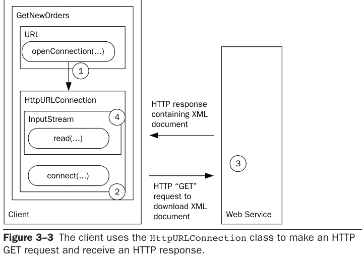

图 3–3 展示了从客户端侧的 XML 传输过程。请注意，客户端被实现为 `GetNewOrders` 类，并且它使用了 `URL` 和 `HttpURLConnection` 类的实例。以下步骤显示了这些类如何协作来实现 XML 文档下载协议。

1. 客户端使用 `URL.openConnection()` 方法创建一个 `HttpURLConnection` 实例，代表到 Web 服务服务 URL 的连接。
2. `HttpURLConnection.connect()` 发送使用 Web 服务 URL 配置的 HTTP GET 请求。
3. Web 服务处理请求并将适当的 XML 文档写入 HTTP 响应流中。
4. 使用 `HttpURLConnection` 的 `InputStream` 来读取 HTTP 文档的 XML 文档。

在本例的实现中，客户端简单地将 XML 文档写入到控制台。当你运行它时，你会在控制台上看到它（后文有具体说明）。在真实的 SOA 风格松耦合应用程序中，该文档可能会被解析、转换并发送到分布式应用程序的另一个组件。第 3.4 节提供了此类处理的示例。

示例 3–5 显示了发送 HTTP GET 请求并接收 XML 响应的客户端代码。注意，用于构建 `URL` 实例的字符串是作为 `args[0]` 传递给客户端的。`HttpURLConnection` 在其 `connect()` 方法被调用之前不会发送 HTTP 请求。在此发生之前，调用了 `setRequestMethod()` 来指定应发送 GET 请求。

### 示例 3–5 实现 Java 客户端从 REST 服务下载 XML 文档


```java
public static void main(String[] args) throws Exception {
    if (args.length != 1) {
        System.err.println("Usage: java GetOrders <Web Service URL>");
        System.exit(1);
    }
    // 创建到 URL 的 HTTP 连接
    URL url = new URL(args[0]);
    HttpURLConnection con = (HttpURLConnection) url.openConnection();
    con.setRequestMethod("GET");
    con.connect();
}
```

```java
// 从输入流将 XML 写入标准输出
InputStream in = con.getInputStream();
byte[] b = new byte[1024]; // 1K 缓冲区
int result = in.read(b);
while (result != -1) {
    System.out.write(b, 0, result);
    result = in.read(b);
}
in.close();
con.disconnect();
```

`book-code/chap03/rest-get/client-http/src/java/samples/GetOrders.java`

运行此示例，请执行以下操作：

1. 启动 GlassFish（如果它尚未运行）。
2. 进入 `<book-code>/chap03/rest-get/endpoint-servlet`。
3. 构建并部署 Web 服务，输入：
   `mvn install`
   ... 当命令完成后，输入：
   `ant deploy`
4. 进入 `<book-code>/chap03/rest-get/client-http`。
5. 运行客户端，输入：
   `mvn install`
6. 卸载 Web 服务，返回 `<book-code>/chap03/rest-get/endpoint-servlet` 并输入：
   `ant undeploy`

在本例中，`HttpURLConnection` 类完成了所有工作。它向 Web 服务 URL 发送 HTTP 请求，并提供作为 `InputStream` 的响应以供访问权限。现在，让我们看看如何使用 JWS 实现这一点。在示例中，RESTful 服务部署的 URL 是 `http://localhost:8080/rest-servlet/NewOrders`（假设你的 Java EE 容器运行在 localhost:8080）。你始终可以通过检查运行目录下的 `build.xml` 文件来查看示例中使用哪些参数来调用代码。

## 3.3 使用 JWS 的 REST 客户端

### 3.3.2 使用 JWS 从 REST 服务中获取 EIS 记录

当使用 JAX-WS 2.0 API 创建消费 RESTful Web 客户端时，`javax.xml.ws.Dispatch<T>` 接口完成了大部分工作——执行类似于 `HttpURLConnection` 的角色。

# 104 使用 REST 的基础 SOA

查看示例 3–6 中的代码，你可以发现 `addPort()` 方法接受一个定义传输绑定的 URI 参数。默认是 HTTP 之 SOAP，但在情况下，使用了 `HTTPBinding.HTTP_BINDING` 来指定 JAX-WS 2.0 HTTP 绑定。传递给 `addPort()` 方法的最后一个参数是 RESTful 服务的 URL——在本例中为 `args[]`。

一旦通过 `addPort()` 添加了 RESTful 服务的端口，就可以用它来创建 `Dispatch<Source>` 实例。类型参数——在此情况下为 `Source`——被作为参数传递给创建的 `dispatch()` 方法。负载的类型也需要指定。我指定了 `Service.Mode.PAYLOAD`（区别于 `Service.Mode.MESSAGE`）。在处理 SOAP 时，`MESSAGE` 模式表示你想要处理 SOAP 封包，而不仅仅是 SOAP 体（或负载）。在 REST 场景中，没有封包，`PAYLOAD` 是合理的选项。

除了 `Source` 之外，分发的其他有效类型参数是 JAXB 对象、`java.xml.soap.SOAPMessage` 和 `javax.activation.DataSource`。在第 6 章中，我将介绍使用 JAXB 和 `SOAPMessage` 的示例。`DataSource` 使客户端处理 MIME 类型消息——这是我在本书中未涵盖的场景。

这种实现与示例 3–5 所示的 `HTTPURLConnection` 版本相比如何？表 3–2 展示了某些相似与不同之处。

## 表 3–2 HTTPURLConnection 对比 JAX-WS

| | HTTPURLConnection | JAX-WS |
| :--- | :--- | :--- |
| RESTful 服务的表示 | `java.net.URL` | `javax.xml.ws.Service` |
| 调用对象 | `java.net.HttpURLConnection` | `javax.xml.ws.Dispatch` |
| 消息格式 | `java.io.InputStream` | `javax.xml.ws.transform.Source` |

如你所见，JAX-WS 版本为我们提供了丰富的接口，尽管在像这样简单的 REST 场景中，它并不总是有用。URL 是 RESTful 服务的充分表示，因为无论是否有关联的 WSDL 来提供进一步的定义。但使用 HTTP POST 或 HTTP GET 仅还需要其他信息。正如我们所看到的，`Service` 实际上被设计为 WSDL 的 Java 表示，在这里并没有特别帮助。

> 8. 第 6 章是对 JAX-WS 客户端 API 的详细概述。

另一方面，`Dispatch` 接口比 `HttpConnection` 更适合处理 XML 请求/响应。首先，它的 `invoke()` 方法比 `HttpConnection.connect()` 更好地捕获了 HTTP 绑定的请求/响应语义。其次，`Dispatch` 接口允许我们直接处理 XML 表示形式（如 source），而不是读取和写入流。这要自然得多，正如我们开始连接 REST 服务并使用 XSLT 进行数据转换时（第 3.4 节）所看到的。

在查看了从 RESTful Web 服务获取 XML 的客户端后，接下来的章节将展示如何向此类服务发送 XML。这些章节还演示了如何将参数作为 URL 的传递给 REST 服务。

### 3.3.3 不使用 JWS 向 REST 服务发送 EIS 记录

在第 3.3.1 节中，我使用 `HttpConnection` 实现了一种 XML 文档消息的“拉取”架构——换句话说，文档是由客户端从 Web 服务“拉取”的。在“拉取”架构中，XML 文档的接收方发起传输。在提供的代码示例中，我们使用 HTTP GET 方法作为请求机制。

向 RESTful Web 服务发送 XML 与获取 XML 并没有太大区别。“推”（push）架构的主要区别在于发送方发起传输，并使用了 HTTP POST 方法。这种架构被用于，例如当 OMS（订单管理系统）想要定期将所有新和更改的订单上传到 CSS（客户服务系统）时。为了实现这种上传，CSS 需要提供一个 Web 服务。

在本例中，我使用 `HttpConnection` 实现“推”架构。

图 3–5 展示了推送消息。如你所见，它与上一个示例相似，只是客户端是消息发送者而 Web 服务是接收者。图中所示的步骤如下：

1. 客户端使用 `URL.openConnection()` 方法创建连接到 RESTful 服务的 `HttpConnection`。在本例中，URL 有一个参数 `SourceSystem=OMS`。该参数表示发送的 XML 文档来自“OMS”系统。
2. `HttpURLConnection.connect()` 开始向 Web 服务 URL 发起 POST 请求。
3. 客户端将 XML 文档写入 HTTP 请求流，本质上是追加到已启动的 POST 请求。
4. RESTful 服务处理 HTTP POST。
5. 返回一个简单的“200 OK”响应给客户端，表示文档已接收。


图 5 使用 HTTP POST 的推送消息。

示例 3–7 显示了使用 `HttpURLConnection` 实现 HTTP POST 的客户端代码。注意我们使用 `setRequestMethod("POST")` 来配置 HTTP 请求为 POST。之后，`connect()` 发起 HTTP 请求，剩余代码将由文件名 `args[0]` 指定 XML 文档写入输出流。

1. 启动 GlassFish（如果尚未运行）。
2. 进入 `<book-code>/chap03/rest-post/endpoint-servlet`。
3. 构建并部署 Web 服务，输入：
   `mvn install`
   ... 待命令完成后，再输入：
   `ant deploy`
4. 进入 `<book-code>/chap03/rest-post/client-http`。
5. 运行客户端，输入：
   `mvn install`
6. 部署 Web 服务，返回 `<book-code>/chap03/rest-post/endpoint-servlet` 并输入：
   `undeploy`

你在这里看不到的是传递给 `args[1]` 的 URL 形式。要查看正在使用的 URL，可以查看 `<book-code>/chap03/rest-post/endpoint-servlet/build.xml` 文件，其中包含了所使用的目标。

# 110 使用 REST 的基础 SOA

### 3.3.4 使用 JWS 向 REST 服务发送 EIS 记录

与 3.3.2 节不同，本节中的客户端使用了 `javax.xml.Service` 和 `javax.xml.ws.Dispatch`，而不是 `java.net.URL` 和 `HttpURLConnection`。与该节的主要区别在于，XML 文档是被推送到服务端的。为了实现这一点，XML 文档需要被存储为 Java 类的实例，供 `Dispatch<Source>` 实例使用。在这种情况下，类型参数是 `Source`，因此必须从发送到 RESTful 服务的 XML 文档创建一个 `Source` 实例。此示例还说明了如何通过访问 Dispatch 对象的响应上下文来获取 HTTP 相关信息。所示，与上一个示例中使用的 `HttpURLConnection.getResponseCode()` 方法相比，获取 HTTP 状态码需要更多的工作。

图 3–6 展示了使用 JAX-WS 2.0 的推送消息。这里的细节比图 3–5 中的 `HttpURLConnection` 示例要多一点。步骤如下：

1. 客户端使用 `Service.addPort()` 方法在 Service 实例内部创建一个端口，该端口可访问 RESTful Web 服务。
2. 接下来，调用 `Service.Dispatch()` 方法创建一个 `Dispatch<Source>` 实例——该 Dispatch 实例允许你以 `javax.xml.transform.Source` 实例的形式来处理 XML 请求/响应消息。
3. 要发布到 RESTful 服务的 XML 文件被封装在 `javax.xml.transform.stream.StreamSource` 实例中。`StreamSource` 提供了 `Dispatch<Source>` 所需的源类型参数。
4. `Dispatch.invoke()` 方法根据 JAX-WS 2.0 HTTP 绑定将 XML 文档封装为 HTTP POST 请求，并将其发送到 RESTful 服务。`invoke()` 方法在返回之前会等待响应。
5. 服务处理 HTTP POST 并发送一个包含 HTTP 响应码的 HTTP 响应。
6. 因为 HTTP 响应码是 HTTP 消息（传输层）的一部分，而不是 XML 负载的一部分，为了检查状态码，客户端调用 `Dispatch.getResponseContext()` 来获取响应的 HTTP 上下文。

## 3.3 不使用 JWS 的 REST 客户端

发送者 接收者 XML 消息

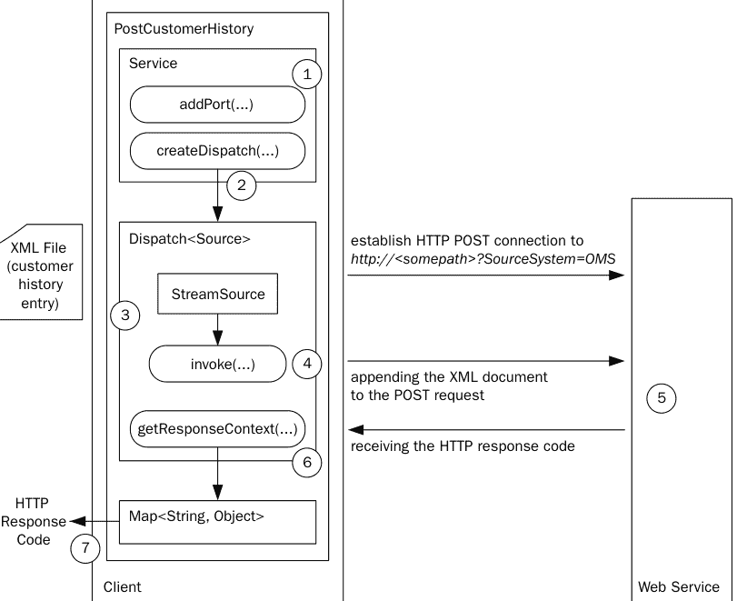

图 3–6 使用 HTTP POST 和 JAX-WS 2.0 的推消息。

7. HTTP 上下文表示为 `Map<String, Object>` 实例。该 map 提供了对 HTTP Header 以及 XML 负载之外其他信息的访问。在这里，它用于访问 HTTP 响应码（例如，200 代表“OK”，500 代表“服务器故障”等）。

示例 3–8 显示了使用 JAX-WS 实现的 `PostCustomerHistory`。它与示例 3–6 类似，你应该复习那里关于 REST 和 JAX-WS 的讨论。

## 112 使用 REST 的基础 SOA

这里与 `HttpURLConnection.invoke()` 方法的主要区别在于，调用时（示例 3–7）使用了一个 `StreamSource` 参数，该参数是从正在发布到 RESTful Web 服务的 XML 文件构造的。注意，不需要像 `HttpConnection` 示例那样将 XML 写入流中。`Dispatch<Source>` 实例允许你作为 `Source` 类型处理 XML 请求和响应负载。

### 示例 3-8 使用 JAX-WS 实现的 PostCustomerHistory 客户端

```java
33 public static void main(String[] args) throws Exception {
34 if (args.length == 2) {
35 System.err.println(
36 "Usage: Java XMLUpoader file name " +
37 "<Web Service URL>");
38 System.exit(1);
39 }
40 QName svcName = new QName("http://sample", "svc");
41 QName portName = new QName("http://sample", "port");
42 Service svc = Service.create(svcName);
43 svc.addPort(portName, HTTP_BINDING, args[1]);
44 Dispatch<Source> dis =
45 svc.createDispatch(portName, Source.class, Service.Mode.PAYLOAD);
46 dis.invoke(new StreamSource(file(args[0])));
47 Map<String, Object> respContext = dis.getResponseContext();
48 Integer respCode =
49 (Integer) respContext.get(MessageContext.HTTP_RESPONSE_CODE);
50 System.out.println("HTTP Response Code: "+respCode);
51 }
```

`book-code/chap03/rest-post/client-jax/src/java/samples/PostCustomerHistory.java`

对于此示例，执行以下操作。示例运行后，结果（客户历史记录）由应用程序写入格式为 `${user.home}/tmp/soabook.xml` 的临时文件中。因此，你可以查看 `${user.home}/tmp` 目录以验证示例运行正常。

1. 启动 GlassFish（如果尚未运行）。
2. 进入 `<book-code/chap03/rest-post/endpoint-servlet>`
3. 构建并部署 Web 服务中心：
   `mvn install`
   ...并且当该命令完成后：
4. 进入 `<book-code/chap03/rest-post/endpoint-servlet>`
5. 运行客户端：
   `mvn install`
6. 部署 Web 服务：
   `ant deploy`

# 使用 XSLT JAXP 进行数据转换的 SOA 集成

## 3.4.1 为什么要使用 XSLT 进行数据转换


任何 SOA 系统的核心组件都是将其数据从一种格式转换为另一种格式的能力。这种能力通常被称为数据转换，在 Web 服务环境中，最自然的方式是通过扩展样式表转换语言（XSLT）来处理。我们假设读者熟悉 XSLT 的基础知识。我们的重点是 XSLT 在 SOA 风格松耦合集成中的应用。如需复习 XSLT，可以参考 W3C 网站 `w.w3.org/Style/XSL/`。除了规范（书中的示例使用的是 1.0 版本——XSLT 1.0）外，该网站还提供了许多实用的教程链接。在 Sun 的 Java/XML 教程（`http://java.sun.com/webservices/jax/dist/1.1/docs/tutorial/index.html`）也可以找到另一个复习资料。Sun 的教程特别有用，因为它讨论了与 XSLT 配合使用的 `JAXP API`。

由于 XSLT 是一种复杂的数据转换语言，深入学习可能需要很长时间。幸运的是，大多数 SOA 应用所需的数据转换仅需 XSLT 语言的一小部分，这部分并不需要长时间学习。如果你在理解书的这一部分时遇到困难，在复习了 Sun 教程后应该就没问题了。目前不需要深入研究 XSLT！

XSLT 作为 SOA 集成框架中的首选转换工具是有意义的，因为它是一项通认可的标准，而且解释 XSLT 的转换引擎正变得越来越好、运行越来越快。虽然在某些地方编写一些快速且粗略的代码来执行简单的转换可能是权宜之计，但在开发一个将在整个组织范围内使用的 SOA 集成框架时，让转换语言和处理方式保持非标准状态是没有意义的。

为了演示 XSLT 如何用于数据转换，我们考虑这样一个场景：从 OMS 访问的新订单被用于创建客户历史记录，并以此更新 CSS 客户历史数据库。这样做的业务目的是让 CSS 的用户能够快速访问客户与公司进行过的交易的最新记录。例如，在处理客户电话时，此类信息几乎需要瞬时可用。如果客户代表需要检查客户历史中的任何交易详情，存储在那里的来自 OMS 信息提供了关键键（如 `OrderKey` 和 `ITM_NUMBER`），这些将能够快速从 OMS 中检索详细信息。

图 3–7 从销售订单到客户历史记录转换的数据映射。

如图 3–7 所示，订单中的客户编号（Customer Number）成为客户历史记录中的外键，链接回客户的其他信息。订单号（Order Number）、采购订单号（PO Number）和项目号（Item Number）也被映射了，因为在 CSS 中包含这些信息可以构建额外的 SOA 组件，从客户历史记录快速查询 OMS 及其他系统中的详细订单、采购订单和项目信息。注意，如果一个订单包含多种类型的项目，则客户历史记录中会有多个项目号的实例。

以下示例回顾了将一组 OMS 订单转换为一组 CSS 客户历史条目的 XSLT。订单集格式化为架构 `http://soab.com/example/orders.xsd` 中的 `oms:orders` 元素（示例 3–2）。客户历史集格式化为架构 `http://soab.com/example/css/custentries.xsd` 中的 `css:CustomerHistoryEntries` 元素（示例 3–4）。从订单到客户历史的 XSLT 转换在图 3–7 中以图示表示。

XSLT 语言是声明性的。它将源文档转换为目标文档。一个 XSL 转换由一组模板规则组成——由 `xsl:template` 元素的实例表示——这些是根元素 `xsl:stylesheet` 的子元素。在这里，XSL 文档通常被称为样式表。样式表中的模板元素定义了从源创建的文档结构。

XSL 使用 XPath 语言（如 XPath）来识别源文档中的数据块（例如 `OrderKey`）。通过模板路由，XPath 表达式决定了数据放置的位置。

示例 3–9 展示了一个用于将订单转换为历史的样式表。这把样式表分成了若干。示例显示了 XSL 的开头，包括 `xsl:stylesheet` 元素和 `xsl:output` 元素。

```xml
<xsl:stylesheet version="1.0" xmlns:xsl="http://www.w3.org/1999/XSL/Transform" xmlns:oms="http://soab.com/example/orders.xsd">
  <xsl:output method="xml" encoding="UTF-8" indent="yes"/>
```

### 示例 3–10 用于客户历史的 XSLT

如你所见，前缀 `oms` 用于表示订单系统（Order System）。

```xml
<xsl:stylesheet version="1.0" xmlns:xsl="http://www.w3.org/1999/XSL/Transform" xmlns:css="http://soab.com/example/css/custentries.xsd">
  <xsl:template match="oms:orders">
    <css:CustomerHistoryEntries>
      <xsl:apply-template select="oms:order"/>
    ... -->
```

继续示例 3–10，你可以看到下半部分了另一个匹配 `oms:order` 元素的模板。因此，如果 `oms:orders` 中的任何一个是 `oms:order` 的实例，这些子元素将被此模板处理，结果将插入 `CustomerHistoryEntries` 标签中。查看此模板内部的 `oms:Order`，你可以看到它包含元素 `CustomerHistoryEntry` 内容以及两个顶级元素 `OrderLookupInfo`。现在，查看 `CustomerNumber` 标签内部，你会看到另一个 `xsl:apply-templates` 指令。然而，这一个具有属性：

```xml
select="oms:OrderHeader/oms:CUST_NO"
```

此模板为填充 `CustomerNumber` 元素的内容提供了指令。XPath 表达式 `./oms:OrderHeader/oms:CUST_NO` 限制了该模板应用的 `oms:Order` 子元素。该 XPath 表达式告诉 XSLT 处理器仅对 `oms:OrderHeader` 的子元素 `oms:CUST_NO` 应用模板。通过这种方式，它提取出 `oms:CUST_NO` 元素，对其进行处理，并将结果插入 `CustomerNumber` 标签内部。

## 3.4 使用 XSLT JAXP 进行数据转换的 SOA 风格集成

通过观察示例 3–10 中出现的其他 `xls:apply-templates` 指令，你可以发现 `<OrderLookupInfo>` 元素是由 XPath 表达式指定的源元素填充的：`/oms:OrderKey`、`/oms:OrderHeader/PURCH_ORD_NO`、`/oms:orderItems/item/ITM_NUMBER` 以及 `/oms:orderText`。注意，这些 XPath 表达式与图 3–7 中的虚线映射相对应。

继续查看此样式表，现在来看示例 3–11，它展示了这些 XPath 表达式所匹配的模板：

### 示例 3–11 用于客户历史的详细模板的 XSLT

```xml
37   <xsl:template match="oms:CUST_NO">
38     <xsl:value-of select="./"/>
39   </xsl:template>
40   <xsl:template match="oms:OrderKey">
41     <OrderNumber xmlns="http://www.example.com/css">
42       <xsl:value-of select="./"/>
43     </OrderNumber>
44   </xsl:template>
45   <xsl:template match="oms:PURCH_ORD_NO">
46     <PURCH_ORD_NO xmlns="http://www.example.com/css">
47       <xsl:value-of select="./"/>
48     </PURCH_ORD_NO>
49   </xsl:template>
50   <xsl:template match="oms:ITM_NUMBER">
51     <ITM_NUMBER xmlns="http://www.example.com/css">
52       <xsl:value-of select="./"/>
53     </ITM_NUMBER>
54   </xsl:template>
55   <xsl:template match="oms:OrderText">
56     <OrderText xmlns="http://www.example.com/css">
57       <xsl:value-of select="./"/>
58     </OrderText>
59   </xsl:template>
```

`book-code/chap03/xslt/etc/order_to_history.xslt`

在这里你可以看到，例如，匹配 `oms:OrderKey` 的模板简单地返回了该元素的值（指令 `<xsl:value-of select="./"/>` 返回当前节点的字符串值）。最终结果是，该样式表将值映射到 `oms:OrderKey` 是目标文档中一个名为 `OrderNumber` 的子元素，该元素是 `CustomerHistoryEntry` 的子节点。

在浏览了一个 XSLT 示例后，下一节将介绍如何使用 Java 应用此类转换。

### 3.4.2 使用 JAXP 进行 XSLT 处理

Java 中的 XSL 处理是使用 Java XML 处理 API (JAXP) [JSR 206] 完成的。具体来说，可以使用 JAXP 的 `javax.xml.transform.Transformer` 类根据样式表指定的指定的规则将源文档转换为目标文档，JAXP 为所有 Java XML 处理提供了构建基础。

图 3–8 显示了一个简化的架构图，阐明了 JAXP API 的作用。各种类型的应用程序都可以使用 JAXP API，包括 servlet、JSP 和 EJB。所有这些程序都使用 JAXP 来访问任何 JAXP 实现中包含的各种功能，例如 SAX 解析器、DOM 实现以及支持 XSLT 的 XSL 处理器。`javax.xml.parsers` 包提供了一个通用的工厂接口，用于访问不同的 SAX 和 DOM 实现（例如 Xerces）以及 XSL 实现（例如 Xalan）。SAX 和 DOM 的接口存在于 `org.xml.sax` 和 `org.w3c.dom` 包中。XSLT API 位于 `javax.xml.transform` 包中。

如图 3–8 所示，JAXP 将 Java 应用程序（例如客户端、servlet、JSP、EJB）与 XSLT 转换器的实现以及 SAX 和 DOM 解析器隔离开。JAXP 定义了工厂类，在运行时使用的转换器/解析器实现类上实例化包装对象，这些实现由系统属性/或类路径设置决定。

JAXP 是一项推动性标准，使得使用 Java 和 Web Services 构建 SOA 风格的系统应用程序变得可行。它不仅将 XML 解析和转换标准与 Java 集成，还将 SOA 应用组件与 SAX、DOM 和 XSLT 实现隔离开。这非常重要，因为随着更好、更快的实现进入市场，SOA 组件能够利用它们来提高性能，而无需重写。

通过使用 JAXP 架构和 XML 进行消息传递，将 SOA 组件与 Java 集成涉及的大部分数据转换工作都简化为编写 XSLT。用于演示此点的示例在图 3–9 所示。该应用程序从 OMS Web 服务读取订单，将其转换为客户历史。

## 使用 REST 的基础 SOA


图 3-8 XML 处理的 Java API (JAXP)。

此示例通过结合第 3.3 节和 3.3 节的示例来构建。图 3–9 所示的步骤如下：

1. 使用 `Service` 实例从 OMS 服务获取订单。
2. 使用 `Dispatch` 实例将客户历史发布到 CSS 服务。
3. 使用 XSLT 文件 (`order_to_history.xslt`) 创建 `Transformer` 实例。
4. 使用 `transform()` 方法将样式表应用于源实例。
5. 将结果 XML 写入已的 `Result` 实例。
6. 在这种情况下，`Result` 实例是通过 `ByteArrayInputStream` 创建的。
7. 最后，如图 3–6 所示，使用 `Dispatch.invoke()` 方法将客户历史发布到 CSS 服务。

### 3.4 使用 XSLT JAXP 进行数据转换的 SOA 风格集成


图 3–9 使用 XSLT 的 SOA 风格集成。

示例 3–8 中的代码展示了如何实现 `Dispatch` 实例。创建和调用 REST 服务的 Java 代码与 3–6 相同——请查看那些讨论以了解 `Dispatch` 在此场景下的工作原理。

### 示例 3–12 实现客户历史 XSLT 的 Java 代码

```java
// 获取订单
Service svc = Service.create(svcName);
svc.addPort(orderName, HTTPBinding.HTTP_BINDING, newOrdersUrl);
Dispatch<Source> getOrdersDispatch = svc.createDispatch(orderName, Source.class, Service.Mode.PAYLOAD);
Source newOrdersSource = getOrdersDispatch.invoke(new StreamSource("<empty/>"));
// 使用你的 XSLT 文件实例化 Transformer
Transformer transformer = TransformerFactory.newInstance().newTransformer(
new StreamSource(new File(xsltfile)));
// 将新订单转换为文件
ByteArrayOutputStream ba = new ByteArrayOutputStream();
transformer.transform(source, new StreamResult(ba));
// 更新客户历史
svc.addPort(histName, HTTPBinding.HTTP_BINDING, addCustHistURL);
Dispatch<Source> postCustomerHistoryDispatch = svc.createDispatch(histName, Source.class, Service.Mode.PAYLOAD);
postCustomerHistoryDispatch.invoke(new StreamSource(new StreamReader(ba.toString())));
```

要查看如何实现 XSLT，请查看示例中间，使用 `TransformerFactory.newInstance()` 获取默认 `Transformer` 实例。使用此工厂，通过将实现图 3–7 所示映射的 XSLT 文件作为 `StreamSource` 传递给 `newTransformer()` 方法来创建 `Transformer`。生成的 `Transformer` 然后将 XSLT 应用于获取的 `Source` 实例。

## 3.5 不使用 JWS 的 RESTful 服务

要运行此示例，请执行以下操作。示例运行后，结果（客户历史记录目）将由应用程序写入一个临时文件（其格式为 `${user.home}/tmp/soapbook*.xml`）。因此，你可以查看你的 `${user.home}/tmp` 目录以验证示例是否运行正常。

1. 启动 GlassFish（如果它尚未运行）。
2. 进入 `<book-code>/chap03/rest-post/endpoint-servlet`。
3. 要构建并部署 Web 服务，输入：

```bash
mvn install
```

当命令执行完成后，输入：

```bash
ant deploy
```

4. 进入 `<book-code>/chap03/rest-get/endpoint-servlet`。
5. 要构建并部署 Web 服务，输入：

```bash
mvn install
```

当命令执行完成后，输入：

```bash
ant deploy
```

6. 进入 `<book-code>/chap03/xslt`。
7. 要运行客户端，输入：

```bash
mvn install
```

8. 要卸载 Web 服务，返回 `<book-code>/chap03/rest-get/endpoint-servlet` 并输入：

```bash
ant undeploy
```

9. 在目录 `<book-code>/chap03/rest-post/endpoint-servlet` 中执行相同的操作。

以上结束了关于使用 JAXP 和 XSLT 进行数据转换的简要介绍。第 5 章将更详细地检查 XML 处理，在该章中将介绍数据绑定，并对 JAXB 与 SA 和 DOM 进行比较。本章的接两个节将介绍如何部署 RESTful 服务——分为使用和不使用 JWS 情况。

## 3.5 使用和不使用 JWS 的 RESTful 服务


# 3.5 使用和不使用 JWS 的 RESTful 服务

现在的重点从 RESTful Web 服务的客户端消费转向此类服务本身的开发和部署。与第 3.3 节一样，本节将检查如何在使用和不使用 JAX-WS 的情况下部署此类服务。与之前一样，这里的目的是将 JWS 方法与仅使用 Java 的 HTTP servlet 工具构建并部署简单 RESTful 服务的纯基础方法进行比较和对比。

再次，用于说明本节概念的示例是 SOA Web 服务的构建模块——简单下载服务的部署。在这种情况下，它是前面的节中从客户端角度讨论的“新订单”服务。本节将检查如何在使用和不使用 JAX-WS 的情况下部署提供 `getNewOrders()` 方法的 Java 类。

## 3.5.1 不使用 JWS 部署 REST 服务

本节提供了书中第一个关于如何将 Java 方法部署为 Web 服务的示例。它是所能想象的最简单的 RESTful Web 服务——第 3.2 节中客户端消费的服务。该服务仅返回一个包含“新订单”的 XML 文档。

示例 3–13 显示了 `getNewOrders()` 方法的模拟对象（mock object）实现。此 `OrderManager` 的实现被称为模拟对象，因为它是真实 `OrderManager` 类的“模型”。它是服务器端的存根实现（stub implementation）。`getNewOrders()` 方法返回硬编码文件（`/orders.xml`）的内容，而不是为订单管理系统提供实时接口。在本书中，像这样的模拟对象用于说明部署为 Web 服务的 Java 类。这种策略提供了你可以实际运行的真实示例，而不需要任何实际后端系统来提供订单管理或客户服务的实现。

**示例 3–13 将作为 Web 服务部署的 `OrderManager.getNewOrders(...)` 方法**

```java
26 public class OrderManager {
27
28 public Source getNewOrders() throws FileNotFoundException {
29 // 提供新订单的资源
30 InputStream src = getClass().getResourceAsStream("/orders.xml");
31 if ( src == null ) {
32 throw new FileNotFoundException("/orders.xml");
33 }
34 return new StreamSource(src);
35 }
36
37 }
```

`book-code/chap03/rest-get/endpoint-servlet/src/java/samples/OrderManager.java`

在考虑如何启用此方法作为 Web 服务时，会出现几个问题：

1. 如何实例化该类？
2. `getNewOrders()` 返回的源实例是如何转换为 HTTP 响应消息中的 XML 流的？
3. 如何将该类部署为 Web 服务？

这三个问题反映了第 1 章第 1.2 节中概述的 Web 服务平台架构的三个组件。问题 #1 关乎调用——Web 服务平台架构的第一个组件。要调用 Web 服务，你必须能够获取其实现类的实例。问题 #2 关乎序列化——Web 服务平台架构的第二个组件。返回的 Java 对象必须被序列化为 XML，以便可以写入“网络中”。问题 #3 关乎部署——Web 服务平台架构的第三个组件。

本节对这些问题给简单的答案，示例展示了如何使用专门的 servlet 将 Java 方法部署为 Web 服务。然而，值得注意的是，即使在这种简单的情况下，解决方案也需要处理所有三个 Web 服务平台组件。

在此示例中，通过 HTTP GET 请求访问 Web 服务。servlet 需要处理 HTTP GET 请求、实例化 Java 类、调用 `getNewOrders()` 方法，并将结果作为 Web 服务平台组件写出。

部署和调用此 servlet 的说明包含在示例 3–6 中。

示例 3–15 展示了由 `GetNewOrdersServlet` 类（同 `OrderManager`）实现的 Web 服务的部署描述符。这是标准的 `web.xml` 文件，放置于用于部署此 Web 服务的 WAR 包的 `WEB-INF` 子目录下。

## 示例 3–15 封装在 GetNewOrdersServlet WAR 中的 web.xml 部署描述符

```xml
<web-app>
  <servlet-name>GetNewOrdersServlet</servlet-name>
  <servlet-class> samples.GetNewOrdersServlet </servlet-class>
  </servlet>
  <servlet-mapping>
    <servlet-name>GetNewOrdersServlet</servlet-name>
    <url-pattern>/NewOrders</url-pattern>
  </servlet-mapping>
</web-app>
```

`book-code/chap03/rest-get/endpoint-servlet/src/webapp/WEB-INF/web.xml`

注意示例 3–15，`GetNewOrdersServlet` servlet 被映射到 URL 模式 `/NewOrders`。你用于部署 WAR 的部署工具决定了 Web 应用程序的上下文根（context root）。在这种情况下，使用的是 GlassFish 的默认设置——它从 WAR 文件名（`chap03-rest-get-endpoint-servlet-1.0.war`）获取上下文根。servlet 容器的基 URL 为 `http://localhost:8080`（除非你在安装代码示例时自定义了 `bookcode/pom.xml` 文件的配置部分——见附录 B，B.5）。因此，该 Web 服务的 URL 为：

`http://localhost:8080/chap03-rest-get-endpoint-servlet-1.0/NewOrders`

这基本上结束了关于使用 servlet 调用 Java 方法来创建和部署简单 REST Web “如何做”讨论。如你所见，使用 servlet 部署基础的 RESTful Web 服务并不困难。章节开头提出的三个问题回答如下：

1. Web 服务实现类（即 `orderManager`）使用无参默认构造函数进行实例化。这假设存在构造函数且该类定义在类路径上。它还假设该类所需的所有资源都是可用的。
2. `getOrders()` 返回的对象通过 `Transformer` 转换为 XML 流。这是一个非常简单的场景，被部署的方法返回了一个已经表示为 XML 信息集（infoset）的结果。在大多数情况下，结果将是一个不是 XML 信息集表示的 Java 对象，需要通过将其与专用 servlet 绑定来完成序列化。
3. 该类被部署为

当你想要部署多个服务时，会遇到问题。使用本节描述的架构，你必须为每个 Web 服务准备一个 servlet。这会迅速变得繁琐且低效。需要的是可以使用单个 servlet 调用多个服务的调用机制。然而，要做到这一点，需要比 `web.xml` 文件提供的更细粒度、将 URL 映射到服务的方法。你可以在示例 3–15 中看到，`web.xml` 的映射是从单个 URL 到一个 servlet。因此，为了让一个简单的 servlet 处理多个 URL（以及多个 Web 服务），必须向这种简单架构添加额外的部署元数据，而这超出了 servlet 处理模型。实现此点的方法之一是将所有形式为 `example.com/services/*` 的基 URL 映射到该 servlet。然后将 `/getOrder`、`/addCustomerHistory` 等本地路径映射到各个 Web 服务。

事实上，这种方法被多种 Web 服务引擎使用，包括 Apache Axis [AXIS] 以及第 11 章中引入的 SOA-E 引擎。JWS 也提供了这种方法的变体，我将在第 7 章中详细检查它。现在，我将推迟对部署问题的讨论，转而讨论使用 JWS 部署的细节。

## 3.5.2 使用 JWS 部署 RESTful 服务

本节说明了如何使用 JWS 部署 Web 服务。这是 3.5 节中使用的 JWS 版本。与示例 3–14 使用 servlet 不同，这里使用 JWS 部署。`Provider<Source>` 接口基本上是 3.3 节中讨论的 `Dispatch<Source>` 的版本。它允许直接处理 XML 消息。`@WebServiceProvider` 注解是部署 Web 服务所需的。

到 HTTP 传输的服务由 JAX-WS 运行时实现处理。最后，第三个问题的答案也大不同。Java EE 5 支持许多 Web 服务的部署选项——这些将在第 8 章中讨论。可以使用 `web.xml` 部署描述符（即使它不是 servlet！），但并非必须的。事实上，可以在没有任何任何部署描述符的情况下部署 JWS Web 服务。Java EE 5 容器通常可以根据其注解部署服务。

图 3–11 显示了此处使用 JAX-WS 2.0 创建并部署的 RESTful Web 服务架构。

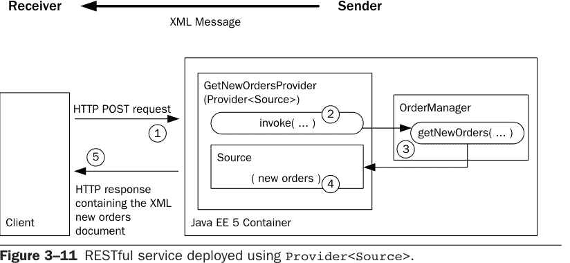

如图所示，该 JWS 架构使用 `java.servlet.http.Provider<Source>` 类部署 RESTful Web 服务。`OrdersProvider` 类充当 `OrderManager` 的前端，在 XML 请求/响应消息之间进行调解，并调用实现 Web 服务的 Java 方法。图中所示的步骤为：

- 1. 客户端向适当的 URL 发送 HTTP POST 请求（该 URL 在部署时指定——在部署描述符中或通过部署工具指定）。注意，这里使用的是 POST 请求而不是 GET 请求。这是因为 JAX-WS 的早期实现仅允许 RESTful Web 服务处理 POST 请求。最近的版本同时支持 POST 和 GET 请求。
- 2. JWS 容器从 HTTP POST 请求中提取 XML 消息并将其传递给 `GetNewOrders.invoke()` 方法。此功能由 JAX-WS 运行时提供。
- 3. `invoke()` 方法创建 `OrderManager` 类的实例并调用 `getNewOrders()` 方法。
- 4. `getNewOrders()` 方法作为 `javax.xml.transform.Source` 实例返回新的 JWS 文档。
- 5. 服务返回消息的实例被插入到 HTTP 响应消息中并返回给调用者。此功能（即将 XML 响应封装在 HTTP 响应消息中）由 JAX-WS 运行时提供。

在某些方面，该 RESTful Web 服务的 JWS 实现比第 3.5.1 节中讨论的基于 servlet 的对应版本更简单。这种简化源于不需要在 HTTP 请求/响应消息与 XML 请求/响应消息之间进行转换。JAX 处理了这些转换，因此开发者可以直接处理 XML 消息。然而，在其他方面，此处所示 JWS 实现似乎更复杂。需要两个注解——`@WebServiceProvider` 和 `@BindingType`。如果你不习惯注解，这些注解可能会让示例看起来很困惑。

要部署并调用此 RESTful Web 服务示例，请执行以下操作：

- 1. 启动 ClassFish（如果它尚未运行）。
- 2. 进入 `<book-code>/chap03/rest-get/endpoint-jaxws`。
- 3. 构建并部署 Web 服务，输入：

```bash
mvn install
```

... 当命令完成后，输入：

```bash
ant deploy
```

- 4. 进入 `<book-code>/chap03/rest-get/client-jaxws`。
- 5. 运行客户端，输入：

```bash
ant run-jaxws
```

- 6. 卸载 Web 服务，返回 `<book-code>/chap03/rest-post/endpoint-jaxws` 并输入：

```bash
ant undeploy
```

## 3.6 总结

在本章中，我对消费、创建和部署 RESTful Web 服务进行了广泛介绍——使用了标准的 `java.net.*` 类和 servlet，以及 JAX-WS 2.0 API 和注解。本章的一个主要目标是强调传统 Java 技术与 JAX-WS 2.0 Web 服务方法之间的相似与差异。另一个目标是为实现 RESTful Web 服务 SOA 风格集成的一些基础 XML 处理技术提供基础。

在下一章中，我将研究 Java/XML 数据绑定问题，以及如何使用传统的 JAX 方法以及 JAXB 来解决该问题。

# 4.1 WSDL 在 SOA 中的作用

如何与组件进行通信。在没有标准接口定义语言（IDL）的情况下，你诉助于临时文档来通信你的 SOA 组件的接口。

企业级 Java 开发者通常关注该技术在跨企业边界的扩展性如何。在 SOA 的案例中，你必须确保在不同部门（例如，订单处理和客户服务）中创建的 Web 服务能够相互操作。每当你需要设计那样的可扩展且跨边界的系统时，成功的关键关键因素之一就是良好的接口定义。因此，你不能依赖临时文档来定义接口。你必须拥有一套标准，而业界公认的标准是 WSDL 1.1 [WSDL 1.1]。

在企业规模上使用 RESTful SOA 组件时遇到的困难之一是，对于通过 HTTP 使用 SOAP 的 XML，没有公认的行业标准 IDL，而 SOAP WSDL 2.0 [WSDL 2.0] 在其工作原理上提供了对 SOAP 通过 HTTP 使用 XML 的支持（参见 [WSDL 2.0 Part]）；然而，行业内对 WSDL 2.0 的普遍认可可能还需要数年。

图 4–1 显示了本书描述的 WSDL 在 SOA 集成中的作用。该图提供了一个 UML 对象图，描述了 WSDL 在 SOA 集成环境中的关系。首先，注意部署发生的 Web 服务平台子系统。该子系统中描述的顶层类 `serviceDeployment` 对应于部署在该平台上的 Web 服务。接下来，注意 `serviceDeployment` 同时包含了（取自 WSDL 接口描述）`interface` 和一个 Java 方法。通过这种方式，你可以看到 Web 服务部署定义了 WSDL 接口描述与该描述的 Java 实现之间的关系。更具体地说，Web 服务部署定义了 WSDL 中各个操作与在该特定中实现这些操作的 Java 方法之间的关系。

图 4–1 显示 WSDL 接口描述包含一个 `types` 实例（例如 `wsdl:types`）。如你所知，`wsdl:definitions` 元素内的顶层元素描述了 WSDL 中使用的 XML Schema。在这里，你也可以看到此特定 WSDL 的类型 types 实例包含了 `Orders.xsd` 架构，它是企业系统中 XML Schema 库的一部分。它还包含了来自 Web 服务基础设施子系统的 `Faults.xsd` 架构。

通过这种方式，SOA 设想企业维护一个可重用的 XML Schema 定义库，并将它们整合到 WSDL 定义中以部署 Web 服务。我将这种概念称为可用架构（reusable schema）。

## WSDL、SOAP 和 Java/XML 映射在 SOA 中的作用

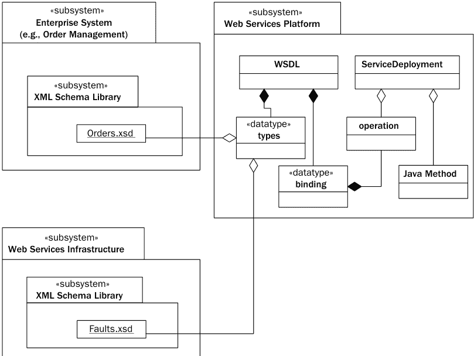

图 4–1 WSDL 在 SOA 集成中的作用。

可用架构为企业模型提供了基础，这是 SOA 的基石。标准架构实现了标准消息，从而能够定义标准的 WSDL 接口。正如我讨论过的，WSDL 对于关注分离至关重要，因为需要清晰的接口定义将应用程序分离为逻辑单元或 SOA 组件。为了让 SOA 基础设施的所有用户理解这些 WSDL 接口，它们必须用通用语言编写。在某种程度上，XML 提供了一种通用语言——但那是语法。在该语言中表示的数据类型也应该尽可能地标准化。因此，对于像 *address* 这样常用的类型，应该有标准的企业架构定义，可以在 SOA 组件之间重用。

图 4–1 中的企业系统可能包括第 3 章描述的 OMS，其架构库将包含那里描述的 *Orders.xsd* 架构。其他“基础设施”库——用于故障消息的 *orders standard* 架构——也被设想为企业部署的 SOA 框架的一部分。

因此，正如此处描述，WSDL 在 SOA 框架中的一个角色是将标准 XML 类型组组成描述 Web 服务的操作。另一个角色是 Web 服务部署的参与者。

### 4.1.1 WSDL 示例

图 4–1 在你查看具体的 WSDL 时变得更加清晰。WSDL 1.1 示例显示 WSDL 接口描述包含一个 `types` 实例（例如 `wsdl:types`）。如你所知，`wsdl:definitions` 元素内的顶层元素描述了 WSDL 中使用的 XML Schema。在这里，你也可以看到此特定 WSDL 的类型 types 实例包含了 `Orders.xsd` 架构，它是企业系统中 XML Schema 库的一部分。它还包含了来自 Web 服务基础设施子系统的 `Faults.xsd` 架构。

通过这种方式，SOA 设想企业维护一个可重用的 XML Schema 定义库，并将它们整合到 WSDL 定义中以部署 Web 服务。我将这种概念称为可用架构（reusable schema）。


# WSDL、SOAP 和 Java/XML 映射在 SOA 中的作用

## 4.1 WSDL 在 SOA 中的作用

如何与组件进行通信。在没有标准接口定义语言（IDL）的情况下，你必须诉助于临时文档来通信你的 SOA 组件的接口。

企业级 Java 开发者通常关注该技术在跨企业边界的扩展性如何。在 SOA 的案例中，你必须确保在不同部门（例如，订单处理和客户服务）中创建的 Web 服务能够相互操作。每当你需要设计那样的可扩展且跨边界的系统时，成功的关键因素之一就是良好的接口定义。因此，你不能依赖临时文档来定义接口。你必须拥有一套标准，而业界公认的标准是 WSDL 1.1 [WSDL 1.1]。

在企业规模上使用 RESTful SOA 组件时遇到的困难之一是，对于通过 HTTP 使用 SOAP 的 XML，没有公认的行业标准 IDL，而 SOAP WSDL 2.0 [WSDL 2.0] 在其工作原理上提供了对 SOAP 通过 HTTP 使用 XML 的支持（参见 [WSDL 2.0 Part]）；然而，行业内对 WSDL 2.0 的普遍认可可能还需要数年。

图 4–1 显示了本书描述的 WSDL 在 SOA 集成中的作用。该图提供了一个 UML 对象图，描述了 WSDL 在 SOA 集成环境中的关系。首先，注意部署发生的 Web 服务平台子系统。该子系统中描述的顶层类 `serviceDeployment` 对应于部署在该平台上的 Web 服务。接下来，注意 `serviceDeployment` 同时包含了（取自 WSDL 接口描述）`interfaceDescription` 和一个 Java 方法。通过这种方式，你可以看到 Web 服务部署定义了 WSDL 接口描述与该描述的 Java 实现之间的关系。更具体地说，Web 服务部署定义了 WSDL 中各个操作与在该特定中实现这些操作的 Java 方法之间的关系。

图 4–1 显示 WSDL 接口描述包含一个 `types` 实例（例如 `wsdl:types`）。如你所知，`wsdl:definitions` 元素内的顶层元素描述了 WSDL 中使用的 XML Schema。在这里，你也可以看到此特定 WSDL 的类型 types 实例包含了 `Orders.xsd` 架构，它是企业系统中 XML Schema 库的一部分。它还包含了来自 Web 服务基础设施子系统的 `Faults.xsd` 架构。

通过这种方式，SOA 设想企业维护一个可重用的 XML Schema 定义库，并将它们整合到 WSDL 定义中以部署 Web 服务。我将这种概念称为可用架构（reusable schema）。

### 4.1 WSDL 示例

图 4–1 在你查看具体的 WSDL 时变得更加清晰。WSDL 1.1 示例显示 WSDL 接口描述包含一个 `types` 实例（例如 `wsdl:types`）。如你所知，`wsdl:definitions` 元素内的顶层元素描述了 WSDL 中使用的 XML Schema。在这里，你也可以看到此特定 WSDL 的类型 types 实例包含了 `Orders.xsd` 架构，它是企业系统中 XML Schema 库的一部分。它还包含了来自 Web 服务基础设施子系统的 `Faults.xsd` 架构。


图 4–1 WSDL 在 SOA 集成中的作用。

可用架构为企业模型提供了基础，这是 SOA 的基石。标准架构实现了标准消息，从而能够定义标准的 WSDL 接口。正如我讨论过的，WSDL 对于关注分离至关重要，因为需要清晰的接口定义将应用程序分离为逻辑单元或 SOA 组件。为了让 SOA 基础设施的所有用户理解这些 WSDL 接口，它们必须用通用语言编写。在某种程度上，XML 提供了一种通用语言——但那是语法。在该语言中表示的数据类型也应该尽可能地标准化。因此，对于像 `address` 这样常用的类型，应该有标准的企业架构定义，可以在 SOA 组件之间重用。

图 4–1 中的企业系统可能包括第 3 章描述的 OMS，其架构库将包含那里描述的 `Orders.xsd` 架构。其他“基础设施”库——用于故障消息的 `orders standard` 架构——也被设想为企业部署的 SOA 框架的一部分。

因此，正如此处描述，WSDL 在 SOA 框架中的一个角色是将标准 XML 类型组组成描述 Web 服务的操作。另一个角色是 Web 服务部署的参与者。

**示例 4–4** `wsdl:binding` 元素描述传输绑定

```xml
60 <wsdl:binding name="GetOrdersDatesSOAPBinding"
61 type="getordord:GetOrdersDatesPort">
62 <soap:binding style="document"
63 transport="http://schemas.xmlsoap.org/soap/http"/>
64 <wsdl:operation name="GetOrdersDates">
65 <wsdl:input>
66 <soap:body use="literal"/>
67 </wsdl:input>
68 <wsdl:output>
69 <soap:body use="literal"/>
70 </wsdl:output>
71 <wsdl:fault name="GetOrdersInputFault">
72 <soap:fault name="GetOrdersInputFault"/>
73 </wsdl:fault>
74 </wsdl:operation>
75 </wsdl:binding>
```

`book-code/chap04/wsdl/GetOrdersDates.wsdl`

首先，在此情况下 `wsdl:operation name` 属性为 `GetOrdersDates`，这与请求消息元素的名称相同。这并非巧合，而是第 4.3.5 节讨论的“document/literal wrapped”（文档/字面封装）风格的要求。其次，`soap:binding style` 为“document”，`soap:body use` 为“literal”。同样，这是“document/literal wrapped”风格的特性。

最后，**示例 4–5** 显示了 `wsdl:service` 元素。该元素描述了端点（endpoint），并为 `soap:address location` 属性提供了 URL。Web 服务平台（如图 4–1 所示）需要确保 WSDL 中提供的 URL 与端点实际部署的地址保持同步。因此，在进行“从 WSDL 和 Java 开始”开发时，通常在部署之前不指定 `location` 属性，因为它是由该点关联到 Web 服务的任何上下文决定的。

**示例 4–5** `wsdl:service` 元素描述端点

```xml
79 <wsdl:service name="GetOrdersDatesService">
80 <wsdl:port name="GetOrdersDatesPort" binding="GetOrdersDatesSOAPBinding">
81 <soap:address location="http://localhost:8080/getordertes/getordersdates/"/>
```

## 4.2 SOAP 在 SOA 中的作用

前一节讨论了 SOA 如何需要接口定义语言（即 WSDL）以标准方式描述如何调用 Web 服务组件。WSDL 描述了一个抽象接口（即 `wsdl:portType` 和 `wsdl:operation`）以及接口的具体绑定（即 `wsdl:binding`）。如示例 4-2 所示，WSDL 操作是通过抽象消息（即 `wsdl:message` 元素）来描述的。SOAP 为 `wsdl:message` 元素提供了具体的实现或绑定，以标准方式定义了 SOA 组件之间交换的消息的 XML 结构。除非特别提到了 SOAP 版本 1.2 [SOAP 1.2]，否则 SOAP 指的是 SOAP 版本 1.1 [SOAP 1.1]。

因此，SOAP 在 SOA 中的作用是为 WSDL 接口提供具体的实现或绑定。当然，其他绑定也是可能性的。SOAP 最流行的替代方案是第 3 节中讨论的 REST 方法。REST 的支持者认为它比 SOAP 更简单，因为它在在 SOA 消息周围没有添加任何报头（header）或正文（body）结构。对于 WSDL 操作，REST 绑定的消息可以想象地是 `wsdl:types` 的实例，通过 HTTP 传输，无需任何信封（envelope）。然而，如之前所述，WSDL 1.1 没有标准的 REST 绑定。

REST 的支持者认为 REST 比 SOAP 更简单，因为它不关注 SOAP 节点的语义。除了其信封结构外，SOAP 还包含一个由 SOAP 节点组成的处理模型，这些节点负责传输和接收 SOAP 消息，并将它们中继到其他 SOAP 节点。SOAP 甚至规定了诸如 `env:mustUnderstand` 这样的报头属性，用于指示对 SOAP 报头块的处理是强制性的还是可选的。这种复杂性就是这样引入的，因为 SOAP 消息的最终接收者无法处理被标记为 `env:mustUnderstand` 的报头块，它必须回复。

> 2. 参见附录 A 获取关于为什么使用 SOAP 1.1 的更多讨论。

与请求一样，响应中的 SOAP 体是一个单一元素。这是一个名为 `getOrderDatesResponse` 的元素。它符合示例 4–1 所示的 WSDL（其中定义了 `getOrderDatesResponse` 元素）以及示例 4–2（其中定义了输出消息）。此外，`getOrderDatesResponse` 元素——单一元素 `oms:orders`的内容定义在 `https://soap.com/example/orders.xsd` 中，该架构被导入到 WSDL（见示例 4–1）。通过这种方式，SOAP 体结构由 WSDL 和来自 OMS 子系统的架构决定。这是 SOA 集成中的常见模式。你应该尽可能从相关的子系统导入来定义唯一的 XML 类型，而不是在这些示例中通过 WSDL 重新定义 `oms:orders` 架构。这是对 DRY 原则（不要重复自己）的应用：“每一份知识都必须有一个唯一的、权威的表示”。在本例中，应用 DRY 原则是为了标准化接口（从而提高互操作性）并减少维护工作。

**示例 4–8** GetOrdersDates Web 服务返回的 SOAP 1.1 错误

```xml
<env:Envelope xmlns:env="http://schemas.xmlsoap.org/soap/envelope">
<env:Body>
  <env:Fault xmlns="http://www.example.com/faults">
    <faultcode>Client</faultcode>
    <faultstring>Bad input message</faultstring>
    <detail>
      <faults:inputMessageFailure
        msg="The startDate is later than the endDate."
    </detail>
  </env:Fault>
</env:Body>
</env:Envelope>
```

`chap4.xml`


这是一个 SOAP 1.1 错误消息示例。SOAP 错误的结构很大程度上由 SOAP 1.1 规范决定。该规范提供了一种机制来区分错误类型——`faultcode` 元素。你可以看到，在本例中，`faultcode` 的值为 `env:client`——一个 QName。`faultcode` 实例被 SOAP 1.1 规范限制为四种可能性——更多细节见 SOAP 1.1 第 4.4 节。在本例中，`env:client` 值表示请求消息有问题，服务无法对其处理。

继续查看 SOAP 错误，你会看到 `detail` 元素——用于传递有关错误的额外信息。`detail` 元素的内容是灵活的。在这里，你可以看到 `detail` 包含一个子元素 `faults:inputMessageFailure`——使用了 Web 服务基础设施 Fault 子系统命名空间中的 qName。因此，此 detail 中的元素定义在集中架构库中。这是关于 SOAP 响应的 DRY 原则另一个示例——XML 类型不直接定义在 WSDL 中，而是从 SOA 基础设施的架构文档导入。

示例 4–9 显示了相同错误消息的 SOAP 1.2 版本。我将其放在这里是为了了解 SOAP 1.1 和 SOAP 1.2 之间的差异。

### 示例 4–9 示例 4–8 消息的 SOAP 1.2 版本

```
<env:Envelope xmlns="http://www.w3.org/2003/05/soap-envelope">
 <env:Body>
 <env:Fault xmlns="http://www.example.com/faults">
 <env:Code>
 <env:Value>env:Sender</env:Value>
 <env:Subcode>
 <env:Value>faults:inputMessageValidation</env:Value>
 </env:Subcode>
 </env:Code>
 <env:Reason>
 <env:Text xml:lang="en">Bad input message.</env:Text>
 </env:Reason>
 <env:Detail>
 <faults:inputMessageFailure
 msg="The startDate is later than the endDate."/>
19 </env:Detail>
20 </env:Fault>
21 </env:Body>
22 </env:Envelope>
```

GetOrderDatesSOAPFault_SOAP12.xml

与 SOAP 1.1 错误结构的一个不同点是，错误不是使用 `faultcode`，而是在 `env:Code` 元素中指定的，如你所见，在本例中，`env:Code` 有一个 QName 为 `env:Sender` 的 `env:Value` 元素。`env:Value` 实例可以被 SOAP 1.2 规范限制——细节见 SOAP 1.2 节。在本例中，`env:Sender` 值大致等同于 SOAP 1.1 的 `env:client` 值。`env:Subcode` 元素紧随 `env:value` 出现，提供了更多关于原因的信息。这是 DRY 原则的另一个示例——例如 Web 服务基础设施的 Fault 子系统。在这里，`env:Reason` 大致等同于 SOAP 1.1 的 `faultstring`。`env:Detail` 对应 SOAP 1.1 的 `detail`。

以上就是对 SOAP、WSDL 和 SOA 中 DRY 原则的快速介绍。

## 4.3 分发：JAX-WS 2.0 如何将 WSDL/SOAP 映射到调用

### WSDL、SOAP 和 Java/XML 映射在 SOA 中的作用

定义了操作被调用的位置。这样做只有一个问题——而且是一个大问题。`soap:address` 并不要求包含在 SOAP 消息的任何地方。

你可能认为可以从底层 HTTP 请求中获取 `soap:address`。这种方法可能有效，但并不是保证的，因为 URL 可能会指向同一个 IP 地址和上下文路径，而 SOAP 组件的 Web 服务就部署在该路径下。例如，HTTP 请求可能会发送到 `http://server.javector.com:8080/getorders/getordersdates`，而不是 `localhost:8080/getorders/getordersdates`。

Web 寻 [WS-ADDRESSING 1.0 Core] 是为了解决此问题设计的 W3C 标准。使用 WS-Addressing，端点（endpoints）是通过 SOAP 头部块定义的。遗憾的是，工业界对 WS-Addressing 的广泛接受还需要几年的时间，因此这种方法不能作为解决分发问题的实际性解决方案。

在实践中，Web 服务平台架构通常会查看底层 HTTP 请求来识别特定 SOAP 消息的预期 `soap:address`。通常，Web 服务与端点监听器（endpoint listener）一起部署。端点监听器理解 URL 请求是为了处理多个 URL 指向同一个 `soap:address` 的情况，并将所有请求解析为 `soap:address` 的规范表示。该规范表示理想情况下作为 WSDL 中的 `soap:address`。因此，如果使用了 `myhost.com` 和另一个 `anotherhost.com`，WSDL 应该选择其中一个作为用于 WSDL 的规范表示。当接收到请求且 HTTP 头部显示其指向 `anotherhost.com` 时，出于识别 `soap:address` 的目的，将使用规范形式——`myhost.com`。

一旦分发过程确定了 `soap:address`，因此操作需要查看 SOAP 体（body），而 SOAP 体内容的解释由所使用的 WSDL 样式（style）定义。

当我说“所使用的 WSDL 样式”时，指的是 `style`（绑定样式）和 `use` 属性的值。这些 `style` 和 `use` 属性是由 WSDL 的 SOAP 绑定扩展（见 [WSDL 1.1] 第 3.2 节）定义的，该扩展描述了 Web 服务如何将 SOAP 消息映射到其操作。绑定样式可以是“rpc”或“document”——该选择决定了后续章节中描述的 `SOAP env:Body` 的结构。`use` 可以是“encoded”或“literal”——该选择决定了 SOAP 消息携带的数据如何被序列化。当指定为“literal”时，SOAP 消息仅携带符合 WSDL `types` 中定义的 XML Schema 约束的数据。当指定为“encoded”时，数据将根据 [SOAP 1.1] 第 5 节中的 SOAP 编码规范进行序列化。

除了 WSDL 样式和属性外，还有第三种特征被用于描述 WSDL 样式，它描述了参数在 SOAP 体中的表示方式。在本书中，作为 JAX-WS 规范，该特征被称为参数样式（parameter style），它可以是“wrapped”或“unwrapped”（unwrapped 也称为“bare”）。与 `style` 和 `use` 不同，参数样式并不对应于 Web 服务 WSDL 描述中指定的任何属性。

这一切最终归结为所使用的 WSDL 样式的三种替代方案：

- rpc/literal
- document/literal（也称为 document/literal wrapped）
- document/literal wrapped

`wrapped` 与 `unwrapped` 参数样式之间的区别在于 SOAP 消息中包含的参数在 SOAP 体元素下是如何呈现的。如果参数是 `env:Body` 的直接子元素，则为 `unwrapped` 参数样式。如果参数分组在一个单个“wrapper”元素中（该元素是 `env:Body` 的唯一直接子元素），则为 `wrapped` 参数样式。以下示例应该让这一点变得清晰。如果你在尝试理解这一切时感到沮丧，我表示同情。我花了很长时间才理解这些。

作为参考，第 4.1 节和 4.2 节的 WSDL 和 SOAP 示例使用了 `document/literal wrapped` 样式。这是我偏好的样式，且下文讨论将说明原因。

### 4.3.2 WS-Addressing 的作用

## 4.3 分发：JAX-WS 2.0 将 WSDL/SOAP 映射到 Java

### 4.3.3 RPC/Literal

rpc/literal 样式总是是 wrapped 的。它具有以下特征：

- `env:Body` 内部的顶层元素（wrapper 元素）的本地名称为操作名称。
- wrapper 元素位于 `wsdl:binding` 命名空间。
- 参数（parts）直接出现在 wrapper 元素下方，其本地名称与 `wsdl:part` 定义对应。
- 参数从不命名。
- 响应元素的名称没有定义也不重要。

示例 4–10 显示了第 4.1.1 节（示例 4-1 和示例 4-2）中的 `wsdl:types` 和 `wsdl:message` 定义在重写为 rpc/literal 样式时的样子。

#### 示例 4–10 rpc/literal WSDL 样式

```xml
<wsdl:types>

  <xs:schema elementFormDefault="qualified" targetNamespace="http://www.example.com/getorders">

    <xs:import schemaLocation="http://www.example.com/oms http://soabook.com/example/oms/orders.xsd"/>

    <xs:import schemaLocation="http://www.example.com/faults http://soabook.com/example/faults/faults.xsd"/>

  </xs:schema>

</wsdl:types>

<wsdl:message name="request">

  <wsdl:part name="startDate" type="xs:date"/>

  <wsdl:part name="endDate" type="xs:date"/>

</wsdl:message>

<wsdl:message name="response">

  <wsdl:part name="orders" element="oms:getOrderType"/>

</wsdl:message>
```

### WSDL、SOAP 与 Java/XML 映射在 SOA 中的作用

...消息载负载和响应包装器。因此，你不需要 `getOrdersDates` 和 `getOrdersDatesResponse` 的架构定义。此外，你可以看到在请求的 `wsdl:message` 定义中包含两个部分。这些参数不再被定义为包装元素的子元素——尽管正如你将看到的，它们在 SOAP 请求消息中确实是这样呈现的。

示例 4–11 显示了第 4.2 节（示例 4–6）中的 SOAP 请求消息在重写为 rpc/literal 样式后的样子。

## 示例 4–11 一个 rpc/literal SOAP 请求消息

```
4 <env:Envelope xmlns:env="http://www.w3.org/2003/05/soap-envelope">
5   <env:Body>
6     <getOrdersDates>
7       <StartDate>2005-11-19</StartDate>
8       <EndDate>2005-11-22</EndDate>
9     </getOrdersDates>
10  </env:Body>
11 </env:Envelope>
```

book-code/chap04/dispatch/GetOrdersDatesSOAPRequest_rpclit.xml

这里唯一的区别是命名空间发生了变化。然而，这是一个巨大的区别，因为如果你将此 SOAP 消息发送到期望示例 4–6 所示命名空间的 Web，它将返回错误（fault）。

WSDL rpc/literal 样式的一个优点是它相对易读。最大的缺点是 SOAP 实体中的内容没有被任何 XML 架构（schema）定义。这意味着，包装元素是通过约定生成的，无法进行进行验证。响应消息的情况更为糟糕——它的包装元素甚至没有通过约定定义，更不用说通过架构定义了。因此，SOA 框架中需要消费 rpc/literal 服务的客户端可能在解析响应消息时遇到困难。响应需要映射到某些 Java 类型，但如果 WSDL 没有告诉你预期的响应的确切 XML 表示，就很难做到这一点。

### 4.3.4 Document/Literal

document/literal 样式是不解包的（unwrapped）。因此，如果有多个参数，你可能会得到 `env:Body` 元素具有多个子元素的 SOAP 请求消息。这被 WS-I [WS-I BP 1.1] 所禁止。因此，此 WSDL 仅对消息传递真正有用——即你不在乎定义参数。其 WSDL 的区别在于以下特征：

- 输入消息可能包含多个部分。
- 部分始终使用元素属性（element）而不是用于 rpc 绑定的类型属性（type）。
- 消息负载的完整架构定义在 `wsdl:types` 部分中。部分的元素属性引用了 `wsdl:types` 部分中包含的架构中的一个元素定义。

遵循 document/literal WSDL 样式生成的 SOAP 消息具有以下特征：

- `wsdl:operation` 名称没有出现在 SOAP `env:Body` 中。
- 参数元素（部分）直接出现在 `env:Body` 下方，并具有在 `wsdl:types` 部分对应的对应架构中定义的本地名称（local names）。
- 参数元素按照其在 `wsdl:types` 部分对应的对应架构中的指定进行了命名限定（namespace-qualified）。
- 没有响应包装元素，因为响应像请求一样是解包的。

示例 4–12 显示了第 4.1.1 节（示例 4–1 和示例 4–2）中的 `wsdl:types` 和 `wsdl:message` 定义在重写为 document/literal 样式时的样子。

## 示例 4–12 document/literal WSDL 样式

```
11 <wsdl:types>
12 <xs:schema elementDefault="qualified">
13 targetNamespace="http://www.example.com/getordo/oms"
14 <xs:import schemaLocations="http://www.example.com/oms"
15 http://http://soapbook.com/example/oms/orders.xsd/">
```

> 一些人将 WS-I 对多个 env:Body 子元素的禁止解释为：document/literal 样式在存在多个参数时必须使用包装元素。我发现这种用法很困惑，并更倾向于此处描述的用法，这可能会产生不符合 WS-I 的 SOAP 消息。我的用法与 JAX-WS 规范中的术语一致。

```
16      <xs:import getLocation="http://www.example.com/faults
17      http://soabook.com/example/faults.xsd/>
18      <xs:element name="startDate" type="xs:date"/>
19      <xs:element name="endDate" type="xs:date"/>
20      <xs:element name="orders" type="oms:OrdersType"/>
21      </xs:schema>
22  </wsdl:types>
23  <wsdl:message name="request">
24      <wsdl:part name="parameter1" element="getord:startDate"/>
25      <wsdl:part name="parameter2" element="getord:endDate"/>
26  </wsdl:message>
27  <wsdl:message name="response">
28      <wsdl:part name="parameter1" element="getord:orders"/>
29  </wsdl:message>
```

book-code/chap04/dispatch/GetOrdersDates_doclitbare.wsdl

如你所示，`wsdl:types` 部分变得稍微长了一点。与 rpc/literal 样式相比，这使得它变得长长——但它仍然不像示例 1 那样长，因为没有包装器，所以你不需要 `getOrdersDates` 和 `getOrdersDatesResponse` 的架构定义。在 rpc/literal 样式中，你可以看到 `wsdl:message` 定义的请求包含两个部分。这次，部分使用元素属性引用在 `wsdl:types` 部分找到的架构中的元素定义。

示例 4–13 显示了第 4.2 节（示例 4–6）中的 SOAP 请求消息在重写为 document/literal 样式后的样子。

## 示例 4–13 一个 document/literal SOAP 请求消息

```
4  <env:Envelope xmlns:env="http://www.w3.org/2003/05/soap-envelope">
5    <env:Body xmlns:getord="http://www.example.com/oms">
```


## 4.3 分发：JAX-WS 2.0 将 WSDL/SOAP 映射到 Java

这里与第 4.2 节所示 document/literal 的主要区别是没有包装元素。由于这一点以及存在两个参数的事实，消息不符合 WS-I 标准。

document/literal 与 rpc/literal 相比的一个优点是，生成的 SOAP 消息可以针对 `wsdl:types` 部分中的架构进行验证。这是一个巨大的优点，因为它极大地简化了实时验证。

document/literal 与 rpc/literal 相比的缺点是架构定义更难读。这种可读性问题在包含包装元素元素的 document/literal 中变得更加糟糕。

document/literal 最大的缺点是在使用多个参数时它会产生不符合 WS-I 标准的 SOAP 消息。这并不意外，因为 document/literal 样式的初衷是用于消息传递而非 RPC 样式调用。

### 4.3.5 Document/Literal Wrapped

document/literal wrapped 仅仅是带有包装元素的 document/literal。即使你只有一个参数，你仍然使用包装元素。而且包装元素的命名约定与 rpc/literal 类似——使用操作名称作为包装名称的本地部分。document/literal wrapped 样式 WSDL 的区别在于以下特征：

- 输入消息必须包含单个部分。
- 该单一部分使用元素属性（element）而不是用于 rpc 绑定的类型属性（type）。
- 该单一部分是一个包装元素。它是整个消息负载，其完整架构定义在 `wsdl:types` 部分中。
- 所有参数都是包装元素的直接子元素。

> 实际上，你可以有额外的头部部分，但只能有一个正文部分。然而，头部部分很困惑，我不鼓励使用它们。

## WSDL、SOAP 和 Java/XML 映射在 SOA 中的作用

- 根据惯例，包装元素（wrapper element）的本地名称是该消息用于调用的 `wsdl:operation` 名称。
- 输出消息也定义了一个包装元素。按照惯例，此响应元素的本地名称是带有字符串 'Response' 后缀的 `wsdl:operation` 名称。

符合 document/literal 包装（wrapped）WSDL 风格生成的 SOAP 消息具有以下特征：

- `env:Body` 内部顶层元素（包装元素）的本地名称为 `wsdl:operation` 名称。
- 包装元素位于其 schema 中指定的命名空间，该 schema 位于 `wsdl:types` 部分。
- 参数元素直接出现在包装元素下方。与 rpc/literal 不同，它们的本地名称与 `wsdl:part` 定义中的 `name` 属性不对应。它们通过在 `wsdl:types` 部分中的 schema 来指定。
- 参数元素根据其在 `wsdl:types` 部分中的 schema 规定进行了命名空间限定。

第 4.1.1 节中的示例使用了 document/literal 包装风格的 WSDL。该 WSDL 的 types 部分在示例 4–14 中重现。

### 示例 4–14 一个 document/literal 包装风格 WSDL 在 types 部分中定义包装元素

```xml
<wsdl:types>

  <xs:schema targetNamespace="http://www.example.com/oms">

    <xs:include schemaLocation="http://soabook.com/example/oms/orders.xsd"/>

  </xs:schema>

  <xs:schema targetNamespace="http://www.example.com/faults">

    <xs:include schemaLocation="http://soabook.com/example/faults/faults.xsd"/>

  </xs:schema>

  <xs:element elementDefault="qualified" targetNamespace="http://www.example.com/getord">

    <xs:element name="getOrdersDates">

      <xs:complexType>

        <xs:sequence>

          <xs:element name="startDate" type="xs:date"/>

          <xs:element name="endDate" type="xs:date"/>

        </xs:sequence>

      </xs:complexType>

    </xs:element>

    <xs:element name="getOrderDatesResponse">

      <xs:complexType>

        <xs:sequence>

          <xs:element name="orders" type="oms:OrdersType"/>

        </xs:sequence>

      </xs:complexType>

    </xs:element>

  </xs:schema>

</wsdl:types>
```

book-code/chap04/wsdl/GetOrdersDates.wsdl

注意元素 `getOrderDates` 有两个子元素：startDate 和 endDate。这些子元素是参数，而 `getOrderDatesResponse` 是一个带有单个元素的包装元素。示例 4–15 显示了如何使用这些包装元素来定义 `wsdl:operation` 中使用的 `wsdl:messages`。

### 示例 4–15 包装元素是为请求和响应消息定义的单个 wsdl:part

```xml
41 <wsdl:message name="request">
42   <wsdl:part name="parameters" element="getord:getOrderDates"/>
43 </wsdl:message>
44 <wsdl:message name="response">
45   <wsdl:part name="parameters" element="getord:getOrderDatesResponse"/>
46 </wsdl:message>
47 <wsdl:message name="inputFault">
48   <wsdl:part name="parameters" element="faults:inputMessageValidationFault"/>
49 </wsdl:message>
50 <wsdl:portType name="getOrderDatesPort">
51   <wsdl:operation name="getOrderDates">
52     <wsdl:input message="getord:request"/>
53     <wsdl:output message="getord:response"/>
54     <wsdl:fault name="getOrderFault" message="inputFault"/>
55   </wsdl:operation>
56 </wsdl:portType>
```

book-code/chap04/wsdl/GetOrdersDates.wsdl

## WSDL、SOAP 和 Java/XML 映射在 SOA 中的作用

请求消息使用包装元素 `getOrdersDates` 定义的单个 `wsdl:part` 定义。同样，响应消息由包装元素 `getOrderDatesResponse` 定义。与此 document/literal 包装 WSDL 对应的 SOAP 消息在第 4.2 节中讨论并在示例 4-16 中重现。

### 示例 4–16 getOrdersDates wsdl:operation 的 SOAP 请求消息

```xml
<env1:Envelope xmlns:env1="http://schemas.soap.org/soap/envelope">
  <env1:Body>
    <getord:getOrdersDates xmlns:getord="http://www.example.com/oms">
      <getord:startDate>2005-11-19</getord:startDate>
      <getord:endDate>2005-11-22</getord:endDate>
    </getord:getOrdersDates>
  </env1:Body>
</env1:Envelope>
```

book-code/chap04/soap/getOrdersRequest

注意此 SOAP 消息的 `env:Body` 包含一个元素。它由包装元素 `getOrdersDates` 定义。发送到服务的参数是 `getOrdersDates` 的子元素——startDate 和 endDate。这种风格具有 document/literal 的优点（主要是根据 schema 验证 SOAP 消息的能力），这使得它在大多数情况下都是良好的选择。我之所以遍历其他风格，是因为理解它们如何影响 SOAP 消息的结构非常重要。即使使用 document/literal，也应该理解它的结构以及生成的格式。开发这种理解的最佳方法是研究这里显示的所有风格。

### 4.3.6 调度过程总结

在此处，你可能会好奇我何时开始调度。所有关于 WSDL 的讨论都引向调度，因为调度需要（除了识别 `wsdl:port`、Java 类和方法以及）输入消息映射到方法的参数。

### 4.3 调度：JAX-WS 2.0 将 WSDL/SOAP 映射到 Java

因此，调度过程涉及以下步骤：

1. 识别 SOAP 消息的 `soap:address`。
2. 从 `soap:address` 获取 `wsdl:port` 和 `wsdl:portType`。
3. 识别其 `wsdl:operation`。
4. 查找关联 Java 类和方法。

通过这种方式，可以看到调度过程涉及从 SOAP 请求消息到将调用的 Java 方法的映射。消息到 Java 参数实例的实际序列化以及方法的调用并不是调度过程的一部分。图 4–2 展示了调度过程的第 1–4 步。

接下来，在第 2 步中，WSDL 中的关系从 `wsdl:port` 经过 `wsdl:binding` 到 `wsdl:portType`。现在，在第 3 步中，调用从 SOAP 消息中查找包装元素（getOrdersDates），并在第 2 步识别的 `wsdl:port` 中识别相同的 `wsdl:operation`。

最后，在第 4 步中，维护某种映射的部署子系统将 WSDL 与 Java 关联，查找 Java 类 `OrderManager` 和方法 `getOrders`。这完成了我对第 4.3.1–4.3.6 节中调度过程和 WSDL 风格的详细描述。我发现，通过这些细节真的迫使你思考 Web 服务平台是如何工作的。有了这种理解，你可以看到特定的实现做什么。下一节，你将通过查看可以使用 JAX-WS 2.0 实现的简单调度特定示例来应用这种理解。

## WSDL、SOAP 和 Java/XML 映射在 SOA 中的作用

SOAP 消息（通过 HTTP）

```http
POST /getorders/getorders HTTP/1.1
Host: localhost:8080

<env:Envelope xmlns:env="http://www.w3.org/2003/05/soap-envelope">
  <env:Body>
    <getord:getOrdersDates xmlns:getord="http://www.example.com/getorders">
      <getord:startDate>2005-11-19</getord:startDate>
      <getord:endDate>2005-11-22</getord:endDate>
    </getord:getOrdersDates>
  </env:Body>
</env:Envelope>
```


```java
package com.soapbook;

import com.soapbook.oms.Order;

import java.util.Date;

public class OrderManager {

    public Order[] getOrders(Date start, Date end);

}
```

```xml
<wsdl:portType name="GetOrdersDatesPort">
  <wsdl:operation name="getOrdersDates">
    <wsdl:input message="getord:request"/>
    <wsdl:output message="getord:response"/>
    <wsdl:fault name="getOrdersInputFault" message="getord:inputFault"/>
  </wsdl:operation>
</wsdl:portType>
<wsdl:binding name="GetOrdersDatesSOAPBinding"
  type="GetOrdersDatesPort">
  <soap:binding style="document"
    transport="http://schemas.xmlsoap.org/soap/http"/>
  <wsdl:operation name="getOrdersDates">
    <wsdl:input><soap:body use="literal"/></wsdl:input>
    <wsdl:output><soap:body use="literal"/></wsdl:output>
    <wsdl:fault name="getOrdersInputFault">
      <soap:fault name="getOrdersInputFault"/>
    </wsdl:fault>
  </wsdl:operation>
</wsdl:binding>
<wsdl:service name="GetOrdersDatesService">
  <wsdl:port name="GetOrdersDatesPort"
    binding="GetOrdersDatesSOAPBinding">
    <soap:address location="http://localhost:8080/getorders/getorders"/>
  </wsdl:port>
</wsdl:service>
```

图 4–2 调度 SOAP 消息。

## 4.3 分发：JAX-WS 2.0 如何映射 WSDL/SOAP 到 Java 调用

### 4.3.7 JAX-WS 2.0 分发在 SOA 集中的局限性

如前面的章节所述，Web 服务平台架构的作用之一是使用 Java 类和操作来实现 WSDL 接口。你可能认为，你应该按照自己的意愿组装 Java 类和方法，以实现特定 WSDL 中包含的 `wsdl:operation` 定义。

然而，使用 JAX-WS 2.0（及其前身 JAX-RPC 1.1）并不总是能够以你想要的方式实现 WSDL。这是因为 JAX-WS 2.0 使用了标准的 Java/WSDL 映射，该映射将 `wsdl:portType` 元素与 Java 类或接口关联（见第 2 节 2.2.2 节）。单个 `wsdl:portType` 内的操作必须映射到单个类或接口内的方法。

```java
public class Customer {

    public Address getAddress(String custId) {

        ...

    }

}
```

```xml
<wsdl:portType name="CustomerInformationPort">
    <wsdl:operation name="getAddress">
        <wsdl:input .../>
        <wsdl:output .../>
    </wsdl:operation>
    <wsdl:operation name="getHistory">
        <wsdl:input .../>
        <wsdl:output .../>
    </wsdl:operation>
</wsdl:portType>
```

```java
public class CustomerHistory {

    public History getCustomerHistory(String custId) {

        ...

    }

}
```


图 4–3 这种分发场景不受 JAX-WS 2.0 的支持。

## WSDL、SOAP 和 Java/XML 映射在 SOA 中的作用

图 4–3 展示了这种 JAX-WS 2.0 映射不支持的分发场景示例。如你所见，WSDL 有一个 `wsdl:portType` 描述，定义了两个操作：`getAddress` 和 `getHistory`。如图所示，我想将它们分别映射到 `customer.getAddress()` 和 `CustomerHistory.getCustomerHistory()`。

但由于这些方法位于不同的类中，JAX-WS 2.0 无法支持这种映射。现在，可以通过创建一些包装代码来让你实现这种场景。在下一节中，我将探索如何实现。

## 4.4 绕过某些 JAX-WS 2.0 分发局限性

在本节中，我将详细介绍如何绕过 4.3.7 节描述的 JAX-WS 2.0 WSDL/Java 映射所带来的分发困难。你会发现，这个示例涉及创建包装代码，以便与 Java EE 5 实现提供的 JAX-WS 2.0 WSDL 到 Java 映射工具生成的接口协同工作。

除了讨论解决方法之外，我在此利用这个示例指出了 JAX-WS 如何使用 WS-Metadata 注解来实现 WSDL 到 Java 的映射。这算是注解主题的某种序言，我将在第 5 章中详细讨论它。

示例 4–17 展示了更多从图 4–3 的 `wsdl:portType` 代码段代码中截取的 WSDL 内容。在这里，我展示了除 `wsdl:binding` 和 `wsdl:service` 定义之外的所有 WSDL。如前节所述，我将通过将两个操作中的每一个分配给不同类的方法来实现此 WSDL。你现在可以阅读这个 WSDL——尽管它有点长——以熟悉它。它将帮助你理解示例的其余部分。

## 示例 4–17 CustomerInformation Web 服务的 WSDL

```xml
<wsdl:definitions targetNamespace="http://www.example.com/css/custinfo"
    xmlns:wsdl="http://schemas.xmlsoap.org/wsdl/"
    xmlns:soap="http://schemas.xmlsoap.org/soap/"
    xmlns:xs="http://www.w3.org/2001/XMLSchemaSchema"
    xmlns:xsi="http://www.w3.org/2001/XMLSchema-instance"
    xmlns:custinfo="http://www.example.com/css/custinfo"
    xmlns:css="http://www.example.com/css"
    xmlns:corp="http://www.example.com/corp"
    xsi:schemaLocation="http://schemas.xmlsoap.org/wsdl/
http://schemas.xmlsoap.org/wsdl/ http://schemas.xmlsoap.org/wsdl/soap/
http://schemas.xmlsoap.org/wsdl/soap/">

    <xs:types>
        <xs:schema elementFormDefault="qualified"
            targetNamespace="http://www.example.com/css">
            <xs:include
                schemaLocation="http://soapbook.com/example/css/cushthentries.xsd"/>
        </xs:include>

        <xs:include elementFormDefault="qualified"
            targetNamespace="http://www.example.com/css/custinfo">
            <xs:import namespace="http://www.example.com/css"/>
            <xs:import namespace="http://www.example.com/corp"/>
            <xs:element name="getAddress">
                <xs:complexType>
                    <xs:sequence>
                        <xs:element name="custId" type="xs:string"/>
                    </xs:sequence>
                </xs:complexType>
            </xs:element>
            <xs:element name="getHistory">
                <xs:complexType>
                    <xs:sequence>
                        <xs:element name="custId" type="xs:string"/>
                    </xs:sequence>
                </xs:complexType>
            </xs:element>
            <xs:element name="getAddressResponse">
                <xs:complexType>
                    <xs:sequence>
                        <xs:element name="address" type="corp:Address"/>
                    </xs:sequence>
                </xs:complexType>
            </xs:element>
            <xs:element name="getCustomerHistoryResponse">
                <xs:complexType>
                    <xs:sequence>
                        <xs:element name="history" type="css:History"/>
                    </xs:sequence>
                </xs:complexType>
            </xs:element>
        </xs:schema>
    </xs:types>

    <wsdl:portType name="CustomerInformationPort">
        <wsdl:operation name="getAddress">
            <wsdl:input message="getAddressMessage"/>
            <wsdl:output message="getAddressResponse"/>
        </wsdl:operation>
        <wsdl:operation name="getHistory">
            <wsdl:input message="getHistoryMessage"/>
            <wsdl:output message="getCustomerHistoryResponse"/>
        </wsdl:operation>
    </wsdl:portType>
</wsdl:definitions>
```
（注：上面的 XML 示例是根据描述重建的。）

## 服务端点接口

```java
public interface CustomerInformationPort {
    public AddressType getAddress(String custId);
    public CustomerHistoryEntriesType getCustomerHistory(String custId);
}
```

```xml
<wsdl:portType name="CustomerInformationPort">
    <wsdl:operation name="getAddress">
        <wsdl:input .../>
        <wsdl:output .../>
    </wsdl:operation>
    <wsdl:operation name="getHistory">
        <wsdl:input .../>
        <wsdl:output .../>
    </wsdl:operation>
</wsdl:portType>
```

```java
public class Customer {
    ...
    public Address getAddress(String custId) {
        ...
    }
}
```

图 4–4 针对 4.3.7 节分发场景的变解决方案。

## 服务实现 Bean

```java
public class CustomerInformationPort {
    public AddressType getAddress(String custId) {
        Address addr = cust.getAddress(custId);
        AddressType addrType = convertToAddressType(addr);
        return addrType;
    }

    public CustomerHistoryEntriesType getCustomerHistory(String custId) {
        History hist = custHist.getCustomerHistory(custId);
        CustomerHistoryEntriesType entries = convertToCustomerHistoryEntriesType(hist);
        return entries;
    }
}
```

```java
public class CustomerHistory {
    public History getCustomerHistory(String custId) {
        ...
    }
}
```

## 4.4 解决某些 JAX-WS 2.0 分发局限性

实现 JAX-WS 2.0 WSDL 到 Java 映射的制品构件。对于本书，我使用的是 Java EE 5 的 GlassFish 实现，GlassFish 提供的工具是 `wsimport`。示例 4–18 中的代码是使用 `wsimport` 工具生成的。与书中的所有示例一样，你可以使用 Maven 和 Ant 运行它并生成代码。请遵循以下步骤：

1. 进入 `chap04/jaxwsworkaround`。
2. 要运行 `wsimport` 工具，输入 `ant gen-java`。
3. 生成的制品被写入目录 `chap04/jaxws-workaround/target/work/java`。

**示例 4–18** 为 CustomerInformation Web 服务生成的 JAX-WS 代码（即：服务端点接口）

```java
19 package com.example.css.custinfinfo;
20
21 import javax.jws.WebParam;
22 import javax.jws.WebResult;
23 import javax.jws.WebService;
24 import javax.xml.ws.RequestWrapper;
25 import javax.xml.ws.ResponseWrapper;
26 import com.example.corp.AddressType;
27 import com.example.
28 import com.example.css.CustomerHistoryEntryType;
29 import com.example.css.custinfo.CustomerInformationPort;
30
31 @WebService(name = "CustomerInformationPort",
32 targetNamespace = "http://www.example.com/css/custinfo";
33 wsdlLocation = "..."/CustomerInformation.wsdl")
34 public interface customerInformationPort {
35
36 @WebMethod
37 @WebResult(name = "address",
38 targetNamespace = "http://www.example.com/css/custinfo";
39 @RequestWrapper(localName = "GetAddress",
40 targetNamespace = "http://www.example.com/css/custinfo",
41 className = "com.example.css.custinfo.GetAddress")
42 @ResponseWrapper(localName = "getAddressResponse",
43 targetNamespace = "http://www.example.com/css/custinfo",
44 className = "com.example.css.custinfo.GetAddressResponse")
45 public AddressType getAddress(
```

```java
46 @WebParam(name = "custId",
47 targetNamespace = "http://www.example.com/css/custinfo",
48 String custId);
49
50 @WebMethod
51 @WebResult(name = "history",
52 targetNamespace = "http://www.example.com/css/custinfo",
53 @RequestWrapper(localName = "getCustomerHistory",
54 targetNamespace = "http://www.example.com/css/custinfo",
55 className = "com.example.css.custinfo.GetCustomerHistory")
56 @ResponseWrapper(localName = "getCustomerHistoryResponse",
57 targetNamespace = "http://www.example.com/css/custinfo",
58 className = "com.example.css.custinfo.GetCustomerHistoryResponse")
59 public CustomerHistoryEntriesType getCustomerHistory(
60 @WebParam(name = "custId",
61 targetNamespace = "http://www.example.com/css/custinfo",
62 String custId);
63
64 }
```


# 示例 18：CustomerInformationPort 接口实现

查看实现此 `CustomerInformationPort` 接口的代码，我们可以看到 `getAddress` 和 `getHistory` 方法在图 4–4 中得到了说明。然而，最有趣的是 `getAddress` 的返回值，它是 `com.example.corp.AddressType`。这是通过 `wsimport` 工具为了实现 WSDL 而生成的。例如，`getAddress` 方法的返回值为 `com.example.corp.AddressType`。注意 `getCustomerHistory` 方法也有返回值，即 `com.example.css.CustomerHistoryEntriesType`。我将在接下来的章节中详细讨论这一点。

让我们暂时查看一下示例 18 中的某些注解并讨论它们的作用。表 4–1 提供了某些解释。

## 表 4–1 示例 18 中出现的 Java 注解说明

| 注解 | 目的 | 注释 |
| :--- | :--- | :--- |
| `@WebService` | 将 Java 类标记为 Web 服务 | 本示例中的 `wsdlLocation` 值。 |
| `@WebMethod` | 表明某个方法可以作为服务操作暴露 | 操作名称默认为方法名。 |
| `@WebResult` | 为返回值提供本地名称和命名空间 | 由于我使用的是 document/literal 模式，注意这些是相同的。 |
| `@RequestWrapper` | 表明 WSDL 请求元素与 JAXB 生成类之间的映射 | 注意 `custinfo:getAddress` 类型定义在 WSDL 中。 |
| `@ResponseWrapper` | 与 `@RequestWrapper` 相同，但用于响应 | |

继续此插图说明，示例 19 中的代码展示了自动生成的服务端点接口的实现。这些代码实际上是将 `wsdl:portType` 拆分为两个不同的类。

---

## 4.5 SOA 往往需要“从 WSDL 和 Java 开始”

继续查看示例 4-19 中的代码，你可以看到每个方法——`getAddress()` 和 `getCustomerHistory()`——都使用了注入的类实例——分别是 `cust` 和 `hist`——这些实例实现了业务逻辑。你还可以看到代码使用了静态方法 `convertToAddressType` 和 `convertHistoryToCustomerEntriesType` 在由 wsport 生成的返回类型类与业务实现所使用的类之间进行转换。这是对示例 4-18 中讨论问题的解决方案。你不仅需要将此服务的实现 bean 成为一个将 `portType` 拆分到两个不同类的包装器，还需要在业务定义的返回类型类与 JAXB 生成的 WSDL XML Schema 定义类型的实现类之间进行转换。

你需要多个层级的包装代码来实现这个看似简单的示例，这一事实表明 JAX-WS 2.0 规范的设计初衷并没有考虑到“从 WSDL 和 Java 开始”的场景。当你进行“从 Java 开始”开发时，JAX-WS 2.0 和 JAXB 2.0 是很好用的。当你进行“从 WSDL 开始”开发时，你也可以应付。然而，当你进行“从 WSDL 和 Java 开始”开发时，JWS 规范开始显得并不真的是为这项工作设计的。处理“从 WSDL 和 Java 开始”的策略将在第 5 章讨论，该章节将深入探讨 JAXB 2.0 的能力。在第 6 章和第 7 章检查 JAX-WS 2.0 时，推荐的方法是尽力为 WSDL 中使用的 XML Schema 类型创建 JAXB 表示，使其与你现有的 Java 类密切匹配。这比简单地针对目标 WSDL 运行编译器要涉及更多工作。它涉及到为现有的类编写注解，以尝试将其映射到现有的 WSDL。这样做可以最大限度地减少所需包装代码的数量和复杂度。一旦你创建了要部署的 JAXB 类，就可以配合 JAX-WS 注解（在第 6 和第 7 章描述）来调整生成的 WSDL 以匹配目标。

此时，我认为有必要停顿一下，考虑一下负责企业 SOA 集成的架构师和开发者面临的挑战。用于企业集成的 SOA 风格应用程序通常包含来自多个系统的组件。每个系统都有自己的 API。如果一个系统是内部开发的，那么该 API 是企业内部某个特定小组设计并维护的。如果系统是购买的，那么 API 是作为包的一部分提供的。它可能是定制的，也可能不可定制。如果它可以定制，那么这一责任就落在企业内部的特定小组手中。

现在考虑企业集成应用中 SOA 组件的 WSDL。WSDL 的 XML Schema 模块从哪里来呢？很有可能，对于许多常见的 XML 类型（例如 `address`），企业已经开发了标准。互操作性考虑要求企业不能拥有 15 个不同版本的地址类型，例如。同样，如果 SOA 应用被用于与外部实体（例如供应商或客户）集成，这些实体很可能有自己的 SOA 应用必须遵循的 XML 标准。也许可能正在使用诸如 ebXML 或 Rosetta-Net 这样的行业标准。

即使一家公司曾拥有过连贯的信息系统，但很可能随着它的增长，新的部门和组织被不断加入并朝着不同的方向演变。现在，当公司挣扎于整合系统并建立秩序，以便其接口能够通过 Web 服务开放给 Internet 通信（跨部门或与外部供应商和客户通信）时，遵循标准架构的需求变得至关重要。因此，在现有应用程序之上实现服务的程序员很可能需要将此类应用程序映射到标准的 WSDL 和 XML Schema 接口。这就是为什么在 SOA 应用过程中，“从 WSDL 和 Java 开始”的问题会频繁出现的原因。

图 4–5 展示了 SOA 应用设计者的典型状况。有几个带有 API 的源系统，以及几个需要考虑的 XML Schema 外部标准。

考虑图 4–5 时需要掌握的重要概念是：没有任何外部输入（API 或 Schema 标准）是由 SOA 组件设计者控制的，也不是由负责将系统 API 暴露为 Web 服务的个人控制的。

那么，假设你负责设计一个 Web 服务来暴露系统 A 的 Java API 的部分。假设你想对 Java 类/接口进行注解，以便由 Java EE 5 中心生成的 WSDL 符合组织的企业级标准。对于许多人来说，你可能无法做到这一点。首先，系统 A 可能是一个无法定制的第三方软件包。其次，即使它可以被定制，该责任可能也属于另一个组织。第三，即使它是一个内部开发的应用程序，定制过程可能也不在你的控制范围内。因此，即使在理想情况下，你可能也必须提交定制请求，并等待负责小组对其进行考虑和实施。任何在大型企业工作过的人都知道，这个过程可能耗时几个月。如果你有截止日期，这将是不可行的。

| 企业标准 | 外部标准 |
|---|---|
| XML Schema | XML Schema |

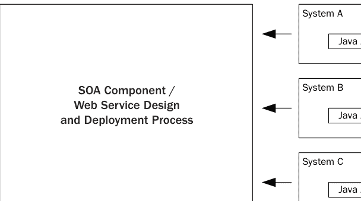

图 4–5 SOA 组件/Web 服务的设计流程。

此外，组织可能不想修改 API 也有充分的理由——工作量太大或成本太高。正如你从讨论中看到的，“从 WSDL 和 Java”模式对于 SOA 来说是关键的。因为部署 SOA 组件作为 Web 服务的开发者和架构师需要灵活工具将 Java 映射到 XML Schema，所以进行“从 WSDL 和 Java”开发的关键在于这些工具。在下一节中，我将更详细查看这一挑战。

## WSDL、SOAP 和 Java/XML映射在 SOA 中的作用

### 4.5.1 Java/XML映射在 SOA 中的作用

SOA 中的 Java/XML 映射通过定义和实现类型映射完成。类型映射仅仅是 Java 类与 XML 类型之间的关系——例如 `corp:AddressType` 和 `samples.Address`。类型映射由序列化器和反序列化器实现。序列化器将类实例转换为符合 Schema 的 XML 实例。反序列化器执行相反的操作。

在进行“从 WSDL 和 Java”开发时，设计过程大部分涉及定义类型映射。例如，假设你有这样一个 Java 方法：

```java
public void updateAddress(String custid, Address addr)
```

假设企业的地址标准是一个复合类型：`corp:AddressType`。用于描述 Web 服务的 WSDL 需要包含 `corp:AddressType` 作为消息部分。但此外，部署 Web 服务的平台上的序列化子系统必须允许反序列化器访问 `<corp:AddressType, samples.Address>` 类型映射。当 Web 服务的 SOAP 请求时，使用反序列化器将 SOAP 部分转换为 Java 参数。这一过程如图 4-6 所示。

正如 4.3 节所述，此 SOAP 消息的分发基于包装元素——`custinfo:updateAddress`。它被映射到 `updateAddress` 方法，如下所示。在这个包装元素下方有两个消息部分——`custinfo:custid` 和 `custinfo:address`。它们分别映射到参数 `custid` (String) 和 `addr` (Address)。这种映射，即消息部分到方法参数的映射，并不是在 WSDL 中定义的。WSDL 不包含关于 Web 服务底层 Java 实现的任何信息。

```xml
<env:Envelope xmlns="http://www.w3.org/2003/05/soap-envelope">
  <env:Body>
    <custinfo:updateAddress
      xmlns:custinfo="http://www.example.com/css/custinfo">
      <custinfo:custcustId>BEMNTO072123</custinfo:custcustId>
      <custinfo:address xmlns:corp="http://www.example.com/corp">
        <corp:addrLine1>27 Main Street</corp:addrLine1>
        <corp:addrLine2>Suite 2000</corp:addrLine2>
        <corp:state>OK</corp:state>
        <corp:zip>59101</corp:zip>
        <corp:phone>758-874121</corp:phone>
      </custinfo:address>
    </custinfo:updateAddress>
  </env:Body>
</env:Envelope>
```

```java
public class Customer {
  public void updateAddress(String custId, String addr) {
    ...
  }

  public Address getAddress(String custId) {
    ...
  }
}
```

图 4–6 SOAP 部分映射到 Java 方法参数。

因此，连接 SOAP/WSDL 与 Java 实现的类型映射并不是在 WSDL 中定义的，而是作为与 Web 服务相关的内部——特定平台的——部署信息的一部分。在 JWS 模型中，这些类型映射是通过 JAXB 标准映射通过注解定义的。

在第 5 章第 5.3 节和 5.4 节中，我将详细介绍如何使用 JAXB 2.0 实现类型映射。此时，我只想指出，类型映射过程在 WSDL 的范围之外，并且是一个与平台相关的问题。此外，你应该理解，能够实现灵活的类型映射是 SOA 所需的“从 WSDL 和 Java 开始”开发模型的关键。如图 4–6 所示，能够以所需的 WSDL 将 `updateAddress()` 方法部署为 Web 服务的关键，在于能够实现类型映射 `<corp:AddressType, samples.Address>`。

### 4.5.2 JAXB 2.0 用于 Java/XML 映射的局限性

JAXB 2.0 是 Java/XML 绑定的强大工具，第 5 章详细回顾了它的功能。然而，此时，我要指出它作为“从 WSDL 和 Java 开始”开发工具的一些局限性。这与其说是对 JAXB 2.0 的批评，不如说是对“从 WSDL 和 Java 开始”开发模式带来的困难的另一种说明。

JAXB 2.0 定义了从 XML Schema 到 Java的标准映射。这种标准映射将 XML Schema 定义与 `java.xml.bind.JAXBElement<T>` 实例关联起来。此时，我不关注 `JAXBElement<T>` 类的具体细节，而是指出将 XML Schema 定义与该类的实例进行一对一赋值使得无法通过合并元素来创建实例。例如，考虑图 4-7 所示的类型映射 `<corp:AddressType> addresses`。

注意用于地址的标准 XML Schema 有两个元素——`addLine1` 和 `addLine2`——以及变量 `streetName` 和 `cityName`。你可以想象出实现此类映射的许多启发式方法。某些启发式方法甚至对某些类型的地址会失效（例如，你把可能位于 `addLine2` 的公寓号放在哪里？）。然而，此类启发式方法在 JAXB 2.0 中很难实现。

同样，电话号码在标准 XML Schema 中表示为 `xs:string` 的单个实例。但在 `address` 类中，它是 `Phone` 的实例。如图所示，`Phone` 类使用三个变量：`area code`、`exchange` 和 `number` 表示电话号码。显然，你可以编写一个简单的脚本将 `phone` 元素 (`xs:string`) 解析为这三个变量。然而，这种映射无法在 JAXB 标准映射中实现。要在 JAXB 框架内实现此类映射，你需要通过扩展 `java.xml.bind.XmlAdapter` 的 Java 类来实现你的启发式映射。

## 图 4–7 类型映射示例

```xml
<xs:schema xmlns:xs="http://www.w3.org/2001/XMLSchema"
  elementFormDefault="qualified"
  targetNamespace="http://www.example.com/corp">
  <xs:complexType name="AddressType">
    <xs:sequence>
      <xs:element name="addLine1" type="xs:string"/>
      <xs:element name="addLine2" type="xs:string"/>
      <xs:element name="city" type="xs:string"/>
      <xs:element name="state" type="xs:string"/>
      <xs:element name="zip" type="xs:string"/>
      <xs:element name="phone" type="xs:string"/>
    </xs:sequence>
  </xs:complexType>
</xs:schema>
```

```java
public class Address extends XmlAdapter {
  private String addLine1;
  private String addLine2;
  private String city;
  private String state;
  private String zip;
  private Phone phone;
}
```

```java
public class Phone extends XmlAdapter {
  private int areaCode;
  private String exchange;
  private String number;
}
```


## 4.6 用于 Java/XML 映射的 JAXB 2.0 解决方案

WSDL 的角色，以及 Java

JAXB 2.0 是 Java/XML 绑定的强大工具，第 5 章详细回顾了它的功能。然而，此时，我要指出它作为“从 WSDL 和 Java 开始”开发工具的一些局限性。这与其说是对 JAXB 2.0 的批评，不如说是“从 WSDL 和 Java 开始”开发模式带来的困难的另一种说明。

JAXB 2.0 定义了从 XML Schema 到 Java 的标准映射。这种标准映射将 XML Schema 定义与 `java.xml.bind.JAXBElement<T>` 实例关联起来。此时，我不关注 `JAXBElement<T>` 类的具体细节，而是指出将 XML Schema 定义与该类的实例进行一对一赋值使得无法通过合并元素来创建实例。例如，考虑图 4-7 所示的类型映射 `<corp:AddressType> addresses`。

注意地址的标准 XML Schema 有两个元素——`addLine1` 和 `addLine2`——以及变量 `streetName` 和 `cityName`。你可以想象出实现此类映射的许多启发式方法。某些启发式方法甚至对某些类型的地址会失效（例如，你把可能位于 `addLine2` 的公寓号放在哪里？）。然而，此类启发式方法在 JAXB 2.0 中很难实现。

同样，电话号码在标准 XML Schema 中表示为 `xs:string` 的单个实例。但在 `address` 类中，它是 `Phone` 的实例。如图所示，`Phone` 类使用三个变量：`area code`、`exchange` 和 `number` 表示电话号码。显然，你可以编写一个简单的脚本将 `phone` 元素 (`xs:string`) 解析为这三个变量。然而，这种映射无法在 JAXB 标准映射中实现。要在 JAXB 框架内实现此类映射，你需要通过扩展 `java.xml.bind.XmlAdapter` 的 Java 类来实现你的启发式映射。

### 图 4–20 由 JAXB 生成的 Address 类

```java
@XmlAccessor(AccessType.FIELD)
@XmlType(name = "AddressType", propOrder = {
    "addLine1",
    "addLine2",
    "city",
    "state",
    "zip",
    "phone"
})
public class AddressType {
  @XmlElement(namespace = "http://www.example.com/corp")
  protected String addLine1;
  @XmlElement(namespace = "http://www.example.com/corp")
  protected String addLine2;
  @XmlElement(namespace = "http://www.example.com/corp")
  protected String city;
  @XmlElement(namespace = "http://www.example.com/corp")
  protected String state;
  @XmlElement(namespace = "http://www.example.com/corp")
  protected String zip;
  @XmlElement(namespace = "http://www.example.com/corp")
  protected Phone phone;
}
```

我在示例 4–20 中仅显示了 `com.example.corp.AddressType` 的。但它是一个简单的 Bean，你可以想象其余部分——都是这里显示的字段的 getter 和 setter。除了生成字段和方法外，JAXB 还包含了用于在类实例和 `corp:AddressType` 实例之间进行编织/解编的注解。注解在第 5 章中进行了讨论，但为了让你理解这个示例，我在这里简单解释一下。

### 示例 4–21 corp:AddressType 的实例

```xml
<custinfo:address xmlns="http://www.example.com/corp"
  xmlns:custinfo="http://www.example.com/css/custinfo">
  <addrLine1>175 Main Street</addrLine1>
  <addrLine2>Suite 200</addrLine2>
  <city>New City</city>
  </address>
</custinfo:address>
```

```xml
9 <state>OH</state>
10 <zip>59101</zip>
11 <phone>(758) 874-1221</phone>
12 </custinfo:address>
```

book-code/chap04/sfwj/src/corp_address.xml

使用 JAXB Schema 编译器和 Java 将 `corpAddressType` 实例反序列化为 `samples.Address` 实例的过程如图 4–8 所示。

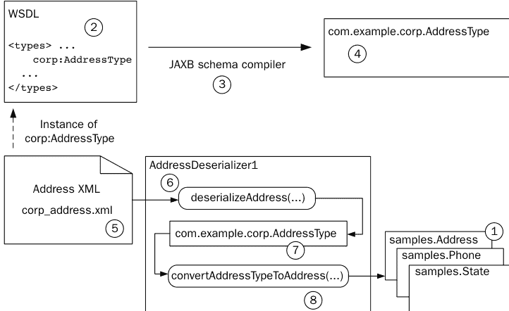

图 4–8 使用 JAXB Schema 编译器和 Java 的“从 WSDL 和 Java 开始”。

以下八步骤对应图 4–8 中的标签，并描述了该过程的工作原理：

1. 右下角的框表示“开始于”WSDL。这些类包含了 `samples.Address` 类。为了解决“从 WSDL 和 Java 开始”的问题，你需要能够将符合 WSDL 的 XML 映射到这些类。
2. 步骤 2–4 展示了 JAXB Schema 编译器的使用。这发生在运行之前。图中左上角的框表示“开始于”WSDL。它包含了你需要映射到 `samples.Address` 的 `corp:AddressType` 的 Schema 定义。
3. 对 `corp:AddressType` 运行 JAXB Schema 编译器会创建一个新类——`com.example.AddressType`。
4. 这个新的 Java 类 `com.example.corp.AddressType` 在运行时用于实现转换。
5. 步骤 5–8 展示了 `corp:AddressType` 实例（来自文件 `corp_address.xml`）在 `samples.Address` 实例中的运行时转换。
6. `AddressDeserializer.deserializeAddress()` 方法（列在示例 4–24 的顶部）获取 `corp_address.xml` 文件并使用 JAXB 将其转换为 `com.example.AddressType` 实例。
7. 然后，使用 `convertToAddress` 方法（列在示例 4–24 的底部）将此 `com.example.corp.AddressType` 实例转换，该方法将 Java 属性解析为 `samples.Address` 实例。
8. 最后，返回生成的 `samples.Address` 实例。

正如你所看到的，反序列化过程的目标是将 `corp:AddressType` 实例映射到示例 4–22 所示的 `samples.Address` 类。为了实现这一点，使用 JAXB 创建中间类 `com.example.corp.AddressType` 的实例。

### 示例 4–22 目标类：samples.Address

```java
23 public class Address implements java.io.Serializable {
24     private int streetNum;
25     private String streetName;
26     private String city;
27     private State state;
28     private int zip;
29     private Phone phoneNumber;
30
```

book-code/chap04/sfwj/etc/java/samples/Address.java

如图 4–7 所示，这里的挑战之一是将地址行映射到此 `samples.Address` 类中的 `streetNum` (int) 和 `streetName` (String)。另一个挑战是将电话元素映射到 `phoneNumber`——它是示例 4–23 所示的 `samples.Phone` 实例。

### 示例 4–23 samples.Phone 类

```java
21 public class Phone {
22     private int areaCode;
23     private String exchange;
24     private String number;
```

book-code/chap04/sfwj/etc/java/samples/Phone.java

如你所见，在这种情况下，电话元素必须被解析为三个字段：`areaCode` (int)、`exchange` (String) 和 `number` (String)。如果你在疑惑，我并不是凭空创建了这些 `samples.Address` 和 `samples.Phone` 类来设计出一个复杂的例子。这些类取自 IBM WebSphere Application Server 带的标准示例代码（位于 Samples 目录）。

反序列化过程的第一步是从示例 4–21 中获取实例并将其反解化（unmarshal）为示例 4–20 所示的 JAXB Schema 生成的 Bean。一旦完成，使用自定义代码从 Bean 中读取值、解析并设置示例 4–22 所示的 `samples.Address` 类中的值。这两个步骤过程的代码出现在示例 4–24 中。

### 示例 4–24 使用生成的 Bean 进行反序列化

```java
61     public Address deserializeAddress(Source xml) throws Exception {
62
63         JAXBContext jc =
64         JAXBContext.newInstance("com.example.corp");
65         Unmarshaller u = jc.createUnmarshaller();
66         JAXBElement<com.example.corp.AddressType> addrJAXB =
67             u.unmarshal(xml, com.example.corp.AddressType.class);
68             com.example.corp.AddressType addrJAXB = addrJAXB.getValue();
69             return convertAddressToAddress(addrJAXB);
70
71     }
72
73     private Address convertAddressToAddress
74 (com.example.corp.AddressType addrJAXB) throws Exception {
75
76         Address addr = new Address();
77         String[] lineParts = addrJAXB.getLine().split("
```

book-code/chap04/sfwj/src/java/samples/deser/AddressDeserializer.java

此过程的第一部分——反解化到生成——发生在 `deserialize` 方法中。`corp:AddressType` 实例作为 `javax.xml.transform.Source` 实例传递给该方法。JAXBContext 从包含 JAXB 生成 Bean 的包 (com.example.corp) 创建。创建一个 `Unmarshaller` 并使用它反解化为 `JAXBElement<com.example.corp.AddressType>`。这个 `JAXBElement` 是 `com.example.corp.AddressType` 实例的容器。最后，通过 `addrJAXB.getValue()` 获取 `samples.Address` 实例。

查看 `convertToAddress` 代码，你会发现它包含许多混乱且丑陋的指令。遗憾的是，无法避免出现图 4–7 所示的类型代码。如果你像本节所示使用 JAXB 进行 Java/XML 映射，你最终会在各种工具类中散布这种解析代码。维护非常困难。如果 Schema 发生变化，你需要找到所有解析代码并更新它们。重用也很困难，因为这种解析代码对输入输出没有清晰的描述。没有这些描述，很难确定代码可以在哪里重用，开发者继续为每种情况编写新的解析代码。

真正的问题是如何更好地管理和维护这种代码开发。减少 SOA 应用中使用的即兴转换和解析代码的方法是在 XML 级别进行转换，而不是在 Java 类级别。这可以通过如下一节所示的 XSLT 来。

## WSDL、SOAP 和 Java/XML 映射在 SOA 中的作用

以下九个步骤对应图 4–9 中的标签，并描述了该过程的运作方式：

1. 步骤 1–4 阐述了 JAXB schema 生成器的使用。这发生在运行时。图中左下角的框表示从 WSDL 的“开始”。它包含了 `corp:AddressType` 的 schema 定义。
2. 左上角的框表示从 Java 开始的“开始”。这些类包含了 `samples.Address` 类。为了解决“从 WSDL 和 Java 开始”的问题，需要实现的一个映射之一是从 `samples.Address` 到 `corp:AddressType`。此示例说明了如何使用 XSLT 转换一个反序列化器，该反序列化器可以将 `samples.Address` 的实例转换为 `corp:AddressType` 的实例。
3. 对 `samples.Address` 运行 JAXB schema 生成器会创建一个新的 schema。
4. 该 schema 在图中表示为 `address.xsd`，包含一个复杂类型——address。这个生成的 address 将通过 XSLT 映射到 `corp:AddressType`。
5. 图的下半部分（步骤 5–9）阐述了文件 `corp_address.xml`（`AddressType` 的实例）到 `address.xml`（`address.xsd` 中 address 的实例）的运行时形成。`corp_address.xml` 是 `CorpAddrAddr()` 方法的输入（该方法列在示例 4–27 中）。
6. XSLT 样式表 `corp_to_address.xslt` 定义了转换。它列在示例 4–26 中。
7. `AddressDeserializer2.convertAddrToAddr()` 方法在第3章第3.4节描述的方法中通过 XSLT 和 JAXP 调用转换。
8. 输出 `address.xml` 文件。它是由 `address.xsd` 定义的复杂类型（JAXB schema 生成的 XSD）的实例。
9. `AddressDeserializer2.deserialize()` 方法（列在示例 4–27 中）使用 JAXB 将 `address.xml` 解析为 `samples.Address` 实例。

这种方法的关键是使用 JAXB schema 生成器来创建一个 JAXB 可以绑定到 `samples.Address` 的 schema，以便在 `samples.Address` 类之间进行基于 JAXB 的序列化。示例 4–25 显示了从 `samples.Address` 类生成的 schema。

## 4.6 绕过 JAXB 2.0 Java/XML 映射的局限性

### 示例 4–25 从 samples.Address 生成 Schema

```xml
4 <xs:schema version="1.0" xmlns:xs="http://www.w3.org/XMLSchema">
5
6 <xs:complexType name="address">
7   <xs:sequence>
8     <xs:element name="city" type="xs:string" minOccurs="0"/>
9     <xs:element name="phoneNumber" type="xs:phone" minOccurs="0"/>
10    <xs:element name="state" type="xs:string" minOccurs="0"/>
11    <xs:element name="streetName" type="xs:string" minOccurs="0"/>
12    <xs:element name="streetNum" type="xs:int"/>
13    <xs:element name="zip" type="xs:int"/>
14  </xs:sequence>
15 </xs:complexType>
16
17 <xs:complexType name="phone">
```


## XSD 片段

```xml
18   <xs:sequence>
19     <xs:element name="areaCode" type="xs:int"/>
20     <xs:element name="exchange" type="xs:string" minOccurs="0"/>
21     <xs:element name="number" type="xs:string" minOccurs="0"/>
22   </xs:sequence>
23 </xs:complexType>
24
25 <xs:simpleType name="state">
26   <xs:restriction base="xs:string">
27     <xs:enumeration value="OH"/>
28     <xs:enumeration value="TX"/>
29   </xs:restriction>
30 </xs:simpleType>
31 </xs:schema>
```

**文件路径**：`book-code/chap04/sfwj/examples/address.xsd`

正如第 2 章所述，JAXB 实例化过程受类上注解的控制。然而，`samples.Address` 类（示例 4–22）没有任何注解，因此你可能奇怪 JAXB 如何将前述 schema 的实例解析到其中。答案是，JAXB schema 生成器在生成 schema 时会向类添加注解。原始源类定义不受影响，但创建了包含注解的编译版本（`.class` 文件）。在这个示例中，我在使用 `javac` 生成之后，使用了这些编译后的 `samples.Address` 和 `samples.Phone` 版本。

下一个问题是，你如何将 `samples.Address` 的实例转换为 schema？对于这一点，你可以使用 XSLT。示例 4–25 显示了转换后的 schema。

## 示例 4–26 将 samples.Address 实例转换为 schema 的 XSLT

**文件路径**：`book-code/chap04/sfwj/examples/corp_to_address.xslt`

```xml
<xsl:stylesheet version="1.0" xmlns:xsl="http://www.w3.org/1999/XSL/Transform">
  <xsl:output method="xml" encoding="UTF-8"/>
  <xsl:template match="address">
    <address>
      <city><xsl:value-of select="city"/></city>
      <phoneNumber>
        <areaCode><xsl:value-of select="areaCode"/></areaCode>
        <exchange><xsl:value-of select="exchange"/></exchange>
        <number><xsl:value-of select="number"/></number>
      </phoneNumber>
      <state><xsl:value-of select="state"/></state>
      <streetName><xsl:value-of select="streetName"/></streetName>
      <streetNum><xsl:value-of select="streetNum"/></streetNum>
      <zip><xsl:value-of select="zip"/></zip>
    </address>
  </xsl:template>
</xsl:stylesheet>
```

正如第 2 章所述，JAXB 实例化过程受类上注解的控制。然而，`samples.Address` 类（示例 4–22）没有任何注解，因此你可能奇怪 JAXB 如何将前述 schema 的实例解析到其中。答案是，JAXB schema 生成器在生成 schema 时会向类添加注解。原始源类定义不受影响，但创建了包含注解的编译版本（`.class` 文件）。在这个示例中，我在使用 `javac` 生成之后，使用了这些编译后的 `samples.Address` 和 `samples.Phone` 版本。

下一个问题是，你如何将 `samples.Address` 的实例转换为 schema？对于这一点，你可以使用 XSLT。示例 4–25 显示了转换后的 schema。

## 示例 4–26 将 samples.Address 转换为 schema 的 XSLT

*(注：此处根据原文逻辑重复对应翻译)*

```xml
<xsl:stylesheet version="1.0" xmlns:xsl="http://www.w3.org/1999/XSL/Transform">
  <xsl:output method="xml" encoding="UTF-8"/>
  <xsl:template match="address">
    <address>
      <city><xsl:value-of select="city"/></city>
      <phoneNumber>
        <areaCode><xsl:value-of select="areaCode"/></areaCode>
        <exchange><xsl:value-of select="exchange"/></exchange>
        <number><xsl:value-of select="number"/></number>
      </phoneNumber>
      <state><xsl:value-of select="state"/></state>
      <streetName><xsl:value-of select="streetName"/></streetName>
      <streetNum><xsl:value-of select="streetNum"/></streetNum>
      <zip><xsl:value-of select="zip"/></zip>
    </address>
  </xsl:template>
</xsl:stylesheet>
```

## 示例 4–27 应用 XSLT 和实例化

**文件路径**：`book-code/chap04/sfwj/src/java/samples/deser/AddressDeserializer2.java`

```java
public Address deserializeAddress(Source xml) throws Exception {
    JAXBContext jc = JAXBContext.newInstance(Address.class);
    Unmarshaller u = jc.createUnmarshaller();
    JAXBElement<Address> addrBElt = u.unmarshal(xml, Address.class);
    Address addr = addrBElt.getValue();
    return addr;
}

private Source convertAddrToAddr(Source xml, Source xslt) throws Exception {
    Transformer transformer = TransformerFactory.newInstance().newTransformer(xslt);
    ByteArrayOutputStream ba = new ByteArrayOutputStream();
    transformer.transform(xml, new StreamResult(ba));
    return new StreamSource(new ByteArrayInputStream(ba.toByteArray()));
}
```

`convertAddrToAddr` 方法应用 XSLT。结果进入字节数组并返回一个 `Source`。该 `Source` 然后可以由 `deserialize()` 方法处理，将生成的 XML 解析为 `samples.Address` 实例。

要运行上述示例，请遵循以下步骤：

1. 进入 `<book-code>/chap04/sfwj`。
2. 为 `etc/java/samples` 目录下的 Java 类（例如 `samples.Address.java`）运行 JAXB 生成器，输入 `mvn install`。
3. 运行 XSLT 然后 JAXB 解析器将 XML 解析为 `samples.Address` 实例，输入 `ant runerial2`。

## 4.7 总结

本章对 WSDL、SOAP 和 Java/XML 映射进行了简要介绍。我们从 SOA 的视角查看了这些主题。主要的假设是，在构建和部署 SOA 组件作为 Web 服务时，你需要处理符合标准的 WSDL、XML Schema 定义和 Java 类。这一假设在某些地方与 JWS 冲突。为了说明这一点，我展示了几个使用 JAX-WS 2.0 和 JAXB 2.0 没有直接解决方案的常见集成问题。

指出这些局限性的目的与其说是为了批评 JWS，不如说是指出 SOA 是有多么困难。在本书的最后一章中，我们将介绍 SOA-J 框架，并概述了一种以 WSDL 为中心的从 Java 构建 SOA 组件的方法，这可能为其中的一些局限性提供解决方案。

与此同时，在接下来的四个章节中，我们将研究 JWS 的强大之处并展示许多它可以有效处理的 SOA 问题。

## 第 5 章：JAXB 2.0 数据绑定

本章描述了如何将 JAXB 2.0 用于 SOA。本书是专为程序员编写的，包含了大量的细节和代码示例。JAXB 2.0 对 SOA 至关重要，因为它支持类型映射。类型映射是从 Java 类型（例如类）到 XML 架构组件（例如复杂类型定义）的映射。序列化器被用于实现类型映射。序列化器将类型映射的 Java 类型实例转换为其 XML 组件的实例。反序列化器则执行相反的操作。

前一章讨论了类型映射对 SOA 的核心重要性。该章的第 4.5 节讨论了实现类型映射的能力——换句话说，即进行序列化——对于支持 SOA 的 Web 服务平台架构是重要的。用于序列化的工具 JWS 就是 JAXB 2.0。本章将教你如何使用 JAXB 2.0 来了解 SOA 所需的序列化类型。最后，它将探讨如何使用 JAXB 2.0 进行数据转换（XSLT 的替代方案）。

### 5.1 绑定与映射

第 2 章第 2.4 节介绍了 JAXB 2.0 并简要描述了绑定与映射之间的区别。在深入研究使用 JAXB 2.0 编程细节之前，仔细观察该问题是有帮助的，并强调 JAXB 2.0 实际上更像是一个绑定工具而不是映射工具。这对于它在 SOA 中的用性具有影响。图 5–1 说明了绑定与映射之间的区别。

图的上半部分说明了绑定过程。绑定工具根据标准映射将 Java 类型转换为 XML 类型。也就是说，它实现了将 Java 转换为 XML（反之亦然）的标准映射。大多数绑定工具（如 JAXB）将 Java 实例映射到 XML 文档，并将 Java 应用程序（例如类定义）映射到 XML 架构定义。通过这种方式，绑定工具通常允许你通过两种方式实现类型映射：

- 从现有的 Java 生成的 XML 架构开始，使用架构生成器创建机器生成的 XML 架构（图 5–1 右上角的阴影部分）。
- 从现有的 XML 架构开始，使用架构编译器创建机器生成的 Java 应用程序（图 5-1 左中间的阴影部分）。

当你使用绑定工具时，你处理的是现有的 Java 与生成的 XML 架构定义之间，或者现有的 XML 架构定义与生成的 Java 程序元素之间的类型映射。无论哪种情况，在运行时你处理的都是机器生成的产物（Java 或 XML 架构）。你始终可以包含机器生成的 Java 或机器生成的 XML 架构映射。

另一方面，当你使用映射工具时，你处理的是现有的 Java 与现有的 XML 架构定义之间的类型映射。在运行时，你将不会处理任何映射。

图 5-1 的下半部分说明了 Java/XML 映射过程。当使用 Java/XML 映射工具时，你需要定义 XML 和 Java 之间的映射。在运行时，映射工具使用你的映射定义将 Java 序列化为 XML 或将 XML 反序列化为 Java。

JAXB 2.0 主要是一个绑定工具。当从 Java 开始时，JAXB 用户编写 Java 代码，并对其进行注解以对应到特定的架构。或者，当从 XML 开始时，JAXB 用户可以从架构开始并生成代码模板，该模板可以被自定义并整合到应用程序中。在任何情况下，注解允许对标准的 JAXB 绑定进行自定义，因此在将 Java 代码映射到架构方面具有很高的灵活性。就此而言，注解提供了从 Java 代码到架构的映射。为什么不让 JAXB 成为映射工具呢？我将 JAXB 定义为绑定工具而非映射工具的原因有两点：

- 映射可以使用标准绑定上的注解定义。因此，虽然具有灵活性，但许多映射在不借助 `XmlAdapter` 类的情况下无法支持（见 5.7 节）。
- 由注解定义的映射是静态的。你无法在不更改并重新编译 Java 的情况下实现不同的映射。在真正的映射工具中，映射是相对于架构和 Java 定义的。因此，在运行时你可以更改映射。这在 JAXB 中是不可能的，因为 Java 类只能有一组注解。¹ 如果 Java 支持外部注解——换句话说，一种放在 Java 类之外的注解格式——JAXB 就可以像真正的映射工具一样使用。这由 JAXB 组讨论过，但被认为是一个更广泛的注解问题，而非仅限于 JAXB 内部的能力。映射工具的一个示例是 Castor。实际上，Castor 可以同时任绑定和映射。另一个工具示例（实验性的）是包含在 SOA 中的适配序列化框架（ASF），并在第 1 章中讨论过。

许多程序员倾向于绑定工具而非映射工具。绑定工具很容易使用，因为如果你不想，就不需要定义任何映射。可以使用架构编译器（或生成器）为你完成映射。它查看现有架构（或 Java 类）并生成与之对应的机器生成类（或架构）。正如我之前提到的，JAXB 2.0 定义了从 XML 到 Java（反之亦然）的标准映射，减轻了程序员定义自己映射的繁琐工作。这种标准映射在 5.2 节中讨论。

因此，当使用 JAXB 2.0 时，你受到架构生成器或架构编译器所产生的类型映射——换句话说，JAXB 2.0 Java/XML 映射以及使用 JAXB 2.0 注解或绑定语言的的自定义的限制。正如我在第 4 章第 4.5 和 4.6 节所示，通过这种方式实现的类型映射有其局限性。

那么，这给我们留下了什么呢？在本章的第一段中，类型映射对于 SOA 是核心的。现在，我刚刚解释了 JAXB 2.0 是一个在支持的类型映射上有局限性的绑定工具。正如第 1 章第 1.1 节所示，记住 SOA 是一个工具包而 JAXB 2.0 是该工具包中的绑定工具很重要。实现 SOA 需要在 JWS API 之上叠加额外的技术和最佳实践。这意味着在某些情况下，开发者需要创建 JAXB 提供的 Java/XML 绑定工具框架。好消息是 JAXB 2.0 是一个优秀的绑定工具，为实现类型映射提供了良好的基础。

在本章中，我展示了如何以特定的方式使用 JAXB 2.0 实现类型映射。也就是说，我说明了用于实现特定应用程序类型映射的技术。本章的下一节提供了标准 JAXB 2.0 Java/XML 映射的概述。你需要理解这种基础绑定如何工作以便有效使用 JAXB 2.0。在介绍之后，本章的剩余章节将介绍 JAXB 2.0 实现类型映射的特定技术：

- 使用自定义 Java 代码从现有的 JAXB 对象映射到 JAXB 2.0 生成 Java 对象，然后使用 JAXB 2.0 序列化创建 JAXB 实例。
- 使用 JAXB 2.0 注解影响架构生成器，使其产生与现有架构匹配的架构。
- 使用 JAXB 2.0 绑定语言影响架构编译器，使其产生与应用程序匹配的 Java 类。
- 使用 JAXB 2.0 `XmlAdapter` 类实现从现有 Java 类到现有 XML 架构的自定义序列化。

章节的最后一节说明了 JAXB 2.0 的相关用途——实现数据转换。在第 3 章第 3.4 节，我展示了如何在 SOA 环境中使用 XSLT 进行数据转换。在本章的最后一节，我将说明如何用 JAXB 2.0 完成此类数据转换。

### 5.2 标准 JAXB 2.0 Java/XML 绑定概述

在带你学习本章 JAXB 2.0 代码示例之前，我提供了标准 JAXB 2.0 Java/XML 绑定的快速概述。这应该足够提供入门所需的基础知识。对于所有细节，你应该阅读 JAXB 2.0 规范 [JSR-222]。

示例 5–1 显示了一个简化采购订单的架构。这是一个用于说明架构绑定的示例。

#### 示例 5-1 simpleOrder 架构

**文件路径**：`book-code/chap04/sfwj/examples/address.xsd` (注：原文此处路径可能有误，保留原样)

```xml
<schema targetNamespace="http://www.example.com/oms"
  elementDefault="qualified" xmlns="http://www.w3.org/2001/XMLSchema"
  xmlns:oms="http://www.example.com/oms">
  <element name="simpleOrder">
    <complexType>
      <sequence>
        <element name="BillTo">
          <complexType>
            <sequence>
```


<element name="name" type="string"/>
<element name="street" type="string"/>
<element name="city" type="string"/>
<element name="state" type="string"/>
<element name="zip" type="string"/>
<element name="phone" type="string"/>
</sequence>
</complexType>
</element>
<element name="items">
<complexType>
<sequence>
<element name="item" type="xs:ItemType" maxOccurs="unbounded"/>
</sequence>
</complexType>
</element>
</sequence>
</complexType>
<complexType name="ItemType">
<sequence>
<element name="quantity" type="positiveInteger"/>
<element name="price" type="double"/>
</sequence>
<attribute name="productName" use="required" type="string"/>
</complexType>

```
book-code/chap05/customjava/etc/simpleorder.xsd
```

注意，该架构有一个名为 `simpleOrder` 的单一全局元素。该元素定义了一个匿名的购买订单类型，它仅仅是两个元素的序列：`billTo` 和 `items`。`billTo` 元素代表账单地址，并定义了一个匿名类型——一种地址类型。`items` 元素代表正在购买的物品列表。列表的元素定义在 `items` 元素的匿名类型内部——通过名为 `item` 的元素来定义。该元素有一个命名的类型——`ItemType`。

# 5.2 标准 JAXB 2.0 Java/XML 绑定概览

在示例 5–1 的底部，你可以看到 `Item` 的定义。它包含两个元素——`quantity`（一个 `xs:positiveInteger`）和 `price`（一个 `xs:double`）。它还包含一个属性——`productName`（一个 `xs:string`）。

该架构的标准 JAXB 2.0 绑定如图 5–2 所示。如你所见，标准绑定从此 SimpleOrder 架构中定义了两个顶层类——`simpleOrder` 和 `itemType`。`SimpleOrder` 类有两个内部类——`simpleBillTo` 和 `SimpleOrder.Items`。

图 5–2 中的数字箭头说明了 JAXB 2.0 绑定的一些重要部分。在这里，我通过描述每个箭头对应的绑定概念对标准绑定进行概括：

1. 命名空间 `http://example.com/oms` 被映射到 Java 包 `example.oms`，如果你需要包映射，可以使用 `jaxb:package` 声明或 `@XmlSchema.namespace` 注解元素。
2. 由顶层类（即不是内部类）`SimpleOrder` 定义的匿名复杂类型。在默认映射中，只有当匿名复杂类型由全局元素定义时，它们才会映射为顶层类。
3. 元素 `billTo` 被映射到 `simpleOrder` 类中名为 `billTo` 的属性。默认情况下，本地元素声明被绑定到属性。
4. `billTo` 属性的访问方法默认是 JavaBeans 风格的 getter/setter 方法。没有标准的 JAXB 语言声明用于将元素绑定到公共或保护的 Java 字段（即不带 getter/setter）。然而，你可以从 Java 生成架构，其中使用 `@XmlElement` 注解将元素定义绑定到 Java 字段。
5. 由元素 `billTo` 定义的匿名复杂类型被映射到内部类 `simpleOrder.billTo`。匿名复杂类型（未由全局元素定义）的标准绑定是将它们制为内部类。你可以使用 `<jaxb:globalBindings localScope="toplevel"/>` 全局声明强制所有类生成为顶层类。
6. 元素 `item` 被映射到名为 `item` 的 `List<ItemType>` 属性。当元素定义的 `maxOccurs` 值大于 1 时，这就是标准绑定。`List<T>` 的 Java 类型等于绑定到元素的类型。

```xml
<schema targetNamespace
  "http://www.example.com/oms"
  elementFormDefault="qualified"
  xmlns:xs="http://www.w3.org/2001/XMLSchema"
  xmlns:oms="http://www.example.com/oms">
  <element name="simpleOrder">
    <complexType>
      <sequence>
        <element name="billTo">
          <complexType>
            <sequence>
              <element name="name" type="string"/>
              <element name="street" type="string"/>
              <element name="city" type="string"/>
              <element name="state" type="string"/>
              <element name="phone" type="string"/>
            </sequence>
          </complexType>
        </element>
      </sequence>
    </complexType>
  <element name="items">
    <complexType>
      <sequence>
        <element name="item"
        type="ItemType"
        maxOccurs="unbounded"/>
      </sequence>
    </complexType>
  </element>
  <element name="ItemType">
    <complexType>
      <sequence>
        <element name="quantity"
          type="positiveInteger"/>
        <element name="price"
          type="double"/>
      </sequence>
      <attribute name="productName"
        use="required" type="string"/>
    </complexType>
  </element>
</schema>
```

```java
SimpleOrder.BillTo
public static class BillTo {
  protected String name;
  protected String street;
  public String getStreet() {
    return street;
  }
}
```

(img/886b249987fd47297f41e_232_0.png)

```java
package com.example.oms;
public static class SimpleOrder {
  protected BillTo billTo;
  protected ItemType items;
  public BillTo getBillTo() {
    return billTo;
  }
  public void setBillTo(BillTo value) {
    this.billTo = value;
  }
}
```

```java
SimpleOrder.Items
public static class Items {
  protected List<ItemType> item;
  public List<ItemType> getItem() {
    if (item == null) {
      item = new ArrayList<ItemType>();
    }
    return item;
  }
}
```

```java
public class ItemType {
  protected BigInteger quantity;
  protected double price;
  protected String productName;
  public BigInteger getQuantity() {
    return quantity;
  }
}
```

图–2 simpleOrder 架构的标准 JAXB 2.0 绑定。

# 5.2 JAXB 2.0 Java/XML 绑定概览

属性（或匿名类型）；在此情况下 T = `ItemType`。集合（默认的 `java.util.List`）可以在全局或属性级别使用绑定属性进行自定义。

8. `xs:positiveInteger`（以及 `xs:integer`）的默认映射是 `java.math.BigInteger`。此映射可以使用 `jaxb:type` 声明或 `@XmlElement` 注解进行自定义。
9. 属性声明的默认映射到具有 JavaBeans setter/getter 方法的属性。因此，属性 `productName` 的映射方式与 ItemType 的元素元素相同。

示例 5–2 显示了 `SimpleOrder` 类的 JAXB 生成代码片段。在示例中，你可以看到引入类中的注解，以便于运行时序列化。

# 示例 5–2 JAXB 值类，SimpleOrder

```java
@XmlAccessorType(AccessType.FIELD)
@XmlElement(name = {
  "BillTo",
  "items"
})
@XmlRootElement(name = "SimpleOrder")
public class SimpleOrder {
  @XmlElement(namespace = "http://www.example.com/oms")
  protected BillTo billTo;
  @XmlElement(namespace = "http://www.example.com/oms")
  protected Items items;
```

```
book-code/chap05/customjava/etc/schema_with_comments/SimpleOrder.java
```

如第 2 章所述，注解是运行时序列化和反序列化的关键。注解也是 JAXB 2.0 实现的方式。

**表 5–1** 示例 5–2 中出现的 Java 注解说明

| 注解 | 目的 | 示例 |
|---|---|---|
| @XmlType | 告诉 JAXB 运行时默认映射 Java 类哪些部分（即字段、属性或两者） | 在示例 5–2 中，`AccessType.FIELD` 的值表示未通过其他注解的字段必须映射，而属性（即 getter/setter 对）除非显式通过注解，否则不得映射。 |
| @XmlElement | 告诉 JAXB 2.0 运行时使用架构类型来映射类，并指定映射的某些方面 | `name` 属性提供了复杂类型定义的名称。在示例 5–2 中，`name = ""` 表示这是一个匿名类型——或没有定义名称（全局元素已定义——参见 `@XmlRootElement`）。属性和字段的顺序。与生成此注解类的架构 `<sequence>` 定义指定的排序一致。 |
| @XmlRootElement | 告诉 JAXB 2.0 运行时该类映射到一个全局元素 | `name` 提供了全局元素的名称。在示例 5–2 中，此名称为 simpleOrder。目标命名空间由于在示例中未指定，它来自默认的包映射。 |
| @XmlElement | 告诉 JAXB 2.0 运行时特定的属性或字段映射到架构元素定义 | 在示例 5–2 中，它用于将 `billTo` 字段映射到 `oms:billTo` 并将 `items` 字段映射到 `oms:items`。`namespace` 属性在技术上不需要（因为使用了默认包命名空间），它定义了目标元素的命名空间。技术上，`XmlElement` 也不需要映射这些字段，因为默认映射已通过 `@XmlAccessorType` 注解设置为 `AccessType.FIELD`。为了清晰起见，架构生成器包含了并非严格的注解。 |

## 5.2 标准 JAXB 2.0 Java/XML 绑定概述

跨实现的可移植性。通过 JAXB 2.0，你可以使用一个实现中的 schema 编译器，并在运行时在另一个实现中使用生成的类。这是因为运行时 JAXB 2.0 引擎根据对注解类的检查来完成所有的序列化（marshalling）和反序列化（unmarshalling）。注解结合 JAXB 2.0 标准映射，告诉运行时引擎如何将 Java 程序元素映射到 XML 定义实例。表 5–1 描述了示例 5–2 中 *simpleOrder* 注解的运行时解释，我们在此处不再描述所有的注解。要获取完整描述，请参阅 [JSR-222] 及其相关的 Javadoc。

示例 5–3 显示了 `simpleOrder.BillTo` 生成的代码片段。这是一个内部类。如之前讨论的（见图 5–2），带有匿名复杂类型的元素定义默认映射到类。

### 示例 5–3 JAXB 值类，SimpleOrder.BillTo

```java
176 @XmlAccessorType(AccessType.FIELD)
177 @XmlType(name = "", propOrder = {
178   "name",
179   "street",
180   "city",
181   "state",
182   "zip",
183   "phone"
184 })
185
186 public static class BillTo {
187 @XmlElement(namespace = "http://www.example.com/oms", required = true)
188 protected String name;
189 @XmlElement(namespace = "http://www.example.com/oms")
190 protected String street;
191 @XmlElement(namespace = "http://www.example.com/oms")
192 protected String city;
193 @XmlElement(namespace = "http://www.example.com/oms")
194 protected String state;
195 @XmlElement(namespace = "http://www.example.com/oms")
196 protected String zip;
197 @XmlElement(namespace = "http://www.example.com/oms")
198 protected String phone;
```

```
book-code/chap05/customjava/etc/schemacompiler_withcomments/SimpleOrder.java
```

再次，你可以像示例 5–2 中那样看到，`@XmlElement.propOrder` 注解元素指定了 Java 属性映射到匿名复杂类型中 `<sequence>` 元素定义的顺序。这是必要的，因为 Java 类对其字段和属性没有顺序概念（即反射不提供任何顺序信息）。

示例 5–4 显示了由 `oms:item` 元素定义的匿名复杂类型的默认映射。该类 `SimpleOrder.Items` 很有趣，因为它说明了可能出现多次的元素（即 `maxOccurs > 1`）的默认映射。如你所见，元素 `oms:items` 匿名复杂类型内部的 `oms:items` 元素映射到了名为 `item` 的属性，其类型为 `List<ItemType>`。出现多次的元素的默认映射是 `java.util.List<T>`，其中 T 是映射到元素类型的默认类。

### 示例 5–4 JAXB 值类，SimpleOrder.Items

```java
@XmlAccessorType(AccessType.FIELD)
@XmlType(name = "", propOrder = {
    "item"
})
public static class Items {
    @XmlElement(namespace = "http://www.example.com/oms")
```


## JAXB 2.0 数据绑定

```java
protected List<ItemType> item;
```

/**
 * 获取 item 属性的值
 * <p>
 * 此访问器方法返回活动列表的引用，而不是快照。因此，你对返回列表进行的任何修改将反映在 JAXB 对象中。这就是为什么 item 属性没有对应的 `set` 方法。
 * <p>
 * 例如，要添加新项，请执行如下操作：
 * <pre>
 *     getItem().add(newItem);
 * </pre>
 * <p>
 * 列表中允许以下类型的对象
 * {@link ItemType }
 */
public List<ItemType> getItem() {
    if (item == null) {
        item = new ArrayList<ItemType>();
    }
    return this.item;
}
```

book-code/chap05/customJava/etc/schemaccompiler_withcomments/SimpleOrder.java

如你从示例 5–4 的代码中所观察到的，`item` 属性没有 setter。getter 返回的是活动列表，而不是副本。因此，要更新 `item` 属性，你需要获取活动列表并添加、更新或删除单个元素。如果你希望能够设置整个集合，在 JAXB 2.0 中，你需要使用绑定语言，例如：

```xml
<sequence>
  <jaxb:element name="item" type="ItemType" maxOccurs="unbounded"/>
</sequence>
```

以此方式设置 `collectionType="indexed"` 将把元素映射到数组而不是列表。你会获得如下的 setter 方法：

```java
public void setItem(ItemType[] values) { ... }
```

使用 `collectionType="indexed"` 的另一个区别是返回的数组不是“活动”的——它是一个副本。

### 示例 5–6 现有的 Java 类 MySimpleOrder

```java
public class MySimpleOrder {

    private MyAddress billTo;
    private List<MyItem> itemList;

    public MySimpleOrder(String name, String street, String city, String state,
                         String zip, String phone) {
        this(new MyAddress(name, street, city, state, zip, phone));
    }

    public MySimpleOrder(MyAddress addr) {
        this.billTo = addr;
        itemList = new ArrayList<MyItem>();
    }

    public MyAddress getBillTo() {
        return billTo;
    }

    public List<MyItem> getItemList() {
        return itemList;
    }
}
```

book-code/chap05/customjava/modules/serializer/src/java/samples/MySimpleOrder.java

你可以立即注意到该类与 JAXB 生成的对应类之间存在两个不同点：

- `billTo` 变量代表账单地址，其 Java 类型是 `MyAddress`，而不是 JAXB 生成的类型 `com.example.oms.BillTo`。

book-code/chap05/customjava/modules/serializer/src/java/samples/MyAddress.java

如你所见，`MyAddress` 类不是 JavaBean，因为它没有 setter/getter 方法。它仅仅是其组成字段的容器。并不难想象从 `SimpleOrder.BillTo` 类到 `MyAddress` 的映射会是什么样的。它只需将相应的属性与 `MyAddress` 的字段进行匹配即可。

### 示例 5–8 现有的 Java 类 samples.MyItem

```java
public class MyItem {

    private int quantity;
    private float price;
    private String productName;

    public MyItem(int quantity, float price, String productName) throws Exception {
        if (productName == null)
            throw new Exception("productName cannot be null");
        this.productName = productName;
        this.price = price;
        this.quantity = quantity;
    }

    public float getPrice() {
        return price;
    }

    public void setPrice(float price) {
        this.price = price;
    }

    public String getProductName() {
        return productName;
    }

    public void setProductName(String productName) {
        this.productName = productName;
    }

    public int getQuantity() {
        return quantity;
    }

    public void setQuantity(int quantity) {
        this.quantity = quantity;
    }
}
```

book-code/chap05/customjava/modules/serializer/src/java/samples/MyItem.java

`MyItem.quantity` 使用的是原始类型 `int`，而 `ItemType.quantity` 是 `java.math.BigInteger`。同样，属性 `price` 在这里是原始类型 `float`，但在 JAXB 类中是 `double` 类型。最后，属性 `productName` 在所有类中都是 `java.lang.String`。

### 示例 5–9 映射代码

```java
public Source getXML(SimpleOrder order) {

    // 创建 JAXB SimpleOrder
    SimpleOrder jaxbSimpleOrder = new SimpleOrder();
    // 映射地址
    MyAddress address = order.getBillTo();
    SimpleOrder.BillTo billTo = new SimpleOrder.BillTo();
    billTo.setName(address.name);
    billTo.setCity(address.city);
    billTo.setPhone(address.phone);
    billTo.setState(address.state);
    billTo.setStreet(address.street);
    billTo.setZip(address.zip);
    jaxbSimpleOrder.setBillTo(billTo);
    // 映射 items
    jaxbSimpleOrder.setItems(new SimpleOrder.Items()); // 需要避免 NPE
    List<ItemType> jaxbItemList = jaxbSimpleOrder.getItems();
    for (MyItem myItem : order.getItemList()) {
        ItemType jaxbItem = new ItemType();
        jaxbItem.setPrice((double) myItem.getPrice());
        jaxbItem.setPrice(Double.parseDouble(Float.toString(myItem.getPrice())));
        jaxbItem.setProductName(myItem.getProductName());
        jaxbItem.setQuantity(BigInteger.valueOf((long) myItem.getQuantity()));
        jaxbItemList.add(jaxbItem);
    }

    try {
        JAXBContext jaxbContext = JAXBContext.newInstance("com.example.oms");
        Marshaller jaxbMarshaller = jaxbContext.createMarshaller();
        SchemaFactory sf = SchemaFactory.newInstance(XMLConstants.W3C_SCHEMA_NS_URI);
        Schema schema = sf.newSchema(new URL("http://soabook.com/example/oms/simpleorder.xsd"));
        jaxbMarshaller.setSchema(schema);
        ByteArrayOutputStream baos = new ByteArrayOutputStream();
        jaxbMarshaller.marshal(jaxbSimpleOrder, baos);
        return new StreamSource(baos.toString());
    } catch (Exception e) {
        throw new RuntimeException(e);
    }
}
```

book-code/chap05/customjava/modules/serializer/src/java/samples/SimpleOrderSerializerRecursive.java

示例 5–9 中的代码从 `order.getOrder()` 获取的 `MyAddress` 实例创建 JAXB 生成的类 `SimpleOrder.BillTo` —— 即 `jaxbSimpleOrder`。使用 `BillTo.setXXX` 方法设置属性。这部分非常简单。

接下来，使用以下代码设置 items 属性创建一个列表：

```java
jaxbSimpleOrder.setItems(new SimpleOrder.Items());
```

这一步是必要的，因为如果不初始化 `oms:items` 将无法映射到 `List<T>`，`jaxbSimpleOrder.getItems()` 将返回 `null`。初始化之后，使用 `for` 循环从 `order.getItemList()`（包含 `List<MyItem>`）填充 JAXB 生成的 `List<ItemType>`。再次使用了 `ItemType` 的 setter 方法。这种技术（将 `MyItem` 中的 `float` 转换为 `ItemType` 中的 `double`）用于避免可能出现的精度问题。通过这一行：

```java
jaxbItem.setPrice(Double.parseDouble(Float.toString(myItem.getPrice())));
```

得到的 XML 如下：

```xml
<price>2.99</price>
```

而不是：

```xml
<price>2.9900000000000000</price>
```

一旦 JAXB 实例 —— `jaxbSimpleOrder` 被完全填充，就会被转换为 XML。对于此过程，`JAXBContext` 的创建如下：

```java
JAXBContext jaxbContext = JAXBContext.newInstance("com.example.oms");
```

从 `JAXBContext` 创建一个 `Marshaller` 实例。接下来，通过以下代码在 `Marshaller` 实例上设置 schema 来激活验证：

```java
Schema schema = sf.newSchema(new URL("http://soabook.com/example/oms/simpleorder.xsd"));
jaxbMarshaller.setSchema(schema);
```

关于 `JAXBContext` 和 `Marshaller` API 的更多细节，建议你查阅 Javadoc。

如果你移除这些行并使用错误数据运行（例如将数量设置为负数），序列化将成功并给你相对于原始 schema 无效的 XML。但是，如果你像我一样设置了验证并尝试使用负数量进行序列化，你会得到一个 `SAXParseException`。

最后，`jaxbSimpleOrder` 被序列化到内存（使用 `ByteArrayOutputStream`）并作为 `StreamSource` 返回。

### 示例 5–10 测试映射代码

```java
SimpleOrderSerializerNonRecursive serializer = new SimpleOrderSerializerNonRecursive();
MySimpleOrder myOrder = new SimpleOrder(
    "John Doe",
    "125 Main Street",
    "Any Town", "NM", "95811",
    (831) 874-1233);
myOrder.itemList().add(new MyItem(6, (float) 2.99, "Diet Coke"));
myOrder.itemList().add(new MyItem(4, (float) 3.99, "Potato Chips"));
myOrder.itemList().add(new MyItem(2, (float) 5.34, "Frozen Pizza"));
Transformer xform = TransformerFactory.newInstance().newTransformer();
xform.setOutputProperty(OutputKeys.INDENT, "yes");
xform.transform(
    serializer.getXML(myOrder),
    new StreamResult(System.out));
```

## 5.4 用于类型映射的递归框架

我不得不编写代码来将 `MyItem` 映射到 `oms:item`。然而，这段代码被嵌入在父类型映射中，无法重用（除非通过剪切粘贴）。如果只需要为每个类型映射编写一次，然后在每当它作为另一个类型映射的一部分出现时都可以重用它，那就太好了。

下一节将继续讨论使用 JAXB 实现类型映射。不过，通过引入一种递归模式，它会变得稍微复杂，这种模式可以使你的类型映射代码变得可重用。

在前一个节中，你可能已经注意到为了实现此映射：

```
< oms:simpleOrder, samples.MySimpleOrder >
```

你必须隐式地实现以下映射：

```
< oms:billTo, samples.MyAddress >
< oms:item, samples.MyItem >
```


通过这种方式，你可以看到递归地定义类型映射（以及实现）是自然的。例如，如果你有 `samples.MyAddress` 和 `sample.MyItem` 子映射的实现，你只需要通过运行子映射并使用结果来设置 `samples.MySimpleOrder` 的相应属性，就可以为 `samples.MySimpleOrder` 创建一个映射。

事实上，我所知道的所有 Java/XML 映射（以及绑定）工具使用递归来定义和实现映射。

为了理解 JAXB 2.0 中的递归，请考虑以下示例，它将 `Foo` 类的实例进行序列化：

```java
package samples;

@XmlElementRoot
public class Foo {
    Bar1 p1;
    Bar2 p2;
}
```

## 218 JAXB 2.0 数据绑定

JAXB 递归地将类 `Bar1` 的标准映射应用于实例 `p1`，并将类 `Bar2` 的标准映射应用于实例 `p2`。JAXB 结合结果以创建如下内容：

```xml
<foo xmlns="http://samples">
  <result of marshalling p1 ... />
  <result of marshalling p2 ... />
</foo>
```

在本书中，我指的是实现映射的代码（反向操作的代码是反序列化器）。我使用这个术语来区分通用情况与特定的 JAXB 2.0 情况，在后者中这些操作被称为序列化（marshalling）和反序列化（unmarshalling）。

图 5–3 展示了如何为复杂类型 `x` 构建序列化器。该序列化器实现了类型映射 `<x, Foo>`。`Foo` 由两个属性组成：`p1` 和 `p2`。由类型映射 `<Foo, x>` 定义的属性 `p1`（具有类 `Bar1`）被映射到类型为 `y` 的元素 `E1`。同样，属性 `p2`（具有类 `Bar2`）被映射到类型为 `z` 的属性 `a2`。`<x, Foo>` 的序列化器可以根据其属性映射 `<Y, Bar1>` 和 `<z, Bar2>` 的序列化器来实现。

在图 5–3 中，标记为 "Serializer for <x, Foo>" 内部的步骤 3 描述了如何将元素 `e1` 和属性 `a2`（类型为 `z`）组装到复杂类型 `x` 的实例中。这就是 JAXB Schema 生成类的使用方式。

复杂类型 `x` 的 JAXB 生成类（称为 `XGen`）具有用于元素 `e1` 和属性 `a2` 的 setter/getter。此时，你需要使用 `XGen` 中适当的 setter 设置元素 `e1`，对属性 `a2` 也是如此。然后，最后一步是使用 JAXB 将 `xGen` 实例序列化为复杂类型 `x` 的 XML 表示。

所描述并在图 5–3 中所示的递归序列化过程，如果看代码示例会更清晰、更容易理解。因此，在接下来的内容，我将向你展示示例 5–9 中 `Simple` 序列化器的重构版本。在你阅读这个过程时，你需要使用 JAXB 根据其属性为 `SimpleOrder` 构建一个序列化器。

为了开始，我们需要为递归序列化器定义一个接口。示例 5–11 显示了这里使用的简单接口。如你所见，它有一个方法——`marshal`，它接收一个 `Object` 并返回其序列化形式，作为 `javax.xml.transform.Source` 的实例返回。

| 类 Foo | | <X, Foo> 的序列化器 | <complexType name="X"> |
| --- | --- | --- | --- |
| 类 Bar1 | 属性 P1 | (1) 使用 <Y, Bar1> 的序列化器将 P1 序列化为类型为 ns:Y 的元素 E1 | ... <sequence> <element name="E1" type="ns:Y"/> ... </sequence> |
| 类 Bar2 | 属性 P2 | (2) 使用 <Z, Bar2> 的序列化器将 P2 序列化为类型为 ns:Z 的属性 A2 | ... <attribute name="A2" type="ns:Z"/> ... </complexType> |
| | | (3) 使用 JAXB 将元素 E1 和属性 A2 组合成 Foo 的 JAXB 表示，然后序列化为 XML。 | |

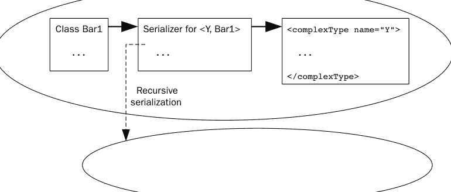

图 5–3 自定义映射可以递归实现。

### 示例 5–11 序列化器接口

```java
21 import javax.xml.transform.Source;
22
23 public interface Serializer {
24
25     public Source getXML(Object o);
26
27 }
```

book-code/chap05/customjava/modules/serializer/src/java/samples/Serializer.java

示例 5–12 显示了从示例 5–9 重构而来的映射代码，改为使用 `Serializer` 接口以及为其属性定义的序列化器：`billTo`（`MyAddress` 的实例）和 `itemList`（`List<MyItem>` 的实例）。当你查看此内容时，首先注意到的是它似乎没有包含任何映射代码。那是因为映射代码大部分已被重构为子序列化器：`MyAddressSerializer` 和 `MySerializer`。在后续代码中发生的是这些子序列化器结果到 JAXB 生成类 `SimpleOrder` 实例的结果。

### 示例 5–12 SimpleOrder 的序列化器——重构后

```java
96 private SimpleOrder transformSimpleOrder(MyOrder order)
97 throws JAXBException {
98     SimpleOrder jaxbOrder = new SimpleOrder();
100     // 映射地址
101     MyAddress myAddress = order.getBillTo();
102     Serializer addressSerializer = new MyAddressSerializer();
103     JAXBElement<BillTo> jaxbBillToElt = (JAXBElement<BillTo>) addressSerializer.getXML(1104 myAddress); // 逻辑简化
105     jaxbOrder.setBillTo(jaxbBillToElt.getValue());
106     // 映射项目
107     Serializer itemSerializer = new MySerializer();
108     jaxbOrder.setItems(new ArrayList<>());
109     List<MyItem> itemList = jaxbOrder.getItems();
110     for (MyItem myItem : order.getItems()) {
111         JAXBElement<Item> jaxbTypeElt = (JAXBElement<Item>) itemSerializer.getXML(
112         myItem); // 逻辑简化
113         itemList.add(jaxbTypeElt.getValue());
114     }
115
116     return jaxbOrder;
117 }
```

book-code/chap05/customjava/modules/serializer/src/java/samples/SimpleOrderSerializer.java

## 5.4 用于类型映射的递归框架

如你所见，前面的代码创建了 `MyAddress` 实例——一个实现类型映射 `<oms:billTo, MyAddress>` 的序列化器。调用此序列化器——`addressSerializer.getXML(myAddress)` 并返回 `oms:billTo` 的 Source 表示，通过 JAXB 反序列化器产生 `JAXBElement<SimpleOrder.BillTo>`。该 JAXElement 的值随后传递给 JAXB setter 方法 `order.setBillTo()`。

序列化项目的代码类似，但增加了对 `List<Item>` 处理。首先，`SimpleOrder` 实例被正确初始化为空列表：

```java
order.setItems(new ArrayList<>());
```

然后，使用 `MySerializer` 类来序列化 `MyItem` 的每个实例。再次，每个 `oms:item` 通过 JAXB 反序列化器产生一个 `JAXBElement<Item>`，并将该 JAXBElement 的值（即 `Item` 实例）添加到 JAXB 列表——`jaxbOrder.getItems()` 中。

一旦完成这些，就从原始 `MyOrder` 实例创建了 JAXB Schema 生成的 order 实例。可以使用 JAXB 反序列化器创建 XML 表（即 `oms:simpleOrder`）。

为了更好地理解这一点，让我们向下递归一级，查看实现类型映射 `<oms:billTo, MyAddress>` 的 `AddressSerializer` 类的实现。序列化器的代码在示例 5–13 中。

映射代码在私有方法 `transformAddressToBillTo` 中创建。这段代码提取自示例 5–9。它简单地将 `MyAddress` 实例转换为生成类 `order.BillTo` 的实例。

### 示例 5–13 MyAddress 类的序列化器

```java
39 public MyAddressSerializer() throws JAXBException {
40
41     jc = JAXBContext.newInstance("com.example.oms");
42     m = jc.createMarshaller();
43
44
45 }
46 public Source getXML(Object o) {
47
48     SimpleOrder.BillTo jaxbBillTo;
49     try {
50         jaxbBillTo = transformAddressBillTo((MyAddress) o);
51         JAXBElement<SimpleOrder.BillTo> jaxbBillToElt =
52         new JAXBElement<SimpleOrder.BillTo>(
53             new QName("http://www.example.com/oms", "BillTo",
54             SimpleOrder.BillTo.class,
55             SimpleOrder.class,
56             jaxbBillTo);
57         ByteArrayOutputStream ba = new ByteArrayOutputStream();
58         m.marshal(jaxbBillToElt, ba);
59         return new Source(new StringReader(ba.toString()));
60     catch (JAXBException e) {
61         throw new RuntimeException(e);
62     }
63
64 }
65
66 private SimpleOrder.BillTo transformAddressBillTo(MyAddress myAddr)
67 throws JAXBException {
68
69     SimpleOrder.BillTo jbBillTo = new SimpleOrder.BillTo();
70     jaxbBillTo.setName(myAddr.name);
71     jaxbBillTo.setCity(myAddr.city);
72     jaxbBillTo.setPhone(myAddr.phone);
73     jaxbBillTo.setState(myAddr.state);
74     jaxbBillTo.setStreet(myAddr.street);
75     jaxbBillTo.setZip(myAddr.zip);
76     return jaxbBillTo;
77
78 }
```

book-code/chap05/customjava/modules/serializer/src/java/samples/AddressSerializer.java

Serializer 接口方法 `getXML` 将此 Simple.BillTo 实例作为 XML 源返回。这是通过使用 JAXB 序列化器（marshaller）将 `SimpleOrder.BillTo` 序列到内存中（即作为 `ByteArrayOutputStream`），并将其封装在 `StreamSource` 中返回。

注意对 `JAXBElement` 的使用——JAXB 2.0 使用 XML 元素实例的表示来保留如标签名称之类的元素信息。因此，如果你有：

## 5.4 用于类型映射的递归框架 223

```java
JAXBElement<com.example.oms.SimpleOrder> someElement =
```

那么 `someElement.getName().getName()` 的值为 `QName {http://www.example.com/oms}simpleOrder`。要访问 `JAXBElement` 表示的实际值，你需要使用 `getValue()` 方法。例如，以下代码访问了 `oms:simpleOrder` 的街道名称：

```java
JAXBElement<com.example.oms.SimpleOrder> someElement = 
com.example.oms.SimpleOrder order = someElement.getValue();
String streetName = order.getBillTo().getStreet();
```

最后，我想向你展示示例 5–14 中 `MyItem` 的 `Serializer` 实现。你会注意到它没有使用 JAXB！我将它放在这里是为了说明这种递归序列化模式无论序列化风格如何都行有效。这种方法允许结合不同的序列化风格——在这种情况下，`MyAddress` 使用了基于 JAXB 的序列化器，而 `MyItem` 使用了此处演示的简单文本处理方法。

### 示例 5–14 MyItemSerializer MyItem 类的 Serializer

book-code/chap05/customjava/modules/serializer/src/java/samples/MyItemSerializer.java

在示例 5–14 中，你会看到 `oms:ItemType` 实例的 XML 是通过简单构建 `oms:item` 元素的字符串创建。
然后，该字符串通过将其封装在 `StreamSource` 实例中返回。
你可以按照以下步骤运行本节的代码：

1. 进入 `chap05/custom.java`。
2. 执行示例 `mvn install`。
3. 从 `MySimpleOrder` 序列化的 XML 将写入控制台。

在总结本节时，我想指出，像这样重构示例 5–9 中的映射代码的要要优势在于它提供了更好的代码复用性。现在，如果你有另一个具有类型为 `Address` 属性类，你可以使用 `MyAddressSerializer` 来构建你的序列化器。

你可能注意到，虽然我将这种重构代码的方法称为“递归”，但我并没有在这个示例中走到底并展示如何构建一个真正的递归序列化系统。此示例中的所有递归都是“手动”完成的。也就是说，我们通过识别属性并手动编码对序列化器的引用来调用父类的序列化器。在第 11 章中，我将此示例提升一个层次，并带你通过 JAXB 2.0 的真实实现。本节主要旨在演示如何实现代码复用，以及如何使用 JAXB Schema 生成的类来构建适用于非 JAXB（POJO）类的序列化器。

在下一节中，我将继续对 JAXB 的概述，探索如何使用注解对标准类型映射进行自定义定制。

## 5.5 使用 JAXB 2.0 注解实现类型映射

过去的两个节探索了某些使用 JAXB 2.0 Schema 生成器从 XML Schema 创建的类来实现get类型映射的技术。

在本节中，我想向你展示 JAXB 注解在可以使用的情况下是多么强大。示例 5-15 显示了你在过去两个节中一直使用的 `SimpleOrder` 类的注解版本。注意，从 `SimpleOrder` 到其 XML 表示的 JAXB 映射中并非所有组件都需要注解（例如，`billTo` 属性没有任何注解）。这是因为当对类定义中的组件使用 JAXB 标准默认映射时，不需要显式注解。

对于 JAXB 而言，本书的目的之一是说明如何避免包装类（wrapper classes）。

## 5.5 使用 JAXB 2.0 注解实现类型映射 227

```java
@XmlElement(name="items")
@XmlElement(name="item")
public List<MyItem> getItemList() {
    return itemList;
}

public void setItemList(List<MyItem> itemList) {
    this.itemList = itemList;
}
```


book-code/chap05/annotations/src/java/samples/MySimpleOrder.java

以下是该类所做的更改列表，并附带一些说明：

- `@XmlRootElement(name="simpleOrder")`——该注解被添加在类定义之前。`@XmlElement` 注解映射到全局元素定义。在这种情况下，全局元素的名称通过 `name` 元素指定为 "simpleOrder"。如果未指定，将会使用 `name` 的默认值——该默认值基于类名。在这种情况下，默认名称将是 "mySimpleOrder"。`@XmlElement` 还有一个可选的 `namespace` 元素。由于这里没有指定 `namespace`，全局元素的命名空间将从包推导出来（稍后会讨论）。

- `public MySimpleOrder() {}`——类中添加了一个无参构造函数。用户定义的类型要求提供一个无参构造函数。该构造函数用于 JAXB 2.0 反解码器（unmarshaller）创建实例。

- `@XmlElement(name="item")`——如果没有这个注解，XML 元素 `itemList` 将绑定到默认映射从 setter/getter 方法名推导出的属性名。正如你可能注意到的，另一个 setter/getter (setBillTo/BillTo) 没有使用 `@XmlElement` 注解。这是因为它默认被映射到名为 `billTo` 的 XML 元素（参见关于 `@XmlAccessorType` 的注释，该注释描述了属性的默认映射）。

## JAXB 2.0 数据绑定

- `@XmlElementWrapper(name="items")`——此注解指定 `itemList` 属性默认应该被一个名为 `items` 的元素所包裹。如果没有这个注解，默认情况下，Java 类型 `List<MyItem>` 将映射到如下的架构元素定义：

```xml
<element name="item" type… maxOccurs="unbounded"/>
```

并且序列化的 XML 看起来像这样：

```xml
<item> ... </item>
<item> ... </item>
```

然而，使用 `@XmlElementWrapper` 注解后，它被映射为：

```xml
<element name="items">
  <element name="item" type… maxOccurs="unbounded"/>
</element>
```

并且序列化的 XML 看起来如下：

```xml
<items>
  <item> ... </item>
  <item> ... </item>
</items>
```

后者的映射与 oms:simple-Order 的架构一致。`@XmlElementWrapper` 旨在以这种方式用于集合——在相同元素的出现处周围放置一个包裹 XML 元素。

除了这些注解外，另一个注解对该类到 XML 的映射有很大影响，但这里没有出现。那就是 `@XmlAccessorType` 注解。它没有出现在类定义中，因为在示例 5–15 中使用了默认值。如果它出现，看起来会像这样：

```java
@XmlAccessorType(AccessType.PUBLIC_MEMBER)
```

——如果存在，此注解将类定义之前。它指定了类属性如何映射到 XML。`AccessType.PUBLIC_MEMBER` 是默认值。它表示每个 getter/setter 对和每个公共字段都将自动绑定到 XML，除非它们被 `XmlTransient` 注释。

查看示例 5–15，你可能想知道目标 XML 的命名空间是如何确定的。默认情况下，JAXB 2.0 从包名推导目标命名空间。在这种情况下，包名是 `samples`，因此默认命名空间为 `http://samples`。然而，JAXB 提供了一种机制来为包指定全局映射：包文件 `package-info.java`。在示例 5–16 显示了 `package-info.java` 文件。

book-code/chap05/annotations/src/java/samples/package-info.java

你可以看到，这个文件由一个包声明和一个注解组成：

```java
@XmlSchema(namespace = "http://www.example.com", elementFormDefault=QUALIFIED)
package samples;
import javax.xml.bind.annotation.XmlSchema;
```

该注解指定了该包到 XML 的映射。在这种情况下，该包的命名空间是 `http://www.example.com`。

## 示例 5–17 MyAddress：带注解的版本

```java
@XmlAccessorType(AccessType.FIELD)
@XmlType(name = "", propOrder={"name", "street", "city", "state", "zip"})
public class MyAddress {
  @XmlElement(namespace = "http://www.example.com")
  protected String name;
  protected String street;
  protected String city;
  protected String state;
  protected String zip;

  public MyAddress() {};
}
```

目标架构（参见示例 5–1）中，该类映射到 `billTo`。映射到匿名类型对注解有影响，我们在这里进行讨论：

## 5.5 使用 JAXB 2.0 注解实现类型映射 229

- `@XmlType(name = "", propOrder={"name", "street", "city", "state", "zip"})`——`@XmlType` 注解用于将类或枚举映射到 XML 类型。此注解没有出现在 SimpleOrder 类（示例 5–15）中，因为使用了默认映射。然而，在这种情况下，MyAddress 类被映射到匿名类型——这不是默认值——因此需要 `@XmlType` 注解。设置 `name = ""` 是指示该类应该映射到匿名类型的方法。此外，`propOrder` 元素指定了目标 `<sequence>` 元素的属性顺序。正如你看到的，这里的顺序与示例 5–1 中中指定的顺序对应。

- `@XmlElement(namespace = "http://www.example.com")`——你可能想知道为什么这里需要 `@XmlElement` 注解。由于 `@XmlAccessor` 指定了访问类型为 `FIELD`，类中的字段已经映射到了元素。原因是目标元素需要指定命名空间。JAXB 2.0 的默认映射表示元素应该从封装类继承命名空间。然而，由于该类被映射到匿名类型，没有命名空间可以继承，因此必须指定。必须指定命名空间是因为正如在示例 5–16 中讨论的，目标架构上的 `elementForm-Default` 属性值为 `qualified`。

在这里考虑的最后一个带注解类是 MyItem 类，如示例 5–18 所示。

## 示例 5–18 MyItem：带注解的版本

```java
@XmlType(name = "ItemType", propOrder={"quantity", "price"})
public class MyItem {
  private int quantity;
  private float price;
  private String productName;

  public MyItem() {};
  public MyItem(int quantity, float price, String productName)
}
```

## 232 JAXB 2.0 数据绑定

```java
  35   throws Exception {
    if (productName == null) {
      throw new Exception("productName cannot be null");
    }
    this.productName = productName;
    this.price = price;
    this.quantity = quantity;
  }

  public float getPrice() {
    return price;
  }

  public void setPrice(float price) {
    this.price = price;
  }

  @XmlAttribute
  public String getProductName() {
    return productName;
  }

  public void setProductName(String productName) {
    this.productName = productName;
  }

  public int getQuantity() {
    return quantity;
  }

  public void setQuantity(int quantity) {
    this.quantity = quantity;
  }

}
```

book-code/chap05/xprmnt_binder/src/java/samples/MyItem.java

在目标 Schema 中（参见示例 5–1），该类映射到命名复杂类型 `oms:ItemType`。此处将讨论此映射的显著方面：

## 5.5 使用 JAXB 2.0 注解实现类型映射 233

`@XmlType(name = "ItemType", propOrder = {"quantity", "price"})` —— 通过指定注解元素 `name="ItemType"`，将 MyItem 类映射到 `os:MyItemType`。在这种情况下，XML Schema 的命名空间由包层面的 `@XmlSchema` 注解提供（参见示例 5–16）。

`@XmlAttribute` —— 由于 MyItem 类没有指定 `@Accessor` 注解，因此使用了属性的默认映射——其方式与示例 5–15 相同。然而，在这种情况下，属性 `productName` 需要映射到属性（attribute）而不是元素（element）。这就是为什么在这里使用了 `@XmlAttribute` 注解。相比之下，其他两个属性（即 quantity 和 price）按照默认映射的规定映射到元素。

在总结本节之前，接下来我将查看之前用于练习这些注解的代码。示例 5–19 展示了如何以“往返（round-trip）”的方式序列化（marshal）和反序列化（unmarshal）`MySimpleOrder` 实例，并对序列化输出相对于示例 5–1 中的 Schema 进行验证。

## 示例 5-19 带有注解的类的序列化与反序列化

| 行号 | 代码 |
| :--- | :--- |
| 36 | `public static void main(String[] args) throws Exception {` |
| 37 |  |
| 38 | `MySimpleOrder myOrder = new MySimpleOrder(` |
| 39 | `"John Doe",` |
| 40 | `"125 Main Street",` |
| 41 | `"Any Town", "NM", "95811",` |
| 42 | `"(831) 874-1123);` |
| 43 | `myOrder.getList().add(new MyItem(6, (float) 2.99, "Diet Coke"));` |
| 44 | `myOrder.getList().add(new MyItem(4, (float) 3.99, "Potato Chips"));` |
| 45 | `myOrder.getList().add(new MyItem(2, (float) 5.34, "Frozen Pizza"));` |
| 46 | `try {` |
| 47 | `JAXBContext jaxbContext = JAXBContext.newInstance(MySimpleOrder.class);` |
| 48 | `Marshaller jaxbMarshall = jaxbContext.createMarshaller();` |
| 49 | `jaxbMarshall.setProperty("JAXB_FORMATTED_OUTPUT",` |
| 50 | `Boolean.TRUE);` |
| 51 | `SchemaFactory sf =` |
| 52 | `SchemaFactory.newInstance(XMLConstants.W3C_XML_SCHEMA_URI);` |
| 53 | `Schema schema = sf.newSchema(` |
| 54 | `new URL("http://soapbook.com/example/oms/simple-order.xsd"));` |
| 55 | `jaxbMarshall.setSchema(schema);` |
| 56 | `ByteArrayOutputStream outputStream = new ByteArrayOutputStream();` |
| 57 | `jaxbMarshall.marshal(myOrder, outputStream);` |

## 234 JAXB 2.0 数据绑定

```java
System.out.println(ba.toString());
Unmarshaller u = jaxbContext.createUnmarshaller();
SimpleOrder roundTripOrder = (SimpleOrder)u.unmarshal(new String(ba.toString()));
System.out.println("phone = " + roundTripOrder.getBillTo().phone);
catch (Exception e) {
  e.printStackTrace();
}
```

book-code/chap05/annotations/src/java/samples/MySimpleOrderSerializer.java

如你所见，此示例从创建一个 MySimpleOrder 实例开始。接下来，使用以下版本的 `newInstance` 创建 `JAXBContext` 实例：

```
JAXBContext.newInstance(java.lang.Class ...)
```

以这种方式创建的上下文将识别指定的类，以及从指定类中直接或间接静态引用的任何类。因此，在示例 5–19 中，除了 MySimple 类外，MyAddress 和 MyItem 类也将被此上下文识别。

从上下文中创建一个 Marshaller（序列器），并使用该方法对此序列器运行验证：

```
Marshall.setSchema(jaxb.xml.validation.Schema )
```

结果是，此序列器产生的 XML 将根据 URL http://soapbook.com/example/oms/simpleorder.xsd  Schema 进行验证。这与示例 5–1 所示的 Schema 相同。

如你所见，此示例中序列化的输出被捕获在 `ByteArrayOutputStream` 中。因此，我们可以对此 XML 封装一个 `StringReader`，并将 XML 反序列化回 `MySimpleOrder` 实例（即变量 `roundTripOrder`）。这种“往返”过程结合 Schema 验证，表明本节中的注解准确地映射了 `MySimpleOrder` 和 `MyAddress` 类。

## 265 5.6 使用 JAXB 实现类型映射

1. 转到 chap05/annotations。

2. 需要运行示例。

3. 下面所示的 XML：

一旦你对这项技术花了一些时间，你就会同意注解是强大的。在下一节中，你将看到如何自定义此 Schema。

## 5.6 使用 JAXB 实现类型映射

前面的节查看了如何使用注解实现这些类型映射。在本节中，你将看到使用“从 XML 开始”的方法无法实现这些映射。绑定语言没有注解那么强大。你可以接近这些映射，但并不完全。无法将 `oms:items` 元素直接映射到 `List`。

要开始，请查看示例 5–20，它展示了全局（顶层）需要的绑定声明。

## 236 JAXB 2.0 数据绑定

在 5.3 节中，我展示了如何使用 JAXB 标准映射和 Java 代码实现类型映射。在 5.4 节中，我展示了相同的方法，但使用了更优雅的序列化框架。然后在 5.5 节中，你看到了如何通过“从 Java 开始”并注解 POJO 来相同的映射。在本节中，你将看到使用“从 XML 开始”的方法无法实现这些映射。

## 示例 5-20 jaxb:globalBindings 和 jaxb:schemaBindings 声明


```xml
<schema targetNamespace="http://www.example.com/oms"
  elementFormDefault="qualified" xmlns="http://www.w3.org/2001/XMLSchema"
  xmlns:jaxb="http://java.sun.com/xml/ns/jaxb" jaxb:version="2.0"
  xmlns:oms="http://www.example.com/oms">
  <annotation>
    <appinfo>
      <jaxb:globalBindings localScoping="toplevel"/>
      <jaxb:package name="samples"/>
      </jaxb:schemaBindings>
    </appinfo>
  </annotation>
</schema>
```

`book-code/chap05/bindinglang/etc/simpleorder_with_bindinglang.xsd`

绑定声明使用了 [XSD PART 1] 指定 `<appinfo>` 元素。在 `<appinfo>` 元素内部，你可以看到 `jaxb:globalBindings` 声明和一个 `jaxb:schemaBindings` 声明。

`jaxb:globalBindings` 内部指定的自定义具有全局范围。这意味着它们是影响整个 Schema ——以及任何包含或导入的 Schema 的自定义。通常情况下，全局指定的类型是集合类型（例如 List 与数组），是否生成

## 5.6 使用 JAXB 2.0 绑定语言实现类型映射

类或接口，以及是否使用内部类。正如你可能记得第 5.2 节所示，默认的 JAXB 2.0 映射从匿名复杂类型生成内部类。然而，这里考虑的目标类（来自 `samples` 包）不包含任何内部类。因此在这种情况下，`jaxb:globalBindings` 元素的 `localScope` 属性被设置为 `toplevel`，表示生成的任何类都不应是内部类。

此外，`jaxb:schemaBindings` 声明元素提供了架构层面的自定义（但与作用范围自定义不同，这些自定义不应用于架构本身）。在本例中，使用 `jaxb:package` 声明来指定架构生成的类类所在的包应为 `samples`。

因此，这些声明让我们向目标迈了一大步，使我们能够指定不生成内部类，并且所有类的包都应为 `samples`。在示例 5–21 中，我将说明如何获取你想要映射的精确类名。

## 示例 5–21 jaxb:class 声明

```xml
19 <element name="simpleOrder">
20 <annotation>
21 <appinfo>
22 <jaxb:class name="MySimpleOrder"/>
23 </appinfo>
24 </annotation>
25 <complexType>
26 <sequence>
27 <element name="billTo">
28 <complexType>
29 <annotation>
30 <appinfo>
31 <jaxb:class name="MyAddress"/>
32 </appinfo>
33 </annotation>
34 <sequence>
35 <element name="name" type="string"/>
36 <element name="street" type="string"/>
37 <element name="city" type="string"/>
38 <element name="state" type="string"/>
39 <element name="zip" type="string"/>
40 <element name="phone" type="string"/>
41 </sequence>
42 </complexType>
43 </element>
```

`book-code/chap05/bindinglang/etc/simpleorder_with_bindinglang.xsd`

在本示例中，`jaxb:class` 声明用于指定对特定的 XML 架构类型或元素定义进行映射的目标类名称。在这里，你可以看到与元素 `oms:simpleOrder` 关联声明指定它被映射到名为 `MySimpleOrder` 的类。同样，在架构代码稍靠下的位置，由元素 `oms:billTo` 定义的匿名复杂类型被映射到 `samples.MyAddress` 类。

示例 5–22 显示了由架构生成器根据 `oms:simpleOrder` 架构生成的 `MySimpleOrder` 类片段，该架构已使用之前的绑定语言声明进行了注解。如你所见，它与第 5.5 节中“手动”创建并说明的 `MySimpleOrder` 类相似。然而，主要的区别在于架构中的 Java 类型 `items` 是 `Items`——而不是 `List<MyItem>`。理想情况下，我们希望架构生成器通过 `@XmlElementWrapper` 注解为 `items` 属性添加所需的类型，并将该属性的类型变为 `List<MyItem>`。但遗憾的是，无法使用绑定语言指定这一点。

## 示例 5–22 架构编译器生成的 MySimpleOrder 类

```java
82 @AccessorType(AccessorType.FIELD)
83 @XmlType(name = "", propOrder = {
84 "billTo",
85 "items"
86 }
87 @XmlRootElement(name = "simpleOrder")
88 public class MySimpleOrder {
89
90 @XmlElement(namespace = "http://www.example.com/oms")
91 protected MyAddress billTo;
92 @XmlElement(namespace = "http://www.example.com/oms")
93 protected Items items;
```

`book-code/chap05/bindinglang/etc/schemaciler_withcomments/MySimpleOrder.java`

## 5.6 使用 JAXB 2.0 绑定语言实现命名空间映射

示例 5–23 显示了由 JAXB 架构生成器创建的 `items` 类。该类没有指定任何类型映射。如你所示，它只是属性 `item` 的包装类，其 Java 类型为 `List<MyItem>`。

## 示例 5–23 items 类的生成是避免的

```java
56 @XmlType(AccessType.FIELD)
57 @XmlType(name = "", propOrder = {
58     "item"
59 })
60 public class Items {
61 
62     @XmlElement(namespace = "http://www.example.com/oms")
63     protected List<MyItem> item;
```

`book-code/chap05/bindinglang/etc/schemacompilerwithcomments/Items.java`

示例 5–24 显示了在使用绑定语言“从 XML 开始”时如何处理类型转换。回想第 5.3 节的讨论，`MyItem` 类具有映射到架构元素 `quantity` 的 Java 类型。同样，`MyItem` 类对属性 `price` 使用 `xs:positiveInteger`，而 XML 类型为 `xs:double`。

## 示例 5–24 使用 jaxb:javaType 声明进行类型转换

```xml
57 <complexType name="ItemType">
58   <annotation>
59     <appinfo>
60       <jaxb:class name="MyItem"/>
61     </appinfo>
62   </annotation>
63   <sequence>
64     <element name="quantity" type="positiveInteger">
65       <annotation>
66         <appinfo>
67           <jaxb:property>
68             <jaxb:baseType>
69               <jaxb:javaType name="int"
70      parseMethod="javax.xml.bind.DatatypeConverter.parseInt"
71      printMethod="javax.xml.bind.DatatypeConverter.printInt"/>
72          </jaxb:baseType>
73      </jaxb:property>
74      </appinfo>
75      </annotation>
76  </element>
77  <element name="price" type="double">
78      <annotation>
79      <appinfo>
80          <jaxb:property>
81              <jaxb:baseType>
82              <jaxb:javaType name="float"
83                  parseMethod="javax.xml.bind.DatatypeConverter.parseFloat"
84                  printMethod="javax.xml.bind.DatatypeConverter.printFloat"/>
85              </jaxb:baseType>
86          </jaxb:property>
87      </appinfo>
88      </annotation>
89  </element>
90  <sequence>
91      <attribute name="productName" use="required" type="string"/>
92  </complexType>
93>
```

`book-code/chap05/bindinglang/etc/simpleorder_with_bindinglang.xsd`

在本示例中，`jaxb:class` 声明用于指定对特定的 XML 架构类型或元素定义进行映射的目标类名称。在这里，你可以看到与元素 `oms:simpleOrder` 关联的声明指定它被映射到名为 `MySimpleOrder` 的类。同样，在架构代码稍靠下的位置，由元素 `oms:billTo` 定义的匿名复杂类型被映射到 `samples.MyAddress` 类。

在示例 5–24 的绑定语言声明中，`jaxb:javaType` 声明提供了自定义原子类型到目标 Java 类型绑定的方法。`name`（对于 `quantity` 属性）和 `float`（对于 `price` 属性）指定了要使用的 Java 类型。`parseMethod` 和 `printMethod` 属性指定了静态方法。`parseMethod` 用于反序列化期间，将字符串（即 XML 文档的词法表示）转换为目标 Java 类型的值。同样，`printMethod` 用于序列化以完成相反操作。

在序列化和反序列化期间调用 `print` 和 `parse` 方法的机制是 `@XmlJavaAdapter` 注解。`@XmlJavaAdapter` 将第 5.7 节中讨论。现在你需要理解的是 `@XmlJavaAdapter` 注解用于指定映射一种类型到另一种类型的类。当解释带有 `printMethod` 和 `parseMethod` 属性的 `jb:type` 声明时，架构编译器为目标属性注解 `@XmlJavaAdapter` 并生成 `XmlAdapter` 实例，在序列化和反序列化期间调用 `printMethod` 和 `parseMethod` 静态方法。

当你查看示例 5–25 生成的代码时，该机制将变得清晰一些。

## 示例 5–25 带有 @XmlJavaAdapter 注解的 MyItem 类

```java
58 @AccessorType(AccessorType.FIELD)
59 @XmlType(name = "ItemType", propOrder = {
60 "quantity"
61 "price"
62 })
63 public class MyItem {
64
65 @XmlElement(namespace = "http://www.example.com/oms", type = String.class)
66 @XmlJavaTypeAdapter(Adapter1.class)
67 protected Integer quantity;
68 @XmlElement(namespace = "http://www.example.com/oms", type = String.class)
69 @XmlJavaTypeAdapter(Adapter2.class)
70 protected Float price;
71 @XmlAttribute(required = true)
72 protected String productName;
73 }
```

## JAXB 2.0 数据绑定

在这个示例中，你可以看到 `quantity` 元素具有 `@XmlJavaAdapter(Adapter1.class)` 注解。该注解告诉 JAXB 运行时当需要序列化（或反序列化）`quantity` 属性时，应该调用 `@XmlJavaAdapter` 类 `Adapter1.class`。该类在示例 5–26 中显示。

## 示例 5–26 为类型转换生成 XmlAdapter

```java
30 public class Adapter1
31     extends XmlAdapter<String, Integer>
32 {
33 
34 
35     public Integer unmarshal(String value) {
36         return (javax.xml.bind.DatatypeConverter.parseInt(value));
37     }
38 
39     public String marshal(Integer value) {
40         return (javax.xml.bind.DatatypeConverter.printInt(value));
41     }
42 
43 }
```

`book-code/chap05/bindinglang/etc/schemacompiler_withcomments/Adapter1.java`

如你所示，`Adapter1` 类具有名为 `marshal` 和 `unmarshal` 的方法。`marshal` 方法调用由 `jaxb:javaType printMethod` 属性指定的静态方法。同样，`unmarshal` 方法调用由 `jaxb:javaType parseMethod` 指定的静态方法。

示例 5–27 显示了架构生成器从 `oms:simpleOrder` 架构创建的测试类，以及绑定声明。通过查看这些代码，你可以发现，使用由架构编译器生成的 `MySimpleOrder`、`MyItem` 和 `MyAddress` 版本进行工作并不如前一节中创建的同名类那样优雅。主要原因是，生成的类除了零参数构造函数（即“无参”构造函数）之外没有任何构造函数。因此，你不需要直接向 `MyAddress` 构造函数传递街道、城市、州、邮编和电话，而是必须先实例化，然后设置所有属性。

## 5.6 使用 JAXB 2.0 绑定语言实现类型映射 243

## 示例 5–27 测试架构生成器生成的类

```java
public static void main(String[] args) throws Exception {
    MySimpleOrder order = new MySimpleOrder();
    order.setBillTo(new MyAddress());
    order.getBillTo().setName("John Doe");
    order.getBillTo().setStreet("125 Main Street");
    order.getBillTo().setCity("Any Town");
    order.getBillTo().setState("NM");
    order.getBillTo().setZip("95811");
    order.getBillTo().setPhone("(831) 874-1123");
    Items items = new Items();
    order.setItems(items);
    List<MyItem> list = items.getItems();
    MyItem item = new MyItem();
    item.setPrice((float) 2.99);
    item.setQuantity(6);
    item.setProductName("Diet Coke");
    list.add(item);
    item = new MyItem();
```


## JAXB 2.0 数据绑定示例代码

```java
item.setPrice((float) 3.99);
item.setQuantity(4);
item.setProductName("Potato Chips");
list.add(item);

item = new MyItem();
item.setPrice((float) 5.34);
item.setQuantity(2);
item.setProductName("Frozen Pizza");
list.add(item);

JAXBContext jaxbContext = JAXBContext.newInstance(MySimpleOrder.class);
Marshaller jaxbMarshaller = jaxbContext.createMarshaller();
jaxbMarshaller.setProperty(Marshaller.JAXB_FORMATTED_OUTPUT, Boolean.TRUE);

SchemaFactory sf = SchemaFactory.newInstance(XMLConstants.W3C_XML_SCHEMA_NS_URI);
Schema schema = sf.newSchema(new URL("http://soap.xmlsoap.com/example/oms/simpleorder.xsd"));
jaxbMarshaller.setSchema(schema);

ByteArrayOutputStream ba = new ByteArrayOutputStream();
jaxbMarshaller.marshal(order, ba);
System.out.println(ba.toString());

Unmarshaller u = jaxbContext.createUnmarshaller();
```

## JAXB 2.0 数据绑定

```java
MySimpleOrder roundTripOrder = (MySimpleOrder) u.unmarshal(new StringReader(ba.toString()));
System.out.println("phone = " + roundTripOrder.getBillTo().phone);
} catch (Exception e) {
    e.printStackTrace();
}
```

`book-code/chap05/bindinglang/modules/serializer/src/java/samples/MySimpleOrderSerializer.java`

另一个区别正如在实例 5–23 中提到的，就是你必须创建一个额外类 `Items` 的实例，并通过这个包装类来处理 `List<MyItem>` 属性。因此，处理这些架构生成的类比手动创建的类要笨拙一些。然而，这些类工作得完美，而且如代码所示，生成的 XML 通过了原始架构的验证。

你可以通过以下步骤运行代码：
1. 转到 `chap05/bindinglang`。
2. 运行示例。
3. 生成的 XML 通过了架构的验证。

## 5.7 使用 JAXB 2.0 绑定语言实现类型映射

在之前的章节中，我们展示了如何将简单类型映射到 Java 类型。但如果我们需要将复杂类型映射到 Java 类型，或者将一个 Java 属性映射到多个元素呢？这就是 `XmlAdapter` 派上用场。

`XmlAdapter` 类允许你在 Java 类型和 XML 节点之间定义自定义映射。当你处理不符合 JAXB 标准的旧代码，或者在序列化或反序列化过程中需要转换数据时，这种方法非常有用。

## JAXB 2.0 数据绑定

在这个示例中，你可以看到 `quantity` 元素具有 `@XmlJavaAdapter(Adapter1.class)` 注解。该注解告诉 JAXB 运行时当需要序列化（或反序列化）`quantity` 属性时，应该调用 `@XmlJavaAdapter` 类 `Adapter1.class`。该类在示例 5–26 中显示。

## 示例 5–26 为类型转换生成 XmlAdapter

```java
public class Adapter1 extends XmlAdapter<String, Integer> {
    public Integer unmarshal(String value) {
        return (javax.xml.bind.DatatypeConverter.parseInt(value));
    }
    public String marshal(Integer value) {
        return (javax.xml.bind.DatatypeConverter.printInt(value));
    }
}
```

`book-code/chap05/bindinglang/etc/schemacompiler_withcomments/Adapter1.java`

如你所示，`Adapter1` 类具有名为 `marshal` 和 `unmarshal` 的方法。`marshal` 方法调用由 `jaxb:javaType printMethod` 属性指定的静态方法。同样，`unmarshal` 方法调用由 `jaxb:javaType parseMethod` 指定的静态方法。

示例 5–27 显示了架构生成器从 `oms:simpleOrder` 架构创建的测试类，以及绑定声明。通过查看这些代码，你可以发现，使用由架构编译器生成的 `MySimpleOrder`、`MyItem` 和 `MyAddress` 版本进行工作并不如前一节中创建的同名类那样优雅。主要原因是，生成的类除了零参数构造函数（即“无参”构造函数）之外没有任何构造函数。因此，你不需要直接向 `MyAddress` 构造函数传递街道、城市、州、邮编和电话，而是必须先实例化，然后设置所有属性。

## 示例 5–27 测试架构生成器生成的类

```java
public static void main(String[] args) throws Exception {
    MySimpleOrder order = new MySimpleOrder();
    order.setBillTo(new MyAddress());
    order.getBillTo().setName("John Doe");
    order.getBillTo().setStreet("125 Main Street");
    order.getBillTo().setCity("Any Town");
    order.getBillTo().setState("NM");
    order.getBillTo().setZip("95811");
    order.getBillTo().setPhone("(831) 874-1123");

    Items items = new Items();
    order.setItems(items);
    List<MyItem> list = items.getItems();

    MyItem item = new MyItem();
    item.setPrice((float) 2.99);
    item.setQuantity(6);
    item.setProductName("Diet Coke");
    list.add(item);

    item = new MyItem();
    item.setPrice((float) 3.99);
    item.setQuantity(4);
    item.setProductName("Potato Chips");
    list.add(item);

    item = new MyItem();
    item.setPrice((float) 5.34);
    item.setQuantity(2);
    item.setProductName("Frozen Pizza");
    list.add(item);

    JAXBContext jaxbContext = JAXBContext.newInstance(MySimpleOrder.class);
    Marshaller jaxbMarshaller = jaxbContext.createMarshaller();
    jaxbMarshaller.setProperty(Marshaller.JAXB_FORMATTED_OUTPUT, Boolean.TRUE);

    SchemaFactory sf = SchemaFactory.newInstance(XMLConstants.W3C_XML_SCHEMA_NS_URI);
    Schema schema = sf.newSchema(new URL("http://soap.xmlsoap.com/example/oms/simpleorder.xsd"));
    jaxbMarshaller.setSchema(schema);

    ByteArrayOutputStream ba = new ByteArrayOutputStream();
    jaxbMarshaller.marshal(order, ba);
    System.out.println(ba.toString());

    Unmarshaller u = jaxbContext.createUnmarshaller();
}
```

## JAXB 2.0 数据绑定

```java
MySimpleOrder roundTripOrder = (MySimpleOrder) u.unmarshal(new StringReader(ba.toString()));
System.out.println("phone = " + roundTripOrder.getBillTo().phone);
} catch (Exception e) {
    e.printStackTrace();
}
```

`book-code/chap05/bindinglang/modules/serializer/src/java/samples/MySimpleOrderSerializer.java`

另一个区别正如在实例 5–23 中提到的，就是你必须创建一个额外类 `Items` 的实例，并通过这个包装类来处理 `List<MyItem>` 属性。因此，处理这些架构生成的类比手动创建的类要笨拙一些。然而，这些类工作得完美，而且如代码所示，生成的 XML 通过了原始架构的验证。

你可以通过以下步骤运行代码：
1. 转到 `chap05/bindinglang`。
2. 运行示例。
3. 生成的 XML 通过了架构的验证。

## 5.7 使用 JAXB 2.0 XMLAdapter 类实现类型映射

要在 JAXB 2.0 框架内实现 `<corp:AddressType, Address>` 类型映射，你需要在三个地方使用 `@XmlJavaAdapter` 注解：

1. 解析元素 `addrLine1` 和 `addrLine2` 以产生 `streetNum` 和 `streetName` 的属性值，反之亦然。
2. 实现从 `zip` 元素 (`xs:string`) 到 `zip` 属性 (`int`) 的非标准数据类型转换，反之亦然。
3. 将 `phone` 元素解析为 `Phone` 类的组成属性，反之亦然。

如从第 2 点所示，多元类型映射并不是唯一需要 `@XmlJavaAdapter` 注解的映射。在许多情况下，XML 原子类型的非标准转换也可能需要适配器。

示例 5–30 显示了 `Phone` 类的组成属性。如你所见，将 `xs:string` 映射到该类涉及解析区号、交换机和号码。

### 示例 5–30 Phone 类属性

```java
@XmlJavaAdapter(PhoneAdapter.class)
public class Phone {
    private int areaCode;
    private String exchange;
    private String number;
}
```

`book-code/chap05/xmladapter/src/java/samples/Phone.java`

图 5–4 显示了你在本节剩余部分将要完成序列化（marshalling）过程。该图指示了如何使用 JAXB 2.0 和 `@XmlJavaAdapter` 实现映射。如你所见，序列化过程利用名为 `AddressXML` 的中间 Java 类。

如图所示，该序列化过程可以分为四个步骤：

1. `Address` 类实例被映射到 `AddressXML` 类实例。第一步将 `streetNum` 和 `streetName` 解析为 `AddressXML` 的 `addrLine1` 和 `addrLine2` 属性。

   `Address` 的所有其他属性（即城市、州、邮编和电话）都直接映射到 `AddressXML`。这种从 `Address` 到 `AddressXML` 的转换由 `AddressAdapter` 类处理——该类是 `XmlAdapter` 的实例。`AddressAdapter` 被指定为 `Address` 类定义上 `@XmlJavaTypeAdapter` 注解的值（参见示例 5–29）。由于 `Address` 类定义上有此 `@XmlJavaTypeAdapter` 注解，当你序列化 `Address` 实例时，JAXB 2.0 会自动调用 `AddressAdapter` 将其转换为 `AddressXML` 实例，并继续序列化该 `AddressXML` 实例。这一步处理了 `streetNum` 和 `projectName` 到 `addrLine1` 和 `addrLine2` 的多元映射。

2. 下一步如图 5–4 所示，当 JAXB 运行时继续序列化 `AddressXML` 实例时发生。你会在示例 5–31 中发现，`AddressXML` 的 `zip` 属性带有 `@XmlJavaTypeAdapter` 注解，该注解引用了 `IntToStringXmlAdapter` 实现。该类将 `zip` 从 `Integer` 转换为 `java.lang.String`，以便 JAXB 运行时将其映射到 `zip` 元素的目标 `xs:string` XML 类型。

3. 当 JAXB 运行时序列化 `AddressXML` 实例的 `phone` 属性时调用此步骤。该属性是 `Phone` 类的实例（参见示例 5–30），它带有引用 `PhoneAdapter` 类的 `@XmlJavaTypeAdapter` 注解。JAXB 运行时调用 `PhoneAdapter` 来处理电话属性并实现多元映射，将其三个字段解析为单个字符串，最终序列化到 `AddressType` 的 XML 类型为 `xs:string` 的 `phone` 元素。

4. 一旦 `AddressXML` 的 `zip` 和 `phone` 属性被各自的 `XmlAdapter` 类转换完成，该类实例的其余序列化将遵循标准的 JAXB 2.0 运行时映射以创建 `AddressType` 实例。

示例 5–31 显示了 `AddressXML` 类，它被用作将 `Address` 序列化到 `AddressType` 架构实例的中间类。如你所见，`AddressXML` 有与 `Address` 相同的属性，但 `streetNum` 和 `streetName` 属性被替换为 `addrLine1` 和 `addrLine2`。

### 示例 5–31 作为序列化/反序列化中间件的 AddressXML 类

```java
@XmlType(name="AddressType", propOrder = {
    "addrLine1",
    "addrLine2",
    "city",
    "state",
    "zip",
    "phone"
})
```


## 5.7 使用 JAXB 2.0 `XmlAdapter` 类实现类型映射

```java
@XmlAccessorType(XmlAccessType.FIELD)
public class AddressXML {

    protected String addrLine1;
    protected String addrLine2;
    protected String city;
    protected String state;

    @XmlTypeAdapter(IntStringToAdapter.class)
    protected Integer zip;
    protected Phone phone;
}
```

`book-code/chap05/xmladapter/src/java/samples/AddressXML.java`

示例 5–32 是 `AddressAdapter` 类，它将 `Address` 转换为 `AddressXML`，反之亦然。`AddressAdapter` 继承自 `javax.xml.bind.annotation.XmlAdapter<AddressXML, AddressType>`。由于 `Address` 类包含 `@XmlTypeAdapter`，你可以链式调用。序列化时，JAXB 运行时调用 `marshal` 方法将 `AddressXML` 转换为 `AddressType` 实例。反序列化时，JAXB 运行时调用 `unmarshal` 方法将 `AddressXML` 实例转换为 `Address` 实例。

### 示例 5–32 AddressAdapter 类

```java
public class AddressAdapter extends XmlAdapter<AddressXML, AddressType> {

    public Address unmarshal(AddressXML jaxb) throws Exception {
        Address addr = new Address();
        String[] lineParts = jaxb.addrLine1.split(",");
        int num = -1;
        String street;
        try {
            num = Integer.valueOf(lineParts[0]).intValue();
        } catch (Exception e) {
        }
        if (num > 0) {
            addr.setStreetNum(num);
            street = lineParts[1];
        } else {
            addr.setStreetNum(0);
            street = "";
        }
        String line2 = jaxb.addrLine2;
        if (line2 != null && !line2.equals("")) {
            street += " - " + line2;
        }
        addr.setStreetName(street);
        addr.setCity(jaxb.city);
        addr.setState(jaxb.state);
        addr.setZip(jaxb.zip);
        addr.setPhone(jaxb.phone);
        return addr;
    }

    public AddressXML marshal(Address addr) throws Exception {
        AddressXML jax = new AddressXML();
        jax.addrLine1 = addr.getStreetNum() + "," + addr.getStreetName();
        jax.addrLine2 = "";
        jax.city = addr.getCity();
        jax.state = addr.getState();
        jax.zip = addr.getZip();
        jax.phone = addr.getPhone();
        return jax;
    }
}
```

```java
Phone phone = new Phone();
int startArea = jaxPhone.indexOf("(");
int areaEnd = jaxPhone.indexOf(")");
String area = jaxPhone.substring(startArea + 1, areaEnd);
String[] phoneSplit = jaxPhone.substring(areaEnd + 1).split("-", 2);
phone.setAreaCode(Integer.valueOf(area).intValue());
phone.setExchange(phoneSplit[0].trim());
phone.setNumber(phoneSplit[1].trim());
return phone;
}

public String marshal(Phone myPhone) throws Exception {
    return "(" + myPhone.getAreaCode() + ") " + myPhone.getExchange() + "-" +
           myPhone.getNumber();
}
```

`book-code/chap05/xmladapter/src/java/samples/PhoneAdapter.java`

为了测试 `Address` 类的序列化（marshalling）和反序列化（unmarshalling），我使用了示例 5–35 所示简单 `Order` 类。`Order` 类有一个属性—`addr`—类型为 `Address`。

### 示例 5–35 Order 类：用于测试的包装类

```java
@XmlRootElement(namespace="http://www.example.com/css/custinfo")
@XmlAccessorType(XmlAccessType.FIELD)
public class Order {
    @XmlElement(namespace="http://www.example.com/css/custinfo")
    protected Address addr;
}
```

`book-code/chap05/xmladapter/src/java/samples/Order.java`

## JAXB 2.0 数据绑定

`Order` 类通过 JAXB 映射到示例 5–36 所示的模式（schema）。如你所见，这是一个名为 `order` 的元素的模式，它包含一个名为 `addr` 的子元素。`addr` 元素的类型为 `corp:AddressType`。

### 示例 5–36 用于验证的 Schema，导入了 corp:AddressType

```xml
<xs:schema xmlns:xs="http://www.w3.org/2001/XMLSchema"
           xmlns:corp="http://www.example.com/corp"
           targetNamespace="http://www.example.com/css/custinfo"
           elementFormDefault="qualified">
  <xs:import importNamespace="http://www.example.com/corp"
             schemaLocation="http://soabook.com/example/corp/standardtypes.xsd"/>
  <xs:element name="order">
    <xs:complexType>
      <xs:sequence>
        <xs:element name="addr" type="corp:AddressType"/>
      </xs:sequence>
    </xs:complexType>
  </xs:element>
</xs:schema>
```

`book-code/chap05/xmladapter/etc/orderElement.xsd`

使用 `Order` 类测试类型映射 `corp:AddressType`、`Address` 实现的代码如示例 5–37 所示。该代码实现了一个“往返（round trip）”过程：将 `Order` 类的实例序列化输出，并对结果进行反序列化。在序列化过程中，部分流程会根据示例 5–36 所示的模式进行验证。

### 示例 5–37 往返序列化、反序列化与验证

```java
public class AddressSerializer {
    public static void main(String[] args) throws Exception {
        Address addr = new Address(
            175,
            "Main Street - Suite 200",
            "New City", State.OH, 59101,
            new Phone("874","11221"));
        Order order = new Order();
        order.addr = addr;
        try {
            JAXBContext jaxbContext = JAXBContext.newInstance(Order.class);
            Marshaller jaxbMarshaller = jaxbContext.createMarshaller();
            jaxbMarshaller.setProperty(Marshaller.JAXB_FORMATTED_OUTPUT,
                                       Boolean.TRUE);
            SchemaFactory sf =
                SchemaFactory.newInstance(XMLConstants.W3C_SCHEMA_NS_URI);
            Schema schema = sf.newSchema(new File(args[0])); // 传入 schema
            jaxbMarshaller.setSchema(schema);
            ByteArrayOutputStream ba = new ByteArrayOutputStream();
            jaxbMarshaller.marshal(order, ba);
            System.out.println(ba.toString());
            Unmarshaller u = jaxbContext.createUnmarshaller();
            Order roundTripOrder =
                (Order) u.unmarshal(new StringReader(ba.toString()));
            printAddress(roundTripOrder.addr);
        }
    }
}
```

`book-code/chap05/xmladapter/src/java/samples/AddressSerializer.java`

你可以按照以下步骤运行此代码：

1.  进入 `chap05/xmladapter`。
2.  通过 `mvn install` 运行示例。
3.  从 `Order` 序列化并根据 schema 验证的 XML 将被输出到控制台。此外，通过往返反序列化创建的 `Address` 类实例的属性也会打印到控制台。

在本节中，你了解了如何使用第 5.3 节中实现类型映射的自定义代码，并使用 `@XmlJavaTypeAdapter` 注解将其整合到 JAXB 2.0 运行时框架中。JAXB 2.0 运行时采用递归过程进行序列化/反序列化——类似于所描述的过程。

## 5.8 用于数据转换的 JAXB 2.0（替代 XSLT）

第 3 章第 3.4 节中使用的示例⁷。在这里，我向你展示如何使用 JAXB 而不是 XSLT 来获得相同的结果。本示例中使用的第 3 章 Web 服务是 RESTful 的。

> 7. 关于本示例中使用的 Web 服务的详细讨论，请参阅第 3 章第 3.4 节。`GetNewOrders` 服务返回 `oms:Orders` 的实例。同样，`css:CustomerHistoryEntries` 的实例会被发布到 Web 服务 `UpdateCustomerHistory` 中。

我正在使用 `javax.xml.ws.Dispatch` 来获取一个 `javax.xml.Source` 类型的 `oms:orders` 实例。该 `oms:orders` XML 源被反序列化为 `JAXBElement<OrdersType>` 实例，从中提取出 JAXB 生成的类 `OrdersType` 的实例。由此，你将获得一个 `OrderType` 实例列表（`OrderType` 的 JAXB 生成类表示），这些实例将被转换为客户历史记录条目。

### 示例 5–38 使用 Java 转换为历史记录条目

```java
Dispatch<Source> getOrdersDispatch =
    svc.createDispatch(orderName, Source.class, Service.Mode.PAYLOAD);
Map<String, Object> requestContext = getOrdersDispatch.getContext();
requestContext.put(MessageContext.HTTP_METHOD, "GET");
Source s = (Source) getOrdersDispatch.invoke(null);
JAXBElement<OrdersType> newOrders =
    (JAXBElement<OrdersType>) u.unmarshal(s);
OrdersType newOrders = newOrders.getValue();
List<OrderType> orderList = newOrders.getOrder();
CustomerHistoryEntriesType ch = new CustomerHistoryEntriesType(getCustomNO());
CustomerHistoryEntriesType che = null;
// 对于每个订单，创建并添加一个客户历史到列表中
for (OrderType neworder : orderList) {
    che = new CustomerHistoryEntriesType();
    che.setCustomerNumber(neworder.getHeader().getCustomNO());
    CustomerHistoryEntriesType.OrderLookupInfo orderLookupInfo =
        new CustomerHistoryEntriesType.OrderLookupInfo();
    orderLookupInfo.setNumber(neworder.getOrderKey());
    orderLookupInfo.setPURCHORDNO(neworder.getHeader().getPURCHORDNO());
    orderLookupInfo.setOrder(neworder.getHeader().getText());
    // 添加项目号
    for (USOBJBITEM boItem : neworder.getOrderItems()) {
        orderLookupInfo.getITNumber().getITMNBER().add(boItem.getITMNBER());
    }
    // 添加到列表历史条目
    ch.getCustomerHistoryEntry(entryId).add(che);
}
```

一些读者可能对 REST 的使用感到困惑，在这里我提到过对于 SOA 优选 SOAP。此示例使用 REST 有两个原因：(1) 证明这里的 JAXB 映射可以替换第 3 章示例中的 XSLT；(2) 这样我就不需要引入 JAX-WS 客户端来处理 SOAP——因为 JAX-WS 是下一章的主题，目前尚未形成。

```java
JAXBElement<CustomerHistoryEntriesType> chelt =
    new JAXBElement<CustomerHistoryEntriesType>(
```


# JAX-WS—客户端开发

JAX-WS 2.0 提供了用于部署和调用 Web 服务的 Java Web Services 标准。在本章，我将介绍 JAX-WS 提供的客户端调用能力。特别是，我将关注如何将 JAX-WS 作为客户端工具来创建消费 Web 服务的 SOA 组件。

## 6.1 JAX-WS 代理

JAX-WS 与其前身 JAX-RPC 一样，其设计使得程序员可以像调用 Java 方法一样调用 Web 服务。在许多方面，JAX-WS 模拟了 Java 远程方法调用（Java RMI）。与 Java RMI 一样，JAX-WS 允许程序员使用本地方法调用位于另一个主机上的服务。然而，与 Java RMI 不同的是，另一个主机上的服务不需要实现为 Java 应用程序。在 JAX-WS 中，远程主机上的服务需要提供一个 WSDL 接口——准确地说，是一个 `wsdl:portType`。JAX-WS 提供了一个标准的 WSDL 到 Java 的映射，将 `wsdl:portType` 映射到 Java 接口。这种接口被称为服务端点接口（SEI），因为它是 Web 服务端点的 Java 表示。在运行时，JAX-WS 可以生成一个 SEI 实例，允许程序员通过调用 SEI 上的方法来调用 Web 服务。

JAX-WS 用于创建 SEI 运行时实例的技术是动态代理类（如需快速了解动态代理，请参阅 `java.lang.reflect.Proxy` 的 Javadoc）。该技术使 JAX-WS 能够动态地创建（即在运行时创建）一个用于调用 Web 服务的 SEI 实例。

> 1. 请参阅第 4 章中关于 WSDL 及其作为接口定义语言作用的讨论。

JAX-WS 代理的内部机制基于 `java.lang.reflect.InvocationHandler` 实例，该实例实现了标准的 WSDL 到 Java 以及 Java 到 WSDL 的映射。本质上，当你调用代理上的某个方法时，内部的 `InvocationHandler` 将参数转换为 SOAP 消息，并发送到 Web 服务端点。同样地，SOAP 响应消息会被转换为 SEI 返回类型的实例。

你不需要理解动态代理的内部机制就可以使用 JAX-WS 创建并使用 SEI 来调用 Web 服务。但如果你对此感兴趣，这是一个非常迷人的探索课题。

JAX-WS 代理是动态的——它们在运行时创建。你不需要生成实现 SEI 的存根类。但是你确实需要，因为 JAX-WS 使用的动态代理技术需要接口定义来创建代理类实例。JAX-WS 实现提供了从其对应的 `wsdl:portType` 创建 SEI 的工具。例如，在 GlassFish 中，此功能是由 `wsimport` 工具提供的。

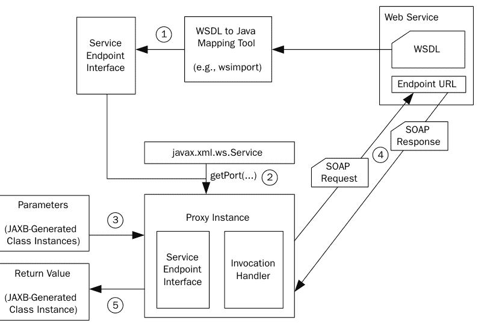

图 6–1 展示了创建和使用 SEI 及其关联代理实例的过程。

1. 使用 WSDL 到 Java 映射工具（例如 GlassFish 的 `wsimport` 工具）读取目标 Web 服务的 WSDL 并生成服务端点接口（SEI）。这一步发生在编译和运行调用 Web 服务的客户端代码之前。
2. 在运行时，使用 `javax.xml.ws.Service` 类的 `getPort()` 方法创建实现 SEI 的代理实例。
3. 通过调用 SEI 上的方法来调用 Web 服务。如图 6-1 所示，传递给此类方法的参数是 JAXB 生成的类的实例。由于 SEI 使用标准的 JAXB XML Schema 映射到对应的 `wsdl:portType`，每个方法对应 `wsdl:portType` 上的 `wsdl:operation`。
4. 代理内部将 SEI 调用转换为 SOAP 请求并发送到 Web 服务端点。在此图中，我们假设绑定是 SOAP over HTTP，但 JAX-WS 架构支持其他绑定方式。
5. 最后，代理实例接收 SOAP 响应（或故障）并将其反序列化为 SEI 方法返回类型的实例。

接下来，我将带你通过一个示例了解如何使用代理实例调用 Web 服务。示例是一个名为 `RequestOrder` 服务，该服务要求客户端发送一个客户编号、一个订单号（或信用卡）以及一个要购买的项目列表。Web 服务返回一个完成的订单作为收据。该订单表示为 `oms:order` 实例（参见第 3 章中关于 `oms:order` 的示例）。

### 6.1.1 JAX-WS WSDL 到 Java 的映射

如所述，SEI 是通过 JAX-WS WSDL 到 Java 映射从 Web 服务的 `wsdl:portType` 映射的。为了开始，我在示例中说明这种映射的应用。示例 6–1 显示了 `RequestOrder` 服务的 WSDL 类型。正如书中所有的元素一样，`RequestOrder` 使用 WSDL 的 document/literal 样式（参见第 4 章）。此处定义的 `requestOrder` 元素是包含 `CUST_NO`（客户编号）、`PURCH_ORD_NO`（订单号）、`card`（信用卡信息）以及多个 `item`（项目）实例的包装元素。同样，`requestResponse` 是包含响应 `oms:order`（订单）的包装元素，因为 `oms:order` 是其子元素。

**示例 6-1 由 RequestOrder 服务定义的 WSDL 类型**

```xml
<wsdl:types>
 <xs:schema namespace="http://www.example.com/oms">
  <xs:include schemaLocation="http://www.example.com/orders.xsd"/>
 </xs:schema>
 <xs:schema targetNamespace="http://www.example.com/faults">
  <xs:include schemaLocation="http://www.example.com/faults/faults.xsd"/>
 </xs:schema>
 <xs:schema elementFormDefault="qualified" targetNamespace="http://www.example.com/req">
 <xs:import namespace="http://www.example.com/oms">
 <xs:element name="RequestOrder">
 <xs:sequence>
  <xs:element name="CUST_NO">
  <xs:simpleType>
   <xs:restriction base="xs:string">
    <xs:maxLength value="10"/>
   </xs:restriction>
  </xs:simpleType>
 </xs:element>
 <xs:element name="PURCH_ORD_NO" minOccurs="0">
  <xs:simpleType>
   <xs:restriction base="xs:string">
    <xs:maxLength value="35"/>
   </xs:restriction>
  </xs:simpleType>
 </xs:element>
 <xs:element name="card" type="oms:BUSOBJ_CCARD" minOccurs="0"/>
 <xs:element name="item" type="oms:BUSOBJ_ITEM" maxOccurs="unbounded"/>
 </xs:sequence>
 </xs:element>
 </xs:schema>
</wsdl:types>
```

```xml
      </xs:sequence>
      </xs:complexType>
  </xs:element>
  <xs:element name="requestOrder">
      <xs:complexType>
          <xs:sequence>
              <xs:element ref="oms:Order"/>
          </xs:sequence>
      </xs:complexType>
  </xs:element>
  <xs:schema>
</wsdl:types>
```

这些包装元素中的参数通过 JAXB 2.0 XML Schema 到 Java 的映射映射到 SEI 中的方法参数。另一方面，SEI 中的方法签名是从 `wsdl:portType` 上定义的操作映射而来的。

示例 6–2 显示了 `RequestOrder` Web 服务的 `wsdl:portType`。`wsdl:operation requestorder` 映射到 SEI 上名为 `requestorder` 的方法。方法的输入参数将来自 `wsdl:input` 消息——换言之，即 `req:request`。如你所见，该消息是单个 `wsdl:part`，即之前讨论的 `req:requestOrder` 包装元素。因此，名为 `requestorder` 的 SEI 方法的参数将从 `req:requestorder` 的子元素映射。同样，`requestorder` 的响应类型将映射到 `oms:order`，因为 `oms:order` 是 `wsdl:output` 消息的子元素。如果这看起来很混乱（确实可能！），请查看第 4 章中关于 wsdl document/literal 样式的描述。

**示例 6-2 由 Requestorder Web 服务定义的 `wsdl:portType`**

```xml
<wsdl:message name="request">
    <wsdl:part name="parameters" element="req:requestOrder"/>
</wsdl:message>
<wsdl:message name="response">
    <wsdl:part name="parameters" element="req:requestOrder"/>
</wsdl:message>
```

```xml
<wsdl:message name="inputFault">
  <wsdl:part name="parameters" element="faults:inputMessageValidationFault"/>
</wsdl:message>
<wsdl:portType name="RequestOrderPortType">
  <wsdl:operation name="requestOrder">
    <wsdl:input message="req:request"/>
    <wsdl:output message="req:response"/>
    <wsdl:fault name="requestOrderInputFault" message="req:inputFault"/>
  </wsdl:operation>
</wsdl:portType>
```

`book-code/chap06/endpoint/modules/endpoint/src/webapp/WEB-INF/wsdl/RequestOrder.wsdl`

在代码中，我使用了 GlassFish 的工具 `wsimport` 从此 WSDL 生成了 SEI 类。示例 6–3 显示了在我的示例代码中如何从 Ant 内部调用 `wsimport`。虽然这种格式读起来有点困惑，但你可以理解大致的思路。

**示例 6–3 从 Ant 调用 wsimport 将 WSDL 到 Java 的映射工具**

```xml
<target name="wsdl2java">
  <mkdir dir="${basedir}/target/work/java"/>
  <mkdir dir="${basedir}/target/classes"/>
  <exec executable="wsimport" failonerror="true">
    <arg value="-d"/>
    <arg value="${basedir}/target/classes"/>
    <arg value="-s"/>
    <arg value="${basedir}/target/work/java"/>
    <arg value="-keep"/>
    <arg value="http://${glassfish.host}:${glassfish.deploy.port}/chap06-endpoint-endpoint-1.0/RequestOrder.wsdl"/>
  </exec>
</target>
```

`book-code/chap06/proxy/modules/wsdl2java/build.xml`

传递给 `wsimport` 工具（最后一个参数）的是 RequestOrder 服务 WSDL 的 URL。在这种情况下，使用主机和端口的默认值，该 URL 为 `http://localhost:8080/oms/RequestOrder-Service?wsdl`。`wsimport` 工具生成 SEI 类并将源代码放在由 `-s` 选项指定的目录中（编译后的类进入由 `-d` 选项指定的目录）。

图 6–2 显示了由 `wsimport` 工具实现的 JAX-WS WSDL 到 Java 的映射。左侧标记为 "RequestOrder WSDL" 的框显示了该 Web 服务 WSDL 的编辑后片段。WSDL 的五个对象代表了由 `wsimport` 工具生成的类。其中一些类（例如 `OrderType`）纯粹是将 JAXB XML 架构到 Java 的映射应用到 `wsdl:types` 部分中定义的架构上的结果。另一些类（例如 `RequestOrderPort`）则是通过 JAX-WS WSDL 到 Java 的映射定义的。这些类都同时标注了 JAXB 和 JAX-WS 注解。为了讨论的简单起见，图 6–2 中省略了注解。在随后的内容中，我将讨论 JAX-WS 注解。

在接下来的编号列表中，解释了图 6–2 中每个标记的映射组件。这些是高层面的解释，旨在让你对 WSDL 到 Java 映射在实践中如何使用有一个良好的直观认识。关于映射的详细描述，你应该阅读 [JSR-224] 的第 2 章。

1. `wsdl:portType` 元素映射到端接口 SEI——`RequestOrderPort`。
2. 名为 `requestOrder` 的 `wsdl:operation` 映射到同名的 SEI 方法。
3. `wsdl:input` 消息决定了 `requestOrder` 方法的参数。如你所示，此消息 `req:request` 有一个 `wsdl:part`——在 `wsdl:types` 部分中定义的包装元素 `req:request`。该包装元素的子元素（即 `CUST_NO`、`PURCH_NO`、`card`）定义了方法参数。注意，`item` 元素因为其 `maxOccurs > 1` 被映射为 `List`。
4. 同样，`wsdl:output` 消息决定了响应类型——换句话说是 `OrderType`。
5. 根据 JAX-WS 映射，每个 `wsdl:fault` 映射到一个抛出的异常。在这里，唯一的 `wsdl:fault` 映射到 `requestOrder` 方法声明中的 `throws InputFault` 子句。
6. `wsdl:fault` 所引用的 `wsdl:message` 映射到一个扩展 `java.lang.Exception` 的类。在这个示例中，名为 `inputFault` 的 `wsdl:message` 映射到 `InputFault` 类。这是 fault bean（下文描述）的包装异常类。

**RequestOrder WSDL**

```xml
<wsdl:types>
  ...
  <xs:schema>
```


```xml
<xs:schema elementFormDefault="qualified"
  targetNamespace="http://www.example.com/req">
  <xs:element name="RequestOrder">
    <xs:complexType>
      <xs:sequence>
        <xs:element name="CUST_NO" />
        <xs:element name="PURCH_ORD_NO">
          <minOccurs="0"/>
          <type="oms:BUSOBJ_CCard">
          <minOccurs="0"/>
        </xs:element>
        <xs:element name="item">
          <type="BUSOBJITEM"
          maxOccurs="unbounded"/>
      </xs:sequence>
    </xs:complexType>
  </xs:element>
  <xs:element name="RequestResponse">
    <xs:complexType>
      <xs:sequence>
        <xs:element name="OrderType"/>
      </xs:sequence>
    </xs:complexType>
  </xs:element>
</xs:schema>
</wsdl:types>
```

```xml
<wsdl:message name="request">
  <wsdl:part name="parameters"/>
</wsdl:message>
<wsdl:message name="response">
  <wsdl:part name="parameters"/>
</wsdl:message>
<wsdl:message name="fault">
  <wsdl:part name="parameters"/>
</wsdl:message>
<wsdl:portType name="RequestOrderPort">
  <wsdl:operation name="requestOrder">
    <wsdl:input message="req:request"/>
    <wsdl:output message="req:response"/>
    <wsdl:fault name="requestOrderInputFault"/>
  </wsdl:operation>
</wsdl:portType>
```

### BUSOBJ_CCard
```java
public class BUSOBJ_CCard {
  protected String card;
}
```

### BUSOBJITEM
```java
public class BUSOBJITEM {
  protected String item;
}
```

### OrderType
```java
public class OrderType {
  protected String order;
}
```

### InputFault
```java
public class InputFault extends Exception {
  protected String fault;
}
```

### RequestOrderPort (SEI)
```java
public interface RequestOrderPort {
  OrderType requestOrder(
    String custNo,
    String purchNo,
    BUSOBJ_CCard card,
    List<BUSOBJITEM> item
  ) throws InputFault;
}
```

- 7. `wsdl:fault` 元素引用带有一个部分的 `wsdl:message`。该部分引用的全局声明映射到一个 JavaBean。此类 Fault bean 被异常（如前所述）包装。
- 8. `wsdl:types` 部分中定义的类型和全局元素通过第 5 章所述的 JAXB 映射到 Java 类。在本示例中，`osms:Order` 映射到 `OrderType`，`osms:BUSOBJ_ITEM` 映射到 `BUSOBJITEM`，`osms:BUSOBJ_CCARD` 映射到 `BUSOBJ_CCARD`。

此讨论提供了 JAX-WS 如何将 WSDL 映射到类的示例——特别是如何从 `wsdl:portType` 创建 SEI。接下来，我将讨论 JAX-WS 运行时如何将方法调用转换为 SOAP 消息。该过程的关键是 JAX-WS 注解。

## 6.1.2 服务端点注解

正如你从第 5 章所记得的，JAX 运行时使用注解确定如何将 JAXB 值类序列化/反序列化为 XML。类似地，JAX-WS 运行时使用 SEI 上的注解确定如何将方法调用映射为 SOAP 请求消息。为了简单起见，我们只考虑这里说明的示例——输出消息有一个单一部分/包装类映射到 SEI 方法的返回值。如果你对输出消息具有多个部分/包装类映射到标注 SEI 操作的所有细节感兴趣，请参阅 [JSR-224] 的第 2 章和第 7 章。

# 274 JAX-WS——客户端开发

### RequestOrderPort (SEI)
```java
@WebService(name = "RequestOrderPort",
  targetNamespace = "http://www.example.com/req",
  wsdlLocation = "http://localhost:8080/oms/requestOrder.wsd")
public interface RequestOrderPort {
  @WebMethod
  @WebResult(name = "Order",
    namespace = "http://www.example.com/oms")
  @RequestWrapper(localName = "requestOrder",
    targetNamespace = "http://www.example.com/req",
    className="com.example.req.RequestOrder")
  @ResponseWrapper(localName = "requestOrderResponse",
    targetNamespace = "http://www.example.com/req",
    className="com.example.req.RequestOrderResponse")
  public OrderType requestOrder(
    @WebParam(name = "CUST_NO",
    targetNamespace = "http://www.example.com/req")
    String custno,
    @WebParam(name = "PURCH_ORD_NO",
    targetNamespace = "http://www.example.com/req")
    String purchordno,
    @WebParam(name = "ccard",
    targetNamespace = "http://www.example.com/req")
    String USOBJITCCARD card,
    @WebParam(name = "item",
    targetNamespace = "http://www.example.com/req")
    List<USOBJITEM> item);
}
```

### SOAP 请求消息
```xml
<soapenv:Envelope xmlns:soapenv=
  "http://schemas.xmlsoap.org/soap/envelope/"
  xmlns:ns1="http://www.example.com/req">
  <soapenv:Body>
    <ns1:requestOrder>
      <ns1:CUST_NO>ENT00072123</ns1:CUST_NO>
      <ns1:PURCH_ORD_NO/>
      <ns1:ccard/>
      <ns1:item>
        <ns1:item>
      </ns1:item>
    </ns1:requestOrder>
  </soapenv:Body>
</soapenv:Envelope>
```

### SOAP 响应消息
```xml
<soapenv:Envelope xmlns:soapenv=
  "http://schemas.xmlsoap.org/soap/envelope/"
  xmlns:ns1="http://www.example.com/req">
  <soapenv:Body>
    <ns1:requestOrderResponse>
      <Order xmlns="http://www.example.com/oms">
        <OrderHeader>...
          <OrderKey>9411150746</OrderKey>
        </OrderHeader>
        <Items>
          <item>
            <item>
          </item>
        </Items>
        <OrderCard>
          <ccard></ccard>
        </OrderCard>
        <OrderText>WEB Order placed via</OrderText>
      </Order>
    </ns1:requestOrderResponse>
  </soapenv:Body>
</soapenv:Envelope>
```

**图 6–3** JAX-WS SEI 注解以及对应的 SOAP 请求/响应消息。

# 6.1 JAX-WS 代理 275

示例 6–1。正如你在示例中所看到的，SOAP 请求消息的体部有一个子元素——其本地名称为 `requestOrder`，命名空间为 `http://www.example.com/req`，正如 `@RequestWrapper` 注解中所定义的那样。

- 2. `@WebParam` 注解将 SEI 方法的参数映射到 SOAP 请求消息的参数。在文档/字面封装风格（document/literal wrapped style）Web 服务中，如前所述，这些参数是包装元素的子元素。
- 3. 与 `@RequestWrapper` 注解类似，`@ResponseWrapper` 定义了 SOAP 响应消息的包装元素。因此，如图 6–3 所示，SOAP 响应体元素的唯一子元素是由该注解定义的包装元素。
- 4. `@WebResult` 注解将 SEI 方法的返回值映射到 SOAP 响应消息体中包含的响应元素的对应子元素。在本示例中，该注解定义了一个名为 `Order` 的元素，如你所见，该元素是响应消息中 SOAP 体部的孙元素。

由于图 6–3 中的带注解接口 (SEI) 较难阅读，我重复了示例 6–4 中 `RequestOrderPort` 类的代码列表。

## 示例 6–4 带注解的节点接口
```java
40 @WebService(name = "RequestOrderPort",
41 targetNamespace = "http://www.example.com/req",
42 wsdlLocation = "http://localhost:8080/oms/RequestOrderService.wsdl"
43 public interface RequestOrderPort {
44
45   @WebMethod
46   @WebResult(name = "Order", namespace = "http://www.example.com/oms")
47   @RequestWrapper(localName = "RequestOrder",
48   targetNamespace = "http://www.example.com/req",
49   className = "com.example.req.RequestOrder"
50   @ResponseWrapper(localName = "RequestResponse",
51   targetNamespace = "http://www.example.com/req",
52   className = "com.example.req.RequestResponse")
53 public OrderType requestOrder(
54   @WebParam(name = "CUST_NO",
55 targetNamespace = "http://www.example.com/req")
56 String custno,
57   @WebParam(name = "PURCH_ORD_NO",
58   targetNamespace = "http://www.example.com/req")
59 String purchordno,
60   @WebParam(name = "ccard",
61   targetNamespace = "http://www.example.com/req")
62 String USOBJITCCARD card,
63   @WebParam(name = "item",
64   targetNamespace = "http://www.example.com/req")
65 List<USOBJITEM> item
66 throws InputFault
67 ;
68 }
```


# JAX-WS 客户端开发

## 示例 6–4 中 Java 注解的描述

| 注解 | 目的 | 示例 |
|---|---|---|
| `@WebService` | 标识 Java 类实现了 Web 服务，或标识 Java 接口为 SEI（在本示例中，从 `wsdl:portType` 映射的 SEI）必须根据 [JSR-224] 第 2.2 节使用 `@WebService`。 | `name` 和 `namespace` 属性标识 `wsdl:portType`。`wsdlLocation` 属性标识包含 |
| `@WebMethod` | 标识关联的方法已从 `wsdl:operation` 映射。 | 映射的 SEI 方法（在本示例中，从 `wsdl:operation` 映射的 SEI 方法）必须根据 [JSR-224] 第 2.3 节使用 `@WebMethod`。 |
| `@WebResult` | 将 SEI 方法的返回值关联 `wsdl:part` 或 `wsdl:part` 的元素定义。 | 对于文档绑定（在本示例中），`name` 属性对应于返回值的 XML 元素的本地名称，`namespace` 提供了 XML 元素的命名空间。在传输上，在本示例中，该 XML 元素对应于体部的包装元素。对于 rpc/literal 绑定，`name` 属性可以变化，因为响应元素的名称是定义的且不重要。 |
| `@RequestWrapper` | 标识请求包装豆——映射到请求消息包装元素的 JAXB 生成类。 | 对于文档/字面封装 Web 服务（如在本示例中），`className` 属性指定了 JAXB 生成的包装豆的全限定名称。同样，`localName` 和 `targetNamespace` 属性引用了 `wsdl:type` 定义的包装元素的名称和命名空间。包装元素作为 SOAP 请求体的唯一子元素出现。对于 rpc/literal 绑定，不使用此注解，因为包装元素没有在 WSDL 架构中定义。 |

## 示例 6–4 中出现的 Java 注解说明（续）

| 注解 | 用途 | 示例 |
| --- | --- | --- |
| `@ResponseWrapper` | 标识响应包装 bean——一个 JAXB 生成的类，它映射到响应消息的包装元素。 | 对于文档/字面量（document/literal）封装的 Web 服务（如本示例所示），`className` 属性指定 JAXB 生成的响应 bean 的完全限定名。同样，`targetNamespace` 属性引用在 `wsdl:types` 中定义的包装元素的名称和命名空间。该包装元素作为 SOAP 响应消息主体的唯一子元素出现。对于 rpc/literal 绑定，该注解在 WSDL 架构中未定义。 |
| `@PathParam` | 将 SEI 方法的参数与特定的 `wsdl:part`（rpc 样式）或特定元素定义样式中的包装子元素关联。无论何种情况，`@PathParam` 都会将参数的 Java 表示与 WSDL/表示关联起来。 | 对于文档/字面量（document/literal）封装的 Web 服务（如本示例所示），`name` 和 `targetNamespace` 属性引用 `wsdl:types` 部分中定义的包装元素的包装子元素的名称和命名空间。在传输过程中，这些包装元素作为请求包装元素的子元素出现，而请求包装元素又是 SOAP 请求主体的唯一子元素。因此，`@PathParam` 定义的元素是 SOAP 请求主体的孙元素。对于 rpc/literal 绑定，由于情况下参数是不限定的，因此不使用 `targetNamespace` 属性。相反，使用 `partName` 属性来指示映射到输入消息的哪个部分。 |

参阅第 4 节第 4.3 节关于 WSDL 各样式以及 document/literal、document/wrapped 和 rpc/literal 之间差异的讨论。

在下一节中，我将介绍使用 JAX-WS 客户端调用示例服务的细节。在经历了这么多关于映射的复杂讨论后，你可能会发现使用 JAX-WS 代理调用 Web 服务其实简单，这会让你松一口气！

## 6.1.3 使用代理调用 Web 服务

你可以使用几种方法来获取代理实例。在本节中，我们将查看其中三种。最优雅的方法涉及由注解指定的依赖注入，如示例 6–5 所示。

### 示例 6–5 使用 `@WebServiceRef` 注入代理实例

```java
@WebServiceRef(RequestOrderService.class)
public static RequestOrderPort port;
```

`book-code/chap06/proxy/modules/client/src/java/samples/Client.java`

`@WebServiceRef` 注解定义了对 Web 服务的引用，如 [JSR-250] 第 2.3 节中的 `javax.annotation.Resource` 注解所示。当此注解应用于字段或方法时，容器将在初始化时将所请求的资源实例注入到应用程序中。

在示例 6–5 中，它标注了类型为 `RequestOrderPort` 的字段 `port`（本示例中使用的 SEI）。这是一个依赖注入示例，其中变量 `port` 指向注入目标。通过这种方式使用 `@WebServiceRef` 注解，容器将一个实现 SEI 的代理实例注入到注入目标。

当然，为了让这种注入生效，代码必须在容器内部执行。对于此示例，我使用了 GlassFish 应用程序客户端容器 (ACC)。ACC 在 Java EE 5 中定义（参见 [JSR-244] 的 EE.9），作为一个仅提供安全和部署服务的轻量级容器。

回到 `@WebServiceRef` 注解，在这种情况下，我使用它来注入 SEI `RequestOrderPort` 的实例。当以这种方式使用时，注解的 `value` 属性必须引用生成的服务接口类型（即 `javax.xml.Service` 的子类型）。此处为 `value` 属性指定的类——`RequestOrder.class` 是由导入工具与 SEI 同时生成的。生成的 `RequestOrderService` 类提供了 `getRequestOrderPort()` 方法，该方法返回 `RequestOrderPort` 的实例。

如果你没有在容器内部运行，则无法使用 `@WebServiceRef` 进行注入，但你仍然可以使用生成的服务 `RequestOrderService`，如示例 6–6 所示。

### 示例 6–6 使用生成的服务创建代理实例

```java
RequestOrderService service = new RequestOrderService();
RequestOrderPort port = service.getRequestOrderPort();
(new Tester()).runTests(port);
```

`book-code/chap06/proxy/modules/client/src/java/samples/Client.java`

最后，你可以通过在运行时配置 `javax.xml.Service` 来动态为 SEI 构建代理实例。这种方法在示例 6–7 中所示。

### 示例 6–7 使用动态配置的服务创建代理实例

```java
URL wsdlURL = new URL("http://...");
```

`book-code/chap06/proxy/modules/client/src/java/samples/Client.java`

使用这种方法，你让 `Service.create()` 工厂方法使用 WSDL URL 和 `wsdl:service` 的 QName 来配置服务实例。从技术上讲，由于 SEI 标注了 WSDL URL，你不需要使用 WSDL 参数。然而，万一自 SEI 生成以来 URL 可能发生了变化，通常在此处指定 URL 更安全。

示例 6–8 所示的 `runTests` 方法接收的唯一参数是由上述方法之一创建的、实现 `RequestOrderPort` 的代理实例。在该方法的前几行中，我创建了 JAXB 实例并将其作为参数传递给代理实例。由于此示例说明了某些异常处理，我创建了一张“过期”信用卡和一张“良好”信用卡。

在第一个 `try` 块内部，你可以看到是如何调用动态端口的：

```java
order = port.requestOrder("211", null, null, ard);
```

这很简单。你只需要在 `RequestOrderPort` 接口上调用 `requestOrder` 方法。返回值类型为 `OrderType`——它是 `wsdl:outmessage` 指定的 `oms:order` 元素的 JAXB 绑定。

## 6.1.4 使用代理进行故障处理

本示例使用的 RequestOrder Web 服务在 `requestOrder` 的 `wsdl:operation` 定义中指定了 `wsdl:fault`。你可以在示例 6–4 中看到 `wsdl:fault` 如何映射到 Java 异常类 `InputFault`。因此，正如你预期的，执行 `RequestOrderPort.requestOrder` 方法的代码（示例 6–8）捕获了可能抛出的 `InputFault`。

然而，你可能注意到 `javax.xml.soap.SOAPFaultException` 是 JAX-WS 运行时用于携带特定故障信息的异常。因此，如果 RequestOrder Web 服务返回的 SOAP 故障没有映射到 `InputFault`（即 SOAP 故障消息的 `detail` 元素不是由 `wsdl:fault` 对应的 `inputFault` 元素的实例），JAX-WS 将此 SOAP 故障转换为 `SOAPFaultException` 实例。

在理想情况下，应用程序故障将由 `wsdl:fault` 表示。如果确实如此，你获得的 `SOAPFaultException` 将是系统级错误（返回到 Web 服务业务逻辑的错误）。但在现实世界中，Web 服务可能会返回业务相关的或其他 SOAP 故障消息。

### 示例 6–8 测试代理

```java
public void runTests(RequestOrderPort port) throws Exception {
    OrderType card = createCreditCard();
    OrderType item = createItemList();

    try {
        System.out.println("Running test with expired credit card.");
        OrderType order = port.requestOrder("211", card, item);
        printReturned(order);
    } catch (SOAPFaultException e) {
        System.out.println("Error - should have thrown");
    } catch (InputFault e) {
        System.out.println("Running test with null number.");
        OrderType order = port.requestOrder(null, card, item);
        printReturned(order);
    } catch (InputFault e) {
        processInputFault(e);
    }

    try {
        System.out.println("Running test with a valid request.");
        OrderType order = port.requestOrder("211", card, item);
        printReturned(order);
    } catch (InputFault e) {
        processInputFault(e);
    }
}
```

`book-code/chap06/proxy/modules/client/src/java/samples/Tester.java`

由 `wsdl:fault` 表示。这就是为什么如示例 6–8 所示，编写 catch 块来处理 `SOAPFaultException` 是一个良好的做法。

以此作为示例，示例 6–8 中的代码首先使用过期的信用卡调用了 `requestOrder` 方法。正如我在示例中设置的那样，这会导致 Web 服务返回一个映射到 `InputFault` 的 SOAP 故障消息。结果是 `requestOrder` 方法抛出了运行时异常 `SOAPFaultException`。来自 SOAP 消息体的 `SOAP-ENV:Fault` 元素如示例 6–9 所示。

### 示例 6–9 信用卡过期产生的 `SOAP-ENV:Fault` 元素结果

```xml
<SOAP-ENV:Fault xmlns:SOAP-ENV="http://schemas.xmlsoap.org/envelope">
  <faultstring>Business logic exception</faultstring>
  <code>SOAP-ENV:Client</faultcode>
  <detail>
    <expiredCC xmlns="http://www.example.com/req"> Credit card has expired</expiredCC>
  </detail>
</SOAP-ENV:Fault>
```

`book-code/chap06/proxy/edited/soapfaultexception.xml`

如你在这里看到的，`faultstring` detail 元素指明这是一个业务逻辑异常。`detail` 元素旨在提供比 `faultcode` 元素传递更多的信息，因为正如你所看到的，在这个示例中，`SOAP-ENV:client` 的 `faultcode` 仅仅告诉你请求消息出现了问题。没有 `detail`，你就不知道到底出了什么问题。

另一方面，对于由 `wsdl:soap:fault` 表示的特定应用程序故障，它指定了 SOAP 故障消息 `detail` 元素的内容。`name` 属性将 `soap:fault` 与为该操作定义的 `wsdl:fault` 关联。因此，从 WSDL（示例 6–1 和示例 6–2）中可以看到，对于此类消息，`detail` 元素包含单一的 `faults:inputValidationFault` 子元素。对于 JAX-WS，该元素被映射到 `InputFault` 包装类的 `FaultInfo` 属性上。示例 6–10 显示了该示例中处理 `InputFault` 实例的样本代码。

### 示例 6–10 处理 `InputFault` 异常

```java
private void processInputFault(InputFault e) {
    System.out.println("Mapped Exception (InputFault)");
    System.out.println("InputFault.getMessage() ==");
    System.out.println(e.getMessage());
    System.out.println("InputFault.getFaultInfo() ==");
    System.out.println(e.getFaultInfo().getMsg());
    System.out.println();
}
```

因此，你可以看到，处理从 `wsdl:fault` 声明映射的异常相对简单。你只需要使用 `FaultInfo()` 方法来获取消息 `detail` 元素内容的 JAXB 表示。这比使用 SAAJ API 来解析 `javax.xml.soap.SOAPFault` 实例要简单得多。示例 6–11 显示了当向 Web 服务发送包含空客户编号的 SOAP 请求消息时，运行示例 6–10 代码的结果。

### 示例 6–11 `InputFault` 处理输出

```text
[java] Running test with null customer number.
[java] Mapped Exception (InputFault)
[java] InputFault.getMessage() =
[java] Input parameter failed validation.
[java] InputFault.getFaultInfo().getMsg() =
[java] Customer Number cannot be null.
```


要运行本节中的样本代码，请执行以下操作：

1. 转到 `<book-code>/chap06/endpoint`。
2. 要部署 Web 服务，输入 `mvn install`，然后输入 `ant deploy`。

## 6.2 XML 消息

3. 转到 `chap06/proxy`。
4. 要运行示例，输入 `mvn install`，然后输入 `run-standalone`。
5. 要在客户端容器中运行，输入 `mvn install`，然后输入 `run-container`。
6. 完成后，返回 `<book-code>/chap06/endpoint`。
7. 要取消部署服务，输入 `ant undeploy`。

本节涵盖了大量内容。你学习了如何使用 JAX-WS 代理，并学习了许多在使用此类代理之前的技术和标准。为了能够熟练使用 JAX-WS，我认为有必要对 WSDL 到 Java 映射的定义产生某种直觉。这也是为什么我包含了大量关于映射的信息，以及控制其运行时行为的注释。JAX-WS API 的设计初衷是让你看起来只需通过调用方法即可完成服务调用。然而，通过动态代理技术，编写任何比基础“Hello World”应用程序更复杂的内容——都需要你对方法以及 SOAP 故障消息如何被处理有所感觉。

在下一节中，我将介绍一种不以 JAX 为中心的方法来处理 Web 服务。我不是使用 JAXB 生成的参数调用 SEI 方法，而是展示一个使用 JAX-WS 客户端基础设施发送和接收 XML 消息的示例。

## 6.2 XML 消息

尽管动态代理使 Web 服务调用看起来像标准的 Java 方法调用，但这种简单性也带来了许多可能使 SOA 变得困难的限制。

首先，代理方法要求你使用根据标准的 JAX-WS WSDL 到 Java 映射从目标 Web 服务 WSDL 生成的 SEI。SEI 上的方法的参数和返回类型是由 JAXB 模式编译器从 WSDL 的 `wsdl:types` 部分创建的类。这些类将与你今天业务中使用的类不同。例如，如果你的业务组织有一个基于 Java 的订单管理系统，你可能已经有一个在调用需要信用卡支付的 Web 服务时使用的信用卡类。使用 JAXB 生成的来自 6.1 节的 `USOBJCCARD` 类（见图 6–2）来表示信用卡是有问题的。你将被强制编写一些自定义中间件，在你现有的信用卡类和 `USOBJCCARD` 之间进行翻译。

其次，直接与 XML 消息工作通常比与 JAXB 生成的类工作更好。第 3 章提供了这样的场景之一，我在那里展示了如何从另一个地方转换 XML 的示例。第三，当 WSDL 在运行时未知，你可能需要动态编写代码。这在你使用 `Dispatch<T>` 接口处理此类场景时会发生。在运行时是不可能的绑定 的。

### 6.2.1 使用原始 XML 的 XML 消息

在本节中，我提供了一个如何使用示例 6–12 中的消息动态调用 Web 服务的示例。目标是上一节引入的 `RequestOrder` Web 服务。

**示例 6–12 用于调用 Web 服务的 XML 消息**

```xml
<requestOrder xmlns:req="http://www.example.com/req">
  <CUST_NO>ENT07123</CUST_NO>
  <ccard>
    <CC_TYPE>VISA</CC_TYPE>
    <EXPIRE_DATE>2009-10-31</EXPIRE_DATE>
    <CC_NAME>John Doe</CC_NAME>
  </ccard>
  <item>
    <ITM_NUMBER>01235</ITM_NUMBER>
    <STORAGE_LOC>NE02</STORAGE_LOC>
    <QTY>50</QTY>
    <UOM>CNT</UOM>
    <PRICE_PER_UOM>7.95</PRICE_PER_UOM>
    <SHORT_TEXT>7 mm Gasket</SHORT_TEXT>
  </item>
  <item>
    <ITM_NUMBER>54321</ITM_NUMBER>
    <QTY>5</QTY>
    <UOM>KG</UOM>
    <PRICE_PER_UOM>12.58</PRICE_PER_UOM>
    <SHORT_TEXT>Lithium grease with PFE/Teflon</SHORT_TEXT>
  </item>
</requestOrder>
```

# 示例 6–13 使用 Dispatch<Source> 进行 XML 消息

```java
79 StreamSource xmlSource =
80 new StringSource(new StreamReader(xmlByteArray.toString())));
81 // Create Service
82 wsdlURL = new URL("http://"+host+)+port
83  "/chap06-endpoint-endpoint-1.0/requestOrder?wsdl";
84 QName serviceName =
85 new QName("http://www.example.com/req", "RequestOrder");
86 Service service = Service.create(wsdlURL, serviceName);
87 // create Dispatch<Source>
88 QName portName =
89 new QName("http://www.example.com/req", "RequestOrderPort");
90 Dispatch<Source> dispatch = service.createDispatch(portName,
91 Source.class, Service.Mode.PAYLOAD);
92 Source orderSource = dispatch.invoke(xmlSource);
93 JAXBContext jc = JAXBContext.newInstance(RequestOrder.class);
94 Unmarshaller u = jc.createUnmarshaller();
95 RequestOrderResponse response =
96 (RequestOrderResponse) u.unmarshal(orders);
```

从这段代码开始，你会看到用于调用服务的 XML 消息封装在名为 `xmlSource` 的 `Source` 变量中。`javax.xml.ws.Service` 类作为创建 `Dispatch` 实例的工厂。因此，要创建一个 `Dispatch`，我们必须先创建一个 `Service`。

如所见，正如示例 6-7 所示，使用 WSDL 的 URL 和 `wsdl:req:RequestOrderService` 的 `QName` 动态创建 `Service`。

在代码块中间，创建了 `Dispatch<T>`。`Service.createDispatch()` 方法接受三个参数：`wsdl:portType` 的 `QName`、参数 `T` 的类以及服务模式。类型参数 `T` 指定了封装发送的 XML 消息的类。`Dispatch<T>` 支持 `xml.transform.Source`、`Object`（用于 JAXB 注解类）、`javax.xml.soap.SOAPMessage` 和 `javax.activation.DataSource`（用于 MIME 类型消息）。在本示例中，我使用 `Source` 进行封装，在下一个示例中，我将说明如何使用 JAXB 对象。

服务模式参数可以是 `javax.xml.ws.soap.Mode.MESSAGE` 或 `javax.xml.ws.Mode.PAYLOAD`。使用前者，你将处理整个 SOAP 消息。使用后者，你通过 `Dispatch<T>.invoke()` 方法仅处理 XML 消息——即包含在 SOAP 实体中的负载（payload）。如所见，此示例使用了 `PAYLOAD` 服务模式。在 `PAYLOAD` 模式下，`Dispatch` 实例负责创建包含负载的 SOAP 消息。

## 6.2 XML 消息

在示例 6–13 代码块的末尾，调用了 `dispatch<T>.invoke()`，它并将响应 XML 消息作为 `Source` 实例返回。

### 6.2.2 使用自定义注解 JAXB 类的 XML 消息

另一种 XML 消息处理方法是编写自己的 JAXB 注解类，以表示从 Web 服务发送和接收的 XML 消息。这就是本节所说明的技术。

这里的点在于，你可以使用 JAXB 而无需将自己绑定到 JAX-WS 生成的 SEI（服务端接口）。你可以使用 JAXB 注解将你的 Java 类映射到 Web 服务发送和接收的方法负载。

示例 6–14 显示了使用 `dispatch<Object>` 实例结合自定义 JAXB 类的代码。注意，我在这里做的第一件事是使用自定义类 `MyRequestOrder` 和 `MyRequestOrderResponse` 创建一个 `JAXBContext`。

#### 示例 6–14 使用 Dispatch<Object> 进行 JAXB 的 XML 消息

```java
JAXBContext ctxt = JAXBContext.
newInstance(MyRequestOrder.class, MyRequestOrderResponse.class);

QName portName =
new QName("http://www.example.com/reg", "RequestOrderPort");

Dispatch<Object> dispatchJAXB = service.createDispatch(portName, ctxt, Service.PAYLOAD);

// 创建自定义请求对象
MyRequestOrder myReq = new MyRequestOrder();
myReq.card = createMyCreditCard();
myReq.item = createMyItemList();
myReq.CUST_NO = "ENT0071232";
myReq.PURCH_ORD_NO = "";

MyRequestOrderResponse resp =
(MyRequestOrderResponse) dispatchJAXB.invoke(myReq);
```

`chap06/xmlmessaging/modules/src/java/samples/Client.java`

`Dispatch<Object>` 实例像以前一样通过服务工厂方法创建，不同之处是我们使用了带有 `JAXBContext` 的工厂方法而不是类型参数。该上下文由底层的 `Dispatch` 实现使用，将 Java 对象序列化/反序列化为消息。

移动代码，在创建 `Dispatch<Object>` 实例后，我配置了 `MyRequest` 实例——这是一个映射到 SOAP 负载的自定义 JAXB 注解类。该类在示例 6–15 中所示。最后，使用 `Dispatch<Object>.invoke()` 方法调用目标 Web 服务。响应负载被序列化为 `UpdateRequest` 实例——用于持有响应的自定义 JAXB 注解类。

#### 示例 6–15 自定义 JAXB 类：MyRequest

```java
@XmlAccessor(XmlAccessType.FIELD)
@XmlType(namespace = "http://www.example.com/req")
@XmlRootElement(name = "requestOrder")
namespace = "http://www.example.com/req"
public class MyRequest {
    protected String CUST_NO;
    protected String PURCH_ORD_NO;
    protected MyCreditCard card;
    protected List<Item> item;
}
```

`chap06/xmlmessaging/modules/src/java/samples/MyRequestOrder.java`

示例 6–15 显示了如何简单地创建一个映射到消息负载的 JAXB 注解对象。这个 `MyRequest` 类仅仅是作为 `requestOrder` 子元素的参数的容器。同样，示例 6–16 显示了我是如何构建一个映射到信用卡 XML 类型 `BUSOBJCCARD` 的自定义 JAXB 注解类的。

#### 示例 6–16 自定义 JAXB 类：MyCreditCard

```java
@XmlAccessor(XmlAccessType.FIELD)
@XmlType(name = "BUSOBJCCARD", namespace = "http://www.example.com/oms")
public class MyCreditCard {
    protected String CC_TYPE;
    protected String CC_NUMBER;
    protected String CC_EXPIRE_DATE;
    protected String CC_NAME;
    protected BigDecimal AMOUNT;
    protected String CHAR_DATE;
    @XmlAccessor(XmlAccessType.FIELD)
    @XmlType(name = "OrderCard")
    public static class OrderCard {
        @XmlElement(namespace = "http://www.example.com/oms")
        protected MyCreditCard card;
    }
}
```

`chap06/xmlmessaging/modules/src/java/samples/MyCreditCard.java`

要运行本节中的示例代码，请执行以下操作：

1. 启动 GlassFish（如果它尚未运行）。
2. 进入 `<book-code>/chap06/endpoint`。
3. 要部署 Web 服务，输入 `mvn install`，然后输入 `ant deploy`。
4. 进入 `<book-code>/chap06/xmlmessaging`。
5. 要运行示例，输入 `mvn install`，然后输入 `ant run`。
6. 完成后返回 `<book-code>/chap06/endpoint`。
7. 要卸载服务，输入 `ant undeploy`。

在本节中，我说明了如何通过直接处理客户端发送和接收的 XML 消息，使用 `Dispatch<T>` 来调用目标 Web 服务。我展示了如何创建映射到发送和接收消息的自定义 JAXB 注解类。

## 6.3 使用 Castor 使用自定义 Java/XML 映射进行调用

示例 6–17 CreditCard 类

```java
20 public class CreditCard {
21
22     public String type;
23     public String num;
24     public String expireDate;
25     public String name;
26     public float amount;
27     public String chargedDate;
```

`book-code/chap06/castor/src/java/samples/CreditCard.java`

同样，示例 6–18 显示了 MyRequestOrder 类，该类用于持有需要发送到目标 Web 服务的消息参数。同样，该类与示例 6–15 所示的 JAXB 版本相似，但它没有任何注解。

示例 6–18 MyRequestOrder 类：请求参数的包装器

```java
24 public class MyRequestOrder {
25
26     protected String custno;
27     protected String purchchordno;
28     protected CreditCard ccard;
29     protected List<MyItem> itemList;
```

`book-code/chap06/castor/src/java/samples/MyRequestOrder.java`

示例 6–19 显示了本示例使用的 Castor 映射文件的一部分。顶层映射元素包含了类与它们所映射的 XML 之间的关系。我还在映射元素中定义了目标 XML 中使用的命名空间（即 req，oms），以便我可以在整个文件中一致地使用它们的前缀。

映射元素的子元素是类元素。这些定义了从每个 Java 类到其对应的 XML 形式的映射。第一个类元素将 MyRequestOrder 类映射到 req:requestOrder 元素。

# 示例 6–19 Castor 映射文件

```xml
4 <DOCTYPE mapping PUBLIC "//ELOBAB/Castor Object Mapping DTD Version 1.0//EN"
5 "http://castor.org/mapping.dtd">
```


## 6.3 使用 Castor 自定义 Java/XML 映射进行调用

映射元素的子元素是类元素。这些定义了从每个 Java 类到其对应的 XML 形式的映射。第一个类元素将 `MyRequestOrder` 类映射到 `req:requestOrder` 元素。

同样，示例 6–18 显示了 `MyRequestOrder` 类，该类用于持有需要发送到目标 Web 服务的消息参数。同样，该类与示例 6–15 所示的 JAXB 版本相似，但它没有任何注解。

示例 6–19 显示了本示例使用的 Castor 映射文件的一部分。顶层映射元素包含了类与它们所映射的 XML 之间的关系。我还在映射元素中定义了目标 XML 中使用的命名空间（即 `req`，`oms`），以便我可以在整个文件中一致地使用它们的前缀。

映射元素的子元素是类元素。这些定义了从每个 Java 类到其对应的 XML 形式的映射。第一个类元素将 `MyRequestOrder` 类映射到 `req:requestOrder` 元素。

### 示例 6–18 MyRequestOrder 类：请求参数的包装器

```java
public class MyRequestOrder {

    protected String custno;
    protected String purchchordno;
    protected CreditCard ccard;
    protected List<MyItem> itemList;
}
```
`book-code/chap06/castor/src/java/samples/MyRequestOrder.java`

### 示例 6–17 CreditCard 类

```java
public class CreditCard {

    public String type;
    public String num;
    public String expireDate;
    public String name;
    public float amount;
    public String chargedDate;
}
```
`book-code/chap06/castor/src/java/samples/CreditCard.java`

### 示例 6–19 Castor 映射文件

```xml
<mapping xmlns-req="http://www.example.com/req"
         xmlns-oms="http://www.example.com/oms">
  <class name="samples.RequestOrder">
    <map-to xml="requestorder" ns-uri="http://www.example.com/req/">
      <field name="custno" type="java.lang.String">
        <bind-xml name="req:CUST_NO" node="element"/>
      </field>
      <field name="purchordno" type="java.lang.String">
        <bind-xml name="req:PURCH_ORD_NO" node="element"/>
      </field>

      <field name="ccard" type="samples.CreditCard">
        <bind-xml name="req:ccard" node="element"/>
      </field>
      <field name="itemlist" type="samples.MyItem" collection="collection">
        <bind-xml name="req:item"/>
      </field>
    </map-to>
  </class>
  <class name="samples.CreditCard">
    <map-to xml="BUSOBJ" ns-uri="http://www.example.com/oms/">
      <field name="type" type="java.lang.String" direct="true">
        <bind-xml name="oms:CC_TYPE" node="element"/>
      </field>
      <field name="num" type="java.lang.String" direct="true">
        <bind-xml name="oms:CC_NUMBER" node="element"/>
      </field>
      <field name="expireDate" type="java.lang.String" direct="true">
        <bind-xml name="oms:CC_EXPIRE_DATE" node="element"/>
      </field>
      <field name="name" type="java.lang.String" direct="true">
        <bind-xml name="oms:CC_NAME" node="element"/>
      </field>
      <field name="amount" type="float" direct="true">
        <bind-xml name="oms:BILLAMOUNT" node="element"/>
      </field>
      <field name="chargeDate" type="java.lang.String" direct="true">
        <bind-xml name="oms:CHARGE_DATE" node="element"/>
      </field>
    </class>
</mapping>
```
`book-code/chap06/castor/mapping.xml`

## 6.4 异步调用

JAX-WS 提供了易于使用的异步调用 API。通过这些 API 以及 `java.util.concurrent.Future<T>` 接口，你不需要担心线程使用和其他并发问题。

异步调用是 SOA 编程的一个强大工具，因为它有助于你管理本地执行与 Web 服务处理远程处理之间的“阻抗差异”。因此，通过在单独线程中运行 Web 服务调用并在等待完成时让本地代码执行其他操作，你可以显著提高代码速度。

事实上，JAX-WS API 提供两种异步处理方法：轮询和回调。在异步调用的轮询形式中，你的代码负责轮询 `javax.xml.ws.Response<T>`（实现了 `Future<T>`）以确定 Web 服务调用是否完成。另一方面，使用异步调用的回调形式，你的代码提供 `javax.xml.ws.AsyncHandler` 实例来处理 Web 调用的结果。当 Web 服务返回结果时，将由你提供的 `AsyncHandler` 实例自动处理。通过这种方式，`AsyncHandler` 扮演了类似于 JMS 队列上 `javax.jms.MessageListener` 的角色。就像 `MessageListener` 在消息到达时异步处理一样，`AsyncHandler` 在 Web 服务响应到达时异步处理。这里的主要区别在于，`MessageListener` 为队列配置一次并处理所有消息，而 `AsyncHandler` 必须在每次异步 Web 服务调用时指定。

### 6.4.1 轮询

示例 6–21 展示了如何结合 `Dispatch<T>` 接口使用异步调用的轮询形式。如你所见，`dispatch<Source>` 实例的配置方式与之前的示例相同。

#### 示例 6–21 使用轮询的异步调用

```java
URL wsdl = new URL("http://localhost:8080/chap06-endpoint-endpoint-1.0/requestOrder?wsdl");
```
`book-code/chap06/asynchronous/modules/client/src/samples/Client.java`

在该案例中，Service 是通过 `Dispatch<T>.invokeAsync(T msg)` 调用的。在底层，该方法使用 `java.util.concurrent.Executor` 配合创建 `Dispatch<T>` 的 Service 实例，使用单独的线程调用 Service。异步调用返回一个 `Response<Source>`。`Response<T>` 是 `Future<T>` 的包装器，提供了一个额外的方法——`getContext()`，用于获取响应内容。

在本示例中，我们使用 `get()` 方法来以 `Source` 实例的形式获取响应消息。注意，该示例演示了这种异步调用的轮询机制。轮询可以在 `while` 循环中看到，它通过轮询 `isDone()` 来确定异步调用何时完成。变量记录了完成异步调用所需的毫秒数。运行此示例，请参考以下步骤：

> `Executor` 接口以及 `java.util.concurrent` 包的其他部分是在 J2SE 5.0 中引入的。Executor 的实现通常提供线程管理服务（例如：池化、调度）。更多信息请参阅 JSR166。

1. 启动 GlassFish（如果尚未运行）。
2. 进入 `book-code/chap06/endpoint`。
3. 要部署 Web 服务，输入 `mvn install`。
4. 进入 `book-code/chap06/asynchronous`。
5. 运行示例，输入 `mvn run`。
6. 完成后，返回 `book-code/chap06/endpoint`。
7. 卸载服务，输入 `ant undeploy`。

### 6.4.2 使用代理的异步方法

在查看异步调用的回调形式如何工作之前，我将稍微偏题，讨论一下在使用 SEI 代理而不是 `Dispatch<T>` 工作时如何启用异步调用。除了 `Dispatch<T>` 接口上的异步调用方法外，JAX-WS 规定实现必须能够生成带有客户端异步方法的服务接口 (SEI)。生成包含异步方法的 SEI 是根据用户意愿可选的。JAX-WS 还声明，用户必须能够使用绑定声明指定这些异步方法的生成。请参阅第 5 章第 5.6 节关于 JAXB 2.0 绑定声明的详细讨论。JAX-WS 绑定语言的工作方式类似，但它用于自定义 WSDL 到 Java 的映射（而不是由 JAXB 2.0 绑定声明自定义的 XML 架构到 Java 的映射）。

异步方法的生成方式如下。假设目标 `wsdl:operation` 的同步映射如下：

```java
Xxx yyyzz();
```

其中 `Xxx` 是返回类型，`yyyzz` 是属性名。那么，该 `wsdl:operation` 异步映射的轮询看起来如下：

```java
Response<Xxx> yyyzzAsync();
```

而回调形式将看起来如下所示：

```java
Future<?> yyyzzAsync(..., AsyncHandler<Xxx> asynchhandler);
```

生成这些接口所需的绑定语言声明可以内联在 WSDL 中，也可以作为单独的文件。在我看来，内联指定绑定声明似乎相当不实际，除非 Web 服务将与其 WSDL 一起部署，且该 WSDL 不会包含仅供 Java 客户端使用的自定义绑定语言声明。许多人会认为，发布带有此类注释的 WSDL 实际上是不良实践，因为它将编程语言的特性引入了 WSDL 中。

示例 6–22 显示了如何在外部文件中表示必要的绑定规范。在本示例中，`enableAsyncMapping`（XML 的最内层部分）被设置为 `true`，用以指示创建 SEI 的 WSDL 到 Java 编译器应启用异步方法的生成。

#### 示例 6–22 异步绑定自定义文件

```xml
<bindings xmlns="http://schemas.xmlsoap.org/wsdl/"
          wsdlLocation="http://localhost:8080/chap06-endpoint-endpoint-1.0/requestOrder?wsdl"
          xmlns:jaxws="http://java.sun.com/xml/jax-ws">
  <bindings node="wsdl:portType[@name='RequestOrderPort']">
    <bindings node="wsdl:operation[@name='requestOrder']">
      <jaxws:enableAsyncMapping map="true"/>
    </bindings>
  </bindings>
</bindings>
```
`book-code/chap06/asynchronous/modules/wsdl2java/etc/asynch-binding-customizations.xml`

围绕此声明的绑定元素使用 `node` 属性指定要由内部绑定声明修改的目标 WSDL 部分。`node` 属性指定目标 WSDL。在本节中，我展示了一个使用 `Dispatch<T>` 接口的异步调用示例。然而，也可以使用代理实例而不是 `Dispatch` 进行异步调用。

### 6.4.3 回调

#### 示例 6–23 使用回调的异步调用

```java
URL wsdl = new URL("http://localhost:8080/chap06-endpoint-endpoint-1.0/requestOrder?wsdl");
```
`book-code/chap06/asynchronous/modules/client/src/samples/Client.java`

在该案例中，不同之处在于使用了 `AsyncHandler<T>` 实例：`RequestOrderCallback`。

注意，异步调用（有两个）——`port.requestOrderAsync()` 包含了与同步版本相同的四个参数（参见示例 6–8），再加上第五个参数——`AsyncHandler<T>` 实例。异步调用返回 `Future<?>` 实例（即 `response` 和 `response2`）。可以返回 `Future<?>` 实例来确定操作何时完成。然而，这并非必要的，因为响应消息是由 `AsyncHandler` 在另一个线程中处理的。我使用表达式

```java
response.get(2000, TimeUnit.MILLISECONDS)
```

来轮询返回的 `Future<?>` 实例。这种形式的 `Future<T>.get()` 方法最多等待 2000 毫秒以等待操作完成。如果操作在该时间内未完成，它将抛出 `TimeoutException`。在本示例中，我捕获了 `TimeoutException` 并取消了 Web 服务调用。通过这种方式，你可以看到可以使用这种方法对异步调用运行的时间限制。

示例 6–24 显示了本节使用的 `AsyncHandler<T>` 实现——`RequestOrderCallback`。`AsyncHandler<T>` 接口只有一个方法 `handleResponse`，它实现了从 Web 服务调用接收响应消息时要采取的操作。`RequestOrderCallback` 实现做了两件事：它计算异步调用所用的时间，并将响应打印到控制台。

#### 示例 6–24 一个 AsyncHandler<T> 实现

```java
private static class RequestOrderCallbackHandler
    implements AsyncHandler<RequestOrderResponse> {

  private long startTime;

  public void handleResponse(Response<RequestOrderResponse> response) {
    long elapsed = (new Date()).getTime() - startTime;

    Marshaller m;
    try {
      JAXBContext jc = JAXBContext.newInstance(RequestOrderResponse.class);
      m = jc.createMarshaller();
      m.setProperty(Marshaller.JAXB_FORMATTED_OUTPUT, Boolean.TRUE);
      System.out.println("=================================");
      System.out.println("Asynchronous Proxy Test");
      System.out.println("With Callback and Dynamic Service");
      System.out.println("Elapsed waiting time for Web response:");
      System.out.println(elapsed + " milliseconds.");
      System.out.println("=================================");
      System.out.println();
      System.out.println();
      System.out.println("Response Message ====================");
      if (response != null) {
        RequestOrderResponse orderResponse = response.get();
        m.marshal(orderResponse, System.out);
      }
    } catch (ExecutionException e) {
      // 处理异常
    }
  }
}
```
`book-code/chap06/asynchronous/modules/client/src/samples/Client.java`


## 示例 6–24 异常处理

```java
256 Throwable t = e.getCause();
257 if (t instanceof SOAPFaultException) {
258     processSOAPFault((SOAPFaultException) t);
259     return;
260 }
261 e.printStackTrace();
262 }
263 } catch (Exception e) {
264 e.printStackTrace();
265 }
266
```

`code-code/chap06/asynchronous/modules/client/src/java/samples/Client.java`

此外，该处理器还执行了另一个重要功能——异常处理。正如我在 6.1.4 节所示，在 Web 服务调用中构建故障处理是非常重要的。在这种情况下，我展示了如何在 `AsyncHandler<T>` 实现中在回调场景下实现故障处理。根据 JAX-WS 规范，如果 `wsdl:operation` 异步调用失败，既不会直接抛出 SEI 特有的异常，也不会抛出 `SOAPException`；相反，它会抛出一个 `Response.get()` 方法返回的 `java.util.concurrent.ExecutionException` 实例。通过 `getCause()` 方法获取的 `Exception` 的原因，包含了 SEI 特有的异常（例如示例 6-4 中的 `InputFault`）或特定的异常（如 `SOAPFaultException`）。

在示例 6-24 中，我展示了处理 `SOAPFaultException` 情况的代码。在这种情况下，我只是简单地像示例 6-8 那样调用 `SOAPFault` 方法，以输出 SOAP 故障消息的内容。你可以按照示例 6-21 显示的相同步骤运行它。那里的指令将同时运行目标 Web 服务的轮询和回调调用。

到此，关于客户端 Web 服务基础的讨论结束。我展示了如何使用 SEI 代理进行 Java 风格的调用，以及如何使用 `Dispatch<T>` 接口进行 XML 消息传递。你看到了同步和异步调用样式。我还研究了 JAX-WS WSDL 到 Java 映射的细节，并讨论了在处理 Web 服务调用时故障处理的重要性。

在下一节中，我将介绍客户端处理器的主题。处理器允许你对用于调用 Web 服务的消息进行预处理和后处理。在使用 SEI 代理样式调用或 `Dispatch<T>` 样式消息传递时，可以使用处理器。

## 6.5 SOAP 消息处理器

JAX-WS 处理器框架允许你定义消息处理器，可以在 Web 服务调用之前和之后处理 XML 消息——无论是在客户端还是服务端。在本节中，我将重点关注客户端处理器。此类处理器通常用于实现不特定于某个 Web 服务的功能。例如，你可能会使用处理器向 SOAP 消息中添加 `wse:Security` 头部或 `wsm:Sequence` 头部。事实上，JAX-WS 处理器框架的设计初衷之一就是实现诸如 WS-Security [WS-Security 1.1] 这样的 Web 服务标准的手段。

- `wse:Security` 是由 SOAP MessageSecurity 1.1 标准定义的头块。
- `wsm:Sequence` 是由 OASIS Web Services 标准定义的头块。

### 客户端处理器的使用

持久化是将消息保存到非易失性存储（如磁盘），以便在系统故障（如崩溃）时恢复。使用 JAX-WS，处理器有两种方法：可以通过编程方式，也可以通过 `@HandlerChain` 注解。

### 示例 6–25 编程方式为 Web 服务调用添加处理器

```java
55 void runPersistenceTest(File persistenceDir) throws Exception {
56
57 RequestOrderService service = new RequestOrderService();
58 // 为服务添加处理器解析器
59 service.setHandlerResolver(new RequestHandlerResolver());
60 RequestOrderPort port = service.getRequestOrderPort();
61 // 配置上下文
62 Map<String, Object> reqCxt = ((BindingProvider) port).getContext();
63 reqCxt.put(PERSISTENCE_DIR_PROP, persistenceDir);
64 reqCxt.put(MSG_ID_PROP, "msg001");
65 // 添加回调处理器
66 RequestOrderCallback cbh = new RequestOrderCallback();
67 cbh.setStartTime((new Date()).getTime());
68 Future<?> response = port.requestOrderAsync("ENT70123", "", createCreditCard(), createItemList(), cbh);
69 response.get(2000, TimeUnit.MILLISECONDS);
70
71 }
```

`book-code/chap06/handler/modules/client/src/java/samples/Client.java`

SEI 代理或 `Dispatch<T>`（即 `BindingProvider`）在配置 `HandlerResolver` 后实例化。这是因为 `BindingProvider` 在实例化时继承了当时配置的 `HandlerResolver`。如果之后设置了新的 `HandlerResolver`，从那时起创建的 `BindingProvider` 实例将使用它。但之前创建的不受影响。

在示例 6–25 代码的后半部分，你可以看到我正在配置 `RequestOrderPort` 的请求上下文。这对于处理器配置来说通常不是需要的，但在我创建的特定示例中，对于我实现的简单持久化处理器的运行是必要的。

### 示例 6–26 实现 HandlerResolver 接口

```java
148 private static class RequestOrderHandlerResolver implements HandlerResolver {
149
150 public List<Handler> getHandlerChain(PortInfo arg0) {
151
152 List<Handler> handlerChain = new ArrayList<Handler>();
153 handlerChain.add(new MessageIdHandler());
154 handlerChain.add(new PersistMessageHandler());
155 return handlerChain;
156 }
157
158 }
159 }
```

`book-code/chap06/handler/modules/client/src/java/samples/Client.java`

在运行时，`BindingProvider`（即代理或 `Dispatch<T>`）使用此接口来获取处理器列表。出站消息按照它们在列表中出现的顺序由处理器进行处理。入站消息（即客户端侧的 SOAP 响应）则按相反顺序由处理器进行处理。

如你所见，`RequestOrderHandlerResolver` 返回的 `List<Handler>` 包含两个处理器：`AddMessageIdHandler` 和 `PersistMessageHandler`。其中第一个 `AddMessageIdHandler` 为传出的 SOAP 消息添加一个消息 ID（唯一标识符）标头。该 ID 会被随后的处理器 `PersistMessageHandler` 使用，用于创建一个唯一的文件名，并将消息持久化到其中。

这两个处理器都实现了 `javax.xml.ws.soap.SOAPHandler<T extends SOAPMessageContext>` 接口。因此，这些就是 JAX-WS 规范所指的**协议处理器**，它们作用于特定协议的消息（以及消息上下文）。这里的协议是 SOAP，因此这些处理器作用于 SOAP 消息。JAX-WS 还定义了**逻辑处理器**，它们仅作用于通用的消息载荷（以及上下文）。逻辑处理器实现 `javax.xml.ws.handler.LogicalHandler`，并且无法操作消息中特定于协议的部分（如 SOAP 标头块）。

### 示例 6–27 用于客户端侧持久化的消息处理器

```java
35 public class PersistMessageHandler implements SOAPHandler<SOAPMessageContext> {
36
37 public static final String PERSISTENCE_DIR_PROP =
38 "samples.persistence.directory";
39
40 public Set<QName> getHeaders() {
41 return null;
42 }
43
44 public boolean handleMessage(SOAPMessageContext ctx) {
45
46     System.out.println("Entered PersistMessageHandler.handleMessage");
47     // return if inbound message
48     if ((Boolean) ctx.get(MessageContext.MESSAGE_OUTBOUND_PROPERTY)
49         booleanValue()) { return true; }
50     SOAPMessage msg = ctx.getMessage();
51     File persistenceDir = (File) ctx.get(PERSISTENCE_DIR_PROP);
52     Iterator itr;
53     try {
54         itr = msg.getSOAPHeader().examineAllHeaderElements();
55         String msgId = null;
56         while (itr.hasNext() && msgId == null) {
57             SOAPHeaderElement header = (SOAPHeaderElement) itr.next();
58             QName headerName = header.getElementName();
59             if (headerName.equals(AddMessageHandler.MSGID_HEADER)) {
60                 msgId = header.getAttribute("id");
61             }
62         }
63         if (msgId == null) {
64             System.out.println("No message id header.");
65             return false;
66         }
67         File msgFile = new File(persistenceDir, msgId+".xml");
68         msgFile.createNewFile();
69         msg.writeTo(new FileOutputStream(msgFile));
70     } catch (Exception e) {
71         e.printStackTrace();
72         return false;
73     }
74     return true;
75 }
76
77 public boolean handleFault(SOAPMessageContext ctx) {
78     return false;
79 }
80
81 public void close(MessageContext ctx) {
82 }
83
```

## 308 JAX-WS 客户端开发


book-code/chap06/handler/modules/client/src/java/samples/PersistMessageHandler.java

你可以看到，`handleMessage()` 方法接收一个 `SOAPMessageContext` 实例。在 `handleMessage()` 方法内部发生的第一件事是检查上下文，以确定 `MessageContext.MESSAGE_OUTBOUND_PROPERTY` 的值。该处理器只持久化出站消息，因此确定消息的方向是首先发生的操作。

假设消息是出站的，接下来发生的事情是处理器检查 `PERSISTENCE_DIR_PROP`（在示例 6-25 中获取），确定出站消息应该保存到的目录。接着处理 SOAP 标头，以找到包含消息唯一 ID 的标头。这种标头处理是 SOAP 处理器的典型特征——尽管这个示例非常简单。例如，如果有身份验证处理器，你可能会在这里看到此类代码，寻找包含加密密码的标头，以便在将消息发送到网络之前对用户进行身份验证。找到消息 ID 后，你可以看到这段代码简单地使用 `SOAPMessage.writeTo()` 方法将消息保存到文件中。`SOAPMessageMessageHandler` 是 SAAJ 1.3 API（Java 带有附件的 SOAP API）的一部分，用于操作 SOAP 消息。关于 SAAJ 的更多细节，请参阅 [JSR-67]。

要运行本节的示例，请执行以下操作。运行后，检查 `chap06/handler/persistedMessages` 的内容以查看 SOAP 消息。

## 6.6 结语

在本章中，你对对 JAX-WS 有了一个简要的介绍。在第一部分，我将大量精力放在了 WSDL 到 Java 的映射上。这是因为我深信，为了有效地使用 JAX-WS，你需要理解它的工作原理。我鼓励你尝试本章中的代码。例如，修改相同目录下的 `RequestOrder.wsdl` 文件。这结束了我们对客户端处理器的讨论。在下一章中，我将深入探讨如何创建 Web 服务。

## 7 JAX-WS 2.0——服务端开发

前一章探讨了如何使用 JAX-WS 作为客户端工具来创建 SOA 服务消费者。本章将探讨 JAX-WS 提供的服务端能力。我检查了各种实现，包括从 WSDL 开始、与现有类集成以及在没有任何 Java 绑定的情况下进行 XML 处理的示例。部署和打包问题将在下一章讨论，那里将涵盖 Web Services Metadata 2.0 和 Web Services for Java EE 1.2。

### 7.1 JAX-WS 服务端架构

Java EE 容器提供了发布 Web 服务节点的服务以及处理 Web 服务请求、响应和错误的运行时服务。本节查看了主要由 JAX-WS [JSR 224] 规定的运行时架构，并在程度上参考了 WSEE [JSR 109]。安全服务的部署和安全的运行时实现将在下一章简要讨论。

图 7–1 提供了使用 SOAP 协议绑定的节点运行时架构的高级插图。它展示了部署 Web 服务的运行时组件。数字标记了部署 Web 服务一次调用的步骤。最左侧是端点监听器。

## 312 JAX-WS 2.0—服务端开发

分发（Dispatch）组件很大程度上由 WS-Metadata 和 WSEE 描述。这些组件的实现是特定平台的，并取决于 Web 服务是部署为无状态会话豆（EJB）端点还是 servlet 端点。关于部署选项的详细讨论将推到下一章。在本章中，我将重点介绍 EJB 端点和 servlet 端点通用的组件和行为。

图 7-1 中标记为“SOAP 协议绑定”和“JAX-WS 和 JAXB Java/XML 绑定”的组件很大程度上由 JAX-WS 规范描述。标记为“WebServiceProvider”的组件在所有规范中都有描述。例如，`@WebServiceProvider` 注解在 JAX-WS 中规定，而 `@Webservice` 注解在 WS-Metadata 中规定。封装在 WAR 或 EJB-JAR 包中的元数据（例如部署描述符）很大程度上由 WSEE 规定。


为了描述每个组件，我将演示一次客户端的调用过程。调用中的步骤遵循图 7–1 中的编号。请注意，客户端可以用任何语言（例如 Java、C#、PHP 等）编写。

**图 7-1.** 服务端 JAX-WS 调用子系统。

### 7.1 JAX-WS 服务端架构

客户端首先获取已部署的 Web 服务的 WSDL。WSEE 要求 JAX-WS 提供者支持 URL 发布。在本章提供的示例中，我使用了 GlassFish 发布到形如 `http://<endpointaddress>?wsdl` 的 URL 的 WSDL。在这样的 URL 上发布 WSDL 是 Web 服务提供者的通用惯例，但并不是任何标准的强制要求。

根据 WSDL，客户端组合一个 SOAP 请求并对 `soap:address` 的 `location` 属性指定的 URL 执行 HTTP POST 请求。

包含 SOAP 消息的 HTTP 请求由端点监听器（Endpoint Listener）接收。该监听器是一个 servlet。监听器 servlet 的部署或注册过程取决于 Java EE 容器甚至部署的类型。监听器 servlet 将 HTTP 请求传递给分发器（Dispatcher）。分发器可以实现为与端点监听器不同的类，也可以两者合并，但其功能在逻辑上是独立的。分发器的工作是查找正确的端点并将 HTTP 请求分发到该端点。

在此阶段，请求处理过渡到 JAX-WS 运行时系统。与请求一起，JAX-WS 从分发器接收了关于正确端点的描述。`javax.xml.handler.OperationContext` 根据 HTTP 请求的内容构建。在这种情况下（由于我们谈论的是 SOAP），消息上下文是 `javax.xml.handler.SOAPMessageContext` 的实例，并包含作为 `SOAPMessage` 的 SOAP 请求。该 `SOAPMessageContext` 在实际调用 Web 服务绑定之前会由 SOAP 协议绑定处理。此类 JAX-WS 协议绑定的主要职责是从传输层（例如 SOAP/HTTP 或 XML/HTTP）中提取消息上下文：

1. 在执行 XML/HTTP（通常称为 REST）时允许使用 HTTP GET。更多细节请参见相关。
2. 例如，在 GlassFish 中，servlet 端点有一个监听器（`JAXWSServlet` 类），它与 `web.xml` 一起部署。相比之下，SSB 端点使用不同的监听器（`EJBWebService` 类），该监听器在 SSB 启动时运行时注册。
3. 第 4 章描述了 SOAP over HTTP 请求如何通过为 Web 服务端点配置的处理器（handlers）将消息上下文分发到端点；并将结果（响应或异常）使用适当的传输传回客户端。在这种情况下，SOAP 协议绑定处理 SOAP 要求的“必须理解”（must understand）处理的额外任务。如果有任何无法被理解的“必须理解”头部，则会分发 SOAP 故障，或者（如果端点被部署为单向服务）则停止处理。
4. 接下来，SOAP 协议绑定调用其与其相关的处理器链中的每个处理器。与端点相关的处理器由服务实现上的 `@HandlerChain` 注解所指定的部署描述符定义。处理器为开发者提供了在调用端点之前对消息上下文进行预处理的能力。服务端处理器执行的类型类型示例包括：持久化消息以便在服务器崩溃时提供恢复；加密/解密；排序（即检查消息 ID 以确保消息按顺序递送）；等。SOAP 报头处理通常由处理器完成，但 JAX-WS 框架也为处理器提供了访问 SOAP 主体的权限。
5. 入站处理器完成后，SOAP 消息被反序列化（unmarshalled）为调用端点方法的 Java 对象实例。此反序列化过程受 JAX-WS WSDL 到 Java 映射以及 JAXB 2.0 XML 到 Java 映射的支配。`wsdl:operation` 根据 SOAP 消息结构调用哪个端点方法。JAXB 运行时将 SOAP 消息序列化为参数以调用它。如果部署的服务实现豆是 `javax.xml.ws.Dispatch<>` 的实现，则此过程要简单得多。在这种情况下，消息负载直接传递给 `Dispatch.invoke()` 方法，由实现类直接处理 XML。
6. 入站请求处理的最后一步是在已部署的服务豆上调用相应的方法。调用后，过程反转。调用的返回值（以及任何声明为 OUT 或 IN/OUT 的参数）根据 JAX-WS WSDL 到 Java 映射以及 JAXB 2.0 XML 到 Java 映射序列化为相应格式的 SOAP 响应消息。
7. 出站响应处理再次再次调用处理器。如果在入站处理器处理、端点调用或出站处理器处理期间任何一点抛出未处理的异常，SOAP 处理组件会将异常映射为 SOAP 故障。在任何情况下（SOAP 故障或 SOAP 响应消息），SOAP 协议绑定都会为相应的传输层（例如 SOAP/HTTP）格式化结果。
8. 最后，端点监听器 servlet 完成处理并将从分发器接收的结果作为 HTTP 响应发送给客户端。

这些步骤提供了配置 Java EE 5 容器的 JAX-WS 运行时的高级概述。每个 Java EE 实现方式略有不同，但这里的概述很大程度上取决于 WS 规范，因此在不同提供者之间不应差异巨大。下一个差异将出现在端点监听器和分发器组件的实现上。

## 316 JAX-WS 2.0—服务器端开发

在下一节中，我将通过一个详细的示例，介绍如何使用现有的 WSDL 合约和服务端接口接口（SEI）创建、部署和调用 JAX-WS 端点。

### 7.2 使用服务端接口 (SEI) 从 WSDL 开始

在 JAX-WS 中，从现有的 WSDL 文档开始，实现符合 WSDL 合约的 Web 服务最简单的方法是使用服务端接口（SEI）。SEI 是一个 Java 接口，通过 JAX-WS WSDL 到 Java 的映射以及 JAXB XML 到 Java 的映射，从 `wsdl:portType` 映射而来。SEI 使用 `@WebService` 属性来指定，如示例 7–1 所示。

#### 示例 7–1 使用 @WebService 注解定义 Web 服务

```java
@WebService(targetNamespace="http://www.example.com/req",
            endpointInterface="com.example.req.RequestOrderPort")
public class RequestOrder implements RequestOrder {

    @Resource
    WebServiceContext context;

    public OrderType requestOrder(String custName, String poNum, BUSOBJCCARD ccard,
                                List<BUSOBJITEM> itemList) throws InputFault
}
```

book-code/chap07/endpoint-sei/modules/endpoint/src/java/samples/RequestOrder.java

示例 7–1 所示的 `RequestOrder` 类实现了 SEI `com.example.req.RequestOrderPort`。在 WS-Metadata 术语中，`RequestOrder` 是一个*服务实现 bean*（SIB）。SIB 包含了 Web 服务的业务逻辑。它必须被 `@WebService` 或 `@WebServiceProvider` 注解。服务实现 bean 并不要求引用 SEI。在本章的后半部分，我们将处理一些没有实现 SEI 的 SIB。

`RequestOrder` 实现的 SEI 只有一个方法——`requestOrder`，显示在示例 7–1 的底部。如你所见，该方法和 SEI 与上一章中说明 JAX-WS 客户端开发时使用的相同。这里的区别在于，在客户端侧，你处理的是该 SEI 的动态代理实现；而在服务端，你负责该 SEI 的实际实现。

示例 7–1 中另一个需要注意点是由 `@Resource` 注解定义的依赖注入。`javax.xml.ws.WebServiceContext` 接口允许 SIB 访问与正在服务的请求相关的上下文信息。你可以使用 `WebServiceContext` 来访问 `javax.xml.soap.SOAPMessageContext`。这使得 SIB 能够访问处理器链中进行的处理结果（例如，处理消息的用户的安全配置）。

示例 7–2 显示了从 WSDL 生成的 `RequestOrderPort` SEI。它到 SOAP 消息的映射以及注解的详细描述可以在第 6 章第 6.1.2 节中找到。如果你还没有读过该节，请阅读一下，以便理解这些注解背后的所有内容。

注意，SEI 和服务实现 bean 一样，都被标记了 `@WebService` 注解。SEI 要求 JAX-WS 拥有一个 `@WebService` 注解。如果你回看上一章中该 SEI 的插图，你可能注意到这里 `wsdlLocation` 属性的值是不同的。在服务端，你可以使用 `wsdlLocation` 属性来指定包含 SIB 的 WAR 或 EJAR 中部署的 WSDL 文件的位置。当你这样做时，容器将使用指定的 WSDL 而不是生成 WSDL。另一方面，如果未指定 `@WebService.wsdlLocation`，则 WSDL 将根据服务实现中的注解生成。在程序包内部提供 WSDL 的原因之一是它可以保留所有细节。对于 XML 简单类型的某些方面（例如 `xs:maxLength` 限制），标准的 JAXB 映射无法捕获。因此，如果你的 WSDL 起始包含此类限制，而你又尝试从带注解的 SEI 重新创建它，那么生成的 WSDL 将不再包含这些限制。用于生成 `RequestOrderPort` SEI 的 WSDL 显示在本章末尾——示例 7–29。那里显示的 WSDL 包含了此类限制。像这样使用 `wsdlLocation` 属性的另一个好处是，它允许从服务实现 bean 或其处理器内部访问原始 WSDL。正如我在第 7.5 节中演示的，这可以作为机制的一部分，根据 WSDL 验证传入的 SOAP 消息并拒绝格式错误的消息。

4. 参见 [JSR 250] 的第 2.2 节以获取 `@Resource` 注解的描述。

#### 示例 7-2 在 SEI 上使用的 @WebService 注解

```java
40 @WebService(name = "RequestOrderPort"
41     targetNamespace = "http://www.example.com/req",
42     wsdlLocation = "WEB-INF/wsdl/RequestOrder.wsdl")
43 public interface RequestOrderPort {
44
45 @WebMethod
46     @WebResult(name = "Order", targetNamespace = "http://www.example.com/oms")
47     @RequestWrapper(localName = "requestOrder"
48     targetNamespace = "http://www.example.com/req",
49     className = "com.example.req.RequestOrder"
50     @ResponseWrapper(localName = "requestOrderResponse"
51     targetNamespace = "http://www.example.com/req",
52     className = "com.example.req.RequestOrder")
53 public OrderType requestOrder(
54     @WebParam(localName = "custName") String custName,
55     @WebParam(localName = "poNum",
56 targetNamespace = "http://www.example.com/req") String poNum,
57     @WebParam(localName = "ccard",
58 targetNamespace = "http://www.example.com/req") BUSOBJCCARD ccard,
59     @WebParam(localName = "item",
60 targetNamespace = "http://www.example.com/req") List<BUSOBJITEM> itemList) throws InputFault
61 }
```


## 7.3 不使用 JAXB 的 Provider 和 XML 处理

在这种情况下，类型参数 `T` 是用于表示消息或消息有效负载的类。Provider 支持两种使用模式：消息（Message）和消息有效负载（Message Payload）。在消息模式下，服务实现直接与特定协议的消息结构进行交互。例如，当与 SOAP 协议绑定一起使用时，`invoke` 方法会接收并返回 SOAP 消息（作为类型参数 `T` 的实例）。在有效负载模式下，服务实现处理的是消息的有效负载而非消息本身。例如，当与 SOAP 协议绑定一起使用时，`invoke` 方法接收并返回 SOAP 体（body）的内容而非整个 SOAP 消息。

JAX-WS 规定了 `Provider<T>` 必须作为类型参数支持的类。它要求所有实现在有效负载模式下都必须配合所有预定义的绑定支持 `javax.xml.transform.Source`（即 SOAP/HTTP、XML/HTTP）。同样，JAX-WS 实现在消息模式下，必须结合定义的 SOAP 绑定支持 `Provider<Message>`。

示例 7–4 显示了实现 `Provider<Source>` 的 `RequestOrderEndpoint` 类声明的片段。

### 示例 7–4 @WebServiceProvider 注解定义了一个实现 Provider<T> 的 Web 服务

```java
68 @WebServiceProvider(serviceName = "RequestOrderService",
69 portName="RequestOrderPort",
70 targetNamespace="http://www.example.com/req",
71 wsdlLocation="WEB-INF/RequestOrder.wsdl")
72 @ServiceMode(Service.Mode.PAYLOAD)
73 public class RequestOrderEndpoint implements Provider<Source> {
74
75 @Resource
76 WebServiceContext webServiceContext;
77
78 private static final String REQ_NS = "http://www.example.com/req";
79 private static final String OMS_NS = "http://www.example.com/cms";
80
81 public Source invoke(Source payload) {
82
```

`book-code/chap07/endpoint-provider/modules/endpoint/src/java/samples/RequestOrderEndpoint.java`

如你所见，这段代码使用了 `@WebServiceProvider` 注解。基于 Provider 的服务实现必须带有 `@WebServiceProvider` 注解，以告知容器这是一个服务实现 Bean。与 `@WebService` 端点不同，带有 `@WebServiceProvider` 注解的实现不会通过 JAX-WS 的 WSDL 到 Java 映射到 WSDL 接口。因此，你（根据 [JSR 109] 第 5.3.2.2 节）需要随 Provider 实现一起打包 WSDL 文件。如示例 7–4 所示，本示例中 WSDL 文件的位于 `WEB-INF/wsdl/Request.wsdl`。此外，此处所示 `@ServiceMode` 注解用于指示服务应该部署在消息模式还是消息有效负载模式。表 7–1 总结了这些注解的作用。

表 7–1 示例 7–4 中出现的 Java 注解说明

| 注解 | 用途 | 示例 |
| --- | --- | --- |
| @WebServiceProvider | 标识要使用 `Provider<T>` 接口部署为 Web 服务的类实现 Bean | 基于 Provider 的服务 Bean（如本例所示）必须标记为 @WebServiceProvider 参见 [JSR-224] 第 5.1 节。`name` 和 `targetNamespace` 属性标识 `wsdl:portType`。`wsdlLocation` 属性标识包含 `wsdl:portType` 的 WSDL 位置。`serviceName` 和 `portName` 标识 `wsdl:service` 和 `wsdl:port` 本地符 |
| @ServiceMode | 指定 `Provider<T>` 实现的模式；即 Provider 是操作消息还是操作消息有效负载 | 在示例中，`Service.Mode.PAYLOAD` 的值表示消息有效负载使用模式。另一个选项是 `Service.Mode.MESSAGE`，表示消息使用模式。 |

你可能会奇怪，当 JAX-WS 运行时不提供 WSDL 文件时，为 Provider 实现提供 WSDL 文件有什么意义。一个点是，JAX-WS 运行时需要 WSDL 来定义服务的契约。如示例 7–4 所示，本示例中 WSDL 文件的位置是 `WEB-INF/wsdl/Request.wsdl`。此外，如此处所示，`@ServiceMode` 注解用于指示服务应该部署在消息模式还是消息有效负载模式。

## 7.4 使用自定义 Java/XML 映射部署 Web 服务

如你所见，代码继续下去，使用 DOM API 构建响应消息树。使用 `Document.createElementNS()` 方法来创建元素，并使用 `Node.appendChild()` 方法将它们添加到示例 DOM 树中。

要运行本节中的示例代码，请执行以下操作：

1. 启动 GlassFish（如果它尚未运行）。
2. 转到 `<book-code>/chap07/endpoint-provider`。
3. 输入 `mvn install`。

这个示例将让你感觉到，使用 DOM API 编程是繁琐且容易出错的（尽管有时是必要的）。在这个示例中我使用了大约 80 行的 DOM API 代码（此处未全部列出）。相比之下，示例 7-3 中的 JAXB 代码实现相同的功能仅需 20 多行代码。当然，在进行 XML 编程方面有比操作 DOM API 更好的方法。我使用这个示例是为了说明一点：对于大多数 Java 程序员来说，通过直接操作 XML 并使用 JAXB 生成的类来实现业务逻辑，要容易得多且更不容易出错。

另一方面，在处理 SOA 且你拥有实现了业务逻辑的 Java 类时，有充分的理由不使用 XML 编程技术（例如 DOM）或 JAXB。例如，如果你有一个 `PurchaseOrder` 类，并且其中包含一个名为 `processOrder` 的方法，该方法已经实现了你公司接收订单、处理订单并返回 PO 的业务流程，难道你不想部署那个类吗？你在这里遇到的问题是，JAX-WS 和 JAXB 提供的 Java/WSDL 映射无法轻松转换为你现有的 `PurchaseOrder.processOrder()` 方法的 `wsdl:portType`。在这种情况下，你可能希望编写一个 JAX-WS 服务实现，使用自定义的 Java/XML 映射将 WSDL 类型绑定到你现有的 Java 类。下一节将提供如何操作的示例。

在第 6 章中，我介绍了 Castor [CASTOR]——这是一个 Java/XML 映射工具，你可以用它将现有的 Java 类绑定到现有的 XML 架构。在本节中，我再次使用 Castor 来说明在 JAX-WS 上下文中使用自定义 Java/XML 映射的技术，但这次我关注的是服务器端的问题。

这个示例中要考虑的第一个问题是在运行时获取 Castor 映射文件。在这种情况下，我将映射文件封装在 WAR 内部，位置为 `/WEB-INF/castor/mapping.xml`。获取该文件的方法之一（示例 7-6 所示）是使用通过 `@Resource` 注解注入的 `WebServiceContext`。如示例 7-1 所示，上下文的注入发生在端点初始化时。我有上下文的引用，因此在端点调用之前对处理器所做的更改将反映出来。

无论如何，我在这里使用该上下文仅仅是为了获取 `ServletContext`（通过 `MessageContext`），正如示例的前几行所示。一旦获取了 `ServletContext`，你就可以使用 `getResourceAsStream` 方法访问映射文件。

### 示例 7-6 使用 Castor 绑定到自定义类

```java
105    if (servletContext == null) {
106        throw new RuntimeException("ServletContext not injected.");
107    }
108    MessageContext mc = webServiceContext.getMessageContext();
109    ServletContext sc = (ServletContext) mc.get(MessageContext.SERVLET_CONTEXT);
110    if (sc == null) {
111        throw new RuntimeException("ServletContext is null.");
112    }
113    InputStream castorMappingFile =
114        sc.getResourceAsStream("/WEB-INF/castor/mapping.xml");
115    if (castorMappingFile == null) {
116        throw new IOException("Castor mapping file not found.");
117    }
118    Mapping castorMapping = new Mapping();
119    castorMapping.loadMapping(new InputSource(castorMappingFile));
120    Unmarshaller u = new Unmarshaller(castorMapping);
121    DocumentBuilder dbf = DocumentBuilderFactory.newInstance().newDocumentBuilder();
122    // ... 使用 unmarshaller 和 document builder 的逻辑 ...
```

### 示例 7-7 使用自定义类实现 Web 服务

```java
MyRequestOrder response;

try {
    response = reqOrder.processOrder();
} catch (PaymentException pe) {
    SOAPFactory fac = SOAPFactory.newInstance();
    SOAPFault sf = fac.createFault(pe.getMessage(),
        new QName("http://schemas.xmlsoap.org/soap/envelope/", "Client"));
    throw new SOAPFaultException(sf);
}
```

## 7.5 验证与错误处理

要运行本节中的示例代码，请执行以下操作：

1. 启动 GlassFish（如果它尚未运行）。
2. 进入 `<book-code>/chap07/endpoint-provider-castor`。
3. 输入 `mvn install`。

在你学习这一节时，你可能已经注意到示例 7–7 中的代码捕获了业务逻辑抛出的 `PaymentException` 并将其转换为 `SOAPFault`。这是一个如何使用 JAX-WS 运行时基础设施返回 SOAP 错误消息的示例。在下一节中，我将详细介绍验证和错误处理的技巧。

### 7.5.1 验证

当你从 WSDL 文档开始开发服务实现时，你通常想要对传入的 SOAP 消息根据你的 WSDL 类型进行验证，以确保它是有效的。当你在 JAX-WS 外部使用它时，可以通过 `Marshaller` 和 `Unmarshaller` 提供的 `setSchema()` 方法开启验证。你只需要传递 `javax.xml.validation.Schema` 实例作为 schema，JAXB 就会在序列化或反序列化期间对其进行验证。

遗憾的是，在 JAX-WS 2.0 版本中，你无法像那样开启 JAXB 验证。因此，你必须自己实现。接下来的示例展示了如何针对 WSDL 进行验证。请注意，这种技术在第 7.3 和 7.4 节中的 Provider 端点案例中特别有用，因为在那那些情况下你完全没有使用 JAXB。

要针对 WSDL 进行验证，你需要的第一件事是确定服务实现 Bean 代码如何访问关联 WSDL。为了实现这一点，你可以使用依赖注入来获取 `WebServiceContext` 实例如下：

```java
@Resource
WebServiceContext webServiceContext;
```

这种类型的依赖注入示例出现在示例 7–1 的代码开头。一旦你在代码中包含了这样的 `WebServiceContext` 字段，你就可以按照示例 7–9 所示的方法获取 WSDL。从 `WebServiceContext` 中，你可以获取 `MessageContext`。由于我们将其部署为 servlet 节点，上下文属性 `MessageContext.SERVLET_CONTEXT` 提供了 `ServletContext`。从那里，你可以获取打包在 `/WEB-INF/wsdl/RequestOrder.wsdl` 位置的 WSDL。

### 示例 7–9 使用 ServiceContext 访问 WSDL

```java
if (webServiceContext == null) {
    throw new RuntimeException("WebServiceContext not injected.");
}

MessageContext mc = webServiceContext.getMessageContext();
ServletContext sc = (ServletContext) mc.get(MessageContext.SERVLET_CONTEXT);
if (sc == null) {
    throw new RuntimeException("ServletContext is null.");
}

InputStream wsdlStream = 
    sc.getResourceAsStream("/WEB-INF/wsdl/RequestOrder.wsdl");
```


# 7.5 验证与故障处理

JAX-WS WSDL 到 Java 的映射绑定将 `wsdl:fault` 消息映射并生成 `java.lang.Exception` 的子类。当你从 WSDL 生成 SEI 时，这些映射的异常类也会随之生成。第 6 章第 6.1 节描述了这种映射关系，并展示了如何生成映射的异常。如果你仍然对 WSDL 到 Java 的映射有些模糊，快速回顾一下该章节可能是一个好主意。

因此，如果你使用从 `wsdl:portType` 映射的 SEI 实现了 Web 服务，那么返回 SOAP 故障的一种方法是抛出一个映射的异常，JAX-WS 运行时将将其翻译成适当的 `wsdl:fault` 消息，封装在 SOAP 负载中并返回。示例 7–11 阐释了这种方法。

## 示例 7–11 在 SEI 实现内部返回 wsdl:fault

```java
InputMessageValidationType ft = new InputMessageValidationType();

if (custName == null) {
    ft.setMsg("Customer number cannot be null.");
    throw new InputFault("Input parameter failed.", ft);
}

if (poNum == null && cCard == null) {
    ft.setMsg("Must supply either a PO or a CCard.");
    throw new InputFault("Input parameter failed validation.", ft);
}

if (itemList == null || itemList.isEmpty()) {
    ft.setMsg("Must have at least one item.");
    throw new InputFault("Input parameter failed validation.", ft);
}
```

book-code/chap07/endpoint-sei/modules/endpoint/src/java/samples/RequestOrder.java

你可以看到示例 7–11 中使用了两个生成的类：`InputMessageValidationFaultType` 和 `InputFault`。第一个类 `InputMessageValidationFaultType` 是从 `wsdl:fault` 消息引用的 XML 架构定义映射的。第二个 `InputFault` 是从该 `wsdl:fault` 本身对应的 `wsdl:message` 映射的。该 `wsdl:message` 的名称为 `inputFault`，因此 JAX-WS 生成了映射的异常 `InputFault`。

这种故障映射可能会让人困惑，因此我将逐步进行说明，尽管这有点冗燥。示例 7–12 显示了 WSDL 的片段，其中 `wsdl:fault` 定义在 `wsdl:portType` 定义内部。

## 示例 7–12 wsdl:portType 内部的 wsdl:fault 定义

```xml
<wsdl:message name="inputFault">
  <wsdl:part name="parameters" element="faults:inputMessageValidationFault"/>
</wsdl:message>

<wsdl:portType name="RequestOrderPort">
  <wsdl:operation name="requestOrder">
    <wsdl:input message="req:request"/>
    <wsdl:output message="req:response"/>
    <wsdl:fault name="requestOrderInputFault" message="req:inputFault"/>
  </wsdl:operation>
</wsdl:portType>
```

book-code/chap07/endpoint-sei/modules/endpoint/src/webapp/WEB-INF/wsld/RequestOrder.wsdl

注意，`wsdl:fault`（命名为 `requestOrderInputFault`）引用了消息 `req:inputFault`。消息 `req:inputFault` 定义在示例 7–12 的顶部。这是 JAX-WS 映射到示例 7–11 中使用的名为 `InputFault` 的映射异常的消息。在示例 7–13 中，你可以看到 JAX-WS 为 `InputFault` 生成的 JAX 代码。JAX-WS 使用 `@WebFault` 注解来标识此类为异常。如你所示，此类仅仅是 `InputMessageValidationFault` 类的包装器。JAX-WS 将此故障类型称为故障豆（fault bean）。`wsdl:portType` 内部的 `wsdl:fault` 元素始终引用一个包含元素属性的 `wsdl:part` 的 `wsdl:message`。引用该 `wsdl:part` 元素属性的全局元素声明被 JAX-WS 映射到一个名为 `fault bean` 的 JavaBean。

## 示例 7–13 JAX-WS 生成的映射异常 InputFault

```java
@WebFault(name = "InputMessageValidationFault", targetNamespace = "http://www.example.com/faults")
public class InputFault extends Exception {

    private InputMessageValidationFaultType faultInfo;

    public InputFault(String message, InputMessageValidationFaultType faultInfo) {
        super(message);
        this.faultInfo = faultInfo;
    }
}
```

book-code/chap07/endpoint-sei/examples/InputFault.java

理解这种故障映射的下一步是查看生成故障豆 `InputMessageValidationType` 的架构。在此示例使用的 WSDL 中，该架构从 `http://www.example.com/faults/faults.xsd` 导入。示例 7–14 显示了该导入的架构。

## 示例 7–14 inputFault wsdl:message 消息的 wsdl:part 引用的导入架构

```xml
<xs:schema targetNamespace="http://www.example.com/faults"
           xmlns="http://www.example.com/faults" elementDefault="qualified"
           xmlns:xs="http://www.w3.org/2001/XMLSchema">
  <xs:element name="InputMessageValidationFault" type="InputMessageValidationType"/>
  <xs:complexType name="InputMessageValidationType">
    <xs:attribute name="msg" type="xs:string"/>
  </xs:complexType>
</xs:schema>
```

book-code/chap07/endpoint-sei/examples/faults.xsd

映射到故障豆的元素名称是 `InputValidationFault`。你可以看到，此架构非常简单，包含一个用于持有描述的 `msg` 属性。在现实世界中，故障豆可能会更复杂，以包含详细信息。示例 7–12 使用的 WSDL 在第 4 章第 4.1 节中进行了讨论。在这种情况下，使用 `wsdl:fault` 的重要性在于它携带的信息。这种映射，故障豆（即 `InputValidationFault` 实例）告诉用户发生了 SOAP 故障。示例 7–15 显示了从该架构生成的 SOAP 故障。

## 示例 7–15 JAX-WS 生成的故障豆 InputValidationType

```java
@XmlAccessor(AccessType.FIELD)
@XmlType(name = "InputValidationType")
public class InputValidationType {

    @XmlAttribute
    protected String msg;

    public String getMsg() {
        return msg;
    }

    public void setMsg(String value) {
        this.msg = value;
    }
}
```

---

## 从 WSDL 提取架构并验证 SOAP 负载

一旦获取了 WSDL，你就需要从它的 `<types>` 部分提取 XML 架构并使用它们进行验证。代码示例 7–10 显示了如何使用 DOM API 完成此操作。首先，将示例 7–9 中获取的 `InputStream wsdlStream` 加载到 DOM `Document` 实例中。然后，使用 `getElementsByTagName` 方法提取 `xs:schema` 节点，因为有一些 DOM API 代码（循环内部）会将这些 `xs:schema` 节点复制到数组中。这一步是必要的，因为如果你从 WSDL 的 DOM 树中提取 `xs:schema` 节点，它们将缺少必要的命名空间前缀属性。因此，我编写的代码获取了 WSDL 中的所有命名空间声明并添加到每个 `xs:schema` 节点中，使其每个成为一个有效的独立架构。

### 示例 7-10 从 WSDL 提取架构并验证 SOAP 负载

```java
DocumentBuilderFactory dbfac = DocumentBuilderFactory.newInstance();
DocumentBuilder builder = dbfac.newDocumentBuilder();
Document wsdlDoc = builder.newDocument();

Transformer transformer = TransformerFactory.newInstance().newTransformer();
transformer.transform(new DOMSource(wsdlStream), new DOMResult(wsdlDoc));

NodeList schemaNodes = wsdlDoc.getElementsByTagName("schema");

XMLConstants.W3C_XML_SCHEMA_URI, "schema";

int numSchemas = schemaNodes.getLength();
Source[] schemas = new Source[numSchemas];

Document schemaDoc;
Element schemaElt;

for (int i = 0; i < numSchemas; i++) {
    schemaDoc = builder.newDocument();
    NamedNodeMap nsDecls = getNamespaces((Element) schemaNodes.item(i));
    schemaElt = (Element) schemaDoc.importNode(schemaNodes.item(i), true);

    for (int j = 0; j < nsDecls.getLength(); j++) {
        Attr a = (Attr) schemaDoc.importNode(nsDecls.item(j), true);
        schemaElt.appendChild(a);
    }
    schemas[i] = new DOMSource(schemaDoc);
}

SchemaFactory schemaFac = SchemaFactory.newInstance(XMLConstants.W3C_XML_SCHEMA_URI, "schema");
Schema schema = schemaFac.newSchema(schemas);
Validator validator = schema.newValidator();

if ((DOMSource.class.isInstance(payload) && !SAXSource.class.isInstance(payload))) {
    Document payloadDoc = builder.newDocument();
    transformer.transform(payload, new DOMResult(payloadDoc));
    payload = new DOMSource(payloadDoc);
}

try {
    validator.validate(payload);
} catch (SAXException se) {
    // 处理验证异常
}
```

book-code/chap07/endpoint-provider/modules/endpoint/src/java/samples/RequestOrderEndpoint.java

创建一个包含架构的 `Source[]` 数组后，我将此数组传递给 `SchemaFactory` 实例以创建一个 `java.xml.validation.Schema` 实例。从这里，我得到了一个 JAX 验证器（`javax.xml.validation.Validator`）。该 `Validator` 用于验证负载。你在这里可能注意到结尾处有一个检查，用于判断负载是 `DOMSource` 还是 `SAXSource`。此检查的原因是 `Validator` 仅在这些类型上保证有效。特别是，它不保证在 `StreamSource` 上工作。因此，转换为 `DOMSource` 的操作变得必要。

下一个逻辑上的问题是，如果负载验证失败会发生什么？答案是，你可能会返回一个指示验证失败的 SOAP 错误。在下一节中，我将讨论这种错误处理方式，更宽泛地讨论 JAX-WS 错误处理的主题。

## 7.5.2 错误处理

WSDL 提供了一个标签——`wsdl:fault`——用于指定错误消息。理想情况下，Web 服务发出的所有 SOAP 错误都应该符合 WSDL `wsdl:fault` 消息格式之一。遗憾的是，情况并不一定如此，因为 WSDL 接口定义并不包含 `wsdl:fault` 声明，并且在出现问题时仅是抛出一个未指定类型的 SOAP 错误。因此，在本节中，我区分了可以合理映射到 `wsdl:fault` 消息的 Java 异常（映射异常）和那些被表示为通用 SOAP 错误的异常（未映射异常）。例如，当由于输入消息验证失败而抛出异常时，这很可能是一个映射异常，因为 WSDL 编写者可以预见到这种异常并定义一个 `wsdl:fault` 消息。相反，由不可预见的运行时错误导致的异常可能没有对应的 `wsdl:fault` 消息，并且需要作为通用 SOAP 错误返回。


# JAX-WS——服务端开发

## 7.5 验证与故障处理

将这些步骤结合起来，示例 7–11 中发生的情况就变得易懂了。代码识别了可能发生的输入验证失败（例如客户编号为空、项目列表为空）。在每种情况下，故障豆（`InputValidationType`）的 `msg` 属性都设置了适当的消息。然后，从故障豆构造了一个带有通用错误消息“Input parameter validation.”的 `InputFault`。当 JAX-WS 将此 `InputFault` 异常序列化为 SOAP 1.1 故障消息时，`InputFault.getMessage()` 和 `InputValidationType.getMsg()` 字符串映射到不同的位置。稍后你将看到它们是如何映射到 SOAP 故障的，在此之前，我将回到讨论另一种从服务实现返回 SOAP 故障消息的方法。

除了使用故障豆，你还可以构造 SAAJ 类 `javax.xml.ws.SOAPFaultException` 的实例。当你在服务实现内部抛出 `SOAPFaultException` 时，JAX-WS 运行时将其提交到 SOAP 故障消息并返回给客户端。

图 7–2 显示了各种 Java 异常如何被 JAX-WS 映射到 SOAP 故障消息。图中的数字并不表示过程步骤，而是映射的组件。

| SOAPFaultException | SOAP 1.1 故障消息 |
| :--- | :--- |
| `String getFaultString()` | `<SOAP-ENV:Fault xmlns:SOAP-ENV="http://schemas.xmlsoap.org/soap/envelope/"><faultstring>Business logic exception</faultstring>` |
| `String getFaultCodeAsQName()` | `<faultcode>SOAP-ENV:client</faultcode>` |
| `String getFaultActor()` | `<faultactor>...</faultactor>` |
| `Detail` | `<detail><expiredCC xmlns="http://www.example.com/req">Credit card has expired</expiredCC></detail></SOAP-ENV:Fault>` |

以下描述了 JAX-WS 故障映射的每个编号组件：

- 1. `SOAPFaultException` 封装了一个 `javax.xml.SOAPFault`，该异常直接映射到 SOAP 1.1 故障消息。`getFaultString` 方法映射到 `fault` 元素。
- 2. 同样，`getFaultCodeAsName` 方法映射到 `faultcode`。
- 3. `getFaultActor` 方法映射到 `fault` 元素。
- 4. `SOAPFault` 类引用了 `javax.xml.soap.Detail` 的实例，该实例代表 SOAP 消息中的 `detail`（详细信息）元素。`Detail` 对象是 `javax.xml.soap.Detail-Entry` 实例的容器——每个实例都映射到 SOAP 故障 `detail` 元素的子元素。
- 5. 标记为 5、6 和 7 的组件展示了映射的异常如何对应于 SOAP 故障消息。这是对示例 7-11 到示例 7-15 之间讨论内容的视觉化说明。`@Fault` 注解了映射的异常。被映射异常封装的故障对应于 SOAP 故障消息的 `detail` 元素。
- 6. 映射异常对应的故障始终是 `SOAP-ENV:Server`。这可能会产生误导，特别是当故障是由构造不当的 SOAP 请求生成时。注意图中，其他异常（除 `SOAPFaultExceptions` 和 `@Fault` 映射的异常外）也会被 JAX-WS 转换为 SOAP 故障消息。在通用异常的情况下，`faultcode` 将获得默认值 `Server`。
- 7. 映射到映射异常或通用异常的 `faultstring` 映射自 `getMessage()` 方法，除非其返回 `null`，在这种情况下它从 `getString()` 映射。

在详细浏览 JAX-WS SOAP 故障映射之后，现在是时候看看如何使用 SAAJ API 生成 `SOAPFaultException` 以向客户端返回有用信息了。这种方法在两种情况下很有帮助：如果你没有在使用 SEI（服务端接口）且没有可以利用的映射异常；以及如果你正在使用 SEI，但必须处理一个与 WSDL 对应的异常。

### 示例 7–16 构建并返回 WSDL：在 Provider<?> 中使用 SOAPFaultException

> book-code/chap07-endpoint-provider/modules/endpoint/src/java/samples/RequestOrderEndpoint.java

此代码片段首先开始获取 `validateAgainstWSDL()` 方法的结果。该方法包含了示例 7-10 所示的验证代码。如果该方法返回非空字符串，则验证失败，该字符串包含错误消息。要将该消息转换为 SOAP 故障，第一步是构建一个 `SOAPFault`。如在此所示，传递给构造函数的字符串是 "SOAP payload is invalid with respect to WSDL."—这解释了失败的总体原因（即输入验证失败）。传递给构造函数的另一个参数是故障码——`ENV:client`（表示客户端对故障负责）。

构建好 `SOAPFault` 后，使用 `addDetail()` 方法添加 detail 以创建一个空的 `Detail` 对象。接下来，创建一个 `SOAPElement`，并将其作为 detail 元素的子元素。此子元素是示例 7–14 所示的 `faults:inputMessageValidationFault`。在这里，我没有使用 fault bean（如示例 7–11 所示），而是通过 SAAJ API 操作 XML 来构建它。

此时，你可能奇怪当客户端接收到我们这样构建的 SOAP 故障消息时会发生什么。如果 SOAP 客户端是用 JAX-WS 编写并使用从 WSDL 生成的 SEI，客户端会将此 SOAP 故障映射到 `InputFault` 映射异常。无论服务器端如何创建 SOAP 故障（例如来自 `InputFault` 实例或来自 `SOAPFaultException`），这种情况都会发生。示例 7–17 显示了此类 Java 客户端在接收异常后打印的日志消息。

### 示例 7–17 客户端接收到的 InputFault 故障

```
InputFault.getMessage() =

SOAP payload is invalid with respect to WSDL.

InputFault.getFaultInfo().getMsg() =

validation error: cv-complex-type.2.4.a: Invalid content was found starting with element 'nsl:ccard'. One of '{http://www.example.com/req:CUST_NO}' is expected.
```

> book-code/chap07/endpoint-provider/examples/wsdlfault_from_validation.xml

查看示例 7–17，你可以看到 `InputFault.getFaultInfo().getMsg()` 返回了带有服务端验证错误消息的 detail 元素。在这种情况下，接收到的消息是一个解析错误，告诉 SOAP 请求不包含所需的元素 `req:CUST_NO`——也就是说，未提供客户编号。要运行此示例，请执行以下操作：

1. 启动 GlassFish（如果它尚未运行）。
2. 进入 `<book-code>/chap07/endpoint-provider`。
3. 输入 `mvn install`。

示例 7–18 显示了另一段代码，该代码将调用 JAX-WS 返回 SOAP 故障消息。在这种情况下，代码抛出了 `javax.xml.ws.WebServiceException`——这是所有 JAX-WS 运行时异常的基类。此情况下发生的错误不是 SOAP 消息，而是业务错误：日期过期。

### 示例 7–18 容器将 ServiceException 映射到 SOAP 故障

```java
Element expireDateElt = (Element) card.getElementsByTagNameNS(NS, "EXPIRE_DATE").item(0);

String expireDateStr = ((Text) expireDateElt.getChild()).getNodeValue();

String today = date(new GregorianCalendar());

if (expireDateStr.compareTo(today) < 0)
    throw new WebServiceException("Expired ccard.");
```

> book-code/chap07/endpoint-provider/modules/endpoint/src/java/samples/RequestOrderEndpoint.java

示例 7–19 显示了 JAX-WS 从此 `ServiceException` 创建的 SOAP 消息。当你按照之前的指令运行示例时，你还会看到此 SOAP 故障的客户端输出。

### 示例 7–19 ServiceException 产生的 SOAP 故障没有 detail 元素

```
<SOAP-ENV xmlns:SOAP-ENV="http://schemas.xml.org/soap/envelope/">

    <faultstring>Expired ccard.</faultstring>

    <faultcode>SOAP-ENV:Server</faultcode>

</SOAP-ENV>
```

> book-code/chap07/endpoint-provider/examples/soap_fault_from_webservice

你可能注意到示例 7–19 中的 `faultcode` 是 `SOAP-ENV:Server`。这是 `ServiceException` 的默认映射，但在这种情况下它是误导性的，因为故障源于客户端问题。因此，如果你想产生更准确的故障消息，必须再次使用 SAAJ API 创建 `SOAPFault`。该代码见示例 7–20。

### 示例 7–20 将相同的信用卡错误映射到带有 detail 的 SOAP 故障

```java
if (hasExpired(ccard)) {

    try {

        SOAPFactory fac = SOAPFactory.newInstance();

        SOAPFault sf = fac.createFault("Business logic exception",
            new QName("http://schemas.xml.org/soap/envelope/", "Client"));

        Detail d = sf.addDetail();

        DetailEntry de = d.addDetailEntry(
            new QName("expiredCC"));

        de.setValue("Credit card has expired");

    } catch (SOAPException e) {

        throw new RuntimeException(
            "Failed to create SOAPFault: " + e.getMessage());

    }

}
```

> book-code/chap07/endpoint-sei/modules/endpoint/src/java/samples/RequestOrder.java

这将产生一个更准确的故障码（即 `SOAP-ENV:Client`），并将问题的详细说明（信用卡过期）放置在它所属的 `detail` 元素中。从此代码产生的 SOAP 故障见示例 7–21。

### 示例 7–21 更好的 SOAP 故障解释了信用卡异常

```
<SOAP-ENV:Fault xmlns:SOAP-ENV="http://schemas.xml.org/soap/envelope/">

    <faultstring>Business logic exception</faultstring>

    <faultcode>SOAP-ENV:Client</faultcode>

    <detail>

        <expiredCC>Credit card has expired</expiredCC>

    </detail>

</SOAP-ENV:Fault>
```

> book-code/chap07/endpoint-sei/examples/soapfault_from_soapfaultexception.xml

要运行此示例，请执行以下操作：

1. 启动 GlassFish（如果它尚未运行）。
2. 进入 `<book-code>/chap07/endpoint-sei`。
3. 输入 `mvn`。

到这里就结束了关于如何利用 JAX-WS 异常处理和 SOAP 故障映射能力的相当详细的解释。如果你已经读完了所有内容，恭喜你——你非常有耐心！回报是，你现在已经很好地了解了如何让 JAX-WS 生成高质量 Web 服务所需的 SOAP 故障了。

在下一节中，我将转向 JAX-WS 运行时的另一个组件，该组件在本章开始的图 7–1 中所示：处理程序处理（handler processing）。

## 7.6 服务端处理程序

正如第 7.1 节中简要讨论的，处理程序（handlers）用于在调用服务实现类（SIB）之前对 `MessageContext` 进行预处理和后处理。在本节中，我将带你通过一个如何编写服务端处理程序并用它配置 SIB 的示例。我在本示例中考虑的处理程序封装了示例 7–10 所示的 WSDL 验证。在那个示例中，验证代码被嵌入在 SIB 中。在这里，我将向你展示如何配置相同的代码在处理程序中进行验证。这种方法的优势是，你可以在多个端点之间复用此类处理程序。

在 JAX-WS 中，服务端处理程序使用 `@HandlerChain` 注解进行配置，该注解引用了一个描述包含在链中的处理程序的配置文件。示例 7–22 展示了如何使用 `@HandlerChain` 注解。如你所见，这是一个简单的注解，它与 `@WebService` 或 `@WebServiceProvider` 一起包含在服务实现类声明中。

### 示例 7–22 @HandlerChain 注解

```
44 @HandlerChain(file="handlerchain.xml")
45 @WebService(name = "targetNamespace = "http://www.example.com/req",
46 endpointInterface="com.example.req.RequestOrderPort",
47 wsdlLocation="WEB-INF/wsdl/RequestOrder.wsdl")
48 public class RequestOrderPort {
```


book-code/chap07/endpoint-sei-handler/modules/src/java/samples/RequestOrder.java

`@HandlerChain.file` 属性（引用配置文件）的打包位置是由 WSEE 和 WS-Metadata 规范指定的。基本上，`@HandlerChain.file` 属性可以作为 URL 或从 SIB 类的相对文件位置来引用配置文件。或者，配置文件可以打包在任何可以作为资源从类路径中访问的地方。我将在下一章中更详细地查看此类打包问题。

示例 7–23 显示了处理程序配置文件的样子。这是一个简单的 XML 文件，其中 `handler-chain` 元素代表处理程序链，其子元素（所有 `handler` 元素）代表在运行时按顺序执行的处理程序（输出 SOAP 响应时为反序）。然而，根据 JAX-WS 规范（第 9.2.1.2 节），如果你混合使用了逻辑处理程序（Logical Handlers）和协议处理程序（Protocol Handlers），逻辑处理程序将在协议处理器之前执行，但两组内部的相对顺序保持不变。

正如 JAX-WS 规范（[JSR 224] 第 9 节）所描述的：“逻辑处理程序在消息上下文和消息载荷上操作。逻辑处理程序与协议无关，无法影响消息中特定于协议的部分。逻辑处理程序是实现 `javax.xml.ws.handler.LogicalHandler` 的处理程序。同样，协议处理程序在消息上下文和特定于协议的消息上操作。协议处理程序针对特定协议，并可以访问更改消息的特定协议方面。协议处理程序是实现任何派自 `javax.xml.ws.handler.Handler` 接口的处理程序，但 `javax.xml.ws.handler.LogicalHandler` 除外。”

例如，`LogicalHandler` 接口允许你通过 `javax.xml.ws.LogicalMessage` 访问有效荷。对于 SOAP 绑定，这意味着可以访问 SOAP 体元素，但无法访问其标头。相反，协议处理程序（例如 `SOAPHandler`）允许你访问整个 SOAP 消息。

## 示例 7-23 @FilterChain 配置文件

```xml
4 <handler-chains xmlns:jws="http://java.sun.com/xml/ns/javaee">
5 <handler-chain>
6 <handler>
7 <handler-class>samples.ValidationHandler</handler-class>
8 </handler>
9 </handler-chain>
10 </handler-chains>
```

book-code/chap07/endpoint-sei-handler/modules/endpoint/src/webapp/WEB-INF/classes/samples/handler.xml

示例 7–24 展示了前述处理程序链文件中引用的 `ValidationHandler` 类的实现。注意，该处理程序实现了 `javax.xml.ws.handler.soap.SOAPHandler<SOAPMessageContext>`。这是 SOAP 协议绑定的标准处理程序，而 `javax.xml.ws.handler.soap.SOAPMessageContext` 是用于 SOAP 协议绑定的 `MessageContext` 的标准扩展。

此处理程序的目的是根据 WSDL 验证 SOAP 消息。由于我只想对入站 SOAP 消息进行操作，因此该处理程序的第一步是使用消息流的方向来检查消息流。

## 示例 7–24 ValidationHandler 实现

```java
55 public class ValidationHandler implements SOAPHandler<SOAPMessageContext> {
56
57 public boolean handleMessage(SOAPMessageContext context) {
58
> 9. 当然，没有理由验证出站消息，但本示例中未显示。
59 if ((Boolean)context.get(MessageContext.OUTBOUND_PROPERTY))
60 true;
61 try {
62 SOAPMessage message = context.getMessage();
63 SOAPBody body = message.getSOAPBody();
64 SOAPElement requestElt =
65 (SOAPElement) body.getFirstChild();
66 String errMsg = validateWSDL(context, requestElt);
67 if (errMsg == null) {
68 return true;
69 }
70 SOAPFactory fac = SOAPFactory.newInstance();
71 SOAPFault sf = fac.createFault(
72 "payload invalid with respect to WSDL.", "Client");
73 d.addDetail(new QName("http://www.example.com/faults")), errMsg);
74 d = sf.addDetail());
75 throw new SOAPFaultException(sf);
76 } catch (Exception e) {
77 e.printStackTrace();
78 throw new WebServiceException(e);
79 }
80 }
```

book-code/chap07/endpoint-sei-handler/modules/endpoint/src/java/samples/ValidationHandler.java

确定是入站消息后，下一步是使用 SOAP API 从 SOAP 体中获取有效荷。由于我知道我使用的是 document/literal 样式，我可以在这里“作弊”，获取第一个子元素。获取有效荷后，下一步是验证它并传递给 `validateWSDL()` 方法。从这里开始，处理过程与示例 7–10 和示例 7–16 中讨论的相同。

## 7.7 使用 javax.xml.ws.Endpoint 进行 Java SE 部署

到为止，我一直在讨论 Java SE 5 容器内 JAX-WS 的服务端行为。然而，基于容器的部署并不是 JAX-WS 支持的实现 Web 服务的方法。`javax.xml.ws.Endpoint` 类的设计是为了从 Java SE 应用程序部署 Web 服务。

Java SE 5.0 不包含 `Endpoint` 的实现。为了获取此类实现并运行本节中的示例，你需要下载 Java SE 6，并将 Maven 属性 `jdk.home` 设置为你安装它的目录。

使用 `Endpoint` 部署的奇妙之处在于，你可以使用与 Java EE 部署相同的 SEI 和服务实现类。示例 7–25 展示了本示例中的 SIB。它基本上是我们在整个章节中使用的那个。

## 示例 7–25 使用 javax.xml.ws.Endpoint 发布的服务实现类

```java
44 @WebService(name = "RequestOrder",
45     targetNamespace = "http://www.example.com/req",
46     endpointInterface="com.example.req.RequestOrderPort")
47 public class RequestOrder implements RequestOrderPort {
48
```

> 11. 关于如何安装 Java SE 6 并为此示例进行配置，请参附录 B。

## 348 JAX-WS 2.0—服务器端开发

```java
public OrderType requestOrder(String custName, String poNum, BUSOBJCCARD ccard,
    List<BUSOBJJITEM> itemList) throws InputFault {
```
*File: code-code/chap07/endpoint-endpoint/src/java/samples/RequestOrder.java*

服务实现豆的注解方式与第 7.2 节中的示例的区别在于，在 `@WebService` 注解中没有指定 `wsdlLocation` 属性。正如你所看到的，通过 Endpoint 实例，你可以动态配置一个预定义的 WSDL。当然，如果你不想，也不必提供 WSDL。就像在 Java EE 的中一样，Endpoint 类可以从 SEI 或 SIB 注解生成 WSDL。JAX-WS 运行时注解处理系统包含在 JAX SE 6 中。

示例 7–26 显示了创建并部署本示例所使用的 Endpoint 实例的主类。以这种方式部署 Web 服务是一个两阶段的过程：首先，你创建一个 Endpoint 实例，然后发布它。

### 示例 7–26 使用 javax.xml.Endpoint 创建并发布 Web 服务

```java
public static void main(String[] args) throws Exception {
    Endpoint endpoint = Endpoint.create(new RequestOrder());
    InputStream wsdlStream = Client.class.getClassLoader().getResourceAsStream("RequestOrder.wsdl");
    URL wsdlURL = Client.class.getClassLoader().getResource("RequestOrder.wsdl");
    if (wsdlStream == null) {
        throw new RuntimeException("Cannot find WSDL resource.");
    }
    ArrayList<Source> metadata = new ArrayList<>();
    Source wsdlSource = new StreamSource(wsdlStream);
    String wsdlId = wsdlURL.toExternalForm();
    wsdlSource.setSystemId(wsdlId);
    metadata.add(wsdlSource);
    endpoint.setMetadata(metadata);
    endpoint.publish("http://localhost:8680/ws");
}
```
*File: code-code/chap07/endpoint-endpoint/src/java/samples/Client.java*

## 7.7 使用 javax.xml.Endpoint 进行 Java SE 部署

正如你在这里看到的，你只需要创建一个 Endpoint 实例：

```java
Endpoint endpoint = Endpoint.create(new RequestOrder());
```

我觉得这非常酷。不需要部署描述符，甚至不需要容器！当然，通过查看实现 Endpoint 的 Java SE 源码可以发现，当以这种方式创建 Endpoint 时，会实例化一个简单的 `HttpServlet` 类。

示例 7–26 中需要注意的下一点是如何提供你自己的 WSDL。正如提到的，如果你不这样做，endpoint 将返回 JAX-WS 生成的 WSDL。如果你提供了 WSDL，则需要使用 `setMetadata()` 方法。该方法接收一个 `List<Source>` 实例。此列表中的元数据可以包括 XML 架构（schema）和 WSDL。正如代码中所示，如果你提供 WSDL 作为数据源，你可能还需要设置其系统 ID（system ID）。每当 WSDL 包含需要由 XML 解析器解析的引用（例如导入或包含的架构）时，都是必须的。

此过程的最后一步是调用 `publish()` 方法并提供 endpoint URL。就这么简单！示例 7–27 显示了用于调用 Endpoint 的客户端代码。此代码的前几行获取 WSDL 并将其打印出来（使用示例 7–28 所示的 `printWSDL()` 方法）。我包含这些代码仅仅是为了证明 Endpoint 发布了它的 WSDL。

### 示例 7–27 调用已发布的 Endpoint

```java
URL deployURL = new URL("http://localhost:8680/ws/requestOrder?wsdl");
System.out.println("Endpoint Returns this WSDL");
System.out.println("=================================");
printWSDL(deployURL);
QName serviceName = new QName("http://www.example.com/req", "RequestOrderService");
QName portName = new QName("http://www.example.com/req", "RequestOrderPort");
Service service = Service.create(wsdlURL, serviceName);
RequestOrderPort port = (RequestOrderPort) service.getPort(portName, RequestOrderPort.class);
BUSOBJCCARD ccard = createCreditCard();
ArrayList<BUSOBJITEM> itemList = createItemList();
OrderType order = port.requestOrder("ENT007123", null, ccard, itemList);
System.out.println();
System.out.println("Service Returns this Order");
System.out.println("=================================");
printReturnedOrder(order);
endpoint.stop();
```
*File: code-code/chap07/endpoint-endpoint/src/java/samples/Client.java*

示例 7–28 代码的第二部分显示，你可以创建一个 JAX-WS 客户端来调用此 Endpoint，正如我在第 6 章中说明的那样。你可以从 WSDL URL 构建一个 Service，并使用 RequestPort SEI 创建一个动态代理。该过程与任何 Web 服务完全相同。要运行此示例，需要：

1. 进入 `<book-code>/chap07/endpoint-endpoint`。
2. 输入 `mvn install`。

> 注意：此示例不需要运行 GlassFish。

### 示例 7–28 从已发布的 Endpoint 打印 WSDL 的实用

```java
private static void printWSDL(String wsdlURL) throws Exception {
    HttpConnection conn = (HttpConnection) wsdlURL.openConnection();
    conn.setRequestMethod("GET");
    conn.connect();
    InputStream wsdlInput = conn.getInputStream();
    int b = wsdlInput.read();
    while (b != -1) {
        System.out.print((char) b);
        b = wsdlInput.read();
    }
    wsdlInput.close();
    conn.disconnect();
}
```

## 7.7 使用 jax.xml.ws.Endpoint 进行 Java SE 部署

```xml
75 <wsdl:output>
76   <soap:body use="literal"/>
77 </wsdl:output>
78 <wsdl:fault name="requestOrderInputFault">
79 <soap:fault name="requestOrderInputFault"/>
80 </wsdl:fault>
81 </wsdl:operation>
82 </wsdl:binding>
83 <wsdl:service name="RequestOrder">
84 <wsdl:port binding=req:RequestOrderSOAPBinding name="RequestOrderPort">
85 <soap:address location="http://localhost:8680/oms/requestOrder"/>
86 </wsdl:port>
87 </wsdl:service>
88 </wsdl:definitions>
```


book-code/chap07/endpoint-endpoint/examples/generatedwsdl.xml

示例 7–30 显示了示例 7–27 查询 URL `http://localhost:8680/oms/requestOrder?.wsdl` 时返回的 WSDL。这也是一个很长的列表，我包含它是因为我想让你注意到这个 WSDL 与作为元数据提供给 `Endpoint` 实例的 WSDL 之间的一些细区别。特别是，请注意 `schemaLocation` 在每情况下都发生了变化。

### 示例 7–30 JAX-WS 在 Endpoint 内生成的 WSDL（在未提供元数据时）

```
4 <definitions xmlns:ns="http://www.example.com/req"
5 xmlns:xsd="http://www.w3.org/2001/XMLSchemaSchema"
6 xmlns:soap="http://schemas.xmlsoap.org/wsdl/soap/"
7 xmlns:wsdl="http://schemas.xmlsoap.org/wsdl/"
8 targetNamespace="http://www.example.com/req" name="RequestOrderService"
9 <types>
10 <xsd:schema>
11 <xsd:import namespace="http://www.example.com/req"
12 schemaLocation="http://localhost:8680/oms/requestOrder?xsd=1"/>
13 </xsd:schema>
14 <xsd:schema>
15 <xsd:import namespace="http://www.example.com/oms"
16 schemaLocation="http://localhost:8680/oms/requestOrder?xsd=2"/>
```

</xsd:schema>
<xsd:schema>
  <xsd:import namespace="http://www.example.com/faults"
    schemaLocation="http://localhost:8680/oms/requestOrder?xsd=3"/>
</xsd:schema>
<types>
  <message name="requestOrder">
    <part element="tns:requestOrder" name="parameters"/>
  </message>
  <message name="requestOrderResponse">
    <part element="tns:requestOrderResponse" name="parameters"/>
  </message>
  <message name="inputMessageValidationFault">
    <part xmlns:ns1="http://www.example.com/faults"
      element="ns1:inputMessageValidationFault"/>
  </message>
<portType name="RequestOrderPort">
  <operation name="requestOrder">
    <input message="tns:requestOrder"/>
    <output message="tns:requestResponse"/>
    <fault message="tns:inputMessageValidationFault"/>
  </operation>
</portType>
<binding type="tns:RequestOrderPort" name="RequestOrderPortBinding">
  <soap:binding style="document"
  <transport transport="http://schemas.xml.org/soap/http"/>
  <operation name="requestOrder">
    <soap:operation soapAction=""/>
    <input>
      <soap:body use="literal"/>
    </input>
    <output>
      <soap:body use="literal"/>
    </output>
    <fault name="inputMessageValidationFault">
      <soap:fault use="literal" name="inputMessageValidationFault"/>
    </fault>
  </operation>
</binding>
<service name="RequestOrderService">
  <port binding="tns:RequestOrderPortBinding" name="RequestOrderPort">
    <soap:address location="http://localhost:8680/oms/requestOrder"/>
  </port>
</service>
```

- 13. Schema 仓库将在第 4 章中讨论。

但在我，最大的改进是引入了注解来简化服务的编写和部署。在上一章和这一章中，我在示例中使用了注解，并在必要时对其进行了解释，但并没有真正深入讨论它们，也没有推向它们的使用极限。与注解相关的是部署描述符的改进。现在，在许多情况下，无需任何部署描述符即可部署 JAX-WS 服务实现豆、Servlet 或 EJB 端点。

在下一章中，我将深入讨论注解和部署。重点将放在定义大多数注解和部署方法的两个规范上：WS-Metadata [JSR 181] 和 WSEE [JSR 109]。

## SOA 组件的打包与部署 (JSR-181 和 JSR-109)

本章描述了使用 Java Web Services (JWS) 对 SOA 应用进行打包和部署的要细节。提供关于打包和部署的大部分详细细节的两个项规范是：Java 平台 Web 服务元数据 (WS-Metadata) [JSR 181] 和企业级 Web 服务实现 (WSEE) [JSR 109]。

WS-Metadata 定义了一组标准注解，程序员使用这些注解来配置容器如何将 Java 类部署为 Web 服务。在部署期间，JWS 容器解释这些注解以生成构件并配置自身以部署指定的 Web 服务。例如，容器可以根据 WS-Metadata 注解构建 Web 服务的 WSDL 表示。

Java EE 5 通过 WS-Metadata 为 Web 服务的开发和部署定义了一个比 J2EE 简单得多的模型.¹ J2EE 要求开发者使用配置文件，特别是 `webservices.xml` 文件，来提供关于如何将 Java 类配置为 Web 服务的许多信息。相比之下，WS-Metadata 使用注解来声明 Web 服务，且不再需要 `webservices.xml` 文件。这极大地简化了开发者的工作，但也产生了你在部署时总是遇到的相同问题。

¹ J2EE 指的是 1.4 及更早版本。

## SOA 组件的打包与部署 (JSR-181 和 JSR-109)

描述符⁵ 例如，你仍然可以使用 `webservices.xml` 文件，尽管它是可选的，但它继续被支持。[JSR 181] 第 7.4.2 节定义了注解到 `webservices.xml` 文件的映射。如果你选择同时使用 `webservices.xml` 和注解，`webservices.xml` 的信息将覆盖注解。

WSEE 定义了一种服务架构，以确保 Web 服务在 Java EE 应用程序服务器之间的可移植性。它定义了 Java EE 中每个主要集成点的需求，包括客户端、服务器和部署模型。WSDL 绑定和安全也得到了解决。虽然 WS-Metadata 指定了如何描述要从 Java 类中部署的服务，但 WSEE 澄清了必须如何使用注解，以及 Java 类和其他构件必须如何打包，以确保正确部署到任何 Java EE 实现中。由于这个原因，WSEE 通常被称为“移植性规范”定义了可以部署为 Web 对象的类型、如何打包这些对象以及需要哪些描述符⁶ WSEE 版本 1.1 包含在 J2EE 中，但为了配合版本 1.2 的 WS-Metadata 和 JAX-WS 进行了大量的修改。在本章中，我使用 WSEE 来代替 WSEE 版本。

总结这些规范的作用，WS-Metadata 通过使用注解简化了 Web 服务的开发和部署，而 WSEE 定义了 WS-Metadata 注解类的使用和打包。对于许多常见的部署场景，不需要部署描述符。然而，在某些情况下你想要使用描述符，有必要了解它们如何

## 8.1 Web 服务的打包与部署概述

WSEE 定义了“端口组件”（port component）的概念，指的是被打包并部署到容器中以实现 Web 服务的组件。端口组件是 WSEE 定义的 Java EE 平台的扩展，应该被视为与其他可部署组件同类的类型，例如 servlets 和 JSPs（Web 容器）或 EJBs（EJB 容器）。与其他组件一样，端口组件依赖于 Web 组件和 EJB 组件提供的功能。WSEE 并没有规定 Java EE 容器应该如何实现端口组件。然而，实现者可能会大量依赖 servlets，因为这种方法利用了他们已经在开发 servlet 技术上投入的成果。在 GlassFish 实现中使用 servlets 进行部署的情况将在 8.1.1 节和 8.1.2 节中详细讨论。

端口组件定义了组成可迁移 Web 服务应用程序的编程构件。这些组件由 WSEE 规范详细定义。端口组件必须包含一个服务实现 bean（service implementation bean）。服务实现 bean（SIB）是一个 Java 类，包含了 JAX-WS Web 服务的业务逻辑。SIB 也可以是一个调用其他包含业务逻辑的类的封装器。无论何哪种方式，它都带有 `@WebService` 或 `@WebServiceProvider` 注解，且其方法可以暴露为 Web 服务操作。服务实现在 WS-Metadata 规范中有完全的定义。SIB 是端口组件中唯一要求的构件。

然而，端口组件也可能包含服务端点接口（SEI）、WSDL 文档、安全角色引用以及 Web 服务部署描述符。SEI 是一个 Java 接口，根据 JAX-WS WSDL/Java 映射映射到 `wsdl:portTypes`。当把 SEI 包含在端口组件中时，容器使用 SEI（包括其注解）来生成结果 Web 服务的 WSDL 表示形式。如果没有出现 SEI，容器将直接从 SIB 生成 WSDL 表示形式。

WSDL 文档也可以作为端口组件的一部分提供。在这种情况下，容器不会生成 WSDL，而是使用提供的文档。当提供了 WSDL 时，WSDL 中指定的端点地址可能会被容器修改，以与结果 Web 服务所部署的端点地址保持一致。例如，所提供 WSDL 中的 `soap:address` 可能会在部署后的 WSDL 中被更改，以反映部署的上下文根（context root）和路径。

安全角色引用是端口组件使用 Web 或 EJB 组件部署描述符声明的逻辑名称。关于如何将这些描述符用于此目的的示例将在 8.5 节中讨论。

Web 服务部署描述符（`webservices.xml`）是 JAX-RPC 1.1 要求的。它不再是强制要求的，因为信息可以包含在注解中。但是，如果您需要部署未注解的遗留类，或者需要覆盖某些注解的值，您可能想要使用 `webservices.xml`。

其他可能使用的构件包括 `web.xml`（用于部署 servlet 端点）、`ejb-jar.xml`（用于部署 EJB 端点）以及特定于实现的描述符（例如 `GlassFish/sun-ejb-jar.xml`），用于指定 EJB 部署的端点 URL 的上下文根。

根据 WSEE，端口组件可以打包在 WAR 文件或 EJB JAR 文件中。打包在 WAR 文件中的端口组件被 WSEE 称为 JAX-WS 服务端点。这些是简单的服务实现 bean，没有 `@stateless` 注解。这是一个令人困惑的术语，因为听听起来像“JAX-ws 服务端点接口 (SEI)”。事实上，SEI 可以由 JAX-WS 服务端点或 EJB 容器中的无状态 EJB 来实现。

打包在 EJB-JAR 文件中的端口组件必须使用无状态会话 bean（stateless session bean）进行服务实现，并带有 `@Stateless` 注解。打包规范在 [JSR 109] 的第 5.4 节中规定。我一直觉得打包是很令人困惑的，特别是对于没有丰富经验的程序员来说。

## 8.1 Web 服务打包与部署概述 363

9. **依赖类 [可选]** 被封装在 JAR 中，并包含在 `WEB-INF/lib` 目录下，这些类在应用程序类路径中可用。这些类是 SIB 或 SEI 依赖的任何类。这不是一个强制性位置，但当 SIB 依赖于可能已经封装在 JAR 中的类库时，这是一种可能的方法。依赖类可以位于应用程序类路径上的任何位置（请参见第 1 项中关于类路径的描述）。

大多数 Java 容器实现都提供了开发工具，其中包含了创建和打包 servlet 服务端点 WAR 的实用工具，如前文所述。不过，如果你不想这样做，你也不需要使用此类工具来创建 WAR 文件。事实上，如果你希望生成的 WAR 文件具有跨平台移植性，你可能希望避免使用厂商特定的打包工具。这是因为厂商特定的工具可能包含厂商特定的部署描述符，或在打包中添加厂商特定的功能。许多工具没有这种影响，但有些工具有。因此，请确保你了解你厂商的打包工具的工作原理。

作为替代方案，可以使用第三方开源工具（如 Apache Ant 或 Apache Maven）以可移植的方式进行部署打包。在本书中，所有的打包都是通过 Ant 和 Maven 完成的

## 8.1.2 使用 EJB-JAR 打包 EJB 端点

当你将 SIB 打包部署为无状态会话豆点时，你的 EJB-JAR 结构可能如图 8-2 所示。包中的每个组件在图中都进行了编号并在此进行了讨论。

- 1. **服务实现豆 [必选]** 包含在 `<package-path>/` 目录下，其中 `<package-path>` 由类的包名决定。该位置不是强制性的，但是是惯例。另一种是，SIB 可以包含在另一个 JAR 中（例如，封装在与此 EJB-JAR 相同的 EAR 中），并通过 EJB-JAR 清清单文件的 `class-path` 属性进行引用。你甚至可以让 SIB 位于已安装的库中，并通过 EJB-JAR 清清单文件的 `Extension-List` 属性进行引用。只要 SIB 在应用程序类路径上，打包就能正常工作。请参阅 Java EE 5 规范 [JSR 244] 的 EE.8.2 节，以获取关于可移植应用程序类路径上包含哪些位置的完整描述。该类文件必须带有 `@Stateless` 以及 `@WebService` 或 `@WebServiceProvider` 注解。它的方法包含了实现 Web 服务操作业务逻辑。

EAR

EJB-JAR

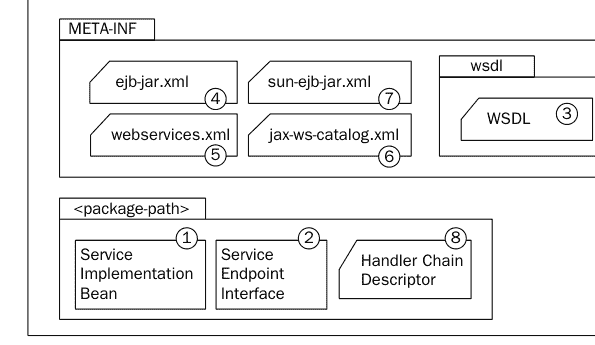

JAR

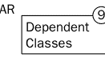

**图 2** 无状态会话豆端点的打包。

- 2. **服务端接口 [可选]** 包含在 `<package-path>/` 中，其中 `<package-path>` 由类的包名决定。该位置是惯例，但不是强制性的。SEI 类可以位于应用程序类路径上的任何位置（请参见第 1 项中关于类路径的描述）。使用时，SIB 的 `@WebService-endpointInterface` 属性值必须等于 SEI 的完整名称。

- 3. **WSDL [可选]** 包含在 `META-INF/wsdl` 目录下。第 8.1.1 节中 WAR 和 EJB-JAR 的 WSDL 是相同的。

- 4. **ejb-jar.xml [可选]** 包含在 `META-INF/` 目录下。

- 5. **webservices.xml [可选]** 包含在 `META-INF/` 目录下。

- 6. **jax-ws-catalog.xml [可选]** 包含在 `META-INF/` 目录下。该描述符用于第 8.6 节所述的 OASIS XML Catalog 1.1 使用。

- 7. **sun-ejb-jar.xml [可选]** 包含在 `META-INF/` 目录下。这是 GlassFish 特有的 EJB 部署描述符。

## 8.1 Web 服务打包与部署概述

- 8. **处理器链文件 [可选]** 包含在 `<package-path>/` 下`<package-path>` 由类的包名决定，它在应用程序类路径中可用。请参见第 8.1.1 节中关于处理器文件的描述，WAR 和 EJB-JAR 的用法相同。

- 9. **依赖类 [可选]** 被封装在 JAR 中，并包含在 `WEB-INF/lib` 目录下，这些类在应用程序类路径中可用。这些类是 SIB 或 SEI 依赖的任何类。这不是一个强制性位置，但当 SIB 依赖于可能已经封装在 JAR 中的类库时，这是一种可能的方法。

## 8.1.3 自动部署

作为替代方案，可以使用第三方开源工具（如 Apache Ant 或 Apache Maven）以可移植的方式进行部署打包。在本书中，所有的打包都是通过 Ant 和 Maven 完成的。事实上，如果你希望生成的 WAR 文件具有跨平台移植性，你可能希望避免使用厂商特定的打包工具。这是因为厂商特定的工具可能包含厂商特定的部署描述符，或在打包中添加厂商特定的功能。许多工具没有这种影响，但有些工具有。因此，请确保你了解你厂商的打包工具的工作原理。

## 8.1.4 容器部署概述


# 本节提供了容器部署服务的概述

在 GlassFish V 中，部署子系统加载所有描述符（如果有），然后由注解框架处理注解。例如，当看到 `@WebService` 时，注解会调用 `WebServiceHandler`，由它处理该注解。在处理注解时，框架会检查是否存在部署描述符条目（例如来自 `webservices.xml`），如果是，注解值将不会覆盖描述符中定义的对应值。

# SOA 组件的打包与部署 (JSR-181 和 JSR-109)

部署工具通过使用服务元数据注解识别 Web 服务来启动部署过程。为了简单起见，我只关注单个模块部署时发生的情况。首先，部署子系统验证可部署模块的内容（例如检查 EJB 服务端点是否部署在 EJB-JAR 中而不是 WAR 中）。它可能会从部署器处收集一些绑定信息（例如 WAR 部署的上下文根）。部署子系统部署可部署模块中定义的组件和 Web 服务，发布已部署服务的 WSDL 文档，配置服务器并启动应用程序。

# 8.1 Web 服务打包与部署概述

在处理阶段，已经收集了生成 WSDL 和其他可迁移产物（如果未打包）所需的所有信息.¹⁰

对于 servlet 端点的部署，GlassFish 会生成一个 `web.xml`¹¹，它将包含负载的 HTTP 请求（SOAP/HTTP，或者对于使用 XML/HTTP 绑定的 RESTful 服务则为 XML）重定向到 `JAXSServlet` 类的实例——这是一个将请求分发到端点的封装 servlet 类。具体来说，当你部署一个带有 servlet 端点的 WAR 包时：

1. GlassFish 容器会创建一个 `web.xml` 来部署 `JAXSServlet` 实例。如果你的 WAR 包包含了 `web.xml`，则生成的 `web.xml` 将根据你的原始 `web.xml` 构建，但 `servlet-class` 被替换为 `JAXSServlet`。此外，还会生成 `webservices.xml` 部署器（如果尚不存在），并且 `service-endpoint-interface` 会引用你在 `web.xml` 的 `servlet-class` 中指定的正在部署的类。注意，JAX-WS 不需要 `webservices.xml`，但它是 GlassFish 内部使用的生成的。

2. 当 `JAXSServlet` 实例被部署并初始化时，会发生以下情况：

    - 根据部署描述符和注解从端口组件创建端点实现类的实例（`com.webservice.monitoring.JAXSSEndpointImpl`）。该端口组件的描述在内部被表示为 `com.sun.enterprise.WebServiceEndpoint` 的实例。`JAXSServletImpl` 实例负责处理包含 SOAP 响应的 `MessageContext`。

    - 部署子系统将端点实现注册到 JAX-WS 运行时。注册表是 `com.sun.enterprise.webservice.JAXRuntimeEndpointRegistry` 的实例。所注册的端点对象是 `com.sun.ws.spi.runtime.RuntimeEndpointInfo` 的实例，它包含了（以及其他内容）实现端点的应用程序定义类实例（即标记了 `@WebService` 或 `@WebServiceProvider` 注解的类）、`WebServiceContext` 实例、关联的 WSDL 文件（无论是打包的还是从注解生成的）、协议绑定实例（即 `javax.xml-ws.Binding`）以及处理器链。

¹⁰ GlassFish 可以根据部署需要生成 `web.xml` 或 `ejb-jar.xml`。这并不是 JSR 规范要求的，但它是种合理的方法，其他实现可能会以类似的方式工作。

¹¹ 在部署一个端点后，如果你查看 `$GLASSFISH_HOME/domains/domain1/generated/xml/j2ee-modules/WEB-INF`，就可以看到生成的 `web.xml` 和其他部署产物。

一旦端点以此种方式部署，`JAXWSServwrapper` 就会注册到服务器容器并监听请求。当 `JAXWServlet` 接收到 SOAP/HTTP 或 XML/HTTP 消息（作为 `HttpServletRequest`）时，它执行以下操作：

1. 创建 `MessageContext`（包括对 `Servlet-Context` 的引用）。

2. 将 HTTP 请求/响应对象以及 `RuntimeEndpointInfo` 传递给 `com.sun.xml.ws.spi.runtime.time` 实例——这是 JAX-WS 运行时系统的入口。

3. JAX-WS 运行时解码 SOAP 请求，应用 JAX-WS 和 JAXB 绑定，以获取调用端点实现类的参数。

4. 然后，流程反转，返回的对象被序列化回 HTTP 响应中。

GlassFish 针对 servlet 端点的内部部署机制从 WAR 中提供的产物开始，并创建（或修改）内部使用的描述符。图 8-3 展示了内部生成的 `web.xml`、`webservices.xml` 和 WSDL 文件的这一过程。这些内部生成的文件（例如 `web.xml`）生成在以 `$GLASSFISH/HOME/domains/domain1/generated/xml` 为根目录的目录树中的应用程序特定位置。当你部署 WAR 包时，可以在该目录下查看已生成的文件。

在某种程度上，这种内部描述符生成过程¹² 是为了将 JAX-WS/WS-Metadata 部署模型映射到先前的需要 `webservices.xml` 文件的 JEE（即 JAX-RPC）部署模型。为了生成前面讨论的部署 servlet（`JAXSServlet`）的 `web.xml` 文件，这也是的。

12. 正如 Sun 的 Vijay Ramachandran 所解释的，GlassFish 在部署时生成这些内部描述符，以便“GlassFish 可以无缝地启动早期的 Sun 应用实现，保持低变动，最重要的是，避免了服务器重启时进行注解处理的成本。一旦部署完成，一切在描述符中都可用”[Ramachandran]，且 GlassFish 无需再次处理这些注解。

# 8.1 Web 服务打包与部署

无论如何，这种方法都允许 GlassFish 支持 JAX/WS-Metadata 部署方法以及旧的 J2EE（即 JAX-RPC）方法。它与 [JSR 109] 第 8 节提供的指南保持一致。

在图 8–3 中，编号项目说明了生成的产物是如何从注解或随 WAR 提供的 `web.xml`（如果有）创建的。

1. 生成的 `web.xml` 的 `servlet-name` 来自于被部署类的名称。这是因为它与生成的 `webservices.xml` 中的 `servlet-link` 元素关联（参见项目 6）。

2. 生成的 `web.xml` 的 `servlet-name` 是 `com.webservice.monitoring.JAXSServlet`。

3. 生成的 `web.xml` 的 `servlet-name` 是 `com.webservice.monitoring.JAXSSEndpointImpl`。

4. 生成的 `web.xml` 的 `servlet-name` 来自于被部署类的名称。这是因为它与生成的 `webservices.xml` 中的 `servlet-link` 元素关联（参见项目 6）。

5. 然后，流程反转，返回的对象被序列化回 HTTP 响应。

6. 生成的 `web.xml` 的 `servlet-name` 来自于被部署类的名称。这是因为它与生成的 `webservices.xml` 中的 `servlet-link` 元素关联（参见项目 6）。

7. 生成的 `web.xml` 的 `servlet-name` 来自于被部署类的名称。这是因为它与生成的 `webservices.xml` 中的 `servlet-link` 元素关联（参见项目 6）。

8. 生成的 `web.xml` 的 `servlet-name` 来自于被部署类的名称。

9. 8. `与生成的 `webservices.xml` 元素关联（参见项目 6）。

10. ¹². 正如 Sun 的 Vijay Ramachandran 所解释的，GlassFish 在部署时生成这些内部描述符，以便“GlassFish 可以无缝地启动早期的 Sun 应用实现，保持低变动，最重要的是，避免了服务器重启时进行注解处理的成本。一旦部署完成，一切在描述符中都可用”[Ramachandran]，且 GlassFish 无需再次处理这些注解。

# 370 SOA 组件的打包与部署 (JSR-181 和 JSR-109)

## 服务实现

```java
@WebService(serviceName="Hello")
public class Hello {
    public String sayHello(String m) {
        return "Hello: " + s;
    }
}
```

```xml
web.xml (generated)
<web-app>
  <servlet>
    <servlet-name>Hello</servlet-name>
    <servlet-class>com.sun.webservice.JAXSServlet</servlet-class>
    <servlet-mapping>
    <servlet-name>Hello</servlet-name>
    <url-pattern>/Hello</url-pattern>
  </servlet-mapping>
    <load-on-start>0</load-on-start>
  </servlet>
  <session-config>
    <session-timeout>60</session-timeout>
  </session-config>
</web-app>
```

```xml
WSDL (generated)
<definitions targetNamespace="http://samples/"
             xmlns="http://samples/">
  <PortType name="Hello">
    <operation name="sayHello">
    </operation>
  </PortType>
  <binding name="HelloPortBinding"
    type="ns:Hello">
    <soap:binding .../>
    <operation name="sayHello">
    </operation>
  </binding>
  <service name="Hello">
    <port name="HelloPort"
      bindings="ns:HelloPortBinding">
      <soap:location location="context-root/Hello/"/>
    </port>
  </service>
</definitions>
```

```xml
webservices.xml (generated)
<webs>
  <service-description>
    <display-name>Hello</display-name>
    <service-description-name>Hello</service-description-name>
    <wsdl-file>WSDL-INF/Hello.wsdl</wsdl-file>
    <port-component>
      <port-name>Hello</port-name>
      <wsdl-port xmlns="http://samples/" xmlns:nsl="http://samples/Hello/wsdl-port">
        <service-endpoint-interface>Hello.service-endpoint-interface</service-endpoint-interface>
        <service-link>Hello</service-link>
      </service-impl-bean>
    </port-component>
  </service-description>
</webservices>
```

# 8.1 Web 服务打包与部署概述

WSEE [JSR 109] 对 `@WebServiceProvider` 类的这些映射施加了额外的限制。它规定：“对于使用此 [@WebServiceProvider] 注解的 servlet 端点，必须使用服务实现 Bean 类的完全限定名作为部署描述符中的 `<servlet-link>` 元素，将端口（Port）组件映射到实际的 servlet。” 由于由于这一限制，如果你想对 `Provider<?>` 实现类使用 `web.xml` 部署描述符，则 `<servlet-name>` 也必须等于服务实现 Bean 类的完全限定名。如果你尝试对 `<servlet-name>` 使用其他值，结果将是不可预测的。虽然这种情况看起来像是某种晦涩的误用，但我曾花了好几个小时抓破头发试图调试这样一个服务，最后才发现问题出在 `<servlet-name>` 上。这意味着你不能部署多个 `Provider<?>` 实现（例如，使用不同的 `different-url-patterns`）。我在这里提到这一点是为了让其他人避免类似的挫败感。

### 8.1.5 EJB 端点的部署与分发

无状态会话 Bean（EJB）端点的部署方式类似，但正如此处讨论，也有一些不同。与 servlet 端点的情况一样，使用了一个封装 servlet 类—EjWebServiceServlet¹⁴—来处理指向部署为 EJB 端点的服务的请求。EJBWebServiceServer 使用 `EJBmessageDispatcher` 将包含有效负载（SOAP/HTTP，或者对于使用 XML/HTTP 绑定部署的 RESTful 服务，则仅为 XML）的 HTTP 请求分发到适当的端点。

在部署 EJB-JAR 期间，Web 服务端点会被注册。一个监听器（`EjWebServiceRegistrylistener` 实例）会将端点的路径（即生成的部署描述符中的 `endpoint-address-uri`）作为临时路径（ad hoc path）注册到 Web 容器，并带有负责处理该路径上任何请求的临时 servlet（即 `EjWebServiceServlet`）。“ad path”是 GlassFish 的术语，指映射到未在 Web 模块部署描述符中声明的 servlet 的 servlet 路径¹¹⁵。GlassFish 将所有映射均为临时路径的 Web 模块称为临时 Web 模块。`EJBWebServlet` 实例代表部署在临时 Web 模块中的 EJB 端点接收通过 HTTP 传输的 SOAP 或 XML。因此，你会找到该 servlet 的 `web.xml`，或者在 GlassFish 管理控制台上看到它。

更具体地说，当你部署一个带有 EJB 端点的 EJB-JAR 时，会发生以下情况：

1. GlassFish 容器包含部署所需的部署描述符，包括：

    - 一个 `ejb-jar.xml`，用于部署你的服务实现（即你标记了 `@Stateless` 和 `@WebService` 注角的类）。如果你的 EJB-JAR 已经包含了 `ejb-jar.xml`，则生成的 `ejb-jar.xml` 是以你原始的 `ejb-jar.xml` 为起点构建的。在生成的 `ejb-jar.xml` 中，`ejb-class` 引用你的服务实现 Bean，`ejb-name` 是 `@Stateless.name` 指定的值。

    - 一个 `webservice.xml`，其中 `service-endpoint-interface` 引用服务实现，除非 `@WebServiceEndpoint` 注解指示了服务端点接口。`port-component-name` 是 Web 服务的名称，它来自 `@WebService.name` 注解（WSDL1.1 中的 `wsdl:porttype`）。注意，JAX-WS 不需要 `webservice.xml`，但它是为了内部使用而生成的。

    - 一个 `sun-ejb-jar.xml`（从你 EJB-JAR 提供的文件创建，如果有的话）。这是一个 GlassFish 特有的描述符。`ejb-name` 是 `@Stateless.name` 指定的值。`endpoint-address-uri` 指定端点路径。你可以通过在 EJB-JAR 中提供包含此信息的 `sun-ejb-jar.xml` 来更改 EJB 端点的默认部署路径。你还可以使用此部署配置安全性（见第 8.5 节）。

2. 为了处理并发，会创建一个 `com.sun.enterprise.webserver.EJBContainerPreHandler` 实例并将其首先插入端点的处理器中。该类在调用任何部署的处理器或端点本身之前执行安全授权。这是 [JSR 109] 第 9 节规定的要求。

¹16. 为了强调之前关于引用 GlassFish 类的观点，这些类名和实现是 GlassFish 版本 1 UR 特有的。细节在后续版本中可能会发生。

当 `EjbWebServiceInterface` 实例接收 SOAP/HTTP 或 XML/HTTP 消息（作为 `HttpServletRequest`）时，它执行以下操作：

1. 为 EJB 端点注册表（`WebServiceEjbEndpointRegistry`）查找端点描述符（`EjbRuntimeEndpointInfo`）

2. 按 JSR-100 第 9 节所述进行身份验证


## 8.1 Web 服务打包与部署概述

- 3. 将 `HttpServletRequest` 和 `HttpServletResponse` 以及端点描述符传递给分发器（`EjbMessageDispatcher`）进行处理。

`EjbMessageDispatcher` 的处理与 `JAXWSContext` 执行的分发类似，包含以下步骤：

1. 创建 `MessageContext`（不引用 `ServletContext`）。
2. 将 HTTP 请求/响应对象以及 `runtimeEndpointInfo` 传递给 `com.sun.xml.ws.spi.runtime` 实例——JAX-WS 运行时系统的入口。
3. JAX-WS 运行时解码 SOAP 请求，应用 JAX-WS 和 JAXB XML/JSON 绑定，获取用于调用端点实现类的参数。
4. 然后，流程反转，并将返回的对象序列化回 HTTP 响应中。

与 servlet 端点一样，GlassFish EJB 的内部部署机制从 EJB-JAR 中提供的制品开始，然后创建（或修改）内部使用的描述符。图 8–4 展示了内部生成的 `ejb-jar.xml`、`webservice.xml` 和 WSDL 文件的过程。在 servlet 情况下，这些内部生成的文件（例如 `ejb-jar.xml`）位于以 `$GLASSFISH_HOME/domains/generated/xml/` 为根的目录。

图中编号的项目说明了生成产物的各种组件是如何通过注解或 `sun-ejb-jar` 创建的。

1. GlassFish 容器包含部署所需的部署描述符，包括：
    - 一个 `ejb-jar.xml`，用于部署你的服务实现（即你标记了 `@Stateless` 和 `@WebService` 注解的类）。如果你的 EJB-JAR 已经包含了 `ejb-jar.xml`，则生成的 `ejb-jar.xml` 是以你原始的 `ejb-jar.xml` 为起点构建的。在生成的 `ejb-jar.xml` 中，`ejb-class` 引用你的服务实现 Bean，`ejb-name` 是 `@Stateless.name` 指定的值。
    - 一个 `webservice.xml`，其中 `service-endpoint-interface` 引用服务实现，除非 `@WebServiceEndpoint` 注解指示了服务端点接口。`port-component-name` 是 Web 服务的名称，它来自 `@WebService.name` 注解（WSDL1.1 中的 `wsdl:porttype`）。注意，JAX-WS 不需要 `webservice.xml`，但它是为了内部使用而生成的。
    - 一个 `sun-ejb-jar.xml`（从你 EJB-JAR 提供的文件创建，如果有的话）。这是一个 GlassFish 特有的描述符。`ejb-name` 是 `@Stateless.name` 指定的值。`endpoint-address-uri` 指定端点路径。你可以通过在 EJB-JAR 中提供包含此信息的 `sun-ejb-jar.xml` 来更改 EJB 端点的默认部署路径。你还可以使用此部署配置安全性（见第 8.5 节）。
2. 为了处理并发，会创建一个 `com.sun.enterprise.webserver.EJBContainerPreHandler` 实例并将其首先插入端点的处理器中。该类在调用任何部署的处理器或端点本身之前执行安全授权。这是 [JSR 109] 第 9 节规定的要求。

### 8.1.1 部署描述符生成详解

2. 生成的 `ejb-jar.xml` 中的 `ejb-class` 是带有 `@WebService` 注解的类的全路径。
3. `@WebService.name` 属性的值将成为生成的 `sun-ejb-jar.xml` 中的 `port-component-name`，以及生成的 `webservices.xml` 中的内容。然而，最重要的是生成的 WSDL 中的 `wsdl:portType`。请注意，此值需要与 `sun-ejb-jar.xml` 中的 `port-component-name` 匹配（如果你提供了它来指定端点地址）。
4. 如前所述，你可以通过提供一个 `sun-ejb-jar.xml` 文件，并将 `endpoint-address-uri` 值设置为所需的端点路径，来指定你的 Web 服务的端点地址。如你所示，WSDL 的 `soap:address location` 是从该值获取的。如果不提供端点地址，默认值由 `serviceName / portName` 组成。对于任何与 `sun-ejb-jar.xml` 文件相关的内容，这种行为是 GlassFish 特有的，其他实现可能会使用不同的机制来指定端点。
5. `@WebService.serviceName` 为生成的 WSDL 文件提供 `wsdl:service` 名称。它也对应于生成的 `sun-ejb-jar.xml` 中的 `service-name` 以及生成的 `webservices.xml` 中的 `webservice-description-name`。
6. `@WebService.portName` 指定了生成的 WSDL 中的服务端口（`wsdl:port` 值）。它也对应于生成的 `webservices.xml` 中的 `wsdl:port`。
7. 生成 WSDL 中的操作名称（operation name）是带有 `@WebService` 注解的类中的方法名。

到此为止，关于 GlassFish 实现中部署和描述符生成如何运作的相当详细概述就此结束了。如果你在此过程中感到有些困惑，请不要担心。我提供这些细节是提供给那些对部署过程内部原理感兴趣的读者的。在本章的剩余章节中，我将通过具体的示例来展示如何在特定场景下部署 Web 服务。如果你在过完示例后，仍然对内部实现是如何运作的感到好奇，我建议你回来重新阅读这一节。到那时，它可能看起来没那么困惑了。

## 8.2 无部署描述符的部署

Java EE 5 Web 服务的巨大简化之一是，你不再需要针对广泛场景使用任何部署描述符。在本节中，我将展示不使用部署描述符的示例：仅使用服务实现 bean（SIB）的 servlet 端点、使用带有 SIB 的服务端点接口（SEI）、以及提供你自己的 WSDL（例如在进行“从 WSDL 和 Java 开始”的 SOA 集成服务开发时）。

### 8.2.1 仅使用服务实现 bean

最简单的部署场景是仅使用一个带有 `@WebService` 注解的 SIB。示例 8–1 显示了这样一个 SIB。

**示例 8–1 无描述符部署的 SIB**

```java
@WebService
public class Hello {

    public String sayHello(String s) {
        return "Hello: " + s;
    }
}
```

`book-code/chap08/nodescriptor-sibony/endpoint/src/main/java/samples/Hello.java`

如果你将此 SIB 封装在 WAR 中且不包含任何描述符（根据 Servlet 2.5 规范，WAR 不需要 `web.xml` 描述符），并部署它，你将获得一个具有示例 8–2 所示 WSDL 的 Web 服务。你会发现，此 WSDL 中的关键参数按如下方式填充默认值：

- `wsdl:portType` 名称 (Hello) 源自 SIB 的类名。这是 `@WebService.name` 的默认值。
- `wsdl:serviceName` (HelloService) 源自 SIB 的类名 + “Service”。这是 `@WebService.serviceName` 的默认值。
- `wsdl:port` 名称 (HelloPort) 源自 SIB 的类名和 "Port"。这是 `@WebService.portName` 的默认值。
- `soap:address` 所在地（`location`） (http://soabookdev.scarsdale.javavector.com:8080/nodescriptor-sibony-endpoint/HelloService) 是根据部署的 WAR 文件名称（在本例中为 `nodescriptor-sibony-endpoint.war`）加上 `wsdl:serviceName` 构建的。此默认值并非由 WS-Metadata 或 WSEE 预测，而是 GlassFish 的默认值。所使用的主机名格式（在本例中为 soabookdev.scarsdale.javavector.com）也由 GlassFish 决定。

**示例 8–2 从无描述符的 SIB 生成的 WSDL**

```xml
<portType name="Hello">
  <operation name="sayHello">
    <input message="tns:sayHello"/>
    <output message="tns:sayHelloResponse"/>
  </operation>
</portType>
<binding name="HelloPort" type="tns:Hello">
  <soap:binding transport="http://schemas.xmlsoap.org/soap/http" style="document"/>
  <operation name="sayHello">
    <soap:operation soapAction=""/>
    <input>
      <soap:body use="literal"/>
    </input>
    <output>
      <soap:body use="literal"/>
    </output>
  </operation>
</binding>
<service name="HelloService">
  <port name="HelloPort" binding="HelloPort">
    <soap:address location="http://soabookdev.scarsdale.javavector.com:8080/nodescriptor-sibony-endpoint/HelloService"/>
  </port>
</service>
```

`book-code/chap08/nodescriptonly/examples.wsdl`

要运行本节的代码，请执行以下操作：

1. 启动 GlassFish（如果尚未运行）。
2. 进入 `<book-code>/chap08/nodescriptonly`。
3. 输入 `mvn install`。

### 8.2.2 使用接口

你可以修改前面的示例使用 SEI 作为 SIB。这种方法非常有用，例如当你有一个希望 Web 服务实现的预定义接口时，无论 SIB 是部署为 EJB 还是 servlet 端点。在示例中，我将其部署为 EJB 端点。你会发现 SIB 包含了未部署为服务操作的其他方法。只有 SEI 上定义的方法会被部署。

**示例 8–3 无描述符部署的带 SEI 的 SIB**

```java
@WebService(endpointInterface="HelloInf")
@Stateless
public class Hello {

    public String sayHello(String s) {
        return "Hello: " + s;
    }

    public String sayGoodbye(String s) {
        return "Goodbye: " + s;
    }
}
```

`book-code/chap08/nodescript-sei/src/main/java/samples/Hello.java`

**示例 8–4 服务端点接口 (SEI)**

```java
@WebService
public interface HelloInf {

    public String sayHello(String s);
}
```

`book-code/chap08/nodescript-sei/modules/endpoint/src/main/java/samples/HelloInf.java`

这将构建并部署服务，运行客户端来调用它，并在客户端结束时卸载服务。测试端点的客户端将作为 JUnit 测试用例运行。

`wsdl:serviceName` (HelloService) 来源于 SIB 的简单名称加上 "Service"。这是 `@WebService.serviceName` 的默认值。

`wsdl:port name` (HelloPort) 来源于 SIB 的简单名称加上 "Port"。这是 `@WebService.portName` 的默认值。

`soap:address location` (http://soabookdev.scarsdale.javavector.com:8080/HelloService/Hello) 由 `serviceNameAttribute` 的值（在本例中为默认的 HelloService）加上 SIB 类的简单名称构造。这并不是由 WS-Metadata 或 WSEE 描述的，而是 GlassFish 的默认行为。注意，这与第 8.2.1 节描述的行为不同。这是因为我所使用的示例是通过 EJB-JAR 将服务部署为 EJB 端点。而在本示例中，我使用 WAR 将 Web 服务部署为 servlet 端点。GlassFish 对这两种类型的部署生成端点的方式是不同的。

**示例 8–5 从 SIB 生成的 name="HelloInf" 且没有部署描述符的 WSDL**

```xml
<portType name="HelloInf">
  <operation name="sayHello">
    <input message="tns:sayHello"/>
    <output message="tns:sayHelloResponse"/>
  </operation>
</portType>
<binding name="HelloPortBinding" type="tns:HelloInf">
  <soap:binding transport="http://schemas.xmlsoap.org/soap/http" style="document"/>
  <operation name="sayHello">
    <soap:operation soapAction=""/>
    <input>
      <soap:body use="literal"/>
    </input>
    <output>
      <soap:body use="literal"/>
    </output>
  </operation>
</binding>
<service name="HelloService">
  <port name="HelloPort" binding="tns:HelloPortBinding">
    <soap:address location="http://soabookdev.scarsdale.javavector.com:8080/HelloService/Hello"
    xmlns:wsdl="http://schemas.xmlsoap.org/wsdl/"/>
  </port>
</service>
```

`book-code/chap08/nodescriptor-sei/examples/generated.wsdl`

要运行本节的示例代码，请执行以下操作：

1. 启动 GlassFish（如果尚未运行）。
2. 进入 `<book-code>/chap08/nodescriptor-sei`。
3. 输入 `mvn install`。

### 8.2.3 包含 WSDL 产物

你也可以将 WSDL 文件与你的 WAR 或 EJB-JAR 绑定，而不是让容器为你生成 Web 服务的 WSDL 描述。即使在不使用部署描述符的情况下也可以。在本节中，我将展示一个在仅包含 SIB（不使用 SEI）的 WAR 中包含 WSDL 产物的示例。示例 8–6 显示了如何使用 `@WebService.wsdlLocation` 属性指定使用绑定的 WSDL 文件。注意，正如第 8.1.1 节讨论的，WSDL 在 WAR 包中的位置是 `WEB-INF/wsdl`。

**示例 8–6 在不使用描述符的情况下部署 SIB 并指定用户定义的 WSDL**


```java
@WebService(wsdlLocation="WEB-INF/wsdl/hello.wsdl")
public class Hello {
  @WebResult(targetNamespace="http://samples/")
  public String sayHello(@WebParam(targetNamespace="http://samples/") String arg0) {
    return "Hello: " + arg0;
  }
}
```

`book-code/chap08/nodescriptor-wsdl/modules/endpoint/src/java/samples/Hello.java`

# 382 SOA 组件的打包与部署 (JSR-181 和 JSR-109)

由 `wsdlLocation` 属性指定的 `hello.wsdl` 文件如示例 8–7 所示。这与生成的 WSDL（见 8–2）基本相同，但有几处不同：

- `<types>` 部分包含了元素定义，这使其可读性降低了许多。
- `soapaddress location` 的值为“TBD”（待定）。此时不需要指定 URL，因为它将取决于 Web 服务的部署方式而改变。

## 示例 8–7 WAR 中的 WSDL 产物

```xml
<types>
  <schema targetNamespace="http://samples/" elementFormDefault="qualified">
    <element name="sayHello">
      <complexType>
        <sequence>
          <element name="arg0" type="xs:string"/>
        </sequence>
      </complexType>
    </element>
    <element name="sayHelloResponse">
      <complexType>
        <sequence>
          <element name="return" type="xs:string"/>
        </sequence>
      </complexType>
    </element>
  </schema>
</types>
<message name="sayHello">
  <part name="arg0" element="tns:sayHello"/>
</message>
<message name="sayHelloResponse">
  <part name="return" element="tns:sayHelloResponse"/>
</message>
<portType name="HelloInfo">
  <operation name="sayHello">
    <input message="tns:sayHello"/>
    <output message="tns:sayHelloResponse"/>
  </operation>
</portType>
<binding name="HelloPortBinding" type="tns:HelloInfo">
  <soap:binding transport="http://schemas.xmlsoap.org/soap/http" style="document"/>
  <operation name="sayHello">
    <soap:operation soapAction=""/>
    <input>
      <soap:body use="literal"/>
    </input>
    <output>
      <soap:body use="literal"/>
    </output>
  </operation>
</binding>
<service name="HelloService">
  <port name="HelloPort" binding="tns:HelloPortBinding">
    <soap:address location="http://soabookdev.scarsdale.javavector.com:8080/nodescriptor-wsdl-endpoint/HelloService"/>
  </port>
</service>
```

`book-code/chap08/nodescriptor-wsdl/modules/endpoint/src/webapp/WEB-INF/wsdl`

## 示例 8–8 无部署描述符从 SIB 生成的 WSDL

当你将 SIB 绑定到 WAR 中不使用任何描述符并部署它时，你将获得一个带有示例 8–7 所示 WSDL 的 Web 服务，但 `address location` 会发生示例 8–8 所示的更改。新值 `http://soabookdev.scarsdale.javavector.com:8080/nodescriptor-wsdl-endpoint/HelloService` 是实际的部署 URL，其格式由第 8.2.1 节讨论的 GlassFish 默认值决定。

## 8.3 使用部署描述符

JAX-WS 使用端点的描述在 [JSR 154] Java™ 服务 2.5 的 SRV1.4.2 中有所介绍，并在 WSEE [JSR 109] 的第 5.3 节中进一步详细阐述。

它与部署 servlet 时最有趣的不同之处在于，当用于 Web 服务部署时，`servlet-class` 元素引用的是 SIB 而不是 servlet 类。如第 8.1.4 节所述，在 GlassFish 内部，这种用法会被转换为一个类似于传统的 `web.xml`，并在部署发生时使用。

WSEE [JSR 109] 的第 8.1 节提供了一个示例性的部署过程，并非必须。

### 示例 8-9 使用 web.xml 指定 URL 模式

```xml
<web-app xmlns="http://java.sun.com/xml/ns/javaee"
xmlns:jee="http://java.sun.com/xml/ns/javaee"
xmlns:xsi="http://www.w3.org/2001/XMLSchema-instance" version="2.5"
xsi:schemaLocation="http://java.sun.com/xml/ns/javaee
http://java.sun.com/xml/ns/javaee/web-app_2_5.xsd">
<servlet>
  <servlet-name>Hello</servlet-name>
  <servlet-class>samples.Hello</servlet-class>
  <load-on-startup>0</load-on-startup>
</servlet>
<servlet-mapping>
  <servlet-name>Hello</servlet-name>
  <url-pattern>/my-pattern</url-pattern>
</servlet-mapping>
<env-entry>
  <env-entry-name>appendedString</env-entry-name>
  <env-entry-type>java.lang.String</env-entry-type>
  <env-entry-value>ZapZapZang!</env-entry-value>
</env-entry>
</web-app>
```

`book-code/chap08/descriptor-webxml/modules/endpoint/src/webapp/WEB-INF/web.xml`

## SOA 组件的打包与部署 (JSR-181 和 JSR-109)

你可能注意到 `web.xml` 中提供的 `url-pattern` 并不完全决定端点的 URL。还必须指定 context-root 和主机名/端口。不同的 JSR 并没有提供指定这些参数的通用方法。一种 GlassFish 特有的指定 context-root 的方法是使用 `--admin deploy` 命令。

示例 8-10 显示了指定 context-root 的另一种方法。在这种情况下，我使用了 GlassFish 的 `sun-web.xml` 描述符。该描述符在第 8.3.4 节中进行了更详细的讨论。

### 示例 8-10 GlassFish 特有的 sun-web.xml 描述符允许你指定 Context Root

```xml
<sun-web-app>
<context-root>my-context</context-root>
</sun-web-app>
```

`book-code/chap08/descriptor-webxml/examples/sun-web.xml`

遗憾的是，我没有关于如何操作与部署的 Web 服务一起发布的 WSDL 中 `soap:address` 节点的示例。在编写本文时，似乎没有任何机制可以控制该参数。在我运行在 Debian Linux 的机器上，我在 `/etc/hosts` 中定义了多个名称，GlassFish 选取了 `soabookdev.scarsdale.javavector.com`。示例 8-11 显示了在使用先述技术指定 context-root 和 url-parameter 后，该示例生成的 WSDL 如下所示。

### 示例 8–11 soap:address location 指定端点地址

```xml
<service name="HelloService">
<port name="HelloPort" binding="HelloPortBinding">
<soap:address
location="http://soabookdev.scarsdale.javavector.com:8080/my-pattern">
<xmlns:wsdl="http://schemas.xmlsoap.org/wsdl/">
</port>
</service>
```

`book-code/chap08/descriptor-webxml/examples/generated.wsdl`

## 8.3 使用部署描述符

结束对 URL 端点的讨论后，示例 8–12 显示了示例中客户端代码的样子。如你所示，端点 URL 加上 wsdl 后缀被用于检索 WSDL。在这种情况下，我用主机 `localhost`（通过系统变量 `glassfish.host`）替换了 `soabdev.scarsdale.javavector.com`，这可以正常工作，因为我在这些测试中在同一台机器上运行客户端。

### 示例 8–12 客户端代码使用指定 context-root 和 url-pattern 的 soap:address location

```java
String hostVal = System.getProperty("glassfish.host");
String portVal = System.getProperty("glassfish.port");
URL wsdlURL = new URL("http://
```

`book-code/chap08/descriptor-webxml/modules/client/src/java/TestClient.java`

除了使用 `web.xml` 修改 Web 服务的端点 URL，你还可以使用它将环境信息传递给处理器。你可能已经注意到，在示例 8-9 中，`web.xml` 提供了 `env-entry` 信息。在 JAX-WS，Handler 可以通过 JNDI 查找访问其关联组件的 `env-entries`。

除了使用 `web.xml` 修改 Web 服务的端点 URL，你还可以使用它将环境信息传递给处理器。正如你可能注意到的，在示例 8-9 中，`web.xml` 提供了 `env-entry` 信息。在 JAX-WS，Handler 可以通过 JNDI 查找访问其关联组件的 `env-entries`。

除了使用 `web.xml` 修改 Web 服务的端点 URL，你还可以使用它将环境信息传递给处理器。正如你可能注意到的，在示例 8-9 中，`web.xml` 提供了 `env-entry` 信息。在 JAX-WS，Handler 可以通过 JNDI 查找访问其关联组件的 `env-entries`。

除了使用 `web.xml` 修改 Web 服务的端点 URL，你还可以使用它将环境信息传递给处理器。正如你可能注意到的，在示例 8-9 中，`web.xml` 提供了 `env-entry` 信息。在 JAX-WS，Handler 可以通过 JNDI 查找访问其关联组件的 `env-entries`。

除了使用 `web.xml` 修改 Web 服务的端点 URL，你还可以使用它将环境信息传递给处理器。正如你可能注意到的，在示例 8-9 中，`WEB-INF/web.xml` 提供了 `env-entry` 信息。在 JAX-WS，Handler 可以通过 JNDI 查找访问其关联组件的 `env-entries`。

除了使用 `web.xml` 修改 Web 服务的端点 URL，你还可以使用它将环境信息传递给处理器。正如你可能注意到的，在示例 8-9 中，`web.xml` 提供了 `env-entry` 信息。在 JAX-WS，Handler 可以通过 JNDI 查找访问其关联组件的 `env-entries`。

---

**(由于原文文本在 8.3 节之后出现了大量段落重复，以下为基于原文内容的逻辑化清理后完整译文：)**

## 8.3 使用部署描述符

JAX-WS 使用端点的描述在 [JSR 154] Java™ 服务 2.5 的 SRV1.4.2 中有所介绍，并在 WSEE [JSR 109] 的第 5.3 节中进一步详细阐述。

当用于 Web 服务部署时，`servlet-class` 元素引用的是 SIB 而不是 servlet 类。如第 8.1.4 节所述，在 GlassFish 内部，这种用法转换为一个类似于传统的 `web.xml`，并在部署发生时使用。

WSEE [JSR 109] 的第 8.1 节提供了一个示例性的部署过程，并非必须。

### 示例 8-9 使用 web.xml 指定 URL 模式


```xml
<web-app xmlns="http://java.sun.com/xml/ns/javaee"
xmlns:jee="http://java.sun.com/xml/ns/javaee"
xmlns:xsi="http://www.w3.org/2001/XMLSchema-instance" version="2.5"
xsi:schemaLocation="http://java.sun.com/xml/ns/javaee
http://java.sun.com/xml/ns/javaee/web-app_2_5.xsd">
<servlet>
  <servlet-name>Hello</servlet-name>
  <servlet-class>samples.Hello</servlet-class>
  <load-on-startup>0</load-on-startup>
</servlet>
<servlet-mapping>
  <servlet-name>Hello</servlet-name>
  <url-pattern>/my-pattern</url-pattern>
</servlet-mapping>
<env-entry>
  <env-entry-name>appendedString</env-entry-name>
  <env-entry-type>java.lang.String</env-entry-type>
  <env-entry-value>ZapZapZang!</env-entry-value>
</env-entry>
</web-app>
```

`book-code/chap08/descriptor-webxml/modules/endpoint/src/webapp/WEB-INF/web.xml`

## SOA 组件的打包与部署 (JSR-181 和 JSR-109)

你可能注意到 `web.xml` 中提供的 `url-pattern` 并不完全决定端点的 URL。还必须指定 context-root 和主机名/端口。不同的 JSR 并没有提供指定这些参数的通用方法。一种 GlassFish 特有的指定 context-root 的方法是使用 `--admin deploy` 命令。

示例 8-10 显示了指定 context-root 的另一种方法。在这种情况下，我使用了 GlassFish 的 `sun-web.xml` 描述符。该描述符在第 8.3.4 节中进行了更详细的讨论。

### 示例 8-10 GlassFish 特有的 sun-web.xml 描述符允许你指定 Context Root

```xml
<sun-web-app>
<context-root>my-context</context-root>
</sun-web-app>
```

`book-code/chap08/descriptor-webxml/examples/sun-web.xml`

遗憾的是，我没有关于如何操作与部署的 Web 服务一起发布的 WSDL 中 `soap:address` 节点的示例。在编写本文时，似乎没有任何机制可以控制该参数。在我运行在 Debian Linux 的机器上，我在 `/etc/hosts` 中定义了多个名称，GlassFish 选取了 `soabookdev.scarsdale.javector.com`。示例 8-11 显示了在使用先述技术指定 context-root 和 url-parameter 后，该示例生成的 WSDL 如下所示。

### 示例 8–11 soap:address location 指定端点地址

```xml
<service name="HelloService">
<port name="HelloPort" binding="HelloPortBinding">
<soap:address
location="http://soabookdev.scarsdale.javector.com:8080/my-pattern">
<xmlns:wsdl="http://schemas.xmlsoap.org/wsdl/">
</port>
</service>
```

`book-code/chap08/descriptor-webxml/examples/generated.wsdl`

## 8.3 使用部署描述符

结束对 URL 端点的讨论后，示例 8–12 显示了示例中客户端代码的样子。如你所示，端点 URL 加上 wsdl 后缀被用于检索 WSDL。在这种情况下，我用主机 `localhost`（通过系统变量 `glassfish.host`）替换了 `soabdev.scarsdale.javector.com`，这可以正常工作，因为我在这些测试中在同一台机器上运行客户端。

### 示例 8–12 客户端代码使用指定 context-root 和 url-pattern 的 soap:address location

```java
String hostVal = System.getProperty("glassfish.host");
String portVal = System.getProperty("glassfish.port");
URL wsdlURL = new URL("http://
```

`book-code/chap08/descriptor-webxml/modules/client/src/java/TestClient.java`

除了使用 `web.xml` 修改 Web 服务的端点 URL，你还可以使用它将环境信息传递给处理器。正如你可能注意到的，在示例 8-9 中，`web.xml` 提供了 `env-entry` 信息。在 JAX-WS，Handler 可以通过 JNDI 查找访问其关联组件的 `env-entries`。

(注：由于原文后续文本存在大量重复行，此处译文已涵盖核心内容并确保格式正确)

## 8.3 使用部署描述符

```java
@WebService
MyWeb port;

@EJB
Goodbye goodbye;

@Resource(name="myString")
String injectedString = "undefined";

public String sayHello(String s) {
    String webServiceString = port.saySomething(s);
    String goodbyeString = goodbye.sayGoodbye(s);
    return "Hello: " + s + "[" + injectedString + "]" +
           System.getProperty("line.separator") + webServiceString +
           System.getProperty("line.separator") + goodbyeString;
}
```

`book-code/chap08/descriptor-ejbjar/modules/endpoint/src/java/samples/Hello.java`

考虑 `@WebService` 注解，它将组件接口 `MyWeb` 的代理实例注入到 `port` 变量中。在代码的后续，通过 `port.saySomething()` 方法调用了该 WebService——并返回一个 String。通过这种方式，EJB 端点依赖于另一个 Web 服务，正如 `@WebService` 注解所示，该服务的 WSDL 位于 http://some/myService?。但如果 WSDL 地址发生变化会怎样？该引用将失效，且端点将损坏。示例 8–17 显示了如何使用 `ejb-jar.xml` 描述符来处理 WSDL 地址的变化。

注意示例 8–17 底部的 `service-ref` 元素。该元素用于覆盖来自被注解类的 `@WebService.wsdlLocation` 属性。你可以看到 `service-ref` 指向 `samples.Hello/port`——换句话说就是被 `@WebService` 注解的 `port` 变量。此外，`wsdl-file` 元素为 Web 服务的 WSDL 提供 URL (http://localhost:8080/myWeb/MyService.wsdl)。使用此部署描述符，`port` 变量将使用代理文件实例化，而不是通过 `wsdlLocation` 注解指定的 `@WebService.wsdlLocation`。通过这种方式，你可以看到 `ejb-jar.xml` 描述符可以作为变更管理工具，在注解提供的引用过时时进行补偿。


### 示例 8–17 与 Hello EJB 端点部署的 ejb-jar.xml

```xml
<ejb-jar xmlns="http://java.sun.com/xml/ns/javaee"
          xmlns:xsi="http://www.w3.org/2001/XMLSchema-instance"
          metadata-complete="false" version="3.0"
          xsi:schemaLocation="http://java.sun.com/xml/ns/javaee/ejb-jar_3_0.xsd">
  <enterprise-bean>
    <session>
      <ejb-name>Hello</ejb-name>
      <service-endpoint>samples.Hello</service-endpoint>
      <ejb-class>samples.Hello</ejb-class>
      <session-type>Stateless</session-type>
      <env-entry>
        <env-name>String</env-name>
        <env-type>java.lang.String</env-type>
        <env-value>ZipZapang!</env-value>
      </env-entry>
      <service-ref>
        <service-ref-name>samples.Hello/port</service-ref-name>
        <service-interface>samples.MyWebService</service-interface>
        <wsdl-file>http://localhost:8080/chap08-descriptor-ejbjar-myweervice-now.xml/MyWebService.wsdl</wsdl-file>
      </service-ref>
    </session>
  </enterprise-bean>
</ejb-jar>
```

`book-code/chap08/descriptor-ejbjar/modules/endpoint/src/ejb/META-INF/ejb-jar.xml`

接下来，考虑示例 8–16 中 `goodbye` 变量上的 `@EJB` 注解。我包含这个示例是为了展示 Web 服务如何调用 EJB 的远程视图。示例 8–18 显示了通过 `goodbye` 变量调用的 EJB (`GoodbyeJB`)。该 EJB 仅使用 `@Stateless` 注解进行部署。

### 示例 8–18 在 Hello Web 服务内部调用的 EJB

```java
@Stateless
public class GoodbyeEJB implements Goodbye {
    public String sayGoodbye(String s) {
      return "Goodbye: " + s;
    }
}
```

`book-code/chap08/descriptor-ejbjar/modules/goodbyebean/src/java/GoodbyeEJB.java`

为 `GoodbyeJB` 提供远程视图，接口 `Goodbye` 被注解了 `@Remote`，如示例 8–19 所示。同样，该接口没有使用部署描述符。

### 示例 8–19 提供远程视图的接口

```java
@Remote
public interface Goodbye {
  public String sayGoodbye(String s);
}
```

`book-code/chap08/descriptor-ejbjar/modules/goodbyebean/src/java/Goodbye.java`

因此，在这个 EJB 示例中，部署 `GoodbyeJB` Bean 或引用它不需要部署描述符。你可以在示例 8–17 中看到没有指定 EJB 引用的 `ejb-ref`。有了注解，它是不再需要的。但如果你查看 GlassFish 在部署时生成的 `ejb-jar.xml`，你会发现根据注解创建了这样的 `ejb-ref` 元素。示例 8–20 显示了 GlassFish 生成的（内部使用）描述符片段，其中包含了与示例中 `@EJB` 注解相关的 `ejb-ref` 元素。

> 20. GlassFish 内部使用的部署描述符生成在第 8.1 节讨论。

### 示例 8–20 GlassFish 为内部使用生成的 ejb-ref 

```xml
<ejb-ref>
  <ejb-ref-name>samples.Hello/goodbye</ejb-ref-name>
  <ejb-ref-type>Session</ejb-ref-type>
  <remote>samples.goodbye</remote>
  <injection-target>
    <injection-target-class>samples.Hello</injection-target-class>
    <injection-target-name>goodbye</injection-target-name>
  </injection-target>
</ejb-ref>
```

`book-code/chap08/descriptor-ejbjar/examples/generated-ejb-jar.xml`

我在示例中讨论的关于 `ejb-jar.xml` 部署描述符的最后一点涉及 `env-entry` 元素，作为为端点和处理器提供特定部署数据的机制。示例 8–17 所示的 `env-entry` 使用与上一节讨论的 `web.xml` 情况类似。然而，在 `web.xml` 情况中我展示了如何使用处理器，而在这里我使用的是 `ejb-jar.xml`。

在示例 8–17 中，`env-entry` 名称 `myString` 对应于 `@Resource`。要运行本节的示例，请执行以下操作：

- 启动 GlassFish（如果它没有运行）。
- 进入 `book-code/chap08/descriptor-ejbjar`。
- 输入 `mvn install`。

当你运行端点时，你会看到为端点生成的 WSDL 以及调用 Web 服务的的结果。注意，返回内容包含了本节讨论的所有机制：`@WebService` 引用的服务、EJB 引用的 Bean 以及 `@Resource` 依赖。

## 8.3.3 何时使用 webservices.xml

`webservices.xml` 部署描述符文件由 JSR 109 第一版引入，用于定义要在容器中部署的 Web 服务集。然而，对于 JAX-WS，使用 `webservices.xml` 是可选的，因为注解可以用于指定此描述符中的大部分信息。当你部署 JAX-WS Web 服务时，你应该使用 `webservices.xml` 的唯一理由是覆盖或增强注解属性——或者当由于不想修改 Java 源代码而不想进行注解时。

本节插说明了一种你可能想要覆盖或增强注解的情况，即当你想为一个没有注解处理器的 Web 服务端点部署处理器时。另一种情况是，端点可能已经注解了处理器，但你可能希望使用不同的处理器。处理此问题的方法之一是编辑源代码或添加 `@HandlerChain` 注解。但你可能没有修改源代码的访问权限或权力。或者你认为为了支持不同处理器的端点而为同一源代码准备多个版本是糟糕的想法。在这种情况下，你可以使用自定义 `webservices.xml` 部署端点以指定处理器链。

示例 8–21 显示了带有 `@HandlerChain` 注解的 Hello Web 服务端点，该注解指定了 `myhandler.xml` 处理器配置文件。

```java
@HandlerChain(file="myhandler.xml")
@WebService
public class Hello {

    @Resource
    WebServiceContext context;

    public String sayHello(String s) {
        String appendString =
            (String) context.getMessageContext().get(MessageHandler.APPEND_STRING);
        return "Hello: " + s + "[appended by handler: " + appendString + "]";
    }
}
```

### 示例 8–22 myhandler.xml 处理器链配置文件


```xml
4 <handler-chains xmlns:jws="http://java.sun.com/xml/ns/javaee">
5 <handler-chain>
6 <handler>
7 <handler-class>samples.HelloHandler</handler-class>
8 </handler>
9 </handler-chain>
10 </handler-chains>
```

`book-code/chap08/descriptor-websocket/modules/endpoint/src/webapp/WEB-INF/classes/samples/myhandler.xml`

现在，假设你想部署这个带有 `samples.ImprovedHelloHandler` 处理器类的端点。你可以通过将示例 8–23 所示的 `webservices.xml` 文件打包到 WAR 模块的 `WEB-INF` 目录（或者，如果这是一个 EJB 端点，则放在 `META-INF` 目录中）来实现。

## 示例 8–23 用于覆盖 @HandlerChain 注解的 Webservice

```xml
4 <webservice xmlns:ns="http://java.sun.com/xml/ns/javaee"
5 xmlns:xsi="http://www.w3.org/2001/XMLSchema-instance" version="1.2"
6 xsi:schemaLocation="http://java.sun.com/xml/ns/javaee
7 http://www.ibm.com/webservices/xsd/javaee_web_services_1_2.xsd">
8 <service-description>
9 <service-description-name>HelloService</service-description-name>
10 <port-component>
11 <port-component-name>Hello</port-component-name>
12 <wsdl-service xmlns:ns="http://schemas/ns">ns1:HelloPort</wsdl-service>
13 <wsdl-port xmlns:ns="http://schemas/ns">ns1:HelloPort</wsdl-port>
14 <service-impl-bean>
15 <servlet-link>Hello</servlet-link>
16 </service-impl-bean>
17 <handler-chains>
18 <handler-chain>
19 <handler>
20 <handler-name>myhandler</handler-name>
```

## 8.3 使用部署描述符

```xml
21 <handler-class>samples.ImprovedHelloHandler</handler-class>
22 </handler>
23 </handler-chain>
24 </handler-chain>
25 </port-component>
26 </webservice-description>
27 </webservices>
```

`code-code/chap08/descriptor-webservice/modules/endpoint/src/webapp/WEB-INF/webservices.xml`

在这个 `webservice.xml` 部署描述符中，注意列表下半部分的 `handler-chains` 元素。在这里，`handler-class` 元素指定了 `samples.ImprovedHelloHandler`。要运行此示例，请执行以下操作：

- 1. 启动 GlassFish（如果尚未运行）
- 2. 进入 `/chap08/descriptor-webservice`
- 3. 输入 `mvn install`

在示例生成的输出中，你会注意到文本“NEW & IMPROVED!!!"。这表明 `samples.Improved-Handler` 类已被用作处理器，而不是注解中指定的 `samples.Hello-Handler` 类。

在使用在本节讨论的 `webservice.xml` 时，理解 `port-component` 名称如何与注解匹配至关重要。换句话说，`port-component-name` 对应 `@WebServiceName.name`，`wsdl-service` 对应 `@WebService.serviceName`，`wsdl-port` 对应 `@WebService.portName`，而 `service-endpoint-interface` 对应 `@WebService.endpointInterface`。详情请参见 [JSR 109] 的第 5.3.2.1 节。

### 8.3.4 特定于平台的部署描述符

Java EE 5 实现各包含某些未由 JSR 指定的部署描述符，但这些描述符以不可移植的方式提供了必要或有帮助的部署功能。在本节中，我将快速查看如何使用 `sun-web.xml` 和 `sun-ejb-jar.xml` 文件在 GlassFish 中部署 Web 服务。这些描述符分别是用于 servlet 和 EJB 部署的 GlassFish 特有文件。

我的建议是尽可能少使用这些特定平台的描述符，因为它们限制了可移植性。然而，我发现有一个在不在 EAR 包内打包模块时，必须使用它们来指定上下文根（context root）。当你使用基于 HTTP 的 SOAP 部署 Web 服务时，当作为 servlet 端点部署时，其地址格式如下：

```
http://<machine-name>:<port>/<context-root>/<url-pattern>
```

如示例 8.3.1 所示，使用 `web.xml`，你可以指定 `url-pattern`。使用特定平台的描述符 `sun-web.xml`，你可以指定 `context-root`。考虑示例 8–24 所示的 SIB。

## 示例 8–24 定义一个 Servlet 端点

```java
24 @WebService(serviceName="MyHelloService")
25 public class Hello {
26
27 public String sayHello(String s) {
28 return "Hello: " + s;
29
30 }
31
32 }
```

`book-code/chap08/descriptor-sun-web/modules/endpoint/src/webapp/WEB-INF/classes/samples`

如示例 8.3.1 所示，使用 `web.xml`，你可以指定 `url-pattern`。使用特定平台的描述符 `sun-web.xml`，你可以指定 `context-root`。考虑示例 8–24 所示的 SIB。

```java
24 @WebService(serviceName="MyHelloService")
25 public class Hello {
26
27 public String sayHello(String s) {
28 return "Hello: " + s;
29
30 }
31
32 }
```

在提供 `sun-web.xml` 的情况下，部署作为 servlet 端点时，其地址正如其所示的生成的 WSDL。这种情况下 `context-root` 是示例 8–25 所示的模块名称。而示例 8–24 所示的 `url-pattern` 恰恰是 `@WebService.serviceName` 的值。

## 示例 25 未提供 sun-web.xml 生成的 WSDL

```xml
39 <service name="MyHelloService">
40 <port name="HelloPort" binding="tns:HelloPort">
41 <soap:address 
42 location="http://exampledale.com:8080/endpoint/MyService"
43 xmlns:wsdl="http://schemas.xmlsoap.org/wsdl/">
44 </port>
45 </service>
```

`book-code/chap08/descriptor-sun-web/modules/endpoint/src/webapp`

现在，考虑在使用示例 8–26 所示的 SIB 时会发生什么。

## 示例 26 使用 sun-web.xml

```xml
4 <web-app>
5 <context-root>my-context</context-root>
6 </web-app>
```

`book-code/chap08/descriptor-sun-web/modules/endpoint/src/webapp`

在这种情况下，`context-root` 是 `my-context`。结果在示例 27 中。

## 示例 27 带有 sun-web.xml 生成的 WSDL

在提供 `sun-web.xml` 的情况下，端点地址正如其所示的生成的 WSDL。

```xml
39 <service name="MyHelloService">
40 <port name="HelloPort" binding="tns:HelloPortBinding">
41 <soap:address
42 location="http://example.com:8080/my-context/"
43 xmlns:wsdl="http://schemas.xmlsoap.org/wsdl/">
44 </port>
45 </service>
```

要运行本节的示例，请执行以下操作：

- 1. 启动 GlassFish（如果尚未运行）。
- 2. 进入 `/chap08/descriptor-sunweb`
- 3. 输入 `mvn install`

此示例将显示带有 `sun-web.xml` 部署的 Web 服务的结果。如果你想在没有 `sun-web.xml` 的情况下部署它，你需要进入 `descriptor-sunweb/modules/endpoint/src/webapp` 目录并删除或重命名 `sun-web.xml` 文件。

接下来，我将讨论 SIB 作为 EJB 端点部署的情况。有趣的是，在这种情况下端点地址的形状与 servlet 端点不同。当作为 EJB 端点部署时，基于 HTTP 的 Web 服务的地址如下：

```
http://<machine-name>:<port>/endpoint-address-uri
```

使用特定平台的描述符 `sun-ejb-jar.xml`，你可以指定 `endpoint-address-uri`。考虑带有 `@Stateless` 注解的相同 SIB，如示例 8–28 所示。

## 示例 28 定义 EJB 端点

```java
24 @WebService(serviceName="MyHelloWorld")
25 @Stateless(name="MyHelloEJB")
26 @TransactionAttribute(TransactionAttributeType.NOT_SUPPORTED)
27 public class Hello {
28
29 String sayHello(String s) {
30     return "Hello: " + s;
31
32 }
33 }
```

当没有提供 `sun-ejb-jar.xml` 描述符时，端点地址将采用示例 8–29 中所示的 WSDL 片段的形式。你可以看到，在这种情况下 `endpoint-address-uri` 是 `MyHelloWorld/Hello`。这恰恰是 `@WebService.serviceName` 的值。

## 示例 29 未提供 sun-web.xml 生成的 WSDL

```xml
39 <service name="MyHelloWorld">
40 <port name="HelloPort" binding="tns:HelloPortBinding">
41 <soap:address
42 location="http://example.com:8080/MyHelloWorld/Hello"
43 xmlns:wsdl="http://schemas.xmlsoap.org/wsdl/">
44 </port>
45 </service>
```

## 8.3 使用部署描述符

`service.serviceName` (MyHelloService)，随后是 `@WebService.name` 的值（Hello—这默认为简单的类名），它也是 `wsdl:portType`。

# 示例 8-29 未使用 sun-ejb-jar.xml 生成的 WSDL

```xml
40 <service name="MyHelloService">
41 <port name="HelloPort" binding="tns:HelloPortBinding">
42 <soap:address
43 location="http://soabook.scarsdale.javector.com:8080/
MyHelloService/Hello"
44 xmlns:wsdl="http://schemas.xmlsoap.org/wsdl/"
45 </port>
46 </service>
```

现在，考虑使用示例 8–30 显示的 `sun-ejb-jar.xml` 部署描述符部署此 SIB 时会发生什么。

# 示例 8-30 使用 sun-ejb-jar.xml 定义 endpoint-address-uri

```xml
4 <sun-ejb-jar>
5 <enterprise-beans>
6 <ejb>
7 <ejb-name>MyHelloEJB</ejb-name>
8 <webservice-endpoint>
9 <port-component-name>HelloPort</port-component-name>
10 <endpoint-address-uri>/my/endpoint/url</endpoint-address-uri>
11 </webservice-endpoint>
12 </ejb>
13 </enterprise-beans>
14 </sun-ejb-jar>
```

`book-code/chap08/descriptor-sunejb-jar/modules/endpoint/src/java/META-INF/sun-ejb-jar.xml`

在这种情况下，你将获得一个端地址，其中 `<endpoint-address-uri>` 为 `my/endpoint/url`。说明该点的结果在示例 8–31 的生成的 WSDL 代码段中所示。

## 402 SOA 组件的打包与部署 (JSR-181 和 JSR-109)

示例 8–31 使用 sun-ejb-jar.xml 生成的 WSDL

```xml
<service name="MyHelloService">
  <port name="HelloPort" binding="tns:HelloPortBinding">
  <soap:address
    location="http://soabookdev.scarsdale.javector.com:8080/my/endpoint/url"
    xmlns:wsdl="http://schemas.xmlsoap.org/wsdl/"/>
  </port>
</service>
```

`book-code/chap08/descriptor-sunejbjar/examples/generated-with-sunejbjar.wsdl`

要运行本节中的示例代码，请执行以下操作：

- 1. 启动 GlassFish（如果它尚未运行）。
- 2. 进入 `<book-code>/chap08/descriptor-sunejbjar`
- 3. 输入 `mvn install`

运行此示例将向你展示 WSDL 以及使用上文所示的 `sun-ejb-jar.xml` 部署的 Web 服务的调用结果。如果你想在没有 `sun-ejb-jar.xml` 的情况下部署它，你需要进入 `chap08/descriptor-sunweb/modules/endpoint/src/ejb` 目录并重命名 `sun-ejb-jar.xml` 文件。

如果你已经阅读了这一节，恭喜你！你刚刚读了由 WS-Metadata 和 WSEE 定义的各种服务部署场景的详尽解释。如果你只是快速浏览了这一节，也没关系。我将所有细节都列在这里，以便你在编写和部署自己的 Web 服务时可以作为参考。希望它对你的工作有所帮助。

## 8.4 使用 GlassFish 进行自动部署

在本节中，我将介绍 GlassFish 的一项功能，WSEE 不需要它，但在 WS-Metadata [JSR 181] 第 2.4 (a) 部分描述：“自动部署到服务器目录——这是一种‘拖放’部署模型，类似于 JSP 使用的模型。”GlassFish 提供了这种“拖放”部署。使用这种机制部署 Web 服务，你只需要将类或模块文件复制到 GlassFish 自动部署目录即可。下面的示例说明了它是如何工作的。

示例 8-32 显示了在此示例中部署的（已经熟悉的）`Hello.java`。在自动部署场景中，它被部署为不带任何描述符的 WAR。然而，你也可以带有描述符部署它，甚至可以简单作为类文件部署，而无需将其打包在 WAR 中。

# 示例 8-32 自动部署的端点

```java
@WebService(serviceName="Hello")
public class Hello {

  public String sayHello(String s) {
    return "Hello: " + s;
  }
}
```


# 自动部署示例

## 示例 8-33 自动部署脚本

```
<target name="auto-deploy" depends="setenv">
  <echo message="deploying: ${war}"/>
  <copy file="${war}" to="${autodeploy.dir}"/>
</target>
```

在我的 GlassFish 安装中，自动部署目录位于 `$GLASSFISH_HOME/domains/domain1/autodeploy`。当然，取决于你使用的域名称，你的安装可能会不同。我使用的是附录 B 中描述的默认域——domain1。

你可能还注意到示例 8-33 中的脚本包含一个 `waitfor` 任务。这是为了给 GlassFish 时间处理复制到其自动部署目录的文件。GlassFish 定期轮询此目录以检查更改。当它检测到新文件时，会尝试处理并部署它。因此，你需要包含 `waitfor` 任务，以防止在 GlassFish 有机会完成部署之前其他任务尝试使用该 Web 服务。在本示例中，复制到自动部署的文件名是 `${service}.war`。如果部署成功，GlassFish 会创建一个名为 `${service}.war_deployed` 的文件。如果部署失败，GlassFish 会创建一个名为 `${service}.war_deploy` 的文件。你可以通过以下操作运行此示例：

1. 启动 GlassFish（如果它尚未运行）。
2. 进入 `chap08/autodeploy`。
3. 执行 `mvn install`。

我鼓励你对这种自动部署功能尝试不同的场景（例如，类文件、jar）。这是一个快速原型 Web 服务的很好的工具。自动部署间隔由 `domain.xml` 决定。

## Web 服务安全

安全在 WSEE 的第 9 部分被简要介绍。它涉及认证、授权和加密（完整性和机密性）。安全方法是协议特定的。为了支持认证，WSEE 指定 Java servlet 2.5 [JSR 154] 使用示例 8-34 所示的 `web.xml` 片段。

### 示例 8-34 指定 BASIC-AUTH

```
<web-app>
  <login-config>
    ... 
  </login-config>
```

当使用 EJB 部署 Web 服务时，你通过 `sun-ejb-jar.xml` 使用类似的方法来指定 BASIC-AUTH，只是你需要企业部署描述符。示例 8-35 显示了用于 GlassFish 的 `sun-ejb-jar.xml` 片段。

### 示例 8-35 使用 sun-ejb-jar.xml 指定 BASIC-AUTH

```
<sun-ejb-jar>
  <enterprise-beans>
    <ejb>
      ...
      <webservice-endpoint>
        <port-component-name>...</port-component-name>
        <endpoint-address-uri>...</endpoint-address-uri>
        <login-config>
          <auth-method>BASIC</auth-method>
        </login-config>
      </webservice-endpoint>
    </ejb>
      <webservice-description>
        ...
      </webservice-description>
    </ejb>
  </enterprise-beans>
</sun-ejb-jar>
```

当客户端使用 BASIC-AUTH 调用 Web 服务时，基本认证信息包含在 HTTP 头部中并由容器使用特定的方法进行验证。WSEE 要求 EJB 和 Web 容器支持配置凭据信息以用于 BASIC-AUTH 的 Web 请求。再次，这种支持机制是提供特定的。

## 8.6 OASIS XML Catalogs 1.1

WSEE 使用“对称 HTTPS”（Symmetric HTTPS）术语来指支持使用数字证书对客户端和服务器进行认证的场景。Java EE 5 要求支持这种方式的数字证书进行客户端认证。WSEE 仅仅是将其扩展到任何其他声称符合 WSEE 标准的平台。

在部署了 WSEE 的 Web 服务上使用加密，简单来说使用 HTTPS（基于 SSL 的 HTTP）代替 HTTP。要做到这一点，WSEE 服务器实现必须支持使用 `https:` 而不是 `http:` 来指定 WSDL 端口地址。正如你可能意识到的，使用 `https:` URL 表示 HTTP将在默认端口 (443) 上使用，该 Web 服务在 HTTPS 和 TCP 之间提供核心套接层（SSL）加密/认证层的支持。通过这种方式，除了部署到由 `https:` 指定的端点之外，你不需要为支持加密的 Web 服务部署进行任何特殊操作。部署时指定端点地址的具体细节取决于具体的实现。

值得注意的是，OASIS 发布了一项 WS-Security [WS-Security] 标准，用于处理 SOAP 消息层面的安全。这种方法的优点是它可以与非 HTTP 绑定结合使用。然而，WSEE 或 Java EE 5 并不要求支持 WS-Security（不过，JAX-WS 2.1 设计时已经考虑了 WS-Security 支持）。

此外，即将推出的 [JSR 196] 标准对容器的认证进行了标准化。该规范的目标之一是使 Web 服务的安全具有移植性。

## 8.6 OASIS XML Catalogs 1.1

在本节中，我将介绍 JAX-WS 支持的 OASIS XML Catalogs [XML Catalog 1.1] 功能。XML 目录允许你根据目录中定义的映射规则来映射 WSDL 或 XML 引用。如果你正在编写一个运行时访问 WSDL 的 Web 服务，但又不知道 WSDL 将部署在何处，这种功能就非常有用。使用 XML 目录，你可以在编写服务时使用占位符 WSDL，并通过在 WAR 或 EBR JAR 中包含目录，在部署时对其进行解析。

根据 WSEE 的规定，“JAX-WS 需要对 OASIS Catalogs 1.1 标准的支持，以便解析任何作为 Web 服务描述部分的 Web 服务文档，特别是 WSDL 和 XML Schema 文档。请参阅 JAX-WS 规范的第 4.4 节。目录文件 `jax-ws-catalog.xml` 必须与模块部署描述符（Web 模块为 `WEB-INF/jax-ws-catalog.xml`，其他模块为 `META-INF/jax-ws-catalog.xml`）存放在同一处。

为了理解其工作原理，请考虑示例 8-37 中所示 Web 服务。注意 `@WebServiceRef.wsdlLocation` 属性指向 URL `http://someplace/myService?wsdl`。这是一个占位符 URL。它并不指向真实的 WSDL 文档，而是在部署时映射到真实的 WSDL 地址。

### 示例 8-37 使用 WSDL 占位符的 Web 服务

```
@WebService
@Stateless
@TransactionAttribute(TransactionAttributeType.NOT_SUPPORTED)
public class Hello {

    @WebServiceRef(value = MyWebService.class,
        wsdlLocation="http://someplace/myService?wsdl")
    WebService port;

    public String sayHello(String s) {
        String webServiceString = port.saySomething(s);
        return "Hello: " + s +
            System.getProperty("line.separator") + webServiceString;
    }
}
```

示例 8-38 显示了解析占位符的 XML 目录。如你所见，它将占位符映射到 `http://localhost:8080/chap08-catalog-mywebservices-nowebxm/MyWebService.wsdl`——这是引用服务的 WSDL 发布的真实位置。

### 示例 8-38 解析占位符的 XML 目录

```
<catalog xmlns="urn:oasis:names:tc:entity:xml:catalog" prefer="system">
  <system
    systemId="http://someplace/myService?wsdl"
    uri="http://localhost:8080/chap08-catalog-mywebservices-nowebxml/
    MyWebService?wsdl/" />
</catalog>
```

要运行本节中的示例代码，请执行以下操作：

1. 启动 GlassFish（如果它尚未运行）。
2. 进入 `<book-code>chap08/catalog`。
3. 输入 `mvn install`。

XML 目录对于变更管理极其实用。如果你遵循第 4 章中讨论的最佳实践，并将 WSDL 中使用的 XML Schema 文档存储在中央仓库中，这一点尤为真实。在这种情况下，当你部署 Web 服务时，对 XML Schema 文档的引用可以使用 XML 目录进行解析。XML 目录让你能够灵活更改引用文档的发布位置，而无需修改实现 Web 服务的代码。要实现更改的位置，你只需要更新 XML 目录。

## 8.7 总结

本章总结了第 5-8 章介绍的 JWS JSR（即 JAXB、JAX-WS 等）的概述。在本章中，我带你介绍了 Java EE 5 容器的打包和部署。在接下来的两个章节中，我将展示如何使用 JWS 来开发应用程序。

# SOAShopper：集成 eBay、Amazon 和 Yahoo!

本章汇总了第 3-8 章的技术，并展示了开发集成 eBay、Amazon 和 Yahoo! 的应用程序。Ajax 和 JAX-WS 的主题将在第 10 章进行深入探讨。

## 9.1 SOAShopper 概述

尽管 SOAShopper 是一个演示应用程序，但它所展示的技术是非常强大的。如果你理解了如何构建 SOAShopper，就准备好构建自己的应用程序了。结果，SOAShopper 为 Java Web 服务如何协作提供了良好的示例。图 9-1 提供了 SOAShopper 架构的高级图。

SOAShopper 运行在图 9-1 中心所示 Java EE 5 容器内部。运行 SOAShopper 的容器作为顶部客户端与下方购物服务之间的中间层：Web 浏览器提供了一个通过 Ajax 技术与 SOAShopper 通信的人机界面。基于 REST 的消费者是任何其他使用 POX 通信的应用程序。基于 WSDL/SOAP 的消费者是感知 WSDL 的应用程序（即可以解释 WSDL 中定义的端口和绑定）。

SOAShopper 提供 SOAP 和 REST 类 Web 服务来处理这些消费者。另一方面，SOAShopper 也是以下服务的消费者：

- 消费 RESTful 服务（第 3 章）：从 Yahoo! 消费服务。
- 部署 RESTful 服务（第 3 章）：设计并部署 REST API 以实现产品搜索。
- 消费 WSDL/SOAP 服务（第 4 章）：从 Yahoo! 消费服务。
- JAXB 2.0 类型映射和数据转换（第 5 章）：使用 JAXB 2.0 将 eBay、Amazon 和 Yahoo! API 绑定到 Java 接口。数据转换用于将接口映射到 SOAShopper 数据模型。
- JAX-WS 2.0 客户端开发（第 6 章）：JAX-WS 2.0 提供消费 Amazon 服务的客户端接口。
- JAX-WS 2.0 服务开发（第 7 章）：使用 JAX-WS 技术来提供消费者使用的 SOAP 和 REST 服务。这些服务也由 Ajax 前端消费。
- 使用 JSR-181 和 JSR-109 打包（第 8 章）：SOAShopper 使用 Java EE 5 标准打包，因此可以部署在任何支持的 Java EE 5 环境上。
- Ajax 和 JAX-WS（第 10 章）：SOAShopper 的 Ajax 前端提供了一个与其通过 JAX-WS 提供的服务集成的界面。

有关如何构建和运行 SOAShopper 的指令，请参阅附录 B 第 9 节。

### Web 服务

SOAShopper 使用由 JAX-WS 根据 eBay 和 Amazon WSDL 生成的 API 与这些服务进行通信。此外，还使用手动创建的 API 与 Yahoo! Shopping RESTful 服务进行通信。

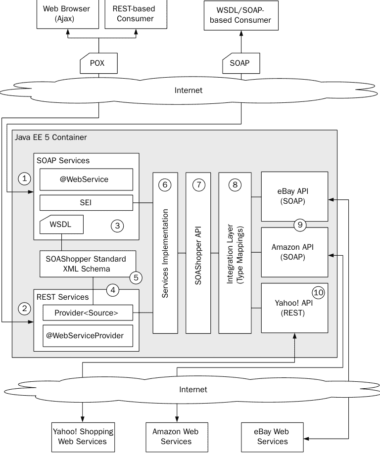

图 9-1 SOAShopper 架构。

## 4.14 SOAShopper：集成 eBay、Amazon 和 Yahoo! 购物

为了理解 SOAShopper 如何工作，请考虑一个搜索请求，例如“找到所有价格低于 $800.00 的联想笔记本电脑”。此类请求将按以下方式处理：

1. 如果请求是从基于 WSDL/SOAP 的消费者发送的，则搜索请求将嵌入在 SOAShopper SOAP 服务部署的 URL SOAP 消息中。
2. 如果请求是从 Ajax 或其他基于 REST 的消费者发送的，搜索请求将嵌入在纯 XML 消息中，或者通过 HTTP 参数或 URL 字符串（或这些者的组合），并在 SOAShopper REST 服务部署的 URL 接收。
3. 在 SOAP 情况下，将调用相应的 SEI（服务端点接口）方法。所选的方法是与 SOAP 消息指定的 SOAShopper WSDL 指定的端口和操作相对应的方法。
4. 在 REST 情况下，将调用 SOAShopper REST 服务模块中心的 `Provider<Source>` 实现。
5. 在 SOAP 和 REST 情况下，请求消息和响应都是根据对应于 SOAShopper 标准 XML 架构的 XML 构建的。
6. 在 SEI 部署或 `Provider<Source>.invoke()` 内部，请求消息被序列化为绑定到 SOAShopper 标准 XML 架构的 Java 对象。这些对象作为参数传递给服务实现（Service Implementation）。服务实现通过在基础级 SOAShopper API 之构建服务来提供 Web 服务功能。在这种情况下，服务实现解释搜索请求并调用相应的 SOAShopper API 方法来执行搜索。
7. SOAShopper API 为源货运服务提供了一个通用封装器。SOAShopper 方法调用集成层（Integration Layer），将操作翻译为源系统（eBay、Amazon 和 Yahoo!）的语法和语义。为了设计和实现此封装器及其相应的集成层，需要对每个源系统进行大量的分析。
8. 集成层通过调用 eBay、Amazon 和 Yahoo! API 的方法来实现 SOAShopper API 定义的接口。用于将 SOAShopper 语义翻译为每个源系统的业务逻辑与将 SOAPshopper 实例翻译为源系统实例的类型映射嵌入在一起。
   - eBay 和 Amazon API 使用 SOAP 在它们各自的服务上调用翻译后的搜索请求。这些 API 绑定到服务的 WSDL，并是使用 JAX-WS 工具自动生成的。
   - Yahoo! API 使用 REST 调用 Yahoo! Shopping Web 服务。由于此类 RESTful 服务没有 WSDL，因此此 API 是根据 Yahoo! 文档中的描述手动实现的。

这些步骤提供了 SOAShopper 应用如何实现的高层概述。JWS 提供了在前端部署 SOAShopper 服务以及在后端消费 eBay、Amazon 和 Yahoo! 服务所需的所有工具。特别是，JAX-WS 架构编译器处理 eBay 和 Amazon WSDL 的能力令我留下了深刻印象。eBay 的 WSDL 超过 3 MB，并编译成 700 多个类。但 SOAShopper 应用能够使用从该 WSDL 生成的类，而没有被使用。承认，弄清楚所有类是很困难的，但这是 eBay Web 服务本身复杂性相关的问题，而不是 JAX-WS 绑定的反映。

能够自动为 eBay 和 Amazon WSDL 生成 Java 绑定显示了 WSDL/SOAP 对于 REST 的一个优势。对于 Yahoo! Shopping REST 服务，无法自动生成 Java 绑定类。这是因为标准没有 WSDL 定义。我采用的方法是使用 JAXB 架构编译器生成绑定到 XML 响应的 Java 类。在 Yahoo! 的情况下，请求是。


## 4.16 SOAShopper：集成 eBay、Amazon 和 Yahoo! 购物

为了理解 SOAShopper 如何工作，请考虑一个搜索请求，例如“找到所有价格低于 $800.00 的联想笔记本电脑”。此类请求将按以下方式处理：

1. 如果请求是从基于 WSDL/SOAP 的消费者发送的，则搜索请求将嵌入在 SOAShopper SOAP 服务部署的 URL SOAP 消息中。
2. 如果请求是从 Ajax 或其他基于 REST 的消费者发送的，搜索请求将嵌入在纯 XML 消息中，或者通过 HTTP 参数或 URL 字符串（或这些者的组合），并在 SOAShopper REST 服务部署的 URL 接收。
3. 在 SOAP 情况下，将调用相应的 SEI（服务端点接口）方法。所选的方法是与 SOAP 消息指定的 SOAShopper WSDL 指定端口和操作相对应的方法。
4. 在 REST 情况下，将调用 SOAShopper REST 服务模块中心的 `Provider<Source>` 实现。
5. 在 SOAP 和 REST 情况下，请求消息和响应都是根据对应于 SOAShopper 标准 XML 架构的 XML 构建的。
6. 在 SEI 部署或 `Provider<Source> invoke()` 内部，请求消息被序列化为绑定到 SOAShopper 标准 XML 架构的 Java 对象。这些对象作为参数传递给服务实现。服务实现通过在基础级 SOAShopper API 之构建服务来提供 Web 服务功能。在这种情况下，服务实现解释搜索请求并调用相应的 SOAShopper API 方法来执行搜索。
7. SOAShopper API 为源货运服务提供了一个通用封装器。SOAShopper 方法调用集成层，将操作翻译为源系统（eBay、Amazon 和 Yahoo!）的语法和语义。为了设计和实现此封装器及其相应的集成层，需要对每个源系统进行大量的分析。
8. 集成层通过调用 eBay、Amazon 和 Yahoo! API 的方法来实现 SOAShopper API 定义的接口。用于将 SOAShopper 语义翻译为每个源系统的业务逻辑与将 SOAPshopper 实例翻译为源系统实例的类型映射嵌入在一起。
9. eBay 和 Amazon API 使用 SOAP 在它们各自的服务上调用翻译后的搜索请求。这些 API 绑定到服务的 WSDL，并是使用 JAX-WS 工具自动生成的。
10. Yahoo! API 使用 REST 调用 Yahoo! Shopping Web 服务。由于此类 RESTful 服务没有 WSDL，因此此 API 是根据 Yahoo! 文档中的描述手动实现的。

这些步骤提供了 SOAPshopper 应用如何实现的高层概述。JWS 提供了在前端部署 SOAPshopper 服务以及在后端消费 eBay、Amazon 和 Yahoo! 服务所需工具。特别是，JAX-WS 架构编译器处理 eBay 和 Amazon WSDL 的能力令我留下了深刻印象。eBay 的 WSDL 超过 3 MB，并编译成 700 多个类。但 SOAPshopper 应用能够使用从该 WSDL 生成的类，而没有被使用。承认，弄清楚所有类是很困难的，但这是 eBay Web 服务本身复杂性相关的问题，而不是 JAX-WS 绑定的反映。

能够自动为 eBay 和 Amazon WSDL 生成 Java 绑定显示了 WSDL/SOAP 对于 REST 的一个优势。对于 Yahoo! Shopping REST 服务，无法自动生成 Java 绑定类。这是因为标准没有 WSDL 定义。我采用的方法是使用 JAXB 架构编译器生成绑定到 XML 响应的 Java 类。在 Yahoo! 的情况下，请求是。

## 9.1 SOAPshopper 概述

## 9.2 SOAP 服务

SOAPshopper 应用提供了由 WSDL 定义的 SOAP 服务，如图 9–1 中的项目 1 和 3 所示。为什么“从 WSDL 和 Java 开始”的方法对于 SOAPshopper 最合理的原因如下：

- SOAPshopper WSDL 应该重用现有库中的标准架构，而不是基于 JAX-WS 绑定生成唯一的架构，这是第 4 章第 4.1 节讨论过的最佳实践。
- SOAPshopper WSDL 应该与 SOAPshopper API 隔离，以便每个都可以独立修订。
- SOAPshopper WSDL 应该只暴露某些操作作为 Web 服务——而不是整个 SOAPshopper API。

WSDL 独立于 SOAPshopper API，一个中间层（在图 9–1 项目 6 中标记为“服务实现”）用于在 JAX-WS 服务端点接口 (SEI) 和 SOAPshopper API 之间调调。在本节中，简要讨论 WSDL 和 SOAP 服务的设计与实现。然后，下一节将查看如何使用 REST 提供相同的服务。

示例 9–1 显示了 WSDL 中的类型定义和其中一个操作——offerSearch。注意 `wsdl:types` 部分包含了来自 http://soapbook.com/example 库的两个标准架构。retail.xsd 架构定义了购物的标准类型（例如，货币类型）。faults.xsd 架构定义了在第 4 章首次讨论的类型，这些用于 SOAP 错误。

### 示例 9–1 SOAPshopper WSDL 片段，显示 xs:schema 定义和定义 offerSearch 操作 wsdl:portType

```xml
<wsdl:types>
  <xs:schema targetNamespace="http://www.example.com/faults">
    <xs:include schemaLocation="http://soapbook.com/example/faults/faults.xsd" />
  </xs:schema>
  <xs:schema targetNamespace="http://soabook.com/soashopper">
    <xs:import namespace="http://www.example.com/retail"
      schemaLocation="http://soabook.com/example/retail/retail.xsd"/>
    <xs:element name="offerSearch">
      <xs:complexType>
        <xs:sequence>
          <xs:element name="keywords" type="xs:string"/>
          <xs:element name="category" type="retail:CategoryType"
            minOccurs="0"/>
          <xs:element name="lowprice" type="retail:PriceType" minOccurs="0"/>
          <xs:element name="highprice" type="retail:PriceType" minOccurs="0"/>
        </xs:sequence>
      </xs:complexType>
    </xs:element>
    <xs:element name="offerSearchReturn">
      <xs:complexType>
        <xs:sequence>
          <xs:element ref="retail:offer" minOccurs="0" maxOccurs="unbounded"/>
        </xs:sequence>
      </xs:complexType>
    </xs:element>
  </xs:schema>
</wsdl:types>
<wsdl:message name="offerSearchRequest">
  <wsdl:part name="parameters" element="tns:offerSearch"/>
</wsdl:message>
<wsdl:message name="offerSearchResponse">
  <wsdl:part name="parameters" element="tns:offerSearchReturn"/>
</wsdl:message>
<wsdl:message name="inputFault">
  <wsdl:part name="parameters" element="faults:inputMessageValidationFault"/>
</wsdl:message>
<wsdl:portType name="ShopperPort">
  <wsdl:operation name="offerSearch">
    <wsdl:input message="tns:offerSearchRequest"/>
    <wsdl:output message="tns:offerSearchResponse"/>
    <wsdl:fault name="offerSearchInputFault" message="tns:inputFault"/>
  </wsdl:operation>
</wsdl:portType>
```

文件路径：`book-code/chap09/soashoper/soashoper-services-soap/src/main/webapp/WEB-INF/wsdl/soashoper.wsdl`

与本书中定义的其他 WSDL 文档一样，SOAShopper WSDL 使用 document/literal 包装风格（wrapped style）。请求的包装元素——`tns:offerSearch` 定义在 `wsdl:types` 部分。如你所见，它定义了四个参数：keywords（用于关键词搜索）、category（例如：电脑、手机等）、lowprice（低价）和 highprice（高价，定义了一个价格范围）。keywords 参数是一个简单的字符串——被解释为由空格分隔的搜索关键词。category 参数是 `retail:CategoryType` 的实例——这是一个由有效类别枚举定义的 `xs:simpleType`，如示例 9–2 所示。

### 示例 9–2 CategoryType 定义了有效类别列表（搜索可以限制在某个类别内）

```xml
<xs:simpleType name="CategoryType">
  <xs:restriction base="xs:string">
    <xs:enumeration value="COMPUTERS"/>
    <xs:enumeration value="CELLphones"/>
    <xs:enumeration value="MOVIES"/>
  </xs:restriction>
</xs:simpleType>
```


# 示例 9-3 PriceType 定义了基于十进制金额（小数点后保留两位）和货币标识符的价格

`lowprice` 和 `highprice` 参数是 `retail:PriceType` 的实例——这是一个指定金额和货币的 `xs:complexType`。代表 $9.89（美元）的 `retail:PriceType` 实例如下：

```xml
<lowprice currencyId="USD">9.89</lowprice>
```

`retail:PriceType` 的架构（schema）如下：

```xml
<xs:complexType name="PriceType">
  <xs:simpleContent>
    <xs:extension base="tns:HundthsType">
      <xs:attribute name="currencyId" type="tns:CurrencyType"/>
    </xs:extension>
  </xs:simpleContent>
</xs:complexType>

<xs:simpleType name="HundredthsType">
  <xs:restriction base="xs:decimal">
    <xs:fractionDigits value="2"/>
  </xs:restriction>
</xs:simpleType>

<xs:simpleType name="CurrencyType">
  <xs:restriction base="xs:string">
    <xs:enumeration value="USD"/>
    <xs:enumeration value="GBP"/>
    <xs:enumeration value="EUR"/>
    <xs:enumeration value="JPY"/>
  </xs:restriction>
</xs:simpleType>
```

文件路径：`book-code/chap09/soashoppers/soashoppers-services-soap/src/main/webapp/WEB-INF/wsdl/retail.xsd`

---

# 示例 9-4 offerType 包含来自 eBay、Amazon 或 Yahoo! 在线购物的摘要

示例 9-1 中的 SOAShopper WSDL 定义了 `offer` 操作的 SOAP 响应。它的包装元素 `tns:offerSearchReturn` 包含一个零或多个 `retail:offer` 实例列表。这些是在 eBay、Amazon 或 Yahoo! 购物上找到的符合条件的在线报价。`retail:offer` 的 XML 架构定义如下：

```xml
<xs:element name="offerList">
  <xs:complexType>
    <xs:sequence>
      <xs:element ref="tns:offer" minOccurs="0" maxOccurs="unbounded"/>
    </xs:sequence>
  </xs:complexType>
</xs:element>

<xs:element name="offer" type="tns:OfferType"/>
<xs:complexType name="OfferType">
  <xs:sequence>
    <xs:element name="offerId" type="xs:string"/>
    <xs:element name="productId" type="xs:string" nillable="true"/>
    <xs:element name="source" type="tns:SourceType"/>
    <xs:element name="thumbnail" type="tns:PictureType" minOccurs="0"/>
    <xs:element name="price" type="tns:PriceType"/>
    <xs:element name="merchantName" type="xs:string" minOccurs="0"/>
    <xs:element name="summary" type="xs:string"/>
    <xs:element name="offerUrl" type="xs:anyURI"/>
  </xs:sequence>
</xs:complexType>
```

文件路径：`book-code/chap09/soashoppers/soashoppers-services-soap/src/main/webapp/WEB-INF/wsdl/retail.xsd`

---

# 示例 9-5 由 WSDL 编译器生成的 SEI——ShopperPort

所有的定义都来自 `retail.xsd`，将在下一节中进一步讨论。在此之前，让我们看看名为 `ShopperPort` 的 WSDL 是如何转换为 Java 的。

```java
@WebService(name = "ShopperPort",
            targetNamespace = "http://soabook.com/soashopper")
@XmlAlso({.example.faults.ObjectFactory.class,
          com.soashopper.soashopper.ObjectFactory.class,
          com.example.retail.ObjectFactory.class })
public interface ShopperPort {

    @WebMethod
    @WebResult(name = "offer", targetNamespace = "http://www.example.com/retail")
    @RequestWrapper(localName = "offerSearch",
                    targetNamespace = "http://soabook.com/soashopper",
                    className = "com.soashopper.soashopper.OfferSearch")
    @ResponseWrapper(localName = "offerSearchReturn",
                     targetNamespace = "http://soabook.com/soashopper",
                     className = "com.soabook.soashopper.OfferSearchReturn")
    public List<OfferType> offerSearch(
        @WebParam(name = "keywords",
                  targetNamespace = "http://soabook.com/soashopper")
        String keywords,
        @WebParam(name = "category",
                  targetNamespace = "http://soabook.com/soashopper")
        CategoryType category,
        @WebParam(name = "lowprice",
                  targetNamespace = "http://soabook.com/soashopper")
        PriceType lowprice,
        @WebParam(name = "highprice",
                  targetNamespace = "http://soabook.com/soashopper")
        PriceType highprice) throws InputFault;
}
```

文件路径：`book-code/chap09/soashoppers/soashoppers-services-generated/edited/ShopperPort.java`

---

## 部署 ShopperPort Web 服务

要部署与名为 `ShopperPort` 的 `wsdl:portType` 对应的 Web 服务，需要创建一个实现该 Port SEI 的 `@WebService` 注解类，并在 `offerSearch()` 方法内部调用服务实现层的方法。这个带有 `@WebService` 注解的类——名为 `ShopperPortImp`——被部署到名为 `ShopperPort` 的 `wsdl:portType` 对应的 SOAP 端点。像这样使用 JAX-WS 来设计和部署带有 SEI 的 Web 服务，将在第 7 章 7.2 节和第 8 章 8.2 节中详细介绍。

---

# 示例 9-6 ShopperPortImp 实现了 ShopperPort SEI（此类由 JAX-WS 部署为 SOAP 端点）

```java
@WebService(wsdlLocation = "WEB-INF/wsdl/soashoppers.wsdl",
            endpointInterface = "com.soabook.soashoppers.ShopperPort")
public class ShopperPortImp implements ShopperPort {
    public List<OfferType> offerSearch(String keywords, CategoryType category,
                                       PriceType lowprice, PriceType highprice) throws InputFault {
        return (new ShopperService(this)).offerSearch(keywords, category.toString(),
                                                      lowprice.getCurrencyId().toString(), lowprice.doubleValue(),
                                                      highprice.getValue());
    }
}
```

文件路径：`book-code/chap09/soashoppers/soashoppers-services/src/main/java/com/javector/soashoppers/endpoint/ShopperPortImp.java`

如你所示，该实现是一个调用 `ShopperService` 类中 `offerSearch()` 方法的包装器。`ShopperService` 是实现层的一部分，并充当隔离 WSDL 和 REST 端点的网关。正如我在下一节中讨论的那样，同一个类也被用于处理 REST 请求。

---

# 9.3 一个 SOAShopper RESTful 服务与标准 XML Schema

与所讨论的 SOAP 服务类似，购物应用程序提供了图 9-1 中项目 2 和 4 所示的 RESTful 服务。然而，由于 REST（在第 3 章中定义和讨论）没有标准的接口语言，因此没有对应的 WSDL 文档。JAX-WS 编译器可以生成 Java API。幸运的是，在这种情况下，RESTful 服务的响应可以通过 XML Schema 定义。本例中使用的实例与 SOAP/WSDL 情况使用的实例相同——图 9-1 中标记为项目 5 的 XML Schema。这些 schema `http://soabook.com/example/retail.xsd` 和 `http://soabook.com/example/faults/faults.xsd` 被导入到 WSDL 的 types 部分，如示例 9-1 所示。

因此，对于 RESTful 服务，我们不需要从 WSDL 生成 Java，而是必须基于人类可读的描述编写我们的端点类。图 9-2 显示了为 `offerSearch` REST 版本可能提供的文档类型。

## 总结

SOAShopper `offerSearch` 服务允许你跨 eBay、Amazon 和 Yahoo! 搜索产品报价。`keywords` 参数是必选的，其余的是可选的。以下是一个搜索示例，它返回了所有包含关键词“laptop”和“thinkpad”且价格在 600.00 到 800.00 美元之间的产品：

`http://javector.com/soashopper/endpoint/rest/offerSearch?keywords=laptop%20thinkpad&highprice=800.00&currencyId=USD&lowprice=600.00`

## 请求参数

| 参数 | 值 | 描述 |
| --- | --- | --- |
| `keywords` | string | 用空格分隔的待搜索关键词列表。选择包含所有关键词的报价。 |
| `category` | string | 指定要搜索的类别（例如，COMPUTERS、CELLPHONES、MOVIES）。 |
| `currencyId` | string | 指定 `lowprice` 和 `highprice` 参数的货币（例如，USD、GBP、INR）。 |
| `lowprice` | double | 选择价格大于 `lowprice` 的报价。 |
| `highprice` | double | 选择价格小于 `highprice` 的报价。 |

## 响应元素

SOAShopper `offerSearch` REST 响应是一个名为 `offerList` 的 XML 元素，由位于定义的 schema 定义：`http://soabook.com/example/retail.xsd`。

图 9-2 所示 `offerSearch` 操作的文档是以人类可读的格式提供的。正如图 9-2 所述，对于 `offerSearch` REST 服务，请求消息通过 HTTP 参数提供。此外，我假设请求可能通过以下方式之一以 URL 编码格式提供：

- GET 方法（如图 9-2 总结部分所示），位于查询字符串中
- POST 方法，位于 HTTP 实体中

另一方面，响应消息将是带有 `offerList` XML 元素的 HTTP 响应。示例 9-7 显示了用于 `offerList` 元素的 XML Schema。这与示例 9-4 中的 SOAP 端点相同。

---

# 示例 9-7 定义 REST 服务使用的 offerList 元素的 XML Schema

```xml
<xs:element name="offerList">
  <xs:complexType>
    <xs:sequence>
      <xs:element ref="tns:offer" minOccurs="0" maxOccurs="unbounded"/>
    </xs:sequence>
  </xs:complexType>
</xs:element>

<xs:element name="offer" type="tns:OfferType">
<xs:complexType name="OfferType">
  <xs:sequence>
    <xs:element name="keywords" type="xs:string" nillable="true"/>
    <xs:element name="category" type="xs:string" minOccurs="0"/>
    <xs:element name="currencyId" type="xs:string" minOccurs="0"/>
    <xs:element name="lowprice" type="xs:double" minOccurs="0"/>
    <xs:element name="highprice" type="xs:double" minOccurs="0"/>
  </xs:sequence>
</xs:complexType>
</xs:element>
```

方法调用定义的 REST 接口（例如，`shopperService.offerSearch()`）。示例 9-9 显示了实现类的定义。

---

# 示例 9-8 对应的 Shopping Java 接口

```java
public interface ShopperService {
    List<OfferType> offerSearch(String keywords, CategoryType category,
                                PriceType lowprice, PriceType highprice);
}
```


`book-code/chap09/soashoppers/soashoppers-services/src/main/java/com/javector/soashoppers/endpoint/rest/shopperService.java`

示例 9–9 中还有两个值得注意点。首先，该类包含一个通过依赖注入实例化的 `WebServiceContext (wsContext)` 变量，以及一个在构造函数中实例化的 `JAXBContext (jaxbContext)` 变量。`wsContext` 提供了访问 HTTP 请求以便获取 HTTP 参数。同样，`jaxbContext` 提供了创建图 9–2 REST 文档指定的 HTTP 响应 XML 元素 `offerlist` 的能力。

## 428 SOAShopper：集成 eBay、Amazon 和 Yahoo!购物

示例 9–10 `offerSearch()` 方法的 RESTful 实现调用了 `ShopperService.offerSearch()`——与 SOAP 实现调用的相同方法

```java
65    public List offerSearch(String keywords, String category,
66        String currencyId, Double lowprice, Double highprice) {
67
68        ShopperService shopperService = new ShopperService();
69        List<OfferType> offers = shopperService.offerSearch(keywords,
70            category, currencyId, lowprice, highprice);
71        OfferList offerList = new OfferList();
72        List<OfferType> offerOffers = offerList.getOffers();
73        offerList.addAll(offers);
74        return offerList;
75
76    }
77
```

`book-code/chap09/shopper/shopper-services-rest/src/main/java/com/javector/shopper/endpoint/ShopperRESTImp.java`

示例 9–10 展示了由 `ShopperRESTImp` 指定 `offerSearch()` 方法的实现。SOAShopper 架构的设计使得 `offerSearch` 的 SOAP 和 REST 实现都调用了服务实现层——`ShopperService.offerSearch()`。通过这种方式，REST 和 SOAP 端点只是用于调用相同功能的 API。

示例 9–11 展示了由 `Provider<Source>` 接口指定的 `invoke()` 方法是如何实现的。

## 9.3 一个 ASHopper RESTful 服务和标准 XML Schema

示例 9–11 由 `Provider<Source>` 接口指定的 `invoke()` 方法提取 HTTP 参数并调用 `offerSearch()` 方法

```java
91 params = httpReq.getParameterMap();
92 } else {
93 throw new HttpException(HttpServletResponse.SC_METHOD_NOT_ALLOWED);
94 }
95 String keywords = getParam(params, "keywords");
96 if (keywords == null) {
97 throw new HttpException(HttpServletResponse.SC_NOT_FOUND);
98 }
99 String category = getParam(params, "category");
100 String currencyId = getParam(params, "currencyId");
101 String lowpriceStr = getParam(params, "lowprice");
102 String highpriceStr = getParam(params, "highprice");
103 Double lowprice = lowpriceStr == null ? null : Double.valueOf(lowpriceStr);
104 Double highprice = highpriceStr == null ? null : Double
105 valueOf(highpriceStr);
106 OfferList offerList = search(keywords, category, currencyId, lowprice,
107 highprice);
108 if (offerList == null) {
109 return null;
110 }
111 try {
112 return new JBSource(jaxContext, offerList);
113 catch (JAXBException e) {
114 throw new HttpException(HttpServletResponse.SC_INTERNAL_SERVER_ERROR);
115 }
116 }
```

`book-code/chap09/shopper/shopper-services-rest/src/main/java/com/javector/shopper/endpoint/ShopperServiceRESTIMP.java`

当 `ShopperServiceRESTIMP` 类被部署时，JAXWS 运行时会调用 REST 端点的 `invoke()` 方法。因此，XML/HTTP 请求被传递给 `invoke()`。输入参数（类型为 `Object`）被忽略，因为此 RESTful 服务不接受 XML 输入，而是使用包含在 URL 查询字符串（GET 请求）或 HTTP 请求体（POST 请求）中的 HTTP 参数。

相反，代码使用 `WebContext` 实例 `wsContext` 获取通过 `MessageContext` 提取的 `HttpParameter`。然后，使用 `HttpServletRequest` 提取参数。当 `ShopperServiceRESTIMP` 类被部署时，JAXWS 运行时会调用 REST 端点的 `invoke()` 方法。因此，XML/HTTP 请求被传递给 `invoke()`。输入参数（类型为 `Object`）被忽略，因为此 RESTful 服务不接受 XML 输入，而是使用包含在 URL 查询字符串（GET 请求）或 HTTP 请求体（POST 请求）中的 HTTP 参数。

---

## 430 SOAShopper：集成 eBay、Amazon 和 Yahoo!购物

示例 9–12 展示了 `web.xml` 部署描述符的用法。

示例 9–12 `web.xml` 用于部署 REST 端点

```xml
<web-app xmlns="http://java.sun.com/xml/ns/javaee"
  xmlns:xsi="http://www.w3.org/2001/XMLSchema-instance"
  xsi:schemaLocation="http://java.sun.com/xml/ns/javaee 
                      http://java.sun.com/xml/ns/javaee/web-app_2_3.xsd"
  version="2.3">
  <servlet>
    <servlet-name>shopper</servlet-name>
    <class>com.javector.shopper.endpoint.ShopperServiceRESTIMP</class>
  </servlet>
  <servlet-mapping>
    <servlet-name>shopper</servlet-name>
    <url-pattern>/shopper</url-pattern>
  </servlet-mapping>
</web-app>
```

`book-code/chap09/shopper/shopper-services-rest/src/main/java/com/javector/shopper/endpoint/ShopperServiceRESTIMP`

当 `ShopperServiceRESTIMP` 类被部署时，JAXWS 运行时会调用 REST 端点的 `invoke()` 方法。因此，XML/HTTP 请求被传递给 `invoke()`。输入参数（类型为 `Object`）被忽略，因为此 RESTful 服务不接受 XML 输入，而是使用包含在 URL 查询字符串（GET 请求）或 HTTP 请求体（POST 请求）中的 HTTP 参数。

## 9.4 服务实现

之前的章节关注了 SOAP 和 REST 端点的设计。在本节中，我将转向服务实现。SOAShopper 架构的设计使得 `offerSearch` 的 SOAP 和 REST 实现都调用了服务实现层——`ShopperService.offerSearch()`。通过这种方式，REST 和 SOAP 端点只是用于调用相同功能的 API。

示例 9–11 展示了由 `Provider<Source>` 接口指定的 `invoke()` 方法是如何实现的。

这里使用的类型映射方法是递归的，因为 `Offer` 到 `retail:OfferType` 的映射是使用 `retail:OfferType` 的组成部分的映射构建的。例如，所示的 `toOfferType()` 方法调用了 `<retail:PriceType, com.javector.soashoper.Price>` 和 `<retail:PictureType, com.javector.soashoper.Picture>` 的类型映射方法。

## 432 SOAShopper：集成 eBay、Amazon 和 Yahoo!购物

```java
// 将 SOAP/REST 类型转换为 SOAShopper 类型
TypeConverter tc = new TypeConverter();
Category category = tc.toCategory(categoryId);
Price lowprice = tc.toPrice(currencyId, lowpriceVal);
Price highprice = tc.toPrice(currencyId, highpriceVal);

// 调用 SOAShopper API
Shopper shoppingService = new ShopperService();
List<Offer> offerList = shoppingService.offerSearch(keywords, category, lowprice, highprice);

// 将 SOAShopper API 返回类型转换为 SOAP/REST 响应类型
Array<OfferType> offerList = new ArrayList<OfferType>();
for (Offer o : offerList) {
  offerList.add(tc.toOfferType(o));
}
return offerList;
```

示例 9–14 展示了这些类型映射是如何实现的。本质上，正如你在示例中所所示，`ShopperService.offerSearch` 方法执行两个功能：(1) 它在 SOAP/REST 服务层与 SOAShopper API 之间进行类型转换；以及 (2) 它调用 SOAShopper API 执行搜索。

## 9.4 服务实现 433

示例 9–14 使用 `TypeConverter.toOffer` 方法将 SOAShopper API 的 `OfferType` 转换为 REST/SOAP 终端点的 JAXB Schema 编译后的 `offerType`

```java
/**

 * 将 SOAShopper API 的 Offer 类型转换为 SOAP 和 REST 端点 
 * 通过 JAXB 生成的 OfferType。
 * @param o
 * @return
 */

public OfferType toOfferType(Offer o) {
    if (o == null) { return null; }
    OfferType ot = new OfferType();
    ot.setOfferId(o.getSourcesOfferId());
    ot.setProductID(o.getSpecificProductID());
    ot.setSource(toSource(o.getSource()));
    ot.setThumbnail(toPictureType(o.getThumbnail()));
    ot.setPrice(toPrice(o.getPrice()));
    ot.setMerchantName(o.getMerchantName());
    ot.setSummary(o.getSummary());
    ot.setOfferUrl(o.getUrl().toString());
    return ot;
}
```

`book-code/chap09/soashoppers/soashoppers-engine/src/main/java/com/javector/util/TypeConverter.java`

本示例中用于实现类型映射的递归框架在第 5 章第 5.3 和 5.4 节中有详细描述。它基于标准的 JAXB 映射结合递归。由于这种技术用于 SOAShopper 的实现，因此不需要对 JAXB 标准映射进行任何自定义。这种方法使得对于不熟悉 XML Schema 或 JAXB 注解的程序员来说，代码更容易理解和维护。

- 5. 关于直接使用 JAXB 注解、绑定语言和 `XMLAdapter` 类实现类型映射的替代方法，请参阅第 5 章第 5.5–5.7 节。使用这种方法使我们能够通过 `TypeConversion` 类禁用它，并使用注解将 SOAShopper-API 直接映射到 SOAP/REST 终端架构 (`retail.xsd`)。

## 434 SOAPHopper: 集成 eBay、Amazon 和 Yahoo! Shopping

在查看了位于 SOAP/REST 终端点和 SOAPpper API 之间的服务实现层后，在接下来的几节中，我将重点介绍如何使用 JAX-WS 访问购物系统：eBay、Amazon 和 Yahoo! Shopping。然后，在最后一节，我将回来查看 SOAPHopper API 和集成层（图 9–1 所示 SOAPHopper 架构中的第 7 和第 8 项）。

## 9.5 eBay 和 Amazon 服务 (SOAP)

本节介绍了 eBay 和 Amazon 提供的基于 SOAP 服务。实际上，讨论完全集中在 eBay 服务上。然而，Amazon 的实现类似，你可以查看 `chap0/soaphopper/` 中的代码以了解 Amazon 的细节。

由于 eBay 和 Amazon 服务提供了 WSDL 描述，JAX-WS WSDL/Java 绑定工具可以生成用于调用它们的 Java API。第 9.2 节展示了如何在服务端使用 WSDL/Java 绑定工具。在在该节中，SOAPHopper WSDL 被编译以为我们的 SOAP 终端创建 Java 服务端点接口 (SEI)。在本节中，我将展示如何在客户端使用相同的 WSDL/Java 绑定工具。在这里，你将看到如何生成使用客户端 JAX-WS 框架来调用 eBay 和 Amazon Web 服务的代理。第 6 章包含了对代理和客户端 JAX-WS 的详细讨论，以及一些更简单的示例。

SOAPHopper 构建过程使用 Ant 来调用 WSDL/Java 绑定工具。编译 eBay WSDL 的 Ant target 如示例 9–15 所示。

**9-15** 用于编译 eBay WSDL 的 Apache Ant Target（导入了 JAX-WS WSDL 编译器工具 `wsimport`）

```xml
<target name="compile-ebay-wsdl">
<delete dir="${java.generated}/ebay" />
</target>
```

- 6. 本节中提供的某些 eBay 相关代码灵感源于出现在 Sun 网站上的 JAX-WS 2.0 文章 [Eckstein]。
- 7. GlassFish 工具是 `wsimport`。

## eBay 和 Amazon 服务 (SOAP) 435

```xml
<exec executable="wsimport">
  <!-- 需要因为 wsdl 很大 -->
  <env name="VMARGS" value="-Xmx512m" />
  <!-- 抑制警告消息 -->
  <arg value="-quiet" />
  <arg value="-keep" />
  <arg line="-d target/junk" />
  <arg line="-s ${java.generated}" />
```


<arg value="http://developer.ebay.com/webservices/479/eBaySvc.wsdl" />

</exec>

```
book-code/chap09/soashoppers/soashoppers-sources-generated/build.xml
```

此示例展示了 `wsimport` 工具的使用。传递给 `wsimport` 的最后一个参数是要编译的 WSDL URL。你可以在此处找到：

http://developer.ebay.com/webservices/479/eBaySvc.wsdl

注意该 URL 有版本号 479。eBay WSDL 经常变化，版本号会递增。你可以在此处找到最新版本：

http://developer.ebay.com/webservices/latest/eBaySvc

本示例使用了固定版本号以确保 SOAP 终端能够编译。WSDL 的变化意味着 Java 类的变化。现在考虑 WSDL 如何适配到 SOAShopper。图 9–3 展示了 eBay 的客户端框架。Amazon 的框架是类似的。这种方法在第 6 章中有更多讨论。

## 436 SOAPHopper: 集成 eBay、Amazon 和 Yahoo! Shopping

| eBay 服务 | |
| :--- | :--- |
| 终端点 | WSDL |
| 代理 | SOAP 请求 |
| JAXB 生成类 | 处理器 |
| JAXB 生成类实例 | 处理器链 |
| 客户端组件 | 服务终端点 | 返回值 |
| javax.xml.WebService | | |
| eBayAPI | 结果类型 | |
| 结果类型 | SOAP 响应 |
| SOAPHopper | | |
| https://api.ebay.com/wapi?callname=XX | | |
| http://developer.ebay.com/webservices/479/eBaySvc.wsdl | | |

**图 9–3** 从 WSDL 生成的 JAX-WS 类用于调用 eBay 服务。

## 9.5 eBay 和 Amazon 服务 (SOAP) 437

该场景的各种组件标记为 1–8，每个组件描述如下：

1. eBay WSDL 是版本化的，不同版本对应的 URL。对于本示例，我使用了版本 479。
2. 使用 WSDL/Java 绑定工具（`wsimport`）（如示例 9–15 所示）来生成 SEI（`ebay.apis.ebasecomponents.EBayAPIInterface`）以及一个 `javax.xml.WebService` 实现，作为工厂类。
3. 项目 1 和 2 在 SOAPHopper 构建期间执行。其余步骤包括此步骤是运行时步骤。为了调用 eBay 服务，你首先需要获取实现 SEI 的代理类。服务类（`ebay.apis.ebasecomponents.EBayIService`）提供了工厂方法 `geteBayAPI()` 来提供 SEI 的实例。
4. 下一个组件 4 出现在图的右下。在这里，我们需要对 SEI 代理进行一些自定义，以符合 eBay 调用过程。在此步骤中，我们为代理添加了 `HandlerChain` 实例。该链包含单个处理器 `com.java.soaphopper.ebay.RequestCredentials`，它为传出的消息添加一些 SOAP 头。
5. 为了向 eBay 服务发送 SOAP 请求，调用 SEI 方法 `SearchResults`（见示例 9–17），其参数类型为 `ebay.apis.ebasecomponents.GetSearchResultsType`（见示例 9–18）。该参数成为 SOAP 消息体。
6. 在调用期间，添加到代理实例中的 `SOAPHandler` 创建了 eBay 需要的 SOAP 头元素。
7. 接下来，`InvocationHandler`（见第 6 章第 6.1 节）在代理实例向 eBay 终端点发送 SOAP 请求。注意图 9–3 中 SOAP 终端 URL 的表示：`https://api.ebay.com/wapi?callname=XX&version=479&siteid=0&appid=YY&Routing=new`。此终端点根据调用的操作名称（即 `callname=XX`）而变化。
8. 来自 eBay 的 SOAP 响应消息由 `InvocationHandler` 处理，返回值类型为 `ebay.apis.eblbasecomponents.GetSearchResultsResponseType`，该类型由 WSDL 指定，并从 SEI 方法返回。

此时，我将更详细地详细阐述这八个步骤，并查看部分代码以更好地说明正在发生的情况。示例 9–16 显示了我们使用了代理实例（第 3 步）并对其进行了配置。如你所见，创建了一个由 JAX-WS 生成的 `javax.xml.ws.Service` 实例 `eBayAPIServiceInterface`，并使用其 `geteBayAPI()` 方法返回由 `port` 变量引用的 SEI 实例——`eBayAPIInterface`。

### 示例 9–16 eBayShopperImp 构造函数中的这段代码执行了图 9–3 中的第 3 和第 4 步

```
117 EBayAPIServiceInterface svc = new EAPIServiceInterface();
118 port = svc.geteBayAPI();
119 BindingProvider bp = (BindingProvider) port;
120 List<Handler> handlerChain = new ArrayList<Handler>();
121 handlerChain.add(new RequestCredentials());
122 bp.getBinding().setHandlerChain(handlerChain);
```

book-code/chap09/shoashepper/shoashepper-engine/src/main/java/javector/shoashepper/eBayShopperImp.java

获得 SEI 实例后，通过添加 `SOAPHandler`（即 `RequestCredentials` 实例）对其进行配置（第 4 步）。这是通过调用 `BindingProvider.setHandlerChain()` 方法完成的。

示例 9–17 显示了由 JAX-WS 生成用于定义 SEI 方法 `getSearchResults` 的代码。它在第 5 步中被调用。注意，该方法只有一个参数，eBay 使用其作为各种搜索参数的包装器。

### 示例 9–17 从 eBay WSDL 生成的 eBayServiceInterface.getSearchResults 方法

```
845 @WebMethod(operationName = "GetSearchResults")
846 @WebResult(name = "GetSearchResultsResponse",
847   targetNamespace = "urn:ebay:apis:eBLBaseComponents",
848   partName = "GetSearchResultsResponse"
849 public GetSearchResultsType getSearchResults(
850       @WebParam(name = "GetSearchResultsRequest",
851       targetNamespace = "urn:ebay:apis:eBLBaseComponents",
852       partName = "GetSearchResultsRequest")
853   GetSearchResultsType getSearchResults());
```

book-code/chap09/soashoppers/soashoppers-sources-generated/edited/EBayAPIInterface.java

来自 eBay WSDL 的 `GetSearchResults` 操作生成了此 JAX-WS 生成的 `EBayAPIInterface.getSearchResults` 方法如下：

```xml
<wsdl:operation name="GetSearchResults">
  <wsdl:input message="ns:GetSearchResultsRequest"/>
  <wsdl:output message="ns:GetSearchResultsResponse"/>
</wsdl:operation>
```

注意输入消息的名字是 `GetSearchResults`。该消息在 WSDL 中的定义如下：

```xml
<wsdl:message name="GetSearchResultsRequest">
  <wsdl:part name="GetSearchResultsRequest" element="ns:GetSearchResultsRequest"/>
</wsdl:message>
```

在这里，你可以看到它有一个参数——名为 `GetSearchResultsRequest` 的元素。你可以在示例 9–17 中看到使用 `@WebParam` 注解指定的这一点。

从代码段中，我们可以得出结论：eBay WSDL 似乎使用的是 *document/literal*（文档/字面量）样式，而不是 document/literal wrapped（文档/字面量封装）。正如第 4 章第 4.3.5 节所讨论的，为了使用 document/literal wrapped 样式，消息元素（即 `ns:GetSearchResultsRequest`）必须与操作——`GetSearchResults` 相同。这解释了为什么 JAX-WS WSDL 编译器创建的 SEI 方法 `getSearchResults`（示例 9–17）带有一个参数。如果 WSDL 样式是 document/literal wrapped，那么 JAX-WS 将生成一个

* 见关于 WSDL 样式的讨论，请参阅第 4 章。

## 9.5 eBay 和 Amazon 服务 (SOAP)

SEI 方法将 `GetSearchResultsRequest` 中包含的多个元素作为参数列表。示例 9–18 显示了 eBay WSDL 的片段，其中包含 `GetSearchResultsRequest` 的元素定义。该类型包含了必须映射到 SOAShopper API 搜索参数的参数。

### 示例 9–18 eBay WSDL 片段，显示搜索请求-SearchRequestType

```xml
<!-- Version 479 --> Copyright (c) 2003-2006 eBay Inc. All Rights Reserved. -->
<wsdl:definitions xmlns:wsdl="http://schemas.xmlsoap.org/wsdl/" xmlns:xs="http://www.w3.org/2001/XMLSchema">
  <xs:types>
    <xs:schema targetNamespace="urn:ebay:apis:ebasecomponents">
      <xs:element name="GetSearchResults">
        <xs:complexType name="GetSearchResultsRequest">
          <xs:sequence>
            <xs:element name="Query" type="xs:string"/>
            <xs:element name="CategoryID" type="xs:string"/>
            <xs:element name="PriceRangeFilter" type="xs:string"/>
          </xs:sequence>
        </xs:complexType>
      </xs:element>
    </xs:schema>
  </xs:types>
</wsdl:definitions>
```

*(注：此处原文 XML 似乎不完整或存在截断，已根据上下文保留结构并翻译逻辑)*

上文，该类型包含了必须映射到 SOAShopper API 搜索参数的参数。

如你所见，`GetSearchResultsRequest` 包含了 `Query`、`CategoryID` 和 `PriceRangeFilter` 等参数。

在发送到 eBay 的 SOAP 消息之前，必须对 `getSearchResults` 方法调用的实例进行进行操作。示例 9–19 显示了 `SOAPHandler` 如何将 `RequesterCredentials` 头部添加到发送到 eBay 的 SOAP 消息。

### 示例 9–19 将 RequestCredentials 添加到 SOAP 请求的 SOAPHandler

```java
69 Boolean outboundProperty = (Boolean) smc.get(OperationContext.OUTBOUND_PROPERTY);
71 if (outboundProperty.booleanValue()) {
72 SOAPMessage message = smc.getMessage();
73 try {
74 SOAPHeader header = message.getSOAPHeader();
75 if (header == null) {
76 message.getSOAPEnvelope();
77 header = message.getSOAPHeader();
78 }
79 SOAPElement hSecurity = header.getChildElement("RequesterCredentials",
80 "urn:ebay:apis:ebasecomponents");
81 hSecurity.addChildElement("eBayAuthToken", "urn:ebay:apis:ebasecomponents").createTextNode(ShopperCredentials.getToken());
82, "urn:ebay:apis:ebasecomponents");
83 hSecurity.addChildElement("AppId", "urn:ebay:apis:ebasecomponents").createTextNode(ShopperCredentials.getID());
84 hSecurity.addChildElement("DevId", "urn:ebay:apis:ebasecomponents").createTextNode(ShopperCredentials.getDevID());
85 catch (Exception e) {
86 e.printStackTrace();
87 }
88 }
89 
```

book-code/chap09/soashoper/soashoper-engine/src/main/java/javector/soashoper/ebay/RequesterCredentials.java

这段代码为 SOAP 消息添加了一个名为 `RequesterCredentials` 的头部。如你所见，该头部配置了 `eBayAuthToken`、`Credentials` 等元素。这些是 eBay 需要的安全凭据。在代码中，你可以看到这些安全凭据是从 `ShopperCredentials` 对象读取的。而 `ShopperCredentials` 反通过存储在文件中的属性填充。当 SOAShopper 应用由 JVM 加载时，它会从文件中实例化。

此 SOAP 头部的需求是在 WSDL 中指定的。这里是 `wsdl:binding` 部分，显示了 `GetSearchResults` 操作的 SOAP 绑定

```xml
<wsdl:operation name="GetSearchResults">
  <wsdl:operation soapAction=""/>
  <wsdl:input>
    <wsdl:header use="literal" message="ns:RequesterCredentials" part="RequesterCredentials"/>
    <wsdl:body use="literal"/>
  </wsdl:input>
  <wsdl:output>
    <wsdl:header use="literal" message="ns:RequesterCredentials" part="RequesterCredentials"/>
    <wsdl:body use="literal"/>
  </wsdl:output>
</wsdl:operation>
```


你可能在奇怪，为什么 JAX-WS WSDL/Java 映射工具没有简单地将 `ns:RequesterCredentials` 消息绑定到类，并将其作为参数添加到 `getSearchResults` 方法中。事实证明，这种行为是可能的，但 JAX-WS 2.0 规范将其描述为可选的（请参阅 JSR 224 第 2.6.2.1 节）。此处使用的映射工具示例（即 GlassFish 导入）并未实现此功能。因此，我们需要编写自己的 `SOAPHandler` 来处理此问题。

在将 SOAP 请求发送到 eBay 端点之前，需要完成的最后一步（第 7 步）是确定该端点的 URL。因为 eBay 的 WSDL 使用 document/literal 风格（相对于 rpc/literal 或 document/literal wrapped 风格），通过 SOAP 请求调用的操作并不是 SOAP 体中子元素的包装元素名称。因此，如果 eBay 服务器要判断某个特定的 SOAP 消息调用了哪种 WSDL 操作，它需要额外的信息。eBay 要求我们将操作名称作为 URL 编码参数，在端点的查询字符串中提供信息。在这种情况下，端点 URL 需要在其查询字符串中包含参数 `operation=GetSearchRequest`。实现此目的代码如示例 9–20。

## 示例 9–20 eBay 服务的端点，URL 编码 HTTP 参数在运行时配置

```java
119 endpointURL = ebayURL + "classname=" + CALLNAME_TOKEN + "&siteid=0&appid"
120 + add + "&version=" + WSDL_VERSION + "&Routing=new";
```

`book-code/chap09/sohopper/sohopper-engine/src/main/java/com/jvector/sohopper/ebay/EBayShopperImp.java`

如你所示，`endpointURL` 已经设置，并在每个 SOAP 请求中将 `CALLNAME_TOKEN` 字符串替换为实际的调用名称。实现此目的的代码在示例 9-21 中。用于 callname 的 URL 编码 HTTP 参数（例如 `GetSearchResults`）必须为每个 SOAP 请求在运行时配置。在 JAX-WS 2.0 中，可以通过自定义端点 URL 的查询字符串并将其设置为 `BindingProvider.ENDPOINT_ADDRESS_PROPERTY` 来实现。

## 示例 9–21 用于 callname 的 URL 编码 HTTP 参数

```java
160 private void configureEBayRequestType(AbstractRequest type, String callname) {
161
162 art.setVersion(WSDL_VERSION);
163 art.setErrorLanguage(ERROR_LANGUAGE);
164 String endpointURL = eByteArrayTemplate.replace(CALLNAME_TOKEN, callname);
165 ((BindingProvider) port).getRequestContext().put(
166     BindingProvider.ENDPOINT_ADDRESS_PROPERTY, endpointURL);
167 }
```

`book-code/chap09/soashoppers/soashoppers-engine/src/main/java/com/vector/soashoppers/ebay/EBayShopperImp.java`

如你所示，每个调用 eBay 操作的方法必须先使用此方法 `configureRequestBodyType` 配置请求对象和端口。该方法在请求对象上设置了必要的参数（例如版本和错误语言）。它还自定义了端点 URL，包含了 eBay API 要求的目录名称。使用 JAX-WS，我们可以通过在 `BindingProvider` 的请求上下文设置 `BindingProvider.ENDPOINT_ADDRESS_PROPERTY` 属性来使用新修改的 `endpointURL`。

到此结束了如何使用 JAX-WS 调用 eBay SOAP 端点的讨论。如你所见，从 eBay WSDL 中生成的 API 类到编译，再到使用 JAX-WS 客户端调用框架，还需要完成一些额外工作来处理 eBay 采用的特殊端点查询字符串规范，并添加所需的安全 SOAP 头部。但这一切都在 JAX-WS 2.0 提供的范围内。

## 9.6 Yahoo! 服务 (REST)

在完成 SOAP 用的描述后，我现在转向使用 REST 调用 Yahoo! 服务的内部机制。虽然调用 REST 服务也使用 JAX-WS 客户端框架，但该过程不像 SOAP 情况那样自动化。这是因为 REST 端点没有 WSDL 描述或其他机器可读的接口定义。

因此，为了为 SOAShopper 构建 Yahoo 调用子系统，我必须手动设计 Java API，而不是使用 WSDL/Java 映射工具来生成 API。

9. 此方法中作为参数使用的类型是 `AbstractRequestType`，它是 `GetSearchResultsRequest` 的父类型。

## 9.6 Yahoo! 服务 (REST)

然而，只要 REST 文档包含了定义 XML 请求和响应的 XML Schema 文档，就可以使用 JAXB 编译器来创建调用 REST 端点的方法所需的 JAXB 参数和返回类型。

Yahoo! 购物就是如此——至少对于返回类型而言。REST 请求仅仅是 HTTP 参数（例如作为查询字符串传递）。然而，响应是文档中引用的 XML Schema 实例。示例 9–22 显示了用于调用 JAXB 编译器（即 GlassFish `xjc` 工具）的 Ant 构建目标。

## 示例 9–22 用于编译 Yahoo! 购物方案的 Apache Target（调用的 JAXB 编译器工具 xjc）

```xml
<target name="compile-yahoo-schema">
  <delete dir="${java.generated}/yahoo"/>
  <!-- product search schema -->
  <exec executable="${xjc}">
    <arg line="-d ${java.generated}" />
    <arg line="yahoo-schema.xsd" />
  </exec>
</target>
```

## 示例 9–23 用于调用 Yahoo! 购物产品搜索 REST 端点的 Java 代码，根据文档构建了 HTTP 参数查询字符串

```java
public ProductSearch productSearch(String keywords,
    YahooShoppingTopLevel category,
    YahooShoppingCatalogListing classclass,
    YahooShoppingDepartment dept,
    Double highestprice,
    Double lowestprice,
    Integer maxRefines,
    String merchantId,
    Map<String, String> refinements,
    Integer results,
    Boolean showRatings,
    Boolean showSubcategories,
    YahooShoppingSortStyle sort,
    Integer start) {

  if (keywords == null && category == null) {
    throw new IllegalArgumentException(
    "Both keywords and category cannot be null.");
  }

  String query = "appid=" + yahooShoppingAppId;

  // query
  if (keywords != null) {
    query += "&query=" + keywords.replace(" ", "%20");
  }

  if (category != null) {
    query += "&category=" + category.getCategoryId();
  }

  // highestprice
  Util util = new Util();
  if (highestprice != null) {
    query += "&highestprice=" + util.floor(highestPrice, 2);
  }

  // lowestprice
  if (lowestprice != null) {
    query += "&lowestprice=" + util.ceiling(lowPrice, 2);
  }
}
```

`book-code/chap09/soashhopper/soashhopper-engine/src/main/java/com/avector/soashhopper/yahoo/api/YahooRESTInterface.java`

如你所示，传递给方法的每个参数都对应查询字符串的一部分。此列表底部的代码显示了一些熟悉的搜索参数（如 `keywords`）是如何映射到 Yahoo! 产品搜索参数 `query` 的。

在本章的几页之前，第 9.3 节讨论了类似的 REST 端点 Java API（针对 SOAP 端点）的设计，图 9–2 提供了 Yahoo! 购物使用的文档风格示例。

一旦构建了查询字符串，将使用 JAX-WS 进行调用，该方法返回一个 JAXB 表示的 Yahoo! (`urn:yahoo:prods`) `ProductSearch` 元素的实例。

## 示例 9–24 在 JAX-WS Dispatch 实例上设置查询字符串并调用 REST 端点

```java
productSearchDispatch.getRequestContext().put(MessageContext.QUERY_STRING, query);
ProductSearch searchResults = null;
try {
    searchResults = (ProductSearch) productSearchDispatch.invoke(null);
} catch (Exception e) {
    throw new RuntimeException("YahooShopping Product Search: " + query
    + " threw an Exception", e);
}
```

`book-code/chap09/soahopper/soahopper-engine/src/main/java/com/javector/soahopper/yahoo/api/YahooRESTInterface.java`

示例 9–24 显示了如何配置 `Dispatch` 实例。首先，使用 `Dispatch` 实例的请求上下文中的 `MessageContext.QUERY_STRING` 属性设置查询字符串。然后，调用 `Dispatch` 实例的 `invoke()` 方法，并传递一个 `null` 参数，因为没有需要发送到 REST 端点的 XML。结果被强制转换为 `ProductSearch` 实例。`Dispatch` 实例能够将响应 XML 反序列化为 `ProductSearch` 实例，因为它已经如所述配置了 `JAXBContext`。

我现在已经详细描述了访问 SOAP 和 REST 系统端点的调用层设计。在下一节中，我将查看如何整合这些层以支持 SOAP-per API，从而实现跨 eBay、Amazon 和 Yahoo! 购物的商品搜索。

## 9.7 SOAShopper API 和集成层

在本章开头所示（图 9–1），集成层在 SOAShopper API 与三个源购物系统（eBay、Amazon 和 Yahoo!）之间进行调解。每个购物系统都有自己的对象模型、由 JAXB 模式编译器和/或 JAX-WS WSDL 编译器生成的 Java 包和类。SOAShopper API 为所有这些源对象模型提供了一个通用接口。

这里的挑战是创建一个可以桥接 SOAShopper API 和源对象模型的架构。集成层需要满足以下设计标准：

- 解耦 SOAShopper API 与源购物系统对象模型，以便它们可以独立变化。由于源 WSDL 和 XML Schema 频繁变化¹⁰，集成层需要处理这些变化，而不会将更改传播到 SOAShopper API。
- 具有可扩展性，以便于添加新的源购物系统。
- 隔离类型映射代码。对于映射源系统数据类型与 SOAShopper API 数据类型之间的代码，进行隔离是非常重要的，这样就可以在不破坏 SOAShopper 基础其他部分的情况下进行维护、增强和调试。

SOAShopper 使用 [Go64] 中描述的桥接模式来实现集成层。该模式的意图是“将抽象与其实现解耦，以便两者可以独立变化”。¹¹ 桥接模式使用委托而非继承将 SOAShopping API 与源购物系统联系起来。这使得 SOAShopper API 和源购物系统拥有独立的层次结构。这是解耦对象模型的关键。

图 9–5 展示了桥接模式如何在 SOAShopper 中实现。

图 9–5 的左侧是 shopper 类层次结构。层级结构的顶端是 `Shopper` 类——包含购物功能的基类。`Shopper` 的子类包含特定领域的功能。

10. eBay 的 schema 每周更新一次。
11. 第 151 页 [Go64]。

图 9–5 集成层使用桥接模式实现。


图的右侧显示了源系统模型。`ShopperImp` 是一个抽象类，提供了 `Shopper` 使用的方法。通过这种方式，所有方法都由 `ShopperImp` 实现。[Go4] 使用“桥接（bridge）”一词来描述这种模式，因为它“桥接了抽象与其实现，让它们独立变化”。¹²

12. 第 152 页 [Go4]。

图 9–5 中的阴影表示在应用程序不同领域使用的不同对象模型。`shopper` 和 `Shopper` 只包含来自 SOAShopperAPI 的类。该区域涂有浅灰色，包含的类构成 SOAShopper 对象模型。`YahooRESTInterface`、`eBayAPIInterface` 和 `CommerceService` 分别包含来自 Yahoo!、eBay 和 Amazon 模型的类。事实上，这些源类直接绑定到定义其服务的 WSDL 和 XML Schema。每个区域都有不同深浅的灰色。

右下角是一个重叠区域，你可以在那里找到 `YahooShopperImp` 等类。通过这种方式，这些类封装了与模型相关的类型映射。

SOAShopper 应用程序的集成层包含了用于在 SOAShopper 标准 XML Schema 与源系统使用的 schema 和 WSDL 之间进行映射的类型映射。这些类型映射是按照第五章第三节的方法实现的。也就是说，映射是用直接处理 JAXB 和 JAX-WS 生成类的自定义 Java 代码实现的。

接下来的几页将显示部分代码，并详细说明集成层如何使用桥接模式。示例 9–25 显示了 `Shopper` 类中一个方法——`offerSearch` 代码。

## 示例 9–25 Shopper 类提供了在线购物接口的抽象

```java
/**
 * 搜索所有在线商店。
 *
 * @param keywords
 *   要搜索的关键词。如果 category 为空，则 keywords 不能为空。
 * @param category
 *   要搜索的类别（例如：计算机、电影）
 * @param lowprice
 *   搜索的价格范围的低端。如果为空，则没有下边界。
 * @param highprice
 *   搜索的价格范围上限。如果为 null，则表示没有上边界。
 * @return 返回符合搜索标准的报价列表。
 */
public List<Offer> offerSearch(String keywords, Category category,
    Double lowprice, Double highprice) {

    ShopperImp yahooSvc = ShopperImp.newShopperImp(Store.YAHOO);
    ShopperImp ebaySvc = ShopperImp.newShopperImp(Store.EBAY);
    ShopperImp amazonSvc = ShopperImp.newShopperImp(Store.AMAZON);
```


## 示例 9–26 `ShopperImp.newShopperImp()` 工厂方法

```java
public abstract class ShopperImp {

    public static ShopperImp newShopperImp(Store src) {
        if (src == null) {
            throw new IllegalArgumentException("src may not be null.");
        }
        switch (src) {
            case YAHOO:
                return new YahooShopperImp(ShopperCredentials.getYahooAppID());
            case EBAY:
                return new eBayShopperImp(eBayShopperImp.EBAY_PRODUCTION_SERVER,
                        EbayShopperImp.SITE_ID_US, ShopperCredentials.getEbayAppID());
            case AMAZON:
                return new AmazonShopperImp(ShopperCredentials.getAmazonAccessKeyID());
            default:
                throw new RuntimeException("Unknown source: " + src.getName());
        }
    }

    public abstract List<Offer> offerSearch(String keywords, Category category, Price lowprice, Price highprice);
}
```

`book-code/chap09/shoashopper/shoashopper-engine/src/main/java/com/javector/shoashopper/ShopperImp.java`

`offerSearch()` 方法提供了基于关键字、类别和价格范围的基本搜索能力。如你所示，该方法的实现使用了三个 `ShopperImp` 的代理实例——每个实例对应一个源系统。这些代理是 `eBayShopperImp`、`AmazonShopperImp` 和 `YahooShopperImp` 的实例，如图 9–5 所示。正如桥接模式的典型做法，代理是使用工厂方法创建的——在本例中为 `ShopperImp.newSOAShopperService()`。

在这个示例中，`Shopper.offerSearch()` 方法简单地调用每个代理的 `offerSearch()` 方法，并将结果收集在单个 `List<Offer>` 实例中。然而，`Shopper` 定义的其他方法通过组合代理方法的调用，执行了更复杂的处理。通常，这些代理类（`ShopperImp` 实例）提供的功能比抽象类（`Shopper`）低级。在这种情况下，抽象类将对代理的方法调用与内部代码结合以实现它们。

示例 9–26 显示了 `ShopperImp` 类实现的一个部分。特别是，代码展示了创建新 `ShopperImp` 实例的工厂方法。如你所示，`switch` 语句处理了不同的情况——根据所选的源购物系统实例化 `ShopperImp` 的正确实现。当前代码处理了这些情况：`YAHOO`、`EBAY` 和 `AMAZON`。但你可以看到这种模式，以及如何轻松扩展框架来处理额外的源购物系统。

除了工厂方法外，示例 9–26 中的代码片段展示了该代理类 API 指定的方法之一——`offerSearch()`。对于每个源系统，`ShopperImp` 的每个实现都必须实现此方法。因此，在设计像 `SOAShopper` 这样的 SOA 集成系统时，架构师和开发者必须确定如何将每个代理方法（如 `offerSearch()`）的网页和语义映射到每个源系统编译后的 WSDL 和模式所表示的网页和语义中。示例 9–27 显示了 `eBayShoppingImp` 类是如何实现此方法的。

## 示例 9–27 `EbayShopperImp.offerSearch()` 方法

```java
@Override
public List<Offer> offerSearch(String keywords, Category category, Price lowprice, Price highprice) {
    TypeConverter tc = new TypeConverter();
    GetSearchResultsRequestType searchRequest = new GetSearchResultsRequestType();
    configureEbayShopperType(searchRequest, "GetSearchResults");
    List<DetailTypeCode> details = searchRequest.getDetailLevel();
    details.add(DetailTypeCode.RETURN_ALL);
    if (category != null) {
        EbayCategory ebayCategory = new EbayCategory(category);
        searchRequest.setCategoryID(ebayCategory.getCategoryID());
    }
    searchRequest.setQuery(keywords);
    if (lowprice == null || highprice == null) {
        PriceRangeFilterType prf = new PriceRangeFilterType();
        if (lowprice != null) {
            prf.setMinPrice(tc.toAmount(lowprice));
        }
        if (highprice != null) {
            prf.setMaxPrice(tc.toAmount(highprice));
        }
        searchRequest.setPriceFilter(prf);
    }
    GetSearchResultsResponse searchResponse = null;
    try {
        searchResponse = port.getSearchResults(searchRequest);
    } catch (Exception e) {
        throw new RuntimeException("EbayAPIInterface.getSearchResults() threw an Exception", e);
    }
    List<SearchResultItem> searchList = searchResponse.getResultItem();
    List<Offer> retVal = new ArrayList<>();
    for (SearchResultItem spr : searchList) {
        retVal.add(new EbayOffer(spr));
    }
    return retVal;
}
```

`book-code/chap09/soashoppers/soashoppers-engine/src/main/java/com/javector/soashoppers/ebay/EShopper.java`

## SOAShopper：集成 eBay、Amazon、Yahoo!

`eBayShopperImp` 是对 WSDL 类的封装。它提供了一个访问 eBay 的直观接口，屏蔽了底层 WSDL 的复杂性。此外，它实现了关注点分离，因为 `eBayShopperImp` 提供了一个一致的接口，不需要随着 WSDL 的变化而频繁更改或重新编译。业务应用程序应该使用此类来集成 eBay，而不是直接使用 WSDL 类。

在示例 9–27 大约三分之二处，你可以看到一个 `try...catch` 语句，其中调用了 `port.getSearchResults()`。变量 `port` 包含一个 `eBayAPIInterface` 实例（在构造函数中初始化）。正如相对于图 9–5 的讨论，`eBayAPIInterface` 是从 eBay WSDL 编译的购物服务 API。代码的前三分之二设置了调用 eBay API 的 Java 实例。这就是我在本节中提到的，SOAShopper 应用的集成层包含了 SOAShopper 标准 XML 模式与源系统使用的模式和 WSDL 之间的类型映射。示例 9–27 中的代码处理了以下语义和数据类型映射：

- 将 SOAShopper 对象模型的 `offerSearch()` 方法映射到 eBay 对象模型的 `getSearchResults()` 方法
- 将 `offerSearch()` 的参数——keywords、category、lowprice 映射到 eBay 请求对象 `SearchResultsRequestType`
- 将 eBay 搜索结果（类型为 `SearchResultItem`）转换为 SOAShopper 对象模型的搜索类——offer

eBay API 非常丰富，为第三方应用程序与交易平台的完全集成提供了强大的机制。深入探索其所有功能需要一整本书。对应于 eBay WSDL 上 `eBayAPIInterface` 端口 `GetSearchResults` 操作的 `getSearchResults()` 方法¹³ 提供了 eBay 的主要搜索接口。

¹³ 最新版本的 WSDL 可以在 `http://developer.ebay.com/webservices/latest/ebaySvc.wsdl` 找到。在浏览器中查看它时请耐心等待，因为 WSDL 文件是一个超过 3 MB 的 XML 文件！

参数，XML 元素 `GetSearchResults`。该参数是许多详细信息的包装器，可用于指定搜索条件，范围从关键词、类别、支付方式、拍卖类型等。¹¹⁴

要调用 `GetSearchResults()` 方法，示例 9–27 中的代码将 `offerSearch()` 的每个参数（即：关键词、类别、低价、高价）映射到 `GetSearchResults` 元素内部相应的内容。例如，`lowprice` 和 `highprice` 参数被映射到 `RangeFilterType` 数据类型，该类型由 eBay 用来存储价格范围。要实现这种映射，首先需要将在 SOAShopper 模型中使用的价格数据类型（即：`com.javector.soashhopper.Price`）转换为 eBay 使用的价格数据类型（即：`ebay.apis.eblbasecomponents.AmountType`）。这种简单的转换由实用映射类——`com.java.util.Converter` 处理。通过这种方式，映射被包含在 `eBayShopperImp` 等桥接实现者类的源系统实现中。

然而，对于一些更丰富且更广泛使用的数据类型，映射被抽象出这些实现者类，以便在系统中可以使用。一个示例是从 eBay 搜索结果（`SearchResultItemType`）到 SOAShopper 搜索结果类型（`Offer`）的映射。事实上，`offer` 数据类型在对三个源系统（eBay、Amazon 和 Yahoo!）的搜索结果数据模式进行仔细分析后，旨在封装这些系统通的基本功能。通过这种方式，`offer` 成为核心 SOAShopper API 的一部分。与 shopper 类一样，`offer` 也使用桥接模式实现。图 9–6 显示了 `offer` 的实现。

与 `shopper` 的设计（见 9–5）相比，同样的 shopper，`offer` 是类层次结构的根，为不同类型的搜索定义了特定的领域相关子类（例如，`ComputerOffer` 与 `CellOffer`）。此外，`offer` 的实现者为每个源系统拥有子类（即：`eBayOfferImp`、`AmazonOfferImp` 和 `YahooOfferImp`）。每个子类都包含将其源系统的搜索结果类映射到 `Offer` 数据类型的特定代码。在示例 9–27 中，当调用 `Offer` 构造函数时，会调用此映射代码：

```java
Offer(new eBayOfferImp(srit.getItem()))
```

14. 关于 `GetSearchResults` 等 eBay 操作的文档可以在可用；例如，`http://developer.ebay.com/DevZone/SOAP/docs/Reference/eBay/io_GetSearchResults.html`。

## 示例 9–28 `offer.getPrice()` 方法的实现

```java
/**
 * @return 如果不是拍卖，则返回固定价格，否则返回允许的
 * 低出价。如果 offer 不再可用或 SOAShopper 无法
 * 确定价格，则返回 null。
 */
public Price getPrice() {
    if (delegate.isAuction()) {
        return delegate.minimumToBid();
    }
    return delegate.getPrice();
}
```


book-code/chap09/soashhopper/soashhopper-engine/src/main/java/com/jvector/soashhopper/Offer.java

如果 `offer` 是拍卖（即 `delegate.isAuction()` 返回 `true`），则返回由实现者方法 `minimumToBid()` 返回的价格。否则，通过 `getPrice()` 方法返回价格。注意，实现方法 `auction()` 和 `minimumToBid()` 并没有在抽象类 `offer` 中表示。这是因为 `offer` 类隐藏了关于其实例所代表的产品购买机制的信息（例如，拍卖与简单购买）。然而，这些细节在实现者类 `OfferImp` 中是需要的，以便正确地将来自 eBay 的搜索结果映射到数据类型。通过这种方式，你可以看到，如果 SOAShopper API 相对简单（如 `offer` 类所示），那么许多复杂的细节可能隐藏在桥接模式实现者类（例如 `EbayOfferImp`）之下。

到此结束了对集成层和 SOAShopper API 的讨论。需要记住的关键点如下：

- 桥接模式用于将不同的源系统组合进单一的 SOAShopper API 中。
- 来自桥接模式的语义和数据类型映射被嵌入在实现者类中（例如 `EbayShopperImp`、`EbayOfferImp`）。
- 设计良好的桥接模式抽象类（例如 `shopper` 和 `offer`）需要大量的业务分析，以封装源系统提供的通用功能。

## 460 SOAShopper: 集成 eBay、Amazon 和 Yahoo! 购物

下一节将总结本章中研究的 SOAShopper 案例研究所展示的关键点。

## 9.8 关于使用 Java EE 实现真实世界 SOA 应用的结论

本章详细查看了使用 Java EE 实现真实世界 SOA 应用。本章提供了一个基于 Java Services 的 SOA 实现的详细视图。在深入了解它如何结合在一起之前，我建议阅读代码并尝试添加功能。

在下一章中，我将展示该应用程序（特别是其 REST 端点）如何被用来构建允许通过 Web 浏览器操作的 Ajax。在设计 SOA 应用时，考虑以下结论：

- REST 端点在真实世界中非常常见（例如，Yahoo! Shopping）。学习如何通过 JAX-WS dispatch 类来使用它们，以及通过 Provider 类来部署它们。
- JAX-WS 2.0 生成 SOAP 非常有效，但正如你在 9.5 中看到的，JAX-WS 代理实例可能需要通过 SOAP 请求头进行调整。人们可以认为现有的商业 SOAP（例如 eBay）是繁琐且不符合标准的，但如果你需要能够完成工作的 SOAP，你需要在 JAX-WS 框架内处理这些怪癖。
- 9.7 节中使用的设计模式（如桥接模式）对于设计 Java EE 应用的 SOA 集成非常有帮助。
- 类型映射（见 9.4 节）最好隔离在单独的类或包中，而不是部署或消费服务的代码中。当模式和 SOAP 发生变化且必须修改代码时，这会使维护变得更容易。将类型放在一个地方，而不是分散在整个应用程序中，更有助于识别更改。

# Ajax 与 Java Web Services

在本章中，我研究如何使用 Java Web Services 支持 Ajax 客户端。Ajax，即异步 JavaScript 和 XML，是一种编程技术，允许你为 Web 浏览器创建更像本地应用程序而不是 HTML 页面的用户界面。

Ajax 与 Java Web Services 非常契合。结合使用这两种技术可以让你发布软件组件作为服务（通过 JAX-WS），并在其上创建优秀的用户界面（通过 Ajax）。整个应用程序可以打包为 EAR 或 WAR 并部署在 Java EE 服务器上。

# Ajax 与 Java Web 服务

## 10.1 Ajax 快速概述

Ajax 是一项文档详尽的技术，我在这里的目的并不是为了编写一个关于 Ajax 编程的详细教程¹。然而，我想回顾一些基础知识，为讨论 SOAShopper 前端以及它如何与 Java EE 交互奠定基础。

正如你们许多人所知，Ajax 的主要优点是它允许基于浏览器的应用程序在每次从服务器获取新数据时，避免刷新整个页面。Ajax 程序员使用 JavaScript 的 `XMLHttpRequest` 在后台与服务器交换数据（即在不重新加载浏览器显示的整个 HTML 页面的情况下）。当 `XMLHttpRequest` 接收到新数据（通常是 XML 格式）时，使用 JavaScript 来更新 HTML 页面的 DOM 结构（例如向表格中插入某些行），而无需重建内存中的整个 HTML 页面。为了了解这在实践中意味着什么，我将通过一些 SOAShopper 的截图。在本章的其余部分，我将展示如何编写这些截图背后的代码。

如果你在本地机器上构建并部署 SOAShopper，并将浏览器指向 `http://your-host:your-port/shoashoppers/ajax/search.html`，你应该能看到类似于图 10–1 的内容。这是 SOAShopper 的初始搜索界面。图中标记的三个项目值得注意：

1. URL 在整个使用过程中保持不变。执行搜索并显示结果无需加载新页面。这是通过 JavaScript 更新浏览器内存中的 DOM 实现的。
2. 此搜索页面提供了四个参数：一组关键词；一个类别；一个低价和一个高价。这些参数对应第 9 章第 9.3 节描述的 SOAShopper REST 端点（见图 9–2）。此搜索页面包含将这些参数转换为 `XMLHttpRequest` 实例调用的查询字符串的 JavaScript。

> 1. 如果想要良好介绍 Ajax，推荐阅读《Ajax in Action》。
> 2. 具体的说明请参见附录 B。

 图 10–1 SOAShopper 的初始搜索界面。

在图 10–1 的底部出现了空表格的一些列标题（例如：来源、图像、价格、摘要）。一旦执行搜索且 `XMLHttpRequest` 接收到结果，此页面中的 JavaScript 函数就会处理这些结果并将它们加载到表格中。该表格是使用 Dojo Foundation 的 [DOJO] filteredTable 组件实现的。

从图 10–1 可以看到，用户输入了一些搜索标准。关键词值为“razz”。搜索类别是 CELL-PHONES，价格范围是 $50.00–100.00。图 10–2 显示了用户点击搜索按钮时屏幕的变化。搜索需要一些时间（有时长达一分钟）。这并不是因为 Java EE 应用服务器慢，或者因为网页中的 JavaScript 慢，而是正在搜索的购物网站（特别是 eBay）可能需要一段时间响应。为了处理这种情况，使用了 Ajax 技术来更新界面，让用户知道程序没有崩溃。

图 10–2 中标记了两个项目：

 SOAShopper 搜索

输入搜索标准查找 eBay、Yahoo 和 Amazon 的报价

**10–2** 显示异步处理过程中的截图。

1. 首先，注意搜索按钮下方出现了一个图标和一些文本。该图标实际上是一个动画 GIF，指示应用程序正在从服务器检索数据。文本向我们展示了请求数据的 REST 端点 URL：`/shopper/rest/shopper?keywords=razr&category=CELL&currencyId=USD&lowprice=50&highprice=100`。这是第 9 章 9.3 节中 SOAShopper REST 端点的 URL 和查询字符串结构。当 `XMLHttpRequest` 请求异步发生时，会出现此图标和消息。search.html 页面也没有重新加载。由浏览器（本例为 Firefox）加载的 search.html 的 DOM 表示已被插入动画 GIF 和文本的 JavaScript 函数所更改。
2. 结果表格仍然为空，因为从 SOAShopper REST 端点的异步请求尚未完成。

 SOAShopper 搜索

输入搜索标准查找 eBay、Yahoo 和 Amazon 的报价

| 关键词: | RAZY |
| :--- | :--- |
| 类别: | CELLPHONES |
| 低价 (USD): | 50.00 |
| 高价 (USD): | 100.00 |

**10–3** 在 Dojo 表格中显示的搜索结果。

| 来源 | 图像 | 价格 | 摘要 | 链接 |
| :--- | :--- | :--- | :--- | :--- |
| eBay | | | 99.99 | |
| Yahoo Shopping | | | 99.99 | |

图 10–1 的底部出现了空表格的一些列标题（例如：来源、图像、价格、摘要）。一旦执行搜索且 `XMLHttpRequest` 接收到结果，此页面中的 JavaScript 函数就会处理这些结果并将它们加载到表格中。该表格是使用 Dojo Foundation 的 [DOJO] filteredTable 组件实现的。

从图 10–1 可以看到，用户输入了一些搜索标准。关键词值为“razz”。搜索类别是 CELL-PHONES，价格范围是 $50.00–100.00。图 10–2 显示了用户点击搜索按钮时屏幕的变化。搜索需要一些时间（有时长达一分钟）。这并不是因为 Java EE 应用服务器慢，或者因为网页中的 JavaScript 慢，而是正在搜索的购物网站（特别是 eBay）可能需要一段时间响应。为了处理这种情况，使用了 Ajax 技术来更新界面，让用户知道程序没有崩溃。

## 10.2 Ajax 结合 Java EE Web 服务

图 10–4 显示了 10.1 节所示的 Ajax 前端与第 9 章描述的 SOAShopper 之间的相互关系。轨迹中的编号项目追踪了实现搜索的事件流：

1. 首先，浏览器加载的 HTML 页面（search.html）中有一个 JavaScript 函数 `retrieveURL(url)`。当按下搜索按钮时，调用该函数并将参数 url 设置为带有查询字符串的端点。
2. 接下来，调用 `showSearchingMsg()` 函数显示图 10–2 所示的动画 GIF 和消息。
3. 然后，`retrieveURL()` 函数实例化 `XMLHttpRequest` 对象，异步调用 SOAShopper 的 REST 端点。它还为 `XMLHttpRequest` 对象配置了处理程序（第 7 步中使用的 `processStateChange()` 函数）。
4. `XMLHttpRequest` 对象向 SOAShopper REST 端点发出 HTTP GET 请求。这是一个异步请求，主执行线程返回以处理搜索进行期间可能发生的任何其他交互。
5. 与此同时，在部署了 SOAShopper REST 端点的 Java EE 容器内部，正在处理 `XMLHttpRequest` 的 HTTP GET 请求正在进行中。正如第 9 章第 9.3 节所述，查询参数从查询字符串中解析并传递给：
6. SOAShopper 内部。SOAShopper 随后将搜索请求翻译为适用于每个在线购物服务（eBay、Amazon 和 Yahoo! Shopping）的相应格式，获取结果并将其封装成符合 retail.xsd 架构（470）和 Java Web Services 的 XML 文档（参见第 9 章示例 9–4，来自第 9.2 节）。该 XML 文档通过 HTTP 响应返回给原始 GET 请求的 `XMLHttpRequest` 对象。
7. 当 `XMLHttpRequest` 的状态发生变化时（表示已收到搜索响应），将调用 `processStateChange()` 处理程序（在第 3 步中设置）。
8. `processStateChange()` 处理程序调用其他函数，这些函数 (i) 更改消息以表示搜索已完成，(ii) 处理并格式化从 SOAShopper 接收到的 XML 数据以便显示。
9. 最后，调用 Dojo 表格组件的 `setData()` 函数来显示结果。

Web 浏览器中运行的 Ajax 与 Java EE 容器之间的另一种关系未在图 10–4 中体现。Java EE 端的 Web 容器也作为托管 Ajax 应用程序的 Web 服务器。因此，包含 Ajax 代码的 `search.html` 页面也由 Java EE 容器提供。

在下一节中，我将介绍实现步骤 1–9 的 JavaScript 代码。我的目标是让你详细了解如何实现一个与你的 Java EE REST 端点交互的 Ajax 应用程序。

## 10.3 示例代码：SOAShopper 的 Ajax 前端

代码示例讨论从 JavaScript 函数 `retrieveURL()` 开始，如图 10–4 中的第 1 步所示。正如示例 10–1 所示，此代码的第一步是调用 `showSearchingMsg()` 函数，在浏览器上显示消息，指示搜索正在进行中。

**示例 10–1** `retrieveURL()` JavaScript 函数使用 `XMLHttpRequest` 对象异步调用 SOAShopper REST 端点

```javascript
function retrieveURL() {

  restURL = url;

  showSearchingMsg(restURL);

  if (window.XMLHttpRequest) { // 非 IE 浏览器

    req = new XMLHttpRequest();

    req.onreadystatechange = processStateChange;

    try {

      req.open("GET", url, true);

      req.setRequestHeader('Content-type','text/xml');

    } catch (e) {

      alert(e);

    }

    req.send(null);

  } else if (window.ActiveXObject) { // IE

    req = new ActiveXObject("Microsoft.XMLHTTP");

    if (req) {

      req.onreadystatechange = processStateChange;

      try {

        req.open("GET", url, true);

        req.setRequestHeader('Content-type','text/xml');

      } catch (e) {

        alert(e);

      }

      req.send();

    }

  }

}
```

book-code/chap09/soashoppers/soashoppers-ajax/src/main/webapp/search.html

接下来，代码实例化 `XMLHttpRequest` 对象并存储在 `req` 变量中。实际上，代码需要处理 Microsoft 和非 Microsoft 浏览器两种情况。在非 Microsoft 浏览器中，它是使用 `new XMLHttpRequest()` 创建的；但在 Internet Explorer 中，它是通过 `new ActiveXObject("Microsoft.XMLHTTP")` 创建的。一旦实例化了 `XMLHttpRequest` 对象，就会使用 `open()` 和 `send()` 函数向指定的 `url` 发起 GET 请求。调用 `setRequestHeader` 是为了给 GET 请求添加：

Content-type: text/xml

严格来说，这并不是必要的。但某些 REST 端点要求这种方式的 content-type 头。例如，JAX-WS 的早期版本（包括 GlassFish 的第一个发行版）要求这样做。示例 10–2 显示实现了图 10–4 第 2 步的代码。此代码操作了 Web 浏览器中 `search.html` 文档的 DOM 表示。

**示例 10–2** JavaScript 方法 `searchingMsg()` 更新 浏览器的 DOM 以显示 GIF 和文本

```javascript
function searchingMsg(url) {

    var messageTlt = document.getElementById('searchingMessage');

    var loadingTlt = document.getElementById('loadingID');

    messageTlt.setAttribute('width', '50');

    var loadingNode = document.createElement('img');

    loadingNode.setAttribute('src', 'images/bigrotation.gif');

    loadingNode.setAttribute('style', 'margin-right: 6px; margin-top: 5px');
```


var existingLoadingNode = loadingTlt.firstChild;

if (existingLoadingNode) {
    loadingTlt.removeChild(existingLoadingNode);
}

var msg = "Invoking Restful search at URL: " + url;

var msgNode = document.createTextNode(msg);

var existingMsg = messageTlt.firstChild;

if (existingMsg) {
    messageTlt.removeChild(existingMsg);
}

messageTlt.appendChild(msgNode);
```

book-code/chap09/soasho/sohopper-ajax/src/main/webapp/search.html

首先，此代码获取了一个 DOM 元素的引用（存储在 `messageTlt` 中），在该处显示文本消息。ID 'searching-Message' 指向页面中间的一个单元格。当 `search.html` 页面加载时，该单元格是空的。然而，此处的代码（特别是最后一行）：

```javascript
messageTlt.appendChild(msgNode)
```

将文本 "Invoking Restful search at URL: ..." 放入该单元格中。同样，`search.html` 页面的其他部分也加载了。然而，此处的代码（特别是最后一行）：

```javascript
messageTlt.appendChild(msgNode)
```

如果你做过任何 DOM 编程，那么保持此类处理函数尽可能简单，并将实际工作组织在另一个函数中是很有意义的。如果 HTTP 响应不是 200（表示有问题），此处的代码会发送警告消息。在实际的应用程序中，将进行某些诊断并尝试从失败中恢复并重新发送 HTTP 请求。

假设 HTTP 响应码为 200，此过程的下一步是解析 SOAShopper 服务返回的 XML 文档。如示例 10–3 所示，SOAShopper API 的返回类型是 `OfferList`。`OfferList` 是 JAXB 架构生成的 Java 类，编译自示例 10–5 所示 `retail.xsd` 架构中的 `retail:offerList` 元素。这是第 9 节 REST 端点文档中引用的架构。

### 示例 10–3 JavaScript 方法 `retrieveURL()` 更新浏览器的 DOM 以显示 GIF 和文本

```javascript
public interface ShopperService {
    public OfferList offerSearch(String keywords, String category,
        String currencyId, Double lowprice, Double highScore);
}
```

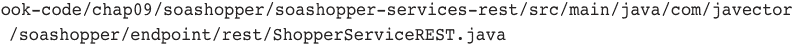

### Ajax 和 Java Web Services

从 Ajax 的角度来看，这里感兴趣的是服务器端返回时发生了什么。如图 10–4 第 7 步所示，会调用一个处理函数——`processStateChange()`。

### 示例 10–4 当异步 `XMLHttpRequest.send()` 返回时调用 JavaScript 函数 `processStateChange()`（如果 REST 返回 "200 OK"，则调用 `processXML()` 显示搜索结果）

```javascript
function processStateChange() {
  if (req.readyState == 4) { // 完成
    FinishedMsg(restURL);
    if (req.status == 200) { // OK 响应
      processXML(req.responseXML);
    } else {
      alert("Problem invoking endpoint: " + restURL + ": " + req.status + " " + req.statusText);
    }
  }
}
```

- 6. 参见第 9 节第 9.3 节图 9-2。
- 3. 参见第 9 节第 9.3 节示例 9-10。
- 4. 参见第 9 节第 9.3 节示例 9–11。
- 5. 参见第 9 节第 9.3 节。

## 10.3 示例代码：SOAShopper 的 Ajax 前端

### 示例 10–5 Ajax 应用从 SOAShopper REST 端点接收到的 XML 文档的 XML 架构定义

```xml
<xs:element name="offerList">
  <xs:complexType>
    <xs:sequence>
      <xs:element ref="tns:offer" minOccurs="0" maxOccurs="unbounded"/>
    </xs:sequence>
  </xs:complexType>
</xs:element>
<xs:element name="offer" type="tns:OfferType">
  <xs:complexType name="offerType">
    <xs:sequence>
      <xs:element name="offerId" type="xs:string" nickable="true"/>
      <xs:element name="productId" type="xs:string" minOccurs="0"/>
      <xs:element name="source" type="tns:SourceType"/>
      <xs:element name="thumbnail" type="tns:PictureType" minOccurs="0"/>
      <xs:element name="price" type="tns:PriceType"/>
      <xs:element name="merchantName" type="xs:string" minOccurs="0"/>
      <xs:element name="summary" type="xs:string"/>
      <xs:element name="offerUrl" type="xs:anyURI"/>
    </xs:sequence>
  </xs:complexType>
</xs:element>
```

book-code/chap09/soashoppers/soashoppers-services-soap/src/main/webapp/WEB-INF/wsdl/retail.xsd

此架构被用作示例 10–6 中出现的 `processXML()` 函数的编写。在该函数中，来自 SOAShopper 的响应 XML 文档通过参数 `searchDoc` 传入。如架构所示，返回的每个报价（offer）都包含在 `<offer>` 元素中。因此，该行：

```javascript
var listOffers = searchDoc.getElementsByTagName('offer');
```

- 7. “报价”（offer）是在 eBay、Yahoo! Shopping 或 Amazon 之一上出售的产品。

### Ajax 与 Java Web 服务

返回一个 `<offer>` 元素的数组。`processXML()` 函数随后遍历该数组，使用 DOM API 提取以下信息：

- source—报价的来源（即 eBay、Yahoo! 或 Amazon）
- thumbnailHtml—一段 HTML 片段，引用了所售产品的的缩略图（例如，``）
- priceStr—报价的价格（例如，USD 19.95）
- summary—包含报价描述的字符串
- urlHtml—一段 HTML 片段，引用了可以购买该报价的页面（例如，`<a href="http:// ...">link</a></a>`）

示例 10–6 没有显示用于提取每个变量的代码，但它包含了足够的内容让您了解如何使用 DOM API 处理返回的 XML。

### 示例 10–6 函数 `processXML()` 遍历 REST 端点返回的 DOM，以提取用于显示的数据

```javascript
173 function processXML(searchDoc) {
174   try {
175     var listoffers = searchDoc.getElementsByTagName('offer');
176     for (var i=0; i<listoffers.length; i++) {
177       var item = listoffers.item(i);
178       var sourceStr = 
179         item.getElementsByTagName('source').item(0).firstChild.data;
180       var thumbnailElts = item.getElementsByTagName('thumbnail');
181       var thumbnailElt;
182       var thumbnailUrl = "";
183       var thumbnailHtml = "";
184       if (thumbnailElts && thumbnailElts.length > 0) {
185         thumbnailElt = thumbnailElts.item(0);
186         thumbnailUrl = 
187         thumbnailElt.getElementsByTagName('url').item(0).firstChild.data;
188         thumbnailHtml = "";
```

book-code/chap09/soashoppers/soashoppers-ajax/src/main/webapp/search.html

接下来，需要将提取出的值放入一种可以加载到 Dojo 表格小部件的格式中。“这些小部件接受 JSON 格式的数据”，因此 `processXML()` 函数创建了一个新变量 `jsonData` 来存储该格式的数据。每个报价（JSON 格式）都被加载到一个名为 `SOAShopperLiveData` 的全局数组中（参见示例 10–7）。

### 示例 10–7 将搜索数据转换为 JSON 格式供 Dojo 小部件显示

```javascript
215 jsonData = {
216 Id:i,
217 source:sourceStr,
218 thumbnail:thumbnailHtml,
219 price:priceStr,
220 summary:summaryStr,
221 url:urlHtml
222 };
223 SOAShopperLiveData.push(jsonData);
224 // end populateFromLiveData();
```

book-code/chap09/soashoppers/soashoppers-ajax/src/main/webapp/search.html

最后，当所有数据都转换为 JSON 并加载到数组后，调用 `populateFromLiveData()`。

- JSON 是一种基于文本的数据交换格式，作为 XML 的替代方案。它在 Ajax 编程中非常常用，因为它与 JavaScript 配合良好。参见 478 示例 10–8 显示了加载表格的代码。

### 示例 10–8 将 JSON 数据加载到 Dojo 小部件

```javascript
function populateFromLiveData() {
  try {
    var w = dojo.widget.byId("AShopperData");
    if(w.get().length > 0){
      alert("you already loaded");
      return;
    }
    w.store.setData(SOAShopperLiveData);
  } catch (e) {
    alert(e);
  }
}
```

注意，第一步是使用 `dojo.widget.byId` 获取小部件的引用。Dojo 函数是通过 HTML `<head>` 元素中的 script 标签加载的：

```html
<script type="text/javascript" src="scripts/dojo.js"></script>
```

一旦我们有了小部件的引用，就可以通过调用 `setData()` 方法加载数据。注意 `w.store` 是与小部件相关的数据。

### 示例 10–9 用于显示结果的 Dojo FilteringTable

```html
<table dojoType="filteringTable" id="AShopperData" multiple="true" alternateRows="true" cellpadding="0" border="0" style="margin-bottom:24px;">
<head>
  <tr>
    <th field="source" dataType="String">来源</th>
    <th field="thumbnail" dataType="html">图片</th>
    <th field="price" dataType="String">价格</th>
    <th field="summary" dataType="String">摘要</th>
    <th field="url" dataType="html">链接</th>
  </tr>
</head>
</table>
```


总结 SOAShopper 的 JavaScript 部分，示例 10–9 显示了该小部件。注意它包含 `dojoType` 属性，以将其识别为 FilteringTable。该表格的 `th` 表头单元包含字段属性，将每列映射到对应的 JSON 字段名（参见示例 10–7）。

## 10.4 关于 Ajax 和 Java EE 的结论

在本章中，我通过关注为第 9 章构建的 SOAShopper 应用创建前端，简单介绍了 Ajax 编程。我希望你喜欢这段偏离 Java 编程的小插曲，并发现它对理解 EE Web 服务的一种类型有所帮助。本章的一些重要要点如下：

- Ajax 和 Java 支持良好的关注点分离，服务端 Java EE 处理复杂的 SOA 集成和 Web 服务端点的部署，并提供美观且易用的前端。
- 整个应用程序、Ajax 前端和 Java EE 后端可以打包成单一的 EAR，无缝部署到任何 Java 服务器上。
- 创建 Ajax 应用需要对 JavaScript 和 HTML DOM 有掌握，这对于许多服务端 Java EE 程序员来说并不熟悉。但是，正如这里展示的 SOAShopper 搜索示例所示，学习这些技能并不困难。
- 在创建和部署 Java EE 服务端点时，对于更复杂的服务，与其服务配套创建一个简单的 Ajax 前端可能是一个良好的做法。

能够直观地体验你的服务返回的数据。以这种方式“玩转”Web 服务，可以让开发者对服务界面产生比 WSDL 或 XML 架构更佳的直观感受。

在下一章也是最后的一章中，我将介绍一种 Java Web 服务框架的替代方案，该框架以 WSDL 为中心，而不是以 Java 为中心。这个 SOA-J 框架在第一章末尾提到过，它利用了 JWS，但为 Web 服务的开发和部署提供了另一种范式。

## 以 WSDL 为中心的 SOA-J Java Web 服务

本章介绍了 Java 面向服务架构（SOA-J）应用框架。SOA-J 是一种以 WSDL 为中心的 Web 服务发布框架。它允许你从 Java POJOs 和 EJBs 构建以 WSDL 为中心定义的服务。由 SOA-J 发布的 Web 服务可以作为面向服务架构（SOA）中的组件使用。通过这种方式，SOA-J 可以将现有的 Java 应用映射到 SOA 框架中。

SOA-J 的目标是利用 Java Web 服务（JWS）标准创建一个便于以 WSDL 为中心的方式构建 Web 服务的框架。使用 SOA-J，你通过构建 WSDL 并对该 WSDL 进行标注（指向实现的 Java 元素引用）来创建一个 Web 服务。与 JWS 的“从 WSDL 开始”开发模式不同，不需要完成 WSDL 并与机器生成的类一起工作。相反，你设置一个配置文件，其结构与你的目标 WSDL 相同，但包含关于 Java 实现的额外信息，SOA-J 框架在运行时发布 WSDL 并将许多 SOAP 请求发送到实现中。

这种以 WSDL 为中心的方法适用于以下情况：需要创建集成到标准企业或电子商务框架中的 Web 服务（即存在标准架构和消息描述的情况）。这种场景将在第 4 章中描述。

在撰写此书内容时，SOA-J 还是一个原型应用程序。我创建它是作为一种概念验证，以探索在 Java 中进行 WSDL 为中心的 SOA 开发的可行性。因此，不要计划用 SOA-J 构建你的下一个企业级 SOA 应用！但是，如果你对学习如何创建一个应用框架来增强 JWS 感兴趣，SOA-J 是一个极佳的学习工具。

- 1. 详见第 9 章，关于使用“从 WSDL 开始”开发的详细示例。

## 以 WSDL 为中心的 Java Web 服务

SOA-J 的源代码包含在随书可以下载的代码示例中 `chap11/soaj/`。你也可以在 http://soa-j.org 获取 SOA-J 的最新版本。

我在本书中包含对 SOA-J 的详细讨论有三个目的。对于想要深入理解 Java Web 服务的读者，最好的方法是详细检查一个 Web 服务平台的实现。SOA-J 正此了这一目的，因为它包含了第一章介绍的 Web 服务平台架构（WPA）的基本实现。与其检查 SOA-J，我本可以描述像 Apache Axis [AXIS] [AXIS2] 这样的开源服务器。然而，对 Axis 这样功能完备的产品进行此类讨论将需要一整本书。相反，我倾向于使用相对简单的应用程序类型来阐述 WSPA 实现的概念。SOA-J 使用 JWS 技术提供了 WSPA 清晰且高效的实现。一旦你理解了 SOA-J 之前的设计原则，你将毫不困难地理解其他 WPA 框架，如 Apache Axis 和 Xfire [XFIRE]。

我的第二个目的是阐明如何克服 JWS 的某些局限性。例如，SOA-J 提供了更灵活的变更管理，因为它允许你在不使用注解（与源码绑定）或部署描述符（封装在模块中）的情况下描述 Web 服务。相反，SOA-J 使用了可以在运行时动态更新的配置文件。通过这种方式，可以创建、更改和删除 SOA-J Web 服务，而无需触碰 JWS 源代码、卸载模块。

第三，最重要的是，我希望通过它激发对增强 JWS 的思考和辩论，随着 SOA 架构演进，以 WSDL 为中心的方式来增强 JWS 变得越来越重要。

在讨论面向服务架构时，Thomas Earl [Erl] 写道：“如果一个产品或技术是基于 WSDL 的，那么它是为了服务而设计的。” 正正是 SOA-J 的设计。SOA-J 支持 Java 应用。

- 2. 详见附录 B，关于如何下载、安装软件。
- 3. 第 41 页 [Erl]。

## 11.1 SOA-J 架构

在下文中我将给出 SOA-J 的概述，并利用它展示如何实现 Web 服务平台架构。在本章末尾，我将查看 SOA-J 如何与 WSDL 匹配。

SOA-J 设计在 Java EE 容器内运行，并利用 JWS、JAXB、WS-Metadata 和 WSEE 提供的 Web 服务基础设施。与 Xfire 等其他独立解决方案不同，SOA-J 并不是替换 Java 服务器的 Web 服务功能，而是增强了它们。如图 11-1 所示，SOA-J 以 Web 模块（WAR）的形式部署。这里它利用 WSEE 和 WS-Metadata 进行打包和部署，利用 JAXB 进行序列化。SOA-J 将 Web 服务绑定到端点。端点可以在运行时动态配置、创建和删除。无需卸载 SOA-J 模块或重启 Java 服务器即可完成操作。

SOA-J 可以从用户配置的任何端点接收 SOAP 请求。当 SOA-J 在配置的端点接收 SOAP 请求时，它会调用 Web 服务架构的所有组件来处理该请求：部署子系统、调用子系统和序列化系统。部署子系统根据 SOAP 请求的结构和点的配置确定要调用的 Java 类和方法。调用子系统调用相应的类和方法，使用序列化系统在 XML 和 Java 对象之间进行转换。这一过程将在本章的剩余部分详细讨论。现在，考虑 SOA-J 如何配置以发布其端点。图 11-2 提供了配置过程的高级示意。

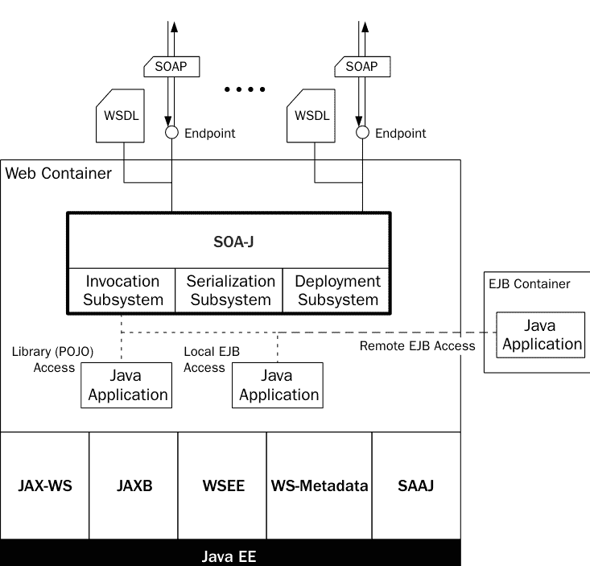

图 11-1 SOA-J 服务端架构。

- 7. 详见第 1 章第 1.3 节。

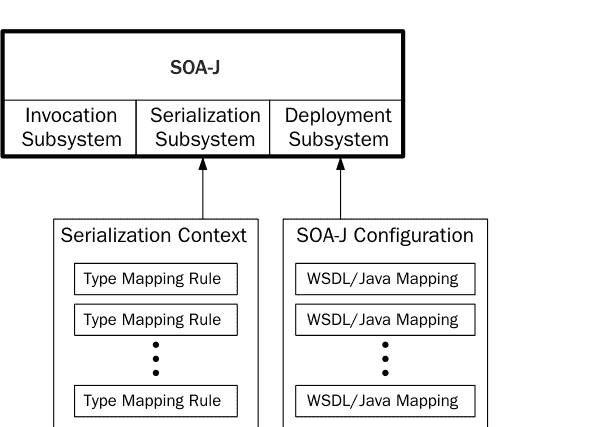

**图 11-2** SOA-J 配置涉及序列化上下文（Serialization Context）和操作映射（Operation Map）。

终端通过 WSDL/Java 映射进行配置。用于配置 SOA-J 的 WSDL/Java 映射集合称为 SOA-J 配置。每个 WSDL/Java 映射将 Java 类/方法与 WSDL 文档中定义的特定类/端口的 `wsdl:operation` 实例定义成对。当接收到引用该 `wsdl:operation` 的 SOAP 消息时，将调用与该 `wsdl:operation` 关联的 Java 类/方法。

SOA-J 的配置还需要一个*序列化上下文*（Serialization Context）。每个类型映射规则都告诉 SOA-J 如何 (i) 将特定 Java 类的实例序列化为特定 XML 类型的实例；或 (ii) 将特定 XML 类型的实例反序列化为特定 Java 类的实例。序列化子系统使用此序列化上下文将 SOAP 参数反序列化为 Java 参数，并将目标 Java 类/方法的调用结果（Java 返回类型实例）序列化为 SOAP 参数。类型映射规则使用适应序列化框架（Adaptive Serialization Framework）定义的声明式 XML 语言编写。我将在第 11.4 节中介绍一个规则示例。

SOA-J 配置和序列化上下文都是动态 XML 文档。它们可以在运行时更新，以动态重新配置 SOA-J 的行为。将这种配置风格与 JWS 方法进行对比：在 JWS 中定义 WSDL 和 Java/XML 绑定的注解被编译成 `.class` 文件并封装到部署模块中。更改部署的 JWS Web 服务的行为需要卸载、修改 Java 源代码、重新编译、打包和重新部署。而更改部署的 SOA-J Web 服务的行为仅需编辑一个 XML 文件。

SOA-J 调用子系统管理从接收 SOA-J 请求、到分发到正确的 Java 类/方法、再到调用序列化子系统等的事件顺序，如第 1 章所述。

这是对 SOA-J 架构和配置的一个非常高层的概述。在本章的剩余部分中，我将通过示例介绍如何使用 SOA-J 配置和调用 Web 服务。这些章节还详细描述了 SOA-J 的实现方式。

## 11.2 以 WSDL 为中心的 SOA-J 开发

如上一节所述，SOA-J 使用 SOA-J 配置文件进行配置。这是 SOA-J 以 WSDL 为中心哲学的核心。你通过通过 SOA-J 配置创建 WSDL，从而构建 Web 服务。SOA-J 配置文件的结构镜像了 WSDL 的结构。

示例 11 显示了此类配置文件的示例，用于部署单个 `wsdl:port`（POSystemPort），包含两个 `wsdl:operation`：`retrieve-Address` 和 `updateAddress`。当你查看此列表时，请注意它是如何与 WSDL 文档的配置平行的。本质上，在编写 SOA-J 配置文件时，你正在创建一个包含映射到 Java 类和方法所需信息的 WSDL。此配置文件中使用的 `soajService`、`soajport` 和 `soajOperation` 分别对应 WSDL 元素 `wsdl:definitions`、`wsdl:service`、`wsdl:port` 和 `wsdl:operation`。

### 示例 11-1 SOA-J 配置文件示例

```xml
<soajConfiguration xmlns:xsi="http://www.w3.org/2001/XMLSchema-instance"
  xsi:schemaLocation="http://javector.com/soaj/config ../../../../../config.xsd"
  provider="src/main/resources/config/soaj-config.xsd"
  xmlns:po="http://javector.com/ser/adaptive/po"
  xmlns:xs="http://www.w3.org/2001/XMLSchema"
  xmlns="http://javector.com/soaj/config">

<soapWSDL name="POSystem"
  wsdlNamespace="http://javector.com/soaj/provider/posystem">
  <soapService serviceName="POSystemService">
    <soapPort portName="POSystemPort">
      <endpoint location="http://localhost:8080/posystem/soaj/updateService">
        <soapOperation operationName="retrieveAddress">
          <soapPOJOMethod method="getPOFromDatabase">
            <javaClass>com.javector.soaj.wsdltest.po.PurchaseOrder</javaClass>
            <paramClass>java.lang.String</paramClass>
          </soapPOJOMethod>
          <parameterMapping>
            <javaClass>java.lang.String</javaClass>
            <xmlElement>
              <eltName></eltName>
              <eltType>xs:string</eltType>
            </xmlElement>
          </parameterMapping>
          <returnMapping>
            <javaClass>com.javector.soaj.wsdltest.po.PurchaseOrder</javaClass>
            <xmlElement>
              <eltRef>po:billTo</eltRef>
            </xmlElement>
          </returnMapping>
        </soapOperation>
        <soapOperation operationName="updateAddress">
          <soapPOJOMethod method="updateAddress">
            <javaClass>com.javector.soaj.wsdltest.po.PurchaseOrder</javaClass>
            <paramClass>java.lang.String</paramClass>
            <paramClass>java.lang.String</paramClass>
          </soapPOJOMethod>
          <parameterMapping>
            <javaClass>com.javector.soaj.wsdltest.po.Address</javaClass>
            <xmlElement>
              <eltName>po:billTo</eltName>
              <eltType>po:BillTo</eltType>
            </xmlElement>
          </parameterMapping>
          <parameterMapping>
            <javaClass>java.lang.String</javaClass>
            <xmlElement>
              <eltName>string</eltName>
              <eltType>xs:string</eltType>
            </xmlElement>
          </parameterMapping>
          <returnMapping>
            <javaClass>void</javaClass>
            <xmlElement>
              <eltRef>xs:void</eltRef>
            </xmlElement>
          </returnMapping>
        </soapOperation>
      </endpoint>
    </soapPort>
    <soajService>
      <mappingXml>config/adaptivemap.xml</mappingXml>
      <userDefinedSchemas>
        <userDefinedSchema>
          <targetNamespace>http://java.com/ser/adaptive/po/</targetNamespace>
          <schemaLocation>http://localhost:8080/posystem/config/purchaseOrder.xsd</schemaLocation>
        </userDefinedSchema>
      </userDefinedSchemas>
    </soajService>
  </soapWSDL>
</soajConfiguration>
```

SOA-J 配置文件的核心组件是 `soajOperation` 元素。这些操作元素定义了 Java 类/方法到 `wsdl:port` 和 `wsdl:operation` 的映射。`wsdl:operation` 由 `operationName` 属性指定。`wsdl:port` 由外部的 `soapPort` 元素定义。

`soajOperation` 元素组在 `soapPort` 元素下以定义 `wsdl:port`。因此，SOA-J 可以使用各种 Java 类和方法创建 `wsdl:port`。这比 JWS 模型更灵活，JWS 模型中，单个 `wsdl:port` 上的所有操作必须由同一个 Java 类实现。

遵循 WSDL 文档的结构，`soajOperation` 元素包含在 `soajService` 元素中以定义 `wsdl:service`。`soajService` 元素包含在 `soapWSDL` 元素中以定义 WSDL 文档（因为一个 WSDL 文档可以包含多个 `wsdl:service`）。整个操作包含在单个 `soajConfiguration` 元素中，该元素包含多个 `soapWSDL` 元素。通过这种方式，操作可以定义多个 WSDL 文档，每个 SOA-J 实例都可以支持无限数量 WSDL 文档。

现在，仔细观察图 11-1 中属性 `operationName="retrieveAddress"` 的 `soajOperation` 元素。它有一个 `soapPOJOMethod` 子元素，定义了实现的 Java 类和方法。`soapPOJOMethod` 用于部署 POJO。SOA-J 还支持部署 EJB (3.0 和 2.1)。在这里，你可以看到该操作是使用 `com.javector.soaj.wsdltest.po.PurchaseOrderProcessing` 类和 `getPOFromDatabase` 方法实现的。该方法的签名如下：


`PurchaseOrder getPoFromDatabase(String poNum)`

在 `soajPojoMethod` 元素之后是 `parameterMapping` 元素。这些元素将 `getPoFromDatabase()` 方法的参数映射到所实现的 Web 服务支持的 XML 类型或元素。在这种情况下，只有一个 Java 类型为 string 的参数。如你所见，它被映射到名称 `poNum` 和 XML 类型 `xs:string`。

接下来，`returnMapping` 元素将 `getPO-fromDatabase(com.javector.soaj.wsdltest.po.PurchaseOrder)` 的返回类型映射到元素 `:billTo`。元素 `billTo` 定义在此 `soajconfiguration` 最底部的 schema 之一中——`userSchemas` 元素允许你在 SOA-J 配置中重用 schema。这是第 4 章第 4.1 节中讨论的最佳实践，在该节中描述了 schema 库的概念。

通过这种方式，定义了 `soajoperation` 元素，以及实现它们所需的 Java 程序。这些 `soajoperation` 元素随后被组织在 `soapPort` 和 `soajService` 中以定义 WSDL。

你可能还注意到 `<soajWSDL>` 标签之后出现了 `mappingXml` 元素。它引用了序列化上下文定义的位置，该内容将在第 11.4 节中讨论。

此 SOA-J 配置中包含的信息有两个用途。首先，它为 SOA-J 提供了序列化和反序列化的类型映射（例如，`PurchaseOrder` 到 `:billTo`）。其次，它为 SOA-J 提供了构建表示操作映射 Web 服务的 WSDL 文档所需的信息。当前 SOA-J 原型构建的 WSDL 文档使用 document/literal wrapped 风格。

> 参见第 4 章第 4.3 节对各种 WSDL 风格的描述。

# WSDL-Java Web Services with SOA-J

## 示例 11–2 从 SOA-J 配置生成的 WSDL

```xml
6 <definitions xmlns="http://schemas.xmlsoap.org/wsdl/"
7 xmlns:tns="http://javector.com/soaj/provider/posystem"
8 xmlns:soapjl="http://javector.com/ser/adaptive/po"
9 xmlns:xsd="http://www.w3.org/2001/XMLSchema"
10 xmlns:soap="http://schemas.xmlsoap.org/wsdl/soap/" name="POSystem"
11 targetNamespace="http://javector.com/soaj/provider/posystem">
12 <types>
13   <xsd:schema targetNamespace="http://javector.com/ser/adaptive/po">
14     <xsd:include
15       schemaLocation="http://localhost:8080/posystem/config/
16 purchaseOrder.xsd"
16     />
17   </xsd:schema>
18   <xsd:schema xmlns="http://www.w3.org/2001/XMLSchema"
19     targetNamespace="http://javector.com/soaj/provider/posystem"
20     elementFormDefault="qualified">
21     <xsd:import namespace="http://javector.com/ser/adaptive/po/"
22     <element name="retrieveAddress">
23       <complexType>
24         <sequence>
25           <element name="poNum" type="xsd:string"/>
26         </sequence>
27       </complexType>
28     </element>
29     <element name="retrieveAddressResponse">
30       <complexType>
31         <sequence>
32           <element ref="soapjl:billTo/"
33         </sequence>
34       </complexType>
35     </element>
36     <element name="updateAddress">
37       <complexType>
38         <sequence>
39           <element name="billTo" type="soapjl:BillToType"/>
40           <element name="string" type="xsd:string"/>
41         </sequence>
42       </complexType>
43     </element>
44     <element name="updateAddressResponse">
45       <complexType>
46         <sequence/>
47   </complexType>
48   </element>
49   </xsd:schema>
50   </types>
51   <message name="request_retrieveAddress">
52     <part name="parameters" element="tns:retrieveAddress"/>
53   </message>
54   <message name="response_retrieveAddress">
55     <part name="parameters" element="tns:retrieveAddressResponse"/>
56   </message>
57   <message name="request_updateAddress">
58     <part name="parameters" element="tns:updateAddress"/>
59   </message>
60   <message name="response_updateAddress">
61     <part name="parameters" element="tns:updateAddressResponse"/>
62   </message>
63   <portType name="POSSystemPortType">
64     <operation name="retrieveAddress">
65       <input message="tns:request_retrieveAddress"/>
66       <output message="tns:response_retrieveAddress"/>
67     </operation>
68     <operation name="updateAddress">
69       <input message="tns:request_updateAddress"/>
70       <output message="tns:response_updateAddress"/>
71     </operation>
72   </portType>
73   <binding name="POSSystemPortBinding" type="tns:POSSystemPortType">
74     <binding transport="http://schemas.xmlsoap.org/soap/http"
75     style="document"/>
76     <operation name="retrieveAddress">
77       <soap:operation soapAction=""/>
78       <input>
79         <soap:body use="literal"/>
80       </input>
81       <output>
82         <soap:body use="literal"/>
83       </output>
84     </operation>
85     <operation name="updateAddress">
86       <soap:operation soapAction=""/>
87       <input>
88         <soap:body use="literal"/>
89       </input>
90       <output>
91         <soap:body use="literal"/>
92       </output>
93     </operation>
94   </binding>
95   <service name="POSSystemService">
96     <port name="POSSystemPort" binding="tns:POSSystemPortBinding">
97       <soap:address location="http://localhost:8080/soaj/updateService/"/>
98     </port>
99  </service>
100 </definitions>
```


此 WSDL 完全是从 SOA-J 配置构建的。因此，在使用 SOA-J 时，你不需要编写 WSDL 文档。它们是以直接的方式从配置创建的。请注意，在这种情况下，SOA-J 配置是 WSDL 长度的 70%。除了包含构建 WSDL 所需的信息外，配置还包含了 Java 部署所需的类型映射。为了了解此 WSDL 如何工作，我将阐述该 WSDL 的构建过程。

`wsdl:definition` 元素的 `name` 和 `namespace` 属性分别来自 `soaj` 元素的 `name` 和 `namespace` 属性。对于 SOA-J 配置中的每个定义 schema，WSDL 的 `wsdl:types` 部分都有一个 `xsd:schema` 元素，其中包含了 WSDL 中的 schema。

WSDL 中的最后一个 `xsd:schema` 元素没有 `xsd:include` 元素。相反，它定义了用于 `soaj` 元素的请求/响应包装。如示例 11–2 所示，为操作了 `retrieveAddress` 和 `responseAddress`。这遵循 document/literal 风格。包装名称自操作名称，并在响应元素后附加 "Response"。`retrieveAddress` 包装内部是 `poNum` 元素——它来自 soaj 配置中的 `parameterMapping` 元素。同样，WSDL 中的 `retrieveAddressResponse` 包装包含了来自 `returnMapping` 的 `soaj:billTo` 元素。

注意，在原始 SOA-J 配置中使用了不同的前缀 `po`。SOA-J 原型并不保留前缀，而是从头开始生成它们。WSDL 消息 `request_retrieveAddress` 和 `response_retrieveAddress` 通过引用包装元素以 document/literal 风格定义。配置中 `portName="SystemPort"` 的 `soaj` 的 WSDL `portType` 通过附加 "Type" 来命名，其操作具有 `soaj` 的 `operationName` 属性。`wsdl:binding` 和 `wsdl:port` 元素按照预期自然出现，由 `soaj` 属性提供 `wsdl:port`。`wsdl:port` 的 `soap:address` 来自端属性。

SOA-J 生成的 WSDL 自然遵循 SOA-J 配置。这是 SOA-J 框架的一个关键设计元素。一旦你完成了在 SOA-J 配置中定义参数和返回映射的麻烦，WSDL 就会自然生成。SOA-J 的目标并不是像 JAX-WS 注解方法那样让用户屏蔽类型定义。SOA-J 的主要目标是让你能够根据从标准 schema 构建的 WSDL 部署应用程序——以促进 SOA 集成。SOA-J 的易用性旨在便于基于标准 WSDL 和 XML Schema 库进行集成。使用 WS-Metadata-SR 时，配置会稍微困难一些。另一方面，好消息是，通过强制你定义类型映射，SOA-J 配置过程已经完成了生成 WSDL 所需的所有工作。

因此，从这段讨论中你可以看到 SOA-J 的配置完全是以 WSDL 为中心的。下一节将展示调用系统如何工作——换句话说，SOA 消息是如何被处理和分发的。

## 11.3 调用子系统

调用系统负责接收 SOAP 消息并根据第 1 章第 1.3.1 节描述的模型进行处理。在 SOA-J 的实现中，调用系统负责：

1. 接收 SOAP 消息
2. 确定消息的目标服务——即消息打算调用哪个 WSDL 操作
3. 给定目标 WSDL 操作，将消息分发到要调用的 Java 类/方法
4. 将 SOAP 消息传递给序列化系统，将其反序列化为可以作为参数传递给 Java 目标的对象
5. 使用序列化系统生成的参数调用 Java 目标，并获取目标方法返回的 Java 对象
6. 序列化系统对返回的对象的对象，将其序列化为符合目标 WSDL 操作指定的返回消息的 XML 元素
7. 将返回的 XML 元素封装为符合目标 WSDL 操作的 SOAP 响应，如果发生了异常，则将其映射到 SOAP Fault
8. 封装 SOAP 响应

图 11–3 提供了一个静态类 UML 图，显示了 SOA-J 调用系统的高级实现。

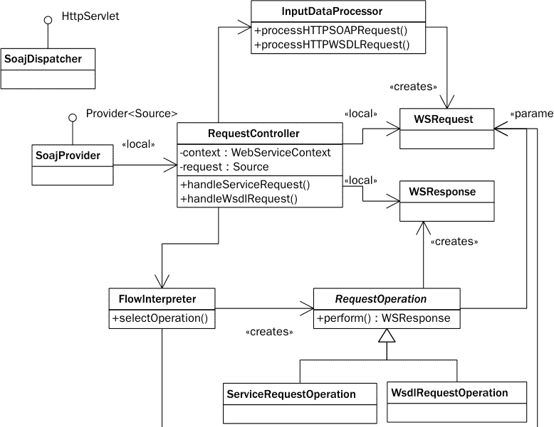

图 11–3 SoajProvider 使用 RequestController 来管理调用过程。

你可能已经注意到在图 11–3 的类图中，`RequestOperation`（一个抽象类）有两个子类：`ServiceRequestOperation` 和 `WsdlRequestOperation`。这是因为该子系统处理 WSDL 请求和 SOAP 请求。SOA-J 遵循一种约定：发布到带有 `?wsdl` 后缀的端点的 HTTP GET 请求将产生包含目标 WSDL 的 HTTP 响应。WSDL 请求也由调用子系统进行处理。然而，在这些情况下，`FlowInterpreter` 会创建一个 `WsdlRequestOperation` 实例来处理该请求。在 SOAP 情况下，则创建一个 `ServiceRequestOperation` 实例。

目前，SOA-J 只处理基于 HTTP 的 SOAP。要将其扩展以处理其他传输协议（如 JMS），只需扩展 `RequestController` 类来处理带有 SOAP 负载负载的 JMS 消息（即 SOAP over JMS）即可。当然，在这种情况下将没有 `WebServiceContext` 参数——或者 JMS 消息的目标端点需要通过其他机制来确定，也许通过 JMS 元数据或使用 WS-Addressing [WS-ADDRESSING 1.0 Core]。除了扩展 `RequestController` 类外，还需要添加一个方法 `processJMSOAPRequest()`。因此，`RequestController` 和 `InputDataProcessor` 构成了 SOA-J 的传输接口。这些类用于生成封装 SOAP 请求的 `WServiceRequest`。从该点开始，由调用子系统执行的处理与传输协议无关。

图 11–4 显示了 `WSRequest` 和 `WSResponse` 的高层结构。首先关注 `WSRequest`，注意到它有两个子类：用于封装 WSDL 文档请求的 `WsdlRequest` 以及用于封装发布到 Web 端点的 SOAP 请求的 `ServiceRequest`。此外，`WSRequest` 包含对 `SoajConfiguration` 的引用——换句话说，就是第 11.2 节中定义的 SOA-J 配置。`ServiceRequest` 包含了 XML 参数——即 SOAP 请求体中包装元素的子元素。这些将被反序列化为用于调用实现目标服务的 Java 参数。此外，`ServiceRequest` 类还包含 `operationName`（包装元素的名称）和 `endpoint`（来自 HTTP 请求头），以便分发请求。

同样地，`WSResponse` 类有两个子类：`WsdlResponse` 和 `ServiceResponse`。在这种情况下，`ServiceResponse` 最多包含一个 XML 实例——由目标 Java 类/方法产生的返回类型的序列化实例。`ServiceResponse` 包含了 SOA-J 生成的 WSDL。

图 11–5 显示了与 `ServiceRequestOperation` 相关的类结构，该结构负责处理 `ServiceRequest(WSRequest)` 以调用 Web 服务。回想图 11–3，`FlowInterpreter` 创建一个 `ServiceOperation` 实例来处理 `WSRequest`。如图 11–5 所示，`perform()` 方法使用本地创建的 `SoajOperation` 和 `ServiceInvoker` 实例来实现调用。`SoajOperation` 是通过 `ServiceRequest` (WSRequest) 访问的 SOA-J 配置信息创建的。它是对被调用 Java 类/方法的封装。

> 9. SOA-J 不支持 IN/OUT 参数。因此，要么返回一个参数，要么不。这是另一个简化假设（类似于仅支持文档/字面封装样式的 WSDL）。在实践中，我发现 IN/OUT 参数并没有特别有用。

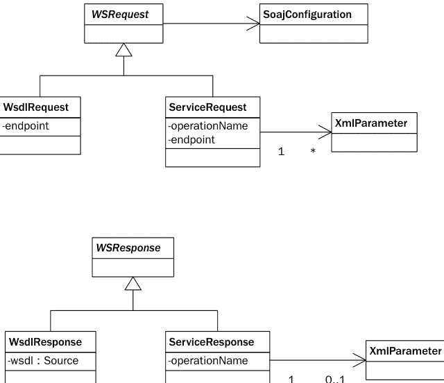

在这种情况下，`ServiceResponse` 包含了 SOA-J 生成的 WSDL。

`ServiceRequestOperation` 实例化 `ServiceInvoker`。

在 `ServiceRequest` 方法中，调用 `InputDataProcessor` 的 `createWSRequest()` 方法实例化 `ServiceRequest`。


## 11.4 WSDL 中心化的 Java Web 服务与 SOA-J

获取 `wResponse` 实例。调用 `responseAs()` 方法返回用于创建 SOAP 响应的 XML。

图 11–7 显示了深入 `ServicePolicy` `perform()` 方法的序列图（位于图 11–6 的右侧）。你可以看到，这里发生的是使用 `WSRequest` 对 `SoajConfiguration` 的引用来获取调用的一些参数。这些参数包括规则（`SerializationMapping`）、架构（`Schema`）、参数（作为 `List<Source>` 的 `params`）以及操作（`SoajOperation`）。

规则和架构用于创建 `ServiceInvoker` 实例。然后，参数和操作被传递给 `ServiceInvoker` 的 `invokeOperation()` 方法。`invokeOperation()` 方法返回 XML。

继续深入细节，图 11–8 描述了 `ServiceInvoker` 在调用子系统中的作用。当构造 Invoker 时，它使用 `AdaptiveContextFactory` 根据 SOA-J 配置提供的类型映射规则（序列上下文）和架构创建一个新的 `AdaptiveContext`。注意，SOA-J 的实现应该缓存此 `AdaptiveContext`，以免每次请求都重新重建它，只有当配置或序列化文件更改时才重建。`AdaptiveContext` 变为序列化子系统的接口——下一节将详细讨论。`ServiceInvoker` 的 `invokeOperation()` 方法随后使用 `AdaptiveContext`，将其与参数和 `SoajOperation` 一起传递给 `DeserializerHelper`，以获取返回反序列化的 Java 对象（`paramObjects`）。`SoajOperation` 与这些其他参数一起传递给 `DeserializerHelper`，因为它包含了参数类型映射。

一旦 XML 参数被序列化为 Java 参数，就可以调用目标 Java 类/方法。该目标封装在由 `SoajMethodFactory` 通过 `SoajOperation` 创建的 `SoajMethod` 类实例中。`SoajMethod` 在第 11.5 节中进行了详细讨论。它基本上是 `java.lang.reflect.class` 的包装器，在作为 EJB 的情况下包含了调用方法所需的额外信息。`SoajMethod` 还负责实例化目标类的实例（获取引用）。

`SoajMethod` 的 `invoke()` 方法将 Java 响应返回给 `ServiceInvoker`，其中 `invokeOperation()` 执行的下一步是。

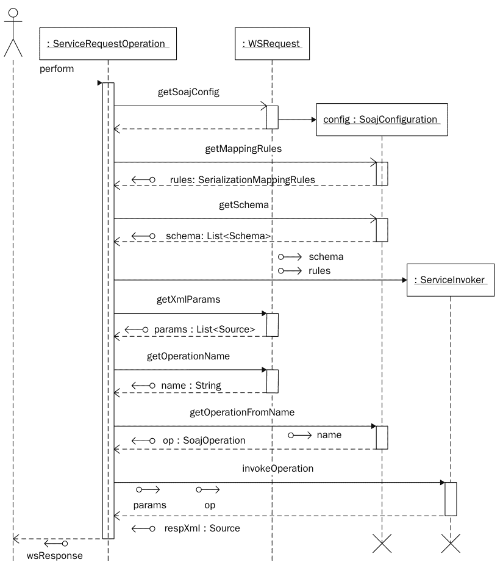

图 11-7 SOAJ Web 服务调用过程。

方法是使用 `SerializerHelper` 将序列化为 XML 响应。`SerializerHelper` 和 `DeserializerHelper` 仅仅是便利类，通过委托给提供的 `AdaptiveContext` 参数来提供序列化和反序列化服务。

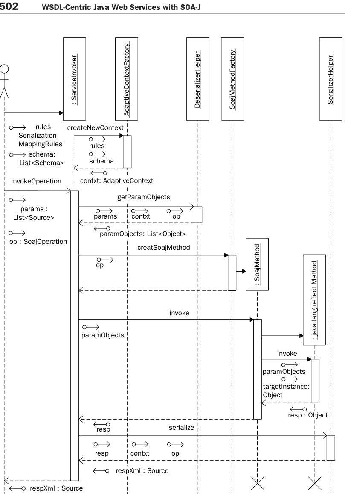

图 11–8 SOA-J ServiceInvoker 调用目标 Java 类/方法。

## 11.4 序列化子系统

通过对 SOA-J 的描述，你应该已经很清楚 SOAP 服务器是如何实现调用子系统的。细节随实现方式而异，但基本轮廓保持不变。所有 SOAP 服务器都必须接收 SOAP 消息，将其分发到正确的 WSDL 定义，反序列化参数，调用目标类/方法，并序列化响应。然而，这一过程可能会对系统性能产生巨大影响。较新的 SOAP 服务器实现如 Axis 2.x [AXIS2] 和 XFire 使用了类似 StAX [JSR 173] 的拉取解析器技术，通过避免将整个 SOAP 消息读入 DOM 实例来减少内存占用和处理。早期的实现如 Axis 1.x [AXIS] 受性能问题，因为它们无法仔细管理内存。

SOA-J 构建在 Java EE 之上，因此它对 SOAP 消息的处理需要完全控制。如果底层的 Java EE 5 实现将 SOAP 提供程序处理为已实现 DOM 的 `javax.xml.transform.Source`，那么 DOM 实例已经创建了。如果源是 `StreamSource` 且没有进行 DOM 处理，SOA-J 可以采取步骤优化性能。不过有趣的是，对于处理较小的 SOAP 请求，对此类问题的关注可能并不重要。性能是一个复杂的课题，包含许多变量。通过学习 SOA-J，你可以了解 SOAP 服务器是如何实现的，并理解它们如何实现不同的策略来提高性能。

下一节列出了序列化子系统。SOA-J 使用了一种独特的序列化实现，旨在促进 SOAP 集成，你可以从现有的 Java 对象和现有的 XML Schema 开始。这种“从 WSDL 和 Java 开始”的方法在第 4 章第 4.5 节中描述。

## 11.4 序列化子系统

在使用 JAX-WS 2.0 和 JAXB 2.0 时，Java 类可以如此轻松地进行注解并部署为 Web 服务令我印象深刻。然而，我发现针对现有 Schema 部署现有 Java 类如此困难也非常令人沮丧。通过 JAXB 2.0 和 JAX-WS 2.0，你基本上可以根据 JAXB 2.0 从你的类和注解生成的 Schema 获取 WSDL。你可以尝试通过操作注解将你的 Java 类映射到目标 Schema。然而，由于第 4 章详细描述的原因，注解不是实现此类类型映射的好方法。总之，这里有一些捷径方法：

1. 要更改类型映射，需要编辑源码、重新编译并重新部署。
2. 注释是创建类型映射的一种非常不直接的方式。你必须反复调整它们，不断重新生成结果（通过 JAXB），并尝试看是否能“接近”目标 Schema。这种方法会杀死你的生产力。
3. 许多类型映射无法用 JAXB 注解生成。参见第 4 章的示例。
4. 良好的设计实践（即关注点分离）规定，映射层应该包含从 Java 实现到服务的 XML (WSDL) 表示。JAXB 注解虽然方便，但它将该映射层埋在了 Java 源码中。这使得理解和维护变得困难。

> 10. 参见第 9 章第 9.4 节，查看此类映射层是如何实现的。在 SOAP 应用中，这种系统使用注解将 WSDL 和 XML 映射到 Java 代码。SOA-J 框架包含了这种映射层。

出于某些原因，我决定在 JAXB 2.0 之上实现一个序列化子系统，允许开发者通过 XML 中定义的规则来维护类型映射。我将其命名为 Adaptive Serializers（自适应序列化器），因为它让你能够轻松维护并使系统适应 Java 类和 XML Schema。本节将通过一个具体的示例让你了解 Adaptive Serializers 是如何工作的。

示例从查看用于实现 Web 服务的简单 Java 类开始。这些是 `MyPurchaseOrder`、`Address` 和 `Phone` 类——分别是示例 11–3、示例 11–4 和示例 11–5 中的片段。

`PurchaseOrder` 类包含两个属性：一个“账单地址”地址（`Address` 类型）和一个项目列表。第 11.2 节讨论的 `retrieveAddress` 操作简单地返回 `PurchaseOrder` 实例的 `Address` 属性。

示例 11-3 PurchaseOrder

```java
```


# PurchaseOrder 类

```java
public class PurchaseOrder {

    private Address billTo;

    private List items;

    private String ponum;

    public void setBillTo(Address billTo) {
        this.billTo = billTo;
    }

    public Address getBillTo() {
        return billTo;
    }

    public void setItems(List items) {
        this.items = items;
    }

    public List getItems() {
        return items;
    }

    public void addItem(Item item) {
        if (items == null) {
            items = new ArrayList();
        }
        items.add(item);
    }

    public String getPonum() {
        return ponum;
    }

    public void setPonum(String ponum) {
        this.ponum = ponum;
    }
}
```

# WSDL 中心 Java 服务

接下来介绍 `Address` 和 `Phone` 类，在第 11.4 节中，我们讨论了它们映射到 Schema 的困难。

## Address 类

```java
public class Address implements Serializable {

    private String street;

    private String city;

    private String state;

    private String zip;
}
```

## 示例 11-5 Phone 类

```java
public class Phone {

    private String areaCode;

    private String exchange;

    private String number;
}
```

# 11.4 序列化子系统

`addr1` 和 `addr2`。在两种情况下，Java 属性必须经过大幅转换、拆分和组合以映射到目标 XML 元素。我将此类映射称为多元映射。它们在实践中出现——特别是在 SOA 集成时——并且无法通过 JAX 处理。

```xml
<xs:sequence>
</xs:complexType>
<xs:element name="item">
<xs:complexType>
<xs:sequence>
<xs:element name="quantity" type="xs:positiveInteger"/>
<xs:element name="price" type="xs:double"/>
</xs:sequence>
<xs:attribute name="productName" type="xs:string" use="required"/>
</xs:complexType>
</xs:element>
</xs:schema>
```

`book-code/chap11/soaj/provider-javaeetest/provider-javaeetesting-generatedwsdl-testartifacts/posyer/src/main/webapp/purchaseOrder.xsd`

正如第 4 节第 4.6 节所述，处理多变量类型映射的一种方法是编写辅助代码，将从 JAXB 架构编译的类从 `po:BillToType` 翻译到你的 `Address` 类。也可以编写类似的辅助代码来处理电话（`Phone`）映射。虽然这种方法有效，但它归结底是将 Java 到 XML 的映射逻辑嵌入到辅助 Java 类中。这些辅助类难以维护和理解。这绝对不是管理类型映射的好方法，而且将会引发问题。

稍微好一点的在第 5 节第 5.7 节中提供，那里我展示了如何使用 JAXB 2.0 `XmlAdapter` 类实例来实现多变量类型映射。这种方法本质上是将辅助类嵌入到 JAXB 框架内部，以便 JAXB 运行时可以使用注解来识别何时调用辅助代码来帮助完成特定的序列化或反序列化。这种方法稍微好一点，因为它至少为辅助 Java 类提供了一些组织结构和标准接口。但它仍然存在一个主要问题，即类型映射被嵌入在 Java 类中。同样，这种方法会产生巨大的变更管理头疼问题，并违反了关注分离的设计原则。

通过放弃注解并转而使用一种丰富的类型映射语言，可以实现类型映射与代码分离，这种语言让你能够轻松地定义和维护在 Java 类与 XML 架构组件之间转换的逻辑。

## 适应序列化器

这是适应序列化器采用的方法。类型映射以 XML 形式编写，如示例 11–7 所示。单个类型映射实现由 `strategy` 元素表示。一个类型映射可以有多个策略，适应序列化器实现可以根据上下文选择最合适的策略。目前，我将保持简单，就每个类型映射对应一个策略。

### 示例 11–7 为 PurchaseOrder 定义序列化规则

```xml
<strategy
  javaClass="com.jvector.soaj.wsdltestent.po.PurchaseOrder"
  xmlType="po:purchaseOrder">
  <rule name="ponum" xmlns="ponum" xmlType="xs:string"
    elementType="ATTRIBUTE" javaClass="java.lang.String"/>
  <rule name="billTo" xmlName="po:billTo" xmlType="po:billToType"
    elementType="ELEMENT"
    javaClass="com.jvector.soaj.wsdltestent.po.Address"/>
  <rule name="items" xmlName="po:item"
    elementType="ELEMENT" javaClass="com.jvector.soaj.wsdltestent.po.Item">
    <wrap>
      <javaWrap name="items" type="java.util.List"/>
      <xmlWrap name="po:items"/>
    </wrap>
  </rule>
</strategy>
```

`book-code/chap11/soaj/provider-javaesting/provider-javaesting-generatedwsdl-testartifacts/posym/src/main/resources/config/adaptivemap.xml`

例如，该策略中定义的第二个规则将 `billTo` 属性映射到 `po:billTo` 元素。`xmlNodeType` 属性（"ELEMENT"）表示 `xmlName` 指的是一个元素而不是属性。这条规则并没有告诉我们 Java 属性（`Address` 的实例）应该如何转换为 `po:billTo` 全局元素的实例。那是另一个类型映射，由单独的策略定义。通过这种方式，类型映射策略是递归定义的。

示例 11–7 显示的第三条规则将 `po:item`（一个列表）映射到全局元素 `po:item`。由于这是针对集合的规则，指定了 `javaClass` 属性以指示如何处理集合的成员。在这里，它们被序列化/反序列化为 `Item` 实例。在这条规则内部，我们使用了 `wrap` 元素。这告诉适应序列化器，从列表成员生成的 `po:item` 元素应该包装在一个容器元素内部。在这种情况下，包装器的名称是 `items`。

回到关于 `billTo` 属性的规则，即 `Address` 到 `po:billTo`，这是规则要求的。检查该策略中的第一条规则，我们可以开始看到如何处理多变量类型映射。这条规则适用于元素 `po:street`。`javaName` 为 ".--"，表示该规则将整个 `Address` 类的某种转换映射到元素 `po:street`。这条规则是单向的——它只适用于序列化（因为是一种转换，它没有自然地定义回任何一个 Java 属性的反序列化）——因此带有属性 `restrict="SERIALIZATION"`。规则内部有一个 `script` 元素。该元素持有一些 Groovy 脚本，这些应用于 `Address` 实例以获取 `po:street` 值。你可以看到它是街道名称和街道名称的简单拼接，这就是适应序列化器处理的方式。

但是我们如何反向操作并反序列化 `po:street` 元素呢？

```xml
<strategy
  javaClass="com.jvector.soaj.wsdltestent.po.Address"
  xmlType="po:billTo" xmlns="po:billTo">
  <rule javaName="po:street" xmlType="xs:string"
    xmlNodeType="ELEMENT" restrictTo="SERIALIZATION">
    <script><![CDATA[
      return source.getStreetName() + " " + source.getStreetName();
    ]]></script>
  </rule>
  <rule javaName="streetNumber" javaClass="int" xmlns="po:street"
    xmlType="xs:string" xmlNode="ELEMENT" restrictTo="DESERIALIZATION">
    <script><![CDATA[javascript-after(., ')]]></script>
  </rule>
  <rule javaName="streetName" javaClass="java.lang.String" xmlns="po:street"
    xmlType="xs:string" xmlNode="ELEMENT" restrictTo="DESERIALIZATION">
    <script><![CDATA[javascript-after(., ')]]></script>
  </rule>
  <rule javaName="city" xmlns="po:city" xmlType="xs:string"
    xmlNodeType="ELEMENT"/>
  <rule javaName="state" xmlns="po:state" xmlType="xs:string"
    xmlNodeType="ELEMENT"/>
  <rule javaName="zip" xmlns="po:zip" xmlType="xs:string"
    xmlNodeType="ELEMENT"/>
  <rule javaName="phoneNumber"
    javaClass="com.jvector.soaj.wsdltestent.po.Phone" xmlns="po:phone"
    xmlType="xs:string" xmlNode="ELEMENT" restrictTo="DESERIALIZATION"/>
  <rule javaName="phoneNumber" xmlns="po:phone" xmlType="xs:string"
    restrictTo="DESERIALIZATION">
    <script><![CDATA[
    String area = Integer.toString(source.getErrorCode());
    return (""+area+"-"+source.getExchange()+"\-"+source.getNumber());
    ]]></script>
  </rule>
</strategy>
```

`book-code/soaj/provider-javaesting/provider-javaesting-generatedwsdl-testartifacts/posysym/src/main/resources/config/adaptivemap.xml`

所以，你可以看到适应序列化器允许你使用 Groovy 脚本和 XPath 来处理 JAXB 2.0 在不诉诸 `XmlAdapter` 复杂性情况下无法处理的类型映射。然而，除了这种好处之外，真正的优势是辅助代码维护在类型映射层，而无需嵌入到部署的 Java 类中。更改它更容易，并且不需要重新编译和部署即可完成。

前面的示例让你了解了适应序列化器类型映射语言的工作原理。11–9 显示了适应如何...

# 基于 SOA-J 的 WSDL 中心 Web 服务

序列化框架接入了 SOA-J。如之前的序列图（图 11–8）所示，调用子系统在 `DeserializerHelper` 和 `SerializerHelper` 类的帮助下通过 `AdaptiveContext` 接口进行序列化和反序列化。在图 11–9 中，你可以看到这些类，`AdaptiveContext` 接口由一个名为 `BaseSoapContext` 的抽象类实现，该类持有对 XML Schema 和 `AdaptiveMap` 的引用。`AdaptiveMap` 包含了实现类型映射的策略（如示例 11–7 和示例 11–8 所示）。`BaseSoapContext` 是第 11.2 节描述的序列化上下文的 Java 实现，在 SOA-J 配置中提供。`BaseSoapContext` 无法执行任何序列化或反序列化，它只包含上下文并带有抽象方法实现了 `AdaptiveContext` 接口。

`AdaptiveJaxbContext` 类提供了实现 `AdaptiveContext` 接口所需的序列化上下文和基础设施。它的名称中包含 Jaxb，是因为它使用 JAXB 2.0 来实现序列化逻辑。我也研究过使用 Java/XML 绑定（例如 Apache XMLBeans）的实现。对于此处的 SOA-J 的实现，我使用了 JAXB 2.0，因为它是 Java EE 5 运行时实现的一部分。`AdaptiveJaxbContext` 提供了两个重要功能：首先，它创建 `Schema` 实例（即类型映射中使用的 Schema 定义），并使用 JAXB 编译器对其进行编译。序列化子系统使用这些 JAXB 生成的类来实现类型映射。`AdaptiveJaxbContext` 创建了一个包含这些 JAXB 生成类的类加载器。其次，`AdaptiveJaxbContext` 类提供了 `newSerializer()` 和 `newDeserializer()` 方法用于创建序列化器和反序列化器。

实现序列化器和反序列化器的类遵循类似的模式，因此我在这里只描述序列化器。序列化类派生自 `BaseAdaptiveSerializer`。`BaseAdaptiveSerializer` 的实例对应于特定的策略元素，例如示例 11–5 中用于序列化 `Address` 的元素。`BaseAdaptiveSerializer` 包含了执行实现策略的规则元素的逻辑。

执行规则通常涉及将 Java 对象映射到目标 XML 的 XML 元素或属性。这是一个递归的过程，因为 `BaseAdaptiveSerializer` 实例会从 `AdaptiveMap` 中找到实现规则类型映射的策略，并创建一个 `BaseAdaptiveSerializer` 新实例来执行该策略。

## SerializerHelper / DeserializerHelper 类图

```text
«interface»
AdaptiveContext
+deserialize(in xml : Source, mapping : XmlMapping) : Object
+serialize(in java : Object, mapping : XmlMapping) : Source

BaseSoajContext

Schema
1
AdaptiveMap

AdaptiveJaxbContext
#newSerializer(in cntxt : BaseSoajContext) : BaseAdaptiveSerializer
#newDeserializer(in cntxt : BaseSoajContext) : BaseAdaptiveDeserializer
#loadSchemas()
```


# BaseAdaptiveSerializer

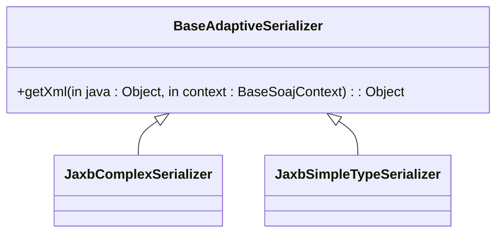

# BaseAdaptiveDeserializer

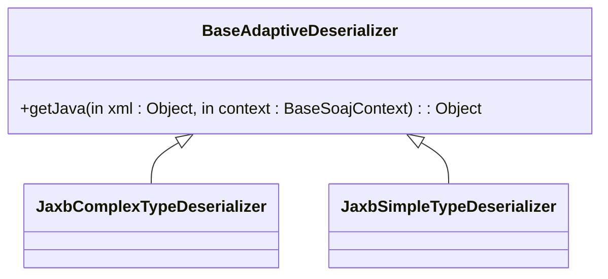


# 图 11–9 顶层序列化类

当策略可以在没有任何规则的情况下实现时，递归停止（例如，将 String 映射到 xs:string）。通常，这当 `BaseAdaptiveSerializer` 是 `JaxbSimpleTypeSerializer` 实例时发生——该类是用于创建简单 XML 类型（例如 xs:string）实例的序列化类。

`BaseAdaptiveSerializer` 也被 `JaxbComplexSerializer` 扩展——后者是用于创建复杂 XML 类型实例的序列化类。

在选择序列化器执行策略时，自适应序列化框架会查看目标 XML 组件。如果它代表简单类型，则使用 `JaxbSimpleTypeSerializer`。否则，使用 `JaxbComplexTypeSerializer`。

为了结束对序列化子系统的讨论，关于自适应序列化框架 (ASF) 最需要记住的点如下：

- ASF 通过允许你在现有的 Java 类和现有 XML Schema 之间定义类型映射，促进了 SOA 集成。
- ASF 通过 Java 代码实现了关注点分离。这与注解形成对比，注解将序列化指令直接存储在 Java 类中。使用 ASF，类型映射使用示例 11–7 和示例 11-8 所示的 ASF 映射语言，与 Java 代码和 XML Schema 分开存储。
- ASF 映射语言通过策略元素定义类型映射。策略元素可以包含规则元素，告诉 ASF 如何实现该策略。规则隐式地定义了可以通过策略实现的类型映射。通过这种方式，ASF 映射语言递归地定义类型映射。
- 类型映射定义的递归结构反映在 ASF 用于执行序列化和反序列化的递归算法中。
- 随 SOA-J 分发的 ASF 实现使用 JAXB 构建，以便可以直接在 Java EE 容器中运行。然而也可以使用其他 Java/XML 绑定工具（如 XMLBeans）来实现 ASF。

在下一节中，我将查看部署子系统是如何设计的。

# 11.5 部署子系统

在某种程度上，本节接续了第 11.2 节中以 WSDL 为中心的 SOA-J 配置。它深入探讨了配置在 SOA-J Java 代码中的具体实现细节。在第 11.2 节中我将 `soajOperation` 元素描述为 SOA-J 配置的核心组件。同样，对应的 Java 类——`SoajOperation` 是部署子系统的核心类。

图 11–10 显示了 `SoajOperation` 结构的静态类图。`SoajOperation` 包含 `JavaMethodType`——这是一个封装 Java 类/方法的类。其属性包括 Java 类和方法签名。`JavaMethodType` 的目的是为 SOA-J 提供一个可以调用的 `java.lang.reflect.Method` 实例。然而，创建此类实例的机制取决于 `JavaMethodType` 封装的类型。

如图 11–10 所示，`JavaMethodType` 被 `EJB2MethodType`、`EJ30MethodType` 和 `POJethodType` 扩展。每个类都根据获取实例的方法提供相应的 `Method`。如果是 EJB，则使用 `EJB2MethodType` 或 `EJ30MethodType` 从容器（远程或本地）检索实例。如果是 POJO，`POJethodType` 类只需加载封装的类并使用 `Class.newInstance()` 获取方法调用的目标对象。

除了提供可调用的目标对象和 `java.lang.reflect.Method` 实例外，`SoajOperation` 类的功能是为 SOA-J 提供序列化和反序列化参数、返回对象和异常的类型映射。¹¹ 这些映射作为 `WSDL2MappingType` 类实例包含在 `SoajOperation` 中。该类的命名是因为它用于捕捉构建 WSDL（如第 11.2 节所述）所需的 SOA-J 类型映射，代表从类到 XML Schema 元素或类型的映射。

作为基本的部署单元，`SoajOperation` 实例被组成 `SoapPort` 实例（代表 wsdlport），然后被组成 `SoapService` 实例（代表 wsdlservice），最后再组成 `SoajWSDL` 实例（代表 WSDL 文档）。这种层次结构如图 11–11 所示。

> ¹¹ 为了描述方便，我没有描述异常实例的映射，但其处理方式与返回类型相同。当抛出时，映射的异常将根据类型规则进行序列化并返回在 SOAP Fault 中。

## 516 基于 WSDL 的 SOA-J Java Web 服务

作为 Web 服务发布的方法

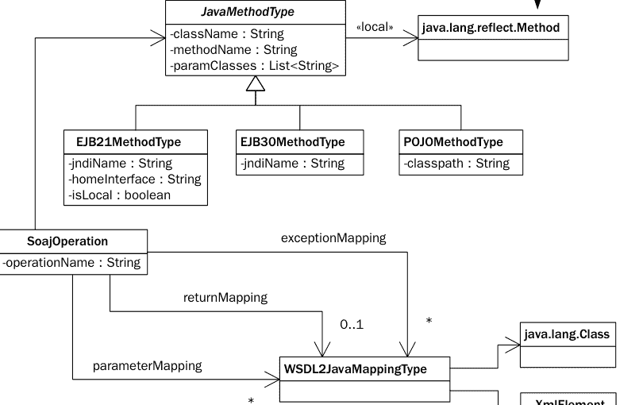

**图 11–10** SoajOperation 的类图——它是部署的基本单元。

配置类 `SoajConfiguration` 包含多个 `SoajWSDL` 实例——每个已配置的 WSDL 对应一个实例。但 `SoajConfiguration` 类还包含额外的组件。`Schema` 实例仅仅是 SOA-J 配置文件中 `userDefinedSchema` 元素（在本章开头的示例 11–1 中所示），它们引用了 SOA-J 配置部署的 WSDL 中使用的程序程序。同样，`Mapping` 类封装了 ASF 映射策略（在示例 11–7 和示例 11–8 中所示），这些策略实现了在 `SoajOperation` 级别定义的 `WSDL2JavaMappingType` 类型映射。

`classpathType` 尚未讨论。它对应于一个由 SOA-J 上传的 JAR 文件，用于加载 `soajOperation` 使用的特定类。特别是，`POJOMethodType`（如图 11–10 所示）包含一个名为 *.classpath* 的属性。这是对一个包含 POJO 类定义的 JAR 包的 URL 的引用。当然，如果该类包含在部署 SOA-J 的 WAR 包中，则不需要对该 JAR 的引用。但 SOA-J 提供了上传未随 SOA-J WAR 部署的类的能力。这是保持配置动态的重要部分。如果你在配置文件中添加了一个 `soajoperation`，你将需要能够告诉 SOA-J 在哪里找到它的类定义。否则，你将不得不重新封装 SOA-J WAR 以包含新的 JAR。

图 11–12 显示了一个假设的采购订单系统的部署子系统实例的对象图。`SoajConfiguration` 实例 `POconfig` 包含了对两个 `ClasspathType` 实例 `purchasingCP` 和 `inventoryCP` 的引用。这些代表包含采购系统类和库存系统类的 JAR。

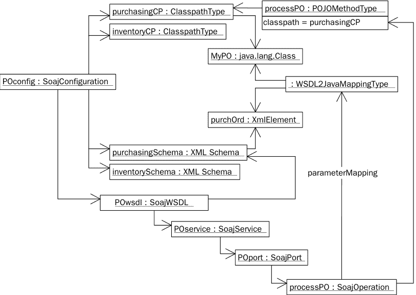

**图 11–12** 描述采购订单系统部署的对象图。

在 XML 侧，`POconfig` 实例引用了 `purchasesSchema` 和 `inventorySchema`。这些是企业标准程序，用于用标准的 WSDL 类型和元素表示采购和库存组件。为了简单起见，此图只显示了一个 WSDL（尽管采购系统的实际配置可能有很多）——`POwsdl` 实例。在该 WSDL 中，只显示了一个 `wsdl:operation`（同样为了简单起见）——`processPO` 操作。注意 `POwsdl` 实例引用了 `purchasingSchema`，因为它的 `types` 部分包含了该程序（其类型被 `processPO` 操作使用）。

`processPO` 操作引用了 `processPO` `POJOMethodType`。在这里，你也可以看到从这个 `POJOMethodType` 回到 `purchasingCP` `ClasspathType` 的引用，这样 SOA-J 就知道在哪里找到 POJO 的类定义（假设它没有随 SOA-J WAR 部署）。`processPO` 操作还包含一个 `parameterMapping`，将 `MyPO` Java 类（由 `processPO POJOMethodType` 处理的参数）与 `purchasingSchema` 中的 `purchOrder` 元素连接起来。这很好地说明了 `WSDL2JavaMappingType`（类型映射）如何在 SOA-J 配置的 XML 侧和 Java 之间搭建桥梁。

# 11.6 结论

本章概述了 SOA-J 如何实现第 1 章引入的 Web 服务平台架构。我创建 SOA-J 是为了说明如何利用 JWS 技术创建一个对于进行 SOA 集成所需的应用程序框架。在设计 SOA-J 时，我考虑了 SOA 的以下特性：

1. 通过使用 Web 服务实现面向服务
2. 自主性
3. 开放标准
4. 互操作性和联邦
5. 可重用性
6. 松散耦合

特别是基于 JWS 的 SOA-J，能够让你更快速、更好且更不深入地处理这些特性。在第 3 章第 3.2 节中，书中识别了 SOA 的共有特性。我希望通过提供这个对我 SOA-J 框架原型实现的插图，能够帮助其他构建 SOA 框架的人跨越学习曲线。为此，对 SOA-J 的这种解释旨在消除有关 SOAP 服务器如何实现的某些神秘性。通过消除这些神秘性，并指出 SOA 集成应用程序框架中所需的某些有用组件，本讨论旨在帮助那些正在开发下一代 Java SOA 框架的开发者。

表 11–1 检查了 SOA-J 如何实现每种特性：

| 当代 SOA | SOA-J 能力 | 如何增强 JWS |
| :--- | :--- | :--- |
| 通过使用 Web 服务实现面向服务 | 通过以 WSDL 为中心的开发发布现有的 Java 应用程序。 | 消除了编辑源码、重新封装或重新部署的需求。 |
| 自主性 | 将 Java 类（逻辑）与 Web 服务接口分离。 | 允许使用 JAXB |
| 开放标准 | 允许通过直接处理 WSDL 创建并部署 Web 服务。 | 为 WSDL 映射过程引入了灵活性。 |
| 互操作性和联邦 | 通过允许映射 Java 接口促进互操作性和联邦。 | 避免了目前映射 Java 接口所需的自定义编码。 |
| 可重用性 | 允许在不更改代码的情况下在多个 SOA 组件中重用代码。 | 当前，重用需要更改 WSDL 描述符。 |
| 松散耦合和组织敏捷性 | 将 SOA 接口松散耦合到底层 Java 代码。 | 通过解耦表示减轻变更管理负担。 |

a. 可以在不使用注解的情况下 JWS（通过第 8 章描述的部署描述符），但这种方法不是 Java EE 5 “易用性”功能的重点。此外，即使没有注解，你仍然需要重新封装和重新部署以将现有类发布为 Web 服务。

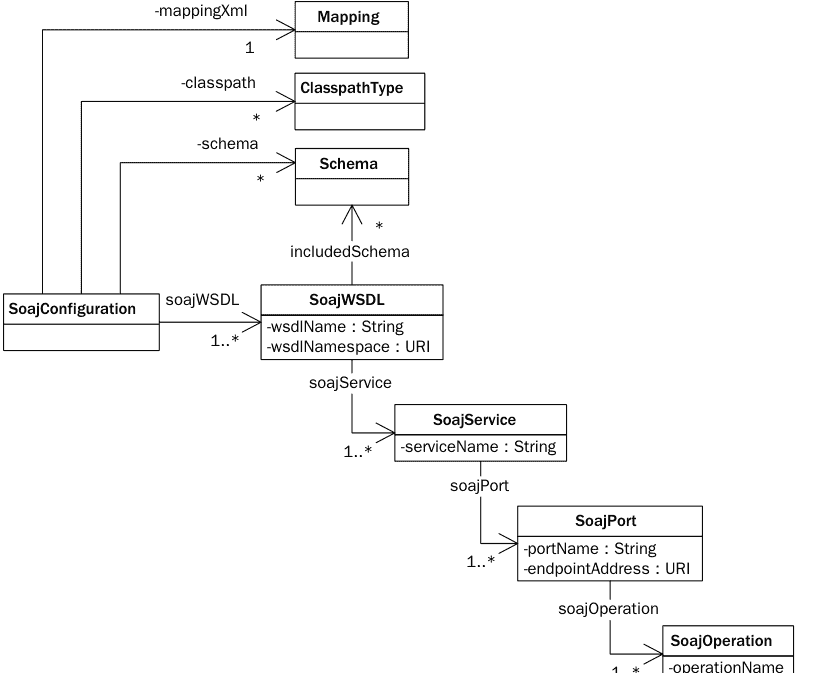

# 本书使用的 Java、XML 和 Web 服务标准

开发者用于实现 SOA 应用程序的 XML 和 Java 标准是一个不断变化的目标。对于本书，我选择涵盖了与 Java EE 5 和 Java SE 6 紧密相关，或者目前开发者最常用的标准。因此，例如，本书讨论了 WSDL 1.1 而不是 WSDL 2.0。Java EE 5 支持 WSDL 1.1，而不支持 WSDL 2.0。本附录提供了关于为什么讨论某些标准而未讨论其他标准的解释。

## Web 服务描述语言 (WSDL) 1.1

JAX-WS 2.0 [JSR 224] 的核心组件是 WSDL 1.1 与 Java 之间的映射。WSDL 2.0 没有定义映射。此外，在 [JSR 224] 的第 2 页中提到：“JSR 专家组决定在本次发布中不[支持 WSDL 2.0]”。我们将在 JAX-WS 规范的未来修订版本中考虑添加。此外，在写作时，WSDL 2.0 尚未达到 W3C 的‘建议（Recommendation）’阶段。它还是一个‘候选建议（Candidate Recommendation）’。也许出版时，它将成为一个‘建议’。尽管如此，我觉得 WSDL 2.0 在 SOA 开发中并未广泛使用。因此，我决定不在本书中关注 WSDL 2.0，而是专注于 WSDL 1.1。

目前流传了以下版本的 WSDL。有趣的是，如你所见，到为止还没有一个版本达到完全的 W3C 建议级别。

- WSDL 1.1 [WSDL 1.1] 于 2001 年 3 月 15 日作为 W3C Note 发布。Note 的发布并不意味着 W3C 的任何背书。
- WSDL 1.2 由 W3C 在 2001–2003 年间以工作草案（Working Draft）的形式发布。它从未成为过建议。
- WSDL 2.0 [WSDL 2.0] 目前处于候选建议阶段。

## SOAP 版本 1.1

在书中，SOAP 指 SOAP 版本 1.1 [SOAP 1.1]，除非特别提到了 SOAP 版本 1.2 [SOAP 1.2]。对于本书讨论的话题，SOAP 1.1 和 SOAP 1.2 之间的差异影响很小。关注 SOAP 1.1 的基于：

- 在写作时，SOAP 1.1 的实现仍比 SOAP 1.2 广泛得多。
- 使用 JAX-WS 的 Web 服务节点使用 SOAP 1.1/HTTP 作为默认绑定。

## XSL 转换 (XSLT) 版本 1.0

XSLT 1.0 于 1999 年 11 月成为 W3C 建议。因此，按照行业标准来说，它有点旧了。但它仍然运行良好，并且对于 SOA 集成应用中遇到的数据转换任务绰有余。无论如何，它的继者 XSLT 2.0 已经达到了 W3C 建议阶段（截至 2007 年 1 月 23 日）。在写作时，XSLT 2.0 尚未被广泛采用。因此，本书使用了 XSLT 1.0。

## XML Schema 版本 1.0

XML Schema 1.0 于 2001 年 5 月被批准为 W3C 建议，并于 2004 年 10 月 28 日了包含许多错误的第二版。在写作时，XML Schema 1.1 处于 W3C 工作草案状态。

## JAX-WS 2.0 和 JAXB 2.0

在写作时，JAX-WS 2.0 已被 JAX-WS 2.1 代替，其维护草案于 2006 年 11 月发布。JAX-WS 增加了对 WS-Addressing 的支持。同样，JAXB 2.0 也被 JAXB 2.1 代替。JAXB 2.1 包含了多种易用功能，但规范没有重大变化。由于 Java EE 5 和 Java SE 6 规范包含了对 JAX-WS 2.0 和 JAXB 2.0 的支持，而不是这些 2.1 版本，本书仅涵盖 JAX-WS 2.0 和 JAXB 2.0。

# 软件配置指南

除了阅读本指南，请检查 http://soabook.com 获取有关配置和运行本书代码示例的最新信息。由于这些示例中使用的软件较新，配置指南经常发生变化。因此，除了本附录之外，在配置环境运行示例之前，阅读 http://soabook.com 上的说明是非常重要的。

本附录概述了如何设置你的软件环境以运行书中提供的示例代码。如果你打算跟随示例代码并运行它（强烈建议这样做），你需要安装以下内容：

- JSE 5 (Java 5)
- JSE 6 (Java 6)
- Ant 1.7
- Maven 2.0

## B.1 安装 Java SE

要运行代码示例，你需要安装 Java 开发工具包 (JDK)。我建议使用 JDK 5 或 6。你可以从 http://www.oracle.com/java/technologies/downloads/ 下载 JDK。安装后，你需要将 `JAVA_HOME` 环境变量设置为安装 JDK 的路径。例如，在 Windows 上，我将 `JAVA_HOME` 设置为 `C:\Program Files\Java\jdk1.5_0`。在 Linux 上，它是 `/home/username/jdk1.5`。将 `$JAVA_HOME/bin` 目录添加到 `PATH` 环境变量中。

## B.2 安装 Ant 1.7

要运行某些代码示例，你需要使用 Ant 1.7。我在环境中使用 Ant 1.7.0。有关下载和安装 Ant 的说明，请参考 http://ant.apache.org。

- 下载并安装 Ant 1.7。安装 Ant 1.7 的目录在后续说明中表示为 `<Ant1.7>`。
- 将 `<Ant1.7>/bin` 目录添加到 `PATH` 环境变量中。

## B.3 安装 Maven 2.0

要构建和运行代码示例，你需要使用 Maven 2.0 而不是 Maven 1.x。我在环境中使用 Maven 2.0.4。有关下载和安装 Maven 的说明，请参考 http://maven.apache.org/download.html。

- 下载并安装 Maven 2.0。安装 Maven 2.0 的目录在后续说明中表示为 `<Maven2.0>`。
- 将 `<Maven2.0>/bin` 目录添加到 `PATH` 环境变量中。

| 设置 | 值 |
| :--- | :--- |
| 管理员用户 | admin |
| 管理员密码 | admin |
| 管理员端口 | 8080 |
| HTTPS 端口 | 8443 |

## B.4 安装书籍示例代码

示例以 ZIP 文件的形式提供，你可以随地对其进行解压。从 http://soabook.com 下载并解压示例。书中将解压示例的目录统称为 `<book-code>`。

## B.5 配置 Maven

你在 B.4 节中下载的书籍代码包含你需要修改的配置文件，以便在你的环境中构建示例。以下步骤将引导你完成配置过程：

1. 首先，将文件 `<book-code>/pom.xml.sample` 重命名为 `<book-code>/pom.xml`。这是基础的项目文件，用于配置 Maven 构建环境。它包含一个 `<properties>` 部分，其中定义了一组用于在你的环境中运行示例的属性。使用文本编辑器打开 `<book-code>/pom.xml` 文件。从 pom.xml 的第 12 行开始，你将看到以下文本：

```
<profile>
  <id>mark.hansen.desktop</id>
  <activation>
    <file>
```


<exists>c:/mark.homepc</exists>

</file>

</activation>

<properties>

<glassfish.home>c:/bin/glassfish-v2-b28</glassfish.home>

<glassfish.host>localhost</glassfish.host>

<glassfish.domain>domain</glassfish.domain>

<glassfish.admin.port>4848</glassfish.admin.port>

<glassfish.deploy.port>8080</glassfish.deploy.port>

<glassfish.admin.user>admin</glassfish.admin.user>

<glassfish.admin.password>file=c:/soabook/code/book-code/glassfish.password</glassfish.admin.password>

</properties>

</profile>

```

- 4. 要了解更多关于 Maven 构建配置（build profiles），请访问 http://maven.apache.org/guides/introduction/introduction-to-profiles.html。

```

<jdk6.home>c:/Program Files/Java/jdk1.6.0</jdk6.home>

<properties>

</profile>

```

**粗体**高出的项是你可能需要修改的内容。首先，将 `<id>` 标签的值更改为 `mark.hansen`以外的其他内容。这是你的配置的 ID。⁵接下来，将 `<exists>` 标签的值更改为你的开发环境中一个存在的文件路径。在我的情况下，我在桌面上创建了一个空文件 `c:/mark.homepc`，Maven 使用它来判断自己正运行在我的桌面上。当 Maven 在你的环境中运行时，它将查找你在 `<exists>` 标签内指定的路径路径。如果找到了指定的文件，Maven 将继续按照配置中 `<properties>` 部分定义的属性来设置属性。

你需要编辑配置的这部分（从 `<properties>` 标签开始）以适应你的环境。请确保即使在 Windows 中也使用正斜杠（例如 `c:/Sun/AppServer`——在 Linux 中，不要对 `/home/username` 使用 "-" 缩写，因为这可能会在脚本内部引起问题）。表 B–1 描述了各种属性的含义。

## 表 B–1 Maven 配置属性

| 属性 | 描述 |
| :--- | :--- |
| `glassfish.appsvr` | GlassFish 服务器主目录路径。这应该与 B.1 节第 1 步描述的 `<AppServer>` 相同。 |
| `glassfish.host` | 运行应用程序服务器的主机；例如，当在独立机器上运行时，可以是 `localhost`。 |
| `glassfish.domain` | 你想要部署并运行代码示例的 GlassFish 域名称。GlassFish 安装时创建的默认域是 `domain1`。 |
| `glassfish.admin.port` | 用于 GlassFish 管理的端口。GlassFish 安装时的默认端口为 `4848`。 |
| `glassfish.deploy.port` | GlassFish 监听应用程序请求的端口。GlassFish 安装时的默认端口为 `8080`。 |

⁵ Maven 项目可以有多个配置（例如）迁移到你的桌面和笔记本电脑。每个配置都有自己的 ID。

## 表 B–1 Maven 配置属性（续）

| 属性 | 描述 |
| :--- | :--- |
| `glassfish.admin.user` | GlassFish 管理员用户名。默认是 `admin`。 |
| `glassfish.admin.password.file` | 指向下一步创建的密码文件。它应该设置为 `<book-code>/glassfish.password`。 |
| `jdk6.home` | （可选）这是 Java SE 6 SDK 安装目录的路径。参见 B.11。 |

- 2. 将文件 `<book-code>/glassfish.password.sample` 重命名为 `<book-code>/glassfish.password`。打开 `<book-code>/glassfish.password` 文件，检查 `ADMIN_PASSWORD` 的值是否与安装 GlassFish 时提供的密码一致。默认是“admin”。
- 3. 打开控制台（DOS 或 XTerm）并切换到 `<book-code>` 目录。输入以下命令将 `pom.xml` 安装到 Maven 仓库：

```
mvn install
```

这很重要，为了构建和运行代码，顶层 `pom.xml` 必须加载到仓库。

## B.6 配置 Ant

除了 Maven 的配置外，B.4 节下载的书籍代码包含你在环境中运行 Ant 所需要修改的配置文件。以下步骤描述了如何配置 Ant：

- 1. 将文件 `<book-code>/common-build.xml.sample` 拷贝到 `<book-code>/common-build.xml`。
- 2. 使用文本编辑器打开 `<book-code>/common-build.xml`。在文件顶部，`<project ...>` 标签之后是一个属性定义部分，如下：

```
<property environment="env"/>

<property name="glassfish.appsvr"
value="${env.GLASFISH_ROME}"/>
```

```
<property name="glassfish.host" value="localhost"/>
<property name="glassfish.domain" value="domain"/>
<property name="glassfish.admin.port" value="4848"/>
<property name="glassfish.deploy.port" value="8080"/>
<property name="glassfish.admin.user" value="admin"/>
<property name="glassfish.admin.password.file" value="c:/soabook/code/book-code/glassfish.password"/>
<property name="jdk6.home" value="c:/Program Files/Java/jdk1.6.0"/>
```

就像 B.5 一样，你需要修改这些内容以适应你的环境。事实上，**粗体**高出的属性可能需要更改。表 B–2 描述了属性值应该是怎样的。

## 表 B–2 Ant 属性

| 属性 | 描述 |
| :--- | :--- |
| `glassfish.appsvr` | GlassFish 服务器主目录路径。这应该与 B.1 节第 1 步描述的 `<AppServer>` 相同。 |
| `glassfish.host` | 运行应用程序服务器的主机；例如，当在独立机器上运行时，可以是 `localhost`。 |
| `glassfish.domain` | 你想要部署并运行代码示例的 GlassFish 域名称。GlassFish 安装时创建的默认域是 `domain1`。 |
| `glassfish.admin.port` | 用于 GlassFish 管理的端口。GlassFish 安装时的默认端口为 `4848`。 |
| `glassfish.deploy.port` | GlassFish 监听应用程序请求的端口。GlassFish 安装时的默认端口为 `8080`。 |
| `glassfish.admin.user` | GlassFish 管理员用户名。默认是 `admin`。 |
| `glassfish.admin.password.file` | 指向下一步创建的密码文件。它应该设置为 `<book-code>/glassfish.password`。 |
| `jdk6.home` | （可选）这是 Java SE 6 SDK 安装目录的路径。参见 B.11。 |

## B.7 启动和停止 GlassFish 服务器

要启动 GlassFish 应用程序服务器，在命令行提示符处输入以下内容：

```
asadmin start-domain
```

要停止 GlassFish 应用程序服务器，在命令行提示符处输入以下内容：

```
asadmin stop-domain
```

为了让 `asadmin` 命令工作，你必须按照 B.1 节所述将 `<AppServer>/bin` 添加到你的 PATH 中。

## B.8 通过运行示例测试安装

以下是第 3 章中运行示例的说明摘录。遵循这些说明，如果环境设置正确，它应该可以运行。运行示例需要打开命令提示符（Windows）或 XTerm（Linux）。“进入”意味着切换到指定的目录。

- 1. 启动 GlassFish（如果尚未运行）。
- 2. 进入 `<book-code>/chap03/rest-get/endpoint-servlet`。
- 3. 要构建并部署 Web 服务，输入：

```
mvn install
```

当该命令执行完成后，然后输入：
```
ant deploy
```
- 4. 进入 `<book-code>/chap03/rest-get/client-http`。
- 5. 要运行客户端，输入：

```
mvn install
```
- 6. 要卸载 Web 服务，回到 `<book-code>/chap03/rest-get/endpoint-servlet` 并输入：

```
ant undeploy
```

## B.8 通过运行示例 533 测试安装

运行客户端（步骤 5）后，你应该会在控制台上看到类似所示的输出：

```xml
<xml version="1.0" encoding="UTF-8"?>
<Orders xmlns="http://www.example.com/oms" nsi:schemaLocationLocation="http://www.example.com/oms http://www.soabook.com/example/oms/orders.xsd" xsi:instance="http://www.w3.org/2001/XMLSchema-instance">
<Order>
<OrderKey>ENT1234567</OrderKey>
<OrderHeader>
<SALES_ORG>NE</SALES_ORG>
<PURCH_DATE>2001-12-09</PURCH_DATE>
<CUST_NO>ENT0072123</CUST_NO>
<PYMT_PYTH>PO</PYMT_PYTH>
<PURCH_ORD_NO>PO-72123-0007</PURCH_ORD_NO>
<WAR_DEL_DATE>2001-12-16</WAR_DEL_DATE>
</OrderHeader>
<OrderItems>
<item>
<ITM_NUMBER>012345</ITM_NUMBER>
<STORAGE_LOC>NE02</STORAGE_LOC>
<TARGET_QTY>50</TARGET_QTY>
<TARGET_UOM>CNT</TARGET_UOM>
<PRICE_PER_UOM>7.95</PRICE_PER_UOM>
<SHORT_TEXT>7 mm Teflon Gasket</SHORT_TEXT>
</item>
<item>
<ITM_NUMBER>543210</ITM_NUMBER>
<TARGET_QTY>5</TARGET_QTY>
<TARGET_UOM>KG</TARGET_UOM>
<PRICE_PER_UOM>12.58</PRICE_PER_UOM>
<SHORT_TEXT>Lithium grease with PTFE/Teflon</SHORT_TEXT>
</item>
</OrderItems>
<OrderText>This order is a rush.</OrderText>
</Order>
<Order>
<OrderKey>ENT1234568</OrderKey>
<OrderHeader>
<SALES_ORG>NE</SALES_ORG>
<PURCH_DATE>2001-12-09</PURCH_DATE>
<CUST_NO>ENT0098211</CUST_NO>
<PYMT_METH>PO</PYMT_METH>
<PURCH_ORD_NO>PO-98211-00147</PURCH_ORD_NO>
<WAR_DEL_DATE>2001-01-19</WAR_DEL_DATE>
</OrderHeader>
<OrderItems>
<item>
<ITM_NUMBER>087321</ITM_NUMBER>
<STORAGE_LOC>NE05</STORAGE_LOC>
<TARGET_QTY>2</TARGET_QTY>
<TARGET_UOM>CNT</TARGET_UOM>
<PRICE_PER_UOM>598.49</PRICE_PER_UOM>
<SHORT_TEXT>Acme Air Handler</SHORT_TEXT>
</item>
</OrderItems>
</Order>
</Orders>
BUILD SUCCESSFUL
```


## B.9 构建并部署 SOAShopper 案例研究（第 9 和第 10 章）

SOAShopper 是第 9 和第 10 章中讨论的在线购物搜索工具。它提供了一个运行在浏览器中的 Ajax 前端。由于 Ajax 基于 JavaScript，且并非所有浏览器实现 JavaScript 的方式都相同，因此 SOAShopper 前端在不同浏览器上的渲染结果不同。在某些浏览器上，它可能无法运行。我已使用 Firefox 2.0.0.1 和 Microsoft IE 6.0,2900x 进行过测试，这两个浏览器上均运行良好。

SOAShopper 的代码可以在书籍示例代码下载的 `book-code/chap09/soashhopper` 中找到。（请参考 B.4 节关于下载和安装书籍示例的说明。）

在尝试构建和运行 SOAShopper 之前，请确保你已完成 B.1 节到 B.5 节概述的配置步骤。完成配置后，按照以下步骤构建 SOAShopper 并打开 Ajax 前端：

1. 打开控制窗口并进入 `book-code/chap09/soashhopper` 目录。
2. 输入 `mvn clean`。
3. 输入 `mvn install`。
4. 输入 `ant deploy`。

在浏览器访问以下 URL：`http://${glassfish.host}:$(glassfish.deploy.port)/soashpper/ajax/search.html`。例如，使用默认值时 URL 为 `http://localhost:8080/soashoper/ajax/search.html`。

要卸载该应用程序，返回控制窗口并输入 `ant undeploy`。

## B.10 构建并部署 SOA-J 框架（第 11 章）

请检查 `http://soabook.com` 获取构建和运行 SOA-J 的说明以及第 11 章的代码示例。源代码可以在 `book-code/chap11/soaj` 找到。

### B.11 安装 Java SE 6（可选）

如果你想运行第 7 章的 `javax.xml.endpoint` 示例，则需要安装 Java SE 6。但我建议你安装，因为 Endpoint API 非常酷，而且你会喜欢它的。

1. 下载并安装 Java SE 开发包 (JDK)。在进行安装并遵循向导操作时，建议不要安装 JRE（特别是如果你使用 Windows 的话）。我看到当 Java 5 和 6 都安装了 JRE 时，Windows 会变得困惑。
2. 检查并确保已设置了 `jdk.home` 属性为 JDK 的位置。

## 附录 C 前缀

为了简化示例和图中使用的 XML，并不总是提供命名空间定义。在没有式定义命名空间的情况下，它们符合 Java EE、Java SE 和 W3C 规范或本文的标准用法，总结如下：

| 前缀 (Prefix) | 命名空间 (Namespace) | 版本 (Version) |
| :--- | :--- | :--- |
| env | `http://schemas.xmlsoap.org/soap/envelope` | 1.1 |
| env2 | `http://www.w3.org/2003/05/envelope` | 1.2 |
| jaxb | `http://java.sun.com/xml/ns/jaxb` | JAXB 2.0 |
| jaxws | `http://java.sun.com/xml/ns/jaxws` | JAX-WS 2.0 |
| soap | `http://schemas.xmlsoap.org/wsdl/soap` | WSDL 1.1 |
| wsdl | `http://schemas.xmlsoap.org/wsdl/` | WSDL 1.1 |
| xsl | `http://www.w3.org/1999/XML/Transform` | XSLT 1.0 |
| wsrm | `http://docs.oasis-open.org/wsrm/2005` | WS-RX |
| wssse | `http://docs.oasis-open.org/wss/2004/01-wss-1.0` | WS-Security |
| xmime | `http://www.w3.org/2005/05/xmlmime` | Binary Data in XML |
| xop | `http://www.w3.org/2004/08/xop/include` | XOP 1.0 |
| xs | `http://www.w3.org/2001/XMLSchema` | XML Schema 1.0 |

## 术语表

术语表提供了 Java Web 服务特定术语的定义。定义经常引用其他定义，*斜体*出现的术语在术语表中定义。

**Ajax** 一种基于浏览器的用户界面开发技术，是*异步 JavaScript 和 XML* 的缩写。Ajax 主要用于创建在从服务器检索新数据时无需刷新页面的 Web 用户界面。Ajax 程序员使用 JavaScript 类型 `XMLHttpRequest` 在后台与服务器交换数据（即无需重新加载浏览器显示的 HTML 页面）。当 `XMLHttpRequest` 实例接收到新数据（通常为 XML 格式）时，使用 JavaScript 更新 HTML 页面的 DOM 结构（例如在表中插入某些行），而无需在内存中重建整个 HTML 页面。

**annotations** 从 JSE 开始添加到 Java 语言的程序元素。在 Java 源文件中，注解由 `@` 符号表示。例如，`@WebService` 注解用于声明类应被部署为 Web 服务。

**anonymous type** 不显式定义，而是作为元素定义部分的 XML Schema 类型。此类类型被称为匿名类型，因为它们没有限定名称。

**AOP** 参见*面向切面编程*。

**aspect oriented programming** 面向切面编程（AOP）编程范式提供了跨切关注点的封装和模块化。基本思想是，安全等横跨应用程序的关注点不需要在每个需要的地方“重新实现”。相反，应该根据需要引用单一实现。Java EE 5 使用注解实现了 AOP 概念。

**binding** 参见 Java/XML 绑定。

**binding declaration** 用*绑定*语言编写的指令，用于将特定的 XML Schema 或 WSDL 组件映射到其 Java 表示。JAXB 2.0 绑定声明指定为 `<jaxb:bindings>` 元素的实例。J-WS 2.0 绑定声明使用 `<jaxws:bindings>` 元素。

**binding language** 一种基于 XML 的语言，使用 XML Schema 元素将 JAXB 和或 J-WS 自定义指令嵌入 WSDL 和/或 XML Schema 文档。绑定语言用于将默认的 WSDL/WS 自定义为 J-WS 和 JAXB 定义的映射。绑定语言用于表达绑定声明。

**runtime framework** JAXB 2.0 实现的运行时部分。它提供了*序列化（marshal）*和*反序列化（unmarshal）*操作。

**data transformation** 将 XML 文档格式从一个架构更改另一个架构的过程。当从源系统（例如订单管理系统）获取数据并使用其更新目标系统（例如客户历史数据库）时，就会数据转换。在本例中，订单记录通过数据转换创建用于更新数据库的客户历史记录。

**datatype mapping** 数据类型映射是从一种数据类型到另一种类型的转换。例如，从产品的的一个 XML Schema 表示到另一个的 XSTL 转换可以被称为数据类型映射。数据类型映射与*类型映射*相似，只是当两种类型都用相同语言表示（例如都是 Java 或 XML）时，使用*数据类型映射*术语。

**declarative (programming language)** 如果一种语言定义了应用于输入以创建输出的规则，则该语言被称为*声明式*的，而不是*过程式*的。

**delegate** 参见委托。

**delegation** 如 [Go4] 第 20 页所述，“委托是一种使组合像继承用一样强大的方法。”在委托中，类通过调用委托实例的方法来实现方法。这类似于继承，类可以推迟父类中定义方法的实现。然而，它比继承更灵活，因为委托关系可以在运行时使用不同类型的委托器进行更改。

**依赖注入 (dependency injection)** 一种编程设计模式，其中对象的实例（注入目标）可以在运行时被“注入”，使得程序可以使用该实例而无需通过编程来构造或定位它。例如，Java 通过 `@Resource` 注解实现了依赖注入。

**派生模式 (derived schema)** 参见模式生成（schema generator）。

**反序列化 (deserialization)** 将对象的顺序字节（序列化）表示形式转换为内存（可能存储为树、图等）表示形式。

**反序列化器 (deserializer)** 实现反序列化的编程组件。

**分发 (dispatching)** 分发是调用过程的一部分。给定一个 SOAP 消息，确定其目标 WSDL 操作和相应的要调用的 Java 方法称为分发。

**文档对象模型 (Document Object Model)** HTML 或 XML 文档的标准的、内存中的表示。该标准由 W3C 维护——[DOM]。DOM 结构将文档表示为树。浏览器通常使用 DOM 表示 HTML。Java 程序通常使用 DOM 操控 XML。

**DOM** 参见文档对象模型。

**ECMAScript** 由 Ecma International 在其 ECMA-262 规范中定义的脚本语言。JavaScript 是 ECMAScript 的一种实现。

**EJB** 参见企业 Bean（Enterprise Bean）。

**端点监听器 (endpoint listener)** Web 服务平台架构部署子系统中的一个组件。端点监听器负责监听来自中心地址和传输（例如 HTTP）的请求。当 Web 服务被部署时，它会与特定的端点监听器相关联。

**企业 Bean (Enterprise Bean)** 企业 Bean 或企业 JavaBean (EJB) 是一种 Java 类，其实例在运行时由企业 Bean 容器进行管理。

**企业 JavaBean 容器 (Enterprise JavaBean container)** Java EE 5 实现中用于托管 EJBs 的组件。EJB 容器提供持久化、事务处理、并发控制、安全性等服务。

**可扩展样式表转换 (XSLT, Extensible Stylesheet Language Transformations)** XSLT（可扩展样式表语言）是一种基于 XML 的语言，用于描述 XML 文档的转换。例如，使用 XSLT，你可以将 XML 文档转换为人类可读的 HTML 页面。XSLT 可用于 SOA 框架内将数据表示从一种格式转换为另一种格式。这对于促进集成非常有用，例如，采购订单（Purchase Order）的表示需要转换为公司的表示形式。

**快速失败验证 (fail-fast validation)** JAXB 2.0 验证的一种形式，其中对带有 JAXB 注解的程序元素的每次操纵（例如设置属性）都会根据关联的模式进行检查。当操纵导致底层的 XML Infoset 相对于模式变得无效时，将抛出一个意外异常。

**故障 Bean (fault bean)** 参见 JAX-WS 故障 Bean（fault bean）。

**灵活反解序列化 (flexible unmarshalling)** 与结构反解序列化相比，当使用 JAXB 2.0 灵活反解序列化时，会忽略某些类型的验证错误，例如顺序错误的元素或缺失的属性。

**HTTP 参数 (HTTP parameter)** 一组参数/值对可以通过 `p1=v1&p2=...pn=vn` 的形式传递给部署在 URL 端点的程序，其中 pi ... pn 是参数，v1 ... vn 是相应的值。此类参数经过 URL 编码，可以传递在 HTTP 请求体中（例如在提交 HTTP 表单时），也可以在 `query` 字符串中。

**IDL** 参见接口定义语言（Interface Definition Language）。

**注入目标 (Injection Target)** 参见依赖注入。

**拦截器 (interceptor)** 一种面向切面 (AOP) 的概念。拦截器程序元素可以拦截、采取行动或在方法调用之前/之后。常见的例子涉及安全性。安全拦截器可以与特定应用程序中的所有方法相关联，这些方法在执行之前需要检查凭据。

**接口定义语言 (Interface Definition Language, IDL)** 接口定义语言是一种计算机语言，它提供了一种描述如何调用软件组件的标准方法。

**Java 内容接口 (Java content interface)** JAXB 1.0 将复杂类型绑定到内容接口而不是值类。这些接口的实现由对象工厂生成。这种绑定类型在 JAXB 2.0 中仍然可用，作为值类的替代方案。结构反解序列化需要使用 Java 内容接口。

**Java 动态代理类 (Java dynamic proxy class)** Java 动态代理类是在运行时创建的类，它实现了一组在运行时也指定的接口。

**Java 程序元素 (Java program elements)** Java 程序元素包括应用程序的 Java 数据模型的组件：包、字段、属性（即 JavaBean 属性）和类型（类和枚举构造）。

**Java 远程调用 (Java Remote Invocation, Java RMI)** Java 远程方法调用 (Java RMI) 是一种用于分布式 Java 应用程序的技术，其中远程 Java 对象的方法可以从其他 Java 虚拟机（可能在不同的主机上）调用。RMI 使用对象序列化对参数进行序列和反序列化。

**JavaScript** JavaScript 是 ECMAScript 标准的一种实现。它是一种常用于 Web 应用程序客户端编程的脚本语言。大多数 浏览器都支持 JavaScript。JavaScript 程序可以通过操作浏览器对 HTML 页面的 DOM 表示来读取和写入浏览器接口。JavaScript 不是 Java 的变体。这两种语言是不同的。参见 Ajax。

**JavaScript 对象表示法 (JavaScript Object Notation)** 一种用于序列化的基于文本的数据交换格式。通常被称为 JSON，它比 XML 更轻量且更容易阅读。由于这些原因，某些人认为在交换 Ajax 编程中遇到的简单数据结构时，它比 XML 更好。

**Java/XML 绑定 (Java/XML binding)** Java/XML 绑定是 Java 对象与 XML 元素之间的一一一映射。

**Java/XML 映射 (Java/XML map)** Java/XML 映射是一对对 `<J, X>` 的映射，其中 J 是 Java 类，X 是 XML 元素。

**带 JAXB 注解的 Java 程序元素 (JAXB-annotated Java program elements)** 带有 JAXB 注解的 Java 程序元素。

**JAXB 2.0 Java/XML 映射 (JAXB 2.0 Java/XML mapping)** JAXB 2.0 定义的标准，将 XML 组件与 Java 程序元素关联。

**JAXB 值类 (JAXB value class)** 由模式编译器生成，JAXB 值类为其对应模式组件的内容提供 JavaBean 风格的（即 get 和 set）方法。

**JAX-WS 故障 Bean (JAX-WS fault bean)** 由 JAX-WS 映射生成的 Java 类，用于表示 WSDL 文档描述的故障内容。JAX-WS 将 `wsdl:fault` 元素映射到封装故障内容的异常（Exceptions）。具体来说，`wsdl:portType` 内部的 `wsdl:fault` 元素始终引用包含单个带有元素属性的 `wsdl:part` 的 `wsdl:message`。该 `wsdl:part` 元素属性引用的全局元素声明由 JAX-WS 映射为 Java Bean。

**JAX-WS 端口组件 (JAX-WS port component)** JAX-WS 端口组件定义了构成可移植服务的编程模型制品。这些组件由 WSEE 1.2 [JSR 109] 定义。端口组件必须包含服务实现 Bean。它也可以包含端点接口 (SEI)、WSDL 文档、安全角色引用和 Web 服务部署器。

**JAX-WS 端点 (JAX-WS Endpoint)** 部署在 Web 容器 WAR 包中的 Web 服务 WSEE [JSR 109]。这令人困惑，因为听起来像 JAX-WS 端点接口 (SEI)。事实上，SEI 可以由 JAX-WS 端点或 EJB 容器中的无状态 EJB 实现。

**JAX-WS 服务端点接口 (JAX-WS service endpoint interface, SEI)** 根据 JAX-WSDL/Java 映射映射到 `wsdl:portType` 的 Java 接口。SEI 必须包含 `@WebService` 注解。其他注解可能影响接口到 WSDL 的映射。

**JAX-WS 服务实现 Bean (JAX-WS service implementation bean, SIB)** 服务实现包含 JAX-WS 服务的业务逻辑。它被 `@WebService` 或 `@WebServiceProvider` 注解，其方法可以暴露为 Web 服务操作。服务实现 Bean 在 WS-Metadata [JSR 181] 中完全定义。

**JSON** 参见 JavaScript 对象表示法。

**JSR-181 处理器** WS-Metadata 1.0 (JSR 181) 实现提供一种处理器，用于读取 Java Web 服务源代码上的注解用于创建部署描述符以及创建运行 Web 服务所需的其他制品的文件。

**mapping annotations（映射注解）** Java 语言注解，用于控制 Java 程序元素如何映射到 XML Schema 组件或 WSDL 组件。JAXB 2.0 提供了 Java 到 XML Schema 的映射注解，JAX-WS 2.0 提供了 Java 到 WSDL 的 WS-Metadata 映射注解。

**marshal（序列化/编化）** JAXB 2.0 的一个过程，即根据映射注解自定义的 JAXB 2.0 标准-Java/XML 映射，将实例转换为 XML Infoset 表现的形式。

**mock object（模拟对象）** 模拟对象是一种用于测试驱动开发的 Java 类。模拟对象实现了真实对象的 API，但其返回值是硬编码的测试数据。模拟对象用于测试接口定义的运行时行为，而不需要业务逻辑实现。

**multivariate type mapping（多变量类型映射）** 多变量类型映射是指一种 schema 元素与属性之间没有一对一对应关系的类型映射。映射涉及合并和或拆分 schema 元素和属性，以创建一个 Java 属性或一组属性。此类映射的一个简单示例是：当电话号码在 XML schema 中表示为单个 xstring 和一个数字，但在 Java 类中表示为两个属性——区号和号码。

**MTOM** 见 MTOM/XOP。

**MTOM/XOP** 标题为“SOAP 消息传输优化机制”的 W3C 标准（参见 `www.w3.org/soap12-mtom/`）。它描述了一种用于处理 XML Infoset 之外内容的标准程序，将其作为 MIME 附件进行处理、封装，并用 Infoset 中的引用替换它。配合 MTOM 使用的封装编码是 XOP，这是另一个标题为“XML-二分法优化封装”的 W3C 标准（参见 `www.w3.org/trp/xop10/`）。XOP 将 base64 编码的内容替换为引用相应 MIME 字节流的 xop 元素。如果数据已以二进制字节流的形式可用，则可以直接将其放置在 XOP 包中。

**noun (REST)（名词 - REST 领域）** 在 REST 语文中，名词指的是资源——例如，采购订单。名词与定义动作的动词形成对比。

**POJO** Plain Old Java Object（简单 Java 对象）。此术语通常用于区分普通的 Java 类和 EJB。

**port component（端口组件）** 见 JAX-WS port component。

**POX** Plain Old XML（简单 XML）。POX 用于描述当 XML 作为独立消息格式（例如，没有 SOAP 层）时使用的情况。POX 是使用 XML/HTTP 通信的 RESTful Web 服务使用的消息样式。

**predicate（谓词）** 谓词是针对程序元素属性应用 schema 验证规则的代码片段。JAXB 2.0 实现使用谓词来实现快速失败（fail-fast）验证。

**procedural (programming language)（过程化的（编程语言））** 如果一种语言由一组在状态环境中顺序执行的指令组成，则认为该语言是*过程化的*，而不是*声明式的*。

**program element（程序元素）** 见 Java program elements。

**QoS** 见 Quality of Service。

**Quality of Service（服务质量）** 服务质量是指 Web 服务满足特定服务水平协议（SLA）标准（如网络可靠性）的能力。“保证处理顺序” QoS 必须是一项要求，要求 Web 服务按照接收到它们的顺序处理消息。

**query string（查询字符串）** 查询字符串是 URL 中紧跟在“?”字符后面的部分，包含要传递给部署在端点上的程序的 HTTP 参数列表。包含查询字符串的 URL 格式为：`http://path/program?p1=v1&p2=v2...&pn=vn`，其中 p1 ... 是参数，v1 ... 是对应的值。由于某些字符不能作为 URL 的一部分（例如空格），这些字符使用 URL 编码规范定义的特殊代码。例如，空格的 URL 编码为 %20。查询字符串通常用作向 RESTful 端点传递参数的机制（例如，Shopping APIs）。

**Remote Call (RPC)（远程调用）** 一种协议，允许客户端程序调用远程服务器上的过程（例如，Java 方法）。

**SAAJ** 用于创建和操作 SOAP 消息的 Java API。它是 SOAP Attachments 的缩写。

**schema compiler（schema 编译器）** JAXB 2.0 编译器根据 XML 实例生成一组派生的程序元素。

**schema component（schema 组件）** 见 schema component。

**schema generator（schema 生成器）** JAXB 2.0 生成器根据一组现有的程序元素生成 XML 实例。

**Security Role References（安全角色引用）** Java EE 5 提供 Web 服务的机制，安全角色引用是在组件中声明的逻辑名称。“User”和“Admin”等角色可用于提供不同的访问权限。

**semantic mapping（语义映射）** 语义映射类似于数据类型映射，但它关注的是类型（例如 schema、类）的含义而非结构。虽然语义映射和数据类型映射之间的边界较为模糊，但最常见于从一个 API 到另一个 API 的 Java 实现映射。例如，将通用模型映射到 Amazon 和 Yahoo! 服务的 API 被描述为语义映射。

**Separation of Concerns（关注点分离）** 一种软件架构原则，认为不同的关注点（即功能）不应共享重叠的代码。例如，用户界面代码通常不应包含数据库更新代码。该术语在计算机中的应用在 [Diskjstra] 中有详细解释。

**serialization（序列化）** 将内存中的对象表示（可能存储为树、图等）转换为顺序的字节（序列）表示。

**serializer（序列化器）** 实现序列化的编程组件。

**endpoint interface（服务端点接口）** 见 JAX-WS service endpoint interface。

**service implementation bean（服务实现豆）** 见 JAX-WS service implementation bean。

**Service Level Agreement（服务水平协议）** Web 消费者与 Web 服务提供者之间的协议，保证某些性能属性。对于可量化的衡量，如保证响应时间和保证可靠性（即如果发送了消息，则保证送达）。

**Service Oriented Architecture（面向服务的架构）** 一种基于使用服务创建应用程序的软件架构。缩写为 SOA，意味着一种通过松耦合方式连接单个服务来构建应用程序的系统开发风格。

**SLA** 见 Service Level Agreement。

**SOA** 见 Service Oriented Architecture。

**SOA 组件** 一种可以作为 SOA 应用程序部分的单一服务。在基于 Web 服务进行 SOA 时，SOA 组件对应于一个 `wsdl:port`。有时，SOA 组件也指代 `wsdl:port` 内部的单个 `wsdl:operation`。

**SOA 风格的松耦合系统集成** 一种系统集成方法，涉及将应用程序部署为一组 SOA 风格的服务。集成通过聚合生成的服务并应用工作流技术，以创建构建在底层服务之上的松耦合应用程序来实现。

**SOA 风格的系统集成** 参见 SOA 风格的松耦合系统集成。

**SOA 集成** 参见 SOA 风格的松耦合系统集成。

**SOAP（简单对象访问协议）** 一种用于在网络上交换基于 XML 消息的协议。SOAP 是 Web 服务的消息标准。参见 [SOAP 1.1] 和 [SOAP 1.2]。

**SOAP 主体（SOAP body）** 一个 SOAP 消息必须包含一个 `<body>` 元素。它用于承载 SOAP 消息的负载。

**SOAP 头部块（SOAP header block）** 一个 SOAP 消息可以包含一个可选的 `<Header>` 元素。它用于在消息传输过程中由 SOAP 节点处理——即所谓的元数据。`<header>` 元素的直接子元素是头部块。头部块包含元数据的某些逻辑分组，例如其安全信息。

**带附件的 SOAP 消息（SOAP Messages with Attachments）** SWA (`www.w3.org/TR/SOAP-attachments`) 是行业首次尝试标准化一种将二进制数据处理为 SOAP 消息附件的方法。SWA 定义了在 MIME multipart/related 消息内对 SOAP 1.1 消息的绑定。用于复合元素封装的 MIME multipart 机制用于将附件与 SOAP 消息打包。

**标准 Java/XML 映射** 参见 JAXB 2.0 标准 Java/XML 映射。

**“从 Java 开始”开发模式** 一种用于开发 Java Web 服务的 Java EE 方法，程序员从其希望部署为 Web 服务的 Java 类（或多个类）开始工作。该类使用 WS-Metadata 和 JAXB 注解进行标注，这些注解描述了它应该如何映射到 WSDL 接口定义。调用工具（JAXB schema 生成器）来生成用于接口定义的 WSDL 和 XML Schema。

**从 WSDL 和 Java 开始** 一种“从 Java 开始”和“从 WSDL 开始”开发模式的结合。在这种情况下，你既有一个定义了要部署的一组 Web服务的现有 WSDL，有一组需要实现这些 Web 服务的现有 Java 类。挑战在于要在现有的 WSDL 和 Java 之间进行映射以实现 Web 服务。这种开发模式在进行 SOA 风格的松耦合系统集成时最常见。

**从 WSDL 开始开发模式** 一种用于开发 Java 服务的 Java EE 方法，程序员从其希望实现为 Web服务的 WSDL 文档开始工作。WSDL（以及它包含的 XML Schema 类型定义）可以使用 WS-JAX-WS 进行标注，JAXB 绑定声明描述了它应该如何映射到一组 Java 类。调用工具（例如 JAXB schema 编译器）来生成部署为 Web 服务的 Java 类。这些生成的类为 Web 服务提供了部署结构，程序员必须向它们中添加业务逻辑。

**无状态的（stateless）** 一种在事务之间不保持持久数据状态的应用程序。

**结构化反序列化模式（structural unmarshalling mode）** 与灵活的反序列化相比，这是一种强制执行 XML 数据严格验证的反序列化模式。

**SwA** 参见带附件的 SOAP 消息。

**测试驱动开发（test-driven development）** 测试驱动开发是一种软件开发方法，侧重于先编写测试（作为规范的手段），然后实现软件以通过测试。

**类型映射（type mapping）** 类型映射定义了 Java 编程元素与 XML Schema 组件之间的关系——例如 `corp:inputType` 和 `samples.Address`。类型映射通过序列化器和反序列化器实现。序列化器将 Java 类的实例转换为符合 schema 的 XML 实例。反序列化器执行相反的操作。

**反序列化（unmarshal）** JAXB 2.0 的一个过程，将 XML Infoset 表征转换为内容对象树。该转换由 Infoset 关联的 XML Schema 以及由 JAXB 2.0 Java/XML 映射定义，这些映射由目标内容对象的程序元素定义中指定的任何映射注解进行自定义。内容对象的 Java 程序元素要么是源自 JAXB 2.0 schema 派生的程序元素，要么是通过 schema 生成器映射到 schema 的现有程序元素。

**URL 编码的（URL-encoded）** 参见查询字符串。

**值类（value class）** 参见 JAXB 值类。

**动词（REST）** 在 REST 语文中，*verb*（动词）一词指的是一种操作——例如 HTTP GET 操作。REST 强调尽可能少使用动词，与 RPC 相比，它可以使用如 WSDL 等接口语言实现并指定多种多样化的操作。

**W3C** 参见万维网联盟。

**Web 服务（Web Services）** Web 服务是一种用于应用程序与应用程序通信的程序接口，通过发送和接收 XML 来调用。“Web 服务”一术是指编写、部署和使用 Web 服务的学科。“Web 服务”与在*面向服务的架构架构*中定义的“服务”不同。

**Web 服务定义语言（Web Services Definition）** 一种用 XML 编写的接口语言，用于描述 Web 服务。WSDL 1.1 (`www.w3.org/TR/wsdl`) 是目前常用的——但它并不是官方推荐。WSDL 2.0 (`www.w3.org/TR/wsdl2/`) 有望成为 W3C 推荐。

**Web 服务栈（Web Services stack）** 一组用于定义、实现和调用 Web 服务的层次协议集合。栈的底部是服务传输层（例如 HTTP、SMTP），负责传输消息。在其之上是 XML 消息层（例如 SOAP 1.2），用于以通用格式编码消息。服务描述协议（例如 WSDL）通常用于描述服务的公共接口。可能还存在发现协议（例如 UDDI），涉及访问 Web 服务的目录（或注册表）。此外，还有与 SOAP 一起使用的*服务质量 (QoS)* 层，例如 WS-Addressing（用于寻址）、WS-Security（用于安全）和 WS-ReliableMessaging（用于可靠性）。参见 Web 服务栈。

**万维网联盟（Wide Web Consortium）** 一个提供许多重要 Web 服务规范的标准机构（例如 XML、XML Schema、SOAP、WSDL）。参见 `w3.org`。

**基于包装的集成（wrapper-based integration）** 一种“从 WSDL 和 Java 开始”开发模式的方法，使用 WSDL/schema 编译器创建用于实现特定 WSDL 中服务的 Java 包装类。然后编辑这些包装类以调用实现业务逻辑的类。

**包装元素（wrapper element）** 参见 WSDL 元素。

**WSDL** 参见 Web 服务定义语言。一个 JAX-WS 2.0 WSDL 编译器接收 WSDL 实例作为输入，并根据标准的 WSDL/Java 和 XML/Java 映射生成一组派生的 Java 程序。WSDL 编译器将源 WSDL 内的 XML 编译交给 JAXB schema 编译器。

**WSDL 元素** 文档/字面风格 WSDL 中 `<wsdl:types>` 部分定义的元素，它“包装”了 Web 服务输入输出的参数类型。这些参数作为包装元素的子元素。

**WS-I 附件规范 1.0（WS-I Attachments Profile 1.0）** 参见 `ws-i.org/Profiles/AttachmentsProfile-1.0.html`——WSIAP 澄清了带附件的 SOAP 消息（SwA）。参见带附件的 SOAP 消息。SwA 是行业首次尝试标准化一种将二进制数据处理为 SOAP 消息附件的方法。行业现在似乎在于 MTOM/XOP 而非 SwA 作为处理二进制数据的主要标准。

**WSIAP** 参见 WS-I 附件规范版本1.0。

**HttpRequest** 用于通过 HTTP 从服务器传输数据（通常是 XML）的 JavaScript API。参见 Ajax。

**XML 信息集（XML Information Set）** W3C 推荐标准，提供了一套用于引用 XML 文档中所包含信息的定义（`www.w3.org/TR/xml-infoset/`）。通常被称为 XML Infoset，信息集可以包含最多 11 种不同类型的信息项，包括文档、元素、属性、处理指令等。

**XML Infoset** 参见 XML 信息集。

**XML Infoset 表示** XML Infoset 的编程语言表示。其中一个示例是 W3C 的文档对象模型 (DOM) (`http://www.w3.org/DOM/`)，它提供了一个用于以树形结构访问 XML 文档的面向对象的 API。或者，XML Infoset 可以被表示为事件流。这种方法被 XML 简单 API (SAX) (`http://www.saxproject.org/`) 所使用。XML Infoset 有许多表示方式——每种都适用于特定的编程语言或 XML 处理风格。本书中特别重要的是 JAXB，它将 XML Infoset 表示为绑定到 XML Schema 组件的 Java 类实例。

**XML 路径语言** 通常缩称为 XPath，XML 路径语言是 W3C 定义的用于寻址 XML 文档部分的语法 (`http://www.w3.org/tr/xpath/`)。例如，XPath 允许你指定 XML 文档中定义元素的特定子元素。

**XML Schema** 一项 W3C 推荐，定义了 XML Schema 语言 (`http://www.w3.org/XML/Schema`)。其他 Schema 语言包括文档类型定义 (DTD) 和 RELAX NG。XML Schema 是对类型文档的描述。它约束了符合文档的结构和内容。XML Schema 提供了一种表达此类约束的语言，有效地实现了 XML 类型的定义。

**XML schema 组件** 在 XML Schema 语言中定义的 Schema 由各种组件组成，包括复杂和简单类型定义、元素声明、属性声明、模型组等。这些内容在 W3C 文档“XML Schema 第 1 部分：结构第二版” (`http://www.w3.org/TR/2004/REC-xmlschema-1-2-20041028/structures.html`) 中有正式定义。

**XPath** 参见 XML 路径语言。

**XSLT** 参见 可扩展样式表语言转换。

# 参考文献

- [AIA] Crane, David, Eric Pascarello, and Darren Jones. *Ajax in Action.* Manning Publications. ISBN 0201633612, January 1995.
- [AXIS] Apache Axis 1.x. `http://ws.apache.org/axis`
- [AXIS2] Apache Axis 2.x. `http://ws.apache.org/axis2`
- [CASTOR] The Castor Project. `http://www.castor.org/`
- [DIJKSTRA] Dijkstra, E. “On the Role of Scientific Thought,” *Selected Writings on Computing: A Personal Perspective.* Springer-Verlag, 1982, pp. 60–66.
- [DOJO] The Dojo JavaScript toolkit, The Dojo Foundation. `http://doojitoolkit.com/`
- [DOM] Document Object Model (DOM) Level 3 Core Specification Version1.0, W3C Recommendation April 7, 2004. `http://www.w3.org/TR/DOM-Level-3-Core/`
- [Eckstein] Eckstein, and Robert Rajiv Mordani. “Introducing JAX-WS 2.0 with the Java SE 6 Developer, Part 2.” November 2006. `java.sun.com/developer/technicalArticles/J2SE/jax_ws_2_pt2/`
- [Fielding] Fielding, Roy Thomas. “Architectural Styles and the Design of Network-based Software Architectures.” Doctoral dissertation, University of California, Irvine, 2000. `http://www.uci.edu/~fielding/pubs/dissertation/top`
- [GLASSFISH] GlassFish Open Source Java EE 5 Application Server. `http://glassfish.dev.java.net/`
- [Go4] Gamma, Erich, Richard Helm, Ralph Johnson, and John Vass. *Design Patterns: Elements of Reusable Object-Oriented Software.* Addison-Wesley Professional Computing Series. ISBN 1932394613, October 2005.
- [GROOVY] The Groovy Java Scripting Language. `http://groovy.codehaus.org/`
- [Hunt] Andrew, and David Thomas. The Pragmatic Programmer: From Jouryman to Master: Addison-Wesley Professional:1st edition, ISBN 0201633612, January 1995. (Note: OCR text had duplicates, merged based on context)
- [Hunt] Andrew, and David Thomas. The Pragmatic Programmer: (Fragment)
- [Hunter] Hunter, David, et al. Beginning XML. (Third Edition), ISBN 076450703, September 2004.
- [JSON] Crockford, D. “The JavaScript Data Interchange Notation (JSON).” The Internet Task Force (Working Group) RFC-627, July 2006. `http://tools.ietf.org/html/rfc627`
- [JSR 109] Web Services for EE 1.2. JSR, JCP, May 2006. `http://jcp.org/en/jsr/detail?id=109`
- [JSR 152] JavaServer Pages 2.0. JSR, JCP, November 2003. `http://jcp.org/en/jsr/detail?id=152`
- [JSR 154] Java Servlet 2.5. JSR, JCP, May 2006. `http://jcp.org/en/jsr/detail?id=154`
- [JSR 166] Currency Utilities. JSR, JCP, September 30, 2004. `http://jcp.org/en/jsr/detail?id=166`
- [JSR 173] Streaming API for XML. JSR, JCP, March 25, 2004. `http://jcp.org/en/jsr/detail?id=173`
- [JSR 175] Metadata Facility for Java Language. JSR, JCP, September 30, 2004. `http://jcp.org/en/jsr/detail?id=175`
- [JSR 181] Web Metadata for the Java Platform 2.0. JSR, JCP, May 1, 2006. `http://jcp.org/en/jsr/detail?id=181`
- [JSR 196] Java Authentication Service for Containers. JSR, JCP, in progress. `http://jcp.org/en/jsr/detail?id=196`
- [JSR 206] Java API for XML Processing (JAXP) 1.3. JSR, JCP, September 30, 2004. `http://jcp.org/en/jsr/detail?id=206`
- [JSR 222] The Java Architecture for XML Binding (JAXB) 2.0. JSR, JCP, May 11, 2006. `http://jcp.org/en/jsr/detail?id=222`
- [JSR 224] The Java Architecture for XML-Based Web Services (JAX-WS) 2.0. JSR, JCP, May 11, 2006. `http://jcp.org/en/jsr/detail?id=224`
- [JSR 244] Java Platform, Enterprise Edition 5 (Java EE 5) Specification. JSR, JCP, May 8, 2006. `http://jcp.org/en/jsr/detail?id=244`
- [JSR 250] Common Annotations for the Java Platform. JSR, JCP, May 11, 2006. `http://jcp.org/en/jsr/detail?id=250`
- [JSR 52] Standard Tag Library for JavaScript Pages 1.2 (Maintenance Release 2). JSR, JCP, May 11, 2006. `http://jcp.org/en/jsr/detail?id=52`
- [JSR 67] Java APIs for XML Messaging: SOAP with Attachments for Java 1.3 (SAAJ). JSR, JCP, April 12, 2006. `http://jcp.org/en/jsr/detail?id=67`
- [JSR 914] Java Message Service (JMS) API. JSR, JCP, December 2, 2003. `http://jcp.org/en/jsr/detail?id=914`
- [Monson-Haefel] Monson-Haefel, Richard. J2EE Web Services. Addison-Wesley Professional, ISBN 013065578, October 2003.
- [Namespaces in XML] Namespaces in XML 1.0 (Second Edition). W3C Recommendation August 16, 2006. `http://www.w3.org/TR/REC-xml-names/`
- [Ramachandran] Personal e-mail communication by Vijay Ramandran. Microsystems, January 15, 2007.
- [SOAP 1.1] Simple Object Access Protocol (SOAP) 1.1. W3C Note, May 8, 2000. `http://www.w3.org/TR/soap11/`
- [SOAP 1.2] SOAP Version 1.2 Part 0: Primer. W3C Recommendation, June 24, 2003. `http://www.w3.org/TR/soap12`
- [STRUTS] Apache Struts. `http://struts.apache.org`
- [SwA] SOAP with Attachments. W3C Note, December 11, 2000. `http://www.w3.org/TR/soap-attachments`
- [SYINET] Systinet Server for Java. `http://www.systinet.com/overview`
- [Walmsley] Walmsley, Priscilla. Definitive XML Schema. Prentice-Hall, ISBN 032114682, December 2001.
- [WS-ADDRESSING 1.0] Web Services Addressing 1.0. W3C Recommendation, May 9, 2006. `http://www.w3.org/TR/ws-addr/`
- [WSDL 1.1] Web Services Description Language (WSDL) 1.1. W3C Note, March 15, 2001. `http://www.w3.org/TR/wsdl`
- [WSDL 2.0 Part 2] Web Services Description Language (WSDL) Version 2.0 Part 2: Adjuncts. W3C Working Draft, August 3, 2005. `http://www.w3.org/TR/wsdl20-adjuncts`
- [WSDL 2.0] Web Services Description Language (WSDL) Version 2.0 Part 1: Core Language. W3C Working Draft, August 3, 2005. `http://www.w3.org/TR/wsdl20/`
- [WS-I 1.1] Basic Profile Version 1.1. WS-I Final Material. August 24, 2004. `http://www-ws-i/Profiles/BasicProfile-1.1.html`
- [XML 1.0] 可扩展性标记语言 (XML) 1.0 (第二版)。W3C 建议，2000年10月6日。`www.w3.org/TR/2000/REC-xml-20001006.`
- [XML Catalog 1.1] XML 目录文件。OASIS 标准 V1.1，2005年10月7日。`www.oasis-open.com/downloads/php/14810/xml-catalogs.php`
- [XMLBeans] Apache XMLBeans。`http://xmlbeans.apache.org`
- [XML-Infuset] XML 信息集，John Cowan 和 Richard Tobin 编。W3C，2001年3月16日。`www.w3.org/TR/2001/W3C-xml-infoset-20010316/`
- [XOP] XML 二进制优化封装。W3C 建议，2005年1月25日。`..w3.org/TR/xop10/`
- [XPath] XML 路径语言，James Clark 和 Steve DeRose 编，W3C，1999年11月16日。`www.w3.org/TR/1999/RECxpath-19991116`
- [XSD Part 0] XML Schema 第 0 部分：入门。W3C 建议，2001年5月。`www.w3.org/TR/2001/xmlschema-0/`
- [XSD Part 1] XML Schema 第 1 部分：结构。W3C 建议，2001年5月2日。`www.w3.org/TR/xmlschema-1/`
- [XSD Part 2] XML Schema 第 2 部分：数据类型。W3C 建议，2001年5月2日。`www.w3.org/TR/xmlschema-2/`
- [XSLT 1.0] XSL 转换 (XSLT)，版本 1.0。James Clark。W3C 建议，1999年11月16日。`www.w3.org/TR/1999/REC-xslt-19991116`

# 索引

## A
- 临时路径 (ad hoc paths), 371
- 自适应序列化器, 509–512
- addPort 方法 (Service), 102, 104, 110
- Ajax, 463–480
- SOAShopper 案例的前端, 470–479
- Java EE 5 Web 服务, 468–470
- 算法类型映射, 15
- Amazon.com 基于 SOAP 的服务, 434–444
- 注解, 14, 37, 61, 74, 273–278
- 依赖注入, 82–83, 317, 330
- 创建代理实例, 279–280
- 外部注解文件, 197
- JAXB 注解
    - 实现类型映射, 225–235
    - 用于 XML 消息, 289–292
    - 映射注解, 59–62
    - WSDL/Java 映射和, 78
    - 处理, 366–367
- SEI (服务端点接口), 273–278
- 匿名复杂类型映射, 201
- Apache Apache Ant 1.7.x
    - 配置, 530–531
    - 安装, 527
- Apache Maven 2.0.x
    - 配置, 528–530
    - 安装, 527
- 应用程序框架, 6–37
- ASF (自适应序列化框架), 198
- AsyncHandler 类 (javax.xml.ws), 297, 301–302
- 异步调用, 50, 297–304
    - 回调, 50, 301–304
    - 轮询, 50, 279–299
    - 带有代理, 299–301
- AttachmentMarshaller 类, 73
- Attachmentmarshaller 类, 73
    - 部署, 365
    - 自动（拖放式）, 80, 402–404
- AXIOM 模型, 66

## B
- BASIC-AUTH 认证, 405–406
- BigInteger 类, 201, 208
- 二进制数据编码, 72–73
- Binder 类 (javax.xml.bind),
    - 映射, 195–199
    - 标准 WSDL/Java 映射, 38, 78, 267–273
- 绑定声明, 62–63
- 绑定语言 (JAXB 2.0), 62–65, 235–245
- 带有 SEI 的异步调用, 300
- 绑定运行时框架, 65–69
- BindingProvider 接口 (javax.xml.ws), 113
- @BindingType 注解, 132
- SOAP 消息, 146
- 示例代码环境, 84
- Bridge 模式, 450
- 异步回调, 50, 301–304
- 回调事件, 71
- 带有自定义 Java/XML 映射的客户端调用, 292–296
- 带有自定义 Java/XML 映射的服务端调用, 325–329
- 客户端调用, 9–11, 265–310
- 异步, 50, 297–304
- 回调, 50, 301–304
- 轮询, 50, 297–299
- 带有代理, 299–301
- 自定义 Java/XML 映射, 292–296
- JAX-WS 过程, 46, 265–285
- 创建和使用, 267
- 带有 Web 服务, 272–282
- WSDL/Java 映射, 267–273
- SOAP 消息处理器, 304–309
- 步骤, 34–36
- 客户端 JWS 支持, 34–36
- 客户端消息处理器, 304–309
- 客户端线程管理, 50
- 组件绑定范围, 63
- 配置文件 (处理器链), 47, 388–389
- connect 方法 (HttpURLConnection), 99, 106
- create 方法 (Service), 280
- createDispatch 方法 (Service), 46, 102, 104, 288

## D
- 数据转换 AXB 2.0 规范, 256–261
- 绑定定义范围, 63
- DatatypeConverter 类 (javax.xml.bind), 241
- 依赖注入, 82–83, 317, 330
- 创建实例, 279–280
- 部署, 16–18, 359–375
- 自动（拖放式）, 80, 402–404
- 自定义 Java/XML 映射, 325–329
- 带有部署执行器, 384–402
- ejb-jar.xml 描述符, 372–394
- 平台特定描述符, 397–402
- webservices xml 描述符, 357–358, 392–397
- web.xml 描述符, 384–389, 330,
- EJB 端点 (WSEE), 371–375
- 带有 Endpoint 类, 347–355
- REST 服务, 125–135
- 带有 JWS, 131–136
- 不带 JWS, 126–131
- SOA 应用程序框架, 514–519
- 不带部署执行器, 376–384
- WSEE 1.2 以及. 参见 WSEE 1.2 规范
- 反序列化, 11. 另另序列化
- 调用期间, 12–67
- 使用架构 生成的 Bean, 186–188
- details 元素 (SOAF 故障消息), 283
- 开发模式, 40–42, 44
- Dispatch 接口 (jav.xml.ws), 46
- 异步轮询, 297–299
- 从 Service 实例创建 Dispatches, 46, 102, 104, 288
- 用于 XML 消息, 287–296
- 分发, 8

## E
- EJB 容器, 359
- EJB 端点, 371
- Endpoint 类 (javax.xml.ws), 52, 347–355
- Endpoint API, 52, 347–355
- 端点接口 (SEI), 9, 34–35, 45, 265, 359–360
- 企业 Bean, 359
- 企业 JavaBean 容器, 359
- 实体 Bean, 359
- 事件回调, 71
- 扩展样式表语言转换 (XSLT), 119–120
- 外部注解文件, 197

## F
- fail-fast validation, 69
- fault bean, 332
- 灵活反序列化, 67
- 从 Java 开始, 40–42
- 从 WSDL 开始, 40–42
- 从 WSDL 和 Java 开始, 41–42, 175–181

## G
- GlassFish, 526–527
- Go4, 20

## H
- HTTP GET, 98–102
- HTTP POST, 105–112
- HttpRequest, 463
- HttpURLConnection, 99, 105–107

## I
- IDL, 139
- 依赖注入, 82–83, 317, 330
- 拦截器, 344
- 接口定义语言, 139
- 调用, 客户端, 9–11, 265–310
- 异步, 50, 297–304
- 回调, 50, 301–304
- 轮询, 50, 297–299
- 通过代理, 299–301
- 自定义 Java/XML 映射, 292–296
- JAX-WS 过程。参见代理,
- JAX-WS (SEI)
- SOAP 消息处理器, 304–309
- 步骤的, 36
- XML 消息传递, 285–292
- InvocationHandler 类 (java.lang.reflect), 266
- invoice 方法 (Dispatch), 102, 110, 112
- 用于 XML 消息传递, 289
- invoke 方法 (Provider), 133, 320–341
- invokeAsync 方法 (Dispatch), 298

## J
- Java/XML 绑定与映射, 54–59, 137
- 绑定对比, 196–197
- 用于 Castor。参见 Castor 工具类
- 自定义, 带有客户端调用, 292–296
- 自定义, 带有服务端调用, 325–329
- AX-WS 2.0 局限性, 180–181
- JAXB 标准, 概述, 199–209
- 局限性, 规避, 182–194
- 分发, 166–175
- 使用 schema 编译器, 182–189
- 使用 schema 生成器, 189–194
- 映射注解, 59–62, 作用, 178–179
- java.lang.reflect.InvocationHandler 类, 266
- java.math.BigInteger 类, 201, 208
- java.net.URL 类
    - 拉取消息 (HTTP GET), 98–100
    - 推送消息 (HTTP POST), 105–107
- java.util.concurrent.ExecutionException 异常, 304
- java.util.concurrent.Executor 类, 50, 298
- java.util.concurrent.Future 接口, 297, 302
- java.util.concurrent.Response 接口, 297
- java.jws.soap 包, 78
- java.jws.SOAPBinding 注解, 51
- java.xml.bind.JAXBElement 类, 180, 222–223
- java.net.URLConnection 类
    - 拉取消息 (HTTP GET), 98–100
    - 推送消息 (HTTP POST), 105–107
- java.wms.包, 78
- java.xml.bind.annotation.XmlAdapter 类, 245–256
- java.xml.bind.Binder 类, 71–72
- JAX-RPC 1.1 标准, 40
- JAX-WS 2.0 改进, 5, 54
- JAX-WS 2.0, 524
- JAX-WS 2.0 标准, 5, 43–53
- 注解。参见源代码
- 异步, 50, 297–304
- 回调, 50, 301–304
- 轮询, 50, 297–299
- 通过代理, 299–301
- 客户端开发, 9–11, 265–310
- 异步。参见异步调用
- 自定义 Java/XML 映射, 292–296
- 代理。参见 JAX-WS (SEI)
- SOAP 消息处理器, 304–309
- 步骤, 34–36
- XML 消息传递, 285–292
- 分发, 151–166
- 确定性 WSDL , 153
- document/literal 样式, 159–162
- document/literal 样式, 154–156
- 局限性, 166–175
- WS-BI 配置, 153
- 动态和静态客户端, 45–46
- SEI 代理, 46, 265–285
- 异步调用, 299–301
- 创建并使用, 267
- 带有故障处理, 282–285
- 调用 Web 服务, 279–282
- WSDL/Java 映射, 267–273
- 服务端开发, 8–9, 11–356
- 带有自定义 Java/XML 映射, 325–329
- 带有 Endpoint 类, 347–355
- 故障处理, 329, 332–343
- 没有 JAXB 的 XML 处理, 320–325
- 服务端处理程序, 343–347
- 使用 SEI “从 WSDL 开始”, 316–320
- 步骤, 30–34, 312–315
- 验证, 229–332
- 在 SOA 开发中, 26–36
- WSDL/Java 映射, 38, 267–273
- 映射注解以及, 78, 74–75, 79
- 也是源代码
- 54–73, 195–263, 524, 特性映射, 76
- 31, 80, 357, 358
- WSEE 1.2 标准, 31, 80, 357, 358
- 绑定映射, 195–199
- 跳过序列化过程, 46
- 用于数据转换, 256–261
- 特性映射, 37

## L
- 实现类型映射, 209–217
- 本地元素声明, 201
- 带有绑定语言, 235–245
- 逻辑处理程序, 47, 344–355
- 递归地, 217–224

## M
- 使用 XmlAdapter 类, 245–256
- 映射注解, 59–62
- 序列化规则, 39
- WSDL/Java 映射以及, 78
- 标准 Java/XML 绑定, 199–209.
- 映射绑定对比., 195–199
- Mapping 类 (Castor), 295
- 类声明, 237–238
- 映射策略, 14–15。参见类型映射
- 180, 222–223
- JAXBElement 类 (java.xml.bind).
- 映射 WSDL 到 Java,
- jaxb:globalBinding 声明, 236–237
- jax:javaType 声明, 239–240
- 映射注解以及, 78
- jax:package 声明, 201
- marshalling（反序列化）, JAXB,
- jax:property 声明, 207
- 65–69
- jax:schemaBindings 声明,
- 已注解类, 233–234, 236–237
- 事件回调, 71
- jaxdom 声明, 65
- 使用 schema 生成的 beans, 187–188
- JASP (XML 处理 API), 验证, 69
- 121–125
- Maven
- JAXSServlet 类, 367–368
- 配置, 528–530
- JSR-181 处理器, 79
- 安装, 527
- JRSs (Java Web Services 标准),
- 消息上下文, 48
- 30–36
- 消息处理器 (SOAP), 304–309
- 客户端支持, 31
- Message Context (javax.xml.bind), 48
- 46–47, 131–133
- Message Payload (JWS (Java Web Services)), 82–84
- 易用性, 36
- 服务端支持, 30–34
- Message模式 (javax.xml.ws), 321
- 多变量类型映射, 245–256
- 服务端调用, 320–325
- 代理, JAX-WS (SEI), 46, 265–310
- 异步调用, 299–301
- 创建并使用, 267
- 带有故障处理, 282–285
- 调用 Web 服务, 279–282
- WSDL/Java 映射, 267–273

## N
- 原始 WSDL 消息传递, 286–289
- 用于类型映射的递归框架, 217–224
- 引用传递, 52

## O
- OASIS XML 目录 1.1 标准, 51
- 命名名前缀定义, 537
- 单向操作 (WSDL), 50
- openConnection 方法 (URL), 99, 105

## P
- 打包 Web 服务, 359–375。参见部署样式 (WSDL 样式), 152–153
- 407
- XML 文档的部分绑定, 71–72
- PAYLOAD 服务模式, 288
- 平台特定部署符, 397–402
- POJO 支持, 83
- POJOs, 注解, 225
- 轮询, 50, 297–299
- 端口组件, 30–31, 81, 359
- 端口, WSDL, 151–153
- 可移植性, JAXB, 70
- POST 请求 (HTTP), 299–300
- HttpConnection 类 (javax.xml.net), 105–107
- printMethodAttribute (jaxb:javaType), 240–242
- 协议处理器, 47, 344–345
- Provider 接口 (javax.xml.ws), 46–47, 131–133

## R
- 使用 JWS 发送 EIS 记录，110–114
- 不使用 JWS 发送 EIS 记录，105–109
- 部署，125–135
    - 使用 JWS，131–135
    - 不使用 JWS，126–131
- HTTP over XML 的 IDL
- SOAP，139
    - 服务器端调用，315
- SOAP 对比，87, 145–146, 259
- SOAShopper 服务，423–431, 444–449
    - 角色，安全，406
- rpc/literal 样式，51, 154–156
- document/literal 样式对比.，19
- SOAP 消息，15
- RPC 消息，RESTful 服务对比.，86
- 基于规则的类型映射，15
- 端点的运行时架构，311–312
- 运行时端点发布，52–53
    - 创建和使用，267
    - 故障处理，282–285
    - 调用 Web 服务通过，279–282
    - WSDL/Java 映射，267–273
    - 服务器端调用，316–320
- 关注点分离，256
- 序列化，16–19, 195
    - 二进制数据编码，72–73
    - 反序列化，12–14, 67
    - 映射注解，60
    - 递归，217–224
    - SOA-J 应用框架，503–514
    - 验证与. 参见验证
- 序列化上下文，16, 39–40
    - SOA-J 应用框架，485
- Serializer 接口，219–220
- 序列化器（serializers），218–224
    - 服务器端调用，8–9, 111–356
    - 使用自定义 Java/XML 映射部署，325–329
    - 使用 Endpoint 类部署，347–355
    - 故障处理，322–343
    - JAX-W 架构，311–316
    - 提供者和无 JAXB 的 XML 处理，320–325
    - 服务器端处理程序，343–347
    - “从 WSDL 开始”，配合 SEI，316–320
        - 步骤，30–34, 312–315
    - 验证，329–332
- Service 类 (java.xml.ws)，34, 45
    - 创建 Dispatchpatches，46, 102, 104, 110, 288
    - 拉取式消息传递（HTTP GET），101–102
    - 推送式消息传递（HTTP POST），110–112
- 面向服务架构. 参见 SEE
- 服务端点接口. 参见 SEE
- 服务实现豆. 参见 SIB
- ServiceDeployment 类，139
- @ServiceMode 注解，322
- servlet 端点 (WEE)，32
    - 部署，367
    - 使用 WAR 包打包，361–363
    - web.xml 配置，384–389

## S
- SAAJ 接口，67
    - 故障处理，337–339
- Schema (XML 简单 API)，36
- Schema 类 (java.xml.validation)，216
- schema 编译器，57, 182–189
- schema 生成器，59, 59–60, 189–194, 196
- 用于绑定声明的 schema 范围，46
- 绑定声明，62–63
- 安全，405–407
- SOAP 消息处理程序，304–305
- SEI（服务端点接口），9, 34–35, 45, 265, 359–360
    - 注解，273–275
    - 在没有描述符的情况下部署 JWS，378–381
        - 配合 Endpoint 类，347–348
    - 代理，46, 265–285
        - 异步调用，299–301
- setAttachment Marshaller (Marshaller)，73
- setAttachment Unmarshaller (Unmarshaller)，73
- setContentType 方法 (HttpServletResponse)，129
- setHandler 方法 (Service)，305
- setMapping 方法 (Mapping)，295
- setMetadata 方法 (Endpoint API)，53, 349
- schema 方法 (Marshaller 或 Unmarshaller)，208–209
- SIB（服务实现豆），38, 166–179, 350
    - 在没有描述符的情况下部署，376–378
    - 为了部署打包 SIBs，361–364
    - 提供者使用方法，321–322
- 验证. 参见 SEE, 82
    - 数据转换，115
    - 示例，26–29
    - SOAP 的必要性，145–146
    - WSDL 的必要性，108–109, 138–139
    - XML Schema 的作用，91–97
    - schema 库，139–141
    - JAXB 的适用性，195–199
    - 类型映射，178–179
- 以 WSDL 为中心的框架，481–482
    - 架构，483–486
    - 构建和部署，535
    - 部署子系统，514–503
    - 调用子系统，493–503
    - 序列化子系统，503–514
    - 使用以 WSDL 为中心的开发，486–493
- SOA 集成，137
    - SOAShopper 示例架构，412–415
    - 从 WSDL 和 Java 开始，56, 175–177
    - 使用桥接模式，450–459
- SOAP，145–151
    - 消息的二进制数据编码，72–73
    - 分发消息. 参见 fault
        - 将异常转换为，148–150
        - 通过代理处理，282–285
        - 映射到 Java 调用. 参见
    - 分发消息处理程序，304–309
    - REST 对比，145–146, 259
    - SOAShopper 服务，417–423, 434–444
    - 版本 1.1 标准，524
    - SOAP 绑定注解 (WS-Metadata)，78
    - SOAP 消息处理，48
    - SOAP/JMS 部署，315
    - SOAP 消息，29
        - 示例，146–150
    - 传输协议，29–30
    - 验证. 参见 validation
    - SOA 服务，REST 对比.，87
        - 地址：元素，151–152, 377
        - 380, 356–387
        - 识别（分发过程），163
    - @SOAP 注解，51, 76, 78
    - SOAPFAULT 类 (javax.xml.soap)，284, 339
    - SOAPFault Exception (javax.xml.ws.soap)，282, 337–338
    - @SOAPMessageHandlers 注解，79
    - SOAShopper 案例研究，111–461
    - Ajax 前端，470–479
    - API 和集成层，450–460
    - 构建和部署，533–555
    - eBay 和 Amazon 服务 (SOAP)，434–444
        - 概述，411–416
    - RESTful 服务和标准 XML schema，223–431
        - 服务实现，431–334
    - SOAP 服务，417–423
    - Yahoo! 服务 (REST)，444–449
        - 源码注解，14, 37, 61, 74
        - 依赖注入，82–83, 317, 330
        - 创建代理实例，279–280
        - 外部注解文件，197
    - JAXB 注解
        - 使用 JAXB 进行类型映射，224–235
        - 用于 XML 消息，289–292
        - 映射注解，59–62, 78
        - WSDL/Java 映射和，78
        - 处理，366–367
        - SEI（服务端点接口），273–278
        - 标准绑定，14
        - 标准序列化上下文，14, 16, 39–40
        - SOAJ-应用框架，485
        - 标准 WSDL/Java 映射，38, 267–273
        - 映射注解，78
        - “从 Java 开始”开发模式，40, 42, 44, 74
        - 实现类型映射，224–235
        - Java/XML 绑定和，59
        - Java/XML 绑定和，56
        - “从 WSDL 开始”开发模式，40–42
        - 服务器端调用，316–320
        - “从 WSDL 和 Java 开始”开发模式，41–42, 175–181
        - 注解中心设计，61, 74–75
        - Java/XML 绑定和，58–59
        - JAX-WS 2.0 限制，175
        - Java/XML 映射的作用，175–181
        - SOAShopper 案例研究，417
        - WS-Metadata 注解和，79–80
        - “从 XML 和 Java 开始”开发模式，56
        - “从 XML Schema 开始”开发模式
        - 实现类型映射，235–245
        - Java/XML 绑定，56
        - @Stateless 注解，83, 360
- stateless session bean. 参见 EJB (WEE)
- 静态 JAX-WS 客户端，45–46
- 静态 WSDL，45
- 样式 (WSDL 样式)，152–153
- sun-ejb-jar.xml 描述符，372, 400–402
- sun-web.xml 描述符，398–399
- 对称，405, 407
- 线程控制，客户端，50
- 工具，JWS，6–7
- JWS 权衡，36–43
- Transformer 类 (javax.xml.transform)，216
- 类型映射，14–15
    - 绑定工具和，196
    - 使用 JAXB 实现. 参见 JAXB 2.0 specification
    - Java/XML. 参见 Java/XML binding
    - 递归框架，217–224
    - schema 编译器，182–189, 196
    - schema 生成器，59, 59–60, 184–196
    - SFJ 开发和，61
    - WSDL/Java 映射，38, 78, 267–273
    - XML/HTTP，49, 132
- unmarshal 方法 (XmlAdapter)，250
- 反序列化. 参见 marshalling (unmarshalling), JAXB
- URL 类 (java.net)
    - 拉取式消息传递（HTTP GET），98–100
    - 推送式消息传递（HTTP POST），105–107
- use 属性 (WSDL 样式)，152–153
- 验证，69–70, 329–332
    - 服务器端处理程序，345–347
- 值类，57–58, 205–205
- 等待，404
- WAR 包，用于端点部署，361–363
- Web 服务，作为，2–7
- Web 服务地址 (WS-ADDRESSING)，152
- Web 服务描述符，360–384–402
- Web 服务平台架构. 参见
- Web 服务安全，405–407

## W
- WSDL 产物，部署,381–384
- 部署 SIB 描述符,376, 379
- WSDL 文档,29
- WSDL 故障
- JAX-WS WSDL/Java 映射,267–273
- 将 JAX 异常转换,49
- inputMessageValidationFault,143, 149
- 获取（分发过程）,163
- JAX-WS 2.0 分发过程的缺点,165–175
- WSDL Java 映射,38, 267–273
- 映射注解与,78
- WSDL 映射注解 (WS-Metadata),78
- wsdl:service 元素,144–145
- wsdl:serviceName 元素,376, 380
- wsdl:types 元素,141–142
- 文档/字面风格 (document/literal style),157–158
- WSDL 端口，确定,151–153
- WSDL 风格,50–51, 152–153
- 文档/字面风格，文档/字面封装风格 (document/literal wrapped style),51, 159–162
- 文档/字面封装风格 (document/literal wrapped style),160–161
- rpc/字面风格 (rpc/literal style),154–156
- 文档/字面风格对比,159
- JAX-WS WSDL/Java 映射,271, 273
- /字面风格 (in/literal style),155–156
- WSEE 1.2 规范,31, 80–82, 357–358
- 使用加密,407
- 特性映射,81
- 用于 SOAP 消息,155
- wsdl:binding,143–144
- wsdl:fault 元素,332–334, 340
- 使用代理进行故障处理,282–285
- JX-WS WSDL/Java 映射,271–273
- wsdl:input 元素,271
- wsdl:message 元素,142–143
- 文档/字面风格,157–158
- 文档/字面封装风格,160–161
- WSIAP 标准,72–73
- wsimport 工具,171, 260–271, 435
- WSPA (Web 服务平台架构),8–18

## X
- XML，调用，使用,46
- XML 注解。参见 绑定语言 (JAX 2.0)
- XML 目录 (XML Catalogs),51–52
- 带有 REST 服务的 XML 文档,97–114
- 使用 JWS 获取 EIS 记录,101–105
- 不使用 JWS 获取 EIS 记录,98–100
- 使用 JWS 发送 EIS 记录,110–114
- 不使用 JWS 发送 EIS 记录,105–109
- /字面风格 (in/literal style),155–156
- wsdl:operation,152, 276
- 异步调用。参见 识别（分发过程）,163 JAX-WS WSDL/Java 映射,271
- wsdl:output 元素,271
- wsdl:port 元素,151–152
- 不带描述符的部署 SIB,377, 380
- 获取（分发过程）,163
- wsdl:port 元素,142–143
- XML/HTTP 绑定,49, 132
- XML/Java 映射。参见 Java/XML 绑定
- XML 消息,285–292
- 使用自定义 JAXB 类,289–292
- 使用原始 XML,286–289
- XML Schema 版本 1.0,524
- XML 架构，提取,330–332
- XML 服务提供者,46–47
- @XmlAccessorType 注解,183, 204, 228–230
- XmlAdapter 类 (java.xml.bind.annotation)
- @XmlAdapter 注解,73
- @XmlAttribute 注解,208
- @XmlElement 注解,201, 204, 237
- @XmlWrapper,266
- @XmlType 注解,61, 241, 250, 256
- @RootElement 注解,55, 204
- @XmlSchema 注解,229–230
- @XmlType 注解,245–256
- XSLT (扩展样式表语言),119–120
- 对比 JAXB 2.0,114–115
