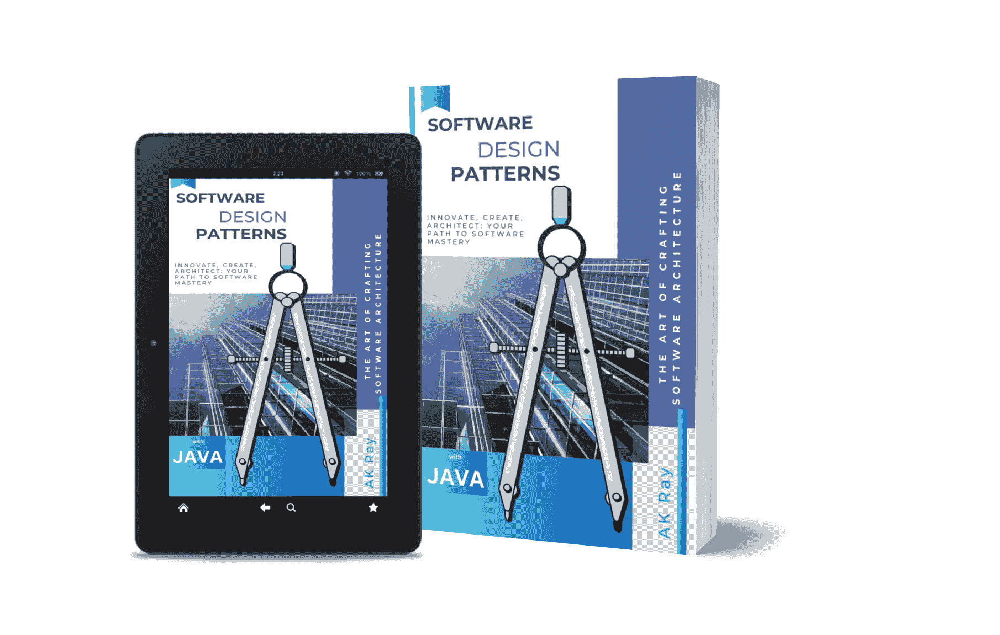
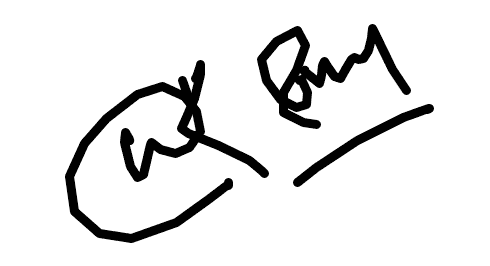
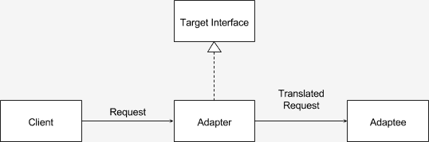
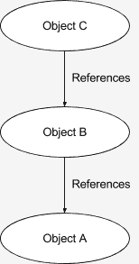
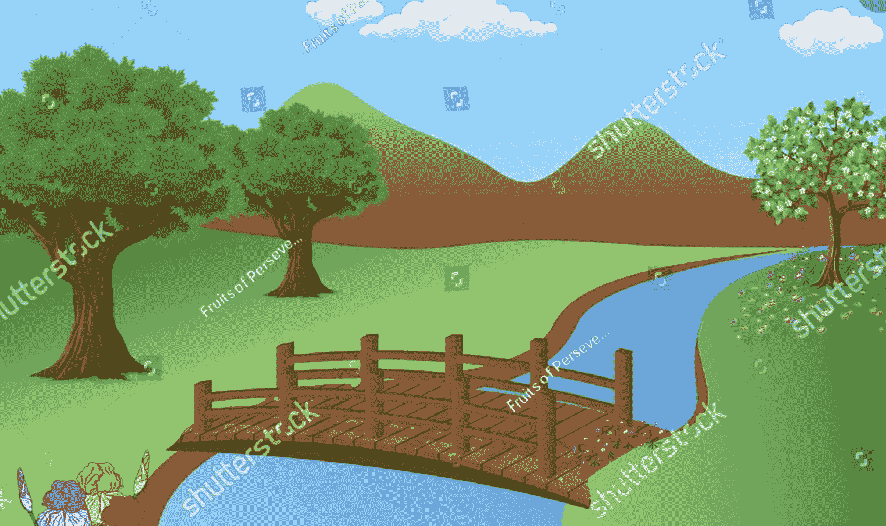
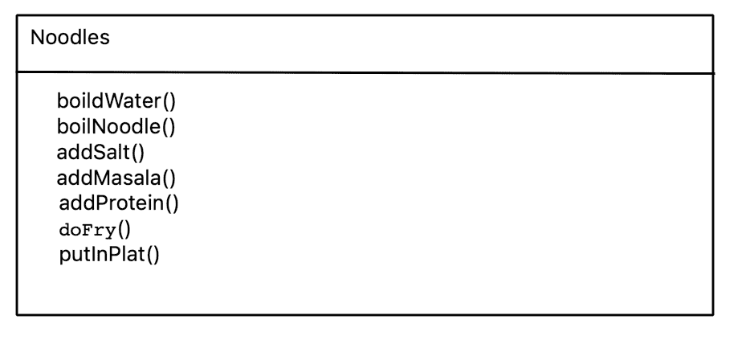
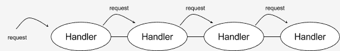
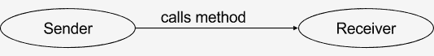
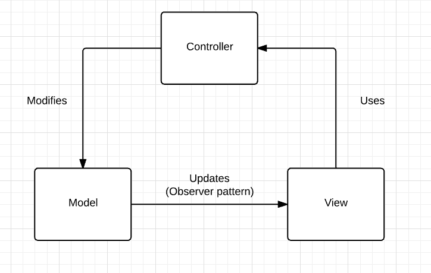

# Java 软件设计模式



## 版权

Copyright © 2023 by AK Ray

保留所有权利。

本电子书受版权法保护。未经版权所有者书面许可，不得以任何形式或通过任何手段（包括复印、录制或其他电子或机械方法）对本书的任何部分进行复制、分发或传输，但性评论中的简短引用以及版权法允许的某些其他非商业用途除外。

许可请求或咨询请联系：

电子邮箱：akr.technolab@gmail.com

Facebook：[`www.facebook.com/akr.technolab`](https://www.facebook.com/akr.technolab)

LinkedIn：[`www.linkedin.com/in/akr-technolab-074b5828b/`](https://www.linkedin.com/in/akr-technolab-074b5828b/)

**免责声明**：本电子书提供的信息仅供通用参考，不应被视为专业的、法律或财务建议。作者和出版商对因使用本书提供的信息而导致的任何损失或损害不承担任何责任或义务。

第一版

## 关于作者

AK Ray 是一位卓越的软件开发专业人士，拥有十多年的丰富经验。他的职业生涯在多家知名产品开发跨国公司的核心软件开发领域做出了重大贡献。AK Ray 精通多种技术，熟练掌握 `Java`、`Spring Boot`、`Microservices`、`Docker`、`Ethical Hacking` 和应用安全。

他对软件设计和架构的热情让他编写了一本关于软件设计模式的著名书籍，展示了在该领域的思想领导力。AK Ray 对卓越的追求通过他在声誉卓著阿尔塔大学获得的软件设计与架构认证得到了进一步证明。

AK Ray 丰富的经验加上全面的技能组合，使其成为软件工程和架构领域备受追捧的专家。他对创新和持续学习的投入不断推动着他的成功，使他成为行业的资产。

欢迎随时与我联系：

电子邮箱：akr.technolab@gmail.com

Facebook：[`www.facebook.com/akr.technolab`](https://www.facebook.com/akr.technolab)

LinkedIn：[`www.linkedin.com/in/akr-technolab-074b5828b`](https://www.linkedin.com/in/akr-technolab-074b5828b/)

衷心感谢你选择与我一起探索 `Java` 函数式编程的世界。你们的支持和热情激励着我分享知识，并为同仁开发者提供所需的工具，帮助他们在 `Java` 生态系统中脱颖而出。

愿未来的代码不仅功能强大，而且优雅美丽！

诚挚的问候，

## 

## 关于本书

在本书中，将开启对软件设计模式的全面探索。在书中，我仔细剖析了 `SOLID` 原则的复杂性，揭示了代码异味（code smells）和反模式的微妙之处，并对设计模式和面向对象的设计提供了深入的理解。

本书关注真实经验并强调简单性，为所有水平的开发人员提供指南，提供实用的见解和示例，以提升你的编程水平。

无论你是寻求精炼技能的资深开发者，还是渴望掌握基础知识的新手，每一章都为掌握构建健壮且可维护代码的艺术提供了清晰的路径。

沉浸在成功软件设计底层原则的之旅中，将它们直接应用于你的项目。通过实用的现实场景加深对设计概念的理解，成为一名练的软件解决方案架构师。本书是你开启有效软件设计秘密钥匙，让复杂的概念变得易于理解，并赋予你创建弹性且可扩展应用程序的能力。

加入我进入软件设计模式核心的启迪之旅，在这里，简单与专业交汇，创新成为中心。你精通软件设计模式的道路从这里开始。

### 1. OOAD 中的 SOLID 设计原则

#### 1.1 单一责任原则（SRP）

#### 1.2 开闭原则（OCP）

#### 1.3 里斯夫替换原则（LSP）

#### 1.4 接口隔离原则（ISP）

#### 1.5 缺少 ISP 导致的问题

#### 1.6 在 `Java` 中应用 ISP

#### 1.7 依赖倒置原则（DIP）

### 2. 反模式与代码异味

#### 2.1 反模式

#### 2.2 代码异味

#### 2.3 重复代码

#### 2.4 重复代码的迹象

#### 2.5 为什么重复代码是一种异味

#### 2.6 处理重复代码

#### 2.7 消除重复代码的益处

#### 2.8 大类

#### 2.9 大类的迹象

#### 2.10 如何修复

#### 2.11 长方法

#### 2.12 特征贪婪

#### 2.13 过度亲密

#### 2.14 原始类型痴迷

#### 2.15 散弹手术

#### 2.16 注释

#### 2.17 循环依赖

#### 2.18 完美猴子

#### 2.19 复制粘贴

### 3. 设计模式

#### 3.1 创建型模式

#### 3.2 单例模式

#### 3.3 工厂方法模式

#### 3.4 结构型模式

#### 3.5 适配器模式

#### 3.6 门面模式

#### 3.7 组合模式

#### 3.8 装饰器模式

#### 3.9 桥接模式

#### 3.10 重量类模式

#### 3.11 代理模式

#### 3.12 行为型模式

#### 3.13 模板方法模式

#### 3.14 责任链模式

#### 3.15 状态模式

#### 3.16 命令模式

#### 3.17 观察者模式

#### 3.18 访问者模式

### 4. 面向对象设计

#### 4.1 什么是需求

#### 4.2 概念设计

#### 4.3 技术设计

#### 4.4 需求与设计的折中

#### 4.5 面向属性的设计

#### 4.6 权衡

#### 4.7 CRC 卡

#### 4.8 OOAD 中的对象建模

#### 4.9 设计中的创建模型

#### 4.10 设计原则

#### 4.11 抽象

#### 4.12 封装

#### 4.13 分解

#### 4.14 泛化

#### 4.15 设计原则

#### 4.16 耦合

#### 4.17 高内聚：

#### 4.18 关注点分离

#### 4.19 信息隐藏

#### 4.20 概念完整性

#### 4.21 泛化原则

#### 4.22 模型检查

#### 4.23 模型检查的阶段

`SOLID` 原则是五项设计原则，有助于软件开发人员创建更具维护性、灵活性且健壮的面向对象软件。每个原则都针对软件设计的特定方面，当结合使用时，能够促进良好的软件设计实践。

## SOLID 原则高层概述

- 单一责任原则（SRP）
- 开闭封闭原则（OCP）
- 里氏夫替换原则（LSP）
- 接口隔离原则（ISP）
- 依赖倒转原则（DIP）

## 单一责任原则（SRP）

- **核心思想**：一个类应该只负责一个职责或责任。
- **示例**：想一下一个遥控器。它有一个单一职责：向设备发送命令。如果你添加了更多职责，比如处理电源、音量和频道，它就会变得不再那么专注。
- **示例**：如果你有一个处理用户身份验证的类，它不应该同时也负责发送电子邮件。每个类都应该专注于做好一件事。

### 面向对象分析设计（OOAD）中单一责任原则的关键点

- **单一变化原因**：每个类应该只有一个职责或一个变化的原因。如果一个类有多个变化的原因，它就会变得更容易出错且更难维护。
- **内聚性**：该原则鼓励类内部的高内聚性，这意味着类应该包含紧密相关并共同工作以实现单一职责的成员（方法和属性）。
- **关注点分离**：它有助于将软件系统的不同关注点或方面分离到不同的类中。这种分离使得系统更模块化，并且更容易理解、修改和维护。
- **可重用性**：遵循 SRP 的类通常具有更高的重用性，因为它们专注于单一职责，并可以在各种场景下使用。

### 说明单一责任原则的示例

假设你正在设计一个银行软件系统。你可能会有一个 `BankAccount`（银行账户）类。根据 SRP，这个类应该只有一个职责，即管理银行账户余额。

```java
public class BankAccount {
    public double getAccountBalance(){
        // 添加你的代码来获取银行账户
        return Math.random();
    }
    public void createBankAccount(){
        // 创建银行账户的逻辑
    }
    public boolean validateUser(UserData request){
        // 验证用户
        return Boolean.TRUE;
    }
    public void sendEmail(String emailId){
        // 向用户发送邮件
    }
}
```

它不应该负责处理用户身份验证、发送电子邮件或其他无关的任务。

因此，用户身份验证和电子邮件发送应该由具有各自单一职责的独立类来处理。这种分离允许更容易的维护、测试和未来的更改，而不会影响系统的其他部分。

总之，OOAD 中的单一责任原则提倡：每个类都应该有一个清晰、单一且定义良好的职责，这有助于构建更具维护性和更健壮的软件系统。

```java
public class EmployeeData {
    private int id;
    private String name;
    private double salary;
    public EmployeeData(int id, String name, double salary) {
        this.id = id;
        this.name = name;
        this.salary = salary;
    }
    // 访问和修改员工数据的方法
    public int getId() { return id; }
    public String getName() { return name; }
    public double getSalary() { return salary; }
    // 将员工保存到数据库的方法
    public void saveToDatabase() {
        // 将员工数据保存到数据库的代码
    }
}
```

### 在此设计中，`Employee` 类有两个职责

1. 管理员工数据（存储和检索员工属性）。
2. 将员工数据保存到数据库。

### 改进后的设计（遵循 SRP）

为了遵循单一责任原则，我们将职责分离到不同的类中。我们创建了一个 `EmployeeData` 类来管理员工数据，并 de `EmployeeRepository` 类来处理数据库操作。

```java
public class EmployeeData {
    private int id;
    private String name;
    private double salary;
    public EmployeeData(int id, String name, double salary) {
        this.id = id;
        this.name = name;
        this.salary = salary;
    }
    // 访问和修改员工数据的方法
    public int getId() { return id; }
    public String getName() { return name; }
    public double getSalary() { return salary; }
}
```

```java
public class EmployeeRepository {
    public void saveToDatabase(Employee employee) {
        // 将员工数据保存到数据库的代码
    }
}
```

### 如上所示

1. `EmployeeData` 类负责管理员工数据（与员工信息相关的属性和方法）。
2. `EmployeeRepository` 类负责从数据库中保存和检索员工数据。

通过将这些职责分离到不同的类中，我们遵循了单一责任原则。这种设计提高了代码的可维护性和灵活性，因为员工数据持久化方式的更改（例如，从数据库切换到文件系统）不会影响 `Employee` 类中核心员工数据管理逻辑。

在任何实时应用中，你都需要以某种方式设计代码，并在某种程度上使用 SOLID 原则使其更具灵活性、可读性和健壮性。

## 总结

1. 每当你创建任何类时，确保该类具有单一职责。
2. 你可以根据类别、类型、性质以及其他适用参数将需求拆分到不同的类中。
3. 类的名称应该体现其功能。

## 开闭封闭原则（OCP）

- **核心思想**：软件实体（类、模块、函数）应该应对扩展开放，但对修改关闭。
- **示例**：不要修改现有代码，而应该通过扩展来添加新功能。这就像在蛋糕上添加新的层。
- **示例**：想象一个形状绘图应用程序。你可以在不修改现有形状的情况下添加新形状。

开闭原则规定，类应该应对扩展开放，但对修改关闭。

当一个类满足以下条件时，被认为是“关闭”的：

- 经过测试且运行正常。
- 所有属性已封装。
- 已被证明是稳定的。

假设你有一个用于计算不同形状面积的系统，你想要扩展它以支持新形状，而无需修改现有代码。你可以这样实现：

```java
// Shape class (基类)
public abstract class Shape {
    public abstract double calculateArea();
}

// Rectangle class (继承 Shape)
public class Rectangle extends Shape {
    private double width;
    private double height;
    public Rectangle(double width, double height) {
        this.width = width;
        this.height = height;
    }
    @Override
    public double calculateArea() {
        return width * height;
    }
}

// Circle class (继承 Shape)
public class Circle extends Shape {
    private double radius;
    public Circle(double radius) {
        this.radius = radius;
    }
    @Override
    public double calculateArea() {
        return Math.PI * radius * radius;
    }
}

// AreaCalculator class
public class AreaCalculator {
    public double calculateArea(Shape shape) {
        return shape.calculateArea();
    }
}
```

现在，假设你想添加一种新的形状——三角形（Triangle），而无需修改现有代码。根据开闭原则（Open-Closed Principle），你应该能够在扩展系统而不更改现有的类。

```java
// Triangle class (继承 Shape)
public class Triangle extends Shape {
    private double base;
    private double height;
    public Triangle(double base, double height) {
        this.base = base;
        this.height = height;
    }
    @Override
    public double calculateArea() {
        return 0.5 * base * height;
    }
}

// 更新后的 AreaCalculator class (无需修改)
public class AreaCalculator {
    public double calculateArea(Shape shape) {
        return shape.calculateArea();
    }
}
```

## 思考与应用

1. 每当你创建任何新类时，都必须考虑可重用性和关注点分离。
2. 检查最常见的特征并将其保留在父类中，你可以为特定需求创建单独的类。

## 里基夫替换原则（LSP）

**核心思想**：子类型必须能够替换其基类型。

子类型必须在不改变程序正确性的情况下能够替换其基类型。

**示例**：如果你有一个表示形状的基类，任何子类（如特定类型的形状）都应该替换基类而不会引起问题。

**示例**：在一个动物园程序中，如果你有一个基类“鸟（Bird）”，你应该能够用任何特定的鸟类（如“企鹅”或“鹰”）来替换它，而不会破坏程序。

## 解析

它是面向对象编程和软件设计的 SOLID 原则之一。它由 Barbara Liskov 在 1987 年提出，强调了继承和多态在面向对象系统中的重要性。

### LSP 规定

“子类型必须能够替换其基类型。”

简单来说，`LSP` 意味着派生类的对象能够替换基类的对象而不影响程序的正确性。

换句话说，如果一个类被设计为另一个类（基类或父类）的子类型（派生类或子类），它应该符合基类的契约或行为，以便可以交替使用。

### LSP 背后的核心思想包括：


- **行为兼容性**：子类型不应改变或违反基类型的行为预期。这意味着它们应该至少提供与基类型相同的接口，且它们的方法应该遵循相同的预期。
- **继承是“is-a”的关系**：当你创建一个子类型时，它应该真正代表与基类型的“是一个……”的关系。换句话说，派生类应该是基类的一个更专门的版本。
- **多态**：`LSP` 实现了多态，允许不同类的对象通过它们的共同基类型进行统一处理。这简化了代码并提高了灵活性和重用性。
- **健壮性**：遵循 `LSP` 有助于软件的健壮性，因为它确保了在替代基类使用时，派生类不会引入意想不到的行为或错误。

未能遵守里基夫替换原则会导致程序行为错误，使软件更容易出错且更难维护。在实践中，仔细设计和实现继承层次结构至关重要，以确保满足 `LSP`，并使派生类成为基类的真正替代品，从而在使用多态时提供一致且可预测的体验。

### 示例

你有一个名为 `Shape` 的基类，表示各种几何形状。它有一个方法 `calculateArea()` 用于计算形状的面积。

```java
public class Shape {
    public double calculateArea() {
        return 0;
    }
}
```

现在，你创建了两个派生类 `Rectangle` 和 `Circle`，它们是专门的形状。这些派生类应该遵守里基夫替换原则，这意味着它们应该替换基类，并提供它们自己的 `calculateArea()` 实现，而不违反基类的契约。

以下是实现 `Rectangle` 和 `Circle` 类的方法：

```java
public class Rectangle extends Shape {
    private double width;
    private double height;
    public Rectangle(double width, double height) {
        this.width = width;
        this.height = height;
    }
    @Override
    public double calculateArea() {
        return width * height;
    }
}

public class Circle extends Shape {
    private double radius;
    public Circle(double radius) {
        this.radius = radius;
    }
    @Override
    public double calculateArea() {
        return Math.PI * radius * radius;
    }
}
```

- `Rectangle` 和 `Circle` 类继承自 `Shape`，表示它们是专门的形状。
- 这些派生类应该遵守里基夫替换原则，这意味着它们可以替换基类，并提供它们自己的 `calculateArea()` 实现，而不违反基类的契约。
- 它们符合 `LSP`，因为它们可以与基类交替使用，而不会引起问题或违背预期的行为。例如，你可以创建一个形状数组，并在不确定具体子类的情况下计算每个形状的面积。

```java
Shape[] shapes = new Shape[] {new Rectangle(5, 10), new Circle(3)};
for (Shape shape : shapes) {
    System.out.println("Area: " + shape.calculateArea());
}
```

此示例展示了 `LSP` 如何允许创建与基类共同使用的子类，从而实现多态并使代码更加灵活健壮。

## 接口隔离原则（ISP）

**核心思想**：类不应该被强制实现它没有使用的接口。

**示例**：如果一个接口包含多个方法，而一个类只需要其中几个，它就不应该义务实现那些不需要的方法。

考虑一个为通用机器设计的接口。

该接口包含了 `start()`、`stop()` 和 `performMaintenance()` 等方法。

然而，并不是所有机器都需要维护。你为基础机器创建了一个类，它不需要执行维护。

```java
interface Machine {
    void start();
    void stop();
    void performMaintenance();
}

class BasicMachine implements Machine {
    public void start() {
        // Implementation for starting the machine
    }
    public void stop() {
        // Implementation for stopping the machine
    }
    public void performMaintenance() {
        // This method is not needed for BasicMachine, but it's required to implement the Machine interface
        // The implementation is empty.
    }
}
```

在这个示例中，`BasicMachine` 类被强制实现 `performMaintenance()` 方法，尽管它并不需要它。这违反了接口隔离原则（`ISP`），因为该类被强制依赖于它没有使用的方法。

## 在 Java 中应用 ISP

为了遵循接口隔离原则，你应该设计针对其实现类的特定性的接口。在这种情况下，你可以为需要维护的机器创建一个单独接口：

```java
interface Startable {
    void start();
    void stop();
}

interface Maintainable {
    void performMaintenance();
}

class BasicMachine implements Startable {
    public void start() {
        // Implementation for starting the machine
    }
    public void stop() {
        // Implementation for stopping the machine
    }
}

class MaintenanceMachine implements Startable, Maintainable {
    public void start() {
        // Implementation for starting the machine
    }
    public void stop() {
        // Implementation for stopping the machine
    }
    public void performMaintenance() {
        // Implementation for performing maintenance
    }
}
```

## 在此修改后的设计中

- `Startable` 接口包含了与启动和停止机器的方法。
- `Maintainable` 接口包含 `performMaintenance()` 方法，该方法只与需要维护的机器相关。

`BasicMachine` 类实现了 `Startable` 接口，因为它只需要启动和停止，而 `MaintenanceMachine` 类同时实现了 `Startable` 和 `Maintainable` 接口，因为它都需要这两项功能。

通过应用 `ISP`，你确保每个类或接口都有特定的、定义良好的目的，并且客户端仅会被强制依赖它们需要的内容。这促进了更整洁、更易维护的代码，并减少了不必要的依赖和空方法实现的风险。

---

或者你可以将方法设为默认方法，这样客户端就**强制不需要**提供实现。

如果你正在使用 `java 9+`，则可以使用接口中的默认方法。

```java
public interface Machine {
    void start();
    void stop();
    default void performMaintenance() {
        //default implementation
    }
}
```

`BasicMachine` 的实现中你不需要实现 `performMaintenance()` 方法，因为它对你来说不是强制要求的。

```java
public class BasicMachine implements Machine {
    @Override
    public void start() {
        //provide implementation to start
    }
    @Override
    public void stop() {
        //provide implementation to stop
    }
}
```

添加一个新类 `AdvancedMachine`，其中你需要实现 `performMaintenance()` 方法。

```java
public class AdvancedMachine implements Machine {
    @Override
    public void start() {}
    @Override
    public void stop() {}
    @Override
    public void performMaintenance() {
        //Machine.super.performMaintenance();
        //Add your implementation
    }
}
```

## 依赖倒置原则（DIP）

**想法**：高层模块不应该依赖低层模块，而应该都依赖抽象。

**示例**：高层模块不应该依赖低层模块，而应该都依赖抽象。

考虑一个灯泡。高层模块不应该依赖低层模块，而应该都依赖抽象。这种方式，你可以独立地对其进行更改而不产生相互影响。

依赖倒置原则（`DIP`）是面向对象设计原则之一。它强调高层模块不应该依赖低层模块，相反，应该都依赖抽象。

**示例**：

```java
// 低层模块
class EmailService {
    void send(String message) {
        // send email
        System.out.println("Sending email: " + message);
    }
}

// 高层模块直接依赖低层模块
class NotificationService {
    private EmailService emailService = new EmailService();
    void notify(String message) {
        emailService.send(message);
    }
}

// 客户端
public class Client {
    public static void main(String[] args) {
        NotificationService service = new NotificationService();
        service.notify("Hello DIP!");
    }
}
```

在上面的示例中，`NotificationService` 直接依赖于 `EmailService`。为了遵循依赖倒置原则，让我们对其进行重构：

```java
// 抽象
interface Notification {
    void send(String message);
}

// 低层模块实现抽象
class EmailService implements Notification {
    @Override
    public void send(String message) {
        // send email
        System.out.println("Sending email: " + message);
    }
}

// 高层模块依赖抽象
class NotificationService {
    private Notification notification;
    public NotificationService(Notification notification) {
        this.notification = notification;
    }
    void notify(String message) {
        notification.send(message);
    }
}

// 客户端
public class Client {
    public static void main(String[] args) {
        Notification emailService = new EmailService();
        NotificationService service = new NotificationService(emailService);
        service.notify("Hello DIP!");
    }
}
```

为了更好地理解依赖倒转原则，让我们来看一下低级依赖。在低级依赖中，客户端类直接命名并引用具体类。子系统之间直接依赖，因此客户端类将直接引用企业子系统中的某些具体类，而这些具体类又会直接你后端中的某些具体类。


让我们通过代码来分析这个问题。


这里存在低级依赖。它对具体类 `QuickSorting` 有直接的命名和引用，该类在示例中用于排序用户发送到系统的列表。然而，如果实现另一个名为 `MergeSort` 的排序类，则需要对 `ClientSubsystem` 类进行重大更改。排序类的类型必须更改，排序方法的调用也必须之更改。这意味着每当需要更改排序算法时，都需要花费大量工作。

以下是更详细理解依赖倒转原则（`DIP`）的一些关键点：

### 高层模块 vs. 低级模块

- 高层模块是提供应用程序整体结构和逻辑的组件或类。它们代表了核心功能。
- 低级模块是支持高层模块的细节、工具或组件。它们通常与硬件、数据库或其他外部资源交互。

### 依赖于抽象

- `DIP` 建议高层模块应该依赖于抽象（抽象类或接口），而不是依赖于具体实现（低级模块）。这意味着高层模块不应直接引用特定的低级模块。
- 抽象定义了一个合约，高层模块可以依赖此合约，而不必担心实现细节。

### 实例化反转（IoC）

- `IoC` 是实现 `DIP` 的常用技术。它涉及反转程序流的控制。不是由高层模块控制低级模块，而是由更高层的组件控制整体流程，包括与低级模块的交互。

### DIP 的优势

- **松耦合**：`DIP` 减少了组件之间的直接依赖，使系统更加灵活且更容易更改。如果低级模块需要替换或更新，不会影响高层模块。
- **可测试性**：`DIP` 使得单元测试变得更容易，因为你可以在测试期间用模拟对象（mock objects）或存根（stubs）替换低级组件。
- **可用性**：通过依赖抽象，你促进了高层模块在不同上下文中的重用，因为它们没有与特定的低级实现紧耦合。

### DIP 的实现示例

- `Java` 中的实例化反转容器（例如 `Spring` 或 `Guice`）通过管理对象的实例化和配置来实现 `DIP`。
- 像工厂方法（Factory Method）和依赖注入（Dependency Injection）等设计模式常用于遵循依赖倒转原则。

在实践中，依赖倒转原则鼓励创建清洁且模块化的软件，低级组件的更改对整个系统的影响降至最低。它培养了更具适应性和可维护的代码库，使其成为现代软件工程和设计中本质性的原则。

## 反模式与代码气味

在面向对象分析与设计（OOAD）中，“反模式”和“代码气味”指的是可能导致软件解决方案不良的常见设计问题和编码实践。它们是设计或代码可能需要改进的信号。让我们探索每个概念：

### 反模式

反模式是解决常见问题的重复方案，但这些方案是无效且适得其反的。它们代表了某些看似直观的设计方法，但在应用时会导致糟糕或产生问题的结果。

**示例**：反模式的一个例子是“上帝对象”（God Object），即单个类知道得太多或做得太多。这违反了单责任原则（`SRP`）并降低了系统的维护性。

### 代码气味

代码气味是源代码中的特定指标，表明设计或实现可能存在问题。它们不一定是 Bug，而是可能通过重构来获得更好的可维护性、可读性或效率的区域。

**示例**：一种常见的代码气味是“长方法”（Long Method），即一个方法过长且执行了多个任务。这会使代码更难以理解和维护。

反模式和代码气味都可以通过重构来解决，重构涉及在不改变代码外部行为的情况下重组代码。在开发过程早期识别并解决这些问题，有助于构建更具可维护和可扩展性的软件系统。

### 区别

- **规模**：代码气味通常是代码中微小的、局部的问题，而反模式是影响整个系统的较大设计或架构问题。
- **检测**：代码气味通常可以通过自动化代码分析工具检测，而识别反模式可能需要对整个系统设计有更全面的理解。
- **影响**：代码气味可能会影响单个方法或类，使其更难维护。反之，反模式对整个系统产生更深远的影响，导致可扩展性或可维护性差等问题。
- **解决**：解决代码气味通常涉及重构代码特定部分。处理反模式可能需要一种全局方法，可能涉及整个系统架构的更改。


总结来说，虽然代码气味和反模式都突出了软件开发中的潜在问题，但代码气味的规模较小且更局部，关注特定的编码实践；而反模式解决的是对软件产生系统性影响的更大规模的设计和架构问题。

## 概述

重构是在不改变行为的情况下改进代码结构的过程。它涉及做出微小的、渐进的更改并频繁进行测试，以确保代码仍然运行。理想情况下，重构是在添加新功能时进行的，使其变得更加简单和高效。

由于糟糕的代码模式（即反模式或代码气味），代码更改往往是不可避免的。Martin Fowler 的著作《重构》一书中识别了这些问题并提供了改进它们的方法。代码气味就像是识别问题代码的“嗅探”。

糟糕代码的一种常见示例是注释过多或不足。如果没有注释，以后很难理解代码的意图。然而，过多的注释可能会过时并掩盖底层问题。作为提醒或解释本应更新代码的注释指示了潜在问题。

注释也可能揭示语言选择的问题。在过去，在泛型引入之前，开发者在 `Java` 中使用注释解释类型转换。虽然注释对于记录 API 或解释设计选择非常有价值，但过度使用可能暗示存在底层问题。

总结来说，重构在维护外部行为的同时管理代码更改。代码气味（如注释过多）指示了改进的区域。在注释上取得平衡并处理代码气味可以提高代码质量。

## 代码重复

重复代码发生在软件的不同部分存在相似的代码块。如果你需要进行更改，必须在多个地方进行更新，这很棘手。这就像在不同的菜谱中写了同一个食谱——如果你更改了食谱，你需要更新每一份副本。

遵循“不要重复自己”（D.R.Y.）原则会有帮助。它建议以一种方式编写代码，让你能够用更少的代码完成相同的任务。这使得更新变得更容易，并减少了遗漏某处的概率。

另一个问题是“长方法”（Long Method）反模式，即代码方法太长了。长方法会让你的代码更难理解。虽然某些任务自然地需要更多代码，但过长的方法可能意味着包含的内容太多。不过，上下文也很重要——有时，在某些编程语言中，较长的方法是可以接受的。

简而言之，避免重复代码并保持方法的合理长度，可以让你的代码更容易维护和理解。

代码重复（Duplicate Code）是一种常见的“代码异味”，表明代码的设计或结构可能存在问题。当相同或非常相似的代码块出现在软件的不同部分时，就会发生。这就像在食谱的不同章节中重复同一个食。

### 代码重复的迹象

- **相同或相似的块**：寻找执行相同或非常相似任务的代码段。
- **复制粘贴**：如果你发现代码似乎被复制并粘贴到了不同的地方。

### 为什么重复代码是一种异味

- **维护挑战**：如果你需要进行更改，你可能必须在多个位置更新相同的代码，这可能会出错且耗时。
- **一致性问题**：它增加了不一致的风险。如果你忘记更新其中一个实例，可能会导致错误或意外的行为。
- **可读性和理解性**：代码重复会使代码库更难阅读和理解，因为开发者可能需要导航通过多个位置来理解逻辑。

### 处理重复代码

- **重构**：识别重复代码并通过创建一个可以重用的共享函数、方法或类来对其进行重构。
- **抽象**：寻找机会将公共功能抽象到单一的、中心位置。
- **代码审查**：定期的代码审查可以帮助在开发过程早期发现代码重复的情况。

### 示例

考虑一种场景：相同的输入验证逻辑出现在你代码的多个部分。与其重复验证代码，不如创建一个单独的函数或方法来处理输入验证，使其更具模块化且易于维护。

### 消除重复代码的益处

- **更容易维护**：可以在一处进行更改，减少遗漏其他位置更新的风险。
- **提高可读性**：代码变得更加简洁易读，没有了不冗余。
- **一致的行为**：确保相同的逻辑在整个软件中一致应用。

通过处理重复代码，你为更清洁、更易维护的代码库做出贡献，让开发者更容易理解、修改和增强软件。

### 示例

```java
// 带有重复代码的类 A
public class ClassA {
    public int calculateSquare(int number) {
        return number * number;
    }
    // ... 其他方法和代码
}

// 带有重复代码的类 B
public class ClassB {
    public int calculateSquare(int number) {
        return number * number;
    }
    // ... 其他方法和代码
}
```

在这个示例中，`ClassA` 和 `ClassB` 都有一个名为 `calculateSquare` 的方法，执行相同的任务——计算给定数字的平方。这是一个明显的代码重复案例。

为了解决这种代码异味，你可以通过创建一个共享的工具类或方法来重构代码：

```java
// 具有计算平方方法的共享工具类
public class MathUtils {
    public static int calculateSquare(int number) {
        return number * number;
    }
}

// 使用共享工具方法的类 A
public class ClassA {
    public int calculateSquare(int number) {
        return MathUtils.calculateSquare(number);
    }
    // ... 其他方法和代码
}

// 使用共享工具方法的类 B
public class ClassB {
    public int calculateSquare(int number) {
        return MathUtils.calculateSquare(number);
    }
    // ... 其他方法和代码
}
```

现在，计算平方的通用逻辑被移动到 `MathUtils` 类中，`ClassA` 和 `ClassB` 都使用这个共享方法。这消除了重复代码异味，使代码更具维护性，并减少了如果逻辑需要更改时不一致的风险。

## 大类（Large Class）

“大类”代码异味就像是一个试图做所有事的超级忙的人。在编码中，当一个类变得太大并试图处理太多的任务时，就会发生。

这是一个问题，因为它会让代码难以理解和维护。

大类通常被称为“上帝类”（God classes）、“肿块类”（Blob classes）或“黑洞类”（Black Hole classes）。

这些类开始时是正常的，但因为不断添加越来越多的职责，它们一直在不断增长。人们认为在这些类中放入新任务是没问题的，但随着时间的推移，它们变得越来越大并承担了太多。

当一个类变得很大时，需要大量的注释来解释代码中不同内容的位置。但注释过多也是糟糕代码的迹象。及早发现这个问题很重要，因为以后修复它可能会困难并花费大量时间。

良好的类应该有一个明确的目的，这意味着它们应该专注于很好地做好一件事。如果某些工作不符合类的主要目的，通常最好将该任务放在其他地方。

这有助于保持类的整洁和易于理解。

### 大类代码异味的迹象

- **任务过多**：该类做了太多事情，比如处理数据、与数据库通信和发送电子邮件。
- **内容过多**：该类有大量的方法和字段，使其看起来像一团乱麻。
- **困惑**：很难看出这个类到底应该做什么。

### 如何修复

- **单一职责原则**：确保每个类只做一件主事，例如处理数据或发送电子邮件。
- **整理**：将方法和字段组织成逻辑上相关的较小分组。
- **协作**：让较小的类协同工作。

### 示例

想象有一个名为 `BigWorker` 的类，它处理一切——管理数据、与数据库通信、发送电子邮件等。为了修复它，我们创建了较小的类，如 `DataManager`、`DatabaseHandler` 和 `EmailSender`。每个类都有特定的职责。

```java
// 处理多个职责的大类
public class LargeClassDemo {
    private String customerName;
    private int customerAge;
    private String customerAddress;
    private String phoneNumber;

    // 构造函数、getter 和 setter
    public void displayCustomerInfo() {
        // 显示客户信息的代码
    }
    public void saveCustomerToDatabase() {
        // 将客户信息保存到数据库的代码
    }
    public void sendEmailNotification() {
        // 向客户发送电子邮件的代码
    }
    public void processOrder() {
        // 处理客户订单的代码
    }
    // ... 其他方法和代码
}
```

在这个示例中，`LargeClassDemo` 负责管理客户信息、保存数据库、发送电子邮件通知和处理订单。它有多个职责，使其成为“大类”代码异味的候选者。

- **委托**：将特定任务委托给合适的类。
- **协作**：鼓励较小类之间的协作。

通过解决“大类”代码味道，你创建了一个更具模块化且易于维护的代码库，其中每个类都有清晰且专注的职责。

## 长方法（Long Method）

- **症状**：方法过长，导致难以理解。
- **影响**：可读性降低，维护和测试难度增加。
- **示例修复**：将该方法拆分为更小、更易管理的方法。

## 特征热妒（Feature Envy）

特征热妒是一种代码气味，当一个方法对它所属类的兴趣不如对另一个类的细节感兴趣时就会发生。如果两个方法或类总是相互通信，并且看起来它们应该在一起，那么很有可能这种事实确实如此。

- **症状**：一个类过度使用另一个类的方法或字段。
- **影响**：紧耦合、封装性降低、存在高依赖的风险。
- **示例修复**：将相关方法或字段移动到需要它们的类中。

## 不恰当的亲密（Inappropriate Intimacy）

- **症状**：类之间耦合过紧，经常访问彼此的内部实现。
- **影响**：灵活性降低，复杂性增加，维护面临挑战。
- **示例修复**：封装相关功能并减少直接依赖。

不恰当的亲密就像是一种代码问题，当两个类过于接近，频繁互动时。

想象两个一直在聊天并不断向对方寻求帮助的朋友。代码中，这就是两个类之间过度依赖，例如一个类调用另一个类的方法，反之亦然。

### 如何修复

让通信更具组织性是一个好主意。与其让两个类在循环中互相通信，我们可以在中间创建一个类。这样，通信就变得更加单向，就像通过朋友传递信息一样。这有助于保持简单且易于理解。

有时候，类之间的来回通信是必要的，就像朋友需要聊天。但如果我们能让设计变得更简单更容易理解，那就是很好的解决方案。这就像为朋友找到一种更好的沟通方式，而不会过于纠缠。

## 基本类型痴迷（Primitive Obsession）

- **症状**：过度使用原始类型，而不是创建自定义对象。
- **影响**：代码可读性降低，可能出现与数据处理相关的错误。
- **示例修复**：创建类来表示特定领域的概念，而不是仅仅依赖原始类型。

基本类型痴迷是一种代码问题，发生在你在代码中过度使用基本类型（如 `ints`、`strings`）时。虽然这些类型是必要的，但它们应该主要用在代码的底层。当你频繁使用它们时，意味着你可能错过了为代码创建更好、更具体的类的机会。

想象系统中的一切都只存储为简单的字符串或数组。在 20 世纪 60 年代，代码就是这样的。但随着语言的演进，我们学会了创建自己的类型以更好地组织。如果一切都存储为字符串，它可能会隐藏重要的细节，并且很难看到系统的整体设计。在高层使用过基本类型表明你可能错过了在系统中创建更好、更专门类的机会。

`switch` 语句是另一个问题。它们就像散落在代码中的路标，如果你更改了一个，就必须找到并更新所有的。虽然有时需要长的 `if/else` 语句，但过多的 `switch` 语句是事情可以处理更好的标志。例如，如果你发现自己自己在条件中检查类型代码或类型，可能有更好的方法使用多态来组织代码，这是一种允许你更高效地处理不同类型的技术。

## 散弹枪手术（Shotgun Surgery）

- **症状**：单处更改需要修改多处位置。
- **影响**：错误风险增加，维护面临挑战。
- **示例修复**：将相关功能整合到单一位置，以避免分散的更改。

这是一种代码气味，当对某项需求进行更改时，需要触动设计中各个处的众多类来完成这一个更改时。在良好的设计中，微小的更改理想情况下应该局部在一个或两个地方（尽管这并不总是可能的）。

这是一个常见的代码气味。它可以发生在尝试添加功能、调整代码、修复错误或更改算法时。如果需要在代码各个处进行更改，那么遗漏更改或在其他地方产生问题的概率就会增加。

然而，模块化代码并非总是选项。某些更改无论代码设计得多么好都需要散弹枪手术。例如，更改版权声明或许可将更改系统中的每个文件以更新版权文本块。

散弹枪手术气味通常通过移动方法来解决。如果一个更改需要你对不同类中的许多方法进行更改，那么这表明这些方法可能合并到一个两个类中更好。但是，你必须小心不要将太多的方法移动到一个类中，否则它会变成“大类”代码气味。

如果一处的更改导致了其他处的更改，这表明这些方法以某种方式相关。也许有更好的组织它们的方法。如果没有，你可能只能就其现状处理。

## 注释滥用（Comments Abuse）

- **症状**：过度或具有误导性的注释，通常用于掩盖糟糕的代码。
- **影响**：维护面临挑战、注释过时、可能被误读的风险。
- **示例修复**：提高代码清晰度，移除不必要的注释，并谨慎使用注释保持清晰。

## 懒惰类（Lazy Class）

- **症状**：不做什么且对系统影响极微的类。
- **影响**：代码膨胀、清晰度降低、不必要的复杂性。
- **示例修复**：要么删除该类，要么将其功能与其他类合并。

## 循环依赖（Cyclic Dependencies）

- **症状**：类以循环的方式相互依赖。
- **影响**：模块化降低，理解和维护代码面临挑战。
- **示例修复**：重新组织类或使用依赖注入打破循环依赖。

## 岩浆（Lava Flow）

岩浆反模式发生在过时或未使用的代码被保留在系统中，因为开发者不确定其影响而不敢删除它们。这会导致代码库充满了不必要且混乱的产物。

## 金锤（Golden Hammer）

这种反模式涉及对每个问题都使用特定的技术、工具或设计模式，无论它们是否是最合适的解决方案。这可能导致设计过度复杂并错过探索更合适替代方案的机会。

## 复制粘贴编程（Copy and Paste Programming）

这种反模式涉及复制代码而不是创建可重用的抽象。这会导致维护问题，因为每当需要修改时，必须在多处进行更改。

## 需要记住的点

| 需要记住的点 |
| --- |
| 1. 在编写代码时，确保你的代码不包含上述任何代码气味或反模式。<br>2. 你可以在本地系统中使用工具进行代码检查。<br>3. 你可以使用 SonarQube 和其他适用工具进行覆盖率和代码气味检查。 |

## 设计模式（Design Pattern）

设计模式是常见软件设计问题的标准解决方案。它们为解决开发中反复出现的问题提供了一种结构化且经过证明的方法。

将设计模式想象成烹饪中的食谱。就像你做饭时，人们已经尝试并验证了某些方法来创造美味的佳肴。随着时间的推移，他们发现了让食物味道变得极佳的最佳步骤。同样，在编码中，设计模式就像这些被证明是有效的常用办事方法。它们就像是创建可靠且高效软件的备选食谱，因为许多开发者已经对它们进行了实验并成功地使用。


想象一下制作比尔姜饭（Biryani）。你可能知道需要哪些食材，或者你可以在网上找到食谱。但如果你让 10 个人来做，每份比尔姜饭的味道可能都略有不同。这是因为烹饪的方式非常重要。专家厨师知道如何处理食材以获得最佳口感。在软件设计中情况也是如此。我们知道如何编写代码，但为了让代码具有灵活性、可重用、易维护、健壮且简单，我们使用了设计模式。这就像拥有一套用于编码的专家烹饪技巧！

## 设计模式的类型

### 1. 创建型模式

### 2. 结构型模式

### 3. 行为模式

这些分类帮助开发人员根据他们试图解决的特定问题选择正确的设计模式。创建型模式关注对象的创建，结构型模式关注对象的组合，而行为模式关注对象的协作与通信。

通过结合这些模式，开发人员可以在 `Java` 中创建更具维护性、模块化且可扩展的软件解决方案。

## 创建型模式

创建型模式解决如何处理创建或克隆新对象的问题。当你创建一个与现有对象相似的对象时，就会发生对象克隆，与其实例化新对象，不如克隆现有对象而不是实例化。

这些模式关注对象的创建过程。它们提供了一种机制，能够以一种灵活、高效且独立于系统架构的方式创建对象。

示例：单例模式、工厂方法、抽象工厂、构建器和原型模式。

### 单例设计模式

单例模式是一种创建型设计模式，确保一个类只有一个实例，并为该实例提供全局访问点。当恰好需要一个对象来协调系统中的操作（例如单个数据库连接或日志服务）时，这种模式非常有用。

单例是创建对象的特殊方式，它是最简单的设计模式之一。它就像某个东西只有一个。想象你有一支一直使用的喜欢的笔。那支笔就是你的“单例”笔，因为它是你想使用的唯一一支，而且很容易知道它在哪里。

在计算机程序中，当你只需要某个东西的一个实例（或对象）时，单例是有用的。例如，考虑应用中的设置、打印机的等待列表或控制设备的软件。只拥有这些东西中的一个可以避免混淆。

单例模式的目标是确保这个单一实体对整个程序都是易可用的。为了做到这一点，我们使得创建多个此类特殊对象是不可能的。这就像在说：“只能只有一个！”当许多人参与一个大项目时，甚至对于较小的项目，这也很重要，因为它能保持清晰并避免问题。

### 让我们在代码中检查这个

如果一个类具有公共构造函数，则可以随时实例化该类的对象。

相反，如果该类具有私有构造函数，则无法从类外部调用该构造函数。虽然这看起来阻止了该类对象的创建，但有两个关键组成部分可以绕过这一限制。

首先，声明一个类变量。在这种情况下，它被称为 `unique Instance`。这个类变量将引用你的 `Singleton` 类的唯一实例。由于该变量是私有的，它只能在类内部修改。


其次，在类中创建一个公共方法，该方法将创建该类的实例，但仅在尚不存在实例的情况下。在这种情况下，该方法被称为`getInstance()`。它将检查`unique Instance`变量是否为空。如果它为空，则它将实例化该类并将此变量引用该对象。另一方面，如果`unique Instance`类变量当前引用一个对象（意味着已经存在该类的对象），则该方法将简单地返回该对象。由于`getInstance()`方法是公有的，它可以被全局调用并用于创建该类的一个实例。在某种意义上，这种方式由于它替换了普通的构造函数。

```java
public class Singleton {
    private static Singleton uniqueInstance = null;

    private Singleton() {}

    public static Singleton getInstance() {
        if (uniqueInstance == null) {
            uniqueInstance = new Singleton();
        }
        return uniqueInstance;
    }
}
```

```java
public interface Shape {void draw();}
```

```java
package playwithjava.in.factory;
public class Circle implements Shape{
    @Override
    public void draw() {
        System.out.println("##### Circle ::draw() called");
    }
}
```

```java
package playwithjava.in.factory;
public class Rectangle implements Shape {
    @Override
    public void draw() {
        System.out.println("##### Rectangle ::draw() called");
    }
}
```

```java
package playwithjava.in.factory;
public class Square implements Shape {
    @Override
    public void draw() {
        System.out.println("##### Squire ::draw() called");
    }
}
```

```java
package playwithjava.in.factory;
public class ShapeUtil {
    public static Shape getShape(String shapeType) {
        if (ShapeEnum.CIRCLE.name().equals(shapeType)) {
            return new Circle();
        } else if (ShapeEnum.RECTANGLE.name().equals(shapeType)) {
            return new Rectangle();
        } else if (ShapeEnum.SQUIRE.name().equals(shapeType)) {
            return new Square();
        } else {
            return null;
        }
    }
}
```

如下所示，`Circle`、`Square`和`Rectangle`的实例是根据传递给工厂类的参数进行创建的。

```java
package playwithjava.in.factory;
public class FactoryDemo {
    public static void main(String[] args) {
        Shape shape1 = ShapeUtil.getShape(ShapeEnum.CIRCLE.name());
        shape1.draw();
        Shape shape2 = ShapeUtil.getShape(ShapeEnum.RECTANGLE.name());
        shape2.draw();
        Shape shape3 = ShapeUtil.getShape(ShapeEnum.SQUIRE.name());
        shape3.draw();
    }
}
```

## 结构设计模式

结构设计模式描述了对象之间是如何连接的。这些模式涉及到分解和泛化的设计原则。

这些模式关注如何组织类和对象以创建更灵活、易维护的系统。结构模式强调类与对象之间的关系，定义了将它们组合成更大结构的方法。

这些结构设计模式有助于组织类和对象，以创建更具维护性和可扩展性的系统。

根据你希望对象之间建立的关系，有许多方法可以组织对象。结构模式不仅描述了不同对象之间的关系，还描述了子类和类如何通过继承进行相互作用。结构模式利用这些关系并描述它们应该如何工作以实现特定的设计目标。每个结构模式都确定了对象之间各种合适的关系。

考虑结构模式的一个很好的比喻是将不同种食物配在一起：味道决定了哪些成分可以混合在一起形成合适的关系。某些关系将成分结合在一起，例如鹰嘴豆中的鹰嘴豆和大蒜。某些关系仍然将成分结合，但这些成分可能保持某些独立性，例如混合蔬菜沙拉。某些关系允许成分配对，而不需要物理结合，例如葡萄酒和奶酪。

### 以下是 OOAD 中的结构设计模式列表

- 适配器模式（Adapter Pattern）
- 外观模式（Facade Pattern）
- 装饰器模式（Decorator Pattern）
- 组合模式（Composite Pattern）
- 桥接模式（Bridge Pattern）
- 享元模式（Flyweight Pattern）
- 代理模式（Proxy Pattern）

### 适配器模式

适配器设计模式有助于让两个不相关的接口能够协同工作。

将适配器想象成对象的超级英雄斗篷。它覆盖了它们，并在它们不知情的情况下进行一些花哨的技巧。想象你有一个机器人（我们称其为`Robot Buddy`），它用秘密代码（比如哔哔声）说话，但你想让它和你只听懂英语的朋友聊天。

所以，你得到了适配器，它就像一件魔法斗篷。你把这件斗篷披在`Robot Buddy`上。现在，每当`Robot Buddy`发出哔哔声，适配器就会迅速将那些哔哔声转换为英语单词。你的朋友听到英语，而`Robot Buddy`只是继续心地哔哔作响，并没有意识到正在发生的翻译魔法。

简单来说，适配器是一个狡猾的助手，它确保两个事物可以相互通信，而其中一个不需要学习不同的语言。这就像为对象拥有了一个通用语言翻译器！

它转换一个对象的接口，以便另一个对象可以理解它。

让我们通过一个例子来理解。

### 获取米为单位测量值的现有类

```java
class MeterMeasurement {
    public double getMeasurementInMeters() {
        return 10.0; // 返回硬编码的米样本值。
    }
}
```

假设你有获取英尺为单位测量值的需求，但你的现有功能提供的是米为单位的结果，你会怎么办？

```java
interface ImperialMeasurement {
    double getMeasurementInFeet();
}
```

使`MeterMeasurement`兼容`ImperialMeasurement`的适配器类创建一个实现目标接口的类。

在我们的案例中，`ImperialMeasurement`是这里的目标接口。

创建一个实现`ImperialMeasurement`的类。



```java
class MeterToFeetAdapter implements ImperialMeasurement {
    private MeterMeasurement meterMeasurement;
    public MeterToFeetAdapter(MeterMeasurement meterMeasurement) {
        this.meterMeasurement = meterMeasurement;
    }
    @Override
    public double getMeasurementInFeet() {
        // 从米到英尺的转换
        return meterMeasurement.getMeasurementInMeters() * 3.28084;
    }
}
```

### 期望英尺为单位测量值的客户端代码

```java
class Client {
    public void displayMeasurementInFeet(ImperialMeasurement imperialMeasurement) {
        System.out.println("Measurement in Feet: " + imperialMeasurement.getMeasurementInFeet());
    }
}
```

```java
public class AdapterExample {
    public static void main(String[] args) {
        // 现有的对象
        MeterMeasurement meterMeasurement = new MeterMeasurement();
        // 使现有对象兼容目标接口的适配器
        ImperialMeasurement adapter = new MeterToFeetAdapter(meterMeasurement);
        // 客户端现在可以使用适配后的对象
        Client client = new Client();
        client.displayMeasurementInFeet(adapter);
    }
}
```

## 外观模式（Facade Pattern）

外观设计模式通过封装在一个称为外观的统一封装之后来隐藏子系统的复杂性。

它处理实例化并将任务重定向到子系统内部的类，为子系统提供简化的接口，作为子系统的入口，但不为子系统添加更多功能。

外观设计模式为客户端类提供了与系统部分交互的更简单的方法。

复杂的子系统难以使用和导航。通过外观提供更简单的接口，客户端类将更容易地使用你的软件。

到目前为止清楚，外观只是创建一个接口或单点的方法，从那里可以简单地触发所有所需的功能。

### 让我们通过示例理解外观

假设有两个数据库`MySql`和`MongoDB`，并且必须为这两个数据库生成 HTML 和 CSV 格式的报告。

你可以如下所示简化逻辑。

### 接口

```java
package playwithjava.in.facade;
public interface DBHelper {
    public void buildExportDataHTML(String tableName);

    public void buildExportDataCSV(String tableName);
}
```

```java
package playwithjava.in.facade;
public interface MongoDbHelper {}
```

```java
package playwithjava.in.facade;
public interface MySQLHelper {}
```

```java
package playwithjava.in.facade;
public class MongoDbHelperImpl implements MongoDbHelper {
    @Override
    public void buildExportDataHTML(String tableName) {
        System.out.println("######## generate HTML Report ::MongoDB");
    }
    @Override
    public void buildExportDataCSV(String tableName) {
        System.out.println("######## generate CSV Report ::MongoDB");
    }
}
```

```java
public class MySqlHelperImpl implements MySQLHelper {
    @Override
    public void buildExportDataHTML(String tableName) {
        System.out.println("######## generate HTML Report ::MySQL");
    }
    @Override
    public void buildExportDataCSV(String tableName) {
        System.out.println("######## generate CSV Report ::MySQL");
    }
}
```

```java
package playwithjava.in.facade;
public class DBClientClass {
    public static void main(String[] args) {
        MySQLHelper mySQLHelper = new MySqlHelperImpl();
        MongoDbHelper mongoDbHelper = new MongoDbHelperImpl();
        String tableName = "employee";
        mySQLHelper.buildExportDataHTML(tableName);
        mySQLHelper.buildExportDataCSV(tableName);
        mongoDbHelper.buildExportDataHTML(tableName);
        mongoDbHelper.buildExportDataCSV(tableName);
    }
}
```

### 组合模式（Composite Pattern）

只有当应用程序的核心模型可以表示为树形结构时，使用组合模式才有意义。

组合模式是一种结构性模式，它允许将对象组合成树形结构以表示部分与整体的层次结构。它允许客户端一致地对待单个对象和对象的组合。

当我们拥有相似类型的实例，并且必须以与处理其类型列表相同的方式统一处理这些实例时，这种设计模式最为适用。

如下例所示，你可以看到我们有一个`Graphic`接口，它是一个基础接口，并包含了适用于其子类的通用方法。

我们有两个类`Ellipse`和`Circle`，它们都是`Graphic`的类型。在这里，我们必须设计系统，使得能够以类似的方式处理所有子类，并且简单地调用通用方法，相应的方法实现就会被调用。

### 如何实现

1. 确保应用程序的主结构可以像树一样展示出来。将其想象为具有基本元素（如树的叶子）和可以容纳这些基本元素甚至更多容器的容器。这些容器不仅能够容纳基本元素，还能容纳其他容器。这样，你组织应用程序的方式就易于理解，就像树是由简单的叶子和承载它们的树枝组成一样。
2. 声明组件接口，并列出所需的方法列表。
3. 创建一个叶子类（leaf class）来表示简单元素。根据需求，你的设计可能有多个叶子类。
4. 创建一个容器类（container class）来表示复杂元素。在此类中，提供一个`List`字段来存储对子元素的引用。该列表必须能够同时存储叶子和容器，因此请确保使用组件接口类型进行声明。重写相关方法，以确保涵盖你需求所需的所有逻辑处理。
5. 最后，在容器中定义添加/删除子元素的方法。

### 示例

`Graphic.java`（基础接口）

```java
import java.util.ArrayList;
import java.util.List;
interface Graphic {
    void draw();
}
```

`Ellipse.java`［第一种实现］

```java
class Ellipse implements Graphic {
    @Override
    public void draw() {
        System.out.println("Ellipse");
    }
}
```

`Circle.java`［第二种实现］

```java
class Circle implements Graphic {
    @Override
    public void draw() {
        System.out.println("Circle");
    }
}
```

`CompositeGraphic.java`


```java
class CompositeGraphic implements Graphic {
    private List<Graphic> graphics = new ArrayList<>();
    // 用于从组合中添加和移除图形的方法
    void addGraphic(Graphic graphic) {
        graphics.add(graphic);
    }
    void removeGraphic(Graphic graphic) {
        graphics.remove(graphic);
    }
    @Override
    public void draw() {
        System.out.println("Composite Graphic:");
        for (Graphic graphic : graphics) {
            graphic.draw();
        }
    }
}
```

```java
// 使用组合模式的客户端代码
public class CompositePatternExample {
    public static void main(String[] args) {
        // 创建单个图形对象
        Ellipse ellipse1 = new Ellipse();
        Ellipse ellipse2 = new Ellipse();
        Circle circle1 = new Circle();
        Circle circle2 = new Circle();
        CompositeGraphic compositeGraphic = new CompositeGraphic();
        compositeGraphic.addGraphic(ellipse1);
        compositeGraphic.addGraphic(ellipse2);
        compositeGraphic.addGraphic(circle1);
        compositeGraphic.addGraphic(circle2);
        // 绘制组合图形（包含单个图形）
        compositeGraphic.draw();
    }
}
```

### 装饰器模式 (Decorator Pattern)

装饰器模式是一种结构性设计模式，允许动态地向对象添加行为，而不影响同类中其他对象的行为。



在视觉表示中，对象 A 是基础对象，因为它不包含另一个对象，并且拥有自己的一组行为。对象 B 聚合了对象 A，允许对象 B “增强”对象 A 的行为。

对象可以继续添加到栈中。因此，在上面的图中，对象 C 聚合了对象 B 并增强了对象 B 的行为。

在聚合栈中，装饰器设计模式中的聚合关系始终是一对一的。这允许堆栈不断构建，使得一个对象位于另一个对象之上。

如果调用顶层元素，就可以实现堆叠对象的整体组合行为。

对于堆叠对象的行为组合可以实现。

### 让我们理解一个例子

组件接口 - 接口或抽象类，定义了需要实现的方法。在这种情况下，`Car` 将是组件接口。

这是包含所需方法的接口，根据不同的汽车变体（如 Sports Car 和 Luxury Car），我们可以在不创建独立类的情况下更改信息和价格。

```java
package playwithjava.in.decorator;
public interface Car {
    double getPrice();
    String getCarInfo();
}
```

这是装饰器接口的基础实现

```java
package playwithjava.in.decorator;
public class BasicCar implements Car {
    @Override
    public double getPrice() {
        return 1000;
    }
    @Override
    public String getCarInfo() {
        return "This is Car";
    }
}
```

`CarDecorator.java`

```java
package playwithjava.in.decorator;
public class CarDecorator extends BasicCar {
    Car car;
    public CarDecorator(Car car) {
        this.car = car;
    }
    @Override
    public double getPrice() {
        return super.getPrice();
    }
    @Override
    public String getCarInfo() {
        return super.getCarInfo();
    }
}
```

LuxuryCar 的实现。

```java
package playwithjava.in.decorator;
public class LuxuryCar extends CarDecorator {
    public LuxuryCar(Car c) {
        super(c);
    }
    @Override
    public double getPrice() {
        return super.getPrice() + 2000;
    }
    @Override
    public String getCarInfo() {
        return super.getCarInfo() + "With Luxury facilities ";
    }
}
```

```java
package playwithjava.in.decorator;
public class SportsCar extends CarDecorator {
    public SportsCar(Car c) {
        super(c);
    }
    @Override
    public double getPrice() {
        return super.getPrice() + 3000;
    }
    @Override
    public String getCarInfo() {
        return super.getCarInfo() + "With Sports facilities ";
    }
}
```

`DecoratorDemo.java`

```java
package playwithjava.in.decorator;

public class DecoratorDemo {
    public static void main(String[] args) {
        Car basicCar = new BasicCar();
        Car luxuryCar = new LuxuryCar(basicCar);
        Car sportscar = new SportsCar(basicCar);

        System.out.println("############ Basic Car ###########");
        String carInfo1 = basicCar.getCarInfo();
        double price1 = basicCar.getPrice();
        System.out.println("Car Info  : " + carInfo1);
        System.out.println("Basic Car Price : " + price1);

        System.out.println("############ Luxury Car ###########");
        String carInfo2 = luxuryCar.getCarInfo();
        double price2 = luxuryCar.getPrice();
        System.out.println("Car Info  : " + carInfo2);
        System.out.println("Basic Car Price : " + price2);

        System.out.println("############ Sports Car ###########");
        String carInfo3 = sportscar.getCarInfo();
        double price3 = sportscar.getPrice();
        System.out.println("Car Info  : " + carInfo3);
        System.out.println("Basic Car Price : " + price3);
    }
}
```

### 桥接模式 (Bridge Pattern)

当我们需要将抽象与其实现之间解耦时，以便两者可以独立变化，并且桥接结构在它们之间工作以连接彼此，就会使用桥接模式。

正如名称所示，桥接设计模式为我们提供了更容易单独扩展两个层的能力，因为这两个层变得相互独立。连接点就是我们的桥接，这意味着我们代码库中的桥接类。

如下所示，银行两岸或河流通过桥接被隔离并连接，这就是桥接设计模式在软件中所做的。



### 示例

```java
package playwithjava.in.bridge;

public interface FillColor {
    void fillWithColor();
}
```

如你所见，我们有 `FillColor` 及其针对红色和绿色的 2 个实现。此逻辑与 Shape 实现类分离离开来。

根据对象引用，将应用所需的颜色。

```java
package playwithjava.in.bridge;

public class GreenColor implements FillColor {
    @Override
    public void fillWithColor() {
        System.out.println("#########  Fill With Green Color");
    }
}
```

```java
package playwithjava.in.bridge;

public class RedColor implements FillColor {
    @Override
    public void fillWithColor() {
        System.out.println("#########  Fill With Green Color");
    }
}
```

```java
package playwithjava.in.bridge;

public abstract class Shape {
    protected FillColor fillColor;

    public Shape(FillColor fillColor) {
        this.fillColor = fillColor;
    }
    abstract void feedColor();
}
```

```java
package playwithjava.in.bridge;

public class Circle extends Shape {
    public Circle(FillColor fillColor) {
        super(fillColor);
    }
    @Override
    public void feedColor() {
        System.out.println("########  Draw Shape:: Circle");
        fillColor.fillWithColor();
    }
}
```

```java
package playwithjava.in.bridge;

public class Squire extends Shape {
    public Squire(FillColor fillColor) {
        super(fillColor);
    }
    @Override
    public void feedColor() {
        System.out.println("########  Draw Shape:: Circle");
        fillColor.fillWithColor();
    }
}
```

`BridgeDemo.java`

```java
package playwithjava.in.bridge;

public class BridgeDemo {
    public static void main(String[] args) {
        FillColor fillColorGreen = new GreenColor();
        FillColor fillColorRed = new RedColor();
        Shape circleGreen = new Circle(fillColorGreen);
        Shape circleRed = new Circle(fillColorRed);
        Shape squireGreen = new Squire(fillColorGreen);
        Shape squireRed = new Squire(fillColorRed);
        circleGreen.feedColor();
        circleGreen.feedColor();
        squireGreen.feedColor();
        squireRed.feedColor();
    }
}
```

**结果：**

```
########  Draw Shape:: Circle#########  Fill With Green Color########  Draw Shape:: Circle#########  Fill With Green Color########  Draw Shape:: Circle#########  Fill With Green Color########  Draw Shape:: Circle#########  Fill With Green Color
```

# 享量模式 (Flyweight Pattern)

享量设计模式是 Java 中的一种结构型模式，旨在通过与相关对象共享尽可能多的内容来减少内存占用或计算开销。

它被用于减少创建对象的数量，减少所需的内存并提高性能。

它帮助我们避免创建对象，在这一模式中，我们通常使用一个 `Map` 来保存最近创建的对象，每当某些地方需要对象时，我们都会检查 `Map` 中是否已经存在相同的对象。

如果已经存在，我们就会从 `Map` 中获取并返回同一个实例进行调用，而不是创建新的并返回。

```java
public interface Shape {
    void draw();
}
```

```java
public class Circle implements Shape {
    private String color;
    private int x;
    private int y;
    private int radius;

    public Circle(String color) {
        this.color = color;
    }
    public void setX(int x) {}
    public void setY(int y) {}
    public void setRadius(int radius) {
        this.radius = radius;
    }
    @Override
    public void draw() {
        System.out.println("Circle: " + color + ", x=" + x + ", y=" + y + ", radius=" + radius);
    }
}
```

```java
public class ShapeFactory {
    private static Map<String, Circle> circleMap = new HashMap<>();

    public static Shape getCircle(String color) {
        Circle circle = circleMap.get(color);
        if (circle == null) {
            circle = new Circle(color);
            circleMap.put(color, circle);
        }
        return circle;
    }
}
```


```java
public class FlyweightDemo {
    public static void main(String[] args) {
        Circle circle = (Circle)ShapeFactory.getCircle("red");
        circle.setX(10);
        circle.setY(15);
        circle.draw();

        Circle circle2 = (Circle)ShapeFactory.getCircle("red");
        circle2.setX(20);
        circle2.setY(25);
        circle2.draw();
    }
}
```

### 代理模式（Proxy Pattern）

代理模式允许一个代理类代表或替代另一个对象。代理对该对象的访问进行控制。这允许你在访问原始对象之前或之后执行某些操作。

在这种模式中，代理类与真实对象具有相同的接口，因此客户端可以使用代理代替对象。这对于延迟初始化、缓存、安全检查或日志非常有用。

代理模式可以用于：

- 虚拟代理（Virtual Proxy）：在需要时延迟创建密集型对象。
- 保护代理（Protection Proxy）：根据客户端权限控制对象的访问。
- 远程代理（Remote Proxy）：表示位于不同地址空间的对象。
- 日志代理（Logging Proxy）：对对象的方法调用进行记录。

```java
interface Video {
    void play();
}
```

### 让我们看看如何使用代理模式播放视频

```java
// 主体 (RealSubject)
class RealVideo implements Video {
    private String title;

    public RealVideo(String title) {
        this.title = title;
        loadVideo();
    }

    private void loadVideo() {
        System.out.println("加载视频: " + title);
    }

    @Override
    public void play() {
        System.out.println("播放视频: " + title);
    }
}
```

```java
// 代理 (Proxy)
class VideoProxy implements Video {
    private RealVideo realVideo;
    private String title;

    public VideoProxy(String title) {
        this.title = title;
    }

    @Override
    public void play() {
        if (realVideo == null) {
            realVideo = new RealVideo(title);
        }
        realVideo.play();
    }
}
```

```java
// 客户端 (Client)
public class ProxyPatternExample {
    public static void main(String[] args) {
        Video video = new VideoProxy("精彩电影");
        // 只有当调用代理的 play 时，真实的视频才会被加载并播放
        video.play();
    }
}
```

本模块将描述某些行为设计模式。这些模式关注单个对象之间如何协作以实现共同目标。这是软件设计中需要考虑的一个重要方面——对象只是更大型解决方案的一部分。为了让每个对象都能有效工作，它必须有一个明确的用途。让我们检查一些行为设计模式。

Java 中的行为设计模式是关注定义对象之间如何相互作用和通信的模式。它们关注对象之间的职责分配，以及如何以灵活且可重用的方式封装行为。

行为模式使得保持对象之间的松耦合、尽量减少硬编码编码并提高内聚性变得至关重要。

行为模式就像模板，识别了对象通常如何相互通信，并记录这些相互作用。它们还处理了任务和责任如何在不同对象之间共享。

因此，将这些模式想象成对象应该如何通信和协作的指南。它们有助于组织任务，并决定谁应该做什么，从而使对象易于处理且彼此之间的依赖不那么紧。

简单来说，行为模式帮助对象以灵活且简单的方式相互通信。这就像拥有一套规则，确保每个人都知道如何合作，而不会彼此纠缠在一起。这使得整个系统更具适应性，且不那么复杂。

### 行为模式是一组十二种设计模式，如下所示

- `责任链模式 (Chain of Responsibility)`
- `命令模式 (Command Pattern)`
- `解释器模式 (Interpreter Pattern)`
- `迭代器模式 (Iterator Pattern)`
- `中器模式 (Mediator Pattern)`
- `备忘录 (Memento Pattern)`
- `观察者模式 (Observer Pattern)`
- `状态模式 (State Pattern)`
- `策略模式 (Strategy Pattern)`
- `模板方法模式 (Template Pattern)`
- `访问者模式 (Visitor Pattern)`
- `空对象模式 (Null object Pattern)`

### 模板方法模式

模板方法模式通过将某些步骤的实现延迟到子类来定义算法的通用步骤。换句话说，它关注的是职责的分配。

当你有两个执行几乎相同但有某些差异的类时，可以将模板方法视为一个实用的工具。它就像一个魔术，可以在某一个地方进行更改而不是在两个地方。因此，你不需要在两个类中重复你的代码，而是在主类（父类）中创建一个特殊的指令集，让它们两个都可以遵循。

这组特殊的指令集就是模板方法，它就像是执行方式的蓝图。酷酷的地方在于，那些类略有不同的复杂部分可以留空。这些空白部分就像问题，子类（具体类）用它们自己独特的细节来回答。

通过这种方式，你确保了当你更改某些内容时，只需要在一个地方进行，使一切变得更简单且不那么困惑。这就像拥有一个主计划帮助你更容易重重用。这种组织内容的方式被称为继承，它就像在不同类之间分享酷技巧，使你的代码更易理解。

这两道菜都需要你煮水、煮面条、添加酱料、添加蛋白质并对盘子进行装饰。其中某些步骤的实现取决于正在准备的是哪道菜——每道菜都有不同的酱料、蛋白质和点缀。然而，其他步骤将是相同的，例如煮水。

这种情况可以用一个 `PastaDish` 类来建模，该类有一个方法，可以为每个子类制作配方（肉丸意大利面或阿尔弗莱多奶酱通粉面）。该方法知道制作任一道菜的通用步骤——从煮水到添加点缀。对于特定菜的特殊步骤（如要添加的酱料），在子类中实现。下方的 UML 图说明了这个例子。

让我们考虑另一个例子：



如上面的类图所示，我们有一个父类 `Noodles`，它有一组所需的公共方法。假设你去某餐厅点了 `Noodles`，可能是简单的 `Noodles`、`ChickenNoodles`（鸡面）或 `PaneerNoodles`（奶酪面）。

在 `Noodles` 类中，我们保留了任何面条所需的公共方法。正如我们所知，我们需要为 `ChickenNoodle` 添加鸡肉，为 `PaneerNoodles()` 添加奶酪。

现在让我们看看模板设计模式是如何帮助简化逻辑的，因为我们需要准备可能是简单的面、鸡肉面和奶酪面。我们有一个模板方法 `prepareNoodles()`，此方法将按顺序调用所有所需的方法来准备鸡肉。

如你所见，我们在模板方法中有方法 `addProtein()`，我们可以根据需要添加鸡肉或奶酪。

如果是 `ChickenNoodle`，我们可以添加鸡肉；或者为 `PaneerNoodle` 添加奶酪。

```java
package playwithjava.in.template;

public abstract class Noodles {
    public final void prepareNoodle(){
        boilWater();
        boilNoodles();
        addSalt();
        addMasala();
        addProtien();
        doFry();
        putInPlate();
    }
    public abstract void boilWater();
    public abstract void boilNoodles();
    public abstract void addSalt();
    public abstract void addMasala();
    public abstract void addProtien();
    public abstract void doFry();
    public abstract void putInPlate();
}
```

```java
package playwithjava.in.template;

public class ChickenNoodles extends Noodles {
    @Override
    public void boilWater() {
        System.out.println("boil water");
    }
    @Override
    public void boilNoodles() {
        System.out.println("boil noodles");
    }
    // ... 其余方法保持逻辑
}
```

```java
package playwithjava.in.template;

public class ChickenNoodles extends Noodles {
    @Override
    public void boilWater() {
        System.out.println("boil water");
    }
    @Override
    public void boilNoodles() {
        System.out.println("boil noodles");
    }
    @Override
    public void addSalt() {
        System.out.println("add salt");
    }
    @Override
    public void addMasala() {
        System.out.println("add masala");
    }
    @Override
    public void addProtien() {
        System.out.println("add chicken");
    }
    @Override
    public void doFry() {
        System.out.println("fry for 5 minutes");
    }
    @Override
    public void putInPlate() {
        System.out.println("put in plate");
    }
}
```

```java
package playwithjava.in.template;

public class PaneerNoodles extends Noodles {
    @Override
    public void boilWater() {
        System.out.println("boil water");
    }
    @Override
    public void boilNoodles() {
        System.out.println("boil noodles");
    }
    @Override
    public void addSalt() {
        System.out.println("add salt");
    }
    @Override
    public void addMasala() {
        System.out.println("add masala");
    }
    @Override
    public void addProtien() {
        System.out.println("add paneer");
    }
    @Override
    public void doFry() {
        System.out.println("fry for 3 minutes");
    }
    @Override
    public void putInPlate() {
        System.out.println("put in plate");
    }
}
```

```java
package playwithjava.in.template;

public class TemplateDemo {
    public static void main(String[] args) {
        Noodles chickenNoodles=new ChickenNoodles();
        Noodles pannerNoodles=new PaneerNoodles();
        System.out.println("#### Chicken Noodles ####");
        chickenNoodles.prepareNoodle();
        System.out.println("#### Panner Noodles ####");
        pannerNoodles.prepareNoodle();
    }
}
```

### Result

| #### Chicken Noodles #### | boil water |
| --- | --- |
|  | boil noodles |
|  | add salt |
|  | add masala |
|  | add chicken |
|  | fry for 5 minutes |
|  | put in plate |
| #### Panner Noodles #### | boil water |
|  | boil noodles |
|  | add salt |
|  | add masala |
|  | add paneer |
|  | fry for 3 minutes |
|  | put in plate |

### 责任链模式

责任链设计模式是一条处理请求的对象链。在软件设计中，这些对象是连接在一起的处理器对象。

当客户端对象发送请求时，链中的第一个处理器将尝试处理它。如果该处理器可以处理该请求，则请求在处结束。然而，如果该处理器无法处理该请求，则请求将发送到链中的下一个处理器。此过程将持续持续直到某个处理器可以处理该请求为止。



如果整个链都无法处理该请求，则该请求将无法满足。

责任链模式是软件设计中一种重要模式。该模式通过赋予多个对象处理请求的机会，避免了发送者与接收者之间的耦合。发送请求者不需要担心由谁来处理该请求，因此发送者和接收者之间是解耦的。

责任链模式还有助于处理需要处理不同请求流的情况。

每个过滤器都需要经过以下步骤：

1. 检查规则是否匹配。
2. 如果匹配，执行某些特定操作。
3. 如果不匹配，则调用列表中的下一个方法/作业/任务。

你可以将异常处理视为一种责任链。

```java
// 处理器接口
interface Handler {
    void handleRequest(Request request);
}
```

```java
// 具体处理器 1
class ConcreteHandler1 implements Handler {
    private Handler nextHandler;

    public void setNextHandler(Handler nextHandler) {
        this.nextHandler = nextHandler;
    }

    @Override
    public void handleRequest(Request request) {
        if (request.getType().equals(RequestType.TYPE1)) {
            System.out.println("ConcreteHandler1 handling request of type TYPE1");
        } else if (nextHandler != null) {
            nextHandler.handleRequest(request);
        } else {
            System.out.println("End of the chain. Request not handled.");
        }
    }
}
```


```java
// 具体处理器 2
class ConcreteHandler2 implements Handler {
    private Handler nextHandler;
    public void setNextHandler(Handler nextHandler) {
        this.nextHandler = nextHandler;
    }
    @Override
    public void handleRequest(Request request) {
        if (request.getType().equals(RequestType.TYPE2)) {
            System.out.println("ConcreteHandler2 handling request of type TYPE2");
        } else if (nextHandler != null) {
            nextHandler.handleRequest(request);
        } else {
            System.out.println("End of the chain. Request not handled.");
        }
    }
}
```

```java
// 请求类
class Request {
    private RequestType type;
    public Request(RequestType type) {
        this.type = type;
    }
    public RequestType getType() {
        return type;
    }
}
```

```java
// 表示不同请求类型的枚举
enum RequestType {
    TYPE1, TYPE2
}
```

```java
// 客户端代码
public class ChainOfResponsibilityExample {
    public static void main(String[] args) {
        // 创建处理器
        Handler handler1 = new ConcreteHandler1();
        Handler handler2 = new ConcreteHandler2();
        // 将处理器链接成链
        handler1.setNextHandler(handler2);
        // 发送请求
        Request request1 = new Request(RequestType.TYPE1);
        Request request2 = new Request(RequestType.TYPE2);
        Request request3 = new Request(RequestType.TYPE3);
        // 处理请求
        handler1.handleRequest(request1);
        handler1.handleRequest(request2);
        handler1.handleRequest(request3);
    }
}
```

## 状态模式

状态设计模式是 Java 中的一种行为设计模式，允许对象在其内部状态发生改变时改变其行为。该模式将状态表示为独立的类，并将特定状态的行为委托给这些类。

代码中的对象感知其当前状态。它们可以根据当前状态选择合适的行为。当它们的当前状态改变时，这种行为可以被改变——这就是状态模式所做的。

这种模式应主要用于当你需要根据对象的内部状态或运行时所处状态的改变来改变对象的行为时。该模式也可以用于简化依赖于对象状态的长条件判断方法。

### 参与者

#### 上下文（Context）

- 表示行为根据其内部状态而改变的对象。
- 维护对当前状态的引用。
- 提供方法，将特定于状态的行为委托给当前状态。

#### 状态接口（State）

- 定义一个接口或抽象类，用于封装与上下文特定状态相关的行为。
- 声明表示在该状态下可以执行的动作的方法。

#### 具体状态（Concrete States）

- 实现 `State` 接口。
- 为 `State` 接口中声明的方法提供具体实现。
- 每个具体状态代表了当上下文处于该状态时与之相关的特定行为。

### 核心概念

#### 状态的封装

状态设计模式将与每个状态相关的行为封装在单独的类。这种封装使得在不修改现有代码的情况下添加新状态变得容易。

#### 动态状态更改

上下文可以动态地改变其状态。这允许对象根据内部状态的变化调整其行为。

#### 委托行为

上下文将特定状态行为的执行委托给当前状态对象。这种委托通常通过定义所有状态通用方法的接口或抽象类来完成。

#### 灵活性和可扩展性

添加新状态或修改现有状态不需要更改 `context` 类。这促进了灵活性和可扩展性，使得在不影响系统其他部分的情况下引入新行为变得简单。

### 示例场景

以一个简单的自动售货机为例。自动售货机有不同的状态，例如“未插入硬币”、“已插入硬币”和“已选择产品”。每个状态都有自己的行为：

- 在“未插入硬币”状态下，插入硬币会将机器切换到“已插入硬币”状态。
- 在“已插入硬币”状态下，选择产品会将机器切换到“已选择产品”状态。

让我们用真实世界的示例来说明状态设计模式：交通灯系统。在这种场景下，交通灯处于三种状态：“红”、“黄”和“绿”。交通灯的行为根据其当前状态而改变。

```java
// 状态接口
interface TrafficLightState {
    void displayState();
}
```

```java
// 具体状态：红灯状态
class RedLightState implements TrafficLightState {
    @Override
    public void displayState() {
        System.out.println("交通灯为红。停止！");
    }
}

// 具体状态：黄灯状态
class YellowLightState implements TrafficLightState {
    @Override
    public void displayState() {
        System.out.println("交通灯为黄。准备停止或通行！");
    }
}

// 具体状态：绿灯状态
class GreenLightState implements TrafficLightState {
    @Override
    public void displayState() {
        System.out.println("交通灯为绿。通行！");
    }
}
```

```java
// 上下文类：交通灯
class TrafficLight {
    private TrafficLightState currentState;

    public TrafficLight() {
        // 初始状态
        currentState = new RedLightState();
    }

    public void changeState(TrafficLightState newState) {
        currentState = newState;
    }

    public void displayState() {
        currentState.displayState();
    }
}
```

```java
// 客户端代码
public class TrafficLightExample {
    public static void main(String[] args) {
        TrafficLight trafficLight = new TrafficLight();
        // 初始状态：红
        trafficLight.displayState();
        // 切换到黄
        trafficLight.changeState(new YellowLightState());
        trafficLight.displayState();
        // 切换到绿
        trafficLight.changeState(new GreenLightState());
        trafficLight.displayState();
    }
}
```

状态设计模式通常用于对象的行为高度依赖于其内部状态，且该状态可以动态改变的情况。涉及工作流、用户界面和各种运行模式的系统都可以从这种模式中受益。通过将特定状态的行为封装在单独的类中，该模式为管理系统中复杂的状态转换提供清晰且有序的方法。它同时也符合开闭原则，使得在不修改现有代码的情况下扩展系统变得更容易。

## 命令模式（Command Pattern）

- 声明一个执行特定操作的接口。

### ConcreteCommand（具体命令）

- 定义了 `Command` 对象与动作之间的绑定。
- 通过调用 `Receiver` 上的相应操作来实现 `execute` 方法。

### Invoker（调用者）

- 请求 `command` 执行请求。
- 不知道请求如何执行，只知道如何启动 `command`。

### Receiver（接收者）

- 知道如何执行与请求的操作。

### Client（客户端）

- 创建 `ConcreteCommand` 并设置其接收者。

命令模式将请求封装为对象本身。通常情况下，当一个对象请求另一个对象执行某个操作时，第一个对象会调用第二个对象的方法，由第二个对象完成任务。发送者和接收者对象之间存在直接通信。



命令模式在发送者和接收者之间创建了一个命令对象。这样，发送者就不需要知道接收者以及调用的方法。


在命令模式中，发送者对象可以创建一个命令对象。然而，需要一个调用者来让命令对象执行它应该做的事，并获取特定的接收者对象来完成任务。因此，调用者是一个调用命令对象以完成其应执行的任务的对象。也可以使用命令管理器，它基本上负责跟踪、操纵和调用这些命令。

### 示例实现

让我们考虑一个简单的遥控器系统，我们想要使用命令设计模式来控制各种电子设备。

### 定义命令接口

```java
// Command 接口
interface Command {
    void execute();
}
```

```java
// 用于开灯的 ConcreteCommand
class LightOnCommand implements Command {
    private Light light;

    public LightOnCommand(Light light) {
        this.light = light;
    }

    @Override
    public void execute() {
        light.turnOn();
    }
}

// 用于关灯的 ConcreteCommand
class LightOffCommand implements Command {
    private Light light;

    public LightOffCommand(Light light) {
        this.light = light;
    }

    @Override
    public void execute() {
        light.turnOff();
    }
}
```

```java
// 接收者：Light 类
class Light {
    public void turnOn() {
        System.out.println("Light is ON");
    }

    public void turnOff() {
        System.out.println("Light is OFF");
    }
}
```

```java
// 调用者：遥控器
class RemoteControl {
    private Command command;

    public void setCommand(Command command) {
        this.command = command;
    }

    public void pressButton() {
        command.execute();
    }
}
```

```java
// 客户端
public class CommandPatternExample {
    public static void main(String[] args) {
        // 创建实例化接收者和 ConcreteCommand
        Light light = new Light();
        Command lightOn = new LightOnCommand(light);
        Command lightOff = new LightOffCommand(light);
        // 实例化调用者
        RemoteControl remote = new RemoteControl();
        // 设置开灯的 ConcreteCommand 并按下按钮
        remote.setCommand(lightOn);
        remote.pressButton();
        // 设置关灯的 ConcreteCommand 并按下按钮
        remote.setCommand(lightOff);
        remote.pressButton();
    }
}
```

在这个示例中，`RemoteControl` 充当调用者，`LightOnCommand` 和 `LightOffCommand` 是具体命令。`Light` 类是接收者。这种设置允许在不修改调用者的情况下灵活地添加新命令，促进了开闭原则的实现。

### 优点

#### 解耦发送者和接收者

- 命令设计模式将发送者（客户端）与接收者（请求的接收者）解耦，提供了更大的灵活性。

#### 撤销/重做操作

- 命令可以被存储用于撤销/重做操作，因为每个命令对象都包含了反转操作所需的所有信息。

#### 支持队列和日志

- 命令可以被队列和记录日志，允许事务管理等额外功能。

#### 现实世界的适用性

命令设计模式常用于需要对对象进行操作参数化、队列请求或记录请求的应用。它在系统需要支持撤销操作，或者对象的行为需要在运行时进行自定义的场景中特别有用。

## 观察者模式

观察者设计模式就像有一个领导者（我们称之为“主题”`subject`），他维护了一份追随者列表（我们称之为“观察者”`observers`）。观察者依赖 `subject` 来告诉他们是否有重要变化发生。

在这个模式中，我们通常有一个特殊的领导者类叫做 `Subject`。这个领导者有一个列表，用来跟踪它所有的追随者，即观察者。这里还有本规则书，类似于一套指令，称为 `Observer` 接口。这本规则书有一个特殊的方法，帮助追随者知道领导者状态何时发生了变化。反过来，领导者可能会有一些遵循这些规则的团队成员（实现 `Observer` 接口）。这在领导者和他的团队之间建立了一种连接。

所以，把它想象成一群朋友。你有一个认识所有人的领导者，有一套需要遵守的规则。当重要的事情发生时，领导者告诉朋友们，他们根据规则做出反应。观察者设计模式用于一个对象（主题）需要通知一组依赖对象（观察者）其状态变化的情况。

### 参与者

#### Subject

- 维护观察者列表并提供添加、移除和通知观察者的方法。
- 在 Java 中，它可以是一个接口或抽象类。

#### ConcreteSubject

- 继承或实现 `Subject`。
- 跟踪观察者并通知它们状态变化。

#### Observer

- 定义一个接口或抽象类，其中的方法（例如 `update`）由主题用于通知观察者。

#### ConcreteObserver

- 实现 `Observer` 接口。
- 向主题注册以接收通知。
- 定义被通知时执行的具体行为。

### 示例实现

让我们创建一个简单的示例，天气站是主题，不同的显示器是想要接收天气变化的观察者。

```java
// Observer 接口
interface Observer {
    void update(String weather);
}
```

```java
// Subject 接口
interface Subject {
    void registerObserver(Observer observer);
    void removeObserver(Observer observer);
    void notifyObservers();
}
```


```java
// 具体观察者：WeatherDisplay
class WeatherDisplay implements Observer {
    private String currentWeather;
    @Override
    public void update(String weather) {
        this.currentWeather = weather;
        display();
    }
    public void display() {
        System.out.println("Weather Display: Current Weather is " + currentWeather);
    }
}
```

```java
// 具体主题：WeatherStation
import java.util.ArrayList;
import java.util.List;

class WeatherStation implements Subject {
    private List<Observer> observers = new ArrayList<>();
    private String currentWeather;
    @Override
    public void registerObserver(Observer observer) {
        observers.add(observer);
    }
    @Override
    public void removeObserver(Observer observer) {
        observers.remove(observer);
    }
    @Override
    public void notifyObservers() {
        for (Observer observer : observers) {
            observer.update(currentWeather);
        }
    }
    // 模拟天气变化
    public void setWeather(String weather) {
        this.currentWeather = weather;
        notifyObservers();
    }
}
```

```java
// Client code
public class ObserverPatternExample {
    public static void main(String[] args) {
        // Create the subject
        WeatherStation weatherStation = new WeatherStation();
        // Create observers
        Observer display1 = new WeatherDisplay();
        Observer display2 = new WeatherDisplay();
        // Register observers with the subject
        weatherStation.registerObserver(display1);
        weatherStation.registerObserver(display2);
        // Simulate weather changes
        weatherStation.setWeather("Sunny");
        weatherStation.setWeather("Rainy");
    }
}
```

在这个示例中，`WeatherStation` 是主体，而 `WeatherDisplay` 是观察者。当天气变化时，`WeatherDisplay` 中的 `update` 方法会被调用，并显示当前天气。

## 优处

### 解耦

- 观察者模式促进了主体与观察者之间的松耦合，允许它们独立变化。

### 灵活性

- 它允许在不修改主体的情况下添加或移除观察者。

### 可复用性

- 观察者可以在不同的主体中被复用。

### 实际应用性

观察者模式常用于对象状态变化且其他对象需要对这些变化做出的场景，例如 GUI 系统、事件处理和分布式系统。它提供了一种高效的方法来实现对象之间的通信，而不会让它们产生紧密耦合。

---

## MVC 设计模式

---

模型-视图-控制器（MVC）设计模式是一种广泛用于用户界面开发的软件架构模式。它将应用程序分为三个相互关联的组件，以分离关注点并增强模块化。

模型-视图-控制器（MVC）模式是一种在开发用户界面时应当考虑使用的模式。MVC 模式将提供用户界面的系统职责分为三个部分：模型、视图和控制器。

下面是一个简单的 MVC 模式图解。



`Model` 将包含用户想要通过界面查看和操作的底层数据、状态和逻辑。它是“后端”或底层软件。MVC 模式的一个关键方面是模型是自包含的。它拥有独立存在所需的所有状态、方法和其他数据。`View` 为用户提供了按其预期查看模型的方法，并允许他们与模型或其部分内容进行交互。它是软件的“前端”或表现层。一个模型可以有多个显示的视图。

所以，简单来说，`Model` 存储数据，`View` 显示数据，而 `Controller` 管理用户输入并更新。

现在，让我们谈谈这个系统的一个重要部分：观察者模式。它就像一个通知系统。想象你有一个朋友，会告诉你他们看到的每一个酷事儿——那个朋友就像一个观察者。在我们的程序中，`View` 是 `Model` 的观察者。如果 `Model` 发生变化（例如订单中添加了新项目），`View` 会收到通知并更新它向用户显示的内容。

在 Java 中，为了使 `Model` 可观察，你可以使用名为 `java.util` 的包。该包有一个可以扩展的类 `Observable`。在我们商店的示例中，`StoreOrder` 类（代表商店中的订单）可以扩展 `Observable`。这允许将视图作为观察者添加，这样它们就知道订单何时变化并进行相应的更新。

这样，每个人（`Model`、`View` 和 `Controller`）都各司其职，并顺畅地工作，确保用户看到正确的信息并与之进行交互。

### 组件

#### Model

- 代表应用程序的数据和业务逻辑。
- 响应信息请求，更新状态并通知已注册的观察者（通常是视图）变化。
- 在 Java 中，模型通常由类表示，并可能实现 `Observer` 等接口以通知观察者。

#### View

- 向用户显示数据并处理用户输入。
- 观察模型并在模型变化时更新自身。
- 在 Java 中，视图通常使用类实现，例如图形用户界面（GUI）组件。

#### Controller

- 处理用户输入并相应地更新模型。
- 作为模型和视图之间的中间媒介，确保其中一个的变化不会直接影响另一个。
- 在 Java 中，控制器可以是负责处理用户交互的类或组件。

---

## 优处

### 关注点分离

- MVC 将数据管理、用户界面和用户输入处理分离，使应用程序更模块化且易于维护。

### 可复用性

- 模型、视图和控制器可以在不同的上下文中复用，或与其他组件结合。

### 可测试性

- 每个组件都可以独立进行测试，便于单元测试。

### 实际应用性

MVC 广泛用于开发图形用户界面、Web 应用程序以及用户交互和展示至关重要的系统。

---

## 面向对象的设计

---

所以，在这种思维方式下，万物都像一个特殊的对象，即使它们不是活的。这些对象，无论是人还是椅子，都像是有着良好的记忆——它们了解自己。

当我们编写计算机程序时，我们遵循一个一步步渐进的过程。把它想象成制定一个计划，通过软件来解决一个问题。这个计划不是一次性的；它像是一个不断重复的循环。

它的工作原理是这样的：首先，我们理解想要解决的问题。然后，我们提出构思和图画（如草图）来展示我们的解决方案可能是什么样的。之后，我们制定详细的计划（类似于地图），准确告诉我们如何使用计算机来构建解决方案。

现在到了最激动的部分——我们根据计划开始构建实际的软件。但等一下，我们还没有完成！我们需要测试软件，以确保它的运行方式符合我们的预期。

这个整个过程针对我们正在解决问题的每个部分都会反复发生。这就像拼拼图——一步一步来，直到我们拥有一个完整且可行的解决方案。

跳过任何一个步骤，特别是理解问题和规划，都可能导致项目运行不佳。在没有清晰计划的情况下开始编写代码，就像在不知道房子应该是什么样的情况下盖房子——它的结果可能不是我们想要的样子。所以，循序渐进是关键！

让我们谈谈在准备制作软件时所采取的步骤。这有点像当建筑师——一个规划建筑应该什么样以及如何运作的人。

所以，首先我们思考软件需要做什么。这就像列出软件每个部分应该能够做什么列表——这被称为“需求”。然后，我们戴上建筑师的帽子，开始思考软件将如何结构以及它如何运行。

到本节结束时，我们将看到设计软件就像为解决方案制定计划。我们并不只选择一种处理方法；在决定最佳方案之前，我们可能会考虑不同的选项。

所以，设计就是关于弄清楚一切是如何协同运作的。这就像在我们开始建造房屋之前，为房子勾勒蓝图。就像建筑师一样，在确定最终计划之前，我们可能会探索不同的想法。

---

## 什么是需求是什么意思？

好了，让我们谈谈在开始制作软件之前我们需要做的事情。首先，我们收集所谓的“需求”。这些就像是客户或用户在软件中真正想要的条件或事项的列表。这有点像理解客户的梦想。

但是，我们并不仅于此。获取需求不仅仅是听取客户所说的。我们会积极提问以真正挖掘他们的需求。有时，我们甚至会提出他们可能没有想过的事情。这有助于我们在深入编码之前，获得我们正在构建的完整图景。

现在，有趣的部分来了——我们不仅弄清楚软件必须做什么，还讨论客户可能需要做出的任何权衡。例如，如果意味着程序运行得更快，他们可能会决定放弃一个华丽的功能。这关乎找到正确的平衡点以让每个人都满意。

一旦我们有了客户要求的清晰列表以及他们愿意做出的选择，就就像拥有了一份盖房的蓝图。

想象你是一个建筑师，房主告诉你他们想在房子里有某些房间。但并不是全部——你，作为一个聪明的建筑师，又问了更多问题。你可能会询问房间的大小、是否有任何规则或限制（如空间限制或建筑规范）、房间应该放在哪里，甚至是房子应该朝哪个方向。

就像建筑师在开始建造之前需要理解每一个细节一样，我们需要获取关于我们正在制作的软件的所有信息。这就像在开始编码之前，确保我们确切知道要建造哪些房间以及将它们放在我们“数字房屋”的什么位置。这关乎从一开始就做对！

---

### 概念设计

一旦我们有了第一组需求，我们做的下一件事就是创建两个重要的东西：概念设计和技术设计。这就像画两类图来帮助我们理解和规划软件将是什么样。

第一张图被称为“概念原型”，像是一张草图。它帮助我们视觉化软件可能看起来什么样以及如何运作。它还不详细——只是一个基本想法。

第二张图是“技术图表”。这张更详细，侧重于软件将如何被构建。它就像有一张显示所有技术细节的地图，这样当我们开始编码时，我们就确切知道要做。

所以，这些图或图表就像是我们的指南。一个帮助我们看到大局，另一个为我们构建软件提供详细的指令。这有点像在我们开始创造奇妙事物之前先有一个计划！

当我们创建概念设计时，我们从第一组需求开始。把它看作基础。这些设计帮助我们看到主要组件、它们是如何连接的，以及每个部分在软件中应该做什么。这就像是对宏大想法进行粗略勾勒，而还没有涉及太多的技术细节。

概念设计关注于我们最终软件将是什么样的高层概念。它们不是超级详细的——更多是关于理解部分的整体结构和责任。我们将那些细碎的技术问题留到以后进入技术设计时再处理。所以，这就像是在进入细节之前先获得大局。

概念设计通过所谓的“概念原型”变得生动。这些就像是视觉图画，为我们提供了关于我们计划如何满足需求的初步想法。当我们处理具有用户界面的软件（如你在屏幕上看到的）时，这些原型通常以线框图的形式出现。

现在，线框图就像是产品外观的简单蓝图或基本指南。把它想象成网页或屏幕布局的粗略草图。无论是手绘草图还是使用计算机工具制作，这些原型都能帮助我们向客户和用户解释并讨论设计决策。它们是展示软件将如何工作和外观的样的简单清晰的方法。这就像是在我们实际构建之前给所有人一个预览！

原型就像展示我们软件中主要部分以及它们如何连接的图片。当我们创建一个原型时，它能帮助我们看到是否遗漏了什么，或者运行方式是否存在问题。如果我们发现任何问题，我们就会与客户讨论，并可能需要在设计上做更多工作。我们软件中的每个部分都有工作要做，我们称之为它的 `responsibility`。

让我们回到盖房子的比喻。在这种情况下，主要部分（即 `components`）是房子将坐落的地块、实际的房子以及内部的房间。连接就像房间之间是如何连接和相互访问的。房子本身承担着巨大的责任——确保它内部所有东西都有足够的电力、水和支持。

现在，想想房子里的房间，比如厨房。每个房间也有其自身的职责，例如为厨房用具、电器和食品供应提供空间，并为烹饪提供电力和用水。但是，在概念设计中，我们不会涉及布线和水路等具体细节。这些技术细节将在我们完全掌握概念模型后稍后再考虑。这有点像通过累加每个房间的功率需求来计算整个房子的电箱尺寸。我们先从宏观上开始，再深入到细微的细节。

处理事情的明智方法是在跳入技术细节之前，先创建一个清晰的概念设计。如果我们对软件将如何运作有一个强大且清晰的概念，那么创建详细的技术设计就会容易得多。这样一来，我们构建的软件恰好符合我们预期的概率就会更高。所以，这就像是在进入构建软件的细碎环节之前，先有一个可靠的计划。

---

### 技术设计

技术设计是将我们在概念设计和需求中得出的结论，深入到解决方案如何实际运行的细致细节。在概念设计中，我们概述了正在创建的软件的主要部分、连接和职责。现在，技术设计将这些信息推向下一个高度——它准确地解释了我们将如何满足这些职责。

在未对每个组件进行充分研究以进入具体细节之前，技术设计是不完成的。这就像进入了精调阶段，确保我们软件的每个部分设计得足够详尽，以使我们的计划变为现实。因此，请将概念设计看作宏观图，将技术设计看作构建软件的详细路线图。

为了制作技术设计，我们首先将主要组件拆分为更小、更具体的部分。我们不断拆分，直到达到一个可以对每个部分进行非常详细设计的程度。这就像放大观察，将事物分解为具有非常特定职责的更小碎片。

通过这种方式，最终每个组件都将有一套自己的详细技术规范。这个过程允许我们关注每个部分的细微之处，确保我们涵盖了所有的技术细节。所以，将其看作是从宏观到到具体细节的过程，确保软件的每个部分技术细节都得到了良好的定义。

为了传达技术设计，我们使用技术图表。这些图表显示了如何解决每个组件特定的问题，因为概念模型通常不会涉及此类详细信息。有多种类型的技术图表描述组件的结构和行为，我们将在本专业课程的后续部分深入探讨它们。技术图表在协调开发工作中起着至关重要的作用。

让我们回到在房子中设计厨房的例子。厨房作为一个组件，需要更小的部分，如地板。技术设计可能会规定地板应该由易于清洁的材料制成，特别是如果客户计划大量烹饪——这可能会变得很混乱！这就像拥有详细的计划，以确保厨房的每个部分都恰好。

---

### 需求与设计中的折中

在设计阶段，寻找正确的解决方案可能涉及做出折中。不断的沟通和反馈对于创建一个既满足客户需求又符合任何限制条件的解决方案至关重要。

例如，考虑一个想要没有任何障碍的开放式厨房的客户，但该区域需要结构支持。这种情况下必须进行折中。

如果概念设计中概述的组件、连接和职责在技术设计中证明不可行或未能满足需求，则设计需要进行调整。与客户定期检查可以确保概念模型符合他们的愿望。在规划阶段进行重新设计比开始编码后要容易得多。

由于管理众多组件、连接和职责的复杂性，较大的系统需要更多设计时间。这些大型组件在进行详细设计之前，可能需要被拆分为更小的组件。

一旦对可行的设计达成共识，技术图表将成为构建预期解决方案的基础。在此阶段，组件可能会被精炼为函数集合、`classes`或其他组件，使得开发者实现时更易管理。

存在各种设计技术来增强设计过程，本专业课程的其余部分将探索这些技术。

---

## 质量属性的设计

在创建软件时，考虑全面的方法以实现所需的需求至关重要。本节探讨了在软件设计中平衡竞争性理想、角色、观点、潜在权衡和项目现实的必要性。简单来说，这是在开发软件以满足项目目标时，找到正确的平衡并做出明智决策。

### 权衡

本课程强调了需求和设计在软件创建中的重要性。有时，设计面临着需要做出折中的约束。除了基于功能的软件需求外，还有规定这些功能运行有效性程度的质量属性。然而，决策可能涉及各种质量属性（如性能、便利性和安全性）之间的权衡，在这些属性之间取得平衡是至关重要的。

例如，评估在各种场景的拟议解决方案中质量属性如何发生冲突至关重要。通过考虑这一点并将其与产品需求进行比较，可以确定适当的折中。这种平衡动作是软件架构中持续的挑战。软件架构师必须不断在质量属性之间寻找最佳平衡，通常通过确定哪一个具有更高的重要性。项目截止日期在定义给定时间内的可行性方面也起着作用。

为了说明，考虑为房子设计一扇正门。安全性是一个至关重要的质量属性，但如果你添加了多的锁，门可能会变得难以打开，从而牺牲了便利性和性能。良好的设计应该在安全性、便利性和性能之间取得平衡。

背景在决定设计质量平衡方面起着至关重要的作用。例如，存储公开访问个人信息的软件与仅供公司员工使用的软件安全性需求可能不同。为了建立背景，与利益者互动是至关重要的。

软件设计还需要考虑后果。软件设计中做出的选择可能会导致意外的结果。例如，对于小数据量有效的想法在大型数据集上可能变得不切。

良好的做法是为技术设计寻求多样化的观点，以实现完善的。这可以包括获取其他开发者的意见或组织设计评审会议。在完全实施之前对系统进行彻底测试也是明智的。在设计阶段，对替代方案进行原型设计和运行测试可以识别哪些方案是有效的，并发现意外的后果。例如，在上例例子中对小型和大型数据集进行测试可以揭示系统的局限性。


功能性需求描述了系统或应用程序应该完成的任务。在满足功能性需求时，实现正确性是一项重要的质量。例如，在音乐应用的设计中，它必须准确地下载和播放歌曲。设计应该概述一个能够有效满足这一需求的解决方案。

非功能性需求详细说明了系统或应用程序执行任务的效率。这些需求涵盖了性能、资源利用和效率等方面，并可以在运行的软件中进行衡量。例如，音乐应用可能有非功能性需求，规定下载音乐的最大内存限制。此外，软件通常通过非功能性需求解决重用性、灵性和可维护性等质量问题，表明代码适应变化的能力以及便于未来修改的程度。

需求最初是不完整的，会通过与客户和终端用户的持续互动不断演变。

同时满足功能性和非功能性需求至关重要，但约束和限制可能需要做出妥协。与利益相关者进行有效沟通对于确定可接受的权衡非常重要。考虑这样一个类比：汽车都满足运输的功能性需求，但在加速、操控、重量和燃油经济等非功能性方面有所不同，从而区分了面包车和跑车。

评审和测试在验证设计和软件实现是否达到所需质量方面起着至关重要的作用。终端用户的反馈也可以验证某些质量。

## 妥协

在设计软件时，考虑各种视角并平衡对用户和开发者都重要的质量至关重要。软件结构的组织会影响用户感知的性能、重用性以及开发者的可维护性。

### 软件设计中常见的权衡包括：

性能与可维护性：高性能代码可能会牺牲清晰度和模块化，使其难以维护。为了向后兼容而增加的代码会影响性能和可维护性。

性能与安全性：增强的安全措施可能会引入额外的开销，可能影响性能。

理解并优先考虑这些质量是关键，设计者必须询问是否可以通过妥协来平衡不同质量之间的关系。找到合适的平衡点可以确保软件既满足用户预期又满足开发者的需求。

## CRC 卡

总结来说，本模块涵盖了软件开发的早期阶段，重点是需求获取和概念设计。在这一阶段，确立了满足需求的组件、连接和职责。

该模块还深入了随后的技术设计过程，在考虑质量属性的同时精炼组件和连接，以确定技术细节。这种精炼有助于组件和连接的实现。

接下来的课程引入了一种用于阐述概念设计的有效技术——类、职责、协作者（CRC）卡。CRC 卡是记录和将组件组织成类、定义组件职责以及概述它们如何协作的工具。它们在精炼你软件设计中的组件方面起着至关重要的作用。

在概念设计阶段，不仅识别组件、职责和连接是有益的，将它们视觉化也是如此的。为此目的的一种有效技术是使用类、职责、协作者（CRC）卡。

CRC 卡是记录、组织和精炼系统设计组件的工具。它们可以被比作笔记卡，帮助组织要点。CRC 卡通常分为三个部分：顶部的类名、左侧类的职责以及右侧的协作者。想象一张物理索引卡，CRC 卡的大小大约如此。请看下方的示例图像以查看 CRC 卡的视觉化表示。

为了使用 CRC 卡有效记录记录每个潜在组件及其相关职责，你需要在类名部分编写组件名称，在职责部分概述其职责，并在协作者部分描绘连接。协作者表示与卡片顶部的类交互以完成其职责的其他类。这个过程会反复进行，创建新卡片，直到为系统识别所有的类、职责和协作者。

在系统设计中，CRC 卡起着至关重要的作用——它们迫使设计者不断将组件分解为更小、更容易管理的类，这些类可以在卡片上被单独描述。

CRC 卡提供了一个简单但很有优势的系统。它们成本低、易于编辑且广泛普及，有助于将信息组织成易于管理的片段。

CRC 卡的一个主要优势是它们能够促进你设计的物理重组。用卡片表示每个组件允许你重新排列相关的卡片或通过放置它们的位置来暗示关系。这使你能够探索系统的理论功能，并识别设计中的任何缺陷。

此外，你可以尝试以不同的顺序重新排列这些卡片并分析产生的后果。这种灵活性允许你在概念设计阶段对系统进行原型设计和模拟。

开发设计时，这些有时被称为 CRC 模型。通过将密切协作的组件放在一起，更容易理解类或组件之间的关系或连接。

CRC 卡是带到软件开发团队会议上的佳工具。所有的卡片都可以放在桌子上，方便与团队进行讨论或模拟，说明这些类如何与其他类协作以完成它们的职责。这允许你视觉化地解释你的系统并从其他方获得潜在投入。

CRC 卡是有用的工具，但它们在用于概念设计的原型设计和模拟时最强大。已经开发了许多其他技术来帮助你更有效地设计。本专课程剩余部分将关注这些各种设计技术。

## OOAD 中的对象建模

课程的上一个模块介绍了设计在软件开发过程中重要性，并以解释使用 CRC 卡完成概念设计的优势作为结束。

本模块将进一步探索对象建模。它将从检查建模问题以及编程语言如何向对象化演进开始。然后将讨论抽象、封装、分解和泛化这四大设计原则。这些原则有助于解决问题，并开发出灵活、可重用且可维护的软件。它们是为你的软件开发良好设计所需的遵循原则。

本模块还将探索如何使用抽象、封装和分解的原则在`Java`代码和 UML 类图中表达设计结构。

### 设计中的创建模型

设计步骤处于理解需求和构建产品之间。它通过迭代的方式同时处理问题空间和解决方案空间。设计还应该以用户和开发者都能理解的方式来呈现和描述概念，以便他们可以使用通用术语进行讨论。

设计是软件开发中一个非常重要的步骤，随着时间的推移，已经开发出许多方法来帮助这一过程变得更容易。例如，某些设计策略和编程语言是为了特定类型的问题而创建的。

帮助简化设计过程的方法之一面向对象的方法。它允许将问题空间和解决方案中的概念描述为“对象”——对象是一个用户和开发者都能理解的概念，因为面向对象的思维适用于许多领域。这种共享知识使得用户和开发者讨论复杂问题的要素成为可能。因此，使用面向对象的语言进行面向对象编程是解决问题的流行手段。

良好的设计并不仅仅是是从问题空间中的某个概念跳到解决方案空间中的处理。面向对象设计也不例外。正如模块 1 中回顾的那样，面向对象设计包括：

- **概念设计**使用面向对象分析来识别问题中的关键对象，并将问题拆分解为可管理的部分。

- **技术设计**使用面向对象设计进一步细化对象的细节，包括它们的属性和行为，以便开发者能够清晰地将其实现为运行的软件。

### 这些设计活动是迭代且持续的。

软件设计的目标是构建和完善软件所有对象的“模型”。对象的类别包括：

- **实体对象**：设计初期的关注放在问题空间。

- **控制对象**：随着过程向解决方案移动，它们接收事件并协调动作。

- **边界对象**：随着过程向解决方案移动，它们将外部服务连接到你的系统。

软件模型帮助你理解和组织对象的设计过程。设计原则和指南被应用于复杂问题，以简化模型中的对象，将其拆分为更小的部分，并寻找可以一致处理的共性。模型应该不断进行批判和评估，以确保解决了原始问题，并满足重用性、灵性和可维护性等质量。模型还作为软件的设计文档。事实上，模型通常被映射到骨架代码中，特别是对于像`Java`这样的面向对象的语言。

软件模型通常用称为统一建模语言（`UML`）的视觉符号表示。面向对象建模有不同类型的模型或 UML 图，可以用于关注不同的软件问题。例如，结构模型可能被用于描述对象做什么以及它们如何相互关联。这比建筑学中使用的建筑比例模型是相似的。

现在你已经理解了模型在设计中所起的作用以及模型与编码语言之间的关系，下一节将转向回顾编程语言的历史。

## 四大设计原则

正如本模块第一节中解释的那样，面向对象编程允许你创建对象在系统中表示方式的模型。然而，要构建面向对象的程序，你需要考虑此类程序的主要设计原则。这些主要原则中的四项是：抽象、封装、分解和泛化。

### 抽象

抽象是本节中探讨的四个主要设计原则之一。它是人类管理复杂性的基本方式。抽象通过将问题领域中的概念拆分为精简的描述来简化它，从而省略不必要的细节，并突出在特定语境下理解该概念所必需的要素。

良好的抽象遵循“最小惊讶原则”。这一原则建议，在捕捉本质属性和行为时应没有意外惊喜，且不应超出预定义的范围。这确保了无关特征被排除在抽象之外，保持概念目的的清晰性和相关性。

在编程中，函数、类（`classes`）、枚举（`enumerations`）和方法（`methods`）等结构体现了抽象。在面向对象建模的上下文中，抽象与类（`class`）的概念最直接相关。当采用抽象来识别某个概念的本质细节时，这些细节通常定义在类（`class`）中。从类（`class`创建的对象具有表示概念实例的本质特征，同时也允许个体差异。使用饼干模具切出姜饼小人作为类比，每一块切出的饼干都属于“姜饼小人”这一类，共享头部、手臂和腿等基本特征，即使它们的装饰方式各不相同。

形成抽象需要仔细考虑语境或特定的视角，因为这在定义概念的本质特征方面起着至关重要的作用。语境可以改变概念的基本特征，因此在创建抽象之前必须理解其目的和语境。例如，考虑“人”这个抽象概念，如果没有特定的语境或目的，它可能显得很模糊。在一个游戏 App 中，人的本质特征将在游戏玩家的语境下界定；而在一个跑步运动 App 中，语境则是运动员。设计者必须根据软件开发的语境选择最合适的抽象。

理解抽象的本质特征涉及考虑基本属性和基本行为或职责。这些元素提供了对抽象核心组成部分的清晰理解，确保它与软件的预期目的和语境保持一致。

基本属性是随时间持续的持久特征，虽然它们的值可以改变，但属性本身保持恒定。例如，在考虑狮子的抽象时，可能存在一个年龄（`age`）属性。尽管具体的年龄值可能会变化，但狮子始终具有年龄这一属性。

除了基本属性外，抽象还包含了与概念相关的基本行为或职责。以狮子为例，狩猎、进食和睡觉等行为是狮子抽象为了生存和存在的预期目的所履行的本质职责。这些行为有助于定义抽象的核心本质，概述了它们在语境中如何运作和交互。

抽象原则提供了许多益处。它简化了类的设计，使其更加集中、简洁，并易于可能审查这些代码的人员理解。由于抽象高度依赖于语境或视角，因此仔细考虑相关性至关重要。如果系统的目的或要解决的问题发生变化，那么重新评估并相应调整抽象就变得至关重要。这种适应性确保了抽象在给定的语境内能够有效表代表该概念的核心方面。

## 封装

封装是第二个主要的设计原则，它涉及到将某些内容包含在一个胶囊中的思想，特定的部分可以从外部访问，而其他部分则不能。

### 封装基于以下三个核心思想：

- **组合（Bundling）**：这涉及将属性值（数据）和操作这些值的行为（函数）分组并在自给自足的对象中。

- **暴露（Exposing）**：对象的某些数据和函数可以被其他对象访问，通常通过接口实现。

- **限制（Restricting）**：对特定数据和函数的访问限制在对象内部。

在为某种类型的对象定义`class`时，自然会发生“组合”。抽象原则有助于确定特定语境下关于某个概念的相关属性和行为。封装在此基础上更进一步，确保这些特征被组合在同一个`class`中。

封装有助于从特定的`class`创建不同的对象，每个对象都有其自己的属性数据值和关联行为。这种在同一个`class`内对数据和相应代码的整合简化了编程，提高了清晰度和可管理性。

对象的数据应该仅包含与该特定对象相关的信息。例如，一个狮子对象知道它猎的猎物，但它并不具备关于另一个大洲动物的知识，因为这些信息并不相关。因此，`class`只封装与其属性相关的数据。

此外，`class`通过`methods`定义了行为。这些方法操作对象内部的属性值或数据以执行特定行为。某些`methods`可以暴露或允许其他类的对象访问，从而为其他对象利用该`class`创建接口。

封装背后的思想之一是将对特定数据和函数的访问严格限制在对象内部。这种联系自然地将封装与数据完整性和敏感信息的安全性联系在一起。

通过仅通过指定的`methods`限制某些属性和`methods`的访问，无法通过变量赋值直接更改数据。这防止了与对象内部数据相关的假设或依赖发生破坏。

此外，限制访问有助于保护敏感信息，防止即使通过依赖此类敏感数据生成响应的查询也会导致这些信息泄露。这强化了封装的数据完整性和安全性方面。

封装的概念，特别是它对可变实现的支持，与黑盒思维的思想密切相关。只要任何其他类可以访问接口，`class`内部发生的计算和过程就不需要被任何其他类知道。`class`的功能就像一个黑盒——它的内部细节（例如属性是如何表示的或`methods`如何计算结果）是保持隐藏的。内部运行机制无关紧要；重要的是通过方法调用提供输入并获取输出的能力。

封装通过黑盒思维建立了一个抽象屏障，其中`class`的内部运行机制对外部世界是无关的。这产生了一种简化`class`用户复杂性的抽象。

此外，封装通过黑盒思维增强了重用性。另一个`class`只需要理解为了实现所需的行为应该调用哪个`method`、提供什么输入以及预期什么样的输出或效果。从本质上说，封装维护了软件的模块化并便于使用。类是易于管理的，因为只要它们可以通过接口进行交互，它们的内部行为与其他类无关。

### 分解

分解是第三个主要的设计原则，涉及到将一个整体拆分为不同的部分，或者反之，将具有不同功能的部分组合成一个完整的实体。分解允许将问题划分为更小、更易管理的片段，使其更容易理解和解决。

在应用分解原则时，关键指南是分析整体实体的不同职责，并确定它如何被划分为部分，每个部分都有特定的职责。这些部分本质上是独立的对象，可以从设计中不同的`classes`创建。这一过程与抽象相一致，因为它涉及到将一个整体拆分为具有基本特征的对象。

整体中的每种类型的部分都可以与一个`class`关联，有助于各个部分的组织和封装。因此，整个对象的`class`会与对应组成部分对象的`classes`建立连接。

### 泛化

泛化是最后一个主要的设计原则，它对于减少问题解决中的冗余至关重要，并且是一项在软件开发之外广泛使用的原则。在编码中，算法行为通常通过`methods`表示，使程序员能够对行为进行泛化并将其应用到各种输入数据。这种通用性消除了整个程序中冗余代码的需求。

在面向对象的建模中，泛化是通过`classes`和继承实现的中心设计原则。泛化涉及识别两个或多个`classes`之间的共享特征，并将它们整合到另一个`class`中。这导致了类类：父类和子类。子类继承父类的属性和行为，而父类捕获适用于更广泛意义的通用思想。

多个子`classes`可以继承自同一个父类，接收共同的属性和行为。每个子`class`可能具有用于特化的额外属性和行为，但共享特征是被继承的。在标准术中，父类被称为超类（superclass），子类被称为子类（subclass）。继承允许`class`提供泛化，使其`subclasses`更具特化性。

父类的使用增强了效率，减少了错误，并促进了系统的灵活性、维护性和重用性，特别是在涉及多个子类时。没有父类的情况下，系统可能缺乏这些基本品质。

设计复杂度同时适用于类以及类内部的方法。本节将使用`module`一词来指代包含类及其方法的程序单元。

一个系统由不同的模块组成。如果系统设计不佳，模块只能连接到特定的其他模块而无法连接任何其他模块。良好的设计使得任何模块都能毫不困难地连接在一起。简单来说，在良好的设计中，模块之间是兼容的，可以易于连接和重用。

通常用于评估设计复杂度的指标是耦合和内聚。

### 耦合 (Coupling)

耦合强调`module`与其它模块之间的复杂度。耦合可以在两个极端之间平衡：紧耦合和松耦合。如果一个模块过度依赖其他模块，它就是“紧耦合”，这表明设计不佳。相反，如果一个模块通过定义良好的接口轻松地连接到其他模块，它就是“松耦合”，意味着设计良好。

为了评估一个`module`的耦合性，通常会考虑度（degree）、易用性以及灵活性等指标。

`Degree`是该模块与其他模块之间的连接数量。理想情况下，为了实现有效耦合，度越小越好。例如，一个模块应该仅通过少数几个参数或狭窄的接口与其他模块连接。这导致较小的度，表明松耦合。

`Ease`指该模块与其他模块之间连接的直观程度。连接应当是易于实现的，而不需要深入理解其他模块的实现。这种连接的易用性有助于实现有效耦合。

`Flexibility`衡量了其他模块对于该模块的可交换性。其他模块在未来应该能够容易地被更好的内容所替换，以增强耦合目的的灵活性。

系统处于紧耦合状态且设计不佳的迹象包括：

- 模块通过大量的参数或接口与其他模块连接：这表明模块之间存在高度依赖性和复杂性，使得理解和修改系统变得困难。

- 某个模块对应的模块难以找到：在紧耦合的系统中，模块可能缺乏清晰的接口，使得识别和定位与特定模块交互的模块变得困难。

- 一个模块只能连接到特定的其他模块而无法相互交换：这种灵活性的缺乏表明系统是僵化的，使得在不影响整个系统的情况下难以替换或升级模块。

内聚 (Cohesion) 关注`module`的内部复杂度，并反映其职责的清晰度。它在两个极端之间运行：高内聚和低内聚。

### 高内聚

- 高内聚的模块执行单一任务，或具有清晰、定义良好的目的。

- 在设计良好的系统中，模块表现出高内聚，意味着每个模块都专注于一个特定的职责。

### 低内聚

- 低内聚的模块封装了多个目的，使其变得模糊且更难以维护。

- 在设计不佳的系统中，模块可能具有低内聚，导致对模块的用途和功能产生困惑。

为了实现良好的设计，平衡低耦合和高内聚至关重要。两者对于系统设计都至关重要。然而，在复杂系统中，复杂度的分布可以在模块之间，也可以在模块内部。实现高内聚可能会增加对其他模块的依赖，从而提高耦合。相反，为了低耦合而简化模块之间的连接可能会导致模块承担更多职责，可能降低内聚。找到合适的平衡点是设计良好系统的关键。

## 关注点分离 (Separation of Concerns)

“关注点分离”原则是软件设计中的一个基本概念，与分解的设计原则密切相关。它强调需要将复杂系统分解为不同的、可管理的部分或关注点。每个部分处理整个系统的某个特定方面，通过分离这些关注点，设计变得更加模块化、易于理解且易于维护。

关注点分离旨在避免在单个模块或组件中混合不同的职责。每个模块应该专注于一个关注点或职责，使其更容易进行开发、测试和修改，而不会影响系统的其他部分。这一原则提高了清晰度，降低了复杂度，并增强了单个组件的可重用性。

本质上说，在关注点分离的指导下，分解允许设计人员将大型复杂的问题分解为更小、更容易管理的问题，以便独立地处理每个关注点。这种模块化的方法对于构建可扩展、自适应且可维护的软件系统至关重要。

关注点分离面向对象的建模和编程中起着至关重要的作用。通过分别处理关注点，你创建了符合关键设计原则的高内聚类，包括抽象、封装、分解和泛化。

让我们深入探讨关注点分离如何符合这些设计原则


- **抽象（Abstraction）**：抽象涉及简化问题领域的复杂概念。当关注点被分离时，每个类或`module`都可以专注于抽象特定的概念，使其更容易理解和管理。例如，如果你有一个负责处理用户验证的类，它抽象了验证的概念，而不会受到无关关注点的负担。

- **封装（Encapsulation）**：封装涉及将与概念相关的数据和行为封装成一个自包含的单元（`class`）。关注点分离允许每个类封装一组特定的相关功能。这种封装使得更容易管理每个类内部的数据和行为，而不会干扰系统的其他部分。

- **分解（Decomposition）**：分解将整个系统拆分为更小、易于管理的部分。关注点分离通过确保不同的关注点被划分为软件的不同部分与分解保持一致。每个部分都可以独立地开发、测试和维护，有助于构建更加模块化和可扩展的系统。

- **泛化（Generalization）**：泛化涉及从多个类中提取共同特征以创建一个更抽象的超类。当关注点被分离时，你可以识别出共性并在适当的地方应用泛化。这产生了可重用的、泛化的组件，有助于构建更灵活、自适应的系统。

总结，关注点分离是一个基础原则，支持其他设计原则在面向对象建模中的有效应用。它通过独立处理关注点并促进职责的清晰分离，能够了组织良好、模块化且易于维护的软件系统。

### 以下是一些需要强调的关键点

**易维护性（Ease of Maintenance）**：通过遵循关注点分离原则，每个类的组织方式仅包含其特定职责所需的代码。这种集中的组织使得定位、理解和修改类内部的代码变得更容易。当需要修改时，开发者可以处理特定的类，而必担心对系统其他部分产生意外的影响。

### 模块化

关注点分离通过将不同的关注点隔离在单个类中，增强了模块化。模块化是构建可扩展和可维护软件的关键因素。它允许开发者独立地对单个组件进行工作和测试，促进代码复用，并减少更改对系统其他部分的影响。

### 复用与构建块

在关注点分离的促进下，模块化设计使得单个类可以作为大型系统的构建块进行复用。当关注点被良好地分离时，类会变得更像独立的实体，可以通过组装和组合来创建多样化且灵活的软件解决方案。这种可重用性有助于系统不同部分的高效率和一致性。

### 边界与设计决策

确定每个类的边界可能是一个微妙的过程，并且通常涉及权衡。设计者必须仔细考虑如何进行抽象、封装、分解和泛化，以解决问题的特定关注点。关注点分离策略的有效性取决于深思熟虑的设计，这些决策需要在模块化需求与更广泛的系统需求之间取得平衡。

总结之，关注点分离是一项指导原则，当应用有效时，它可以产生一个组织良好、可维护且模块化的软件系统。它鼓励开发者批判性地思考如何构建类，从而促进了更具扩展性和适应性的软件设计方法。

***

## 信息隐藏

在一个设计良好的计算机系统中，事物的组织方式是符合逻辑的。我们使用某些原则来帮助进行这种组织。其中一个重要的原则被称为“信息隐藏”。这意味着计算机程序的每个部分并不需要知道所有其他部分的所有信息。每个部分（或模块）应该只知道执行其工作所需的知识。我们这样做是为了保持简单和组织良好。

你可以这样构想：如果你有一份特殊的食谱，你不需要知道每种食材是如何生长或加工的细节。你只需要知道如何使用这些食材来制作你的菜肴。同样，计算机模块只需要知道它们正确运行所需的必要信息。我们对它们隐藏了不必要的细节，以保持整洁。

现在，信息隐藏通常与保护重要或敏感数据的安全有关。信息越敏感，其访问权限应该越少。在计算机程序中，我们利用信息隐藏来隐藏某些细节，例如特定计算是如何完成的或数据是如何存储的。我们这样做是因为这些细节可能会发生变化，我们希望能够在不影响其他所有内容的情况下更改它们。

另一方面，有些东西变化并不很大，比如基本假设。这些假设并没有被隐藏；相反，它们被清楚地表达在程序不同部分遵循的规则中。我们经常使用`API`（应用程序接口）和接口等术语来描述这些规则。

所以，我们为什么要做这一切呢？嗯，它有助于程序员分别处理程序的不同部分。他们可以专注于特定的任务，而不需要知道他人正在做的所有细节。这有点像厨师在厨房里工作——每位厨师都知道自己的食谱，不需要担心其他厨师是如何准备他们的菜肴的。

简单来说，一个应该遵循的良好规则是：可能改变的东西（例如某事的做法）应该被隐藏。变化不大的东西（例如基本规则）应该清楚地说明供所有人看到。这样，每个人都知道自己的预期，整个系统就能保持组织良好。

信息隐藏就像在计算机编程中保持一个秘密。当我们谈论`封装`时，它就像是将那个秘密放在一个盒子里，只允许他人通过特定的接口与之交互。`封装`将重要的细节打包在一起，例如盒子里装了什么以及它是如何工作的，并为他人使用它提供了一种清晰的方法。

想象你有一个魔法盒（编程中的一个对象），它可以做一些酷酷的事。`封装`帮助我们隐藏它如何做这些事的细节。我们创建了一组规则，就像说明手册一样，规定了他人如何与盒子交互。这组规则就是接口。程序的其他部分（如不同的对象或模块）可以通过接口与盒子交互。

现在，访问修符帮助我们隐藏它做这些事情的细节。我们这样做是因为这些细节可能会改变，我们希望能够更改它们而不影响其他一切。

这些访问修符有助于实现`封装`和信息隐藏原则。它们控制代码元素的可见性，并限制对程序某些部分的访问，从而实现更好的安全性和可维护性。

## Java 访问修符

在`Java`中，访问修符是指定类、方法和字段可见性或访问权限的关键字。它们控制代码的不同部分如何相互作用。有四种主要的访问修符：

### 公有（public）

- 声明为`public`的类、方法或字段对任何类都可见。

示例：

```java
public class Name { ... }
```

### 私有（private）

- 声明为`private`的类、方法或字段仅在类内部可见。

示例：

```java
private int field;
```

### 保护（protected）

- 声明为`protected`的类、方法或字段在同一个类、同一个包以及子类（即使在不同的包中）中可见。

示例：

```java
protected void method() { ... }
```

### 默认（包私有）

- 如果没有指定修符，则是默认的。它仅在同一个包内可见。

示例：

```java
class PackageClass { ... }
```

清晰且定义良好的设计或架构是整个软件系统的基础。它提供了有助于实现**概念完整性（conceptual integrity）**的指南。

### 统一概念

在软件设计中识别并遵循统一的概念或主题，可以提高一致性并提供连贯的用户体验。

### 小规模核心小组

由一个精简的核心小组负责接受代码库的每次提交（commit），可以确保更改符合既定原则，防止开发路径出现分化。

通过采用这些策略，开发团队可以培养概念完整性，从而构建出一个不仅功能完备，而且保持统一且连贯身份的软件系统。

---

### 通信与完整性

有效的沟通对于维护开发团队内部的概念完整性起着至关重要的作用。它使团队成员能够就如何使用特定库或方法来解决特定问题达成共识，有助于创建更具一致的代码。引入某些最佳实践可以促进沟通并增强概念完整性。敏捷开发实践，如每日站会和冲刺回顾会议，都是有效方法的示例。

### 每日站会

定期且简短的站会为团队成员提供了一个交流进展、挑战和计划的平台。这有助于大家了解正在进行的活动，并确保每个人都与项目目标一致。

### 冲刺回顾会议

冲刺回顾发生在每个冲刺（sprint）或开发周期结束。它们为团队提供了反思哪些做得良好、哪些可以改进以及如何增强协作的机会。这种迭代的反馈循环有助于持续改进，并有助于维护概念完整性。

### 协作决策

鼓励协作决策可以确保与设计、架构和编码规范相关的决策选择是集体做。这促进了对概念完整性原则的共同理解和承诺。

### 文档

清晰且易于获取的文档是团队成员的参考点。它概述了设计原则、编码规范以及任何约定的标准，确保每个人都处于同一轨道上，并能够遵循既定的实践。

### 反馈渠道

建立开放的反馈渠道鼓励团队成员表达他们的想法和顾虑。这可以通过定期团队会议、专门的反馈会议或在线协作工具来实现。

### 知识共享

促进知识共享会议或工作坊允许团队成员交流见解、讨论最佳实践，并共同对软件架构和设计目标建立更深层次的理解。

### 一致的编码标准

强制并遵循一致的编码标准有助于创建统一的编码风格。这种一致性通过确保代码库保持凝聚的结构，有助于维护概念完整性。

通过结合这些实践，开发团队可以加强通信渠道，促进协作，并在整个软件开发生命周期中维护概念完整性的原则。

---

## 泛化原则

本课程的上一个模块概述了四个基本设计原则：抽象、封装、分解和泛化。在面向对象的系统中做出设计决策时，这些原则是极具价值的指南。

然而，在这些原则中，泛化和继承是面向对象编程和建模中特别具有挑战性的话题。

继承是一种强大的设计工具，当使用正确时，它有助于开发清洁、可复用且易维护的软件系统。然而，误用继承会导致代码质量低下。如果设计原则应用不当，它们可能会加剧问题而不是解决问题。理解如何正确利用继承对于有效的面向对象设计至关重要。

要判断是否误用了继承，考虑几个泛化原则将是有益的。

其中一个原则围绕对子类必要性的质疑：“我是否仅仅为了共享属性或行为而使用继承，而没有在子类中添加任何特殊内容？”如果答案是“肯定的”，那么继承可能被误用了，因为可能不需要子类，仅凭父类就足够了。

例如，为经理、销售人员和收银员考虑`Employee`父类是合理的，因为每个子类型都执行特定的功能。另一方面，为不同类型的披萨创建子类（在不存在真正的特化功能的情况下）是没必要的。

另一个技术涉及评估是否违反了**里基夫替换原则（Liskov substitution principle）**。根据该原则，只有当子类不改变父类的功能时，它才能替换父类。如果子类替换了父类但改变了其功能，则可能误用了继承。

例如，如果一个具有游泳行为的`Whale`类替换了具有跑步和行走功能的`Animal`类，它就违反了里基夫替换原则。在`Java`中，`Stack`类继承自`Vector`是坏继承的例子，因为它引入了栈不预期的行为，如从指定索引返回元素或在特定索引插入元素。

在继承不适用的情况下，分解可以提供更好的解决方案。考虑手机的例子，它比继承更适合分解处理。回到关注点分离示例，手机可以包含传统电话和相机的独特功能。而不是从通用的“Phone”类创建子类，分解允许对手机和相机的功能进行相互独立的表示和管理。这种方法避免了强制继承可能产生的额外复杂性，并更符合手机功能的模块化和独特性。

---

## 模型检查

在设计软件系统之外，采用验证系统的技术也是至关重要的。几种验证技术包括单元测试、测试测试、模拟和模型检查。模型检查是对系统状态模型进行所有可能状态的系统检查，可以发现其他测试方法无法识别的错误。

在模型检查期间，会对软件的所有不同状态进行审查以检测任何错误。这是通过模拟可能更改软件状态和变量的事件来实现的。模型检查通过指示违反状态模型行为规则来暴露缺陷。通常，模型检查是使用专门为此目的设计的软件进行的。

有多种类型的模型检查软件可用，包括供使用不同编程语言的使用的免费选项。模型检查通常作为软件测试过程的一部分。

考虑一个具有禁止死锁规则的软件，由于两个任务正在等待同一资源导致系统无法运行。模型检查将模拟系统中的不同状态，如果可能发生死锁，它将带有详细信息指出这一违规行为。

软件模型检查的过程涉及几个关键步骤。模型检查器通过从代码中生成状态模型来启动该过程。该状态模型代表一个可以在各种状态存在的抽象状态机。随后，模型检查器会仔细检查状态模型，以验证其是否符合特定的行为属性。例如，模型检查器可以细致检查状态模型，查找是否存在竞态条件等潜在缺陷。在整个过程中，模型检查器会系统地探索模型中的所有可能状态，以确保其正确性和对指定属性的遵循。

### 模型检查过程由三个不同的阶段组成

### 建模阶段

建模阶段标志着过程的开始。在此阶段，使用与系统相同的编程语言输入模型描述。此外，还会指定任何所需的属性并进行健全性检查。这些健全性检查涉及基于清晰简单逻辑的快速评估，以便在使用模型检查器之前识别并解决显性错误。例如，健全性检查可能涉及系统的开启和关闭。

### 运行阶段

运行阶段紧随建模阶段之后。在此阶段，执行模型检查器，以评估模型与建模阶段概述的所需属性之间的对齐程度。

### 分析阶段

分析阶段是最后一个阶段。在此阶段，将检查所有指定的属性以确保其满足并识别任何违规情况。违规情况被称为“反例”，是模型检查器提供的对系统异常的详细描述。这些信息对于分析违规的发生以及随后修订和修复软件中识别出的问题至关重要。建议在修复后迭代运行模型检查器，重复该过程，直到对软件在所需属性方面的正确性建立信心。

模型检查不仅在确保软件设计良好，而且在确保其与所需属性及预期功能一致方面发挥着至关重要的作用。
