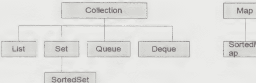

# 软件质量与 Java 自动化工程师生存指南：掌握核心技能全指南：500+ 问答

# Jagadesh Babu Munta

献给当前及有任的计算机软件工程专业人士！

# 这本书怎么样？

“这本书为测试工作面试中经常出现的问题提供了最佳答案。这是一本独特的书，它将所有本质信息整合在一个手册中，涵盖了手动和自动化测试，并能建立信心。Jagadesh Munta 是测试领域的权威，他在自己的公司面试过许多候选人。他非常清楚招聘经理/团队到底在寻找什么，并将所有这些知识提炼成了书中。如果你正在准备软件测试工作的面试，那么这本书就是你正在寻找的！”

-- Satya Dodda

（高级软件工程总监，Oracle America Inc., 克拉拉）

“这本书是我之所以在没有任何软件背景的情况下成为一名测试自动化工程师的原因。它不仅帮助我掌握了高技术性的面试并让我获得了一份高薪工作，还向我灌输了原则，这些原则使我能够在同事中脱颖而出。”

（系统集成自动化工程师，圣何塞）

“这是一份非常出色的指南，我很喜欢你涵盖所有主题的方式。这本书对于像我这样的人非常有帮助，对于那些对开始质量工程师职业感兴趣的人也很有帮助。”

-- Sindhuri Mutyala

（质量部门软件工程师，Intuit, 山景）

“它对面试将会有实质性的帮助。”

（高级 QA 工程师，圣克拉拉）

“这是一本不可思议的手操指南，对于像我这样对开始从事质量工程师/测试工程师职业的人非常有帮助。在准备软件测试/QA 面试方面非常有益。”

-- Malik MA.

（QA 经理，Acentia Software Solutions，海得拉巴）

“这本书做得得非常好，组织良好。市场上有几本关于质量工程的好书，但这本书从面试的角度关注了质量工程概念，我可以说，这绝对是寻找工作的质量工程师能看到的最好的书之一。这本书清晰、简洁，并提供了更多信息。我相信这本书可以服务任何寻找质量工程工作的人。”

-- Praveen Morusapalli

（软件工程总监，Oracle America Inc., 弗里斯科）

“评审了这本书，总的来说，看起来很不错。这些问/答对于任何进入 QE/自动化领域的人来说确实是一部圣经，你通过很好的例子很好地解释了每一项。”

（自动化工程师，圣何塞）

“内容非常实用/具有实操性，我喜欢这一点。”

-- Basha Sayed

（软件开发经理，Oracle America Inc., 红木城）

“这是每一位软件工程师的必读之书（无论 DEV 还是 QA 都不重要）。通过阅读这本书获得的知识在软件工程师的日常活动中具有实际应用价值。书中有一些与 `Java`/`JDBC`/`Maven` 等相关的特定章节，总体来说，对每个软件工程师都是一个极好的资源，无论他是否从事 `Java` 工作。”

“评审了这本书，总体来说看起来很不错。这些问/答对于任何进入 QE/自动化领域的人来说确实是一部圣经，你用很好的例子很好地解释了每一项。”

（自动化工程师，圣何塞）

“内容非常实用/具有实操性，我喜欢这一点。”

-- Basha Sayed

（软件开发经理，Oracle America Inc., 红木城）

“这是每一位软件工程师的必读之书（无论 DEV 还是 QA 都不重要）。通过阅读这本书获得的知识在软件工程师的日常活动中具有实际应用价值。书中有一些与 `Java`/`JDBC`/`Maven` 等相关的特定章节，总体来说，对每个软件工程师都是一个极好的资源，无论他是否从事 `Java` 工作。”

# 前言

写书自 2009 年以来一直是我的梦想之一，特别是我一直试图将我积累的知识分享给世界各地的人以造福他们。这本书旨在帮助大多数软件专业人士，特别是那些与开发者相比，在书籍和培训方面没有太多支持的质量工程（Quality Engineering）人员。这本书对于任何想要理解基础测试概念、为获得新的 QA 自动化工程师工作做面试准备，或从其他学科转向软件测试的人来说都非常有帮助。如果你有任何建议，请随时通过 `jagadeshmunta@everyday.gmail.com` 与我联系，以便我在更新和新版中改进。

我的目标是帮助你。

Jagadesh Babu Munta

## 目录

80. 什么是类（`Class`）？为什么我们需要它？

644 是什么意思？

222. 赋值是指什么意思？为什么需要它？

265. 你在哪里使用块语句？

267. 如何用 `for`、`while` 或 `do-while` 语句表示无限循环？

269. `switch` 语句的作用是什么？如何编写 `switch` 语句？

271. 如何编写抽象类（`abstract class`）？可以从多个类继承吗？

273. 何时使用接口和抽象类？

275. 可以在不定义类中定义它的情况下使用默认构造函数吗？请解释为什么可以或不可以？

277. 什么是内部类（`inner class`）？它在面向对象编程（OOP）中代表什么？描述更多的嵌套类？

279. 访问修饰符（`access modifier`）是什么意思？在何时使用？有哪些不同的访问修饰符？

281. 你可以为单个成员分配多个访问修饰符吗？

283. 你可以定义私有构造函数吗？可以，为什么要这样做？

285. `Exception`-`Error` 类的树形结构是怎样的？

287. 检查异常（`checked exceptions`）和未检查异常/运行时异常（`unchecked/runtime exceptions`）之间的区别是什么？

289. 如何抛出异常？

291. 什么是条件运算符 `? :`？

293. 什么是 `enum`（枚举）数据类型以及如何使用？

295. 有哪些不同的 `Java I/O` 类？

297. `Java Collections` 的优势有哪些？

299. `Collection`（接口）中的常用方法有哪些？

301. 什么是 `List` 接口及其实现类？

303. 你能解释一下 `Map` 集合吗？

305. 如果需要从数据库读取数百万记录，并希望使它们唯一且进行排序。哪种集合数据结构比较合适？

307. 如何选择特定的集合数据结构？不同的性能特性（大 O 复杂度）是什么怎样的？

309. 你能解释典型 `JDBC` 程序中的端到端步骤吗？

311. 如何在 `WebLogic` 中创建数据源（`datasource`）？

312. 什么是 `Apache ANT`？它的核心元素有哪些？

314. 你如何设计项目工作空间以及如何构建项目？你写什么？

316. 运行构建文件（`build file`）最少需要什么？

318. 任何 `target`（目标）是什么意思？

320. 什么是 `ant task`？

322. 如何从文件中加载参数？以及从 `Java` 系统属性中加载？

324. 如何将多个 `target` 组合并在单个 `target` 中运行？`depends` 属性是什么？`description` 属性是什么？

327. `build.xml` 中最少需要哪些内容？

329. 如何设置一个默认 `target` 以在不指定 `ant` 命令的情况下执行？

331. 运行 `build.xml` 需要什么？需要下载什么吗？

333. `ANT` 构建中的 `classref` 是什么？它的意义是什么？

334. 集成任何软件需要什么？

335. 如何在构建文件中集成 `Java` 编译和执行？

336. 如何在 `ant` 框架中创建一个 `jar` 包（代码片段）？

337. 如何在 `ant` 框架中集成 `JUnit` 运行时（代码片段）？

338. 如何在 `ant` 框架中集成 `TestNG` 运行时（代码片段）？

339. 可以在一个 `build.xml` 中包含另一个 `build.xml` 吗？

340. 如何在构建文件中调用另一个目标（`target`）？

341. 如何在一个 `build.xml` 中调用另一个 `build.xml` 中的 `target`？

342. 如何在控制台打印消息？如何了解支持的 `ant` 任务（`tasks`）？

343. 如何从 `build.xml` 中了解支持的 `target`？

344. 什么是 `fileset`？在什么时候使用？

345. 构建和运行 `Java` 程序的端到端流程（在 `build.xml` 中）是什么？

347. `Maven` 的核心目标和特性是什么？

349. 如何安装和设置 `Maven` - 步骤有哪些？

351. 什么是 `Maven` 项目结构？

353. 什么是 `POM`？它的作用是什么？

355. `groupId`、`artifactId`、`version` 分别是什么？

357. 什么是本地和远程仓库？

359. 如何设置依赖（`dependency`）？

361. 如何通过 `archetype` 创建新项目？

363. 哪些类是可以测试的？

365. `mvn install` 命令的作用是什么？

367. 什么是插件（`plugin`）？

369. 插件 目标（`goal`）是什么？

370. 什么是生命周期阶段（`phase`）？

371. `Maven` 的生命周期阶段有哪些？

372. 如何清理（`clean`）项目？

373. 什么是 `Maven` 配置（`settings`）？

374. 本地和全局设置在哪里？

375. 发布项目时需要什么？

376. 如何生成测试文件？

377. 如何通过 `Maven` 编译项目源码？

378. 源码目录在哪里？

379. 在 `build.xml` 中定义哪些 `target`？

380. `JUnit` 有哪些特性？

381. 如何与 `ANT` 比较？

382. 什么是 `JUnit`？

383. 谁在使用它？

384. 在什么时候使用它？

385. `JUnit` 有哪些版本？你用过哪些？

386. 使用 `JUnit` 需要什么？

387. 如何编写和执行简单的 `JUnit` 程序？

388. 如何从命令行运行 `JUnit`？

389. 类路径中包含什么？

390. `JUnit` 支持哪些功能？

391. 描述 `JUnit` 的注解。

392. `JUnit3` 和 `JUnit4` 的区别是什么？

393. 它的作用是什么？

394. 什么是“可运行方法”（`runnable methods`）？什么时候会出现？

395. 如何生成 `JUnit` 报告？

396. 测试方法抛出异常会怎样？

397. 测试方法可以包含多个断言（`assertions`）吗？断言失败会怎样？

398. `JUnit` 的优缺点是什么？

399. 如何创建测试套件（`suites`）？

400. `JUnit` 如何支持分组测试？

401. 如何启用和禁用测试方法？

402. 如何区分普通方法和测试方法？

403. `JUnit` 是数据驱动框架吗？如何编写数据驱动测试？

404. `JUnit 4` 的命名规则是怎样的？

405. 是否需要为每个开发类编写一个测试类？你的策略是什么？

406. 如果方法被声明为“私”且有返回值而不是 `void`，会怎样？

407. 什么是 `JUnit` 测试固定件（`Test Fixture`）？什么时候使用它？

408. `JUnit` 的 `Java` 包是什么？主测试程序类在哪里？

409. 如何批量运行 `JUnit` 测试？

410. 哪些支持 `JUnit`？

411. 如何开发 `JUnit` 测试？你能解释自动化测试的端到端流程吗？

412. 什么是 `TestNG` 框架？使用 `TestNG` 的核心目标是什么？

413. `TestNG` 的关键特性有哪些？

414. 使用 `TestNG` 需要哪些软件和库？

415. `TestNG` 支持哪些不同的注解？

416. 你用过哪个版本的 `TestNG`？用过哪些类型的插件？

417. 典型的 `TestNG` 测试开发步骤有哪些？

419. 报告格式是怎样的？它会生成 `XML` 报告吗？

420. 你如何运行 `TestNG` 测试？

421. 你如何与 `ANT` 集成？

422. 使用 `TestNG` 编写数据驱动测试的步骤有哪些？

423. 你如何对测试分组？

424. 你如何设置组或方法之间的依赖？

425. 你如何启用和禁用测试？

426. 什么是测试 `xml`？如何设置测试套件和测试类？

427. 可以同时运行多个 `testng` 文件吗？如何操作？

428. 默认目录是什么？默认格式是什么？

429. `TestNG` `java` 包是什么？

430. `TestNG` 支持哪些断言（`assertions`）？

431. 如何在 `TestNG` 类中导入方法（例如 `assertEquals` 示例）？

432. `TestNG` 和 `JUnit 4` 之间有什么相似之处？

433. `JUnit4` 和 `TestNG` 之间有什么区别？你使用哪一个？为什么？

434. 什么是持续集成（`CI`）？`CI` 有什么好处？

435. 有哪些 `CI` 工具/软件？

436. 描述 `Hudson` 和 `Jenkins` 软件？


# Jenkins 与 Selenium 自动化测试面试题集锦

## Jenkins 相关

### 437. Hudson 和 Jenkins 之间有什么区别？如何选择？

### 438. 你如何搭建 Jenkins？

### 439. 启动 Jenkins 时如何更改默认的 8080 端口？

### 440. 什么是 Jenkins job（任务）？在 Jenkins 中如何创建任务？谁来创建 Jenkins job？

### 441. 创建一个运行测试的简单任务需要多长时间？

### 442. 你如何调度和或运行构建（builds）？

### 443. 如何定期调度构建？每天晚上 11 点的字段值如何设置？

### 444. 你如何清理旧的构建和工作空间（workspace）？

### 445. 如何在任务中配置 SCM（SVN）？

### 446. 如何安装 Jenkins 插件（plugin）？

### 447. 如果 Jenkins 中需要 Git 源码，你需要做什么？

### 448. 什么是 Jenkins 仪表（dashboard）？你可以执行哪些操作？

### 449. 你如何配置要执行的 ANT 构建文件和目标（target）？

### 450. 你如何归档结果？并通过邮件发送构建产物（artifacts）或结果？

### 451. 当多个任务或同一个任务被多次调度时会发生什么？

### 452. 任务运行时如何查看控制台输出（console output）？

### 453. 你如何在 Jenkins 中配置 JDK、ANT、Maven？

### 454. 人如何扩展 Jenkins 的功能？

### 455. Jenkins 中有多少个插件？你能列举一些吗？

### 456. 在创建任务时如何获取帮助？

### 457. 你如何分配构建？什么是 Jenkins 主节点（master）和从节点（slave nodes）？

## Selenium Web UI 测试相关

### 458. Web 应用/UI 测试对你意味着什么？

### 459. Web UI 测试中的关键挑战有哪些？

### 460. 你用过哪些自动化框架？

### 461. 什么是 Selenium？我们为什么要使用它？有什么替代方案吗？

### 462. Selenium IDE、RC、Selenium 1.0、Selenium 2.0 和 WebDriver 之间有什么区别？

### 463. 你用过哪些 Selenium 版本和驱动（drivers）？

### 464. 你如何为特定网站开发自动化测试？解释端到端的流程图。

### 465. 如何为给定的网站创建一个自动化测试？

### 466. 自动化测试的流程是什么？

### 467. 页面加载是如何处理的？

### 468. 不同的定位器（locators）是什么？你如何找到它们？

### 470. 你如何切换框架（frames）？

### 471. 在 UI 测试中遇到哪些挑战？

### 472. 你如何测试 Ajax 请求？

### 473. 什么是隐式等待（implicit wait）和显式等待（explicit wait）？

### 474. 在同一个测试中同时使用隐式等待和显式等待会发生什么？

### 475. 隐式等待的默认时间是多少？

### 476. TestNG 支持哪些不同的断言（assertions）？

### 477. TestNG 报告是什么样的？

### 478. 你用过哪些 TestNG 报告框架？

### 479. UI 自动补全（auto-complete）是如何实现的？

### 480. 你如何跟踪 Web 请求？可以使用事件监听器（listeners）吗？

### 481. WebDriver Actions 类是什么？如何使用它？

### 482. 跨浏览器测试的常见问题有哪些？

### 483. 什么是无头模式（headless）？有什么示例？

### 484. 你如何设置浏览器设置？

### 485. 你如何在自动化测试中配置代理服务器（proxy server）？

### 486. 你用过哪些 Selenium 设计模式？用过哪些策略？

### 487. 什么是 PageObject？如何编写基于 PageObject 的测试？

### 488. 你在环境中用过哪些不同的浏览器版本和平台？

### 489. 你如何将 Selenium 测试集成到持续集成系统中？

### 490. 什么是 Selenium Grid 2？我们为什么需要它？

### 491. 你如何配置 Selenium Grid 并并行运行？

### 492. 你如何用 WebDriver 测试 Flash 对象？

### 493. 解释并区分数据驱动、关键字驱动和混合测试框架。

### 494. 你如何解释自动化测试的高层设计流程？

### 495. 如何在 Java 代码中读取属性文件（properties file）？

### 496. 你如何为失败的测试截屏（screenshots）或保存图片？

### 497. 你如何处理拖拽（drag-and-drop）UI 场景？

### 498. 你如何处理 html SELECT 元素？

## Web 服务与 API 测试相关

### 499. 什么是 HTTP 协议？请解释

### 500. 不同的 HTTP 状态码有哪些？

### 501. 我们能从 WebDriver 获取 HTTP 状态码吗？

### 502. 你如何解释为特定网站进行测试的端到端流程？

### 503. 你如何描述 Web 服务？关键元素有哪些？

### 504. 有哪些分布式技术？

### 505. Web 服务有哪些好处或关键优势？

### 506. Web 服务架构中的关键元素是什么？它与传统的客户端/服务器架构有何区别？

### 507. Web 服务有哪种类型？

### 508. 服务提供者和消费者之间使用什么协议？

### 509. 什么是事实标准 Web 服务？

### 510. 什么是基于 SOAP 的 Web 服务？

### 511. SOAP Web 服务使用的传输协议是什么？负载（Payload）是什么？

### 512. SOAP 有哪些不同的版本？最新版本是哪一个？

### 513. 目前有哪些常见的 WS 实现？

### 514. API 是什么意思？你如何描述 API 或 API 的特征？

### 515. 为什么 Web 服务被称为 API？

### 516. 你如何测试 API（例如地址验证）？你会编写多少个测试用例？你能写一个覆盖所有不同场景的单个测试用例吗？

### 517. Web 服务 API 测试中需要测试哪些内容？

### 518. 什么是 RESTful Web 服务？你如何描述这些服务？

### 519. REST API 的关键元素有哪些？

### 520. SOAP 和 REST WS 支持哪些不同的消息格式？

### 521. SOAP 封包（envelope）是怎样的？它包含什么？

### 522. REST API 请求和 REST API 响应是什么样子的（给出代码片段）？

### 523. 什么是 WSDL？它的意义是什么？

### 524. UDDI 是什么？它的意义是什么？

### 525. WADL 是什么？它的意义是什么？

### 526. 什么是面向服务的架构（SOA）？

### 527. 你如何比较 SOAP Web 服务和 RESTful Web 服务？哪一个更安全/标准/可靠？哪一个更易于使用？

### 528. 有哪些常见的 SOAP Web 服务和 RESTful API 示例？

### 529. 有哪些 SOAP WS-AS 规范？

### 530. 什么是协议或协议栈？“基于 HTTP 协议”是什么意思？

### 531. 什么是 HTTP 协议？有哪些不同的 HTTP 方法?

### 532. 你如何将 REST 中的 HTTP 方法映射到 CRUD 操作？

### 533. 有哪些可用于自动化测试的 Web 服务测试工具或框架？

### 534. SoapUI 工具是什么？为什么要选择 SoapUI 工具？最新版本是什么？

### 535. 支持哪些不同的平台？

### 536. 使用 SoapUI 工具可以进行什么种测试？SoapUI 工具的一些关键特性有哪些？

### 537. SoapUI 工具支持数据驱动框架吗？

### 538. 如何在 SoapUI 工具中实现数据驱动？

### 539. 描述使用 SoapUI 工具测试 Web 服务的端到端步骤？


# QA 与 Java 自动化工程师生存指南

## 目录

540. 与数据源关联的数据存储器有哪些？310

541. 测试 SOAP 和 RESTful Web 服务需要的基础输入是什么？311

542. 在 SoapUI 项目中开发的测试是如何保存的？SoapUI 测试执行的类型类型有哪些？311

543. 你能从 SoapUI 测试生成 JUnit 测试报告吗？如何生成？315

544. 你如何向 ANT 和 Jenkins 中集成 SoapUI 测试？315

545. 在没有 SoapUI 工具的情况下，你如何测试 Web 服务？315

546. 你如何在 SoapUI 项目中使用属性（properties）？318

547. 你能从 SoapUI 工具创建 mock 服务（模拟服务）吗？如何操作？319

548. 你如何在使用 SoapUI 项目中使用 xpath 断言响应？

549. SoapUI 测试工作区结构的层级关系是怎样的？320

## 动手上手/入门 ................................................................322

## JAVA 示例代码 ................................................................325

## SELENIUM 示例代码...........................................................360

## 结论 ............................................................................397

## 参考文献..........................................................................398

## 读者追踪索引 .......................................................399

## 引言

要观察的关键点之一是学习任何东西并不困难，关键在于看出哪些内容是相关的以及为什么要学习。学习工作或生活中对你来说最重要的事情。如果有人对你所掌握的知识表示认可，这将增强你对当前职业或新追求的职业的信心。

从高层次来说，本书从流程（SDLC/质量/面向对象编程）、数据（XML/XPath/JSON）、代码库（SVN/GIT）和操作系统（Unix/Linux）等领域开始。然后进入编程领域（Java&JDBC），随后介绍了构建框架/工具（ANT/Maven）。之后，涵盖了更多关于单元测试框架/工具（Junit/TestNG）和持续集成工具（Jenkins/Hudson）。接下来，包含了使用框架/工具（TestNG/Selenium/SoapUI）对 Web 应用和 Web 服务的功能测试。最后，包含了供离线的示例代码（Java/Selenium）以及工作中的实践/入门指南。

书中有 500 多个问答，旨在帮助理解概念并供复习。

以下是本书涵盖的 16 项核心技能。

- 1. **软件开发生命周期 (SDLC)**：SDLC 的目的是理解软件开发过程的核心方法论。这一过程是开发/QA 个人以及团队在创建软件产品或 IT 服务时有效协作的基础概念之一。

- 2. **软件质量概念**：质量概念是 SDLC 过程中测试部分的基础知识，每个 QA 团队和开发团队必须具备这些知识，以交付高质量的软件产品。

- 3. **面向对象编程 (OOPS)**：大多数软件产品的开发都是使用 Java、C++ 等其他面向对象的高级语言完成的。对于任何 Java/C++ 程序员来说，在 Java 中维护或开发新软件时，OOP 概念是至关重要的。

- 4. **XML**：大多数现有的动态内容、电子商务网站和许多软件配置都是使用 XML 文件格式完成的。理解这种通用的 XML 文件格式对于软件开发和 QA 职业的生存至关重要。

- 5. **XPath**：只要 XML 存在，XPath 在执行导航、提取 XML 以及将内容转换为各种其他形式（HTML/文本）方面起着关键作用。因此，开发者和 QA 专业人员最好掌握这项技能。

- 6. **JSON**：JSON 文件格式是一种不断演进的现代通用文件格式。JSON 格式广泛应用于 REST WS、互联网/Web 应用程序、社交网站等。对于所有开发者和 QA 自动化专业人员来说，上手操作 JSON 文件至关重要。

- 7. **SCM/SCCS(SVN/GIT)**：源代码是任何软件组织的主要知识产权之一。使用 SVN 或 GIT 等源码控制系统与开发团队协作至关重要。对于开发者和 QA 自动化工程师，理解 SCM 概念以及 SVN 和最近流行的 GIT 软件的操作知识是重要的。

- 8. **Unix/Linux**：在当今世界，大多数企业软件、网站托管以及任何在 Linux/Unix 平台上的互联网托管软件或应用程序。拥有该平台的实操经验对每个人来说都是基础。

- 9. **Java & JDBC**：大多数现有的或新的项目，无论大小项目，仍然用 Java 语言编写。Java 应该是每个软件专业人员的核心，因此，掌握这种语言对于在软件开发和 QA 自动化职业中生存是至关重要的。

- 10. **ANT**：ANT 是一种构建框架。它曾非常流行，目前仍被用作大型软件组织产品代码和测试代码的 Java 构建框架。对于开发者和 QA 来说，拥有理解和实操经验是好的。

- 11. **Maven**：Maven 是近期的 Java 项目中随处使用的构建框架。它解决了 Java 项目构建过程中某些依赖解析问题，这些问题在 ANT 中是负担。Maven 通过约定使构建过程变得简单。因此，Maven 是开发者和 QA 自动化工程师的一项重要生存技能。

- 12. **JUnit**：单元测试应该是任何开发者的核心任务之一。JUnit 是 Java 项目中一个老旧但简单且流行的框架。该框架仍在许多组织中使用，许多 IDE 支持自动测试代码的生成和执行。拥有 JUnit 经验。

- 13. **TestNG**：单元测试应该是任何开发者的核心任务之一。TestNG 是 Java 项目中一个功能强大的测试框架，提供了灵活的测试配置、并行测试执行和数据驱动测试支持。该框架在许多组织中广泛使用。

- 14. **Jenkins/Hudson**：持续集成应该是任何开发团队的核心任务之一。Jenkins/Hudson 是流行的持续集成工具，支持自动化构建、测试和部署流水线。这些工具在许多组织中被广泛采用。

- 15. **Web 应用**：Web 应用测试是 QA 工程师的核心任务之一。使用 Selenium 等框架/工具对 Web 应用进行功能测试、回归测试和跨浏览器测试。掌握 Web 应用测试技能对于 QA 自动化职业至关重要。

- 16. **Web 服务 (SOAP/REST)**：Web 服务测试是 QA 工程师的核心任务之一。使用 SoapUI 等框架/工具对 SOAP 和 RESTful Web 服务进行功能测试、负载测试和安全测试。掌握 Web 服务测试技能对于 QA 自动化职业至关重要。

## 如何阅读本书？

对于初学者和初级软件工程师，建议从技能 #1 直到技能 #16，这样每个学到的概念都可以在后续技能中使用。

对于高级工程师和领导者，只需跳转到任何技能来复习概念。技能之间没有直接联系，而是之前的技能将在后来的技能中使用。

总体而言，这些技能复习应该让你达到软件质量和 Java 职业领域约五年经验的水平。最后，本书尝试通过软件质量和 Java 核心技能与分享并建立信心。

祝你的旅程顺利！

## 技能#1 软件开发生命周期 (SDLC)

SDLC 的目的是理解软件开发过程的核心方法论。这一过程是开发/QA 个人以及团队在创建软件产品或 IT 服务时有效协作的基础概念之一。

### 1. 什么是软件？

- 软件或计算机软件是处理信息并控制底层硬件的程序集。它包括程序、库和不可执行数据。

- 示例包括：

  - 操作系统，如 `Windows`、`MacOS`、`Linux`、`Solaris` 等。

  - 浏览器软件，如 `Firefox`、`Chrome`、`Internet Explorer`、`Safari` 等。

  - 办公软件，如 `Microsoft Office`、`Star Office` 等。

  - IDE 软件，如 `Eclipse`、`NetBeans`、`IntelliJ` 等。

  - 任何在设备和数据上运行的程序。

- 软件的主要目的是灵活地控制通用解决方案、业务解决方案或移动设备、桌面或大型计算机。

- 软件存在于当今演进的技术中。理解和获取软件技能将有助于职业技术的发展。

### 2. 什么是 SDLC？为什么需要这些模型？有哪些不同的模型？

- SDLC 代表软件开发生命周期。它是开发任何软件的过程。从传统的“瀑布模型”到最新的“敏捷”流程，有很多种流程。有许多类型，如 XP（极限编程）、Scrum、TDD（测试驱动开发）等。

### 3. SDLC 与测试有什么关系？

- 测试是 SDLC 的一部分，理解它有助于对软件产品进行有效测试。测试是瀑布模型中的验证阶段，也是敏捷 Scrum 中的测试部分。

### 4. 什么是瀑布模型？涉及哪些不同阶段？

- 瀑布模型（顾名思义）就像水从高处流向低处，开发（以及信息）一个接一个地通过不同的阶段。它包含五个不同的阶段，并且只有在完成上一个阶段后才会进入下一个阶段。

- 阶段：

    i) 启动 (Inception)

    ii) 设计 (Design)

    iii) 实现 (Implementation)

    iv) 验证 (Verification)

    v) 维护 (Maintenance)

- 在开发过程中很难注入客户需求（无论是新需求还是对旧需求的修改）。完成此类项目通常需要 6 个月到 1-5 年不等，大部分时间用于老旧的稳定/成熟项目以及大型项目。

### 5. 什么是敏捷 Scrum 流程？你能从高层描述它吗？

- 敏捷 Scrum 是一种迭代开发过程，目标是实现增量的中间产品交付。在敏捷 Scrum 流程中，会有产品待办列表（Product Backlog）、迭代待办列表（Sprint Backlog）、开发过程的短周期（通常一个 Sprint 持续一至四周，目标是在 4-5 周内交付产品）以及发布。Sprint 会不断重复，直到完成整个产品待办列表。每次发布都是为了改进或完成最终产品。客户需求可以注入到产品待办列表中，并将在下一个迭代中（通过迭代待办列表）被选取。在 Scrum 同步期间，会有大约 15 分钟的每日站会。

### 6. 在每种开发模型中，测试活动何时开始的？

- 在瀑布模型中，测试仅在完成实现阶段后的验证阶段开始。

- 在敏捷模型中，测试在每个 Sprint 或 Scrum 周期中进行。测试从该 Sprint 中的功能开始就开始了，并与开发人员密切合作，完成该 Sprint 内已完成的功能。

### 7. Scrum 流程中的站会是指什么意思？在敏捷 Scrum 流程中，你通常需要回答哪三个问题？

- 需要回答以下三个问题，并应为会议做好准备：

    i. 从昨天起你做了什么？

    ii. 你今天打算做什么？

    iii. 有哪些阻塞性问题或阻碍（来自你那边）？

### 8. 谁是 Scrum Master？他的角色和职责是什么？

- Scrum Master 就像敏捷软件开发过程中的项目经理。Scrum Master 处理 Sprint 计划、产品待办列表、迭代待办列表，并与所有利益相关者进行每日站立会议。

### 9. 你知道任何敏捷开发工具吗？

- `Rally` 软件是用于跟踪敏捷流程的工具之一（http://www.rallydev.com/）。

- `Atlassian` 的 `JIRA` 也用于跟踪 Sprint 中的任务，并拥有带有 JIRA 仪表板的史诗（Epics）。

- 最后，简单的 Wiki/电子表格也可以作为跟踪工具。

### 10. 什么是 Sprint？Sprint 的典型持续时间是多少？

- Sprint 是软件开发生命周期中的短周期，通常是一个为期一周、或 2 周、3 周或 4 周的周期，用于编码、验证、文档化一组用户故事，或修复和验证缺陷。

### 11. 什么是产品待办列表（Product Backlog）？

- 产品待办列表是开发中产品的任务和需求列表。待办列表提供了该产品在任何给定时间点的优先级需求或任务完整列表。如果有任何新需求或旧需求的变更，它们将更新到此产品待办列表中并进行优先级排序。

### 12. 什么是迭代待办列表（Sprint Backlog）？

- 迭代待办列表是在特定 Sprint 周期内要完成的优先级任务和需求列表。它是从产品待办列表中选出的顶级需求或任务的子集。

### 13. 你在哪里添加变更的需求？是在迭代待办列表还是产品待办列表中？

- 需求的变更将添加到产品待办列表，而不会添加到当前的迭代待办列表中。这些更改将在下一个 Sprint 周期中（通过迭代待办列表）从产品待办列表中被选取。


## 14. 你可以在 Sprint 期间更改迭代待办列表吗？

- 不可以。当前 Sprint 不可以，但下一个 Sprint 周期会通过从产品待办列表派生的带有这些更改的迭代待办列表来捕捉。

## 15. 什么是用例（Use Case）？

- 用例是执行者（Actor）为了实现业务目标而执行的动作和事件的序列/流。执行者可以是使用系统的终端用户，也可以与其他系统交互的系统或设备。对于正在开发的产品，有很多用例。

## 16. 什么是用户故事（User Story）？

- 故事（Story）是敏捷 SDLC 过程中使用的术语，是从终端用户视角和其业务职能角度对软件需求进行的简单描述。它应该针对某个迭代进行界定，并在实施后能提供业务价值或为整个产品增加价值。

## 17. 什么是测试驱动开发（TDD）？

- 测试驱动开发是极端编程（Extreme Programming）范式下的敏捷软件开发过程。在 TDD 中，开发者首先根据用户故事编写一个初始的、失败的自动化测试，并反复修改代码直到测试通过。我不认为 TDD 有那么流行或广泛使用。

## 18. 瀑布模型的优缺点是什么？

- 瀑布模型的优点：
    - 它可以提供更好的项目计划和规划。
    - 由于阶段顺序进行，它提供了资源的重复利用。
    - 适用于在实际实施前有清晰规划、设计、架构的大型项目。
    - 团队没有时间压力（相比敏捷），因为为任务留了足够的时间。
    - 与敏捷相比，典型的项目发布周期较长，在 6 个月到 5 年之间。

- 瀑布模型的缺点：
    - 客户需求无法在项目过程中考虑。
    - 这花费更多的时间并产生更多成本。
    - 没有增量产品交付。最终项目只有在最后阶段可用，而该阶段很长。
    - 在项目完成之前很难预测项目是否会失败。

## 19. 敏捷 Scrum 流程的优缺点是什么？

- Scrum 流程的优点：
    - 适应变化，可以在过程中考虑客户需求（即在下一个 Sprint 周期）。
    - 它有助于实现增量产品交付。
    - 与瀑布模型相比，花费的时间更少。
    - 它能尽早指示项目状态，并快速停止或转换为不同的项目。

- Scrum 流程的缺点：
    - 它可能消耗更多资源，因为周期内需要同时涵盖所有的开发/测试/文档活动。
    - 通常，它适用于较短且复杂性较低的项目（需要考虑的替代方案/架构较少）。
    - 它要求团队高生产力和持续努力，从而导致产生压力或时间压力。
    - 此外会有更多的快速同步会议。

## 20. 不同 SDLC 模型中典型的团队规模是多少？

- 一个典型的数字可以看如下，并且它可以非常

# QA 与 Java 自动化工程师生存指南

## 1. 软件开发生命周期 (SDLC)

必须基于组织内成熟的 SDLC 流程。

- 瀑布模型 > 团队规模大于 10 人
- 敏捷模型 < 团队规模小于 10 人
- 如今，更大规模的项目（如超过 50 人）也在良好运行 Agile Scrum 流程。它已成为大多数初创公司和大型组织中新开发团队的标准流程。
- 此外，开发过程中也可能是瀑布与敏捷结合的混合模式。

### 21. 哪种 SDLC 模型适用于快速变化的需求？

- 敏捷 SDLC 流程（如 scrum）最合适，因为更改可以在下一个迭代周期（sprint）中被纳。因此，客户需求可以在产品开发过程中被考虑，而不是等到产品发布。

### 22. 哪种模型适用于增量式产品交付？

- 敏捷 SDLC 流程（如 scrum），因为它是一个迭代过程，每个 sprint 周期都会为整体产品做出贡献。因此，产品进度可以视为正在进行中的 sprint，并在产品最终发布之前进行演示或提供给销售和试用客户。

### 23. 什么是重构（refactoring）？通常在哪里进行？

- 重构是编码中的通用软件工程过程，旨在保持案例/行为不变，通过更改代码来提高可读性、结构和优化。
- 这种重构过程在软件编程中非常典型，特别是在敏捷过程中，它是迭代的，因为无法一次性通过所有优化来获得完美的代码。

### 24. 什么是 Alpha 产品和 Beta 产品？消费者是谁？主要目标是什么？

- Alpha 产品是代码完成后提供的非常早期的产品，但存在许多 bug（所有功能可能都无法按预期工作）。
- Beta 产品是下一个里程碑式的发布版本，bug 更多，但在最终用户功能中可能仍然存在某些 bug，并且还需要进行质量改进。
- 会选择少数客户进行 Alpha 测试，测试在客户现场进行，以获取对功能理解的最初反馈。
- 会选择少数 Beta 客户进行 Beta 测试，测试在客户现场进行，以获取反馈，以便在 RTM（交付制造）产品发布之前修复这些问题。
- 这些中间版本的主要目标是确保客户接受度与产品开发保持一致，并根据反馈进行修正。

### 25. 什么是 PRD（产品需求文档）或 BRD（业务需求文档）？它们包含什么？由谁拥有？

- PRD 是产品需求文档，由产品管理（PM）团队收集并记录客户功能列表。PM 稍后会就产品需求和验收标准与客户交互。
- BRD 是业务需求文档，与 PRD 类似，但用于 IT 项目或消费项目（如零售或金融）的背景，而不是产品研究项目。

### 26. 什么是功能规格说明（functional specification）？它包含什么？由谁拥有？

- 功能规格说明文档是由高级开发团队为 PRD/BRD 中列出的每个功能创建的详细需求分析文档。
- 该文档包含功能的详细规格，并由开发团队拥有。

### 27. 什么是软冻结（soft code freeze, SCF）？它在 SDLC 过程中何时发生？

- 软冻结或功能完备（Feature complete）是一个重要的里程碑，发生在开发过程中完成所有功能实现之后。
- SCF 之后，将不再添加任何新功能，而是只修复关键、高和中等级的 bug。
- 会为 SCF 里程碑创建源码仓库的分支或标记（tagging），一直使用该分支直到发布完成。
- QA 团队将继续测试并修复 bug，而开发团队继续修复 bug（但不再增加新功能）。

### 28. 什么是硬冻结（hard code freeze, HCF）？它在开发过程中何时发生？

- 硬冻结是一个里程碑，发生在 SCF 里程碑之后，此时大多数关键/高/中级 bug 已修复，并准备好最后的 QA 测试周期，以发现任何阻塞性 bug（showstopper，即可能阻止发布的 bug）。
- HCF 之后，只修复阻塞性的（对客户影响极大）bug。
- 请注意，这些阻塞性 bug 的修复只有获得产品管理批准后才允许。

### 29. 什么是发布候选版本（RC）？什么是发布（release）？

- 发布候选版本（RC）是发布周期时间线中的最后一个里程碑。
- RC 在 HCF 完成后创建，QA 在 RTM 发布前进行最后的测试周期。
- 当此最终构建中没有发现阻塞性 bug 时，RC 将作为 RTM 产品发布。
- 产品发布无非二进制文件已准备好交付制造（例如刻录 CD/DVD）或供客户从互联网下载。
- 对于发布包的测试，QA 和开发团队将进行最后的冒烟测试，如检查二进制大小、文档链接、基础安装、下载检查等，以确保客户看不到任何基础问题。

### 30. 什么是发布说明（release notes）？由谁驱动？

- 发布说明是提供给客户的文档，其中将基本版本、功能摘要、带有变通方法的严重问题以及文档引用集成到产品包中，并可从互联网下载。
- 发布工程（RE）团队驱动此工作，但由所有项目利益相关者评审。

### 31. 什么是发布标准（release criteria）？由谁设定以及必须遵守？

- 发布标准是发布产品的最低检查清单或目标。此工作由 RE 团队驱动，所有项目利益相关者共同参与制定。
- 以下是如果没有可用标准的示例发布标准/清单：

#### Bug 标准：
- 无 P1、P2、P3 级问题

#### 质量标准：
- 100% 功能覆盖和测试开发
- 100% 测试执行
- 95-100% 通过率
- >90% 回归测试自动化

#### 压力/负载/并发标准：
- 100 用户/秒

#### 性能标准：
- 产品相关的最小吞吐量数字
- 与竞争产品对比

#### 代码覆盖率：
- 类级 >90%
- 方法级 >50%
- 指令级/语句级 >40%

#### 国际化 (I18N) 与本地化 (L10N)：
- 国际化支持
- 需要翻译的特定语言
- 注意：I18N 是因为 I 和 N 之间有 18 个字符。同样，L10N 是因为 L 和 N 之间有 10 个字符。

#### 文档（纸质/在线）：
- 发布说明
- 用户手册
    - 安装指南、管理员指南、开发者指南、故障排除指南等

#### 许可证和许可文本

#### 支持/维护计划

### 32. 什么是发布阻塞性问题（release showstopper）？它何时发生？

- 阻塞性问题是指对客户有可见且高影响的 bug，必须在发布产品前修复。如果无法在发布时间内修复，则应在发布说明中添加相应的 bug 和变通方法。
- 此类 bug 的修复应经过集中的评审和批准，以尽可能减少最终产品发布中的任何回归问题。
- 阻塞性问题发生在 HCF 和 RC 里程碑之后，或者在开发过程的最后一个 sprint 中。

# QA 与 Java 自动化工程师生存指南

## 1. 软件开发生命周期 (SDLC)

回归测试应根据 Bug 的修复情况进行选择，而不是运行所有测试，因为需要快速周转。

## 33. 哪些是项目利益相关者？这些团队是什么？

- 通常情况下，以下是产品开发组织中的项目利益相关者。

### 产品经理 (Product Manager)
- 担任产品与客户之间的桥梁
- 负责创建 PRD（产品需求文档）或 BRD（业务需求文档）。

### 项目经理/开发经理/开发总监 (Project Manager/Dev Manager/Dev Director)
- 产品执行的所有者（创建并执行项目计划的人）
- 作为项目成功发布的驱动力

### 项目经理 (Program Manager)
- 在项目执行期间与所有利益相关者协调，并协助项目驱动
- 主持发布会议

### 架构师 (Architects)
- 负责考虑扩展性、可用性、性能、安全性、技术等宏观和战略目标，执行产品架构设计
- 创建架构图和文档
- 与设计/开发团队密切合作，以确保实施成功

### 设计师 (Designers)
- 负责产品设计并与架构师及开发人员密切合作
- 创建 FSD/FS（功能规格文档）
- 请注意，有时架构师可以担任设计师，高级开发人员也可以担任设计师

### 开发人员 (Developers)
- 负责根据功能规范进行实现（编码）
- 修复 Bug
- 进行单元测试

### QA/QE
- 负责测试（任务如编写测试代码、执行测试、提交 Bug、创建测试计划和测试规范）
- 审阅文档 - 发布说明、手册/指南

### 文档撰写员 (Doc writers)
- 负责各种类型的用户指南/手册/帮助内容

### 发布工程师 (RE)/Devops
- 负责模块集成和构建创建
- DevOps 负责托管和监控测试环境及生产环境站点

### 支持工程师/前端支持（面向客户）
- 该团队将对客户问题进行分诊，并在需要时转交给后端支持

### 支持工程师/后端支持
- 他们将对分流并修复由前端支持工程师升级的客户问题

## 34. 产品层面的测试周期是什么？

- 测试周期是指在给定的产品二进制文件/构建上完成所有测试活动的时间跨。
- 一个典型的周期从 1 周到 4 周以上不等。

## 35. QA 团队如何跟踪每周状态或进度？

- 通常，QA 团队代表（总监、经理或负责人）会在跟踪状态摘要时准备以下问题的答案。
    - 有多少个开启的 Bug 以及这些 Bug 的列表？
    - 有多少个阻塞性 Bug (P1)
    - 有多少测试测试失败（数量和百分比）？例如：30% 失败
    - 还有多少测试开发待完成？例如：40% 的测试
    - 测试自动化何时将完成？
    - Bug 的流入（自上次报告以来出现的新 Bug）和流出（自上次报告以来修复的 Bug）是多少？（例如：每周）
    - 修复和开启的 Bug 总数是多少？Bug 趋势如何？
    - 有多少 Bug 待验证？
        - 请注意，Bug 的验证与关闭通常由提交 Bug 的人员完成
- 在 wiki 或文档中获取所有答案，并更新在每周状态报告的邮件中发送给利益相关者。

## 36. 产品的 Go/No-Go 是什么？

- "Go/No-Go" 是根据利益相关者满足特定标准，决定产品是否准备好发布的决策。
- 一旦满足标准，即可给出“Go”进行发布。如果未满足，则决定“No-Go”，需要进一步修复。
- 该决策通常在发布会议期间讨论。

# QA 与 Java 自动化工程师生存指南

## 2. 质量概念

## 37. 测试意味着什么？

- 测试是根据需求和规格规范对软件进行验证和确认的过程。它涉及创建并执行测试，以确保产品按预期工作。

## 38. 质量意味着什么？

- 质量是指产品满足特定需求和客户期望的程度。它是通过整个开发生命周期中的各种测试级别评估的。

## 39. 什么是软件 Bug？

- Bug 或缺陷是偏离软件预期行为的。它在测试期间被识别，并在发布前需要修复。

## 40. 为什么需要测试软件？

- 测试对于在产品到达客户之前识别 Bug 和问题至关重要。它确保软件满足功能和性能需求，提高客户满意度。

## 41. 质量工程 (QE) 与 质量保证 (QA) 有什么区别？

- 质量工程侧重于将一致性和可重复性等工程原理应用于测试过程，而质量保证更多侧重于监控过程以确保符合质量标准。

## 42. 为什么需要独立的质量工程团队？

- 需要一个独立的团队是因为开发人员可能会忽略某些 Bug。专门的 QE 团队充当“第一个客户”，从用户的角度解构产品以确保质量。

# QA & Java 自动化工程师生存指南

## 2. 软件质量概念

- 针对实际或产品代码，重点关注代码单元以验证基础代码的健康状况。
- 它也称为单元测试（Unit testing）。
- 通常由产品开发人员执行。
- 常用的测试框架包括 Java 单元测试框架 `JUnit` 和 `TestNG`。

### 47. 什么是黑盒测试？列举一些黑盒测试的类型。这种测试由谁执行？

- 黑盒测试本质上是在不查看开发代码的情况下对产品进行测试，侧重于客户功能用例或场景。
- 它也称为功能测试（functional testing）。
- 通常由 QA 团队执行。
- 常用的测试框架包括 `TestNG`、`Selenium`、`LoadRunner` 等。

### 48. 区分白盒测试与黑盒测试。

- 参见上述两个答案。

### 49. 什么是单元测试？它与白盒测试、黑盒测试有什么关系？

- 单元测试是对代码单元进行基础功能验证的测试，由开发者在开发产品代码时完成。它与白盒测试有关。
- 功能测试是更关注功能规范或客户用例及特征的测试，且不查看产品代码本身。
- 它与黑盒测试有关，因为在测试时，测试场景被视为整体，而不进入代码内部。
- 通常，功能测试由 QA 团队执行。

### 51. 什么是安全测试？它是功能性需求测试还是非功能性需求测试？

- 安全测试关注产品的安全性方面，包括安全渗透测试。
- 安全性是产品的非功能性需求。

### 52. 什么是回归测试？你何时以及多久运行一次这些测试？

- 回归测试是执行已创建的测试套件或再次执行手动场景。其目标是确保在代码更改时，现有功能继续正常工作。通常，这些测试根据产品发布周期，在不同的平台和测试矩阵上按小时、每天、每周或每双周执行。此外，在构建创建和开发者提交（check-ins）时也会进行回归测试。

### 53. 什么是性能测试？由谁执行测试——QA 还是独立团队？

- 性能测试是在客户使用的可用基础设施下，对速度（每个事务的时间或请求处理时间）和吞吐量（每秒服务的用户数）进行测量。
- 也包括与竞争产品进行性能对比分析。
- 在较大的组织中，通常由 QA 团队之外的独立团队（性能团队）执行。

### 54. 什么是测试计划？简要描述测试计划的内容。你是否写写过测试计划？

- 测试计划是规划过程中的一种测试产物，由 QA 团队创建，详细规划测试，包括测试范围、非测试范围的需求、测试策略、资源、矩阵和进度（估算）。
- 从高层来说，根据项目/模块级别的范围分为两种计划：
    - 主测试计划（Master test plan）：针对整个产品/项目。
    - 模块测试计划（Module test plan）：针对单个模块。
- 主测试计划基于市场需求文档（MRD）、业务需求文档（BRD）、产品需求文档（PRD）或架构与设计文档。
- 模块测试计划与之类似，但它基于主测试计划和组件功能规范，专注于被测试的模块/组件单元。
- 一个典型的模块测试计划内容所示。你可以将其作为测试计划的模板，尽管不同组织之间可能存在差异。

#### 引言或概述
- 添加关于待测组件或模块的简要介绍。

#### 目标
- 组件测试目标的高层思路。
- 覆盖的特征（在范围内）

#### 待测试特征名称的高层列表
- 经过优先级排序的特征

#### 未覆盖的特征（相关但不在范围内）
- 某些 Paypal 功能，就像其他团队将覆盖的功能一样，如性能；其他无法覆盖的测试，如本地化（l10n）或国际化（i18n）。

#### 测试方法
- 框架选择
- 使用的工具
- 手动或自动化测试策略
- 回归测试策略
- 缺陷 - 工具/基础设施细节
- 安全测试
- 代码覆盖率

#### 入口准则
- 添加开始测试前需要满足的条件。
- 注意：这些通常会包含在测试计划（MTP）中，仅在此处添加差异，并让其他人员参考 MTP。

#### 出口准则
- 添加通过验收需要满足的条件，例如待推迟的 Bug（严重程度）、通过测试的百分比等。
- 注意：通常这些会包含在测试计划中。

#### 测试认证矩阵


- 注意：通常这些会包含在测试计划中，仅在此处添加差异，并让其他人员参考 MTP。

- 添加平台/操作系统/JDK/浏览器类型及版本，以及认证所需的任何其他软件。

- 进度、职责、交付物

  - 进度

    | 任务 | 所有者 | 持续时间 | 开始日期 | 备注 |
    | --- | --- | --- | --- | --- |

  - 职责

    - 团队个人负责的领域

  - 交付物

    - TS/TDS（测试规范/测试设计规范）
    - 新测试用例
    - 自动化脚本
    - CI 配置
    - 结果分析

- 风险与缓解措施

  - 可能的风险——例如构建延迟可能导致测试延迟、特征集成过晚会导致测试周期延迟等。
  - 任何假设都应在此处添加。

- 审核与批准

  - 添加对应的开发人员（相应的开发工程师）、负责人、经理

- 参考文献

  - 添加引用的文档，如测试计划。

- 修订历史

### 55. 什么是测试设计与规范？简要描述测试规范（Test Spec）的内容。你是否写过测试规范？

- 测试设计是更多地对测试场景及其优先级进行思考。
- 测试规范（TS 或 TDS）是将场景记录为用例。
- 它是手动还是自动的。
- 一个典型的测试规范内容如下：

  - 引言
    - 每个需求的特征优先级排序列表。
  - 测试场景
    - 添加测试场景 ID（必要时引用回 Bug）。
    - 添加测试场景的描述，以及通过/失败准则。
    - 测试步骤
      - 添加测试时需遵循的精确步骤。
      - 添加预期结果和通过/失败准则。
  - 输入
    - 测试场景使用的数据。
  - 预期输出
    - 完成步骤后的预期输出。
    - 添加通过/失败准则。
  - 测试环境搭建
    - 配置（从主计划中引用，否则在此处）。
    - 不同测试场景所需的特定设置和版本。
  - 审核与批准
    - 与测试计划类似。
  - 参考文献
    - 添加指向测试计划、功能规范等链接。
  - 修订历史

### 56. 什么是测试场景（test scenario）？你把测试场景放在哪里？

- 测试场景本质上是为了验证用户故事、用例或需求而执行的一系列步骤。这些场景将成为测试用例或测试，并分组为测试套件。
- 测试场景将在测试设计过程中创建，并记录在测试规范中。

### 57. 你能描述 Bug 的生命周期吗？Bug 有哪些状态？

- Bug 生命周期是管理从创建新 Bug 到其关闭的事件的过程。
- 以下是典型的 Bug 生命周期状态，但根据 Bug 工具的不同可能有不同的名称：
  - 新（New）：当 QA 提交 Bug 或重新打开 Bug 时设置。
  - 分配（Assign）：当 QA/QA 经理/开发经理/开发者分配 Bug 时设置。
  - 评估与进行中（Evaluate and in-progress）：开发者在评估期间设置。
  - 已修复（Fixed）：当开发者更改代码修复 Bug 时设置。
  - 重复（Duplicate bug）：当开发者发现已存在该 Bug 时设置。
  - 非 Bug（Not a bug）：当开发者发现不是 Bug 时设置。
  - 无法复现（Not reproducible）：当开发者无法复现时设置。
  - 已验证（Verified）：当 QA 验证通过后设置。
  - 重新打开为新建（Re-open to New）：当开发者或 QA 说明如何再次复现时设置。
  - 已关闭（Closed）：QA/提交人验证后设置。

# QA 与 Java 自动化工程师生存指南

## 2. 软件质量概念

### 58. Bug 的优先级（Priority）是指什么意思？谁来设置 Bug 的优先级？提交 Bug 后可以修改吗？

- Bug 优先级仅仅是修复该 Bug 的重要性或紧急程度的指示。
- 通常分为五个级别：P1（最高）、P2、P3、P4、P5（最低）。
  - P1: 需要在 24 小时内立即修复（阻塞测试）。
  - P2: 需要在下一次构建中修复（主要功能未受影响）。
  - P3: 可以等待，但在发布前修复。
  - P4/P5: 不是强制性的，在当前发布版本中修复或不修复均可。
- Bug 的提交者在提交 Bug 时决定并设置优先级。准则是在提交 Bug 时设置与严重程度（Severity）相同的优先级。例如：P1/S1, P2/S2, P3/S3, P4/S4, P5/S5。
- 是。任何人都可以修改 Bug 的优先级，Bug 工具也会允许这样做。通常是在与发布经理、产品经理等利益相关者沟通之后修改。例如：QA 可以提交 Bug，但开发经理或产品经理可以更改优先级。

### 59. Bug 降级（downgrading）和升级（upgrading）分别是指什么意思？

- 降级意味着降低 Bug 的优先级。即在 Bug 工具中优先级从高到低的变更。
  - 示例：P1 → P2/P3/P4/P5, P1/P2 → P3/P4/P5, P3 → P4/P5
- 升级意味着提高 Bug 的优先级。即在 Bug 工具中优先级从低到高的变更。
  - 示例：P2/P3/P4/P5 → P1, P3/P4/P5 → P2/P1, P4/P5 → P3/P2/P1

### 60. Bug 的严重程度（Severity）是指什么意思？谁来设置 Bug 的严重程度？提交 Bug 后可以修改吗？

- 严重程度（S）是 Bug 对客户产生和影响的指示。对于任何新 Bug，这是提交 Bug 时首要确定的事项。
- 通常，严重程度分为五个级别，分别为：S1（最高）、S2、S3、S4、S5（最低）。
  - S1: 意味着功能无法测试或阻塞进一步测试。
  - S2: 大部分功能无法工作，许多测试失败。
  - S3: 部分用例无法工作。
  - S4, S5: 极端情况，且不影响主要功能。
- Bug 的提交者在提交 Bug 时决定并设置严重程度。
- 不。通常一旦在 Bug 中设置了严重程度，就无法进行更改。通常 Bug 工具不允许更改严重程度。

### 61. 如何提交 Bug？会添加哪些细节？请举示例。

- 应使用组织的 Bug 工具提交 Bug，并遵循 Bug 指南。根据所使用的工具调整上述术语。
- 在提交任何 Bug 之前需要以下信息：
  - 哪个产品、组件 ID/名称
  - 哪个场景或用例
  - 结果/输出是什么
  - 优先级和严重程度是多少
  - 描述中需要添加更多细节，如控制台输出或截图等。
- 通常，Bug 工具是 Web 工具，通过填写表单并在需要时进行编辑。以下是创建新 Bug 的示例快照。

```
Bug state: new/duplicate
Product:__
Product version:__
Component/module:__
Sub Component/sub module:__
Priority:__
Severity:__
OS/HW/DB/JDK:__
```

- 主题：登录失败 - 即使密码正确也提示密码错误
- 描述：（有限大小的文本区域，例如 3000 字符）
  观察到登录失败。在今天 12/22 的最新构建 b20 中，即使输入正确的密码也无法登录。

# QA 与 Java 自动化工程师生存指南

## 2. 软件质量概念

- SUT（被测系统）的其他子系统
- 通常由独立的 HA 测试团队或 QA 组下的系统测试团队进行测试。

### 66. 代码覆盖率是指什么？它的主要目的是什么？该活动在产品生命周期中何时发生？它是一项测试活动吗？由谁领导？执行了什么种测试？

- 代码覆盖率是衡量通过所有单元/功能/系统测试对产品代码的执行程度的指标。
- 典型的代码覆盖率工具会产生指标，例如覆盖了多少个或百分之几的 Java 类、方法、循环和指令覆盖率。
- 代码覆盖率的意义在于帮助识别测试空白，并评估测试覆盖情况。此外，100% 的代码覆盖率不应被视为产品质量高。相反，测试结果可以触发更多的测试或代码优化。
- 很多时候，代码覆盖率是在我们充分测试产品后进行的，以查看是否存在任何死代码或寻找缺失的测试覆盖。大多数情况下，代码覆盖率可以在类级别进行，但至少方法级别是重要的。通常，QE 团队会定期报告代码覆盖率报告。
- QA 工程师应与所有相关测试团队协调执行此类工作。主要任务是启用工具、将工具与安装的产品进行自动化结合、收集结果、合并不同运行的结果以及发布汇总报告。报告将根据 Java 包名或模块分发给利益相关者。初级 QE 可以查看结果是否覆盖恰当，并在需要时添加测试以覆盖该模块中的所有类和方法。反馈应给开发团队，以便为产品添加单元测试或删除死代码或未使用的代码。通常，40-50% 以上的代码覆盖率被认为是高覆盖率。
- 为什么不设定 100% 的覆盖率目标？这涉及到投入产品测试的人力资源，因此 100% 意味着巨大的测试工程资源需求，在实践中是不可行的。对于任何产品，都可以作为产品质量测试的一部分，以实现更高的代码覆盖率。

### 67. Java 有哪些不同的代码覆盖率工具？

- 一些免费开源的代码覆盖率工具包括：
  - JaCoCo（现在更流行，最初由 Emma 开发）
  - JCov
  - Cobertura
  - Clover
  - PIT

### 68. 如何跟踪质量？不同的级别是怎样的？

- 质量是通过对满足发布标准的收敛情况来跟踪的，例如执行/通过的 P1/P2/P3 Bug 数量、压力/持久性标准、性能目标、代码覆盖率等。
- 为了跟踪质量，以下是每个构建或冲刺（Sprint）或每周进行的某些衡量：
  - 测试执行指标：跟踪自上次构建或跟踪周期以来开发代码更改和测试进度。
  - Bug 指标/缺陷跟踪：自上次构建或跟踪周期以来的开启 Bug 和关闭 Bug 的数量。
  - 代码覆盖率：自上次构建或跟踪周期以来的类百分比、方法百分比、行覆盖率。
  - 性能数据：自上次构建或跟踪周期以来的吞吐量数据。
- 包含引入和修复的 Bug 指标将绘制成图并每周跟踪。产品测试周期内预期的是一条贝形曲线。这意味着最初引入或新 Bug 较少，后期较高，然后随着 Bug 的减少再次下降。如果偏离了此贝形曲线，则可能存在质量问题，因为 Bug 不断出现，且发布的收敛无法符合标准。
- 质量是在不同级别而非绝对数值进行评估和预测的。这些是：
  - 高质量
  - 中质量
  - 低质量
- 高质量产品应该是任何优秀产品的目标，而且当然与低质量产品相比，它的成本会更高。

### 69. 测试产物（Artifact）是指什么？不同的产物有哪些？

- 测试产物是测试过程或方法论的一部分产生的任何内容。
- 以下是一些典型的测试产物：
  - 测试计划 (TP)
  - 测试设计规范 (TDS) 或 测试规范 (TS)
  - 测试框架/测试平台
  - 测试脚本
  - 测试用例 (Test Cases)
  - 测试套件 (Test Suites)
  - 测试结果
  - 测试报告
  - Bug

### 70. 测试开发流程是怎样的？关键步骤有哪些？

- 测试开发流程是软件开发生命周期（SDLC）的一部分，涉及策略、方法论、框架和工具等应用于产品测试的内容。
- 以下是涉及该过程的关键步骤。
  - 首先是理解组件/模块或产品功能的预期行为。这意味着应该阅读用例/用户故事/功能，并与开发者讨论以澄清任何疑问。对于这些，使用功能规格书或 JIRA 工单作为用户故事或任务。
  - 第二是与团队针对特定用例的所有测试场景进行思考和头脑风暴。这意味着为每个用例创建要执行的精确步骤序列，就像手动测试一样。根据敏捷流程将这些场景增量地放入测试规范 (TS) 中。
  - 第三是手动执行测试，如果偏离预期行为（根据优先级），则提交 Bug。
  - 第四是创建一个测试开发框架，这是一组帮助完成以下任务的实用/工具：
    - 执行引擎/驱动程序，用于触发测试用例的运行/执行。否则必须手动运行，例如使用简单的命令行。
    - 提供属性或 CSV 或其他文件作为输入数据。否则必须手动运行提供参数。
    - 生成结果/报告（如 HTML）。否则必须查看控制台结果。
  - 第五是选择或创建一个自定义工具/驱动程序
    - 识别并选择有助于测试或自动化的开源/免费/商业工具。例如用于 Web 自动化的 Selenium 或用于 Web 服务的 SoapUI 工具。
  - 六是设计并实现报告机制。设计如 TestNG 或任何 HTML 报告，包含基础系统测试详情、执行测试数量、通过测试、失败测试、跳过的测试等。
  - 七是搭建 SUT（被测系统）环境。
  - 八是手动运行测试场景，如果有则提交 Bug。
  - 九是对回归测试进行自动化。
    - 使用基础构建框架（如开发者在构建使用的 Ant 或 Maven 或 Gradle 构建工具）创建测试脚本/代码。
    - 与团队（同行/开发）评审代码。
    - 将脚本/代码提交到 SCM 仓库（如 git 并与产品代码一起）。
  - 最后，执行回归测试
    - 执行由产品构建生成的自动化测试。
    - 使用 Jenkins/Hudson CI 等工具调度自动化执行作业。
    - 发送每日测试报告
    - 分析失败原因
    - 提交回归 Bug
    - 验证并关闭 Bug

### 71. 手动测试和自动化测试的区别是什么？

- 手动测试和自动化测试都需要理解用例/用户故事。

#### 手动测试过程

- 它是一个简单的过程，通过交互式执行（如执行点击和提交表单）来手动测试场景，并做出通过或失败的决策。
- 需要理解基础用户界面，且学习曲线较低。
- 它是用例和文件 bug 初始测试的基础。
- 通过重复执行测试来执行每次构建的回归测试涉及大量的时间和人力资源。
- 如果存在许多测试场景，则难以执行和扩展。
- 可能会出现结果不一致和测试步骤的人为错误。
- 点击浏览器
- 查看日志
- 运行命令
- 查看控制台输出。

#### 自动化测试

- 它是一个使用自动化代码（通过单条命令或计划任务）对场景进行测试的过程，并生成通过/失败报告。
- 与手动测试相比，创建自动化测试非常困难，且具有较高的学习曲线。
- 自动化测试需要更多的技能和知识。有时某些用例难以自动化或自动化过程复杂。
- 对于大量测试，它易于运行和扩展。
- 执行构建到构建之间的回归测试成本和精力更少。
- 一旦正确自动化，出错率就会更低。

#### 不同的测试领域

- GUI 自动化
  - Web, Java Swing
- CLI 自动化
  - 命令
  - 交互式工具自动化
  - 调试
- 与持续构建系统（如 Hudson/Jenkins）的集成

# QA & Java 自动化工程师生存指南

## 2. 软件质量概念

### 72. 什么是测试执行过程？你需要关注什么？

- 测试执行是执行测试/测试场景并记录 bug，或在每个产品构建上验证 bug 的过程。它被称为“测试周期”。
  - 第一次，在测试开发过程中执行测试场景。
  - 执行回归测试涉及以下操作：
    - 在每次构建上（或每周一次）执行手动测试（如果有的话）。
    - 在每日/夜间构建上执行自动化运行。
    - 执行 bug 验证。
- 请注意避免测试结果的不一致性，以便结果是可靠的。可以通过多次重复测试负面用例（例如软件进程崩溃、网络中断或数据库/远程系统连接断开等）来实现这一点，并修复测试。
  - 归档结果和报告以备未来审计。

典型的执行过程流程如下，包含多个阶段的测试：

- 关口 1 - 开发关口 (Dev Gate)：当开发代码准备好集成时，在本地运行完整性/快速测试。如果任何代码失败，则分析并修复；如果任何测试失败，则修复测试。在任何情况下，在所有测试通过之前，开发代码不应集成到仓库。快速测试通过后，即可进行开发代码集成。
- 关口 2 - 发布关口 (Release Gate)：使用 CI 在集成构建上执行烟雾测试，通常由 RE（发布工程师）执行。如果烟雾测试任何失败，则构建不应被提升进行进一步测试。修复代码或测试失败，重新构建集成代码并发布构建。
- 关口 3 - QA 功能关口 (QA functional Gate)：在所有核心平台上执行所有 BAT（基础验收测试）。如果 BAT 测试通过，则在所有核心平台上执行全测试套件，并在其他次要平台上执行 BAT。
- 关口 4 - 系统关口（压力/长性/高可用/性能）：一旦 BAT 测试通过并获得 QA 团队认可，系统测试团队就可以选取该构建继续他们的测试，包括性能测试。
- 上述类别名称可能会有所变化，例如快速 (Quick) 或完整性 (Sanity)、烟雾测试 (Smoke Tests) 或 BAT 测试、SRG（短运行组）、LRG（大运行组）、大套件、短套件等。
- 对于每个构建周期，上述关口将在构建测试过程中被打开。

### 73. 什么是烟雾测试？什么时候运行？谁运行这些测试？

- 烟雾测试是少量的测试用例，用于检查集成后产品的基本功能是否正常。其目的是在推广良好构建时设置此关口，避免在基本功能无法工作时浪费其他团队的时间。
- 通常，这些测试在创建构建（代码集成）时执行，开发代码提交也可以使用烟雾测试作为关口。

### 74. 什么是基础验收测试 (BAT)？它包含？

- 基础验收测试 (BAT) 在所有核心平台上执行。如果 BAT 测试通过，则在所有核心平台上执行全测试套件，并在其他次要平台上执行 BAT。

### 75. 什么是对象状态？你如何操作？

- 基础验收测试 (BAT) 在所有核心平台上执行。如果 BAT 测试通过，则在所有核心平台上执行全测试套件，并在其他次要平台上执行 BAT。


- 基础验收测试 (BAT) 在所有核心平台上执行所有 BAT。如果 BAT 测试通过，则在所有核心平台上执行全测试套件，并在其他次要平台上执行 BAT。

- 对象的状态是由其行为控制的，而不是由外部对象直接控制的。

# QA & Java 自动化工程师生存指南

## 2. 软件质量概念

## 3. 面向对象编程与系统 (OOPS)

大多数软件开发使用面向对象的语言。这是一种编程范式，意味着一切（思维和编程）都是围绕对象的。

### 76. 什么是 OOP 和 OOPS？

- OOP 是对象编程；
- OOPS 是面向对象编程与系统。
- 它是对象的核心概念。

### 77. OOP 的基本原则或特性是什么？

- 抽象
- 封装
- 继承
- 多态

### 78. OOP 的优点或优势是什么？

- 模块化
- 可重用性
- 可插件化

### 79. 什么是对象？它包含什么？

- 它类比于现实世界的对象，它包含状态（属性或属性或数据）和行为（动作或服务）。对象的状态由其行为控制，而不是由外部对象直接控制。

### 80. 什么是类？为什么我们需要它？

- 类是对象的蓝图或原型或分类。共同的状态和行为被放在这里。
- 它是创建新对象的类型。

### 81. 什么是实例？

- 它仅仅是根据类创建的对象（在某个时刻创建的事物）。

### 82. 什么是方法？

- 它是封装在对象中的行为/逻辑（语句块），可以代表对象执行操作。它作用于对象包含的数据。
- 对象通过方法进行通信。
- 它类似于过程化编程中的函数。

### 83. 对象状态指的是什么？

- 它是对象的数据。对象的属性或数据将作为变量添加以存储数据。它包含的数据类型取决于类。方法作用于此状态或数据。对于最佳实践，状态的保护（谁可以访问）是重要的，并且应该通过对象的方法进行操作。

### 84. 什么是接口？为什么我们需要它？

- 接口是类与外部世界之间的外部视图或契约，而不暴露内部实现状态和内部行为。当一个类准备实现接口时，外部对象将依赖接口对该类进行绑定。如果没有接口，管理外部依赖（确保绑定正确）将非常困难且工作量更大。

### 85. 什么是抽象（Abstraction）？泛化（Generalization）？具体化（Concreteness）？

- 抽象无非是隐藏细节，这有助于降低复杂性。它类似于项目报告的摘要（总结）。抽象类将拥有没有或部分的实现。接口可以实现为纯抽象类。
- 泛化是观察对象之间更高层次且通用的特征。它是特化（Specialization）的相反。这就像在 10 年级之前每个人都读类似的课程，但之后就进入了特化（成为医生、工程师等）。泛化具有系统松耦合和可重换的优势。
- 具体化是特化，并且拥有所有的实现细节。它是一个用于创建对象的完整类。

### 86. 什么是封装（Encapsulation）？如何实现？

- 封装无非是数据隐藏或对象内部状态的密封。它通过将字段设为私有，并为外部对象的任何访问或修改提供适当的方法来实现。

### 87. 什么是多态（Polymorphism）？如何实现？

- Poly 意味着多，morphisms 意味着形式或形状。它无非是调用相同的行为/方法名，但根据不同的输入参数类型或子类在继承过程中的行为覆盖来执行不同的操作。
- 多态通过重载（overloading）、重写（overriding）或继承实现。

### 88. 你如何区分面向对象编程和过程化编程？

参见过程编程与面向对象编程之间的区别。

| 过程编程 | 面向对象编程 |
| :--- | :--- |
| 过程编程是一种编程范式，它将问题划分为逻辑模块，即过程/函数，这是一系列步骤。 | 面向对象编程是一种关注抽象和现实世界的编程范式。 |
| 在这种情况下，过程/函数与数据是分离的。 | 在 OOP 中，数据和方法作为类/对象绑定在一起。 |
| 在这种情况下，可以实现某种程度的重用和模块化。 | OOP 遵循某些原则：抽象、封装、多态，并具有更多的重用性、模块化和可扩展性。 |
| 在过程编程中，可能会引发更多运行时错误，且难以维护大型代码。 | OOP 通常用于解决过程编程的问题，运行时错误较少，且易于维护大型代码。 |
| 示例语言：BASIC, C, Pascal 等。 | 示例语言：Java, C++ 等。 |

### 89. 面向对象编程与基于对象的编程之间有什么区别？

- OOP 范式定义了抽象、封装、继承、多态等核心原则来统用面向对象编程，而基于对象的编程范式并不具备继承、封装、多态等所有原则，仅仅是与对象（实例、构造函数、方法、属性）工作。
- OOP 是从类/蓝图构建的内置现实世界对象。基于对象使用原型概念并向对象中添加成员。
- OOP 示例：Java、C++ 语言
- 基于对象的编程示例：JavaScript 语言

### 90. 什么是抽象类（Abstract Class）？

- 任何具有部分实现的类，其中某些方法是抽象的（即只有声明但没有实现），而某些方法可以实现，这种类被称为抽象类。
- 请注意，不能直接从抽象类创建真实对象，只有在扩展抽象类并实现剩余抽象方法创建具体类后，才能这样做。

### 91. 什么是继承（Inheritance）？有什么好处？继承的不同类型有哪些？请描述它们。

- 继承是 OOP 的核心原则之一，类继承自父类或多个父类，以利用行为/方法以及数据/属性。
- 可以是单继承（继承自单个类）或多重继承（继承自多个类）。
- 示例：Java 类仅支持单继承，但接口支持多重继承。C++ 支持类的多重继承。
- 当前类被称为子类（Subclass），父类被称为超类（Superclass）。在继承树中，子称为子类，父类称为超类。
- 继承的过程可以被视为创建一个泛化/通用对象并引入特化/特定对象。
- 这个类比就像从抽象到具体。
- 继承有助于现有代码的重用。

### 92. 抽象类和接口（Interface）之间的区别是什么？

以下是高层面的区别。

| 接口 | 抽象类 |
| :--- | :--- |
| 接口对外部世界/客户端形成合约。 | 抽象类提供抽象/泛化，从而形成类/对象关系。 |
| 接口是一个完整或完全抽象，没有任何实现。 | 抽象类提供部分实现（至少有一个方法没有实现）。 |
| 接口必须由具体类或抽象类实现。 | 抽象类必须由其他类扩展以提供具体/完整的实现。否则（如果留有少量方法实现），它仍然是一个抽象类。 |
| 接口的目标通过说明对象可以做什么而不是对象如何执行来实施要求的行为。 | 抽象类的目标是在超类/父类中提供共同行为，以便子类/类继承。 |
| 不能实例化对象 | 不能实例化对象 |
| Java 支持接口的多重继承。 | Java 抽象类仅支持单继承。 |

### 93. 你如何创建对象？

- 对象只能从具体类的构造函数中创建。
- 使用 Java 语法中的 `new` 关键字创建对象：
- `<ObjectType> object = new <Constructor>`
- 示例：
- `HelloWorld w = new HelloWorld("JD");`
- `Car c = new Car("Toyota", "Sienna", 2006);`

### 94. 什么是构造函数（constructor）？什么是析构函数（destructor）？

- OOP 中的构造函数是类中的一种特殊方法，在从类构建对象期间自动调用。
- Java 类构造函数的声明可以类似于方法，但它是一种特殊类型的方法，名称与类相同且没有返回类型。
- OOP 中的析构函数同样是特殊类型的方法/函数，在对象不再需要时使用，这些对象会被删除。在 Java 中，不需要编写析构函数，相反，未引用的对象将由垃圾收集器自动收集。

### 95. 什么是默认构造函数（default constructor）？什么是参数构造函数？

- 默认构造函数是类中的无参数构造函数。
- 参数构造函数是类中的带参数构造函数。
- 在 Java 中，如果类中没有定义构造函数，则会自动提供一个默认构造函数（来自顶级父类 `Object` 类）。如果定义了任何构造函数（默认或参数构造），Java 就不会提供其他默认构造函数。

### 96. 什么是重载？有哪些不同的类型？

- 具有相同名称但不同动作（或不同行为）的概念被称为“重载”（Overloading）。
- 通过以下两种类型或方式可以实现重载：
  - 方法重载
    - 在类中编写相同的方法名但具有不同的参数。
    - 示例：在下面的类中，`sum` 方法被重载了。

```java
public class Calculator {
    public int sum(int x, int y) { }
    public int sum(int x, int y, int z) { }
    public int add(int x) { }
}
```

  - 运算符重载
    - 使用相同的运算符但不同的操作数。
    - 示例：
      - 当 a 和 b 为整数时，`a+b` = 整数值。
      - 如果 a 或 b 中有一个一个为 String 对象，`a+b` = 字符串拼接。

### 97. 什么是重写？如何实现？

- 在类继承过程中，具有相同方法签名（方法名和参数）但不同实现的概念被称为“重写”（Overriding）。
- 重写通过派生类或子类中的继承来实现。
- 在此过程中，子类方法将在子类中使用不同的实现进行重写（注意这不能在同一个类中完成）。
- 在重写方法时，在子类方法中使用可选的 `@Override` 注解，以便编译器进行检查，如果未符合重写规则（相同的方法签名）则抛出错误。

### 98. 什么是数据隐藏？为什么需要它？

- 数据隐藏是计算机科学中的一个通用概念，用于向外部世界隐藏数据或实现细节。
- 目标是不向用户泄露实现细节。
- 数据隐藏是为了防止意外的更改并在将来需要时可以进行更改。
- 使用数据访问修饰符来实现这一点。
- OOP 中的数据隐藏是通过封装（Encapsulation）实现的。

### 99. 对于对象，"this" 和 "super" 关键字代表什么？

- 关键字 `this` 指向当前对象引用，`super` 引用指向父类的对象引用。

### 100. 方法签名是指什么意思？它包含返回类型吗？

- 方法签名是方法名和方法的参数。
- 它不包含方法的返回类型。
- 示例：
  - 在下面的方法中，`main(String [] args)` 被称为方法签名。
  - `public void main(String [] args) { .. }`

### 101. 抽象方法可以是私有的吗？为什么可以或不可以？

- 不能。抽象方法不能是私有的，因为抽象类必须通过扩展父类来实现此方法。

### 102. 类之间存在哪些关系？

- 类的关系有弱关系（其他对象可以在没有当前对象的情况下存在）、强关系（没有当前对象其他对象无法存在）、共享和非共享类型。
- 以下是类之间的一些主要关系：
  - 关联 (Association)
    - 是两个对象之间的“是”关系。
    - 一个对象实例导致另一个对象代表它执行某个操作。
    - 这仅仅是弱关联或强关联的一种形式，具有 1-1、1-多或多-1 的关系。
  - 聚合 (Aggregation)
    - 是两个类之间的“整体”关系。
    - 它是关联的一种特殊类型。这在对象之间形成了一种共享关系。
    - 一个对象“拥有”另一个对象（包含/has-a 关系）。
    - 示例：汽车对象拥有轮子对象，轮子可以预先独立于汽车存在，并与其他对象共享。
  - 组合 (Composition)
    - 相互依赖的关系。
    - 它是聚合的一种特殊形式，具有强关联，一个对象在没有另一个的情况下无法存在。
    - 在另一个类内部定义一个类关系。
    - 示例：汽车对象可以拥有引擎对象，引擎离开汽车无法存在。

### 103. 什么是 UML？为什么需要它？

- UML 代表统一建模语言（Unified Modeling Language）。
- 用于记录架构或设计。

### 104. 哪些是关系？

- 关联 (Association)
- 继承 (Inheritance)
- 组合 (Composition)
- 聚合 (Aggregation)
- 实现 (Realization)

### 105. 什么是 XML？它是标准的吗？

- XML 代表扩展标记语言（Extensible Markup Language）。
- 用于记录架构或设计。
- 它是一个标准。
- 示例：

```xml
<?xml version="1.0" encoding="UTF-8"?>
<software>
    <title>QA</title>
</software>
```

### 106. XML 的主要目标是什么？

- 用于数据交换。
- 它应该是自描述的。
- 它应该是应该是灵活的。
- 它是平台无关的。

### 107. XML 的结构是什么？

- XML 结构是树形结构。
- 它从根标签开始。
- 它包含带有嵌套标签的元素。

### 108. 你如何定义 XML 的结构？

- XML 结构基于 DTD（文档类型定义）或 XSD（XML 架构）。
- 用于通信。

### 109. XML 和 HTML 之间有什么区别？

- XML 主要用于数据交换，而 HTML 主要用于数据展示。
- XML 没有内置标签，而 HTML 有内置标签（如 `html`, `h1`, `body`, `div` 等）。
- XML 应该有闭合标签，而 HTML 可以跳过。
- XML 由后端代码处理，而 HTML 由浏览器等前端工具处理。

### 110. 什么是良好的 XML（well-formed XML）？

- 良好的 XML 是满足以下条件的 XML：
  - 只有一个根标签。
  - 所有开放标签都必须正确闭合。

### 111. 什么是 XML 验证？

- XML 验证是对以下内容的检查，当且仅当（iff）满足时有效：
  - XML 的良好性
  - 与相应的 DTD 或 XSD 的语义匹配。

### 112. 什么是 DTD？什么是 XML Schema 或 XSD？它们有什么区别？

- DTD 代表文档类型定义。
- XSD 代表 XML Schema 定义。
- DTD 和 XSD 都用于定义编写或处理 XML 文件的结构。
- 只有当实体为了通信达成一致时才需要 DTD 或 XSD，否则简单的 XML 即可。
- XSD 比 DTD 新，在定义结构方面强大得多。

### 113. 有哪些流行的 XML 解析技术？

- 有三种著名的解析技术：
  - DOM 解析器
    - 整个 XML 文档被加载到内存中。
    - 遍历节点（Nodes）和列表（NodeList）。
  - SAX 解析器
    - 它与 DOM 解析器不同，基于事件。
    - 不将整个 XML 文档加载到内存中，而是根据事件逐行读取。
  - StAX 解析器
    - XML 流式 API（Streaming API for XML）。

# QA 与 Java 自动化工程师生存指南

## 4. XML

- StAX 代表 XML 流式 API（Streaming API for XML）。
- SAX 解析器基于事件推送数据，而 StAX 解析器通过维护光标位置而不是生成事件来拉取数据。

### 114. XML 中的声明（XML Declaration）和处理指令（Processing Instruction）是什么？

- XML 声明如下，第一行包含版本号以及 `<?xml` 和 `?>` 标签之间的其他细节。注意这不是处理指令，而是指示为 XML。

```xml
<?xml version="1.0" encoding="UTF-8" ?>
```

- 处理指令包含在 `<?` 和 `?>` 之间，并有一个可选的目标，例如引导应用程序的指令。
- PI 可以位于文档的任何位置。
- 通用处理指令：
  `<?PITarget Content?>`
- 有关处理指令的更多细节请访问：http://www.xmlplease.com/xml/xmlname/pi#s6

### 115. XML 中的命名空间（Namespace）是什么？

- XML 命名空间（NS）主要为了避免 XML 文档中名称/标签的冲突。
- 它是为了让来自不同 URL 的相同名称但不同定义的名称之间不发生冲突。
- 这可以通过在名称前加上命名空间映射来实现。你可以在根元素属性中通过 `xmlns:<prefix>="URL"` 查看。
- 默认命名空间没有前缀。
- 示例：

```xml
<root xmlns:m="URL1" xmlns:n="URL2">
    <m:tag></m:tag>
    <n:tag></n:tag>
</root>
```

### 116. XML 的实际应用有哪些？

自从互联网进化以来，XML 被广泛使用。一些应用包括：

- 作为可移植文档的 XML 文件
- 作为自动化处理中数据交换/目录的 XML 文件
- XML 也是通用业务语言（UBL）和电子出版的基础。
- ANT、Maven 构建文件是 XML 文件。
- XML 文件可用于定义自定义结构化数据的地方。

← 结束：Skill#4. XML ←

好极！

继续努力，永不放弃！！

请再次重读以获得更清晰的，并随时寻求帮助！！！

→ 开始：Skill#5. XPath →

## Skill#5. XPath

只要 XML 存在，XPath 在执行导航、XML 提取以及将内容转换为各种其他形式（HTML/文本）方面就起着关键作用。因此，开发者和 QA 专业人员最好掌握这项技能。

### 117. 什么是 XPath？它为什么重要？

- XPath 是一种用于寻址/定义/提取 XML 文档部分的表达式语言。
- XPath 用于识别或选择并提取这些部分。
- XPath 使用路径表达式/谓词在 XML 中进行导航，并包含标准函数的库。
  - 拥有超过 100 个内置函数，用于处理字符串/数值、日期和时间比较、节点操作、布尔值等。


- XPath 主要设计用于供 XSLT 和 XPointer 使用。它基于 XML 的树表示。它有助于从 XML/HTML 中转换或提取数据。
- Java、C#、Python、JavaScript 等语言中有许多 XPath 实现。

### 118. 它是一个标准规范吗？由谁定义？

- XML 导航被表示和视为一个节点树。

### 119. 你如何表示 XML 以进行导航？

### 120. XPath 中不同的节点类型有哪些？

- 以下是不同类型的节点：
  - 元素 (Element)
  - 文本 (Text)
  - 属性 (Attribute)
  - 命名空间 (Namespace)
  - 处理指令 (Preprocessing-instruction)
  - 注释 (Comment)
  - 文档 (Document)

### 121. 不同的节点关系有哪些？

- 以下是不同的节点关系：
  - 根节点 (Root)
  - 父节点 (Parent)
  - 子节点 (Children)
  - 兄弟节点 (Siblings)
  - 祖先 (Ancestors)
  - 后代 (Descendants)

### 122. 原子节点值（Atomic node value）或值是什么意思？

- 原子节点是指没有父节点或子节点的节点。

### 123. 从根节点选择元素的 XPath 表达式是什么？

- 要从根节点选择节点，使用 `/` 然后添加节点路径以到达树中的目标节点。
- 示例：`/parent/nodename`

### 124. 选择树下任何节点的 XPath 是什么？

- 要选择树中任何位置的节点，使用前缀 `//`。
- 示例：`//nodename`

### 125. 选择带有属性节点的 XPath 是什么？

- 要选择具有属性名的节点元素，使用以下表达式 - `//nodename[@attributename]`

### 126. 什么是谓词（Predicate）？它的目的是什么？

- 谓词是一个条件，其目的是从节点列表中过滤节点。
- 谓词嵌入在方括号 `[]` 中。

### 127. 选择第一个节点的 XPath 是什么？倒数第二个节点是什么？或者特定位置的节点是什么？

- 以下是带有不同内置函数的 XPath 表达式。

```
 //nodename[1] : 选择第一个 nodename
 //nodename[last()] : 选择最后一个 nodename
 //nodename[last()-1] : 选择倒数第二个 nodename
 //nodename[position()=3] : 选择第三个 nodename
```

### 128. 选择带有属性节点的 XPath 是什么？

- 要选择具有属性名的节点元素，使用以下表达式 - `//nodename[@attributename]`

### 129. 选择带有属性节点的 XPath 是什么？

- 要选择具有属性名的节点元素，使用以下表达式 - `//nodename[@attributename]`

### 130. 选择带有属性节点的 XPath 是什么？

- 要选择具有属性名的节点元素，使用以下表达式 - `//nodename[@attributename]`

### 131. 什么是轴（Axis）？为什么需要它？

- 轴是定义与当前节点关系的名称。
- 不同的轴：
  - ancestor (祖先)
  - ancestor-or-self (祖先或自身)
  - attribute (属性)
  - child (子节点)
  - descendant (后代)
  - descendant-or-self (后代或自身)
  - following (后续)
  - following-sibling (后续兄弟节点)
  - namespace (命名空间)
  - parent (父节点)
  - preceding (前置)
  - preceding-sibling (前兄弟节点)
  - self (自身)
- 示例：
  - `child::store` → 选择所有子节点 store
  - `attribute::value` → 选择节点的属性 value
  - `child::text()` → 选择子节点 text()
  - `child::node()` → 选择子节点 node
  - `child::store` → 选择所有子节点 store
  - `attribute::value` → 选择节点的属性 value

### 132. XPath 中不同的运算符有哪些？

- 以下是运算符。它们在语义上与其他编程运算符相似。
- 算术运算符：`+`、`-`、`*`、`mod`
- 条件运算符：`=`、`!=`、`<`、`>=`
- 逻辑运算符：`or`、`and`

### 133. XPath 中一些内置/标准函数有哪些？

- 以下是 XPath 表达式可用的一些函数。
- `contains(mainstring,substring)` : 根据 substring 是否存在 mainstring 返回真/假。
- `count(nodeset)` : 返回节点总数。
- `last()` : 返回最后一个节点的索引。
- `position()` : 返回当前上下文的位置索引。
- `substring(string, start, end)` : 返回从 start 到 end 的字符串部分。
- 更多函数和细节请参阅：https://developer.mozilla.org/en-US/docs/Web/XPath/Functions

### 134. 不同的 XPath 求值器有哪些？

- 一些 XPath 解析器包括：
- 浏览器 - Mozilla, Chrome, IE

### 135. 你在实际应用中哪里使用 XPath？

- XPath 的主要应用是转换 XML 转换为另一种 XML/HTML/Text 格式。即从 XML → XSLT (XPath 表达式) → XML/HTML/Text 的转换
- 在 selenium 自动化中使用 XPath 查找浏览器 HTML DOM 元素引用。

← 结束：技能#5. XPath ←

太棒了！

继续坚持永不放弃！！

请再次阅读以获得更清晰的理解，并随时联系寻求帮助

→ 开始：技能#6. JSON →

# 技能#6. JSON

JSON 文件格式是一种不断演进的现代通用文件格式。JSON 格式广泛应用于 REST WS、互联网/Web 应用、社交网站等。对于所有开发者和 QA 自动化专业人员来说，练上手 JSON 文件至关重要。

### 136. 什么是 JSON？JSON 格式看起来是什么样（代码段）？

- JSON 代表 JavaScript Object Notation（JavaScript 对象符号表示法）。
- JSON 是一种轻量的数据交换文本格式。
- JSON 是 JavaScript (JS) 编程语言的子集。
- 它是语言无关的，许多高级语言都拥有库来创建和解析该格式。
- JSON 格式是人类可读的，比 XML 更快、更简单。
- 没有保留字/关键字，并支持结构化/层次结构（值中的值）。
- JSON 文件是 JSON 对象的集合，对象包含键/值对。典型的扩展名是 ".json"。
- JSON 对象是 `{"name":"value",...}`，有序的数组列表如 `[value,...]`。更多信息请参阅 json.org。
- JSON 文件格式示例所示。

```json
{ "employees": [ { "FirstName":"Michael", "LastName":"J", "address":"" }, { "FirstName":"Jagadesh", "LastName":"Munta", "address":"Fremont, CA" } ] }
```

### 137. JSON 是编程语言吗？还是协议？或者是消息格式？它依赖于语言吗？

- 不，JSON 本身既不是编程语言也不是协议。它仅仅是一种数据或消息格式。
- JSON 文件独立于高级编程语言。由于这些 JSON 文件可以由许多编程语言生成和解析。

### 138. JSON 与 XML 格式相比的主要优势有哪些？

- JSON 格式比 XML 更人类可读、更紧凑、更轻量、更快且更简单。
- 没有保留字/关键字并支持结构化/层次化（值中的值）数据，因此相同的数据量更小。
- 与 XML 相比，JSON 的处理简单得多。
- 同时，可以使用 JavaScript 进行隐式（无需额外库）数据解析，从而便于在 UI 上展示。

### 139. 你在哪里使用 JSON？

- JSON 格式可以任何任何数据序列化、反序列化以及某些结构的应用程序。
- JSON 广泛用于 RESTful Web 服务/REST API，用于请求和响应中的数据嵌入。

### 140. 用于传递 JSON 数据的 HTTP 头部是什么？

- 在 HTTP 中，使用以下头部和值对来指示请求或响应中可用 JSON 内容。在发送 HTTP 请求或响应时设置此头部。
- `Content-Type: application/json`

### 141. 你如何处理（解析、转换、生成、查询）JSON 文本？

- JSON 文本的解析可以使用不同语言提供的 API 完成。
- 在 JavaScript 中，可以使用 `JSON.parse(text)` 获取 JS 对象，然后简单地使用点表示法和数组引用名称。
- 在 Java 中，有许多 API 可用。以下是一些常用且免费的 API 和参考。
  - JSON-P (Java API for JSON Processing) - https://json-processing.spec.java/
  - Jackson Library - https://github.com/FasterXML/jackson-databind
  - GSON (Google's) library - https://github.com/google/gson
- 而言，Jackson 库提供了非常简单且高性能的 API 供使用。

### 142. 如何使用工具来处理 JSON 文本？

- JSON 文本的解析可以使用不同语言提供的 API 完成。
- 在很多情况下，可以使用脚本来处理 JSON。它是简单易用的工具。
- JSON 格式是人类可读的。它是工具。
- 示例：`'...'`

← 结束：技能#6. JSON ←

太棒了！

继续坚持永不放弃！！

请再次阅读以获得更清晰的理解，并随时联系寻求帮助

→ 开始：技能#7. 代码控制系统 (SCCS)/SCM →

# 技能#7. 代码控制系统 (SCCS)/SCM - SVN & GIT

源代码是任何软件的一种形式。对于所有开发者和 QA 自动化专业人员来说，理解 SCCS 和 SCM 的概念至关重要。 SVN 或 GIT 来管理代码。

### 143. 什么是 SCCS 和 SCM？你为什么需要它们？

- SCCS 代表代码控制系统，SCM 代表源代码管理。两者都用于随时间管理代码。

### 144. SCM 的关键元素有哪些？仓库、工作区、版本化？

- 仓库是存储版本的地方。
- 工作区是开发者工作的本地副本。
- 版本化是随时间跟踪代码的过程。

### 145. 仓库指的是什么？它是如何存储的？

- 仓库是存储版本的地方。它通常托管在中央服务器上。

### 146. 什么是源代码？它为什么很重要？

- 源代码是构成计算机程序的指令集。它很重要是因为它是组织的知识产权。

### 147. SCCS 的主要功能有哪些？

- SCCS 的标准功能包括：
  - 原子操作（如提交）
  - 并发访问和文件锁定
  - 版本化和合并
  - 分支和标记

### 148. 有哪些流行的 SCCS 软件？

- CVS（并发版本系统）
- SVN（Subversion）
- Mercurial
- Git（最新的分布式架构）

### 149. checkout、check-in 或 commit、merge、delete、log、status 指什么？

- `checkout`（检出）是从仓库检索源码到本地目录（称为工作区）的操作。
- `check-in` 或提交是将本地工作区的更改存储到仓库文件的操作。
- `merge`（合并）是在单个文件或多个文件应用两组更改的操作。
- `delete`（删除）是从仓库移除源码的操作。
- `log`（日志）是显示单个文件或多个文件历史的操作。
- `status`（状态）是确定本地工作副本相对于仓库文件的提交状态的操作。

### 150. trunk（主干）指的是什么？分支是什么？标记又指什么？

- 主干或主线是仓库中的主代码树路径，不是独立的分支。它也被称为 master 或 tip。
- 分支是一个分叉树路径，用于构建不同的代码路径。这使得独立于包括主线或 master 在其他分支并行开发和发布产品成为可能。
- 通常，在发布稳定之前会创建新分支，并仅允许该发布所需的更改。在 Git 中，常见的做法是

### 151. 什么是冲突？如何解决冲突？

- 冲突是指本地工作区与远程仓库未同步时产生的错误。
- 在提交之前，如果存在冲突，无法直接提交。
- 在这种情况下，必须解决冲突。
- 解决冲突的方法有：
  - 手动解决
  - 使用第一次更改覆盖
  - 使用第二次更改

### 152. 什么是 SVN？它支持哪些协议？

- SVN 代表 Subversion。它是许多企业仍在使用的旧式工具。
- SVN 支持的协议包括 `svn://`、`http://` 或 `https://`。

### 153. SVN 使用什么种架构？

- SVN 基于客户端/服务器架构（集中式服务器）。
- 另一种选择是分布式架构，开发者拥有自己的仓库，仅在发布时共享。

### 154. 与 SVN 服务器交互需要什么？

- 你需要 `svn` 客户端以及 `http` 或 `https` 协议。

### 155. 检出工作区的 svn 命令是什么？

- 从 SVN 仓库检出现有代码，请使用 `svn` 软件。
- 命令行语法如下：

```bash
svn <cmd> <repo>
```

- 这里的 host 和 port 指主机地址；`<repo>` 是仓库名；`trunk` 或分支名；`<projectdir>` 指目录。

```bash
svn co http://host:port/<repo>/trunk-or-branch/<projectdir>
```

### 156. 在当前目录执行新鲜检出或提交所有文件的 svn 命令是什么？

- 为了在工作区执行新鲜检出，请使用以下命令。
- 添加文件或目录：

```bash
svn add <file/dir>
```

- 提交文件/目录：

```bash
svn commit <files/dir>
```

```bash
svn co http://host:port/<repo>/trunk-or-branch/<projectdir>
```

示例：`svn commit`（这将提交当前目录下的文件）。

### 157. 查看本地修改文件的命令是什么？

- 使用以下命令检查状态：

```bash
svn status <file/dir>
```

### 158. 查看特定历史的 svn 命令是什么？

- `svn log <file/dir>`

### 159. 查看本地更改与仓库文件差异的 svn 命令是什么？

- 查看远程版本差异的命令如下：

```bash
svn diff -r <revision> <file>
```

- 如需更多命令帮助，请参考在线书籍：http://svn.apache.org/docs/manual/1.7/svnbook.html

### 160. Eclipse 使用哪个 svn 插件？

- Eclipse 中的 Subclipse 插件 - http://subclipse.ti.org/

### 161. 多用户可以并行检出和提交吗？是否有锁？

- 是的。多个用户可以无问题地并行检出和提交，但如果同时对同一个文件进行更改，内部 SCM 软件会维护锁定机制。

### 162. Git 等版本控制系统的关键功能有哪些？

- 任何 SCM 的典型操作序列如下：
  i) 从仓库检出项目
  ii) 创建新文件、子目录或编辑文件
  iii) 从仓库更新
  iv) 提交 (commit)
  v) 返回或重复步骤 2
  vi) 检查状态
  vii) 在 Git 或分布式 SCM 中推送到 master 分支

### 163. 使用 Git 的典型步骤是什么？

- 创建新项目，请使用以下命令：

```bash
git init
```

这会创建一个 `.git` 文件夹。

- 从远程仓库获取代码：

```bash
git clone https://github.com/myproject
```

- 将文件添加到工作区：

```bash
git add .
```

- 检查未跟踪文件的状态：

```bash
git status
```

- 从远程仓库更新工作区：

```bash
git pull
```

- 提交本地更改：

```bash
git commit -m "message"
```

- 将更改送到远程仓库：


```bash
git push origin master
```

- 分支操作：
  - `git branch` --> 列出分支名称
  - `git branch <branchname>` --> 如果分支不存在则创建新分支
  - `git checkout <branchname>` --> 切换到指定分支

# QA & Java 自动化工程师生存指南

## 8. Unix/Linux 操作系统

影响只会导致该进程崩溃/挂起，而不会影响/导致整个操作系统。

示例操作系统：Unix 或 Linux OS。

### 166. 什么是平台（Platform）？

- 平台意味着硬件 + 操作系统，有时仅指操作系统或硬件。
- 示例：Intel x86 平台、Apple Mac 平台、Windows 平台、Linux 平台、Solaris Sparc 平台、IBM 主机、HP 硬件等。

### 167. 什么是 Unix/Linux？它们与 Windows 有何区别？

- Unix 和 Linux 是多用户、多任务、基于内核的操作系统，广泛用于企业级应用程序和网站的服务器端托管。通常，用户会远程登录到这些系统。操作系统支持命令行终端模式和 GUI（图形用户界面）。
- Unix 操作系统大多是商业性的。示例包括 Sun Solaris、HP-UX、IBM AIX、Mac OS 等，它们与硬件平台是绑定。
- Linux 操作系统通常是免费且开源的。某些 Linux 变体为了提供支持和更高的安全性是商业化的。Linux 示例包括 CentOS、Ubuntu、RedHat Enterprise Linux (RHEL)、Oracle Linux、SU Linux。
- Windows 操作系统是一个单用户桌面操作系统，用户通过物理方式与机器交互。Windows 是一种广泛使用且易于使用的 GUI 操作系统，由微软提供。
- Windows 平台通常用于客户端计算，而 Linux 用于服务器端计算。一些最新的 Windows 版本是 Windows 7、Windows 8 和 Windows 10。

### 168. 在使用层面你如何看 Linux 和 Windows 的区别？

- Windows --> 它不区分大小写（大小写被视为相同）
  - 路径分隔符是 `;`（分号）
  - 文件分隔符是 `\`（反斜杠）
  - 提示符：`>`
  - 超用户：Administrator 账户
- Linux --> 它区分大小写（大小写不同）
  - 路径分隔符是 `:`（冒号）
  - 文件分隔符是 `/`（斜杠）
  - 提示符：`$`
  - 超用户：root (#)
  - 一切皆文件

### 169. Linux 操作系统的不同部分有哪些？

- Linux 内核 + 工具程序和库 + Shell
  - Shell 是 unix/linux 操作系统中的用户交互程序。
  以下是流行的 shell 程序：
  - sh (Bourne Shell)
  - bash (Bourne Again Shell)
  - csh (C Shell)
  - ksh (Korn Shell)
  - tcsh (Turbo C Shell)
- 选择特定的 shell 更多取决于个人使用习惯。最近 bash 比较流行。
- 各种 shell 程序的比较可以在 [Comparison_of_command_shells (wikipedia)](https://en.wikipedia.org/wiki/Comparison_of_command_shells) 找到。

### 170. 你如何连接到远程 unix/linux 机器？

- 要登录到远程主机，可以使用以下协议或客户端/服务器程序：
  - ssh (secured shell) 用于使用 ssh 协议与服务器建立安全连接，被广泛使用并推荐。
  - telnet 和 rlogin 的安全性较低。由于安全考虑，最近不再被使用。
  - VNC（Virtual Network Connection）软件用于连接到远程服务器的 GUI。
  - 在 linux 上，使用 ssh 程序。
    - 它使用 ssh 协议
    - 凭据如下二选一：
      - 用户名 & 密码
      - 公钥/私钥证书
    - 使用 VNC 连接远程服务器的 GUI
  - 在 windows 上，使用 SSH 客户端如 `putty.exe`，可以从 http://www.putty.org/ 下载。VNC 可用于远程 linux/unix 服务器的 GUI 访问。
  - 从 mac 或其他 linux，使用以下方法并在提示符处输入用户名和密码。
    - 使用：`ssh <hostname>` 或 IP 地址
    - VNC 可用于远程服务器的 GUI 访问。

### 171. 如何在文件中搜索字符串或单词？

- 使用 `grep` 或 `egrep` 命令。
  - 区分大小写
    - `grep <word> <filename/filenames>`
    - 示例：`grep "java"` （打印文件）。
  - 不区分大小写（使用 `-i` 选项）
    - `grep -i <word> <file/filenames>`
  - 如果有空格，用引号 `""` 单词。

### 172. 如何在后台运行命令或进程？如何将其带到前台？

- 要在后台启动命令，在命令后加上 ampersand (`&`)。
- 在同一终端中输入 `bg` 命令将其发送到后台。
- 在同一终端中输入 `fg` 命令将其带到前台。
- 示例：
  - `cp -r dir1 /home/munta &`
  - `fg`
  - `bg`

### 173. 查找运行进程和 ID (PID) 的命令是什么？

- 使用 `ps` 命令。
- 示例：`ps -ef` （打印所有运行的进程）。

### 174. 杀死特定进程的命令是什么？

- 使用 `kill` 命令关闭/停止运行的进程。如果进程没有响应，应用 `-9`（强制杀死）。
- 示例：`kill -9 <pid>` （将 `<pid>` 替换为实际的 pid）。

### 175. 列隐藏文件的命令是什么？

- 使用带 `-a` 的 `ls` 命令获取所有文件。
- 示例：`ls -a`

### 176. 文件权限意味着什么？如何设置权限？644 代表什么？

- 文件权限是授权不同用户、组或所有人进行读取、写入、执行的属性。在 Linux/Unix 中，一切都基于文件。首先，理解从十进制到二进制的转换。

| 权限 | 十进制 | 二进制 | 描述 |
| :--- | :--- | :--- | :--- |
| rwx | 7 | 111 | 所有者 |
| rw- | 6 | 110 | 组 |
| r-- | 4 | 100 | 其他 |

当你对文件进行详细列出 (`ls -l`) 时，你会看到第一列的权限。符号 rwx 代表读、写、执行。1 表示权限存在（表示为 -），- 表示不存在（0）。文件的权限以如下八进制字段表示：

| 所有者 | 组 | 其他 |
| :--- | :--- | :--- |
| rwx (7) | rwx (7) | rwx (7) |
| rwx (7) | rw- (6) | r-- (4) |
| rwx (7) | r-- (4) | --- (0) |
| rwx (7) | --- (0) | --- (0) |
| rw- (6) | rwx (7) | rwx (7) |
| rw- (6) | rw- (6) | r-- (4) |
| rw- (6) | r-- (4) | --- (0) |
| rw- (6) | --- (0) | --- (0) |
| r-- (4) | rwx (7) | rwx (7) |
| r-- (4) | rw- (6) | r-- (4) |
| r-- (4) | r-- (4) | --- (0) |
| r-- (4) | --- (0) | --- (0) |
| --- (0) | rwx (7) | rwx (7) |
| --- (0) | rw- (6) | r-- (4) |
| --- (0) | r-- (4) | --- (0) |
| --- (0) | --- (0) | --- (0) |

当前为 775 (111 111 101)

- b) 要更改权限，使用 `chmod` 命令。
  示例：`chmod 700 <file/dirname>`（或 `chmod+x <file/dirname>`）。
  在 chmod 中使用的权限的八进制值示例：
  111 001 001 : 715
  100 000 000 : 400
  110 000 000 : 600
- c) 644：权限意味着所有者可以读写，组和其他人只能读。110 100 100 :644

### 177. 为什么在执行命令文件（带有正确路径）时会遇到“command not found”错误？如何让它工作？

- 当命令程序文件不在 `PATH` 环境变量中，或者命令文件没有当前登录用户（或其所属组）的可执行权限时，shell 会抛出“command not found”。
- 要修复上述问题，请确保已设置到 `PATH` 中，或者输入完整路径，或者向用户/组/所有者授予执行权限。
- 示例：
  `chmod a+x <command/filepath>`
  `export PATH=${filepath}:${command/filepath>` 其中 `<command/filepath>` 是程序的实际路径。

### 178. 查看文件内容的命令是什么？每满一页如何停止？

使用 `cat` 命令显示文件的全部内容。

使用 `more` 命令按页查看文件，点击回车键显示下一行或点击空格键显示下一页。

### 179. 获取文件前 10 行的命令是什么？获取前 5 行？

- 使用 `head` 命令获取文件的前 10 行（默认情况）。
- 使用 `head -5` 命令获取文件的前 5 行。

### 180. 获取文件最后 10 行的命令是什么？获取最后 5 行？

- 使用 `tail` 命令获取文件的最后 10 行（默认情况）。
- 使用 `tail -5` 命令获取文件的最后 5 行。

### 181. 监控运行日志文件（例如 tomcat server.log 或内容不断被修改的文件）的命令是什么？

- 使用 `tail -f` 命令监控（随着更新显示内容）运行/持续更新的文件。
- 示例：`tail -f server.log`

### 182. 目录需要设置什么权限才能使 ‘cd dir’ 命令工作？

- 为目录设置执行权限或其他权限，或如下所示给所有人授予执行权限。
`chmod a+x dir`

### 183. 管道 () 意味着什么？在哪里使用？

- 管道或管道用于将一个命令的输出作为下一个命令的输入。
- 它用于将一系列的操作组合在一起。

# QA 与 Java 自动化工程师生存指南

## 8. Unix/Linux 操作系统

### 187. 什么是 'vi' 编辑？描述如何编辑文件（插入模式、复制行、粘贴行、删除行等）

- vi 是 unix/linux 上的默认编辑器，全称为“visual instrument”（视觉工具）。
- 在 shell 提示符处输入 `vi` 并按照以下快捷键来编辑文件。

按 `Esc` 进入命令模式（escape mode）以激活快捷键。

- 按 i --> 插入（在当前任何字符前插入）
- 按 o --> 在当前行下方插入一个新行
- 按 O --> 在当前行上方插入一个新行
- 按 : --> 进入命令模式
- ww --> 保存并留在编辑器中
- q --> 退出
- wq --> 保存并退出
- x --> 保存并退出
- 按 `<n>yy` --> 复制（Yank）n 行（在剪贴板中复制 n 行）
- p --> 在光标所在行下方打印
- `<n>p` --> 在光标所在下方打印 n 行
- u --> 撤销（undo）
- dd --> 删除当前行
- `<n> dd` --> 删除 n 行（这是一种删除操作，你可以像上面的 p 命令一样粘贴它们）
- a --> 在行尾插入
- I --> 在行首插入
- x --> 删除光标位置的单个字符
- `<n>x` --> 从光标位置删除 n 个字符
- w -->> 删除一个单词并移动光标
- dw --> 删除光标位置的单词
- `<n>dw` --> 从光标位置开始删除 n 个单词
- `/<word>` --> 搜索单词
- n --> 向后搜索下一个结果
- N --> 反向搜索搜索上一个结果
- `:set number` --> 显示行号
- ctrl + g --> 显示当前位置
- $ -> 跳到最后一行
- :l -> 跳到第一行
- :`<n>` -> 跳到第 n 行
- `:l:$s/Hello/Hi/g` : 替换文件中所有的 Hello 为 Hi
- r : 标记替换，并按下你想要的任何字母

### 188. 什么是 alias（别名）？如何设置别名以及如何移除别名？

- alias 是为一个命令设置名称。主要目的是为长命令或带有不同选项的命令提供一个简短名称。
- 设置别名，使用 `alias <别名> <命令>` 命令。
- 取消已有的别名，使用 `unalias <别名>`。
- 示例：
  - `alias l →ls -lrt` → 执行此命令后，只需运行 `l` 即可得到按时间戳反序排列的长列表。
  - `unalias l` → 执行此命令后，将找不到 `l` 命令。

### 189. 如何统计文件的行数、单词数和字节数？

- 使用 `wc` 命令可以获得行数、单词数字节数。
- 用法：`wc filename`
- 示例：
  - `$ wc test2.txt`
  - `34 240 1429 test2.txt`
  - (#行数 #单词数 #字节数)

### 190. 使用什么命令检查提示符当前使用的是哪个用户？

- 使用 `id` 命令。运行 `id` 来检查用户名。

### 191. ‘touch’ 命令是做什么的？在什么场景使用？

- 用法 `touch file` 命令是将现有文件的时间戳更新为当前时间，或者在文件不存在时创建一个新文件。
- 它常用于为某些需要跟踪的事件创建一个空标记文件。

### 192. unix/linux 中的文件分隔符和路径分隔符是什么？

- 在 Unix/Linux 中，
  - 路径分隔符是 `:`（冒号）
  - 文件分隔符是 `/`（正斜杠）

### 193. 什么是内核？查看内核版本的命令是什么？

- 内核（Kernel）是 unix/linux 的核心，是一组与硬件和其他软件资源交互的核心程序。
- `uname -a` 命令会提供内核版本以及其他详情。
- 示例：
```
$ uname -a
Linux jdcloud 3.2.0-24-virtual SMP Wed Apr 25 12:51:49 UTC x86 GNU/Linux
```

### 194. 查看主机名（hostname）的命令是什么？

- 使用 `hostname` 命令查找机器的主名。

### 195. 如何查找操作系统版本？

- 一种方法是使用 `cat /etc/*release*` 检查 OS 版本。
  ```
  $ cat /etc/*release*
  DISTRIB_ID=Ubuntu
  DISTRIB_RELEASE=12.04
  DISTRIB_CODENAME=precise
  DISTRIB_DESCRIPTION="Ubuntu 12.04.3 LTS"
  NAME="Ubuntu"
  VERSION="12.04.3 LTS"
  PRETTY_NAME="Ubuntu"
  ```

### 196. 如何查看系统详情如总内存（RAM）、处理器以及进程？

- 使用 `cat /proc/meminfo` 获取内存信息。
- 使用 `cat /proc/cpuinfo` 获取处理器信息。
- 使用 `top` 命令监控运行进程、CPU 利用率等，直到按下 ctrl+c。

### 197. 如何将命令输出重定向到文件（例如日志文件）？

- 将输出重定向到文件。
  - 使用 `tee` 命令在显示输出的同时写入文件。
    - 用法：`command | tee filename`
  - 使用 `> filename` 写入文件（如果文件已存在，则会覆盖）。
    - 用法：`command > filename`
    - 示例：`ls -l > file.txt`

### 198. 如何在不覆盖的情况下向文件追加文本？

- 使用 `>> filename` 将输出追加到现有文件。
  - 用法：`command >> filename`
  - 示例：`ls -l >> files.txt`

### 199. 暂停屏幕并再次恢复的命令是什么？

- 在 shell 控制台按 ctrl+s 暂停。

### 200. 如何挂起运行中的进程？将其发送到后台或回到前景？

- 首先，在 shell 控制台按 ctrl+z 挂起运行进程。
- 然后输入 `bg` 命令将挂起的进程发送到后台。
- 后输入 `fg` 将后台进程带回前景。

### 201. 什么是 'tar' 命令？如何使用它以及解压文件？

- `tar` 代表 "Tape Archive"（带存档），用于将一组文件打包成一个 .tar 扩展的文件。
- 使用带有 `-c` 选项的 tar 命令创建包含所有文件的新 tar。注意：如果缺少目录名，应进入该目录并在当前目录执行 tar。
- 使用 tar 命令查看 tar 包中的文件/目录列表。
- 使用 tar 命令从 tar 中解压文件/目录。

```
tar -cvf filename.tar dir/
tar -tvf filename.tar
tar -xvf filename.tar
```

### 202. 编写单条命令统计指定目录下所有包含 'test' 单词的 java 文件数量。


- 以下是使用管道的所需命令：

```
find dirpath -name "*.java" | wc -l
```

### 203. 编写命令获取变量中字符串的第 3 个单词（用逗号分隔）。

- 使用 `cut` 命令。语法如下：

```
cut -f<单词数> -d'<分隔符>'
```

- 获取逗号分隔的第 3 个单词，使用以下示例（主要是 `cut -f3 -d','`）。查看输出中的第 3 个单词 "result"。

```
$ export VALUES=val1,val2,result,comments
$ echo $VALUES | cut -f3 -d','
```

### 204. 什么是 `sudo` 命令？为什么需要它？

- `sudo` 命令用于以当前登录用户以外的其他用户身份运行命令。
- 通常，`sudo` 用于运行比当前用户（如 `user`）需要更多权限（`root` 权限）的命令。从安全角度来看，这是最佳实践。例如，运行安装包等命令时，无需登录 `root` 用户或使用 `su` 命令切换到 `root` 用户。
- 根据配置，`root` 权限将用于具有 `sudo` 访问的管理命令/文件。
- 通常在运行 `sudo` 命令期间应输入当前用户的密码。没有 `sudo` 命令，必须用 `root` 或 `su`（超级用户）登录，由于潜在的安全漏洞风险，这可能是一个坏做法。
- 示例：

```
ssh user@host
```

### 205. 什么是 `ping` 命令？它如何帮助检查主机可达性？

- `ping` 命令是一个基本实用程序，用于检查本地网络接口是否正常，或当前机器与另一机器之间的连接是否畅通。它用于检查网络上的机器是否存在且存活。
- `ping` 命令通过 `ICMP` 协议向另一台机器发送数据包并接收，同时确定所需时间。如果机器不可用，`ping` 将超时，否则给出响应时间。注意，如果 `ICMP` 被拦截，`ping` 将无法工作。
- 通用语法和示例如下：

```
ping <ip 或 hostname> -> 响应几次后按 ctrl+c，因为它是持续检查，并在 ctrl+c 后提供统计信息。
ping <ip 或 hostname> -c 1 -> 检查 1 次并在结束提供统计信息。
```

```
--- localhost ping statistics ---
10 packets transmitted, 10 packets received, 0.0% packet loss
round-trip min/avg/max/stddev = 0.042/0.056/0.073/0.010 ms
```

```
~jagadeshmuntS ping localhost -c 1
PING localhost (127.0.0.1): 56 data bytes
64 bytes from 127.0.0.1: icmp_seq=0 ttl=64 ms
```

```
--- localhost ping statistics ---
1 packets transmitted, 1 packets received, 0.0% packet loss
round-trip min/avg/max/stddev = 0.061/0.061/0.061/0.000 ms
```

```
~jagadeshmuntS ping facebook.com
PING facebook.com (157.240.22.36): 56 data bytes
64 bytes from 157.240.22.36: icmp_seq=0 ttl=85 time=24.945 ms
```

```
--- facebook.com ping statistics ---
3 packets transmitted, 3 packets received, 0.0% packet loss
round-trip min/avg/max/stddev = 24.945/25.396/26.098/0.503 ms
```

## 6 什么是 `curl` 命令？为什么需要它？

- `curl` 是一个简单的命令行工具，用于检索 `URL` 内容。浏览器用于获取 `Web` 内容，而 `curl` 可以在终端或提示符中工作。
- `curl` 可快速检查 `URL` 响应、下载文件，并通过脚本实现自动化。最近，`curl` 被广泛用于测试 `REST` 接口。
- `curl` 支持 `http/https/ftp/ftps` 等协议，并有许多选项。运行 `man curl` 命令查看更多详情。
- 以下是处理 `HTTP/REST` 接口时常用的选项：
  - `-o filename` 使用此选项将响应或输出保存到文件中。
  - `-X method` 使用此选项指定 `HTTP` 请求方法，如 `GET/POST/PUT/DELETE` 等，否则默认为 `GET`。
  - `-H "header:value"` (或 `--header`) 使用此选项指定所需的 `HTTP` 请求头。可以通过多个 `-H` 指定多个头部。
  - `-u "username:password"` 使用此选项为 `URL` 请求提供认证信息，如用户名和密码。
  - `-d @filename` 使用此选项向 `HTTP POST` 请求发送文件数据。也可以指定多个 `-d` 参数，头部将包含 `application/x-www-form-urlencoded` 编码。
  - `-F "fieldname=value"` (或 `--field-name=value;content-type` (或 `-F name=@file`)) 使用此选项提交 `HTTP` 表单数据。可以通过 `-F` 指定多个字段/值。
  - `-k` 或 `--insecure` 使用此选项忽略证书检查进行非安全的 `https` 请求。
- 以下是部分示例以理解用法：

```
curl http://www.companyinc.com/files/file1.zip
curl -o file.zip http://www.companyinc.com/files/file1.zip
curl -X GET -u "username:password" -o file2.zip http://www.companyinc.com/securefiles/file2.zip
curl -X POST -u "username:password" -H "Content-Type:application/json" -d @prod.json http://www.companyinc.com/api/v1/products
curl -X POST -u "username:password" -H "Content-Type:application/json" -H "production" -F title=Prod -F file=@prod.json;filename=listfile http://www.company.com/api/v1/products
curl -u "username:password" -o file3.zip http://www.company.com/secure-files2.zip
```

## 7 如何在 `bash` 中编写关联数组？

- 在 `bash` 脚本中使用以下语句来使用关联数组（通过名称而非索引数字引用）。
- `declare -A myArray`
- `myarray[$VARNAME]=${VAL}`
- 使用 `${myarray[$VARNAME]}` 引用值

## 8 如何在终端运行命令而不因 shell 或终端关闭而终止？

- 使用 `nohup` 命令（称为 no hangup）。通常与 `&` 配合使用以在后台运行。
- 示例：以下命令启动 `Jenkins` 进程，即使终端关闭后也会保持运行。

```
nohup java -jar jenkins.war &
```

## 9 如何使用 unix/linux 命令的帮助信息？

- 使用 `man` 命令。
- 典型用法是 `man commandname`。

## 10 什么是脚本？

- 脚本是一个包含一组由 `shell` 执行的命令的文件。它用于自动化重复任务。
- 脚本以 `shebang` 行开头，例如 `#!/bin/bash`，它告诉系统使用哪种解释器。
- 脚本可以使用变量、循环、条件判断和函数。
- 它们对于系统管理、自动化和快速原型非常有用。

## 11 什么是 `Java`？`Java` 的优点是什么？

- `Java` 是一种高级、通用面向对象的编程语言，由 `Sun Microsystems` 于 1995 年发布。`James Gosling` 被称为 `Java` 之父。
- `Java` 是平台无关的，因为它具有 `WORA`（一次编写，到处运行），这意味着编译后的代码可以在任何带有 `JVM` 的设备上运行。
- `Java` 支持许多常用功能，如内置的垃圾回收、安全性和多线程。

## 12 什么是 `Java` 平台？为什么被称为平台？

- `Java` 本身是一个平台，因为它有一个虚拟机（`JVM`），该虚拟机创建了一个类似于操作系统的环境。
- `JVM`（`Java` 虚拟机）是一项规范（`JSR`），任何人都可以实现。`Sun/Oracle` 的 `JDK`（`Java` 开发工具包）是给定 `JVM` 的参考实现。
- 规范和参考实现通过 `JCP`（`Java` 社区进程）进行管理。

---

# QA 与 Java 自动化工程师生存指南

## 9. Java

(v3 用于 `JavaEE6`, v4 用于 `JavaEE7`), `WebLogic` 应用程序, `WebSphere` 应用程序, `JBoss` 应用程序等。

- 最新的版本是 `Java EE 7`。
- `Java ME` (微型版) → 手机和设备
- `Java ME` 专为移动设备设计。与 `Java SE` 相比，它是针对设备优化过的精简版本。
- 它用于在 `Symbian OS`、`BlackBerry OS` 等设备上创建游戏、实用程序等移动应用程序。
- 最新版本是 `Java ME 8`。
- 从 `Oracle` 的 `Java` 技术网站获取更多详情 - `http://www.oracle.com/technetwork/java/index.html`

## 213. Java 的核心特性有哪些？

- 以下是核心特性列表的总结。
- `Java` 是一种简单、高级且通用的面向对象编程语言。
- `Java` 本身是一个平台，也是一种技术。
- `Java` 是跨平台的，并支持 `WORA`（一次编写，到处运行）。
- 它是一门安全且分布式的语言。
- `Java` 是一门以网络为中心的语言，用于互联网应用程序。
- 它支持多线程编程以实现高性能。
- `Java` 是一个高度健壮且可靠的平台，具有自动垃圾回收机制，并且由于像 `C++` 那样的内存指针，运行时错误更少。
- `Java` 是一种静态类型语言。
- `Java` 是一项可扩展的技术，提供了许多附加包。
- 它支持国际化 (`i18n`)。

## 214. Java 语言是跨平台的吗？

- 是的。`Java` 的核心特性之一就是这种跨平台支持。这意味着 `Java` 字节码是从一个平台的源代码生成的，然后可以在其他平台上执行，而无需移植或更改代码。

## 215. 什么是 `JVM`？请详细描述一下。

- `JVM` 代表 `Java` 虚拟机（`Java Virtual Machine`）。
- `JVM` 可以被表示为规范、实现和运行时实例的集合。规范与字节码规范有关，实现是 `JRE`，而运行时是每当 `Java` 代码执行时虚拟机的实例。
- 存在来自不同供应商的多种实现方式：
  - `Oracle`（收购了 `Sun Microsystems, Inc.`）的 `HotSpot VM`。
  - `Oracle`（收购了 `BEA`）的 `JRockit VM`。
  - `IBM` 的 `J9 VM`。
- `JVM` 主要执行以下操作：
  - 使用引导加载器（`bootstrap loader`）加载字节码。
  - 验证字节码。
  - 执行字节码。
  - 具有自适应编译器（`adaptive compiler`），可以提升性能。
  - 通过垃圾回收器（`garbage collector`）进行内存分配以优化性能。
  - 支持多线程（`multithreaded`）以扩展性。
- 有两种类型的 `HotSpot VM`：
  - `Client VM`：针对启动速度和较小的内存占用进行了优化。
  - `Server VM`：针对吞吐量和长时间运行性能进行了优化。

## 216. 什么是 `JRE`？

- `JRE` 代表 `Java` 运行时环境（`Runtime Environment`）。
- 它包含了执行 `Java` 程序所需的字节码。
- 它提供了运行时环境。
- 请注意，`JRE` 本身并不用于开发。

## 227. 什么是 `JDK`？

- `JDK` 代表 `Java` 开发工具包（`Java Development Kit`）。
- 它包含了 `JRE` 以及其他开发工具。
- 它可以用于开发类并打包成 `jar` 包。

## 228. Java 语言是否支持字节码？

- 是的。`Java` 语言本身是支持字节码的。
- 它从源代码生成字节码。
- 请注意，字节码是以 `.class` 文件形式存在的。

## 229. `JRE` 和 `JVM` 之间的关系是什么？

- `JVM` 是执行字节码的实例。
- `JRE` 包含了执行字节码所需的运行时环境。
- `JDK` 包含了 `JRE` 以及其他开发工具。

## 230. 从哪里获取 `JDK`？

- 可以从 `Oracle` 官网下载免费的 `JDK` 版本。
- 可以使用 `Eclipse`、`IntelliJ` 等 `IDE` 进行开发。

## 231. Java 代码的开发周期是怎样的？

- 在基础层面，`Java` 代码流程如下：
  - 源码（第 1 步）：编写 `.java` 文件。
  - 编译（第 2 步）：使用 `javac` 命令生成 `.class` 文件。
  - 运行（第 3 步）：通过 `java` 命令运行 `.class` 文件。

---

# QA 与 Java 自动化工程师生存指南 9. Java

如下所示。

```
ClassFile {
  u4 magic;
  u2 minor_version;
  u2 major_version;
  u2 constant_pool_count;
  cp_info constant_pool[constant_pool_count-1];
  u2 access_flags;
  u2 this_class;
  u2 super_class;
  u2 interfaces_count;
  u2 interfaces[interfaces_count];
  u2 fields_count;
  field_info fields[fields_count];
  u2 methods_count;
  method_info methods[methods_count];
  u2 attributes_count;
  attribute_info attributes[attributes_count];
}
```


# QA 与 Java 自动化工程师生存指南
## 9. Java

### 魔数
- 魔数码标识该文件为类文件格式，其值为 `0xCAFEBABE`
- 更多细节请参见：https://docs.oracle.com/java-vase/specs/jms/se7/html/jvms-4.html

### 228. 如何确定 java 和 javac 版本？
- 运行带有 `-version` 选项的 `java`/`javac` 命令。
```
$ java -version
java version "1.7.0_71"
Java(TM) SE Runtime Environment (build 1.7.0_71-b14)
Java HotSpot(TM) 64-Bit Server VM (build 24.71-b01-b001, mixed mode)
$ javac -version
javac 1.7.0_71
```

### 229. 如何使用命令行运行 Java 程序？
- 使用命令行 (CLI) 运行 Java 程序的方法如下：
- `java -cp <classpath> <full-classfilename-no-class-extn>`
- 全限定类名名前缀为代码中使用的包名（即代码中 `package` 语句中使用的名称），并用点 (`.`) 连接到类名，格式如 `<package>.<class-name>`。
- 示例：
  - `java ClassX`（注意：当 ClassX 没有包时，这样运行）
  - `java com.jd.ClassX`（当 ClassX 属于 com.jd 包时，这样运行）
- 或者使用 IDE 运行程序。通常在开发期间使用，以提高生产力。

### 230. 在编译和运行时如何解决类的依赖问题？有哪些不同的方法？
- 有两种方法可以通过 `javac`/`java` 命令解决类依赖：
- 使用名为“CLASSPATH”的环境变量添加所有依赖的类路径（这称为设置 classpath）。
- 或者使用 `javac`/`java` 命令的 `-cp` / `-classpath` 选项指定所有依赖的类路径。
- 请注意，IDE 可能会以与 UI 不同的方式通过将 jar 包或类添加到项目构建设置中来实现，但本质上会执行上述方法之一。

### 231. 什么是 Java 包（package）？为什么要使用它？
- Java 包是一种在文件系统中组织和管理位于相似目录下的类的技术。包名后面通常跟反向域名（如 `com.jd`）表示，并在 Java 程序的开头指定为 `package <pathname>`。
- 包的主要目的是解决类的命名空间冲突，这样在由同一公司或不同公司开发软件时，可以使用相同的类名（但代码不同）。

### 232. 如何将类打包到单个文件中？该文件的格式是什么？
- 可以使用 `jar` 工具将多个 Java 类打包到单个文件中，jar 文件格式类似于 zip 格式。
- 通常情况下，jar 文件是与类文件和相关资源一起的 Java 库。其中还包含一个带有 jar 细节的清单文件（manifest）。
- 以下是关于 jar 的一些关键操作：
  - 从一组文件创建 jar 包：`jar -cvf <filename>.jar <files-or-dirs>`
  - 提取 jar 包内容：`jar -xvf <filename>.jar`
  - 查看 jar 包内容：`jar -tvf <filename>.jar`

### 233. 在 CLASSPATH（或）-cp（或）-classpath 选项中设置什么？是类文件/类路径/文件目录路径/jar 包目录路径/具体的 jar 包路径？
- 在 `CLASSPATH` 或 `-cp <classpath> (=directory>)` 中设置目录路径，以包含路径中所有的 `.class` 文件和包.<classfile> 类。请注意，如果该目录中的任何可用内容都未被包含，可以使用路径分隔符（Unix 上为 `:`，Windows 上为 `;`）在路径中指定多个目录，以包含这些目录中的所有类。
- 在 `CLASSPATH` 或 `-cp <classpath> (=jarfilepath)` 中设置特定的 jar 包路径，则 jar 包中的所有类都将被包含。同样可以使用路径分隔符（Unix 上为 `:`，Windows 平台为 `;`）在路径中指定多个 jar 包路径。
- 同时设置目录和 jar 包路径以涵盖路径中所有的依赖项（目录和 jar 包中的所有类）。请注意，这种方法通常用于 `java` 命令。

### 234. 什么是 JVM 栈（stack）？它什么时候被创建？
- JVM 栈是在执行 Java 程序时分配的短命、快速的后进先出（LIFO）内存。
- 每当调用方法时栈就会创建。
- 每当调用方法来存储参数时，栈就会创建。
- 栈的大小可以通过 `-Xss` 指定（32 位下默认为 512k，64 位下为 1024k）。

### 235. 什么是 StackOverflowError？什么时候会遇到？如何解决？
- 当栈满时，JVM 会抛出 `java.lang.StackOverflowError`。
- 要解决上述问题，请检查以下内容：
  - 递归函数
  - 死循环
  - 增大栈大小 (`-Xss`)

### 236. 什么是 OutOfMemoryError？什么时候会遇到？如何解决？
- 当堆（heap）满时，Java 运行时会抛出 `OutOfMemoryError`。
- 要解决上述问题，请检查以下内容：
  - 内存泄漏
  - JVM 可用的堆大小
  - 增大堆大小 (`-Xmx`)

### 237. 什么是 ClassNotFoundException？什么时候会遇到？如何解决？
- `java.lang.ClassNotFoundException` 是一种异常，当 JVM 无法加载指定的类时抛出。
- 通常发生在应用程序尝试加载不在路径中的指定类时。
- 要解决上述问题，请确保在 `CLASSPATH` 环境变量或 `-cp` / `-classpath` 选项中正确设置了类路径。

### 238. 什么是 JVM 堆（heap）？它什么时候被创建？
- JVM 堆是 Java 应用程序部分使用的主要内存。
- 堆在 JVM 启动时创建，即发布 `java` 命令时。
- 所有的 Java 对象都存储在堆中，这意味着一旦创建对象，在整个 JVM 范围内都是可访问的。
- 堆内存从应用程序开始到结束一直存在。堆内存本身被划分为不同的代，如新生代、老年代等，并由自动垃圾回收器清理。
- JVM 可用的堆大小可以通过 `-Xms`（初始大小）和 `-Xmx`（最大大小）JVM 选项进行自定义（增大或减少）。

### 239. 什么是垃圾回收（Garbage Collection）？它在 JVM 中的作用是什么？
- Java 垃圾回收是从 Java 堆内存中回收未使用对象的自动化过程。这些未使用的对象是指没有任何程序其他部分或其他对象的引用的对象。
- 在内部，Java 会自动完成此过程。内存释放由此 Java 垃圾回收器 (GC) 处理。
- 无法保证 GC 何时会执行此操作。Java 会根据程序执行性能优化的目标，自动确定合适的算法。
- 可以强制触发 GC，但同样无法保证，并且可能会影响程序性能。因此，不建议在应用程序中通过程序控制 GC。
- 以下是几种垃圾回收器类型，以便更好地了解可用选项。

#### i) 串行垃圾回收 (Serial GC)
- 串行 GC 是单处理器和多处理器上的一种单线程 GC。它是任何单处理器机器上的默认 GC。
- 对于大多数没有低停顿时间要求的应用程序，它是首选。
- 要启用串行 GC，请使用 JVM 选项 `-XX:+UseSerialGC`。

#### ii) 并行垃圾回收 (Parallel GC)
- 并行 GC 是一种多线程高性能 GC。线程数可以通过以下 JVM 选项控制，其 'n' 值基于处理器数量：`-XX:ParallelGCThreads=<n>`。
- 这种 GC 也称为吞吐量收集器 (Throughput collector)。
- 并行 GC 的某些变体如下：
  - **并行新生代和串行老年代**：要启用，请使用 JVM 选项 `-XX:+UseParallelGC`。
  - **并行新生代和老年代**：要启用，请使用 `-XX:+UseParallelOldGC`。
  - **并发标记-清除 (CMS)**：要启用，请使用 `-XX:+UseConcMarkSweepGC` 和 `-XX:ParallelCMSThreads=<n>`，其中 n 为处理器数量。它用于要求低停顿时间的应用程序。

#### G1 垃圾回收器
- 它自 Java 7 起可用，是 CMS 的一种替代方案。
- 要启用，请使用 `-XX:+UseG1GC`。
- 有关用于并行或串行 GC 的 Java 选项的更多细节，请访问：http://www.oracle.com/webfolder/technetwork/content/java/gc/index.html！

### 240. 堆存储必须是连续的吗？
- JVM 规范显示堆内存不需要连续的。默认的 Sun/Oracle JVM 是连续的，而其他 JVM（如 IBM 的）可能是不连续的。

### 241. 什么是变量？在哪里定义它？
- 变量是一个命名的内存数据指针，用于存储内存中的数据。变量的值（大小和布局）将处于数据类型所定义的范围内。
- 变量具有关联的数据类型，如 `int` 或对象数据类型如 `String`。
- 变量定义在类级作用域和方法级作用域中。
- 变量定义语法如下：`<datatype> <variablename>;`
- 示例：`int numberOfTimes;`

### 242. 变量赋值和初始化意味着什么意思？
- 变量初始化是在单条语句中进行定义并赋值。
- 示例：`int maxNumberOfTimes = 1000;`
- 变量赋值是在不同的语句中定义变量后设置值。`<variable-name> = <value>`。
- 示例：`maxNumberOfItems = 2000;`

### 243. 变量有哪些不同类型？
- 以下是不同类型的变量。
  - 实例变量或非静态变量或对象变量/字段
  - 非实例变量或静态变量或类变量/字段
  - 局部变量

### 244. 什么是静态变量，它的作用范围是什么？如何引用它？
- 静态变量是使用 `static` 关键字定义的变量，定义在类作用域级别或类的静态方法中。
- 这些变量属于类（而不是不属于特定的对象），因此被称为类变量（而不是实例变量）。
- 以下是变量定义的语法：`static <datatype> <variablename_id> = <value>;`
- 示例：`static int counter = 1;` // 计数器的值与创建的对象的数量无关。
- 使用 `<ClassName>.<variable>` 引用静态变量，例如：`Hello.counter`。
- 静态变量在类加载期间初始化，并赋予初始值。
- 所有实例共享变量的同一个拷贝。

### 245. 什么是实例变量，它的作用范围是什么？如何引用？
- 实例变量是在类作用域级别上定义且不带 `static` 关键字的变量。也称为非静态变量或对象变量。
- 实例变量属于类的实例、对象。这就是为什么这些变量被称为实例变量。
- 实例变量定义的通用语法如下：`<datatype> <variename/id> = <value>;`
- 示例：`int i = 10;`
- 使用 `<objectreference>.<variename>` 引用实例变量，例如：`h = new H(); h.i = 20;`
- 实例变量会被默认初始化。

### 246. 是否所有的非静态变量都是实例变量？
- 不是。

### 247. 什么是局部变量，它的作用范围是什么？如何引用它？
- 局部变量定义在方法内部。

### 248. 静态变量和实例变量之间有什么区别？
- 静态变量属于类。
- 实例变量属于对象。

### 249. 什么是字段（field）？它与变量有何区别？
- 字段是一个属性（attribute）。

### 250. 什么是数据类型？在哪里使用它？
- 数据类型用于减少错误。
- 支持的数据类型有：
  - **基本类型**
    - `byte`：存储 8 位带符号码数字（值范围 -128 到 127）
    - `short`：存储 16 位带符号码数字（值范围 -32768 到 32767）
    - `int`：存储 32 位带符号码数字（值范围 -2^31 到 2^31-1）
    - `long`：存储 64 位带符号码数字（值范围 -2^63 到 2^63-1）
    - `float`：存储 32 位 IEEE 754 单精度数字
    - `double`：存储 64 位 IEEE 754 双精度数字
    - `boolean`：存储 1 位（用 0 或 1 表示假或真）
    - `char`：存储 16 位 Unicode 字符（范围 "\u0000" 到 "\uffff"）
  - **对象类型**
    - `String`
    - 基本类型包装类，如 `Byte`, `Short`, `Integer`, `Long`, `Double`, `Boolean`, `Character`
    - 其他 Java 提供的类或用户类

### 251. 实例或静态变量的默认值是什么？
- 以下是使用相应数据类型声明的实例/静态变量自动分配的默认值。
  - `byte`：0
  - `short`：0
  - `int`：0
  - `long`：0L
  - `float`：0.0f
  - `double`：0.0d
  - `boolean`：false
  - `char`："\u0000"
  - `String` 或任何对象类型：null
- 示例：
  - `int i;` // i=0
  - `String n;` // n=null

### 252. 参数（Parameter）意味着什么？它与变量或字段有何区别？
- 参数是方法签名内部使用的变量。
- 作为 `METHOD` 参数。它被声明为没有任何初始化的变量。因此，参数可以分类为变量，但不应被视为字段。
```java
public void main(String[] args) {} // 这里 args 是参数
```

### 253. 从被调用方法向调用者方法传递值的不同技术有哪些？
- 从调用者传递到被调用者的参数值通常由语言的支持决定。有两种主要技术。
  - i) 按值传递 (Pass by value)
  - ii) 引用传递 (Pass by reference)

### 254. Java 支持什么种参数传递技术？
- Java 仅支持“按值传递”，不支持“引用传递”。

### 255. “按值传递”是如何工作的？
- 在“按值传递”技术中，要传递的方法参数值将首先被复制，然后赋值给实际方法的参数值。
- 这里，即使是对象，传递的也是值而非实际内存引用。在这种情况下，它的对象引用值将被复制并发送到被调用的方法。
- 通过这种方式，传递给方法的变量值无法通过方法进行修改。如果将一个对象传递给方法，并在方法内部更改了该对象的实例变量，那么在方法执行完成后将会反映出来。
- 示例：Java 支持这种技术。

### 256. “引用传递”是如何工作的？
- 在“引用传递”中，参数值的实际引用将被传递给方法，而不是复制。
- 在这种情况下，传递给方法的变量或对象可以通过方法进行修改。
- 示例：C++ 支持，而 Java 不支持这种技术。

### 257. “按值传递”和“引用传递”之间有什么区别？请给出一个例子。
- 在“按值传递”中，参数值将被复制并传递给方法，而在“引用传递”中，内存引用被传递给方法调用。
- 请看下面的示例和输出以注意这些技术之间的差异。

```java
public class Test {
    String x = "Hello";
    method1(x);
    System.out.println(x);
    ...
}
```

```java
Employee e1 = new Employee("Test1");
method2(e1);
System.out.println(e1.getName());
...
```

```java
public void method1(String s) {
    System.out.println(s);
    s = "hi";
    System.out.println(s);
}
```

```java
public void method2(Employee e) {
    System.out.println(e.getName());
    e.setName("ModifiedName");
    Employee ne = new Employee("JD1");
    ne.setName("JD2");
}
```


关于“按值传递”或“引用传递”的控制台输出。

-----
Hello
hi
hi --> 对于“按值传递”是不正确的，但对于“引用传递”是正确的。
hello --> 用“按值传递”显示（在 Java 中）。
-

Test1
ModifiedName (对于“按值传递”来说不是 "Test1"，如果是“引用传递”则不是 "JD2")

## 258. 什么是字面量（literal）？有什么例子？

字面量是在源代码中指定的固定值，可以赋值给变量。

示例：

```java
byte b = 50;
```

Integer 字面量

```java
n = 20;
```

浮点数字面量

```java
float pil = 3.1415f;
```

字符和字符串字面量

```java
char c = 'x';
String description = "This is a test case for feature x";
```

## 259. 什么是表达式（expression）？

表达式是变量、运算符的组合。

## 261. 什么是前缀和后缀一元运算符？它们有什么区别？

- 前缀一元意味着先对操作数操作（递增或递减）并求值（替换值）。在表达式中，运算符在前。
- 后缀一元意味着先求操作数的值，然后进行递增或递减。在表达式中，运算符在后。
- 语法：`++i` 或 `--i`
- 示例：
  - `i=5; ++i` -> 打印 6
  - `i=5; i++` -> 打印 5
  - `i=5; --i` -> 打印 4
  - `i=5; i--` -> 打印 5

## 262. 什么是语句（statement）？有哪些不同的语句？

- 语句是语言中表示的执行单元。
- 分类如下：
  - 赋值语句
    - 示例：`i = 10;`
  - 方法调用
    - 示例：`System.out.println();`
  - 对象创建
    - 示例：`e = new Employee("JD1");`
  - 控制语句
    - 示例：`if`, `for`, `while`, `do-while`

# QA & Java 自动化工程师生存指南

## 9. Java

## 263. 我们可以有空语句吗？怎么写？

- 可以。允许空语句。它是无操作（no-op）。
- 示例：`;` 或 `{}`

## 264. 什么是块（block）？我们可以有空块吗？

- 块是与花括号一起的零或多个语句。
- 可以。允许空块。它是无操作。
- 示例：

```java
if (condition) {
    System.out.println("PASSED");
} else {
    System.out.println("FAILED");
}
```

## 265. 块在何处使用？

- 块用于以下情况：
  - `for (;;) {}`
  - `while (condition) {}`
  - `do {} while (condition);`

# QA & Java 自动化工程师生存指南

## 9. Java

## 266. 什么是循环语句？请简要解释：

**"for" 循环语句**：它通过值的范围迭代块（一组语句）。

```java
for(initialization-expression; termination condition; increment/decrement expression) {
    // 语句
}
```

这里是执行流程：
- 首先执行初始化表达式（对于整个循环执行一次）。
- 第二，评估终止条件，如果为假，`for`语句终止。否则，继续执行块。
- 最后，评估递增/递减表达式。
- 然后返回第二步并重复。

如果终止条件永远不结束（递增/递减表达式不生效），则为无限循环。

示例：

```java
// 打印 10 次 hello
for (int i=0; i<10; i++) {
    System.out.println("hello");
}
```

**"while" 循环**是另一种控制语句，块一直执行直到条件表达式求值为假。

```java
while (condition) {
    // 语句
}
```

示例：

```java
// 打印 10 次 hello
int i=0;
while (i<10) {
    System.out.println("hello");
}
```

**"do-while" 循环**是一种控制语句，块至少执行一次，直到 `while` 条件求值为假。

通用语法如下：

```java
do {
    // 语句
} while (condition);
```

示例：

```java
// 打印 10 次 hello
int i=0;
do {
    System.out.println("hello");
} while (i<10);
```

## 267. 如何用 "for", "while" 或 "do-while" 语句表示无限循环？

- 无限 `for` 语句可以通过不包含任何初始化/终止/递增表达式来实现。如果需要终止无限循环，可以添加 `if` 条件并使用 `break` 语句。

```java
for (;;) {
    //语句
}
```

- 无限 `while` 可以通过在条件中为 `true` 实现。

```java
while (true) {
    //语句
}
```

- 无限 `do-while` 可以通过在条件中为 `true` 实现。

```java
do {
    //statements
} while (true);
```

## 268. 什么是分支？有哪些不同的分支语句？在何时使用它们？

- 分支是为了跳出正常的执行流。
以下是 3 种主要的语句：
  - `break`
  - `continue`
  - `return`

- **break** : 用于跳出循环或块。经常与 `switch` 语句配合使用。
  - 无标签 break - 直接使用 `break`。
  - 示例：
    ```java
    int i=0;
    for (;;){
      //statements
      if (i==10) break;
      //statements
      i++;
      //statements
    }
    ```

  - 有标签 break - 配合标签使用 `break`。
  - 示例：
    ```java
    label:
    for (;;){
      //statements
      break label;
      //statements
    }
    ```

- **continue** : 用于通过跳过循环中的当前迭代来继续执行下一次迭代。
  - 无标签 continue：直接使用 `continue`。
  - 示例：
    ```java
    int i=0;
    for (;;){
      // statements
      if (i==10) continue;
      //statements
      i++;
      //statements .
    }
    ```

  - 有标签 continue：使用 `continue <label>`。
  - 示例：
    ```java
    label:
    for (;;){
      //statements
      continue label;
      //statements
    }
    ```

- **return** : 用于退出正在执行的方法并返回到调用者。
  - 无返回值用法：直接使用 `return`。
  - 有返回值的用法：`return <variable/value>;`
  - 示例：
    ```java
    public int computeVal(int val) {
        //statements
        if (val>100) {
            return val;
        } else {
            return 100;
        }
    }
    ```

## 269. switch 语句的作用是什么？如何编写 switch 语句？

- 当程序逻辑中出现许多执行路径时，会使用 `switch` 语句。相同的用例也可以 `if-then-else` 语句完成，但会产生很多 `if-else` 条件。
- `switch` 适用于 `byte`、`char`、`int` 原始数据类型以及 Java 包装数据类型、枚举数据类型、`String` 对象。
- `switch` 语法：

```java
switch (data) {
    case <value>: //statements
    break;
    case <value>: //statements
    break;
    case <value>: //statements
    break;
    default: //statements
    break;
}
```

- 代码段示例：

```java
/*
* 根据给定的座位数猜猜我的车辆类型
*/
public String guessVehicleType(int seats) {
    String vehicle = null;

    switch (seats) {
        case 1:
            vehicle = "Bicycle";
            break;
        case 2:
            vehicle = "Motor Bike or Sedan";
            break;
        case 3:
            vehicle = "Autoriksha";
            break;
        case 4:
            vehicle = "Car";
            break;
        case 5:
            vehicle = "Mini Van";
            break;
        case 6: case 7: case 8:
            vehicle = "Van";
            break;
        default:
            vehicle = "Bus or Train";
            break;
    }
    return vehicle;
}
```

## 270. 如何编写接口？一个类可以实现多个接口吗？

- 通常情况下，接口用于与外部客户端建立契约。
- 接口与类类似的引用类型，但限制较少。
- 接口可以只包含方法声明/签名、常量、静态方法、默认方法等。
- 接口不应包含任何实现（方法不应有 `{}`），除非是默认和静态方法。
- 接口不能实例化，只能由类实现或被其他接口扩展。
- Java 允许接口的多重继承（扩展多个接口）。
- 单个类可以实现多个接口（使用 `implements` 关键字）。
- 当客户端使用时，应使用接口引用类型（即返回类型）而不是实现类。
- 接口和实现的示例：这里 `Vehicle` 是接口，`Car` 是实现/具体类。注意方法上的差异。

```java
/*
* Vehicle.java
 */
package jd;

/**
 * Vehicle 接口/契约
 * @author Jagadesh Babu Munta
 */
public interface Vehicle {
    int seats = 0;
    boolean isAuto = false;
    int speed = 0;
    void moveForward(int speed);
    void moveBackward(int speed);
    void applyBreak();
}
```

```java
/**
 * Car.java
 */
package jd;

/**
 * @author Jagadesh Babu Munta
 */
public class Car implements Vehicle {
    /**
     * @see jd.Vehicle#moveForward(int)
     */
    @Override
    public void moveForward(int speed) {
        // TODO
    }

    /**
     * @see jd.Vehicle#moveBackward(int)
     */
    @Override
    public void moveBackward(int speed) {
        // TODO
    }

    /**
     * @see jd.Vehicle#applyBreak()
     */
    @Override
    public void applyBreak() {
        // TODO
    }

    /**
     * @param args
     */
    public static void main(String[] args) {
        // TODO
    }
}
```

## 271. 如何编写抽象类？可以继承多个类吗？

- 抽象类是使用 `abstract` 关键字声明的类。至少有一个方法应该声明为抽象的。
- 示例：

```java
public abstract class Graph {
    public abstract void draw();
    void getLocation() {
    }
}
```

- 在 Java 中，不允许类的多重继承（继承多个类）。Java 只支持单继承。
- 实现类必须实现所有的抽象方法。示例：

```java
public class GraphImpl extends Graph {
    void draw() {
    }
}
```

## 272. 接口和抽象类的区别是什么？

- 通常，接口用于与客户端建立约定，而抽象类形成层级关系。
- 在接口中，默认所有方法都是静态且 `final` 的；而在抽象类中，字段可以是非静态非 `final` 的，并且定义 `public`/`protected`/`private` 方法。
- 在类中，所有方法隐含是非抽象的，因此不需要显式添加 `abstract` 修饰符。而抽象类可以拥有一个或多个抽象方法。
- 接口使用 `interface` 关键字定义，而抽象类和方法使用 `abstract` 关键字定义。
- 此外，抽象类可以实现接口，但如果有方法没有实现，则必须声明为抽象。
- 接口支持多重继承（扩展多个接口），而只有一个抽象类可以被扩展。

## 273. 何时使用接口和抽象类？

- 接口和抽象类的相似之处在于，它们都不能实例化来创建具体对象，而是在创建对象时被实现或扩展。
- 接口可以用于以下用例：
  - 在不考虑实现的情况下，需要特定的契约。
  - 需要多重继承数据类型。
  - 无关类通过实现这些接口来遵循某些行为。
- 抽象类可以用于以下用例：
  - 在密切相关的类之间共享公共代码（公共方法和成员）。
  - 声明非静态非 `final` 字段。
  - 类之间需要层级。

## 274. 如何编写构造函数？

- 在 OOP 中，构造函数是从类蓝图创建对象的基础。
- Java 类构造函数可以像方法一样声明，但与类名相同且没有返回类型的特殊方法。
- 一个类可以包含任意数量的构造函数，可以是不同的参数集，也可以没有任何参数（称为默认构造函数）。
- 如果类中没有定义构造函数，Java 会自动提供一个默认构造函数。该默认会自动调用父类的默认构造函数。
- 注意，如果类中定义了任何构造函数，那么编译器不会提供默认构造函数，也不会自动调用父类的默认构造函数。
- 构造函数代码段示例：

```java
public class UserProfile {
    String userName;
    String name;
    String email;

    // 无参数构造函数
    public UserProfile() {
        this.userName = "admin";
        this.name = "Administrator";
        this.email = "appadmin@gmail.com";
    }

    // 非默认构造函数
    public UserProfile(String userName, String name, String email) {
        this.userName = userName;
        this.name = name;
        this.email = email;
    }

    public static void main(String [] args) {
        UserProfile p = new UserProfile();
        UserProfile p1 = new UserProfile("jdabau", "Jagadesh Mununta", "jagadesh.munta@gmail.com");
    }
}
```

- 构造函数也可以指定访问修饰符，这会影响其他类访问该类的方式。
- 例如，为了定义一个单例类（Singleton），你可以为默认构造函数定义私有访问修饰符，使得该类本身之外的任何类都无法构造对象。

# QA 与 Java 自动化工程师生存指南

## 9. Java

## 275. 可以在不定义构造函数的情况下使用默认构造函数吗？请解释为什么可以或不能？

- 可以。当没有定义任何构造函数时，Java 会自动提供默认构造函数。因此，可以使用默认构造函数来创建对象。此外，会自动调用父类的默认构造函数，如果没有父类，则会调用顶层 `Object` 类的默认构造函数。

## 276. 在类中，如果你只定义了参数构造函数，还能用默认构造函数构造对象吗？在这种情况下，Java 会提供默认构造函数吗？

- 不能。当类声明了任何构造函数时，Java 就不会提供默认构造函数。因此，除非在当前类中除了参数构造函数外定义了默认构造函数，否则无法使用。

## 277. 什么是内部类？它在 OOP（面向对象编程）中代表什么？描述一下嵌套类？

- 内部类是定义在公共类（外部类/封闭类）内部的非静态类。这意味着一个外部类可以包含一个或多个内部类。
- 这种嵌套类代表了 OOP 中的封装性。
- 嵌套类的典型场景如下：
  - 需要更紧密的逻辑分组，或在类中拥有局部自定义类型


## 需要更高的封装性

需要将逻辑相关的功能放在一起，提高代码的可读性和可维护性。

### 嵌套类分为 2 类：

#### 静态嵌套类

它是另一个类中的静态成员类型，应该作为类成员被引用。它只能引用外部类的静态成员。

#### 非静态类（或内部类）

内部类属于对象/类实例。

进一步分为 2 类：

##### 局部类

这些是在方法内部声明的具名内部类。

##### 匿名内部类

这些是在方法内部声明的未命名（无名）内部类。

这些类是同时声明和实例化的。注意，与局部类不同，这些类只使用一次。

### 通用语法/示例如下：

```java
public class MyOuterClass {
  // 其他成员

  static class MyNestedClass {
    // 语句
  }

  class MyInnerClass {
    // 语句
  }

  private void testMethod1() {
    class MyLocalClass {
      // 语句
    }

    // 匿名内部类
    MyTest mt = new MyTest() {
      public void test1() {
      }
    };
  }
  
  public static void main(String [] args) {
    MyOuterClass.MyNestedClass nc = new MyOuterClass.MyNestedClass();

    MyOuterClass main = new MyOuterClass();
    MyInnerClass inner = main.new MyInnerClass();
  }
}
```

### 278. 内部类生成的类是什么样子的？

生成的内部类名将采用以下形式：`<外部类名>$<内部类名>.class`

示例：

- `MainUserProfile.class`
- `MyOuterClass$MyInnerClass.class`

### 279. 访问修饰符是指什么？你在哪里使用它？有哪些不同的访问修饰符？

访问修饰符（也称为访问控制）是决定其他类是否可以访问当前类的特定字段、方法或成员的关键字。

用于在 OOP 编程中实现封装（数据/实现隐藏），以保护成员。

#### 类级别的访问修饰符列表：

- `public`：任何类都可以访问此类。
- 包级私有（package-friendly）或不写访问修饰符：此类只能被同包的类访问。

#### 成员级别的访问修饰符列表：

- `public`：该成员可以在 i) 当前类 ii) 同包类中 iii) 子类 iv) 任何其他类中访问。
- `protected`：该成员可以在 i) 当前类 ii) 同包类中 iii) 子类 iv) 任何其他类中访问。
- 包级私有或无访问修饰符：该成员可以在 i) 当前类 ii) 同包类中 iii) 子类 iv) 任何其他类中访问。
- `private`：该成员可以在当前类中访问。

---

# QA 与 Java 自动化工程师生存指南

## 9. Java

| 访问修饰符 | 从所属类可见 | 从包可见 | 从子类可见 | 从其他可见 |
| :--- | :--- | :--- | :--- | :--- |
| `public` | 是 | 是 | 是 | 是 |
| `protected` | 是 | 是 | 是 | 否 |
| 包级私有 / 无修饰符 | 是 | 是 | 否 | 否 |
| `private` | 是 | 否 | 否 | 否 |

### 280. 内部类生成的类是什么样子的？（此处重复问题）

### 281. 可以为一个成员分配多个修饰符吗？

不可以。只允许一个修饰符。

### 282. `final` 关键字的意义是什么？你在哪里使用它？

`final` 关键字用于指示变量的值是固定的。它可以用于变量、常量和类。

- 如果 `final` 用于方法，则该方法不能被重写。
- 如果 `final` 用于类，则该类不能被继承。
- 示例：定义常量时使用如下所示——`static final int MAX_COUNT=1000;`

### 283. 你可以定义私有构造函数吗？如果可以，为什么要这么做？

可以。定义私有构造函数的主要用例是创建单例类（设计模式），使得 JVM 中只存在类的实例。外部访问通过另一个静态方法或静态变量提供。

### 284. 什么是 Java 异常？你能简述不同类型的异常吗？

Java 异常是破坏正常执行流的事件。

通常情况下，Java 中发生两类事件：

i) 错误（Errors）

错误是运行时发生的异常状况，用户应用程序无法捕获并进行恢复。

这些是未检查异常，应用程序可以在可能发生的代码中抛出 `Error` 子类。

ii) 异常（Exceptions）分为两类：

- 检查异常（Checked Exceptions）
    - 这些是编译器在运行时之前检查是否进行了正确处理的异常。代码有义务对引发的异常进行处理或向上传递，否则编译器会报错。
- 未检查异常/运行时异常（Unchecked Exceptions/Runtime Exceptions）
    - 代码没有义务处理此类异常。编译器不会检查是否处理了异常，否则不会产生错误。

请参考下例使用 `try-catch-finally` 块捕获异常。

参见后文关于这些异常差异的问题。

```java
// throw new Exception(e);
} finally {
    // 无论是否抛出异常，这些语句始终会被执行。
}
```

### 285. `Exception` 和 `Error` 类的树形结构是怎样的？

- `java.lang.Object`
- `java.lang.Throwable`
    - `java.lang.Error`
    - `java.lang.Exception` -> 用于（继承）检查异常 (checked exceptions)
    - `java.lang.RuntimeException` -> 继承用于未检查异常

### 286. 如何处理 Java 异常？当有多个异常需要捕获时，先处理哪一个？

使用 `try-catch` 或 `try-catch-finally` 块代码来处理抛出的异常。可能抛出异常的代码必须被 `try` 块包裹，然后匹配的异常类必须在 `catch` 块中，当存在匹配的块时，它会被执行。否则，如果该异常是检查异常，编译器可能会抛出异常。

当当前代码无法直接处理异常时，在方法中使用 `throws <exception class>` 在方法调用堆栈中传递参数。

在 `catch` 参数中，开头的异常类必须是具体的类名，后续应该是泛类或父类。否则，后续的 `Exception` 类可能无法被捕获，因为父类会在子类之前匹配异常类。

例如，如果抛出了 `FileNotFoundException` 和其他 `IOException`，则应该如下所示（`FileNotFoundException` 必须在 `IOException` 或 `Exception` 类之前）。

```java
try {
  //..
} catch (FileNotFoundException fnf) { //...
} catch(IOException ioe) { //..
} catch(Exception e) { //..
}
```

下面是处理异常的通用语法。`finally` 块无论 `catch` 块是否被执行，都会一直执行。若要简单地打印栈跟踪，请在该对象上使用 `printStackTrace()` 方法。

```java
try {
  //语句
} catch (<exception> <variable>) {
    // 打印栈跟踪或处理事件
    <variable>.printStackTrace();
} catch (...) {
  // 打印栈跟踪或处理事件或重抛
  // 使用 throw 抛出另一个异常
  ...
} catch (...) {
  // 打印栈跟踪或处理事件
} finally {
  // 可选块且始终被执行 -
  // 无论是否抛出异常
  // 关闭资源等
}
```

在 Java 7 及更高版本中，可以在同一个 `catch` 块中捕获多种类型的 Java 异常，而不需要像之前的版本那样重复 `catch` 块代码。示例：

```java
catch(Exception1 | Exception2 ex) {
  // 打印栈跟踪或处理事件
  ex.printStackTrace();
}
```

### 287. 检查异常 (checked exceptions) 和未检查/运行时异常 (unchecked/runtime exceptions) 之间有什么区别？

检查异常和未检查异常都表示某些情况的发生。在程序运行期间发生检查异常或运行时异常。

| 检查异常 (Checked Exceptions) | 未检查异常 (Unchecked/Runtime Exceptions) |
|---|---|
| 程序员必须捕获或声明异常。 | 运行时异常。 |
| 继承自 `Exception` 类。 | 继承自 `RuntimeException` 类。 |
| 检查异常在编译时被检查。 | 未检查异常在运行时被检查。 |
| 示例：`FileNotFoundException`。 | 示例：`NullPointerException`。 |

### 288. 递归的栈跟踪是如何处理的？

递归是方法调用自身。

递归需要基准情况（base case）。

递归的栈跟踪在达到基准情况时停止。

### 289. 如何抛出异常？

使用 `throw` 关键字来抛出异常。

递归方法中的 `try-catch` 块：

```java
try {
    //语句
} catch (Exception e) {
    // 打印栈跟踪或处理事件
    e.printStackTrace();
}
```

### 290. 如何创建自定义异常？

自定义异常继承自 `Exception` 类或其子类 `RuntimeException` 类。

示例：

```java
public class EmployeeNotFoundException extends Exception {
    public EmployeeNotFoundException() {
        super();
    }
    public EmployeeNotFoundException(String mesg) {
        super(mesg);
    }
}
```

### 291. 三元运算符 `?:` 是什么？

三元运算符是 `if-else` 的简化形式。

示例：

```java
if (a > b) {
  max = a;
} else {
  max = b;
}
```

### 292. 如何以及在哪里使用 `for-each` 语句？

`for-each` 语句是 `for` 循环的简化形式。

它用于：

i) 数组
ii) 实现了 `Iterable<E>` 的集合

通用语法：

```java
for (type v : array) {
    //方法体
}
```

### 293. `enum` 数据类型是什么？如何使用？

`enum` 数据类型是一种特殊的数据类型，值之间相互引用而不是使用映射。

示例：

```java
// 枚举类型
enum WeekDay { MONDAY, TUESDAY, WEDNESDAY, THURSDAY, FRIDAY, SATURDAY, SUNDAY }
enum Size {SMALL, MEDIUM, LARGE}

// 引用上面的枚举变量
for (WeekDay d : EnumSet.range(WeekDay.THURSDAY, WeekDay.SUNDAY)) {
    System.out.println(d); // 打印 THURSDAY, FRIDAY, SATURDAY, SUNDAY
}
```

---

# QA 与 Java 自动化工程师生存指南

## 9. Java

### 数据流 (Data Streams)

- `DataInputStream`
- `OutputStream`

### 对象流 (Object Streams)

- `ObjectInputStream`
- `ObjectOutputStream`

请参考书末涵盖 Java I/O 代码的示例 Java 代码列表。

### 296. 什么是 Java Collection 和 Java Collection 框架？

简单来说，Collection 是一个容器。

Collection 是将多个对象组合在一起的对象。

通常情况下，Collection 代表一组自然项集合。

Collection 具有各种方法，用于存储、检索、操作和通信聚合数据。

在 Collection 中，对象被称为元素（Elements）。

Collections 也可以是有序的或无序的元素组。

Java Collections 框架（Java Collections Framework）是针对一组对象的接口、实现类和算法的统一体。

### 297. Java Collections 有哪些优势？

Java Collections 的一些关键优势如下：

- 减少编程工作量
- 通过高质量的实现提高程序速度
- 可重用性

### 298. Collection 框架中的核心接口有哪些？

Collection 接口是 Collections 框架中的顶层接口。

Java 没有直接在 Collection 接口处提供任何实现类，而是在 `List` 和 `Set` 等子接口处提供实现。

Collection 接口使用泛型（类型）进行编译时类型检查而非运行时类型检查，这可以减少运行时错误。

`public interface Collection<E> extends Iterable<E> { ... }` 其中 E 是集合中包含的对象类型。

这里是 Java 集合接口的层级结构。请注意 `Map` 不在 Collection 相同的类层次结构中。



### 299. Collection（接口）中的常用方法有哪些？

Collection 接口类包含如 `size()`、`isEmpty()`、`contains()`、`add()`、`remove()`、`clear()` 等基本操作；如 `containsAll()`、`addAll()`、`retainAll()` 等批量操作；以及 `toArray()` 操作。

```java
public interface Collection<E> extends Iterable<E> {
  // 基本操作
  int size(); // 用于查找集合中的元素数量。
  boolean isEmpty(); // 用于检查当前集合是否为空。如果为空则返回 true。
  boolean contains(Object element);
  // 可选
  boolean add(E element);
  // 可选
  boolean remove(Object element);
  Iterator<E> iterator();
}
```

```java
// 批量操作（与其他集合一起工作）
boolean containsAll(Collection<?> c);
// 可选
boolean addAll(Collection<? extends E> c);
// 可选
boolean removeAll(Collection<?> c);
// 可选
boolean retainAll(Collection<?> c);
// 可选
void clear();
```

```java
// 数组操作，将集合转换为数组。
Object[] toArray();
<T> T[] toArray(T[] a);
}
```

### 300. 什么是 Set 接口及其实现类？

Set 是一种不包含任何重复元素的集合。

它是数学中集合（set）的抽象。

Set 接口与 Collection 具有相同的方法/操作，但它被限于去重。

Set 用于替代旧的 `Vector` 类（在集合框架出现后它已成为遗留类）。

Set 接口扩展 Collection。

- `public interface Set<E> extends Collection<E> { ... }`

以下是一些 Set 的真实世界示例。

- 扑克牌中的牌
- 学生课表中的课程
- 进程运行的进程

Java Collections 框架中的 Set 实现类列表如下：

- `HashSet`（性能最好）：元素内部像哈希表一样存储。该实现不保证元素的顺序。
- `TreeSet`：使用红黑树存储元素，并根据值对元素排序。
- `LinkedHashSet`：与 `HashSet` 类似，但它保留了元素添加的顺序。

批量操作示例：

```java
Set<Type> union = new HashSet<Type>(s1);
union.addAll(s2);

Set<Type> intersection = new HashSet<Type>(s1);
```


- `intersection.retainAll(s2);`

- `Set<Type> difference = new HashSet<Type>(s1);`

    - `difference.removeAll(s2);`

### 301. 什么是 List 接口及其实现类？

- `List` 是一个有序的元素集合或序列容器。插入顺序被保留/维护。

- `List` 接口在 `Collection` 之上增加了更多方法以实现以下功能：

  - 位置访问
  - 搜索
  - 迭代器
  - 范围视图

- 以下是实现类：

  - `ArrayList`（性能最好）
  - `LinkedList`

- 当两个 `List` 对象包含相同元素且顺序相同时，它们相等。

- `ListIterator` 扩展 `Iterator`，以提供元素的正向或反向索引。

- 以下是 `List` 接口，包含 `get()`、`set()`、`remove()`、`indexOf()`、`lastIndexOf()` 等方法。

```java
public interface List<E> extends Collection<E> {
  // 位置访问
  E get(int index);
  E set(int index, E element);
  E remove(int index);
  // 搜索
  int indexOf(Object o);
  int lastIndexOf(Object o);
  // 迭代器
  ListIterator<E> listIterator();
  // 范围视图
  List<E> subList(int fromIndex, int toIndex);
}
```

### 302. List 中提供了哪些算法方法？

- 排序（使用稳定的，不需要排序）
- 洗牌（Shuffle）
- 反转（Reverse）
- 交换（Swap）
- 全部替换（ReplaceAll）
- 填充（Fill）

### 303. 能解释一下 Map 吗？

- `Map` 将键映射到值。持有键值对。
- 它不能包含重复的键。
- `Map` 接口不在 `Collection` 中。
- 它类似于 `HashTable` 类。
- 以下是 `Map` 的实现类：
  - `HashMap`
  - `TreeMap`
  - `LinkedHashMap`
- `Map` 的操作如下：`put()`、`get()`、`remove()`。

```java
interface Map<K,V> {
    // 基本操作
    V put(K key, V value);
    V get(Object key);
    V remove(Object key);
    boolean containsKey(Object key);
    boolean containsValue(Object value);
    int size();
    boolean isEmpty();

    // 批量操作
    void putAll(Map<? extends K, ? extends V> m);
    void clear();

    // 集合视图
    Set<K> keySet();
    Collection<V> values();
    Set<Map.Entry<K,V>> entrySet();

    // entrySet 接口
    public interface Entry {
        K getKey();
        V getValue();
        void setValue(V value);
    }
}
```

### 304. 为了将自定义 Java Bean 用作集合元素，应该如何编写类（遵循的规则）？

- 至少，Java Bean（例如 `Employee`）应该重写以下两个方法以确保按预期工作，否则可能会发生意外行为。这主要用于匹配集合中存储的对象。
- `equals()`：应该包含比较对象的逻辑。
- `hashCode()`：每当重写 `equals` 时都要重写此方法。返回一个唯一值。同时注意，一旦对象存储在集合中，不要更改返回值。例如：不要使用当前时间戳方法作为返回值。
- 同时，实现 `Comparable` 以在 `TreeSet` 中进行自动排序（或在集合中使用排序算法时使用 `Comparator` 类）。
- 下面的代码片段显示了集合元素类需要实现的方法。

```java
/**
 * 重写 equals() 方法，只有当员工名称和 ID 相同时，
 * 两个员工才被相等。
 */
public boolean equals(Object o) {
    if (o == null) { return false; }
    if (o == this) { return true; }
    if (!(o instanceof Employee)) {
        return false;
    }
    Employee e = (Employee)o;
    // 逻辑在此
}
```

```java
if ((e.getName().equals(this.name)) && (e.getId()) == this.id) {
    return true;
} else {
    return false;
}
```

```java
/**
 * 每当重写 equals 时都需要重写
 * @see java.lang.Object#hashCode()
 */
public int hashCode() {
    return id;
}
```

```java
/**
 * 下述方法是元素排序所必需的。
 */
@Override
public int compareTo(Employee o) {
    int nameCompare = name.compareToIgnoreCase(o.getName());
    return (nameCompare != 0) ? nameCompare : new Integer(id).compareTo(o.getId());
}
```

### 305. 如果有需求需要从数据库中读取百万条记录，并希望使它们唯一且进行排序。哪种集合数据结构比较合适？

- `TreeSet` 更合适，因为 `Set` 会去重，而 `Tree` 会确保自动排序。

### 306. 如果有需求需要存储某种成对的对象（paired objects），那么哪种集合数据结构比较合适？

- `HashMap` 更合适，因为它存储键值对非常高效。

### 307. 如何选择特定的集合数据结构？不同的性能特征（大 O 复杂度）是什么决的？

- 下面的总结表给出了每个集合及其基本用途。你可以根据需求选择合适的数据结构。

| 接口 (Interface) | 集合 (Collection) | 基本用途 | 性能 |
| --- | --- | --- | --- |
| List | ArrayList | 可重复 + 插入顺序 | size, isEmpty, get, set, iterator 操作为 O(1)。所有其他 add 操作为 O(n) 线性时间。 |
| | LinkedList + Iterator | 可重复 + 两端插入（双向列表实现） | get 和 remove 为 O(n)。add 和 Iterator.remove 为 O(1) 常数时间。 |
| Set | HashSet | 不重复 + 无特定顺序 | 基础操作 (add/remove/contains) 为 O(1) 常数时间 |
| | TreeSet | 不重复 + 元素排序 | 基础操作 (add/remove/contains) 为 O(log(n)) |
| | LinkedHashSet | 不重复 + 保留插入顺序 | 基础操作 (add/remove/contains) 为 O(1) 常数时间 |
| Map | HashMap | 键值对 + 键无特定顺序 | 基础操作 (get 和 put) 为 O(1) 常数时间 |
| | TreeMap | 键值对 + 键排序 | get, put, remove, contains 操作为 O(log(n)) 时间 |
| | LinkedHashMap | 键值对 + 保留键的插入顺序 | 基础操作 (add, contains, remove) 为 O(1) 常数时间 |

### 308. 什么是 JDBC？你能解释一下不同的 JDBC 驱动类型吗？

- `JDBC` 代表 Java DataBase Connectivity（Java 数据库连接）。它是平台相关的 API，用于通过 Java 代码与不同厂商的数据库交互。
- 当前 API 规范版本是 4.0，称为 `JDBC4.0`。`JDBC` API 的 Java 包是 `java.sql` 和 `javax.sql`。该 API 已包含在 Java SE 和 Java EE 版本中。
- 要与任何数据库交互，需要通过安装客户端驱动程序、添加到库路径或将 jar 包放入类路径来使用厂商实现的驱动。
- 共有 4 种 `JDBC` 驱动（参考链接）：

    - **类型 1 驱动**：通过映射到其他数据库 API（如 Microsoft 的 `ODBC`，用于 `MSAccess`、`SQLServer` DB 编程的 Database Connectivity）来实现 `JDBC` API 的驱动。这种驱动也称为 `JDBC-ODBC` 桥。由于不是用纯 Java 代码编写的，其可移植性有限。以下是执行路径：
        `Java` → `JDBC` → `ODBC` → `MS Access` → `SQLServer`

    - **类型 2 驱动**：也称为原生驱动（Native drivers）。驱动部分用 Java 实现，部分用原生代码实现与原生客户端（特定平台的库）交互以连接数据库。由于不是用纯 Java 编写的，其可移植性有限。

    - **类型 3 驱动**：也称为中间件数据源（纯 Java 编写）。驱动用 Java 实现了 `JDBC` API，与中间件（`WebLogic`/`GlassFish` 等应用服务器中的数据源）通信以连接数据库。中间件通过数据库连接池和高效复用数据库连接来维护数据源。`JDBC` 代码包含逻辑数据源名称，实际的数据库配置将在应用服务器中映射。

    - **类型 4 驱动**：也称为瘦型驱动（Thin drivers，纯 Java）。驱动实现了特定数据源的网络协议。客户端直接连接数据客户端。这些驱动是放入类路径的简单 jar 文件，不需要安装/设置。
    - 示例：用于 Oracle 数据库的 Oracle 驱动 `ojdbc.jar` 库。

### 309. 你能解释典型 JDBC 程序的端到端步骤吗？

- 以下是典型 `JDBC` 程序中的关键步骤以及代码片段。

**(1) 注册/加载驱动**（类似于下面的代码）。

```java
DriverManager.registerDriver(new oracle.jdbc.OracleDriver());
// 或
Class.forName("oracle.jdbc.OracleDriver");
```

**(2) 获取连接**

- 获取连接有 3 种方法：

    i) `DriverManager` 方法，如下所示：

    ```java
    Connection conn = DriverManager.getConnection(url, username, password);
    ```

    ii) `DataSource` 方法，如下所示：

    ```java
    Connection conn = ds.getConnection();
    ```

    iii) `JNDI` 方法，如下所示：

    ```java
    DataSource ds = (DataSource) ctx.lookup("java:env/");
    Connection conn = ds.getConnection();
    ```

**(3) 创建 Statement/PreparedStatement/CallableStatement**

- 创建 `Statement`

    ```java
    Statement statement = conn.createStatement();
    ```

- 创建 `PreparedStatement`

    ```java
    PreparedStatement preparedStatement = conn.prepareStatement(sql);
    ```

- 创建 `CallableStatement`

    ```java
    CallableStatement cs = conn.prepareCall("{call procedure}");
    ```

**(4) 执行 Query/Update**

- 有 3 种不同的执行方法：

    i `executeQuery(String sqlstmt)`

    * 用于运行 `SELECT` 语句。返回 `ResultSet`：

    ```java
    ResultSet rs = stmt.executeQuery("SELECT empno, ename FROM emp");
    ```

    ii `executeUpdate(String sqlstmt)`

    * `executeUpdate(String stmt)` 方法用于执行 DML（`INSERT`/`UPDATE`/`DELETE`）和 DDL（`CREATE TABLE`）。返回 `int` 值。

    ```java
    int rowcount = stmt.executeUpdate("CREATE TABLE table1 (numcol NUMBER(5,2), strcol VARCHAR(30))");
    int rowcount = stmt.executeUpdate("DELETE FROM emp WHERE empno = 234");
    ```

    iii `execute(String sqlstmt)`

    * `execute(String)` 方法可以执行任何 SQL 语句（查询、DML、DDL）。返回布尔值。

    ```java
    boolean result = stmt.execute(sqlStatement);
    if (result) { // 是查询 - 处理结果
        ResultSet r = stmt.getResultSet();
    } else { // 是更新或 DDL - 处理结果
        int count = stmt.getUpdateCount();
    }
    ```

**(5) 处理结果**

- `ResultSet` 是执行 `Statement` 后返回的对象，并维护着一个指向当前行的游标。
- `ResultSet` 中的 `next()` 方法允许遍历构成结果集的行，`getXXX()` 方法用于获取列的值，其中 `XXX` 表示各种数据类型或列类型。
- 注意，如果没有预先调用 `rs.next()`，则无法检索结果，因为游标未指向可用行。
- 典型的 `ResultSet` 处理循环如下。

```java
while (rs.next()) {
    String ename = rs.getString("ENAME");
    int empno = rs.getInt("EMPNO");
}
```

**(6) 关闭资源**

- 通过以下步骤释放资源：
    i) 关闭 `resultSet` 对象
    ii) 关闭 `statement` 对象
    iii) 关闭连接对象
- 在 `finally` 块（在 `try-catch-finally`）中使用这些语句，以确保即使由于异常导致部分分配了资源，也能始终关闭。

```java
rs.close();
stmt.close();
conn.close();
```

### 310. 什么是 JDBC URL 或连接字符串？能举些例子吗？

- `JDBC URL` 是用于 Type4 瘦客户端驱动的连接字符串。其语法如下：
    `jdbc:<subprotocol>://<username>:<host>:<port>/[databasename][,user=xxx,password=zzz]`
- 示例：
  - **Oracle**
    - 驱动: `oracle.jdbc.OracleDriver`
    - `JDBC URL`: `jdbc:thin:oracle@localhost:1521:xe`
  - **MySQL**
    - 驱动: `com.mysql.jdbc.Driver`
    - `URL`: `jdbc:mysql://localhost:3306/EmployeeDB`
  - **SQLServer**
    - `jdbc:microsoft:sqlserver://127.0.0.1:1433;user=User;password=Password;databasename=DBName`

### 311. 如何在 WebLogic 中创建数据源 (DataSource)？

- 在 `WebLogic` 中，通过管理控制台（Admin Console）导航到以下路径创建数据源：
    访问 `http://localhost:7001/console` -> `Services` -> `JDBCSources` -> `New`
- 然后在你的程序中添加 `JDBC` 代码来执行数据源查找：

```java
Properties props = new Properties();
props.put(Context.INITIAL_CONTEXT_FACTORY, "weblogic.ndi.WLInitialContextFactory");
props.put(Context.PROVIDER_URL, "t3://localhost:7001");
ctx = new InitialContext(props);
ds = (DataSource) ctx.lookup("jdbc/employeedb");
```

← 结束：技能#9. Java & JDBC ←

很棒！

继续努力，永不放弃！！

请再次阅读以获得更清晰的理解，如有帮助请随时联系！！！


# 技能#10. ANT

ANT 是一种构建框架。它曾经非常流行，并且目前仍被大多数大型软件组织用作产品代码和测试代码的 Java 构建框架。对于开发者和 QA（测试人员）来说，拥有实战经验都是好处的。

## 312. 什么是 Apache 的 ANT？它的核心元素有哪些？

- Apache 的 Ant 是一种流行的开源构建自动化框架/工具，用于基于 Java 的项目。
- ANT 的目的类似于早期用于构建软件的 `make` 或 `gmake` 实用程序，特别是对于 C/C++ 程序。Maven 是另一种构建工具。ANT 是用 Java 编写的。
- ANT 构建脚本或项目位于 XML（扩展标记语言）文件中。通常通常被称为 "build.xml" 工具，且没有图形界面（GUI）。
- 它通过 Java 易于使用且具有扩展性。
- ANT 主要是一个名为 `ant` 的 CLI（命令行界面），没有图形界面。

## 313. 你在什么情况下以及在什么地方使用它？有什么替代方案吗？

- ANT 用于在开发或测试 Java 项目时，通过自动化重复的构建步骤来简化流程。
- 构建步骤包括清理（`clean`）、编译（`compile`）、打包（`package`）、运行测试（`run tests`）等。
- 其他替代方案可以是 Maven、make、gmake 等。

## 314. 你如何设计你的项目工作空间？你如何构建项目的？你写了什么？

- 通用的测试和开发项目工作空间通常从基于项目名称的 10. ANT 高级目录开始。
- 项目目录的子目录包含 `src`、`doc`、build xml 文件、build properties、通用构建文件和 `lib` 目录。还有 `bin` 目录，它不在源码仓库中，但会被生成。
- `src` 文件夹包含带有 java 包的子目录和实际的 `.java` 源文件。
- `bin` 文件夹在项目构建期间自动创建，如 `.class` 文件、`.jar` 文件或 `.ear` 文件等编译产物将生成其中。
- `doc` 文件夹包含生成的 Javadoc 或编写的帮助文件。
- `build.xml` 和 `build.properties` 包含了用于构建项目的 ANT 项目配置。

## 327. build.xml 中必须的最小元素有哪些？

- build xml 应该是 XML 格式，需包含 `<project>` 根标签，并至少定义一个 `<target>`。

## 328. 如何从命令行或终端运行 target？你可以直接在终端的 ant 命令中运行 task 吗？

- 要在 CLI（命令行）中运行 target，使用如下所示带有 target 名字的 `ant` 命令：
  `ant <target1> <target2> <target3>...`
- 不能。我们无法直接在 `ant` 命令级别运行 task，而是需要将该 task 封装在一个 target 内部，并像上述命令行那样调用它。

## 329. 如何设置在不指定任何命令的情况下执行的默认 target？

- 在 `build.xml` 的 `<project>` 标签中，使用默认属性 `default="targetname"`。

## 330. 你可以从 ANT 运行任何程序吗？可以，如何操作？

- 可以。使用 `<exec>` 任务。它可以执行该任务中的任何命令/二进制文件/脚本。在 `build.xml` 的 target 中使用它。

## 331. 运行 build.xml 需要什么？需要下载什么吗？

- 要运行 ANT `build.xml`，必须安装 ANT 环境，这需要下载二进制文件。此外，应确保 JDK 可用并设置 `JAVA_HOME` 环境变量。
- 关于 ANT 设置的更多细节请参见 317。

## 332. 如何设置 classpath？

- 有两种方法为 `<java>`、`<javac>` 或任何接受 class-path 属性的任务设置在 classpath 中的目录/jar 路径。
- 直接将任务的 `classpath` 属性值设置为所有要包含在 classpath 中的目录/jar。

```xml
<javac classpath="${build.dir}" srcdir="${src.dir}" destdir="${build.dir}">
```

- 定义包含所有目录和 jar 的路径引用，然后使用 `classpathref` 属性。

```xml
<path id="classpath">
  <fileset dir="${build.dir}"/>
</path>
```

```xml
<javac classpathref="classpath" srcdir="${src.dir}" destdir="${build.dir}">
```

## 333. ANT 构建中的 classpathref 是什么它的意义是什么？

- 某些任务的 `classpathref` 属性用于接受在 classpath 中使用的文件集的路径引用 ID。
  用法：定义包含所有目录和 jar 的路径引用，然后使用 `classpathref` 属性。

```xml
<path id="classpath">
  <fileset dir="${build.dir}"/>
</path>
```

```xml
<javac classpathref="classpath" srcdir="${src.dir}" destdir="${build.dir}">
```

- 路径引用的目的是为文件集创建一个公共 ID，然后在任何需要引用的地方（使用名称）使用它，而不是在每个需要的地方重复定义路径。

## 334. 集成任何软件需要什么？

- 首先查看要集成的软件/工具是否提供了 ant 任务/库。
- 如果提供，则下载该库（jar 文件），并根据其文档或其他名称在 `build.xml` 中定义该任务。
- 如果未提供，则编写一个新任务并在 `build.xml` 中定义它。编写代码可能很复杂，请遵循下方的 #b 选项。
- 如果没有提供 ant 任务库，简单的方法是使用 `<exec>` 任务执行，只要该软件提供了 CLI（命令行）执行支持。

## 335. 如何在 ant 构建文件中集成 Java 编译和执行（片段）过程？

- 编译时，使用 `<javac>` ant 任务，使用 `<java>` 任务运行 java 程序。下面是 `build.xml` 的片段。

```xml
<!-- Compile -->
<target name="compile" description="Compile java code" depends="init">
    <javac classpathref="classpath" srcdir="${src.dir}" destdir="${build.dir}"/>
</target>
```

```xml
<!-- Run -->
<target name="run" description="Run the main program">
    <java className="com.everydayon.javaccollections.main" classpath="${classpath}"/>
</target>
```

## 336. 如何在 ant 框架中创建 jar（片段）？

- 使用 `<jar>` ant 任务创建 jar。下面是 `build.xml` 的片段。

```xml
<!-- Build -->
<target name="build" description="Build jar" depends="compile">
  <jar basedir="${build.dir}" jarfile="${project.name}.jar">
    <fileset include="*.class" dir="${build.dir}">
  </jar>
</target>
```

## 337. 如何在 ant 框架中集成 JUnit（片段）？

- 使用 `<junit>` 任务集成 junit 测试。片段如下：

```xml
<?xml version="1.0"?>
<project name="testexamples" default="run">
  <target name="run" description="Running junit tests">
    <junit printSummary="true">
      <classpath>
        <pathelement location="${basedir}"/>
        <pathelement location="C:\Users\Jagadesh Babu\workspace\bin"/>
      </classpath>
      <formatter type="xml"/>
      <test name="JUnitExample1"/>
      <test name="com.everydayon.misc.test.JUnitCheck"/>
    </junit>
  </target>
</project>
```

## 338. 如何在 ant 框架中集成 TestNG（片段）？

- 使用 `<junit>` 任务集成 testng 测试。片段如下：

```xml
<?xml version="1.0"?>
<project name="testexamples" default="run">
  <target name="run" description="Running junit tests">
    <junit printSummary="true">
      <classpath>
        <pathelement location="${basedir}"/>
        <pathelement location="C:\Users\Jagadesh Babu\workspace\bin"/>
      </classpath>
      <formatter type="xml"/>
      <test name="JUnitExample1"/>
      <test name="com.everydayon.misc.test.JUnitCheck"/>
    </junit>
  </target>
</project>
```

*(注：此处原文 338 标题描述为 TestNG，但代码示例为 JUnit，已按原文逻辑保留翻译)*

## 339. 如何在 build.xml 中包含另一个 build.xml？

- 使用 `<include>` 任务将另一个 `build.xml` 引入当前构建文件。

```xml
<!-- 该项目包含了所有 targets -->
<project name="project1" default="usage">
  <include file="common.xml"/>
</project>
```

## 340. 如何在同一个构建文件中调用另一个 target？

- 使用 `<antcall>` 任务调用同一文件中的另一个 target。

```xml
<antcall target="name"/>
```

## 341. 如何从 build.xml 调用另一个 build.xml 中的 target？

- 使用 `<ant>` 任务从另一个 `build.xml` 调用 target。

```xml
<ant antfile="dir/build.xml" target="name"/>
```

## 342. 如何在控制台打印消息？如何了解支持的 ant 任务？

- 使用带有 message 属性或作为元素的 `<echo>`。
- 对于支持的 ant 任务，必须参考用户手册。参见 http://ant.apache.org/manual/tasks/list.html
- 在 `build.xml` 中的相关代码片段：

```xml
<echo message="Building the project"/><!-- 或者 -->
<echo>
  ant compile：编译 java 代码
  ant build：创建 jar
</echo>
```

## 343. 如何从 ant build.xml 获取支持的 ant targets？

- 要查看 targets 列表，需要在 target 中设置 description 属性。`<target name="x" description="message">`
  然后运行 `ant -p` 获取支持的 targets。没有 description 属性的 targets 将不会列出。

## 344. 什么是 fileset？在哪里使用它？

- `<fileset>` 元素用于 jar 等许多任务处理文件集。
  例如 jar 任务创建 jar 文件时，`<fileset>` 是用于包含（includes 属性）和排除（excludes 属性）的方法。用法如下：`<fileset dir="${build.dir}" includes="*.class">`

## 345. 在构建文件中构建和运行 Java 应用的端到端流程是什么？

- 首先为测试或开发项目定义工作结构。大多数情况下，复制现有的工作结构。
- 接下来为项目创建 ant 构建文件或属性文件。
- 为此，为每个项目创建一个名为 `build.xml` 的单一 ant xml。
- 如下定义 `<project>` 根标签：`<project name="projectname" default="target" basdir="">`
- 然后，根据构建步骤开始添加 targets。根据相应的构建步骤名称创建唯一的 target。你可以为某些常见项定义更多 targets，并在构建步骤 target 中相应调用这些 targets。

# QA 与 Java 自动化工程师生存指南

## 10. ANT

- 示例：在 `build.xml` 中定义 `clean`、`compile`、`build`、`run`、`usage`、`all` 等目标（targets），且 `all` 均依赖于“clean, compile, build, run”。
- 目标本身将根据构建步骤包含相应的任务（tasks）。请查阅 ANT 文档以查找找到合适的 ant 任务定义及其用法。
- 我们可以在一个单独的文件中定义通用属性（properties），并在 `build.xml` 中加载这些文件。
- 在项目和目标上设置描述（description），以便实现构建过程的文档化。
- 根据需要使用标准的 XML 方式注释：`<!-- 如 xml 注释 -->`
- 下面是 `build.xml` 的示例，用于理解所有部分。使用此构建文件，用户可以运行“ant all”来执行所有所有的构建步骤。

```xml
<?xml version="1.0" encoding="UTF-8" ?>
<project name="project1" default="usage" basedir=".">
  <description>
    project1 的构建系统
  </description>
  <property name="project.dir" value="." />
  <property name="src.dir" value="${project.dir}" />
  <property name="build.dir" value="${project.dir}/build" />
  <property name="doc.dir" value="${project.dir}/doc" />
  <property name="project.jar" value="${ant.project.name}.jar" />
  <target name="usage" description="usage">
    <echo>
      ant compile : 编译 java 代码
    </echo>
  </target>
  <target name="build" description="creates jar">
    <echo>
    </echo>
  </target>
  <path id="classpath">
    <fileset dir="${build.dir}"/>
  </path>
  <!-- Clean -->
  <target name="clean" description="清理构建目录和文档目录">
    <delete dir="${build.dir}" failonerror="false"/>
  </target>
  <!-- Init -->
  <target name="init" description="初始化项目构建位置">
    <mkdir dir="${build.dir}"/>
  </target>
  <!-- Compile -->
  <target name="compile" description="编译 java 代码" depends="init">
    <javac classpathref="classpath" srcdir="${src.dir}" destdir="${build.dir}"/>
  </target>
  <!-- Build -->
  <target name="build" description="构建 jar" depends="compile">
    <jar basedir="${build.dir}" jarfile="${project.jar}">
      <fileset dir="${build.dir}" includes="*.class"/>
    </jar>
  </target>
  <!-- Run -->
```


# 技能#11. Maven

Maven 是近期 Java 项目中随处可见的构建框架。它解决了 Java 项目构建过程中依赖依赖问题，这些问题在 ANT 中是负担。Maven 通过约定（conventions）使构建过程变得简单。因此，Maven 对于开发者和 QA 自动化工程师来说都是一项重要的生存技能。

## 34. 什么是 Maven？为什么要以及如何使用它？还有哪些替代方案？

- Maven 是一种现代的构建框架/工具，用于 Java 项目的构建过程自动化。
- 在高层次，Maven 是一个软件项目管理和理解工具，用于项目：
  - 创建构建
  - 生成站点/文档
  - 解析依赖关系
  - 源代码管理
  - 维护不同的版本
  - 将版本发布到仓库。
- Maven 基于项目对象模型（POM），POM 是项目的模型，且是一个 XML 文件。
- Maven 遵循“约定优于配置”（convention over configuration）。
- Maven 定义了标准的目录结构。
- 还要注意它不是 ANT（两者没有特定关系）。
- 替代方案包括 ANT、make、Gradle 等。

## 37. Maven 的核心目标和特征是什么？

- Maven 的特征包括：
  - 创建构建
  - 生成站点/文档
  - 解析依赖关系
  - 源代码管理
  - 维护不同的版本
  - 将版本发布到仓库
  - 为开发者提供全面的流程
  - 使构建过程简单化
  - 提供统一的构建系统
  - 提供项目信息
  - 提供实践指南
  - 允许迁移到新的

## 38. Maven 如何使用“约定优于配置”？

- Maven 在工作空间上使用约定来规定类、发布结果等存放的位置。
- Maven 要简单得多，减少了大量的样板脚本。

## 39. 如何安装和设置 Maven？

- 安装 mvn
  - 下载并解压 - http://maven.apache.org/download
  - 设置环境变量
    - `M2_HOME=<installed-path>`
    - `JAVA_HOME=<jdk-loc>`
    - `PATH=%M2_HOME%\bin`
- 检查设置情况，运行命令查找版本：`mvn -version`
- Maven 命令的通用用法是 `mvn [options] [goal] [phase]`

## 40. Maven 的最新版本是什么？

- 最新的 Maven (mvn) 版本是 3.0.2.1。

## 41. 如何使用 archetype 创建新项目？

- 从头开始创建一个新项目可以使用命令：
  `mvn archetype:generate -DgroupId=com.everyday -DartifactId=myapp -DarchetypeId=maven-archetype-quickstart -InteractiveMode=false`

## 42. 描述 Maven 创建的默认结构

- Maven 创建的默认结构如下：

```
myapp
pom.xml
src
  main
    java
      com
        everyday
  test
    java
      com
        everyday
```

## 43. 什么是 POM？它的价值是什么？

- POM 代表项目对象模型（Project Object Model）。
- `pom.xml` 是构建脚本的文件。
- `pom.xml` 是项目所需的所有内容，可能是一个文件。
- POM 遵循面向对象的原则，如继承（父子关系）、多模块聚合。
- 总之，POM xml 包含了项目信息、属性、配置文件（profiles）、依赖（dependencies）、作者（authors）等。
- 示例 `pom.xml` 如下：

```xml
<project xmlns="http://maven.apache.org/POM/4.0.0" xmlns:xsi="http://www.w3.org/2001/XMLSchema-instance" xsi:schemaLocation="http://maven.apache.org/POM/4.0.0 http://maven.apache.org/xsd/maven-4.0.0.xsd">
  <modelVersion>4.0.0</modelVersion>
  <groupId>com.everyday</groupId>
  <artifactId>myapp</artifactId>
  <version>1.0-SNAPSHOT</version>
  <packaging>jar</packaging>
  <name>myapp</name>
  <url>http://maven.apache.org/</url>
  <properties>
    <project.build.sourceEncoding>UTF-8</project.build.sourceEncoding>
  </properties>
  <dependencies>
    <dependency>
      <groupId>junit</groupId>
      <artifactId>junit</artifactId>
      <version>3.8.1</version>
      <scope>test</scope>
    </dependency>
  </dependencies>
</project>
```

## 44. 简述 POM 文件的骨架

- `pom.xml`（称为 xml）包含了描述项目的元素/部分，以便 maven 执行预期的操作。
- 在高层次，POM xml 包含：
  - 基础项目细节，如 `groupId`、`artifactId`、`version`、`packaging` 等。
  - 依赖、模块、属性
  - 构建设置 `<build>`、`<reporting>`
  - 更多项目信息，如名称、描述、开发者、贡献者、许可证等。
  - 更多环境设置，如问题管理、SCM、仓库、插件仓库、发布管理、配置文件等。
- POM xml 骨架如下：

```xml
<project xmlns="http://maven.apache.org/POM/4.0.0" xmlns:xsi="http://www.w3.org/2001/XMLSchema-instance" xsi:schemaLocation="http://maven.apache.org/POM/4.0.0 http://maven.apache.org/xsd/maven-4.0.0.xsd">
  <modelVersion>4.0.0</modelVersion>
  <!-- 基础 -->
  <groupId>...</groupId>
  <artifactId>...</artifactId>
  <version>...</version>
  <packaging>...</packaging>
  <dependencies>...</dependencies>
  <parent>...</parent>
  <dependencyManagement>...</dependencyManagement>
  <modules>...</modules>
</project>
```

---

# QA & Java 自动化工程师生存指南

## 11. Maven

- Maven 的 `groupId` 是公司的反向域名或 Java 包名风格。
- Maven 的 `artifactId` 是项目的代号/短名称。
- POM 的 `version` 是当前的主版本.次要版本号。

### 356. 根据上述内容，jar 文件名看起来是什么样的？

- 打包后的 jar 文件名将是 `<artifactId>-<version>.jar`。

### 357. 什么是 Maven 仓库？请描述本地仓库和中央仓库。

- Maven 在构建过程中解析项目依赖关系时，会将所有依赖库存储在本地磁盘中。
- 本地仓库（Local repository）位于本地文件系统中，默认路径为 `~/.m2`（注意：可以通过 Maven 的配置 `settings.xml`、用户的 `settings.xml` 或通过 Maven 命令中的 `-s` 选项指定的 settings 路径进行更改）。
- 中央仓库或远程仓库是一个公共网站，存储了所有可能的依赖项目（jar 和 pom xml 文件），如果本地仓库没有这些 jar 文件，maven 可以自动将它们下载到本地仓库。
- 以上两个仓库都可以在项目级、全局或用户 `settings.xml` 文件中进行配置。

### 358. 默认的本地仓库路径是什么？

- 默认目录是用户主目录下的 `.m2`（`~/.m2/repositories`）。

### 359. 在哪里设置依赖信息？

- 依赖应该放在项目 `pom.xml` 的 `<dependencies></dependencies>` 标签下。
- 通常，你可以在 http://search.maven.org 网站搜索第三方依赖，或者直接查看第三方提供的文档以获取实际 `groupId`、`artifactId` 和 `version`。
- 依赖的 `scope`（范围）由当前项目决定，用于指示在构建的适当阶段包含它（如编译、运行、测试或系统等）。例如，junit 依赖的示例范围是仅在测试阶段包含，而不用于主代码编译。默认范围是 `compile`。

查看下方的用于 junit 依赖的 `pom.xml` 代码段。

```xml
<dependencies>
  <dependency>
    <groupId>junit</groupId>
    <artifactId>junit</artifactId>
    <version>3.8.1</version>
    <scope>test</scope>
  </dependency>
</dependencies>
```

### 360. 如何设置下载测试 6.9.6 版本的依赖？以及 selenium java 2.46.0 的 jar？

下方的 `pom.xml` 代码段是 testng 和 selenium 的依赖。

```xml
<dependencies>
  <dependency>
    <groupId>org.testng</groupId>
    <artifactId>testng</artifactId>
    <version>6.9.6</version>
    <scope>test</scope>
  </dependency>
  <dependency>
    <groupId>org.seleniumhq.selenium</groupId>
    <artifactId>selenium-java</artifactId>
    <version>2.46.0</version>
  </dependency>
</dependencies>
```


# QA & Java 自动化工程师生存指南 11. Maven

## 361. 编译源码、构建 jar 和运行测试的命令是什么？

- `mvn compile`：编译主源码。
- `mvn test`：运行测试（包括主代码编译和测试编译）。
- `mvn package`：获取 jar（注意：`pom.xml` 中提到了 `<packaging>jar</packaging>`）（此阶段也包含了 `mvn test` 中的所有任务）。

## 362. 主源码目录路径是什么？测试源码目录路径是什么？

- 主源码应位于 `<project>/src/main/java/<pkg>*.java`，资源文件应位于 `<project>/src/main/resources/*.properties` 等。
- 测试源码应位于 `<project>/src/test/java/<pkg>*.java`，资源文件应位于 `<project>/src/test/resources/<pkg>*.properties` 等。

## 363. 产品和测试生成的类生成在哪里？

- 主类将位于 `<project>/target/classes/<pkg>*.class` [注意：`<project>` 是项目目录路径，`<pkg>` 是 Java 包名]。
- 测试类将位于 `<project>/target/test-classes/<pkg>*.class` [注意：`<project>` 是项目目录路径，`<pkg>` 是 Java 包名]。

## 364. 你需要一直从互联网（中央仓库）下载依赖 jar 吗？如何强制更新？

- 不需要。只有当依赖 jar 不在本地仓库中时才需要连接，并注意下载的 jar 会保存在本地仓库（`../m2/repository/`）中并在稍后自动使用。
- `mvn -U` 选项用于强制更新包。

## 365. 'mvn install' 命令的作用是什么？

- `mvn install` 将项目产物（打包后的 jar，名为 `<projectname>-<version>.jar`）复制到本地仓库。

## 366. 如何将产物发布到中央仓库？

- `mvn deploy` 命令会将项目产物发布到 `settings.xml` 或项目 `pom.xml` 配置的中央仓库。默认仓库位于 http://repo.apache.org/maven2/。

## 367. 在哪里检查所需的任何第三方 jar？

- 通常，我们可以在中央仓库（http://search.maven.org）中检查并查找 `artifact id`。

## 368. 如何生成产品文档？文件（index.html 等）生成何处？

- 使用 `mvn site` 命令根据 `pom.xml` 中的信息生成项目网站。

## 369. 什么是 Maven 插件？它的功能是什么？

- Maven 是各种插件的集合。这些插件包含了执行构建操作所需的所有代码。这些插件是 Maven 周期阶段的核心。

## 370. 什么是 Maven 目标（goal）？它的功能是什么？

- Maven 目标是插件的一部分，用于执行特定操作。它们在构建生命周期中使用。
- 通过 `mvn <plugin>:<goal>` 使用。
- 要获取插件的目标列表，可以使用 `mvn help:describe <classname>`。
- 要获取有关特定插件的更多详细信息，可以使用 `mvn help:describe -Dgoal=<goalname>`。

## 371. 什么是构建阶段（phase）？阶段与目标有什么关系？

- 构建周期被划分为不同的阶段，可以通过 `mvn <phase>` 调用。这些阶段绑定了目标。

## 372. Maven 构建生命周期中的默认阶段有哪些？

以下是构建生命周期中的默认阶段，可以通过 `mvn <phase>` 调用：

- `validate`：验证项目是否正确以及 `pom.xml` 中的信息是否可用。
- `compile`：编译项目的主源码。
- `test`：在编译后运行单元测试，使用合适的测试框架。
- `package`：将编译后的代码打包成可分发的格式，如 jar。
- `integration-test`：将包部署到可以执行集成测试的环境中进行。
- `verify`：运行任何检查以验证包是否有效并符合标准。
- `install`：将生成的包安装到本地仓库，供其他项目使用。
- `deploy`：在集成或发布环境中使用并将最终包复制到远程仓库以与其他开发者和项目共享。
- `site`：根据 `pom.xml` 中的信息生成项目网站。

## 373. 如何清理构建？

- 在项目目录下运行 `mvn clean`，它会删除 `target` 文件夹。

## 374. 什么是 Maven 本地设置和全局设置？它们在哪里？

Maven 的行为取决于设置。有三个不同的设置位置，Maven 按以下顺序检查（意味着如果在之前的设置中未找到则检查下一个）：

- `pom.xml` 文件：某些配置细节。包含在项目发布中。
- 本地或用户级设置：`<user-home>/.m2/settings.xml` 文件以及任何文件，使用 `mvn -s` 选项。
- 全局设置文件：`<maven-install/>/config/settings.xml`。

> 注意，所有设置都**不**与特定项目绑定，而是跨项目使用的。此外，某些设置不包含在项目包中。在这种情况下，请使用用户/本地或全局设置。
> 当同一用户在多个需要不同设置的项目上工作时，使用用户/本地设置。
> 对于跨项目的通用设置（如代理设置、依赖 Maven 仓库等），使用全局设置。
> 更多详情请参阅 http://maven.apache.org/settings.html

## 375. 向仓库发布产物时需要什么？

至少需要以下 3 点：

- 成功生成产物（打包的 jar）。
- 访问中央仓库的权限，并应在 `settings.xml` 中配置。
- 如果需要，任何连接和代理设置应在 `settings.xml` 文件中。

运行 `mvn deploy` 命令来发布制品。

## 376. 如何生成 eclipse 项目文件？

- 若要将本地仓库添加到 Eclipse IDE，请使用类似 `mvn -Eclipse.workspace="<eclipse-workspace>" eclipse:add-maven-repo` 的命令。
- 要将现有的 maven 项目转换为 eclipse 项目，使用 `mvn eclipse:eclipse` 命令。此过程将生成所有识别为 eclipse 项目所需的所需的设置。然后只需在 eclipse IDE 中打开此项目即可。
- 若要获取 eclipse 插件的帮助，请使用 `mvn help:describe -Dplugin=eclipse` 命令。

## 377. 如何从 maven 项目自动生成 ANT 构建文件？

- 若要生成 ant 构建文件，使用 `mvn ant:ant` 命令。之后，你可以简单地执行 `ant <phase-as-target-name>` 来配合 ant 使用。

## 378. 哪些项目文件需要提交到源码仓库中？

- `<project>/src/` 下的所有项目源码、`pom.xml` 以及其他相关的非二进制文件都将提交。但不包括 `target` 目录中的文件，其中包含所有由 maven 动态生成的文件。

## 379. 如果不小心删文件，会重新生成 pom.xml 和其他文件吗？

- 不，除非是一个新项目且尚未提交到源码仓库。
- 通常情况下，请从源码仓库进行检出（checkout）。

## 380. 如果不小心删 target 文件夹会发生什么？

- `target` 文件夹在执行 maven 构建阶段时会自动生成，用于存放类、打包的 jar 包、测试结果/报告以及测试文件。
- 因此，只需再次运行 `mvn test` 或 `mvn package` 即可获得所需构建制品的 `target` 文件夹。

## 381. 你如何比较 Maven 和 ANT？

- Maven 和 ANT 在构建工具/框架方面相似。Maven 和 ANT 都可以通过 Java 编程进行扩展。
- Maven 和 ANT 的构建文件以及构建生命周期的处理不同。Maven 使用 `pom.xml`，而 ANT 使用 `build.xml`。
- Maven 遵循“约定优于配置”的方法；而 ANT 倾向于配置。Maven 项目的工作空间是简单且对所有项目通用的，而 ANT 项目可能各异，每次都需要重新设计。
- Maven 的主要优势在于项目的自动依赖管理和瞬态依赖解析。在 ANT 中，必须手动复制并维护构建文件。
- Maven 的构建阶段是固定且自动的，而在 ANT 中，人们必须在构建文件中重新创建或复制这些目标（targets）。
- Maven 制品的分发/共享简单且组织良好。在 ANT 中，每次都必须由构建文件来处理。
- Maven 内置了 `site` 阶段来自动生成网站，而 ANT 不具备这一功能，必须在构建文件中处理。
- 最新的项目更倾向于使用 Maven 而非 ANT。此外，两者可以共存，并且可以从一个构建工具调用另一个。

---

← 结束：Skill#11. Maven ←

好极了！
继续，永不放弃！！
请再次阅读以获得更清晰的理解，并随时寻求帮助！！！

→ 开始：Skill#12. JUnit →

# Skill#12. JUnit

单元测试应该是任何软件开发人员的核心任务之一。JUnit 是一个用于 Java 项目的老旧但简单且流行的框架。这个测试框架仍在许多组织中在使用，许多 IDE 都支持测试代码的自动生成和执行。拥有 JUnit 经验是开发人员的一项基本技能。

## 382. 什么是 JUnit？

- JUnit 是一个基于 Java 项目的单元测试框架。该框架由 Eric Gamma 和 Kent Beck（《GoF 设计模式》的作者）开发。
- 该框架是 xUnit 家族（如 JUnit）测试驱动开发（TDD）过程的基础。
- 它是一个非常流行的框架，免费且开源。
- 它易用、简单，编写测试所需的时间更短。
- 大多数 IDE 都可以自动生成 JUnit 测试。
- 拥有 JUnit 经验是开发人员的一项基本技能。

## 383. JUnit 是哪种测试框架？

- JUnit 主要是用于单元测试，它使用 Java 编写。
- 跨平台。

---

# QA & Java 自动化生存指南
## 12. JUnit

## 384. 你在哪里使用 JUnit？

- JUnit 用于开发测试用例、测试套件或模块。
- 使用最新版本的注解进行断言。
- JUnit 使用 `TestRunner` 来驱动测试。
- JUnit 可以在生成 XML 报告时使用。
- JUnit 可以在 IDE（如 Netbeans, IntelliJ 等）中使用，并配合 Maven 等框架使用。

## 385. JUnit 有哪些主要版本？

- JUnit 4 和 3 是两个主要版本。
- **JUnit 4 vs. 3**
- JUnit 4 不需要继承类（使用 Java 5），而 JUnit 3 需要继承 `Test` 类。
- JUnit 4 使用 `@Before` 和 `@After` 注解，JUnit 3 使用 `setUp()` 和 `tearDown()`。
- JUnit 4 使用 `@Test` 注解标记方法，而 JUnit 3 要求以 `test` 命名。
- JUnit 4 使用 `@BeforeClass` 和 `@AfterClass` 注解标记在前后执行一次的方法，而 JUnit 3 没有。
- JUnit 4 中可以通过 `@Test(expected = Exception.class)` 处理异常，而 JUnit 3 必须使用标准的 `try/catch` 块。
- JUnit 4 中，可以通过 `@Test` 的属性设置超时时间（如 `@Test(timeout = 1000)`），而在 JUnit 3 中必须通过自定义来实现处理长时间运行的方法和超时。
- JUnit 4 可以 `@Ignore` 注解忽略测试，而 JUnit 3 需要通过 `TestSuite` 实现。

## 386. 使用 JUnit 需要什么？

- 使用 JUnit 框架，至少需要：
  - 用于 JUnit4 的 Java SE (1.5) 或更高版本
  - 从 http://www.junit.org/ 获取最新版本的 `junit.jar`
- 为了提高效率，可以使用以下额外软件：
  - 构建工具如 Ant、Maven 等
  - IDE 如 Eclipse, Netbeans, IntelliJ 等

JUnit 文档：http://junit.sourceforge.net/javadoc/

## 387. 如何编写、编译和执行简单的 JUnit 测试？

- 创建 JUnit 测试类。这里有一个示例代码，它使用了 `@Parameterized`，JUnit 在调用测试方法之前初始化值，测试方法 `testSum1()` 将使用 `testData()` 返回的集合数据执行。

```java
/**
 * JUnitCheck.java
 */
package com.jd.module.l.test;

import static org.junit.Assert.*;
import java.util.Arrays;
import java.util.Collection;
import junit.framework.Assert;
import org.junit.textui.TestRunner;
import org.junit.After;
import org.junit.AfterClass;
import org.junit.Before;
import org.junit.BeforeClass;
import org.junit.Test;
import org.junit.runner.JUnitCore;
import org.junit.runner.Result;
import org.junit.runner.RunWith;
import org.junit.runner.notification.Failure;
import org.junit.runners.Parameterized;

/**
 * @author Jagadesh Babu Munta
 */
@RunWith(value = Parameterized.class)
public class JUnitCheck {

    int v1, v2 = 0;
    long expected = 0;

    public JUnitCheck(int a, int b, long expected) {
        this.v1 = a;
        this.v2 = b;
        this.expected = expected;
    }

    /*
     * 修复方法
     */
    @BeforeClass
    public static void completeSetup() {
        System.out.println("Setup for entire test case...");
    }

    @Before
    public void testSetup() {
        System.out.println("Setup before each test run...");
    }

    @AfterClass
    public static void completeTearDown() {
        System.out.println("Unsetup for entire test case...");
    }

    @After
    public void testearDown() {
        System.out.println("Unsetup before each test run...");
    }

    @Test
    public void testJ() {
    }

    @Test
    public void testJ1() {
        String s = "Test JUnit";
        assertEquals(s, "Test JUnit");
        // assertEquals(s,"Test JUi");
    }

    @Test
    public void testJ2() {
        System.out.println("Running testJ2");
        String s = "Test JUnit";
        assertEquals(s, "Test JUnit");
    }

    @Test(timeout = 1000)
    public void testJLongTime() {
        System.out.println("Running testJLongTime with long duration");
    }
}
```

---

# QA & Java 自动化工程师生存指南 12. JUnit


# QA & Java 自动化工程师生存指南

## 12. JUnit

```java
while (true) {

}
```

```java
@Test(expected = NullPointerException.class)
public void testJSample() {
    System.out.println("Running testJSample with NPE");
    String s = null;
    s.toString();
}
```

```java
@Parameterized.Parameters
public static Collection testData() {
    return Arrays.asList(new Object[][][] {
        { 10, 20, 30 },
        { 0, 0, 0 },
        { -100, 10, -90 },
        { Integer.MAX_VALUE, 10, 2147483657L },
        { Integer.MAX_VALUE, Integer.MAX_VALUE, 2 * Integer.MAX_VALUE },
        { Integer.MIN_VALUE, Integer.MIN_VALUE, 2 * Integer.MIN_VALUE }
    });
}
```

```java
@Test
public void testSum1() {
    System.out.println("Checking " + v1 + "+" + v2 + "==" + expected + "?");
    long s = v1 + v2;
    long s1 = sum(v1, v2);
    System.out.println("Sum is " + s);
    assertEquals(expected, s1);
}
```

```java
@Test
public void testForOdd() {
}
```

```java
/*
 * API 求和方法
 */
public long sum(int a, int b) {
    return a + b;
}
```

```java
/**
 * 测试给定数字是否为奇数的 API 方法。
 * @param n
 * @return boolean
 */
public boolean isOdd(int n) {
    if (n % 2 == 0) {
        return false;
    } else {
        return true;
    }
}
```

### 编译与运行

- 编译：
  `javac -d -cp "C:\JUnitExamples\junit-4.11.jar;C:\JUnitExamples\hamcrest-core-1.3.jar" JUnitCheck.java`

- 使用默认运行器 `JUnitCore` 主类执行：
  `java -cp "C:\JUnit\junit-4.11.jar;C:\JUnit\hamcrest-core-1.3.jar" org.junit.runner.JUnitCore com.jd.module1.test.JUnitCheck`

### 388. 有哪些方法可以运行 JUnit 测试程序？

- 有 5 种执行 JUnit 测试的方法。

  - **JUnitCore 默认主类** - `org.junit.runner.JUnitCore`
    `java -cp "C:\JUnit\hamcrest-core-1.3.jar" org.junit.runner.JUnitCore TestClassFullName`

  - **在测试类的 `main(String[] args)` 方法中使用 `JUnitCore` API。**
    - 示例代码：
      ```java
      public static void main(String[] args) {
          Result res = JUnitCore.runClasses(JUnitCheck.class);
          System.out.println("Run " + res.getRunCount());
          System.out.println("Fail " + res.getFailureCount());
          System.out.println("Ignore " + res.getIgnoreCount());
          System.out.println("**** Failures ***");
          for (Failure f : res.getFailures()) {
              System.out.println(f);
          }
          System.out.println("Is Test case successful?" + res.wasSuccessful());
      }
      ```

  - **ANT**
    - `build.xml` 片段：
      ```xml
      <?xml version="1.0" ?>
      <target name="run" description="run">
          <junit classpath="C:\JUnit\junit-4.11.jar;C:\JUnit\hamcrest-core-1.3.jar">
              <test name="com.jd.module1.test.JUnitCheck" />
          </junit>
      </target>
      ```

  - **Maven**
    - `pom.xml` 片段：
      ```xml
      <project xmlns="4.0.0">
          <dependencies>
              <dependency>
                  <groupId>junit</groupId>
                  <artifactId>junit</artifactId>
                  <version>4.11</version>
                  <scope>test</scope>
              </dependency>
          </dependencies>
      </project>
      ```

  - **IDE**
    - 右键点击类并选择 "Run as JUnit Test"。

### 396. 当测试方法或内部代码抛出异常时会发生什么？

- 只要方法中抛出异常，该测试就会被标记为失败（failure）。

### 397. 测试方法可以包含多个断言吗？如果任何一个断言失败会发生什么？

- 是的。每个测试方法可以包含多个断言。
- 如果任何一个断言失败，该测试将被标记为失败，并且不再执行随后的语句。

### 398. 你的策略是每个方法使用一个断言，还是在一个测试方法中包含多个断言？它们有什么优缺点？推荐的做法是什么？

- 每个方法写一个断言会导致产生很多测试用例。
- 此外，每个方法中包含过多的断言会导致维护问题，而且如果发生失败，调试会很难（需要检查所有的断言）。
- 建议根据测试用例或被测试的测试场景找到合适的断言。通常，一个用例可能包含少量断言（可能最多 3 或 4 个，不超过 10 个），如果一个用例很大，可以将其拆分为多个部分。

### 399. 如何创建测试套件（Test Suites）？

- 在 JUnit 4 中，使用 `@RunWith` 和 `@Suite` 注解来创建单个测试的套件。
- 示例：在下面的代码段中，`LoginTest`、`UserProfileTest` 和 `LogoutTest` 是独立的测试类。`ProfileTestSuite` 是测试套件类。

```java
import org.junit.runner.RunWith;
import org.junit.runners.Suite;

@RunWith(Suite.class)
@Suite.Classes({
    LoginTest.class,
    UserProfileTest.class,
    LogoutTest.class,
})
public class ProfileTestSuite {
    // 该类可以保持为空，并仅作为上述注解的容器使用。
}
```

### 400. 你可以像 TestNG 那样对 JUnit 测试分组吗？

- 无法以类似于 TestNG 的方式进行分组。但可以将不同的 Suite 作为一个组，但如果同一个测试出现在不同的组中，操作会很繁琐。
- 示例代码段如下：
  ```java
  @RunWith(Suite.class)
  @Suite.Classes({
      LoginTest.class,
      UserProfileTest.class,
      LogoutTest.class,
  })
  ```

### 401. 如何启用和禁用测试方法？

- 在需要忽略的测试方法上使用 `@Ignore` 注解。

### 402. 如何区分普通的 Java 方法和 JUnit 测试方法？测试方法需要遵循哪些规则？

- JUnit 4 测试方法与普通 Java 方法的主要区别是，JUnit 测试方法带有 `@Test` 注解。
- JUnit 测试方法应该遵循以下规则：
  - `public` 的 Java 方法
  - 返回值为 `void`
  - 在 JUnit 4 中带有 `@Test` 注解。

### 403. JUnit 是一个数据驱动框架吗？你如何编写数据驱动的测试？

- 是的，JUnit 测试框架是一个数据驱动框架。
- 对于数据驱动，使用 `@Parameterized.Parameters` 注解，并配合一个返回 `Collection` 对象的方法。还要有一个参数化的构造函数，该函数接收与 `Parameterized` 方法中相同的值并将其初始化为实例变量。JUnit 会构造对象并使用这些值初始化。单个测试方法应该利用实例变量作为测试所需的实际数据。JUnit 4 测试类应标记为 `@RunWith(Parameterized.class)`。
- 示例：
  ```java
  /**
   * ParameterizedTest.java
   */
  package com.jd.misc.org.junit.Assert.assertEquals;

  import java.util.Arrays;
  import java.util.Collection;
  import org.junit.Test;
  import org.junit.runner.RunWith;
  import org.junit.runners.Parameterized;

  /**
   * 参数化测试
   * @author Jagadesh Babu
   */
  @RunWith(Parameterized.class)
  public class ParameterizedTest {
      int value;
      boolean expectedValue;

      public ParameterizedTest(int value, boolean expectedValue) {
          this.value = value;
          this.expectedValue = expectedValue;
      }

      /**
       * 测试方法
       */
      @Test
      public void testOdd() {
          assertEquals("is odd", expectedValue, value);
      }

      @Parameterized.Parameters
      /**
       * 数据源
       */
      public static Collection<Object[]> data() {
          return Arrays.asList(new Object[][] {
              {2, false},
              {5, true},
              {50, true},
              {-10, false},
              {100, false}
          });
      }
  }
  ```

### 404. JUnit 的测试方法需要遵循命名规则吗？

- 不需要。只要是 `public` 的且带有 `@Test`，方法名可以任意。

### 405. 你会为每个用例编写测试类吗？你的策略是什么？

- 建议为每个用例编写测试类。通常，对于一个用例，在所有测试之前会进行一些设置。为此，我会创建一个方法并标记为 `@Before`。

### 406. 如果测试方法被声明为“private”且有返回值，会发生什么？

- JUnit 框架无法识别并执行这种方法。测试方法应该返回 `void`。

### 407. 测试类需要 `main()` 方法吗？为什么或为什么？

- 不需要，因为 `JUnitCore` 会执行它。

### 412. 你如何开发单元测试？你能解释端到端的流程吗？

- 使用 JUnit 4 框架开发单元测试的流程如下：

1. 首先，根据测试场景名称开始一个新的 Java 类。例如，用于登录验证的 `LoginTest`。
   ```java
   public class LoginTest {
   }
   ```

2. 通常，对于一个用例，会有一些设置。例如，Selenium 驱动器的创建和等待时间的设置。为此，我会创建一个方法并标记为 `@Before`。
   ```java
   @Before
   public void setup() {
       driver = new FirefoxDriver();
   }
   ```

3. 现在，让我们创建测试。对于每个测试场景，应创建一个独立的测试方法，并在方法内自动化所有相关的测试步骤。方法应该标记为 `@Test`。
   ```java
   @Test
   public void loginTest() {
       ...
   }
   ```

4. 然后，为了清理任何资源（如关闭浏览器），我会创建一个方法并标记为 `@After`，该方法将在所有测试执行后执行一次。例如，退出 Selenium 驱动器。
   ```java
   @After
   public void tearDown() {
       driver.quit();
   }
   ```

5. 在设置了类路径包含 JUnit jar 包后（独立设置或通过 ANT 或 Maven），可以编译上述测试方法。使用命令行或从 ANT 或 Maven 运行。

6. 一旦测试按预期运行，将测试改为参数化以支持数据驱动方法。为此，使用 `@Parameterized` 注解。配合一个返回 `Collection` 的方法。还要有一个参数化的构造函数，该函数接收与 `Parameterized` 方法中相同的参数并将其初始化为实例变量。JUnit 会构造对象并使用这些值初始化。单个测试方法应该利用实例变量作为测试所需的实际数据。

7. 参数化方法可以从那里读取数据：XLS 表格、数据库、CSV 文件、Properties 等，并根据需要提供数据。请参见问题“392. 你如何编写数据驱动测试？”中的代码段示例。

8. 在使用 JUnit 主类执行测试后，根据命令行选项生成的测试结果将以摘要文本或 XML 格式呈现。

9. 一旦测试运行产生预期结果，将源代码 `.java`、`.properties` 或 `.xml` 文件或其他相关文件提交到 SCM，然后集成到 Hudson/Jenkins CI 中。

10. 最后，在 Jenkins/Hudson CI 上按每天或每周调度运行，并获取包含结果的邮件。请监控并分析失败原因。

---

← 结束：技能#12. JUnit ←

太棒了！继续加油，永不放弃！！请再次阅读以获得更清晰的理解，并随时寻求帮助！！！

→ 开始：技能#13. TestNG →

# 技能 #13. TestNG

TestNG 是用于单元测试、功能测试和集成（端到端）测试的常用框架之一。TestNG 被应用于大多数近期的项目，特别是在基于 Selenium 的测试项目中。对于开发者和 QA 自动化专业人员来说，掌握这项技能至关重要。

### 413. 什么是 TestNG 框架？TestNG 的主要目标是什么？

- TestNG 代表 Test Next Generation（下一代测试），是一个流行的、免费的 Java 单元测试框架，但面向单元/功能/集成级别。
- 它是测试驱动开发的基础框架之一，主要灵感来源于 JUnit 和 N-unit 家族框架。
- TestNG 引入了 Java SE 注解，与 JUnit 相比，框架提供了更多功能。
- TestNG 是用 Java 编写的，因此易于使用且平台无关。

### 414. TestNG 的主要特性有哪些？

- 以下是 TestNG 框架的主要特性：
  - 支持 Java 5 注解。
  - 多测试分组（例如——分为烟雾测试、小型、大型等不同类别）。
  - 测试或测试组之间的依赖关系。
  - Data Provider 支持在方法级别实现数据驱动架构。
  - 在生成结果报告和调用测试方面具有灵活性。
  - 结果具有精美的 HTML 报告。
  - 与大多数 Java IDE 集成，并包括 Maven 在内的多种执行方式。


# QA & Java 自动化工程师生存指南

## 415. 使用 TestNG 需要哪些软件和库？

以下是最低要求的软件：

- `Java 5 (1.5)` 或更高版本的下载 `JDK` 或包含 Java 的 IDE。
- `TestNG`（最新版本）– http://testng.org/testng-6.8.zip

为了提高效率，可以使用以下额外软件：

- `Ant`
- `Maven`
- `IDEs`
- 安装 Eclipse 插件（在市场中搜索 TestNG）

## 416. TestNG 支持哪些不同的注解？

以下是 TestNG 中的各种关键注解：

- `@BeforeSuite`：该注解的方法将在该套件中的所有测试之前运行。
- `@AfterSuite`：该注解的方法将在该套件中的所有测试之后运行。
- `@BeforeTest`：该注解的方法将在 `<test>` 标签内类中的任何测试方法运行之前运行。
- `@AfterTest`：该注解的方法将在 `<test>` 标签内类中的测试方法运行之后运行。
- `@BeforeGroups`：该配置的方法将在组列表中的任何测试方法执行之前执行。
- `@AfterGroups`：该配置的方法将在组列表中的所有方法之后执行。
- `@BeforeClass`：该注解的方法将在当前类的任何测试方法调用之前运行。
- `@AfterClass`：该注解的方法将在当前类中的所有测试方法之后运行。
- `@BeforeMethod`：该注解的方法将在启动（每个）测试 (`@Test`) 方法之前运行。
- `@AfterMethod`：该注解的方法将在完成（每个）测试方法之后运行。
- `@Test`：将类或方法标记为测试用。
- `@DataProvider`：将方法标记为为测试方法提供数据。该注解的方法必须返回一个 `Object[][]`。
- `@Factory`：将方法标记为工厂，返回将由 TestNG 用作测试使用的对象。

## 417. 你使用过哪个版本的 TestNG？使用过哪些插件？

- 使用过的 TestNG 版本为 `6.8.x` 和 `6.9.x`。
- 用于运行测试的 Maven 插件。
- IDE 环境 - Eclipse, Netbeans。

## 418. 典型的 TestNG 测试开发步骤是哪些？

- 建议使用 Java IDE 进行高效 Java 代码开发。首先，安装 Eclipse 和 Eclipse 插件（在 Eclipse 插件市场中搜索 TestNG）。
- 像往常一样创建一个 Java 项目并创建包（`package`）。
- 将 `testng.jar`（从 testng.org 下载）添加到库中。
- 在项目 `src` 目录中创建一个新的 TestNG 类（右键点击 `src`，点击 New，选择 Other，选择 TestNG class）。
- 选择所有注解以生成骨架（此时你应该能看到测试类）。注意：由于插件的 Bug，可能需要对包进行重构。

## 419. 如何使用 DataProvider 进行数据驱动测试？

步骤 1) 创建 DataProvider 方法

```java
return new Object [][] {
  {"UserName1", "user1@company.com", "pwd1"},
  {"UserName2", "user2@company.com", "pwd2"},
  {"UserName3", "user3@company.com", "pwd3"}
}
```

- 如果方法在不同的类中，则该方法应该是静态的（`static`）。

```java
public class TestDataProvider {
  @DataProvider(name="profiledata")
  public static Object [][] getSampleFiles() {
    return new Object [][] {
      {"UserName1", "user1@company.com", "pwd1"},
      {"UserName2", "user2@company.com", "pwd2"},
      {"UserName3", "user3@company.com", "pwd3"}
    }
  }
}
```

步骤 2) 在 `@Test` 中使用 data provider

- 在 `@Test` 中使用 `dataProvider` 选项，其名称与 data provider 方法匹配。如果它在不同的类中，还需要指定额外的 `dataProviderClass=<classname.class>` 选项。
- 语法示例：

```java
@Test(dataProvider="profiledata")
public void loginTest(String userName, String emailId, String pwd) {
  //login test
  System.out.println("UserName="+userName);
}
```

- 如果 data provider 方法在不同的类中。注意，如果 data provider 在不同的类中，则它应该是静态的（`static`）。

```java
@Test(dataProvider="profiledata", dataProviderClass=TestDataProvider.class)
public void loginTest(String username, String emailId, String pwd) {
    //login test
    System.out.println("UserName="+username);
}
```

- 上述测试将运行 3 次，因为 data provider 方法提供了 3 条记录。

## 423. 你如何对测试进行分组？

在 TestNG 中有 3 种测试分组的方法。

### 1. 通过 `testing.xml` 中 `<suite>` 或 `<test>` 下的 `<groups>` 标签

```xml
<!DOCTYPE suite SYSTEM "http://testng.org/testng-1.0.dtd">
<suite name="TestSuite1" verbose="1">
  <test name="SmokeTests">
    <groups>
      <define name="sanity">
        <include name="functional.sanity"/>
        <include name="system.sanity"/>
      </define>
      <define name="functional.sanity">
        <include name="functional.mod1"/>
      </define>
      <define name="functional">
        <include name="functional.mod1"/>
        <include name="functional.mod2"/>
        <include name="functional.mod3"/>
      </define>
      <define name="all">
        <include name="sanity"/>
        <include name="functional"/>
      </define>
      <run>
        <include name="all"/>
      </run>
    </groups>
    <classes>
      <class name="com.jd.TestClass"/>
    </classes>
  </test>
</suite>
```

### 2. 通过在测试类的测试方法中的 `@Test` 参数使用 `groups={}` 数组

- 在类级别或测试方法级别使用 `@Test(groups={"group1","group2","group3",...})`。
- 此带注解的方法将属于数组中的所有组。
- 单个方法可以属于不同的组。

### 3. 组可以用于依赖关系，或者在运行测试时直接执行。

## 424. 你如何设置测试方法对组或其他测试方法的依赖关系？

- 依赖关系可以通过下面的 `@Test` 参数实现 - `dependsOnMethods` 或 `dependsOnGroups`，或者在测试方法中同时使用两者。然后该方法将依赖于这些组，并在运行这些被依赖的测试方法或这些组中的测试方法后执行。
- 如果被依赖的方法失败，则当前方法将被标记为 SKIP（跳过）。
- 示例：
  - `@Test(dependsOnMethods={...})`

## 425. 你如何启用和禁用测试？

- 若要启用，将 `@Test` 中的 `enabled` 参数设置为 `true`，以设置类中的所有方法或特定的测试方法。
  ```java
  @Test(enabled=true)
  ```
- 若要禁用，将 `@Test` 中的 `enabled` 参数设置为 `false`，以设置类中的所有方法或特定的测试方法。
  ```java
  @Test(enabled=false)
  ```

## 426. 什么是 test.xml？你如何设置测试套件和测试类？

- `test.xml` 是 TestNG 测试/套件的配置文件，运行 TestNG 测试是必需的。
- 测试类、组和依赖关系需要添加到 `test.xml` 中。
- 示例：

```xml
<!DOCTYPE suite SYSTEM "http://testng.org/testng-1.0.dtd">
<suite name="MyTestSuite1" verbose="1">
  <test name="MyTest1">
    <classes>
      <class name="Testclass1" />
      <class name="Testclass2" />
      <class name="Testclass3" />
    </classes>
  </test>
  <test name="Test2">
    <classes>
      <class name="Testclass1"/>
      <class name="Testclass2"/>
      <class name="Testclass3"/>
    </classes>
  </test>
</suite>
```

## 427. 你可以同时运行多个测试吗？

可以，通过在 `test.xml` 中定义多个 `<test>` 标签，或者通过使用组功能包含多个测试。

## 428. TestNG 的默认报告是什么？

- 默认报告位于 `test-output` 目录下的 HTML 文件。

## 429. TestNG 中断言的包是什么？

- 断言包是 `org.testng.Assert`。

## 430. TestNG 支持哪些断言？

TestNG 提供了各种断言方法来验证实际结果：

- `assertEquals(actual, expected, message)`
- `assertNotEquals(actual, expected, message)`
- `assertNull(actual)`
- `assertNotNull(actual)`
- `assertTrue(actual, message)`
- `assertFalse(actual, message)`
- `assertSame(actual, expected, message)`

## 431. 在 TestNG 测试类中如何导入方法而非类（以 assertEquals() 为例）

- 使用静态导入：
  ```java
  import static org.testng.Assert.*;
  ```

## 432. TestNG 和 JUnit 4 有什么相似之处？

- 两者都支持 Java 单元测试并具有测试套件层级。
- 两者都支持注解。
- 两者都支持数据驱动方法。
- 两者都支持测试报告。
- 两者都可以使用 IDE、主程序、编程方式、`ANT`、`Maven` 执行。
- 两者都是流行的开源框架。

## 433. JUnit 和 TestNG 之间有什么区别？你使用哪一个？为什么？

- 与 JUnit 相比，TestNG 拥有更多功能，除了单元测试外还适用于功能测试和集成测试。因此，倾向于使用 TestNG。

---

← 上一个：技能#13. TestNG ←

很好！

继续努力，永不放弃！！

请再次阅读以获得更清晰的理解，并随时寻求帮助！！！

→ 下一个：技能#14. Hudson/Jenkins →

# 技能#14. Hudson/Jenkins

持续集成（CI）领域，Jenkins/Hudson 发挥着至关重要的作用，通过自动化作业创建产品构建/包以及端到端的回归测试周期。Hudson/Jenkins 的功能可以通过插件进行扩展，并且许多插件已经可用。它是一个广泛使用的工具。因此，开发者和 QA 工程师掌握这项技能将具有真正的竞争优势。

## 434. 什么是持续集成（CI）？CI 的主要优势有哪些？

- CI 是用于自动化代码集成过程的软件。
- CI 是持续的——24x7 全候。
- CI 是一种简化开发流程的方法。
- CI 涵盖从开发代码到测试再到生产的过程。
- CI 仪表板会显示流程状态，并作为通信工具。
- CI 监控版本控制系统的更改。
- 维护代码健康需要 CI。
- CI 为产品开发提供快速反馈。
- CI 是一种协作工具。
- CI 允许一键触发和快速循环。
- CI 被开发、发布和测试团队用于完全实现流程自动化。

## 435. 有哪些不同的 CI 工具/软件？

以下是一些免费且开源的 CI 工具：

- Hudson CI
- Jenkins CI
- Buildbot CI
- Strider CD
- Travis CI
- CruiseControl
- Go CD
- Tinderbox
- Gump

商业工具：

- Bamboo
- TeamCity

## 436. 描述 Oracle（最初源自 Sun Microsystems）的 Hudson 和 Jenkins 开源软件。

- 最初由 Sun 的一位工程师（Kohsuke）在 2004 年作为一个爱好项目启动，并在 2008 年全职并作为开源项目（在 java.net 下）发布。到 2010 年，它占据了约 70% 的市场份额。源代码托管在 https://github.com/hudson/
- Jenkins 是开源 CI 工具，由社区从 Hudson 分叉（2011年）。源代码托管在 https://github.com/jenkinsci/jenkins/
- Jenkins 和 Hudson 都是用 Java 编写的。
- 通常用于 Java 项目，但也可以用于 ruby/groovy/grails/.NET 等环境。
- 主要优势：
  - 易于学习
  - 广泛的插件支持
  - 更大的社区

## 437. Hudson 和 Jenkins 之间有什么区别？如何选择其中哪一个？

- Hudson 和 Jenkins 都是开源 CI 工具，具有相同的原始架构和相似的代码库。
- 与 Hudson 相比，Jenkins 现在拥有许多插件且社区非常活跃。
- 如果旧项目已经在 Hudson 中，那么最好继续使用。
- 否则，从 Jenkins 开始也是可以的，因为它是一个拥有许多插件的活跃论坛。
- 在未来，插件标准可能会随 JSR330 来。
- 熟悉一个工具意味着你对两者大部分都了解。未来，插件可能会有所不同。

## 438. 你如何设置 Jenkins？

- 对于 Jenkins，在 http://jenkins.io/ 提供了多个二进制包，下载相应的二进制文件并按照说明操作。
- 一个简单的包是 war 文件，即 `jenkins.war`，可以在任何平台上执行。`jenkins.war` 文件包含一个用于 Jenkins CI 的自包含 http（捆绑了 jetty 服务器）。它可以独立执行，也可以部署在任何 Web 应用程序服务器上。
- 要启动 jenkins，只需执行以下步骤。

```bash
java -jar jenkins.war
```

- 默认的提取目录是 `~/jenkins`。如果需要不同的目录，请在运行上述步骤之前设置 `JENKINS_HOME=<dir>`。
- 如需后台运行，执行如下操作以便进程在终端窗口关闭时仍继续运行。

```bash
nohup java -jar jenkins.war &
```

> **注意：**
> - 通过访问 jenkins 主 URL - http://localhost:8080/ 验证安装情况。

## 439. 你如何在启动 Jenkins 时更改默认的 http:8080 端口？

- 在 Jenkins 启动命令中使用 `--portnumber` 选项。

## 440. 什么是 Jenkins 任务？如何选择哪一个？

*(原文此处内容似有重复或缺失，保留原有结构)*

- Hudson 和 Jenkins 都是开源 CI 工具，具有相同的原始架构和相似的代码库。
- 与 Hudson 相比，Jenkins 现在拥有许多插件且社区非常活跃。
- 如果旧项目已经在 Hudson 中，那么最好继续使用。
- 否则，从 Jenkins 开始也是可以的，因为它是一个拥有许多插件的活跃论坛。

*(原文此处疑似误粘贴了 434 题内容)*

- CI 是用于自动化代码集成过程的软件。
- CI 是持续的——24x7 全候。
- CI 是一种简化开发流程的方法。
- CI 涵盖从开发代码到测试再到生产的过程。
- CI 仪表板会显示流程状态，并作为通信工具。


# QA & Java 自动化工程师幸存指南

## 14. Hudson/Jenkins

在持续集成（CI）领域，Jenkins/Hudson 发挥着至关重要的作用，通过自动化作业创建产品构建/包以及端到端的回归测试周期。Hudson/Jenkins 的功能可以通过插件进行扩展，并且许多插件已经可用。它是一个广泛使用的工具。因此，开发者和 QA 工程师掌握这项技能将具有真正的竞争优势。

### 434. 什么是持续集成（CI）？CI 的主要优势有哪些？

- CI 是用于自动化代码集成过程的软件。
- CI 是持续的——24x7 全候。
- CI 是一种简化开发流程的方法。
- CI 涵盖从开发代码到测试再到生产的过程。
- CI 仪表板会显示流程状态，并作为通信工具。
- CI 监控版本控制系统的更改。
- 维护代码健康需要 CI。
- CI 为产品开发提供快速反馈。
- CI 是一种协作工具。
- CI 允许一键触发和快速循环。
- CI 被开发、发布和测试团队用于完全实现流程自动化。

### 435. 有哪些不同的 CI 工具/软件？

- 以下是一些免费且开源的 CI 工具：
  - Hudson CI
  - Jenkins CI
  - Buildbot CI
  - Strider CD
  - Travis CI
  - CruiseControl
  - Go CD
  - Tinderbox
  - Gump
- 商业工具
  - Bamboo
  - TeamCity

### 436. 描述 Oracle（最初源自 Sun Microsystems）的 Hudson 和 Jenkins 开源软件。

Hudson 最初由 Sun 的一位工程师（Kohsuke）在 2004 年作为一个爱好项目启动，并在 2008 年全职并作为开源项目（在 java.net 下）发布。到 2010 年，它占据了约 70% 的市场份额。源代码托管在 `https://github.com/hudson/`。

Jenkins 是开源 CI 工具，由社区从 Hudson 分叉（2011年）。源代码托管在 `https://github.com/jenkinsci/jenkins/`。

Jenkins 和 Hudson 都是用 Java 编写的。

- 通常用于 Java 项目，但也可以用于 Ruby/Groovy/Grails/.NET 等环境。
- 主要优势
  - 易于学习
  - 广泛的插件支持
  - 更大的社区

### 437. Hudson 和 Jenkins 之间有什么区别？如何选择其中哪一个？

- Hudson 和 Jenkins 都是开源 CI 工具，具有相同的原始架构和相似的代码库。
- 与 Hudson 相比，Jenkins 现在拥有许多插件且社区非常活跃。
- 如果旧项目已经在 Hudson 中，那么最好继续使用。
- 否则，从 Jenkins 开始也是可以的，因为它是一个拥有许多插件的活跃社区。

- 在未来，插件标准可能会随 `JSR330` 到来。
- 熟悉一个工具意味着你对两者大部分都了解。未来，插件可能会有所不同。

### 438. 你如何设置 Jenkins？

- 对于 Jenkins，在 `http://jenkins.io/` 提供了多个二进制包，下载相应的二进制文件并按照说明操作。
- 一个简单的包是 war 文件，即 `jenkins.war`，可以在任何平台上执行。`jenkins.war` 文件包含一个用于 Jenkins CI 的自包含 HTTP 服务器（捆绑了 Jetty 服务器）。它可以独立执行，也可以部署在任何 Web 应用程序服务器上。
- 要启动 Jenkins，只需执行以下步骤。

```bash
java -jar jenkins.war
```

默认的提取目录是 `~/jenkins`。如果需要不同的目录，请在运行上述步骤之前设置 `JENKINS_HOME=<dir>`。
如需后台运行，执行如下操作以便进程在终端窗口关闭时仍继续运行。

```bash
nohup java -jar jenkins.war &
```

> **注意**：
> - 通过访问 Jenkins 主 URL - `http://localhost:8080/` 验证安装情况。

### 439. 你如何在启动 Jenkins 时更改默认的 HTTP 8080 端口？

- 在 Jenkins 启动命令中使用 `--httpPort=<portNumber>` 选项。

### 440. 什么是 Jenkins 任务？如何选择哪一个？

- Jenkins 任务是特定的运行时配置，用于执行构建、测试、部署等自动化步骤。
- 选择任务类型取决于项目需求：
  - **自由风格项目**：最灵活，适用于大多数构建和测试场景。
  - **Maven 项目**：专门针对 Maven 项目优化，自动解析 POM 文件。
  - **流水线**：以代码定义流程（`Jenkinsfile`），支持复杂的 CD 流程。
  - **多配置项目**：适合多环境、多版本的矩阵构建。
  - **GitHub 组织/多流水线**：自动扫描 GitHub 组织下的仓库并创建流水线。

### 441. 如何创建一个新的 Jenkins 任务？

- 从 Jenkins 仪表板点击“新建任务”。
- 输入任务名称，选择类型（如“构建一个自由风格的软件项目”）。
- 点击“确定”进入配置页面。

### 442. 如何配置 Jenkins 任务的源码管理（SCM）？

- 在任务配置页面，找到“源码管理”部分。
- 选择对应的版本控制系统（如 Git、Subversion）。
- **Git 配置示例**：
  - Repository URL: `https://github.com/user/repo.git`
  - Credentials: 选择或添加凭据（SSH Key / Username & Password）
  - Branches to build: `*/main` 或 `*/develop`
- **Subversion 配置示例**：
  - Repository URL: `svn://server/path`
  - Local module directory: 留空或指定子目录
- 点击右侧 `?` 图标可查看字段帮助信息。

### 443. 如何配置构建触发器？

- 在任务配置的“构建触发器”部分，常用选项：
  - **Poll SCM**：定时轮询代码变更（语法同 Cron，如 `H/15 * * * *` 表示每 15 分钟检查一次）。
  - **Build periodically**：定时构建，无论代码是否变更（语法同 Cron）。
  - **GitHub hook trigger for GITScm polling**：配合 GitHub Webhook 实现推送即构建。
  - **Trigger builds remotely**：通过 `curl` 调用 `JENKINS_URL/job/JOB_NAME/build?token=TOKEN` 触发。

### 444. 如何配置构建步骤？

- 在“构建”部分点击“增加构建步骤”，常用类型：
  - **Execute Shell**：运行 Shell 脚本（Linux/Mac 节点）。
    ```bash
    mvn clean test
    ```
  - **Execute Windows batch command**：运行批处理命令（Windows 节点）。
    ```bat
    mvn clean test
    ```
  - **Invoke top-level Maven targets**：调用 Maven 目标（需在全局工具配置好 Maven）。
    - Goals: `clean test package`
  - **Invoke Gradle script**：调用 Gradle 任务。
    - Tasks: `clean test`
  - **Invoke Ant**：调用 Ant 目标（需在全局工具配置好 Ant）。
    - Targets: `build`
    - Build File: `build.xml`（可选，默认为 `build.xml`）

### 445. 如何配置构建后操作？

- 在“构建后操作”部分点击“增加构建后操作步骤”，常用项：
  - **Archive the artifacts**：归档构建产物。
    - Files to archive: `target/*.jar, target/*.war, build/reports/**/*`
  - **Publish JUnit test result report**：发布 JUnit 测试报告。
    - Test report XMLs: `target/surefire-reports/*.xml, build/test-results/**/*.xml`
  - **Publish HTML reports**：发布 HTML 报告（需安装 HTML Publisher 插件）。
  - **E-mail Notification / Editable Email Notification**：邮件通知。
  - **Trigger parameterized build on other projects**：触发下游任务。
  - **Delete workspace when build is done**：构建完成后删除工作区（节省磁盘空间）。

### 446. 如何安装 Jenkins 插件？

- 从 Jenkins 主仪表板 UI 开始，执行以下步骤：
  - 转到 `Manage Jenkins` → `Manage Plugins` → `Available` 标签页 → 在过滤文本中输入名称，即可看到该插件。
  - 点击并选择相应的按钮进行仅安装或同时安装并重启。
  - 请注意，大多数插件在 Jenkins 服务器重启后才会生效。因此，在安装完所有需要的插件后，请重启 Jenkins。

### 447. 如果 Jenkins 中需要 Git 源码，你需要做什么？

- 默认情况下，Jenkins 中不支持 Git SCM。在使用任务配置中的 Git 之前，请先安装 `Git plugin` 或 `GitHub plugin`。
- 安装完成后，你就可以在源码管理下看到 Git 选项。

### 448. 什么是 Jenkins 仪表板？你可以执行哪些操作？

- Jenkins 仪表板是你首次登录主节点 URL 时看到的内容。
- 在主仪表板的页面右侧可以找到以下功能：
  - 视图列表（所有视图和其他自定义视图标签页名称）
  - 任务列表
- 对于每个任务，你可以看到下形式的表格：
  - 任务名称
  - 状态 (S)
  - 气象报告 (W)，用于显示聚合状态
  - 上次成功时间
  - 上次失败时间
  - 上次持续时间
  - 构建执行图标（任务被禁用时不显示）。
- 在左侧，你可以找到菜单和正在运行的构建列表。

### 449. 如何配置执行的 ANT 构建文件和目标？

- 在 Jenkins 任务配置中（如果任务已存在则编辑任务，否则在首次创建时），添加“构建”步骤并选择“调用 Ant”。然后输入 Ant 目标名称。如果相应的构建文件与默认的 `build.xml` 不同，也请更改构建文件名称。

### 450. 如何归档结果？并在邮件中发送构建产物或结果？

- 构建产物应该被保存，并通过电子邮件通知利益相关者。
- 为此，编辑任务配置并执行以下操作：
  - 添加“构建后操作”步骤为“归档构建产物”，并输入要归档的文件/目录。文件相对于工作空间目录（点击 `?` 获取帮助）。
  - 添加“邮件通知”构建后操作步骤。
  - 注意：安装 `Email Extension Plugin`，它具有更高的灵活性来创建带有文本/HTML 格式正文附件的邮件。
- 同时，确保 Jenkins 的全局设置或邮件插件设置已配置了邮件服务器和邮箱账户。

### 451. 当多个任务或同一任务被多次调度时会发生什么？

- 当触发来自不同任务的多个构建时，如果从节点空闲，这些任务将获得调度运行。否则，顺序中靠后的构建将等待下一个可用的从节点，除非在从节点中配置了更多执行器。你会在左侧面板看到 `pending - Waiting for next available executor` 的消息。
- 如果在构建正在运行时触发了同一个任务，则该构建将等待（你会看到 `pending - Build # is already in progress (ETA:...)` 的消息），直到上一个构建完成。如果在任务配置中勾选了“必要时执行并发作业”选项，则允许并行执行，你可以看到多个正在运行的任务。
- 若要配置并行构建，请编辑任务配置并选择“必要时执行并发作业”选项。然后根据从节点的容量或主节点的容量输入总数（如 5 或更多）。

### 452. 任务运行时如何查看控制台输出？

- 在任务稳定的初始阶段以及构建失败分析期间，查看任务控制台输出是很常见的。控制台输出提供了正在执行命令的输出。
- 为此，进入特定任务（点击任务名称链接），并在左侧面板查看构建历史。然后，点击特定的构建编号（链接），之后点击“控制台输出”链接或进度条链接。如果控制台输出太大，它将显示最后部分。要查看新的完整控制台输出，点击页面顶部的“完整日志”链接。

### 453. 如何在 Jenkins 中配置 JDK、Ant、Maven？

- 为了在 Jenkins 中进行通用配置，应该修改系统配置。
- 以下是配置 JDK/Ant/Maven 或其他如邮件服务器等的步骤：
  - 在 Jenkins 仪表板上点击“Manage Jenkins”链接。
  - 点击“Configure System”链接。
  - 添加 JDK 并配置路径/安装（可勾选“Install automatically”）。
  - 添加 Ant 并配置路径/安装。
  - 添加 Maven 并配置路径/安装。

### 454. 如何扩展 Jenkins 的功能？

- Jenkins 的设计旨在通过插件来扩展功能。这些插件可以执行专门的任务。总之，插件是 Jenkins 的核心，可以通过新插件扩展功能。Jenkins 提供了插件 Java API 来创建新插件并安装它以获取功能。

### 455. Jenkins 中有多少个插件？能列举一些吗？

- Jenkins 中有 1800 多个插件。你可以查看 [插件列表](https://plugins.jenkins.io/)。
- 一些常用的插件包括：
  - `Email Extension Plugin` (邮件扩展插件)
  - `Pipeline` / `Workflow Aggregator` (流水线核心插件)
  - `Git Plugin` / `GitHub Branch Source Plugin` (Git/GitHub 集成)
  - `Docker Pipeline` / `Docker Plugin` (Docker 支持)
  - `Kubernetes Plugin` / `Kubernetes CLI Plugin` (Kubernetes 集成)
  - `Credentials Binding Plugin` (凭据绑定)
  - `Blue Ocean` (现代化 UI)
  - `Role-based Authorization Strategy` (基于角色的权限控制)
  - `Configuration as Code (CasC)` (配置即代码)
  - `Prometheus metrics` (监控指标导出)

### 456. 创建任务时如何获取帮助？

- 在任务配置中，可以看到上下文相关的帮助。点击表单字段侧可见的 `?` 链接将显示帮助。再次点击将最小化或关闭帮助部分。

### 457. 如何进行分布式构建？Jenkins 主节点和从节点是什么？

- **Jenkins 主节点** 是创建、配置和调度任务的 Jenkins 安装节点。它也存储配置和历史记录。
- **从节点** 是工作机器。Jenkins Agent 将在其上执行构建任务。
- 根据客户端需求（如浏览器类型、操作系统、JDK 版本），准备并添加不同的从节点到 Jenkins 主节点。从节点会被赋予标签，如果需要池化或分组，则给所有从节点赋予相同的标签。
- 通过在任务配置中输入标签表达式来限制在特定从节点上执行。
- 更多详情请参阅 [分布式构建](https://www.jenkins.io/doc/book/using/using-agents/)。
- 设置步骤请参见 [设置主节点和从节点](https://www.jenkins.io/doc/book/managing/nodes/)。

---

## 15. Web 应用测试与 Selenium

### 458. 你认为 Web 应用测试意味着什么？

是指对可以使用浏览器访问的特定网站的网页（HTML 元素）、URL 链接、网页内容和资源进行测试。应该针对功能和端到端用例进行测试。具体来说，以下是检查项：

- 检查页面标题是否正确
- 检查预期页面内容
- 检查图片是否显示正常
- 检查是否有失效链接
- 检查表单的提交和取消以及标签页导航
- 所有输入字段的验证
- 页面导航跳转
- 检查具有正确标题和列的表格数据
- 检查框架切换和窗口导航
- 检查警告框和弹出对话框
- 检查给定页面中的鼠标位置，特别是表单中
- 检查任何 Ajax 功能，如自动补全/建议
- 检查任何复合 UI 组件，如拖放和 Adobe Flash 等
- 检查 Web 应用程序的其他功能，如可用性、性能以及服务器日志中的错误或异常。

### 459. Web UI 测试面临的主要挑战有哪些？

以下是 Web UI 自动化测试中的一些挑战：

- 使用通用客户端（浏览器）模拟真实的用户交互。
- 针对多个浏览器（Firefox, Chrome, IE, Safari, Opera, Edge 等）进行跨浏览器测试。
- 针对多个平台（Windows, Linux, Unix, Mac, iOS, Android 等）的测试覆盖。
- 现代富 UI 的测试，如 Ajax 请求、自定义组合组件（如 jQuery）。


- 负载不可预测，且需要通过模拟负载来寻找 Web 应用程序的瓶颈。世界各地的用户会在不同的时间点加入。

### 460. 你使用过哪些自动化框架？

- 测试自动化框架是支持测试开发、测试执行驱动器/脚架以及测试结果报告的软件。

- 常见的基于 Java 的软件测试和自动化框架及工具如下：

- `JUnit`，一种默认的单元测试框架，用于开发带有断言和测试报告的简单单元级及独立测试。它简单易用。

- `TestNG`，一种单元和集成测试框架，通常与 `Selenium` 配合使用来实现 Web 应用程序自动化。它通过 `DataProvider` 类提供了数据驱动的能力，该类可以应用于方法或测试级别。还通过分组和在测试方法之间添加依赖关系来覆盖集成场景。

- `Selenium WebDriver` 框架已用于基于浏览器的用户功能自动化，以及跨浏览器的集成用例或流程自动化。

- `ANT` 用于测试环境构建系统的自动化，包括 Java 代码编译、环境搭建、测试执行、报告生成和测试结果归档。

- `Maven` 用于构建系统的自动化，并解决各种第三方库和通用内部库的依赖问题。

- `Jenkins` 用于持续集成，并可以定期或按需执行回归测试。

## 461. 什么是 Selenium？为什么要使用它？有什么替代方案吗？

`Selenium` 是一个开源框架，用于自动化浏览器操作以模拟终端用户的浏览操作。事实上，它是一个用于浏览器的简单机器人。`Selenium` 本身是一套工具和 API。其主要组件包括 `Selenium IDE`、`Selenium Remote Control`、`Selenium WebDriver` 和 `Selenium Grid`。

## 462. Selenium IDE、Selenium RC、Selenium 1.0、Selenium 2.0 和 WebDriver 之间有什么区别？

- `Selenium IDE` 是一个 Firefox 扩展，通过录制 Web 事件来辅助测试开发。其整体自动化模式是录制和回放。它还支持将测试导出为 Java、Ruby 等其他语言。IDE 将测试存储在包含 `selenese` 命令、目标（`target`）和值（`value`）三列的 HTML 报告中。这些测试可以被重新加载并再次运行。IDE 的主要优势是简单且不需要编程技能。

- `Selenium RC` 是远程控制，也称为 `Selenium 1.0`。RC 是第一个 `Selenium` API 版本，它允许 `Selenium` 运行在独立的机器上，框架 API 与服务器交互，而服务器又与浏览器交互。RC 使用 JavaScript 与浏览器的 DOM 交互并执行操作。在 RC 中，功能受到 JavaScript 的限制。RC 的主要缺点是速度慢，因为没有对浏览器的原生且直接的控制。

- `Selenium WebDriver` 通常也被称为 `Selenium 2`。WebDriver 是新的 `Selenium` API，它可以原生地控制浏览器。WebDriver API 适用于 Java、Ruby 等不同语言。WebDriver 比 RC 快得多、更简单，并且克服了 RC 的局限性，因为不需要独立的服务器。WebDriver 就像是浏览器的完整机器人。此外，WebDriver 仅需少量迁移更改即可运行现有的 RC 代码。

- 总结：`Selenium 1.0 (RC)` + `WebDriver` = `Selenium 2.0`

- 当前的趋势是使用 `WebDriver` API 实现 Web UI 自动化。`PageObject` 和 `BotStyle` 等 `Selenium` 设计模式在自动化中被广泛使用。使用 IDE 可以无需大量编程自动化简单的静态网站，但动态网站很难通过 IDE 维护。

### 463. 你使用过哪些 Selenium 版本和驱动？

- 最近使用的 `Selenium` 版本是 4.8，也用过 2.45。

- 以前用过的最新版本是 2.0。可以在 `https://www.selenium.org/download/` 查看当前驱动程序。

## 464. 你如何为给定的网站开发自动化测试？请说明端到端的流程。

- 首先，识别出要测试的网页、导航以及用例或流程。

- 接下来，选择定位器策略，如 `ids`、`names`、`xpath` 或 `cssselector`。

- 将定位器存储在属性文件中，而不是硬编码在测试代码中。

- 创建公共辅助类来抽象功能。

- 使用 `TestNG` 框架创建包含测试方法的测试类。

- 确保测试数据是数据驱动的，通过编写 `DataProvider` 类从 `.csv`、`.json` 或 `.xml` 文件读取数据并自动填充。

- 集成 `ANT` 或 `Maven` 来构建测试并作为命令行执行。

- 设置 `Jenkins/Hudson` CI 任务以便每日或按需运行。

- 请注意，测试机或从机（`slaves`）应具有图形支持（如 `VNCServer`）以便启动浏览器。为此，执行 `VNCServer` 软件并设置显示数字。

## 465. 你能简要说明如何编写一个 Selenium 测试吗？

- 使用 IDE（`Eclipse`/`Netbeans` 等）创建一个 `TestNG` 类。在此类中，从高层面执行以下操作：

- 要打开浏览器，只需为被测试的特定浏览器创建 `WebDriver` 对象。为此，在 `TestNG` 类的 `@BeforeClass` 注解方法中添加类似下面的代码：

  - Firefox 浏览器（使用 Firefox driver，它包含在 `Selenium WebDriver` 中）：

    ```
    FirefoxBinary fb = new FirefoxBinary("path to browser executable");
    FirefoxDriver driver = new FirefoxDriver(fb,null);
    //(or)
    WebDriver driver = new FirefoxDriver(fb,null); // 设置为接口类型
    ```

  - Chrome 浏览器（使用 Chrome driver，它未包含在 `Selenium WebDriver` 包中，需要单独下载 - 第三方驱动）：

    ```
    System.setProperty("webdriver.chrome.driver", "path to driver executable");
    ChromeDriver driver = new ChromeDriver();
    // (or)
    WebDriver driver = new ChromeDriver(); // 设置为接口类型
    ```

  - IE 特定（使用 IE driver，它未包含在 `Selenium WebDriver` 包中，需要单独下载 - 第三方驱动）：

    ```
    System.setProperty("webdriver.ie.driver", "path to driver exe");
    InternetExplorerDriver driver = new InternetExplorerDriver();
    //(or)
    WebDriver driver = new InternetExplorerDriver(); // 设置为接口类型
    ```

- 对于每个测试用例，创建一个带有 `@Test` 注解的方法，并编写与下方类似的代码。

  - 若要打开 URL，在 `driver` 对象上调用 `get()` 方法。

    ```
    driver.get("url");
    ```

  - 若要定位特定的 HTML DOM 元素，使用带有适当定位器的 `findBy` 方法（`By.id(id)` 或 `By.name(name)` 等）。

    ```
    WebElement element = driver.findByxxx(By.xxx);
    ```

  - 若为元素的可见性或等待预期条件添加显式等待，请使用类似于代码片段的 `WebDriverWait` 对象。

    ```
    WebDriverWait wait = new WebDriverWait(driver,10);
    wait.until(ExpectedConditions.presenceOfElementLocated(By.id("username"))); // 功能相同
    wait.until(ExpectedConditions.elementToBeClickable(By.id("username"))); // 元素显示且可点击
    ```

  - 若对上述按钮、表单输入框等找到的元素执行特定操作（如点击、输入文本等），请在 `WebElement` 对象上调用相应的方法。

    ```
    element.xxx();
    示例:element.sendKeys("...");
    ```

  - 然后根据上述操作执行断言以完成测试用例（验证是否找到正确的文本或是否抛出异常等）。

  - 为当前测试用例中的相关步骤，添加与上述类似的其他测试代码。

  - 若要关闭浏览器窗口，请在 `TestNG` 类的带有 `@AfterClass` 注解的方法中，在 `driver` 对象上调用 `close()` 或 `quit()` 方法。

    ```
    driver.close(); // 关闭当前/主窗口
    driver.quit(); // 关闭与 driver 关联的所有窗口
    ```

- 在添加基础测试方法后，在 `TestNG` 类中创建测试方法之间的依赖关系和分组。

- 为上述测试方法中的所有测试数据添加数据驱动的支持。

- 最后，将测试类与 `ANT`/`Maven` 集成，并将作业托管在 `Jenkins/Hudson` 上进行回归测试。

### 466. 你从 Selenium 中可以找到哪些 Web 元素以及执行的操作列表有哪些？

- 大多数 Web 元素可以通过 Web 上的 `Selenium` API 访问。其中一些元素包括 HTML 元素的链接、按钮、文本区域、表单字段、`select` 等，嵌套元素或任何 HTML DOM 元素。

- 可以在 `WebElement` 上调用以下操作方法。更多细节请参阅 `WebElement` API Javascript。

- `clear()`: 如果元素是文本输入元素，则将移除该值。

- `click()`: 点击此元素。

- `sendKeys()`: 使用此方法输入值。

- `submit()`: 如果当前元素是表单或表单内的元素，则模拟表单提交。

- `findElement(By by)`: 使用给定的 `By` 定位器查找第一个 `WebElement`。

- `findElements(By by)`: 使用提供的 `By` 定位器查找当前范围内所有的元素。

- `getAttribute(name)`: 获取元素给定 `name` 属性的值。

- `getCssValue(propertyName)`: 获取给定 CSS 属性的值。

- `getLocation()`: 获取渲染元素相对于其左上角的位置。

- `getSize()`: 获取此元素的宽度和高度。

- `getTagName()`: 获取元素的标签名称。

- `getText()`: 获取此元素的可见（即未被 CSS 隐藏）的内部文本，包括子元素，且不包含任何前导或后缀空格。

- `isDisplayed()`: 检查此元素是否显示。

- `isEnabled()`: 检查此元素是否启用，对于禁用输入元素以外的所有元素均返回 `true`。

- `isSelected()`: 检查此元素是否被选中。

### 467. WebDriver 中的页面是如何加载的？测试代码需要等待多久？

- `WebDriver` 本身会自动等待页面加载。对于元素的可见性或等待预期条件，请使用 `WebDriverWait`。

### 468. 你从 Selenium 中可以找到哪些不同的 Web 元素以及执行的操作列表有哪些？

- 大多数 Web 元素可以通过 Web 页面上的 `Selenium` API 访问。其中一些包括链接、按钮、文本区域、表单字段、`select` 等 HTML 元素、嵌套元素或任何 HTML DOM 元素。

- 可以在 `WebElement` 上调用以下操作方法。更多细节请参阅 `WebElement` API Javascript。

- `WebElement` 上的操作方法可以用法如下：

```
WebElement element = driver.findElement(By.xxx);
```

- `clear()`: 如果元素是文本输入元素，则将移除该值。

- `click()`: 点击此元素。

- `sendKeys()`: 使用此方法输入值。

- `submit()`: 如果当前元素是表单或表单内的元素，则模拟表单提交。

- `findElement(By by)`: 使用给定的 `By` 定位器查找第一个 `WebElement`。

- `findElements(By by)`: 使用提供的 `By` 定位器查找当前范围内所有的元素。

- `getAttribute(name)`: 获取元素给定 `name` 属性的值。

- `getCssValue(propertyName)`: 获取给定 CSS 属性的值。

- `getLocation()`: 获取渲染元素相对于其左上角的位置。

- `getSize()`: 获取此元素的宽度和高度。

- `getTagName()`: 获取元素的标签名称。

- `getText()`: 获取此元素的可见（即未被 CSS 隐藏）的内部文本，包括子元素，且不包含任何前导或后缀空格。

- `isDisplayed()`: 检查此元素是否显示。

- `isEnabled()`: 检查此元素是否启用，对于禁用输入元素以外的所有元素均返回 `true`。

- `isSelected()`: 检查此元素是否被选中。

- 有大约 9 种常用的定位器，其用法如下：

```
WebElement element = driver.findElement(By.xxx);
List<WebElement> elements = driver.findElements(By.xxx);
```

- 有以下常用的定位器：

- ID in DOM

  - `WebElement element = driver.findElement(By.id);`

- Name in DOM

  - `WebElement element = driver.findElement(By.name);`

- XPath in DOM

  - `WebElement element = driver.findElement(By.xpath);`

- CSS Class Name in DOM

  - `WebElement element = driver.findElement(By.className);`

- Class Name

  - `List<WebElement> elements = driver.findElements(By.className);`

- Tag Name

  - `WebElement frame = driver.findElement(By.tagName);`

- Link Text in DOM

  - `WebElement element = driver.findElement(By.linkText);`

- Partial Link Text

  - `WebElement element = driver.findElement(By.partialLinkText);`

- CSS Selectors

  - `WebElement element = driver.findElement(By.cssSelector);`

### 469. 如何最大化浏览器窗口？

- 最大化窗口的 API 是 `driver.manage().window().maximize()`。

### 470. 如何在窗口和框架之间切换？

- 切换窗口（针对窗口属性），使用如下 API：`driver.switchTo().window("window-name")`。

- 或者通过以下方式遍历窗口：`for (String handle : driver.getWindowHandles()) { driver.switchTo().window(handle); }`。

- 切换到框架使用 `driver.switchTo().frame("frame-name")`。

- 或者切换到子框架使用 `driver.switchTo().frame(0)`。

### 471. 你在 Selenium 自动化中遇到过哪些挑战？

以下是在 Web UI 测试期间观察到的某些问题：

- 在查找元素时出现 `NoSuchElementException`（通常发生在不同的网络环境下）：解决方案是在定位元素之前设置正确的等待条件，而不是仅仅添加等待时间。还可以调整最大超时时间。

- `StaleElementException`：在导航元素时经常遇到此异常。这是由于缓存清除导致的。解决方案是捕获 `StaleElementException` 并重新查找元素。

- 动态生成 ID 的定位器识别：解决方案是相对于 UI 中的稳定元素使用 xpath/css。

- 跨浏览器问题：解决方案是根据不同浏览器（如 Firefox、IE、Chrome）的可靠测试结果调整 xpath 或 css。例如，Firefox 擅长 xpath，而 IE 擅长 css。

- 有时会获取不可靠的操作，例如 `click()` 操作并未实际点击元素。为了缓解这一点，请添加重试和超时（设置循环并确保点击确实执行）。

### 472. 你如何测试 Ajax 请求？

- Ajax 代表异步 JavaScript 和 XML。使用 Ajax 技术，Web 页面上的元素无需重新加载整个页面即可进行刷新。

- Ajax 元素将像常一样被识别，通过


使用正确的定位器（`locators`），但在定位元素之前，必须带有带有超时设置的适当等待条件。否则，这些元素会在不等待整个页面重新加载的情况下异步刷新，并抛出 `NoSuchElement` 异常。

- 例如，要等待元素出现且超时时间超过 10 秒，请参考以下代码段：

```java
WebDriverWait wdw = new WebDriverWait(driver, 10);
wdw.until(ExpectedConditions.presenceOfElementLocated(By.id("username")));
```

## 473. 什么是隐式等待（implicit wait）和显式等待（explicit wait）？

- 等待时间是在自动化流中继续执行下一步（如对 Web 元素进行操作）之前需要设置的时间，以便实现预期的行为。

- 在 Selenium 中，在自动化过程中可以使用隐式等待或显式等待技术。

- Selenium 的隐式等待用法如下所示：

  i. 使用带有所需超时时间的 API。

  `driver.manage().timeouts().implicitlyWait(timeout-period, TimeUnit.SECONDS);`

  ii. 如果元素不可用，驱动不会立即抛出 `NoSuchElementException`，而是等待直到找到元素或达到超时时间（例如超时时间为 10 秒）。

  iii. 隐式等待适用于整个 web-driver 的生命周期。

  iv. 建议在创建驱动后立即使用（在带有 `@BeforeClass` 注解的方法中）。

- Selenium 的显式等待（针对 Ajax 调用）用法如下所示：

  i. 使用带有所需预期条件（expected condition）的 API。

```java
WebDriverWait wdw = new WebDriverWait(driver, 10);
wdw.until(ExpectedConditions.presenceOfElementLocated(By.id("username")));
wdw.until(ExpectedConditions.elementToBeClickable(By.id("username"))); // elementToBeClickable 意味着显示且可用。
```

  ii. `WebDriverWait` 每 500 毫秒轮询一次，以确定条件是否满足。

  iii. 等待直到条件满足并返回 true，或者超时（10 秒）返回 `TimeoutException`。

  iv. 建议用于调用或大多数元素。

## 474. 如果在同一个测试中同时使用显式等待和隐式等待会发生什么？

- 如果两者都设置，会导致意料之外的等待时间。因此，不要同时使用，而是在设置显式等待之前将隐式等待置空。之后，你可以将其设置回隐式等待。

## 475. 查找元素时的默认等待时间是多少？

- 查找元素时的默认等待时间为 0。因此，如果在查找元素期间元素不可用，它将抛出 `NoSuchElementException`。

## 476. 显式等待可以使用哪些不同的预期条件（expected conditions）？

- 以下是 `ExpectedConditions` 类中提供的一些部分可用的预期条件：

  - `ExpectedConditions.elementToBeClickable(locator);`
  - `ExpectedConditions.elementToBeClickable(element);`
  - `ExpectedConditions.elementSelectionStateToBe(locator);`
  - `ExpectedConditions.elementSelectionStateToBe(element);`
  - `ExpectedConditions.elementToBeSelected(locator, boolean);`
  - `ExpectedConditions.elementToBeSelected(element, boolean);`
  - `ExpectedConditions.visibilityOfElementLocated(locator);`

## 477. Selenium WebDriver 支持任何测试报告/驱动框架吗？

- 不支持。Selenium WebDriver 不提供任何测试报告/驱动框架。WebDriver 仅仅是一个 API 或库，可以与 JUnit 或 TestNG 等其他测试框架配合使用来实现 UI 测试。Selenium 框架更多用于功能测试和端到端测试，因此在自动化中结合 TestNG 框架和 WebDriver API 效果更好。

## 478. 你如何对配合 Selenium 使用的测试报告/驱动框架进行自动化？

- 大多数情况下，功能测试自动化使用了 TestNG 框架。

## 479. 如何对你配合 Selenium 使用的测试报告/驱动框架进行自动化？（注：此处原文逻辑与 478 重复，此处按字翻译）

- 如何自动化 Ajax 自动完成 UI？

- 以下是自动化自动完成 UI 的简单步骤：

  - 首先，使用定位器（`By.id`）查找元素。
  - 接下来，使用 `sendKeys()` 文本。
  - 然后，使用 CSS 选择器查找自动完成元素。
  - 在需要时在屏幕上设置等待时间。
  - 之后使用 `Actions` 类移动并点击。

```java
这里是示例代码：
@Test(enabled=true)
public void autoTest() throws Exception{
    driver.navigate().to(url);
    WebElement tags = driver.findElement(By.cssSelector("#tags"));
    // ...
    WebDriverWait(driver)
}
```

## 480. 如何跟踪或记录 Web 请求？可以使用监听器吗？

- 使用 `WebDriverEventListener` 可以跟踪请求流。以下是基本步骤：

  - 首先，编写监听器类。
  - 接下来，使用已创建的驱动创建 `EventFiringWebDriver`。
  - 然后为驱动注册监听器。

## 481. Actions 类是什么？如何使用？

- `Actions` 类用于执行拖拽或移动并点击的操作。

- 以下是示例代码：

```java
Actions actions = new Actions(driver);
actions.moveToElement(tags).build();
```

### 482. 跨浏览器测试的常见问题？

- 常见问题：

  - 定位器不匹配（特别是 xpath）
  - CSS 和 HTML
  - DOM 差异

## 483. 什么是无头驱动（headless driver）？对应的示例？

- 无头意味着没有图形界面（GUI）。无头驱动用于在无图形终端进行自动化。Selenium 的无头驱动之一是 HtmlUnit，它可以在无 GUI 环境下工作。HtmlUnit 驱动模拟 HTTP 请求。

## 484. 如何设置浏览器特定的配置？

- 使用 WebDriver 的 `DesiredCapabilities` API，可以配置浏览器特定的启动设置。

- 用法如下：

```java
DesiredCapabilities capabilities = new DesiredCapabilities(); // 创建驱动对象时使用上述能力对象。
```

- 示例：

- 启用 JavaScript (JS)：

  ```java
  DesiredCapabilities capabilities = new DesiredCapabilities();
  capabilities.setJavaScriptEnabled(true);
  WebDriver driver = new FirefoxDriver(capabilities);
  ```

- 设置代理设置：

  ```java
  Proxy proxy = new Proxy();
  proxy.setHttpProxy(proxyHost); // proxyHost=host:port
  DesiredCapabilities caps = new DesiredCapabilities();
  caps.setCapability("proxy", proxy);
  WebDriver driver = new FirefoxDriver(caps);
  ```

## 485. 什么是代理服务器？如何在自动化测试中配置它？

- 代理服务器是一个中间服务器，通过各种过滤器将内网用户连接到互联网，同时进行流量分析。它主要保护内部用户并仅允许通过防火墙。大多数组织在连接互联网时都会使用服务器。

- 在自动化测试代码中设置代理设置，如下所示使用 `Proxy` 和 `DesiredCapabilities` API。

# QA 与 Java 自动化工程师生存指南

## 15. Web 应用测试与 Selenium

### 486. 什么是 Selenium 的设计模式？你用过哪些设计策略？

- 设计模式有助于针对重复性问题编写具有可维护代码的解决方案。

- Selenium 配合 WebDriver 使用时，主要有 4 种常用的设计模式。

- i) **领域驱动设计 (Domain Driven Design)**：在该模式中，目标是使用与终端用户相同的语言来表达测试。

  例如，将测试表达为“创建一个新账户”，而不是表达为“点击第三个元素”。

- ii) **页面对象 (Page Objects)**：在该模式中，目标是将页面抽象为对象。这种模式是最广泛使用的 Selenium 模式。

  - 创建公共方法作为页面提供的服务（Services）。
  - 这些方法将返回其他的 `PageObjects`。
  - 不需要为整个页面创建一个对象，但要确保页面或页面部分（HTML）没有重复定义。
  - 注意，这些对象是用于实际测试类中的通用/共享对象，因此它们不包含断言（assertions），也不会向外部暴露对象的内部细节。

- 此外，可以使用 `PageFactory` 类和 `initElements()` 方法来实现自动初始化，并使用 `@FindBy`、`@FindBy...` 用于搜索的 `WebElement` 实例字段。

- iii) **可加载组件 (LoadableComponent)**：在该模式中，将 `PageObjects` 建模为组件。

  - 为此，扩展 `LoadableComponent<?>` 类并重写 `load()` 和 `isLoaded()` 方法。
  - 此外，支持嵌套组件。

- iv) **机器人风格测试 (Bot Style Tests)**：在该模式中，将动作作为自动化中的命令，而不是使用页面对象风格。

  - 在这里，机器人是基于 Selenium API 之上的面向动作的抽象。
  - 易于根据需要的元素更改命令。
  - 总体来说，PageObject 模式更流行。BotStyleTests 也有些常见。这两种模式在自动化中都曾独立使用，也可以在同一个项目中共同使用。

  - 更多细节请见：https://github.com/selenium/seleniumIQ/wiki/Design-Patterns

### 487. 什么是 PageObject（页面对象）？如何编写设计 PageObject 测试？

- PageObject 是 Web UI 自动化中一种常用且常用的 Selenium 设计模式。在该模式中，目标是将页面抽象为对象，然后根据测试用例利用测试代码。

- 在这些页面对象中，创建公共方法作为页面提供的服务（Services）。这些方法将返回其他的 `PageObjects`。

- 不需要为整个页面创建一个对象，但要确保页面或页面部分（HTML）没有重复定义。

- 注意，这些对象是用于实际测试类中的通用/共享对象，因此它们不包含断言，也不会向外部暴露对象的内部细节。

- 此外，可以使用 `PageFactory` 类和 `initElements()` 方法（`PageFactory.initElements(driver, class)`）来实现自动初始化，并使用 `@FindBy`（`@FindBy(name="username")`）用于搜索的 `WebElement` 实例字段。

### 488. 你在环境中使用过哪些浏览器版本和平台？

- 在不同的项目中使用了以下浏览器版本和平台（请注意互联网上的最新发布版本）。

- Firefox 浏览器（版本：27 到 43），适用于 Windows、Mac OS X 和 RedHat/Ubuntu Linux 平台（发布历史请见：https://en.wikipedia.org/wiki/Firefox_history）

- Chrome 浏览器（版本：26 到 49），适用于 Windows 7、Mac OS X 和 Redhat/Ubuntu Linux 平台（发布历史请见：https://en.wikipedia.org/wiki/Google_Chrome_release_history）

- Internet Explorer 浏览器（版本：8 到 11），适用于 Windows 7 平台（发布历史请见：https://en.wikipedia.org/wiki/Internet_explorer_versions）

- Safari 浏览器（版本：6.x 到 9.x），适用于 Mac OS X 平台（https://en.wikipedia.org/wiki/Safari_version_history）

- 自动化可能使用了旧版浏览器以兼容 Selenium WebDriver。最新使用的基于 Java 的 WebDriver 版本是 2.48.2，之前用过 2.45 版本。

- 在 Selenium 下载页面查看当前驱动程序：http://www.seleniumhq.org/download/

### 489. 你如何将 Selenium 测试集成到持续集成系统中？

- 使用持续集成（CI）服务器 Hudson/Jenkins 用于所有自动化回归测试，包括每天执行的 Selenium 测试。

- 在测试后创建 Jenkins 任务，可以使用 Maven 或 ANT 构建脚本执行测试来运行 Selenium 测试。

- 对于 UI 测试，重大变化是需要在一个端口上启动支持 VNCServer 类的 GUI 的服务器，并将 `DISPLAY` 设置为该端口。否则，selenium 测试将在启动浏览器时失败。

- 在运行测试期间进行调试或检查时，可以使用 VNCViewer 类软件单独登录到服务器，以查看浏览器以及根据自动化测试在上面的操作。

- 此外，创建多个任务，每种浏览器类型一个，以便 Hub 匹配测试节点并发送任务。监控 Jenkins Web UI 仪表板。

### 490. 什么是 Selenium2？为什么我们需要它？

- Selenium Grid 是 Selenium 2.0 的一个组件，其主要目的是将执行分布到几台机器上。

- 它扩展了 RC 的功能以缩短总时间。

- 在这种架构中，Hub（中心机器）是控制实际测试节点（Nodes 或机器）的主机。

- 通常，测试节点将具有不同的操作系统平台和浏览器，以覆盖测试矩阵。请注意，可以为每个任务使用 Jenkins/Hudson。

### 491. 如何配置 Selenium Grid 并并行运行测试？

- Grid 配置步骤如下：

- 首先，将 selenium server jar（例如 `selenium-server-standalone-xxx.jar`）拷贝到 Hub 节点和测试节点。请注意你可以在之前的下载包中找到此 jar。

- 接下来，在 hub 机器上启动服务器进程（替换 xxx 为原始 jar 版本），默认端口 4444（如果需要，使用 -port xxxx）。

```bash
java -jar selenium-server-standalone-xxx.jar -role hub
```

- 然后使用 hub URL 验证 grid 控制台是否可用。

```
http://localhost:4444
```

- 最后，使用类似下面的命令将所有测试节点注册到 hub（替换 xxx 为原始 jar 版本）。

```bash
java -jar selenium-server-standalone-xxx.jar -role node -hub http://localhost:4444/grid/register
```

- 为了识别 grid，在测试中执行以下代码更改，以便 Hub 匹配节点。创建 capabilities 对象来配置你想为测试矩阵使用的浏览器版本或平台。

- 然后，将所需的 capabilities 对象传递给 Remote WebDriver。请注意，你不能为 grid 使用普通的 WebDriver 对象。

- 这里是代码片段：

```java
DesiredCapabilities capability = DesiredCapabilities.firefox();
WebDriver driver = new RemoteWebDriver(new URL("http://localhost:4444/wd/hub"), capability);
```

你也可以在此找到更多细节：https://github.com/SeleniumIQ/selenium-wiki Grid2

### 492. 如何用 Selenium WebDriver 测试 Flash 对象？

- Selenium API 不直接支持 Adobe 的 flash 测试自动化。

- 但自动化任何非...的功能的技术是...

# QA 与 Java 自动化工程师生存指南

## 15. Web 应用程序测试与 Selenium


在 Selenium API 中直接实现的方法是编写 JavaScript 函数，然后使用 Selenium 的 `JavaScriptExecutor` 来完成。

- 访问以下链接查看用于进行 Flash 自动化的示例代码：http://seleniumonlinetrainingexpert.word.press.com/2012/12/02/how-to-do-flash-testing-using-sel-ium-webdriver

# 493. 请解释并区分数据驱动（Data Driven）、关键字驱动（Keyword Driven）和混合（Hybrid）测试设计框架。

- **数据驱动测试设计框架**是一种范式，其测试逻辑是固定的，但测试数据是变化的。这意味着创建测试方法并自动提供数据。例如在 TestNG 中，数据由 `data provider` 提供，TestNG 将使用各种输入执行这些方法，以涵盖不同的组合、条件、边界值等。这种方法非常流行且有用，它将数据与测试代码分离，而不是使用硬编码测试数据，便于维护和日后添加更多测试数据。数据本身可以存储在不同的仓库中，如简单的 `.csv` 文件、`.json` 文件、`.xls` 表格或数据库，且仅需更新这些外部文件或数据库即可添加测试（而不是直接放置在测试代码中）。

- **关键字驱动框架**是一种将动作或步骤视为关键字的方法。这些关键字（如 `click`、`move`、`type` 等）存储在某些外部仓库中，就像数据存储在 `.csv/.json/.xls/DB` 中一样。通过创建 API 方法来执行与这些关键字匹配的操作。理解这一点的最佳方法是查看 Selenium IDE，其中在作为测试的 `.html` 文件使用了 `Selenese` 命令。类似地，可以创建一个测试框架，通过简单地更新外部文件或数据库（而不是测试代码）来实现测试流的自动化。框架驱动程序将处理关键字/操作/指令并执行测试。

- **混合框架**是数据驱动和关键字驱动的结合。在这里，操作/指令/关键字存储在独立的仓库（`.csv/.xls/.json/DB`）中，而数据存储在独立的（来自 `data provider` 的 `.csv/.xls/.json/db`）中，测试用例/驱动程序将读取两者并自动执行实际测试。在这种设计中，我们兼顾了两种方法的优点，在大多数自动化场景中都是非常实用的。

# 494. 你能解释测试自动化的高层设计流程吗？

- 首先，决定测试开发策略与框架。
  - 选择测试框架，如 TestNG。
  - 选择构建框架，如 Maven。
- 与开发团队合作，确保 Web 页面元素定位器（locators）的一致。确定定位器策略。请注意，你可以拥有多个定位器。例如，以下是首选定位器的顺序：
  - Ids
  - Names
  - XPath
  - CSS
- 使用 Selenium API 开发通用/封装代码，通过 `Web Driver` 覆盖基本功能，并为以下某些任务创建工具类代码（utilities）。
  - 为通用功能创建一个通用层。
  - 读取测试数据仓库。
- 确定设计模式（如页面对象模型 `Page Objects model`），并为所有目标页面编写对应的 `PageObjects` 代码。
- 通过创建 TestNG `Data Providers` 来引入数据驱动方法，支持某些仓库，如：
  - Properties 文件
  - CSV 文件
  - XSL
  - DB
- 可以使用以下考虑因素进行模块化和代码维护：
  - 将所有运行时配置放在 properties 文件中。
  - 将所有 HTML 定位器集中在一个处（例如 properties 文件）以便维护。
  - 使用 `properties` 文件中的值，而不是在测试类中硬编码。
- 上述代码将成为你的 Selenium UI 测试自动化框架。

# 495. 如何从 Java 代码读取 properties 文件？

下面的代码片段可用于读取 properties 文件。

```java
Properties p = new Properties();
//NOTE: 下面注释掉的行需要确切的路径
```

# 496. 如何在测试中截图？

通过在 Selenium API 中直接实现的方法是编写 JavaScript 函数，然后使用 Selenium 的 `JavaScriptExecutor` 来完成自动化。

- 查看以下链接查看用于进行 Flash 自动化的示例代码：http://seleniumonlinetrainingexpert.word.press.com/2012/12/02/how-to-do-flash-testing-using-sel-ium-webdriver

# 497. 如何处理拖拽元素？

- 拖拽涉及多个元素和动作。其自动化步骤如下：
  - 首先，使用定位器找到可拖拽元素（`draggable`）。
    ```java
    WebElement source = driver.findElement(By.id("draggable"));
    ```
  - 其次，使用定位器找到目标元素（`droppable`）。
    ```java
    WebElement target = driver.findElement(By.id("droppable"));
    ```
  - 然后，使用驱动器创建 `Actions` 对象创建链式事件。
    ```java
    Actions actions = new Actions(driver);
    ```
  - 使用 `dragAndDrop(source, target)` 执行拖拽。
    ```java
    actions.dragAndDrop(source, target);
    ```
  - 通过 `build()` 构建链式动作，准备好执行。
- 最后，通过对对象调用 `perform()` 来触发动作。
- 实现相同拖拽动作的其他两种方法：
  - 使用 `clickAndHold(source).moveToElement(target).release(target).build().perform()`。
  - 使用 JavaScript 如下所示：
    ```java
    ((JavascriptExecutor)driver).execute('...');
    ```

这里是示例代码片段。

```java
@Test (enabled=true)
public void dragTest() {
  driver.navigate().to(url);
  WebElement source = driver.findElement(By.id("draggable"));
  WebElement target = driver.findElement(By.id("droppable"));
  Actions builder = new Actions(driver);
  Action dragAndDrop = builder.clickAndHold(source).moveToElement(target).release(target).build();
  dragAndDrop.perform();
  builder.dragAndDrop(source, target).build().perform();
}
```

# 498. 如何处理 html SELECT 元素自动化？

- 对于 html SELECT 元素的自动化，以下是通用步骤：
  - 首先，使用定位器（如 `By.id`）在页面上找到主 SELECT 元素。
  - 其次，创建 selenium 的 `Select` 对象（如 `new Select(WebElement)`）。
  - 然后，使用 `selectByIndex(index)` 选择所需的选项或元素（通过索引或值）。
  - 例如，要获取选中的第一个选项，使用 `select.getFirstSelectedOption();`。
  - 之后，使用断言（assert）校验所选选项的文本与预期值。
  - 要获取 SELECT 标签中的所有选项，使用 `select.options()`。

这里是示例代码：

```java
@Test(enabled=true)
public void autoTest() {
    driver.navigate().to(url);
    WebElement source = driver.findElement(By.id("city"));
    source.click();
    Actions actions = new Actions(driver);
    actions.click(source).keyDown(Keys.ENTER).keyDown(Keys.ARROW_DOWN).perform();
}
```

```java
// 方法 2
Select selectBox = new Select(driver.findElement(By.cssSelector("city")));

// 选择第 2 个选项
selectBox.selectByIndex(2);
String optionValue = selectBox.getFirstSelectedOption().getText();
assertEquals("Santa Clara", optionValue);

// 检查所有选项
List<String> cityOptions = new ArrayList<>();
cityOptions = Arrays.asList("Fremont", "Sunnyvale", "Santa Clara", "Cupertino", "Newark");
List<WebElement> options = selectBox.options();

for (WebElement option : options) {
    System.out.println(option.getText());
    assertEquals(true, cityOptions.contains(option.getText()));
}
```

### 什么是 HTTP 协议？请解释。

- HTTP 代表超文本传输协议，自1990年起使用。
- HTTP 是一种应用层协议，用于通过 TCP/IP 在客户端（浏览器）和服务器（Web 服务器）之间通信消息。
- HTTP 是无状态且面向连接的协议。
- HTTP 是 W3C 标准协议，默认端口为 80。
- HTTP 是一种请求/响应协议。客户端向服务器发送 HTTP 请求并从服务器接收 HTTP 响应。
- HTTP 请求包含方法（GET/POST/PUT 等）、URI (/index.html）、协议版本（HTTP/1.0），以及后续的类 MIME 消息，其中包含请求标识符、客户端信息和可选的正文内容。
- HTTP 响应包含带有协议版本、成功或错误代码的状态行，以及后续的类 MIME 消息，其中包含服务器信息、元数据和可选的正文内容。
- 自 HTTP/0.9 版本起，HTTP 就被用于 WWW（万维网），目前最新版本是 HTTP/1.1。
- HTTP 允许从多样化的应用程序访问超媒体资源。
- HTTP 也是一种通用协议，用于在用户代理/代理与其他系统之间通信消息。

### 包含哪些不同的 HTTP 状态码？

- HTTP 状态码是服务器发送给请求客户端的 3 位整数结果。
- 3 位状态码的第一位定义了响应的类别或范畴。请看下方的代码说明（xx 表示其他数字）和简要细节。
- **1xx 是信息提示（Informational）**，表示请求已收到并正在继续处理。
  - 示例：100 Continue
- **2xx 是成功（Success）**，表示实际操作已成功接收、理解并接受。
  - 示例：200 OK
  - 示例：201 Created
  - 示例：202 Accepted
- **3xx 是重定向（Redirection）**，表示必须采取进一步操作以完成请求。
  - 示例：301 Moved Permanently
- **4xx 是客户端错误（Client Error）**，表示请求包含语法错误且无法实现。
  - 示例：400 Bad Request
  - 示例：401 Unauthorized
  - 示例：403 Forbidden
  - 示例：404 Not Found
  - 示例：405 Method Not Allowed
- **5xx 是服务器错误（Server Error）**，表示服务器未能执行有效请求。
  - 示例：500 Internal Server Error
  - 示例：501 Not Implemented
  - 示例：502 Bad Gateway
  - 示例：503 Service Unavailable

### 可以通过 Selenium 获取 HTTP 状态码吗？

- 不可以。Selenium 本身不提供获取 HTTP 状态码的功能。如果需要，通常需要配合代理工具（如 BrowserMob Proxy）来实现。

### 请解释使用 Selenium 的自动化测试流程

- Selenium 是一个用于自动化 Web 测试的工具。它通过模拟用户在浏览器中的操作来实现。
- 流程通常包括：初始化驱动、导航到页面、定位元素、执行操作（点击、输入）以及断言验证结果。

# QA 与 Java 自动化工程师生存指南

## 16. Web 服务测试与 SoapUI 工具

## 505. Web 服务的处或关键优势有哪些？

- Web 服务对于服务提供者和消费者来说都是简单、易懂且易实现的。
- 它们是松耦合的，这意味着服务提供者和消费者之间没有紧密绑定。
- 关键优势如下：
  - WS 是平台无关的，提供者可以在 Linux 等平台，而消费者可以在 Windows 等不同平台。
  - WS 是语言中立的，提供者的实现可以用 Java 或 C# 编写。
  - WS 是传输中立的，提供者和消费者可以使用不同的协议进行通信（例如 - SOAP WS）。
- WS 变得非常流行，现在 REST WS 被简单称为 API。

## 506. Web 服务架构中的关键元素有哪些？它与传统的客户端/服务器有何区别？

- Web 服务采用多层架构构建，关键元素包括服务提供者/生产者、服务请求者/消费者、服务中间人、XML、协议 - HTTP 协议、UDDI、WSDL。
  - SOAP (简单对象访问协议)
  - UDDI (通用描述、发现和集成)
  - WSDL (Web 服务描述语言)
    - 描述如何使用服务的外部接口
    - 类比于 Java 接口
    - 构建 SOAP 消息的准则
- 通常，客户端/服务器在语言和传输协议方面是紧密绑定的，而 Web 服务是语言和传输协议中立的。Web 服务架构提供了灵活性，并使得不同类型的客户端（如 Web UI、移动 UI、独立或桌面 UI 服务于同一个后端服务，而无需任何更改/复制服务代码）易于维护。
- 客户端/服务器和 WS 的流程流示例：
  - 客户端/服务器:
    - 浏览器 → Web/AppSettings (WebApp) → (jdbc) → DB
    - 独立客户端 → (jdbc) → DB
  - WS:
    - 浏览器 → Web/AppSettings (带有 WSDL 的 WebApp client) → (XML over HTTP) → AppServer (WSDL/服务提供者) → (jdbc) → DB
    - 移动客户端 → (XML over HTTP) → AppServer (WSDL/服务提供者) → (jdbc) → DB
    - 独立客户端 → (XML over HTTP) → AppServer (WSDL/服务提供者) → DB

### 507. 有哪些不同类型的 Web 服务？

- 有两种主要的 WS 类型：
  - i) SOAP (简单对象访问协议) Web 服务
  - ii) RESTful (表述状态转移) Web 服务

### 508. 服务提供者和消费者之间使用什么协议？

- 在基于 SOAP 的 Web 服务中，使用的是 TCP/IP 协议上的 XML over HTTP；在 RESTful 中，可能是 TCP/IP 协议上的 HTTP over XML 或 JSON 负载。


## 509. 什么是事实标准的 Web 服务？

- `SOAP WS` 是 Web 服务的事实标准。

## 510. 什么是基于 SOAP 的 Web 服务？

- `SOAP` 代表“简单对象访问协议”。
- `SOAP WS` 是平台、语言和传输中立的。
- 它们是分布式 Web 服务的行业标准。
- `SOAP WS` 在 `SOA`（面向服务的架构）中更加安全且可靠。
- 基于 `SOAP` 的 `WS` 起始目标是简单易用，但由于标准中添加了越来越多的扩展（如 `WS-*`：`WS-Security`、`WS-Addressing` 等），而变得笨重且复杂。
- `SOAP WS` 是旧 `CORBA`、`DCOM` 和 `EJB` 分布式技术的真正替代方案。
- 关键元素是 `WSDL`、作为负载的 `SOAP XML`，用于发布和发现服务。

## 511. SOAP Web 服务使用的传输协议是什么？负载（Payload）是什么？

- `SOAP` 协议是 `XML over HTTP` (基于 `TCP/IP`)。
- 默认的 `SOAP WS` 负载是 `SOAP XML`。

### 512. SOAP 有哪些版本？最新版本是什么？

- 有两个主要版本，`SOAP 2.0` 是最新的。
  - `SOAP 1.1`
  - `SOAP 2.0`

## 513. 周边有哪些 WS 实现？

- `WS` 实现是创建、部署和消费 `WS` 资源作为服务的框架 `API`。一些常见的 `WS` 框架如下：
  - Java 平台上的 `JAX-WS/JavaEE`
  - `.NET` 平台
  - Java 平台上的 `Apache Axis`

## 514. API 是什么意思？你如何描述 API 或 API 的特征？

- `API` 代表“应用程序编程接口”。
- 它们以类和库（Java 中的 `jar` 文件）的形式存在。`API` 的目标是共享通用功能，以构建其他端用户应用程序软件。
- 大多数情况下，这些 `API` 提供通用和特定的针对性服务，并需要编程技能来使用这些 `API`。例如，针对特定服务/功能/用例的 `Java APIs`、`C APIs`、`C++ APIs`。另一个例子是 `Selenium WebDriver API` 用于自动化浏览器操作。
- `API` 中没有 `GUI` 界面。这意味着应用程序的端用户可以进行[交互]。

## 517. Web 服务中需要测试哪些内容？

- 首要关注点是功能正确性。
- 验证所有参数、正向和反向测试的负载变体。
- 关注方法参数、条件。

# QA 与 Java 自动化工程师生存指南

## 16. Web 服务测试与 SoapUI 工具

- `REST API` 使用 `HTTP` 标准方法。
- `HTTP` 动词：`GET`、`POST`、`PUT`、`DELETE`
- `HTTP` 动词是在资源（`Resource`）上执行的操作。
- 示例：
  - `GET http://www.everydayon.com/products/10 HTTP/1.1`
- 资源的 `CRUD` 操作映射到 `HTTP` 方法/动词。
- 创建（`Create`）操作映射到 `HTTP POST` 方法用于创建新资源。
- 获取（`Retrieve`）操作映射到 `HTTP GET` 方法用于检索由 `URI` 标识的资源。
- 更新（`Update`）操作映射到 `HTTP PUT` 用于更新现有资源。
- 删除（`Delete`）操作映射到 `HTTP DELETE` 用于删除由 `URI` 标识的资源。

### 519. REST API 的关键元素？

- `REST WS` 的关键元素如下。
- 资源或 `URIs`（统一资源标识符）以及 `HTTP` 方法。在 `REST` 中，万物皆通过唯一的资源 `ID` 来表示。
- 以下是部分示例：
  - `http://www.everydayon.com/products/10`：代表产品。
  - `http://www.everydayon.com/orders/2013/`：2013 年的所有订单。
- `HTTP` 标准动词/方法。
- `HTTP` 动词：在资源上执行的操作
  - `GET`、`POST`、`PUT`、`DELETE`
- 示例：
  - `GET http://www.everydayon.com/products/10`

### 520. SOAP 和 REST WS 支持哪些不同的消息格式？

- 以下是 `WS` 支持的有效负载（`payload`）格式。
- `SOAP WS`：`XML`（具体来说，是 `SOAP XML`）
- `REST WS`：`JSON` 或 `XML`

### 521. 什么是 SOAP 封（envelope）？它包含什么？

- `SOAP` 封包含请求/响应 `XML` 的 `SOAP` 头部（`header`）和正文（`body`）。
- `SOAP Header`
  - `WS-*` 扩展，如 `WS-Security`、`WS-Addressing` 等。
- `SOAP Body`
  - 请求/响应 `XML` 有效负载。

### 522. REST API 请求和响应看起来什么样（请给出代码片段）？

- 以下是 `youtube` 搜索 `REST API` 的示例 `API` 请求和响应。可以使用 `curl` 命令检查所提供的 `REST API` 的基本功能。
- 通用的 `REST API` 请求语法如下。

```
<http-method> <uri> <http-protocol/ver>
<headers>
<json/xml payload>
```

- 通用的 `REST API` 响应语法如下。

```
<http-protocol/ver> <code>
<headers>
<json/xml payload>
```

示例：

```bash
curl -v 'https://www.googleapis.com/youtube/search?part=snippet&q=Jagadesh+Munta&key=YOUR_KEY'

GET /youtube/v3/search?part=snippet&q=Jagadesh+Munta&key=YOUR_API_KEY HTTP/1.1
Host: www.googleapis.com
User-Agent: curl/7.43.0
Accept: */*
```

```http
HTTP/1.1 200 OK
Expires: Sat, 18 Jun 2016 22:02:03 GMT
Date: Sat, 18 Jun 2016 22:02:03 GMT
Cache-Control: private, max-age=120, must-revalidate, no-transform
ETag: "5g0ls4a-ws2b4VpScndqCY5Y-8k/SBiMtK-waTVlsmEX6_uBu_jdt4"
Vary: Origin
Vary: X-Origin
Content-Type: application/json; charset=UTF-8
Content-Type-Options: nosniff
X-Frame-Options: SAMEORIGIN
X-XSS-Protection: 1; mode=block
Content-Length: 4743
Server: GSE
Alternate-Protocol: 443;quic
Alt-Scv: quic=":443";ma=2592000;v="34,33,32,31,30,29,28,27,26,25"
```

```json
{
  "kind": "youtube/searchListResponse",
  "etag": "5g0ls4a-ws2b4VpScndqCY5Y-8k/SBiMtK-waTVlsmEX6_uBu_jdt4",
  "nextPageToken": "CAUQAA",
  "regionCode": "US",
  "pageToken": {
    "totalResults": 42,
    "resultsPerPage": 5,
    ...
  }
}
```

（或）直接如下所示，使用请求的 `XML` 有效负载和 `JSON` 响应负载。

`REST` 请求/`REST API` 请求：

```xml
POST /stock/
Accept: application/json
Content-Type: application/xml
Content-Length: 1000

<stock>
  <symbol>IBM</symbol>
  <value>40.00</value>
</stock>
```

`REST API` 响应：

```http
HTTP/1.1 200 OK
Accept: application/json
{"status":"successful"}
```

### 523. 什么是 WSDL？它的意义是什么？

- `WSDL` 代表“Web 服务描述语言”（`Web Services Description Language`）。
- `WSDL` 是托管服务的外部接口，描述了支持的操作、参数、安全性等，并提供了关于“如何使用”的指南。
- 从高层次来说，`WSDL` 为构建 `SOAP` 请求和预期的 `SOAP` 响应提供了指南。
- 通常，可以通过在 `URL` 后面附加 `"?wsdl"` 从托管的服务中获取 `WSDL`。
- `WSDL` 可以被更好地理解为 `Java` 编程的类比。

### 524. 什么是 UDDI？它的意义是什么？

- `UDDI` 代表“通用描述、发现与集成”（`Universal Description, Discovery, and Integration`）。
- `UDDI` 是一种标准协议，用于服务提供者发布 `Web` 服务（`WSDL`）并供服务消费者检索。
- `UDDI` 就像是 `Web` 服务的“黄页”。

### 525. 什么是 WSDL？它的意义是什么？

- `WSDL` 代表 `Web` 应用描述（`Web Application Description`）。
- `WSDL` 正在演变为 `SOAP` 服务中用于 `RESTful` 描述的标准。

### 526. 什么是面向服务的架构 (SOA)？

- `SOA` 代表面向服务的架构（`Service Oriented Architecture`）。
- 所有服务将以网络的形式形成，以完成特定的用例。
- 主要实体是 `SOAP Web` 服务，它们负责整个业务流程中有用的部分。
- 最初，亚马逊通过其弹性计算 (`EC2`) `Web` 服务使 `SOA` 流行起来。
- `SOA` 应用的另一个示例是银行流程自动化。另一个 `SOA` 服务用于后续操作。

### 527. 如何比较 SOAP 服务和 RESTful 服务？哪一个更安全？哪一个更易用？

- “`SOAP`”代表“简单对象访问协议”（`Simple Object Protocol`），`REST` 代表“表示状态转换”（`Representational State Transfer`）。
- `SOAP` 是平台和语言无关的：`RESTful` 绑定到 `HTTP` 传输上。
- `SOAP` 更安全、更可靠，用于 `SOA`（面向服务架构），而 `RESTful` 主要是通过社交网络普及的。
- `SOAP` 起初的目标是简单易用，但随着加入了更多 `WS-*` 扩展（如 `WS-Security`、`WS-Addressing` 等），变得复杂。
- `RESTful` 简单、易于理解和实现。
- `SOAP` 是旧 `CORBA`、`DCOM` 和 `EJB` 分布技术的真正替代品，而 `RESTful` 成为默认。
- `SOAP WS` 的关键元素是 `WSDL`、`SOAP XML` 有效负载以及用于发布服务的 `UDDI`，而 `RESTful WS` 拥有资源 `URI` 和 `HTTP` 标准方法。
- 建议在 `Web` 应用中使用 `REST API`，因为它们简单且易于实现。

### 528. 有哪些示例 SOAP 服务和 RESTful API？

- `SOA WS` 示例如下：
  - `Amazon EC2 SOAP Web` 服务 - `http://docs.aws.amazon.com/AWSECommerce/Service/latest/DG/SOAPEndpoints.html`
- `REST API` 示例如下：
  - `Google Search REST API` - `https://developers.google.com/custom-search/json-api/v1/us-rest`
  - `Twitter REST API` - `https://dev.twitter.com/rest/public`
  - `Facebook REST API` - `https://developers.facebook.com/docs/graph-api`
  - `LinkedIn REST API` - `https://developer.linkedin.com/docs/rest-api`
  - `GIT REST API` - `https://developer.github.com/v3/`
  - `JIRA REST API` - `https://docs.atlasian.com/jira/REST/cloud/`
  - 更多可编程 `REST/Web API` 访问：`http://www.programmableweb.com/category/all/apis`

### 529. 有哪些基于 SOAP 的 WS- 规范？

- 以下是部分 `SOAP` 标准：
  - `WS-I` (`WS`互操作性)
  - `WS-S` (`WS-`安全性)
  - `WS-Trust`
  - `WS-Notification`
  - `WS-Federation`
- 更多精美的图表访问：`https://www.innoq.com/soa/ws-standard-ards/poster/innoQ%20WS-Stand-\ards%20Poster%202007-02.pdf`

# QA 与 Java 自动化工程师生存指南

## 16. Web 服务测试与 SoapUI 工具

### 530. 什么是协议或协议栈？“Over HTTP协议”是什么意思？

- 协议是所有通信实体之间必须约定并遵守的一系列规则、语法和语义。这些协议可以存在于不同的层级，且层层堆叠。
- 协议栈（`Protocol stack`）是一组协议，其中一个协议运行在另一个协议之上，形成一个堆栈以实现完整的通信/消息传输。
- `Over HTTP` 指的是在 `HTTP` 协议之上运行的当前协议。同样，当前通信的底层协议将是 `HTTP`，然后遵循另一组规则。例如：基于 `HTTP` 的 `SOAP-XML`。

### 531. 什么是 HTTP 协议？HTTP 有哪些不同的方法？

- 总而言之，`HTTP` 协议可以描述如下。
- `HTTP` 代表超文本传输协议，自 1990 年以来一直使用。
- `HTTP` 是一种应用层协议，用于通过 `TCP/IP` 在客户端（如浏览器）和服务器（如 `Web` 服务器）之间通信 `HTTP` 消息。
- `HTTP` 是无状态且面向连接的协议。
- `HTTP` 是 `W3C` 标准网络协议，默认端口为 80。
- `HTTP` 是一种请求/响应协议。客户端向服务器发送 `HTTP` 请求，客户端从服务器接收 `HTTP` 响应。
- `HTTP` 请求是一个字符串，包含请求方法（`GET`/`POST`/`PUT` 等）、`URI`（`/index.html`）、协议版本（`HTTP/1.0`），后面是类似于 `MIME` 的消息，包含请求修饰符、客户端信息以及（如果有）主体内容。
- `HTTP` 响应是状态行，包含协议版本、成功或错误状态码，后面是类似于 `MIME` 的消息，包含服务器信息、元数据以及（如果有）主体内容。
- `HTTP` 从第一个版本 `HTTP/0.9` 开始一直用于 `WWW`（世界维网），随后后有 `HTTP/1.0`，`HTTP/1.1` 是最新版本。
- `HTTP` 允许访问来自多样化应用程序的超媒体资源。
- `HTTP` 也是一种通用协议，用于在用户代理/代理与其他互联网系统之间通信消息。

以下是 `HTTP 1.0` 和 `HTTP 1.1` 规范定义的 `HTTP` 请求方法。在这里，资源被标识为 `URI`。此外，`Web` 服务器支持 `GET`/`HEAD`/`OPTIONS` 方法。

- `GET` 是一种请求方法，用于获取资源的表示形式作为响应。它类似于对资源进行读操作。
- `HEAD` 是一种请求方法，与 `GET` 相同，但响应只包含头部部分，没有主体部分。
- `POST` 是一种请求方法，用于通过负载中提供的数据创建资源的表示形式。它类似于对资源进行写操作。
- `PUT` 是一种请求方法，用于更新现有资源，或在资源不存在时创建新资源。
- `DELETE` 是一种请求方法，用于删除资源。
- `OPTIONS` 是一种请求方法，用于检索服务器支持的 `HTTP` 请求方法列表。
- `TRACE` 是一种请求方法，指示响应应包含原始接收请求，以便客户端知道中间服务器是否进行了任何修改。
- `CONNECT` 是一种请求方法，用于将请求连接转换为透明的 `TCP/IP` 隧道以便代理。
- `PATCH` 是一种请求方法，用于对资源进行部分修改。

### 532. 你如何在 REST 中将 HTTP 方法与 CRUD 操作映射？

- `REST` 资源 `CRUD` 操作已映射到如下 `HTTP` 方法/动词：
- `HTTP POST` 方法映射到 `Create`（创建）操作，用于创建新资源。
- `HTTP GET` 方法映射到 `Retrieve`（检索）操作，用于检索由 `URI` 标识的资源。
- `HTTP PUT` 方法映射到 `Update`（更新）操作，用于更新现有资源。
- `HTTP DELETE` 方法映射到 `Delete`（删除）操作，用于删除由 `URI` 标识的资源。

### 533. 有哪些可用于自动化测试的服务测试工具或框架？

- 以下三个框架在 `Web` 服务测试中被广泛使用。
- i) `SoapUI` 框架是一个自 2005 年以来流行的开源 `Web` 测试工具。
- `SoapUI` 是 `WS`（`Web` 服务）的早期测试工具之一，拥有活跃且充满力的社区。
- 该框架是用 `Java` 编写的，因此支持跨平台。
- `SoapUI` 是一个简单易用的基于 `GUI` 的工具，用于跨 `SOAP` 和 `REST Web` 服务开发测试套件。它还支持通过命令行（`CLI`）执行测试。


- SoapUI 支持 Groovy 和 Javascript 等其他语言。

- ii) Jersey client API 是 JAX-RS（XML REST 服务的 Java API）的开源实现，用于开发 RESTful Web 服务。它由 Oracle（早期的 Sun Microsystems）创建。该框架不是测试框架，而是一个简单的 WS 客户端 Java API，用于在开发测试时调用 TestNG/JUnit 框架。可以在 Jersey 之上构建一个具有通用功能的封装框架。

- iii) REST Assured 框架是一个用于处理 REST API 的免费且开源的 Java 库。该框架的特点是非常容易发送请求并解析 JSON 响应。

### 534. 什么是 SoapUI 工具？你为什么选择 SoapUI 工具？最新版本是什么？

- SoapUI 框架是一个流行的开源 Web 服务测试工具。Ole Lensmar（原 Eviware）在开发 SOA 项目时开发了该框架。

- 该工具是一个简单直观的 GUI 工具，用于跨 SOAP 和 RESTful Web 服务开发测试套件。使用 SoapUI 工具进行 Web 服务测试和自动化测试的效率很高。

- SoapUI 的第一个版本是 2005 年作为开源软件发布的 1.0 版本，最新版本是 2016 年的 SoapUI 5.2.1/NGPro 1.8.0。它既有社区版也有商业版 - SoapUI。

### 535. SoapUI 支持哪些平台？

- SoapUI 工具是用 Java 编写的，支持 Windows、Linux 或 Mac OS。

### 536. 使用 SoapUI 可以进行哪些类型的测试？它有哪些关键特性？

- 对 SOAP 和 REST 进行功能测试和负载测试。SoapUI 工具有助于以下任务：

  - Web 服务检查（WSDL）

  - 测试框架生成

  - 支持数据驱动

  - 支持 IDE（Eclipse/Netbeans/IDEA）

  - SoapUI 与 Jenkins 的集成

### 537. SoapUI 工具支持数据驱动吗？

- 支持。但仅支持专业版（Pro edition）。

- 对于数据驱动，支持 .csv、.xl 等多个仓库。

### 538. 如何在 SoapUI 中进行数据驱动？

- 在 SoapUI 中，在项目测试级别有以下三个步骤：

  - 首先添加 `DataSource`（数据源）步骤。

  - 然后添加所有所需的测试步骤。

  - 最后添加 `Loop`（循环）步骤。

请注意，应先使用所需的仓库创建（CSV 文件、数据库）。

### 539. 描述使用 SoapUI 工具进行 Web 服务的端到端步骤？

- 以下是层级步骤：

  - 首先，获取要测试的 Web 服务的 WSDL 或 WAD API URL。

  - 然后，启动 SoapUI 工具并使用图形向导创建新项目。

  - 接下来检查 WSDL，如果需要还可以检查合规性。它会生成报告并显示是否有错误。

  - 接下来是添加新的 Web 服务请求。检查该 WS 是否正常。

  - 然后，创建新的 `TestSuite`（测试套件），然后是 `TestCase`（用例），然后根据上述 WS 请求所需的 `TestStep`（测试步骤）。

  - 然后继续添加测试步骤以匹配测试场景并添加断言。

  - 检查项目以查看场景是否实现。可以在 GUI 上查看结果。

  - 后对输入进行参数化并在 SoapUI 工具中使用 `DataSource` 和 `Loop` 步骤添加数据驱动。

  - 最后，执行并保存项目。项目本身将保存为 XML，这是要提交到源码仓库（git）的内容。

  - 对于完全自动化回归测试，可以通过 ANT 或 Maven 执行，然后挂钩到 Jenkins/Hudson CI。

### 540. 可以与数据源关联的数据存储有哪些？

- SoapUI 支持以下数据存储以实现数据驱动功能：

- CSV（逗号分隔值）文件，值之间可以是任何分隔符，默认为 ','。

- XLS（Excel 表格）文件（微软特定格式），行和列填充有数据。

- 数据库，如 Oracle、MySQL 等。

# QA 与 Java 自动化工程师生存指南

## 16. Web 服务测试与 SoapUI 工具

### 541. 测试 SOAP 和 RESTful Web 服务需要哪些基本输入？

- 至少需要以下信息进行测试。

- SOAP Web 服务需要 WSDL 文件或 URL。

- RESTful API 需要 WADL 或 REST API URL 以及负载（payload）信息。

### 542. SoapUI 项目中开发的测试是如何保存的？SoapUI 测试执行的类型类型有哪些？

- SoapUI 创建的 WS 套件（WS suite）以 XML 格式存储。整个测试套件的信息都在这个 XML 文件中，需要保存以便日后进行修改或稍后执行测试。

- 以下是 SoapUI WS 测试的常见执行类型。

- i SoapUI GUI：直接使用 GUI 运行测试。从 XML 打开项目并运行。

- ii CLI：使用带有适当选项的命令行 `testrunner` 脚本。见下方的控制台片段。

```
C:\SmartBear\soapUI-Pro-4.5.1\bin>testrunner.bat
soapUI Pro 4.5.1 TestCase Runner
usage: testrunner [options] <soapui-project-file>
C:\webservicetesting\>SmartBear\soapUI-Pro-4.5.1\testrunner.bat "C:\users\Jagadesh Babu Munta\Documents\CurrencyConverter-soapui-project.xml"
soapUI Pro 4.5.1 TestCase Runner
..
-------------------- Request ---------------------
Request Headers: Host : www.webservice.net
Content-Length : 325
Accept-Encoding : gzip,deflate
User-Agent : Apache-HttpClient/4.1.1 (java 1.5)
Connection : Keep-Alive
Content-Type : application/soap+xml;charset=UTF-8;action="http://www.webserviceX.NET/ConversionRate"
<soap:envelope="http://www.w3.org/2003/05/soap-envelope" xmlns:web="http://www.webserviceX.NET/">
<soap:Header/>
<soap:Body>
<web:ConversionRate>
<web:FromCurrency>USD</web:FromCurrency>
<web:ToCurrency>AUD</web:ToCurrency>
</web:ConversionRate>
</soap:Body>
</soap:envelope>
-------------------- Response ---------------------
Response Headers: X-AspNet-Version : 4.0.30319
Date : Mon, 06 May 2013 05:24:55 GMT
#status# : HTTP/1.1 200 OK
Content-Length : 380
Content-Type : application/soap+xml; charset=utf-8
X-Powered-By : ASP.NET
Server : Microsoft-IIS/7.0
Cache-Control : private, max-age=0
<soap:envelope="http://www.w3.org/2003/05/soap-envelope" xmlns:xsi="http://www.w3.org/2001/XMLSchema-instance" xmlns:xsd="http://www.w3.org/2001/XMLSchema">
<soap:Body>
<ConversionRateResponse xmlns="http://www.webserviceX.NET/">
<ConversionRateResult>0.9725</ConversionRateResult>
</ConversionRateResponse>
</soap:Body>
</soap:envelope>
```

- iii) SoapUI APIs：通过集成到常规 TestNG 或 JUnit 测试或其他任何测试框架中，使用 SoapUI APIs 运行测试套件。以下是代码片段

```java
public void testRunner() throws Exception
{
// 用于 soapui 免费版
SoapUITestCaseRunner = new SoapUITCaseRunner();
// 用于 soapui 专业版
SoapUIProTestCaseRunner = new SoapUI-ProTestCaseRunner();
runner.setProjectFile(projectDir+separator+projectFile);
assertTrue(runner.run());
}
```

在上面，要捕获异常，因为 `runner.run()` 调用在发生错误时可能会抛出异常。为了对报告获得更多控制，可以如下所示运行特定的测试用例（TestCase）。

```java
public void testTestCaseRunner() throws Exception
{
WsdlProject project = new WsdlProject("src/dist/sample-soapui-project.xml");
TestSuite testSuite = project.getTestSuite("Test Suite");
TestCase testCase = testSuite.getTestCaseByName("Test Conversions");
// 创建空属性并同步运行
TestRunner runner = testCase.run(new Properties-Map(), false);
assertEquals(Status.FINISHED, runner.getStatus());
}
```

- iv) ANT 集成：通过使用 `exec` 任务运行工具将 SoapUI testrunner 集成 Ant 构建文件中，因为没有直接的 SoapUI ANT 任务。见下方的 ANT build.xml 片段

```xml
<?xml version="1.0" encoding="UTF-8" ?>
<!--
Description: SoapUI 测试执行构建 xml 文件
-->
<project name="soapuiproject" default="usage" basedir=".">
  <property name="project.dir" value="."/>
  <property name="soapui.files.dir" value="C:\webservicetesting"/>
  <property name="results.dir" value="C:\webservicetesting\soapui_results"/>
  <property name="soapui.xml" value="CurrencyConverter-soapui-project.xml"/>
  <property name="soapui.tool" value="C:\SmartBear\soapUI-Pro-4.5.1\bin\testrunner.bat"/>
  <target name="usage" description="usage"/>

  <!-- 运行 soapui 工具 -->
  <target name="run" description="usage">
    <exec executable="${soapui.tool}">
      <arg line="-f ${results.dir} -r -j -a ${soapui.xml}"/>
    </exec>
  </target>
</project>
```

### 543. 能从 SoapUI 测试生成 JUnit 报告吗？如何做？

- 可以。可以通过以下两种方式为 SoapUI 测试生成 JUnit 报告。

- 直接从 UI 界面通过选择 JUnit 样式的报告选项生成。

- 在 test runner (`-j`) 中选择 JUnit 报告选项。

### 544. 如何将 SoapUI 测试集成到 ANT 和 Jenkins？

- 通过使用 `exec` 任务运行工具将 SoapUI testrunner 集成 Ant 构建文件中，因为没有直接的 SoapUI ANT 任务。见下方的 ANT 构建文件片段

```xml
<exec executable="${soapui.tool}">
  <arg line="-f ${results.dir} -r -j -a ${soapui.xml}"/>
</exec>
```

- 对于 Jenkins，一旦 ANT 文件准备就绪，直接调用 SoapUI 工具即可，不需要 UI 界面。

### 545. 在不使用 SoapUI 工具的情况下，如何测试 Web 服务？

- 不使用 SoapUI 工具测试的一种简单方法是使用 `URLConnection`。以下是步骤：

- 首先，构造 SOAP 请求。

- 接下来，使用给定的 URL 创建对象。

- 从 url 打开 `URLConnection`。

- 在 connection 上设置请求和响应属性以读写流。

- 获取 `OutputStream`。

- 在 outputstream 上写入 SOAP 请求。

- 获取 `InputStream`。

- 从 `InputStream` 读取直到结束。

- 通过解析响应字符串（SOAP XML）进行断言。

见下方的 SOAP 代码片段

```java
@Test(dataProvider="testData")
conn.addRequestProperty("Content-Length")
if (actualOutput.indexOf(expectedRes)!=1) {
    System.out.println("Found the value...");
}
```

### 546. 如何在项目中使用属性？

属性有助于对测试配置进行自定义。属性可以在 SoapUI 项目中的不同级别定义。

- 项目级属性

- 套件级属性

- 测试用例级属性

- 要设置属性，右键点击并定义新的自定义属性。

- 在需要替换属性值的地方可以使用 `${property}` 进行引用。

- 更多信息请访问：https://www.soapui.org/functional-testing/properties/working-with-properties.html

### 547. 能从 SoapUI 工具创建 mock 服务吗？如何做？

- 可以。SoapUI 的核心功能之一是为 WS 创建 mock 服务。

- 请按照以下步骤创建 mock 服务：

- 首先，通常创建 WSDL 项目。

- 从项目 WS 界面，右键创建 mock service 获取上下文菜单，然后点击“Generate SOAP mock service”。然后在向导中填写所有详情。

- 点击绿色播放按钮启动 mock 服务。

- 最后，根据需要编辑 mock 服务并更新响应。

- 更多详情请访问：https://www.soapui.org/getting-started-mock-services.html

### 548. 如何在 SoapUI 项目中使用 xpath 断言响应？

- 在 SoapUI 中，通过右键点击响应添加断言（专业版中），然后选择合适的选项，如 content。

- 随后，在 UI 向导中选择 XPath Match，选择通配符等选项并输入带有 xpath 的预期结果字符串。

- 更多详情请访问：https://www.soapui.org/functional-testing/validating-messages/validating-xml-messages.html

# QA & Java 自动化工程师生存指南

## 16. Web 服务测试与 SoapUI 工具

### 549. SoapUI 测试工作区结构的层级是怎样的？

- SoapUI 项目的工作区结构如下：

  项目 (Project)

  -->测试套件 (Test Suite)

    -->测试用例 (Test Case)

    -->测试步骤 (Test Step)

### 550. 哪种自动化框架同时用于 Web 应用和 Web 服务测试？

- 在大多数测试自动化中，使用了数据驱动（Data Driven）框架。

- 数据驱动测试设计框架是一种范式，其测试逻辑是固定的，但测试数据变化的。这里的通用类比：

  i. 测试 == 测试逻辑（或测试断言）+ 测试数据

  ii. 测试数据是输入数据和预期输出数据

  iii. 测试逻辑对测试数据进行循环

- 这意味着测试方法将从 TestNG 的数据提供者获取数据。这些方法将使用各种输入数据（如条件、边界等）进行执行。

- 这种方法非常流行且有用，它能将数据与测试代码分离，而不是为了维护和测试条件而硬编码测试数据。

- 数据本身可以存储在不同的数据存储/仓库中，如简单的 .csv 文件、.json 文件、xls 表格或数据库。只需通过更新这些外部文件/数据库（而不是在测试代码中）输入正确的输入，即可添加新测试。

# 恭喜！


所有技能已完成。请参阅后续页面获取上手操作或入门指南，然后是 Java 示例代码！！

请再次阅读以获得更清晰的理解，并随时联系寻求帮助！！！

祝一切！

# 上手操作/入门

首先，祝喜你获得了新工作！

在很多情况下，如果某人是某个专业的初学者，会对从何处开始以及如何开始而感到困惑！在这种情况下，给新人带来信心至关重要，这里尝试收集了一份日常工作的逐步上手指南信息，且不会重复上述细节中的大部分信息。

## 理解流程、你的角色和沟通渠道

第一步是理解当前的流程，特别是组织内遵循的软件开发生命周期（SDLC）。为此，请与负责人或经理安排会议以获取此类信息和提示。流程本身可能是瀑布模型（Waterfall）、Scrum 流程或混合模式，请识别出具体的流程。此外，识别项目利益相关者以及你在项目中的角色。理解你对项目的贡献和价值。你的目标是在开发或测试软件项目时超出预期。

在这个过程中或识别流程之后，应该与同事一起参加适当的会议，以理解项目的预期。此外，通过阅读相关文档和 Wiki 等获取产品或 IT 服务的领域知识。领域知识主要是从高层面理解团队/小组的项目、产品工程侧的设计。如果是 IT 项目（内网/公司/合作伙伴相关项目），请熟悉应用程序及相关功能等。在此过程中，与 QA 和开发团队的同事或对应人员建立联系，因为你可能每天和他们打交道，并快速获取知识。如果你对流程有更明确的需求，根据需要阅读书中的 SDLC 和 QA 概念技能。

作为一名工程师，你的角色可能是模块开发人员或测试负责人。

# QA & Java 自动化工程师生存指南

## 任务 #1. 获取或创建测试计划和测试规格（QA 角色）

开始之前，请查看你是否已经有了主测试计划（Master Test Plan）、模块测试计划和测试规格（Test Spec）。如果没有，请创建测试计划和测试规格产物。

测试计划是规划过程中的一种测试产物，由 QA 团队创建，包含详细的测试范围、涵盖内和非涵盖的需求、策略、资源、矩阵和时间表（估算）。QA 概念技能中的更多细节请参阅 Q#54。获取模板并开始填写。遵循 Q#54 中的步骤操作。

测试设计过程更多是关于测试场景及其优先级的思考。测试规格（TS 或 TDS）是在实际测试（无论是手动还是自动测试）之前，将这些场景记录为测试用例的文档工作。参阅 QA 概念技能中的 #55。获取模板并开始填写。遵循 Q#55 中的步骤操作。

## 任务 #2. 执行手动验证

在代码可用测试后，尽早获取场景并记录 Bug 是非常重要的。为此，请按照测试规格中提到的步骤逐一手动验证用例/测试场景，以确保功能运行正常。如果测试失败（即结果不符合预期），则记录 Bug。遵循 Bug 的生命周期（新建、修复、验证周期）。如果自动化本身有助于快速验证（例如计算某些操作），则开始编写自动化代码。在大多数情况下，手动检查对于快速验证产品基础功能和理解用例是非常有用的。

向 QA/开发 经理及负责人发送已执行、通过、失败测试以及 Bug 信息的状态报告。注意，向关键项目利益相关者提供持续的状态非常。

## 任务 #3. 熟悉代码库并开发自动化测试代码或新开发代码

在了解项目细节或手动用例验证后，下一步是熟悉现有的代码库（开发者的开发代码和 QA 工程师的 QA 自动化测试代码）。在大多数组织中，你可能是加入一个团队。

作为一名工程师，你的角色可能是模块开发人员或测试负责人。

在 Maven 的情况下，请查看测试代码。`Selenium` 测试代码可以工作。为此，识别源码（`git` 或 `svn`）以访问源码。基于此，创建一个新构建。

对于 QA，分析源码。如果不工作正常，请分析控制台输出并修复 Java 代码。

对于开发，保留主代码。使用 `JUnit` 或 `TestNG` 单元代码。确保测试通过。一旦代码通过验证，创建模块 `dev/test` 分支并提交代码。

将测试运行集成到 `Jenkins` 或 `Hudson` 中，以验证每个项目二进制文件或模块代码的回归。大多数情况下，你的日常工作将是上述任务 #1 到 #3 的重复。享受并尝试新技术，用更少的努力获得更大的收益，而不是埋目做工作！

# Java 示例代码

通过示例学习是学习新事物的快速方法。Java 示例代码帮助开发者和 QA 工程师熟悉 Java 编程。

## 551. 编写一个二分查找程序

```java
package com.everydayon;

import java.util.Arrays;

/**
 * 二分查找方法
 * 用户：jmunta
 */
public class BinarySearch {

    /* 检查上述函数的驱动程序 */
    public static void main(String[] args) {
        System.out.println("Searching...");
        int arr[] = {3, 4, 5, 1, 2};
        Arrays.sort(arr); // {1, 2, 3, 4, 5}
        int no = 1;
        System.out.println(binarySearch(arr, 0, arr.length, no));
        System.out.println("Searching...done");
    }

    /* 标准二分查找函数*/
    public static int binarySearch(int arr[], int low, int high, int no) {
        if (high < low)
            return -1;

        int mid = (low + high) / 2; /*low + (high - low)/2;*/

        if (no == arr[mid])
            return mid;
        if (no > arr[mid])
            return binarySearch(arr, (mid + 1), high, no);
        else
            return binarySearch(arr, low, (mid - 1), no);
    }
}
```

## 552. 递归 - 为给定的数量打印斐波那契数列（从 0 和 1 开始，每个后续数字都是前两个数字的和）

示例：`java Fibonacci 10`

```text
0 1 2 3 5 8 13 21 34
```

计算给定数字的阶乘 (`n!`)。使用递归。

示例：`java Factorial 6`

```text
720
```

```java
/**
 * Recursion.java
 * User: junta
 */
package com.everydayon;

/**
 * @author Jagadesh Babu Munta
 * 
 */
public class Recursion {

  /**
   * @param args
   */
  public static void main(String[] args) {
    int f = 5;
    if (args.length > 0) {
        f = Integer.parseInt(args[0]);
        System.out.println(f + " =" + factorial(f));
    }

    System.out.println(f + "th fibonacci number = " + fibacci(f));

    printTower(f);
  }

  /*
  * Base : f(1) = 1
  * f! = fx(f-1)!
  * f! = fx(f-1)x(f-2)x(f-3)..xl
  */
  public static int factorial(int f) {
      if (f == 1) {
          return 1;
      } else {
          return f * factorial(f - 1);
      }
  }

  /*
  * F(0) = 0, F(1) = 1
  * F(n) = F(n-1)+F(n-2)
  * 0 1 2 3 5...
  */
  public static int fibacci(int n) {
      if (n == 0) {
          return 0;
      } else if (n == 1) {
          return 1;
      } else {
          return fibacci(n - 1) + fibacci(n - 2);
      }
  }

  public static void printTower(int n) {
      if (n == 1) {
          System.out.println("*");
          return;
      } else {
          for (int i = 0; i < n; i++) {
              System.out.print("*");
          }
          System.out.println("");
          printTower(n - 1);
      }
  }
}
```

## 553. 反转回声或反转给定的输入字符串

示例：`java ReverseEcho Programming is Fun if you get it! Else it is headache!!`

```text
!ehcadaeh si ti lesE! teg uoy fi nuF si gnimmargorP
```

```java
/**
 * ReverseEcho.java
 * 
 */
package com.everydayon;

/**
 * 使用内置和内置内置反转字符串
 * java 函数。
 */

/**
 * @author jagadeshmunta
 */
public class ReverseEcho {

    public static void main(String[] args) {
        String input = "Programming is Fun if you get it! Else it is headache!!";
        System.out.println(input + "--->");
        System.out.println(reverse(input));
        System.out.println(inReverse(input));
    }

    /**
     * 反转给定的字符串
     * @param s
     * @return
     */
    public static String reverse(String s) {
        int n = s.length();
        char[] chars = new char[n];
        s.getChars(0, n, chars, 0);
        for (int i = 0; i < n / 2; i++) {
            char t = chars[i];
            chars[i] = chars[n - i - 1];
            chars[n - i - 1] = t;
        }
        return new String(chars);
    }

    /**
     * 使用内置
     * @param s
     * @return
     */
    public static String inReverse(String s) {
        return new StringBuilder(s).reverse().toString();
    }
}
```

## 554. 反转给定的输入字符串中的单词

示例：`java ReverseWord "I Love Java"`

```text
Java Love I
```

```java
/**
 * ReverseWords.java
 * 
 */
package com.everydayon;

/**
 * 反转单词
 *
 * @author jagadesh munta
 */
public class ReverseWords {

    public static void main(String[] args) {
        String input = null;
        if (args.length > 0) {
            input = args[0];
        } else {
            input = "I Love Java";
        }
        System.out.println(input + " ---> ");
        System.out.println(reverseWords(input));
    }

    public static String reverseWords(String input) {
        // 方法实现缺失于原文
        return "";
    }
}
```

## 555. 写一个程序替换字符串中的给定单词

示例：`java Replace "I Love Java" "love" "and"`

```text
I and Java
```

```java
/**
 * 
 */
package com.everydayon;

/**
 * @author jagadeshmunta
 */
public class Replace {

    /**
     * @param args
     */
    public static void main(String[] args) {
        String input = "I Love Java";
        String from = "Love";
        String to = "and";
        if (args.length == 3) {
            input = args[0];
            from = args[1];
            to = args[2];
        }
        System.out.println(input + "--");
        System.out.println(replace(input, from, to));
    }

    /**
     * 替换原始单词后返回字符串
     * @param orig
     * @param from
     * @param to
     * @return
     */
    public static String replace(String orig, String from, String to) {
        String[] words = orig.split(" ");
        StringBuilder sb = new StringBuilder();
        String w = null;
        for (int i = 0; i < words.length; i++) {
            if (words[i].equals(from)) {
                w = to;
            } else {
                w = words[i];
            }
            if (i != words.length - 1) {
                sb.append(w + " ");
            } else {
                sb.append(w);
            }
        }
        return sb.toString();
    }
}
```

## 556. 写一个程序查找给定字母在字符串中出现的次数

示例：`java Letter "Java is a platform" 'a'`

```text
a found at 4 places.
```

```java
/**
 * 
 */
package com.everyday;

/**
 * 字母在字符串中出现的次数
 * @author jagadesunta
 */
public class FindLetter {

    /**
     * @param args
     */
    public static void main(String[] args) {
        String input = "Java is a platform";
        String letter = "a";
        if (args.length == 2) {
            input = args[0];
            letter = args[1];
        }
        char c = (char) letter.getBytes()[0];
        System.out.println(input + "->");
        System.out.println(c + " found at " + findLetter(input, c) + " places.");
    }

    /**
     * 返回字符在字符串中出现的次数
     * @param orig
     * @param c
     * @return
     */
    public static int findLetter(String orig, char c) {
        int n = orig.length();
        int count = 0;
        char[] chars = new char[n];
        orig.getChars(0, n, chars, 0);
        for (int i = 0; i < n; i++) {
            if (chars[i] == c) {
                count++;
            }
        }
        return count;
    }
}
```

## 557. 写一个程序将给定的句子转换为驼峰命名（单词首字母大写）

示例：`java PrintCamel "i AM a JAVA program"`

```text
I am Java Program
```

```java
/**
 * 
 */
```


# QA & Java 自动化工程师生存指南 Java 示例代码

## 558. 将句子转换为驼峰命名

### 示例
```bash
java PrintCamel "i AM a JAVA program"
```
输出：
```text
I am Java Program
```

### 代码实现
```java
package com.everydayon;

/**
 * 将给定的句子转换为驼峰命名（单词首字母大写）
 * 示例：java PrintCamel "i AM a JAVA program"
 * I am Java Program
 * @author jagadeshmunta
 */
public class PrintCamel {

    /**
     * @param args
     */
    public static void main(String[] args) {
        String input = "i AM a JAVA program";
        if (args.length > 0) {
            input = args[0];
        }
        System.out.println(input + "-->");
        System.out.println(getCamelStr(input));
    }

    public static String getCamelStr(String s) {
        String ns = s.toLowerCase();
        String[] words = ns.split(" ");
        StringBuilder sb = new StringBuilder();
        for (int i = 0; i < words.length; i++) {
            if (i != words.length - 1) {
                sb.append(convertUpper(words[i]) + " ");
            } else {
                sb.append(convertUpper(words[i]));
            }
        }
        return sb.toString();
    }

    public static String convertUpper(String w) {
        char[] chars = w.toCharArray();
        if (chars[0] > 'a' && chars[0] < 'z') {
            chars[0] -= 32; // 'A'=65 and 'a'=97
        }
        return new String(chars);
    }
}
```

## 559. 高效拼接多个字符串

### 示例
```bash
java CatString "Hello" "I know" "Java"
```
输出：
```text
Hello I know Java
```

### 代码实现
```java
package com.everyday;

/**
 * 高效地将多个字符串拼接成一个
 */
public class ConcatWords {

    /**
     * @param args
     */
    public static void main(String[] args) {
        if (args.length < 0) {
            System.out.println("Please enter words to get a single string");
            return;
        }
        System.out.println(concat(args));
    }

    public static String concat(String... words) {
        StringBuilder sb = new StringBuilder();
        for (int i = 0; i < words.length; i++) {
            sb.append(words[i]);
        }
        return sb.toString();
    }
}
```

## 560. 从全名中计算首字母

### 示例
```bash
java NameInitial "Jagadesh Munta"
```
输出：
```text
Initial is "JM"
```

### 代码实现
```java
package com.everydayon;

/**
 * 从全名中计算首字母。
 * 示例: java NameInitial "Jagadesh Munta"
 * 首字母为 "JM"
 *
 * @author jagadeshmunta
 */
public class NameInitials {

    /**
     * @param args
     */
    public static void main(String[] args) {
        String input = "Jagadesh Munta";
        if (args.length > 0) {
            input = args[0];
        }
        System.out.println(input + "--->");
        System.out.println(getInitials(input));
    }

    /**
     * 获取名字首字母
     *
     * @param name
     * @return
     */
    public static String getInitials(String name) {
        String s = name.trim().toUpperCase();
        char[] chars = s.toCharArray();
        int beginIndex = s.lastIndexOf(' ');
        return chars[0] + "" + chars[beginIndex + 1];
    }
}
```

## 561. 打印两个给定数字之间的质数

### 示例
```bash
java com.everydayon.PrimeNumber 2 500
```
输出：
```text
Prime numbers...
2 3 5 7 11 13 17 19 23 29 31 37 41 43 47 53 59 61 67 71 73
79 83 89 97 101 103 107 109 113 127 131 137 139 149 151
157 163 167 173 179 181 191 193 197 199 211 223 227 229 233
239 241 251 255 257 263 269 271 281 283 293 307 307 311 313
317 331 337
37 347 349 353 359 367 373 379 383 389 397 401 409 419
421 431 433 439 443 449 457 461 463 467 479 487 491 499

Total number of primes found=95

2 是质数吗? true
500 是质数吗? false
```

### 代码实现
```java
/**
 * PrimeNumber.java
 */
package com.everydayon;

/**
 * @author Jagadesh Babu Munta
 */
public class PrimeNumber {

    /**
     * @param args
     */
    public static void main(String[] args) {
        System.out.println("\nTotal number of primes found=" + printPrimes(Integer.parseInt(args[0]), Integer.parseInt(args[1])));
    }

    /*
     * 打印给定数字范围内的质数
     */
    public static int printPrimes(int start, int end) {
        System.out.println("Prime numbers...");
        int count = 0;
        boolean prime = false;
        for (int i = start; i < end; i++) {
            prime = true;
            for (int j = 2; j < i; j++) {
                if (i % j == 0)
                    prime = false;
            }
            if (prime) {
                System.out.print(i + " ");
                count++;
            }
        }
        return count;
    }

    /*
     * 检查给定数字是否为质数
     */
    public static boolean isPrime(int number) {
        boolean prime = true;
        for (int j = 2; j < number; j++) {
            if (number % j == 0)
                prime = false;
        }
        return prime;
    }
}
```

## 562. 字母位检查

### 示例
```bash
java com.everyday.Anagram "The eyes" "they see"
```
输出：
```text
Anagram: true
```

```bash
java com.everyday.Anagram "Funny" "fun"
```
输出：
```text
Anagram: false
```

### 代码实现
```java
package com.everyday;

/**
 * @author jagadeshmunta
 */
public class AnagramChecker {

    /**
     * @param args
     */
    public static void main(String[] args) {
        String input1 = "The Eyes";
        String input2 = "They See";
        if (args.length == 2) {
            input1 = args[0];
            input2 = args[1];
        }
        System.out.println(input1 + " --" + input2 + " --");
        System.out.println("Anagram: " + isAnagram(input1, input2));
    }

    /**
     * 检查给定字符串是否为字母位
     *
     * @param one
     * @param two
     * @return
     */
    public static boolean isAnagram(String one, String two) {
        boolean isA = false;
        char[] oneChars = one.trim().toLowerCase().toCharArray();
        String twoS = two.trim().toLowerCase();
        int j = 0;
        for (int i = 0; i < oneChars.length; i++) {
            if (oneChars[i] == ' ') {
                continue;
            }
        }
        char[] twoChars = twoS.toCharArray();
        int j1 = 0;
        for (int i = 0; i < twoChars.length; i++) {
            if (twoS.indexOf(oneChars[i]) == -1) {
                return false;
            }
            j1++;
        }
        if (j == j1) {
            isA = true;
        }
        return isA;
    }
}
```

## 563. 计算 GCD（最大公约数）

### 代码实现
```java
/**
 * GCD.java
 * User: jmunta
 */
package com.everydayon;

/**
 * @author Jagadesh Babu Munta
 */
public class GCD {

    /**
     * @param args
     */
    public static void main(String[] args) {
        if (args.length < 2) {
            System.out.println("Usage: java com.everydayon.GCD");
            return;
        }
        long gcd = gcd(Integer.parseInt(args[0]), Integer.parseInt(args[1]));
        System.out.println("GCD=" + gcd);
    }

    public static long gcd(int a, int b) {
        if (b == 0) {
            return a;
        }
        return gcd(b, a % b);
    }
}
```

## 564. 回文检查器

### 代码实现
```java
/**
 * PalindromeChecker.java
 * User: jmunta
 */
package com.everydayon;

/**
 * @author Jagadesh Babu Munta
 */
public class PalindromeChecker {

    /**
     * @param args
     */
    public static void main(String[] args) {
        String input = "malayalam";
        if (args.length > 0) {
            input = args[0];
        }
        // 字符
        char[] outchars = new char[input.length()];
        //char[] outchars = new char[100];
        input.getChars(0, input.length(), outchars, 0);
        char[] outchars1 = outchars.clone();
        // 反转
    }
}
```


System.out.println(input + "; reverse string is "...");

for (int i = input.length()-1; i >= 0; i--) {

    outchars[input.length()-1-i] = outchars1[i];

}

String str = new String(outchars);

//System.out.println("\n");

System.out.println("\n" + str);

if (input.equals(str)) {

    System.out.println(input + " is a palindrome");

} else {

    System.out.println(input + " is not a palindrome");

}

}

}

# QA & Java 自动化工程师生存指南
## Java 示例代码

### 564. 编写一个程序声明 map、添加条目并打印条目。

```java
package com.jd;

import java.util.Collection;
import java.util.HashMap;
import java.util.LinkedHashMap;
import java.util.Map;
import java.util.Set;
import java.util.TreeMap;

public class MapExample {

    /**
     * @param args
     */
    public static void main(String[] args) {
        map1();
    }

    public static void map1() {
        System.out.println("*** Hash Map Example ***");
    }
}
```

```java
Map<String, Integer> population = new HashMap<String, Integer>();
updateMap(population);
System.out.println("*** Tree Map Example ***");
Map<String, Integer> population1 = new TreeMap<String, Integer>();
updateMap(population1);
System.out.println("*** LinkedHashMap Example ***");
Map<String, Integer> population2 = new LinkedHashMap<String, Integer>();
updateMap(population2);
}

public static void updateMap(Map<String,Integer> population) {
    population.put("Fremont", 20);
    population.put("San Francisco", 100);
    population.put("Sunnyvale", 10);
    System.out.println(population); // debugging
    int fremontPop = population.get("Fremont").intValue();
    System.out.println("Fremont population=");
    Map<String, Integer> calPop = new HashMap<String, Integer>();
    calPop.putAll(population);
    System.out.println(calPop); // debugging
    Set<String> cities = population.keySet();
    Collection<Integer> vals = population.values();
    for (String city : cities) {
        System.out.println(city + "=" + population.get(city));
    }
    long totalPop = 0;
    for (Integer val : vals) {
        totalPop = totalPop + val;
    }
    System.out.println("Total population="+totalPop);
}
```

```java
population.clear();
System.out.println(population); // debugging
```

### 565. 编写一个牌牌（扑克牌）程序，将给定的 n 张牌分到 m 只手中。使用 OOP 概念和 Java 集合。
- 在此处查看牌的代码：http://cs.fit.edu/~ryan/java/programs/enum/Card-java.html
- 还可以查看 cards/deck 的详细解释：http://math.hws.edu/javanotes/c5/s4.html

### 566. 编写一个程序，在给定数组中搜索给定元素，时间复杂度为 O(log n)
- 在此处查看算法和代码：http://www.geeksforgeeks.org/search-an-element-in-a-sorted-and-pivoted-array/

### 567. 编写一个程序，为给定的数字打印单词。

```java
package com.everyday.exercises007;

/**
 * Description: 将数字转换为单词（如支票金额）
 * Example: 12345678
 * 给定数字 1,234,567 的英文表述为:
 * **** ONE MILLION TWO HUNDRED THIRTY FOUR FIVE HUNDRED SIXTY SEVEN ***
 * @author jmunta
 */
public class NumberText {
}
```

```java
static String [] ONES = { "ZERO","ONE","TWO",
"THREE","FOUR","FIVE","SIX",
"SEVEN","EIGHT","NINE","TEN","ELEVEN",
"TWELVE","THIRTEEN","FOURTEEN",
"FIFTEEN","SIXTEEN","SEVENTEEN","EIGHTEEN","NINETEEN","TWENTY" };

static String [] TENS = {
"ZERO","TEN","TWENTY","THIRTY","FORTY","FIFTY",
"SIXTY","SEVENTY","EIGHTY","NINETY" };
//static String [] HUNDREDS = { "ZERO","HUNDRED",
"THOUSAND","MILLION","TRILLION" };
```

```java
/**
 * @param args 命令行参数
 */
public static void main(String[] args) {
}
```

```java
int n = 156;
String ns = String.valueOf(n);
// 获取输入
if (args.length>0) {
    ns = args[0];
}
String result = " ";
String s = null;
int l = ns.length();
if (ns.length()>3) {
    s=ns.substring(l-3, l);
    result+=convert3digits(s);
    l = l-3;
    if (l<=3) { // 6 位
        s=ns.substring(0, l);
        result=convert6digits(s)+result;
    }
    if (l>3) { // 9 位
        s=ns.substring(l-3, l);
        result=convert6digits(s)+result;
        l = l-3;
        if (l<=3) {
            s=ns.substring(0, l);
            result=convert9digits(s)+result;
        }
    }
} else {
    result+=convert3digits(ns);
}
System.out.printf("Given number %d,%d is in WORDS: \n*** %s ***",Integer.valueOf(ns),result);
```

```java
/*
* 处理 3 位
*/
static String convert3digits(String ns) {
    String text = "";
    // 转换为数字
    int n = Integer.valueOf(ns);
    // 基础数字
    if (n<=20) {
        text+=ONES[n]+"";
    }
    if ((n>20) && (n<=99)) {
        text+=TENS[n/10]+"";
        if (n%10!=0) {
            text+=ONES[n%10]+"";
        }
    }
    int n1 = 0;
    if (n>99) {
        n1 = n/100;
        if (n1<=20) {
            text+=ONES[n1]+" ";
        }
        if ((n1>20) && (n1<=99)) {
            text+=TENS[n1/10]+" ";
            if (n1%10==0) {
                text+=ONES[n1%10]+" ";
            }
        }
        text+=" HUNDRED ";
        n1 = (n/100)*100;
        if (n1%100==0) {
            text+=TENS[n1/100]+" ";
        }
        if (n1%100!=0) {
            text+=ONES[n1%100]+" ";
        }
    }
    return text;
}
```

```java
/*
* 处理 6 位
*/
static String convert6digits(String ns) {
    String t3 = convert3digits(ns);
    return t3+" THOUSAND ";
}
```

```java
/*
* 处理 9 位
*/
static String convert9digits(String ns) {
    String t6 = convert3digits(ns);
    return t6+" MILLION ";
}
```

### 58. 编写一个单例类。

```java
/**
 * SingletonCalculator.java
 * User: jmunta
 */
package com.everydayon;

import java.io.ObjectException;

/**
 * @author Jagadesh Babu Munta
 */
public class SingletonCalculator implements java.io.Serializable {
    /**
     * 1. 创建常量对象
     */
    private static final SingletonCalculator INSTANCE = new SingletonCalculator();
    private static SingletonCalculator scal = null;

    /**
     * 2. 将默认构造函数私有化
     * 注意：这是强制的。
     * 如果你像下面的第二种方法一样创建对象，
     * 会导致无限循环，因为调用了父类的默认构造函数。
     */
    private SingletonCalculator() { }

    /**
     * 3. 返回单例实例
     */
    public static SingletonCalculator getInstance() {
        return INSTANCE;
    }
}
```

```java
/**
 * 4. 为了避免产生多余对象并保持单例属性
 */
public Object readResolve() throws ObjectException {
    return INSTANCE;
}
```

```java
// 第二种方法获取单例实例
public static synchronized SingletonCalculator getInstance() {
    if (scal==null) {
        scal = new SingletonCalculator();
    }
    return scal;
}
```

```java
/**
 * @param args
 */
public static void main(String[] args) {
    System.out.println("**** instance ***");
    System.out.println("--第一种方法 --");
    for (int i=0;i<10;i++) {
        System.out.println(SingletonCalculator.getInstance());
    }
    System.out.println("--第二种方法 --");
    for (int i=0;i<10;i++) {
        System.out.println(SingletonCalculator.getInstance());
    }
}
```

### 59. 编写一个程序演示基础 I/O。

```java
/**
 * BasicIO.java
 * User: jmunta
 */
package com.everydayon;

import java.io.BufferedReader;
import java.io.Console;
import java.io.File;
import java.io.FileInputStream;
import java.io.FileNotFoundException;
import java.io.FileOutputStream;
import java.io.FileReader;
import java.io.FileWriter;
import java.io.IOException;
import java.io.InputStreamReader;
import java.io.PrintWriter;
import java.util.Arrays;
import java.util.Scanner;

/**
 * @author Jagadesh Babu Munta
 */
public class BasicIO {
    /**
     * @param args
     */
    public static void main(String[] args) {
        char [] inputChars = new char[100];
        InputStreamReader reader = new InputStreamReader(System.in);
        System.out.print("1. 输入 (InputStream):");
        try {
            int l = reader.read(inputChars);
            System.out.println("chars count="+l);
        } catch (IOException e) {
            e.printStackTrace();
        }
    }

    public static void readFromBuffer() {
}


# QA 与 Java 自动化工程师生存指南

## Java 示例代码

### 从控制台读取

```java
BufferedReader r = new BufferedReader(new InputStreamReader(System.in));

try {
    String line = r.readLine();
    System.out.println("Given line input=" + line);
} catch (IOException e) {
    e.printStackTrace();
}
```

```java
/**
 * 从控制台读取
 */
public static void readFromConsole() {
    Console c = System.console();
    if (c != null) {
        String username = c.readLine("输入用户名:");
        char[] userpwd1 = null;
        char[] userpwd2 = null;
        boolean matched = false;
        do {
            userpwd1 = c.readPassword("输入密码:");
            userpwd2 = c.readPassword("再次输入密码:");
            matched = Arrays.equals(userpwd1, userpwd2);
            if (!matched) {
                System.out.println("Error:: 密码不匹配");
            }
        } while (!matched);
        System.out.println("Welcome " + username);
    } else {
        System.out.println("控制台不可用.");
    }
}
```

### 从文件读取

```java
/**
 * 从文件读取
 * @param fileName 文件名
 */
public static void readFile(String fileName) {
    File f = new File(fileName);
    BufferedReader r = null;
    try {
        r = new BufferedReader(new FileReader(f));
        String line = r.readLine();
        while (line != null) {
            System.out.println(line);
            line = r.readLine();
        }
    } catch (Exception e) {
        e.printStackTrace();
    } finally {
        if (r != null) try {
            r.close();
        } catch (IOException e) {
            e.printStackTrace();
        }
    }
}
```

### 写入文件

```java
/**
 * 写入文件
 * @param fileName 文件名
 */
public static void writeToFile(String fileName) {
    File f = new File(fileName);
    BufferedReader r = null;
    PrintWriter out = null;
    try {
        r = new BufferedReader(new FileReader(f));
        out = new PrintWriter(new FileWriter(f + "_copy"));
        String line = null;
        while ((line = r.readLine()) != null) {
            // System.out.println(line);
            out.println(line);
        }
    } catch (Exception e) {
        e.printStackTrace();
    } finally {
        if (r != null) try {
            r.close();
        } catch (IOException e) {
            e.printStackTrace();
        }
        if (out != null) {
            out.close();
        }
    }
}
```

## Selenium 示例代码

Selenium 示例代码帮助 QA 工程师学习使用 Selenium 进行基于浏览器的网站测试自动化。示例是快速进入编码状态的好方法。

### 570. 编写一个简单的 selenium 测试来检查 facebook 登录

```java
package com.example.tests;

import java.util.regex.Pattern;
import java.util.concurrent.TimeUnit;
import org.junit.Assert.*;
import static org.junit.Assert.*;
import static org.hamcrest.CoreMatchers.*;
import org.openqa.selenium.*;
import org.openqa.selenium.firefox.FirefoxDriver;
import org.openqa.selenium.support.ui.Select;

public class SampleFBLoginTest {
    private WebDriver driver;
    private String baseUrl;
    private boolean acceptNextAlert = true;
    private StringBuffer verificationErrors = new StringBuffer();

    @Before
    public void setUp() throws Exception {
        driver = new FirefoxDriver();
        baseUrl = "https://www.facebook.com/";
        driver.manage().timeouts().implicitlyWait(30, TimeUnit.SECONDS);
    }

    @Test
    public void testSampleFBLLogin() throws Exception {
        driver.get(baseUrl + "/");
        driver.findElement(By.id("email")).clear();
        driver.findElement(By.id("email")).sendKeys("youremail");
        driver.findElement(By.id("pass")).clear();
        driver.findElement(By.id("pass")).sendKeys("xxxx");
        driver.findElement(By.id("u_0_n")).click();
        assertEquals("Update Status", driver.findElement(By.cssSelector("span.uicon-text_5lz")).getText());
        assertEquals("Trending", driver.findElement(By.id("u_0_1r")).getText());
        assertEquals("Name", driver.findElement(By.cssSelector("span_2dpb")).getText());
        driver.findElement(By.cssSelector("div.link-wrap.to <span>")).click();
        driver.findElement(By.id("userNavigationLabel")).click();
        driver.findElement(By.cssSelector("input.uiLinkButtonInput")).click();
    }

    @After
    public void tearDown() throws Exception {
        driver.quit();
        String verificationErrorString = verificationErrors.toString();
        if (!"".equals(verificationErrorString)) {
            fail(verificationErrorString);
        }
    }

    private boolean isElementPresent(By by) {
        try {
            driver.findElement(by);
            return true;
        } catch (NoSuchElementException e) {
            return false;
        }
    }

    private boolean isAlertPresent() {
        try {
            driver.switchTo().alert();
            return true;
        } catch (NoAlertPresentException e) {
            return false;
        }
    }

    private String closeAlertAndGetItsText() {
        try {
            Alert alert = driver.switchTo().alert();
            String alertText = alert.getText();
            if (acceptNextAlert) {
                alert.accept();
            } else {
                alert.dismiss();
            }
            return alertText;
        } finally {
            acceptNextAlert = true;
        }
    }
}
```

### 571. 使用 Selenium WebDriver 编写用于高级 UI 元素的示例代码，如 Select、拖放、自动补全。同时，为失败的测试截屏。


# QA & Java 自动化工程师生存指南

## Selenium 示例代码

### 测试类结构

```java
package com.everydayon.selenium.test;

import static org.testng.Assert.assertEquals;
import java.io.File;
import java.io.IOException;
import java.text.SimpleDateFormat;
import java.util.ArrayList;
import java.util.Arrays;
import java.util.Calendar;
import java.util.List;
import java.util.concurrent.TimeUnit;
import org.apache.io.FileUtils;
import org.openqa.selenium.By;
import org.openqa.selenium.Keys;
import org.openqa.selenium.OutputType;
import org.openqa.selenium.TakesScreenshot;
import org.openqa.selenium.WebDriver;
import org.openqa.selenium.WebElement;
import org.openqa.selenium.chrome.ChromeDriver;
import org.openqa.selenium.firefox.FirefoxDriver;
import org.openqa.selenium.ie.InternetExplorerDriver;
import org.openqa.selenium.interactions.Action;
import org.openqa.selenium.interactions.Actions;
import org.openqa.selenium.remote.DesiredCapabilities;
import org.openqa.selenium.safari.SafariDriver;
import org.openqa.selenium.support.ui.ExpectedConditions;
import org.openqa.selenium.support.ui.Select;
import org.openqa.selenium.support.ui.WebDriverWait;
import org.testng.ITestResult;
import org.testng.annotations.AfterClass;
import org.testng.annotations.AfterMethod;
import org.testng.annotations.BeforeClass;
import org.testng.annotations.DataProvider;
import org.testng.annotations.Factory;
import org.testng.annotations.Test;
import com.opera.core.OperaDriver;
import com.thoughtworks.selenium.DefaultSelenium;

/**
 * Description: 使用 Selenium 的高级 UI 元素
 * Select、拖放、自动补全。同时为失败的测试截屏。
 * @author Jagadesh Babu Munta
 */
public class AdvancedSeleniumTest {
    private WebDriver driver = null;
    private String url1 = "http://html5demos.com/drag";
    private String url2 = "http://jquery.com/dragable";
    private String url3 = "http://theautomatedtester.co.uk/demo2.html";
    private String url4 = "http://localhost:8000/selenium/dragdrop.html";
    // ... (变量逻辑)
    private String browser = null;
    private static final String BROWSER_PROPERTIES = "browsertesting.properties";
    private static final int WAIT_TIME = 10;

    @Factory(dataProviderClass = com.everydayon.selenium.test.TestDataProvider.class, dataProvider = "testDataProvider")
    public AdvancedSeleniumTest(String browser) {
        this.browser = browser;
        System.out.println("Running with browser=" + browser);
    }

    @BeforeClass
    public void beforeClass() throws Exception {
        // 创建驱动
        if ("firefox".equals(browser)) {
            driver = new FirefoxDriver();
            // 读取属性
            // 使用配置
            ProfilesIni profilesIni = new Properties();
            FirefoxProfile profile = new FirefoxProfile(filesIni.getProfile(pName));
            driver = new FirefoxDriver(profile);
        } else if ("chrome".equals(browser)) {
            System.setProperty("webdriver.chrome.driver", "C:\\selenium\\drivers\\chromedriver.exe");
            driver = new ChromeDriver();
        } else if ("ie".equals(browser)) {
            System.setProperty("webdriver.ie.driver", "C:\\selenium\\drivers\\IEDriverServer.exe");
            DesiredCapabilities caps = DesiredCapabilities.internetExplorer();
            caps.setCapability("ignoreProtectedModeSettings", true);
            caps.setCapability("ignoreZoomSetting", true);
            caps.setCapability("enableElementCacheCleanup", true);
            caps.setCapability("requireWindowFocus", true);
            driver = new InternetExplorerDriver(caps);
        } else if ("safari".equals(browser)) {
            driver = new SafariDriver();
        } else if ("opera".equals(browser)) {
            driver = new OperaDriver();
        } else if ("htmlunit".equals(browser)) {
            driver = new HtmlUnitDriver();
        } else {
            driver = new FirefoxDriver();
        }

        // 添加隐式等待
        System.out.println("等待时间 (隐式等待 =" + WAIT_TIME + ")");
        driver.manage().timeouts().implicitlyWait(WAIT_TIME, TimeUnit.SECONDS);
        // driver.manage().window().maximize();
        // 最大化窗口

        // 加载 URL
        driver.navigate().to(url);
    }

    @AfterClass
    public void afterClass() {
        driver.quit();
    }

    @Test(dataProvider = "testData1", enabled = false)
    public void dragTest1(String src) {
        // 加载 URL
        driver.navigate().to(url1);
        // 获取源元素
        WebElement target = driver.findElement(By.id("bin"));
        WebElement source = driver.findElement(By.id(src));
        Actions actions = new Actions(driver);
        Action action = actions.clickAndHold(source).moveToElement(target).release(source).build();
        action.perform();
        // actions.dragAndDrop(source, target);
        // actions.perform();
    }

    @Test(dataProvider = "testData2", enabled = false)
    public void dragTest2(int x, int y) {
        // 加载 URL
        driver.navigate().to(url2);
        driver.navigate().to(url1);
        driver.navigate().back();
        System.out.println("定位元素");
        // 获取源元素
        driver.manage().timeouts().implicitlyWait(0, TimeUnit.SECONDS);

        WebElement source = new WebDriverWait(driver, WAIT_TIME).until(ExpectedConditions.presenceOfElementLocated(By.xpath("//*[@id='draggable']")));

        System.out.println("移动到 " + x + "," + y);
        Actions actions = new Actions(driver);
        actions.dragAndDropBy(source, x, y);
        actions.build().perform();
        driver.manage().timeouts().implicitlyWait(WAIT_TIME, TimeUnit.SECONDS);
    }
}
```


# QA & Java 自动化工程师生存指南 Selenium 示例代码

## 测试用例

```java
@Test(enabled = false)
public void dragTest3() {
    driver.navigate().to(url3);

    WebElement source = driver.findElement(By.className("draggable"));
    WebElement target = driver.findElement(By.className("droppable"));

    Actions builder = new Actions(driver);
    Action dragAndDrop = builder.clickAndHold(source)
        .moveToElement(target)
        .release(source)
        .build();
    dragAndDrop.perform();
}

/** 测试拖拽释放 */
@Test(enabled = false)
public void dragTest4() {
    driver.navigate().to(url4);

    // driver.switchTo().frame(0);
    WebElement source = driver.findElement(By.id("draggable"));
    WebElement target = driver.findElement(By.id("droppable"));

    Actions builder = new Actions(driver);
    // builder.clickAndHold(source).build();
    Action dragAndDrop = builder.clickAndHold(source)
        .moveToElement(target)
        .release(target)
        .build();
    dragAndDrop.perform();
    builder.dragAndDrop(source, target).build().perform();
}

/** 测试 Select */
@Test(enabled = false)
public void autoTest5() {
    driver.navigate().to(url5);

    // driver.switchTo().frame(0);
    /** WebElement source = driver.findElement(By.id("city")); */
    source.click();
    Actions actions = new Actions(driver);
    actions.click(source).keyDown(Keys.ENTER).click().keyDown(Keys.ARROW_DOWN).build();

    /*
    Select selectBox = new Select(driver.findElement(By.cssSelector("#city")));
    // 选择第二个选项
    selectBox.selectByIndex(2);
    String optionValue = selectBox.getFirstOption().getText();
    assertEquals("Santa Clara", optionValue);

    // 检查所有选项
    List<String> cityOptions = Arrays.asList("Font", "Sunnyvale", "Santa Clara", "Newark");
    List<WebElement> options = selectBox.getOptions();
    for (WebElement option : options) {
        System.out.println(option.getText());
        assertEquals(true, cityOptions.contains(option.getText()));
    }
    */
}

/** 测试自动补全 */
@Test(enabled = false)
public void autoTest6() {
    driver.navigate().to(url6);
    WebElement tags = driver.findElement(By.cssSelector("#tags"));
    tags.sendKeys("b");
    // Thread.sleep(1000); // 等待 RC 样式
    /* Default Selenium = new WebDriverWait(driver, WAIT_TIME);
    sel.type("a");
    sel.fireEvent("////*[@id='tags']", "keydown");
}

/* 使用谷歌搜索测试自动补全 */
@Test(enabled = true)
public void autoTest() {
    driver.navigate().to(url7);
    WebElement tags = driver.findElement(By.cssSelector("#tags"));
    tags = driver.findElement(By.XPath("////*[@id='tags']//*[@class='gbqj']"));
    tags.sendKeys("selenium");
    tags.sendKeys("Java in US");
    // Thread.sleep(1000); // 等待
    driver.manage().timeouts().implicitlyWait(0, TimeUnit.SECONDS);
    List<WebElement> newtags = new WebDriverWait(driver, WAIT_TIME).until(ExpectedConditions.presenceOfAllElements(By.cssSelector("id=gsr")));
    driver.manage().timeouts().implicitlyWait(WAIT_TIME, TimeUnit.SECONDS);
    Thread.sleep(1000); // 等待 1 秒显示
    //*//*[@id='gsr']/table/tbody/tr[4]/div/table/tbody/tr/td[1]/span
    newtags = driver.findElements(By.cssSelector("id=gsr"));
    newtags = driver.findElements(By.xpath "//*[@id='gsr']/table/tbody/tr/td[2]/tbody/tr"));
    System.out.println("Size=" + newtags.size());
    for (WebElement newtag : newtags) {
        System.out.println("Auto value=" + newtag.getText() + ":");
    }
}
Actions actions = new Actions(driver);
actions.moveToElement(newtags.get(2)).click().build().perform();
Thread.sleep(500);
String sValue = driver.findElement(By.cssSelector("#gs_tti02.gsib_a")).getText();
System.out.println("Selected value=" + sValue);
}

/** 使用谷歌搜索测试自动补全 */
@Test(enabled = false)
public void autoTest8() throws Exception {
    driver.navigate().to(url8);
    WebElement jolement = driver.findElement(By.xpath("////*[@id='StaticNav']/li[1]/a"));
    jolement.click();
    WebElement zipabel = driver.findElement(By.xpath("////*[@id='form0']/fieldset[1]/fieldset[1]/label"));
    zipabel.click();
    WebElement zipZip = driver.findElement(By.cssSelector("#UserEnteredZipName"));
    zip.sendKeys("9453");
    // Thread.sleep(1000); // 等待
    driver.manage().timeouts().implicitlyWait(0, TimeUnit.SECONDS);
    List<WebElement> newtags = new WebDriverWait(driver, WAIT_TIME).until(ExpectedConditions.presenceOfAllElementsLocatedBy(By.xpath("////*[@data-id")));
}
```

## 数据提供者

```java
@DataProvider
public Object[][] testData1() {
    return new Object[][]{
        {"one"}, {"two"}, {"three"}, {"four"}, {"five"}
    };
}
```

```java
@DataProvider
public Object[][] testData2() {
    // return new Object[][]{{200,
    // 10},{300,50},{100,500}};
    return new Object[][]{{200, 10}};
}
```

```java
@DataProvider
public Object[][] testData3() {
    return new Object[][]{
        {"http://www.google.com"}, {"http://www.yahoo.com"}, {"http://www.linkedin.com"}, {url8, url9}
    };
}
```

## 失败截图处理

```java
/* 获取快照 */
@AfterMethod(alwaysRun = true)
public void catchFailure(ITestResult result) {
    String dateSuffix = new SimpleDateFormat("MM_dd_yyyy_hh_mm_ss").format(
        Calendar.getInstance().getTime().toString());
    String methodName = result.getName();
    if (!result.isSuccess()) {
        System.out.println("正在截图.../failed_screens" + File.separator + methodName + "-" + dateSuffix + ".png");
    }
}
```

## 远程网格测试与事件捕获

572. 编写一个 selenium 程序显示远程网格测试。同时捕获事件。

```java
/**
 * File: RemoteTest.java
 */
package com.everydayon.selenium.test;
```

## 核心依赖导入

```java
import java.io.File;
import java.io.IOException;
import java.net.URL;
import java.text.SimpleDateFormat;
import java.util.Calendar;
import java.util.concurrent.TimeUnit;
```

```java
import org.apache.commons.io.FileUtils;
import org.openqa.selenium.OutputType;
import org.openqa.selenium.TakesScreenshot;
import org.openqa.selenium.WebDriver;
import org.openqa.selenium.chrome.ChromeDriver;
import org.openqa.selenium.firefox.FirefoxDriver;
import org.openqa.selenium.htmlunit.HtmlUnitDriver;
import org.openqa.selenium.ie.InternetExplorerDriver;
import org.openqa.selenium.remote.DesiredCapabilities;
import org.openqa.selenium.remote.RemoteWebDriver;
import org.openqa.selenium.safari.SafariDriver;
import org.openqa.selenium.support.events.EventFiringWebDriver;
import org.openqa.selenium.support.events.WebDriverEventListener;
import org.testng.ITestResult;
import org.testng.annotations.AfterClass;
import org.testng.annotations.AfterMethod;
import org.testng.annotations.BeforeClass;
import org.testng.annotations.DataProvider;
import org.testng.annotations.Factory;
import org.testng.annotations.Test;
```

```java
import com.opera.core.systems.OperaDriver;
```

## 监听器定义

```java
/**
 * Description: Listeners
 *
 *
 * @author Jagadesh Babu Munta
 */
```

## 浏览器配置初始化

```java
// 读取属性

/* Properties p = new Properties();
// load(new FileReader(File(BROWSER_PROPERTIES)));
p.load(this.getClass()).getResource(BROWSER_PROPERTIES);
String pName = p.getProperty("firefox.profile", "default");
System.out.println("Using the profile file = " + pName);


// 使用配置
ProfilesIni filesIni = new FirefoxProfile();
FirefoxProfile profile = filesIni.getProfile(pName);

driver = new FirefoxDriver(file);

*/
else if ("chrome".equals(browser)) {
    caps = new DesiredCapabilities().setCapability("chrome.binary", "C:\\selenium\\chromedriver.exe");
    System.setProperty("webdriver.drivers\\chromedriver.exe", "driver.chrome.driver");
    System.setProperty("C:\\selenium\\drivers\\chromedriver.exe");
    driver = new RemoteWebDriver(new URL(HUB_URL), caps);
} else if ("ie".equals(browser)) {
    caps = new DesiredCapabilities().internetExplorer();
}
```

## 截图工具示例

```java
TakesScreenshot screenshot = (TakesScreenshot) driver;
// assertNull(screenshot)
```


# QA & Java 自动化工程师生存指南

## Selenium 示例代码

### RemoteTest.java

```java
/**
 * File: RemoteTest.java
 */
package com.everydayon.selenium.test;

import java.io.File;
import java.io.IOException;
import java.net.URL;
import java.text.SimpleDateFormat;
import java.util.Calendar;
import java.util.concurrent.TimeUnit;
import org.apache.commons.io.FileUtils;
import org.openqa.selenium.OutputType;
import org.openqa.selenium.TakesScreenshot;
import org.openqa.selenium.WebDriver;
import org.openqa.selenium.chrome.ChromeDriver;
import org.openqa.selenium.firefox.FirefoxDriver;
import org.openqa.selenium.htmlunit.HtmlUnitDriver;
import org.openqa.selenium.ie.InternetExplorerDriver;
import org.openqa.selenium.remote.DesiredCapabilities;
import org.openqa.selenium.remote.RemoteWebDriver;
import org.openqa.selenium.safari.SafariDriver;
import org.openqa.selenium.support.events.EventFiringWebDriver;
import org.openqa.selenium.support.events.WebDriverEventListener;
import org.testng.ITestResult;
import org.testng.annotations.AfterClass;
import org.testng.annotations.AfterMethod;
import org.testng.annotations.BeforeClass;
import org.testng.annotations.DataProvider;
import org.testng.annotations.Factory;
import org.testng.annotations.Test;
import com.opera.core.systems.OperaDriver;

public class RemoteTest {
    // 字段声明假设
    WebDriver driver;
    EventFiringWebDriver efdriver;
    DesiredCapabilities caps;
    String browser;
    String url;
    String HUB_URL;
    int WAIT_TIME;

    // 浏览器初始化逻辑
    public void setupBrowser() {
        if ("chrome".equals(browser)) {
            System.setProperty("webdriver.chrome.driver", "C:\\selenium\\drivers\\chromedriver.exe");
            caps = new DesiredCapabilities().chrome();
            caps.setCapability("chrome.binary", "C:\\selenium\\drivers\\chromedriver.exe");
            driver = new RemoteWebDriver(new URL(HUB_URL), caps);
        } else if ("ie".equals(browser)) {
            System.setProperty("webdriver.ie.driver", "C:\\selenium\\drivers\\IEDriverServer.exe");
            caps = new DesiredCapabilities().internetExplorer();
            caps.setCapability("ie.binary", "C:\\selenium\\drivers\\IEDriverServer.exe");
            caps.setCapability("ignoreProtectedModeSettings", true);
            caps.setCapability("ignoreZoomSetting", true);
            caps.setCapability("draggable", true);
            caps.setCapability("requireWindowFocus", true);
            driver = new RemoteWebDriver(new URL(HUB_URL), caps);
        } else if ("safari".equals(browser)) {
            caps = new DesiredCapabilities().safari();
            driver = new RemoteWebDriver(new URL(HUB_URL), caps);
        } else if ("opera".equals(browser)) {
            caps = new DesiredCapabilities().opera();
            driver = new RemoteWebDriver(new URL(HUB_URL), caps);
        } else if ("htmlunit".equals(browser)) {
            caps = new DesiredCapabilities().htmlUnit();
            driver = new RemoteWebDriver(new URL(HUB_URL), caps);
        } else {
            caps = new DesiredCapabilities().firefox();
            driver = new RemoteWebDriver(new URL(HUB_URL), caps);
        }

        // 注册事件监听器
        efdriver = new EventFiringWebDriver(driver);
        WebDriverEventListener eventListener = new MyEventListener();
        efdriver.register(eventListener);

        // 添加隐式等待
        System.out.println("Wait time (implicit " + WAIT_TIME + ")");
        driver.manage().timeouts().implicitlyWait(WAIT_TIME, TimeUnit.SECONDS);
        driver.manage().window().maximize();
    }

    @AfterClass
    public void afterClass() {
        driver.quit();
    }

    @Test(enabled = true)
    public void navigateTest() throws Exception {
        // 加载 URL
        driver.navigate().to(url);
        driver.get(url);
        TakesScreenshot screenshot = (TakesScreenshot) driver;
        // assertNull(screenshot)
    }
}
```

### MyEventListener.java

```java
/**
 * Description: Listeners
 *
 * @author Jagadesh Babu Munta
 */
public class MyEventListener implements WebDriverEventListener {

    @Override
    public void afterScript(String script, WebDriver driver) {
        // TODO 自动生成的方法桩
    }

    @Override
    public void onException(Throwable throwable, WebDriver driver) {
        System.out.println("Exception raised-" + throwable.getMessage());
    }

    // 其他 WebDriverEventListener 方法...
}
```

### TestDataProvider.java

```java
/**
 * File: TestDataProvider.java
 */
package com.everydayon.selenium.test;

import java.util.ArrayList;
import java.util.Iterator;
import java.util.List;
import org.testng.ITestContext;
import org.testng.annotations.DataProvider;

/**
 * @author Jagadesh Babu Munta
 */
public class TestDataProvider {

    @DataProvider
    public static Iterator<Object[]> testDataProvider(ITestContext context) {
        List<Object[]> data = new ArrayList<Object[]>();
        data.add(new Object[]{"firefox"});
        data.add(new Object[]{"chrome"});
        data.add(new Object[]{"ie"});
        data.add(new Object[]{"opera"});
        data.add(new Object[]{"safari"});
        data.add(new Object[]{"htmlunit"});
        return data.iterator();
    }
}
```

### browsertesting.properties

```properties
# 属性
drag.url=http://jqueryui.com/draggable/
drag.source.id=bin
```

## 573. 写一个示例代码展示使用 selenium webdriver 导航不同的链接。

参考上述 `RemoteTest.java` 中的 `navigateTest()` 方法，核心导航代码如下：

```java
// 方式 1: 使用 navigate().to()
driver.navigate().to("http://example.com/page1");

// 方式 2: 使用 get()
driver.get("http://example.com/page2");

// 导航操作示例
driver.navigate().back();     // 后退
driver.navigate().forward();  // 前进
driver.navigate().refresh();  // 刷新
```


```java
/**
 * File: AllLinks.java
 */
package com.everydayon.selenium.test;

import java.io.File;
import java.io.IOException;
import java.text.SimpleDateFormat;
import java.util.Calendar;
import java.util.Iterator;
import java.util.List;
```

# QA & Java 自动化工程师生存指南

## Selenium 示例代码

```java
import java.util.concurrent.TimeUnit;
```

```java
import org.apache.commons.io.FileUtils;
import org.openqa.selenium.By;
import org.openqa.selenium.OutputType;
import org.openqa.selenium.StaleElementReferenceException;
import org.openqa.selenium.TakesScreenshot;
import org.openqa.selenium.WebDriver;
import org.openqa.selenium.chrome.ChromeDriver;
import org.openqa.selenium.firefox.FirefoxDriver;
import org.openqa.selenium.htmlunit.HtmlUnitDriver;
import org.openqa.selenium.ie.InternetExplorerDriver;
import org.openqa.selenium.remote.DesiredCapabilities;
import org.openqa.selenium.safari.SafariDriver;
import org.testng.ITestResult;
import org.testng.annotations.AfterClass;
import org.testng.annotations.AfterMethod;
import org.testng.annotations.BeforeClass;
import org.testng.annotations.DataProvider;
import org.testng.annotations.Factory;
import org.testng.annotations.Test;
```

```java
import com.opera.core.systems.OperaDriver;
```

```java
/**
 * Description: 查找所有链接
 *
 * @author Jagadesh Babu Munta
 *
 */
```

```java
public class AllLinks {

    private WebDriver driver = null;

    private String browser = null;
    private static final String BROWSER_PROPERTIES = "browsertesting.properties";
    private static final int WAIT_TIME = 10;

```

```java
@Factory(dataProviderClass=com.everydayon.selenium.test.TestDataProvider.class,
dataProvider="testDataProvider")
public AllLinks(String browser) {
    this.browser = browser;
    System.out.println("Running with browser="+browser);
}
```

```java
@BeforeClass
public void beforeClass() throws Exception{
    // 创建驱动
    if ("firefox".equals(browser)) {
        driver = new FirefoxDriver();
        // 读取属性
```

```java
/*
Properties p = new Properties();
//p.load(new FileReader(File(BROWSER_PROPERTIES)));
*/
p.load(this.getClass().getResourceAsStream(BROWSER_PROPERTIES));
String pName = p.getProperty("firefox.profile", "default");
System.out.println("Using the profile file="+pName);
```

```java
// 使用配置
PropertiesIni filesIni = new PropertiesIni();
filesIni();
FirefoxProfile profile = filesIni.getProfile(pName);
driver = new FirefoxDriver(profile);
```

```java
} else if ("chrome".equals(browser)) {
    System.setProperty("webdriver.chrome.driver", 
    "C:\\selenium-id\\drivers\\chromedriver.exe");
    driver = new ChromeDriver();
} else if ("ie".equals(browser)) {
    System.setProperty("webdriver.ie.driver", 
    "C:\\selenium-id\\drivers\\IEDriverServer.exe");
    DesiredCapabilities caps = new DesiredCapabilities().internetExplorer();
    caps.setCapability("ignoreProtectedModeSettings", true);
    caps.setCapability("ignoreZoomSetting", true);
    caps.setCapability("draggable", true);
    caps.setCapability("requireWindowFocus", true);
    driver = new InternetDriver(caps);
} else if ("safari".equals(browser)) {
    driver = new SafariDriver();
} else if ("opera".equals(browser)) {
    driver = new OperaDriver();
} else if ("htmlunit".equals(browser)) {
    driver = new HtmlUnitDriver();
} else {
    driver = new FirefoxDriver();
}

// 添加隐式等待
System.out.println("Implicit wait="+WAIT_TIME);
```

```java
driver.manage().timeouts().implicitlyWait(WAIT_TIME, TimeUnit.SECONDS);
```

```java
driver.manage().window().maximize();
// 最大化窗口

// 加载 URL
driver.get(url);
// 导航到 URL
```

```java
@AfterClass
public void afterClass() {
    driver.quit();
}
```

```java
@Test(dataProvider="test1", enabled=true)
public void test1(String url) {
    // 加载 URL
    driver.get(url);
    // 查找 <a> 元素
    List<WebElement> links = driver.findElements(By.cssSelector("*[href]"));
    System.out.println(driver.getCurrentUrl()+"---"+links.size());
    Iterator<WebElement> link = links.iterator();
    int totalLinks = links.size();
    for (WebElement e : links) {
        visitLink(e);
    }
}
```

```java
/**
 * 访问链接
 */
private void visitLink(WebElement e) {
    if ("".equals(e.getText())) {
        return;
    } else {
        System.out.println("Before click:"+e.getTagName()+"> LinkText="+e.getText()+Link="+e.getAttribute("href")));
        try {
            e.click();
            links = driver.findElements(By.cssSelector("*[href]"));
        } catch (StaleElementReferenceException e) {
            System.out.println("Statement at "+e.getText());
            links = driver.findElements(By.cssSelector("*[href]"));
        }
    }
}
```

```java
@DataProvider
public Object[][] testData1() {
    //return new Object[][]{
    {"http://www.nlsinc.com"},{"http://www.sju.edu"},{"http://www.yahoo.com"},{"http://www.google.com"},{"http://www.monster.com"}};
    return new Object[][]{{"http://www.stanford.edu"}};
}
```

## QA & Java 自动化工程师

## 生存指南

## Selenium 示例代码

```java
@DataProvider()
public Object[][] testData2() {
    //return new Object[][]{{200,10},{300,50},{100,500}};
    return new Object[][]{{200, 10}};
}
```

```java
/**
 * 快照
 */
@AfterMethod(alwaysRun=true)
public void catchFailure(ITestResult result) {
    String dateSuffix = new SimpleDateFormat("MM_dd_yyyy_hh_ss").format(Calendar.getInstance().getTime()).toString();
    String methodName = result.getName();
    if (!result.isSuccess()) {
        System.out.println("Taking screenshot_/failed_screens"+File.separator+methodName+"-"+dateSuffix+".png");

        TakesScreenshot screenshot = (TakesScreenshot)driver;
        //assertNotNull(screenshot, "Can't get TakesScreenshot object from driver!"+screenshot);
        if (screenshot==null) {
            return;
        }
        File srcFile = screenshot.getScreenshotAs(OutputType.FILE);
        File destFile = new File("failed_screens"+File.separator+methodName+"-"+dateSuffix+".png");
        try {
            FileUtils.copyFile(srcFile, destFile);
```

```java
destFile);
org.testng.Reporter.log(destFile.getCanonicalPath(),true);
} catch (IOException ioe) {
    System.out.println("Exception while creating the snapshot file!");
}
```

## 结论

现在，你已经识别并学习了成为一名优秀的软件质量工程师和 Java 自动化工程师所需的本质技能。对于你可能需要大量使用的深度或专家级技能，请针对这些主题选择特定的书籍或材料。

为了进一步提升软件职业生涯，请坚持每天编码。否则，由于我们每天处理很多事情，很容易遗忘。此外，对于前沿技术和实践，请每天至少花时间在网上搜索并参加网络讲座、研讨会等。

同时，请分享并帮助那些需要这些技能的人。

一旦你掌握了核心竞争力，就可以学习围绕云服务、DevOps、CI-CD、移动端、脚本语言、人工智能、机器人、高级广告、开发新的测试框架、复杂的集成自动化技术等概念和工作知识。

未来，我将通过书籍和其他渠道分享更多关于上述主题的知识。

祝你的梦想实现！

## 参考文献

作者使用了以下链接作为部分参考：

- 1. HTTP - http://www.w3.org/Protocols/rfc2616/rfc2616-sec.html

- 2. Java - https://docs.oracle.com/javase

- 3. ANT - http://ant.apache.org

- 4. Maven - http://maven.org

- 5. Jenkins - http://www.jenkins.org

- 6. JUnit - http://junit.org

- 7. TestNG - http://testng.org

- 8. Git - http://github.com

- 9. SoapUI - https://www.soapui.org/

- 10. StackOverflow - http://www.stackoverflow.com

- 11. Wikipedia - http://www.wikipedia.com

- 12. 关于 SVN 的示例书籍，见 http://svnbook.redbean.com/nightly/en/index.html

# 读者跟踪索引

通常情况下，通过计划、执行和跟踪进度来及时实现目标。下表可用于完成技能学习、复习或面试准备。

| 技能 | 题目数量 | 状态 | 小时 | 开始日期 | 结束日期 |
| :--- | :--- | :--- | :--- | :--- | :--- |
| 技能#1. 软件开发生命周期 (SDLC) | 36 | √ | | | |
| 技能#2. 软件质量概念 | | | 39 | | |
| 技能#3. 面向对象编程与系统 (OOPS) | 29 | | | | |
| 技能#4. XML | | | 12 | | |
| 技能#5. XPath | | | 19 | | |
| 技能#6. JSON | 7 | | | | |
| 技能#7. 源码控制系统 (SCCS)/ SCM - SVN & GIT | 21 | | | | |
| 技能#8. Unix/Linux 操作系统 | 47 | | | | |
| 技能#9. Java | 101 | | | | |
| 技能#10. ANT | 34 | | | | |
| 技能#11. Maven | 36 | | | | |
| 技能#12. Junit | 31 | | | | |
| 技能#13. TestNG | 21 | | | | |
| 技能#14. Hudson/Jenkins | 24 | | | | |
| 技能#15. Web 应用测试与 Selenium | 45 | | | | |
| 技能#16. Web 服务 (SOAP&REST API) 测试与 SoapUI 工具 | 48 | | | | |
| Java 示例代码 | 19 | | | | |
| Selenium 示例代码 | 4 | | | | |
| 实践上手/入门 | 3 | | | | |

# 感谢

学习永无止境！

..... 继续

> -- Jagadesh Babu Munta

CPSIA 信息可以在 www.ICGtreating.com 获取

位于美国

LVOW04s2249220117

521824LV00006B/161/P


# 基础概念、自复习、面试准备 (500+ 问答)

本书关于软件质量工程，包含基础概念、自复习、针对基于 Java 的项目测试自动化的面试准备，并以问答模式的形式呈现。

本书旨在使大多数软件专业人士受益，特别地针对那些与开发者相比，在书籍和培训方面缺乏较多支持的质量工程师。它适用于任何想要理解基础测试概念、为获得新的 QA 自动化工程师工作做面试准备，或从其他领域转向软件测试的人士。本生存指南可以被自动化工程师、开发者和手动 QA 工程师使用。

本书涵盖了以下 16 项核心技能，并附有示例代码以及新工作的实践上手：

1. 软件开发生命周期 (`SDLC`)
2. 软件质量概念
3. 面向对象编程 (`OOPS`)
4. `XML`
5. `XPath`
6. `JSON`
7. `SCM`/`SCCS`
8. `Unix`/`Linux`
9. `Java` & `JDBC`
10. `ANT`
11. `Maven`
12. `Junit`
13. `TestNG`
14. `Hudson`/`Jenkins` (`CI`)
15. Web 应用测试: `Selenium`
16. Web 服务 - `SOAP`/`REST`

## 作者简介

**Jagadesh Babu Munta** 在 `Oracle America Inc.` 担任技术专家。加入 `Oracle` 和 `Sun Microsystems` 已超过 16 年（自 2000 年起）。Jagadesh 拥有超过 20 年的软件开发和质量/测试经验。Jagadesh 最近的经验充满了云平台、多租户、安全和渗透测试。过去曾广泛应用于 `Java EE` 服务器，如 `SailFin`/`GlassFish`/`Sun Java System`/`Implement`/`Netscape Application Services`。Jagadesh 在软件自动化、框架、工具、脚本、创建测试、编写规范/计划方面积累了丰富的知识。Jagadesh 有兴趣开发和测试有助于提升人类水平的复杂软件。

Jagadesh Munta 拥有加州圣何塞州立大学软件工程硕士学位；印度海得巴 `J.N.T.U.C` 计算机科学与工程学士学位；印度海得巴 `G.I.O.E` 电子计算机工程专科文凭。

Jagadesh Munta 出生于印度安得拉拉邦内勒洛尔，现与家人住在美国加利福尼亚州弗蒙特。


