# 太阳能手册 - 2022版：太阳能简单实用指南——设计与安装太阳能光伏系统

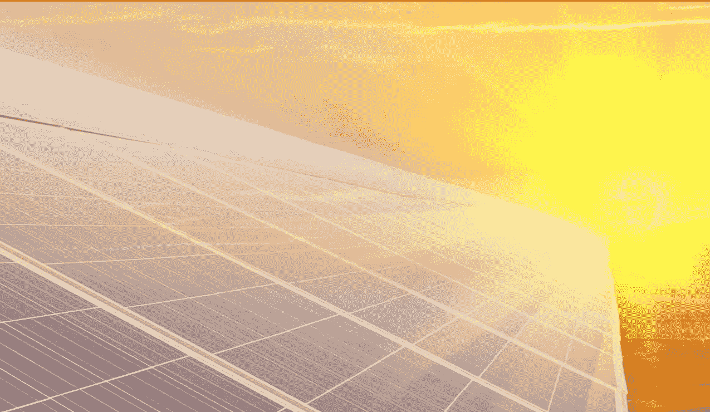

## 网络链接

Michael Boxwell

www.SolarElectricityHandbook.com


# 太阳能简介

我们的太阳距离地球 9300 万英里，其体积是我们行星的 130 万倍。太阳的直径为 86.5 万英里，表面温度为 5,600°C（超过 10,000°F），核心温度为 15,000,000°C，是一个巨大的核能活动体，释放出的光子沐浴着我们的星球，并为我们提供了所需的能量。

我们的行星本身无法产生能量。无论是直接还是间接地，太阳都为我们提供了所有的能量并支撑着整个地球。它是一个巨大的能源。没有它，我们的世界将仅仅是一片冰封的岩石荒漠。

寻找利用太阳能并将其发电是一个极佳的主意。没有持续的电费账单，不需要依赖电源插座，只有一种免费且永续、不损害地球的能源。当然，现实情况略有不同，太阳能并不适用于所有人。然而，利用阳光发电是一项强大的资源，在全球范围内都有应用和益处。

它是如何工作的？适用于什么场景？局限性是什么？成本是多少？如何安装？这本书回答了所有这些问题，并向你展示如何利用太阳的力量自己发电。

在此过程中，我还将揭示一些关于太阳能更广泛主张的误区，并向你展示太阳能可能仅仅是解决方案的一部分。

我将保持描述尽可能简单直白。其中涉及一些简单的数学和科学知识。成功规划太阳能安装至关重要。然而，有很多捷径，我们在 `www.SolarElectricityHandbook.com` 上创建了一系列免费提供的在线计算器，以保持操作简单。

书中包含了示例项目，向你展示了如何使用太阳能。其中一些非常简单，例如为棚屋或车库提供电力照明，或者在房车或船只的屋顶上安装太阳能电池板。另一些则更为复杂，例如为房屋安装光伏太阳能电池板。

我还展示了一些相当奇常的例子，例如太阳能电动摩托车和汽车的可能性。这些都是在利用太阳能并结合一点智慧和决心的情况下可以实现的例子。

我在书中使用了一个示例：为没有接入电网的度假小屋提供太阳能发电。这个示例展示了你可能会遇到的问题和陷阱，并基于现实经验。

书中附带了一个网站。该网站为 `www.SolarElectricityHandbook.com`。

# 本书的适用读者

如果你只是想了解太阳能的工作原理，本手册将提供你所需的所有知识。

如果你计划安装自己的离网太阳能系统，本手册是一份全面的信息来源，将帮助你理解太阳能并指导你设计和安装太阳能系统。

太阳能对于集成到手机、笔记本电脑和便携式收音机等产品中具有巨大的应用前景。如果你特别想安装并网系统（即太阳能系统将电力回馈给当地电网），本手册将为你提供良好的基础，并允许你进行系统设计。你仍需要检查当地的规划法以及有关太阳能安装的其他法律。在某些情况下，你需要经过认证才能进行并网系统的物理安装。你还需要对电力系统有良好的理解，并具备相关工作的资质。

如果你计划安装更大规模的商业系统，或希望专业地安装并网太阳能系统，那么这本书将作为一个很好的入门，但你将需要进一步增长你的知识。

# 快速变化的太阳能世界

我在 1997 年实施了我的第一套太阳能系统。那时，我能买到的最大面板是 100W。每块电池板的效率为 9%。创建我的 1kW 阵列所需的十块电池板成本接近 1 万英镑（约 1.3 万美元）。

如今，太阳能电池板的效率可达 24%。它们的容量更大、寿命更长，而且更廉价。如果我今天使用更大的现代太阳能电池板重做我的第一个 1kW 阵列，电池板的价格将为 400 英镑（520 美元）。如果忽略 25 年的通胀，太阳能电池板的价格下降了 96%！

促进可再生能源的政府激励也改变了人们安装太阳能的方式。在德国、英国、西班牙和美国南部州等国家，在过去的十年里，住宅太阳能已成为常见的景致。太阳能对各国的发电方式产生了巨大影响。在欧洲的几个国家，在夏季生产高峰期，太阳能电池板产生的能量高达该国家能源的 50%。

在未来几年里，所有迹象表明这项技术和行业将继续以类似的速度演变。在 2012 年版中，我声称到 2015 年太阳能将成为最便宜的发电形式，超过传统的低成本发电设备（如煤电厂）。我错了。到 2013 年中期，我们世界许多地区已经达到了交叉点。太阳能电站正变得随处可见，不仅是在加利福尼亚和欧洲南部等气候炎热阳光的富裕地区，也出现在天气较难预测的印度和中国，在这些地方，两三年前太阳能还是一种负担不起的奢侈品。

2009 年至 2014 年间，太阳能电池板的价格一路下跌，每年跌幅高达三分之一。从那时起，太阳能电池板的价格继续每年下降约 10%。因此，今天太阳能电池板的成本是 2009 年价格的十分之一。

随着价格的下降和效率的提高，太阳能已经融入到每一个日常设备中，如笔记本电脑、手机、背包和服装。同时，太阳能正为亚洲和非洲大部分地区带来革命，那里的社区现在首次获得了电力。

作为一种易用且低碳的发电方式，太阳能是无与伦比的。它改变我们未来能源观念的潜力是巨大的。对于非洲和亚洲农村庄的家庭和企业来说，它正在创造一场革命并拯救生命。

## 太阳电与太阳能加热

太阳电是通过光伏太阳电池板上的阳光产生的。这与太阳能热水或加热系统不同，后者是利用太阳的力量来加热水或空气。

太阳能加热系统超出本书的讨论范围。不过，书中有一些关于测量和定位太阳能电池板的有用信息，对于太阳能光伏和太阳能加热系统都有帮助。

如果你计划使用太阳能发电热，加热系统的效率比太阳电高得多，产生相同能量所需的电池板更少。

太阳电通常被称为光伏太阳能，或 `PV`。在本书中，每当我提到太阳能电池板时，我指的用于发电的光伏电池板，而不是加热系统。

## 太阳能的来源

在太阳中心深处，剧烈的核活动产生了大量的辐射。在这个过程中，辐射产生了称为光子的光。这些光子没有自身的物理质量，但带有巨大的能量和动量。

不同的光子带有不同波长的光。某些光子是不可见的（红外线和紫外线），另一些是可见的（如白光）。随着时间的推移，光子从太阳中心向外推动。光子从核心移动到表面可能需要百万年。一旦到达表面，这些光子以每百万 670 英里的速度冲出。它们在八分钟后到达地球。

在前往太阳的过程中，光子可能会与其他粒子碰撞并偏转，并在与任何吸收辐射的物体接触时被破坏产生热。你的身体吸收来自太阳的光子。这就是为什么你在晴朗的日子里感到温暖。

我们的大气层在这些光子到达地球表面之前吸收了其中许多。这是中午太阳感觉比其他时间热两个原因之一。中午太阳位于正上方，与傍晚太阳落山时，光子必须穿过厚得多的大气层相比，光子只需要穿过较薄的大气层就能到达我们这里。


这也是冬季比较冷的两个原因之一。在冬季，当你在地球上的位置远离太阳时，光子必须穿过厚得多的大气层才能到达我们这里。中午太阳比晚上热的另一个原因是中午光子的强度更高。当太阳在天空低处时，由于你相对于地球的角度，这些光子分布在更大的范围内。

## 太阳电的原理

将两层半导体材料结合以产生这种效应。其中一层必须缺少电子。当暴露在阳光下时，材料层吸收光子。这激发了电子，导致一些电子“跳跃”到另一层，产生电荷。

太阳能电池利用光伏效应发电，这种现象发现于 1839 年，当时法国物理学家埃德蒙·贝克瑞尔观察到某些材料在光照下会产生电流。

用于制造太阳能电池的半导体材料被切割成非常薄的晶片。这些晶片中的一些通过三种方式“掺杂”杂质，从而在晶片中产生电子不平衡。然后将这些晶片排列在一起形成太阳能电池。连接在电池上的导性金属条提取电流。

与其使用太阳能电来加热，你更应该考虑使用太阳能热水系统，并使用燃气或固体燃料进行加热和烹饪。

在不减少现有用电量的情况下，通常无法仅靠太阳能为普通家庭供电。大多数房屋没有足够的屋顶空间来安装所有所需的电池板。成本也是一个因素。如果你计划完全离网，那么在开始之前评估你的用电量并进行节约通常是一个好主意。

大多数家庭和企业的用电效率都非常低。如果你想有效利用太阳能电，花时间识别电能浪费在何处并消除浪费是绝对必要的。

如果你居住在北欧或加拿大等气候地区，情况尤为如此，因为冬季的太阳能产量较低。例如，在英国，普通大小房屋的屋顶不足以容纳所有所需的电池板，因此节约能源至关重要。对于其他应用，太阳能安装更具成本效益。例如，无论你住在哪个国家，为小型家庭提供电力都在太阳能系统的能力范围内，如果加热和烹饪通过燃气或固体燃料解决，那么如果房屋是离网且不靠近电网，太阳能系统可能比安装传统的电力系统更具成本效益。

如果你的需求很小，例如为车库或马厩提供照明，有现成的套装可以以非常合理的价格实现：£200–£260 ($30–$130）就能为你提供一套适用于大型马厩或工作坊的系统。低成本太阳能电池板也适合为汽车、休闲车或船的电池充电，确保电池在两次旅行之间获得涓流充电。

## 太阳能作为补充源

如今欧洲和北美的大多数太阳能安装都是房屋的屋顶安装。在这些系统中，太阳能板产生的电在白天供家庭使用，多余的能量由附近的其他房屋馈入电网。这些系统被称为“并网式”系统。并网太阳能系统实际上创建了一个微电站，不仅为你自己提供能量，还为当地社区提供能量。其他人可以使用这些电力。

这有几种变体。例如，你可以安装电池，这样白天产生的多余电就可以储存起来供晚上使用。这减少了你对电网的依赖，同时确保你不会耗尽能量。

在配置太阳能作为补充源时，太阳能安装的规模并不那么关键。相反，你可以根据项目可用的空间或预算来选择系统尺寸。这些系统的回收期取决于你居住的地方、获得的光照量以及你白天的用电量。如果你在家办公且有空调或可以在白天给电动汽车充电，那么太阳能安装可以在四到六年内收回成本。对于大多数人来说，回收期更长，但典型的家庭太阳能安装通常会在七到十年左右收回成本。

## 为什么选择太阳能？

有许多考虑安装太阳能系统的理由：

- 在没有其他电力来源的地方，或者安装传统电力的成本太高的地方。
- 在其他电源不可靠的地方。例如，当停电是一个问题时，太阳能系统可以作为一种成本效益高的应急方案。
- 当太阳能系统是最方便、安全的选择时。例如，在花园里安装太阳能或在偏远地区提供照明。
- 当你可以完全自给自足提供电力时。
- 当你需要移动电源时——例如在房车、旅行拖车或船上。
- 当从供应商处购买电力具有足够的财务激励来证明投资的价值时。
- 安装后，太阳能提供几乎免费的电力，且不破坏环境。

## 证明太阳能合理的成本

安装太阳能系统的真实成本取决于多种因素：

- 一年中不同季节的光强度。
- 你需要产生多少能量？
- 你的场地捕捉光照的效果如何？

尽管过去十几年价格大幅下降，但太阳能系统的资本成本可能比其他系统高。例如，小型发电机会比同等的太阳能板和逆变器便宜。然而，考虑到运行成本时，太阳能总是胜出的。为了与其他电源进行比较，你有时需要计算长期回收期以证明太阳能初始成本的合理性。

对于所有安装，在确定光伏系统的总成本之前，你需要对场地进行调查并完成一些设计工作。不要恐慌，这并不困难；我稍后会详细介绍。然后你可以借此将项目与其他替代方案进行比较。

## 太阳能与风能

小型风力涡轮机有效率低下和发电能力差的声声。虽然在某种程度上确实如此，但真正的问题是风能极难有效利用，在城市环境中几乎不可能实现。它们的坏名源于安装不当，而不是涡轮机本身。

风能发电具有很强的场地特定性。在地面上它很少产生电，因为它被周围环境（建筑物、树木甚至地面）阻挡。要获得真正的功率，你需要处于湍流上方和自由流空气中。这种自由流空气被称为“层流”（`laminar`），是可以提取并产生电的能量来源。对于风力涡轮机，你必须将其安装在高处，以便叶片能够切入层流。通常，这意味着在远离建筑物或高树的区域，叶片底部应比周围至少高 10 米（32 英尺）。

风力涡轮机在微风中可能会旋转但不会产生任何电。你通常需要 5 米/秒的风速（仅 10 节或 11 英里/小时）才能让风力涡轮机发电。网上有各种风速数据库，你可以在那里输入位置，并按每月查找你地区的平均风速。

如果你住在多风的农场或海边，并且可以将风力涡轮机比任何建筑物或树木高 10-15 米（32-48 英尺），那么风力涡轮机可能适合你。如果你住在建筑区或靠近树木或主干道，或者你无法在高处安装涡轮机，那么风力涡轮机就不合适用。

如果你想亲眼看看风的力量，就放风筝。将风筝从地面升到空中是困难的——风筝不想飞，在空气中移动缓慢且容易坠毁。当风筝随着风线上升和摇摆时，让它进入更高处的层流层。在开阔的地面上，风筝通常在 10 米（32 英尺）左右开始表现良好。如果你靠近树木或建筑物，你必须得比那些树木或建筑物高得多才能获得相同的效果。轻风筝无法从风中获取足够的能量飞到屋顶高度；风力涡轮机又有什么机会呢？

要小心那些声称能在湍流中发电的“特殊”风力涡轮机。涡轮机本身在旋转，但原材料（即风中的能量）根本不存在，因此几乎没有能量可以发电。这些主张通常是没有根据的，没有真实世界的证据证明它们能产生可用的电量。

有很多误推和设计不当的案例：在撰写这本书的这一版本之前，我拜访了一位好朋友，她在房子侧面安装了一个风力涡轮机。在六个月的产出中，该系统仅产生了 3.5 千瓦电——不足以运行它自己的控制系统。

能源行业正在做出反应。中国每小时正在建设并安装两台电网级风力发电机，英国正在提前关闭煤电厂，许多国家已承诺在未来五年内从电力结构中消除化石燃料。

没有任何一种发电方式是完全环保的。水电站会对水资源产生影响并影响当地野生动物。风力发电机每年导致鸟类死亡。建造水能、风能或太阳能设备产生的碳足迹是必须考虑在内的。然而，这种环境影响仅是传统发电技术碳足迹的一小部分。

一旦安装，太阳能发电系统就是一个低碳发电器。阳光是免费的，系统维护成本极低。其碳足迹一直较高，主要是由于面板的制造量相对较小，以及面板中硅片“掺杂”所需的化学品。

得益于制造技术的改进和产量的增加，太阳能电池板的碳足迹低得多。你可以通过在一到两年内产生的能量轻松抵消制造太阳能电池板的碳足迹，或者使用最新的薄膜太阳能电池板只需六个月即可收回碳足迹。

因此，与从电网获取相同的电力相比，运行完整独立系统的太阳能发电系统可以减少你的碳足迹。

并网式太阳能也是如此。过去，电力公司努力将可再生能源整合到发电组合中。这意味着虽然太阳能电池板产生的能量是无污染的，但并不意味着煤电或燃气发电站的碳产量会相应减少。

情况已不再如此。电力公司现在更擅长提前预测天气状况，并调整发电机的整体组合以利用可再生能源。这确保了我们能源结构中真正的碳减排。

当然，气候越温暖，人们在尝试通过空调降凉时，能源消耗带来的收益往往越大。在高峰时期，用电需求与太阳能阵列的能量产量高峰同时发生，并网式太阳能系统可以完美匹配。

如果你住在阳光较少的地区，用电需求高峰通常发生在晚上，但如果你想最大限度地化安装太阳能系统的碳效益，你应该尝试实现以下目标：

- 自用产生的电力
- 将能量用于洗衣机等高负载应用
- 在需求高峰期间减少从电网获取的电量
- 使用电池储存部分太阳能发电，并在晚上使用

## 环境效率：供应与需求的对比

有一个在线计算器可以绘制你一段时间内的用电情况，并将其与可用光量进行比较。该计算器专为并网系统设计，显示了太阳能在从供应和需求方面的适配程度。

虽然这个在线计算器不能替代详细的用电量调查以及对你所在地供电确切来源的研究，但它能让你对太阳能系统可能的环境性能有一个参考。

要使用这个在线计算器，请收集每年每月的用电信息。你通常可以在电费单上或通过在线访问电力账户找到这些信息。访问 `www.SolarElectricityHandbook.com`，点击“在线计算器”部分中的链接进入“并网太阳能计算器”页面。

## 结论

- 当你的电力需求适中、没有其他易于获取的电源且阳光充足时，太阳能发电是一个很好的电力来源。
- 太阳能发电不等同于太阳能加热。
- 太阳能电池板吸收阳光中的光子产生电。直射光产生的电最多，但在阴天太阳能依然能发电。
- 太阳能无法一直产生足够的电力为普通家庭住宅供电，除非对家庭电力需求做出重大节约。
- 较大的太阳能发电系统资本成本相对较高，但持续维护成本非常低。
- 较小的太阳能发电系统在购买和安装上极具成本效益，即使与传统的电力供应相比也是。
- 在偏远建筑中使用太阳能发电比连接到传统的电网供应要便宜得多。
- 独立式和并网式太阳能系统都能产生巨大的环境效益。

## 太阳能的成本合理性

利用太阳能产生能量不仅环保，对你的银行账户也有好处。无论你是想抵消家里或业务场所的电费，还是想避免新建筑连接电网的高昂费用，太阳能通常都能为你节省资金。

遗憾的是，几年前可用的大多数补贴和赠款已不再可用，尽管还有一些例外。然而，还有其他财务激励措施可以证明太阳能的成本合理性。在大多数情况下，这些激励措施足以在几年内抵消你的太阳能安装费用。这可以使其成为一项合理的长期投资，特别是与每年的银行利率相比时。

证明太阳能安装成本合理性的三种方法：

- 通过出售电力产生收入
- 通过自用电而非购买电来省钱
- 安装太阳能的成本低于支付传统的连接费或电网升级费用

还有其他因素有助于安装太阳能：

- 减少能源价格波动的影响
- 未来对电力的更大依赖（例如切换到热泵供暖和使用电动）

最后，虽然几年前的补贴和赠款已经停止，但仍有一些方案处于开放状态。

## 成本证明

### 出售你的电力

#### 家庭系统

首先，如果你正在建造一个并网系统，可以将多余的发电卖回给电力公司。方案因国家和系统规模而异。对于家庭系统，你通常会从电力供应商那里获得批发价。

大多数屋顶光伏系统无法通过向电网出售多余电力来实现完全成本合理化。最好的情况下，它可以有助于支付系统成本，但仅靠系统本身可能需要 20-30 年才能回本。

通常情况下，除非太阳能与电池结合或用户有特定的电力用途，否则家庭会将产生的一半电力出口。

#### 英国家庭系统

在英国，你可以通过政府支持的“智能出口保证”（`Smart Export Guarantee`）出口电力。你可以选择想卖给哪家电力供应商，并使用智能电表进行监控。出口价格基于电力的批发价而非零售价，且不同供应商之间差异巨大，因此最好货比三家。

假设房屋上安装了 4kW 的太阳能阵列，且产生的电力全部出口，家庭预计每年通过出售多余电力可以创造 75-125 英镑的收入。

#### 美国家庭系统

在美国，这种回馈系统被称为“净计量电量”（`net metering`），客户向电网出口电力可以获得补偿。

净计量电量在美国并非处处可用，但现在已在 44 州强制执行，其他州则有自愿方案。交易差异巨大。在大多数州，净计量电量确保太阳能所有者获得零售价报酬


为了他们产生的电力。然而，在少数州，太阳能所有者产生的电力只能获得批发价，因此您需要先检查您所在地区的情况。

在净电计量并支付零售价的南方州，拥有 4kW 太阳能电池阵列并出口一半发电量的家庭，预计每年通过出售剩余电量获得 200-300 美元。

## 太阳能电场和大型商业系统

对于较大的系统，例如太阳能电场或安装在仓库或工厂等大型商业建筑屋顶的太阳能电池板，你可能会与供应商签署多年合同出售你的电力。这些合同可以是每千瓦时固定金额，也可以根据你所在地区的电力需求浮动金额。在供过于于求的时期，你的电力几乎一文不值。在其他时候，你产生的电量将以相当昂贵的溢价出售。

在英国，该计划被称为电力购买协议（PPA）。你可以与电力供应商、聚合商或 PPA 专家签署 PPA。由于不同供应商之间的价格差异巨大，因此值得寻找最佳交易方案。

在美国，不同地区有不同的计划。这些计划通常由当地电力公用事业公司提供。

在价格随供需波动的情况下，将太阳能电场与电池结合是有意义的，即在电价低时储存能量，在电价高时出售。直到最近，电池的经济性一直处于边缘，但随着近期欧洲高天然气价格导致批发价格上涨，这种做法的益处现在变得更加清晰。

最后，欧洲和美国都有关于可再生能源证书的计划，每产生 1 兆瓦时（MWh）电就会获得一张证书。这些是可交易的证书，可以卖给希望证明其使用了可再生资源的公司或用户，这通常是法律要求。在美国，这些被称为可再生能源证书（REC）或可再生产地证书（REGO），在澳大利亚，它们被称为小型技术证书（STC）。在英国和整个欧盟，它们被称为可再生能源证书。

通常情况下，你可以预计英国位于合适位置的设计良好的太阳能电场将有八到十二年的回收期，以及至少二十五年的运行寿命。在美国，回期将取决于你所在的位置：在北方州，回收期与英国相当。在南方州，回收期在五到七年之间。

## 使用你的电力而不是购买电力

对于大多数人来说，太阳能安装通过节省从电网购买电力的开支来实现成本合理。

当你是房主，或者是像农场、仓库或工厂这样的企业时，效果更好。在家庭环境中，如果你使用产生的一半能量，4kW 的太阳能电池阵列每年可以从你的电费中节省 400-650 美元。如果你使用所有能量，节省将将高得多，而且是可以实现的，特别是当你的光伏系统与电池结合时，或者你使用热泵供暖或空调，或者你驾驶电动汽车并在白天充电时。

在商业环境中，光伏可能更具成本效益。大多数企业在白天是活跃的，此时太阳能的产量最高。许多企业对其购买的电力有变动电价，取决于供需，这些电价通常与太阳能的峰值生产时间重合。此外，用于安装太阳能的屋顶空间通常比家庭得多，安装大型系统比小型系统更具成本效益。

作为一个粗略指南，在英国，安装在朝南的仓库或工厂屋顶的 50kW 太阳能电池阵列可以节省 30,000 英镑的安装费用。如果太阳能电池阵列产生的电 75% 被企业使用，预计企业的电费成本每年可节省约 5,500-6,500 英镑。

## 为新建筑安装电力

如果你正考虑为新建筑安装电力连接，安装自己的太阳能发电站通常比拉电线更便宜。如果你住在农村地区，电线可能没有离建筑很近，这种情况下尤为如此。即使是到路边物业的简单连接也轻松花费数千美元，如果你的物业适合太阳能发电，那么完全“离网”并利用太阳能产生所有电力可能变得更具成本效益。

这种情况比任何电力电网连接发生得更频繁。英国和美国的偏远农场现在已经脱离了这一点，依靠发电机提供电力。对于这些地点中的许多，安装带电池的太阳能是一个可行且具有成本效益的解决方案。

当然，这种方法也有局限性。你需要密切关注自己的用电量，以防用尽。你需要用其他形式的发电来补充太阳能，例如风力涡轮机或小型发电机。然而，对于许多无法获得或负担不起传统电力连接的地方，这可能是一个实用的选择。

## 附加因素

### 减少能源价格波动的影响

世界面临着能源危机。使用煤炭、石油或天然气的传统发电形式正在增加，许多情况现在已经失控。对每个人来说成本都更大。化石燃料价格不确定地波动，我们的能源安全是一个持续的担忧，引发了比政治家承认更多的全球冲突。

油价波动剧。原油价格一天内可能波动 20 美元。在 2020 年，油价曾低至 0 美元，高达 156 美元。

市场的波动很难预测。在 2016 年，油价曾低至 22 美元/桶。石油专家预测未来几年石油将仍然是最廉的能源形式。行业分析预测太阳能股票将会下降。

一年后，油价增加了一倍多达到 45 美元，在我这本书的 2018 年版时达到 58 美元/桶，一年后达到 85 美元/桶。

在新冠-19 疫情早期，由于国家封锁，油价崩溃了。在某一点，由于生产者无法找到储存设施，油价跌至零以下。

现在，2022 年，油价交易价格在 74 美元左右——从去年的 51 美元，但在过去的季度在 38 美元到 102 美元之间波动。一如既往，石油保持高度波动，持续的疫情比以往任何时候都具有动稳定性。油价的变化影响着经济，俄罗斯和沙特等国正处于经济边缘，这由我们来买单。

大多数国家意识到价格不稳定的问题，并实施了可再生能源计划以减少对化石燃料的依赖。然而这是有代价的。新型发电站和技术的投资是昂贵的。包括英国、澳大利亚和美国在内的许多国家面临变化，并遭受了数十年来新技术投资不足的影响。现在正在改变，这些变化的成本是巨大的，并反映在我们支付的能源价格中。

在英国，目前的消费者燃气和电价是十年前的三倍，并预计在未来几个月内再增长 50%。大多数能源专家预测，随着该国淘汰旧燃煤发电厂并用新的能源源取代，未来十年或更长时间的价格将超过通胀。在美国，家庭能源价格在同一时期几乎翻了一番。在阿拉拉巴马州、德克萨斯州等州的平均用电税收为

加州近期出台了政策，对许多房主造成了不利影响。未来十年的展望显示，价格可能会再次翻倍。

正是由于这种能源价格的不断上涨，这些政策对家庭主、小型企业主，以及商业和工业用户都可能生效。在欧洲和美国，许多酒店和餐连锁现在正选择在屋顶安装太阳能设备，人们对太阳能发电场的兴趣也再次抬头；在北欧的典型回收期为八年，而在南欧和美国南部州则为五年。

## 未来对电的依赖程度将增加

在减少碳足迹的推动下，我们正将能源使用从燃气转向电力。建筑采暖正从燃气转向电热；汽车和巴士正在变得电动化。由于零售电价显著高于燃气价格，账单压力变得越来越大。安装太阳能可以产生显著差异，为能源账单实现长期且持续的节约。

## 太阳能光伏与热泵

将热泵与太阳能结合是一个好主意。在英国，气价传统上约为电价的四分之一，这就是为什么大多数家庭使用燃气暖。热泵的采暖效率通常在 300-350% 左右（它们不产生热量，而是捕捉室外热量，通过压缩提高温度并释放到室内）。热泵可能比使用燃气贵，但比使用电力要便宜得多。

将热泵与太阳能结合，并控制加热系统的运行时间，意味着热泵的运行成本大幅下降。在某些情况下，通过良好的设计，它可以覆盖热泵每年 9-10 天的全部运行成本，并为剩余 2-3 个月的费用提供支持。我们看到一些案例，得益于设计良好的太阳能光伏和热泵系统，四居室房屋的年度采暖和热水账单从每年 1900 英镑下降到了 385 英镑。

## 太阳能光伏与电动汽车

得益于更多型号和政府补贴，电动汽车现在正赢得市场。许多国家现在制定了淘汰传统汽车的时间表。

根据实际驾驶情况，一辆典型的家用电动汽车每消耗 1 kWh 电量可以行驶约 3.5 英里（5.6 公里）。较小的汽车接近 5 英里（9.6 公里），较大的汽车每 kWh 约为 2.9 英里（4.6 公里）。在英国，平均汽车每天行驶 20 英里。在美国，这个数字是 37 英里。

这意味着一辆典型的电动汽车在英国每天使用 4-7 kWh 的能量，在美国则使用 7-12 kWh。取决于你所在的地点和季节，将取决于你能够使用多少能量为汽车充电。如果你在白天充电，通常会发现汽车可以使用你更多的剩余太阳能发电。这使你的节约最大化，并且比为家里购买额外的电池更具效益的解决方案。

在家里，电动汽车通过专用充电桩从 AC 电源充电。现在有许多支持太阳能的电动汽车充电桩，它们优先考虑使用过剩太阳能为汽车充电。这些充电桩允许你覆盖“仅限太阳能”设置以便更快充电，但在时间不重要时，允许汽车在更长时间内完全通过过剩太阳能充电。`SolarEdge`、`Zappi`、`Wallbox`、`Snapee` 和 `Vivint` 都提供连接到你太阳能阵列的电动汽车充电器。

## 财务激励

21 世纪 10 年代，许多国家推出了补贴方案、赠金和其他财务激励措施以鼓励采用太阳能。然而，尽管价格已经下降，许多补贴现在已缩减规模或被完全取消。

然而，也有例外，几个国家和州近期推出了方案，要么作为 COVID-19 的复苏计划的一部分，要么作为鼓励投资绿色技术的更大激励措施。

## 赠金计划、低息贷款和退税

赠金计划、低息贷款和退税直接从政府资金支出。因此，它们可能不受某些政治家和广大选民的支持，他们通常反对将纳税人的用于绿色能源补贴。

安装太阳能的赠金变得越来越稀少，尽管全球范围内仍有一些特定用途的方案：

### 美国

- 美国农业部和农村发展部为农业和农村企业的太阳能安装提供担保的贷款和赠金。
- 在美国的几个州（包括加州），太阳能能源享有退税，无论是为了住宅、商业还是农业用途而安装。针对低收入家庭和多户住宅项目的太阳能安装也有退税。这些方案的具体细节在不同县和州之间有所不同。
- 州和国家级提供了许多赠金和财务激励措施。请查看州可再生能源与效率激励在线数据库 (`dsireusa.org`) 获取更多信息。

### 英国

- 英国农村发展计划在 2019 年推出了一项新计划，鼓励农业社区采用太阳能系统，这在已有合适电力供应的偏远地区特别受欢迎。该资金由一项最高 20,000 英镑（占成本的 50%）的赠金组成，用于测试可再生能源系统的可行性，随后为太阳能、风能或水电项目提供最高占剩余成本 50% 的低息无担保贷款。
- 对于企业，热泵计划（Heat Pump Scheme）提供高达 7,500 英镑的赠金用于安装热泵。
- 对于家庭，锅炉升级计划（Boiler Upgrade Scheme）提供高达 7,500 英镑的赠金用于安装热泵或生物质锅炉。
- 对于低收入家庭，ECO4 计划可以提供高达 16,000 英镑的赠金用于安装热泵或太阳能电池板。
- 太阳能投资计划（Solar Energy Investment Scheme）提供高达 5,000 英镑的赠金用于安装太阳能光伏板。
- 智能能源赠金（Smart Energy Grant）提供高达 6,000 英镑的赠金用于安装空气源热泵、太阳能热水器或太阳能储能。

能量是指作功的能力：功率乘以时间。能量的符号为“E”。能量通常以焦耳为单位（1焦耳等于1瓦秒），但电能通常用瓦时（Wh）或千瓦时（kWh）表示，1 kWh = 1000 Wh。

## 伏特、安培、欧姆

电压等于电流乘以电阻。这种计算方法被称为欧姆定律。通过功率计算，可以用不同的方式表达这种计算。如果你知道电压和电流，就可以计算电阻。如果你知道电压和电阻，就可以计算电流：

| 公式 | 等式 |
| :--- | :--- |
| 电流 x 电阻 = 电压 | I x R = V |
| 电压 ÷ 电阻 = 电流 | V / R = I |
| 电压 ÷ 电流 = 电阻 | V / I = R |

## 功率

功率是电压乘以电流，单位是瓦特。一个12伏特、电流4安培的电路等于48瓦。根据这一计算，如果我们知道功率和电流，就可以算出电压；如果我们知道电压和功率，就可以算出电流：

| 公式 | 等式 |
| :--- | :--- |
| 电压 x 电流 = 功率 | V x I = P |
| 功率 ÷ 电流 = 伏特 | P / I = V |
| 功率 ÷ 电压 = 电流 | P / V = I |

## 能量

能量是功率随时间的测量。它显示了设备使用或产生了多少功率，通常以小时为周期。在电气系统中，它以瓦时（Wh）为单位。一个使用50瓦功率一小时的设备，或一个每小时能产生50瓦的太阳能板，其能量潜力为50Wh。

然而，由于太阳能发电受温度、时间等因素影响变化很大，太阳能系统专门使用峰值功率（Wp）额。峰值功率显示了太阳能板在峰值时可以产生多少功率。引入这一概念是为了强调太阳能板产生的能量是是变化的，并提醒人们额定为50瓦的太阳能板并不会每天产生50瓦的能量。

## 直流与交流电

电路中可以流两种电流。直流是向一个方向流动的恒定电流，从高电压（正极）电源流向低电压（负极）电源。电池和太阳能板通过直流电路工作。

交流电是快速变换方向的电荷流。电流每秒切换几次方向。这种切换循环被称为频率，以赫兹（Hz）计。切换循环越快，频率越高。电网电使用交流电。欧洲的交流电每秒循环五十次（50 Hz），而美国每秒循环六十次（60 Hz）。

## 低电流和高电流系统

当我们设计系统时，通常希望电流越低越好。如果我们通过电路通过过电流，电流损失的能量将呈指数级增长。这种电流产生的热量会降低系统的整体效率。这种电阻随着距离的增加而积累，这意味着电流越大，你在功率方面的问题就越多，特别是在长电缆布线的情况下。

例如，假设我们有一个12V 200W的太阳能板，希望通过电池将它们组合。我们可以选择串联它们创建一个24V、200瓦的电路，或者并联它们创建一个12V、200瓦的电路：

- 一个12伏特200W的太阳能板电流为16.6安培（200瓦 ÷ 12 = 16.6安培）。
- 如果我们将两个太阳能板串联，太阳能阵列的电流为8.3安培（200瓦 ÷ 24 = 8.3安培）。
- 如果我们将两个太阳能板并联，太阳能阵列的电流为33安培（400瓦 ÷ 12 = 33安培）。

增加电压比增加电流更好。当然，这个规则也有例外。例如，如果你想让系统运行12伏，你可以使用更粗的电缆并将电缆保持最短。这限制了系统的整体尺寸，但这可能并不重要。只要你意识到问题并进行设计，这种方法就没有问题。

## 给非电工的话

客观来说，如果你对电气系统不熟悉，不应该计划自己安装大型太阳能系统。如果你想在谷仓或棚的屋顶安装一个低电压系统，或者想玩玩技术并获得乐趣，那么太好了，这本书将告诉你一切。然而，如果你对电气知识仅限于接插头或更换保险丝，在学习电气系统和电气安全之前，不应该考虑自己物理布线和安装系统。

*(注：原文后续部分存在大量重复段落，译文已根据“不要重复输出原文”的要求进行了去重处理)*

正如第 17 页开始的“成本型太阳能启动”章节所解释的那样，将电力送回电力公司。

在并网式系统中，你的家庭在白天通过太阳能运行。你产生的任何剩余能量都会被馈入电网。在晚上和深夜，你按照通常的方式从电力公司购买电力。

并网式太阳能安装的优点是，它们减少了你对电力公司的依赖，确保更多的电力通过更环保的方式产生，并节省了购买电力的费用。

大多数并网系统的一个缺点是，如果发生停电，你的太阳能阵列也会断电。单通过安装并网式太阳能系统，你无法获得额外的能源安全。

并网系统在炎热、阳光充足的地区运行良好，在这些地区，对电网电力的需求通常与阳光照射相一致，例如空调设备的高电量需求。并网系统在所有者自行使用大部分电力的情况下同样有效。

## 并网系统的一个示例

Si Gelatos 是一家位于佛罗里达州的冰激淋生产商。他们在 2007 年为工厂屋顶安装了太阳能，以抵消运行冷柜所消耗的能量。

“运行工业冷柜极其昂贵且消耗大量电力，”Si Gelatos 的 Dan Foster 说道，“我们无法希望所有的电力都来自太阳能，但我们认为减少整体电力需求是重要的，而太阳能让我们实现了这一点。”

冷链设施在夏季白天的消耗了大部分电力，此时太阳能正处于峰值运行。自从安装了太阳能以后，Si Gelatos 的总能量消耗下降了 40%，现在在用电高峰几乎不从公用事业取电。

“太阳能对我们的业务有三个意义，”丹说，“首先，这对我们的员工来说是一个非常直观的信号，表明我们认真对待环境。这种转变让我们的员工意识到他们需要尽一份力，在不需要时关闭灯光和电源。它向我们的客户展示了我们对环境的关注，这对产品和销售很有好处。第三，也是最重要的一点，我们确实在对环境做出的真实贡献，在其他人电力需求最高的时段减少了我们的用电。”

## 带电力备份的并网系统（电网交互）

带电力备份的并网系统——也称为电网交互系统——将并网安装与电池组结合。

与并网系统类似，其概念是在阳光照射时使用太阳能电，并将其卖给电力公司。然而，与标准的并网系统不同，电池为停电提供了应急预案，使你能够继续使用来自系统的电力。

通常情况下，你会在建筑内部设置电路，这些电路在停电期间将继续接收电力。这确保了基本电力可供照明、制冷和加热控制器使用，而电力不会浪费在电视和收音机等非必需的设备上。

当电网可用时，电网交互系统被配置为为整个房屋供电，太阳能和电池提供大部分电力，并在需要时进行补充。

如果存在停电数天的可能，也可以设计一种系统，将其他发电机（如发电机组）整合到电网交互系统中。这将允许电网交互系统在长时间内作为高效的不间断电源（UPS）工作。

带电力备份的并网系统成本比标准并网系统高，因为增加了电池和电池控制器的额外成本。通常情况下，如果使用锂电池，带电力备份将比标准并网系统额外增加 35–50% 的成本；如果使用铅酸电池，则增加 20–25% 的成本。

与普通并网系统一样，在某些国家，可以将多余电力卖回给电力公司，允许你从太阳能发电系统中获得收入。

现在市面上的现成并网电池系统日益增，`Tesla Powerwall` 家用电池是最广为人知的。大多数家用电池系统可以存储 4 到 6 千瓦小时的能量。

## 电网交互系统的一个示例

电网交互系统在英国的农村农场越来越受欢迎，在那里即使是短时间的停电也会造成巨大的干扰。

传统上，农民依靠使用这种系统来提供照明和电力。然而，在 2009 年至 2011 年间，当英国政府为安装太阳能提供大量激励时，许多农民在他们的建筑上安装了电网交互系统，通过向电力公用事业公司出售电力为他们带来收入，并在停电时提供备份电源。

与标准并网系统相比，安装电网交互系统的额外成本被低廉的运行成本和易于使用的便利性大大抵消了。农民不需要购买和运行发电机，而且该系统几乎不需要维护。这与需要定期测试的发电机系统形成了鲜明对比。

## 备网切换（Grid fallback）

在备网切换系统中，太阳能阵列产生电力并为电池组充电。能量从电池提取以运行电路。当电池耗尽时，系统会切换回电网。

备网切换系统的优点是特定电路可以完全由太阳能运行。在许多情况下，你拥有一个以电网作为备份的备网切换系统。缺点是，如果电路过载，备网切换系统无法处理整个负载。

备网切换系统曾是总需求较低的小型太阳能系统的首选方案。然而，随着电网交互系统成本不断下降，备网切换系统的吸引力正在降低。

## 备网切换系统的一个示例


# 并网系统的商业储能系统往往昂贵

像 `Tesla Powerwall` 等系统允许住宅客户在家里整合电池存储，但成本很高。

电池存储的设计旨在与现有的并网系统配合，或作为新安装的一部分，提供白天所有的照明。该系统证明是巨大的成功，为英国客户节省了大量的电费。

## 电网故障转移（Grid failover）

你可以将备网切换系统配置为电网故障转移系统。当主电力供应发生故障时，它会启动。实际上，它是一个不间断电源，通过太阳能产生电力。

这种配置的优点是，如果发生停电，你有应急电力。这种配置的缺点是，你没有在日常中使用电力。

尽管在欧洲和美国，电网故障转移系统在故障常见的国家常见，但在非洲和亚洲许多地区，电网故障转移系统减少了基本需求对发电机的依赖。然而，在大多数情况下，客户发现备网切换系统或电网交互系统更符合他们的需求。两者在过去都安装过，并在之后重新配置为备网切换系统。

## 从离网到并网

离网系统和较小的备网切换系统采用低电压运行，通常为 12 到 48 伏。这是因为电池是低电压单元，构建低电压系统既简单又安全。

并网系统通常是较大的安装，每小时产生数千瓦的电力。由于需要高电压电源，将多个太阳能电池板连接在一起产生高电压，比使用逆变器升压更有效。这种高电压直流电通过逆变器转换为交流电。

高电压的优点是效率。在电缆中传输高电压小电流的电力比较小的离网电池系统损耗更小。低电压是最佳方案，因为电池组通常作为低电压存储。对于不使用电池组的并网系统，高电压系统是最佳方案。对于带电池存储的并网系统，大多数系统是高电压太阳能发电和低中电压电池系统的混合体。哪种方法取决于设计的系统类型。

- 太阳能有多种用途和应用。
- 离网系统最简单易于理解。它们通常是为没有可用电源提供的小型系统。
- 对于并网，你的太阳能系统产生的电力被正常使用。任何多余的电力都会馈入电网。
- 并网电力（也称为电网交互）为你提供了并网系统的优点，其额外的好处是，即使断电，电力依然可用。
- 备网切换系统在离网系统中比并网系统更常见。在设计上，它们与离网系统非常相似，由电池组运行逆变器，并带有自动转换开关在太阳能系统和电网电源之间切换电力。
- 电网故障转移系统相对少见。它们主要用于利用太阳能作为备份源提供不间断电源。
- 并网系统的设计与离网系统不同。它们往往是高电压系统，而离网系统运行电压较低。

## 光伏（PV）系统组件

在我开始详细介绍规划和设计太阳能电气系统之前，有必要描述系统中所有的不同组件并解释它们是如何组合的。读完这一章后，你将对太阳能系统如何组合有一个合理的理解。在现阶段我不会涉及过多的细节，目前仅提供一个概述。细节以后再讨论。

## 太阳能板

太阳能电气系统的核心是太阳能板本身。有很多类型的太阳能板，我稍后会介绍。

太阳能板，或者更准确地说、`光伏`面板，通过太阳能发电。太阳能量越强，获得的功率就越大，尽管太阳能板在阴影下也会继续产生少量的电。大多数太阳能板由连接在一起的单个太阳电池组成。一个典型的太阳电池只能产生半伏特，因此通过在面板内部将它们串联，可以获得有效的电压。

大多数小型太阳能板——额定功率 150Wp 或以下——被额定为 12 伏太阳能板，而较大的太阳能板则是 24 伏面板。12 伏太阳能板在负载下会产生 14–18 伏。这允许单个面板为 12 伏电池充电。顺便提一下，如果你在太阳能板没有负载时对其连接电压表，可能会看到高达 26 伏的电压读数。这在太阳能板的“开路”状态下是正常的。一旦你将面板接入电路，电压水平将下降到 14–18 伏。

太阳能板可以连接在一起形成太阳能阵列。连接多个面板允许你产生更大的电流或以更高的电压运行：

- 串联面板可形成高电压的阵列。在独立系统中，通常为 12、24 或 48 伏；在并网系统中，则为数百伏。
- `并联`连接面板允许太阳能阵列在保持与单个面板相同电压的同时产生更多功率。
- 当你将多个面板连接在一起时，无论是串联还是并联，整个系统的功率都会增加。

在太阳能板串联连接的太阳能阵列中（如下所示所示），你将每个面板的电压相加，并将每个面板的功率相加，以计算太阳能阵列将产生的最大功率和电压。

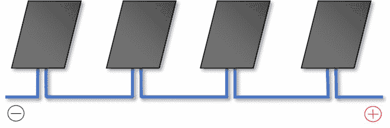

由四个串联的太阳能板组成的太阳能阵列。如果每个面板额定为 12 伏、12 瓦，那么这个太阳能阵列的额定值为 48 伏、48 瓦，电流为 1 安。

在面板并联连接的太阳能阵列中（如下所示），你取所有太阳能板的平均电压并将每个面板的功率相加，以计算太阳能阵列将产生的最大功率。

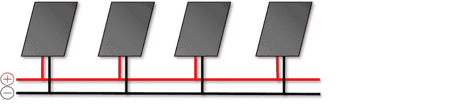

由四个并联的太阳能板组成的太阳能阵列。如果每个面板额定为 12 伏、12 瓦，这个太阳能阵列的额定值为 12 伏、48 瓦，电流为 4 安。

稍后我会详细介绍如何为你的系统选择正确的电压。

## 电池

太阳能板很少为电气设备供电。这是因为太阳能阵列收集的电量取决于太阳的强度。这使得电源的波动性太大，大多数电气设备无法应对。

如果你在储存能量，这些能量就储存在电池中。电池不仅提供了使用能量时间的灵活性，还为你的电气设备提供了恒定的电源。

太阳能存储有不同的电池技术可用。传统上使用的是“深循环”酸电池。这些电池看起来像汽车电池，但内部设计不同。这种设计允许它们被深度放电并反复充电数百次。最近，锂离子电池由于其寿命更长、性能更好而变得更加流行。

大多数铅酸电池是 6 伏或 12 伏电池，而锂离子电池模块通常是 12 伏或 24 伏。与太阳能板一样，这些都可以连接到系统中。

## 逆变器

太阳能系统产生的电是直流（DC）。来自电网的电是高电压交流电（AC）。

如果你计划使用太阳能系统运行设备，你可能需要一个逆变器将直流转换为交流电。逆变器有两种选择：

- 你可以在系统中设置一个中央逆变器，直接连接到太阳能阵列或电池组
- 或者，你可以使用“微型逆变器”，每个面板都有自己的逆变器，并由一个独立的控制器管理输出

带有微逆变器的太阳能板通常用于并网系统，与更传统的“大箱式”逆变器相比具有显著优势，尽管前期成本更高。

## 控制器

如果你使用电池，太阳能系统需要一个控制器来管理电流流。如果你的系统过充电，会损坏电池。同样，如果你的系统完全放电，也会（损坏电池）。

## 电气设备

太阳能系统的最后一个要素是你计划供电的设备。理论上，任何你可以用电供电的设备都可以由太阳能供电。然而，许多电气设备耗电很大，使得它们使用太阳能运行非常昂贵。

当然，如果你安装的是并网系统，这可能不是问题。如果你有使用时间较短的高能耗电器，对你系统的影响很小。相比之下，在离网系统运行高功率电器意味着你必须拥有更强大的离网能量系统来应对峰值需求。

## 低电压设备

大多数离网太阳能系统在低电压下运行。除非你计划采用纯并网安装，否则你可能希望考虑将至少一部分设备直接从你的直流电源运行，而不是通过逆变器。这具有更高的效率。

得益于房车和航海社区，有很多设备可以使用 12 伏或 24 伏电源运行。灯泡、冰箱、烤箱、热水壶、烤机、咖啡机、吹风机、吸尘器、电视、收音机、空调、洗衣机和笔记本电脑都有适用于 12 伏或 24 伏电源。

除了最近太阳能安装的增加外，专业制造商正在制造超低功耗电器（如冰箱、冷冻柜和洗衣机），专门为安装太阳能和风力涡电机系统的人设计。

如果无法选择低电压运行所有设备，或者你正在使用并网系统，则你需要使用逆变器来运行你的电气设备。

## 连接所有设备

### 离网系统

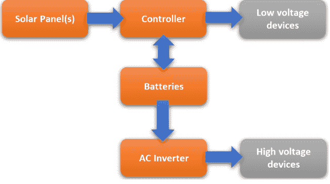

上面的简化框图展示了一个简单的离网太阳能电力系统。虽然细节会有所不同，但这种设计构成了大多数离网系统的基础，并且是你在休闲车、房车、船只以及没有常规供电的建筑中常见的典型类型。

这种设计既为运行笔记本电脑和照明等小型电气设备和电器提供低电压直流电，还为运行大电视机和厨房电器等较大设备提供高电压交流电供应。

在图中，箭头表示电流的流向。太阳能板提供能量，并将其输入太阳能控制器。太阳能控制器为电池充电。控制器还使用太阳能板或电池作为电源，为低电压设备供电。

交流逆变器直接从电池取电，并提供电网电压交流电供应。

### 使用单台中央逆变器的并网系统

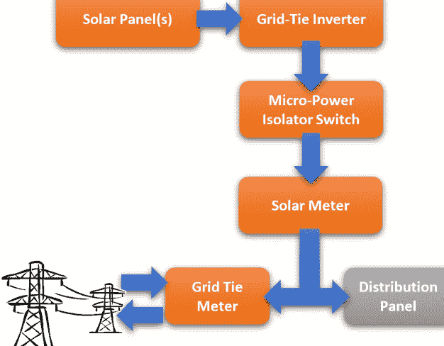

简化框图显示了一个简单的并网系统，这是目前许多家庭安装的典型类型。太阳能板连接到并网逆变器，将能量输入主供电。电力可以根据需求供建筑内的设备使用，也可以回馈到电网。

并网逆变器监控来自电网的供电。如果它检测到停电，还会切断来自太阳能板的电源，以确保没有能量回馈到电网。

太阳能表记录太阳能板产生的能量。并网表监控从电网取出的能量。某些并网表还会记录使用太阳能系统回馈到电网的电量。

### 使用多个微逆变器的并网系统

使用微逆变器的并网系统与上述相似，不同之处每块太阳能板都连接到自己的逆变器，而逆变器本身串联在一起，将每块太阳能板的低电压直流电转换为电网电压交流电供应。

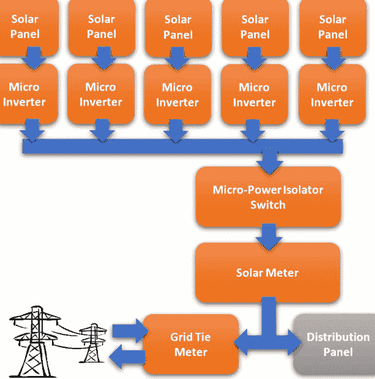

## 结论

- 构成太阳能电力系统有各种组件
- 多块太阳能板可以连接在一起，创建一个更强大的太阳能阵列。
- 在离网系统中，电力储存在电池中以提供能量存储，并提供更稳定的电源。控制器管理电池，确保电池不会被太阳能阵列过度充电，也不会被从中提取电流的设备过度放电。
- 逆变器获取来自太阳能系统的直流电，并将其转换为适用于运行需要电网电设备的交流电。
- 通常，将电力作为直流供应比作为交流供应效率更高

## 设计过程

无论是哪种太阳能系统，每一个成功的太阳能光伏设计都包含七步：

- 确定项目范围
- 计算你所需的能量量
- 计算可用的太阳能量
- 勘测你的场地
- 确定你的太阳能电力系统规模
- 选择合适的组件并计算总成本
- 制定详细设计

设计过程可以根据项目的规模变得更加复杂或简化。如果你只是为了照明安装一个现成的棚屋，你可能在半小时内完成项目。如果你正打算在业务场所安装太阳能电力系统，以便在停电时提供应急电源，你的设计工作可能需要几天时间。

无论你的太阳能电力系统是大是小，无论你是购买现成的太阳能照明套件还是从零开始设计，每次都遵循这个基本设计过程都是值得的。即使你安装的是现成系统也是如此。这确保了你始终能从太阳能系统中获得最佳性能，并让你确信太阳能能够完成你所需的一切。

## 帮助你的在线工具

一旦你确定了项目范围，你可以在 `www.SolarElectricityHandbook.com` 找到《太阳能电力手册》，其中包含了若干在线工具和计算器，它们将帮助你完成大部分设计工作。

太阳能辐射表和太阳能角度计算器允许你计算你所在地有多少太阳能可用；离网项目分析和电网项目分析问卷将分别为你的建议系统生成并通过电子邮件发送一份完整的报告，计算你所需的系统规模并提供成本估算。

当然，一组在线工具能提供的帮助是有限的。你仍然需要亲自勘测并进行组件选择和详细设计，但这些工具将允许你快速轻松地尝试不同的配置，并模拟“如果……”的情景。

## 太阳能与情感

设计往往看起来是一个纯粹分析性和理性的过程。它不应该是。所有伟大的设计都始于梦想。

对于许多人来说，选择太阳能往往是一个情感决定。他们想要太阳能系统的原因不仅仅是纯粹的……。有些人想要太阳能是因为他们想为环境“尽一份力”。有些人想要太阳能是因为他们想独立于电网。有些人想要太阳能是因为他们想省钱。有些人想要太阳能是因为他们想减少碳足迹。有些人想要太阳能是因为他们想成为解决方案的一部分。有些人想要太阳能是因为他们想对自己的家感到自豪。有些人想要太阳能是因为他们想为后代保护地球。有些人想要太阳能是因为他们想为停电做好准备。有些人想要太阳能是因为他们想自给自足。有些人想要太阳能是因为他们想为社区做贡献。有些人想要太阳能是因为他们想改变世界。

## 项目范围的确定

对于任何项目，在开始之前你需要知道你想实现什么。通常最好保持范围简单。以下是一些合适的范围示例：

- 为照明和防盗报警器供电
- 为照明、冰箱和电视供电
- 为照明、电动自行车提供离网供电
- 为一栋离网度假屋提供全部电力需求
- 减少房屋的碳足迹
- 完全使用太阳能运行电动汽车

根据你的范围，你可以开始这些操作以获得初步估算。

正如上一章提到的，我创建了用于并网和离网系统的分析工具。你可以在我的网站上找到这两个工具。你仍然需要收集所需的基础信息，但困难的工作已经由你完成了。你需要提交一份完整的范围，计算你能源系统的可能性能并提供大致估算。

在接下来的几个章节中，我将使用为一个小型离网度假屋提供全部电力需求作为案例。

这是一个大项目。如果你对太阳能系统或家庭用电几乎没有经验，最好从较小的项目开始。完全离网是一个很有勃的项目，但出于教学设计的目的，它是一个完美的例子，因为它涵盖了太阳能系统设计的所有方面。

## 设计并网或回网系统

对于我们的示例项目，并网不是选项，因为我们是将太阳能作为连接到电网的替代方案。

然而，并网是一个受欢迎的选择，特别是在美国和欧洲。这在一定程度上是因为过去几年提供的慷慨补贴。尽管这些补贴大多已经结束或大幅减少，并网仍然对企业和家庭来说非常受欢迎。

在确定项目范围方面，你计划并网系统还是回网系统区别不大，你需要经历的步骤是相同的。当然，唯一的例外是对于并网，你不需要考虑电池效率。

尽管如此，在设计过程中进行功率分析仍然是一个好主意。即使你并不打算完全通过太阳能产生所需的所有电能，拥有一份功率分析也能让你对系统进行基准测试，并且如果你目标是通过向电力公司提供尽可能多的你可以购买的电力来减少碳足迹，它将帮助你确定并网电系统的规模。

大多数并网系统的设计目标是：夏季提供的电力多于你的需求，而冬季提供的电力少于你的需求。在一年之中，目标是发电量与你使用的电力相等，尽管按月计算，情况可能并不总是如此。

许多太阳能公司可以告诉你，这种做法为你提供了一个“碳中和”系统，因为你正在将多余的电力卖给电力公司，并在需要时购买等量的电回。

如果你计划对你的并网系统进行此类操作，那么你的范围要简单得多。你需要获取过去一年的电费单，并记录下全年的用电量。将此数字除以一年的天数，计算出每日能源消耗，并确保你的系统在这一期间平均每天能产生这些能量。

因为在碳中和并网系统中，你在冬季月份是不发电的，所以你需要的太阳能电池板比创建一个完全独立的离网系统所需的要少。

## 供应与需求的比较

如果你正在设计一个并网系统，将太阳能的供应与你的用电模式进行对比会很有帮助。通过对比供应与需求，你可以看到太阳能产量与你的使用匹配有多紧密，反之这也可以作为识别太阳能对环境有多大益处的指标。

要做到这一点，你需要确定每年每个月的用电量。你的电力供应商可能已经在电费单上为你提供了这些信息。如果没有，你应该能够向他们申请。

获取这些信息后，访问 `www.SolarElectricityHandbook.com` 并填写“并网太阳能项目分析表”，包括你个人的每月消耗量数据。在邮件发送给你的报告中，你将看到一张图表，显示你的用电量如何与太阳能产量相对应。

该报告还将为你提供你从太阳能阵列产生的每千瓦电的碳足迹的大致估值，这是基于你阵列的产量和安装情况的。

| 设备 | 电压 | 功率 | 使用时长 | 每日能耗 |
|---|---|---|---|---|
| 照明 | 12V | 11W | 2小时 | 22Wh |
| 走廊照明 | 12V | 8W | ½ | 4Wh |
| 浴室照明 | 12V | 11W | ½ | 17Wh |
| 卧室 1 照明 | 12V | 11W | 1 | 11Wh |
| 卧室 2 照明 | 12V | 11W | ½ | 17Wh |
| 门廊灯 | 12V | 8W | ½ | 4Wh |
| 小冰箱 | 12V | 24W | | 288Wh |
| 电视 | 12V | 40W | 4 | 160Wh |
| 笔记本电脑 | 12V | 40W | 1 | 40Wh |
| 手机充电 | 12V | 5W | 4 | 20Wh |
| 待机功耗 | 12V | 1W | 24 | 24Wh |
| **每日总能量需求（瓦时）** | | | | **662Wh** |

## 警告事项

在满腔热情地实施太阳能电力系统时，非常容易低估现阶段可能需要的电量。

为了确保你没有遗漏任何日后会后悔的内容，我建议你在此处休息一下。然后回来重新审查你的电力分析。

将此展示给别人看以获取他们的意见也会有所帮助。人们很容易在情感上投入到太阳能项目中。多一双眼睛可以产生巨大的差异，以确保你没有遗漏某些东西。

## 当我们准备好进行时

我们现在确切知道提供一天电量需要多少能量。对于我们的假期小屋示例，这相当于每天 662 瓦时。

我们仍然需要考虑整个系统的效率。电池、逆变器和电路中的电阻都会降低太阳能电力系统的效率。我们必须考虑这些效率损失，并将它们加入到电力分析中。

## 计算效率损失

电池无法返回 100% 的充电能量。电池的`循环循环效率`衡量的是电池可用能量与充电能量量之间的百分比。

循环效率不是一个固定数值，因为效率取决于你充放电的速度快慢。大多数太阳能应用并不会给电池带来太大压力，标准的循环效率通常足够了。

通常可以从电池制造商处获得近似的循环效率。然而，对于工业级“牵引型”电池，你可以假设效率为 95%，而胶凝电池和胶用休闲电池的效率通常在 90% 左右。

如果你在系统中使用逆变器，则需要考虑逆变器的效率损失。同样，实际数据可以从制造商处获得，但通常你会发现逆变器的效率在 90% 左右。

## 将效率损失加入电力分析

在我们的假期小屋示例中，没有逆变器。如果有的话，我们需要为每个电网供电设备增加 10% 的逆变器效率损耗。

我们正在使用电池。我们需要在总能量需求中增加 5% 以考虑循环效率。

662 的 5% 等于 33 瓦。这增加了我们的电力分析，使我们的总瓦时需求量变为每天 695 瓦时。

## 你什么时候需要使用太阳能系统？

计算你一年中哪些时间最常使用太阳能电是非常重要的。例如，如果你计划在整个冬季期间使用你的系统，那么你的太阳能电力系统需要在冬季白天期间也能提供所有电力。

假期小屋在春季、夏季和秋季通常经常使用，但在冬季期间会长时间空置。

这意味着在冬季，我们不需要太阳能电力系统提供足够满员入住的电力。我们需要足够的电池容量来为偶尔的周末提供足够的电力。一旦房屋空置，太阳能阵列可以再次为电池充电。

我们可能决定，如果冬季需要额外的电力，我们可以准备一个小型备用发电机来为电池辅助充电。


对于我们的假期小屋而言，我们的系统必须在 3 月到 10 月之间提供满员入住的电力，并在 11 月到 2 月之间提供偶尔使用的。

## 保持简单

你已经看到了在创建电力分析和计算效率损失时需要考虑的内容。如果你计划使用我们的工具来帮助供电，现在是使用它们的时候了。

访问 `SolarElectricityHandbook.com` 并点击链接进入“离网”或“并网”太阳能项目分析工具（这些工具可以在在线计算器中找到）。这将允许你在电力分析中输入设备，选择你希望系统运行的月份，并从全球列表中选择位置。系统将自动为你发送一封包含所有计算结果的详细太阳能分析报告。

## 改进范围

根据已完成的工作，是时候为原始范围增加更多细节了。最初，我们的范围如下：

提供离网假期小屋的整个电力需求。

现在改进后的范围变为：

提供离网假期小屋的整个电力需求，为照明、制冷、电视、笔记本电脑各种杂项供电，相当于每天 695 瓦时的电力消耗。

系统必须在 3 月到 10 月之间提供足够的电力，并在冬季提供偶尔使用。

现在项目有了重点。我们知道太阳能电力系统工作需要实现什么。现在我们需要去现场看看我们想要做的是否可行。

## 结论

- 准确性对于整个项目至关重要
- 从简单开始，然后通过计算所有电源设备的能量需求来完善
- 如果你正在设计并网系统，不需要那么详细，你可以从你的电力公司获取使用信息。它可能包含在你的电费单上
- 如果你正在设计并网系统，可以通过按月比较太阳能供应与需求，对其环境效益给出一个合理的估计
- 记得考虑“待机功耗”
- 因为太阳能电力系统在低电压下运行，以低电压运行设备比先将电压逆变为电网电压效率更高
- 得益于房车和船只的流行，有大量的 12 伏电器可用。如果你正在计划一个离网或电网备用系统

太阳能电池板的倾斜角度影响你捕捉阳光的量：如果将太阳能电池平贴安装在墙上或平放在地面上，你一整天捕捉到的阳光将少于倾斜电池板面向太阳的情况。

上面的图表显示了伦敦的太阳辐射强度，这是根据照射在每平方米地面上的阳光量计算的。如果你以面向太阳的倾角安装太阳能电池，就可以捕捉到更多的阳光，从而产生更多的电。这在冬季月份尤为如此，因为此时太阳在天空中的位置较低。

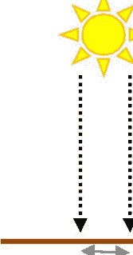

这种现象的原因是阳光强度。当太阳位于高空时，阳光的强度很高。当太阳位置较低时，阳光会分散在更大的面积上：

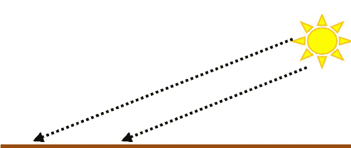

这张图显示了根据太阳在天空中的角度而不同的光照强度。当太阳正位于上方时，一束宽 1 米的光束将覆盖地面上宽 1 米的区域。当太阳位置较低时——在这个例子中，我使用的面向太阳的角度为 30°——一束宽 1 米的光束将覆盖地面上宽 2 米的区域。这意味着，当太阳处于 30° 角时，其阳光强度只有太阳正直位于上方时强的一半。

## 倾斜太阳能电池板对太阳辐射的影响

如果我们将太阳能电池板向太阳倾斜，意味着我们可以捕捉更多的太阳能并转换为电能。通常，这种倾斜角是由现有屋顶的角度决定的。然而，对于每个位置，都有安装太阳能阵列的最佳角度，以捕捉尽可能多的能量。

以伦敦为例，这张图表显示了太阳能电池板根据安装角度的性能差异。我显示的地面角度、固定在墙上的角度，以及在一年中不同季节获得最佳太阳辐射量而安装的不同角度（我稍后会解释这些特定角度的关联性）：

| 月份 | 1月 | 2月 | 3月 | 4月 | 5月 | 6月 | 7月 | 8月 | 9月 | 10月 | 11月 |
|---|---|---|---|---|---|---|---|---|---|---|---|
| 平放 (FLAT) | 0.75 | 1.37 | 2.31 | 3.57 | 4.59 | 4.86 | 4.82 | 4.20 | 2.81 | 1.69 | 0.92 |
| 立起 (UPRIGHT) | 1.20 | 1.80 | 2.18 | 2.58 | 2.70 | 2.62 | 2.71 | 2.80 | 2.47 | 2.07 | 1.43 |
| 全年最佳性能 – 38°倾角 | 1.27 | 2.04 | 3.76 | 4.17 | 4.20 | 4.25 | 4.16 | 3.26 | 2.41 | 1.53 | |
| 冬季最佳性能 – 23°倾角 | 1.30 | 2.03 | 2.62 | 3.34 | 3.66 | 3.69 | 3.76 | 3.73 | 3.06 | 2.27 | 1.56 |
| 夏季性能 – 53°倾角 | 1.19 | 1.95 | 2.77 | 3.84 | 4.52 | 4.63 | 4.66 | 4.41 | 3.31 | 2.33 | 1.43 |
| 全年调整倾斜角以获得最佳性能 | 22°倾角 | 30°倾角 | 38°倾角 | 46°倾角 | 52°倾角 | 62°倾角 | 54°倾角 | 46°倾角 | 38°倾角 | 30°倾角 | 22°倾角 |

注：所有角度均为相对于垂直方向的度数，且取决于特定位置。

观察根据太阳能电池板倾斜角度产生的性能差异。观察深冬和盛夏的性能差异。

很容易看出，某些角度在冬季提供更好的性能；另一些角度在夏季提供更好的性能，而另一些角度则提供了一个良好的全年折中方案。

## 计算太阳能电池板的最佳倾角

由于地球相对于太阳有 23° 的倾角，你的太阳能电池板的最佳倾角会随着季节的变化而变化。在某些安装中，每月调整太阳能电池板的倾斜角是可行的，而在另一些情况下，则必须将阵列固定在位置。

要计算太阳能电池板的最佳倾角，可以使用以下公式：

- `90° – 你的纬度 = 全年最佳设置`

该角度适用于全年发电的固定太阳能电池板的倾角。这并不意味着你每个月都能获得最大功率输出，而是意味着在全年范围内，这个倾角将为你提供最佳折中方案，实现全年发电。

## 在一年中不同时间获取太阳能电池板的最佳性能

根据你想要如何使用太阳能，你可能会选择不同的倾角来提高一年特定时点的输出。一年中的每个月太阳角度都会变化 7°——夏季和冬季角度更高。通过调整太阳能电池板的倾角来追踪太阳，你可以根据需求微调系统性能。

你可能出于以下原因而这样做：

- 对于离网的独立运行系统，你通常需要在冬季月份尽可能获得更多的发电量，以抵消自然光减少的影响。
- 在寒冷气候地区安装并网系统时，重点在于你需要购买的电量。
- 当你希望获得系统整体最佳输出时，你会发现通过将太阳能电池板调整到最佳夏季倾角，在全年范围内可以获得略多的能量。

在一年中的不同季节，偏离南向（在北半球为正北）的太阳能电池板，其平均效率每偏五度下降约 1.1%。

这意味着，如果你的面板面向正东或正西，与面向最佳位置相比，预计会有约 20% 的效率损失。

如果你将面板面向完全相反的方向——北半球面向正北或南半球面向正南——你的太阳能阵列将损失约 40% 的效率。

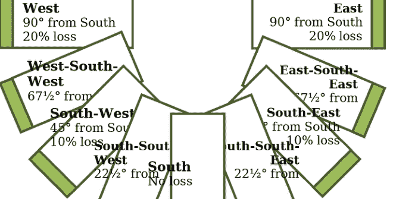

对于北半球，此图显示了不直接面向正南方导致的近似效率损失。对于南半球国家，图表应反过来。

## 使用太阳辐射计算太阳能电池板的发电量

根据这些数据，我们可以按每月计算太阳能电池板每天提供的电量，方法是将每月太阳辐射数值乘以面板标称瓦数：

`太阳辐射 x 瓦数（太阳能面板峰值功率额） = 每日瓦特`

正如我们所知，太阳辐射数值取决于月份和太阳能面板的角度。假设我们有一个 20W 的太阳能电池板，平安装在屋顶上，以下是 12 月和 6 月的计算结果：

| 配置 | 12 月 | 6 月 |
|---|---|---|
| 平放 | 0.60 x 20W = 每天 12 Wh 能量 | 4.86 x 20W = 每天 97 Wh 能量 |

如你所见，夏季中部与冬季产生的能量量有巨大差异。在这个例子中，盛夏产生的能量量是深冬的八倍以上。

这里是再次计算，但将太阳能面板角度设为 38° 以获得最佳全年性能。注意冬季性能显著提高，而夏季性能略有下降：

| 配置 | 12 月 | 6 月 |
|---|---|---|
| 38° 角度 | 1.05 x 20W = 每天 21 Wh 能量 | 4.20 x 20W = 每天 84 Wh 能量 |

## 使用太阳辐射为你太阳能阵列所需的功率容量提供近似指南

就像你可以计算太阳能电池板每天产生多少能量一样，你可以利用太阳辐射为你所需的太阳能阵列容量提供近似指南。

我之所以说是“近似指南”，是因为实际容量还需要考虑：

- 你所在场地的特殊性
- 太阳能面板的位置和角度
- 一天中不同时间阻挡阳光的任何障碍

我将在下一节实地考察场地时介绍这一点。尽管如此，进行此类计算对于为你的太阳能系统建立一个估算成本是有用的。计算方法非常简单：将计算出的每日总瓦时数除以你要求系统运行的最恶劣月份的太阳辐射值。

以我们的度假屋为例，我们可以计算出每天的瓦时为 695W/day，并将其除以辐射图表中最糟糕的月份（12 月）。根据我们的表现来看效果如何：

| 配置 | 计算过程 | 结果 |
|---|---|---|
| 平放 | 695 ÷ 0.159 瓦 | 如果我们将面板平放，我们需要一个 1,159Wp 的太阳能阵列在 12 月为我们的房屋供电。 |
| 直立 | 695 ÷ 1.01 688 瓦 | 垂直安装在墙上，使用 688Wp 的阵列即可产生相同的功率。 |
| 38° 角度 | 695 ÷ 1.05 661 瓦 | 向赤道倾斜，我们可以使用 661Wp 的太阳能阵列产生相同的功率。 |
| 23° 角度 最佳冬季倾角 | 695 ÷ 1.08 643 瓦 | 采用最佳冬季倾角，我们可以使用 643Wp 的太阳能阵列。 |
| 53° 角度 最佳夏季 | 695 ÷ 0.97 716 瓦 | 向夏季太阳倾斜，我们需要一个 716Wp 的太阳能阵列在 12 月供电。 |
| 月调整 | 695 ÷ 1.08 643 瓦 | 每月调整太阳能面板的角度，我们可以使用 643Wp 的太阳能阵列，与上述相同 |

此图表告诉我们，为了在 12 月的假期期间提供全功率，我们需要一个发电容量在 643 瓦到 1159 瓦之间的太阳能阵列，具体取决于面板的倾角。

但请记住我们的范围。我们只想在 3 月到 10 月完全使用该房屋。电力系统只需要在冬季的一个长周末提供电力。这意味着，只要我们的电池足够大能提供几天的电力，冬季太阳能不足以提供持续使用也没有关系。一旦我们再次关闭度假屋，太阳能面板就会为电池充电。

这里是我的再次计算，这次使用的是我们表现最好的月份：

| 配置 | 计算过程 | 结果 |
|---|---|---|
| 平放 | 695 ÷ 1.69 = 411 瓦 | 如果我们将太阳能面板平放，我们需要一个 411Wp 的太阳能阵列为房屋供电 |
| 直立 | 695 ÷ 2.07 = 335 瓦 | 垂直安装在墙上，使用太阳能阵列即可产生相同的功率 |
| 38° 角度 | 695 ÷ 2.41 = 288 瓦 | 向赤道倾斜，我们可以使用太阳能阵列产生相同的功率 |
| 23° 角度 最佳冬季倾角 | 695 ÷ 2.46 = 283 瓦 | 采用最佳冬季倾角，我们可以使用 283Wp 的太阳能阵列 |
| 53° 角度 最佳夏季 | 695 ÷ 2.33 = 298 瓦 | 向夏季太阳倾斜，我们需要一个 298Wp 的太阳能阵列 |
| 月调整 | 695 ÷ 2.46 = 283 瓦 | 每月调整太阳能面板的角度，我们可以使用 283Wp 的太阳能阵列 |

此图表告诉我们，为了在 12 月的假期期间提供全功率，我们需要一个发电容量在 643 瓦到 1159 瓦之间的太阳能阵列，具体取决于面板的倾角。

## 温度对太阳能板的影响

与凉爽气候地区相比，太阳能板在暴露于高温下时发电量较少。在烈日炎炎、温度较高的日子，即使是多云或阳光朦光时，太阳光伏系统提供的电力可能更多。

当太阳能板给出一个功率额定时同时，它们是在 25°C (77°F) 针对 1,000 W/m² 光源进行测试的。在较低温度下，太阳能板产生的电力更多；在温度较高的情况下，同一个太阳能板产生的电力较少。

当太阳能板暴露在阳光下时，由于吸收了红外辐射，它们会升温。由于能板是深色的，它们的升温可能会非常显著。在某些气候条件下，太阳能板的温度很容易升到 80–90°C (160–175°F)。

太阳能板制造商提供了信息来显示温度对其面板的影响。功率额定温度系数以温度每升高 1% 总功率减少的百分比表示。

通常，该数值在 0.5% 左右，这意味着温度每升高 1°C，你就会损失太阳能阵列 0.5% 的效率；温度每降低 1°C，你就能提高太阳能阵列 0.5% 的效率。

假设功率额定系数为 0.5%，以下是 100W 面在不同温度下的影响：

| 面板输出 | 0°C | 5°C | 15°C | 25°C | 35°C | 45°C | 55°C | 65°C | 75°C | 85°C |
|---|---|---|---|---|---|---|---|---|---|---|
| % 增益/损失 | +10% | +5% | 0% | -5% | -10% | -15% | -20% | -25% | -30% | -35% |
| 实际功率 | 110W | 105W | 100W | 95W | 90W | 85W | 80W | 75W | 70W | 65W |

在北欧和加拿大，设计太阳能系统时，高温不是一个显著因素。然而，在美国南方州以及非洲、印度、澳大利亚和中东地区，一年中大部分时间的温度明显高于 25°C (77°F)，太阳能板在规划你的系统时可能是一个重要因素。

如果你正在为全方位用途设计一个系统，那么事实上，夏季高峰期间性能的轻微下降对你来说可能不是问题。如果是这样，你就不需要在系统设计中考虑温度，可以在下一页找到相关信息。

如果你在需要从太阳能板获得最大性能的季节里，环境温度较高，你可以通过确保面板上下空气流通顺畅来帮助降低太阳能板的温度。如果你计划将太阳能板安装在屋顶上，请确保面板下方留有 7–10cm (3–4英寸) 的间隙，以便空气在周围流动。或者，你可以考虑将面板安装在立柱上，这有助于冷却。

对于屋顶安装，如果一年中特定时期的平均温度为 25°C/77°F 或以上，将该摄氏温度乘以 1.4 以得到可能的太阳能板温度。对于立柱式安装，将你的气温乘以 1.2 来计算可能的太阳能板温度。根据太阳能板上功率额定温度系数所示的百分比损失增加你的功率，以计算出你需要太阳能板产生的功率。

## 德克萨斯州奥斯汀夏季温度对太阳能性能的影响

举例来说，这里是德克萨斯州奥斯汀的表格。它显示了全年每月的平均气温、一年中最热月份的预计太阳能板温度，以及假设功率额定系数为 0.5% 的情况下对太阳能性能的影响。

| 月份 | 1月 | 2月 | 3月 | 4月 | 5月 | 6月 | 7月 | 8月 | 9月 | 10月 | 11月 | 12月 |
|---|---|---|---|---|---|---|---|---|---|---|---|---|
| 月平均气温 | 50°F/10°C | 62°F/12°C | 70°F/21°C | 84°F/29°C | 93°F/34°C | 95°F/35°C | 98°F/37°C | 95°F/35°C | 86°F/30°C | 77°F/25°C | 68°F/20°C | 59°F/15°C |
| % 增益/损失 | +10% | +5% | 0% | -5% | -10% | -15% | -20% | -25% | -30% | -35% | -40% | -45% |

- 在你第一次尝试时，这些估算成本过高并不罕见。答案是仔细查看你最初的范围，看看可以削减什么以产生具有成本效益的解决方案。
- 除了计算估算成本外，这些计算还帮助我们确定太阳能阵列的大致尺寸。这意味着我们在进行现场勘察时，知道需要找到多大的空间。

## 现场考察

勘察是设计成功的太阳能系统最重要的方面之一。它将确定你的场地是否适合安装太阳能。如果合适，勘察将确定安装太阳系统的理想位置，以确保你获得物物值和最佳性能。

## 我们想要实现的目标

为了让太阳能系统良好运行，我们需要现场勘察回答两个问题：

- 场地中是否有任何适合放置我们太阳能阵列的地方？
- 附近的树木和建筑等障碍物是否遮挡了太多阳光？

第一个问题听起来可能很简单，但取决于你的项目，它可能决定太阳能系统是否可行。

通过回答第二个问题，你可以确定你将能够捕捉到多少可用阳光。至关重要的是，你必须理解太阳能未能达到预期的一个原因是阳光被遮挡，这会大幅降低系统的效率。

为了回答这个问题，我们需要能够画出一年中不同季节太阳的位置。在冬季，太阳在天空中的位置比夏季月份低。确保太阳能阵列在冬季全天都能接收直射阳光至关重要。

## 你将需要的工具

你需要一个指南针、一个量角器、一个水平仪和一个卷尺。

如果你计划在屋顶上安装太阳能阵列，那么不可避免地需要一把梯子。相机对于拍摄现场也很有用。如果你有 iPhone 或安卓手机，你还可以下载廉价的软件，它可以帮助你识别太阳跨越天空的路径并协助障碍分析。

我发现找一些纸箱也是很有用的。把它们打开，并剪裁成你拟议的太阳能阵列的大致尺寸。这可以为你寻找太阳能电池板的位置时提供帮助。这让你想象安装后的样子容易得多，并可以帮助识别你可能忽略的任何问题。

如果你以前从未做过太阳能勘察，那么在晴天访问现场将会有帮助。

一旦你对太阳能勘察有了更丰富的经验，你会发现无论是在晴天还是阴天进行现场勘察，实际上并没有太大区别。作为现场勘察的一部分，我们手动绘制太阳在天空中的位置，因此一旦你有了更丰富的经验，天气对勘察质量的影响很小。

## 初印象

当你到达场地时，首先要检查的是场地布局是否使其获得阳光。

我们稍后会使用更科学的方法检查阴影，但先快速扫一眼就可以突出问题，而无需进行更深入的勘察。

如果你在北半球，从东向南穿过再向西看，以确保没有遮挡阳光的明显障碍物，例如树木和其他建筑。如果你在南半球，你需要从东向北再向西检查障碍物。如果你站在赤道上，太阳从头顶经过，因此只有东西的障碍物是重要的。

在进行这项勘察时，注意不要直视太阳，即使只有几秒钟。即使在冬季，视网膜灼伤也会对你的视力造成永久性损害。


# 环顾场地，确定太阳能阵列位置的所有可能选择

如果你考虑在屋顶上安装太阳能阵列，请记住从屋顶看世界是非常不同的地方，站在地面看到的障碍物与你在屋顶高度看到的看起来完全不同。

## 绘制场地简草图

绘制一份场地的简草图会有帮助。它不需要非常精确，但在现场勘察和在你设计系统期间，它都是一个非常有用的工具。

包括靠近你场地的所有属性和树木，而不仅仅是你自己土地上的。包括那些现在小到不需要担心、但在几年后会变成问题的树木。还要标出北方的方向。

## 确定太阳能阵列的位置

你的任务是为你的太阳能阵列确定最佳位置。虽然你可能已经对想在哪里安装电池板有了很好的想法，但考虑可提供的不同选择总是个好主意。

正如上一节中发现的，太阳能阵列在朝太阳倾斜时性能更好。

如果你计划为建筑安装太阳能，那么建筑屋顶可以是安装太阳能阵列的合适地点。如果屋顶朝南，或者屋顶是平顶的且你可以使用角度支架安装电池板，这就是有效的。

其他替代方案是将太阳能电池板安装在墙上。这对于较长、较细的电池板很好，这些电池板可以以角度安装而不会突出墙太远。或者，太阳能电池板可以落地或安装在杆子上。

在考虑太阳能阵列的位置时，你需要考虑清洁太阳能电池板有多容易。电池板不需要一尘不染，但脏土和污垢会随着时间的推移降低太阳能系统的效率，因此在考虑安装方案时，务必考虑你如何接触电池板以便每几个月给它们进行快速清洗。

## 屋顶安装

如果你计划在屋顶上安装太阳能阵列，你需要进入屋顶以检查其适用性。

使用指南针检查屋顶的方向。如果你的屋顶朝南（在北半球），你将始终获得最佳性能，但如果屋顶朝东或朝西，你仍然可以获得合理的性能。

你还需要找出屋顶的坡度。人士使用一种名为 `Roof Angle Finder`（屋顶角度查找）的工具计算建筑材料商提供的低成本工具。在屋顶下方的椽下使用角度查找，它将向你显示以度为单位的角度。

或者，你可以使用屋顶底部的量角器计算角度，或者将角度查找下载到手机手机并使用它。

太阳能电池板本身并不重：最多 15–20 公斤（33–44 磅）。然而，多个电池板与框架组合，特别是当它们是倾斜的时，总重量可能会变得相当显著。一个由 16 个 250W 太阳能电池板组成的典型 4kW 并网系统重量通常接近 360 公斤（近 800 磅）。

检查屋顶结构。确保它足够坚固以承受太阳能阵列并确定你需要什么。对于屋顶结构和固定装置提供通用建议很困难。有如此不同的屋顶设计，我无法就此主题提供许多有用信息。如果你不确定屋顶的适用性，请让专业的评估屋顶。

## 屋顶阴影问题

有时，屋顶会有自己的阴影问题。烟囱、电视天线、卫星碗或通风口可能会产生问题或在一天中不同时间给电池板带来阴影。有时，这些问题很容易解决，例如移动天线是一个相对简单的工作。然而，如果屋顶上有可能会产生阴影的烟囱，你需要确保电池板之间留出足够的空间，以将阴影减少到最低。

## 测量可用屋顶空间

你需要测量并记录用于太阳能阵列的可用屋顶空间。有很多方法，但简单的方法是在地面层测量建筑轮廓，在阁楼空间内测量屋顶高度，然后计算屋顶大小，

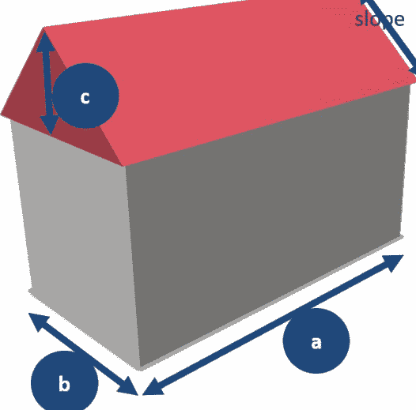

如果你的屋顶像上面所示，你有人字顶，这是容易测量的类型。从地面层测量房屋的长度 (a) 和深度 (b)。

现在测量屋顶底部到顶部的高度 (c)。你可以使用以下公式计算坡度：

```
slope = \sqrt{c^2 + (1/2 \times b)^2}
```

建议使用英寸或厘米进行测量。例如，如果你的房屋 1000cm 长，500cm 深，屋顶高度为 250cm，请在你的科学计算器中输入：

```
$250 \wedge 2X ( - 5500 \} \wedge 2 =$
```

屋顶 C 高

房屋 b 深

在这个示例中，答案是 353.5cm。这意味着你的屋顶斜度（见页面顶部图表中的测量值 d）为 353.5cm (139 英寸)。

你现在需要扣除这部分空间。通常不建议将太阳能电池板直接安装在屋顶边缘。在某些国家（如英国），必须在电池板周围留出最小空间。

这种之所以是因为风荷载。风速和风压对屋顶安装的太阳能电池板的影响意味着，在极端天气条件下，安装离屋顶边缘太近的太阳能电池板会对电池板或屋顶造成损坏。因此，广泛建议太阳能电池板的安装距离任何屋顶边缘至少 30cm (12 英寸)。在英国，这已列入建筑条例中，并且是专业化安装的法律要求。

因此，你现在应该从建筑长度 (a) 和斜度上各减去 60cm (24 英寸)。

你现在知道了可用的屋顶空间量：建筑长度 (a) 乘以屋顶斜度。因此在上面的示例中，总可用屋顶空间为 9940cm 乘以 293.5cm。

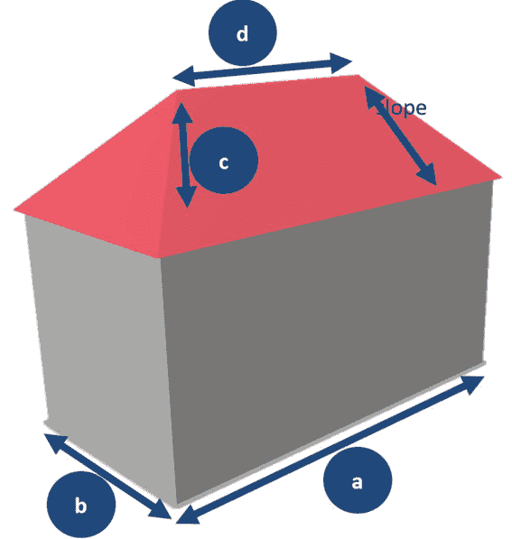

如果你有一个坡屋顶（如上所示），你的计算将稍微复杂一些。坡屋顶是一种图中所有侧面都向墙壁倾斜的屋顶。要精确计算出坡屋顶的可用空间会变得非常复杂。然而，除非你试图将每一块太阳能电池板都挤进屋顶，否则使用一种快速简单的简易估算方法就足够准确。

从地面层测量建筑的长度和宽度（测量值 a 和 b），但在从阁楼内部测量屋顶高度的同时，你还需要测量两个坡口之间的屋顶长度（测量值 d）。

然后，你可以像前一页所示计算山墙屋顶一样计算屋顶斜度。

要计算可用的屋顶总长度，你需要进行两次计算：一次针对两个坡口之间的屋顶（测量值 d），一次针对建筑的坡口，然后将两者相加。

在这个示例中，如果房屋长为 1000cm (a)，深为 500cm (b)，屋顶高度为 250cm (c)，坡口间的长度为 500cm (d)：

- 使用前一页的公式计算斜度（斜度 = 353.5cm）。然后从该数字中减去 60cm (24 英寸)，考虑到你不能将太阳能电池板安装得离屋顶底部太近 (353.5 – 60cm)。

- 计算坡口之间的屋顶空间 (500cm x 293.5cm)。

- 从 (a) 中减去 (d) 计算坡口的总长度，然后减去 30cm，考虑到不能将太阳能电池板安装得离屋顶边缘太近 (a - d - 30cm)。

- 将此数字乘以斜度的一半 (0cm x 146.75cm)，得到一个近似的大小，你可以以此计算可以容下多少块太阳能电池板。

在某些情况下，你有一个金字塔屋顶（如页面所示），或者可能希望将太阳能电池板安装在屋顶坡口，在这种情况下你有三角形屋顶需要处理。在这种情况下，最好在阁楼内进行测量。再次，计算这种屋顶能容纳多少块太阳能电池板的方法可能会变得复杂，但许多安装人员使用一种简单的计算方法来确定行数。沿着屋顶坡度从顶部向下测量 120cm (48 英寸)，并测量该处的屋顶宽度。从该测量值减去 60cm (24 英寸)，考虑到你不能将太阳能电池板安装得离屋顶边缘太近。

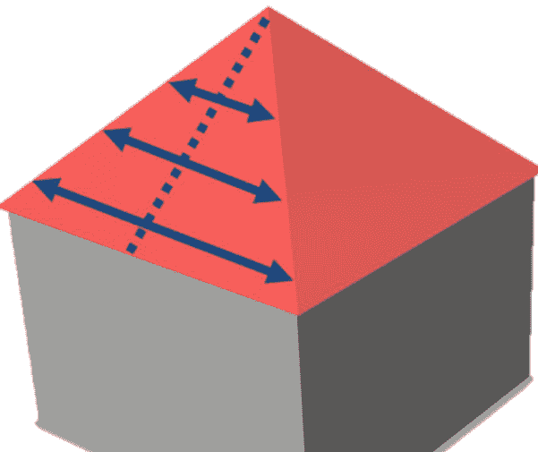

然后沿着屋顶坡度进一步向下测量 100cm (40 英寸)，并在第二个点测量屋顶宽度。再次从该测量值减去 60cm (24 英寸)。继续每隔 100cm (40 英寸) 向下测量直到屋顶底部，以便很好了解每行宽度内可以安装多少排太阳能电池板。

## 地面安装

如果你想将太阳能阵列安装在地面上，你需要一个底座。你可以安装在地面上的底座，并在上面安装太阳能电池板。大多数太阳能电池板供应商可以提供合适的底座。你可以自己制作一个可以随太阳移动的底座，但你需要注意底座的设计。这种随太阳移动的太阳能跟踪器在冬季可以增加 15%-20%，夏季可增加 55%。

目前，太阳能跟踪器价格昂贵。除非空间极其宝贵，否则最好把钱花在……对于喜欢挑战的 DIY 工程师来说，一个随太阳移动的横空跟踪器是一个有趣的项目。互联网上有许多网站，如 `instructables.com`，爱好者在那里制作了它们并提供了制作方法。

在北半球（即赤道以北），一年中最长的一天是6月21日，最短的一天是12月21日。这两天分别是夏至和冬至。

在夏至，太阳的角比分点时高出23.5°，而在冬至，角度则比分点低23.5°。

这两个极端情况是由于地球相对于其绕太阳运行轨道的倾斜造成的。在北半球，当北极向太阳倾斜时，发生夏至；当北极远离太阳倾斜时，发生冬至。

我们以英国的伦敦为例。伦敦的纬度为51°。在分点，正午太阳的角为39°（90° – 51°）。在夏至，该角度为62.5°（39° + 23.5°），而在冬至则为15.5°（39° – 23.5°）。

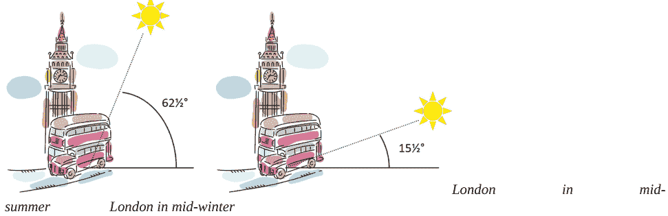

有关每月太阳高度的更多详细信息或其他国家的信息，请访问 `www.SolarElectricityHandbook.com` 并点击链接进入太阳能电池板角度计算器。

## 阴影

如上一章所述，阴影会对您的太阳能系统性能产生非常显著的影响。即使是极小的阴影也会对系统产生的能量产生巨大影响。因此，尽可能让您的太阳能阵列保持无阴影是非常重要的。

完全无影通常是不可能的。如果是这样，通过仔细评估您的场地将阴影减少到最低是非常重要的。

## 为什么阴影是一个问题

与太阳能（热水）系统不同，阴影导致的功率损失远大于被阴挡部分的比例。对于太阳能系统，如果只有5%的面板被阴挡，您损失的发电量不到5%。如前提到的，光伏电池的这种差异更为显著。即使阴挡部分的面积很小，阴影也可能发电量下降高达80%。

原因在于太阳能电池板串的结构。晶硅太阳能电池由单个太阳能电池组成。通常，每个电池产生½伏特的势能。这些电池串联在一起，以便在太阳能电池板内部将电压提高到更有用的水平。每个单独的太阳能电池板有一个或多个电池串。

由于这些串是串联的，太阳能电池板的性能取决于其最薄弱的电池。如果其中一个电池的输出很弱，串中的所有其他电池也会受到影响。这意味着如果您有“软影”（例如远处的树枝），在太阳能电池板上仅一个一两个电池上形成斑驳的软影，其效果可能会导致整个串的输出降低到类似于阴云天的水平。

更糟糕的情况发生在当您有更直接的阴影时，光与影之间会产生更大的对比。即使一个电池完全处于阴影中，而其余部分处于明阳光下，被阴挡的电池会导致电池内部的电子流短路并反向。

然而，由于电池与电池板中的其他电池串联，电流会被强制通过反向的电池。在这种情况下，反向电池会吸收电池板中其他电池产生的功率，产生热量并在太阳能电池板中形成热点。

单个反向电池吸收的电量与单个电池能产生的电量不成正比。单个电池可能只产生½伏的势能，但在进入反向状态时，它可以吸收6–8伏。

如果不加检查，处于这种状态的太阳能电池很容易被破坏。被遮挡电池产生的热点会迅速达到危险温度水平，已知手工制作的太阳能电池板正是因为这个原因而起火。

幸运的是，太阳能电池板制造商对此有一个解决方案以避免面板本身损坏。所有专业制造的晶硅太阳能电池板都有内置保护，可以将电流绕过一个或多个处于反向状态的电池串。

如果您的太阳能电池板内只有一个串太阳能电池，这实际上意味着整个面板被跳过，不产生任何功率。如果您的太阳能电池板有两个串太阳能电池，这意味着面板的功率输出减了一半。

由于太阳能阵列通常通过串联安装多个太阳能电池板组合而成，仅部分面板的阴影影响会影响整个太阳能阵列的性能。

## 分析阴影

在分析阴影时，需要关注两种类型的阴影。硬影是指在距离您拟定地点10米（33英尺）内的物体（如建筑物或树木）产生的阴影。软影是指距离您位置10米以外的物体。来自远处物体的软影仍会将散射光引入太阳能电池板，并且对全天性能的影响较小。

您可以通过多种方式进行这种分析。您可以使用带有指南针和铅笔的太阳路径图、专业的障碍物分析工具，或者在手机或平板电脑上下载太阳能阴影应用。

## 使用指南针和太阳路径图

这是识别太阳能阴影问题最简单的方法。使用得当，它是识别拟定系统阴影问题的准确方法。

太阳路径图显示了一年中不同月份太阳在一天中不同小时的位置。垂直轴显示太阳在天空中的高度，而水平轴显示太阳的方向（方位角）。该图可用于识别附近的物体何时会在太阳能电池板上投下阴影。

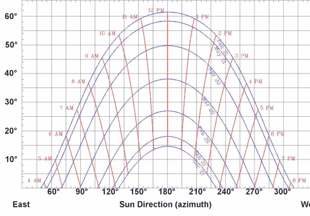

在图表中，红线代表一天中的时间，蓝线显示一年中不同季节太阳在天空中的路径。图表顶部的蓝线路径显示夏季（夏至）太阳的路径，而图表底部的蓝线路径显示冬季（冬至）太阳的路径。

太阳图有多个来源。在英国，微型发电证书计划（Microgeneration Certificate Scheme）发布了一份太阳图，如果您计划安装可以利用英国上网电补贴（Feed Tariff）计划的系统，必须使用该图。或者，您可以从俄勒冈大学太阳辐射监测实验室网站 `https://sunchart.oregon.edu/SunChartProgram.php` 下载宽幅太阳图。

要制作一个测角仪，将铅笔贴在量角器的中心。如果没有，您可以在手机或平板电脑上下载一个，或者使用量角器、铅笔和胶带制作一个。使用这个量角器检查视野。上方：俄勒冈大学制作的太阳图。

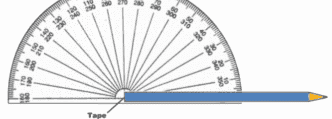

站在您计划安装太阳能电池板的地方，使用指南针识别磁南（如果您在南半球则识别磁北）。然后从东向西，识别指南针上90°范围内（即90°到270°之间）的任何障碍物。使用测角仪测量每个障碍物的顶部角度，使用指南针测量障碍物的宽度。

现在在太阳图上标记障碍物的高度和宽度，并在该区域涂色。例如，如果附近的一栋建筑位于指南针的120°–150°之间，高度为15°，您应在图表上涂掉该区域（如下所示黄色）：

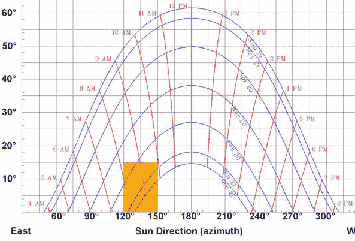

您可能需要以这种方式标记多个障碍物。如果产生阴影的物体距离拟定地点在10米（33英尺）以内，您则需要在图表上的物体周围画一个阴影圆，以反映其对太阳能电池板性能更严重的影响。

在示例中，如果产生阴影的建筑物距离超过十米，我们不需要再使用图表。然而，如果建筑物更近，我们必须从图表底部画到障碍物的高度，以障碍物中心为圆：

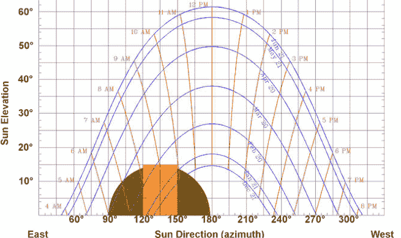

标记完所有阴影后，您必须计算被障碍物遮挡的所有方格数量。如果只覆盖了部分方格，也将其计入计数。

忽略冬至蓝线路径下的任何方格，或夏至蓝线路径上的任何方格。也忽略距离正南方超过90°（如果您在南半球则为正北方）的任何方格。

基于此，你可以看到我们的障碍物完全或部分覆盖了12个方格。你数出的每个方格都等于 1% 的太阳能辐射损失。因此，对于我们选择的位置，我们可以计算出由于阴影导致了 12% 的损失。

作为一个粗略的经验，如果你发现一个完全没有阴影的地方，那么你做得非常好。能量损失低于 10% 通常被认为非常好，而任何阴影超过 25% 的位置都意味着建造你的太阳能系统将产生大量的额外成本。

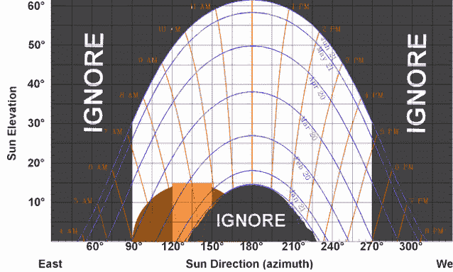

## 障碍物分析的专业工具

我所描述的纸笔方法效果非常好，但需要一些练习且可能非常耗时。如果你计划进行多次太阳能安装，投资一个障碍物分析工具或手机 App 是值得的。

在过去，一个手工的“太阳能路径者”（`Solar Pathfinder`）是你能获得的最好的工具之一。这是一种顶部安装有角度图表的塑料单元。然后在图表上方放置一个玻璃圆顶。你将该单元安装在所需位置的三脚架上。障碍物会反射在玻璃泡中，允许你手动在图表上绘制障碍物，并手动计算你的阴影问题。

太阳能路径者的效果惊地，，因为可以方便地移动以寻找太阳能板的最佳位置。尽管使用了更昂贵、更先进的电子设备提供更详细的分析，许多专业的太阳能安装人员仍然在使用太阳能路径者进行快速检查。

一些供应商可以按天或按周租给你一个太阳能路径者，并在你绘制出障碍物后由他们为你进行计算。

如今有了电子系统，使用 GPS、倾斜开关和加速度计以电子方式完成这些工作。购买或每天租赁这些设备都很昂贵。然而，它们提供了全面的太阳能分析，如果你计划专业从事太阳能安装，它们是值得的投资。

最著名的是 `Wiley Electronics` 的 `Asset` 和 `Solmetric` 的 `SunEye`。我个人更偏于 `SunEye`，因为我发现该设备更简单，但两种产品的功能相似。

## 手机和平板电脑应用

虽然太阳能路径者非常好，但对于较小的太阳能安装来说，这些工具就过剩了，而且通常很复杂。坦率地说，现代智能手机提供了完成类似工作的处理能力和功能。现在一些公司已经开发了运行在手机上的太阳能分析软件。使用手机内置的 GPS、指南针、加速度计和摄像头，可以在几分钟内记录完成完整的阴影分析。

这些应用中有些是免费的，有些则需要少量费用。我使用过的两个产品是运行在 iPhone 上的 `Solmetric IPV` 和运行在 Android 设备上的 `Solar Shading`。`Solmetric IPV` 售价 29.99 美元，并处理你的障碍物跟踪，自动提供显示全年阴影分析的图表。报告的详细程度不如其他电子工具，但现在有更多专业人士在使用这个系统。它提供了你在更贵系统中可以获得的许多功能，但包装更易用且购买便宜得多。

你可以通过 `http://www.solmetric.com` 了解更多关于 `Solmetric IPV` 的信息，并从 iTunes 网站下载软件。

`Solar Shading` 由 `Convex Metrics` 。在 Android 市场售价为 15 美元，该应用为你提供全天的完整阴影分析，用易于阅读的图表呈现信息。

## 考虑未来

在安装太阳电系统时，你确实需要考虑未来。系统的寿命至少有 20 年，尽可能地，你需要确保系统在该长度内是有效的。

在扫描地平线时，记住树木和灌木丛会在系统寿命期间生长。花园里的一棵小云杉可能在几年内长成一棵“巨兽”，如果存在这种风险，最好现在就知道，而不是在几年后面临一个措手不及的意外。

查看是否有任何可能遮挡你场地的计划工程，并尝试评估对阴影产生影响的未来工程的可能性。

同样重要的是，雾气或浓雾在一天中某些时候是否是一个问题。如果场地经常有浓雾问题，你的太阳能阵列的效率将受到损害。

## 如果有阴影遮挡怎么办？

一旦你确定了阴影问题，就可以围绕它们设计你的系统。应对阴影问题的方法有很多。

除非你有严重的阴影问题，否则你可以使用下面描述的选项之一来设计问题，或者通过组合选项得出一个可行的解决方案。在过去的几年里，我设计了许多耐阴影系统，这些系统设计用于在全阴影环境下工作。

## 增加太阳能板的数量


如果你有空间，第一个选择是增加安装的太阳能板数量以控制阴影时期。得益于太阳能板价格的下降，这可能是解决问题的最便宜的方案。

这并不总是可能的，可能是因为空间或成本限制。此外，这不是解决问题最有效的方法。

## 面板方向

如果阴影在一天中的特定时间影响了你，考虑将你的太阳能板角度避开障碍物。这将增加你在无遮挡时段效率，并从根本上消除或减少障碍物的影响。如果你能消除阴影问题，那么由于偏离正南方导致的发电量减少将小于对阴影的影响。

## 太阳能板的选择

另一个选项是使用非晶（薄膜）太阳能板。非晶太阳能板不会像晶体太阳能板那样遭受电池反向的影响，可以提供更好的阴影性能。

由于效率较低，你需要大约两倍的空间来安装非晶太阳能板。如果空间不是问题，使用非晶太阳能板可能是独立太阳能安装最简单且成本效益最高的解决方案。

Sharp、Mitsubishi、Uni-Solar、Solar Frontier 和 Sanyo 现在制造高质量的非晶太阳能板，它们提供卓越的性能和可靠性。

## 使用微逆变器

如果你正在构建一个并网系统，最佳解决方案是使用微逆变器，每个面板都有自己的功率逆变器和一套独立的太阳能系统。

使用微逆变器系统，每块太阳能板的运行都完全独立于其他任何太阳能板。如果阴影影响了其中一个面板，其他面板都不会受到任何影响。

使用微逆变器意味着你可以让太阳能板面向相互不同的方向。例如，如果你在屋顶上安装太阳能板，由于你的屋顶坡度和角度不同，你可以选择使用微逆变器系统在屋顶的多个部分安装你的太阳能阵列。

这种方法让你在安装太阳能板的位置上有更大的灵活性。甚至可能完全避免阴影问题。

## 设计多路太阳能阵列

与其将你的系统设计为一组串联的太阳能板，你可以将其设计为拥有多个路（太阳能板、逆变器和控制器可以让你拥有多路太阳能板，或者你可以为每一路配备一个控制器或逆变器。

实际上，这意味着你拥有多个较小的太阳能系统。在这种情况下，部分阴影只会影响你的其中一路，而不是整个阵列。通过微逆变器，这种方法甚至可以让你完全避免阴影问题。

## 如果一切尝试失败了……

有时，围绕阴影设计是不可能的，或者是不成本效益的。在这种情况下，需要重新思考使用太阳能可以实现什么。

这是我在上一个家里遇到过的问题。我的房子位于古代森林的边缘。在一年大部分时间里，我的房子几乎被周围的高树完全遮挡。即使在盛夏，阳光也无法到达我的花园。

这种阴影意味着我无法完全依靠太阳能运行我的房屋。然而，我设计了一个较小的太阳能系统，为我的照明提供足够的能量并在停电时提供备用电源。

我通过在房屋背面安装非晶太阳能板来实现这一点，面朝西以捕捉下午和傍晚的阳光。尽管获得的阳光非常少，但该系统全年都能提供电力，即使在深冬也是如此。

## 电池、控制器和逆变器的定位

你需要在系统内为电池、控制器和逆变器确定合适的位置。这可以是建筑内的一个房间，或者是阁楼空间、车库或花园小屋，或者是防水外壳内。

将所有电池靠在一起是重要的，并使电缆尽可能短。对于“硬件”，指的是太阳能阵列本身、电池、控制器和逆变器。

对于电池、逆变器和控制器，你正在寻找符合以下标准的位置：

- 防水防雨
- 不受阳光直射
- 绝缘以防止极端温度
- 电池气体排放设施
- 远离火源
- 远离儿童、宠物和啮鼠

铅酸电池在充电时会产生极量的氢气。氢具有爆炸性。您必须确保电池存放的任何地方都有良好的外部通风，以确保这些气体不会积聚。您还应该考虑安装氢气报警器，以提醒您氢气随时间的积聚。

锂离子电池对极端高温非常敏感，如果过热可能会引发火灾。出于此原因，锂离子电池通常安装在车库内墙或家中，这些地方的热量积聚问题不那么严重。锂电池不应安装在阁楼空间内。

由于太阳能光伏引入了极高的电压，辅助设备必须放置在远离儿童和宠物的安全区域。

这些辅助设备可能非常重。家用逆变器的重量通常在 `15-20kg（33-44 磅）` 之间，而家用电池控制器重量约为 `10-15kg（22-23 磅）`。一个 `4kWh` 的锂离子电池系统重量在 `60-100kg（132-220 磅）` 之间，而类似的铅酸电池系统约为 `120kg（265 磅）`。

最常见的情况是，家用尺寸控制器和逆变器采用壁挂式，通常位于车库或阁楼内，而工业级系统则采用地面安装。电池通常安装在重型货架上，或专门的电池柜内。

## 布线

在您在现场时，请考虑电缆路由，特别是连接太阳能阵列、控制器、电池和逆变器的重型电缆。尽量保持电缆长度越短越好，因为电缆越长效率越低。测量这些电缆的长度，以便规划安装时能够确定正确的电缆规格。

回到我们的度假屋。根据之前的计算，如果我们将阵列朝向太阳，度假屋需要一个能够产生 `320 瓦时` 能量的太阳能阵列。这个太阳能阵列将占据约 `2m²（18 平英尺）` 的面积。

对度假屋的现场调查显示，屋顶的主坡东朝西。这对于太阳能阵列来说并不理想。屋顶东侧有一个烟囱。一棵高树的阴影遮挡了屋顶西向的一部分。屋顶的山墙上没有足够的空间安装所需的太阳能电池板。

## 度假屋的现场调查

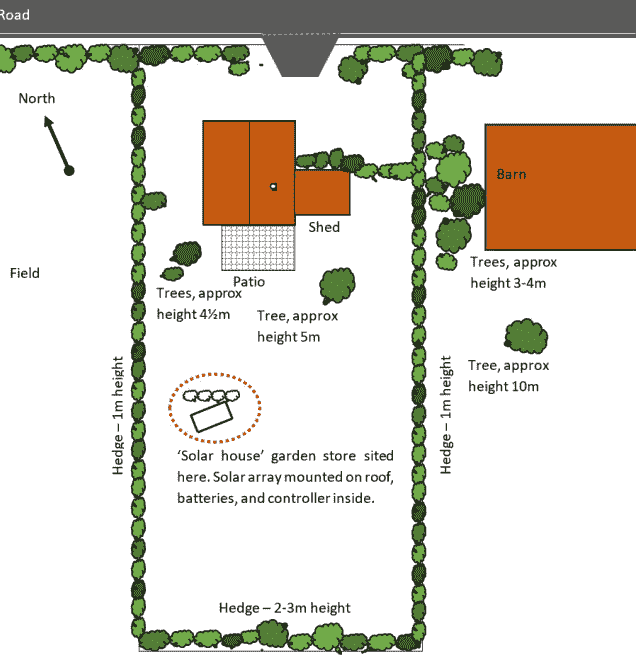

度假屋地图，标识了可能的障碍物和太阳能阵列的合适位置。

花园朝南，全年都能获得阳光。

旧房屋的设计有一个朝南的屋顶，但坡度只有 `20°`。一棵树树在一年中九个月的早晨为棚屋提供阴影。此外，棚屋的状态意味着我们在决定使用它之前需要进行大量的修复工作。

房屋东侧有一个农场，有一个大型大谷仓和几棵树邻着房屋，其中最高的约 `33 英尺（10米）`。所有这些树在冬天都会为棚屋和房屋的一部分提供阴影，如果它们继续生长，在一年其他时间也可以提供更多阴影。

太阳能阵列与控制器之间的电缆长度约为 `2m（6 英尺）`。太阳能控制器与电池之间的电缆长度小于 `1m（3 英尺）`。太阳能房与房屋之间的电缆长度为 `12m（40 英尺）`。房屋内部还有 `10m（33 英尺）` 的布线。

这些较长的电缆长度并不理想。电缆线路应尽可能短，以减少通过电缆的功率损失。然而，我们无法让太阳能阵列离房屋得更近。我们必须通过设计来解决这个问题。

## 结论

- 现场调查有很多工作要做。这非常重要。花时间；确保准确。
- 绘制地图和拍摄照片有助于现场调查，并且对于我们设计新系统的下一个阶段是无价之宝。
- 太阳能电池板可以采用屋顶安装、框架安装或立柱式安装。
- 一旦确定了电池板的位置，请检查全年遮挡电池板的障碍物。
- 这些障碍物在冬季月份最可能成为问题，因为那时太阳能非常稀缺。
- 为电池、控制器和逆变器识别合适的空间。
- 规划电缆线路并测量所需电缆的长度。
- 电缆应越短越好，以减少系统的电压损耗。如果需要长电缆长度。

优其他太阳能电池板技术。

与其他太阳能电池板技术不同，非晶硅太阳能电池在部分阴影下具有卓越性能。虽然理想情况是尽可能在任何时候消除阴影，但即使阵列部分处于阴影中，非晶面板也能继续保持高效率运行。

非晶面板还可以制成各种形状或安装在曲面上。它们可以被制成耐磨材料，以便安装可以行走的表面。一些太阳能制造商已开始生产太阳屋顶瓦（或防水），因此新建筑可以将太阳能整合到屋顶结构中。

这种组合使得非晶硅面板适用于集成到手机和笔记本电脑等消费产品中，也适用于房车或大篷车的车顶，在这些情况下，制造商无法控制产品的放置位置或使用方式。

非晶硅面板是最便宜的电池板，几家制造商现在正丝网印刷廉价的非晶硅太阳能膜。在 `2008年至2013年` 间，非晶太阳电池的价格每年下降约 `30%`。虽然价格下降速度有所放缓，但非晶面板的成功是分摊整个行业成本的一个大因素。

由于效率限制，非晶太阳能面板必须比等效的多晶太阳能面板大得多。因此，非晶太阳能面板只能用于对太阳能阵列没有尺寸限制或总功率需求较低的地方。

在环境影响方面，与其他太阳能面板相比，非晶面板的生产碳足迹往往要低得多。非晶太阳能面板的典型碳回收期在 `12–30个月` 左右。

大多数非晶太阳能面板的功率输出相对较低。这些面板可适用于输出最高 `300瓦` 的小型安装，但并不适用于较大的安装，因为大型安装需要许多个电池板，而且安装和布线这些电池板的额外费用将开始超过它们的成本优势。

因此，非晶太阳能面板通常适用于 `OEM` 应用（即作为制造产品中的内置能量），或者用于大型商业安装，将电池板整合到新建筑屋顶空间的结构中。

过去三年中，太阳能技术最令人兴奋的进展一些来自于非晶技术。手机、笔记本电脑、服装和屋顶材料等多样化产品都内置了非晶太阳能面板。作为一项令人兴奋的技术，非晶太阳能在未来几年内将变得越来越好。

## 多晶太阳能电池板

多晶太阳能电池板由多个太阳能电池组成，每个电池由硅晶制成。在直射阳光下，它们的效率远高于非晶太阳能面板，效率水平为 `12–17%`。

因此，多晶太阳能电池板的通常只有等效非晶面板的三分之一，这使得它们在许多安装中更易安装。

多晶太阳能电池板通常带有 `25年` 的性能保修，寿命更长。商用太阳能面板直到 `20世纪70年代中期` 才上市，许多此类电池板到今天仍能完美运行并在使用。

多晶太阳能电池的制造工艺非常复杂。因此，多晶太阳能电池板购买价格昂贵，比非晶太阳能贵约 `15%`。生产对环境的影响也高于非晶面板，典型的碳回收期为 `2–5年`。

多晶太阳能电池呈深色，通常配有白色或银色的框架。这使得电池板很难与周围融合，这对于某些应用可能是一个问题。

得益于过去几年制造能力的提高以及大屏幕电视的日益普及（电视使用相同规格的玻璃），多晶太阳能电池板的价格正在下降。在 `2007年至2014年` 间，价格下降了约 `25-30%`；在 `2015年和2016年`，价格进一步下降了 `10-15%`。由于价格保持相对稳定，预计未来几年将维持在目前的水平。

## 单晶太阳能电池板

单晶太阳能电池板由多个较小的太阳能电池组成，每个电池由单片硅晶晶片制成。这些是目前效率最高的电池板之一，效率达 `15-20%`。

单晶太阳能电池板具有与多晶太阳能电池板相同的特性。由于效率高，它们是目前每瓦功率尺寸最小的电池板。电池本身呈均匀黑色，并配有黑色框架。它们的外观比多晶面板更智能，深受业主喜爱。

单晶太阳能电池板是制造成本最贵的太阳能面板，因此价格也最高。然而，价格仍然具有竞争力，比等效的多晶太阳能电池板贵约 `10%`。

## 混合太阳能电池板

混合太阳能面板在理想条件下提供 `18–22%` 的效率，但真正受益于理想条件，其真实世界的性能可以比其他太阳能面板好 `10-20%`。

缺点是价格。从价格角度来看，混合太阳能面板很贵，价格大约是单晶面板的两倍。除非空间极其宝缺使得价格差异合理，否则混合太阳能面板通常会因为经济原因被排除。

## 太阳能面板尺寸和功率输出

单个非晶太阳能面板的功率输出通常在 `5Wp到100Wp` 之间。一个 `100Wp` 的太阳能面板尺寸约为 `150cm x 100cm (60 x 40英寸)`。

多晶和单晶太阳能电池板具有更高的功率输出。最小的面板输出倾向于 `20Wp`，而最大的通常输出功率在 `350-400Wp` 左右。

常用的晶硅面板倾向于 `250Wp` 面板，尺寸约为 `160cm x 100cm (64 x 40英寸）`。这种尺寸的面板变得流行是因为使用了相同规格的玻璃。这种尺寸的面板输出功率通常是 `250Wp-300Wp`。

## 哪种太阳能电池技术最好？

对于大多数应用，单晶面板提供了最佳方案，具有性价比、尺寸紧凑、性能良好且外观智能。

非晶面板对于空间不是问题的小型安装来说是一个很好的选择。

## 选择太阳能面板时要考虑什么

并非所有的太阳能面板都是同等的，值得购买品牌产品而非无品牌。廉价的无品牌太阳能面板可能无法达到你的预期，特别是在阴天收集能量时。

并非所有的太阳能面板都是同等的……（下文）

### 比需要的更大

如果你购买非常便宜的太阳能面板，价格可能比购买品牌产品便宜 `50%`。然而，预计它的老化会很快。

为了应对这一点，请购买额外的阵列。目标是比原本购买的多出 `15%`。你仍然会省很多钱，但你对系统能够胜任有了额外的保障。

### 保修

对于便宜面板，你无法获得 `25年` 保修，但购买的任何电池板都应该获得一到两年的保修。检查保修具体提供什么。

你寻找的是一种在受控条件下保证输出的保修。行业标准是保证在受控条件下输出的 `80%`。

如果你有保修索赔，还要检查如何进行保修索赔。将损坏的太阳能面板运往世界各地并支付运费的成本可能和买一块新的太阳能面板一样贵。

### 二手光伏面板

偶尔会有二手太阳能面板待出售。它们出现在 `eBay` 上，或者由太阳能设备供应商和建筑材料回收场出售。

只要来自口碑良好的品牌，二手太阳能电池板非常物值，即使是 `25–30 年` 的旧电池板仍有许多年的使用寿命。虽然优质的太阳能电池板应该至少提供 `25 年` 的服务，但没有人知道它们还能持续多久。早期商用的太阳能电池板（现在已有 `40 多年` 历史）仍在有效工作，通常在额定容量的 `70%` 左右运行。

如果你考虑二手光伏电池板，有几点需要注意：

- 永远不要在没有进行户外测试的情况下购买万用表，以确保你获得的电压和功率额定值合理
- 检查电池板并拒绝任何玻璃碎裂或破碎的电池板。还要拒绝任何电池片本身从玻璃上剥落，或玻璃与太阳能电池之间有凝水的电池板
- 旧太阳能光伏的效率明显较低，大约在 `5–6%` 左右，而现在的效率水平为 `13-24%`。十年前，最好的太阳能电池板效率额定为 `10–12%`。因此，`20 世纪 80 年代初` 的光伏组件效率可能只有同类现代晶体硅面板的三分之一

这些二手电池板将不具备购买新太阳能电池板时获得的任何安全认证。如果你将这些作为新太阳能安装系统的一部分，可能会引起建筑法规或建筑保险的问题。

## 聚光光伏与太阳能聚焦器

聚光光伏（`CPV`）技术利用菲涅透镜和镜子将面积较大的阳光聚集在较小的光伏电池区域上。它们通过折射光线使其聚集，并增加较小区域内的阳光强度。

通过将阳光聚集在较小的区域并增加太阳辐射，太阳能电池板可以捕捉更多的能量，从而极大提高了其效率。

然而，这项技术存在问题。特别是热量的积累相当严重，在测试中，许多太阳能电池板被聚集阳光产生的过量热量破坏。这对于狂热爱好者使用的菲涅透镜尤为如此。

电池板需要大而笨重。由于热量的积累，它们还需要非常小心地安装，并在电池板上方留出足够的通风空间。

市场上有很多太阳能聚焦器，但这项技术在很大程度上已被时代淘汰。其设计背后的逻辑是太阳能电池板昂贵，而透镜和镜子很廉价。过去几年里，太阳能价格下降了许多，太阳能聚焦器的经济性已不再成立。

少数安装使用镜子或抛光金属将阳光反射回太阳能电池板上，从而增加太阳辐射。然而，你必须确保反射光不会刺眼任何人。

## 太阳能电池板安装支架

如果你计划建立独立系统，可以为你的太阳能电池板制作自己的支架，但更常见的是购买太阳能电池板的同时购买支架。太阳能电池板的主要安装方案有屋顶安装、框架安装或立柱安装。

## 太阳能电池板如何安装在框架上

某些太阳能电池板（通常容量最高 `40wp`）通常带有塑料框架，留有将电池板螺在框架上的孔。然而，大多数太阳能电池板是夹在框架上的。框架通常由两个导轨组成。使用夹具将太阳能电池板安装在导轨上。导轨再通过屋顶钩安装在屋顶上，或者作为地面安装或立柱安装的较大结构的一部分。

应使用自锁螺母以确保电池板保持牢固夹。太阳能电池板随着时间的推移会受到风吹的影响，这可能会导致螺栓松动。某些框架夹具设计为受影响时会震得更紧，减少随时间推移电池板损坏的风险。

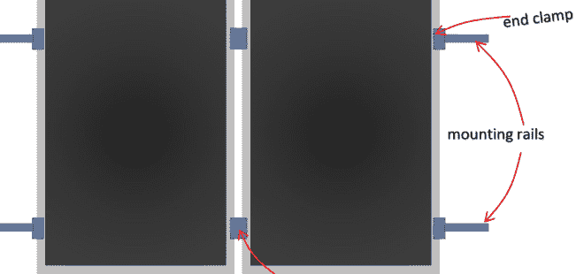

## 屋顶安装

在屋顶安装系统中，导轨通过屋顶钩安装在屋顶上。屋顶钩直接安装在瓦片下面的屋桁上。安装时，将单个瓦片从屋顶滑出，并将屋顶钩安装在下面的屋桁上。然后将瓦片滑回原。

## 框架安装

对于地面安装或安装在平屋顶上，太阳能电池板通常安装在独立式框架或安装的塑料托盘上。

独立式框架可以容纳一块太阳能电池板，也可以将多个面板组合在一起。独立式框架的好处是根据根据位置调整太阳能电池板的角度，以最有效地利用阳光。某些独立式框架允许全年调整太阳能电池板的角度，以从可用阳光中获得最佳性能。独立式框架需要锚定在安装表面上。安装在地面上的框架通常安装在混凝土基础上，而安装在平屋顶上时，通常需要安装螺栓穿过屋顶。支架必须足够结实，以应对在未固固锁定时可能抬起电池板的风力。

成型塑料托盘通常比独立式框架更容易安装。太阳能电池板安装在托盘上，并用配重（通常是沙袋的形式）压住托盘。这样做的好处是你不需要将太阳能电池板安装在建筑上，加快了安装过程。托盘是针对特定角度成型的，你可以购买最适合你应用的塑料托盘。

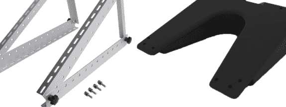

左：单块太阳能电池板的简单安装框架。

右：`PV-Pod` 使用水作为配重，

## 立柱安装

立柱安装太阳能阵列可能是一个实用的选择，并且可能比屋顶安装便宜。某些独立式框架（如来自路灯杆的）适用于一或两块面板，其他系统则设计用于安装多个面板。


某些独立式框架（如来自 `Crown` 的）允许全年调整面板倾角，以从可用阳光中获得最大功率。立柱的大小和厚度取决于面板的数量和立柱的高度。立柱必须锚固在地上，嵌入混凝土中。基础深度至少是立柱地上高度的一半。例如，如果你的立柱安装高度为 `2 米（7 英尺）`，则孔深必须为 `1 米（3 英尺）`。

## 太阳能跟踪器

太阳能电池板在正对着时产生的能量最多。太阳能跟踪器安装在立柱系统上，全天移动面板以捕捉最大量的阳光。

某些太阳能跟踪器只是简单地从左到右移动面板角度（单轴跟踪器），而更先进的跟踪器则在全天调整面板以捕捉最多的阳光。

虽然太阳能跟踪器制造商声称其产品性能收益为 `35-50%`，但大多数安装人员报告，单轴跟踪器的性能收益为 `30%（±5%）`，双轴跟踪器约为 `40%（±5%）`。性能改进在夏季更好，能量捕捉可以增加多达 `55%`，而在冬季则改进了 `15–20%`。

太阳能跟踪器使用传感器和电动机工作，消耗少量电力。它们捕捉的能量仅为它们从阳光中额外捕捉能量的一小部分。

因此，为太阳能阵列添加跟踪器可以产生显著的实际性能提升。这解释了它们为什么在大太阳能发电站受欢迎。然而，对于小型安装，需要权衡其收益与成本。除非空间有限，否则购买更多的太阳能电池板比购买较小的阵列并安装太阳能跟踪更划算。

## 在车辆上安装太阳能

如果你想在车辆（如房车或旅行车）上安装太阳能电池板，你需要考虑空气流通。你需要减少太阳能电池板在车辆顶上的阻力，确保太阳能电池板周围有足够的空气流通以减少热量积累的风险。如果不考虑到气流，当您的车辆行驶时，可能会产生额外的风噪，最坏的情况下甚至会有太阳能板被风吹掉的风险。


在车辆上安装太阳能板主要有两种方案。第一种是将柔性太阳能板直接粘胶在车辆车顶上。效果最好的是粘在金属表面，而不是玻璃纤维或塑料，因为金属表面可以充当散热器，允许太阳能板散热。

第二种方案是将您的太阳能板安装在导流板支架上。这些支架可以将空气引流过太阳能板，在板后方留出空气隙，以确保电池板不会过热。

这些导流板通常是特定的，因此请确保您的供应商能为您计划购买的太阳能板提供相应的支架。这些支架通常使用如 `Sikaflex 252` 等高强度胶水粘在车辆车顶上。胶水干燥后，将为电池板创建一个极其坚固且永久的安装方式，其强度足以抵抗车辆行驶时产生的高速风冲击。

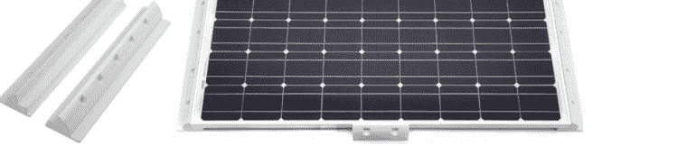

左：车辆导流板支架。

右：使用导流板支架安装的单块 80W 太阳能板。

## 附属建筑的单电池板安装

如果您计划在附属建筑（如花园小屋）上安装一块电池，可以购买可以粘接或螺丝固定的塑料角支架。这些支架类似于车辆导流板支架，用法也相同。

## 自制支架

有些人选择为自己的太阳能板自制支架。我偶尔也会这样做，尽管我通常购买现成的支架。顺便提一下，如果您在建筑上安装太阳能板，必须始终使用专业的安装系统。

如果您在设计自己的支架，设计必须考虑风荷载，以免在强风中被损坏或损毁。如果您使用较大的太阳能板——高达 100W 的电池板——一个空气隙即可避免过热积聚。2-5cm（3/4 - 1 英寸）就足够。对于更大的电池板，建议留出 5-8cm（2-3 英寸）的空气隙。

您需要确保您的支架足够坚固以锚定在地面，或者足够重以至于在强风中移动。由于太阳能板的设计，风会通过空气隙吹向电池板下方，在板下产生压力区域，从而产生类似于飞机机翼的升力效应。在强风中，固定良好的太阳能板可能会从支架上被掀起或连同支架一起拉起。您需要确保支架能够承受相当于其承载电池板两倍的升力。

## 太阳阵列电缆

太阳阵列电缆将您的太阳能板连接在一起，并将太阳阵列连接到太阳控制器。这些电缆通常被称为“阵列互连线”。您可以购买已指定长度的成品，也可以自己制作。这些电缆非常耐用，耐高温和紫外线。它们还具有坚韧的加厚绝缘层，使其不易受到动物损坏。

如果您计划并联而非串联您的太阳阵列，则需要确保您的太阳阵列电缆能够承受您通过太阳阵列产生的电流。如果您正在设计并联系统，我在第 131 页的“独立系统组件”章节中介绍了如何计算所需的电缆尺寸。

## 太阳阵列连接器

有标准的连接器用于连接太阳能板。对于大多数太阳能板，标准连接器是 `MC4` 连接器，如页上所示。`MC4` 连接器由男头和母头组件组成，它们紧密锁合，形成防水密封。

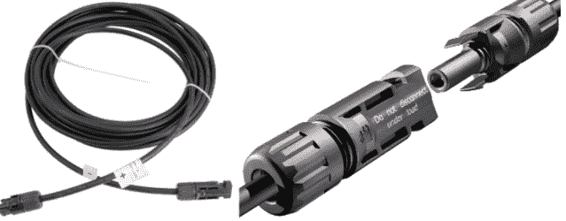

上方：`MC4` 男头和母头连接器锁在一起形成防水密封。

对于非常小的太阳能板（例如用于附属建筑等的 5W–50W 电池板），替代的 `S-S` 连接器很常见。这些是廉价且简单的连接，仅适用于 12V 系统，通常用于使用一或两块电池板且电缆长度短至 3 米（10 英尺）的情况。

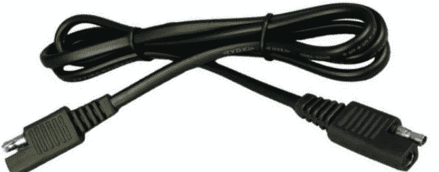

与 `MC4` 连接一样，`S-S` 连接器也能形成持久的防水密封。与 `MC4` 连接不同，它们没有锁在一起，可以轻松拉开。它们适用于非常小的安装，并具有易于使用的优点。

## 熔丝和隔离开关

隔离系统部分的能力非常重要，特别是在安装系统和维护期间。即使是相对较低的电压操作起来也是危险的。

即使是小型独立系统也应该在系统的关键路径上包含保险丝和开关。这允许系统在过载或短路时自动关闭，或在出现问题时手动关闭。烧掉便宜的保险丝比烧毁电池或昂贵的太阳控制器要好得多。您至少应该具备：

- 在太阳阵列和太阳控制器或太阳逆变器之间安装一个隔离开关，以便可以关闭太阳能板的发电。
- 在电池组和太阳控制器之间安装一个快速熔丝。
- 在电池组和任何从电池取电的设备（如逆变器）之间安装一个隔离开关和一个快速熔丝。

## 并网型系统组件

在详细讨论并网型系统所需的组件之前，先了解并网系统的配置方式将很有帮助。

并网型太阳能系统有三种基本设计：

- 单组串串联系统
- 多组串串联系统
- 微型逆变器系统

## 单组串串联系统

多个串联连接的太阳能电池板被称为一组“串”面板。对于并网系统而言，单组串太阳能电池板是目前并网系统最流行的配置。太阳能电池板串联在一起，产生高电压直流电。然后将这些电馈入中央逆变器将功率转换为交流源，随后连接到标准的建筑电气系统中：


显示高电压串联太阳能系统基本布局的简化框图

这种设计是并网系统中最效益最高的设计。它的安装和维护相对简单，且组件易于获得。通过在高电压下运行太阳能阵列，其效率也非常高，阵列自身的损失最小，并允许逆变器以极高的效率运行。这就是为什么这种设计在并网行业中如此流行的原因。

这种高电压直流电具有高效的优点，但也伴随着许多重大的安全风险。在北美，600伏的电压很常见，而在欧洲则是1000伏。这些电压在接触时很容易致命。

如果太阳能电池板之间的接线发生损坏（由于安装错误、动物损坏或随时间推移的磨损），高电压会导致严重问题。如果受损的电缆在面板直接受光的情况下产生高电压直流电弧，极高的温度很容易熔化金属，并形成潜在的火灾隐患。

当串联连接时，太阳能阵列的强度取决于其最弱的一环。这是串联连接的一个显著缺点。如果你有一个损坏的太阳能电池板、遮挡几个太阳能电池的光的阴影或损坏的电缆，整个太阳能阵列的输出将下降到最弱一环的输出。

## 多组串串联系统

正是由于这些原因，多组串串联系统正变得越来越流行。多组逆变器允许你连接多一组太阳能电池板。这两组串作为独立的阵列工作，但通过同一个逆变器供电。

### 串联连接的太阳能电池板

### 并联馈逆变器

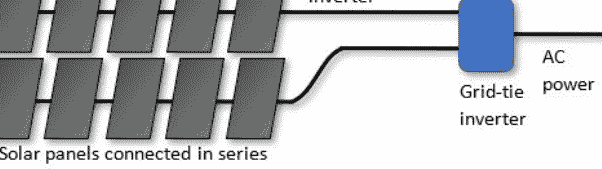

串联连接的太阳能电池板

显示多组太阳能电池板并联连接的低电压太阳能系统基本布局的简化框图

由于你有两个独立的太阳能阵列串，你可以拥有两种不同尺寸、面板的阵列，或者将支架安装在不同的屋顶上或不同的方向上。如果其中一个被部分遮挡，性能不会影响第二个阵列。

这种设计以前比单组串太阳能电池板贵，因为需要一个可以接受多组太阳能电池板的贵并网逆变器。然而，在过去的两年里，这些逆变器的价格大幅下降，现在能够接受一两组太阳能电池板的并网逆变器之间的成本差异已经很小。

这种方法具有成本效益，并逐渐取代单组串系统。多组系统在以下情况下特别有益：

- 你希望安装两种不同尺寸的太阳能电池板
- 安装朝向不同方向的太阳能电池板，例如在具有不同坡度的屋顶上
- 解决阴影问题。一天中某些时间段处于阴影下的太阳能电池板可以放在单独的一组中，以免影响系统的输出

## 微型逆变器系统

多组串串联系统正变得越来越流行。微型逆变器系统已经存在多年，但由于成本原因，最近才开始普及。然而，随着并网系统需求的增长，微型逆变器的价格正变得更加便宜。


显示微型逆变器系统基本布局的简化框图

在微型逆变器系统中，每个太阳能电池板都有自己的逆变器，作为独立的太阳能阵列工作，将其输出转换为交流电。

与其他并网系统相比，微型逆变器系统具有以下显著优势：

- 由于每个面板都是独立的单元，如果一个面板由于损坏或阴影导致性能不佳，不会影响输出
- 由于没有在面板之间运行的高电压，故障排除和维护变得简单得多
- 只要预算允许，就可以扩展你的并网系统
- 安装更灵活——你可以在不同位置安装面板板

虽然今天带有中央逆变器的串联太阳能系统仍然是安装的标准模式，但行业正在向微型逆变器技术发展。

现在你已经更清楚地了解并网系统是如何组合，是时候详细查看可用组件了。

## 并网太阳能电池板

在过去，当大多数太阳能系统都是独立系统时，你购买的每块太阳能电池板额定为12伏。虽然对于较小的面板仍然如此，但现在有了更高电压的配置。

随着并网系统越来越流行，高电压太阳能电池板也应运而生。许多容量为150W的面板额定为24伏，许多制造商现在制造额定在48伏到120伏之间的太阳能电池板。

这些电压非常适合并网安装。通过在高电压下运行太阳能阵列，你可以保持低电流，从而提高系统的效率。

## 并网逆变器

并网逆变器将来自太阳能系统的直流电转换为交流电，并将电压转换为与电网相同。这允许你将系统连接到电网，使你成为一个微电站并向电力公司供电。

你不能将普通逆变器用于并网应用。有几个原因：

- 并网逆变器必须与电网配合，以便向其输出电力。逆变器产生的交流正弦波形必须与电网波形完美协调
- 并网逆变器具有额外的安全功能，在电网停电时切断太阳能阵列
- 并网逆变器直接连接到太阳能电池板。在串联系统中，这意味着面板的输入电压可能会波动，非并网逆变器无法处理如此巨大的电压波动

在选择并网逆变器时需要考虑许多因素：

- 输入电压
- 额定功率
- 功率跟踪
- 逆变器支持多少组
- 诊断和报告信息
- 内置安全系统
- 安装选项与运行环境
- 认证与当地法规

## 输入电压

逆变器具有较大的电压范围，以应对太阳能阵列产生的高电压波动。通过这个电压范围，可以确定逆变器在串联时可以处理多少块太阳能电池板。

大多数用于屋顶安装的并网型逆变器设计工作范围为每路 50 伏至 500 伏之间的电压。

太阳能电池板的额定电压并非该电池板能产生的最大电压。单块 12 伏太阳能电池板的电压在阴天时可能低至 12 伏，在强直阳光下可达 20 伏。如果你有一个 48 伏的太阳能电池板，或者四个串联的 12 伏太阳能电池板，电压波动可以在 48 到 88 伏之间。

此外，太阳能电池板在开路状态下可以产生更高的电压——即太阳能阵列正在发电但电力未被使用。取决于你的太阳能电池板类型，12 伏电池板在开路时可以产生 26 伏。

如下表所示，太阳能阵列的额定电压越高，波动就越大：

| 12 伏太阳能电池板数量 | 额定太阳能电压 | 阴天的低电压 | 强光下的峰值电压 | 最大开路电压 |
|---|---|---|---|---|
| 1 | 12 伏 | 12 伏 | 20 伏 | 26 伏 |
| 2 | 24 伏 | 24 伏 | 40 伏 | 52 伏 |
| 4 | 48 伏 | 48 伏 | 80 伏 | 104 伏 |
| 6 | 72 伏 | 72 伏 | 120 伏 | 156 伏 |
| 8 | 96 伏 | 96 伏 | 160 伏 | 208 伏 |
| 10 | 120 伏 | 120 伏 | 200 伏 | 260 伏 |
| 15 | 180 伏 | 180 伏 | 300 伏 | 390 伏 |
| 20 | 240 伏 | 240 伏 | 400 伏 | 520 伏 |
| 25 | 300 伏 | 300 伏 | 500 伏 | 650 伏 |
| 30 | 360 伏 | 360 伏 | 600 伏 | 780 伏 |
| 35 | 420 伏 | 420 伏 | 700 伏 | 910 伏 |
| 40 | 480 伏 | 480 伏 | 800 伏 | 1040 伏 |

注：美国并网系统允许的最大开路电压为 600 伏，而在欧洲，建议你的系统不要超过 1000 伏（尽管 1500 伏在大型太阳能电站中变得越来越常见）。你必须确保你的系统绝不会超过此限制。

如该表所示，如果阴天时云层遮挡了太阳，你可以瞬间看到电压下降几百伏。当云层移开时，电压会回升。

确保太阳能电池板能够与你太阳能阵列的电压而非阵列的额定电压匹配是非常重要的。如果你超过了逆变器的峰值电压，逆变器将关闭以避免损坏。在极端情况下，超过电压额定可能会损坏你的逆变器。

除了查看最大输入电压，你还需要查看最小输入电压。如果系统的总电压低于最小输入电压，逆变器将关闭。太阳能电池板仍会产生能量，但产生的能量是受限的。最小输入电压意味着每天开始和结束时发电，并确保在冬季产生更多的电，特别是在阴天的情况下。寻找输入电压范围最宽的逆变器将为你设计系统提供最大的灵活性。

除了标准的输入电压范围外，你的逆变器还会显示最大电压额定。这个最大电压额定涉及你太阳能阵列的最大开路电压。你必须确保阵列的开路电压不超过逆变器的最大电压。

## 功率额定

并网逆变器上有两个功率额定：

- 输入功率额定 – 逆变器从太阳能阵列接受的最小和最大功率
- 输出功率额定 – 逆变器作为交流输出能产生的最大功率和电流

## 输入功率额定

输入功率额定显示了逆变器工作的最小和最大范围。范围越宽，你的逆变器效率越高。

逆变器上的规格通常会显示三个功率额定数字：

- 额定功率，单位为瓦特
- 最小和最大功率额定
- 最大功率额定

额定功率显示逆变器可以从太阳能阵列接收的功率。最小和最大功率额定显示了你太阳能阵列的最大开路功率。

## 功率跟踪

最大功率点跟踪（`MPPT`）是并网逆变器的一项关键功能。`MPPT` 算法持续监测太阳能阵列的电压和电流，以找到最大功率点，确保系统始终在最高效率下运行。大多数现代并网逆变器都内置了 `MPPT` 功能，且支持多路 `MPPT` 输入，允许连接不同朝向或规格的组串。

## 逆变器支持多少组

这指的是逆变器可以独立处理多少个太阳能电池板组串。单组串逆变器只有一个 `MPPT` 跟踪器，而多组串逆变器通常有两个或更多独立的 `MPPT` 跟踪器。选择支持多组的逆变器可以提供更大的系统设计灵活性，特别是在屋顶朝向不一或存在遮挡的情况下。

## 诊断和报告信息

至少，你需要一个逆变器，它能告诉你你的系统是否正在工作，并在检测到故障时提供可能出现问题的指示。诊断功能应该能够提供足够的信息来识别系统故障，例如：

- 太阳能电池阵列功率不足或过剩
- 电网连接问题
- 电网电压或频率问题
- 过热

大多数逆变器提供的信息多得多，让你看到太阳能电池阵列的电压和电流、当前发电量、每日发电量以及整个寿命的发电量。

## 内置安全功能

大多数逆变器都包含了安全关机功能。逆变器内置接地保护是常见的做法。如上一章提到的，即使逆变器提供了这种功能，在设计系统时，安装额外的接地故障保护仍然是一个良好的做法。这通过剩余电流检测器（`RCD`）集成到你的系统中的。在美国和加拿大，`RCD` 被称为接地故障截断器（`GFI`）。

并网式逆变器会监控功率，并在检测到断电时关机（有时被称为“孤岛保护”）。这种电源切断确保了在断电时，你的太阳能能量不会继续向电网输电。这是一项必要的安全要求。如果工人正尝试修理停电，而你的太阳能阵列在他们工作时向电网供电，他们将面临触电风险。

当内部温度过高时，逆变器也应该关机。

## 安装选项和运行环境

逆变器很重。它们需要固定地安装在墙上或螺栓固定在地面。它们会产生大量的热量，特别是当接近其额定输出时，需要设备周围良好的空气流以保持冷却。

你可以购买用于室内或户外安装的逆变器。如果你考虑户外安装，请检查单元是否防尘防水，且额定至少达到 `IP64` 级。

逆变器过热是并网系统失效的一个原因。随着逆变器变热，它提供的功率会变少，如果温度继续升高，它最终将关机以避免永久损坏。选择逆变器时，请检查其运行参数以及你如何确保系统保持在这些限制范围内。

逆变器通常安装在阁楼里。虽然这是一个非常好的主意，但阁楼在夏季会非常热。在炎热天气罕见的英国，阁楼的温度有时可以达到 55°C (122–131°F)。大多数逆变器在这种温度水平下已达到其工作温度的上限。

逆变器应安装在通风良好的区域，远离天花板，并在每侧、顶部和底部留出空间。它们**不应**安装在密封柜内。逆变器可以选择外部散热器或温度控制冷却风扇来保持逆变器冷却。

某些逆变器会发出很小的噪音。这通常是持续的低频嗡嗡声。只有在周围安静时才能注意到。由于这些原因，逆变器通常不安装在房屋居住空间或办公环境中。相反，考虑将你的逆变器安装在车库或建筑的外墙上。

偶尔，逆变器产生的声音会与墙共振，放大声音并导致居住不适。这可能发生在逆变器安装在外墙上的情况下。这是一个非常罕见的情况，但如果你计划将逆变器安装在实心混凝土墙上，最有可能发生。解决方案是缓冲逆变器与安装它的墙或地板之间的连接。有一种非常有效的产品叫做 `Green Glue`（绿色胶水），由 `Green Glue` 公司（`www.GreenGlueCompany.com`）生产，涂在墙和逆变器之间。当重新安装逆变器将其压缩时，胶水会散开形成一个隔音屏障，对于阻挡低共振振动特别有效。

## 从 eBay 购买


我不反对使用 eBay，除非你真的了解自己在看什么。不幸的是，有很多所谓的“廉价商品”陷阱那些不留心的人，通常销售未经批准的逆变器，或者广告为“微电网并网系统”的组合方案，这些方案声称适合业余爱好者安装。通常，逆变器通过普通的家用插座插入家庭供电系统，卖家声称你可以使用该系统将电力卖回公用公司并让你的电表反转运行。

这些系统非常危险。这些设备不可避免地没有经过并网使用的认证。更重要的是，这些系统在美国、加拿大、澳大利亚和整个欧洲社区都是非法的，因为逆变器连接到家庭电源的方式是反向使用家用插头。

这意味着家用插头中有电网电的交流电通过，带有致命的高压电流流过插头的插脚。这具有极高的风险，并且直接违反了基本的电气安全法规。如果有人拔掉电缆不小心碰到了未屏蔽的插头，其灾难性和可能致命的后果是不堪想象的。

这些电缆被绰称为“寡妇制造者”，这并非偶然。它们是潜在的杀手。永远不要设计任何有让电网交流电通过裸露连接器的电气系统。你的生命以及你周围人的生命价值比省下一点钱要高得多。

## 独立系统组件

如果你正在设计一个独立系统，其中涉及的设计和规划工作比类似尺寸的并网系统多得多。确保你的独立系统运行更为关键。如果你没有产生足够的能量，并网系统不会让你失望，但独立系统会。

在考虑和计划安装面板、布线和处理安全方面等所有物理方面之外，你还需要考虑系统运行的电压，并设计电池系统来储存你的能量。

## 计算最佳电压

太阳能电池和电池通常都是 12 伏，所以逻辑上讲，你会认为以 12 伏运行系统是有意义的。

对于小型系统，你是正确的。然而，12 伏系统有一些局限性。因此，我们现在需要确定你系统的最佳电压。

如果你对伏、瓦特、电流和电阻不熟悉，现在是重读第 2 章：电力简介的好时机。

## 电压和电流

电流的计算公式为瓦特除以伏。当你在低电压运行时，电流比在高电压运行时大得多。

以一个普通的家用低能灯泡为例。一个运行在电网电压下的 12W 灯泡每小时消耗 12 瓦特的功率。在 230 伏下驱动该灯泡所需的电流为 0.05 安培（`12W ÷ 230V = 0.05 amps`），在 110 伏下为 0.1 安培（`12W ÷ 110V = 0.1 amps`）。

如果你用 12 伏电池运行相同功率的灯泡，你仍然每小时消耗 12 瓦特，但这次电流是 1 安培（`12W ÷ 12V = 1 amp`）。如果你用 24 伏电池运行相同功率的灯泡，功率减了一半，现在你只需要 ½ 安培（`12W ÷ 24V = ½ amp`）。

“那又怎样？我明白你们在说。谁在乎呢？到底，无论电压如何，我们使用的能量是一样的。”

问题在于电阻。电阻是电流流过的材料对电流的阻碍。把它想象成电子通过电线运动时的摩擦。通过增加电压，你可以减少电流，从而减少能量损失。

你可以通过更粗的电缆来克服电阻，但你会达到电缆尺寸变得不切实际的地点。此时，是时候切换到更高的电压了。

## 我可以在什么电压下运行？

过去，你的系统——包括能量产生和能量消耗——必须以相同的电压运行。例如，如果你有一个四块 12V 太阳能板组成的组合，你的太阳能阵列将以 48V 运行，你的电池和逆变器也必须以 48V 运行。

虽然这通常如此，但现在不再必须这样了。你现在可以使用太阳控制器，它可以接收较高直流电压的太阳能板组合，并将其降至较低电压，用于为一个或多个 12V、24V 或 48V 电池充电。取决于使用的太阳控制器，太阳能阵列的最大直流电压可以高达 150V。

这让你有机会可以使用通常用于并网安装的大容量、高电压太阳能板，并将它们用于独立应用。

无论是独立系统还是并网备用系统，运行电池最常用的电压是 12 伏、24 伏或 48 伏。

原则上，运行电气电路最高效的方法是保持高电压和低电流。这就是为什么电网在高电压下运行。这是将距离损耗降低到最低的唯一方法。12 伏和 24 伏系统的实现比高电压系统便宜得多，因为这些组件更容易获得且成本更低。12 伏和 24 伏的设备电器也容易获得，而 48 伏的设备电器较为罕见。

如果你正在设计和建造自己的系统，在独立系统中电池存储超过 48 伏是不寻常。虽然你可以提高电压，但其他电压的逆变器和控制器极其昂贵，且仅适用于特殊应用。

## 如何计算你应该运行的电压

你对电压的选择取决于太阳能阵列产生的电流（安培），或者取决于你在任何时刻负载中使用的电流（安培）。

为了应对更大的电流，你需要更粗的电缆和更强大的太阳控制器。更长的电缆线路会导致产生更大的电阻，从而降低系统效率，这意味着你需要产生更多的功率。

在我们的系统中，我们建议从太阳能阵列到房屋铺设 12 米（40 英尺）长的线路，加上房屋内的布线。

大电流会缩短电池寿命。当电池的放电或充电电流可能超过其额定的 `1/10` 时，这是一个需要考虑因素。

我们将讨论电池尺寸，因为电流消耗是选择合适尺寸电池的因素。在这个阶段，你可能需要考虑多种电压选项（如 12 伏和 24 伏），并在设计过程中决定哪种最适合你。最后，如果你计划使用逆变器将电压转换为电网级交流电压，12 伏逆变器的功率额通常低于 24 伏或 48 伏逆变器。这会限制 12 伏能够实现的功能。

为了解决这些问题，你可以增加系统的电压。如果你将电压翻倍，电流就会减半。

对于什么电流使用什么电压没有硬性规定，通常情况下，如果传输电流所需的电缆截面积大于 6mm²（或 AWG 9 或以下），就是时候考虑增加电压了。我稍后将解释如何计算所需的电缆厚度。

## 如何计算你的电流

如第 2 章所示，计算电流非常简单。电流（安培）等于功率（瓦）除以电压（伏）：

> 功率 ÷ 电压 = 电流

```
P ÷ V = I
```

回到你的分析表（示例 1 位于第 54 页），并将如果你同时打开所有电气设备，你的系统将消耗的功率（瓦）总量相加。以你的度假屋为例，如果我同时打开所有设备，我将消耗 169 瓦的电能。

以度假屋为例，让我们分别根据 12 伏和 24 伏计算电流，以便直观了解不同电流的差异。

使用上述公式，169 瓦除以 12 伏等于 14.08 安培。169 瓦除以 24 伏等于 7.04 安培。

同样，我们需要查看太阳能阵列，并计算出阵列为系统提供了多少安培的电流。我们需要一个 320 瓦的太阳能阵列。320 瓦除以 12 伏等于 26.67 安培。320 瓦除以 24 伏等于 13.33 安培。

## 计算电缆厚度

我稍后会详细介绍布线问题，但现在，我们需要确定系统所需的电缆厚度。

对于我们的度假屋，我们需要一根 12 米（40 英尺）的电缆从太阳控制器连接到房屋本身。房屋内部将有照明和电器的不同电路，但房屋内部最长的电缆线路是额外的 10 米（33 英尺）。

这意味着最长的电缆线路长度为 22 米（72½ 英尺）。你可以使用以下公式计算所需的电缆尺寸：

```
(L x I 0.8) ÷ V = CT

L 以米为单位的线长（1 米是 3.3 英尺）
I 以安培为单位的电流
V 系统电压（例如 12V 或 24V）
CT 电缆截面积单位为 mm²
```

因此，计算 12 伏系统的电缆厚度：

`(22 x 14.08A x 0.8) ÷ 12 = 20.652mm²`

这是 24 伏系统的相同计算：

`(22m x 7.04A x 0.8) ÷ 24 = 5.155mm²`

为了完整起见，这里是 48 伏系统的相同计算：

`(22m x 3.52A x 0.8) ÷ 48 = 1.633mm²`

## 尺寸转换

要将截面积转换为美国制规格或直径，请参考下表：

| 截面积 (mm²) | 美国制规格 (AWG) | 直径 (英寸) | 直径 (毫米) |
| :--- | :--- | :--- | :--- |
| 107.16 | 00 | 0.46 | 11.68 |
| 84.97 | 00 | 0.4096 | 10.4 |
| 67.4 | 00 | 0.3648 | 9.27 |
| 53.46 | 0 | 0.3249 | 8.25 |
| 42.39 | 1 | 0.2893 | 7.35 |
| 33.61 | 2 | 0.2576 | 6.54 |
| 26.65 | 3 | 0.2294 | 5.83 |
| 21.14 | 4 | 0.2043 | 5.19 |
| 16.76 | 5 | 0.1819 | 4.62 |
| 13.29 | 6 | 0.162 | 4.11 |
| 10.55 | 7 | 0.1443 | 3.67 |
| 8.36 | 8 | 0.1285 | 3.26 |
| 6.63 | 9 | 0.1144 | 2.91 |
| 5.26 | 10 | 0.1019 | 2.59 |
| 4.17 | 11 | 0.0907 | 2.3 |
| 3.31 | 12 | 0.0808 | 2.05 |
| 2.63 | 13 | 0.072 | 1.83 |
| 2.08 | 14 | 0.0641 | 1.63 |
| 1.65 | 15 | 0.0571 | 1.45 |
| 1.31 | 16 | 0.0508 | 1.29 |
| 1.04 | 17 | 0.0453 | 1.15 |
| 0.82 | 18 | 0.0403 | 1.02 |
| 0.65 | 19 | 0.0359 | 0.91 |
| 0.52 | 20 | 0.0332 | 0.81 |
| 0.41 | 21 | 0.0285 | 0.72 |
| 0.33 | 22 | 0.0254 | 0.65 |
| 0.26 | 23 | 0.0226 | 0.57 |
| 0.24 | 24 | 0.0201 | 0.51 |
| 0.16 | 25 | 0.0179 | 0.45 |
| 0.13 | 26 | 0.0159 | 0.4 |

从这些数字中你可以一眼看出问题。我们的电缆太长了，实际上我们无法在 12 伏下运行系统。20.65mm² 电缆的匹配值是 21.14mm²。我们的电缆是 AWG 4，直径为 5 毫米，既厚又重、不灵活、难以采购且非常昂贵。

这意味着我们需要从太阳能阵列到房屋周围铺设极粗的 AWG 4 电缆来克服电阻。这将非常昂贵、不灵活且难以安装。

现实情况下，由于电缆尺寸的考虑，我们的太阳能系统将使用 24 伏或 48 伏。

## 混合使用太阳能电池板

在指定太阳能阵列规格时，你应该坚持使用一种类型的电池板，而不是混合使用。如果你使用 100 瓦的阵列，可以通过一块 100 瓦的太阳能电池板、两块 50 瓦的太阳能电池板或五块 20 瓦的太阳能电池板来实现。

如果你想在阵列中使用不同的太阳能电池板，可以通过将两组电池板并联运行并将它们连接到可以处理多个面板的控制器，或使用多个控制器来实现。这是一种创建合适功率系统的有效方法，而不是花钱购买产生功率超过所需的更大的太阳能电池板。

结果是布线稍微复杂了一些，但这种方法通常比购买大容量更大的太阳能阵列更具成本效益。将两个不同尺寸的太阳能电池板连接到同一个系统有两种方法。接下来的两个展示了在 12 伏下运行的系统，使用两个尺寸的面板创建一个 140 瓦峰值系统：

## 单控制器系统

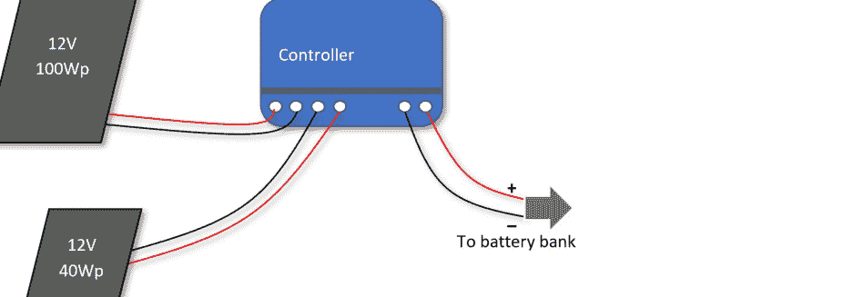

该系统使用单个控制器。控制器有两个独立的输入。两块太阳能电池板相互独立工作，控制器处理功率输出的不匹配。这是处理不匹配太阳能电池板的最佳解决方案。

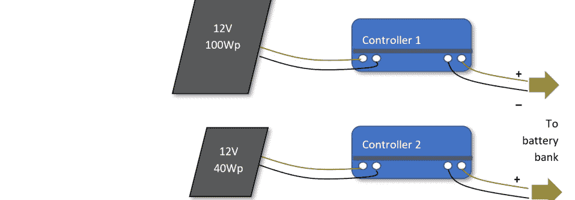

## 双控制器系统

该系统使用两个控制器。第二个控制器用于为较小的太阳能电池板为电池额外功率。两个控制器为电池组充电。

如果你计划从小开始，并在需要和预算允许时增加太阳能系统，这些解决方案是有效的。

市场上有额定电压高达 120 伏的面板，尽管最常见的是 12 伏和 24 伏面板。

在过去，你的太阳能阵列电压必须与你的电池系统电压匹配。如果你有一个 12 伏电池，你就必须有一个 12 伏太阳能板来为它充电。同样，如果你有一个 48 伏电池，你必须串联几块太阳能板来匹配 48 伏电池系统。

许多太阳能控制器仍然是这种情况。但现在可以购买能够处理来自太阳能阵列的高电压的控制器，并将其转换为电池系统的较低电压。这在设计系统时为你提供了极大的灵活性：你可以使用几块功率更大、电压更高的太阳能板来产生你所需的功率，然后使用控制器将电压降低到适合电池组的电压。

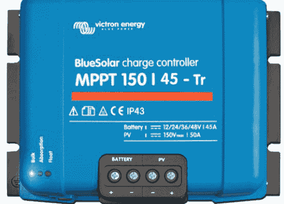

上方：Victron Energy 提供了一系列太阳能控制器，可以与高电压太阳能阵列配合，并将电压降低到较低水平为电池充电。例如，所示的 MPPT 150/45 充电器可以与高达 150V/50A 的太阳能阵列配合，并将电压降至 12、24、36 或 48 伏供电池组使用。

这些新型控制器非常适合降压。例如，你可以有一个产生 100–150 瓦的太阳能阵列，为 12 伏或 24 伏电池组充电。然而，这些控制器不能反过来工作：例如，你不能使用它们从单个 12 伏太阳能板为 24 伏电池组充电。

如果你的离网太阳能电力系统运行电压不是 12 伏，你可以选择安装多块太阳能板组成 24 伏太阳能阵列，或者选择更高电压的太阳能板。例如，如果你想要一个 200 瓦的太阳能阵列，你可以通过许多方式实现：

- 使用两块 12 伏、100 瓦的太阳能板并串联
- 使用一块 24 伏、200 瓦的太阳能板

在选择太阳能阵列时，你需要考虑：

- 物理尺寸：它能放进可用空间吗？
- 支持结构：现成的支架可能仅适用于某些面板的组合
- 组装阵列需要多少电缆
- 系统电压

## 电池

在电池方面有多种选择，并且许多专业的电池供应商可以就你的太阳能安装提供最佳方案建议。你会遇到的两种主要电池技术是铅酸和锂。

铅酸电池是这两种技术中更成熟的。许多人认为它们已经过时，但事实上铅酸电池在过去几年里已经显著进化，对大多数人来说仍然是最佳选择。

锂电池比铅酸电池贵得多，但它们通常寿命更长，而且在能量存储方面的效率高得多。然而，它们的活性比铅酸电池高得多。它们需要专门的充电，并且绝对不允许过热。如果锂电池组出现任何问题，就会面临火灾的风险。如果你在 Google 或 YouTube 上搜索“lithium battery fire”（锂电池火灾），你会迅速看到锂离子电池因充电、放电或存储不当导致过热时发生问题的示例。

在过去的几年里，我一直与不同的锂离子电池打交道，从 20 世纪 90 年代的手持电脑到最近的电动汽车和太阳能设备。我亲眼目睹了制造商在构建可靠锂离子系统方面面临的困难。

因此，如果你考虑采用锂离子路线，你应该购买一套完整的电池管理解决方案，包括太阳能控制器、电池和逆变器。不要混合使用组件，也不要用单个锂离子电池自行组装锂离子电池包。

## 购买完整的电池包

在过去的两年里，几家公司已开始为太阳能系统提供完整的电池包。像 Tesla Powerwall 这样的产品在太阳能存储领域引起了很大兴趣，新产品也在不断推出。

这些电池系统大部分是昂贵的专利系统，由电池包、控制元件和它们的逆变器组成。它们被设计用于与并网系统配合。它们的优势在于可以在白天和晚上使用自己的电，或者在发生停电时提供后备电源以求安心。

虽然它们有自己的优点，但大多数系统灵活性不足。你拥有一个固定尺寸的电池包，并且受限于所提供的逆变器。大多数电池系统的存储容量为 4kWh，最大功率损耗在 600 – 800 瓦之间。

这些系统设计用于实施并网系统。在许多情况下，电池系统与太阳能阵列在电气上是分离，从交流电源充电并通过自己的逆变器释放功率。大多数系统提供在停电时供电的功能，尽管需要手动切换。没有任何主流系统适用于离网系统。

它们的缺乏灵活性会导致一些现实问题，从而减少它们对许多人的益处：

- 电池通常优先于家内的电力需求。如果电池在白天需要充电，它们就会充电。

显著延长了铅酸电池的使用寿命和性能，使其与锂电池相媲美。与锂电池不同，它们的充放电速度比其他铅酸电池更快。它们在零下温度下仍保持良好性能，且不需要昂贵且复杂的温度管理。铅碳电池的缺点是随着电量的下降，电压降也更高，这可能会给某些应用带来问题。

相比工业级牵引电池，一种低成本的选择是休闲电池，用于露营车和船只。这些通常是 AGM 电池。它们的寿命远短于牵引电池，通常在 5-6 年后需要更换，且在应用中的强度也较小。

胶体电池可以为小型应用提供极佳的免维护湿式电池替代方案，而最新的胶体电池也适用于高电流应用以及较小系统。

并非所有电池都是相同的。根据我的经验，太阳能发电装置最出色的电池制造商是 Trojan、Crown、Northstar 和 Enersys。

## 锂离子电池类型

锂离子电池相比铅酸电池的优势在于它们更轻、占用空间更小、可以定期放电至 20% 的电量状态，并且随着时间的推移，其性能不会像大多数铅酸电池那样老化快。

与铅碳电池相比，许多优势正在缩小，因为铅碳电池现在可以以显著更低的成本匹配锂离子电池的寿命。

与铅电池一样，锂离子电池也有不同的形式，最常见的包括：

- 钴酸锂锂离子电池 (`LiCoO2`)，通常称为锂钴，是最廉价的电池，常见于笔记本电脑和手机。它们的寿命最短，且不适合大多数太阳能储能应用。
- 锰酸锂锂离子电池 (`LiMnO2`)，通常称为锂锰，其充放电速度比锂钴快得多，寿命也更长。
- 锰钴锂锂离子电池 (`LiMnCoO`)，通常称为 NMC 电池，以及它们的近亲属镍钴铝锂电池 (`LiNiCoAlO2`)，或 NCA 电池，这是锂锰电池的最新发展成果。它们具有高功率密度，意味着在相同尺寸和重量下，电池存储了更多能量。它们是储能领域最常用的化学电池，也被特斯拉应用于其电动汽车中。
- 磷酸铁锂电池 (`LiFePO4`)，通常称为磷酸铁锂，比大多数锂离子电池更重、体积更大，但能够在短时间内提供更大的功率。它们对低温的耐受性较低，在冰点温度下表现不佳。

还有其他锂离子技术，包括钛酸锂、锂盐、锂石墨和锂空气，但这些要么非常专业，要么仍处于实验阶段。

你可能还会听到锂聚合物电池，称为 LiPo 电池。锂聚合物本身并不是一种化学体系，而是一种采用袋设计制造电池的方法。大多数广告为锂聚合物的电池实际上是钴酸锂电池。

所有锂离子电池最大的问题是它们需要仔细的管理。锂离子电池必须与合适的电池管理系统 (`BMS`) 配对，以管理电池输出电流、监控电池内部温度并确保整个系统的安全。


# 锂离子电池安全与配置指南

## 锂离子电池安全警示

锂离子电池可能会因错误的充放电而损坏或失效。如果过热，大多数电池都会变得不稳定，这可能是由于过快充放电、在接近充满电时过充电、以高电压放电或通过短路引起的。不稳定的锂离子电池可能会起火或爆炸。由于所有锂离子电池都含有氧气，扑灭锂火是非常困难的，火灾可能会从一个电池迅速蔓延到整个电池包。

不要试图混合使用不同的锂离子电池和充电控制器。你购买的充电控制器必须具备为锂充电的能力，并与电池内部的 `BMS` 匹配。此外，在 Ebay 上找到的一些廉价锂离子电池系统没有自带 `BMS`，或者其 `BMS` 不够完善，无法充分保护电池，特别是当使用太阳能而非制造商原装充电器进行充电时。

如果你正在考虑锂离子电池，选择具有良好 `BMS` 的电池以及能够与你选择的锂离子电池包兼容的太阳能控制器至关重要。太阳能控制器通常会提供自己的锂离子电池包，或提供一份可配套的改进型锂离子电池列表。

如果考虑锂离子电池解决方案，你需要确保有合适的存放环境：它们必须存放在环境温度为 5°C 到 35°C (41°F–95°F) 的条件下。

## 电池配置

你可以使用一个或多个电池进行能量储能。就像太阳能板一样，你可以将电池并联以增加容量，或串联以增加电压。

使用相同规格和尺寸的电池来组成你的电池组至关重要。混合电池容量和类型意味着某些电池永远无法完全充满，而某些电池的放电量会超过预期。结果是混合容量和类型会显著缩短整个电池组的寿命。

## 电池寿命

电池不是永久的，在你的太阳能电力系统的寿命某个阶段，你将需要更换。显然，我们希望电池系统能够尽可能久使用，因此我们需要了解所用电池的寿命。

测量电池寿命有两种方法，两者都能告诉你关于电池的不同信息。

- **循环寿命** 表示在特定放电深度下的电池循环次数
- **浮动寿命** 显示了电池如果被储存并定期充电但从不使用，可以使用多年。

### 循环寿命

每当你对电池进行放电和充电时，你就完成了一次循环。循环若干，电池内部的化学物质将开始老化，最终电池需要更换。

循环寿命显示了电池在更换之前可以维持多少循环。寿命以“放电深度”（`DOD`）表示，制造商通常会提供一张显示循环寿命与放电深度关系的图表或表格。

你看到的循环寿命典型类型如下：

| 电池类型 | 20% DOD | 40% DOD | 50% DOD | 80% DOD |
| :--- | :--- | :--- | :--- | :--- |
| 铅碳电池 | 9,000 次循环 | 6,000 次循环 | 5,000 次循环 | 2,000 次循环 |
| 铅酸胶体电池 | 2,000 次循环 | 1,400 次循环 | 1,200 次循环 | 700 次循环 |
| 锂离子电池 | 9,000 次循环 | 6,000 次循环 | 5,000 次循环 | 2,000 次循环 |

我们不想让电池完全放电，这会损坏它们。因此，我们需要查看循环寿命，以确定我们需要多少次循环。然后我们据此计算出所需的电池容量。

在春、夏、秋季节的日常运行，我们预计太阳能板每天都能为电池充电。电池的放电量不太可能超过 10-20%。然而，在冬季，会出现一种情况：电池会连续几天电量耗尽，然后太阳能板才能将它们重新充满电。

在一年中的四个月里，我们需要考虑最坏的情况，即电池在五天内的放电量可能达到 80%，然后由太阳能板进行充电。

如果我们使用锂离子电池或铅碳电池，电池在寿命结束前允许我们进行大约 2000 次循环。如果我们使用胶凝电池，循环寿命则接近 700 次。

```
2,000 次循环 × 5 天 = 10,000 天
700 次循环 × 5 天 = 3,500 天 = 116 个月
```

由于这种情况只会发生在从 11 月到次年 2 月的四个月内，铅碳电池或锂电池在达到循环寿命结束前可以使用四十年，而其循环寿命将持续近二十年。

实际上，电池的“浮寿命”（即最大货架寿命）可能在二十年左右，在这种情况下它们在达到循环寿命之前就会失效。

根据我们 24 伏 145 安时的能量需求，以及 80% 的最大放电率，我们计算出我们需要在 24 伏下容量为 `145 ÷ 0.8 = 181.25` 安时的电池容量。

## 二手铅酸电池

市场上有二手铅酸电池供应。这些电池可以作为旧 `UPS` 电池（`UPS` = 不间断电源）或旧电动汽车电池的形式出售。

虽然这些电池的寿命不如新电池，但购买价格可能极低，通常按报废价出售。如果你的预算紧张，且用电需求不是很大，这是一个非常棒的省钱方法。

请记住，铅酸电池技术在过去三年中有了巨大的进步，这意味着与最新技术的电池相比，旧电池的循环寿命和整体寿命要短得多。然而，如果你能以报废价买到二手电池，你实际上是在免费获取储能设备，这可是很难反驳的！

不要“混用”不同型号和规格的电池。在整个电池组中使用相同的型号和规格。我建议不要混合使用新电池和旧电池。这是一种虚假的节约，因为新电池的寿命可能会受到旧电池的影响。如果你正在考虑二手电池，请了解它们已经循环了多少次，以及它们的放电深度如何。许多 `UPS` 电池在生命周期内几乎没有循环过，也很少进行过放电。

如果购买旧电动汽车电池，请记住它们在重负载下经历过非常艰难的生活。然而，电动汽车电池可以为低需求应用领域继续提供良好的服务。如果你的负载小于 1kW，并且你有足够的电池来确保它们在几年内缓慢放电，这些电池就可以提供良好的服务。

如果可能，请在购买前尝试测试二手电池。确保它们已完全充满电，然后使用电池测试仪查看它们的性能。

如果你的二手电池循环次数不多，那么它们在你第一次拿到时，循环寿命可能不会很长。要“唤醒”它们，请将太阳能控制器或逆变器连接到电池上，并接入一个低功耗设备将电池放电到约 20% 的电量。再次使用涓流充电充满电池并重复此过程。

在经过三次深循环后，你将恢复二手电池的大部分容量。

如果使用二手电池，预计它们只能提供标称容量的一半。因此，如果它们被标榜为 100 安时电池，假设它们只能为你提供 50 安时的使用量。对于旧电动汽车电池，假设只有三分之一的容量。

很有可能，它们提供的会比这多，但对二手电池的性能感到满意，总比对它们不如新电池而感到失望要好。

## 二手锂离子电池

市场上也有二手锂离子电池，但除非你真的了解自己在做什么，或者与能够为你配置整个电池系统的锂离子专业人士合作，否则应避免购买。和铅酸电池一样，购买二手锂离子电池可以省钱，但如果没有深入的电池系统知识，处理这一领域是极具风险的。

## 构建你的电池组

由于我们的系统运行在 24 伏下，我们需要两块 12 伏电池串联来组成我们的电池组。

因此，我们需要两块 181.25 安时的 12 伏电池来创建所需的电池组。

你不太可能找到恰好为 181.25 安时的电池，因此我们需要找到一个容量至少为 181.25 安时的电池。

在寻找电池时，你需要考虑电池的重量。这种大小的单块 12 伏铅酸电池重量约为 60 公斤（130 磅以上），而锂离子电池的重量仅约为 35-40 公斤（77-88 磅）。

安全地移动这种尺寸的电池并不容易。你不想在此过程中受伤。一个更好的解决方案可能是购买多个较小的电池并将它们连接起来。

由于铅酸电池含有酸，它们应该安装在电池托盘中，以便任何酸液泄漏都能得到控制。在澳大利亚和加拿大，规定所有电池必须安装在通风、可锁且防鼠的围壳内。

由于无法买到 181.25 安时的电池，我决定使用四块 100 安时的 12 伏电池，为我提供了一个在 24 伏下总容量为 200 安时的电池组。

12 伏 100 安时的电池仍然不轻。每块重量可能轻松达到 30 公斤（66 磅），所以如果大家都很担心，不要害怕使用更多、更轻的电池。

要构建这个电池组，你可以使用四块 100 安时的 12 伏电池。

实现此目标有多种方法：自然对流、创建无活动部件的被动通风系统，或通风风扇解决方案。通风风扇解决方案会导致自身的问题，特别是风扇故障时的情况，而且风扇产生的湍流会在电池外壳的其他位置产生意外的氢气聚集。由于这些原因，通常建议铅电池存储解决方案使用被动通风系统。

### 自然对流的原理

自然对流是利用液体或气体密度差异来移动液体或气体的过程，通过气体内部的温度差驱动气体之间或通过的流动。

例如，我们知道热空气上升，冷空气下落到容器底部。由于我们处理的是不同的气体，从电池中提取氢气时也可以使用相同的原理。

氢气比空气轻得多，总是上升到箱体的顶部。较重的气体（如空气）会沉到氢气下方。当氢气温度与周围空气温度不同时，氢气将以每秒 20 米（每秒 65 英尺）的速度向上。

### 利用自然对流提取氢气

利用自然对流的最佳方法是建造带倾斜铰盖盖的电池盒。盖底部没有死角。在电池盒顶部，可以将 `PVC` 管安装在盖子上形成一个烟囱。该烟囱可以通风到室外。

当氢气从电池中排出时，它会立即上升到电池盒顶部，并沿盖子的倾斜面被导向 `PVC` 管。

由于 `PVC` 管的直径可以根据氢气速度和电池产生氢气的预计最坏情况来计算。管径的计算公式为：

```
0.011 / Total kWh of batteries x 1000 / 20m/s
提取直径（cm） = 将答案除以 24
```

如果您只有 1kWh 的电池存储，计算结果为您需要一根最小直径为 0.42cm（1/4 英寸）的管。如果您有 8kWh 的电池存储，计算建议您需要一根最小直径为 1.19cm（约 1/2 英寸）的管。

小型提取管存在安全问题：它们很容易被堵住，而且气体的释放可能会受到表面摩擦的阻碍。因此，建议任何电池盒进气口的最小提取管尺寸至少为 1.25cm（1/2 英寸），并且在计算值的基础上至少增加 20% 的管径尺寸。如果数值很大，您还需要将管径增加至少 50%，以补偿格栅导致的气流减少。

如果您从电池盒内部提取气体，您需要用其他东西代替它：来自周围区域的新鲜空气。您通常会在电池盒底部的通风口这样做。由于进入箱内的空气流会比氢气排出的速度慢，进气口的尺寸需要相应为：

```
0.011 / Total kWh of batteries x 1000 / 1m/s
进气口直径（cm） = √(计算结果)
```

在为您必须自己进行所有计算而恐慌之前，有一个表格显示了您需要处理的电池尺寸的最小进气和提取管径：

| 电池组总容量 (kWh) | 提取管最小内径 | 进气口内径 |
| :--- | :--- | :--- |
| 1kWh | 0.42cm (1/6英寸) | 1.87cm (3/4英寸) |
| 2kWh | 0.59cm (3/4英寸) | 2.64cm (1¹⁄₈英寸) |
| 3kWh | 0.73cm (5/16英寸) | 3.24cm (1¹⁄₄英寸) |
| 4kWh | 0.84cm (1/2英寸) | 3.74cm (1½英寸) |
| 6kWh | 1.02cm (2/3英寸) | 4.58cm (1¹⁄₈英寸) |
| 8kWh | 1.19cm (3/4英寸) | 5.29cm (2¹⁄₈英寸) |
| 10kWh | 1.32cm (5/16英寸) | 5.92cm (2¹⁄₄英寸) |
| 20kWh | 1.87cm (3/4英寸) | 8.37cm (3¹⁄₈英寸) |

## 氢传感器和报警器

虽然排放氢气不是大问题，但聚集氢气的后果可能是巨大的。如果您有一个通风良好的电池盒，氢气爆炸的概率微乎其微。此外，大多数氢气爆炸都是微小的（很少超过“砰”的一声）。然而，房间内或电池外壳内聚集大量氢气可能会导致灾难性的后果。

为了减少这种情况，如果您在建筑内、船上或休闲旅行车内安装铅酸电池，请考虑安装两个报警器——一个在电池外壳顶部，一个在房间的天花板上。如果氢气浓度超过 1%（氢气在空气中并不危险），这些报警器将触发。如果报警器触发，您需要在危险发生前断开电池组并对该区域通风。如果您家里有烟雾报警器，需要它们的概率微乎其微。但它们能提供的安全感是巨大的。

## 太阳能控制器

太阳能控制器负责照看电池。如果您的电池盒通风良好，氢气爆炸的可能性很小。此外，大多数氢气爆炸都是微小的（很少超过“砰”的一声）。然而，房间内或电池外壳内聚集大量氢气可能会导致灾难性的后果。

对太阳能控制器的选择取决于：

- 系统电压
- 电池类型（特别是计划使用锂电池时）
- 太阳阵列的电流（安培）
- 负载电流（安培）
- 您对显示要求的详细程度

### 电池均衡

太阳能控制器负责照看电池。如果您的电池盒通风良好，氢气爆炸的可能性很小。此外，大多数氢气爆炸都是微小的（很少超过“砰”的一声）。然而，房间内或电池外壳内聚集大量氢气可能会导致灾难性的后果。

### 为扩展留余

在查看太阳能控制器时，购买一个比您需要的电流额定值更大的控制器是值得的。这允许增加额外的面板。

### 功率点跟踪

更贵的太阳能控制器集成了称为最大功率点跟踪（`MPPT`）的技术。`MPPT` 控制器调整从太阳阵列接收的电压以提供充电电压。

如果您有一个 `MPPT` 控制器，可以多捕捉约 20% 的太阳能功率。

## 逆变器

离网系统逆变器与并网太阳能逆变器是不同的设备。对于并网逆变器，你的电力接入电网并必须与电网配合工作。逆变器直接连接到你的太阳能电池板，并在电池不再产生能量时关闭。

对于离网系统，你的电力与电网完全隔离。逆变器连接到你的电池组，并在电池组电量低时关闭。

购买逆变器时有三点需要考虑：

- 电池组电压
- 功率额定
- 波形

### 电池组电压

不同的逆变器需要不同的输入电压。功率最高 3kW 的较小逆变器适用于 12 伏系统。较大的逆变器需要更高的电压。

### 功率额定

功率额定是指逆变器为系统上所有负载提供的最大连续功率。你可以通过相加任何时候开启设备的功率（瓦）来计算此值。值得在这个数字基础上增加一个余量。逆变器不会长时间超过其最大连续功率运行。

大多数逆变器既有峰值功率额定也有连续功率额定。峰值功率额定允许在短时间内承受额外的负载，这对于某些开启时需要额外瞬时功率的电气设备非常有用（例如制冷设备）。

始终选择比你实际需要的更大的功率额定值。逆变器在长时间接近其最大负载时会发热。许多专业人士建议你购买的逆变器连续功率额定至少比你计划使用的高出三分之一。

### 波形

波形涉及逆变器提供的交流电（`AC`）信号的质量。

低成本逆变器提供修正正弦波（有时被广告为准正弦波）。较贵的逆变器提供纯正弦波。

修正正弦波逆变器往往便宜得多，并且往往具有更高的峰值功率额定。

然而，某些设备在修正正弦波下可能无法正常工作。电源（如笔记本电脑和便携式电视使用的）可能完全无法工作，而某些系统在使用修正正弦波逆变器运行时会发出嗡嗡声。

这些故障可以通过纯正弦波逆变器消除，它产生的交流电波形与电网提供的标准家庭用电完全相同。

### 组合控制器/逆变器

现在已经组合成管理电池系统并产生交流电的控制器/逆变器系统。与单独的控制器和逆变器相比，它们有两个主要优点：

- 有一个系统管理电池，而不是两个
- 减少了布线的复杂性

## 安装选项和运行环境

连续功率额定小于 3kW 的小型逆变器是轻量级设备，通常只需放在架子或桌子上。中型逆变器往往是笨重的设备，需要牢固地安装在墙上。额定为 10kW 或以上的较大逆变器可以螺栓固定在地。

许多逆变器会产生大量的热量，特别是当接近其额定输出运行时，需要设备周围空气良好流通。

大多数离网逆变器都是为室内安装而设计的。有户外逆变器，但它们很贵且可能难以购买。如果你考虑在户外安装逆变器，请检查逆变器的防尘防水等级是否至少达到 `IP64`。

过热是系统故障的第一要原因。随着逆变器变热，它提供的功率可能会减少，如果温度继续升高，它最终将关闭以避免损坏。选择逆变器时，检查其工作温度并考虑你如何确保你的系统保持在范围内。

逆变器应该安装在通风良好的区域，远离天花板，并在顶部和底部留出空间。某些逆变器具有外部散热器或温度控制风扇选项，以保持逆变器冷却。

如果你的逆变器功率超过 500 瓦，它可能会有少量的噪音。如果周围环境安静，这种噪音通常是明显的。然而，出于某些原因，逆变器通常不安装在房间或办公室里。偶尔，对于较大的逆变器，逆变器发出的声音已知与墙或车库产生共振。

解决方案是使用 `Greenlink`（www.greenglink.com）生产非常有效的胶水涂在逆变器和墙之间。这对于隔震动特别有效。

### 更大的逆变器系统

限制在于逆变器的尺寸：我个人处理过多个可以发电的逆变器系统。有三相逆变器，在某些情况下可以在高电压下工作的逆变器。这些逆变器中的一些设计仅与电网配合工作，创建自己的微电网。

许多此类逆变器设计为并行工作，以便你可以根据需要对其进行扩展。某些系统，例如 `Victron Quattro` 或 `SMA Sunnyboy` 提供了巨大的灵活性；你可以配置你的系统使其与电网配合运行，或者在没有电网连接时形成自己的微电网。如果你愿意，可以在两者之间进行动态切换。你可以使用多个逆变器将发电从 3kW 增加到 20kW 更高。你可以选择将能量回传到电网或将其留作自己使用。虽然这些逆变器通常不是为家庭使用设计的，但它们可以作为备用电源。

## 地故障保护

大多数逆变器现在都包含了地故障保护。所有逆变器必须接地。如果你选择的逆变器没有包含地故障保护，你需要使用剩余电流检测器（`RCD`）将其整合到你的系统中。`RCD` 在美国和加拿大被称为地故障断路器（`GFI`）。

## 电缆

很容易忽视它们，但电缆对于确保太阳能系统的成功起着关键的作用。你需要考虑三种不同的电缆：

- 太阳能阵列电缆
- 电池电缆
- 电器布线

太阳能阵列布线已经讨论过（第 114 页）。对于离网系统，电池和电器布线也需要正确指定。对于所有布线，确保你始终使用能够承受你计划工作的最大电流（安培）的电缆。

记住，你可能在未来的某个时刻扩展你的系统。使用比你需要的更高的安培线，使未来的扩展尽可能简单。

### 电池电缆

电池电缆用于连接电池到太阳能控制器和逆变器。它们还用于将多个电池连接在一起。

电池互连线可以从电池供应商处买到，也可以自己制作。你应该始终确保使用正确的电池电缆连接到电池。

### 电器布线

如果你使用逆变器在电网电压下运行你的电器，你可以使用标准的家庭布线，就像你为连接交流电源那样布线它们。

如果你在为 12 伏或 24 伏运行布线，你可以像连接交流电源一样使用布线结构，尽管你可能需要更大的电缆来应对大电流。

在房子里，你通常会有几个电路。楼上一个、楼下一个、照明以及两个或三个电器电路，取决于房子的大小。这样做的好处是使每个线路布线尽可能短，并减少每个电路需要处理的电流。

正如我们所学的，低电压系统在电缆中会损失大量功率。这是因为电流大得多，而电缆的功率损失与电流的平方成正比。因此，你需要保持线路尽可能短，特别是那些电流吞吐量最大的线路。

我在本章前面提到过如何计算太阳能阵列的电缆厚度。使用相同的计算方法计算电器布线的线条。

## 插头和插座


对于电流小于 20 安培的 12 伏或 24 伏电路，你可以像用于家用电源一样使用标准的开关和插座。

然而，你不能使用家用插头和插座将低电压设备连接到你的电压电路。这样做你面临着低电压设备意外接入高压电路的风险，这可能导致灾难性的后果。

相反，你可以选择非标准的插头和插座，或者使用房车和船常用的 12 伏插头和插座。这些低电压插座不需要独立的接地，因为负极线在直流系统中应该接地。

# 电器

到为止，我说的是 12 伏电器，但你可以购买大多数 12 伏或 24 伏的低电压电器，很多可以在 12 伏和 24 伏之间切换。

与市电电压的电器相比，低电压电器的价格通常更高。然而，情况并非总是如此，通过仔细比较，电视机、DVD播放器、收音机和笔记本电脑等物品并不一定比标准版本更贵。

## 照明

由于低电压照明功耗较低，离网太阳能系统通常选择 12 伏和 24 伏照明。你可以买到低电压节能灯泡和灯带，它们提供的光质与传统照明相同。LED 灯在过去五年里有了巨大的飞跃，不仅提供了极佳的光质且耗电非常少。也有低电压版本的灯丝灯泡，尽管它们的能量效率并不高，但它们提供了极佳的光质。

你可以从普通的五金店买到 12 伏照明。许多厨房和浴室灯工作在低电压，使用 12 伏电池供电运行良好，因为它们运行在此类照明常用的 12-AC 变压器上。荧光灯、卤灯、灯带和通常为 12 伏的 LED 灯为你提供了很好的选择。从五金店购买而不是从专业供应商处购买还可以节省大量的资金。

## 制冷

市面上有一种可以使用 12 伏和 24 伏电源运行的冰箱。某些冰箱可以在低电压直流电和市电交流电压下运行，有些还可以由瓶装气体供电。

与你使用的其他设备不同，冰箱需要一直运行。这意味着，尽管功耗可能较低，但总能量消耗相对较高。

低电压冰箱电器有三种类型：

- **吸热式冰箱**常见于房车，使用 12 伏、市电电压和瓶装气体为冰箱供电。这些冰箱在气体供电时效率非常高，但在低电压供电时，不同型号的效率差异很大。

- **珀耳效应冷却器**并不是真正的冰箱；它们是便携式冷却器，通常在汽车商店和 12 伏配件商店常见的类型。虽然这些很便宜，但大多数的效率并不高。避免在太阳能应用中使用这些。

- **压缩机冰箱**使用的技术与家用冰箱相同。它们在低电压运行时效率最高。它们比其他类型贵，但效率显著好得多。许多型号现在每小时耗电不到 5 瓦。

你可以选择使用标准家用冰箱配合太阳能；请检查你的逆变器供应商以确保逆变器适用。然而，它们的效率通常没有 12 伏/24 伏压缩机高。家用冰箱往往具有很高的启动电流，可能会给逆变器带来问题。

现在一些制造商生产专为配合太阳能电源设计的冰箱。Waeco、Sundander 和 Shoreline 等公司生产系列适用于家用、医疗和商业用途的冰箱和冷柜。

如果你想使用标准家用冰箱，请咨询你的逆变器供应商以确保逆变器适用。许多冰箱的启动电流非常大，你可能需要购买一个更大的逆变器来处理这一需求。

## 微波炉

标准的家用微波炉消耗的功率超过其额定功率，因为它们的官方额定功率是输出而非输入。你可以在设备背后的功率标签上找到输入功率，或者使用功率计进行测量。

通常，微波炉的输入功率比其额定功率高 50%。

低电压微波炉可用，通常用于房车（旅行拖车）和休闲车（RV）。它们通常比普通家用微波炉略小，额定功率较低，因此烹饪时间会增加，但它们的能量效率高得多。

## 电视、DVD、游戏主机和音乐

在航海、露营和休闲商店可以买到为 12 伏或 24 伏运行设计的平屏 LCD 和 DVD 播放器。这些通常相当贵，比同类家用电视和 DVD 播放器贵高达 50%。

然而，许多家用 TLC（屏幕小于 24 英寸）和 DVD 播放器通常带有外部电源，其中许多设备的额定输入为 12 伏。在当地的电器商店进行一些调查将帮助你识别出合适的型号。

如果你想使用其中一种，购买一个 12 伏电压调节器连接在电视和电池之间是值得的。电池电压在 11.6 伏到 13.6 伏之间波动，这对于大多数为 12 伏电子设备设计的设备没有问题，但可能会损坏更敏感的设备。电压调节器可以将电压固定在精确的 12 伏，确保这些设备不受电压波动损坏。

许多电压调节器还允许你从 24 伏电路运行 12 伏设备，并且比传统的变压器效率得多。

电压调节器还允许根据需要从一种电压切换到其他电压。例如，索尼 PlayStation 3 游戏主机使用 8.5 伏，通过合适的电压调节器，你可以有效地用 12 伏电池为其供电。

电压调节器既可以升压也可以降压。合适的电压调节器可以将电压从太阳能电池组切换到 12½ 到 40 伏之间的输出电压，取决于调节器的规格。

这意味着许多带有外部电源的家用物品，例如较小的电视机、笔记本电脑、DVD 播放器、音乐系统和电脑游戏（仅列举几个），都可以直接连接到你的太阳能系统。

## 音乐系统

与电视和 DVD 播放器一样，许多音乐系统带有外部电源，使用电压调节器可以替代外部电源运行音乐系统。

此外，你可以使用低能对流加热干燥来制造自己的音乐系统。这在音质方面非常有效，而且额外的好处是你可以将扬声器隐藏在天花板。

使用带有正弦波逆变器的音乐系统可能会产生嗡嗡声。

## 洗碗机、洗衣机和烘干机

洗碗机、洗衣机和烘干机往往非常耗能。有低电压运行的小型洗衣机、双筒和冷风干燥机，但这些仅适用于小量清洗。它们对于度假屋或单人住宅很好，但不适合四口之家。

如果你需要用太阳能系统运行洗衣机，你需要一个逆变器。洗衣机消耗的能量因机而异。节能型号可能仅使用 1100 瓦，而旧型号的使用量可能是其三倍。

洗碗机的情况也是如此。节能型号可能仅使用 500 瓦，而旧型号可能接近 2500 瓦。如果你需要运行洗碗机，你需要使用逆变器。

烘干机效率极低，应尽量避免。它们每个干燥周期至少运行一小时。

有多种替代方案。从传统的晾衣绳或晾衣架到更先进的低能对流干燥机，后者可以在极小的功率下半小时内烘干衣服。

如果你必须使用烘干机，可以考虑瓶装气烘干机。它们的能量效率比电烘干机高，不会给你的太阳能系统带来那么大的压力。

## 空调系统

在过去的几年中，几家制造商推出了太阳能空调和冷却系统。空调传统上一直非常耗能。正因如此，太阳能一直负担。作为回应，制造商开发了更高效的空调系统。

其他制造商开发了蒸发冷却器，其功耗仅为碎片。虽然这些冷却器不能提供全空调系统的即时冷感，但在阳光充足时持续运行，它们可以提供非常舒适的环境。

Solar AC、Sedurus、Sunsource、日立和 LG 公司都供应为直流电设计的空调单元。

- 购买两块 160W 电池板，总功率 320 瓦——总成本 £160（210 美元）
- 购买四块 80Wp 电池板，总功率 320 瓦——总成本 £150（195 美元）
- 购买八块 40Wp 电池板，总功率 320 瓦——总成本 £200（260 美元）
- 购买六块 60W 电池板，总功率 360 瓦——总成本 £240（315 美元）

货比并寻找最优价格是值得的。不同供应商之间的价格差异巨大，我见过很多案例，某个供应商的太阳能电池板价格是其他地方的两倍。

取决于我购买的内容（以及购买的时间），不同组合的价格在 £120（155 美元）到 £240（315 美元）之间波动。

十二年前我执行这个项目时，价格非常不同。那时，最便宜的方案是四块电池板系统。无法买到一个能提供 320W 输出的单块电池板。今天，考虑到成本和安装便利性，我都会选择单块电池板。那时，我选择了四块 Clear Skies 80-wp 多晶硅太阳能电池板。由于这是一个包含四块电池板的复杂配置，我今天仍然使用这个例子，因为它更容易解释项目背后的设计思路。

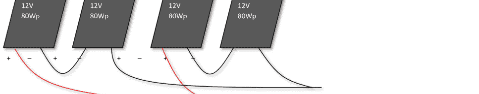

上面的图显示了我打算如何接线我的太阳能阵列。我将两组电池板串联，使每组电压升到 24 伏。然后将这些组并联以保持 24 伏，但将系统总功率增加到 320 瓦。

由于我的运行电压是 24V 且电流较小，有很多廉价太阳能控制器可以选择。我决定买一个 Steca MPPT 控制器，它内置了 LCD 显示器，我可以随时查看电池的电量。该控制器的成本为 £120（155 美元）。

我计算出需要 181Ah 的 24 伏电池存储。我决定采用四块 Northstar NSB 100FT Blue+12 105Ah 电池，我将它们成对连接，在 24 伏下提供 210 Ah 的电。这些电池的成本为 £600（849 美元）。

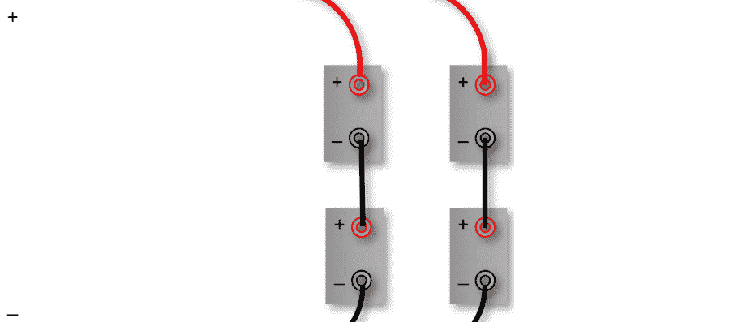

这张图显示了我打算如何接线电池。我将两组电池串联，使每组电压升到 24 伏。然后将这些组并联以保持 24 伏，并将我的存储容量增加到 24 伏下的 210 安时。

我的 Steca 控制器带有接地故障保护，但我决定也安装一个独立的 JVC (GFI) 单元。这是一种“双重保险”的方法，而且 RCD 极其便宜，我认为多花这些钱是值得的。我还需要一种隔离太阳能阵列回路的方法。我选择安装三个直流隔离开关：一个在控制器和太阳能阵列之间，一个在控制器和电池之间，一个在配电箱之间。这允许我在维护或紧急情况下隔离系统的每个部分。

对于照明，我决定在室内使用 24 伏节能 LED 灯泡，在户外灯上使用一个 24 伏卤素灯泡。这些节能 LED 灯泡看起来与市电 LED 灯泡完全相同，提供的光照水平也与市电等物相当。灯泡每个成本在 £8–£13 之间，可以使用与市电灯相同的开关和灯具。

我决定使用 Shoreline RL5010 电池供冰箱，它可以在 12 伏或 24 伏电源下运行。它的标称平均功耗为每小时 9.6 瓦，价格为 £380（610）。

电视方面，我选择了 JVC 24 英平平板电视 DVD 播放器。Meos TV 可使用 12 伏或 24 伏电源，平均功耗为 26 瓦。

在目前阶段，我已经知道了我的度假屋将使用的主要组件。我还没有涉及所有细节，例如电缆和配置。在我们规划太阳能系统的详细设计时，我们需要完成这些工作。

## 结论

- 如果需要长使用寿命或最佳性能，请从信誉良好的制造商处选择电池板。仅针对短期应用考虑低成本电池板。
- 电池有多种类型和尺寸。可以根据系统上运行的循环寿命计算电池的最佳尺寸。
- 系统的运行电压取决于你想通过它的电流大小。高电流系统的效率低于低电流系统，而且低电流逆变器和控制器不可避免更便宜。
- 通过购买比目前需求更大的控制器和逆变器为系统的未来扩展留出空间，除非你确定你的需求未来不会改变。
- 许多电器和设备 [缺失文本]。
- 许多电器和设备 [缺失文本]。
- 许多电器和设备 [缺失文本] 未来是 [缺失文本]。
- 许多电器和设备在未来是 [缺失文本]。
- 许多电器和设备在未来是 [缺失文本]。
- 许多电器和设备在未来是 [缺失文本]。
- 许多电器和设备在未来是 [缺失文本]。
- 许多电器和设备在未来是 [缺失文本]。
- 许多电器和设备未来是 [缺失文本]。
- 许多电器和设备在未来是 [缺失文本]。
- 许多电器和设备未来是 [缺失文本]。
- 许多电器和设备在未来是 [缺失文本]。
- 许多电器和设备未来是 [缺失文本]。
- 许多电器和设备在未来是 [缺失文本]。
- 许多电器和设备未来是 [缺失文本]。
- 许多电器和设备在未来是 [缺失文本]。
- 许多电器和设备未来是 [缺失文本]。
- 许多电器和设备在未来是 [缺失文本]。
- 许多电器和设备未来是 [缺失文本]。
- 许多电器和设备在未来是 [缺失文本]。
- 许多电器和设备未来是 [缺失文本]。
- 许多电器和设备在未来是 [缺失文本]。
- 许多电器和设备未来是 [缺失文本]。

例如，澳大利亚对特低电压安装有非常严格的标准，包括对于立式和移动式应用。

在许多国家，电工师有额外的资质要求，允许他们安装和认证太阳能系统。在大多数情况下，接受这些额外培训并不是法律强制。然而，如果你希望获得政府补贴、上网电价或可再生能源证书，你几乎肯定需要太阳能安装专家对你的系统进行安装，或者至少进行检查、测试和认证。

这在英国和澳大利亚完全如此。在美国，补贴情况因州、因县而异。

除了电气安全规定外，如果将太阳能板安装在建筑上，通常还有关于太阳能板本身安装的规定。风力吹袭可能是太阳能板的一个问题。在极端情况下，安装不当的太阳能板可能会损坏，或者对安装其上的屋顶造成损坏。因此，在包括欧洲大部分地区在内的许多国家，有大量规定规定太阳能板的安装距离屋顶边缘不能在 30厘米（12英寸）以内。

## 让你的电力供应商参与进来

如果你正在计划一个并网系统，那么与参与你项目的电力供应商交流是值得的。有时他们有自己的要求或认可设备列表。他们通常有你可以咨询的专家，他们可以为你提供额外的建议和支持。在世界某些地区，在你系统安装期间，你的电力公司需要参与其中，将你目前的电表更换为特定的输入/输出电表，并在批准你的系统之前进行最终检查。

一些电力公司只接受来自专业太阳能光伏安装人员的馈电。几乎所有的电力提供商都坚持要求在接受你接入电网之前，必须由经过认证的太阳能安装人员对安装进行检查并签字确认。

## 结论

- 全球范围内安装太阳能发电有不同的规则和规程。
- 有许多标准，涵盖了实际物理硬件以及其安装方式。
- 你必须遵守所在地区现行的建筑法规和电气法规。


- 你可以通过咨询当地规划办公室和电力供应商来获得帮助。你还需要与你的建筑保险公司进行沟通。

## 详细设计

现在你已经知道要为太阳能项目使用哪些组件了。下一步是进行详细设计，并创建一个你想要构建的方案蓝图。即使对于简单的项目，在安装之前绘制一张图也是有意义的。

绘制接线图有很多益处：

- 它确保没有遗漏任何细节。
- 它有助于电缆选型过程。
- 它有助于确保安装过程中没有遗漏（特别是当现场有一组人在共同工作时）。
- 它为未来的系统维护提供了有用的文档。

每个安装项目的接线图都会不同，并取决于所使用的组件。请阅读每个组件的产品文档，以了解它们必须如何接线。

如果你在这个阶段尚未选择具体的组件，可以画一张通用图，但要确保在安装开始之前将其完善为一份详细文档。

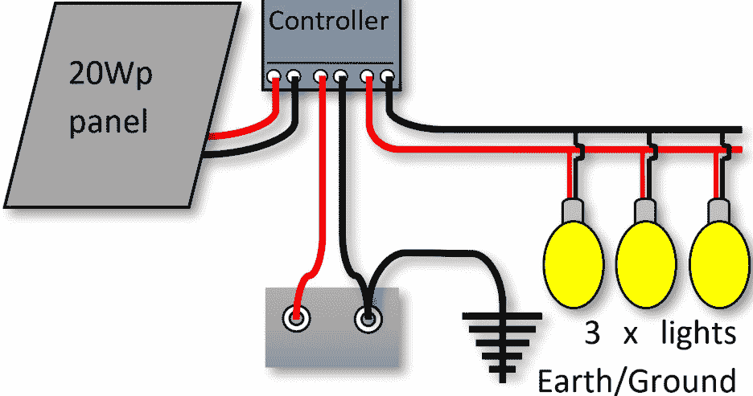

## 简单立式照明系统的示例接线图

在绘制接线图时，你需要记住以下几点：

### 安全设计在其中

人们很容易忘记太阳能是有危险的。我们处理的是电，虽然任何单个组件可能只是低电压，但涉及的某些电流可能非常大。将多个太阳能板或电池串联会迅速产生高电压。在项目的详细设计阶段以及安装期间，都必须考虑安全。

在设计系统时，问问自己这个问题：

> 最坏的情况会发生什么？

太阳能系统相对简单，你将使用的所有组件的设计将把风险降至最低。然而，仍然存在潜在风险。如果你是……（此处原文不完整）

直流电的主要风险是触电（自自己或他人）或导致短路，这反过来可能引发火灾。太阳能电池板一直在发电，通常在晚上也会产生微小电流，并且无法关闭。因此，需要手动的直流空路断路器（也称为隔离开关）将太阳能电池板与电路的其他部分隔离开来，此外还需要良好的接地系统和接地故障保护系统，以便在发生短路时自动关闭系统。

如果你的系统在高电压下运行，你可能希望考虑在单个太阳能电池板之间安装多个直流空路断路器/隔离开关。这意味着除了关闭整个电路外，你还将太阳能阵列的电压降低到单个电池板或一小组电池板的电压。这在维护太阳能阵列或紧急情况下是有益的。

太阳能阵列发生短路可能有很多种原因。有时是因为安装过程中的错误，但也可能是由于一般的日常磨损（特别是对于经常调整太阳能电池板倾角的安装），或者由于动物的损坏，例如鸟筑巢腐蚀电缆或接线盒，或者狐狸咬断电缆。

在使用不合适的电缆时也可能发生短路。太阳能互联电缆抗紫外线和高温，且屏蔽层通常经过加固以减少动物损坏的风险。为你的阵列布线以及阵列与太阳能控制器或逆变器之间的布线务必使用太阳能互联电缆。

当发生短路时，通常不会完全失去电源。相反，发电量会随着电阻的增加而下降。故障点会产生热量积聚。如果系统中有接地故障保护系统（如 `RCD` 或 `GFI`），它应该在此时自动关闭，在造成任何进一步的损害之前发生。

如果你没有配备接地故障保护系统，热量积聚可能会变得非常剧烈，在某些情况下高达几百度。已有记录显示，这种热量积聚引发了火灾。

如果真的发生了火灾，你需要尽可能快地隔离系统。太阳能阵列无法关闭，因为只要有光，它就会发电。因此，曾出现消防队无法扑灭由太阳能阵列故障引起的火灾的情况，因为没有方法将其关闭。使用直流断路器快速隔离太阳能阵列可以解决这个问题。

请记住，即使你隔离了太阳能阵列，阵列内部仍然在发电。如果你有许多太阳能电池板，电压和电流可能仍然相当大。通过在阵列内部安装直流断路器或接触器来关闭阵列的能力，可以显著减少这种功率，在紧急情况下使系统更安全。

## 交流电 (AC)

交流电安全与家用电器安全相同。它是高压的，在大多数国家，除非你具备相应的资质，否则不允许对其进行操作。

你需要安装两个交流隔离开关：一个开关安装在逆变器和配电箱之间，以完全隔离太阳能系统；另一个安装在电网馈端和配电箱之间，如果你运行的是并网系统，则将你的系统与电网隔离开。

如果你计划进行并网安装，你需要与你的电力供应商沟通，因为通常会有你需要纳入考虑的额外要求。你的逆变器需要是特定的并网系统，在电网停电时会自动关闭。这确保了在发生停电时，电力不会从你的太阳能系统回馈到电网，否则对于正在恢复供电的工程师来说可能是致命的。

## 高温

我们已经提到过太阳能阵列的高温风险。太阳能电池板是黑色的且面向太阳，因此它们在晴朗的一天可能会变得非常热。这种温度绝对足够煎鸡蛋，也绝对足够灼伤皮肤。

所以，请确保你的太阳能阵列安装在好奇的孩子接触不到的地方。如果太阳能电池板靠近地面，请确保有保护措施防止人们靠近它。

如果太阳能阵列内部或运行太阳能电池板之间的电线发生故障，高温将变成更严重的问题。如果电缆或太阳能电池板损坏，可能会产生显著的热量积聚。如前所述，这种热量积聚可能导致火灾。

剩余电流保护器（`RCD`），又称接地故障断路器（`GFI`），应该避免这个问题，让你在重大损害发生之前调查问题。然而，也应该安装手动直流断路器，以便在紧急情况下覆盖系统控制。

## 思考安全

目前的安全讲座到此结束。当我们谈到安装时会再次提到安全问题，但现在请记住，安全不是偶然发生的。在设计系统时考虑安全因素，你最终将获得一个安全的系统。增加几个交流和直流断路器、一根地针/接地极、一个 `RCD`/`GFI` 以及购买正确的电缆的额外成本不会让你倾产。这笔钱花得很值得。

## 太阳能阵列设计

阵列中的所有太阳能电池板必须朝同一个方向。这确保每个电池单元接收的光量相同，对于实现最佳产量至关重要。

有时，你可能希望在不同的位置安装太阳能电池板，例如在两个不同的屋面上。在这种情况下，你需要保持两组太阳能电池板分开，作为两个独立的阵列运行，通过将它们接入可以处理多个太阳能输入的逆变器或控制器，或者接入两个独立的逆变器或控制器来实现。

如果你希望混合使用不同尺寸的太阳能电池板，你还需要将它们设置在独立的阵列中并分别布线，可以使用可以处理多个输入的逆变器或控制器，或者两个独立的逆变器或控制器。

如果你正在设计并网系统，并考虑不同尺寸或方向的太阳能电池板，你应该认真考虑微逆变器系统，每个太阳能电池板都有自己的逆变器。

## 太阳能阵列设计 – 独立系统

如果你有多个太阳能电池板且运行的太阳能电力系统为 `12` 伏，你需要将电池板并联连接以增加容量而不增加整体电压，或者使用可以接受更高输入电压并将电压降低以匹配电池的太阳能充电控制器。

如果你运行的电池组电压更高，你需要购买更高电压的太阳能电池板，或者需要多个串联的太阳能电池板以提高电压以匹配系统电压：

- 对于 `24` 伏电池系统，你可以选择 `24` 伏太阳能电池板，或两个串联的 `12` 伏太阳能电池板。
- 对于 `48` 伏电池系统，你可以使用一个 `48` 伏太阳能电池板、两个串联的 `24` 伏太阳能电池板，或四个串联的 `12` 伏太阳能电池板。

一旦达到了所需的电压，你就可以既串联并联运行电池板，将多个电池板串联以达到所需的电压，然后将多个串联并联以增加容量：

一个 `24` 伏阵列的示例图，其中两组两个 `12` 伏太阳能电池板串联形成 `24` 伏阵列，然后将这两个阵列并联，创建一个功率更大的 `24` 伏阵列。

## 太阳能阵列设计 – 使用微逆变器的并网系统

如果您正在设计使用微逆变器的并网系统，那么您的设计将非常简单。每块太阳能电池板变成一个自给自足的太阳能系统，接入各自自己的微逆变器。微逆变器将能量转换为交流电（`AC`）并接入主交流。

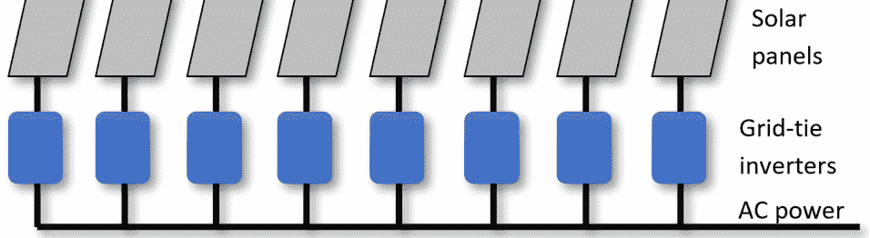

## 太阳能阵列设计 – 使用单逆变器的并网系统

如果您正在设计使用单逆变器的并网系统，您通常会将所有的太阳能电池板串联，然后将此高压直流电输入逆变器。

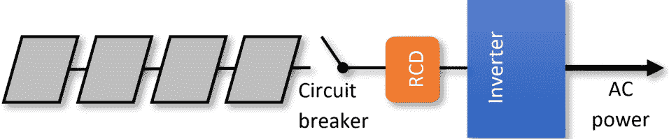

这是一个使用单逆变器的典型并网系统的简化框图。剩余电流保护器（`RCD`）提供接地故障保护。在美国，`RCD` 被称为接地故障断路器（`GFI`）。

由于涉及非常高的直流电压，因此需要额外的保护措施。太阳能阵列必须始终接地，在太阳能阵列和逆变器之间必须安装直流断路器（也称为隔离开关），并且必须安装直流剩余电流保护器/接地故障断路器，以便在短路时关闭太阳能阵列。

在下图中，有 `16` 块 `250Wp` 的太阳能电池板串联在一起。这是住宅物业非常典型的安装方式，创建了一个 `4kWp` 的系统。假设每块太阳能电池板产生 `24` 伏输出，该系统的额定电压为 `384` 伏，峰值功率在 `640` 伏左右，开路电压高达 `832` 伏。

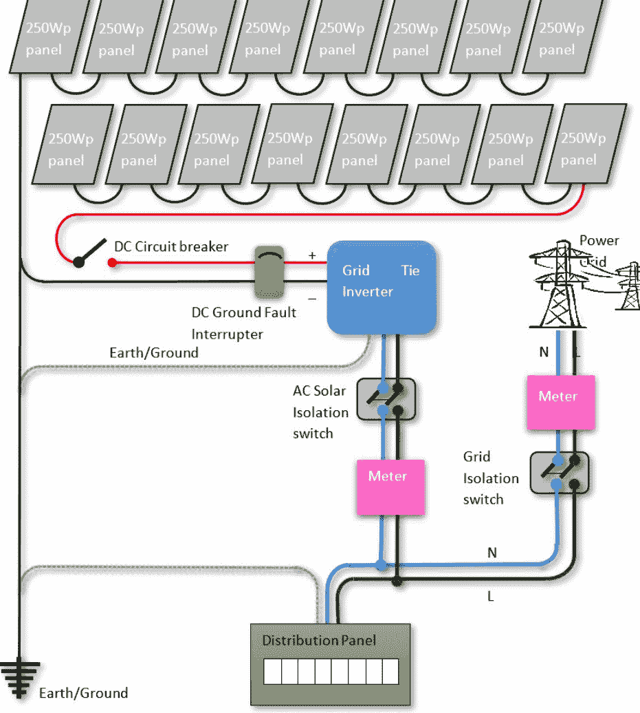

上方：并网系统的示例框图

该系统在欧洲是合法的，但违反了美国的建筑法规，美国法律禁止任何可能运行电压超过 `600V` 的系统。因此，该系统通常会这样安装：将太阳能阵列分成两个较小的组串，并与能够接受两个独立太阳能输入的并网逆变器配合。

在欧洲，允许高达 `1,000V` 的电压。然而，如此高电压的危险意味着即使在欧洲，通常做法也是拆分太阳能阵列，尽可能将电压降低到 `500-600V`。通常，这意味着您不希望串联超过 `20` 块 `12` 伏太阳能电池板或 `10` 块 `24` 伏太阳能电池板，以确保远低于此水平。

如果您在美国接近 `600V` 限制，或在欧洲接近 `1,000V` 限制，有三种选择：

- 安装多组串系统，使用可处理多个太阳能输入的逆变器，或使用两个独立的逆变器
- 安装微逆变器系统
- 将您的太阳能电池板进行并联/串联混合接线

关于开路电压的更多信息，请参阅第 `124` 页。回顾多组串系统，请参阅第 `127` 页的“多组串”部分。

## 电池

电池的接线方式与您的太阳能阵列类似。您可以通过并联多个 `12` 伏电池来构建具有更高容量的 `12` 伏系统，或者通过串联多个电池来构建更高电压的系统。

在并联连接电池时，重要的是接线方式要确保从电池组中的第一块电池引正极连接，从电池组中的最后块电池引负极连接。

这确保了整个电池组的放电和充电均衡。如果您使用电池组中的同一块电池分别连接控制器和逆变器的正负极，那么消耗第一块电池的速度会比组中的其他电池快。第一块电池还会获得太阳能阵列最大的充电。

这将缩短电池寿命，并意味着电池组中的所有电池最终失去平衡。电池组中的其他电池永远无法被太阳能板完全充满，因为第一块电池会先报告充满，控制器随后关闭电源，而不是继续为组中的其他电池充电。结果是电池的寿命变短了。

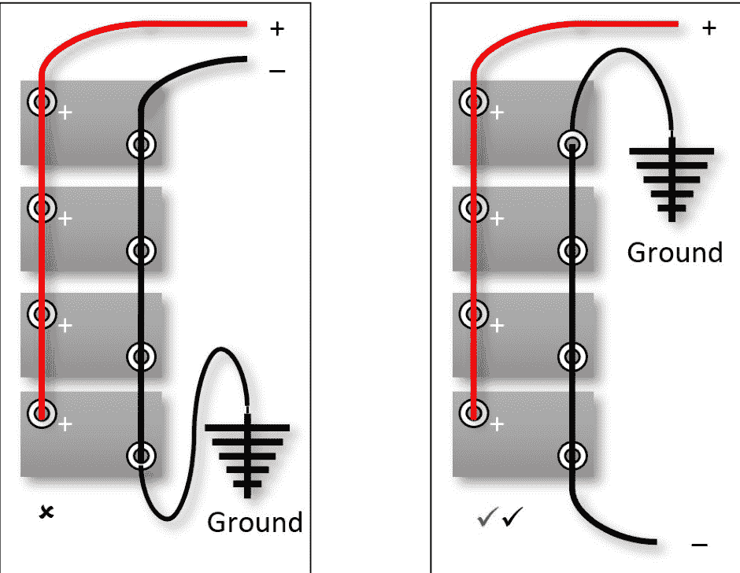

如何并联电池：左侧图显示正、负极电源都从电池组的第一块电池引出，这展示了*不应该*这样做——这会导致电池性能不佳和电池过早失效。右侧图显示从电池组的第一块电池引出正极，从最后一块电池引出负极，这是**正确**的法，并将带来一个更平衡且寿命显著更长的系统。

如前所述，电池的位置需要符合以下标准：

- 防水
- 不受阳光直射影响
- 绝缘以防止极端情况
- 有通风设施
- 防止点燃
- 方便维护
- 不要放置在冷地板上（木底会暖一些）
- 放置在专用箱内，或车库内

如果您使用的是通风型电池，您需要一个允许氢气逸出的设计。氢气会迅速上升，很容易积聚在空间内造成危险。正如第 `154` 页“酸电池排放氢气”部分提到的，您需要确保氢气能安全地排出建筑外，并在建筑内的电池组上方空间安装氢气报警器。

如果您在非常寒冷的区域安装电池，应提供绝缘措施。大多数电池在 `15-28°C (59-77°F)` 之间性能最好。如果温度可能低于 `0°C (32°F)` 或高于 `45°C (113°F)`，应考虑隔缘。为电池创建一个隔缘环境有助于应对极端温度。您可以使用聚苯烯板（泡沫板）放在电池下方和侧面进行保温。或者，箔泡棉隔缘材料（可在任何五金店的隔缘区域购买）使用起来方便，且优点是即使溅到酸液它也不会分解。

千万不要对电池顶部绝缘，因为这会阻止其正常通风，如果您使用的绝缘材料具有导电性，还会导致电池短路。

效率约为 `97%`，额外的 `3%` 以热量的形式散失。虽然这听起来不多，但如果逆变器被封闭在空间内，热量就会累积：一个 `4kW` 的逆变器在夏季峰值运行时，每小时很容易产生 `120W` 的热量。在几小时内，这些热量就足以导致逆变器过热并关机。

考虑逆变器的重量。同时，确保将其安装在易于检查的位置。大多数逆变器都集成了一个小型显示屏，允许您监控系统性能。

## 设备

如果设备需要电网级电压，则将其连接到逆变器；如果是低电压直流设备，则连接到控制器。它们绝不会直接连接到太阳能阵列或电池。

## 针对电网备用系统

由于电网备用系统通常不将您的太阳能系统连接到电网，因此您可以使用的组件限制较少。

您仍然必须遵守所在国家的布线法规。在某些国家（例如英国），这可能意味着进入建筑的最终连接必须由具有完全资质的电工完成，但这比安装和检查并网型系统要便宜得多。

电网备用系统的设计与离网太阳能系统非常相似，即太阳能电池板、太阳能控制器和电池。区别在于电池之后的处理。电网备用系统的优点是它可以以三种方式工作：它可以为整座建筑供电，可以为建筑内的特定电路供电，也可以为建筑内的单个电路供电。

电网备用配置的更多信息和示例电路图见附录 B。

## 电路保护

任何系统都需要电路保护，以确保在发生短路时系统安全关闭。这对于低电压系统和电压系统同样有效。

低电压系统仅仅因为 `12` 伏电池产生的巨大电流就会导致大问题。深循环铅酸电池短时间内产生的超过 `1,000` 安培的电流，这在某些情况下很容易导致严重的电击，甚至导致死亡或重伤。

在短路的情况下，除非安装了适当的保护，否则线路将变得非常热并在几秒内开始熔化。这可能导致火灾或灼伤，应安装必要的保护以确保由于意外短路对系统造成任何损坏。

## 接地（接地）

在所有系统中，电池的负极都应该妥善接地（在北美称为 "`grounded`"）。如果没有合适的接地，则应安装接地棒或接地平面。

## 直流电路保护

对于产生功率小于 `100` 瓦的微型系统，控制器内置的保险丝通常足以提供基本的电路保护，尽管通常建议使用外部保险丝。在较大的系统中，如果直流设备的供电不通过控制器，则应在电池正极上集成一个保险丝。

在您为电池安装保险丝的地方，您必须确保来自电池的所有电流都经过该端子。在具有多个电路的直流系统中，建议为这些电路每一个都安装保险丝。如果您使用的是 `12` 伏或 `24` 伏，可以使用与普通家用电源电路相同的保险丝和断路器。对于高电压直流系统，您必须使用特殊的直流保险丝。

在将设备连接到直流电路时，您不需要为每个设备配备单独的地线（地），因为负极已经在电池处接地了。

在太阳能阵列与逆变器或控制器之间安装一个隔离开关（直流断离开器）。在电池与控制器及逆变器之间安装第二个隔离开关。除非您的控制器或逆变器已经集成了此类开关，否则您应在太阳能阵列与控制器或逆变器之间安装直流剩余电流设备/接地故障断路器。

## 交流电路保护

交流电路应通过配电箱（也称为用户单元）进行供电。该配电箱应接地，并应包含带有剩余电流设备（`RCD`，也称为接地故障断路器）的漏电闸。由于您已对直流组件进行了接地，必须为交流电路使用单独的地线（地）。您还必须在逆变器和配电箱之间安装一个交流断离开器（隔离开关）。在并网系统中，这通常是法律要求，但这也是一种良好的做法。

建筑内的布线应遵循标准的布线规范。您应该聘请合格的电工来安装并对所有电网级作业进行验收。

## 电缆尺寸与选择

一旦您有了布线图，值得对图中每个部分的电长度长度记录，并记录安装的每个部分将使用何种电缆。

## 电缆尺寸

本节重复了之前章节的内容。我并不为此抱歉，因为电缆尺寸是人们在安装太阳能电力系统时犯的最大错误之一。

低电压系统通过电缆损耗大量功率。这是因为电流（安培）较高以补偿电压的不足。欧姆定律告诉我们，通过电缆损失的功率与电流的平方成正比：电流越大，能量损失就越多。为了克服这种能量损失，我们必须增加电压或使用更粗的电缆。

在任何您使用低电压电缆的地方（从太阳能阵列到控制器，再到所有低电压直流设备），您都需要确保您使用的是正确尺寸的电缆。如果电缆尺寸太小，您将产生明显的电压降，这会导致您的系统故障。您的电缆还会变热，在极端情况下可能会熔化或引发火灾。永远不要使用小电缆，因为这可能导致某些设备无法正常工作。

## 保护电缆

在规划电缆布局时，您需要确保它们免受动物和儿童的意外干扰，以及可能的破坏行为。

在某些安装中，老鼠和狐狸咬穿电绝缘是一个大问题。可以使用防鼠电缆来解决。使用线管通常也是个好主意，特别是当可以使用钢管或薄壁金属线管 (`EMT`) 来保护电缆时。

## 设计系统以使电缆尽可能短

如果您在不同的物理区域运行多个设备，可以采用多条平行的电缆以保持电缆路径尽可能短，而不是延长一根电缆跨越各个区域。

通过这种方式，您实现了两点：首先，您减少了每根电缆的总长度；其次，您将负载分配到了多个电路之间。这样做的好处是，您可以减少每根电缆所需的厚度，从而使安装变得更容易。

如果您在房屋中这样做，可以使用配电箱（也称为用户单元）来创建每个电路。

例如，在度假屋中，将楼上灯光与楼下灯光运行在不同的电路上是合理的。同样，为楼上和楼下的家电器运行运行独立的电路也是合理的。

在度假屋的情况下，通过增加电路数量，可以使用标准的 `2.5mm` 家用“双芯地”电缆为房屋布线，而不是使用更专业的电缆。

## 选择太阳能电缆

设计不当或安装不当的太阳能系统的常见故障是性能低下的，且没有明确的问题来源。特别是，这种情况往往发生在系统首次安装后的二到三年。

问题的根源通常是鸟粪或从太阳能电池板到逆变器的电缆遭受了紫外线损坏。这通常是因为没有使用太阳能互连电缆，而这种电缆具有更坚固的防紫外线绝缘层，设计用于承受高温，并能抵抗酸性鸟粪。

使用特定的太阳能互连电缆连接你的太阳能电池板，并将电池板连接到逆变器或控制器至关重要。如果你不确定，请寻找符合 `UL 4703` 或 `UL 854 (USE-2)` 光伏布线规范的电缆。所有太阳能设备供应商都能提供。

## 控制器电缆

在计算控制器和电池之间电缆的厚同时，你需要考虑从太阳能阵列流入电池的电流以及流出的电流（流入电池的峰值电流通常高于流出）。

## 电池互连电缆

你可以从电池供应商处购买带有正确电池终端接器的互连电缆。由于电池之间的电流实际上可能非常大，我倾向于在电池之间使用我能买到的最粗的互连电缆。

## 一些示例设计

一如既往，一画胜于千言，因此这里有一些基本设计和图表，帮助你更清楚地理解如何连接太阳能电力系统。

## 园艺小屋

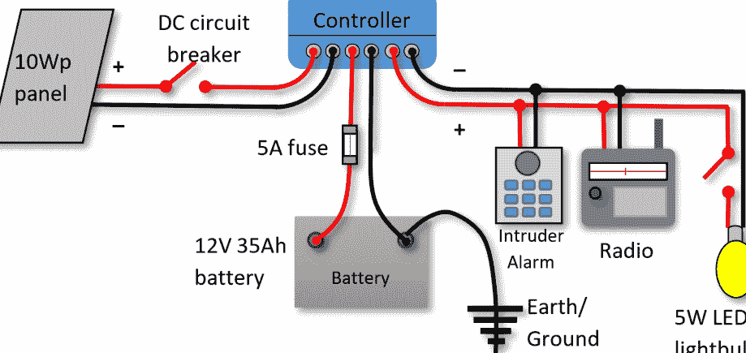


# 太阳能安装实例与指南

## 简单的太阳能安装

第一个例子是非常简单的太阳能安装：一个小型太阳能电池板、一个带开关的灯具和一个简单的防盗报警器——非常适合海滨小屋、园艺小屋或小型上锁车库。这样的系统组装成本在 80 英镑或 100 美元以下。由于这是一个小型系统，你可能选择不安装隔离开关，尽管这样做是个好主意。由于系统非常小，我决定只在控制器和电池之间安装一个保险丝。

## 电动河船

这是我十五年前做的一个项目，使用一艘带有小舱的轻型船只改装。电动船在河上非常棒——它们足够安静，无论你如何靠近都不会打扰野生动物。得益于电机的扭矩，你只需要很小的电机，200W 的电机性能等同于 2-3 马力的外挂机。我使用电流表作为转速计，让我能够以经济的方式或全功率行驶，当时我使用电压表作为简易的燃料表。如果我今天进行同样的建造，我会使用专业的电池监控器作为燃料消耗，因为这将准确得多，且成本与电压表相似。

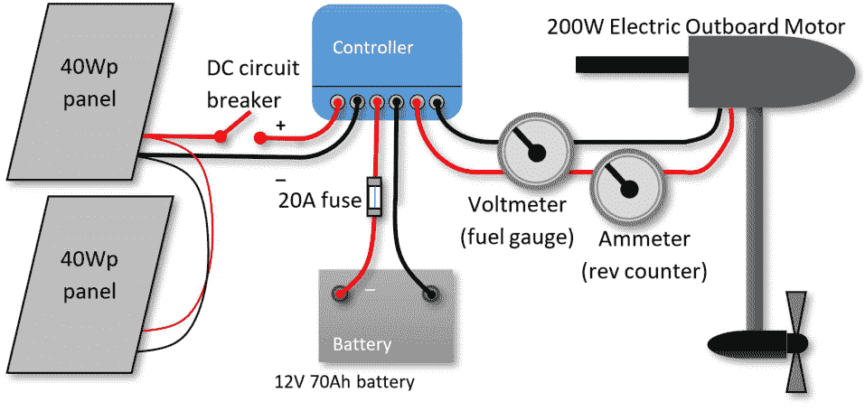

## 小型离网建筑

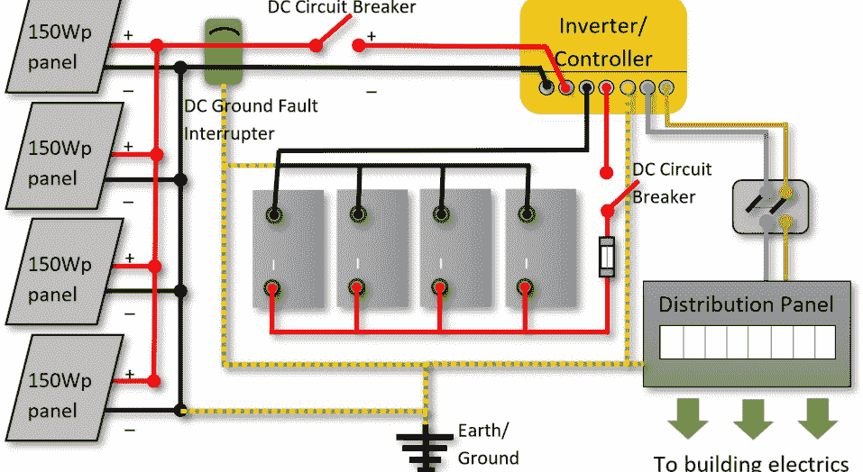

现在我们有一个更复杂的结构，适用于峰值功率需求为 1-2kW、电池存储为 3-4kWh 的小型建筑。我们将四块太阳能电池板并联，连接到一个组合逆变器/控制器，该控制器处理太阳能输入、电池管理和交流电发电。

电池采用并联连接。注意，从电池到逆变器/控制器的正负极连接分别来自电池组的两端。这确保了电池的电流拉在整个电池组上是平衡的，并显著延长了电池寿命。

每个阶段都有手动和自动电路保护：

- 太阳能电池板和逆变器/控制器之间有一个直流接地故障断路器/RCD。
- 保险丝为电池提供过流保护。
- 配电箱将包含各个电路的断路器和 GFI/RCD 保护。
- 太阳能电池板、电池、控制器、接地故障断路器和配电箱都连接到公共接地。
- 太阳能阵列、电池以及逆变器与配电箱之间都有手动截止开关。

当你达到这种规模的系统时，是时候请专业人士了。需要专业电工监督整个安装过程以确保安全。一旦太阳能能量系统安装在园艺小屋以外的建筑上，或包含逆变器，就有必须遵守的安装法律要求。

## 度假小屋

最后，这是度假小屋的接线图。我们有四块太阳能电池板，两两串联，为我们的控制器产生 24V 输入。

电池也分成两个并联组，每组有两块电池。

与之前的示例一样，每个阶段都有手动和自动电路保护：

- 太阳能电池板和逆变器/控制器之间有一个直流接地故障断路器/RCD。
- 保险丝为电池提供过流保护。
- 控制器和配电箱之间有第二个直流接地故障断路器/RCD。
- 配电箱的各个电路上有直流断路器以提供过流保护。由于该系统是低压直流系统而非交流系统，配电箱内需要专用断路器。
- 太阳能电池板、电池、配电箱和接地故障断路器都连接到公共接地。
- 太阳能阵列、电池以及控制器与配电箱之间都有手动截止开关。

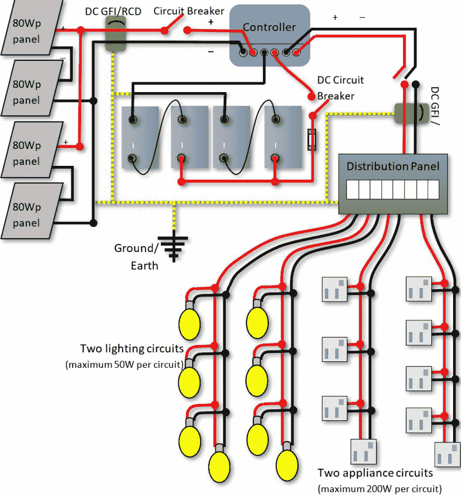

## 下一步

一旦有了接线图，就可以开始在购物清单上添加电缆、电池端子夹、保险丝、隔离开关、接地棒（北美称为接地极）以及在这种情况下需要的配电箱（也称为用户箱）。在接线图上添加更多细节也有帮助，例如电器和插座的位置以及每个点的电缆长度。

## 太阳能架安装

正如在太阳能电池板安装章节中所讨论的，有现成的太阳能阵列架可用，你的太阳能供应商能够为你提供最佳解决方案。

有时，这些并不适用于你的项目。在这种情况下，你将需要自己制作（角钢是这项工作的有用材料）或者定制一个专用的架子。

请建筑师、结构测量师或建筑师对您的屋顶进行评估。

如果您计划将太阳能阵列安装在立柱上或地面支架上，您需要为一些坚固的基础做好计划。在地面上钉入一些帐篷钉来固定地面支架在强风中无法维持五分钟，而且如果只用一桶水泥来固定立柱，立柱很快就会吹倒。

您应该建造一个良好的基础，由压实的硬石基层上的坚固混凝土底座组成以支撑地面支架，支架本身应使用合适的地面锚进行固定，并使用 25cm–30cm（10”–12”）的螺栓连接。

对于立柱，请遵循制造商提供的建议。通常，它们需要安装在深度至少 3 英尺（1米）的混凝土基础中，而且往往深得多。

要将太阳能板安装到支架上，请使用高强度螺栓和自锁螺母，以防止风力震动导致松动。

如果您的太阳能阵列方便接触，您可能希望考虑可调节的太阳能安装系统，以便您可以在全年调整倾斜角度。这样您就可以捕获更多的冬季日照，并在春季和夏季减小倾斜角以提高这些季节的性能。

对于度假小屋项目，太阳能阵列将安装在一个带有倾斜屋顶的特制花园储物间上。这种方法的优势在于我们可以在捕捉阳光的最佳位置建造仓库。我们还可以将电池和太阳能控制器安装在靠近太阳能阵列的地方。换句话说，我们正在创建一个“一体化”发电站。

有许多地区的棚屋和花园建筑制造商可以根据您的规格建造这样的储物间。高质量的仓库经过 2–3 年的维护，可以轻松使用 25–30 年。

如果您选择这条路线，请确保您选择的制造商知道您打算如何使用。您需要指定以下事项：

- 屋顶角度必须准确，以使太阳能板处于最佳位置
- 屋顶本身必须加固，以承受太阳能阵列的额外重量和潜在的风升力
- 花园储物间的地板（存放电池的地方）必须是木制的。电池在冬季混凝土底子上工作效果不好
- 储物间内必须内置通风，允许电池产生的氢气安全地通过屋顶顶部散发
- 花园储物间的门本身应该足够大，方便您安装、检查和维护电池
- 您应该考虑对储物间的地板、墙壁和天花板进行绝热，可以使用聚乙烯（泡沫）板或楼阁保温材料。这将有助于防止电池在冬季过冷或夏季过热

花园储物间仍然需要坚固的混凝土基础。考虑雨水流也是重要的，以确保花园储物间不会泡在水中。

## 屋顶安装太阳能板

太阳能板供应商提供屋顶安装套件。这些套件由屋顶钩组成，适用于瓦片下方的屋顶桁，在其上方安装导轨。通常，每行太阳能板需要两根导轨。然后使用夹具将太阳能板夹在导轨上。

### 屋顶钩

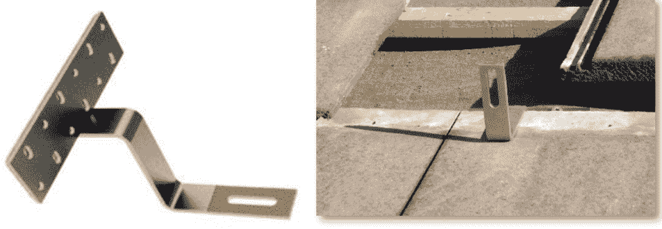

要在现有的瓦片屋顶上安装太阳能板，需要滑出单个瓦片并在瓦片下方安装屋顶钩，直接安装在下方的屋顶桁上。安装完成后，可以将原始瓦片滑回位置。根据瓦片的类型和屋顶钩的设计，可能需要凿掉瓦片底部的一部分以实现良好贴合。

### 导轨

然后将导轨水平地横跨屋顶，使用锁紧螺母固定在屋顶钩上，以确保它们不会随时间推移而松动。使用两行导轨固定每行太阳能板。

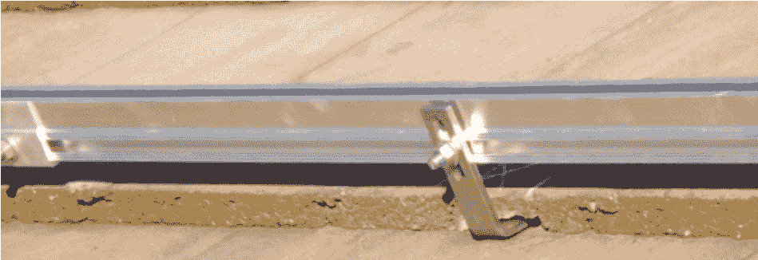
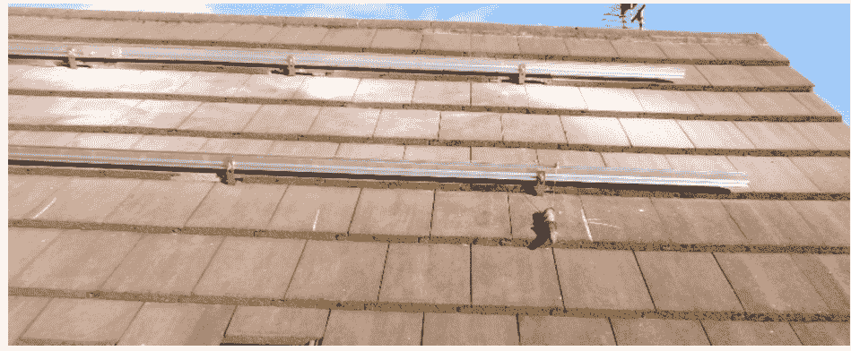

### 太阳能板夹具

然后将太阳能板夹具沿导轨滑到位。这些夹具用于将每个太阳能板的边缘固定在位置。

这些夹具用于固定太阳能板的侧面。当安装在面板之间时，它们可以夹住两个面板并将它们都固定在位置。使用专为太阳能安装设计的正确夹具非常重要：面板本身很重，而且由于它们安装在屋顶上方，它们会受到撞击，并在风暴天气下面临从屋顶被吹落的风险。

您的太阳能板可能会放置几十年，而屋顶安装系统最大的故障点通常在于使用错误的夹具来固定太阳能板。太阳能板夹具是弹簧安装的，以确保它们不会随时间推移而松动。

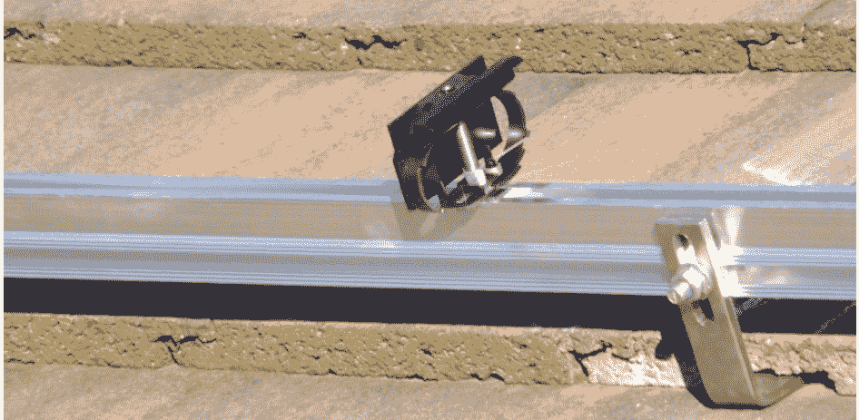

最后，可以安装第一块太阳能板。

使用四个夹具将一块太阳能板固定在位置。然而，当面板相邻时，每个夹具可以固定两块太阳能板。

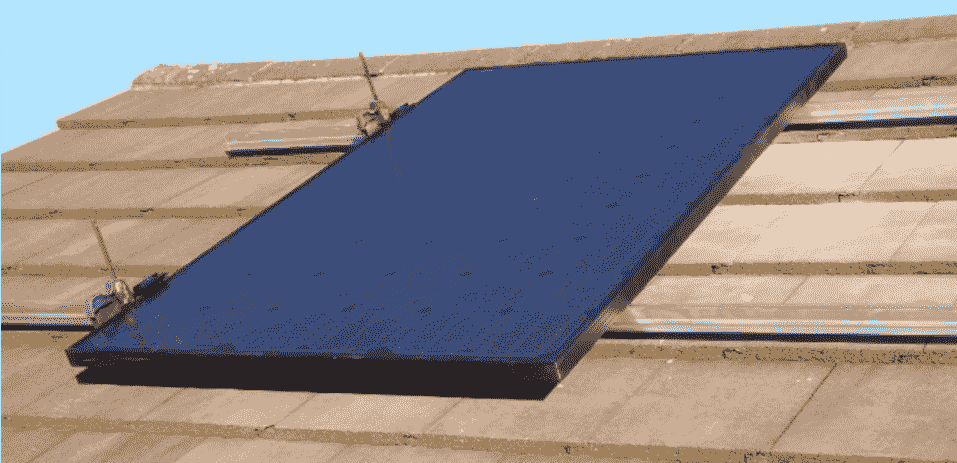
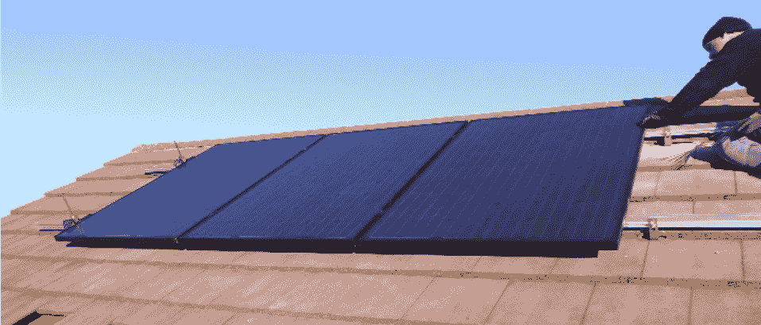

## 安装规划

现在您应该有一份完整的所需物品清单。如果您是认真的，现在将拥有一个装满了太阳能板、电池、电缆、控制器、隔离开关和断路器的仓库或花园储物间。规划阶段已经结束，乐趣即将开始。

在您拿起螺丝刀和电钻之前，有一些家务事项需要处理……

## 安全

首先，有一些安全要点需要注意。其中一些可能并不适用于您，但请阅读它们。记住，您正在处理电力、危险化学品和沉重物体。防患于未然。

### 您的急救包

您需要手头有一个良好的急救包，包括一些通常急救包中没有的物品。具体来说，您需要洗眼液和在接触电池酸时可以涂在皮肤上的胶。

### 化学清理套装

如果您将处理对健康有害的物质的酸电池，您将需要：

- 用于泄漏时清理酸的化学清理套装
- 足够的强力聚乙烯袋
- 足够的抹布/一次性擦拭布清理任何电池泄漏

化学清理套装和化学急救包可以在大多数电池批发商和工业工具供应商处购买。它们只需要几英镑。您可能不需要它们，但至少买它们可以为您换来一份安心。

### 结论

- 详细的设计确保了您没有遗漏任何区域
- 布线图帮助您设想系统如何运作
- 您需要尽可能缩短电缆线路。这可以通过并行运行多根电缆从控制器直接通过接线盒或配电箱来实现
- 将电缆分路意味着您可能会减少每个电路的电流负载，从而减少电阻并提高系统效率
- 如果您使用逆变器转换为电网电压，则需要合格的电工来处理电气安装
- 您需要设计您的存储区域，以确保电池能够以最佳状态运行

如果你在公众可以进入的区域工作，你应该使用屏障或围栏以及指示牌来封锁该区域。清晰的分流指示牌应该说明替代路线。

在这种情况下，我建议聘请一个专业的施工团队来代表你执行安装工作。他们已经了解在公共区域工作的复杂性以及相关的健康与安全法规。

即使你不需要考虑普通公众，你仍然应该考虑你周围的人。孩子们喜欢参与这类项目，而其中确实可能涉及一些安全问题。让孩子们远离现场，并让附近的任何人都知道你正在处理高压电，并请他们保持距离。

### 高处作业

你很可能需要在高处工作，并且很可能要在斜的屋顶上爬行。

确保你正在使用合适的攀爬设备（梯子、爬网板、安全带、脚手架）。你可以以合理的价格租用任何你没有拥有的物品。

如果你对高处作业有任何顾虑，或者在任何时候工作超出了你的能力范围，请记住聘请专业人士并不可耻。专业的建筑工人可以在 2-3 小时内为屋顶安装太阳能阵列。这通常比业余 DIY 爱好者所需的时间少了一半。

### 重物搬运

电池、大型逆变器和太阳能阵列可能很重。太阳能板本身可能并不重，但当几块板被安装在框架上并被抬起时，它们就会沉重、笨大且易碎。

移动和安装大部分设备至少是两个人的工作。在将太阳能阵列举起到位时，更多的人会更有帮助。

### 与电池工作

铅酸电池非常重，在某些情况下重量与成年人相当。使用适当起重设备来移动它们，并保护好你的背部。

较重的电池外壳顶部通常有环。为了抬起电池，我倾向于使用一根穿过这些环的绳子来制作一个提手。这意味着我可以靠近地面携带电池，减少弯腰抬起的需求。

铅酸电池含有酸。除非是凝胶电池，否则酸是液态的。它具有极强的腐蚀性，对健康极度危险。电池溅出的液体会导致严重的化学灼伤，必须立即处理。

在与铅酸电池工作时，请保持安全：

- 始终穿着防护服，包括连体服、眼部防护（防护眼镜或全脸面罩）和防护手套。我还会建议你穿钢头安全鞋
- 始终保持电池直立
- 不要掉落电池。如果掉了，电池可能已经损坏。在最坏的情况下，外壳可能会裂开或破碎
- 如果掉落电池，立即将其放在溢漏盘中（必要时可以使用重型深温室水箱），并检查是否有损坏和泄漏
- 如果电池受损，电池和溢漏盘都必须用密封的聚乙烯袋双层包装，并标记为危险废物
- 如果电池发生漏液，立即用抹布或一次性湿巾擦净漏液。将这些抹布放在塑料袋中，密封并标记为危险废物
- 如果电池漏出的任何液体接触到衣服，立即脱掉衣服并将其丢弃在塑料袋中
- 如果电池漏出的任何液体接触到眼睛，用洗眼液反复冲洗并寻求紧急医疗帮助
- 如果电池漏出的任何液体接触到皮肤，立即用水冲洗，涂抹抗酸清洗剂、霜或凝胶以停止灼伤，然后寻求紧急医疗帮助
- 如果电池酸进入了你的嘴里，用牛奶漱口。不要吞下牛奶。将其吐出。然后寻求紧急医疗帮助
- 不要在电池附近吸烟，并确保存放电池的区域通风
- 防止电池接子上发生电弧或短路。电池可以非常迅速提供巨大的电流。如果你用扳手使电池短路，扳手可能在几秒内变红，并很容易导致火灾或爆炸。取下你佩戴的所有戒指、手镯或手表，保持工具与电池安全距离

### 手套

安装太阳能阵列你需要两套不同的手套。移动电池用的化学手套和为太阳能系统布线的电防护手套。在选择用于电池工作的合适化学手套时，请考虑以下因素：

- 手套需要非常结实，因为抬起和移动电池对手套磨损很大
- 良好的抓握力很重要
- 购买中等或长袖口的手套，以保护手部和前臂
- 手套应由合适的材料制成，以防止电池酸

健康安全执行局网站建议，0.4mm 厚的氯丁橡胶手套可以在整个班次中提供合适的保护。如果你在与电池工作时将液体溅到手套上，请确保立即清洗或更换它们，以避免转移到身体其他部分。

电绝缘防护手套在处理高电压时提供保护。这些在处理高压太阳能阵列时至关重要，并建议所有安装均使用。

电绝缘手套带有不同的额定级以提供保护：

- Class 00 类提供高达 500 伏的保护
- Class 0 类提供高达 1000 伏的保护
- Class 1 类提供高达 7500 伏的保护

对于大多数安装，Class 00 或 Class 0 是合适的。记住太阳能阵列的开路电压可能远高于系统电压：串联的太阳能板电压可能超过 240 伏。

像化学手套一样，选择中等或长袖口的以保护手部和前臂。如果你的电绝缘手套溅到了电池酸，请取掉并更换。

所有电绝缘手套应每六月进行一次视觉检查。

### 电气安全

对于重复关于电气安全的格言毫无歉意。在安装电力系统时，电气安全极其重要。

太阳能板只要暴露在阳光下就会产生电。太阳能板在“开路”状态下的电压远高于系统电压。12 伏太阳能板在连接时可以产生 22-26 伏电流。

串联几块太阳能板电压会迅速达到危险水平。24 伏太阳能阵列可以产生 45-55 伏，这在某些情况下会剧烈电击，而未连接的 48 伏太阳能阵列很容易产生 90-110 伏。这些电压对心脏疾病患者或宠物是致命的。

太阳能系统产生直流电压。与交流电压不同，如果你被直流电击，将无法松手。

电池可以产生数千安培的电流。短路会迅速产生大量热量并导致火灾或爆炸。取下你佩戴的所有戒指、手镯或手表，保持工具远离电池。

逆变器的输出是交流电压并可能是致命的。像对待任何其他电源一样对待它。

如果你将逆变器连接到家庭电气系统，必须使用合格电工对你的安装进行认证。

## 组装工具箱

除了你可靠的 DIY 工具包，你还需要一个电表或电压表在安装的不同阶段进行测试。在布线太阳能阵列时应使用绝缘螺丝刀，电路测试仪可能很有用。

你还需要一些小物品：

- 扎带对于固定电缆非常有用。它们可以保持布线整洁，且通常适用于临时和永久
- 用于清洁太阳能板的防水防污玻璃抛光剂或蜡
- 凡士林用于太阳能板和电池上的电气连接，以隔绝水分并确保良好连接

## 现场准备

如前一节所述，对于地面或立柱式安装太阳能阵列，你可能需要考虑基础；如果你在屋顶上安装太阳能阵列，则可能需要加固现有屋顶结构。

如果你在没有合适地（接地）的地方安装电池，你应该在尽可能靠近电池的地方安装接地极。

现在有趣的事情开始了。首先拆开你的太阳能光伏电池板，并进行视觉检查，确保它们没有任何损坏。

玻璃碎裂或裂纹会显著降低太阳能电池板的性能，因此如果面板上有任何可见损坏，应将其更换。框架的损坏不是问题，只要损坏不会导致水进入电池板，且不会影响太阳能电池板稳固地安装到位。

接下来，使用万用表检查面板电压，将其设置到合适的直流电压范围。

太阳能光伏电池板在“开路”状态（即电池板未连接任何设备时）产生的电压远高于连接到“闭路”时的电压。如果万用表记录单个面板的开路电压为 20–26 伏，请不要感到惊讶。

## 系统的接地

将你的太阳能系统的每个金属部分连接到公共接地点是非常关键的。这包括太阳能电池板的金属框架和屋顶安装系统本身，以及逆变器、控制器以及用于太阳能安装系统或电池组的任何金属制品。串联的太阳能电池板和电池可能会迅速积累到危险的高直流电压，系统内金属组件电压波动的风险是非常真实的。我曾在一个放置电池的未接地金属架上测量到 300V 的电压。虽然金属框架没有带电，但它已被通过电缆流过的电流磁化。这种水平的电压是非常危险的，只能通过对系统内的每个金属组件进行接地来消除。

## 安装太阳能阵列

### 清洁面板

使用防水防污的抛光剂或蜡清洁面板正面的玻璃是一个好主意。这些玻璃抛光剂可以确保雨水和污垢不会粘在玻璃上，从而提高你太阳能阵列的性能。你可以在任何 DIY 商店和汽车配件店买。

### 组装与连接

某些屋顶太阳能安装组件的设计是在安装太阳能电池板之前安装在屋顶上。另一些的设计则是先将太阳能电池板安装在固定架上，然后再安装到屋顶。

对于立柱式系统，你通常先竖立立柱，等立柱到位后再安装太阳能电池板。地面式安装系统最容易安装，因为不需要抬重物。

通常情况下，你会同时安装和布线太阳能电池板。如果你通过串联电池板来提高太阳能系统的电压，请先串联所需的数量的面板（例如：24伏使用一组两块，48伏使用一组四块）。

一旦你串联好一组面板，请使用万用表对其进行测试，设置到相应的电压档以检查你是否获得了预期电压（12伏系统为20伏以上，24伏系统为40伏以上，48伏系统为80伏以上）。在进行这些测量时要小心，因为在错误的情况下，40伏及以上的电压会导致严重的电击。

一旦你正确连接了每个串联组，建立并联连接并使用设置到合适电压档的万用表测试整个阵列。

如果你有不同容量的面板，请将不同的面板组视为独立的阵列。不要将不同容量的面板串联或并联连接在一起。相反，将各个阵列连接到控制器。

完成测试后，请确保阵列安全，使无人意外从系统中触电。为了做到这一点，将太阳能阵列的正负极电缆连接在一起以短路阵列。这不会损坏阵列，并可以防止严重的电击。

### 屋顶安装太阳能阵列

如果你在屋顶安装太阳能阵列，通常需要在安装太阳能阵列之前在屋顶上安装导轨或安装架。

一旦到位，就是安装阵列本身的时间了。确保现场有足够的人手能够将阵列抬到屋顶上而不会发生扭曲或弯曲。我个人总是会将这项工作交给专业建筑工，但最好的方法似乎是使用两把梯子，让人们在梯子之间抬起阵列，每个梯子一人，或使用脚手架。

### 最终布线

一旦你的太阳能阵列到位，将电缆引导到安装太阳能控制器的地方。为了安全起见，在此期间确保连接到太阳能阵列的电缆保持短路。

如果你正在安装直流隔离开关和剩余电流装置（在北美称为接地故障断路器），请将它们安装在太阳能阵列和控制器之间。


一旦电缆到位，解除正负电缆的短路状态，并用表检查确保你获得了预期电压值。然后再次短路电缆，直到你准备好安装太阳能控制器。

## 安装电池

### 安装前

在安装电池之前，你可能需要在首次使用之前对它们进行一次预充电。

你可以通过两种方式之一做到。你可以使用电池充电器为电池充电，或者你可以安装系统，然后让太阳能电池板为电池充满电一天左右，然后再启动系统的其他部分。

在每块电池上贴上安装日期的贴纸。这对于未来几年维护和故障排除将非常有用。

### 电池定位

电池的放置需要确保它们保持直立、不会倒塌，并远离公众、儿童和任何点火源。

出于绝缘和加热的考虑，电池不应直接立在混凝土地板上。在冬季，混凝土板可能会变得非常冷，其冷却效应会对电池产生不利影响。我倾向于将（电池）安装在木地板或架子上。

### 通气

如果电池区域通风不佳，必须在放置电池时实施通风。

### 访问

重要的是确保电池区域易于进入，不仅是为了定期检查电池（记住要触及），由于电池会排出氢气，氢气比空气轻，气体会上升，通风必须在放置电池之前实施。

### 绝缘

如前所述，如果你在非常冷或非常热的地方安装电池，你应该对电池进行绝缘。使用聚苯乙烯（泡沫塑料）板或背箔气泡膜可以用于电池下方和周围。如果你使用的绝缘材料是导电的，会导致电池发生短路。

### 连接

一旦电池到位，连接电池之间的连接线以形成电池组。

始终为电池使用正确的接端，并确保电缆提供良好的连接。你应该使用专业制造的电池连接线。

在安装处使用凡士林密封并确保连接良好。接下来，在负极增加接地。如果没有可用的地，请尽可能靠近电池安装接地桩。

现在用万用表检查电池两端的输出，确保你获得了正确的电压。一个充满电的电池显示约为13–14伏。

## 安装控制设备

下一步是安装太阳能控制器以及使用的功率逆变器。将它们靠近电池安装。理想情况下，它们应该安装在米（3英尺）以内，以保持线缆尽可能短。

大多数太阳能控制器包含一个小LCD显示和若干用于配置控制器的按钮。确保太阳能控制器易于访问且你可以读取显示。

某些适用于多种电压的太阳能控制器带有设置你工作的电压的开关。其他则是自动感应。无论如何，请检查你的文档，确保按照制造商的说明安装太阳能控制器。如果你必须手动设置电压，请确保在现在这样做，而不是在你布好系统后。

逆变器在使用过程中会变得非常热，应提供适当的通风。它们通常垂直安装在墙上，以提供自然通风。随你的特定型号逆变器附带的安装指南会告诉你要求。

某些逆变器除了电池负极接地外还需要接地。如果是这样，用一根2.5mm²的绿黄双地线从逆变器连接到你的接地桩。

如果你在太阳能面板和控制设备之间安装了直流隔离开关，请先连接它并确保它处于关闭状态。

一旦你安装了控制器和逆变器，将负极电缆连接到电池，注意将电缆连接到正确的极性。然后，将太阳能阵列上的正负电缆拆开，并将太阳能阵列的负电缆连接到太阳能控制器，同样要确保电缆连接到正确的极性。

现在双检查接线。确保你已将电缆连接到正确的位置。双检查你是否已将太阳能阵列的负极连接到太阳能控制器的负输入端。然后双检查你是否已将电池的负极连接到太阳能控制器和逆变器的负电池输入端。

现在对所有的地（地球）连接进行同样的操作。你的系统是否已正确连接到同一个接地点？所有的金属框架和组件是否都已接地？

只有当你确认一切都是安全的，才应该开始接线你的正极连接。

从电池连接开始。如果你计划在这根电缆中安装保险丝和 DC 隔离开关，请确保你的保险丝和开关适用于太阳能控制器和逆变器（如果你在使用的话）。先连接逆变器和太阳能控制器的终端，在连接电池组之前，通过视觉检查和使用电压用表检查电压来确保你的接线是正确的。

最后，将太阳能阵列的正极连接到太阳能控制器。到此时，你的太阳能控制器应该启动，你应该开始从屏幕上读取充电信息了。

恭喜你。你拥有了一个工作良好的太阳能发电站！

## 安装并网系统

在开始安装你的并网系统之前，你必须已经与你的电力供应商做好了安排，让他们把你设定为可再生能源发电者。

法规和协议因地区以及由于电力供应商的不同而异，但他们至少需要在你的建筑上安装一个回馈电表，以准确测量你提供了多少能量。他们还会要求你提供来自合格电工的检修证书，以确认工作已按照可以的标准完成。

从物理角度来说，安装并网系统与安装任何其他太阳能系统非常相似，当然，区别在于你没有电池可以操作。

然而，在给压太阳能阵列接线时，你必须非常小心。在连接太阳能阵列时，可能会产生数百伏的电压累积，这很容易导致致命。如果正在建立高压阵列，在对其进行操作时请遮住太阳能电池板，并始终佩戴电绝缘手套。

## 系统调试

当你停止兴奋地在花园里跳舞后，就是测试你为止所做的工作并配置你的太阳能控制器了。

### 编写你的太阳能控制器

你拥有的太阳能控制器类型决定了你具体需要配置什么。你可能完全不需要配置任何东西，但无论如何，你应该检查随太阳能控制器提供的文档，看看你需要做什么。

通常情况下，你需要告诉你的太阳能控制器你使用的是哪种电池。你可能还需要告诉太阳能控制器在电池完全充满或完全放电时显示的最大和最小电压。你应该从电池供应商那里获得这些信息，或者你通常可以从网上下载完整的电池规格表。

### 测试你的系统

你可以使用万用表检查控制器输出连接器上的正负接线，借此测试你的太阳能控制器。将万用表拨到 DC 电压档，并确保从太阳能控制器输出正确的电压。

如果你有一个逆变器，将台灯等简单设备插入 AC 插座并检查它是否正常工作。

如果你的逆变器不工作，请关闭它并检查你与电池的连接。如果一切正常，请用另一个设备再次检查。

### 为你的电池充电

如果你在安装电池之前没有对它们进行过充电，请关闭逆变器并让你的系统运行至少 24 小时，给电池充分充分充电。

### 连接你的设备

一旦你的太阳能发电站运行起来且电池已充满电，就是连接你的设备的时候了。

如果你在为房屋接线，确保所有连接都符合安全标准。如果你不确定，请咨询专业的电工。

- 在需要时添加另一个电源（如燃料电池、风力涡轮机或发电机）来补充你的太阳能电力系统

## 发电不足

如果你正确地完成了准备工作，那么在系统较新时，不应该出现发电不足的问题。

然而，在几年的时间内，太阳能电池板和电池的性能会下降（电池的下降比太阳能电池板更严重），同时新的遮挡物可能会导致问题。

你可能还面临太阳能电池板本身污垢过多的问题，这将显著减少太阳能阵列的发电量。鸽子和猫是造成这种问题的罪魁祸首！

你的现场可能在一天中的某个时间有新的障碍物挡住阳光。例如，自从你进行现场勘查以来，树木生长了很多。

或者，你可能在现场勘查时出了错，没有发现障碍。不幸的是，这是缺乏经验的太阳能安装人员最常犯的错误，也是修复最高的问题。这就是为什么进行现场勘查如此重要。

要确定你的系统发电量没有达到预期，请检查太阳能控制器的输入读数，查看太阳能电池板每天的发电量。如果你的太阳能控制器无法提供此信息，请使用带有数据记录功能的万用表记录在三到五天内太阳能电池板捕集的能量量。

## 解决方案

如果你确定发电量没有达到应水平，请从检查太阳能阵列开始。检查阵列是否有损坏，然后用温肥皂水彻底清洗阵列，并使用防水防污的玻璃抛光剂或蜡进行抛光。

检查所有布线。确保任何太阳能电池板或任何段布线中没有不明原因的高电阻。可能是连接故障或电缆损坏导致了电压问题。

再次进行现场勘查，并确保太阳能阵列和太阳之间没有障碍物。双重检查阵列本身是否在正午时分处于捕捉阳光的正确位置。最后，检查阵列是否处于收集阳光的最佳角度。

如果你只在一年的特定季节遇到这些问题，那么调整太阳能电池板的角度是值得的，以便在此期间提供最大的潜力发电量，即使这意味着要牺牲全年其他时期的功率输出。

使用万用表检查太阳能阵列的电压。然后在太阳能控制器处再次检查。如果两者之间存在明显的电压降，说明你的电缆电阻过高，导致你损失了大量的效率。这可能是由于最初安装的电缆规格不足，或者电缆损坏。如果可能，缩短电缆长度并再次测试。或者，用更大、质量更好的电缆更换电缆。

如果以上方法都不起，你有三个选择：

- 减少你的功率负载
- 增加太阳能阵列的
- 在需要时添加另一个电源（如燃料电池、风力涡轮机或发电机）来补充你的太阳能电力系统

## 布线损坏/连接不良

如果你有损坏的布线或连接不良，这会对你的系统产生一些非常奇怪的影响。如果你发现了一些无法归因的异常症状，那么布线问题或连接不良就是最可能的罪魁祸首。

连接松动或布线损坏的一些症状示例包括：

- 在极热或极冷天气下，太阳能突然下降。这通常由于太阳能阵列内部或太阳能阵列与太阳能控制器之间的连接松动或布线损坏导致。
- 在运行高负载时突然或间歇性断电。这表明电池之间、或电池与太阳能控制器或逆变器之间存在连接松动。
- 在太阳能阵列在阳光下照射一段时间后的特别热的日子里，出现突然或间歇性断电。这表明阵列某处存在连接松动、电池板损坏或电缆电阻过。
- 太阳能阵列的发电量显著降低，表明阵列内的太阳能电池板之间存在连接松动或短路。
- 太阳能阵列与太阳能控制器之间的电缆出现明显的电压降，说明电缆规格不足或电缆本身损坏。
- 同样，太阳能控制器与你的低压设备之间的电缆出现明显的电压降，说明电缆规格不足或电缆本身损坏。
- 如果你发现电缆异常异常，说明电缆规格不足或电缆本身损坏。

在新电池上贴上标签，注明更换日期。这在未来几年测试和更换电池时将非常有用。

更换完电池后，请将旧电池带到当地的废品回收站。铅酸电池具有很好的回收价值，并且可以 100% 回收制成新电池。

## 逆变器问题

逆变器问题的症状可能包括：

- 使用逆变器供电时，某些电子设备发出嗡嗡声或鸣鸣声
- 某些设备无法通过逆变器运行
- 电路频繁跳闸
- 突然断电

如果你在通过逆变器供电时听到电子设备发出嗡嗡声或鸣鸣声，或者某些设备完全无法运行，说明逆变器没有产生纯交流正弦波。如果你有一套并网系统，逆变器产生的交流纯正弦波波形可能与电网波形无法完美协调。这可能表明电网电质量不佳、存在接地问题或逆变器故障。

如果你使用的是离网系统并购买了修正正弦波逆变器（准正弦波），可能在不更换逆变器的情况下无法解决这些问题。某些电子设备（如笔记本电脑和便携式电视）在使用修正正弦波逆变器时可能无法工作，而其他设备在使用这些逆变器运行时会发出嗡嗡声。

如果你在通过逆变器运行时遇到突然且不明的电路跳闸，或经历突然断电，有几点需要检查：

- 当冰箱等大负载电器自动开启或关闭时，是否会发生跳闸？
- 当逆变器在早晨接入或傍晚断开时是否会发生跳闸？
- 跳闸在非常炎热的天或大雨后是否发生得更频繁？

遗憾的是，电路跳闸和突然断电通常在多种情况同时发生时才会出现，这会导致诊断耗时且难以准确判断。

电路跳闸或突然断电的最常见原因与温度有关的问题。逆变器会产生大量的热量。温度越高，产生的功率就越少。如果逆变器运行温度过高，突然的峰值需求就足以让逆变器瞬间关闭。如果逆变器运行过热时间过，它将关闭较长时间以冷却。

如果是如此，你必须为你的逆变器提供更好的通风条件。如果你无法做到，这可能意味着你需要一个功率更强大的逆变器来应对负载。

如果问题发生在雨天或非常炎热的日子，你可能还存在接地问题。使用 PAT 测试仪检查逆变器，以确保逆变器本身没有发生漏电。如果是这样，请检查逆变器直流输入端的所有连接。

## 太阳能板故障

太阳能板故障很少见，但确实会发生。症状是发电量在没有明显原因的情况下大幅下降。这种功率下降通常会远超你对单块面板的预期。这是因为单块面板的性能下降会影响整个组串的性能，导致组串中的所有面板性能都下降。

遗憾的是，诊断具体是哪块太阳能板故障并不容易：部分原因是太阳能板本身无法触及，而且接触电缆也不总是很容易。

首先，将太阳能阵列与你的逆变器/控制器隔离。记住，闭合电路中的电压可以很容易达到数百伏，你不希望在断开或连接电缆或更换面板时触电。在检查、断开或连接电缆时，确保使用适当的绝缘手套。

要识别太阳能板的故障，首先清洁每块太阳能板，确保任何面板上都没有污垢。如果你发现其中一块面板异常脏脏（讨厌的鸽子！），你可能已经找到了问题所在。

在清洁面板的同时，进行视觉检查。是否有损坏的面板、玻璃碎裂或渗水的迹象？如果是，你就找到了故障。更换该面板。

现在检查接线。接线是否有损坏？

- 清洁电池顶部的污垢和灰尘
- 视觉检查所有电池连接器。确保它们连接紧密。在需要的地方用凡士林对其进行清洁和保护
- 检查电池中的电解液水位，并在需要时补充蒸馏水

## 每六个月

- 如果您有一套多电池系统，且您的太阳能控制器具备相应的平衡功能，请对电池组进行平衡处理
- 电池平衡后，使用电压表或万用表检查每块电池的电压。确保各电池之间的电压差在 0.7 伏以内
- 如果一个或多个电池的电压差异很大，请遵循本书“故障排除”部分关于弱电池的说明操作

## 每年

- 如果您的电池组包含两个及以上的电池，请交换电池组中电池的位置。将原本位于电池组中间的电池放在两端，将原本位于两端的电池放在中间。然后对其进行平衡处理
- 这将确保所有电池在整个使用寿命内磨损均匀，从而增加电池的整体寿命
- 如果可以方便地接触太阳能电池板，请检查安装夹是否紧固

## 每个冬季的开始时

- 检查电池周围的绝缘层
- 检查电池周围区域没有啮类动物。老鼠和大鼠喜欢温暖，电池周围的绝缘层是一个极具吸引力的目标。如果它们发现了您的电池，很可能会咬坏电缆
- 清洁太阳能电池阵列，以确保在一年中最糟糕的季节获得最佳性能

## 互联网支持

有一个免费网站支持本书。它提供了最新的信息和在线太阳能计算器，帮助简化您的太阳能电力系统的成本分析和设计。

要访问此网站，请前往以下地址：

www.SolarElectricityHandbook.com

### 网站提供的可用工具

#### 在线项目分析

该网站上的在线项目分析工具可以消除设计新太阳能电力系统所需的大量计算，包括估计太阳能电池的尺寸和类型、电池的尺寸和类型、所需低压电线的厚度，并提供成本和时间估计。

要使用在线项目分析，您需要已经完成功率分析（参见“项目范围”章节），理想情况下已完成整个项目范围。太阳能计算器将考虑系统效率损失，并为您的项目生成一份13页的分析报告。

#### 每月太阳辐射数据

网站包含了世界上每个国家的每月太阳辐射数据。可以通过从列表中选择您的国家以及最近的城镇或城市来访问这些数据。世界上每个国家都包含在内。

所使用的太阳辐射数据是基于22年三小时一次抽样的每月平均值。

#### 太阳角度计算器

太阳角度计算器按月显示您的太阳能电池板的最佳角度，并显示太阳在一年中不同时间的日出日落位置。

#### 太阳资源

网站包含一个太阳能供应商目录，以及查找有关最新资助计划和将电力卖回给电力公司的链接。

#### 常见问题解答

该网站包含了其他网站访问者发布的详细问题列表以及我的回答。这些问题和回答涵盖了太阳能设计和安装的几乎可以想象的所有领域，值得一读。如果您有自己的问题，请发布在网站上。

#### 作者在线！

如果您发现书中有错误，或者觉得某个主题涵盖得不够详细，我非常欢迎您的反馈。

本手册每年更新一次，如果您对下下版本的任何建议，我都将不胜感激。

网站还包含“向我提问”功能，您可以就任何其他问题与我联系，或者直接浏览“常见问题”部分的问答。

#### 太阳能文章

关于太阳能的新文章会定期添加到我们的文章部分。

## 附录 A – 典型功率需求

在创建功率分析时，您需要确定系统的功率需求。最好的方法是使用瓦特计测量实际功率消耗。

寻找类似设备的近似数字是寻找真实功率需求不准确的方法。然而，对于初步项目分析，这是一个快速获取某些信息的有用方法：

### 家庭和办公室

| 设备 | W |
|---|---|
| 空调 | 2500 |
| 空冷 | 700 |
| 手机充电器 | 10 |
| 中央供暖泵 | 800 |
| 中央供暖控制器 | 20 |
| 烘干机 | 2750 |
| 咖啡机 – 浓缩 | 1200 |
| 咖啡壶 | 600 |
| 计算机系统: | |
| – 宽带调制器 | 25 |
| – 宽带和无线 | 50 |
| – 台式电脑 | 80 |
| – 文档扫描仪 | 40 |
| – 笔记本电脑 | 30 |
| – 17" 平显示器 | 18 |
| – 19" 平显示器 | 22 |
| – 22" 平显示器 | 24 |
| – 超级笔记本 | 9 |
| 网络集线器 – 大 | 20 |
| 网络集线器 – 小 | 8 |
| 设备 | W |
|---|---|
| – 喷墨打印机 | 150 |
| – 激光打印机 | 250 |
| – 服务器 – 大 | 250 |
| – 服务器 – 小 | 8 |
| – 深油炸锅 | 1450 |
| – 洗碗机 | 1200 |
| – 电热毯 – 双人 | 100 |
| – 电热毯 – 单人 | 50 |
| – 电饭锅 | 4000 |


| 设备 | W |
|---|---|
| 电动牙刷 | 1 |
| 天花扇 | 80 |
| 台扇 | 60 |
| 鱼缸 | 5 |
| 搅拌机 | 130 |
| 冰箱柜 | 280 |
| 冰箱柜 | 110 |
| 太阳能冰箱 | 5 |
| 储冻柜 | 350 |
| 热水器 | 1000 |
| 吹风机 | 2000 |
| 暖气片 | 100 |
| 暖气片 | 1000 |
| 暖气片 | 150 |
| 暖气片 | 1000 |
| 咖啡壶 | 100 |
| 咖啡机 | 10 |
| 咖啡机 | 10 |
| 咖啡机 | 10 |
| 电视 | 15 |
| 电视 | 19 |
| 电视 | 32 |
| DVD播放机 | 10 |
| 机顶盒 | 25 |
| 游戏机 | 45 |
| 烤面包机 | 1200 |
| 立式冰箱 | 250 |
| 吸尘器 | 700 |
| 洗衣机 | 550 |
| 热水器 | 3000 |

## 园艺和 DIY

| 设备 | W |
|---|---|
| 混凝土搅拌机 | 1400 |
| 台钻 | 1500 |
| 冲击钻 | 1150 |
| 手持电钻 | 700 |
| 无线电钻充电器 | 100 |
| 电动自行车充电器 | 10 |
| 卤素灯 – 大 | 500 |
| 卤素灯 – 小 | 150 |
| 卤素灯 – 荧光 | 36 |
| 卤素灯 – LED | 10 |
| 修枝器 | 500 |
| 圆锯 – 小 | 650 |
| 圆锯 – 大 | 900 |
| 割草机 – 圆 | 400 |
| 割草机 – 大 | 700 |
| 割草机 – 手动 | 900 |
| 割草机 – 自动 | 1400 |
| 草耙 | 400 |
| 小鱼池过滤器 | 20 |
| 大鱼池过滤器 | 80 |
| 小喷泉泵 | 50 |
| 大喷泉泵 | 200 |
| 旋耕机 | 750 |
| 链锯 | 1150 |
| 曲线锯 | 550 |
| 角磨机 – 小 | 1050 |
| 角磨机 – 大 | 2000 |
| 节能卤素灯 – 大 | 11 |
| 节能卤素灯 – 小 | 5 |
| 节能卤素灯 – LED | 5 |
| 修边机 – 小 | 250 |

## 房车、船只和休闲车

| 设备 | W |
|---|---|
| 空冷 | 400 |
| 空热 | 750 |
| 咖啡壶 | 400 |
| 冰箱箱 – 小 | 50 |
| 冰箱箱 – 大 | 120 |
| 电/气冰箱 | 60 |
| 低能太阳能冰箱 | 10 |
| 电水壶 | 700 |
| 荧光灯 | 10 |
| 卤素灯 | 10 |
| LED灯 | 3 |

## 附录 B – 离网生活

离网生活是许多人的愿望。你可能想要“自产自用”电力而不依赖电力公司。你可能居住在偏远的郊外，无法获得外部电力供应。无论你的动机是什么，利用太阳能发电来实现完全的自给自足都有许多吸引力。

不要将“离网”与“并网式安装”混淆，并网是指实现输出到电网的能量减去从电网引入的能量，两者达到平衡，从而实现整体电量进口量为零。真正的离网系统意味着，每当你打开灯泡或开启电视时，使用的都是你自己生成的电。如果电量不足，什么都不会发生。

不要抱幻想：这将是一个巨大的生活方式项目，对于大多数人来说，这需要在用电量上做出重大妥协，才能让离网生活成为现实。在本书中，我一直以度假屋作为示例。度假屋和主住房之间存在显著差异。如果你计划长期离网生活，你可能并没愿意放弃这涉及的一些舒适设施。你可能愿意接受几天或几周的妥协，对于一个你将居住五十二年的家来说，这些妥协可能并不理想。

记住，太阳能电力系统是一项长期投资，但你同样需要长期的妥协。拥有太阳能电力系统并不意味着你拥有无限的电力，这将影响你后来的选择。如果你家里有孩子，也要考虑他们的需求。随着他们成为青少年，他们的需求会增加，他们可能并不乐意像你一样做出妥协。

你需要能够提供足够的电力来度过冬季以及夏季。你可能在冬季使用的电量比夏季更多：更多的照明需求和在室内度过更多的时间意味着更高的功率需求。

大多数离网安装涉及多种电源，例如太阳能电力系统、风力发电机，如果你拥有一条流速快且落差足够的溪流，可能还有水力发电系统。在这些技术中，只有合适水流上的水力能够每天24小时、每周7天发电。除了利用太阳能、风能和水能发电外，太阳能水系统将帮助加热，地源热泵可能用于为房屋供暖。

在家里安装这些系统时，设置一个备用系统（`failover system`）至关重要。备用简单就是电源备份，这样如果发电量不足以覆盖你的需求，备用系统就会接入。柴油发电机常用于此目的。一些较昂贵的太阳能控制器具有与柴油发电机配合的功能，当电池组电量过低时自动启动发电机为电池充电。具有此功能的先进太阳能控制器可以将其与定时器连接，确保发电机不会在噪音可能不当的深夜运行。

## 与电网结合的太阳能电力系统

传统上，为了这一目的安装太阳能电力系统很少具有经济意义。在过去的三年里，这种情况发生了变化，因为世界上许多地区都提供了财政援助。

如果你纯粹出于环保考虑考虑安装太阳能设备，请确保你安装的设备确实对环境产生了影响。如果你计划在白天将电力卖回公用电网，除非你所在地区的用电高峰期与你太阳能系统发电的时间重合，否则你实际上可能产生任何真正的影响。

美国南部的太阳能系统可以对环境产生影响，因为用电高峰期往往出现在阳光充足、每个人都在运行空调的时候。英国的并网太阳能系统除非你自己使用这些电力，或者你居住在一个白天用电需求巨大的工业区，否则不太可能对环境产生任何实际影响。

如果你在英国或加拿大，并且安装太阳能系统的首要目的是为了减少碳影响，那么电网备用系统（`grid fallback system`）是最环保的解决方案。在这种情况下，你不将能量回传到电网，而是将其储存并供自己使用。当电池耗尽时，你的电源供应将切换回电网。本章后面会有更多关于这种配置的信息。

可能还有其他因素使得太阳能变得有用。例如，在电力频繁停电的地区确保电力供应，将太阳能系统与电动汽车结合，或者出于环保原因对系统的环境效益进行适当评估。

建立一个与传统电源配合工作的系统，其益处之一是你可以循序渐进，实施一个小系统，并在资金允许时将其扩大。

正如第三章概述，构建与电网结合的太阳能电力系统有三种方式：并网系统、电网交互系统（`grid interactive system`）和电网备用（`grid fallback`）。你可以根据意将太阳能阵列连接到电网作为并网系统，这样当你的太阳能阵列产生大部分电时，向电网供电，并将电网作为你的电池。需要注意的是，如果你所在的地区发生停电，出于安全考虑，你的太阳能电力系统将关闭，这意味着如果发生停电，你将无法使用太阳能电力系统的电来运行房屋。

或者，你可以设计一个独立的太阳能电力系统来运行你房子中的某些电路，可以是电网水平的交流电压，也可以是直流低电压系统。照明是一个很受欢迎的选择电路，因为它是一个需求较低的起始电路。

## 电网备用（Grid Fallback）与电网切换（Grid Failover）系统

作为第三种替代方案，你可以接线太阳能电力系统来运行家中的部分或全部电路，但使用交流继电器在电力可用时切换到太阳能系统，在电池电量过低时切换到电网。换句话说，如果太阳能电力系统提供的电力不足，你将电网作为电源备份。这种设置被称为电网备用系统。

电网备用和电网切换经常作为太阳能的一种配置而被忽视。这两种系统都在正常电力供应的同时为建筑提供交流电，并在停电情况下提供持续供电的益处。对于较小的系统，太阳能应急电源系统的成本可以与安装应急发电机或不间断电源（`UPS`）相竞争。太阳能电力系统还有随时供电的优势，从而在提供电源备份的同时降低电费单。

电网备用系统与电网切换系统的区别在于系统的配置。电网备用系统尽可能长时间地提供太阳能电，只有在电池没电时才切换到电网。电网切换系统在停电时接入。

大多数备用电源提供有限的电力，以帮助度过24小时或更短的短期停电。通常，备用电源系统提供照明、运行供暖系统所需的电力以及运行少数基本设备的电力。

与所有其他太阳能项目一样，你必须从项目范围开始。小型企业备用电源项目的示例范围可以是：为照明和四台电脑提供电力，以便在发生故障的情况下运行气中央供暖系统最多一天。如果你的场所有许多高能耗的电器，例如

例如，对于冰箱和冷冻柜来说，使用太阳能作为备份电源可能并不符合成本效益。

安装任何备份电源系统都需要进行一定程度的布线。通常情况下，你将安装一个二级配电箱（也称为用户电箱），其中包含基本电路，并将其连接在主配电箱之后。然后，你在主配电箱和二级配电箱之间安装一个交流 继电器或自动转换开关（`ATS`），以便你可以在主电源和备份电源之间进行切换：

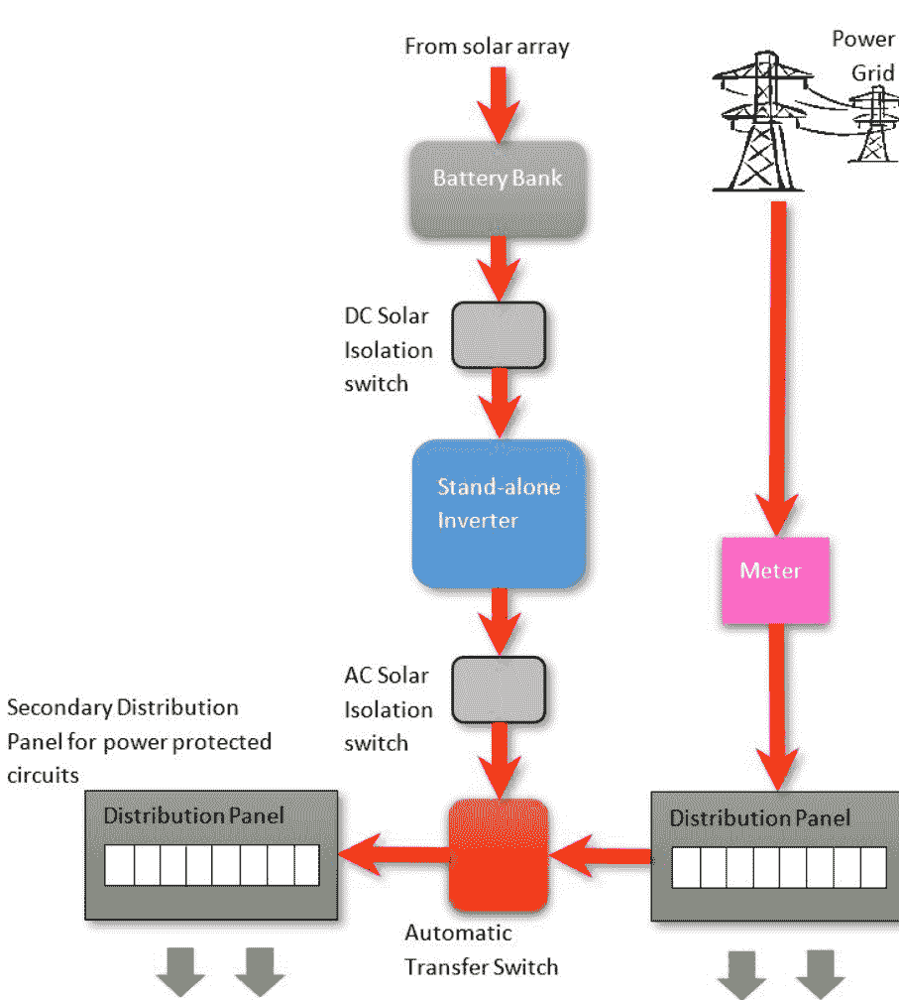

在上面的图中，第二个用户电箱已布线到电气系统中，其电源分别来自主用户电箱和连接到太阳系统的逆变器。

在两个电源输入之间进行切换的是自动转换箱。如果你将此系统配置为电网备用系统（`grid fallback system`），则该转换箱配置为在太阳能可用时从太阳系统取电，但当太阳系统的电池耗尽时，它会切换回电网电。

这在正常供电不可时为关键电源提供备份，同时在太阳能可用时利用太阳能电运行你的设备。

如果你将此系统配置为电网故障转移系统（`grid failover system`），则转换箱配置为在正常供电可用时从正常供电取电，但在不可用时切换到太阳系统的电源。

该系统的一个问题是，当转换箱在两个电源之间切换时，可能会出现约 1/20 秒的极短断电。这会导致灯光闪烁，在某些情况下可能会导致电脑、电视和 DVD 播放器等电子设备重置。

许多现代转换箱传输电源的速度非常快，这并不是问题。然而，如果你确实遇到了这个问题，可以通过在任何受影响的设备上安装小型不间断电源（`UPS`）来解决。

你可以购买完全组好的自动转换箱，也可以使用高压交流双极双投掷（`DPDT`）功率继电器，相对容易且廉价地自己构建一个转换箱。其布线方式为：当逆变器提供电源时，继电器从太阳系统取电；当逆变器关闭时，继电器将电源切换回正常市电。

# 结语

距离我建造第一套太阳能系统已经二十五年了。从那以后，我并不总是全职从事太阳能技术，但作为技术开发人员，我一次又一次回到这项技术中，我对太阳能的热情现在和过去一样强烈。

太阳能电是一种极佳且实用的资源。它可以被相对容易且有效地利用。它启发了人们，并为改变世界各地的生活做出了巨大贡献。

从爱好者的角度来看，从零开始设计和建造太阳能电力系统是有趣的、具有教育意义且好玩的。如果你想尝试一下，可以从小的项目开始，如棚子灯，并尽管尝试不同的想法。

如果你是专业的建筑师或建造者，你现在应该对如何在你的项目中使用太阳能有了清晰的认识，以及它的优缺点。

第一次将太阳能板连接到灯泡并看着它亮起来时，有一种令人惊叹的因素。尽管你知道它会工作，但看着一个似乎能凭空产生电的系统，感觉几乎近乎魔力！

向孩子们教授太阳能电也很有趣。有适合儿童的小型太阳能驱动套件。这些套件可以用小手组装，并能以一种有趣风趣的方式教授电和太阳能的基础基础知识。

太阳能首次让看似不可能变成了可能。在2011年和2012年，我参与了一个为非洲偏远村庄提供太阳能电的项目，为照明、通信以及在低温下安全储存药物提供了可靠的电力来源。我们在埃塞俄比亚、乌干达和苏丹安装了系统。整个肯尼亚全境系统所有设备的总费用低于2000 美元。对于彻底改变一个村庄来说，这是一个非常微小的代价。

2014年，我的太阳能项目正在开发一种用于大城市的太阳能电动货车。原型车的效率极高，在伦敦阴沉的冬日条件下，它可以提供约15英里（25公里）的纯太阳能航程；而在加利福尼亚的夏天，太阳能航程可超过100英里。最近，我带领一个研发团队开发太阳电池系统和下一代太阳能板。我们的产品 `Battery LITE` 成为英国畅销太阳电池系统。今天，我正致力于电池储能系统，作为一种快速为电动充电的方法。再次，太阳能是我们新系统中不可或缺的一部分。太阳技术正在不断进化和改进。这是一个令人兴奋的行业。

如果我启发了你自己用太阳能做些什么，那么它就实现了它的目的。祝你的项目一切顺利。

祝好

Michael Boxwell

2022年1月


你通往知识与文化的门户。人人可用。

z-library.se singlelogin.re go-to-zlibrary.se single-login.ru

官方 Telegram 频道

Z-Access

https://wikipedia.org/wiki/Z-Library
