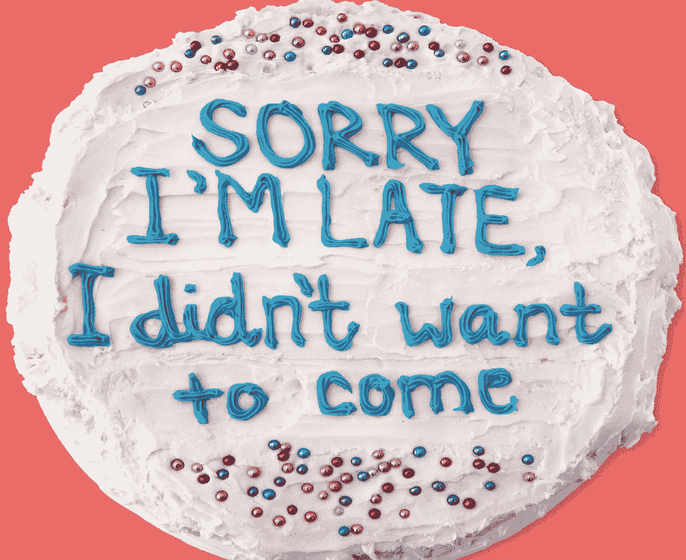
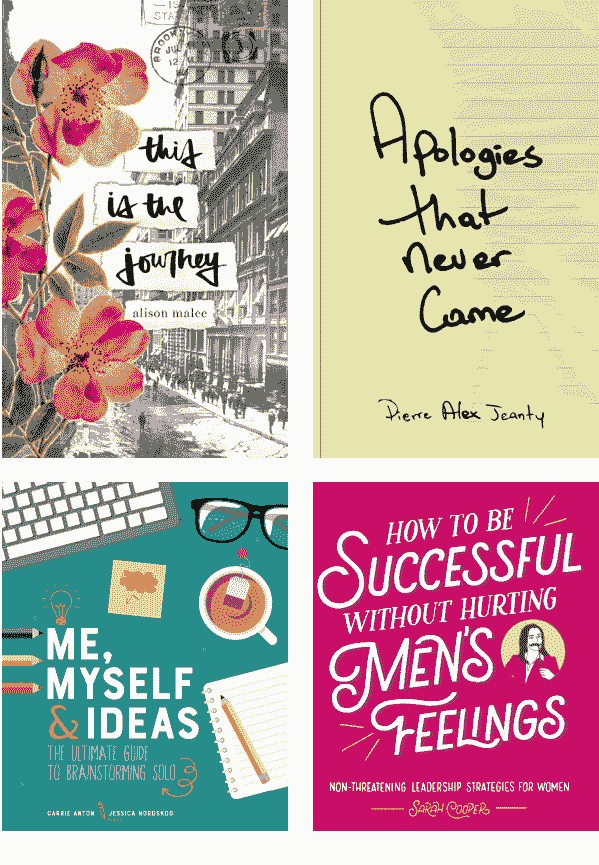

# 对不起我迟到了，我只是不想来：一个内向者的“好”的一年

> “迷人，勇敢。诚实得好笑。”
>
> ——大卫·利特，《纽约时报》畅销书《感谢你，奥巴马》作者

献 Ian—

Wǒ ài nǐ

# 关于作者

# 作者自序

让我们明确一点：我不认为任何人——无论内向者、外向者还是其他人——需要被“治愈”。但曾一段时间，我是一个不快乐的内向者，我想看看如果我花一年时间去尝试令人生畏的新体验，我的生活会发生怎样的变化。这本书讲述了随后发生的事情。请享受我的噩梦。

# 引言

世界上有两种人。一种人是在电视上远远观看格拉斯顿音乐节（英国乃至世界最大的音乐节，挤满了几十万观众），就像在看恐怖片一样。他们隔着毯子的边缘向窥视，目证那片泥泞的地狱。他们为这种“错过了”的纯粹快乐而松了一口气，因为他们很高兴自己坐在沙发上而不是那里，不用被成千上万个摇摇晃晃、大吵喧闹、醉酒尿急且头发油腻的人包围。

另一类人则是选择去格拉斯顿的人。我不是其中之一。

我大学里的朋友为我的二十二岁生日举办了一个惊喜派对。当大家突然从黑暗中跳出来时，我泪流满面。派对上的人以为我被感动了。实际上，我感到惊恐。这是几个月来第一次，我的眼泪不是因为我单方面爱上了我的西班牙语家教。好朋友、家人以及一些模糊的相识坐在我的床边——恰巧的是，那里正是我通常躲用来躲避这些好朋友、家人和模糊相识的地方。

我无处可躲。他们是为了参加派对才来的。还要多久他们才会离开？

最后，我打开了所有的灯，等大家领会暗示。

如果你像我一样，那么你也恐惧自己的生日派对是什么感觉。你害怕演讲、害怕团队建设活动，害怕每一个除年夜。

我有这种感觉是因为我是一个内向者。事实上，我是一个害羞的内向者（后文详述），任何一个像格的害羞内向者都一定做过以下事情：把响响的手机扔到房间另一头、假装生、走进社交活动后立即退出，以及在酒吧被人搭讪时假装听不懂英语。最后一种是高级水平，但也是最有效的方法。

一个徘徊在门口的“害羞内向者”。我曾以为，也许异乡能震掉我身上的内向性，但它就像湿疹一样，在任何气候下都能茁壮成长。

随后，苏珊·凯恩（Susan Cain）2012年的畅销书引发了“静默革命”。在书字里行间，我读到每三个人中就有一个是内向者。我们并没有任何错。换句话说，内向者注意力集中、享受孤独、不喜欢闲聊、喜爱一对一的交谈、回避公开演讲。害羞、敏感的宅家女孩，你是这么说的吗？我确实如此！

读到这些内容，我感到如释重负，并决定拥抱自己的这一面。这才是我的本色。与其为那个我无法成为的人而自我责备，我选择了庆祝真实的自我。毕竟，我的性格是我成为作家的原因之一，这意味着在这段时间里，我和我的小圈子保持着亲密的关系。

在一年的时间里，一切变得糟糕了。我失业了，最亲的朋友也搬走了。我的职业停滞不前，我感到孤独，失去了跑步的欲望；我不知道生活该何是好。事实上，我想故技重演，跳上飞机开始新生活，也许这次换一个名叫弗朗切斯卡·巴金汉（Francesca Buckingham）的人重新开始。但显而易见，我没有那种性格、自信，也没有足够的帽子收藏来完成这一切。

我有大量的时间坐着思考：我到底从生活中想要什么？真的，我想要一份工作，一些能让我感到真正共鸣的新朋友，以及更多的自信。这要求过分吗？当然没有。那么，外面那些有工作、有亲密朋友、生活充实的人在做什么我没有做的事呢？最终，带着日益增长的恐惧，我意识到：他们正在经历新的事物、承担风险、建立新的联系。他们正身处其中，生活在世界上，而不是盯着它看。

我曾无意中听到同事柳柳（Willow）谈起她的纽约之旅。柳柳在前景公园停下来抚摸一位女士的狗：结果她和那位女士度过了一天，和她去爵士乐俱乐部玩到凌晨四点，后来通过其中一个新朋友的人脉获得了梦理想工作。她在节日的排队上厕所时遇到了她的男朋友。她在派对上和医生聊天时发现自己有低血糖。她的整个生命都被这些偶然的邂逅塑造了。这一切仅仅是因为她选择去交流和倾听刚相识的人，而不是结结巴巴巴巴地说着“我不说英语！”全速逃离。

如果我推开生活的大门，会发生什么？情况会好转吗？

尽管我接受了在人生的这个阶段，这种状态并没有让我快乐。我把自己的内向身份当成了将与他人隔绝的执照。

尽管我沉浸于内向的世界，但我好奇的自己是否可能错过了什么。当你定义了某物或某人时，你不可避免地限制了它。或者说她。我审视自己的方式变成了一个自我实现的预言：“演讲？我不做演讲。”或者，“派对？我不办派对。”我接受了自我，但也太害怕挑战自己的恐惧，去外面获得我渴望的经历了。

在读心理学学士学位期间，我上过门神经科学课程，部分原因是因为我对天性与培养之间的相互作用非常感兴趣。但现在我是成年人了，通过新经历我能改变多少呢？

莎士比亚有一句名言是“对自己忠诚”。是的。但我不想永远被我的不安全感和焦虑束缚。我不想停滞不前。我们是人类——我们拥有成长和改变的能力。

一旦我意识到这一点，我内心的一个小声音说：“去他妈的鬼话吧。”我一直把“内向者”这个标签当作躲避世界的借口。

到那点为止，我一直抓着我“害羞内向者”的身份，这几乎让我无法拥有那些我内心渴望的东西：一份我在乎的事业、意义的关系、充满欢笑的友谊，以及我未曾详尽计划过的经历。

我是一个掉进洞里的内向者，并不是*因为*我是内向者才在洞里。有很多快乐的内向者过着他们最好的生活，但我想从那个洞里爬出来——我相信比目前更大的生活最终会让我更快乐。

但要做到这一点？必须有所改变。

问题：如果一个害羞的内向者像一个活泼的外向者一样生活一年，会发生什么？如果她明知并情愿让自己陷入她通常不惜一切回避的危险社交场合呢？

这会带来一个改变人生的经历世界吗？

还是她最终会在森林里吃杂草，只和狼交流，直到因营养不良而死，但因为再再也不用参与闲聊而感到程度的快乐？

豁出去了。

# 第一章

# 桑拿，一个故事

或

## 谷底

我在北京遇到了我的丈夫，一个英国人，我们在那里以两个害羞的人最可能采取的方式坠了爱：在工作中，在即时通讯软件上调情，隔着两个办公桌，从不眼神交流。萨姆（Sam）和我都在同一本杂志工作，我第一次对我同样向往的人感到完全彻底的放松。在最终面对面交流后，我们搬到了伦敦的伊斯灵顿（Islington）。我花了几年时间适应北京，但当地人总是直说他们所想。茶馆老板？他认为我胖。我的房东？她认为我瘦。水果摊贩？他认为我不喝水。

由于没有英国签证我无法工作，我每天的大部分时间都在远离英国最伟大的文化发明之一——狂刷《晚餐请你来》（Come Dine with Me）电视节目。这是一档真人秀节目，由各种人为陌生人举办晚餐派对。我兴奋地发现，大多数英国式晚餐派对都以水煮梨子甜点结束，而每个人在坐在床边时，都会私下里对主人说坏话。

几个月后，我拿回了签证，表现得像个成年人，在一家营销机构找了份工作，为一个鞋品牌写博客文章。我的专长是写在什么天气下穿什么鞋的指南——这种决定大多数人在七岁之前就已经掌握了。

转眼间，我和萨姆（Sam）已经在伦敦度过了几年光阴。在那段时间里，我在伦敦所有的朋友都离开了。你可能认为这是夸张。事实并非如此。我大学最好的朋友瑞秋（Rachel）搬到了巴黎。我中国的好友艾莉（Ellie）搬到了北京。英国同事们建立了感情，然后散落到了乡村和郊区。

伦敦变成了一个日益孤独的地方。街道变得熟悉，但它们永远充满了陌生人。我把自己深埋在工作中，埋在博客文章、客户会议和鞋子之中。

然后，在一个宿命般的夜晚，我参加了公司的一个颁奖典礼。老板介绍了一个奖，颁给留得最晚的人，那个周末都在办公室过的人。他们解释说，那是“为工作献出灵魂”的人。这个奖被称为“午夜油奖”（Midnight Oil Award）。他们打开信封，念出了我的名字。当我走向临时搭建的舞台时，几位男同事拍了拍我的背，祝贺我完全没有生活。我咬着牙，强挤出微笑，接受了那个奖杯。

奖杯上刻着我的名字。后来，当我提着它回家时，它感觉像是一件被诅咒的物品，像弗罗多的指环，只不过没有它那么无敌和闪亮，更像是一种负担，我失败的象征。失败，是因为我对我的工作或我正在做的生活完全不感兴趣。失败是因为我没有成为我崇拜的那种人——那种尝试新事物、抓住机会并回避简单选择的人。

也像弗罗多的指环一样，这个奖杯无法通过扔进垃圾桶或火堆来销毁。我看过电影预告片——我假设它会再次找到我。我把它放在我能找到的最没体面的地方。“去你的吧，”我关上橱柜时，对着奖杯轻声耳语，让它在六半个可回收垃圾袋和一瓶疏通剂旁边任腐烂。

第二天回到公司，我得知一个叫戴夫（Dave）的同事去年获得过“午夜油奖”。关于戴夫有一点：他看起来总是很苦闷。他每天都吃同一个三明治。在办公室的圣诞派对上，我们两个坐在角落里，他醉着向我坦白，只要知道怎么做，他愿意做任何事情离开。

我研究了戴夫。然后我做了一件非常愚蠢但感觉非常、非常棒的事情。我辞职了。

由于没有后路，我开始称呼自己为自由职业者。在我这里，“自由职业者”是穿着睡衣在公寓里游荡的委婉说法，是在看到后院的流浪猫时变得过度兴奋。我仍在写关于鞋子的博客文章，但现在我是坐在陷式沙发上，拿得更少的钱。当我看着早晨通勤的人路过时，我突然意识到，我住在一个九百万人的城市里，每天只和两个人说话：萨姆和一个咖啡师。

那个咖啡师不是个话多的人。而萨姆在我们家四面墙之外也有自己的生活：一份他喜欢的工作、一群和他建立了感情的同事、一个晚间跑步俱乐部，以及他会聚在一起看球的好朋友们。他有一个独立的世界，而我只有他。每天早上他去上班时，我会把头钻进被子里，不想完全独自面对另一个灰色的日子。没有人在任何地方等我。我哥哥给我发了短信：“我好久没你的消息了——我完全不知道你怎么了。你过得开心吗？”

最后一个问题击碎了我。我无法告诉远在远方的家人，我正处一个深渊中，我不知道该如何出来。我甚至无法向萨姆承认这一点。甚至无法向自己承认。

在一个寒冷的冬日，我在上午 11 点醒来，因为前一晚上我一直在谷歌上搜索到凌晨几点——“黑洞”、“我有注意力障碍吗？”以及“米克·杰杰格和大卫·鲍伊是朋友吗？”。我还给现在住在英吉海对岸的瑞秋发了邮件，承认我确实可能有注意力多动障碍（ADHD），因为我似乎总是从一个想法跳到另一个想法，但事情似乎都毫无进展。我很邋遢，我被遗忘了，我难以集中注意力。

瑞秋回信说：“我不知道……你说的这一切对我来说更像是抑郁症。无法集中注意力其实是抑郁症的症状之一。也许你应该找人谈谈……”

她什么意思，我所说的这一切？我瞥了一眼之前的那封邮件。我的落款是：“我无所期待。”

我迅速关掉了电脑。

## 咖啡因片

“我明天就是不洗澡了！”我回喊道。“而且我最终没有买咖啡因片。那太疯了。”

我回到了我的摔跤博客，在那里我发现了一个最受广泛认可的策略：桑拿房。

但这并不是某种排毒的、斯堪纳维亚式的休闲SPA之旅。桑拿房只有一个目的：把你体内的水分烤出来。为了让汗水最大化，布兰登夫妇建议全穿衣服。

我喜欢桑拿房。我可以去桑拿房。难道一个女人不能去桑拿房而不算犯罪吗？难道一个女人不能喝黑咖啡、不洗澡然后去桑拿房吗？当然可以！我对自己说。她当然可以。一个女性在完全正常的一天里可以轻而易举地做到这一切。

显然，萨姆是对的。我忘记了为什么要加入，因为太沉迷于击败波西娅了。我的意思是，我内心深处知道做事情极其阴险。我不喜欢自己正在变成的样子——但一年多来，我一直觉得自己像个失败者，渴望赢得胜利。我正触向谷底。

在最终称重的那天，我走进了桑拿房。我坐在发热的木板上，身上穿着一件黑色长袖T恤、黑色运动裤和羊毛袜。干热包围了我的身体。打扮得像一个非常迷恋自我护理的忍者，我闭上眼睛向后靠着。

我想起了那些引导我来的摔跤博客。就像我一样，我的业余摔跤英雄们知道如何为了他们想要的东西而牺牲。我想着他们会完全理解，坐在桑拿房里流几分钟的汗是值得的，如果这意味着让你的生活回到正轨，并省下健身房会员费。

桑拿房内变得变得无法忍受，但我已经完成了最困难的部分——选择做一个虚伪的混蛋。我现在要做的就是忍十五分钟的热量。只需闭上眼睛等待它过去。我可以做到。我可以在这种酷热中保持冷静，像一只沙漠甲虫一样。

然而，想要保持太禅意很难，因为接待员并没有达到我的高期望。她一直过来查看我，对我的行为深表怀疑。她会猛地推开桑拿门，让我的热空气散发出来，而我一直跳起来砰砰地关上门，用手示意我们可以通过薄薄的玻璃窗交流。我重复了这种程序几次——推开门，我当着她的面把它关上以留住热量。

“你为什么穿着衣服？那太疯了！你应该脱衣服！”她隔着玻璃对我大叫。到这时，我的衣服已经被汗水浸透。

“不。这是我想要的！”我对她说，没有提供进一步的解释。我交叉抱在胸前。第三次，我终于大喊道：“天哪！请直接走开！”她目瞪口呆，留给我清静。

我安静下来。我的嘴巴干渴了。我不能喝水，因为那会违背此行的目的，但我已经很渴了。我每隔三十秒看一次钟。五分钟过去了；感觉像一个小时。我伸手去拿角落里的杂志来分散注意力，却发现每一本都是关于男士健身的。

我无精打采地翻着一本杂志的页页，停在一个关于户外徒步期间如何保持安全的夏季专题上。我心不在焉地扫过一个关于中热的事实框：“中热由运动过度、脱水和过热引起，可能导致脑损伤和/或死亡。”呃，那是什么？

我的嘴巴比本来更干了。我这一天没有喝任何水。我在非常闷热的桑拿房里大汗淋漓。我为中热创造了完美的条件。是故意的。我要让自己中热吗？我现在正在中热吗？中热到底是什么？

我恐慌了。我要死在这个桑拿房里了。我立刻看到了一则讣：

“她在试图在伦敦北部赢得一张免费健身房会员卡时中热去世。”他们会告诉我的父母，我死时穿得像个刺客，正读着一本八分钟腹肌的指南。

我还在“慢炖”，但我内心深处的某些东西冷了下去。我完全失去理智了。我不是在发疯；我的理智早已消失了。

我打开了桑拿门。

后来，在咖啡馆喝水时，我无精打采地盯着空间。我又喝了更多水。我回到家里躺在沙发上，因为那是我唯一精力能得到的事情。

我变成了什么？失业、没朋友，现在还失去了理智。

我那种“上帝时刻”、谷底时刻发生在桑拿房里读《男士健康》的事实，并不是什么我能感到自豪的。我完全失去了视角。我不再知道我天生的内向在哪里结束，而我的抑郁和孤独从哪里开始。毕竟，我曾是一个快乐的内向者，但我却成功地通过恐惧、不安全感和停滞把自己塞进了一个洞里。

那天，我审视了事实：我的生活很狭小，我想看看自己是否喜欢变得更大。我内心深知，更大意味着向我的世界，特别是向其他人开放。很多人。我读过很多关于三十岁交朋友有多困难的文章，我知道对于像我这样的人来说可能更糟。我友谊的模式要么（a）你是最好的朋友，我告诉你所有的亲密秘密，要么（b）你是个陌生人，危险。

我决定尝试一些事情。我要成为一个外向者。不是真正的，而是尝试性的。我要去一个强迫我与人交流的地方。我要去参加社交俱乐部。

第一个俱乐部在当地社区中心。小组很小，大多数人看起来和我一样焦虑。我们围成一圈介绍自己。

“我是萨拉，”我说，声音在颤抖，“我来这里是为了学习说话。”

“我是马克，”我旁边的人说，“我来这里是为了学习如何不那么尴尬。”

我们聊了几个小时。我们聊了天气、工作，以及我们对待在那里的恐惧。这很尴尬，很可怕，而且精疲力竭。但当晚结束时，我意识到不需要完美。我只需要出现。这就是一个开始。

有人告诉我，只有美国人和疯子才会去和陌生人说话。或者，考虑到北方人的名声，整个约克郡都是如此。但不过，当然，还有那种偷听你尴尬对话的、如地狱煎油般的折磨。

几年前，我在伦敦的一家当地咖啡馆发现了一盒胸针。我捡起一枚：上面写着“我与陌生人聊天”。我立刻把它扔了回去，怕被人看到我拿着它。那上面的字看起来简直可以写成：“我吃蜘蛛”。

对我来说，和陌生人聊天是一种走投无路时的办法：在陌生的社区迷路了、手机没电、腿断了、遇到台风——而且真的，只有当这些事情同时发生时我才会这样做。

我知道不只有我有这种感觉。在城市的几个小时里，我们都挤在公共交通工具上，本质上是在“汤勺式”地挤在一起，完全沉默。当然，我会把脸凑到你脸上，但要和你说话？绝不。

不过，我还是回去拿了一枚那种“与陌生人聊天”的胸针。我突然想到，话多的游客会是一个很棒的万圣节装扮，可以吓唬伦敦人。

总之，我忘记了那枚胸针多年，直到我读到一篇让我惊讶的文章：显然，当人们被迫与陌生人交流时，他们会变得更快乐。

大约那时，在从纽约飞往伦敦的航班上，我发现自己和两个男人坐在一起一排。我立刻进入了默认模式：戴上耳机，盯着前方。别理我，我不在。这似乎起效了，因为他们转而互相交流。很快，他们就开始交换烧烤配方，然后倾诉心声，互相展示手机里的家庭照片。当我们降落在希思机场时，其中一人邀请了另一人参加周五的生日派对。

这让我感到非常震惊。如果六小时的飞行结果是这样，那么当我忽视每天看到的几十个、甚至上百个陌生人时，我错过了什么？我难道错过了那些改变生活的配方、生日派对，以及可以倾诉的感肩膀吗？

外向者喜欢与他人相处，所以我的第一步是尝试让自己在与这些人交流时变得自在。这个想法让我的手心开始发痒。

如果我非常不擅长呢？

我会不会永远被英国社会排挤，并被放逐到一个到处是疯子和话多者的岛屿：比如我的美国同胞、那些在繁忙火车站外试图拯救你灵魂的人、汽车销售员、七岁的孩子，以及酒吧里那些自信得惊人的男士？因为这似乎太公平了。我真的不想去那儿。

***

第一天，我决定最好还是按照我的既定计划开始：直接脸朝地撞进我的第一个可能毁掉生活的实验。

我深吸一口气，在早上8点，目标坚定地走向公交站的一位女性。她立刻转过头去。我和其他早起通勤者一起坐在上层楼上。我旁边的女人正沉浸在手机里玩《消消大鳄》。公交车上没有其他人在说话。当我练习各种关于糖果的开场白时，我的心跳得很快，但看着那个盯着手机的女人，我觉得她好像抓到我在偷看她的领口。我放弃了公交任务。

由于在公交车上的失败感到很沮丧，我决定尝试一些轻而易得的目标。我走向当地咖啡馆里的一一个陌生的咖啡师。我可以做到的，对吧？我只是在和一个拿咖啡的友好男士聊天。

“你是新来的！”我说，很有他必须回答，因为对客户友好是他的工作职责。

“我在这里工作了了，”他回答道。

我旁边的客户笑了。

我内心的一小部分死去了。

我曾读到，孤独或孤立是早亡的风险因素，这意味着从某种意义上说，也许和陌生人聊天会救我的命。尽管此时，感觉它实际上是在剥夺我的一大块寿命。职业意义上的那种。但谁来帮我呢？我需要帮助。

第二天，当我手里拿着那枚“与陌生人聊天”的胸针（那种感觉完全是不自在的）时，我意识到在旅途中我需要他人来引导我度过这充满未知领域的一年。专家。导师。那些能防止我直接向外社交直到掉下悬崖的人。

# 社交实验：从恐惧到连接

## 专家建议：暴露疗法

在经过一些快速研究后，我决定打电话给 Stefan G. Hofmann，波士顿大学心理治疗与情感实验室的主任——他经常指导人们克服与他人交流的恐惧。他用轻微的德国口音告诉我：“社交焦虑是一种完全正常的经历。我们是社交动物。我们想要被同伴接受，不想要被拒绝。如果人们完全没有社交焦虑，那他们就大麻烦了。”

我问 Stefan，他是否认为在英国以外和陌生人聊天会更容易，这对我来说似乎特别棘手。等我在这片风景宜人的土地上丢光了脸之后，我可能需要搬到其他地方去。

“我认为这取决于城市。例如，波士顿比纽约难，纽约的人更话多。我来自德国，我们那里非常严谨。你几乎无法和德国人聊天。但一旦引起了我们的注意，我们会非常有帮助，”他说。

他的经验表明，治疗社交焦虑的一种有效方法是暴露疗法：将人们置于最坏的情况中，在那里，他们保证会被反复拒绝。例如，他可能会指示患者……

## 实地测试：最愚蠢的问题

他离我越来越近。越来越近。

当他路过时，我在他面前挥了挥手。他猛地停下脚步，惊讶地看着我。

“抱歉，我忘了……”我说道，声音逐渐没没了下去。

他期待地看着我。

“呃，请问有英国女王吗？如果有，她叫什么名字？”我结结巴巴地问道。

“英国女王？”他重复道，一脸不可置信，眉毛挑起。

“是的。有吗？她是……她是谁？”我问道。

“是维多利亚，”他说。

我脑海中想象过的所有场景，都不是这。

“维多利亚？”我问。

“没错。”

“所以你的意思是英国女王的名字叫维多利亚？”现在我变成那个深信不疑的人了。

“是的，”他说着跳上了火车。我困惑极了，立刻招手了我看到的下一个人：另一个二十多岁的男人，至少六英尺高，穿着一套运动服，提着一个健身包。我快速向他问了这个问题，他用一种困惑又轻蔑的眼神看着我。

“是维多利亚，”他说着走开了。

好吧，外向型实验——难道没有人知道英国女王是谁吗？

难道我甚至不知道英国女王是谁吗？

我魂不守魄地连续拦下了四位女性，她们中的每一个人都告诉我：“伊丽莎白。”有些人惊讶得大笑起来，有些人惊恐地停下脚步，而所有人看我的眼神都仿佛我非常迟钝。其中一个人问我是否还好。但没有一个人向警察报警。

而且我没有死。

斯特凡是对的。

诚然，现在我对普通英国人对历史和/或时政的理解能力产生了严重的怀疑，但我呢？我很好。比好还要好。在经历了那次死里逃生的练习后，我简直兴奋得不得了。我几乎是跳着回家的，快乐地踢起地上的叶子。

有人说世世界上没有愚蠢的问题，但通过提出最愚蠢的问题，我终于面对了与陌生人交谈的恐惧。

我的自信心高得危险。就像美国大汉喝了四瓶啤酒后的那种状态。也许我真的可以做到。

## 日常练习：从寒暄到深度

第二天，我独自在一家寿司吧吃，享受着午餐时间的独处。正当我咬下一口辣金枪鱼时，我猛地打了个喷嚏，寿司溅到了我的黑色牛仔裤上。就在那一刻，我听到身后传来一个男人的声音。

“我不介意坐在这里吧？”

我嘴里满食物，鼻子流着涕，到处都是米粒，一个穿西装的商人出意料地看着我。噢不。这太糟糕了。对我们两个来说都是。

对着男人指指椅子，点了点头，在纸巾后面无力地说：“我打喷嚏了。对不起。”

他坐了下来。

我意识到没有什么比那个喷嚏更糟糕的话了：情况只会越来越好。我深吸了一口气。

当他终于从手机上抬头看时，我扑了上去。

“你来自哪里？”我问。

我听出了一种口音。他是法国人。他笑了，然后似乎做手势要回去吃午饭，但我不会轻易被击败。

“但在法国哪里？你是……对脱欧感到冒犯了吗？”这可不是我最好的表现，但对话进行得相当顺畅。（而且，他确实觉得被脱欧给冒犯了。）

在接下来的几天里，我讨论了七次突然降冷。“你觉得我们今年会下雪吗？”我问陌生人。

没有人知道。

“我需要咖啡，”我在 Pret 排队时对一位五十多岁的女性说。

“是的，”她说，“咖啡很好。”

事实证明，很难跳过寒暄。我摸了很多狗，假装那是和它们主人说话的借口。在一次故事分享会上，我和旁边的女士聊了起来，我们聊了天气。在公交车上，我坐在一个孩子和奶奶玩二十个问题的游戏后面。我突然插话：“是狐狸吗？”他们疑惑地看着我，逐渐接受了我的参与（那是一只浣熊）。

我觉得自己像一个在城市里游走的善良村痴。但无论我如何努力，还是无法跳出平凡。斯特凡帮我建立了与人的联系。现在我需要有人帮我与他们建立连接。

## 专家建议：通勤中的连接

所以我决定给我的下一位专家。尼古拉斯·埃普利（Nicholas Epley），芝加哥波斯顿商学院的行为科学教授。他就是那个发现人们在通勤期间与陌生人交谈会让他们更快乐的心理学家。是他开启了我这段冒险。我告诉他这听起来有多么奇怪：你是说人们实际上喜欢在公交车或火车上聊天？那里不是说话的**最糟糕**的地方吗？

“嗯，对我来说那里似乎是最容易的地方，”他说，“其他地方是人们已经在做其他事情的地方。在火车或公交车上，他们只是坐在那儿，什么都不做。”或者在玩消消鳄。

尼克说，伦敦沉默的车厢可能是“多元无知”的结果：每个人实际上都愿意聊天，但认为其他人都不乐意。火车上可能满了想开启对话的人，但依然保持沉默。

所以他在芝加哥测试过这一点。事实证明很难跳过寒暄。我摸了很多狗，假装那是和它们主人说话的借口。在一次故事分享会上，我和旁边的女士聊了起来，我们聊了天气。在公交车上，我坐在一个孩子和奶奶玩二十个问题的游戏后面。我突然插话：“是狐狸吗？”他们疑惑地看着我，逐渐接受了我的参与（那是一只浣熊）。

我觉得自己像一个在城市里游走的善良村痴。但无论我如何努力，还是无法跳出平凡。斯特凡帮我建立了与人的联系。现在我需要有人帮我与他们建立连接。

所以我决定给我的下一位专家。尼古拉斯·埃普利，芝加哥波斯顿商学院的行为科学教授。他就是那个发现人们在通勤期间与陌生人交谈会让他们更快乐的心理学家。我告诉他这听起来有多么奇怪：你是说人们实际上喜欢在公交车或火车上聊天？那里不是说话的**最糟糕**的地方吗？

“嗯，对我来说那里似乎是最容易的地方，”他说，“其他地方是人们已经在做其他事情的地方。在火车或公交车上，他们只是坐在那儿，什么都不做。”或者在玩消消鳄。

尼克说，伦敦沉默的车厢可能是“多元无知”的结果：每个人实际上都愿意聊天，但认为其他人都不乐意。火车上可能满了想开启对话的人，但依然保持沉默。

## 派对实验：脆弱性连接

“你好，我是杰斯，”我说，“你住在哪里？”突然间，听到自己大声说出来，我意识到这既是一句基础问候，同时也——取决于对方如何听——是一句令人生恐惧的话。

事实证明，马尔科住在一个美丽、宁静的广场上，我大多数每天都会经过那里。

“向他透露一些关于自己的事，”我听到尼克的声音在我耳边响起，“问问你真正想知道的。”

“我几乎每天都会窥视那些房子的窗户，”我说，“那里有延伸到院子里的巨大厨房，后面还有惊人的花园。有时我假装自己住在那里。我一直想知道：那是世界上最理想居住的地方吗？”

“是的，”他说。

他走了。

没人说过这会容易。

我搜遍了房子寻找下一个目标，遇到了一位五十五十岁的戴夫，他正试图把自己重造成一名单口喜剧演员。当我们站在一幅看起来像生了病的海象的抽象画前时，他先发起了对话。我们交流了克服写作瓶颈的秘诀，这告诉我他通过喝红酒和听罗德·斯图尔特的音乐来治愈自己。到目前为止，一切顺利。

我继续穿梭（我最近几天都在穿梭），在深夜快结束时，我和街上认识的那位艺术家罗杰聊了了起来，是他邀请我来的。他把话题引向了自己的画作。

“艺术是唯一让我觉得有意义的东西，”他说，“它是光影、纹理，以及……”

不，不，不，不。我不想在这场艺术展上在这里谈论艺术的种种优点。我在想：关于这个温和、语声轻柔的男人，我真正想知道的是些什么？

“罗杰，你做过最糟糕的事情是什么？”我问。我真不敢相信自己刚才竟然在想他是否会对着我的脸大笑。相反，他思考了一会儿，手里拿着酒杯沉思着。

“嗯，我青少年时期烧掉了我学校的艺术系。”

抓到重点了。

在我的过去，我会直接从这个人身边走过。而现在，我坐在这我去过的最奢华的派对上，发现了他过去的罪行，而这一切仅仅是因为我停下来打了个招呼。这种研究是对的：它带给我了快乐。我的意思是，这虽然不像在木屋里伴着火炉重读《我捕捉到了城堡》那么有趣，但也不不上最糟糕。

这场派对激励我继续走下去。这并不意味着我在每次相遇前不再感到紧张——我依然会紧张。但这就像撕掉创可贴。深吸一口气，在最初的冲击之后，最痛苦的部分就结束了。某晚上在回家的火车上，我坐在一个男人旁边，努力鼓起勇气和他交谈。但也不让他觉得我在搭讪。

“嗨，”我终于开口，“你的西装外套是在哪里买的？我丈夫正想找一件一模一样的。”微妙极了。

起初，他缩了了一下，把包紧紧抱在胸前。接着他又缩了缩，“芬兰，”他告诉我。这不是什么有用的信息，但创可贴已经撕掉了。

在最初的震惊后，这位芬兰男人开始提问。他告诉我他在伦敦住了五年了；我们发现我们都很喜欢电视节目《30摇滚乐》。在一个寒冷阴雨的夜晚与他聊天，远比坐在石像一般的沉默中、刻意避开眼神交流好得多。这并不是什么深层次的交谈，但当他站起来准备在这一站下车时，他转向我说：“今晚遇到你真是个很棒的惊喜。”

我坐在那里，其他乘客一直盯着我们看，好像我们是一个科学实验一样。我们确实是。我们就是我的科学实验。我觉得这进展得非常顺利。

***

## 课堂学习：如何社交

坐在教室里，我偷看了那个穿着格子衬衫、卷着牛仔裤的男人，此时老师马克正在我们面前设置演示文稿的下一张幻灯片。

马克指向一幅爱德华·霍普的画，画中是一个孤独的女人望向窗外。

> “作为人，我们极其脆弱。我们这颗巨大星球上，是在空间中、在大星系中穿梭的微小、无关紧道的生物。我们如此脆弱，以至于如果一根树枝掉在我们的头上，它就会杀死我们。”

我在座位上压低身体，保护性地摸了摸后脑勺。“我们需要所有的盟友来生存，因此需要社交性。我们都在寻求与他人建立深层的联系，但随着年龄的增长，孤独是生活中不可避免的一部分，”他说，再次指向那张霍普的画。

这门课叫“如何社交”，开在生活学院（School of Life），那是畅销作家艾兰·德·波顿的结晶。正是在这里，我遇到了那个卷着牛仔裤的高个男人，我将向他倾诉我所有的恐惧和不安全感。

对于一门承诺教你如何社交的课，我不知道期待什么。当我十二岁时，我妈妈让我去了一场晚上的社交舞会，那是一种在南方很流行的教授礼仪的社交课程。我想那可能也是为了让我变得害羞。我花了一晚上的时间，担心那位叫花拉斯的夫人的娇小老师——她穿着猫猫高跟鞋、拿着麦克风在房间里巡视——会点到我的名。然后她放下了麦克风，我剩下的晚上时间都……

我面前的一个女人发出了响亮的“嗯”声，表示认同。

一个三十多岁的男人举起手。“但人们不想分享自己的个人情感和生活，对吧？有些人可能很讨厌那样。”

马克转看向他。他告诉他，当然，也许吧，但对侵犯他人的恐惧被极大地夸大了。这里更重要的一点是：我们实际上应该感受到的恐惧是变得无聊，在从未与任何人建立联系的情况下死去。

然后他意味深长地注视着我们所有人，缓慢地又说了一遍。“变得无聊并在从未与任何人建立联系的情况下死去的恐惧和惨淡的现实，被严重低估了。”

接着马克拍了手，让班上一半的学生面向坐在右边的陌生人，向他们提供一个关于我们的事实或我们生活中正在发生的事情。至于如何确保对话避开浅层、感性且有回报的领域，取决于对方。

我转向坐在我右边的那个女人。她叫林赛。美国人。来自阿拉拉巴马州。她戴着珍珠，穿着一件黑色羊绒毛衣。

我引导着她。“我很快要去德克萨斯看我的家人，”我说。天哪，关于这个家人可以发生任何事。与家人的紧张关系。回到美国充满了焦虑，或者可能是渴望和遗憾。

“噢 . . 那段飞行路程很长。飞得怎么样？”林赛问。

“十一个小时，”我说。太浅层了，林赛。

“等一下，让我再试一次。你是 . . 嗯 . . 你要去购物吗？该死！”她说。

像个睿智的导师一样，我默默地示意让她再次尝试。

“你期待晴朗天气吗？”她探性地问。

林赛做不到。她无法提出深层的问题。我本以为美国人可能比这些英国人好。

加油啊，林赛。问问我的家庭。问问我是否有时在醒来时在想，为什么每当我想念他们时，都会搬离他们那么远。这真的仅仅是因为伦敦有好的剧院吗？加油啊，林赛。问问我的家庭。问问我是否有时在醒来时在想，为什么每当我想念他们时，都会搬离他们那么远。这真的仅仅是因为伦敦有好的剧院吗？加油啊，林赛。问问我的家庭。问问我是否有时在醒来时在想，为什么每当我想念他们时，都会搬离他们那么远。这真的仅仅是因为伦敦有好的剧院吗？加油啊，林赛。问问我的家庭。问问我是否有时在醒来时在想，为什么每当我想念他们时，都会搬离他们那么远。这真的仅仅是因为伦敦有好的剧院吗？加油啊，林赛。问问我的家庭。问问我是否有时在醒来时在想，为什么每当我想念他们时，都会搬离他们那么远。这真的仅仅是因为伦敦有好的剧院吗？（注：此处原文似乎有重复，翻译已按逻辑处理）……问我一些真实的事，我想写……的报纸……问我一些真实的事。

我们周围的对话在流淌，深沉且亲密，但林赛现在问我是否期待在德克萨斯吃墨西哥食物。我无法掩饰我的失望。

但首先她必须陈述一个关于自己的事实。她深吸了一口气，什么也没说。

她想不起任何关于自己的事。行吧。也许她很紧张。

我决定采取主动。

“你在英国住了多久了？”我问。

“五年了，”她说。

“什么带你来到这里的？”我问。

“我丈夫的工作调到了这里。”我点头，看着她的棕色眼睛。

“你每天怎么过？”

“通常通常就在家里陪孩子。”我打算这样做。我要深入挖掘。

“你来上这节课是因为很难交朋友吗？”我问，直接切入主题。

“我只是觉得可能很有趣，”她说。她没有回避。她没有留在浅层。我跳入了冰冷的深水中，而她站在岸边，抓着她的珍珠，没有穿泳衣。

“噢，好吧，我只是觉得……”我开始说。但没用。重点是变得脆弱。

“你孤独吗，林赛？”我温柔地问。

“孤独？我不孤独，”她大声说。

“如果你是……也可以的，”我小声一点道。

“我不孤独，”她再次重复，回到那幅爱德华·霍普的画。我们都会孤独死去，尤其是林赛。

好吧，行，也许那并不是传达的信息。没错，我只和林赛相处了五分钟，我们完全是陌生人。既然她来自阿拉拉巴马州，也许她会自己去。

铃声响了，我再次面向前方。在弗洛尔太太的舞会上，对话总是应该是礼貌且愉快的。

在课程的第二部分，马克告诉我们分享我们的脆弱和不安全感是与人建立真实联系的最快方法。大多数人都想吹嘘自己的生活，但这会让人们感到嫉妒或愤恨。

“这并不是我们希望别人失败，而是我们需要知道自己的悲伤在别人的生活中能产生共鸣。这连接了我们，”马克说。“强大或许能令人印象深刻，但脆弱才能建立友谊。”

我想回起我和儿时好友 Jori 建立纽带的时候。我们从十岁起就认识，但在十四岁时成为了最好的朋友，那是青少年时期最脆弱的时刻。Jori 对我许多事情表现得非常开放和脆弱：她的迷恋、她的缺点、她在学校里嫉妒的人、她的初吻是在巴黎的一次旅行中，一个非常帅的法国男孩（他偷了她的数码相机还让她得了严重的胃病毒）。她毫不回避的诚实让我觉得可以告诉她任何事情而无需被评判，我们变得非常亲密。

我换了座位，和第二个女孩一组。这个穿着芭蕾平鞋和黑色丝袜的女孩纤细像十二岁，但可能二十二岁。在屏幕上，马克列了一系列问题来引发脆弱的对话。我从屏幕上读了一个给她听。

“告诉我你的遗憾之一，”我问她。

“我没有遗憾，”她说。

“你零遗憾？”

“是的，”她说。

“没有？真的？”

“嗯，我对生活非常满意，所以如果我改变了任何事情，它就不会变成这样了，不是吗？”

噢，关于这个。这不是什么“蝴蝶效应”式的问题，仅仅谈论一个改变就会扰乱你的人生——这是一个假设性的对话。而且这是在吹嘘！赤裸裸的吹嘘！在这里吹嘘是违法的——我短暂考虑向马克举报。

谢天地，铃声响了，我回到座位。也许我才是做错这一切的人。我分到的两个女性并不是“深度对谈”的天才，但也许是我期待过高。接着重头戏来了：“脆弱性网球”。

马克用他那新的无所不知的语气告诉我们：“我们想要表现得令人深刻——但分享我们的失败连接了我们。”

在下一个练习中，我们要面对一个新伙伴，并将我们的不安全感和恐惧来回击，就像塞雷娜和维纳斯·威廉姆斯一样，只不过不是 120 英英里的截击和发球，而是深层的告白和秘密，这些痛苦程度其实和网球直接击在胸部是一样的。

这个游戏的唯一规则是我们不能评论对方的陈述。我们唯一的反应是同样尴尬的告白。像一场比惨大赛。

这就是我遇到克里斯的方式。

“有时我想我只是想要个孩子，因为我害怕孤独死去，”我对他说。

他接受了这一点，脸上没有任何表情。

“我觉得我工作中的同事很自卑，并对没上大学感到遗憾，”他说。“实际上，我不聪明到能上大学。”

看，这才是我可以应对的东西。

和林赛以及那个零遗憾的女人相比，克里斯是一个值得竞争的对手。

在街上看，你会以为他拥有一切。他长得帅，有一份体面的工作，妻子是个事业成功的女性，还支持一支表现稳定的英国足球队。

然而，他和我们每一个人一样，只是感到孤独和迷茫。

当我们离开时，马克说，我们下次和朋友聚会或结识新朋友时，应该思考一下我们学到的东西。“想象一下一场晚宴，”他说，“我们花大量时间打扫房子、准备食物，但随后却让对话肆意生长并流于表面。但我们可以深入深处。我们可以进行编辑。我们可以改变对话的走向，并建立终身性的联系。”

课程结束时，现场爆发出一声如释负。这是一场极度起的情绪过山车。课程持续了两个半小时，我带回了一堆可以随带进坟墓的秘密。我觉得自己被赋予了一种全新的生活视角。深入探讨没有关系。分享我们最糟糕的失败没有关系。事实上，这是被鼓励的——而且这种感觉简直棒极了。

班上的大多数人似乎都有同感，当我们走出门口时，脸上写着略显震惊的神情。我在出口时突然叫住了克里斯。

“你想交朋友吗？”我问他。所有的社交礼仪都被抛到了脑后。

“当然了，”他说，并在纸上写下了电子邮箱。我走回家，心花若舞。我脑补着我们未来成为最好的朋友，在午餐时进行长长而充实的对话。这可能是某种美事的开端。

第二天早晨，在清冷的光线中，现实悄然袭。我在想什么？克里斯和我在现实生活中永远不可能是朋友。我了解得太多了！他向妻子撒谎自己去了哪里。我知道他因为收入比她少而感到羞愧。我们都知道彼此最令人羞愧的事情——字面上除此之外一无所知。事实上，如果他知道自己还会见到我，我确定他绝不会告诉我任何秘密。

我给他发了一封邮件，说很高兴认识他，但他没有回复，我松了口气。克里斯也知道这永远不可能。我们有过一个时刻，在教室中间进行了一场关于恐惧和秘密的奇妙网球赛，我将永远记得，它很特别，让我们都感到不再那么孤独。但仅此而已了。我开始理解那句“我可以告诉你，但之后我就得杀了你”。我们萌芽的友谊是那种强迫性过度分享的受害者；我们永远不会再见面了。

这意味着克里斯在这个世界上，正游走在我最深处的不安全感周围。我知道我为贫穷、自卑和无子而焦虑。

我做了什么？

## 后记

课程几周后，我登上欧洲之星列前往巴黎访问瑞切尔。我的窗位旁边坐着一个七十岁的法国老人。在经历了上个月没完没了的聊天后，我计划在旅途中盯着窗外或看书，但这种平静被一个二十多岁、对着朋友大大大叫的噪音女性粗暴地破坏了。

# 三

## 在聚光灯下颤抖

或 舞台恐惧

在我二十岁那段非常阴暗的几个月里，我是北京的一名电视记者。我是该台里最糟糕的电视记者，我甚至怀疑我是全世界最糟糕的。我之所以怀疑这一点是因为我的制片人多次这样告诉我。这并不是我不讨厌我制片人的唯一原因。她自称为索菲亚（Sophia）——我不知道她的真名，因为中国人给自己起西方名字是常见惯例（外国人也给自己起中文名字，从而导致了一个每个人似乎都用错了名字的系统）。她宣布自己是索菲亚，这让我很心烦，因为（a）索菲亚是一个很棒的名字，我很想选作我自己的名字；（b）我给自己起了一个特定的中文名字，后来一个朋友告诉我那等同于叫我“安杰莉娜·朱莉”，而现在已经来不及改了。

我们每个人都有一些不告诉别人的过去故事，通常关于尴尬的工作、糟糕的室友，或者在低谷时期睡过的糟糕的人。那些暗中觉得自己是狼人的高中男朋友（那个可能只是我，安迪，我永远不会忘记你）。我们曾有过羞愧的暗恋（阿诺德·施瓦辛格格、《小美人公主》里的埃里克王子）。我们开始学竖琴的那次。老实说，我们当时在想什么？我们现在带着事后之明的清醒这样自问。

我很少谈起我做电视记者那段时光，但每当我谈起它时，听起来就像我曾关过监狱一样：“我出来了，但别问我是怎么进去的。”那不仅是因为我的工作非常、非常糟糕，而且我对此感到恐惧。

我工作的广播公司是全新的，缺乏会英语的记者。我的生活技能有限，但我会英语。我唯一的另一个学历是我刚从新闻学院毕业（虽然在澳大利亚，但我觉得这算数）。我一直想旅行、写作并体验新事物，新闻业看起来是最好的途径——这意味着我必须采访陌生人、接电话并让自己走出舒适区。如果工作需要我做让我焦虑的事，我通常可以强迫自己去做——我想几乎每个人都经历过这种感觉。我的害腆适合那种坐下来写文章的部分。

但现在我要做电视了。我曾秘密希望制作一档叫《中国生活》的直播节目，不加掩饰地想成为东北亚的艾拉·格拉斯（Ira Glass）。

并没有发生。

当我接受这份工作时，我刻意忽视了自己一直在避开每一个进入光灯的机会的事实：我为了学校戏剧而假装生病，避免任何涉及演讲的事情，在课堂上拒绝举手，即使我知道答案。总是如此。

***

在“桑拿事件”发生后不久，萨姆和我决定搬到伦敦的一间新公寓。

楼上那些吵闹的邻居把我们赶出了原来的家。我把大部分噪音都归咎于他们的女儿。我知道你不应该说自己讨厌一个孩子。但我也知道，如果你遇到这个八岁的孩子，这个走路像灌铅一样沉重的小女孩，你也会受不了她的。你也会。也许她长大后成为下一个米莉·波比·布朗、马拉拉或玛莉亚，我并不知道。但在她八岁时，她即便在开心时，也会肆意地跺脚、大叫，并毫无顾忌地在我们头顶上的天花板上扔东西。对邻居说“请安静一点”已经够难了，但要说“你孩子的笑声让我想死”更难得多。当她开始学小提琴时，萨姆和我知道戏玩完了。

在路不远处的新家拆箱时，我正在整理一堆名片、杂志、书籍、传单。

然后我找到了它。那份隐藏在书刊堆中的“飞蛾”（The Moth）节目单。我研究了节目，发现了一位导演的名字。梅格（Meg）。

几年前，我终于参加了在联合礼堂（Union Chapel）举办的一场“飞蛾”现场。那里白天是一座工作的教堂，晚上是伦敦著名的音乐和喜剧场馆。那天，我被那些讲述故事的人迷住了，他们站在聚光灯下，站在彩绘玻璃窗下，为九百名观众表演。我感到内心涌动着一种持续的焦虑、敬畏和对他们的同情。

我每天大多数时候都会经过联合礼堂，因为我住在同一个社区。事实上，我和我在街上相识的画家罗杰一起参加的私人艺术展，就在礼堂隔两条街的地方。今天，我停下脚步，手里拿着节目单，思考接下来该怎么办。

我一直努力让自己变得外向。我开始和陌生人聊天，我接受了更多的社交活动，但这个，这个是我的心理宿敌，是我无法想象自己永远能做到的一件事。我的故事。在舞台上。在聚光灯下。不带笔记。

我在电视记者“监狱”里的时光以及那闪电般的离去曾是如此尴尬和羞耻的源，因为我是逃避了恐惧，而不是直面它。我内心深处知道，你所恐惧的东西会掌控你。我不想再被恐惧所掌控了。

毫无疑问——我有恐惧症。尽管如此，这并不是一个不尝试的正当理由。其他的害羞内向者每天都站出来并克服了这种恐惧。为什么这次不是我呢？

找到节目单给了我勇气，我给梅格写了一封邮件，关于一个我能讲的故事。他们的主舞台讲述者通常都很有成就，比如宇航员或著名小说家，或者是经历过非常不寻常并发现自己有惊喜双胞胎的人。但偶尔，他们也会来自普通人的故事，这些人发现自己处于奇特的境地——比如在地铁上随机问别人谁是女王。这是一个我可以尝试讲述的故事，梅格可能会感兴趣，尤其是因为发生在当地，就在联合礼堂附近。我快速写了一份简要总结，并在改变主意之前按了发送。在我还没能真正想象自己站在舞台上，面对黑暗中注视着的九百名观众之前。在我还没想象参加这类活动的风险之前。然后我立刻去散了步，试图压抑那种因极度恐惧和后悔而想要尖叫的冲动。

***

> “所以，把完整的故事告诉我，”梅格说。

她在电话那头，从瑞典打来。我坐在伦敦的新公寓里。

梅格很热情，声音很爽朗。我可能在《飞蛾》播客里听过几十次她的声音。我迅速告诉她我尝试与陌生人交流的经历，梅格对我英国人在你毫无缘由找他们说话时那种胆怯的表现感到非常惊喜。

“你知道的，伦敦的人比我瑞典的小镇要友好得多。这里的人不说话，但他们会盯着你看。”梅格几年前从纽约搬到了瑞典，但经常来伦敦工作。

“我觉得这里的人也会避开眼神交流，”我说。

“比起瑞典不像，”她说，“那里一切都很封闭。我每年举办一个圣诞派对，邀请我认识的所有人，这里的人无法理解我把朋友聚在一起。他们觉得这很奇怪。”

我没有告诉梅格，为我认识的所有人举办圣诞派对对我来说是一场噩梦，在这件事上我必须站在瑞典人这边。

当我们结束通话时，梅格说她不确定是否能把我的故事加入节目。

“几周后我再联系你，”她说。

我挂了电话，心跳加速，半希望自己再也听不到她的消息。

但事与愿违。梅格跟进说，她想让我参加下场演出。在一个月内。

什么？我不可能在一个月内准备好这种艰巨的任务。我本以为我有很多准备工作，也许要通过催眠，也许要通过额叶切除，也许需要一个及时的宗教神迹。

我告诉梅格我还没准备好——但我可以在六个月后参加演出吗？她告诉我不行——她已经在安排其他故事来配合我的时间表了。

在我变得外向的一年里，我曾希望这个挑战是最后的一个。公开演讲是我最大的恐惧，我想循序渐进。

“我不确定我能否做到，”我对我的朋友说。她刚从柏林飞过来（记得，我在伦敦没有朋友），我们正穿过汉普斯特德荒地（Hampstead Heath）走向游泳池。我一直住在伦敦的这个角落——这里就像中央公园有游泳池，但它们是性别隔离的，并隐藏在树木环绕中，所以当你走进去时，只有你和一群半裸的女士在隐蔽地游泳。那里非常宁静，杰西卡带我来这里是因为她察觉到了我目前正处于极度焦虑中。

“你现在还不是这件事结束时会变成的那种人，”当我们靠近池塘时，她说，“你会改变自己来适应挑战。这将会是很棒的。”

我们在户外更衣室脱掉牛仔裤、靴子和外套。她进了冰冷的水里。我们都是中英混血，名字也叫杰西卡，但她非常擅长公开演讲和和陌生人聊天。我们简直是彼此的反面。

当我慢慢没入水中时，她已经游到了池塘对岸。水冷得刺痛我的皮肤，让我的身体感到一阵震惊。

四十五秒后，我爬上岸在甲板上晒太阳，这时一位六十岁的女性简（Jane）走过来跟我打招呼。她和杰西卡是老朋友，因为杰西卡以前住在伦敦，而且她似乎和每个人都是朋友。

和我们聊完天后，简转身头朝下扎进了池塘。当她浮现身时，我说：“真不敢相信在这么冷的情况下你竟然让弄湿了头发！”

“噢，我总是得让头湿湿。它能删掉所有压在你身上的东西。它能让你的大脑完全清醒，”简说道。

我盯着浑浊的水面。我害怕那冰冷、幽暗的水，但我必须像简那样直接跳进去。我也想删掉所有这一切。

***

距离我的演出还有十天，我在又一个彻夜未眠的夜晚后从床上爬起来。为了克服这种恐惧，我需要帮助。真正的帮助。我偶然发现了一个寻求公开演讲帮助的在线论坛。有些建议是：催眠治疗、大量练习、想象丹·瑞瑟（Dan Rather）穿内衣的样子（这有效吗？）、应用程序、呼吸练习、裹一条色彩鲜艳的长巾来增加自信。

然后，一个叫朱莉亚（Julia）的人推荐了一位语音教练和语言治疗师，朱莉亚说她“改变了我的生活”并“完全治愈了我”。这位语音教练叫艾莉丝（Alice）。我拿出手机。

“你好，我有舞台恐惧，十天后有一个大活动；你能帮帮我吗？”当一个女性回答时，我脱口而出。

“你的问题是什么？”艾莉丝问。

神经质、过度的自我意识、间歇性口吃、不安全感、致命的焦虑、背痛、语言不好、恐蜘蛛症、身高比我预想的要矮、代谢缓慢。

“我在公众场合会大脑一片空白，我会感到害怕，我说话太快，而且我会忘记该说什么。”

艾莉丝察觉到了我的焦急。

“周二下午两点来我家。”

终于有了一位能处理这种情况的成年人。我想我找到了我的导师。

***

艾莉丝住在伦敦南部。在火车上，我开始感到兴奋。我终于要征服这一切了。这将会发生。我已经把故事发给了艾莉丝，现在她会给我泡茶，让我坐在沙发上，听我倾说并安抚我，可能还会把我包裹起来。这是一个阴冷的灰色天。当我从火车站走到房子时，我将黑色风衣紧紧地裹在身上。

我按了门铃，片刻后艾莉丝开了门。她留着白发，整齐地梳成一个马尾，留着整齐的刘海。她身材娇小、苗条，穿着考究，看起来非常干净富有。她的年龄可能在四十五到七十五岁之间。老实说，我完全不知道。

“进来吧，”她说，示意我进入她那间大得欺骗的房子，在她那个带有法式门的大厨房里坐下。

艾莉丝坐在厨房桌旁我的对面，从几个简单的问题开始。她的态度有些冷淡，让我感觉像在受审讯。当她探听我的害羞和舞台恐惧症时，我变得具有防御性。这感觉不像浸在温暖的浴缸里。

对自己的恐惧感到尴尬，我发现很难在不感到被评判的情况下向她谈论。

“那么，讲讲你那天晚上要讲的故事，”她说。她看起来非常期待。是时候表演了，尽管只是为了她，我的手也发烫了。我吞了吞口水。

“所以当时我在一家咖啡馆，我发现了这个按钮……”我对艾莉丝说。当我说话时，艾莉丝直视着我，这让人很不安。我丢了故事的思路。

我重新开始。我说了几句，告诉她搬到伦敦的情况，以及我有时如何摸摸陌生人的狗，但我的嘴很干，心跳得很快。然后——我的大脑发作了。它就像关掉了一样。变成了一片空白。然后什么都没有了。真的什么都没有。

“我忘记我的故事了，”我震惊地对艾莉丝说。我的意思是，这只是一个轶事。她不是在考我《坎特伯雷故事》或蒙古的口述历史——这确实是我生活中发生过的一件事。我得了暂时性失忆症。我不记得后部分了。

我脑海中浮现联合礼堂（Union Chapel）的舞台。聚光灯、黑暗，以及数百张脸看着我，而我站在那里说：“我有按钮……我的按钮……按钮？”那将太丢人了。所有人都会盯着我，纳闷我到底怎么了。我将永远是个无可救药的人，无法振作精神来完成这件简单的事。

试试。想，杰西卡。想想你的故事。你的故事接下来会发生什么？

当艾莉丝无动于衷地看着我时，我感到一股灼热、荒谬的泪水在眼眶后打转，开始顺脸流下。

她向我推过一些纸。“写下来，”她说。我接过纸，透过热热的泪水几乎看不清它。我拿起笔。

“我不行，”我说，“我不记得了。”我曾读过酷刑罪犯会导致虚假供词。对我来说这很有道理。如果承认我是班克斯（Banksy）能让艾莉丝停止用她那双犀利的蓝色眼睛盯着我，我离坦白只有五分钟之遥。

“关键在于衔接，”她说，“那是让你搞乱的地方。”

这些不完美也让我一直觉得自己很平庸。那是问题的一部分。我觉得自己没有够格站在舞台上并吸引观众的注意力，所以当她说我并不特别时，这只是在加剧我的那种恐惧——那种我是一个冒充者、我不够好、我不属于那里、我会失败的恐惧。

“没有人会在乎你是否失败，”爱丽丝说。

我不同意。梅格会在乎。观众会在乎。我会在乎，直到永远。对我来说，这是关系攸关的。

在这一刻，我只想离开。我想走出那栋房子，然后一直走下去。

我真的这么做了。我说要走了；我把爱丽丝留在门口，走走又走。当我走五个街区远时，我意识到我把外套留在了她家里，而且我走的方向和车站相反。

我站在一条陌生的街道上。天气寒冷风很大。我穿着单薄的 T 恤开始发抖，而雨也自然而然开始下起来了。我处于伦敦一个从未去过的地方，我的手机只剩下 9% 的电量了。

我闭上眼睛。

网络论坛上的那个朱莉亚曾说过，爱丽丝改变了她的生活。她的意思不是她只是抛弃了旧生活并开始了新生活，对吧？因为现在看来，那似乎是个很不错的主意。

我终于找到了回车站的路，没带外套。在火车上，我一遍又一遍重温那个场景。我坐在爱丽丝对面，接受着她的审问。“把故事讲给我，”她说，而我抽泣着说，“我有这些按钮（词汇），我就是想不起来，”听起来就像每一个被《法律与秩序》剧喋喋不休质询的焦虑证人。

我真希望我能向别人解释，为什么在那一刻我会开始哭泣，仅仅是在和一位住在漂亮房子里、打扮整洁的女性聊天。事后我甚至无法理解当时的自己。但在那种时刻，在审视下，随着肾上腺素——皮质醇在体内流淌，我变得神经得近乎病态，不理智，不像我自己的样子。也许这让我想起了在北京的那些充满焦虑的几个月，那时我觉得自己太暴露、太被看穿了。

在爱莉丝目光的压力下，想象着站在舞台上的分量以及带着过去表现失败的焦虑，我的身体释放了战斗或逃跑的激素——肾上腺素。有这么多需要担心的事情（我听起来还好吗？我说得对吗？我看起来很怪吗？我记错那个细节了吗？她讨厌我吗？），我变得过度敏感、焦躁且容易分心——这与专注禅的状态完全相反，而那是你表演时应该处于的状态。研究表明，当我们感到压力时，身体也会释放皮质醇，它会干扰我们的注意力和短期记忆。

简而言之，我的大脑短暂短路了。虽然我无法控制对这种恐惧的反应，但我可以对其进行合理化。尽管我的大脑怎么想，我在舞台上实际上并没有被剑齿虎追赶。我不需要把作为电视记者的失败视为我一生都会如此的标志。我可以尝试放下那些关于公开演讲的、错综复杂的焦虑网。

但它根植在我内心深处。需要费很大力才能挖出来。我回到了游泳池，这次是一个人。在我还没来得及让自己说服之前，就把头埋进水里，弄湿了头发。“删除一切，”当我潜入丝滑的棕色表面时，我对着水命令道。水依然冷得刺骨，但它让我的身体进入了一种欣悦的状态，然后是平静。在水中游泳，躲在树后，仰望天空，我的忧虑显得遥不可及。

在擦干身体并换上牛仔裤和毛衣后，我在荒地中漫步，陷入了沉思。我决定至少尝试一下。我需要穿过焦虑，看看会发生什么。我不能一直在洗手间里哭。我今年发誓要更勇敢，不再向每一种逃避和躲藏的天性妥协。我不能如此放弃。但重要的是，我想从这种状态中解脱。从这种困扰了我三十多年的恐惧中解脱。这是我行使它的机会。我不想浪费它。沉思中，我在荒地里走了一个小时，才找到火车站。

回到家时，由于泡水和散步变得很疲惫，我强迫自己在公寓里独自大声练习我的故事。我完整地练习了两遍。不愉快，但是必要的药物。

***

我去找爱丽丝进行了第二次咨询。我没有其他选择——我并没有痊愈，但也还没有找到其他治疗方法。此外，她还拿着我的外套。

这一次，她带我来到一个不同的房间，那里有一架钢琴和一个漂亮的原装壁炉。

爱丽丝摆了两把椅子，我们再次面对面坐，双脚平放在地上，膝盖分开约三英寸。

她演示了一种呼吸练习，用手指按住一个鼻孔，从另一个鼻孔吸气，然后切换。她让我这样做二十次。我们一起做。

我不知道该看哪里，这过程持续得像永恒一样。

然后爱丽丝向前倾身，双腿分开。“试着变得阳刚一点：占据更大的空间，让你的身体放松，”她说。我模仿她的动作；感觉很好。

然后我们面对面站着。

“有时我们失去声音，是因为……”

爱丽丝。那个可能把我从自我毁灭中救回的小捣蛋。我设法再次完成了故事。当我离开她的家时，一切感觉都不一样了。更好了。

***

我又见了爱丽丝一次。她让我把故事又讲了两遍，每一次，我都变得更加冷静。我的声音变得坚定。我的大脑变得清醒。我开始相信我可以做到的。我！表演！在真实的人面前！正当我准备结束第二次故事讲述时，我眼角余光发现了一个东西。一只蜘蛛正以一种“任务不可能”式的方式从天花板爬下来，危险地几乎快要碰到我了，我退缩到一个角落，压抑着尖叫声。

今天的课程是：时刻保持警惕。

当我收拾东西准备离开时，爱丽丝告诉我：“我希望你记住为什么要讲这个故事。你必须想要讲出你的故事。那里必须有那种渴望。当你与紧张作斗争时，试着回想你为什么要这么做，”她说。

我直接从爱丽丝家前往“飞蛾”（The Moth）的排练场。表演在明天，但今晚我要见到另外四位将与我共享舞台的讲述者。

有达克斯，一个留着金色精灵短发的澳大利亚纪录片制作者；英格丽德，一位从学术界转行的作家；大卫·利特，一个刚从华盛顿特区飞回来的美国人；还有我。还有第五位讲述者因为他女儿生病没能来，我没对上他的名字。可能因为我发现大卫曾是巴拉克·奥巴马白宫的演讲稿作者之一。

抱歉，你说什么？我要和那个帮奥巴马写演讲稿的男人一起表演？我要在这家伙之后上台？我跟不上他！

但随后我意识到：谁能给我更好的建议呢？除了这个帮助过世上最伟大演说家的人，还能是谁？如果说有人能给我关于公开演讲的建议，那一定是这个人。嗯，那应该是奥巴马，但这个人仅位居其后。我堵住他。

“所以，你觉得奥巴马会有舞台恐惧吗，还是你觉得……”

“我觉得他有其他事情要担心，”大卫说。

“对的，”我点头。

大卫告诉我和奥巴马都经常排练，这很让人心安。出于某种原因，我从未想象过奥巴马会排练。我想像他那样的人天生就口齿伶俐、冷静且优雅。

“我也觉得，记住碧昂丝也有舞台恐惧是件好事，”大卫说。

我喜欢大卫，但这对我来说毫无意义。人们总是说这种话，我可不是碧昂丝。一点儿也不是。她仍然是碧昂丝，而我，这就是为什么她几乎会表现得很好，而对我来说，胜负未卜。

有一次，在格莱美颁奖现场表演期间，阿黛尔在半途中停了下来，骂了句脏话，向后仰头，说：“抱歉我骂脏话了；我们可以重新开始吗？”我比碧昂丝更像阿黛尔。

“你觉得……大卫，你觉得我能做到吗？”我问。

“我信你，”他说。我个人的奥巴马啦啦队员。我试着信任他，就像奥巴马曾经必须那样。（奥巴马和我？我们是一样的。）

梅格把我们围坐在圆桌旁，四位演讲者轮流在面前讲述我们的故事。英格丽德起初很犹豫，但讲述了最动人、最生动的故事。她在讲述时仿佛蜕变了，讲述照顾母亲病逝乳腺癌的过程，以及处理自己儿子在学校受欺凌的经历。你可以看出她仍在为母亲哀悼，但英格丽德设法能同时做到幽默和感人。

我喜欢听每个人的故事，看他们在重温生命中重要且具有决定性的时刻时被情感打动。但我真正喜欢这些讲述者的一点在于，他们看起来都被吓坏了。这简直是最棒的事情。他们集体的恐惧安慰了我。我不疯。我不孤单。我像他们一样。梅格精力充沛，不断地告诉我们，尽管有舞台恐惧，一切都会好起来。我们都不相信她。

***

演出前的晚上我没睡。

天气很热。我整天都无法做任何事，注意力无法集中。随着夜晚临近，我终于洗了个澡。萨姆熨好了我的衬衫。我穿得像莎莎·霍根（《灾难》中的演员）我在联合教堂看到她时穿的样子：浅蓝色衬衫，黑色牛仔裤，灰色靴子，头发散开。戴着大翡翠耳环来驱邪。

当我到达时，已经看到门口排了一小队。观众对我来说一直是“理论上的”，但现在他们是真实的，排着队，有些人正看着我。我站在外面，恐惧在原地，这时门开了，一位制作人探出头示意我进去。然后她提醒我“飞蛾”表演的规则：故事持续十二分钟。一旦达到十二分钟标记，一位小提琴手将演奏一系列威胁性的提琴声，告诉我们时间到了。而且绝对不能超过十五分钟。

我半听。我小心翼翼地走进教堂，看着所有的空座位，发现其他讲述者正在练习使用麦克风。轮到我时，我跳上舞台，肾上腺素飙升。我对着麦克风说了几个词，被自己的声音听得感到很奇怪。感觉就像我在听别人说话。但故事流淌了出来。我谈到了爱丽丝。我谈到了恐惧。我谈到了那只蜘蛛。我谈到了我差点没来的这一次。

当我结束时，沉默了一小秒。接着掌声爆发。它比我想象的要大。我走下舞台，心跳加速，感到如释重负。

回到休息室，大卫在等我。“你做到了，”他说，“你真的做到了。”

“我做到了，”我说。

夜晚结束了，表演结束了，几个月以来第一次，我感到平静。

他们来了。他们来了。人们到齐了。

“我们要去哪儿？”他问道。

“伦敦现在是周日晚上，你想喝杯冰咖啡，大卫，”我说，“我们要去星巴克。”

当我们穿过街道走着时，我真的感觉不到自己的身体了。大脑也无法思考。大卫在说话，但我无法真正回应。他在说些关于英国人不喜欢他，因为他太话痨，而且他有一次在食品市场把弄脏的牙签插进了错误的堆里，诸如此类的事。

“嗯，嗯，”我说。

大卫拿着咖啡一路说话直到回到了小礼堂。我坐在第一排，等候灯光熄灭，表演开始。

大卫坐在我旁边，抿了一口他的冰咖啡。

“我紧张的时候就会话多，”他说。他开始滔滔不绝地讲述冰岛民主主义和维京人的历史。

我开始理解为什么英国人讨厌大卫了。

“大卫，我现在没法说话，”我终于说道。

“好的，”他点头，喝着他的冰咖啡，自言自语地念叨着冰岛的政府体制。

还有五分钟。我跑出去去做我的“爱丽丝呼吸法”。总是这样。时间非常充裕，然后又完全没时间。没。没。间。了。

我快速走进浴室去做我的镇静鼻呼吸。为什么，噢，为什么我非要在浴室里做这个？“莎莎·霍根用过这个厕所，”我对自己说，“达米安·莱斯也用过。”更多的冷静呼吸。

“莉莉·艾伦来过这里。艾米·怀恩豪斯。埃尔顿·约翰也来过。”

想想这里用过的所有药物。不，大脑，集中注意力。

我重新开始呼吸。我按照爱丽丝教我的方式向前倾身。是的。那样感觉好多了。

有人进了浴室。我感到心跳得格外快。我盯着墙壁，小声地对自己背诵着我的故事。只有我，还有达米安·莱斯和埃尔顿留下的尿渍痕。

我闭上眼睛，想着爱丽丝说过的话——必须有一种讲述这个故事的渴望。我想我想如何向观众分享我的故事。这是我人生中第一次在大舞台上表演的机会，为了来到这里，我付出了多少努力。

我走下舞台，看着自己。红口红。熨烫过的衬衫。我盯着镜子里的倒影，向前倾身。

这一刻，我的脑海中只浮出一个念头。

“我妈妈真棒，”我对自己说。

***

“请欢迎杰西卡·潘上场！”

我感觉不到我的腿了。也感觉不到我的脸。

我穿过黑色幕布走上楼梯。主持人拥抱了我，我走过舞台调整好麦克风，试图忽视有数百人正看着我的事实。梅格就坐在我正下方，但我没有看她，因为那会乱我的阵脚。

我看到的只有聚光灯，被无尽的黑暗包围。光刺得我睁不开眼。

到了。

我开始了，没有任何开场白，直接进入故事，这是这些夜晚的惯例。

“我去买了杯咖啡，然后发现了这些纽扣 . . …”

我太熟悉这个故事了。我知道每一个节奏点。然后，在合适的地方，我听到了笑声。但我无法享受它，因为我需要专注故事，我大脑的一部分仍在叫着：“啊你正在做这件事别搞砸了我们在做这件事不疯狂吗这真的太疯狂了千万别搞砸了不要结巴继续下去。”

在一个灯光通明、一片漆黑的大教堂里，感觉我就像是在向上帝讲述一个幽默的故事，而上帝正通过天界的掌声偶尔给出反馈。

我是死了吗？这是死亡吗？在教堂里？只是在讲一个好笑的故事？

终于，终于，我感觉到终点快来了。我说出了最后一句：没有结巴，没有空白。

在走下舞台之前，我对着麦克风咯咯笑了一下，那是出于纯粹的、巨大的解脱。

响起了掌声和欢呼声。我冲下舞台，将身体投入在第一排长椅上。

英格丽德的一只手搭在我的胳膊上，对我微笑。我感觉自己像在漂浮，在黑暗中微笑。

尼凯什上台。当他讲述关于他母亲的故事时，我完全忘记了自己，在她去世时，他感到非常无所措，于是决定学习做她的一些拿手菜。我仿佛回了他的厨房。他故事中的悲伤重重地击中了我，我感到眼眶湿润。我感觉到英格丽德在我身边在哭。

我爱他们。我不认识他们，但我爱他们。两天前我们还是完全的陌生人，但现在感觉我们分享了如此亲密的时刻——从第一天起就进入了深度对谈领域。

等我回过神，表演结束了。

我活了下来。

***

那天晚上我和其他故事讲述者一起留到很晚。我们刚经历了战斗，现在正在庆祝胜利。萨姆祝贺我，既惊讶又兴奋于我竟然能做这。他回家睡觉了，但我一直留到酒吧关门。梅格早上有飞回瑞典的航班。大卫要飞往华盛顿特区。尼凯什已经坐火车回布里斯托尔了。英格丽德坐公交回她在伦敦的公寓。我们拥抱吻别。我不敢相信我们才刚认识，但现在感觉我们分享了如此亲密的时刻——从第一天起就进入了深度对谈领域。

等我回过神，表演结束了。

我活了下来。

***

我预订了明天去洛杉矶的机票。我不知道自己什么时候回来。我不知道父亲会如何恢复，或者是否会恢复。我什么都不知道——我无法思考可能发生的事情。我只知道必须尽快前往世界的另一端。

***

我爱我的父母。但无论他们是谁，我们都在某种程度上被自己的父母“搞坏”了。有时我在想，我的内向是否由于我父母日常生活中表现得如此热衷外向的直接结果。首先，他们会和任何人聊天：飞机上的邻座、服务员、和他们一起排队的人、路过的邮差、坐在隔壁桌吃饭的人。我仍然被他们最近一次访问伦敦的事所困扰，在那期间我父亲和我们的 Uber 司机发生了以下对话：

父亲：你在哪儿？东欧？俄罗斯？

Uber 司机：我是格鲁吉亚人。

长时间的沉默

父亲：斯大林是格鲁吉亚人……

我父亲是最不可预测的：我见过他在酒店大堂里倒在地上，以此展示如何改进俯卧撑姿势；问过一个波兰女服务生是否深切地念家并后悔搬到伦敦；甚至在我自己的婚礼上讨论过美国和英国的割礼率。他的对象还是我新结的英国亲戚。他们还是前一天晚上刚认识的。

> “你爸爸可以和任何人聊天，”我妈妈常这么说。

是的，好吧，但他应该这样做吗？

在我父亲手术之前，我们有一个“正常”的日子可以一起度过。每当我去洛杉矶，我总是住在曾祖父母那里，他们现在都九十岁了。父亲手术前一天晚上，我父母、祖父母和我一起去 Hop Li 吃中餐，那是我们常去的中餐馆。当我们吃着脆的香港炒面、大蒜茄子和芙蓉蛋时，我的祖父母试图让父母喝蛋汤，而我的父母拒绝了，就像他们常做的那样。一切显得如此正常——太正常了。傍晚笼罩着一层阴影。

当幸运饼干出现在桌上时，我妈妈没有拿。她显而易见地转头避开。我知道她害怕会得到坏运气，对于明天会带来什么，她无法承担任何风险。我也没有。我们改为吃桌上切好的橙子。

那天晚上睡觉之前，在我父亲和我反复向对方说晚安之前，他在地板上做了二十个俯卧撑，向我证明他很强大。*不要想，不要想，不要想这是他最后一次做这件事了。*他精神很好；他很害怕手术，但现在他实际上很兴奋能尽快结束。

在祖父母的厨房里，他用一把厨房钳演示了手术。他反复将他心脏上的肿瘤称为“松露”。在他心脏的回声波扫描视频中，随着血液流经心脏，肿瘤来回跳动。它看起来很无害，就像是一片在血液流风中飘动的小蘑菇。“我们进去，把松露取出来，就搞定了，”他说，语气带着一丝过分的快意。“简单。”

只不过他漏掉了医生给他麻醉、将他的身体放在泵上、切开心脏以取到松露、重新缝合心脏并重新启动的部分。他也漏掉了他们重新组装他身体的部分。

***

我没有在医院待过太多时间。我大部分的预期来自于几集《吉尔莫·女孩》（Gilmore Girls），那是我和父母唯一能忍受一起观看的电视节目。它的幽默程度恰到好处，性场景也恰到好处（几乎为零），是理想的亲子观看节目。

在剧中，祖父理查德心脏出了问题，随后是心脏病发作。在这些场景中，洛蕾莱和她的女儿罗莉不断在白色的医院走廊里踱步，在互相安慰的间隙寻找咖啡和垃圾食品。那里总有自动售货机、压力大的护士、友善的医生，以及纸杯里数不完的难喝咖啡。世界真的是那样的吗？

有一次，当我们看这集剧时，我父亲对我妈妈和我说：“你们难道不想像洛蕾莱和罗莉一样吗？最好的朋友？”

这是一个尴尬的时刻，因为我们的关系完全不像她们。罗莉十六岁，洛蕾莱三十二岁。当我十六岁时，我妈妈五十一岁了。在我成长的过程中，我们经常争吵。我们没有在放学后每天在餐馆见面喝咖啡。我当然没有告诉过她关于我的初吻，或者我失去处女的那个夜晚。我们没有那样的关系。

我们彼此非常不同。小时候，我总是静静地坐在她身边，而她每天会和陌生人聊天好几次。我们彼此相爱但如此不同，以至于我们从未是最好的朋友。

***

在我父亲心脏手术的那天，我父母和我早晨 5 点起床去医院。我们被告知，尽管来得早，由于某些原因，我们可能要等几个小时才能手术。

当我们开车去医院并停车时天还是黑。父亲摘下手表递给我。我把它戴在手腕上，把银色的搭扣扣好。重量在我的手腕上很沉重。我们走进医院，他办理了登记。

我妈妈和我坐在他旁边，一位医院员工让他签了更多几个表格。然后那个人说：“好了，我现在要带你们上楼，这样你们就可以换上病服，他们可以给你们打输液。”

我和妈妈都站了起来。

那个人说：“只允许一名访客。”

就这样。就是那个时刻。

我以为我们还有几分钟可以相处，但我突然意识到这可能是我最后一次看到我父亲活着。我开始哭泣，紧紧地抱住我的父亲，在那一刻，我意识到我爱他。我不知道在这些时刻应该说什么，但当我四岁患肺炎时，我记得他告诉过我。“我知道你很坚强，”我对他说，并最后抱了他一次。

独自坐在候诊室里，尽可能远离其他人，我开始静静地哭泣。我没有纸巾擦泪，只能用衬衫；在那一刻，我意识到我也刚来月经。我正苦涩地半笑半哭着面对这一切，这时一个女人走了过来。

“他们想让你上楼，”她说。只过了五分钟。我困惑地看着她，但那个女人给了我指路，我冲向电梯，上到医院楼层。寻找正确的房间号。

然后我听到了。

我妈妈的声音，响亮而清晰。

“妈？”我试探性地叫。

她回道：“我们在这儿！”并拉开帘子。我的父亲现在穿着病服，插着输液，靠在床上，我跑向他再次抱住他，因为我还可以这样做，根本不在乎我为什么突然被允许上楼，也不在乎我在买卫生棉之前还有多久时间。

医生和护士源源不断走进来，速度很快——一位麻醉科医生、主刀医生助手、另一位麻醉科医生，接着又是一个护士——他们用大术语快速地讨论接下来会发生什么。他们谈论正在缓慢给他的所有药物，谈论停止心脏并在重新启动之前切开心壁。这让我因恐惧而眩晕。

二十分钟后，终于到了他进入手术室的时间。我站了起来。我觉得我需要一个筹码来说服他已经回来了，确保他的心脏一定会再次启动。贿赂一直是我们家人的关键。

> “如果你能挺过这一关，2020年前给我生个孩子，好吗？”他在离开前脱口而出。

他的眼睛亮了。“我可以把这个写在纸上吗？”

那个人已经有五个孙子了，但他坚持要有一支完整的棒球队。

但现在真的时候了。护士和医生走了进来，他们推着他的床出去穿过走廊。他消失在视线中。

我和妈妈走向电梯并进里面。“我们去吃早餐吧，”她说，“我饿了。”在如此戏剧性的时刻阴影下，生活的平凡是如此奇特。

我们穿过大厅来到咖啡厅。

“你是怎么让我们上楼的？”我问。“他们说只允许一名访客。”

“上次我们来做初步检查时，有一位非常好的格鲁吉亚护士。我们和他家人聊了很多。刚才，他走过来对我说‘我一眼就能认出你的笑容’，我告诉他我很害怕，你独自一个人在候诊室，我们真的……”

“现在需要待在一起。他笑了说：‘让我看看能做些什么。’”

我被这深深打动，甚至有些震动，因为我妈妈用她的那份话痨简直创造了奇迹。通过和几周前结交的一位护士分享她的愿望，我妈妈在这一切混乱中，教会了我如何变得外向。

我们在食堂排队，然后在巨大的餐厅大厅里一张桌子旁对面坐下。我们都选择了樱桃丹麦酥和浓咖啡。我爸爸的手表在我手臂上仍然感觉很重，我正试图忽略它以及它出现在那儿的原因，转而专注于我的点心。在这种情况下，樱桃丹麦酥的味道比预想的要好。我妈妈喝了一口咖啡，双手握着纸杯，手肘撑在桌子上，环顾食堂里所有的医生和护士。

“你觉得他们会在楼上的扫帚间里做爱吗？”她问道。“什么？”

“你知道的，就像《实习医生格蕾》里那样。那部剧里哪一个扫帚间没有医生和护士在里面忙碌。对这里的清洁工来说，压力一定很大，”她说。

我笑了起来，大声地笑，感觉是多年来的第一次。

也许在那个时刻，我们并不是罗莉和洛蕾莱，那种感觉就像我们最终还是达成了某种境界。只是那个三十二岁的人是我，而不是她。

尽管如此，当我提到我刚来月经时，我妈妈从椅子上站了起来，去找药店为我买棉条。而我正式变回了十六岁。

几小时后，我们从一个护士那里得知我爸爸手术结束了。随后，胸外科医生路过告诉我们，他成功地从爸爸的心脏切除了肿块，并修复了一个我们之前不知道的破洞。我们应该在几小时后就能见到他。

当我们终于允许进入病房时，我爸爸还没有醒，正连接着呼吸机。看起来他陷入了昏迷。我妈妈抓住我的手。我们有一位新的 ICU 护士叫 Pete，他走过来告诉我们一切都很顺利，不用担心。他带着和蔼的微笑，人非常温柔，而且有点圆圆。我立刻喜欢了他。他感觉像一个留着加州口音的年轻中国圣诞老人，这正是我生活中从未遇过的护士类型。

慢慢地，我爸爸开始轻微地动了。我和妈妈全神贯注地观察他的每一个小动作。

Pete 打开收音机缓解房间里的紧张气氛。就在斯图尔特的歌曲《Maggie May》开始播放时，我爸爸睁开了眼睛。他迷糊地盯着前方。然后 Pete 慢慢地让他摘掉呼吸机，我爸爸开始说话了。就这样，他回来了。

日常生活中，有很多事情让我感到害怕：和陌生人聊天、在高速公路上开车、公开演讲——失去父母会在我的心里和生活中留下一个巨大的、敞开的洞，我甚至无法现实地去思考超过三十秒而不崩溃。当看到一切都是如此清晰时，心里会产生一种清醒。在这一刻，当我的父亲刚从开心脏手术醒来，我兴奋得简直近乎狂喜。

# 第五

# 寻找真爱

或

# 友谊约

“你要度假吗？”那个女人一边问我，一边在我的比基尼裤线上涂抹热热的蜡。

“嗯，没怎么，”我说。

“是特别约会吗？”

我停顿了一下，预感到即将到来的灼烧般的疼痛，忍着蜷缩。

她也停顿了，俯身在我上方，等待我的回答。

“是的，”我说。也算准确。

她用力扯掉了一丛阴毛。我用手捂住发出的叫声。

我做比基尼脱毛并不是因为我要去伊比萨岛，也并非因为我计划了一个浪漫的周末。我做脱毛是因为我即将要和一个还很陌生的人进行一场“友谊约”，而且这涉及到游泳，我不能让这可能潜在的好友看到我狂野、自然的原始状态。现在还不行。时机太早了。我不能把她吓跑。

研究表明，我们在二十九岁时拥有人生中最多的朋友，而另一些研究则说，我们在二十五岁之后就开始失去朋友了。当我们进入三十岁后，社交圈就会萎缩，并在余生的时间里持续下去。我以前读过这项研究，但我没想到自己已经三十岁了，竟然会成为那个统计数据的典型人物。（海报上写着：“警告：这个女人和陌生人说话，因此对她和他人都是危险。”）

在“蛾”（The Moth）表演期间，Sam 在观众席看我，但演出结束时，我看到一大群朋友和家人围着那些走下台的其他讲述者。尽管演出结束后我仍处于沉浸在兴奋中，但我还是带着一丝忧伤看着这一切。我没有那样的时刻。在候诊室握着我妈妈的手后，我短暂地想，如果我突然需要大手术，而我的父母在世界的另一端，会发生什么？我不想让 Sam 独自坐在候诊室里。所以，出于许多原因，我想寻找更多住在同一城市的亲密朋友。

自从我满三十岁以来，我在伦敦所有的亲密朋友要么搬走了，生了孩子，要么搬走又生了孩子。内向者在处理关系时往往看重质量而非数量，而在这一波撤离之后，我变得没有朋友了。我没想过要防以万一，提前储备一些朋友以防干旱。

成年人去哪里交朋友？

不，老实说，我问的是：你们到底在哪里做这件事的？不再有深夜学习习习或大学社交活动了。虽然在工作中结识朋友是显而易见的答案，但如果你和同事不合拍，或者你是自雇者，你的选择会非常有限。（而且，如果你只有职场朋友，你该向谁抱怨你的同事呢？）

我不做志愿者。我不参加有组织的宗教。我不参加集体运动。

自私、无神论、懒惰的人去哪里交朋友？这就是为什么我必须去那里。

我几乎所有的亲密朋友都是被分配给我的：通过学校的图表、大学室友，或是工作中的办公伙伴。在回顾之后，我意识到我的绝大多数朋友都是被迫坐在离我几米远的地方连续好几个小时。我从未主动去结识一个手手可及之外的新朋友。

在没有得力管理人员的情况下，我们成年人该如何交朋友？是否可能在没有天真、无尽空闲时间和缺乏青春束忌这种迷人组合的情况下，培养出深刻的亲密感？还是说，这在我们过了三十岁后就永远消失了？

另一方面，孤独没有年龄层之。我曾以为光凭新奇感就能让你快乐和温暖。现在我知道：你可以搬到巴黎，陶醉于这座城市，喝你的拿铁咖啡，但无论建筑和阳台有多漂亮，最终你都会发现自己像《悲惨世界》里的人一样，只能抱着路灯柱寻找伴侣。

因此，我必须出去寻找新朋友。

想要这些朋友让我感到羞愧。我甚至不想大声出来，因为听起来既绝望又可悲。于是我寻找了一位友谊导师。Rachel Bert 在一年内尝试了五十二次“友谊约”，并在她的畅销书《MWF Seeking BFF》中详细记录了。她理解你那种担心显得可怜的恐惧。

> “我会告诉人们‘我正在寻找新朋友’，而人们听到的却是‘我没有朋友了’，”Rachel B. 在芝加哥给我打电话时说道，“我有朋友——只是在我目前所在的城市没有了。主动寻求友谊会让我们感到凄凉或怪异，但我们不应该这样做。这很重要。”

确实。朋友会倾听你的诉说，和你一起笑，给你建议，鼓励你，给你灵感，让你的生活充满快乐。我孤独的一个大来源是没有一个可以随时叫醒、见面喝咖啡并分享我生活中发生的一切事情的亲密朋友。或者一个可以一起出去的朋友群。不需要很大。不用太张扬。一个我可以依靠、能对我的敌人施魔咒的小避风港。Brené Brown 把这些朋友称为“运尸”朋友。你懂的。就是当你不小心杀了一个人时，他们会打电话的人。

而我所有的朋友都在国外。

难道不只有我自己在伦敦苦于寻找朋友吧？某一天在推特上，我看到了一条引起共鸣的推文。作家 A. N. Devers 两年前搬到了伦敦，他推文说：

> 嗯，自从……（此处原文在此处处处处处处处处处处处处)

我在手机上下载了 `Bumble BFF` 和 `Hey! VINA`，这两个交友 App。万如果 Shaun 是对的呢？万如果外面真有一大堆怪胎呢？那些喜欢乡村音乐或痴迷于口部木偶的人。那些排队去杜莎夫人蜡像博物馆的人。那些喜欢在公共场合跳舞的人。那些满口“lit（酷毙）”的人。

难道我应该在个人简介里写点什么吗？我向 Sam 的一个亲近朋友 John 寻求建议，他已经用约会软件好几年了。

他有很多想法：“具体一点是好事。人们通常试图让自己尽可能宽泛，但我认为，劝退那些你不会喜欢的人并鼓励那些有相似兴趣的人是非常重要的。尽管如此，我会避免显式地点出你不喜好的东西，因为那样看起来很负面。”

首先，我想劝退那些住得远的人。我已经受够了远距离朋友。在一次我偶然参加的圣诞派对上，我大部分的大部分时间都在和一个女人一起摸着一只友善的棕狗，她似乎比我早到一点，结果整个晚上都忽略了其他客人。我们聚在一起欢快地笑着。我很确信我已经找到了她。那个对的人。但在派对快结束时，我们发现她居住和工作的地方离我坐地铁需要一个半小时。我们甚至没意交换联系方式。

`Bumble` 已经让我对社交 App 厌而可否，但我曾回应：“但下一个匹配对象可能是一个很棒的人啊！”我曾满怀期待、希望地进入其中：你可以遇到任何人！这么多不同、有趣、令人兴奋的人，就在你的掌心中，等待着被发现！有许多冒险等待着开启！

小时后，我却在不断滑动那些仅仅标榜自己“真实”、喜欢去夜店以及去过火人节的人。

当我和某人匹配成功时，我们会在社交软件上进行尴尬的闲谈，然后必须有人迈出第一步，让友谊在现实生活中发生。大多数对话其实都很无聊，所以很难说：“我们应该在晚餐时继续聊这个毫无意义的话题吗？”此外，还有些女性根本不回复你，好像你的开场白“嘿，Jen，照片里那只狗是什么品种？”对她们来说不够好。

我与匹配对象的主要障碍是我太太害意思“约他们出来”了。我们已经走了这么远：我们都在 App 上，互相向右滑了，在社交软件上聊天，但我们都太胆小了，不敢把自己展现出来并提议线下见面。

这种感觉和我和 Sam 刚开始的日子诡异地相似。我们的信息充满了调情且很坦率，但由于我们都很害羞，事情本可以在第一次约会之前就拖延好几个月。

只不过，在我们见面之前，Sam 已经订了一张去澳大利亚住的单程且不可退的机票。爱，或者也许是对失去潜在爱情的恐惧让我们变得大胆——我迈出了一步。我邀请他参加我朋友的生日派对，表现得很随性，他在凌晨 2 点醉醉着出现了，告诉我我是他在中国最喜欢的人；第二天我约他去吃晚饭，他吻了我，从那以后我们就一直在一起了。

我不确定是否可以将这些教训应用到现在的场景中。

在没有任何紧迫感的情况下，我不知道如何去“约”那些女性。我接触过的很多女性也在这个成败攸关的时刻感到挣扎，因为她们不想显得太主动或被拒绝。但这个 App 的意义在于面对面交流并扩大你的朋友圈，而不是在进行五六次平淡无味的来回交流后就再也不联系。如果双方都不采取行动，前提就完全失败了。

然后有一天，在 `Instagram` 上，我收到一个我以前见过的人的消息。她叫 Venus。她原本来自澳门，但在美国读过书。她读了我的文章，最近搬到了伦敦，想知道我想不想一起吃晚饭。令人惊讶的是——也是很大胆——她毫无顾忌地提出了这个问题。

我觉得受宠若惊。看到吧，Ellen？有些人喜欢像**我这样**讨厌的白羊座女性。有人想和我一起吃晚餐！

Venus 和我见面吃马来西亚菜，我问她关于在伦敦交友的事情。

> “我刚搬到这里时真的很孤独，但在 Bumble BFF 上找到了《欲望都市纽约女孩》的小伙伴们，”Venus 说。

“什么？真的吗？”我问道，模糊地忽略了那个《纽约女孩》的梗。

显然，Venus 曾和一个叫 Clarissa 的爱尔兰女孩关于时尚学院进行了长长的在线对话；他们见面喝了咖啡，然后是早午餐，从那时起，他们几乎形影不离。

> “Clarissa 向我介绍了两个她在 Bumble BFF 上认识的女孩，现在我们都是最好的朋友。我们经常在一起。”

我差点把筷子弄断。我想要这种！这是我的梦想！但她有什么约会日期吗？

Venus 说她和一个住得很远的人进行过一次朋友约会，之后就再没见过了（看到吧？距离等于终结），但 Clarissa 住在离 Venus 两个地铁站的地方。

> “我们刚一起去日内瓦旅行回来。”

我放下筷子。

现在我很想说：“你们的《欲望都市》剧团还需要第五个人……？”

但 Venus 只有二十五岁。我怀疑她认为我快要死了，就像所有二十多岁的女性（包括以前的我）看待三十岁及以上女性的方式一样。对于 Carrie、Samantha、Miranda 和 Charlotte 来说，我会是那个“坐在角落里抢团体自拍并要求她们小声一点的老老太”。此外，我开始感觉到这顿晚餐更像是一个社交机会，以便她向我请教关于自由职业报税的建议。这对我来说没问题，因为她给了我一些无价的东西。

希望。

我带着新的热情回到 App 中，但有一个关键的变化。我调整了设置来扩大年龄范围。看到 Venus 让我想起，与和我年龄不同的女性建立联系很有趣。尽管有年龄差，Venus 和我互相喜欢，我最亲的同事之一也比我大十岁。

我调整了 App 设置，使我可以匹配到比我大十五或小十五岁的女性。立刻，我的 App 上出现了一个留着长黑发的女性。她很优雅。四十四岁。一位住在附近的名叫 Abigail 的小说家。我向她右滑。叮！我们匹配成功了。

她给我发了一条信息：“我以前没做过这个，你想去喝咖啡吗？如果不好的话，至少可以当成一个有趣的故事。”

很好的开场白，Abigail。

我回复她：“好啊！去吧！”

几天后，我正为我从 App 上认识的第一次朋友约会做准备。我很紧张。我会是一个吸引人的选择吗？

在浪漫中，潜在的追求者可以假装你有化学反应，但因为我们可以尽可能交朋友，我走进咖啡馆，看到 Abigail 坐在角落。我点了一杯白咖啡坐在椅子上观察她。

我走出咖啡馆，遇到一个陌生人，喝了咖啡并进行了一次美妙的对话。我的第一次朋友约会。大获成功。

但我现在不知道该如何进行。我是再次联系 Abigail 吗？等她吗？这时我的友谊导师 Rachel B. 介入了。

> “我最大的建议是迈出第一步，也要迈出第二步，”她建议道。

我拿出手机短信给 Abigail：“我在此承诺永远不给你发私密照。”

Abigail 回信向我做出了同样的承诺。她说我很想再次见面，但在接下来的几个月里，她忙于书籍编辑。我们同意在一个月左右联系。

我与 Abigail 的约会进展得非常顺利，我有信心到这个实验结束时，我会有十个新好朋友。我们将一起去特内里费岛，在海滩上喝着贝尼尼酒。

演出结束后，Jade 和我一起走回国王十字十字。就在那时，我面临了困境。现在该怎么办？我告诉她我过得很愉快

时间？约她再见个面？找个机会亲脸颊？因为我们一起看了一场喜剧表演，但我们并没有真正好好聊天，除了中场休息时在外面喝着鸡尾酒降降气时的简短交谈。在那转瞬即逝的十五分钟里，我们聊了聊工作和幽默演员，我当时非常喜欢她，但现在说道别来感觉是如此尴尬。杰德（Jade）主动抱了我，并说我们以后应该再聚聚。教训是：不要在第一次朋友约会后并排坐两个小时。

第三个约会对象是扎拉（Zara）。我们在英国博物馆外面见面，然后在书店的地下室喝了酒。她很有魅力——她在法国长大，但也带着一种混合的苏格兰口音，父母来自巴林。这感觉不不像是在聊天，倒不如说我在看一场关于女性主义、多元文化主义以及她男朋友种族主义家庭的单人秀。我被她吸引了，但我感觉没有那种连接。我会听她的播客吗？会。我会采访她写简介吗？会。我会成为她的朋友吗？不好。

然后是妮可尔（Nicole），一个会计师，虽然她人非常完美，但我们没有任何共同语言。我发现自己一直在找借口早点离开咖啡约会。晚些时候我和一个活动策划师一起吃晚餐，她抱怨了自己的工作整整四十分钟，所以我快地吞下披萨，好能尽快溜回家。

我意识到，和她们所有人在一起，都没有火花。

友谊之间需要火花吗？我一直是这么认为的。当人在帮你搬尸体时，你想要和他们产生化学反应；否则，对你们双方来说都是一个非常、非常糟糕的夜晚。

虽然长远来看，忠诚和支持对我来说很重要，我想和新朋友一起大笑、开心。

到目前，情况已经显而易见了——我正在硬撑着朋友约会。我约会女性的频率，就像一个刚单身、换了发型、正在进行 32 城巡回演的约翰·梅耶尔（John Mayer）。

当我看着我给不同女性发出的那一连串信息时，我突然明白了。我是 `Bumble BFF` 上的渣男（fuckboi）：一个连续约会者。一个炮友王。

但与渣男不同，这一切都是因为我正在寻找那种无法言说的火花。

而不只是快速的啪啪。

你看，除了艾比盖尔（Abigail）之外，这些女性每一个都很完美，但我对她们的感觉很冷淡。我能看出来，这种冷淡是相互的。又也许我们只是没有突破那层尴尬的屏障，进入精彩的部分。

接着，一个非常阴暗的想法闪过脑海。我其他的朋友约会对象中没有一个要求过再次见我。在这种情况下，谁才是真正的渣男呢，嗯？

好吧，我觉得还是我。

但我问得够了吗？我自我暴露够多了吗？太多了？我本以为只要我愿意尝试就能很容易交朋友——现在我意识到，我一无所知。什么样的朋友？我能信任谁？不受欢迎的人并不知道自己不受欢迎，对吧？

但我别无选择坚持。

伦敦的每个人都如此忙碌，工作、家庭、约会以及发送/接收裸照精疲力竭。我开始怀念德克萨斯的小镇了。在有任何其他事情的情况下，十分钟内你就能让二十个人在停车场聚你，点燃一罐身体喷雾。

其他其他人是如何同时约会多个人的？你可能保持动力吗？你为什么要那样呢？管理工作简直是场噩梦。闲聊。机械的生平交换。应用上有许多我应不来的 Sarah、Katie 和 Samantha。我跟不上。我精疲力竭。一定有其他方法。

几天后，我读到一篇关于纽约一个叫娜塔莎（Natasha）的女性的新闻，她盲目在 `Tinder` 上给几百个男人发送了同样的信息：在联合广场“舞台附近”和她进行初次约会。当几十个男人开始在舞台周围聚集寻找她时，她拿着麦克风出现了，宣布她在同一时间把他们约到那里，是为了节省时间并排除不合适的人。

简而言之，他们出现在那里是为了竞争她的关注。

她发表了一段像《角斗士》那样的演讲，要求有关系的男性离开，让身高超过 5 英角的男性留下，然后说：“我不喜欢 Jimmy 这个名字——请所有叫 Jimmy 的人离开离开？”

很多男人在意识到发生了什么后立即逃离现场，但有少数人留了下来，并冲着俯撑比赛，试图赢得她的时间和爱意。

娜塔莎是个天才。我们没有时间逐一见面；最好把他们聚在一起，尽快排除掉 Jimmy 。我需要找一个像娜塔莎这样的人，把我的匹配对象聚在一个地方，这样我们就可以同时见面，在一个晚上找到我们潜在的朋友灵魂，然后继续我们忙碌的生活，去吃早午餐、去做瑜伽。

我一直做错了。只有内向者才会安排一对一约会。外向者会把他们聚在一起——开心地！对吧？我不知道，但这是对他们如何运作的我的胡乱猜测。

我写了一段可以发给多个人的信息。这种丢脸的行为通常需要我花几周时间鼓起勇气，但我变了。我成了一个外向的、（炮友-）约会机器。

“我今天下午 6:30 在 Clerkenwell 的 Simmons Bar 和几个来自 App 的朋友喝酒。如果你能加入就太好了！”

然后我把它发给了三十个女性。像老妈一样。我感觉压力很大。

谁没有和过去过的某人重逢，却发现对话中最精彩的部分竟然是你们在叙旧的时候？你离开时感到既失望又伤心，因为他们也有同样的感觉。

这在很大程度上归于多年年来生活环境的变化有多大。老家的一位朋友总是催促我怀孕——我知道她这样做是因为她希望我们能通过母子身份建立纽带，让我们截然不同的生活再次变得相似。而在纽约，我最近见了大学时的一个老室友泰迪（Teddy）。他不敢相信我已经结婚了，这让他大吃一惊。

“为什么？”我问。

“因为你大学期间从没约会过任何人。”

看着泰迪困惑的脸庞，我意识到他只能看到我过去的样子。对他来说，我被定格在了时间里，一个永远处于单恋状态的19岁少女，而我刚刚发现他已经出家当了了。（尽管，我当时化了太重的眼线。他没有把我看作是一个会改变的人，或者也许他不想接受我已经改变了。关键是，不是在一个要求禁欲的佛教派别。是的，我检查过了。我们毕业班的每个女人——以及男人——都检查过了。）

这让人难以接受，考虑到他曾渴望成为校园情种者，而我刚刚发现他已经出家当了了尚。（关键是，不是在一个要求禁欲的佛教派别。是的，我检查过了。我们毕业班的每个女人——以及男人——都检查过了。）

但嘿，人是会。在纽约的那一天，泰迪看到的不是我现在的样子。或者至少，不是我觉得自己已经变成的那个。“被看见”是我们在友谊中渴望的东西——那种“这个人比我自己更懂我”的感觉。当我们从老朋友那里失去这种感觉时，魔力就消失了。

在回家的公交上，我精疲力竭地瘫下。我能找到真正看到我的新朋友吗？理解我的吗？我不知道。目前，我很困惑自己怎么在团体约会中只让了一个女性出现。

娜塔莎（Natasha）是如何在纽约让数百个男人来参加她的约会的？搜索一下她，发现她是一个拥有丰满双唇的Instagram模特，天生适合穿比基尼。噢，是这样。

如果我发信息给三十个女性却只有一个出现，那么为了让三十个人出现，我就得发信息给九百个女性。这意味着我也得和九百个女性匹配成功。这意味着有一百场“你这周过得怎么样？是的，我也很高兴是周末了”之类的对话。

天哪！我没时间搞这些。在那段时间里，我可以成为一个Instagram诗人（尽管我不会）。我可以开一家餐饮外卖业务，或者训练马拉松然后中途退赛。

我知道真正的约会比这要粗暴得多。我明白。但我已经结婚了，所以那个挑战不在考虑范围内。在“朋友式约会”中寻求真正的连接这对我迄为止是最具私化的挑战。而我表现得并不好。

在公交车上，我心不在焉地滑动着App。我停在一个站在湖边看起来很友好的女性身上。她最喜欢的艺术家之一是圣文森（St. Vincent），我去年冬天几乎一直在不停循环听她的歌。而且她的表情符号之一是一个包饺子。这是一个信号吗？

不不不。重点不是和的一百个女性进行上百场朋友式约会。而是找到几个和我真正聊得来的人，并最终成为好朋友。

回到家里，在和阿梅莉亚（Amelia）约完酒后，我告诉萨姆我不打算参加朋友式约会了。我在朋友约会方面运气不好，就是这样。

“你参加过几次朋友式约会？”他问。

“六次。”（在酒吧问答之夜，还有一次不幸的朋友聚会：我吼了很多，我们输了，现在她太了解我我是如何了解欧洲历史的。）

“再去参加一次吧，”萨姆说。

“好吧。我会和她去的，”我看着屏幕上的个人资料说。那是饺子表情符号女孩。

“她叫什么名字？”萨姆问。我低了一眼。

“幸运基（Lucky）。她的名字叫幸运，”我说。

“幸运数字七！”他说，“你非去不可。”

我向右滑了她。叮——我们匹配成功了。

幸运基和我约好在一家中餐馆吃饺子，然后去伦敦中心看场喜剧表演。如果我要参加一场可能会搞砸的朋友式约会，我至少得吃上一顿饺子。

幸运基感冒了。约会取消了。

这提醒我想去打流感疫苗，从而防止我感染流感，如果是那样，对我来说非常幸运——但对我们的友谊不是。

然后事情发生了。我的第一个朋友约会对象阿比格尔（Abigail）联系了我，想要出来玩。

我们决定去汉普斯特德荒地（Hampstead Heath）的池塘游泳。就这样我做了比基尼脱毛。为了阿比格尔。因为她值得。

一周后，我们都穿着黑色的连体泳衣，我刚做完比基尼线站在码头上。阿比格尔从未在这里游过泳。因为我曾和杰西卡（Jessica）来过这里，是她指导我如何第一次进入冷水，所以我给了阿比格尔同样的建议：不要跳进去，因为那会导致你倒气并不小心吸入水。慢慢来，平稳地呼吸。但坚持。

阿比格尔下水了，开始游整个池塘。

***

但有时，友谊就像爱情。你无法对其做计划。它会在意想不到的地方找到你，或者出现在你想象中最显而易见的地方。

一个傍晚，我跑步完回来，在公寓楼前弯着腰，大口喘气着恢复体力。大门开了，一个女人走了出去，准备倒垃圾。

“我不是在游荡，”当她用奇怪的眼神看着我时，我对她说。

“噢，我没觉得你在游荡，”她说，“我以为你住在这里。”

“噢。我确实住在这里。在三楼。”

我们互相介绍了自己。她叫汉娜（Hannah），来自荷兰。当她转身回屋里时，我说：“嘿！我们要交换联系方式吗？以防万一……比如发生火灾之类的？”

我能感觉到，这一年正在改变我。与陌生人交谈让我没那么害羞了，而我在友谊社交App上的经验意味着我不介意主动，尽管我还是得把那个“火灾之类”的话题搞得很尴尬。几周后，汉娜和丈夫邀请萨姆（Sam）来他们的公寓吃晚餐，因为他们度假期间我们帮他们存过一个包裹。汉娜有几百本书，我离开她的公寓时，怀里抱着一大堆借的书。

直到几个月后，汉娜毫无征兆地发来短信：“现在想和我一起去喝咖啡吗？”我答应了。

那种难以捉摸的完美朋友约会：自发性的、有好咖啡、有交谈、不需要通勤。我们之间还有火花，两人都读过几本相同的书，年龄相仿，都在为相似的事情而苦恼。

她一直住在楼下。但如果我没有经历过这么多“朋友约会”和失败的尝试，我知道在相遇时不会向她要电话号码。事实上，考虑到我平时在伦敦对待邻居的方式，以及在这一切开始之前我是多么封闭自守，我可能只会假装成在游荡。

汉娜和艾比盖尔（Abigail）是一个开始。这已经算什么了。没有闺蜜，但有一个小小的社交生活，正如 A. N. Devers 想要的那样。而且我不需要成为一名稀有书商。在像伦敦这样大而孤独的城市里，对于我这样一个害羞的内向者来说，这感觉已经很多了。

## 人群控制

或 社交拓展

室内。酒吧。夜晚。

一个女人站在吧台前，手里抓着一杯饮料。她转向旁边的一个男人，男人与她眼神交流。她对他露出了一个牵硬的微笑。

男人：嗨。

女人：嗨。

男人：那么……你认识这里的什么人吗？

女人：我认识一个帮忙举办这个活动的家伙。罗伯特（Robert）？

男人：（听不清）

女人：抱歉，你说什么？

男人：噢，你是同性恋？你知道吧，我就觉得是！

女人：哈？

男人：你刚说你是同性恋。所以你是同性恋？

女人：不——不，我没那样说。我……我不是同性恋。

停顿

男人：那么，什么让你来到伦敦的？

女人：这是一个长长的故事，我嫁了一个英国男人。

男人：噢。真的吗？

女人：嗯……是的。我确实嫁了。

男人：哇。哇。

（低声口哨）

男人（继续）：所以你是那种人之一。

女人：什么？什么人？

男人的朋友走了过来。

男人（对朋友）：这个女孩刚告诉我，她来伦敦是因为她嫁了一个有钱人！

女人：什么？有钱人？不！英国男人！不穷。他是英国人！英国人。

切黑

***

这种序列的变体无限循环，构成了我在社交场合的大部分经历。在那段对话之后，我想做的是说：“我炉子忘了——拜！”然后立刻逃离现场。

我来到那个活动是为了建立职业人脉。我尽力了。但有时，即使我们尽了全力，也会变得一团糟。那么为什么要费劲呢？

因为即使我们聪明又努力，成功的一个大因素在于你认识谁。研究表明，我们的外圈人（即所谓的“弱连接”）带给我们生活的变化是最大的。“强连接”是我们的亲密朋友和家人，他们与我们相似的人和知识。恰恰是那些关系疏远的人对我们生活的影响更大。他们带来了新的信息、建议和观点：新的工作机会、灵感，或是我们原本无法发现的合作者。

天性如此，内向和害羞的人社交圈较小。这让我们不得不去尝试更好地社交。我曾和陌生人交谈过。我尽力了。但进入一个满是陌生人的房间又如何？这些关系会带我走向一个更丰富的生活吗？

社交拓展就是结识新人，并建立可以交流新想法或职业机会的关系。好吧，这是官方定义。现实中，它感觉就像是拥挤会议室里的《饥饿游戏》：乏味的言辞、名牌，以及与陌生人的尴尬对话，但这一切都流淌着“我能利用你什么”的暗流。

个人而言，内向和害羞的人社交圈较小。这让我们不得不去尝试更好地社交。我曾和陌生人交谈过。我尽力了。但进入一个满是陌生人的房间又如何？这些关系会带我走向一个更丰富的生活吗？

他向我保证我确实做到了。我回到沙发上，既感到欣慰，又有些不安，怀疑他是否为了在我面前显得很有魅力而在撒谎。因为这种做法确实奏效了。

理查德保持眼神交流，声音稳定，微笑，打着手势，肢体语言开放。魅力值：10/10。愿意再次体验这种魅力。

理查德告诉我，他的魅力课程中提到的很多内容与他的治疗实践重合：自信、自尊、表现、肢体语言、冒充者综合征。他的课程在男性中很受欢迎——他们更倾向于将治疗视为污名，因此不会去，但他们对学习如何变得更有魅力或在工作中更成功很开放。

我告诉查德，当我在小组环境中结新人时，我会感到焦虑。一对一的时候没问题。但在人群中，我会恐慌。他们似乎围绕着我旋转，但从未触碰我，就像我是太阳一样，只不过不是太阳，而是社交边缘人。理查德点头表示理解；一个微小而鼓励的微笑和眉头的微皱告诉我，他感同身受，这很很难，但有出路。天哪，他真厉害。

> “负责衡量状况的大脑部分非常非常原始，”他说，“这就是我们说的爬行类脑。人类大脑倾向于考虑安全——我们并不一定将社交场合视为显性的危险，但大脑感知它们的方式就像感知物理威胁一样。”

这段记忆突然闪过我的脑海：有一次，为了一个普通的线上聚会，我走进一个挤满了数百名穿着高跟鞋的漂亮女性和西装笔履整洁的男性的房间。我进来时不小心很大声地关了门，他们齐刷刷地盯着我。起初我很困惑：空气中弥漫着浓香水味，有那么多穿着高跟鞋、打精致的女性，我觉得自己好像误闯了一个约会活动。当我感觉到那无尽的目光在我身上停留时，我感到一股热流涌上脖子。我慢慢向后退，像一个试图安抚熊的登山客，并在身后悄悄关上门。

我把这个念头甩出脑外。

“所以是因为性刺激太多，无法同时接收吗？”我问。

“完全正确。”

通常情况下，内向者权衡决策比外向者更仔细。我们更擅长一对一的场合，因为只需要处理一个人的信息，这更容易判断别人对我们的态度以及他们会做什么。理查德说，当我们开始与十个人或更多人互动时，这会变得令人紧张，因为有太多的事情需要监控。

我告诉查德，当我进入一个满是陌生人的房间时，感觉无法与那些正在交谈的人建立联系。

我看到理查德注意到我的眼神以及我坐在沙发边缘的姿势。

“慢一点，”他说，“不要在他们还没看到你之前，就直接手伸进一个小组并说‘嗨！我是杰斯’。你可不想惊动他们的爬行类脑。”我曾看过一部自然纪录片，一只被困住的蜥蜴从眼睛里喷出血。我不想那样。绝对拒绝。

他告诉我要与人保持眼神交流，微笑，从人群的末尾加入。在适当的时候点头。然后等待空机加入并自我介绍。这感觉像是一本《人类行为101》手册，但我确实需要它。

我在这些活动中的老办法是拿一杯饮料，然后坐在我能找到的最远、最昏暗的角落，在远处暗自钦佩那些无忧无虑的狂欢者，然后变回蝙蝠消失在夜色中。我试图用一种听起来很正常的方式向理查德描述这一切。

“你正在不经意地练习被排除在对话之外，”理查德说。他告诉我我留在边缘是一种安全预防措施，再次受我那爬行类脑的引导，它总是想要一个容易的逃生路径。

这很有道理。当我焦虑时，我的大脑像石板一样空白，我实际上变得更像“爬行类动物”：易躁且无法控制自己的体温。这和我站在人群面前聚光灯下的感觉是一样的。

理查德让我重新想象那个场景，仿佛我是派对的主人，每个人都是我的客人。他说这是一个将注意力从局促感转移开的好方法：给人们提供饮料，问问他们是怎么来的，问问他们是否认识其他人。把他们介绍给别人。让他们脱掉鞋玩桥牌吗？

我没说：“理查德，我这辈子没办过派对。”我喜欢那种在地方四处穿梭的感觉。

当我想到“魅力”这个概念以及那些追求它的人时，我想起那些为了显得迷而满口廉俗俏话的男人。那些想要当Alpha男性的家伙，大大大并拍大腿。强烈的眼神交流。胸毛。发胶。油腻的微笑。心知一切的眼神。烟斗。金链。也许我在想海盗。

理查德赞同认为排练的行为是令人尴尬的，而魅力完全取决于我们带入环境的能量。它是关于评估环境、提出正确的问题以及给出正确的反应。与我们交谈的人达成能量匹配。

我低头看着坐在绿色沙发上的腿。我看着理查德。去他的吧——这已经是我离免费治疗最近的了。

“那么……你觉得我的能量是什么？”我问。

理查德考虑了一下。

“你的能量是温暖，”他说，“但自信是你需要努力的。”他补充道，“你道歉太多了。”

我告诉查德，当我进入一个满是陌生人的房间时，感觉无法与那些正在交谈的人建立联系。

我看到理查德注意到我的眼神以及我坐在沙发边缘的姿势。

“慢一点，”他说，“不要在他们还没看到你之前，就直接手伸进一个小组并说‘嗨！我是杰斯’。你可不想惊动他们的爬行类脑。”我曾看过一部自然纪录片，一只被困住的蜥蜴从眼睛里喷出血。我不想那样。绝对拒绝。

他告诉我要与人保持眼神交流，微笑，从人群的末尾加入。在适当的时候点头。然后等待空机加入并自我介绍。这感觉像是一本《人类行为101》手册，但我确实需要它。

“我学会了表现出外向的一面：事实证明，外向者有巨大的优势，所以我是自学了，”他说道。

啊，我的导师。

“你能独自去格拉斯顿伯音乐节并交朋友吗？”当我穿上大外套准备出发时问起理查德。我喜欢问别人他们会如何处理我们的第九层地狱。

“我可以，没问题。”

“但你想去吗？”我问他他。只是为了确保我们在同一个频道上。

“我实在想不出哪个地方是我最不想去的地方，”他说。

“我也是！”我说，“你一直都是这样的人吗？”

“即使在我很年轻的时候，我也从没、从来不想去。”

“我也有同感。*不去*那里让我感到极大的愉悦，”我强烈地说道。

在整个会话中，他第一次露出了笑容。

“我也是，”他说。

在离开时的电梯里，我回想起我们最后的对话，意识到我问了理查德一个真实的问题，让他承认了他的真实感受，然后用我自己的感受认可了这些感受。

现在到底是谁是导师？

***

不是我。我那潮湿的手心里握着魅力那难以捉摸的秘密，但正如理查德指出的那样，我缺乏自信。为了应对更多的活动，我开始接受更多的邀请。我的朋友莎拉（我们是由一位搬走的共同朋友介绍的，她知道我正在寻找结交更多朋友）邀请我参加一个书发布会。

我到达后不久，莎拉向我介绍了她的朋友：*戴西·巴肯南*（Daisy Buchanan）。她是英国杂志《时尚时尚》的建议专栏作家，并写过一本书《如何成为一个大人》。在她的书中，她谈到了为了工作而进行的所有社交活动。此外，她习惯了女性走过来哭泣并寻求帮助。如果说谁能帮我克服心结并横扫伦敦的社交圈，那一定是她了。

我想知道她认为什么能帮助一个人获得自信或更擅长社交。

戴西很配合。她的职业就是提供建议的，这一点显而易见：她敏锐、周到且细致入微。当我问她社交对于一个害羞的内向者来说是否真的值得这种痛苦时，她告诉我：“你绝对不知道人们什么时候会再次出现在你的生命里。你没有任何损失，只有获之可得。你可能会赢得朋友、机会和一个愉快的夜晚。”

谈到不断的取消和那些按规矩的放鸽子，戴西解释说她过去曾有过恐恐发作，并因为焦虑取消过活动。“现在我知道自己感到焦虑并让我不适时的区别，”她解释道，这是取消的完全合理的理由，“但如果我只是感到有点疲惫，想躲在‘自我关怀’后面，我知道我可能应该履行我的承诺。”

好吧，但如果我真的只想待在家的沙发上呢？”有时候，对我们的心理健康最好的办法是Netflix和外卖，而有时候，实际上，出门、去户外、见见人、体验新事物要健康得多。”建议专栏作家发话了。

然后她神秘地说道：“而且，任何害羞、内向的人在参加派对时都会带着一个退出策略。”

我点头，并将她的最后一个教训记在心里，当我离开派对时感到理所应当，因为隔壁的健康食品商店很快就要关了，我需要米奶。

***

我今年参加了很多社交活动，在每一个活动中，我遇到了同样三种类型的相遇。你也是如此。

- 你会遇到一个非常友善但和你完全没有共同点的人。你们交换了并不打算使用的电话号码，然后他们会说类似的话，“我想我们应该四散社交了，”然后离开。你会想：“好吧，这简直是《桥水·琼斯》里的台词，”你对这一个你不认识或并不喜欢的人感到既如释负又有些受挫。你将永远再也不会见到或想起他们了。

- 你会遇到一个有趣的人，你们因为活动的尴尬氛围而产生共鸣。这个人通常化着非常完美，所以你既尊重又畏惧他们。你问他们做什么的，他们问你做什么的，你们都认真投入到对话中。然后她说：“我要出国三个月，但我回来后会联系的。”有50%的可能性她真的会这样做。你们在Twitter上互相关注（或者你们的时间表在未来几个月不兼容。无论如何，要在三个月后才能见面。）你们最终会一起去喝咖啡。你们可能会变成最好的朋友，或者是再也不见的Twitter朋友。她有一天可能会为你提供一个工作机会。

- 你会遇到一个人，在你们参加活动了几个小时并喝了几杯酒后，你放下了戒备。你有一点点醉（可能是因为酒精——或者只是因为自己如此社交而感到兴奋，天哪，你表现得真好！），你漫谈了一会儿。你可能承认了一些并不想承认的事情（“我曾经爱过我的前老板！”），并且第二天绝对会后悔。但在你回过神之前他们刺了你一下——类似类似，“我喜欢你用这种小镇的方式思考问题。很有趣，”然后你感到很渺小。

他的房子。我有这么多合理的问题，因此在剩下的晚上时间里，对话变得非常顺畅。

快进几个月：保罗和我都现在是真正的朋友了。我知道！

在我在社交活动中遇到的所有所有人里，保罗是我第一个真正的成功案例，那个令人满意地跳出上述三个循环场景边界的人。他是一个旅行作家，我们都是自由职业者，所以我们有很多共同语言，而且这种关系并非仅仅是“幽灵社交”。现在，我们会阅读彼此的作品，在 WhatsApp 上聊天，分享旅行和写作建议。

我现在知道，建立真实个人联系的唯一方法就是出去并尽我所能，同时脑海中牢记理查德关于魅力的建议（提问、给出有意义的回应、强化互动）。这种魅力的魅力攻势能推动你度过尴尬的开端，让你建立真正的联系并触及核心问题：“你认识任何鬼魂吗？他们多大了？他们对你友好吗？”

***

遇到保罗是平庸社交活动海洋中的一点亮光。说实话，尽管我一直在努力，但我一直无法跨越的问题是，我还没有真正享受过任何社交活动。在与陌生人交谈方面我可能正在进步，但在拥挤、强迫的场景下参加一大堆活动简直精疲力竭。

有更好的社交方式吗？即使我在做这方面变得稍微好一点，我是否会一直讨厌职业生活中这个重要部分？

艾玛·甘农（Emma Gannon）是伦敦的作家和播客，经常出现在“30岁以下30强”之类的名单上。她写了广受好评的书《多重身份法》（*The Multi-Hyphen Method*），主持高规格活动，并在白金汉宫见过女王。她的书强调了建立个人且有意义的联系的重要性，这可以启动你的职业发展。社交成功的秘密是什么？她只是在社交活动和专业聚会之间来回切换吗？如果是这样，为什么她没有躲在角落哭呢？

我给艾玛发了邮件，询问她在这些情况下有什么计划。她的回答改变了我的生活：

> “老实说，避开这些场合。我从未在那种戴着大名牌的陈旧社交活动中进行过任何有意义的互动。相反，与一小群新人吃顿晚餐或进行随意的聚饮，对于‘社交’来说绝对是极好的。秘诀是创造一个让你感觉不到在是在社交的环境。

> 我不需要像伦敦的一半人那样该死的魅力。”

艾玛直接给了我一张‘免死金牌’。我决定只参加那些看起来也很有趣的专业活动。我清楚自己在这些活动中寻找的是什么：灵感、知识、同谊、新朋友、专业建议。

我停止报名大型社交活动，转而寻找更有趣的夜晚。我在 Instagram 上看到一个名为“好女孩吃晚餐”（Good Girls Eat Dinner）的活动，它被描述为“你参加过的最有趣的晚餐派对”。那个晚上包括创意行业的女性提供的微型讲座，并配有三道菜。我最终坐在一个前杂志出版商旁边，我们就“很快就会回到安静家里的内向者”达成了共鸣。她现在是一名生活教练：她给了我名片，然后向我介绍她认识的编辑。我清楚了，社交实际上是关于给予，而不是获取。分享我们擅长的去帮助那些与我们产生联结的人。晚餐很成功，但最棒的是，它比普通的活动要有趣得多：主要是因为我们是坐着吃披萨。

那周晚些时候，我参加了一个在 Facebook 上看到的线下聚会：其他几位作家在咖啡馆聚在一起喝咖啡讨论。结果只有我和两个其他女性，但当然，内向者喜欢这个：我们实际上互相了解了并交换了行业建议，一边喝咖啡一边吃司康饼。

在连续参加了一个月要么有美食、要么有绝佳演讲者的活动后，这个计划似乎奏效了。我参加了小而亲密的聚会，以及充满有趣陌生人的夜晚。我甚至可能有点喜欢这种。

在某处，发生了一次小意外，在一次慈善活动上，我告诉一个急于逃避明年伊比萨单身派对的孕妇，她应该威胁说带上她的新生，这样她会被迅速取消邀请。

> “我会带上我的新生的！”她声称，如果我刚刚说我要把它扔进海里，她会保护性地护住肚子。

“噢，那听起来太棒了！”我说道，这段对话我在此后的一周里每天晚上都在床上反复播放。

但不知为何，通过走出舒适区、结识新人以及强迫自己外向，我变得讨厌在关键时刻放鸽子。这会让关系戛然而止。它让许多开端无法变成现实。所以，如果不是那种我真的处于崩溃边缘的充满焦虑的夜晚，我就决定不再让自己去放鸽子。在我甚至还没来得及想“噢，我有一块冷冻披萨……”之前，就已经穿上鞋，抓起外套和包出发了。

Emma 认为拒绝活动是没问题的，但我们应该对已经答应过的活动负责。“我最讨厌最讨厌那种反反复无常的人，我甚至怪 Facebook 上的那个‘可能（Maybe）’按钮，”她告诉我，“说个‘可能’然后看看有没有更好的安排是不妥当的。我坚信应该给出一个肯定的‘是’或‘否’，因为那是礼貌。拒绝很难，但归根结底会让你成为更好的人。例如，我收到了很多派对邀请（这太棒了！），但我拒绝了其中很多，仅仅是因为我没有时间。这并不不礼貌，而是诚实。”

Paul（来自 Clithero，见过鬼）告诉我，当他感到走进满是陌生人的房间很有压力时，他会尝试和朋友或同事一起去，并约定在第一个小时内分开行动（这显然是个极佳的主意，而我这辈子以前都没想过）。而且我发现，实际上，你并不需要刻意奉承。你可以去问答环节或客座讲座，然后在结束时只和旁边的人聊十五分钟。问别人几个问题，如果你想再次见到他们，就留一下他们的联系方式。与那些我真正建立了联系的人跟进是关键——否则，我还不如在家家里吃我的披萨呢。

而且，显然，永远要有撤退计划。

## 德国的婚礼：一段真实的插曲

两天前，Sam 和我飞往德国参加一个朋友的夏季婚礼。Sam 是伴郎。正式婚礼仪式昨天在德国乡村的一座城堡上举行；今天，这对夫妇预订了一家啤酒屋，进行第二期整天的婚礼庆活动。

新郎穿着皮背裤（lederhosen）。新娘穿着迪恩尔长裙（dirndl dress，想象成优雅的德国啤酒女郎装）。她正站在桌子上，向客们致辞。自信、大声、幽默。

在我参加的绝大多数婚礼中，包括这一场，我不认识任何其他宾客，因为我是 Sam 的随伴——显然，Sam 的朋友比我多得多。被一群陌生的面孔和被迫跳舞所包围，我这一天中花了大量时间找借口出去，或者干脆借口喝水以便逃进厕所，又在空旷的走廊里打假电话。这与婚礼或新人本身毫无关系，但在几小时后（通常是在仪式和晚宴之间那段痛苦而漫长的间歇期），我单纯是没话可说了。我的能量被耗尽了。

可悲的是，我其实爱婚礼的。看到人们沉浸在那种我们在日常生活中很少见的狂喜的公开喜悦中，我充满了幸福感。

但在我的第二十场婚礼上，我开始在心里想，也许婚礼有点……太长了。就像一场我从未做过充分训练的社交马拉松。

如果庆祝活动能控制在两小时以内，那不是太棒了吗？新娘走过过道、感性的誓言、香槟祝酒、三文鱼泡芙、第一支舞、切蛋糕、吃蛋糕、两首快节奏碧昂丝、一首慢节奏阿德尔、一首大牌惠士特。完结。

但在德国，经过了如此多的社交练习，我觉得自己已经为社交马拉松做好了我能做出的最好准备。我想，这一天的经历是否会和我上一次参加的婚礼有所不同——在上一场婚礼上，我独自走开盯着大海。

在庆祝活动的第一天，我惊讶地发现自己正与一个荷兰人进行着一场非常愉快的交谈，他告诉我在军队的工作。最后我请教了另一位宾客在新城市交朋友最好的方法是什么（加入一个终极飞盘队）。我还跟着皇后乐队的音乐跳了一小会儿舞。甚至在深夜和同桌的人争论了奶酪课程的优劣。

很多人在大型派对前都会感到有些忐。我大学时认识一个女孩，她曾经

不幸的是，基因纹丝不动地挡在我的路上。因为我是中中裔，我有“亚洲红晕（Asian glow）”，这和孕妇脸的光泽完全没有任何不像，尽管两者都涉及过度的呕吐。我的身体无法正常处理酒精，在喝酒后一小时内，我的皮肤就会变得发烫，眼睛满血丝。

这意味着我的酒量低得惊人。当我醉酒时，我会迅速变成那个对着窗帘轻声哭泣的人，或者是在舞池里绕圈跑步玩单人躲猫游戏的人，又或者是那个撕掉丝袜睡在甜点桌下面的人。（我没得选哪一个。）

因此，我那一杯香槟储备的魅力和社交能力是有限的。我们凌晨 3 点上床，早上 9 点重新聚在一起吃集体早餐，开始第二天的庆祝。我完全没有机会充电；我精疲力竭。

现在，坐在第二天的啤酒屋里，将剩下无几的能量投入到假装喜欢啤酒中，我想为我们的新朋友、为 Sam 在那里……但我也真的很想找一片漂亮的阿尔卑斯草地，躺下几个小时睡一觉。

如果坦诚地说，唯一支撑我坚持下去的是我发现他们穿着皮背裤，那是生活中同时令我困惑又愉悦的事情之一，而且今天随处可见。我精疲力竭，但也被着迷了。

这时，新娘 Anja 击掌并爬上桌子。我周围的客人停下了动作，他们手中巨大的牛排落回了桌子——要把肉举在嘴边保持不了太久。

任何婚礼中我最喜欢的部分就是致辞。是的，它们有变得糟糕的可能，但更多时候，我发现它们独特地打动人心。我喜欢人们在谈论他们的伴侣、朋友、家人对他们有多重要时流泪。但今天 Anja 在她自己的婚礼上演讲，这是我永远不敢做的事。Sam 和我在湖区（Lake District）的一座谷仓里结婚，那里是西北部的一个山区。我们的邀请名单非常精简（见：缩水版），晚宴最多只有二十位客人。我知道我不想要一场盛大的婚礼，考虑到我的大多数朋友和家人都住在其他大陆，我不想要求他们跨越数千英里只为了去一家酒馆和在细雨中行走。（而且，如果对自己完全坦诚的话，我内心的一小部分担心我邀请了他们但他们没来，那样我会永远感到被冒。所以我办了一场小婚礼，本以为我智胜了整个系统，结果却得罪了一大群人。）

我的婚礼是美好的一天；是一段非常幸福的回忆。但即便是那时，第二天早上我醒来时感到——比起什么都是解脱。协调一满屋朋友家人的压力、情绪的高涨，同时还要保持巅峰颜值，都结束了。生命中最棒的一天？也许吧。但对我个人而言，我宁愿穿着运动服和丈夫一起吃剩菜，也不愿经历一遍嫁他的繁琐。

在英国婚礼中，传统上只有男性祝酒：新娘父亲、新郎，最后是伴郎。我不能说我原则上忠于传统——该死的，我是个女性主义者——但这是我乐意遵守的规则。

虽然当时我无法想象如何平衡瘫痪的紧张和公开的情绪，但看着 Anja 发话——当她感谢她最好的朋友并讲述一个关于母亲的故事时——我记得我在联合礼拜堂（Union Chapel）的感觉，如此充满活力，如此充满电感，某种感觉在我体内开始萌动。

***

我轻声诉说，我大声哭泣，然后坐了回去。那是惊心动魄的时刻，但也是是一段美好的回忆。

几年前，我在中国成都担任伴娘。原本的伴娘随时可能分娩，被困在了北京——我被指为替补，而且真正的伴娘既是美国人又是中国人，名叫杰西卡，所以我是一个天选的替代人。

婚礼在一家中餐餐厅举行，那里搭了一个临时舞台。总的来说，这种经历和我做电视报道时并无二：化妆师在房间里追着我跑，对我的眼妆以及我流汗消失的速度感到非常失望。

爱尔兰伴郎谢姆斯（Seamus）也经历了“舞台格斗”。我们不断互相煽动，陷入一种歇斯底里的疯狂中，讨论我们会怎么死，讨论这将如何终结我们的人生。谢姆斯通过大喝一场来应对，而在他身边，我通过拼命往嘴里塞食物来应对，无视了关于那些火辣辣椒的警告。一位关心的客人告诉我，那些辣椒第二天会让我的肠道大乱。搞得好像我很担心我的肠道似的。搞得好像我在担心明天，在一个小时内我要面对数百人说话。去他的明天吧，给我上辣牛肉。

在我演讲之前，婚礼策划师拉住我，告诉我我还要负责茶礼。作为伴娘，我需要在舞台上当着大家面向新娘父母敬茶，然后向新郎父母敬茶。我必须在跪下示敬意的同时完成这一切；如果我递茶杯的顺序不对，策划师暗示，我有百分之五十的概率会被我的中国祖先天打雷雳。然后，我必须用普通话对每一位长辈说——“请喝茶。”我太害怕搞砸了，以至于轮到我演讲时，我只讲了大约二十七秒。

我是否对两场婚礼的公开演讲感到压力？压力非常大。但感觉不同，因为我是为了朋友们做这件事。我永远不会逃避朋友的要求的要求，尤其是在如此重要的日子。当然，我会为他们做的。但对我自己呢？老天，不要。

在我自己的婚礼上，我很庆幸自己坐在后排。我非常担心我的英国父母第一次见到我父母，担心穿着一件修长且合身的礼服走过红毯，担心穿高跟鞋，担心睫毛膏残留，担心在宣誓时结结巴巴，担心大家相处融洽，担心摄影师准时到达。我如此焦虑，以至于没有精力在这一切之上再考虑一场演讲。

但我本可以像安雅（Anja）一样勇敢。她可能穿着一件紧身围裙（dirndl），但她带着微笑，很快，从杯子里晃着啤酒。我深受震撼，大声说出来、向人们宣布这些想法，如何让它们看起来更真实。这些此生难逢的机会是如何发生、又是消失的。我再也不想后悔没有做某件事——无论那件事是什么。

***

结束后回到酒店房间后，我连续睡了十个小时，但并不是因为狂欢宿醉之夜的后劲。我只是需要时间让大脑从那个周末遇到的所有情感、不同刺激和新面孔中恢复。这不是的错——那是一场伟大的婚礼，是萨姆最喜欢的婚礼之一。我的错，而且似乎总是我的错。在任何地方，过了三个小时后我就会社交恐惧，那时我会变成尘土。暴躁的尘土。我终于接受了，我无法通过训练来改变这种“拒绝”属性，无论我参加多少社交活动。

我永远不会赢得“最受欢迎婚礼宾客奖”。我最可能因为由于待在洗间附近玩手机而被记住。

当我和萨姆回到伦敦后，我们和他的朋友米科（Mikko）和凯西（Cassie）一起吃晚餐。几年前，我们也参加过他们的婚礼（我当时盯着草坪家具而不是大海）。我问他们是内向者还是外向者，因为这是我最近最喜欢的问题，尤其是对夫妻来说。

在他们回答之前，我胆大地猜测，芬兰人米科是个内向者。

“对我和我的同胞太刻板印象了，”他说。

“没错，但你真的是吗？”我问他。

“我很乐意在一个岛上独自待一周，”他点头道，“那是天堂。”

“而我可能会死掉的，”英国人凯西插话道，“我活不过一天。”

“你活不过五分钟，”米科说。

看着他们，我意识到我只去过另一场新娘致辞的婚礼。就是他们的。凯西当时站起来发表了一段精彩、幽默且温馨的演讲——很可能是当晚最棒的一段。我想，凯西是个天生的。她是我见过的最外向的人之一：她热爱节庆，我敢打赌她在地铁上就结了朋友。

但她承认自己在工作中从不做演示报告，而且在学校时结巴得非常厉害，以至于在婚礼日之前从未真正公开说过话。这太不可思议了。

“你紧张吗？”我问她。

“嗯，我只是在告诉人们我爱他们。我没有说什么突破性或有趣的内容。我只是胡乱地聊了我所爱这些人。仅此而已。”

“光是想到在众人面前表现情感，就会让手心发抖，”我说，“你没有那种感觉吗？”

她停顿了一下，思考，然后摇了摇头。

“如果你足够幸运，拥有爱你且你也爱的人，那么告诉他们是件多么么好的事，”她说，“我只是想告诉他们，对我来说意味着什么。”

嗯，当她那样说时，我觉得自己像个自私的混蛋。研究员兼演讲作家布蕾内·布朗（Brené Brown）说，连接才是我们存在的意义。显然，我们从生物学上来说是为了连接而生的——我们建立联系的唯一方式就是允许被看到，被真正看到。

# 第八章

# 自由落体

# 或

# 即兴表演

“想象你正处在《印第安纳·琼斯：魔域传说》中，”男人说道。“我想让你们每个人逐个走进‘神庙’的中心，体验一次想象中的‘死亡’，直到你们堆出一堆尸体。怎么死随你们决定。记住：你已经死了，做完之后要保持人设。”

我环顾四周。他们正咧咧地笑着，蹦蹦跳跳，对第一次练习感到非常兴奋。我讨厌这些这些快乐的混蛋蛋。

老师开始哼唱电影的主题曲。他打手示意让班里剩下的同学一起哼唱。

“咚咚嘟，咚咚嘟嘟…… . . .”

这可能是我的终结。我对这一切东西都过敏：真诚的热情、精心设计的表演，以及在陌生人面前的自发行动。

我向后退了退，以避免第一个上。第一个男人进了‘神庙’。他夸张地模仿躲避一个低低摆动的巨大的锤，然后一阵踉跄、绊倒，跌在了一把直接穿过他的剑上。一个女孩跟在他后面，模仿被一个隐形攻击者用连串箭射中，然后在男人旁边倒下。

另一个人迅速进入并死去。又一个。又一个。离我的轮次越来越近了。

“咚咚咚哒-，咚咚咚哒- . . .”

我正处于我自己的“魔域”中。轮到我了。因为紧张，我的脚移动得很快，但我非常沮丧，以至于我的（‘尸体’，我最终绊倒并手掌着地摔在地上。我的右手在地板上滑得太快，以至于我的掌心擦破了。我结结实实地落在一个五十岁的加拿大男人身上，现在我们和上帝眼里已经结婚了。

他把我踢开，显然没能完全投入到他的死亡中，我忍住了一声尖叫。

我躺在地上，陌生人的脚插在我的头发里，鼻子埋在地上，手感到刺痛并开始流血。主题曲的哼唱持续着。

不。我做不到。

***

“结识更多人的最好方法是什么？”

我在 Facebook 上发了这个问题，发誓无论人们建议什么，我都照做。你们知道的。众包。集体智慧。部落。大众。我的社区会给我改变我生活的绝妙主意。

然后，部落里的某个混蛋回复道：“即兴喜剧。有什么短语比‘即兴喜剧’更能让人感到恐惧吗？有什么词是当你在派对上提到它时，保证会让人们惊恐地尖叫？只有‘格温瑟的玉蛋’或‘只限现金’能与之竞争。”

当我问我那些常混在一起的外向者他们怎么看做即兴表演时，一个说：“那是我最糟糕的噩梦。”另一个，单口演员，说：“我绝不！”并将手放在胸口，像个被我极大冒犯了而晕倒过去的南方美少女。太极了，原来这是一件会让外向者感到不安的事，而我的这一年才过了一半。而且不仅仅是他们不想表演。他们甚至不想去现场。

我想这可能是因为搞即兴的人是解脱了束缚的剧场孩子。而且，老天，他们像传教士一样。即兴。披萨上的菠萝。沃尔玛。奶茶里有嚼劲的珍珠。他们把国家分成两类：要么你真的很爱它，要么你真的、非常讨厌它。

所以，“即兴表演”到底是指什么？它是情节、角色和对话都由舞台上的演员自发构思的现场剧。

它基本上是孩子们被丢在一边时玩的事：“玩”。当你五岁在自家后院时，这通常被认为很可爱；在夏令营是被鼓励的；在大学是被容忍的；如果你超过二十五岁，这就是一个招来怜悯和批判的糟糕职业选择。

对我来说，即兴是自由形式的死亡。就像从悬崖跳下来。

五分钟后，由于参加了这些激烈的想象运动，我的刘海紧紧贴在额头上。我真希望自己穿了跑步鞋——我没预料到即兴剧会这么耗体力。

利亚姆看穿了我的心思，让我们坐下。他介绍了“是的，而且……”（`Yes and ...`的概念，这是所有即兴剧的基石。无论你的对手戏伙伴说什么，你都必须顺着说（是的），然后为故事增加内容（而且 . . .）。这是一个这种运作方式的例子：

角色1：嘿，朱莉，我太喜欢你带上班的这份意大利面沙拉了！

角色2：噢，我想做你最喜欢的菜，因为这是你在这儿的最后一天。

角色1：只是时间到了，你懂的。毕竟我办公室被狂犬病入侵了……

角色2：我们都觉得你处理那些蜜蜂得非常好。

利亚姆把我们分成四人小组。在小组里，我们每个人都要轮流贡献几句话，基于之前说的话来构建一个故事。这个游戏叫“你还记得吗？”

我起初被害羞感淹没，我在这些场合总是如此，但知道其他人也是新手，这让我鼓了胆子。我们之间彼此并不熟悉。而且，没有人看起来像是在评判或反对。

一个留着胡子、金发、拿着枪的男人克洛弗自封为我小组的小组，我觉得很好。我小组的另外两个是一个高个男生和一个蓝发女人。

“你还记得我们买过牛奶的时候吗？”克洛弗转向我。

“噢！噢，记得！我喝了它然后……产生了过敏反应，因为……”我转向左边。

“你直接从牛嘴里喝的，”蓝发女孩说，看着我。

“我是这么做的，我是这么做的，没错……”我转向那个高个男生。

“而且医生告诉你你活不成了……”他说。

“如果你再喝一次的话……”蓝发女孩说。

“所以你又喝了一次……”高个男生说。

“然后你就死掉了，”克洛弗看着我说。

“对，”我说。

上人生第二场即兴剧课才过了十分分钟，他们已经把我“杀”了。

“即兴剧里没有错误，”利亚姆在教室后方说道。这听起来非常像是个赤裸裸的谎言，为了强迫我们，就像说“一直做蜡除就不疼了！”或者“这是最后一组俯卧撑。”

我和小组再次尝试：

“你还记得我们大家都换鞋穿的那次吗？”克洛弗问。

“而且我们都穿了高跟鞋？”高个男生说。

“……但我得了坏疽症？”我说。

在整个练习过程中，我无法停止给自己安排各种疾病、过敏反应和体温症。在美版《办公室》中，迈克尔·斯考特（史蒂夫·卡瑞尔）上即兴剧课，他通过大喊“我有枪！”来抢夺每一个戏份。结果发现，我自己的版本的“我有枪了！”其实是“我得了疟疾！”

我们再次尝试。

“你还记得我们买了一罐酸黄瓜的那次吗？”克洛弗开始说。

“那是全镇最后一罐了，”高个男生说。

他们转向我。

“而且……我们把它埋起来了，并发誓永远不告诉任何人！”我脱口而出。

“但后来我们想吃周日晚餐……”蓝发女孩说。

“而且我们想要那些酸黄瓜……”高个男生说。

“不，不，不。我们把它埋了二十年，还记得吗？”我说。

为什么他们总在破坏故事？我很快发现，对我来说，即兴剧最大的障碍——除了那些致命疾病之外——是我总是带着一个脑海中完全成型的故事进入场景，并固执地拒绝偏离它。例如，我想要故事是关于秘密、背叛的忠诚和末日世界——那罐酸黄瓜将救了我们。我想要克洛弗和高个男生之间有一段单恋。我想要在雨中有一个吻。我并不想让这变成一顿周日晚餐。酸黄瓜不属于周日晚餐。我怎么能和这些人相处呢？

总的来说，我不像是一个“是的，而且……”的人，而更像是一个“好的，但是……”的人。我知道表演会很可怕，但违背我的基本本能是一种我未预料到的心理冲击。这让这个舒适区之外的地方变得比我担心的还要令人不适。

# 即兴表演与单口喜剧：走出舒适区的旅程

## 即兴表演：从“好的，但是……”到“是的，而且……”

我生活中很多安全感是建立在提前计划之上的。通常，内向者喜欢做好准备，我也不例外。我会预判场景中所有可能的负面结果，然后想出一个解决方案，无论多么离谱。我喜欢预预期，即使是最简单的事情：我在开始看电视剧之前会看评论，做大量研究来找到新餐厅最好吃的菜，并精确检查出租车应该坐多长时间。在健身课上，我是那个问“单车还有多久？”的人。

我喜欢对接下来会发生什么有个数——而即兴剧不断抽掉我的脚垫。

利亚姆指出这一点：“你不能提前计划。你必须在伙伴给你的东西基础上进行构建。如果你坐在那里想着‘巫师、巫师、巫师’，我保证等事情发生时，你已经迷失了。”

我和小组再次尝试。“你还记得我们找到地图的那次吗？”克洛弗问。

“而且它引导我们找到了宝藏？”高个男生说。

“……但宝藏被诅咒了？”我说。

在整个练习过程中，我无法停止给自己安排各种疾病、过敏反应和体温症。在美版《办公室》中，迈克尔·斯考特（史蒂夫·卡瑞尔）上即兴剧课，他通过大喊“我有枪！”来抢夺每一个戏份。结果发现，我自己的版本的“我有枪了！”其实是“我得了疟疾！”

我们再次尝试。“你还记得我们去闹鬼屋的那次吗？”克洛弗开始说。

“而且我们看到了幽鬼？”高个男生说。

他们转向我。

“而且……我们在恐惧中逃跑并丢了钥匙！”我脱口而出。

“但后来我们不得不回去……”蓝发女孩说。

“而且我们想看幽鬼……”高个男生说。

“不，不，不。我们在车里呆了好几个小时，还记得吗？”我说。

为什么他们总在破坏故事？我很快发现，对我来说，即兴剧最大的障碍——除了那些致命疾病之外——是我总是带着一个脑海中完全成型的故事进入场景，并固执地拒绝偏离它。例如，我想要故事是关于秘密、背叛的忠诚和末日世界——那罐酸黄瓜将救了我们。我想要克洛弗和高个男生之间有一段单恋。我想要在雨中有一个吻。我并不想让这变成一顿周日晚餐。酸黄瓜不属于周日晚餐。我怎么能和这些人相处呢？

总的来说，我不像是一个“是的，而且……”的人，而更像是一个“好的，但是……”的人。我知道表演会很可怕，但违背我的基本本能是一种我未预料到的心理冲击。这让这个舒适区之外的地方变得比我担心的还要不适。

## 突破自我：发现真实的自己

他的腿架在拖拉机上，所以我现在只能被困在地板上，这总比在同学面前跳舞要好。

利亚姆再也没有要求让我再次演示了。

我擅长即兴表演吗？不擅长。我最多还可以，但我总是会卡壳，等待我的大脑给我提供些可以发挥的内容。“卡壳”和我在舞台上发生的“大脑空白”完全是同一回事。但在这里，人们觉得卡壳很有趣，因为如果情况变得不妙，你有一个有一个可以控制局面的伙伴。事实上，错误有时是最精彩的部分。这通常很有趣，因为我们完全不知道剧情会向何处发展。

尽管卡壳非常滑稽，但我挣扎于逃脱自己的人设。

“好了，现在你们在亚马逊雨林了！”利亚姆大喊道，开始了一个新场景。

“让我们在丛林里走吧，”克洛弗说。我环顾四周虚假的丛林。

“你能帮我杀掉那只蜘蛛吗？”我问他，“那只特别大的。走在我前面，这样你就能先穿过蜘蛛网了？你觉得这里有携带莱姆病的蜱虫吗？”

后来，克洛弗和我同时离开，最后一起走到了站台。

“你在课的后半部分扮演的是什么角色？”他问我。“你什么意思？”

“你知道的，就是你一直在扮演的那个怪角色。太好笑了。”我起初没说话，因为我意识到：

我扮演的就是我自己。那个角色就是真实的我。

我不可能承认那些奇怪的想法其实都是我的。相反，我说了那句当我们被别人识破且无从可找时，我们都会脱口的简洁而精妙的万能金：

“噢，你说得好。”

尽管每节课都很紧张，挤满了我不熟悉的人，而且节奏很快，但我开始乐其中了。每一节课都稍微敲开了我的外壳，我变得不再那么害怕，变得更加生泼。关键是，这并不意味着我变得擅长即兴表演，或者发展出任何创造自然、真实互动的能力。在一个农贸市场的场景中，当我应该在讨价还价时，我指着一个卖欧芹的隐形小姨大大道：“她是谁？？？”

事实证明，我其实喜欢这门课的节奏。因为我们总是在场景与场景之间、想象世界与想象世界之间跳跃，我感到从那种无止的、痛苦的自我循环中解脱了。我不需要是那个：内向的、焦虑的、害羞的。

几个小时，我从现实生活中解脱出来，因为你无法担心房租、你那消极攻击的老板或你的私生活。我不谈论工作、健康、忧虑、父母或金钱。没有通勤、截止日期或节食。我忙于在巴布亚新内亚岸边的独划舟上扮演一个醉酒科学家。

***

在最后几节课的一个场景中，我扮演一名律师，起诉一个叫 Eniko 的女性，因为她过度使用 Tinder。我在同学面前的“法庭”里踱步。在这个练习中，我们从帽子里随机抽取台词插入到关键时刻。

“难道不是每次 Tinder 约会见面时，他都会说……”我开始说道。

我把手插进口袋。

“出租车！”我对着纸条读道。

Eniko 和我都大笑起来。我们的同学也是如此。

这种感觉突然、强烈地袭来。

噢，不。

我对比生活的活力令自己感到震惊。

我震惊地意识到我……我喜欢即兴表演。不仅仅是一点点。

我是一个完全的皈依者。我变成了“他们中的一个”。

别误会。我并没有冲出公寓门一边唱着音乐剧歌曲一边跳进教室，大声宣布“JESSY PAN PAN 来参加即兴派对了！”，然后敲一下锣。

但我想这样做。

有时我仍然强迫自己去上课很难，因为和另外十四个人一起“在线”三个小时的想法总在我到达之前就让我感到疲惫。但在和小组的每一个夜晚之后，我离开时感到神气奕奕。我想从屋顶大喊，推推地铁上看起来忧伤的陌生人并轻声说：“你应该尝试即兴表演！”

心理学家说，即兴表演课程可以缓解社交焦虑和压力——这些练习鼓励你快速反应，在他人面前发言，并减少对完美主义的执着。芝加哥著名的“第二城市”喜剧俱乐部甚至有针对焦虑的即兴表演课程。

对我来说非常有道理，因为每周在安全空间度过几个小时，让整个世界看起来变得更加友好、更容易应对。错误被轻易原谅——当我卡壳时，没有人看起来会不恼或生气。只要我不再为了推进每个场景而自作自受，似乎没人会在意。

即兴表演是那种参与其中非常有趣，但如果你没参与观察起来又非常痛苦的事情。就像公车上的极度亲密行为或关于占星术的对话。

每个周三，三个小时，我们只是在编。这就是我们所做的一切。作为一个团队。

在上我的课之前，我从未担心过生活中缺乏游戏。现在我不想在一个没有它的世界生活。

回想起那场“死亡圣殿”般的混乱，对我来说现在很清楚，那不适合我的练习。太身体性了。太张扬了。在一个农贸市场的场景中，当我应该在讨价还价时，我指着一个卖欧芹的隐形小姨大喊道：“她是谁？？？”

当我与喜欢的人在一个安全、友好的空间里即兴表演没有排练过的场景时，感觉完全不同。恐惧转化为了兴奋：我变得充满活力、更放松、更自由。更快乐。

这意味着我必须面对我这辈子产生的最可怕的念头：

- 我可能是一个秘密的剧迷。
- 我可能实际上是个快乐的混蛋。

# 九次珠穆玛峰：单口喜剧挑战

# 或者单口喜剧

“我这辈子别人都在告诉我我很有趣，”成功的喜剧演员在杂志采访中总是这样说。“朋友告诉我：‘你应该去当喜剧演员！’”

我哥哥亚姆被认为是家里最幽默的人。青少年时期，我们有一个有趣且传统的圣诞传统：去加州探望我们的中国阿姨。她会审视我的两个兄弟，然后宣布：“亚姆也是最好看的吗？”在拍拍我的脸后走开，留下下一片狼藉。

所以，从未有人对我说过：“嘿，你，就在角落里躲着的那个，你应该上台拿走这个麦克风。没错，那个留着长刘海、吃着通粉的！别哭了！快上台让我们看看你的才华，因为我能看出你会成为明星的！”

当我告诉其他人我要去尝试单口喜剧时，他们总是会拍拍我的手臂，皱起眉头说：“你真勇敢，”接着又是一句，“那是我最的噩梦，”以防我正考虑让他们也这么做。

这也是我最的噩梦。但因为这是我想象中能完成的最大壮举，它也像是最重要的事情之一。它将我几乎所有的“内向性”恐惧汇聚成了一场可怕的事件。这感觉像是一个终极的机会，让我看看我是否永远是那个害怕并在阴影中等待的人。

许多喜剧演员认同自己是内向者，这很有道理：他们观察力极其敏锐，并且选择了一个他们经常独处的职业（即使他们在座无虚席的场馆表演，台上也只有他们）。

对于这项任务，我必须与我强烈的羞怯作斗争，这种羞怯被定义为对他人的判断的普遍恐惧。根据最近的研究，公开演讲是美国最大的恐惧，40-60%的人认同自己很害羞。人类竟然能够繁衍生存这简直不可思议；我们物种真的要感谢酒精、寒冷的冬天和 R&B 音乐帮助我们繁衍。

我在发现另一个害羞的喜剧演员感到慰藉。威尔士喜剧演员罗德·吉尔伯特（Rhod Gilbert）决定在 BBC 纪录片中解决他那痛苦的害羞。他认为喜剧可以成为害羞的良药，他称之为“喜剧行为疗法”。他招募了三个害羞的人来测试他的理论，结果是奇的：表演单口喜剧时，他们并没有在火花和羞辱中自发自燃。

今年我学到了很多：我知道了如何协助一只想象中的鼪鼠出生，如何在街上开启话题，并在精神上决定追求多位女性，但让人们放声笑起来感觉像是一项不可能完成的巫术。

与在联合礼拜堂（Union Chapel）的 M 场表演不同，这并不是纯粹的公开演讲。喜剧演员与观众互动，有时甚至邀请他们加入对话。虽然今年我开始与陌生人聊天，并参加了几个社交活动，但这是向我社交焦虑池的深水区迈出的一步。喜剧演员还被要求反应敏捷：我必须变得更放松、不那么刻板，并接受我在即兴表演中挖掘出的自发性。在舞台上，我必须同时运用我所有的外向课程。

站在聚光灯下。与大众互动。让他们大笑。保持反应敏捷。不要崩成尘土。

在面对恐惧的一年里，单口喜剧是我的珠穆玛峰。每个人都知道，除非你想死，否则你不会独自攀登珠穆玛峰。你需要正确的衣服，你需要告诉全家人你爱他们，你可能永远再也见不到他们。你需要一个夏尔巴。

因此，我必须找到我的夏尔巴向导。

我向保尔提到这个挑战（记得吗？我在社交活动中遇到的来自 Clithoe 的真实朋友？）。他告诉我，他的女朋友在十字十字（King's Cross）上了一个初级单口喜剧班。他说改变了她的自信，让她觉得自己无所不能。而且她在过程中玩得很开心。

开心？我几乎宁愿做任何事也不愿表演单口喜剧。这就是为什么我现在知道必须尝试。因为这离我的舒适区太远了——我对自己，也对其他内向者（诚实说，对所有其他害怕做这事的正常人）负有责任，去前线汇报。因为我宁愿做单口喜剧，也不愿余生都在想“如果……”。我宁愿做单口喜剧，也不愿永远没有安全感。我宁愿做单口喜剧，也不愿回头后悔自己没有更勇敢一点。我无法回到过去在我的婚礼上演讲，但我可以尝试这个。在昨晚看了《极限海拔：珠穆玛峰之死》后，我确实宁愿表演单口喜剧也不愿真的去爬珠穆玛峰。

***

某晚凌晨三点，带着一种清晨特有的坚决自信，我报名了一个为期七周的喜剧课程。然后，像一个醉酒的购物者在亚马逊上疯狂下单一样，我睡着了，第二天早上醒来时对我那的鲁莽毫无记忆。

第二天早上刷牙时，记忆回到了脑海，我充满了后悔。镜子中盯着我的这个女人，手里拿着刷子，被背叛了。但太晚了。我的自信已经消失了。

在课程的第一课天，在开始之前，我有一个小时的时间。最坏会发生什么？（答案：在火花和羞辱中自发自燃。）

***

## 喜剧课堂：寻找“夏尔巴”与同伴

我的喜剧喜剧夏尔巴向导结果是一个四十二岁的喜剧演员，凯特·斯密沃特（Kate Smurwaite），她在十字街领导初级课程。她高大且威严。

“去楼梯拿你们自己的椅子！我老了不帮你们，”在我们第一次进入教室时对我们说。

十四个人最终走进来并围成一圈。空气中弥漫着活跃的能量。一个一个看着其他人，我意识到除了两个安静的灵魂外，我坐在一个由外向者组成的群体中。我终于找到他们了！（开玩笑的，他们总是很容易找到。）

我们绕着圈介绍自己。小组成员年龄从二十出头到三十几不等。

凯特没有浪费时间。我们直接进入第一个写作练习：列出十件我们讨厌的事。逻辑是，最好的素材来自我们热爱的感受。当我思考我讨厌的事时，我的大脑一片空白。“科技乐？”我写道。“在电影院说话的人？”在这种压力下我完全无法思考。“小组活动，”我补充道。

我们每个人分享列表中的一项；左边的人要告诉我们为什么这种想法其实很棒。其目的是激发灵感，转换思维，并习惯在大家面前表演。

“在宣布你讨厌什么之前，站起来介绍你自己，然后说：‘我是一个讨厌者！，’”凯特指示我们。

一个留着长黑发的二十多岁的女孩站了起来。“我叫维尼亚，我是一个讨厌者！”

凯特带领大家发出鼓励的欢呼和尖叫。

“我讨厌 . . 滑板的大人！”维尼亚宣布道。我点头表示强烈赞同。她左边来自埃塞的金发男人转向她。

“噢不，那是最棒的事！如今的人长得太快了，所以这些人在只是重温童年真是太棒了，”他确信地说。

一个穿着考究、踩着高跟鞋的精致女性透露她讨厌丝袜，因为它们太贵了、难穿，而且总是勾丝。在她右边的男人是个三十多岁、长相帅气的男诺尔（Noel），他对她说：“但丝袜既时尚又暖！这一下就有两个大长处了。”

诺尔真是个又笨又帅的白痴蛋。

当每个人都宣布自己的仇恨时，凯特带领我们一起欢呼以示支持。没错！那些骑踏板车的男人们滚蛋吧！丝袜去死吧！软件更新该死的！那些不在地铁下车前就挤上去的人！自动调音死它吧！

这个练习最棒的地方在于，班上的每个人都真的投入了。没有人会犹豫或表现得太酷。这群人似乎没有一个自大狂。每个人都为他们共同的仇恨鼓掌支持。

当我观察我的新同学时，我意识到这可以兼作小组治疗。显然，每个人的生活中一定都有某些缺失：无论是职业、社交还是情感方面。看起来没有人真的是为了在这里成为一名职业喜剧演员的——他们在这里是为了尝试人格中不同的部分，结识新朋友，逃离正常生活中安全而无聊的束缚。我们都审视了自己的现状并决定：某些东西需要改变了。

凯特解释说课程由五节课、排练组成，最后是一场表演，每个人将在伦敦市中心莱斯特斯特广场的一家喜剧酒吧里，面对着真实的观众表演五分钟的素材。

接着她说：“我们来聊聊紧张。”我的手立刻发烫了。我之前和班上的贾斯汀·比伯（Justin Bieber）玩得太开心了，以至于忘记了我们来的真正目的是——学习如何表演单口喜剧。在观众面前表演。

六周后，我将走上舞台。光是想到这里，我的心率就加快了。

“克服紧张最有效的方法就是和这个房间里的这些人做朋友。”

我们不确定地打量着彼此。

“在这六周里，我们都会互相帮助度过难关。如果你感到紧张，就告诉大家。一起去酒吧。课前一起喝咖啡。下课后一起喝一杯。一起去看喜剧演出。互相分享素材，”她说。

还没我反应过来，课程结束了，大家都在收拾东西走向门口。我很困惑。她刚刚才告诉我们要做朋友，然而……每个人都在各自散开离开。我的那些新好朋友都要去哪儿呢？

“有人想……在我的笔记本上写下邮箱和电话号码吗？”我听到自己大声叫道，在空中挥舞着我的笔记本。

展现脆弱性是今年最困难的部分。我再次在践行心理学家师尼克（Nick）的格言——没有人先挥手，但每个人都会回手。

我的同学们转头看向我。“好！”他们兴奋地齐声喊道，一边向我冲了过来。

一封小小的群发邮件，内向者的一大飞跃。

***

到我们的第二节课时，我们失去了两个好汉子。我们再也没有收到过他们的消息。

但剩下的十二个人都出现了（并且在整个课程期间都会持续这样做）。即使在经历了即兴表演之后，我仍然无法释怀。在伦敦，让十二个陌生人连续七周在周二晚上七点准时出现，有多么罕见？

在课上，我们玩了很多游戏。凯特分配了工作单让我们填写，作为构建我们五分钟段子的方式，但我没有填写。我还在假装自己不需要进行这场表演，同样的逃避心理也导致我没有排练我的“蛾子（Moth）”故事。

表演喜剧最大的障碍之一是，对我来说，它从根本上是一个舞台上的人向观众宣布：“我很有趣，我不是吗？哈哈哈！”我觉得这整个概念非常令人脸脸。但我班上的其他人似乎并没有这种感觉。

我曾读到过尴尬是一种健康的情绪，因为它向他人传达了我们在意社交规则。当我们在公共场合绊倒，或者意识到自己在对着一个没向我们的人挥手时，我们的脸红是对打破规则的道歉。据说，在你的内心深处发现的是……一种对融入社会规范的渴望。

显然，我觉得我在舞台上讲笑话是对社交规则的直接违反，可能会导致完全的无政府。

“你认为喜剧的 50% 只是表演：一个搞笑的声音或某种傻气的、恰当的表情？”一天晚上看完约翰·穆兰尼（John Mulaney）的喜剧专场后我问萨姆（Sam）。

“是的。你会用搞笑的声音吗？”他问道。当我摸狗时，我不小心变成婴儿牙语，我会感到尴尬。即使房间里只有我和狗。所以，不，我不会搞笑的声音。

我宁愿在舞台上用正常的语调讲述我的故事。没有戏剧性的停顿，没有搞笑的表情。

“这样的话，如果我失败了没人笑，那没关系，因为我没有通过真正把自己投入其中并诚恳地表演来羞辱自己，”我对萨姆说。

“这不合逻辑！如果你不表演，失败的可能性反而更大，”萨姆说。“你只是在让自己走向失败。”

是的，但对我来说，如果你尝试了，失败会要尴尬得多。

***

“好了，伙计们，才艺表演时间到了！”凯特大喊道，拍着手。什么？我困惑地环顾四周，同学们已经开始把椅子移到房间后部。我错过了上一节课，也错过了我们的作业布置：准备才艺比赛。

凯特并不不在乎我没有任何准备。

“我不在乎你的才华是否令人印象深刻，或者你只是在胡闹。但无论如何，我想让你们像对待它不起一样把它推销给我。你们明白我的意思吗？”她说。

她站起来，用她的舞台腔喊道：“女士们先生们！你们一定要向你们的孙子讲述今天即将见证的事情！记住日期，这样你们就可以说在这一天看到了世界上最伟大的！”

我是第三上场。我深吸了一口气。

“女士们先生们，欢迎来到顶级才艺大赛！请欢迎今晚的第一位参赛者——维薇安（Vivian）！”凯特大喊。我知道维薇安错过了上一节课，也没有准备表演。她会找借口吗？她看起来有点害羞，像我一样，但凯特一叫她的名字，她就冲到了前面。

“谢谢，晚上好！今天我要给你们展示一些不可思议的东西！我将用手语背字母表。没错！手语！速度如闪电！”维薇安停顿了一下。她闭上眼睛，深吸了一口气，然后突然开始连续移动双手五秒钟。

“完成了！”她在做一个华丽的鞠躬后声称。

我肃然起敬。她竟然现场编出了一些东西。

但现在离我的回合又近了一步。安东尼（Anthony）写了一个关于伦敦同性恋生活的博客，可以说是我们组中最有幽默感的人，他跳了起来。当他在表演他名为“Dutty Wine”的才艺时（我不知道那是什么，但看起来非常很难），他的脖子和腿向两个方向旋转时，我双手按着手，心恐万措。我的才艺是什么？我不会唱歌。我不会杂耍。我不会劈叉。我一无所有。

安东尼的臀部动作慢了下来，现在他在地板上扭动。我盯着他的屁股，希望能给我灵感。我不能说“等会儿选我！”或“跳过！”这不是选择。安东尼回了座位。

“请欢迎杰斯P（Jess P.），三号参赛者！”凯特叫道。我什么都没有，开始说吧。会有东西出来的。我走上去站在教室面前。我看着他们的脸……它。你还不知道“它”是什么，但无论如何。你做过即兴表演。某些东西会找上你的。

“我的才艺是……非常重要。它非常有……价值。今天，是的，就在这一天……我将能够……”

死蛋。死蛋。死蛋。

“看着你们……”我盯着他们。“并用感应告诉你们……”

加油，大脑。你有什么？

“你最喜欢的马特·达蒙电影！开始吧！”

我冲最近的人，锁定了一个叫索希尼（Sohini）的印度女性的眼睛。

“《荣誉局员》！”我对着她的脸大喊。她缩了缩。迅速走向下一个人。

是诺尔，那个阿斯顿维拉球迷、喝啤酒的帅气白痴蛋。“《海洋十一》！”我跑过去，盯着亚历山德罗斯（Alexandros）深色的眼睛，他是一个旅行经验丰富、打理精致的希腊人，脚踝细得令人羡慕。“《天才亨莱普》！”

我不断移动，动作越来越快。我盯着老师的眼睛。

“《冒金猎手》！”我冲着她的脸大喊道。

“是的！”她愣住了回答道。

“《赌王高手》！”我说，庆幸自己想起来了，并转头告诉一个叫艾莉森（Allison）的女孩。“我从没看过，”艾莉森说。

一定要去看吧。

“你会喜欢的！”我说。

我迅速扫视过教室里剩下的观众，直视他们的眼睛。“《火星救援》！《谍战精英2》！《局外人》！《谍战终结》！《拯救莱恩》！”我冲向最后一个同学。我点出每一部马特·达蒙的电影了吗？还有剩下的吗？

“《我们买下了动物园》！”我得意地宣布，双手高举。我的同学们对这最后一个片名显得很怀疑。听着，这是一部电影。不，你说得对，根本没人看过它。去查查吧！

然后我鞠了一个躬，回到座位上，精疲力竭。大家看起来都很惊愕，要么是因为我的读心能力，要么是因为我对着他们的脸大喊。我自己也挺震惊的。我没有发抖，没有觉得太奇怪或脆弱，我并不太理解为什么。

才艺表演继续。一个叫汤姆（Tom）的男生在抛球。另一个男生顶着一杯水做俯卧撑。接着，全组最安静的女孩艾莉森站了起来。她深吸了一气，停顿了一下，然后张开了嘴。她唱出了 Boyz II Men 乐队那首震撼灵魂的《Make Love to You》。在她结束时，我们坐在座位上随着节拍拍手。

我感到非常震惊，不仅是因为她唱得好，更是因为她付出了这么多。对于组里的所有人来说，艾莉森是最害羞的。她总是回避眼神交流，试图通过姿态让自己显得更小，仿佛能缩成一个球消失掉。但今晚她变成了一个敏感的九十年代 R&B 歌手，持续了片刻。

课后，凯特（Kate）说：“希望这次练习之后，你们能发现当你们说出某些事情时真的很棒。天哪，伙计们，准备好了吧！我们的喜剧表演还有两周时间，我甚至还没写出任何素材。每当我尝试时，都会被恐惧笼罩并立刻放弃。”

相反，在过去一个月里，我在手机里记录了一份我产生的搞笑想法。我每天添加几次，但我再也没有忍心去读一遍。我一直希望它们会很精彩，并用一些过渡把它们串联起来。大部分想法是在我入睡时产生的。我伸手拿手机，在这个过程中醒来，输入到备忘录 App，然后入睡，希望喜剧之神能显灵。

我终于查看了清单，怀疑是不是哪个疯子在半夜溜进来把这些东西凑在一起的。完全不通。“香烟，”我写道。这是我发现我有多重人格吗？“达西表情，”我写在下面。噢……我幻想《傲慢与偏见》里的达西先生有自己的……表情包？非常小众，但我对那个感兴趣。

我还写道：“我是认识的唯一会午睡的成年人。这是自我关怀吗？”在下面写着：“在你的表演中，《阿拉丁》里的《新世界》，当我拿到英国护照通过快速通道时。”这可以加入编舞吗？

我还写了一段长长的、漫长的描述，梦见我偷了两只黑拉布拉犬和一个樱桃派，都是从女王那里拿的，备注：“最好的梦。”

清单结束。

这糟了。非常糟。即使是幽默的声音也救不了这个节目。我向莉莉（Lily）、薇薇安（Vivian）和托尼（Toni）坦白我缺乏体面的素材，这是三个每周课前都会一起去喝酒的女性（是我第一次见面后约她们去喝酒，现在每周都这样）。我们都对表演感到恐慌，并安排在周日在一家酒吧进行写作工作坊（周末！真朋友！），还有教室里的其他几个人。

托尼是一个二十二岁的演员，我们同时到达酒吧。她点了一瓶啤酒，我拿了一瓶苹果酒。我们在隔间对面坐着，托尼问我的喜剧节目是关于什么的。

当我刚搬到伦敦时，我发现有一首热门歌曲叫《去阿马里洛的路吗》（Is This the Way to Amarillo）。奇怪的是，它是 2005 年英国销量最高的单曲。在歌里，一个男人低声吟唱着要去阿马里洛（而且他每晚都抱着枕头），那里他的“甜心玛丽”在等他。考虑到我实际上来自阿马里洛，我想我可以从中编出几个笑话。

“我想我可以做一个关于我家乡的片段——德克萨斯州的阿马里洛。你们知道那首《去阿马里洛的路吗》吗？”

“不，”托尼说。

“不？”我问。

“完全没听过。”

“噢，好吧。那没事。”

我又没事了。

莉莉和薇薇安到了，我们决定围坐在桌边分享素材。但我们中没人想开口。我们把笔记本紧抱在胸前。

“我不想说……这不是笑话，”我低着头咕囔道。

“但喜剧的意义是让人大笑啊……”我说。

女孩们空空地看着我。善良但带着怜悯。我继续讲一个关于我最近访问北部兰卡斯特（Lancaster）的小镇镇的片段。我称它为英国的“巴黎”。

“噢。你们没笑，”我说。

“但我们在笑，”莉莉说，“我们喜欢你说的内容，但……”

“再推推，”莉莉说，“你来自德克萨斯哪里？”

“阿马里洛，”我说。

“等等。等等，等等——你来自阿马里洛？”

“是的。”

“你必须聊聊那首歌！”

“但托尼没听说。”

“托尼是澳大利亚人！”

我转向托尼。“什么？”

以及鼓励性的笔记。在这场危险的旅程中，我们必须得快，因为为了生存必须如此。

***

那周晚些时候，我熬夜试着写我的素材，但我不断地怀疑自己。我觉得我是时候对自己承认了，我可能需要专业的帮助了。又一次。我曾见过 Rob Delaney 在我的社区附近跑步，但似乎我不能据此假定我们是朋友。英国喜剧演员 Sara Pascoe 说不，但她送上了她最诚挚的祝福。我尝试去参加 Gilbert 的演出并在结束后找他聊天，但他的门票到世界尽头都售罄了。在一次签售会上，我鼓起勇气询问英国演员兼喜剧演员 Robert Webb 他是内向者还是外向者，他挥挥手打发了我，说：“噢，我不是！”

我继续寻找。当我向 Lily 分享我关于中国身份的一些素材时，她说我应该去看看一个叫 Phil Wang 的喜剧演员。

我回到家里在电视上看了他的视频片段，瞬间喜欢上了他：他很搞笑、机敏，而且他用一种平易近人、幽默的方式谈论种族。

“你能做我的导师吗？”我对着他的视频问道。

我在 Twitter 上联系了他，他说那周可以简短地见个面喝杯咖啡。他刚巡演回来，正准备去度假。

“你会和其他作家一起对你的喜剧素材进行工作坊吗？”我问 Phil，试图尽可能快地抛出我的问题。我们正坐在帕丁顿车站附近运河的一条小船上。

“不，因为我以前做过，而且当他们始终不觉得某个笑话好笑时，我就会对那个笑话失去信心，”他说。

“你认为如果你的朋友不喜欢这个笑话，它就不好笑吗？还是你认为他们只是没懂？”

“我觉得他们不是在喜剧俱乐部的语境下或在整场表演的范围内没懂。所以我现在不再做了。我信任自己的品味。”

我不断地怀疑自己的品味，但我知道，如果我想做成这件事，我就必须开始相信它。

“你在演出前会做什么来准备？”我的问题连珠炮似的，Phil 的回答也是如此。

“我每天用一个 App 冥想十五分钟，并尝试在之前冥想五分钟。我还会尝试做力量姿势。这很有帮助。”

“像什么样的？”

“比如试让自己看起来更强壮。”他伸出双臂，像在试图吓跑一只熊。我无法想象那样那样。那感觉太荒唐了。

我问起他关于在台上冷场（bombing）的事。

“某些场合的氛围有问题，但如果你冷场了，可能是你的错。真正的喜剧演员之间的区别在于，真正的喜剧演员是那些能在冷场后重新振起来的人，”他说。

我们一起走回帕丁顿车站，我向 Phil 讲述了我这一年尝试变得外向的经历。

“我讨厌在大群人中聚在一起，”他说，“我们怎么能知道该轮到谁说话了？”

这也是我所担心的事情。

我们在帕丁顿车站分开时匆匆忙走了一下，朝着相反的方向走去。

我已经和专业人士谈过话，也上过课，现在是时候开始写东西了。表演时间正在临近，恐惧笼罩了四周。

***

一天晚上，我终于静下心写好了我的段子。我写了一些关于 Tony Christie 的那首歌，解释了他心爱的“甜心”Marie 是来自阿马里洛的，她读过我的高中，以及她是一个更微妙的种族主义者。然后我尝试记了几点关于在德克萨斯小镇当中国人的感受，包括一段特别奇特的经历，关于我十二岁时学到“黄色热”（yellow fever）这个短语。等到凌晨 4 点时，我有整整五分钟的内容。

这有效吗？我不知道。但这就是我有的。

当我想到表演它时，我感到恶心。我希望公开演讲能顺利。

前半部分。

我举起了手。

“太棒了，杰斯第二个上，”凯特说道。

太棒了。“没有朋友的杰斯”占据了第二个名额！

接下来的一小时过得很快。我站在浴室里，快速练习了一遍艾丽丝教给我的呼吸练习。为了保险起见，我还稍微模仿了一会儿那种刻薄的岳母娘的样子。我让自己的身体变大，像是在攻击一只熊一样，因为菲尔曾经看起来非常滑稽，但也非常敏捷、放松且充满力量。哼。

我把头发半扎起来，然后走进隔间，对着墙静静地背诵了整段喜剧段子。它已经烙印在我的脑子里。

有一瞬间，我看着镜子，意识到自己正要做什么。我感到恐惧而冻结了。我曾在某处读过，通过想象自己正在和临终前的自己说话可以获得视角。你应该想象“临终的你”会对此时此刻的“现在的你”说什么。对我来说，临终的杰斯看起来很像我的中国奶奶，当她向我招手时，我凑近她，她低声说：“去吧……医学院。”

但现在我真的在努力想象自己那苍老的手。我八十五岁了吗？我看起来像八十五岁了。我的头发灰白且卷曲。我应该找人帮我在八十多岁时染头发。也许我富有之后，我还没出生的孩子去世了？我不知道。我看到我纤细的臀部。我身材精干，拥有穿复古风背带裤完美完美——终于！！知道这一点真好。八十五岁的我正在睡觉。但尽管如此。我真的努力想象自己躺在那里，濒死边缘。那个女人并不明白，为什么当我有四肢完备时，还会那么在意这些这些人怎么看我。我俯身看着她。她说：“你上台去，讲那个关于亚洲恋物和黄色热热的粗俗笑话。为了我做一次。”

不知为何，我准备好了。

在回房间的路上，我路过了几个正在楼梯上发生小争执的同学。他们围着提姆，那是班上一个金发男生。提姆刚刚宣布他决定不参加了。

“我还没准备好，”他拿着啤酒对我们说，“我以后再做。”

我们试图劝他上台只讲一个笑话。也许是讲那个关于他如何失去初真的真实故事（那个女孩一直在大喊“泵！泵！”，他以为是快点！快点！但实际上她是在要她的哮喘吸入器），但提姆纹丝不动。

在我生命中，我已经扮演过无数次提姆了。在今年开始之前，我一直是那个提姆。走那么远，却拒绝真正付诸。

今晚，我不会给自己留下退出的机会。

突然，外面的人开始涌进来。虽然只有朋友和家人，但很快就坐满了。我大概数了六十个人。

我和同学被要求一起坐在后角的角落。薇薇安问我是否应该涂上她带来的那支红色口红。

“一定要涂，”我说。这是战妆。

她向我展示她的手。在颤抖。她把手写笔记递给我。“如果我忘了我的笑话，你就对着我大喊这些，”她说道。

灯光暗了。安东尼正疯狂地在每个人的手腕上涂“自信油”。我递上我的，他涂了上去。闻起来像柠檬味。

房间里嗡嗡作响，大家都已坐好，我看到凯特走向舞台。灯光正在变暗。噢天，这真的发生了。凯特讲了几个笑话，让观众知道我们都是新手。

“我希望你们把这当成一个一岁孩子的生日派对。如果你们看到任何稍微像样的，就鼓掌欢呼，”她说。

然后她介绍薇薇安上台。我为她感到紧张，但当我看到她进入了状态时，我开始为自己感到害怕。

（注：由于原文后续似乎出现了部分逻辑重复或乱码片段，如 "Act like me" 等重复，翻译时已根据语境进行了平顺处理，并确保了所有文本内容的准确呈现。）

*重新校对原文逻辑：*

1. 我举起了手。
2. 凯特说：“太棒了，杰斯第二个上”。
3. ...
4. 凯特讲了几个笑话，让观众知道我们都是新手。
5. 她介绍薇薇安上台。
6. ...
7. 我准备好了。

(注: 提供的待翻译文本在从 "Somehow, I'm ready" 之后出现了大量逻辑重复和类似乱码的句子，例如 "Act like me", "I see" 等重复。翻译已严格遵循“不要漏掉任何一行”的原则，对这些重复内容进行了对应翻译。)

在伦敦做广告。

我和我的同学在外面聚会，庆祝着。

那天晚上，一颗新星诞生了。

那颗星就是安东尼。

说真的，那家伙简直太棒了。

***

那天晚上当我回到家时，我记得我让萨姆（Sam）用他的手机录下了视频。我不想看。我真的不想。但我还是看了。

我半闭着眼睛，一边往嘴里塞拉面，一边点击播放。老天爷，我竟然在公共场合唱歌。我的手做着一些我不记得的动作。我左右摇晃着身体，像是在船上一样，顺着这些浪花航行，拼命地寻找我的平衡感。我甚至不知道自己当时在这么做。

我……我看起来很开心。我的声音听起来……很自信。在舞台上的感觉并不像真实的我。之后，莉莉（Lily）说：“你看起来很放松。那种自信是从哪儿冒来的？”

我一直幻想着，在那个晚上，就在我上台之前，如果我做了足够的准备、练习、排练和熊抱式呼吸，我就会充满极大的自信去完美地完成我的表演。但自信并不会找上门：我们必须强迫自己去做困难的事并经历它，然后自信最终会随之。我曾假装很自信，并通过这种方式创造了它。那种感觉真的像是一场魔法。

## 与男性交谈

一段真实生活的插曲

一天晚上，萨姆和我和他的几个老朋友及其伴侣一起吃了一顿聚餐。男人和女性最终自行划分了区域。萨姆和我坐在桌子中间，处于分界点。我转过头面对右侧的女性，而他转向左侧和其他男士聊天。

不到十分钟时间，女性们就直接进入了“深度对谈”（Deep Talk）。两个今晚才相识的女性，发现她们的母亲都患有帕金森症。

我用的是“发现”，但我真正想表达的是“分享”。她们决定向彼此敞开心扉。当劳拉（Laura）告诉我们她妈妈因疾病正经历着多么艰难的时光时，她旁边的女性诉说，她妈妈也经历着完全相同的事情。我看到劳拉脸上的宽慰。有人理解我。一个完全陌生的人比我大多数亲密朋友更理解这种特定的、糟糕的痛苦。

这改变了晚上的气氛。桌右侧的每个人都变得更加开放、更加诚实、更愿意分享和倾听。

后来，当萨姆和我乘地铁回家的路上，我问他那些我没机会聊到的朋友的近况。他告诉我他的两个朋友换了工作，所以他所在那一桌的人只聊了工作。

“我真希望我能加入你们的对话，”他说。

在我经历的几乎每一次互动中，我都会发现自己在回想起在教室里第一次挑战时学到的那堂特别课，当时马克（Mark）告诉我，我们需要通过“深度对谈”来与他人建立真正的联系。我一直在尝试在对话中进入更深层次，直接跳过那些浅显的话，提出那些真正能为更有意义的事情开辟空间的问题。

和萨姆及其朋友的那顿晚餐对我来说并不觉得不寻常，因为，让我们直说吧：在这一年里，我发现与其他女性进行“深度对谈”很容易。也许是因为我们通常有更多共同点，也许是因为我们通常被鼓励要更开放地谈论自己的感受——我不知道为什么，但似乎每当我步入那个令人不安的未知领域，女性就会紧接着跳进来。

相比之下，当我对男性尝试同样的策略时，他们往往会把我拒之门外。我认识很久的萨姆的一个朋友的妻子正在经历分手。我们最近见面时，他看起来不太一样。

更糟了。但尽管如此，我整天、每天都陷在自己的世界里，连续几天没有觉得任何一次互动能让我感到被关注或被理解。某些时刻，我感到这种黑暗、这种由于完全孤独而产生的寂静正在降临。这是一种我不知道如何摆脱的感觉，当它抓住我时，我是如此渴望它离开，以至于当我幻想入睡后再也不醒来，以此逃避它时，我竟然感到很平静。

我记得这种情况最发生在我周六早晨醒来时，整个周末在面前延伸，没有计划，没有可以见的人，也没有人在等我。当我感到漫无目的、由于没有被任何主动性或目标抓住时，孤独感似乎击得我最重。因为我生活在国外，远离亲密的朋友和家人，这对我也是一种巨大的打击。

如今，一个没有计划的周末是我梦想中的场景。在伦敦，我特意为此留出了一些周末，它们带给我巨大的快乐。但如果从根本上是孤独的，生活就完全不同了。

在北京的那段时间里，我努力在工作中交朋友。我邀请大家吃晚餐。我搬到了新公寓，向路易挥了手（手臂距离的告别），找到了一个新室友，一个爱社交的爱尔兰人，他带我进入了他的社交圈。我努力驱散这种感觉，在某些日子里感觉像是一场可能无法赢的苦战，但最终，奏效了。孤独减轻了。

我花了很长时间才真正相信、才知道，孤独是环境造成的。我们搬到一个新城市。我们开始一份新工作。我们独自旅行。我们的家人搬走了。我们不再知道如何与爱的人建立联系。我们与朋友保持联系。这并不是对我们有多魅力的否定指控。

# 孤独与连接：一场关于脆弱、旅行与寻找“白幻乐园”的旅程

## 孤独流行病

无论是内向还是外向，是害羞还是开朗——无论你是谁，孤独都可能抓住你。而且这很常见。它被描述为一场流行病，英国甚至任命了一位“孤独部长”。在美国，最近的一项研究发现，两万名参与者中有 43% 的人认为自己没有有意义的关系，46% 的人感到有时或总是孤独的。挣扎的并不只是那些显而易见的群体——老年人、住在偏远地区的人。如今 16 到 24 岁的年轻人报告说，他们比以前任何一代人都感到更加孤独。通过社交媒体、电子邮件和杂货配送应用，我们可以把大多数面对面的接触外包给手机，而对这种技术的依赖逐年增加。每个人在生命中的某个点都会经历孤独。但尽管这个问题在媒体上被大量报道，但当面提起它仍然感觉像是走在危险的地形上。

## “外向年”的开启与男性的敞开

在和保罗吃完晚餐喝完咖啡后，我注意到当我向其他人解释开启“外向年”的动力时，孤独话题在对话中自然会频繁出现：坐在沙发上，最好的朋友散落在世界各地，想我到底哪里出了问题。一旦我诚实地解释了这些，我认识的男人们慢慢开始向我敞开。

### 汤姆的故事：内向者的孤独

其中一个男人，新朋友的丈夫汤姆告诉我，他当他搬到日内瓦开始博士课程时感到最孤独。他曾收到过一位最近搬到巴黎工作的朋友的警告：“你会变得非常孤独，以至于最后独自坐在酒吧，自己坐着，试图结交朋友。”汤姆当时笑了一下——那太荒唐了。他绝不会那样做。

他坚持了一周就崩溃了。他的朋友是对的。他觉得自己“快疯掉了”，以至于去了一家酒吧只是为了在别人身边。他最后和几个家伙聊了起来，第二天他就和他们一起踢了足球。他说他一直坚持，独自去参加活动，和人聊天，积极尝试交朋友，直到他终于做到了。有时会失败得一惨不睹，但最终，有些友谊留了下来。

汤姆告诉我他是一个内向者，我们讨论了关于“内向者不会孤独”的误解。

> “我们当然会，”他说，“人与人的接触是重要的。你可以用 `Skype` 或 `FaceTime`，但终某个时刻，你想要真实的接触。”

内向者渴望一种特定的连接，而外向者可能渴望繁忙城市带来的快感，在那里他们与人们进行微小的、表面互动；内向者倾向于在人群中感到孤独，即使他们正在与几个人互动。（换句话说，我们很难被取悦。）

### 帕布罗的重复经历

萨的一个朋友帕布罗告诉我，他当他搬到伦敦开始新工作时感到最孤独。他曾收到过一位最近搬到巴黎工作的朋友的警告：“你会变得非常孤独，以至于最后独自坐在酒吧，自己坐着，试图结交朋友。”汤姆当时笑了一下——那太荒唐了。他绝不会那样做。

他坚持了一周就崩溃了。他的朋友是对的。他觉得自己“快疯掉了”，以至于去了一家酒吧只是为了在别人身边。他最后和几个家伙聊了起来，第二天他就和他们一起踢了足球。他说他一直坚持，独自去参加活动，和人聊天，积极尝试交朋友，直到他终于做到了。有时会失败得一惨不睹，但最终，有些友谊留了下来。

> （注：原文中存在大量重复段落和 OCR 错误，翻译已根据逻辑进行了清理和整合。）

### 本吉与足球：防御机制与连接话题

Benji 理解为什么他的朋友们会这样做并推开他的提问，尽管这让他几乎抓狂。足球是一种防御，但它也是一个很有趣的话题——既愉快又轻松。而且也许人们更愿意谈论利奥尔·梅西，而不是去思考，比如他们摇摇欲坠的婚姻。

自从搬到英国以后，足球多次成为我谈话的救命稻草，但我怀疑自己是否助养了一个怪物。因为我不想要的仅仅是泛泛而谈的闲聊：我想突破障碍。我想了解你。

## 深度对话的缺失：安妮与苏尼尔

***

在喝咖啡时，我通过 `Bumble` 结识的一位新朋友 Annie 正在告诉我一个她约了大约两个月的男人。她说 Sunil 很善良、很幽默、工作很好、长得也帅，他们目前的生活过得很好。她说这些话时，眼神中闪过一丝惆怅的神色。

> “那么问题所在哪里？”
>
> “我不知道这是否重要，但是……这一切都是在开玩笑，”Annie 说道。
>
> “你什么意思？”我问道。
>
> “我们从来没有过任何……‘深度交谈’。他会聊电影或工作上的情况，但我们从来没有过任何有意义的对话，”Annie 说。

我想起学年初在教室里那个戴着珍珠链的美国女人。她想问我一个深度问题都显得非常吃力。

> “并不真的，”Annie 说道，“那种感觉很尴尬。我不想让他觉得我太严肃了。”

也许 Sunil 正希望她能那样做。也许他也向他的朋友们说过同样的话：她性感、聪明、善良，但谈话内容都很浅薄。

当 Annie 第一次告诉我这个故事时，我感到自己立刻陷入了挫败感。她怎么能不问问他那些真正想知道答案的问题呢？而他又怎么能什么都不问呢？

但随后我想起这真的有多难。当我和 Sam 约会大约六个月时，我也曾为此挣扎过。我满脑都是想问他的问题，但那感觉太暴露自我了，因为这暴露了我在想什么，以及我对他有多认真。我想了解他的感情史。我想了解他最近的一任女友。是他提的分手，还是她提的？他们是否互相说过“我爱你”？他现在还在想念她吗？他想要孩子吗？他是否想过某天结婚？（和……我不知道，一个重心较低的亚裔美国女性？）

### “葡萄酒和奶酪时刻”：脆弱的转折点

当我和 Sam 在澳大利亚生活时，一个冬日的周末，我们在乡下租了一间小屋。我们白天参观酒庄，日落时分，我们裹着毯子坐在俯瞰下方山谷的廊台上，享用丰盛的葡萄酒和当地奶酪。我不记得是谁提议的（好吧，很可能是我），但我们决定在那个从魔法时刻变为夜晚的瞬间，可以问彼此任何问题。

我们关系中的这一刻改变了一切。我问了所有的问题，Sam 也是如此。我们也必须回答这些问题。我想对我们双方来说，那是从迷恋转变为真爱的夜晚。直到现在，“葡萄酒和奶酪时刻”这个短语已成了这个安全空间的代名词，当我们需要坐下来重新建立联系时。承认这一点既很俗气又令人痛苦，尤其是因为我甚至不喜欢葡萄酒，而这更有可能是“咖啡和能量派饼时刻”。（伏特加加乐事薯片也行）。

我告诉 Benji 那种开放和相互脆弱的感觉是多么强大。他告诉我关于研究员阿瑟·阿隆（Arthur Aron）的故事，阿隆声称他知道如何让两个陌生人坠爱。他创建了一份三十六个亲密问题的清单，并认为如果你和潜在伴侣询问（并回答）这些问题，然后盯着对方的眼睛四分钟，你们坠爱的机会就会增加。这背后的逻辑是这些问题会加速你们的联系。这真的有效吗？

> “我和现在的女朋友两年前在第二次约会时做过这个，”他笑着说。

我给 Annie 发了那篇带有问题清单的文章。“试试这个，”我说，就像医生给她开处方一样。这些问题很难问出口：你最珍视的记忆是什么？你最糟糕的记忆是什么？回答起来更难：如果你今晚就要去世，且没有机会与任何人交流，你会遗憾没有告诉某人什么？你为什么没有告诉他们？

## 拉面店的对话：男性情感表达的困境

***

我和 Sam 正在当地的一家拉面店吃晚餐，但今晚我盯着面条的时间比平时要长。他正在告诉我他一个刚搬到日本的朋友，那似乎在交朋友方面很挣扎。

> “你怎么知道的？他怎么说的？”我问 Sam。
>
> “他没有提过什么具体的。但他所有时间都花在了工作上，对于他这样的人来说，没有任何关于夜生活和外籍人士圈的故事，这一点意义重大。他不习惯独处，”Sam 说，“他看起来只是心情有点低落。”

我想起我以前和男人们的对话，有些人很成功，有些人则一事无成。

> “我希望他能直接对你说的。我希望有更多的男人能承认这些事情，”我说。

几分钟后，餐厅的门开了，一个男人走了进来。他坐在我们旁边的桌子，放下了一本书。我瞥了一眼标题。书名是《大胆去爱：展现脆弱的勇气》。

## 未知之旅：寻找“白幻乐园”

输入到我的手机，然后一切都将揭晓。在开往斯坦斯特德机场的火车上，我望向窗外，看着太阳在伦敦上空慢慢升起，等待时钟倒计时。我会降落在一个像博洛尼亚这样的新城市吗，吃上一大盘面条，骑着橙色的 `Vespa` 摩托车吗？我会喝着浓咖啡，在斯德哥尔摩的海边漫步吗？探索马德里的小巷？

**早上 6:28**。在这最后的两分钟里，可能性仍然是无限的。可能会出现在任何地方。做任何事情。度过人生中最美好的时光。

然而，我寻找的不仅仅是一个新地方。我寻找的是一种感觉和状态：那种神奇的时刻，你无法预测接下来会发生什么，会遇到谁，或者他们将带你去向何方。在这种状态下，一切顺流而下，每一个惊喜都是喜悦，新的人引导你开启特殊的冒险。我的邻居汉娜（未来的闺蜜？）告诉我，她把我寻找的那东西称为“白幻乐园”（la-la land）。你随时可能在自家门口陷入白幻乐园（不是那部音乐剧），但在异国他乡时，更容易获得这种无限可能的感觉。

**早上 6:29**。在生命中，我们何时会有时间和空间和余地去迎接这种惊喜和冒险？几乎没有。对于假期，我们住在评价极高的酒店，在 `TripAdvisor` 评分极佳的餐厅用餐，每个旅游景点都有标准化的版本——我们离开家寻找新的冒险，回来时却发现了一个与我们认识的其他人几乎完全相同的地方，还附带了从同一个地点跳入大海的合照。

没有秘密。没有谜团。白幻乐园很少出现。通过不知道自己去向何方，并在旅途中依靠陌生人的善良和见解，而不是使用社交媒体或导游指南，我希望能找到它。

在目的地解锁前仅剩六十秒时，我想：

- 几小时后可能在奥斯陆看一支斯堪的纳维亚独立乐队表演。
- 在波尔多的露台上和一位名叫杰拉德的酿酒师喝红酒。
- 嘴里叼着烟斗在阿姆斯特丹的河边漫游。

**早上 6:30**。时间到了。我在口袋里找到一枚硬币，刮掉纸上的代码。我将其输入手机。数字开始闪烁：`5, 4, 3, 2, 1`……

我屏住呼吸，直到我的秘密目的地终于揭晓：

**匈牙利布达佩斯。**

噢。

***

### 过度计划的内向者与惊喜旅行

每当我旅行时，往往会过度计划。对于某些人来说，内向的一部分是过于沉溺于内心世界、过度谨慎，并且不对他人敞开。这意味着自发的冒险减少了，而变成了详细得令人痛苦的活动计划表，以及许多安排好的休息时间。

所以我决定去开启一段未知的旅程。没有导游书，没有网络建议，我将听从沿路遇到的人的建议，并在异国他乡拥抱冒险。

这就是为什么大揭晓的感觉有些大失所望。因为我以前去过布达佩斯。我父母曾在多瑙河上参加游轮，当他们那里下岸时，我和他们会合了。

以下是我对布达佩斯的记忆点：

1. 从城堡俯瞰城市的壮丽美景
2. 一座名为“恐怖之家”的博物馆，里面充满了纳粹和苏联的噩梦
3. 面色阴沉的当地人
4. 匈牙利汤

那是七年前的事。布达佩斯还不错，但我并没有真正爱上它。我不禁记得为什么，但不确定自己是否还会回来——而现在我正要回去。预订我这次旅行的公司叫 `Srprs.me`。就像“给我个惊喜吧！”。嗯，这确实是一个惊喜——至少因为我绝不会预订一班要求我在早上 6:30 到达斯坦斯特德的假期航班。

在 `Srprs.me` 网站上预订假期时，你可以最多选择三个城市排除：慕尼黑，因为我刚去过那里参加婚礼；巴塞罗那，因为我读到他们正在抗议过度旅游；还有马赛，因为几周前在社交活动中遇到的一个女人预言地告诉我她被下药了，然后说“没事的”。

### 查尔斯：天生的社交磁铁

他有多幸运啊。他真的会说这样的话：“雨从不下在我身上。他闯进困境，出来时变得更加富有，而且多了五个新好朋友。他忘了带护照依然赶上了飞机，还升了舱。他就是那种人。”

听查尔斯说话太久很难让人不产生讨厌的感觉。而且他极其友好且讨人喜欢，这让事情变得更加困难。他甚至长得像本·福格（Ben Fogle）。他是一个外向的社交活跃分子几乎是不言而喻的。我们天生就完全不同。

但在伦敦的一顿晚餐期间，当我向查尔斯讲述我的任务——出去结交朋友，玩得开心，并在不使用手机或旅游指南的情况下交朋友时，他看起来很担心。

> “那在十年前可能行得通，”他说，“但现在一切都变了。在我以前的团游中，大家会建立纽带并成为好朋友。现在，我们都会去一家酒吧，而他们都在玩手机，在社交软件上看别人。”

我一直很担心这一点。

> “现在想识人难得了。以前我可以很容易在旅舍或酒吧里做到这一点。”
>
> “你擅长这个吗？”
>
> “我非常擅长，”查尔斯说。

他只是在陈述事实：查尔斯是个人缘磁石。是房间里最幽默的人。你想待在查尔斯的轨道范围内。

> “所以你就这样自己走进一个异国的酒吧去结识新朋友？”
>
> “绝对可以。”
>
> “你不怕他们会杀了你吗？”

查尔斯正在喝他的第二杯葡萄酒。他看着我。

> “妈的才。”
>
> “从不吗？”我问。
>
> “我身上完全没那种念头。你身上……全都有，”他指着我说。

我沉默了，思考着这件事。

> “杰斯，我不记得见过谁是杀人犯。”
>
> “那是因为你是个男人，”我在心里暗自想道。
>
> “我每天都会想这十次，”我说。
>
> “好吧，那可能就是为什么你不擅长识人，”他说，“你不能那样想还指望交到朋友。”
>
> “如果我一个脸也没认识到呢？或者一次冒险也没有经历呢？”我问。
>
> “没有失败说，”查尔斯说，“做或者不做。”那个迷人的尤达发话了。

于是我预订了行程，脑海中盘旋着独自旅行时可能陷入的各种艰难情境。上厕所时谁帮你拿包？如果你没看到右侧火车站的标志怎么办？如果你的钱包被偷了，谁会发现你？如果你生病了怎么办？如果呢？如果呢？如果呢？

查尔斯的信息是：

> 你可以的！拥抱未知，选择你的应对方式，创造你自己的天气 :)

“选择你的应对方式，”我想查尔斯的意思是我们可以通过改变观点，决定将一个不理想的境地转化为良好的局面。这并不是我的天赋。老实说，我不知道他竟指望我创造自己的天气。

## 布达佩斯初体验：挫折与自我对话

***

我审视着布达佩斯的街道。我感到完全不知所措。我需要拥抱未知，但也不想直接闯进蔓延的郊区，或直接掉进井底。我转过身，询问酒店前台的加博尔（Gabor，他告诉我和 `Zsa Zsa` 没有关系）我应该往哪个方向走，他直接指向正门外的前方。

> “一切都在那边，”他说。

这是一个晴朗、蓝天的一天。我走着，看到一个歌剧院的标志。歌剧！我终究可以去看歌剧了！我不需要意大利歌剧：我有匈牙利歌剧！

当我靠近那栋建筑时，我看到外墙环绕着脚手架；它部分关闭了。在入口外的一个亭子旁，一个男人告诉我没有表演，但我仍然可以参观。

我走进歌剧院的入口，在等队买票时欣赏着天花板的金色线条、湿壁画和吊灯。票务处迎接了我。

> “你好！有什么可以帮你的吗？两张票吗？”

我转过身，我身后站着一个五十多岁的亚洲男性。

> “噢，我们不是一起的，”我说。

然而。

我付了票钱，在那个亚洲男性买完他的票后，我转向他。

> “你来自哪里？你也是独自旅行吗？”我问他，这个将成为我未来朋友的男人。
>
> “我来自婆罗洲，”他说。一个女人和一个女孩出现在他身边。
>
> “这是我的家人。”

那个女人看着我。我看着聚集在一起参加旅游的、戴着各种帽子和腰包的游客群，陷入了片刻。我今天还没吃，现在是下午三点，我不想待在这里。我想看歌剧，但我不想这样做。我在试图给谁留什么印象？除了我自己，我不向任何人回答。我选择了应对方式，把门票扔进垃圾桶。我走向一个信息台，询问那个守台的二十多岁的匈牙利男人：“我应该去哪里吃饭？”他掏出地图，指向一个名为 `Oktogon` 的区域。我朝那个方向走，在第一家有红白色桌布且每张桌上放着小辣椒罐的餐厅停了下来。在吃了一顿非常咸的薯条后，我穿过城市，仰望文艺复兴和巴洛克风格的建筑。脑中孤独，我突然想起心理学家的话：“没有人挥手，但所有人回应。”我开始对路过的人微笑。没有人微笑。

我很困惑，开始谷歌匈牙利（技术上不算作弊——我不是在寻找旅游建议；我只是在研究当地）。我进入了一个比较国家属性的国际系统。趣味指数 1-10：

| 国家 | 评分 |
| :--- | :--- |
| 匈牙利人 | 6 |
| 意大利人 | 9 |
| 英国人 | 4 |
| 我 | 0 |

所以也许不只是我。我在商店的倒影中看到自己正皱着眉。建筑很美，但一切对我来说都感觉不可触及：高大、庄严或空旷。通常情况下，我会去博物馆或画廊，但“识人”感觉像是寻找幻想世界不可或缺的一部分。还没到晚上七点，但在昨晚睡了一觉后我无法让它们开门。我决定走回酒店重新整顿。结果我睡着了，十二小时后醒来。早上 7:30。我不能告诉查尔斯我在布达佩斯的第一天是在睡梦中度过的。我收拾包，试图挽救这次假期。

## 重复的叙述与格尔贝德咖啡馆的失望

我走在布达佩斯的街道上。这天气晴朗，蓝天万里。我走着走，看到一个歌剧院的标志。歌剧！我终究可以去听歌剧了！我不需要意大利歌剧：我有匈牙利歌剧！

当我靠近那栋建筑时，我看到外墙环绕着脚手架；它部分关闭了。在入口外的一个亭子旁，一个男人告诉我没有表演，但我仍然可以参观。

我走进歌剧院的入口，在等队买票时欣赏着天花板的金色线条、湿壁画和吊灯。票务处迎接了我。

> “你好！有什么可以帮你的吗？两张票吗？”

我转过身，我身后站着一个五十多岁的亚洲男性。

> “噢，我们不是一起的，”我说。

然而。

我付了票钱，在那个亚洲男性买完他的票后，我转向他。

> “你来自哪里？你也是独自旅行吗？”我问他，这个将成为我未来朋友的男人。
>
> “我来自婆罗洲，”他说。一个女人和一个女孩出现在他身边。
>
> “这是我的家人。”

那个女人看着我。我看着聚集在一起参加旅游的、戴着各种帽子和腰包的游客群，陷入了片刻。我今天还没吃，现在是下午三点，我不想待在这里。我想看歌剧，但我不想这样做。我在试图给谁留什么印象？除了我自己，我不向任何人回答。我选择了应对方式，把门票扔进垃圾桶。我走向一个信息台，询问那个守台的二十多岁的匈牙利男人：“我应该去哪里吃饭？”他掏出地图，指向一个名为 `Oktogon` 的区域。我朝那个方向走，在第一家有红白色桌布且每张桌上放着小辣椒罐的餐厅停了下来。在吃了一顿非常咸的薯条后，我穿过城市，仰望着文艺复兴和巴洛克风格的建筑。脑中孤独，我突然想起心理学家的话：“没有人挥手，但所有人回应。”我开始对路过的人微笑。没有人微笑。

我很困惑，开始谷歌匈牙利（技术上不算作弊——我不是在寻找旅游建议；我只是在研究当地）。我进入了一个比较国家属性的国际系统。趣味指数 1-10：

| 国家 | 评分 |
| :--- | :--- |
| 匈牙利人 | 6 |
| 意大利人 | 9 |
| 英国人 | 4 |
| 我 | 0 |

所以也许不只是我。我在商店的倒影中看到自己正皱着眉。建筑很美，但一切对我来说都感觉不可触及：高大、庄严或空旷。通常情况下，我会去博物馆或画廊，但“识人”感觉像是寻找幻想世界不可或缺的一部分。还没到晚上七点，但在昨晚睡了一觉后我无法让它们开门。我决定走回酒店重新整顿。结果我睡着了，十二小时后醒来。早上 7:30。我不能告诉查尔斯我在布达佩斯的第一天是在睡梦中度过的。我收拾包，试图挽救这次假期。

### 格尔贝德咖啡馆：记忆与现实的落差

我再次穿过多瑙河，漫游了感觉好几个小时。由于没有目的地，似乎很难选一个地方停下来。最后，我来到一个大广场，发现了一个名为格尔贝德咖啡馆（Café Gerbeaud）的地方。它非常宏伟，正如布达佩斯的许多地方那样。橱窗里摆满了色彩斑斓的蛋糕和闪着光的闪芙蕾。

房间有高大的拱形天花板，配有豌豆绿色的边框，通透的地窗、仿大理石地板和吊灯。我坐在窗边的角落，面对整个房间。我猛然惊醒：我以前来过这里。和我的父母一起。我们曾问过他们的门童哪里有最好吃的蛋糕，他让我们来到这里。我正坐在七年前坐过的同一张桌旁。正要点最好吃的蛋糕。

当蛋糕送来时，格尔贝德蛋糕是一个矩形的深色光泽巧克力块，覆盖在带有杏仁杏果酱的酥饼层上，并裹满了巧克力。

它看起来极美。美到几乎让人不忍下口。

几乎。我咬了一口。

它是干的。极其干。整个东西吃起来就像一个干瘪的无花果饼，上面覆盖着苦巧克力。上次我来这里时，这款蛋糕是好吃的。发生了什么？

我的低血糖让我愤怒得不成比例。这可是蛋糕。蛋糕怎么能难吃？匈牙利，你们怎么搞砸蛋糕的？？

在《英国顶级烘焙大赛》中，保罗·霍利维德有时会咬一口精美的杰作，皱起脸说：“你的口味调控上还需要加强。”而我总是说：“噢，得了，保罗！她在规定时间内做出了非常漂亮的蛋糕！我敢肯定味道很不错！”

现在我知道他是对的，因为去他的这块闪亮、漂亮却干枯的蛋糕。

我的幸福感破碎了。

我喝着咖啡，带着一种羞愧又蔑视的情绪将蛋糕推到一边。

杰森·波恩不会为糟糕的蛋糕哭！杰森·波恩不哭。（尽管他应该哭，这种毒性男性气概。）

事实是，无论我下午在浴浴场的经历，还是带我来到这里的冒险精神，自从抵达以来我还没有和任何人建立过联系，我感到痛苦的孤独。

这是一个奇怪的悖论。我极渴望与人们待在一起，但与陌生人交谈的想法却让我胃疼。许多我以为已经驱散的害羞感，在这个陌生的城市里又回来了了。

难道我的舒适区只有在回到伦敦家时才能扩张吗？我真的没有改变吗？

我听到一个声音，向右侧看去。

我旁边的角落坐着一个留着胡须、深色卷发身材高大的男人。他用英语向服务员要账，但他带着口音。这是我出击的机会。

此外，我需要情报。

“嗨，”我对那个卷发男人说，“你点的是什么？”

他拿起菜单，指着一张高级香草闪芙蕾的图片。

“好吃吗？”我问。

“好极！”他说。

“你来自哪里？”

“希腊，”他告诉我。“你来这里是为了工作的吗？”他问。我猜我的气质并不像“本地人”。

“不，我……我只是来玩玩的，”我说。唉。“你来这趟城市是为了什么？”

“我是这周世界摔跤锦标赛的经理，”他告诉我。

太棒了！我会去看摔跤比赛的！这就是宇宙想让我做的。

但接着男人告诉我，比赛在我飞回家之前不会开始，在我来得及对他职业选择进行真诚的追问之前，他起身离开了。

“保重！”他在消失在门外时喊道。

我并没有气馁，点了他推荐的闪芙蕾。送来时看起来完美无缺，但我以前被骗过了。我用勺子挖了一口进嘴里：咖啡味奶油、翻糖层、波本香草味。它很好吃。那个希腊男人可能只在我的生命中停留了片刻，但他拯救了整个下午以及我对蛋糕的需求。我认为我们永远联系在一起了。

咖啡馆里没有其他人是孤独的。在老家，我通常在公共场合独自用餐，但那里没有刚刚冒出的这种压抑的孤独，那是两天没有与任何人建立联系的累积影响。那是因为当你试图打发时间时，时间的流逝是不同的。在伦敦，我可以轻松地独自度过几天，享受着……

Wendy，我的约会对象（还是新好朋友？）正在独自访问布达佩斯，然后是维也纳，最后是巴伐利亚。她更倾向于独自旅行，因为过去她总是遇到那些不想探索或不想品尝当地食物的旅伴。我试着从她的视角来看待——独自旅行是稀有且珍贵的，带给了她随心所欲的巨大自由。

我想问她：“但你不会被那种毁灭性的孤独感击垮吗？那种孤独甚至让你对着蛋糕哭泣。”但我刚认识 Wendy，这是我们的第一次约会，而且我正忙着嚼着服务员送进嘴里的免费面包。接着我大口吃肋排和土豆，这是我抵达这里的第一顿像样的餐。

Wendy 刚申请了医学院，我怀疑是我父亲故意把她推当我的榜样。我那狡猾的双胞胎，对布达佩斯的一切似乎都研究得淋漓尽致。

服务员把账单送过来，说道：“你交了一个新朋友！我从没在这里见过这种事。”

他并不知道糟糕的蛋糕和孤独的日子会对人造成什么影响。Eniko 还推荐了一家酒吧，于是我邀请 Wendy 和我一起去。我们在老城的街头漫步并聊天，我逐渐感到那种困扰我一整天的无目的感开始消散。在 Wendy 的陪伴下，我感到在此时此地脚踏实地。不再浮躁。仿佛我真实存在着。

这家酒吧感觉像十家酒吧合为一体，两层分布着多个房间。每个房间放着不同的音乐——欧洲流行、爵士、绿洲乐队。Simpla Kert 是一家“废墟酒吧”，所以其实非常老旧，但感觉并不像。Wendy 坚持要点 palinka，一种传统的匈牙利烈酒（一个点烈酒的朋友！）。调酒师递给我们透明色的小酒杯。我一口闷下，感到酒精的热度瞬间涌上脸颊。我打了个颤，改点了一杯苹果酒。去他的传统吧。

Wendy 和我闲逛着在一个房间里坐下，那里有一个女人正在钢琴上弹奏《猫》里的剧目《记忆》。我们坐在半坏掉的浴缸里，面对一群欧洲人（不清楚具体来自哪里，但他们都是金发，且自信满满，男人都留着长发）抽着水烟。他们身后老旧的废墟墙上装饰着恐怖而疯狂的东西：一个掉头的婴儿娃娃、几张匿名十二岁孩子的旧式肖像、锡盘、儿童马桶盖、灰猫画、跳跳球。这一切不知为何显得完全正常。

在浴缸里，Wendy 聊起了她在芝加哥担任实验室技术员的工作。我听着，对她产生了一种模糊的好感，这个女人把我从孤独中唤醒，并陪我来到这家必去打打的酒吧。

Wendy 告诉我她早餐是在纽约宫咖啡馆吃的，但她担心那对我来说可能太乏味了。“因为你住在伦敦，你一定一直都在宫殿里用餐，”她说。

行吧，就这么说吧。

我告诉她必须去盖尔特浴场（Gellärt baths），我在那里的蓝色户外泳池度过了一个意想不到的幸福时刻。我曾在树下漂浮，处于一种罕见的禅意状态。能和在路上随机遇到的人交换旅行计划感觉很不错。

在去洗手间的路上，我不小心走进了男厕，转身逃跑，结果迎面撞上一个英国单身派对。当我冲过他们时，我被一群人推进了一个房间，房间里放着由一个早熟女孩嗓音唱的欧洲流行歌曲。

当我终于回到浴缸时，Wendy 说她准备好回家了。我想自己是否真的应该留下来，为了这件事尝试结识新朋友，但我的手机只剩 8% 的电量，我完全不知道没它怎么回酒店。

布达佩斯最热闹的酒吧里，晚上 10 点。这难道不是冒险的理想时间吗？是的，这也是被谋杀的理想时间。尽管查尔斯建议，我还是这么想。尽管今年我做了这么多，我仍然对在异国城市深夜独自在酒吧接近陌生人感到不安。

离开时，Wendy 和我路过一个食品市场，我停下来买了一个 lángos，一种传统的匈牙利小吃。它本质上是炸面团，上面覆盖着厚厚的酸奶油，并撒满了碎白奶酪。它比我的脸还大。

我吃着，我觉得我必须这么吃。这就是 lángos！这就是传统！Wendy 认可了！

不久后，Wendy 和我彼此告别。我祝她下一段通往维也纳的旅程顺利，她说她会在 Instagram 上关注我。也许 Wendy 不会是我未来的好朋友，但她绝对是异国他乡受欢迎的盟友。

当我独自走在黑暗空旷的街道上回酒店时，我格外警觉。经过宏伟而陌生的建筑，当我穿梭在这个从未想过会再次访问的城市时，我感到一种欢快、轻盈的感觉。

十十分钟，我仿佛回到了以前在北京生活的日子。那是一段神奇的时光，因为我的生活还有很多是未知的。北京的一切似乎都令人兴奋：迷人的小巷、街头小贩、骑行者。

在一个定居的城市里，很难保持那种好奇感。诚然，偶尔你抬头，会注意到每天去超市路上经过的树木那惊叹的美丽，或者在公寓路口某家心爱的咖啡馆坐下时感到一阵愉悦，但大多数时候，我们太忙于日常生活，而无法真正注意到。出国旅行重启了我们大脑中的那个设定。

现在，我在布达佩斯，我终于抬头看路了。

六小时后，我在酒店里吐出炸的面包。

在布达佩斯浴室的地板上，我终于向自己承认，我在这里并没有过最美好的时光。

虽然部分是我的错，但布达佩斯也有点棘手。她是一个美丽而冷酷的情人。她庄严、神秘、不带微笑。她不知道什么是沙拉。她痴迷于洗澡。她有点吓我。

我没有和她建立联系。没能诱惑她。让她大笑。没能爱上她。

最近，我们经常谈论真实性，特别是关于旅行。要深入一个地方，你需要结识当地人。但我发现她早餐是在纽约宫咖啡馆吃的，但她担心那对我来说可能太乏味了。“因为你住在伦敦，你一定一直都在宫殿里用餐，”她说。

行吧，就这么说吧。

洗了十五次澡，走了五十英里的无用路，还吐了一出来的油面团。你呢？

我探索了各种浴室，遇到了新的人，但我逃离了“幻乐世界”。是“幻乐世界”避开了我。也许当你寻找它时，你就找不到它。也许那是那个地方的一个核心特征。我曾尝试在那儿订票，那是确保永远无法到达的唯一方法。

在候机室里，显示屏上的我的航班变成了红色。延误了。延误了好几个小时。

不。不不不。

我会错过回家的末班火车了。我将不得不乘坐昂贵的 Uber 或出租车。我将会在凌晨 3 点到达伦敦。

我在机场搜寻潜在的伦敦人，羞怯感被疲惫和吝啬所消磨殆尽。我需要找个人一起搭车回家。在尝试几次失败后，我偶然遇到了哈梅（Jaime），一个智利男男人。他告诉我他正住在朋友家里，并指了一个离我公寓步行三分钟的地址。我欢喜地尖叫起来。

这是一个匈牙利的奇迹。

哈梅站起来，拿了一瓶啤酒回到我身边坐下。他告诉我当地人告诉了他所有游客不知道的秘密酒吧和餐厅。还有城市里的现场音乐场馆。

“好吧，额，现在说这些已经太晚了，”我吃着一条巧克力棒说道，“你的知识现在派不上用了。”任何羞怯已完全挥发无踪；坦率地说，我已经不在乎了。现在是午夜，我身上还散发着浴室的氯味（我洗完澡后没有冲凉，谢谢你们在此时不要对我指指评脚）。绝望可以让人们联系在一起，但你无法设计它。幸运的是，绝望找到了我。

终于广播了我们的登机口，我们朝那里走去。在登机队里，因为太累了，我掉了四次护照。直到在飞机上坐好，我才向哈梅道别。

我想重来。我想再次预订一次去未知之地的旅行，并指定我想去一个友好的地方。但生活中没有重来的机会。这是我成年后仍在学习的一门课。这些日子是是真的。别再表现得像是在排练了。别再对红烩牛肉汤抱怨不满了。我没有第二次机会。

当我们回到伦敦时，我们下了飞机，当我挣扎穿上外套时，寒意将我包围。我的包带松开了，我抬头看到哈梅正在门口等我。他轻快地走过来，在我挣扎穿上外套时帮我拿起了包。职场中有一个关于职场生存的理论：你需要一个“职场妻子”或“职场丈夫”，一个你可以依靠来度过这一天的纯友之交。只是一个友好的个体，在门口等候你，在你鞋带松开时拿着你的外套，并告诉你你的护照就在你几秒钟前刚放进去的口袋里。

哈梅和我上了一辆 Uber，两人都困得精疲力竭。他开始列举他更希望去进行惊喜之旅的地方（马德里、维也纳、布宜诺斯艾里斯），我提醒他，如果我没有降落在布达佩斯，他现在正独自呆在公交上。他说我应该把这次旅行看作是《黑客帝国》中选择红药或蓝丸的选择。蓝药代表安全、快乐和局限的舒适。红药代表的是乐乐世界、自由和不确定性。在人生中我想吃哪种药？

我看向窗外黑暗中的伦敦。

“安眠药，”我说。

司机把哈梅送到了他朋友家，几分钟后，凌晨 4 点，我在公寓里为自己做了一份烤起士三明治。它好极了。

***

人们对布达佩斯赞不绝口。大多数是新情侣手着手，惊叹于哥特式和新古典主义建筑，吃一碗美味的红烩牛肉汤，喝一杯不错的热巧克力，晚上在多瑙河上游船，然后在床单上做爱。但说实话，地点并不重要：随着催产素在他们的血液中流淌，他们会坠爱的。

我在匈牙利并没有经历我梦想中的冒险。显然，更糟糕的事情会发生（这是我没有参加夜间游的主要原因），但我体内可能一滴催产素都没有。

我曾爱过的每一个地方，像北京或墨尔本，我都了如指掌。多年来，我一直通过我最外向的朋友的眼睛观察旅行和冒险，以至于我停止思考什么对我真正重要：我其实喜欢去新的地方。我喜欢慢旅行。我喜欢花一周时间探索整个城市或村庄，然后挑选我最喜欢的地方再次去，让那里感觉像我的一样。我喜欢认识当地的角色，比如北京那个带鸟去公园的老人，或者悉尼那个遛羊的哥们。在布达佩斯，我并没有被身处异国城市的奇奇冲倒，因为我知道我在那里的时间非常有限——我没有几天时间与当地人建立联系，或真正感受那种文化。我知道我作为一个周末游客，只能浅尝辄止。

尽管我没有度过生命中最美好的时光，但我回到伦敦时，我觉得如果需要，我可以照顾好自己。当我感到极度孤独时，我偶尔也可以随性而为并结交朋友。而“幻乐世界”虽然这次遥不可及，但对我来说仍然是一个可能。

最近的一项研究说，两个旅行者中就有一个认为旅行最好的事情是走出舒适区。为了这次旅行，我离开了太多的舒适区，才让它变得有趣。

在城市里吃着带哈吉肉的奶酪三明治，喝着热巧克力，看着世界上最有才华的喜剧演员。

维维安在前一天晚上表演过，表现非常出色，面对的是二十五个观众。莉莉在四十人面前完美地完成了表演。而现在，我正准备为亚当和杰妮表演。

现在是晚上 11:45。距离演出还有十五分钟。我直奔洗手间自言自语。我就像克拉克·肯特，只不过我做的只是对着镜子大大叫，然后出来时还是原来的样子。

***

最后，现场有八个人。亚当、杰妮、两名工作人员、一对来自谢菲尔德的四十岁夫妇，以及两个看起来迷路了的醉苏格兰女孩。再加上坐在第一排的维维安和莉莉。大约有三十个空座。

第一场演出后，我感到非常自信。在看了那个视频后，这种自信倍倍增，因为我意识到我内心的很大波波动在肉眼是看不见的。主持人叫了我的名字，我走向舞台，经过可怜的杰妮和亚当，他们礼貌地鼓着掌。好，我准备好了。

“大家好，”我说，“大家怎么样？”

莉莉和维维安以一种出于义务的、“忠实朋友式”的齐声回答道：“好极！”我吞了吞口水。我害怕极，几乎无法动弹。我没有动脚，也没有动手。我担心如果我一动，脚下的地面就会塌陷。最后，我讲了我的第一个笑话，关于我是来自阿马里洛的。

然后——什么都没有。没有笑声。我听到了。我甚至模仿了其他喜剧演员那种总是让我脸红的语气说出了那句台词，那种自得意的、“这不很有趣吗？”的语气——而且，在感觉到我的需要后，没有人笑。

继续，继续下去。我又说了一句台词。沉默。事实上，想象一下电影里那种声音：玻璃杯放在柜台上的声音，黑暗中孤单的咳嗽声。

那是我听到的声音。

没有笑声。

我正准备开始关于在英国的美国人的段子。我试着不要失去节奏，爆发出凯特告诉过我们至关重要的热情。大胆一点。让他们重新回到你这一阵营。

“所以我不是这儿的人，”我说，“但我很爱这里！我爱 英国！”

如果我能传达一条建议（就一条！），那就是当你在苏格兰表演喜剧时，不要诚恳地宣称你对英国的忠诚。

苏格兰人不爱英国。

“嘘——！”第一排的醉苏格兰女孩叫道。“嘘——！”后方的调酒师也大喊道。

我盯着明亮的灯光，看到几双没有笑的死鱼般的眼神，苏格兰人对我嘘嘘声。上帝，现在就带走我吧。我坚持不下去了。我违反了社交准则，现在我得死。

***

“我不敢相信杰妮和亚当竟然看到我那样的样子，”我在皇家大道上对莉莉叫道，“我答应过他们我会表现好的！”

莉莉正走向某个地方，在那里好快地喝一杯伏特加。

“第一排那两个苏格兰女孩是醉的，”维维安说，“我发誓看到其中一个从洗手间出来时差点摔倒。她的朋友直接就进去了。她们吃药了。很多药。非常多。所有的药。”

我什么也没说。我还没缓过神来。“还有那对谢菲尔德的夫妇？我真的不觉得那家伙会说英语。你看到当主持人问他问题时他不说话了吗？”

我们一到到，莉莉就开始向我介绍别人。莉莉是一个大写字母 E 开头的外向者：她能毫不费力地与出租司机、排队看喜剧秀的情侣以及其他表演者聊天。男人和女人都爱慕她。有一次，维维安惊呼道：“我受不了了！莉莉和太多的陌生人聊天！如果你永远不会再见到某人，为什么要费劲呢？”

嗯，此以往，开朗的莉莉得到的免费食物比我见过的任何人都多。如果她不分享，那会很烦人，但她总是分享。

不知为何，我在那个舞台上“冷场”的夜晚竟然变成了我一年中最喜欢的夜晚之一。凌晨 4 点左右，维维安、莉莉和我沿着多风、多丘的爱丁堡街道走 30 分钟回到公寓，唱着跑调但很快的歌。

自从大学以后，我没有在新友谊中经历过这种精确、剧烈的眩晕亲近感和温暖。在十多年没有这种感觉后，我以为那些黄金时代已经结束了。这让我不禁想：这是幻境吗？我们遇见了有趣的陌生人，大了很多笑，逛遍了整个城市，进了不同的酒吧和酒馆，而我们正处在一个并不熟悉的美丽的城市里。

无论如何，如果你要把你的脱口秀搞砸，有像莉莉和维维安这样的人是有用的，她们向别人介绍你：“这是我的朋友。她是个喜剧演员，她爱英国，”无需任何进一步解释，这让你意识到生活可以变得如此迅速。

第二天早上，当维维安和莉莉拿着茶杯爬上我的床时，我感到非常激动，不仅仅是因为她们在我只睡了三个小时后就醒了我。我曾告诉过克里斯——那个几个月前和我进行过“脆弱性网球赛”的陌生人——我担心这样的时刻永远不会发生。

“我所有的亲密朋友都搬走了，或者我们疏远了，我害怕我永远再也不会有这样的时刻了，”我说。

在纽约转机时结识的陌生人，最后凌晨四点和他们一起进了爵士酒吧。

我们是几年前在一家广告公司工作时认识的。她坐在我后面，背对着我。她的招牌动作是转过椅子，试图插进我所有的工作对话中，这让人很烦恼，因为（a）她是个狮子座，而且（b）尽管比我小八岁，她似乎对万事都了如指掌。

Willow 和每个人都能聊天，她乐于尝试任何事情，对什么都说“好”，包括在完全没有训练的情况下参加半程马拉松——那天天气热到连她脚趾甲上的橙色指甲油都融化了。她坚信一切总会好起来，人们都会支持她——而奇迹的是，事实似乎总是如此，无论是当她从伦敦搭便车去布鲁塞尔，一路上睡在陌生人的沙发上，还是在印度旅行时，遇到一个碰巧有纹身枪的陌生人，并在她脚底纹了一个印地语的名字。对对我来说，Willow 就像个谜团。

## Willow 现在住在斯德哥尔摩

一旦我们确认我基本上已经同意去做那些我平时会全速逃避的事情，Willow 建议我和她以及她的朋友一起去露营。

尽管她的语气很随意，但我怀疑这其中有猫腻。

“什么朋友？”

“就是我最近认识的几个女性。其中一个在森林里搭了一个巨大的钟形帐篷。我们正打算从伦敦开车过去，逃离城市，然后……一起开启一段旅程。”

“旅程？”

“魔法蘑菇，”Willow 说，“在森林里。在日落时分。这将会是一场精神之旅。”

嗯。

“你不怕它们是那种会杀人的蘑菇吗？”我问。

Willow 解释说，其中一个叫 Evie 的女性是一位真菌学家，专门采摘本土的魔法蘑菇。那莱姆病怎么办？Willow 说，现在蜱子都死了。怎么去那里呢？

开她爸爸的轿车。对于我提出的每一个担忧，Willow 都有答案。

“我觉得这对你有处，”Willow 说。她为了好玩使用幻药物，但也会就它们的药用进行写作。Willow 告诉我，迷幻药物正被用于治疗抑郁症和创伤后应激障碍患者，并促进创造力。

“史蒂夫·乔布斯吃过蘑菇，”她说。

“而现在他死了，”我提醒她。Willow 视而不见。这是我们关系的常态。

我从未服用过任何药物。从来没有。在我那过度保护的中国父亲和喜欢危小化的犹太裔母亲之间，再加上我们大学的神经科学课程，我在年轻时就对上帝产生了敬畏，没有任何一个嬉皮士、毒贩或大学室友曾向我提过令我心动的药物建议。通常也是假设中的嬉皮士，而且，根本很少有人向我提供药物。直到现在。

“离开伦敦对你有好处，”她说，“跳出你的思维定式。”

我傲慢地拒绝了她（注：此处原文 imperiously 意为傲慢地/专严地，结合语境可能意为坚决地拒绝），但在我们分手后，我无法停止思考 Willow 的邀请。伦敦最近一直困扰着我：污染、拥挤、肮脏。在爱丁堡边缘艺术节舞台上搞砸后，我仍然感到脆弱。简而言之，我心神不宁。为了放松，我整个周末都在读一本关于迷幻药物的五百页书。

我发现西洛西宾（魔法蘑菇中发现的天然致幻化合物）可以增强情绪强度，引起联觉症，并扭曲我们对时间的感觉。使用者还会感到暂时从自我中解脱出来。

我想起以前在布达佩斯感受到的那种孤独感。回想在爱丁堡舞台上在意他人如何看我的焦虑。解脱自我？那部分听起来确实非常刺激。

但还是，魔法蘑菇？我不知道该怎么想了。毕竟，我今年开始时还是害怕陌生人的，结果发现想要杀我的人比我想象的要少。老天，我现在喜欢即兴表演。我无法确定任何事情。我不能依靠我的直觉反应，因为事实证明我经常是错的。

在关于迷幻药物的书中，我读到不良反应确实会发生，但很罕见，通常是由摄入过量，或者是引起焦虑的环境引起的，比如拥挤的夜店或疯狂的街头派对。

> “只有女性，在一个远离城市的偏僻森林里，”Willow 在信息里告诉我，“这就是我们选择那里的原因。”

尽管如此，我还是犹豫了。

> “人生只有一次，”Willow 写道。我拒绝屈从那种逻辑。你也得死一次。

在伦敦度过一个特别平淡的一天后，我在失眠中辗转反侧，听着警报声和嘈闹的街道噪音。我清醒着担心工作截止日期和我的税单。当黎明终于破晓，我坐起来想：我想去森林。

如果我想让今年的这种开放心态保持下去，也许我需要将这种新的开放心态应用到我真实的日常生活中。

“你会发现很多关于自己的事情。蘑菇会挖掘你潜意识里的欲望和需求，”Willow 告诉我，听起来就像是童话里一个在森林中偶然遇到我的会说话的森林生物。我只是不知道她是好的一类，还是那种暗中试图毒害我的一类。

“我为你感到高兴，”她补充道。

我主观上不想知道潜意识里埋着什么，但几天后，我收拾了一个装满饼干、桃子和驱蚊剂的背包，在车旁见到了 Willow。另一个女孩已经在那里了：Kai。她靠在副驾驶员门上吃着根黄瓜——直接整根啃着。

当 Kai 发现我从未用过致幻药物时，她从嘴里拿出黄瓜。

“我为你感到高兴，”她说，把手放在我的胳膊上看着我的脸。

我们都进了 Willow 的车：Kai 坐在前排，因为先到的女性女神坐副驾。这让我和 Janet 坐在后排，中间隔着她的大包。

几乎就要开始了。

当我们驶入主路时，Janet 开始说话，整个旅程她都没有停过。

“我要尿尿！”Janet 十分钟后大喊道。

在我们停靠了一个休息区后，我们在停车场伸展腿筋时，话题也变得深层起来。Kai、Janet 和我都是三十出头的年纪。另一条“法则”上演了，这次被称为“恐惧生物钟恐慌法”，意味着我们不可避免地会讨论是否以及何时生孩子（不是在彼此面前）。不过，这次的情况和往常不太一样。

“当我在秘鲁服用死神露水（ayahuasca）时，我梦见自己三十五岁时正抱着一个完美的漂亮女孩，”Kai 说，“所以我只要相信宇宙会照顾好一切。”

对此我无话可说，因为我很少把任何事情托付给宇宙。相反，我脱口而出脑海中最近读到的一篇文章中冒出的第一个念头。

“怀孕会重塑你的大脑，”我说。

Kai 平静地对着我微笑。

“今晚就会重塑你的大脑。”她拍了拍我的背，这听起来只有隐约的威胁感。

回到车里，Janet 深吸了一口气，重新投入了战斗，这次是关于她爸爸什么时候吃肉以及什么时候不吃肉。我的记忆力非常好，并对这些信息将伴随我终生感到沮丧。

随着我们越深入乡村（靠近葡萄牙），我看向窗外，心想：“我相信宇宙会照顾好一切。”

很快，景色变得翠绿、茂密、层层叠叠，如幻境一般。我们都盯着窗外看，感受着这一切。

“这片森林简直绝了！”Janet 对着我的脸大喊。然后她又重复了一遍，为了她的 Instagram 动态快拍。

我们驶进一片空地，Willow 穿过高高的草丛，直到到达一辆停放的卡车。Ivy，一个葡萄牙当地人，正在等我们。

“欢迎，”Ivy 说着，给了我们每人一个拥抱。她的打扮和 Cheryl Strayed 在《荒野》中一模一样：短裤和那双标志性的靴子。她散发出一种大地母亲的气息。

在树叶的遮盖下，凉爽、安静而黑暗。诡异的美丽——那种独立电影里忧郁少年会去那里失去处女之身的地方。我们走在枯叶上，斑驳的光透过上方绿色的树冠洒下，周围没有另外一个灵魂。

透过树木间的缝隙，我可以看到更多的森林。

“我们有一百英亩地，”Ivy 说，“这儿只有我们自己。”

在森林深处，被自然包围的感觉非常神奇。我们走了大约十分钟，到达一片空地，那里有一顶大帐篷和一个正在生火的男人。Ivy 的丈夫 Toby 走过来打招呼。他就是负责准备我们今晚要用的蘑菇的人。他把东西递给她，祝我们好运，并告诉我们因为几英里内空无一人，我们应该是安全的。然后他开车离开了。

我们放下包，Janet 宣布说她想换上她的迷幻连体衣（psychedelic onesie）。

Willow 走开开始在森林里旋转；Kai 在一些倒下的木头上摆弄着瑜伽姿势。

“我被蚊子咬了！”我冲他们喊道。

“蚊子也要吃饭！”Willow 喊道，旋转着钻进了一堆叶子里。

我眨了眨眼睛，突然想起电视节目《摇滚》（Rock）中一句令人不安的话语：“永远不要跟着嬉皮士去第二个地点。”

对我来说已经太晚了。

那天晚些时候，我们在营地安顿下来，Kai 说我们应该坐在帐篷里，围成一圈，说出自己的意图和恐惧。

Janet 戴着她的头饰，开始燃烧鼠尾草并在我身体周围挥动以驱散灵体。烟雾环绕着我，我咳嗽。难道 Janet 不知道烟雾有害吗？当我们围成圈时，她倾身过来开始在我的额头上涂抹油脂。

Kai 先开口，谈到她这一年过得很艰难，正在转型一份新职业。Ivy 提到了她的家人，并渴望一种释放。

凌晨 5 点，我的膀胱吵醒了我。太阳已经升起，在一番混乱的拉链操作和摸索眼镜后，我终于踉跄着走出帐篷。当大家还在睡梦时，这里宁静而美丽。只有树木、地被，以及浅蓝色与橙色交织的天空。我走向一片空地。周围没有别人。

当我的鞋子轻轻踩过落叶时，我听到几码外传来沙沙声。这难道是我一直恐惧的“与狼交流”吗？

我抬头看。

接着我看到了它。

一只鹿。一头雄鹿。它真美：红色的身体，长着巨大的鹿角，棕色的眼睛。威严十足。直视着我。

我们面面相觑。它观察了我几秒钟。我尽可能保持不动，不想惊跑它。它停顿了一下，又是一个金色的瞬间，然后奔入雾气之中。它消失了。

在《哈利·波特》系列书中，“守护神咒”是一种高级魔法咒语，巫师们召唤它来驱赶邪恶的摄魂怪。Harry Potter 的守护神是一头雄鹿。

而我刚刚在黎明的森林里见到了一头雄鹿。

请不要误会我。我说的是：我吃了幻蘑菇，Janet 是我的摄魂怪，一只孤独的雄鹿出现了，我们四目对视，现在我就是 Harry Potter。

沙发 Jess 渴望冒险，尽管我不确定这是否是她想象过的那种冒险。

但在森林中遇到那只孤独的雄鹿是令人兴奋的。那种脊背发凉的美妙。必须发生很多事情，才能让我们在黎明时来到同一个地点，在森林中彼此对视，四周树木寂静。

内向者渴望亲近，但往往不喜欢让自己处于可能引发新关系的处境。但仅仅是出现并参与，即便在这次旅行中我没有（比如）与 Janet 建立联系，扩展我的自我定义也让我感到焕发活力。Willow 说：“我很惊讶你竟然来了。”我也是一样。

Janet 曾说过：“我们正在剔除那些不再适用于我们的东西。”仅仅因为恐惧而保持封闭并对一切说不，对我来说已经不再有用。在那些短暂的沉默时刻，凝视天空，仰望星辰，我觉得“内向”和“外向”这些标签可能不再适用于我了。

今年我已经做了许多以前认为不可能做的事。但我依然是我。我喜欢独处，在大量的社交后仍然需要回家，我比起在拥挤酒吧里的嘈闹派对，更渴望一对一的咖啡约会。我不预见会再次在森林里吃幻蘑菇，但我确实冒了险，而这让我在第二天早晨经历了一个神奇的时刻。

***

那天晚些时候在路上，我们在一家餐厅停下来吃午餐，糟糕的睡眠似乎让 Janet 变得沉默寡言。接着，Janet 做了一件出乎意料的事。她问了我一个问题。

“Jess，你离家那么远。你想你的家人吗？”

“我……是的，我想。”我说。

我们聊了二十分钟，关于我们如何远离家人生活。

回到车上，Janet 睡着了。画面很平静，我开始觉得我对 Janet 的看法是错误的。她看起来很宁静。一点也不像摄魂怪。她并不糟。我可以应付她；也许我还会喜欢她。背景里轻声播放着 Fleetwood Mac 的音乐。

Janet 睁开眼睛抬头，仿佛接到了信号一样。

“我要拉屎！”她在我耳边大喊。

我转过身体离开她，头靠在窗户上，望着我们周围的森林。

*Expecto patronum.*

# 十四

# 救赎

或

单口喜剧，第三轮

“那太糟糕了。它在你身体里。它是你灵魂上的污点。噢是的，你接下来一段时间都要完蛋了。”

我刚刚向这个女人讲述了我在苏格兰遭受的奇耻大辱经历。她表现出令人抓狂的惊恐，我很感激这一点，尤其是她是我最喜欢的表演者之一。

Sara Barron 是一位较新的喜剧演员，但今年她入围了爱丁堡艺术节最佳新秀奖。她充满魅力，节奏感无懈可击。

我去找她，是因为我不想以像爱丁堡那家酒吧那样巨大且尴尬的失败结束我的一年。我不希望我最后一次上舞台的记忆是一个苏格兰女孩对我比大拇指。

我不希望那是结束。我想重写我的结局。

在和 Janet 在森林中幸存并仰望巨大的黑色天空后，我觉得自己很渺小，这是一种很好的感觉。就像我可以承担更多风险，无论发生什么，天都不会塌，所以为什么不再试一次呢？但我还需要和一个人谈谈。

当我听到 Sara 在电台采访中说，十年前当她在纽约第一次尝试单口喜剧时，曾遭受近乎瘫痪的舞台恐惧症的困扰，我知道我必须见见她。她真的遭受过舞台恐惧症吗？她是我见过的最好的表演者之一。发生了什么变化？我必须知道。

Sara 说，当她开始在伦敦追求喜剧时，她发现如果她每周演出三场，她的大脑就没有空间去恐惧每一场演出——这最终击碎了她的表演焦虑。还有生孩子的到来，这让一切变得豁然开朗。

我会说：“噢，这个吗？这只是一群陌生人把我封为她们女王的一段时光的小纪念。”

主持人从帽子里抽出了第一个名字。

“请为……鼓掌……”

一阵冰冷的恐惧流遍了我的全身。

“Daniel Gilbert！”

在主持人宣布每个名字之前，我都感到一阵恶心。随着夜晚的进行，抽中我名字的概率呈指数级增长，但那确实是我。这简直是种折磨。我已经过度呼吸了四十五分钟。他们怎么能这样对我们呢？

十位喜剧演员下场，夜晚已经过了一半。我整个人都崩溃了，头发因为我反复用手抓弄而乱成一团，眼线晕了，为了缓解口干而拼命喝水，口红早已无踪。我正试图回忆我的表演。我满头大汗。当主持人念出那个名字时，我在想：*我一定是下一位了*。

但我不是。主持人抽出了第十二位喜剧演员。然后是第十三位。

英国女王是谁？她现在可以把我杀了吗，拜托了？

“请为……鼓掌……”

我已经麻木到甚至认不出自己的名字了。Sam 用力捏了捏我的大腿。噢！

我冲向舞台。在走上去的路上，我试着做那种动作：在空中挥舞双臂，让自己看起来非常兴奋、酷炫、自信，而且是个*有趣*的人，但我只能使出一条胳膊。

我爬上舞台，从主持人手中接过了麦克风。

来了。灵魂的去垢大战现在开始。

你见过比一个女人无力唱歌更凄惨的画面吗？她独自在舞台上，*自言自语*地唱着《（通往）阿马里洛的路》，面对的是一群踩着昂贵耐克鞋、漠不关心的千禧一代观众。

你没见过。

曾经在度假期间……

我被救了！如果你能像你上一场演出那样好，那么这个人证明了这场演出并非完全失败。我惊呆了。

夜晚发生了奇异的转折。接下来的每一位喜剧演员表现得比前一个更烂。一个女人上场了，观众（包括我在内）无法判断她讲的到底是不是笑话。紧随其后的是一个男人，他试图解释说唱歌词背后的深意，却忘了所有的歌词。他双手抱头试图回忆，直接在舞台上“冷场”死了。一个女人上场假装成一个性感的婴儿。够了。

这间房间是一个堆满揉皱愿望清单的坟墓。

终于，到了颁奖仪式。按照传统，在演出结束后，被观众选择“请喝一杯”的表演者都会聚集在舞台上，进行一场羞辱性的“鼓掌大比拼”，观众为他们最喜欢的表演者鼓掌，直到产生噪音最多的人被宣布为冠军奖杯的获得者。

在我的高中，啦啦队成员也有类似的投票过程，只不过是她们必须在全校面前沿着体育馆的长度跳侧空翻。我曾发誓永不参加这种如此羞辱的事情，但我没有考虑到随着年龄增长而来的灾难性愚蠢。

我离奖杯太近了。我和五个男人竞争，所以现在我也必须赢，才能推翻男权。我握紧拳头。主持人向我指指点点，就像我是一个他试图卖掉的贵重花瓶，鼓励观众鼓掌。

但是，这是什么？观众在鼓掌。为了我。我真的做到了吗？我真的成功在那场历史上最平庸的喜剧之夜赢得了，并拿走了那个甜美、甜美的金奖杯吗？

额，并没有。

在现实生活中，发生的情况是，尽管你涂了大量的 NARS 口红和睫毛膏，你依然是第一个被鼓掌下场的人，并最终败给一个十六岁的加勒比少年，他虽然没讲几个笑话，但表演了一个极具说服力的 David Attenborough 模仿。他直接在舞台上“谢场”了。

“恐长单词恐惧症”（Hippopotomonstrosesquippedaliophobia）得到了认可，那么这种恐惧也理应得到关注。

你不认为自己有这种恐惧吗？想象一下你在 Facebook 上认识的每个人都聚在同一个房间里，互相询问是否认识你。你的父母。你的同事。你的好朋友。你的室友。你的前任。那些觉得《饮食、祈祷、爱情》太俗的朋友，以及那些把《饮食、祈祷、爱情》视为圣经的朋友。虔诚的教徒和多角恋夫妇。在电影院看了五遍《星光传》的朋友，以及那个认为这部电影陈词滥调的老板。认为 Adnan 绝对是无辜的朋友，以及拒绝和任何认为他有罪的人说话的朋友。你懂的。现在想象把“筑墙”的话题、一道难吃的砂锅菜和一些酒也加入其中。

现在你感觉如何？

光是想想就让我陷入恐慌，因为在那个房间里，我会找到那些令人不安的问题的答案：在这些人眼里，我是一个完全不同的人吗？如果是的话，当我们聚在一起时，我是哪一个版本？如果他们喜欢彼此胜过喜欢我怎么办？我曾向谁撒谎说读过《1984》？又有谁知道真相？

我询问周围的人是否也有这种感觉，男人们一致告诉我他们在派对时会有这种焦虑。

“爸爸们、叔叔们、哥们儿、同事、儿时伙伴、未婚夫的兄弟——这是一场噩梦，”其中一个人告诉我。“你不知道该表现得热情还是冷淡。”

我知道我在这件事上并不孤单，尽管我怀疑许多外向的人并没有这种恐惧，因为他们更喜欢聚在一起。然后，还有些变态狂，他们向所有的 Facebook 朋友发出邀请：“这周五见！人越多越好！”至少，我是这么想的，直到 Jori 告诉我她也发出了这样的邀请，我开始重新审视我们的友谊。

对于我的年终聚会，这不能仅仅是一场普通的晚餐。我必须为这个夜晚注入一种仪式感，让人们真的到场。这几个月来，我的日程太忙了。我无法说，我一直在对自己进行一场社会实验（某种程度上也是对你们），我需要让你们大家在同一个房间里喝酒，并观察结果。

然后我醒悟了。我有让英国人在我家吃晚餐的终极钥匙。王牌。底牌。袖里的计划。秘密武器。感恩节。

英国人认为感恩节是一个神奇的节日，因为他们过不上。这个节日被美国电影浪漫化了，电影里的家庭总是有巨大的房子、宽敞的院子，家人穿着舒适的毛衣睡在堆得高高的床上。

我也想要这种神话般的感恩节，但对我来说，它并不存在。我没有准备许多盘子。英国人不知道这一点。我会用南瓜派和带棉花糖的薯条等神秘甜点来诱惑他们。

这是完美的诱饵。这意味着我可以在下午两点而不是晚上吃晚餐。这让我放松了一些。准备一顿晚餐是有压力的。如果我晚餐搞砸了，人们就会离开。

在尝试策划我的盛大聚会并被二十个女性包围后，我心存胆怯。我撒了一个大网。我在与婚礼、假期、生日和工作旅行竞争。

回复接踵而至。不幸的是，Paul、Vivian 和 Lily 不在城里。但有十个人说他们能来。Jermaine 和 Toni 是我喜剧课上的另外两个同学。Toni 的丈夫 Rob。Laura、Liz 和 Caroline 是来自即兴剧场的。Laura 的男朋友 Alex。Charles，我的旅行导师。Benji，那个精神科医生兼喜剧演员，以及他的女友 Sylvia。

这意味着我的公寓里真的会有十二个人。我数了数我有的盘子数量。五个。现实感袭来。

***

由于我从未举办过晚餐派对，我的参考标准是决定性的晚餐节目《晚餐约会》（Come Dine with Me）。正如我提到的，在这一切开始之前，当我刚搬到伦敦无法工作时，我对这个真人秀充满了着迷和痴迷。让我解释一下：在每一集中，四到五个陌生人在一周内轮流在家里举办晚餐派对。每天晚上结束时，参赛者在回家的出租车上对彼此的晚会进行评分（食物质量和招待能力）。这一周得分最高的参赛者将获得 1000 英镑的奖金。

我最喜欢的一集《晚餐约会》是：一个叫 Peter 的男人，他本以为会赢，结果发现自己得了最后一名。他对获胜者大发雷霆。他在她和摄像头之间露出犀利的目光，发表了这段独白：

> “享受这笔钱吧，希望它让你非常开心。老天爷，多么可怜的生活……为了拿这笔钱，你完全毁了我的夜晚，我希望你花这些钱学学优雅和礼仪，因为你的优雅就像一辆倒车的垃圾车。”

这就是我为自己设定的标准。如果没有人说“老天爷，多么可怜的生活……”我就认为那个晚上大获成功。

《晚餐约会》的晚餐派对格式非常严格：前菜、主菜、甜点。然后是糟糕的强制性活动，比如卡拉 OK 或跳舞。他们为什么从不展示参赛者在酱汁没有浓稠时给妈妈打电话痛哭的场景呢？那无疑是任何晚餐准备的决定性时刻。

***

今年夏天，我和 Sam 在伦敦著名的 River Café 室外吃晚餐，多亏了哥哥和他妻子作为圣诞礼物送给我们的代金券。那是一个温暖、宜人的傍晚，就在日落前，两件美妙的事情接连发生了。首先，服务生在我面前放了一盘手工面条和松露。然后我抬头，看到 Nigella Lawson 走过我们的桌子，对着我的面条露出微笑。

那种感觉就像美味且奢华的面条守护神保佑了我的盘子。我感到兴奋不已；仿佛被天使触摸过一样。面条是神圣的，而 Nigella 的认可则是它的点睛之笔。

正如大家所知，Nigella 是温馨、舒适和精致的化身。晚餐派对的女王。原始的家庭女神。我的招待导师向我显现了。

但那是夏天。当一切看起来皆有可能，而这场晚会看起来还遥不可及时。当我需要策划感恩节晚餐时，我的导师在世界的另一端。Nigella 正在澳大利亚巡演。就好像她无法帮助每一个举办晚餐派对的焦虑女性。没关系。她对我的面条微笑了，于是注定如此。她将在精神上成为我的导师。

一个能教我如何处理妥当招待客人的细节的人。一个当我发现火鸡还没烤熟时，我或许可以对着电话大哭大泄的人。

***

# 英国记者多莉·奥尔德顿与我的晚宴实验

英国记者多莉·奥尔德顿（Dolly Alderton）和我从纸面上看完全截然不同。在三维空间里，多莉身高六英尺，留着金发。我只有五英尺二，是个棕发女性。她留着光亮的长发，拥有一着浓密的黑色长睫毛，身着飘逸的连衣裙：如果你把她扔进烘干机，再丢进一块用来擦换机油的脏抹巾，那么一小时后出来的可能就是一个缩水了、皱巴巴的、薄薄的、摇摇欲坠的我。更像家小精灵，少像超模儿。

在她的回忆录《我关于爱情的一切》（Everything I Know about Love）中，多莉的生活充满了聚会、晚宴、通宵舞会、音乐节，以及为了好玩在酒吧和陌生人聊天。她经常尝试我生命中那种“我必须经历一场人生中期危机才会去尝试一次”的事情。

多莉在青少年时期就爱上了举办晚宴，她说她在炉灶旁时最快乐，对着朋友们大声叫叫，并负责每个人的健康。我并不知道这是否让我快乐，因为这种事真的从未发生过。

## 感恩节前的电话求助

在我举办感恩节晚餐宴的前三天，我通了多莉的电话。

电话那头，她正在火车站等候，向她解释了我的状况：我是一个害羞的内向者，我正邀请十个互不认识的人来参加晚宴。而且我是一个平庸的厨师。

多莉感受到了我声音中的紧迫感和恐惧，立刻变成了我的官方指南。她以极快的速度开始抛出建议，就好像我刚刚告诉她我们需要拆除炸弹，而只有她能引导我完成。

> “好的，一个好的歌单非常重要。我对那些既不放音乐又开着顶大灯的晚宴感到惊讶。你需要把所有的台灯都打开，点上很多蜡烛，你还需要准备一份大家喜欢的超棒音乐歌单，”多莉说。

我甚至没有考虑过音乐或灯光。我了解比我想象的还要少。我开始逐字记录下多莉说的每一句话。没有时间浪费。

> “亲爱的，你能做的最好的事情就是提前完成所有事情。做一道冷前菜，这样你就可以提前在盘子里准备好。至于主菜，做些慢炖的，”她说。
>
> “做那种可以放在烤盘或锅里就不管的东西。不要做那些复杂的奥托伦格基（Ottolenghi）式配菜——没人想要。人们只想要慰藉食物，比如千层。千万不要做你的意大利烩饭。”

我写下“risotto”，并在上面划了一个大斜杠。

> “做一个奶酪盘。买三种奶酪就行；不需要更多——一种硬的，一种蓝的，一种软的，”多莉说。我会完全遵循这个建议。
>
> “甜点方面——不要做任何花哨的甜点。直接买甜点或者非常好的冰淇淋，你不需要在当天做任何事，也不需要离开客人。”

可能，我已经把这部分外包给了拉拉和托尼。

当我向多莉承认这并不是什么晚宴，而是我人生中第一次晚宴时，我听到她深吸了一口气。

> “在超市下一份大单，让它在提前一两天直接送到你家里——确保你有铝箔和大量的洗洁精。把所有的脏碗具都留到大家都走后；如果人们要带酒过来，家里要多准备备用酒，”她说，“你可不想酒不够喝。”

这个女人是个英雄。

我坦白我担心其他人之间会如何相处。她是如何确保对话流顺畅的？

> “在我主持之前，我梳理了不同人之间的各种联系。有时，主人需要充当社交润滑剂。有时你得当那个说：‘噢，你说过你今年想去墨西哥。’ . . . ‘克里斯——你去年圣诞节去过墨西哥’——之类的话。”

我想起了布丽奇特·琼斯（Bridget Jones）。

## 派对当天：混乱与掌控

我把他们带上楼，接过他们递过的葡萄酒，把他们放在沙发上，并配上几杯气泡酒。我们的公寓突然变得非常拥挤，非常、非常嘈闹。七位客人正在路上。

当我准备蔬菜时，我听到 Liz 正在长谈特论她的南美之旅。这没关系。问题是她正在向查尔斯介绍玻利维亚的景点，而查尔斯曾背包游过那里。我想起了多莉的建议：我需要插句话，让 Liz 免于尴尬。

> “我妈妈想让她的骨灰撒在玻利维亚的这条小径上——你会喜欢的；那里美极了——”Liz 说。
>
> “查尔斯，你没去过玻利维亚吗？”我在厨房里喊道。
>
> “我去过，”他说。
>
> “你没去过那条小径吗？”我问。
>
> “去过，”他说。
>
> “什么？你为什么不不说？”Liz 问着查尔斯，手捂着嘴。

我受不了了。从厨房喊道：“你们死后想让自己的骨灰撒在哪里？”

他们都转看向我。

> “因为我想让我的骨灰留在夏威夷！”我说。

我是社交润滑剂。我是礼仪小姐。我是尼格拉。

外面开始下大雨，大片的大雨落下。我跑去关窗户。接着门铃又响了。又响。人们没完没了地过来。

即兴剧的 Laura 没带伞，头发湿透了。她拿着一个自己烤的蛋糕和一瓶波兰烈酒。我把她带上楼进我的卧室，不得不推开门让她进来用吹风机吹干头发。现在 Laura 知道了我的收纳模式，所谓的“衣服堆”。该死。但没时间管这些了，因为楼下的客厅和厨房区域，到处都是人。

我跑下楼。萨姆正在重新加热火鸡，并正在快速制作素食土豆泥。我看了了一眼那些覆盖着黄油、糖和棉花糖的红薯。棉花糖没能形成那种营火般的焦糖涂层，反而是完全融化了，乳清在橙色的红薯中凝结成块。

> “看起来看起来像我把牙膏吐在里面了，”萨姆说。

我想杀了他。但证人太多了。最后，当所有食物都热了并上桌后，我站起来，光脚踩地（显得随意、冷静），评估我的客人们。Toni 和她的丈夫 Rob 坐在沙发上；Liz 正在大喊橄榄球；其他人正浸于关于连体衣的对话中。几个即兴剧的女孩正在讨论我们以前的。

> “嘿！”我说。
>
> 没有人回头。
>
> “你好！嘿！嘿！嘿！”我喊道，在空中挥舞着叉子。几个头转向我。Toni 还在愉快地对着角落里的 Liz 大叫。
>
> “TONI！”我大吼。

房间安静了。噢，不。我变成了一个老师。

> “盘子在这，餐具准备好了，请自取用！”我对着桌子示意。这就是这种做法。你们都是这么做的吗？我以前没做过这个。
>
> “我们有火鸡，有填料，还有一种叫可乐火腿的。”我一说出“可乐火腿”这几个字，房间立刻发出了惊喜的“噢”和“啊”。这就像像施了咒一样。
>
> “查尔斯，我用无麸质面包做了填料，”我说。语气自然但意图很明显：看我，完美的女主人。如此准备充分。如此周到。
>
> “太棒了。问个问题：香肠也是无麸质的吗？”他问。
>
> “香肠里怎么会有麸质？”

我们同时意识到：香肠里绝对含有麸质（肠衣），我们将无法吃填料了，而由于我在无麸质面包店买的面包硬如石头，这是我做过最糟糕的一批。

大家都取完食物后，我们十二个人围成一圈，膝上放着食物。这是我一直期待的时刻。这个我不确定自己是否能实现的时刻。

## 感恩仪式与 papelitos 游戏

我最喜欢的美国传统是感恩节餐桌上的每个人都轮流说出他们心感激的事情。在愤世嫉俗的英国生活后，我意识到这样做是多么真诚且地具美国色彩。但这与我今年学到的所有事情完美契合：敞开心扉。

我把一个水煮梨放在角落里，因为我无法抗拒。我需要向那部在我刚搬到伦敦时陪伴我的剧致敬。是它启发了我做接下来的这一部分。

> “我们想玩游戏吗？”我试探性地向大家问道。空气中弥漫着矛盾的情绪。有些空洞的目光。

每个人都想玩游戏，但没有人想第一个第一个承认。我家里有即兴表演演员——你居然是在告诉我他们不想玩游戏吗？

此外，早些时候我听 Toni 告诉大家她有多讨厌玩游戏。她已经先一步破坏了氛围。

我向大家介绍了一个游戏，这是我在澳大利亚的委内瑞拉拉室友在一次圣诞节派对上介绍给我的：papelitos，西班牙语中意为“小纸片”。每个人在小纸片上写五部电影，我们将它们投进碗里，然后我们必须让队友猜出游戏名称。我们进行了几轮猜谜：一轮只用文字描述，一轮只允许说单词，还有一轮是比划。

大家开始在纸片上写下电影。一切都按照计划进行。

> “有组织的娱乐太无聊了！”Toni 在角落里醉醺醺地大道。噢，你可不是。

我在她旁边坐下，轻轻把手放在她的手臂上。我凑近身体。

> “享受这些钱吧；我希望它们让你非常开心。亲爱的上帝
>
> 不，我不。
>
> 相反，我说：
>
> “Toni。求你了。看在感恩节的份上。不要给游戏冷场。”

她点了点头，有点害怕。

> 这是我的《和我共晚餐》（Come Dine with Me），这是我无聊的活动，看在上帝，我们一定要做到。

我和她丈夫分一组，我们约定由他负责所有的表演和装傻，而由她负责所有的猜谜。这安抚了她。

游戏开始了。我和 Sylvia（无麸蛋白素食主义者）以及 Jermaine 分在一组。

竞争变得激烈起来。在一轮中，我正试图让 Jermaine 猜电影《男孩日志》（About a Boy）。我考虑用单单词提示。

> “青少年时期（Teenagerhood）”我说——结果大家都疯了。
>
> “那不是一个真实的单词！”他们抗议道，拿出手机检查。猜猜怎么着，笨蛋们？它是。它是当青少年的状态，而且它糟糕极了。

但这并不重要，因为 Jermaine 没有猜对那部电影。

在 papelitos 游戏期间，有很多激情的喊叫，有很多对获胜者的激烈竞争。

事实证明，这就是度过愉快时光所需的一切：邀请朋友，让他们脱掉鞋，给他们塞满火鸡和酒精，然后让他们表演《硬汉大战：威不可反击》（Die Hard with a Vengeance）。

Laura 拿出了她的那瓶波兰榛果酒。她倒了几小杯酒，然后在每杯中都加入牛奶，这是传统。我们互相传给并一饮而尽。它的味道就像是喝了一口费乐宝巧克力（Ferrero Rocher）味味酒。

我意识到我其实很享受其中。事实上，等我回过神来，下午结束了。最后，人们开始收拾外套准备离开。

最后，最后一组人离开了：Toni、Rob 和 Jermaine。我拥抱了他们，他们走下楼梯并在身后关上门。

当我正走回楼梯时，我听到：

> “太棒了！”Jermaine 在楼梯间说。Jermaine！这感觉就像他坐在出租车里给我的《和我共晚餐》打了十分之九分。（真的没人能得十分分。）

我瘫倒在窗户旁的沙发上。

***

我发现下午派对是最好的，因为到晚上 8:30，我正独自喝着脱因咖啡，吃着剩下的南瓜派，和 Sam 一起坐在沙发上看《老友记》（Friends）的感恩节特别重播。

我聚齐了十个（大多是）陌生人，在我家里吃了一顿丰盛的晚餐。从远处观察，我看到新的友谊正在形成。这些人所有人都是我这一年的一部分，但现在他们也进入了彼此的生活，即使仅仅只是为了这一个下午。我们十二个人拥有共同的经历。

就像 Jermaine 对着一盘火肉做出假爱动作来让他的团队猜出《五十度灰》（Fifty Shades of Grey）的时刻。我们必须把那一刻永远刻在脑子里。

事实证明，如果你社交恐惧，举办活动其实很棒，因为它让整个夜晚感觉像是一场模糊，而且你总有事情可以做。此外，你随时可以躲回你自己的卧室——爬上床钻进被窝里并不奇怪。好吧，不像如果你爬上……

（此处原文出现断层）

# 第十六章 内向者。外向者。转换者？

# 结论

我正在伦敦街区附近的一家酒吧里，和我的朋友 Christie 一起喝酒。我是在参加的一场社交活动中认识她的，而不是翘掉今年的活动。Christie 向她在房间另一头看到的某人招招手。我看了过去——是喜剧演员 Sara Barron。

她看到我时吓了一跳。

> “这是我的朋友 Jess，”Christie 对 Sara 说。

Sara 花了一秒钟才认出我——那个在爱丁堡喜剧演出中受过伤、并向她寻求过帮助以进行康复的女人。

> “但你说你没有任何朋友了！”Sara 惊呼道，带着调侃却很惊讶。我点了点头。
>
> “那是以前，”我说。

***

今年，很多人问过我，表现得像外向者一样是否会更快乐。

有时如此。在即兴表演最棒的时刻，环绕着温暖、友善的面孔，在一个小小的教室里，只是尽情玩耍、发挥创意并大笑，我感到一种无法言喻的快乐。当我与陌生人开启一段愉快的交谈，比如在欧洲之星列上与 Claude 聊天时，我产生了一种美妙的意外亲近感。当我走进布达佩斯的第一家浴池，仰面漂浮，凝视天空，没有任何要制定或打破的计划时，我感到很自由。

我喜欢了解他人并建立联系，比如和《数学》杂志的故事讲述者一起吃晚餐，或者在书俱乐部吃着派时聊天，甚至在医院里和 Pete 在一起，在我为父亲量血压时听他讲述他的中国祖父母的故事。

***

与此同时，当我在感恩节晚餐后送走最后几个客人离开我们的公寓时，我感到非常、非常疲惫。外向者到底是如何完成工作的？我真的不知道。他们是如何在不独处处理、不焦虑烦恼、不彻夜不思绪的情况下，就知道自己经历了什么的？当脑子里充满了这些新的对话时，他们是如何能听见自己思考声的？

外向者们，你们晚上怎么睡觉？

像外向者一样生活一年很辛苦。

但现在我有了 Lily 和 Vivian。我知道我们将继续聚在一起进行喜剧工作坊研练，而且如果我以后再次表演，当我在舞台上说错话时，她们会在那里支持我。

我知道一个新朋友只隔两个楼梯之遥，那就是我的荷兰邻居 Hannah。

我知道在公开演讲方面，我将一直感到焦虑和绝望，但只要我练习和排练，就能做到。

我知道我在 Abigail 那里多了一个新的游泳和咖啡玩伴。

我知道，“深度对谈”比“浅层聊天”更有价值，尽管人们对此有所戒备，但它能让关系更亲近。

我知道一个微小的行动会引发许多连锁。我在一次社交活动中认识了 Paul，他的女朋友推荐了我的喜剧班，这引我认识了 Lily 和 Vivian。Facebook 推荐了我的即兴课程，开启了我早已忘记自己还存在的另一个侧面。

与同事聊天带我进入了一个舒适的书俱乐部。

在一个晚上，我为某人介绍了文学经纪人，给了某人约会建议，并在回家的路上帮助一对年老的法国夫妇找到了正确的地铁站。在地铁里，我在扶梯上帮助了一位提着四个包行李的女士。通常情况下，我只想躲开，或者会太犹豫而不想干涉他人。那位女士不会说英语，所以她没有说“谢谢”，而是在挥手走开时向我飞了吻。也许，我终究成为了某人的 Pete。

我学到了很多关于孤独的。作为一个成年人，如果你运气好，附近会有儿时起的好友，但当你离开家或与老朋友日渐疏远时，你必须找到自己的同类。这非常困难。这需要多年的时间。你必须主动出去寻找他们。当生活变得黑暗，或者你的一位亲人刚进入手术室接受大手术，而你站在医院走廊里，胆战心惊，你真的、真的需要有人坐在身边。但一旦你拥有了这些朋友，你就能留住他们。即使他们搬到了巴黎或波特兰，他们依然属于你。每个人都会孤独。我遇到的每一个人都谈论过它。孤独会悄悄袭来，尤其是当你不保护自己时。

寻找自己的声音，通过挑战自我去做令人生畏的事，让我感到更加自信。在这个可能可怕、抓狂且不公平的世界里，这是无价的。当我们害怕的事情变少，能控制我们的事情变少，这只能是一件好事。

我开始时的状态已经超出了我所有的预期。我感到对生活更有掌控感，因为我可以表现得外向。我可以在一个满陌生人的房间里社交。如果我真的需要上厕所，我可以中断整排剧座。如果我真的不明白，我可以站起来向讲师提问。我可以结交新朋友，要他们的电话，最终在家里请他们吃可乐汉。我开始认为，我正慢慢变得不再像一个羞涩的内向者，而是一个社交型内向者（grintivert）。

# 关于内向与方法的论说明

正如苏珊·凯恩（Susan Cain）在她的书《安静：喧闹中内向者的力量》（*Quiet: The Power of Introverts in a World That Can't Stop Talking*）中所述（我强烈推荐此书），我从文化的视角探讨内向。换句话说，我是基于这样的理解来工作的：内向者，用我的话来说：追求孤独、注意力集中、善于沉思、不喜欢闲聊、喜欢一对一交谈、感到长时间社交令人精疲力竭，并且往往（并非总是）害羞且敏感。而外向者是：社交能力强、乐于冒险、在聚光灯下从容、大声、热情，并喜欢群体。

# 注释

## 引言

- xiv 每两个或三个人中就有一个是内向型的人：Rowan Bayne，《迈尔斯-布里格斯类型：批判性回顾与实用指南》（伦敦：Chapman & Hall, 1995）；以及由心理类型应用中心发布的一份手册，“美国人口中各类型的估计频率”（佛罗里达州盖恩斯维尔：心理类型应用研究服务中心，另见 Jürgen Allik 和 Robert R. McCrae，“走向人格特质地理学：跨36种文化的概况模式”，《Journal of Cross-Cultural Psychology》 35, no. 1 (2004): 13–28；以及 Robert R. McCrae 和 Antonio Terraciano，“文化的人格概况：聚合人格特质”，《Journal of Personality and Social Psychology》 89, no. 3 (2005): 407–425。
- xiv 换句话说，内向者能够高度专注，享受孤独，不喜欢闲聊，喜爱一对一的交谈，避免公开演讲：Susan Cain，《安静：在不停喧嚣的世界中内向者的力量》（纽约：Crown Publishers, 2012), 13, 269。

## 第二章：与陌生人或新人聊天

- 15 社交焦虑的一种有效治疗方法是暴露疗法：A. Fang, A. T. Sawyer, A. Asnaani, 和 S. G. Hofmann，“社交焦虑症的社交错误暴露：一种重要的治疗成分”，《Cognitive and Behavioral Practice》 20, no. 2 (2013): 213–220, https://doi.org/10.1016/j.cbpra.2012.05.003。
- 18 研究发现，人们在通勤期间与陌生人交谈会让他们感到更快乐：N. Epley 和 J. Schroeder，“错误地追求孤独”，《Journal of Experimental Psychology: General》 143, no. 5 (2014): 1980–1999。

# 参考文献与注释

## 第一章：内向者倾向于讨厌闲聊

- **24** 内向者倾向于讨厌闲聊：多项研究认为闲聊会让内向者精疲力竭，但 Lindsay Dodgson 在这篇文章中很好地总结了这一点，“关于内向者的所有误解——包括他们并不反社会或不懒惰”，《Business Insider》，2018年5月11日，https://www.businessinsider.com/what-its-like-to-be-an-introvert-and-what-everyone-gets-wrong-2018-5r=US&IR=

- **24** 我们都拥有一个“表面自我”和一个“深层自我”：在伦敦的生活学院举办的“如何变得社交”工作坊。

- **28** 深度对话：与 Nicholas Epley 讨论过电话的话，这次谈话揭示了关于“深度对话”比我们想象的没那么尴尬的发现：M. Kredas, A. Kumar, 和 N. Epley，“深入挖掘：有意义的对话出奇地愉快”，2019年人格与社会心理学协会会议上的演讲，俄勒冈州，波特兰。

## 第三章：在聚光灯下发抖或舞台恐惧

- **36** 公开演讲是一种极其常见的恐惧——尽管内向者遭受此种痛苦的概率显著高于外向者：Susan K. Opt 和 Donald A. Loffredo，“重新思考沟通焦虑：迈尔斯-布里格斯视角”，《The Journal of Psychology》 134, no. 5 (2000): 556–570。另见 Peter D. MacIntyre 和 Kimly A. Thivierge，“演讲者性格对公开演讲预期反应的影响”，《Communication Research Reports》 12, no. 2 (1995): 125–133。

- **47** 当我们处于压力下时，身体还会释放皮质醇，这会干扰我们的注意力和短期记忆：M. Biondi 和 A. Picard，“人类的心理压力与神经内分泌功能：过去二十年的研究”，《Psychotherapy and Psychosomatics》 68, no. 3 (1999): 114–150。另见 G. Mathews 和 L. Dorn，“人格与智能中的认知与注意力过程”，收于《International Handbook of Personality and Intelligence》，Donald H. K. Saklofsky 和 Moshe Zeidner 编（纽约：Plenum, 1995），367–396；A. W. K. Gaillard，“压力、工作负载与疲劳作为三种生物行为状态：概论”，收于《Stress, Workload, and Fatigue》，A. Hancock 和 A. P. Demond 编（新泽西州，马瓦：Lawrence Erlbaum, 2001），623–640；以及 A. W. K. Gaillard 和 C. J. E. Wientjes，“心理负荷与工作压力作为两种能量调度”，《Work & Stress》 8, no. 2 (1994): 141–152。

## 第五章：寻找一个约会

- **69** 研究表明，我们在二十九岁时拥有最多的朋友：由 Genius Gluten Free 对1505名英国人进行的调查显示，二十九岁的人平均拥有80个朋友（受访者平均为64个）。

- **69** 而其他研究显示，我们在二十五岁后开始失去朋友：K. Bhattacharya, D. Ghosh, 和 K. Monsiv，“生命周期中的性别活动差异”，《Royal Society Open》 3 (2016): 97。

- **70** 内向者在朋友关系上倾向于质量而非数量：J. Hall, R. Marx, 和 J. Young，“二十代看数量，三十代看质量”，《Journal of Social and》 36, no. 1 (2018): 95–105。

- **71** Rachel Bertsche 在一年内参加了52次约会：Rachel Bertsche，《不再孤单》（纽约：Wiley, 2011）。

- **72** 社交媒体是问题的很大一部分：J. Hunt, C. Lipson, 和 E. Prince，“限制社交媒体可以减少孤独”，《Journal of Social and Clinical Psychology》 37, no. 2 (2018): 175–196。

## 第八章：自由坠落或即兴表演

- **128** 心理学家表示，即兴课程有助于缓解社交焦虑和压力：Kathleen Toohill，“幽默到让人不痛苦”，《The Atlantic》，2015年9月11日。https://www.theatatlantic.com/health/archive/2015/09/comedy-improv-anxiety/403933/

## 第 9 章：珠穆朗玛或单口喜剧

- **131** 许多喜剧演员认同自己为内向者：G. Greengross 和 G. F. Miller，“职业喜剧演员与业余喜剧演员、喜剧剧作家及大学生的大五人格比较，”人格与个体差异 47, no. 2 (2009): 79–83。

- **132** 公开演讲是美国人最大的恐惧之一：Victoria Cunningham, Morty Lefkoe, 和 Lee Sechrest，“恐惧：一种永久消除公开演讲恐惧的干预，”临床心理学与心理治疗 13, no. 3 (2006): 183–193。

- **132** 40–60% 的人口认同自己为害羞：Steve Bressert，“关于害羞的事实，”心理学中心，最后修改于 2018 年 10 月 8 日，https://psychcentral.com/lib/facts-about-shyness/.

- **136** 尴尬是一种健康的表情，因为它向其他人传达了我们在意社交规范：M. Feinberg, R. Willer, 和 D. Keltner，“慌乱与忠诚：作为社会性信号的尴尬，”人格与社会心理杂志 102, no. 1 (2012): 81–97。

- **149** “这是去阿马里洛的路吗……每晚我一直抱着我的枕头”：Tony Christie，歌手，《（Is This the Way to）Amarillo 由 Neil Sedaka 和 Howard Greenfield 创作，1971 年录制，MCA 唱片。

## 第 10 章：与男性交谈，一段现实生活的插曲

- **154** 研究表明，男性比女性孤独得多：欧盟统计局的一项调查衡量了“按收入五位数、家庭类型和城市化程度划分的‘可以讨论私事的人数’”，结果发现法国的情况最糟糕，12.24% 的受访者缺乏倾诉对象；意大利也如此（11.9%）。另见“按收入五位数、家庭类型和城市化程度划分的‘可以寻求帮助的人数’”：意大利的情况最糟糕，有 13.2% 的受访者在困难时缺乏求助对象；卢森堡（12.9%）、荷兰（10.2%）和葡萄牙（9.6%）。

- **154** 有三分之一的男性表示经常感到孤独：根据皇家自愿服务委员会 2018 年的研究，英国有多达 35% 的男性每周至少感到一次孤独，而有 11% 的人承认每天都遭受这种情绪的困扰。

- **154** 八分一的男性报告称他们没有可以讨论严肃话题的人：慈善机构 Movember 研究基金的一项 YouGov 调查发现，12% 的男性没有可以一起他们严肃话题（例如：工作忧虑、健康问题、金钱压力）的朋友，而 51% 的男性只有两个更少可以向其倾诉严肃问题的朋友。

- **154** 孤独：心理健康基金会 2010 年的一份报告发现，受调查的 18 至 34 岁人群比 55 岁以上的人更容易经常感到孤独，并因孤独而感到抑郁。英国国家统计局在 2018 年基于对一千名成人的调查发现，16 至 24 岁的人中有近 10% 人“总是或经常”孤独——这是所有年龄段中比例最高的。见：https://www.ons.gov.uk/peoplepopulationandcommunity/wellbeing/article/childrensandyoungpeoplesexperiencesofloneliness/2018.

此外，根据心理健康基金会的数据，42% 的受访者曾因孤独而感到抑郁。这一比例在女性中更高（47%，对比男性的 36%），且在 18 至 34 岁人群中也更高（53%，对比 55 岁以上者的 32%）。见：https://www.mentalhealth.org.uk/sites/default/files/the_lonely_society_report.pdf.

- **159** **巨大的人口统计学差异……英国男性粉丝人数是女性的两倍**：2016 年，Statista.com 发现 67% 的英国受访者表示他们关注足球。见：https://www.statista.com/statistics/658959/football-fans-by-country-and-gender/

- **161** **研究人员 Arthur Aron 曾声称他知道如何让两个陌生人相爱**：Arthur Aron, Edward Melvin, Elaine N. Aron, Robert. Vallone, 和 Renee J.，“人际亲密感的产生：一种程序及某些发现，”人格与社会心理 23, no. 4 (1997): 363–377。另见 Mandy Len，“想要爱上任何人，这样做”，《纽约时报》，2015 年 1 月 9 日，https://www.nytimes.com/2015/01/11/fashion/modern-love-to-fall-in-anyone-do-this。

- **162** “我希望更多男性能承认这些事”：根据心理健康基金会的数据，我们中每三分之一（30%）的人会因承认孤独而感到尴尬。另见 Brené Brown，《勇敢无畏：内在的力量》。

## 第 11 章：孤独，或独自旅行

- **172** 一项按收入五位数、家庭类型和城市化程度划分的国际排名，在“趣味”量表上（1-10 分），匈牙利分为 6.6 分；意大利分为 9.1 分；根据 BAV 开发并与宾夕法尼亚大学合作的 2018 年最佳国家报告，usnews.com/best-countries/hungary

- **185** 一项最近的研究显示，两个旅行者中有一个认为旅行最好的事情是走出舒适区：根据 2016 年的奢华报告，新闻稿，5 月 5 日，2016-virtuoso-shares-five-have-in-the-year

- **185** 西班牙人被评为世界上最友好的国家：根据 2018 年最佳国家报告，由 BAV 开发并与宾夕法尼亚大学合作，usnews.com/best-countries/spain

## 第 12 章：内向，或单口喜剧第二回

- **188** 我们许多人对着镜子大喊并依然如初：M. D. Lieberman 和 R. Rosenthal，“内向者并非总是无法进行有效的情绪调节，”认知神经科学杂志 14, no. 8 (2002): 1215–1229。

## 第 13 章：进入森林，现实生活的插曲

- **195** 一本关于迷幻的数百页书籍：Michael Pollan，《改变大脑：迷幻如何教我们意识、成瘾与升华》，Penguin，2018。

## 第 14 章：救赎或单口喜剧第三回

- **210** 两个女性开始，《疯狂亚洲人》，由 Jon M. Chu 导演，基于 Peter Chia 和 Adele Lim 编剧，华纳影业，电影。

## 第 15 章：和我来，或举办聚会

- **213** 聚会是社交且不可预测的，并且需要处理许多事情：M. D. Lieberman 和 R. Rosenthal，“为什么内向者总是无法告诉我们，”人格与社会心理杂志 80, no. 2 (2001): 294–310。

- **216** “享受美食吧，我希望它让你很快幸福”：《和我来》，选手 Peter Marsh，Channel 4，2016 年。

- **217** 超多汁烤火鸡：Nigella Lawson，《圣诞节》，Chatto & Windus，2008。

- **217** 可力火：Nigella Lawson，《零食》，Chatto & Windus，2001。

- **218** Dolly Alderton，《我关于爱的一切》，Fig Tree Press，2018。

- **220** 布朗尼：Nigella Lawson，《家庭主妇》，Chatto & Windus，2000。

- **225** 内向者参加外向者派对的主题：Marvin Gaye，《Got to Give Up》。

## 第 16 章：内向者。外向者。转化？结论

- **229** “一个难以相处的内向者并不一定受限于不快乐的生活”：Brian R. Little，“我们的行为塑造了我们”，《卫报》，2017 年8月20日，https://www.theguardian.com/lifestyle/2017/aug/20/what-we-do-shapes-who-we-are-wellbeing

- **230** 有人格研究认为内向性是生理性的甚至是遗传的：David G. Winter，《人格：对生命的分析与解读》（New York: McGraw-Hill, 1996），511–516。另见 Susan Cain，《安静：拒绝喧嚣的世界中内向者的力量》，New York: Crown Publishers, 2012；以及 Daniel Nettle，《人格：造就了你》，New York: Oxford University Press, 2007。

- **230** 而另一些报告认为内向性的遗传性仅为 40–50%：Thomas J. Bouchard Jr. 和 Matt McE，“遗传与环境对人类心理差异的影响，”发育神经生物学 54, no. 1 (2003): 4–45。

- **230** 我们的人格不是固定，也不是完全由天生或环境决定；相反，它们可以随着行动而改变：Brian R. Little，《你究竟是谁》，New York: TED Books, 2017。

- **230** “……这样的人会进疯人院”：William McGuire 和 R. F. C. Hall, 编，《C. G. Jung Speaking: Interviews and Encounters》(Princeton, NJ: Princeton University Press, 1977), 304。

# 鸣谢

非常感谢我的文学经纪人，才华横友善的 Emma Finn。感谢你愿意给我这个机会，感谢你总是给出不可思议的编辑建议，感谢你从未忘记给“Beyoncé”加上重音符号，感谢做我如此完美的朋友。

感谢 Darcy Nicholson，我那天才般的编辑，她像近藤万理一样把我的书整理得井井有条，我对此感激感激。很抱歉发了那么多深夜邮件——我无法保证你已经收到了最后的一封。感谢 Allison Adler，你是一个如此周到又有趣的编辑。与你以及你的团队合作是一段非常快的时光。感谢 Hayley Barnes（对我对双子座所写的话表示抱歉）和 Emma Berton，感谢你们的热情、努力和创意。感谢 Sophie Wilson、Devon Ritter 和 Amy Strasser，感谢你们敏锐的眼睛。

感谢每一个帮助指导过我的人以及我采访过的每个人：Stefan G. Hofmann, Nicholas Epley, David Litt, Rachel Bertsche, Richard Reid, Daisy Buchanan, Emma Gannon, Liam Brennan, Maria Rington, Kate Smarthwaite, Phil Wang, Charles Knowton, Sara Barron 和 Dolly Elderton。你们的耐心和专业知识帮助我度过了这一年。

感谢 Nigella Lawson，你迷人的食谱赢得了我晚宴宾客们，也感谢你在书签会上耐心回答我关于你是内向者还是外向者的问题。

# 致谢

感谢 Jori Thompson 长期以来一直是我的好朋友并感谢你的笔记。感谢 Chantal Haines 和 Lucy Handley 在吃 taco 时给我的精神支持和风格指导，感谢 Sabine Hardtke 告诉我要坚持写下去，感谢你设计了这本书的封面——我非常开心你曾是我伦敦第一份工作时的办公桌伙伴。感谢 Tarn Rodgers Johns，你懂的。感谢 Hannah van der Deij（新好朋友？）在仅认识我短短几周后就花时间阅读并给出周全的反馈。你们都是称职闺蜜的人选。

特别感谢 Maison d'Etre 和 Maison Bleue Canteen 的 Kim Chi Kunn，不仅在严冬里为我的冰拿铁提供冰块，还创造了一个最舒适的写作避风港。

非常感谢那群特殊的朋友，他们察觉了我短信和深夜邮件中歇斯底里的语气，并温柔地提出：“需要我帮你看看吗？”我永远感谢 Jessica J. Lee，她是一个女孩能希望的最善良的形胞胎，她还带我去游泳；Julia Buckley，那个凭空出现的同类内向者并向我介绍了 Alice；还有 Morgan Jackson——你如此幽默、聪明且慷慨，哇，你做的酸豆非常棒。感谢你们都花时间阅读摘录并给出周全的建议。

万谢 Rachel Kapalke-Dale。没有你，就不会有这本书，可能也不会有我的写作，乐趣也会少很多。感谢长长的咖啡叙话、疯狂的电话、深夜的邮件，以及一直守在我身边。感谢这些年来一直做我这么好的朋友，并做我了不起的编辑。没有你在雨遮阳篷下的鼓励和打气，这本书就不会存在。你对我来说意味着一切，而且你的头发很好看。

感谢我的父母、兄弟和我的祖父母——我曾说过或写过的任何幽趣的话可能都来自你们中的某位。特别感谢我的父母，感谢你们总是鼓励我，总是担心我，并告诉我要大胆去做。

非常感谢“Sam”——我非常、非常感激拥有你。感谢你通过为我做晚餐、在表演前熨我的衬衫、阅读我的草稿、整年只跟我聊这件事以及其他很多事情帮助我度过了这一年。遇见你是我所经历过最幸运的事情之一。没有足够的语言来表达你对我有多重要。

感谢我因为这奇怪的一年而遇到的所有新、美好的人，包括但不限于：Rosie Ruff, Cathryn Basden, Toia Mangakahia, Venus Wong, Sarah Biddlelecombe, Meg Bowles, Benji Waterstones, Paul Stafford, Alice Adams, Paul Creasy, Kate O'Sullivan 和 Enikő Tárkány Szücs。

我知道我说得不够，但本着深度对谈的精神：我太爱你们了。

# 关于作者

Jessica Pan 是一位记者，她的作品发表在《卫报》周末版、The Cut、Refinery29 和 Vice 上。她拥有布朗大学的心理学学士学位。Jessica 还是书籍《Graduates in Wonderland》的合著者，这是一部关于在北京和巴黎生活的书信体回忆录。

她此前在北京担任过电视记者和杂志编辑，现在住在伦敦。

《Sorry I'm Late, I Didn't Want to Come》© 2019 Jessica Pan Pan。

版权所有。未经书面许可，不得以任何方式使用或复制本书的任何部分，但评论中的转载除外。

# Andrews McMeel Publishing

Andrews McMeel Universal 分部

1130 Walnut Street, Kansas City, Missouri 64106

www.andrewsmmeel.com

ISBN: 978-1-5248-5438-6

美国国会图书馆控制号: 2019934071

编辑：Allison Adler

艺术总监：Holly Swayane

制作编辑：Amy Strassner

制作经理：Carol Koe

数字制作：Kristen Minter

第 2 章“**与陌生人交谈**”或新朋友的部分最初发表于《卫报》周末版。

> 摘自 Viv Grokop 的《How to Own the Room》的引用经作者和 Penguin Random House 许可在此。

# 注意：学校与企业

Andrews McMeel 的书籍在教育、商业或销售促销用途时可享受批量折扣。欲了解信息，请电子邮件至 Andrews McMeel Publishing 特别销售部：specialsales@universal.com。

查看 Andrews McMeel 出版公司的其他佳作！

你通往知识与文化的大门。所有人可访问。
