# 灵魂捕手者：爪哇火热王子芒库内加拉一世，1726-1795

自1979年以来，“东南亚出版系列”（SEAPS）向国际读者介绍了关于东南亚的一些最优秀的澳大利亚学术成果。该系列旨在出版由年轻和资深学者撰写的、涵盖人文和社会科学的所有学科领域中、针对东南亚国家和人民开展的前沿研究，并特别鼓励跨学科和比较研究。

目前，SEAPS 由新加坡国立大学出版社（NUS Press，该出版社是新加坡国立大学的一个部门）为澳大利亚东南亚研究协会出版，并与北美的夏威夷大学出版社以及欧洲的北欧亚洲研究所（NIAS）合作。

# 编辑委员会

- Edward Aspinall 教授（澳大利亚国立大学）（主编）
- Barbara Andaya 教授（夏威夷大学及夏威夷大学出版社）
- David Chandler 教授（荣誉教授，蒙纳什大学）
- Helen Creese 副教授（昆士兰大学）
- Robert Cribb 教授（澳大利亚国立大学）
- Howard Duck 教授（墨尔本大学/纽卡斯特大学）
- Greg Fealy 副教授（澳大利亚国立大学）
- Robert Elson 教授（昆士兰大学）
- Paul Hutchkrof 教授（澳大利亚国立大学）
- Barbara Hatley 教授（塔斯马尼亚大学）
- Gerald Jackson（NIAS – 北欧亚洲研究所）
- Paul Kratoska 博士（新加坡国立大学新加坡国立大学出版社）
- Tim Lindsey 教授（墨尔本大学）
- Anthony Reid 教授（澳大利亚国立大学）
- Kathryn Robinson 教授（澳大利亚国立大学）
- Mina Roces 副教授（新南威尔士大学）
- Krishna Sen 教授（西澳西利亚大学）
- Maila Stivens 副教授（墨尔本大学）
- Philip Taylor 博士（澳大利亚国立大学）
- Adrian Vickers 教授（悉尼大学）

网站：`http://iceaps.anu.edu.au/asaa_publications/southeast_asia.html`

`AS3-01-02, 3 Arts Link`

感谢：Margaret，带着爱；感谢Samuel、Hannah；为了怀念Deborah 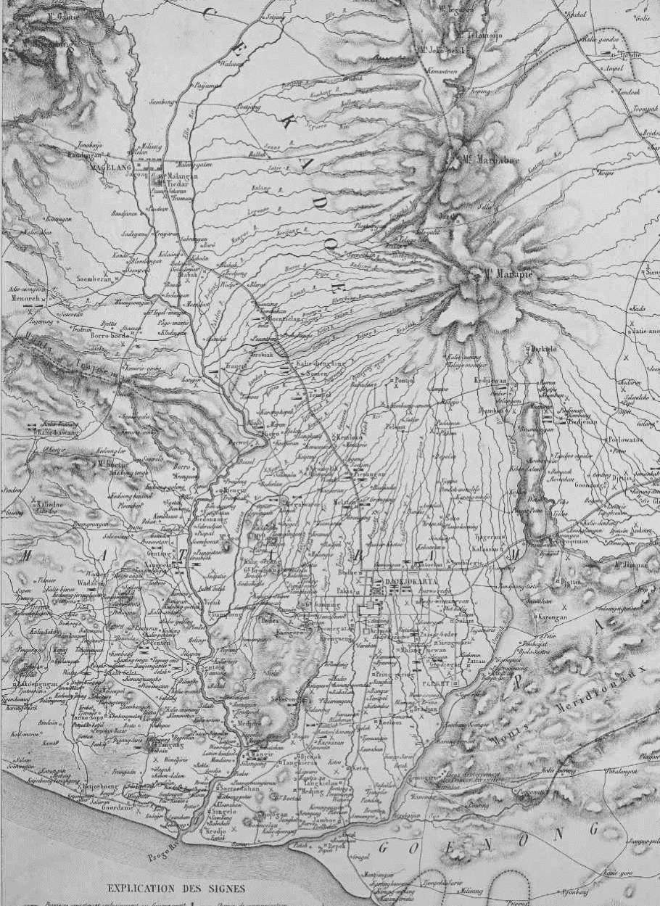

这里用于爪哇语的转写系统是印度尼常用的系统，增加了 `ĕ` 来表示 `/ə/`（类似于“fallen”中的 e），以区分于 *taling*，后者写作 `e` 并发音为 `/e/` 或 `/ɛ/`（类似于“fate”中的 a 或“set”中的 e）。对于其他字母，元音的发音通常与英语相同，除非 `a` 出现在重读节或末音节中，此时它的发音更接近“caught”中的 au。在早期的转写系统中，这通常写为 `ā`；因此，使用该旧系统时，“Mangkunagara”的读音为 Mangkunagrà，而“Mangkunajaran”的读音正如其所写的那。辅音的值通常与英语相同，但例外是：`c` 发音为 ch；`dh` 和 `th` 是翘音。

书中阿拉伯词汇采用了《伊斯兰百科全书》（第三版）的简化版。古爪哇语词汇采用了目前通用的译字系统。

爪哇语不区分名词的单数和复数。为了让读者清晰区分，当爪哇语单词表示复数意义时，我在后面添加了“s”或“es”。

地名采用现行的印尼语拼写，以便读者查找地理位置。因此，使用了 `Ponorogo` 而非 18 世纪的用法 `Pranaraga`；使用 `Bagelen` 而非 `Pagelem`；使用 `Ambarawa` 而非 `Bahura`；使用 `Rawi` 或 `Sitirawi`；使用 `Kediri` 而非 `Kädiri`；以此类推。我将当地政府网站视为现代拼写的权威来源，这导致了一些语言上的不一致之处（例如，`Ponorogo` 和 `Jepara`，尽管它们的末尾元音是相同的）。如果我无法识别某个地名的现代版本，则将其保留在 18 世纪的文献中，并在适用处使用了学术变音符号。

人名是一个重大的挑战。爪哇人在人生的不同阶段会更改名字。在贵族中，总有几位拥有特定名字的王子——`Pugér`、`Blitar`、`Ngabei`、`Purbaya` 等——一位此类名字的持有者很容易与另一位混淆。在书中，我为每个人选择一个名字并在全文统一使用该名字，尽管有时会显得有些时代错误。当出现多个同名的参与者时，我尝试在每个引用处添加更详细的标识符信息。索引将使读者能够找到其他名称。

欧洲人在这一时期对自己和其他人的名字拼写也极不一致。同样，我选择了一种拼写方式并贯穿全文。

这一时期，爪哇岛上有三种历法并存。欧洲人使用我们现在所说的公元纪（CE），这符合格列哥利历。在本书中，所有日期均为公元纪，除非特别注明其属于另一个历法系统。

爪哇人使用的主要系统是一种混合的准月历（爪哇历，Anno Javanano, AJ），自 17 世纪 30 年代阿贡·苏丹时期起一直使用。这是一个复杂的系统，拥有五天和七天（以及其他）周、35 天一个周期、月相、八年一个周期以及其他几种复杂之处。虽然有标准的表格可以将爪哇语系统中的日期转换为公元纪，但显然当时在使用一些当地版本的日期系统，其用法与表格中找到的“正确”用法相差一天几天。

伊斯兰月历，即希吉拉历（Anno Hijrae, AH）也在使用，其年份根据公元 622 年先知从麦加迁徙到麦地那（迁徙）的时间计算。

- 中爪哇与东爪哇 340
- 取自 Crawfurd《印度群岛史》(1820) 的爪哇语“战争武器” 9

## 本研究背景及原始文献简述

### 本研究背景

这是一个非凡的半个世纪。当我1965年开始对印度尼西亚进行专业的学术研究时，还无法想象能为像这里这样重要的爪哇人物撰写一本严肃的传记。20世纪，我们对印度尼西亚的研究显著且不断增加，并拥有了大量关于爪哇文学的哲学著作，其中后者特别关注伊斯兰教之前的文学，且几乎完全用荷兰语写就。从14世纪伊斯兰传入爪哇的早期证据到殖民时期，其发生的事情很大程度上仍是未知领域。虽然关于荷兰东印度公司（VOC）有很多研究工作，但爪哇人在这类出版物中几乎没有出现。

一个人如何为像华华的曼库尼纳加拉一世王子（Mangkunagara I）这样的人写传记呢？我们当时的无知状态是，除非是国王，否则很难挑选出一个研究对象——这就是我在写博士论文《曼库布米米苏丹统治下的约加加塔，1749-1792》时所做的，该论文于1974年出版，更多是关于那个时代的研究，而非对个人的传记。支持此类传记的大多数爪哇文献静静地躺在图书馆收藏中，而这些大部分尚未经过妥善编目。VOC以及随后的殖民政府的海量档案——在荷兰和印度尼西亚的国家档案馆中占据了数公里的书架——似乎是一项不可逾越的挑战，与其说是历史学家可以航行的海洋（那将是一个很好的印尼式比喻），不如说是历史学家要攀登的珠穆玛峰。

现在，我们对印度尼西亚20世纪以前的历史，尤其是爪哇的历史，已经有了巨大的增长。在荷兰先驱者，特别是历史学家 H.J. Graaf（1899–1984）以及词典编编和人和目录员 G. Th. Pigeaud（1899–1988）的带领下，学者们编目了图书馆收藏，渗透了丰富的财富，并让我们领略了爪哇过去如此多的历史底蕴。我希望我的出版物在这个过程中发挥了作用。

然而，我必须说明一个重要的限制。随着我们对文献和时代的认知加深，我认为在18世纪或更早之前，没有哪一个爪哇人物的生平记载能像像曼库尼纳加拉一世那样丰富（或者至少对我而言如此迷人）。直到迪帕纳加拉王子（Dipanagara，1785–1855），他是爪哇战争的弥世主般的领袖，也是彼得·凯里（Peter Carey）权威著作《预言的力量》（*The Power of Prophecy*, 2008）的主角。

不再需要提醒读者，印度尼西亚是世界人口第四大群岛国家，也是全球最大的穆斯林人口国家。也不需要提醒，人口约1亿的爪哇人是该国最大的民族。更不需要提醒该国的历史（包括那里的伊斯兰教历史）具有重大全球意义的主题。相反，是时候为18世纪最华华的人物之一——传奇的曼库尼纳加拉一世王子撰写传记了。他被追随者所知，今天最广为人知的称号是“桑贝尔·尼瓦”王子（`Sambër Nyawa`，捕魂），这是他战旗的名字。这成了他死后的绰号，也是本书的名字。

在书中，我希望不仅让读者了解这位华华人物的一生，还能深入了解本传记所依据的主要原始文献。以下是供易参考的简要说明，按脚注中使用的缩写进行组织。

- **BG**: *Babad Giyanti*（《吉亚蒂编年史》），是曼库尼纳加拉一世战争时期的两部主要爪哇编年史（babad）之一。这是一部极其详尽的作品，共分21本小册印刷（超过1500页）。在任何可以与其与其他来源进行比较的情况下，它证明了其在事件描述上是准确的（在所有历史记录固有的局限性范围内），最重要的是，它是当代爪哇人记录和理解的无价之。它也是爪哇文学最优秀的作品之一。

- **Babad Kraton**, 泛指《爪哇土地编年史》（Babad Tanah Jawi）家族的编年史记录，从亚当和神话时代开始，到1742年卡塔苏拉陷落结束。此副本写于1777–78年的约加加塔。

- **Babad Mangkubumi**, 由约加加塔皇储（后来的哈门库布瓦亚纳二世）撰写的曼库布米苏丹统治期的编年史。第一部分较大的部分写于1773年，其余部分在1792年后。

- **Babad Tutur**, 通常引用的曼库尼纳加拉皇宫保存的一本混合编年史-日记版本，涵盖1780–91年。目前尚清楚最初是谁编纂了这份关于曼库尼纳加拉晚年的记录——事实上可能有几位编纂者——但现存手稿是在他宫殿的女士兵宿舍里抄写的的。该作品的另一个副本将范围扩大到了1793年。

- **所谓的 Surakarta Babad**, 泛指《爪哇土地编年史》家族的编年史，从亚当和神话时代开始，到1742年卡塔苏拉陷落结束。此副本写于1777–78年的约加加塔。

- **De Opkomst van Nederlands gezag in Oost-Indië** [荷兰权威在东印度群岛的崛起]，《爪哇土地编年史》家族的编年史，从亚当和神话时代开始，到1742年卡塔苏拉陷落结束。

- **Kort verhaal van Javasche oorlogen gevoerd met diverse prinszen** [与不同王子进行的爪哇战争简述]，《爪哇土地编年史》家族的编年史。

曼库尼纳加拉自传体《Sërat Babad Pakunėgaran`(BL Add. MS 12318, f.1v.)

曼库尼纳加拉自传体《Sërat Babad Pakunėgaran`(BL Add. MS 12318, f.1v.)

曼库尼纳加拉自传体《Sërat Babad Pakunėgaran`(BL Add. MS 12318, f.1v.)

曼库尼纳加拉自传体《Sërat Babad Pakunėgaran`(BL Add. MS 12318, f.1v.)

曼库尼纳加拉自传体《Sërat Babad Pakunėgaran`(BL Add. MS 12318, f.1v.)

曼库尼纳加拉自传体《Sërat Babad Pakunėgaran`(BL Add. MS 12318, f.1v.)

曼库尼纳加拉自传体《Sërat Babad Pakunėgaran`(BL Add. MS 12318, f.1v.)

曼库尼纳加拉自传体《Sërat Babad Pakunėgaran`(BL Add. MS 12318, f.1v.)

曼库尼纳加拉自传体《Sërat Babad Pakunėgaran`(BL Add. MS 12318, f.1v.)

曼库尼纳加拉自传体《Sërat Babad Pakunėgaran`(BL Add. MS 12318, f.1v.)

曼库尼纳加拉自传体《Sërat Babad Pakunėgaran`(BL Add. MS 12318, f.1v.)

曼库尼纳加拉自传体《Sërat Babad Pakunėgaran`(BL Add. MS 12318, f.1v.)

曼库尼纳加拉自传体《Sërat Babad Pakunėgaran`(BL Add. MS 12318, f.1v.)

曼库尼纳加拉自传体《Sërat Babad Pakunėgaran`(BL Add. MS 12318, f.1v.)

曼库尼纳加拉自传体《Sëret Babad Pakunėgaran`(BL Add. MS 12318, f.1v.)

曼库尼纳加拉自传体《Sërat Babad Pakunėgaran`(BL Add. MS 12318, f.1v.)

曼库尼纳加拉自传体《Sërat Babad Pakunėgaran`(BL Add. MS 12318, f.1v.)

曼库尼纳加拉自传体《Sërat Babad Pakunėgaran`(BL Add. MS 12318, f.1v.)

曼库尼纳加拉自传体《Sërat Babad Pakunėgaran`(BL Add. MS 12318, f.1v.)

曼库尼纳加拉自传体《Sërat Babad Pakunėgaran`(BL Add. MS 12318, f.1v.)

曼库尼纳加拉自传体《Sërat Babad Pakunėgaran`(BL Add. MS 12318, f.1v.)

曼库尼纳加拉自传体《Sërat Babad Pakunėgaran`(BL Add. MS 12318, f.1v.)

曼库尼纳加拉自传体《Sërat Babad Pakunėgaran`(BL Add. MS 12318, f.1v.)

曼库尼纳加拉自传体《Sërat Babad Pakunėgaran`(BL Add. MS 12318, f.1v.)

曼库尼纳加拉自传体《Sërat Babad Pakunėgaran`(BL Add. MS 12318, f.1v.)

曼库尼纳加拉自传体《Sërat Babad Pakunėgaran`(BL Add. MS 12318, f.1v.)

曼库尼纳加拉自传体《Sërat Babad Pakunėgaran`(BL Add. MS 12318, f.1v.)

曼库尼纳加拉自传体《Sërat Babad Pakunėgaran`(BL Add. MS 12318, f.1v.)

曼库尼纳加拉自传体《Sërat Babad Pakunėgaran`(BL Add. MS 12318, f.1v.)

曼库尼纳加拉自传体《Sërat Babad Pakunėgaran`(BL Add. MS 12318, f.1v.)

曼库尼纳加拉自传体《Sërat Babad Pakunėgaran`(BL Add. MS 12318, f.1v.)

曼库尼纳加拉自传体《Sërat Babad Pakunėgaran`(BL Add. MS 12318, f.1v.)

曼库尼纳加拉自传体《Sërat Babad Pakunėgaran`(BL Add. MS 12318, f.1v.)

继位战争（1704–8年）爆发了。爪哇岛的内战“持续”了荷兰人最初想象的还要多20年。它教会了爪哇人战争之道。²他的说法并不完全，因为战争持续的时间超过了20年。这场战争将当时两个最专业的战士国家——荷兰人和爪哇人聚集了一起。爪哇人需要关于堡垒建造、围攻术或火术方面的指导。他们立即拥抱了新的步兵武器，如早期的燧发火枪³来取代火绳枪（后者对潮湿的热带气候极度不适应）、纸弹、手持科霍恩口径坦克和刺刀，同时保留了他们所有的长矛、克里斯（短刀）、军刀和弓。


# 卡塔萨拉（Kartasura）的三主与马塔兰王朝的衰落

卡塔萨拉（Kartasura）由三主把持，其中没有一个是新统治者帕库布瓦尼二世（Pakubuwani II）。必须说，自1646年阿贡苏丹（Sultan Agung）去世以来，马塔兰王朝就没有出现过另一位伟大或至少称职的国王。

苏苏苏南（Susuhunan）阿曼库拉特四世（1719–26）于1726年4月去世，他担任君主的时期非常凄惨，面临着似乎来自四面八方的叛乱。在他统治之初，一份荷兰报告将他描述为“一位被所有子民抛弃，并几乎将整个爪哇世界变为敌人的皇帝”⁴。他死得很惨，饱受腹胀、呕吐和心律失常的痛苦，身上布满红蓝色的脉络，他相信恶灵在深夜唤醒他，却无法判断后者更有可能。继位的帕库布瓦尼二世的16岁儿子（1726–49）被证明是马塔兰血脉中最无能的人之一，他主持了可能是所有王朝灾难中最灾难性的。在这种背景下，本书的主角曼库恩纳加拉一世王子（Prince Mangkunagara I）的非凡能力将显得格外突出。曼库恩纳加拉的叔叔曼加库布米王子（Prince Mangangkubumi）的成就也是如此，他后来成为日惹的苏丹哈孟库布瓦尼一世（Sultan Hamengkubuwani I，1749–92），是马塔兰王朝最伟大的人物之一。两位王子在书中占据了重要地位。他们都是血腥战争艺术的大师。对于非专业读者来说，遗憾的是他们那较长的名字的前两个音节（Mangku—）是相同的；我建议觉得这很麻烦的读者专注于最后两个或三个音节（nagara—bumi），以在脑中将他们区分开。

## 宫廷核心人物

### 拉图·帕库布瓦尼（Ratu Pakubuwana，约1657年出生；1732年去世）
她是神秘学知识大师，一位伟大的文学家和苏菲派爱好者，下定决心要把她那青少年孙子——似乎是一块可以被刻上任何内容的白板——培养成为一位理想的苏菲君主。这样的君主将致力于冥想上帝并获得上帝对信徒的支持，并在他的臣民中促进更大的虔诚。拉图·帕库布瓦尼自她丈夫帕库布瓦尼一世（Pakubuwana I，在位1704–19年）统治以来一直是宫廷的重要人物。

### 丹努尔贾（Danūrja，首席行政官/一种首相）
年轻国王的母亲拉图·阿曼古拉特（Ratu Amangurat）与丹努尔贾自帕库布瓦尼一世时期以来一直是宫廷事务的决定性行动者，在二十年里经历了多次阴谋和挑战，在战场上领导皇家军队，并经常与公司官员打交道。他经常访问爪哇海岸附近的荷兰东印度公司（VOC）总部，并两次率领使节前往巴达维。显然是他的影响力将王位交给了后者那位年长且更受欢迎的兄弟P. Ar.曼库恩纳加拉（P. Ar. Mangkunagara）——为了与这本书传记的主角即他区分开来，我们称他为“长者曼库恩纳加拉”⁶。《苏拉卡塔马贾巴德巴德》（Surakarta Majabad Babad）描述了丹努尔贾的两个反对者，观察到：“老丹努尔贾在确立年轻王子为王时遇到了障碍；他甚至选择了一个年幼，其内在含义是他为自己当了王，而年轻国王可以被随意摆弄[即被操纵]。”⁷

> ⁶ 有关丹努尔贾1726年以前职业的总结，见M.C. Ricklefs, *The Seen and Unseen Worlds in Java, 1726–1749: History, Literature and Islam in the Court of Pakubuwana II* (St. Leonards: Asian Students Association of Australia in association with Allen & Unwin; Honolulu: University of Hawai’i Press)。

## 曼库恩纳加拉的早年悲剧

曼库恩纳加拉（Mangkunagara）生命中的头两年决定性地塑造了他的未来。1727年9月，他的母亲R. Ay. Wulan离世¹⁴。这极大悲伤了丈夫老曼库恩纳加拉（Mangkunagara the Elder）以及王朝女家长拉图·帕库布瓦纳（Ratu Pakubuana），后者既是死者和老曼库恩纳加拉的祖母，事实上，也是当时宫廷中几乎所有皇室成员的祖母。因此，曼库恩纳加拉在两岁之前就失去了慰藉。

丹努尔贾（Danūrja）与老曼库恩纳加拉之间的敌意在1726年和1727年间不断增长¹⁵。随着阴谋四伏，“根据《苏拉卡塔主要》（Surakarta Major Bahad）的记载，只有潘格兰阿里亚（老曼库恩纳加拉）仍是所有皇亲公认的领袖”¹⁶，负责爪哇北岸的荷兰官员描述他“深受喜爱并有许多追随者”¹⁷。

东印度公司（VOC）担忧地观察着事态发展，认为拉图·阿曼阿库拉（Ratu Amangkurat）和丹努尔贾正密谋在其兄弟国王面前诋毁老曼库恩纳加拉的声誉。1727年1月，丹努尔贾建议荷兰官员，发现老曼库恩纳加拉试图与帕库布瓦尼二世（Pakubuwani II）的妻子之一建立关系，并请求国王允许他拥有她。这种行为在当时的荷兰官员看来是闻所未闻的，他们寻求协助放逐这位错误的王子。正如此类阴谋之常，谣言反映了信息与虚假信息、见解与混乱，真相仍然不确定。无论如何，局势的政治影响显然构成了威胁。二十多岁的老曼库恩纳加拉几年前从叛乱中回宫廷。

据宫廷荷兰指挥官报告，他“是一位拥有皇室血的王子，被许多爪哇人喜爱和敬畏。他身边有很多权贵的廷臣，与他共同对丹努尔贾充满仇恨。”¹⁸ 公司担心如果老曼库恩纳加拉重演叛乱将产生后果。

最终，荷兰人顺从了帕库布瓦尼二世的要求（由丹努尔贾策划），并于1728年4月放逐了老曼库恩纳加拉。他被允许带上仆人、两个妻子和一个孩子。他被迫留下了他的儿子：R. Umar（据称三岁）、Suradi（据称五个月大）、Ambiya（据称十个月大）以及对我们而言至关重要的Mas Sai（当时被称为1.5岁，但实际上刚满两岁）¹⁹。

老曼库恩纳加拉据称是丹努尔贾爱慕的对象。老曼库恩纳加拉在巴达维亚（Batavia）留了多年，东印度公司认为他的存在是对丹努尔贾专权的潜在威胁，但他最终被流放到了斯里兰卡，并于1738年去世。在丹努尔贾本人失宠并于1733年被流放后，其他卡塔萨拉（Kartasura）的高级人物观察到，老曼库恩纳加拉的悲剧完全是由丹努尔贾造成的，如果不是，国王无疑会平息²⁰。

因此，在两岁时，曼库恩纳加拉发现自己既无母又无父。了解这个孩子在宫廷中的地位很重要。在这个制度中地位既是赋予的也是获得的，它建立在每代距离国王递减的原则之上，尽管17世纪和18世纪的规则性比19世纪荷兰殖民时期更多。然而，原则与学者官员L.W.C. van den Berg所述的相同：

> ……国王的后裔。根据与祖先隔的代数衡量，低贵族。国王之子的儿子比国王之孙子更高，且比孙子更高……²¹

因此，贵族地位每代下降，在第五代之后成为普通平民。老曼库恩纳加拉是阿曼库拉特四世的孩子，因此是一位王子（pangeran）。他的儿子曼库恩纳加拉是阿曼库拉特四世的孙子，已经在下降贵族的高层。他可以合理地被宣布为王子，但在宫廷中的地位较低，以及他自己的孩子……

> ²⁰ BTJ(BP) Vol. xxi, p. 63: mokal runtik, pasthi lilih sang Prabu, Patih kang gawe.
> ²¹ L.W.C. van den Berg, *De inlands rangen en titels op Java en Madoera* ('s-Gravenhagen: Martinus Nijhoff, 1902), p. 28.

因此，曼库恩纳加拉的名声和在宫廷地位似乎既取决于他的个人品质和父亲的显赫，也取决于他的正式身份。我们对他的童年了解很少。晚年最接近他的人之一是Kudawanarsa，有人将其描述为他的养父（voeder-fader）²²。直至20世纪，爪哇人经常被送到其他家庭抚养，这种做法在贵族中是标准。因此，年轻的曼库恩纳加拉可能是在Kudawanarsa家中长大的，就像他的父亲在叛乱王子家中长大一样。遗憾的是，我没有从这些早期找到关于Kudawanarsa的其他信息，但他显然不是皇室成员。尽管如此，他可能是培养一个宫廷地位接近王子底部的男孩的合适人。

> ²² KV, p. 129.
> ²³ *Babad Giyanti: Pratelan namining tijang lang panggenan* (Batavia Centrum: Balé Postaka, 1939), p. 6, s.v. Banduk.

## 帕库布瓦尼二世统治下的阴谋与文学

帕库布瓦尼二世的统治与任何时期一样，充满了阴谋、暴力和悲剧²⁴，事实上，比大多数时候都更多。我们已经介绍了他强大的、盲目的祖母拉图·帕库布瓦纳（当时已60多岁），以及权臣和阴谋家丹努尔贾。另一个主要人物是Tg. Tirwiguna，据记载和似乎，他是18世纪上半叶爪哇文学最伟大的作家。他也成为了一股强大的政治力量，反对丹努尔贾和拉图·帕库布瓦纳推动的伊斯兰化派系。后来，东印度公司和帕库布瓦尼二世都依靠他的建议。据报道国王绰他为Tir或Étir²⁵，爪哇语中国际象棋中城堡的意思。他的角色显然像那枚强大的棋子，等待着调动他对周围游戏影响的时刻，随时准备保护国王。在1741年的一次宫廷争议中，据说其他爪哇的领主对他评价道：“这个人像一门小大炮。在商议时，他保持沉默，不断投出令人不安的侧目，指责他的资深同事；这就是他天赋过人之处。”²⁶ 《吉亚尔蒂纪史》（Babad Giyanti）将他描绘为一个自私、不妥的入侵者同伴，这些人寻求王位，他是一个毁灭世界的人²⁷。

国王的同父兄弟曼库库布米王子（Prince Mangkubumi）²⁸，在1726年约九岁时，也将成为一个关键人物，随着本书的进展这一点将充分体现。他的职业巅峰是继任日惹苏丹哈门库布瓦纳一世（Sultan Hamengkubuwana I of Yogyakarta，统治1749–92年）。因此，随着多年过去，年幼的曼昆纳加拉（Mangkunagara）有许多需要学习和效法的地方，他成为了宫廷生存所需的欺骗、规避和阴谋的大师，并最终掌握了战场上生存的艺术技艺。

> ²⁴ 详见Ricklefs的《Seen and Unseen Worlds》。只有直接引用或其他具有特殊意义的事项会在此处脚注，直到本章结束。
> ²⁵ BTJ(BP) Vol. xxi, p. 60.
> ²⁶ 同上，第xxii卷，第4页（爪哇语文本见于 Ricklefs 著作的 *Seen and Unseen Worlds*, pp. 173–41）。
> ²⁷ BG 第iii卷，第46页（爪哇语文本见于 Ricklefs 著作的 *Seen and Unseen Worlds*, p. 174n42）。
> ²⁸ 他的出生不确定。参见 Ricklefs, *Seen and Unseen Worlds*, pp. 130–113 中的讨论。我倾向于认为出生于公元1717年是最可能的。

## 宫廷中的超自然领域与拉图·帕库布瓦纳的著作

年轻的曼昆纳加拉曾融入拥挤的超自然领域。在1720年代末和1730年代初，宫廷正在讨论宗教问题。帕库布瓦纳拉图（Ratu Pakubuwana）处于一个强势的地位。她是神秘学和伊斯兰神秘主义领域的大师，也是一个寻求更完美伊斯兰领域（按照他们的理解）的宫廷集团的中心。她爱着帕库布瓦纳一世的遗孀，那是她深爱的儿子阿曼库拉特四世（Amangkurat IV）的母亲，也是青少年国王的祖母。她是一位丰富的宫廷事务操纵者，是几乎所有人的祖母，包括国王的妻子拉图·肯纳（Ratu Kencana）和所有的皇兄弟。她显然赞赏丹乌尔贾（Danurja）。1729–30年间，她让人撰写了三本强大的著作，借鉴伊斯兰传统，旨在通过超自然手段在地上带来一个更完美的领域。这些作品是该王朝权力和神话创始人阿贡苏丹（Sultan Agung，统治1613–46年）时期原始作品的新版本，在这些原作创作后仅一个世纪（爪哇历）后便被创作了。

### 《伊斯坎达尔苏丹的故事》（Carita Sultan Iskandar）
据说帕库布瓦纳拉图的第一本魔法之书是《伊斯坎达尔苏丹的故事》，这是一部基于亚历山大王传统（此处亚历山大王由《古兰经》第18章82–98节中的杜尔·卡因（Dhu’l Qayn）形象所代表）的高度详实的浪漫小说。这部作品由老拉图的书记员于1729年9月写下，开头对帕库布瓦纳拉图充满了奢华的赞美，据说她温柔、公正，是宗教教义的大师，深受上帝之爱，是先知代求的受益者，并受所有人尊敬。这本书被撰写并献给了她的皇孙子，“使其成为一件宝物（pusaka，皇室遗产），以便后世所有的祖先都能作为典范”。它祈求真主和先知穆罕默德保佑年轻的国王伊斯坎达尔，让他能成功继位。文本本身呈现为虔诚的征服者伊斯坎达尔的典范。它的魔法意义小于随后的两部主要作品。

### 《约瑟夫先知的故事》（Carita Nabi Yusuf）
在写《伊斯坎达尔苏丹的故事》当天，帕库布瓦纳拉图的书记员正在写《约瑟夫先知的故事》。在这里我们发现了爪哇传统中所描述的男性虔诚与美的终极典范——先知约瑟夫（Joseph），这同样是对《古兰经》中关于埃及约瑟夫的故事（第12章）进行了大量扩充。作者们宣称，在帕库布瓦纳拉图的祝福下，这部作品将带来与真主的代求，保护他们免受诅咒和其他一切危险，并使他们的宗教信仰坚定。

### 《起源书》（Kitab Usuliyabah）
帕库布瓦纳拉图的第三部也是最引注目的著作是《起源书》（Kitab Usuliyabah），其写作始于1729年12月。据目前知，这部作品在马来文学或阿拉伯文学中是前所未有的，但它带有关于先知升天的阿拉伯*miraj*（奇迹）故事的回响。标题似乎意思是“关于先知的起源”，可能意在作为阿拉伯语《先知故事》（Qisas al-anbiya [Tales of the Prophets]）的类比。文本的开头明确了帕库布瓦纳拉图对特殊地位的主张和她的意图。据说她是一位拥有“福心”的温柔仆人，已经接受了上帝的爱和先知穆罕默德的代求。书中宣称，她受到天使的守护。她创作《起源书》（Usuliyabah）“为了完善她皇孙的统治，因为她的太阳，确实停在山顶之上。”²⁹

> ²⁹ 《起源书》（RP MS 263 carikan），第1页。完整译文和爪哇语文本见于 Ricklefs 著作的 *Seen and Unseen Worlds*, p. 62–3.


# 爪哇宫廷宗教与政治动态

在写《伊斯坎达尔苏丹的故事》当天，帕库布瓦纳拉图的书记员正在写《约瑟夫先知的故事》。在这里我们发现了爪哇传统中所描述的男性虔诚与美的终极典范——先知约瑟夫，这同样是对《古兰经》中关于埃及约瑟夫的故事（第12章）进行了大量扩充。

正如我们在书中将看到的，帕库布乌瓦尼试图模仿这种苏菲式的武力王权模式，但他是一个实现宏伟愿景的不完美载体。然而，这种模式在曼库纳纳加拉身上得到了更成功的模仿。

## 宫廷宗教争论与《Sérat Cabolek》

反映宫廷宗教事务不仅有拉图·帕库布乌瓦尼的作品。1731年左右，爆发了一场关于奥秘知识是否属于高级精英阶层之事的宗教争论。这确实是沙里亚圣徒阿杜拉夫作品中的一个问题，他在书中“警告不要与准备不足的人分享奥秘知识”。³⁸ 这一记录在《Sérat Cabolek》（标题指代北岸的一个村庄）中，该书仅以手稿形式存在，呈现出解读上的难题。³⁹ 其作者不详，通常被归于苏拉卡塔诗人雅萨迪普拉拉一世名下。尽管该作品环绕着解读难题，但我们至少可以将其视为1730年代宫廷成员如何看待宗教问题的指南，并且如下文所示，它也是曼库布米王子在皇宫中高地位的指标。

根据现存的《Cabolek》故事，约1731年（但可能晚至1733年），一位来自北岸的神圣人物 Ky. H. 阿哈马德·穆塔马金——他在当地被视为圣徒，其墓位于相邻的 Kajen 村——也开始传播他的教义，其广度之程度令某些人难以接受。据说他是来自也门的 *Seh Jen* 的弟子，被确认为纳克什班迪苏菲兄弟会的谢赫·扎因·阿尔·亚马尼（约17世纪中叶至18世纪初）。纳克什班迪与沙特里崇拜之间的差异可能是这场争议的背后；阿哈马德·穆塔马金的教义遭到了来自圣城库杜的一个 Kétib Anom（意为“年轻讲师”）的反对，这个人显然与宫廷有联系。阿哈马德·穆塔马金被其他宗教教师谴责，他们指控：

> 他向（未启蒙者）透露了秘密知识，揭露了“实在”神秘科学的本质，坚持实在阶段（*kakeate*，阿拉伯语 *haqiqa*）但拒绝法律阶段（*siringat*，阿拉伯语 *shari’a*）。

他的案件被呈交给国王——当时正值鼎盛的年轻帕库布阿库瓦二世——国王感到这相当困惑，但国王不愿罢手。在《Cabolek》文本中，在姐夫 R. Rm. Urawan（被流放王子 Pabaya 之子）的影响下，帕库布阿库瓦二世对穆塔马金进行了划分处理。此后，Kétib Anom 通过解释古爪哇语的前伊斯兰时期作品《Serat Ruci or Bima Suci》来挑战穆塔马金作为宗教教师的胜任力，这部作品讲述了对不死灵药的神秘追求，而在这种宫廷文化中，它被接受为伊斯兰神秘思想的载体。在专家诠释者的手中，Urawan 保证了此类作品“并未否定实在神秘科学的本质”；事实上，他说此类例子“曾被上帝的圣徒使用”。⁴¹ 在随后的辩论中，穆塔马金被 Kétib Anom 击败，地位被摧毁。² Kétib Anom 告诉那个小镇哈吉，他可以“再次回到阿拉伯并运书回来！”，但事实上，神秘知识的本质包含在古爪哇经典著作 *Dewa Ruci* (*Bima Suci*)、*Arjunaiwaha* 和 *Ramāyana* 中。

然后帕库布乌瓦纳二世本人要求看一份《Dewa Ruci》的副本，令他惊讶地发现一部古爪哇作品被作为苏菲派的作品呈现。国王的同父兄弟曼库布米与 Urawan 一同，是古爪哇文学的宫廷鉴赏家，Urawan 还拥有几部爪哇著作。

## 丹努尔贾的失势与预言

战争艺术。丹努尔贾调查后得知，这些分别是关于曼格库布米和曼昆纳拉加拉的预测。随后，丹努尔贾得知帕库布沃诺二世的母亲拉图·阿马库特曾梦见月亮掉落在曼格库布米的怀里，她吃了一半，把剩下的扔掉。我们可以将其解读为王国分裂以及曼格库布米在1755年登上君主的预言；当拉图·阿马库特要求丹努尔贾解释这个梦时，他坦白自己不懂。当他请求关于自己的预测时，因得知自己将无法亲眼看到这些事而感到非常痛苦。46 这一切是发生在1732年，还是后期才加入编年史传统的预测，目前尚不清楚，但前者是有可能的。

丹努尔贾对宫廷事务的统治确实即将结束，这进一步促进了年轻一代精英的影响。帕库布沃诺二世在20多岁时，显然想统治自己的王国，这可以通过摆脱 `patih`（宰相）的控制来实现。1733年7月，荷兰东印度公司（VOC）根据国王的要求，要求他定期向位于三宝望的 get 交纳现金和大米。他被流放到了斯里兰卡，并于1745年在那里去世。他的财富被统治者没收。当卡塔苏拉的精英们反思丹努尔贾的失势时，他们很大程度上描述了多年前流放老曼昆纳拉加拉时他起的作用。后者在中间年份里一直被关在巴塔维亚，现在也被流放到了斯里兰卡。虽然现存文献存在某些模糊之处，但似乎1733年抵达科伦坡的船可能同时运载了老曼昆纳拉加拉和他的宿敌丹努尔贾。47 编年史记载道，从三宝望运送丹努尔贾的船在海上受损后，这位 `patih` 发现自己被转移到了载有老曼昆纳拉加拉的船上。书中描述了两人同在船上的场景，丹努尔贾重复着关于儿子和曼格库布米的预言。48 丹努尔贾的继任者拉蒂赫·阿·纳塔苏库玛是宫廷伊斯兰化派系的一员；宫廷的高级荷兰军官描述他“虔诚而纯真”，而且相当愚蠢，是一个被乌拉万误导的人。49

## 曼昆纳拉加拉的崛起

年轻的曼昆纳拉加拉一定观察到了这些发展，以及其他反映宫廷深陷致命阴谋和混乱的局面，并对此产生了日益增长的兴趣。我们对他早年的教育一无所知，但他确实受过教育，也许是由库丹纳瓦斯教的，而我在该时期的可用文献中仍然找不到他。在他生中，曼昆纳拉加拉展现了卓越的文学天赋。他既致力于本土的精神力量，也致力于伊斯兰教，这是伊斯兰神秘主义（本书下文讨论）的特征。他后来对战争技巧、残酷手段和欺诈的精通，可能源于青少年时代的学习以及他长期的战斗经验。宫廷斗争有许多可学。1738年，他目睹了帕库布沃诺二世最有影响力的宫廷大臣、其姐夫乌拉万的失势——乌拉万当时被封为名为 Png. Urawan 的王子。

### 注释

46 见 BT(BP) Vol. XXI, pp. 55–9。——或者也许是故意的“闪回”——出现在 BT(BP) 的这一章节。

47 参见 Batavia to H.XVII, 22 Dec. 1733 and 31 Mar. 1734, in Gen.miss. Vol. ix, pp. 540, 589。

48 BT(BP) Vol. XXI, pp. 67–9。

49 宫廷的高级荷兰军官描述他“虔诚而纯真”，而且相当愚蠢，是一个被乌拉万误导的人。


年轻的曼昆纳拉加拉一定观察到了这些发展，以及其他反映宫廷深陷致命阴谋和混乱的局面，并对此产生了日益增长的兴趣。我们对他早年的教育一无所知，但他确实受过教育，也许是由库丹纳瓦斯（`Kudanawas`）教的，而我在该时期的可用文献中仍然找不到他。在他生中，曼昆纳拉加拉展现了卓越的文学天赋。他既致力于本土的精神力量，也致力于伊斯教，这是伊斯兰神秘主义（本书下文讨论）的特征。他后来对战争技巧、残酷手段和欺诈的精通，可能源于青少年时代的学习以及他长期的战斗经验。宫廷斗争有许多可学。1738年，他目睹了帕库布沃诺二世最有影响力的宫廷大臣、其姐夫乌拉万（`Urawan`）的失势——乌拉万当时被封为名为`Png. Urawan`的王子。乌拉万的妹妹，宫廷的高级荷兰军官描述他“虔诚而纯真”，而且相当愚蠢，是一个被乌拉万误导的人。49

哇戎戏，雅加达，1899年

人们——包括所有的王子和其他贵族，以及地方领主及其随从，他们都居住在宫廷城市的临时住所内。那里有盛大的仪式活动、比武赛、在宫廷前大广场（`alun-alun`）举行的大规模士兵表演、神圣物品巡游，以及音乐和戏剧表演，普通平民和贵族们可以通过这些活动目睹王室的宏伟气派。那是夜市和美食摊的时代。那是向君主效忠的场合，是在盛大展示中彰显自身地位的时刻，更是不幸的是要缴纳税收并参与复杂的政治斗争的时刻。⁵⁵ 未参加 `Garebèg`（庆典）被视为叛乱或叛乱威胁的象征。年轻的曼昆库纳加拉（`Mangkunagara`）会像他后几个世纪的许多爪哇人一样，带着同样的着迷观察这一切。

在这段宁静的序曲中，卡塔苏拉的宫廷是文化爱好者的天堂，它拥有文学、音乐、舞蹈、武术与超自然力量的共鸣和谐，但政治上几乎没有和谐。到1739年，宫廷分裂为敌对派系，帕库布乌瓦纳二世（`Pakubuwana II`）操控这些派系的能力——这种领域维持王室统治的关键——几乎为零。王国也处于地理分裂的边缘，因为西马杜拉领主恰克拉尼格拉特四世（`Cakraningrat IV`，1718–46）对卡塔苏拉在东爪哇的权威日益鄙夷。

荷兰东公司（`VOC`）的境地并不好到。它的首府巴达维亚（今天的雅加达）是一个瘟疫坟墓，疟疾从新的沿海鱼塘蔓遍整座城市。从1733年起，巴达维亚——凭借其如画的运河和狭窄不通风的荷兰式房屋——不再被视为“东方威尼斯”。约一半的新移民和新生婴儿在一年内死亡。幸存者面临着因伤寒和痢疾等继发感染而死亡的较高风险。1753年，总督莫塞尔（`Mossel`）告诉阿姆斯特丹的董事们：“由于巴达维亚的普遍衰落……人们怀念这座城市繁荣时的欢快精神”。城内人口从1730年左右的约20,000人下降到1790年的12,000人。56 与此同时，周围的农村——由于远离鱼塘，蚊虫无法到达——人口却增加了。1815年，刻薄的英国本土医生约瑟夫·阿诺德（`Joseph Arnold`）称巴达维亚为“世界上几乎最不健康的地方”。“这个地方对陌生人来说极其致命，”他写道，“他们像腐烂的羊一样死去。”^57

公司的管理陷入混乱。迪尔克·克隆（`Dirk Cloon`）于1732年被任命为总督，但不到两年，他就因健康不佳寻求退休。在董事们同意他的请求之前，他于1735年去世了。好斗的印度委员会（`Council of the Indies`）无法就继任者达成一致，于是采取抽签的方式。亚伯拉罕·帕特拉斯（`Abraham Patras`）出任总督，他已64岁，身体虚弱，对新职位并不热情。他请求阿姆斯特丹免除负担，但在回复到达前于1737年去世了。斯普尔（`F.W. Stapel`）写道：“是一个虔诚善良的人，生活非常安静。”58 他唯一的特色是担任该职位的法国人。与此同时，公司在爪哇的事务中损失了大量资金。

帕库布乌瓦纳二世（`Pakubuwana II`）面对日益崩溃的政权，似乎试图通过宏大的展示和与超自然力量的联系寻求认可。1739年9月，他前往王朝的发源地马塔兰（`Mataram`）巡游。他从卡塔苏拉出发，随从有20,000名步兵、1,000名枪兵、150面旗帜、`VOC`的护卫以及王室家族的大多数成员。他戴着一顶金冠，显然是伊斯兰教之前最大的王国——马札腊希提（`Majapahit`）的重要物件。他访问了王朝的墓地，在那里致意并进行祭奠，还监视了数百只野生动物作为娱乐。但也有未来的不祥：荷兰人报告了一起车祸，死了一个仆人并伤了另外两人，还有大风掀了房顶。巴贝尔（`Babel`）称这些是世界毁灭的征兆。

⁵⁵ 有价值的20世纪记载见 Soedjono Tirtokoemo 的 *De Garebeg in Sultanaat Jogjakarta* (Jogjakarta: H. Buning, 1931)。

56 P.H. van der Brug, Malaria in malaise: De VOC in Batavia de achtiende eeuw (Amsterdam: De Bataafsche Leeuw, 1994), pp. 139–143.

57 John Justin, ed., “The Journal of Dr. Joseph Arnold: 3–17 December 1815, Journal of the Malay Branch of the Royal Asiatic Society, 1 (1973): 40, 75.

58 F.W. Stapel, De Gouverneurs-Generaal van Nederlands-Indië in beeld en woord (Den Haag: W.P. van Stockum & Zoon 1941), pp. 5–8.

59 关于巡游的更详细记载见 Lees 的 *Seen and Unseen Worlds*, pp. 232.

1740年，当灾难降临巴达维亚的荷兰人和塔苏拉的爪哇人时，我们在宫廷首席秘书苏拉维古纳（`Ng. Surawiguna`）编制的列表中罕见地看到了年轻的曼昆库纳拉。在这里，许多王室成员和宫廷高级领主中，我们发现了这一阶段的曼昆库纳拉。据说他12岁——事实上是14岁——拥有50户人的封地。与他并列的是他的两个兄弟，他们在未来的几年将扮演重要角色：R. “Amdo”（`Ambiya`的误写，10岁但可能13岁，拥有25户人的封地）和R. Sabar（据说约12岁，同样拥有25户人的封地）。他们后来以王室头衔出现，即 `Ng. Pamot` 和 `Ng. Mangkuningrat`（称为`Mangkuningrat`）。

⁶⁰ Lij der thans wezen kinderen, broed en Susters der afkomst van Soesoenig Pakoeboena. Deoft regenten en mindere bedients welke aan Hof en zoo stranden binnen en bovenland bevinden ... opgegeven door de Keizerlijken Secretaris den Inagai Soeroigono, Kartakarta, 1 Aug.1740, in VOC 2512 (OB 1741) (Java Oostkost ii, in VOC 2080)。MN的兄弟R.M. Umar已去世。读者注意到这份名单中男孩的年龄与上述1728年的列表存在差异（Veradering, Kartakarta, 26 Jan 1728, in VOC 2080）。关于他们封地的相同信息见 BK 655r.(published Vol. ii, p. 352)。

⁶¹ 关于稍晚时期的价值分析，见 Peter Carey 的 “Changing Javanse Perceptions of the Chinese Communities in Central Java, 1755–1825”, Indonesia 37 (Apr. 1984): 1–47.

灾难袭来，使爪哇王国和荷兰东公司陷入了17年的血腥战争。华人在巴达维亚的经济生活中起着至关重要的作用，在爪哇沿海和内陆，也有部分华人皈依了伊斯兰教，甚至成为沿海领土的主要领主。正如很快看到的，在与欧洲人结盟的选择题中，许多爪哇人选择了后者。

⁶² 见 J.Th. Vermeulen, *De Chinezen te Batavia en de troebelen van 1740* (Leiden: Eduard Jijdo, 1938); Leonard Blüssé, *Strange Company. Chinese Settlers, Mestizo and the Dutch in VOC Batavia*, VKI Vol. 122 (Dordrecht and Riverton: Foris, 1986), Chapter 5; 以及 Remmelink, *The Chinese War and the Collapse of the Javanese State*, VKI Vol. 162 (Leiden: KITLV Press, 1994).

朱塞佩·菲洛西（`Giuseppe Filosi`）约1750年绘制巴达维亚版画

公司与华人之间存在着一种相互依赖又充满紧张的混合。1740年9月，公司坚信华人即将发动起义，而华人则认为自己会被搜捕并带到`VOC`的船上被投入大海。此时，巴达维亚及其周边约有15,000华人。10月，`VOC`对巴达维亚华人区的搜查演变成了一场无法无天的、大规模的反华人屠杀，约有10,000华人被杀害。爪哇沿海居住着5,000名华人；巴达维亚的幸存者组织了武装抵抗。这便是所谓的华人战争（1740–43）。⁶²

`VOC`在爪哇沿海的武装贸易站遭到华人攻击，很快就有当地爪哇人的加入。三宝垄的海总部被包围，一段时间内当地公司官员甚至怀疑能否守住那里。那里的高级官员巴尔托洛缪（`Bartholomus`）维舍尔变得“几乎神志不清”。63 他在1741年6月被取代。5月，朱瓦纳的据点被攻占，付出了七名荷兰东印度公司（`VOC`）士兵的生命作为代价。公司从达马克撤出人员，以协助保卫三宝垄。它还试图撤出兰邦的据点，但这是不可能的：兰邦被敌人切断，并于7月被攻陷。公司损失了大量大炮和大部分士兵。在1741年上半年，欧洲人似乎认为他们会被从爪哇中部的北岸赶出去。然而，在泗水，情况却大不相同。西马杜拉领地的克拉尼格特（`Cakranigrat`）看到了一个通过支持欧洲人来扩大他在东爪哇影响的机会。他在愤怒中对该地区的华人进行了大屠杀。

帕库布武瓦纳二世（`Pakubuwana II`）苦恼在这些史无前例且血腥的局面下该何是，这与他似乎青睐的那个神秘领域完全不同。在经过一番艰难的辩论后（《苏卡塔主要年史》（`Surakarta Major Babad`）中关于主课程有一段有趣但有缺陷的描述），宫廷决定加入反对荷兰公司的战争。64 1741年7月20日，一组高级爪哇族领主及其随从进入了卡塔苏拉的荷兰公司堡垒，表面上是拜访指挥官约翰斯·冯·费尔森（`Johannes von Velsen`）。在内部，爪哇人配合对皇宫（`kraton`）处的小型荷兰公司守卫所发起的第二次进攻。后者的幸存者逃到了公司堡垒，并加入了那里的混乱。爪哇一方损失了约80人，其中包括一些著名的信使；而在荷兰公司一方，冯·费尔森等人受伤，约35人被杀，随后攻击者被赶出堡垒。于是，爪哇人围困了公司的据点三周。在幸存者投降后，他们被迫皈依伊斯教，而冯·费尔森等人被杀害。毫无疑问，渴望成为苏菲国王的帕库布武瓦纳二世已经对这个异教公司发起了圣战。

但这些分类并没有实际上那么简单。诚然，公司的欧洲人是基督徒——更准确地说，他们是加文教徒，往往认为天主教徒是穆斯林更大的威胁，并以嗜酒放荡、远离荷兰社会加文教理想的行为而闻名。荷兰公司还雇用了穆斯林士兵，被爪哇人称为“伊斯兰团”（`Kumpeni Islam`），帕库布武瓦纳二世试图将他们从公司一方拉拢。此外，克拉尼格特四世（`Kakranagrat IV`）的马杜拉穆斯林军队支持公司，因此他们现在是帕库布武瓦纳二世的敌人。似乎，国王选择加入的华人中也许许多人也是穆斯林。换句话说，双方都有穆斯林。尽管如此，宫廷似乎将其视为一场宗教战争。18世纪晚期的《日加雅达年史》（`Babad Kraton`）讲述了伊斯兰学者（`ulama`）和朝圣（`hajis`）如何在三宝垄出发进攻荷兰公司，他们自己正在履行上帝的旨意。

帕库布武瓦纳二世的时机——或许——是灾难性的。公司控制着北岸的海路，因此可以增援其在三宝垄的沿岸总部。1741年5月，其被围困的守军仅由90名健壮的欧洲人和208名印尼士兵组成。到11月，那里有超过3,400名士兵。敌军非常强大：估计（也许）有40,000至50,000人以及50门火炮。尽管如此，荷兰公司的军队在11月成功地——而非他们自己——解了围并发起了进攻。与此同时，克拉尼格特的军队正在横扫东爪哇。这两个进展的结果是使华人和盟爪哇人进一步向内陆的卡塔苏拉移动，他们认为在那里可以找到帕库布武瓦纳二世这一盟友。1741年11月，国王意识到他支持错了。帕库布武瓦纳二世——这位虔诚的国王，他曾监督了在卡塔苏拉杀害荷兰公司官员——与很大程度上信任他的公司之间进行了微妙谈判。卡塔苏拉公司守军的幸存者在1742年1月被释放并返回海岸。《年史》记载，国王的母亲拉图·阿马库拉（`Ratu Amangkurat`），特别是提塔米尼（`Tirtaumigna`），对国王改变政策负有主要责任，反对

> 65 BK.668v（出版版，卷二，页 368）。

> 66 BK.674v–682v。（出版版，卷二，页 375–84）。

这项新政策与之前的同样灾难。现在宫廷与公司结盟。然而，在海岸的双方是华人和爪哇族战士，他们认为帕库布武瓦纳二世不再是他们的征服者，而是向公司寻求宽恕和保护的叛徒。他们现在宣布统治者阿马库拉的后裔R·加伦迪（`R. Garendi`，当时仅12岁）为“苏南库宁”（`Sunan Kuning`）。在宫廷的东方，马杜拉人也向王国中心进发。公司于1742年3月派遣一支由安·德里斯·范·霍登夫（`Joan Andries van Hoendorff`）上尉带领队前往宫廷，包括助理巴尔塔萨·图特曼德（`Balthasar Toutlemande`）、一名下士和一些仆人。但这只是象征性的，对于霍登夫和他的士兵来说是危险的。1741年6月，帕库布武瓦纳二世在前往斯里兰卡的途中加入了爪哇族贵族的队伍。叛乱军现在既反对帕库布武瓦纳二世也反对荷兰公司，但公司没有手段为国王提供军事支持。1742年6月30日，卡塔苏拉落入叛军手中。帕库布武瓦纳二世随霍登夫及其士兵逃亡，而叛军掠夺了宫廷和城市。十岁的皇储、未来的帕库布武瓦纳三世被抓了，但宫廷的妇女被遗弃给叛军毫无无情的仁待。被遗弃的还有“钱袋、金银包、金具、杯和其他无价之宝”。那晚，帕库布武瓦纳二世没有睡在卡塔苏拉皇廷的寝室内，而是靠在霍登夫的鞍上，身上盖着被认为来自先知穆罕默德的圣衣（`pusaka`）。面对敌人，苏南库宁和华人和爪哇叛军接管了宫廷。曼库布米（`Mangkubumi`）和大多数其他王子前往泗水。

> 67 Hoendorff and Hogewits，早报，泗水。1742年8月25日，见A.K.A. Gijsbert Hodenij, “De zwertocht van Sultan [sic] Pakoeboewana II, na diens vlucht den kraton te Kartasoera, 30 June 1742”, BKI 74 (1918): 599–600。

> 68 BTJ(BP) 卷xxvi，页 76。

只有少数几个王子留在苏南库宁统治下的卡塔苏拉，其中包括曼库纳加拉（`Mangkunagara`）。他后来写信荷兰公司，称在帕库布武瓦纳二世的宫廷——那个在1728年授权放逐他父亲的人——他被嘲笑为“残余和刺桩”（暗示是被砍掉的王室血脉），直到他无法忍受。他离开卡塔苏拉加入了苏南库宁。当军事形势对他不利时，他抛弃库宁逃逃了。曼库纳加拉声称，在该阶段库宁已宣布曼库纳加拉自己为“在任国王”。69 我们不知道他的青少年兄弟帕莫特（当时约15岁）和曼库武拉尼格拉（约14岁）何时逃亡的，但他们显然走向了不同的方向。

帕库布武瓦纳二世被排除在宫廷五个月，在此期间他试图聚集少数忠于他的领主。霍登夫将他留在波诺罗戈，并返回海岸集结荷兰公司军队。爪哇来源描述这位近期的君主主要专注于精神修行，与拉武山的原住民神灵苏南拉武（`Sunan Lawu`）交流。公司的军事力量仍局限于海岸，当11月年度季风雨来来临，道路变成泥海时，公司军队陷入瘫痪。然而，克拉尼格特的马杜拉人仍然进军并在11月底重新夺回了宫廷。当时帕库布武瓦纳二世在卡塔苏拉附近，马杜拉人拒绝让他进入，而他们在劫掠任何可以掠夺的东西。直到12月20日，由霍登夫和公司高级指挥官纳撒尼尔·斯坦梅策（`Nathaniel Steinmetz`）领导的荷兰公司队才到达宫廷。第二天，帕库布武瓦纳二世被护送回他破败的宫廷。此时，卡塔苏拉周围的村庄已“完全摧毁并掠夺”。70

1742年对宫廷的双重掠夺和焚烧意味着许多书籍和其他文化瑰宝的流失，而这一事件中高级廷臣的死亡以及随后的战争意味着大量文化知识的丧失。卡塔苏拉的陷落是爪哇文化史上一个悲剧性的案例。《年史》评论道宫廷的陷落是“上帝的旨意，因为这是

> 69 Prince Aria Prangada [`MN`使用的名字], 未注出处，给GG, 巴达维亚，1745年8月收到，见VOC 2656 (OB 1746)。

> 70 Steinmetz, Kartasura，给巴达维亚，1742年12月24日，见VOC 2588 (OB 1743)。

主宰者的法令规定，无形之报应应降临在爪哇人身上，并以中国人为手段⁷71 我们可以问，这种报应是为了？我们只能推断，这是为了帕库布瓦纳二世（`Pakubuwana II`）绝望的无能和不可靠的反复。

苏南库宁（`Sunan Kuning`）首先带着随从者逃到日谷（现在的雅加达），然后到达了位于9-10世纪普兰巴南寺建筑群附近的Randhulawang⁷72 敌对持续，主要战斗力量一方是中国人，另一方是荷兰东印度公司（`VOC`）。随着1743年5月公司的一大进攻来临，反叛军处于防御状态。


面对迫在眉睫的攻击，苏南库宁的随从之一试图动用14年前拉图·帕库布瓦纳（Ratu Pakubuwana）书籍中的那种文学魔法，在急切需要超力量援助的情况下。来自文人家庭的女性Ny. M. Kaduwang 写了一个新版本的《起源书》（Kitab Usuliyah）。正如拉图·帕库布瓦纳在1731年的目标是“完善她皇孙的统治”（指帕库布瓦纳二世），现在Ny. M. Kaduwang 也在“爪哇的艰难时期”寻求超自然力量、完美和救赎⁷³ 1743年的新版《起源书》声称拥有超能力：

- 5. 凡是坚守这一信息的人，《起源书》将是他们的武器。如果带入战斗，战斗将获得胜利....

- 6. 通过此书的超能力，消灭异教徒将是可能的，即诵读《起源书》。⁷⁴

在一种不那么振奋的基调中，Ny. M. Kaduwang 用一段散文结束了他的著作：“结束了。愿那些阅读、书写、听并保留此的人得到上帝的爱与恩典；愿他们获得（上帝的）奖励。上帝知晓。赞美上帝。”⁷⁵

这种文学魔法的应用对苏南库宁的帮助并不对帕库布瓦纳二世的帮助大。1743年6月，位于Randhulawang的反叛首都陷落荷兰公司。苏南库宁本人于10月投降，标志着中国起义的结束。帕库布瓦纳二世在1743年11月的新条约中正式恢复了与公司的关系，他现在完全依赖公司。但仍有重要事情要解决。公司已经除了纳塔卡苏马（Natakasuma），还想流逐另外两个朝臣：Ky. H. Mataram（显然是爪哇人）和Sayyid 'Alwi（推测是阿拉伯人），他们自1735年和1737年到达卡塔斯苏拉以来一直是国王主要的宗教导师。公司认为他们是宫廷的敌人。如果国王拒绝交出他们，公司有一个备用计划。当老曼昆纳加拉（Mangkunagara the Elder）被送往斯里兰卡时，留在巴达维的是被称为Png. Tirtakusuma或 Png. Pancuran的人，后者是巴达维（以及现在的南雅加达，通常拼写为Pancuran）的地区名称，他们正在考虑如果帕库布瓦纳二世不同意，就废黜他并换成Tirtakusuma。因此，曼昆纳加拉——当时逃离陷落的皇宫在爪哇高地——可能发现自己的兄弟成了新王。帕库布瓦纳二世同意了公司的要求，Tirtakusuma留在Pancuran⁷⁶

然而，对于曼昆纳加拉和许多人来说，战斗并没有结束，因为18世纪的爪哇大战已经开始。曼昆纳加拉此时是一个身材矮小但外貌出众青年。后来，尼古拉斯·哈丁廷（Nicolaas Hartingh）描述他为“身材矮小但异常活跃且步履敏捷，眼睛中散发着火光”。⁷⁷ 当哈丁廷和曼昆纳加拉在1757年战争结束时最终会面时，《吉亚蒂史》（Babad Giyanti）说那个荷兰人比王子高得多，他们看起来“像水牛”。

⁷⁷¹ BK f. 713v. (出版版，第2卷，第428页): sampun dilalah, pan takdir nyang Gusti ing pamalase Yang Sukma prarentong Jawa, Cina kinarya margi.

⁷⁷² Randhulawang已不再为人知，但可能是现在的Randungunting；参见Ricklefs的《See and Unseen Worlds》，p. 292n51.

⁷⁷³ Sonobudoyo MS PB A.109, p. 182: ing jaman rékasa Jawa.

⁷⁷⁴ 同上；爪哇语原文见Ricklefs的《See and Unseen Worlds》，p. 296.

⁷⁷⁵ Sonobudoyo MS PB A.109, p. 182；爪哇语原文见Ricklefs的《Seen and Unseen Worlds》，p. 300.

⁷⁷⁶ KV, pp. 105–106.

⁷⁷⁷ Nicolaas Hartingh, De nederlandsche geschiedenis van Java, p. 137.

⁷⁷⁸ Babad Giyanti, p. 311.

# 早期冲突

## 进入起义，1743–46

- 一个遗留（其父亲流逐期间的），他声称在宫廷经受了。正如我们将看到的，曼昆纳加拉认为超自然力量正为他准备伟大。他不会被回归生活的诱惑所动摇。他认为征服这样的王子是困难的。“不从追随者，且从出生起就处于困苦之中。”

⁷⁵ KV, p. 129.

⁷⁶ SBBPn f. 2v.

### 进入起义，1743–46

- 一个遗留（其父亲流逐期间的），他声称在宫廷经受了。正如我们将看到的，曼昆纳加拉认为超自然力量正为他准备伟大。他不会被回归生活的诱惑所动摇。他认为征服这样的王子是困难的。“不从追随者，且从出生起就处于困苦之中。”

其部下估计有300人“意图对荷兰人发动圣战”。⁷ Mangkunagara 是他的追随者之一，似乎也调动了自己的士兵。他的兄弟 Png. Pamor 可能也步兵作战（除 R. Pangulu 本人外），并手持长矛——在那个火器是成功的关键的时代。然而，Pakubuwana II 的爪哇人却心存恐惧并撤退了。Van Hoendorff 随后用东印度公司（VOC）士兵进行增援，并向 Tombayat 进军。记载告诉我们，公司和 Kartasura 面临着“许多参加战争的宗教人士，他们都携带着宗教书籍和《古兰经》，嚼着胆大的 daringo bĕle [菖蒲或甜菖草，药用]，一边行进一边吐口水”。⁹ 这显然是为了展示超自然的力量，记载提到，敌人的火枪曾多次无法开火。因此，R. Pangulu 的人继续推进，吐着菖蒲，并意图发动圣战。¹⁰ 但随后荷兰人的火枪响了，R. Pangulu 的人被砍杀了。他随后被 VOC 的本土（特尔内特）军队同五名骑兵追上并杀死。Tombayat 的房屋被焚毁，Van Hoendorff 回到了他在雅加达的住所。¹¹ 年末的一份报告称，R. Pangulu 被“马荷兰的一些自以为是的蠢货”立为王。Van Hoendorff 率领 450 人进攻，在面对激烈抵抗后，杀死了 R. Pangulu 和他的许多追随。报告说，R. Pangulu 像他出现一样很快消失了。¹² Mangun 没有在他的自传 `badad` 中描述这一章节，我们不知道他从中汲取了什么教训。然而，我们可以假设他可能得出结论：他需要的不是更多的菖蒲根，而是更多的马、火器和弹药。

⁷ BTJ(BP) Vol. xxx, p. 16; aprang sabil, phường lang Walonda. Remmelink, *Chinese War*, pp. 197–203, 提供了基于 VOC 来源的1743年事件的描述。

⁸ 根据 D.A Rinkes 的记载，“De he van Java IV: Ki Pandan Arang te Tombajat”, TBG Vol. 3 (1911), pp. 5–6, 50–9。这是1874年在三宝垄出版的爪哇语 `Badad`。

⁹ BTJ(BP) Vol. xxx, p. 18: kapan kath kaum kang tumut ayuda, bĕbĕktani sami, godhong kitab Quran, apan sami amaamah, daringo bĕngle singlei, pamangsahira, anembĕrkan sami.

¹⁰ 同上，p. 19: tansah mĕnburak diling daringo bĕle, samsatira sami, nĕdyya Sabilolah.

¹¹ 整个章节见同，pp. 15–21.

¹² Batavia de H.XVII, 31 Dec. 1743, in dj ix, p. 430.

R. Pangulu 败后，Mangkunagara 向东逃亡可能促进了与 Cakiningrat IV 的马杜拉力量的接触。后者的冒险无需在此长作久留，但与 Mangkunagara 有着重要的联系。在 Kartasura 驱逐 Sunan Kuning 胜利后，Cakiningrat IV 对领土和程度程度独立提出了要求，VOC 认为这过分。这最终导致了1745年的战争。

一支公司远征军在马杜拉被围困了六个月，但最终突围，Cakiningrat 逃了。他横跨爪哇海到达万井汶，在一艘英国船上寻求庇护，却在那里遭到抢劫。万井汶苏丹随后将他交给了巴达达。1746年，他被流放到好望角，他的儿子于1753年作为 VOC 的顺从臣民接管了西马杜拉，此后马杜拉领主被排除在爪哇事务之外。

Mangkunagara 在写他的 `badad` 时，从 Cakiningrat IV 的行径和最终失败开始。对我们而言，这个故事的核心部分是：这场叛乱本可以通过分散和削弱他的对手——Kartasura 王室和 VOC 来对 Cakiningrat IV 有益，因此派遣了他指挥下的马杜拉和巴厘军队支持位于苏卡达（Kartasura 以东北）的 Mangkunagara。然而，巴厘和马杜拉部队内部发生了不和，至少其中许多人投向了 VOC。¹³ 这一切的时间线并不清楚，但我们可以假设大约在 1743–44 年间。

马杜拉战士将在在本章和下一章中再次出现，因为将马杜拉王子排除在爪哇事务之外并不意味着所有马杜拉士兵都被遣回了家乡岛。这些战士被双方以既尊重又谨慎的眼光看待，被冷酷高效的战斗员，显然不受对当地爪哇人同情之心的束缚，因此是制造混乱、屠杀和焦土政策的大师。

在叛乱早期，随着同盟和关系的理顺，以及 Mangkunagara 不确定自己的命运时，

¹³ SBPn ff. 2v–29t. KV 的总叙述（p. 106 et seqq.）与 SBPn 平行，包括巴厘人从马杜拉方的倒戈以及他们于117日前往 VOC 的任务。Martapura 也称为 Panembahan Pĕr。

他似乎主要驻扎在一个名为 Sedayu 或 Siday 的地方（不要与泗水市北部的 Sedayu/Sidayu 混淆）。这里位于 Kartasura 东南部 Mount Kukusan 山和 Mount Lawu 周围 Jatisonoro 的偏远地区。这一区域距离那个偏远、人口稀少、山路崎岖且难以进入的地方约 60 公里（或需行上数日的艰难路程），在长的一时期一直是 Mangkunagara 的主基地和顺境居住地。Martapura 在北岸活跃，于1743年3月在 Kudus 和 Pati 造成破坏，但在 VOC 军队逼近时撤退。1743年底，荷兰国王的兄弟 Singasari 与 Martapura 在一起。他们在那阶段了解到 Mangkunagara 及其兄弟 Pam 位于 Blora，并希望投降。后者的信息似乎令人怀疑，这是我们看到的关于“欺骗之舞”的第一个例子——Mangkunagara 直到1757年都在进行这种做或不做的游戏，其目的推是为了评估他的选择、迷惑敌人并为他的行动争取时间。

1744年，Mangkunagara 在他的 `badad` 中描述了 Cakiningrat IV 的行径和最终失败。对我们而言，这个故事的核心部分是：这场叛乱由于通过分散和削弱他的对手——Kartasura 王室和 VOC，因此派遣了他指挥下的马杜拉和巴厘军队支持位于苏akarta（Kartasura 以东北）的 Mangkunagara。然而，巴厘和马杜拉部队内部发生了不和，至少其中许多人投向了 VOC。¹³ 这一切的时间线并不清楚，但我们可以假设大约在 1743–44 年间。

马杜拉战士将在在本章和下一章中再次出现，因为将马杜拉王子排除在爪哇事务之外并不意味着所有马杜拉士兵都被遣回了家乡岛。这些战士被双方以既尊重又谨慎的眼光看待，被冷酷高效的战斗员，显然不受对当地爪哇人同情之心的束缚，因此是制造混乱、屠杀和焦土政策的大师。

在叛乱早期，随着同盟和关系的理顺，以及 Mangkunagara 不确定自己的命运时，

¹³ SBPn ff. 2v–29t. KV 的总叙述（p. 106 et seqq.）与 SBPn 平行，包括巴厘人从马杜拉方的倒戈以及他们于117日前往 VOC 的任务。Martapura 也称为 Panembahan Pĕr。

他似乎主要驻扎在一个名为 Sedayu 或 Siday 的地方（不要与泗水市北部的 Sedayu/Sidayu 混淆）。这里位于 Kartasura 东南部 Mount Kukusan 山和 Mount Lawu 周围 Jatisonoro 的偏远地区。这一区域距离那个偏远、人口稀少、山路崎岖且难以进入的地方约 60 公里（或需行上数日的艰难路程），在长的一时期一直是 Mangkunagara 的主基地和顺境居住地。Martapura 在北岸活跃，于1743年3月在 Kudus 和 Pati 造成破坏，但在 VOC 军队逼近时撤退。1743年底，荷兰国王的兄弟 Singasari 与 Martapura 在一起。他们在那阶段了解到 Mangkunagara 及其兄弟 Pam 位于 Blora，并希望投降。后者的信息似乎令人怀疑，这是我们看到的关于“欺骗之舞”的第一个例子——Mangkunagara 直到1757年都在进行这种做或不做的游戏，其目的推是为了评估他的选择、迷惑敌人并为他的行动争取时间。

1744年，Mangkunagara 在他的 `badad` 中描述了 Cakiningrat IV 的行径和最终失败。对我们而言，这个故事的核心部分是：这场叛乱本可以通过分散和削弱他的对手——Kartasura 王室和 VOC 来对 Cakiningrat IV 有益，因此派遣了他指挥下的马杜拉和巴厘军队支持位于苏akarta（Kartasura 以东北）的 Mangkunagara。然而，巴厘和马杜拉部队内部发生了不和，至少其中许多人投向了 VOC。¹³ 这一切的时间线并不清楚，但我们可以假设大约在 1743–44 年间。

马杜拉战士将在在本章和下一章中再次出现，因为将马杜拉王子排除在爪哇事务之外并不意味着所有马杜拉士兵都被遣回了家乡岛。这些战士被双方以既尊重又谨慎的眼光看待，被冷酷高效的战斗员，显然不受对当地爪哇人同情之心的束缚，因此是制造混乱、屠杀和焦土政策的大师。

在叛乱早期，随着同盟和关系的理顺，以及 Mangkunagara 不确定自己的命运时，

¹³ SBPn ff. 2v–29t. KV 的总叙述（p. 106 et seqq.）与 SBPn 平行，包括巴厘人从马杜拉方的倒戈以及他们于117日前往 VOC 的任务。Martapura 也称为 Panembahan Pĕr。


## 叛乱，1743–46

他似乎主要驻扎在一个名为 Sedayu 或 Siday 的地方（不要与泗水市北部的 Sedayu/Sidayu 混淆）。这里位于 Kartasura 东南部 Mount Kukusan 山和 Mount Lawu 周围 Jatisonoro 的偏远地区。这一区域距离那个偏远、人口稀少、山路崎岖且难以进入的地方约 60 公里（或需行上数日的艰难路程），在长的一时期一直是 Mangkunagara 的主基地和顺境居住地。Martapura 在北岸活跃，于1743年3月在 Kudus 和 Pati 造成破坏，但在 VOC 军队逼近时撤退。1743年底，荷兰国王的兄弟 Singasari 与 Martapura 在一起。他们在那阶段了解到 Mangkunagara 及其兄弟 Pam 位于 Blora，并希望投降。后者的信息似乎令人怀疑，这是我们看到的关于“欺骗之舞”的第一个例子——Mangkunagara 直到1757年都在进行这种做或不做的游戏，其目的推是为了评估他的选择、迷惑敌人并为他的行动争取时间。

1744年，Mangkunagara 在他的 *badad* 中描述了 Cakiningrat IV 的行径和最终失败。对我们而言，这个故事的核心部分是：这场叛乱本可以通过分散和削弱他的对手——Kartasura 王室和 VOC 来对 Cakiningrat IV 有益，因此派遣了他指挥下的马杜拉和巴厘军队支持位于苏akarta（Kartasura 以东北）的 Mangkunagara。然而，巴厘和马杜拉部队内部发生了不和，至少其中许多人投向了 VOC。¹³ 这一切的时间线并不清楚，但我们可以假设大约在 1743–44 年间。

马杜拉战士将在在本章和下一章中再次出现，因为将马杜拉王子排除在爪哇事务之外并不意味着所有马杜拉士兵都被遣回了家乡岛。这些战士被双方以既尊重又谨慎的眼光看待，被冷酷高效的战斗员，显然不受对当地爪哇人同情之心的束缚，因此是制造混乱、屠杀和焦土政策的大师。

在叛乱早期，随着同盟和关系的理顺，以及 Mangkunagara 不确定自己的命运时，

¹³ SBPn ff. 2v–29t. KV 的总叙述（p. 106 et seqq.）与 SBPn 平行，包括巴厘人从马杜拉方的倒戈以及他们于117日前往 VOC 的任务。Martapura 也称为 Panembahan Pĕr。

---

10 但随后荷兰人的火枪响了，R. Pangulu 的人被砍杀了。他随后被 VOC 的本土（特尔内特）军队同五名骑兵追上并杀死。Tombayat 的房屋被焚毁，Van Hoendorff 回到了他在雅加达的住所。11 年末的一份报告称，R. Pangulu 被“马荷兰的一些自以为是的蠢货”立为王。Van Hoendorff 率领 450 人进攻，在面对激烈抵抗后，杀死了 R. Pangulu 和他的许多追随。报告说，R. Pangulu 像他出现一样很快消失了。12 Mangun 没有在他的自传 *badad* 中描述这一章节，我们不知道他从中汲取了什么教训。然而，我们可以假设他可能得出结论：他需要的不是更多的菖蒲根，而是更多的马、火器和弹药。

BTJ(BP) Vol. xxx, p. 16; sĕdyane aprang sabil, phường lang Walonda. Remmelink, *Chinese War*, pp. 197–203, 提供了基于 VOC 来源的1743年事件的描述。

8 根据 D.A Rinkes 的记载，“De he van Java IV: Ki Pandan Arang te Tombajat”, TBG Vol. 3 (1911), pp. 5–6, 50–9。这是1874年在三宝垄出版的爪哇语 *Badad*。

9 BTJ(BP) Vol. xxx, p. 18: kapan kath kaum kang tumut ayuda, bĕbĕktani sami, godhong kitab Quran, apan sami amaamah, daringo bĕngle singlei, pamangsahira, anembĕrkan sami。

10 同上，p. 19: tansah mĕnburak diling daringo bĕle, samsatira sami, nĕdyya Sabilolah。

11 整个章节见同，pp. 15–21。

12 Batavia de H.XVII, 31 Dec. 1743, in dj ix, p. 430。

Mangkunagara 在 R. Pangulu 败后，向东逃亡可能促进了与 Cakiningrat IV 的马杜拉力量的接触。后者的冒险无需在此长作久留，但与 Mangkunagara 有着重要的联系。在 Kartasura 驱逐 Sunan Kuning 胜利后，Cakiningrat IV 对领土和程度的独立提出了要求，VOC 认为这过分。这最终导致了1745年的战争。

一支公司远征军在马杜拉被围困了六个月，但最终突围，Cakiningrat 逃了。他横跨爪哇海到达万井汶，在一艘英国船上寻求庇护，却在那里遭到抢劫。万井汶苏丹随后将他交给了巴达达。1746年，他被流放到好望角，他的儿子于1753年作为 VOC 的顺从臣民接管了西马杜拉，此后马杜拉领主被排除在爪哇事务之外。

Mangkunagara 在写他的 *badad* 时，从 Cakiningrat IV 的行径和最终失败开始。对我们而言，这个故事的核心部分是：这场叛乱本可以通过分散和削弱他的对手——Kartasura 王室和 VOC 来对 Cakiningrat IV 有益，因此派遣了他指挥下的马杜拉和巴厘军队支持位于苏akarta（Kartasura 以东北）的 Mangkunagara。然而，巴厘和马杜拉部队内部发生了不和，至少其中许多人投向了 VOC。¹³ 这一切的时间线并不清楚，但我们可以假设大约在 1743–44 年间。

马杜拉战士将在在本章和下一章中再次出现，因为将马杜拉王子排除在爪哇事务之外并不意味着所有马杜拉士兵都被遣回了家乡岛。这些战士被双方以既尊重又谨慎的眼光看待，被冷酷高效的战斗员，显然不受对当地爪哇人同情之心的束缚，因此是制造混乱、屠杀和焦土政策的大师。

在叛乱早期，随着同盟和关系的理顺，以及 Mangkunagara 不确定自己的命运时，

¹³ SBPn ff. 2v–29t. KV 的总叙述（p. 106 et seqq.）与 SBPn 平行，包括巴厘人从马杜拉方的倒戈以及他们于117日前往 VOC 的任务。Martapura 也称为 Panembahan Pĕr。

---

Matapura（Maptapura），他将其从 Grobogan 驱往 Kendeng 山脉。向 Kartasura 报告此事后，Mangkubumi“深受国王和公司的信任，是国王的同志”。¹⁹

Mangkunagara 从 Sidayu 视角对事件的理解可以与东印度公司（VOC）的报告相比，后者显示他高估了荷兰人对 Mangkubumi 行踪的了解。到处都有间谍报信，但意料之中的，这些理解往往相互矛盾且不准确。公司显然受到了 Mangkubumi 行为的影响。似乎在约1744年8月初旬秘密离开宫廷后，Mangkubumi 最初在 Grobogan 与 Matapura 会合。²⁰ 1744年8月，荷兰人获得了一封写给 Matapura 的信，要求这位首领面见并行礼。²¹ 9月，Mangkubumi 写给 Pakubuana II 和 Van Hoendorff，作为 Matapura 追随者的贡品提供了武器和旗帜。他还询问了火药和铅，“仿佛他正受命行事”。²² 也就是说，公司并不认为他是如此。公司在三宝的高官 Elzo Sterenberg 当时访问 Kartasura。他与 Van Hoendorff 建议 Pakubuana II 回宫，君主同意了。²³

1744年10月，Sterenberg 写道，Mangkubumi“仍在高地游荡……在 Grobogan 边界，并对敌人履行着职守，仿佛他被派去驱逐他们一样”。²⁴ 该月月底，Mangkubumi 带着更多来自 Matapura 军队的武器和旗帜回了 Kartasura。²⁵ 公司从未弄清 Mangkubumi 的角色究竟是什么。Harteing 在回顾1744年时，重复了 Sterenberg 的观察：Mangkubumi 在 Grobogan 边界的高地游荡，并非作为敌人，而是仿佛受国王派遣的一样。²⁶ 他仍然不知道是否如此。在近275年后，我们也不容易得知。

1745年5月的一封公司信报告称，Mangkubumi 已接触 Matapura 并将其赶出 Sukawati。据报道 Matapura 在口炮爆炸时断了一条腿，但仍在等待证实。²⁷ 这次对 Matapura 的再次进攻在 Mangkunagara 的编书中也有记载，但并未报道他受伤。²⁸

对于未来而言，至关重要的一点是 Mangkunagara 相信 Mangkubumi 是两面派的，他一直在与公司以及 Pakubuwana II 勾结。在这场内战中，这两个重要王子之间的信任基础就此建立。这与一个世纪后帕尔斯顿勋爵（Viscount Palmerston）著名的格言一致——1844年8月，英国“没有盟友……也没有敌人”。相反，国家的利益才是“永恒且持久的”。对于 Mangkunagara 来说，Mangkubumi 在他生命尽头将是他最痛苦的敌人，随后是最终的和解。始终，问题在于如何在危险和多变的环境中定义并追求他的利益。Mangkunagara 的编书隐含地描述了1744年底到1745年初的情况，说 Kadanwara 告诉他 Mangkubumi 正准备进攻——这一信息显然是假的，但正如前段所述，那是遥远的 Sidayu 所相信的。

¹⁹ 同上，第32r–36r页。引用自第36r页：kapracayeng karya, mring San Lan lan, Kumpuni, us dya kanthining Nata。

²⁰ 依据 Van Hoendorff 从 Kartasura 写给 Sterenberg 的一封错误日期为1741年8月5日的信，应为1744年8月5日，见 An Surakarta 15 节。“Aparte brie naar Semarang”。

²¹ Sterenberg 从三宝写给巴达维，1744年8月27日，见 VOC 2633 (OB 1745)。

²² Sterenberg，三宝日志，1744年9月29日；见 VOC 2634 (OB 1745)，9月11日，42页。

²³ 同上，日期1744年9月12日；见 dj x，42页。

²⁴ Sterenberg 写给巴达维，1744年10月5日，见 VOC 2633 (OB 1745)。

²⁵ Sterenberg 写给巴达维，1744年11月24日，见 VOC 2634 (OB 1745)；巴达维信，1744年12月31日，见 dj x，35页。

²⁶ KV，128页。

²⁷ Sterenberg 从三宝写给巴达维，1745年5月29日，见 VOC 2555 (OB 1746)；亦见 VOC 2656 (OB 1746)。

²⁸ SBP，80r页。

---

## 捕魂者

苍天，一种自信（与其说是傲慢）的情绪主了他的事务。他决定袭击 Kartasura 比等待进攻要好。他只带着骑兵前进，留下了步兵和重型火炮，自己由一把黄色阳伞（王室标志）遮蔽。他们焚掉了皇廷周围的村庄并捕了牲畜，然后向南到达 Tangkisan。Mangkunagara 的 VOC 来源描述了1745年初，一群马苏拉人和爪哇人向 Sukawati 进。当 Kartasura 惊恐的居民逃离时，Van Hoendorff 雇佣了一个龙骑（约75–100人）³⁰和100名印尼辅助来抵抗敌人。他们遇到的是“臭名昭彰的 Mangkunagara 和一支主力”。随后爆发了激烈的战斗，持续了两个小时，双方在返回 Kartasura 和面对 Gunung Kidul 山之前都遭受了损失。¹

公司此时已将 Mangkunagara 视为皇廷的严重威胁。Van Hoendorff 担心，如果有更多时间，Mangkunagara“不仅会成为周围土地和地区的主人，还会让所有胆小的爪哇人臣服并加入他”。为了防御 Kartasura 并准备进攻，Van Hoendorff 请求了龙骑兵援，并留下了旨在战斗吉里的公司军队，但他们无法到达那里，因为皇廷东侧的道路被敌人封锁了。

² SBPN 第36v–40v页。引用自第37r页：rspati asong kunning。

³⁰ 荷兰军事用法中的连规模差异很大，但通常约为150–200人；见 D. de Bergh，《Het krijgswezen onder de V.O.C.》（'s-Graven: W.P. van Stockum en Zoon, 1950），16页。

³ Van Hoendorff 从 Kartasura 写给 Verijssel 和 Theling，1745年2月24日，见 VOC 2656 (OB 1746)。

Van Hoendorff 在1745年期间清理了 Kartasura 周围的高地。² 在这样做时，他埋了已被废弃的 Mangkunagara 寓所以及 Sidayu 的所有其他住处。在系列导致双方损失的后续战斗中，Mangkunagara 被多次迫撤离战场。³

我们在此中断叙述，以注意 Mangkunagara 的编书与其他《巴达》（babads）在关于荷兰幽默方面共同的幽默感。Van Hoendorff 少将被称为 *Mayor Under*（撤退少将）。旨在吉里东爪哇等地行动的部队指挥官 Hendrick Jan Kayser 被称为 *Mayor Geng*（被推开少将）。然而，穿越中爪哇和东爪哇的战斗并没有多少幽默，特别是对于那些为军队通过而付出沉重代价的平民来说。

这种战斗很少产生决定性或持久的结果，除非敌方被杀死。一旦一个区域清除了敌人，只有两种方法留住。对于公司来说，只能部署公司分遣驻守该地区，这种策略荷兰人直到1825–30年的爪哇战争才乐意采用。另一种是安置爪哇总督，依靠他们对 Pakubuwana II 的忠诚，并配备足够的力量来应对反叛者的威胁；这种可靠性和力量充足往往存在问题。Mangkunagara 向西向王朝的历史中心 Mataram 移动。在那里，以及东北部的 Kedu。

在下一次战斗中，Pamot 的人逃离了战场。³

⁴ SBPy 第48r–51v页。这使得 Van Hoendorff 的部队规模约为500名公司印尼人和1000名爪哇人。

---

## 灵魂捕手

Mangkunagara（Mangkunagara）的军队深入进入 Bagelen，掠夺了财物并俘虏了效忠于 Kartasura（Kartasura）和公司的当地官员。³⁵ 与此同时，荷兰东印度公司（VOC）军队将注意力转向了在 Kediri 起义的国王兄弟 Png. Singasari。Mangkunagara 的兄弟 Mangkungrat（Mangkungrat）当时在他身边。³⁶ Singasari 是反叛军中坚持得最长的王子，最终于1768年以荷兰人的身份去世。³⁷

在 Gunung Kidul 山区的 Bendungan 庄，Mangkunagara 正与部分士兵休息，对他们取得的成就感到满意，此时 VOC 发起了奇袭攻击。反叛军的妇女在他们身边，但为了安全向山中更高处逃去。很快，Mangkunagara 也向高处逃去。公司追逐了他一段时间，随后返回位于 Yogya 东部山丘的 Ngoro-Oro 基地。³⁸ 前景仍然不确定，然而 VOC 在这些战斗中也遭受了损失，其捕获、杀死或迫降 Mangkunagara 的目标同样难以捉摸。尽管如此，位于巴达维亚的总督和印度群委员会仍自信地告知位于阿姆斯特丹的公司总督们，除了反叛残余势力外，“公司……现在可以说已经是爪哇的完全主宰，比以往任何时候都要彻底。”³⁹


# 投入起义，1743–46

1745年的最后几个月，曼库纳加拉与 VOC 就可能的和解进行了沟通。《Serat Babad Pangkunaran》⁴⁰、《Babad Gidiyanti》⁴¹ 和《Surakarta Major Babad》⁴² 中的叙述与 VOC 的记录在某些细节上有所不同，但故事足够清晰。

-   ³⁵ SBJn ff. 52r–v.
-   ³⁶ SBJn ff. 52r.
-   ³⁷ Ricklefs, Yogyakarta, p. 135.
-   ³⁸ Ibid., ff. 53r–v. Schol, Register, pp. 58–9, 列出了 31 个名为 Bending 或 Bendungan（意为“水坝”）的村庄。其中几个位于雅加塔地区。我无法确定此处指的是[什么]，但考虑到 SBJn ff. 53v 中提到了 Ngoro（我认为是今天的 Ngoro-Oro），我认为它是位于 Gunung Kidul 山区的那一个。VOC 最初的战线位于 Kepuhbuta（SBJn ff. 53r.），但我无法识别该地点。
-   ³⁹ Batavia to XVII, 31 Dec, 1745, in dj x, p. 52.
-   ⁴⁰ SBJn ff. 102r–104.
-   ⁴¹ BG Vol. i, pp. 16–22.
-   ⁴² OR 1768, Vol. x, pp. 329–39. 这来自 babad 文本中 BTJ(BP) 打印版之后的部分，因此必须查阅手稿。

曼库纳加拉在 8 月写信给了总督 G.W. Van Imhoff（任期 1743–50）。他解释了自己为何背叛了二世帕库瓦尼（Pakubuwani II）并加入苏南库宁（Sunan Kuning）——即上述他经历的屈辱——这解释了他为何继续拒绝屈从苏尚（Susuhan）。他说，在苏南库宁击败他后，他自己扶立了曼库纳加拉为“在位国王”。曼库纳加拉是否知道，如果二世帕库瓦尼证明合作不足，荷兰人考虑让他的哥哥特尔塔卡苏马王子（Tirtakasuma，或 Pancuran）成为新王？他是否想象过他们可能想要为这一角色寻求青睐？尽管这不太可能，我们或许可以原谅一个寻找命运的 19 岁王子的狂妄幻想。无论情况如何，曼库纳加拉提议成为公司的臣民。⁴³

荷兰人在 9 月给曼库纳加拉写信，提供宽大。*babads* 说这封信来自巴达维亚的特尔塔卡苏马王子（Png. Tirtakasuma），敦促曼库纳加拉投降。荷兰来源没有这么说，但可能是特尔塔卡苏马的另一封信随 VOC 使者一同到来，和/或者如 *babads* 所说，特尔塔卡苏马的一名仆担任了使者。后来，特尔塔卡苏马在其兄弟与公司之间的通信中显然发挥了重要作用。曼库纳加拉回复说他会考虑这一建议。⁴⁴ *babads* 声称他与 Van Hoendorff 在乡村进行了一次私人会面——按照惯常礼饮用了“荷兰杜松酒”，“喝了一半”——但未能诱使他投降。我有理由相信他没有与 Van Hoendorff 会面，但可能另一位 VOC 官员担任了使者并见了王子。然而，在 12 月，公司沿岸的高级官员向巴达维亚报告：“曼库纳加拉王子在山地地区游荡，目前似乎并没有表现出多少兴趣接受阁下……向他展示的宽大”。相反，他提出了新要求，允许特尔塔卡苏马王子离开巴达维亚加入他们。⁴⁵

-   ⁴³ Aria Prince Pragwana [MN 使用的名字], 见于 GG, Batavia, 1745 年 8 月收到，于 VOC 2656 (OB 1746)。注意二世帕库瓦尼的一位兄弟也使用 Pragwana 这个名字；见 Ricklefs, *Seen and Unseen Worlds*, pp. 268–273.
-   ⁴⁴ Sternberg and Van Hoendorff, Salatiga, 致 Batavia, 1745 年 10 月 19 日，于 VOC 2656 (OB 1746)。
-   ⁴⁵ Sterberg, Semarang, 致 Batavia, 1745 年 12 月 3 日，于 VOC 2656 (OB 1746)。爪哇叙述说，他对自婴儿以来未见的兄弟去世感到非常痛苦。但提议的和解并未告终。曼库纳加拉自己的 babad 并没有提到这一情节。曼库纳加拉向海岸移动，最终遇到了他的兄弟 Pamor。他们拥抱并和解了。兄弟在大部分时间里在一起，直到后文提到的 Pamor 惨死。曼库纳加拉搬到了马塔兰（Mataram），即现在雅加塔南方的神圣国家 Lipuro。根据爪哇传统，一位星星曾对该王朝的创始人 Senapati Inagal（统治期 1584–1601）预言了马塔兰的崛起，以及在其孙子 Amkurat 统治下 1677 年被马杜拉王子 Trunjaya 征服的衰落。曼库纳加拉和他的士兵在马塔兰村民再次顺从并表达崇敬和爱，领主 Pangeran Adipati 被提拔。Buminata 处于反叛军中，并屈服了苏南库宁。现在，他位于 Lawu 山野外的 Sembuyan，那里是索洛河的发源地⁹ 他试探了 VOC。Van Hoendorff 已被授权给予他一份书面保证，但随后没有结果。

-   ³⁶ SBPN f. 54v.
-   ³⁷ SBPN f. 57xx–58. 引用自 58r.：watu wong padesan, Mataram was suyud, atur bhakti, samya is gusti Dipati, tur kulitawasida.
-   ³⁸ Ricklefs, *Seen and Unseen Worlds*, p. 273, 307.
-   ³⁹ Badaj Gijati: Prätelan manjang panggennan (Batavia Centrum: Balé Poestaka, 1739), 结尾的地图显示这是 PIDelo 的一个地区。Register, p. 331, 列出了一个名为 Sembuan（现 Jatisoro，位于 Lawu 山坡）的地方，有进一步记载。Sembuyan 对曼库纳加拉的生活很重要；尽管不确定其当代的等价物，我们将继续使用该名称。

## Buminata 的挑战

Buminata 也出现在 Verijssel, Gresik, 致巴达维亚（1745 年 7 月 14 日）引用的间谍的情报中，于 VOC 2656 (OB 1746)，但这份报告似乎相当混乱。在爪哇来源中，Buminata 被描绘为一个胆夫和愚蠢。

得知曼库纳加拉在马塔兰后，Buminata 派了一名使者给曼库纳加拉，要求将马塔兰和 Gading（东南东南向山区）的土地交给他。在这种微妙的局面下，Buminata 决定带着 Gunung Kidul 和 Sembuyan（他们都已顺从他）的人前往 Opak 河边，靠近 Lipuro。曼库纳加拉的收据接受了 Buminata 作为他的长辈和叔叔如果他想称王是合适的，因为那是天意。而马塔兰应该在他的权威下，曼库纳加拉坚持为自己保留 Gading，他将在那里建立军队支持 Buminata。这一回复困扰了 Buminata，他咨询了他的官员。他们对于如何解读曼库纳加拉的回复意见不一。Buminata 决定去 Lipuro 会见曼库纳加拉并确定其意图。在 Lipuro，曼库纳加拉——也许收到了误导性情报——认为 Buminata 坚持要 Gading 并向 Lipuro 进军。曼库纳加拉对此感到惊讶，集结部队并关上院子的大门（大部分被尖桩围着），让 Buminata 对这种敌意感到惊讶，他被允许与侄子交谈，Buminata 平复了后者的愤怒情绪。随后后者在 Lipuro 附近也建立了抵抗。

两个王子的自尊和冲突的需求在起作用。Buminata 再次要求独占 Gading。曼库纳加拉再次说他的叔叔可以拥有剩下的（即马塔兰），但不能拥有 Gading。在这种情况下，Buminata 说他不愿自封国王，也不愿参加起义战争。他将去山上种水稻和木薯。在他的编年书中，曼库纳加拉记录了他愤怒的回应：“如果你不（战斗），那就够了！我为了战争胆无所缺。你不相信我说，我不需要盟友。”⁵²

-   ⁵⁰ Sterenberg, Semarang, 致 1745 年 5 月 29 日，于 VOC 2656 (OB 1764)。
-   ⁵¹ 针对涉及 Png, Buminata 事件的后续叙述基于 SBPN ff. 58r–62v.
-   ⁵² Ibid., 6:1r: yen baten purun sampun, pan kawula purun lampahi, tan kewuran ing ajuda tan gugu aturku, nora kudu babaturan.

## 曼库纳加拉的崛起与挫折

于是，布米纳塔（Buminata）愈发担心，没有按照惯例请求东主许可就带着士兵离开了。

曼库纳加拉（Mangkunagara）认为现在绝不是优柔寡断的时候。他在 Nogosari（现 Ngosaren）定居，⁵³，马达腊的人们臣服于他。他为追随者分配封地和新名字，表现得像一位君主。然而，我们应该注意，他并未自封任何君王称号。这里举行了 Bědhaya 舞蹈，王子斋戒并与士兵一起饮酒，“日夜狂欢”，而曼库纳加拉——一个好色且爱美人的男人——从未间断地行欢⁵⁴。这位王子以王者的姿态出现，对渴望在马达腊建立自己国王地位的布米纳塔构成了直接挑战。他的高级顾问对于如何应对这一侮辱仍存在分歧，但布米纳塔现在选择了战斗。随后在加丁（Gading）发生了一场战斗，布米纳塔的指挥官受伤并溃逃。他的士兵丢弃了武器，与村民一起恐慌地逃跑。根据曼库纳加拉的编史（我们可以完全想象），布米纳塔对这一结果感到痛苦。他退入山山。听到这个消息后，曼库纳加拉非常喜悦，“日夜狂欢，伴着 bědhaya、舞女和皮影戏。”⁵⁵ 在布米纳塔战败后，曼库纳加拉的弟弟帕莫特（Pamot）从山里来到，显然再次避开了战斗的涉。他受到了欢迎。⁵⁶

随后，帕库武瓦纳二（Pakubuwana II）在范·霍多夫（Van Hoendorff）军队的支持下，试图加强对马达腊的控制。曼库纳加拉从 Ngosari 出发。他派遣女性属寻求保护，但自己身边留了七位舞女，在他行进时为甘美兰乐演奏。他的士兵首先击溃了卡图拉斯（Karturas）的军队，但他们自己也被东印度公司（VOC）的士兵击回，这些士兵全员骑马，被称为“龙骑兵”。于是，曼库纳加拉亲自加入了混战，但在公司的武器面前被迫撤退。他向南方逃亡，随后进入深山，曼库纳加拉发现自己“失去了他的妾和七位舞女，她们散落在战场上”，感到万分⁷⁷

曼库纳加拉穿过古农基杜尔（Gunung Kidul）的山脉，直到在 Bangsir 建立了新的定居点。⁵⁸ 在那里，他与弟弟曼库昆拉特（Mangkungrat）重聚。后者此前继续向东走到吉德里（Kediri），在那里，帕库武瓦纳二世的弟弟 Png. Singasari（也称为 Prabujaka）是当时著名的反叛王子。作为 17 世纪末和 18 世纪初公司最大的敌人苏拉帕蒂（Surapati，于1706年去世）的后代也在那里，由名为维里加根（Wiragan）的长辈成员带领。⁵⁹ 根据曼库纳加拉的《史书》（*babad*，可能参考了曼库昆拉特的信息），这些盟友要么是为了抵抗东印度公司和爪哇军队而逃离，要么是为了逃命。1745 年，这些部队与爪哇领主结盟横扫东爪哇，主要目标是让爪哇摆脱马杜拉人物⁶。在这些当地人遭受严重苦难的战斗中⁶¹，曼库昆拉特独自逃入深山，没有带一个仆人或士兵。他穿过崎岖地区，直到在 Bangsir 找到曼库纳加拉，并向他行礼。兄弟俩拥抱在一起，为自卡塔苏拉陷落后的首次重聚感到欢喜。

与曼库纳加拉的士兵一起，他们通过宴饮、饮酒和舞女庆祝庆祝。家庭团聚的庆祝可以理解，但随着 1745 年的临近，反叛王子们没有什么可以庆祝的，除了他们自己的生存。在更北方的苏卡瓦蒂（Sukawati），曼库纳加拉的军队在今年早些时候与穆布米（Mubumi）战斗过，结果参半。因此，马尔塔普拉（Martapura）和马杜拉战士来到 Bangsir 加入他。后者接受了他们的支持。马杜拉人讨论了是否应该提升曼库纳加拉为国王，但根据他的自传，曼库纳加拉拒绝了。尽管并非王室，但他坚持保留头衔。他的追随者前往爪哇南部的避难地。在唐基桑（Tangkisan），位于梭罗河东岸，范·霍多夫出奇了他们。随后发生了一场战斗，公司撤了，但马杜拉人遭受了惨重损失；库瓦萨（Kudawarsa）赶得太晚，未能帮助他们。根据曼库纳加拉的战斗风格，他带着甘美兰行军。他们决定进攻卡塔苏拉。在战场的东岸发生小战后，曼库纳加拉的军队被击溃。“公司有很多火枪，”他写道，“他们战斗不停⁶⁴ 1745 年战败后，大部分马杜拉士兵回了马杜拉，只剩下 50 名战士。在 1745 年末的战斗中，曼库纳加拉没有取得重大的胜利，但仍然维持了军队秩序的能力。他也继续相信某种成就正等待他。在他的编史中，他评价道：“造物主的恩赐让曼库纳加拉本人的行动无人能比，”⁶⁶。然而，1745 年末对曼库纳加拉和他的追随者来说是一个艰难的时期，库瓦萨和许多士兵病了两个月，曼库纳加拉被迫退入深山⁷⁷。确实，在 1746 年初，当霍夫长出发访问宫廷时（将在下一章看到），曼库纳加拉占据了道路并袭击了他的部分随从。⁶⁸

然而，1745 年末和 1746 年初最重要的事件并非持续的反叛，而是另外两个进展。第一项是宫廷的搬迁⁹。帕库武瓦纳二世与公司之间存在广泛的分歧。在爪哇方面，欧洲工程师们对这个地点或那个地点进行了复杂的考量。最终，选择了梭罗河上的 Sala（或梭罗）村。建筑工作于 1745 年进行。Surakarta Adiningrat 被定为新宫廷的名字，意为“勇敢、繁荣、大地之美”。1746 年 2 月 9 日，新宫廷被占据。尽管其名字响亮，但在近十年的时间里，并不勇敢或繁荣。曼库纳加拉要么误解了要么拒绝了新名字，在整个编史中他将宫廷称为 Salakarta 而非 Surakarta⁷⁰

-   ⁵³ 雅加达外的 Godean 地区。
-   ⁵⁴ 61r: karya bědhaya Kangjieng Pangran Dipati, agung babdhayan, dhahar nginum dan prajurit, siyang dal akusan ... Duk kala sēmana, Kangjieng Pangeran Dipati, tan pegaton asmara.
-   ⁵⁵ 62v: siyang dal akusan 10/ babadhayan taledhekan miwah rin[ng]git.
-   ⁵⁶ 62v–63r.
-   ⁷⁷ 63r–66v. 66r: dragundär namanira; 66v: pisahe kanggalenan, saikale talkedbeke, piputu mapwur ing.
-   ⁸ 67r. 学校记录，48页列出了 12 个同名的村庄。根据 Bah Gijij Pratelan 地图，这认为是位于梭罗河东岸、苏卡哈霍乔地区的 Bangsir，但无法确定。
-   ⁹ 一名间谍向 VOC 报告了该地区反叛者的混乱信息，参考 Verissel 从 Gresik 到 Batavia 的1745年7月14日报告，VOC 2556 (OB 1746)。关于苏拉帕蒂及其后代，参见 Ricklefs 的《War, Culture and Economy》索引。另见 H.J. de Graaf 的《De Moord op Kapitein François》，Ann Kumar 编辑并翻译，《Surapati, Man and Legend: *A Study of Three Babad Traditions* (E.J. Brill, 1976)。
-   ⁶ 截至1744 年底，驻在泗水、帕爪鲁万和吉德里的东爪哇 VOC 军队总计有 722 名欧洲人和 1134 名印度尼西亚士兵，总计 1856 人；参考 Gerrit der Pol 在泗水的 1745年1月7日的列表，VOC 2556 (OB 1746）。关于东爪哇军事行动的信息有很多。⁶¹ 参考 Keijser 从吉德里到 Verissel 的1745年2月10日报告，VOC 2556 (OB 1746)。
-   ⁶² SBn 55r–57c., 67r–v.
-   ⁶³ 进一步讨论请参见 Kunst 的《Music in Java》，见索引 s.v. gamelan charalen。
-   ⁶⁴ SBn ff. 67v–79v. 引用76v：Kumpni keh sunapan, pangèdrele gumrudug tan ngopi.
-   ⁶⁵ 81r.
-   ⁶⁶ 78r: uw takdir ing Pangeran, tan kena tiniru, lampahe Pangran Dipatya, sinuk kuwat dene Ambureng Bumi, wagageda anata bala.
-   ⁶⁷ SBP ff. 81v–87v.
-   ⁶⁸ 89r–v.
-   ⁹ 详情参见 Ricklefs 的《Seen and Unseen Worlds》第十章。
-   ⁷⁰ 关于曼库纳加拉建立新宫廷的描述，给出了正确的占据日期，参见 SBP ff. 89r–v.

1746年初的另一场更具意义的事件发生在新宫被占领仅三个月后：曼库布库米王子（Prince Mangkubumi）的叛乱。正如我们将在下一章中看到的，这完全地改变了爪哇的战略格局，并使曼库纳拉加拉（Mangkunagara）取得了比在本章所涵盖的挑战性时期更大的成就。他的苦难日子远未结束，但很快就会被重大的胜利所缓解。也许从那时起，他开始看清那一直避开他的命运的轮廓。

# 第三次爪哇王位继承战争，第一阶段：与曼库布库米并肩，1746–51年

1743年荷兰东印度公司（VOC）与帕库布瓦纳二世（Pakubuwana II）的和解引发了1746年爪哇第三次也是最后一次王位继承战争。这导致了王国分裂为二：1749年曼库布库米被推为反叛国王，并于1755年成为日志加雅的第一任苏丹；最终，曼库纳拉加拉于1757年成为苏卡尔塔的资深王子。这在很大程度上导致了该世纪末荷兰东印度公司的破产和被遗忘。


1743年的协议将北岸主要港口的管辖权交给了VOC——该公司已控制了三宝锡——以及整个爪哇东部突出部和整个马杜拉岛，并允许公司获得沿整个北岸的一条土地。1746年，专横的总督（1743–50年）G·W·范·霍夫（G.W. van Imhoff）¹决定访问苏卡尔塔的新宫。帕库布瓦纳二世亲自前往三宝迎接他，读了一篇对VOC卑微的效忠演说。他结束道：“愿全能上帝与阁下同在，并赐您长寿，为了公司和整个爪哇的福祉。”²

¹ 《吉亚蒂纪史》（Babad Giyanti）将他的名字记为Fan Emuk（大致为“升起或增加”），例如第1卷，第29页。

² Ricklefs，《Seen and Unseen》，第323页。

## 灵魂捕手者

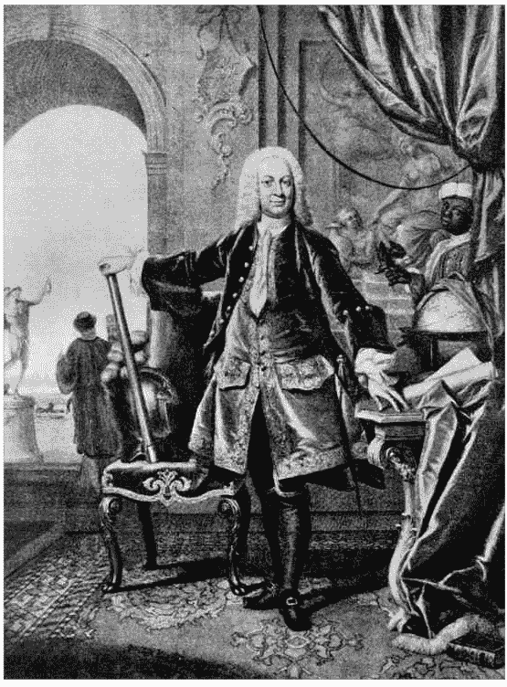

P. Tanjé根据Ph. van Dijk的绘画于1744年创作的总督G·W·范·霍夫版刻画

关于那位所谓的圣战苏菲领主就到此为止。我们可以想象，这种顺从让听到此事的傲慢爪哇贵族留下了怎样的印象。

## 曼库布库米的叛乱

帕库布瓦纳二世护送范·霍夫前往苏卡尔塔，总督在那里干预了一场爆发性的局部冲突。国王显然向曼库布库米承诺了在苏卡瓦蒂3000个`cacahs`（户）的封地，对于一个王子来说这是一块巨大的领地，作为是从那里驱逐叛军的回报。曼库纳拉加拉在该地区活跃，甚至威胁了范·霍夫前往苏卡尔塔的行程，骚扰了他的军队，并要求总督召集援军。曼库布库米最终将曼库纳拉加拉赶出苏卡瓦蒂并索要他的回报。自1743年以来，宫廷出现了两个新的帕提（patihs）：Tirtuwigna（后来成为R. Ad. Sindūr，1751年）和Pringgalaya（1755年）。后者是随后几年的关键人物，现在将自己定位为曼库布库米最痛苦的敌人之一。在Pringgalaya的催促下，范·霍夫干预停止了对曼库布库米的土地授予，理由是这会助长王子的傲慢并让他变得过于强大。他在一次宫廷集会上告诫了曼库布库米，从而公开羞辱了他。范·霍夫还行使了公司的选择权，控制整个爪哇北岸，回报是每年支付20,000里尔，这个数字远低于从海岸获得的收入。帕库布瓦纳二世——像既往一样软弱且犹豫——以他的谈判方式同意了这两项。根据《吉亚蒂纪史》，他告诉苏丹（Susuhan）这是对王权的滥用：“统治者的角色负有仅进行统治的义务”，而行政权力属于帕提、王室成员和其他官员。他说：“统治者本人没有谈判的习惯（adat）”。国王回答说：“是的，确实如此，当我见到[范·霍夫]时，我请求他耐心，但没有成功。”通过共识（mufakat）治理确实是爪哇政治传统的核心原则。帕库布瓦纳二世对这一原则的违反显然是压死曼库布库米的最后一根稻草。

Nicolaas Harting为我们留下了一份关于曼库布库米的珍贵画像，那是在他成为日志加雅第一任苏丹之后。这对于了解他年轻时可能是什么样提供了有用的参考。

他很有礼貌，博学且极其擅长驾驭他人。除非有坚实的理由说服他，否则他不会轻易让别人放弃自己的想法。他傲慢但华丽且不受尊重；至少，他挥霍如土，主要用于他的宫廷随从，那些随从非常出色，我对他推崇备至。

³ KV，第131页。

⁴ BG第1卷，第34–55页；Ricklefs中的爪哇语文本。

1746年5月19日，曼库布库米离开了宫廷并引发了第三次爪哇王位继承战争。

## 捕魂者

曼库纳加拉转为进攻，夺取了拉武山（Mount Lawu）南部的Kaduwang，¹¹那片山脉早已成为他主要的活动根据地。

在这些早期的几个月中的某个阶段，显然是在1746年7月之前，曼库布米在靠近沃诺吉里（Wonogiri）的格邦（Gebang）建立了一个坚固的据点。根据《贾万蒂史》（Babad Gianti）记载，那里建立得像一座王室城市。从那里，曼库布米派遣使者了他的兄弟Png. Buminata和Png. Singasari以及他的侄子曼库纳加拉。根据《贾万蒂史》记载，后者已自封Susunan Adipakura王室头衔。正如我们在上一章中看到的，这是由一位自称拒绝了的女士随从者授予他的头衔。如我们所知，Buminata使用了王室头衔；《贾万蒂史》中的版本是Sultan Dhandhun Martengensi。曼库布米告诉这些王子现在已经服从了他，他的反叛亲属也受邀加入。Buminata对此非常愤怒。《贾万蒂史》描述了对他说的以下这段话：

- 20. “虽然我们都是王室后代，但我出生于正室（prameswari）Ratu Kadipaten。难道我应该听从我兄弟[曼库布米]吗！他出生于森林里的一个侧室，他的爷爷是个运米工，他的曾祖父也是个挑米的人，”
- 21. “他的高祖父和高高祖父都是普通的村民，在照看牲畜的同时除草、锄地、耕作、耙地。他的祖先来自哪里？按照习俗，即使他们同样是王的儿子，拥有统治世界权威的人也是正室之子。”

Buminata的两个老仆人用伊斯兰教教义反驳了这种宫廷傲慢：

- 24. ……“确实，你说得对，陛下。但不要抛弃理性的推理”

> ¹¹ Sternenberg et al., Semarang, in Batavia, 25 Aug. 1746, in VOC 2681 (OB 1747); SBPn ff. 110r–v.

> ¹⁴ Louw, Success-Olog, p. 18.

### 曼库纳加拉的低谷

在这些早期的几个月里，曼库纳加拉在帕普兰（Papringan）遭到了荷兰东印度公司（VOC）的重大打击。他失去了许多士兵、一百匹马以及大量的金银。在黑夜和大雨中，曼库纳加拉逃入森林，而他幸存的士兵（文中提到了男女）以及随他的其他妇女儿童散落了。¹⁵

根据爪哇史料的记载，曼库纳加拉在这些事件之后似乎处于情感的低谷。在进入森林避难的孩子中，有他一岁的女儿R. Aj. Sombro，她正因发烧而生病。遇到抱着她的仆人时，他把孩子揽在怀里，在暴雨中行进。每当他觉得手臂累了想放下她时，孩子就会抗议。王子在森林深处遇到了他的妻子，即Sombro的母亲。正如第7章所示，这位是Kusumapapati，当时她还是一个侧室，后来成为了曼库纳加拉的正妻（garwa padmi）。此后，母亲和父亲轮流背着她。孩子想要食物，但什么也没有。最后找到了一根香蕉，平息了Sombro的哭闹。曼库纳加拉穿越崎岖的地形到达皮德克萨山（Mount Pideksa），在那里他遇到了Peng. Binata。与他的交谈无果，曼库纳加拉决定去会合曼库布米。VOC对曼库纳加拉的人头悬赏了500雷亚尔。当曼库纳加拉仅带着几个随者经过一个村庄时，当地人从衣服判断出他就是王子，并袭击他。他们显然没有火器，在曼库纳加拉向他们开火时逃跑了。沿路，村民们守哨并警报王子即将到来。¹⁶

在他痛苦的状态下，曼库纳加拉在拉武山的Samakaton遇到了两位隐士，名为Adirana和Adisana的兄弟，

> ¹⁵ KV, 132; SBPn ff. 33–5; BPn. 119r–122v.

> ¹⁶ BG Vol. ii, pp. 34–9; BPn. 120v–121v.

### 爪哇继承战争，第一阶段

根据他自己的描述以及《贾万蒂史》⁷，他们指责他的傲慢和对享乐的沉溺，这是他不幸的原因——正如《贾万蒂史》的版本——战斗的胜败取决于全知者。在那个版本中，隐士斥责曼库纳加拉采用Susunan Adipura这个奢侈头衔，但他被要求留在隐修院不进食不睡觉。在他的描述中，他穿越山谷，但发现被苏加塔（Sukakarta）挡住了。《贾万蒂史》记载他随后召唤了曼库布米。曼库纳加拉的解释是超自然的：“上帝的帮助和一场大雨震动了大地，让周围的敌人逃了。随后有七个人出现并向王子致意。这确实是灵界的帮助；Panger Dipati[曼库纳加拉]在上帝和他的使者面前俯伏。”

无论现代读者如何看待这些故事，这一段在曼库纳加拉对事件的解释中显然具有重要意义。不需要怀疑拉武山上有隐士，因为这类人物在旧爪哇随处可见，今天仍然可见。

关于曼库纳加拉是否采纳Susunan Adipakosa头衔的问题广受关注。对于历史学家——正如律师或法官一样——证据的冲突是常有的。我们在上一章中看到，在他关于战争的自传中，曼库纳加拉坚持认为当马塔在1745年授予他这个头衔时，他拒绝了：“但对于Panger Dipati[曼库纳加拉]来说，保持Panger Dipati Arya Amengkunagara的身份是必要的。”

> ¹⁷ Vol. ii, pp. 39–44（Ricklefs, Mystic Synthesis, pp. 165–6); SBPn ff.124r–124v.

> ¹⁸ BG Vol. ii, p. 40: supe lamun sor ing jgil, kagungan Hyang Manon. Samakaton靠近Druju（根据《贾万蒂史》，第60页），位于拉武山的西坡。

> ¹⁹ Vol. ii, p. 63. SBPn ff.124r–.; pitulung ala kang prapta, ampuan ardi gumuruh, udanan dres.... Estitu pitulung Yang Sukma, malekat mindha jalma, Pangran Dipati asujud, ing Alab lan Rasulullah. Jayamisessa Digdaya Diningrat Adi.”

然而，《贾万蒂史》始终声称使用了Susunan Adipakosa，拉武山的隐士将其视为傲慢的象征。在附录1中讨论了可能编制这些原始来源。在这里我们只需注意到，我们依赖的《Sérat Babad Pakunégaran》手稿保存在大英图书馆，它是1779年的副本，这本自传显然是在曼库纳加拉于1757年放弃叛乱之后（可能不久之后）定型的。他那时被定位为苏加塔的、大部分独立的王子，无疑伟大但显然不是国王。因此他掩盖了尴尬，消除了此前对王室身份的主张，这可能是一个潜在的主题。也可能在17世纪40年代，当曼库纳加拉试图弄清他认为等待自己的伟大命运时，他开始怀疑自己的使命是处于等级制中的次要地位，而非君主。也许曼库纳加拉的说法是正确的，他从未接受过王室头衔。也许《贾万蒂史》写于苏加塔，反映了宫廷和其他反叛者的已知信息，但对曼库纳加拉事务的信息充其量是二手的，它是错误的。我们不太可能肯定地解决这个问题。

无论情况如何，当曼库纳加拉与叔叔曼库布米结盟时，他无疑处于第二的位置，而曼库布米在这段关系中无疑是第一位的。

### 曼库纳加拉与曼库布米的结盟

如果遵循爪哇人的计数，精神上得到焕新的曼库纳加拉向沿岸进发以会合曼库布米，带着上述的七名骑兵。他接近了肯登山（Kendeng hills），他希望在那里与曼库布米以及后者的母亲M. Ayu Tejawati会合，曼库纳加拉与后者似乎有着深厚的关系。也许她在早年扮演了奶奶的角色，取代了曼库纳加拉早去世的母亲。途中收到了来自Tanjung村庄的消息，该村曾

> 20 SBPu f. 69v.: nanging Pangeran Dipati 10/ kabul taksih ajuluk, Gusti Pangeran Dipati Arya Amèngkunagara Senapati Ing Ajurit, Lalana Jayamisessa, Digdaya Diningrat Adi.

## 第三次爪哇王位继承战争，第一阶段

...在华人战争期间，一直是荷兰东公司（VOC）的反对中心，²¹那里的华人一致愿意跟随曼库纳加拉，并欢迎他的到来。²²

曼库纳加拉和马塔普拉都响应了加入曼库布米的号召，他们的联盟得到了确认。从《史诗》（babads）的背景来看，这似乎发生在1746年8月左右。然而，面对VOC从三宝的进攻，曼库布米被迫与曼库纳加拉一起撤退到肯登山脉（Kendeng hills）。这两个首领叛军进展时，据爪哇文献记载，当地人欢迎他们，他们的军队规模也随之扩大。在此，曼库纳加拉再次见到了他的“祖母”M. Ayu Tewawati，并为自己娶了两个新妻子，他是通过代表而非本人亲自完成的。根据《吉亚蒂史》（*Babad Gianti*），曼库布米此时为自己加了Pangeran Adipati Sukawati, Senapatining Pramuka Jayeyengrat的头衔（大致为：苏卡瓦蒂王子、首席战术总帅、世界胜利者）。他尚未声称王位。²³

这两位首位王子之间的联盟持续到一年后，即1747年12月，曼库布米的女儿拉图本达拉（Ratu Bendara）嫁给了曼库纳加拉。这一场合通过皮影戏（*wayang*）表演、舞会和盛宴进行了庆祝。²⁴这段婚姻证明了联盟本身的象征：建立在共同的倾向之上并以充满激情（con brio）的方式庆祝，但以痛苦的分离告终。

²¹ Rickle, Seen and Unseen Worlds, p. 244.

²² SBPN ff. 125–126v.

²³ SBPN ff. 127–128vv.; BG Vol. ii, pp. 60–8（此处文本指的是1746年底，在描述了主要到1748年2月爪哇东北海岸总督Van Hoendorff的事件之后）。MN-MB的会面发生在名为Subër、Sumbur或Rambut的地方。《登记簿》有七页（pp. 357–63）列出了名为Sumba或其变体的村庄。根据背景判断，这位于Kudus-Pati地区。由代表（wakil）结婚是一种常见的做法。男人可以派遣他的克里斯刀（kris）作为他的代表；KV, p. 81对此有记载。这让人想起现代SMS推行的伊斯兰义务做法。

²⁴ BG Vol. iii, p. 49; SBPN ff. 137v–141v.; *sembah sapta raja saji* [AJ 1672]，但Bésar应该是一个周二；后者给出了Bésar月19周六，这在1672年是正确的组合，但没有提到年份。正确的日期显然是1672年Bésar月19日（1747年12月23日）。荷兰人似乎并不知道这桩婚姻，认为它发生在1749年12月；Louw, *Successie-oorlog*, p. 33.

## 灵魂捕手者

拉图本达拉只为曼库纳加拉生了一个孩子，一个早夭的女儿。²⁵1763年，他们的婚姻以离婚结束。婚礼庆典也导致了曼库纳加拉与他的兄弟Pamot和Mangkuningrat之间关系的不确定性增加。他们都受了邀请，但都没有参加。“也许他们根本不在乎我，”他想道。²⁶

曼库纳加拉与曼库布米的联盟（后者显然是领军人物）是第三次爪哇王位继承战争的转折点。Pamot和Mangkuningrat加入了他们，马塔普拉也是如此。根据曼库纳加拉的编年史，这种结合让曼库布米立即拥有了一支3000人的军队。这是一个强大的联盟，成员拥有丰富的战斗经验（尽管经常失败），并且能够在贵族和平民中号召支持。如果，如果Buminata和Singasari愿意加入，力量会更强。到1746年底，曼库布米在北海岸迅速聚集了追随者。VOC悬赏曼库布米的人头500雷亚尔，但无果。他转而进攻苏卡尔塔（Surakarta），焚毁了这座城市的一部分。从那里他向海岸进发，威胁朱瓦（Juwana）和帕蒂（Pati）。由于季风雨的影响，曼库布米在12月31日进攻了达马克（Demak），他的军队有2500名步兵和500名骑兵。VOC指挥Coen愚蠢地仅率领13人和一小队爪哇部队去对抗他们，结果被屠杀了。曼库布米进攻了达马克的要塞，公司的要塞抵住了。²⁵孩子出生于1752年7月1日；SBpn ff. 285v.–286v.

²⁶ SBpn ff. 138v–139v：ya tega miring mami

²⁷ SBpn ff. 128v–129r.; BG vol. ii, pp. 70–2.

²⁸ Sterberg et al., Semarang, at Batavia, 1747年12月20日，在VOC 2681 (OB 1847).


²⁹ KV, pp. 131–3; SBpn ff. 111r.; Sterberg and Van Hoendorff, Semarang, at Batavia, 1747 年 1 月 6 日，在 VOC 2707 (OB 1748); Louw, Successie-oorlog, pp. 18–9.

“随着时间的推移”，“海岸的情况“并没有好转”。他们向雅加达寻求援助。³⁰ VOC 担心他们的联盟会在 1747 年爆发全面叛乱。Van Hoendorff 在高地俘获了带着两封信的人。一封据称来自华人叛军，写给 Sun Kuning；第二封据说是望库尼加拉的流亡父亲（他十九年前已在斯里兰卡去世）从雅加达写给他的儿子望库尼加拉、Pamot 和 Mangkuningrat 的。信敦促他们反抗公司，但也提到了一场涉及 Cibreon 苏丹（位于雅加达东部）与其他土主共同起义的阴谋。11 月 13 日，Van Hoendorff 怀疑这些文件的真实性。然而，这类由被俘或死去的贵族提供并通过精神血统传递的信件，确实可以让轻信的人采取行动。荷兰人通常蔑视这些“穆斯林暴民”或“野蛮人”，除非是在战场上面对他们。双方对峙持续了整个 1747 年，谁都未能给出致命一击。³³ 在此，巴厘岛士兵出现在曼库布米的队列中，根据望库尼加拉的记载，他们承诺了王族的地位。³⁴ 联军进攻了多个地点的 VOC 和苏卡尔塔，在发现反对力量过强后退回到人烟稀少的山区。叛军 1747 年 9 月进攻 Jipang 显示了更普遍的模式。当叛军进攻时，当地长官（upati）逃往图班（Tuban）并抵抗。VOC 的龙船做出了回应，叛军撤退了。³⁵ 望库尼加拉史（babad）记录了他在期间在苏卡尔塔劫掠并焚烧建筑。³⁶ 这是一个发生多次的事件。

³⁰ Sterberg and Van Hoendorff, Semarang, at Batavia, 1747 年 1 月 6 日，在 VOC 2707 (OB 1748).

³¹ Ibid.

²² 引用自 Louw, Successie-oorlog, p. 19.

³³ 基于 VOC 来源的概述见同上，pp. 19–20.

³⁴ SBP f. 134v. and seqq.; BG Vol. iii, p. 3 and seqq.; KV, p. 133; Louw, Successie-oorlog, p. 20.

³⁵ Van Hoendorff, Semarang, at Batavia, 1747 年 9 月 27 日，在 VOC 2706 (OB 1748). 4 月对日本 的进攻在 Louw, Successie-oorlog, 20 中描述；另见 SBn ff. 134v–137r.

³⁶ SBn ff. 137r–v.

³⁷ Kanging kang tanah asmara asmara.

³⁸ KV, p. 134.

³⁹ Louw, Successie-oorlog, p. 20.

⁴⁰ PB II, Surakarta, to Batavia, 1672 年 9 月 19 日，在 VOC 2725 (OB 1749).

曼库布米在这一时期的山地基地是肯登山脉的 Jakawal。他在那里建立了皇宫风格（kraton）的住所，并将其命名为满者（Majapahit），这是伊斯兰教前最后一个且最大的王国。那里有一个广场（alun-alun），正如在宫廷和王公住所前一样，广场上有一座清真寺，位于西侧，以便让朝拜者朝向麦加，符合伊斯兰法的要求。

## 第三次爪哇继承之战，第一阶段 75

1748年下半叶，巴达维亚派遣了由 Majs W.H. van Ossenberg 和 H.P. Fau 领导的更多龙骑兵和骠骑兵前往三宝垄，意图是从高地地区清扫反军。范·奥森伯格⁴¹ 成为东印度公司（VOC）层级中的重要人物，他似乎给爪哇人留下了模糊的印象。他的名字被译为 Sakebēr，这是 Sakandër 神话中同名英雄的一名仆从，而这些神话从根本上是荷兰与爪哇人之间关系的超自然起源。⁴²《吉亚蒂纪史》（Babad Giyanti）描述他“高大魁梧，肌肉线条优美，像 Ngālka 王一样”，⁴³这指的是《罗玛史》（Sérat Rama，罗摩衍那的现代爪哇语版）中的恶王 Rawana。这支新的远征军一无所获。曼库姆布米（Mangkumbumi）放弃并返回了他在雅卡瓦尔（Jakawal）的住所，并避免了接触。东印度公司军队及其支持他们的爪哇人在未遇到敌人的情况下返回了基地。⁴⁴

帕库布瓦纳二世在苏卡塔（Surakarta）的新皇宫（kraton）受到持续威胁。1748年8月，帕库布瓦纳二世的主力以及公司的龙骑兵和骠骑兵不在，徒劳地寻找反军接触，他们进攻了苏卡塔。先遣队在皇宫周围建造了建筑，遇到了曼库姆布米和曼库纳纳加拉（Mangkunagara）。《吉亚蒂纪史》和《帕库内加拉纪史》（Sérat Babad Pakunegara）描述了一直到皇宫墙下的激烈战斗，城市中的反军陷入了恐慌。在宫廷，帕库布瓦纳二世准备持械进行防御。根据这些记载，他下令敲响名为 Ky. Bicak 的小型军钟（bəndhe）。然而，在敲击四次后，它保持了沉默，这让国王感到担忧，因为这预示着相反的超自然力量在起作用。最后 Ky. Bicak 响了，随后曼库姆布米命令缓慢撤退。更直白地说，反军面临着来自东印度公司堡垒的大炮火。曼库纳加拉也撤退了，但继续在苏卡塔附近焚烧和掠夺。⁴⁵

曼库纳加拉向西朝马塔拉姆（Mataram）移动。在途中遇到了他兄弟 Pamot 的部队，正如我们所看到的，他们的关系非常紧张。他命令抢夺 Pamot 人的财物，并夺走他们的马匹以获得新鲜马。在德兰古（Delangu）遇到了另一个阴险的人物，并给予了同样的对待。当曼库纳加拉很快与他的兄弟会面时，Pamot 的武器和马匹被没收了；我们可以记得这些东西似乎并没有发挥什么大作用。曼库纳加拉谴责 Pamot 的多次失败，而后者顺从地接受了其兄弟的愤怒；根据曼库纳加拉的愤怒，他的舅父 Png, Suryadi（或 Suryadi/Suryadikusuma）被迫向曼库纳加拉交出了他的私人克里斯剑（kris），作为一种屈辱和服从的行为。曼库纳加拉的另一个兄弟 Mangkungintarat 的罪行被认为性质较轻，因此在他热诚的忠诚誓言后得到了宽恕。曼库纳加拉让 Pamot 和 Suryadi 往山上去，带着几个仆人但没有士兵。Pamot 的马现在是曼库纳加拉的，他将其命名为 Pun Daru（意为“落火”或“流星”，爪哇语中好运降临的预兆）。他和部下回了位于沃诺吉里（Wonogiri）附近 Gemantar 的基地。在那里他们庆祝了与家人重聚，正如这位充满活力的年轻王子记录的：“夜晚，他与所有的妻子和妾室欢好并感到满足，一边不断训练军队一边给他们休假”。⁴⁶

- 5. 新的（士兵）聚集在一起，向潘甘迪普提 [曼库纳加拉] 领主效忠。
- 然后他们享受了加入跳舞。
- 士兵们聚宴并跳舞，
- 随着士兵的舞蹈而活跃。

⁴¹ Van Ossenberg 的传记见于 P.J.B.C. Rob der Aa，“De groote Bantamsche opstand in het midden der vorige eeuw”, BKI 第4系列，[Vol.29] (1881), pp.53–8。⁴² 见 A.B.Cohen, Geschiedenis van Sakendër, een Javaansch verhaal (Batavia,1850); Rieklef, Jakarta, p376 et seq.（在此版本中，Sakebēr 为 Kasebër）。⁴³ 《吉亚蒂纪史》卷三：69：Mayor Kebēr gèng inggil otocik, kadya Prabu Ngalengka。⁴⁴ KV, p135; 《吉亚蒂纪史》卷三：68–73; Louw, Successoorlog, 22.

⁴⁵ Van Hohenendorff, Semarang, at Batavia,16 Aug. 1748, quoted in Louw, Successoorlog, pp.20–1; Big Vol. iii, pp. 68–Vol. iv, 57; BP ff.143.–152. 关于 bøndhe，见 Kunst, Music in Java, Vol. i, 150; Vol. ii, 441.⁴⁶ BP ff.152v.–154r. 引用自：siyang daluw asmara, lang sagura, para prajurit, tanmara, langa.

## 第三次爪哇继承之战，第一阶段 77

6. 我们不说明他们是如何结束的，在白天，他们是在用弓箭跳舞（训练），新士兵和老兵让他们让了路。潘甘迪提 [曼库纳加拉] 曼库纳加拉再次袭击了苏卡塔，捕捉牲畜作为战品，让当地村民陷入困苦。1748年9月初，东印度公司突然进攻，这导致曼库纳加拉在 Gemantar 只有少数士兵。他对战斗的描述充满了戏剧性。但他重新骑上马，与五个伙伴一起逃脱。他在穿过森林峡谷时不得不放弃了 Daru。现在轮到公司分队掠夺村庄了。

⁴⁷ SB ff.154v., Canto44 (Sinom): bala saling rayi, kang anyar- kang bale prajurit, sadaya prawunipang, Kangǐng Pangan Dipati, nuli kukan anyib, dabar hanung kadwi, tur mau taledek as, ramya samya bĕkan. wanarnanan aluwiran, lungkang ajiring.⁴⁸ Ibid., ff.155v–157r.; BG卷四：58–60. 两个记载都给出了周日 [AJ1673]，这是可能的；考虑到周制的组合，正确的周日（1748年9月1日）。

## 捕魂

恐惧和逃兵有时会被当地人杀害。爪哇的情况仅在于，逃兵还面临被老虎攻击的风险。曼库纳加拉在 Papiring 丧生后害怕遭到袭击并不奇怪。或者村民敲锅作为小偷接近的警告，即使那些小偷穿着王子的华服。鉴于战斗和军队接近时经常面临的灾难，村民经常逃往山丘，带上随从和随身携带的一切。

1748年8月，曼库姆布米北上沿海城镇。那里有公司的主要据点，其对海岸的控制是其叛乱的主要刺激因素之一。《吉亚蒂纪史》说他带着2000名骑兵、40面旗（步兵连）、两套甘美兰和其他乐器出发。对于爪哇军队来说，这些乐器起着类似于欧洲军队号角、笛和鼓的作用，激励士兵并传达命令。曼库姆布米通过了苏卡瓦蒂高地，公司军队并未发现他的行动。在他经过时，沿海地区向他服从。1748年8月15日，他进攻并占了 Cengalsewu。Pati 的战斗持续到第二天。8月17日，他进攻了朱瓦纳（Juwana）。在这里他面对的是 R.A. van Goens，后者与十名欧洲军人和大多数本土士兵一同遇死。根据《吉亚蒂纪史》，曼库姆布米本人隐姓与持矛步兵战斗，而一个替身模仿着王子的马、衣服和黄色阳伞。守军的遗孀、三名海员和一些奴隶被陆路运往 Rembang 的东印度公司据点。曼库姆布米焚毁了朱瓦纳堡垒并夺取了一个钱箱。《吉亚蒂纪史》报告说，这些战品需要一匹马来运，总金额为36,000“新里亚”，朱瓦纳的35名东印度公司布吉士兵加入了曼库姆布米的一方（也许实际上是麦卡人：爪哇来源通常不区分）。随后他占领了库杜斯（Kudus）。荷兰人观察到他受到了大量当地定居（pranakan）中国人和马来人的支持。然而，纪史冲突地报道，曼库姆布米的人既掠夺又焚烧了。

## 第三次爪哇王位继承战争，第一阶段

中国人带走了他们的妇女和财物。在征服后，曼库库布米（Mangkubumi）将朱瓦纳（Juwana）分之一的权力交给了华裔王子。范霍多夫（Van Hoendorff）命令费尔和范奥森伯格率骑兵和龙骑，他们最终与普林加拉雅的爪哇人一起投入战斗。激烈的战斗双方均遭受损失。随后，曼库库布米撤向南方雅卡瓦尔（Jakawal），留下了许多死者。根据《吉亚蒂纪史》（Babad Giyanti），他的军队被“击溃了”（rempu），而敌人的则是“精疲力竭”（anglês）。⁵¹

《吉亚蒂纪史》描述了战斗接近结束时的一幕，这提醒我们在内战中忠诚与家庭关系会是多么复杂，但同时也引发了怀疑。曼库库布米有一个同生妹妹——同样是M·阿·特瓦蒂（M. Ay Tejawati）所——名叫R·阿·普林加拉雅（R. Ay Pringalaya），她是他的敌人、苏卡尔塔（Surakarta）副官普林加拉雅（Pringalaya）的妻子。据报道，她带着30名骑兵来到战场，大道：“嘿，曼库库布米，小子，你的所所为让我们母亲太心承受了，完全不顾死活；想想我们的母亲，不要太过分。”听到此后，曼库库布米撤退了。

我们不必怀疑这样的信息可能是由他妹妹发给曼库库布米的；我们的怀疑在于战争的状况。18世纪的战斗是混乱的：当受伤的人尖叫和进攻时，现场是一着巨大的混乱嘈杂声；马匹在自己受伤或更胆大地穿过战场时会嘶鸣、打鼾和呻吟；火绳枪的发射声，如果使用了的话，还有大炮的轰鸣。后者足以让大地震动。此外，还有号角、鼓和其他锣器的声音，用于鼓舞士气并下达命令。这一切都发生在一个战场上，黑药武器被浓烟遮蔽，步兵发现自己被落后于骑兵，并发现自己跌入沟中，被敌人的长矛或流蒺钉刺中，在马匹被射中后被同袍踩在脚下。我们合理地怀疑在这一切中是否能听到一个女性的声音，并怀疑如果信息确实传达了，也是书面形式而非口头形式。然而，这就是《吉亚蒂纪史》中关于兄弟间信息的传递方式。

《吉亚蒂纪史》描绘了对曼库库布米来说是一场犹豫不决的战斗，也许是第一次，他开始认为欧洲人无法被驱逐，荷兰东印度公司（VOC）是北岸永久的特征。公司追他到雅卡瓦尔。在那里，他会了曼昆阿纳加拉（Mangkunagara），告诉对方他的军队已被“摧毁了”（rusak）。考虑到其军队状况糟糕，曼昆阿纳加拉和曼库库布米的其他官员建议他逃跑。曼库库布米逃脱了，让雅卡瓦尔陷入火海，这在公司和苏卡尔塔部队接触之前。公司的援军被送回了巴达维亚（Batavia），他们显然已经在中爪哇取得了目标。⁵³

由于其他当地敌人的不明确，范霍多夫报告说曼库库布米已如此“破败”，以至于他无法再次做出任何重大事情。“无论是平原还是高地的本土事务，以及整个宫廷，现在都很有秩序，”他在1749年初报告道。⁵⁴ VOC与其苏卡尔塔的盟友确实可能赢得战斗，但赢得战争被证明是一项完全不同的任务。在这场战争中，胜利和失败可能是暂时的。曼库库布米和曼昆阿纳加拉从雅卡瓦尔逃是在1748年10月。到11月初，日本（Jepang）再次陷入叛乱军中。当VOC随后离开日本后，曼库库布米再次占领了那里。11月下旬，曼昆阿纳加拉进攻了肯杜（Kedu）并击退了公司的援军。随后他进攻了VOC的要塞驻地，最终在遭受重大损失后被击退。⁵⁷

1748年就这样结束，尽管流流流但没有任何一方获得胜利。除了上述战斗外，曼库库布米和曼昆阿纳加拉也遭受了挫折。一次重大损失是西拉隆（Png. Silarong），范霍多夫，从三宝到巴达维亚，1748年9月20日，见VOC 2726 (OC 1749)。SB'n ff. 16v–166v；BG卷，pp. 62–76: Louw, *Successie-oorlog*, pp. 21–2。VOC的货币非常复杂；见Ricklefs《Culture and Economy》第239页附录3。BG第五卷，第37页报告说，部分战利品后来分给了曼昆阿纳加拉的军队，他们随后用其来斗鸡。

> ⁵² BG vol. pp. 75–6: Eh kulub Mangkubumi 10/ kabangetan babo nyawa solahira, ora anem pati, bok uwi elinga, aja kaliwat-liwat.

> ⁵³ BG Vol., pp. 5–6; SBn pp. 166v; Van Hoendorff, Semarang, to Batavia, 16 Oct. 1748, in VOC 2725 (OB 1749); Louw, Successie-oorlog, p. 22.

> ⁵⁴ Van Hoendorff, Semarang, to Batavia, 28 Aug. 1748, in VOC 2725 (OB 1749).

> ⁵⁵ Van Hoendorff, Semarang, to Batavia, 29 Jan. 1749, in VOC 2749 (OB 1750).

> ⁵⁶ Louw, *Successie-oorlog*, pp. 22–3.

> ⁵⁷ Ibid.

> ⁵⁸ BG Vol. v, p. 14–5; KV, pp. 134–5; pn.. 159. > ........................ ., 17,,,.. 139. Silarong was a son of Amangkurat IV by a secondary wife (garwa); Padmasastra, Sarajah-dalem, p. 146.

> ⁵⁹ BG Vol. v, p. 37–44; SBpn ff. 179v–v.

> ⁶⁰ Van Hoendorff, Semarang, at Batavia, 10 Apr 1749, in VOC 2749 (OB 1750).

> ⁶¹ KV, p. 137–37. Singasari did not follow him and, according to Babad Giyanti, no one was paid obedience to Mangkubumi.

> ⁶² The following account counts down MB’s occupation of Yogyakarta in SBpn ff. 179v–184v; BG Vol. v, p. 37–44. The small bird called puhuh in Java-nese is the button-call (Turnicus suscitator); females were usually used for fights; see Jack Mackinnon, *Field Guide to the Birds of Java and Bali* (Yogyakarta: Gadjah Mada University Press, 1991), p. 103, pl. 8.

## 1749年：政治之年


# 第三次爪哇继承者战争，第一阶段

## 1749年军事行动与叛军进展

1749年在军事行动上相对平静。尽管4月发生了一些小规模战斗和几次较大的冲突，范霍多夫可以重复他的观点，“平原和高地都很安静”。⁶⁰ 在叛军一方，下半年有重大进展。布米塔（Buminata）自称皇帝近七年，现受到曼库库布米和曼昆阿纳加拉的严重威胁，他们正在聚集追随者并重建军队。主要任务是将布米塔和辛加阿里赶出昆吉杜尔（Gunung Kidul）。曼昆阿纳加拉发现这并非易事，因此曼库库布米亲自参加了那场战斗。根据荷兰文献，战斗非常激烈，但布米塔逃往苏卡瓦蒂的高地，并决定向帕库瓦二世投降。VOC希望他以此鼓励其他投降，但布米塔被允许在9月初回到苏卡尔塔，恢复其王子的生活。令人惊讶的是，几个月后他被任命为皇储。辛加阿里没有跟随他，根据《吉亚蒂纪史》，没有人服从曼库库布米。⁶¹

曼库库布米与曼昆阿纳加拉的联盟是反苏卡尔塔王宫和荷兰东印度公司（VOC）的核心。爪哇来源使我们能够看到这是如何卷入布米塔故事的。² 我们需要记得，1746年曼库库布米起反时，这两个人物——舅舅曼库库布米和贵族侄曼昆阿纳加拉——曾是敌人。现在，舅舅、岳父、叛军领袖以及侄站在了同一边。

他们真的是盟友吗？曼昆阿纳加拉的描述告诉我们他在1749年中旬位于雅加达，那是宴饮和赌博的时期，充满了斗鸡和斗胆、跳舞会和皮戏（wayang top）。

## 曼昆阿纳加拉的崛起与日惹之争

表演、甘美兰音乐和不断的欢愉。每个周一都有锦标赛，他的兄弟 Pamot 和 Mangkunagrat 经常侍奉他。他们在森林中狩猎，前往南岸巡视。对侄子的成就感到满意的，曼库布米（Mangkubumi）送给了他大炮和钱财作为礼物。曼库纳加拉（Mangkunagara）组织了一支 50 人的新部队，命名为“红箭军”（Saragiri Abang），加入他的其他正规军阵。他制作并命名了甘美兰乐器。他修复了该地区的古老宫廷建筑。换句话说，他的行为已经像一位君主。

当时在苏卡瓦蒂（Sukawati）的曼库布米听闻了关于国家事务的种种传闻。他对他在日惹（Yogya）的部队产生了怀疑，认为对方可能宣布自己为王。曼库布米的第一步是寻求与布米纳塔（Buminata）的和解——当时后者尚未臣服苏尔卡塔（Surakarta）——但战斗中的所有努力都告失败了。于是，曼库布米命令曼库纳加拉将布米纳塔逐出山区。当曼库纳加拉执行此任务离开时，曼库布米迅速行军占领了日惹。曼库纳加拉的叙述直白地写道，他担心曼库布米会得到妃妾，因此除了他的妻子 Mara 的女儿 Ratu Bendara 之外，他将她们全部赶走。因此，日惹成为了曼库布米的宫廷所在地，而非曼库纳加拉的领地，后者被迫再次迎接其叔叔的到来。曼库布米寄住在曼库纳加拉建造的坚固寓所内，而后者则住在广场（alun-alun）北侧的外围。

曼库布米“现在像一位国王，但并不打算称王为君主，尽管一切都得到了收纳。” 63 对方授予了他 R.M. 的头衔，即皇储王子（Pangeran Adipati Anom）。在酒席上，两位醉酒的大贵族曼库布米和曼库纳加拉达成共识，当前者继王时，后者将同时担任总司令官（Senapati Ayuda）和摄政（patatih）。根据曼库纳加拉的记载，他们互相立下了忠诚誓。在场的所有官员也对这一安排宣了誓，并通过饮酒舞蹈庆祝。这一时间不确定，但可能是 1749年7月至8月。⁶⁴

> 63 BG Vol. v, pp. 44–5: Pangran wus narendra, nanging dereng anedya jemenang aji, sanadyan wis samkta.

## 捕魂者：Pamot之死与欧洲逃兵

早在7月初，荷兰东印度公司（VOC）就听说曼库布米已自封为苏苏南（Susuhunan）并占领了马塔兰（Mataram），但这是一个过早或至少是部分不实的传言。⁶⁵ 他确实占领了作为马塔兰核心地区的日惹，但尚未被宣布为王。

在自己的兄弟帕库布瓦尼二世（Pakubuwani II）在世期间，曼库布米不愿宣布自己为王。⁶⁶ 但这种情况不会持续多久了，因为帕库布瓦尼二世——尚未满40岁——身患重病。爪哇的政治精英、荷兰东印度公司，无疑许多人都在不安地等待着这一政权的终结。虽然王室有时会寻求军事上的胜利，但承认内战是不可能的。在这种情况下，普通平民往往会埋藏财宝，准备逃往森林和山脉，而贵族们则盯着他们的军械库，衡量盟友与敌手。然而，在国王去世改变战争的战略环境之前，一场家庭悲剧降临了曼库纳加拉的家族。

曼库纳加拉和曼库布米再次建立了一种运作模式，由于后者的家族关系仍未稳定，现在变得具有悲剧性。我们已经见过他的兄弟 Pamot 不愿参战，以及曼库纳加拉对 Pamot 的情谊和可靠性的怀疑。当曼库纳加拉追捕布米纳塔和 Singasih 时，他的兄弟 Pamot 和 Mangkuningrat 与他一同行军。他们掠夺了沿途的村庄，抓捕了妇女和村民逃向高地。从山里下山后，曼库纳加拉再次与他的部队庆祝，创建了另一支部队——“黑箭军”（Saragèn Cemeng）——并给了士兵休假。但 Pamot 对没有获得他所持有的封地感到忧心。还有其他事情困扰着这个年轻人，史料（babads）告诉我们：首先，他失去了士兵，所有人都抛弃了他。其次，他没有重新获得曼库纳加拉的青睐。第三，他听说比他年轻的 Mangkuningrat 将安排在他之上指挥。第四，他的妻子恳求他生子，但他没有孩子。深感羞愧、陷入困境且无法进食也无法睡眠，Pamot 混合了柑橘汁和毒药并自杀了。他的妻子和其他仆人为这位22岁王子的去世而哭泣，这位王子似乎不适应暴力和战争的生活。曼库纳加拉也因兄弟的去世而深受震惊。遗体被送往尼提坎（Nitikan，现位于日惹市内）安葬。

从这时（约1749年9月到12月），爪哇人和欧洲人的注意力都集中在病危的帕库布瓦尼二世身上。在这些人中，很少有人像他们那样离开苏尔卡塔加入曼库布米和曼库纳加拉：Pangkwijaya, Rongga 和 Pangula。他们并不知道，留在苏尔卡塔的王子们很快就会被流逐。他们没有足够的资源维持。这一时期甚至荷兰士兵也叛逃了；获得这些逃兵一直是荷兰东印度公司官员的目标。根据曼库纳加拉的史料，曼库布米最初提议杀死欧洲逃兵，但被劝说他们可以被任用。然而，几个月后，他们在曼库布米的命令下被杀害。范霍德夫与曼库布米之间有过通信。前者希望布米纳塔的例子能促使曼库布米投降；后者——无疑并不乐观——希望公司能支持他继位苏苏南。他们的通信如意料地无济于事。《格雅亚蒂史》描述了当他们在日惹时为爪哇使节举行的一场表演。数千名士兵聚集在广场上进行训练和战争游戏，其中一方代表公司。他们在甘美兰音乐和大炮声中进行虚拟战斗⁶⁸ 我们可以猜到哪一方被描绘为胜利者。

> ⁶⁷ SBPN ff. 186r.-189r.,193c.; BG Vol. pp. 74–5. SBPN 将此置于 Gare Puasa 庆祝（1749年9月14日）之前。涉及的封地位于 Wedi 和 Masaran。
> ⁶⁸ SBPN ff. 197r–199v.; BG Vol. v, p. 46–54, and Vol. ii, p. 7–12. Van Hoendorff, Semarang, at Batavia, 11 Sept, and 7 Nov. 1749, in VOC 2750 (OB 1750); Louw, Successie-oorlog, p. 23–41. By KV, p. 144, in early 1750,当 MB 被赶出日惹时，为了报复，他杀掉了投他的30名欧洲逃兵中的除一个。

## 帕库布瓦尼二世之死与王国分裂

1749年的后几个月，帕库布瓦尼二世的病情恶化了。⁶⁹ 范霍德夫在1748年从苏尔卡塔迁往三宝垄，担任荷兰东印度公司爪哇东北岸的首任总督（1748–54），于12月初回到苏尔卡塔观察即将到来的继位。他发现这位国王——自六年前在卡塔苏拉首次接触以来他的门生——正处于凄惨的状态。范霍德夫咨询了皇储，即未来的帕库布瓦尼三世，他目前与父亲疏远，对成为苏苏南毫无兴趣。然而，他同意将维持与公司的合同。

在临终之际，帕库布瓦尼二世不信任爪哇精英中的任何人，因为许多人抛弃了他，因此将寄托放在保持他信任的范霍德夫身上。他提出了一个非寻常建议，让荷兰掌管国家。1749年12月11日，签署了一份有两个主要目标的合同。第一个目标是将个人财产（而非国家财产）委托给范霍德夫作为受托人，以确保安全传给他的继承人并照顾他的孩子，这是一种常见的爪哇做法。第二个目的——在爪哇文中和条约的荷兰文中一样清晰——绝非寻常做法。该条约毫无保留地将整个王国让给了荷兰东印度公司。尽管这看起来很惊人——无论殖民当局后来如何将其视为统治的法律基础——但条约的第二个且显然具有革命性的方面，在第三次爪哇继承者战争的背景下完全是一纸废纸。直到19世纪，荷兰才有足够的资源在爪哇行使主权。据我所知，在涵盖范围内，没有任何荷兰或爪哇贵族提到过该条约。

> ⁶⁹ 此处的总体叙述，直到 PB II 去世，均遵循 Ricklefs, Yogyakarta, pp. 48–53.

## 曼库布米登基与双王对峙

与此同时，在日惹（Yogya），Mangkubumi 被 Mangkurat 和他的其他追随者宣布为国王。他曾说过在 Pakubuwana II 在世期间他不会采取这一步，但事实上，他在新年的第一天就这样做了：AJ 1675 年 1 Sura。他之所以这样做是因为根据《史诗》（babads），间谍报告国王已经去世，而实际上他正处于昏迷但尚有一息的状态。Mangkubumi 在其母亲 Teawati 以及围绕在日惹的其他贵族的压力下，过早地登上了王位。他继承了前任君主使用的头衔：Susunan Pakubuwana Senapati Inagal Ngabdrahman Sayidin Patangama（战场总司令，宗教监管者）；我们在此继续称呼他为 Mangkubumi。《吉亚提史诗》（Babad Giyanti）补充道，“他在爪哇岛上建立并管理该土地的真正统治者”。是 Mangkurat 担任 Mangkubumi 的支持者并正式宣布他为国王，挑战了集会中任何拒绝接受这一点的贵族。王国各地宗教中心（pradakan）的 Kajoran、Tembayat、Kembangaru 和 Wedi 等其他领袖出席并祝福了他的统治。Kadilangsu 的精神领袖 Png. Wijil 担任 sayyid Ngabdrahman 和 Mangkurat。他们举行祈祷和宗教仪式以祈求神灵的佑护（slamétan），并前往清真寺。正如他所承诺的那样，Mangkubumi 宣布 Mangkurat 为他的 senapati（将）和 patih（宰相）。他的 pengulu（首领）被任命 Ky. Ngabdullah，原来自 Astana Wedi 的 pradikan，被他更名为 Dipaningrat。新首席官（jaksa）也已被任命。⁷⁰

荷兰人报告说，参加 Mangkubumi 就职典式的贵族比两天后在苏哈卡塔（Surakarta）的 Pakubuwana III 典礼的还要多。Mangkubumi 写信 Van Hoendorff 寻求对其登位的承认，结果正如预期般是负面的，对方以至少有人已经皈依了伊斯兰教为由，拒绝交出荷兰逃兵。⁷¹

12 月 15 日，Van Hoendorff 在苏哈卡塔册立了新的 Susunan Pakubuwana III（在位 1749–88），他拥有与 Mangkubumi 相同的头衔，但他身处一个日益被遗弃的宫廷中，其特点是没有王子或平民。他当时仅 17 岁。在所有人中，刚从叛乱中归来的 P. Buminata 被任命为皇储。留在苏哈卡塔的王子们被要求交出腰刀（krises）并被逮捕。他们苦闷，为什么行为不端的 Buminata 却能获得好运，而他们这些表现忠诚的人却遭遇了不幸。

公司认为，由于叛乱是由王子引起的，那么不让王子存在将加强 Pakubuwana III 的统治。因此，所有公司能抓到手的成员都被逮捕并流放了。新君主同意在长子年满十岁时交出他的弟弟们。流放王子们反映了欧洲人对“维持爪哇君主地位需要获得共识支持”这一点的深刻误解。除掉所有提供此类支持的人，并幻想可以用荷兰东印度公司（VOC）的武力取代，这在当时是一个极其荒谬的分析。在他统治初期的这次政治失误严重削弱了 Pakubuwana III。到 1752 年，宫廷的人口流失导致没有几个仆人照顾国王的马和大象。甚至 Buminata 本人最终也放弃并回归叛乱。1749 年 12 月 20 日，Pakubuwana II 去世，结束了马塔兰王朝最惨的——也许是最惨的——统治时期。⁷²

马塔兰王国现在在两个对立的君主之间划分。Mangkubumi 开始了他的统治（1749–92），成为一个世纪前阿贡苏丹（Sultan Agung）以来该王朝最伟大的国王。在他身边的是 Mangkunagara，他是当时最有力的领袖之一。

---

> ⁷⁰ BG Vol. vi, pp. 23–29; SBN ff. 200v–201r. 引用自 BG Vol. vi, p. 28：ingkang tahu Narendra, mandiring amengku, talatab sosok Jawa。这里存在复杂性，是因为苏哈卡塔在年初将历法调整一天，产生了新的“星期四历法”，这在日惹是不承认的；见 Ricklefs, Yogyakarta, p. 54。BG Vol. vi, p. 27 说，MB 特别拒绝了这一创新。
> ⁷¹ BG Vol. vi, pp. 35–37; Van Hoendorff, Surakarta, to Batavia, 1749 年 12 月 21 日, in VOC 2749 (OB 1750); Van Hoendorff, Surakarta, to Batavia, 1749 年 12 月 31 日, in VOC 2767 (OB 1751); KV, pp. 137–18, 141–3. 另见 Snell ff. 222v–223r. 关于投奔 MN 的骑兵受割并皈依伊斯兰教的记载。
> ⁷² BG Vol. vi, pp. 30–37; Snell ff. 201r–v.; Toutlemonde, Surakarta, Semarang, 1752 年 5 月 30 日，引用自 Louw, Success-oorlog, p. 56. PB III 出生于 1733 年 2 月 23 日。


马塔兰王国现在在两个对立的君主之间划分。Mangkubumi 开始了他的统治（1749–92），成为一个世纪前阿贡苏丹以来该王朝最伟大的国王。在他身边的是 Mangkunagara，他是最有力的之一。《吉亚提史诗》补充道，“他是在爪哇岛上建立并管理该土地的真正统治者”。是 Mangkkurat 担任 Mangkubumi 的支持者并正式宣布他为国王，挑战了集会中任何拒绝接受这一点的贵族。王国各地宗教中心（pradakan）的 Kajoran、Tembayat、Kembangaru 和 Wedi 等其他领袖出席并祝福了他的统治。Kadilangsu 的精神领袖 Png. Wijil 担任 sayyid Ngabdrahman 和 Mangkkurat。他们举行祈祷和宗教仪式以祈求神灵的佑（slamétan），并前往清真寺。正如他所承诺的那样，Mangkubumi 宣布 Mangkkurat 为他的 senapati（将）和 patih（宰相）。他的 pengulu（首领）被任命 Ky. Ngabdullah，原来自 Astana Wedi 的 pradikan，被他更名为 Dipaningrat。新首席官（jaksa）也已被任命。⁷⁰

荷兰人报告说，参加 Mangkubumi 就职典式的贵族比两天后在苏哈卡塔的 Pakubuwana III 典式的还要多。Mangkubumi 写信 Van Hoendorff 寻求对其登位的承认，结果正如预期般是负面的，对方以至少有人已经皈依了伊斯兰教为由，拒绝交出荷兰逃兵 [pgt71]

12 月 15 日，Van Hoendorff 在苏哈卡塔册立了新的 Susunan Pakubuwana III（在位 1749–88），他拥有与 Mangkubumi 相同的头衔，但他身处一个日益被遗弃的宫廷中，其特点是没有王子或平民。他当时仅 17 岁。在所有人中，刚从叛乱中归来的 P Buminata 被任命为皇储。留在苏哈卡塔的王子们被要求交出腰刀（krises）并被逮捕。他们苦闷，为什么行为不端的 Buminata 却能获得好运，而他们这些表现忠诚的人却遭遇了不幸。

公司认为，由于叛乱是由王子引起的，那么不让王子存在将加强 Pakubuwana III 的统治。因此，所有公司能抓到手的的成员都被逮捕并流放了。新君主同意在长子年满十岁时交出他的弟弟们。流放王子们反映了欧洲人对“维持爪哇君主地位需要获得共识支持”这一点的深刻误解。除掉所有提供此类支持的人，并幻想可以用荷兰东印度公司（VOC）的武力取代，这在当时是一个极其荒谬的分析。在他统治初期的这次政治失误严重削弱了 Pakubuwana III。到 1752 年，宫廷的人口流失导致没有几个仆人照顾国王的马和大象。甚至 Buminata 本人最终也放弃并回归叛乱。1749 年 12 月 20 日，Pakubuwana II 去世，结束了马塔兰王朝最惨的——也许是最中最惨的——统治时期 [pgt72]

## 第三次爪哇继承之战，第一阶段

在曼库纳纳加拉（Mangkunagara）的指挥下，在现今雅加达西部的巴拉兰（或 Kabanaran）建造了曼库布米的新皇宫（kraton）。从那时起，曼库布米通常被称为“卡巴兰苏南”（卡巴兰国王）。随着宫廷的建立，平民沿道路筑房屋，因此巴拉兰开始看起来像一座宫廷城市。它的建造也是为了防御。《吉亚蒂史》（Babad Gianti）记载，官员的房屋周围挖掘了护壕。来自周边地区的州长来向新宣布的君主效忠。根据爪哇史料，辛加萨里王子（Prince Singasari）现身了。曼库纳加拉和曼库布米那些为了安全而被送往苏卡瓦蒂（Sukawati）的妇女儿童也出现了，其中包括 M·阿尤·特贾瓦蒂（M. Ayu Tejawati）。曼库纳加拉的史料如我们所料，由于他们久别多年，他的妻子们渴望亲热。巴拉兰“繁荣得像一座古老的城市”，每天都有集市，价格低廉，还有锦赛、斗鸡和斗鹌、周六锦赛，并在 1750 年 2 月 20 日庆祝了加雷布穆拉德（Gareb Mulad）。⁷⁵

显然，下属的军事记录证明了他的合理性，范霍伦多夫（Van Hoendorff）本人带着一支由骑兵、大量马杜拉士兵和炮兵组成的部队从 Semarang 出发。1750 年 5 月 13 日，在苏拉卡塔（Surakarta）主道的巴尼杜诺（Banyudono）的开阔地上并没有发生重大的战斗。⁷⁶荷兰人认为他们受到了由曼库布米和曼库纳加拉亲自指挥的 8000 名男性叛军的进攻。包括辛加萨里在内的其他王子也参与了其中。在此阶段，哈廷（Harting）的《短期报告》（Kort vervaal）估计曼库布米的总兵力为 60000 人，这可能被夸大了。但也许并没有。《吉亚蒂史》记载曼库布米一方有 11600 骑兵，加上数不清的步兵，携持 840 面战旗，并伴随着战争乐器：无数的 bhendhe（大锣）和 bei gong（小锣）、不同风格的甘美兰乐队（推测是马背的）、欧洲式的鼓、400 支笛和四面大鼓。攻击开始了：

- 18. ... 信号立即响起：
  三只“鸣叫的青蛙”（The Three Kodhok Ngorek）甘美兰乐声响起，
- 19. 曼库纳加拉王子和辛加萨里王子的“巴厘式”（Cara Balen）甘美兰，
  - t “巴厘式”齐声奏响。
  （欧洲式的）鼓大声敲响，
  伴随着大鼓、bèndhe 和 beri 锣的剧烈呐喊声，
  宛如千座火山爆发的轰鸣声。⁷⁷

然而，在激烈战斗后，东印度公司取得了胜利，曼库布米下令撤退。曼库纳加拉及其部队被困在撤退的后方，受到前方人员和后方炮火的阻碍。但《吉亚蒂史》说，曼库纳加拉仍受到神的保护。他幸存下来，并向曼库布米交了一面战旗、鼓和一个 bèndhe，他的士兵在逃跑时丢掉了它们，这让曼库布米的高级指挥感到羞愧。范霍伦多夫报告说，叛军损失了数百，其中包括两名欧洲逃兵。《吉亚蒂史》也报告了惨重损失。根据范霍伦多夫的说法，伤员中包括曼库纳加拉（大腿中弹）、P·龙贡加（也中弹）以及曼库布米的儿子恩托（Entho），他的手臂被手榴弹击伤，范霍伦多夫说他后来去世了。恩托幸存了下来，所以我们知道最后那条情报无疑是错误的，其他许多信息可能也如此。爪哇军队没有提到这些人物受伤的情况。无论如何，这是一场具有重大意义的战斗。如果结果发生反转，在哈廷看来，“一切都将失去，我们将不得不投降”。而在另一方，曼库布米和他的部下被这种悲惨的结果所击败。公司希望追击曼库布米以结束叛乱，但他们征召的爪哇军队面对叛军时放弃了任务，曼库布米逃到了马塔兰（Mataram）。在那里他斥了那些遗弃战场的官员。

> ⁷⁵ Van Hoendorff, Semarang, at Batavia, 1750年3月27日，见 VOC 2767 (OB 1751); BG vi, ff. 206r–208r。引用自 BG. vi, p. 50: arja in nagri was lomba。
>
> ⁷⁶ 巴尼杜诺战役的基于以下来源：Van Hoendorff, 位于上方 "Clabang" 的营地 (OB 1751); BGn ff. 210r–212v; BG Vol. vi, p. 74–Vol. vi, p. 17; KV, p. 147–9. BG Vol. vi, p. 76–7，报告了关于 MB 军队部署以及进攻中将采用的战斗阵型（gelar）的讨论。
>
> ⁷⁷ BG Vol, vii, p. 6, Canto 60 (Durma): 18. ... sigra têngara, Kodhok Ngorek munya tri. 19. Cara Balen Pangeran Mangkunagara, Pangeran Singasari, Cara Balen sounding together.

## 捕魂者

1750年年中，爪哇岛不仅遭受了战争的蹂躏，还被天花所摧毁。范霍伦多夫报告说，许多村庄已无法居住。在死者中，爪哇人遭受了巨大损失，曼库布米的军队也是如此。爪哇史记载许多人死于疾病。在幸存者中，许多深受影响。曼库布米本人并未丧生，但他的部队遭受了极大的痛苦。疾病在军中蔓延，许多人被迫逃离。疫情的影响是巨大的，它改变了战争的进程。爪哇军队无法继续进攻，公司也受到了影响。瘟疫在战争历史中扮演了重要角色，并在许多方面塑造了冲突的结果。

## 第三次爪哇继承之战，第一阶段（续）

追击。在这样的地形中，荷兰东印度公司（VOC）的骑兵和炮兵——这些在开阔地区取得成功的关键——变得无用武之地。反叛军王子们重新集结并恢复了进攻。尽管遭遇了挫折且正受到天花流行的影响（这对双方都是巨大的障碍），他们的人数仍在继续增加。帕库布沃诺三世（Pakubuwono III）名义上的不合法性——他依赖荷兰东印度公司，而非依靠爪哇贵族们公认的共识来维持其地位——这无疑煽动了叛乱。Adiwijaya 占了 Kudu，在遭受惨败后逃往到周围的山区。Rongnasa 和 Panular 被从 Bagelen 赶走，并在 Adiwijaya 庇难。Martapura 统治了 Grogaban 和 Sukawati，并再次焚毁了 Demak 的 VOC 哨所。1750 年 7 月发生了一次重大反击，Mangkunagara 和 Singasari 率领一支估计为 5,000 至 6,000 人的部队袭击了 Surakarta。他们在焚毁了该地区的房屋后被迫撤退；VOC 在战斗中损失惨重。Mangkubumi 本人也被迫在 Gunung Kidul 山脉保持防御姿态。在反叛军中，只有 Mangkunagara 一人势头越来越盛，他在 Gunung Kidul 和中爪哇低地带来移动，使公司不得不进行精疲力竭的行军和回击，却无法抓获他。他的力量继续增长；1750 年，他的骑兵估计有 13,000 人（然而，我认为这可能是一种夸大，甚至是抄写错误）。⁸⁰

公司及其爪哇和马达拉拉盟友取得的所有胜利，都未能终结反叛军王子和他们新的叛军王 Mangkubumi。“顽固的 Mangkubumi 及其他的女婿 Mangkunagara……在他们离开这个世界之前，永远不会过上平静的生活，”沮丧的 Van Hoendorff 在 1750 年 7 月写道。Png. Suryadikusuma 是 Mangkunagara 的叔叔，后者曾羞辱他并遣他在没有士兵的情况下赶往山中，他在与其他反叛军隔绝后投降了。他被流放到斯里兰卡，但 Van Hoendorff 希望 Panular 王子可能也会落空。⁸¹

⁸⁰ Van Hoendorff, Semarang, to Batavia, 22 July 1750, in VOC 2767 (OB 1751); KV, pp. 149–52 (quotation from p. 152); SBpn fn. 213r–225r; BG Vol vii, p. 21–Vol. viii, 19; Louw, Successieoorlog, p. 38–9.

⁸¹ Van Hoendorff, Semarang, to Batavia, 22 July 1750, in VOC 2767 (OB 1751); BG Vol. vii, p. 55; KV, p. 149; SBpn f. 213r.

## 食人者

所有的战争都会引发敌人之间的仇恨，但这场战争现在是如此毒辣，以在爪哇历史上产生了一种罕见的现象：仪式性食人。据我所知，这在过去记录过一次。1680 年 1 月，投降的反叛军 Trunabaya 被苏丹 Amangkurat II 亲手刺死。参加活动的爪哇官员被命令一起残害尸体，然后吃掉肝脏。⁸² 在那一个多世纪后，Pakubuwana IV（我们在书中稍后才会认识他）的一位妹妹因一段婚外通情而被勒死。她的情人本人“显然被 Pakubuwana IV 的弟弟肢解，其中一只耳朵被生吞吃掉……在（他弟弟）被劝阻不要吃头部和生殖器”⁸³ 在第三次爪哇继承之战中，双方通常都有斩首败敌的惯例，俘虏也经常被杀害，但吃他们的身体部位是很罕见的。

这是这场战争中第一次出现，这种方式表明在 1750 年，食人是 Mangkubumi 的一项创新，并非所有人都能接受。这无疑无法与任何伊斯兰教法的解释调和。《Babad Giy》记载了 Mangkunagara 向 Mangkubumi 呈上死敌的耳朵，这些耳朵被制成“非常美味”（langkung eca）的汤，配上虾片（kerupuk）和辣酱（sambel）食用。这道菜是给那些在战斗中表现不佳的 Bagelen 人的。在这个版本中，Mangkubumi 问他的士兵认为那道美味的汤是用什么做的。他们不知道，于是 Mangkubumi 大声笑着告诉他们，他们这些害怕荷兰人的胆小 Bagelen 人，之前只会吐唾沫，现在承诺在未来的战斗中要可靠，这让 Mangkubumi 非常高兴。⁸⁴ Mangkunagara 自传传中一个略有不同的版本——间接记录了 Mangkubumi 的行为——提到，在 Mangkunagara 于 1750 年 8 月左右的一场战斗中击败 VOC 和其他印度尼西亚士兵后，死敌的耳朵被切下，串在一起并呈上

⁸² Ricklefs, War, Culture and Economy, p. 57.

⁸³ Carey, Power of Prophecy, p. 173n42.

⁸⁴ BG Vol. viii, p. 7, 11. Ibid., pp. 14–55, 记录了荷兰耳朵被制成汤食用，并被一位未知消费者描述为像木耳（ear-mushroom，一种食用真菌，在中文菜中可能更被称为木耳）。

## 第三次爪哇继承之战，第一阶段（续）

Mangkubumi 命令将敌方俘虏切碎，混合香料并制成汤。这道菜是给那些在战斗中表现不佳的 Bagelen 人的。在这一版本中，Mangkubumi 问他的士兵认为那道美味的汤是用什么做的。他们不知道，于是 Mangkubumi 大声笑着告诉他们，他们这些害怕荷兰人的胆小 Bagelen 人，之前只会吐唾沫，现在承诺在未来的战斗中要可靠，这让 Mangkubumi 非常高兴。尽管战争形势严峻，仍然有机会。Mangkubumi 本人也被迫在 Gunung Kidul 山脉保持防御姿态。在反叛军中，只有 Mangkunagara 一人势头越来越盛，他在 Gunung Kidul 和中爪哇低地带移动，使公司不得不进行精疲力竭的行军和回击，却无法抓获他。他的力量继续增长；1750 年，他的骑兵估计有 13,000 人（然而，我认为这可能是一种夸大，甚至是抄写错误）。⁸⁰

公司及其爪哇和马达拉拉盟友取得的所有胜利，都未能终结反叛军王子和他们新的叛军王 Mangkubumi。“顽固的 Mangkubumi 及其他的女婿 Mangkunagara……在他们离开这个世界之前，永远不会过上平静的生活，”沮丧的 Van Hoendorff 在 1750 年 7 月写道。Png. Suryadikusuma 是 Mangkunagara 的叔叔，后者曾羞辱他并遣他在没有士兵的情况下赶往山中，他在与其他反叛军隔绝后投降了。他被流放到斯里兰卡，但 Van Hoendorff 希望 Panular 王子可能也会落空。⁸¹

所有的战争都会引发敌人之间的仇恨，但这场战争现在是如此毒辣，以在爪哇历史上产生了一种罕见的现象：仪式性食人。据我所知，这在过去记录过一次。1680 年 1 月，投降的反叛军 Trunabaya 被苏丹 Amangkurat II 亲手刺死。参加活动的爪哇官员被命令一起残害尸体，然后吃掉肝脏。⁸² 在那一个多世纪后，Pakubuwana IV（我们在书中稍后才会认识他）的一位妹妹因一段婚外通情而被勒死。她的情人本人“显然被 Pakubuwana IV 的弟弟肢解，其中一只耳朵被生吞吃掉……在（他弟弟）被劝阻不要吃头部和生殖器”⁸³ 在第三次爪哇继承之战中，双方通常都有斩首败敌的惯例，俘虏也经常被杀害，但吃他们的身体部位是很罕见的。

这是这场战争中第一次出现，这种方式表明在 1750 年，食人是 Mangkubumi 的一项创新，并非所有人都能接受。这无疑无法与任何伊斯兰教法的解释调和。《Babad Giy》记载了 Mangkunagara 向 Mangkubumi 呈上死敌的耳朵，这些耳朵被制成“非常美味”（langkung eca）的汤，配上虾片（kerupuk）和辣酱（sambel）食用。这道菜是给那些在战斗中表现不佳的 Bagelen 人的。在这个版本中，Mangkubumi 问他的士兵认为那道美味的汤是用什么做的。他们不知道，于是 Mangkubumi 大声笑着告诉他们，他们这些害怕荷兰人的胆小 Bagelen 人，之前只会吐唾沫，现在承诺在未来的战斗中要可靠，这让 Mangkubumi 非常高兴。⁸⁴ Mangkunagara 自传中一个略有不同的版本——间接记录了 Mangkubumi 的行为——提到，在 Mangkunagara 于 1750 年 8 月左右的一场战斗中击败 VOC 和其他印度尼西亚士兵后，死敌的耳朵被切下，串在一起并呈上

## 第三次爪哇继承之战，第一阶段


颜色.^88 纳塔库苏马王子（Natakusuma）的战旗名为 `Supit`（钳）。89

曼昆纳拉加拉的个人战旗名为 `Sambèr Nyawa`：灵魂捕捉者。我们在 1750 年底位于苏卡塔附近的戈丹当（Gondang）的战斗中看到了它：

- 48. 在内部大臣（mantri）中，只有 Kawandasa（一个兵队）和携带圣物的年轻战士，位于中心的位置是他们的所在地。那面蓝黑色的旗帜名为 `Sambèr Nyawa`，其特征是一轮白色的月亮：
- 49. 它的位置稍靠后，因为潘格尔·迪帕蒂（即曼昆纳拉加拉）并不希望强攻戈丹当.^90

我们知道这面旗帜是蓝黑色的，装饰着白色的（几乎肯定是新月）月，无疑是一件受尊崇的物品。然而，它并没有皇室圣物（pusaka）的地位，因为它缺乏 `kyai` 或 `nyai` 级圣物的头衔。

晚得在 1791 年，一份保存在曼昆纳拉加拉宫的混合编年史日记回顾了他的战争岁月，并提到了他战旗的超能力。我们在那里读到：“之所以命名 `Sambèr Nyawa`，是因为很少有人能抵挡它”。如果曼昆纳拉加拉在敌人的追捕下逃往山林，那些敌人就会被“抓走（sinembay）”并死许多。他的战旗

> 因为那个原因被称为古老的 `Sembâr Nyawa`（灵魂捕捉者）”。^91 曼昆纳拉加拉去世后，`Sembâr Nyawa` 与他紧密地联系在一起，成为对他最常见的称呼。在日本人的记忆中，他仍被称为传奇的潘格尔·森姆巴·尼亚瓦（Pangeran Sembâr Nyawa）王子。因此，这面旗帜的名字也成为了本书的书名。

> ^88 Vol. xiv, p. 72.
> 
> 89 Vol. xiv, p. 12.
> 
> 90 Sèbat Barat Pakunegaran, f. 231v., Canto 66 (Durma): 47. Nanging kang mantri lebet mung kawandasa, lan wong kappekadh ngampil, samya mu[nggeng kuda, têngah-tengah pemerahnya, bendera wulung kang, `Sambèr Nyawa`, ciwi wutih.aputi. 88. nggerantunan wu[nlatt, sawab Pangan Dipati, dari karsana, angrungannya ing Gondhang—. A fuller discussion of the name may be found in Ricklefs, "Origin of Mangkunagara I's Application". See also Louw, Successie-oorlog, p. 39. We do not know the shape of MN's standard. A search of old depictions and photographs showed that both rectangular and triangular flags were employed.

曼昆纳拉加拉史书（babad）中这段关于戈丹当的文字也指向了 1750 年日益重要的问题：王子与他的君主曼库布米（Mangkubumi）之间新加的疏远。我们在爪哇编年史中看到片段，曼昆纳拉加拉希望保护他的堡垒免受损耗，以便专注于决定性的行动。在面对坚固的敌方基地时，他倾向于包围并骚扰敌方守军，而不是冲击阵地，切断敌人的供应并希望将他们引入开阔地进行战斗，在那里他的骑兵、步兵和炮兵可以得到有效的部署。他不愿在对筑垒阵地进行徒劳的进攻中浪费力量。然而，曼库布米命令对敌方阵地进行正面进攻，似乎几乎不考虑代价。这种战术上的对比导致了更大的不信任感。曼库布米显然怀疑曼昆纳拉加拉轻浮且胆小，而后者则认为曼库布米缺乏判断力，在冒险战斗时过于鲁莽。

根据《吉亚蒂史书》（Babad Giyanti）和《帕库内加拉史诗》（Serat Badad Pakunegaran）^92，曼库布米命令曼昆纳拉加拉进攻戈丹当的荷兰东公司（VOC）和皇室部队。到达后，曼昆纳拉加拉聚集了他的指挥官和士兵进行了一场有音乐和舞女的娱乐以提振他们的士气。他们收到一封来自曼库布明的简信，字迹简劣，预示着不满。他告诫曼昆纳拉加拉要记住自己出身于战士王后代，他们从未像他这样缺乏严肃性。曼昆纳拉加拉哑口无言。他自己的描述说曼库布米听取了不恰当顾问的建议，并被诽谣言所误导。在他看来，曼库布米参加戈丹当工事的愿望意味着他的军队将毁灭。

> 91 BT f.300 right–完整的翻译和爪哇语见下文，p. 314.
> 
> 92 下述对戈丹当事件的描述基于 BG Vol. iii, pp. 58–64; SBpn ff. 229–234r.; Quotations from SBpn f. 230r.: tan gugu meringawang, tan gugu senapati/101 denarani inguin wediya ngayuda, pamri ingsun prajurit, aneganipta ayuda; and from BG Vol. viii, p. 63: udani mis. See Louw, Successie-oorlog, pp. 39–42.

“他不相信我，他不相信他的总司令。我是一个害怕战斗的人。我的总——

# 第三次爪哇继承战争，第一阶段 103

由于缺乏食物。97 曼昆尼纳加拉（Mangkunnagara）对 B. Toutlemonde 指挥的支队进行了骚扰和击击。他未能将公司赶出帕拉蒙（马塔兰）的位置，这使他和他的指挥官再次遭到曼库布米（Mangkubumi）的指责。1751年2月，曼昆尼纳加拉参加了一场规模更大但最终失败的战斗。战斗导致双方大量伤亡。然而，荷兰东公司（VOC）未能追击曼昆尼纳加拉，因为他们的弹药不足，且身体状况普遍糟糕。步兵中病患众多，阻碍了部队的移动，而且在几乎荒废的地区，很难找到担夫。98

荷兰人继续将曼昆尼纳加拉视为“头号土匪”，他指挥着约 2,500至3,000 名骑兵。对于双方而言，雨季、疾病的持续存在以及双方的损失都是严重的问题。火药和其他物资在双方手中都很匮乏。99 《帕库尼加拉史诗》（Sarat Babad Pakunegara）描述了曼昆尼纳加拉的人在晚上制作子弹，白天消耗，并在享受皮影戏（wayang）、玩骰子和牌牌的晚上再次制造。100

曼昆尼纳加拉和曼库布米在1750年底至1751年的惨败后士气低落。根据爪哇记录以及一位前 VOC 胜利者吉亚蒂（Giyanti）的报告，这反映了曼库布米认为曼昆尼纳加拉是一个不可靠的指挥官。101 1751年2月，范·霍伦多夫（Van Hoeffendorff）在兰胡拉瓦（Randhulawah）冲破了反军的炮台防御工事，那里守卫着从东部通马塔兰的路线。经过激烈战斗，曼昆尼纳加拉、辛加萨里（Singasari）和曼库布米的军队均被击退。

范霍伦多夫随后发现卡巴纳兰（Kabanaran）已空无一人。根据《帕库尼加拉史诗》，曼库布米私下对曼昆尼纳加拉感到愤怒，他的皇宫起火，他逃往吉贡古尔山（Gunung Kidul）。他的追随者担心被老虎袭击或被当地人抢劫。精疲力竭的 VOC 军队在恶劣的天气中回到营地恢复体力和士气。102

《吉亚蒂史诗》（Babad Gianti）用“马塔兰的陷落”（bébdah Mataram）来描述这些事件。103 对于欧洲人来说，随着反军运气的逆转，40 名印度尼西亚人和5 名 VOC 逃兵愿意在承诺赦免的情况下返回，这让他们感到宽慰。范霍伦多夫请求巴达维同意此。又有三名骑兵从 VOC 队列逃亡，但根据范霍伦多夫的信息，在另外两人被曼库布米杀死后，仅有一人留了下来。104 曼昆尼纳加拉的记载说两名骑兵到来并被接纳了。105 根据《吉亚蒂史诗》，此时在曼库布米部下的欧洲逃兵中，四名已成为爪哇人（无疑是通过皈依伊斯兰教）。他们被赋予了中等的 Dämä 衔，并取了爪哇名字 Condrajaya、Condrayuda、Mayuda 和 Imajaya。爪哇人看着他们，笑着纳奇道：

- 嘿！这是什么时代？荷兰人逃了，连 Démangs、Ngabis 和 Ronggas 也逃了。这是一个万物错乱的时代。有很多外国军队的爪哇士兵；有很多公司的白人逃亡并变成爪哇人，其中许多人还成了官员。106

# 第三次爪哇继承战争，第一阶段

曼昆尼纳加拉记录了另一名接受了割礼的荷兰人（和其他几人），并赋予爪哇名字 Onggadpra，他戴着巴厘里风格的克里斯刀（kris），并能唱爪哇歌¹⁷ 这种从欧洲到爪哇的转变可能并没有表面看起来那么显著。在爪哇，许多被认为是欧洲人的人是欧洲男性与爪哇（或印度尼西亚）女性之间私通或婚姻的后代，或者是由爪哇女仆人抚养大的。他们可能在母亲膝下至少学会了口语爪哇语。书中这段最著名的后代是约翰·冯·费尔森（Johannes von Velsen），这位曾在1741年死于卡塔苏拉（Kartasura）的指挥官⁸

随着夏季季风在1751年3月左右结束，那种熟悉的、毫无决定性的袭扰、骚扰和奇击再次恢复，这对反军、公司以及不幸卷入的村民都付出了代价。苏卡塔（Surakarta）再次成为反军的目标，他们进行骚扰但并未造成严重破坏。对双方而言，损失是巨大的，挫折频繁，胜利转瞬即逝。曼昆尼纳加拉与曼库布米之间的阂持续加剧⁹尽管曼库布米作为反叛者的地位更高⁰荷兰人继续将其视为“最危险的反叛者”。

曼库布米去苏卡瓦蒂（Sukawati）为他虔诚的伊斯兰军招募新成员，这支部队经历了激烈的战斗。《吉亚蒂史诗》除了召集宗教学者（ulama, ‘ulama’）的儿子和其他来自宗教中心的人外，那些回应他召唤的人在被接纳前还要接受背诵《古兰经的能力测试。为了准备随后的战斗，他们被命令用仪式净水（wudu）净化自己，这是伊斯兰教的义务行为之一。雨水是净水的最佳来源，爪哇很少稀缺雨水。一名新兵离开了曼昆尼纳加拉的部队去加入曼库布米的部队，这种背叛对于修复这两位领军反叛者之间的紧张关系毫无帮助¹¹

曼库布米似乎在宗教法中为处决他不信任的人寻找正当理由。此时他已经在马格瓦蒂（Margawati，雅加达北部地区）建立了一座皇宫（kraton）。根据《吉亚蒂史诗》，他就投降敌方咨询了伊斯兰法。这涉及到一位 R. Tg. Mangkupraja，他放弃了苏卡塔一方来到曼库布米处。现在他被认为正要投奔公司。曼库布米召集了他的顾问（pengêlu），询问在这种情况下，战争中投降另一方的人是否属于背教（murtad, Arabic kafir），惩罚是死刑。迪潘（Dipangan）和两位赛义德（sayyids，如《吉亚蒂史诗》所示）建议，如果一个穆斯林变成了异教徒（kapir, Arabic kafir），应处死刑。但如果是对立双方，且都是爪哇人，且一个人从一方投向另一方——例如一个从苏卡塔投向曼库布米的人——他们特别指出这不能称为背教。曼库布米不为色地召集了 Mangkupraja 参加会议，根据曼昆尼纳加拉的记载，他告诉对方他是追随胜利者的人。他被捆绑并带到清真寺，在那里被勒死。¹²

1751年底，随着反军取得重大胜利并鼓舞了平民士气，形势开始好转。在高旺（Gowong，巴格伦境内），荷兰东公司的一个防御工事遭到了曼库布米军队的进攻。10月下旬，那里的 VOC 指挥福斯特（Forster）中尉和资深苏卡塔官官 阿鲁恩宾塔（Arungbintang）认为他们看到了一个捕捉或杀死曼库布米的机会。《吉亚蒂史诗》捕捉了福斯特对荣誉和晋升的渴望，他坚信只要自己能抓到曼库布米，“我一定会被升为海军将。”范·霍伦多夫经常批评他的军官，

## 第三次爪哇继承战争，第一阶段 107

他没有写下，而是由于那个冲动的副中官中遭受了所谓的“疏忽”。他试图仅用约20名欧洲士兵和50名印度尼西亚士兵（根据 `badad` 记载为布吉人和巴厘人）来对付曼库库布米（Mangkubumi）。在10月27日暴雨中随之发生的激烈战斗中，福斯特和他的三个人都被杀杀了.¹³ 敌对行动在这一西部地区再次持续。

1751年12月12日，发生了一场更大的叛军胜利。在Bogowonto河边的詹纳尔（Jenar），在主要战斗并未发生的西部战场，由De Clerq少校指挥的法兰/荷兰东印度公司（VOC）军队遭遇了曼库库布米的主力。De Clerq认为自己已经让曼库库布米逃窜，便率领骑兵向前冲锋，带领步兵，并在无意中绕过了伪装成村民的敌人。他因此与军队的其他部队隔离开了。曼库库布米的士兵折返攻击了De Clerq的步兵和后卫。随后在稻田中的战斗再次在季风雨中进行，造成了VOC毁灭性的损失，范·霍伦多夫（Van Hoffendor）将此归咎于指挥官的行为。在淹没的稻田里，Wouthier上尉和他的整个龙骑连几乎全部被杀害，只有少数人被俘虏。De Clerq回头救援，但为时已晚，遭到了曼库库布米军队的袭击。当De Clerq试图穿泥泞的稻田逃跑时，他的马绊倒并陷入了泥中。他被困住了，九名骠马兵被砍死；其他人被俘或杀害。公司报告了De Clerq少校、Bieleveld上尉和Wouthier上尉的死亡；L. Laurens（同于中尉）、De Haas和Roodenhuijs、另外五名初级军官、十二名龙骑以及De Clerq的整个龙骑连，以及60名印度尼西亚士兵。几名来自班尼马斯（Banyumas）的爪哇官员（一位名为Amral的县长bupati）和其他爪哇人被杀害。战斗结束时，根据公司的统计，詹纳尔的稻田里有180名VOC和苏卡达（Surakarta）士兵死亡。幸存者为了生存而战，

¹¹³ Van Hoffendorff, Semarang, at Batavia, 1751年11月3日和16日，见 VOC 2787 (OB 1752)（11月3日在Louw的*Success-oorlog* p. 50中引用）；BG第ix卷，p. 77–v, l. p. 9（引用自第ix卷p. 79；pasthi ingun mungaddi Amral）；SBJn f. 261r–263/4r（此处手稿页码有误）；KV, p. 158。爪哇人倾向于模仿1670年代斯皮尔曼海军将（Admiral Speelman）模式，将VOC军队指挥官称为海军将。爪哇文献提供的伤员人数比范·霍伦多夫的低，而本文讨论引用了后者的数字，

根据阿姆斯特丹给巴达达的报告，他们留下了“大炮、弹药、行李和部分武器”。Harting写道：“因此，这支军队彻底溃败了。”¹¹⁴

爪哇对战斗的记载增加了叛军方面的细节。我们应该注意到，在我们这一时期的两个主要爪哇文献中，战斗描写并非刻板化——《吉亚蒂纪史》（Babad Giyanti）的编写者倾向于从曼库库布米的视角观察事件，以及曼昆纳加拉编写的*Sérat Babad Pakunagara*。关于这场战斗，他们的描述与VOC来源的描述并不矛盾。这本身是非常了的，因为观察者对这种混乱且血腥事件的报告无论在何地何时都极少一致。*吉亚蒂纪史的记载*¹¹⁵提到，詹纳尔的战斗之前是一场伴随火山爆发的大雨（未说明是哪座山）。曼库库布米和他的顾问认为詹纳尔的市场是战斗的最佳地点，他们他们就位等待敌人的到来。他们的初始战斗阵型（*gelar*）被称为`Candrabrosa`（敌精华魔法削弱者），但当战斗开始时，他们同意重新组织为`Gajah Bangun`（起象象）。遗憾的是，我们可能推测但无法得知爪哇文献中命名的这些以及大多数其他战斗阵型所描述的是什么阵型。

De Cler到达时，并不知道自己在推进时绕过了曼库库布米一半的伏击士兵。曼库库布米命令道：“把他们关进笼子！”陷阱触发了。曼库库布米本人指挥左翼，而阿迪维贾亚（Png. Adiwijaya）指挥官受伤了。Wouthier早早阵亡，其他苏卡达指挥官和VOC上尉被杀害，连同他们的50名龙骑兵。在这次战斗中，叛军俘获了宝贵的军火：60支卡宾宾枪、150柄刺刀和100桶黑火药。当De Clercq听到身后的枪声并急忙返回参加混战时，这些物资已经躲在周围的村庄里。他赶到时仅和他的大多数士兵一起被杀戮。敌军中还有许多其他人也倒下了。根据爪哇人的计数，公司方面的死亡者有250名“白人”和500名白尼（等等，原文写道：“根据爪哇人的计数，公司方面的死亡者有250名“白人”和500名Kumpni Islam。*badad*以合适的年份详细地记录了这一事件——1751年12月12日，这标志着第三次爪哇继承战争形势的转折点。”¹⁶）1751年12月12日，发生了一场更大的叛军胜利。在Bogowonto河边的詹纳尔，在主要战斗并未发生的西部战场，由De Clerq少校指挥的VOC军队遭遇了曼库库布米的主力。De Clerq认为自己已经让曼库库布米逃窜，便率领骑兵向前冲锋，带领步兵，并在无意中绕过了伪装成村民的敌人。他因此与军队的其他部队隔离开了。曼库库布米的士兵折返攻击了De Clerq的步兵和后卫。随后在稻田中的战斗再次在季风雨中进行，造成了VOC毁灭性的损失，范·霍伦多夫将此归咎于指挥官的行为。在淹没的稻田里，Wouthier上尉和他的整个龙骑连几乎全部被杀害，只有少数人被俘虏。De Clerq回头救援，但为时已晚，遭到了曼库库布米军队的袭击。当De Clerq试图穿过泥泞的稻田逃跑时，他的马绊倒并陷入了泥中。他被困住了，九名骠马兵被砍死；其他人被俘或杀害。公司报告了De Clerq少校、Bieleveld上尉和Wouthier上尉的死亡；L. Laurens（同于中尉）、De Haas和Roodenhuijs、另外五名初级军官、十二名龙骑以及De Clerq的整个龙骑连，以及60名印度尼西亚士兵。几名来自班尼马斯（Banyumas）的爪哇官员（一位名为Amral的县长bupati）和其他爪哇人被杀害。战斗结束时，根据公司的统计，詹纳尔的稻田里有180名VOC和苏卡达（Surakarta）士兵死亡。幸存者为了生存而战，

¹¹³ Van Hoffendorff, Semarang, at Batavia, 1751年11月3日和16日，见 VOC 2787 (OB 1752)（11月3日在Louw的*Success-oorlog* p. 50中引用）；BG第ix卷，p. 77–v, l. p. 9（引用自第ix卷p. 79；pasthi ingun mungaddi Amral）；SBJn f. 261r–263/4r（此处手稿页码有误）；KV, p. 158。爪哇人倾向于模仿1670年代斯皮尔曼海军将（Admiral Speelman）模式，将VOC军队指挥官称为海军将。爪哇文献提供的伤员人数比范·霍伦多夫的低，而本文讨论引用了后者的数字，


根据阿姆斯特丹给巴达维亚的报告，他们留下了“大炮、弹药、行李和部分武器”。Harting写道：“因此，这支军队彻底溃败了。”¹¹⁴

爪哇对战斗的记载增加了叛军方面的细节。我们应该注意到，在我们这一时期的两个主要爪哇文献中，战斗描写并非刻板化——《吉亚蒂纪史》（Babad Giyanti）的编写者倾向于从曼库库布米的视角观察事件，以及曼昆纳加拉编写的*Sérat Babad Pakunagara*。关于这场战斗，他们的描述与VOC来源的描述并不矛盾。这本身是非常了不起的，因为观察者对这种混乱且血腥事件的报告无论在何地何时都极少一致。《吉亚蒂纪史的记载》¹¹⁵提到，詹纳尔的战斗之前是一场伴随火山爆发的大雨（未说明是哪座山）。曼库库布米和他的顾问认为詹纳尔的市场是战斗的最佳地点，他们就位等待敌人的到来。他们的初始战斗阵型（*gelar*）被称为Candrabrosa（敌精华魔法削弱者），但当战斗开始时，他们同意重新组织为*Gajah Bangun（起象）*。遗憾的是，我们可能推测但无法得知爪哇文献中命名的这些以及大多数其他战斗阵型所描述的是什么阵型。

De Clercq到达时，并不知道自己在推进时绕过了曼库库布米一半的伏击士兵。曼库库布米命令道：“把他们关进笼子！”陷阱触发了。曼库库布米本人指挥左翼，而阿迪维贾亚（Png. Adiwijaya）指挥官受伤了。Wouthier早早阵亡，其他苏卡达指挥官和VOC上尉被杀害，连同他们的50名龙骑兵。在这次战斗中，叛军俘获了宝贵的军火：60支卡宾枪、150柄刺刀和100桶黑火药。当De Clercq听到身后的枪声并急忙返回参加混战时，这些物资已经躲在周围的村庄里。他赶到时仅和他的大多数士兵一起被杀戮。敌军中还有许多其他人也倒下了。根据爪哇人的计数，公司方面的死亡者有250名“白人”和500名Kumpni Islam。*Babad*以合适的年份详细地记录了这一事件——1751年12月12日，这标志着第三次爪哇继承战争形势的转折点。¹⁶

# 第三次爪哇继承战争，第二阶段：叛军联盟的崩溃与内战，1752–53

## 曼库库布米入侵海岸

1752年上半年，战争再次席卷了VOC在爪哇北岸的核心领土.¹起初认为公司对叛军进展良好，范·霍伦多夫在3月18日惊讶地得知曼库库布米正率主力向海岸移动，正值季风雨最盛的时期。《吉亚蒂纪史》描述了曼库库布米带着阿迪维贾亚（Png. Adiwijaya）、两名*sayyid*和大量的伊斯兰教领袖翻越中部山脉。通常，所有妇女和儿童都跟在最后。他们随身携带了烹饪具，除了大型木制捣米工具。他们“像一座移动的城市，处处是市场”。VOC军队进一步

¹1752年3月和4月事件的概述基于以下文献：Van Hoffendorff, Tegal, to Batavia, 1752年1月8日；Van Hoffendorff, Semarang, to Batavia, 1752年3月27日和31日；4月16日和5月10日；Falck, Tegal, to Batavia, 1752年4月2日（该日期有两封信）、4月19日和25日，均见 VOC 2789 (OB 1752)。KV, pp. 161–3; BG Vol. xi, pp. 3–25, 57; SBPn ff. 269r–274r（此处使用了星期四历）；Louw, *Successie-oorlog*, pp. 5–5。爪哇文献始终将望加锡人称为布吉人，

² BG Vol. xi, p. 4: *kadya nagri alampah, pékne samargi-mari.*

我们不能排除MN使用了某种当地历法变体。在苏卡达（Surakarta）使用的是星期四历。

内陆地区被命令加紧保护公司的沿海要地。

3月23日，曼库库布米摧毁了佩卡洛岸（Pekalongan）。“在那里，指挥官C.F. von Bielefeldt上尉在午餐时遭到了袭击。他冲入广场（alun-alun）战斗，据初报道他已与全体部队一同被屠杀。事实上，他逃往了特加尔（Tegal），在战斗中失去了超过半数的骑兵和大部分步兵。他的许多望加萨尔人向曼库库布米投降了；冯·比勒费尔特曾在1月抱怨过他们‘不听话的行为’。曼库库布米和阿迪维贾亚（Adiwijaya）在遭遇中也遭受了严重伤亡，但缴获了大量的金钱和战争物资。范霍多夫像往常一样批评下属军官，再次抱怨士兵太少，并在旱季到来时向巴达维亚请求援军。”

在大多数沿海城镇，中国人占人口的大部分。例如，在1730年代，洛萨里（Losari）的人口主要是为东印度公司（VOC）种植烟草和甘蔗的华人，佩马兰（Pemalang）的大部分水稻农业是由华人完成的.³ 范霍多夫将冯·比勒费尔特在佩卡洛岸的失败部分归咎于华人社区，他们在那里武装了一切，但并未对华人或华人的糖厂造成任何伤害。在巴当（Batang），曼库库布米焚毁了我们在上一章看到的所有东西；据报道，1746年，丹绒县（Tanjung）的华人宣布他们跟随曼库纳加拉（Mangkunagara），并等待他们的到来。⁴ 引发过740年代华人战争的反公司情绪可能在华人中仍引起共鸣，激发了他们之间的理解，或许也加强了他们与反叛者之间的关系。

东印度公司命令佩卡洛岸、巴当和威里雷德萨（Wiriredesa）的布塔蒂（butbatis），即在遭受袭击时离开地区的人返回并作为公司的客户管辖。他们采取了权宜之计，等待政治和军事风向的转变。到4月中旬，他们转向了曼库库布米，佩马兰根（Pemalangan）的总督也是如此。曼库库布米授予佩卡洛岸的阿迪·贾亚纳拉特（Ad. Jayaningrat）王衔和名字 Png. Ar. Natakasuma。根据《吉亚蒂史》（Babad Giyanti），苏罗卡塔（Surakarta）高级指挥官阿胡布宁（Arhubungining）也秘密向曼库库布米投降，描述自己为“内部效忠他，外部仍是敌人”。⁵

³ Ricklefs, *Seen and Unseen Worlds*, pp. 178–179.

⁴ SBPn ff. 125r.–126v.

⁵ BG Vol. xi, pp. 56–7: ingkih angger kula rumyin, Duma jengandika, ingkih rawuhin, ing paglen pan kawula, ingkih sampun angabekekaken batin, laire masih mewah. 这在封信给MN的信中表达。关于阿胡布宁的双重身份，见 BG Vol. x, p. 25; Vol. xi, pp. 62, 65–73 以及其他。在对该如何做不确定时，阿胡布宁正在咨询他名为 Dyah Dyulito 的灵魂妻子。

⁶ 翻译来自佩卡洛岸R. Ad. Jayiningrat、佩马兰Tg. Cakraya [爪哇语来源中他的名字为Cakranagara]、以及威里拉德萨Ng. Jayengrana的信，1752年4月30日于巴达维亚，见 VOC 2789 (OB 1752)。在Van Hoendorff从 Semarang写往巴达维亚的1752年7月9日信中有进一步的姓名混淆，见 VOC 2805 (OB 1753)。

东印度公司在特加尔的高级军官C.G. Falck对没有任何援军的情况感到担忧，因为“反叛者的进展日益壮大”。特加尔和布雷贝斯（Brebes）的总督在古兰经上再次向公司宣誓效忠，然后——由于已没有足够的士兵指挥——请求带着家人进入东印度公司的要塞寻求保护。但随后他们改变了主意，也向曼库库布米投降了。从陆路进入特加尔的所有通道都被反叛者切断了。4月底，反叛军显得软弱无法回应。J.D. Hoff少将被派去增援特加尔，但他困在了肯达尔（Kendal）。所有的道路和桥都被反叛者破坏了，所有的船都被焚了，他无法渡过暴涨的河流。无论如何，根据Harting的《报告》（Kort verhaal），“他在战争艺术上远胜他”。⁶

投降给曼库库布米的布塔蒂写信给东印度公司解释了他们的决定。他们说，他们被迫服从反叛的国王，“因为普通人不会为他拿起武器”，而且曾敦促他们反抗公司。他们声称，他们一直希望公司任命他们为爪哇的皇帝，即包括华人在内的普通民众渴望的统治者，即曼库库布米。“此外，迪帕蒂曼库纳加拉王子（Pangeran Dipati Mangkunagara）将穿马塔拉姆（Mataram）向东进到达海岸，”他们写道。他们宣称对公司持友好态度，但希望曼库库布米是唯一的爪哇统治者。⁷ 如果公司对这封信做出积极回应，战争可能在1752年结束。欧洲人不太可能放弃他们扶植的苏苏南帕库武三世（Susuhunan Pakubuw III），转而支持他们面对的最危险且强大的反叛者。曼库库布米再次转向他的伊斯兰顾问Ngabdrahman后者规定如果异教徒屈服并接受伊斯兰的所有规则，他们就应该得到宽恕和尊重。如果他们顺从并在内心感到懊悔流泪，他们仍然是敌人，应该被杀死。曼库库布米询问是否意味着可以杀死无辜的俘虏。除了首领和鼓手外，所有俘虏随后都被处决了。三位音乐家被幸免，被赐予爪哇服装并取名Ongganaya、Onggawara和Ongpayrit。曼库纳加拉没有参加1752年初的沿海战；他是从雅加达（Yogyakarta）东方得知曼库库布米胜利的。在反复的战斗中，曼库纳加拉对一些军官感到愤怒，并威胁要杀死第一个离开战场的人，以便日后所有人都会感到恐惧。《吉亚蒂史》讲述了一次关于未来的预言，但这次的时间点非常令人混乱。

> 8 BG Vol. x, pp. 71–2. 另见 Louw, Successie-oorlog, p. 51.

> Qur’an 8:70–1, “先知，告诉那些（不信者），如果异教徒屈服并接受伊斯兰的所有规则，他们就应该得到宽恕和尊重。如果异教徒背叛你们，你（God grants forgiveness and mercy），神是宽恕且慈悲的。如果他们顺从并在内心感到懊悔流泪，他们仍然是敌人，应该被杀死。”

> 9 SBPn ff. 274r.–281v.

# 灵魂捕手 114

在《吉亚蒂史》中的地点设定在1751年中或1752年初，而《帕库内格史》（Sërat Babad Pakunegaran）描述似乎符合后者。如果故事是真实的，爪哇的瓜分已开始讨论。曼库库布米是爪哇的苏罗卡塔国王，结果是持续的麻烦和失败。那些继续统治爪哇的应该是曼库库布米卡巴南兰（Kabanaran），无论如何。曼库纳加拉知道威里塔坦的叛变，并在《史》中描述了这一点。库丹瓦追捕了逃的叛逃者及其随从，但威里塔坦成功逃到了苏罗卡塔。1752年12月，威里塔坦从苏罗卡塔一方叛变并回到了曼库纳加拉。

⁰ BG vol. x, p. 65; 故事发生在曼库库布米在詹纳尔（Janar）胜利后（1751年12月12日，见 Vol. x, p. 60），包含了涉及苏罗卡塔特里维纳（Tirwiguna/辛杜雅 Sindūrja）的事件。

¹ SBPn ff. 281v.–282r.; BG vol. ii, pp. 6–8.

² SBPn ff. 298v.; Louw, Successie-oorlog, p. 70.

³ Van Hoendorff, Semarang, 往巴达维亚，1752年6月4日，见 VOC 2805 (OB 1753).

⁴ BG vol. x, pp. 37–8. Vol. xiii, p. 70.

在曼库库布米返回南方后，公司在轻微抵抗下重新安排了沿海地区。佩卡洛岸的R. Ad.贾亚宁（R. Ad. Jayining）和其他其他曾逃跑的布塔蒂……

## 第三次爪哇王位继承战争，第二阶段 115

再次成为荷兰东印度公司（VOC）的客户.¹¹⁵《吉亚万蒂史》（Babad Giyanti）记载，他们“心怀邪恶，再次回到公司”。¹⁶

范霍多夫（Van Hoendorff）报告说，许多人认为曼库库布米（Mangkubumumi）离开他目前处于军事优势的海岸，是对某种恐怖自然现象的反应。范霍多夫详细报告了这一“前所未有的事件”。清晨，微风徐徐，但上午7:30，响起了重大炮的轰鸣声和手持武器的发射声，仿佛有两支大军在战斗。三宝垄的普通爪哇人战斗并逃跑。荷兰东印度公司也并不确定发生了什么，于是派出侦察兵去发现情况。他们担心三宝垄市即将受到攻击——考虑到过去两个月发生的事情，这种恐惧并非空穴来风。上午9:30，射击声停止，“火云从拉武山（Mount Lawu）上升腾起来，山体从南向北延伸，极目望远皆是如此”。云变得越来越暗，在一个大风的日子里向西漂移。下午1:30左右，云开始消散，出现了一个“非常淡的太阳”。下午3点，天空变蓝，但到下午4点，已经黑暗到屋里可以点蜡烛，城墙上点起了火炬。随后落下了巨大的灰。据后报道，三宝垄和德马克（Demak）的灰层深2.5厘米，萨拉蒂加（Salatiga）深0.66厘米，苏拉卡塔（Surakarta）则深达10厘米。整个北海岸都能听见自然的炮火。三宝垄荷兰东印度公司的官员在当地地区没有部队可以证实这一点。《吉亚万蒂史》无疑消息更灵通，将其记录为克鲁德山（Mount Kelud，靠近吉迪里）的爆发，并将其定位于“山之声震动世界”。¹⁸

¹⁵ 范霍多夫，三宝垄至巴达维亚，1752年5月10日；以及法尔克（Falck），特加尔至巴达维亚，1752年5月20日，均见VOC 2789 (OB 1752)。法尔克，特加尔至巴达维亚，1752年5月30日；以及范霍多夫，三宝垄至巴达维亚，1752年7月9日，均见VOC 2805 (OB 1753)，KV，第16–66页。

¹⁶ VG. xi, p. 76: kang at durjana, balik miring Kumpèi malih.

¹⁷ 范霍多夫，三宝垄至巴达维亚，1752年5月10日，在VOC 2789 (OB 1752)中约2.5–2.7厘米。

¹⁸ 原始测量单位是荷兰指（duijm）。VG. xi, pp. 58–9。该事件在星期四历中被准确定位于周一-Paing，Jumadilakir月16日，Jimawal swaraning gunung obah ikkang (1 1752)。

## 灵魂捕手

对这次大规模爆发的恐慌反应并非爪哇人独有。欧洲人也倾向于在类事件中看到预兆。基·托马斯（Keith Thomas）展示了英国人如何以超自然的方式解释自然现象的能力——当然，不包括火山爆发，因为英国没有火山。他们在天空中看到幻象，甚至包括“巨龙或战斗中的军队”。¹⁹ 鉴于爪哇人和欧洲人正处于真实的战争之中，他们对大军即将接近的恐惧与其说不理性倒不如说理性。爪哇任何记忆力好的人可能都会想起克鲁德山在1716年7月的上一次大规模爆发。那产生了白灰雨，让荷兰东印度公司的官员想起了欧洲的降雪。它预示了泗水汶战争（1717年）和第二次爪哇王位继承战争（1719–23年）的爆发。

## 内陆战争与曼库纳加拉与曼库库布米之间日益紧张的关系

曼库纳加拉（Mangkunagara）也被这次爆发所困扰，事务被打乱。在普兰巴南（Prambanan）附近战斗后，他退到位于爪哇附近的波罗果（Pororogo），他的妇女被送往那里以确保安全。他的妻子拉图·班达拉（Ratu Bendara）怀孕七个月，正到了惯行的*tingkéban*庆祝时刻。她的祖母M. Ayu Teawati带着许多贵宾到达。七天里，三组甘兰（gamelan）音乐声声响；第七天，开了炮。当灰雨落下时，舞蹈开始了。声音无疑是巨大的，因为桑当山距离克鲁德山只有100公里，后者的爆发引起了三宝垄的关注。*tingkéban*庆祝停止了。妇女担心敌人接近。男人也是如此，准备战斗。当一切再次安静后，曼库纳加拉带着他的妇女和士兵来到拉武山下的Samak，在那里曾被两个僧侣教训过傲慢。根据史料，曼库纳加拉和随从者恢复了晚上打盹、白天出游，伴随着船载甘兰音乐的声音消遣。

¹⁹ 基·托马斯

²⁰ Ricklefs, *War, Culture and Economy*, p. 164.

## 第三次爪哇王位继承战争，第二阶段 117

曼库库布米从海岸返回苏拉卡塔时，打断了曼库纳加拉的娱乐，命令其建造一座“合宜的”宫殿（kraton），在奥帕克河（Opak）东岸一个名为普拉干（Prabkan）的地方（荷兰东印度公司的记录未提到这一点）。这个地方在爪哇史料中也拼作regen，根据《吉亚万蒂史》，位于卡巴兰以东北。也许在普兰巴南附近，换句话说，是一个面对位于苏拉卡塔的前哨。这极具进攻性，可以被视为曼库库布米在战斗胜利后的自信。曼库纳加拉对这一命令感到惊讶并迅速执行。他派遣弟弟曼库格拉（Mangkungrat）先开始工作，因为曼库纳加拉和他的高级随者担心曼库库布米到达时宫殿尚未完工。

但曼库库布米仅一天后就发现新宫殿尚未完成——根据曼库纳加拉的纪事——他无视了征服者的傲慢和愤怒。尽管有礼炮和甘兰音乐迎接他，他带着所有的士兵抵达，带着极不符合习俗的骄傲。曼库库布米“内心感到愤怒但没有表现出来”。出席的腾贡（Tumengungs）和布帕蒂（bupatis）感知到了这种愤怒，因为“他没有和他们说话，只想看面前的人”。他也没有迎接完全丢脸的曼库纳加拉。曼库纳加拉心想：“天哪！陛下有胜利者的风范，张扬他的宏大且不理我们。未来我可能无法与其共存。”

²¹ SBPn fn 282r.–282v. 三组甘兰被描述为（f.282r）sakati, katiga pelog。

²² SBPn fn 282v.–283v.（引用f283r：kadaton kali patut, karyaa Mataram, setawane kali pinggir ngardi, aran pasar Prabkan）；BG Vol. xi, p. 74.

## 灵魂捕手 118


## 第三次爪哇继位战争，第二阶段

随着曼库纳加拉与曼库布苏米之间出现裂痕，前者为后者准备了一场宴会，后者于1752年5月20日接管了他的新宫殿（kraton）。然而，《吉亚万蒂史》关于占据新宫的简短描述——在这里我们再次推测是在描述曼库布苏米眼中的世界——提到了紧张局势。

公司的情报（当然不一定完全采信）估计1752年中期反叛军的力量如下。据说曼库布苏米总共有10000人（包括妇女和儿童），其中6000名壮年男子。这些人据称由“逃亡的爪哇人、中国人、爪哇人和其他逃亡者”组成。他在马他指挥2000名爪哇人和400多名“逃亡的中国人、望加人、爪哇人和三名欧洲人”。曼库纳加拉拥有2000名爪哇人和一名欧洲人。阿德维亚（Png. Adwijaya）拥有1000名爪哇人。龙加（Rongga）和帕纳拉（Panular）在苏拉卡塔-巴根内伦边界有2000士兵。辛加萨里（Png Singa-sari）和马尔塔普拉（Martapura）曼库布苏米有效控制了马他、苏卡瓦蒂和钟卡塞武（Cengkalsewu），以及日古杜（Gunung Kidul）的西部。荷兰东印度公司声称他非常压迫，对内陆地区的要求过多，导致他们非常不安。土地状况糟糕，田地荒芜，人们四处逃散。

正如曼昆尼加拉（Mangkunagara）本人记录的那样，两个主要叛军之间的紧张关系因家庭问题进一步加剧。R. Surprameya 从苏卡尔塔（Surakarta）叛逃，与其妻子 Pabrékan 一起抵达。曼昆尼加拉被她吸引了，这种情感也得到了回应。当这段私情的消息传到曼库布米（Mangkubumi）时，他勃怒不已。无疑，他的愤怒部分是因为曼昆尼加拉的妻子拉图·班达拉（Ratu Bndara）——曼库布米的女儿——即将分产。1752年7月1日，她生下了一个名为 R. Aj. Supiyah 的女儿，但孩子在婴儿时期夭折，她是拉图·班达拉与曼昆尼加拉唯一的孩子。然而，曼昆尼加拉因对 Surprameya 之妻的热情而分神，短暂忽略了女儿的出生。这一事件以及这段婚姻没有产生更多孩子的事实，表明曼昆尼加拉对拉图·班达拉可能产生的任何个人情感都已结束。

随后，曼库布米提升了一些曼昆尼加拉最亲信随者的地位。阿迪帕蒂·库达纳瓦（Adipati Kudanawara）——自从小最接近曼昆尼加拉的人——被授予图门贡（Tumenggung）衔，其他人也被召见曼库布米。他想让他们成为“外首”（wadana jawi）。也就是说，曼库布米含蓄地将他们从曼昆尼加拉的随从中分离并归入自己的麾下。曼昆尼加拉对他对其特权的干涉感到不悦，“因为他的岳父国王，自从带着军队从佩卡隆岸（Pekalongan）回来后，对普南格兰·迪帕蒂（Pangeran Dipati [即曼昆尼加拉]）的行为非常不同，不像以前那样”。

荷兰东印度公司（VOC）在曼昆尼加拉与曼库布米之间的疏远发生时便获悉。哈廷（Hartingh）后者写道：“在这段时间，当敌人似乎处于鼎盛时期时，神圣的天意意外地提供了帮助。我指的是曼库布米与赛德（即曼昆尼加拉）之间的不团结。”他遗憾公司没有充分利用这次机会，在他看来，这本可以在当时就结束战争。范·霍霍文（Van Hohoven）向巴达达建议，让他们尝试与曼库布米进行“和平谈判”。7月，巴达达同意采取这种方法。VOC在1752年与叛军进行了通信，但关于这些情绪和叛军征服进展的情况没有后续消息。到11月，范·霍多夫对这两位首要叛军之间的疏远程度已变得不确定。尽管如此，他在12月向巴达达保证，“在这一阴冷天气导致的闲散期间，我将竭力与马·赛德（曼昆尼加拉）周旋。”

范·霍多夫告诉巴达达，公司对帕库武纳三世（Pakubuwana III）——一个政治军事局中完全无关紧要的人物——的限制在于其获得追随者的能力。特别为重要的是，驻宫的VOC官员在宫廷亮相时坐在与年轻君主平等的宝座上，以及对统治者司法权的限制。这些应该被修订，以便他拥有“稍微多一点威严”，并且“在百姓眼中不至于太卑微”。巴达达同意这一关于爪哇政治运作方式的描述。帕库武纳三世随后表示，他高兴能够任命和罢免县令（bupati）（尽管有东北海岸VOC总督的事先告知），处决较低等级的臣民——但在无需驻宫VOC官员批准的情况下——并亲自审判事务。此后，由于欧洲驻地官员在公开场合坐在国王的较低位置和侧面，消除了一个主要的不满来源。然而，当时的军事政治动态使得这些改革显得太少且为时晚。帕库武纳三世在国家事务中仍然像个没有权力的人。

### 注释

28 SBPN ff. 285r.–287v. Padasmusarah, Sajah-dalĕm, p. 267，说孩子在获得名字之前就去世了是错误的。

29 SBPN ff. 287v.–288r; BG Vol, xi, pp 76–7. 引用自 SBPN f. 288r: sawab ingkang Rama Sri Bupati, salamine rawo, saking Pakalongan sawadyane, sanget denya angawah-owahi, mring Pangeran Dipati, sanes adatip.

30 KV, p. 168.

31 Van Hoendorff, Semarang, to Batavia, 4 June; Van Hoendorff, Banyudono, to Batavia, 30 Oct. 1752; all in VOC 2805 (OB 1753). Batavia to H.XVIII, 30 Dec. 1752, in dj x, p. 192.

32 Van Hoendorff, in camp at “Panawangan” in upland of Groogan, 5 Oct. 1752; Van Hoendorff, Banyudono, to Batavia, 30 Oct. and 12 Nov. 1752; all in VOC 2805 (OB 1753), Van Hoendorff, Semarang, to Batavia, 24 Dec. 1752 and 14 Apr. 1752, in VOC 2825 (OB 1754). KV, pp. 172–4; BG Vol. vii, pp 63–6; SBP f. 297v; Louw, Successie-oorlog, pp. 66–70.

33 Louw, Successie-oorlog, pp. 66–70.

34 Van Hoendorff, Semarang, to Batavia, 24 Dec. 1752, in VOC 2825 (OB 1754). KV, pp. 173.

## 第三次爪哇王位继承战，第二阶段

马迪恩河谷至关重要。然而，由于曼库布米（Mangkubumi）占据山谷北方，曼昆尼加拉拉占据山谷南方，这一成就即将加剧他们之间的隔阂。家族问题以及曼昆尼加拉拉对美女无法遏制的性欲望再次成为冲突的中心。

占领马迪恩的第二天，曼库布米前往波诺罗戈（Ponorogo）。《吉亚蒂史》（Babad Giyanti）记载，在此阶段他的军队由2,800名骑兵和4,000名步兵组成。在波诺罗戈，受到了曼昆尼加拉拉及其部队的热烈欢迎。大炮和火枪的齐鸣、`gamelan` 乐队的演奏以及 `bedhaya` 舞蹈迎接了这位反叛君主。他立即在波诺罗戈的防御工事中建立了宫廷，周六锦标赛也开始了。

征服波诺罗戈后，曼昆尼加拉拉永不游移目光落在两个特别美丽的 `bedhaya` 舞者——普·萨里皮（Pun Saripi）和普·桑佩特（Pun Sampęt）身上，并将她们带回卧室。以有时会让曼昆尼加拉拉《史》（`babad`）读者感到惊讶的坦率，他记录这两个人的宠爱超过了拉塔宾达（Ratu Bĕndara，后者刚生产子）。拉塔宾达感到痛苦，她的父亲曼库布米则大发雷霆。作为拒绝和侮辱，他将送给他的所有战品全部还给了曼昆尼加拉拉。意识到自己处境艰难，曼昆尼加拉拉将两位舞者交给曼库布米，但直到曼昆尼加拉拉明确请求原谅才一直被拒绝，随后曼库布米接受了战利品。然而，两位舞者被还给了曼昆尼加拉拉，后者转而享受宴会和 `bedhaya` 表演。但之后，当曼昆尼加拉拉再次要求拥有那些年轻女性时，混乱与紧张气氛再次蔓延。“他们先是被送给[曼库布米]，然后才给给我，”曼昆尼加拉拉记录下自己的想法，“所以为什么 `bedhaya` 舞者又要被[他]要求一次？这极大地失望了我的心。”他无食无眠，纳闷曼库布米的愿望如何不断令他失望。

### 捕魂者

这种无形的纠葛愈演化愈烈。在Garēb Bésar（1752年10月19日），曼昆尼加拉拉的甘美兰音乐持续不断，但根据他的纪史，他变得愈发消沉，并遭受曼库布米的愤怒。他因为胃部不适而不吃饭，这进一步加剧了他的上司的怒火。他被指责阴沉孤僻。“他灵魂中的感觉愈发消沉和忧伤。他在内心自语：‘如果我离开国王，等待我的将是什么？我无法抑制自己的欲望，’这是阿迪普王子（Pangeran Adip [曼昆尼加拉拉]）心中的想法。拉塔宾达见丈夫对那两个 `bedhaya` 舞者的痴迷感到痛苦，通过她的父亲曼库布米要求她们。年轻的普·桑佩特现在任凭那些渴望她的王子们。她神魂颠倒并被重命名为 herionèng。为了让事情更加复杂，曼库布米的儿子、皇子恩托（R.M. Ēnto）也迷恋了她并与她发生了关系。“唉！那是上帝的旨意！”《曼昆尼加拉史》（Mangkunagarababad）写道。它记录了他的观点，即曼库布米和恩托的行为都像动物。根据这一来源，曼库布米愤怒得曾考虑杀掉普·桑佩特/Marionèng，但被他的一个妃子劝住了。

曼库布米命令曼昆尼加拉拉返回马打兰（Mataram），而他自己前往泗水评估战争形势。荷兰东印度公司（VOC）收到报告，称被称为萨翁乌加林（Sawunggaling）、Cēlong或塞卡加拉（Scécanagara）的反叛者失败了。Harting在他的口述中对此表示怀疑，但报告是正确的。公司认为曼库布米最初的计划让曼卡尼加拉（moncanagara）进军泗水也是正确的，但这从未被执行。当公司在西爪哇的客户（1745年–1720年）干预时，萨翁乌加林/Cēlong/塞卡加拉的叛乱失败了。失败的反叛者逃到了山里，在那里向苏帕蒂（Surapati）的后裔寻求庇护。

### 注释

38 M.C. Ricklefs, "17世纪末至18世纪爪哇社会、经济和人口历史的某些统计证据", *Modern Asian Studies* 20, 1 (1986), 别选页码第 3–4, 24, 27.

39 SBPn ff. 293v–295v.; BG vol. ii, pp. 54–67. 引用自 SBPn f. 295r.; was katur tamtu dhingin, kaparingaking mrin wang, mĕngko kaya mangkana, `bedhaya` pinumduh malih, nyuwani manah, sapa bisa lakoni.

40 SBPN ff. 295r.–297v.; BG vol. 68–70（该妃子 [sēlir] 被他杀害，见下文）。引用自 SBPN ff. 295r.: saya angger rais driya, nganding galib, aku nganti apa, pipahan lan Nata, tan kawawa driya, Pangeran Adip, 以及来自 f. 286v.: sampun dilalah, wis Widi.

## 第三次爪哇王位继承战，第二阶段（续）

17世纪末到18世纪初。曼库布米希望能够将泗水纳入他的征服范围，但愿望落空。范霍登多夫（Van Hohendendorff）试图在东部曼卡尼加拉接触曼库布米和曼昆尼加拉拉，两人在1752年底均被发现。他于11月下旬抵达该地区，此前是在全副武装的情况下艰难穿穿了泥泞崎岖的山路并跨越了危险的河流。但在他进入距离对手八小时路程的范围之前，他们就分开了并消失在森林和山脉中。雨季意味着所有原本良好的道路都变成了2到3英尺深的溪流，VOC军队无法通过（尽管我们应该注意到反叛者快速移动的能力）。范霍登多夫率领疲惫不堪的军队回到海岸。在西部战场，根据《吉亚蒂史》记载——由荣加（Rongga）和基·塔（Ky. Tapa）指挥的部队在博戈翁托河（Bogowonto River）沿处于同样恶劣的。

截至1753年，所有曼卡尼加拉的人都屈服了反叛者，并将一直坚持直到公司的援助出现，范霍登多夫得到这样的建议。曼库布米希望将泗水加入他的征服范围的愿望化为空。范霍登多夫试图在东部曼卡尼加拉接触曼库布米和曼昆尼加拉拉，两人在1752年底均被发现。他于11月下旬抵达该地区，此前是在全副武装的情况下艰难穿了泥泞崎岖的山路并跨越了危险的河流。但在他进入距离对手八小时路程的范围之前，他们就分开了并消失在森林和山脉中。雨季意味着所有原本良好的道路都变成了2到3英尺深的溪流，VOC军队无法通过（尽管我们应该注意到反叛者快速移动的能力）。范霍登多夫率领疲惫不堪的军队回到海岸。在西部战场，根据《吉亚蒂史》记载——由荣加（Rongga）和基·塔（Ky. Tapa）指挥的部队在博戈翁托河（Bogowonto River）沿处于同样恶劣的。

截至1753年，所有曼卡尼加拉的人都屈服了反叛者，并将一直坚持直到公司的援助出现，范霍登多夫得到这样的建议。曼库布米希望将泗水加入他的征服范围的愿望化为空。范霍登多夫试图在东部曼卡尼加拉接触曼库布米和曼昆尼加拉拉，两人在1752年底均被发现。他于11月下旬抵达该地区，此前是在全副武装的情况下艰难穿了泥泞崎岖的山路并跨越了危险的河流。但在他进入距离对手八小时路程的范围之前，他们就分开了并消失在森林和山脉中。雨季意味着所有原本良好的道路都变成了2到3英尺深的溪流，VOC军队无法通过（尽管我们应该注意到反叛者快速移动的能力）。范霍登多夫率领疲惫不堪的军队回到海岸。在西部战场，根据《吉亚蒂史》记载——由荣加（Rongga）和基·塔（Ky. Tapa）指挥的部队在博戈翁托河（Bogowonto River）沿处于同样恶劣的。


# 第三次爪哇继承者战争，第二阶段 127

截至1753年，所有曼卡尼加拉的人都屈服了反叛者，并将一直坚持直到公司的援助出现，范霍登多夫得到这样的建议。曼库布米希望将泗水加入他的征服范围的愿望化为空。范霍登多夫试图在东部曼卡尼加拉接触曼库布米和曼昆尼加拉拉，两人在1752年底均被发现。他于11月下旬抵达该地区，此前是在全副武装的情况下艰难穿了泥泞崎岖的山路并跨越了危险的河流。但在他进入距离对手八小时路程的范围之前，他们就分开了并消失在森林和山脉中。雨季意味着所有原本良好的道路都变成了2到3英尺深的溪流，VOC军队无法通过（尽管我们应该注意到反叛者快速移动的能力）。范霍登多夫率领疲惫不堪的军队回到海岸。在西部战场，根据《吉亚蒂史》记载——由荣加（Rongga）和基·塔（Ky. Tapa）指挥的部队在博戈翁托河（Bogowonto River）沿处于同样恶劣的。

为了他的长子 R.M. Sura（后来的 P. Ar. Prabhu Amijaya）。^48 当时发生了一场关于与 Mangkubumi 决裂的讨论，引发了对 Mangkunagara 追者的忠诚誓言。在支持决裂的人中，最引注目的是 Mangkunagara 的舅舅——Mangkubumi 的兄弟——Purba 王子，他承诺将在战斗中用生命对抗 Mangkubumi。“士兵、官员、Tumenggung 和军官们大声承诺，每一个人都是如此。他们流着泪请求了。他们对 Pangeran Dipati [Mangkunagara] 的忠诚是巨大的。”^49 此后，Mangkunagara 与 Mangkubumi 之间的裂痕不断扩大.^50。

Mangkunagara 收到一来自 Mangkubumi 的信，宣布他已在 Poronoro 建立了宫廷。他召了 Pekalongan 的 Buminata 和 Jayaningrat，两人都没有预料到会受到热烈的接待。他还要求 R. Tg. Radipura 出面，后者已叛降 Mangkunagara，并多次写信给 Mangkubumi 的首席将领（即 Radipura 的姐夫）Mas Rongga Wirasantika 以争取其利益（他后来更广为人知的 Rongga Prawiradiraja，是 Mangkubumi 后来苏国的支柱之一；我们在全文将使用这个名字）。Mangkunagara 曾敦促 Rongga Prawiradiraja 使 Mangkubumi 同意授予土地作为对 Radipura 的奖励，但没有收到任何回复。现在 Radipura 恐惧等待他的将。在 Mangkunagara 的支持下，他拒绝前往。Mangkunagara 告诉 Mangkubumi 的使团，Buminata 和 Jayaningrat 可以去 Poronoro，但 Radipura 不会。无论如何，都会与 Mangkunagara 团结在一起。这构成了公开的对抗——实际上是含蓄的反叛。在 Poronoro，Mangkubumi 询问其他人关于 Mangkunagara 不再忠诚并希望自为王王的报告.^51。

Mangkunagara 召集了他的 pati 和最亲近的顾问 Kudanawara、 pengulu Ki Iman 以及其他“特别官员”（mantri uji），在这些困难处境下寻求建议。他自己的叙述生动地描述了随后的讨论，并以与 Mangkubumi 公破结束：

- 42. Pangeran Dipati [Mangkunagara] 陷入了困境，

陷入困境，内心困惑，

希望与殿下 [Mangkubumi] 决裂。

“爪哇将如何？

如果我继续与

国王团结，我的恐惧是巨大的，”

Pangeran Dipati 说。

- 43. “爪哇的土地：

它的命运将何？

它的敌人们将欣喜。

如果我保持并

作为国王的 pati，

我非常担心 [爪哇的命运]，

许多人也有（同样的）。”

- 44. Kudanarsa 冷静地说道：

“我们的‘父亲’国王

已经变了，极其狡诈。

现在还会发生什么？

爪哇的人尚未被完全纳入（他的）控制。

如果以后他们都处于（他的）控制之下，

（他）将像（上帝）一样发号施令。”

- 45. “令我担忧的是

你的妾室和妻妾，

同 Ranadipura，

如果时局繁荣，

将被 Mangkubumi 强制索要，

就像早前来自 Ponorogo 的 bhedhaya 舞一样。”

- 46. Pangeran Dipati [Mangkunagara] 说：

“是的，那是我所恐惧的

你们的那些特别官员又如何”

他们都说：

“如你所愿，

不要采取中庸方案。

只要时局（对 Mangkubumi 而言）不顺利，

不要采取中庸方案。”

- 47. “与‘父亲’国王决裂，

在任何地方与他战斗

只要你们的仆从

不害怕成为殿下军队的敌人，

彼此测试勇气。

所有人在建议上都是非常坚定的。

- 48. 因为他听说了（此），

来自 Semarang 的尊贵先生 [Van Hoendorff]

反复与

Pangeran Dipati [Mangkunagara] 通信；

如果他想与“父亲”分离，

他强烈承诺

公司将在内心中支持他，

在“父亲”殿下之间

- 49. “父亲”殿下与

Pangeran Dipati [Mangkunagara] 之间

心碎的开始

在 Mataram 的 Pajalan

是在周四——计算日子，

20 日，Jumadilawal 月

- 50. Je 年，该年份的纪年密码意为

“大象与马

在心中

感到勇猛” [AJ 1678]。


# 第三次爪哇继承者战争，第二阶段

Pangeran Dipati, Arya Mangkunagara，下决心与“父亲”国王决裂。

- 51. Mataram 的 tumengungs 同他们的士兵一起提出了建议；王子们达成了共识与殿下别离。
- 52. 大家都很高兴知道 Pangeran Dipati [Mangkunagara] 希望与国王 [Mangkubumi] 分离。

Mangkunagara 的编史记载，正如其他贵族一样，Mangkubumi 的弟弟 Png, Purnama 也支持他。但也有其他人反对。他们出发，向东前往 Ponorogo 加入 Mangkubumi。后者很快获知了 Mangkunagura 的叛乱。《Babad Gianti》提到，Mangkubumi 的另一个兄弟、Mangkunagara 的舅舅 Adiwaya 王子试图阻止这次决裂。Adiwaya 在文献中出现，似乎广受尊重。“他的建议像流动的河——Png，Adiwaya 他的‘儿子’Png. Mangkunagura——但他的‘儿子’纹丝不动，如微风中的大山，”babad 说道。Adiwaya 在 1753 年初在 Kedu 与 Faber 的部队战斗中去世，消除了反对 Mangkunagura 行动的重要声音。54. Van Hoendorff 在 4 月中旬收到 Mangkunagara 的信件，宣布他已“完全离开了” Mangkubumi。尽管对实际发生的情况存疑，Van Hoendorff 遵循了巴达维的指示，只要 Mangkunagara 不发起敌对行动，就对他“不加干扰”。

……自己。《吉亚蒂纪史》（Babad Giyanti）记载，范霍滕多夫曾煽唆曼库纳加拉夺取王国，并向他提供军事援助。库达万萨怀疑公司的善意，劝曼库纳加拉不要接受这些诱惑。范霍滕多夫对1753年2月的说法是，他曾提出向曼库纳加拉提供“一个或多个独立于王室的地区”，但曼库纳加拉坚持帕库布武诺三世已经去世，并由他继位。然而，曼库纳加拉已同意停止敌对。在此阶段，雅达的倾向是如果可能的话，将曼库纳加拉从叛乱中剥离出来，让曼库布米独自留在战场。他对曼库纳加拉的手段与过去一样，最终都无功而返。

在波尼诺罗哥，曼库布米试图扩充他的军队。在与曼库纳加拉破裂之前的几个月里，他曾进一步向泗水进发，尽管最终他从未进攻过那个主要的公司哨所。他召集了苏拉帕蒂和塞博朗的后裔及其士兵。他们在克尔托索会合，他的新兵在在那里接受了评估。据报道，曼库布米骑马进行的快速骑兵机动演示（数百匹马同步）给他们留下了深刻印象。巴厘士兵抵达，增援了曼库布米指挥的军队。曼库布米正准备再次上阵，目标不是荷兰东印度公司（VOC）或梭罗达王廷，而是针对曼库纳加拉。

## 老曼库纳加拉的意料归来

随着曼库纳加拉与曼库布米之间的疏远不可逆转地走向公开战争，曼库纳加拉的自信可能因为与已故且名显赫的父亲意外重逢而增强。

在第一章中，我们看到曼库纳加拉的父亲（即我们曾怀疑过老曼库纳加拉的人）是帕库布亚纳二世宫廷中备受推崇的王子。他卷入宫廷斗争，于1728年被流放，起初去雅达，几年后去往斯里兰卡，并于1738年去世。他被迫在卡塔苏拉留下了儿子：R·翁马尔（当时刚去世）、曼库纳加拉（当时仅两岁）、帕莫特和曼库库拉特。同他前往雅达的是另一个名叫提尔塔库苏马（Png. Tirtakusuma）的儿子。老曼库纳加拉被送往斯里兰卡时，提尔塔库苏马留在了雅达。由于他居住在雅达及现今南雅达区（Pancoran），他被称为潘格·潘恰兰（Png. Pancuran）。公司似乎考虑到了他。正如我们在第二章看到的，1743年中国战争结束时，公司考虑废除帕库布亚纳二世并用提尔塔库马取代他，苏舒南（Sushunan）同意了公司的要求并恢复了王位。提尔塔库马留在了雅达。随后，在1745年底，提尔塔库马似乎被公司用作联系他已参与叛乱的弟弟曼库纳加拉的手段。曼库纳加拉的回应是请求允许提尔塔库马离开雅达与他汇合。

1751年开始了一系列导致老曼库纳加拉及其家族回到爪哇的事件。帕库布武诺三世信信请求从斯里兰卡接回已故潘格·阿里·普尔巴亚（Png. Ar. Purbaya）的遗体——他是帕库布武诺三世的叔叔，前任乌拉万，第一章简述了他直到1738年流放之前的冒险——以及他的遗孀和子女。他还请求接回老曼库纳加拉的遗骸，后者对返回持有顾虑。1752年5月，公司官员决定为普尔巴亚的遗租一套房子，因为我们判断，如果她住在其他地方，将引起怀疑并产生许多担忧。不仅是因为她的家人与土匪有关，公司官员还担心曼库纳加拉可能会从三宝港逃离，并诱导1742年被流放的前纳塔库苏马的一名成年之子加入他的叛乱。在请求接回普尔巴亚家族后，1753年2月，范霍滕多夫惊讶地发现曼库纳加拉的哥哥提尔塔库苏马（潘恰兰）和老曼库纳加拉的遗体抵达了三宝。这是斯里兰卡公司官员的失误，但已无法挽回，范霍滕多夫试图将其转化为优势。曼库纳加拉——此时是公司青睐的合作候选人——请求了他父亲的遗体。范霍滕多夫认为，提尔塔库苏马和遗体的抵达可以用来让年轻的曼库纳加拉“更容易管理和温和。”《吉亚蒂纪史》描述了运送遗体进入内地的队伍：400名骑兵，数百匹马同步移动。曼库纳加拉的自述记录了他与去世父亲重逢的情绪：

- 24. 父亲的遗体被装在棺中。
- 25. 愤怒的天空，闪电和彩虹。仿佛人到达了，但实际上身体到达了。这些是不利的征兆。潘格·阿迪帕蒂（Pangeran Adipati）陷入冥想，内心感受着造物主的爱。

## 捕魂者

这就是曼库纳加拉与其父亲重逢时的情绪。他几乎无法认识自己的父亲，事实上，在被流放时曼库纳加拉只有两岁。随后是许多盛宴，曼库纳加拉向他的追随者分发金钱。

范霍滕多夫利用曼库纳加拉使节在三宝港试图进行谈判。他们于1753年5月11日抵达那里，随从范霍滕多夫预估的500名“装备精良的骑兵”。他们向他宣誓了自己的意图。长时间之后充满了不信任和伪装（我们可以从随后的事件判断出来）。曼库纳加拉的信列出了他的要求：

1. 公司应将其提升到他想要的任何地位（这尚不明确，尽管王位显然在他心中）。
2. 交出他父亲的遗体（这一项最终实现了）。
3. 将他的弟弟提尔塔库马送往他。

范霍滕多夫同意了最后一项，但回答说他不理解曼库纳加拉第一项的含义。使节们仅说曼库纳加拉依靠公司的“大恩慈”。

最终，范霍滕多夫表明，提升曼库纳加拉为王位是不可能的，因为已经有一位他家族的国王（帕库布武诺三世）仍然年轻且在世。据报道，使节表示他们理解这一观点的合理性；只要公司以其他方式帮助他，这段内曼库纳加拉不会再坚持这一点。此举意图对范霍滕多夫来说仍然模糊。

## 第三次爪哇继承战争，第二阶段 135

暂时且如此。根据范霍多夫（Van Hoendorff）的说法，提尔卡苏马（Tirtakasuma）向曼昆纳加拉（Mangkunagara）发信息，表示只有在曼昆纳加拉对荷兰东印度公司（VOC）表现出善意后，才愿意与其兄弟会面。

提尔卡苏马没有离开 Semarang 加入曼昆纳加拉。VOC 将此视为对其多年保护者公司忠诚的表现。事实也许如此。范霍多夫试图利用提尔卡苏马诱导曼昆纳加拉加入公司一方。范霍多夫发给曼昆纳加拉的每一封信都附带了提尔卡苏马写给他哥哥的一封信。范霍多夫甚至威胁要将提尔卡苏马和其他其他家族成员送回斯里兰卡。这一切都是无济于事。曼昆纳加拉留了下来，并继续要求被承认为国王。尽管他与公司都在避免冲突，但曼昆纳加拉的军事行动引起了关注。值得注意的是，1753年4月，他率领3000人接近公司位于 Traymun 的站点，随后撤离移至 Barija。

范霍多夫向他在巴达雅的上级建议，曼昆纳加拉提出将苏卡塔（Surakarta）的皇储职位作为恢复爪哇和平的一步。该职位因布米纳塔（Buminata）的逃亡以及年轻的帕库布纳三世（Pakubuwana III）必须产生继承人而空缺。1753年6月5日，总督莫斯和巴达雅的印度属委员会考虑了范霍多夫支持曼昆纳加拉的建议。他们决定这样做，条件是曼昆纳加拉（1）交出所有加入他的欧洲人（2）宣誓服从 VOC 的命令，（3）同意对抗曼库布米（Mangkubumi）“尽管有公司的援助”，（4）清除农村所有的反叛分子，（5）停火其指挥的所有非爪哇人的战斗，最后（6）放下武器，除非应公司要求，否则永不再拿起。如果这一切都达成共识，且曼昆纳加拉确认与 VOC 的现有合同，公司将承认他为苏卡塔王位的皇储和指定继承人。范霍多夫被授权向曼昆纳加拉承诺在其控制土地上提供异常大量的土地，“在苏苏胡南（Susuhunan）更高的权威下”——这是 VOC 认为有提及帕库武沃三世（Pakubuwono III）的唯一背景。如果这一切安排妥当，范霍多夫将与曼昆纳加拉协调进军战场，结束曼库布米的叛乱。然而，巴达雅警告他，处理曼昆纳加拉的军队时要谨慎。

于是，公司致力于与曼昆纳加拉结盟对抗曼库布米。但事实证明这是基于曼昆纳加拉地位的不切实际理解。他确实希望 VOC 军事对曼库布米的支持，但几乎没有迹象表明存在任何更亲密的联盟。在公司方面，后者多于前者。双方几乎或完全没有善意。根据曼昆纳加拉的塞尔帕库内加兰（Ser Pakunegaran），他的首席顾问帕基库特·库纳瓦加拉（patikut Kunawagara）反对曼昆纳加拉与范霍多夫之间的任何会面或和解。曼昆纳加拉同意了范霍多夫建议的此类会议，但从未发生。还有另一个人物使这些接触变得复杂。根据《吉亚尼条约》（Bad Giyanti），提尔卡苏马担心 VOC 会提升曼昆纳加拉成为皇室成员，一个比自己更高的职位。他写信给曼昆纳加拉警告道：“不要远到和公司会面。你可能被骗了。不要像我一样，经常被公司蛊惑，”曼昆纳加拉否认库纳瓦加拉等人与范霍多夫交谈。这使得一切无效（注：此处原文存在乱码/重复，按上下文逻辑翻译）。

## 曼昆纳加拉与曼库布米的公开战争

（注：该部分原文存在大量文本重复和乱码，翻译已根据历史背景进行逻辑梳理）

## 第三次爪哇继承者之战，第二阶段 139

1753年8月初，曼库尼纳加拉向东部进攻马迪恩。$^77$ 随后，恩托被击败并溃逃。曼库尼纳加拉于8月7日占领了马迪恩。根据《甘提纪史》（Babad Gianti），在马迪恩战役中，一名归顺的爪哇人 Onggaiam 发挥关键作用，他亲手破了中央防御工事的大门，并射杀了总督普尔瓦纳加拉（Purwanagara）。随后，有人警告他，这样做他杀掉了曼库尼纳加拉的一个二表哥。当他向曼库尼纳加拉坦白此事时，据报道王子大大笑起来，告诉他不要担心，尽管这是亲戚，但也是 Onggaiam 有责任杀掉的敌人。曼库尼纳加拉命令 Onggaiam 将普尔瓦纳加拉的所有财产作为他的战利品，并在在场者面前行了敬礼（*sembah*）。

三天后，曼库尼纳加拉点燃了马迪恩的房屋并向波罗诺戈进军。途中他遇到了敌军并轻易而将其击退。其中包括苏拉丁（Suradin）的儿子，这位倒台总督的身体被曼库尼纳加拉在1752年9月残害。当曼库尼纳加拉从北方接近波罗诺戈时，他的兄弟曼库金格拉特（Mangkungingrat）从南方推进，将守军包围在其中。他发现波罗诺戈空无一人，中央防御工事已被逃跑的敌人点火。曼库尼纳加拉定居在波罗诺戈西北部的卡萨特里亚（Kasatrian），他按照他的性性在那里停留了七年，休息马匹。

曼库布米（Mangkubumi）在苏卡瓦蒂（Sukawati）时收到儿子战败溃逃的消息。他愤怒地开始行军向曼库尼纳加拉报仇。他的士兵没有休息时间，导致许多人饥肠力竭。马匹在行军中也遭受了苦难。得知曼库布米正在逼近，在

> $^76$ 对1753年8月战斗的描述基于以下来源：SBPn f. 310r–317r；BG Vol, xv, pp. 79–xv；KV, pp. 179–81；Batavia to H.XVI, 1752年10月1日。Gen miss Vol, p. 292。鉴于这些战斗现场没有荷兰东公司的观察者（除了加入MN阵营的人之外），荷兰东公司的来源仅基于间谍的报告，参考价值有限。

> $^77$ SBPn f. 310r中的数据存在错误：周六-Kliwon 3 Sawal, Je [1678]；星期历中的3 Sawal对应1753年8月4日，但当时的五天旬日是Paing。上述叙述中SBPn给出的后续日期在史书中内部是一致的。

# 灵魂捕获者

在卡萨特里亚，曼库尼纳加拉咨询了他的高级军官，并询问士兵们是否爱他，如果是，他向神祈求他们无论生死都能站在一起。《帕库内加拉史》（Sérat Babad Pakunegaran）说这消除了他们心中所有的不确定。随后下了一场小雨，卡萨特里亚的河流泛滥，使得敌人难以过河。曼库尼纳加拉在这个安全的位置等待曼库布米。

当曼库布米到达波罗诺戈时，R.M. Ĕ回来了，身边仅剩十名士兵，并拥抱父亲。曼库布米和他的军队包围了坚固的中央营院，预计曼库尼纳加拉在里面。事实证明该营院是空的。得知曼库尼纳加拉在卡萨特里亚后，曼库布米为进攻制定了战斗命令。他的士兵们“如无尽的海，傲慢地谈论着”78$即将到来的胜利，随后他们预想可以从曼库尼纳加拉的许多美女中挑选。当曼库布米的军队出现在河流方向时，曼库尼纳加拉将妇女们送往安全处，并忽略了Kudanawas等人的撤退建议，转而准备即将到来的冲突。根据史书，他向他们大喊——“让我们都顺从上帝并进行白战”，以牺牲许多生命为代价让曼库布米精疲力竭的部队溃散（曼库尼纳加拉声称有500人）。曼库布米对局势的发展非常愤怒，亲自进入战斗，但他的士兵因之前的急行已精疲不堪。他们的射击命中，许多人被杀。曼库布米目睹了一切，无言，根据曼库尼纳加拉的史书中仅剩200人。

曼库尼纳加拉在士兵中穿梭，下达命令。根据他的史书，他受到手枪后座导致的手部受伤影响，行动困难。史书记录他无法亲自上阵战斗，但他继续激励战斗者，大喊：“前进！不要让人谈论恐惧！”80《甘提史》（Bad Giyanti）报告说，风湿或关节炎（encok）让他无法使用弓箭，因此被迫使用手枪。

+ 78 SBn f. 313v：lir sagara tanpa tepi，panguacira samaya kibir。
79 SBn ff. 314v–315r：kebeh povo padha pasrah ing Allah，povo bareng mati。
80 SBn f. 316v：de mangap。

# 5 第三次爪哇继承权之战，第三阶段：曼库纳加拉的独战与曼库布库米成为苏丹，1753–55

1753–55年，爪哇的政治军事事务发生了重大转折。爪哇的政治传统和荷兰东印度公司的政策都基于这样一个观点：爪哇应该有一个统一的国家，由一位统治者治理。然而，自曼库布库米于1749年宣布反苏苏南（Susuhunan）以来，爪哇一直有两个君主处于战争状态。曼库布库米——与曼库纳加拉结盟时——领导了荷兰公司（VOC）在爪哇面临的最强反抗，而帕库布瓦纳三世则是一个无关紧道的因素。1753年，两位首领叛乱之间的疏远，特别是曼库纳加拉在8月的巨大胜利，似乎创造了新的战略背景。然而，曼库布库米作为反抗军中资历最高的王子以及唯一被宣布为君主的人，依然是一个令人生畏的人物。他开始重建自己的军队。


# 持续战争与和平前景

持续战争对双方来说成本都很高，和平的前景似乎十分渺茫。尼古拉斯·哈廷格在他的《短记》中感叹道：“爪哇处于这种凄惨可怜的状态，被火灾和其他灾难从四面八方折磨。”公司帕库布瓦纳三世唯一的有力支持，他“几乎失去了所有的权力，无法维持自己或其事务”。尽管最近被曼库纳加拉击败，但曼库布库米仍然在世，拥有忠诚的追随者，并强势反弹，足以抵抗曼库纳加拉和荷兰公司。至于曼库纳加拉，他表现得“傲慢”，利用他在战场上的好运肆意焚烧和掠夺。叛乱军的皇室出身使得荷兰公司难以俘获或杀死他们。哈廷格认为，这是因为“任何爪哇人，无论大小，都不会触碰马塔兰血统的王子，即使来自敌立面，这是出于对古代祖先的迷信敬畏（后者可能是指苏丹·阿贡贡）”。王子在战斗中确实会被杀死，但对这些贵族头衔确实存在广泛的尊重——而荷兰公司的非爪哇部队不受此类考虑的限制，其效用性得到了增强。哈廷格写道：“因此，和平依然遥不可及。”

在所有不确定性、混乱和痛苦之中，一位神秘的土耳其人抵达巴达维亚，他以一种完全不可思议的方式——在解决爪哇事务中发挥了重要作用。一位新的荷兰公司官员也开始发挥关键作用。

# 新角色：谢·伊布拉姆与尼古拉斯·哈廷格

谢·伊布拉姆是1753–54年间一个重要且神秘的人物。附录2试图澄清围绕他的一些谜团。《巴巴迪扬蒂史》告诉我们，曼库布库米和爪哇同胞认为伊布拉姆是奥斯曼苏丹——罗马、即君士坦丁堡、拜占庭、伊斯坦布尔、东罗马、即Rum（阿拉伯语Rum），意味着奥斯曼苏丹国。根据现有的荷兰和爪哇资料，我建议伊布拉姆可能是一个富有的土耳其商人，先知的后裔（赛德和谢里夫），他的祖先在爪哇社会中拥有卓越地位。他显然携带了两份文件，爪哇人将其理解为他权威的基础。这些可能是代表奥斯曼权势者的真实委令——可能甚至来自当时的奥斯曼大维齐（1752–55）巴希尔·穆斯塔法·帕夏，授权伊布拉姆在机会出现时爪哇内内采取行动。伊布拉姆在这项事业中极其无私，拒绝了服务报酬。根据《吉亚蒂史》，他告诉荷兰人：“如果我能让民众冲突停止，我的奖励在上帝眼中就已经足够了。”

要理解伊布拉姆对曼库布库米及其同胞施的巨大影响力，我们需要转向他之前的爪哇神话。我们应该记住，荷兰方面对我们要讨论的内容几乎一无所知。在爪哇神话中，苏丹·Rum被描绘为负责爪哇文明化的远古统治者。这些传说的最早版本存在于一份来自雅加达的手稿，结合了阿吉·萨卡故事和历史传统，并归于《爪哇史》的总称。故事从亚当开始，经过了毗奴统治的神秘王国（见《摩诃婆多罗》Bharuda和《普拉卡里塔》Puracarita）。然后爪哇被摧毁，荒废了七百年。在睡眠中，全能统治者苏丹·Rum得到了神启示：“爪哇已成为一片深林；让人们在那里居住，以便爪哇能成为麦加的（对等物）。”

苏丹·Rum派遣了一支开发爪哇的探队，但被爪哇灵体和自然力量摧毁。当海洋咆哮、默拉火山喷发时，探队几乎全部覆没。第二次尝试再次失败。苏丹·Rum随后召集了他的宗教顾问，寻找镇压爪哇灵体的符咒。这种符咒被接收并埋在爪哇和巴林的几处。上帝的声音命令灵体服从先知和爪哇国王，并臣服女王（即海洋女神拉图·基杜尔）。一个最后的混乱时代将会到来，那时女性将忘记廉耻，贵族将失去诚信，子女不孝父母，父母遗忘子女，法律和公正都不复存在，宗教被遗弃；那时灵体将再次回到人类中间。之后，第三次探队成功了，爪哇得到了开发。阿吉·萨卡成为爪哇国王，但仅持续了三年。

这些神话文本将苏丹·Rum定位为负责开发爪哇和爪哇历史早期神话时期的全能统治者。他是一个拥有超自然能力的创始人物，使得爪哇危险的灵体得以被征服，并服从伊斯兰先知、爪哇国王和海洋女神。当一位先知后裔土耳其人抵达爪哇，显然带着一份爪哇人认为是来自苏丹·Rum本人的文件，并提议调解这场可怕内战时，爪哇人倾向于尊重他的权威。完全不了解文化问题的荷兰公司几乎无法想象谢·伊布拉姆到来有多么幸运。

1753年，伊布拉姆在毫无警告的情况下抵达巴达维亚，告知总督莫斯他准备好与荷兰公司和曼库布库米谈判。《吉亚蒂史》可能基于伊布拉姆告诉爪哇对话者的内容，称他是一个船只在巴达维亚湾搁浅的土耳其商人。

# 第三次爪哇继承战争，第三阶段

伊布拉辛去见了当地统治者，并提出了担任调解人的请求。他声称拥有来自高级权威的授权——爪哇人理解为奥斯曼苏丹，即鲁姆苏丹，要在爪哇内战中发挥调解作用。二月，总督和印度属委员会考虑了这项提议。荷兰人对土耳其普遍持友好态度，他们认为土耳其对欧洲人的敌意比爪哇穆斯林小。他们决定派遣伊布拉辛去三宝。范霍恩多夫被命令接待他，不要透露任何机密信息，而是看看他能取得什么成就。范霍恩多夫怀疑这位“阁下最近派遣的土耳其牧师”能否通过其“精神权威”做出任何贡献，但他将服从巴达维的命令。值得注意的是，伊布拉辛并未向范霍恩多夫和曼库纳加塔就其服务索报酬。在前章中范霍恩多夫与曼库纳加塔之间完全失败的接触中，伊布拉辛并未参与。他感兴趣的是与曼库布米打交道。

直到1753年10月，荷兰人方面还没有什么进展。随后，在被曼库纳纳加拉惨重击败后，曼库布米写信给莫塞尔总督，表示他对那个他称为“Bapa Sesar Besaar（Sarip Besar，大谢里夫）”的人完全信任。在信中，曼库布米暗示他认为伊布拉辛是受麦加国王授权派遣的，这可能是荷兰翻译官误译了“Sultan Rum”（意指的是奥斯曼苏丹）。他向伊布拉辛抱怨范霍恩多夫阻碍了他的会面。随后的信中包含了更多对范霍恩多夫的抱怨，并要求接受伊布拉辛作为曼库布米与公司之间的调解人。

范霍恩多夫多次拒绝伊布拉辛返回巴达维。最终，在1754年，他获准返回。伊布拉辛带了曼库布米的信，这些信对范霍恩多夫批评非常严厉，还有一把镀金克里斯和四匹马作为曼库布米送给总督的礼物。巴达维公司管理状况糟糕的表现，是他们中没有人能读懂用爪哇语写的信。因此，伊布拉辛必须通过口头传达曼库布米的观点。这表明他会说马来语，马来语（与葡萄语一样）是该群岛的通用语，也被欧洲使用。直到三月，曼库布米信件的更好译文才到达巴达维。印度属委员会进行了长时间的讨论以决定后续。莫塞尔认为，由于战争代价惨重，通过和平解决战争至关重要。在一些异议议员的支持下，他们于1754年3月15日决定通过伊布拉辛进行进一步调查。巴达维准备向他割让部分土地，但在现阶段并不打算瓜分爪哇王国的核心地带。

1754年初，人事发生了重大变化。二月，霍霍恩多夫以健康不佳为由请求辞去爪哇东北海岸总督的职务，同时也为了“维护我的声誉”。他回到巴达维成为印度属委员会的一员。曼库布米深恨着霍霍恩多夫，因为他在1746年的事件中站在了普林加拉雅亚的一边。《吉亚蒂史》对霍霍恩多夫的离开描写得很淡写。他的离职改善了公司与曼库布米之间谈判的前景。他在三宝的继任者是哈丁。

尼古拉斯·哈丁出生于阿姆斯特丹。他似乎在1734年左右青少年时期抵达，并被送到卡塔苏拉学习爪哇语。派遣他前往东方的荷兰东印度公司阿姆斯特丹分公司报告说，他到达后在公司的资助下，作为一个穷鬼在普通爪哇人中流荡几年，赤裸且无依无靠。随后，他在总督伊姆霍的赞助下被任命为三宝的翻译。1754年3月，他被任命为爪哇东北海岸总督。巴达维的文件记载，他“不仅精通语言，而且一直表现出与当地人相处的天赋”。他在1761年担任总督，此后在公司取得了更高的成就。他最终退休时拥有惊人的财富，这从他的官方薪水中无法解释。历史学家F·德·哈认为，除了其他收入来源外，他可能从下属士兵的薪水中抽取抽成，这在当时的欧洲也是常见做法。正如附录1所示，在本书中我接受哈丁极可能是《爪哇战争简述》的作者，我们经常引用这部著作（关于其作者身份的疑问在附录1中进行了讨论）。

《吉亚蒂史》对哈丁的描述显示他确实给爪哇人留下了印象，但也许不是那种令他愉快的印象。哈丁被比作魔王特龙翁，特龙翁是爪哇瓦亚格中的一个巨头。Terong的意思是茄子，木偶的形状有一个圆圆的鼻子。哈尔乔罗希托描述特龙翁是“实际上是一个和平的破坏者，但他并不是因为凶残而成为破坏者；相反，他是一个大胃，无论吃多少食物都不满足。这意味着他是一个贪婪的人，一个无法被满足的人”。换句话说，这种对比对哈丁并不是赞美。多份手稿证明了爪哇人相信相相学这种伪科学是判断性格的方法。因此，我们不应忘记每当遇到他时，爪哇人脑海中无疑产生的相相想法，而他的上级却继续赞扬他与爪哇人相处融的能力以及“精通爪哇语和事务”。

# 第三次爪哇王位继承战，第三阶段

他即将失去部分领土，且没有任何放弃的可能性。其次是曼库尼纳加拉。

曼库尼纳加拉在1753–54年的这期间的重新布局中损失最大，他错失了任何可能通过与东印度公司进行胜利谈判来结束叛乱的可能。也许这本就他的真实意图。无论情况如何，从1754年初开始，公司只想与曼库布米进行谈判，而塞布·伊布拉拉姆坚持这种方案，并充当最初的调解人。

# 1754年迈向VOC与曼库布米和解的谈判

曼库布米与哈廷之间的严严肃谈判于1754年4月开始。这些谈判是间接的，塞布·伊布拉拉姆是主要的调解人。曼库布米告诉哈廷，如果东印度公司同意让他以“马塔兰苏丹”的头衔统治领土的一半，他将非常满意。曼库布米几乎肯定在计算，他将先与公司建立联盟，使他能够摧毁曼库尼纳加拉。随后他将能够摆脱令人遗憾的帕库布瓦尼三世，并在他的唯一统治下统一爪哇内陆。然后，在适当的时候，他将处理公司对北岸控制的问题，这正是他在1746年发起最初叛乱的主要动力。公司准备好让曼库布米拥有广阔的领地，但希望这些领地不要位于王国的中心，而曼库布米拒绝了这一点。他只对王国中心地区的一半的领土感到满意。在这方面，他显然想到了马塔兰各地区（现雅加达所在地）与帕贾让（现苏尔卡塔所在地）之间划分的历史先例。

1754年6月，VOC派遣伊布拉拉姆在博约拉利东北部的西莫会见曼库布米。伊布拉拉姆回到三宝，带着曼库布米的兄弟潘作为使节，以及一封给总督的信。信表达了各种敬意，并请求公司承诺杀死曼库尼纳加拉。巴达维仍然希望看到曼库布米被安置在王国核心以外的地方，但这只是一个徒劳的希望。

塞布·伊布拉拉姆既在教导虔诚，又在处理微妙的谈判。他的存在和影响力可能增强了爪哇穆斯林精英阶层的一种高度意识，即他们是全球宗教社区的一员。我们已经看到过曼库布米在伊斯兰法之后寻求宗教顾问的案例。因此，我们可以简要考虑一下出现在《吉亚蒂纪史》中关于醉酒饮料的敏感话题，这在伊斯兰教中是绝对禁止的，但正如我们所看到的，在爪哇被过度使用。一天，晚祷后，曼库布米正离开真寺时，他的新宰P·纳塔库苏马递了一封来自塞布·伊布拉拉姆关于与巴达维谈判的信。曼库布米召集他所有的显贵来了解内容。纳塔库苏马发言，引用了一个他归于先知穆罕默德的原则来区分自己的敌人；这很快导致曼库布米做出一种区分，即邀请较大的敌人——荷兰人加入他的行列，以摧毁较小的敌人——曼库尼纳加拉。曼库布米打断了纳塔库苏马：

> 36. 大声笑着。
>
> 殿下（问）：“兄弟，这怎么， / 你对先知满怀敬畏 / 却每天喝酒？”
>
> 37. “你应该害怕神圣使者[穆罕默德]的禁令。”
>
> 他笑着，行了拜礼，纳塔库苏马王子（说道）：“战争和酒精是不同的事情。”

1754年9月，哈廷与曼库布米进行了个人会面，此时，伊布拉拉姆本人已经离开爪哇前往中东。会议在格罗博举行。在那里，几个突出的问题得到了双方满意的解决。双方同意王国将在两个平等的君主之间划分，帕库布瓦尼三世在苏尔卡塔获得“亨孟库布瓦纳”的头衔，而曼库布米则是苏丹。曼库布米将放弃之前使用的皇室名称。他坚持他的领地必须位于王国中心，但坚持要求公司支付该地区年度租金的一半。哈廷和曼库布米宣了公司与曼库布米之间友谊与忠诚的誓言。会议结束时，多内尔上尉和二十个人留在新联盟的标志以及迈向军事合作的实际步骤。当VOC检查结果时，他们再次尝试将曼库布米的领地设在爪爪的某处，但他坚持了立场，最终公司妥协了他的所有观点。巴达维已经开始使用曼库布米及其继任者广为人知的正式头衔和名字：苏丹·亨孟库布瓦纳。我们将称他为苏丹，但继续使用曼库布米这个名字，他显然认为这个名字属于他自己。当我们从曼库尼纳加拉的角度审视事件时，我们将回到下方的会议。

# 曼库尼纳加拉继续战斗

在1753年8月战胜MB后，曼库尼纳加拉继续与公司保持联系。谈判毫无进展，双方可能都没有对对方投入太大信心。他回到波诺罗戈，在特加尔萨里村定居，那里是爪哇最著名的宗教学校之一的所在地。他召集部队加入。他的胜利在格雷布（1753年10月8日）通过典型的舞蹈、宴饮和饮酒庆祝。在他的著作中，曼库尼纳加拉是令人不安的自我赞扬。他在这方面，他显然想到了马塔兰各地区（现雅加达所在地）与帕贾让（现苏尔卡塔所在地）之间划分的历史先例。

VOC派遣伊布拉拉姆在1754年6月会见曼库布米。他召集了曼库尼纳加拉的部队。在10月，曼库尼纳加拉前往苏卡瓦蒂。从这里他向马塔兰进军。《苏拉特纪史》与《吉亚蒂纪史》的描述略有不同，曼库尼纳加拉处于强势。……在这一阶段，曼库尼纳加拉处于最弱状态。

塞布·伊布拉拉姆既在教导虔诚，又在处理微妙的谈判。他的存在和灵力可能增强了爪哇穆斯林精英阶层的一种高度意识，即他们是全球宗教社区的一员。……在一天，曼库布米正离开真寺时，他的新宰P·纳塔库苏马递了一封来自塞布·伊布拉拉姆关于与巴达维谈判的信。曼库布米召集他所有的显贵来了解内容。……在10月，曼库尼纳加拉召集了部队。

…… 曼库尼纳加拉的胜利在格雷布（1753年10月8日）通过典型的舞蹈、宴饮和饮酒庆祝。……在他的著作中，曼库尼纳加拉是令人不安的自我赞扬。…… 曼库尼纳加拉在1753年11月向马塔兰进军。他在1753年11月底在苏尔卡塔附近进行袭击，在面对公司的炮火时撤退。

（注：由于原文文本中存在部分逻辑重复和断句，译文已根据“不重复输出原文”的原则对内容进行了整合与润色，确保逻辑连贯。）

# 第三次爪哇继承者战争，第三阶段

Kusamarėja（或 Sumarėja，Sumarjadimulya）位于 Klaten 附近，一名使者从 Mangkubumi 到达那里，向他赠送了备受争议且被虐待的 bĕhaya 舞者 Pan Sampet。但这名使者的真实任务是监视 Mangkunagara 是否正如传闻说的那样企图宣布自己为王。他尚未这样做，但在过去十多天的时间里，Mangkubumi 的间谍注意到，该府邸的布局中有一座克拉通，周六比赛和甘美兰表演的准备工作已就绪，一切都如皇宫一般。

看来 Mangkunagara 依然充满自信，在 1754 年初采纳了更多皇室风格。根据《吉亚蒂契约》记载，Mangkubumi 对 Mangkunagara 将宣布自封为王的担忧，因 Garareĕg Mulud（1754 年 1 月 7 日）发生的事件而加剧。这是一个 Dal 年，爪哇八年一循环中的第五年。据信先知穆罕默德出生和去世均在 Dal 年，因此在这些年份里，Garareĕg Mulud 庆祝活动会按照特别规定进行。值得注意的是，那位平日在私下虔诚统治者亲自出席了宫廷清真寺并参加了仪式性晚餐。据史记载，Mangkunagara 效仿古代阿拉伯、罗马、埃及、也门以及所有“风上风下”君主的风格，去清真寺时不穿盛装，而是穿一件简单的白色无袖上衣。在一切方面，他的行为都像一位君王。但 Mangkunagara 尚未正式宣布亲缘关系。

值得注意的是，Mangkunagara 的《帕库纳格纳纳史》对 Garareĕg Mulud 期间保持沉默。对于这段时期，它描述了 Mangkunagara 军队中的荷兰人逃往了荷兰东印度公司，而另一些人来到 Mangkunagara 这里；他府邸的进一步扩建、VOC 的要塞工事、与公司的持续接触、他的部队连，以及他的 Mangkuningrat 在 1754 年 2 月为其儿子割礼。如果《吉亚蒂契约》中关于 Mangkunagara 在 Garareĕg Mulud 皇室仪式的描述是正确的，我们是否在这里看到了另一个 Mangkunagara 在 1757 年投降后，对其美化对其战争年回忆的例子——就像在第 3 章中关于他是否采纳了 Susunan Adiprakosa 王室称号那样？他在 1757 年后在苏卡塔宫廷的地位显赫，正如我们将在后续章节中看到的，但他并非一位君主。也许他删除了早期在 1757 年后的政治环境中可能证明其尴尬的君主野心证据。

随着 1754 年初与 VOC 达成和的前景好转，Mangkubumi 开始提前收复 Mangkunagara 之前的东部领土，不再担心公司可能对他发动进攻。他的分遣队在 Madium、Ponorogo、Kaduwang 和 Magetan 取得了胜利。在爪哇中部，Mangkunagara 面临着 VOC 部队和 Mangkubumi 部队的双重威胁。正是在此时——1754 年初，Mangkunagara 被迫Mangkubumi 与荷兰人结盟，这种结盟源于那位命令这一同盟的“罗马国王使者”，而 Mangkubumi 是“被罗马皇室派遣的”。


## 第三次爪哇继承者战争，第三阶段

**Kusamarėja**（或 **Sumarėja**、**Sumarjadimulya**）²位于 Klaten 附近，一名使者从 **Mangkubumi** 到达那里，向他赠送了备受争议且被虐待的 **bĕhaya** 舞者 **Pan Sampet**。但这名使者的真实任务是监视 **Mangkunagara** 是否正如传闻说的企图宣布自己为王。他尚未这样做，但在过去十多天的时间里，**Mangkubumi** 的间谍注意到，该府邸的布局中有一座 **克拉通**（**kraton**），周六比赛和 **甘美兰**（**gamelan**）表演的准备工作已就绪，一切都如皇宫一般。

看来 **Mangkunagara** 依然充满自信，在 1754 年初采纳了更多皇室风格。根据《吉亚蒂契约》（**Badal Giyanti**）记载，**Mangkubumi** 对 **Mangkunagara** 将宣布自封为王的担忧，因 **Garareĕg Mulud**（1754 年 1 月 7 日）发生的事件而加剧。这是一个 **Dal** 年，爪哇八年一循环中的第五年。据信先知穆罕默德出生和去世均在 **Dal** 年，因此在这些年份里，**Garareĕg Mulud** 庆祝活动会按照特别规定进行²³ 特别是，那位平日在私下虔诚的统治者亲自出席了宫廷清真寺并参加了仪式性晚餐。据史（**babad**）记载，**Mangkunagara** 效仿古代阿拉伯、罗马、埃及、也门以及所有“风上风下”君主的风格，去清真寺时不穿盛装，而是穿一件简单的白色无袖上衣。在一切方面，他的行为都像一位君王。但 **Mangkunagara** 尚未正式宣布亲缘关系。

值得注意的是，**Mangkunagara** 的《帕库纳格纳纳史》（**Sĕrat Babad Pakunagĕnar**）对 **Garareĕg Mulud** 期间保持沉默。对于这段时期，它描述了 **Mangkunagara** 军队中的荷兰人逃亡了 **荷兰东印度公司**（**VOC**），而另一些人来到 **Mangkunagara** 这里；他府邸的进一步扩建、**VOC** 的要塞工事、与公司的持续接触、他的部队连，以及他的 **Mangkuningrat** 在 1754 年 2 月为其儿子割礼²⁵ 如果《吉亚蒂契约》中关于 **Mangkunagara** 在 **Garareĕg Mulud** 皇室仪式的描述是正确的，我们是否在这里看到了另一个 **Mangkunagara** 在 1757 年投降后，对其美化对其战争年回忆的例子——就像在第 3 章中关于他是否采纳了 **Susunan Adiprakosa** 王室称号那样？他在 1757 年后在 **苏卡塔**（**Surakarta**）宫廷的地位显赫，正如我们将在后续章节中看到的，但他并非一位君主。也许他删除了早期在 1757 年后的政治环境中可能证明其尴尬的君主野心证据。

随着 1754 年初与 **VOC** 达成和的前景好转，**Mangkubumi** 开始提前收复 **Mangkunagara** 之前的东部领土，不再担心公司可能对他发动进攻。他的分遣队在 **Madium**、**Ponorogo**、**Kaduwang** 和 **Magetan** 取得了胜利。在爪哇中部，**Mangkunagara** 面临着 **VOC** 部队和 **Mangkubumi** 部队的双重威胁。正是在此时——1754 年初，**Mangkunagara** 被迫（《吉亚蒂契约》记载如此）**Mangkubumi** 与荷兰人结盟，这种结盟源于那位命令这一同盟的“罗马国王使者”，而 **Mangkubumi** 是“被罗马皇室派遣的”²⁶

**Mangkunagara** 认为自己在与 **Mangkubumi** 的信函中做了决定，他命令军队进击 **Mangkubumi** 的分遣队²⁷《帕库拉让 史》（**Serat Babad Pakulang**）中对这次行军的日期使用了历纪字（**chronogram**），其中的文字似乎反映了 **Seh Ibrahim** 的关键作用：周五-**Kliwon**，14 **Rablagikular**，因此 *panditha hab ing jalmi*（“智者持续斗争人类”，AJ 1679），相当于 1754 年 2 月 8 日。在行军期间，**Mangkunagara** 的回忆录使用了关于马匹和士兵休息以及娱乐的常规记录，包括巴厘岛影戏（**wayang**）的表演。在食物和水匮乏的恶劣地带艰难穿行，**Mangkunagara** 带领军队到达 **Ngawi**，那里物资丰富。他收到报告说 **Tg. Ranadipura** 在 **Sukawati** 被败。在其他地方，他的部队也与 **Mangkubumi** 的军队激了战斗，在某些情况下取得了成功。

由于这场内战产生的深层仇恨的更多证据在 **Mangkunagara** 的史书中被发现。他的一个分遣队在 **Gunung Kidul** 俘获了 **Mangkubumi** 的女婿 **R. Jayengrana**。他被带到 **Mangkunagara** 的 **Wijil 山**（**Wonogiri** 地区），后者问他想活还是死。**Jayengrana** 请求 **Mangkunagara** 原谅并表示他想活，抗议说自己只是一个贫穷的平民。**Mangkunagara** 回答说，他自己一样得到了一个皇室妻子，他的地位是一样的。**Mangkunagara** 命令将其杀死。他的头被砍了下来——在另一个食人肉的例子中，分尸的官员吃了他的头。头被送给了 **Harting**，“因为我们与 **Mangkunagara** 友交甚好”，这显然不再是事实。

此时已是 4 月至 5 月，**Mangkubumi** 与 **Harting** 的谈判正在进行，但对 **Mangkunagara** 来说，这段时期似乎是一段间歇，他正在等待进一步的发展。

## 第三次爪哇继承战争，第三阶段 1759年

他带着妻儿来到靠近 **拉登**（**Klaten**）的 **Jimbung**，那里比在 **威智尔山**（**Mount Wijil**）更容易受到攻击。他们于 1754 年 8 月 20 日出发。《爪史》（**Serat Babad Paku-negaran**）记录了随后发生的剧烈事件。**曼库库拉塔拉**（**Mangkuratara**）的妻妾们同样也被这次欢乐出游所吸引。当他们到达 **Kusumaerja** 打算休息一晚时，来自 **普兰巴南**（**Pramban**）的 **VOC** 骑兵出现了，击退了先于队伍的 **曼库库拉塔拉** 部队。妇女、孩子和士兵四散逃窜，现场陷入一片混乱。**VOC** 停下了脚步，给 **曼库库拉塔拉** 留下恢复秩序的时间。双方在河两岸对射，直到 **曼库库拉塔拉** 的部队溃逃。**VOC** 追击并进攻了 **Kusumarja**，但最终被击退了。第二天，他们进行了焚烧（**babad**），**曼库库纳加拉** 向战斗勇敢的士兵分发了钱财，但没有给那些逃离战场的人.³37

**P.J.F. Louw** 低估了这场战斗，他写道，因为 **曼库库拉塔拉** 的部队离 **苏老卡塔** 太近，**VOC** 指挥官 **斯特维勒**（**Stemwiller**）难以“教他另一个教训”。^38 我们顺便提到，爪哇文献称这位指挥官为 **Istimolor**，大致意思是“沉思着被吊死的（儿子）”。然而，施加在 **曼库库拉塔拉** 身上的“另一个教训”远不止于此。**哈特纳**（**Hartnah**）对同一事件的描述指出，尽管 **曼库库拉塔拉** 遭受了“痛苦的挫折”，但公司（**VOC**）方面有“一名上尉、一名中尉和一名少尉、20名骑兵，以及一整支土著部队四散了”。^39 与此相比，**曼库库拉塔拉** 记录其方有五人受伤，而荷兰人有 20 人死亡，外一名上尉、20 名 **布吉斯** 人和 **巴厘** 人死亡，另有人被俘.^40 《吉亚蒂史》（**Babad Giyanti**）也记录了这次演变成战斗的 **Jimbung** 欢乐出游。它记录了 **VOC** 的亡员，包括一名上尉.^41

> 37 **SBPN** ff. 337v–340v. **AJ** 历日期为周二至周一，1 月（**Didah**）日，**Dal** tr **pandhita bab ing jalmi** (AJ 1679) = 1754 年 8 月 20 日；在周五历法下所有细节都是正确的。
>
> 38 **Louw**, *Successieoorlog*, p. 91.
>
> 39 **KV**, pp. 195–6.
>
> 40 **SBPN** ff. 340r–v.
>
> 41 **BG** Vol. xvi, pp. 52–6. 此处提到的的亡上尉名为 **Sel**，无疑是《Van Hoendorff》中提到的 **Zelle** 尉（档案副本给作者是 **Mijendonk**，他可能是一个秘书），三宝，巴达维，1753 年 6 月 20 日，见于 **VOC 2825** (OB 1754)。

### 捕魂者

我们可能会问自己，**曼库库纳加拉**（**Mangkunagara**）是有多疲惫，竟然会采取一种如此危险的行为——带着妇女和儿童去一个更容易受敌人攻击的地区进行鱼之旅？他那时 28 岁了，已经连续战斗了近他生命的一半时间。那时他有多个妻儿（数量不详），也许开始认为有更好的方式来度过一生。无疑，他一直表现出对爪哇高级艺术和伊斯兰教虔诚的偏爱（按照他的理解，这种虔诚允许过量饮酒）。但他的战争远未结束。**VOC** 和 **曼库库布米**（**Mangkubumi**）现在正作为盟友合力力量对付他。在这种情况下，这次以近乎灾难的结果结束的 **Jimbung** 出游似乎是一个重大的判断错误。对于一个从青少年时期就展现出面对多方敌人时极强生存能力，并能接连打出决定性击的战士来说，这是一个令人惊讶的失误。

无论他之前的遭遇战情况如何，**曼库库纳加拉** 重新发起了进攻。从 1754 年 8 月底开始，他和他的部队进入了 **马塔拉姆**（**Mataram**）和 **巴格伦**（**Bagelen**）。^22 战斗并未结束。然而，他仍然执意要去 **Jimbing**，并在 9 月初做到了.^23 《吉亚蒂史》说他这次正式承担了 **Adiprakosa** 的头衔.^44 再次，**曼库库拉塔拉** 自己的记录并未提供这一点的证实。但他收到了一封来自 **曼库库布米** 的信，确认他已与公司结盟.^45 **曼库库拉塔拉** 现在面对来自 **苏老卡塔** 以北和 **普兰巴南** 以西的部队，决定避开战斗。他撤回到 **格罗根**（**Groogan**），随后前往 **曼库库布米** 与 **哈灵顿**（**Harrington**）发生命运会面的 **Pedagan** 地区。

大约这时，**布米纳塔**（**Buminata**，当时被称为 **Bantara**）离开了爪哇国家。文献对于事件的顺序存在困惑，但结果是清楚。根据《吉亚蒂史》，他带着由“流氓、坏人和土匪”组成的部队继续他的反叛之路，**曼库库布米** 派兵军队追击他，直到他的军队只剩下十个人。**布米纳塔** 在 **辛加萨里**（**Singasari**）寻求过庇护，但被拒绝了.^46 最终，他在 1755 年于 **泗水**（**Surabaya**）投降了 **VOC**。在《吉亚蒂条约》之后，他向 **曼库库布米** 和 **帕库瓦纳三世**（**Pakuwana III**）请求宽恕，**VOC** 将他流放到东部群岛的 **班达**（**Banda**）。随后，公司将其送往 **斯里兰卡**，并在 1783 年在那里去世。就这样，这个傲慢、虚荣、曾被尊称为 **苏老卡塔** 王子的子的反叛者离开了我们的叙述。

## 从 Pedagangan（1754年9月）到吉亚蒂（1755年）

### 第三次爪哇继承战争

正如我们所看到的，**曼库库布米** 与 **哈灵顿** 在 **Pedagangan** 的私人会面是一个关键转折点。在自己的《babad》中，我们读到 **曼库库布米** 与 **哈灵顿** 达成和平，但荷兰人的记录显示 **曼库库拉塔拉** 带着 2000 名骑兵出发，可能是为了干扰会面。在他到达时，**哈灵顿** 已经离开。如果他早到，本可以包围并严重威胁 **哈灵顿** 的小部队。**曼库库布米** 和 **东克尔尉** 被迫逃往 **格罗本**（**Grobanog**）一个危险的洞穴地区，在那里他们免受攻击。**Pedagangan** 之后——**曼库库拉塔拉** 面对 **曼库库布米**、**VOC** 以及效忠 **帕库瓦纳三世** 的联合军队——**曼库库拉塔拉** 军队的纪律短暂崩溃了。

> 46 **BG** Vol. xvi
>
> 47 **BG** Vol. xix, pp. 3–12; **哈灵顿** 从 **泗水** 到 **巴达维**，1755 年 6 月 30 日；**哈灵顿** 从 **三宝** 到 **巴达维**，1755 年 10 月 10 日，均见于 **VOC 2865** (OB 1756）；**巴达维** 到 **H.XVII**，12 月 31 日，见 **Gen.miss.** Vol vii, p. 600；**哈灵顿** 从 **三宝** 到 **巴达维**，1756 年 2 月 26 日，见于 **VOC 2887** (OB 1757); **Siberg** 从 **三宝** 到 **巴达维**，1783 年 2 月 22 日，见于 **VOC 3661** (OB 1784); **KV**, p. 207; **Ricklefs**, *Jogjakarta*, p. 90. 另见 **SBPn** p. 316. **PIR** 拒绝了 **布米纳塔** 前往 **苏老卡塔** 的许可：**三宝** 到 **巴达维**，1783 年 3 月 8 日，见于 **VOC 3063** (OB 1784)。
>
> 48 **哈灵顿** 从 **三宝** 到 **巴达维**，1754 年 10 月 5 日，引自 **Louw**, *Successieoorlog*, p. 102; **KV**, pp. 199–220。


根据自己的记录和《吉亚蒂史》，他们破坏了马塔拉姆王朝圣地之一Selo（或Sela），位于格罗本县（Grogoban Kabupaten）普尔沃迪（Purwodadi）以东（而非同名的默拉比山坡上的地点）。这里安葬着王朝始祖Ki Ageng Sela的墓。据说他是马爪腊末代国王的直接后裔，曼库库布米之子的祖父是Panembahan Senapati Ingalaga（执位约1584–1601年），动态传统将其归功于他奠定了马塔拉姆王国的超自然和军事基础。⁴⁹

> 49 H.J. de Graaf, *De regering van Panembahan Senapati Ingalaga*, VKI Vol. 13, pp. 5–15 (S'-ravenhagen: Martinus Nijhoff, 1954).

曼库库纳加拉对破坏Selo的自己的记录是极其有罪的。他的部队尽管被命令停止，仍在掠夺村庄。当他们到达Selo时，虔诚区（pakaumen）及其清真寺被洗劫了；Ki Ageng Sela的墓本身也被毁了。⁵⁰ 曼库库纳加拉大怒，也对战争中的不幸感到不安。他要求归还所有被盗物品。所有能追回的都还给了原主，墓地得到了重建，这是虔诚者（petakan）要求的。⁵¹

> 50 指墓本身，但带屋顶的围栏，称为cungk，对于显赫人物有时称为“宫殿”（astana）。这两个术语在这些事件的BG记录中均在使用。
>
> 51 BPn ff. 344–r.

《吉亚蒂史》再次从新苏丹——即曼库库布米——的观点反映事务，谴责“苏雅库苏玛·曼库库纳加拉”对圣地的破坏。诗人纳塔库苏玛评价曼库库纳加拉的部队说：“没有人认识Kulhu，也没有人承认Selo的宫殿，他们创造了整个皇室。”Kulhu指的是《古兰经》第112章al-Ihlas【纯洁】，它是对上帝单一性和统一性的简洁陈述。这一章传达了基本教义。⁵² 说：“他是真主，独是永恒的。他不生，亦不被生。没有任何物可比祂’（Abdel Haleem译, p. 444）。这一章也曾用阿拉伯语教孩子；见Gericke和Roorda (1901年版), Vol. i, p. 483。Khulhu（gul hu）是开头词，“说：他....****

# 第三次爪哇继承之战，第三阶段 1633年

将他们描绘成既不懂自己的伊斯兰信仰也不懂爪哇传统的野蛮人。曼库布米（Mangkubumi）想要进攻曼昆纳哈加拉（Mangkunagara），但纳塔库马斯（Natakumas）认为有两个理由不要。首先，在祖先墓地发动战争对祖先既不尊重也不荣誉。其次，苏丹曼库布米现在身边有不同宗教的荷兰东印度公司（VOC）士兵，他们的存在会亵污圣地并破坏其护佑的力量.³ 对曼昆纳哈加拉的清算被推迟到了更好的时机和地点。

在1754年的几个月里——再次是湿季季风浸透爪哇乡村之时——苏丹和荷兰东公司出发寻找、交战并消灭曼昆纳哈加拉。⁵⁴ 在西部战场，即马塔兰以西，曼昆纳哈加拉的随者普遍被击败。然而在中部战场，反对曼昆纳哈加拉的联盟面临着更大的挑战。

1754年10月发生了一场关键战斗，证明了曼昆纳哈加拉现在的处境是多么危险。他从塞洛（Selo）行军苏卡瓦蒂（Sukawati），打算对该地区的公司军队。他在帕约克村（Pajok，现Pojok）停下，等待发给苏丹曼库布米的信的回信。曼库布米的回复建议他现在已与荷兰公司结盟，并位于马真根（Majengan，同样位于苏卡瓦蒂的*kecamatan* Pojok）。他告知，荷兰公司拥有600–800名荷兰步兵和骑兵（不同地方提到的数字不同），约800名布吉人和巴厘人，以及1000名沿海爪哇士兵，苏丹与他们会合。曼昆纳哈加拉在苏卡瓦蒂图古（Tugu）的一片广阔地上建立了防线，位于萨根（Sagan）镇以北的平原，更北方是肯登山（Kendeng hills）。⁵⁵

当曼库布米和盟友的荷兰公司从马真根向图古靠近时，曼昆纳哈加拉等待着敌人的到来，部署他的部队以隐藏真实的阵型。也许他这样做是为了给人的一种其实比实际更庞大的假象。他可能在这种诡计中成功了：我们不知道他在图古的军队规模，而哈廷（Harting）的《短史》中估计其人数为16,000人，但这也许是夸大了。这不是一场伏击，不是一场穿过山区的游击战，不是对要塞的进攻或像之前那样的闪电突袭，而是在开阔地地上主力军之间的决战。我们没有关于双方士兵在为这场大战列阵时内心感受的记录，但可以想象那一定像托尔斯泰《战争与和平》中的描写：

> 中队……刚来得及上马，敌人就停了……中队和敌人之间没有任何一人，在他们之间横隔着、分割着他们一条由未知和恐惧组成的可怕防线，仿佛是否会跨越那条线、以及如何跨越这个问题困扰着他们。上校骑到前方，愤怒地对军官的问题给出了一些回答……并下达了一些命令。没有人说出明确的话，但进攻的传言传遍了中队。听到了列阵的命令，随后军刀从鞘中抽出时发出尖鸣……“上帝与我们同在，士兵们，”德尼索夫（Denisov）的声音响起，“慢进前进！”

10月18日发生了三四小时激烈的白刃。荷兰公司记录，曼昆纳哈加拉和曼库布米参与密切，至于他们可以清楚地看到彼此，但这令人怀疑。可能双方都使用了替身，让连公司都感到困惑。《吉亚蒂纪史》（Babad Giyanti）记载曼库布米坐在遮阳伞下观察战斗，并在某一点被包围了，他死里逃生了。

> ³ BG Vol. xvi, p. 79–Vol. xvii, p. 3. 引用自第79页：balanipun tan vontèn inguning Kulbu, tan vontèn miarsa, astana Sela Puni, nedhibhakék agunging raja-raja. MB在1753年的称呼不能再称为Pangeran Aditi，而应被称为其长辈所知的、在SBBy第304v中的非王室名字Suryakusuma。荷兰公司也开始使用这个名字；例如哈廷，从三宝到巴达维，1755年1月25日，见VOC 2865 (OB 1756)。
>
> ⁵⁴ 以下直至包括图古战斗在内的叙述基于KV，pp. 200–1；Batavia h. XVII, 1754年10月15日，见*Gen. miss.* Vol. xii, p. 401；SBpn p. 344v–345v；BG Vol. xvii, p. 3–15, 28–9。
>
> ⁵⁵ 见关于该战场可能位置的附录3。
>
> 56 Leo·托尔斯泰，《战争与和平》，Richard Volkovsky译并并导言（伦敦：Vintage Books, 2009），第188页。
>
> 57 BPn f. 345v. 日期有误，给出的周五-Paing，AJ 1670年Sura2日；假设周五-Paing是正确的，日期应为周四历中的Sura1日，即新年的第一天，年份为AJ 1680。


> ³ BG Vol. xvi, p. 79–Vol. xvii, p. 3. 引用自第79页：balanipun tan vontèn inguning Kulbu, tan vontèn miarsa, astana Sela Puni, nedhibhakék agunging raja-raja. MB在1753年的称呼不能再称为Pangeran Aditi，而应被称为其长辈所知的、在SBBy第304v中的非王室名字Suryakusuma。荷兰公司也开始使用这个名字；例如哈廷，从三宝到巴达维，1755年1月25日，见VOC 2865 (OB 1756)。

> ⁵⁴ 以下直至包括图古战斗在内的叙述基于KV，pp. 200–1；Batavia h. XVII, 1754年10月15日，见*Gen. miss.* Vol. xii, p. 401；SBpn p. 344v–345v；BG Vol. xvii, p. 3–15, 28–9。

> ⁵⁵ 见关于该战场可能位置的附录3。

> 56 Leo·托尔斯泰，《战争与和平》，Richard Volkovsky译并并导言（伦敦：Vintage Books, 2009），第188页。

> 57 BPn f. 345v. 日期有误，给出的周五-Paing，AJ 1670年Sura2日；假设周五-Paing是正确的，日期应为周四历中的Sura1日，即新年的第一天，年份为AJ 1680。

## 第三次爪哇继承之战，第三阶段

将他们描绘成既不懂自己的伊斯兰信仰也不懂爪哇传统的野蛮人。曼库布米（Mangkubumi）想要进攻曼昆纳哈加拉（Mangkunagara），但纳塔库马斯（Natakumas）认为有两个理由不要。首先，在祖先墓地发动战争对祖先既不尊重也不荣誉。其次，苏丹曼库布米现在身边有不同宗教的荷兰东印度公司（VOC）士兵，他们的存在会亵污圣地并破坏其护佑的力量.³ 对曼昆纳哈加拉的清算被推迟到了更好的时机和地点。

在1754年的几个月里——再次是湿季季风浸透爪哇乡村之时——苏丹和荷兰东公司出发寻找、交战并消灭曼昆纳哈加拉。⁵⁴ 在西部战场，即马塔兰以西，曼昆纳哈加拉的随者普遍被击败。然而在中部战场，反对曼昆纳哈加拉的联盟面临着更大的挑战。

1754年10月发生了一场关键战斗，证明了曼昆纳哈加拉现在的处境是多么危险。他从塞洛（Selo）行军苏卡瓦蒂（Sukawati），打算对该地区的公司军队。他在帕约克村（Pajok，现Pojok）停下，等待发给苏丹曼库布米的信的回信。曼库布米的回复建议他现在已与荷兰公司结盟，并位于马真根（Majengan，同样位于苏卡瓦蒂的*kecamatan* Pojok）。他告知，荷兰公司拥有600–800名荷兰步兵和骑兵（不同地方提到的数字不同），约800名布吉人和巴厘人，以及1000名沿海爪哇士兵，苏丹与他们会合。曼昆纳哈加拉在苏卡瓦蒂图古（Tugu）的一片广阔地上建立了防线，位于萨根（Sagan）镇以北的平原，更北方是肯登山（Kendeng hills）。⁵⁵

当曼库布米和盟友的荷兰公司从马真根向图古靠近时，曼昆纳哈加拉等待着敌人的到来，部署他的部队以隐藏真实的阵型。也许他这样做是为了给人的一种其实比实际更庞大的假象。他可能在这种诡计中成功了：我们不知道他在图古的军队规模，而哈廷（Harting）的《短史》中估计其人数为16,000人，但这也许是夸大了。这不是一场伏击，不是一场穿过山区的游击战，不是对要塞的进攻或像之前那样的闪电突袭，而是在开阔地地上主力军之间的决战。我们没有关于双方士兵在为这场大战列阵时内心感受的记录，但可以想象那一定像托尔斯泰《战争与和平》中的描写：

```
中队……刚来得及上马，敌人就停了……中队和敌人之间没有任何一人，在他们之间横隔着、分割着他们一条由未知和恐惧组成的可怕防线，仿佛是否会跨越那条线、以及如何跨越这条问题困扰着他们。上校骑到前方，愤怒地对军官的问题给出了一些回答……并下达了一些命令。没有人说出明确的话，但进攻的传言传遍了中队。听到了列阵的命令，随后军刀从鞘中抽出时发出尖鸣……“上帝与我们同在，士兵们，”德尼索夫（Denisov）的声音响起，“慢进前进！”
```

10月18日发生了三四小时激烈的白刃。荷兰公司记录，曼昆纳哈加拉和曼库布米参与密切，至于他们可以清楚地看到彼此，但这令人怀疑。可能双方都使用了替身，让连公司都感到困惑。《吉亚蒂纪史》（Babad Giyanti）记载曼库布米坐在遮阳伞下观察战斗，并在某一点被包围了，他死里逃生了。

> ³ BG Vol. xvi, p. 79–Vol. xvii, p. 3. 引用自第79页：balanipun tan vontèn inguning Kulbu, tan vontèn miarsa, astana Sela Puni, nedhibhakék agunging raja-raja. MB在1753年的称呼不能再称为Pangeran Aditi，而应被称为其长辈所知的、在SBBy第304v中的非王室名字Suryakusuma。荷兰公司也开始使用这个名字；例如哈廷，从三宝到巴达维，1755年1月25日，见VOC 2865 (OB 1756)。

> ⁵⁴ 以下直至包括图古战斗在内的叙述基于KV，pp. 200–1；Batavia h. XVII, 1754年10月15日，见*Gen. miss.* Vol. xii, p. 401；SBpn p. 344v–345v；BG Vol. xvii, p. 3–15, 28–9。

> ⁵⁵ 见关于该战场可能位置的附录3。

> 56 Leo·托尔斯泰，《战争与和平》，Richard Volkovsky译并并导言（伦敦：Vintage Books, 2009），第188页。

> 57 BPn f. 345v. 日期有误，给出的周五-Paing，AJ 1670年Sura2日；假设周五-Paing是正确的，日期应为周四历中的Sura1日，即新年的第一天，年份为AJ 1680。


> ⁵⁴ 以下直至包括图古战斗在内的叙述基于KV，pp. 200–1；Batavia h. XVII, 1754年10月15日，见*Gen. miss.* Vol. xii, p. 401；SBpn p. 344v–345v；BG Vol. xvii, p. 3–15, 28–9。
>
> ⁵⁵ 见关于该战场可能位置的附录3。
>
> 56 Leo·托尔斯泰，《战争与和平》，Richard Volkovsky译并并导言（伦敦：Vintage Books, 2009），第188页。
>
> 57 BPn f. 345v. 日期有误，给出的周五-Paing，AJ 1670年Sura2日；假设周五-Paing是正确的，日期应为周四历中的Sura1日，即新年的第一天，年份为AJ 1680。

## 第三次爪哇继承之战，第三阶段

将他们描绘成既不懂自己的伊斯兰信仰也不懂爪哇传统的野蛮人。曼库布米（`Mangkubumi`）想要进攻曼昆纳哈加拉（`Mangkunagara`），但纳塔库马斯（`Natakumas`）认为有两个理由不要。首先，在祖先墓地发动战争对祖先既不尊重也不荣誉。其次，苏丹曼库布米现在身边有不同宗教的荷兰东印度公司（`VOC`）士兵，他们的存在会亵污圣地并破坏其护佑的力量.³ 对曼昆纳哈加拉的清算被推迟到了更好的时机和地点。

在1754年的几个月里——再次是湿季季风浸透爪哇乡村之时——苏丹和荷兰东公司出发寻找、交战并消灭曼昆纳哈加拉。⁵⁴ 在西部战场，即马塔兰以西，曼昆纳哈加拉的随者普遍被击败。然而在中部战场，反对曼昆纳哈加拉的联盟面临着更大的挑战。

1754年10月发生了一场关键战斗，证明了曼昆纳哈加拉现在的处境是多么危险。他从塞洛（`Selo`）行军苏卡瓦蒂（`Sukawati`），打算对该地区的公司军队。他在帕约克村（`Pajok`，现`Pojok`）停下，等待发给苏丹曼库布米的信的回信。曼库布米的回复建议他现在已与荷兰公司结盟，并位于马真根（`Majengan`，同样位于苏卡瓦蒂的*`kecamatan` Pojok`）。他告知，荷兰公司拥有600–800名荷兰步兵和骑兵（不同地方提到的数字不同），约800名布吉人和巴厘人，以及1000名沿海爪哇士兵，苏丹与他们会合。曼昆纳哈加拉在苏卡瓦蒂图古（`Tugu`）的一片广阔地上建立了防线，位于萨根（`Sagan`）镇以北的平原，更北方是肯登山（`Kendeng hills`）。⁵⁵

当曼库布米和盟友的荷兰公司从马真根向图古靠近时，曼昆纳哈加拉等待着敌人的到来，部署他的部队以隐藏真实的阵型。也许他这样做是为了给人的一种其实比实际更庞大的假象。他可能在这种诡计中成功了：我们不知道他在图古的军队规模，而哈廷（`Harting`）的《短史》中估计其人数为16,000人，但这也许是夸大了。这不是一场伏击，不是一场穿过山区的游击战，不是对要塞的进攻或像之前那样的闪电突袭，而是在开阔地地上主力军之间的决战。我们没有关于双方士兵在为这场大战列阵时内心感受的记录，但可以想象那一定像托尔斯泰《战争与和平》中的描写：

```
中队……刚来得及上马，敌人就停了……中队和敌人之间没有任何一人，在他们之间横隔着、分割着他们一条由未知和恐惧组成的可怕防线，仿佛是否会跨越那条线、以及如何跨越这条问题困扰着他们。上校骑到前方，愤怒地对军官的问题给出了一些回答……并下达了一些命令。没有人说出明确的话，但进攻的传言传遍了中队。听到了列阵的命令，随后军刀从鞘中抽出时发出尖鸣……“上帝与我们同在，士兵们，”德尼索夫（Denisov）的声音响起，“慢进前进！”
```

10月18日发生了三四小时激烈的白刃。荷兰公司记录，曼昆纳哈加拉和曼库布米参与密切，至于他们可以清楚地看到彼此，但这令人怀疑。可能双方都使用了替身，让连公司都感到困惑。《吉亚蒂纪史》（`Babad Giyanti`）记载曼库布米坐在遮阳伞下观察战斗，并在某一点被包围了，他死里逃生了。

> ³ BG Vol. xvi, p. 79–Vol. xvii, p. 3. 引用自第79页：balanipun tan vontèn inguning Kulbu, tan vontèn miarsa, astana Sela Puni, nedhibhakék agunging raja-raja. MB在1753年的称呼不能再称为Pangeran Aditi，而应被称为其长辈所知的、在SBBy第304v中的非王室名字Suryakusuma。荷兰公司也开始使用这个名字；例如哈廷，从三宝到巴达维，1755年1月25日，见VOC 2865 (OB 1756)。
>
> ⁵⁴ 以下直至包括图古战斗在内的叙述基于KV，pp. 200–1；Batavia h. XVII, 1754年10月15日，见*Gen. miss.* Vol. xii, p. 401；SBpn p. 344v–345v；BG Vol. xvii, p. 3–15, 28–9。
>
> ⁵⁵ 见关于该战场可能位置的附录3。
>
> 56 Leo·托尔斯泰，《战争与和平》，Richard Volkovsky译并并导言（伦敦：Vintage Books, 2009），第188页。
>
> 57 BPn f. 345v. 日期有误，给出的周五-Paing，AJ 1670年Sura2日；假设周五-Paing是正确的，日期应为周四历中的Sura1日，即新年的第一天，年份为AJ 1680。


> 57 BPn f. 345v. 日期有误，给出的周五-Paing，AJ 1670年Sura2日；假设周五-Paing是正确的，日期应为周四历中的Sura1日，即新年的第一天，年份为AJ 1680。

## 第三次爪哇继承之战，第三阶段

将他们描绘成既不懂自己的伊斯兰信仰也不懂爪哇传统的野蛮人。曼库布米（`Mangkubumi`）想要进攻曼昆纳哈加拉（`Mangkunagara`），但纳塔库马斯（`Natakumas`）认为有两个理由不要。首先，在祖先墓地发动战争对祖先既不尊重也不荣誉。其次，苏丹曼库布米现在身边有不同宗教的荷兰东印度公司（`VOC`）士兵，他们的存在会亵污圣地并破坏其护佑的力量 ³ 对曼昆纳哈加拉的清算被推迟到了更好的时机和地点。

在1754年的几个月里——再次是湿季季风浸透爪哇乡村之时——苏丹和荷兰东公司出发寻找、交战并消灭曼昆纳哈加拉。⁵⁴ 在西部战场，即马塔兰以西，曼昆纳哈加拉的随者普遍被击败。然而在中部战场，反对曼昆纳哈加拉的联盟面临着更大的挑战。

1754年10月发生了一场关键战斗，证明了曼昆纳哈加拉现在的处境是多么危险。他从塞洛（`Selo`）行军苏卡瓦蒂（`Sukawati`），打算对该地区的公司军队。他在帕约克村（`Pajok`，现`Pojok`）停下，等待发给苏丹曼库布米的信的回信。曼库布米的回复建议他现在已与荷兰公司结盟，并位于马真根（`Majengan`，同样位于苏卡瓦蒂的`kecamatan Pojok`）。他告知，荷兰公司拥有600–800名荷兰步兵和骑兵（不同地方提到的数字不同），约800名布吉人和巴厘人，以及1000名沿海爪哇士兵，苏丹与他们会合。曼昆纳哈加拉在苏卡瓦蒂图古（`Tugu`）的一片广阔地上建立了防线，位于萨根（`Sagan`）镇以北的平原，更北方是肯登山（`Kendeng hills`）。⁵⁵

当曼库布米和盟友的荷兰公司从马真根向图古靠近时，曼昆纳哈加拉等待着敌人的到来，部署他的部队以隐藏真实的阵型。也许他这样做是为了给人的一种其实比实际更庞大的假象。他可能在这种诡计中成功了：我们不知道他在图古的军队规模，而哈廷（`Harting`）的《短史》中估计其人数为16,000人，但这也许是夸大了。这不是一场伏击，不是一场穿过山区的游击战，不是对要塞的进攻或像之前那样的闪电突袭，而是在开阔地地上主力军之间的决战。我们没有关于双方士兵在为这场大战列阵时内心感受的记录，但可以想象那一定像托尔斯泰《战争与和平》中的描写：

```
中队……刚来得及上马，敌人就停了……中队和敌人之间没有任何一人，在他们之间横隔着、分割着他们一条由未知和恐惧组成的可怕防线，仿佛是否会跨越那条线、以及如何跨越这条问题困扰着他们。上校骑到前方，愤怒地对军官的问题给出了一些回答……并下达了一些命令。没有人说出明确的话，但进攻的传言传遍了中队。听到了列阵的命令，随后军刀从鞘中抽出时发出尖鸣……“上帝与我们同在，士兵们，”德尼索夫（Denisov）的声音响起，“慢进前进！”
```

10月18日发生了三四小时激烈的白刃。荷兰公司记录，曼昆纳哈加拉和曼库布米参与密切，至于他们可以清楚地看到彼此，但这令人怀疑。可能双方都使用了替身，让连公司都感到困惑。《吉亚蒂纪史》（`Babad Giyanti`）记载曼库布米坐在遮阳伞下观察战斗，并在某一点被包围了，他死里逃生了。

> ³ BG Vol. xvi, p. 79–Vol. xvii, p. 3. 引用自第79页：balanipun tan vontèn inguning Kulbu, tan vontèn miarsa, astana Sela Puni, nedhibhakék agunging raja-raja. MB在1753年的称呼不能再称为Pangeran Aditi，而应被称为其长辈所知的、在SBBy第304v中的非王室名字Suryakusuma。荷兰公司也开始使用这个名字；例如哈廷，从三宝到巴达维，1755年1月25日，见VOC 2865 (OB 1756)。

> ⁵⁴ 以下直至包括图古战斗在内的叙述基于KV，pp. 200–1；Batavia h. XVII, 1754年10月15日，见`Gen. miss.` Vol. xii, p. 401；SBpn p. 344v–345v；BG Vol. xvii, p. 3–15, 28–9。

> ⁵⁵ 见关于该战场可能位置的附录3。

> 56 Leo·托尔斯泰，《战争与和平》，Richard Volkovsky译并并导言（伦敦：Vintage Books, 2009），第188页。

> 57 BPn f. 345v. 日期有误，给出的周五-Paing，AJ 1670年Sura2日；假设周五-Paing是正确的，日期应为周四历中的Sura1日，即新年的第一天，年份为AJ 1680。


## 第三次爪哇继承之战，第三阶段

将他们描绘成既不懂自己的伊斯兰信仰也不懂爪哇传统的野蛮人。曼库布米（`Mangkubumi`）想要进攻曼昆纳哈加拉（`Mangkunagara`），但纳塔库马斯（`Natakumas`）认为有两个理由不要。首先，在祖先墓地发动战争对祖先既不尊重也不荣誉。其次，苏丹曼库布米现在身边有不同宗教的荷兰东印度公司（`VOC`）士兵，他们的存在会亵污圣地并破坏其护佑的力量³。对曼昆纳哈加拉的清算被推迟到了更好的时机和地点。

在1754年的几个月里——再次是湿季季风浸透爪哇乡村之时——苏丹和荷兰东公司出发寻找、交战并消灭曼昆纳哈加拉。⁵⁴ 在西部战场，即马塔兰以西，曼昆纳哈加拉的随者普遍被击败。然而在中部战场，反对曼昆纳哈加拉的联盟面临着更大的挑战。

1754年10月发生了一场关键战斗，证明了曼昆纳哈加拉现在的处境是多么危险。他从塞洛（`Selo`）行军苏卡瓦蒂（`Sukawati`），打算对该地区的公司军队。他在帕约克村（`Pajok`，现`Pojok`）停下，等待发给苏丹曼库布米的信的回信。曼库布米的回复建议他现在已与荷兰公司结盟，并位于马真根（`Majengan`，同样位于苏卡瓦蒂的 `kecamatan` Pojok）。他告知，荷兰公司拥有600–800名荷兰步兵和骑兵（不同地方提到的数字不同），约800名布吉人和巴厘人，以及1000名沿海爪哇士兵，苏丹与他们会合。曼昆纳哈加拉在苏卡瓦蒂图古（`Tugu`）的一片广阔地上建立了防线，位于萨根（`Sagan`）镇以北的平原，更北方是肯登山（`Kendeng hills`）。⁵⁵

当曼库布米和盟友的荷兰公司从马真根向图古靠近时，曼昆纳哈加拉等待着敌人的到来，部署他的部队以隐藏真实的阵型。也许他这样做是为了给人的一种其实比实际更庞大的假象。他可能在这种诡计中成功了：我们不知道他在图古的军队规模，而哈廷（`Harting`）的《短史》中估计其人数为16,000人，但这也许是夸大了。这不是一场伏击，不是一场穿过山区的游击战，不是对要塞的进攻或像之前那样的闪电突袭，而是在开阔地地上主力军之间的决战。我们没有关于双方士兵在为这场大战列阵时内心感受的记录，但可以想象那一定像托尔斯泰《战争与和平》中的描写：

> 中队……刚来得及上马，敌人就停了……中队和敌人之间没有任何一人，在他们之间横隔着、分割着他们一条由未知和恐惧组成的可怕防线，仿佛是否会跨越那条线、以及如何跨越这条问题困扰着他们。上校骑到前方，愤怒地对军官的问题给出了一些回答……并下达了一些命令。没有人说出明确的话，但进攻的传言传遍了中队。听到了列阵的命令，随后军刀从鞘中抽出时发出尖鸣……“上帝与我们同在，士兵们，”德尼索夫（`Denisov`）的声音响起，“慢进前进！”

10月18日发生了三四小时激烈的白刃。荷兰公司记录，曼昆纳哈加拉和曼库布米参与密切，至于他们可以清楚地看到彼此，但这令人怀疑。可能双方都使用了替身，让连公司都感到困惑。《吉亚蒂纪史》（`Babad Giyanti`）记载曼库布米坐在遮阳伞下观察战斗，并在某一点被包围了，他死里逃生了。

> ³ BG Vol. xvi, p. 79–Vol. xvii, p. 3. 引用自第79页：balanipun tan vontèn inguning Kulbu, tan vontèn miarsa, astana Sela Puni, nedhibhakék agunging raja-raja. MB在1753年的称呼不能再称为Pangeran Aditi，而应被称为其长辈所知的、在SBBy第304v中的非王室名字Suryakusuma。荷兰公司也开始使用这个名字；例如哈廷，从三宝到巴达维，1755年1月25日，见VOC 2865 (OB 1756)。
>
> ⁵⁴ 以下直至包括图古战斗在内的叙述基于KV，pp. 200–1；Batavia h. XVII, 1754年10月15日，见 `Gen. miss.` Vol. xii, p. 401；SBpn p. 344v–345v；BG Vol. xvii, p. 3–15, 28–9。
>
> ⁵⁵ 见关于该战场可能位置的附录3。
>
> 56 Leo·托尔斯泰，《战争与和平》，Richard Volkovsky译并并导言（伦敦：Vintage Books, 2009），第188页。
>
> 57 BPn f. 345v. 日期有误，给出的周五-Paing，AJ 1670年Sura2日；假设周五-Paing是正确的，日期应为周四历中的Sura1日，即新年的第一天，年份为AJ 1680。


## 第三次爪哇继承之战，第三阶段

尽管对失败一方并非没有代价。更多的人投向了显然获胜的一方，包括 `R. Tg. Radadipura`。火器得到了修理，马匹也开始抵抗，但仍有许多马持续死亡。如既往常一样，`Mangkunagara` 找到了机会通过甘兰音乐和舞蹈度过夜晚，但这些并不是庆祝的时刻。`Mangkungkurat` 逃亡到了中爪哇岛南岸的 `Pacitan`。`Mangkunagara` 曾对他的兄弟持批评意见，当 `Mangkungkurat` 在 `Ponoro` 与他会合时，两人达成了和解：这不是家庭不团结的时刻。在 `Pororogo`，`Mangkunagara` 希望购买新的马匹。`Pg. Singasari`——他避开了中央战区的所有决战——当时在 `Kediri`，并从那里供应了所需的牲畜。这段时间，`Mangkunagara` 收到了来自荷兰人和苏丹 `Mangkubumi` 的信件，他愤怒地将其焚毁了。⁶²

`Mangkunagara` 记录了他对命运和解的感觉：

> 70. ... 他在带领士兵们享乐时，内心虔诚地祈祷。下午，他经常和士兵一起骑马。晚上，当他无法入睡时，他对上帝可能带来的的一切感到满足和感激。⁶³

与此同时，在 `Giyanti` 庄（`Surakarta` 东南部，`Law` 下方），`Mangkubumi` 建立了一个临时宫廷。他正准备对马塔拉姆王国进行正式划分，并作为雅加达的第一任苏丹统治其中一半的领土。

## 吉亚尼条约与 1755 年 2 月的 Jatisari 会面

`Nicolas Harting` 于 1755 年 1 月从 `Semarang` 出发前往 `Mangkubumi` 新苏国的临时首都 `Giyanti` ⁶⁴

> ⁶²BPn ff. 349r–354v.; Harting, Semarang, to Batavia, 25 Jan. 1755, in VOC 2865 (OB 1756); VOC, pp. 22–3.

> ³BPn ff. 354v.; Canto 82 (Dhandhangula): 70. ... kabatina maladi éning klairain asuka, ngunggar balipun, yen sonttèn asring tētēgar, lan kang bale ya dalu tan anguling, réna sokur ing titah. MN was then at Tirem (Grobogan).

> ⁶⁴除非另有说明，这些事件的记录基于 Ricklefs, Yogyakarta, pp. 67–80.

在途中，他在 `Surakarta` 停下，在那里 `Pakubuwana III` 确认他同意划分自己的王国，将其中一半交给 `Mangkubumi`。`VOC` 每年为其对北岸的控制支付的 20,000 个 `reals`，也有一半交给新苏丹。2 月 9 日，`Harting` 与 `Mangkubumi` 在一名翻译以及 `Mangkubumi` 的 `patib` `Natakusuma` 在场的情况下进行了私下会面。他们讨论了公司提出的条约，由于 `Mangkubumi` 想要限制他对下属的权力，条约被修改了。`Mangkubumi` 承诺不会对官员在战争期间的行为进行报复。

现在是 `Mangkubumi` 选择一名新 `patib` 的时候了，1743 年的条约规定此类任命需要 `VOC` 的批准。对于像 `Mangkubumi` 这样权强大的统治者，公司别无选择。`Natakusuma` 显然是一位深受信赖的顾问，但他健康状况不佳。`Mangkubumi` 对继任人的选择相当意外。他想要让 `Banyumas` 的 `bupati` `R. Tg. Yudanagara`，他是他的妹夫，但在战争中曾忠诚地站在 `Surakarta` `VOC` 这一方对抗 `Mangkubumi`。`Yudanagara` 起初并不情愿——也许确实是担心自己的生命——但最终被说服接受了这一重任，`VOC` 也同意了。他将自己改名为 `R. Dan Durāja I`（任期 1755–99 年），并一直成为该苏丹国服务的最卓越的高级官员之一。他的儿子继他成为了 `Banyumas` 的 `bupati`，也称为 `Yudanagara`，受 `Surakarta` 辖。

吉亚尼会面还将王国的领土划分在 `Susunan Pakubuw III` 和苏丹 `Mangkubumi` 之间。这些努力由于缺乏准确的地籍登记信息而受到阻碍。自 1651 年以来没有对爪哇人口进行过普查，因此吉亚尼的人口数据基于至少一个世纪以前的理论人口数字，在某些情况下用更准确的信息进行了更新。此前的 80 年充满了暴力。在过去的 36 年里，爪哇土地上发生过重大的军事行动；某些东部地区几乎遭受了永久性的破坏。人口遭受了生命损失、疾病和动荡。（注：此处原文存在大量重复的 OCR 错误，已根据逻辑流进行清理）。

## 第三次爪哇王位继承战争，第三阶段

后者就是他。他使用了纪年文字“天空中蛇感合为一”。^{68} 《吉亚蒂史》（`Babad Giyanti`）确实记录了吉亚蒂会面的日期，但是错误的 `pigit69`}

条约的一个核心目的是所有人共同消灭 `Mangkunagara`（`Mangkunagara`），这是 `Mangkubumi`（`Mangkubumi`）和荷兰东印度公司（`VOC`）的首要直接目标，对 `Mangkukugala`（`Mangkunagara`）来说也是不祥之兆。但事实并非表面看起来那样，因为摆脱他的威胁性包围的方法已经在吉亚蒂开始出现。根据他的编年史，并不意外，在 `Mangkubumi` 与 `Pakubuwana III`（新安排中的年轻失败者）和解的假象背后，`Surakarta` 对王国的分裂感到担忧。《帕库内格拉加拉史》（`Serat Babad Pakunegagara`）提到，作为 `Pakubuwana III` 代表参加吉亚蒂的 `patih Pringgalaya` 感到束手无策——他报告说：“许多人好奇爪哇岛上的两种势力将如何发展。我觉得这绝不会有好结果；他们肯定会打起来 `MI70`” 他的意思是 `Surakarta` 与 `Mangkubumi` 在 `Yogyakarta` 建立的新苏丹国之间的战斗。如果必要，`Mangkubumi` 几乎肯定会将此作为日程中的第二步，任何理智的人都不会怀疑他是否是这种竞争的获胜者。`Pringgalaya` 无疑也想到了 `Mangkubumi` 对他不可调和的个人仇恨，这种仇恨至少可以追溯到 1746 年 `Mangkubumi` 的反叛。

以往的王国分裂总是以一方战胜另一方告终。历史先例和现实都表明，当 `Mangkubumi` 和荷兰东印度公司消灭 `Mangkunagara` 后，苏丹将无疑寻找手段消灭或取代——或者至少取代 `Surakarta` 的 `Pakubuwana III`。事实上，在 `Surakarta`，`Hartingh` 关注的是在没有男性继承人的情况下谁将继位的问题。`Hartingh` 考虑这个问题还太早了。他描述了 `Mangkubumi` “对爪哇唯一主权的预期，这是他希望并关注的，毕竟他在 1754 年 9 月 23 日在 `Pedagan` 岸的首次会议上已经表现得很清楚”。71 在这种情况下，`Pakubuwana III` 需要一个堡垒来对抗他更强大、更有经验、年长且获得更多支持的叔叔 `Mangkubumi`。他现在需要做出人生中真正关键的第一个决定。他开始与他更强大、更有经验、年长且获得更多支持的哥 `Mangkunagara`（苏丹最大的敌人）进行秘密接触，这并不令人意外。

^{68} 修正为周四历中的周六-Paing，3 Jumadilawala, wuku Langik, Be wijat ngasa rsa tunggal (AJ 1680) = 1755年2月15日；SBPn f. 356r。

^{69} BG第17卷，第44, 47页，给出了周一10 Rabulanguk，Be murira ngayop bom（“飞而去，移动的身体”），(1680)，这在周四历或周五历中内部都是矛盾的。周四历中的正确日期是周四，1 Jumadilawala, AJ 1680。

^{70} SBPn f. 357t: yaniptane wong kathah, paran dadinipun, Nalendra kalih ing Jawa, sun watara mongsa dadiya bécik, tan wande kékérènan.

71 Hartingh, 泗至巴达维亚，1756年4月8日，见 VOC 2887 (OB 1757)。

## 6

第三次爪哇王位继承战争的最后阶段：曼库纳纳加拉从终结战斗到高级王子地位，1755–57年


# 1755年2月爪哇中部和东部的战略格局

1755年2月爪哇中部和东部的战略格局非常清晰。我们可以在这个饱受战争蹂躏的爪哇舞台上识别出四个主要和一些次要参与者：

1. **最强大的君主是苏丹曼库布米**，他正在雅万加尔塔建立新的皇宫城（`kraton`），并集结力量以消灭曼库纳纳加拉和其他地区的反抗分子。
2. **下一个强大力量是荷兰东印度公司（VOC）**，它在之前的几年战争中损失了大量资金和人员，并已经开始感激地裁减其本土士兵招募。¹ 如果能把最后的测图工作完全交给它的爪哇盟友曼库布米和帕库布瓦纳三世，公司将非常高兴。
3. **帕库布瓦纳三世**自1749年登上苏卡尔塔王位以来一直毫无意义：荷兰东印度公司的来源曾用词将其描述为“幸运又遗憾”以及“失去了几乎所有的权力，无法维持自己或其事务”。然而，随着吉亚蒂条约后中部爪哇敌对行动停止，那些曾认为在政治和个人上支持苏丹是自杀行为的宫臣开始回到苏卡尔塔。

¹ 到1754年，荷兰东印度公司已经裁减了1200多名“本土”士兵以降低成本，而且除例外外，他们的价值很小。巴达维亚致H.XVII，1754年10月15日，见`Gen.miss.` 第17卷，第401页。

除了旧的忠诚关系，注意到还有待填的职位。最重要的是 **(4) 曼库纳纳加拉**。考虑到我们在1740年所看到的，曼库布米有潜在的兴趣这并不令人意外。

## 曼库布米与帕库布瓦纳三世和解的根源

摆脱他的威胁性包围的方法已经在吉亚蒂开始出现。根据他的编年史，并不意外，在曼库布米与帕库布瓦纳三世（新安排中的年轻失败者）和解的假象背后，苏卡尔塔对王国的分裂感到担忧。《帕库内格拉加史》（`Serat Babad Pakunegagara`）提到，作为帕库布瓦纳三世代表参加吉亚蒂的普林加雅感到束手无策——他报告：“许多人好奇爪哇岛上的两种势力将如何发展。我觉得这绝不会有好结果；他们肯定会打起来。” 他的意思是苏卡尔塔与曼库布米在雅万加尔塔建立的新苏丹国之间的战斗。如果必要，曼库布米几乎肯定会将此作为日程中的第二步，任何理智的人都不会怀疑他是否是这种竞争的获胜者。普林加雅无疑也想到了曼库布米对他不可调和的个人仇恨，这种仇恨至少可以追溯到1746年曼库布米的反叛。

以往的王国分裂总是以一方战胜另一方告终。历史先例和现实都表明，当曼库布米和荷兰东印度公司消灭曼库纳纳加拉后，苏丹将无疑寻找手段消灭或取代——或者至少取代苏卡尔塔的帕库布瓦纳三世。事实上，在苏卡尔塔，哈廷廷（`Hartthing`）关注的是在没有男性继承人的情况下谁将继位的问题。哈廷廷考虑这个问题还太早了。他描述了曼库布米“对爪哇唯一主权的预期，这是他希望并关注的，毕竟他在1754年9月23日在佩达甘岸的首次会议上已经表现得很清楚”。

在这种情况下，帕库布瓦纳三世需要一个堡垒来对抗他更强大、更有经验、年长且获得更多支持的叔叔曼库布米。他现在需要做出人生中真正关键的第一个决定。他开始与他更强大、更有经验、年长且获得更多支持的哥曼库纳纳加拉（苏丹最大的敌人）进行秘密接触，这并不令人意外。

随着吉亚蒂条约后中部爪哇敌对行动停止，那些曾认为在政治和个人上支持苏丹是自杀行为的宫臣开始回到苏卡尔塔。除了旧的忠诚关系，注意到还有待填的职位。最重要的是 **(4) 曼库纳纳加拉**。考虑到我们在1740年所看到的，曼库布米有潜在的兴趣这并不令人意外。

信使（`gandrek`）到达的日期也存在混乱：周一-五（`Légi`），3 Jumadil [AJ 1680]，假设周一-Légi是正确的部分，最可能的是周四历中的周一-Légi12 Jumadilaj AJ 1680，对应1755年2月2日。

类似的信件在几页后出现在《曼库纳纳加拉史》（`Sérat Babad Pakunagara`）中。据说这封信到达了波诺戈（`Ponorogo`），并持续了两个月，“在写古兰经”。

## 灵魂捕手

记载显示，曼昆纳哈加拉（`Mangkunagara`）回复了帕库布瓦纳三世（`Pakubuwana III`）的两封信，但并未给出回复的内容。他在帕库布瓦纳二世宫廷得到照顾的想法，与他此前提到的在该宫中被当作“残部和刺头”对待的说法形成对比。

据我所知，在东印度公司（`VOC`）的资料中没有发现这些信件的，因此读者可能持怀疑态度。然而，《吉亚蒂史》（`Babad Giyanti`）记录了1757年在达哈（`Daha`）的一次对话（见下文），当时曼昆纳哈加拉展示了可能是帕库布瓦纳三世信件之一。我们在下一节还将看到，帕库布瓦纳三世方的普林加拉亚（`Pringgalaya`）因推迟计划中消灭曼昆纳哈加拉的联合行动而受到严厉批评。曼昆纳哈加拉《史》中之前的段落解释了这可能的原因。这让我们怀疑，曼昆纳哈加拉与帕库布瓦纳三世之间至少达成过某种共识。`VOC`记录中没有任何证据表明，年轻的苏苏胡南（`Susuhunan`）和久经沙场的曼昆纳哈加拉成功地保守了他们新形成的关系的秘密。

## 消灭曼昆纳哈加拉的行动与初步谈判，1755–56

在吉亚蒂条约签订后的几个月里，`VOC`军队、新苏丹国和苏卡塔（`Surakarta`）正集结一支消灭曼昆纳哈加拉的部队。当时有一种紧迫感，因为在年度旱季（通常是5月到10月）作战将非常有利。那个季节，人员、马匹、各种形式的物资特别是大，穿越爪哇艰难的后陆要容易得多（尽管我们可以注意到，第三次爪哇继承战争中很大一部分是在雨季季风期间进行的）。

计划让曼昆布哈米苏丹从吉亚蒂地区出发，穿过劳武山（`Mount Lauw`）北部的乔戈罗戈（`Jogorogo`），然后进入马迪汶（`Madiun`）。斯滕穆尔德（`Steenmulder`）和普林加拉亚率领苏卡塔军队将穿过拉罗赫（`Laroh`），通过卡杜翁（`Kaduwung`）从劳武山南部进入波罗诺戈（`Poronogo`）。这样，马迪汶河谷将从南北两面对进攻。如果曼昆纳哈加拉逃入山山，将由爪哇统治者追捕；以及`VOC`的骑兵部队——这支军事力量在合适的地形上移动迅速，但显然更适合平原而非山地。`VOC`驻泗拜居民将从东部率许多令人生畏的马杜拉士部队进入吉迪里（`Kediri`），清除该地区的敌军并切断其逃跑路线。

《吉亚蒂史》记载了为帕库布瓦纳三世的行动招募苦力时面临的困难。被征召服役苏卡塔村民要求支付现金，这是一项缓慢的事务——爪哇确实长期缺乏硬币。日惹加塔（`Yogyakarta`）的人以土地支付（那里有很多人可以耕种），苏丹随后迅速聚集了3000名挑夫来支持他在宏大行动中的部队。与此同时，在`VOC`指挥下的马杜拉士和泗拜军队进到了吉迪里，那里在毫无抵抗的情况下陷落，并等待进一步指示。我们在史书中读到，负责召集苏卡塔村民的普林加拉亚因昂贵的问题受到帕库布瓦纳三世、曼昆布哈米苏丹和`VOC`的严厉批评，帕库布瓦纳三世对他的迟缓感到尴尬。事实可能是这样，但更有可能是他故意的拖延，与上述讨论的他与苏苏胡南的曼昆纳哈加拉之间新形成的共识相吻合。根据记载，直到1755年5月初（即吉亚蒂条约后半个月），苏卡塔军队才准备出发。

当他的敌人正准备包围曼昆纳哈加拉时，曼昆纳哈加拉的部队在多处进行遭遇战。

## 捕魂者

他们在崎岖、树木茂密的山区暂时中断了追捕。²⁰

在追捕曼昆纳加拉拉（`Mangkunagara`）的过程中，另一个被曼库布米（`Mangkubumi`）极度厌恶的人——苏拉卡塔帕提普林加拉亚（`Pring-galaya`）离开了现场。苏丹至少从那时起讨厌他，因为他在1746年的干预获得了访客总督范霍夫（`Van Imhoff`）的支持，并阻止了曼库布米在苏卡瓦蒂（`Sukawati`）获得承诺的封地。现在苏丹指责他持续不诚。事实上，到这一阶段，普林加拉亚没有任何可以保护他的盟友。在《吉亚蒂史》（`Babad Giyanti`）中，他饮用了一种含有砷和鸦片的柑橘类饮料，这是在1755年10月6日。尚不清楚我们是如何得到这种“佳肴”的，他是否知道发生了什么。但我们可以确定，曼库布米目睹了这场戏码.¹¹ 哈廷（`Harting`）评论道，这是一场“两个统治者都没有理由哀悼的死亡”。² 普林加拉亚由前爪杜总督R. Tg. 曼库普拉贾（`R. Tg. Mangkupraja`）成功成为苏拉卡塔的帕提（`patih`）。哈廷写道，他“相当年老是个平民，地道的爪哇内岛人，但在我看来他是诚实守信的”。³ 他从1755年10月任职到1770年4月，但在1769年底失宠。

对曼昆纳加拉拉的追捕于1755年9月恢复；此时他确实处于危险境地。《史》（`babad`）记载，有时他必须露宿在外并继续移动。他经过了拉霍（`Laroh`）：哈廷记录那里是一个“他总能找到很多爱和追者的地区，因为他的母亲来自那里”。在肯登（`Kendeng`）山脉，他带着一些（不清楚有多少人）战斗人员。

> ⁰ 1755年12月31日，巴达维（`H.XVII`），见 `Gen.miss.` Vol. xii, pp. 600–2; KV, pp. 209–10; SBn ff. 364v–369v; BG Vol. viii, pp. 60–79.
>
> ¹ BG Vol. xx, pp. 12, 13–²; BMang, pp. 95–6. PB III，苏拉卡塔至巴达维，1755年10月20日，以及哈廷，三宝望至巴达维，1755年10月10日，见 `VOC 2865` (OB 1755)。BG给出的死亡日期是大月27日（Be [A] 1680年），这与我们预期的周四或周五不符。PB III的信件日期为大月29日，确实是周一，相当于1755年10月6日，这必须是正确的日期。
>
> ² Harting, `Memorie`, 1761年10月26日，三宝望，见 dj x, p. 364.
>
> ³ Harting,

## 第三次爪哇继承战争最后阶段 181

他是被废黜的苏苏南阿姆库拉特三世（`Amkurat III`，于1708年被流放）以及华人战争的年轻统治者库宁（`Sunan Kuning`）的后代，现在被称为 Png. Angom。他们合兵了²⁴

曼昆纳加拉拉和贡图（`Guntur`）在敌人的追捕下迅速向肯登山脉高处移动，而敌人则再次回到沿海平地。在那里，丹绒（`Tanjung`）等地，华人再次欢迎了他们。曼昆纳加拉拉进军到库杜斯（`Kudus`），根据他的《史》记载，他在1755年10月4日掠夺了那里。然后他前往德马马克（`Demak`）、林邦（`Rembang`）和帕提（`Pati`），苏丹和荷兰东公司（`VOC`）的军队在后方。如往常，在战役期间，曼昆纳加拉拉寻找可以让他马匹休息的机会，并安排娱乐以维持士兵士气。但他被人数占优的敌人威胁骚扰。曼昆纳加拉拉与帕库瓦亚三世（`Pakuuana`）、曼库布米和哈廷保持联系。他甚至直接给巴达维写信。我们有部分这些信件的描述，但可以推断根据某些条件他们投降，至少在某些情况下要求整个领土的三分之一。哈廷理解帕库瓦亚三世建议投降，并指示他的兄弟（称为 Png. Timur）。曼昆纳加拉拉与苏苏南（`Susuhunan`）确实存在这种理解——我们没有原文，无法确定。总督和印度委员会认为进行谈判是不智的。相反，委员 Dicker Freijer 代表他们回复，如果曼昆纳加拉拉投降

> ²⁴ SPbn ff. 370v–371r.; BG Vol. ix, pp. 59–70; KV, pp. 209–10. 他强大的家族背景见第7章。
>
> ²⁵ SPbn ff. 372r–374v.; 1755年11月1日，三宝望至巴达维，见 `VOC 2865` (OB 1755); KV, pp. 211, 213–4; 1755年12月31日，巴达维至H.XVII，见 `Gen.miss.` Vol. xii, p. 601; BG Vol. ix, pp. 56–68. `VOC` 向阿姆斯特丹报告，曼昆纳加拉拉到处逃亡，没有固定的位置，导致他的军队过度劳累。曼昆纳加拉拉逃回肯登山脉。跟随他的妇女精疲不堪，被苏杜拉战士俘虏，散兵也是如此。在起伏的乡村和雨季的暴雨中，《吉亚蒂史》曼昆纳加拉拉告诫士兵为了荷兰人进行圣战。在布洛拉（`Blora`）的一场战斗中，对后者来说步战是不明智的。指挥官、公司经验最丰富、十年前马杜拉战役的英雄范尔上尉（`Capt. Van Poll`）与许多同一同阵亡，剩下的荷兰人溃逃。他继续逃亡，被敌人四面包，在可能的情况下休息。他夜行到达西莫（`Simo`，博约瓦利北部），认为可以休息并积聚物资，因为敌人在后面。他突然发现曼库布米的军队进行了急行军：看到四面旗帜。其中一面被识别为 Genroga（火病），上面画有一只黑猴，那是曼库布米主将龙加·普拉迪里贾（`Rongga Prawadirija`）的战旗。爆发了激烈战斗，曼昆纳加拉拉带着几个伙伴逃了。库达瓦（`Kudawarsa`）在此战中颈部受伤被抬走。哈廷的回忆提到，曼昆纳加拉拉撤退期间情况艰苦，他的人民五天没有米吃，不得不吃马。最后到达了一个名为 Daha（或 Deaha, Dadaha, Dada）的村庄，位于拉武山（`Mount Lawu`）西南，这是他过去经常避难的地方。他遇到了曼昆纳拉特（`Mangkuningrat`），后者在东部被马杜拉人击败逃到了帕西丹（`Pacitan`）。²⁸
>
> ²⁶ 1755年12月31日，巴达维至H.XVII，见 `Gen.miss.` Vol. xii, p. 601; 1755年12月31日，F.W. Freier，巴达维至MN，见 `VOC 1009` (Afgand Briefboek 1755); KV, pp. 213–4. KV, p. 215–6 包含 MN 与哈廷之间一次交流的部分翻译和摘要章节。
>
> ²⁷ 1755年12月31日，巴达维至H.XVII，见 `Gen.miss.` Vol. xii, p. 601.

## 第三次爪哇继承战争最后阶段 183

阿姆斯特丹写道：“出乎我们的意料，这位首领叛军在这次战役中没有成功，”主要是因为他从未被迫进入决战战。相反，每当敌人靠近时，他“以最快的速度……撤退到无法进入的山洞和隐藏处。”²⁹

在 Daha，曼昆纳加拉拉感到足够安全可以参加活动并逗留了几周，直到1756年1月。他仍然在各个方向被荷兰公司和爪哇敌人包围，西南方向的基杜尔山（`Gunung Kidul`）除外，但他无疑在很大程度上受到了周围崎岖地形和湿润雨季持续大雨的保护。在他的《史》中描述了他的心情：

- 17. ... 他仍然完全从容，认为自己在 Daha 处强有力，
  只专注于一点：
  依靠上帝的旨意。
  他的心是纯洁的。
  他宛如檀木树；
  焚烧和磨碎后香气芬芳。
  此外，他出生于一朵“花”[王子；即他的父亲老曼昆纳加拉拉]；
- 18. 源自马特兰和满者腊。³⁰

哈廷似乎得知了曼昆纳加拉拉的心情。在简述（`Kort verhael`）中，他写道王子对他发生的灾难“不在乎”。³¹

> ²⁸ SPbn ff. 374r–378r.; BG Vol. ix, pp. 59–70; KV, pp. 209–10. 在 Daha，他遵循 Bahad Giyanti: Prätlan。吃马的事在 SBpn f. 410 及其他地方提到。
>
> ³¹ KV, p. 213. Nituw

# 曼库尼纳加拉的反叛之最后一年，1756年

曼库尼纳加拉的最后一个完整年份已经开始。1756年初初，曼库布米（`Mangkubumi`）召集马杜莱部队试图对付曼库尼纳加拉，命令他们掠夺拉武山西部入口的马特西（`Matesih`），那里是曼库尼纳加拉能够依靠许多当地人忠诚的地方。马杜莱部队再次展现了他们公认擅长的技能：夷毁一切。《吉亚蒂史》（`Babad Giyanti`）记载，马杜莱人杀了当地人并俘虏了妇女。这些妇女以凄惨的状态带到了苏卡尔塔（`Surakarta`）；那里可能有很多这样的女性，但这些女性也需要保护者。根据记载，即使是像皮影戏（`wayang`）中的天女苏普那样美丽的官员女儿，也宁愿嫁给一个驼背汉（无论是强壮的还是矮子），也不愿落入马杜莱辅助兵手中。那些逃到森林和深峡或试图隐藏财富的人被抓获了。焦土政策既有政治目的也有军事目的。根据《史》，那些被如此残暴地毁灭和破坏的平民指责曼库尼纳加拉给他们带来了这场灾难。他们叫道：“他是一个毁灭平民的主子”。遭受毁灭、被驱逐家园、忍受了整整一个月马杜莱战士暴行的人并不是他，这些人的行为在各方面都侵犯了爪哇人的规范，并反映了“桑庞（马杜拉）人的本性，极其卑劣，放纵（作恶），站着撒尿，甚至跑步时如此，坐时（粗鲁地）抬腿”。东印度公司（`VOC`）报告说，马特西和拉罗“被我们摧毁了”。


² 第20卷，第12–14页。引自：bendara wong cilik — dasar watak Sampang, loyut-lacut, ing mangke kanggo penjaja, ngadeg pengaruh pengangkir, langkang。另见 BMag 第67–70页。这些事件发生的时间并不完全清楚，但似乎是在1756年的头几个月。在此之前（第11页），《吉亚蒂史》报告了曼库布米在恩加雅卡塔（Ngayakarta）的新宫的正式命名。BMag 第96–7页，但临时信函显示，曼库布米前往新宫的行为发生在1756年2月，更名发生在1756年4月；Ricklefs，《雅加达》，第80页。

帕库尼加拉史（Serat Babad Pakunegaran）未记载马特西和拉罗人民遭受的这场灾难，但记录了两位官员从曼库尼纳加拉那里的倒戈。其他官员在这一时期也溜之大吉，直到1756年1月–2月。似乎特别让曼库尼纳加拉感到困痛苦的是他的女婿R. Sumantar。在一次小战后，他在深夜仅带着两名同伴逃离，并加入了他父亲R. Adiningrat的阵营，后者是曼库布米一方的马特拉姆（Mataram）总督。这结束了他与曼库尼纳加拉女儿R. Ayu的“名义上的婚姻”，R. Ayu随后嫁给了R. Guntur，从而封结了双方的盟约。此时，曼库尼纳加拉已经在多哈（Doha）待了一个多半月。1756年2月，他命令数量日益减少的剩余部队发动进攻，向帕让让（Pajang）和马特拉姆的平原进军。荷兰人认为这是试图夺取曼库布米在雅加达的新宫的尝试（这在曼库尼纳加拉的史书中未得到证实）。这次进攻失败了。曼库尼纳加拉发现自己面对着强大的敌人，退回了多哈。《吉亚蒂史》记载，此时曼库尼纳加拉试图巩固他对周围地区的影响，征召村民为士兵，并通过各种娱乐活动（包括虎牛斗）来维持他们的士气。

³ SBPN 第379v–380v页。位于一个日期为1月初的部分，当时曼库尼纳加拉因天花失去了两个孩子。这些死亡也根据曼库尼纳加拉从三宝垒哈尔廷（Harting）写给雅加达的信进行了描述（1756年2月26日，见 VOC 287 (OB 1757)）。

⁴ SBPN 第383–v页；BG第9卷，第52–4页，59–60页；雅加达致H.XVII的信，1756年12月31日，见 Gen.Miss (31)，第96页；KV，第21页。雅加达和SBPN记录了Sumantar在1756年4月的倒戈。《吉亚蒂史》将这一事件的时间定在几个月前。

⁵ SBPN 第380v–382r页；三宝垒哈尔廷致雅加达的信，1756年2月26日，见 VOC 288 (OB 1757)。SBPN中曼库尼纳加拉行军的日期比周四历预期的晚了一天：周一-Wage，Jumadilawal月2日，Waw；假设周一-Wage是正确的，日期应该是Jumadilawal月1日。我们之前注意过此类日期的差异（可能反映了当地用法）。

⁶ BG第9卷，第54–5页。关于虎牛斗，见Ricklefs，《雅加达》，第274–5页，303–4页，345–6页；Ricklefs，《War, Culture and Economy》，第9, 157, 207页；Ricklefs，《Seen and Unseen Worlds》，第13–14页，206, 208, 234, 239页。

《吉亚蒂史》记载了曼库尼纳加拉就如果他变得虚弱到无法继续战斗时该怎么办寻求建议。后者建议投服，在这种情况下，曼库尼纳加拉向他展示了帕库布瓦纳三世（Pakubuwana III）的信之一，信中使用尊崇的语言称呼他的“哥哥（kakang）”。这里年轻的苏苏（Susuhan）被引用说，他是国王，但没有人曼库尼纳加拉照顾（momong）他。“哥哥，你忘记了，早些我父亲[帕库布瓦纳二世]曾像抱孩子一样你，”他问道，语气与《帕库尼加拉史》中引用的信件版本相似。随后他们查看了一封来自苏丹曼库布米的信，信使用的是“低级爪哇语”（ngoko），并称呼曼库尼纳加拉为kulup（少年；未割礼的男孩），告诉他无法实现目标，将面临惨死，且对不起祖先。库丹纳瓦萨（Kudanawarsa）得出了明显的结论：向苏卡尔塔帕库布瓦纳三世投服比屈从曼库布米的仁慈要明智得多。

在1755年底到1756年的雨季，多哈的情况艰苦。12月，曼库尼纳加拉送了一封在布洛尔（Blora）战斗中俘获的德波尔（De Poll）上的信给三宝垒哈尔廷。荷兰人报告多哈的情况“非常凄凉，匮乏且死亡”。尽管如此，他估计曼库尼纳加拉仍有4000至5000名壮丁。1756年3月初，曼库尼纳加拉派遣了分遣，而倒戈现象仍在。

⁸ BG第9卷，第55–58页。引自第19卷，第55页：punapa supe, ingkang。

⁹ SBPN 第382v页。

# 第三次爪哇继承战争的最后阶段

他认为苏丹在这方面比帕库布瓦纳三世更急切，部分是因为曼库布米长期统治爪哇的目标。哈尔廷询问公司的立场，他们在防御沿岸哨所的同时是否可以抵抗他的入侵，但如果没有东印度公司的协助无法击败他。

¹ 三宝垒哈尔廷致雅加达信，1756年4月8日，见 VOC 288 (OB 1757)。

² 同上；雅加达致XVII的信，1756年12月31日，见 Gen.miss vol. xiii，第95页。

1756年4月至5月，发生了多次对曼库尼纳加拉不利的小战。他的史（badad）记录了他在多哈的活动，被四面包围；晚上看皮影戏，白天看舞女，喝酒，跳巴厘风格舞蹈以及虎牛斗，使用火器、克里斯刀和箭。

³ SBPN 第384v–386r页。引自385v：“lam tan seba Mataram, saparane sun usir; 苏丹本人会在战争中攻击你；无论你在哪里，我都会随你。这就是我信的结尾。”

# 灵魂捕手者（Soul Catcher）

回到达哈（Daha）。他的纪记描述了穿越崎岖地区的行军，道路两侧是陡峭的悬崖，布满了茂密的荆棘，妇女们由他人抬着通过，男子们则在队伍后方守卫。苏丹曼库库布米（Sultan Mangkubumi）的军队在8月24日在西莫（Simo）追上了逃跑的曼库库纳拉兰（Mangkukunaran）部队。在对苏丹和东印度公司部队取得初步成功后，曼库尼尼加拉（Mangkunagara）的战斗指令陷入混乱，他本人在混战中与部队失散。库达纳瓦萨（Kudanawarsa）受伤了，当时是肩膀。曼库尼尼加拉带着战败溃散的军队逃往卡杜瓦旺（Kaduwang）。在那里，曼库尼尼加拉重新整顿了剩余部队，并开始为失去房子的士兵购买房屋。⁴⁴ 1756年10月15日，巴达维（Batavia）写给东印度公司（VOC）总督的信中称，爪哇岛受曼库尼尼加拉“掠夺者”的影响仍“有些不稳定”，且偶尔受到他们的打击，因此实力大为削弱。他躲在那些“几乎无法进入的藏身之处”，仅剩400余人。⁴⁵ 公司再次低估了他们的对手。

曼库尼尼加拉在10月逃脱了敌人的包围，结果令苏丹愤怒不已。⁴⁶ 记载详尽且富有戏剧性。当他靠近一个名为昌丹尼（Chandhani）或森丹尼（Cendhani）的村庄时（那里似乎位于拉武山（Mount Lawu）的西坡上），曼库尼尼加拉经历了一个征兆。一群乌鸦到来，一片寂静。它们的行动仿佛经过协调，随着他的移动，乌群三次变换位置，出现在他的前方，引导他穿越崎岖地区走向特定的方向。他想：“这些乌鸦带来了什么？这必是神的旨意。”

> ⁴⁴ SBPN fp. 386–399r; KV, pp. 225, 227–8; Batavia to H.XVII, 31 Dec. 1756, in Gen.miss. Vol. xiii, p. 96. 1756年8月24日这一日期出现在荷兰语来源和SBPN fp. 39b中，但后者给出的是周二-Klow，而本应该是周二-on，Waju AJ 1681年228日（Dulidah 28）。

⁴⁵ Batavia to H.XVII, 15 Oct, 1756, in Gen.miss. Vol. xiii, p. 12.

⁴⁶ 关于MN冲向并进攻雅加加达（Yogyakarta）的记载见SBPN fp. 406v–409v; BG Vol. pp. 34–8; Batavia to H.XVII, 1756, in Gen.miss. Vol. xiii, p. 97; KV, pp. 228–9. 引用自SBPN fp. 406v.; Nyipta sajroning driya, parawan wahane ime, kaki pang dhanbang, baya karsaning Widi; sanadyan aku matiya, yen wum tumkemeng jangi, ajo Doh Mataram, dagane luhur ingwang, payo padha derah pati, asrah Allah, alebu g. the SBPN fp. 408r. 在周五历法中内部一致，但在周四历中会差一天：AJ 1682年周四Sapar 3日，Jimakir。

神的意，即便这意味着他的死亡。如果他临死，他想，请不要远离马塔拉（Mataram）。然而，库达瓦萨和他的士兵对这一征兆的意义感到恐惧。他们到达了吉亚蒂（Giiyanti），然后向马塔拉进军，沿路焚烧。库达瓦萨警告说，无论曼库尼尼加拉对这个征兆怎么想，他的道路是危险的，应该撤退，但无用于事。王子回答说宁愿死：“即使我死了，也不要远离马塔拉，我们的祖先安葬在那里。让我们对死亡漠视，让我们顺从神，让我们进入吧！” 跟着乌鸦，他逃脱了包围并向雅加加达进军，那里当时的防御薄弱，因为曼库库布米和他的主力部队正在寻找他。库达瓦萨充满恐惧的记录未能偏离曼库尼尼加拉的行军。他带着精锐部队（Padhak, Kawandasa, Gulang）向前，由库达瓦萨指挥守卫。这总共有300名士兵，没有步兵或火炮，如闪电般迅速。当他们1756年10月28日进入雅加加达时，守卫者认为这是一支从战斗中归来的友军部队；这种误判——曼库尼尼加拉的*badad*（史书）说是——仿佛神在保护他们。此外，《吉亚纪史》（Babad Gianti）记载曼库尼尼加拉遇到了了十头水牛，并带着缴获的战品在前指挥。根据《吉亚纪史》和公司的报告，曼库尼尼加拉被观察者误认为是苏丹的皇储R.Entho从战斗中归来。《帕库尼加兰纪诗》（Sérat Babad Pakunegaran）未包含这一细节，因此也许曼库尼尼加拉并不知道他的部队正接近新皇宫——一位名叫Cakrakrati（或Cakrajaya）的高级官员正在一座木制的公司哨所里玩荷兰式纸牌。一名荷兰士兵看到逼近的部队，询问苏丹和皇储是否返回。Cakrakarti出去查看，惊讶地看到一面他知道不属于他们的旗帜。然后他认出那是曼库尼尼加拉。

来源没有命名那面旗帜，但我们可以推测曼库尼尼加拉展示了他的战斗旗帜“Sembêr Nyawa”，灵魂捕手者（Soul Catcher）。曼库尼尼加拉的部队到达广场（alun-un）的东侧，然后向南前往马塔拉区长R. Ad. Jayaningrat的住所，他当时正与宫廷书记官首一起喝茶。攻击者开火，两位贵族穿过花园逃跑。辛杜萨斯特拉（Sindusastra）被捕杀杀，雅阿尼拉特（Jayaningrat）受伤。现场到处是尖叫和恐慌。这位于南广场的公司哨所附近，只有8名士兵驻守。他们发射了两次齐射然后逃回皇宫内部，锁上了南方大门。曼库尼尼加拉和他的士兵下马掠夺了公司哨所，包括三桶酒（可能是杜松酒，即“荷兰金酒”）。曼库尼尼加拉追逐逃跑的敌人和恐慌的妇女直到皇宫墙。哈廷（Harting）在《短故事》中写道，他“像一只愤怒的老虎”。此时，公司军队已恢复了神智并抵抗入侵，双方都有损失。曼库尼尼加拉井然撤退，而公司则从内部维持火力。曼库尼尼加拉有序撤退，而公司保持着射击。公司的火炮结束了掠夺，但曼库尼尼加拉的纪记显示他损失了30人并“亡命逃窜”，而曼库尼尼加拉向着普拉姆巴南（Prambanan）的主路撤退。苏丹的新皇宫部分地区冒着烟，遭受了严重的侮辱。在得知曼库尼尼加拉被耍了——他进攻、破坏并再次逃脱后——苏丹曼库库布米大不已。

# 谈判与和解，1756年底至57

进攻雅加加达是曼库尼尼加拉的最后行动，也是他最具戏剧性的进军之一。这带给他三个明显的利益，可能还有第四个。首先，通过展示打击敌的能力，加强了他在随后的和平谈判中的地位。其次，这有助于其士兵的士气，最大限度地减少叛变，从而保护了他的筹码地位。第三，绕过苏加达并袭击雅加加达，保持了与帕库瓦纳三（我们之前提到的）和解的可能性，同时也让与苏丹达成协议变得比以往不可能。第四种可能的利益是从给予苏丹严重侮辱中个人快乐，这种快乐帕库瓦纳三可能也享有。

曼库尼尼加拉回到卡杜瓦旺。苏丹下令追击，但意识到曼库尼尼加拉的军队和自己的都“极其疲惫”（sayah kapati），村民没有机会耕作。然而，当曼库尼尼加拉再次被困在偏远的藏身处时，年底已开始种植作物。⁴⁷ 雨季再次湿透了爪哇的心脏地带。公司尤其发现行动困难。随后几个月的军事行动由小战和佯攻组成，因为重要的活动转向了外交领域。⁴⁸

哈廷在回忆录中（以第三人称撰写）记录了关于这一阶段对曼库尼尼加拉的恰当评论，他过度强调了过去对谈判的承诺：

任何了解该岛情况的人很容易得出结论，几乎几乎无法征服一个由于祖先特权而处处支持的敌人，没人敢对他动手，更不用杀死他，而且他有足够无法进入的山洞来躲藏，让欧洲人追不上。

这就是为什么哈廷先生总是试图用温和和承诺来说服他投降。使用武力是为了尽早实现这一目标。⁴⁹

在进攻雅加加达后的一段时间心情良好，曼库尼尼加拉发现自己去哪里都会被追捕和骚扰，他的情绪低落了，纪记告诉我们。出人意料的是，他并没有遭受叛变。他的兄弟曼库尼尼拉特（Mangkuningrat）曾

> 47 BG Vol. xx, pp. 39–40, 51.

> 48 KV, pp. 231–2.

> 49 KV, p. 232.

# 灵魂捕获者

再次在帕希坦（Pacitan）寻求庇护，加入了卡杜旺（Kaduwang）地区。此时已是1756年12月，尽管在进攻雅加达的行动中表现得英勇，但曼库尼纳加拉（Mangkunagara）的战斗显然没有未来——但《吉亚万蒂史》（Babad Giyanti）记载——而该国的历史并未证实——帕库布瓦纳三世（Pakubuwana III）在1755年在曼南给他的第三封信（我们在上面引用过）已在战争和逃亡的混乱中丢失。这位苏南（Susuhunan）要求曼库尼纳加拉留在泗加垒（Surakarta）“照顾”年轻的苏南。据说曼库尼纳加拉担心即使被包围且几乎没有突围希望，也无处可去，无人求助。

随后发生的谈判与此前导致吉亚万蒂条约的谈判、Jatisari会晤以及1755年2月曼库布苏米（Mangkubumi）成为苏丹的谈判之间，存在一个重要的区别。在1755年的案例中，塞赫·伊布拉辛（Seth Ibrahim）促成了曼库布苏米与荷兰东印度公司（VOC）之间的接触。这是这两个主要战斗者——公司与曼库布苏米之间的初步协议。第二步是随后曼库布苏米与其儿子以及几乎没有权的侄子苏南苏南三世之间的见面。然而，在1757年初，这一顺序发生了反转。最初的和解发生在曼库尼纳加拉与帕库布瓦纳三世之间。与公司的协议则是第二阶段。这反映了帕库布瓦纳三世和泗加垒宫廷开始影响爪哇事务，而公司的意愿是退回到其商业利益和沿海领土中。

再次出现了一个意想不到的人物来促成结局的结束。然而，这次不是像那个土耳其人塞赫·伊布拉辛那样神秘或宏大的人物，而是一个来自泗加垒、名叫博克·格尔吉（Bok Gerji或Garji）的坚定女性。这两位统治者对曼库尼纳加拉防线上的贸易实施了禁令，违者将没收货物。在这些线之后，食物变得稀缺。然而，博克·格尔吉完全不在乎这项禁止，深夜走私物资。她因此赢得了曼库尼纳加拉的信任，并成为跨线的最初中间人，在与帕库布瓦纳三世之间传递信件。这些信并没有保密；泗加垒的VOC指挥官J.H. 阿布罕姆斯（J.H. Abrahams，任期1752–1757年10月）和哈廷（Harting）受到了咨询并参与。由于最初通信顺利，帕库布瓦纳在1757年2月邀请曼库尼纳加拉的兄弟曼库格拉特（Mangkungrat）来到泗加垒，作为其兄弟的代表——即作为诚意的象征，同时也作为人质。他在那里受到了热烈欢迎。《吉亚万蒂史》描述曼库格拉特当时身穿战服（prajurit），穿着一件名为l里克（lurik）的条纹棉质外套，别着两把克里斯（krises）：一把是爪哇式（系在腰带后，从腋下抽出），另一把是巴厘式（较大，系在背上，从肩部抽出）。在这一吉祥的步骤之后，双方交换了更多信件和使者，并讨论了更多观点。苏丹曼库布苏米得知曼库尼纳加拉愿意服从帕库布瓦纳三世，包括一项他拒绝做出任何贡献的土地安置。他撤回了家乡的主力，并命令他的爪哇部队返回雅加达。

巴达维的观点很明确。总督和印度群岛委员会希望从爪哇战争中抽身，在这一对公司来说证明是毁灭性的时期专注于追求利润。关于曼库尼纳加拉兄弟及其随行使者向帕库布瓦纳三世提出的封地建议，他们写道：

> …………无论是割让帕尚（Pacian）和卡杜旺（Kaduwang）还是其他方式，最好交给苏南完全由他自行裁决。我们认为同意他的利益是最好的，他的利益与公司是一致的，主要是以最好的方式尽可能安抚反叛者。

根据《吉亚万蒂史》，在谈判的较早阶段，曼库尼纳加拉与苏南的使者、翁甘西蒂（M. Ng. Wonganiti，Suranatan团（隶属于主清真寺的特殊宗教风格公司）的高级官员之间发生了以下对话：

- 19. . . . [曼库尼纳加拉说：] “叔，我被骗了，但那是荷兰人的谎言。”

- 20. “他们试图用异教徒掌权的消息来欺骗我。”

翁甘西蒂回答，“尽管他们是异教徒，我亲爱的孩子，

荷兰人做得非常好，从你祖父时期[阿曼加库拉特二世，在位1677–1703]就开始了。

-

- 21. “从祖父时期[帕库布瓦纳一世，在位1704–19]起，他们投入了汗水，投入精力支持爪哇皇宫（kraton）。

马塔兰王朝的所有后裔都欠他们的情。”

帕库布瓦纳三世的泗加垒宫廷对VOC持有这种有利的看法是可以理解的，因为在过去的11年里，它仅仅依靠公司的武力才从反叛者的征服中幸存。然而，曼库布苏米不太可能持有同样的评价，因为他与公司战斗了九年，并最终迫使公司割让一半王国。曼库尼纳加拉的观点是可以理解的，因为在没有公司武力的情况下，他无法在这个阶段取得胜利。

曼库尼纳加拉的观点显然是不可接受的，但他现在必须适应。他，也曾与公司战斗。由于……叔，我被骗了。

[曼库尼纳加拉说：] “叔，我被骗了，但那是荷兰人的谎言。”

翁甘西蒂回答，“尽管他们是异教徒，我亲爱的孩子，

荷兰人做得非常好，从你祖父时期[阿曼加库拉特二世，在位1677–1703]就开始了。

马塔兰王朝的所有后裔都欠他们的情。”


# 第二部分

通过其他手段进行的战争

## 7

### 在苏卡尔塔立足与婚姻外交的失败，1757–68¹

**曼昆尼纳加拉一世的新宫建立**

当曼昆尼纳加拉在第一个晨在他现在居住的王族府邸醒来时，一切对他来说一定都显得非常陌生。在反军行列中征战了17年后，这段时间由军事功勋和个人勇气、由胜利与失败的剧烈冲突以及亲近人的逝世所塑造，他第一次不需要倾听敌人的`bendhe`（号角）、鼓、喇号、火枪和大炮声，也不需要警惕敌方爪哇人或公司军队进攻的叫喊声。相反，他可以随着祈告声醒来，听到的不是军营的声音，而是乌鸦的鸣叫，以及听着鸟笼被举在杆子上迎接日出的鸟鸣声，并知道他的晨茶不会被打扰。我们可以理解他的感受，正如他在自传体`badad`中所写的那样，“做梦一样”²

> ¹ 本章仅对直接与 MN I 经历、证据或直接引文相关的来源进行脚注。否则，通用叙述基于我的著作《Jogjakarta》第4章和第140–141页。偏好使用印尼语版的读者可能希望查阅 M.C. Rickletts 的《Yogyakarta di bawah Sultan Mangkubumi, 1749–1792: *Sejarah pembagian Jawa*》，Revianto Burd Santosa 编辑，Hartono Hadikusumo 和 E. Setiyawati Alkathab 译（Yogyakarta: MataBangsa, 2002）。

² `SBpn at 417r`: angler kari anupena.

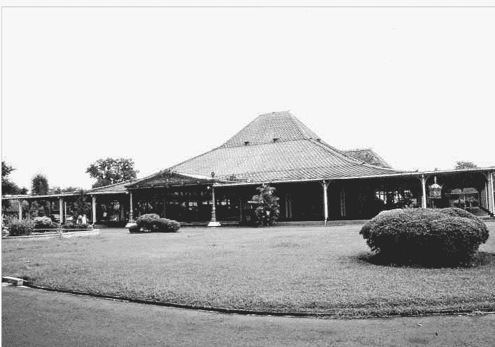

曼昆尼纳加拉宫，1996年

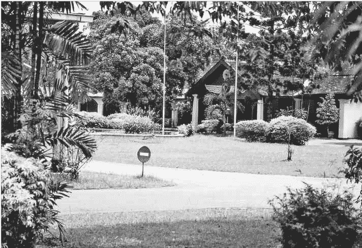

曼昆尼纳加拉宫内部，1996年

## 在苏卡尔塔立足

曼昆尼纳加拉一世建立的府邸位于帕库布瓦纳三世（Pakubuwana III）皇宫西北约1.4公里处。他将这处府邸变成了通常被称为 `pura` 或 `astana`——即宫殿。在贵族等级中，他的 `purastalana` 低于 `kraton` 或 `kedhatan`（国王、`ratu` 或 `datu` 的居住地），但高于被称为 `dalem` 的普通王子的府邸。这座宫殿及其广阔的土地今天仍由曼昆尼纳加拉的后裔占据。他的弟弟 Png. Mangkuningrat（又名 Png. Timur）曾居住在 Tg. Arubangan 的旧址。我没能找到能证实其位置的同代文献，但我确信它紧邻曼昆尼纳加拉宫殿领地的西南角，那里现在仍是名为 `Timuran` 的社区（kelurahan）。如今，这些遗址是苏卡尔塔城市繁华的一部分，几家主要酒店坐落在该地区。在1757年，那里主要是稻田，可能还有一些未开垦的土地，佩珀河（kali Pepe）就在曼昆尼纳加拉定居点的正北方。

我没能找到关于 `Pura Mangkunagara` 建造阶段的来源，但我们可以从其他已知示例中进行推断。主庭和宫廷城市的王族府邸构成了有围栏的定居点。曼昆尼纳加拉的第一步之一可能是确保自己被一个防御边界包围，最初是一道竹栅栏，后来才会被更耐用的材料取代。为曼昆尼纳加拉领地建造一座清真寺将是他的任务之一。

`yasa`（to make, to find）。

《帕库纳加兰史》（Babad Pakunagaran）丰富了这部传记，书中提到该书抄于1779年，并“收录在另一本书中，实际上故事是相同的，但位于不同的书中”。12 一部于1793年开始但未完成的作品残卷开头记载了如下信息：该作品由四位“来自女战士阶级的女性抄写员”抄录，其中有60人，是曼库纳加拉（Mangkunagara）的妾侍；它将描述卡萨特里亚战（Kasatriyan）决定性胜利（1753年8月击败曼库布米）之后的时期；并且它是写在“另一本书中；故事是相同的但书不同”。n

在该残卷的结尾是手稿日记的另一个片段，我们稍后在讨论1780年代和1790年代时会回到那里。¹13 随后，我们再次明确看到，女兵被命令抄写该作品，并且它被抄录在一本“不同的书中”。14 这似乎是一种公式，一种特征，出现在曼库纳加拉的 I prajrit 字体字室抄录的手稿中。

¹² 此处下划线的相关术语：SBPn fi., Iv., Canto (Dhanghangadda):

```
1. Permut tataka wiwit titulus, ngang pawagan Sataka, nuju ing Awab sasine, ngiring ing taun wawi, singenkan kang pangan wasari, buti wiyat turungg, ngrat sengkalampun, naringi ing tanggalan Gusti Pangeran Adipati, kang agalandana.
2. Ingkaya sosok satatin keret, wujid tunggul lanjenaken asalin panapan, sawekti tunggul urase,
3. Babad kalabahahan kang tinulus, linajenaken asalin, sawekti konstitun….nRawuh Aj 1705 等同于1779年9月14日至12日；曼库纳加拉的生日是Ruwah月4日（1779年8月17日）
```


¹³ 此处下划线的术语：Raya Pustaka MSS 48 B.1, p. 84, canto I (Dhanghangadda): 1. Sinerakan ingkang Manid, ingkang anrat carik wuwis, prajrit esti Dipati, kang sejati aladana, sakawan titunud, ananiti serat babat, winulan Sawal tan Dal mendekali, trus kaningan swarangit. 2. Rutipin babad kang tinulus, wusa pranya Prangan Satriyana, kathah carita, seane ing panapan, urutipun carita mungilang, ngaying sesos carita, yekti urutipun, sampunya prangan Katriyani, Prangan Gusti Pangan Dipati, Prangan laman Surusan. 日期转换为1793年5月12日至9日。该手稿收录于佛罗里达，《爪哇语文学》，第3卷，p. 72–3。

¹⁴ 此处下划线的相关术语：BT f 1 left（该手稿页码为左页而非常规的右页）：pemut kenerat prajrit, carik kinon, anutukaken carita serat babat turut,…. panipan seos, nurut carita seos panane…. maksib cari seek, kang nerat nunurun. 该手稿在Mangkukunaran MS B 29（佛罗里达 696.2）p.1的罗马化中亦相同；参见佛罗里达，《爪哇语文学》，第2卷，p. 447。

## 在梭卡塔建立地位 209

看来，曼库纳加拉定居后的首要任务之一是完成他的自传体叙事诗。我们在之前的章节中依赖的抄本始于1779年8月17日，即这位王子在爪哇历上的55岁生日。¹15 如上所述，开头公式化的陈述“此抄本收录在另一本书中，实际上故事是相同的，但位于不同的书中”表明它是曼库纳加拉 `prajuriti esti` 字室的产物。在结尾，手稿说“这个故事的作者（`ingkang murwa carita`）是迪帕蒂王子（曼库纳加拉），他从战争期间的旅行归来”，再次提到它在“不同的书中”被重新抄录。¹6 遗憾的是，手稿并没有告诉我们最初最初完成了这部作品，但据说他是“回来了”，即是在他1757年作为梭卡塔地位最高等级的王子定居后不久。这本个人回忆录是一部极其详实的作品——418页（836页）——通过与其他来源的对比或日期的内部一致性进行测试，证明它是可靠的。这并非一部寻常的自传之作，而是一部充满坦诚并能够进行自我批判的回忆录。显性的错误很少。当用通常的历史批判标准来衡量时，它证明是研究曼库纳加拉事件观的无价来源；我们无法想象他会坐下来凭记忆重新撰写如此长篇的内容。他一定依赖了按日、月、年编写的记录（这将在附录1中进一步讨论）。我们已经看到他抄写《古兰经》和宗教书籍，还将看到他在宫廷中用诗创作的独特混合编史。我们可以说，曼库纳加拉既是一个学者也是一个士兵和虔诚的穆斯林——而且当然，还是美女和爪哇高级艺术（如`wayang gamel`）的爱好者。

## 灵魂捕手者

当他在1757年回到梭卡塔时，战争期间的作品已经完成，仅需最后的润色。我们非常遗憾的是，据所知，他之后没有继续编撰自传。也许他觉得，在经历了人生前31年里的种种戏剧、苦难和失败后，无论之后发生什么都无法与之相比了。我是我在其他地方称为“爪哇神秘主义合成”（Javanese Mystic Synthesis）的典范⁷ 我们不知道他可能遵循过哪个苏菲教派（或多个教派）。然而，看来沙塔里亚派（Shatariyah）可能是当时爪哇岛的主流教派，至少对皇室精英（`kraton elites`）而言如此¹⁸ 在这种背景下，神秘主义合成具有三个显著特征：

- 强烈的伊斯兰认同感。爪哇身份认同是伊斯兰认同的子集，要成为爪哇人就必须先成为穆斯林。
- 遵循伊斯兰教的五支柱——诵念念信、每日五次礼拜、施舍、斋月禁戒，以及有能力的人前往麦加朝觐（在当时的爪哇岛这些人极少）。
- 尽管有上述观点，但接受本土力量是真实的并需要尊崇——从洞穴、树木、十字路口到像南方海洋女神（Ratu Kidul）和苏南（Sunan）这样的人物。曼库纳加拉显然与卢武山（Mount Lawu）非常近；他后来被葬在那里。

由于我们拥有的来源，我们在贵族和宫廷精英中更清楚地看到了这种合成。它在19世纪的改革运动之前广泛存在。

## 在梭卡塔建立地位 211

Harting注意到这种风格的伊斯兰，但令人惊讶的是，“爪哇居民，”他写道，“除了少数人对禁食猪肉和斋戒并不了解。”¹⁹ 几十年后，1822年，格雷西（Gresik）的荷兰居民详细报告了伊斯兰教的广泛遵守，但误解了其核心：

- 伊斯兰教的五支柱，Shahadah（念信）由许多人履行，`sbyang`（每日礼拜）、`puasa`（斋戒）、`zakat`（施舍）、`fitrah`（斋节贡献）和`hajj`（朝觐）。
- `puasa`（斋戒）被所有阶层的爪哇人履行。⁰

这种表面的形式似乎并不像加尔文那样内在虔诚和清醒的强调（这在实践中广泛用于18世纪的爪哇社会）。也不是后来被称为`abangan`的宗教，因为缺乏前两个特征。这些是接受当地灵魂的虔诚穆斯林。这种合成在当时的伊斯兰世界中更为广泛。

这种宗教虔诚与其他精英成员共有的。曼库布米首府（Yogyakarta）发展的早期步骤之一是建立宗教教学校。此类学校在爪哇语中被称为`pesantren`（`santri`居住的地方），在19世纪急剧扩张，直到今天成为爪哇岛随处可见的现象¹¹ 在18世纪中叶的时期，它们似乎仍然罕见。我最早的记载是1718年的泗水。²² 随着第三场爪哇战争的胜利，Kyai Janudin在……“建立了一处教学场所”。

### 捕魂者（Soul Catcher）

这是一个“数百名”铁匠和金匠定居的地区（这些工艺被认为具有精神意义），清真寺在周五祈祷时人满为患。“圣徒（`santris`）的棚屋已经很多，此外，克里斯刀鞘的制造者、优秀的工人、铜匠和车工也来到了了宫廷城市。”23

现在是确立名字和头衔的时候，但对于曼库尼纳加拉（Mangkunagara）的称号仍存在一些困惑。读者可能会奇怪，为什么他的自传体“巴德”（babad）被命名为*Sérat Badak Pakukunagara*——曼库尼纳加拉。解释在于当时爪哇语用法的复杂性。音节 `ipal` 和 `imal` 之间的区别有时会被忽略，这种现象延续到了当今的用法，其中读作 `munika` 和 `munapa`（什么？）的词仍然写成 `punika` 和 `punapa`。`buwana` 和 `bawana`（世界）以及 `nagara` 和 `nagar`（土地、王国）在意义和用法上是相关的。`Mangu`（抱在膝上、照顾，词根为 `pangku`）和 `paku`（钉子）在意义上相关，但在一种揭示文字游戏和谜语的文学文化中，它们是可以互换的候选词，特别是由于书面文本中，字母 `ng` 经常被省略。前缀音节 `hal` 或 `imal` 有时加入名字中，有时又不加入。因此，皇室或贵族的名字如 `Pakunagara`、`(Ha)Mengkubuwana` 或 `Mangkunagara` 几乎是可以互换的。在 19 世纪初，由于第一位带有帕库阿拉姆（Pakualam）名字的王子的出现，这种现象被加剧了，其中 `alam` 是 `buwana` 的同义词。在那个时代的文献中，我们发现了这种命名松散的多个例子。在*Sérat Badak Pakukunagara* 中，曼库尼纳加拉的兄弟曼库尼格拉特（Mangkunigrat）被称为 `Pakuningrat`，以及另一座梅尔巴布山（Mount Merbabu）。24 一份 19 世纪初的沙塔里亚（Shatariyah）精神谱系（`silah`）将日惹苏丹孟库布瓦纳二世（Sultan Mengkubuwana II Yogyakarta）称为“苏丹帕库布瓦纳”。25

23 BG Vol. XXI, p. 76, Canto 212 (Asmaradana): 47 ... atusan kang turut wisma, pandhe miwah kemasan, wiwah agèng Jumuwahhipun, siti rata murah toya. 48. Kyai Dhongkol Jayudin ngaddeken pamurukan, pondhoke santri wisuh akeh, miwah titiyang kang prapti, ranggli ngamalo ana, wong sayang miwah wong bubut, but wasuh

24 SBPn ff. 76., 257r.

25 Fathurahman, Shaṭariyah Silsilah, p. 60–2.

### 在苏卡加尔达确立地位

当曼库尼纳加拉在《萨拉特协议》（Salat settlement）后写信给巴达维时，他自称为 `Pakunagara`。26 这个版本在 1757 年后的最初几年被经常使用。事实上，即使在 1790 年，他自己仍偶尔使用这种风格。27 他的官方——如果我们可以用这个词的话——头衔可以在 1790 年的比例表中找到，这些头衔由 `Kangeng Pangeran Adipati Hamengkunagara Senapati Ingyayuda` 授予：阿迪帕蒂·亨孟库尼纳加拉王子殿下，战场总司令。有时在他那个时代的文献中会加上时间 `Arya` 一词，他是，且通常被称为曼库尼纳加拉（或 `Mangkunegara`），我们将像整本书一样继续使用这种形式。

曼库尼纳加拉在苏卡加尔达（Surakarta）的地位是高级王子（senior prince），即第一次级王子（`pangeran miji`），直接受苏苏南·帕库布瓦诺（Susuhunan Pakubuwono）领导，正如爪哇政治传统提到的，他被邀请“照顾”。爪哇被划分在两个竞争君主之间——苏苏南和苏丹曼库布米（Sultan Mangkubumi）——这并非没有先例。这种领土划分在过去发生过，总是暂时的，并以一方战胜另一方结束。毫无疑问，苏丹希望有一天有机会在他统治下重新统一领土，之后他可能会寻找机会与荷兰人交涉。我所想到的，或者当时的当事人从未引用过的，并没有这种先例——因为要出现一个像曼库尼纳加拉这样的第三个人物：既不是国王，也不是普通的王子；而是一个在苏卡加尔达拥有特殊角色、且过去曾击败曼库布米的人。在这里，他无疑会增加曼库布米的愿望，并让苏卡加尔达比自 1746 年建立以来具有更大的分量。但如果正如事实确实那样，爪哇精英和普通民众已经被战争精疲力竭，如果荷兰东印度公司（VOC）想要尽可能且快速地脱其在爪哇的纠葛，那么这位首领必须找到

26 Png. Ad. Pakunagara, Surakarta, to Batavia, n.d. (但带有 1757 年的其他信件), in VOC 210 (OB 1758).

27 See the examples in Yogyakarta, p. 93.

28 Java’s Noord-Oost Kust 162 “Bijlagen of 1790” with this seal.

### 捕魂者（Soul Catcher）

他们的首次尝试是采用成熟的婚姻技术。主要目标是控制苏卡加尔达的继承权。

### VOC 的新形势

对于 VOC 而言，1755 年和 1757 年的协议代表了其失败。相反，VOC 被迫将领土的一半让给曼库布米，并允许曼库尼纳加拉（Mangkunagara）——为了让公司尽可能在很大程度上摆脱在爪哇的纠葛——在苏卡加尔达建立势力。这种割让领土的利益对 VOC 来说是巨大的。

30 KV, p. 249.

对于他们而言，公司的官员对这些事务并没有多少了解或兴趣，除了事实是婚姻是聚会的场合之外。所以这里有一些利益的重合。遗憾的是 VOC 来说，在 1760 年代……节省了大量的资金。

## 216 捕魂者

Ratu Bendara 的离婚危机让爪哇再次处于敌对边缘，而且不出意外的是，曼库纳加拉拉（Mangkunagara）处于这一切的中心。

## 家族事务与婚姻政治的失败

苏丹·曼库布米（Sultan Mangkubumi）并未亲自出席1757年3月的萨拉里蒂加会议，但他派遣了他的女儿 Ratu Bendara（`cindhe`）和一个新头衔：根据哈廷（Harting）的说法，即曼库纳加拉拉的妻子，精美丝绸赠予 `Raden Ayu Arya Mangkunagara`。如果他的报告是正确的，这反映了分裂后的爪哇王国新现实中的含义性。她是苏丹的女儿，根据这些理由给她一个头衔似乎并不足。但她并不是他的臣民，因为曼库纳加拉拉的妻子是苏卡尔塔（Surakarta）苏侯南（Susuhunan）的臣民。因此，据我所知，那个时代的文献中没有再次出现该头衔，这也许并不意外。相反，曼库纳加拉拉告诉苏丹她已经怀孕几个月，并请求他在马格塔丹（Magetan）给她一份私人封地以供维持生活。我们在上一章中提到，在拒绝为曼库纳加拉拉将拥有的土地时，曼库布米向斯滕穆勒（Steenmuller）解释了封地授予的实际关系。苏丹不想与曼库纳加拉拉建立这种关系，现在尽管她是自己的女儿，显然也不愿为她建立这种关系。正如我们下文看到的，Ratu Bendara 对封地的请求在晚些时候获得批准。怀孕似乎失败了；至少在皇室谱系资料的主要来源中没有记载。我们之前看到，1752年Ratu Bendara 生生一个名为 `R. Aj. Supiyah` 的女儿，该婴儿在婴儿夭世。这段婚姻没有其他孩子幸存，这段婚姻很快以离婚告终；届时，亲缘和实际关系都将简化。

曼库纳加拉现在已经有了适婚年龄的孩子。1757年3月，他将其中一个女儿嫁给了卡丹斯瓦拉（Kadananswara）的儿子，巩固了那段关系的亲密性。4月，他的长女 `R. Aj. Sombro` 和她的丈夫 `R.M. Guntur` 举行了“重婚”仪式。他们在被荒野人追逐的一年前就已经结婚了，因此没有举行正式的庆典。现在他们收到了许多礼物，包括来自帕库武沃诺三世（Pakubuwono III）、公司驻苏卡尔塔事务官 `J.H. Abrahams` 以及来自三宝的哈廷（Hartingh）的。

在 `Png. Mangkungkir` 之后，曼库纳加拉在爪哇唯一幸存的兄弟是他的哥哥 `Png. Tirtakusuma`。当老曼库纳加拉（Mangkunagara the Elder）被流放到斯里兰卡时，他留在了巴达维（Batavia），并因居住的巴达维地区被称为 `Png. Pancuran`。1753年当老曼库纳加拉的遗体回到爪哇时，`Tirtakusuma` 随遗体去了三宝，但随后留在那里加入了东印度公司（VOC）。他的一生没有取得进一步的进展。在他能够加入位于苏卡尔塔的哥哥并品尝可能流向那里的财富与舒适之前，他于1757年5月去世于三宝。他的遗体被运往马塔兰（Mataram）安葬。

这一时期爪哇婚姻政治的关键在于，帕库武沃诺三世有几个女儿，但还没有可以继承他的儿子。爪哇习俗允许通过女系继承职位，尽管之前所有的马塔兰君主都源自男系。如果曼库纳加拉——当然也包括曼库布米——能够为自己或儿子与帕库武沃诺三世的女儿结婚，就有机会控制苏卡尔塔的继承权，对于苏丹来说，可以在下一代通过儿子的权威统一王国。

曼库纳加拉的婚姻政治不可避免地与苏丹·曼库布米冲突。当帕库武沃诺三世还没有儿子时，曼库布米已经有了几个。在他去世前，他有30多个孩子，其中至少16个幸存。1757年，他目前的王子 `R.M. Entho` 证明是一个相当动荡的人物。1755年，他前往爪杜活动并进行了掠夺。

## 灵魂捕手者

哈廷（Harting）曾指责荷兰人没有这样做，但哈廷否认了这一点。总来说，哈廷表示——他的《回忆录》（Memorie）透露出一个在爪哇岛度过多年艰辛岁月的男人的疲惫——“我对他深表敬意。”⁴46

哈廷对曼昆库纳加拉（Mangkunagara）的描述（在他叛乱结束近五年后）唤起了我们在早期章节中熟的那个人的形象：


尽管他身材矮小，眼中却散发着火花与活力。他拥有……相当的收入……可以轻松维持他的退休生活。他与苏丹的女儿结婚了……但上述王子和苏丹仍然生活在不信任中，而且似乎充满了苦涩，这并不是坏事。事实上，这作为一种让短剑更牢地留在鞘中的手段，是很好的。人们必须时刻留意这位领主，因为他不会容忍任何侮辱或侮辱的迹象。如果发生相反的情况，他会在舞台上释放猎犬，而且他在许多王子中不缺少支持，更因为他直接后裔于阿达帕蒂王子（`Pangeran Adapati`）[阿穆库拉特三世必须在1708年被公司流逐]，而他的母亲[`Rd. Ay. Wulan`]是[普利塔尔王子（`Png. Blitar`）[死于1721年]]]的女儿。无疑（因为）他的父亲普格拉恩·安格·曼昆库纳加拉（老，即 `Png. Ang. Mangkunagara` [the Elder]）是已故苏桑南（`Pakubuwana II`）的长兄，后者在1728年被流逐到好角（实际上是斯里兰卡），他在该岛上仍然受到喜爱并被尊严地纪念。这位王子被他最近去世的养父卡丹纳瓦拉（`Kadanawara`）过分地激励和煽动去[主张]源自这一切的一切尊重和自大。

他确实怀着希望，希望国王去世后将王冠戴在自己头上，认为自己有权拥有它.¹47

当范·奥彭伯格（`Van Oppenberg`）于1762年5月访问两座皇宫（`kraton`）时，他发现苏丹并未放弃对曼昆库纳加拉的仇恨。认为曼昆库纳加拉正密谋让他的一个儿子获得苏卡卡塔（`Surakarta`）的继承位权——无疑是通过与苏桑南的某个女儿结婚，这无疑是真实的——曼库布米（`Mangkubumi`）希望荷兰人流逐曼昆库纳加拉。范·布鲁塞尔（`Van Brussel`）当然拒绝了，因为这种分歧加剧了爪哇首领之间这种不稳定的对峙，而这种对峙确保了他们持续的不团结，正如哈廷所说，这“让短剑更牢地留在鞘中”。曼库布米对这种拒绝感到不悦，因为因为公司拒绝让他的某些廷臣负责由荷兰属东印度公司（`VOC`）控制的沿海地区。然而，曼昆库纳加拉尚未通过一桩具有政治影响力的联姻将他的后裔与苏卡卡塔的王位联系起来。

另一位重要人物是`R.M. 贡图尔`（`Guntur`），他在战争后期曾与曼昆库纳加拉结盟，并娶了其女儿松布罗（`Sombro`）。当曼昆库纳加拉于1757年定居苏卡卡塔时，他也去了那里，但他的祖让人们感到紧张。为了理解这一点，我们需要回顾一些动态的历史。当阿穆库拉特三世（`Amkurat III`）于1703年登上卡塔苏拉（`Kartasura`）王位时，独特的普格尔（`png Puger`）反抗了他。荷兰公司有自己的理由不信任阿穆库拉特三世。1704年，普格尔逃往三宝（`Semarang`），公司承认他为新的马塔拉姆国王。至此，第一次爪哇继承之战（1704–1708）开始，结束于阿穆库拉特三世在流逐途中——带走了许多皇室宝物（`pusakas`）——普格尔登基成为苏桑南帕库布瓦纳一世（`Susunan Pakubuwana I`）。这构成了君主直系从阿穆库拉特二世、三世系向普格尔系的偏离，此后的所有君主都源于此点。显然，在至少一些爪哇人心中仍留着这样一种感觉：这种外来干预导致了君权的从合法到不合法的篡夺。阿穆库拉特三世死于1734年……（注：此处原文存在大量OCR重复与乱码，已根据上下文进行清理与翻译）

## 灵魂捕手者

曼库尼加拉拉（`Mangkunagara`）正在巩固他在苏卡加达作为有影响力的资深者的地位。帕提（`patib`）`Mangkupraprja` 年事高龄，通常相当懒散且无能，因此曼库尼加拉拉没有来自那个方向的竞争。帕库布沃诺三世（`Pakubuwono III`）占据统治地位的王后很快退出舞台，这将赋予曼库尼加拉拉“照顾”统治者更大的前景。范·奥森贝（`Van Ossenberg`）在王后离婚前不久这样描述了局面：

> 尽管起初曼库尼加拉拉似乎还有些……事实上，他在所有的交往中都表现出了判断力，以至于他几乎不做任何计划之外的事。他完全按照自己的意愿与苏主（`Susuhunan`）交往，甚至在小事上也是如此。我对此一切……

当这与其他情况相结合时，即一个不知道如何管理自己事务、实际上取决于妻子喜怒的国王，以及一个对主人的命令几乎不加尊重的大臣，那么很难得出结论：像曼库尼加拉拉这样不断渴望并希望王位的王子，将很容易知道如何利用这些情况并采取措施来实现他的目标。这将对爪哇不利，并违背苏丹的计划。这位君主[苏丹·曼甘库布米]认为[曼库尼加拉拉]已经启动了这一进程，诱使[苏主]饮用他提供的酒、忍受琐事、关于这些事的论述以及对苏主微小权威的嘲讽。

> [曼库尼加拉拉]借此与人民建立更紧密的联系，以赢得继承权。最后，[曼库尼加拉拉]为他提供漂亮的女孩（他知道帕库布沃诺三世的妻子不会让他拥有），这只是让苏主在群众中受到蔑视，从而赢得他更大的尊重和爱戴，而他确实已经赢了大小人的崇崇。

范·奥森贝报告说，他试图消除苏丹·曼甘库布米的“忧郁思绪”，同时让曼库尼加拉拉保持良好心情。通过驻扎 `J.C. Beuman`（任期为 1761年至1767年9月），范·奥森贝还试图通过向他展示因此引来的自我蔑视，劝阻帕库布沃诺三世放弃他“攻击性的生活方式以及与曼库尼加拉拉过度亲密”。⁵⁵⁵⁵范·奥森贝，三宝，至巴达达，1762年7月23日，见 `VOC 3065` (OB 1763)。

## 在苏卡加达确立地位

帕库布沃诺三世对管理自己的事务越来越感兴趣，为此，他决定摆脱占据统治地位的妻子，她是马杜拉（`Madura`）帕内巴（`Panembahan`）`Cakraningat V` 的同父异母。马杜拉人干涉爪哇事务的可能性不受人欢迎，因此当苏主在1762年8月与她离婚时，没有人感到遗憾。他指控她多次通奸，并且当她要求杀死他的另一个女人时，显然他几乎在现场杀杀了她。苏卡加达与马杜拉的王室联姻终止了。在决定如何处理这位女士时遇到了一些困难。她最终嫁给了库杜斯（`Kudus`）的总督，并于1788年去世，比她的前王室丈夫早了几周。她的主妻地位由 `Natasukuma/Png Jury` 的女儿取代，那是一个刚从斯里兰卡回来的、原本被许给日洛亚加达皇太子的女孩。曼甘库布米（`Mangkumbumi`）似乎同意了这一安排。

在1762年8月与其皇后离婚后，帕库布沃诺三世立即建立了另一段婚姻联盟，这进一步改善了曼库尼加拉拉影响苏卡加达继承顺序的前景。这不受苏丹欢迎。9月，帕库布沃诺三世将他的女儿 `R. Ay. Kadhaton`（后被称为 `Ratu Aliti`）嫁给了曼库尼加拉拉的长子 `R.M. Sura`（后被称为 `Png. Ar. Prabjaya`）。曼库尼加拉拉成功地与没有子子的苏主建立了婚姻联盟，而这是曼甘库布米未能实现的。此举令苏丹感到意外。⁶ 这段婚姻的任何儿子都将顺位成为苏主。范·奥森贝对此感到担心，但曼甘库布米表示他打算安排王储与苏主的另一个较小女儿结婚（实际上从未发生）。曼甘库布米转而纠缠范·奥森贝，要求流逐曼库尼加拉拉⁷

> ⁵⁵ 同。

> ⁶ 范·奥森贝，三宝，至巴达达，1762年9月19日，见 `VOC 3065` (OB 1763）；范·奥森贝，三宝，至巴达达，1762年12月8日，见 `VOC 3094` (OB 1764)。

> ⁷ 范·奥森贝，三宝，至巴达达，1762年7月23日和11月11日，见 `VOC 3065` (OB 1763)。

## 灵魂捕手者

曼库尼加拉拉戏剧性的家庭事件是他苏丹女儿 `Ratu Bendara` 的婚姻结束。尽管苏丹在新婚姻中有男继承人，但这段婚姻确实让曼库尼加拉拉在日洛亚加达获得了一些影响力。这代表了1747年曼甘库布米与曼库尼加拉拉最初的联姻。这段婚姻在这方面变得反常：没有孩子，且如前所述，没有感情。

在1757年曼库尼加拉拉定苏卡加达后不久，苏丹要求女儿去日洛亚加达他。然而，曼库尼加拉拉不同意。1758年荷兰公司认为曼库尼加拉拉和 `Ratu Bendara` 将会访问日洛亚加达——但并未发生。看来 `Ratu Bendara` 只有在父亲事先承诺的情况下去日洛亚加达。一周内，苏卡加达的荷兰驻员 `Duurveldt` 曼库尼加拉拉拒绝了访问，因为苏丹没有事先承诺¹⁰

1763年6月，发生了相反的访问，日洛亚加达皇储访问苏卡加达会见帕库布沃诺三世的女儿。双方很快就日洛亚加达皇储还是曼库尼加拉拉享有优先权发生了冲突。在舞会上，双方都受到了冒犯。曼库尼加拉拉展示了他的舞技并邀请皇储加入，但后者拒绝了，导致双方发怒。在访问苏卡加达时，几只玻璃由于“无意还是故意的”在荷兰公司三宝首席行政官 `Hermanus Munnik` 脚下破碎了⁶

> ⁸ `Harting`，三宝，至巴达达，1757年6月1日，见 `VOC 2910` (OB 1758)。

> ⁹ `Harting`，三宝，至巴达达，1758年9月1日，见 `VOC 2939` (OB 1759)。

> ¹⁰ `Duurveldt` 的建议记录在 `Donkel`，日洛亚加达至 `Harting`，三宝，1758年9月2日和9日，AN Djokjo "Djokjo brieven naar Samarang 1756–61"。`Duurveldt` 的名字未知。

## 在苏卡加达确立地位

当皇储返回日洛亚加达时——帕库布沃诺三世女儿之后的是他的姐姐 `Rani Bendara`。`Munnik` 认为曼库尼加拉拉对她的离开没有怀疑。然而，在她抵达日洛亚加达几天后，曼甘库布米宣布他打算回到曼库尼加拉拉，理由是他有“私密病”（即性病）且没有提供足够的生活费。这两项指控在伊斯兰法下都是女性解除婚姻的理由。我们应该注意，没有进一步证据表明曼库尼加拉拉患性病。我们将在第九章中看到，多年后，他患有雅疮。这是一种热带地区常见的细菌感染，与梅毒密切，后者的早期会在身体部位（包括生殖器）显示可见病变。因此，1763年声称性病实际上是雅疮的一个阶段。其他症状包括骨痛和肿胀，可能意味着上述描述为风湿或关节炎（`encok`）的时期也是雅疮的早期迹象⁶³

关于这场危机的资料中，提到此事曾提交给伊斯兰法官以确保一切处理得当。⁶⁴ 随后是一个普遍主张，称曼库尼加拉拉的意图是恶意的，曼甘库布米一直这样认为并无疑深信不。得知此后，曼库尼加拉拉……

6¹ `Munnik`，三宝，至巴达达，1763年6月23日，见 `VOC 3094` (OB 1764)，`BMang`，页 205–11。

6² `BMang`，页 200–1。

6³ `Oriol Mitij`、`Kingsley Asied` and `David Davey`, “Yaws”, `Lancet` 381 (2013年3月2日): 763–773; 也于网络发布，2013年2月13日，http://dx.doi.org/10.1016/S0140-6736(12)62130-8。

6⁴ 例如，`Munnik`，报告至日洛亚加达，1763年8月1日，见 `VOC 3094` (OB 1764)。

## 228 捕魂者

他断言这一切都是苏丹的行为，而非拉图·本达拉（`Ratu Bendara`），并表示在回到他身边之前将永不罢。苏梭卡塔驻守伯曼（`Beuman`）试图安抚曼昆纳加拉（`Mangkunagara`），但无果。帕库瓦纳三世（`Pakubuwana III`）也无作为。作为东北海岸总督，范奥森堡（`Van Oppenberg`）曾给苏丹和丹努雷贾（`Danureja`）写信，但并未成功。预料到敌意，曼库布米让部队进入戒备状态。⁶⁵

驻日加的`VOC`驻守`J.C. 德·斯鲁伊斯`（`J.C. van der Sluijs`，任期1661–64年）于1763年6月25日与苏丹会面，离开时坚信没有任何能打动他归还拉图·本达拉·曼昆纳加拉。对荷兰公司试图干涉此事的行为，曼库布米愤怒地，张开双臂，目光如电地吼道：“如果公司想让曼昆纳加拉当苏丹，就把爪哇的一半领土分给他，祝他好运！”德斯鲁伊斯报告说，他的声音之大让内皇宫大门的守卫都冲了过来，帕提（`patih`）也如临死般逃去。在随后的周六赛会上，按照惯例，德斯鲁伊斯询问曼库布米想喝点什么，但苏丹拒绝了任何荷兰饮料。随后，丹努雷贾请求`VOC`寻找方法让他免去帕提（`pati`）一职——该职位本是君主与公司共同任命的——因为他在这一问题上无法取得任何进展。⁶⁶

尼尼（`Munnik`）于1763年7月访问了日加瓦，并询问丹努雷贾（后者承诺会尽力让拉图·本达拉回到给曼昆纳加拉）他是否讲述了另一个故事。丹努雷贾说，曼昆纳加拉让拉图·本达拉担任其女兵（`prajurit estri`）的指挥官，导致她在日加瓦时受到了嘲笑和羞辱。

据说她是某位苏丹的女儿，却允许自己受到不与其身份相符的奴隶般的对待。因此，她决定自行离开曼昆纳加拉，而不是听父亲的命令。这是关于婚姻破裂的另一个——或许是更有可能的？——解释。丹努雷贾声称，在有他在场的情况下，苏丹曾多次试图让拉图·本达拉回到曼昆纳加拉，但她态度坚决。随后，尼尼在曼库布米面前与拉图·本达拉本人面谈，面谈期间她坚持认为自己已经下定主心。尼尼不确定对于让拉图·本达拉重回曼昆纳加拉，他可以做或应该做什么。他考虑过贿赂日加瓦的彭古鲁鲁（`pengulu`）以获得一份判决拉图·本达拉离婚的法律判决，但最终决定无能为力。⁶⁷ 范奥森堡担心曼昆纳加拉蔑视和平解决，他可能会起兵，这是一个极其严峻的前景。他认为，如果发生这种情况，除非`VOC`支持曼库布米，“苏丹的整个家族将分崩离析”，“因为他被大多数高级朝臣所仇恨，而相反，曼昆纳加拉深受子民爱，一旦破裂，日加瓦皇廷的宠臣无疑会站在他这一边”。⁶⁸

8月，曼库布米直接告诉巴达达雅已无可为。拉图·本达拉愿意在任何地方进行离婚手续——苏梭卡塔、三宝市甚至巴达达雅——但不会亲自到场；她会派一名代表。⁶⁹ 帕库瓦纳采取了立场，只要拉图·本达拉不回到丈夫身边，他就不愿意让自己的一个女儿与日加瓦皇储结婚，因此，这件事也随之终结了。⁷⁰

范奥森堡于9月访问了苏梭卡塔，发现曼昆纳加拉仍以不可理喻的方式反对离婚。他对公司表现出亲近的姿态（无疑是一种战术性定位），并声称拉图·本达拉被曼库布米扣在日加瓦，且日日思念他。范奥森堡表示，曼昆纳加拉对曼库布米的愤恨可能导致他叛乱。⁷¹ 随后，苏丹表示无论拉图·本达拉在何处确认离婚，他都会陪伴，并帕库瓦纳的出席也是理想的。

## 在苏梭卡塔立足

曼库布米的记载，帕库瓦纳三世确实建议曼昆纳加拉接受离婚。² 然而，范奥森堡认为这是一个危险的建议。尽管帕库瓦纳的出席是理想的，但如果曼昆纳加拉仍被他（曼库布米）“照顾”，他可以推测这种安排是不行的。任何让曼昆纳加拉与曼库布米面对面的提议，对范奥森堡来说都太危险了。他写道，曼昆纳加拉对曼库布米怀有极大的恨意，后者至少将他视为苏丹计划的障碍。³

范奥森堡再次于1763年10月至11月访问了宫廷。在苏丹表现出的礼貌背后，暗流涌动。小规模冲突正在爆发，尽管总督无法判断哪方的责任更大。曼昆纳加拉在苏丹领地内侵占了几个村庄。作为补偿，苏丹在帕库瓦纳三世的支持下夺回了几个村庄，后者对此要求补偿（这无疑是鼓励）。由于认为重启战争的可能性不大，公司别无选择，继续谈判并等待最好的结果。军事干预是`VOC`可能考虑的最后手段。

离婚案于1763年12月2日由帕库瓦纳三世代表（`Tgs Arunbinang`和`Mangkuyuda`）和曼库布米（`Png Pakungrat`和`Natasukuma`）正式生效。曼昆纳加拉和拉图·本达拉均不在场。两位君主都不在。范奥森堡认为，只要曼昆纳加拉还活着，这次离婚就是有效的。⁵ 然而几年后，他发现自己被骗了。事实上，他得到的只有曼库布米的保证，“关于拉图·本达拉的再婚，不必担心，她到目前还不打算结婚”。⁶

> ⁶⁵ 尼尼，1763年6月23日在三宝市致巴达达雅，`VOC3094` (OB1764)（亦见 dj x,394n2）。

> ⁶⁶ 德斯鲁伊斯，1763年6月25日从日加瓦致三宝市，AN Djokjo33 “Djokjo brieven naar Semarang 1761–64”。

> ⁶⁷ 尼尼，1763年8月1日报告日加瓦，`VOC3094` (OB1764)。

> ⁶⁸ 范奥森堡，1763年8月1日从三宝市致巴达达雅，`VOC3094` (OB1764)。

> ⁶⁹ `HB1`，1763年8月1日从日加瓦致巴达达雅，`VOC3094` (OB1764)。

> ⁷⁰ 范奥森堡，1763年8月2日从三宝市致巴达达雅，`VOC3094` (OB1764)。

> ⁷¹ 范奥森堡，1763年9月13日从三宝市致巴达达雅，`VOC3094` (OB1764)。

> ⁷² `BMang`, 第341页；`Ricklefs`《日加瓦》第113n54页。

> ⁷³ 范奥森堡，1763年10月13日从三宝市致巴达达雅，`VOC3124` (OB1765)。

> ⁷⁴ 范奥森堡，1763年11月12日从三宝市致巴达达雅，`VOC3124` (OB1765)。

> ⁷⁵ 范奥森堡，1763年12月2日从三宝市致巴达达雅，`VOC3124` (OB1765)。

> ⁷⁶ `HB I`，1763年10月12日从日加瓦致范奥森堡，作为范奥森堡1765年12月关于拉图·本达拉再婚报告的一部分，`VOC3157` (OB1766)。

曼昆纳加拉在曼库布米手中遭受了耻辱性的失败。他所谓的盟友帕库瓦纳三世未能能阻止苏丹偏离路线。离婚后，曼昆纳加拉在余生中一直抱怨，但无能为力。这无疑是对他在爪哇新划分的国家结构中二等地位的苦涩提醒。拉图·本达拉想要离婚的真实愿望必须保持未知。

范奥森堡于1765年卸任东北海岸总督，他对两个国家的继承问题表示担忧。他写道，如果帕库瓦纳三世去世，曼昆纳加拉将试图夺取王位。曼库布米会竭尽全力防止这种情况的发生，希望将爪哇重新统一在自己手中。如果曼库布米去世，那么曼昆纳加拉和日加瓦皇储将争夺日加瓦的继承权。然而，巴达达雅认为继承问题的不确定性是用来约束君主的缰绳。对于一个被多年战争和财务损失耗尽的公司来说，这是一个危险的游戏。然而，随着事件在公司的影响下发展，巴达达雅的意见已微不足道。

## 灵魂捕手

这两段婚姻意味着苏丹·曼库布米米（`Sultan Mangkubumi`）放弃了让他的太子娶帕库瓦纳三世（`Pakubuwana III`）女儿的想法。他特此放弃了让苏卡尔塔顺位继承的尝试，从而导致两个王国都由他的儿子统治——这是他血系重新统一的良方。这意味着曼昆纳加拉（`Mangkunagara`）将没有理由干预日惹卡塔的继承争夺。

控制苏卡尔塔继承权的各种手段在17世纪70年代后期崩溃。随着1768年8月帕库瓦纳三世的一位大正妻生下一个儿子，之前所有的计算都付诸东流。这个孩子经历了童年和青少年期的重重危险，最终继任帕库瓦纳四世（`Pakubuwana IV`，1于1788-1820年在位）。这对于曼昆纳加拉来说也是具有意义的一年。1月2日，苏苏侯南（`Susuhunan`）的长子恩格·普拉比贾亚（`Png. Prabijaya`）与苏苏侯南的长女拉图·阿利（`Ratu Alit`）结婚，生下一个男孩，他就是曼昆纳加拉二世（`Mangkunagara II`，于1796-1835年在位）。


如果曼昆纳加拉的领地不是世袭的，那么既有下一代也有更后的一代。因此，并不是苏卡尔塔和日惹卡塔领地在许多方面已经通过婚姻关系或其他隔绝被分裂。婚姻政治已经失败了。

为了取代拉图·本达拉（Ratu Bendara）成为他的正妃（`garwa padmi`，如果是国王，我们会称之为皇后），曼昆纳加拉提拔了一位此前来自维吉尔山（沃诺戈里）的侧室（`garwa ampeyan`）的女性，名叫M. Ay. 库苏马帕塔蒂（M. Ay. Kusumapathati）。我没有找到这一转变何时发生的证据。作为新的`garwa padmi`，她的名字改为R. Ay. 曼昆纳加拉，我们将继续称之为库苏马塔哈蒂（Kusumatahati）——这是一个美丽的年轻女性非常悦听的名字，意为“碎心花”。

库苏马塔哈蒂似乎出身于具有精神意义的血统，尽管这一证据的价值尚不明。曼昆纳加拉图书馆有一本名为《瓦纳布拉塔经》（`Sérat Wanabrata`，意为“苦行的手段”）的文本，既有一个现代横线笔记本纸上的手稿散文版本（日期为1882年），也有一个1952年写的油印版和罗马化打字稿。前者是匿名的，而后者由曼昆纳加拉的一位R. Ng. 萨斯特拉贾纳（R. Ng. Sastrajana，即“Sastrodjono”）创作。在第一节诗中，这个名字也被认为是一个时代错误，这种做法仅从19世纪中叶起才为人知。这两个文本显然都于19世纪晚到20世纪中期。在本传记中，由于依赖于曼昆纳加拉生活的证据，或至少与其同时期的证据，因此忽略这些在后出现得多的文献中所述的故事是合理的。我在这里描述这个故事，供读者自行判断。

《瓦纳布拉塔经》讲述了卡塔苏拉时期拉罗地区的一个比斯曼（Bisman），他在1746年是一个神圣（kyai）之子，从事艰苦的冥想。当他娶基·努里坎（Ky. Nurikam）的女儿时，他被改名为卡桑·努里曼（Kasan Nuriman）。三个月后，基·努里坎病了，要求卡桑·努里曼在他死后清洗尸体，随后去世。卡桑·努里曼按照要求清洗了尸体，但随后发生了异象。他注意到移动，发现尸体勃起了。卡桑·努里曼从口中抽出阴茎，它就消失了。这个故事可能会让现代读者感到反感，但爪哇传统中至少有两个类似的先例表明这是一项重要的仪式。当马塔拉姆将帅加拉德（Mataram Senapati Galad）在1601年左右时，幸存的王子聚集在一起吻死者的阴茎。那个场合没有发生更奇异的事。然而，当苏苏侯南·阿芒库拉特二世（Susuhunan Amangkurat II）于1703年去世时，遵循了同样的仪式，据说阴茎是直立的。普格尔王子（Prince Puger——他很快篡夺了马塔拉姆家族阿芒库拉特三世分支的王位）拥有阴茎上有一个像辣椒一样大的光芒，他迅速将其吸走。这一事件被明确描述为合法性传递给普格尔是“上帝的意愿”的证据。因此，对于卡桑·努里曼来说，某种超能力传递了。

根据《瓦纳布拉塔》的故事，在卡塔苏拉时期，反叛者曼昆纳加拉看到了卡桑·努里曼十四岁的女儿并请求娶她，得到了允许。卡桑·努里曼被改名为马·阿尤·帕塔哈蒂（Mas Ayu Patahati，即库苏马塔哈蒂）。努里曼去世了。当曼昆纳加拉成为苏卡尔塔的总司令（senapati）时（即1757年后），她成为了他名为拉登·阿尤·塞普（Raden Ayu Sepuh）的`garwa padmi`。她为曼昆纳加拉生了两个孩子，长子是普拉布·阿米贾雅（Prabu Amijaya，继承者一直延续至今），小子则是R. Aj. 桑博（R. Aj. Sombro）。

唯一剩下的可能寻求统一爪哇的王室竞争者——无论这种前景是多么遥远——是辛加萨里（Singasari）。他位于山区的的马拉兰地区，那里爪哇君主和荷兰东印度公司（VOC）都没有控制。他与公司最大的敌人苏拉帕蒂（Surapati）的后代结盟。他多次拒绝苏丹回到日惹安定生活的邀请。与VOC和爪哇军队发生过小规模战斗，但直到1767-68年才发生针对辛加萨里的大规模军事行动，当时公司和爪哇军队对爪哇东部（布兰巴岸）的巴厘人发起了进攻，然后向辛加萨里进军。他在1768年7月在南岸沿海的山区被VOC俘获。他说他想臣服于苏苏侯南，但帕库瓦纳三世和曼库布米都不想理会。他被带到巴达维亚，在被送往海外流亡之前在监狱中去世。直到1825年的迪帕纳加拉王子（Prince Dipanagara），爪哇没有发生其他王室叛乱。

日惹卡塔和苏卡尔塔这两个无法通过战争统一的王国，现在很难通过婚姻重新统一。是否还存在王子试图通过反叛统一爪哇的严肃前景？他们今天仍然保持分裂状态。在曼昆纳加拉时代，土地和人民的普遍疲竭、精英阶层对战争必须结束的明显共识、荷兰东印度公司在紧张时期作为砝码的存在——这一切意味着苏卡尔塔和日惹卡塔对爪哇的划分获得了一种可能让主要的爪哇人物感到惊讶的永久性。这对于帕库瓦纳和VOC来说无疑是解脱，对曼库布米来说则是令人恼的失望。对于曼昆纳加拉来说，这一定是他接受的现实，因为他找不到任何扭转局面的方法；除非重新燃战，否则他将陷入比他在1757年面临的情况同样困难或可能更困难的境地。甚至他最亲近的追随者和亲信也没有建议这样做。他通过培养VOC作为盟友来适应新的政治环境。1766年2月，他写给总督和印度民地委员会的一封信，信中充满了谄媚，表达了他们对他的行为感到高兴的喜悦，说他知道任何忠于公司的人都将获得公司的帮助，等等——这些陈述在巴达维亚人眼中引发了与我们今天同样的不可置信和怀疑。我们以后会看到，事实上他并没有失去所有的斗志。当他在1765年5月从 Semarang离职时，范·奥彭伯格（Van Oppenberg）描述曼昆纳加拉表现出对苏苏侯南和公司的完全顺服。但范·奥彭伯格写道，他“仍然活泼且火爆”，有一天可能会对曼库布米“爆发”。失去拉图·本达是一个持续的哀诉。

## 8 面对新世纪，宫廷如何应对边缘化，1768–78¹

### 爪哇宫廷的世纪循环

《巴巴德》（Babads）记录了随着爪哇历（AJ）世纪更替而苏丹国（kraton）变迁的循环。在公元1760年代后期到1770年代，这样一个循环再次到来。由于人们心中有一种挥之不去的感，即两个苏丹国之间的分裂如果是永久性的，将是前所未有且缺乏合法性的，因此必须采取行动。苏苏胡南帕库布瓦纳三世、曼昆纳加拉一世王子和苏丹曼库布米（哈门孟布瓦纳一世）可能都对这一循环所预示的变化感到威胁。这对于苏丹来说尤其是一个问题。因此，我们所拥有的针对这些威胁建立的防御证据主要来自雅加达，这并不意外。苏尔卡塔（Surakarta）是一个有着明确渊源的宫廷，可以直接追溯到前身卡塔苏拉（Kartasura）苏丹国，一直回到阿格贡苏丹及其先辈的宫廷。然而，作为通过反乱诞生的新宫廷，雅加达的宫廷血脉又是怎样的？鉴于现实世界中由于战争再次爆发，几乎没有重新统一国家的希望，那么雅加达与苏尔卡塔之间分裂的合法性就必须在由爪哇思想主导的超国家领域中寻求。

> ¹ 本章仅对直接与曼昆纳加拉一世经历相关的来源、此前未发表的新证据或直接引文加脚注。否则，通篇叙述基于我的著作《雅加达》第6和第7章。

曼昆纳加拉似乎对即将到来的世纪末感到担忧。然而，他的宫根本不是一个苏丹国（kraton），因此他可能感到与其疏远。尽管如此，我们将看到他采取了一些步骤，这些步骤可能与超自然历法节奏驱动的不祥预感有关。至少，我们可以想象他在观察事件是否会为他夺取主动权提供机会。但事实上，随着双苏丹国国家结构变得日益规范化，他的地位变得更加边缘化。

读者在本章中必须进行一些双历法的思考。需要记住的最基本的历法对应表如下：

- AJ 1700始于公元1774年3月14日，结束公元1775年3月3日。
- AJ 1703始于公元1777年2月9日，结束公元1778年1月29日。

在日语编书中，我们发现了一个追溯到马札帕特灭亡的循环（带有更早的延伸），提到一个世纪的“00”年将陨落，而在下一个世纪的“03”年将建立一个新的王国。在1760年代后期，熟悉历史传统的爪哇精英成员可以观察以下序列：

- AJ² 1400（公元1478年）：马札帕特灭亡（这一日期在日语文献中已定论，尽管我们知道它在历史上是不准确的）
- AJ 1403（公元1481年）：德马克（Demak）王国的建立
- AJ 1500（公元1578年）：德马克最后一位统治者的去世³
- AJ 1503（公元1581年）：帕让（Pajang）第一位统治者的加冕

> ² 这里的“早期”是指阿格贡苏丹在1633年引入伊斯兰爪哇历之前，严格来说我们使用的是印度萨卡历。
> ³ 见《雅加达》，第179页。我曾写道该日期在爪哇来源中并未广泛发现。那是错误的，正如我随后在M.C. Ricklefs, ed. and transl., *Modern Javanese Historical Tradition: A Study of an Original Kartasura and Related Materials*(London: School of Oriental and African Studies, University of London, 1978), p. 164n48中所示。

### 灵魂捕手者

- AJ 1600（公元1677年）：普莱德（马塔兰）宫廷陷落曼库比亚（帕让和马塔兰在此循环中被视为同一个阶段）
- AJ 1603（公元1680年）：卡塔苏拉宫廷的建立

AJ 1600/1677年和AJ1603/1680年的年份在历史上是准确的。阿格贡的宫廷可能在AJ 1600年（约公元1677年6月28日）陷落于曼库比亚，尽管这一日期的判定存在一些问题。爪哇的卡塔苏拉建立日期（Ruwah月）与荷兰对同一事件在1680年9月的判定相对应。因此，我们可能会认为这些事件是整个循环的起源。然而，我们在《爪爪哇 Pararat》中也发现了这种“00–03”循环，其文献可追溯到萨卡1522和1535年（1613年），因此它的起源似乎更早。事实上，17世纪爪哇文献中的证据可能促成了宫廷的陷落。

卡塔苏拉于1742年6月30日（AJ 1667 Bakda Mulud25日）陷于反叛军，远早于循环所预测的年份。苏尔卡塔于1746年2月9日（AJ 1671 Mulud25日）的建立也远早于计划。我们将看到雅加达是如何处理这一点的。

### 面对挑战时的稳定措施

#### 应对边缘化

还有关于法律管辖权的棘手问题需要解决。例如，如果一个苏苏胡南的臣民对苏丹或在其领土内实施犯罪，案件该如何处理？如果罪犯从一个管辖区逃到另一个，引渡问题如何解决？或者如果一个王国的臣民违反了另一个王国的习惯法，该怎么办？在Sura AJ 1697（公元1771年4月）和Sura AJ 1699（公元1773年4月）之间，两位大臣（pati）达成了两部基本法典。这些是《大法》（Angërr Agung）和《扰乱法》（Angërrubiru）。这些法典从根本上减少了可能导致冲突的争议风险。再次，这些谈判完全忽略了曼昆纳加拉。

确认继承顺序对当时的两个苏丹国都很重要。曼库比米寻求荷兰公司确认其太子将继承王位，他指的可能不是去世时，而是在世纪的交替之际。我们可以注意到

#### 捕魂者

他的皇太子将在 AJ 1700 年年满三个“风”（八个“周期”），即 24 岁，这在圈内似乎被认为等同于某种成年，尽管有几位君主在更年轻的时候就继位，且不需要任何摄政安排。然而，曼格库布米（Mangkubumi）从公司那里得到的仅仅是一项保证：如果这位年轻王子表现良好，公司将支持皇太子的继位。令人惊讶的是，公司完全不知道 AJ 历法的问题可能已使这成为一个迫在眉的问题。甚至可能曼格库布米在当时已经为他的皇太子制定了某种范本。他之所以没有这样做，可能是因为公司的保证似乎是模棱两可的。健康不佳的帕库瓦纳三世（Pakubuwana III）曾就其年仅几岁的皇太子的继位寻求保证。1775 年 4 月（AJ 1701 年初），他写信给巴达雅（Batavia），请求正式就立为皇太子并寻求公司的批准。巴达雅批准了。那次正式宣告于 1775 年 6 月（AJ 1705 年的 Bakda Mulud）进行。在梭罗卡达（Surakarta）和雅加加塔（Yogyakarta），17 世纪的最后十年也标志着大量重要宫廷建筑的建造。这可能也是一种维护永久性的手段。

## 皇宫对世纪挑战的文学回应

在文学领域，特别是在雅加加塔，我们看到了为了规避 AJ 1700 年（公元 1774 年 3 月至 1775 年 3 月）皇宫陷落以及在 AJ 1703 年（公元 1777 年 2 月至 1778 年 1 月）建立新皇宫的威胁而付出的精密努力。AJ 1699 年 Jumadil 月21 日（手稿通常使用伊斯兰历 AH 1187 年，因为该世纪即将结束；该日期对应公元 1773 年 8 月 10 日，但存在不一致之处），雅加加塔皇太子开始编写其父亲统治时期年史，名为《曼格库布米纪事》（Babad Mangkubumi）。文本的重点不成比例地落在 AJ 1699/公元 1773 年之前的时期。虽然没有明显的迹象表明文本最初在何处结束并增加了另一个章节，但值得注意的是，手稿四之三的内容涵盖了统治期的三分之一，而剩下的四分之一文本则涵盖了统治期的剩余三分之。这表明，在 AJ 1699/公元 1773 年开始的*babad*可能是一部涵盖即将结束的统治期的纪史，后来添加了内容的补录。因此，我怀疑其写作与苏丹在 AJ 1700 年将权力权杖交给其儿子的想法有关，正如我们所看到的，这一想法并未实现。

随着 AJ 1700 年的开始，一部宏大的伪历史诞生了，这是一个关于雅加加塔王国及其未来的寓言性描述。多年后，它被认为是一个具有如此超力量的作品，成为该国神圣圣物（`pusaka`）之一。该作品名为《Surya Raja》（诸王之阳），以用华丽辞藻赞美皇太子和曼格库布米的序言开头。任何看到这本带有精美插图的书都能看出其特殊地位。任何阅读序言的人只会知道它是非同寻常的。

> 众所周知，这是 Kanjeng Gusti Pangeran Adapati Anom [皇太子的头衔] 的圣物（`pusaka`），是其父伟大国王显赫的皇子。即 Kanjeng Hamengkubunara Senapati Inagalanga Rahmaysin Patangagama Agama 之爪哇岛，他装饰着 Ngayogyakarta Adiningrat 城市。书中极力赞美了 Kanjeng Sultan 完美的心；愿他在此世和来世获得至高真主的祝福，以及 Kanjeng Nabi（先知）穆罕德的中保之祝福——愿上帝保佑他并赐他平安。
>
> 当他的心赞美完美时，确实，Kanjeng Gusti [皇太子] 意图伟大，创造了神秘知识的秘密（`ngelmu`）[文本继续]。

#### 处理边缘化

#### 捕魂者

且让一切不再[文本继续]。

灵魂捕获者

如果说 Jayengrat 在 历 1703–4 年正在寻找一个有利于雅加达的的先例，那么他很快就会意识到，公元 1603/1680 年《皇宫纪史》（Babad Kraton）中的这第一个结尾是一个令人不安的结局。它是一个分裂而非统一的国家的先例，是一个以卡塔苏拉战胜马塔拉姆为终结的临时割据。因此，Jayengrat 写写了一个新结尾，一旦之前的结尾从手稿中消失，它本可以与之前的页面流畅衔接。然而，由于某种疏忽，早期的结尾从未被删除，因此我们留下了两个结尾作为计划变更的证据。现在，故事进展到公元 1742 年 6 月卡塔苏拉的陷落，等同于 历 1667 年 Rabulingakir 月 25 日——在他 1778 年为雅加达建立先例之前的 30 多年前。事实上，Jayengrat 在 历 1704 年 Rabulingakir 月 25 日（公元 1778 年 5 月 23 日）完成了这个新结尾，正是在 37 年前卡塔苏拉陷落的日期。

《皇宫纪史》的新结尾是否是为了使世纪的循环与雅加达宫廷的存在调和，从而赋予后者合法性？我认为有理由相信，雅加达宫廷精英可以认为“00–03”循环仍在运作，它曾预示着 历 1700 年（公元 1774 年 3 月–1775 年 3 月）宫廷陷落的威胁，以及 历 1703 年（公元 1777 年 2 月–1778 年 1 月）另一个宫廷的建立。在后者的 Ruwah 月 25 日（公元 1777 年 9 月 28 日），正当一个新的宫廷本该建立时，《皇宫纪史》开始撰写。现在《纪史》结束于 历 1704 年 Rabulingakir 月 23 日（公元 1778 年 5 月 23 日）卡塔苏拉的陷落；其含义似乎是，在历 17 世纪到 18 世纪过渡的关键时期，爪哇宫廷的普遍史中，卡塔苏拉的陷落可以被视为最后一个陷落的宫廷——而且本应如此。尽管众所周知，卡塔苏拉实际上比其预定时间提前 37 历故意陷落的，但它确实陷落了。通过省略此后的所有结局——尤其是省略了苏罗卡塔的建立——可以认为雅加达是它的继承者。新结尾意味着，在那个本该建立新宫廷的世纪里，雅加达塔在马塔拉姆中作为卡塔苏拉的合法继承者。一个关于雅加达超自然合法性的先例被找到了，这得到了苏丹领地真实军事实力的支撑。它并没有证明两个宫廷存在的正当性，《纪史》忽略了这一点。循环是完整的，尽管其在《皇宫纪史》中的遵循缺乏《苏里亚拉贾》那种威严、华丽和神秘的微妙，后者曾迎接了雅加达这一充满威胁的历法转换的开始。

我们在这些年间的苏罗卡塔宫廷拥有此类文学活动的证据。也许还会有新发现，但更有可能是 Pakubuwani III 的宫廷感到有必要与其合法性问题斗争。它显然是卡塔苏拉的继承者，在后者陷落后建立，并仍然立于它 1774–78 年建立的地方，在第三次爪哇王位继承战争中险些逃脱了崩塌。

对于 Mangkunagara 来说，这是一个奇特的时期。他并不控制一个宫廷，从循环继承的角度来说，这与他无关。由于苏罗卡塔与雅加达之间导致新土地和法律协议的谈判，以及朝臣对世纪循环的讨论，他可能一直感到被边缘化的不安，并被提醒了自己的次要地位。当然，在所有社会中，人们倾向于认为时间与我们使用的完全人工的数字相关。新结尾意味着，在那个本该建立新宫廷的世纪，雅加达塔作为马塔拉姆中卡塔苏拉的合法继承者。一个关于雅加达超自然合法性的先例被找到了，这得到了苏丹领地真实军事实力的支撑。它并没有证明两个宫廷存在的正当性，《纪史》忽略了这一点。循环是完整的，尽管其在《皇宫纪史》中的遵循缺乏《苏里亚拉贾》那种威严、华丽和神秘的微妙，后者曾迎接了雅加达这一充满威胁的历法转换的开始。

我们在这些年间的苏罗卡塔宫廷拥有此类文学活动的证据。也许还会有新发现，但更有可能是 Pakubuwani III 的宫廷感到有必要与其合法性问题斗争。它显然是卡塔苏拉的继承者，在后者陷落后建立，并仍然立于它 1774–78 年建立的地方，在第三次爪哇王位继承战争中险些逃脱了崩塌。


# 灵魂捕手者

对于 Mangkunagara 来说，这是一个奇特的时期。他并不控制一个宫廷，从循环继承的角度来说，这与他无关。由于苏罗卡塔与雅加达之间导致新土地和法律协议的谈判，以及朝臣对世纪循环的讨论，他可能一直感到被边缘化的不安，并被提醒了自己的次要地位。当然，在所有社会中，人们倾向于认为时间与我们使用的完全人工的数字相关。新结尾意味着，在那个本该建立新宫廷的世纪里，雅加达塔在马塔拉姆中作为卡塔苏拉的合法继承者。一个关于雅加达超自然合法性的先例被找到了，这得到了苏丹领地真实军事实力的支撑。它并没有证明两个宫廷存在的正当性，《纪史》忽略了这一点。循环是完整的，尽管其在《皇宫纪史》中的遵循缺乏《苏里亚拉贾》那种威严、华丽和神秘的微妙，后者曾迎接了雅加达这一充满威胁的历法转换的开始。

## 回顾过去与展望未来

在历 1695 年（公元 1769 年 10 月）中旬，《纪史》开始撰写。《纪史》现在以卡塔苏拉的陷落结束于历 1704 年 Rabulingakir 月 23 日（公元 1778 年 5 月 23 日）；其含义似乎是，在历 17 世纪到 18 世纪过渡的关键时期，爪哇宫廷的普遍史中，卡塔苏拉的陷落可以被视为最后一个陷落的宫廷——而且本应如此。尽管众所周知，卡塔苏拉实际上比其预定时间提前 37 历故意陷落的，但它确实陷落了。通过省略此后的所有结局——尤其是省略了苏罗卡塔的建立——可以认为雅加达是它的继承者。新结尾意味着，在那个本该建立新宫廷的世纪里，雅加达塔在马塔拉姆中作为卡塔苏拉的合法继承者。一个关于雅加达超自然合法性的先例被找到了，这得到了苏丹领地真实军事实力的支撑。它并没有证明两个宫廷存在的正当性，《纪史》忽略了这一点。循环是完整的，尽管其在《皇宫纪史》中的遵循缺乏《苏里亚拉贾》那种威严、华丽和神秘的微妙，后者曾迎接了雅加达这一充满威胁的历法转换的开始。

我们在这些年间的苏罗卡塔宫廷拥有此类文学活动的证据。也许还会有新发现，但更有可能是 Pakubuwani III 的宫廷感到有必要与其合法性问题斗争。它显然是卡塔苏拉的继承者，在后者陷落后建立，并仍然立于它 1774–78 年建立的地方，在第三次爪哇王位继承战争中险些逃脱了崩塌。

对于 Mangkunagara 来说，这是一个奇特的时期。他并不控制一个宫廷，从循环继承的角度来说，这与他无关。由于苏罗卡塔与雅加达之间导致新土地和法律协议的谈判，以及朝臣对世纪循环的讨论，他可能一直感到被边缘化的不安，并被提醒了自己的次要地位。当然，在所有社会中，人们倾向于认为时间与我们使用的完全人工的数字相关。新结尾意味着，在那个本该建立新宫廷的世纪里，雅加达塔在马塔拉姆中作为卡塔苏拉的合法继承者。一个关于雅加达超自然合法性的先例被找到了，这得到了苏丹领地真实军事实力的支撑。它并没有证明两个宫廷存在的正当性，《纪史》忽略了这一点。循环是完整的，尽管其在《皇宫纪史》中的遵循缺乏《苏里亚拉贾》那种威严、华丽和神秘的微妙，后者曾迎接了雅加达这一充满威胁的历法转换的开始。

## 回顾过去与展望未来

在历 1695 年（公元 1769 年 10 月）中旬，《纪史》开始撰写。《纪史》现在以卡塔苏拉的陷落结束于历 1704 年 Rabulingakir 月 23 日（公元 1778 年 5 月 23 日）；其含义似乎是，在历 17 世纪到 18 世纪过渡的关键时期，爪哇宫廷的普遍史中，卡塔苏拉的陷落可以被视为最后一个陷落的宫廷——而且本应如此。

## 灵魂捕手者

也是错误的；他的宫廷位于卡塔——“并安葬在伊莫吉里”。¹15

继承他的是最后一位统治马塔拉姆地区的国王阿曼阿库拉特一世（“他安葬在特加瓦西”）。¹16 普莱德（Plered）被特鲁纳贾亚的马杜拉人攻陷的日期定在 Mulud 18 日周日前夕，那是 Be 年，“bira ilang rasasan rat（消失了，毁灭了，世界的感觉）”，AJ 1600，相当于公元 1677 年 5 月 21 日。这反映了爪哇精英对王宫（kraton）轮回周的认知。然而，该日期本身具有内部复杂性，其准确性也存在问题。德格拉夫（De Graaf）得出结论，王宫于 1677 年 6 月下旬陷。尽管如此，这是曼昆纳加拉（Mangkunagara）在其传统中所继承的日期。

随后是关于阿曼阿库拉特占领卡塔苏拉新宫廷的简短描述，随后是他的死亡并安葬在伊莫吉里。接着发生了第一次爪哇王位继承战（公元 1704-1708 年），战争激烈，并在荷兰人的帮助下，以帕库布瓦纳一世（Pakubuwana I）登基终终。面对自己的家族，曼昆纳加拉现在证明了帕库布瓦纳四世，以及普普拉巴亚王子和比特塔尔。阿曼阿库拉特四世的儿子帕库布瓦纳二世曾安葬在拉维亚恩（Lawetan），但“已经搬迁并安葬在伊莫吉里”，¹18，这证实了从战地墓到伊莫吉里皇墓的转移已在 AJ 1696（公元 1770 年 4 月–1771 年 4 月）之前发生。

然后，曼昆纳加拉进入了他的时代。他使用了他父亲和他一直使用的称号——对于他的父亲老曼昆纳加拉使用普格拉安·阿里亚（Pangeran Arya），对他自己使用普格拉安·迪帕蒂（Pangeran Dipati）。他从世纪交替之际回首，简短而清晰地描述了他认为伴随他一生的善报与幸运。他提到他的父亲是阿曼阿库拉特四世侧妃（ampeyan）的长子，“普格拉安·阿里亚死在海外，在锡隆[斯里兰卡]，已经搬迁并安葬在伊莫吉里，他被送往海外是因为受到了他弟弟苏苏南（Susuhunan [帕库布瓦纳二世]）的嫉忌，后者安葬在拉维亚恩”。阿曼阿库拉特四世从侧妃那里有许多孩子，他在书中列出了恩加阿比王子、达努帕亚王子、达帕纳加拉王子和阿迪瓦贾王子，他们在反对荷兰人的战争中去世。然后提到了在卡巴纳兰（Kabanaran）成为马塔拉姆国王的曼库布米（Mangkubumi）。曼昆纳加拉进一步写道，提到了他的母亲和父亲（在他两岁时就已失去了他们，正如我们在第一章中看到的，第一次由于死亡，第二次是由于流亡：他[曼库布米]被他兄弟普格拉安·阿里亚的儿子宣布为国王（后者死在锡隆[斯里兰卡]）（即：曼昆纳加拉描述了他的战争的最后阶段，从他 1753 年在卡萨特里扬（Kasatriyan）击败曼库布米的胜利开始，详见第 139–141 页。他在 1754 年 10 月在土古（Tugu）遭受的失败预示了他最艰难的时期，那是他省略的许多事件）。这段文字简明地描述了曼昆纳加拉对事件演变以及他最终地位的看法。他对曼库布米的蔑视得到了充分说明。该段落的全文引用如下：

¹⁵ 同上，第 26 页：Kajeng Sultan i[ng] Mataram, ingalih punika nagri jati sampun radin, sadaya sarta megah [sic], meaning mìnhgah] kaji dhatèng Mkah, [i[kang gadhat i[ng] Palered //0/ or sumare Magiri. 随后引用中的双逗号复制了爪哇语标点的标准形式。注意手稿中到处都是 MN 的独特拼写。尽管阿贡苏丹（Sultan Agung）本人没有去麦加，但他显然代表其他人去过那里；H.J. de Graaf, *De regering van Sultan Agung, worst van Mataram 1613–1645 [sic], en die van voorganger Panamembahan Seda-ingKrajjak 1601–1613*, VKI Vol. 23 (S-Gavenhage: Martins Nijhoff, 1958), p. 266–7.

¹⁶ 同上，第 26–7 页：ingkang sumare i[ng] Tenggalangi.

¹⁷ 参见 Ricklefs, *Tradition*, pp. 184–6.

¹⁸ MN MS 192 (Florida 222.A), p. 29：Sunan Pakubuwana Seda Lawijiyah, nanging sampun dipunalih, sumare Magiri.

¹⁹ 同上，第 29 页：Putra pajajeng kang sepuh, kang ampiyan, Pangeran Arya seda sabrang, nanging sampun dipunali, sumare Imagiri, mila dhumateng sabrang, dening kang rayi Sunan. 我没有在每个 MN 独特拼写的例子都使用“sic”。

²⁰ 同上，第 30 页：kang angkat nama raja Pangeran Arya, Seda, patutan saking Pangeran Blitar, Den Ayu Wulan, na krama Pangeran Arya, apuputur kang nama Raden Suryusuma, nu[n]tĕn dhangung, punika kang[n]jung dhateng kang paman Pangeran.

然后，苏南·曼库布米在波诺罗戈（Ponorogo）卡萨特里扬与他的“儿子”普格拉安·迪帕蒂·曼昆纳加拉作战。苏南·曼库布米输了战斗。他逃亡投降荷兰，成为雅加达（Ngayogyarta）马塔拉姆的苏丹。爪哇岛被公司一分为两半。一半给了雅加达的苏丹，另一半给了被安葬在拉维亚恩的国王儿子（即：帕库布瓦纳三世，他是帕库布瓦纳二世之儿子），他是公司任命的国王，名叫拉登·马斯·苏（Raden Mas Sure），普巴亚系的首领，在萨拉（Sala [Sakarta]）王宫统治，被称为萨拉苏南·帕库布瓦纳[三世]。现在，北岸完全归荷兰所有，但公司每年都会预付北岸数万个年轻[银元（reals）]：1 万给苏南，1 万给苏丹。


在锡隆[斯里兰卡]的普格拉安，伟大的普格拉安·迪帕蒂·曼昆纳加拉大声咆哮，他的敌人是苏南、苏丹[sic]以及公司，遭到三者的共同。最终，普格拉安·迪帕蒂·曼昆纳加拉被他的“弟弟”萨拉[Surakarta]的苏南召回，因为萨拉的苏南[sic]在与其叔叔马塔拉姆苏丹的竞争中落了下风。因此，迪帕蒂准备进入萨拉[Surakarta]城。他由苏南本人在通加翁（Tunggaon）以及一位公司高级官员一同迎接。因此，他准备进入萨拉城完成协议：所有人都为此宣誓，第一是公司高级官员，其次是苏南，第三是普格拉安·迪帕蒂，以便他们心意一致。如果苏南病了，他[曼昆纳加拉]也病；如果苏南繁荣，他也繁荣；如果事情苦涩，那么对双方来说都更好；如果很甜，那么对双方都是甜蜜：王宫里的苏南和宫外的普格拉安·迪帕蒂。谚语道：

## 处理边缘化

彼此照顾，对方也照顾，共同遵守他们的言。这是为了上帝。然后我们读到通加翁的日期，正确给出为周四平日，朱马迪勒 4 日，纪历 AJ 1682（使用数字而非纪数），相当于公元 1757 年 2 月 24 日。随后是另一个花卉装饰以及关于曼昆纳加拉到达萨拉时 32 岁而苏南 27 岁的观察（这些描述之间插入了两个空白页）。AJ 1682 再次出现在装饰性标题中，曼库布米，关于雅加达“苏丹·曼库布米”成为马塔拉姆的。另一个


¹ 这指的是帕库布瓦纳二世在 1726 年登位时（16 岁）与其叔叔普·普巴亚的 14 岁女儿结婚，以实现 1720 年的一条预言。这段婚姻生了帕库布瓦纳三世。参见 Ricklefs, *Seen and Unseen Worlds*, p. 5.

² 金额是正确的。爪哇人区分西班牙银和荷兰银元，前者被称为“老”银（royal puluh），而后者是“年轻”版本，也称为荷兰盾达令。参见 Ricklefs, *War, Culture and Economy*, p. 239.

# 灵魂捕获者

花卉装饰随后从另一份家族关系列表中分离出来，这次从曼昆尼加拉（Mangkunagara）本人开始，他的儿子普格兰·阿里亚·普拉布·阿米贾雅（Pangeran Arya Prabu Amijaya）嫁给了苏拉卡塔帕库瓦纳三世（Pakubuwana III）的女儿。阿米贾雅下了普格兰·普拉布·萨达，他继承了普格兰·普拉布·普ang 的称号。随后，苏拉卡塔太子在 1701 年继了该职位——正如我们在上面所看到的，这是正确的，而且可能与对苏拉卡塔世纪循环的担忧有关。²⁴

在这里，正如我们在曼昆尼加拉的自传《帕库尼加兰史》（Sérat Babad Pakunégarán）中所看到的那样，他区分了 1755 年和 1757 年的两次定居。在前者中，曼库比（Mangkumbi）与荷兰东印度公司（VOC）达成了一项协议，他将其描述（这种描述与当时的军事政治现实相当不符）为曼库比向帕库瓦纳三世效忠。然而，在 1757 年，曼昆尼加拉被召回苏拉卡塔“照顾”他的晚辈帕库瓦纳三世。一位高级公司军官支持他们的和解。在他的《史》（*badad*）中，他显然认为在萨拉蒂加（Salatiga）与 VOC 达成的正式协议不值一提。

此时——在该手稿的第 38 页——我们认为是曼昆尼加拉的笔迹结束了。随后的注释是其他人的笔迹，其中记录了曼昆尼加拉于 AJ 1722 年 Jumadilakir 月（公元 1795 年 12 月）去世。²⁵ 这些注释大多与伊萨（Isam）有关。²⁶

然而，还有一段曼昆尼加拉本人写的片段，同样是他的笔迹，倒置且正反装订的。这是一段关于*人性之道（*Sipat ing manusa*）的描述，深植于爪哇苏菲冥想传统。它是诗歌形式的，开头声明了自己的作者身份和写作日期，这可能引起了对 AJ 1701–3 周期的联想：

²⁴ 同上，第 34–8 页。MN I 的孙子 R.M. Sadat 成为了 P. Prabu Prangwdana，最终继位成为 MN II（1796–1835年在位）。Padmasurasita 在《内部史》（*Sajarah-dalem*）267 页将他记录为 R.M. Slamët 而非 Sadat，我认为我们可以假设 MN I 同时代的记载记录了其青少年时期名字的可靠版本。他的名字出现在 MN I 自传 SBPn 的开头（下文引用的段落，第 267 页注 4）。

²⁵ MN MS 192 (佛罗里达 222.A)，第 38 页。

²⁶ 参阅佛罗里达《爪哇文学》（*Javanese Literature*）第 2 卷，第 141–2 页。

## 处理边缘化 253

+ 1. 注释：普格兰·迪帕蒂领爵（Lord Pangeran Dipati），

当他创作这首关于人性之道（sipat ing manusia）的诗，

关于内心之中的灵之体时，

是在周六的前夕，

Siyam 月（斋月）的 15 日，

Dal 年，

该年的纪年字为

“三天为地之声” [AJ 1703: 公元 1777 年]。

他创作这首诗时位于苏拉卡塔市，

坐在一个凉亭里。²⁷

文本戛然而止，完全不完整。

这份手稿提供了一个无价画面——我们可以有合理把握地说，这是最后一份曼昆尼加拉本人思考的产物——关于他是如何看待自己的处境的。它传达了一种历史感，与我们从他的自传史（babad）中学到的内容一致。然而，它的时机很有意义，尽管必须注意不要要求证据超出超出分析。主作品的创作始于 AJ 1695（公元 1769 年 10 月），正值旧世纪结束之际，这表明曼昆尼加拉在思考自己在更广阔历史中的位置——在伊斯兰世界、在爪哇历史上伟大的传奇和半历史事件中，以及他所处的时代——以及当世纪走向结束时，他在这些宏大视角中所处的位置。在他的描述中，他并没有像曼库比那样向公司投降，而是被召回苏拉卡塔照顾帕库瓦纳三世，照顾苏苏南（Susuhunan）的继承。苏拉卡塔的继承权现在已通过确立新太子而固定（除非发生不可预见的悲剧），这是 AJ 1701（公元 1775 年记录）的事件。

27 MN MS 192 (佛罗里达 222.A)，第 151–3 页) 1. Pemut Kangji Pangeran Dipati, duk rupa sipat ing manusia, badan karo kalune, kala ing Septu, Siyam kang tamu, sengk satining rat, waktu Salakarta dakawi, mingling papungan. 周六前夕（我们称之为周五晚上）15 Siyam Dal AJ 1703 的日期内部是一致的，等同于公元 1777 年 10 月 18 日。值为“0”的单词似乎是一个错误。anggana 在纪年法中的值为“6”。由于数值必须为“0”以与日期的其余部分一致，MN 一定有一个（或许是虚构的）gagana（天空等）的版本，其值为“0”。Salakarta 是全文“Surakarta”的版本。


灵魂捕获者 254

然后，在 AJ 1703（公元 1777 年）的斋月时，曼昆尼加拉在凉亭中思考他的位置。在他的描述中，他并没有像曼库比那样向公司投降，而是被召回苏拉卡塔照顾帕库瓦纳三世，照顾苏苏南的继承权。苏拉卡塔的继承权现在已通过确立新太子而固定（除非发生不可预见的悲剧），这是 AJ 1701（公元 1775 年记录）的事件。

27 MN MS 192 (佛罗里达 222.A)，第 151–3 页) 1. Pemut Kangji Pangeran Dipati, duk rupa sipat ing manusia, badan karo kalune, kala ing Septu, Siyam kang tamu, sengk satining rat, waktu Salakarta dakawi, mingling papungan. 周六前夕（我们称之为周五晚上）15 Siyam Dal AJ 1703 的日期内部是一致的，等同于公元 1777 年 10 月 18 日。值为“0”的单词似乎是一个错误。anggana 在纪年法中的值为“6”。由于数值必须为“0”以与日期的其余部分一致，MN 一定有一个（或许是虚构的）gagana（天空等）的版本，其值为“0”。Salakarta 是全文“Surakarta”的版本。

文本戛然而止，完全不完整。


这份手稿提供了一个无价画面——我们可以有合理把握地说，这是最后一份曼昆尼加拉本人思考的产物——关于他是如何看待自己的处境的。它传达了一种历史感，与我们从他的自传史（babad）中学到的内容一致。然而，它的时机很有意义，尽管必须注意不要要求证据超出其分析范围。主作品的创作始于 AJ 1695（公元 1769 年 10 月），正值旧世纪结束之际，这表明曼昆尼加拉在思考自己在更广阔历史中的位置——在伊斯兰世界、在爪哇历史上伟大的传奇和半历史事件中，以及他所处的时代——以及当世纪走向结束时，他在这些宏大视角中所处的位置。在他的描述中，他并没有像曼库比那样向公司投降，而是被召回苏拉卡塔照顾帕库瓦纳三世，照顾苏苏南（Susuhunan）的继承权。苏拉卡塔的继承权现在已通过确立新太子而固定（除非发生不可预见的悲剧），这是 AJ 1701（公元 1775 年记录）的事件。

> **27 MN MS 192 (佛罗里达 222.A)，第 151–3 页**
> 1. Pemut Kangji Pangeran Dipati, duk rupa sipat ing manusia, badan karo kalune, kala ing Septu, Siyam kang tamu, sengk satining rat, waktu Salakarta dakawi, mingling papungan.
>
> 周六前夕（我们称之为周五晚上）15 Siyam Dal AJ 1703 的日期内部是一致的，等同于公元 1777 年 10 月 18 日。值为“0”的单词似乎是一个错误。`anggana` 在纪年法中的值为“6”。由于数值必须为“0”以与日期的其余部分一致，MN 一定有一个（或许是虚构的）`gagana`（天空等）的版本，其值为“0”。`Salakarta` 是全文“Surakarta”的版本。

人性之道（*Sipat ing manusa*）坚定地植根于爪哇苏菲冥想传统。它是诗歌形式的，开头声明了自己的作者身份和写作日期，这可能引起了对 AJ 1701–3 周期的联想：

> **1. 注释：普格兰·迪帕蒂领爵，**
>
> 当他创作这首关于人性之道的诗，
>
> 关于内心之中的灵之体时，
>
> 是在周六的前夕，
>
> Siyam 月（斋月）的 15 日，
>
> Dal 年，
>
> 该年的纪年字为
>
> “三天为地之声” [AJ 1703: 公元 1777 年]。
>
> 他创作这首诗时位于苏拉卡塔市，
>
> 坐在一个凉亭里。²⁷

文本戛然而止，完全不完整。

这份手稿提供了一个无价画面——我们可以有合理把握地说，这是最后一份曼昆尼加拉本人思考的产物——关于他是如何看待自己的处境的。它传达了一种历史感，与我们从他的自传史（babad）中学到的内容一致。然而，它的时机很有意义，尽管必须注意不要要求证据超出其分析范围。主作品的创作始于 AJ 1695（公元 1769 年 10 月），正值旧世纪结束之际，这表明曼昆尼加拉在思考自己在更广阔历史中的位置——在伊斯兰世界、在爪哇历史上伟大的传奇和半历史事件中，以及他所处的时代——以及当世纪走向结束时，他在这些宏大视角中所处的位置。在他的描述中，他并没有像曼库比那样向公司投降，而是被召回苏拉卡塔照顾帕库瓦纳三世，照顾苏苏南（Susuhunan）的继承权。苏拉卡塔的继承权现在已通过确立新太子而固定（除非发生不可预见的悲剧），这是 AJ 1701（公元 1775 年记录）的事件。

> **27 MN MS 192 (佛罗里达 222.A)，第 151–3 页**
> 1. Pemut Kangji Pangeran Dipati, duk rupa sipat ing manusia, badan karo kalune, kala ing Septu, Siyam kang tamu, sengk satining rat, waktu Salakarta dakawi, mingling papungan.
>
> 周六前夕（我们称之为周五晚上）15 Siyam Dal AJ 1703 的日期内部是一致的，等同于公元 1777 年 10 月 18 日。值为“0”的单词似乎是一个错误。`anggana` 在纪年法中的值为“6”。由于数值必须为“0”以与日期的其余部分一致，MN 一定有一个（或许是虚构的）`gagana`（天空等）的版本，其值为“0”。`Salakarta` 是全文“Surakarta”的版本。

### 灵魂捕获者 254

然后，在 AJ 1703（公元 1777 年）的斋月时，曼昆尼加拉在凉亭中思考他的位置。在他的描述中，他并没有像曼库比那样向公司投降，而是被召回苏拉卡塔照顾帕库瓦纳三世，照顾苏苏南（Susuhunan）的继承权。苏拉卡塔的继承权现在已通过确立新太子而固定（除非发生不可预见的悲剧），这是 AJ 1701（公元 1775 年记录）的事件。

然后，在 AJ 1703（公元 1777 年）的斋月时，曼昆尼加拉在凉亭中思考他的位置。在他的描述中，他并没有像曼库比那样向公司投降，而是被召回苏拉卡塔照顾帕库瓦纳三世，照顾苏苏南（Susuhunan）的继承权。苏拉卡塔的继承权现在已通过确立新太子而固定（除非发生不可预见的悲剧），这是 AJ 1701（公元 1775 年记录）的事件。

然后，在 AJ 1703（公元 1777 年）的斋月时，曼昆尼加拉在凉亭中思考他的位置。在他的描述中，他并没有像曼库比那样向公司投降，而是被召回苏拉卡塔照顾帕库瓦纳三世，照顾苏苏南（Susuhunan）的继承权。苏拉卡塔的继承权现在已通过确立新太子而固定（除非发生不可预见的悲剧），这是 AJ 1701（公元 1775 年记录）的事件。

### 处理边缘化 255

1772 年 3 月，苏拉卡塔居民 F.C. van Straendorff（1767–84 年在任）收到报告，称曼昆尼加拉正在密叛。据说其他人与他勾结，其中包括 Yudaagara，他是万马马斯长和曼库比的帕提 Danur——这使得阴谋变得不太可能——但他也是曼昆尼加拉女儿的丈夫 Sombro——这增加了想法的可信度。曼昆尼加拉还被认为与布兰巴南的残余勾结。Straalendorff 担心在次日的 Garebê Besar 庆祝期间会有个人危险（1697 年 10 月，公元 1772 年 3 月 14 日）。他决定装病以避免出席，声称这是帕库瓦纳三世的建议。苏苏南也宣布他将出席。³¹ 取而，Straalendorff 派了他倒霉的随从通知曼昆尼加拉此事。

> ³¹ Straalendorff 写苏拉卡塔致雅加堡，1772 年 3 月 13 日和 14 日，在 VOC 中。
>
> ³² Straalendorff 写苏拉卡塔致雅加堡，1772 年 3 月 14 日，在 VOC 中。

这种做法在没有具体细节的情况下广为人知，例如称王宫内有破坏和平的企图者。33 曼库纳纳加拉（Mangkunagara）无疑清楚公司军事力量的衰弱状态，不太可能会被这样封信恐吓。他对驻员的病情允许他亲自递交信件表示惊讶。范斯特拉伦多夫（Van Straalendorf）的随从人员——在经历了前一天在曼库纳纳加拉宫殿的痛苦经历后，显然缺乏任何讽刺感或幽默感——回答说，无论人是否在，都要服从公司的命令。曼库纳纳加拉告诉范斯特拉伦多夫在他不在时先回家；他会适时给出回复。第二天，他派儿子送去一封信，表达对公司和范布格（van Burgh）的感谢，感谢他们会对曼库纳纳加拉的土地主张做出有利的考虑。34

到了第二天，范布格怀疑曼库纳纳加拉正与苏丹·马库布米（Sultan Makubumi）勾结——尽管这极不可能——而且他们的目的是帕库布瓦纳三世（Pakubuwana III）的性命。雅加达驻员扬·拉普罗（Jan Lapro，1764–73 年）头脑更冷静，否定了这一点。范布格对可能的曼库纳纳加拉阴谋感到恐慌的原因之一是公司在三宝的驻守军十分薄弱。龙团没有任何一个可以指挥它的军官。35 在 1772 年 3 月 27 日的一封密信中，巴达雅（Batavia）宣布有必要逮捕曼库纳纳加拉 36——如果从巴达雅的安全距离来看，这或许是一个明智的预防措施，但对于公司考虑中爪哇土地来说，这是一项风险巨大的活动。

间谍派往农村了解情况，一名假定的阴谋者接受了审问。到 3 月底，荷兰东印度公司（VOC）得出这些全是假的结论。37 一场灾难性的

> 33 Van der Burgh，三宝，至巴达雅，1772 年 3 月 18 日，见 VOC 3364 (OB 1773)。
>
> 34 Van Straalendorf，苏拉卡尔塔，至范布格。三宝。1772 年 3 月 16 日，以及 MN 1，苏拉卡尔塔，至范布格，三宝，1772 年 3 月 18 日送达三宝，均见于 VOC 3364 (OB 1773)。
>
> 35 Van der Burgh，三宝，至巴达雅，1772 年 3 月 18 日，见 VOC 3364 (OB 1773)。
>
> 36 见于 Van der Burgh，三宝，至巴达雅，1772 年 7 月 5 日，见 VOC 3499 (OB 1778)
>
> 37 Lapro，雅加达，至范布格，三宝，1772 年 3 月 26 日及 4 月 8 日；Van der Burgh，三宝，至巴达雅，1772 年 4 月 1 日；“Relaas van der Samangsche mantrieie Kerti Djoijo & Kerta Nadie”，1772 年 4 月 9 日；Van der Burgh，三宝，至巴达雅，1772 年 4 月 20 日；均见于 VOC 3364 (OB 1773)。

一片混乱且非常不悦的范布格责备了范斯特拉伦多夫，没有在一初告诉他马盖丹（Magetan）是苏丹的土地。他说，如果他早早了，他就不会向曼库纳纳加拉承诺帮助他控制那片土地。38 曼库纳纳加拉本人也完全虚伪地抗议说，他也不知道这件事。他写出一副无辜的样子，写道：“我对民间流传的流言感到有些困扰，我不怀疑公司会听到这些传言，它们都是假的。我完全依靠公司，因为公司就是我生之中的父母。”他在信的结尾请求，希望他可以自由决定是否出席或不出席帕库布瓦纳三世，这违背了他 1757 年承诺在特定日期出席宫廷的约定。39 他正在学习一种操纵他新政治环境的方法：戏弄并担忧公司的官员，让他们对他可能在做什么感到紧张，同时抗议自己的忠诚并寻求他们的支持以实现自己的目标。这场骚乱在 1772 年 4 月结束了。然而，考虑到我们对曼库纳纳加拉性格和历史的了解，无法避免地怀疑某些事情可能正在发生，这种可能性正在被测试和探查。范布格写道，曼库纳纳加拉“迟早”会暴乱（`spatten`）；尽管他表现出了友好的迹象，但并不可信。10 尽管 VOC 有其合理的担忧，曼库纳纳加拉可能开始意识到——如果他以前还没有意识到的话——对他行动自由的限制是多么严重。

> 38 Van der Bergh，三宝，至范斯特拉伦多夫，苏拉卡尔塔，1772 年 4 月 4 日，见 VOC 3364 (OB 1773)。
>
> 39 MN I，苏拉卡尔塔，至范布格，1772 年 4 月 12 日送达三宝，见 VOC 3364 (OB 1773)。
>
> ¹⁰ Van der Bergh，三宝，至巴达雅，1772 年 4 月 20 日，见 VOC 3364 (OB 1773)。

1772 年左右，两名朝圣（`haji`）从麦加回到苏拉卡尔塔，其中一人去世了。他的物品中有三封信，似乎是写给苏南（Susuhunan）、苏丹和曼库纳纳加拉的。11 他们敦促他们反对异徒捍卫伊斯兰。作者似乎对爪哇权贵的政治结构和头衔感到相当困惑。最重要的方面

> ⁴¹ 阿拉伯语信件的荷兰语译本的英文译本见 Ricklefs, 雅加达，第 151–2 页；以及在 Ricklefs, *Mystic Synthesis*, 第 172 页。

### 灵魂捕获者

曼昆尼纳加拉（Mangkunagara）重申了他对荷兰东印度公司（VOC）的忠诚，声称在 1757 年他宁愿与公司达成协议，也不愿与任何一位爪哇国王合作——这一观点与当时的证据相当矛盾。随后他要求保留他声称的权利，即可以根据自己的决定决定出席宫廷接见日。这可能会确认、甚至加强他作为唯一“米吉王子”（`pangeran miji`）的资深地位。范德·布格（Van der Burgh）表示，此后这位王子越来越依赖公司的保护和青睐，“为了他自己，特别是为了他的孩子们”——这表明曼昆尼纳加拉与他同时代的君主一样，已经看到了未来。他他还要求拉图·邦达拉（Ratu Bündara）回到他身边（他说话时他一定知道这是是不可能的），要求苏苏胡南（Sushunan）及其高级官员对他给予更大的尊重，并要求荷兰东印度公司驻员在对他下负面结论之前，应先友好地与他沟通。在接见日，苏苏胡南应公开承认曼昆尼纳加拉高于其他所有人的地位。最后，他请求将苏苏胡南领地内的两个区域归他管辖以增加他的收入。范德·布格告诉曼昆尼纳加拉，他将参加定期的宫廷活动；随从人数不超过其地位允许的范围（我认为这件事在*以前*从未被规定过）⁴⁸；最重要的是，在没有特殊许可的情况下不携带更多武装随从；对两个村庄的赏赐表示满意；放弃对苏丹马加登（Magaten）土地的主权要求，并放弃每年 200 西班牙里尔亚的要求，以释放他所俘获的佩卡隆岸总督的女儿；随后，范德·布格将尽力满足他在其他争议事项上的要求，这些主要是公共礼仪事务。曼昆尼纳加拉同意了并在苏苏胡南、驻员和其他贵族面前重复了这些承诺。帕库布瓦（Pakubuwana）迅速将那两个村庄交由曼昆尼纳加拉控制。在范德·布格访问期间还解决了另一个独立问题：女儿龙加·普拉瓦拉迪亚（Rongga Prawradija），她是苏丹·曼库布米（Sultan Mangkubumi）的姐夫、高级军事指挥官和外地区（`moncanégara`）首领，由于不明原因从雅加塔逃亡并投奔了曼昆尼纳加拉。她被送回了雅加塔。

对于曼昆尼纳加拉来说，寻求荷兰支持并在荷兰东印度公司面前公开承诺的整个过程是极大的耻辱。当他在那里给公司写讨媚信件时，双方都没有太在意。然而，现在在一个他不再依赖国内支持（即使是苏苏胡南，除非荷兰东印度公司支持他）的环境下，他正在写卑微的信试图招募荷兰东印度公司作为他的担保人。但对于一个生活在和平爪哇、思想独立且充满活力的曼昆尼纳加拉王子来说，这些都是现实。和平的生活也付出了代价。1771 年，范德·布格描述曼昆尼纳加拉 46 岁[按爪哇历计算正确]，“身体依然强健，但体质非常沉重”。⁴⁹ 无疑，这是由于饮食加上相对缺乏运动所致。

然而到公元 1774 年底（爪哇历 1700 年），在曼昆尼纳加拉遭受耻辱和日益肥胖的同时，又增加了疾病——也许是下一章讨论的酵母感染——此时爪哇传统预测可能会发生单调的王朝更替。范德·布格并不认为曼昆尼纳加拉还能活多久。他认为这种疾病比任何自然倾向都更大，并归因于王子安静的行为以及对自己在宫廷地位的显然满意。⁵⁰

因此，对于曼昆尼纳加拉、帕库布瓦三世和曼库布米来说，继承问题都悬而未决。王子与这两位君主的主要区别在于，他不是爪哇的平等统治者。他有一座宫殿，并没有规定他的领地和地位将传给他的继承人。他在 1774 年（爪哇历 1700 年）两次给范德·布格写信——那是曼昆尼纳加拉 50 周岁的月份——请求荷兰东印度公司照顾他的孩子——其中包括 16 个儿子和 15 个女儿，他提到“Png·阿尔·普拉布·阿米，24 岁。我请求他能继承我的位置”。他要求让其他人在荷兰控制的领土内获得职位，并让他的两个女儿嫁给沿海荷兰管辖地区的首领。范德·布格建议说，永远不会将曼昆尼纳加拉的“阿迪帕蒂蒂王子”（`Pangeran Adipati`）头衔或他的领地——这些都是从领土中划分出来的——传给他的后代。然而，范德·布格在 1775 年初按照要求安排了曼昆尼纳加拉女儿的婚姻。至于其他，曼昆尼纳加拉被告诉应该对已经收到的公司善意保证表示满意。在这种情况下，即使是军事资源有限的荷兰东印度公司，也可以告诉他该做什么。

曼昆尼纳加拉的普拉布·阿贾亚（Prabu Aijaya）在爪哇历 1700 年时仅 24 岁，即三个“风us”（八年周期），雅加塔的皇储也是如此，这个年龄在王子圈似乎被认为等同于我们所说的成年年龄。曼昆尼纳加拉显然在寻求一个承诺，即公司将支持他的领地传给他的儿子。他可能指的是普拉布·阿贾亚应该被正式承认是他的继承人，甚至可能希望他在爪哇历 1700 年继位。他没有得到这样的保证。尽管如此，曼昆尼纳加拉对这一切的反应仿佛他得到的比实际多得多。他写信给范德·布格，表达对荷兰东印度公司的感谢和依恋。他继续写道，仿佛收到了一些关于他地位的新确认：

> “确实，我还在王子（`Pangeran`）和迪帕蒂（`Dipati`）头衔之间徘徊，但那时它们对我有用。但现在我终于确认了这些头衔并在其中受到保护，我发现我的情况比以前好多了。”
>
> 他在信的结尾请求了 400 西班牙里尔。⁵² 他以同样的措辞直接给总督写信，补充说，既然他现在已经确认了他的等级（`waardsigheijd`）并得到了保护，他不仅感觉更好，“而且确信有一天，我或我的孩子将继承我的位”。³³ 这样的保证已经给了。

公司可以看到，曼昆尼纳加拉领地的地位——无论是继承的还是非继承的——可能是一个持续的问题，而且曼昆尼纳加拉本人可能仍成为一个动荡因素，破坏逐渐形成的中爪哇国家结构的规律性。巴达达特别担心如果帕库布瓦纳三世或苏丹·曼库布米在曼昆尼纳加拉之前去世会发生什么。考虑到公司力量的薄弱以及这位王子变幻莫测的性格，在这种情况下他发动政变的可能性可能让荷兰人营中彻夜难眠。1772 年 11 月 27 日，

264

### 灵魂捕手

因此，总督和印度委员会对苏加卡塔（Surakarta）和雅加加达（Yogyakarta）的继承问题做出了正式决定，并将密封信封寄给范·德布格（Van der Burgh），除非一位君主重病或去世，否则不得开启。看来这些信件已无迹可寻。⁵⁴

随着具有潜在威胁的 AJ 1701–3 年时期于公元 1778 年 1 月结束，并没有像世纪周期所预测的那样发生王室更替。两个主要宫廷采取了各种措施保护自己，并在此过程中加强了他们之间对马塔拉姆王国的割分。


# 9 曼昆库纳加拉的晚年：虔诚、艺术、疾病与失去，约 1779–88 年¹

随着时间的推移，曼昆库纳加拉逐渐被边缘化在国家事务之外。他于 1757 年定居在苏加卡塔，正如他理解的那样，是为了“照顾”（`momong`）年轻的苏苏南·帕库布瓦纳三世（`Susuhunan Pakubuwana III`），以对抗苏丹·曼昆库米（`Sultan Mangkubumi`）。然而，随着苏苏南年龄增长、更有经验且更有自信，这种理解与现实变得日益格格不入。由于苏加卡塔和雅加加达出现了一代年轻的贵族，这种理解变得更加脱离现实。除了出生于约 1749–50 年的雅加加达皇储（后来的苏丹·哈门库布瓦纳二世）外，年轻一代人从未见过爪哇岛在内战中合并，即使在童年时期也没有。他们从未观察过 VOC 军队的行进，也未见过曼昆库纳加拉和曼昆库米在血战中展现的武力。这些年轻贵族更擅长宫廷斗争和床房艺术，而非战争艺术。他们意识到 VOC 局势的衰落，在计算中几乎没有理由认真对待公司。对他们来说，年迈的曼昆库纳加拉作为苏加卡塔资深二级王子（`pangeran miji`）的地位是一个异常，是一个将随着他去世而结束的事情。

> ¹ 本章的总体背景叙述基于我的著作《雅加加达》第 8 章。其他来源，特别是与 MN 经历相关的来源、此前未发表的新证据或直接引用，将在本章中注明。

认识到这一点，曼昆库纳加拉显然得出了结论：他只能通过讨好 VOC 的青睐来实现他最后的最后一个目标——为他的继承人确保其公国的安全。公司方面也也能看到这种联盟带来的益处，因为欧洲人在试图面对 VOC 衰落的现实的同时，通过平衡苏苏南和苏丹的利益来寻求符合公司利益的方式。曼昆库纳加拉早年的声誉在公司官员心中无疑比在年轻的爪哇贵族心中更为鲜活——因此在政治上更具效力。因此，这位曾是战争中欧洲人最伟大而痛苦的敌人的人，如今却变成了欧洲人在中爪哇事务中可靠的盟友。正如第 2 章提到的，爪哇领袖受情感的影响正如欧洲人，这种情感激发了帕尔默斯顿子爵（`Viscount Palmerston`）在 1844 年对英国政策的著名描述：“我们没有永远的盟友，也没有永久的敌人”，只有‘利益’，而利益是‘永恒且永久的’。尽管如此，对于曼昆库纳加拉来说，这种政治计算可能是更容易下咽的苦药。他不知道自己为何会在 1790 年被宣布为苏加卡塔的苏苏南。

也许是因为曼昆库纳加拉意识到时间的流逝，以及他与过去的冒险和高潮剧目有多遥远，他的 55 岁生日（爪哇历）对他来说算是一个转折点。这发生在 AJ 1705 年的 Ruwah 月。我们知道他出生于 1650 年 AJ 月 Ruwah 4 日（1726 年 4 月 7 日），因此可以将他的 55 岁生日精确定在 1705 年 AJ 月 Ruwah 4 日，即 1779 年 8 月 17 日。² 因此，他的自传《帕库纳加拉蜡染》（`Serat Batik Pakunagara`）副本详细描述了这些岁月，并丰富了这部作品的第一部分。正如第 7 章提到的，它的开篇使用了特征性的术语，标志它是女兵营房抄写室的产物.³ 其前几节在描述了曼昆库纳加拉对所有朝廷成员和官员（男女）以及宗教学者（`ulama`）和信徒（`santri`）的慷慨之后：“无一被遗漏。”随后它反映了

> ² Rickle, 《曼昆库纳加拉王子头衔的起源》，第 545 页。
> ³ 爪哇语原文引用在第 208 页。

他家庭中变化的动态，特别是对他的儿子普拉布·阿米贾亚（`Prabu Amijaya`）的边缘化，后者未被提及。相反，曼昆库纳加拉的孙子 R.M. Sadat 被点名，并给出的年龄为 12 岁。这样，这本自传副本回顾了曼昆库纳加拉最辉煌的岁月，并展望了他期望的孙子继承。事实上，前者已是遥远的过去，后者则在遥远的未来。与此同时，当下充满了失望。

## 耻辱与疾病

在曼昆库纳加拉这些年不得不遭受的耻辱中，包括他领地的臣民叛向曼昆库米的领地。有时这种流动是反向的，但大多数叛逃是从曼昆库纳加拉到雅加加达。叛逃者包括音乐家和皮影戏师（`dhalangs`），后者具有特殊的意义，因为爪哇皮影戏师（`wayang`）被认为拥有超自然的力量。这些叛逃的动机在来源中并不明确，我们不得不对其进行推测。然而，我们可以合理地认为，它们主要源于两个相互关联的原因，这两个原因都反映了曼昆库纳加拉的从属地位：首先，他的土地和收入规模远小于苏丹。结合这一点，曼昆库纳加拉在 VOC 衰落的现实下，其萎缩的地位可能导致了他在宫廷中不再显赫。

> ⁴ 另一个孙子，Sadya，当时 11 岁。见 SBP 提到的爪哇语（f.第 20 页）。
> ⁵ 爪哇语点见《雅加加达》第 35 页。

当范·德布格要求曼昆库米归还属于曼昆库纳加拉的若干臣民时，他拒绝了。“我不同意，因为你们很这些友谊，”范·德布格写道（至少是这样说的），他担心这一提议背后有‘草中蛇’。“我不认为这种做法是明智的，”曼昆库纳加拉发誓效忠苏丹。如果他去了雅加加达，可能不得不忍受两者。两名从曼昆库纳加拉逃往雅加加达的年轻鼓手，VOC 寻找了他们。

1780 年，范·德布格向其东北总督的继任者建议关于曼昆库纳加拉：“我并不认为他像马塔拉姆（即雅加加达）宫廷经常指责和指责那样。我是根据个人知识得出相反结论。”

曼昆库纳加拉的儿子普拉布·阿米贾亚曾被曼昆库纳加拉寻求确认为继承人，他的处境比其父亲更异常。按照爪哇贵族每代衰落的规律，他的王子（`Pangeran`）头衔可能受到质疑。他的行为也引起了关注。我们在前章中看到，在 1774 年（Ruwah AJ 1700 年，即曼昆库纳加拉满 50 岁的月份），曼昆库纳加拉曾请求公司确认为其继承人。五年后，正如我们在上面提到的，在 1779 年版的《帕库内加拉巴传》开头，他并未被提及。

> ⁶ “... weete broeder members de Compagnie immers wel, wat tuschen mij en Manocoenagara”；HB 1，雅加加达给泗望·德布格，1705 年 Reje Watu 15 日/1779 年 7 月 29 日，见 VOC 3556 (OB 1780)。
> ⁷ 范·德布格，泗望给巴达维。1779 年 8 月 10 日，见 VOC 2556 (OB 1780)。
> ⁸ 范里因，雅加加达给泗望·泗望，1780 年 11 月 7 日，以及泗望·泗望给巴达维，1780 年 12 月 20 日，见 VOC 3588 (OB 1781)；泗望·泗望给巴达维，1781 年 4 月 28 日，见 VOC 3602 (OB 1782)。
> ⁹ 范·德布格，备录，1780 年 9 月 19 日，见 dj xi，第 406 页。

关于他的活动细节并不清楚，但在 1782 年，Siberg 命令苏卡塔驻员 F.C. van Straalendendorff 密切监这个“坏且邪恶的臣……尽管他目前表现平静”。¹⁰

曼库纳加拉对未来的希望现在集中在他的孙子 R.M. Sadat 身上。1780 年，他希望将孙子提升到王子级别（这再次是对普通贵族规则的某种跨越，因此这进一步证实了曼库纳加拉的特殊地位），并命名为“Surya Mataram”（马特拉姆之太阳），这是一个此前未曾见过的名字。荷兰人担心这会得罪并引起日惹加答的怀疑，于是他们采取了干预。Siberg 要求曼库纳加拉为他的孙子再找一个名字。这种情况确实发生了，但我并不清楚他当时使用了什么名字或头衔；1788 年，他被改名为 Prabu（有时为 Surya）Prangwana（或 Prangwanda），并最终作为曼库纳加拉二世（在位 1796–1835）继位。然而，当时还没有关于此类继承的确认。事实上，Siberg 向曼库纳加拉保证，他将支持这位王子的遗愿，将其财产（包括宫殿）交给这个孙子，但告诉他这些不包括他从 Pakubuwono 那里获得的土地。他接受了这一点¹¹

此后，曼库纳加拉产生了一个奇特的想法，娶现班加马瑟（南加里曼丹）苏丹的老孀。荷兰人反对这一点，事情似乎就此罢。曼库纳加拉认为她会带来丰盛的嫁妆，但 VOC 告诉她没钱。他接受了这一建议，并对公司宣称忠诚与喜爱¹² 在其他家庭和婚姻事务上，曼库纳加拉的情况要好。

> ¹⁰ Siberg, Semarang, Ebiedang toward, at Batavia, 1782 年 2 月 9 日, in VOC 3627 (OB 1783).
> ¹¹ MN I, Surakarta, to Siberg, Semarang, received 1780 年 10 月 18 日; Siberg, Semarang, to MN I, Surakarta, 1780 年 10 月 30 日; Siberg, Semarang, to Batavia, 1780 年 12 月 20 日, in VOC 3586 (OB 1781).
> ¹² MN I, Surakarta, to Siberg, Semarang, received 1781 年 1 月 31 日; MN I, Surakarta, to Siberg, Semarang, received 1781 年 2 月 17 日; Siberg, Semarang, to MN I, Surakarta, 1781 年 2 月 20 日; Siberg, Semarang, to Batavia, 1781 年 5 月 15 日和 9 月 5 日（也见 dj xi, 页 1–6）；in VOC 3602 (OB 1782).

## 曼库纳加拉的晚年

当 Pakubuwana III 的皇后 Ratu Canaria 生子时，他们采取了贵族圈中常见的做法，将孩子交给另一个家庭抚养，在这种情况下是交给了曼库纳加拉¹³ 我们假设这反映了他们之间的积极关系。Pakubuwana III 还为曼库纳加拉的一个儿子提供了一个职位，为另外两个儿子提供了封地，并允许了自己的女儿出嫁。所有这些安排为曼库纳加拉的儿子们提供了独立收入，缓解了他们面临的财务压力，也将他及其家族与政治现状联系在一起¹⁴

然而，在曼库纳加拉与苏丹 Mangkubumi 之间并没有这种关系。这使得曼库纳加拉与 VOC 更加亲。日惹加答的背景无疑是最强大的军事力量，而他们较弱。1785 年初，Mangkubumi 抱怨曼库纳加拉的一个儿子袭击了一支从爪哇来参加 Gareb Mulud 活动的队伍，导致一人死亡。经过调查，公司得出结论，认为年轻人没有能力做这种事。随后曼库纳加拉转向苏卡塔驻员 W.A. Palm（在位 1784–88），“突然大发雷”。他宣布道：

> 长官,[他说]，够了！我再也无法忍苏丹的侮辱。从公司最近在爪哇战争开始，他就一直在误导我。现在他的主要目标是让我被公司所厌恶，并借此被公司抛弃，以实现他独自统治的狂想。

> ¹³ Van der Bergh, Semarang, to Batavia, 1780 年 4 月 26 日, in VOC 3584 (OB 1781)。dj xi, 页 407–8 的报告说这是一个女孩，这显然是一个错误。
> ¹⁴ PB III, Surakarta, to Siberg, Semarang, 1707 年 Sapar 月 19 日（=1785 年 2 月 14 日）；Siberg, Semarang, to Batavia, 1781 年 3 月 15 日和 9 月 5 日；in VOC 3602 (OB 1782)。另见 dj xi, 页 1–6 的部分版本。

除了遭受来自 Mangkubumi 的侮辱外，曼库纳加拉还忍受着严重的疾病。我们已经看到他在战争期间曾被鉴定为关节炎或类风湿的疾病所困扰。在 1780 年代中期，他患上了一种被《Babad Mangkubumi》鉴定为 katrapan（雅司、梅毒节）的疾病⁶ 虽然这种疾病在发达国家很少见，但在包括印度尼西亚在内的欠发达地区仍然存在。它以关节和骨骼疼痛、疲劳和皮肤病变为长期特征，可能导致身体畸形；其原阶段最可能发生在儿童身上。会变成一种慢性、复发且毁容的疾病，长期来看会导致骨骼严重畸形……大约 10% 的患者在感染未受治疗 5 年后发展出三期阶段¹⁷ 在 18 世纪以前的爪哇，治疗依赖于草药。可能，甚至很可能，曼库纳加拉早期被鉴定为类风湿或关节炎的疾病正是雅病的早期阶段。对于 1763 年指控 Ratu Bendara 因为他而与其离婚的指控，可能也是如此。雅病会导致皮肤病变，而且实际上是性传播的。1786 年 7 月，Siberg 报告曼库纳加拉患了严重的疾病，身体虚弱；但在 8 月，他似乎已经康复¹⁸

> ¹⁸ Siberg, Semarang, to Batavia, 1782 年 3 月 24 日, in VOC 3627 (OB 1783).
> ¹⁹ MN I, Surakarta, to Siberg, Semarang, received 1781 年 1 月 31 日。
> ²⁰ Badik Nitik Sambnyawa (SB PB A.99), p. 154: kang kalira maksih gerah。1790 年正如我们在下章，他仍然很有精神。

## 宫廷日记：神秘主义合成的启示

曼库纳加拉似乎在创作他的自传体 babad 时是一位文学创新者，即奇妙的《Serat Babad Pakunegaran》。至少还没有发现爪哇语的自传。在 1780 年代和 1790 年代，我们接触到了源自曼库纳加拉的另一种文学形式：混合型“babad-日记”，一种几乎每天记录事件的，以诗的形式创作并有多个副本。这些副本的内容涵盖了 AJ 1707–20 年。附录 1 中有各种手稿的详细描述。关于这些副本制作于曼库纳加拉士兵宿舍的证据，见该处和第 7 章。

Ann Kumar 对其中一个副本的内容发表了有价值的调查。遵循 Pigeaud 的观点，他认为一位女性战士/妾是“作者”或“日记作者”，²¹ 但没有证据支持这一点。提到的女士（们）仅仅是写员。我们可能会怀疑曼库纳加拉本人是否记录了这份日记，但如果是那样，他会被命名为创作者，就像他的自传 babad 一样。因此，我们得出日记作者未知，但它源自曼库纳加拉的宫殿这一点是不置疑的。

> ²¹ E.g., Kumar, “Javanese Court Society”, Pt. 1, p. 4, and Pt. 2, pp. 67, 74.

对于我们理解 Mangkunagarás 的晚年生活来说，日记的一个重要方面是其个人宗教虔诚的体现。我们可以识别出爪哇伊斯兰教的“神秘合成”（Mystic Synthesis）变体——根据当时的文献判断，这在精英阶层中占主导，似乎在社会其他层次也广泛存在。正如第 7 章所述，这种版本的信仰有三个定义特征：

1. 强烈的伊斯兰认同感；
2. 履行伊斯兰规定的仪式生活，特别是“五功”（念念文、每日五拜、缴纳天课、遵守斋月，以及在可能的情况下前往麦加朝圣）；以及
3. 接受本土力量。

这种地方形式的信仰具有多种特殊之处。值得注意的是，我们看到 Mangkunagarás 和其他人热衷于违反《古兰经》对醉酒行为的禁令。对赌博的禁令也经常在斗鸡和其他动物战斗形式中被违反。

一段关于 1785 年初的文字捕捉了年迈 Mangkunagarás 的生活：节庆与虔诚并存。他参加了苏拉卡塔荷兰东印度公司（VOC）驻地的一场招待会，那里有宴饮、饮酒和鸣炮致意。日落时，他由公司骑兵护送乘乘回到宫殿，此时已相当醉（`ragi wur`）。在那里，甘美兰（`gamelan`）音乐伴随着他入睡。日记记载道：

> 7. 在 Dal 日，其纪字法为“形式之声乃人之声” [AJ 1711]....
>
> 在 Friday-Paing 日，Mulud 月，17 号 [1785 年 1 月 28 日]，
>
> 8. 已在清真寺祈祷了 35 次，赞美先知、哈里发、四位圣（[先知的同伴]）以及八位瓦里[爪哇伊斯兰圣者]。米饭有 19 种，140 块 apêm [米花糕] 排列在一起供仪式食用，为了 Panger Dipati [Mangkunagara] 的安康。
>
> 9. 一同祈祷的人有 400 人，表示崇敬的人加上 35 人。²³

Mangkunagara 促进了其他形式的虔诚

²² Kumar, “Javanese Court Society”, Pt. i, pp. 36–46. 还有来自同一来源的引用和印尼语翻译 Zainuddin Fananie, Pandangan dunia KGPAA Hamkoenagoro 1 dalam Babad Tutur: Sebuah restrukturisasi budaya, intro. Suyatarto Kartodirdjo (Surakarta: Muhamadiyah University Press, 1994), 但那里的分析大多缺乏说服力且缺乏根据。


²³ BT f. 48: Canto 19 (Sinom), for the year Dal Aj 1711 (beginning 1784 年 11 月 14 日);7. Taun Edal sinangkulang, rupa eka syara jalma, ... ing dinaja Pumajung, tuntung sisi Mulid, tanggal pitus. 8. Wiwit riyang kisah sagangal, gelar salat, riyang majid, muslim Nabi Kalipah, Sahabat kakawahan malib, masa dari Wali, santri a[m]boeng kehidupan, it satu kawusawang, tangkëp-apèn kang khubari, samalēta Kangeng [Pangeran Dipatay]. 9. Wong kang salat kabehira, kawasatan ngang kabul, pujil tanggal dasangal. 根据与当地日期的一天差异，该日期在内部是正确的。

⁴ Bab Nitik Santri Sambeksanyu (SB A.99), pp. 163–44. 这是在周一，Jumadilawal 1717 的日期下。santri（指未对宗教生活做出完全承诺的人，即遵守宗教义务但节制世俗享乐）；Gericke and Roorda, Java Handbook, Vol. ii, p. 479.

## Mangkunagarás 的晚年

狂喜。Mangkunagarás 在 1785 年 6 月 12 日的 61 岁生日庆典将伊斯兰虔诚的形式与爪哇式的展示结合在一起：

20. ... 随后是 Panger Dipati [Mangkunagara] 的年度生日庆祝，在周日，Ruwah 4 号，Dal 年。确实，其纪字法为“形式之声乃人之声” [AJ 1711]。王子已 60 岁，加上 1 岁。傍晚，诵经的 santri 有 460 人。

22. 同时他们诵读《古兰经》。santri 在场地上（宫殿前）集合。他们邀请从深夜到日出用餐。早晨，甘美兰响起，随着鸣炮，男兵轮流发射，而非集体发射。

23. 随后女兵轮流发射三次。所有观看的人都感到惊叹。他命令 Pangeran Dipati 和他的天女在 Niwatakawa 处。

⁵ Bt. 53: Canto 22 (Dhandanggula) for the year Dal Aj 1711:20, ... nulha tingangan.21. tingangan Pangeran Dipati, tanggal sakan, taune, ngengih sangkalutan, euka saranan jalmi, kang yusa panyaneng, wisidak tak, pasularsa, sontentira kathahe santri kang ngaji, wisidak.22. samya ngaji Qur’an, santri metri dhalukan, kodangan tengah dalune, mangan siru, sinebaran dhuwit, mogang gamelan, gumuruh, ganti-ganti 23. nuly kaya Saragini, awor mari amping gunine, etake kang kudu, kang ngabani Pangran Dipati, lir pendahaga, lan widadariku, prang lan raja Niwata... 见脚注。ingatalan（大庆生日）指的是 Ruwah 月的年度生日。日记还记录了 italin（小庆），每 35 天观察一次，与他的出生日期（周日–7 月）循环。甘美兰 Munggang 是一种古老的甘美兰乐队，仅由高级王子和领主拥有；见 Kunst, Music in Java, vol. 1, pp. 257–60。

⁶ M.C. Ricks, “The Yasadipura Problem,” BKJ 153, 2 (1997): 273–83.

⁷ 带有英语翻译的爪哇语文本可见 Stuart Robson 编；以及 Arjuna: The Marriage of Mpu Kanpur (Bibliothe Indonesia 34: KITLV Press, 2008)。爪哇语版本的简要总结和讨论见 P.J. Zoetmulder, Kalanganwan: A Survey of Old Javanese Literature (KITLV Translation 16; The Hague: Martinus Nijhoff, 1974), pp. 244–49。

该段末的引用是爪哇文学的经典。Mangkunagara 的故事是经典 Arjuniwaha [阿周罗的婚礼] 的现代爪哇语改编，归于苏拉卡塔宫和 Mangkunagara 同期的 Yasadipura I (1729–1803)。然而，有理由怀疑此类铭。在这个故事中，阿周罗击败并杀死恶魔 Niwatakawa，并被赋予天女作为妻子。因此，Mangunkagara 的生日庆典将符号、王室武士道德与伊斯兰之前的文学结合在了一起。

Mangkunagara 的个人宗教实践除了参加清真寺和履行“五功”外，还包括抄写《古兰经》。这告诉我们为了这一虔诚目的他的阿拉伯水平足够。我们已经在他的 Serat Babad Pakunaran（约 1755 年）第 6 章中看到过他的引用。宫廷日记记载 1787 年 10 月他从未停止抄写《古兰经》，而他的士兵随着甘美兰的节奏跳舞。据说，他还写下了“爪哇语和阿拉伯语指南书”，这必须是带有爪哇语注释的古兰经诵读课程，以及“书写爪哇语的古兰经”，可能意味着带有爪哇语翻译的完整《古兰经》。日记还记载在 1788 年 3 月 5 日，他完成了他的第六份完整的《古兰经》。²⁹

²⁸ BT f. 124: turut jurutan lan Arab…. Pangran Dipati nènérat, Jawi Kur’an lan Arab.

²⁹ 同上，f. 140。

## 曼库纳加拉的晚年

然而，这一切与他们对本土力量的持续信仰并不矛盾，也与伊斯兰教的神秘主义融合风格一致。1789年3月17日的一日记记录了涉及 Sunan Lawu 的关键事件，他是拉武火山山的灵体，曼库纳加拉曾在那里进行过许多战斗。Lawu 是一位广受尊敬（并令人敬畏）的神灵，苏卡尔塔和日加塔的宫廷至今仍向他供奉品。他本质上是南海女神（Rabu Kidul）的山地对应物，起源于风神。近期，他成为一种通常被视为反伊斯兰的精神力量，³⁰ 但如下文所示，在曼库纳加拉日记者的眼中显然并非如此。然而，他是受推崇的当地灵性力量之一，这些力量构成了爪哇神秘主义融合的一个方面。

日记记载，在1789年3月24日，曼库纳加拉的孙子（以及后来的继任者）普朗阿旺王子（Prince Prangawang）前往位于拉武山西坡 Madhigh 村的曼库纳加拉选定墓地。他的任务隐性地是监督那里的工作。士兵们正在建造一座清真寺以便举行周五祈祷。3月27日周五前夕，士兵们跳舞，“kaum [宗教社区]士兵”（即 Suran 军）参加了 dibrik 活动。午夜他们举行盛宴，周五早晨举行了集体祈祷和仪式性晚餐。共有461人为曼库纳加拉的福报祈祷。³¹

随后，日记记录了神迹事件，并规定在墓地必须使用皇室色彩黄色：

- 45. 那些在山上工作的人，

寻找沙子的人们：

在河中挖掘出它。

寻找石灰岩的人们：

从山上挖掘出它。

那是上帝的旨意

- 46. Sunan Lawu 给予了帮助：

火山泥沿岸边冲来沙子。

山体裂成了石灰岩。

那些快速寻找石灰岩的人，

毫无无虑地将其挖掘出来。

> ³⁰ 参见 Ricklefs, *Seen and Unseen Worlds*, 第277–84页。

> ³¹ *BT ff.* 193右页–194左页。

## 灵魂捕手

- 47. 沙子不是从溪流中收集的，

而是愉快地从河岸收集的，

从山上更高处运下。

因为在山高处的墓地，

那里有许多石头。

那是上帝的愿望：

- 48. 闪电俯冲向石头，

从山上向下击打，

如鼓点般击打，

从上方崩解，击中地面。

巨大的石头碎成碎片，

随着闪电的扫过。

- 49. 当它们反复击打时，

所有正在工作的人

都感到惊讶和恐惧，失了神魂。

最终他们发现

闪电就像一位同事，

而光滑的石头在那里等待收集。

- 50. 看到看到的人都欢呼呼叫，

为（闪电）的击打方式喝彩。

每一个上山（山）的人，

如果不在做这项工作，

会被山雨侵袭；

如果人们上山做这项工作，

- 51. 将不会下雨

工作将是愉快的。

（如果）普朗阿旺王子（Prince Prangwanda）去那里，

（如果）他上山遇到雨，

他会点香天气就会晴朗。

任何接近山顶的人

- 52. 所在地，

所有人必须穿黄色。

水牛、牛和马，

必须带着黄色（装饰）靠近。

交通工具必须是黄色的。

接近墓地，必须使用黄色。32

> 32 BT. 194左-右：Canto 59 (Kinanthi)，Alip AJ 1715年：45. Kang ambut karya ing gunung, lakine kang mĕndhêt wĕdhi, jlron lepen kang mĕndhêt watu kang ngamping, ard ingkang dhinudhukan, nulya karsanya Yang Luwih. 66. Sunan Law awabantu, ladhu ing kang kali banjir, wĕdhi minggah papingiran, gugur gunung watu gamping, kang mĕndhêt gamping ari,n

# 曼库尼纳加拉的晚年

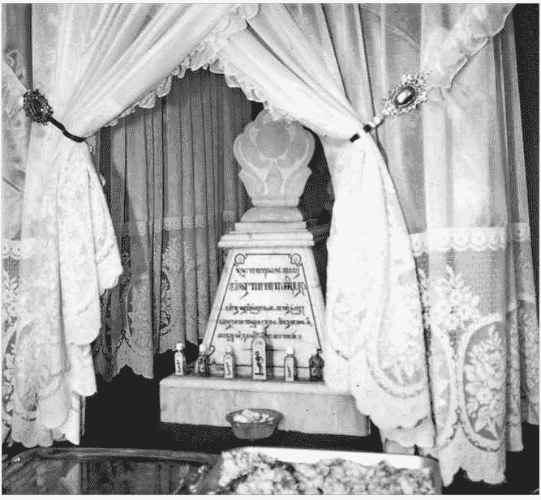

位于 Gunung Wijijil 的曼库尼纳加拉之妻 Kusumapatahi（逝于1788年6月11日）之墓

他宛如离水之鱼，

内心不知所措，焦虑不安。

如今，他隐藏了自己的悲伤，不让外人察觉.³⁷⁷

在岁月流逝中，曼库尼纳加拉在这些事务中度过时光：神秘合成派的虔诚、爪哇艺术的表演、年龄的增长、疾病，以及第一任正妻的丧亲。与此同时，他一生中最后的危机即将在苏梭卡塔爆发，宗教在其中起了重要作用。

> ³⁷*BT f. 149 右：Canto 51 (Sinom)，Jimakir 1714年（1787年10月13日开始）：12. Anglayung-layung i driya, kang manah Pangran Dipati, tinilar garwa kawitan, seda Raden Ayu Nyai, kathah keraseng galih, sarta kang sarira sepuh, kaya kakap ingaking tawang, kewran i manah prihatin, pinamur sedihye aja katara.*

## 10 宗教、苏梭卡塔危机与曼库尼纳加拉与其新欧洲盟友的最终胜利，1787–95¹

### 最后的危机迫近

除了曼库尼纳加拉外，许多爪哇精英成员也关注宗教事务。在1870年根据苏苏胡南帕库波瓦纳九世的命令汇纂的神秘歌曲集（*suluk*）中，有三首被归于帕库波瓦纳三世，另几首被归于即将成为苏苏胡南帕库波瓦纳四世（1778–1820）的作品。目前尚不清楚归属于帕库波瓦纳三世的作品（如果他被认为是作者的话）何时创作的。这些作品讨论了七种流出的等级，³完美的死亡和精神的完美，后者以一种打破了神秘合成派界限的形式呈现。在这部由九节诗组成的短作中，伊斯兰身份的重要性以及对伊斯兰正统“五柱”的承诺（神秘合成派的核心要素两个）被推翻了，取而代之的是 Zoetmulder 所分类的“激进一元论”；4

> ¹ 本章的总体背景叙述基于我的著作《雅加达》第9和第10章。其他来源，特别是与曼库尼纳加拉经历直接相关的、此前未发表的新证据或直接引用，将在本章中脚注。

² *Serat suluk jalan karaton-dalam ing Surakarta*，KS 24 Na (Florida 481)，收藏于佛罗里达，《爪哇文学》第1卷，第260–4页。

³ 关于此主题的雅加达文本，请参见 A.H. Johns 等人译本，《献给先知灵魂的礼物》（堪培拉：澳洲国立大学，1965年）。Johns 所研究的来自雅加达宫廷圈的手稿起源见 M.C. Ricklefs 的《关于 Johns 教授献给先知灵魂之礼物的说明》，BKI 129,2–3页（1973年）：第347–9页。

- 6. ... 你既不是穆斯林，也不是卡菲尔（不信者）。

非物质实在的显现

- 7. 人们在反思，却不承认。

以及诵读《古兰经》，

缴纳宗教税：

他们没有祝福。

审视世界——它并不存在。

唯你存在，

源自造物，

拥有神圣的行为与属性。

是的，你是赞誉的源头，也是崇敬的源头。

你是崇拜的核心.^5

随着苏苏胡南的儿子皇太子——即将成为帕库波瓦纳四世——在日益容易受到动荡和阴谋影响的宫廷中变得越来越强大且富有影响力，苏苏胡南的影响力显然在衰落。他也对神秘主义感兴趣，像他父亲一样，这些兴趣并不总是处于神秘合成派的范围内。我们将在下看到他与被指控异端的导师产生纠葛。在他生命的终头，他甚至与英国守政时期带到爪哇的印度教教佣兵建立了合作。这是基于所谓的共同宗教根源。他险险地逃脱了因反复无常的冒险而被废位的命运.^6 在上述提到的 *suluk* 诗集中，有六首归属于他。同样，还不清楚这些作品何时创作的，或者归属是否正确，其中一首据说是他在皇太子时期创作的。

> ^4 P. Zoetmulder，《爪哇文学中的泛神教与一元论：印尼背景下的伊斯兰与神秘主义》，M.C. Ricklefs 译（KITLV 翻译系列 24：莱登：KITLV Press，1995年）。

5 Suluk samining sananjita，KS 24 NA (Florida 481.4)：Dhandanggula：

6... sira iki nora Islam naro kapit, nyaten jining Sukma, 7. Wong anatang-etiku sira pangling, laman amaca Kur’an ilat, punika jagat pakitra, tan ana sawahipun, tingalana jagat wus sepi, anging sira kan ana, asale ing makluk, pingollah sipatollah, gib punika ing wiji ing bekti, sira jining sembah.

6 参见 P.B.R. Craig 的《1815年爪哇的佣兵阴谋》，BKI 133,2–3页（1977年）：第294–332页。

7 参见佛罗里达在《爪哇文学》第一卷第262–262页的讨论。

随着年龄增长，未来的帕库波瓦纳四世似乎开始了一种消沉且不规律的生活，或许是因为1785年正妻分娩去世的困扰（该孩子后来继位了帕库波瓦纳五世，在位1820–23年）。当这发生时他仅17岁，据报道他在1786年再婚后生活稍微稳定了一些。这位第二任皇后所生的两个女儿被他分别以 Shatariyah 和 Kisbandiyah 命名，源自 Shatariyiya 和 Kisbandiyah。

## 286 捕魂者

在关于芹花的建议下，巴达维（Batavia）在1780年拒绝了请求。然而，在1785年，帕库瓦纳三世（Pakubuwana III）支持了卡雷塔（Kareta）释放并返回爪哇的要求。随着岛屿恢复和平，巴达维妥协了。1787年，他和其他亡者抵达了苏卡塔（Surakarta）。

随卡雷塔来的还有他的儿子——曼昆纳加拉的侄子维拉库苏马（Wirakusuma），他无疑从未足过爪哇。父子两人穿着欧洲服装，甚至配着假发。苏苏南（Susuhunan）允许这种现象持续。但苏卡塔皇储表示反对。他命令他们扔掉假发，留发，穿爪哇服并过宗教生活。很显然，维拉库苏马是一个穆斯林，而欧洲服装并不能表明他的宗教身份。王子可能从未在先知圣训（Hadith）中读过“凡模仿某个群体的人，就属于那个群体”。看来维拉库苏马能够声称伊斯兰权威，或许甚至得到了他海外冒险的助力。

维拉库苏马在与王子亲近的过程中顺应了他的要求，而王子似乎越来越与苏卡塔的欧洲人疏远。他成为了王子的首席行政官（patih）。在他周围聚集了一群虔诚的穆斯林，

> ¹² 我感谢同事迈克尔·拉芬提供的信息（截至2017年10月5日），关于卡雷塔在南非和荷兰的经历，这些基于他在南非国家档案馆的研究。关于这些事物的爪哇来源，请参：Sieberg, Semarang, to Batavia, 1783年3月8日, in VOC 3653 (OB 0784);Siegberg, Semarang, to Batavia, 1785年10月10日, in VOC 3705 (OB 1786);Siegberg, Semarang, to Batavia, 1785年12月24日, in VOC 3703 (OB 1786);Siegberg, Semarang, to Batavia, 1787年4月26日, in VOC 3763 (OB 1788);Semarang, to Batavia, 1987年7月28日, in VOC 3813 (OB 1789)。


> ¹³ 这被用作反对采用欧洲西装和领带的现代者的论据；参见 Nico J. Kaptein, “Southeast Asian Debates and Middle Eastern Inspiration: European Dress in Minakabau at the Beginning of the 20th Century,” in *Southeast Asia and the Middle East: Islam, Movement and the Durée*, de Eric Tagliacozzo (Singapore: NUS Press, 2009), p. 186. 我感谢 Nico Kaptein 在此给出的建议。

> ¹⁴ 维拉库苏马流亡的事件描述于 Palm, Surakarta, to Sieberg, Semarang, 1787年4月19日；PB III, Surakarta, to Sieberg, Semarang, to Surakarta, 1787年4月21日；5 Rejeb Wawu 1733 [1787年4月23日], 1787年4月25日收到；Sieberg, Semarang, to Batavia, 1787年4月26日；Palm, Surakarta, to Sieberg, Semarang, to Batavia, 1787年5月15日；均在 VOC 3763 (OB 1788)。Batavia to H.XVII, 1787年12月29日, in dj xii, p. 124。

他们头戴 `kyai` 和 `haji` 等头衔，表明具有较高的宗教地位并完成了麦加朝圣。VOC 开始对王子与一个看似宗教狂热分子结社的亲近感到担忧。Siberg 描述王子的宫廷“挤满了老师”。据报道，这群人说服了一些服从于王子的村民武力夺取了雅加达的稻田。（记住，这大部分内容的来源是驻留官 Palm，对他的报告应持怀疑态度。）Palm 随后说服帕库瓦纳三世，维拉库苏马集团对他也是一种威胁。

1787年4月，苏苏南同意逮捕维拉库苏马及其他八人。Palm 将他们送到三宝，从那里他们被送到巴达维，然后被流放到斯里兰卡。伴随他们被没收大量的护身符和维拉库苏马的《babad》（年史）。维拉库苏马在其祖籍的短暂逗留结束了。苏苏南将其他效忠于维拉库苏马的人送往通常的内部流放地——阿雅（位于班尤马斯）的荒野，那里野兽横生，环境通常恶劣，导致人类生命危险且通常短暂。一份维拉库苏马追随者的名单列出了近50人。其中包括强大的宗教人物卡乔兰（Pangeran Kajoran），他曾向维拉库苏马献过一套甘兰琴，他的祖先在一个世纪前的特鲁纳贾雅（Trunajaya）叛乱中起过核心作用。曼昆纳加拉的日记简要记录了这些事件，以及王子不知道这些人为何被捕，“不知道国王的意愿”。不言说，这一插曲并没有任何改善未来的帕库瓦纳四世对 Palm 或欧洲人的评价。

苏卡塔的宗教动荡才刚刚开始。1787年12月，在皇宫的一个甘兰亭里发现了两封信。信中宣称拥有巨大头衔的 Ununjaya Senapati（一个马塔拉姆皇室用名中没有先例）将很快从麦加回来，并带着自然征兆来废除帕库瓦纳三世——他是不合格的国王，欧洲人的工具和叛徒。如果欧洲人行为不当，他也将驱逐他们。

> ⁵ Soodanje wiroesoema gedaan 1787年7月, in VOC 3763 (OB 1788)。

> ¹⁶ BT ff.111–112. Quote from f.112: tan

这自然引起了帕库瓦纳三世和 VOC 的不安。Palm 寻找一个责任人，选择了一个神秘人物基迪马克（Ki Démak）。东北海岸的新总格里（Gree，1787-91年在任）似乎比他的前任更精明。他怀疑迪马克有罪，尤其是因为他不识字且很少自己写信。格里想在在惩罚另一个名叫坦久（Tanjom，或 Wringin Amo）的人（据称精通毒药）之前先等待，但 Palm 所实施的“正义”是如此迅速且极度不公的。1788年1月，迪马克遭受了酷刑，他的脸被剥了皮，随后在痛苦中死去。坦久被活活烧死。

迪马克和坦久（或 Wringin Amo）被处决，但苏卡塔宫廷并没有恢复平静，而是陷入了曼昆纳加拉生活的最后大危机。此时 VOC 驻扎地的变化对我们的理解（或缺乏理解）至关重要。1788年5月，驻苏卡塔的荷兰人 Palm 突然去世。很有可能是被下毒了。他死后，苏卡塔宫廷涌出一连指控，表明 Palm 多来一直歪曲信息并向上级提交虚假报告。其中一项指控曼昆纳加拉参与了一场夺回其妻子图达拉（Ratu Bendarara）的阴谋，这完全是造谣。Palm 还被指控勒索，引入了活活烧死坦久的刑罚，这种惩罚在爪哇此前是未知的（那里处死乞丐、流放至荒野、肢解或石刑更受青）。反对他行为的人之一是曼昆纳加拉，记录在宫廷日记中。老苏苏南对驻苏卡塔官 E.A. de Wilde 鼓励年轻王子喝酒和深夜在“坏地方”出没的行为表示抗议。在格里对任何事情采取行动之前，他也1788年8月在短暂疾病后突然去世。我们必须怀疑中毒是其死因。Palm 的继任者是安德里斯·哈辛克（Andries Hartsink），他在1788年至1990年8月任职，1789年11月后被停了大部分职务，原因将在下说明。当重大威胁出现在苏卡塔时，VOC 的官僚机构产生了一个可靠的信息来源。

三宝东北海岸的新总督格里发现，自己在1788年中面临曼库布米（Mangkubumi）与曼昆纳加拉之间的再次冲突。后者的孙子和被选继承者（通过其母亲图拉阿里 Ratu Ali 也是帕库瓦纳三世的孙子）再次被命名，国王这次称为曼库布米王子。国王非常愤怒，尽管他的正式身份是亨孟库瓦纳一世（Hamengkubuwana I），但他显然仍将曼库布米视为自己的名字，并认为这是一种侮辱。正如1780年一样，VOC 紧张地介入平息局面并并说苏苏南和曼昆纳加拉退让。这位王子现在变成了

> ¹⁷ 我对长信的荷兰语翻译见于 Yogyakarta, pp.288–91。

> ¹⁸ dj xii, p. xlvi。

> ¹⁹ Palm, Surakarta, to Greeve, Semarang, 1787年12月31日, in VOC 3816 (OB 3789)。

> ²⁰ 关于 Ricklefs 在 Yogyakarta, pp.294–5 中引用的讨论和来源，此翻译记录在 BT ff. 134–135。

¹ 前三项出现在多个来源中，石刑，被称为 najam（阿拉伯语 naj），可能是即将成为 PB IV 的王子的罕见现象，甚至是他的创新。在 BT 135 中记载于1788年1月，它是先圣训纪实书中（但在《古兰经》中不是）通奸的规定惩罚；参见 Reters, “Zina or Ziná”, in *Encyclopaedia of Islam, New [2nd Edition]*, ed. H.A. Gibb, P. Bearman et al. (13 vols); Leiden: Brill, 1986–2009), Vol. xi, p. 509–10。

² Kumar, “Javanese Court Society”, Pt. ii, p. 71.

³ 报告称 PB III 重病，见于 Greeve, Semarang, to Batavia, 1788年6月12日, VOC 3816 (OB 1788)。

1788年6月12日，于巴达维，格里维，三马孟，记录于 VOC 3816 (OB 1788)。

## 曼库纳纳加拉最后的胜利 291

指控令他大发雷。他“眼中闪烁着愤怒与怒火”，完全否认自己没有做过那事。格里维安慰曼库纳纳加拉，说他完全相信他，但建议他放弃恢复 Ratu Béndara 为妻的要求。随后，格里维报告道，“他从椅子上站起来，握住我的手，庄严地宣布，他再也不会要求让 Ratu Béndara 做他的妻子”。26

1778年9月21日，帕库布瓦纳三世意识到终点将至，请求格里维来到苏卡塔。他于9月25日抵达。第二天，苏苏南（Susuhunan）去世了。皇子已经在履行父亲的公共职责，现在准备接管王位。可用的 VOC 军队占领了宫殿（kraton），该地区的领要贵族聚集于此并接受监视——曼库纳纳加拉除外，他被发现时带着武装随从。格里维命令他留在自己的宫中，他照做了，因为皇子告诉他曼库纳纳加拉试图控制“王室或国家的剑（keris）”，对此格里维暗示曼库纳加拉仍有夺权的野心。27皇子指的可能是某件皇家圣物（pusaka），但具体哪一件，以及该主张是否属实尚未知。

格里维告知苏丹帕库布瓦纳三世去世的消息，并向皇子将作为帕库布瓦纳四世继位，此举旨在消除曼库布米（Mangkubumi）对合并宫殿（kratons）的希望，并让他放心曼库纳加拉不会被允许夺取苏卡塔王位。9月28日晚，格里维收到曼库布米苏丹的一份文件，表明他对曼库纳纳加拉的持续仇恨以及对 VOC 承诺的不确定性是可以信赖的。苏丹对皇子在苏卡塔继位表示高兴，并继续写道（爪哇语原文的荷兰语译文）：

> 26 格里维，三马孟至巴达维，1778年8月29日，记录于 VOC 3816 (OB 1789)。那个在1763年从 MN 离婚后与 Ratu Béndara 的男人，Png. Dipanagara（不要与后来的爪哇战争领袖混淆），已于1787年7月去世。

> 27 格里维，苏卡塔至巴达维，1788年9月26日，记录于 VOC 3816 (OB 1789)。

292

灵魂捕魂者（Soul Catcher）

但如果曼库纳纳加拉、他的子孙或孙辈向公司或向我侄子[已故的帕库布沃诺三世]的宫殿索求更大的命运，那对我来说是不可接受的。这是因为在吉亚亚提（Giayati），哈廷阁下亲自对我说，只要大地存在，日月依然运行，[曼库纳纳加拉]及其家族后七代都将是公司的敌人。

如果我也可以反过来类比自己，我确实会这样做，曼库纳纳加拉及其后七代后裔将是我的敌人……因为我将曼库纳纳加拉比作公司的敌人苏拉帕蒂（Surapati）。²2⁸

后者的类比是指 17 世纪至18 世纪初 VOC 最著名的敌人。

9月29日，皇子正式继位为新苏苏南帕库布沃诺四世（1788-1820）。他确认将遵守此前与 VOC 的合同。曼库纳纳加拉来到宫殿，向这位年仅20岁的君主宣誓效忠。随着缓解行动的成功，继位的完成没有发生公司所担心的暴力事件，也没有发生苏卡塔普通民众所恐惧的曼库纳纳加拉或曼库布米苏丹的冲突。此前预料会有麻烦而躲起来的稻农随着当地市场的重新开放而重新出现。

曼库纳纳加拉与曼库布米苏丹之间持续的敌意是不疑问的。帕库布沃诺四世的继位并未代表曼库布米的利益。1788年10月初，有人向 VOC 驻雅加加塔官员 W.H. van Isseldijk（任期1786–98）建议，让 Danureja 和 van Isseldijk 前往苏卡塔，表达苏丹对新苏苏南继位的喜悦。格里维反对这一想法，担心这个主意背后有更阴险的动机，认为一封贺信就足够了。两个较低的使者送去信件，对帕库布瓦纳三世的去世表示哀悼，并对帕库布瓦纳四世的未来表示祝福。后者回信（荷兰语译文）包含了缓兵的措辞：“如果我发现需要‘祖父’[即苏丹]的建议，那么如果公司批准，我会向‘祖父’寻求庇护。”²29

事实上，曼库布米和雅加加塔皇子秘密派遣使者接触年轻的帕库布瓦纳四世，而没有通知公司。这些接触的目的显然是为了获得新苏苏南的影响，特别是为了煽动他反对曼库纳加拉，而雅加加塔一方希望阻止后者对君主的影响。Van Isseldijk 告诉公司，曼库纳纳加拉仍有夺权的野心。然而，皇子指的可能是某件皇家圣物（pusaka），但具体哪一件，以及该主张是否属实尚未知。

> HB I, 爪哇文译稿，盖有苏卡塔苏丹印章，日期为1788年10月1日；以及格里维从苏卡塔至巴达维，1788年10月1日，均记录于 VOC 3816 (OB 1789)。信中例外提到 MN “我女儿[Ratu Bendara]所生的孩子”以及“与 Siberg 的孩子”。但这对我来说说不通。据我所知，早已解除的 MN 与 Ratu Bendara 的婚姻没有子女。Siberg 也许是 VOC 官员中那些向贵族家庭招募爪哇女性的人之一，我不确定他是否有一个是 MN I 之女的妾。我关于此处的含义没有更多信息，怀疑是翻译错误。

## 曼库纳纳加拉最后的胜利 293

事实上，曼库布米和雅加加塔皇子秘密派遣使者接触年轻的帕库布瓦纳四世，而没有通知公司。这些接触的目的是为了获得新苏苏南的影响，特别是为了煽动他反对曼库纳加拉，而雅加加塔一方希望阻止后者对君主的影响。Van Isseldijk 告诉公司，曼库纳纳加拉仍有夺权的野心。然而，皇子指的可能是某件皇家圣物（pusaka），但具体哪一件，以及该主张是否属实尚未知。

294

灵魂捕魂者（Soul Catcher）

根据此类计算，公司给予了曼库纳纳加拉对其领地的部分保证。1788年10月底，格里维在巴达维的授权下，给了他另一份文件，确认其“财产”将传继承人。格里维报告道，这是这样安排的，“并未超出他真正属于他的范围。”² 这份 VOC 支持的重新保证并未超出曼库纳纳加拉所持有的封地。

格里维仍在考虑未来可能需要的更广泛安排。他告诉巴达维，他认为由于政治需要，曼库纳纳加拉的土地和大量民众将不得不处于公司的管理之下。这将通过皇子来实现，如果我们妥善对待他，他将把对公司的信任放在对苏苏南之上，只有在苏丹的明确命令下他才会表现出服从。

“如果我发现需要‘祖父’[即苏丹]的建议，那么如果公司批准，我会向‘祖父’寻求庇护。”²29

（等等，上方 OCR 文本包含了一些重复或碎片化的句子，我已经根据提供的逻辑片段进行了清理。）

*对最终输出的修正：*

- “9月29日，皇子正式继位为新苏苏南帕库布沃诺四世（1788-1820）……”已合并。

- “Van Isseldijk 告诉公司曼库纳纳加拉仍有夺权的野心。然而，皇子指的可能是某件皇家圣物（pusaka），但具体哪一件，以及该主张是否属实尚未知。”在 OCR 中是重复/碎片化的，我将提供干净的版本。

我将现在输出最终版本。

***

## 曼库纳加拉的最终胜利

曼库纳加拉（Mangkunagara）多次要求公司向他出售替代品，但格里夫（Greeve）采取了拖延。他预计当时70多岁的苏丹会在不久内去世，认为最好在雅万加达的继位问题也成功处理后，再同意曼库纳加拉的要求。巴达维亚批准了这一做法。$35

## 1789–90年危机概述

继位发生时人们担心的暴力活动并未发生。特别是曼库纳加拉，并未试图篡夺素卡塔（Surakarta）的王位。在帕布瓦纳四世（Pakubuwana IV）成为苏亨（Susuhunan）后的几个月里，当时的观察者认为中爪哇政治相当稳定。但自1787年以来积累的危机，以其政治与宗教交织的剧烈波动爆发了。$36

我们应该强调随后事件的来源存在根本性问题。这是一场让中爪哇再次处于内战边缘的大危机。因此，由于多个参与者的利益，我们必须比通常更加谨慎地对待，而所有的历史来源都令人惊讶。但这里有两个特殊问题：首先，一群宗教人物处于危机的核心，但我们拥有的所有来源都来自他们的敌人，这使得很难对他们的意图得出可靠结论；其次，东印度公司（VOC）的记录充满了来自爪哇线人的真实和虚假信息，并深受素卡塔驻员哈特辛克（Hartsinck）问题的困扰，他的角色仍然不明，但可能是有害的。换句话说，虽然我们确实获得了关于危机的性质和深度的大致画像，但没有任何可用来源能引起极大的信任。

$35 Greeve，从三宝牙到巴达维亚，1789年3月14日和7月24日，见 VOC 3862 (OB 1790)。BT 第182–183页描述了这一事件，即曼库纳加拉军械库被毁时。这使他未能参加在东印度公司堡垒举行的 Garebeg Mulud（1715年12 Mulud，公元1788年12月12日）以及随后的新年庆祝活动。关于这些武器的更换，见同书，第186页。

336 这场危机在三部出版物中受到了学术分析：(1)我的著作《雅加达》（*Jogakarta*），1974年出版，第308–340页，基于我所知的VOC和爪哇来源；(2)Kumar的《爪哇宫廷社会》增加了BT中曼库纳加拉宫廷日记的内容；(3)我的著作《神秘合成》（*Mystic Synthesis*），第175–179页，基于(1)和(2)并补充了更多爪哇材料。上述简要背景到(3)中圣里（*santris*）的部分。希望更多细节的读者会发现(1)和(2)都很有用，但重新讨论Kumar和我之间之间细微的解释差异没有意义。此处仅对与曼库纳加拉经历直接相关的、此前未发表的新证据或直接引用的内容进行脚注。

## 捕魂者

帕布瓦纳四世开始对欧洲方式产生高度水平的虔诚和反感。问题的简要总结可以在一份仅写于19世纪中叶的曼库纳加拉编书中找到——因此它不像我们通常离主题时间那么近——但它从爪哇（尽管是后来的）视角性地阐述了不断发展的危机。书中说，帕布瓦纳四世解雇了所有想要穿欧洲衣服的宫兵，并雇了穿爪哇服装的人。我们在这里看到他在担任王储时下给马卡雷塔（Mas Kareta）及其儿子维拉克库苏（Tg. Wirakusuma）的命令的重复：他们在到达爪哇后扔掉穿的欧洲衣服，改穿爪哇服，留长发，并过宗教生活。

我们注意到先知圣训（Hadith）：“模仿某个群体的人将属于该群体”。编书接着说，帕布瓦纳四世定期参加素卡塔大清真寺的周五祈祷。周一，他拒绝了东印度公司提供的惯葡萄酒。他身边出现了一些新的宗教顾问，在书中名为R. Santri、Png. Panengah、Ky. Bahman 和 Ky. Nursaleh，他每天向他们咨询。后来又增加了R. Wiridigda和R. Kandhurauan的名字。亲荷兰并经常访问东印度公司驻地的官员被免职。严禁吸鸦片和赌博.³⁷不仅违反了禁令，还禁止了在公司公司工厂内进行的娱乐。官员被命令供养每天聚在一起进行古兰经诵读（*ngaji*）的圣里们。也许这一来源中最具爆炸性的段落是，东印度公司高级军官哈廷（Harthing）打算与帕布瓦纳四世一起学习伊斯兰教。³⁸

³⁷鸦片禁令也记录在VOC来源中；Greeve，三宝牙到巴达维亚，1789年4月18日，见 VOC 3862 (OB 1790)。由于鸦片是东印度公司的垄进口，公司对这种贸易的任何威胁一直保持警惕。

³⁸ Sérat Babad Panambangan MN 18a, (Florida MN 222), 第14–15, 24。

## 曼库纳加拉的最终胜利


# 哈特辛克确实在1789年9月被发现深夜前往宫廷

哈特辛克确实在1789年9月被发现深夜前往宫廷，穿着爪哇服装，尽管东印度公司不知道他此举的目的。当时的曼库纳加拉宫廷日记记录了这次访问——在深夜——并注意到哈特辛克的目的是会帕布瓦纳四世。东印度公司不知道他此举的目的。如果我们想知道哈特辛克是好是坏，就要参考《密语》（*Wicara Keras*）³⁹

³⁹ BT 第208页。

从1789年初，爪哇精英似乎散布了一些故事，这些故事可能被东印度公司夸大以诱导公司采取。无论事实如何，最终威胁是巨大的，曼库布米（Mangkubumi）和曼库纳加拉准备共同行动。他们协助东印度公司在1790年11月派遣数士兵包围素卡塔宫廷，支持东印度公司交出顾问的要求。最终，帕布瓦纳四世无路可走。他交出了他的新宠，

⁴⁰ Wicara Keras 归功于 Yasadipura II（雅加达: Penerbit Djambatan, 1952），第93页。

## 捕魂者

- 3. 这些小偷的思想完全模糊，但还是被接受了。卡朗（*Karang*）神秘科学是通过旋转完成的，但并非真正的神秘科学。

- 4. 那些自称是战士但不顾舒适的人，只想到处转

⁴¹ Wulang Wicara Keras, Neth. Bible Society MS 89 (vii)，日期为1744年Jumadilawal Be Aj月16日（公元1817年4月4日）（藏于莱登大学图书馆），第166页。

## 曼库恩纳加拉的最终胜利

五位核心人物很快便被送往流放之地。苏拉卡塔（Surakarta）宫廷精英重新掌权，苏丹坚信他的领土已没有威胁，可以继续积累实力，而荷兰东印度公司（VOC）则可以全力精力应对即将破产的危机。

## 曼库恩纳加拉在最终危机中的作用及其最终胜利

曼库恩纳加拉可能希望避开正在发展的危机，但这是不切实际的希望。他清楚地察觉到了帕库布瓦纳四世（Pakubuwana IV）新的宗教热以及煽动这种情绪的人带来的威胁。尽管他非常虔诚，但他并不完全认同他们的那种热情。他的宫殿充斥着圣特里（santris）诵读《古兰经》的嘈杂声，以及高级王子礼遇的枪大炮声。然而，他并不打算放弃长期以来嗜爱的饮酒等欧洲式习惯。考虑到我们对他品味的了解，如果读到这里我们并不意外：在格里维（Greeve）向曼库恩纳加拉提供葡萄酒（anggur）时，他却报告说自己更偏好杜松酒（jenever）。随后喝的是杜松酒。⁴² 看来，哈廷（Harthing）在1757年试图改革曼库恩纳加拉的饮酒偏好最终失败了，理由是杜松酒是平民饮料，而葡萄酒现在更符合王子的身份。同样，在曼库恩纳加拉宫廷，苏丹（Susuhunan）遵循了根据《古兰经》禁令拒绝所有酒精以及其他欧洲风格的新时尚。

曼库恩纳加拉向欧洲人明确表示他反对帕库布瓦纳四世及其新顾问，他意识到他们既是政治威胁也是文化威胁。这与与VOC的联盟是一致的，他认为这是他及其后代未来的最佳保障。尽管如此，他无法在威胁到这些未来的情况下与苏丹公开决裂。他的儿子Png. Prabhu 阿米贾亚（Amijaya）于1789年5月12日去世，安葬在马达兰（Madagaran）。⁴³ 四天后，曼库恩纳加拉的孙子普兰格瓦达纳（Prangwadana）前往宫廷，获得了帕库布瓦纳四世的确认，确认他将取代阿米贾雅成为曼库恩纳加拉个人财产的继承人。⁴⁴

> ⁴² 根据 *Sérat Babad Panambangan MN B 18a (Florida MN 222)* p. 24。

> ⁴³ BT ff. 198 left, 200.

1789年7月，曼库恩纳加拉告诉哈特辛克（Hartsinck，后者向格里维汇报），有必要秘密杀掉圣特里（Santri）和巴曼（Bahman），而不是试图逮捕他们，就像对待曼库恩纳加拉的侄子维拉克马·苏丹（Wirakuma Susuhunan）时所做。曼库恩纳加拉还要求哈特辛克向格里维保证他对公司的忠诚，他再次宣誓道。“只要我活着，”他被引用说，“我绝不会允许任何针对公司的恶意行为，因为我对公司的义务是太重大了，为了公司，我将冒着牺牲财富和生命的风险。”格里维遗憾的是，他找不到一种既能遵循曼库恩纳加拉的建议杀掉统治者的*圣特里*顾问，又不让苏丹发现是谁负责的方法。⁴⁵ 这可能是曼库恩纳加拉宫廷日志中某段的背景。1789年7月，日记记载VOC驻员就帕库布瓦纳四世的导师咨询了王子。经过讨论后，进行了饮酒和送礼。日记没有记录说了什么。随后，日记记载收到了格里维的一封密信，信中说“公司真正信任”曼库恩纳加拉。“未来，”据报道，格里维认为“潘格兰·迪帕蒂[曼库恩纳加拉]将声扬天下。”⁴⁶

1790年5月，曼库恩纳加拉通过对日惹加塔王位的宣称，破坏了与VOC、苏丹之间日益增长的联盟。他写道，他曾两次在巴达维亚总督和印度委员会的授权下，通过范斯特拉伦多夫（Van Straalendorff）承诺，当曼库布米（mangkubumi）去世时，他将继承王位。支持这些主张的两份文件日期为AJ 1700年Jumadilakir2日（公元1774年8月10日），当时他确实非常担心继承人问题（如第8章所示），以及AJ 1710年Sarapar月26日（公元1784年1月20日）。格里维担心这一主张将对中爪哇的和平造成进一步威胁，特别是由于VOC没有可用的“足够力量”。鉴于军事信誉的缺乏，格里维不愿完全击败曼库恩纳加拉的主张。格里维担心，如果他将曼库恩纳加拉推向一个满目疮痍、血流成国家，除了把他拥有的土地外，没有办法击败这位王子。格里维将曼库恩纳加拉的信使（此处识别为“Piet”）⁴⁷ 送回苏拉卡塔，只带了一个口头信息，这似乎达到了预期的安抚效果。王子对此事表示很尴尬，并暗示——在64岁且身体周期性不适的情况下——反叛并非他首选的行动方案。然而，他并未正式放弃他的……

> ⁴⁴ BT f. 198. Right, “Javanese Court Society”, Pt. ii, p. 81, 将此段误解为PB对“曼库恩纳加拉血统继承”的保证。这样一项对公国的长期承诺尚未做出。

> ⁴⁵ Hartsinck, Surakarta, to Semarang, 1789年7月26日, 以及 Greeve, Semarang to Batavia, 1789年8月8日，均在VOC 382 (OB1790)。到1789年9月，格里维向巴达维亚建议哈特辛克很无能且不了解*宫廷*事务；格里维, Semarang to Batavia, 1789年9月30日，在VOC 382 (OB1790)。

> ⁴⁶ BT f. 204: *Kumpèni[d] satuhu, miring Pangeran Adipatya/0/ sarta Pangaran Dipati, mangkang mindhak bésar, anggége Grepe.*

# 曼库纳加拉的最终胜利 303

由于不允许 VOC 介入重要事务，苏丹回答道：“我没有必要向你们告知这些”，但如果公司需要对抗曼库纳加拉的支持，他可以依靠他的帮助。⁵53 这说明了当时的统治者对 VOC 是多么如此，当公司1790年7月开始向两座宫殿增兵时，双方都简单拒绝提供所需的物资。⁵54

一段时间内，对曼库纳加拉、其武装部队以及对雅加加之意图的关注，可能会分散 VOC 的注意力——或许还有苏丹的注意力——使其忽视了帕库布瓦纳四世的圣徒（santris）带来的更大威胁。格里迪开始相信这一切都是那些顾问策划的：他们想让曼库纳加拉与作为雅加加苏的曼库布米对立。这样就能更容易实现他们那空幻的目标，即在苏丹去世后让 VOC 接管雅加加，或者至少通过其他方式建立苏拉卡塔作为高级法院。⁵55 曼库纳加拉与苏丹之间长期存在的敌意确实为这种计划提供了便利，如果这种事情真的在发生的话。目前还不清楚这在现实世界中将是如何实现的，但或许对于帕库布瓦纳四世和他那群暴发的随从来说，现实世界只是次要考虑的因素。

在经过长时间犹豫后，格里维于1790年9月决定从三宝前往宫廷，看看是否能为正在演变的危机制定解决方案。他迫切地在巴达维寻求增援。他的的一百名士兵在三宝的医院，而雅加加的大部分部队将留给“布尔阶人和摩尔尔人”（非VOC的欧洲人和非印度尼西亚穆斯林人）管理。⁵6

> 53 HB I, Yogyakarta, to Semarang, 14 Dulkaidah E AJ 1716 (1790年7月26日)，以及 Gree, Semarang, 29 July 1790，均见 VOC 3910 (OB 1791)。

> 54 dj xii, p. xiii2.

> 55 Gree, Semarang, to Batavia, 8 Nov. 1790, in VOC 3942 (OB 1792)。

> 56 Gree, Semarang, to Batavia, 11 Sept. 1790, in VOC 3942 (OB 1792)。Gree 的此行程日记涵盖了1790年9月15日至12月1日，位于同一卷中；部分选也发表于 dj xii, pp. 209–28。日记档案副本的某些部分已损坏，因此下文参考了 dj 中的版本。此处对日记的所有引用都将以条目日期为准。任何其他来源将单独脚注。

## 捕魂者

1790年9月20日，格里维和曼库纳加拉打算做两件事中的之一。后者请求公司的准许，以便与苏丹曼库布米和解。苏丹善意的标志将归还从他那里被夺走的拉图·本达拉（Ratu Béndara）和两位侧妾。如果未能实现，他想拿起武器，就他所遭受的多次侮辱向苏丹复仇。此时，帕贾章（Pajang）和南部山区已经发生了低级别的敌对。根据格里维的说法，曼库布米声称这些冲突是由曼库纳加拉发起的，而曼库纳加拉对苏丹王位的诉求是对曼库布米的侵犯。格里维提醒曼库纳加拉，他在1788年曾承诺永远不再提拉图·本达拉，而现在这样做表明他不是一个值得信赖的王子。曼库纳加拉还对两名雅加加贵族的死亡负责，其中一个人的尸体被残害了。曼库纳加拉否对此承担任何责任，并坚持是苏丹发起了敌对。他说，如果不是这样，就不会提出拉图·本达拉的问题。他继续坚持要与曼库布米和解，要么开战。

1790年9月21日在雅加加，格里维询问路径丹努尔贾（Danurja）苏丹是否会将拉图·本达拉还给曼库纳加拉。回答是，他宁愿做任何事也不愿这样做。如果有人试图迫他这样做，战争将不可避免。9月25日回到苏拉卡塔后，格里维试图与后者讨论曼库纳加拉与苏丹之间可能的和解。然而，曼库纳加拉说他昨晚酒喝醉了，无法进行此类讨论。尽管如此，格里维仍与他简短会了面。曼库纳加拉继续坚持归还拉图·本达拉和两位侧妾是与曼库布米和解的唯一可接受标志。9月26日，格里维得知曼库纳加拉家族的其他成员，特别是他的孙子兼继任者普朗瓦纳四世（Prangwana IV），敦促曼库纳加拉坚持他的要求，这些要求是在帕库布瓦纳四世的建议下提出的宫廷日志也记录了这次交流，正如在许多其他段落一样，它毫无用处地关于谁访问了谁或和谁说话，而不是他们说了什么。在这种情况下，它仅仅记录了1790年9月25日格里维未带兵从三宝抵达。他去见了帕库布瓦纳四世，然后毫无意料地来到了曼库纳加拉宫殿，没有任何排场。他呈交了一封来自苏丹曼库布米的信。

## 曼库纳加拉的最终胜利

次日，曼库纳加拉拒绝接见。9月26日晚些，格里维从 VOC 处获得了更多信息，帕库布瓦纳四世说这些信息可能是假的。根据记录，曼库布米已派兵收复被曼库纳加拉军队占领的南部山区（Gunung Kidul）村庄。9月29日，苏丹在苏拉卡塔，格里维几乎不知道该相信什么。9月30日，苏丹曼库布米归还了拉图·本达拉和两位侧妾。

格里维回到了苏拉卡塔。10月11日，收到苏丹曼库布米重病的消息。第二天，曼库纳加拉告诉格里维他比以前更受侮辱了。他没有换回拉图或那两位侧妾，反而得到了钱。格里维担心曼库纳加拉与曼库布米之间的战争可能随时爆发。10月13日，曼库纳加拉再次表达对公司的依赖。同一天报道说，曼库布米已派兵收复被曼库纳加拉军队占领的南部山区（Gunung Kidul）村庄。

然而到10月12日至13日，帕库布瓦纳四世那群神秘随从的权术让格里维——似乎已被彻底惊扰到——重新评估了战略局势。他告诉苏丹他打算离开返回三宝。帕库布瓦纳四世坚持在宫中举办告别宴，格里维开始担心自己在那里生命有危险，在经过长时间犹豫后，

## 曼库尼尼加拉的最终胜利 307

他声称因病无法出席。他的日记写道，他正受痔疮和发热的折磨——这些状况很少有比这次更令人受欢迎的。¹⁵⁹

格里维（Greeve）的重新评估为曼库尼尼加拉开启了他几乎不敢想象的可能性，而由于他不断抗议对公司的依赖已开始取得成效。格里维告诉巴达维的上级（他们正在分批收到他的日记副本），局势是如此危险且恶化得如此迅速，没有时间等待他们的指令。他在10月12日注明，如果帕库武瓦纳四世（Pakubuwana IV）拒绝交出他的宗教顾问团，那么公司必须与苏丹曼库布米（Sultan Mangkubumi）联合攻击苏苏南（Susuhunan）。与此同时，无论付出什么代价，我们必须努力确保曼库尼尼加拉的帮助，即使这意味着要给予他对苏苏南王位的充分保证或其他接受的要求。10月13日，格里维离开苏拉卡塔（Surakarta）返回三宝（Semarang）。他由苏拉卡塔的 *patatih Jayaningrat*（1784–96年在任）护送，此人他已确信帕库武瓦纳四世是导致曼库尼尼加拉所有问题的真魁祸首。

因此，曼库尼尼加拉——在他自己不知的情况下——距离VOC支持他接管苏拉卡塔王位仅一步之遥。我们可能会好奇，如果发生冲突结果会如何。无论情况如何，结果并没有发生。相反，曼库尼尼加拉和曼库布米即将实现自1752–53年破裂以来的首次和解。

在VOC能够确定与曼库尼尼加拉建立联盟、在数十年的不可调和敌后使曼库尼尼加拉与曼库布米和解，并使曼库尼尼加拉的利益与VOC的利益一致之前，必须解决两个交织的问题。文献有些混乱，但结果显然对曼库尼尼加拉、苏丹以及此前建立的苏拉卡塔 *kraton* 精英阶层利的，尽管对VOC来说付出了代价。基础文件似乎日期为1790年9月24日，仅有荷兰语译本存世。这是苏丹曼库布米给曼库尼尼加拉的信，在信中苏丹称曼库尼尼加拉为 *Adipati Pakunagara*，放弃了此前对后者旧王子名字Suryakumus的称呼（他以此作为一种蔑视）。苏丹确认，从今起他将与曼库尼尼加拉友好相处，并撤回早前对他及其后代的诅咒。⁶⁰ 似乎这份和解文件已放在桌上（推测还有他的印章），但等待曼库尼尼加拉和雅加加塔王储宣誓以维持这种和解。目前，它就像上述提到的9月28日两位君主（曼库布米和帕库武瓦纳四世）之间的和平协议一样，尽管已由两位 *patihih* 对他们的行为宣誓并盖章，但仍在等待曼库尼尼加拉的签字。这份文件一直是一封死信，直到11月危机解决（正如我们所看到的），曼库布米-曼库尼尼加拉的和解才得以最终实现。

1790年9月底，曼库尼尼加拉向VOC提交了一份列出要求的文件。他写道，由于他无法回到妻子（Ratu B）和两个妾，苏丹应为其提供4000户，从马盖塔（Magetan）、苏卡瓦蒂（Sukawati）、马特西（Matesih）、瓦里（Wari）和昆东古杜（Gunung Kidul）抽取，这些都是他在战争期间进行过多次战斗的地方。他说他应“一直拥有”这些土地，这次没有提到他的后代。只有在此之后，他才会宣誓和解，正如雅加加塔王储应当那样。⁶¹

格里记录道，截至10月16日，苏丹拒绝给予曼库尼尼加拉任何土地。那天晚上，曼库尼尼加拉的儿子们提出了另一个方案：如果吉迪里（Kediri）普尔巴尼加拉（Purbanagara）和波诺罗戈（Ponorogo）帕德马尼加拉（Padmadagara）失去苏丹的宠爱并失去职位，他们应成为VOC占领领的行政（这让他们脱离苏丹的压力）。他们分别寻求佩卡隆（Pekalongan）的一半和拉斯姆（Lasem）的一半。他们进一步建议，如果苏丹不给其父亲4000户，他可以每年获得公司的4000银币。无论如何，这种收入增加应在他去世后交给曼库尼尼加拉的继承人。

10月20日，曼库布米获知曼库尼尼加拉儿子们的提议。第二天，他与王储拒绝在和解宣誓之前给予曼库尼尼加拉任何补偿。得知此事后，范伦德（Van Runde）报告说他已停止与曼库尼尼加拉儿子们关于佩卡隆和拉斯姆的讨论。

格里认为必须抓住机会，通过每年提供4000银币来满足曼库尼尼加拉的要求，并在10月30日命令范齐（Van Zee）执行。第二天，范齐给了曼库尼尼加拉一份爪爪哇语文件，承诺每年给予他4000银币，只要他像雅加加塔王储那样宣誓，并约束其子女和孙辈对公司效忠且不可背叛。格里写给巴达维，称曼库尼尼加拉高兴地接受了这一优惠。⁵我们可以想象他可能很高兴，因为这是与欧洲人持久联盟的以及对其后代的保障。11月1日，格里收到消息，曼库尼尼加拉接受了4000银币，并保证将履行要求的宣誓并撤出雅加加塔的士兵。格里确定曼库尼尼加拉将协助移除苏丹的顾问，“他本人绝对反对这些祭司”。曼库尼尼加拉的孙子潘达（Panganda）曾被认为是祭司的盟友，现在也与他们冲突⁶⁶

11月3日，格里收到苏丹的一份文件，确认批准与曼库尼尼加拉的和解以及王储的宣誓。11月7日，雅加加塔王储履行了前一天在苏拉卡塔完成的和解宣誓。⁷ 第二天，格里通知苏拉卡塔的VOC驻员范伦德，如果帕库武瓦纳四世拒绝服从，他将被废黜并由曼库尼尼加拉取代苏丹⁶⁸ 格里在11月13日的日记中注明，收到了苏丹前一天的信，确认宣誓达成后，他对曼库尼尼加拉的和解感到满意。双方在乡村的冲突结束。

根据格里11月17日的日记，曼库尼尼加拉并未被告知他是如何获得苏拉卡塔王位的⁶⁹ 然而，我们不禁在想，在1790年11月的重重压力和混乱中，到处都是间谍活动，是否有些消息没有进入他的耳朵。尽管如此，宫廷日记在帕库武瓦纳四世收到最后通牒前的记录中并未提及此事⁷⁰

> ⁵⁹我在《Jogjakarta》第329页注96提到，《Babad Pakelung》第7–8页说他在假病。这完全可能，但不确定该如何严肃对待这一来源。

> ⁶⁰ HB I（雅加加塔）给MN I（苏拉卡塔），1717年9月24日（Sura Jimawal 1717，日期内部一致且公历转换正确），见AN Java's Noord-Oost Kust 162 "Bijlangan 1790"

> ⁶¹在AN Java's Noord-Oost Kust 162 "Bijlangan 1790"中有两个版本：MN I（苏拉卡塔）的Gesicht（爪哇语并附荷兰语译文，引用该文件：*salamine kawula gesang*）；另一份日期为1790年9月30日（Sura Jimawal 1717）的dito（日期内部一致且公历转换正确），且仅有荷兰语译文。


> ⁶²Van Runde（苏拉卡塔）给Van Riele（雅加达），1790年10月10日，以及来自Purbanagara和Padmadagara（苏拉卡塔）的1790年1月11日（Sapar 17/790）的文件，见AN Java’s Noord-Oost Kust 162 “Bijlagen 1790”。爪哇语版的公历日期为10月21日，结合周围文献表明，爪哇语文件应处理于10月16日（Sapar 6）或10月19日（Sapar 9）。

> ⁶³Van Riele（雅加达）给HB（雅加达），1790年10月20日；Van Riele（雅加达）给三宝，1790年10月21日；HB（雅加达）给Van Riele（雅加达），1790年1月11日（Sapar 17/90，日期内部一致且版本正确），均见AN Java’s Noord-Oost Kust 162 “Bijlagen 1790”。

> ⁶⁴Van Runde（苏拉卡塔）给三宝，1790年10月23日，AN Java’s Noord-Oost Kust 162 "Bijlagen 1790"。

> ⁶⁵Van Runde（苏拉卡塔）给MN（曼库尼尼加拉），1790年1月21日（Sapar Majawi 17/90，版本正确），见AN Java's Noord-Oost Kust 162 "Bijlagen 1790"；格里（三宝）给巴达维，1790年11月1日和8日，见VOC 3942 (OB 1792)。

> ⁶⁶格里日记，1790年11月1日，见dj xii第214页；同样在11月5日的dj xii第217页有。

> ⁶⁷Van IJsselijk（雅加达）给三宝，1790年11月7日，见AN Java No Noord-Oost Kust 162 "Bijlagen 1790"。

> ⁶⁸该信件正文见dj xii第218–9n1页。

> ⁶⁹见dj xii第222页。

> ⁷⁰见BT，第262–263页，正确。

## 曼库尼纳加拉的最终胜利

对帕库布瓦四世皇宫（`kraton`）的围攻最后的准备工作现在可以进行了。苏丹希望在1790年11月20日的Garèbèg Mulud活动之前采取行动。苏卡塔充满了为了参加活动聚集的宫廷贵族和地区领主的武装随从，但其中很少有人准备好保护帕库布瓦四世的随从。估计他指挥的只有2,650名专业骑兵和步兵。⁷¹ 来自雅万加达的东印度公司骑兵分队以及几位艺术家。⁷² 到10月底，4,000至5,000名欧洲人、塞波伊士兵（东印度公司的印度兵）、现代士兵、来自沿海爪哇总督以及萨拉蒂加和三马兰的部队，全部在东印度公司的指挥下，预计将在博亚利集结，那里东印度公司有一座堡垒。⁷³ 苏丹派遣了4,500名士兵，其中包括接近3,500名骑兵。印度塞波伊的出现似乎特别激怒了爪哇人。曼库尼纳加拉宫廷日记记载，“1790年9月27日周一]来了强大的公司印度人，肤色像印度穆斯林的异教徒（kapir）。他们有300人，规模与抵达苏卡塔的其他许多东印度公司部队相当，“他们的目的是恐吓爪哇人”。⁷⁵

目前尚不清楚曼库尼纳加拉对即将进攻的贡献规模，由于他的部队是唯一常驻在苏卡塔市的，我们可以推测，他此前报告的1,380名专业士兵中的每一个人都没有用于保护皇宫本身，而且他短时间内可以征召的4,000人中的许多人已准备好战斗。从现存记录很难知道参与围攻帕库布瓦四世宫廷的部队总数，但可能是15,000人左右——包括骑兵、步兵和火兵。面对这样的力量，帕库布瓦四世的专业兵队无法立足。原计划在11月19日向苏胡南发出通牒，但由于部分围攻部队的迟到而推迟了。

在Garebeg Mulud当日，即11月19日周五，曼库尼纳加拉宫看到数百人聚集参加周五祈祷和随后的宴。他们的特殊目的是希望曼库尼纳加拉平安。庆祝活动在东印度公司的堡垒、曼库尼纳加拉宫和Prangwadana的住所一直持续，直到所有人醉醉。11月20日的Garebeg Mulud是一个紧张的时刻。帕库布瓦四世没有出席这一传统的盛事。平民陷入动荡，市场空空。随着雅万加达和东印度公司的军队集结进行围攻或进攻，部分力量出现在曼库尼纳加拉地区的通道上。然而，曼库尼纳加拉本人病了。¹⁷⁶ 在危机结束的前夕，11月25日，曼库尼纳加拉日记记载收到了承诺的4,000先银：

- 37. ... Mulud月17日 ... Pangeran Dipati [曼库尼纳加拉] 现金收了4,000先银
- 38. 来自公司驻员。

承诺他每年都会收到这些，总共4,000先。这是承诺过的且不会改变。¹⁷⁸

随着进攻临近，帕库布瓦四世试图寻找避免结果的方法，但最终无路。他的叔叔（帕库布瓦三世的兄弟）Purbaya王子说服Susuhunan交出他的五位最亲爱的信徒。1790年11月26日，他们在东印度公司的堡垒中被捕，很快被流放。中爪哇两个皇宫之间的划分——一个附属曼库尼纳加拉公国生存了下来。苏卡塔宫没有遭到进攻，也没有发生内战。集结的部队撤了，苏卡塔的前任精英重新控制了皇宫事务，深受打击的帕库布瓦四世只能独自思考自己是如何陷入灾难的。东印度公司可能松了一口大口气。

曼库尼纳加拉可能遗憾最后一战的机会化为乌有。也许正如此，在1791年10月15日的宫廷日记中，我们遇到了关于他1757年以前战争的回忆。

## 曼库尼纳加拉的最终胜利

每个宫廷都将进行调查。如果帕提赫（`patihs`）无法达成满意的协议，问题将提交由公司（`VOC`）决定。合同还规定，曼库尼纳加拉必须接受日加塔王储的继任人，并约束他及其后代将来不得让苏丹产生任何不悦。

所有安排再次暗示了曼库尼纳加拉公国瓜分了爪哇岛，这一点很快变得明确。新任爪哇岛东北海岸公司总督P.G.范·奥弗斯特拉滕（`P.G. van Overstraten`，任期1791–96年）于1792年3月底访问了各宫廷，主要是为了监督3月24日曼库布米在日加塔去世后的后续事件。他本与帕库布瓦纳四世（`Pakubuwana IV`）会面，但他未能会面，这可能是因为麻疮感染导致的，这种疾病引起的腿痛困扰了他很久。范·奥弗斯特拉滕认同其前任詹·格里夫（`Jan Greeve`）的观点，即曼库尼纳加拉公国的长期存在——其很大一部分收入依赖于并联盟于`VOC`——符合公司的利益。如果苏卡塔某一天受到日加塔的威胁，曼库尼纳加拉公国将成为维持爪哇分治的重要力量。公司也意识到，这种分治对于维持其在爪哇的存在至关重要。范·奥弗斯特拉滕要求帕库布瓦纳四世同意，让曼库尼纳加拉去世后孙子潘瓦纳（`Pangwana`）继承4000户的封地。苏丹（`Susuhunan`）最初对此表示反对，但最终同意了这一做法。⁸¹ 因此，很快成为曼库尼纳加拉二世的潘瓦纳将每年从苏丹那里获得4000户的收益，从公司那里获得的是000里尔。从那时起，曼库尼纳加拉公国的可继承性被视为理所当然。

由于公国的继承权得到了保障，曼库尼纳加拉——此时已年六十多头且多病缠身——没有更多的战斗要打了。他的最后胜利在很大程度上得于精明的策略，包括显著地与`VOC`结成了盟。1791年3月，他派遣一名宫廷官员在马加登（`Magadeng`）准备墓地，⁸²

> ⁸¹ Van Overstraten, Semarang, at Batavia, 25 Apr. 1792, in dj xii, pp. 271–4.

> ⁸² BT' f. 275 left. 日期标示为周四-Pon [18] Rëjöb Aj 1717 (= 1791年3月24日)。

# 最后日子

我们对1792年以后曼库尼纳加拉的生活或想法知之甚少。荷兰和爪哇方面的史料都变得稀少。现存的曼库尼纳加拉宫廷日志版本没有超过1793年，后后部分并没有提供多少有趣的信息。⁸³ 曼库尼纳加拉参加周五礼拜，并举行大规模的古兰经朗诵。他曾熬夜周五作为一种精神修行（`lek-lekan`）。[等等，文本有碎片，根据语境修正]……曼库尼纳加拉参加周五礼拜，并举行大规模的古兰经朗诵。王子接受`VOC`官员的访问，访问公司位于苏卡塔的宫廷（`kraton`），向士兵发放工资，训练马匹，并在宫廷的广场举行锦赛。他外出观察水收。孩子出生或割礼，人们结婚或去世。官员被任命或罪犯受到惩罚，有时是在与老虎的战斗中。他们组织鸡斗或牛斗（`puyuh`），同样精彩的还有虎牛斗。宫廷广场挤满了看捕表演（`rampog pecan`）。举行皮影戏（`Wayang`）表演。在座以木质为主的宫殿里，建筑焚毁并重建，建造了新建筑。曼库尼纳加拉的病期间和缺席宫廷的情况被记录下来。18世纪爪哇岛的老人可能会遭受许多疾病，但在这种情况下，我们可以合理推断麻疮是一个持续存在的问题。

对我们非常有用的`VOC`信函系列结束于1793年，最后一卷于1794年到达阿姆斯特丹，随着`VOC`的官僚程序在F.S. Gaastra眼中瓦解，经历了“漫长的痛苦”。⁴ 显然在1793年至1795年间，有更多宫廷发往泗宝`VOC`总部的信，但

> ⁸³ Sonobudoyo PB A.99 (Behrend S122). Baditik Sambérnyawa是宫廷日志副本，延伸到Jumadilwal AJ 1720。早期部分与`BT`重叠。如果在PB A.99计数上加上56，就有BT计数。

> ⁸⁴ G.L. Bank, F. van Dijk and D.J. Kortlang,由F.S. Gaastra、Hendrik E Niemeyer和P.Koeder贡献，《The Dutch East India Company (VOC)*和*The Local Institutions in Batavia (Jakarta)/Arsip-verenigde Oostindische Compagnie (VOC) dan lembaga-lembaga pemerintahan kota (Jakarta)/De archieven van Oostindische Compagnie (VOC) en locale instellingen Batavia ([Jakarta]: Ars Nasional Indonesia; Leiden en Boston: E.J. Brill, 2007), p. 26.

## 曼库尼纳加拉的最终胜利

当1850年泗宝市政厅火毁时，该档案丢失了。⁵ 然而，我们知道曼库尼纳加拉的最后行为之一是命令士兵营的抄写员另抄一份《Sérat Pakungaran》。这一选选始于1753年8月他在Kasatriyan战胜曼库布米，这是他最大的胜利之一。但只在1793年5月12日至6月9日开始了一个简短的片段，从未完成。当你翻页时，发现的是宫廷日志的副本。⁶ 曼库尼纳加拉对自己故事的兴趣持续。至于剩下的，我们必须推测，但根据对早期记载生活的了解，以及麻疮——这种上文描述的“慢性的、复发性的且毁容的疾病”⁷可能限制了他的活动。我们可以想象他的宫廷依然回荡着朗诵声、甘兰（`gamelan`）音乐和皮影戏（`wayang`）表演，以及生日等特殊场合的炮声。他参加周五礼拜无疑在身体状况允许的情况下继续。这不仅是因为这是曼库尼纳加拉的乐事之一，还因为它可能帮助他管理疾病。我们可能怀疑，当年轻女性到来时，他本人不再参与。正如我们在上面看到的，他的墓在孙子继承人的监督下准备完成。1795年12月28日，曼库尼纳加拉去世。对于爪哇历法的爱好者来说，他在日加塔等地的爪哇日期记录为周一-Pon，

> ⁵ Van der Chijs, Inventaris,是155n1。

> ⁶ Radya Pustaka MS 48 B.1, p. 84–5;见上述开头章节，p. 208n1。

> ⁷ Mitja and Mabey, “Yaws”, p. 766.

> ⁸ EG, MN MS 192 (Florida 222.A), p. 38，显然不是由该手稿主要文本作者MN所。*Windu Adi*指的是一个32年的周期，除了占卜外未使用；Ricklefs, *Modern Javanese Historical Tradition*, p. 234. Rouffaer, “Vorstenlanden”, p. 267.

 曼加登的曼库尼纳加拉一世墓

 1996年从马加登看到的景色

1722年Jimakir AJ的16日日，windu Adi, wuku Pahang, mongsa Kapitu。按公历计算他为69岁，爪哇历为71岁。曼库尼纳加拉——此时已年六十多头且多病缠身——没有更多的战斗要打了。他的最后胜利在很大程度上得于精明的策略，包括显著地与`VOC`结成了盟。1791年3月，他派遣一名宫廷官员在马加登准备墓地，

曼库尼纳加拉的性格由许多线索组成——直到指尖都是战士、神秘合成风格的虔诚穆斯林、爪哇文化的爱好者、父亲（五个孩子）和祖父、沮丧且生病的王子、美丽女性的崇拜者。我们可能会好奇，当曼库尼纳加拉咽最后气时，他的脑中在想什么。他能够反思事实：尽管他遭受了许多失望，但他活过了最痛苦的敌人帕库布瓦纳二世（d.1749）和曼库布米（d.1792），并在危机中获得了巨大的收益？他是否曾这样想

> “我度过了战争岁月，赢得过也经历过失败；我最终建立了一个公国，并安排了由后代继承？”或者，更痛苦地，他可能会对自己说：“自从离开战争道路以来，在敌人手中遭受了许多耻辱，我希望以战士的身份死去”

抑，这位体现了神秘合成风格爪哇伊斯兰教的人——虔诚的穆斯林、经文和实践的学习者，同时也接近灵性力量——是否期待被苏南法（`Sunan Law`）接收？或许，由于他亲自抄了至少六次古兰经，他思考了古兰经4:74以及8:77：“你们愿意用现世生命换取后世的人，要为了真主而战。任何为了真主而战的人，无论是牺牲还是获胜，我们都会给予巨大的奖赏……[先知,]你们没有看到那些，……当被安排战斗时，他们对我的恐惧程度等同甚至超过上帝，说道。‘主啊，为何为我们安排战斗？如果你只多给我们一个头衔’”

> 89 Padmasuasastra, Sajah-dalam, pp. 267–9. 爪哇贵族作为MN所的所有孩子，无论后宫规模大小，都是合法的，这归功于伊斯兰简单的婚姻和离婚规则。当妾怀孕时，MN会结婚直到孩子出生，从而使孩子的出生合法。在BT中有多处对此类婚姻的记录。因此，爪哇没有“皇室私生子”。

320 灵魂捕手

上帝：你所受的苦不会比枣核里的纤维还多。无论你身在何处，死亡都会找到你，即使是在高塔之中。

历史学家可能会好奇，构成曼库尼纳格拉卓越性格的这些不同因素，在他晚年是如何汇聚在一起的，但有些事情是我们永远无法知知的。也许在推测中，我们变得过于哲学了，而曼库尼纳格拉在临终想要的只是一杯杜子忌酒。

Abdel Haleem 译本，第 57–8 页。

# 11 曼库尼纳格拉的遗产

随着 18 世纪的结束，中爪哇的事务正处于重大转型的边缘。荷兰东印度公司（`VOC`）已经衰落多年，作为一家企业一直在亏损——这很大程度上是因为其在爪哇的军事活动成本巨大——而其官员却填饱了自己的私囊。世纪末，这家破产的公司终结，其在印度尼西亚的哨所由荷兰政府接管。此时，法国革命时期的战争正在进行。荷兰共和国的*执政王*（首席执行官）奥兰治威廉五世于 1795 年法国军队征服他的家园时逃往英国。他在那里发布了著名的“克什斯信约”，命令荷兰殖民官员将他们的领土交给英国，以防止其落入法国人手中。当地官员并不总是服从。法国人在亚洲的势力一直比荷兰人强大，已在 1781–84 年间占领了巴当。1795 年，他们再次占领了巴当，以及马六甲。随后，他们在 1796 年控制了安汶汶和班达。从 1795 年起，英国人封锁了巴达达。爪哇是他们目中最重要的目标。

### 殖民时代的公式

曼库尼纳格拉二世于 1796 年初接管了祖父的宫殿和庄园，并统治到 1835 年。起，他继续使用 Prangwadana（战争指挥官）这一名称，这个称号反映了该公国持续的军事传统。此后，公国的每一位继承者在 40 岁生日前都使用 Prangwadana 之名，之后则采用曼库尼纳格拉之名。

322 灵魂捕手

与欧洲人的结盟——最初是公司，后从 1800 年起是殖民政府——是曼库尼纳格拉一世留下的基础遗产。然而，这种关系在他去世后的头几年遭到了考验。1790–96 年间担任苏卡尔塔宫廷荷兰驻扎官的 J. Fr. Baron van Reedt 与 Packeler（我在前一章中将其泛化为可能是服务于公司以来最腐败的官员），他立即没收了由 28 岁的曼库尼纳格拉二世继承的资金。后者发起了法律程序以追回遗产。Van Reedt 后来成为东北海岸总督（1796–1801），并继续抵抗曼库尼纳格拉二世的诉求。罗伯特·范·尼尔（`Robert Van Neel`）描述其“异常贪婪且极其自私”，并且“为了增加个人财富不择手段”。一位充满愤恨的荷兰同时代描写他“在十二个望加锡和爪哇妓女中间读圣经并祈祷，这些女子助长了他的享乐”。他在 1802 年去世后，案件悬而未决。直到 1809 年，曼库尼纳格拉二世才追回了他的遗产，金额为 39,000 西斯银（或里亚尔）。这是一笔巨款，相当于荷兰每年支付给曼库尼纳格拉一世及其后代的 4,000 *re* 的十年的收入。

曼库尼纳格拉与欧洲殖民权力的联盟经了这次以及随后的其他挑战。1806 年，拿破仑将其弟弟路易推上荷兰的王位。1808 年，该政权派遣丹德尔斯元帅 H.W. Daendels 前往巴达雅。他接触爪哇统治者，认为他们是真正的殖民主体而非盟友，并建立了足够的军事力量使这一主张变得可信。苏卡尔塔的 `kraton`（皇宫）接受了这一新公式，但雅加加塔抵制了。对于曼库尼纳格拉二世来说，机会出现了。

1808 年，根据丹德尔斯的命令，曼库尼纳格拉二世的军队被重组为曼库尼纳格拉军团（`Mangangkunan Legion`）。军团最初由步兵、骑兵和炮兵组成，总计 1,150 人——这里没有曼库尼纳格拉一世时期女性士兵的空间——由殖民政府每年超过 10,000 *reals* 的资金支持。


> ¹ Robert Van Neel, *Java’s Northeast Coast 1740–1840: A Study in Colonial Encroachment and Dominance* (Leiden: CNWS Publications, 2005), pp. 58, 119; Ulbe Bosma and Remco Ruben, *Being “Dutch” in the Indies: A History of Creisation and Empire, 1500–1920*, transl. Wendie Shaffer (Singapore: NUS Press; Athens: Ohio University Press, 2008), p. 70.

# 曼库尼纳格拉的遗产

曼库尼纳格拉在荷兰军队中获得了校衔。在随后的几年里，军团在殖民一方参加了许多战斗。它加入了 1811 年反对英国征服中爪哇的失败抵抗。之后，它忠实地支持爪哇的英国过渡政府，包括 1812 年征服雅加达皇宫。由于军团在该次行动中的作用，曼库尼纳格拉获得了 7,000 西斯银的奖金。1816 年荷兰统治恢复后，曼库尼纳格拉二世在经历了 1825–30 年爪哇战争的行动后不久，便恢复了对荷兰王室的忠诚。作为这种忠诚的奖励，曼库尼纳格拉的土地增加了 1,000 户，使总数达到 5,500 户，这一情况一直持续到 20 世纪（在此期间，曼库尼纳格拉领的人口当然增加了）。军团还于 1873 年被派去对抗阿齐。爪哇报纸《Bramantari》表达了希望，前往阿齐的曼库尼纳格拉士兵将通过战斗来“报答统治和保护爪哇岛的尊政府之恩”，并自豪地报道他们被配备了新的后装枪。王子们通过使他们的公国独立来报答忠诚，脱离了与苏卡尔塔苏苏南的任何行政或政治联系。我们或许顺便提到一点，曼库尼纳格拉二世没有遵循其祖父的先例。与嗜酒的曼库尼纳格拉一世不同，曼库尼纳格拉二世据称非常节制。

> ² H.F. Aukes, *Het Leven van Mangkunagara* (Bandung: A.C. Nix, 1935), Chapter 2.
> ³ Ulbe Bosma and Remco Ruben, *Being “Dutch” in the Indies: A History of Creisation and Empire, 1500–1920*, transl. Wendie Shaffer (Singapore: NUS Press; Athens: Ohio University Press, 2008), p. 70.
> ⁴ Prigidido, *Geschiedenis der ondernemeningen van het Mangkunagara* (Leiden: Martinus Nijhoff, 1950), p. 21.
> ⁵ Ricklefs, *Javanese Society* (Dordrecht: Foris Publications, 1987), p. 152.
> ⁶ George D. Larson, *Preface to Revolution: Palaces and Politics in Surakarta, 1812–1942*, V Vol. 124 (Leiden: KITLV Press, 1994), p. 73.
> ⁷ Carey, *Power of Prophecy*.
> ⁸ Carey, *Power of Prophecy*, p. 438.
> ⁹ Mangkunagara IV, *Sërat-serat anggitipan-dalem kangge Gusti Pangeran Aditya Arya Mangkunagara IV*, 4 vols (Jakarta: Boko [Koloff], 1953).

# 灵魂捕手

曼库尼纳格拉宫廷也与其欧洲领主合作，生产了 19 世纪为荷兰带来利润的作物。这在曼库尼纳格拉一世时期就开始了，那些作物是爪哇农民最厌恶的，因为它们耗尽了土壤养分，工作艰苦且损害皮肤。尽管耕种制度并不正式适用于爪哇的这些间接统治的公国（曼库尼纳格拉就是之一），但王子们引入了类似的安排。特别是曼库尼纳格拉四世（1853–81），他为欧洲式的庄园管理奠定了基础。他逐渐用薪水取代了官员封地制。但对于曼库尼纳格拉的土地——作为许多欧洲人经营的庄园——参与海外贸易意味着受到国际市场的影响。当咖啡在爪哇扩张，甜菜开始在欧洲生产并与甘蔗糖竞争时，曼库尼纳格拉的财务陷入了崩溃。从 1888 年到 1899 年，该公国的财务由荷兰驻扎官接管，直到交还王子的手中。

在文化和宗教事务方面，曼库尼纳格拉王子在整个 19 世纪都发挥了重要作用。曼库尼纳格拉四世是一位著名的贡献者。他是一位多产的爪哇语作家。在他那个时代，字板是固定的。

> ⁹ Van N's *Northeast Coast*, p. 158.
> 1⁰ 此时已有四个：雅加达苏丹的和苏卡尔塔的王国、曼库尼纳格拉附属公国，以及英国于 1812 年在雅加达建立的帕库阿曼。有关 1830–70 年间殖民政府与雅加达和苏卡尔塔王权的权威描述，请参见 Vincent J.H. Houben, *Kraraton dan Kompeni: Surakarta and Yogyakarta 1830–70*, V Vol. 164 (Leiden: KITLV Press, 1994)。
> 1¹ 关于 1937 年曼库尼纳格拉企业的详尽描述可见于 Prigidido 的 *Geschiedenis*。

# 曼库尼纳加拉遗产 325

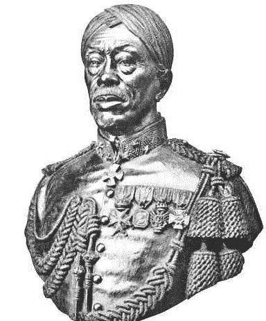

曼库尼纳加拉四世（1853–81）青铜胸像

Kempfong: Gucci: P. A. Mangkunagoro de Vierd.

……贯穿整个宫殿，以便当他脑中产生诗意时，可以立即将其记录下来。13 他最著名的诗作在某些文学界仍广受推崇，是《Wedhatama》（《卓越智慧》），可能写于 19 世纪 70 年代后期。当时，有些人怀疑他是否真的是这部作品的作者。该书最后的编辑和翻译家斯图特·罗布森讨论了作者身份的问题，并采取了相当不可知的态度。14 虽然这个问题可能无法得出定论，但显而易见，曼库尼纳加拉四世是他那个时代多产作家群体的一员，其中包括龙加瓦尔萨塔，他常被称为“最后一位伟大的宫廷诗人”，尽管他的名声在当时存在争议。15

《Wedhatama》是 19 世纪许多爪哇人中常见的、持久的“神秘主义合成”伊斯兰教风格的范例。16

13 根据出身曼库尼纳加拉血统的 R. Ay. Hilmiah Dariawan Pontjowolo 的说法，这是一项曼库尼纳加拉的口头传统。在曼库尼纳加拉图书馆的研究期间，她提供了极大的帮助，直到她在 2004 年米纳惨难中朝圣期间不幸离世，那场灾难导致了 200 多朝圣者去世。
14 Stuart Robson, ed. and transl., *The Wedhatama: An English Translation*, KITLV working papers 4 (Leiden: KITLV Press, 1990), pp. 4–6.
15 Ricklefs, *Polarising Javanese Society*, pp. 45, 149.

# 捕魂者 326

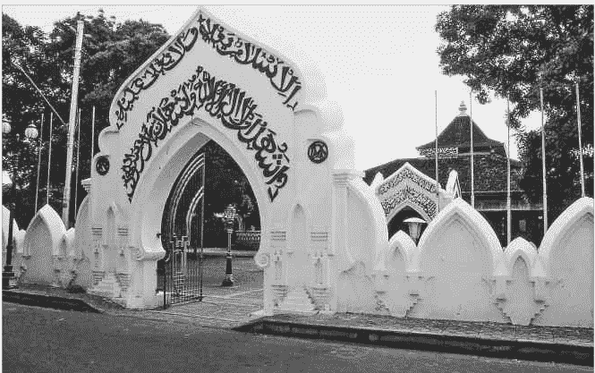

今日曼库尼纳加拉的 Al-Wustha 清真寺。当地信息显示，它始于曼库尼纳加拉四世（卒 1881）或五世（位 1881–96）时期，约于 1918 年竣工。通常说著名的荷兰建筑师托马斯·卡斯滕在这座清真寺的设计中发挥了作用，但没有实证支持这一点。外门上的阿拉伯铭文载有一段圣训：“没有任何信仰比伊斯兰教更伟大”，以及信仰宣言：“唯真主，穆罕默德是真主的使者”。内门载有古兰经引文（4:103）：“信士应当在规定的时刻礼告”（Abdel Haleem 译文）以及圣训“集体祈祷优于个人祈祷”。阿拉伯引文的识别感谢 Oman Faturman 协助。

这被框架为曼库尼纳加拉四世对其子们的教诲，“希望他们能够在实践爪哇土地发现的高尚德行中获得繁荣。”文中提到，“凡获得真主启示者，皆擅长收集自己散落的碎片。”王子的儿子们应以马塔兰王朝的创始人潘姆巴汉·塞纳帕蒂·阿拉为榜样。“然而在现在，年轻人痴迷于将先知——世界引导者、真主的使者——作为模范和榜样。”“如果你们坚持模仿先知，”年轻人被告诉，“噢，我的孩子们，你们在背离自己……看到你们是爪哇人，这是一种对 19 世纪后期神秘主义风格的反应。”

# 曼库尼纳加拉四世的遗产

## 19 世纪中期的社会文化变化

今日曼库尼纳加拉的 Al-Wustha 清真寺。当地信息显示，它始于曼库尼纳加拉四世（卒 1881）或五世（位 1881–96）时期，约于 1918 年竣工。通常说著名的荷兰建筑师托马斯·卡斯滕在这座清真寺的设计中发挥了作用，但没有实证支持这一点。外门上的阿拉伯铭文载有一段圣训：“没有任何信仰比伊斯兰教更伟大”，以及信仰宣言：“唯真主，穆罕默德是真主的使者”。内门载有古兰经引文（4:103）：“信士应当在规定的时刻礼告”（Abdel Haleem 译文）以及圣训“集体祈祷优于个人祈祷”。阿拉伯引文的识别感谢 Oman Faturman 协助。

这被框架为曼库尼纳加拉四世对其子们的教诲，“希望他们能够在实践爪哇土地发现的高尚德行中获得繁荣。”文中提到，“凡获得真主启示者，皆擅长收集自己散落的碎片。”王子的儿子们应以马塔兰王朝的创始人潘姆巴汉·塞纳帕蒂·阿拉为榜样。“然而在现在，年轻人痴迷于将先知——世界引导者、真主的使者——作为模范和榜样。”“如果你们坚持模仿先知，”年轻人被告诉，“噢，我的孩子们，你们在背离自己……看到你们是爪哇人，这是一种对 19 世纪后期神秘主义风格的反应。”

# Mangkunagaran 的遗产

马杜拉有 7,614 人，到 1914 年这一数字仅超过了 10,000 人。尽管我们在接受这些殖民时代的详细数字时必须谨慎，但我们可以证实，爪哇社会的朝圣者数量大幅增加，其中许多人受到了中东净化运动的影响。

由于这种宗教变化（其复杂性我们只能窥一斑），虔诚的伊斯兰社区日益能够抵御欧洲殖民主义，以及那些自称为爪哇社会阶层顶端的贵族和普里亚雅人。甚至爪哇的苏菲主义也变得更加正统（且更反基督教），因为纳格什班迪派和卡迪里亚派倾向于取代占据统治地位且更为松散的沙塔里亚派。

因此，到 19 世纪，爪哇存在两种竞争性的现代性形式。一种是以荷兰人为代表的 19 世纪欧洲革命性现代化风格；另一种则是更更新、更正统、更具阿拉伯风格且要求更严苛的伊斯兰版本。

许多爪哇人发现新形式的伊斯兰缺乏吸引力；因此出现了一群仍然认为自己是穆斯林但名义上如此的人。这些虔诚的穆斯林（他们称自己为“putihan”，即白色人）开始贬低一些不遵守教义或名义上是穆斯林的村民为“abangan”（棕色人）。第一个术语出现在 19 世纪 50 年代的历史记录中。随着改革运动的蔓延以及普通人的排斥，这一术语在中爪哇和东爪哇的爪哇语地区传播。到世纪之交，abangan 显然代表了普通爪哇村民的大多数。他们似乎削弱了对伊斯兰正统和信仰的关注，放弃了对“五功”的遵守，并将注意力集中在当地的神灵力量上。荷兰传教士学者在 19 世纪 80 年代写道，abangan“开始变得不再那么宗教和虔诚了”。²⁰ 对他们来说并非

> ¹⁹ 任何从 21 世纪角度观察的读者，如果认为真正的革命性变化是我们这个时代的专利，建议阅读奥斯特特哈尔对 19 世纪“世界变革”的杰作调研；Jürgen Osthammer, *Die Wandlung der Welt: Eine Geschichte des neunhnten Jahrhunderts* (Munich: C.H. Beck, 2011)。
> ²⁰ 引用自 Ricklefs, *Polarising Javanese Society*, pp. 99–100.

# 捕魂者

改革者们充满阿拉伯色彩的虔诚。爪哇贵族的形而上学假设及其神秘合成也没有意义。对于这些普通人来说，重要的是村中心树里的灵魂；徘荡在十字路口、附近山脉或海里的魔鬼；洞穴中的幽灵以及在夜晚偷孩子的灵体。

从 19 世纪 60 年代和 70 年代开始，还出现了用爪哇语写的反伊斯兰书籍。最著名的是《吉德里史》、《Suluk Gatolok》和《Sërat Dërmangalbul》。在这里，伊斯兰受到了嘲，爪哇的伊斯兰化被描绘成由背信穆斯林强加的文化悲剧。这些作品似乎主要源于吉德里的普里亚雅圈。这里位于东爪哇，18 世纪的战争期间曾有过激烈战斗，但从殖民时代起，它与中爪哇君主和王子的领地分离，很大程度上不受其影响。

从 1848 年起，殖民政府开设了学校，让爪哇上层阶级可以学习现代管理技能，如算术、测量和地理。学生们用爪哇语教学。这些殖民学校受到了精英阶层的热烈欢迎。1859 年，著名的诗人、领地现代化者曼库尼纳加拉四世既是荷兰狮勋章骑士，又是 1852 年在泗罗梭建立的爪哇教师培训学校委员会主席。这些学校的毕业生成为新的殖民精英，他们受教育背景、职业角色、态度和成就地位的影响，与皮桑特伦的毕业生、虔诚的伊斯兰改革者、村民以及拥有赋予地位的旧秩序上层精英脱节开来。

因此，到 1900 年左右，爪哇社会的极化日益明显。在 20 世纪的头几十年里，这些分裂变得政治化，并且可能仍然是分裂的、愈发暴力。

曼库尼纳加拉的王子们并不具备应对新世纪带来的变化。他们接受了曼库尼纳加拉一世的一些遗产，但并非全部，也不是在最重要的变革时期。

# 20 世纪的挑战

殖民政策的转变、人口的快速增长、伊斯兰的进一步发展、现代风格政党的兴起以及经济危机，推动爪哇社会在直到 1942-45 年日本征服和占领期间，深度陷入了政治化和不稳定的极化之中。这一戏剧性的故事已经在多个来源中被讲述，只需回顾即可。

1901 年启动的新殖民政策被称为“伦政策”。其目标是提高印度尼人的福利。尽管有这些局限性，到 1930 年人口增长已经开始，群岛的去殖民化尚不可避免。从世纪初开始，现代主义者建立了学校，随后建立了高等教育机构，培养了受过现代教育的领导，其中许多人活跃于政治运动。1912 年，他们创立了穆罕曼迪，该组织至今仍具有影响力。从 20 世纪 20 年代开始，传统主义者成立了自己的组织，其中著名的是 1926 年的纳哈拉特乌玛。穆罕曼迪与纳哈拉特乌玛之间的关系最好处于冰结状态。

曼库尼纳加拉的王子们并不具备应对新世纪带来的变化。他们接受了曼库尼纳加拉一世的一些遗产，但并非全部，也不是在最重要的变革时期。

具有重要群众基础的更激进的组织出现了，并真正代表了大众的甚至是革命性的先驱，

# 曼库纳加兰的遗产 333

民族主义运动。其中最著名的是伊斯兰协会（成立于 1912 年）和印度尼西亚共产党（成立于 1920 年）。这两个组织在 20 世纪 20 年代初因泛伊斯兰主义与共产主义之争而发生激烈冲突。工会也曾一度兴荣。在此期间，出现了大规模的村庄级冲突，还包括焚烧甘蔗田和仓库、几次炸弹袭击，以及警察的渗透和镇压。在这些“自治”公国中，这些更为激进的运动有时反映并助长了对统治王子和统治者的敌对态度。

这是一个动荡、政治化和冲突的时代。荷兰殖民当局在 1926–27 年一次失败的共产主义起义后镇压了群众运动。此后，镇压和去政治殖民政策阻止了大规模群众组织的出现。20 世纪 30 年代，大萧条的影响彻底扰乱了爪哇社会，一直到基层。1942–45 年日本占领期间的极端苦难进一步扰乱了爪哇社会，使其重新政治化，并为随后的印尼革命奠定了基础。

# 遗产与未吸取的教训：灾难的方程式


# 曼库纳加拉七世

曼库纳加兰家族在这一动荡时期的大部分时间由曼库纳加拉七世（在位1916–44年）领导。他对周围变化的反应是该公国问题的缩影。他维持着曼库纳加兰军团以及皇宫与殖民政权的联系。他前往莱顿接受高等教育，当第一次世界大战爆发时，他成为荷兰正规军的一级军官。他是一位干明的行政官员，1915年回到爪哇后，加入了布迪乌托莫（Budi Utomo）的爪哇保守主义行列。他曾在1915年短暂担任该组织的主席。当殖民政府任命他为曼库纳加拉七世时，条件是他必须辞去布迪乌托莫并辞去荷兰预备军军衔。那时，他成为中校衔的曼库纳加兰军团指挥官。1932年，一位高级荷兰行政官员写道，在四位“自治”领主中——苏日加塔的苏丹和帕库阿拉姆王子，以及苏泗卡卡的苏苏汉——曼库纳加拉七世“无疑是最现代、最活跃的”。^25

乔治·拉森描述曼库纳加拉七世为“文学与行动的现代文艺复兴，一位因赞助艺术以及促进爪哇语言和文化重生而闻名的统治者”。26 劳里·西尔斯指出，在20世纪20-30年代，皮影戏（wayang）信徒强调他的神秘方面，“是因为受神智学思想影响的爪哇和荷兰知识分子所赋予的价值观”。是曼库纳加拉七世（用荷兰语）写了“20世纪30年代影戏的关键表述”，他在书中建议“每一场爪哇影戏都是对神秘知识的精神追求的再演”。27 由于伟大的皮影戏故事显而易见的印度-爪哇根源也被强调，这一信息对于伊斯兰纯洁运动来说是难以接受的。对于大多数热爱皮影戏的普通爪哇村民来说，这可能被视为高深莫测的伪装。

1942年初第二次世界大战来到爪哇时，曼库纳加兰皇宫继续坚持其对统治当局忠诚的原则。荷兰人被日本入侵夺取了权力，曼库纳加兰领导层必须应对新的殖民主子。拉森描述了那些绝望岁月里的状况：

> 在日本占领期间，苏泗卡卡的两个皇宫都衰落了。与苏日加塔的皇宫（kraton）不同，苏泗卡卡的皇室并未努力与日本占领当局保持距离。庄园经济也崩溃了，失去了皇室资金的主要来源。通胀严重侵蚀了官员薪资的购买力。1944年，继承危机加剧了崩溃

> ^25 Larson, Prelude to Revolution, pp. 49, 55, 57–77; quotation from p. 68.
>
> 26 Ibid., p. 65.
>
> 27 Laurie J. Sears, Shadows of Empire: Colonial Discourse and Javanese Tales (Durham and London: Duke University Press, 1996), p. 15. Sears is referring to...

# 曼库纳加拉遗产

第二个未被吸取的教训是，人是重要的。在某些情况下，人们的服从是可以强迫的，但他们的忠诚和情感必须赢得。在涵盖曼库纳加拉一世生活的十章中，我们目睹了他如何追逐并赢得追随者的喜爱。他作为老曼库纳加拉之子，起初拥有继承情感的优势，但由于其流放之父遭受的不公，他在儿时被遗弃。他身上伴随着预言般的期待。在18世纪的爪哇，皇室血缘足以赢得敬畏和虔忠，但个人品质可以极大地增强或削弱这些。随着曼库纳加拉年龄增长，他的个人品质赋予了他一种魅力，吸引并激励了追随者。他英勇的军事事迹赢得了社会各界许多人的钦仰和忠诚。他的人民开始相信他与苏鲁王（Sun Lawu）有着特殊的联系。在出征期间，他寻求机会恢复自己的士兵，确保随行的妇女和儿童被送到安全的住所，确保有食物和娱乐，并在做出军事决定前进行公开的讨论和协商。他军队的士气始终是他的优先事项。简而言之，他是一位伟大的将军，他的追随者从这种忠诚和情感中认可了这一点。这是他20世纪后代没有学到的教训，他们无疑面临着艰难的时代和处境，但似乎没有意识到在激变的苏卡尔塔市以及更广泛的印度尼西亚正发生着多么深刻的变化。

我们不能指责曼库纳加拉一世的后代没有预见到未来，因为我们中没有能做到。现在我们埋怪曼库纳加拉一世导致了后代的失败。但那些后代本可以更更好地了解他们伟大创始人的过去，并吸取这两个教训。拉森（Larson）观察到，“苏卡尔塔宫廷的毁灭没有任何必然性，”³³¹，考虑到雅加加塔（Yogyakarta）宫廷的情况完全不同。曼库布米（Mangkubumi）的后代、干练年轻苏丹哈孟古布瓦纳九世（Hamengkubuwana IX）敏锐地察觉到了变化的环境，激发了人民的忠诚，并成功地顺应了革命浪潮。

曼库纳加拉一世是一个伟人，一位在战争和平中都热烈且华华的王子，适用于他动荡的时代。他战斗勇敢，以斗志赢得胜利，以勇气忍受失败。他以毅力面对挫折和亲人的逝去。他推崇伊斯兰教的虔诚，或许是那个时代爪哇“神秘合成”（Mystic Synthesis）风格信仰的王子中最完美的典范。他照顾他的追随者、他们的福祉和士气。他痛饮、狂欢、忍受疾病和侮辱，深爱并收获了许多。当现实政治需要改变政策时，他洞察时代并改变了政策。最终，他与曾是他宿敌的欧洲人结成联盟，并为他的继承人留下了一个具有意义的持久公国。我们无法对这位非凡的人士提出更多要求，他尽管“身材矮小”，但“双眼中散发着火光”。³²

³³¹ Larson, Prelude to Revolution, p. 5.
³² KV, p. 237.

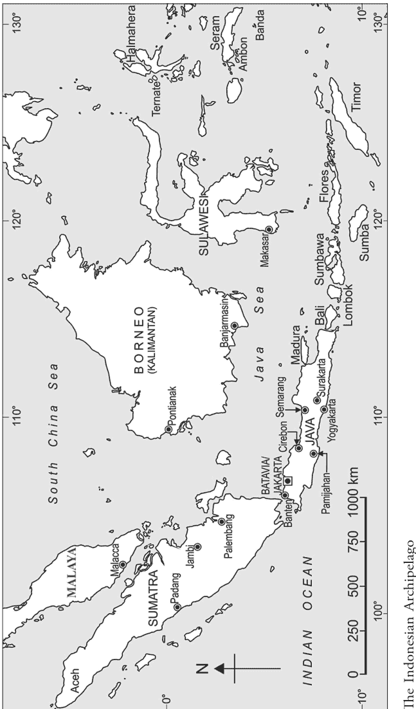
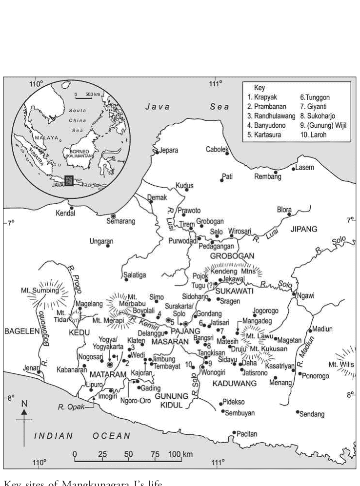

# 曼库纳加拉生活的关键遗迹

# 主要成员族谱

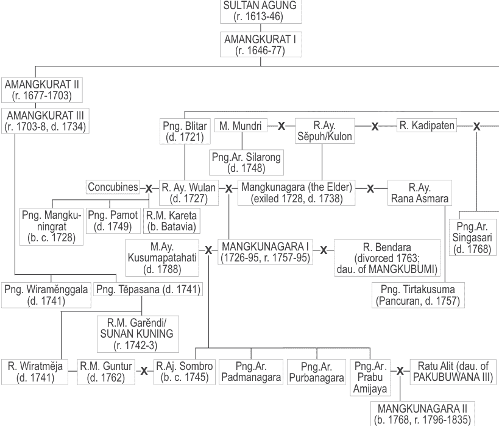

这份族谱基于各种同时期的爪哇来源和荷兰东印度公司（VOC）来源，正如

# 马塔拉姆王朝

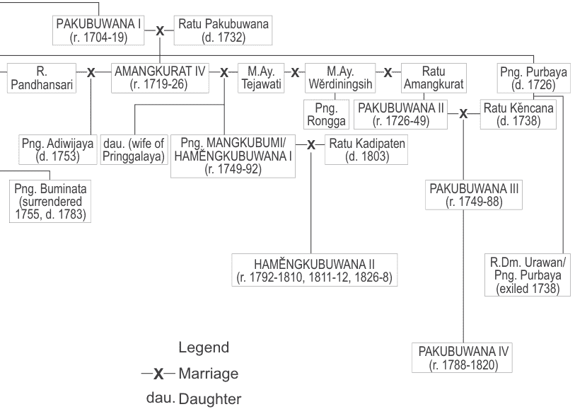

以及《Padmasustastra》、《Sajarah-dalêm》（后者并非没有错误）。

# 附录 1：对主要原始文献的详细讨论

在书中，核心地位属于三个爪哇语来源，它们对曼库纳加拉的生活提供了最多的启示：他的自传体《*Sërat Babad Pakunagaran》（在脚注和此处缩写为 `SBPN`）；《*Babad Giyanti*》，它既是爪哇文学的杰作，也是爪哇史学最优秀的例子之一（此处缩写为 `BG`）；以及涵盖1780-93年期间的混合编年史-日记，特别是那本名为*Babad Tutur* 的手稿（在脚注和此处缩写为 `BT`）。上文页面中讨论并参考了其他爪哇语著作，但此处的讨论将集中在这三个来源上。我们将转向荷兰人的文献。

我必须强调，这并不是对“babad（爪哇史诗）是否可靠？”的讨论。19世纪曾对这一话题发表过观点，当时约翰·克劳福德（John Crawford，在爪哇，1811–1816年）表现出极佳的判断力，他认为：“从公共事件的理性叙述的角度来说，历史是一种亚洲群岛上最文明的国家所未知的创作类型。可以说，他们对历史的了解程度并不超过对蒸汽机机制和构造的了解。”他认为，爪哇人最接近拥有“一种事件编年史”，但他写道，即使是这样的作品，“或多少也是浪漫小说，其目的是为了消遣而非教诲。”

¹ John Crawford, A Descriptive Dictionary of the Indian Islands and Adjacent Countries, intro., M.C. Ricklefs (Kuala Lumpur: Oxford University Press, 1971), p. 151. 最初出版于伦敦，1856年。

自克劳福德以来，几位学者表达了类似的判断——但往往对基于“所有 babads都是同一种类型”这一假设的广泛 babads 了解有限。它们并非如此。这一规则的例外是彼得·凯瑞（Peter Carey）的作品——他和我一样，是一位受过专业训练的历史学家。我们应该注意他在作品中使用的关于19世纪初的两部 babads 评估之间的差异：“其历史可靠性的程度是显著的，并且可以通过其他爪哇和欧洲来源中对准确细节的反复掌握来得到证实”。

² Peter Carey, ed., and transl., Babad Dipagara: An Account of the Outbreak of the Java War (1825–30); The Surakarta Court Version of the Babad Dipagara with Translations into English and Indonesian Malay (Kuala Lumpur: Art Printing Works for the Council of the MRAS, 1981), p. xi.

然而，由雅加加塔王子潘纳拉（Panular，约1772–1826）撰写的他的草稿 babad（serat babad ngengreng）——现藏于大英图书馆（Add. MS 12330）则不同：“潘纳拉的 babad 绝未打算从现实政治的角度提供当代事件的概述。恰相反，它一直被视为投影王子对事务的专注解读并缓解其频繁受挫的自尊媒介。”³ Peter Carey, ed., The Babad in Java 1811–16: A Javanese Account: A Text Edition, English Synopsis and Commentary on British Library Additional Manuscript 12333 (Babad Bĕhad ing Ngagyakarta) (Oxford, etc.: Oxford University Press for the British Academy, 1992), p. 8.

此处讨论 `SBPN` 和 `BG`（下文将讨论 `BT`）。我的观察形成于对这两部 babads 的详细熟悉，以及我在编目录爪哇手稿以及50年阅读各类 babads 和其他爪哇文学作品的经验。

在开始讨论之前，我们必须解决这些作品是如何汇编的关键问题。了解来源、日期和作者对于评估历史学家的价值至关重要⁴ 查看南西·弗洛里达（Nancy Florida）对一种完全不同的 babad 的讨论，见《Writing the Past, Inscribing the Future: History as Prophecy in Colonial Java》（Durham and London: Duke University Press, 1995）。

无论任何来源；这些将在下文中对 `SBPN` 和 `BG` 进行讨论。我们必须承认，当我们询问这些内容是如何以如此详尽的细节汇编的时，我们不得不处理间接证据。对于这个问题没有肯定的答案，但此书中使用的来源中包含了宝贵的线索。

在测试 `SBPN` 和 `BG` 时，我采用了历史学者的标准方法，将它们的叙述与关于同一事件的其他来源进行对比。这意味着将它们相互进行对比，并在可能的情况下与荷兰东印度公司（VOC）的来源进行对比。在这里，我们发现日期通常是一致的，这是一个非常有价值的、近乎机械的比较点，超越了任何一方的偏见风险。人物和事件的名称往往重叠并相互证实，尽管有时如附录 3 所示，荷兰和爪哇来源对同一地点的描述方式不同，且证明是不可调和的。但遗憾的是， `BG` 中此类比较的实例较少，尽管这在 `SBPN` 的后期部分是一个问题，但这种形式的比较并不如所愿的那样充足。

VOC 和爪哇人的世界彼此如此隔绝，特别是在战争期间，爪哇方面的发展——这书中更感兴趣的话题——对欧洲人来说是且未知的，因此比较是不可能的。此外，荷兰来源并非没有偏见、扭曲、虚假和错误。参考 1746 年的报告，称 Mangkunagara 的兄弟 Png. Pamot 和 M. Guntur 都已被杀害，结果证明是虚假的。我们在他的回忆录中评论得很好：“因此，人们被误导了，对夸大的战斗描述比实际情况大得多。”⁵

尽管如此，许多内容必须通过这种方式进行测试。将 `SBPN` 和 `BG` 与彼此的叙述（从不同的立场编写）以及与 VOC 证据进行此类对比，往往提供了相互证实。这使我们有理由相信，那些无法比较的段落也应该被认真对待。

这回到了 `SBPN` 和 `BG` 中如此详尽的细节是如何记录的这个问题。我希望读者已经意识到，在本书的叙述背后隐藏着许多此类谎言，这些内容在大部分情况下只能被暗示，只有偶尔会被原文引用。这些材料是如何在巨量的爪哇诗歌作品中记录的呢？

⁵ KV, pp. 131–2.

怀疑者可能会认为，这些 babad 实际上是长篇历史小说：虚构的人物与真实生活的人互动，虚构的细节悬挂真实事件的框架之上，而演员的思想被想象，这在忠实于历史文献的情况下是不可能的。我们或许可以询问该类型的大师他们是如何整合作品的。1876 年，戈尔·维达尔（Gore Vidal）写道：“我将真实人物与虚构人物混合在一起”，但真实人物所说和做的“和我所说的和做的基本一样。”⁶ 在他的《林肯》中，他写道他比其他其他历史小说引入了更少的“虚构人物”。所有主要角色确实存在，”他再次写道，“除了某些例外，他们所说和做的和我所说的和做的基本一样。”⁷ 在他的杰作《战争与和平》中，托尔斯泰之所以捕捉了从俄罗斯视角观察的拿仑战争，为我们提供了了解那个时代最优秀的文字之一。在结尾，他对《战争与和平》说：“《战争与和平》……不是一部小说，更不是史诗，更不是历史编年史。《战争与和平》是作者想要并能够表达的内容，以它所被表达的形式呈现。”他说他将“非历史人物与其他历史人物并列，改变名字或使用‘与著名的俄罗斯名字相似’的名称。每当在我的小说中，”他写道，“历史人物说话和行动时，我没有虚构，而是利用了材料，在我的创作期间，我形成了一个整个图书馆……对于这些我始终可以提供出处。”⁸

在像 `SBPN` 或 `BG` 这样的 babad 中，没有什么可比的，因为那里没有虚构人物的迹象。编年书中提到的许多人物，VOC 对他们一无所知或未曾报道。荷兰人对爪哇生活的许多方面无知，这并不能证明什么。附录 4 中描述的人 Yasadipura 就是一个例子。但我认为不会有学者会辩称他存在；据我所知，欧洲来源中没有关于他的记载。

⁶ Gore Vidal, Lincoln, 1965.
⁷ Gore Vidal, Lincoln, 1965.
⁸ Tolstoy, War and Peace, 1869.

# 《吉亚提史》（Babad Giyanti）

歌行标题处仍有空白待装饰，因此该手稿的装饰尚未完成。还有几处空白的开头，可能是为了更宏大的插图（见页码144v.–145r, 230v.–231r., 248v.–249r.）。

在第7章早期编写该手稿时，我们已经讨论过曼昆纳加拉（Mangkunagara）的身份问题。我们注意到在末尾（f. 418r.）写道：“*ingkang murwa carita, Kangjeng Pangeran Dipati, ingkang saking lalana andon yuda*（此故事的作者是迪帕蒂王子[曼昆纳加拉]，他在征战期间归来）。在我看来，这意味着该作品是他1757年定居梭卡塔不久后创作或完成的。然而，我们拥有的这个版本诞生于1779年8月17日，那是这位王子在爪哇历上的55岁生日（ff. 1v）。手稿开头和结尾独特的措辞表明，该副本是在宫廷女兵宿舍的抄写室制作的。

约翰·克劳福德（John Crawford, 1783–1668）在英国间歇统治时期曾在爪哇，曾于1811年至1814年担任日惹答丹留驻官，并在1816年再次任职。他建立了大量的爪哇手稿收藏，现藏于大英图书馆。其中一些是在1812年日惹陷落时获得的，另一些是从借给他的手稿中购买或抄写的。`SBPN MS Add. 12318` 原本从曼昆纳加拉皇宫借给他，随后他通过的一位名为 Setrawijaya 的抄写员获得了一个副本，即 `Add. 12283`；`Add. 12296` 是该抄写员抄写的另一份手稿。

抄写员版本 `Add. 12283` 上附有一条注释。注释写道：“曼昆纳加拉史，由王子本人创作”，进一步证实了曼昆纳加拉的作者身份。在原始手稿 `Add. 12318` 内部（f. 1r.）有另一条注释写道：“曼库布米[sic]战争与叛乱史，在其监督下编写，并摘自原稿。”当我1969年第一次编目这些手稿时，这些注释令我很困惑，导致我认为 `Add. 12283` 是原稿，而 `Add. 12318` 是副本。

> 参见 M.C. Ricklees, P. Voorhoeve† 和 Annabel Teh Gallop，《Indonesian Manuscripts in Great Britain: A Catalogue of Manuscripts in Indonesian Languages in British Public Collections; New Edition with Addenda et Corrigenda》(Jakarta: École Française d’Extrême-Orient, Perpustakaan Nasional Republik Indonesia, Yayasan Pustaka Obor Indonesia, 2014)，第45，47页。

只需再看一眼就能发现它们的关系是相反的。我得出结论：克劳福德从曼昆纳加拉皇宫（`Add. 12318`）借走了我们所依赖的该1779年版本，制作了一个副本（`Add. 12283`），然后未能归还原作。随后在 `Add. 12318` 上增加了一条关于“曼库布米的战争与叛乱”的误导性注释。

另一段非常短的 babad（史诗）片段发现于 `Radya Pustaka MS 48 B.1`，第84页；参见 Florida, *Javanese Literature*, Vol. iii, 第723页以及第208页的讨论。该版本日期为 Sawal, Aj 1719（=1793年5月12日–6月9日），开头曼昆纳加拉于1753年8月在 Kasatrijan 击胜曼库布米。这是曼昆纳加拉皇宫抄写室的另一个产物。然而，当翻页时，会遇到下文讨论的混合型 babad-日记副本。


# BG 是我所知的最优秀的爪哇文学作品之一

BG 是我所知的最优秀的爪哇文学作品之一，也是爪哇语书写的最令人深刻的历史著作之一。和 `SBPN` 一样，它有一段复杂的历史¹⁰。德国学者-传教士 `J.F.C. Gericke`（1799–1857）于1827年被荷兰圣经协会派往巴达维，并一直生活直到去世。在某处，他获得了一套六大册的《吉亚提史》。第2至6卷进入了阿姆斯特丹圣经协会收藏，随后成为莱登大学收藏的一部分（`NBS 29–33`）¹¹。然而，第一卷显然留在了爪哇，因为上面的标题写着《卡塔卡塔史》（`Babad Kartakarta`）。

后来的学者 `J.A. Brandes`（1857–1905）于1884年来到爪哇。通过某种方式获得了此前 `Gericke` 拥有的 `BG` 第一卷。为了完成这部作品，`Brandes` 从莱登订购了第2至6卷的副本（`NBS 29–33`）。这套完整的副本随后进入了巴达维皇家巴塔维亚艺术与科学学会的收藏，因此在日惹/雅加达再次有了一个完整的副本，实际上是唯一的手稿。

> ¹⁰ 此处我遵循了我的文章“Babad Giyanti: Sumber sejarah dan sastra”中的讨论，`Jumantara: Manuskrip 5` (2014):3–5。
>
> ¹¹ `Pigeaud`, *Literature of Java*, Vol. ii, 第13–20页。
>
> ¹² `Behrend`, *Katalog Induk*, vol. I: Perpustakaan Nasional, 页52–53，1912。
>
> ¹³ `C.F. Winter`, *Javaansche geschiedenis*, Vol. i, ed. `T. Roorda` (Leiden: `E.J. Brill`, 1911), 页35。
>
> ¹⁴ 详情参见我关于“Yasadipura”的文章。

## 附录 1

`BG` 可能也 `SBPn` 一样，最初以曼昆纳加拉定居梭卡塔结束，随后是他在1757年与 `VOC` 达成和。在 `BG` 的这一点（`Vol. xxi`, pp. 39–45），风格发生了显著变化。对应1757年3月到4月的日期出现了一些错误。我感觉关于 `Vol. xxi`, pp. 42, 或说，我们面对的是正文之后添加的附录。

# 曼昆纳加拉纪实-日记及其作者

曼昆纳加拉混合纪实-日记是1780–93年的重要来源。它在几份手稿和三个版本中得到了证实（版本1：`KITLV Or. 231`，一份 `dluwang` 上的手稿，涵盖 `AJ 1707–18` (1780–91)）。该手稿的摘要可见 `KITLV Or` 和 `MN29a` (696.1)；抄录版本为 `MN29b` (696.2)。这个日记副本被称为 `Babad Tutor`（此处缩写为 `BT`），是通常所指的版本。（版本2：`Sonobudoyo PB A.99` 涵盖 `AJ 1715–20` (1788–93)，也写在 `dluwang` 上。（版本3：涵盖 1784–90 年，似乎与 `KITLV Or. 231` 的平行部分相同，见。如上文关于 `SBPn` 所述，在第84页，这份手稿还包含一份 `SBPn` 版本的片段，日期为1793。）

这部作品的名称有：曼昆纳加拉史（`Babad Nitik Mangkunagara`）、`Babad Tutor` 等等。在第7章中——引用了这些副本的开头——我们看到这些手稿似乎是在曼昆纳加拉的女抄写室制作的。

作者身份问题很重要且一直存在混乱。`Pigeaud` 将其描述为“女性抄写员描述的日常”，⁵`Florida` 将 `RP 48 B.1` 类称为：`Sérat Nitik Mangkunagara` 为“女性宫廷诗人/抄写员记录的曼昆纳加拉宫廷每日日记”。⁶在他的文章《Javanese Court Society and Politics》第i部分中（基于版本1），`Kumar` 写道（第4页）：

> ¹⁵ `Pigeaud`, *Literature of Java*, Vol. ii, 第732页。
>
> ¹⁶ `Florida`, *Javanese Literature*, Vol. iii, 第72页。

手稿开头提到的 `prajurit carik estri`（女兵文员）是“日记记录者”或“女作者”。我也曾将该作品描述为“曼昆纳加拉的女兵的日记”，⁷ 我们都错了，忽略了我们应该理解这是曼昆纳加拉一世宫廷的女兵宿舍的信息。

`KITLV Or. 231` 在正文开始前的注释中写道：`mem anrat prajurit carik estri, anutagĕken carita serat Barat Tutur`。正文的第一节（错误的，多了两行）提到了 `carik estri, kang nĕrat nunurun`（`nerat`, `nunurun`）。这告诉我们女性抄写员写出或拷贝了（`anutagĕken`）。她任务的开始是 `22 Siam AJ 1717`（1791年5月26日）。注意，这个日期位于手稿日记的开头，该日记在女兵制作副本之前完整延伸到1791年。

`MN 29b` (`Florida` 696.1) 在开头有一个有趣的变体，读（使用正确的爪哇语拼法而非抄录的古旧风格）：`Pem nĕrat carita Sĕrat Barat Tutur ...`，第一节再次提到 `carik estri kang nĕrat nunurun`。这个日记副本说，女兵文员被命令（`kinen`, `kinon`）写出/拷贝该作品。在 `MN 29` 中进行抄录的 `Suro` 可能可以获得 `KITLV Or. 231` 的复印件（`Nancy Florida` 建议此类副本在20世纪80年代初保存在曼昆纳加拉皇宫），但也可能根据另一份他可以使用的手稿进行工作。不清楚是他误读了 `KITLV Or. 231` 的内容，还是拥有一份与之不同的副本。无论如何，他的解读是女兵文员/们（`kinen`, `kinon`）要写出/拷贝该作品。在 `48B.1` 中，我也发现了曼昆纳加拉一世自传体 `SBPn` 的碎片副本，如上所述，它的开头是一段关于60名女兵（`prajurit estri`）中的四名女抄写员（`carik wanody`）被命令（暗示由曼昆纳加拉一世）拷贝（`tinuduh anĕrati`）该作品的陈述，时间为 `Sawal` 月，`Dal 1719` 年（1793年5月–6月）。

`Sonobudoyo P Aa.99` 中的日记副本在这里没有帮助，因为它缺失了开头页。它的第一个完整歌行等同于 `KITLV Or. 231` 的第57 节。

## 附录 1 355

这些证据表明，`Pigeaud`、`Florida`、`Kumar` 以及早些将该手稿的女性作家描述为“女作者”或“日记记录者”（采用 `Kumar` 的术语）的说法并没有证据支持。所提到的女士（或那几位女士）仅仅是抄写员。日记的作者仍然未知。

我们可能会怀疑是曼昆尼加拉一世（`Mangkunagara I`）记录了这些定期事件笔记并进行了核实，正如他是他的 `SBn` 及其他作品的作者一样。此外，我们无法想象除了他之外，谁会有地位命令他的女抄书员去抄写某些内容。但如果他真的是作者，在我看来，他没有被识别为作者是不可理喻的，就像他的其他作品那那样。

我们不得不得出结论：`BT` 及相关手稿是曼昆尼加拉皇宫内部的记录，但其作者仍然未知。

## 主要 VOC 来源

对于研究 18 世纪的爪哇而言，荷兰来源作为爪哇来源是不可或缺的。而且对于本传记涵盖的如此长的时期，这些资料的量甚至更为丰富。它们受限于文化隔阂，且对爪哇事务的理解往往有限，而这正是我们在这里感兴趣的。记住，在 1577 年和解之前，`VOC`（荷兰东公司）极少数欧洲人曾亲面见过曼昆尼加拉一世。对于 1577 年之后，当曼昆尼加拉和许多其他爪哇人物变得被欧洲人更加熟悉时，荷兰来源变得非常有价值。最常引用的荷兰来源是下面讨论的内容。

## 短故事

### Kort verhaal

“`Kort verhaal de Javasche oorlogen werden met onderscheideen prinsen geveerd sejak den jaar 1741 tot den algemene vrede gesloten in den jaar 1757`” [简译：关于自 1741 年以来由不同王子进行的爪哇战争的概要，直到 1757 年达成普遍和平] 出现在脚注并在此处缩写为 `KV`，这是一份以回忆录形式呈现的内部记录，是第三次爪哇继承之战争时期的一份宝贵记录，出版于 1830 年。

`KV` 传达了 `Nicolaas Harting` 这一这些事件中主要参与者的见解。它非常像爪哇的“巴达”（`babad`）：

日期稀疏，有时事件顺序错乱，其作者身份受到一些人的质疑，但尽管如此，它仍是一位资深荷兰参与者的宝贵内部记录。`KV` 全文用第三人称称呼 `Harting`，正如曼昆尼加拉在自己的 `SBPn` 中对自己自称一样。这些方面的相似性让我们想起 18 世纪荷兰与爪哇文学文化之间可能存在的文化平行性。

关于 `KV` 的作者一直存在不确定性。`Harting` 在 1761 年为其继任的爪哇东北海岸总督 `W.H. van Ossenberg` 写的备忘录中，在结尾处提到有一份“涵盖了 1741 年该海岸发生的一切的摘要，并带有一些简短的反思等，是在他空闲时汇编的”，也许 `van Ossenberg` 可能会想看看”。^18 `J.K.J. de Jonge` 是这份 1788 年出版的文献集的编纂者，在该页的脚注中提到，“`Harting` 在这里指的是‘`Kort verhaal van de Javasche oorlogen welke met onderside prinsen vrede werd sinds derden jari tot gesloten in de jaren 1757`’，它出版于……1830 年。到为止，这个‘`Kort Verhaal`’一直被 `Harting` 的秘书 `Munnik` 先生 [`Hermanus Munnik`] 所归。^19 `P.J.F. Louw` 在 1889 年讨论了关于这一铭文的不确定性。^20 1910 年，`De Haan` 调查了对此事的各种观点，并决定 `Harting` 本人不太可能是作者，这很大程度上是因为在同一时期，`Harting` 的风格在 `KV` 中并不那么精炼，但他却以第三人称称赞自己”。^21 1974 年，`Munnik` 接受了这一点。正如下文所示，对这一来源的深入研究导致了我的观点转变。1981 年，`van Meiden` 得出结论认为 `KV` 几乎肯定是 `Harting` 本人写的。^23 相对 `Harting` 作者身份的怀疑，显然是 `Harting` 写的。

> 18 `J.K.J. de Jonge` 是这份 1788 年出版的文献集的编纂者。
>
> 19 `Hermanus Munnik`。
>
> 20 `P.J.F. Louw`。
>
> 21 `De Haan`。
>
> 22 `Munnik`。
>
> 23 `G.W. van Meiden`。

## 附录 1

也有证据表明是 `Harting` 写的，发现于：

- `Nicolaas Harting` 这一这些事件中主要参与者的见解。
- 非常像爪哇的巴达：日期稀疏，有时事件顺序错乱，其作者身份受到一些人的质疑，但尽管如此，它是一位资深荷兰参与者的宝贵内部记录。
- `KV` 全文用第三人称称呼 `Harting`，正如曼昆尼加拉在自己的 `SBPn` 中对自己自称一样。
- 18 世纪荷兰与爪哇文学文化之间存在的文化平行性。
- `Harting` 在 1761 年为其继任爪哇东北海岸总督 `W.H. van Ossenberg` 写的备忘录中，在结尾处提到有一份“涵盖了 1741 年该海岸发生的一切的摘要，并带有一些简短的反思等，是在他空闲时汇编的”。

## 未出版的 VOC 档案

由公司官员撰写的信件数量惊人，保存在海牙的荷兰国家档案馆和雅加达的印度尼西亚国家档案馆。文献几乎完全以信件形式存在，此处通过作者、收件人、日期和地点来引用它们。这些记录不仅让我们了解从欧洲视角理解的细节，还提供了日期，这对于将许多事件描述建立时间关系至关重要。对于本研究的整个时期，这些来源是必不可少的。在 1577 年后的和平时期，这些资料更有价值，当时欧洲人与主要爪哇人物的接触更加密切。

由于文献量巨大，人们不得不通过扫读来寻找相关信息，这种程序存在着遗漏重要信息的内在风险。然而，替代方案是雇佣具有相应语言和历史背景的研究助理（哪种研究经费能支付他们及其培训费用？），或者在应对生活中其他个人和职业需求的同时，投入数十年的艰苦研究。因此，我们必须通过我们希望是经过训练且经验丰富的眼光来进行扫读。

# 附录 2

### 塞·伊布拉希姆是谁？

我们在第五章中看到，一位名叫 `Seh Ibrahim` 的土耳其人在 `Mangkubumi` 与荷兰东印度公司（`VOC`）之间的调停中发挥了重要作用。20世纪70年代后期，荷兰国家档案馆的 `G.W. van der Meiden` 在荷兰文献中发现了这个人：一位名叫 `Ibrahim` 的土耳其人，拥有赛义德（`sayyid¹`——先知的后裔），有着非常有趣的历史。我在对18世纪后期爪哇的研究中也遇到过他，并得出他是那个时代“最神秘且浪漫的人物之一”¹。1981年，在我们就 `Ibrahim` 进行通信后，`Van der Meiden` 发表了一篇关于当时他已知情况的权威描述。

在试图识别这位神秘的土耳其人时，我们从 `Van der Meiden` 1981年对荷兰档案信息的分析开始，²在过程中我们也重复了第五章中的部分讨论。1753年1月，`Ibrahim` 抵达巴达维，并告诉总督 `Mossel`，他已准备好在 `VOC` 和 `Mangkubumi` 之间进行谈判。值得的是，他没有为自己的服务要求任何报酬。2月，总督和印度事务委员会考虑了这项提议。他们决定将 `Ibrahim` 派往三宝（`Semarang`）。`Van Hoendorff` 接到命令接收他，注意不要泄露任何机密信息，看看他能取得什么成就。

直到1753年10月，从荷兰材料中了解不多（下文将转向爪哇方面的信息）。随后，在被 `Mangkunagagara` 手下惨遭击败后，`Mangkubumi` 写信给 `Mossel`，表示他完全信任他口中（在其信件的荷兰语译本中）“大谢里夫”（`Bapa Serif Besar`，推测为马来语词 `bapak Sarip Besar`，“大谢里夫”的“父亲”）这个人；`Mangkubumi` 认为 `Ibrahim` 是带着麦加国王授权而来的，这可能是荷兰翻译员在翻译“鲁姆苏丹”（`Sultan Rum`，即奥斯曼苏丹）时的误解。随后的一封信要求接受 `Ibrahim` 作为 `Mangkubumi` 与公司之间的调解人。作为 `VOC` 的 `Mangkubumi` 证明能够接受 `Ibrahim` 关于某种优越精神地位的权威，以便在爪哇冲突中发挥作用。

1754年初，`Van Hoendorff` 终于允许 `Ibrahim` 返回巴达维。他带了来自 `Mangkubumi` 的信件，以及送给总督的金制 `k` 和 礼物。由于巴达维没有人能读懂爪哇语信件，`Ibrahim` 必须通过口头传达 `Mangkubumi` 的观点。这表明他可能懂得马来语，这种群岛的通用语（以及葡萄牙语）欧洲人也会使用。

《吉亚蒂纪史》（`Babad Giyanti`）从爪哇的角度提供了更多关于 `Ibrahim` 的信息。这些材料可能大部分是关于 `Ibrahim` 对人们谈论他自己的内容。`史书` 告诉我们，他是一位名叫 `Ki Sheikh Ibrahim` 的富裕叙述者，他作为船长（`nangkoda`）来到群岛寻求贸易，他有一个名叫 `Ki Seh Isak` 的弟弟。后者很快在 `史书` 的叙述中消失了。他们的船桅断了，帆被撕破了，他们被困在了杜尔岛（`Pulo Dur`，巴达维港的昂拉斯斯特岛）。在那里，`Ibrahim` 被告知该地由巴达维的“将军”（`Jenderal`，即总督）统治，他“有着和你一样的皮肤，但你的头巾和他的帽子不同；你们两位先生都有同样的白皮肤”（在当时的爪哇语用法中，欧洲人、中国人以及在这种情况下土耳其人被完全视为白皮肤人）。

`Ibrahim` 和他的弟弟乘着小船前往巴达维，留下船员守卫他们的船。他们询问了总督官邸的位置，并直接前往那里。

> ¹ `Ricklefs`, `Yogyakarta`, p. 59.
>
> ² `Van der Meiden`, “Turkish Mediator”, pp. 92–99.
>
> ³ `BG` Vol. xiv, pp. 61–73. 引用自第62页：`akulit kali tuwan 10/ nanging kaot sérban lawan topi, kalib tuwan sami kuli pithppèthak`；第63页：`pan ingsun iki Rum Turki, iki ipe rajengewang`.

后者对这次相遇感到惊讶。随后，`Ibrahim` 向 `Zendral Jakub Musél`（总督 `Jacob Mossel`）展示了一份文件说：“我是来自鲁姆（伊斯坦布）的土耳其人，这是我国王的印章（`cap`）。”`Mossel` 检查了被称为 `Muamat Likan` 印章的文件，以及另一份 `Mustafa Rumi` 的。随后他与印度事务委员会的其他成员商量，告诉他们这是一位持有有鲁姆苏丹真章的大船船长。

这些记载中隐藏着许多谜团。让我们先看看那些赋予 `Ibrahim` 某种书面权威并盖有印章的“苏丹”。众所周知，奥斯曼苏丹的文件并非以其印章闻名，而是以其复杂的书法花押（`tughra`）闻名。我们可以想象 `Ibrahim` 的文件可能是某种给商人的通行证。或者它可能是奥斯曼人称为 `berat` 的东西，源自阿拉伯语 `bara`——是对某人任命或特权的确认。无论是什么，如果 `Ibrahim` 的文件是奥斯曼土耳其语，那么在爪哇很难找到能读懂它并以此证实其内容的人。我们得知一个名叫 `Kaji/Haji` `Duraki` 的望望锡人精通这种。

但提到的奥斯曼苏丹名叫 `Mahmud I`（1730–54），他是最著名的苏丹之一。然而，重要的是，我们是从爪哇语文献得知这个术语的。没有任何 `VOC` 来源表明 `Ibrahim` 自称是奥斯曼苏丹的。爪哇穆斯林意识上自己是更广泛伊斯兰世界的一部分，在这个世界中奥斯曼苏丹发挥着重要作用。我们在第五章中提到，鲁姆苏丹的形象在爪哇神话中具有重要意义，是一个负责统治爪哇并征服其强大神灵的宇宙君主。既然如此，似乎如果爪哇人遇到“帕夏”（`pasha`）这个词（用于大维齐或奥斯曼领土的总督等官员），他们可能会与奥斯曼苏丹本人使用的“帕夏汗”（`padshad`）混淆。因此，如果 `Ibrahim` 自称拥有某个 `pasha` 的权威，那么他的爪哇对话者可能将这个 `pasha` 误认为是 `padshad`，即苏丹本人。

术语 `Likan`/`Leken`/`Leken` 仍然神秘，但可能符合这种怀疑，即 `Ibrahim` 的文件来自某个奥斯曼总督或类似的权贵。这样一位官员——

⁴ 由我的同事 `Fairey`，对他提供的奥斯曼信息表示感谢。


⁵ BG Vol. xv, pp. 35–6: Sultan Muhamad Leken, Rum Ngadi kang ngbayani, wèwengkong Rum sadaya, sagung kang para Narpati Sultan Mustapa Rumi, ya gawani ecapipun.

# 附录 2

pasha——他可能也自称为 `qur-i khan`，意为“皇帝的奴隶”，尽管这种形式更多与伊朗的萨法维德帝国有关。因此或许 `qur-i khan` 在爪哇语中变成了 `likan`。但这并不能让我们接近那位发布过伊布拉希姆文件的奥斯曼权贵。这种推测并没有让我们得出一个确定的结论，除了爪哇人认为来自苏丹穆罕马德·利坎（Sultan Muamat Likan）的文件根本不是奥斯曼皇帝，而可能来自其他某个奥斯曼权贵。

穆斯塔法·鲁米（Mustafa Rumi）提供的第二份文件指向了一个更具希望——但并没有多少希望——的方向。它可能是大维宰尔切尔卢鲁·科塞·巴希尔·穆斯塔法·帕夏亚（Çorlulu Köse Bahir Mustafa Pasha）真实发布的某种文件，他完全可以被描述为来自鲁梅尼亚的穆斯塔法·帕夏亚——爪哇语中即穆斯塔法·鲁米。它也可能是著名的苏丹穆斯塔法二世（Mustafa II，卒于1703年）名下的一个旧文件。

范·德梅登（Van der Meiden）问道：

> 为什么土耳其人要花费这么多时间并费尽精力来结束爪哇战争？他的动机具有严肃的和平主义性质吗？他是一个理想主义者，还是一个真正关心爪哇居民的穆斯林王子的使者？还是他只是希望获得名声和财富？他为什么突然消失了？这些关于一个极具魅力且充满神秘色彩的人格的问题很难回答。

如果我们上述受爪哇记录启发的推测是正确的，那么某个奥斯曼显贵——也许是大维宰尔穆斯塔法·帕夏亚——知道（可能通过麦加朝圣者）爪哇的内战。他可能给了一位正在前往东方的土耳其商人（先知的后裔，即“谢里夫”sharif）一份文件，授权他解决内战，这是完全可能的。伊布拉希姆拒绝收取他的服务费，加强了这样一个观点：他并不是一个看到机会就想提升自己的冒险家，而是一个致力于做正确事的奥斯曼苏丹臣民。如果他期望报酬，那也是来自奥斯曼一方，而不是爪哇或荷兰人。或者是来自上帝。根据《吉亚蒂纪史》（Babad Giyanti），他在拒绝付款时告诉荷兰人：“如果我能让冲突停止，我的报酬在上帝眼里就已经很大了。”7

6 Van der Meiden, “土耳其调解者”, p. 102.

这或许真实地解释了他在1753–54年间的活动。

但关于这个人还有更多可以说的，因为伊布拉希姆后后的冒险也相当独特，尽管成功较低。8 随着曼库布米（Mangkubumi）与哈丁（Harting）之间的谈判进行，他在1754年6月前往了巴塔维亚（Batavia）。从那里，他告知曼库布米，在总督的同意下，他将前往麦加并在几个月内返回爪哇。范·德梅登认为，伊布拉希姆实际上可能从未真正返回过爪哇。

在1750年底或1756年初，伊布拉希姆出现在伊斯坦布尔，在那里拜访了法国大使查尔斯·德·韦韦莱（Charles de Vervelles）。后者将他描述为来自“鲁梅尼亚（Rumelia，鲁姆之地）”的“谢里夫/Sharef 伊布拉希姆”。这个术语暗示伊布拉希姆可能——或自称是——具有巴尔干起源。他声称在爪哇和苏门答腊生活了25年，曾作为荷兰东印度公司（VOC）的代理与“印度”（即我们现在所说的印度尼西亚）王子进行谈判。他携带着信件，据称这些信件是来自那些权贵的。他声称曾与爪哇苏丹——可能是帕库布乌瓦纳或曼库布米之一——进行过秘密会谈，后者寻求帮助以摆脱荷兰人。伊布拉希姆建议他，法国国王而非荷兰人才是奥斯曼苏丹最主要的欧洲朋友。因此，伊布拉希姆作为代表苏丹以及来自爪哇、苏门答腊、马来和马拉巴尔王子的使者，寻求韦热内斯（De Vergennes）的帮助，将他们从荷兰人的存在中解放出来。伊布拉希姆寻求前往巴黎与路易十五世共同追求这些王子的事业。韦热内斯对这个故事表示怀疑，并建议在七年战争（1756–63年）期间前往巴黎非常危险。再次，伊布拉希姆没有向大使要任何钱。在巴黎，法国外交部长采取了法国东印度公司的建议；双方都不倾向于认真对待伊布拉希姆的信息。1757年3月，法国人拒绝了伊布拉希姆的提议。此时，伊布拉希姆已离开伊斯坦布尔前往黑海贸易之旅。

> ^7 BG 卷 xiv, p. 66: yen amuragakèn wen tukaran, pan was gĕdhe ganjaran, muguh Hyang Mahahaluhur.
>
> ^8 Van de Meiden, “土耳其调解者”, pp. 100–7.

1771年他再次出现在伊斯坦布尔，这次是为了联系荷兰代公领事弗雷德里克·德·魏勒（Frederik de Weiler）。后者判断当时的伊布拉希姆约65岁。如果这是一个可靠的估计，那么他可能出生于1706年左右，在1754年与VOC和曼库布米谈判时正值40多岁。他现在声称在爪哇生活了16多年。他用马来语自称为“Tuan Sayyid Bésar”（可能是对 Sayyid Besar 的尝试性翻译）。他声称曾作为VOC的代理处理贸易事宜，并声称拥有一封来自巴塔维亚的推荐信，但拒绝向魏勒展示。他随后开始了范·德梅登描述的“长篇演讲，称爪哇、马来和苏门答腊的王子不巴塔维亚政府，在签署任何协议之前想要公司的担保”。当这些材料被送到荷兰联邦议会（States-General）时，他们咨询了VOC的意见。正如范·德梅登评论道，“他们对这个土耳其人在1753–54年的角色知之甚少，埋没在他们巨大的档案中”。因此，他们不愿意支付伊布拉希姆从伊斯坦布尔前往阿姆斯特丹的费用。那是关于伊布拉希姆传奇冒险的最后记载。

我们引用范·德梅登关于伊布拉希姆的结论，并增加一些进一步的观察：

> 他的动机并非财务。相反，他想在世界上变得重要，让自己处于事件的风口尖，最重要的是旅行。显然，他想重演1753年的辉煌故事。那时他已经取得了一些显著成就，尽管在结局出现前就消失了……前往欧洲的旅行显然是一个直到老年的梦想。他在君士坦丁的第一次尝试远好于他1771年的最后一次，这表明到那时他已经失去了时间感。他可能在程度上生活在一个梦幻世界，在一个自己的幻想里……赛伊布拉希姆（Tuwan Said）留下了印记，尽管并未沉迷于成功。

根据《吉亚蒂纪史》的进一步见解，我们可以补充范·德梅登的观点：伊布拉希姆似乎是一个富有的土耳其商人，先知的后裔，这种背景使他在东南亚的穆斯林社会中拥有了较高的地位，特别是在爪哇。他可能此外在1753–64年间携带了来自当代奥斯曼显贵（穆罕马德·利坎）的某种文件，以及另一份（穆斯塔法·鲁米写的），后者可能是当代大维宰尔穆斯塔法·帕夏亚的名义，但可能是一个带有苏丹穆斯塔法二世宝玺（tughra）的旧文件。这些文件中的一份、另一份或两者都有，在机会出现时都可能授权他为爪哇内战采取行动。

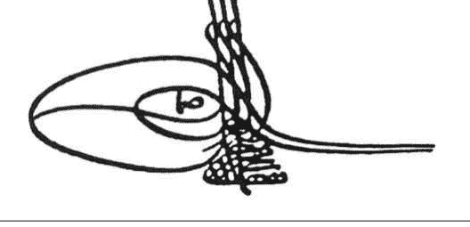

奥斯曼苏丹穆斯塔法二世（卒于1703年）的宝玺

9 Ibid., pp. 101–2.

## 附录 3

### 1754年10月土古战役所在地

荷兰记录和爪哇记录中对同一事件发生地使用不同术语是常见现象。例如，第2章提到的1751年12月一次重要的反叛胜利发生地，荷兰人描述为位于博戈沃托河（Bogowonto River），而爪哇人则认为发生在杰纳尔村（Jenar）。在这种情况下，识别博戈沃托河上的杰纳尔村并不困难。对于1754年10月的战役，也使用了不同的地名，但在那种情况下并没有容易解决的定论。

荷兰东印度公司（VOC）将1754年10月的战斗描述为发生在“萨蒙戈”（Samongo）河。爪哇人将土古战役称为Tugu（*pè-Tugu*）。要调和这些记载并在现代地形图上识别出它们是很困难的。我未能找到一条名为Samangka或类似名称的河流。有几处被称为“Tugu”（意为石碑或标记物）的地方，但我无法在正确的区域找到任何一处。很清楚的是，战斗发生在苏卡瓦蒂（Sukawati），对应于现在的斯特拉根县（Kabupaten Sragen）。SBPN ff. 344v.–346v. 显示，在塞尔洛（Selo）被掠夺后，曼库尼纳加拉跨过当地河流到达Jitis（这是一个常用名；列在Schol.中），向南行军，在班万河（Bangawan）东部的帕塞班村（Paseban?）与VOC战斗。他到达苏卡瓦蒂并停在苏卡瓦蒂一个名为Pajok的地方（这必是现代斯特拉根Mondokan附近的Pojok）。曼库布库米王子在马雅南（Majenang）以西（位于苏卡瓦蒂，也位于斯特拉根的Pojok区）与VOC军队对；他们向土古河的东岸行军。此时，曼库尼纳加拉位于Ngara-ara（此Ngara-ara的位置尚不清楚），而VOC位于Sidakarsa（可能是现在的斯特拉根内的一个区*kecamatan*——Sidoharjo）。第二天，战斗在土古开始。*BG* 第十七卷，第5-7页，也提到苏丹曼库布库米与VOC军队位于Majenjang，他们从那里跨过Bengkawan（Solo河）并向土古进发（这让位置变得更加混乱）。

从这些混乱中我得出结论：当时被称为Tugu的地方可能位于斯特拉根镇北部的平原，其北方是肯登山（Kendeng hills）。

## 附录 4

### 1788年雅萨迪普拉一世（Yasadipura I）概要

在涵盖Pakubuwana三统治最后动荡几个月的曼库尼纳加拉宫日书中，出现了一位爪哇文学史上的著名人物。我在上面提到过，雅萨迪普拉一世（Ng. Yasadipura I, 1729–1803）是爪哇人中最著名的人物之一，但有理由怀疑他创作了某些归于名下的作品。由其后代出版的一本雅萨迪普拉传记声称，在这一危机发展的时期他在皇宫（*kraton*）中担任了领导角色。年史《帕凯普（Babad Paképung）》也是这么说的；它显然是由雅萨迪普拉一世的儿子所著，历史价值存疑.¹ 我在1997年关于“雅萨迪普拉问题”的文章中表达过这些观点。²因此，在曼库尼纳加拉宫日书中发现1788年1月以下条目随后的内容是很有有趣的：

- 14. 周二下午[1714年Rabunglakir月13日 = 公元1788年1月22日]，皇太子的“儿子”派出的使者来到了阿迪帕蒂王子[曼库尼纳加拉]。

¹ Ricklefs, *Jogjakarta*, pp.xxii–xxx.  

² 参见 Ricklefs, “Yasadipura Problem”, pp. 277, 282; 雅萨迪普拉的生平（列在Schol.中；此类）列在Ricklefs, “Yasadipura Problem”, pp. 277, 282.

## 附录 5

### 爪哇VOC高级官员

#### 曼库尼纳加拉期间的雅加达官员

| 姓名 | 任期 |
| :--- | :--- |
| Johannes de Haan | 1725 |
| Diederik |mfs | 1729 |
| J.H. Abrahms | 1752 |
| Duurveldt | 1757 |
| Jan Christoffel Beuman | 1761 |
| Frederik Christoffel van Straalendorff | 1767 |
| Willem Adriaan Palm | 1784 |
| Andries Hartsinck | 1788-1790 (1111111111191 in 1789) |
| J. Fr. Baron van Reede tot der Parkeler | 1790-1796 |

#### 曼库尼纳加拉爪哇海岸官员

| 姓名 | 任期 |
| :--- | :--- |
| Joan Andries van Hohendorff | 1748-1754 |
| Nicolas Harthing | 1754-1761 |
| Willem Hendrik van Ossenberg | 1761-1765 |

#### 雅加达的第一任官员

| 姓名 | 任期 |
| :--- | :--- |
| C. Donkel | 1754-1761 |
| Jacob Cornelis van der Sluijs | 1761-1764 |
| Jan Lapro | 1764-1773 |
| Jan Mathijs van Rhijn | 1773-1786 |
| Wouter Hendrik van IJsseldijk | 1786-1799 |

#### 泗拉卡塔的第一任官员，1741-1996

| 姓名 | 任期 |
| :--- | :--- |
| Joan Andries Baron van Hohendff | 1741-1748 |
| Balthasar Toutmlein | 1748-1752 |
| J.H. Abrahams | 1752-1757 |
| Duurveldt | 1757-1761 |
| Jan Christoffel Beuman | 1761-1767 |
| Frederik Christoffel van Straalendorff | 1767-1784 |


| Willem Adriaan Palm | 1784-1788 |
| Andries Hartsinck | 1788-1790 |
| J. Fr. Baron van Reede tot der Parkeler | 1790-1796 |

# 致谢

我花了很长时间来研究和编写这本书，在此期间我积累了许多感激。我在 20 世纪 60 年代后期撰写我的博士论文和第一本书《Pakubuwana 三世统治下的雅加达》时，对曼库尼纳加拉产生了兴趣。

我很高兴地报告，曼库尼纳加拉一世（Mangkunagara I）在我退休生活中证明是一个可靠的伴侣，尤其是因为我没有琴可以弹奏。我希望这本书的读者也能发现他是一个值得关注的对象。

在撰写这本书期间，我得到了三位者的关键帮助，他们阅读了草稿并给出了无价的意见。首先，我的妻子玛格丽特·里克莱夫斯（Margaret Ricklefs）在编辑及其他成千上万方面支持着我。我的朋友和学术同事 David Chandler 和 Peter Carey 阅读了书中的章节，并提出了许多改进建议。其他朋友和同事回答了详细的问题，我感谢他们所有人：Nancy Florida 就苏卡加达（Sukakarta）及其他事务提供了建议；Barry Hooker 就伊斯兰法事务提供了建议；Michael Laffan 根据其在南非档案馆的工作提供了关于 R.M. Kareata 的信息；Jack Fairey 就附录2 提供了建议；Nico Kaptein 和 Oman Fathrahman 就阿拉伯语和伊斯兰事务提供了建议。其他人的感谢列在脚注中。Stuart Robson 慷慨地提供了他深厚的学术专长来支持我的校对。我无法感谢过去50年里支持我对曼库尼纳加拉研究的所有图书馆、图书管理员、档案馆、档案保管员和大学。从参考文献中可以看出，荷兰国家档案馆、莱登大学图书馆、大英图书馆以及曼库纳加拉皇宫的 Reksa Pustaka 图书在这些方面占据着重要地位。在之前的书中，与新加坡国立大学出版社的 Paul Kratoska、Peter Schoppert 和 Lena Qua 合作是一件乐事，我非常感激他们。Sundandini Arora Lal 是一位出色的文字编辑，修正了多处笔误和不一致之处，对此表示感谢。索引由 Alan Walker 编写，保持了他一贯的高标准；对于此，读者应该像我一样感谢他。

读者在书中可能发现的许多美德，这都是得益于我在研究和编写本书时收到的建议。当然，这部传记中的任何不足和错误完全由我个人承担责任。

M.C. Ricklefs

墨尔本

2017年10月

# 插图说明

曼库尼纳加拉自传《Sërat Babad Pakunêgaran》的扉页（BL Add. MS 12318, f. 1v.），由大英图书馆委员会提供复制。

来自 J. Crawford《印度群岛史》（History of the Indian Archipelago，3卷；爱丁堡：Archibald Constable & Co., 1820）的爪哇“战争武器”。

1888年雅加加塔甘兰乐团；1884年雅加加塔 bëdhaya 舞者；1888年雅加加塔面具戏（wayang topeng）；以及1899年雅加加塔哇戏（wayang wong）；均由 Kassian Cephas（1845–1912）拍摄。

由 Erlij Se 于2016年12月31日在雅加加塔皇宫（kraton）的 Bangsal Sri Manganti 厅拍摄的皮戏（wayang kulit）表演，前景是甘兰表演者。

来自 Hardjowirogo 的《影戏史》（Sedjarah wayang Purwa，雅加：Balai Pustaka, 1952）中影戏角色 Buta Terong 的描绘。

由 P. Tanjé 根据 Ph. van Dijk 的绘画绘制的1744年总督 G.W. van Imhoff 版画，出自 N.J. Krom《总督 Gustaaf Willem van Imhoff》（阿姆斯特丹：P.N. van Kampen & Zoon N.V., 1941）。

曼库尼纳加拉一世位于 Mandag 的墓。照片由 Sunanyo Haryabay 于2017年10月拍摄，并获得村长（lurah junci）KRMLit Likik Priasto Tirdotiningan 的慷许可。

曼库尼纳加拉四世（1853–1911）青铜胸像，来自 A.K. Pringgogdo《曼库纳加拉帝国史》（Geschiedenis der ondernemingen van het Mangkoenagorosse rijk，海格勒文哈：Martinus Nijhoff, 1950）。

VOC 文档样本页，来自荷兰国家档案馆，海牙，荷兰东印度公司（VOC），访问号 1.04.02，目录号 VOC 2825 (OB 1754)。

奥斯曼苏丹穆斯法二世（卒于1703年）的签名（Tughbra），来自维基百科共享。

由 Giuseppe Filosi 绘制的约1750年的巴达维亚版画，出自作者收藏。

所有其他照片和家谱均由 Lee Kheng 制作。

# 词汇表

- `abangan`: 名义上或不实践的穆斯林；字面意思是“红色的”。
- `Adipati`: 与 `Pangeran` 结合使用，高级王族头衔。
- `alun-alun`: 宫廷或住所前的大广场，举行锦标赛、斗虎等活动；通常宫廷南北各有一个。
- `babad`: 爪哇编年史，通常以诗歌形式写就；也指苏丹·阿贡（Sultan Agung）与南方海洋之间庄严结合时表演的最圣舞蹈（后者被认为以非物质形式存在）。
- `bupati`: 宫廷或乡村的高级官员。
- `cacah`: 计数单位。
- `dhadhaya`: 宫廷。
- `Dipati`: 家庭中的中级官员；更广泛地说，与 `Adipati` 同。
- `dhikr`: 字面意思是“纪念”：作为一种神秘练习，诵念真主的名字或其他虔诚的咒语。
- `gamelan`: 主要由打击乐器组成的爪哇乐团。
- `Grebeg`: 一年三次的宫廷节日。包括：庆祝先知诞生的 `Grebeg Mulud`（在 Mulud 月）、庆祝斋月结束的 `Grebeg Puasa`（在 Sawal 月），以及在亚伯拉罕献子（在 Besar 月）纪念亚伯拉罕愿意牺牲其子的 `Grebeg Besar`。
- `jenever`: “荷兰金杜酒”，也拼写为 genever，一种用杜松子调味的强力酒精类饮料。
- `haji`: 迁往麦加的朝圣。
- `kapir`: 非穆斯林。
- `kraton`: 皇宫。
- `mancaneg`: “自由村庄”，描述免于通常的劳役和税收义务的村庄，作为圣墓/宗教研究中心的所在地。
- `macegara`: 爪哇头衔，但其用法习惯并不明确。
- `Panembahan`: 王子。
- `pangeran`: 特定领主的首席行政官员。
- `pranakan`: 具有当地根源的外国裔背景的人。
- `priyayi`: 爪哇行政-贵族精英。
- `pusaka`: 遗产，特别是具有超自然属性的皇室财产。
- `putihan`: 职业宗教人士；字面意思是“白色的”。
- `Ratu`: 王室头衔，主要用于女性。
- `santri`: 宗教学生；宗教生活方式的追随者。
- `saregat`: 沙里亚；法律；苏菲派路径的第一阶段。
- `sayyid`: 来自先知后裔的贵族。
- `sembah`: 尊重或崇拜的手势，将手合十放在鼻子前。
- `senapati`: 统帅。
- `Shaikh`: 神秘主义者。
- `Sharif`: 苏菲派信徒。
- `Sunan`: 爪哇哇的信徒。
- `wayang`: 影戏或舞蹈剧。主要版本包括使用皮偶的 `wayang kulit`、使用木质人偶的 `wayang wong`、使用面具的 `wayang topeng` 以及使用小型木质偶的 `wayang krucil`（或 `klithik`）。
- `wali`: 圣。

# 参考文献

## 爪哇语未出版原始资料

- `Babad Kraton`, BL Add. MS 12320. Babad Tanah Jawi 编年史，是已知最早的存文本，延伸到 1742 年卡塔苏拉陷落，但在 f. 631r. 缺失 1719-49 年的内容。由 Tg. Jayengrat 在雅加加塔 1703-81 年编写。（参见下方 Panji Sunjata 出版。）

- `Babad Mangkubumi`, LoOr 291. 关于雅加加塔苏丹国 1755 年至 1792 年的历史记录，显然由太子（后来的 Hamengkubuwana 二世）创作。于 AH 1187 年（1773 年）标注，1792 年后有进一步补充，549 页。由 W.H. de Jong 从望马斯（Banyumas）赠给莱登大学图书馆。

- `Babad Nitik Samembawa`, SB PB A.99 (Behrend S122)。曼库尼纳加拉皇宫编年史的副本，涵盖 AJ 1715（1788 年）到 Jumadilaw 120（1773 年）。586 页。

- `Babad Tanah`, LoOr 768，通常被称为苏卡加塔大史。从亚延伸到 1768 年。在帕库诺四（1778-1820）统治期间于苏卡加塔开始，在1764（1836 年）完成并重抄。18 种。（9094 页）。为爪哇学院为苏卡加塔的欧洲官员提供语言培训（1832-43），随后转移至德尔夫特的继任机构，并于 1864 年并莱登大学图书馆。20 世纪由 J. Soegiarto（莱登爪哇语教授的长期助手）进行了罗马化。这个罗马化版本随后被送回巴达维，在那里被转换为爪哇文字并由政府出版机构 Balai Pustaka 出版 31 卷。该版本以1746 年苏卡加塔的建立结束；未包含直到 1768 年捕获 P. Singasari 的剩余事件描述。

- 致 Mulud AJ 1718 (公元 1791 年 11 月)。位于 Mangkunagara 宫。最后一页是一幅粗糙的防御工事图，配有文字 `punika Welandi gambarun`（这是一张荷兰人的画像）。303 页。现藏于莱顿大学图书馆。

- Bl. Add MS 1238。《巴巴德史》（Babad），从亚当开始，突然结束于 Senapati Ingalana 统治时期。位于于雅加达的 Mangkubumen，日期为 AJ 1740 年 [公元 1813 年]。若干章节分别标注日期为 AJ 1736 年至 1738 年 [公元 1809–11 年]。第 1–210 页。出自 John Crawford 收藏，于 1842 年获得。

- 《尤素法先知传记》（Karita Nabi Yusuf）；RP MS no. 261 carikan。日期为 Rabiyulakir-Jumadilawal AJ 1654 年 [公元 1629–1730 年]。由 Kartasura 的 Ratu Pakubuwana（ingkang ayasa）创作；i + 206 页。新索书（截至 1994 年）808.801/Ser/S。

- 《伊斯坎达苏丹传记》（Karita Sultan Iskandar）。RP MS no. 261 carikan。日期为 Rabiyawal-Jumadilawal [应为 Rabiyulakir] AJ 1654 年 [公元 1729 年 9 月–10 月]。由 Kartasura 的 Ratu Pakubuwana（ingkang ayasa）创作。i + 14 页。新索书（截至 1994 年）808.801/Ser/S。

- IOL Maj. 36。《马达拉姆巴巴德史》（Babad Mataram）或《土地史》（Babad Tanah）传统的的残缺且装订错误的文本，跨越从马达拉姆早期到 AJ 1600 年 [公元 1667 年]。第一卷，第 1–216 页；第二卷，第 217–348 页。未标记，但显然与 Sangkala 中日期为 Saban AJ 1663 年 [公元 1738 年 11 月] 的文本 B 同代。

- 《法原理书》（Kitab Usuliyah）。RP MS no. 263 carikan。该卷书包含几部作品：《法原理书》（第 1–45 页），日期为 Dumadilakir AJ 1654 年 [公元 1729 年 12 月]，由 Kartasura 的 Ratu Pakubuwana（ingkang ayasa）创作；《先知特质之歌》（Gita Sifat Nabi，第 45–88 页）；《萨穆塔布雷》（Se Samu Tabred，第 48–51 页）；《易布拉欣先知传记》（Caritan Nabi Ibrahim，第 55–66 页），部分也称为《伊斯卡克的巴根达之歌》（Gita Bagendah Iskak）；《恩内布雷杰先知传记》（Caritan Nabi Enéb Rej）AJ [1654 年] [公元 1730 年 2 月]；金妻苏菲文献》（Suluk Garwa Kancana，第 60–61 页），据说是出自《王集》（Susunan Ratu）。全卷共计 i + 22 页。新索书（截至 1994 年）297.12/Ser/S。

- 《法原理书》（Kitab Usuliyah）。SB MS PB A.109 (Behrend L7)。该手稿包含两部作品：《法原理书》（第 1–182 页），其开头由 Ny. M. Kaduwang 于 Rabiyawal AJ 1668 年 [公元 1743 年] ；；穆罕默德先知传记》（Karita Nabi Muhammad，第 184–90 页），与前文字体相同，日期为 Rabingawal Ehe AJ 1668 年 [公元 1749 年]，缺失结尾。全卷共计 i + 92 页。

- KITLV Or. 233 《苏拉卡塔 KGPA Mangkunonegaran 日记摘录/内容》，包含《曼库尼库恩加拉兰尼记史》（Babad Nitik Mangkoenagaran）。由 Mandrasastra 于 1930 年编纂。KITLV Or. 231《口述巴巴德史》（Babad Tutur）的爪哇语摘要稿。183 页。现藏于莱顿大学图书馆。

- 《从亚当先知到土地国王的历史》（Sejarah wiwit Nabi Adam dumugi ratu-ratu tanah Nabi）MS MS 192 (Florida 222.A)。这是该卷第一个文本（第 1–17 页）的标题，由苏拉卡塔 Mangkunagura 创作，始于 Jumadilwik AJ 1695 年 [公元 1769 年 10 月]。它包含一套标准的苏菲宇宙论，讨论了亚当及其后裔。随后是（第 20–38 页）一段相关的文本，开头为 AJ 1696 年 [公元 1770 年 4 月–1771 年 4 月] 的年份以及陈述 `punika sarajah ing tĕdak-tumĕbak ing para Nata ing Tanah Jawa sadaya`，从亚当延伸到 Mangkunagara 本人的手稿。书中还有其他字迹的几个文本和文本片段；其中一个是214 页。

- 《曼库尼库恩加拉兰尼记史》（Serat Babad Nitik Mangkunajaran）始于 Alip 1707 年，Je 1718 年。MN B29b；显然出自 KITLV Or. 231。

- 《帕库纳加拉巴巴德史》（Serat Babad Pakunagara），短片段，显然源于曼库尼库恩加拉，日期为 Aj 171 [公元 1793 年]，发现于 RP 48 B.1。

- 大英图书馆（BL Add. MS 1231）。出自 John Crawford 收藏，于 1842 年获得。

- 《帕南巴根巴巴德史》（Serat Babad Panambangan）。MN B18a (Florida 222)，曼库尼库恩加拉的历史，1726–1852 年。由 M. G. Rongga 创作，1733 年。

- 《瓦汉史》（Serat Wahanabastra）。MN O 72 (Florida 527)。作者未知。结尾日期混乱，为 Jumuwah-Kliwon, 15 Rej, Alip 1811 年 [公元 1882 年]。编辑并罗马化的版本由 R. Gastrodono 于 1952 年完成，提供了一个更完整的版本。B244 (Florida 481)。归属于 Pakubuwana III；此副本于 1870 年在苏拉卡塔由 Ng. Hawikrama 完成。

- 第 35–41 页，根据 Pakubuwana IX 的命令完成苏菲文献。Muharram AJ 1700 年 [公元 1774 年 3 月]。一段寓言性的、预言性的且自然的历史。2 卷。

- 《维卡查拉》（Wulang Wicara）。Meth MS 89 (vii)，第 1–95 页，Jumadil AJ 1744 年 [公元 1817 年 4 月]，现于莱顿大学图书馆。J.F. Gericke。Bwi. 31卷。（前一章节。）

## 爪哇语出版文献

- Cohen Stuart, A.B., 翻译《萨肯德男爵的历史》（Geschiedenis van Baron Sakendh），一个爪哇故事（Javaansch verhaal）。巴达维亚，1850 年。

- Johns, A.H., 翻译《致先知之神的礼物》（The Gift Addressed to the Spirit of Prophet）。堪培拉：澳洲国立大学，1965 年。

- 《曼库尼库恩加拉兰尼记史》（Mangkungawara IV）。Sërat-sërat anggetun-dam sampai Gusti Adipati Koleff，1953 年。

- 《曼库尼库恩加拉兰尼记史》（Mangkungawara II）。关于《皮影戏》（On the Weyang Kulit Purwa）及其象征元素，Claire Holt 翻译。伊塔卡：康奈尔大学东南亚项目，第 25 期，1997 年。


# 参考文献

## 爪哇语文献

- 《潘贾塔苏尼雅塔》（Pantja Sunjata），I.W., Ignatius Supriyanto 和 J.J. Rad 翻译，《皇宫巴巴德》（Babad Kraton）：直到马达拉姆的历史（Sejarah kerajaan sampai Mataram），根据手稿；大英图书馆，Add:2320。Djambatan，1992 年。

- Robson, Stuart, 翻译《英文版》。KITLV 论文 4。莱顿：KITLV Press，2008 年。

- Winter, C.F., Str.《爪哇摘要》，第一卷，T. Roorda 编。莱顿：E.J. Brill,1951 年 [第 5 次印刷]。

- Winter, C.F., Str., J.J.B. Ga 和 T. Roorda，《爪哇古话般的历史》（Oude fabelachtige geschiedenis van java），从 Sindelon Galeb 统治到 Madja-Pait，苏esoeh 国。阿姆斯特丹：Frederik Muller，1857 年。

- Yasadipura I。《吉亚蒂巴巴德史》（Babad Giyanti）。Bale Pustaka，1937–1939 年。亦见 http://www.sastra.org/kisah-cerita-dan-kronikal/70-babad-giyanti。

## 荷兰语未出版文献

- 荷兰档案馆，海牙。

- VOC 1009（巴达维亚收件信箱 1755 年 函函）。

- VOC 1011（巴达维亚收件信箱 1757 年 函）。

- VOC (OB) 系列。包含来自中爪哇和东爪哇 VOC 办公室的信件，发现于《到达信件和文件》（Overkomen brieven en papieren），从 VOC 2080 (OB 1728) 到 VOC 3942 (OB 1792)。

- 印尼国家档案馆，雅加达。

- Djokjo 32 《1756–61 年日惹至三泗信》（Djokjo brieven naar Samarang）。

- Djokjo 33 《1761–64 年日惹至三泗信》（Djokjo brieven naar Samarang）。

- AN 爪哇东北部《1790 年附录》（Java’s Noord-Oost Kust）。

- Surakarta 15 《1740–41 年发往三泗的部分信》（Parte brieven naar Samarang）。

- Solo 36 《各种声明》（Diverze Verklaringen）。

## 荷兰语出版文献

- Coolha, W. Ph., 等，编。《致荷兰东印度公司总督和委员会的十七位先生的总公文》（Generale missiven van Gouverneurs-Generaal en Raden aan Heren XVII der Verenigde Oostindische Compagnie）。13 卷。海文港：Martin Nijhoff；海牙：荷兰历史研究所，1960–2007 年。亦见 https://resources.huygens.knnl/retroebekeening/generalmissiven#page=0&accessor=toc&source=.。

- 荷兰东印度公司（VOC）与巴达维亚（雅加达）的当地机构/Arsip-arsip Verenigde Oostindische Compagnie (VOC) dan lembaga-lembaga pemerintahan kota Batavia (Jakarta)/De archieven van de Verenigde Oostindische Compagnie (VOC) en de locale instellingen te Batavia (Jakarta). [雅加达]: 印度尼西亚共和国国家档案馆；莱登与波士顿：E.J. Brill，2007。

- Berg, L.W.C., van De inlandsche regen en titels on Java en Madoera. 第2版..-海牙：Nijhoff, 1902。

- Blussé, Leonard. 《Strange Company: Chinese Settlers, Mestizo Women and the Dutch in VOC Batavia》。六卷第122卷. 德德赫特与里河：Foris, 1986。

- Bosma, Ulbe en Remco Raven. 《Being “Dutch” in the Indies: A History of Creolisation and Empire, 1500–1920》，Wendie Schaffer 译. 新加坡：NUS Press；雅典：俄亥俄大学出版社，2008。

- Brug, P.H. van. 《Malaria en malaria: De VOC in Batavia in de achttiendede eeuw》。阿姆斯特丹：De Batasche Leeuw, 1994。

- Carey, Peter，编并译。《Babad Dipanagara: An Account of the Outbreak of the Java War (1825–30)》。将苏卡心脏版的《Babad Dipanagara》译成英文和印尼马来语。吉隆坡：Printing Works for the Council of the MBRAS, 1981。

- 爪哇中部华人社区认知的转变，1755–1825，印度尼西亚（1984年4月）:1–47页。

- 《Satria and Santri: 关于爪哇战争期间期间迪潘加拉皇宫与宗教支持者的关系》，收于《babad dan hikayat sejarah kritis: Kumpulan karangan yang disampaikan kepada Prof. Dr. Sartono Kartodirdjo》，T. Ibrahim 等人编，第271–318页。日志加达：Gadjahada University Press, 1987。

- 《1811–16年的英国人：一个爪哇人的记录；文本版、大英图书馆手稿1230（日志加达的《Babad Bebdhang》）的英文摘要与评注》。牛津：英国科学院学院牛津大学出版社，1992。

- 《The Power of Prophecy: Prince Dipanagara and the End of an Old Order in Java, 1785–1855》。KITLV 第249卷. 莱登：KITLV Press, 2008。

- “1815年爪哇的锡克兵阴谋”，BKI 133, 2–3（1977）:294–322页。

- Chaumont, E. “Wadü”，《伊斯兰百科书》，新[第2]版，H.A.R. Gibb, P. Bearman 等人编，13卷。莱登：Brill, 1986–2009，第xi卷，第218–9页。

- Clausewitz, Carl von. 《战争论》，Michael Howard 和 Peter Maret 译。普林斯顿：普林斯顿出版社，1976。

- Coté, Oost 等. 《The Life and Work of Thomas Karsten》。阿姆斯特丹：Architecture & Natura Press, 2017。

- Crawford, John. 《A Descriptive Dictionary of the Indian Islands & Adjacent Countries》，序言 M.C. Ricklefs 著。Oxford in Asia HistoricalReprints。吉隆坡等：牛津大学出版社，1971（原版于1856年）。

- Drewes, J.W.J.,编并译。《Travellers on the Mystic Path: Zakariyya’al-Anshār Kitab al-Rahman and Its Indonesian Adaptations，附有关于勿胆腊手稿和作者的补充》。VKI 第81卷. 海牙：Martinus Nijhoff, 1977。

- Fananie, Zainuddin. 《Pandangan dunia KGPA Hamengkuanoro dalam Babad Tradur: Sebuah restrukturisasi budaya》（一种文化重构），ito. Kartodirdjo 译。苏卡心脏：Muhamadiyah University Press, 1994。

- Fathurahman, Oman. 《Shattariyah Sufi in Aceh, Java, and the Lanao Area of Mindanao》。东京：亚洲与非洲语言文化研究所，东京大学自由学术学院，2016。

- Florida, Nancy K. 〈Shattariyah Sufi Scents in the Literary World of the Surakarta Palace in Nineteenth-Century Java（十九世纪爪哇苏卡心脏宫文学世界中的沙菲气息）〉，收于《Buddhist and Islamic Networks in Southern Asia: Comparative Perspectives》，R. Michael Feener 和 Anne M. Blackburn 编。檀尼胡鲁：夏威夷大学出版社, 2018。

- 《Writing the Past, Inscrib the Future: History as Prophecy in Colonial Java》。杜伦与伦敦：杜克大学出版社，1995。

- Geertz, Hildred. 《The Javanese Family: A Study of Kinship and Socialization》。纽约：Free Press of Glence, 1961。

- Gonda, J. ‘Eenige greenen uit de geschiedenis van de beofening van der Maleische taal- en letterkunde,’ Verlag Communaal Urechts Genootschap van Kunsten en Wetenschappen（1935），第93–113页。

- Graaf, H.J. de. 《De moord op Kapitein François Tack, 8 Feb. 1886》。阿姆斯特丹：H.J. Paris, 1935。

- 《De regering van Panembahan Senapati》，VKI 第13卷. 海牙：Martinus Nijhoff, 1954。

- 《De regering van Sultan Agung, voor Mataram 1613–1645》，VKI 第23卷. 海牙：Martinus Nijhoff, 1958。

- Greengrass, Mark. 《Christendom Destroyed: Europe 1517–1648》。伦敦：Allen Line, 2014。

- Groneman, Isaac. 《The Javanese Kris》，序言与引言。David van Duuren 著，Peter Richard 和 Timothy D. Rogers 译. 莱登：Zwarten Art Books and KITLV Press, 2009。

- Groneman, J. 《De gareb’s de-Nagakarta》。苏卡心脏：Martinus Nijhoff, 1895。

- Haan, F. de: 《Regentschappen onder het Nederlands bestuur tot 1811》，4卷. [巴达达]: Batavia Genootschap van Kunsten en Wetenschappen, 1910。

- Hardjowiro, 《Sedjarah budaya（文化史）》。雅加达：Balai Pustaka, 1952。

- Heffening, W. ‘Murt’，《伊斯兰百科书》，新[第2]版，H.A.R. Gibb, P. Bearman 等人编，13卷。莱登：Brill, 1986–2009，第vii卷。

- Houben, Vincent J. 《De wijzen onder de Vereenigde Oostindische Compagnie（1730–1870）》，第14卷. 雅加达：Dutch East: Boon, 1994。

- Jay, Robert R. 《Javanese Villagers: Social Relations（爪哇村民：社会关系）》。剑桥：Cambridge, 1969。

- Junby, 《Handleiding tot de kennis van Mohammedansche（苏丹教徒知识指南）》。莱登：Cambridge, 1930.

- Kaplein, Nico. ‘Southeast Asian Debates and the Long 20th Century（东南亚辩论与漫长的20世纪）》，收于《The Rise of the Middle East（中东的崛起）》。檀尼胡：NUS Press, 2009。

- Korte, J. 《De overwinning van de Javaansche successielog（1746–1755）》。巴达达：Albrecht & Rusche, 1984.

- Meiden, G.W. der. “A Turkish Mediator between the Company（公司之间的土耳调介者）”，Review of Indonesian and Malayan Affairs 15, 2（1981）:92–107页。

- Mengenal Al-Wust Mangkunegaran（苏卡心脏的崛起）:苏卡心脏，2017年。日加心脏：Solo, 2017。

- Kraus, Werner. 〈A Note on Professor John’s ‘Gift Added to the Spirit of the Prophet（约翰教授“对先知精神的贡献”之注）’〉，BKI 129, 2–3（1973）:347–9页。

- “Dipanagara’s Early Inspirational Experience（迪潘加拉早期的灵感体验）”，BKI 130, 2–3（1974）:227–58页。

- “Babad Gianti: Sebuah sejarah dan karya agungastra Jawa（吉万蒂史：一部爪哇历史与伟大的著作）”。Jumantara：Lunar Manuscript Nusantara 5, 2（2014）:11–25页。

- Islamisation and its Opponents in Java: Political, Social, Cultural and Religious History, c. 1930 to the Present。新加坡：NUS Press；University of Hawai’i Press, 2012.

- 《爪哇岛的神秘合成：从14世纪到19世纪初的伊斯兰化史》。诺福克：EastBridge出版社，2006年。

- “关于莱登手稿cod.or. 2191，《巴巴德·Mangkutubumi》的作者身份问题”，BKI 127, 2 (1971): 264–73。

- 《极化的爪哇社会：伊斯兰教及其他愿景，约1830–1930年》。新加坡：国立新加坡大学出版社；檀诺鲁：夏威夷大学出版社；莱登：KITV出版社，2007年。

- “关于17世纪末至18世纪爪哇社会、经济和地理历史的某些统计证据”，《现代亚洲研究》20, 1 (1986): 1–3。

- “1740–171年爪哇岛的危机：爪哇人、中国人、马杜拉人和荷兰人，以及卡尔塔苏拉王宫的衰落”，BKI 139, 2–3 (1983): 268–90。

- “卡尔塔苏拉失踪的圣物（Pusakas），1705–37年”，收于《语言-文学-文化：献给P.J. Zaetolder教授博士的珍珠链式献礼选集》，Sulistrino等人编，第601–30页。日惹加塔：加加哈·马达出版社，1985年。

- “Mangkunagara一世作为‘灵魂捕获者’吸引力的起源”，BKI 171, 4 (2015): 53–8。

- 《爪哇岛可见与不可见的世界，1726–1779年：佩库布沃诺二世王宫的历史、文学与伊斯兰教》。圣莱纳德：澳大利亚亚洲研究协会联合Allen & Unwin出版社；檀诺鲁：夏威夷大学大学出版社，1998年。

- “Theadisakura问题”，BKI 153, 2 (1997): 273–83。

- 《1677–1726年爪哇岛的战争、文化与经济：卡尔塔苏拉早期帝国主义殖民扩张史》。悉尼：澳大利亚亚洲研究协会联合Allen & Unwin出版社，1999年。

- 《日惹加塔，爪哇苏丹Mangkutubumi，1749–1992：爪哇部分史》，Reviani Budi Santoso编，Hartono Hadikusumo和E. Setiyawati Al Khatab译译。日惹加塔：MataBanga出版社，2002年。

- Riddell, P.G.，“阿布杜拉赫曼·辛格”，收于《伊斯兰百科全书》三面 2007-2，Gudran Kramer等编，第27–30页。伦敦与波士顿：布里出版社，2007年。

- Rinkes, D.A.，“爪哇岛的圣人IV：Ki Pandan Arang在Tembajaj”，TBG 5–6 (1991): 435–581。

- 《爪哇九大圣徒》，Elijah Gordon编，H.M. Froger译，G.W.J. Dewes序。吉隆坡：马来西亚社会学研究所，1996年。

- Robied van der Aa, P.J.B.C. “18世纪隐秘的大八丹姆起义”，BKI 第4版，第5卷[= 第29卷] (1881)，第1–127页。

- Rouffaer, G.P.，“贵族土地”，收于《论文集》（Adrechtrebundels）。第34卷：马杜拉的爪哇，第233–378页。格拉文哈根：Martin Nijhoff出版社，1951年。


Sasrasumarta, Sastraluya和Yasapurya。《Tas Pajang：纪念Raden Ngabehi Yasadipura一世的行迹，苏拉加塔·Adiningrat王宫Kaliwon-Pujongga侍从》。苏拉加塔：Panggecan Budi Utama出版社，1939年。

# 参考文献

391

Schacht, J. “离婚（Talak）”，收于《伊斯兰百科全书：新[第2]版》，H.A.R. Gibbs, P. Bearman等人编，莱登：布里出版社，第x卷，第151–5页。

Schrieke, Bertram。《印度尼西亚社会学研究：选集》。2卷。海牙与万隆：W. van hoeve出版社，1955–57年。

Sears, Laurie。《帝国的阴影：殖民话语与爪哇故事》。达勒姆与伦敦：杜克大学出版社，1996年。

Snuck, C. 《散文（Verspreite Schriften/作品合集）》。莱比锡：E. Schroeder出版社，1923年。

Soebardi, S. “Mangkubara四世王子：19世纪的统治者与诗人”，《东方学会杂志》（1971年12月）：28–58。

Soedjono Tirtoko，《爪哇岛苏丹国（部分史）：日惹加塔，爪哇苏丹Mangkutubumi，1749–1992年》，Reviani Budi Santoso编，Hartono Hadikusumo和E. Setiyawati Al Khatab译。日惹加塔：MataBanga出版社，2002年。

Stavel, F. 《荷兰东印度总督时期的研究》。海牙：W. van hoeve出版社，1941年。

Thomas, Keith。《宗教与魔法的衰落：16和17世纪的流行信仰》。Penguin出版社，1973年。

Tolstoy, Leo，《战争与和平》，Richard Peavar译，序言来自Islam。伦敦：Vintage出版社，2009年。

Trimming, Spencer。《伊斯兰中的苏菲教团》。纽约：纽约大学出版社，1998年。

Van Neel, Robert。《爪哇岛东北部，1740–1840：殖民扩张》。CNWS出版社，2005年。

Vermeulen, J. 《爪哇岛的历史》。巴达：Eigenwaard出版社，1938年。

Voorhoeve, P. “阿拉的帕林（Allah-Palimbani/伊斯兰教）”，收于《伊斯兰百科全书：新[第2]版》，H.A.R. Gibbs, P. Bearman等人编，莱登：布里出版社，第i卷，第92页。

Ward, William。《印尼语研究》。波士顿：布里出版社，1985年。

Zoetmulder, P. 《爪哇文学》，第16系列。海牙：Martin Nijhoff出版社，1974年。

Mackinson, John。《爪哇岛与巴厘岛鸟类分类指南》。日惹加塔：加加哈·马达出版社，1991年。

Meilik-Roelofs, M.A.P. 《荷兰东印度公司档案馆（1602–1795）》。格拉文哈根：国家档案馆出版社，1992年。

Mitchell, B.R.《海洋历史统计，1750–1970年：删节版》。伦敦与巴斯金：麦米林出版社，1978年。

Pigeaud, Theodore G. Th。《莱登大学图书馆及荷兰其他收藏中的爪哇手稿目录：伊斯兰文学》。4卷。海牙：Martin Nijhoff出版社；莱登：大学出版社，1967–80年。

# 参考文献 393

Proudfoot, Ian。《东南亚古穆斯林历法CD-ROM》。东方学手册第3部分，第17卷。莱登与波士顿：布里出版社，2006年。

Ricklefs, M.C., P. Voorhoeve和Annabel Teh Gallop。《英国收藏的印尼手稿：英国公共收藏中印尼语手稿目录：新版附录与更正》。雅加达：法国东方研究所，印度尼西亚共和国国家图书馆，Yayasan Pustaka Obor Indonesia，2014年。

# 目录

- 'Abd al-Samad al-Palembani，又称 Abdul Samat（约 1720–89 年），258–9
- Abdul Samat，*参见* 'Abd al-Samad al-Palembani Abdmulmuhi (Shaik)（卒约 1715 年），又名 Haji Karang，20–1, 297–8
- Abdurraff Singkali（约 1615–93 年），20–1
- (A)Bimanyu, 247
- Abiyasa, 247
- 亚伯拉罕（先知），29, 247 *Garareb Bésar*，29, 124, 154, 255, 379
- Abrahams, J.H.（苏卡尔塔驻守，1752–57），193, 195–6, 217, 373
- 亚齐（Aceh），323
- 亚当（先知），3, 145, 243, 245–7, 239
- Adiprakusa (Susunan)，*参见* Mangkunagara（隐士），68
- Adisana（隐士），68
- Adiwijaya（Png），85, 89, 95, 108, 110–1, 118, 130, 234 谱系，342–3
- Agung（苏丹）（在位 1613–46 年）*bëdhaya*，历法，xi 谱系，342–3, 传统（1726–42）：MN 的早期生活，8, 17, 19–20, 27, 传统（1743–46）：内战，传统（1746–57）：第三次爪哇继承继承之战，88, 144, 传统（1768–78），236–7, 247–8
- 阿里·萨卡（Aji Saka），爪哇之王，6
- 哲扎利（al-Ghazali），324 酒精
- 天主教徒，36
- 伊斯兰法，152, 160, 273, 299
- 杜松酒（jenever, genever，“荷兰杜松酒”），379
- 曼库布米（Mangkubumi），170, 195, 228
- 曼库尼加拉一世的习惯，58, 154, 160, 273, 299, 312, 323
- 曼库尼加拉一世对杜松酒的偏好，190, 198, 317, 319–20
- 曼库尼加拉二世，233
- 帕库布瓦纳三世（Pakubuwana III），170, 196
- 帕库布瓦纳四世（Pakubuwana IV），296, 300
- 王子，289
- 亚历山大帝（Iskandar），18
- Alit（Ratu），更早期的 R. Ay. Kadhaton，帕库布瓦纳三世之女儿，225, 232, 289 谱系，342–3, 395
- Alting, Willem Arnold（1780–96 年总督），372
- 'ʿAlwi（Sayyid），40
- 阿曼库阿库拉特一世（Amangkurat I，在位 1648–77 年），54, 248, 谱系，342–3
- 阿曼库阿库拉特二世（Amangkurat II，在位 1677–1703 年），96, 194, 223, 243, 248, 谱系，342–3
- 阿曼库阿库拉特三世（Amangkurat III，在位 1703–8 年，卒于 1734 年），22, 181–220, 233, 238, 谱系，342–3
- 阿曼库阿库拉特四世（Amangkurat IV，在位 1719–26 年），8, 11–2, 15, 17, 81, 248–9, 谱系，342–3
- 阿曼库阿库拉特（Ratu），帕库布瓦纳二世之母，10, 23–25, 36, 谱系，342–3
- Ambaraara, 爪哇（也称 Bahrawa Rawi 或 Sitiri），x
- Ambiya，老曼库尼加拉长老之子，*参见* Pamot（Png）。
- 亚汶（Ambon），64, 321，地图，339
- Amdo，*参见* Pamot（Png）
- 阿姆斯特丹（《大法典》），239
- Angger Arubiru（扰乱治安法），239
- Anom (Kētib)，22, 24
- Anom (Png)，*参见* Guntur (R.M.)
- Béndara，216, 226, 254
- 贡图（Guntur），222, 曼库布米，62, 180
- 曼库尼加拉（Mangkunagara），33, 197–200, 205–261, 294, 302, 305–6, 308–315
- 老曼库尼加拉，11
- 曼库尼加拉公国，323–4，曼库尼加拉的随者，56
- 曼库尼格拉特（Mangkuningrat），193，军团，65
- Pamot，84–5
- Suradimenggala，137
- 苏卡尔塔（Surakarta），174，圣战（aprang Sabil），*参见* Holy War
- 阿阿拉伯（Arabia），22, 155 阿拉伯语
- 铭文，326，伊斯兰教改革者，230，爪哇文学，246, 362，翻译的信件，257–8，MN 的知识，276，对孩子的教育，162, 276，翻译的词，22, 105–6, 144, 207, 289, 362
- 阿拉伯文学，178
- 阿拉伯人，40, 328–9，贵族，*参见* nobility and elites
- 阿尔朱那（Arjuna），274, 276
- 阿尔诺德（Arnold, Joseph），32, 385，Aringan (Tg.)，106, 121, 195–6, 205，暗杀，65，Astana，162，205，Astana Wedi (pradakan)，87，Ayah，爪哇，287
- 迪帕纳加拉史（Babad Dipanagara），345
- 亚甘提史（Babad Giyanti, BG），缩写，xi，历史（1726–42）：帕库布瓦纳二世，16–7，历史（1743–46）：内战，52, 54，历史（1746–51）：第三次爪哇继承继承之战，第一阶段，61, 63–4, 66–8, 87, 96, 103–9, 218
- 亚甘提史（Babad Giyanti, BG）（续），《爪哇志》（Babad Tanah Jawi），历史（1752–53）：第三次爪哇继承继承之战，第二阶段，110–5, 117–8, 130–1, 133–4, 136–7, 139–41，历史（1753–55）：第三次爪哇继承继承之战，第三阶段，144–9, 151–66, 170–1, 361，历史（1757–68）：MN 在苏卡尔塔的建立与外交，205, 212, 215–8，主要来源，2–3, 344–351–3, 384, 392，爪，145, 381；*参见*曼库尼加拉公国
- 图图史（Babad Tutur, BT），*参见* Mangkunagaran individual babads
- 卡尔塔苏拉史（Babad Kartasura），330
- 肯基里史（Babad Kedhiri），330
- 克拉通史（Babad Kraton, BK），xv, 3, 36, 38–23, 335, 381；*参见*雅加加塔（Yogyakarta），主要来源，4, 344–55
- Bacher, B.,125
- 巴格伦（Bagelen），爪哇（早期 Paglen），52, 95–6, 102, 106, 118, 160, 250
- 曼库布米史（Babad Mangkubumi, BM），缩写，ev，历史（1746–57）：第三次爪哇继承继承之战，170, 180, 183–4，历史（1757–68）：MN 在苏卡尔塔的建立与外交，207, 222, 227, 229–3，主要来源，3，地图，340–1
- 古斯·杜哈（Bagus Budhal），217
- Bahman (Ky.)，296, 300
- Bahrawa，*参见* Ambarawa，爪哇（亦）
- Bahrawa，Rawi 或 Sitiwari，巴厘，世纪周期，238，舞蹈，178，甘美兰，92，克里斯（krises），105, 193，地图，330–40，Rum 苏丹，146，哇扬（wayang），156
- 东部前线的巴厘岛树，234，与马达拉的士兵，45, 50
- 曼库尼加拉史，*参见*曼库尼加拉公国
- 曼库尼加拉尼提史，*参见*曼库尼加拉公国
- 帕克普松史（Babad Pakepung），307, 370
- 披纳史（Babad Pēcina），44，与曼库布米，73, 118, 131，与曼库尼加拉，50, 154，与 VOC，64, 107, 159, 163，历史（1752–53）：第三次爪哇继承继承之战，第二阶段，111, 119
- 巴尔干地区（Balkans），365
- 巴纳兰（Banaran），*参见* Kabanaran，爪哇
- 班达（Banda），161, 321，VOC 信件，110, 112, 114–5, 118, 120–,125–6, 131–3, 135–,138–9, 142，地图，339
- 邦万河（Bangawan River），368
- 邦卡（Bangka），爪哇，223
- 邦斯里（Bangsri），爪哇，57–28，地图，341
- 班查尔（Banjar），爪哇，260
- 班查尔萨里（Banjarsari，南加里曼丹），45, 269，VOC 信件，147, 157–9, 161, 163, 172，万�丹（Banten），爪哇，102, 121, 125，地图，339
- 亚尤多诺（Anyudono），爪哇，91–120, 126，亚尤马斯（Anyumas），爪哇，107, 158, 223, 255, 260, 287，地图，340
- 巴达维亚（Batavia），爪哇（后来的雅加达），生活，10–1, 24, 31–3, 35，VOC 信件，265–,86–99, 300–13, 315，VOC 信件，14, 25, 34，VOC 信件，43–4, 46–48，48–55，历史（1726–42）：MN 的早期生活，历史（1743–46）：内战，历史（1746–51）：第三次爪哇继承继承之战，第一阶段，61, 63–4, 66–8, 87, 96, 101, 103–9, 218
- 巴赫（Bacher, B.），125

# 索引

399

- Cakajaya（官方）亦称日惹加塔的 Cakrakakti（1756），189
- Cakajaya（Tg.）亦称珀马兰根的 Cakranagara（1752），112
- Cakrakarti（官方），参见 Cakajaya（官方）
- Cakranagara，参见 Cakajaya（Tg.）
- Cakraningrat IV（在位1718–46年，卒1753年），31, 35–6, 38, 45, 58
- Cakraningrat V（在位1745–70年），45, 124
- Cakrajaya 家族（马杜拉），7, 45 历历, 237, 246；参见爪哇岛欧洲历历，188
- 伊斯兰教，xi, 237, 240
- 加尔文派，36, 21
- Candhini，爪哇（亦称 Chendhani），188
- 食人习，96, 157
- 历史（从公元1900年起），335
- 地图，340
- 苏菲派传统，20
- 锡兰，参见 斯里兰卡（早期曾名锡兰）
- “锡兰，扬·范·兰”，参见 Kareta（R.M.）
- 童婚（“悬挂”行军），157–8, 185, 216, 262
- 华人社区历史（1726–42年）：MN 的生活，34, 36–37, 39–40
- 历史（1746–51年）：第三次爪哇继承战争，第一阶段，71, 73, 78, 89–90
- 历史（1752–53年）：第三次爪哇继承战争，第二阶段，111–2, 118
- 历史（1753–55年）：第三次爪哇继承战争，第三阶段，361
- 历史（1755–57年）：第三次爪哇继承战争，最终阶段，179, 181, 187
- 历史（1757–68年）：MN 在苏拉卡塔的建立与婚姻外交，218 军队，39
- 中文文献，349
- 华商战争（1740–43年），33–41, 71, 111, 132, 181, 221
- 基督徒，35–6, 64, 329；参见 加尔文派；天主教
- 史书，爪哇史书（babads），参见 babads

400

索引

- 望善角，11, 45, 220, 285–6
- Carey，彼得，2, 345, 380
- 天主教，36
- Célomag（Dipati）；参见 Sawunggangan（Tg.）
- 莱锡：参见 Colebek
- 爪哇岛
- 爪哇 Chendhani；参见 Candhini, Java
- Cengkalsewu，爪哇岛，78, 118, 223
- 地图，340
- 中央历史（1726–42年）：MN 的生活，20, 33
- 历史（1743–46年）：内战，42–3, 51, 58
- 历史（1746–57年）：第三次爪哇继承战争，80, 95, 138, 150, 156, 173
- 历史（1768–78年），256, 262, 336
- 历史（1779–88年）：MN 的晚年，266, 270
- 历史（1785–95年）：MN 的最终胜利，293–5, 301, 313–35
- 历史（1796–1899年），321, 324, 328–31
- Firebon，73, 728
- 地图，339
- Citriwiry，262
- Citrasoma（Tg.）（卒1776年），262
- Clauswirth, von，90, 121, 165, 200, 386
- Clercq, H. de（总督），102, 107–8
- Cloon, 尔克·范（1732–35年总督，372）
- Coen（中尉），72
- 咖啡，324
- 柯伦坡，参见 斯里兰卡（早期曾名锡兰）
- 历史（1746–51年）：第三次爪哇继承战争，第一阶段，72, 76–7, 82–3, 97, 100–1
- 共产主义，333, 335
- 妾室
- 历史（1752–53年）：第三次爪哇继承战争，第二阶段，116, 123–4, 138
- 谱系，342–3
- 历史（1743–46年）：第三次爪哇继承战争，76, 83, 97–8, 124, 128, 159


# 索引

- 历史（从1757年起），206, 222, 272, 292, 304–6, 308, 319
- 历史（1753–55年）：第三次爪哇继承战争，第三阶段，154, 167
- 荷兰化，104
- 历史（1755–57年）：第三次爪哇继承战争，最终阶段，175, 182, 183–9
- 晚年，226, 255
- 武，27, 29–30, 76–276–7
- 荷兰化，94
- 君士坦丁堡，参见 奥斯曼
- 印度群岛委员会，参见 雅加达（后期），爪哇岛
- 宫廷，参见 krat
- 克劳福德，约翰（1783–86年），9, 344–39–51
- 种植制度（cultels），324
- 舞女，27–8, 56–8, 76, 82, 100–1, 123–4, 138, 155, 187
- Danupaya（县长），108
- Danurja I，日惹（早期，在位1755–99年）
- 历史（1753–55年）：第三次爪哇继承战争，第三阶段，158, 197
- 爪哇岛，参见 Danadhaya
- Danagaraara
- Daendes，参见 Daha, 爪哇岛
- Danūrja（大atih）（卒1745年），10, 12–7, 24–5
- dalem，205
- 舞蹈；亦参见 bdhaya；wayang（皮偶戏）
- Hamengkubuwana II（皇储），226
- Kartasura，30
- Mangkubumi，83, 97, 128
- Mangkunagara，早期，27, 56
- 历史（1768–78年），255
- 历史（1787–95年）：MN 的最终胜利，292, 304
- Dēdhada，参见 Daha, 爪哇岛
- Delenggu，爪哇岛，76, 93
- Demak，爪哇岛，35, 72, 179, 181, 223, 237
- 地图，340

## 401

- Darmak（Ki Alim），亦称 Kyai Alim, Darmak，288, 371
- 经济萧条（1930年代），333
- Dhandun Martengasari（苏丹），参见 Buminata（Png.）
- dhikr，20, 133–274, 5, 378
- Dhu’l’ Qarnayn，参见 历大大帝
- Dipanagara（Png.）（卒1787年），Ratu Bendari 的妻子，231, 249, 291
- Dipanagara，王子（在位1785–1855年），2, 231, 234, 291
- Dipanagara，Amangkurat IV 之子，249
- Dipanagara，Pakubuwani I 之子，1718年叛乱，231
- Dipaningrat，曾名 Ky. Ngabdullah，87, 106
- 扰乱和平法，参见 Angger Arubi
- 离婚，参见 婚姻政治与外交
- Donkel, C.（上尉）（日惹驻守，1754–61年），153, 161, 226, 373
- 衣服，参见 爪哇服饰
- dr，参见 酒
- Druju，爪哇岛，69, 地图，341
- Duljaki（Kaji, Haji）Makassare，362
- Durven, Derieder（总督，1729–32年，372）
- 荷兰服装，参见 欧洲服装
- 荷兰东印度公司，参见 VOC（荷兰东印度公司）
- “荷兰金酒”，参见 酒
- 荷兰语
  - 测量单位，115
  - 爪哇文学的语言学研究，1
  - 来源，参见 荷兰；VOC
  - 译成，147–8, 168, 181, 271, 284, 291–3, 308
  - 条约（1749年），86
- 荷兰人，参见 荷兰；VOC
- 荷兰银币，250
- 荷兰共和国，参见 荷兰
- 荷兰来源，参见 荷兰
- Duurvelt（苏拉卡塔驻守，1757–61年），226, 373
- 东爪哇
  - 历史（1726–42年）：MN 的早期生活，7, 19, 35
  - 历史（1743–46年）：内战，42, 47, 57
  - 历史（1746–51年）：第三次爪哇继承战争，第一阶段，64, 77–80, 85, 88–92, 3–104
  - 历史（1752–53年）：第三次爪哇继承战争，第二阶段，116, 123–4, 138
  - 历史（1753–55年）：第三次爪哇继承战争，第三阶段，154, 167
  - 历史（1755–57年）：第三次爪哇继承战争，最终阶段，175, 182, 183–9
  - 历史（1768–78年），241, 246–7, 251
  - 历史（1779–88年）：MN 的晚年，273, 275–6
  - 历史（1787–95年）：MN 的最终胜利，287, 299, 317
  - 历史（1796–1899年），326–7, 349
- Gareb，29–30, 857
- Besar，29, 97, 124, 154, 255, 379
- Mulud，15, 250–1, 295, 311–2
- Puasa，29, 157, 389
- Gareji（Bok），参见 Gerji
- Garendi（R.M.），参见 Kuning（Sunan）
- Gebang，爪哇岛，66
- Gemantar，爪哇岛，76–7
- Gembelung，爪哇岛，195
- 谱系（马塔兰王朝），216, 342–3
- genever，参见 酒
- Gericke, J.F.C.（1799–1857年），351, 392
- Gerji（或 Garareji）（Bok），192
- 德国人，351
- 金酒，参见 酒
- 女孩，参见 妇女与女孩
- Giyanti，爪哇岛，161, 167–74, 176–7, 198, 239, 292
- 地图，341
- 条约（1755年），167–72, 176, 192
- 神
  - dhikr，378
  - 南方海女神，参见 Kidul（Ratu），南方海女神
- Godean，爪哇岛，56
- Goens, Rijklof A. van，65, 78

## 402

- 欧洲和欧洲人（续）
  - 脚本，3–4, 174, 206–10, 246–7, 272, 317, 350–1
  - Mangkunagara，270
  - Mangkunagara 公国，322, 324
  - VOC，214, 265–299, 321
- 佛罗里达，Nancy
  - babads，345, 351
  - 传记，382–3, 387
  - 日记，353–5
  - 手稿目录，208, 233, 246, 248, 253, 282, 296, 299, 317
  - 手稿术语，207
  - 苏拉卡塔皇宫，284
- 共济会，328
- Freijer, Diderik，181

## 403

- Gaastra F.S.，316
- Gading，爪哇岛，55–6
- 赌博，82, 276
- 甘美兰乐团，378
- 历史（1726–42年）：MN 的早期生活，26–8, 10, 18–20, 22–3, 36n38
- 历史（1743–46年）：内战，50, 55
- 历史（1741–56年）：第一次爪哇继承战争，第一阶段，61, 66, 69, 92–31
- 历史（1752–53年）：第三次爪哇继承战争，第二阶段，124, 128, 140
- 历史（1753–55年）：第三次爪哇继承战争，第三阶段，145–6, 162, 167, 364–5
- 历史（1755–57年）：第三次爪哇继承战争，最终阶段，175, 182, 183–9
- 历史（1768–78年），241–2, 246–7, 251
- 历史（1779–88年）：MN 的晚年，273, 275–6
- 历史（1787–95年）：MN 的最终胜利，287, 299, 317
- 历史（1796–1899年），326–7, 349
- Gareb，29–30, 857
- Besar，29, 97, 124, 154, 255, 379
- Mulud，15, 250–1, 295, 311–2
- Puasa，29, 157, 389
- Gareji（Bok），参见 Gerji
- Garendi（R.M.），参见 Kuning（Sunan）
- Gebang，爪哇岛，66
- Gemantar，爪哇岛，76–7
- Gembelung，爪哇岛，195
- 谱系（马塔兰王朝），216, 342–3
- genever，参见 酒
- Gericke, J.F.C.（1799–1857年），351, 392
- Gerji（或 Garareji）（Bok），192
- 德国人，351
- 金酒，参见 酒
- 女孩，参见 妇女与女孩
- Giyanti，爪哇岛，161, 167–74, 176–7, 198, 239, 292
- 地图，341
- 条约（1755年），167–72, 176, 192

## 404

- Gondang, 爪哇, 99–102
- 地图, 341
- Gondangwinangun, 爪哇, 133
- 总督；另见 巴达雅: VOC
  - 列表, 372
  - 总督（东北海岸）
    - 列表, 372–3
- Gowong, 爪哇, 106
- Graaf, H.J. de (1889–1984), 2, 248, 385, 387
- 《大法典》(Great Law Code), 见 Angger Agung
- Gregrass, Mark, 77, 387
- Greve, Jan (东北海岸总督, 1787–91), 288–97, 299–310, 375
- Gresik, 爪, 54, 57, 211, 328
- 地图, 340
- Grobogan, 爪哇
  - 历史 (1743–46: 骑兵统一), 223, 48–9
  - 历史 (1746–57): 第三次爪哇继承战争, 95, 120, 153, 160–2, 167, 174
  - 历史 (1757–68): MN 在苏卡拉塔的建立与婚姻外交, 223, 地图, 341
- Gulang-Gulang (R.M.), 亦 P. Angom
- Guntur (卒于 1762)
  - 谱系, 342–3
  - 历史 (1746–57): 第三次爪哇继承战争, 65, 158, 180–1, 1999
  - 历史 (1757–68): MN 在苏卡拉塔的建立与婚姻外交, 207, 321, 346
  - 来源, 346
  - 军队, 181, 222–3
- Gunung Kidul；另见 爪哇南部沿岸
  - 历史 (1743–46): 内战, 50, 52, 55, 57
  - 历史 (1746–51): 第三次爪哇继承战争, 第一阶段, 82, 95, 109
  - 历史 (1752–53): 第三次爪哇继承战争, 第二阶段, 118
  - 历史 (1753–55): 第三次爪哇继承战争, 第三阶段, 157
  - 历史 (1755–57): 第三次爪哇继承战争, 阶段, 185, 193
  - 历史 (1787–95): MN 的最终胜利, 306, 308
  - 地图, 339–441
- Guning Wijil, 见 Wijil 山
- Guru, 274
- H.VIII (Heren XVII), VOC 总督, 位于 (阿姆斯特丹), 见 荷兰; VOC
- Haan, F. de, 149, 358
- Haan, Mattheus de (总督, 1725–29), 372
- Haas, de (准尉), 107
- 哈迪斯 (Hadith), 678, 289, 326, 332, 379
- Hageman, J., 169
- 朝觐, 见 麦麦加朝圣
- Hamengkubuwana I (苏丹), 见 Mangkubumi
- Hamengkubuwana II (亦称 Pakuwana: 早期的 R.M. Sundara, R. M. Timur) (生于约 1749–50): 太子 1758–92; 苏丹, 1792–1810, 1811–12, 1826–28
  - 《Babad Mangkubumi》(见 Babad Mangkubumi (BMang2))
  - 谱系, 342–3
  - 历史 (1757–88): MN 的晚年, 207, 212, 218–9, 225–77, 231–2, 239–244, 265
  - 历史 (1878–95): MN 的最终胜利, 284, 291, 302, 306, 308–10, 315
- Hamengkubuwana IX (苏丹, 在位 1939–88), 335, 337
- (Ha)Mengkubuwana (名), 212; 见 Pakubuwana
- Hamengkunagara, 见 Mangkunagara
- Hamilton, Alexander, 7–8, 385
- Hardjowirojo, 149, 387
- Harting, Nicolaas (东北海岸总督, 1754–61), 372
- 历史 (1743–46): 内战, 42–3, 49, 346
- 历史 (1746–51): 第三次爪哇继承战争, 第一阶段, 63, 74, 91–2, 108
- 历史 (1752–53): 第三次爪哇继承战争, 第二阶段, 119, 124, 162
- 历史 (1753–55): 第三次爪哇继承战争, 第三阶段, 143, 148–54, 157–61, 163–5, 167–72, 365, 367
- 历史 (1755–57): 第三次爪哇继承战争, 阶段, 178–83, 185–7, 190–193, 195–8, 200
- 历史 (1757–68): MN 在苏卡拉塔的建立与婚姻外交, 211, 214, 223
- 历史 (1787–95): MN 的最终胜利, 292, 299, (KV), 112, 355–7, 385
- 文献, 385
- 历史 (1726–42): MN 的早年, 16, 40
- 历史 (1743–46): 内战, 42–3, 45, 59, 51
- 历史 (1746–51): 第三次爪哇继承战争, 第一阶段, 63, 65, 68, 73, 82, 95, 102, 107
- 历史 (1752–53): 第三次爪哇继承战争, 第二阶段, 110, 112, 119, 127, 130, 133–6, 142
- 历史 (1753–55): 第三次爪哇继承战争, 第三阶段, 143–4, 148–9, 154, 157, 159, 161, 163–4, 166–7
- 历史 (1755–57): 第三次爪哇继承战争, 阶段, 177, 179, 181–3, 185–6, 191, 193, 195–6
- 历史 (1757–68): MN 在苏卡拉塔的建立与婚姻外交, 211, 214–
- 主要来源, 3–4, 346, 355–7
- Mangkubumi 与, 152–3, 160–1, 167–72
- Mangkunagara 与, 40–1, 163, 179, 181–3, 190–197–8, 216
- Memorie, 218–20, 356–s, 3
- Hartman (指挥官), 310–1
- Hartsinck, Andries (苏卡拉塔驻员, 1788–90), 290–296–7, 300, 302
- 历史 (1726–42): MN 的早年, 8, 11–2
- 历史 (1746–57): 第三次爪哇继承战争, 68, 124–5, 140, 148, 154, 157, 166, 168
- 健康与疾病 (续)
  - 同性恋, 26
- 家庭, 见 appanages
- “悬挂”婚姻, 见 童婚姻
- Husain, 380
- 185, 218, 227
- Ibrahim (Pêkih), 21, 261–2, 264
- Ibrahim (先知, *nabī*), 29, 247
- Ibrahim (Seh, *shatik*) (亦称 Tuwan
  - 历史 (1779–88): MN 的晚年, 267, 270–2, 280–1
  - Sayid Basar, Sarip Besar, 142, 144–80–152, 154, 156–
  - 历史 (1787–95): MN 的最终胜利, 289–90, 293, 347–6, 380
  - 301, 303, 306–7, 312, 315–7
- Ijjsdijk, Wouter Hendrik van (日惹加达驻员, 1786–99), 292–3, 309–11,
- 隐修士, 64–70
- 印度教, 64, 237–8, 245, 247, 232, 333, 344
- 性，健康与疾病
- Hof, J.D. (Maj.), 112
- Indan, Ki (*pengulu*), 127
- Induda (改教荷兰人), 104
- van (苏卡拉塔, 1741–48; 1748–54), 372–3
- Hohoff, Gustaaf, Willem van
  - 历史 (1726–42): MN 的早年, 3–8
  - 历史 (1743–46): 内战, 53, 59, 61–3, 148, 180
  - og爪哇, 11, 133, 248–
  - 历史 (1746–51): 第三次爪哇继承战争, 第一阶段, 71, 73–4, 76, 81–91–9, 93, 95, 102–
- 土著, 见 爪哇精神与传统, 324
- 印度尼西亚 19和20 世纪历史, 族群, 2, 331
- 与欧洲人, 105
- 历史 (1752–53): 第三次爪哇继承战争, 第二阶段, 110–2, 118–22, 125–6, 129–36, 138
- 历史 (1753–55): 第三次爪哇继承战争, 第三阶段, 147–8, 159, 258, 358, 384
- 历史 (1779–88): MN 的晚年, 273
- 圣战 (*jihad al-s*), 20, 35, 37, 42, 101
- 印度尼西亚群岛, 地图, 361
- 印度尼西亚革命 (1945), 333, 182, 258, 335–7
- 的 (Panembapati) (约 1584–1601), 54, 162, 233, 247, 326–7, 240, 242–3, 245–8, 257–8
- 的 (Susunan Ayunjaya) (Senapati), 287
- Long, D. de, 388
- 伊朗, 364; 亦波斯


# 索引

## A

**skak (Ki Seh)**, 361

**skandar**, 见 **亚历大帝**

**伊斯兰**; 见 **爪哇: 神秘主义 (伊斯兰风格)**

**神秘主义 (宗教学校)**

**古兰经**: **苏菲主义**; **孙尼派**

**的**, 211, 329–30, 378

**抵达在爪哇的历史**, 1–2

**历史 (1779–88): MN 的晚年**, 273–81

**历史 (1787–95): MN 的最终胜利**, 282–3, 285–7, 295–9, 303, 307, 310–316–9, 338

**历史 (从 1796)**, 2, 324–34

**的**, 329, 379

**改革运动**, 297, 328–330, 334

**历**, ii, 237, 240

**皈者**, 35, 88, 105–242–3

**离婚法**, 227, 229

**历史 (1726–42): MN 的早年**, 10, 26–29, 33, 35–7, 40

**历史 (1743–46): 内战**, 43–4

**历史 (1746–51): 第三次爪哇继承战争, 第一阶段**, 65, 73–4, 88, 96, 101, 105–6

**历史 (1752–53): 第三次爪哇继承战争, 第二阶段**, 110, 133, 137

**历史 (1753–55): 第三次爪哇继承战争, 第三阶段**, 144, 146, 155, 160, 162–3, 170, 361, 367

**历史 (1755–57): 第三次爪哇继承战争, 阶段**, 174–5, 187, 188, 194

**历史 (1757–68): MN 在苏卡拉塔的建立与婚姻外交**, 203, 205, 209–12, 227, 229, 287

**头**, 170, 274, 380

**mangil (先知)**, 247

**伊斯坦布尔**, 见 **奥斯曼人**

**雅加达**, 见 **巴达雅, 爪哇 (后期)**

**日本占 (1942–45)**, 333–35

**Jatisari, 爪哇**, 169–70, 192, 195

**Jatison, 爪哇**, 46, 54, 地图, 341

**爪哇中部**, 见 **中爪哇**

**爪哇东部**, 见 **东爪哇**

## 目录

- **历史 (1779–88): MN 的晚年**, 267–68, 271, 275–7, 279–81
- **历史 (1787–95): MN 的最终胜利**, 299, 319
- **历史 (1796–1899)**, 324–7
- **历史（从公元 1900 年起）**, 330–4, 336–8
- **初手资料**, 347–9, 355–6
- **爪哇服饰**, 193, 198, 286, 296–7, 302, 328

### 爪哇语

- **历史 (1726–42): MN 的早年生活**, 22–3
- **历史 (1743–46): 内战**, 42
- **历史 (1746–51): 第三次爪哇王位继承战争，第一阶段**, 81, 105
- **历史 (1752–53): 第三次爪哇王位继承战争，第二阶段**, 142
- **历史 (1753–55): 第三次爪哇王位继承战争，最终阶段**, 147–80, 150, 361, 363, 368
- **历史 (1755–57): 第三次爪哇王位继承战争，最终阶段**, 181, 186–7, 198
- **历史 (1757–68): MN 在梭卡塔（Surakarta）的建立**, 206, 212
- **历史 (1768–78)**, 258, 260
- **历史 (1779–88): MN 的晚年**, 271–2, 276
- **历史 (1787–95): MN 的最终胜利**, 284, 291, 308–9
- **历史 (1796–1899)**, 329–30
- **历史（从公元 1900 年起）**, 334
- **初手资料**, 351–2, 354
- **爪哇文学**; *另见* **babads（史诗）**; **古爪哇文学**; **Pakubuana (Ratu)**
- **创作身份**, 206–7, 325
- **作为 babads 的形式**, 3, 344–9, 351–2, 355, 378
- **经典著作**, 276
- **文化相似性**, 4, 356
- **皇宫（kraton）**, 30, 240–5
- **曼库尼纳加拉一世（Mangkunagara I）**, 26, 205, 209, 246–54, 272
- **曼库尼纳加拉四世（Mangkunagara IV）**, 324–350
- **曼库尼纳加拉七世（Mangkunagara VII）**, 334
- **语言学**, 1
- **梭卡塔**, 245
- **Tirtwawina (Tg)**, 16
- **yasadipura 一世**, 21, 370–1
- **yasadipura 二世**, 297

### 爪哇神话与传统；*另见* **超自然领域**

- **19 世纪和 20 世纪**, 329–30, 332
- **babads**, 145–6, 349
- **曼库尼纳加拉（Mangkunagara）**, 54, 100, 163, 245–319
- **神秘合成（Mystic Synthesis）**, 210–1, 273, 277, 319
- **Pakubuana 二世**, 32
- **Pakubuana 三世**, 170
- **Pakubuana (Ratu)**, 17
- ***Sérat* Wahnabrata**, 232–4
- **Sultan Rum**, 145–7, 361–3
- **梭卡塔主要（Surakarta Major）**, 3, 12
- **Surya Raja**, 242, 245
- **爪哇名字**, 104–5, 113, 269, 290, 321, 364

### 爪哇人

- **荷兰荷兰人**, 113, 139
- **历史 (1726–42): MN 的早年生活**, 14, 16–9, 34–6, 39–41
- **历史 (1743–46): 内战**, 64, 73, 75, 84–9, 93–95, 98, 106–7
- **历史 (1746–57): 第三次爪哇王位继承战争**, 115–6, 137, 149, 180, 190
- **历史 (1757–68): MN 在梭卡塔的建立和婚姻外交**, 214–5, 221, 216, 262–3, 287, 321, 378
- **历史 (1768–78)**, 237, 248
- **历史 (1779–88): MN 的晚年**, 266, 273–4
- **历史 (1787–95): MN 的最终胜利**, 282, 292, 296–302, 311, 319
- **历史 (1796–1899)**, 322, 325, 327
- **历史（从公元 1900 年起）**, 331
- **与曼库尼纳加拉的关系**:
- **Jayabaya (Sang)**, 247
- **被称为 Natasukuma (1752)**, 111–2, 127
- **Jayaningrat (Ad.)，佩卡隆根（Pekalongan）望望**, 158, 190
- **Jayaningrat (R. Ad.)，梭卡塔（1784–90）执政**, 307
- **Jayawinata (Tg)**, 81
- **Jayengrana (Nb.)，望望**, 112
- **Jayengrana (RB.)，MB 的婿**, 156–7
- **谱系**, 342–3
- **爪哇文献**; *另见* **babads bibli**, 381–4
- **历史 (1726–42): MN 的早年生活**, 12, 38
- **历史 (1743–46): 内战**, 54–5
- **历史 (1746–51): 第三次爪哇王位继承战争**, 68, 70–1, 82–90–94, 100, 108–9
- **历史 (1752–53): 第三次爪哇王位继承战争，第二阶段**, 110, 112
- **历史 (1753–55): 第三次爪哇王位继承战争，第三阶段**, 144, 159, 364, 368
- **历史 (1755–57): 第三次爪哇王位继承战争，最终阶段**, 190
- **历史 (1757–68): MN 在梭卡塔的建立和婚姻外交**, 222
- **历史 (1787–95): MN 的最终胜利**, 284, 295, 302, 316
- **初手**, 1–4, 344–555
- **jihad al-akbar**, 见 **圣战（jihad al-akbar, aprang Sibil）**
- **Jimbung，爪哇**, 155, 158–60, 地图，341
- **jipang (Bok Aj.)**, 124, 137–8
- **jipang，爪哇**, 73–40, 187, 222, 地图–341
- **Jokakarta**, 见 **Yogyakarta[karta]，爪哇**
- **Jogorogo，爪哇**, 141, 176, 地图，341
- **Jombang，爪哇**, 137, 地图，340
- **Jonge, J.K.J., de**, 356, 385
- **Joseph**, 见 **Yusuf（先知）**
- **Juru (Png)**, 见 **Natasukuma (R. Ad.) Kartasura 执政**
- **Juwana，爪哇**, 35, 72, 78–9, 218, 地图，340
- **Kabanaran，爪哇（亦称 Banaran）**, 411
- **Kadhaton (R. Ay.)**, 见 **Alit (Ratu)**
- **Kartabasa（翻译员）**, 258
- **Kartadiwiriya，爪哇**; *另见* **梭卡塔，爪哇**
- **Kadipaten (Ratu)（卒1803），Mungkub 和 Buminata 之妻**, 66–77
- **Kaduwang，爪哇**, 66, 121, 156–7, 176, 188, 191–3, 地图，340
- **Kaduwang (N. My.)**, 39
- **Kajoran (Pangeran)**, 287
- **Kajanj，爪哇**, 87, 地图，341
- **Kalijaga (Sunan)**, 170
- **Kalimantan（婆罗洲）**, 269; *另见* **Banasin**
- **Kalirejo，爪哇**, 260
- **Kamelon，爪哇（亦称 Malon）**, 296
- **Nyuset (gamelan)乐队**, 254
- **Karang (Haji)**, 见 **Abdulhui (Shaik)（卒1715）**
- **Karang，爪哇**, 298
- **Karang（mystical science, ngelmu）**, 297
- **Kawandasa（cavalry 单元）**, 189
- **Karsten, Thomas (1884–1945)**, 326
- **Kareta (R.M.)（卒巴达维）**, 285–6, 297, 谱系，342
- **历史 (1680)**, 236, 238
- **历史 (1726–42): MN 的早年生活**, 7–8, 11–5, 20, 24–5, 29–33, 65, 105, 132
- **历史 (1742–45)：陷落**, 44–52, 54, 58
- **历史 (1745)：搬迁**, 59
- **历史（从 1746 年起），后期引用**, 86, 138, 221, 233–4, 243–5, 地图，340
- **Kasan Nur（早期, Bisman）**, 233–4
- **Katangie，爪哇**, 125
- **Keblokan，爪哇**, 14
- **Kebumun，爪哇**, 260
- **Kdhiri**, 见 **Kediri，爪哇（亦称）**
- **Kediri，爪哇（亦称 Kdhiri）**
- **历史 (1743–66): 内战**, 50, 57
- **历史 (1746–57): 第三次爪哇王位继承战争**, 115, 161, 177–8
- **历史 (1757–68): MN 在梭卡塔的建立和婚姻外交**, 223
- **历史 (1768–78)**, 247
- **历史 (1787–95): MN 的最终胜利**, 284, 295, 302, 316
- **历史 (1796–1899)**, 330
- **历史（从公元 1900 年起）**, 331
- **拼法**, x
- **Kedu，爪哇**, 51, 80, 89, 95, 102, 130, 177, 180, 217–8, 地图，340
- **Keijser, Hendrik Jan (Capt.)**, 51, 57, 93
- **Klud，山**, 115–66, 地图，340
- **Kembangaran，爪哇**, 87
- **Kemiri 河**, 93, 地图，341
- **Kenad**, 247
- **Kencana (Ratu) (卒1738)，Pakubuana 二世之妻**, 11, 17, 26, 175, 197, 250, 谱系，342–3
- **Kencana (Ratu)，Pakubuana 三世之妻**, 270
- **Kendal，爪哇**, 112, 地图，340
- **Kendeng 山**, 70–1, 71, 74, 163, 180–2, 369
- **Kengser**, 见 **Keijser, Hendrik Jan**
- **Kertosono，爪哇**, 130, 地图，340
- **Kidul (Ratu)，海洋女神**, 12, 27, 81, 146, 210, 242, 277, 349
- **王国，被分割**
- **历史 (1726–42): MN 的早年生活**, 19–21, 24
- **历史 (1743–66): 内战**, 43, 46–7, 53, 55–6
- **历史 (1746–51): 第三次爪哇王位继承战争，第一阶段**, 70
- **历史 (1752–53): 第三次爪哇王位继承战争，第二阶段**, 112, 120, 127–8, 131, 134–7, 142
- **历史 (1753–55): 第三次爪哇王位继承战争，第三阶段**, 144, 159, 364, 368
- **历史 (1755–57): 第三次爪哇王位继承战争，最终阶段**, 190
- **历史 (1757–68): MN 在梭卡塔的建立和婚姻外交**, 222
- **历史 (1787–95): MN 的最终胜利**, 284, 295, 302, 316
- **历史 (1796–1899)**, 330
- **历史（从公元 1900 年起）**, 331

## Lawu山（续）

- **历史 (1752–53): 第三次爪哇继位战争，第二阶段**, 115, 117, 122, 167
- **历史 (1753–54): 第三次爪哇继位战争，第三阶段**, 167
- **历史 (1755–57): 第三次爪哇继位战争，最终阶段**, 176, 182, 184, 188, 210
- **历史 (1757–68): MN 在苏卡塔（Surakarta）的建立与婚姻外交**, 210, 223
- **历史 (1779–88): MN 的晚年**, 277
- **历史 (1987–95): MN 的最终胜利**, 319
- **地图**, 340–1
- **Lawu（Sunan）**, 38, 277, 319, 337, 349
- **爪哇，Lebu**, 155
- **法律管辖权**, 239
- **法律程序**, 322
- **lemonds**, 见 **爪哇神话与传统**
- **Lembupüteng (Ki)**, 247
- **爪哇，Lipuro**, 54–5
- **地图**, 341
- **爪哇，Losari**, 111
- **地图**, 340
- **荷兰国王路易·拿破仑**, 322
- **法国国王路易十四世**, 206
- **法国国王路易十五世**, 365
- **Louw, P.J.F.**, 67, 74, 101, 159, 356, 388
- **爪哇，Madiun**, 122–3, 139, 156, 176, 178, 223
- **地图**, 340–1
- **马迪温河**, 43, 123, 138, 141, 177, 179
- **地图**, 340–1
- **马杜拉与马杜拉人**
- **历史 (1726–42): MN 的早期生活**, 7, 31, 35–88
- **历史 (1743–46): 内战**, 45–6, 50, 54, 57–9, 182
- **历史 (1746–51): 第三次爪哇继位战争，第一阶段**, 61, 64, 66, 69, 89–93, 66, 102
- **历史 (1752–53): 第三次爪哇继位战争，第二阶段**, 124, 138
- **历史 (1753–55): 第三次爪哇继位战争，第三阶段**, 158, 169
- **历史 (1757–68): MN 在苏卡塔的建立与婚姻外交**, 219, 225
- **历史 (1768–78): MN 的最终胜利**, 311
- **历史 (1796–1899)**, 328–9
- **地图**, 340–
- **军队**, 35, 45–6, 89–93, 138, 177–8
- **爪哇，Magetan**, 122, 156, 216, 226, 254, 257, 301
- **地图**, 340–1
- **奥斯曼德一世（奥斯曼苏丹，1730–54）**, 362
- **Majahit（前伊斯兰王国）**, 32, 74, 182, 237, 247
- **爪哇，Majeneng**, 163–388
- **阿卡萨与望加达拉**, 64, 78, 110–1, 118, 362
- **地图**, 339
- **马拉巴尔**, 365; *另见* **印度人**
- **马六甲**, 321 以及婚姻外交, 208, 211, 213–32, 234–5, 336
- **地图**, 339
- **马兰**, 124, 234 **历史 (1678–78)**, 236, 239–43, 245, 249–59, 261–3
- **马来语**, 148, 198, 271, 361, 366
- **历史 (1779–88): MN 的晚年**, 265–80, 270–1
- **马来文学**, 18
- **地图**, 339
- **马来亚**, 365; *另见* **马六甲**
- **历史 (1787–95): MN 的最终胜利**, 289–95, 298–311, 313–5, 317, 319, 337
- **马来人**, 64, 78
- **历史 (1796–1899)**, 327–9
- **来源**, 1, 3, 350–257
- **马利克**, 247
- **Malon**, 见 **爪哇**
- **爪哇，Mangkunagara**, 277–28, 299, 315, 地图，341
- **Mangkubumi Princes**, 见 **Mangkudiningrat**
- **Mudiningrat**, 见 **Mangkudiningrat**
- **Mangkunagara I**
- **历史 (1726–46): 早期生活**, 8, 10, 20–1, 23–5
- **历史 (1743–46): 内战**, 47–9, 51
- **历史 (1746–51): 第三次爪哇继位战争，第一阶段**, 61, 63, 65–78, 80–5, 87–93, 95–106, 108–9
- **历史 (1752–53): 第三次爪哇继位战争，第二阶段**, 111, 113–4, 116–
- **历史 (1753–55): 第三次爪哇继位战争，第三阶段**, 143–4, 150–67, 170–2, 368
- **历史 (1755–57): 第三次爪哇继位战争，阶段**, 173–200


# 索引

- 历史 (1757–68): MN 在苏卡塔的建立与婚姻外交，203–10, 212–4, 216–35
- 历史 (1768–78)，236–7, 239, 243, 245–64
- 历史 (1779–88): MN 的晚年，265–81, 370–1
- 历史 (1787–95): MN 的最终胜利，282, 284–320
- 遗产，321–38
- 文学兴趣，206–9
- 关键地点地图，341
- 军事才能与战斗，12, 17, 24, 41, 49–50, 54, 166, 169
- 晚年与声誉，203, 258, 265, 319, 335–74
- 个人姓名，ix, 12, 308
- 原始来源，1, 2, 4, 296, 344
- 军队，见 VOC
- Mangkunagara II（1768年生，1796–1835）（早期名 R.M. Sadat; R.M. Slamet; Surya Mataram; Prangwadana），Mangkubumi Princes
- 族谱，342–3
- 历史 (1757–68): MN 在苏卡塔的建立与婚姻外交，205, 232
- 历史 (1768–78)，252
- 历史 (1779–88): MN 的晚年，267, 269, 277–8
- 历史 (1787–95): MN 的最终胜利，290, 299, 301, 304–6, 310, 312, 315, 321–3
- 历史 (1796–89)，321–330
- 历史（公元1900起），330–8
- 宫廷日志（1780–93）（Babad Putri, Babad Nitik Mangkunagaran, Babad Nitik Sembél, Babad Nitik semnyawa）
- 缩写，381–2
- 历史 (1746–51): 第三次爪哇继位战争，第一阶段，65, 72–3, 76, 83–5, 93, 102
- 历史 (1752–53): 第三次爪哇继位战争，第三阶段，155, 165–7
- 历史 (1755–57): 第三次爪哇继位战争，最终阶段，181–3, 191–5, 195–6
- 历史 (1757–68): MN 在苏卡塔的建立与婚姻外交，205, 212, 217, 223

## 433

# 索引

- Mangkunagara I（续）
- 自自传（续）
- 历史 (1753–55): 第三次爪哇继位战争，第三阶段，153–64, 166–7, 170–1
- 历史 (1755–57): 第三次爪哇继位战争，最终阶段，174–81, 183, 185–93, 195–7
- 历史 (1757–95): MN 的晚年，203–14, 216, 218, 252–3, 266–8, 272
- 扉页，vi
- 原始来源，4, 344–55
- 战斗标准（Sembél Nyawa），2, 9–98, 190, 313–4, 336
- 族谱，32–3
- 历史 (1726–42): MN 的早期生活，7–8, 10–11, 23–27, 30, 38, 40–1
- 历史 (1743–46): 内战，42–60
- 历史 (1746–51): 第三次爪哇继位战争，第一阶段，61, 63, 65–78, 80–5, 87–93, 95–106, 108–9
- 历史 (1752–53): 第三次爪哇继位战争，第二阶段，111, 113–4, 116–
- 历史 (1753–55): 第三次爪哇继位战争，第三阶段，143–4, 150–67, 170–2, 368
- 历史 (1755–57): 第三次爪哇继位战争，阶段，173–200
- 历史 (1757–68): MN 在苏卡塔的建立与婚姻外交，203–10, 212–4, 216–35
- 历史 (1768–78)，236–7, 239, 243, 245–64
- 历史 (1779–88): MN 的晚年，265–81, 370–1
- 历史 (1787–95): MN 的最终胜利，282, 284–320
- 遗产，321–38
- 文学兴趣，206–9
- 关键地点地图，341
- 军事才能与战斗，12, 17, 24, 41, 49–50, 54, 166, 169
- 晚年与声誉，203, 258, 265, 319, 335–74
- 个人姓名，ix, 12, 308
- 原始来源，1, 2, 4, 296, 344
- 军队，见 VOC
- Mangkunagara II（1768年生，1796–1835）（早期名 R.M. Sadat; R.M. Slamet; Surya Mataram; Prangwadana），Mangkubumi Princes
- 族谱，342–3
- 历史 (1757–68): MN 在苏卡塔的建立与婚姻外交，205, 232
- 历史 (1768–78)，252
- 历史 (1779–88): MN 的晚年，267, 269, 277–8
- 历史 (1787–95): MN 的最终胜利，290, 299, 301, 304–6, 310, 312, 315, 321–3
- 历史 (1796–89)，321–330
- 历史（公元1900起），330–8
- 宫廷日志（1780–93）（Babad Putri, Babad Nitik Mangkunagaran, Babad Nitik Sembél, Babad Nitik semnyawa）
- 缩写，381–2
- 历史 (1746–51): 第三次爪哇继位战争，第一阶段，65, 72–3, 76, 83–5, 93, 102
- 历史 (1752–53): 第三次爪哇继位战争，第三阶段，155, 165–7
- 历史 (1755–57): 第三次爪哇继位战争，最终阶段，181–3, 191–5, 195–6
- 历史 (1757–68): MN 在苏卡塔的建立与婚姻外交，205, 212, 217, 223

## 435

# 索引

- Mangkupraja (R. Tg.), 106, 180, 195, 224
- Mangkuyuda (Tg.), 196, 230
- mantri miji，见 miji
- Margawati，爪哇，106
- Maramioneng（早期的 Pun Sampêt），123–4, 135，见
- Marquett (Capt.), 179
- 婚姻政策与外交，203, 214–35, 262, 269, 284–5, 291–2, 319；另见 “悬”婚姻
- Martapura (Tg., Png.)，以及 Penembaran 或 Png. Pugër，45–9, 58, 71–2, 95
- Mas (Ratu)，Pakubuw III 的妻子，219, 224–5
- Mas Rongga Wirasantika，见 Rongga Prawadirijaya
- Mas Said，见 Mangkunagara
- Masaran，爪哇，85, 308
- 地图，341
- 石匠，328
- 历史 (1768–78)，243, 245, 247–50, 264
- 历史 (1779–88): MN 的晚年，268
- 地图，340–1
- 马答兰王朝；另见 王权
- 王子，11
- 族谱，342–3
- 历法系统，xi
- 马答兰地区
- 历史 (1726–42): MN 的早期生活，12, 32
- 历史 (1743–46): 内战，42–60
- 历史 (1746–51): 第三次爪哇继位战争，第一阶段，61, 63, 65–78, 80–5, 87–93, 95–106, 108–9
- 历史 (1752–53): 第三次爪哇继位战争，第二阶段，111, 113–4, 116–
- 历史 (1753–55): 第三次爪哇继位战争，第三阶段，143–4, 150–67, 170–2, 368
- 历史 (1755–57): 第三次爪哇继位战争，阶段，173–200
- 历史 (1757–68): MN 在苏卡塔的建立与婚姻外交，203–10, 212–4, 216–35
- 历史 (1768–78)，236–7, 239, 243, 245–64
- 历史 (1779–88): MN 的晚年，265–81, 370–1
- 历史 (1787–95): MN 的最终胜利，282, 284–320
- 遗产，321–38
- 文学兴趣，206–9
- 关键地点地图，341
- 军事才能与战斗，12, 17, 24, 41, 49–50, 54, 166, 169
- 晚年与声誉，203, 258, 265, 319, 335–74
- 个人姓名，ix, 12, 308
- 原始来源，1, 2, 4, 296, 344
- 军队，见 VOC

# 索引

- 爪哇与, 145, 147
- 前往麦加朝圣，参见前往麦加朝圣
- 麦加 (hajj)
- 米纳，沙特阿拉伯，325
- 米南加瓦 (Minangkabau), 328
- 米塔拉 (Mintara), 275
- 现代性, 286, 327, 329–334
- 穆斯林徒 (Mohamedans)，参见伊斯兰教 (Islam)
- momong, 175, 186, 256, 336
- 蒙丹 (Mondakan)，爪哇, 368
- 莫塞尔，雅各布（总督, 1750–61), 31, 15, 146–8, 200, 360–2, 372
- 麦地那, xi
- 范·德尔·G.W. Meiden, 355, 360, 364–6, 389
- 梅纳昂 (Menang)，爪哇, 175, 178, 192
- 地图, 341
- 马答兰王朝；另见 王权
- 王子，11
- 族谱，342–3
- 历法系统，xi
- 马答兰地区
- 历史 (1726–42): MN 的早期生活，12, 32
- 历史 (1743–46): 内战，42–60
- 历史 (1746–51): 第三次爪哇继位战争，第一阶段，61, 63, 65–78, 80–5, 87–93, 95–106, 108–9
- 历史 (1752–53): 第三次爪哇继位战争，第二阶段，111, 113–4, 116–
- 历史 (1753–55): 第三次爪哇继位战争，第三阶段，143–4, 150–67, 170–2, 368
- 历史 (1755–57): 第三次爪哇继位战争，阶段，173–200
- 历史 (1757–68): MN 在苏卡塔的建立与婚姻外交，203–10, 212–4, 216–35
- 历史 (1768–78)，236–7, 239, 243, 245–64
- 历史 (1779–88): MN 的晚年，265–81, 370–1
- 历史 (1787–95): MN 的最终胜利，282, 284–320
- 遗产，321–38
- 文学兴趣，206–9
- 关键地点地图，341
- 军事才能与战斗，12, 17, 24, 41, 49–50, 54, 166, 169
- 晚年与声誉，203, 258, 265, 319, 335–74
- 个人姓名，ix, 12, 308
- 原始来源，1, 2, 4, 296, 344
- 军队，见 VOC
- 军事与武器: 参见克里斯短刀 krisis
- 历史 (1726–42): MN 的早期生活, 7–9, 28, 35
- 历史 (1743–46): 内战, 47 48–50
- 历史 (1746–57): 第三次爪哇继承之战，第一阶段, 142, 144, 146, 155, 360, 367
- 历史 (1752–53): 第三次爪哇继承之战，第二阶段, 115–6, 121, 140
- 历史 (1753–55): 第三次爪哇继承之战，第三阶段, 154, 165
- 历史 (1755–57): 第三次爪哇继承之战，最后阶段, 179, 187, 190, 195–8
- 历史 (1757–95): MN 的晚年, 203, 214, 273, 280, 294–5, 299, 302, 317
- 穆罕默德，Seh, 258
- 穆罕默迪亚 (Muhammadiyah，现代主义伊斯兰组织, 332)
- Mundri, (M.)
- 谱系学, 342–3
- Munnik, Hermanus, 226–9, 356–7
- 满蒂兰 (Muntilan)，爪哇, 135
- murwa, murwani, purwa, 207, 209, 350
- 音乐家, 113, 267–8; 参见甘美兰乐队
- 穆斯林，参见伊斯兰教
- Must 穆斯塔法二世 (Mustafa II，奥斯曼苏丹。在位 1695–1703), 363–4, 367
- 穆斯塔法·帕夏，Çorlu Köşeli Rumi (奥斯曼大宰, 1752–55), 144, 363–4, 367
- 穆斯塔帕 (Mustapa，奥斯曼苏丹), 362–4, 367
- 阿哈迈德·穆塔马金 (Mutamakin, Ahmad (K. H.), 21–2, 24
- 历史 (1726–95): MN 的生活, 26, 210–1, 272–88, 283, 319
- 后期历史 (从 1796 年起), 325–27, 330, 338
- 20世纪, 334
- 念法 (dhikr), 274, 378
- 哈蒙瓦纳 (Hamenguwana), 241–2, 245
- 第一任曼库尼尼加拉 (Mangkunagara I), 41, 133, 210, 274
- 帕库武维亚纳 (Pakubuwana，王后), 17, 19–21, 34
- 二世帕库武维亚纳 (Pakubuwana II), 34
- 纳塔库苏苏玛 (Natakusuma (Png.)，曼库布米之兄弟，他的大臣/patih) (1752–55), 99, 152, 162–3, 230
- patih (大臣) 1733–42, 改名为 Png. Juru, 25–6, 36–7, 40, 132–218, 225
- awangsih, 274
- 民族主义, 331–3, 336
- 加尔文主义，参见加尔文
- 参考文献, 284–385
- 历史 (1726–42): MN 的早期生活, 8, 25, 35, 44, 52
- 历史 (1746–51): 第三次爪哇继承之战，第一阶段, 82
- 历史 (1752–53): 第三次爪哇继承之战，第二阶段, 167
- 历史 (1753–55): 第三次爪哇继承之战，第三阶段, 188, 368, 372
- 历史 (1755–57): 第三次爪哇继承之战，最后阶段,
- 历史 (1757–95): MN 的晚年, 260, 214, 273, 280, 294–5, 299, 302, 317
- prijayi, 327, 329–30, 332, 335–6
- 预言, 146
- scribes, 348
- Seh Ibrahim, 142, 364
- 性关系, 292
- 历史 (从 1796 年起), 334
- 概览, 2, 344, 346–7, 351–352, 355–97
- 苏菲主义, 20
- 对王子的支持, 71–33
- 苏卡塔 (Surakarta), 265–6, 271, 299
- 雅加加塔苏丹国 (Yogyakarta Sultanate), 218, 265–6, 271, 304
- Ngabdullah, 246
- Ngabdullah (Ky.) *penguin*, 参见 Ngosari (现 Ngosari)
- Ngabdrahman, 赛义德 (Sayyid), 87, 106
- Ngabei (Peng.), x, 149
- 历史 (1762–46): MN 的生活, 13, 21–34
- 历史 (1743–46): 内战, 46
- 历史 (1746–51): 第三次爪哇继承之战，第一阶段, 61, 63–4, 70–2, 80
- 历史 (1752–53): 第三次爪哇继承之战，第二阶段, 110
- 历史 (1753–55): 第三次爪哇继承之战，第三阶段, 114
- 历史 (1755–57): 第三次爪哇继承之战，最后阶段,
- 历史 (1757–95): MN 的晚年, 203, 214, 273, 280, 294–5, 299, 302, 317
- Ngosari (现 Ngosari), 56
- Ngosari (现 Ngosari), 113
- Ngawi, 156
- Ngayakarta，参见苏卡塔
- Nitikan，爪哇, 275–6
- 贵族与精英, 19 世纪和 20 世纪, 326–7, 329–30
- 婚姻外交, 218
- 儿童成长，代际, 15, 268
- 流亡, 37–8
- 曼库尼加拉 (Mangkunagara), 205, 255
- 老曼库尼加拉 (Mangkunagara the Elder), 24
- 历史 (1726–42): MN 的早期生活, 10
- 历史 (1746–57): 第三次爪哇继承之战, 67, 81, 119, 127, 158
- 历史 (1757–95): MN 的晚年, 216, 223, 232, 252, 262, 271, 284, 319
- 爪哇东北岸; 参见爪哇三宝 (Semarang)
- Nurasa, 244
- Nurkadim (Ky.), 233
- Nursalah (Ky.), 296
- Osterammel, Jürgen, 329, 389
- 奥斯曼人 (Ottomans), 142, 144–7, 155–6, 192, 360–7; 参见 Ibrahim (Seh)
- Overstraen, Pierard van (东北岸总督, 1791–96), 315, 373
- Pabrégran，参见爪哇帕雷根 (也 Pabrégan)
- Pabregan，爪哇 (也 Pabrégan), 117–9, 121
- Pacitan，爪哇, 167, 183, 192–3
- 巴当 (苏门腊), 321
- 地图, 339


# 索引

Pmanagara (Png. Ag.)，早期名 R. Suryakusa, 285, 308–9

padamasutras, *Sajah-daḷēm*

参考文献, 392

帕德里战争 (Padri War, 1821–38)

Pagelen，参见爪哇巴盖 (早期,

Pagalan，爪哇, 129

Pajaran，爪哇, 247

Pajang，爪哇, 151, 170, 185, 237, 304

Pajok，爪哇 (无 Pojok), 163, 368

帕库阿拉曼 (名), 212

帕库阿拉曼公, 324, 333

一世帕库武维亚纳 (Pakubuwani I，在位 1704–19), 10, 17, 194, 221, 233, 248

苏卡塔二世帕库武维亚纳 (Pakubuwani II of Surakarta，在位 1726–49), 342–3

苏卡塔三世帕库武维亚纳 (Pakubuwani III of Surakarta，也称 R.M. Sure，在位 1749–88), 342–3

苏卡塔四世帕库武维亚纳 (Pakubuwani IV of Surakarta，在位 1788–1820), 342–3

苏卡塔五世帕库武维亚纳 (Pakubuwani V of Surakarta，在位 1820–23), 283

苏卡塔七世帕库武维亚纳 (Pakubuwani VII of Surakarta，在位 1944–2004), 335

苏卡塔九世帕库武维亚纳 (Pakubuwani IX of Surakarta，活跃于 1879), 282

帕库武维亚纳血系 (Pakubuwana line), 20, 323, 333

帕库武维亚纳 (名), 212; 参见哈蒙库布武亚纳 (Hamengkubuwumi); 曼库布米 (Mangkubumi，名)

帕库阿拉曼军团 (Pakualaman Legion), 327

帕库阿拉曼知识 (Pakualaman knowledge), 10, 17, 23, 94

古爪哇文学 (Old Javanese literature), 22–44

东方主义 (Orientalism), 336

Pakubuwana（Ratu，约 1657 年出生，1732 年去世），Pakubuwana 二世的祖母，10–1, 13, 16–24, Ky, 39, 2006年族谱，342–3

- Pakunagara, 212–3；*参见 Mangkunagara*；Pakubuwana 印刷厂（Png.），*参见 Mangkunegara*（Png.）

- Mangkunagara（苏门答腊），2558，地图 339

- Palm, Willem Adrien（1784–88 年驻守苏卡尔塔驻员），270–1, 284, 286–9, 373

- Palmerston（子爵），49, 266

- Pamal, 爪哇爪（也称 Malon, Kamolon），103

- Pamanahan（Ky.），*参见 Mataram (Ki Ageng)*

- Pamarden, 爪哇爪（也称 Merden），260

- Pamërden，*参见 Java (also Merden)*

- Pamijahan，参见 Saparwadi, 爪哇（现为 Pamijahan）

- Pamot（Png.），早期的 Ambiya（1749 年去世）族谱，342–3

- 历史（1726–42）：MN 的早期生活，14, 33, 38, 132

- 历史（1743–46）：内战，44, 50–1, 54, 56, 58

- 历史（1746–57）：第三次爪哇继承战争，65, 72–3, 76, 83–5 来源来源，346

- Panawang, 爪哇，120

- Pancoran，参见 Pancuran（巴达维亚雅区）（也称 Pancuran）

- Pancuran（巴达维亚雅区）（也称 Pancuran），132

- Pancuran（Png.），*参见 Tirtakusuma*（Png.）

- Pandhansari（Ratu）族谱，342–3

- Panembahan，*参见 Martapura (Tg. Png.)*

- Panengah（Png.），296

- pangeran miji，*参见 miji pangirtya*，*参见 kirtya*，mangirtya, pangirtya

- Pangulu（R.），43–5

- Panjer, 爪哇，260

- Panji，247

- Panular（Png.）（约 1772 年–1826 年），85, 95, 118, 125, 345

- papan，207–9

- Papringan, 爪哇，68, 78, 280

- Parikşit，247

- Parra, Petra Albertus van der（1761–75 年总督督），372

- Paseben（Png.），368

- Pasuran, 爪哇，57

- 地图，340

- Patahati（May Au），*参见 Kusumapapati Jati, 爪哇，46, 71–2, 181, 218, 262

- 地图，340–1, 32, 372

- Patras, Abraham（1735–37 年总督），32

- 和平，关于扰乱的法律，*参见 Angger Arubiru*

- PEDANGAN, 爪哇，151, 153, 161, 172, 373

- 地图，341

- Pekalongan, 爪哇

- 历史（1746–57）：第三次爪哇继承战争，64, 111–2, 114, 129

- 历史（1768–78）：MN 的最终胜利，309

- 历史（1796–1899），328

- 地图，340

- Pemalang, 爪哇，111–2

- 地图，340

- ēngulu（高级官员），21, 87, 106, 127, 229, 279

- Poll, van de（Capt.）（1755 年去世），182, 186

- Pepe 河

- Ponorogo, 爪哇（早期的 Prananaga）

- 历史（1726–46），38, 43

- 历史（1746–51）：第三次爪哇继承战争，第一阶段，81

- pesantren（宗教学校），153, 211, 328, 330

- 历史（1752–53）：第三次爪哇继承战争，第二阶段，116, 121–3, 126–8, 130–1, 138–40

- 历史（1753–55）：第三次爪哇继承战争，第三阶段，153, 156

- 历史（1755–57）：第三次爪哇继承战争，最终阶段，176

- 虔诚，参见 Islam

- Pigeaud, Th. G.（1899–1988），2, 272, 355, 392

- 历史（1757–95），285, 308

- 地图，340–1

- Pontowolo, Hilmadwan（R. Ay.），325

- 人口，参见爪哇

- Piji, 爪哇，93

- 港口与航运，61, 328

- 葡萄牙语，148, 361

- 麦加朝圣（haj）

- Prabu Bésar，29, 97, 124, 154, 255, 379

- Prabu Wijaya（Png. Ar.），早期的 R.M. Sura（1789 年去世），101, 127, 225, 232, 252, 262–3, 267–8, 299–300

- 历史（1726–42）：MN 的早期生活，19

- 族谱，342–3

- Prabu Wringadana（Png.），参见 Mangkungagara II

- 历史（1746–57）：第三次爪哇继承战争，74, 363–5 Mangkungagara II

- Prambanan, 爪哇，99, 113–4, 116–7, 133, 159–60, 189–90，地图，341

- 历史（1757–68）：MN 在苏卡尔塔的建立与婚姻外交，210–1

- 历史（1768–78），247–8, 257

- 历史（1779–86）：MN 的晚年，273

- 历史（1787–95）：MN 的最后遗诏，287

- 历史（1796–1829），325, 328–9

- 朝圣者（haji），xii, 22, 36, 101, 257–8, 277, 329, 362, 379

- Plered, 爪哇，65, 238, 243, 247–8

- Poersen, 核心，328, 331

- 毒药，8, 24, 218, 288–9

- Pojok，参见 Pajok, 爪哇（现为 Pojok）

- Poll, Gerrit van der（VOC，泗水，1744 年），57

- Pranaraga，参见 Ponorogo, 爪哇（早期的 Prananaga），290

- Prangwadana,王子，参见 Mangkunagara II

- Prangwadana, Aria 王子，参见 Mangkunagara I

- Prawroto, 爪哇，223，地图，341

- 前伊斯兰文学，参见爪哇文学

- 前伊斯兰时期，参见爪哇

- Pembun, 爪哇，260 主要文献，2–4, 70, 344–59, 381–5

- Purbaya（Png.），Pakubuwana 四世的叔叔，312

- Purwacarita（神话王国），145

- Purwanagara（总督），139

- Purwodadi, 爪哇，162，地图，341

- Prigalaya（*patih*）（1755 年去世），63, 65, 74, 85, 126, 148, 176–18

- Prigalaya（R. Ay），Mangkumbi 的姐妹，79，族谱，342–3

- Progo 河，89, 93，地图，340–1

- Qadiriya 苏菲教派，329

- Qadir，禁止，273, 299

- 五柱，211

- 先知，参见穆罕默德

- Poundaint, Jan，274, 393

- 傀儡戏，参见 wayang

- Pura Mangkunagara，写作175, 178, 207, 276, 319, 348

- Pakubuwana（Ratu），18–20

- 现代伊斯兰，332

- 诵读与阅读，133, 242, 274–5, 280, 283

- 向 VOC 宣忠，112

- Purbaya 家族，160

- Purbaya（名），127, 130, 352

- Purbaya（Png.）（1726 年去世），16, 22, 248, 342–3

- Purbaya（Png.），Purbaya 之子，1726 年去世；早期的 R.M. Urawian（1738 年被流放），22–24, 26, 166–7

- Rambut，参见 Java, 爪哇（也称 Sembram）

- Raden Said，参见 Mangkunagara I

- Ranadipura（R. Tg.），126–8, 156, 166–7, 177

- Randugunting, 爪哇，参见 Randhul

- Randhulawang, 爪哇（现为 Randugung），39–40, 103，地图，341

- Rawana, Serat Rama，75, 219

- Rawi, Ambarawa, 爪哇（也称 Bawari, Sitiwari）

- 叛乱，参见爪哇（历史）

- 红箭（Sarang Agang），83, 275

- Reed de Tekeler, J. Fr. Baron van（1790–96 年驻守苏卡尔塔）；东北岸，1796–1801, 305, 39–12, 322, 373, 地图–340–1

- 参考著作，参见 Islam

- Reksanagara（bupati），262

- Rembang, 爪哇，35, 78–9, 181, 187

- 印度尼共和国，参见 Indonesia

- 驻员：英国，350；VOC，参见 VOC

- Rhijn, Jan Mathijs（1773–86 年驻守雅加达达驻员），268, 373

- 米：运输工，66–7

- 疾病，23

- 费用（VOC），25

- 农业，111

- 田地，58, 107, 205, 287

- 收成，126, 182, 316

- 囤积，292

- 饭食，97, 274

- 种植，55

- 购买者，90

- 压槽，110

- 汽气船，122

- 仓库，78

- Riemsdijk, Jeremias van（1775–77 年总督），372

- Robson, Stuart，325

- Roma, 爪哇，89

- Saribat, 爪哇，93–4

- Sarasradiningrat（R. Ad.）（1770–82 年 patih），258

- Sarekat，参见苏菲主义

- Saripi（Pun）（dhaya 舞者），123

- Sastrajana（R. Ng.）（也称 Sasterajjana（R. Ng））

- “Sastredjono”，233

- Satariyah，234

- Sawi（R. Aj.），217

- Sawunggaling（Tg.），以及 Dipati N，120, 124, 131

- 二手文献，385–91

- 脚本，18, 190, 247, 308, 350

- 抄室，参见女士兵（prajurit est）

- Sears, Laurie J.,334, 391

- Sedayu, 爪哇，参见 Sidayu, 爪哇

- Sijabwiwit Nabi Adam dumugi Jawi，246–7, 279, 382

- Sela（Ki Ageng），162–179, 247

- Selo, 爪哇（也称 Sela），162–179, 368，地图–340–1

- Semarang, 爪哇，VOC 往来，14

- 历史（1726–42）：MN 的早期生活，7, 10, 25

- 历史（1743–46）：内战：VOC 往来，46–9, 53

- 历史（1746–51）：第三次爪哇继承战争，第一阶段，61, 64–5, 71, 75

- 历史（1752–53）：第三次爪哇继承战争，第二阶段，116, 129, 134, VOC 往来，110, 112, 114–5, 118, 120, 125–6, 131–3, 135–6

- 历史（1753–55）：第三次爪哇继承战争，第三阶段，148–9, 151, 360, VOC 往来，147, 157–9, 161, 163, 167, 172

- 历史（1755–57）：第三次爪哇继承战争，最终阶段，195, 197

- 历史（1757–68）：MN 在苏卡尔塔的建立与婚姻外交，217–8, 221–2, 235, VOC 往来，215, 223–31, 356–7

- 历史（1768–78），239, VOC 往来，240, 254–7, 259, 261–3

- 历史（1779–88）：MN 的晚年：VOC 往来，268–72

- 历史 (1787–95): MN 的胜利，284, 287, 297, 304, 306–7, 316–7

- 荷兰东印度公司（VOC）信函，285–6, 288–91, 293–6, 300–13, 315

- 历史 (1796), 328, 331

- 东北海岸总督列表，372–3, 339–41

- 地图，Sembuyan，爪哇岛，5–4, 166, 179

- 地图，340–1

- Sendang 山，116

- 地图，341

- seos, seos, 207–9

- Sëpuh/Kulon (R. Ay.)，MN 的祖母，180

- 家谱，342–3

- Sërat Bab Pakunegaran, Sërat Mangkungara I

- Sërat Bab Panambangan, 296, 299

- sërat, nérat, 207–8, 354

- Sërat Wahanabrata, 232–4, 383

- sëla, se Selo，爪哇岛（亦作 Sëla）

- Sëtraijaya（书记员），350

- 沙斐仪派（逊尼伊斯兰教），332

- 沙法（shari’a），亦称苏菲派

- Hattariyaya（苏菲教团），20–2, 210, 212, 284, 297

- Siberg, Johannes（东北海岸总督），1780–80, 161, 268–72, 284–2, 292

- Sidakarsa，爪哇岛（亦作 Sidoharjo），166, 178, 369

- 地图，341

- Sidayu，亦作 Sedayu，46–51

- 地图，341

- Sidarjo，见 Sidakarsa，爪哇岛（亦作 Sidoharjo）

- Silarong (Png. Ar.)（逝于 1748 年），81

- 家谱，爪哇岛，342–3

- Simo，爪哇岛，151, 188

- 地图，341

- Sindurëja (R. Ad.)，曾为 Tg. Tirtawuna（逝于 1751 年），16, 24, 33, 36, 63, 114

- sindusastra (Tg.)，190

- Singasari (Png. Ar.)，亦作 Prabujaka（逝于 1768 年）

- 家谱，342–3

- 历史 (1743–46): 内战，46, 52, 57

- 历史 (1746–51): 第三次爪哇继承战争，第一阶段，66, 72, 81–2, 91–2, 95, 103

- 历史 (1752–53): 第三次爪哇继承战争，第二阶段，118

- 历史 (1753–55): 第三次爪哇继承战争，最终阶段，174, 178

- 历史 (1757–68): MN 在苏卡尔塔（Surakarta）的建立与婚姻外交，234

- 唱歌，24, 26–7, 56, 117, 282

- 神秘歌曲 (kolah)，282–3

- sipat ipsa mangusya，252–3

- Setiwari，见 Ambarawa，爪哇岛（亦作 Brahwari 或 Sitiwari）

- Sluijs, Carnels van der（雅加达驻员，1761–64），228, 373

- Soblëm (R. Aj.)，262

- Sobro, sobro (R. Aj.)


# 索引

Solo，爪哇岛，见 Surakarta，爪哇岛

Solo 河，46, 50, 54, 57–95, 368–9

地图，340–1

Solo（村），见 Sala，爪哇岛（亦）

Sombro (R. Aj.)（生于 1745 年）

家谱，342–3

Sombro (R. Aj.)（续）

Steinmetz, Nathanael，38

历史 (1746–57): 继承战争，69, 157–88

Sterrenberg, Elgo，48–93, 55, 73

历史 (1757–68): MN 在苏卡尔塔的建立与婚姻外交，217, 221–3, 234

Straalendorff, Frederick Christoffel van（苏卡尔塔驻员，1767–84），239, 254–9, 261, 269, 300, 373

历史 (1768–78)，255

历史 (1779–88)：MN 的晚年，274

历史 (1787–95)：MN 的最终胜利，284, 297

历史 (1787–95)：MN 的最终胜利，285, 287

历史 (1796–1899)，329

历史（公元 1900 年起），332

糖

Steenmulder（船长），159, 166, 176, 178–9, 197, 199–220, 216

糖，98, 111, 324

Sukawati，爪哇岛，431

历史 (1726–42): MN 的早年，17, 27, 29–30, 32, 39, 41

历史 (1743–46): 内战，45–7, 49–50, 58

历史 (1743–46): 内战，43–4, 59

历史 (1746–57): 第三次爪哇继承战争，69, 116, 146, 162

历史 (1757–95): MN 的晚年，223, 237–8, 241–3, 245, 256, 277, 287, 298

Supiyah (R. Aj.)，119, 215

Suprabha（女神），184

sura (R.M.)，见 Surya

Surawiguna (Ng)，Tirtigna 之子

Surya Mataram，见 Makangkunan II

Surya Prang (Png)，见 Makangkunan II

Surya Raja，207–2, 245, 383

Suryadi (Png)（亦作 Suryadikusuma），76, 95

Suryadikusuma，见 Suryadi (Png)

Suryadimta（亦作 Soerio Dimonto），271

Suryakusam (R.)，见 Makangkunan I：Padmanagara (Png) 的旧名

Sushuhunan，见 Surakarta，爪哇岛

Susunan，见 Surakarta，爪哇岛

Suruh (R.)，247

Tambar，爪哇岛，137

Tangkisan，爪哇岛，地图，50, 58, 341

Tanjung Anom（亦作 Wringin Anom），288–9, 371

Tanjung，爪哇岛，76, 111, 179, 181

地图，340

Tapa (Ky.)，125

Tarub (Ki Ageng），247

Tarub (Ngai Agung），247

技术，见军事技术与武器

tedhah，207

Tegal，爪哇岛，64, 108, 110–2, 115, 262

地图，340

Tegalsari，爪哇岛，153

Tēgalwangi，爪哇岛，247

Tejawati (M. Ayu)，Kangumbumi 之母亲，46, 57

Tembayat，爪哇岛，44

Tēpasana (Png.)（逝于 1741 年），63

家谱，342

Tidar 山，116

Theens, Johannes（总督）

Theophy，328

Tirtijaya（书记员），350

Tirtauna (Tg.)，190

Tirtwigna (Tg.)，207

Tolstoy, Leo，138

Trono，爪哇岛，218

Trayem，爪哇岛

---

## 军队（续）

### 爪哇人（续）

历史（1757–68）：MN 在梭泗罗卡塔（Surakarta）的建立与婚姻外交，203, 234

历史（1787–95）：MN 的最终胜利，311

### 马杜拉人（Madurese）

35–6, 45–6, 58–9, 89, 93–4, 137, 178–84, 曼曼库布米（Mangkubumi）

历史（1743–46）：内战，49

历史（1746–51）：第三次爪哇继承位战争，第一阶段，63, 68, 76–79, 82–84, 9, 92, 95–101, 103

历史（1752–53）：第三次爪哇继承位战争，第二阶段，110–2, 117–8, 121–131, 138–42

历史（1753–57）：第三次爪哇继承位战争，第三阶段，143, 145, 156–7, 160–1, 165, 167, 368–9

历史（1755–57）：第三次爪哇继承位战争，最终阶段，173, 176–8, 181–2, 188, 190–1, 195–6

历史（1757–68）：MN 在梭泗罗卡塔的建立与婚姻外交，218–9, 222–3, 228

历史（1779–88）：MN 的晚年，265, 270, 280

历史（1787–95）：MN 的最终胜利，294, 302–3, 306, 311

### 曼库尼尼加拉一世（Mangkunagara I）

历史（1743–46）：内战，38, 44, 46–7, 49–52, 54–6, 58–9

历史（1746–51）：第三次爪哇继承位战争，第一阶段，63, 68, 76–79, 82–84, 9, 92, 95–101, 103

历史（1752–53）：第三次爪哇继承位战争，第二阶段，112–4, 116, 118, 121–136, 138–40

历史（1755–57）：第三次爪哇继承位战争，第三阶段，154–9, 161–7, 368–9

历史（1757–68）：第三次爪哇继承位战争，最终阶段，173, 178–9, 181–2, 185–6, 188–91, 195–6

历史：MN 在 205 梭泗罗卡塔的建立与婚姻外交，

历史（1768–78）：247, 261

历史（1779–88）：MN 的晚年，265, 275–6, 280

历史（1787–95）：MN 的最终胜利，291, 298, 302–4, 306, 310–3, 316

曼库尼加拉与的关系，337

曼库尼加拉二世，*见* 曼库尼加拉军团（Mangkunagaran Legion）

曼库尼格拉特（Mangkuningrat），57

马塔巴雅（Martabaya），48

帕莫克（Pamok），76

泗水（Surabaya），80, 17–

---

## 梭泗罗卡塔人（Surakartan）

继承，最终阶段，173, 176–9, 181–2, 186–8, 190, 194, 197

历史（1743–46）：内战，43, 50

历史（1757–68）：MN 的建立

历史（1746–51）：第三次爪哇继承位战争，第一阶段，69, 73, 75, 80–1, 100, 106, 109

梭泗罗卡塔与婚姻外交，203, 218, 234

历史（1768–78），256, 263

历史（1752–53）：第三次爪哇继承位战争，第二阶段，117

历史（1755–57）：第三次爪哇继承位战争，最终阶段，174, 176, 178, 196

历史（1787–95）：MN 的最终胜利，291, 298, 301, 303–4, 311–3, 316

特龙贾亚（Trunajaya，马杜拉王子），54, 96, 248, 287

历史（1757–95）：MN 的晚年，223, 296, 302, 311–2

杜班（Tuban），爪哇，73地图，340

图古（Tugu），爪哇，163–6, 249–68

地图，341

得尔丹（Ternaten），44

通贡（Tjunggon），195–6, 250–1

地图，341

VOC

土耳其语，362

土耳其人（Turks），见 奥斯曼人（Ottomans）

公司，50

历史（1726–42）：MN 的早期生活，35–39

图（turun），努隆（nurun），乌隆（urunurun），207, 354

万西德（Tuwan Sayid），万西德·巴萨尔（Tuwan Sayid Bésar，见 伊布拉希姆（Ibrahim））

历史（1743–46）：内战，44–6, 49–52, 56–7

历史（1746–51）：第三次爪哇继承位战争，第一阶段，63–4, 71–73, 75–78, 80–1, 85–6, 88–91, 93–4, 96–7, 101–9

历史（1752–53）：第三次爪哇继承位战争，第二阶段，110–2, 115, 125, 130, 138, 141–2

历史（1753–55）：第三次爪哇继承位战争，第三阶段，144, 155–66, 159–61, 163, 165–7, 368–9

瓦尔西耶（Valcenquierier，阿德里安（Adriaan）作为荷兰总督），137–41, 372

范·尼尔（Van Neil，罗伯特），322, 391

瓦尔森（Velsen，约翰（Johannes.）），35, 105

*见* 荷兰印度公司（Verenigde Oost-Indische Compagnie）

历史（1779–88）：MN 的晚年，265–66, 268–73, 280

查尔斯·德·维根（Charles de Vergenes），365

维加（Vigal），347, 391

维舒（Vishnu），见 维斯努（Wisnu）

维舍（Visscher，巴托洛梅乌斯（Bartholomaeus())),34–5

爪哇，32–3

VOC（荷兰印度公司），东印度日期，xvi–xviii

高级官员列表，372–3

衰落，214–55, 231, 265–285, 299, 316, 326

格雷齐克（Gresik），211

朱瓦（Juwana），78

泗水（Surabaya），177

财务，见 财务

梭泗罗卡塔

1741–48，见 霍登多夫（Hohendendorff）

1748–52，见 图莱蒙德（Toulemonde，巴萨尔（Balthasar））

1752–57，见 阿布拉罕（Abrahams, J.H.）

1761–67，见 别曼（扬·克里斯托（Beuman, Jan Christoffel）

1767–84，见 弗雷德里克·克里斯托·范·斯特伦多夫（Straalendorff, Frederick Christoffel van）

历史（1743–46）：内战，42, 44–54, 59

历史（1746–51）：第三次爪哇继承位战争，第一阶段，61–3, 65–7, 71–8, 80–2, 84–90, 92–100–9

1784–88，见 帕姆·威廉·阿德里安（Palm, Willem Adriaan）

历史（1752–53）：第三次爪哇继承位战争，第二阶段，110–8, 120–124–6, 129–36, 138, 141–2

历史（1753–55）：第三次爪哇继承位战争，第三阶段，143–61, 162–360–9

1790–96，见 瑞德·特·佩克勒（Reeed tot de Pekeler, J. Fr.）

范·男爵（Baron van）

列表，373

19世纪，324

雅格加卡塔（Yogyakartaakarta），228, 239, 256, 292, 350, 373

来源，1, 4, 284, 284, 295, 297, 342, 346, 353, 355–9

火山爆发，118–14, 277

东北海岸，1766–71, 215, 373

哇扬（皮偶戏或舞蹈），156

词汇表，380

---

## 妇女和女孩

历史（1726–46）：MN 的早期生活，28–30, 56

历史（1746–51）：第三次爪哇继承位战争，第一阶段，71, 74, 82, 89, 103

历史（1752–53）：第三次爪哇继承位战争，第二阶段，117

历史（1753–55）：第三次爪哇继承位战争，第三阶段，145, 148, 156

历史（1755–57）：第三次爪哇继承位战争，最终阶段，184, 198

历史（1757–95）：MN 的晚年，209, 215, 247, 267, 274, 279, 316-1900年，334

主要的，348

和技术，341

维宁（Wening, Nyang），247

MN 的将领身份，337

书记，见 女性士兵

布米纳塔（Buminata），126

跨文化，105

王权，20

### 妇女和女孩（续）

#### 性关系（续）

曼库尼加拉一世，56, 123, 140, 209, 224

曼库尼加拉老者，13, 15

帕库布瓦纳三世（Pakubuwana III），225

潘·桑佩特（Pun Sampet），123–4

预言，146

惩罚，289

瑞德（Reede），322

西伯格（Siberg），292

梭泗罗卡塔贵族，265

歌手，26

贸易商人，192–3

#### 妻子（正妻、侧妃和妾）

阿马贡库特四世（Amangkurat IV），11, 66, 81, 249

贡图尔（Guntur），217

哈库布瓦纳二世（Hangkubuwana II），227, 232

雅延兰（Jayengran），157

曼库库布米（Mangkubumi），128

曼库尼加拉一世，68, 71, 157, 159, 232, 279–81, 288–291–2, 319, 338

曼库尼加拉老者，14

帕库布瓦纳三世，219, 224–5, 232

帕库布瓦纳四世，284

帕诺特（Panot），88

普拉布·阿米雅（Prabu Amijaya），101

旺桑尼（Wangsanie, M. Ng.），247

沃戈尼（Wogoniri），爪哇，64, 76, 157, 232地图，341

第一次世界大战，333

第二次世界大战，334

日本占领（1942）

yasa, ayasa, ingkang ayasa，206

yasa，222, 155

雅萨迪普拉一世（Yasadipura I, Ng.）（卒于1729–30），21, 276, 347, 370–1

雅萨迪普拉二世，297, 380

yaws，166, 227, 271, 315–7

Y，222, 155

Yogya，见 雅格加雅塔

雅格加雅塔，爪哇

维舒（Vishnu），145

维舍（Visscher，巴托洛梅乌斯），34–5

VOC（荷兰印度公司），东印度日期，xvi–xviii

高级官员列表，372–3

衰落，214–55, 231, 265–285, 299, 316, 326

格雷齐克（Gresik），211

朱瓦（Juwana），78

泗水（Surabaya），177

财务，见 财务

历史 (1768–78), 236–45, 250–1, 256, 259, 261, 263–4

历史 (1779–88): MN 的晚年，265, 267–70, 277

历史 (1787–95): MN 的最后的胜利，282, 284, 287, 290, 292–5, 298, 300–4, 306, 308–12, 315

历史 (1796–1899), 322–4

历史（从公元 1900 年开始), 331, 333–5, 337

地图, 339–41

居民，*参见* VOC（荷兰东印度公司）

来源，1, 3, 345, 350

VOC 通信，*参见* VOC

尤丹纳加拉 (Yudanagara (R. Tg.)) 老，*参见*丹努雷雅 I (Danurėja I)

尤丹纳加拉 (Yudanagara (R. Tg.)) 小，来自班尤马马斯，丹努雷雅 I 之子，158, 168, 223, 255

尤素夫 (Yusuf (Joseph)) (先知), 18

Yusup (*赛义德*), 106

亚曼的因 (Zain al-Yamani) (谢赫), 22

Zelle (中尉), 159

Zoetmulder, P.J., 283, 391

---

# 澳大利亚亚洲研究协会

## 东南亚丛书

## 已出版书目列表：

- 1996–1999年印尼的反华暴力，Jemma Purdey 著，2005年
- 其他马来人：现代马来世界中的民族主义与世界主义，Joel S. Kahn 著，2006年
- 制服中的历史：军事意识形态与印尼“Pat”的构建，Katherine E. McGregor 著，2007年
- 湄公三角洲的占族穆斯林：世界主义边缘的与流动性，Philip Taylor 著，2007年
- 印尼舞台上的爪哇表演：竞争文化，拥抱变革，Barbara Hatley 著，2008年
- 吉隆坡与布城义：马来西亚城市空间的协商，Ross King 著，2008年
- 城市爪哇的乡村、伊斯兰教与国家，Patrick Guinness 著，2009年
- 泰地与泰国：东南亚的社区与国家，Andrew Walker 编，2009年
- 工人与知识分子：NGO、工会与印尼工人运动，Michele Ford 著，2009年
- 马德拉海员：印尼国家边缘的船、木材与非法行为，Kurt Stenross 著，2011年
- 泰国北部的发展专家：希望、政治与实践，Katharine McKinnon 著，2011年
- 1965–68年印尼的大规模暴力轮廓，Douglas Kammen 和 Katharine McGregor 编，2012年
- 泗水，1945–2010：印尼这座斗争之城的社区、国家与经济，Robbie Peters 著，2013年
- 从占地者到公民：1961年福芝水街火灾与现代新加坡的形成，L Kah Seng 著，2013年
- 在印尼作为马来人：廖内群岛的历史、希望与公民身份，Nicholas Long 著，2013年
- 金钱、权力与意识形态：后威权时代印尼的政党，Marcus Mietzner 著，2013年
- 越南的棉棉之地：环境、宇宙观与主权，Philip Taylor 著，2014年


- 驯服荒野：殖民时期马来亚的土著与种族知识，Sandra Khor Manickam 著，2015年
- 印尼亚齐地区创伤的韧性与本土化，Catherine Smith 著，2018年
- 无名坟：印尼东爪哇反共暴力中的死亡与生存，Vannessa Hearman 著，2018年
