# Spark：一天学会 Spark！从入门到 Spark 基础的终极速成课程 (Spark 课程、Spark 开发、Spark 书籍、Spark 初学者指南)


## 免责声明

本书提供的信息旨在为所讨论的主题提供有用参考。作者的书籍仅旨在为读者提供特定主题的基础知识，对于学生是否能够吸收并应用所提供的所有信息不作任何保证。尽管作者将尽最大努力分享其见解，但学习是一项艰巨的任务，每个人都需要不同的时间来完全吸收一个新主题。本书以及作者的任何其他书籍都不代表承诺读者将在特定时间内学会某个特定主题。

# 第 1 章：使用 Apache Spark 点燃解决方案 – 简介

数以亿计的人们通过大规模连接的网络进行通信，每天产生海量数据。随着技术的发展，研究人员现在可以在几小时内提取大量的样本数据。这类应用给我们带来了一个主要的忧虑：我们应该如何处理和分析如此海量的大规模数据，并跟上它们的处理速度，以提供更好、更快的解决方案？

在本章中，让我们认识 Apache Spark：一个用于大数据分析的开源框架，看看它带有哪些特性，并以该框架为例进行安装并执行一次简单的分析。

## Spark 如何点燃

Apache Spark 起于 2009 年的加州大学伯克利分校的 AMP 实验室，一年后与 Apache 项目合并。Apache Spark 成为一种快速且方便的解决方案，用于执行大规模数据的复杂分析。Spark 相比 Hadoop 和 Storm 等现有技术的一个显著优势在于它是一个完整的解决方案，可以分析来自不同源的数据（如实时或批处理），并支持各种格式（如图像、文本、图表等）。在本章稍后的部分，我们将将其与 Hadoop 进行比较：Hadoop 是一个已有的 Mapreduce 解决方案。

不仅是 MapReduce 过程，Spark 框架还带有机器学习、数据流处理、图数据处理以及运行 SQL 查询的工具。这些功能可以用户需求单独执行，也可以组合并在流水线中运行。

Apache Spark 的一些引人注目的特性是，它允许用户使用内置的 80 多个高级算符轻松查询数据，并允许使用 Java、Python 或 Scala 进行编程。它还可以让在 Hadoop 集群中运行的应用程序速度在内存中快 100 倍，在磁盘上快 10 倍。

接下来，让我们查看更多 Spark 为用户带来的有趣特性的细节。

## Spark 对大规模数据分析的支持

与现有技术相比，Spark 显著加速了分析并实时生成结果，同时有效地在内存中存储数据。Spark 可以同时执行内存和磁盘操作，因此能够有效处理内存不足以处理完整数据集或数据无法放入内存的情况。内存或磁盘执行可以根据您的应用需求进行调整。由于 Spark 执行许多操作，并将中间结果保留在内存中，如果您不断使用同一组数据，它将实现性能的提升。

Spark 最初用 Scala 语言编写并运行在 Java 虚拟机 (`JVM`) 内部。为 Scala 和 Python 提供了命令行工具，并提供了 Scala、Java 和 Python 的编程接口。除了这三种语言外，使用 Spark 框架运行的应用程序也可以用 R 和 Clojure 实现。

## 与 Hadoop 的比较

就大数据分析而言，Hadoop 多年来一直是一个极具前景的解决方案。通过新增的功能和优化，Apache Spark 成为 Hadoop MapReduce 一个极具前景的替代方案。

Hadoop 非常适用于包含顺序数据处理的解决方案，其中每一步都包含一个 Map 和一个 Reduce 函数，并对输入进行单次扫描。对于某些涉及对输入多次扫描的应用程序，它将面临在计算每一步维护 MapReduce 操作的代价。Hadoop MapReduce 的工作流需要不断向集群内存中写入和读取，可能会因为这些内存操作产生的时间而显著减慢系统。其他让使用 Hadoop 变得痛苦的考虑因素还有配置和维护集群的复杂性，以及根据应用程序的内容（是否包含机器学习或流数据处理等）集成不同的第三方工具。

## Apache Spark 库

除了核心功能外，Spark 还提供了一些用于海量数据分析实用库。下表列了一些重要库的摘要。

| Apache Spark 库 | 用途 |
| :--- | :--- |
| Spark Streaming | 以微批（micro batch）分析的方式促进实时流数据处理，使用 `DStream`：这是一系列实时的弹性分布式数据集（`RDD`）。 |
| Spark SQL | 允许在 Spark 应用程序内部或在需要时通过 `JDBC` 和 `ODBC` 连接器对结构化数据执行查询。它还允许处理如 `JSON`、`Apache Parquet` 等不同格式的数据以执行查询。 |
| Spark MLlib | 常用机器学习算法实现和工具的全面合集，用于执行相关操作，如协同过滤、回归、分类、聚类、底层优化原语和维度降维。 |
| Spark Graph – X | 一种针对图及涉及图计算的广泛解决方案。扩展了 Spark `RDD` 的功能，它引入了一种新的多图，带有与每个顶点/边相连的属性，称为弹性分布式属性图（Resilient Distributed Property Graph）。除了支持基础图处理算子（如 `join Vertices`、`aggregate Messages` 和 `subgraphs`）外，它还提供了优化版本的 `Pregel API`，拥有一套使用构建器和图算法分析图数据的完整解决方案。 |
| 集成适配器：Spark Cassandra, Spark R | 作为适配器使用，便于处理 `Cassandra` 或 `R` 中的数据。 |

在上述内容之上，还有大量的库提供了各种令人兴奋的功能。其中之一是近似查询引擎 `Blink DB`，它能够以交互方式对海量数据执行 `SQL` 查询，查看带有误差棒的结果清晰解释，并在查询准确性和响应时间之间进行选择。另一个是 [Tachyon](http://tachyon-project.org/index.html)，它是一个分布式文件系统，通过加速 Spark 和 `Hadoop` 等不同框架之间的文件共享，执行内存操作，使得频繁读取的数据集可以缓存并快速访问。

# Apache Spark 的构建模块

在本节中，我们将讨论 Apache Spark 架构及其核心组件。

Apache Spark 构建在三个主要组件之上：`Data Storage`（数据存储）、`API` 和 `Resource Management`（资源管理）。在本节中，我们将讨论该框架的这三个构建模块。

## 核心组件

根据 `Data Storage`，Spark 构建在 `HDFS` 文件系统之上，并能够处理来自 `HBase` 或 `Cassandra` 系统的数据。Spark `API` 包含接口，允许用户使用 `Java`、`Python` 和 `Scala` 语言基于它开发应用程序。使用 Spark，资源管理可以在单服务器实例中进行，也可以使用如 `Mesos` 或 `YARN` 等框架以分布式方式进行。

## 弹性分布式数据集

Apache Spark 构建在 `RDD`（Resilient Distributed Data Set，弹性分布式数据集）概念之上。类似于数据库中的表，`RDD` 可以以各种格式存储数据，是不可变的分布式记录集合。Spark 可以在 `RDDs` 之间执行多个程序，且 `RDD` 可以在故障时通过重新计算丢失的分区来高效地恢复故障。

如果你对 `RDD` 调用任何转换（transformation），将返回一个新的 `RDD`，而原始对象保持不变，因为 `RDDs` 是不可变对象。

一个 `RDD` 有两类并行操作：`Transformation`（转换）和 `Action`（动作）。`Transformation` 操作始终返回一个 `RDD` 而不是值，且在这种情况下不会发生评估。示例转换操作包括 `map`、`filter`、`flatMap`、`groupByKey`、`reduceByKey`、`sample`、`union` 等。

`Action` 操作会在调用的 `RDDs` 上评估调函数，执行查询并返回结果作为值。示例动作操作包括 `count`、`reduce`、`collect`、`take` 等。

# 实际上手 Spark

现在让我们安装 Apache Spark 并运行一个简单的词汇计数应用程序。

你可以使用 `Cloudera`、`MapR` 或 `HortonWorks` 等供应商提供的 Spark 设置，也可以在云端使用。Spark 需要系统安装 `Java` 才能在你的本地机器上运行。因此，我们首先设置 `Java Development Kit`（Java 开发工具包）。下述步骤适用于运行 Windows 操作系统的机器。请注意，在 Linux 或 Mac OS 上设置 Apache Spark 的步骤类似，但设置环境变量的方式可能不同。

## 安装 Java

安装 `JDK` 非常简单。从官方供应商（`Oracle`）网站下载 `JDK`（推荐版本 1.7）并运行安装程序。安装完成后，在命令行中运行以下命令验证是否成功。安装成功后，将显示 Java 版本。

```bash
java -version
```

现在让我们安装 Spark。

## 安装 Spark

要在系统上安装 Spark，请访问官方 Apache Spark 网站，下载最新版本，如有必要解压文件并将其移动到方便的位置。进入该文件夹并启动 `Spark Shell`。下所示所示，假设它已解压到位置：`C:\spark_setup`。

```bash
C:
cd C:\spark_setup\ spark-1.4.0-bin-hadoop2.1
bin\spark-shell
```

如果你看到下面的提示，太好了！！你成功安装了 Spark。

```text
15/07/21 13:15:32 INFO Http-Server:- Starting HTTP-Server
15/07/21 13:15:32 INFO Utils:- service is successfully in progress 'HTTP-class_ server' on the port of 58132.
```

欢迎：

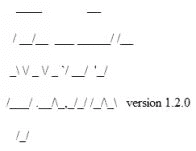Making of Scala (version is 2.10) (Java HotSpot)

输入表达式进行评估。Type:- Taking help to find info.

```text
15/07/21 13:15:41 INFO BlockManager: Registered BlockManager
15/07/21 13:15:41 INFO Spark-context is created..
```

Spark 可用。要验证 Spark shell 执行正常，尝试以下命令。

```scala
sc.version
sc.appName
```

退出 shell，使用以下命令。

```scala
quit
```

Windows 不带 Python 解释器，因此为了运行 Python shell，我们需要在环境中设置 Python。Python 官方网站提供了 Windows 安装程序，或者我们可以使用像 Anaconda 这样的包，它自带许多 Python 计算工具。

一旦安装了 Python，可以在 Spark 安装目录下执行 `pyspark` 来启动 Spark Python Shell。示例所示：

```bash
C:
cd C:\spark_setup\ spark-1.4.0-bin-hadoop2.1
bin\pyspark
```

这就是在 Scala 或 Python 中运行 Apache 交互式 shell 的全部。它还带有一个 Web 控制台。让我们看看如何使用 Apache Spark Web 控制台。

## 使用 Apache Spark Web 控制台

在使用 Spark 时，要查看结果和其他信息，请导航到以下 URL。不同模式的 MasterURL：

连接 Spark 引擎可以有多种方式。在本地或云端运行时，通过如下所示配置 `MasterUrl` 参数来实现。

将 `MasterUrl` 设置为：

*   `Local`：在本地机器上以无线程进程运行 Spark。
*   `Local[n]`：`n` 指并行运行线程数。建议将 `n` 设置为本地机器的核心数。
*   `Local[*]`：创建与本地逻辑核心数相同的线程。
*   `Spark://host_name:port_number`：在指定的端口号上运行指定的 Spark 集群(`host_name`）。在大多数系统中，端口号为 7077。
*   `Mesos://host_name:port_number`：在指定的端口号上运行指定的 Mesos 集群(`host_name`）。在大多数系统中，端口号为 5050。注意，如果集群使用 Zookeeper，则可能需要更改如下。

```text
mesos://zk: host_name:port_number
```

- `Yarn-client`: 作为客户端连接到 Yarn 集群。集群的位置需要使用 `HADOOF_CONF_DIR` 变量进行配置。
- `Yarn-cluster`: 作为集群连接到 Yarn 集群。集群的位置需要使用 `HADOOF_CONF_DIR` 变量进行配置。

## 共享变量

在 Apache Spark 中可以使用两种类型的共享变量来加速运行在集群上的应用程序。

- `广播变量（Broadcast Variables）`: 这些变量可以用于在每台机器上本地缓存只读值，这样对于每个任务来说，就不需要再次发送该值的副本。这使得能够在集群节点之间高效地交换大型数据集。下面是在 Scala 提示符中使用广播变量的一个示例用方法。

```scala
// 初始化广播变量
valbroadCastElement = sc.broadcast(Array(‘Nirman’, ‘Shan’, ‘Srini’))

// 使用广播变量
broadCastElement.value
```

- `累加器（Accumulators）`: 累加器变量始终通过关联操作进行“相加”。因此，它们非常适合并行运行的实现，例如计数器或求和。一旦使用给定的初始值创建了累加器，集群上的任务就可以使用 `add` 命令向变量添加。但它的值只能由驱动程序读取，而对运行在集群上的任务不可用。

下面是在 Scalap 提示符中使用累加器的一个示例用方法。

```scala
// 累加器变量的使用
ValaccumuatorVar = sc.accumulator(0, "Examle Accumulator Variable") sc.parallelize(Array(‘Nirman’, ‘Shan’, ‘Srini’)).foreach(i =>accumuatorVar += i)
accumuVar.value
```

有了这些工具，让我们把这些部分整合起来，构建我们的简单单词计数应用程序。

## 使用 Apache Spark 构建单词计数应用程序

使用 Spark API，可以轻松地从文本文件中读取并处理数据。通过下面的 Scala shell 示例，我们将看到如何使用它们。

要在 Scala shell 中运行传统的单词计数应用程序，请运行下方的命令。

```scala
importorg.apache.spark.SparkContext
importorg.apache.spark.SparkContext._
valtextFileRead = "sample_data.md"
valtextFileData = sc.textFile(textFileRead)
textFileData.cache()
```

调用 `cache()` 会将 RDD 存储在缓存中，并在后续查询中轻松读取。`cache()` 是惰性求值的，这意味着它不会立即存储数据，而是当对 RDD 调用任何操作时才会存储。

要读取文本文件的行数，请运行下面的命令。

```scala
textFileData.count()
```

现在，可以像下面这样打印出文件中每个单词旁边的单词计数。

```scala
valwordCountData= textFileData.flatMap(list =>list.split(" ")).map(word => (word, 1)).reduceByKey(_ + _)
wordCountData.collect().foreach(println)
```

## 总结

- 在这一章中，我们介绍了 Apache Spark：一种用于大规模数据分析的优化解决方案，并讨论了它与 Hadoop 等现有 MapReduce 解决方案的区别。由于 Spark 是构建在 HDFS 之上的，现有的 Hadoop 设置可以轻松与 Spark 合并共同工作。
- 我们讨论了 Apache Spark 架构的各种组件，并看到它不仅为 MapReduce，还为其他机器学习和数据处理任务提供了全面的解决方案。随着框架的进一步扩展以提供更好的安全性以及对 BI 工具的支持，Apache Spark 将成为大数据处理领域极具前景的解决方案。事实上，我们可以构建让 Spark、Kafka 和 Cassandra 共同运行的系统。例如，在这样的系统中，Kafka 将流式传输输入数据，Spark 将执行必要的计算，而 Cassandra 可用于将结果存储在 NoSQL 数据库中。

## 作业

### 练习 1

1. Apache Spark 与 Hadoop 等现有的 MapReduce 解决方案有何不同？
2. 解释 Apache Spark 架构的核心要素？

### 练习 2

1. 列出 Apache Spark 的库及其用途
2. 关于单词计数应用程序，你了解什么？

关于解决元数据积累问题，有两种替代方案。第一种方案是使用可以通过 `spark.cleaner.ttl` 触发的自动清理参数。然而，这可能会导致问题，因为它也会清理任何仍在持续 RDD。第二种推荐的方案是使用批次将长时间运行的任务划分。这允许你在新的环境中运行每个批次任务，该环境不会有积累的元数据。


### 课程 2：避免数据移动

最小化数据传输和避免洗牌（shuffle）将使程序运行更快、更可靠。然而，你应该注意，偶尔的数据洗牌是有帮助的。

那么，如何避免数据传输呢？直接的方法是避免如`coalesce`和`repartition`等数据洗牌操作。你还应该避免如`join`和`groupBy`等连接操作，以及如`reduceByKey`和`groupBy`等`ByKey`操作。唯一不会触发洗牌的`ByKey`操作是计数。

Spark 提供的两个实用的机制包括`Broadcast`变量和`Accumulators`（累加器）。

### 课程 3：避免数据移动是困难的

使用上述机制可能具有挑战性。这是因为你需要在广播它之前，首先从 driver 节点`collect()`一个 RDD。你还需要在执行分布的结果积累之前，在 driver 对数据进行序列化和聚合。这会导致 driver 端的内存压力增加。这可能导致 driver 端迅速内存溢。虽然可以通过使用`spark.driver.memory`增加分配的内存，但其效果是有限的。

你还需要深入了解你的数据以及它们是如何汇聚的，以便管理分区的增加以及 Spark 如何使用 Akka 进行消息传递。Akka 的默认缓冲区是 10MB。但这可以通过使用`akka.frameSize`操作来避免。

### 课程 4：速度

正确理解最初讨论的三个课程将带来程序的稳定性。然而，这节课程将帮助提高你程序的性能。

首先，你必须尽情使用你的缓存。这特别是由于你的缓存内存是有限的。与其两次使用数据，不如将其放入缓存内存中。

其次，广播变量非常有帮助。你可以利用它们进行查找表和大型映射。

最后，你可能需要以并行的方式执行 Spark 程序。一次使用一个键可能会导致资源利用率极低。使用这种方法还会让你失去 Spark 内置并行处理的优势。

因此，Spark 对你的有用程度取决于你能在多大程度上帮助它发挥功能。

## 总结

已经在某种程度上讨论了 Spark 的课程和概念。这将有助于理解不同的机制，包括在你了解如何配置和使用 Spark 高级功能时所需的机制。

## 作业

### 练习 1

1. 你对缓存（Caching）、洗牌（Shuffle）、序列化（Serialization）和分区（Partitions）了解多少？
2. 为什么 Yarn 和 JVM 不会被用于内存缓存？
3. 描述避免数据传输的最佳方法。

# 第 3 章：在集群上安装 Apache Spark

Spark 提供了一种基本的独立运行模式。你可以手动调度一个独立的批次，通过手动启动客户端和服务器，或者利用给定的启动/停止脚本。同样，也可以在单机上运行这些守护进程以进行测试。

## 在批次中安装独立 Spark

要引入独立 Spark 模式，你基本上是将编译好的 Spark 版本放在批次中的每个节点上。你可以在每个发布版本获取预编译的 Spark 版本。

### 手动启动批次

你可以通过执行以下命令启动一个独立的客户端服务器：

```bash
./sbin/begin client.sh
```

一旦启动，客户端将打印出自己的`flash://HOST:PORT` URL，你可以用它来连接服务器，或者将其作为`SparkContext`的“client”参数。你也可以在客户端的 Web UI 上发现此 URL，理所当然是`http://localhost:8080`。

此外，你还可以通过以下方式启动一个或多个服务器并将它们加入客户端：

```bash
./sbin/begin server.sh <client-sparkle URL>
```

当你启动了一个服务器站后，查看客户端的 Web UI（默认为`http://localhost:8080`）。你应该能在那里看到记录的新节点，以及它的 CPU 数量和内存（留出 1GB 给操作系统）。

### 批次级启动/停止脚本

要使用启动/停止脚本启动/停止独立 Spark 批次，你需要在 Spark 根目录下创建一个名为`conf/servers`的文件，该文件必须包含你打算启动 Spark 服务器的大量机器的主机名，每行一个。如果`conf/servers`不存在，调度脚本将默认为独立机器（`localhost`），这对于测试很有帮助。注意客户端机器通过`ssh`访问每台服务器机器。当然，`ssh`保持并行运行，并要求设置无密访问（使用私钥）。如果你没有设置无密访问，可以设置环境变量`SPARK_SSH_FOREGROUND`并逐个为每个服务器提供密码。

注意，这些脚本必须在你需要运行 Spark 的机器上执行，而不是在你的本地机器上执行。

你也可以通过在`conf/sparkle env.sh`中设置环境变量来安排批次。通过从`conf/sparkle env.template`开始创建此文件，并将其复制到所有服务器机器以产生设置。请注意这些设置是可用的。

### 将应用程序关联批次

要在批次上运行应用程序，基本上将客户端的`flash://IP:PORT` URL 传递给`SparkContext`构造函数。

要在批次上运行交互式 Spark shell，运行相应的：

```bash
./bin/sparkle shell - client flash://IP:PORT
```

你也可以传递`- all cores <numCores>`参数来控制 shell 使用的核心数。

## 启动 Spark 应用

`spark-submit`脚本提供了将 Spark 应用程序提交批次的最清晰方法。对于独立批次，Spark 目前支持两种运行模式。在客户端模式下，driver 与提交应用程序的客户端在同一个进程中启动/停止。在提交模式下，driver 从批次内的一个 Worker 节点启动/停止，客户端程序在完成提交应用程序的任务后就会离开，无需等待应用程序完成。

只是，如果你的应用程序是通过`Spark submit`启动的，那么应用程序 jar 会分发到所有节点。对于应用程序依赖的任何额外 jar，你应该通过`- jars`参数使用逗号作为分隔符指定它们（例如`- jars jar1,jar2`）。

## 资源管理

独立组模式可以跨应用程序管理一个简单的 FIFO 调度器。它允许不同的客户端同时运行，尽管你可以控制每个应用程序将使用的最大资源。理所当然，它将获取批次中的所有核心，这在你只运行一个应用程序时非常好。你可以通过在`SparkConf`中设置`spark.cores.max`来限制核心数量。

此外，你可以在`Client`过程中设计`spark.deploy.defaultCores`，以便将那些未设置`spark.cores.max`的应用程序的默认值更改为非无限大的数值。通过向`conf/sparkle env.sh`中添加相应的配置来实现。

这对于共享组非常有价值，因为在这些组中客户端可能无法独占最大数量的资源。

## 监控与日志

Sparkle 的独立模式提供了一个电子客户端界面来监控集群。`Client`和每个执行器都有自己特定的 Web UI，用于显示集群和作业测量。理所当然地，你可以通过端口`8080`访问`Client`的 Web UI。该端口可以在配置文件中更改，也可以通过命令行选项进行更改。

此外，每个作业的详细日志输出还会汇集到每个服务器节点的工作目录（默认为`SPARK HOME/work`）。你会为每个作业看到两个文件，`stdout`和`stderr`，其中包含了其写入控制台的所有结果输出。

## 在 Hadoop 上执行

你只需通过在相同的机器上作为不同的服务启动 Spark，就可以在你当前的 Hadoop 集群附近执行它。要从 Spark 获取 Hadoop 信息，只需利用`hdfs://URL`（通常为`hdfs://<namenode>:9000/way`，不过你也可以在你的 Hadoop Namenode 的 Web UI 上找到权限 URL）。另一方面，你可以为 Spark 设置一个不同的集群，并仍然让它通过系统访问 HDFS；这会比本地访问慢，但如果你运行在同一个区域内（例如，你在每个运行 Hadoop 的机架上放置了几个 Spark 机器），则可能不需要担心。

## 为网络安全设计端口

Spark 大量利用系统资源，在某些情况下对使用严格的防火墙设置有严格的先决条件。要获得设计端口列表，你必须了解其安全措施。

## 高可用性

理所当然地，独立调度集群对 Worker 故障具有容错性（因为 Spark 本身可以通过移动任务到不同的执行器来防止任务丢失）。另一方面，调度器利用`Client`来决定调度选择，这（理所当然地）导致了单点故障：如果`Client`崩溃，将无法创建新的应用程序。考虑到绕过此点的目标，我们提供了两种高可用方案，详细说明如下。

### 使用 ZooKeeper 的额外客户端系统

使用`ZooKeeper`进行主备选举和状态存储，你可以在集群中启动与相同`ZooKeeper`实例关联的不同`Clients`。其中一个会被选为“主节点”，其他的将保持备用模式。如果当前主节点失效，另一个`Client`将被选中，恢复旧`Client`的状态，然后恢复调度。整个恢复过程（从第一个主节点宕机开始）大约需要 1 到 2 分钟。注意，这种延迟仅影响新应用程序的调度——在`Client`故障转移期间运行的应用程序不受影响。

在你设置好`ZooKeeper`集群后，启用高可用性就非常简单。基本上只需在不同的节点上启动具有相同`ZooKeeper`配置（ZooKeeper URL 和目录）的多个`Client`进程即可。可以根据需要添加或移除专家。

考虑到调度新应用程序或向集群中添加 Worker 的目标，它们必须知道当前主节点的 IP 位置。这通过进入你以前输入单个客户端的 Clients 列表就可以轻松实现。例如，你可以在启动`SparkContext`时指定`sparkle://host1:port1,host2:port2`。这将使你的`SparkContext`尝试向两个`Clients`注册——如果`host1`宕机，此设计目前是正确的，我们将找到新的主节点`host2`。

“注册 Client”与典型操作之间有一个关键的区别。在启动时，应用程序或 Worker 应该具备发现并与当前主`Client`注册的能力。然而，当它成功注册后，它就“在框架内”（即存储在 ZooKeeper 中）。如果发生故障转移，新的主节点将联系所有先先注册的应用程序和 Worker，告知它们权限发生了变更，因此它们在启动时甚至不需要知道新`Client`的存在。

由于这种属性，可以随时创建新的`Clients`，你主要关注的是当它成为主节点时，新的应用程序和 Worker 能够发现并进行注册。

## 总结

在这里你学习了如何将独立 Spark 安装到集群中——这包括了手动启动集群的说明。你体验了使用集群启动/停止脚本——包括脚本的启动/停止。你学习了如何将应用程序关联到集群并启动 Spark 应用程序。

资源管理是在 Hadoop 上进行监控、日志和执行时的主要方面之一。记住：每个学生都有必要了解为网络安全设计端口的重要性。

## 作业

### 练习 1

如何在将独立 Spark 安装到集群的同时手动启动集群？

### 练习 2

关于 Apache ZooKeeper 写一个笔记。

# 第 4 章：对于 Apache Spark，Scala 比 Python 更好吗？

随着你对 Spark 使用的深入，你将需要配置 Spark 并使用其 API。为了能够对 Spark 进行后台更改，你需要 Scala、Python 或是结合 Scala 和 Python 的知识来实现这一目标。然而，如果你决定选择其中一种，本文将尝试讨论 Scala 相比 Python 的优势以及反之。但学习哪一个或先学习哪一个最终选择权取决于你，因为两者都可以很好工作。然而，没有哪一个比另一个完全方便。这完全取决于用户他/她对哪一个更熟悉。因此，本章将讨论通用编程特性，并解释 Python 或 Scala 在该领域哪个更有优势。

## 在 Spark 中编写 API 时考虑的特性

在选择用于 Spark API 的编程语言时，需要考虑的主要因素包括性能、学习曲线、易用性和库。

## 性能

你最终程序的速度对你，尤其是程序的用户非常重要。在速度方面，Scala 更好，因为它在执行速度上比 Python 快约 10 倍。如果你只是使用 Python 代码请求 Spark 库，这种影响可能不会被察觉。然而，当你希望你的 Python 代码参与程序中的许多处理任务时，在同一台机器上你得到的结果会比 Scala 慢。不过，可以使用更多的机器来弥补速度慢。但这会导致成本增加。因此在性能方面，Scala 具有优势。

### 学习曲线

对于既不了解 Scala 也不 Python 的初学者来说，学习 Python 比学习 Scala 更容易。虽然 Scala 也非常友好且易上手，但学习 Python 仍然比学习 Scala 更容易。当你想要使用高级面向对象概念时，Scala 的困难之处就显而易见。如果你已经有了 Java 知识，学习 Python 也会非常容易。Python 还拥有一个非常大的社区，你可以随时从中寻求帮助。这意味着 Python 还拥有更多资源，包括书籍和视频，你可以轻松获取并学习。然而，Scala 本身仍然是一门发展中的语言，Scala 社区也仍在发展中。Scala 还有一些语法糖，在学习和使用时都必须小心。因此，从学习曲线来看，Python 具有优势。

### 易用性

Spark 是使用 Scala 构建的。这使得与包括 Python 在其他语言相比，你在 Spark 中使用 Scala 更加容易。你对 Scala 的了解将让你拥有优势，能够确切知道 Spark 的工作原理以及其背后的机制。如果你没有 Spark 的知识，可能你想要实现的一些任务在 Spark 中是永远无法完成的。一个很好的例子是你需要一种新类型的弹性分布式数据集（`RDD`）。就像许多开源文档一样，Spark 的文档并不完美。因此，Spark 的真实文档是它的代码。你能够理解这些代码的唯一方法就是对编写它的编程语言（Scala）有良好的了解。因此，学习 Scala 将让你能够完全理解 Spark 并在 Spark 中实现任何功能。然而，如果没有 Scala，你运行某些代码时，将无法理解代码在运行时后台到底发生了什么。因此，从易用性来说，Scala 具有优势。

### 库

Python 在自然语言处理（NL）和机器学习（ML）方面的库数量更多多 且质量也优于 Spark，尽管这些库并不是专门面向大数据的库。Spark 的 ML 库算法虽然较少，但实际上是为大数据而编程的。然而，Scala 并没有像 Python 那样拥有大量的数据科学工具和库。Scala 既没有良好的本地数据，也没有良好的可视化。此外，Scala 还缺乏高质量的本地工具。这使得许多 Spark 用户更倾向于使用 R 的 Python 核心部分。这让他们能够直接从 Python 调用 R。这部分在 Scala 中确实非常匮乏。Scala 的库很少，在数量和质量上远落后于 Python，尤其是与 Python 相比时。庞大的 Python 社区是许多库的主要贡献者，并且更多库仍在开发中。因此，使用 Python 将让你可以使用许多可以加速你工作的库。例如：Databricks 的专有服务是基于 Python 而不是 Scala。因此，在库方面，Python 具有优势。

## 总结

在性能和易用性方面，Python 在学习易用性和库方面具有优势。然而正如前面提到的，随着机器数量的增加，性能差异（特别是速度方面）可以被消除。但 Spark 本身是用 Scala 编写的。这意味着如果你对 Scala 有良好的了解，你就可以重新编写 Spark。因此，学习 Scala 让你拥有关于 Scala 全面知识的优势。

最后，如果你对 Spark 中 Python 或 Scala 的需求是进行不复杂的分析，那么你可以轻松选择 Python 并且是没问题的。但如果你想在 Spark 上创建生产系统，那么你就必须学习 Scala。如果你想最充分利用 Spark 并在其上实现非常复杂的程序，你需要对 Scala 和 Python 都有全面的了解。

## 作业

### 练习 1

与 Scala 相比，Python 为什么易用且易学？请给出详细答案。

# 第 5 章：为什么开发者喜欢使用 Apache Spark？

自开发以来，Spark 一直被腾讯、百度、雅虎等知名机构视为首选。这些大型组织采用 Apache Spark 是因为它具有几个卓越的优势。Spark 能够处理交互式算法和交互式查询。交互式算法和查询是它的主要关注，因为批处理框架无法提供足够的支持。这就是为什么 Spark 从开发那一刻起就受到了认可。它的人气迅速上升，因为它简单、快速、统一且具有广泛的兼容性。Spark 现在处于其人气的巅峰，物有所值。

本章将讨论 Spark 的一些特殊特性。这些正是让使用 Spark 进行开发变得愉悦的品质。

## 语言灵活性

语言灵活性是 Apache Spark 最受欢迎的组件之一。这一特性提升了 Spark 在众多开发者中的人气。Spark 为许多开发语言提供卓越的支持，其中 Python、Java 和 Scala 备受推崇。语言灵活性极地提升了开发体验。

这些语言彼此之间不同，但它们维持了一个关键事实：所有语言都使用 lambda 函数和闭包（closures）来表示操作。为了在核心逻辑中对函数进行分类，开发者使用了闭包。这同时也保护了应用并提供了良好的代码。下面演示了在 Apache Spark 中`java`、`python`和`scala`的闭包：

### Apache Spark 中的 Java 闭包

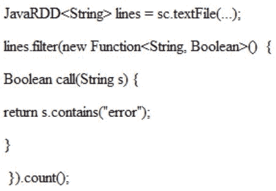

### Apache Spark 中的 Python 闭包

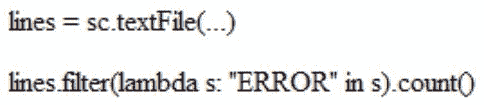

### Apache Spark 中的 Scala 闭包

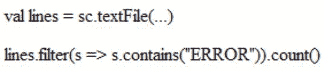


Spark 尽一切让这些语言能够在 Spark 引擎上运行。随着时间的推移，它取得了成功。现在，允许在 Spark 引擎上运行这些语言。它减轻了开发者的负担，也提供了整洁的外观。这种体验非常流畅，开发者热爱使用 Spark。

## 匹配用户目标的 API

Spark 远不止于此。你可以说它是最核心且著名的功能的组合。假设你在使用 MapReduce。由于没有内置功能，你必须考虑自定义的 Mapper/Reducer 任务。这就是高级 API 发挥用场的地方。你的 MapReduce 任务需要这些 API。如果你在 Apache Spark 中工作，你就很幸运了。Spark 为这种情况提供了解决方案。

尽管这些似乎已经足够了，但并不是终点。Spark 真正非常丰富，在 Apache Spark 中发现了八十多个运算符。如果你使用这些运算符，就可以轻松地维护 MapReduce 类型的操作。另一方面，Spark 还提供了对 Apache Pig 等框架的访问。这些框架也允许一些顶级的运算符。如果你使用 `functions`（函数）、`classes`（类）和 `control statements`（控制语句），这种组合可以为精英开发提供极佳的氛围。这意味着你在 Spark 中拥有完成任务所需的一切，但如果你仍然需要某些东西，只需通过访问其他框架来品尝一下。简而言之，如果你与 Apache Spark 协作，你就不再需要担心。你已经拥有了所需的一切。

## 复杂流的自动并行化

并行化 MapReduce 任务复杂流水线的正确顺序完全取决于你。如果你决定细致地构建序列，你将需要一个调度器工具。在 `Apache Spark` 中，你将找到一组表示单个程序流的任务。该程序在理想情况下会进行评估，以为系统提供执行图的完整视图。这对于系统来说变得简单，并允许调度器将依赖关系映射到应用程序的不同阶段。这同时也自动并行化算子流，而无需用户干预。你还可以为系统启用某些优化功能，这将减轻负担。

## 示例

```
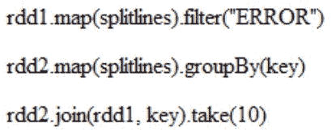
```

虽然这是一个简单的应用程序，但它是一个六阶段的复杂流程，且实际流程是隐藏的。`Apache Spark` 能够理解这一流程并使用正确的并行化正确地构建图。但如果你使用其他系统，你就必须手动完成这项复杂的任务。如果你尝试手动完成它，将浪费大量时间，而且很有可能出错。这就是吸引开发者转向 `Apache Spark` 的原因之一。Spark 已经想好了一切，并提供可能最好的服务。

## 交互式 Shell

Spark 为 `Python` 和 `Scala` 提供了专门的 shell。这个 shell 非常简单，允许开发者访问数据集。这允许开发者轻松地访问和操作数据集，而无需编写端到端的应用程序。简而言之，你可以在程序编写之前就对其进行“尝味”。你只需要打开 shell 并编写几行代码即可开始工作。这是 `Apache Spark` 极其强大的功能之一。

## 性能

`Apache Spark` 致力于效率和可编程性。它具备任何可以吸引开发者的素质。但大多数，开发者被 `Apache Spark` 吸引是因为其卓越的性能。实际上，`Apache Spark` 仅凭性能就受到了世界的推崇。

在任何应用程序的开发过程中，都需要多次运行该程序。开发者需要在完整或部分数据集上进行工作。他们还需要遵循“开发-测试-调试”的循环。如果你有海量的数据集，这些强制性的例行任务可能会非常枯燥，并且需要数小时才能执行。但有了 `Apache Spark`，这种体验变得愉快。Spark 的性能是优越的，因此它允许开发者在几刻钟内完成循环。

简而言之，你可以在花费更少精力的同时获得精确输出。这就是开发者热爱 Spark 的原因，因为他们现在工作得比任何时候都快。关于 Spark 有一些提升其性能的事实，如下：

### 速度

Spark 拥有先进的 `DAG` 执行系统。它允许内存计算和循环数据流。所有这些都允许 Spark 运行得极其快。确切地说，速度不再是问题。使用 Spark 编程变得更快、更简单。

### 易用性

Spark 拥有八十多个算子。这些算子都是顶级的，可以高效地为开发者服务。使用这些算子，你可以轻松快速地执行复杂任务。这允许使用 `Java`、`Python` 和 `Scala` 更高效地编写应用程序。简而言之，Spark 以一种先进的方式减轻了开发者的负担。

### 兼容性

Spark 无处不在。你可以在 `Standalone`、`Mesos`、`Cloud` 甚至 `Hadoop` 上运行它。它的兼容性令人赞，为开发者开启了一个新时代。

### 通用性

Spark 为 `Spark Streaming` 和 `GraphX` 驱动 `MLlib`、`SQL` 和 Data Frames。它还驱动了其他几个库。这些库也可以组合到单个应用程序中。

## 总结

Spark 是开发领域最好的引擎之一。它本身很复杂，但为开发者和用户提供了简单性。它可以处理一切，但处理得高效且快速。Spark 的兼容性超乎想象，并从许多方面帮助着开发者。像 `API`、`Shell`、`并行化` 和 `语言灵活性` 等功能使 Spark 成为一个顶尖系统。Spark 的发明是因为当时系统的无能为力。它是一种需求。Spark 的发明极好地提升了开发体验。这就是为什么像 `Yahoo` 和 `百度` 这样的公司信任 Apache Spark。Spark 是其他引擎顶级功能的结合。简而言之，它拥有开发者梦想过的一切。如果你对效率和速度有顾虑，Apache Spark 是能够很好为你服务的唯一选择。Apache Spark 现在比以往任何时候都丰富。它包含了可以帮助开发者的每一个功能。Spark 将功能导向速度、性能和效率。复杂任务在通过 Spark 后也变得更加简单准确。Spark 为开发者减少了大量的代码编写工作，这就是为什么每个开发者都喜欢与 `Apache Spark` 一起工作。如今许多推崇其他引擎的开发者开始使用 `Apache Spark`。他们不仅在使用 Spark，而且钦佩它。用户的体验也是愉快的。Spark 不仅考虑开发者，还仔细考虑用户。该系统为用户提供了最安全、最流畅的体验。简而言之，它是工作的理想引擎。

## 作业

### 练习 1

在 `apache spark` 中使用一个应用程序并观察自动并行化是如何工作的。记录你的观察结果。

### 练习 2

使用 `Spark Shell` 测试一个应用程序。记录步骤和输出。注意花费了多少时间。

# 第 6 章：Apache Spark 资源管理与 YARN 应用模型

## 关于 Spark 和 MapReduce 在 YARN 下管理批处理资产差异的简述

`Apache Spark` 是 `MapReduce` 之后最著名的 `Apache YARN` 应用程序。在 `Cloudera`，我们努力平衡 `Spark-on-YARN` (`SPARK-1101`)，`CDH 5.0.0` 包含了对 Spark YARN 组的支持。

在本章中，你将了解到 Spark 和 MapReduce 架构之间的差异、为什么你应该仔细考虑，以及它们如何在 `YARN` 资源管理器上运行。

## 应用程序

在 `MapReduce` 中，最大的计算单元是一个巨大的工作量。框架堆叠数据、应用映射功能、重新排列数据、应用归约函数并将其写入堆栈。Spark 拥有一个类似的任务概念（尽管一个任务包含的阶段可能比映射和归约多），但它可能有一个更高级别的构建称为“应用程序”，它可以运行不同的任务，无论是顺序还是并行。

### Spark 应用程序的结构

对于熟悉 Spark API 的人，应用程序相当于 `SparkContext` 类的的一个实例。应用程序可以用于单个工作组、具有分离任务的交互式会话，或者持续满足需求的持久服务器。与 MapReduce 不同，一个进程会有名为 `Executors` 的过程在批处理中为它运行，即使在没有任务运行时也是如此。

如上所述，该模型的优势在于其完成过程的速度：作业可以快速启动并处理内存中的信息。缺点是资源管理粒度较粗。随着应用程序中代理（agent）数量的变化，且由于每个代理都有固定的资源分配，应用程序在运行的整个生命周期内都会占用相同数量的资源。（在 YARN 帮助堆栈缩放时，我们计划在 Spark 中利用它来强有力地获取和归还资源。）

### 动态驱动器 (Dynamic Driver)

为了处理任务流和调度分配，Spark 依赖于动态驱动器程序。通常，该驱动器程序与启动任务的客户端程序相同，但在 YARN 模式下，驱动器可以保持在集群上运行。相反，在 MapReduce 中，客户端程序可以退出，而任务可以继续运行。在 Hadoop 1.x 中，`JobTracker` 负责作业调度，而在 Hadoop 2.x 中，`MapReduce` 进程客户端接管了这一职责。

### 可插的资源管理 (Pluggable Resource Management)

Spark 增强了可插的批处理管理。批管理员负责启动执行器（executor）任务。Spark 应用程序开发者无需为运行 Spark 的批管理员感到压力。

Spark 支持 `YARN`、`Mesos` 及其自身的“独立”批处理管理员。这三个系统中的每一个都包含两个部分。主客户端管理（`YARN Resource Manager`、`Mesos` 核心或 `Spark` 独立客户端）选择获得运行代理机会的应用程序，并决定它们在何处以及何时运行。运行在每个节点（hub）上的从节点（`YARN Node Manager`、`Mesos` 服务器或 `Spark` 独立服务器）真正启动执行器任务。它们还可能监控它们的能量和资源利用率。

## 为什么在 YARN 上执行？

利用 `YARN` 作为 Spark 的批管理员相比 Spark 独立模式和 Mesos 具有几个优势：

*   `YARN` 允许你在所有运行在 `YARN` 上的系统之间积极共享和安排同一组批处理资源。你可以将整个批作业交给一个 `MapReduce` 作业，然后将其中的部分用于 `Impala` 查询，另一部分用于 Spark 应用程序，而无需调整配置。

*   你可以利用 `YARN` 调度器的每一个组件来对负载进行排序、断开和组织。

*   Spark 独立模式要求每个应用程序在组中的每个节点上运行一个执行器，而使用 `YARN` 时，你可以选择使用的执行器数量。

*   最后，`YARN` 是 Spark 的主批管理员，并提供了安全性支持。通过 `YARN`，Spark 能够针对开启了 Kerberos 化的 Hadoop 作业保持运行，并在其程序之间使用安全验证。

### 在 YARN 上执行

在 `YARN` 上执行 Spark 时，每个 Spark 执行器都作为一个 `YARN` 堆栈保持运行。`MapReduce` 为每项任务规划一个容器并启动一个 `JVM`，而 Spark 在同一个容器内处理不同的任务。这种方法使得某些请求具有更快的任务启动时间。

Spark 支持两种在 YARN 上运行的模式：`yarn-batch` 模式和 `yarn-Master/client` 模式。通常情况下，`yarn-group` 模式适用于生成任务，而 `yarn-customer` 模式适用于需要快速查看应用程序结果的交互性和探索性应用。

理解这种区别需要理解 `YARN` 的应用程序客户端（Application Client）概念。在 `YARN` 中，每个应用程序实例都有一个应用程序客户端程序，这是该应用程序启动的第一个容器。应用程序负责向 `Resource Manager` 请求资源，并在分配资源后，通知 `Node Managers` 为其启动容器。`Application Masters`（应用程序主节点）消除了对动态客户端的需求——启动应用程序的程序可以退出，协调工作由集群上由 YARN 管理的程序进行。

在 `yarn-group` 模式下，驱动器在 `Application Master` 中运行。这意味着同一个程序同时负责驱动应用程序和从 `YARN` 请求资源，且该程序保持在 `YARN` 容器内部运行。启动应用程序的客户端不需要在其整个生命周期内留守。

`yarn-group` 模式不适用于交互式使用 Spark。需要客户端信息的 Spark 应用程序（例如启动 shell 和 `PySpark`）需要 Spark 驱动器在启动 Spark 应用程序的客户端进程内部运行。在 `yarn-customer` 模式下，`Application Master` 仅用于从 `YARN` 请求代理容器。客户端在启动任务后与这些容器通信以进行调度工作。

驱动器平台：

*   `YARN Batch`: 应用程序客户端

*   `Yarn Master`: 主节点 (Master)

*   `Independent Spark`: 主节点 (Master)

资源请求执行者：

*   `YARN Batch`: 应用程序客户端

*   `Yarn Master`: 应用程序客户端

*   `Independent Spark`: 主节点 (Master)

谁启动执行器进程？

*   `YARN Batch`: YARN 节点管理器

*   `Yarn Master`: YARN 节点管理器

*   `Independent Spark`: Spark 服务器

请求服务：

*   `YARN Batch`: YARN 资源管理器和节点管理器

*   `Yarn Master`: YARN 资源管理器和节点管理器

*   `Independent Spark`: Spark 客户端和服务器

支持 Spark 提交吗？

*   `YARN Batch`: 否

*   `Yarn Master`: 是

*   `Independent Spark`: 是

## 总结

*   应用程序：这可能是一个单一任务、一系列任务、一个根据需要发布新指令的长运行管理程序或一个交互式探索会话。

*   Spark Driver：Spark 驱动器是运行 Spark 环境的程序（对应应用程序会话）。该驱动器负责将应用程序转换为在集群上执行的各个步骤的指导图。每个应用程序都有一个驱动器。

*   Spark Application Master：Spark Application Master 负责根据驱动器向 `YARN` 安排资源需求，并寻找合适的主机/容器配置来运行 Spark 应用程序。每个应用程序都有一个 Application Master。

*   Spark Executor：运行在节点上的单个 JVM 实例，为单个 Spark 应用程序提供服务。代理在其生命周期内运行不同的任务，并同时处理多项任务。一个节点可能有几个 Spark 代理，并且有许多节点为每个客户端应用程序运行 Spark 执行器。

*   Spark Task：一个 Spark Task 代表对分布式数据集某一部分进行尝试的单元。

因此，你已经学习了 Spark 和 MapReduce 如何在 YARN 和应用程序下管理批资源。在 Spark 应用程序中，你学习了 Spark 应用程序的结构规划、执行器（Executors）、动态驱动器（Dynamic drivers）和可插的资源管理。我们还讨论了为什么选择 YARN 执行以及如何在 YARN 上执行。

## 作业

### 练习 1

1. 什么是 Spark 应用程序？深入解释。

2. 为什么选择 YARN 执行 Spark 应用程序？它是如何实现的？

事实上，它是一个可靠的分布表（实际上 `RDD` 包含一个任意集合，但最好对关系表中的元组进行操作）。`RDD` 可以是完全虚拟的，只需要知道它是如何生成的，例如在节点发生故障时如何恢复。它也可能是物化的——即在内存或磁盘上进行分布（或者在磁盘上置换的内存中）。此外，`RDD` 内部被划分为多个分区（partitions）——这是 `RDD` 的最小单元，将由每个工作单元进行处理。

所有的趣味都发生在 Spark 中，通过 `RDD` 的操作实现。任何 Spark 应用开发通常都有一个标准的结构——创建 `RDD`（例如从 HDFS 提取数据）、对其操作（`map`、`reduce`、`join`、`groupBy`、`aggregate`、`reduce` 等）以及对结果进行处理——例如写回 HDFS。

这种理解的基础应该是将 Spark 视为一个用于复杂分析任务的并行环境，特别是当存在一个协调任务的主节点（master）以及许多参与执行的运行单元时。

## 入门：如何在 Yarn 上启动 Spark

首先，必须确保 `YARN – CONF – DIR` 或 `HADOOP – CONF – DIR` 指向所需的目录，该目录存储了后续 Hadoop 集群所需的配置文件。这些配置将用于将 Apache Spark 写入 HDFS，并建立与资源管理器 `YARN` 的直接连接。此目录的配置将被分发到整个集群中，这是因为位于应用边界内的所有容器（containers）也会使用这些配置。所有引用 Java 环境变量的配置也需要在 Apache Spark 中设置，以确保其正确使用。

此外，`YARN` 使用两种不同的部署模式在其上面加载 Spark 应用。第一种是 YARN 集群模式（cluster mode），它为 Spark 驱动提供了在 YARN 管理的集群应用运行的可能性，因此一旦应用进程初始化完成，客户端就可以离开。第二种是 Mesos 模式，它将主节点地址作为参数。因此，YARN 模式和 Mesos 模式之间存在差异，因为前者来源于 Hadoop 的配置。以下是加载集群模式 YARN 的程序代码：

```
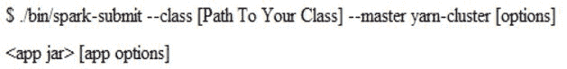
```

更多示例：

```
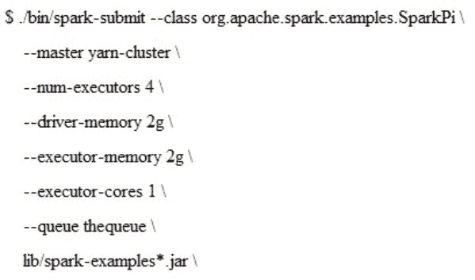
```

程序代码开始运行默认的应用程序主节点（Application-Master），它是 Apache Spark 的组件之一。加载完成后，AM 会作为子线程运行 `SparkPi`。传统上，客户端状态会定期更新，控制台会显示结果。此外，如果客户端退出会话，应用将结束。当你需要以 Yarn Client 模式启动 Spark 时，也必须执行相同的操作。不过，不要忘记将 yarn cluster 切换为 yarn client。因此，如果你想启动它，只需运行此代码：

```
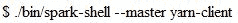
```

## 使用额外的 JAR 包完成任务


如上所述，Apache Spark 有 2 种模式，让我们谈谈第一种，即 YARN 集群模式。在这种模式下，客户端和驱动（driver）运行在不同的机器上，因此名为 `SparkContext.addJar` 的 jar 包之一将无法启动，因为它没有存储在客户端本地仓库的本地文件中。因此，为了解决这个问题，你应该将此 jar 文件添加到仓库中供客户端使用，并包含 `--jars` 选项：

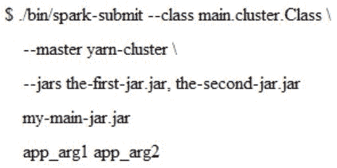

执行此命令后，`SparkContext.addJar` 将加载到客户端侧。

## 在此之前更好的做法

如果你想在 YARN 上运行 Spark——最好预先安装支持 YARN 的二进制发行版 Spark。该包也可以从 Spark 官方网站下载。

## 安装与配置

当完成上述所有操作后，下一步是配置 Apache Spark。对于 YARN Spark 来说，许多配置是相似的，因此安装此软件并不困难。但最好浏览 Spark 网站上的配置页面，以查找有关配置的额外信息。请注意，所有这些配置仅适用于 Spark 的 YARN 版本。

## 应用调试

有一些特殊的定义，告诉我们应用所有的应用程序主节点（application masters）和执行器（executors）都运行在“容器”（containers）中。此外，我们已经知道 YARN 用于处理容器日志的两种不同部署模式。

如果你开启了日志聚合（aggregation log），所有容器日志将被复制到 HDFS，然后从本地机器删除。以下是此类命令的示例：


该命令将显示应用中使用的所有容器的日志文件。此外，你还可以查看 HDFS 中的日志文件，或使用 API 或 HDFS Shell。若要查找保存配置的本地目录，只需查看 `config-name` 路径。

另一种方案是禁用日志聚合。在这种情况下，所有日志都保存在本地机器的 `YARN APP (LOGS – DIR)` 下，即通常的临时日志目录 `tmp-logs`。然而，这取决于 Hadoop 的版本和你的安装偏好。因此，若要查看容器日志，你应该进入这些日志所在的 localhost，并在给定目录下查看。你应该注意到，日志按容器 ID 或应用 ID 组织在子目录中。

有一个功能可以查看每个容器的启动情况。由于进程延迟非常小，你应该将此属性改为较大的值。但这不是终点：你应该通过 `yarn – node_manager – local.dirs` 访问应用缓存。这在需要调试问题时非常有用。但不要忘记，你必须拥有管理员权限才能操作。

如果你想使用自定义的 `log4j` 配置，为你提供了两种后续方案：

- 上传自定义属性。如果你选择此选项，应在用 `spark_submit` 时上传 `log4j` 属性，然后通过 `--files` 添加到文件列表中。
- 在日志中添加新属性。你应该在 `spark.executor.extraOptions`（针对执行器）或 `spark.driver.extraOptions`（针对驱动）中更改 `-Dlog4j.configuration=<配置文件路径>`。此外，你应该注意，你必须显式提供文件协议，文件将自动存在所有本地机器上。

有时，你需要获取将日志放入 YARN 的正确位置引用，YARN 已经为你提供了选项。只需执行这些命令：

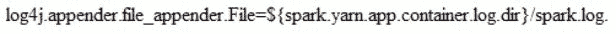

如果你想流化应用，只需配置 `RollingFileAppender`，但解决的主要问题是磁盘溢出，因此最好清理不需要的缓存和文件。

有很多 Spark 属性可以在未来使用。如果你想了解更多信息，只需浏览 Spark 官方网站并找到 Spark 属性页面。你会找到相关信息，包括属性名称、默认值以及该属性功能的描述。

## Apache Spark 的扩展

- `SparkSQL`：Spark 之上的 SQL 引擎。正如我们之前所见，Spark 几乎包含了所需的一切，除了存储、索引及其统计信息。这严重阻碍了优化，但 `SparkSQL` 团队声称正在建立一个新的优化框架，同时 `AMP LAB`（诞生 Spark 的实验室）也不会放弃 `Shark` 项目——完全替代 Apache HIVE。

## Spark MLib

Spark MLib 本质上是 Apache Mahaout 的替代品，但要糟糕得多。除了高效的并行机器学习（不仅通过 RDD，还有额外的原语）之外，SparkML 在处理本地数据方面质量仍然高得多。此外，它使用了线性代数包，这会让你被集群中的 Fortran 代码所吸引。嗯，设计得非常周到的 API。一个简单的例子是在集群上通过交叉验证进行并行训练。

## 总结

总之，你应该阅读这些小贴士，它们会让你的工作流程变得更加简单和方便。不要忘记理解你后续操作的所有原因：如果你无法获取某些信息，最好重读之前的章节和标题：

- 如果你使用第一种部署模式（deploy mode），Spark executors 和 Spark driver 均使用本地目录，然后在 YARN 中对其进行配置（其中之一是 `yarn.modemanager.local-dirs`）。如果指定了 `spark.local.dir`，YARN 将忽略它。
- Hadoop 支持归档文件的特殊文件名和 `--files` 选项。你可以指定 `--archives localtest.txt#appSees.txt`，然后它会将已位于名为 `localhost.txt` 文件中的归档或文件上传到 HDFS，并链接到 `appSees.txt`，因此在后续过程中，你的应用程序在 YARN 上运行时将使用此文件名。
- 使用由 `--jars` 允许的 `SparkContext.addJar` 非常简单。它可以帮助你在运行 YARN 集群时使用本地文件。但现在在处理 HTTP、HTTPS 或 FTP 时，没有机会使用它。

## 作业

### 练习 1

1. 在你的本地机器上安装 Apache Spark。
2. 安装后，处理至少 5-10 个 Spark 命令和属性，然后记录你的观察结果。

### 练习 2

1. 创建自己的 Spark 容器。尝试在两种不同的部署模式下完成。
2. 尝试使用特殊函数，如 `SparkContext.addJar()`。

# 第 8 章：带有 Spark Shell 的 REPL

在本章中，我们将讨论 Apache Spark 的一个有效特性，使其成为调查性和操作性分析的便利工具。它是 Scala 版本的 Spark Shell 中的读取-评估-打印循环（REPL）环境。我们将通过示例讨论它对不同分析任务的有用之处。

## REPL：读取-评估-打印循环环境

如果你熟悉 LISP 或 Haskell 等任何函数式编程语言，你可能听过上述术语。它是一个编程环境，以表达式的形式接受单个用户的输入（命令），评估命令并打印结果。像 MS DOS 这样的命令行界面（CLI）以及像 Python、BASH Shell 等脚本语言都是此类环境的示例。REPL 一词起源于对 LISP 原生函数的描述。

在 REPL 环境中运行时，代码不需要编译和执行。用户可以输入表达式进行评估，REPL 将在评估表达式的同时显示结果。“Read（读取）”指的是将表达式作为输入，并将其解析为内部数据结构并存储在内存中。“Eval（评估）”指的是遍历数据结构并评估正在被调用的函数。“Print（打印）”指的是将结果显示给用户，在需要时对其进行格式化打印。它在“Loop（循环）”中迭代，返回读取状态并在程序退出时终止循环。

REPL 环境对于表达式的即时评估和调试非常有用。由于不需要为每次修改都进行编辑-编译并运行，REPL 函数运行更快。

## 带有 Apache Spark 的 REPL

就数据分析而言，我们执行两类任务：调查性（investigative）和操作性（operational）分析。调查性分析使用 R 或 Python 等工具，这些工具适用于快速找到答案并交互式地提供系统的快速见解。操作性分析指的是为大型应用设计和实现模型，通常在 Java 或 C++ 等高级语言中完成。

因此显然，虽然某个工具非常适合即时分析，但在某些环境中可能无法扩展，反之亦然。如果有一个工具能同时支持这两种，那有多好呢？事实上，我们有这样的工具，那就是 Apache Spark。

Apache Spark 不仅支持在 R 或 Python 这样的 REPL 环境中进行调查性分析，还支持操作分析，为大型应用提供分布式且可扩展的解决方案。

Apache Spark 引人注目的特性之一是它在 SCALA 中提供了一个交互式 REPL 环境，并允许在 SCALA 中使用 Java 库。你还可以使用此环境交互式地学习 Spark API。

在第 1 章中，我们上手了 Spark 交互式 Shell。让我们看更多示例，以见证 Scala 中 Spark REPL 环境在调查性和操作性分析中的用法，及其对调试的支持。所有这些示例都可以在你的机器上使用以下命令启动 Spark Shell 后运行。

```bash
spark-shell –master local[*]
```

将 `*` 替换为你机器上的核心数。

Shell 中一些实用的命令有：

- `:help`：用于显示支持的函数的用法。
- `:history`：用于显示之前使用过但你忘记的变量或函数名。
- `:paste`：用于将复制到剪贴板的数据粘贴到 Shell 中。

在 Spark 上运行的任何应用程序都由 `SparkContext` 对象启动，该对象处理 Spark 作业的执行。此 `SparkContext` 对象在 Spark REPL 环境中简称为 `sc`。

### 示例应用程序

以下是我们在 Spark Shell 中运行词频计数程序：


```scala
val inputFile = sc.textFile("spark_examples/words.md ")
val wordcount = inputFile.flatMap(line => line.split(" "))
```

接下来，我们将看到某些机器学习算法的实现。

### K-means 算法

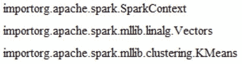

```scala
// 读取数据
val dataFile = sc.textFile("spark_examples/words.md ")
val data = dataFile.map(line => line.split(" "))

// k = 4 的聚类
val numberOfClusters = 4
val count = 20
val clusters = KMeans.train(data, numberOfClusters)
```


```scala
val WISetSquaredError = clusters.computeCost(data)
println("Within Set of Squared Errors for 4 = " + WISetSquaredError)
```

### 线性回归算法

线性回归算法的实现如下：

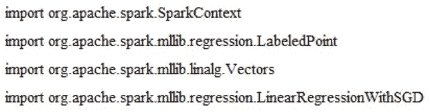

```scala
// 从文件读取数据
val dataFile = sc.textFile("spark_example/linear_regression_data_sample")
val data = dataFile.map(lineRead => lineRead.split(','
```

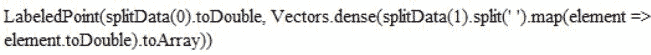

```scala
// 模型构建
val count = 40
val model = LinearRegressionWithSGD.train(data, count)

// 使用测试数据 - 可以评估模型以找出误差
val predictedVals = data.map { modelElement =>
  val predictedValue = model.predict(modelElement.features)
  (modelElement.label, predictedValue)
}

val MeanSquareError = predictedVals.map { case (w, pow) => math.pow((w - pow), 2) }.reduce(_ + _) / predictedVals.count
```

```scala
val predictedVals = data.map { modelElement =>
  val predictedValue = model.predict(modelElement.features)
  (modelElement.label, predictedValue)
}

val trainingError = predictedVals.filter(r => r._1 != r._2).count.toDouble / data.count
println("Training Error = " + trainingError)
```

### 决策树算法

以下是用于预测以及计算训练模型误差的决策树实现。


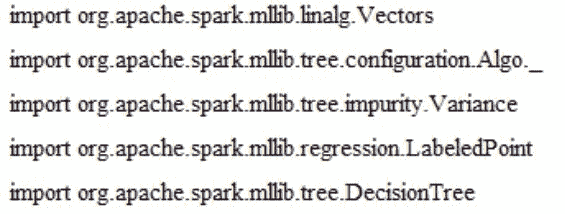

```scala
// Read the data file
val dataFile = sc.textFile("spark_example/decision_tree_regression_sample.csv")
val data = dataFile.map { line =>
  val splitData = line.split(',').map(_.toDouble)
  LabeledPoint(splitData(0), Vectors.dense(splitData.tail))
}
```


```scala
val maximumTreeDepth = 8
val model = DecisionTree.train(data, Regression, Variance, maximumTreeDepth)

// While using the test data - one can evaluate model to find out test error.
val predictedValues = data.map { modelElement =>
  val predictedVal = model.predict(modelElement.features)
  (modelElement.label, predictedVal)
}
val MeanSquareError = predictedValues.map { case (w, pow) => math.pow((w - pow), 2) }.mean()
```


### 朴贝叶斯方法

机器学习的朴贝叶斯方法可以通过支持的 API 在 Spark Shell 中所示实现：

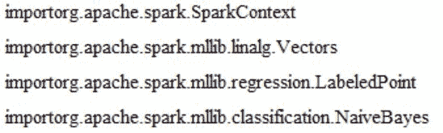

```scala
val dataFile = sc.textFile("spark_example/naive_bayes_data_sample")
val data = dataFile.map { lineRead =>
  val splitData = lineRead.split(' ')
  LabeledPoint(splitData(0).toDouble, Vectors.dense(splitData(1).split(' ').map(_.toDouble)))
}
```


```scala
val dataSplits = data.randomSplit(Array(0.7, 0.3), seed = 11L)
val trainingData = dataSplits(0)
val testData = dataSplits(1)
val naiveBayesModel = NaiveBayes.train(trainingData, lambda = 1.0)
val prediction = naiveBayesModel.predict(testData.map(_.features))
val labelledPredictEl = prediction.zip(testData.map(_.label))

// Calculate and display accuracy of the model
val precision = 1.0 * labelledPredictEl.filter(x => x._1 == x._2).count() / testData.count()
println("Precision of the model built  = + precision")
```

## 在 Spark Shell 中使用第三方库

第三方库可以方便地在 Spark Shell 中使用。要做到这一点，我们需要将所需的 jar 文件添加到类路径（classpath）中。可以在调用 Spark Shell 时使用 `--driver-class-path` 配置类路径：

```bash
/bin/spark-shell --other_options_as_key_value --driver-class-path path_to_the_library
```

## REPL 与编译的权衡

正如我们上面所看到的，我们可以进行许多数据分析，而无需编译代码，也不需要使用 Maven 或 SBT 等构建工具。那么，我们如何决定何时使用哪一个呢？

大多数情况下，Spark REPL 足够从头运行你的整个应用程序。它提供了更快的执行速度、快速的响应，并能够快速构建原型。然而，随着应用程序规模和复杂性的增加以及代码序列变得巨大，执行时间可能会增加。此外，如果你正在处理大量数据，这可能导致程序故障，清除当前 Shell 中正在使用的所有变量和函数，从而导致繁琐的重复工作。因此，随着应用程序的推进，最好混合使用两者。


在复杂代码较少的初始阶段，使用 `SPARK REPL` 环境进行快速分析和调试；随着应用程序数据量和复杂性的扩大，将实现移动到编译后的库中并在 `shell` 中使用它。我们上面已经了解了如何将编译后的库导入到 `Spark Shell` 中。通过这种方法，鉴于编译后的库不需要频繁的编辑和重新编译，在 `Spark REPL` 环境中运行应用程序将产生更快的结果。

## 总结

在本章中，我们研究了 `Apache Spark` 交互式 `shell` 的细节。我们讨论了如何利用 `SCALA` 中的 `REPL` 环境来实现更快的实现和高效的应用程序执行。我们研究了 `REPL` 环境的优势以及在 `Spark shell` 中一些常用机器学习算法的实现。最后，我们讨论了在 `Spark shell` 中使用编译后的库，以及如何在两种方法之间做出选择。

## 作业

### 练习 1

运行 `Spark Shell` 提示符中输入以下内容。

```bash
sc
```

解释输出结果。

### 练习 2

尝试在本章描述的示例单词计数应用程序，并描述其行为。

### 练习 3

学习本章提供的决策树预测算法实现，并尝试示例实现。在 `Apache Spark REPL` 环境中编写决策树分类算法的实现。

# 第 9 章：Spark Vs Hadoop

如前面的章节所示，`Spark` 和 `Hadoop` 是两个不同的框架，它们既有相似之处也有不同。此外，它们都有自己的优缺点。那么，哪一个更好？`Spark` 还是 `Hadoop`？没有准确的答案，因为这些平台比较的维度不同，每个人都可能发现一些新颖实用的东西。所以，让我们从这两个框架的历史开始吧。

`Spark` 和 `Hadoop` 都是框架，主要目的是集群分布。为了速度提供了内存计算，同时也涉及数据。那么 `Hadoop` 呢？`Hadoop` 的主要目的是运行 `map/reduce`，因此它是一个并行结构框架。

## 如何选择：Spark 还是 Hadoop

正如我们上面所说，`Spark` 和 `Hadoop` 都有优缺点，但有些属性是你需要这些。第一个也是主要的区别是 `RAM` 的容量。`Spark` 使用的随机存取内存比 `Hadoop` 多，但它“消耗”的带宽或磁盘较少，所以如果你使用 `Hadoop`，最好找一台具有大内部存储的强大机器。但不要忘记，你可以动态地改变决定；这完全取决于你的偏好。

`Apache Spark` 和 `Hadoop Mapreduce` 的下一个区别是所有数据都存储在磁盘上，而 `Spark` 中的数据存储在内存中。第三点区别是实现容错机制的方式不同。`Spark` 使用弹性分布式数据集（`RDD`），这是一种数据存储模型，可以为你提供容错保证，这就是为什么它最小化了网络 `I/O`。如果你想找到更多关于弹性分布式数据集的信息，请重读之前的章节。

## 先学哪种更好：Hadoop 还是 Spark？

我认为这个问题并不正确。如果你完美地学习了其中一个，学习另一个时就不会有问题。但对于这个问题，有两种不同的观点。

第一种观点认为：“学习 `Hadoop` 更好，因为它是基础”。是的，当然，学习 `Hadoop` 技术将带给你大量的基础知识、理论和实践技能。你也可以在使用它时发现一些新东西。

但第二种观点认为：“学习 `Spark` 更好，因为它更现代”。是的，这是真的，`Spark` 有许多有趣的特性，将在下面的段落中进行解释和列出。

如果你是开发者，可能感觉不到 `Hadoop` 和 `Spark` 之间的差异。`Spark` 是一个通过函数调用启用并行通信的框架，而 `Hadoop` 是一个库，你可以通过 `Java` 类编写 `map/reduce` 任务。

如果你是运行集群的运维人员，唯一需要注意的区别在于代码部署或配置监控方面。

## Hadoop 不具备的 Apache Spark 原始特性

当我们开始讨论决策时，最好注意 `Spark` 的一些非常具体的特性，这些特性可能帮助你决定哪个框架更适合你：`Apache Spark` 还是 `Hadoop Mapreduce`。因此，让我们来看看这个现代框架的许多卓越特性（此外，`Apache Spark` 官方网站也描述了许多特性）：

### 速度

这确实是 `Spark` 的核心特性。它使应用程序在内存中的运行速度快 100 倍（!），即使在磁盘内存中启动，速度也快 10 倍。此外，`Spark` 具有一种减少磁盘读写次数的可能性。下一个特性是 `Spark` 将这些中间处理数据存储在内存中。正如我们之前提到的，`Apache Spark` 使用弹性分布式数据集（`RDD`）技术，这可以帮助将数据透明地存储在内存中，完全不使用磁盘存储或仅在需要时使用它。它还有助于减少磁盘读写，因为数据处理是最耗时的部分。

### 易于学习

`Spark` 为你提供了基于 `Java`、`Python` 和 `Scala` 开发应用程序的可能性。因此，现在运行和创建用熟悉的编程语言编写的应用程序更加舒适，构建并行应用程序也变得更加方便。此外，你还有一组框架包中内置的 80 个高级操作符可用。

### 新旧特性的结合

`Apache Spark` 的新版本除了简单的 `map/reduce` 之外，还有一些新特性。新特性包括 `SQL`、`streaming`（流）和复杂分析。此外，你可以将所有这些特性组合在单个工作流中。

### 随处运行

`Apache Spark` 现在支持 `Hadoop`、`Mesos`、独立模式和云技术。

## 这些框架的应用领域

### Hadoop

`Hadoop` 用于处理大数据和快速增长的数据，旨在处理非结构化数据。在使用它之前，你需要意识到它本身不能提供实时数据访问，在请求形成期间会处理整个数据数组数据。

`Hadoop` 用于构建全球智能系统、机器学习、各种数据的关联分析、统计系统。`Hadoop` 本身不能作为操作数据库。通常，在企业环境中，`Hadoop` 与关系型数据库结合使用。为了消除框架的基本缺点，会使用额外的模块和外部应用程序。

### 内存数据库中的 Spark

`Spark` 内存数据库是一种加速内存中数据的特殊分布式系统。与 `Hadoop` 集成并与 `Hadoop MapReduce` 提供的机制相比，`Spark` 在内存中处理数据时提供了 100 倍的性能，将数据放在磁盘上时提供了 10 倍。该引擎可以在 `Hadoop`、`Hadoop YARN` 集群节点上运行，也可以单独运行。支持在存储 `HDFS`、`HBase`、`Cassandra`、`Hive` 以及任何 `Hadoop` 输入格式（`InputFormat`）中处理数据。与 `MapReduce` 不同，`Spark` 不在磁盘中存储中间结果（如果它们不是大到无法放入内存）。`Spark` 创建 `RDDs`（弹性分布式数据集），它们可以在内存中完全或部分存储和处理。`RDDs` 没有固定格式。

该系统定位为处理存储在集群 `Hadoop` 中的数据的快速工具。

## 总结

在这里你获得了一些重要的提示，会让你的工作流程变得更容易更方便。不要忘记理解你后续行动的所有原因：如果你无法理解某些信息，最好重读之前的章节和标题。

`Spark` 是超快速、现代且方便的工具，但它也基于 `Hadoop`，所以对你来说有什么新奇的吗？

`Spark` 变得越来越流行。20% 使用 `Spark` 的实例运行在 `Cassandra` 上，42% 运行在 `Hadoop YARN` 上，26% 运行在 `Apache Mesos` 上。但唯一的问题是很多人对 `Spark` 及其新的优秀技术一无所知。

无疑，`Hadoop` 永远不会被完全取代，因为有很多老古董不会为了新事物而改变他们的框架，即使新事物快 100 倍且更好用。但 `Spark` 是海量存储技术的一个新时代。也许在 4-5 年后，使用类似框架的实例将超过总实例的 50%。

`Spark` 是大型复杂 `Hadoop` 生态系统的一个小组件，因此当新项目开始开启自己的“事业”时是正常行为。

此外，`Spark` 的主要优势是它的简单性，因为现在开发者有更多工具来创建出色的应用程序，并且使用新 `Apache` 产品的友好用户界面可以更容易“插拔”工作。

如果你从技术角度看问题——`Spark` 为用户提供了更多机会和极佳性能，因为有强大的执行器引擎。

所以下面列出了 `Spark` 的所有优势：

*   迭代且易的算法
*   酷且用户友好的数据挖掘和处理
*   流处理的可能性
*   传感器数据处理的可能性
*   比 `Hadoop` 快 100 倍的速度

## 作业

### 练习

1) 在你的本地机器上安装 `Hadoop` 和 `Spark` 框架

2) 尝试寻找两者（`Hadoop` 和 `Spark`）之间的差异和相似之处并记录在笔记本上

3) 尝试在两个框架上执行基本命令

# 第 10 章：使用 Apache Spark 进行更快的应用程序开发

这些是行数应用程序所需的两个文件。要构建并运行该应用程序，请进入 `SparkLineCountApplication` 项目文件夹，运行以下命令。

```bash
sbt package
sbt run
```

## 在 Spark 中提交数据分析任务

我们可以在 `Spark` 中提交应用程序以便在集群上运行，这需要一个支持 `Spark` 的集群管理器。像 `Cloudera` 这样的供应商提供了集群管理器。提交应用程序时，使用 `Spark` 安装目录下 `bin` 文件夹中的 `spark-submit` 脚本。如果应用程序有任何依赖项，在转发到集群之前，应该将其打包成一个名为 `assembly`（也称为“uber”）的 `jar` 包中。可以使用 `sbt` 或 `Maven` 等构建工具完成打包。

### 使用 Spark-submit 运行任务

一旦使用依赖项打包，可以使用 `spark-submit` 提交应用程序。脚本的额外参数以 `--key value` 格式传递。以下是使用 `spark-submit` 的示例。

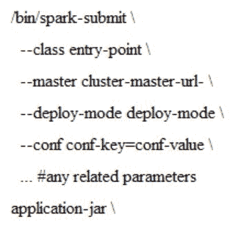

[应用程序参数]

让我们来看看 `spark-submit` 频繁使用的参数，如下：

- `Class`: 应用程序的主类。（例如 `example.src.main.ApplicationMain`）

- `Master`: 主节点 `URL`（在章节中讨论）

- `Deploy mode`: 此值可以是‘cluster’或‘client’，取决于驱动程序应该部署在何处，是在工作节点上还是本地。该选项的默认值为 `client`，意味着作为外部客户端运行。

- `Conf`: `Spark` 的任何其他配置，以 `key=value` 格式指定。如果值内部包含空格，应封装在引号中，如 `“key=value”`。

- `Application-jar`: 包含应用程序及其依赖项的 `jar` 包所在位置。该位置对集群全局应该是可见的。

- `Arguments-for-application`: 传递给应用程序主类 `key` 方法的参数。

## 总结

在本章中，我们讨论了运行 `Apache Spark` 应用程序的两种方法。我们通过示例查看了如何使用像 `sbt` 这样的构建工具来构建和部署 `Spark` 应用程序。`Apache Spark` 可以在集群上运行，我们讨论了如何提交应用程序。

## 作业

### 练习 1

尝试在 `Spark` 交互式 `shell` 中通过 `sbt` 运行示例并展示结果。

### 练习 2

写下你将如何提交我们在上面开发的 `SparkLineCountApplication`，以便在连接到给定 `Spark Standalone Master` 的集群上运行。

# 第 11 章：Spark GraphX 及其重要性

图的使用在每个领域都变得非常重要。无论是定向广告还是社交网络，图都已成为强制性。尽管对图的需求巨大，但很难找到运行高效的工具。这就是为什么图计算任务变得令人乏味且难以维护。对于开发者来说，这只是负担的另一个代名词。这种必要性促使 `Spark` 启动了 `GraphX`。它是处理极其艰巨任务的最佳工具之一。

`Spark` 从其旅程开始就证明了它的高效性。`Spark GraphX` 只是其效率的另一个证明。`GraphX` 是 `Spark` 针对社交网络和网页图等图的新 `API`。对于协同过滤和 `Page Rank` 等图并行计算来说也极其重要。`GraphX` 通过简单地启动弹性分布式属性图（`Resilient Distributed Property Graph`），在极高层面提取了 `Spark` `RDD` 抽象。弹性分布式属性图表示一个每个边和顶点都附有属性的有向多幅图。`GraphX` 暴露了一些基础算符，如 `mapReduce Triplets`、`joinVertics` 和 `subgraph`，以及优化过的 `Pergel API`，以加强图计算。`Graphx` 还包含了一系列卓越的图构建器和算法。`GraphX` 能够胜任预期的任何可能任务。它将像既往一样为你提供卓越的速度、效率和性能。简而言之，它是一个真正服务于目的完整包。

## 图视图

有时你可能需要提取图的边和顶点视图（`RDD`）。例如，如果你保存或安排计算结果，你可能需要这些。`Graph` 类在访问图的边和顶点时包含如 `graph.edge` 和 `graph.vertexId` 等元素。这也会影响 `GraphX` 对图数据的内部表示。

要显示三十岁以上的用户名，你应该使用 `graph.vertics`。

输出可能如下：

```
Jason is 52
Morgan is 50
Nicolas is 55
john is 45
```

记住，还会有其他的日志文件。

### 给你的后续提示

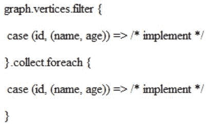

### 解决方案可能像这样

解决方案 - I

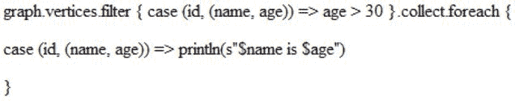

解决方案 – II

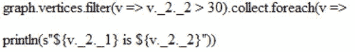

解决方案 - III

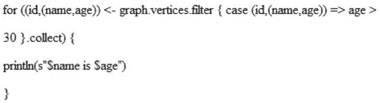

在 `Scala 2.10` 中利用了字符串插值（`String Interpolation`）功能：

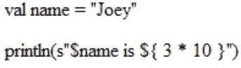

`GraphX` 还提供了边和顶点属性的三元组视图（`triplet`）。这对于高级任务非常重要。`triplet` 视图是边和顶点属性的 `triplet`。它分别包含 `dstAttr` 和 `srcAttr`。如果你使用 `graph_triplets` 视图显示人们的喜好，输出可能是：

```
Jason is 52
Morgan is 50
Nicolas is 55
john is 45
```

```
Jason is 52
Morgan is 50
Nicolas is 55
john is 45
```

```
Jason is 52
Morgan is 50
Nicolas is 55
john is 45
```

```
Jason is 52
Morgan is 50
Nicolas is 55
john is 45
```

```
Jason is 52
Morgan is 50
Nicolas is 55
john is 45
```

```
Jason is 52
Morgan is 50
Nicolas is 55
john is 45
```

```
Jason is 52
Morgan is 50
Nicolas is 55
john is 45
```

### 解决方案可能是部分

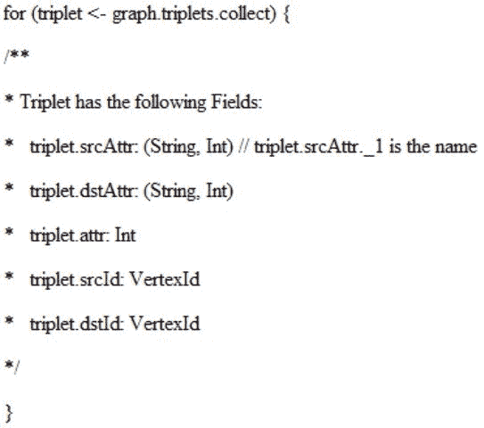

### 简单的解决方案

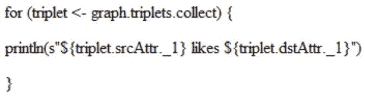

如果你愿意定位某人喜欢五次，你可以使用：

```
Jason is 52
Morgan is 50
Nicolas is 55
john is 45
```

```
Jason is 52
Morgan is 50
Nicolas is 55
john is 45
```

```
Jason is 52
Morgan is 50
Nicolas is 55
john is 45
```

```
Jason is 52
Morgan is 50
Nicolas is 55
john is 45
```

## 图算法

`GraphX` 拥有一套卓越的算法。正是这些算法让 `GraphX` 流行。图算法能够处理复杂的任务。这些算法简化了分析任务。`Graphx` 算法非常高效且能极大服务。以下介绍了这些算法：

### PageRank

`PageRank` 算法衡量图中每个顶点的重要性。换句话说，从 `U` 到 `V` 的边表示 `U` 对 `V` 重要性的认可。例如，如果你是一个 `pinterest` 用户并被许多人关注，你的排名可能会更高。这是 `GraphX` 的一个简单但重要的算法。

`GraphX` 根据 `Pagerank Object` 上的方法兼容动态和静态的 `PageRank` 实现。动态 `PageRank` 在排名收敛时运行，而静态 `PageRank` 则按指定的迭代次数运行。

`PageRank` 的社交网络数据集：

如果用户位于 `graphx/data/users.txt` 中，关系数据列在 `graphx/data/followers.txt` 中，你可以计算每个用户的 `PageRank`。

步骤如下：

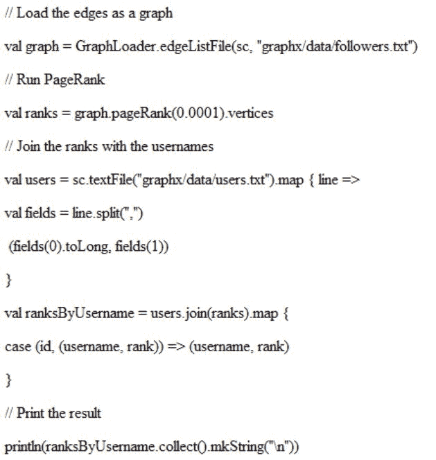

### 连通组件

该算法为每个连通分量标记编号最小的顶点 `ID`。

连通组件算法示例：

连通分量可以估计社交网络中的聚类。在 `Connected Components object` 中，`GraphX` 可以封装算法的执行。你可以从 `PageRank` 部分的社交网络数据集计算连通组件：

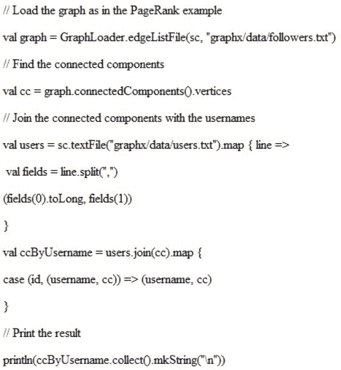

### 三角形计数

如果一个顶点具有两个连接顶点且它们之间存在边，那么它就可以形成三角形。`GraphX` 在 `TriangleCount` 对象中执行三角形计数算法。该对象计算与顶点相交的三角形。它还提供了聚类度量。

在 `PageRank` 部分的社交网络数据集上，三角形计数可以所示：

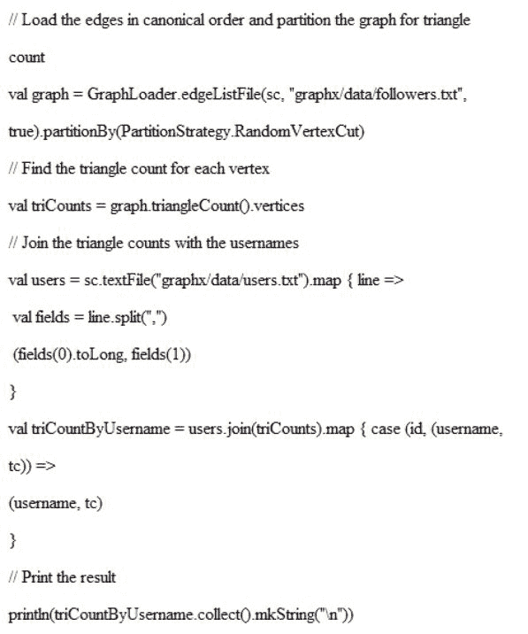

## 总结


`GraphX` 是 `Spark` 一个非常强大的工具。它极地减轻了开发者的负担。`GraphX` 在边和顶点视图的基础上提供了卓越的三元组视图，这将其生产力提高到了领先水平。`GraphX` 算法足够强大，可以维持大型计算并高效实现目标。它还简化了困难且枯燥的分析任务，证明了它的重要性。就像 `Spark` 一样，`GraphX` 也因其卓越的速度和性能而受欢迎。它的准确性也令人赞叹。`GraphX` 的设计旨在像 `Spark` 本身一样减轻开发者的负担。在用户体验方面，`GraphX` 是同类中最好的。简而言之，一切都恰如其分。你只需要正确的理解就可以就可以了。如果你能妥善学习算法和图视图，使用 `GraphX` 的体验将是愉快的。理解这些事实对于继续下去非常重要。`GraphX` 是一个包含所有可能功能的完整包，它需要高效的开发者。尝试多练习并理解 `GraphX` 的事实。一旦你完成了这些，社交网络和 Web 图等图形化任务将变得简单而有趣。`GraphX` 的引入是因为图行业缺乏定性工具。这就是为什么 `spark` 将每个重要方面都包含其中。这个工具简直是无敌的。

## 作业

### 练习 1

1. 列出年龄在 60 到 80 岁之间的十个人名单。

2. 使用 `graph.vertics` 显示年龄大于 65 岁的人员。

3. 详细记录整个过程。

### 练习 2

1. 从你的社区收集十个人的名字及其汽车品牌。

2. 使用 `graph triplets` 显示人们的汽车品牌。

3. 找出你社区最喜爱的汽车品牌，最喜欢的汽车品牌是指有五个人使用的品牌。

4. 详细记录整个过程。

### 练习 3

1. 实现三角形计数算法并记录下过程。

# 第 12 章：借助 Spark SQL 处理结构化数据

`Spark` 提供了一个更快速且通用的数据处理阶段。`Spark` 让你在内存中运行程序比 `Hadoop` 快 100 倍，或者在磁盘上快 10 倍。去年，`Spark` 通过在十分分之一的机器数量上完成 100 字节的 Daytona GraySort 竞赛快 3 倍，接管了 `Hadoop`，这使其成为排序 PB 级数据的最大的开源引擎。

学习如何使用 `Apache Spark` 的另一个重要方面是交互式 shell (`REPL`)，因为其提供了开箱即用的功能。通过 `REPL`，人们可以在不需要初始规则和执行整个任务的情况下测试每行代码的结果。因此，通向功能代码的路径短得多，而且即时数据检查变得可能。

`Spark` 的其他主要功能包括：

* 目前提供 `Java`、`Scala` 以及 `Python` 的 API，并在未来支持其他语言（例如 `R`）

* 完美集成 `Hadoop` 生态系统和数据源（`HDFS`、`Hive`、`Cassandra`、`HBase`、`Amazon S3` 等）

* 可以运行在由 `Hadoop YARN` 或 `Apache Mesos` 管理的集群上，也可以独立运行

`Spark` Core 由一组影响力的高级库平衡，这些库可以在相似的应用中完美使用。这些库目前包括 `SparkSQL`、`MLlib`、`Spark Streaming` 以及 `GraphX`。新增的 `Spark` 库和扩展目前也在开发中。

## Apache Spark 的特性

#### 让我们来看看 `Spark` 的某些在大数据世界中真正脱显的特性！

#### 结合了流处理、SQL 和复合分析：除了简单的“map”和“reduce”操作外，`Spark` 开箱即支持 `SQL` 查询、流式数据以及复杂的分析（例如机器学习和图算法）。不仅如此，用户可以在独特的工作流中完美地整合所有这些能力。

#### 易用性：`Spark` 让你用 `Scala`、`Java` 或 `Python` 快速编写应用程序。它帮助开发者在其熟悉的编程语言上生成并运行应用程序，并轻松构建等效应用。这得益于内置的超过 80 多个高级算符。我们可以交互式地在 shell 中它查询数据。

## Spark Core

`Spark Core` 是大规模等效及分布式数据处理的支持引擎。它负责：

* 内存管理加故障恢复

* 在集群上预测、分配和监控作业

* 与存储空间系统交互

`Spark` 引入了 `RDD` (`Resilient Dispersed Dataset`) 的概念，这是一种不可容错的分布式对象集合，可以在等效上进行操作。`RDD` 可以包含任何类型的内容，由外部数据集加载或从驱动程序调度编译决定。

### RDD 支持两种类型的操作

变换（Transformations）是操作（如 `map`、`join`、`union`、`filter` 等），在 `RDD` 上执行并产生一个新的 `RDD`。

动作（Actions）是操作（如 `count`、`first`、`reduce` 等），在 `RDD` 上运行计算后返回一个值。

`Spark` 中的变换是“惰性”的，这意味着它们不会立即计算结果。相反，它们会“记住”要执行的操作以及要处理的数据集。只有当调用动作时，变换才会实际计算并将结果返回给驱动程序。这些设计使得 `Spark` 运行高效。例如，如果对一个大文件进行了多种方式修改并请求第一个结果，`Spark` 只会处理第一行，而不是处理整个文件。

默认情况下，每个更改的 `RDD` 在每次运行动作时都会重新计算。不过，你也可以通过 `persist` 或 `cache` 技术在内存中保留 `RDD`，这将使 `Spark` 在下次查询时保留该元素。

## SparkSQL

`Spark SQL` 是 Spark 的组件，支持通过 `SQL` 或 `Hive` 查询语言查询数据。它起源于 `Apache Hive` 的移植，运行在 `Spark`（而非 `Map Reduce`）之上，并已包含在 Spark 栈中。除了对多种数据源的支持，它还让 `SQL` 查询与代码转换相结合成为一种非常强大的工具。

## Spark Streaming

`Spark Streaming` 支持流式数据的实时处理，例如网络服务器日志文件（如 `HDFS/S3`）、社交媒体（如 `Twitter`）以及各种消息队列（如 `Kafka`）。在底层，`Spark stream` 接收输入数据流并将其划分为批。之后，由 `Spark` 引擎处理并生成批处理的最终结果流，如下。

## MLlib

`MLlib` 是机器学习记录，提供了多种旨在处理分类、协作过滤、聚类、回归等的算法。`Apache Mahout` 现在已转离 `Map Reduce` 并加入了 `Spark MLlib` 的行列。

## Spark 大数据框架强大的快速分析

`Spark stream API` 与 `Spark Core` 紧密匹配，让程序员可以在批处理和流数据世界中轻松地工作。

Spark 大数据分布式计算框架通常受到数据工程师的关注，然而到目前为止，这种关注主要局限于其需求所在的地方。不过，用户表示它有一个核心特性，能够帮助它赢得更广泛的需求。

企业正逐渐转向操作趋于简单的自服务分析类应用程序。易用性自然被视为全范围内采纳的主要因素之一。

虽然在后端运行 Spark 集群可能需要深厚的技术技能，但在前端，开源技能相对容易掌握。Apache Spark 自带一个 `Spark SQL` 库，为用户提供了工具使用 `SQL`、`Java` 以及 `R` 分析语言对多样化的数据存储进行查询。此外，开发者还可以使用这些工具创建运行在 Spark 之上的更基础的前端应用程序。

## 深度解析 Spark SQL Catalyst 优化器

`Spark SQL` 是 Spark 中最新且参与最密的机制之一。它驱动了 SQL 查询和新颖 DataFrame API。`Spark SQL` 的核心是 Catalyst 优化器，它通过新颖的方法利用优秀的编程语言特性来构建可扩展的查询优化器。

与 `R` 或 `Python` 中备受评估的数据帧不同，Spark 中的 Data Frames 的实现由查询优化器进行机械化优化。在对 DataFrame 进行任何计算开始之前，Catalyst 优化器会将用于构建 DataFrame 的操作编译成用于执行的物理计划。由于优化器理解操作的语义和数据的结构，因此它可以做出智能决策以加速计算。

在高级层次，有两种优化方式。首先，Catalyst 应用了逻辑优化，例如谓词下推（predicate push down）。优化器可以将过滤谓词下推到数据源中，使得物理实现能够跳过无关数据。在 `Parquet` 文件的情况下，可以跳过整个块，并通过字典编码将字符串比较转换为更廉价的整数比较。在关系数据库的情况下，谓词被下推到外部数据库以减少数据流量量。

其次，Catalyst 将操作编译成用于执行的物理策略，并为这些策略生成 JVM 字节码，这通常比手写代码更经过优化。例如，它可以智能地在广播连接（broadcast joins）和洗牌连接（shuffle joins）之间做出决策以减少网络流量。它还可能执行低级优化，例如消除昂贵的对象分配和删除虚拟函数调用。因此，我们预计当 Spark 程序迁移到 Data Frames 时，性能将得到提升。

## 总结

Apache Spark 是一个用于大规模数据处理的快速通用引擎。它支持在数据集或流数据上日益增加的自定义分析处理应用程序。由于它具有在内存中缓存中间结果并调度计算 DAG 的能力，Spark 程序的运行速度可以比相应的 Hadoop Map Reduce 任务快 `100 倍`。Spark 应用易扩展、并行、快速且对故障具有韧性，此外它们可以在来自内存集合、本地文件、Hadoop 兼容文件系统或多种流源的统计数据上操作。Spark 还包含了分布式机器学习和图算法的库。

## 作业

### 练习 1

1. 在 Spark 中编写一个独立的应用程序，统计常规流中的单词数。

2. 扩展代码以对过去 30 秒的统计进行词频，并每 10 秒重复一次计算。

### 练习 2

1. 为流中的所有终端维护一个持续更新的词频。

# 第 13 章：使用 Apache Spark 处理大“流”数据

## 我们如何检测从安装在发电厂内用于测量温度变化的嵌入式设备传输的传感器数据流故障？在 Twitter 等社交媒体上，视频变得比单一文本帖子更流行，我们如何利用这些流数据进行市场分析？显而易见，我们使用的流数据量正在增加，Apache Spark Streaming 作为 Spark 核心的扩展，作为一种处理大规模流数据的有力工具出现。在本章中，我们将介绍涉及的基础知识，并查看使用 Spark 的日志分析器示例。

## 流数据分析

流数据处理流水线包含三个主要步骤：

1. **数据摄取 (Ingesting Data)**：流数据在处理之前应该被接收并缓冲。数据可能来自 `Twitter`、`Kaffka` 或 `TCPSockets` 等源。

2. **数据处理 (Processing Data)**：应该对捕获的数据进行清洗，提取必要信息并转换为结果。Spark 支持的算法可以有效用于这一步的机器学习和图处理等复杂任务。

3. **数据存储 (Storing Data)**：生成的结果数据应被存储以便消费。数据存储系统可以是数据库、文件系统（如 `HDFS`）甚至是仪表板。

## 开发与部署考虑

在进入 SparkStreaming API 细节之前，让我们先看看它的依赖链接和 `StreamingContextAPI`，这是任何 SparkStreaming 应用程序的入口点。

### 链接 Spark Streaming

Spark 和 Spark Streaming 都可以从 Maven 仓库导入。在编写任何 Spark Streaming 应用程序之前，应该在 Maven 项目中按如下配置依赖。

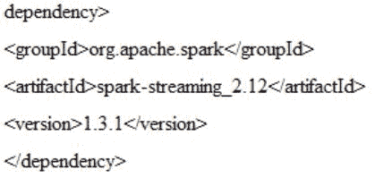

或者，对于 `sbt` 如下。

```
libraryDependencies += "org.apache.spark" % "spark-streaming_2.12" % "1.3.1"
```

如果应用程序将从 `Kafka`、`twitter` 等外部源读取输入，则应相应添加处理数据接收和缓冲的相关库。

### Streaming Context 对象

任何 Spark Streaming 应用程序的第一步都是从 `SparkConf` 对象初始化一个 `StreamingContext` 对象。

一旦初始化，应用程序的正常流程将是：

1. 创建输入 `DStreams` 以定义输入源。

2. 在 `DStream` 上应用转换和输出操作，以定义必要的计算。

3. 通过在初始化的 `StreamingContext` 对象上调用 `start()` 方法接收并处理数据。

4. 等待处理由于错误结束或通过在初始化的 `StreamingContext` 对象上调用 `stop()` 函数结束。这种等待通过在同一对象上调用 `awaitTermination` 函数完成。

Spark 处理流水线包含两个主要组件：`SparkStreaming` 和 `Spark Engine`。`SparkStreaming` 中的接收器（Receiver）对象将数据流分为小时间窗口的输入数据批次，而 `Spark Engine` 则处理这些批次并将结果发送到所需的数据存储中。我们将深入研究 `SparkStreaming` 模型中的主要组件以及应用程序的与部署。

首先，让我们详细了解上述组件，以及使用 `SparkStreaming` 进行大数据流式数据分析应用的基础。

### DStreams：离散流（Discretized Streams）

离散流（Discretized Streams，简称为 `Dstreams`）是 `SparkStreaming` 中数据流的核心表示。一个 `DStream` 可以指输入数据流，也可以指处理后生成的的结果。

`DStream` 无质上是 `RDDs` 的无限序列，为处理大规模流式数据提供了抽象。`DStream` 中的给定 `RDD` 存储了连续流中特定时间步的数据。`DStream` API 与我们在第 1 章讨论的 `RDD` API 类似。任何在 `DStream` 上调用的函数都将转换为对其 `RDDs` 的转换操作。这种转换由 `SparkEngine` 处理。通过这种设计，`DStream` API 为开发者提供了一个方便的高层抽象。

让我们进一步查看有关输入数据流、转换和输出操作的细节。

### 输入 DStreams、接收器与流式资源

持有接收到的数据流信息的 `DStreams` 对象被称为 `Input DStreams`（输入 DStreams）。对于每个 `Input DStream`（除文件流外），都有一个对象将数据缓冲到 Spark 内存中，并将其切分为处理的数据批次。

`SparkStreaming` 的输入源有两种形式：

1. 基础源（Basic Source）

2. 高级源（Advanced Source）

基础源是可以使用 `SparkContext` API 直接访问的输入源。例如接字、文件系统和 `AKKA` 节点。访问高级源需要使用额外的辅助工具或依赖，这些工具应该显式地链接到应用程序中。例如 Twitter、`Kaffka` 和 `Flume` 等。

用户可以通过创建多个输入 `DStreams` 来使用上述输入的多种形式。在这种情况下，将生成多个接收器，它们同时处理多个输入。

Spark 分析流水线利用分配给 `SparkStreaming` 执行的核心之一进行运行。因此，应该特别注意，`SparkStreaming` 应用程序应分配足够的核心，以便用于数据处理和运行接收器。

### 基础源

`StreamingContext` API 提供了处理这些源的方法。它们是文件流、`Akka` 节点和接字连接。

让我们先考虑文件流。可以如下实例化一个从兼容 `HDFS` API 文件系统（如 `HDFS`、`NFS`、`S3` 等）读取输入的 `DStream` 对象：

```
var dStreamobj = sstreamingContextObj.filestreamkeyClass, valueClass, InputFormatClass
```

上述代码告诉 Spark Streaming 监控输入 `DataDirectory`，并在其中创建文件时对其进行处理。需要注意的是，嵌套目录中的文件无法被监控，文件应保持相同格式。将文件重命名或移动到输入 DataDirectory 应该是一个原子操作，在移动文件后进行的任何修改都不会生效，因为文件是持续读取的。

访问文本文件的备用方法是 `text FileStream`，可以简单如下所示调用：

```
var dStreamTxtobj = streamingContextObj.textFilestream(inputDataDirectory)
```

不需要为接收器分配额外的核心，因为文件流不需要任何接收器。

从接字到数据流的连接如下：

```
var dStreamobj = streamingContextObj.socketTextStream(“host_name”,port)
```

可以使用 `actorStream(actorProps, actor-name)` 方法创建一个 `DStream` 对象，接收来自自定义节点（如 Akka 节点）的数据。仅在 Java 和 Scala 中支持节点（Actors）。因此，该方法在 Python 中不可用。

还有一种选项可以将 `RDDs` 队列读取到 `DStream` 对象，这对于使用各种测试数据对应用程序进行测试非常有用。可以如下所示：

```
var testDStreamobj = streamingContextObj.queuestream(RDDqueue)
```

由于 `RDDs` 被不断推送到队列中，它们将像流一样被接收和处理。

这些就是受 `SparkContextAPI` 支持的基础源类别。

### 高级源


从 Spark 核心不支持的、需要与外部 API 接口的源发送输入数据的源被称为高级源。由于它们不是 Spark 的一部分，且接口可能会随着新版本的发布而变化，因此依赖的处理和`DStreams`的实例化必须通过外部支持库完成，这些库可以根据需要链接并导入应用程序中。例如来自 Kafka、Flume 或 Twitter 的源。在这些情况下，应将必要的库作为依赖链接，在导入必要的工具时实例化`DStream`对象，并在部署时将依赖库封装在最终的 uber jar 中。尽管如此，这些应用程序在 Spark Shell 上执行，因此我们无法在 Shell 上测试它们。

除了上述两个主要源外，我们还可以使用`DStreams`从自定义输入读取数据，并实现自定义接收器来从输入读取数据并将其转发到 Spark。

## 可靠与不可靠的接收器

根据可靠性，数据源可分为两种。某些数据源（例如 Flume 和 Kafka）支持确认数据接收。如果接收器能够确认正确的数据接收，则确保所有数据都会被接收且无任何丢失。根据接收器发送确认的能力，它们分为可靠接收器和不可靠接收器。

可靠接收器在数据接收并缓冲到应用程序后，可以向源发送确认。不可靠接收器不会确认数据接收。如果你不想处理确认相关的复杂性，或者正在与不支持确认的不可靠源工作，则可以使用不可靠接收器。

## DStream 转换

存储在`DStream`对象中的数据可以通过转换进行修改。`RDD`和`DStreams`共享许多转换。在本节中，我们将详细介绍一组经常使用的转换。

- `Map(function)`：此转换在源`DStream`上调用给定函数并返回一个`DStream`。
- `FlatMap(function)`：与上述类似，但可以将输入`DStream`中的每个项映射到零或多个输出。
- `Reduce(function)`：根据可并行计算的关联函数对`DStream`中的元素进行聚合，并返回带有结果的新`DStream`。
- `Repartition (Number Of Partitions)`：减少或增加分区数量，从而更改`DStream`对象的并行操作。
- `Union (Other DStream)`：返回包含源和其他`DStreams`中元素的`DStream`。
- `Filter(function)`：根据传递的参数过滤`DStream`中的项，并返回带有过滤后数据的`DStream`。
- `Join(other DStream, [number Of Tasks])`：从源`DStream`和格式为`(key,value1)`, `(key, value2)`的其他`DStream`返回格式为`(key,(value1,value2))`的`DStream`对象。
- `Transform(function)`：将格式为`RDD->RDD`的应用于源`DStream`的每个元素。可以使用此转换执行任何`RDD`操作。
- `Count()`：返回一个一个`RDD`的`DStream`，该`RDD`持有源`DStream`中元素的计数。

从输入`DStreams`开始，现在让我们查看输出`DStreams`的操作：

在上方，我们看到了对`DStreams`的输入操作。类似地，`DStreams`的输出操作可用于将生成的结果转发到数据存储中，例如文件系统或数据库。`DStreams`上所有转换的实际执行将通过输出操作的调用来启动，因为这是从外部源读取结果的时候。输出操作的详细信息如下：

对于每个`RDD`（函数）：此操作在每个`RDD`上执行给定的函数，并将结果数据转发到外部存储。例如，传递的函数可以是通过网络写入数据库，也可以保存到文件等。

`Print()`：可用于调试和开发目的，在主应用程序上显示`DStream`中每组数据的前十个项目。


被调用的`DStream`的内容将保存到文本文件中。在每个时间间隔生成的文本文件，其名称将以“前缀-毫秒级时间 [后缀]”的形式存在。

## 示例应用程序 – 实时 Twitter 数据

有了这些工具，让我们来构建一个应用程序，从 Twitter 数据流中收集数据吧：

此示例应用程序演示了我们如何从 Twitter 数据流中读取数据，并处理并将收集到的推文写入文件。收集到的推文将以 JSON（JavaScript 对象表示）格式写入。

以下是 Scala 的实现：

```scala
package com.spark.examples.twitterdata

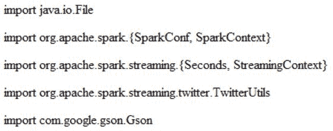

/**
* 收集指定数量的推文并写入文本文件。
* The twee
*/
object TweetCollector {

  private var numofPartitions = 0
  private var collectedTweetsCount = 0L
  private var gson = new Gson()

  def main(args: Array[String]) {
    // 从应用程序参数读取并相应赋值
    if (args.length < 3) {
      System.err.println("Arguments to " + this.getClass.getSimpleName +
        "should be in the form of <resultsDirectory><numOfTweetsToRead><timeIntervalInSecs><outPutFileCountInEachInterval>")
      System.exit(1)
    }

    val Array(resultsDirectory, Utils.IntParam(numOfTweetsToRead),
      Utils.IntParam(timeIntervalInSecs), Utils.IntParam(outPutFileCountInEachInterval)) =
      Utils.parseCommandLineWithTwitterCredentials(args)

    val outputDirectory = new File(resultsDirectory.toString)
    if (outputDirectory.exists()) {
      System.err.println("ERROR - %s Directory exists already,Provide another directory or delete the existing".format(
        resultsDirectory))
      System.exit(1)
    }

    outputDirectory.mkdirs()
    val configuration = new SparkConf().setAppName(this.getClass.getSimpleName)
    val streamingContextObject = new StreamingContext(configuration, Seconds(timeIntervalInSecs))
    val tweetsDataStream = TwitterUtils.createStream(streamingContextObject, Utils.getAuth)
      .map(gson.toJson(_))

    tweetsDataStream.foreachRDD((rddElement, time) => {
        val inputsCount = rddElement.inputsCount()
        if (inputsCount > 0) {
        val resutlRDD = rddElement.repartition(outPutFileCountInEachInterval)
        resutlRDD.saveAsTextFile(resultsDirectory + "/tweetsRead_" + time.milliseconds.toString)
        collectedTweetsCount += inputsCount
        if (collectedTweetsCount > numOfTweetsToRead) {
            System.exit(0)
        }
        }
    })
    streamingContextObject.start()
    streamingContextObject.awaitTermination()
  }
}
```

## 总结

因此，你已经学习了 Spark Streaming 用于读取和处理大规模流式数据以及各种形式的结果存储方法。Spark Streaming 还支持图处理并在这些数据流上进行机器学习。你还学习了各种依赖关系以及如何将它们与 Spark 链接起来。

现在你也知道使用`StreamingContext`可以帮助初始化 Spark Streaming 应用程序以及我们可以推入结果结果各种数据存储。Spark Streaming 应用程序涉及的核心组件包括：

- `DStreams`
- 转换 (Transformations)
- 输出操作 (Output Operations)

一个演示使用 Spark Streaming 进行 Twitter 数据分析的示例应用程序。

## 作业

### 练习 1

1. 识别 Spark Streaming 用于读取和处理大规模流式数据以及各种形式的结果存储方法。

### 练习 2

1. 识别 Spark Streaming 用于读取和处理大规模流式数据以及各种形式的结果存储方法。
2. 识别 Spark Streaming 用于读取和处理大规模流式数据以及各种形式的结果存储方法。
3. 识别 Spark Streaming 用于读取和处理大规模流式数据以及各种形式的结果存储方法。

# 第 14 章：让我们借助 Spark 构建 Lambda 架构

## 在设计设计出一个概念并实现它后，你可能会会有一些观察结果。你可能也喜欢即使在数据到达和算法改变时，数据也可以被自动处理的特性。延迟一小时的主要原因是过滤掉不干净的数据，从而提高系统的效率。然而，在某些情况下，你可能希望在数据到达的瞬间就获得它们（无论干净与否），以便能够尽快做出响应。因此，你可能想要包含一个实时组件，这样会更容易。

延迟问题是一种被称为 Lambda 架构（lambda architecture）的特性。该特性将实时和批处理组合在一起。你需要这两个组件是因为实时数据的到达总是包含根本问题。你无法保证单个事件会一次性接收。此外，数据可能会重复，这会对数据造成某种干扰。由于服务器不稳定或网络问题，也可能导致数据延迟到达的问题。专家们提出了一种解决方案，让你能够立即获得快速但可能不可靠的数据，而缓慢且可靠的数据稍后到达。

## 为什么你应该使用 Spark？

使用 Lambda 架构方法会带来成本。相同的业务逻辑必须在两个不同的系统中实现和维护。使用 Apache Storm 实现实时系统，使用 Apache Pig 或 Apache Hive 实现批处理系统，将导致在 Java 和 SQL 中重写相关的聚合逻辑。这种情况很快就会导致维护维护噩梦。

但如果你想使用 Lambda 架构，建议使用 Spark。这是因为如果系统是用 Storm 开发的，你将不得不用 Storm 重新实现整个逻辑聚合。

Spark 以可用于机器学习的结构而闻名。但它也完全胜任 ETL 任务。Spark 的 API 易于使用且整洁。你可以轻松阅读它们，而且与 MapReduce 相比，它们的样板代码更少。你还可以使用 REPL 接口快速进行逻辑原型设计。与 MapReduce 相比，这使得执行速度更快。

然而，Spark Streaming 恰好是 Spark 的最大优势。Spark Streaming 允许你在批处理应用程序中使用与你在实时作为数据流时相同的聚合操作。因此，你就不需要对业务逻辑进行重新实现，也不需要为第二套代码维护和测试基础。因此，在你的系统中实现一个实时组件要变得容易得多且快速得多。这不仅受到开发者和管理层的青睐，也会受到用户的欢迎。

## 动手实践

这是一个你可以遵循以实现 Lambda 架构的简单且快速的示例。为了便于理解，示例中仅包含了必需的步骤。

1. 首先，你编写一个用于实现业务逻辑的函数。在本例中，我们希望统计一天的错误数量并收集到事件日志中。事件日志由时间、日期以及日志级别、日志进程和消息本身组成：


为了获取一天内记录的错误数量，你需要在统计当天收的消息数量之前对日志级别进行过滤：

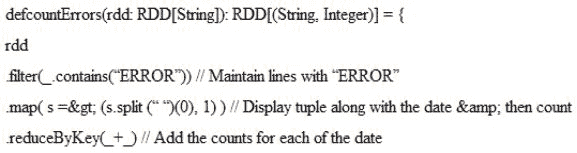

从该函数可以看出，你注意到包含“ERROR”的行被过滤掉了，然后使用该函数，通过`map`将行的第一个单词（即日期）作为键。接着，你使用`reduceByKey`函数来获取你当天获得的错误数量。

因此，你会观察到`RDD`被函数转换成了另一个`RDD`。Spark 的主要数据框架是`RDDs`，它们本质上是分区的，集合是可复制的。由于 Spark 能够隐藏复杂的分布式集合处理，你无法看到这些处理过程。就像其他任何集合一样，你可以轻松地与它们进行操作。

2. 在 Spark ETL 过程中，可以使用函数从 HDFS 读取数据到`RDD`中。此外，它们还可用于计算错误数量，并将结果保存到 HDFS：

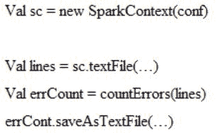

在本例中，代码是通过初始化`SparkContext`在 Spark 集群中执行的。（请注意，如果你在 Spark 中使用 REPL，则不需要初始化，因为在这种情况下`SparkContext`的初始化是自动的。一旦完成`SparkContext`的初始化，在执行错误计数函数并将结果保存到文件之前，需要将行从文件中读取到`RDD`中。）

在`errCount.saveAsTextFile`和`spark.textFile`中的统一资源定位符（URL）可以通过使用`hdfs://….`保存在 HDFS 中。其他替代方案是 Amazon S3 或本地文件系统文件。

3. 如果你没有整一天的时间来获取错误数量，而是倾向于按分钟为单位记录结果，那么你就不需要重新实现聚合操作了。你只需要再次使用流式代码即可。

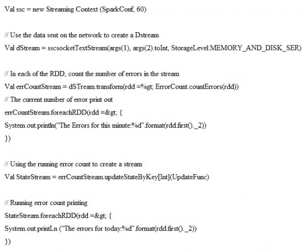

你必须再次进行上下文初始化。在这种情况下，一个事件流（从网络中的 socket 获取；Apache Kafka 是一种可靠的服务，生产架构也会使用它）将从`StreamingContext`获取并转换为`RDD`流。

流的每个微批（micro-batching）将由每个`RDD`表示。每个微批的时间范围是可配置的（在本例中，微批为 60 秒一组），这可以作为较大批次（称为吞吐量）和较小批次（称为延迟）之间的平衡。

在`DStream`上，你将运行一个`map`任务，使用函数`countErrors`将流中的每个行`RDD`转换为以`(date, errorCount)`形式的`RDD`。

对于每个`RDD`，我们将显示特定批次的错误数量，然后你可以使用相同的`RDD`对正在运行的总计计数进行流更新。运行总计将由此流打印出来。

为了方便使用，你可以在屏幕上显示输出，同时将其进一步保存到 HDFS、Kafka 或 Apache HBase 中，以便供实时用户和应用程序使用。

## 总结

Lambda 架构允许你在系统中创建一个实时组件，该组件将允许在仪表板上立即显示收集到的数据。在批处理 ETL 过程中重新实现业务逻辑函数是可行的。这使你能够快速为批处理系统创建一个实时组件。你将拥有在数据被收集时立即获取它们并对其做出相应响应的优势，而更可靠的数据将以批的形式发送。因此，你能够构建出一个令你的用户和管理层都印象深刻的系统。

## 作业

### 练习 1

使用 Apache Spark 构建一个批处理系统，然后为其添加一个实时组件？

### 练习 2

同时具有批处理组件和实时组件的系统如何让用户和管理层受益？

# 第 15 章：当问题出现时——寻求 Spark 的帮助（Lambda 架构）

为满足不同终端用户延迟需求的大数据构建一个可靠、设计良好且功能完备的应用是非常挑战性的。跟上技术快速变化的创新已经令人生敬畏了。然而，当需要构建解决当前问题的软件时，挑战随之增加。因此，缓慢开始并逐个创建软件应用程序是更好的，特别是对于初学者来说。许多架构数据设计也为了让初学者能够理解不同类型的软件在大数据结构中是如何工作的。文中还解释了一些架构设计和技术及其功能。

## 大数据公司错误示例

许多大数据公司过去曾遇到过问题，导致数据库关闭。这些大数据公司包括 Facebook、Twitter、RBS 和 Google。

### Facebook

2010 年 9 月 23 日，Facebook 离线了近 2.5 小时，他们将此故障解释为对错误条件的处理不当。导致该错误的真实原因是：一个自动验证配置的系统产生的问题比它解决的问题还要多。用通俗的话说，实际发生的情况是：自动系统会检查无效的配置值。一旦发现任何无效值，它就会从持久化存储中自动提取一个有效的配置值进行替换。然而，只要持久化存储是有效的，系统就能一直完美运行。但是，当持久化存储失效时，系统将无法获取有效值来替换无效的配置值。这就是导致 FacebookFacebook 离线的错误原因。为了解决这个问题，他们必须重启整个 Facebook 网站站点，这意味着他们必须回溯上一个可靠的数据批。

### Twitter


Twitter 在 2012 年 6 月 21 日遭遇了类似的命运。在这一特定天，Twitter 崩溃了，网站完全无法向用户显示任何内容。导致这一任务的问题被称为“级联故障”（cascaded bug）。实际发生的情况是：一组字符发生了故障，并且像波浪效应一样，故障字符开始影响其他也发生故障的字符。这就是为什么它被称为级联故障，意味着一个故障影响了一个功能部分并使其产生故障。这组新的故障字符又影响了另一个功能部分，直到整个系统崩溃。整个事件的讽刺之处在于，Twitter 的新总部就在 2 天前刚刚举办了一场工程可靠性开放日。为了也解决这个问题，Twitter 网站被回滚到了上一个稳定的网站版本。

## RBS

2012 年 6 月，RBS 也因为升级过程导致了技术故障。该银行声称，该错误为公司造成了约 1.25 亿英镑的损失。故障影响了他们的超过百万客户，持续了一整一周。在问题被识别并纠正后，仍需要在复杂的自动化批处理环境中进行人工干预。这导致了大量的每日数据积压和信息处理压力。然而，如果初始软件使用了 Lambda 架构，这个问题本可以更容易解决。人工干预将是不必要的，或者程度会降到最低，因为他们可以立即回滚到最新的稳定版本。这进一步导致该机构报告该季度总损失达 15 亿英镑。

## Google

2014 年 1 月 24 日，Google 及其所有其他站点（包括 Gmail、文档、日历和 Google+）无法访问约 25 分钟。对于其他一些用户来说，他们在大约 55 分钟后才能访问任何 Google 服务。该问题是由一个负责向其他系统发送操作指令的系统软件漏洞引起的。该漏洞导致系统在约 15 分钟内向其他系统发送了错误消息。这些错误信息导致用户的数据请求被忽略，从而引发了错误。这些的影响从上午 11 点约 2 分钟后开始出现。原始错误随后被移除，现在开始生成正确的消息，直到影响开始消退，Google 服务得以恢复。Lambda 架构也可以在发现故障后立即恢复 Google 服务起到类似的作用。

## Lambda 架构与大数据错误的解决

Lambda 架构的构建本质上是为了接受硬件将会发生故障的现实，为了接受这一点，它必须通过软件来解决它。当我们观察一个平台时，我们拥有一个可以扩展的平台；我们通过软件在平台中内置了容错机制。但当你开发要在该平台上运行的软件时，会发生什么呢？数据库的更新可能会导致部分数据库被误删。Lambda 架构的开发是为了通过引入“人工容错”来修复这类问题。因此，随着系统变得越来越复杂，你需要理解错误是避免的，这是不可避免的，所以你必须处理它。你必须建立相应的措施，以便在不小心删除了重要内容或发生错误时，不至于承受巨大的压力。

这就是容错发挥用场的地方。正如之前讨论的，即使是大公司有时也会出现灾难性的错误，并且必须尽快解决。Lambda 架构的概念并不新鲜，它只是最近才被记录下来。所以整个概念其实一直存在，但 Nathan Marz 出现并非常简洁地写下了它。他对其进行了阐明，给它命名，并提供了一个几乎任何人都能轻松理解并实现的东西。他创建了 Storm，这在容错方面非常有意义。他那时的经历以及加入 Twitter 后的经历，让他真正理解并吸收了我们必须防止硬件故障和人为错误。所以，当你发布了错误的配置文件后，如何恢复？你在企业级应用平台和支持运营中需要的是确保你对这种情况以及低频发情况都有支持。你可以构建低延迟、OLAP 或 OLTP 的 Lambda 架构。你必须构建关系型数据库，在某些位置放置索引，以支持某些类型查询的创建方式。

会有数据进入你的 Lambda 架构以及你的批处理层。你还需要向数据库添加更新。此外，你还需要决定想保留数据多久，也许是 7 年。然后你必须在批处理层中构建一个可靠的、分布式的数据集。你构建的方式还需要支持数据使用的低延迟，以及点击事件的历史记录。你也可以为数据库建立数据流。Lambda 架构的主要因素是，每当你遇到漏洞时，你都可以进入批处理侧修复漏洞。你还可以重建所有受影响的损坏记录。它为企业提供了一种从故障中恢复、从漏洞中恢复的方法，并保护你免受沿途中可能遇到的所有烦恼。

例如，如果你有飞行数据，你有一个存储在批处理层中的不可变数据集。随着时间的推移，你会添加发生的不同事件，起飞、降落等。你的数据会随着日期的增长而增长，你对此做好了准备。你可以理解所有这些不同的扩展实践。但你将能够在这里开始构建你关心的查询并提问。例如，现在有多少架飞机在空中？每家航空公司有多少架飞机在空中？每个机场停机坪上目前停了多少架飞机？这些都是简单的问题。然而，这些简单的问题属于两类之一：你可以有批处理，也可以流处理。

### Spark 的作用

有很多不同的技术可以应用到这个技术栈中，并且它们可以遵循不同的路径。其中的某些组件可以分层满足需求。然而，对你来说，了解有哪些技术是一个很好的点。因此，你需要一种存储历史数据、生成查询、查看数据并支持流处理的方法。你还需要一个可靠的批处理流，以便你修复错误和 Bug。为了实现这一点，你可以使用如 `Kafka`、`Storm` 和 `HBase` 等平台。你可能会认为有很多需要学习和使用的技术。然而，这只是在向你展示如何防止你自己陷入失误。所以，如果你接受了这一点，你现在可以说你可以把 `Spark` 引入这里。但你也有理由不想在某些地方使用 `Spark`，或者在其他情况下你恰恰只想使用 `spark` 而不使用其他技术。你可能有一堆 2 到 3 年前写的遗留代码，它们在你的数据中心运行，而你又不想花精力去替换它们。这就是 `Spark` 的优势之一。所以，当你从整合的角度来看这些技术时，会有一种软趋势：Twitter 发布了一些东西，有一个名为 `lamp dupe` 的项目，它不仅交付了 lambda 架构，而且正在朝着目标努力。它还修补了 `spark`。修补后的 `spark` 从根本上交付了满足 lambda 架构的所有部分。因此，希望这里的大多数人收获的应该是：你可以通过 `spark` 简单实现 lambda 架构。

### Spark 会成为你 Lambda 实现的每一个方面吗？

可能会，也可能不会！它并没有规定这一点，它恰恰拥有了你扩展用例所需的所有组件。你可以生成 `spark sequel` 的视图，并使用 `spark streaming` 扩展速度层，因为你拥有了 `spark` 执行引擎。现在从 `MapR` 的角度来看，你实际上可以有一个思科的客户，他们使用 `Spark` 有效实现了 lambda 架构。因此，你可以用它进行安全分析和其他安全相关的内容。再次，这种技术栈（这种架构）的好处是可以为你节省恐慌。

## 总结

数据库系统很容易出错，尤其是当它们变得很大时。这些错误的处理成本很高，而且在大多数情况下，它们发生时只持续几分钟。如果没有对错误以及如何修复它们做好准备，这些错误可能会变得糟糕。通过 Lambda 架构，修复错误变得简单且快速。Lambda 架构允许你快速恢复到系统的上一个稳定版本并从那里继续。

Lambda 架构可以通过 `Spark` 实现。

## 作业

### 练习 1

1. 哪些因素会导致系统崩溃？

2. 如何将这些因素降至最低？

### 练习 2

在系统崩溃的情况下，可以做什么来纠正问题？

## 结论

这本书能找到你，是因为你拥有无限的潜力。

你可能很容易觉得觉得自己很局限，但事实是，你比自己所假设的要强大得多。我们也曾经历过。我们也曾处于这种境地：当放弃或安于现状看起来是最佳选择时。幸运的是，内心作为激情所在地的内心告诉了我们事实并非如此。

我们的团队是在 2014 年成立的。我们的指南针就是这个——梦想是写出能够传播编程知识和教育的书籍。目标是让世界上尽可能多的人受益，学习如何编程，并在过程中找到解决方案、进行数学计算、显示图形和图像、处理和存储数据以及更多。我们为实现这一梦想的整个旅程对我们每个人的生活来说都是至关重要的。我们相信，共同的梦想会变成现实。

我们希望你成为这段旅程、这个奇妙现实的一部分。我们希望让学习编程对你来说变得简单有趣。此外，我们希望让你开眼看到真理：编程可以成为你生活中更美好事物的起点。

编程可能会有这种通常的刻板印象，认为太极客、压力太大。我们想告诉你，现在我们享受这种生活方式：冲浪-编程-阅读-写作-吃饭。这有多神奇？如果你喜欢这种生活，我们向你保证，没有什么是不可能的，就像我们一样，你也可以把编程作为脚石，释放你解决问题的潜力，最大化解决方案，并享受你真正值得的生活。

这本书能找到你，是因为你正处于一切奇迹的边缘！

感谢阅读！

你可能感兴趣：

- [Python：在一天内学会 Python！](http://www.amazon.com/Python-Ultimate-Learning-Development-Beginners-ebook/dp/B00ZOAPQFA/ref=sr_1_14?s=digital-text&ie=UTF8&qid=1438463262&sr=1-14&keywords=python)

- [这里我们的完整库：http://amzn.to/1HPABQI](http://www.amazon.com/Acodemy/e/B00TQ910KU/ref=sr_tc_2_0?qid=1434474148&sr=1-2-ent)

祝你成功，

Acodemy.
