# 蜘蛛侠 #6 (漫威时代聚焦)

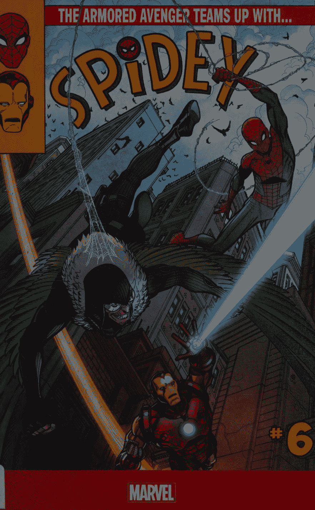

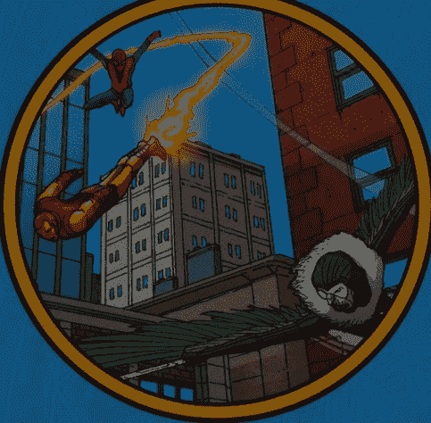

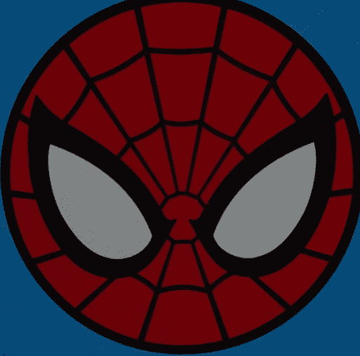

测试。

我最近一直在做测试。

就像这一个。

Q：当一只放射性蜘蛛咬了你时，你会做什么...

A：……它给了你由于太年轻太愚蠢而无法理解的力量……

救命——拦住那个家伙！

而当你真正理解这些力量时，已经太迟了。

A：你把所失去的一切……与你所知的一切结合在一起……然后你就变成了

等级：A+！

是的，几乎每一个以科学和数学开头或结束的课程？我没犯过错。

但在其他任何课上？

或者，你懂的，生活？

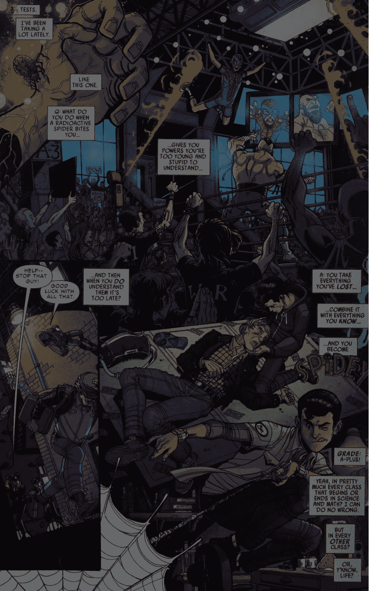

太棒了。

不过我得到了帮助，我的意思是，至少在学校里是。

也许我应该为生活方面的事情请个生活教练？

我的老师麦克斯韦先生为我引荐了一位很棒的导师。

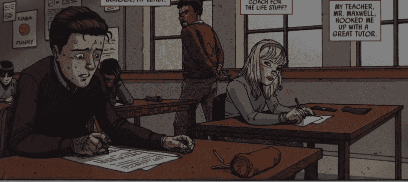

格温·斯塔西。

是的，就是格温·斯塔西。

她帮过我的历史。

而我帮过她的数学。

我们是一个非常棒的团队。

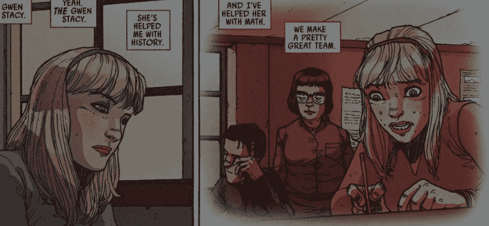

呼

好了，大家。笔下笔。

你们明天就会知道自己的命运了。

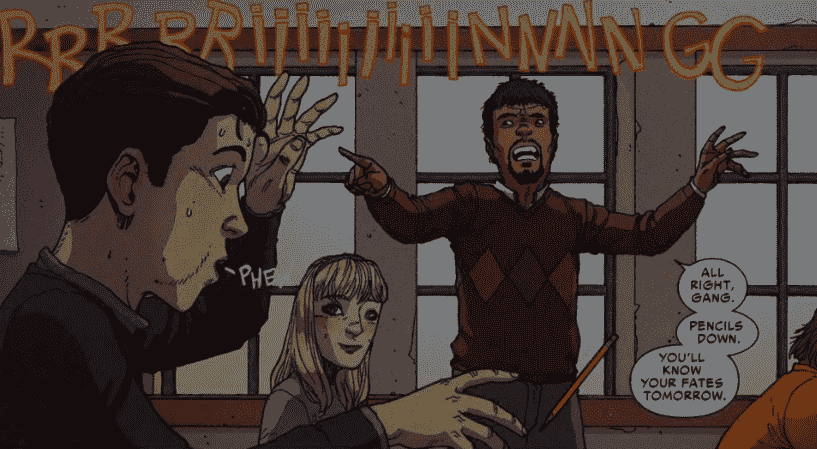

所以呢？

我的意思是，我完成了。

这是一个很好的开始。

我确定你做得很好，彼得。

你是一个，世界上最棒的导师。

最棒的导师。

一切。

保持冷静，彼得。控制好自己。

我很高兴测试结束了。

我们快要放假了。

寒假，在那之前？

学校舞会。

我还没有约会对象，格温和闪电，他们并不认真。

我还是可以问她的对吧？

是的，寒假。

舞会快到了了，而且——

我不行。我做不到。我——来吧，彼得。这是真正的测试。

你可以的。你可以的。

啊啊！

蜘蛛感（糟糕）的时机，总是这样。

等等，你刚才说什么，关于——

噢，什么也没有。我只是——得走了，赶晚饭了。

明天见……

为什么我问她时像是在问问题？

而不是真的去问她？你想去舞会吗？

看起来很容易。不可能。

我是最差的。

你会成功的，我直知道！

Q：你如何约女孩出去？

A：……等级：史诗级失败。

为什么这么难？“你想去舞会吗？”听起来很容易。

在我的脑子里。

也许我应该大声试试。

你想去舞会吗？

（更糟了）（糟糕）是在哪栋建筑里？哇，这是一些高端设备。

你想去舞会吗？我不打算了，谢谢。

秃鹫。又名阿德里安·图姆斯。又名一个肮脏、腐烂的小偷。而且偷了托尼·斯克的？不聪明——不想和那堆螺丝钉纠在一起。

让路，小子。你刚才问了舞会的事。你叫谁小子？谢谢你让我失望。

今天只有挨打了。

Q：你为什么低估了反派龙廊？

A：嗯，谁说的反派龙廊？等级：部分认可。

哇！哇！停下！你的你的……脸是个笨蛋。

真的吗，彼得？

再见，笨蛋。

停！

抱歉，那个，我不想动。与其说讨厌约翰·杰克逊和他的报纸，但结果发现……你是个业余蜘蛛侠。

# 制作

| 姓名 | 职位 |
| :--- | :--- |
| Robbie Thompson | 编剧 |
| ANDRÉ LIMA ARAUJO | 画画 |
| JIM CAMPBELL | 字 |
| RICH BRANSHALE & JIM CAMPBELL | 上色 |
| Devin LEWIS | 副编辑 |
| NICK LOWE | 总编辑 |
| JOE QUESADA | 创作者 |
| DAN BUCKLEY | 出版 |
| ALAN EIS | 执行制片 |
| 蜘蛛侠 由 STAN LEE 和 STEVE DITKO 创作 |

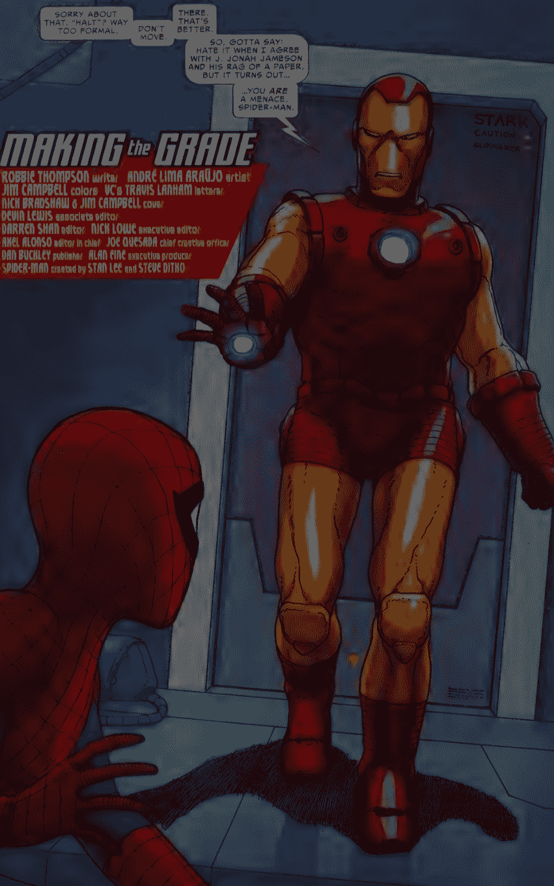

斯塔克

警告

滑动

钢铁侠。托尼·斯克的保镖。他认为我是信息。等一下。

我不是闯入的。这里，是秃鹫。

他正在逃跑。

说话吧，周五。监控摄像头坏了——全覆盖的，斯塔克先生。

好。你还有什么？

根据他的身高体重，我认为他是个青少年。

他的心率正常，先生。

看起来他是在说真话。

那为什么我看不见他的脸？

好吧，和你做个交易。我暂时不会把你交给 S.H.I.E.L.D.。但必须摘掉面具，这样你才能像你还是个大人那样谈论这件事。

没时间了。他正在逃跑——他很快，先生。

谢谢你的更新，周五。

听着，这是漫长的一天，各种如此——相对来说没把你从天上轰下来，所以——

你就打算一直跑下去对吗？

我不是在跑。我在追。

好了，伙计，是时候睡小觉了。

而且而且，我还是你老板托尼·斯克的超级粉丝。

我不会闯入斯塔克工业。

首先，我不是小偷。

那家伙是个天才。

而且嘿，如果我闯入斯塔克的实验室，我不会留下那个大师手套原型的。“那玩意儿看起来酷毙。”

秃鹫也没有拿那个大师手套。他拿的是具体的计划。这不只是抢劫。

秃鹫就是你要找的人。不信我吗？

去问他自己吧。

噢，天哪，我是被捕了吗？

他完全没发现。你根本不知道自己在做什么，彼得。

你根本不知道自己在做什么，对吧？

保持冷静。保持冷静。

什么？不。是。你说什么？

我懂了。我们得从某个地方开始。

我现在是“复仇者”了吗？

但是——

不。差得远了。

我确实——

闭嘴。

你今天做得很好，而且你很聪明。有点让我想起——

没错。那家伙。他是个……他是个天才。无所不知，而且如果他在这……

……

……他会嘱咐你在外面注意安全。成交吗？

是的，先生。

等等，呃，先生，呃，伙计？

嗯？

你经常和斯塔克先生在一起，对吧？几乎一直都是。

而且他，嗯，很擅长约会，对吧？那是他真正的艺术形式。

有什么？嗯，关于约人出去，有什么建议吗？

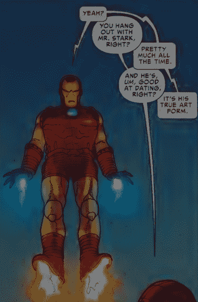

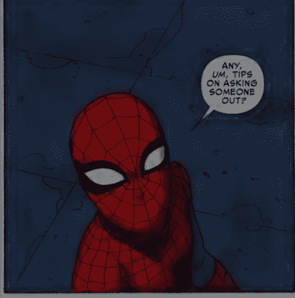

我的天哪，他真的只是个孩子。

请善良点，先生。

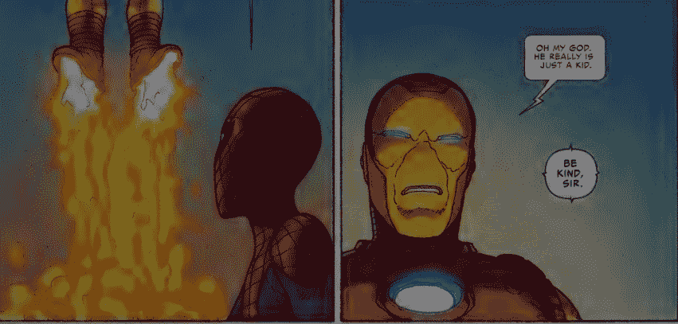

上天青睐勇者。在你的约会对象有其他计划之前，去约吧。什么？

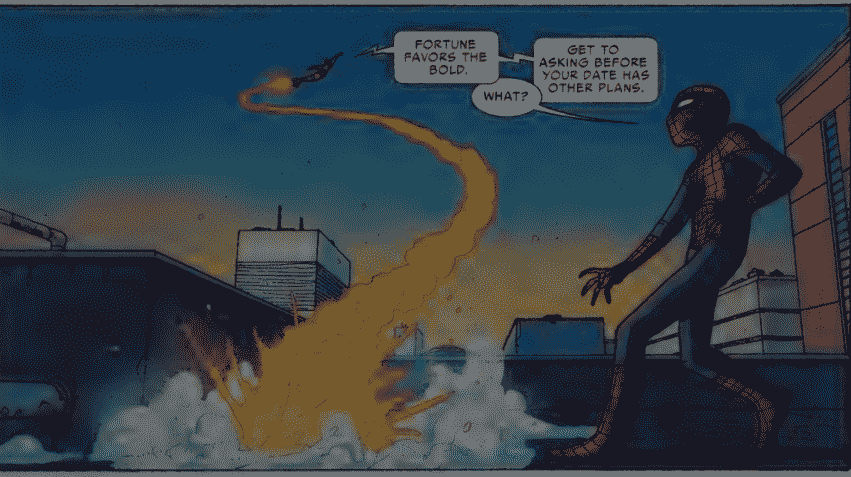

“不得不说，帕克先生……”

……我对你的辅导……印象非常深刻。”

“做得非常出色，斯泰西小姐。希望帕克先生能报答之情……”

A+，我不敢相信！我们是个绝佳搭档，帕克。

是的，团队。我们是一个团队。你想去参加冬季舞会吗？你想去参加冬季舞会吗？

快吧，帕克——选一个！

哥们。上天青睐勇者。

谁在乎？做就完了！就---

呃，格温？

嗯？

他还说了什么？

是的……我的意思是，我当然想去…………我昨天告诉过我会和他一起去的。

你要去吗？彼得？

呃，不，我只是……我以为我们那天晚上可以一起学习，如果你没去，如果我们没去——

——，呃……明天见？

……好的。嘿，帕克？我们做到了……

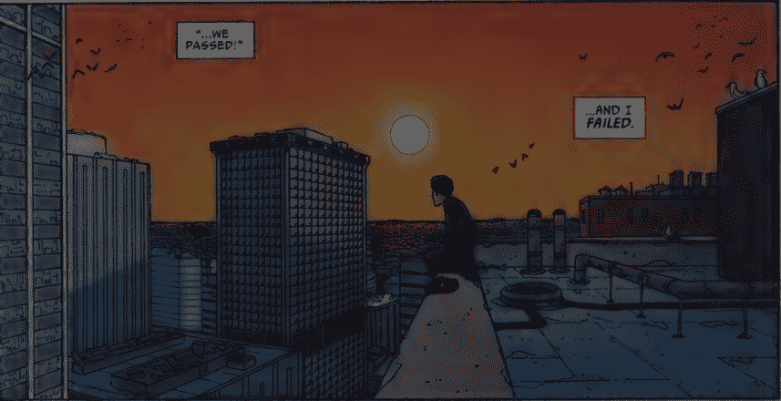

“……我们通过了！——

……我不及格了。

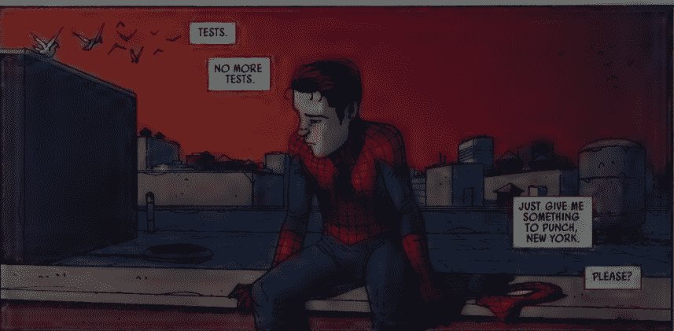

考试。再也不要考试了。给我个可以揍的东西吧，纽约。好吗？

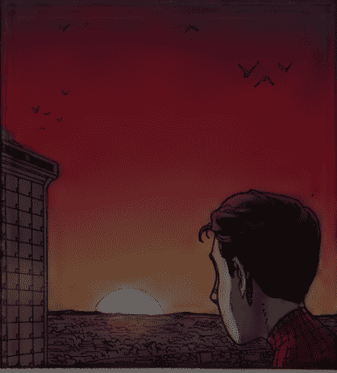

她已经约好人了，对吧？

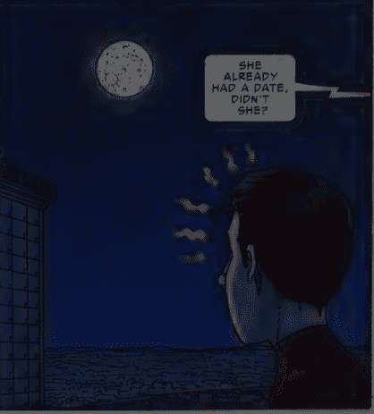

什么？不。是。

我经历过。你呢？真的吗？

一直都是。有些时候。

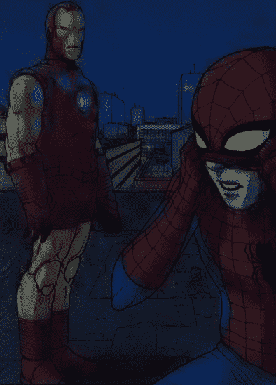

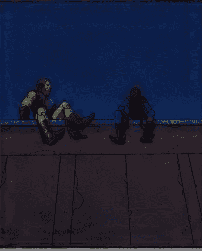

你揍过龙吗？什么？真的。真正的龙？

是的，刚收到警报，有龙正试图吃掉布鲁克林。

会很有趣的。能让你分散注意力。

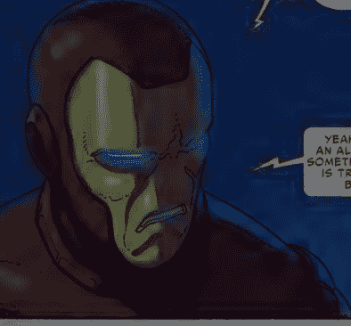

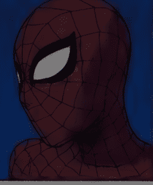

该如何忘记心碎？

去找一条龙，然后把它揍了。

这意味着我现在是“复仇者”了吗？

闭嘴，小子。

成绩：未完成……目前……
