# Spring Boot 3 API 精通：使用 Spring Boot 3 和 Java 21 为微服务编写可扩展、响应式且安全的 API


## 献给

我的父母 Pino 和 Nunzia Racca，他们的爱、支持和指导塑造了我今天的模样。

## 关于作者

Vincenzo Racca 是一位专注于 Java、Spring 和云技术的软件工程师。他通过获得 Spring Framework、Kubernetes 和 AWS 认证提升了自己的技术专长。Vincenzo 通过发表关于 Java、Spring 和云原生开发的文章来分享他所学知识。

## 关于评审员

- **Lucas Fernandes** 热衷于软件工程，专于开发高可扩展性、韧性和容错的应用程序。他在软件开发生命期的所有阶段（从构思到部署）都拥有丰富的专业知识。作为微服务和事件驱动架构的坚实支持者，Lucas 在 Java、Kotlin、Spring 生态系统、Kafka、Kubernetes 和 AWS 服务等技术方面拥有丰富经验。作为一名云计算专家，他在公共云平台（特别是 AWS）方面拥有深厚的造诣，并在那里持有两项认证。

  目前，他在 Iteris Consulting and Software 担任技术主管和解决方案架构师，设计并开发关键应用程序，特别是在金融领域。最近，他还在 Medium 上开启了作家的新旅程，在上面他分享自己在科技领域的知识和经验，推广最佳实践并激励开发者社区。

- **Modassir Kashani** 是一位在金融科技（Fintech）领域拥有丰富经验的软件工程师。他在 API 开发、微服务架构、云部署和站点可靠性工程方面拥有丰富的经验。Modassir 专注于支付应用程序的设计与开发，侧重于使用支付 API 为现实世界的挑战制定创新解决方案。

  目前，他正在伦敦玛玛玛丽大学攻读人工智能硕士学位。

## 致谢

我想感谢每一个鼓励我写这本书的人。特别感谢我的女朋友 Anna、我的妹妹 Sonia 还有我的朋友 Chiara，感谢他们一如既的支持。

我深感谢 BPB Publications 信任我，并给我机会写下这本具有如此个人意义的书。感谢他们的整个团队帮助我完善和增强这部作品的内容。

我也向我过去和现在的同事表示感谢，他们慷慨地分享知识和经验，促进了成长和发展。

最后，我衷心感谢本书的所有读者对我的信任。你们的支持是我继续分享知识和共同学习的最大动力。

## 序言

在不断演变的技术领域，设计和实现可扩展、安全且高效的 API 已成为现代软件开发的基石。API 不仅仅是系统之间的通信工具——它们是微服务架构的骨干，使企业能够快速创新并适应变化。

这本书的诞生源于意识到：许多开发者在创建 API 时面临挑战，不仅要满足当前需求，还要健壮、面向未来并符合行业最佳实践。本书旨在为读者提供一份使用 Spring Boot 精通 API 设计和实现的全面指南。

在这些章节中，我们将探索响应式编程、安全和现代架构模式。我们将深入 Java 21 和 Spring Boot 3 的最新功能，帮助您构建具有韧性的微服务。

### 第一章：REST 架构简介与 API 优先方法

本章涵盖了 REST 的基本原理和 API 优先方法。探讨了其在现代开发中的重要性，并深入研究了 API 版本的细微差别。通过理论见解与实践考虑的结合，读者为开始微服务开发奠定了坚实的基础。

### 第二章：使用 Spring WebFlux 构建响应式 API

本章涵盖了响应式编程范式以及它与传统方法的区别。引入了 `Spring WebFlux`，这是一个用于构建高性能、非阻塞 API 的强大框架。实际示例说明了响应式编程如何增强响应和效率。

### 第三章：使用虚拟线程构建易扩展的 API

本章涵盖了 Java 21 引入的虚拟线程在构建高可扩展 API 方面的威力。它解释了虚拟线程如何变革并发管理，使得在不阻塞的情况下处理大量请求成为可能。读者将学习将虚拟线程与 `Spring MVC` 集成并分析性能优势。

### 第四章：Spring Boot 与 GraphQL

本章涵盖了 GraphQL 的基础，它是构建灵活且面向客户端 API 的 REST 替代方案。它涵盖了 GraphQL 模式、查询和变异，并提供了使用 Spring Boot 的实际示例。你将理解 GraphQL 如何实现数据获取、减少过度获取和获取不足，并支持不断变化的 API 需求。

### 第五章：使用 gRPC 设计 API

本章涵盖了 gRPC，一种用于微服务之间通信的高性能、语言中立的框架。探讨了 gRPC 在 Spring Boot 中的用例、优势和实现。读者将学习 Protocol Buffers 如何定义服务和消息，并将 gRPC 与 REST 进行比较。实际示例演示了如何创建可扩展、低延迟的 API。

### 第六章：使用 Spring Cloud Stream 和 Apache Kafka 构建异步 API

本章涵盖了为微服务之间的异步通信构建事件驱动 API。它解释了如何使用 `Apache Kafka` 作为消息代理，以及使用 `Spring Cloud Stream` 抽象消息处理。读者将探索发布/订阅和消息分区等模式。

### 第七章：使用 Spring Cloud Gateway 实现集中安全

本章涵盖了如何使用 `Spring Cloud Gateway` 实现集中式身份验证和授权。探讨了 OAuth2 和 OpenID Connect 协议，集成了 Keycloak 作为身份提供者，并将微服务配置为 OAuth2 客户端和资源服务器。

### 第八章：可观测性与监控

本章介绍了可观测性及其在维护可靠 API 中的重要性。涵盖了使用 Grafana、Prometheus 和 Tempo 等工具进行日志、指标和分布式追踪。读者将学习如何聚合日志、监控性能指标以及跟踪跨微服务的请求流。通过实施可观测性最佳实践，读者可以快速诊断问题、优化性能并确保无缝的用户体验。

### 第九章：使用 Kind 在 Kubernetes 上部署应用程序

本章介绍了使用 Docker 和 Kubernetes 部署微服务。重点介绍了 Kind，这是一个用于在本地运行 Kubernetes 集群的轻量级工具。读者将探索 Pods、Deployments 和 Services 等概念，并理解如何管理扩展和网络。通过实战示例，引导读者部署 API，确保它们达到生产就绪并符合云原生原则。

## 代码包与彩色图片

请点击以下链接下载本书的代码包和彩色图片：

<https://rebrand.ly/9db530>

本书的代码包也托管在 GitHub 上：

<https://github.com/bpbpublications/Spring-Boot-3-API-Mastery>

如果代码有更新，将在现有的 GitHub 仓库中进行更新。

我们从丰富的书籍和视频目录中提供了代码包，可访问：

<https://github.com/bpbpublications>

欢迎查阅！

## 勘误表

我们对 BPB Publications 的工作感到非常自豪，并遵循最佳实践以确保内容的准确性，为订阅者提供沉浸式的阅读体验。读者是我们的镜子，我们利用他们的反馈来反思并改进出版过程中可能出现的人为错误（如果有的话）。为了让我们维持质量，并帮助我们联系任何可能因不可预见的错误而遇到困难的读者，请通过以下邮箱联系我们：

<errata@bpbonline.com>

BPB Publications 全心感谢您的支持、建议和反馈。

您知道吗？BPB 的每本书都提供 eBook 版本，包括 PDF 和 ePub 格式。作为纸质书客户，您可以在 <www.bpbonline.com> 升级到 eBook 版本，并有权享受副本折扣。更多详情请联系 <business@bpbonline.com>。

在 <www.bpbonline.com>，您还可以阅读免费技术文章集、订阅一系列免费新闻邮件，并获取 BPB 书籍和电子书的专属折扣和优惠。

## 反盗版

如果您在互联网上发现我们作品的任何非法副本，如果您能提供位置地址或网站名称，我们将不胜感激。请通过 <business@bpbonline.com> 联系我们并附上材料链接。

## 如果您兴趣成为作者

如果您在某个领域拥有专长，并对编写或为书籍贡献感兴趣，请访问 <www.bpbonline.com>。我们已与成千上万的开发者和技术专业人士合作，帮助他们向全球技术社区分享见解。您可以进行通用申请、申请我们正在招募作者的特定热门话题，或提交自己的想法。

## 评论

请留下评价。在您阅读并使用此书后，为什么不在购买网站上留个评价呢？潜在读者可以查看并参考您的中肯意见来做出购买决策。BPB 可以了解您对我们产品的看法，作者也可以看到您对书的反馈。感谢！

关于 BPB 的更多信息，请访问 <www.bpbonline.com>。

## 加入我们的书籍 Discord 空间

加入本书的 Discord 工作空间，获取最新更新、优惠、全球科技动态、新发布以及与作者互动：

<https://discord.bpbonline.com>


---

# 第1章 架构概述：REST 架构与 API 优先方法简介

## 引言

在当今快速发展的软件领域，微服务架构的出现改变了应用程序的设计、构建和部署方式。微服务架构的核心在于应用程序接口（API），它们是交互的基石。在本章中，我们将探讨同步与异步通信的范式，并深入理解微服务环境中的核心原则。我们将通过表述状态转移（REST）架构，阐明这种模式的优势与权衡。

## 结构

在本章中，我们将讨论以下主题：

- 微服务架构简介
- 同步与异步通信
- REST 架构基础
- RESTful API 设计
- OpenAPI 规范与工具
- API 优先方法

## 目标

在本章结束时，你将理解微服务之间的同步与异步通信，并根据你的用例选择合适的方法。你将详细了解 REST 架构，以及如何在客户端中使用这些最佳实践。

## 微服务架构简介

近年来，微服务架构已日益流行。在之前的架构中，整个应用程序作为一个单元进行开发、测试、部署和扩展。图 1.1 展示了典型的单体架构，其中整个团队在同一份代码上工作，它们访问并写入同一个数据库：


微服务架构将应用程序划分为一组独立的模块服务，每个服务负责特定的功能。微服务架构中的每个服务都可以独立开发、部署和扩展。服务通过定义的 API 进行通信，并通常使用轻量级协议。

图 1.2 展示了典型的微服务架构，每个微团队负责一个服务，以实现开发的并行化。每个微服务读取其自身的数据库，请参考下图：

**电子商务项目**


> **图 1.2：微服务架构示例**
>
> **注意**：在这种架构中，每个微服务读取其自身的数据库，这减少了依赖并提升了可扩展性和故障隔离。然而，多个服务共享数据库会导致服务紧耦合、增加数据冲突风险，并难以独立扩展或部署。在某些情况下，多个服务可能会共享数据库，通常当数据量小、频率低或服务关系密切时。

那么，这两种架构哪更好？没有绝对的答案，取决于项目。如果你需要开发一个简单、不太可能改变的小应用程序，单体架构可能是很好的选择。如果你开发的应用程序是复杂的，并且随着时间发生变化，那么微服务架构更为合适。

## 同步与异步通信

在上一节中，我们解释了在微服务架构中，组件是独立的服务，拥有自己的代码库，并独立分发。但服务之间是如何通信的呢？

答案是通过 API。API 是不同应用程序之间通信的一组规则。这些规则定义了系统组件之间发送和接收请求时使用的接口和数据格式。

在微服务背景下，API 是至关重要的，因为它们允许服务以标准化的方式进行通信，且独立于每个服务的具体实现。这促进了微服务架构中单个服务的模块化、独立性和可重用性。我们可以将其分为两个宏观组：同步 API 和异步 API。这两种 API 的选择精确决定了服务之间通信的类型，即同步或异步。

### 同步通信

在同步通信中，调用服务（客户端）在继续执行后续操作之前，会等待被调用服务（服务器）的即时响应。这种类型的通信通常基于超文本传输协议（HTTP）等协议，其中发送一个请求，然后调用者等待响应后继续。作为微服务架构中最为常见的 API 类型，这种通信属于 REST。我们将在下一节中进行深入讨论。然而，近年来，其他 API 类型如查询语言（GraphQL）和远程过程调用（gRPC）也得到了广泛应用。客户端发送 HTTP 请求并等待，服务器接收请求并进行处理，最后对客户端响应。

图 1.3 显示了两个微服务之间同步通信的一个示例，其中客户端（订单服务）发送 HTTP 请求，服务器（产品服务）通过 HTTP 响应进行回复：

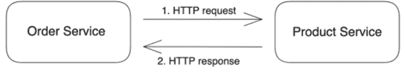

> **图 1.3: 同步通信**

同步通信适用于需要即时响应且调用者依赖操作结果才能继续执行的场景。然而，它在扩展性和可用性问题上可能更为脆弱，因为调用者在等待响应时会被阻塞，且如果服务器服务变慢或无响应，就会出现问题。因此，设计应用程序以有效处理这些场景，并使用重试（`Retry`）、断路器（`Circuit Breaker`）和服务网格（`Service Mesh`）等模式确保微服务之间的可靠通信至关重要。例如，在电子商务应用程序中，同步通信可能用于搜索服务（如 GraphQL 查询）或通过 API 网关调用支付网关。重试和断路器模式通过自动重试失败的请求或优雅处理停机来管理瞬态故障，而服务网格提供了对服务间通信的细粒度控制，包括重试、负载均衡和流量管理。这些模式在云部署中特别有用，因为在微服务之间建立健壮且韧性的通信是至关重要的。

### 异步通信

微服务之间的异步通信发生在一个服务向另一个服务发送消息或请求，但不等待后者的响应。这种通信在调用者不需要在接收服务处理操作时被阻塞的场景非常有用。我们通常将这种通信称为基于事件或事件驱动的架构模型。

在这种模型中，一个被称为发布者（生产者）的服务向通信通道（如队列或主题）发送事件/消息。一个或多个被称为订阅者（消费者）的服务从通信通道中读取消息并对它们进行处理。

这种通信方式的第一个优势，即生产者和消费者服务之间的解耦。存在通信通道（如消息代理 Kafka 或 RabbitMQ，或事件总线）作为中间件这一事实，允许我们处理消费者服务的任何宕机或不可用情况。如果消费者宕机，生产者仍然可以将消息写入通道。当它再次恢复运行时，它可以继续读取消息。

图 1.4 显示了订单服务向一个主题写入消息，该主题由消费者支付服务和通知服务读取：

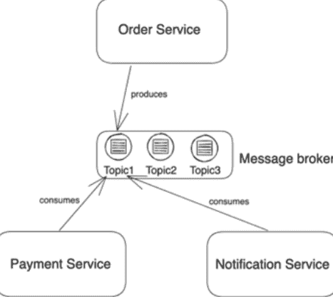

> **图 1.4:** 两个微服务之间的异步通信

这种方法的另一个优势是更容易实现水平扩展，因为只需要拥有同一服务的多个实例即可扩展消息处理能力。图 1.5 显示了同一服务的实例如何共享消息读取。每个实例自动从包含来自其他服务的多条消息的不同分区中读取。

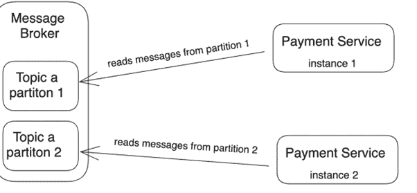

> **图 1.5:** 同一服务的两个实例从同一主题的两个不同分区读取

在同步通信（如 REST 服务）中，仅拥有同一服务的多个实例是不够的。你必须使用一个工具来接管请求，检查哪个实例可用，然后将其路由到实际服务。该工具需要围绕微服务进行配置。例如，必须定义服务 X 的实例准备好接收流量的条件，例如配置健康检查（`health probe`）和存活检查（`liveness probe`）。此类工具可以是简单的负载均衡器、反向代理，或更复杂的 API 网关。订单服务检查哪些实例已准备好接收流量。如果所有实例都已就绪，负载均衡器通过其算法（如简单的轮询）选择哪个实例来处理传入的请求。在给定的图（图 1.6）中，负载均衡器根据配置的就绪状态检查订单实例的可用性，然后使用轮询等算法将请求路由到实例：

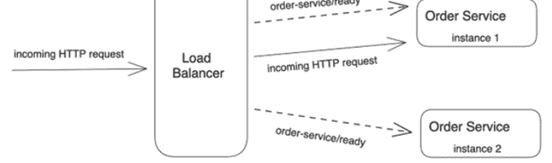

> **图 1.6:** 负载均衡器根据就绪端点选择重定向流量的实例

我们所解释的异步通信类型实现了事件驱动架构中通常用的模式，即发布/订阅（`publish/subscribe`）模式。然而，对于特定情况，还有其他模式，例如事件源（`event sourcing`）模式，它通过事件跟踪业务实体的每一次变化。例如，Saga 模式通过将分布式事务拆分为一系列步骤来管理不同服务之间的事务，每个步骤都取决于上一个步骤的结果。例如在机票预订系统中，通常是同步通信触发了异步流。订单服务向支付服务发出 HTTP 请求，后者立即返回 `202 Accepted` 状态。该响应状态表示请求已受理但尚未处理。实际业务逻辑在 HTTP 调用后以异步模式开始。一旦业务逻辑处理完成，支付服务发送一个事件，订单服务分步读取该事件：第一步是同步的，第二步是异步的。请参考图 1.7以便理解：

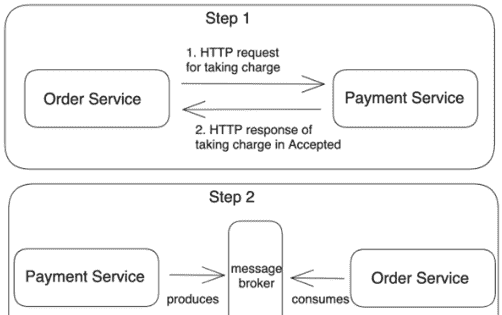

> **图 1.7:** 订单服务与支付服务之间分两步进行的通信

## REST 架构的基础


# Spring Boot 3 API 精通

在上一节中，我们提到在微服务的同步通信中，使用 REST API 是最流行的标准。REST 架构是一种设计分布式系统和构建 Web 服务模型。REST 由 Roy Fielding 在其 2000 年的博士论文中构想，是一种架构风格，而不是 Web API 设计的协议。正如之前提到的，它是一种架构风格，不像简单对象访问协议（SOAP）。它提供了开发 API 的指导方针，而没有指定特定的协议，尽管通常使用 HTTP 用于客户端/服务器通信，并使用 JavaScript 对象表示（JSON）格式进行数据交换。REST 基于一组基本原理，这些原理促进了分布式系统设计中的扩展性、可靠性和简单性。这些原则指导了易于理解、互操作性且良好适应 Web 环境的服务的创建。REST 的基本原则如下：

- **无状态（Stateless）**：REST API 必须是无状态的，这意味着客户端和服务器之间的每个请求必须包含处理该请求所需的所有信息。服务器在请求之间不能维护关于客户端会话状态的任何信息。这一原则简化了服务器管理并促进了水平扩展性。

- **统一接口（Uniform interfaces）**：它必须定义一组良好的操作，用于访问和操作资源。资源使用统一资源标识符（URI）来描述。资源的操作通过标准操作执行，例如使用 HTTP `GET` 动词检索资源，或使用 HTTP `POST` 动词创建新资源。

- **客户端-服务器架构（Client-server architecture）**：客户端通过 URI 管理资源，而无需知道服务器内部发生了什么。例如，客户端可能通过其 URI 和 HTTP `DELETE` 请求删除资源，而服务器则将删除该资源。是物理删除还是逻辑删除对客户端来说是隐藏的。重要的是，如果客户端尝试检索该资源，它将收到 `404 Not Found`。

- **可缓存性（Cacheability）**：REST 促进客户端和服务器端缓存以提高性能并减轻服务器负载。客户端缓存允许客户端本地存储响应，以最少地减少重复请求，而服务器缓存则通过将响应直接存储在服务器或中间件（如代理和内容分发网络 CDN）来减轻服务器工作。你的缓存行为，服务器响应应包含相关的缓存头，例如 `Cache-Control`，指示客户端或中间人如何以及何时对资源进行缓存。

- **分层系统（Layered system）**：REST 倾向于使用分层系统。例如，可以通过反向代理、负载均衡器和 API 网关创建 API REST，以便于扩展性和跨越关注点的责任划分（不涉及业务逻辑的概念，如安全和日志记录）。然而，分层的划分不应影响客户端。

现在我们已经定义了 REST 的基础知识，可以关注如何编写 REST API 的最佳实践。

# Restful API 设计

为了编写出良好的 REST API，你需要了解理查森成熟度模型（Richardson Maturity Model）。该模型为创建 REST 服务提供了指南，由四个级别（0 到 3）组成，每个级别都越来越接近理想 REST API 的样子。如果满足了某级别的约束，就实现了所谓的“REST 之光”，该 API 就可以被称为 Restful。让我们详细查看所有级别。我们将为你展示一个 API 示例，客户端请求 ID 为 1 的用户信息。图 1.8 显示了 API 如何随每个级别演变：


## 级别 0：HTTP 沼泽

资源和 HTTP 动词的概念不存在。服务只有一个 URI 和单一 HTTP 方法（通常是 `POST`）。HTTP 仅用作传输协议。这种机制被用于纯 XML (POX) 应用和 SOAP 服务。对于这一级，示例的请求和响应体是 XML 而不是 JSON。客户端请求将具有类似 `http://localhost:8080/api` 的 URL 并使用 `POST` 动词，请求体如下：

```xml
<UserRequest>
  <id>1</id>
</UserRequest>
```

如果资源存在，API 将响应状态码 `200 OK` 且响应内容如下：

```xml
<User>
  <id>1</id>
  <name>Vincent</name>
  <surname>Smith</surname>
</User>
```

如果资源不存在，API 仍然响应状态码 `200 OK`，且体如下：

```xml
<UserErrorResponse>
  <errorCode>1</errorCode>
  <reason>User not found</reason>
</UserErrorResponse>
```

## 级别 1：资源

在这一级，有了资源的概念。资源可以是任何可识别的实体，例如数据对象。每个资源都通过特定的 URI 标识。HTTP 动词的概念在这一级不存在。请求将具有类似 `http://localhost:8080/api/users/1` 的 URL，使用 `POST` 动词并带有响应体。如果资源存在，API 将响应状态码 `200 OK` 和响应体如下：

```json
{
  "id": 1,
  "name": "Vincent",
  "surname": "Smith"
}
```

如果不存在，API 仍然响应状态码 `200 OK`，且体如下：

```json
{
  "errorCode": 1,
  "reason": "User not found"
}
```

## 级别 2：HTTP 动词

HTTP 动词（也称为 HTTP 方法）的概念引入，它可以与资源的创建、读取、更新、删除（CRUD）操作相关。可以总结如下：

- `GET` 动词请求检索单个资源。该方法与 CRUD 中的读取操作相关。如果资源存在，响应将具有状态码 `200 OK`，如果不存在则为 `404 Not Found`。
- `POST` 动词请求创建一个新资源。该方法与 CRUD 中的创建操作相关。如果资源已成功创建，服务器响应状态码 `201 Created` 并插入响应头（`Location` 键），其值为新创建资源的 URI。
- `PUT` 动词请求覆盖资源。该方法是 UPSERT（创建和更新）操作的对应项。如果资源存在，它将被请求覆盖。
- `DELETE` 动词请求删除资源。该方法与 CRUD 中的删除操作相关。如果资源存在且删除成功，服务器通常响应状态码 `204 No Content`；如果不存在，则为 `404 Not Found`。

正如你可能注意到的，除了根据操作类型使用相关的 HTTP 方法外，还根据操作类型使用不同的状态码。回到我们讨论的示例，客户端请求将具有上一级的 URL `http://localhost:8080/api/users/1`，但这次使用的 HTTP 动词是 `GET`。

## 级别 3：超媒体驱动

最后一层引入了超媒体作为应用状态引擎（HATEOAS）的概念。它强调了在 REST API 响应中包含超媒体链接的重要性，以引导客户端与资源交互。HATEOAS 的基本思想是将服务器作为客户端的地图，以便它们动态导航各种资源所需的所有信息。

每个资源都包含指向相关资源的链接，这允许客户端在没有实际 API 文档的情况下告知其他可用资源（尽管有如 OpenAPI 和 Swagger 等工具用于记录 REST API）。可以通过插入新链接轻松地丰富资源与其他资源的新关系。

回到我们讨论的示例，客户端请求与前一层相同。如果资源存在，服务器响应将具有状态码 `200`，且体内容如下：

```json
{
  "id": 1,
  "name": "Vincent",
  "surname": "Smith",
  "cars": [
    {
      "id": 1,
      "plate": "BG29RF"
    },
    {
      "id": 2,
      "plate": "AG29RF"
    }
  ],
  "links": {
    "cars": {
      "href": "http://localhost:8080/api/users/1/cars"
    },
    "self": {
      "href": "http://localhost:8080/api/users/1"
    }
  }
}
```

# API 幂等性概念

在处理 HTTP 动词时，了解安全方法和幂等方法的概念也是重要的。

如果一个方法不改变资源的状态，则认为它是安全的。`GET` 方法被认为是安全的，因为它执行的是只读操作。

在幂等性（idempotency）的概念上，REST 环境存在一些混乱。你经常会发现这样的定义：如果一个方法被多次调用，它总是产生相同的结果，那么它就是幂等的。

我认为这个定义在数学领域更为相关。在 REST 领域，我倾向于将幂等性的概念定义为：如果一个方法被多次调用，它不会对服务器产生副作用，那么它就是幂等的。

让我们详细查看哪些是幂等的 HTTP 方法：

- `GET` 方法不改变资源的状态，因此它也是幂等的。
- `POST` 方法不是幂等的，因为多次调用同一个请求会有创建更多资源的效果。
- `PUT` 方法是幂等的，如果被多次调用，它总是以相同的方式修改资源，不产生副作用。
- `DELETE` 方法是幂等的，如果第一次对现有资源调用它，它会删除该资源。如果使用相同的请求多次调用，不会采取任何服务器端操作，不会产生副作用。

幂等方法是指你可以安全地应用重试（Retry）模式的方法。

如果我们采用幂等性的第一个定义，我们将很难解释为什么 `PUT` 和 `DELETE` 方法是幂等的。如果资源不存在，`PUT` 方法将返回状态码 `201`，对于随后的调用，它将返回 `200`。`DELETE` 方法第一次对现有资源调用时返回 `204`。当后续再次给出相同的请求时资源已不存在，它将返回 `404`。表 1.1 显示了幂等性以及其他 HTTP 方法的总结：

| HTTP 方法 | 幂等 | 安全 |
|---|---|---|
| GET | 是 | 是 |
| POST | 否 | 否 |
| PUT | 是 | 否 |
| DELETE | 是 | 否 |
| PATCH | 否 | 否 |
| HEAD | 是 | 是 |
| OPTIONS | 是 | 是 |

表 1.1：HTTP 方法的幂等与安全性

然而，并没有禁止创建一个幂等的 `POST` 方法 API。这在以下场景下非常有用：API 需要创建一个无法被覆盖的资源（排除了使用 `PUT` 方法），并且你希望实现重试模式以增加操作成功的概率。一个实际的例子是创建支付交易。在这种情况下，使用普通的 `POST`，如果因为服务器响应延迟而进行重试，就会面临创建多个支付交易的风险。

图 1.9 显示了一个 `POST` 请求的示例，该请求包含名为 `idempotencyToken` 的头部字段，使其幂等。服务器验证令牌已存在于其数据库中，然后返回 `200` 而不创建资源：

```
body: {"amount":1000,"bankCode":1}
headers: [{"idempotencyToken":"89cc0e6f-79c3-4ae6"}]
```

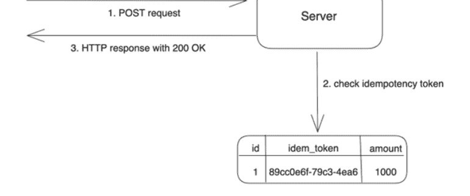

# API 版本控制策略

版本控制是 API 设计中的一项基础实践，用于管理其随时间的演进和兼容性。在开发 API 时，考虑如何处理未来的更改和增加非常重要，以确保客户端能够持续使用。下面提到了几种 API 版本控制策略：

- **通过 URI 版本控制**：在这种策略中，API 的版本直接包含在请求的 URI 中。例如，`/api/v1/users` 和 `/api/v2/users` 代表同一个 API 的两个版本。这种方法使 API 变得复杂且可读性降低。
- **通过 Header 版本控制**：在这种策略中，通过 HTTP 头部指定 API 版本，例如 `Accept-Version: v1`。这保持了资源 URI 的整洁，但要求客户端和服务器对 HTTP 头部的逻辑进行管理。
- **通过内容协商版本控制**：这是上一点策略的子集。在这种策略中，客户端指定头部，通常通过定义自定义媒体类型为 `application/vnd.example.v1+json`。这允许在内容级别进行版本控制，而不是在 URI 中。然而，它需要客户端和服务器端显式的内容协商逻辑，某些客户端可能无法完全支持自定义媒体类型。
- **通过查询参数版本控制**：在这种策略中，API 版本被作为请求 URI 中的查询参数指定，例如 `/api/users?version=1`。

无论采用哪种策略，提供版本编号标准同样重要。非常流行的是语义化版本（semantic versioning），它涉及使用特定格式 `<MAJOR>.<MINOR>.<PATCH>` 的版本号。参考以下解释：

- **MAJOR（主版本）**：当发生与旧版本不兼容的更改或引入新的不兼容特性时增加。例如，在资源获取 API 的新版本中，响应体的结构将发生变化。
- **MINOR（次版本）**：当我们添加与旧版本兼容的新功能时增加。例如，在新版本的搜索 API 中，添加了一个新的查询参数来过滤额外的字段。
- **PATCH（补丁版本）**：当修复 Bug 时增加，且与旧版本兼容。

# OpenAPI 规范与 Swagger 生态

第二部分涵盖了每个端点的声明和细节：

```yaml
paths:
  /users:
    post:
      summary: Creates a new user.
      operationId: insertUser
      requestBody:
        required: true
        content:
          application/json:
            schema:
              $ref: '#/components/schemas/User'
      responses:
        '201':
          description: Created
          headers:
            Location:
              required: true
              schema:
                type: string
                format: uri
```

最后章节涵盖了端点使用的输入/输出组件（参数和请求/响应体）：

```yaml
components:
  schemas:
    User:
      type: object
      properties:
        id:
          type: integer
          example: 4
        name:
          type: string
          example: Arthur Dent
      required:
        - id
        - name
```

示例中的 OpenAPI 文档采用的是另一种标记语言 (YAML) 格式，这也是 OpenAPI 标准中最常用的格式。不过，JSON 格式也是允许的。关于 OpenAPI 规范的更多细节，你可以参考以下链接：`https://swagger.io/specification/`

Swagger 是支持使用 OpenAPI 的工具生态系统。它包含以下特性：

- **Swagger Editor**：它是一个在线编辑器，可以使用直观的界面创建、编辑和测试 OpenAPI 规范。请参考 `https://editor.swagger.io/`
- **Swagger UI**：它是一个界面库，为通过 OpenAPI 描述的 API 生成交互式文档。该文档根据 OpenAPI 规范自动生成，可以直接集成到 Web 应用程序中。它拥有 Swagger Editor 相同的图形用户界面（GUI）。
- **Swagger Codegen**：它是一个根据 OpenAPI 规范生成软件开发包（SDK）客户端代码、模拟服务器和其他实用组件的工具。该插件适用于多种编程语言。

图 1.10 显示了将 YAML 格式的 OpenAPI 文件复制到 Swagger Editor 编辑器后的截图：

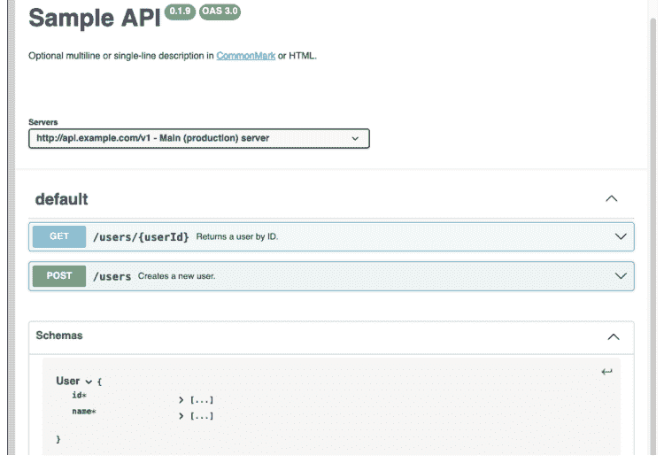

# API 优先方法

在传统方法中，我们倾向于从软件的实际实现开始，而不是详细的 API 设计。重点是代码开发，文档和 API 设计在最后之后。通过这种方法，对 API 的更改可能需要对现有代码进行重大修改，存在导致兼容性问题的风险。

API 优先方法将 API 设计与软件开发生命周期（SDLC）的设计阶段对齐，从一开始就将 API 定义视为核心组件。API 优先方法并不是将 API 设计视为次要活动或后期的实现，而是在开始实际软件实现之前详细地定义 API 规范。这确保了 API 设计是健壮的，并能有效支持应用程序架构。该方法的主要优点如下：

- 通过优先考虑 API 设计，开发者可以专注于编写文档良好的 API，这些 API 可以随时间轻松演进。
- 它促进了开发团队、分析师和项目利益相关者之间的协作。
- API 消费者将立即拥有文档可供工作，而无需等待软件开发。这在微服务架构中非常重要，因为它允许服务之间进行并行开发。
- 在编写完 OpenAPI 文档之后，开发者可以完全专注于 API 的软件开发，因为其已经有了良好的定义。
- 开发者可以使用 `swagger-maven` 自动生成代码，例如代表 API 资源的类。

## 结论

在本章中，我们了解了什么是 API，以及微服务之间不同的通信类型，并重点介绍了 REST 架构。现在我们已经为编写完全遵循 REST 架构的 API 奠定了坚实的基础，必须通过 Java 和 Spring Boot 实现 REST 服务来将其付诸实践。


# 响应式系统的核心原则

该范式的核心原则在[响应式宣言](https://www.reactivemanifesto.org)中有详细描述。一个响应式系统具有以下特征：

- **响应式（Responsive）**：响应式系统能够快速且及时地响应客户端。即使在关键情况下它也是可用的。如果发生问题，系统必须立即识别并隔离问题，保持其响应能力完整。

- **韧性（Resilient）**：响应式系统对故障具有韧性。这一方面与响应性特性相关。不具备容错能力的系统无法成为持续响应的系统。响应式系统通过组件复制和故障隔离来实现弹性。故障仅被隔离在受影响的组件中，而其他组件以不产生干扰的方式进行响应。外部代理负责恢复受故障影响的组件，并通过复制确保系统的高可用性。这使得客户端能够从处理服务器故障的责任中解放出来。

- **弹性（Elastic）**：响应式系统对不断变化的负载具有弹性。也就是说，它能够快速适应输入数据频率的变化，通过水平扩展增加或减少分配的资源。此外，水平扩展允许将负载分配在不同的实例之间。它们还通过预测算法始终保持适当数量的实例，以便有效管理负载，同时在资源使用（及付费）方面保持高效。

- **消息驱动（Message-driven）**：在响应式系统中，组件通过交换事件或消息进行通信，从而触发整个系统的反应和转换。事件驱动的架构减少了组件之间的耦合，并有助于可扩展性和容错性。这些系统异步运行，允许组件执行非阻塞操作并在事件发生时做出响应。异步特性有助于资源的高效利用，并允许系统在不影响响应能力的情况下处理大量并发请求。响应式系统包含了管理背压（backpressure）的机制，允许下游组件根据其处理能力控制数据或事件的消费速率。这确保了资源的优化使用并防止了过载场景。

图 2.1 总结了《响应式宣言》中响应式系统的特征：

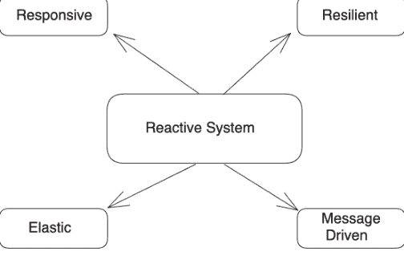

**图 2.1：**《响应式宣言》描述的响应式系统特征

通过采用这些原则，开发者可以设计出更具韧性、可扩展性，并对变化的环境和用户需求做出响应的系统。在微服务架构中，响应式范式提供了显著优势，使服务能够优化方式处理负载，节省计算资源和成本。

## 同步通信与异步通信

提到响应式编程的异步性，你可能对同步通信和异步通信的概念感到困惑。让我们清楚地解释这些点。同步通信和异步通信是关于服务之间通信类型的技术。而响应式编程是一个关于如何编写和构建服务的范式。你可以采用响应式范式来实现 `REST API`（同步通信），也可以用它来实现发布/订阅模式（异步通信）。在本章中，我们将重点关注如何使用 `Spring WebFlux` 结合响应式范式创建 `REST API`。

来自《响应式宣言》的许多概念（例如水平扩展）在微服务架构和容器技术中也得到了呼应。所有这些都有一个共同点，即云原生应用的优化构建。尽管容器技术在微服务架构开发之前就已经存在，但它被用于企业级项目恰恰是因为微服务架构。这项技术的快速部署使得 `Docker` 和 `Kubernetes` 等项目的开发成为可能，促进了容器管理。

# 响应式框架的核心概念

`Reactive Streams` 规范是一项重大倡议，旨在为 Java 中管理异步响应式数据流提供标准。该规范的开发是为了解决以响应式非阻塞方式管理数据流时面临的一些挑战，通过提供一个通用的接口和规则集，供不同的响应式框架和库使用。

`Reactive Streams` 规范的一个重要目标是不同响应式框架和库之间的兼容性。通过采用处理数据流的通用接口，规范允许不同的响应式框架相互顺畅运行，使开发者能够在应用程序中组合不同的技术和库。

以下是使用这些操作符示例：

```java
void testSum() {
    Flux.just(1, 2, 3, 4)
        .filter(integer -> integer % 2 == 0)
        .map(integer -> integer * 2)
        .flatMap(evenIntegerDoubled ->
            Mono.fromSupplier(() -> evenIntegerDoubled + 1)
        )
        .reduce((firstInteger, secondInteger) ->
            firstInteger + secondInteger
        )
        .doOnSuccess(finalInteger ->
            log.info("sum: {}", finalInteger)
        )
        .subscribe();
}
```

让我们分析这段代码：

- 使用 `Flux.just()` 方法创建了一个整数流。
- 使用 `Flux.filter()` 方法只过滤出偶数。
- 使用 `Flux.map()` 方法通过同步函数对每个过滤出的整数进行倍增。
- 使用 `Flux.flatMap()` 方法对每个倍增后的整数应用异步函数，将整数加 1。
- 使用 `Flux.reduce()` 方法对所有倍增后的整数求和。
- 在最后一个整数求和后，使用 `Flux.doOnSuccess()` 方法将其打印。在此示例中，打印结果 14。
- 最后，使用 `subscribe()` 方法订阅该流。这是因为发布者（在本例中为 `Flux`）在被订阅之前不会执行任何操作。

从上述代码中，你会注意到采用了一种与传统方式不同的编程风格。传统方式使用命令式范式，程序通过一组指令来组织，按步骤描述如何执行某个给定的操作。

函数式范式是声明式范式的一种，它基于函数的执行。函数接收一个值作为输入并返回一个新值作为输出。这与不可变性概念完美契合，因为输入对象永远不会被改变。

## 编程范式对比

完成，而不是应该怎么做。在这种范式中，程序员声明应该执行哪些操作或转换，而不指定关于这些操作如何实现的细节。函数式范式的概念已经在 `Java 8` 的 `Stream API` 中引入。

`Reactor` 库中的另一个重要概念是调度器（scheduler）。大多数操作继续在上一个操作执行的同一个线程中工作。除非另有指定，否则最顶层的操作（即数据源）将在调用 `subscribe()` 方法的线程中执行。然而，该库允许开发者通过使用调度器选择不同的并发管理策略。

调度器可以被认为类似于 `java.util.concurrent.ExecutorService` 的对象，专门用于响应式范式。`Schedulers` 类拥有用于创建不同调度器的静态方法：

- `Schedulers.immediate()`：该调度器在与调用者的同一线程上执行操作。它主要用于需要调度器作为输入但不需要在新线程上执行的 API。
- `Schedulers.single()`：该调度器使用单线程执行所有调度的操作。它对于必须按顺序执行或需要访问共享资源的操作特别有用，因为这避免了并发问题。
- `Schedulers.boundedElastic()`：该调度器使用具有预定义上限的线程池来执行调度的操作。它对于阻塞操作（例如输入/输出 (I/O) 操作）特别有用，这样其他资源就不会一直处于繁忙。从 `Reactor 3.6.0` 版本开始，它有两个实现：一个运行在平台线程上，另一个运行在虚拟线程上。
- `Schedulers.parallel()`：该调度器使用专用线程池来并行执行操作。池中的线程数可以指定，允许你控制并行级别。它对于可以独立执行并受益于并行化的操作非常有用。

某些操作符默认使用特定的调度器，例如 `Flux.interval()`、`Flux.delayElement()` 和 `Mono.delay()`，它们使用 `Schedulers.parallel()`。

在 `Reactor` 中，有两个操作符允许通过调度器更改执行上下文：`publishOn` 和 `subscribeOn`。让我们来看看它们的区别：

- `publishOn()`：它用于指定数据流中后续操作的执行上下文。这意味着 `publishOn` 操作符之后的所有操作都将在与 `publishOn` 指定调度器相关的线程上执行。这对于在单独的线程上为计算密集型操作更改执行上下文非常有用，从而避免阻塞主线程。
- `subscribeOn()`：它用于指定整个数据流的执行上下文，包括订阅操作和流中的后续操作。这意味着流中的所有操作（包括初始的订阅操作）都将在与 `subscribeOn` 指定调度器相关的线程上执行。这对于为流指定全局执行上下文有用，例如在单独的线程上执行流中的所有操作，以确保流行为的一致性和可预测性。

这两个操作符之间的主要区别在于它们影响数据流执行上下文的时机。第一个 `publishOn` 仅影响流中的后续操作，而第二个 `subscribeOn` 影响整个数据流，包括流中的初始和后续操作。另一个区别是 `publishOn` 可以在流中使用多次，以便在特定点更改执行上下文，而 `subscribeOn` 通常在流的开始使用一次，以指定全局执行上下文。

我们通过添加调度器和日志来修改之前的示例，以帮助理解执行上下文的切换：

```java
void testSum() {
    Flux.just(1, 2, 3, 4)
        .subscribeOn(Schedulers.boundedElastic())
        .filter(integer -> integer % 2 == 0)
        .doOnNext(eventInteger ->
            log.info("Filtered integer: {}", eventInteger)
        )
        .map(integer -> integer * 2)
        .flatMap(evenIntegerDoubled ->
            Mono.fromSupplier(() -> evenIntegerDoubled + 1)
        )
        .publishOn(Schedulers.parallel())
        .doOnNext(finalInteger ->
            log.info("Filtered integer: {}", finalInteger)
        )
        .reduce((firstInteger, secondInteger) ->
            firstInteger + secondInteger
        )
        .doOnSuccess(finalInteger ->
            log.info("sum: {}", finalInteger)
        )
        .subscribe();
}
```

让我们查看执行方法后的日志：

```
20:05:05.818 [boundedElastic-1] INFO com.example.Test - Filtered integer: 2
20:05:05.819 [boundedElastic-1] INFO com.example.Test - Filtered integer: 4
20:05:05.820 [parallel-1] INFO com.example.Test - Final integer: 5
20:05:05.820 [parallel-1] INFO com.example.Test - Final integer: 9
20:05:05.820 [parallel-1] INFO com.example.Test - sum: 14
```

注意：`filter` 操作符的结果是在 `boundedElastic` 线程上执行的，这是因为我们使用了 `subscribeOn(Schedulers.boundedElastic())`。如果我们没有使用它，`publishOn` 之前的链执行将在主线程上进行。随后的打印是在 `parallel` 线程上执行的，这是因为我们在 `flatMap` 方法之后插入了 `publishOn(Schedulers.parallel())`。

## 事件循环 vs 线程请求

让我们看看响应式范式如何处理 `HTTP` 请求。在运行同步 `Servlet` 容器应用程序中，采用了线程请求模型，对于每个传入的 `HTTP` 请求，都会从 `Servlet` 容器管理的线程池中分配一个线程。该线程负责请求的整个生命周期，包括处理、`I/O` 操作和响应生成。图 2.2 显示了线程请求模型的工作原理；每个 `HTTP` 请求占用线程池中的一个线程。在请求处理完成后，线程会被释放。

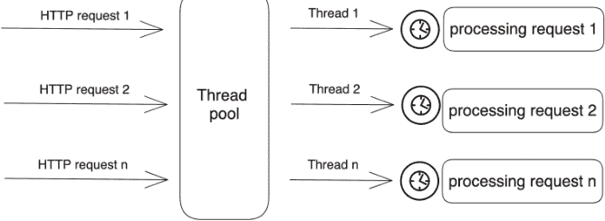

**图 2.2：**线程请求模型

对于密集型处理（如 `I/O` 操作），线程可能会等待直到操作完成。线程池中的线程数量是有限的。例如 `Apache Tomcat`，默认数量为 200。这意味着如果应用程序同时收到 201 个 `HTTP` 请求，200 个将并行处理，第 201 号请求将等待。

为了并行处理请求，你可以修改 `Servlet` 容器的配置，增加池中线程的数量。然而，增加线程数意味着必须使用更多的 `CPU`，因为 `Java` 线程与平台线程是一一对应映射的。在云端进行更多的处理意味着更高的开销。我们将在下一章中看到虚拟线程如何改变 `Java` 生态系统中线程的概念。`Spring MVC` 框架使用了“每个请求一个线程”（thread-per-request）的模型。

在由如 `Netty` 和 `Spring WebFlux` 等非阻塞响应式框架所使用的事件循环模型（event loop model）中，单个线程可以处理多个 `HTTP` 请求。每个请求被放置在事件队列中。事件循环中的主线程在执行过程中从队列中获取事件并对其进行处理。如果它在处理过程中遇到阻塞操作，它会在专用线程上注册回调函数，而不阻塞主线程，从而让队列中继续入队更多事件。当阻塞操作结束时，回调函数会将结果返回给事件循环。在这种模式下，你没有在等待结果的阻塞线程，这导致了几个优势：

- **可扩展性**：事件循环可以使用较少的线程处理许多并发请求。
- **资源效率**：事件循环避免了浪费等待阻塞操作完成的资源。
- **成本效益**：能够用更少的资源处理更多请求不可避免地导致成本节省，在云端，你为你所使用的资源付费。

图 2.3 显示了事件循环模型的操作：

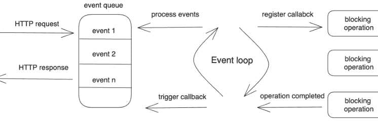

**图 2.3：**事件循环范式中的 HTTP 请求处理

# 使用 Spring WebFlux 构建 REST API

在上一章中，我们介绍了响应式范式和事件循环的概念，现在你准备好通过 `Spring WebFlux` 将这些概念付诸实践。在整个章节中，我们将为一个名为 Easyshop 的电子商务应用创建微服务，该应用销售笔记本电脑和智能手机。我们将使用 `Java 21` 以及 `Spring 3`，并使用 `Apache Maven` 构建项目。我们还将使用 `Docker` 集成开发环境（IDE），尽管推荐使用 `IntelliJ IDEA`。源代码可以在以下 `GitHub` 仓库中获取：https://github.com/bpbpublications/Spring-Boot-3-API-Mastery-Advanced-Techniques-for-Microservices。该仓库由代表每个章节的文件夹组成，我们将在其中创建新的微服务或修改现有的微服务。

## 安装 Java 21

为了安装任何版本的 `Java`，你可以使用多种方法。推荐的安装模式是通过软件开发包管理器（`SDKMAN`）工具。该工具允许你安装不同的 `Java` 版本，并通过简单的命令轻松更改当前使用的版本，而无需手动设置 `JAVA_HOME` 环境变量。此外，它是一个跨平台工具，因此你可以在 `Linux`、`Mac` 或 `Windows` 上使用它。

要安装该工具，打开命令行界面（`CLI`）并运行以下命令 `curl -s "https://get.sdkman.io" | bash`。之后，打开一个新的 `CLI` 并使用 `sdk version` 命令检查安装是否成功。如果没有错误，你将看到已安装的 `SDKMAN` 版本。现在你可以安装 `Java 21` 了。

有来自提供者的 `Java` 开发工具包（`JDK`），例如 `OpenJDK`、`Oracle` 和 `AWS`。你可以选择任何提供者。通过 `sdk list java` 命令，你可以查看所有提供者提供的最新 `JDK` 版本。要安装其中一个版本，运行 `sdk install java <identifier>` 命令，例如，安装 `Oracle` 的 `JDK 21`，命令如下：`sdk install java 21.0.2-oracle`。如果安装成功，`javac -version` 命令应该显示已安装的 `JDK` 版本。如果你想了解更多关于 `SDKMAN` 的信息，请访问 https://sdkman.io/usage。

## 安装 Docker Desktop

`Docker Desktop` 是一个跨平台工具，允许 `Linux`、`Mac` 或 `Windows` 用户使用 `Docker`。为了了解更多，请访问 https://www.docker.com/products/docker-desktop。

## 使用 Spring WebFlux 3 构建响应式 REST API

如果你尝试运行主类，将看到一个错误信息，显示缺少连接数据库所需的参数。

## 设计产品领域对象

在建立稳定的数据库连接之前，我们先设计领域对象。为了简单起见，我们可以说产品由以下部分组成：

- 一个标识产品的唯一代码。
- 一个可选的名称。
- 一个类别，在笔记本电脑和智能手机之间选择。
- 以欧元分（eurocent）为单位的售价。
- 品牌名称（可选）。

> **注意**：使用整数类型（例如 `Java` 中的 `long`）来表示价格（如以分），可以避免与浮点数类型（`double`）相关的舍入误差，并确保计算的精确性，这对于金融应用至关重要。这种方法提高了一致性，简化了算术运算，并符合许多系统推荐的最佳实践，增强了集成性和可靠性。


现在我们已经对领域对象应该如何组成有了良好的思路，可以创建数据库表了。启动 Docker Desktop，然后打开终端并进入 `chapter-02/infra/docker` 文件夹。在这个文件夹中，我们找到 `compose.yml` 文件，它允许通过 Docker Compose 在本地启动 Postgres。让我们来看这个文件：

```yaml
version: '3'

pg:
  image: 'postgres:16.2'
  container_name: "easyshop-postgres"
  ports:
    - 5432:5432
  environment:
    POSTGRES_USER: user
    POSTGRES_PASSWORD: password
  volumes:
    - ./postgres/init.sql:/docker-entrypoint-initdb.d/init.sql
    easyshop-postgres:/var/lib/postgresql/data

volumes:
  easyshop-postgres:
```

注意：容器使用了两个卷。第一个用于通过 `init.sql` 脚本初始化数据库，第二个卷用于即使我们删除并重建容器，也能保持数据的持久化。

你可以在 `chapter-02/infra/docker/postgres` 文件夹中找到 `init.sql` 文件，它的内容如下：

```sql
CREATE DATABASE easyshopdb_catalog;
\c easyshopdb_catalog;
CREATE TABLE IF NOT EXISTS products (
    product_id SERIAL PRIMARY KEY,
    code VARCHAR NOT NULL UNIQUE,
    name VARCHAR,
    price BIGINT,
    brand VARCHAR
);
```

SQL 脚本创建了 `easyshopdb_catalog` 数据库，并创建了 `products` 表。除了列出的字段外，我们还有一个 `code` 字段，它是唯一的；`price` 字段是整数类型；我们还有一个 `brand` 字段，它是可选的；`product_id` 字段是自增主键。

## 开始使用 Spring WebFlux

我们将实现的 API 将用于对产品进行 CRUD 操作。让我们从设计插入新产品的开始。图2.6 展示了的类序列图：

## 插入新产品


由于我们采用 API 优先的方法，先编写 OpenAPI 文件。在项目根创建 `openapi` 并创建 `catalog-service.yml` 文件；该文件包含 OpenAPI 规范让我们设计创建创建端：

```yaml
products:
  post:
    tags:
      - product
    summary: Add a new product to the store
    operationId: addProduct
    requestBody:
      description: Create a new product in the store
      content:
        application/json:
          schema:
            $ref: '#/components/schemas/ProductRequest'
      required: true
    responses:
      '201':
        description: Successful operation
        headers:
          Location:
            required: true
            schema:
              type: string
              format: uri
      '400':
        description: Invalid input
        content:
          application/problem+json:
            schema:
              $ref: '#/components/schemas/ProblemDetail'
```

创建产品映射到一个 POST API，该 API 返回 HTTP 状态码 201，并在 Header 中包含创建资源的统一资源标识符 (URI)。注意，对于无效请求，将返回 HTTP 状态码 400 和类型为 `ProblemDetail` 的响应体。让我们详细请求和响应体：

```yaml
components:
  schemas:
    ProductRequest:
      required:
        - code
        - category
        - price
      type: object
      properties:
        code:
          type: string
          example: Product Code
        name:
          type: string
          example: Product Name
        category:
          $ref: '#/components/schemas/ProductCategory'
        price:
          type: integer
          format: int64
          example: 1000
        brand:
          type: string
          example: TopComputer
    ProductCategory:
      type: string
      enum:
        - laptop
        - smartphone
    ProblemDetail:
      type: object
      properties:
        title:
          type: string
        status:
          type: integer
        detail:
          type: string
        instance:
          type: string
```

## 42 Spring Boot 3 API 精通之路

```java
default Mono<ResponseEntity<Void>> _addProduct(@RequestBody @Valid Mono<ProductRequest> productRequest, final ServerWebExchange exchange); {
    return this.addProduct(productRequest, exchange);
}

default Mono<ResponseEntity<Void>> addProduct(Mono<ProductRequest> productRequest, final ServerWebExchange exchange) {
    // default response
}
```

注意：该接口已经包含了校验注解 `@Validated` 和 `@Valid` 以及 Web 注解 `@RequestMapping` 和 `@RequestBody`。具体类需要实现 `addProduct` 接口。`addProduct` 方法的响应对象类型为 `ResponseEntity`，这是一个 Spring 类，包含了 HTTP 响应的所有数据，例如正文和 HTTP 状态。该对象被封装在 `Mono` 类型的对象中，因为我们正在使用 Spring WebFlux。

在实现接口之前，让我们使用一个映射数据库表和产品的类。创建 `middleware.db.entity` 包并编写 `ProductEntity` 类：

```java
@Table(name = "products")
public record ProductEntity(
    @Id Long productId,
    String code,
    String name,
    Long price,
    String brand,
    CategoryEntity category
);
```

我们利用 Java 17 的 record 特性编写了此类，它允许我们创建带有构造函数以及自动 getter、setter、equals 和 hashcode 的不可变对象。我们还为类标记了 `org.springframework.data.relational.core.mapping.Table` 注解，以指示 Spring Data 该类将字段映射到命名表。字段上的 `org.springframework.data.annotation.Id` 注解告诉 Spring Data 该字段是表的主键。

## 使用 Spring WebFlux 构建响应式 REST API

现在让我们查看对产品执行 CRUD 操作的仓库类。在 `middleware.db` 包内创建 `repo` 子包并编写以下接口：

```java
public interface ProductRepository extends R2dbcRepository<ProductEntity, Long> {
}
```

这是一个不需要实现的空接口。Spring Data 会运行时自动创建一个 `SimpleR2dbcRepository` 类型的 Bean，并将使用代理模式实现该接口。该仓库提供了开箱用的常用方法，如 `findAll`、`findById`、`save` 和 `deleteById`。此外，你可以编写额外的方法，始终遵循 `findBy_field` 的命名规范。例如，如果你添加了 `findAllByName`，Spring Data 将自动实现查询名称字段的方法。此外，除了 R2BC，Spring Data 还提供了许多模块，如 Java Database Connectivity (JDBC) 和 Java Persistence API (JPA)；但接口允许相同的方法。你可以在不更改应用程序业务逻辑的情况下切换 Spring Data 模块。

将应用程序连接数据库的最后一步是为其提供连接数据。进入 `application.properties` 文件并写入以下行：

```properties
spring.r2dbc.url=postgresql://localhost:5432/easyshopdb_catalog
spring.r2dbc.username=user
spring.r2dbc.password=password
```

我们可以创建 `ProductMapper` 类，它将将类型为 `ProductRequest` 的请求对象转换为映射到数据库表的 `ProductEntity` 类型对象。同样，我们不会手动编写此类，而是使用 MapStruct 库，它允许我们自动生成映射类。通过添加依赖到 `pom.xml` 中引入该库：

```xml
<dependency>
  <groupId>org.mapstruct</groupId>
  <artifactId>mapstruct</artifactId>
  <version>1.5.5.Final</version>
</dependency>
```

然后，以这种方式添加库插件：

```xml
<plugin>
  <groupId>org.apache.maven.plugins</groupId>
  <artifactId>maven-compiler-plugin</artifactId>
  <configuration>
    <annotationProcessorPaths>
      <path>
        <groupId>org.mapstruct</groupId>
        <artifactId>mapstruct-processor</artifactId>
        <version>1.5.5.Final</version>
      </path>
      <path>
        <groupId>org.project.lombok</groupId>
        <artifactId>lombok</artifactId>
        <version>${lombok.version}</version>
      </path>
      <path>
        <groupId>org.project.lombok</groupId>
        <artifactId>lombok-mapstruct-binding</artifactId>
        <version>0.2.0</version>
      </path>
    </annotationProcessorPaths>
    <compilerArg>
      <compilerArgs>
        -AStruct.defaultComponentModel=spring
      </compilerArgs>
    </compilerArg>
  </configuration>
</plugin>
```

```java
@Component
public class ProductMapperImpl implements ProductMapper {
    @Override
    public ProductEntity toEntity(ProductRequest productRequest) {
        if (productRequest == null) {
            return null;
        }
        String code = null;
        String name = null;
        Long price = null;
        String brand = null;
        CategoryEntity category = null;
        code = productRequest.getCode();
        name = productRequest.getName();
        price = productRequest.getPrice();
        brand = productRequest.getBrand();
        category = productRequest.getCategoryToCategoryEntity(productRequest.getCategory());
        Long productId = null;
        ProductEntity productEntity = new ProductEntity(productId, code, name, price, brand, category);
        return productEntity;
    }
}
```

现在是实现业务逻辑的时间。创建 service 包并实现 `ProductService` 类：

```java
@Service
@Transactional(readOnly = true)
@RequiredArgsConstructor
@Log4j
public class ProductService {
    private final ProductRepository productRepository;
    private final ProductMapper productMapper;

    @Transactional
    public Mono<String> addProduct(ProductRequest productRequest) {
        return insertNewProduct(productRequest)
            .map(ProductEntity::code);
    }

    Mono<ProductEntity> insertNewProduct(ProductRequest productRequest) {
        var productEntity = productMapper.toEntity(productRequest);
        return productRepository.save(productEntity)
            .doOnNext(entitySaved -> log.debug("Product saved: {}", entitySaved));
    }
}
```

最后一步是创建实现生成接口的 `ProductController` 类。创建 `api` 包并编写以下类：

```java
@RestController
@RequiredArgsConstructor
@Log4j
```


## public class ProductController implements ProductApi

```java
public class ProductController implements ProductApi {

    private final ProductService productService;

    @Override
    public Mono<ResponseEntity<Void>> addProduct(Mono<ProductRequest> productRequest, ServerWebExchange exchange) {
        return productRequest
            .flatMap(productService::addProduct)
            .map(productCode -> ResponseEntity
                .created(URI.create(exchange.getRequest().getURI() + "/" + productCode)).build());
    }
}
```

Spring WebFlux 和 Spring MVC 使用的默认端口是 `8080`。你应该看到以下响应：

```
HTTP/1.1 201 Created
Location: http://localhost:8080/products/ABCD-0000
content-length: 0
```

很好，资源已成功创建。你可以通过查看 pgadmin 中的表格内容来验证这一点，如图 2.7 所示：

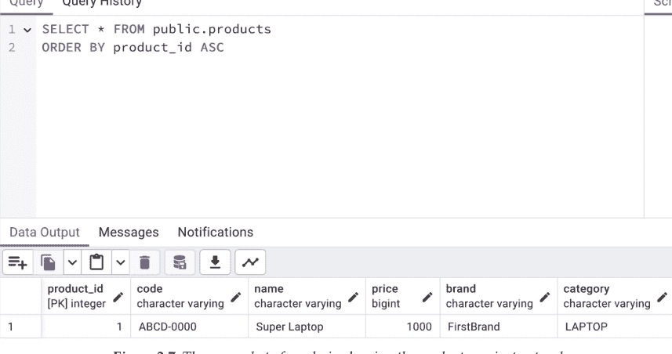

图 2.7：显示你输入的产品的 pgadmin 截图

尝试发送一个不必要字段的请求，例如下面的代码：

```
http://localhost:8080/products?name="Mega Laptop&category=laptop&price=1000&brand=FirstBrand
```

响应将是如下：

```
HTTP/1.1 400 Bad Request
Content-Length: 124
Content-Type: application/json
```

```json
{
  "error": "Bad Request",
  "path": "/products",
  "requestId": "2471c66-1",
  "status": 400,
  "timestamp": "2024-03-17T13:32:01.997+00:00"
}
```

验证会自动执行并返回 `400 Bad Request`。然而，该响应并不符合 `ProblemDetail` 规范。

让我们使用相同的代码尝试插入请求。由于产品代码是唯一的，因此 API 必须返回错误，在此情况下为 `400`。执行之前那个成功的请求：

```
http://localhost:8080/products?code=ABCD-0000&name="Super Laptop&category=laptop&price=1000&brand=FirstBrand
```

响应将如下：

```
HTTP/1.1 500 Internal Server Error
Content-Length: 134
Content-Type: application/json
```

```json
{
  "error": "Internal Server Error",
  "path": "/products",
  "requestId": "36eb129b-1",
  "status": 500,
  "timestamp": "2024-03-17T16:35:20.838+00:00"
}
```

正体和 HTTP 状态都是不正确的。让我们先解决这些问题。在下一节中，我们将向你展示如何在 Spring 3 中使用 WebFlux 处理错误。

现在让我们实现通过代码检索产品的端点，以验证 `Location` 头部中的 URI 是否正确。图 2.8 显示了通过代码检索产品的操作时序图：

### 通过代码查找产品

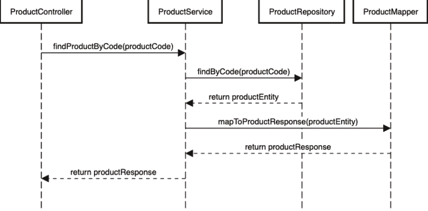

图 2.8：通过代码检索产品的操作时序图

让我们设计端点。在 OpenAPI 文件中添加这段代码：

```yaml
/products/{productCode}:
  get:
    tags:
      - product
    summary: 通过代码查找产品
    description: 返回单个产品
    operationId: findProductCode
    parameters:
      - name: productCode
        in: path
        description: 要返回的 productId 代码
        required: true
        schema:
          type: string
    responses:
      '200':
        description: 通过代码获取产品
        content:
          application/json:
            schema:
              $ref: '#/components/schemas/ProductResponse'
      '404':
        description: 产品未找到
        content:
          application/problem+json:
            schema:
              $ref: '#/components/schemas/ProblemDetail'
```

该端点通过 URL 参数接收输入代码，如果找到了值则返回 `200`，否则返回 `404`。

`ProductResponse` 模型可能与 `ProductRequest` 具有相同的字段。与其复制相同的字段，我们可以使用 OpenAPI 规范提供的模型组合概念，通过 `allOf` 关键字来实现。我们可以创建一个名为 `BaseProduct` 的父模型，一个名为 `ProductResponse` 的子模型，并按如下方式修改 `ProductRequest` 模型：

- `ProductRequest`:
  - `allOf`:
    - `$ref: '#/components/schemas/BaseProduct'`
    - `type: object`
- `ProductResponse`:
  - `allOf`:
    - `$ref: '#/components/schemas/BaseProduct'`
    - `type: object`
- `BaseProduct`:
  - `required`:
    - `code`
    - `category`
    - `price`

```yaml
type: object
properties:
  code:
    type: string
    example: 产品代码
  name:
    type: string
    example: 产品名称
  category:
    $ref: '#/components/schemas/ProductCategory
  price:
    type: integer
    format: int64
    example: 1000
  brand:
    type: string
    example: TopRequest
```

通过此功能，`ProductRequest` 和 `ProductResponse` 继承了 `BaseProduct` 的字段。现在，我们必须决定是否使用继承。

## 使用 Spring WebFlux 构建响应式 REST API

然而，为了优化错误处理，我的建议是不要启用该属性，而是扩展 Spring 类，如下所示：

```java
@RestControllerAdvice
@Slf4j
public class ErrorHandler extends ResponseEntityExceptionHandler {
}
```

通过这种方式，你可以获得与激活该属性相同的结果，此外，你还可以扩展该类来处理自定义异常。

对于 Get API，我们为未找到产品的情况编写了一个自定义异常。创建 `exception` 程序包并编写以下类：

```java
@Getter
public class ProductNotFoundException extends RuntimeException {
    public ProductNotFoundException(String productCode) {
        super(String.format("Product with code %s not found", productCode));
    }
}
```

现在，在 `ProductService` 类的 `findProductCode` 方法中使用这个类：

```java
public Mono<ProductResponse> findByCode(String productCode) {
    return repository.findByCode(productCode)
        .switchIfEmpty(Mono.error(new ProductNotFoundException(productCode)))
        .map(productMapper::toResponse);
}
```

通过 `Mono` 类的 `switchIfEmpty` 方法，我们处理了仓库未根据输入找到产品的情况。在这种情况下，我们发送一个类型为 `ProductNotFoundException` 的错误信号。我们在 `ErrorHandler` 类中通过添加以下方法来处理异常：

```java
@ExceptionHandler(ProductNotFoundException.class)
public Mono<ResponseEntity<Object>> handleConstraintViolation(ProductNotFoundException ex, ServerWebExchange serverExchange) {
    log.warn(ex.getMessage());
    var pd = ProblemDetail.forStatusAndDetail(HttpStatus.NOT_FOUND, ex.getMessage());
    return Mono.just(new ResponseEntity<>(pd, HttpStatus.NOT_FOUND));
}
```

通过 `@ExceptionHandler` 注解，我们告诉 Spring 该方法应该处理哪些异常，在本例中是 `ProductNotFoundException`。该方法只需返回正确的 HTTP 状态和 `ProblemDetail`。让我们重新执行以下 HTTP 请求：`http://8080/products/ABCDEF`，HTTP 响应将是：

```
HTTP/1.1 404 Not Found
Content-Length: 131
Content-Type: application/problem+json
```

```json
{
  "detail": "Product with code ABCDEF not found",
  "instance": "/products/ABCDEF",
  "status": 404,
  "title": "Not Found",
  "type": "about:blank"
}
```

该 API 现在可以很好地处理这种情况了。对于 POST API，我们需要处理代码已经存在的情况以及验证失败的情况。对于后者，只需启用异常处理器就已经就能修复带有 `ProblemDetail` 的响应了。而为了处理第一种情况，我们创建了一个自定义异常：

```java
@Getter
public class ProductAlreadyExistsException extends RuntimeException {
    public ProductAlreadyExistsException(String productCode) {
        super(String.format("Product with code %s already exists", productCode));
    }
}
```

我们在 `ProductService` 类的 `addProduct` 方法中使用此异常：

```java
@Transactional
public Mono<String> addProduct(ProductRequest productRequest) {
    return insertNewProduct(productRequest)
        .map(ProductEntity::getCode);
}

private Mono<ProductEntity> insertNewProduct(ProductRequest request) {
    ProductEntity productEntity = productMapper.toEntity(request);
    return repository.save(productEntity)
        .doOnNext(entitySaved -> log.debug("Product saved: {}", entitySaved))
        .onErrorResume(DuplicateKeyException.class, e ->
            Mono.error(new ProductAlreadyExistsException(request.getCode())));
}
```

Spring Data 在出现重复字段时抛出的异常是 `DuplicateKeyException`，因此我们通过 `Mono` 的 `onErrorResume` 方法处理后者，并发送带有我们自定义异常的错误信号。我们在错误处理器中通过添加以下方法来处理异常：

```java
@ExceptionHandler(ProductAlreadyExistsException.class)
public Mono<ResponseEntity<Object>> handleConstraintViolation(ProductAlreadyExistsException ex, ServerWebExchange serverExchange) {
    log.warn(ex.getMessage());
    var pd = ProblemDetail.forStatusAndDetail(HttpStatus.BAD_REQUEST, ex.getMessage());
    return Mono.just(new ResponseEntity<>(pd, HttpStatus.BAD_REQUEST));
}
```

该方法返回状态码 `400` 和类型为 `ProblemDetail` 的响应体。我们执行了产生错误的 POST 请求：`http://8080/products/ABCD`，这次的答案如下：

```
HTTP/1.1 400 Bad Request
Content-Length: 134
Content-Type: application/problem+json
```

```json
{
  "detail": "Product with code ABCD already exists",
  "instance": "/products",
  "status": 400,
  "title": "Bad Request",
  "type": "about:blank"
}
```

现在 POST API 可以很好地处理这种情况了。

## 在 Spring WebFlux 中记录请求和响应

为了调试目的，记录应用程序中的所有请求和响应是有用的。你有几种方法可以实现，例如实现 `WebFilter` 接口。然而，如果你没有特殊要求，最简单的是启用 Spring WebFlux 提供的详细日志。在 `application.properties` 文件中，添加以下属性：

```
logging.level.org.springframework.web.server.WebHandlerAdapter=TRACE
logging.level.org.springframework.web.HttpMessage=TRACE
```

重启应用程序并尝试一个 POST 请求，例如：`http://8080/products/ABCD`。在控制台中你会看到：

```
org.springframework.web.server.WebHandlerAdapter: POST /products/ABCD
org.springframework.web.HttpMessage: Decoded [ProductRequest]
class ProductRequest {
  name: ABCDEF
  category: Electronics
  price: 100
}
```

由于这些请求，我们记录了 URL、请求体和响应。如果你调用一个 GET 请求 `http://8080/products/YYYY`，日志将会：

```
org.springframework.web.server.WebHandlerAdapter: GET /products/YYYY
```


org.springframework.web.HttpMessage: Encoding [ProductResponse]

```java
class ProductResponse {
    code: YYYY
    name: product
    category: laptop
    price: 1000
}
```

> 注意：日志中的头部默认是隐藏的，它可能包含敏感数据。如果你想启用它，请在 `properties` 文件中添加 `spring.codec.log-request-details=true`。

如果请求或响应体包含敏感数据，我们可以通过利用以下概念轻松地解决这个问题：

- 在日志中，存在已经反序列化的 Java 类。我们需要通过 `toString` 方法排除要打印的字段。
- 由于 `toString` 方法是由 OpenAPI 插件自动生成的，我们需要找到一种排除某些字段的方法。OpenAPI 规范为我们提供了帮助，使用了字符串类型的 `password` 格式。该格式的描述如下：对 UI 隐藏输入的提示（https://spec.openapi.org/oas/v3.1.0#data-types）。从描述中可以确定这正是我们需要的情况。通过在 OpenAPI 文件的字段中添加此格式，插件将不再生成该字段的打印。

让我们看看它是如何工作的。在 `catalog-service.yml` 中，如下修改 `Base-Product` Schema 的 `name` 字段：

```yaml
name:
  type: string
  example: Product Name
  format: password
```

使用常用的 Maven 命令重新生成类并启动应用程序。现在尝试发送一个 GET 请求，你会看到响应的记录如下：

```java
class BaseProduct {
    code: YYYY
    name: *
    category: laptop
    price: 1000
    brand: brand1
}
```

# 使用 SpringFlux 61 构建响应式 REST API

```java
@Bean
public RouterFunction<ServerResponse> addProductRouter(ProductHandler productHandler) {
    return route(POST("/products/v2")
        .and(accept(MediaType.APPLICATION_JSON)),
        productHandler::addProduct);
}
```

Router 类仅负责创建端点并指向正确的处理器。处理器负责处理请求和响应。

```java
@Component
@RequiredArgsConstructor
public class ProductHandler {
    private final ProductMapper productMapper;
    private final ProductRepository productRepository;
}
```

```java
public Mono<ServerResponse> addProduct(ServerRequest request) {
    return request.bodyToMono(ProductRequest.class)
        .flatMap(this::insertNewProduct)
        .map(entitySaved -> request.uri() + "/" + entitySaved.code())
        .flatMap(uriString -> 
            ServerResponse.created(URI.create(uriString)).build());
}

// //...
```

没有最好的模式；然而，大多数人倾向于使用传统的方法类，作为 controller 和 service 的混合体，具有双重职责。如果你想了解更多关于函数式端点的知识，请访问以下链接：https://docs.spring.io/spring-framework/reference/web/webflux-functional.html。

# 使用 Spring WebFlux 的响应式 REST

Spring WebFlux 包含一个名为 `WebClient` 的响应式 HTTP 客户端。该客户端反过来需要使用 HTTP 客户端库。`WebClient` 开箱支持的客户端库有：

- Reactor Netty
- JDK HttpClient
- Jetty reactive HttpClient
- Apache HttpComponents

但是，你也可以通过实现 `ClientHttpConnector` 接口使用其他库。

创建 `WebClient` 类实例最简单的方法是使用它的工厂方法：

- `WebClient.create()`
- `WebClient.create(String baseUrl)`

为了自定义如连接或读取超时等配置，你需要实例化与你正在使用的库特定的 HTTP 客户端对象，并通过 `clientConnector` 方法将其传递给 `WebClient`。例如，如果你想使用默认的库 Reactor Netty，可以像这样配置 `WebClient`：

```java
var httpClient = HttpClient.create()
    .option(ChannelOption.CONNECT_TIMEOUT_MILLIS, 10000)
    .doOnConnected(conn -> conn)
    .addHandlerLast(new ReadTimeoutHandler(10));
```

```java
var webClient = WebClient.builder()
    .clientConnector(new ReactorHttpClientConnector(httpClient))
    .build();
```

要使用 `WebClient` 发起 GET 请求，你需要使用 `retrieve()` 方法，该方法允许你处理来自被调用端点的响应。例如，下面的代码将响应转换为 `ResponseEntity`：

```java
WebClient webClient = WebClient.create("http://localhost:8080");
Mono<ResponseEntity<User>> productResponseMono = webClient.get()
    .uri("/users/1")
    .retrieve()
    .toEntity(User.class);
```

如果你不在意响应是否嵌入在 `ResponseEntity` 类中，你可以调用 `bodyToMono` 或 `bodyToFlux` 而替 `toEntity` 方法，如下代码所示：

```java
Mono<User> productResponseMono = webClient.get()
    .uri("/users/1")
    .retrieve()
    .bodyToMono(User.class);
```

虽然我们已经展示了如何获取嵌入在端点接收的 `ResponseEntity`，但实际上，`WebClient` 默认对所有 4xx 和 5xx 错误都会抛出 `WebClientResponseException` 类型的异常。如果你想根据 HTTP 状态处理响应，可以使用 `onStatus` 方法，如下所示：

```java
Mono<ProductResponse> productResponseMono = webClient.get()
  .uri("products/code1")
  .retrieve()
  .onStatus(HttpStatus::is4xxClientError, responseError ->
      responseError.toEntity()
        .doOnNext(entity ->
          log.error("Error: {}", entity))
        .flatMap(voidResponseEntity ->
          Mono.error(new RuntimeException())))
  .bodyToMono(ProductResponse.class);
```

对于 POST 请求，你可以使用 `body()` 方法插入请求体：

```java
Mono<ResponseEntity<Void>> entityMono = webClient.post()
  .uri("/users")
  .body(userMono, User.class)
  .retrieve()
  .toEntity(Void.class);
```

PUT 和 DELETE 与 POST 和 GET 请求类似。

由于目录服务微服务目前没有向另一个组件进行 HTTP 调用，我们可以在测试方法中看到 `WebClient` 类的工作，调用了目录服务自身的 API。

# 测试响应式 API

要测试目录服务 API，你可以使用 `WebClient` 并 mock `ProductService`。在测试文件夹中，创建 `api` 包并编写以下类：

```java
@SpringBootTest(webEnvironment = 
  SpringBootTest.WebEnvironment.DEFINED_PORT)
class ProductControllerTest {

    @MockBean
    private ProductService productService;

    @Test
    void findProductByCodeTest() {
        var webClient = WebClient.create("http://localhost:8080");
        var responseExpected = new ProductResponse()
            .code("code1")
            .category(ProductCategory.LAPTOP)
            .price(1000L);

        when(productService.findProductByCode("code1"))
            .thenReturn(Mono.just(responseExpected));

        Mono<ProductResponse> productResponseMono = webClient.get()
            .uri("products/code1")
            .retrieve()
            .bodyToMono(ProductResponse.class);

        StepVerifier.create(productResponseMono)
            .expectNext(responseExpected)
            .verifyComplete();
    }

    // 测试类由于 Environment.DEFINED_PORT 属性会在真实端口 8080 上启动应用程序。
}
```

Spring WebFlux 提供了一个名为 `WebTestClient` 的测试类型。通过使用该类，你可以无需设置服务器 URL 和使用 `StepVerifier`，因为 `WebTestClient` 已经包含了测试响应的方法。

```java
@WebFluxTest(ProductController.class)
class ProductControllerTest {

    @MockBean
    private ProductService productService;

    @Autowired
    private WebTestClient webClient;

    @Test
    void findProductByCodeTest() {
        var responseExpected = new ProductResponse()
            .code("code1")
            .category(ProductCategory.LAPTOP)
            .price(1000L);

        when(productService.findProductByCode("code1"))
            .thenReturn(Mono.just(responseExpected));

        webClient.get()
            .uri("/products/code1")
            .exchange()
            .expectBody(ProductResponse.class)
            .consumeWith(result -> assertThat(result.getBody())
                .isEqualTo(responseExpected));
    }

    @Test
    void addProductOk() {
        var request = new ProductRequest();
    }
}
```

# Spring MVC 与 Spring WebFlux 性能对比

对于高并发需求的应用程序，在传统的同步模型（如基于 Servlet 的 Spring MVC）和异步非阻塞框架（如 WebFlux）之间进行选择至关重要。为了评估 WebFlux 与标准 Spring MVC Servlet 应用的性能，我们使用 Apache Benchmark (https://httpd.apache.org/docs/2.4/programs/ab.html) 进行负载测试，关注总测试时间、吞吐量、平均请求处理时间和数据传输率。

我们使用了一个简单的 Spring Boot 应用，它提供了一个返回十本书列表的 REST 端点。这是 Spring MVC 版本的应用程序代码：

```java
@SpringBootApplication
public class VrApplication {
}
```

```java
@RestController
public class MockApi {

    @GetMapping
    public ResponseEntity<List<Book>> findAll()
            throws InterruptedException {
        var books = new ArrayList<Book>();
        Thread.sleep(500L);
        for(int i = 0; i < 10; i++) {
            books.add(new Book(i, UUID.randomUUID().toString()));
        }
        return ResponseEntity.ok(books);
    }

    record Book(int bookId, String bookName){}
}
```

这是使用 Spring WebFlux 版本的代码：

```java
@SpringBootApplication
public class WebFluxApplication {
    public static void main(String[] args) {
        SpringApplication.run(WebFluxApplication.class, args);
    }
}
```

```java
@RestController
public class MockApi {

    @GetMapping
    public Mono<ResponseEntity<Flux<Book>>> findAll() {
        Flux<Book> books = Flux.range(0, 10)
            .delayElements(Duration.ofMillis(50))
            .map(i -> new Book(i, UUID.randomUUID().toString()));
        return Mono.just(ResponseEntity.ok(books));
    }

    record Book(int bookId, String bookName){}
}
```


负载测试涉及总计 10000 次请求，竞争因子为 250。应用程序以 JAR 包发布在 Amazon EC2 `t3.micro`（2 个 vCPU 和 1 GB 内存）上。

测试结果总结在表 2.2 中：

| 指标 | Spring MVC | Spring WebFlux | 更好的值 |
| :--- | :--- | :--- | :--- |
| 测试耗时 (s) | 26.538 | 23.007 | 越低越好 |
| 每秒请求数 (#/sec) | 376.82 | 434.66 | 越高越好 |
| 每个请求耗时 (ms, 平均) | 663.44 | 575.163 | 越低越好 |
| 传输率 (Kbytes/sec) | 270.84 | 339.15 | 越高越好 |

> 表 2.2：Spring MVC 和 Spring WebFlux 之间的负载测试结果

基准测试结果强调了 WebFlux 带来的显著性能提升。WebFlux 应用在 23.007 秒内完成了 10000 次请求，明显比传统的 Servlet 应用快，后者花费了 26.538 秒。总耗时的缩短突显了 WebFlux 在高负载条件下更有效地处理并发请求的能力。

在吞吐量方面，WebFlux 实现了每秒 436.66 次请求，比 Servlet 应用实现的 376.82 次请求有了大幅增加。这种更高的吞吐量表明 WebFlux 在管理并发连接方面的效率，能够在对响应时间影响极小的情况下支持更高的请求率。这种性能增益使 WebFlux 在可扩展的高流量环境中具有特别的优势。

在检查每个请求的平均时间时，WebFlux 显示出 575.163 ms 的改进平均值，优于 Servlet 应用（663.40 ms）。这表明 WebFlux 的非阻塞架构可以缩短请求处理时间，这可能是由于它能够在没有传统每请求线程模型开销的情况下管理并发性。平均请求时间的减少强调了 WebFlux 的响应式设计如何通过允许系统并发处理更多请求来优化应用程序的响应。

在数据传输方面，WebFlux 记录了 339.15 Kbytes/sec 的传输率，优于 Servlet 应用的 270.84 Kbytes/sec。更高的数据传输率表明 WebFlux 高效地处理数据交换，适用于吞吐量对性能至关重要的密集型应用程序。这一优势意味着 WebFlux 可能适用于需要高数据传输率以及可扩展并发处理的应用程序。

这种对比说明 WebFlux 比传统的基于 Servlet 的 MVC 应用提供了重大的性能优势。凭借更快的总耗时、更短的单个请求时间和增强的数据传输率，WebFlux 提供了一个健壮且可扩展的解决方案，在处理并发请求方面表现出色。对于面临并发需求的应用程序，WebFlux 的响应式非阻塞模型是一个极佳的选择，能够实现资源利用和响应。然而，对于同步处理至关重要或响应式编程不是核心要求的应用程序，Servlet 模型仍然是一个可行的方法。

## 结论

在本章中，我们向你展示了如何在 Java 中使用响应式编程编写代码。通过响应式范式，我们使用 OpenAPI Generator 的 API 优先方法，使用 Spring WebFlux 编写了响应式的 REST API。API 优先方法允许你专注于要编写的 API，只有在完全草拟完成后你才编写代码。你还看到了如何使用 WebFlux 集中处理错误，而不弄脏业务逻辑。最后，我们向你展示了如何使用 Spring 提供的框架测试 API。在下一章中，我们将向你展示如何使用虚拟线程通过 Spring MVC 编写 API。

## 回顾

- Spring WebFlux 使用了事件循环方法。
- Spring WebFlux 通过 Reactor 库实现了 Reactive Streams 规范。
- 在响应式编程中，发布者在被订阅者订阅之前不会发布事件。
- 使用 `@WebFluxTest` 用 Spring WebFlux 测试 REST API。

## 练习

1. 尝试实现 PUT 和 DELETE 端点。
2. 尝试实现 GET 分页端点以检索所有产品。
3. 尝试为其他端点实现测试。

## 加入我们书籍的 Discord 空间

加入书籍的 Discord 工作区以获取最新更新、优惠和技术动态。

它与操作系统线程相关，但如果它遇到阻塞操作（如 I/O 操作），JVM 会将其挂起，直到阻塞操作完成。在此期间，操作系统线程可以空出来关联到另一个虚拟线程。

## 使用虚拟线程简化 Java 的可扩展性

在上一节中，我们解释了处理 HTTP 请求的传统模型是“每个请求一个线程”（`thread-per-request`）。处理并发请求的服务器应用程序为每个 HTTP 请求关联一个线程。只有在请求处理完成后，线程才会被释放。这种编程风格易于理解、实现和调试。然而，对于平台线程（`platform threads`），线程可用性是受限的，因为它们是操作系统的封装。操作系统线程在创建和管理方面的成本是非常昂贵的。仅仅使用线程池技术通过将已定义数量的线程分组来消除启动新线程的成本是不够的。如果每个 HTTP 请求在整个持续时间内都消耗一个操作系统线程，那么在 CPU 或网络连接等其他资源之前，线程数量通常就会成为限制因素。

异步编程技术，特别是响应式范式（`reactive paradigm`），可以用来解决这个问题。但是你在上一节中看到，响应式编程在代码编写和调试方面都比命令式编程复杂得多。

虚拟线程允许你通过高效的线程管理，使用传统的（且简单的）“每个请求一个线程”技术编写高度可扩展的应用程序。结果是你可以拥有与异步编程相同的可扩展性，但它是透明的，有助于软件开发。

## 虚拟线程详解

Java 中的虚拟线程是通过 Project Loom 引入的。它们最初被称为纤程（`fibers`）。虚拟线程与平台线程不同，它们不是由操作系统调度，而是由 JVM 调度。这使得可以忽略线程创建和上下文切换的时间（这是操作系统用于在单个 CPU 上从一个进程切换到另一个进程的技术）。当然，它仍然与操作系统线程有关联，但与平台线程不是 1:1 的。具体来说，JVM 将虚拟线程关联到一个名为载体线程（`carrier thread`）的平台线程。虚拟线程保持关联载体线程直到它遇到阻塞操作。当虚拟线程遇到阻塞操作时，JVM 会挂起它，以便将载体线程关联到另一个虚拟线程。图 3.1 显示了虚拟线程、载体线程和操作系统线程之间的关联：

## Spring Boot 3 API 精通

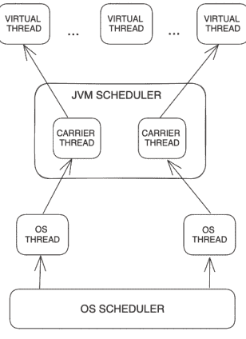

图 3.1: 虚拟线程调度

挂起虚拟线程通过延续（`Continuations`）技术实现。通常情况下，这种技术允许你通过保存程序的状态来暂停执行的执行，然后从挂起点恢复执行。

创建虚拟线程还涉及创建一个类型为 `jdk.internal.vm.Continuation` 的对象，该对象包含了线程的当前状态，例如调用堆栈和局部变量。当虚拟线程需要执行阻塞操作时，载体线程可以被挂起并关联到另一个线程。当阻塞操作完成后，虚拟线程由 `Continuation` 对象恢复，并可以在另一个载体线程上继续其执行。与平台栈相比，虚拟线程栈占用的内存非常少（兆字节级对比百字节级），且栈存储在 JVM 堆中，而不是操作系统分配的内存中。正因如此，虚拟线程的成本更低，因此应用程序可以使用成千上万个虚拟线程。

让我们来看一个虚拟线程执行和平台线程的示例。我们创建一个实现 `Runnable` 接口的类：

```java
class Task implements Runnable {

    private final int taskNumber;

    public Task(int taskNumber) {
        this.taskNumber = taskNumber;
    }

    @Override
    public void run() {
        if (taskNumber == 1) {
            System.out.println(Thread.currentThread());
        }
        try {
            Thread.sleep(Duration.ofMillis(10));
        } catch (InterruptedException e) {
            Thread.currentThread().interrupt();
        }
        if (taskNumber == 1) {
            System.out.println(Thread.currentThread());
        }
    }
}
```

## 使用虚拟线程实现易扩展的 API

该类有一个名为 `taskNumber` 的整数类型字段。在 `run` 方法的实现中，如果该字段等于 1，则打印当前线程，暂停当前线程十毫秒，最后重新打印。我们使用平台线程使用这个类：

```java
@Test
void platformThread() throws InterruptedException {
    var platformThread = IntStream.rangeClosed(1, 10)
        .mapToObj(taskNumber ->
            Thread.ofPlatform().started(new Task(taskNumber)))
        .toList();
    platformThread.forEach(Thread::start);
    for (Thread t : platformThread) {
        t.join();
    }
}
```

该方法使用静态 `Thread.ofPlatform()` 方法创建了十个平台线程。每个线程都关联到类型为 `Task` 的对象。通过执行该方法，我们将得到如下类型的输出：

```
Thread[#22,Thread-0,5,main]
Thread[#22,Thread-0,5,main]
```

此输出显示与 `taskNumber` 1 关联的线程在暂停前后始终是同一个。

我们对虚拟线程使用相同的方法：

```java
void virtualThread() throws InterruptedException {
    var virtualThreads = IntStream.rangeClosed(1, 10)
        .mapToObj(taskNumber ->
            Thread.ofVirtual().started(new Task(taskNumber)))
        .toList();
    virtualThreads.forEach(Thread::start);
    for (Thread t : virtualThreads) {
        t.join();
    }
}
```


此输出显示与 `taskNumber` 1 关联的线程在暂停前后始终是同一个。（注：原文中 virtualThread 示例文本有乱码，已根据虚拟线程的上下文和之前的示例进行了还原，以匹配 `ofVirtual()` 示例的逻辑结构）。

## 虚拟线程 API

通过虚拟线程，Java 21 引入了一项彻底改变并发模型的杀手级功能。在下一节中，你将看到在 Spring MVC 中使用虚拟线程是完全透明的。

## 使用虚拟线程入门 Spring MVC

Spring MVC 是最广泛用于创建 REST 服务的 Java 框架，因为它易于使用，并且基于开放扩展关闭修改原则。在本节中，我们将学习如何使用 Spring MVC 和虚拟线程创建一个负责订单管理的微服务。此外，微服务将调用目录服务获取某些产品数据。本章的所有代码都可以在 GitHub 仓库的 `chapter-03` 中找到。

# Spring Boot 3 API 精通

Spring Boot 中的 MVC 使用 `Tomcat` 作为默认 Servlet 容器，但你可以通过使用 `Tomcat` 依赖并插入另一个 Servlet 容器（如 `Jetty`）来轻松切换 Servlet。

尽管 API 优先（API-first）的方法隐藏了 Spring MVC 注解的使用，但你应该知道哪些注解是最重要的，请参考下表：

| 注解 | 说明 |
| --- | --- |
| `@RestController` | 组合了 `@Controller` 和 `@ResponseBody` 的注解。它告诉 Spring 该类是一个 Controller，且响应是一个 HTTP 响应，而不是视图名称。 |
| `@RequestMapping` | 可以放在类级或方法级别的注解，用于指定 URL 的路径。 |
| `@PathVariable` | 与 Controller 方法的参数关联，表示该参数是路径参数。 |
| `@RequestParam` | 与 Controller 方法的参数关联，表示该参数是查询参数。 |
| `@RequestBody` | 与 Controller 方法的参数关联，表示该参数是 HTTP 请求体。 |
| `@GetMapping`, `@PostMapping`, `@PutMapping`, `@DeleteMapping`, `@PatchMapping`, `@RequestMapping` | 它由注解组成，作为 `@RequestMapping(method = RequestMethod.GET)`、`@RequestMapping(method = RequestMethod.POST)` 等的快捷方式。 |

* `@GetMapping`：用于映射 `GET` 请求的注解。当你想要从资源中检索数据时有用。
* `@PostMapping`：映射 `POST` 请求的注解。当我们想要保存新资源时有用。
* `@PutMapping`：映射 `PUT` 请求的注解。当我们想要用新数据覆盖资源时有用。
* `@DeleteMapping`：映射 `DELETE` 请求的注解。当我们想要移除资源时有用。
* `@PatchMapping`：映射 `PATCH` 请求的注解。当我们想要对资源进行部分更改时有用。与 `@PutMapping` 相比，它只更新请求中的字段。

**表 3.1：** Spring MVC 模块中常用的注解

**注意：** 这些注解也用于 Spring WebFlux 模块。

## 使用虚拟线程实现易于扩展的 API

## 实践中的 Spring MVC

为了从零创建项目，我们将依赖 Spring Initializr。要导入的模块与上章相同，除了我们将两个异步模块替换为同步模块，将 Flux 模块替换为 Web，并将 Data R2DBC 模块替换为 Data JDBC。图 3.3 显示了创建我们微服务的 Spring Initializr 界面：


| 语言 | 类型 |
|---|---|
| Java | Maven |
| Kotlin | Gradle |
| Groovy | Gradle |

| Spring Boot 版本 |
|---|
| 3.3.0 (SNAPSHOT) |
| 3.2.4 |
| 3.1.10 |

| 依赖项 | 类别 | 说明 |
|---|---|---|
| Spring Web | WEB | 构建 Web、使用 RESTful、以及使用 Spring MVC 的应用程序：使用 Apache Tomcat 作为默认容器。 |
| Spring Data JDBC | SQL | 使用 Spring Data 通过纯 JDBC 在 SQL 存储中进行持久化。 |
| Validation | 校验 | 使用 Hibernate Validator 进行 Bean 校验。 |
| PostgreSQL Driver | SQL | JDBC 和 R2DBC 驱动允许 Java 程序使用标准 JDBC API 或响应式 Java 代码连接到 PostgreSQL 数据库。 |
| Lombok | 开发人员工具 | 帮助减少样板代码的 Java 注解库。 |
| Testcontainers | 测试 | 提供常见数据库、Selenium 浏览器或任何可以在 Docker 容器中运行的轻量级临时实例。 |

| 项目元数据 | 值 |
|---|---|
| Group | `com.example` |
| Artifact | `order-service` |
| Name | `order-service` |
| Description | 带有 Spring MVC 的订单服务微服务 |
| Package name | `com.example.orderservice` |
| Packaging | Jar |
| Java | 21 |

图 3.3：带有 Spring MVC 的项目设置

`Spring Web` 模块允许导入 Spring MVC 的依赖。`Data JDBC` 模块允许导入相应的依赖。该模块使用了领域驱动设计（DDD）中聚合（`aggregate`）和聚合根（`aggregate root`）的概念。聚合是一个领域对象的簇，可以被视为单个单元，并与单个聚合根相关联。任何外部操作都必须在聚合根上进行。一个很好的例子是订单实体，它作为订单项实体的聚合根，而订单项实体是聚合的一部分。

我们将为此微服务使用 `MapStruct` 和 `Springdoc` 依赖。

> **注意：** 如上章所述，需要 `Springdoc` 依赖，即 OpenAPI Generator 插件，它使用了 Swagger 注解。但是，由于我们使用的是 Spring MVC 而不是 WebFlux，要导入的依赖不是 `springdoc-openapi-starter-webflux-api` 而是 `springdoc-openapi-starter-webmvc-api`。

作为业务模型，我们最初可能会认为订单对象包含以下字段：

* 一个唯一的订单代码。
* 状态，可以是处理中、已拒绝或已送货。
* 订单的创建日期和更新日期。
* 订单中的产品代码列表。每个产品代码都关联一个数量。
* 订单的总价格。

此领域实体可以按以下方式映射到数据库：

```sql
CREATE TABLE IF NOT EXISTS orders (
  order_id SERIAL PRIMARY KEY,
  order_code VARCHAR UNIQUE NULL,
  status VARCHAR,
  total_price BIGINT,
  created_at TIMESTAMPTZ,
  updated_at TIMESTAMPTZ
);

CREATE TABLE IF NOT EXISTS order_items (
  order_id INTEGER,
  product_code VARCHAR,
  quantity INTEGER,
  PRIMARY KEY(order_id, product_code),
  CONSTRAINT fk_orders FOREIGN KEY(order_id) REFERENCES orders(order_id)
);
```

第一个表 `orders` 负责映射订单摘要数据，而 `order_items` 表负责将一个或多个产品与订单关联。你可以在 `init.sql` 中找到更新后的表。让我们设计创建订单的 API：

```yaml
/orders:
  post:
    tags:
      - order
    summary: 添加新订单
    operationId: addOrder
    requestBody:
      content:
        application/json:
          schema:
            $ref: '#/components/schemas/OrderRequest'
      required: true
    responses:
      '201':
        description: 操作成功
        headers:
          Location:
            schema:
              type: string
              format: uri
      '400':
        description: 输入无效
        content:
          application/problem+json:
            schema:
              $ref: '#/components/schemas/ProblemDetail'
```

针对有效的请求体，API 返回 HTTP 201 状态，并在头部包含创建资源的 URI。请求体如下：

```yaml
OrderRequest:
  required:
    - products
  type: object
  properties:
    products:
      type: array
      items:
        $ref: '#/components/schemas/ProductOrder'

ProductOrder:
  required:
    - productCode
  type: object
  properties:
    productCode:
      type: string
    quantity:
      type: integer
```

在文件中找到完整的 OpenAPI 定义：`order-service/openapi/server/order-service.yml`。

此 API 的序列图如图 3.4 所示：

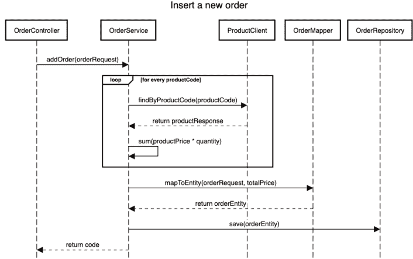

**图 3.4：** 插入新订单的操作序列图

该图与插入新产品的操作类似，可以在上章中看到。然而，在这种情况下，情况更复杂，因为该操作还通过 `ProductClient` 类为接收到的每个 `productCode` 请求产品信息。具体来说，`ProductClient` 向目录服务微服务的 `findProductByCode` 端点发起 HTTP 调用。

```xml
<artifactId>openapi-generator-maven-plugin</artifactId>
<version>7.4.0</version>
<executions>
  <execution>
    <goals>
      <goal>generate</goal>
    </goals>
    <configuration>
      <inputSpec>
        ${project.basedir}/openapi/server/order-service.yml
      </inputSpec>
      <openapiNormalizer>REF_AS_PARENT_IN_ALLOF=true</openapiNormalizer>
      <generatorName>spring</generatorName>
      <apiPackage>com.easyshop.orderservice.generated.api</apiPackage>
      <modelPackage>
        com.easyshop.orderservice.generated.model
      </modelPackage>
      <schemaMappings>
        ProblemDetail=org.springframework.http.ProblemDetail
      </schemaMappings>
      <typeMappings>
        OffsetDateTime=java.time.Instant
      </typeMappings>
      <configOptions>
        <interfaceOnly>true</interfaceOnly>
        <delegatePattern>true</delegatePattern>
        <useSpringBoot3>true</useSpringBoot3>
        <openApiNullable>false</openApiNullable>
        <useTags>true</useTags>
      </configOptions>
    </configuration>
  </execution>
</executions>
</plugin>
```

# 84 Spring Boot 3 API 精通

OpenAPI Generator 插件的配置属性与上一章类似，但没有添加 `<reactive>true</reactive>` 标签，因为我们想要使用 Spring MVC 而非 WebFlux。从项目开始，我们运行 `./mvnw clean compile` 来使用 OpenAPI Generator 插件自动生成类。让我们查看位于 `chapter-03/order-service/target/generated-sources/openapi/src/main/java/com/easyshop/orderservice/generated/api` 文件夹下的 OpenAPI 自动生成的接口：

```java
public interface OrderApi {

  //...

  @RequestMapping(
    method = RequestMethod.POST,
    value = "/orders",
    produces = {"application/problem+json"},
    consumes = {"application/json"}
  )
  default ResponseEntity<Void> _addOrder(
    @Parameter(name = "OrderRequest", description = "", required = true)
    @Valid @RequestBody OrderRequest orderRequest
  ) {
    return addOrder(orderRequest);
  }
```


// Override this method

default `ResponseEntity<Void>` `addOrder`(`OrderRequest` orderRequest) {

    //...

}

}

> 注意：与上一章相比，`ResponseEntity` 类没有被封装在 `Mono` 中，因为我们不在响应式环境中。

现在让我们实现序列图中设计的类。我们从映射到订单表的 `OrderEntity` 类开始。创建 `middleware.db.entity` 包，并编写以下 Java record：

```java
@Table("orders")
@Builder(toBuilder = true)
public record OrderEntity(
    @Id
    Long orderId,
    String orderCode,
    String status,
    @MappedCollection(idColumn = "order_id")
    Set<OrderItem> items,
    Long totalPrice,
    @CreatedDate
    Instant createdAt,
    @LastModifiedDate
    Instant updatedAt
);
```

与 `ProductEntity` 相比，此 record 包含以下新注解：
- `@MappedCollection` 注解允许我们指定实现一对多关系的对象列表。通过 `@IdColumn` 参数，我们指定了子表的外键名。
- `@CreatedDate` 和 `@LastModifiedDate` 注解允许 `createdAt` 和 `updatedAt` 字段分别自动通过创建和修改日期进行增强。

在同一个包中，编写 `OrderItem` record：

```java
@Table("order_items")
public record OrderItem(
    String productCode,
    int quantity
);
```

只有在通过 `@EnableJdbcAuditing` 注解启用了 JDBC 审计时，`@CreatedDate` 和 `@LastModifiedDate` 注解才会生效。创建 `config` 包并编写以下类：

```java
@Configuration
@EnableJdbcAuditing
public class DataConfig {
}
```

现在，在 `middleware.db` 内部创建 `repo` 子包并编写以下仓库接口：

```java
public interface OrderRepository
    extends CRUDRepository<OrderEntity, String> {
}
```

与 `ProductRepository` 一样，此接口继承了 `CRUDRepository`，尽管在上一章我们使用了 Spring Data R2DBC 模块，而现在我们使用了 Spring Data JDBC 模块。这是我们在上一章提到的 Spring Data 的特性之一，即隐藏导入模块实现细节的能力。

对于 `ProductClient` 接口，它负责根据输入的产品代码为产品提供数据。在 `middleware` 内部创建 `msclient` 子包并编写以下接口：

```java
public interface ProductClient {
    ProductResponse findByProductCode(String productCode);
}
```

数据传输对象（DTO）类 `ProductResponse` 映射到目录服务的响应体。在 `middleware.msclient` 内部创建 `dto` 子包并编写以下 record：

```java
public record ProductResponse(
    String code,
    String category,
    Long price
);
```

现在，让我们创建一个模拟类来模拟客户端的操作。在 `RestClient` 部分中，我们将创建一个执行向目录服务微服务发送 HTTP 请求的实现。在 `middleware.msclient` 内部创建 `impl` 子包并编写以下类：

```java
@Component
public class MockClient implements ProductClient {
    @Override
    public ProductResponse findByProductCode(String productCode) {
        return new ProductResponse(productCode, null, 10000L);
    }
}
```

## 使用虚拟线程轻松扩展 API

编写一个 mapper 接口，该接口根据 `OrderRequest` 对象、产品总价和订单状态创建 `OrderEntity` 对象。创建 `mapper` 包并编写以下接口：

```java
@Mapper(componentModel = "spring")
public interface OrderMapper {
    @Mapping(target = "orderCode", expression = "java(this.generateOrderCode())")
    @Mapping(target = "items", source = "orderRequest.products")
    OrderEntity toEntity(OrderRequest orderRequest, long totalPrice, OrderStatus status);

    default String generateOrderCode() {
        var randomString = RandomStringUtils.randomAlphanumeric(5);
        return randomString + System.currentTimeMillis();
    }
}
```

与上一章相比，该接口包含了值得分析的 MapStruct 配置：
- MapStruct 默认尝试映射字段。当字段名称不同时，可以使用 `@Mapping` 注解来指定映射。
- 如果目标字段不是从源字段映射，而是从方法结果映射，可以使用 `expression`。目标类的 `orderCode` 字段通过调用 `generateOrder` 方法赋值。

现在，编写处理业务逻辑的类 `OrderService`。创建 `service` 包并编写以下类：

```java
@Service
@RequiredArgsConstructor
@Slf4j
@Transactional(readOnly = true)
public class OrderService {
    private final OrderRepository orderRepository;
    private final ProductClient productClient;
    private final OrderMapper orderMapper;

    @Transactional
    public String addOrder(OrderRequest orderRequest) {
        var totalPrice = calculateTotalPrice(orderRequest);
        var entity = orderMapper.toEntity(orderRequest, totalPrice,
            OrderStatus.TAKEN_CHARGE);
        var orderInserted = orderRepository.save(entity);
        log.info("New order inserted: {}", orderInserted);
        return entity.orderCode();
    }

    private Long calculateTotalPrice(OrderRequest orderRequest) {
        return orderRequest.getProducts().stream()
            .map(this::createQuantityCodePair)
            .map(quantityAndPrice ->
                quantityAndPrice.getFirst() * quantityAndPrice.getSecond())
            .reduce(0L, Long::sum);
    }

    private Pair<Integer, Long> createQuantityCodePair(ProductOrder product) {
        // 为了简洁省略实现细节
        return Pair.of(product.getQuantity(), 0L);
    }
}
```

`addOrder` 方法执行了序列图所描述的操作：对于每个 `ProductOrder` 对象，执行 `ProductClient` 类的 `findByCode` 方法以获取每个产品的价格。`totalPrice` 变量是所有产品计算总和。创建一个 `OrderEntity` 类型的实体并将其保存到数据库中，最后将订单代码返回给调用者。

在最后一步中，我们创建 `OrderController` 类，它实现了自动生成的 `OrderApi` 接口，并在方法中简单地调用服务。创建 `api` 包并重写以下类：

```java
@RestController
@RequiredArgsConstructor
public class OrderController implements OrderApi {
    private final OrderService orderService;

    @Override
    public ResponseEntity<Void> addOrder(OrderRequest orderRequest) {
        final String orderCode = orderService.addOrder(orderRequest);
        var uri = ServletUriComponentsBuilder
            .fromCurrentRequestUri()
            .toString() + "/" + orderCode;
        return ResponseEntity.created(URI.create(uri)).build();
    }
}
```

`ServletUriComponentsBuilder` 类允许从当前请求（由 `HttpServletRequest` 类封装）获取有用信息，例如 URI。

如果我们按照目前的状态启动应用程序，Spring MVC 将使用平台线程。要使用虚拟线程，只需在 `application.properties` 文件中设置该属性：`spring.threads.virtual.enabled=true`。`application.properties` 文件中的所有属性如下：

```
spring.application.name=order-service
server.port=8081
spring.threads.virtual.enabled=true
spring.datasource.url=jdbc:postgresql://localhost:5432/easyshopdb-order
spring.datasource.username=user
spring.datasource.password=password
```

让我们尝试调用 API。启动 Docker并在 `docker-03/infra/docker` 路径下打开终端，首次运行时执行命令删除 Postgres 卷：`docker rm docker_easyshop-postgres`，然后使用命令启动容器：`docker compose up -d`。在 IDE 中运行 `OrderServiceApplication` 类的 `main` 方法。从终端尝试发送以下 POST 请求：

```http
http://localhost:8081/orders \
Content-Type:application/json \
"products[0][productCode]":"SMA-XCV" \
"products[0][quantity]":1
```

响应将如下：

```http
HTTP/1.1 201
Location: http://localhost:8081/orders/C04RK17119096027008
```

你可以在 pgadmin 上验证记录已正确保存到 `orders` 和 `order-items` 表中。

然而，由于我们使用了 mockata 来实现 `ProductClient`，目前可以创建服务数据库中不存在的产品的订单。

现在，尝试发送 POST 请求时省略必填字段，例如 `productCode`：

```http
http://localhost:8081/orders \
Content-Type:application/json \
"products[0][quantity]":1
```

你将看到如下的响应：

```http
HTTP/1.1 400
{
  "error": "Bad Request",
  "path": "/orders",
  "status": 400,
  "timestamp": "2024-03-31T19:51.812+00:00"
}
```

虽然正确返回了状态码 400，但响应体并没有符合 `ProblemDetail` 规范。我们将向你如何在 Spring MVC 中修复此错误处理部分。你还可以在 GitHub 仓库的 `chapter-03` 中找到 GET (`findOrderBy`)、PUT 和 DELETE 端点。

## Spring MVC 中的分页 API

在第一章关于 REST 的讨论中，对于返回资源列表的 API，我们建议它们设计为分页的。这既可以减轻响应体的负担，还可以优化在数据库上执行的查询。分页通常涉及以下输入参数：

- 一个指示你想要显示的页码的参数。
- 一个指示每页元素数量（大小）的参数。
- 一个可选的排序参数，指示页面上元素进行升序或降序排序的字段。

作为响应，页面除了返回资源元素外，还应该为客户端提供实用的信息，例如总页数，以便客户端知道是否存在下一页。

Spring Data 提供了处理分页的类。在输入端，Spring Data 提供了 `Pageable` 接口，允许对上述分页输入参数进行增强。在输出端，Spring Data 提供了 `Page` 接口，它包含了页面资源列表以及总页数等其他信息。

我们设计了一个获取订单的 API。除了提供分页所需的必要参数外，API 必须能够接受一个可选参数来按状态过滤项目。状态类型为 `status`，因此如果客户端将状态参数赋值为 `DEL`，则会找到状态为 `DELIVERED` 的订单。我们在 `order-service.yml` 文件的路径 `/orders` 下添加以下端点：

```yaml
tags:
- order
summary: 返回一页订单
operationId: findOrders
parameters:
- name: pageNumber
  in: query
  description: 页码, 0 是第一页
  required: true
  schema:
    type: integer
- name: pageSize
  in: query
  description: 每页大小, 默认为 10
  required: false
  schema:
    type: integer
    default: 10
- name: sort
  in: query
  description: 用于排序的字段
  required: false
  schema:
  type: array
  items:
    type: string
- name: order
  in: query
  description: 用于排序的字段
  required: false
  schema:
    type: string
    enum:
      - ASC
      - DESC
- name: status
  in: query
  description: 状态过滤
  required: false
  schema:
    type: string
```

## 使用虚拟线程轻松可扩展的 API

```java
var example = createExample(status);
final Page<BaseOrder> page = orderRepository
    .findAll(example, pageRequest)
    .map(orderMapper::toOrderPageItem);
return new OrderPage(
    .content(page.getContent())
```


# 使用虚拟线程轻松扩展的 API

```java
.totalElements(page.getTotalElements())
.totalPages(page.getTotalPages())
.first(page.isFirst())
.last(page.isLast())
.number(page.getNumber())
.size(page.getNumberOfElements()));
```

```java
private Pageable createPageRequest(int pageNumber, int pageSize, List<String> sort, String order) {
    if (sort != null) {
        Sort sortInput = Sort.by(Sort.Direction.valueOf(order),
            sort.toArray(new String[][]{}));
        return PageRequest.of(pageNumber, pageSize, sortInput);
    }
    return PageRequest.of(pageNumber, pageSize);
}
```

```java
private Example<OrderEntity> createExample(String status) {
    var probe = OrderEntity.builder()
        .status(status)
        .build();
    var matcher = ExampleMatcher.matching()
        .withMatcher("status", startWith());
    return Example.of(probe, matcher);
}
```

第一条语句创建了一个 `PageRequest` 类型的对象，它是 `Pageable` 类的实现。第二条为 `OrderEntity` 创建了一个 `Example`。probe 是 `OrderEntity` 类型的的对象，它只包含 `status` 字段值。matcher 指明了如何评估 `status` 字段，在这种情况下，使用了 `ExampleMatcher` 接口的静态 `startWith()` 方法。所有其他字段在 probe 对象中未赋值，将不会用于过滤。

你可以实现 `OrderController` 类的 `findAll` 方法。

启动应用程序并多次调用之前创建的 POST API。在数据库中将订单状态更改为 `DELIVERED`，使其不再处于 `TAKEN_CHARGE` 状态。在我的情况下，订单总数为 11 个。然后，尝试进行以下 GET 调用：`http://8081/orders pageNumber=0&pageSize=5`。响应将是：

```
HTTP/1.1 200
{
  "content": [
    {
      "createdAt": "2024-03-31T10:55:22.581388Z",
      "orderCode": "JUEOK1711882522551",
      "status": "TAKEN_CHARGE",
      "totalPrice": 10000,
      "type": "orderSummary",
      "updatedAt": "2024-03-31T10:55:22.581388Z"
    },
    {
      "createdAt": "2024-03-31T10:55:28.000039Z",
      "orderCode": "BNXVM1711882527998",
      "status": "TAKEN_CHARGE",
      "totalPrice": 10000,
      "type": "orderSummary",
      "updatedAt": "2024-03-31T10:55:28.000039Z"
    }
  ],
  // other elements...
  "first": true,
  "last": false,
  "number": 5,
  "totalElements": 11,
  "totalPages": 3
}
```

响应除了提供订单列表外，还向客户端返回总项目数、总页数和其他信息。如果我们想按 `status` 和 `createdAt` 降序对订单进行排序，可以进行以下调用：
`http://8081/orders pageNumber=0&pageSize=11&sort=status&sort=createdAt&order=DESC`

如果我们还想按状态过滤（例如值为 `DEL`），API 将返回所有状态为 `DELIVERED` 的订单。尝试发送以下请求：
`http://8081/orders pageNumber=0&pageSize=11&sort=status&sort=createdAt&order=DESC&status=DEL`

如果数据库中有一个状态为 `DELIVERED` 的订单，响应应该看起来如下：

```
HTTP/1.1 200
{
  "content": [
    {
      "createdAt": "2024-03-31T19:26:42.735095Z",
      "orderCode": "C04RK171190620708",
      "status": "DELIVERED",
      "totalPrice": 10000,
      "type": "orderSummary",
      "updatedAt": "2024-03-31T19:26:42.735095Z"
    }
  ],
  "first": true,
  "last": true,
  "number": 1,
  "totalElements": 1,
  "totalPages": 1
}
```

通过 Spring MVC 和 Spring Data，我们已经向你展示了创建分页 API 是多简单。遗憾的是，Spring WebFlux 原生不支持分页，因为分页的概念与响应式（reactive）相冲突。

## 使用虚拟线程实现易扩展 API

```java
.requestFactory(new JdkHttpClientFactory());
```

此外，编写一个异常类来处理根据输入的产品代码未找到产品的情况。在 `exception` 包中，编写以下类：

```java
public class ProductOrderNotFoundException extends NestedRuntimeException {
    public ProductOrderNotFoundException(String productCode) {
        super("Product with code %s not found", productCode);
    }
}
```

现在，我们可以编写 `ProductClient` 的实现。在 `msclient.impl` 子包中，编写以下类：

```java
@Component
public class RestClientProductClient implements ProductClient {
    @Override
    public ProductResponse findByProductCode(String productCode) {
        return restClient.get("/" + productCode)
            .retrieve()
            .onStatus(status -> status.value() == 404,
                (request, response) -> {
                    throw new ProductOrderNotFoundException(productCode);
                });
    }
}
```

```java
}}
.body(new ParameterizedTypeReference<>() {});
```

```java
}
```

WebClient 和 RestClient 在响应 HTTP 状态值为 4xx 或 5xx 时会抛出异常，同样，像 WebClient 一样，我们可以使用 `onStatus` 方法来处理这些状态。我们可以在异常包中编写以下错误处理器类来处理 `ProductOrderNotFoundException` 异常：

```java
@RestControllerAdvice
@Slf4j
public class ErrorHandler extends ResponseEntityExceptionHandler {
    @ExceptionHandler(ProductOrderNotFoundException.class)
    public ResponseEntity<Object> handle(
        ProductOrderNotFoundException ex, WebRequest request) {
        log.warn(ex.getMessage());
        var pd = ProblemDetail
            .forStatusAndDetail(HttpStatus.BAD_REQUEST, ex.getMessage());
        return new ResponseEntity<Object>(pd, HttpStatus.BAD_REQUEST);
    }
}
```

启动订单和服务目录服务。通过 pgadmin，我们建议你删除 `orders` 和 `order_items` 表中的所有行以获得干净的环境。通过调用目录服务的 API POST 创建两个产品：

```bash
http :8080/products code=0001 name="Laptop" category=lap-price=60000 brand=FirstBrand
```

```bash
http :8080/products code=0002 name="SuperLaptop" category=lap-price=30000 brand=FirstBrand
```

尝试使用这两个产品创建一个订单：

```bash
http :8081/orders \
Content-Type:application/json \
"products[0][productCode]="0001" \
"products[0][quantity]"=2 \
"products[1][productCode]"=0002 \
"products[1][quantity]"=1
HTTP/1.1 201
Location: http://localhost:8081/orders/AL7ZS171239595445
```

调用 `findOrderBy` API：`http :8081/orders/AL7ZS171239595445`。你应该得到如下响应：

```json
HTTP/1.1 200
{
  "createdAt": "2024-04-06T09:32:37.478903Z",
  "orderCode": "AL7ZS171239595445",
  "products": [
    {
      "productCode": "0001",
      "quantity": 2
    },
    {
      "productCode": "0002",
      "quantity": 1
    }
  ],
  "status": "TAKEN_CHARGE",
  "totalPrice": 150000,
  "type": "orderDetail",
  "updatedAt": "2024-04-06T09:32:37.478903Z"
}
```

价格与购买的产品一致的，因为订单包含两个代码为 0001 的产品（单价为 60000）和一个代码为 0002 的产品（单价为 30000）。尝试用现有产品和一个不存在的产品创建一个订单：

```bash
http :8081/orders \
Content-Type:application/json \
"products[0][productCode]="0001" \
"products[0][quantity]"=2 \
"products[1][productCode]"=0003 \
"products[1][quantity]"=1
HTTP/1.1 400
{
  "detail": "Product with code 0003 not found",
  "status": 400,
  "title": "Bad Request",
  "type": "about:blank"
}
```

```java
@SpringBootApplication
public class VtApplication {
    public static void main(String[] args) {
        SpringApplication.run(VtApplication.class, args);
    }
}
```

```java
@RestController
public class MockApi {
    @GetMapping
    public ResponseEntity<List<Book>> findAll()
        throws InterruptedException {
        var books = new ArrayList<Book>();
        Thread.sleep(5000L);
        for (int i = 0; i < 10; i++) {
            books.add(new Book(i, UUID.randomUUID().toString()));
        }
        return ResponseEntity.ok(books);
    }
}

record Book(int bookId, String bookName) {}
```


通过更改 `spring.threads.virtual.enabled` 属性的值，对该应用程序分别使用平台线程和虚拟线程进行了测试。负载测试涉及 10000 个请求，竞争因子为 250。该应用程序以 JAR 包的形式发布在 Amazon EC2 t3.micro（2 vCPUs 和 1 GiB 内存）上。

测试结果汇总于表 3.2：

| 指标 | 平台线程 | 虚拟线程 | 更优值 |
|---|---|---|---|
| 测试耗时 (s) | 26.538 | 22.855 | 越低越好 |
| 每秒请求数 (#/sec) | 376.82 | 437.54 | 越高越好 |
| 每个请求耗时 (ms, 平均) | 663.44 | 571.378 | 越低越好 |
| 传输率 (Kbytes/sec) | 270.84 | 314.48 | 越高越好 |

表 3.2：

# 108 Spring Boot 3 API 精通

结果令人信服，虚拟线程在 22.855 秒内完成了测试套件，优于在相似负载下需要 26.538 秒的平台线程。总耗时的缩短还伴随着吞吐量的增加，虚拟线程实现了每秒 437.5 次请求，而平台线程为 376.82 次。此外，虚拟线程的平均请求时间显著降低（571.378 对 663.440 ms），表明在并发条件下的响应处理速度更快。最后，数据传输率明显提高，虚拟线程实现了 314.48 Kbytes/sec 的传输率，而平台线程为 270.84 Kbytes/sec。

这些发现表明，虚拟线程为高并发 Spring MVC 应用程序提供了巨大的优势，提升了速度和数据处理效率。通过采用虚拟线程，开发者可以实现更好的扩展性和响应能力，使这种方法成为需要高性能和无缝并发管理的应用程序中不可或缺的选项。

## 在虚拟线程和 WebFlux 之间进行选择

在阅读本章和上一章之后，你可能在想在应用程序中使用哪种方法：基于 Spring MVC 的每个请求一个线程方法，还是 WebFlux 的事件循环方法。如果你的应用程序已经用 Spring MVC 编写，且你正在寻找优化线程管理的方法，使用虚拟线程将让你无需深度重构代码（只需升级到 Spring Boot 3、Java 21 并添加启用虚拟线程的属性即可）。如果你是从零开始，选择取决于你团队的知识水平。使用 WebFlux，你可以编写函数式代码并处理背压，而且不需要被强制迁移到响应式编程；目前响应式编程被证明性能略高，但由于与可扩展性性能相关的设计简单性，虚拟线程是更优的选择。如果你的应用程序已经使用 WebFlux，我们不建议迁移到 Spring MVC。如果你对比较 Spring MVC 和带有虚拟线程的 Spring MVC 性能的细节感兴趣，可以查看这篇文章：https://www.vincenzoracca.com/en/blog/framework/spring/virtual-threads-vs-webflux。

## 结论

在本章中，我们详细介绍了什么是虚拟线程，并解释了为什么它们是 Java 的一项重要特性。通过虚拟线程，你可以使用简单的“每个请求一个线程”模型，并获得与异步编程相同的扩展性。我们展示了如何使用传统的 Spring MVC 创建 REST API，并探索了 Spring 如何通过一个简单的属性轻松地将用法切换到虚拟线程。你还看到了新的同步 HTTP 客户端 `RestClient`，它允许你使用与 `WebClient` 相同的流式 API。通过本章，你已经掌握了在 Spring MVC 和 Spring WebFlux 之间进行选择以编写可扩展 REST API 的方法。在下一章中，我们将使用 GraphQL 编写 API 的另一种方法。

## 知识点回顾

- Spring MVC 使用每个请求一个线程的方法和前端控制器模式（Front Controller）。
- Spring MVC 默认不使用虚拟线程。必须通过属性启用。
- 使用 `@WebMvcTest` 使用 Spring MVC 测试 REST API。

## 练习

- 尝试自己为订单资源实现 GET、PUT 和 DELETE 端点。仅当订单状态为“已处理”（taken charge）时才允许修改和删除订单。
- 尝试为这些其他端点实现测试。

## 加入我们书籍的 Discord 空间

加入书籍的 Discord 工作空间以获取最新更新、优惠、全球技术动态、新发布以及与作者互动：

https://discord.bpbonline.com


# 使用 Spring Boot 使用 GraphQL

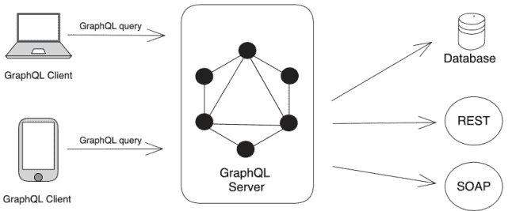

图 4.1：从不同源检索数据的 GraphQL 服务器示例

## 模式与类型

GraphQL 服务的创建首先需要定义一个或多个模式（schema）文件，这些文件包含了服务器处理的数据类型定义。处理书籍的 GraphQL 模式定义可能如下所示：

```graphql
type Book {
  id: ID
  name: String
  pageCount: Int
  author: Author
}
```

```graphql
type Author {
  id: ID
  firstName: String
  lastName: String
}
```

从示例中可以看出，字段类型可以引用标量（scalars），例如类型为 String 的 name 字段，也可以引用其他类型，例如类型为 Author 的 author 字段。GraphQL 默认提供的标量类型如表 4.1 所示：

| 类型 | 描述 |
| --- | --- |
| Int | 有符号的 32 位整数 |
| Float | 有符号的双精度浮点值 |
| String | UTF-8 编码的字符序列 |
| Boolean | 表示以下值：true, false |
| ID | 唯一标识符，序列化方式与 String 相同 |

表 4.1：

在大多数 GraphQL 服务实现中，你还可以指定自定义标量类型，例如映射日期或 64 位整数值（Long）。

字段可以是空的（nullable）也可以是非空的（non-nullable）。要表示一个非空字段，只需在字段类型后加上后缀 `!`，例如，如果我们想让 Book 的 name 字段成为必填项，则字段定义将变为 `name: String!`。

要声明一个列表类型的字段，只需将类型封装在方括号中。如果我们假设一书可能有多个作者，那么 Book 类型的 author 字段将声明为：

`author: [Author]`

每个字段可以有零或多个参数。参数可以是必选的或可选的。可选参数可以有一个默认值。让我们来看下面的示例：

```graphql
type Starship {
  id: ID!
  name: String!
  length(unit: String = "METER", anotherArg: String!): Float
}
```

`Starship` 的长度有两个参数：第一个参数 `unit` 默认值为 METER，第二个参数 `anotherArg` 是必选的。

参数也可以是复杂对象，而不仅仅是标量值。在 GraphQL 中，存在输入类型（input type），通过关键字 `input` 而不是 `type` 定义，如下所示：

```graphql
input BookInput {
  name: String
  pageCount: Int
  authorId: String
}
```

输入类型用作变异（mutations）的泛型。

## 查询与变异

三个特殊类型：query（查询）、mutation（变异）和 subscription（订阅）。每个 GraphQL 服务包含 query 类型，并可能包含 mutation 和 subscription。这些类型与上一节看到的普通类型具有相同的特性，但它们被称为特殊类型，是因为它们定义了 GraphQL 服务器上请求的入口点。在 GraphQL 中，客户端通过操作（operation）来定义请求，该操作可能包含一个或多个查询。一个包含两个查询的操作示例如下：

```graphql
{
  bookById(id: "book-1") {
    name
  }
  booksByName(name: "Spring Boot 3 API Mastery") {
    id
    author {
      firstName
      lastName
    }
  }
}
```

具体来说，圆括号中的参数是作为输入传递的，而大括号中的字段是客户端感兴趣的作为输出的字段。我们可以将大括号中的参数定义为 SQL 查询的投影（projections）。由于此功能，客户端仅向服务器请求它需要的输出字段，避免了过度获取（over-fetching）。只有当我们在模式中定义了 `Query` 类型具有以下两个字段——`bookById` 和 `booksByName` 时，才能执行上述查询：

```graphql
type Query {
  bookById(id: ID): Book
  booksByName(name: String): [Book]
}
```

上一个操作的结果可能类似于以下代码：

```json
{
  "data": {
    "bookById": {
      "name": "Spring Boot 3 API Mastery"
    },
    "booksByName": [
      {
        "id": "book-1",
        "author": {
          "firstName": "Vincenzo",
          "lastName": "Racca"
        }
      }
    ]
  }
}
```

在执行查询时定义一个操作名称是可行且建议的，以消除任何歧义。例如，我们可以如下重新定义之前的查询：

```graphql
query bookOperations {
  bookById(id: "book-1") {
    name
  }
  booksByName(name: "Spring Boot 3 API Mastery") {
    id
    author {
      firstName
      lastName
    }
  }
}
```

> **注意：** `bookOperations` 操作执行了两个查询，`bookById` 和 `booksByName`：我们也可以通过两个独立的请求执行这两个查询，但 GraphQL 的优势之一是我们可以通过单个请求（在此例中命名为 `bookOperations`）执行多个查询（在此例中为 `bookById` 和 `booksByName`）。

## 使用 Spring Boot 实现 GraphQL API

Spring for GraphQL 模块是 GraphQL Java 模块的继承者，为 Spring 应用提供了 GraphQL 支持。在上一章中，我们设计了包含 API `findOrderByCode` 的订单微服务。后者以订单号作为输入并返回带有产品代码和数量列表的订单详情。响应负载具有以下格式：

```json
{
  "createdAt": "2024-04-07T14:38:48.058763Z",
  "orderCode": "6M6ZN171250072819",
  "products": [
```

如果客户端想要每个产品的详情（例如名称和品牌），它们必须为上一个负载中的每个产品代码调用目录服务的 API。我们将这一责任交给新的 GraphQL 服务微服务，利用 GraphQL 特性，通过聚合 `findOrderCode` 和 `findProductCode` API 的响应，检索客户端请求的所有信息（包括如果请求的产品详情）。我们可以通过观察图 4.2 来总结新微服务的操作：

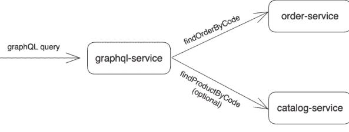

**图 4.2：** 新的 graphql 微服务作为 graphql 服务器

# Spring Boot 3 API 精通

如上一段所述。让我们如图 4.3 所示从 Spring Initializr 创建项目骨架：


| 语言 | 依赖 | 描述 |
| --- | --- | --- |
| Java | Spring for GraphQL | 使用 Spring GraphQL 和 Java 构建 GraphQL 应用程序。 |
| Gradle - Groovy | Spring Boot Web | 使用 Spring MVC 构建 Web（包括 RESTful 应用）。使用 Apache Tomcat 作为默认容器。 |
| 3.3.0 (SNAPSHOT) | Validation | 使用 Hibernate 验证器进行 Bean 验证。 |
| | Lombok | Java 注解库有助于减少样板代码。 |
| | Testcontainers | 提供常见数据库的轻量级实例、Selenium 网页浏览器，或任何可以在 Docker 容器中运行的内容。 |

图 4.3：用于 GraphQL 的 Spring Initializr。

Spring for GraphQL 独立于传输协议，因此为了运行，我们需要提供 Spring MVC、Spring WebFlux、Spring WebSocket 或 RSocket 的依赖。对于此项目，我们选择了 Spring MVC 并利用虚拟线程（virtual threads）。

下载项目后，你会在 resources 文件夹内找到空的 graphql 文件夹。Spring 默认从该文件夹返回 GraphQL 架构（带有 graphql 扩展名的文件）。要在不编写额外代码的情况下使用自定义标量（scalars），我们在 `pom.xml` 文件中导入 `graphql-java-extended-scalars`，如下所示：

```xml
<dependency>
  <groupId>com.graphql-java</groupId>
  <artifactId>graphql-java-extended-scalars</artifactId>
  <version>21.0.0</version>
</dependency>
```

在 GraphQL 中，你可以使用关键字 `extend` 创建分级架构结构。我们在 graphql 文件夹中编写父文件 `schema.graphqls`，如下所示：

```graphql
scalar DateTime
scalar Long
type Query {
}
```

```graphql
type Mutation {
}
```

关键字 `scalar` 允许我们声明自定义标量。在同一文件夹中，我们编写 `order.graphqls` 文件来声明 Order、Product 类型以及它们相关的查询，如下所示：

```graphql
extend type Query {
  findOrderByCode(order: ID): Order
}
```

```graphql
type Order {
  orderCode: ID
  status: String
  totalPrice: Long
  createdAt: DateTime
  updatedAt: DateTime
  products: [Product]
}
```

```graphql
type Product {
  productCode: ID
  name: String
  category: String
  price: Int
  brand: String
  quantity: Int
}
```

我们编写映射到 GraphQL 架构的 Product 和 Order 类。创建 `dto` 包并编写以下 Java 记录：

```java
@Builder(toBuilder = true)
public record Order(String orderCode, String status, Long totalPrice, OffsetDateTime createdAt, OffsetDateTime updatedAt, List<Product> products) {}
```

自定义标量必须使用 `SpringRuntimeWiringConfigurer` 类进行注册。我们创建 `config` 包并编写以下类来注册自定义标量：

```java
@Configuration
public class GraphQLConfig {
    @Bean
    RuntimeWiringConfigurer runtimeWiringConfigurer() {
        return wiringBuilder -> wiringBuilder
            .scalar(ExtendedScalars.DateTime)
            .scalar(ExtendedScalars.GraphQLLong);
    }
}
```

在同一个包中，我们将创建一个允许我们定义目录服务和订单服务端点的类，就像我们在上一章中所做的那样：

```java
@Component
@ConfigurationProperties(prefix = "graphql.service")
@Data
public class GraphQLServiceProperties {
    private String catalogServiceUrl;
    private String ordersUrl;
}
```

我们将使用 `RestClient` 类对目录服务和订单服务发出 HTTP 调用。然而，这次我们正在使用 HTTP 接口，以便我们可以演示我们在上一章中仅提到过的方法。让我们创建 `middleware` 包并编写调用订单服务的接口：


```java
public interface OrderClient {
  @GetMapping("/{orderCode}")
  Order findOrderByCode(@PathVariable String orderCode);
}
```

## 使用 Spring Boot 使用 GraphQL

`@GetExchange` 注解告诉 Spring 它将需要使用 GET 方法进行 HTTP 调用。HTTP 接口方法参数可以使用与 `RestController` 方法中相同的注解，例如 `@PathVariable`。该接口将由 Spring 的 `HttpServiceFactory` 创建的代理实例实现。我们在 `config` 包内部创建一个配置类来处理上述过程。

```java
@Configuration
public class RestClientsConfig {

    @Bean
    OrderClient orderClient(RestClient.Builder builder, GraphQLServiceProperties properties) {
        RestClient restClient = builder
            .baseUrl(properties.getOrderServiceUrl())
            .build();
        var adapter = RestClientAdapter.create(restClient);
        var factory = HttpServiceProxyFactory.for(adapter).build();
        return factory.createClient(OrderClient.class);
    }
}
```

`ProductClient` 接口和其工厂实例的配置与 `OrderClient` 相同，因此我们将实现留给你。

创建 `service` 包并编写调用两个 HTTP 接口的 `OrderService` 类，如下所示：

```java
@Service
@RequiredArgsConstructor
@Slf4j
public class OrderService {

    private final OrderClient orderClient;
    private final ProductClient productClient;

    public Order findOrderByCode(String orderCode) {
        return orderClient.findOrderByCode(orderCode);
    }

    public List<Product> getProductsFromOrder(Order order) {
        return productClient.findByCodes(order.getCode()).toList();
    }
}
```

```java
public List<Product> getProductsFromOrder(Order order) {
    // 实现逻辑
    return List.of();
}

private Product getProductDetail(String id) {
    // 实现逻辑
    return null;
}
```

类似于 Spring MVC 和 WebFlux，Spring for GraphQL 允许你使用 `@Controller` 声明请求处理程序。具体来说，Spring for GraphQL 使用 `RuntimeWiring.Builder` 将每个器方法注册为 `DataFetcher`。`DataFetcher` 提供了从查询或架构中任何字段中检索数据的逻辑。创建 `api` 包并编写 `OrderController` 类，如下所示：

```java
@Controller
@RequiredArgsConstructor
@Slf4j
public class OrderController {
    private final OrderService orderService;

    @QueryMapping
    public Order findOrderByBy(@Argument String orderCode) {
      log.info("Call findOrderByBy with orderCode: {}", orderCode);
      return orderService.findOrderByCode(orderCode);
    }

    @SchemaMapping
    public List<Product> products(Order order) {
      log.info("Call products from orderCode: {}", order.getCode());
      return orderService.getProductsFromOrder(order);
    }
}
```

`@Argument` 注解允许 GraphQL 参数绑定到 Java 对象。如果绑定失败，则会抛出 `BindException`。

`@QueryMapping("name")` 注解允许将 GraphQL 查询与处理方法关联。如果注解中未指定名称，则 Spring 将该方法与具有相同方法名的查询关联。此外，`@QueryMapping` 是 `@SchemaMapping(typeName = "Query")` 的包装器。映射突变和订阅的方法也是如此。事实上，`@MutationMapping` 和 `@SubscriptionMapping` 分别包装了 `@SchemaMapping(typeName="Mutation")` 和 `@SchemaMapping(typeName="Subscription")`。

```properties
spring.application.name=graphql-service
spring.graphql.graphql.enabled=true
spring.graphql.schema.printer.enabled=true
server.port=8082
spring.threads.virtual.enabled=true
graphql.service.catalogservice-url=http://localhost:8080/products
graphql.service.orderservice-url=http://localhost:8081/orders
```

启动 graphql 服务、catalog 服务和 order 服务微服务（别忘了启动 Postgres 容器）。从浏览器中输入 URL http://localhost:8082/graphql，你将看到如图 4.4 所示的 GraphiQL UI：

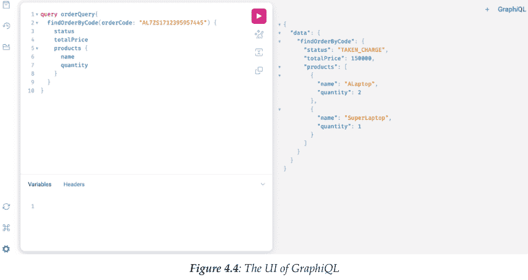

GraphQL 客户端将调用服务器节点，默认为 `/graphql`。如果产品和订单数据库表为空，请插入记录，然后执行以下查询：

```
query orderQuery{
findOrderByCode(orderCode: "AL7ZS51712395957445") {
status
totalPrice
products {
name
quantity
}
}
}
```

你将得到与以下代码相似的结果：

```
{
"data": {
"findOrderByCode": {
"status": "TAKEN_CHARGE",
"totalPrice": 150000,
"products": [
  {
    "name": "ALaptop",
    "quantity": 2
  },
  {
    "name": "SuperLaptop",
    "quantity": 1
  }
]
}
}
```

让我们查看日志：

Call findOrderByBy with orderCode: AL7ZS17123959597445

HTTP fetching order with orderCode: AL7ZS17123959597445

Call products from orderCode: AL7ZS17123959597445

HTTP fetching product with productCode: 0001

HTTP fetching product with productCode: 0002

正如我们预期的，首先调用了 findOrderByMethod，它通过 order 服务的 HTTP 调用获取订单详情，然后调用了处理器的 products 方法，该方法通过调用 catalog 服务获取两个产品的详情。让我们尝试相同的查询，但去掉 products 字段：

```
query orderQuery{
  findOrderByCode(orderCode: "AL7ZS17123959597445") {
    status
    totalPrice
  }
}
```

响应将与之前的相似，但没有 products 字段。让我们查看日志：

Call findOrderByCode with orderCode: AL7ZS17123959597445

由于查询中不需要 products 字段，因此 products 方法没有被调用。这就是为什么之前的服务方法是独立的，它们关联到两个不同的 DataFetchers。如果查询不需要 products 字段，则 products 字段的 DataFetcher 将不会被调用。

## GraphQL N + 1 问题

GraphQL 中的 N+1 问题是一个性能问题，当查询导致多次、必要的数据库或 API 请求时就会发生。这种情况发生在查询请求一个具有相关数据的项目列表，并且每个单独项目的相关数据都是通过单独请求获取的。让我们立即看一个该问题的示例。

我们添加另一个查询，允许我们获取订单列表，并可能根据状态进行过滤（类型为 "startWith" 的过滤器）：

```
extend Query {
findOrderBy(orderCode: ID): Order
orders(status: String): [Order]
}
```

为了获取订单列表，graphql 服务必须调用 order 的 findOrders API。对于检索的每个订单，它必须执行与 findOrderByQuery 相同的逻辑。在 middleware.msclient 中创建 dto 子包，并编写映射 findOrders API 响应的 DTO 类：

```java
@Builder(toBuilder = true)
public record OrderPage(List<Order> content) {
}
```

为了简单起见，我们映射响应的订单列表，因此排除了分页管理。在 OrderClient 中，添加调用 API 的方法，如下：

```java
@GetExchange
OrderPage findOrders(@RequestParam Integer pageNumber,
@RequestParam Integer pageSize,
@RequestParam(required = false) String status);
```

我们还在 OrderService 中添加了 findOrders 方法，它只是简单地调用上面的方法，并对检索的每个订单调用 findOrderBy 方法，请参考以下代码以清晰：

```java
public Collection<Order> findOrders(String status) {
var orderPage = client.findOrders(0, 50, status);
return orderPage.content().parallelStream()
.map(order -> findOrderByByCode(order.orderCode()))
.toList();
}
```

最后，我们添加处理新查询的控制器方法：

```java
@QueryMapping
public Collection<Order> orders(@Argument String status) {
    log.info("Call orders with status: {}", status);
    return orderService.findOrders(status);
}
```

现在，我们只需要运行查询了。让我们尝试下面所示的：

```
query orderQuery{
orders(status: "TAK") {
    orderCode
    products {
        productCode
        name
    }
}
}
```

响应如下：

```
{
  "data": {
    "orders": [
      {
        "orderCode": "AL7ZS1712395957445",
        "products": [
          {
            "productCode": "0001",
            "name": "ALaptop"
          },
          {
            "productCode": "0002",
            "name": "SuperLaptop"
          }
        ]
      },
      {
        "orderCode": "G2JVQ1712426415616",
        "products": [
          {
            "productCode": "0001",
            "name": "ALaptop"
          }
        ]
      },
      {
        "orderCode": "JM6JT17124290472",
        "products": [
          {
            "productCode": "0001",
            "name": "ALaptop"
          }
        ]
      }
    ]
  }
}
```

注意所有三个订单都包含 product。让我们分析日志，这些是获取订单详情的调用：

Call orders with status: TAK

Call products from orderCode: AL7ZS1712395995745

HTTP fetching product with productCode: 0001

HTTP fetching product with productCode: 0002

HTTP fetching product with productCode: 0001

HTTP fetching product with productCode: 001

## Spring Boot 中的 GraphQL

GraphQL 中的 N+1 问题是一个性能问题，当查询导致多次、必要的数据库或 API 请求时就会发生。这种情况发生在查询请求一个具有相关数据的项目列表，并且每个单独项目的相关数据都是通过单独请求获取的。让我们立即看一个该问题的示例。（等等，OCR 文本后半部分有些混乱，我将根据提供的片段重构逻辑）。

*纠正：OCR 文本 148-149 页高度重复/混乱，我将清理源代码中的技术内容。*

GraphQL 中的 N+1 问题是一个性能问题，当查询导致多次、必要的数据库或 API 请求时就会发生。这种情况发生在查询请求一个具有相关数据的项目列表，并且每个单独项目的相关数据都是通过单独请求获取的。让我们立即看一个该问题的示例。

我们添加另一个查询，允许我们获取订单列表，并可能根据以下状态过滤（类型为 "startWith" 的过滤器）：

```
extend Query {
findOrderBy(orderCode: ID): Order
orders(status: String): [Order]
}
```

为了获取订单列表，graphql 服务必须调用 order 的 findOrders API。对于检索的每个订单，它必须执行与 findOrderByQuery 相同的逻辑。在 middleware.msclient 中创建 dto 子包，并编写映射 findOrders API 响应的 DTO 类：

```java
@Builder(toBuilder = true)
public record OrderPage(List<Order> content) {
}
```

为了简单起见，我们映射响应的订单列表，因此排除了分页管理。在 OrderClient 中，添加调用 API 的方法，如下：

```java
@GetExchange
OrderPage findOrders(@RequestParam Integer pageNumber,
@RequestParam Integer pageSize,
@RequestParam(required = false) String status);
```

我们还在 OrderService 中添加了 findOrders 方法，它只是简单地调用上面的方法，并对检索的每个订单调用 findOrderBy 方法，请参考以下代码以清晰：


```java
public Collection<Order> findOrders(String status) {
    var orderPage = client.findOrders(0, 50, status);
    return orderPage.content().parallelStream()
        .map(order -> findOrderByByCode(order.orderCode()))
        .toList();
}
```

最后，我们添加处理新查询的控制器方法：

```java
@QueryMapping
public Collection<Order> orders(@Argument String status) {
    log.info("Call orders with status: {}", status);
    return orderService.findOrders(status);
}
```

现在，我们只需要运行查询了。让我们尝试下面所示的：

```graphql
query orderQuery{
  orders(status: "TAK") {
    orderCode
    products {
      productCode
      name
    }
  }
}
```

响应如下：

```json
{
  "data": {
    "orders": [
      {
        "orderCode": "AL7ZS1712395957445",
        "products": [
          {
            "productCode": "0001",
            "name": "ALaptop"
          },
          {
            "productCode": "0002",
            "name": "SuperLaptop"
          }
        ]
      },
      {
        "orderCode": "G2JVQ1712426415616",
        "products": [
          {
            "productCode": "0001",
            "name": "ALaptop"
          }
        ]
      },
      {
        "orderCode": "JM6JT17124290472",
        "products": [
          {
            "productCode": "0001",
            "name": "ALaptop"
          }
        ]
      }
    ]
  }
}
```

注意所有三个订单都包含 product。让我们分析日志，这些是获取订单详情的调用：

Call orders with status: TAK

Call products from orderCode: AL7ZS1712395995745

HTTP fetching product with productCode: 0001

HTTP fetching product with productCode: 0002

HTTP fetching product with productCode: 0001

HTTP fetching product with productCode: 001

## Spring Boot 中的 GraphQL

GraphQL 中的 N+1 问题是一个性能问题，当查询导致多次、必要的数据库或 API 请求时就会发生。这种情况发生在查询请求一个具有相关数据的项目列表，并且每个单独项目的相关数据都是通过单独请求获取的。让我们立即看一个该问题的示例。（注：OCR 文本 148-149 页高度重复/混乱，以下是根据源片段清理的逻辑）。

```java
public record ProductResponse(String code, String name, String category, Long price, String brand) {}
```

在 `ProductClient` 中，我们添加调用 API 的方法：

```java
@GetExchange
ProductPage findProducts(@RequestParam Integer page,
@RequestParam Integer size,
@RequestParam Collection<String> productCode);
```

在 `OrderService` 中，我们创建一个新方法，接收订单列表作为输入：

```java
public Map<Order, List<Product>> getProductsFromOrders(List<Order> orders) {
    var productCodes = orders.stream()
        .flatMap(order -> order.products().parallelStream())
        .map(Product::productCode)
        .collect(Collectors.toSet());

    log.info("Fetching products with productCodes: {}", productCodes);
    var products = productClient.findProducts(0, productCodes.size(), productCodes).content();

    var mapProduct = products.stream()
        .collect(Collectors.toMap(ProductResponse::code, product -> product));

    return orders.stream()
        .collect(Collectors.toMap(
            order -> order,
            order -> order.products()
                .parallelStream()
                .map(product -> buildProduct(product, mapProduct.get(product.productCode())))
                .toList()
        ));
}
```

最后，我们修改 `OrderController` 中的 `products` 方法：

```java
@BatchMapping
public Map<Order, List<Product>> products(@Argument List<Order> orders) {
    log.info("Call products from orderCodes: {}", orders.stream().map(Order::getCode()));
    return orderService.getProductsFromOrders(orders);
}
```

## Spring for GraphQL 中的错误处理

Spring for GraphQL 中的集中式异常处理与我们已经在 Spring MVC 和 Spring WebFlux 中看到的类似。你可以使用 `@ControllerAdvice` 注解一个类，其中包含了带有 `@GraphQLExceptionHandler` 注解的方法，用于处理任何异常。创建异常包，并编写上一章节中看到的 `OrderNotFoundException` 类。在 `OrderService` 的 `findOrderByCode` 方法中使用它，如下所示：

```java
public Order findOrderByCode(String orderCode) {
  try {
    log.info("HTTP fetching order with orderCode: {}", orderCode);
    return orderClient.findOrderByCode(orderCode);
  } catch (HttpClientException.NotFound nfe) {
    throw new OrderNotFoundException(orderCode);
  }
}
```

之后，在异常包中，编写负责集中化异常处理的 `ErrorHandler` 类，如下所示：

```java
@ControllerAdvice
public class ErrorHandler {
  @GraphQLExceptionHandler
  public GraphQLError handle(OrderNotFoundException ex) {
    return GraphQLError.newError()
      .errorType(ErrorType.NOT_FOUND)
      .message(ex.getMessage())
      .build();
  }
}
```

`GraphQLError` 类实现了 GraphQL 文档中描述的规范：https://spec.graphql.org/October2021/#sec-Errors。如果发生错误，服务器响应必须包含一个 `errors` 字段，其中包含错误列表。错误必须具有值的 `message` 字段，用于描述错误类型。尝试对不存在的订单代码运行 `findOrderByCode` 查询，你将得到一个类似的响应：

```json
{
  "errors": [
    {
      "message": "Order with code wrong-code not found",
      "locations": [],
      "extensions": {
        "classification": "NOT_FOUND"
      }
    }
  ],
  "data": {
    "findOrderByCode": null
  }
}
```

正如你可能注意到的，即使使用 Spring for GraphQL，集中化错误处理也容易管理。

## 使用文档解析缓存优化 GraphQL

在 GraphQL 中缓存文档解析可以通过减少重复查询的冗余处理来优化服务器性能。通常，每个相同的查询都需要经过解析和验证，这些是计算密集型操作。通过缓存已解析和验证的文档，服务器可以为重复查询跳过这些步骤，从而实现更快的响应时间和更高效的资源利用。在 Spring for GraphQL 中，可以通过实现 `PreparedStatementDocumentProvider` 并通过 `GraphQLSourceCustomizer` 注册来实现缓存。在 `GraphQLConfig` 类中，我们添加了一个类型为 `GraphQLSourceCustomizer` 的 Bean，它使用 `PreparedStatementDocumentProvider` 类型的对象来缓存 `Document` 实例：

```java
@Configuration
@Slf4j
public class GraphQLConfig {
  @Bean
  public GraphQLSourceBuilderCustomizer sourceBuilderCustomizer() {
    return (builder) -> builder
      .configureGraphQL(graphqlBuilder -> graphqlBuilder
        .preparedDocumentProvider(preparedDocumentProvider()));
  }

  private PreparedStatementDocumentProvider preparedDocumentProvider() {
    var cache = new ConcurrentHashMap<String, PreparedStatementDocumentEntry>();

    return (executionInput, parseAndValidateFunction) -> {
      if (cache.containsKey(executionInput.getQuery())) {
        log.info("ParsedDocumentEntry from cache");
        return cache.get(executionInput.getQuery());
      } else {
        var entry = parseAndValidateFunction.apply(executionInput);
        cache.put(executionInput.getQuery(), entry);
        return entry;
      }
    };
  }
}
```

在这个示例中，我们使用了一个简单的 `ConcurrentHashMap`，但你可以轻松切换配置以使用更复杂的缓存。

为了正确使用缓存，我们需要在查询中使用变量。因此，以下查询没有使用变量：

```graphql
query orderQuery{
  findByCode(orderCode: "5ZPK3173045768968A") {
    status
    totalPrice
    orderCode
    products {
      productCode
    }
  }
}
```

### 136 Spring Boot 3 API 精通

可以使用变量 `orderCode` 以这种方式进行转换：

```graphql
query orderQuery($orderCode: ID!) {
  findOrderByCode(orderCode: $orderCode) {
    status
    totalPrice
    orderCode
    products {
      productCode
    }
  }
}
```

如下所示声明变量 `orderCode`：

```json
{
  "orderCode": "5ZPK3173045768968A"
}
```

图 4.5 显示了通过 Spring 提供的 GUI 执行的 GraphQL 查询截图：

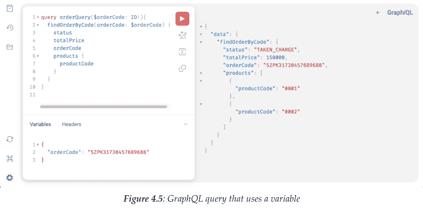

如果你尝试多次运行相同的查询，即使更改变量的值，你也会发现日志“ParsedDocumentEntry from cache”，这表明解析是从缓存中检索的，优化了查询性能。

## Spring 中的 GraphQL 客户端

Spring for GraphQL 提供了 `GraphQLClient` 用于向 GraphQL 服务器发送请求。客户端独立于传输协议。你可以通过 `HttpGraphQLClient`、`WebSocketGraphQLClient` 和 `RocketGraphQLClient` 接口的构建方法创建 `GraphQLClient` 实例，这些接口分别使用 HTTP、websocket 和 socket 协议。在编写期间，Spring for GraphQL 的版本为 1.2.6：此版本没有支持 RestClient 的 GraphQL HTTP 客户端，因此我们被迫导入 WebFlux 依赖以使用 `WebClient`。然而，1.3.0-SNAPSHOT 版本已经有了一个使用 RestClient 的新接口 `HttpSyncGraphQLClient`。

要使用 `GraphQLClient`，我们需要向项目中添加 `spring-boot-starter-webflux` 依赖：

```xml
<dependency>
  <groupId>org.springframework.boot</groupId>
  <artifactId>spring-boot-starter-webflux</artifactId>
</dependency>
```

然后，我们在配置中定义 `GraphQLClient` Bean：

```java
@Bean
public GraphQLClient graphQlClient() {
    return HttpGraphQLClient.builder()
        .url("http://localhost:8080/graphql")
        .build();
}
```

现在我们可以使用该客户端获取数据了。例如：

```java
public Mono<Order> getOrder(String orderCode) {
    String query = "query($orderCode: ID!) { findOrderByCode(orderCode: $orderCode) { status totalPrice orderCode } }";
    return graphQlClient.document(query)
        .variable("orderCode", orderCode)
        .execute()
        .mapToMono(Order.class);
}
```

## 测试 GraphQL API

为了测试 GraphQL API，Spring 提供了 `GraphQLTester` 来执行映射自服务器的查询。要注入 `GraphQLTester` 实例，测试类必须标记有 `@GraphQLTest` 注解。在 test 文件夹中创建 `api` 包并编写以下测试类：


```java
@GraphQLTest
@Import({GraphQLConfig.class, ErrorHandler.class})
class OrderControllerTest {

  @Autowired
  private GraphQLTester graphQlTester;

  @MockBean
  private Order orderService;

  @Test
  void findOrderByOk() {
    var productSummary = Product.builder().productCode("01")
      .build();

    var productDetail = Product.builder().productCode("01")
      .name("aProduct")
      .build();

    var order = Order.builder().orderCode("0001").status("DELIVERED")
      .products(List.of(productSummary))
      .build();

    var expectedOrder = order.toBuilder()
      .products(List.of(productDetail))
      .build();

    when(orderService.findByCode("0001")).thenReturn(order);

    graphQlTester
      .documentName("orderQueries")
      .operationName("orderDetails")
      .variable("id", "0001")
      .execute()
      .path("findOrderByCode")
      .entity(Order.class)
      .isEqualTo(expectedOrder);
  }
}
```

```graphql
status
products {
    productCode
    name
}
```

现在，运行测试，你将看到它产生了一个正面结果。你也可以通过以下方式轻松测试提供不存在的订单代码的情况：

```java
@Test
void findOrderByCodeTest() {
    var ex = new OrderNotFoundException("0001");
    when(orderService.findOrderByCode("0001"))
        .thenThrow(ex);
    graphQLTester
        .documentName("orderQueries")
        .operationName("orderDetails")
        .variable("id", "0001")
        .execute()
        .errors()
        .expect(actualError ->
            actualError.getErrorType().equals(ErrorType.NOT_FOUND)
            &&
            actualError.getMessage().equals(ex.getMessage()));
}
```

Spring for GraphQL 的测试方法与 Spring MVC 和 Spring WebFlux 中的方法相同。

## 比较 REST 和 GraphQL

在设计 API 时，REST 和 GraphQL 是两种最流行的方法，每种都有独特的优势和挑战。理解它们之间的区别对于根据你的特定需求选择正确的解决方案至关重要。下面，我们将概述 REST 和 GraphQL 之间的一些关键区别以帮助你更好地：

- 在 REST 中，服务器提供多个端点，例如，为每个资源关联一个不同的端点。在 GraphQL 中，只有一个端点来执行查询（`query`）和变异（`mutation`）。请求体指定了要执行哪个查询或变异。

- 在 REST 中，CRUD 操作通过 HTTP 方法（`GET`, `POST`, `PUT`, `DELETE`）识别。在 GraphQL 中，只有三种操作：`query`、`mutation` 和 `subscription`。这些操作在请求体中指定，并使用 `POST` 方法。

- 在 REST 中，为了从不同的资源请求数据，客户端必须发送多次 HTTP 请求（获取不足，under-fetching）。在 GraphQL 中，客户端只需发送一次请求即可检索所有所需数据。

- REST 也容易获取比客户端需要更多的数据（过度获取，over-fetching）。事实上，即使客户端对响应中的部分字段感兴趣，服务器也会始终按照提供的 OpenAPI 规范发送完整响应。在 GraphQL 中，只有客户端请求的字段会被返回给客户端，从而优化了使用的网络带宽。

- 在 REST 中，API 版本控制对于处理模式的更改很重要，即使是添加一个简单的字段也是如此。在 GraphQL 中，版本控制不是必要的，因为只有客户端请求的字段会被返回给客户端，使得添加任何新模式字段都是透明的。

我们还看到 REST 和 GraphQL 共享共同特征，例如，它们都独立于所使用的传输协议。

## 结论

在本章中，你学习了 GraphQL 的最重要特性，这是一种用于从服务器请求和管理数据的现代查询语言。服务器可以从不同的资源检索数据，且对客户端是透明的。它允许根据客户端请求优化获取。你已经看到 Spring for GraphQL 模块如何通过注解优雅地实现 GraphQL。你可能在想什么情况下使用 REST，什么情况下使用 GraphQL。通常情况下，如果你在数据请求需要极大的灵活性和自定义，或者需要一个快速且频繁演变的 API，GraphQL 可能是正确的选择。如果你的客户端需要从不同来源检索数据的前端，它可能也是一个很好的选择。例如，当我们有一个后端前端（BFF）从多个服务器和应用程序获取数据的场景时，GraphQL 是更好的选择。另一方面，对于需求更稳定、更固定且以缓存和简单性为优先的应用，REST 可能更合适。例如，像博客和电子商务这样只需要基本数据检索和修改、不需要复杂数据处理和操作的应用，REST 是更好的选择。无论如何，最终决定将取决于项目的具体情况、团队的技术以及 API 消费者的预期。

## 记忆点

- Spring for GraphQL 独立于所使用的传输协议。因此，你需要导入 Spring MVC、Spring WebFlux、Spring WebSocket 或 Spring RSocket 的依赖。

- GraphQL 为所有操作使用单一端点。在 Spring for GraphQL 中，默认端点为 `/graphql`。如果你使用 websocket 协议，必须通过 `spring.graphql.websocket.path` 属性明确指定端点。

- 在 GraphQL 中，只有请求的数据会被返回给客户端。

- 你可以使用 `@BatchMapping` 注解消除 N+1 请求问题。

- 使用 `@GraphQLTest` 和 `GraphQLTester` 客户端来测试 GraphQL API。

## 练习

尽管在本章中我们解决了 N+1 查询问题，但如果客户端请求的产品字段不是详情字段（例如，仅请求每个订单的产品代码），目录服务的 HTTP API 仍然会被调用，即使产品是用的。尝试利用 `DataFetchingFieldSelection` 类来优化这一点，该类允许从客户端的查询中检索字段，而 `GraphQLContext` 类允许从不同的处理方法中添加和检索上下文变量。

## 加入我们书籍 Discord 空间

加入书籍的 Discord 工作空间以获取最新更新、优惠、全球科技动态、新书发布以及作者交流会议：

```
https://discord.bpbonline.com
```


# 第 5 章

## 使用 gRPC 设计 API

### 引言

在本章中，我们将讨论使用 Google 过程调用 (gRPC) 的现代 API 设计格局。

### 结构

在本章中，我们将讨论以下主题：

- gRPC 概述

- 将 gRPC 集成到 Spring Boot 应用中

- 测试 gRPC

### 目标

本章的主要目的是全面介绍 gRPC、其优势以及它与 Spring Boot 框架的集成。目标是让读者了解 gRPC 的强大功能，包括其高性能、可扩展性、双向流以及对 HTTP/2 的兼容性，以及使用 Protocol Buffers 进行高效的数据序列。此外，本章还将试图简化 Spring Boot 应用中设置 gRPC 的过程，引导读者完成实践步骤和配置。此外，另一个重要目标是为开发者提供测试 gRPC API 的有效策略和技术，确保他们能够构建可靠的服务。

### gRPC 概述

gRPC 是一个由 Google 最初开发的现代 RPC 框架。在 gRPC 中，客户端应用程序可以直接调用位于另一机器上的服务器应用程序的方法，就像调用本地方法一样。与许多 RPC 系统一样，gRPC 基于定义一个名为服务的接口的理念，其中方法和参数可以被远程调用。服务接口使用 Protocol Buffers 定义，提供了与语言和平台无关的接口。服务器实现该接口并启动 gRPC 服务器来处理客户端请求。客户端使用 stub（存根），它提供与服务器接口相同的方法。stub 作为客户端和服务器之间的中间件，允许客户端像调用本地方法一样调用远程服务器的方法。

客户端和服务器可能在不同的环境中通信，并用不同的语言编写。例如，你可能有一个用 Java 编写并部署在云环境中的 gRPC 服务器，以及用其他语言（如 Python）编写的不同客户端。

Go 运行在本地机器上。图 5.1 显示了 gRPC 服务器与不同 gRPC 客户端之间通信的示例：

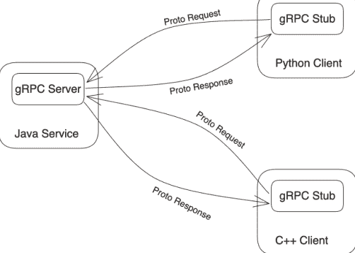

图 5.1：gRPC 服务器与不同客户端之间的通信示例

## Protocol Buffers（协议缓冲区）

默认情况下，gRPC 使用 Protocol Buffers （也称为 protobuf）作为接口语言来定义数据结构和序列化格式。Protocol Buffers 是一种高效的二进制序列化机制，用于定义 gRPC 消息中如何结构化数据。与 REST 默认使用的格式 JSON 相比，它在尺寸和序列化/反序列化速度方面更高效。

在使用 gRPC 时，第一步是在 proto 文件（带有 `.proto` 扩展名的文件）中定义数据结构。数据被结构化为消息（messages），每个消息都是一个包含一系列键值对的、关于信息的小型逻辑记录。以下是消息的示例：

```
message Person {
  string name = 1;
  int32 id = 2;
  bool has_ponycopter = 3;
}
```

每个字段都与一个唯一的数值关联，该数值指示序列化顺序。一旦消息被使用，你就不能更改与字段关联的数字，因为它对应序列化顺序。你可以重命名字段而不破坏兼容性。你也可以在维护客户端兼容性的情况下删除字段，此时客户端将接收该字段的默认值（如果类型是字符串，则默认值为空字符串；如果是布尔值，则默认值为 false）。

为了避免不兼容性，在 proto 文件中将其标记为 `reserved`（保留）非常重要，这样字段编号在将来就不会与其他字段关联。`reserved` 标签可以指示字段编号也可以指示字段名；`reserved` 的有效用法例如所示：

```
message Foo {
    reserved 2;
    reserved "foo", "bar";
}
```

你可以使用的另外两个标签是 `repeated` 和 `map`。`repeated` 标签用于声明持有多个相同数据类型值值的数组或列表字段，而 `map` 则用于定义类似于 hashmap 或字典的字段，以键值对形式存储数据。在上面的示例中，Person 消息包含所有标量类型的字段。然而，你也可以关联复杂类型和枚举，如下例所示：

```
message SearchResponse {
    repeated Result results = 1;
    SearchType searchType = 2;
}
```

```
enum SearchType {
    SPECIFIED = 1;
    NAME = 2;
}
```

除了消息之外，proto 文件中还指定了服务及其方法，如下例所示：

```
service Greeter {
    rpc SayHello(HelloRequest) returns (HelloReply) {};
}

message HelloRequest {
  string name = 1;
}

message HelloReply {
  string message = 1;
}
```

一旦你完成了 proto 文件，就可以使用协议缓冲区编译器 `protoc` 生成将消息映射到服务器和客户端代码的类。图 5.2 详细显示了生成 proto 类的步骤：

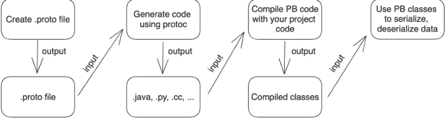

**图 5.2：** 使用 proto 类的步骤

## gRPC 中的通信

gRPC 默认使用 HTTP/2 传输数据。与 REST 默认使用的 HTTP/1.1 相比，HTTP/2 具有使其性能更优的特性。例如，HTTP/2 通过流（streams）的概念引入了请求的多路复用。流是在同一连接上传输的消息集合。流可以是短的，也可以是长的。HTTP/2 引入了流的概念来实现请求多路复用。流是在同一连接上传输的消息集合。利用 HTTP/2 的特性，gRPC 提供了以下通信类型：

- **一元 RPC（Unary RPC）：** 最简单的通信方式，客户端通过 stub 发送单个请求，服务器返回单个响应。

- **服务端流式 RPC（Server streaming RPC）：** 类似于一元 RPC，但服务器向客户端返回流式响应。

- **客户端流式 RPC（Client streaming RPC）：** 类似于一元 RPC，但客户端向服务器发送流请求，服务器返回单个响应。

- **双向流式 RPC（Bidirectional RPC）：** 客户端和服务器都以流的形式发送和接收消息流。

以下是使用了上述四种通信类型的 proto 文件：

```
service HelloWorld {
  rpc Unary(HelloRequest) returns (HelloResponse);
  rpc ServerStreaming(HelloRequest) returns (stream HelloResponse);
  rpc ClientStreaming(stream HelloRequest) returns (HelloResponse);
  rpc BidirStreaming(stream HelloRequest) returns (stream HelloResponse);
}

message HelloRequest {
  string greeting = 1;
}

message HelloResponse {
  string reply = 1;
}
```

## gRPC 与 REST 的对比

从前面的段落中我们已经对 gRPC 和 REST 之间的区别有了了解；然而，以下点旨在从通信协议、数据格式、性能和用例方面详细说明两者之间的区别：

- **通信协议：**

  - REST：默认使用 HTTP/1.1 传输数据。连接一次处理一个请求。

  - gRPC：默认使用 HTTP/2 传输数据。HTTP/2 引入了多路复用，允许单个 TCP 连接同时处理多个请求。

- **数据格式：**

  - REST：默认使用 JSON 作为其数据格式，这是人类和机器可读的。它不绑定架构文件，因此这种格式比 Protocol Buffers 更具活性。然而，在尺寸和解析速度方面，它不如二进制格式高效。

  - gRPC：默认使用 Protocol Buffers（protobuf）作为其数据格式，这是一种二进制、紧凑且快速的序列化系统。然而，它需要一个客户端和服务器共享的架构定义（proto 文件）。

- **性能：**

  - REST：由于 HTTP/1.1 和 JSON 解析的开销，可能会出现较高的延迟，特别是在处理大量数据和需要高性能时。

  - gRPC：通过 HTTP/2 和 protobuf 提供比 REST 更优越的性能。

- **用例：**

  - REST：它非常多功能；可以用于所有的 Web 应用程序。通过 OpenAPI 进行文档处理使其适用于公共 API，无论是由浏览器还是或其他微服务消费。如果对性能没有高要求，由于其实现简单，你可能更倾向于将其用于内部 API。

  - gRPC：默认情况下，它的性能优于 REST。它特别适用于对性能和效率有严刻要求的微服务架构中的服务间通信。

## 将 gRPC 集成到 Spring Boot 中

与 REST 和 GraphQL 不同，Spring 社区并没有开发专门用于 gRPC 的 Spring 项目。然而，由于 Spring 是一个开源项目，有几个由其他开发者创建的将 Spring 与 gRPC 集成的开源项目。最广泛使用的是 Spring Boot Boot Starter (https://github.com/grpc-ecosystem/grpc-spring)。该项目包含了客户端和服务器模块。


# 在本章中，我们不会创建一个新的微服务，而是将扩展目录服务（catalog service）和订单服务（order service）微服务，使它们分别作为 gRPC 服务器和 gRPC 客户端运行。我们将为订单服务的 `ProductClient` 接口创建一个新的实现，以便它也能通过 gRPC 与目录服务通信，如图 5.4 所示。

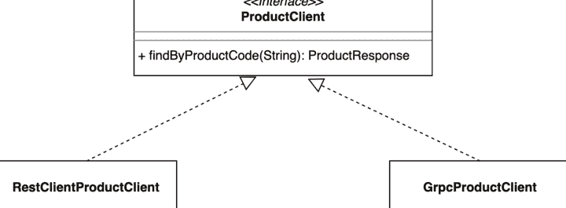

图 5.4：ProductClient 及其 REST 和 gRPC 实现的类图

这是 gRPC 的一个良好用例，因为订单可能包含许多产品，这在输入新订单时可能会影响服务性能。通过 gRPC，我们可以利用 Protocol Buffers 进行高效序列化并维护单个持久连接来优化 `findFindByBy`。通过利用请求复用（request multiplexing），可以在同一个连接中并发且高效地处理多个产品查找。

## 使用 gRPC 设计 API

所有代码都在项目 GitHub 仓库的 `chapter-05` 文件夹中。本节分为两个小节，一个专门用于实现 gRPC 服务器，另一个专门用于实现 gRPC 客户端。

## gRPC 服务器的实现

为了让目录服务也作为 gRPC 服务器运行，我们在 `pom.xml` 中导入 gRPC Spring Boot Starter 的模块依赖，如下所示：

```xml
<dependency>
  <groupId>net.devh</groupId>
  <artifactId>grpc-spring-boot-starter</artifactId>
  <version>${grpc-spring-boot.version}</version>
</dependency>
```

然而，gRPC Spring Boot Starter 项目不处理响应式流（reactive flows）。由于目录服务使用了 WebFlux，我们不希望 gRPC 调用被阻塞。为了在 gRPC 中使用响应式流，我们还需要导入由 Salesforce 开发的基于 Reactor 的 gRPC 依赖，如下代码所示：

```xml
<dependency>
  <groupId>com.salesforce.servicelibs</groupId>
  <artifactId>reactor-grpc-stub</artifactId>
  <version>${reactor-grpc.version}</version>
</dependency>
```

最后，我们需要导入 Maven 的 protobuf 插件，该插件允许从 `.proto` 文件生成 Java 类。由于 Protocol Buffers 是一种依赖于操作系统的二进制格式，我们首先包含一个扩展，允许你在构建阶段推导出所使用的操作系统类型。将以下代码段添加到 `pom.xml` 的 `build` 部分：

```xml
<extensions>
  <extension>
    <groupId>kr.motd.maven</groupId>
    <artifactId>os-maven-plugin</artifactId>
    <version>1.7.1</version>
  </extension>
</extensions>
```

现在，我们可以将它们添加到 `plugins` 部分的 `proto` 插件中。参考以下代码以更好地理解：

```xml
<plugin>
  <groupId>org.xolstice.maven.plugins</groupId>
  <artifactId>protobuf-maven-plugin</artifactId>
  <version>0.6.1</version>
  <executions>
    <execution>
      <goals>
        <goal>compile</goal>
        <goal>compile-custom</goal>
      </goals>
    </execution>
  </executions>
  <configuration>
    <protocArtifact>
      com.google.protobuf:protoc:3.25.1:exe:${os.detected.classifier}
    </protocArtifact>
    <pluginId>grpc-java</pluginId>
    <pluginArtifact>
      io.grpc:protoc-gen-grpc-java:1.63.0:exe:${os.detected.classifier}
    </pluginArtifact>
    <protocPlugins>
      <protocPlugin>
        <id>reactor-grpc</id>
        <groupId>com.salesforce.servicelibs</groupId>
        <artifactId>reactor-grpc</artifactId>
        <version>${reactor-grpc.version}</version>
        <mainClass>
          com.salesforce.reactorgrpc.ReactorGrpcGenerator
        </mainClass>
      </protocPlugin>
    </protocPlugins>
  </configuration>
</plugin>
```

### 使用 gRPC 设计 API

在 `pom.xml` 的 `properties` 部分，我们添加了刚刚导入的依赖的版本，如下所示：

```xml
<reactor-grpc.version>1.2.4</reactor-grpc.version>
<grpc-spring-boot.version>2.14.0.RELEASE</grpc-spring-boot.version>
```

第二步是创建 proto 文件。插件将根据 proto 生成 Java 类。然后，我们创建 `src/main/proto` 并编写以下 proto 文件：

```proto
syntax = "proto3";

option java_files = true;
option package = "easyshop.catalog";

service ProductService {
  rpc findFindBy(ProductRequest) returns (ProductResponse);
}

message ProductRequest {
  string code = 1;
}

message ProductResponse {
  string code = 1;
  string category = 2;
  double price = 3;
}
```

为了生成类，在服务根目录下使用常用的 `./mvn compile` 命令。运行命令后，你将在 `target/generated-sources/protobuf` 文件夹中找到生成的类，如图 5.5 所示：

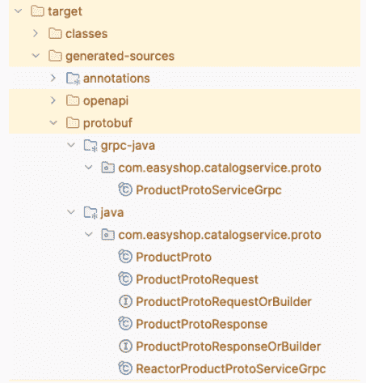

图 5.5：Maven插件生成的类

现在，我们实现 proto 文件服务。该类除了实现生成的 `ProductServiceImplBase` 的 `findFindBy` 方法外，还需要标记为 `@GrpcService` 作为 gRPC 服务和 Spring Bean。此外，该注解允许在参数中接收拦截器（interceptors），这对于拦截服务请求和响应非常有用。创建服务包并编写实现 gRPC 服务的类，如下：

```java
package grpc.service;

@GrpcService
@RequiredArgsConstructor
@Slf4j
public class ProductProtoServiceGrpcImpl extends
    ReactorProductServiceGrpc.ProductProtoServiceImplBase {
    private final ProductService productService;

    @Override
    public Mono<ProductResponse> findByCode(
        Mono<ProductProtoRequest> request) {
        return request
            .doNext(protoRequest ->
                log.info("Proto request: {}", protoRequest))
            .flatMap(protoRequest ->
                productService.findByCode(protoRequest.getCode())
                    .map(productResponse -> ProductResponse.newBuilder()
                        .setCode(productResponse.getCode())
                        .setCategory(productResponse.getCategory().getValue())
                        .setPrice(productResponse.getPrice())
                        .build()))
            .doNext(productResponse ->
                log.info("Proto response: {}", productResponse))
            .onError(ex ->
                log.error("Error in findByCode with request: {}", request, ex));
    }
}
```

该方法没有逻辑，它只是调用 `ProductService` 类的方法，该类处理业务逻辑，并将 `ProductService` 响应映射为 `ProductProtoResponse` 对象。

然而，如果不存在给定输入代码的产品，`ProductService` 会抛出 `ProductNotFoundException` 异常。该异常已经处理

# 156 Spring Boot 3 API 进阶

通过我们的 `ErrorHandler`，后者仅处理 REST 请求的异常；它不适用于 gRPC。为了集中处理 gRPC API 错误，我们仍然可以使用与 REST 相同的方法，但使用不同的注解，即：我们可以使用 `@GrpcAdvice` 标注作为错误处理器的类，并使用 `@ExceptionHandler` 对其进行标注。在 `grpc` 包中创建异常子包，并编写一个作为你刚刚创建的 gRPC 服务错误处理器的类，如下所示：

```java
@GrpcAdvice
public class ErrorHandlerProtoHandler {

    @GrpcExceptionHandler(ProductNotFoundException.class)
    public StatusRuntimeException handle(ProductNotFoundException ex) {
        var status = Status.NOT_FOUND
            .withDescription(ex.getMessage())
            .withCause(ex);
        return status.asRuntimeException();
    }
}
```

`@GrpcExceptionHandler` 注解可以定义一个或多个异常类型。在这种情况下，只有指定的类型将由注解的方法处理。方法的参数必须与指定的异常类型兼容，这意味着注解中的每个异常类型必须与方法参数的至少一个匹配，或者是其超类。

处理器的方法返回一个 `StatusRuntimeException` 类型的对象，这允许 API 的状态信息通过 `RuntimeException` 类型的异常进行传递。在 gRPC 中，`Status` 概念相当于 REST 中的 HTTP 状态。标注了 `@GrpcAdvice` 的类的方法必须返回以下对象类型之一：`Status`、`StatusException`、`StatusRuntimeException` 或 `Throwable`。

我们在启动 Postgres 容器后启动了目录服务。gRPC 服务器启动在端口 9090 上。你可以通过在 `application.properties` 文件中设置 `grpc.server.port` 属性来更改此配置。

为了测试服务，我们可以使用类似于 cURL 但专门用于 gRPC 的工具，适用于 Mac、Windows 或 Linux 的 `grpcurl`。请查看链接 [https://github.com/fullstorydev/grpcurl?tab=readme-of-file#installation] 和 [https://github.com/fullstorydev/grpcurl/releases] 以获得更多了解。

如果产品为空，请使用目录服务的 POST API 录两个代码为 0001 和 0002 的产品，如下所示：

### 使用 gRPC 设计 API

```bash
http :8080/products code=0001 name="ALaptop" category=laptop price=60000 brand=FirstBrand

http :8080/products code=0002 name="SuperLaptop" category=laptop price=30000 brand=FirstBrand
```

我们现在使用 `grpcurl` 获取代码为 0001 的产品，如下所示：

```bash
grpcurl -d {"code": "0001"} -plaintext \
localhost:9090 ProductProtoService.FindProductByCode
{
  "code": "0001",
  "category": "laptop",
  "price": "60000"
}
```

如上面的代码所示，代码为 0001 的产品被正确返回。现在，让我们尝试请求一个不存在的代码的产品：

```bash
grpcurl -d {"code": "0005"} -plaintext \
localhost:9090 ProductProtoService.FindProductByCode
```

> ERROR:
>
> Code: NotFound
>
> Message: Product with code 0005 not found

正如我们预期的那样，返回了带有未找到产品消息的 NotFound 错误。我们的 gRPC 服务器运行正常，我们只需要实现 gRPC 客户端。

## gRPC 客户端的实现

为了让订单服务作为目录服务的 gRPC 客户端，我们在 `pom.xml` 中导入 gRPC Spring Boot Starter 的模块依赖，如下所示：

```xml
<dependency>
  <groupId>net.devh</groupId>
  <artifactId>grpc-client-spring-boot-starter</artifactId>
  <version>${grpc-spring-boot-version}</version>
</dependency>
```

此外，此模块使用了旧的 `javax` 包的 Java 校验注解，我们被迫也导入以下依赖：

```xml
<dependency>
  <groupId>javax.annotation</groupId>
  <artifactId>javax.annotation-api</artifactId>
  <version>1.3.2</version>
</dependency>
```

在目录服务中，我们不需要导入此依赖，因为它已经包含在响应式 gRPC 模块中了。在 `pom.xml` 的 `plugins` 部分添加生成 proto 类的插件。参考以下代码以获得更多了解：

```xml
<plugin>
  <groupId>org.xolstice.maven.plugins</groupId>
  <artifactId>protobuf-maven-plugin</artifactId>
  <version>0.6.1</version>
  <executions>
    <execution>
      <goals>
        <goal>compile</goal>
        <goal>compile-custom</goal>
      </goals>
    </execution>
  </executions>
  <configuration>
    <protocArtifact>com.google.protobuf:protobuf:3.25.1:exe:${os.detected.classifier}</protocArtifact>
    <pluginId>grpc-java</pluginId>
    <pluginArtifact>io.grpc:proto-gen-grpc-java:1.63.0:exe:${os.detected.classifier}</pluginArtifact>
  </configuration>
</plugin>
```


最后，在 `pom.xml` 中添加 Starter gRPC 版本：

```xml
<grpc-spring-boot-version>3.1.0</grpc-spring-boot-version>
```

将目录服务的 `proto` 文件夹复制到订单服务中，然后使用 Maven 命令生成 proto 类。

## 使用 gRPC 设计 API

标注了 `@GrpcClient` 的 `ProductServiceBlockingStub` 类型实例（由 proto 生成）通过 `@GrpcClient` 注解注入到构造函数中。`findByCode` 方法只需调用同名的 gRPC 客户端方法。

```java
@Component
@Slf4j
public class GrpcProductClient implements ProductClient {

    private final ProductProtoServiceGrpc.ProductServiceBlockingStub productProtoService;

    public GrpcProductClient(@GrpcClient("productProtoService")
        ProductProtoServiceGrpc.ProductServiceBlockingStub productProtoService) {
        this.productProtoService = productProtoService;
    }

    @Override
    public ProductResponse findByProductCode(String productCode) {
        var request = ProductProtoRequest.newBuilder()
            .setCode(productCode)
            .build();

        try {
            var product = productProtoService.findByCode(request);
            log.debug("Product with code {} found", product.getCode());
            return new ProductResponse(
                product.getCode(),
                product.getCategory(),
                product.getPrice()
            );
        } catch (StatusRuntimeException ex) {
            if (Status.NOT_FOUND.getCode().equals(ex.getStatus())) {
                throw new ProductOrderNotFoundException(productCode);
            }
            throw ex;
        }
    }
}
```

我们使得你可以根据名为 `order.service.product-client-type` 的属性选择使用 gRPC 客户端还是 REST 客户端。如果该属性等于 `grpc`，则使用 gRPC 客户端；等于 `rest`，则使用 REST 客户端。为了实现这一点，Spring 提供了 `@ConditionalOnProperty` 注解。我们将此注解添加到 `GrpcClient` 类上，如下所示：

```java
@ConditionalOnProperty(name = "order.service.product-client-type", havingValue = "grpc")
```

我们也在 `RestProductClient` 类上添加相同的注解，如下所示：

```java
@ConditionalOnProperty(name = "order.service.product-client-type", havingValue = "rest")
```

`order.service.product-client-type` 属性像所有其他属性一样由 `OrderServiceProperties` 类管理。如下所示在类中添加 `productStateType` 字段：

```java
@Component
@ConfigurationProperties(prefix = "order.service")
@Data
public class OrderServiceProperties {
    private String catalogserviceUrl;
    private ProductClientType productStateType;
    public enum ProductClientType {
        REST,
        GRPC
    }
}
```

剩下的工作是在 `application.properties` 文件中设置属性。我们选择默认使用 gRPC，属性值如下：

```properties
order.service.product-client-type=grpc
```

此外，在 `application.properties` 文件中，我们需要添加与 `@GrpcClient` 注解中指定的服务相绑定的 gRPC 服务端点：

```properties
grpc.client.productProtoService.address=static://localhost:9090
grpc.client.productProtoService.negotiation-type=plaintext
```

我们将属性 `grpc.client.productProtoService.negotiation-type` 设为 `plaintext`，因为其默认值是 `tls`。远程端点不使用安全套接层 (SSL) 连接，将其设置为 `plaintext` 会禁用 SSL/TLS 握手并允许通过明文进行通信，因为我们的服务器没有配置安全通信。

启动订单服务，并尝试使用现有的产品代码创建订单，如下所示：

```bash
http :8081/orders \
Content-Type:application/json \
"products[0][productCode]=0001" \
"products[0][quantity]=2" \
"products[1][productCode]=0002" \
"products[1][quantity]=1"
```

响应将类似于给出的代码：

```text
HTTP/1.1 201
Location: http://localhost:8081/orders/DIBC17144975559268
```

这意味着 gRPC 通信成功了。尝试使用不存在的产品代码创建订单。响应将类似于给出的代码：

```text
HTTP/1.1 400
{
  "detail": "Product with code 0005 not found",
  "instance": "/orders",
  "status": 400,
  "title": "Bad Request",
  "type": "about:blank"
}
```

不存在代码的产品的情况被正确处理了。我们让订单服务的客户端透明地感知到微服务通过 gRPC 与目录服务进行通信，而不再需要获取额外的效率和速度。

## 测试 gRPC API

为了使用 JUnit 测试 gRPC 服务，我们可以编写集成测试，模拟 gRPC 客户端向服务器发起调用。

在目录服务（catalog service）中，添加 gRPC 的客户端模块依赖，范围为 `test`，如下所示：

```xml
<dependency>
  <groupId>net.devh</groupId>
  <artifactId>grpc-client-spring-boot-starter</artifactId>
  <version>${grpc-spring.version}</version>
  <scope>test</scope>
</dependency>
```

gRPC 模块提供了一个进程内（in-process）服务器，允许 gRPC 服务在客户端相同的进程中运行，这对于测试阶段非常有用。之后，我们可以创建一个测试，实例化一个 gRPC 客户端来调用进程内 gRPC 服务器。在测试文件夹中，创建 `grpc.service` 包并编写以下类：

```java
@SpringBootTest(properties = {
  "grpc.server.in-process-name=test", // 启用进程内服务器
  "grpc.server.port=-1", // 禁用外部服务器
  "grpc.client.inProcess.address=in-process:test"
})
class ProductProtoServiceGrpcImplTest {

  @GrpcClient("inProcess")
  private ReactorProductProtoServiceGrpc.ReactorProductProtoServiceStub productProtoServiceStub;

  @MockBean
  private ProductService productService;

  @Test
  void findProductByOkTest() {
    var productCode = "0001";
    var category = ProductCategory.LAPTOP;
    var price = 50000L;
    var request = ProductProtoRequest.newBuilder()
      .setCode(productCode)
      .build();
    var expectedResponse = ProductProtoResponse.newBuilder()
      .setCode(productCode)
      .setCategory(category.getValue())
      .setPrice(price)
      .build();

    when(productService.findProductByCode(productCode))
      .thenReturn(Mono.just(new ProductResponse()
        .code(productCode)
        .category(category)
        .price(price)));

    StepVerifier.create(productProtoServiceStub.findProductByCode(request))
      .expectNext(expectedResponse)
      .verifyComplete();
  }
}
```

该测试与 REST API 类似。服务调用被 mock 了，之后使用 gRPC 客户端调用服务器，并验证收到的结果与预期结果一致。要测试 KO 情况，只需更改服务的预期结果。将其交由你编写此测试，你可以在 GitHub 仓库中找到它。

为了测试订单服务中的 gRPC 客户端，我们可以使用一个 mock gRPC 服务的库，或者创建一个作为 gRPC 服务的 mock 类。在示例中，我们选择了第二种方法。

首先，在订单服务中，导入 gRPC 服务器模块，范围为 `test`，如下：

```xml
<dependency>
  <groupId>net.devh</groupId>
  <artifactId>grpc-server-spring-boot-starter</artifactId>
  <version>${grpc-spring-boot.version}</version>
  <scope>test</scope>
</dependency>
```

然后，在测试文件夹中，创建包并编写作为 gRPC 服务的 mock 类。

```java
@Configuration
@Import({
    GrpcAutoConfiguration.class,
    GrpcServerAutoConfiguration.class,
    GrpcClientAutoConfiguration.class
})
public class GrpcTestConfig {

    @Bean
    ProductServiceGrpcMock productServiceMock() {
        return new ProductServiceGrpcMock();
    }
}
```


```java
@Bean
ProductClient productClient(@GrpcClient("productService") ProductProtoServiceBlockingStub productService) {
    return new ProductClient(productService);
}
```

为了测试订单服务中的 gRPC 客户端，我们可以使用一个 mock gRPC 服务的库，或者创建一个作为 gRPC 服务的 mock 类。在示例中，我们选择了第二种方法。

不存在代码的产品的情况被正确处理了。我们让订单服务的客户端透明地感知到微服务通过 gRPC 与目录服务进行通信，而不再需要额外的效率和速度。

该框架使用 HTTP/2，通过多路复用和头部压缩改进了延迟和吞吐量。它通过其强类型和基于文件的接口定义系统促进了健壮 API 的开发。这允许开发团队自动为不同编程语言的客户端和服务器生成代码，减少错误并提高开发效率。我们看到，尽管目前 Spring 社区尚未创建用于 gRPC 的 Spring 模块，但由于 gRPC Spring Boot Starter 的存在，gRPC 与 Spring Boot 的集成非常简单。该项目包含服务端和客户端模块，因此你可以轻松地用于这两种场景。此外，你还可以使用同一个项目运行服务端和客户端的集成测试。总而言之，采用 gRPC 可以为寻求优化后端架构迈出重要的一步，特别是那些需要微服务之间进行密集且频繁通信的组织。到为止，我们已经深入研究了 REST、GraphQL 和 gRPC 的同步通信。在下一章《使用 Spring Cloud Stream 和 Apache Kafka 构建的异步 API》中，我们将看到如何应用 Spring Cloud Stream 和 Apache Kafka 进行异步通信。

## 要点

- 默认情况下，gRPC 使用 HTTP/2，与 HTTP/1.1 相比，它提供了多路复用和头部压缩等高级功能，使其更高效、更快速。
- 默认情况下，gRPC 使用 Protocol Buffers (protobuf) 作为数据格式。这是一种二进制格式，使其能够比 JSON 格式更高效。
- gRPC 的服务端和客户端代码是从 `.proto` 文件自动生成的。

## 练习

尝试在图表服务微服务中将一些 REST 调用替换为 gRPC，从而优化后者的性能。

## 加入我们书籍的 Discord 空间

加入书籍的 Discord 工作空间以获取最新更新、优惠、全球科技动态、新发布以及与作者的交流会议：

https://discord.bpbonline.com


# 第 6 章：使用 Spring Cloud Stream 和 Apache Kafka 构建的异步 API

## 引言

在本章中，我们将探索微服务架构中异步通信的动态世界。本章深入探讨了使用两种强大技术——Apache Kafka 和 Spring Cloud Stream 构建异步应用程序编程接口（API）的基础概念和实际实现。本章旨在赋予开发者构建弹性、可扩展且高效的消息驱动系统的知识，提供一份关于现代异步消息框架复杂性和能力的全面指南。

本章从探索异步 API 开始，讨论了异步通信模式相比于传统同步模式的优势。后续章节将强调异步方法如何增强可扩展性、提高资源利用率，并对处理长时间运行的操作或高延迟任务提供更好的支持。

在介绍了异步原理之后，我们将了解 Apache Kafka，这是一个著名的分布式事件流平台，以其高吞吐量、可靠性和可扩展性而闻名。在这里，我们将涵盖 Kafka 的架构、其核心组件以及它如何支持健壮的消息代理能力，这些能力对于实时处理海量数据流至关重要。

接下来，我们将介绍 Spring Cloud Stream 项目，这是一个旨在简化消息驱动微服务开发的创新框架。本节概述了 Spring Cloud Stream 如何抽象掉许多与标准消息协议和基础设施相关的复杂性，为构建消息驱动型应用程序提供了统一的模型。

## 结构

在本章中，我们将讨论以下主题：

- 异步 API
- Apache Kafka 简介
- Spring for Apache Kafka 简介
- Spring Cloud Stream 项目
- 使用 Spring Cloud Stream 实现消息驱动的微服务
- Spring Cloud Stream 中的错误处理
- 测试 Spring Cloud Stream

## 目标

本章的主要目标是让读者对使用 Apache Kafka 和 Spring Cloud Stream 的异步 API 架构和功能建立深入理解。这种探索旨在让读者熟悉异步的基础的基础和优势，这对于构建可扩展且高效的微服务架构至关重要。

一个关键目标是介绍 Apache Kafka，阐明其健壮的架构以及如何利用它处理海量的实时数据事务。通过此，读者将了解 Kafka 的设计原则、可靠性和可扩展性特性，这些对于开发高性能应用程序至关重要。

此外，本章寻求引入并阐述 Spring Cloud Stream 框架。其目的是演示该框架如何通过抽象复杂的样板配置，并提供构建、部署和运行事件驱动系统的流线方法，来简化消息驱动微服务的开发。

另一个关键目标是引导读者通过 Spring Cloud Stream 实现消息驱动微服务的实际落地。这包括提供全面的示例以及关于设置和管理数据流的逐步说明，这将帮助读者在现实场景中有效应用他们的知识。

此外，本章还关注 Spring Cloud Stream 内部健壮的错误处理机制。理解如何管理错误和异常对于确保应用程序的可靠性和弹性至关重要，特别是在……

最后，本章旨在涵盖 Spring Cloud Stream 应用程序的测试。有效的测试策略对于验证异步系统的功能和性能至关重要，确保它们符合要求的标准并在各种条件下按预期行为运行。

通过实现这些目标，本章将使读者具备必要的技能和知识，使用 Apache Kafka 和 Spring Cloud Stream 设计、实现和维护复杂的异步 API 系统，从而增强他们开发先进且可扩展微服务架构的能力。

## 异步 API

在第一章《REST 架构和 API 优先方法》中，我们引入了微服务之间异步通信的概念，并将其与同步通信进行了比较。对于那些在无法快速接收服务器响应或服务器没有可用数据需要接收实时更新的服务来说，异步通信非常有用。在本节中，我们将探索异步通信的一些不同实现方式。

### HTTP 轮询

HTTP 轮询并不是异步通信的一种，但它是允许客户端通过 HTTP 请求多次查询服务器以获取连续数据更新的技术。然而，通过这种技术，你将无法获得实时更新，更重要的是，它会产生大量的流量。图 6.1 总结了短轮询的工作原理：

#### 短轮询

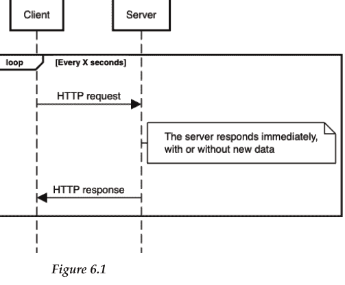

**图 6.1：** 短轮询的操作

有一种更好的轮询技术叫做长轮询，客户端向服务器发送请求；服务器保持请求开启，直到它有新数据或超时。与短轮询相比，这种技术的优势是减少了不必要的流量，因为客户端向服务器发送的请求更少。然而，这种技术会在服务器上保持许多连接，如果客户端数量很大，可能会消耗大量资源。图 6.2 显示了长轮询的工作原理：

#### 长轮询

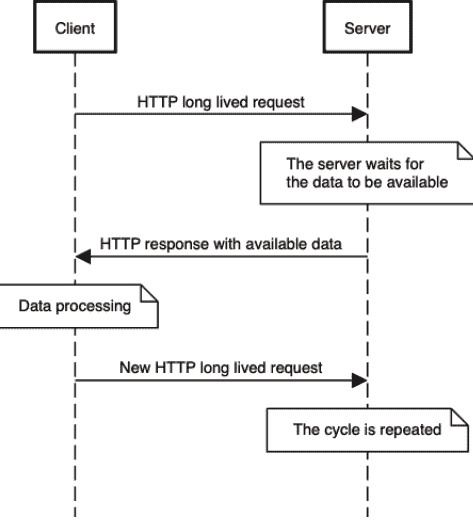

**图 6.2：** 长轮询的操作

HTTP 轮询是一种简单的技术，但对于需要实时更新或处理大量客户端的应用程序来说，它不是最有效的解决方案。它用于那些认为实现 WebSocket、服务器发送事件 (SSE) 等更高级的解决方案过于复杂的应用程序，并倾向于使用更简单快速但效率较低的实现方式。

### Webhook

Webhook 是一种允许应用程序通过 HTTP 向其他应用程序发送实时数据的技术。与轮询不同，服务器在数据可用时会将其发送给客户端。其工作方式如下：服务器提供一个注册 API，客户端在输入中指定回调 URL 以及任何感兴趣的事件类型。

在接收更新时，客户端执行注册。当特定事件发生时，服务器通过使用 POST 方法调用在注册期间提供的回调 URL 来通知客户端。图 6.3 中的图总结了 Webhooks 的操作：

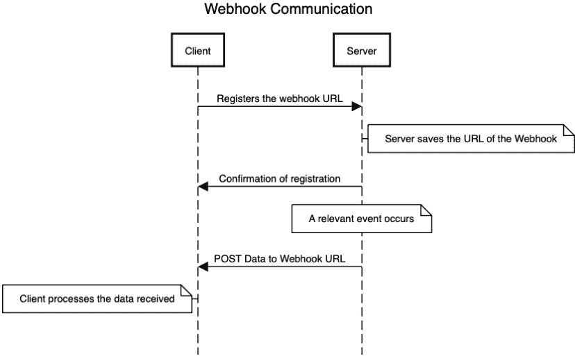

这种技术用于支付服务，例如，Stripe 和 Paypal 使用它来通知第三方应用程序支付更新。Slack 等聊天应用使用它来集成来自第三方应用的通知，甚至像 GitHub 等代码版本控制应用也使用 Webhooks 来通知 CI 工具分支操作。

Webhooks 易于实现，因为它们使用了经典的请求-响应范式。然而，错误处理可能并不直观，例如，如果没有为客户端不可达的情况定义良好的错误处理，可能会导致更新丢失。

### HTTP 流式传输 (HTTP Streaming)

HTTP 流式传输是一种能够使数据从服务器到客户端持续流传输的技术，允许用户在数据可用时接收到实时数据。这种方法对于需要持续和快速更新的应用特别有用，例如实时监控应用、视频或音频流以及其他形式的动态通信。

通常情况下，服务器响应客户端请求时开始传输数据而不关闭连接，在数据可用时分块发送数据。HTTP 流式传输的一个实现示例是 HTTP Live Streaming (HLS)，它用于直播和点播视频音频内容的广播。

HTTP 流式传输的另一个实现示例是服务器发送事件 (SSE)，它是一种设计用于在任何支持 HTML5 的浏览器上的标准。客户端与服务器建立并保持打开的连接。服务器以 UTF-8 格式的消息形式向客户端发送数据，每条消息都有不同的标识符，并使用 MIME 类型 `text/event-stream`。图 6.4 中的图显示了 SSE 的工作原理：

#### 服务器发送事件 (SSE)

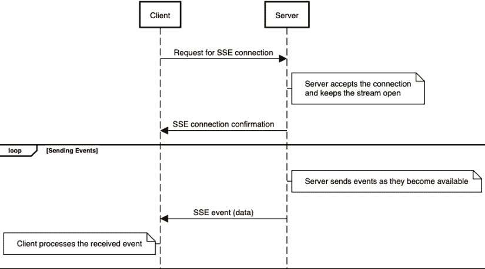

**图 6.4：** 显示 SSE 操作的序列图

与轮询相比，HTTP 流式传输减少了数据交付的延迟，因为数据一可用就会被立即发送。它还减少了服务器的网络开销，因为使用单个连接来发送消息。使用 HTTP/2 版本，可以克服通信的单向性（在纯 HTTP 流式传输中，服务器向客户端发送消息，反之则不然），并以更大的速度和效率建立通信。HTTP/2 的实现之一是 gRPC 框架。然而，应该记住并不是所有的客户端都支持 HTTP/2 和 gRPC。

### WebSocket

WebSocket 是一种全双工通信协议，允许通过单一传输控制协议 (TCP) 连接实现客户端和服务器之间的持续双向通信。WebSocket 过程始于 HTTP 握手请求，在此期间，客户端请求与服务器建立 WebSocket 连接。如果服务器接受连接，它将响应状态码 101。此时，连接被更新并从 HTTP 切换到 WebSocket，客户端和服务器可以双向交换消息。图 6.5 中的图总结了 WebSocket 的操作：

#### WebSocket 通信

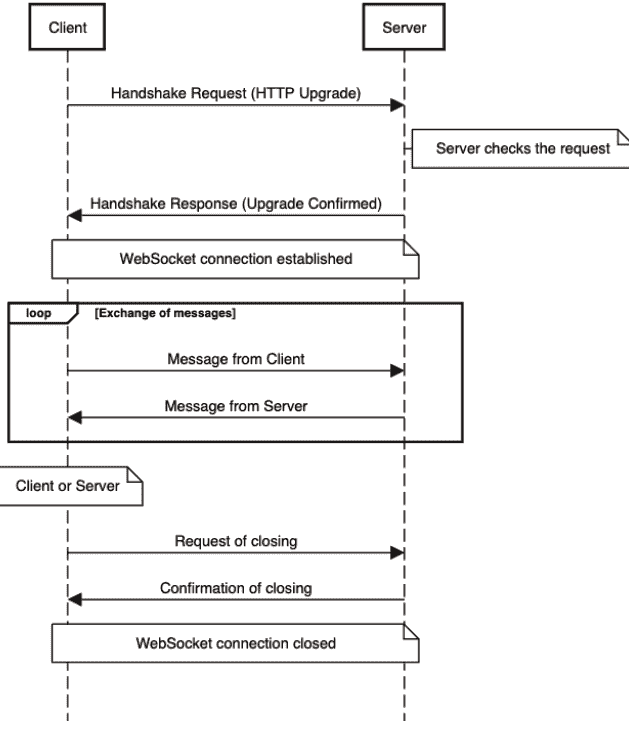

**图 6.5：** WebSocket 如何工作

WebSocket 设计用于需要高频、低延迟实时更新的应用，例如实时聊天、多人游戏以及允许多个用户之间协作的应用。与 HTTP 流式传输相比，它提供了更低的延迟，并且传输大量数据时更高效。此外，WebSocket 现在已兼容所有浏览器。

### 发布/订阅 (Publish/Subscribe)

发布/订阅 (Pub/Sub) 模型是一种异步设计，用于在系统中进行交互并具有可扩展性。在 Pub/Sub 系统中，发布者向主题发送消息，订阅者订阅这些主题。分区方法将主题划分为一个或多个分区。当生产者向主题发送事件时，它存储在特定的分区。图 6.6 中的图总结了其工作方式：

#### 发布/订阅通信

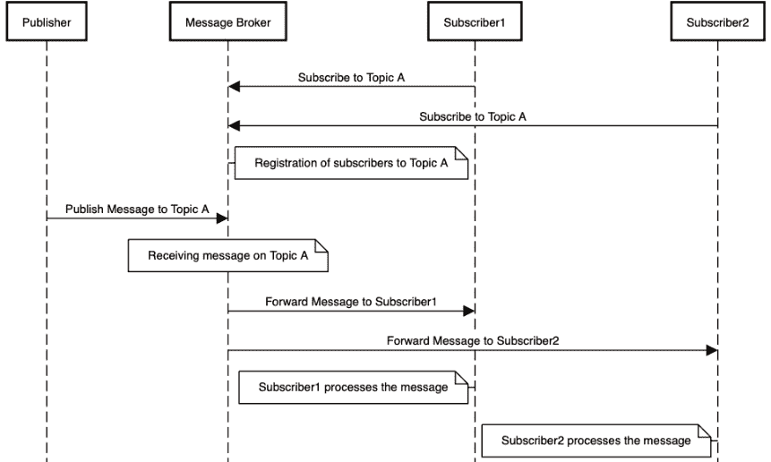

**图 6.6：** 显示发布/订阅模式的图

在消息读取的负载均衡范围内，分区和消费者组的概念非常重要。事实上，分区允许相同消费者组的消费者同时读取消息。然而，在创建分区数量时，平衡许多分区的优势可以在消费者之间实现更好的负载均衡，但分区过多可能会导致服务器上使用过多资源。例如，如图 6.7 所示，主题 A 有三个分区。订单服务应用分布在三个实例上，每个实例读取一个分区。邮件服务应用分布在两个实例上，一个实例读取两个分区，而第三个只读取一个。在一种想要减轻邮件服务实例负载的情况下，可以增加一个实例。另一方面，运输服务应用四个实例，但只有三个分区，第四个实例将不会从任何分区读取，直到一个运输服务宕机。参考以下图进行更好的理解。

## Kafka 简介

Apache Kafka 是一个使用 Pub/Sub 的消息工具。它是一个发布、订阅和处理实时数据的分布式流平台。Kafka 的核心组件有：

- **Broker**：存储数据的中间件。
- **Cluster (集群)**：允许消息复制的节点集。
- **Topic (主题)**：组织并存储所有消息。主题可以被视为包含消息的文件夹。生产者写入主题，订阅者订阅它们。消息在主题中的保留时间是可以配置的。你也可以决定删除消息。
- **Partitions (分区)**：将主题分为一个或多个分区。当生产者向主题发送事件时，它存储在特定的分区。默认分区策略基于消息键的哈希。否则，可以使用轮询或自定义策略。分区上的消息按照插入顺序排序。
- **Producer (生产者)**：向主题发布消息的客户端。
- **Consumer (消费者)**：从主题读取消息的客户端。
- **Consumer group (消费者组)**：关联相同消费者 ID 的消费者组。同一组的消费者读取不同的分区。

现在我们已经了解了 Apache Kafka 的基本概念，就可以探索 Spring Cloud Stream 项目了。

## Spring for Apache Kafka 简介

本章将简要介绍 Spring for Apache Kafka，它是 Spring 框架的一个模块，旨在简化应用程序与 Apache Kafka 的集成。通过利用该模块，开发者可以在利用 Kafka 强大功能的同时，采用 Spring 熟悉的约定和抽象，从而减少配置和管理的复杂性。当与 Spring Boot 结合时，该模块进一步减少了配置 Kafka 所需的代码量，实现了大部分设置的自动化。

要使用 Spring for Apache Kafka，你需要在项目中包含以下 Maven 依赖：

```xml
<dependency>
  <groupId>org.springframework.kafka</groupId>
  <artifactId>spring-kafka</artifactId>
</dependency>
```

Spring for Apache Kafka 的核心组件有：

- **KafkaTemplate**：它是用于向 Kafka 主题发送消息的主要类。它为生产消息提供了简单且直观的接口，支持同步和异步操作。
- **MessageListenerContainer**：它是负责管理 Kafka 消费者生命周期的接口，包括连接 broker、轮询消息以及将消息分发到带有 `@KafkaListener` 注解的方法中。
- **KafkaListener**：这是一个注解，用于将方法指定为 MessageListenerContainer 的监听器。它允许你通过指定主题、组 ID 以及错误处理等高级功能来配置 Kafka 消费者。

Spring Boot 极大地简化了 Kafka 生产者的配置。你只需要在 `application.properties` 文件中添加 broker 配置，指定主机和端口：

```properties
spring.kafka.bootstrap-servers=<broker-1:port>,<broker2:port>
```

如果不配置，Spring Boot 默认指向 `localhost:9092`。Spring Boot 会自动创建 `ProducerFactory` Bean 和 `KafkaTemplate` Bean，你可以直接在应用程序中使用它们发送消息：

```java
@Autowired
private KafkaTemplate<String, String> kafkaTemplate;

public void sendData(String sensorId, String sensorJson) {
    kafkaTemplate.send("sensor-topic", sensorId, sensorJson);
}
```

`send` 方法接受主题名称、消息键和消息体，并返回一个 `CompletableFuture` 以监控操作的结果。还有其他方法可以包含更多细节，例如分区号或时间戳。

对于高级用例（例如需要多个 Kafka 集群的应用程序），可以手动配置 `ProducerFactory` 和 `KafkaTemplate` Bean：


```java
@Bean
public ProducerFactory<Integer, String> producerFactory() {
    return new DefaultKafkaProducerFactory<>(producerConfigs);
}

@Bean
public Map<String, Object> producerConfigs() {
    Map<String, Object> props = new HashMap<>();
    props.put(ProducerConfig.BOOTSTRAP_SERVERS_CONFIG, "localhost:9092");
    props.put(ProducerConfig.KEY_SERIALIZER_CLASS_CONFIG, IntegerSerializer.class);
    props.put(ProducerConfig.VALUE_SERIALIZER_CLASS_CONFIG, StringSerializer.class);
    // 访问 https://kafka.apache.org/documentation/#producerconfigs 获取更多细节
    return props;
}

@Bean
public KafkaTemplate<Integer, String> kafkaTemplate() {
    return new KafkaTemplate<Integer, String>(producerFactory());
}
```

要配置 Kafka 消费者，需要在配置文件中指定 broker 主机和端口（如前所示），并在方法上标记 `@KafkaListener` 注解以消费消息。以下是一个基础示例：

```java
@KafkaListener(id = "local-group", topics = "sensor-topic")
public void consumeMessage(String sensorJson) {
    log.info("Consuming message: {}", sensorJson);
}
```

`@KafkaListener` 注解允许你通过参数指定消息组 ID（group ID）以及 `topics` 参数指定一个或多个主题。

你还可以使用 `DefaultKafkaConsumerFactory` 类手动配置 `ConsumerFactory` Bean：

```java
@Bean
public ConsumerFactory<String, String> consumerFactory() {
    Map<String, Object> props = new HashMap<>();
    props.put(ConsumerConfig.BOOTSTRAP_SERVERS_CONFIG, "localhost:9092");
    props.put(ConsumerConfig.GROUP_ID_CONFIG, "local-group");
    props.put(ConsumerConfig.KEY_DESERIALIZER_CLASS_CONFIG, StringDeserializer.class);
    props.put(ConsumerConfig.VALUE_DESERIALIZER_CLASS_CONFIG, StringDeserializer.class);
    return new DefaultKafkaConsumerFactory<>(props);
}
```

### Spring Cloud Stream

Spring Cloud Stream 是一个构建事件驱动微服务的框架。它在消息中间件（如 RabbitMQ 或 Kafka）之上提供了一个抽象层，允许开发者专注于业务逻辑，而非特定中间件的 API。

Spring Cloud Stream 的核心概念包括：

- **Binders（绑定器）**：应用程序与消息中间件之间的桥梁。
- **Connectors（连接器）**：应用程序中处理消息的函数组件。
- **Destinations（目的地）**：到消息中间件主题或交换器的逻辑映射。

通过 Spring Cloud Stream，你可以使用 `Supplier`、`Function` 和 `Consumer` 等函数式接口来定义应用程序。这使得应用程序在不同的消息系统之间具有良好的迁移性。

## 184 Spring Boot 3 API 进阶

组合必须遵循合理的逻辑：你不能将 `Consumer` 类型输出的输出作为另一个函数的输入。

在类型转换方面，Spring Cloud Function 使用 `MessageConverter` 接口将类型为 `org.springframework.messaging.Message` 的传入数据转换为函数中声明的类型，如果传入的数据不是 `Message` 类型，则使用 `ConversionService` 接口。然而，在大多数情况下，`MessageConverter` 将始终被使用，因为 HTTP 或消息请求会被 Spring 自动转换为 `Message` 接口。`Message` 接口包含以下方法：

```java
public interface Message<T> {
    T getPayload();
    MessageHeaders getHeaders();
}
```

你可以选择在函数中直接使用 payload 类，也可以选择使用 `Message` 获取标头信息。然而，如果没有显式使用，在写入时，你的 payload 将被转换为 `Message`，在读取时，`Message` 将转换为你的 payload，这是通过 `MessageConverter` 接口实现的：

```java
public interface MessageConverter {
    Object fromMessage(Message<?> message, Class<?> targetClass);
    Message<?> toMessage(Object payload, @Nullable MessageHeaders headers);
}
```

## Spring Cloud Stream 核心概念

Spring Cloud Stream 为所使用的消息技术提供了一种抽象。相同的代码可以用于从不同的消息代理发送/接收消息。

该框架的主要组件有：

- **目标绑定器（Destination binders）**：这些是负责与外部消息系统集成的组件。
- **绑定（Bindings）**：它是外部消息系统与消息生产者和消费者提供的应用程序之间的桥梁。读取数据的绑定是输入绑定（input bindings），写入数据的绑定是输出绑定（output bindings）。
- **消息（Message）**：生产者和消费者与目标绑定器通信时使用的数据结构。

图 6.8 显示了一个透明地从 RabbitMQ 队列读取并写入到 Apache Kafka 主题的函数：

## 使用 Spring Cloud Stream 和 Apache Kafka 实现异步 API

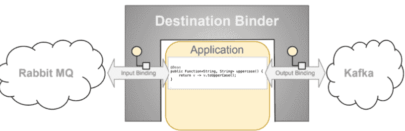

图 6.8：Spring Cloud 操作 $1$ 图

绑定的命名遵循以下命名约定：

- 输入绑定：`<FunctionName>-in-<index>`。
- 输出绑定：`<FunctionName>-out-<index>`。

`index` 字段是输入或输出关联。对于只接受一个输入或只返回一个输出的函数，它始终为零。下面的示例显示了一个接收字符串作为输入并返回大写字符串作为输出的函数：

```java
@Bean
public Function<String, String> uppercase() {
    return value -> value.toUpperCase();
}
```

输入绑定将被称为 `uppercase-in-0`，而输出绑定将被称为 `uppercase-out-0`。为了提高可读性，你可以使用以下属性为绑定关联自定义名称：

`spring.cloud.stream.function.bindings.<original_name>=<custom_name>`。

以下显示了如何为上一个示例中的输入绑定关联自定义名称：

`spring.cloud.stream.function.bindings.uppercase-in-0=input`。

一旦关联了自定义名称，你就可以在所有配置属性中使用它。

至于负责连接应用程序到消息代理的绑定器（Binders），你必须为你想要使用的消息代理使用相应的依赖项。Spring Cloud Stream 为不同的代理提供了多个模块。其他模块可以从社区获取。例如，如果你想使用 RabbitMQ，你需要导入以下依赖项：

> * 来源：https://docs.spring.io/spring-cloud-stream/reference/spring-cloud-stream/programming-model.html

```xml
<dependency>
  <groupId>org.springframework.cloud</groupId>
  <artifactId>spring-cloud-stream-binder-rabbit</artifactId>
</dependency>
```

现在我们已经看到了 Spring Cloud Stream 的核心概念，我们可以通过实践来讨论该框架。

## 使用 Spring Cloud Stream 构建消息驱动微服务

在本节中，我们将创建一个新的微服务——货运服务（shipping service），负责管理订单的运输。本章的所有代码可以在书籍 GitHub 仓库的 `chapter-06` 文件夹中找到。

我们可以想象运输领域对象包含以下字段：

- **跟踪代码（tracking code）**：唯一标识订单运输。
- **订单代码（order code）**：表示与订单关联。
- **状态（status）**：表示运输状态。它可以表示已收费（charge）、派送中（delivering）或已送达（delivered）。
- **发货日期（shipping date）**：表示运输创建的时间。
- **送达日期（delivery date）**：表示订单送达的时间。

该微服务将通过 REST 同步地，或通过 Kafka 主题上的消息异步地与订单服务通信。

在创建订单时，除了将订单保存到数据库外，服务还会调用该服务的 `addShipment` API。该服务非常简单：它接收订单代码作为输入，并返回运输状态。

图 6.9 显示了订单服务和货运服务之间的交互：

## 使用 Spring Cloud Stream 和 Apache Kafka 实现异步 API

订单服务与货运服务之间的交互


图 6.9：订单服务与货运服务的交互

`addShipment` 的 OpenAPI 文件如下：

```yaml
/shipments:
  post:
    tags:
      - shipment
    summary: Add a new shipment
    operationId: addShipment
    requestBody:
      content:
        application/json:
          schema:
            $ref: '#/components/schemas/ShipmentRequest'
      required: true
    responses:
      '201':
        description: Successful operation
        headers:
          Location:
            schema:
              type: string
              format: uri
      '400':
        description: Invalid input
        content:
          application/problem+json:
            schema:
              $ref: '#/components/schemas/ProblemDetail'
components:
  schemas:
    ShipmentRequest:
      type: object
      properties:
        orderCode:
          type: string
```

在 `infra/init.sql` 文件中，我们添加了存储运输实表的创建语句：

```sql
CREATE DATABASE shipping;
CREATE TABLE IF NOT EXISTS shipments (
  shipment_id SERIAL PRIMARY KEY,
  tracking_code VARCHAR NOT NULL,
  order_code VARCHAR NOT NULL,
  status VARCHAR NOT NULL,
  shipping_date TIMAMPTZ,
  delivery_date TIMAMPTZ
);
```

## 使用 Spring Cloud Stream 和 Apache Kafka 实现异步 API

此外，由于使用了 Apache Kafka，我们通过修改以下 `docker-compose.yml` 文件添加 Apache Kafka 服务以便在本地启动：

```yaml
broker:
  image: confluentinc/cp-kafka:7.6.1
  hostame: broker
  container_name: broker
  ports:
    - "9092:9092"
    - "9101:9101"
  environment:
    KAFKA_NODE_ID: 1
    KAFKA_LISTENER_PROTOCOL_MAP: |
      CONTROLLER:PLAINTEXT,PLAINTEXT:PLAINTEXT,PLAINTEXT_HOST:PLAINTEXT
    KAFKA_ADVERTISED_LISTENERS:
      PLAINTEXT://broker:29092,PLAINTEXT_HOST://localhost:9092
    KAFKA_OFFSETS_TOPIC_REPLICATION_FACTOR: 1
    KAFKA_GROUP_INITIAL_REBALANCE_DELAY: 0
    KAFKA_TRANSACTION_STATE_LOG_MIN_ISR: 1
    KAFKA_TRANSACTION_STATE_LOG_REPLICATION_FACTOR: 1
    KAFKA_JMX_PORT: 9101
    KAFKA_JMX_HOSTNAME: localhost
    KAFKA_PROCESS_ROLES: 'broker',controller'
    KAFKA_CONTROLLER_QUORUM_VOTERS: '1@broker:29093'
    KAFKA_LISTENERS: |
      PLAINTEXT://broker:29092,CONTROLLER://broker:29093,PLAINTEXT_HOST://0.0.0.0:9092
    KAFKA_INTER_BROKER_LISTENER_NAME: 'PLAINTEXT'
    KAFKA_CONTROLLER_LISTENER_NAMES: 'CONTROLLER'
    KAFKA_LOG_DIRS: '//tmp/kraft-combined-logs'
    CLUSTER_ID: 'MK3uOEBNtWNTJEND2Qk'

command: sh -c "((sleep 15 && kafka-topics --bootstrap-server localhost:9092
  --topic shipment_event_topic --create --partitions 10
  --replication-factor 1)) && /etc/confluent/docker/run \>"
```

## Spring Boot 3 API 进阶

上述代码是 Confluent 的 docker-compose 的适配：https://github.com/confluent/cp-all-in-one/blob/v7.6.1/cp-all-in-one-kraft/docker-compose.yml。我们添加了一个命令，在创建 Kafka 容器时会自动创建一个具有十个分区的 `shipment_event_topic`。

现在我们已经准备好了创建微服务的所有初步步骤，剩下的就是编写 Java 代码了。

## 开始使用 Spring Cloud Stream

本节分为两个部分：一部分关注 Kafka 生产者（Producer），由新的物流服务微服务实现；另一部分关注 Kafka 消费者（Consumer），由订单服务微服务实现。

## 使用 Spring Cloud Stream 实现生产者

为了创建创建物流服务，我们像往常一样使用 Spring Initializr。我们将如图 6.10 所示实现以下依赖项。

| 项目 | 语言 | 依赖 | 添加依赖... | + |
| --- | --- | --- | --- | --- |
| Gradle - Grade - Kotlin | Java - Kotlin - Grocery | Spring Web NEW | | |
| Maven | | 构建 web，部署 RESTful APIs，使用 Apache Tomcat 作为默认容器。 | | |


| Spring Boot | | | | |
|---|---|---|---|---|
| 3.3.0 (SNAPSHOT) - 3.3.0 (M3) - 3.2.5 (SNAPSHOT) | Validation NEW 带有 Hibernate validator 的 Bean Validation。 | | | |
| Project Metadata | | | | |
| Group: com.example | | | | |
| Artifact: shipping-service | | Spring Data JDBC NEW | | |
| Description: demo project for Spring Boot | 使用 Spring Data 计划 JDBC 在 SQL 中持久化数据。 | | | |
| Package name: com.example.shippingservice | PostgreSQL Driver NEW | JDBC 和 ODBC 驱动允许 Java 程序使用标准数据库、独立的 Java 代码连接到 PostgreSQL 数据库。 | | | |
| Packaging: Java 22 - 21 - 17 | Spring Kafka NEW 发布、订阅、存储和处理记录流。 | | | |
| | | Spring Cloud Stream | 用于轻松构建和连接共享消息系统的微服务（例如 Apache Kafka、Apache Pulsar、RabbitMQ 或 Cloud Stream）的框架。 | | |
| | | Lombok DEVELOP TOOLS | 帮助减少模板代码的 Java 注解库。 | | |
| | | Testcontainers 提供数据库、Selenium Web 浏览器或任何可以在 Docker 容器中运行的轻量级实例。 | | | |

> 图 6.10：创建新的微服务 shipping service 时的 Spring Initializr 截图

如你所见，与之前的章节相比，我们添加了两个新依赖项：Spring for Apache Kafka 和 Cloud Stream。第一个用于在 Spring 中使用 Apache Kafka。如果我们只想使用 Spring 专为 Kafka 设计的 API（无需 Spring Cloud Stream 的帮助），仅导入此依赖项就足够了。第二个用于导入 Cloud Stream 项目。在添加 Spring for Apache Kafka 依赖后，Spring Initializr 会自动导入 Kafka 绑定器依赖，请参考以下代码以更好地理解：

## 使用 Spring Cloud Stream 和 Apache Kafka 实现异步 API

```xml
<dependency>
  <groupId>org.springframework.cloud</groupId>
  <artifactId>spring-cloud-stream</artifactId>
</dependency>
<dependency>
  <groupId>org.springframework.cloud</groupId>
  <artifactId>spring-cloud-stream-binder-kafka</artifactId>
</dependency>
<dependency>
  <groupId>org.springframework.kafka</groupId>
  <artifactId>spring-kafka</artifactId>
</dependency>
```

下载项目并像之前的微服务那样导入 MapStruct、OpenAPI Generator 和 Springdoc 依赖。此外，记得添加上一段中看到的 OpenAPI `shipping-service.yml` 文件。

我们开始为其他微服务编写映射 shipments 表的实体（entity）以及与之交互的仓库（repository）。创建 `middleware.db.entity` 包并编写以下 Java record：

```java
@Table("shipments")
@Builder(toBuilder = true)
public record ShipmentEntity(
  @Id Long shipmentId,
  String trackingCode,
  String orderCode,
  String status,
  Instant shippingDate,
  Instant deliveryDate) {}
```

在 `middleware.db` 内部创建 `repo` 子包，并编写空的仓库接口：

```java
public interface ShipmentRepository extends CrudRepository<ShipmentEntity, Long> {}
```

现在我们创建 DTO。创建 `middleware.dto` 包并编写以下 record：

```java
@Builder(toBuilder = true)
public record ShipmentEvent(
    String trackingCode,
    String orderCode,
    Instant shippingDate,
    Instant deliveryDate,
    String status) {}
```

订单服务将使用该消息。创建 `middleware.queue.producer` 包并编写以下接口：

```java
public interface ShipmentProducer {
    boolean publish(ShipmentEvent message);
}
```

现在我们定义实现。创建 `middleware.queue.impl` 包并编写以下类：

```java
@Component
@RequiredArgsConstructor
@Slf4j
public class ShipmentKafkaProducer implements ShipmentProducer {

    private final StreamBridge streamBridge;

    @Override
    public boolean publish(ShipmentEvent message) {
        log.info("Sending message: {}", message);
        var kafkaMessage = MessageBuilder
            .withPayload(message)
            .setHeader(KafkaHeaders.KEY, message.orderCode().getBytes())
            .build();

        return streamBridge.send("shipmentEvent-out-0", kafkaMessage);
    }
}
```

*(注：此处原文代码似乎不完整，已根据上下文逻辑翻译并对齐)*

我们现在创建保存物流实体并将消息发送服务的业务逻辑。创建 `service` 包并编写下所示的 `ShipmentService`：

```java
@Service
@RequiredArgsConstructor
@Transactional(readOnly = true)
public class ShipmentService {

    private final ShipmentRepository shipmentRepository;
    private final ShipmentProducer shipmentProducer;
    private final ShipmentMapper shipmentMapper;

    @Transactional
    public String addShipment(ShipmentRequest request) {
        var entity = ShipmentEntity.builder()
            .orderCode(request.getOrderCode())
            .trackingCode(UUID.nameUUIDFromBytes(request.getOrderCode().getBytes()).toString())
            .status(TAKING_CHARGE.getValue())
            .build();

        var saved = shipmentRepository.save(entity);
        sendShippingEvents(saved);
        return saved.trackingCode();
    }

    private void sendShippingEvents(ShipmentEntity entity) {
        var shipmentDate = Instant.now();
        var deliveryDate = shipmentDate.plusSeconds(10);

        var shipStatusFuture = sendEvent(entity, ShipmentStatus.DELIVERING, shipmentDate, deliveryDate, 5L);
        var deliveryStatusFuture = sendEvent(entity, ShipmentStatus.DELIVERED, shipmentDate, deliveryDate, 15L);

        CompletableFuture.allOf(shipStatusFuture, deliveryStatusFuture);
    }

    private CompletableFuture<Void> sendEvent(ShipmentEntity entity, ShipmentStatus status, Instant shipmentDate, Instant deliveryDate, long delaySeconds) {
        return CompletableFuture.runAsync(() -> {
            try {
                Thread.sleep(delaySeconds * 1000);
            } catch (InterruptedException e) {
                Thread.currentThread().interrupt();
            }
            var updatedEntity = entity.toBuilder()
                .status(status.getValue())
                .shippingDate(shipmentDate)
                .deliveryDate(deliveryDate)
                .build();

            shipmentRepository.save(updatedEntity);
            var message = shipmentMapper.toMessage(updatedEntity);
            shipmentProducer.publish(message);
        }, CompletableFuture.delayedExecutor(delaySeconds, TimeUnit.SECONDS));
    }
}
```

## 使用 Spring Cloud Stream 和 Apache Kafka 的异步 API 195

上述方法会发送一条状态为 DELIVERED 的消息，延迟为五秒，然后在十五秒后发送消息状态。消息的发送是使用 Java 的 `CompletableFuture` 类异步完成的。

`addShipment` 方法在同名的控制器方法中被调用，该方法实现了由 OpenAPI Generator 自动生成的接口 `ShipmentApi`。

还使用了 `ShipmentMapper`，它从 `ShipmentEntity` 类型的对象创建 `ShipmentEvent` 类型的对象，如下所示：

```java
@Mapper(componentModel = "spring")
public interface ShipmentMapper {
    ShipmentEvent toMessage(ShipmentEntity entity);
}
```

最后一步是在 `application.properties` 中添加 Kafka 代理的 URL 和绑定目标主题的名称：

```properties
spring.cloud.stream.default-binder-kafka
spring.cloud.stream.binder.kafka.brokers=localhost:9092
spring.cloud.stream.bindings.shipment_eventProducer-out-0.destination=shipment_event_topic
```

在这种情况下，`spring.cloud.stream.kafka.binder.brokers` 属性是多余的，因为如果不提供，Spring Cloud 默认会尝试连接到 localhost:9092 的 Kafka。

`application.properties` 文件中的其他属性是连接数据库和使用虚拟线程常用的属性，如下所示：

```properties
spring.application.name=shipping-service
server.port=8083
spring.datasource.url=jdbc:postgresql://localhost:5432/easyshopdb_shipping
spring.datasource.username=user
spring.datasource.password=password
```

我们完成了生产者的实现；运行命令 `./mvnw clean compile` 来自动生成 OpenAPI Generator 的 MapStruct 代码。让我们继续消费者的实现。

## 使用 Spring Cloud Stream 实现消费者

我们在微服务中添加 Spring Cloud Stream 和 Spring for Apache Kafka 依赖，使其能够作为 Kafka 消费者：

```xml
<dependency>
  <groupId>org.springframework.cloud</groupId>
  <artifactId>spring-cloud-stream</artifactId>
</dependency>
<dependency>
  <groupId>org.springframework.cloud</groupId>
  <artifactId>spring-cloud-stream-binder-kafka</artifactId>
</dependency>
<dependency>
  <groupId>org.springframework.kafka</groupId>
  <artifactId>spring-kafka</artifactId>
</dependency>
... 以及测试依赖
```

此外，在 OpenAPI 的 `order-service.yml` 文件中，我们还在 `OrderStatus` 模式中添加了 `DELIVERING` 状态：

```yaml
OrderStatus:
  type: string
  enum:
    - TAKEN_CHARGE
    - REJECTED
    - DELIVERING
    - DELIVERED
```

注意：如果我们的应用程序已经部署在生产环境中，那么创建订单服务的 API 版本二是合理的，以免破坏与的兼容性。

## 使用 Spring Cloud Stream 和 Apache Kafka 的异步 API 197

记得使用命令 `./mvnw clean compile` 重新生成代码。

消费者将读取物流服务发送的消息，因此我们可以复制并粘贴上一个小节中创建的带有 `middleware.queue.consumer.dto` 包的 Shipment 记录。

在上一段中，我们提到 Spring Cloud Stream 中的消费者是通过 `java.function.Consumer` 接口实现的，因此我们写了一个包含 `Consumer<ShipmentEvent>` 类型 Bean 的类。消费者一旦读取消息，就会会在数据库中查找订单代码的订单，检查物流状态是否与上一个订单状态一致，最后更新数据库中的订单状态。我们在 `middleware.queue.consumer` 包中编写了 `ShipmentEventFunctions` 类，它读取消息并调用封装了此逻辑的服务方法：


```java
// ShipmentEventFunctions.java
@Configuration
@Slf4j
@RequiredArgsConstructor
public class ShipmentEventFunctions {
    private final OrderService orderService;

    @Bean
    Consumer<Message<ShipmentEvent>> handleShipmentEvent() {
        return message -> {
            var shipmentEvent = message.getPayload();
            log.info("received shipment event: {}", shipmentEvent);
            orderService.updateOrderByShipment(shipmentEvent);
        };
    }
}
```

```java
// OrderService.java
...
private final Map<String, String> statusMap = Map.of(
    TAKEN_CHARGE.getValue(), DELIVERING.getValue(),
    DELIVERING.getValue(), DELIVERED.getValue()
);
```

@Transactional

```java
public void updateOrderByShipment(ShipmentEvent shipmentEvent) {
    orderRepository.findByOrderByCode(shipmentEvent.orderCode())
        .map(order -> {
            if (isConsistentStatus(order, shipmentEvent.status())) {
                var updatedEntity = order.toBuilder()
                    .status(shipmentEvent.status())
                    .build();
                return orderRepository.save(updatedEntity);
            }
            return order;
        })
        .orElseThrow(() ->
            new OrderNotFoundException(shipmentEvent.orderCode()));
}
```

```java
private boolean isConsistentStatus(OrderEntity order, String newStatus) {
    return StringUtils.hasText(newStatus) &&
           newStatus.equals(order.status());
}
```

正如你所见，如果状态不存在，则将抛出异常。在 Spring Cloud Stream 中处理错误。使用 `Message<ShipmentEvent>` 类型作为返回值是很有用的。由于我们没有执行任何逻辑，我们可以使用 `CompletableFuture`。最后，我们需要编写实现 `shipment` 调用代码。这是微服务之间的调用。首先，在 `OrderServiceProperties` 类中，我们添加了物流服务的 URL，如下所示：

```properties
spring.cloud.stream.default-binder=kafka
spring.cloud.function.definition=handleShipmentEvent
spring.cloud.stream.kafka.binder.brokers=localhost:9092
spring.cloud.stream.kafka.binder.consumer-properties.max.poll.records=250
```

为了实现物流服务的 REST 客户端，我们使用了与目录服务相同的方法，即直接使用 `RestClient`。

```java
@Component
@ConfigurationProperties(prefix = "order.service")
@Data
public class OrderServiceProperties {

    private String catalogUrl;
    private String shipmentServiceUrl;
    private ProductClient clientType;

    public enum ProductClient {
        REST,
        GRPC
    }
}
```

我们在 `middleware.msclient.dto` 中编写请求体，如下所示：

```java
@Builder
public record ShipmentRequest(String orderCode) {
}
```

该请求体作为参数传递在接口中：

```java
public interface ShipmentClient {
    void addShipment(ShipmentRequest request);
}
```

该接口由使用 `RestClient` 直接进行调用的类实现，参考以下代码：

```java
@Component
public class RestClientShipmentClient implements ShipmentClient {

    private final RestClient restClient;

    public RestClientShipmentClient(RestClient.Builder builder,
                                    OrderServiceProperties properties) {
        this.restClient = builder
            .baseUrl(properties.getShipmentServiceUrl())
            .build();
    }
}
```

```java
@Override
public void addShipment(ShipmentRequest request) {
    restClient.post()
        .body(request)
        .retrieve()
        .toBodilessEntity();
}
```

我们在 `OrderService` 类的 `addOrder` 方法中保存订单后立即使用物流服务的 HTTP 客户端，它变为：

```java
...
private final ShipmentClient shipmentClient;

public String addOrder(OrderRequest orderRequest) {
    var totalPrice = calculateTotalPrice(orderRequest);
    var entity = orderMapper.toEntity(orderRequest, totalPrice,
        OrderStatus.TAKEN_CHARGE);
    orderRepository.save(entity);
    shipmentClient.addShipment(ShipmentRequest.builder()
        .orderCode(entity.orderCode())
        .build());
    return entity.orderCode();
}
```

剩下的就是消费者正确运行所需的属性。让我们在 `application.properties` 文件中添加以下属性：

```properties
order.service.shipment-service-url=http://localhost:8083/shipments
spring.cloud.stream.bindings.handleShipmentEvent-in-0.group=${spring.application.name}
```

### 使用 Spring Cloud Stream 和 Apache Kafka 构建异步 API

第一个 Spring Cloud 属性用于指定默认绑定器（binder），以防项目导入了多个绑定器。第二个用于指定框架中使用的函数。第三个允许我们定义 Kafka 代理的 URL（如果是节点集群，则为多个 URL）。第四个允许我们指定单个 `poll()` 调用返回的最大记录数，也就是说我们可以使用以下命名法从主题（topic）检索属性：`spring.cloud.kafka.binder.consumer-properties.<kafka property>`。你可以查看此链接以了解适用于 Kafka 消费者的所有可用属性：https://docs.confluent.io/platform/current/installation/configuration-configs.html。同样，你可以使用 `spring.cloud.stream.kafka.binder.producer-properties.<kafka property>` 为 Kafka 生产者设置属性。最后两个用于指定绑定名称为 `handleShipmentEvent-in-0` 的消费者应该读取主题名称以及消费者的 `groupId` 名称。具有相同 `groupId` 的所有消费者将从不同的分区（partition）读取数据（因此它们属于同一个消息组）。

我们已经写了管理订单发货的所有代码，现在只需启动微服务即可。

### Spring Cloud Stream 的工作

我们在 `infra/docker` 路径下使用 `docker compose up -d` 启动 Postgres 和 Kafka 容器。之后，我们启动目录服务（catalog service）、订单服务（order service）和物流服务（shipping service）。为了验证订单服务与物流服务之间的异步通信运行正常，我们需要创建一个新订单。然后我们通过以下 HTTP 调用来创建一个新订单：

```http
http :8081/orders \
Content-Type:application/json \
"products[0][productCode]":0001 \
"products[0][quantity]":2 \
"products[1][productCode]":0002 \
"products[1][quantity]":1
```

让我们分析物流服务的日志：

```text
Sending message: ShipmentEvent[TrackingCode=75afe79c-8256-3cbe-0814-617700a31c72, orderCode=AJPI171723573473, shipmentDate=2024-06-01T10:26:23.745578Z, deliveryDate=2024-06-01T10:26:23.745578Z, status=DELIVERING]

Sending message: ShipmentEvent[trackingCode=75afe79c-3cbe-8256-3cbe-014-617700a31c72, orderCode=AJPI171237237343, shippingDate=2024-06-01T10:26:13.745578Z, deliveryDate=2024-06-01T10:26:23.745578Z, status=DELIVERED]
```

我们可以看到几秒后同一个订单正确发送了两条消息，一个是 `DELIVERING` 状态，另一个是 `DELIVERED` 状态。

让我们查看服务日志：

```text
received shipment: ShipmentEvent[trackingCode=75afe79c-3cbe-8014-617700a31c72, orderCode=AJPIV1712372373433, status=DELIVERING, shippingDate=2024-06-01T10:26:13.745578Z, deliveryDate=2024-06-01T10:26:23.745578Z]

received shipment: ShipmentEvent[trackingCode=75afe79c-3cbe-8014-617700a31c72, orderCode=AJPIV1712372373433, status=DELIVERED, shippingDate=2024-06-01T10:26:13.745578Z, deliveryDate=2024-06-01T10:26:23.745578Z]
```

从日志可以看出，服务正确接收了消息。创建一个新订单。然后，从命令行运行以下命令：

```bash
docker exec -t /usr/bin/kafka-console-consumer --bootstrap-server localhost:9092 --topic shipment_event_topic --from beginning --property print.key=true --property print.partition=true
```

该命令允许读取 Kafka 主题的内容，除了负载（payloads），还有键（keys）。分区应该返回如下输出：

```text
Partition:1 UPNK1717239324694 {"trackingCode": "49e05ddb-c9a2-3de-92d1-32d4ae12ba5f","orderCode": "AJPI171723573473","shippingDate": "2024-06-01T10:26:13.745578Z","deliveryDate": "2024-06-01T10:26:23.745578Z","status": "DELIVERING"}

Partition:1 UPNK1717239324694 {"trackingCode": "49e05ddb-c9a2-3de-92d1-32d4ae12ba5f","orderCode": "AJPIV171237237343","shippingDate": "2024-06-01T10:26:13.745578Z","deliveryDate": "2024-06-01T10:26:23.745578Z","status": "DELIVERED"}
```

你可以在 `asyncapi` 文件夹中找到完整文件。你可以通过以下链接了解更多 AsyncAPI 规范：https://www.asyncapi.com/docs。

## Spring Cloud Stream 中的错误处理

如果在消费者中抛出异常，该异常将传递给绑定器（binder），绑定器会对同一条消息进行多次重试（默认重试次数为 3 次，包括第一次）。重试是使用从 Spring Cloud Stream 导入的 Spring Retry 自动处理的。你可以使用以下属性更改单个绑定的重试次数：

```
spring.cloud.stream.bindings.<binding-name>.consumer.max-attempts
```

如果将此属性设置为 1 且未启用死信队列（DLQ），则默认消费者将使用 Spring for Apache Kafka 的重试次数，即为 10 次。然而，如果所有重试均失败，默认会使用两个处理器：第一个处理器记录消息，而第二个处理器取决于绑定器的类型。在这种情况下，第二个处理器将直接删除该消息。

让我们在实践中看看 Spring Cloud Stream 中的错误处理。我们以这种方式实现了订单服务的消费者：当它接收到带有不存在的订单的消息的消息会抛出异常。为了模拟这一用例，我们将手动向 Kafka 主题发送消息。

为了向 Kafka 主题发送消息，我们从命令行运行以下命令：

```bash
docker exec -it broker /usr/bin/kafka-console-producer \
--bootstrap-server localhost:9092 --topic shipment_event_topic \
--property parse.key=true --property key.separator=:
```

该命令允许你通过指定消息键和负载来发送消息，两者用冒号 `:` 分隔。我们将输入以下记录：

```
not-exist:{"orderCode": "not-exist", "status": "DELIVERING"}
```

我们分析订单服务的日志以验证它是否如我们预期那样处理了错误：

```text
2024-06-01T19:15.980+02:00
received shipment event: GenericMessage[payload=...]
2024-06-01T19:16.993+02:00
received shipment event: GenericMessage[payload=...]
2024-06-01T19:17.007+02:00
received shipment event: GenericMessage[payload=...]
```

```text
LoggingHandler : org.springframework.messaging.
MessageHandlingException...Caused by com.easyshop.orderservice.exception.
```

```text
OrderNotFoundException: Order with code not-exist not found
```


DefaultErrorHandler : Backoff exhausted for shipment_event_topic-3@8...Caused: com.easyshop.orderservice.exception.OrderNotFoundException: Order with code not-exist not found

实际上，消息被处理了三次。由于所有三次尝试都失败了，错误由日志处理器和默认 Kafka 处理器处理。需要注意的一点是尝试之间的时间间隔。由于默认的退避间隔设置为 1000 毫秒，因此第二次尝试在第一次尝试一秒后进行。此外，由于默认退避倍数设置为 2.0，第三次尝试在上一次尝试大约两秒后（1000 毫秒 x 2.0）。

你可以通过设置属性 `spring.cloud.stream.bindings.<binding_name>.consumer.back-off-initial-interval` 和 `spring.cloud.stream.bindings.<binding_name>.consumer.back-off-multiplier` 来更改这些参数的值。

某些情况下，仅记录丢弃的消息是不够的。Spring Cloud Stream 通过将它们发送到死信队列（DLQ）来轻松地处理丢弃的消息。要做到这一点，你需要设置属性 `spring.cloud.stream.kafka.bindings.<binding_name>`。可选，你可以通过 `spring.cloud.stream.kafka.bindings.<binding_name>.consumer-dlq-name` 提供 DLQ 主题名称。如果此属性未赋值，Spring Cloud Stream 将尝试将丢弃的消息发送到名为 `.original_topic_name.group_id` 的主题上。然后，我们会在 `application.properties` 文件中添加 DLQ 的配置：

```
spring.cloud.stream.kafka.bindings.handleShipmentEvent-in-0.consumer.enable-dlq=true
```

```
spring.cloud.stream.kafka.bindings.handleShipmentEvent-in-0.consumer.dlq-name=shipment_event_topic_dlq
```

在主题中重发之前的消息并查看订单服务的日志。Kafka 的默认处理器已被 DLQ 替换。你可以通过运行以下命令在 `shipment_event_topic_dlq` 主题中正确读取消息来验证 DLQ 正在工作：

```
docker exec -t broker /usr/bin/kafka-console-consumer \
--bootstrap-server localhost:9092 shipment_event_topic_dlq \
--from-beginning --property key=true --property print.partition=true
```

你应该看到以下被丢弃的消息：

```
Partition:3 not-exist {"orderCode": "not-exist", "status": "DELIVERING"}
```

## Spring Boot 3 API 精通

Spring Cloud Stream 还允许你通过定义 `Consumer<ErrorMessage>` 类型来实现自定义错误处理器。

`org.springframework.messaging.support.ErrorMessage` 类包含了产生错误的异常。让我们在实践中看看自定义错误处理器是如何工作的。

```java
@Bean
Consumer<ErrorMessage> handleShipmentEvent() {
    return message -> {
        Throwable error = message.getPayload();
        Message<?> originalMessage = message;
        MessageHeaders headers = originalMessage.getHeaders();
        var originalKey = (byte[]) headers.get(KafkaHeaders.KEY);
        var originalMessagePayload = (byte[]) originalMessage.getPayload();
        info("Original Key: {}, MessagePayload: {}, with error: {}",
            new String(originalKey, StandardCharsets.UTF_8),
            new String(originalMessagePayload, StandardCharsets.UTF_8),
            error.getMessage());
        // 保存到数据库或执行其他操作
    };
}
```

在本节中，你已经看到 Spring Cloud Stream 如何以非常简单的方式处理错误，提供了多种策略选择。根据你的应用程序决定哪种方式最合适。

注意：本段提到的错误处理仅适用于 Message 处理器，即命令式函数。如果你使用响应式方法，将需要使用响应式 API 来处理错误（例如使用 `retryWhen` 处理）。

## 测试 Spring Cloud Stream

Spring Cloud Stream 提供了一个测试绑定器，可以在不使用实际绑定器的情况下测试框架组件。可以通过导入以下依赖来使用测试绑定器：

```xml
<dependency>
  <groupId>org.springframework.cloud</groupId>
  <artifactId>spring-cloud-stream-test-binder</artifactId>
  <scope>test</scope>
</dependency>
```

> 注意：本书编写时，Spring Initializr 导入了父模块 `spring-cloud-dependencies` 的 2023.0.1 版本。然而，我们建议将其升级到后续版本，例如 2023.0.2。在 2023.0.1 中，测试默认使用测试绑定器，如果你想运行真实的绑定器，可能会产生问题（https://github.com/spring-cloud/spring-cloud-stream/issues/2931）。

我们利用测试绑定器来测试订单服务的消费者。创建 `middleware.consumer` 测试包并编写以下类：

```java
@SpringBootTest
@EnableAutoConfiguration(exclude = {DataSourceAutoConfiguration.class})
@ActiveProfiles("test")
@Import(TestChannelBinderConfiguration.class)
class ShipmentEventFunctions {

    @Autowired
    private InputDestination input;

    @Autowired
    private ObjectMapper objectMapper;

    @MockBean
    private OrderRepository orderRepository;

    @MockBean
    private Consumer<ErrorMessage> handleShipmentEventError;
}
```

我们使用 `@SpringBootTest` 注解该类，测试类会初始化所有的 Spring 上下文。然而，我们不需要导入数据源上下文，因此我们通过 `@EnableAutoConfiguration` 排除了数据源配置。为了使用绑定器，我们导入了 `TestChannelBinderConfiguration` 类。我们还通过 `@ActiveProfiles("test")` 启用了测试配置，这样就会禁用 JDBC 审计。然后我们按照如下方式修改 `DataConfig` 类配置：

```java
@Configuration
@EnableJdbcAuditing
@Profile("!test")
public class DataConfig {
}
```

现在我们来编写测试方法。`TestChannelBinderConfiguration` 为我们提供了 `InputDestination` 和 `OutputDestination` 类，用于测试输入输出绑定。在这种情况下，由于订单服务是一个消费者，我们将使用 `InputDestination`。在测试类中，我们编写了一个方法来验证消费者在接收带有现有订单代码的消息时的操作正确性：

```java
@Test
void testReceivedMessageOk() throws IOException {
    var event = ShipmentEvent.builder()
        .orderCode("001")
        .status(OrderStatus.DELIVERED.getValue())
        .build();

    var message = MessageBuilder
        .withPayload(objectMapper.writeValueAsBytes(event))
        .setHeader(KafkaHeaders.KEY, "001")
        .build();

    var entityBefore = OrderEntity.builder().errorCode("001")
        .status(OrderStatus.DELIVERING.getValue()).build();
    var entityAfter = OrderEntity.builder().errorCode("001")
        .status(OrderStatus.DELIVERED.getValue()).build();

    when(orderRepository.findByCode("001"))
        .thenReturn(Optional.of(entityBefore));
    when(orderRepository.save(entityAfter))
        .thenReturn(entityAfter);

    this.input.send(message, "shipment_event_topic");

    verify(orderRepository).findByCode("001");
    verify(orderRepository).save(entityAfter);
}
```

测试程序构建了一条消息并使用 `InputDestination` 类型对象的 `send` 方法发送它。该方法接收要发送的消息和目标位置（即主题名称）作为输入。运行测试应该可以正常工作。测试接收一个数据库中不存在的订单代码的消息的情况，我们可以验证消费者读取了三次消息（因为最大尝试次数 max-attempts 设置为三）。我们还可以进行额外的检查，即如果我们启用了自定义错误处理器，要验证它是否也被调用了。测试方法将类似于下面的代码：

```java
...
@MockBean
private Consumer<ErrorMessage> handleShipmentEventError;
...

@Test
void testReceivedMessageKo() throws IOException {
    var event = ShipmentEvent.builder()
        .orderCode("not-exists")
        .status(OrderStatus.DELIVERED.getValue())
        .build();

    var message = MessageBuilder
        .withPayload(objectMapper.writeValueAsBytes(event))
        .setHeader(KafkaHeaders.KEY, "not-exists")
        .build();

    when(orderRepository.findByCode("not-exists"))
        .thenReturn(Optional.empty());
    this.input.send(message, "shipment_event_topic");

    verify(orderRepository, times(3)).findByCode("not-exists");
    verify(orderRepository, never()).save(any());
    verify(handleShipmentEventError).accept(any(ErrorMessage.class));
}
```

测试我们消费者的另一种方法是使用真实的绑定器。在所有导入了 Testcontainers 依赖的项目中，都是使用它的良好时机。在测试文件夹中，我们编写了一个集中 Postgres 和 Kafka 配置的类：

```java
@TestConfiguration
public class IntegrationEnvConfig {

    static KafkaContainer kafka = new KafkaContainer(DockerImageName)
        .parse("confluentinc/cp-kafka:7.6.1")
        .withKraft();

    static PostgreSQLContainer<?> pg = new PostgreSQLContainer<>(DockerImageName)
        .parse("postgres:16.2")
        .withDatabaseName("easyshopdb_order")
        .withUsername("user")
        .withPassword("password");

    static {
        pg.start();
        kafka.start();
    }
}
```


# 使用 Spring Cloud Stream 和 Apache Kafka 实现异步 API

## 结论

在本章中，我们使用 Spring Cloud Stream 和 Apache Kafka 实现了两个微服务之间的异步通信。通过 Spring Cloud Stream，你可以将生产者和消费者实现为简单的函数，因为它基于 Spring Cloud Function。该框架的巨大优势在于它隐藏了管理消息代理的所有复杂性。此外，无论使用哪种消息代理，都可以使用相同的源代码。

在本章中，我们使用了 Apache Kafka 绑定器，你可以轻松切换到其他绑定器，例如 RabbitMQ。该框架还允许在同一个项目中管理多个绑定器。你可以创建一个从一个代理读取并写入到另一个代理的函数。Spring Cloud Stream 中的错误处理非常简单。你可以使用 Retry 模块在进入错误通道之前执行重试。你可以选择使用默认错误处理器、自定义错误处理器或将消息放入死信队列（DLQ）。像 Spring 框架一样，Spring Cloud Stream 提供了一个专门的测试模块，使得通过 `InputDestination` 和 `OutputDestination` 类测试输入输出绑定变得简单。通过阅读本章，你现在拥有了使用 Spring Cloud Stream 实现消息驱动微服务的全部知识。在书的范围内，我们学习了如何使用 Spring 实现同步和异步 API。然而，设计应用程序的一个关键方面是 API 的安全性。在下一章中，我们将学习如何使用 Spring Security、OpenID Connect 和 OAuth2 来。

- Spring Cloud Stream 允许基于 Spring Cloud Function 编写与特定消息代理无关的逻辑。
- Spring Cloud Stream 在发生错误时，默认会在进入错误通道之前尝试处理三次消息。
- 你可以使用命令式或响应式范式使用 Spring Cloud Stream。但是，如果你选择响应式范式，则错误处理必须使用响应式 API。

- 使用 `OutputDestination` 类实现订单服务测试。
- 使用 Kafka 绑定器和 Testcontainers 库实现集成测试。

# 加入我们的书籍 Discord 空间

加入书籍的 Discord 工作空间以获取最新动态、优惠、全球科技新闻、新发布以及与作者互动：
https://discord.bpbonline.com


## 第 7 章：使用 Spring Cloud Gateway 实现集中化安全

### 引言

在本章中，我们将介绍 API 管理的一个关键方面，即 API 安全。尽管这个主题被置于 API 实现之后，但在现实世界中，在设计阶段就考虑安全因素是非常重要的，而不是在实现之后。Spring 提供了 `Spring Security` 模块来实现 API 安全。该模块支持多种安全模式。在本章中，我们将向你展示如何使用 OpenID Connect (OIDC) 和 OAuth 2.1 规范来实现 API 安全。虽然有 Spring Authorization Server 模块来实现身份服务器 (IS)，但在本章中，我们将使用 Keycloak，这是一个由 Red Hat 开发的开源身份服务器。不过，你会发现，使用哪一个身份服务器对于 Spring Security 来说都是完全透明的。

在章节的第一节中，我们将概述 OIDC 和 OAuth2 的概念，并查看 OAuth2 流程的各种类型。对于我们的项目，我们将选择授权码流（authorization code flow）。

接下来，我们将使用 Spring Cloud Gateway（Spring 用于实现 API 网关的模块）创建一个新的微服务——边缘服务（edge service）。API 网关在向外部世界隐藏下游服务方面起着关键作用，它充当反向代理，但不仅如此，它还处理横切关注点。我们将看到如何通过 Spring Cloud Gateway 配合 Resilience4J 使 Easyshop 具有弹性，应用重试和断路器模式。此外，API 网关将作为 OAuth2 客户端，而目录服务将作为 OAuth2 资源服务器。

读者可以参考 `chapter-07` 文件夹中的 GitHub 仓库。

### 结构

在本章中，我们将讨论以下主题：

- OAuth2 和 OpenID Connect 简介
- 使用 Keycloak 作为身份服务器
- 使用 Spring Cloud Gateway 构建 API 网关
- 使用 Spring Security 构建的 OAuth2 客户端和资源服务器

### 目标

在本章中，你将学习如何使用 Spring Cloud Gateway 和 OAuth2 在微服务架构中实现和管理安全。你将探索 OAuth2 和 OIDC 的核心概念，包括它们在实现分布式系统认证和授权方面的作用。本章涵盖了 Keycloak（一种流行的开源身份访问管理解决方案）的设置和集成，以集中管理用户验证并管理客户端（clients）、领域（realms）和节点（nodes）。

你将发现如何使用 Spring Cloud Gateway 作为 API 网关来安全地管理微服务之间的流量，配置路由（routes）、过滤器（filters）和谓词（predicates），并执行安全策略。此外，你将获得使用 Spring Security 将微服务设置为 OAuth2 客户端和资源服务器的实践经验，实现 OIDC 认证，管理访问令牌并通过细粒度访问控制保护端点。

到本章结束，你将具备相关的知识和实践技能来为你的微服务架构个性化安全性，确保稳健的 API 和无缝的用户体验。

### OAuth2 和 OpenID Connect 简介

为了保护 API，必须应用两个概念：认证（authentication）和授权（authorization）。认证回答“谁想要访问 API”的问题，而授权回答“用户（或通常来说的客户端）是否有权限调用 API”的问题。显然，如果客户端没有经过认证，授权就不可能发生。在本章中，我们将创建一个作为 API 网关的边缘微服务，保护作为目录服务的下游服务，并使用 OIDC、OAuth2 和 JSON Web Token (JWT) 等标准来保护 API。图 7.1 显示了总结本章所涉及部分的图表：

#### JSON Web Token (JWT)

在探索 OIDC 和 OAuth2 之前，理解 JWT 是什么非常重要。JWT 是一种用于安全地表示双方之间声明（claims）的开放标准（RFC 7519）。该令牌由三部分组成，经过 Base64 编码并用点 (.) 字符分隔。这些部分如下：

```text
<header>.<payload>.<signature>
```

头部（header）是一个 JSON 对象，通常包含有关令牌类型、用于签名的算法以及密钥标识符的信息：

```json
{
  "alg": "HS256",
  "type": "JWT",
  "kid": "6Gk-Y..."
}
```

负载（payload）包含声明，这些关于登录用户和额外信息。某些声明是强制性的，另一些是建议性的。也可以定义自定义声明。负载的示例如下：

```json
{
  "iss": "https://example.issuer.com",
  "sub": "mrossi",
  "exp": 1719000000
}
```

#### OIDC 协议

OIDC 是 OAuth2 协议之上的身份层，允许名为客户端（Client）的应用程序在授权服务器上验证用户的身份。当认证成功时，授权服务器将以名为 ID Token 的 JWT 形式将终端用户信息返回给客户端。OIDC 的认证流程基于 OAuth2 的授权码流。

OIDC 流中的主要参与者有：

- **用户（User）**：一个拥有注册的客户端应用程序以访问资源的人。在 OIDC 中，它也被称为终端用户。在 OAuth2 中，它不一定是人。它被称为资源所有者（Resource Owner）、OAuth2 用户，甚至在 OIDC 中被称为终端用户。
- **客户端（Client）**：一个需要 ID 令牌来验证用户并需要访问令牌（access token）允许用户访问资源的应用程序。为了实现这一点，客户端需要在授权服务器上注册。在 OIDC 中，客户端被称为依赖方（Relying Party, RP）。在 OAuth2 中，它被称为 OAuth2 客户端。
- **授权服务器（Authorization server）**：实现 OIDC 和 OAuth2 协议的实体。它也被称为身份提供者（Identity Provider, IdP）。

### OAuth2 协议

OAuth2 是一种行业标准的授权协议，旨在允许任何类型的应用程序（Web、桌面端、移动端或机器间通信）进行易于集成。OAuth2 允许用户向第三方应用程序授予对受保护资源的有限访问权限，而无需共享其凭据。

OAuth2 定义了四个参与者（或角色）。其中三个已经在 OIDC 章节中讨论过。第四个是资源服务器（resource server），即托管资源的服务器。它在对 ID 令牌的请求中接受访问令牌（access token），以判断用户是否允许访问该资源。与 ID 令牌相比，访问令牌并不强制要求为 JWT，尽管我们将在应用程序中使用 JWT。然而，访问令牌必须是短生存的令牌。授权服务器（authorization server）是可选的，除了访问令牌外，还可以返回一个刷新令牌（refresh token），这是一种持续时间较长的令牌，允许你在访问令牌过期时请求新的访问令牌。

在 Easyshop 应用中，OAuth2 客户端是一个边缘服务，而资源服务器是一个目录服务。然而，在某些情况下，应用程序既作为 OAuth2 客户端又作为资源服务器。例如，Spotify 可以通过 Google 账户登录。在这种情况下，Google 充当身份提供者（IdP）；而 Spotify 同时充当 OAuth2 客户端和资源服务器。图 7.3 展示了 OAuth2 在 Easyshop 中的应用：

### Easyshop 中的 OAuth2 流程

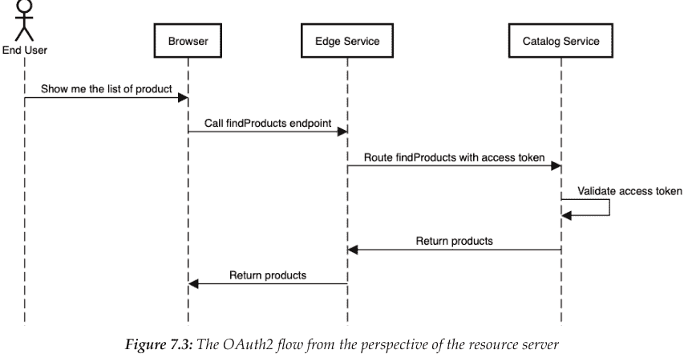

从上面的图中，你可能会好奇目录服务如何在不调用授权服务器的情况下验证访问令牌。当目录服务第一次需要验证访问令牌时，它实际上会调用 JSON Web Key Set (JWKS) 端点：

```json
{
  "keys": [
    {
      "kty": "RSA",
      "kid": "1234abcd",
      "use": "sig",
      "n": "0vx7agoebGcSSuuLiJXZptN27...T9yEoQ",
      "e": "AQAB"
    }
  ]
}
```

目录服务使用与访问令牌中 `kid` 字段相匹配的列表中的公钥来验证访问令牌的有效性。调用 JWKS 端点的结果是为后续请求减少对授权服务器的调用。如果 IdP 轮换密钥，资源服务器在接收到访问令牌时将无法在缓存中找到 `kid` 值，因此它将再次调用 JWKS 端点并更新缓存。

然而，我们看到的 OAuth2 流程是授权码模式（authorization code flow）。以下是我们在本章中将不再阅读的其他类型流程：

- *隐式（Implicit）*：针对在浏览器中实现的 JavaScript 客户端的授权码模式的简化。在隐式流程中，IdP 立即返回 ID 令牌，跳过了授权码与 ID 令牌之间的交换步骤。
- *资源所有者密码凭据（Resource owner password credentials）*：允许直接使用凭据派生访问令牌。仅在资源所有者与客户端之间存在高度信任时使用。
- *客户端凭据（Client credentials）*：允许使用 `client_id` 和 `secret` 获取访问令牌。当客户端也是资源所有者时非常有用。

现在我们已经了解了安全的理论概念，准备好通过 Keycloak 和 Spring Security 将它们付诸实践了。

> **注意：选择哪个组件作为 OAuth2 客户端并不容易，没有唯一的正确答案。例如，如果我们选择消费边缘服务 API 的前端应用程序作为 OAuth2 客户端，将意味着授予了后者的访问令牌管理权，这是不安全的。我的建议如下：如果前端是 SPA（单页应用），那么选择后端应用程序作为 OAuth2 客户端更好。如果前端是移动端应用，选择后者作为 OAuth2 客户端可能是一个好主意。**

### 使用 Keycloak 作为身份服务器

在本章中，我们将看到如何在本地启动 Keycloak，以及如何配置它来管理用户和角色。角色在我们的授权阶段将对我们非常有用，因为除了使用 OAuth2 之外，我们还会使用基于角色的访问控制（RBAC），这有助于根据用户拥有的角色为其分配权限。具体来说，我们将实现一种机制，具有 `manager`（经理）角色的用户可以读取和读写目录服务的 API，而具有 `user`（用户）角色的用户只能调用读取 API。

#### 在本地运行 Keycloak

Keycloak 是由 Red Hat 开发的开源身份和访问管理 (IAM) 解决方案，支持 OIDC、OAuth2 和安全断言标记语言 (SAML) 等多种协议。使用 IAM 工具的优势是它可以减轻应用程序在某些概念上的负担，例如如何注册和管理用户。此外，通过 OIDC，我们可以为用户提供通过注册账户或社交登录进行身份验证的选择。在这两种情况下，我们的应用程序都不会受到影响。运行 Keycloak 最简单的方法是通过容器。然后我们添加一个 `docker-compose.yml` 文件和 Keycloak 服务：

```yaml
keycloak:
  image: quay.io/keycloak:latest
  container_name: keycloak
  ports:
    - "8080:8080"
  environment:
    - KEYCLOAK_ADMIN=admin
    - KEYCLOAK_ADMIN_PASSWORD=admin
  command: start-dev
```

### 使用 Spring Cloud Gateway 实现中心化安全

除了简单的将请求路由到下游服务的操作外，**横切关注点**，如身份认证管理、韧性管理、监控数据收集和性能分析。

Spring 提供了 Spring Cloud Gateway 项目来实现 API 网关。它包含一个命令式版本（使用 Spring MVC）和一个响应式版本（使用 WebFlux）。我们将使用基于 Spring WebFlux 的那一个。

Spring Cloud Gateway 的核心元素如下：

- **Route（路由）**：网关的基本元素，由一个 ID、目标 URI、一组谓词（predicates）和过滤器（filters）组成。如果聚合谓词为真，则匹配到该路由。
- **Predicate（谓词）**：基于 HTTP 请求的断言，例如请求头或参数。
- **Filter（过滤器）**：允许在请求发送到下游服务之前或之后对请求和响应进行修改。

可以使用 Java Routes API 或配置文件在 Spring Cloud Gateway 中配置路由。以下是这两种方法的示例：

```java
// 使用 Java Routes API
@Configuration
class RouteConfiguration {
    @Bean
    public RouterFunction<ServerResponse> gatewayRouterFunctionsCookie() {
        return route("cookie_route")
            .route(header("X-Request-Id", "\\d+"),
                http("https://example.org"))
            .build();
    }
}
```

```yaml
# 使用配置文件
spring:
  cloud:
    gateway:
      mvc:
        routes:
        - id: header_route
          uri: https://example.org
          predicates:
            - Header=X-Request-Id, \\d+
```

如需谓词的完整列表，可以参考官方文档 https://docs.spring.io/spring-cloud-gateway/reference/spring-cloud-gateway/request-predicates-factors.html。

现在我们已经对 Spring Cloud Gateway 进行了理论介绍，剩下的就是创建边缘服务（edge-service）微服务。

> **注意：我们选择使用带有 WebFlux 的 Spring Cloud Gateway 版本，是因为在编写本章时，基于 Spring MVC 的实现稳定性较低，且功能少于响应式版本。例如，MVC 版本缺少过滤器：https://github.com/spring-cloud/spring-cloud-gateway/issues/3177，或者在断路器配置上存在问题：https://github.com/spring-cloud/spring-cloud-gateway/issues/3327。**

### Spring Cloud Gateway 快速入门

与其他微服务一样，我们使用 Spring Initializr 创建边缘服务项目的骨架。需要导入的依赖有：Reactive Gateway（允许你导入 Spring Cloud Gateway 的响应式版本）、Resilience4J（允许你应用断路器等模式来提高应用的韧性）以及 Lombok（允许我们编写更整洁的代码）。你可以从 GUI 或通过运行以下命令导入项目：

```bash
curl https://start.spring.io/starter.zip -d dependencies=webflux,cloud-gateway,resilience4j,lombok -d name=edge-service -d packageName=com.easyshop.edgeservice -d javaVersion=17 -o edge-service.zip
```


```bash
curl http://start.spring.io/starter.zip -d groupId=com.easyshop \
-d artifactId=edge-service -d name=edge-service \
-d packageName=com.easyshop.edgeservice \
-d dependencies=cloud-gateway-reactive,cloud-resilience4j,lombok \
-d javaVersion=21 -d bootVersion=3.2.4 -d type=maven-project \
-d edge-service.zip
```

> 注意：在本章中，我们将向 `edge-service` 导入更多依赖。在项目的 `README.md` 文件中，你会找到上述包含所有必要依赖的命令。

虽然到为止我们一直使用 `application.properties` 文件来设置配置，但 Spring 也允许使用 YAML 文件实现相同目的。对于边缘服务，我们将使用 `resources` 文件夹下的 `application.properties` 文件，并创建一个包含以下内容的 `application.yml` 文件：

```yaml
spring:
  application:
    name: edge-service
server:
  port: 8090
```

上述代码段在 `application.properties` 文件中对应这些赋值：

```properties
spring.application.name=edge-service
server.port=8090
```

我们使用以下代码创建了允许请求被路由到目录服务（catalog service）微服务的路由：

```yaml
spring:
  application:
    name: edge-service
cloud:
  gateway:
    routes:
      - id: catalog-service
        uri: http://localhost:8080/products
        predicates:
          - Path=/products/**
```

如果指向边缘服务的请求 URL 路径以 `/products` 开头，则调用 ID 为 `catalog-service` 且链接到 endpoint `http://localhost:8080/products` 的路由。

运行边缘服务和目录服务，并尝试通过边缘服务调用目录服务的 `findProductByCode` API：

`http://8090/products/LAP-ABCD`

我们将得到以下响应：

```http
HTTP/1.1 200
```

```json
{
  "brand": "FirstBrand",
  "category": "laptop",
  "code": "LAP-ABCD",
  "name": "laptop",
  "price": 30000
}
```

上述基础配置工作非常完美。但是，如果目录服务宕机了会怎样？我们应该让网关能够应对下游服务的故障。

## Spring Cloud Gateway 的韧性

为了让我们的网关能够应对故障，我们在 Spring Cloud Gateway 中实现重试（retry）和断路器模式。

## 使用 Retry 过滤器实现重试

重试模式适用于服务临时不可用的情况。为了实现它，我们将使用 `Retry` 过滤器。`Retry` 过滤器支持以下参数：

- `retries`：第一次失败后的重试次数。
- `methods`：指定需要重试的 HTTP 方法。
- `series`：指定需要重试的状态码序列。
- `exceptions`：指定需要重试的异常列表。

此外，你可以指定退避（backoff）参数。一个重试配置示例如下：

```yaml
spring:
  application:
    name: edge-service
cloud:
  gateway:
    default-filters:
      - name: Retry
        retries: 3
        methods: GET
        series: SERVER_ERROR
        exceptions: |
          java.io.IOException
          java.net.ConnectException
          org.springframework.cloud.gateway.support.TimeoutException
        backoff:
          firstBackOff: 100ms
          maxBackOff: 1s
          factor: 2
          basedOnPreviousValue: false
```

如果参数 `basedOnPreviousValue` 设置为 `false`，公式为 `firstBackOff * (factor ^n)`，否则为 `prevOff * factor`。默认情况下，该参数设置为 `true`。

我们已经看到如何在 Spring Cloud Gateway 中轻松实现重试模式以克服目标服务临时不可用的情况。然而，为了处理目标服务长时间不可用的情况，必须应用断路器。

## 使用 Resilience4J 实现断路器

断路器模式是一种提高分布式系统韧性和稳定性的设计模式。该模式灵感来自电路，在电路中，开关（断路器）用于在过载或故障时中断电流。在软件上下文中，断路器会中断指向出现问题的服务的请求，防止故障传播并损坏整个系统。

断路器模式包含以下三个状态：

- **Closed（关闭状态）**：在此状态下，允许所有指向下游服务的请求。断路器会监控请求的成功与失败。如果失败次数超过预定义的阈值，断路器将切换到开启状态。
- **Open（开启状态）**：在此状态下，阻塞所有指向下游服务的请求，以避免过载已经压力的服务。经过配置的超时期后，断路器将切换到半开启状态。
- **Half-Open（半开启状态）**：在此状态下，断路器允许有限数量的请求进入下游服务以检查问题是否解决。如果失败请求的数量等于或大于配置的阈值，断路器返回开启状态，否则返回关闭状态。

## Spring Boot 3 API 进阶

图 7.4 显示了断路器模式行为的活动图：

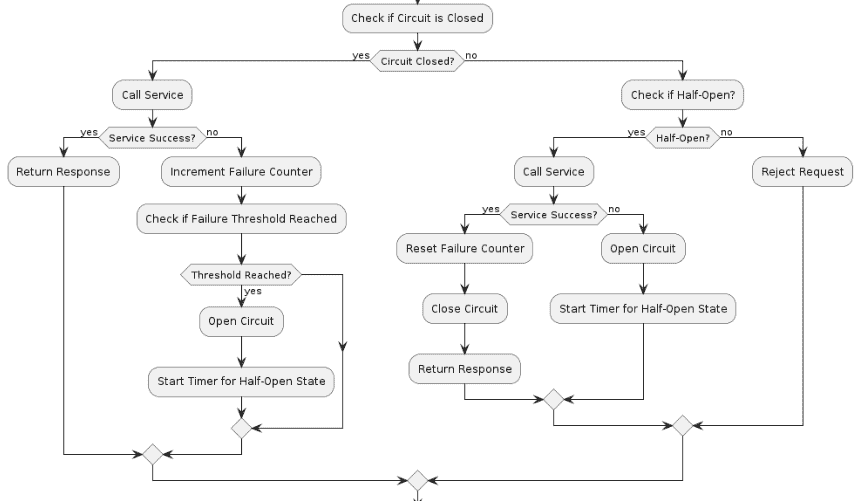

图 7.4：显示断路器模式中状态管理的活动图

为了实现断路器，我们使用边缘服务（edge service）中创建的路由以及 `CircuitBreaker` 过滤器，该过滤器使用了 Spring Cloud CircuitBreaker API。不过，它原生支持 Resilience4J 库。通过在 Spring Initializr 中添加 Resilience4j 依赖，我们将发现导入了以下模块：

```xml
<dependency>
  <groupId>org.springframework.cloud</groupId>
  <artifactId>
    spring-cloud-starter-circuitbreaker-reactor-resilience4j
  </artifactId>
</dependency>
```

由于我们使用了响应版本的 Spring Cloud Gateway，因此自动导入的模块是响应版本。

`CircuitBreaker` 过滤器接收参数为名称和一个可选的 `fallbackUri`，可以使用 Resilience4j 属性配置断路器参数。一种可能的配置如下：

```yaml
routes:
  - id: catalog-service
    uri: http://localhost:8080/products
    predicates:
      - Path=/products/**
    filters:
      - name: CircuitBreaker
        args:
          name: catalogServiceCircuitBreaker
          fallbackUri: forward:/catalog-service-fallback
```

```yaml
resilience4j:
  circuitbreaker:
    configs:
      default:
        slidingWindowSize: 10
        permittedNumberOfCallsInOpenState: 2
        failureRateThreshold: 50
        waitDurationInOpenState: 15000
```

让我们分析 Resilience4j 的以下参数：

- `slidingWindowSize`：此参数定义了用于计算失败率的滑动窗口的大小。在此处，断路器会评估最后十次调用状态。
- `permittedNumberOfCallsInOpenState`：此参数指定了在半开启（Half-Open）状态下允许的调用次数。当断路器从开启（Open）状态切换到半开启状态时，它允许两次调用以检查服务是否已恢复正常运行。如果两次调用都成功，断路器返回关闭（Closed）状态；否则如果至少一次失败，它将返回开启（Open）状态。
- `failureRateThreshold`：此参数定义了断路器切换到开启状态的失败率阈值。在这种情况下，如果滑动窗口中超过 50% 的调用失败，断路器将开启。
- `waitDurationInOpenState`：此参数指定了断路器在开启状态下持续的时间（以毫秒计），之后将切换到半开启状态以尝试一些测试调用。这些参数被放置在默认配置中（`resilience4j.circuitbreaker.configs.default`），因此它们将适用于所有断路器。可以使用 `resilience4j.circuitbreaker.configs.<circuitbreaker_name>` 属性对特定的断路器进行配置覆盖。

关于 `fallbackUri`，在电路开启状态下进行的所有调用都将重定向到 `/catalog-service-fallback` URI。我们可以在边缘服务中创建一个 `RestController` 来如下处理这些调用：

```java
//package com.easyshop.edgeservice.api
@RestController
@RequestMapping("/catalog-service-fallback")
public class FallbackController {

    @GetMapping
    public Mono<ResponseEntity<Object>> fallbackCatalogServiceGet() {
        return Mono.just(ResponseEntity.noContent().build());
    }

    @PostMapping
    @PutMapping
    @DeleteMapping
    public Mono<ResponseEntity<Object>> fallbackCatalogServiceGetNot() {
        return Mono.just(ResponseEntity
            .status(HttpStatus.SERVICE_UNAVAILABLE)
            .build());
    }
}
```

在此示例中，在电路开启状态下对 catalog service 执行的 GET 调用将返回 204，其他方法返回 503。在实际系统中，你可能希望实现更复杂的机制，例如在开启循环中，当 GET 调用成功时从缓存返回最后一个值。

要测试断路器的操作，你可以在 `application.yml` 文件中将 Resilience4J 的日志设置为 DEBUG，如下：

```yaml
logging:
  level:
    io.github.resilience4j: DEBUG
```

我们通过边缘服务调用关闭的 catalog service。以下命令使用 Apache Benchmark 进行十次请求：

```bash
ab -n 10 http://localhost:8090/products/LAP-ABC
```

为了观察断路器的行为，我们检查边缘服务的日志。在十次调用失败后，日志显示状态从关闭切换到开启，如下：

```text
Event STATE_TRANSITION published: 2024-07-01T18:40:14.79850+02:00[Europe/Rome]: CircuitBreaker 'catalogServiceCircuitBreaker' changed state from CLOSED to OPEN
```

在 catalog service 重启后测试系统，启动 catalog service 并使用以下命令向边缘服务发送两次请求：

```bash
ab -n 2 http://localhost:8090/products/LAP-ABC
```

日志显示在接收请求时状态从开启切换到半开启：

```text
Event STATE_TRANSITION published: 2024-07-01T18:40:38.96542+02:00[Europe/Rome]: CircuitBreaker 'catalogServiceCircuitBreaker' changed state from OPEN to HALF-OPEN
```

日志显示从半开启切换到关闭：

```text
Event STATE_TRANSITION published: 2024-07-01T18:40:39.52185+02:00[Europe/Rome]: CircuitBreaker 'catalogServiceCircuitBreaker' changed state from HALF-OPEN to CLOSED
```

好了，我们已经通过 Spring Cloud Gateway 和 Resilience4j 让 Eashop 应用程序更具韧性。剩下的工作是通过实现 OIDC 和 OAuth2 来确保系统安全。

## 使用 Spring Security 的资源服务器

为了保护 Eashop 应用程序的安全，我们将使用 Spring Security 实现 OIDC 和 OAuth2。具体来说，作为 API 网关的微服务 `edge-service` 将作为 OAuth2 客户端，而下游微服务（如 catalog service）将作为资源服务器。

Spring Security 是一个能以命令式和响应式方式处理安全的 Spring 模块。为了实现安全，Spring Security 使用过滤器链，过滤器按特定顺序调用并拦截所有的 `RestController`。在命令式版本中，过滤器用 `Filter` 类型类实现，而在响应式版本中则用 `WebFilter` 类型类实现。

## 在 Keycloak 上配置 OAuth2 客户端

在使用 Spring Security 之前，我们需要在 Keycloak 上配置一个客户端应用程序，即作为 OAuth2 客户端的应用程序，在我们的案例中将是边缘服务。我们再次像以前一样使用 Keycloak 的容器 bash，使用以下命令：

```bash
docker exec -it easyshop-keycloak bash
```

之后，使用命令进入 `/opt/keycloak/bin` 路径：`cd /opt/keycloak/bin`

使用以下命令以管理员用户登录：

```bash
./kcadm.sh config credentials --server http://localhost:8080 \
--realm master --user --password password
```

现在我们可以使用 Keycloak 管理 CLI 创建客户端应用程序，使用如下命令：

```bash
./kcadm.sh create clients -r Easyshop \
-s clientId=edge-service -s enabled=true \
-s clientSecret=easyshop-secret \
-s publicClient=false -s redirectUris="http://localhost:8090" \
\n"http://localhost:8090/login/oauth2/code/*"
```

## 使用 Spring Cloud Gateway 实现集中化安全


现在我们已经在授权服务器上创建了客户端应用程序，剩下的就是配置边缘服务以使用 OIDC 和 OAuth2。

## 在 Spring Security 中配置 OAuth2 客户端

为了实现 OAuth2 客户端，我们需要在边缘服务项目中导入 OAuth2 客户端依赖。需要添加的 Maven 依赖显示如下：

```xml
<dependency>
  <groupId>org.springframework.boot</groupId>
  <artifactId>spring-boot-starter-oauth2-client</artifactId>
</dependency>
```

OAuth 客户端模块已经导入了核心 Spring Security 依赖。此外，它与使用的提供者无关。在本章节中，我们将使用 Keycloak，但你可以轻松地切换到其他提供者。

首先，配置我们在 Keycloak 中使用的客户端应用信息。在 `application.yml` 文件中，添加以下配置：

```yaml
spring:
  cloud:
    gateway:
      security:
        oauth2:
          client:
            registration:
              keycloak:
                provider: keycloak
                authorization-grant-type: authorization_code
                client-id: edge-service
                client-secret: easyshop-secret
                scope: openid
            provider:
              keycloak:
                issuer-uri: http://localhost:8091/realms/Easyshop
```

`spring.security.oauth2.client.registration` 属性允许注册多个客户端应用程序。在这种情况下，我们配置了一个，并将其注册名称为 `keycloak`。

通过指定 `openid`，你是在告诉 Spring Security 应该使用 OIDC 1.0 协议。Spring 将使用 OIDC 特定的组件（如 `OidcUserService`），而不是默认的 `Default2UserService`。

通过提供的配置，隐式配置了两个端点：

- `/oauth2/authorization/keycloak` 端点：允许浏览器在未身份调用时重定向到授权服务器登录页面。
- `/login/oauth2/code/keycloak` 端点：授权服务器在用户成功登录后重定向浏览器时使用该端点。授权服务器将用查询参数 `code` 丰富该端点，该代码将通过调用令牌端点交换为 ID 令牌和访问令牌。

`user-uri` 允许指定配置端点或授权服务器元数据端点，可以检索其他 URL、令牌端点、用户信息端点、JKS 端点。对于每个注册的提供者，通过类型为 `ClientRegistrationRepository` 的 Bean 创建 `ClientRegistration` 实例，它包含了所有注册的提供者（`ClientRegistration` 列表）。默认使用 `InMemoryClientRegistrationRepository` 类，它在内存中存储 `ClientRegistration` 列表。

此外，我们添加了所有默认边缘服务过滤器，`SaveSession` 过滤器强制在将调用转发到下游服务之前保存会话。配置如下：

```yaml
cloud:
  gateway:
    default-filters:
      - name: Retry
#...
      - SaveSession
```

让我们自定义 Spring Security 链的配置。我们创建安全包并编写 `SecurityConfig` 类：

```java
@EnableWebFluxSecurity
public class SecurityConfig {

    @Bean
    SecurityWebFilterChain springSecurityFilterChain(ServerHttpSecurity http) {
        return http
            .authorizeExchange(exchange -> exchange
                .pathMatchers("/").permitAll()
                .anyExchange().authenticated())
            .oauth2Login(Customizer.withDefaults())
            .logout(logout -> logout
                .logoutSuccessHandler(oidcLogoutSuccessHandler(null)))
            .csrf(ServerHttpSecurity.CsrfSpec::disable)
            .build();
    }

    private ServerLogoutHandler oidcLogoutSuccessHandler(ReactiveClientRegistrationRepository clientRegistrationRepository) {
        var oidcLogoutSuccessHandler = new OidcClientInitiatedServerLogoutSuccessHandler(
            clientRegistrationRepository);
        oidcLogoutSuccessHandler.setPostLogoutRedirectUri("{baseUrl}");
        return oidcLogoutSuccessHandler;
    }
}
```

为了定义 Spring Security 响应式链，使用了类型为 `SecurityWebFilterChain` 的实例，它由 `ServerHttpSecurity` 类型的对象创建。`ServerHttpSecurity` 对象允许配置特定 HTTP 请求的安全方面。让我们分析链的以下方法：

- `authorizeExchange` 方法：允许你根据解析的路径模式指定特定请求的权限。在这种情况下，对于任何端点，用户只有经过身份验证后才能访问（`/` 除外），这样注销后可以回到单页应用程序的主页。
- `oauth2Login` 方法：允许我们使用 OIDC 配置认证。在这种情况下，我们没有进行任何自定义配置。
- `logout` 方法：允许我们在用户注销后定义一个处理器。在这种情况下，使用了类型为 `OidcClientInitiatedServerLogoutSuccessHandler` 的处理器，不仅可以清除 Spring Security 会话，还可以调用授权服务器的注销端点以删除 IS 上的令牌和会话。Spring Security 中的注销端点是 `/logout`，使用 `POST` 方法。
- `csrf` 方法允许我们指定针对跨站请求伪造（CSRF）的保护策略。为了简单，我们目前禁用了该保护，但稍后我们将看到如何启用。

我们完成了边缘服务上的 Spring Security 配置。让我们创建一个 API 允许获取已登录用户的数据。在 `api` 包中，我们编写以下 `UserController` 类：

```java
@RestController
@RequestMapping("user")
public class UserController {

    @GetMapping
    public User whoIam(@AuthenticationPrincipal OidcUser oidcUser) {
        return User.builder()
            .username(oidcUser.getPreferredUsername())
            .email(oidcUser.getEmail())
            .firstName(oidcUser.getFirstName())
            .lastName(oidcUser.getLastName())
            .roles(oidcUser.getRoles())
            .build();
    }
}

@Builder
public record User(
    String username,
    String email,
    String firstName,
    String lastName,
    List<String> roles
) {}
```

## 使用 Spring Cloud Gateway 实现集中化安全

将 Redis 集成到 Spring 非常简单：只需导入用于 Redis 的专用 Spring Session 依赖和 Spring Data Redis Reactive，即可使用响应式模块（因为边缘服务使用了 WebFlux）；

```xml
<dependency>
  <groupId>org.springframework.boot</groupId>
  <artifactId>spring-boot-starter-data-redis-reactive</artifactId>
</dependency>
<dependency>
  <groupId>org.springframework.session</groupId>
  <artifactId>spring-session-data-redis</artifactId>
</dependency>
```

导入依赖后，我们需要在 `application.yml` 文件中配置 Redis 集群主机和端口：

```yaml
spring:
  ...
  data:
    redis:
      host: localhost
      port: 6379
```

在这种情况下，我们也可以避免设置上述属性，因为它们的值与默认配置相同。

在 `infra/docker` 文件夹中，我们运行 `docker compose up -d` 命令启动 Redis 容器，然后启动边缘服务。打开浏览器的无痕标签页并调用 URL `http://localhost:8090/user`。输入 John 的凭据，之后用户 John 的信息将显示在浏览器页面上，查看边缘服务的日志。与之前一样，边缘服务发起了多次 HTTP 调用来实现 OIDC 流程。重启边缘服务并在同一个浏览器窗口中再次调用该 URL。你会发现这次没有进行 HTTP 调用，因为边缘服务从 Redis 中检索了会话并识别了已验证的用户。

得益于 Spring Session，我们将边缘微服务从处理会话存储中解耦出来。剩下的工作是在目录微服务上实现资源服务器。

## 在 Spring Security 中配置资源服务器

资源服务器验证已验证的用户是否有权访问标头中带有访问令牌增强的数据，该令牌通过从 JWKS 端点获取的公钥进行验证。事实上，正如本章开头提到的，Spring Security 会缓存由 JWKS 端点返回的公钥列表，这样端点就不会受到过大压力。

在继续资源服务器（目录服务）之前，我们需要进行一些微调，以便边缘服务能够优化地处理访问令牌。

### OAuth2 客户端中的访问令牌管理

要使目录服务接收访问令牌的第一步是在边缘服务中添加 `TokenRelay` 过滤器，该过滤器允许将访问令牌精确地转发到后续的 Authorization 标头中：

```yaml
cloud:
  gateway:
    default-filters:
      - name: Retry
      ...
      - SaveSession
      - TokenRelay
```

然而，默认情况下，Spring Security 将访问令牌存储在内存中，这使得边缘服务并非完全无状态。

为了实现这一点，我们可以将访问令牌存储在已经存储在 Redis 中的会话中。Spring Security 将已验证的用户信息（包括访问令牌）封装在 `OAuth2AuthorizedClient` 对象中：

```java
public class OAuth2AuthorizedClient implements Serializable {

  private final ClientRegistration clientRegistration;
  private final String principalName;
  private final OAuth2AccessToken accessToken;
  private final OAuth2RefreshToken refreshToken;

}
```

`OAuth2AuthorizedClient` 实例通过类型为 `ServerOAuth2AuthorizedClientRepository` 的接口实例进行存储、检索和删除。默认存储 `OAuth2AuthorizedClient` 的实现是 `InMemoryServerOAuth2AuthorizedClientRepository`。

幸运的是，Spring 还提供了 `WebSessionServerOAuth2AuthorizedClientRepository` 实现，它通过会话管理 `OAuth2AuthorizedClient` 实例。要使用此实现，我们在下面的 `SecurityConfig` 类中定义 `ServerOAuth2AuthorizedClientRepository`：

```java
@Configuration
@EnableWebFluxSecurity
public class SecurityConfig {

    ...
    @Bean
    ServerOAuth2AuthorizedClientRepository serverOAuth2AuthorizedClientRepository() {
        return new WebSessionServerOAuth2AuthorizedClientRepository();
    }
}
```

现在边缘服务完全无状态，并能优化地处理访问令牌。剩下的工作是在目录服务上实现资源服务器。

### 资源服务器实现

为了让目录服务作为资源服务器运行，我们导入以下 Spring OAuth2 服务器依赖：

```xml
<dependency>
    <groupId>org.springframework.boot</groupId>
    <artifactId>spring-boot-starter-oauth2-resource-server</artifactId>
</dependency>
```

我们在 `application.properties` 文件中配置资源服务器所需的属性，即发行者端点的值：

```properties
spring.oauth2.resourceserver.jwt.issuer-uri=http://localhost:8091/realms/Easyshop
```

其他授权端点（如 JWKS 端点）可以从此端点获取。最后一步是自定义 Spring Security 链，告诉 Spring 应用程序应该作为资源服务器运行。我们创建 `security` 包并添加下面的 `SecurityConfig` 类：

```java
@Configuration
@EnableWebFluxSecurity
public class SecurityConfig {

    private static final String PRODUCT_PATH = "/products/**";
    private static final String MANAGER_ROLE = "manager";

    @Bean
    SecurityWebFilterChain springSecurityFilterChain(ServerHttpSecurity http) {
        return http
            .authorizeExchange(exchange -> exchange
                .anyExchange().authenticated())
            .oauth2ResourceServer(oauth2Conf -> oauth2Conf
                .jwt(Customizer.withDefaults()))
            .requestCache(requestCacheSpec -> requestCacheSpec
                .requestCache(NoopServerRequestCache.getInstance()))
            .csrf(ServerHttpSecurity.CsrfSpec::disable)
            .build();
    }
}
```

`oauth2ResourceServer` 方法允许我们指示 Spring 我们的应用程序作为资源服务器。最后，`requestCache` 方法允许指定会话管理。由于目录服务通过 JWT 验证，因此不需要管理会话，通过静态方法 `NoopServerRequestCache.getInstance()`，我们指示 Spring 不应创建会话。此外，在这种情况下，由于我们的应用程序不使用 Cookie，因此禁用 CSRF 攻击保护也是正确的。

我们启动目录服务，并在浏览器通过边缘服务调用 `findProductByCode` API `http://localhost:8090/products/LAP-ABCD`。用用户 John 登录后，你将看到目录服务返回的响应负载：

```json
{
    "code": "LAP-ABCD",
    "name": "ALaptop",
    "category": "laptop",
    "price": 30000,
    "brand": "FirstBrand"
}
```


OAuth 资源服务器与 Spring Security 的集成非常简单。然而，我们可以让只有具有经理（manager）角色的用户执行更多操作。我们可以让经理角色使用写入 API，而所有其他（具有用户角色）只能使用读取 API。

# 使用 Spring Security 基于角色的访问控制

RBAC 是一种根据用户分配的角色为用户分配权限的技术。

在 Keycloak 中，我们已经为 John 分配了 manager 角色，为 Rossi 分配了 user 角色。然而，我们需要进行一些更改，以便角色信息同时存在 ID 令牌和访问令牌中。

# 令牌中的 roles 声明

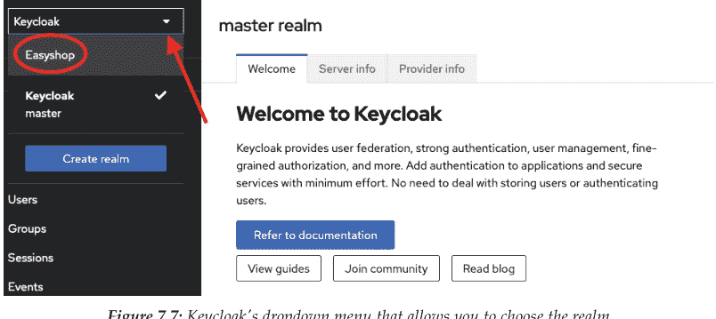

从左菜单选择 Clients。在此页面上，我们将看到 Keycloak 中定义的所有范围（scopes），并可以创建新的。我们对编辑 roles 声明感兴趣，因此点击。点击 Mappers 标签页，允许我们查看一组声明并编辑它们的配置。我们对 realm roles 映射感兴趣，因此点击它。此映射已经将登录用户列表映射到名为 `realm_roles` 的访问令牌中。我们更改了声明的名称为 `roles` 并将其包含在 ID 令牌中，因为我们在边缘服务上创建了从 ID 令牌中读取声明的用户 API，而目录服务是来自访问令牌。图 7.8 显示了 realm roles 映射的最终更改。

# 使用 Spring Cloud Gateway 实现集中化安全

## 用户领域角色 (User Realm Role)

853534fs-257c-493f-86ed-85f2ce5966c

| 映射类型 | 用户领域角色 |
| --- | --- |
| own * | realm roles |
| 领域角色前缀 * | |
| 多值 * | On |
| Token 声明名称 | roles |
| 声明 JSON 类型 * | String |
| 添加到 ID token * | On |

**图 7.8：** 将角色映射到声明中，该声明将同时存在于 ID token 和访问 token 中

通过此此配置，边缘服务将能够通过 ID token 中 `roles` 声明的值来获取登录用户的角色。我们修改了 `UserController` 类的方法，使其使用 ID token 返回的角色：

```java
@RestController
@RequestMapping("user")
public class UserController {

    @GetMapping
    public User whoIam(@AuthenticationPrincipal OidcUser oidcUser) {
        return User.builder()
            .username(oidcUser.getPreferredUsername())
            .email(oidcUser.getEmail())
            .firstName(oidcUser.getFirstName())
            .lastName(oidcUser.getLastName())
            .roles(oidcUser.getClaimAsStringList("roles"))
            .build();
    }
}
```

尝试在浏览器中使用用户 John 调用用户 API，你将看到 `roles` 字段中显示了角色列表，其中包含 manager（以及由 Keycloak 默认添加的其他角色）：

```json
{
  "username": "john",
  "email": "john@mail.com",
  "firstName": "John",
  "lastName": "Smith",
  "roles": [
    "default-roles-easyshop",
    "manager",
    "offline_access",
    "uma_authorization"
  ]
}
```

我们将已登录用户的角色信息包含在 OAuth2 客户端中，以便 API 用户可以使用。然而，读取角色对于资源服务器来说是至关重要的信息，因为它必须为后者应用安全规则。

# 在资源服务器中使用 RBAC 保护 API

Spring Security 扩展默认从 `scope` 和 `scp` 声明中获取角色。由于我们在 Keycloak 中配置的 roles 声明本身就是角色，我们需要进行一些微调。

Spring 使用 `JwtGrantedAuthoritiesConverter` 类从 JWT 中提取角色。该类根据推断出的角色列表创建 `GrantedAuthorities` 列表。此转换器由 `ReactiveJwtAuthenticationConverter` 实例使用，该实例将身份验证用户的信息（包括角色）封装在 `JwtAuthenticationToken` 类型的类中（它是边缘服务 `OidcUser` 的对应项）。

为了自定义这两个转换器以便从声明中提取角色，我们需要定义一个类型为 `ReactiveJwtAuthenticationConverter` 的 bean。以下代码演示了如何在 `SecurityConfig` 中进行配置：

```java
@Bean
ReactiveJwtAuthenticationConverter jwtAuthenticationConverter() {
    var jwtGrantedAuthoritiesConverter = new JwtGrantedAuthoritiesConverter();
    jwtGrantedAuthoritiesConverter.setAuthorityPrefix("ROLE_");
    jwtGrantedAuthoritiesConverter.setAuthoritiesClaimName("roles");
    var jwtAuthenticationConverter = new ReactiveJwtAuthenticationConverter();
    jwtAuthenticationConverter.setJwtGrantedAuthoritiesConverter(jwtGrantedAuthoritiesConverter);
    return jwtAuthenticationConverter;
}
```

除了定义用于检索角色的声明外，我们还通过 `setAuthorityPrefix` 方法（默认值为 SCOPE）定义了映射到 `GrantedAuthority` 类的角色前缀。为了限制 Web API 使得具有 manager 角色的用户才能调用它们，我们需要修改过滤器链。以下代码演示了如何配置 `SecurityConfig` 来执行这些限制：

```java
@Configuration
@EnableWebFluxSecurity
public class SecurityConfig {

    private static final String PRODUCT_PATH = "/products/**";
    private static final String MANAGER_ROLE = "manager";

    @Bean
    SecurityWebFilterChain springFilterChain(ServerHttpSecurity http) {
        return http
            .authorizeExchange(exchange -> exchange
                .pathMatchers(HttpMethod.POST, PRODUCT_PATH)
                .hasAnyRole(MANAGER_ROLE)
                .pathMatchers(HttpMethod.PUT, PRODUCT_PATH)
                .hasAnyRole(MANAGER_ROLE)
                .pathMatchers(HttpMethod.DELETE, PRODUCT_PATH)
                .hasAnyRole(MANAGER_ROLE)
                .anyExchange().authenticated())
            .oauth2ResourceServer(oauth2Conf ->
                oauth2Conf.jwt(Customizer.withDefaults()))
            .requestCache(requestCacheSpec ->
                requestCacheSpec.requestCache(NoopServerCache.getInstance()))
            .build();
    }
}
```

# Spring Boot 3 API 精通

`pathMatchers` 方法允许解析后的路径匹配所有端点，`hasAnyRole` 方法允许指定一组角色（不包含 `ROLE_` 前缀），这些角色是访问相同端点所必需的。也可以使用 `hasAuthority` 方法，但在那种情况下，必须包含角色前缀（在我们的用中为 `ROLE_manager`）。

这里演示的方法在请求级别应用了 RBAC。或者，也可以通过 `@PreAuthorize("hasAnyRole('MANAGER_ROLE')")` 注解在 Java 方法级别实现 RBAC。例如，可以使用 `@PreAuthorize` 来对特定方法强制执行基于角色的限制。要启用方法级安全，必须在带有 `@Configuration` 注解的类上添加 `@EnableMethodSecurity` 注解。有关更多细节，请参阅官方文档：https://docs.spring.io/spring-security/reference/servlet/authorization.html

```java
var expectedUser = UserController.User.builder()
    .username("john")
    .firstName("John")
    .lastName("Smith")
    .email("john@mail.com")
    .roles(List.of("manager"))
    .build();
```

```java
webTestClient
    .mutateWith(mockId(expectedUser))
    .get()
    .uri("/user")
    .exchange()
    .expectStatus().is2xxSuccessful()
    .expectBody(UserController.User.class)
    .value(user -> assert(user).isEqualTo(expectedUser));
```

```java
private SecurityMockServerConfigures.OidcLoginMutator
mockIdToken(UserController.User expectedUser) {
    return SecurityMockServerConfigures.mockOidcLogin()
        .idToken(builder ->
            .claim(StandardClaimNames.PREFERRED_USERNAME,
                expectedUser.username())
            .claim(StandardClaimNames.GIVEN_NAME,
                expectedUser.firstName())
            .claim(StandardClaimNames.FAMILY_NAME,
                expectedUser.lastName())
            .claim(StandardClaimNames.EMAIL,
                expectedUser.email())
            .claim("roles",
                expectedUser.roles())
        );
}
```

# 使用 Spring Cloud Gateway 253 实现集中化安全

测试通过 `mutateWith` 方法使用 OIDC 模拟登录增强了 `webTestClient` 实例。运行测试，你将看到它成功通过了。我们留给你来运行测试，以验证对于未身份验证的用户会收到 302 Found（因为未身份验证的用户会被重定向到登录页面）。

对于目录服务（catalog service），我们可以对边缘服务（edge service）采用相同的方法。具体而言，我们可以使用 `SecurityMockServerConfigures` 类来获取测试所需的令牌。以下代码演示了如何配置指定角色的模拟访问令牌：

```java
private SecurityMockServerConfigures.JwtMutator mockAccessToken(String role) {
    return SecurityMockServerConfigures.mockJwt()
        .authorities(new SimpleGrantedAuthority(role));
}
```

你必须通过添加 `mockAccessToken` 方法来修改 `ProductControllerTest` 类的测试用例。

# 为 SPA 配置 OAuth2Client

我们已经确认了 Easyshop 的安全部分。然而，为了完整起见，了解在边缘服务上要做哪些更改以最好地集成单页应用（SPA）是公平的，尽管后者不是本书的重点。

在我们的认证流中，边缘服务在用户成功身份验证后，通过与从授权服务器收到的 ID 令牌关联创建一个会话，并以 cookie 的形式将会话信息返回给浏览器。浏览器发送的每个 HTTP 请求将包含会话 cookie，由边缘服务进行验证。然而，对于更改资源状态的请求（POST、PUT、PATCH 和 DELETE），cookie 容易受到 CSRF 攻击。

为了保护应用程序免受 CSRF 攻击，Spring Security 会生成 CSRF 令牌并在会话开始时提供给客户端。客户端必须为每个更改资源状态的请求提供令牌。默认情况下，CSRF 令牌存储在会话中，但 Spring 提供了一种将其存储在 cookie 中的方法。边缘服务的安全链如下：

```java
@Bean
SecurityFilterChain springSecurityFilterChain(
    HttpSecurity http,
    ReactiveClientRegistrationRepository clientRegistrationRepository) {
    return http
        .authorizeExchange(exchange -> exchange)
        .anyExchange().authenticated())
        .oauth2Login(Customizer.withDefaults())
        .csrf(csrf -> csrf
            .csrfTokenRepository(CookieServerCsrfTokenRepository
                .withHttpOnly(false)))
        .build();
}
```

```java
@Bean
WebFilter csrfWebFilter() {
    return (exchange, chain) -> {
        exchange.getResponse().beforeCommit((() -> {
            Mono<CsrfToken> csrfToken = exchange
                .getAttribute(CsrfToken.class.getName());
            return csrfToken != null ? csrfToken.then() : Mono.empty();
        }));
        return chain.filter(exchange);
    };
}
```

注意：由于响应式版本 CSRF 过滤器的一个 bug（https://github.com/spring-projects/spring-security/issues/5766），我们还需要创建一个过滤器。

与 SPA 集成时考虑的另一个方面是：首先访问 API 进行身份验证不会自动重定向到授权服务器的登录页面，而是返回未授权的 401。必须由 SPA 来处理重定向到登录。要更改边缘服务中的此行为，我们需要处理当未身份验证的用户调用端点时的异常，默认情况下这会导致登录页面。最终的安全链变为：

```java
@Bean
SecurityWebFilterChain springSecurityFilterChainChain(
    ServerHttpSecurity http,
    ReactiveClientRegistrationRepository clientRegistrationRepository) {
    return http
        .oauth2Login(Customizer.withDefaults())
        .csrf(csrf -> csrf
            .csrfTokenRepository(CookieServerCsrfTokenRepository
                .withHttpOnly(false)))
        .build();
}
```


此外，我们在未保护的路径中加入了 CSS 和 JavaScript 文件等静态资源，使 SPA 元素更加可用。

## 结论

在本章中，我们查看了如何保护 Easyshop API。我们创建了一个新的微服务——边缘服务，它作为 API 网关，用于处理安全和韧性等跨切关注点。我们看到了使用 Keycloak 作为身份提供者（IS）的 OIDC 认证流和 OAuth2 授权流。此外，我们为资源服务应用了角色策略，使得特定角色的用户可以使用。然而，为了让应用程序准备好发布，我们必须考虑良好的可观测性，以便发现问题。

在下一章中，我们将学习如何使用 OpenTelemetry 实现这一点。

## 知识点回顾

- Spring Security 使用过滤器链来保护端点。
- OIDC 是基于 OAuth2 的认证协议。
- OAuth 2.0 是行业标准的授权协议。

## 练习

1. 实现剩余的 JUnit。
2. 保护订单 API。

# 加入我们的书籍 Discord 空间

加入书籍的 Discord 工作空间获取最新动态、优惠、全球科技新闻以及与作者的互动：
https://discord.bpbonline.com

# 可观测性与监控

在本章节结束时，你将获得配置和使用可观测性及监控工具的实际技能。你将能够结合 `Spring Boot Actuator` 在应用程序中实现日志管理、指标监控和分布式追踪的全面解决方案，使用来自 Loki、Tempo 和 Grafana 的开源工具，提供更大的运维可见性，从而提高快速响应事件的能力。本章将为构建准备好投入生产的应用提供基础。

## 结构

在本章中，我们将讨论以下主题：

- 使用 Grafana Loki 进行日志聚合
- 使用 Spring Boot Actuator 和 Prometheus 进行指标监控
- 使用 Micrometer、OpenTelemetry 和 Grafana Tempo 进行链路追踪
- 使用 Grafana 进行监控

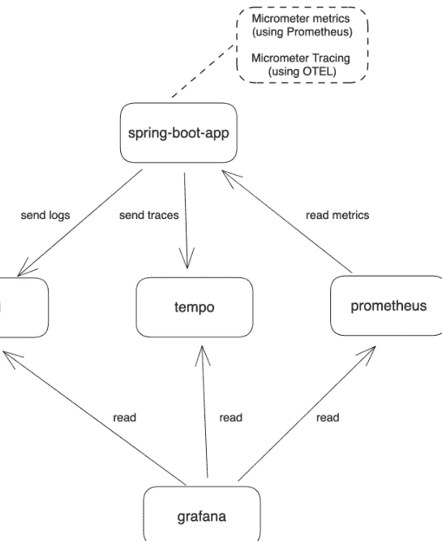

图 8.1：我们在本章中使用的可观测性工具

## 目标

在本章节结束时，你将获得配置和使用可观测性及监控工具的实际技能。你将能够结合 `Spring Boot Actuator` 在应用程序中实现日志管理、指标监控和分布式追踪的全面解决方案，使用来自 Loki、Tempo 和 Grafana 的开源工具，提供更大的运维可见性，从而提高快速响应事件的能力。本章将为构建准备好投入生产的应用提供基础。

# 使用 Grafana Loki 进行日志聚合

日志是应用程序内部发生的活动和事件按时间顺序的记录。这些记录包含了应用程序在运行期间生成的各种消息、警告、错误和调试信息。日志对于应用程序诊断、监控、维护和改进至关重要，因为它们提供了系统操作和行为的详细记录。

## Spring Boot 中的日志记录

Spring Boot 通过简单的集成配置方便了日志的实现和管理。它使用了 `Java 简单日志门面 (SLF4J)` API，这些 API 可以由 `Logback`、`Log4j2` 和 `Java Util Logging (JUL)` 的日志库开箱实现。Spring Boot 使用 `Logback` 作为默认的日志实现。在导入 Spring Boot starter 时，不需要额外配置即可启动日志。

日志的默认格式如下：

```
<timestamp> <log_level> <process_id> --- <app_name> <thread_name> <correlation_id> <logger_name> <message>
```

让我们详细查看每个字段：

- **Timestamp**：日志的毫秒级日期时间。
- **log_level**：日志级别。可以是 ERROR、WARN、INFO、DEBUG 或 TRACE。Logback 没有 FATAL 级别。
- **process_id**：生成日志的进程的唯一标识符。
- **Separator(---)**：用于提高日志格式可读性的固定分隔符。
- **app_name**：应用程序名称，如果设置了 `spring.application.name` 属性。
- **thread_name**：线程名称。
- **correlation_id**：关联 ID，如果启用了追踪。
- **logger_name**：Logger 的名称，通常是写入日志的类。
- **Message**：日志消息。

默认情况下，级别为 ERROR 和 INFO 的消息会被记录。你可以使用 `logging.level.<logger_name>` 更改某些包的日志可见性，如下所示：

```
logging.level.root=warn
logging.level.org.hibernate=error
```

通过第一个属性，我们设置了所有日志的通用可见性。通常情况下，WARN 和 ERROR 级别的日志会被打印。通过第二个属性，我们配置了针对 `org.hibernate` 包及其子包的日志可见性。对于这些日志，只有 ERROR 级别的消息会被打印。

Spring Boot 简化了创建日志的过程，允许开发者对多个日志器应用通用配置。例如，以下代码段演示了如何对 Tomcat 相关的日志器进行分组和配置级别：

```
logging.group.tomcat=org.apache.catalina,org.coyote,org.tomcat
logging.level.tomcat=TRACE
```

如果你想使用 Logback 特定配置，可以在类路径中添加 `logback.xml` 文件。如果你想使用 Logback 扩展，可以。

## 使用 Loki

在传统的应用程序中，日志打印在文本文件中，并存储在托管应用程序的机器上。在云原生应用程序中，日志管理必须有所不同。HTTP 请求可能涉及多个微服务，并进行按小时扩展。在云原生应用程序中，日志必须打印到标准输出。通过外部工具来从标准输出中捕获日志、存储、聚合、过滤并为分析提供支持。

Grafana Loki 是一种专为高扩展性设计的日志聚合系统，易于与云原生应用程序集成。Loki 通过 HTTP/HTTPS 协议接收日志并进行索引和存储，允许用户使用 Loki 强大的查询语言 LogQL 查询日志。

为了在本地启动 Loki，我们使用 Docker 容器，在 `docker-compose.yml` 文件中添加以下代码：

```yaml
loki:
  image: grafana/loki
  container_name: loki
  ports:
    - "3100:3100"
  command: -config.file=/etc/loki/local-config.yaml
  volumes:
    - ./loki/local-config.yaml:/etc/loki/local-config.yaml
  extra_hosts:
    - "host.internal:host-gateway"
```

> **注意**：在本章中，我们将使用 Grafana 通过仪表板实现指标和追踪的可视化。本章选择 Grafana 是因为它在与其补充工具（如 Loki（用于日志）、Prometheus（用于指标）和 Tempo（用于追踪）结合时，提供了一个统一的可观测性平台。与 Splunk 等其他监控和日志工具相比，Grafana 提供了一个轻量级的开源替代方案，并对不同数据源提供原生支持和实时可视化。图 8.1 显示了我们将用到的工具概览。

图 8.1：我们在本章中使用的可观测性工具

# 使用 Spring Boot Actuator 和 Prometheus

在微服务架构背景下，监控指标对于确保应用程序的健康、性能和可用性至关重要。微服务本质上是跨网络相互交互的分布式系统。这种复杂性使得在没有适当可观测工具的情况下，很难监控和管理整个系统的行为。监控指标提供了应用程序性能的关键信息（例如 API 错误率、吞吐量和延迟测量），使开发者和运维人员能够识别瓶颈（例如高延迟或资源过度消耗）、诊断问题并做出决策以优化资源并提升用户体验。通过分析资源利用率（如 CPU、内存和 I/O），可以确保应用程序性能高效响应请求。指标还有助于判断服务何时需要进行水平或垂直扩展以处理变化的负载，从而确保资源得到优化利用。此外，监控指标和告警发挥着至关重要的作用，站点可靠性工程（SRE）通过在问题影响用户之前主动识别并解决潜在问题，来帮助确保系统的可靠性、可用性和性能。

Spring Boot Actuator 是一个 Spring Boot 模块，为即插用的应用程序提供监控和管理功能。Actuator 暴露了一系列 HTTP 端点，用于访问应用程序内部信息，如指标、健康状态、系统信息和配置。为了收集指标，它使用了 [Micrometer 库](https://micrometer.io)，该库提供了一个与供应商无关的抽象层，使得指标可以以 Prometheus 和 Datalog 等多种格式导出。对于我们的应用程序，我们将使用 Prometheus，这是一种存储指标的开源监控解决方案，就像 Loki 存储日志数据一样。

为了在本地启动 Prometheus，我们在 `docker-compose.yml` 中添加了以下代码：

```yaml
prometheus:
  image: prom/prometheus:v2.50.0
  container_name: 'easyshop-prometheus'
  extra_hosts: ['host.docker.internal:host-gateway']
  command:
    --enable-feature=exemplar-storage
    --config.file=/etc/prometheus/prometheus.yml
  volumes:
    - ./prometheus/prometheus.yml:/etc/prometheus/prometheus.yml:ro
  ports:
    - "9095:9090"
```

在 `infra/docker/prometheus` 文件夹中，你会找到用作挂载的专用 Prometheus 配置文件。

为了配合 Prometheus 使用 Spring Boot Actuator，我们将在边缘服务中导入以下依赖项：

```xml
<dependency>
  <groupId>org.springframework.boot</groupId>
  <artifactId>spring-boot-starter-actuator</artifactId>
</dependency>
<dependency>
  <groupId>io.micrometer</groupId>
  <artifactId>micrometer-registry-prometheus</artifactId>
  <scope>runtime</scope>
</dependency>
```

Spring Actuator 提供了多个端点来监控应用程序，例如，有一个监控微服务健康状况的端点 (`/actuator/health`)，一个用于环境变量的端点 (`/actuator/env`)，另一个用于在运行时更改日志器可见性的端点 (`/actuator/log`)。有关端点的完整列表请访问以下官方文档：

https://docs.spring.io/spring-boot/reference/actuator/endpoints.html

然而，由于某些信息可能包含敏感数据，默认情况下仅暴露部分端点。要启用所有端点，我们在 `application.yml` 文件中设置了以下属性：

```yaml
management:
  endpoints:
    web:
      exposure:
        include: '*'
```


我们还启用了适用于计算聚合百分位数近似值的直方图发布（例如延迟分析，通过评估请求的 p90 和 p99），启用了指标详情（例如获取磁盘空间信息），最后定义了一个 Micrometer 标签通过应用程序名称标记所有指标，以便对指标进行分类和过滤，这是多服务环境中的一项基本功能：

```yaml
management:
  endpoints:
    web:
      exposure:
        include: '*'
  endpoint:
    health:
      show-details: always
      show-components: always
  metrics:
    distribution:
      percentiles-histogram:
        http.server.requests: true
      tags:
        application: ${spring.application.name}
```

由于边缘服务受 `Spring Security` 保护，为了简单起见，我们通过修改 `SecurityConfig` 类中的 `springSecurityFilterChain` 方法将 Actuator 从受保护的端点排除：

```java
@Bean
SecurityWebFilterChain springSecurityFilterChain(
    ServerHttpSecurity http,
    ReactiveClientRegistrationRepository clientRegistrationRepository
) {
    return http
        .authorizeExchange(exchange -> exchange
            .pathMatchers("/", "*.css", "*.js", "favicon.ico", "/actuator/**").permitAll()
            .anyExchange().authenticated())
        .oauth2Login(Customizer.withDefaults())
        .logout(logout -> logout
            .logoutSuccessHandler(oidcLogoutSuccessHandler(clientRegistrationRepository)))
        .csrf(HttpSecurity.CsrfTokenSpec::disable)
        .build();
}
```

在实际的生产环境中，如果微服务向公开放，Actuator 端点也应该受到保护。

要获取边缘服务的健康状态，请调用健康端点，如下：

```
http://8090/actuator/health
```

要查找所有可用指标的列表，请调用端点，如下：

```
http://8090/actuator/metrics
```

要获取特定指标的值，可以在指标端点的路径后添加指标名称。例如，要查看应用程序使用的内存，我们调用以下端点：

```
http://8090/actuator/metrics/jvm.memory.used
```

它返回的响应如下所示：

```json
{
    "availableTags": [
      {
        "tag": "area",
        "values": [
          "heap",
          "nonheap"
        ]
      },
      {
        "tag": "application",
        "values": [
          "edge-service"
        ]
      },
      {
        "tag": "id",
        "values": [
          "G1 Survivor Space",
          "Compressed Class Space",
          "CodeCache",
          "G1 Old Gen",
          "Metaspace",
          "G1 Eden Space"
        ]
      }
    ],
    "baseUnit": "bytes"
}
```

```yaml
include: '*'
endpoint:
health:
  show-details: always
  show-components: always
tracing:
  enabled: true
  sampling:
    probability: 1.0
metrics:
  distribution:
    percentiles-histogram:
      http.server.requests: true
tags:
  application: ${spring.application.name}
```

> 注意：默认情况下，链路采样的概率被设置为 0.1（范围为 0.0-1.0）。在真实的生产系统中将采样率设置为 1.0 可能会产生过成本。

由于边缘服务使用了响应式上下文（reactive context），我们需要启用自动上下文传播（context propagation）。在使用了 Project Reactor 3 的 Spring Boot 3 中，非常简单：只需在 `EdgeServiceApplication` 中添加 `Hooks.enableAutomaticContextPropagation()` 行即可：

```java
@SpringBootApplication
public class EdgeServiceApplication {
    public static void main(String[] args) {
        SpringApplication.run(EdgeServiceApplication.class, args);
        Hooks.enableAutomaticContextPropagation();
    }
}
```

在较早版本的 Spring Boot 中，上下文传播需要编写更多的代码。

## 270 Spring Boot 3 API 进阶

注意：什么是上下文传播？TraceID 通过 MDC（映射诊断上下文）添加到日志中。MDC 是由 Logback 和 Log4j 等日志框架提供的一种机制，它通过在线程本地映射（thread-local map）中存储键值对（例如 TraceID 或 SpanID）来丰富日志。在传统的非响应式应用程序中，MDC 被广泛用于关联整个请求生命周期内的日志，因为整个过程通常发生在同一个线程上。然而在响应式编程中，单个 HTTP 请求可能会跨越多个线程，MDC 变得不再那么有效，因为线程本地存储无法跨线程进行传播。为了解决这个问题，引入了上下文传播机制，以确保响应式上下文与 ThreadLocal 对象绑定。这种绑定允许 MDC 中的键值对能够透明地在不同线程间可用，即使在高并发的响应式系统中也能保持日志的关联性。

我们已经完成了边缘服务的追踪配置。现在将相同的配置引入到目录服务（catalog service）。剩下的工作就是在 Grafana 仪表板上实现日志、指标和链路的可视化。

## 使用 Grafana 进行监控

Grafana 是一个用于数据可视化和分析的开源平台，能够创建交互式和自定义的仪表板。它支持多种数据源，包括 Prometheus、Elasticsearch、AWS CloudWatch、Google Cloud Monitoring、Azure Monitor 等。这种能力允许来自多个系统的数据集成到单一的可视化平台中。它支持对特定指标创建告警。用户可以设置阈值，并在指标超过定义的阈值时通过电子邮件、Slack 或其他通信通道接收通知。在我们的案例中，Grafana 被配置为与 Loki、Tempo 和 Prometheus 无缝集成，分别显示日志、链路和指标。这种集成通过在配置文件 `datasource.yml` 中定义数据源实现，如下所示：

```yaml
apiVersion: 1
datasources:
  - name: prometheus
    type: prometheus
    access: proxy
    url: http://host.docker.internal:9095
    editable: false
    jsonData:
      httpMethod: POST
      exemplarTraceIdDestinations:
        - name: trace_id
    datasourceUid: tempo
  - name: Tempo
    type: tempo
    access: proxy
    orgId: 1
    url: http://tempo:3200
    basicAuth: false
    isDefault: true
    version: 1
    editable: false
    apiVersion: 1
    uid: tempo
    jsonData:
      httpMethod: GET
      tracesToLogs:
        datasourceUid: 'loki'
  - name: Loki
    type: loki
    uid: loki
    access: proxy
    orgId: 1
    url: http://loki:3100
    basicAuth: false
    isDefault: false
    version: 1
    editable: false
    apiVersion: 1
    jsonData:
      derivedFields:
        - datasourceUid: tempo
          matcherRegex: \[.+,(.++?
          name: TraceID
          url: ${__value.raw}
```

## 272 Spring Boot 3 API 进阶

在 `docker-compose.yml` 文件中，我们添加了 Grafana 容器以便通过 Docker 在本地运行，如下：

```yaml
grafana:
  image: grafana/grafana:10.2.4
  container_name: "easyshop-grafana"
  extra_hosts: ['host.docker.internal:host-gateway']
  volumes:
    - ./grafana/provisioning/datasources:/etc/grafana/provisioning/datasources:ro
    - ./grafana/provisioning/dashboards:/etc/grafana/provisioning/dashboards:ro
  environment:
    - GF_AUTH_ANONYMOUS_ENABLED=true
    - GF_AUTH_ANONYMOUS_ORG_ROLE=Admin
    - GF_AUTH_DISABLE_LOGIN_FORM=true
  ports:
    - "3000:3000"
  depends_on:
    - loki
    - prometheus
```

你可以在 `infra/docker/grafana/provisioning` 文件夹中找到数据源和仪表板配置文件。

通过在 `infra/docker` 路径运行命令 `docker compose up -d` 来启动容器。

我们将应用程序中的 HTTP 日志可见性从 TRACE 改为 INFO，这样查阅日志时就不会过于频繁。

## 可观测性与监控 273

为了方便起见，我们在 `ProductController` 类中添加了以下内容，如下：

```java
@Override
public Mono<ResponseEntity<ProductResponse>> findCode(String productCode, ServerWebExchange exchange) {
    return SecurityContextHolder.getContext()
        .doOnNext(securityContext -> {
            var principal = (Jwt) securityContext
                .getAuthentication()
                .getPrincipal();
            log.info("Called findCode with {}", productCode, principal);
        })
        .flatMap(securityContext -> productService.findCode(productCode))
        .map(ResponseEntity::ok)
        .doOnSuccess(ResponseEntity ->
            log.info("Terminated findCode"));
}
```

在边缘服务中，日志配置变为：

```yaml
logging:
  level:
    org.springframework: INFO
    io.springframework.cloud.gateway: DEBUG
    io.github.resilience4j: DEBUG
```

另一方面，在目录服务中，日志配置变为：

```yaml
logging:
  level:
    org.springframework: INFO
```


# 274 Spring Boot 3 API 进阶

查看目录服务的日志。你会发现它们也被添加了 `TraceID` 和 `SpanID`。同样，由于这些日志属于同一个 HTTP 请求，目录服务打印的 `TraceID` 与边缘服务的相同。

让我们来看看 Grafana 的仪表板。在浏览器中，访问 URL `http://localhost:3000` 上的 Grafana 主页。点击左上角的汉堡菜单并选择 **Dashboards**，如图 8.3 所示：

点击 **JVM Dashboard**，我们将看到与所选微服务（在本例中为目录服务）相关的指标，如图 8.4 所示。

## 可观测性与监控

首页 / 仪表 / JWM Dashboard

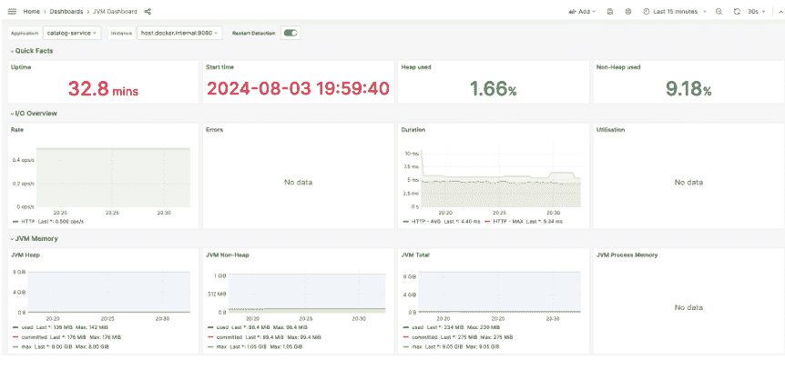

**图 8.4：通过 Grafana 仪表可视化 Prometheus 指标**

相反，**Logs, Traces, Metrics** 仪表显示了日志、追踪和时间轴的概览，如图 8.5 所示：

首页 / 仪表 / 日志、追踪、指标

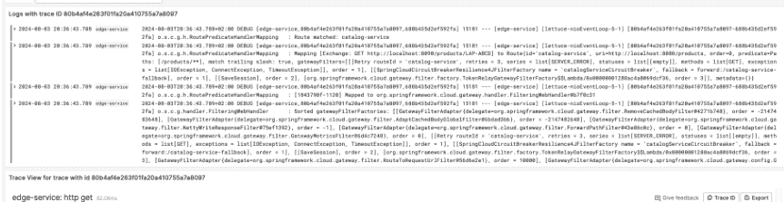

**图 8.5：Grafana 上“日志、追踪、指标”面板的可视化**

在 **Explore** 面板中，通过汉堡菜单，你可以通过分别选择指标上的 `Loki`、`Prometheus` 和 `Tempo` 来查看详情（可能按级别、单词过滤），并分别查看追踪详情。

## 结论

在本章中，我们学习了如何使用 `Spring Boot Actuator` 和 `Micrometer` 观测和监控 Spring Boot 应用。在微服务架构中，单个 HTTP 请求可能涉及多个服务，可观测性和监控变得至关重要。随着 Spring Boot 3 的发布，通过使用 `Micrometer API` 统一了指标和追踪管理。在本章中，我们使用 `Prometheus` 作为指标存储，使用 `Loki` 作为日志存储，并使用 `OpenTelemetry` 和 `Tempo` 管理追踪。我们只添加了配置，没有添加任何代码（甚至没有一行代码来启用 WebFlux 中的上下文传播）：由于 `Micrometer` 提供了与不同工具使用的 facade，我们可以完全透明地切换到其他工具。然而，`Micrometer` 也提供了用于观测特定代码点的 API，尽管我们在本章中没有讨论它们。我们的应用程序已经准备好部署到生产环境中。

在下一章“使用 Kind 在 Kubernetes 上进行部署”中，我们将查看如何在容器化环境中发布目前为止创建的微服务。

## 重点回顾

- 在微服务上下文中，分布式追踪至关重要。强烈建议不要在管理这一方面的情况下将应用发布到生产。
- 在 Spring Boot 3 中，指标和追踪都由 `Micrometer API` 处理。
- 专注于追踪的 `Spring Cloud Sleuth` 项目已由 Spring 团队开发的 `Micrometer Tracing` 取代并由 Spring Boot 3 采用。

## 练习

1. 在 Grafana 中创建一个告警，当存在 `ERROR` 级别的日志时触发告警。

## 加入书籍的 Discord

加入书籍的 Discord 获取最新更新和全球动态：`https://discord.com`


# 第 9 章 使用 Kind 在 Kubernetes 上进行部署

## 引言

在之前的章节中，我们看到了使用 Spring Boot 3 创建同步和异步 API 是多么简单。除了学习如何尽可能高效地编写它们之外，我们还看到了微服务如何作为 API 网关运行。我们还学习了如何使用 `Spring Security` 结合 `OIDC` 和 `OAuth2` 标准来保护 API。最后，在最后一部分，我们学习了如何使用 `Spring Boot Actuator` 监控我们的系统。你现在拥有了所有手段，可以将具有编写良好且可监控 API 的系统发布到生产环境。然而，将应用程序作为容器发布有多种策略。我们已经使用过 `Docker` 在本地运行数据库和消息中间件等工具。在本章中，我们将查看 Spring Boot 如何支持开箱即用的创建 `Open Container Initiative（OCI）` 镜像。我们还将看到如何在 `Docker Compose` 上发布服务，然后使用 `Kind` 在 `Kubernetes` 上发布。

## 结构

在本章中，我们将讨论以下主题：

- 结合 Docker 的 Spring Boot
- Kubernetes 简介
- 使用 Kind 在本地运行你的 API

## 目标

本章的目标并不是学习 Docker，尽管初始部分介绍了 Spring 提供了哪些工具来充分利用容器技术。在章节结束时，你将学习如何将 Spring Boot 应用作为容器部署（在 `Docker Compose` 或 `Kubernetes` 上），并充分利用 Spring 的特性。

## 结合 Docker 的 Spring Boot

随着容器技术的发展，对于 Spring 这样广泛使用的框架，有必要以最少的精力创建 `OCI` 镜像。Spring Boot 通过允许开发者在不编写 `Dockerfile` 的情况下生成镜像来实现。这可以通过项目根目录下运行以下命令完成：

```bash
./mvnw spring-boot:build-image # Maven 命令
./gradle buildImage # gradle 命令
```

在本节中，我们将对 `Docker` 和通用的容器技术进行介绍，之后我们将看到如何将 Spring Boot 应用作为容器部署。然而，由于我们的微服务将不再首先在 `Docker Compose` 然后 `Kubernetes` 集群中作为独立应用程序运行，HTTP 请求可能需要更长时间完成，从而导致可能的超时。你可以使用 `Resilience4J` 设置 HTTP 请求超时，通过编辑 `application.yml` 并添加时间限制器（例如五秒），如下：

```yaml
resilience4j:
  circuitbreaker:
    ...
  timelimiter:
    configs:
      default:
        timeoutDuration: 5s
```

### 容器技术和 Docker 简介

在讨论 `Docker` 之前，有必要知道容器。容器是一个环境。例如，由于这项技术，可以在同一宿主机上使用不同版本的 `JDK` 运行容器化的 Java 应用，而不会产生兼容性问题，也无需进行任何配置。我们将容器定义为隔离的进程；隔离是通过 Linux 的 `cgroup` 和 `namespace` 特性实现的。然而，尽管容器基于 Linux 特性，但得益于 `Docker Desktop` 或 `Podman Desktop` 等向用户透明地可视化 Linux 的工具，也可以在 `macOS` 和 `Windows` 环境中运行它们。

与虚拟机相比，容器是轻量级进程，因为它们共享主机的内核。图 9.1 显示了容器与机器的比较：

| 容器化应用 | | | | | | | 虚拟机 | 虚拟机 | 虚拟机 |
|---|---|---|---|---|---|---|---|---|---|
| App A | App B | App C | App D | App E | App F | App A | App B | App C |
| 宿主机操作系统 | | | | | | | 客户操作系统 | 客户操作系统 | 客户操作系统 |

**图 9.1：容器与虚拟机的比较**

虚拟机使得带有整个内核的整个系统成为可能。它们的工作依赖于一个称为 `Hypervisor`（虚拟机监控器）的硬件或软件组件，该组件位于宿主机和客户操作系统之间。虚拟机除了通过启动整个操作系统提供软件虚拟化外，还虚拟化硬件，因为可以虚拟化分配的内存量、CPU、网络等，从而提供了更好的隔离性和灵活性。

# 280 Spring Boot 3 API 精通

随着架构的发展，对更好地隔离（微）应用的需求日益增长。容器技术完美契合这一用例。因此，出现了如 `Docker` 之类的工具，以便通过容器部署应用程序。

`Docker` 是一种用于创建和管理容器的技术。作为一个容器运行时（`Container Runtime`），`Docker` 不仅允许从 `OCI` 镜像运行容器，还处理网络和持久化等其他方面。它采用客户端-服务器架构。服务器部分称为 `Docker Engine`，`docker` 守护进程在此运行容器的所有生命周期管理，包括创建、运行、停止和删除容器。客户端由 `Docker CLI` 管理，允许通过 `docker build`、`docker run` 和 `docker ps` 等命令通过命令行指令与 `Docker Engine` 交互。不过，也有图形化客户端可以视觉化地管理容器。当你安装 `Docker` 时，客户端和服务器部分都会被安装。但是，没有任何限制可以将 `Docker CLI` 连接到远程 `Docker Engine`。图 9.2 显示了 Docker 架构的概述：

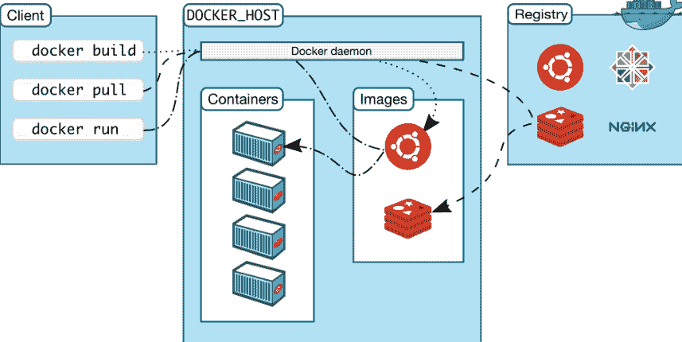

**图 9.2：Docker 客户端-服务器架构概述**

容器是从 `Docker` 镜像或符合 `OCI` 标准的镜像创建的。镜像是容器的模板。你可以从名为 `Dockerfile` 的文件创建镜像，该文件包含了构建镜像所需的命令。你也可以从公共或私有仓库下载镜像（`Docker Hub`，**https://hub.docker.com** 是最流行的公共仓库）。

既然我们已经了解容器技术和 `Docker`，现在就可以学习如何 Spring Boot 创建容器。

## 将 Spring Boot 应用程序容器化

通常，要将应用程序容器化，需要编写 `Dockerfile`。`Dockerfile` 是包含组装镜像命令的文本文件。例如，为了创建一个 Spring Boot 应用程序的镜像，我们可以编写以下 `Dockerfile`：

```dockerfile
FROM openjdk:17-jdk-alpine
RUN addgroup -S spring && adduser -S spring -G spring
USER spring:spring
ARG DEPENDENCY=target/BOOT-INF /app/lib
COPY ${DEPENDENCY}/META-INF /app/META-INF
COPY ${DEPENDENCY}/BOOT-INF/classes /app
ENTRYPOINT ["java", "-cp", "app:lib/*", "hello.Application"]
```

如示例所示，始终使用源镜像（在本例中为 `JDK`）来创建镜像。然而，编写 `Dockerfile` 涉及一些不容易解决的挑战，例如创建安全性的镜像。`Dockerfile` 的另一个问题是镜像的可重复性。如果我们在不同的实例中为同一个应用程序、使用相同的源代码和相同的 `Dockerfile` 创建两个镜像，这两个镜像将具有不同的 `sha`（摘要）。

Spring Boot 使用 `Cloud Native Buildpacks (CNBs)` 项目来创建 `OCI` 镜像。`CNBs` 是一个开源项目，它包含一组构建包（`buildpacks`），这些构建包提供了将应用程序源代码转换为生产就绪的 `OCI` 镜像的标准，而无需编写 `Dockerfile`。

当你想要一个标准化且自动化的镜像构建过程，而不是手动维护 `Dockerfile` 时，`CNBs` 特别有用，它们确保了跨构建的一致性和可重复性。它们非常适合遵循现代开发工作流或需要与 `CI/CD` 管道集成的应用程序。

然而，`Dockerfile` 对镜像创建过程提供了更大的灵活性和控制，对于需要自定义配置、特定基础镜像或独特构建步骤的场景，它们是更好的选择。在 `CNBs` 和 `Dockerfiles` 之间选择取决于项目所需的自定义程度和自动化水平。

具体而言，Spring Boot 使用 `Paketo Buildpacks`，它是 `CNBs` 项目的实现，专门用于 Java（以及其他应用）。

帮助创建应用程序镜像的构建包组件如下：

- **Builder（构建器）**：它是包含一组构建包的镜像，为应用提供依赖。
- **Buildpacks（构建包）**：它们检查应用程序的源代码，识别依赖，并生成带有依赖的应用程序 `OCI` 镜像。
- **Stack（栈）**：它为镜像提供操作系统层，并构成构建器的基础镜像。

为了使用 Spring Boot 创建 `OCI` 镜像，你需要导入 `Spring Boot Maven` 插件，如下：

```xml
<plugin>
  <groupId>org.springframework.boot</groupId>
  <artifactId>spring-boot-maven-plugin</artifactId>
</plugin>
```

从 `Spring Initializr` 创建所有边缘微服务后，它们已经导入了该插件。

我们创建边缘服务的 `OCI` 镜像。从微服务的根路径，运行以下命令：

```bash
./mvnw clean spring-boot:build-image
```

让我们来看执行的命令的第一部分：

```text
...
[INFO] > Pulled image 'paketo-buildpacks/builder-jammy'
[INFO] [creator] DETECTING
[INFO] 6 buildpacks participating
[INFO] [creator] paketo-buildpacks/ca-certificates 3.8.4
[INFO] [creator] paketo-buildpacks/bellsoft-lib 10.8.2
[INFO] [creator] paketo-buildpacks/syft 14.7
[INFO] [creator] paketo-buildpacks/executable-jar 6.1
[INFO] [creator] paketo-buildpacks/dist-zip 5.8
[INFO] [creator] paketo-buildpacks/spring-boot 5.3
```

从上述日志中，我们可以了解到所使用的构建器。该构建器使用了带有 Java 和其他语言构建包的 Ubuntu。在分析应用程序后，只使用了六个构建包。以下是它们的角色细分：

- `paketo-buildpacks/ca-certificates`：安装 SSL/TLS 证书以启用通信。
- `paketo-buildpacks/bellsoft-lib`：提供 `Liberica JDK`，用于运行应用程序。
- `paketo-buildpacks/syft`：扫描应用程序的依赖以生成软件物料清单 (`SBOM`) 信息。
- `paketo-buildpacks/executable-jar`：准备应用程序作为可执行 `JAR` 文件运行。
- `paketo-buildpacks/dist-zip`：支持打包为分发文件的应用程序。
- `paketo-buildpacks/spring-boot`：专门为 Spring Boot 提供优化和支持。

如你所见，默认情况下 `Paketo` 使用 `Liberica JDK` (`paketo-buildpacks/bellsoft-lib`)。让我们分析日志：

```text
...
[INFO] [creator] $BP_JVM_LINK_ENABLED false
[INFO] [creator] $BP_JVM_TYPE JRE
[INFO] [creator] $BP_JVM_VERSION 17
[INFO] [creator] Launch Configuration:
[INFO] [creator] $BP_DEBUG_ENABLED false
[INFO] [creator] $BP_DEBUG_PORT 8000
[INFO] [creator] $BP_JVM_THREAD_COUNT 250
[INFO] [creator] $JAVA_TOOL_OPTIONS
[INFO] [creator] Using Java version 21 extracted from manifest
[INFO] [creator] BellSoft Liberica JDK 21.0.4:
[INFO] [creator] Downloading from https://github.com/bellsoft/Liberica/releases/download/21.0.4+9/bellsoft-jre-21.0.4+9-linux-amd64.tar.gz
...
[INFO] Successfully built image 'docker.io/library/edge-service:0.0.1-SNAPSHOT'
```

从日志中，有助于构建镜像的一些属性有：

> **注意**：虽然 `BP_JVM_VERSION` 属性的值为 `17`，但构建器在分析 manifest 后，理解要使用的正确 `JDK` 版本是 `21`。你可以从命令行自定义使用的构建器名称、最终镜像名称以及更多设置。

例如，要更改镜像名称，可以使用以下命令：

```bash
./mvnw spring-boot:build-image -Dspring-boot.build-image.imageName=springio/spring-boot-docker
```

你可以在此处官方文档找到自定义镜像的属性完整列表：`https://docs.spring.io/spring-boot/maven-plugin/build-image.html#build-image.customization`

你可以自定义 `Spring Boot Maven` 插件以设置构建镜像有用的环境变量。以下代码段演示了如何配置插件以在镜像构建过程中将 Java 版本设置为 `21`：

```xml
<plugin>
  <groupId>org.springframework.boot</groupId>
  <artifactId>spring-boot-maven-plugin</artifactId>
</plugin>
```


<configuration>
  <image>
    <env>
      <BP_JVM_VERSION>21</BP_JVM_VERSION>
    </env>
  </image>
</configuration>
</plugin>

```

现在我们已经了解了如何使用 Spring Boot 创建容器镜像，我们将留给你自己创建微服务目录服务的镜像。

# 使用 Docker Compose 运行 Spring Boot 容器

使用 `docker images` 命令检查边缘服务和目录服务镜像是否已正确创建。你应该能在本地镜像列表中找到它们，以及这两个微服务的镜像。我们将使用到为止相同的文件通过 Docker Compose 创建这两个容器。同一网络中的所有容器都可以相互通信，并与属于其他网络的容器隔离开。事实上，Docker 会在每个容器上自动创建一个 DNS 记录，将同一网络内容器的名称与其 IP 地址关联。因此，边缘服务可以使用 URL `http://catalog-service:8080` 调用目录服务。

在传统的应用程序中，会为每个环境创建一个不同的配置文件。例如，我们会有一个配置，例如用于 UAT 环境的 `application-uat.properties` 等。然而，云原生应用遵循了不同的方法。配置必须通过环境变量显式地定义，而不是通过不同的文件。对于每个环境，环境变量的值都会发生变化。

Spring Boot 完全赞同这种方法。事实上，`application.properties` 文件中设置的每个属性都可以通过命名约定，使用关联的环境进行覆盖。例如，在前一章中定义的属性 `loki.endpoint` 可以被环境变量 `LOKI_ENDPOINT` 覆盖。你也可以定义在 `application.properties` 文件中使用的自定义环境变量。例如，在 `edge-service` 应用的 `application.yml` 文件中，我们修改了目录服务 URL 中的固有属性，如下所示：

```yaml
routes:
  - id: catalog-service
  - uri: ${{CATALOG_SERVICE_URL:http://localhost:8080}}/products
```

上述代码为名为 "catalog-service" 的路由 URL 分配了环境变量 `CATALOG_SERVICE_URL` 的值（如果存在的话），否则将分配默认值，即冒号（:）之后的值，如 `http://localhost:8080`。

利用上述概念，我们为边缘服务和目录服务创建了 Docker Compose 服务，并将它们添加到 `infra/docker/docker-compose.yml` 文件中，所示：

```yaml
edge-service:
  image: edge-service:0.0.1-SNAPSHOT
  container_name: edge-service
  extra_hosts: ['easyshop-keycloak.com:host-gateway']
  ports:
    - "8090:8090"
  environment:
      CATALOG_SERVICE_URL: http://catalog-service:8080
      SPRING_SECURITY_OAUTH2_CLIENT_PROVIDER_KEYCLAKISSUER_URI: http://host.docker.internal:8091/realms/Easyshop
      SPRING_DATA_REDIS_ENDPOINT: easyshop-redis
      MANAGEMENT_ZIPKIN_TRACING_ENDPOINT: http://tempo:9411/api/v2/spans
      LOKI_ENDPOINT: http://easyshop-loki:3100
  depends_on:
    - pg
    - keycloak
    - loki
    - prometheus
    - redis

catalog-service:
  image: catalog-service:0.0.1-SNAPSHOT
  container_name: catalog-service
  extra_hosts: ['easyshop-keycloak.com:host-gateway']
  user: root
  ports:
    - "8080:8080"
  environment:
      SPRING_R2BC_URL: r2dbc:postgresql://easyshop-postgres:5432/easyshopdb_catalog
      SPRING_R2DBC_PASSWORD: password
      SPRING_SECURITY_OAUTH2_RESOURCESERVER_JWT_ISSUER_URI: http://host.docker.internal:8091/realms/EASYhop
      SPRING_DATA_REDIS_HOST: easyshop-redis
      MANAGEMENT_ZIPKIN_TRACING_ENDPOINT: http://tempo:9411/api/v2/spans
      LOKI_ENDPOINT: http://easyshop-loki:3100
  depends_on:
    - pg
    - keycloak
    - loki
    - prometheus
```

注意，由于我们使用了 OIDC 流程，且目录服务并不引用我们电脑浏览器的 URL 重定向工作，边缘服务而是通过 DNS 主机 `host.docker.internal` 进行，该主机可以在 Docker 容器内部自动重新链接宿主机 IP。为了在容器外部也能使用它，请在你的电脑的 hosts 文件中添加记录，如下所示。

图 9.3 显示了 Kubernetes 架构元素的总结图表：

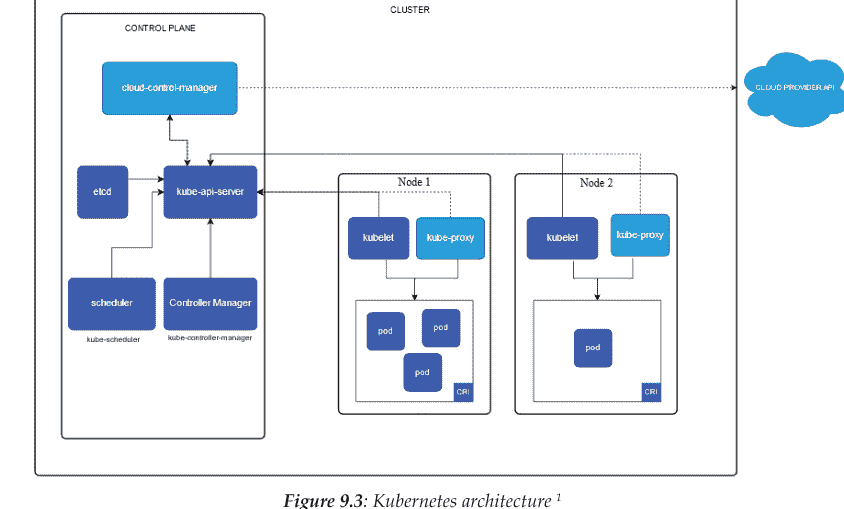

## Kubernetes 中的部署与服务

Kubernetes 中的容器被封装在 Pod 类型对象中。Pod 可以包含一个或多个容器。在实际上，Pod 仅包含一个主容器以及任何作为侧车（sidecar）作用的容器，即初始化容器（Init Containers）和侧边容器（Sidecar Containers）。初始化容器在主容器之前运行，执行对主容器运行有用的初步操作。另一方面，侧边容器实现了侧车模式，将次级进程或服务（“sidecar”）与主应用程序配对，以处理补充任务。这些任务可以包括日志记录、监控、代理、安全或配置管理。侧容器与主应用程序并行运行，共享同一个 Pod，但在本地和操作上保持独立，从而确保了模块化和关注点分离。

Kubernetes 对象可以使用 YAML 文件进行声明式部署。以下是一个创建包含 Nginx 容器的 Pod 的 YAML 文件示例：

```yaml
apiVersion: v1
kind: Pod
metadata:
  name: nginx
spec:
  containers:
    - name: nginx
      image: nginx:1.14.2
    ports:
      - containerPort: 80
```

然而，你永远不会直接创建 Pod 对象。相反，你会创建类型为 **Deployment** 的资源。Deployment 类型的资源创建一个类型为 **ReplicaSet** 的对象。然后，**ReplicaSet** 对象创建一组 Pod，确保运行的实例数量始终为所需的数量，即 YAML 文件中指定的数量。**Deployment** 对象为 ReplicaSet 部署增加了功能，例如，当你想更新容器镜像版本而更新部署 YAML 文件时，**Deployment** 对象会创建另一个 ReplicaSet 并自动处理销毁旧的。以下是一个用于创建三个 Nginx Pod 的 Deployment 对象 YAML 文件示例：

```yaml
apiVersion: apps/v1
kind: Deployment
metadata:
  name: nginx-deployment
  labels:
    app: nginx
spec:
  replicas: 3
  selector:
    matchLabels:
      app: nginx
  template:
    labels:
      app: nginx
    spec:
      containers:
        - name: nginx
          image: nginx:1.14.2
          ports:
          - containerPort: 80
```

## 使用 Kind 在 Kubernetes 上部署应用程序

在上面的 YAML 文件中，创建了一个创建 ReplicaSet 的 Deployment，后者创建了三个 Pod。**spec.selector** 字段定义了 ReplicaSet 应该处理哪些 Pod，在这种情况下，是所有匹配标签 "app: nginx" 的 Pod。事实上，此文件中创建的 Pod 具有标签 "app: nginx"（**spec.template.metadata.labels 字段**）。

Kubernetes 的另一个基本方面是 **Service**。每个 Pod 都有自己的逻辑 IP。然而，Pod 是瞬态实体，Kubernetes 不断创建和销毁它们以始终维持所需状态。每次创建 Pod 时，都会被分配一个不同的 IP。以边缘服务为例，它向目录服务发送请求。由于 Pod 的瞬态性，边缘服务无法通过 Pod IP 调用目录服务。**Service** 对象允许通过选择器（类似于带有 ReplicaSet 的 Deployment）通过其逻辑名称暴露一组 Pod。以下是一个在 Kubernetes 集群内暴露服务目录的 Service示例：

```yaml
apiVersion: v1
kind: Service
metadata:
  name: catalog-service
  labels:
    app: catalog-service
spec:
  type: ClusterIP
  selector:
    app: catalog-service
  ports:
  - protocol: TCP
    port: 8080
    targetPort: 8080
```

此 Service 与所有带有标签 "app: catalog-service" 的 Pod 关联，并允许它们通过逻辑名称 catalog-service（**metadata.name 字段**）在集群内部暴露。**Service** 对象负责将其收到的请求路由到**健康**且准备好接收流量的 Pod。在接下来的章节中，我们将看到如何处理健康和就绪状态。可以使用 Ingress 对象或更现代的 Gateway 在互联网上暴露 Service。然而，如下所述，我们有四种类型的 Service：

- **ClusterIP**: 默认类型，在集群内部 IP 上暴露 Service。
- **NodePort**: 这通过静态端口在集群每个节点的 IP 上暴露服务。
- **LoadBalancer**: 这使用不直接由 Kubernetes 管理的负载均衡器外部暴露服务，该均衡器可以手动提供或由云供应商提供。
- **ExternalName**: 这通过 DNS 名称而不是选择器暴露服务。

> 注意：Service 对象的类型字段被设计为嵌套功能，每一层都在前一层基础上添加。例如，创建一个类型为 NodePort 的 Service 会创建一个 clusterIP。然而，这种嵌套结构有一个例外。类型为 LoadBalancer 的 Service 可以通过禁用分配负载 NodePorts 来定义。

在本节中，我们学习了 Kubernetes 的基本元素，现在只需应用这些概念了。

你的输出应该类似于图 9.4 所示，以证明集群已正确创建：

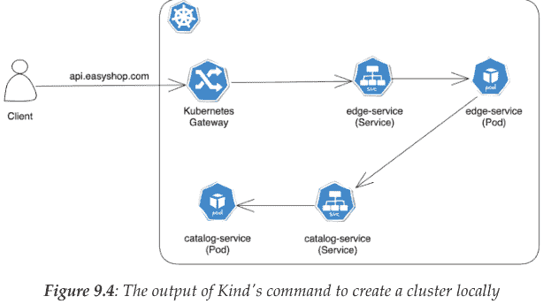

如上述输出所示，请也运行以下命令：

```
kubectl cluster-info --context kind-easyshop-cluster
```

好了，现在我们已经准备好与 Kubernetes 集群交互了。让我们使用以下命令验证节点是否已正确创建：

```
kubectl get no
```

你应该能看到以下输出：

| NAME | STATUS | ROLES | AGE | VERSION |
|---|---|---|---|---|
| easyshop-cluster-control-plane | Ready | | 7m40s | v1.30.2 |
| easyshop-cluster-worker | Ready | <none> | 7m19s | v1.30.2 |
| easyshop-cluster-worker2 | Ready | <none> | 7m19s | v1.30.2 |

所有节点都处于就绪（ready）状态，因此我们可以为 Easyshop 的正常运行创建资源。

> 注意：如果你的计算机运行三个集群节点有困难，可以通过编辑 `kind-multi-node-cluster.yaml` 文件通过创建更少的节点来简化集群。

要删除新创建的集群，请运行以下命令：

```
kind delete cluster --name easyshop-cluster
```

# 将 Easyshop 部署到 Kubernetes

如前所述，我们将仅将边缘服务和目录服务部署到 Kubernetes，但对所有其他微服务的处理过程是相同的。此外，我们还将同样在 Kubernetes 上发布目前为止一直通过 Docker Compose 运行的工具，例如 Cloudcloak 和 Postgres，然而，这些组件的发布模式适用于本地环境而非生产环境。图 9.5 显示了 HTTP 请求中涉及的组件概览：

```
kind create cluster --config kind-multi-node-cluster.yaml --name eashop-cluster
Creating cluster "eashop-cluster"
Ensuring node image (kindest/node:v1.3.2) 
Preparing nodes
Writing configuration
Starting control-plane
Installing CNI
Installing StorageClass
Joining worker nodes
Set kubectl context to "kind-eashop-cluster"
你现在可以使用你的集群了：
kubectl cluster-info kind-eashop-cluster
有问题、bug 或功能请求？请告诉我们！https://kind.siqs.k8s.io/#community
```

> 图 9.5：涉及的 Kubernetes 元素概览

如上图所示，我们将使用 Kubernetes Gateway 向外部暴露服务 API。Gateway 是一个较新的对象，它取代了 In 对象，目标相同，即从外部暴露一个或多个 Service，但 Gateway 具有更高级的功能。要了解更多关于 Gateway 信息，请访问：https://kubernetes.io/docs/concepts/services-networking/gateway。

为了尽可能模拟真实案例，Gateway 将响应主机主机为 `api.eashop.com` 的请求。随后我们会在计算机的 hosts 文件中添加以下行：

```
127.0.0.1 api.eashop.com
```

# 编写部署和服务

Pods 可以通过容器探针（probes）提供其内部状态的信息。探针是 kubelet 定期对容器执行的诊断。具体来说，有三种类型的探针：

- livenessProbe：它指示容器是否正在运行。如果 liveness 探针失败，kubelet 将杀死容器。容器将根据 Pod 的 restartPolicy 决定重建还是不重建。
- readinessProbe：它指示容器是否已准备好响应请求。如果 readiness 探针失败，Service 将不会向该 Pod 开启请求。
- startupProbe：它指示容器是否已启动。在 startup 探针成功之前，liveness 探针和 readiness 探针都不会执行。

Spring Boot 通过 `/actuator/health/liveness` 和 `/actuator/health/readiness` 端点管理状态。我们可以编写 YAML 来创建 edge service，如下所示：

```yaml
apiVersion: apps/v1
kind: Deployment
metadata:
  name: edge-service
  labels:
    app: edge-service
spec:
  replicas: 1
  selector:
    matchLabels:
```


# 通过 Kind 在 Kubernetes 上部署应用程序

## Deployment 配置示例

```yaml
app: edge-service

template:

  metadata:

    labels:

      app: edge-service

  spec:

    containers:

      - name: edge-service

        image: edge-service:0.0.1

        ports:

          - containerPort: 8080

        env:

          - name: SPRING_R2BC_URL

            valueFrom:

              secretKeyRef:

                name: postgres-secret

                key: url

          - name: SPRING_R2BC_USERNAME

            valueFrom:

              secretKeyRef:

                name: postgres-secret

                key: username

          - name: SPRING_R2BC_PASSWORD

            valueFrom:

              secretKeyRef:

                name: postgres-secret

                key: password
```

此文件中唯一相关的是影响 Postgres 的环境变量不是直接赋值，而是从名为 `postgres-secret` 的 Secret 中提取的。Secret 是 Kubernetes 资源，允许通过键值映射定义敏感属性。如果数据不敏感，可以使用名为 ConfigMap 的资源来实现相同目的。两者对于将配置与部署分离都是用的。

## 探针配置

```yaml
livenessProbe:

  httpGet:

    path: /actuator/health/liveness

    port: 8080

  initialDelaySeconds: 10

  periodSeconds: 5

readinessProbe:

  httpGet:

    path: /actuator/health/readiness

    port: 8080

  initialDelaySeconds: 15

  periodSeconds: 5
```

## Service 配置

两个 Deployment 都必须通过 Service 暴露。对于每个边缘服务和目录服务，ClusterIP Service 就足够了，因此它们将在集群内部暴露。边缘服务的定义如下：

```yaml
apiVersion: v1
kind: Service
metadata:
  name: edge-service
  labels:
    app: edge-service
spec:
  type: ClusterIP
  selector:
    app: edge-service
```

```yaml
app: edge-service
ports:
  protocol: TCP
  port: 8090
  targetPort: 8090
```

`port` 字段标识 Service 暴露的端口，而 `targetPort` 字段指定 Service 应该路由流量的 Pod 端口。

目录服务的 Service 与上一个相似，如下：

```yaml
apiVersion: v1
kind: Service
metadata:
  name: catalog-service
  labels:
    app: catalog-service
spec:
  type: ClusterIP
  selector:
    app: catalog-service
  ports:
    protocol: TCP
    port: 8080
    targetPort: 8080
```

然后，边缘服务将能够通过 URL `http://catalog-service:8080` 调度目录服务。

## Gateway API 配置

最后，如概述所示，我们通过 Gateway 暴露边缘服务，Gateway 是 Kubernetes Gateway API 的元素，它由以下元素组成：

- **GatewayClass**：它定义了一组具有共同配置的 Gateways，并由实现该类的控制器管理。我们将使用由 Nginx 实现的 Gateway，即 NGINX Gateway Fabric。
- **Gateway**：它定义了一个网络端点，可以像 Service 一样处理后端服务的流量。
- **HTTPRoute**：它定义了从 Gateway 路由 HTTP 请求到后端网络端点（如 Service）的规则和行为。

我们只会看到 Gateway 和 HTTPRoute 的配置，而 NGINX Gateway Fabric 的配置是通过 `run-k8s-env.sh` 脚本完成的，可以在 Git 仓库的 `infra/kind` 路径下找到。

我们定义 Gateway 资源如下：

```yaml
apiVersion: gateway.networking.k8s.io/v1
kind: Gateway
metadata:
  name: gateway
spec:
  gatewayClassName: nginx
  listeners:
    - name: http
      port: 80
      protocol: HTTP
      hostname: "*.easyshop.com"
```

该清单使用 Nginx 控制器创建一个 gateway（`spec.gatewayClassName: nginx`）。我们还在匹配正则表达式 `*.easyshop.com` 的主机名的 80 端口上暴露了 gateway。

最后，我们将 HTTPRoute 与刚刚创建的 Gateway 关联，如下所示：

```yaml
apiVersion: gateway.networking.k8s.io/v1
kind: HTTPRoute
metadata:
  name: edge-service
spec:
  parentRefs:
    - name: gateway
      sectionName: http
  hostnames:
    - "api.easyshop.com"
  matches:
    - path:
        type: PathPrefix
        value: /
  backendRefs:
    name: edge-service
    port: 8090
```

由于 `spec.parentRefs.name: gateway` 字段，刚刚创建的 HTTPRoute 与上述 Gateway 关联。对于该主机名，所有路径都将被匹配（`spec.rules.matcher.path:/`）。最后，HTTPRoute 被匹配到边缘服务的 Service（`spec.rules.backendRefs.name: edge-service`）。

你可以在 `catalog-service/k8s/catalog-service.yml` 文件中找到目录服务的部署和资源资源文件，在 `edge-service/k8s/edge-service.yml` 文件中找到属于边缘服务（包括 Gateway）的文件。

# 运行集群

在终端中，进入 `infra/kind` 路径并运行命令脚本 `run-k8s.sh`：

```bash
./run-k8s-env.sh
```

该脚本执行了以下操作：

- 使用 Kind 创建 Kubernetes 集群。
- 将边缘服务和目录服务的镜像导入到集群节点中供 Pod 使用。
- 为边缘服务和目录服务使用的所有组件创建部署和服务，例如 Postgres、Keycloak、Grafana 等。
- 最后，在集群上部署 NGINX Gateway Fabric。

脚本代码如下（脚本使用的所有文件均可在本章的 Git 仓库中获取）：

```bash
#!/bin/bash

echo 'START RUN K8S ENV'

echo 'CREATING K8S CLUSTER'

kind create cluster --config kind-multi-node-cluster.yaml --name easyshop-cluster

kubectl cluster-info --context kind-easyshop-cluster

echo 'IMPORTING CATALOG SERVICE AND EDGE SERVICE IMAGES'

kind load docker-image catalog-service:0.0.1-SNAPSHOT --name easyshop-cluster

kind load docker-image edge-service:0.0.1-SNAPSHOT --name easyshop-cluster

echo 'CREATING POSTGRES DEPLOY'
kubectl apply -f postgres/postgres.yml
sleep 5
echo 'CREATING KEYCLOAK DEPLOY'
kubectl apply -f keycloak/keycloak-config.yml
kubectl apply -f keycloak/keycloak.yml
echo 'CREATING REDIS DEPLOY'
kubectl apply -f redis/redis.yml
echo 'CREATING TEMPO DEPLOY'
kubectl apply -f observability/tempo/tempo.yml
echo 'CREATING LOKI DEPLOY'
kubectl apply -f observability/loki/loki.yml
echo 'CREATING PROMETHEUS DEPLOY'
kubectl apply -f observability/prometheus/prometheus.yml
echo 'CREATING GRAFANA DEPLOY'
kubectl apply -f observability/grafana/grafana-datasources.yml
kubectl apply -f observability/grafana/grafboards-config.yml
kubectl apply -f observability/grafana/grafana.yml
echo 'CREATING NGINX GATEWAY'
kubectl apply -f https://raw.githubusercontent.com/nginx-gateway-fabric/nginx-gateway-fabric/examples/gateway-api/running-on-kind/v1.4.0/deploy/crds.yaml
kubectl apply -f https://raw.githubusercontent.com/nginx-gateway-fabric/v1.4/deploy/default.yaml
kubectl apply -f nginx.yaml
sleep 15
kubectl get pods -n nginx-gateway
echo 'FINISH RUN ENV'
```

脚本启动后，等待 Keycloak Pod 处于就绪状态。你可以通过以下命令查看 Running 状态的 Pod 列表：

```bash
kubectl get po
```

你可以使用以下命令通过选择器过滤 Pod 列表：

```bash
kubectl get po -l app=easyshop-keycloak
```

此外，如果你不想多次运行上述命令来检查 Pod 状态，可以运行以下命令（等待 Pod 处于就绪状态，直到超时）：

```bash
kubectl wait --condition=ready pod -l app=easyshop-keycloak --timeout=120s
```

一旦 Keycloak Pod 处于就绪，我们可以从根路径运行以下命令创建目录服务和边缘服务的部署和服务：

```bash
kubectl apply -f catalog-service/k8s/catalog-service.yml
kubectl apply -f edge-service/k8s/edge-service.yml
```

运行命令显示所有运行中的 Pod，你应该得到如下输出：

```bash
kubectl get po
```

| NAME | READY | STATUS | RESTARTS | AGE |
| --- | --- | --- | --- | --- |
| catalog-service-77dd8f55 | 1/1 | Running | 0 | 2m |
| easyshop-grafana-6c9f7d88 | 1/1 | Running | 0 | 12m |
| easyshop-keycloak-9cdc8b9 | 1/1 | Running | 0 | 12m |
| easyshop-loki-7bc5f447 | 1/1 | Running | 0 | 12m |
| easyshop-pgadmin-84b5977f | 1/1 | Running | 0 | 12m |
| easyshop-postgres-755d8b65 | 1/1 | Running | 0 | 12m |
| easyshop-prometheus-b5b8dd7 | 1/1 | Running | 0 | 12m |
| easyshop-redis-84b865c | 1/1 | Running | 0 | 12m |
| easyshop-tempo-948b7945 | 1/1 | Running | 0 | 12m |
| edge-service-7c9d9bf6 | 1/1 | Running | 0 | 2m |

我们打开两个终端，使用以下命令查看边缘服务目录服务的 Pod 日志：

```bash
kubectl logs -f -l app=edge-service
kubectl logs -f -l app=catalog-service
```

为了访问 Gateway，我们将对 `run-k8s-env.sh` 脚本部署的 nginx-gateway Pod 使用端口转发。首先，让我们使用命令查看 nginx-gateway Pod 的名称：

```bash
kubectl get po -n nginx-gateway
```

由于 nginx 部署在自定义命名空间中，我们在上面的命令中指定了 "-n" 选项。一旦显示了 Pod 名称，我们运行命令：

```bash
kubectl -n nginx-gateway port-forward nginx-gateway-7bb54d7 8080:80
```

这样，我们就可以通过端点 `http://localhost:8080` 本地调用 Gateway。在浏览器中打开无痕标签并使用 URL：`http://api.easyshop.com:8080/products/LAP-ABCD`。将被重定向到 Keycloak 登录页面。输入 `mrossi/rossi` 凭据，之后你将看到包含 LAP-ABCD 代码生产信息的 JSON。从边缘服务或目录服务的日志提取请求的 TraceID，并在 `http://localhost:3000` 查看 Grafana 仪表板，以验证可观测工具在 Kubernetes 集群上正常运行。由于 Kind，我们能够在 Kubernetes 集群上部署 Easyshop。然而，为边缘服务目录服务创建的 Deployment 和 Service 文件也兼容云供应商管理的 Kubernetes 集群。

# 结论

在本章中，我们看到了如何使用 Spring Boot 轻松创建容器而无需编写 Dockerfile。这带来了许多优势，例如无需维护 Dockerfile，无需担心编写安全高效的 Dockerfile，允许你创建可重现的镜像。

我们首先通过 Docker Compose 发布了边缘服务和目录服务，就像我们在之前的章节中对 Postgres 和 Keycloak 等工具所做的那样。然后，我们使用 Kind 工具将两个微服务和所有 Easyshop 工具发布到 Kubernetes 集群上，该工具允许我们在本地创建节点。使用 Spring Boot，我们不需要修改应用程序即可将其发布到 Kubernetes 上。相反，Spring Boot Actuator 提供了进程外端点，Kubernetes 用于了解 Pod 是否存活（存活探针）以及是否准备好接收 HTTP 请求（就绪探针）。


# 结语

我们已经到达本书的最后。你现在准备好发布生产级 Spring Boot 应用程序，可以使用最流行的范式 REST 高效使用同步 API，不仅限于此。你现在可以根据情况评估使用 GraphQL 或 gRPC 是否高效。此外，你还学习了 Spring Cloud Stream 项目，它允许你跨越所使用的消息代理一致地编写异步 API。

## 记忆点

- Spring Boot 允许在无需编写 `Dockerfile` 的情况下创建容器镜像。
- 在 `application.properties` 文件中声明的属性值可以通过特定的命名约定通过环境变量进行覆盖。
- 在 Kubernetes 集群上发布 Spring Boot 应用无需更改代码。
- Spring Boot Actuator 提供了开箱即用的存活（`liveness`）和就绪（`readiness`）探针端点。

## 练习

1. 尝试在 Kubernetes 集群上发布其他微服务。
2. 尝试扩展部署服务的副本数量，并观察 Kubernetes 如何分负载。
3. 为其中一个微服务配置存活和就绪探针，并在模拟故障期间测试它们对服务可用性的影响。

## 加入我们书籍的 Discord 空间

加入书籍的 Discord 工作区，获取最新更新、优惠、全球技术动态、新版本发布以及与作者的交流：

https://discord.bpbonline.com


## 索引

### 符号

- `@KafkaListener` 181

### A

- A
- Apache Kafka 177, 178
- Apache Kafka, 绑定 185
- Apache Kafka, 组件
  - Broker 177
  - 集群 177
  - 消费者 177
  - 消费者，组 178
  - 分区 177
  - 生产者 177
  - Topic 177
- API 优先方法 19
- API 优先方法, 优势 19
- API 网关 224
- API 幂等性 12, 13
- API 幂等性, 方法 13
- AsyncAPI 203-206
- 异步通信 5, 171
- 异步通信, 注意点
  - HTTP 轮询 171, 172
  - HTTP 流传输 173
  - 发布/订阅 176
  - Webhook 172
  - WebSocket 175

### C

- 断路器, 状态
  - 关闭 (Closed) 229
  - 半开 (Half-Open) 229
  - 开启 (Open) 229
- 容器 278-280

### D

- DELETE 13
- 分布式追踪 267
- Docker 280
- Docker Compose 284-287
- Docker Desktop 32
- Dockerfile 281

### E

- 事件循环 31
- 事件循环, 优势成本，效率 31
- 资源, 效率 31 可扩展性 31

### F

- ForkJoinPool 76

### G

- GET 13
- Grafana 270-275
- Grafana Loki 260-262
- GraphQL 112
- GraphQL API, 测试 138-140
- GraphQL, 配置 118-128
- GraphQL, 基础
  - 查询 变异 114-118
  - Schema 类型 113, 114
- GraphQL, 注意点
  - 文档解析, 缓存 134-136
  - 错误, 处理 132-138
  - N+1 问题 128-132
  - Spring 137, 138
- GraphQL/REST, 比较 140, 141
- gRPC 144
- gRPC API, 测试 162-166
- gRPC, 架构 150, 154
- gRPC 客户端, 实现 157-161
- gRPC 通信, 类型
  - 双向，流式 客户端，流式 147
  - 服务，流式 147
  - 一一 RPC 147
- gRPC, 配置 145-147
- gRPC/REST, 差异
  - 通信, 协议 148
  - 数据格式 149
  - 性能 149
- gRPC/REST, 用例 150
- gRPC 服务, 实现 151-157
- gRPC 服务, 注意点 153, 154

### H

- HttpPie 33
- HTTP 轮询 171, 172
- HTTP 流传输 173, 174

### J

- Java 32
- JSON Web Token (JWT) 217, 218

### K

- Keycloak 222, 223
- Keycloak, 组件
  - 客户端 223
  - 领域 (Realms) 223
  - 角色 223
  - 用户 223
- Keycloak, 步骤 223, 224
- Kubernetes 287
- Kubernetes 集群, 运行 302-305
- 索引 309
- Kubernetes, 组件
  - 集群 288
  - 控制平面 288
  - Ingress/网关 288
  - Pod 288
  - 工作节点 288
- Kubernetes, 部署 294, 295
- Kubernetes, 元素
  - 网关 (Gateway) 300
  - GatewayClass 300
  - HTTPRoute 300
- Kubernetes, 特性
  - 云生态系统, 集成 288
  - 动态, 可扩展性 287
  - 负载, 管理 288
  - 编排 287
  - 自愈 297
  - 更新, 滚动 288
- Kubernetes, 注意点 297
- Kubernetes, 服务
  - 存活探针 (LivenessProbe) 295
  - 就绪探针 (ReadinessProbe) 295
  - 启动探针 (StartupProbe) 95

### L

- 日志 259
- 日志, 字段
  - 应用名称 259
  - 关联 ID 260
  - 日志器名称 260
  - 日志级别 259
  - 消息 260
  - ID 259
  - 分隔符 (-) 259
  - 时间戳 259

### M

- macOS API, 创建 292-294
- 指标 262
- 微服务架构 2, 3

### O

- OAuth2 220, 221
- OAuth2 客户端, 配置 234
- OAuth2 客户端令牌, 管理 243, 244
- OAuth2, 注意点
  - 客户端凭证 221
  - 隐式 (Implicit) 221
  - 密码凭证 221
- OIDC
  - 客户端 218
  - 用户 218
- OIDC 流程 219
- OIDC, 步骤 219
- OIDC 与 OAuth2, 测试 251-253
- OpenAPI 16, 17
- OpenID Connect (OIDC) 218
- OpenTelemetry 268, 269

### P

- 分页 API 90-99
- 平台/虚拟线程, 比较 72, 73
- POST 13
- 产品 51
- 发布/订阅 176, 177
- PUT 13

### R

- RBAC 246
- RBAC, 角色
  - 资源服务器, 防止 248-251
  - Token ID 246-248
- 响应式范式 22
- 响应式范式, 特性
  - 消息驱动 23
  - 弹性 (Resilient) 23
  - 响应式 (Responsive) 23
- 响应式范式, 概念 22-24
- 响应式流 (Reactive Streams) 24
- 响应式流代码, 分析 27
- 响应式流, 概念 25
- 响应式流 操作 26
- 响应式流, 操作符
  - publishOn() 28
  - subscribeOn() 28, 29
- 响应式流, 职责 25
  - 发布者 (Publisher) 26
  - 订阅 (Subscription) 26
- 响应式流调度器, 方法
  - bounded() 28
  - immediate() 28
  - parallel() 28
  - single() 28
- Resilience4j 230
- Resilience4j, 参数 231
- 资源服务器, 配置 242
- 资源服务器, 实现 244, 255
- REST API 7
- REST API, 架构 8
- REST API, 考虑 15
- REST API, 级别
  - HATEOAS 12
  - HTTP 动词 10, 11
  - 旧 XML (POX) 9
  - 资源 10
- REST API, 原则
  - 可缓存性 8
  - 客户端-服务器, 架构 8
  - 分层系统 8
  - 无状态 8
  - 统一, 接口 8
- REST API, 提示 15, 16
- RestClient 过滤器, 参数
  - 异常 228
  - 方法 228
  - 重试 228
  - 系列 228

### S

- Sidecar 容器, 部署 289-291
- Sidecar 容器, 类型
  - ClusterIP 291
  - ExternalName 292
  - 负载均衡器 291
  - NodePort 291
- 单页应用 (SPA) 253
- SPA, 配置 253-255
- Spring 179
- Spring Boot 281
- Spring Boot 3 267
- Spring Boot Actuator 263
- Spring Boot Actuator, 配置 263-267
- Spring Boot, 拆解 282, 283
- Spring Boot, 组件构建器 281
  - Buildpacks 282
  - Stack 282
- Spring Cloud Function 182
- Spring Cloud Function, 配置 182-184
- Spring Cloud Function, 注意点 182
- Spring Cloud Gateway 225, 225
- Spring Cloud Gateway, 配置 226-228
- Spring Cloud Gateway, 元素
  - 过滤器 225
  - 路由 225
- Spring Cloud Gateway, 模式
  - 断路器 229
  - Resilience4j 230
  - 重试过滤器 228, 229
- Spring Cloud Stream 181-188
- Spring Cloud Stream 应用, 测试 209-213
- Spring Cloud Stream, 组件
  - 绑定 184
  - 目标绑定器 184
- Spring Cloud Stream 错误, 处理 206-209
- Spring Cloud Stream, 字段 186
- Spring Cloud Stream, 用途 201-203
- Spring Cloud Stream 消费者, 实现 196-201
- Spring Cloud Stream 生产者, 实现 190-195
- Spring, 组件 179
- Spring, 配置 179-181
- Spring MVC 77, 106
- Spring MVC, 注解 78
- Spring MVC, 架构 77, 78
- Spring MVC, 初始化 79-90
- Spring MVC/Spring WebFlux, 比较 66-69
- Spring MVC/虚拟线程, 比较 106-108
- Spring Security, 配置 235-238
- Spring Security, 方法 237
- Spring Session 241
- Spring Session, 管理 241, 242
- Spring Session, 模块 241
- Spring WebFlux 31, 32
- Spring WebFlux, 配置 36-50
- Spring WebFlux, 调试 58-60
- Spring WebFlux 领域, 设计 35, 36
- Spring WebFlux 端点, 分析 60, 61
- Spring WebFlux 异常, 处理 50-58
- Spring WebFlux, 模块
  - Data R2BC 33
  - Lombok 34
  - PostgreSQL 34
  - 响应式 Web 33
  - Testcontainer 34
  - 校验 34
- Spring WebFlux, 属性 40, 41
- Spring WebFlux, 搭建 33
- Swagger, 特性
  - Swagger, 代码生成 18
  - 编辑器 18
  - UI 18
- 同步通信 4
- 版本控制 14
- 版本控制, 策略
  - 内容协商 14
  - 请求头 14
  - MAJOR 15
  - MINOR 15
  - PATCH 15
  - 查询参数 15
  - URI 14
- 虚拟线程 72
- 虚拟线程, 配置 73-76
- 虚拟线程, 简化 73

### T

- 每个请求线程 30, 31

### W

- WebClient 61-63
- WebClient, 测试 63-66
- WebFlux/虚拟线程, 差异 108
- Webhook 172, 173
- WebSocket 175, 176
