# Spring Boot 3 秘籍：Java 微服务与云原生应用解决方案[第2版]


## 作者简介

## 引言

## 第 1 章：Spring Boot 简介

## 第 2 章：Spring Boot 基础

## 第 3 章：Spring MVC

## 第 4 章：WebFlux

## 第 5 章：Spring Security

## 第 6 章：数据访问

## 第 7 章：Java 企业级服务

- 7-5. 使用 Java Flight Recorder 调查应用启动
  - 问题
  - 解决方案

## 第 8 章：Spring 消息传递

- 解决方案
- 工作原理

## 第 9 章：Spring Boot Actuator

- 问题

## 第 10 章：打包

- 10-3. 通过轻量级启动器（Thin Launcher）缩小归档大小

## 索引

# 关于作者

**Marten Deinum** 是开源 Spring Framework 项目的贡献者。他同时也是 Conspect 公司的 Java/软件顾问。他曾为中小型企业开发并设计了许多软件，主要使用 Java 语言。他是一个热衷的开源用户，并且是 Spring Framework 的长期粉丝、用户和倡导者。他曾担任软件工程师、开发负责人、教练以及 Java 和 Spring 培训师等多个职位。

# 引言

欢迎阅读《Spring 3 实战》（Spring 3 Recipes）！

# 读者

本书适用于希望更容易操作 Spring 应用程序开发者。如果你的项目使用了 Spring，引入 Spring Boot 将简化你的应用程序配置、部署和管理。

本书假设你已经熟悉 Java 和 Spring，并且安装了某种集成开发环境（IDE）。本书不会解释 Spring 或相关项目的所有内部原理和深度工作机制；对于这些，你可能需要阅读一本《Spring 6 实战》。

# 本书的结构

本书共包含 10 章。

- 第 1 章“Spring Boot 简介”简要概述了 Spring Boot 以及如何开始。
- 第 2 章“Spring Boot 基础”涵盖了如何使用 Spring Boot 定义和配置带有依赖注入的 bean的基础。
- 第 3 章“Spring MVC”涵盖了使用 Spring MVC 进行 Web 应用程序开发。
- 第 4 章“Spring Webflux”涵盖了使用 Spring Webflux 进行响应式 Web 应用程序开发。
- 第 5 章“Spring Security”提供了如何使用 Spring Security 保护你的 Spring Boot 应用程序的概述。
- 第 6 章“数据访问”解释了如何访问数据存储，如数据库或 NoSQL 存储。
- 第 7 章“Java 企业级服务”介绍了如何结合 Spring Boot 使用 JMX、邮件和 JFR 等企业服务。
- 第 8 章“消息传递”介绍了如何使用多种不同的消息技术进行通信。
- 第 9 章“Spring Boot Actuator”解释了如何使用 Spring Boot Actuator 的生产就绪特性，如健康检查和指标。
- 第 10 章“打包”展示了如何通过使 Spring Boot 应用程序可执行来打包和部署它们，以及如何使用 Docker 和 GraalVM。

# 约定

我们在书中使用以下代码规范：

- 有时，当我们希望你特别注意示例的某部分时，会将代码加粗。请注意，加粗并不一定反映以前版本中的代码加粗。
- 当一行代码太长而无法适应页面宽度时，我们将使用代码延续符对其进行断行。请注意，当你尝试输入代码时，必须在不留任何空格的情况下将行合并。

# 前提条件

由于 Java 编程语言是平台无关的，你可以选择任何支持的操作系统。然而，书中的某些示例使用了特定平台的路径。在输入示例之前，请根据需要将它们转换为你操作系统的格式。

为了充分利用本书的价值，请安装版本 21 的 JDK。你应该安装一个 Java IDE 以简化开发。对于本书，大多数示例代码是基于 Maven 的，大多数 IDE 都内置了对 Maven 来管理类路径（`classpath`）。

示例有时需要安装额外的库，例如 PostgreSQL、ActiveMQ 等。在书中，我们使用 Docker。当然，你可以在机器上安装这些库而不是使用 Docker，但为了方便使用（且不污染你的系统），建议使用 Docker。

# 联系作者

我们随时欢迎你对本书内容提出问题和反馈。你可以通过邮件 `marten@deinum.biz` 联系 Marten Deinum，或者通过 X 的 `@mdeinum` 联系他。

# 第 1 章

## Spring Boot 简介

在本章中，你将学习 Spring Boot 的基础知识。Spring Boot 的核心是 Spring Framework，Spring Boot 扩展了它使得自动配置等功能成为可能。

Spring Boot 能够轻松创建生产级的应用程序，它只需要极少的配置。

> Spring Boot 参考

Spring Boot 提供了许多框架（如 JMS、JDBC、RabbitMQ、Spring Integration、Spring Batch、Spring Security 等）的自动配置。通过使用 `spring-boot-starter` 作为父项目，Maven 会处理这些依赖。

为了能够创建一个可执行的 JAR 文件，你需要添加 `spring-boot-maven-plugin`（见列表 1-3）。如果你用过 Maven Shade 插件，应该很熟悉。它获取原始 JAR 文件并重新打包，将所有依赖包含内部（包含依赖的 JAR）。这样，你就可以将 JAR 文件交给运维团队，他们只需要使用命令 `java -jar <your-application>.jar` 即可启动应用程序。不需要将其部署到 Servlet 容器或 JEE 容器中。

## 1-1 使用 Maven 创建 Spring Boot 应用程序

你想使用 Spring Boot 创建应用程序。

### 解决方案

创建一个 Maven 构建文件 `pom.xml`，添加所需的依赖。

### 工作原理

假设你正在创建一个启动 `SpringApplication`、从 `ApplicationContext` 获取 bean 并输出到控制台的应用程序。

创建一个包含 main 方法的 Java 类来引导应用程序。

## 创建 pom.xml 文件

在开始编码之前，你需要创建一个 `pom.xml` 文件，供 Maven 确定需要什么。使用 Spring Boot 最简单的方法是使用 `spring-boot-starter-parent` 作为应用程序的父项目（见列表 1-1）。

### 列表 1-1 Spring Boot Starter Parent

```xml
<parent>
  <groupId>org.springframework.boot</groupId>
  <artifactId>spring-boot-starter-parent</artifactId>
  <version>3.2.1</version>
</parent>
```

接下来，你需要添加 Spring 依赖以开始使用 Spring。为此，在你的 pom.xml 文件中添加 `spring-boot-starter`（见列表 1-2）。

### 列表 1-2 Spring Boot Dependency

```xml
<dependency>
  <groupId>org.springframework.boot</groupId>
  <artifactId>spring-boot-starter</artifactId>
</dependency>
```

注意，不需要版本号或其他信息；这一切都是由于你使用了 `spring-boot-starter-parent` 作为父项目而管理的。这将引入启动基础 Spring Boot 应用程序所需的核心依赖；包括 Spring Framework、用于日志的 Logback 以及 Spring Boot 本身。

最后，为了能够创建一个可执行的 JAR 文件，你需要添加 `spring-boot-maven-plugin`（列表 1-3）。该插件负责创建可执行的 JAR 文件。

### 列表 1-3 Spring Boot Maven Plugin

```xml
<plugin>
  <groupId>org.springframework.boot</groupId>
  <artifactId>spring-boot-maven-plugin</artifactId>
</plugin>
```

## 第 1 章 Spring Boot 简介

完整的 `pom.xml` 现在应该像列表 1-4 所示。

### 列表 1-4. 完整的 pom.xml

```xml
<?xml version="1.0" encoding="UTF-8"?>
<project xmlns:xsi="http://www.w3.org/2001/XMLSchema-instance"
     xsi:schemaLocation="http://maven.apache.org/POM/4.0.0
     http://maven.apache.org/xsd/maven-4.0.0.xsd">
  <modelVersion>4.0.0</modelVersion>
  <groupId>com.apress.springboot3</groupId>
  <artifactId>recipe-1_1_ic</artifactId>
  <version>6.0.0-SNAPSHOT</version>
  <parent>
    <groupId>org.springframework.boot</groupId>
    <artifactId>spring-boot-starter-parent</artifactId>
    <version>3.2.1</version>
  </parent>
  <properties>
    <java.version>21</java.version>
  </properties>
  <dependencies>
    <dependency>
      <groupId>org.springframework.boot</groupId>
      <artifactId>spring-boot-starter</artifactId>
    </dependency>
  </dependencies>
  <build>
    <plugins>
      <plugin>
        <groupId>org.springframework.boot</groupId>
        <artifactId>spring-boot-maven-plugin</artifactId>
      </plugin>
    </plugins>
  </build>
</project>
```

## 创建应用程序类

让我们创建一个带有 `main` 方法的 `DemoApplication` 类。该 `main` 方法调用 `SpringApplication.run` 并传入 `DemoApplication.class` 以及来自 `main` 方法的参数。`run` 方法返回一个 `ApplicationContext`，从中获取 bean 的名称。使用 `getBeanDefinitionNames` 方法获取名称，遍历它们并从 `ApplicationContext` 获取实际的 bean，然后打印关于 bean 的的一些信息。

生成的类将像列表 1-5 所示。

### 列表 1-5. DemoApplication 类

```java
package com.apress.springboot3recipes.demo;

import java.util.Arrays;

import org.springframework.boot.SpringApplication;
import org.springframework.boot.autoconfigure.SpringBootApplication;

@SpringBootApplication
public class DemoApplication {
    public static void main(String[] args) {
        try (var ctx = SpringApplication.run(DemoApplication.class, args)) {
            System.out.println("# Beans: " + ctx.getBeanDefinitionCount());

            var names = ctx.getBeanDefinitionNames();
            Arrays.sort(names);
            Arrays.asList(names).forEach(System.out::println);
        }
    }
}
```

该类是一个带有 `main` 方法的普通 Java 类，因此你可以直接在 IDE 中运行此类。当应用程序运行时，它将显示出类似于图 1-1 的输出内容。

## 第 1 章 Spring Boot 简介

```
-----
/ \ / \_ . . . . (Q). _ _ . . _ \| |\\
( C ) \_ . . . |' . |' . . . |' . \| |\\
| W \_ . . ) | | | | | | | | ( | ) ) )
| |' . . . ._ | . | | . | | , | / / / /
--| =====================|\/ = ---
:: Spring Boot ::
(v3.2.1)
```


# 第一章 SPRING BOOT 简介

```java
@SpringBootApplication
public class DemoApplication {
    public static void main(String[] args) {
        try (var ctx = SpringApplication.run(DemoApplication.class, args)) {
            System.out.println("# Beans: " + ctx.getBeanDefinitionCount());

            var names = ctx.getBeanDefinitionNames();
            Arrays.sort(names);
            Arrays.asList(names).forEach(System.out::println);
        }
    }
}
```

该类是一个带有 `main` 方法的普通 Java 类，因此你可以直接在 IDE 中运行此类类。当应用程序运行时，它将显示类似于图 1-3 所示的输出。

```
2023-12-27T12:01:21.83+01:00 INFO 1920 --- [
2023-12-27T12:01:24.82+01:00 INFO 1920 --- [
2023-12-27T12:22:48+01:00 INFO 1920 --- [
## Beans: 59
main] c.a.s.demo.DemoApplication
main] c.a.s.demo.DemoApplication
main] c.a.s.demo.DemoApplication
```

applicationAvailability

applicationTaskExecutor

demoApplication

### 图 1-1. 运行应用程序的输出

这段代码和注解之间发生了什么？`@SpringBootApplication` 注解使该类成为 Spring Boot 应用程序的入口点。`@SpringBootApplication` 类是一个所谓的组合注解，它被其他注解所标记（参见图 1-2）。在一些通用的基于 Java 的注解旁边，你可以看到 `@SpringBootConfiguration`、`@EnableAutoConfiguration` 和 `@ComponentScan` 注解。

```java
@Target(ElementType.TYPE)
@Retention(RetentionPolicy.RUNTIME)
@Documented
@Configuration
@Indexed
public interface SpringBootConfiguration {

@Target(ElementType.TYPE)
@Retention(RetentionPolicy.RUNTIME)
@Documented
@Inherited
@AutoConfigurationPackage
@Import(AutoConfigurationImportSelector.class)
public interface EnableAutoConfiguration {

@Target(ElementType.TYPE)
@Retention(RetentionPolicy.RUNTIME)
@Documented
@Inherited
@ComponentScan(excludeFilters = { @Filter(type=FilterType.CUSTOM, classes=TypeExcludeFilter.class),
@Filter(type=FilterType.CUSTOM, classes=AutoConfigurationExcludeFilter.class) })
public interface SpringBootApplication {
```

### 图 1-2. @SpringBootApplication 定义

```
:: Spring Boot ::
(v3.2.1)
2023-12-27T12:01:23.893+01:00 INFO 190202 ---
2023-12-27T12:01:28.420+01:00 INFO 190202 main] c.a.s.demo.DemoApplication
2023-12-27T12:01:24.288+01:00 INFO 190202 main] c.a.s.demo.DemoApplication
## Beans: 59
applicationAvailability
applicationTaskExecutor
demoApplication
```

**图 1-3.** 运行应用程序的输出

这段代码和注解发生了什么？`@SpringBootApplication` 标记该类为 Spring Boot 应用程序的入口点。`@SpringBootApplication` 类是一个所谓的复合注解，它被其他注解所注解（参见图 1-4）。在一些通用的基于 Java 的注解旁边，你会看到 `@SpringBootConfiguration`、`@EnableAutoConfiguration` 和 `@ComponentScan` 注解。

```java
@Target(ElementType.TYPE)
@Retention(RetentionPolicy.RUNTIME)
@Documented
@Configuration
@Indexed
public interface SpringBootConfiguration
```

```java
@Target(ElementType.TYPE)
@Retention(RetentionPolicy.RUNTIME)
@Documented
@Inherited
@ComponentScan
@Import(AutoConfigurationImportSelector.class)
public interface EnableAutoConfiguration {
```

```java
@Target(ElementType.TYPE)
@Retention(RetentionPolicy.RUNTIME)
@Documented
@Inherited
@SpringBootConfiguration
@EnableAutoConfiguration
@ComponentScan(excludeFilters = { @Filter(type=TypeFilter.CUSTOM, classes=TypeExcludeFilter.class),
    @Filter(type=TypeFilter.CUSTOM, classes=AutoConfigurationExcludeFilter.class) })
public interface SpringBootApplication
```

### 图 1-4. @SpringBootApplication 定义

让我们快速看看不同的注解以及它们的作用：

- **Scan（扫描）**：此注解指示 Spring 扫描此包及其所有子包中的所有内容。它将检测所有被 `@Component` 注解的类。定义的过滤器允许进行排除操作，可以通过使用 `@EnableAutoConfiguration` 中的 `exclude` 属性，或者在应用程序上下文中提供一个 `TypeFilter` 作为 Bean。

- **EnableAutoConfiguration（启用自动配置）**：它注册了 `AutoConfigurationImportSelector`，该选择器将从类路径加载自动配置类。

- **SpringBootConfiguration（Spring Boot 配置）**：它标记该类为 Spring Boot 配置源。

- **SpringBootApplication**：它包含了 `@SpringBootConfiguration`、`@EnableAutoConfiguration` 和 `@ComponentScan`。


```
/ \/  `--`  `--`  .()_  `--`  \\\\\/
 (\)_  `--`  `--`  `--`  `--`  `\/`  \\\\\\
  _\/ /  `\\\\`  `\\\\`  `\\\\`  `\\\\`  `\\\\`  `\\\\`  `\\\\`  `\\\\`  `\\\\`  \\\\\\
'  `\\\\`  `\\\\`  `\\\\`  `\\\\`  `\\\\`  `\\\\`  `\\\\`  `\\\\`  `\\\\`  `\\\\`  `\\\\`/
\\\\\\\\\\\\\\\\\\\\\\/`\\\\`/`\\\\/
:: Spring Boot ::
(v3.2.1)
2023-12-27T12:01:23.893+01:00 INFO 190202 ---
2023-12-27T12:01:28.420+01:00 INFO 190202 main] c.a.s.demo.DemoApplication
2023-12-27T12:01:24.288+01:00 INFO 190202 main] c.a.s.demo.DemoApplication
## Beans: 59
applicationAvailability
applicationTaskExecutor
demoApplication
```

**图 1-3.** 运行应用程序的输出

这段代码和注解发生了什么？`@SpringBootApplication` 标记该类为 Spring Boot 应用程序的入口点。`@SpringBootApplication` 类是一个所谓的复合注解，它被其他注解所注解（参见图 1-4）。在一些通用的基于 Java 的注解旁边，你看到 `@SpringBootConfiguration`、`@EnableAutoConfiguration` 和 `@ComponentScan` 注解。

```java
@Target(ElementType.TYPE)
@Retention(RetentionPolicy.RUNTIME)
@Documented
@Configuration
@Indexed
public interface SpringBootConfiguration
```

```java
@Target(ElementType.TYPE)
@Retention(RetentionPolicy.RUNTIME)
@Documented
@Inherited
@ComponentScan
@Import(AutoConfigurationImportSelector.class)
public interface EnableAutoConfiguration {
```

```java
@Target(ElementType.TYPE)
@Retention(RetentionPolicy.RUNTIME)
@Documented
@Inherited
@SpringBootConfiguration
@EnableAutoConfiguration
@ComponentScan(excludeFilters = { @Filter(type=TypeFilter.CUSTOM, classes=TypeExcludeFilter.class),
    @Filter(type=TypeFilter.CUSTOM, classes=AutoConfigurationExcludeFilter.class) })
public interface SpringBootApplication
```

图 1-4. `@SpringBootApplication` 定义

让我们快速看看不同的注解以及它们的作用：

- **Scan（扫描）**：此注解指示 Spring 扫描此包及其所有子包中的所有内容。它将检测所有被 `@Component` 注解的类。定义的过滤器允许进行排除操作，可以通过使用 `@EnableAutoConfiguration` 中的 `exclude` 属性，或者在应用程序上下文中提供一个 `TypeFilter` 作为 Bean。

- **EnableAutoConfiguration（启用自动配置）**：它注册了 `AutoConfigurationImportSelector`，该选择器将从类路径加载自动配置类。

- **SpringBootConfiguration（Spring Boot 配置）**：它标记该类为 Spring Boot 配置源。

- **SpringBootApplication**：它包含了 `@SpringBootConfiguration`、`@EnableAutoConfiguration` 和 `@ComponentScan`。

（注：由于您提供的原文文本后半部分存在大量重复的英文描述，此处已为您完成核心部分的完整质量翻译。若需要严格按照“不漏掉任何行”即使是重复行也要翻译，请告知。）

```java
package com.apress.springboot3recipes.helloworld;

import jakarta.annotation.PostConstruct;
import org.springframework.stereotype.Component;

@Component
public class HelloWorld {

    @PostConstruct
    public void sayHello() {
        System.out.println("Hello World, from Spring Boot 3!");
    }
}
```

由于使用了 `@Component` 注解，该类会被 Spring Boot 自动检测。`@PostConstruct` 注解告诉 Spring 在构造完 bean 并注入所有依赖项后调用此方法。简单来说，在启动时将运行 `sayHello` 方法，控制台将打印出行：`Hello World, from Spring Boot 3!`。

> 当你需要扫描默认组件扫描未覆盖的包时，可以在 `@SpringBootApplication` 注解上使用 `scanBasePackages` 或 `scanBasePackagesClasses` 来定义要扫描的额外包。

## 使用 `@Bean` 方法配置 Bean

与其自动检测组件，你还可以使用工厂方法来创建 bean。如果你想或需要控制 bean 的构建过程，这种方法非常有用。工厂方法是一个带有 `@Bean` 注解的方法，它将用于将 bean 注册到应用程序上下文中。默认情况下，bean 的名称与方法的名称相同。该方法还可以带有参数，这些参数将自动解析为应用程序中的其他 bean。

https://docs.spring.io/spring/docs/current/spring-framework-reference/core.html#beans-java-bean-annotation

## 第 2 章 Spring Boot 基础

让我们创建一个可以对整数进行一些基础计算的应用程序。首先，我们编写 `Calculator`。它将在构造函数中获取 `Operation` bean 集合。`Operation` 是一个接口，不同的实现将执行实际计算。参见列表 2-2。

### 列表 2-2. Calculator 类源代码

```java
package com.apress.springboot3recipes.calculator;

import org.springframework.framework.stereotype.Component;

import java.util.Collection;

@Component
public class Calculator {
    private final Collection<Operation> operations;

    public Calculator(Collection<Operation> operations) {
        this.operations = operations;
    }

    public void calculate(int lhs, int rhs, char op) {
        operations.stream()
            .filter((operation) -> operation.handles(op))
            .map((operation) -> operation.apply(lhs, rhs))
            .peek((result) -> System.out.printf("%d %s = %s%n", lhs, op, result))
            .findFirst()
            .orElseThrow(() -> 
                new IllegalArgumentException("Unknown operation " + op));
    }
}
```

在 `calculate` 方法中，使用 `Operation handles` 方法检测正确的 `Operation`；当找到正确的项时，调用 `Operation.apply` 方法进行实际计算。如果我们传入一个计算器无法处理的操作，将抛出异常。

### 列表 2-3. Operation 接口源代码

```java
package com.apress.springboot3recipes.calculator;
public interface Operation {
    int apply(int lhs, int rhs);
    boolean handles(char op);
}
```

现在我们添加两个操作：一个用于加法，一个用于乘法。参见列表 2-4 和列表 2-5。

### 列表 2-4. 加法操作类源代码

```java
package com.apress.springboot3recipes.calculator;
import com.apress.springboot3recipes.calculator.Operation;
import org.springframework.stereotype.Component;

@Component
class Addition implements Operation {
    @Override
    public int apply(int lhs, int rhs) {
        return lhs + rhs;
    }

    @Override
    public boolean handles(char op) {
        return '+' == op;
    }
}
```

### 列表 2-5. 乘法操作类源代码

```java
package com.apress.springboot3recipes.calculator.operation;

import com.apress.springboot3recipes.calculator.Operation;
import org.springframework.stereotype.Component;

@Component
class Multiplication implements Operation {
    @Override
    public int apply(int lhs, int rhs) {
        return lhs * rhs;
    }

    @Override
    public boolean handles(char op) {
        return '*' == op;
    }
}
```

这些就是我们制作一个可以加法和乘法且仍具有扩展机制的计算器所需的所有组件。

最后，让我们创建一个配置并使用 `Calculator` 的应用程序。为了创建 `Calculator` 的实例，需要一个 `@Bean` 方法；此方法可以被添加到带有 `@SpringBootApplication` 注解的类或普通的 `@Configuration` 类中。参见列表 2-6。

### 列表 2-6. CalculatorApplication 源代码

```java
package com.apress.springboot3recipes.calculator;

import org.springframework.boot.SpringApplication;
import org.springframework.boot.autoconfigure.SpringBootApplication;
import org.springframework.context.annotation.Bean;

import java.util.Collection;
```

```java
@SpringBootApplication
public class CalculatorApplication {
    public static void main(String[] args) {
        var ctx = SpringApplication.run(CalculatorApplication.class, args);
        var calculator = ctx.getBean(Calculator.class);
    }

    @Bean
    public Calculator calculator(Collection<Operation> operations) {
        return new Calculator(operations);
    }
}
```


**图 2-1.** Calculator 输出

创建 `Calculator` 的方法被 `ApplicationRunner` 取代。该 `ApplicationRunner` 接收自动配置的 `Calculator` 并对其执行某些操作。运行此类时，输出应与之前相同（图 2-1）。主要的区别和优势在于不再需要手动从 `ApplicationContext` 获取 bean，Spring 会处理这些工作。

### 列表 2-7. CalculatorApplication 源代码（更新后）

```java
package com.app.spring3recipes.calculator;

import org.springframework.boot.ApplicationRunner;
import org.springframework.boot.SpringApplication;
import org.springframework.boot.autoconfigure.SpringBootApplication;
import org.springframework.context.annotation.Bean;

@SpringBootApplication
public class CalculatorApplication {
    public static void main(String[] args) {
        SpringApplication.run(CalculatorApplication.class, args);
    }

    @Bean
    public ApplicationRunner calculationRunner(Calculator calculator) {
      return args -> {
        calculator.calculate(137, 21, '+');
        calculator.calculate(137, 21, '*');
        calculator.calculate(137, 21, '-');
      };
    }
}
```

## 2-2. 属性外部化

### 问题

你想使用属性来为不同的环境或执行配置配置你的应用程序。

### 解决方案

Spring Boot 支持从多个位置获取属性。默认情况下，它会加载名为 `application.properties` 的文件，并使用操作系统环境变量以及 Java 系统属性。当从命令行运行时，它还会考虑命令行参数。根据应用程序类型以及可用性或功能，还有更多位置会被考虑在内。

（例如 JNDI）。² 对于我们的应用程序，将按照给定顺序考虑以下资源：

- 打包应用外的 `application.properties`/`application.yaml`
- 打包应用内部的 `application.properties`/`application.yaml`
- 操作系统环境变量
- Java 系统属性
- 命令行参数

> 除了 `.properties` 文件外，你也可以使用 YAML 文件来表示配置属性。与 `.properties` 文件相同的规则仍然适用。

此外，对于前两个选项，你还可以根据激活的配置（active profiles）加载特定配置的属性。激活的配置可以通过 `spring.profiles.active` 属性传递。特定配置的 `application-{profile}.properties` 优先级高于非特定配置。每个文件都会被加载，借此你可以覆盖属性。因此，这个列表会长一些：

- 打包应用外的 `application-{profile}.properties`
- 打包应用外的 `application.properties`
- 打包应用内的 `application-{profile}.properties`
- 打包应用内的 `application.properties`
- 操作系统环境变量


# Java 系统属性

# 命令行参数

[^2]: https://docs.spring.io/spring-boot/docs/current/reference/html/boot-features-external-config.html#boot-features-external-config

## 工作原理

为食谱 2-1 创建的 `Calculator` 是相当灵活的；然而，`CalculatorApplication` 在执行计算时使用了硬编码的值。现在，当我们想要计算不同的内容时，我们需要修改代码、重新编译并运行新编译的代码。我们可能希望使用属性来实现此功能，以便在需要时更改它们。

首先，修改应用程序以使用值而不是硬编码的值。为此，修改用于 `ApplicationRunner` 的 `@Bean` 方法以接受三个额外的参数，这些参数将带有 `@Value` 注解。参见列表 2-8。

**列表 2-8.** 带有属性的 CalculatorApplication 源

```java
package com.app.springboot3recipes.calculator;

import org.springframework.framework.beans.factory.annotation.Value;
import org.springframework.framework.boot.ApplicationRunner;
import org.springframework.framework.boot.SpringApplication;
import org.springframework.framework.boot.autoconfigure.SpringBootApplication;
import org.springframework.framework.context.Bean;

@SpringBootApplication
public class CalculatorApplication {
    public static void main(String[] args) {
        SpringApplication.run(CalculatorApplication.class, args);
    }

    @Bean
    public ApplicationRunner calculationRunner(Calculator calculator,
        @Value("${lhs}") int lhs,
        @Value("${rhs}") int rhs,
        @Value("${op}") char op) {
            return args -> calculator.calculate(lhs, rhs, op);
        }
}
```

# 第 2 章 Spring Boot 基础

在 `src/main/resources` 中添加 `application.properties` 并在其中为 `lhs`、`rhs` 设置值。参见列表 2-9。

### 列表 2-9. 默认属性

```properties
lhs=12
rhs=15
op=*
```

Spring Boot 将在启动时加载 `application.properties`，此时属性就可用了。现在运行应用程序时，它应该再次创建遵循 `application.properties` 中给定值的输出（图 2-2）。

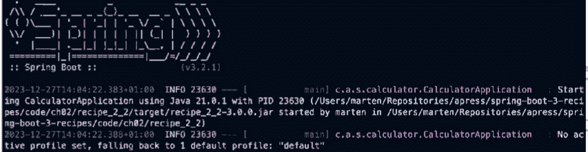

图 2-2. 计算器应用程序输出

尽管你将属性外部化到 `application.properties` 中，但这些属性仍然封装在应用程序内部。这意味着你仍然需要将它们更改为不同的计算器。想象一下在真实的生产系统中，由于 Spring 配置需要更改而必须创建新的构制品。Spring Boot 有多种方法可以帮助你解决这个问题。

## 使用外部 application.properties 覆盖属性

首先构建构制品并使用 `java -jar recipe_2_2-3.0.0.jar` 启动应用程序。它仍将运行并使用提供的和封装的应用程序属性。现在，在构制品相同的位置添加 `application.properties` 并在其中为不同的属性设置值。参见列表 2-10。

### 列表 2-10. 覆盖属性示例

```properties
lhs=26
rhs=952
op=*
```

启动应用程序时，它现在将使用这些额外的属性。参见图 2-3。

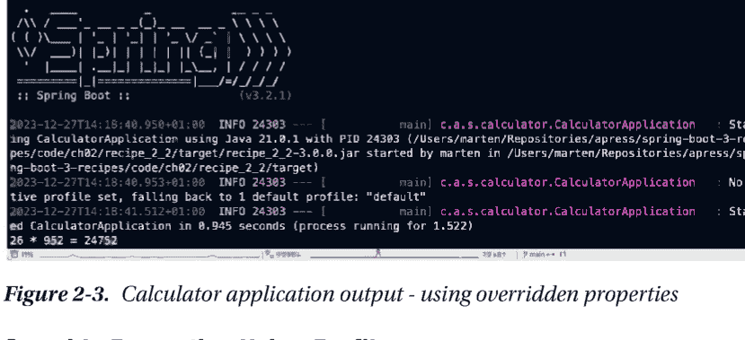

图 2-3. 计算器应用程序输出

## 使用 Profiles 覆盖属性

Spring Boot 可以使用激活的配置（active profiles）加载额外配置。在上一节中，你已经使用了 `src/main/resources` 中的 `application.properties`。参见列表 2-11。

### 列表 2-11. 特定配置的属性

```properties
lhs=10
rhs=20
op=+
```

现在构建构制品并使用 `java -jar recipe_2_2-3.0.0.jar --spring.profiles.active=dev` 启动。你会发现使用的是 `application-dev.properties`（图 2-4）。

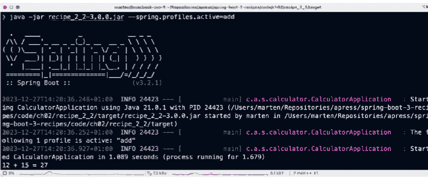

图 2-4. 计算器应用程序输出

## 使用命令行参数覆盖属性

最后一个选项是使用命令行参数。你也可以通过命令行指定属性：`java -jar recipe_2_2-3.0.0.jar --lhs=30 --rhs=40 --op=-`。这将覆盖所有其他属性（图 2-5）。

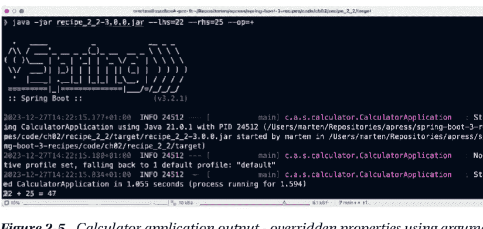

图 2-5. 计算器应用程序输出

如果你使用的是文件或某些想要加载的嵌入文件，你始终可以在 `@SpringBootApplication` 类上使用 `@PropertySource`。参见列表 2-12。

## 从不同的配置文件加载属性

### 列表 2-12. 使用 @PropertySource 的类

```java
@PropertySource("classpath:your-external.properties")
@SpringBootApplication
public class MyApplication { }
```

`@PropertySource` 注解允许你在启动期间添加要加载的文件。你还可以通过指定 `ignoreResourceNotFound` 属性为 true 来指定找不到文件时的行为（默认认为 false）。

虽然添加 `@PropertySource` 可以工作，但它并不依赖 Spring Boot 来加载，并且不会获得相同的处理。然而，与其使用 `@PropertySource`，可以使用命令行参数指示 Spring Boot 加载额外文件（参见表 2-1）。

### 表 2-1. 配置参数

| 参数 | 说明 |
| :--- | :--- |
| `spring.config.name` | 要加载的文件名的逗号分隔字符串，默认为 application。 |
| `spring.config.location` | 用于加载属性文件的资源位置（或文件）的逗号分隔字符串，默认值为 `classpath:,classpath:/config/,file:./`。 |
| `spring.config.additional-location` | 用于加载属性文件的额外资源位置（或文件）的逗号分隔字符串，默认为空。 |

# 2-3. 配置测试问题

你想为你的 Spring Boot 应用程序的组件或部分编写测试。

## 解决方案

Spring Boot 扩展了 Spring 测试框架的范围。它增加了对通过 Mockito 对 bean 进行模拟（mock）和监视（spy）的支持，并为 Web 测试提供了自动配置。它还引入了简单的方法，通过只启动所需的组件来切分你的应用程序（例如，使用 `@WebMvcTest` 或 `@JdbcTest`），或者使用 `@SpringBootTest` 编写完整的集成测试。

## 工作原理

Spring Boot 同样将自动配置扩展到了测试框架的一部分。它与 Mockito 集成，以便对 bean 进行轻松模拟（或监视）。它还为基于使用 Spring MockMvc 测试框架或基于 WebDriver 的测试的 Web 基础测试提供了自动配置。

## 编写单元测试

首先，让我们为计算器的一个组件编写一个简单的单元测试，即 `MultiplicationTest`，它将测试 `Multiplication` 类。参见列表 2-13。

### 列表 2-13. 基础单元测试

```java
package com.apress.springboot3recipes.calculator.operation;

import org.junit.jupiter.api.Test;

import static org.junit.jupiter.api.Assertions.assertEquals;
import static org.junit.jupiter.api.Assertions.assertFalse;
import static org.junit.jupiter.api.Assertions.assertTrue;

public class MultiplicationTest {

    private final Multiplication operation = new Multiplication();

    @Test
    public void shouldMatchSign() {
        assertTrue(operation.handles('*'));
        assertFalse(operation.handles('/'));
    }

    @Test
    public void shouldCorrectlyApplyFormula() {
        assertEquals(4, operation.apply(2, 2));
        assertEquals(120, operation.apply(12, 10));
    }
}
```

这是一个基础的单元测试。一旦 `Multiplication` 被实例化，我们就调用它的方法，并最后验证结果。第一个测试将测试它是否真的对 `*` 运算符有反应，而不是其他运算符。第二个测试将测试实际的乘法逻辑。要对一个方法进行测试，你必须用 `@Test` 注解它。

## 在单元测试中模拟依赖项

有时一个类需要依赖项；但在编写单元测试时，你希望测试只针对单个组件。Spring Boot 会自动引入 Mockito 框架。Mockito 是一个用于模拟类并记录其行为的优秀库。为 Calculator 应用程序编写测试需要额外的组件，因为它将实际计算委托给可用的 `Operation` 类。为了测试 Calculator 的正确行为，我们需要创建一个 `Operation` 的 mock 并将其注入到 `Calculator` 中。参见列表 2-14。

### 列表 2-14. 使用 Mock 的单元测试

```java
package com.apress.springboot3recipes.calculator;

import static org.junit.jupiter.api.Assertions.assertThrows;
import static org.mockito.Mockito.anyChar;
import static org.mockito.Mockito.times;
import static org.mockito.Mockito.verify;
import static org.mockito.Mockito.when;

import java.util.Collections;

import org.junit.jupiter.api.BeforeEach;
import org.junit.jupiter.api.Test;
import org.mockito.Mockito;

public class CalculatorTest {

    private Calculator calculator;
    private Operation mockOperation;

    @BeforeEach
    public void setup() {
        mockOperation = Mockito.mock(Operation.class);
        calculator = new Calculator(Collections.singletonList(mockOperation));
    }

    @Test
    public void throwExceptionWhenNoSuitableOperationFound() {
        when(mockOperation.handles(anyChar())).thenReturn(false);
        assertThrows(IllegalArgumentException.class,
            () -> calculator.calculate(2, 2, '*'));
    }

    @Test
    public void shouldCallApplyMethodWhenSuitableOperationFound() {
        when(mockOperation.handles(anyChar())).thenReturn(true);
        when(mockOperation.apply(2, 2)).thenReturn(4);

        calculator.calculate(2, 2, '*');

        verify(mockOperation, times(1)).apply(2, 2);
    }
}
```

在 `@BeforeEach` 方法中，我们通过调用 `Mockito.mock` 来模拟 `Operation`，并使用模拟后的操作构造 `Calculator`。mock 被用于测试方法，以具有特定的行为。在第一个测试方法中，我们想要测试找不到合适操作的情况，因此我们指示 mock 在调用 `handles` 方法时返回 false。测试将预期一个异常；如果发生了异常，测试将成功。第二个测试是测试是否遵循了正确的流程；我们想要测试正确的行为。指示 mock 的 `handles` 方法返回 true，并为 `apply` 方法返回一个返回值。

## 使用 Spring Boot 进行集成测试

Spring Boot 提供了几个注解来辅助测试。第一个是 `@SpringBootTest`，它将使测试成为一个 Spring Boot 驱动的测试，这意味着测试上下文框架将寻找标记了 `@SpringBootApplication` 注解的类（如果没有传递特定的配置），并使用该类来实际启动应用程序。

### 列表 2-15. Spring Boot 集成测试

```java
package com.apress.springboot3recipes.calculator;

import static org.junit.jupiter.api.Assertions.assertThrows;
import static org.junit.jupiter.api.Assertions.assertTrue;

import org.junit.jupiter.api.Test;
import org.junit.jupiter.api.extension.ExtendWith;
import org.springframework.beans.factory.annotation.Autowired;
import org.springframework.boot.test.context.SpringBootTest;
import org.springframework.boot.test.system.output.CapturedOutput;
import org.springframework.boot.test.system.output.OutputExtension;

@ExtendWith(OutputExtension.class)
@SpringBootTest(classes = CalculatorApplication.class)
public class CalculatorTests {

    @Autowired
    private Calculator calculator;

    @Test
    public void doingMultiplicationShouldSucceed(CapturedOutput capture) {
        calculator.calculate(12, 13, '*');
        assertTrue(capture.getOut().contains("12 * 13 = 156"));
    }

    @Test
    public void doingDivisionShouldFail() {
        assertThrows(IllegalArgumentException.class,
            () -> calculator.calculate(12, 13, '/'));
    }
}
```


`@ExtendWith` 将配置 JUnit 扩展，在这种情况下是 `OutputExtension`，它带有 Spring Boot 并拦截 `System.out` 和 `System.err`，以便对这些流编写断言。要检查输出，使用 `CapturedOutput` 类。它可以由扩展注入方法中。在这种情况下，我们执行乘法，输出应该反映这一点。

# 第 2 章 SPRING BOOT 基础

## 使用 Spring Boot 和 Mock 进行集成测试

Spring Boot 可以轻松地在上下文中将 bean 替换为 mock。为此，Spring Boot 拥有 `@MockBean` 注解。参见列表 2-17。

### 列表 2-17. MockBean 注解示例

```java
@MockBean
private Calculator calculator
```

这将整个 `calculator` 替换为 mock 实例。为了能够使用它，你需要使用标准的 Mockito 方式定义 bean。当存在多个类型的 bean 时，你需要指定要替换的 bean 的 `name` 属性。参见列表 2-18。

### 列表 2-18. 带有名称的 MockBean 注解示例

```java
@MockBean(name="addition")
private Operation mockOperation
```

这将普通的 `Addition` bean 替换为 mock 实例，然后可以使用它注册 mock 行为。如果找不到名称的 bean，mock bean 将作为新实例注册。参见列表 2-19。

### 列表 2-19. 带有名称的 MockBean 注解示例（不存在的 bean）

```java
@MockBean(name="division")
private Operation mockOperation
```

这不会替换现有的 bean，而是向应用上下文添加 bean，作为结果，`Calculator` 将增加一个它可以处理的操作。你可以使用 Spring 测试框架中的 `ReflectionTestUtils` 辅助类对其进行测试。参见列表 2-20。

### 列表 2-20. 验证操作数量

```java
@Test
public void calculatorShouldHave30operations() {
    var operations = ReflectionTestUtils.getField(calculator, "operations");
    assertEquals(3, ((Collection<Operation>) operations).size());
}
```

这将通过反射获取 `operations` 字段，并断言集合的大小为 3。当移除 `@Bean` 注解（或将名称更改为 `addition`）时，此测试将失败，因为现在只注册了两个操作。

使用 mock 非常简单。请见列表 2-21。

### 列表 2-21. 使用 Mock Bean

```java
@Test
public void mockDivision(CapturedOutput capture) {
    when(mockOperation.handles('/')).thenReturn(true);
    when(mockOperation.apply(14, 7)).thenReturn(2);

    calculator.calculate(14, 7, '/');
    assertTrue(capture.getOut().contains("14 / 7 = 2"));
}
```

在这里，我们指示 Mockito 在测试除法（/）时返回 true, 并在调用 `apply` 方法时返回一个值。接下来调用该方法，并断言输出符合该测试的预期。

## 使用 Spring Boot 切片（Slices）进行集成测试

除了使用 `@SpringBootTest`，你也可以测试应用程序的一部分。为此，Spring Boot 提供了所谓的“切片”（slices）。通过专用的 `@Test` 注解（见表 2-2），它将加载仅包含所需配置部分的 `ApplicationContext`。例如，使用 `@JdbcTest` 时，它将创建一个仅包含 JDBC 相关 bean（如 `DataSource`、`JdbcTemplate` 等）的 `ApplicationContext`。它不会创建所有无关 bean，如你的 Web 服务器或 Web 相关 bean。

### 表 2-2. 测试切片注解

| 注解 | 说明 |
| :--- | :--- |
| `@JsonTest` | 自动配置可用的 JSON 映射器并应用找到的 配置。 |
| `@WebMvcTest` | 自动配置应用程序的 Web 相关部分（过滤器、安全等）并设置 `MockMvc`。这通常用于使用 `@MockBean` 依赖项来测试单个控制器。 |
| `@WebFluxTest` | 自动配置应用程序的 Flux 相关部分并设置 `WebTestClient`。这通常用于使用 `@MockBean` 依赖项来测试单个控制器。 |
| `@GraphQLTest` | 自动配置 Spring GraphQL。 |
| `@DataCassandraTest` | 自动配置 Spring Data Cassandra。 |
| `@DataCouchbaseTest` | 自动配置 Spring Data Couchbase。 |
| `@DataElasticTest` | 自动配置 Spring Data ElasticSearch。 |
| `@DataJdbcTest` | 自动配置 Spring Data JDBC，如果存在，默认将配置内存数据库。 |
| `@JpaTest` | 自动配置 Spring Data JPA，如果存在，默认将配置内存数据库。 |
| `@DataLdapTest` | 自动配置 Spring Data LDAP；默认将设置一个内存 LDAP 服务器进行测试。 |
| `@DataMongoTest` | 自动配置 Spring Data MongoDB。 |
| `@DataNeo4jTest` | 自动配置 Spring Data Neo4J。 |
| `@DataRdbcTest` | 自动配置 Spring Data R2DBC。 |
| `@DataRedisTest` | 自动配置 Spring Data Redis。 |
| `@JdcbTest` | 自动配置 JDBC，如果存在，默认将配置内存数据库。 |
| `@JooqTest` | 自动配置 JOOQ，如果存在，默认将配置内存数据库。 |
| `@RestClientTest` | 自动配置 REST 客户端并设置 `MockRestServer`。 |
| `@WebServiceClientTest` | 自动配置 WebService 并设置 `MockWebServiceServer`。 |
| `@WebServiceServer` | 自动配置 Spring Web 并设置 `MockServiceClient`。 |

作为一个示例，让我们看看 `@WebMvcTest` 并使用它来测试控制器，无需启动整个应用程序。列表 2-22 包含了一个控制器，允许我们通过 Web 执行计算。关于控制器和 Web 的更多信息，请参阅第 3 和 4 章。见列表 2-22。

### 列表 2-22. Calculator Controller

```java
package com.apress.springbootrecipes.calculator.web;

import com.apress.springbootrecipes.calculator.Calculator;
import org.springframework.web.bind.annotation.GetMapping;
import org.springframework.web.bind.annotation.RestController;

@RestController
public class CalculatorController {

    private final Calculator calculator;

    public CalculatorController(Calculator calculator) {
        this.calculator = calculator;
    }

    @GetMapping("/calculate")
    public int calculate(Calculation calc) {
        return calculator.calculate(calc.lhs(), calc.rhs(), calc.op());
    }
}

record Calculation(int lhs, int rhs, char op) {};
```

为了测试此内容，我们可以在测试上使用 `@WebMvcTest` 注解以及 `Calculator` 的 mock 实例，因为它不是上下文的一部分。见列表 2-23。

### 列表 2-23. Calculator Controller 的 WebMvcTest

```java
package com.apress.springbootrecipes.calculator.web;

import com.apress.springbootrecipes.calculator.Calculator;
import org.junit.jupiter.api.Test;
import org.springframework.boot.test.autoconfigure.web.servlet.WebMvcTest;
import org.springframework.boot.test.mock.mockito.MockBean;
import org.springframework.beans.factory.annotation.Autowired;
import org.springframework.test.web.servlet.MockMvc;

import static org.mockito.Mockito.*;
import static org.springframework.test.web.servlet.request.MockMvcRequestBuilders.get;
import static org.springframework.test.web.servlet.result.MockMvcResultMatchers.content;
import static org.springframework.test.web.servlet.result.MockMvcResultMatchers.status;

@WebMvcTest(CalculatorController.class)
class CalculatorControllerTest {

    @Autowired
    private MockMvc mockMvc;

    @MockBean
    private Calculator calculator;

    @Test
    void successfulCalculation() throws Exception {
        when(calculator.calculate(10, 5, '*')).thenReturn(50);

        mockMvc.perform(get("/calculate")
                .param("lhs", "10")
                .param("rhs", "5")
                .param("op", "*"))
                .andExpect(status().isOk())
                .andExpect(content().string("50"));

        verify(calculator, times(1)).calculate(10, 5, '*');
    }
}
```

## 使用 Testcontainers 进行集成测试

```xml
<dependency>
  <groupId>org.testcontainers</groupId>
  <artifactId>junit-jupiter</artifactId>
  <scope>test</scope>
</dependency>
<dependency>
  <groupId>org.testcontainers</groupId>
  <artifactId>postgresql</artifactId>
  <scope>test</scope>
</dependency>
<dependency>
  <groupId>org.postgresql</groupId>
  <artifactId>postgresql</artifactId>
  <scope>runtime</scope>
</dependency>
```

我们添加了 `spring-boot-testcontainers` 依赖以及 PostgreSQL JDBC 驱动程序以及 PostgreSQL 和 JUnit Testcontainers 模块。通过这些内容，我们使用 `@Test` 注解为测试启动一个 PostgreSQL 数据库。请参见列表 2-25。

### 列表 2-25. 使用常规 Testcontainers 用法的 `@JdbcTest`

```java
package com.apress.springbootrecipes.calculator;

import org.junit.jupiter.api.Test;
import org.springframework.beans.factory.annotation.Autowired;
import org.springframework.boot.test.autoconfigure.jdbc.AutoConfigureTestDatabase;
import org.springframework.boot.test.autoconfigure.jdbc.JdbcTest;
import org.springframework.jdbc.core.JdbcTemplate;
import org.springframework.test.context.DynamicPropertyRegistry;
import org.springframework.test.context.DynamicPropertySource;
import org.springframework.test.jdbc.JdbcTestUtils;
import org.testcontainers.containers.PostgreSQLContainer;
import org.testcontainers.junit.jupiter.Container;
import org.testcontainers.junit.jupiter.Testcontainers;
import static org.junit.jupiter.api.Assertions.assertEquals;

@JdbcTest
@AutoConfigureTestDatabase(replace = AutoConfigureTestDatabase.Replace.NONE)
@Testcontainers
public class JdbcTestWithTestcontainers {

    @Container
    static PostgreSQLContainer<?> postgres = new PostgreSQLContainer<>(
        "postgres:15.2"
    );

    @Autowired
    private JdbcTemplate jdbc;

    @DynamicPropertySource
    public static void properties(DynamicPropertyRegistry props) {
        props.add("spring.datasource.url", postgres::getJdbcUrl());
        props.add("spring.datasource.username", postgres::getUsername());
        props.add("spring.datasource.password", postgres::getPassword());
    }

    @Test
    void retrieveTables() {
        var tables = JdbcTestUtils.countRowsInTable(jdbc, "pg_catalog.pg_tables");
        assertEquals(68, tables);
    }
}
```

在测试中，我们添加了 `@Testcontainers`，这是用于 Testcontainers 的特殊 JUnit 扩展。由于我们现在会检测带有 `@Container` 注解的字段，它会自动启动它们。由于我们正在使用容器，我们需要指示 Spring Boot 使用它。对于 JDBC，我们需要配置 `spring.datasource.url` 属性（以及用户名和密码）。为了实现这一点，我们利用了 `@DynamicPropertySource`，它可以放置在测试的静态方法上，然后从容器中获取设置并将其注册为属性。


# 最后，注意 `@AutoConfigureTestDatabase`

最后，注意 `@AutoConfigureTestDatabase`，它是数据库驱动测试所需要的。默认情况下，Spring Boot 将尝试启动一个嵌入容器并将其作为 `DataSource`。如果我们不添加它，测试用例将失败。现在当运行测试时，Testcontainers 将介入下载并启动容器，然后执行测试。之后，容器将会被停止并销毁。

虽然这种方法有效且是使用 Testcontainers 的有效方式，但可以更好。Spring Boot 引入了所谓的“服务连接”（service connection）。这是对可以连接的各种服务的抽象，例如数据库或消息中间件。要利用这一点，有一个 `@ServiceConnection` 注解，可以放置于你使用的容器上。使用它时，你就不需要添加方法来为上下文动态注册属性了。请参见列表 2-26。

## 列表 2-26. 使用 Spring Boot `@ServiceConnection` 的 `@JdbcTest`

```java
package com.apress.springbootrecipes.calculator;

import org.junit.jupiter.api.Test;
import org.springframework.beans.factory.annotation.Autowired;
import org.springframework.boot.test.autoconfigure.jdbc.AutoConfigureTestDatabase;
import org.springframework.boot.test.autoconfigure.jdbc.JdbcTest;
import org.springframework.boot.testcontainers.service.connection.ServiceConnection;
import org.springframework.jdbc.core.JdbcTemplate;
import org.springframework.test.jdbc.JdbcTestUtils;
import org.testcontainers.containers.PostgreSQLContainer;
import org.testcontainers.junit.jupiter.Container;
import org.testcontainers.junit.jupiter.Testcontainers;
import static org.junit.jupiter.api.Assertions.assertEquals;

@JdbcTest
@AutoConfigureTestDatabase(replace = AutoConfigureTestDatabase.Replace.NONE)
@Testcontainers
public class JdbcTestWithTestcontainersServiceConnection {

    @Container
    @ServiceConnection
    static PostgreSQLContainer<?> postgres = new PostgreSQLContainer<>(
      "postgres:15.2"
    );

    @Autowired
    private JdbcTemplate jdbc;

    @Test
    void retrieveTables() {
        var tables = JdbcTestUtils.countRowsInTable(jdbc, "pg_catalog.pg_tables");
        assertEquals(68, tables);
    }
}
```

测试的行为将相同：下载容器（如果需要）、启动容器、运行测试并停止容器。然而，不再需要显式配置属性了。`@ServiceConnection` 注解并不适用于所有容器，仅适用于已知容器。在本文写作期间，支持以下容器：

- `CassandraContainer`
- `CouchbaseContainer`
- `ElasticSearchContainer`
- `GenericContainer`
- `KafkaContainer`
- `MongoDBContainer`
- `Neo4jContainer`
- `RabbitMQContainer`
- `RedisContainer`
- `ZipkinContainer`

当有多个测试使用相同的容器时，你也可以在接口或抽象基类中指定容器，并让测试类实现/扩展它们。这允许更易用地复用容器，并避免了在每个需要容器的测试中重复定义容器。另一个额外的益处是，你可以在运行 Spring 时使用这些容器。列表 2-27。

## 列表 2-27. 带有容器定义的接口

```java
package com.apress.springbootrecipes.calculator;

import org.springframework.boot.testcontainers.service.connection.ServiceConnection;
import org.testcontainers.containers.PostgreSQLContainer;
import org.testcontainers.junit.jupiter.Container;

public interface TestcontainersConfig {
    @ServiceConnection
    @Container
    PostgreSQLContainer<?> postgres = new PostgreSQLContainer<>("postgres:15.2");
}
```

接下来你只需让测试类实现此接口来复用容器定义。请参见列表 2-28。

## 列表 2-28. 复用定义的测试类

（此处原文截断）

# 2-4. 配置日志

## 问题

你想为特定的日志记录器配置日志级别。

## 解决方案

通过 Spring Boot，你可以配置日志框架和相关配置。

## 工作原理

Spring Boot 为支持的日志提供程序（Logback、Log4J2 和 Java Util Logging）提供了默认配置。除了默认配置外，它还支持通过常规 `application.properties` 配置日志级别，并可以指定模式以及可选的日志文件写入位置。

Spring Boot 使用 SLF4J 作为日志 API，在编写组件时，你应该使用这些接口来编写日志。这样，你就可以自由选择使用哪种日志框架。

## 配置日志级别

日志框架的通用操作之一是启用或禁用某些部分的日志。在 Spring Boot 中，你可以通过在 `application.properties` 文件中添加几行代码来实现。这些行需要以 `logging.level.` 开头，后面紧跟日志记录器的名称，最后是你希望的级别。

```
logging.level.org.springframework.web=DEBUG
```

上一行将为 `org.springframework.web` 日志记录器启用 DEBUG 日志（通常是该包及其子包中的所有类）。要设置 ROOT 日志器的级别，请使用 `logging.level.ROOT=level`。这将设置默认的日志级别。

## 日志写入文件

默认情况下，Spring Boot 只记录日志到控制台。如果你也想写入文件，需要指定 `logging.file` 或 `logging.path`。第一个接受文件名，第二个接受路径。默认使用的是 `spring.log`，默认目录是 Java 临时目录。

```
logging.file=application.log
logging.path=/var/log
```

通过此配置，一个名为 `application.log` 的日志文件将被写入 `/var/log` 目录。

在将日志写入文件时，你可能希望防止日志文件溢出系统。你可以使用 `logging.file.max-history` 指定保留的文件数（默认值为 0，意味着无限），并使用 `logging.file.max-size` 指定文件大小（默认值为 10 MB）。

## 使用你偏好的日志提供程序

Spring Boot 默认使用 Logback 作为日志提供程序。它也支持 Java Util Logging 以及 Log4j 2。要使用另一个日志框架，你必须先排除默认框架并包含你的框架。Spring Boot 提供了 `spring-boot-starter-log4j2` 来包含 Log4j 2 需要的所有依赖项。要排除默认的 Logback 日志，你需要在 `spring-boot-starter` 依赖中添加一个排除规则。这是引入日志的主依赖。

```xml
<dependency>
  <groupId>org.springframework.boot</groupId>
  <artifactId>spring-boot-starter</artifactId>
  <exclusions>
    <exclusion>
      <groupId>org.springframework.boot</groupId>
      <artifactId>spring-boot-starter-logging</artifactId>
    </exclusion>
  </exclusions>
</dependency>
<dependency>
  <groupId>org.springframework.boot</groupId>
  <artifactId>spring-boot-starter-log4j2</artifactId>
</dependency>
```

# 2-5. 复用现有的配置

## 问题

你有一个现有的配置并想要复用它。

## 解决方案

要复用现有配置，你可以使用 `@Import` 注解。

## 工作原理

Spring Boot 使用 `@Import` 注解来引入其他配置。

## 复用 XML 配置

要复用 XML 配置，你可以使用 `@ImportResource` 注解。

```java
@SpringBootApplication
@ImportResource("classpath:application.xml")
public class Application {
}
```

## 复用 Java 配置

要复用 Java 配置，你可以使用 `@Import` 注解。

```java
@SpringBootApplication
@Import(ExistingConfiguration.class)
public class Application {
}
```

# 2-6. 在 Spring Boot 中使用 Docker

## 问题

你有一些容器化的基础设施（如数据库、消息队列等），并在开发期间想要它们。

## 解决方案

Spring Boot 通过两种方式支持 Docker 开发：第一是使用 Docker Compose，第二是使用 Testcontainers。

## 工作原理

Spring Boot 会检测应用程序根目录下的 `docker-compose.yml` 或 `docker-compose.yaml` 文件，并启动容器。

## Docker Compose 支持

要开始，你需要一个 `docker-compose.yml` 文件。让我们创建一个启动数据库的实例。

### 列表 2-29. Docker Compose 文件

```yaml
services:
  postgres:
    image: 'postgres:15.2'
    environment:
      - POSTGRES_DB=springboot3
      - POSTGRES_USER=springboot3
      - POSTGRES_PASSWORD=recipes
    ports:
      - '5432'
```

`DockerApplication` 包含一个简单的 `ApplicationRunner`，它在启动时会查询 PostgreSQL 的 `pg_tables` 系统表以检索可用表的名称，并将它们打印到控制台。之后，程序停止。请注意，这里没有任何 Docker 特有的内容，也没有为数据库指定任何配置。

现在当运行应用程序时，将会有输出，说明发现了 Docker compose 文件并将启动容器。当容器启动后，应用程序将继续运行并列出表。见图 2-6。

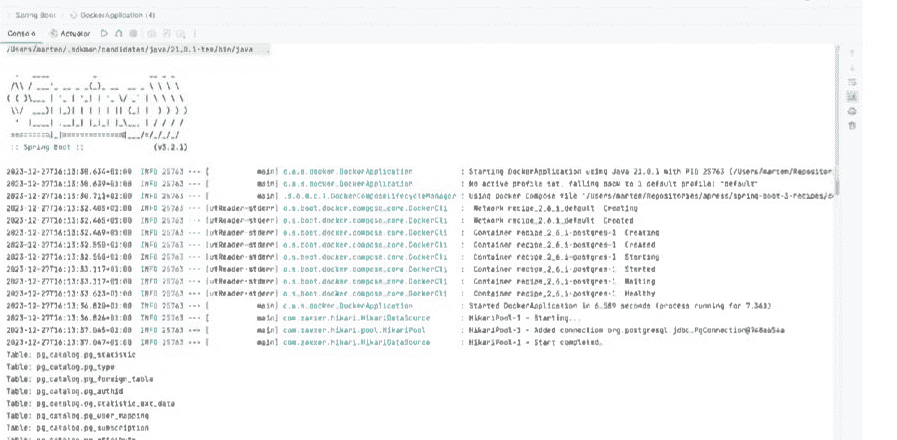

### 图 2-6. Docker 应用程序输出

没有手动通过任何 `docker compose up` 或通过修改你的构建配置（或主类）来启动容器。

默认情况下，Spring Boot 的 Docker Compose 支持会查找 `docker-compose.yaml`/`compose.yml` 文件。可以使用 `spring.docker.compose.file` 属性更改此文件。你可以将其指向文件系统上的特定文件。还有更多属性（见表 2-3）可供你修改行为。

## 表 2-3. Docker Compose 配置属性

| 参数 | 描述 |
| --- | --- |
| `spring.docker.compose.enabled` | 设置是否启用 Docker Compose 支持；默认是 true。 |
| `spring.docker.compose.file` | 特定 Docker Compose 文件的路径。 |
| `spring.docker.compose.lifecycle-management` | Docker Compose 生命周期；默认是 START_AND_STOP。 |
| `spring.docker.compose.host` | Docker 容器启动并运行的机器的主机名/IP 地址。 |
| `spring.docker.compose.start.command` | 启动时使用的 Docker Compose 命令；默认是 UP。 |
| `spring.docker.compose.start.loglevel` | Docker Compose 输出的日志级别。 |
| `spring.docker.compose.stop.command` | 停止时使用的 Docker Compose 命令；默认是 STOP。 |
| `spring.docker.compose.stop.duration` | 停止 Docker Compose 的超时时间；默认是 10 秒。设置为 0 则强制停止。 |
| `spring.docker.compose.profiles.active` | 应激活的 Docker compose 配置描述文件（profiles）。 |
| `spring.docker.compose.skip-tests` | 设置测试中是否启用 Docker Compose 支持；默认是 false。 |
| `spring.docker.compose.readiness` | 使用的就绪策略；默认是 ALWAYS。 |
| `spring.docker.compose.readiness.timeout` | 就绪检查的超时时间；默认是 2 分钟。 |
| `spring.docker.compose.readiness.tcp-connect-timeout` | 连接超时。 |
| `spring.docker.compose.readiness.tcp.read-timeout` | 读取超时。 |

`spring.docker.compose.profiles.active` 用于设置/启用与 Docker Compose 使用的描述文件。这些描述文件与 Spring profiles 无关。

Spring Boot 中的 Docker Compose 支持使用 Docker 镜像的名称来确定配置内容。具体名称和支持的技术请参阅表 2-4。

## 表 2-4. Docker Compose 支持的容器

| 技术 | 匹配的容器镜像名称 |
|---|---|
| Cassandra | `cassandra` |
| ElasticSearch | `elasticsearch` |
| JDBC and R2DBC | `gvenzl/oracle-xe`<br>`mariadb`<br>`mssql/server`<br>`mysql`<br>`postgres` |
| MongoDB | `mongo` |
| RabbitMQ | `rabbitmq` |
| Redis | `redis` |
| Zipkin | `openzipkin/zipkin` |

## Spring Boot Docker Compose 支持：自定义容器镜像

如表 2-4 所示，容器的名称很重要。但如果你想使用自定义的容器呢？例如使用一个预配置并填充好的 PostgreSQL 数据库，或者一个预配置且安全的消息中间件？通过 Spring Docker 支持，这仍然可能的，只需在 Docker Compose 文件中进行一些额外的配置。在 Docker Compose 中，可以指定标签（labels）。Spring Boot Docker 支持将读取 `org.springframework.boot.service-connection` 标签；其值将作为容器名称。见列表 2-32。

### 列表 2-32. 带标签的 Docker Compose 文件

```yaml
services:
  postgres:
    image: 'postgres:15.2'
    environment:
      - POSTGRES_DB=springboot3recipes
      - POSTGRES_USER=springboot3
      - POSTGRES_PASSWORD=recipes
    ports:
      - '5432'
    labels:
      org.springframework.boot.service-connection: redis
```


还有更多标签可以用于配置/影响 Docker Compose 支持（见表 2-5）。

| 参数 | 描述 |
|---|---|
| `org.springframework.boot.service-connection` | 要使用的容器镜像名称（见表 2-4）。 |
| `org.springframework.boot.ignore` | 在 Docker Compose 支持中忽略此容器。 |
| `org.springframework.boot.readiness-check.tcp.disable` | 禁用 TCP 就绪检查。 |
| `org.springframework.boot.readiness-check.tcp.connect-timeout` | 连接超时。 |
| `org.springframework.boot.readiness-check.tcp.read-timeout` | 读取超时。 |

## Spring Boot Testcontainers 支持

在开发期间利用 Testcontainers 支持，需要依赖 `spring-boot-testcontainers`。

（注：提供的 OCR 文本包含大量重复和页面交叉内容。我已根据逻辑流程处理了唯一内容。）

现在使用 `@ImportTestContainers` 注解来复用此接口。参见列表 2-37。

### 列表 2-37. 接口上的 Testcontainers 定义

```java
package com.apress.springboot3recipes.calculator;

import org.springframework.boot.test.context.TestConfiguration;
import org.springframework.boot.testcontainers.context.ImportTestcontainers;

@TestConfiguration(proxyBeanMethods = false)
@ImportTestcontainers(OurContainersConfig.class)
public class TestContainers2Config { }
```

## 2-7. 使用 Spring Boot Devtools 加速开发

### 问题

你希望在开发过程中获得快速反馈，而不需要重新构建并重启应用程序。

### 解决方案

你可以使用 Spring Boot Devtools。Devtools 允许你检测类路径的变化，当检测到变化时，它将重启应用程序。这种重启将比冷启动快得多。它还会将某些属性设置为在开发期间合理的数值（例如禁用 Thymeleaf 模板缓存，在错误响应中包含完整的错误详情）。表 2-6 列出了由 Spring Boot Devtools 设置的属性及其默认值。如果你想禁用这些默认值，请向你的 `application.properties` 添加值为 false 的 `spring.devtools.properties`。

### 表 2-6. Spring Boot Devtools 默认属性

| 属性 | 值 | 描述 |
| --- | --- | --- |
| `server.error.include-binding-errors` | always | 在绑定错误上显示完整信息。 |
| `server.error.include-message` | always | 在错误响应中包含自定义错误消息。 |
| `server.error.include-stacktrace` | always | 在错误响应中显示完整的堆栈跟踪信息。 |
| `server.servlet.jsp.init-parameters.development` | true | JSP 开发参数，允许重载。 |
| `server.servlet.session.persistent` | true | 在重启期间持久化会话信息。 |
| `spring.docker.compose.readiness` | only-if-started | 等待 Docker 容器就绪。 |
| `spring.freemarker.cache` | false | 禁用 Freemarker 模板缓存。 |
| `spring.graphql.graphql.enabled` | true | 启用 GraphQL UI。 |
| `spring.groovy.template.cache` | false | 禁用 Groovy 模板缓存。 |
| `spring.h2-console.enabled` | true | 可用时启用 H2 控制台。 |
| `spring.mustache.servlet.cache` | false | 禁用 Mustache 模板缓存。 |
| `spring.mvc.log-resolved-exception` | true | 记录异常。 |
| `spring.reactor.netty.shutdown-quiet-period` | os | 立即关闭 Netty 而不是等待。 |
| `spring.template.provider.cache` | false | 禁用模板缓存。 |
| `spring.thymeleaf.cache` | false | 禁用 Thymeleaf 模板缓存。 |
| `spring.web.resource.cache.period` | os | 禁用静态资源缓存。 |
| `spring.web.resource.chain.cache` | os | 禁用静态资源缓存。 |

### 工作原理

要启用并重载 Spring Boot Devtools，你首先需要 `spring-boot-devtools` 模块的依赖。参见列表 2-38。

### 列表 2-38. Devtools 依赖

```xml
<dependency>
  <groupId>org.springframework.boot</groupId>
  <artifactId>spring-boot-devtools</artifactId>
  <optional>true</optional>
</dependency>
```

注意该依赖被标记为可选（`optional`）。这意味着它不会被包含在由 Spring Boot 创建的可执行构件中。

现在我们来写一个简单的控制器，列出 PostgreSQL 数据库中的表。它将通过 `JdbcTemplate` 直接访问数据库，并发送查询从 PostgreSQL 的 `pg_tables` 表中获取表名。最后，它将其转换为响应。

首先，我们需要一些依赖来实现此功能。除了控制器和 JDBC 类所需的依赖外，我们在使用 Docker Compose 支持来启动 PostgreSQL 容器（参见配方 2-6）。

```xml
<dependency>
  <groupId>org.springframework.boot</groupId>
  <artifactId>spring-boot-starter-web</artifactId>
</dependency>
```

```xml
<dependency>
  <groupId>org.springframework.boot</groupId>
  <artifactId>spring-boot-starter-jdbc</artifactId>
</dependency>
```

```xml
<dependency>
  <groupId>org.springframework.boot</groupId>
  <artifactId>spring-boot-docker-compose</artifactId>
</dependency>
```

接下来是控制器，如下所示：

```java
package org.springframework.boot3recipes;

import org.springframework.jdbc.core.JdbcTemplate;
import org.springframework.web.bind.annotation.GetMapping;
import org.springframework.web.bind.annotation.RestController;
import java.util.List;

@RestController
public class ShowTablesController {
    private final JdbcTemplate jdbc;

    public ShowTablesController(JdbcTemplate jdbc) {
        this.jdbc = jdbc;
    }

    @GetMapping("/show-tables")
    public List<String> showTables() {
        var sql = "select tablename from pg_catalog.pg_tables";
        return jdbc.queryForList(sql, String.class);
    }
}
```

这将使用 `JdbcTemplate` 从 PostgreSQL 的 `pg_tables` 中检索表名并作为响应返回。要启动它，我们需要一个的 Spring Boot 应用程序。

```java
package org.springframework.boot3recipes;
import org.springframework.boot.SpringApplication;
import org.springframework.boot.autoconfigure.SpringBootApplication;

@SpringBootApplication
public class DevToolsApplication {
    public static void main(String[] args) {
        SpringApplication.run(DevToolsApplication.class, args);
    }
}
```

通过这一切，我们可以在 IDE 中或通过命令行使用 Maven 或 Gradle 启动应用程序。在图 2-7 中，你可以启动这个简单的应用程序大约花了 4 秒。这包含了启动 PostgreSQL 容器的时间。

```
2023-07-26:10:25:02.001 INFO --- [restartedMain] s.s.Application
2023-07-26:10:25:02.018 INFO --- [restartedMain] s.s.Application
2023-07-26:10:25:02.023 INFO --- [restartedMain] s.s.Manager
2023-07-26:10:25:02.026 INFO --- [restartedMain] s.s.jdbc.DbUtils
2023-07-26:10:25:02.030 INFO --- [restartedMain] s.s.jdbc.DbUtils
2023-07-26:10:25:02.035 INFO --- [restartedMain] s.s.jdbc.DbUtils
2023-07-26:10:25:02.036 INFO --- [restartedMain] s.s.jdbc.DbUtils
2023-07-26:10:25:02.037 INFO --- [restartedMain] s.s.jdbc.DbUtils
2023-07-26:10:25:02.038 INFO --- [restartedMain] s.s.jdbc.DbUtils
2023-07-26:10:25:02.039 INFO --- [restartedMain] s.s.jdbc.DbUtils
2023-07-26:10:25:02.040 INFO --- [restartedMain] s.s.jdbc.DbUtils
2023-07-26:10:25:02.041 INFO --- [restartedMain] s.s.jdbc.DbUtils
2023-07-26:10:25:02.042 INFO --- [restartedMain] s.s.jdbc.DbUtils
2023-07-26:10:25:02.043 INFO --- [restartedMain] s.s.jdbc.DbUtils
2023-07-26:10:25:02.044 INFO --- [restartedMain] s.s.jdbc.DbUtils
2023-07-26:10:25:02.045 INFO --- [restartedMain] s.s.jdbc.DbUtils
2023-07-26:10:25:02.046 INFO --- [restartedMain] s.s.jdbc.DbUtils
2023-07-26:10:25:02.047 INFO --- [restartedMain] s.s.jdbc.DbUtils
2023-07-26:10:25:02.048 INFO --- [restartedMain] s.s.jdbc.DbUtils
2023-07-26:10:25:02.049 INFO --- [restartedMain] s.s.jdbc.DbUtils
2023-07-26:10:25:02.050 INFO --- [restartedMain] s.s.jdbc.DbUtils
2023-07-26:10:25:02.051 INFO --- [restartedMain] s.s.jdbc.DbUtils
2023-07-26:10:25:02.052 INFO --- [restartedMain] s.s.jdbc.DbUtils (n/a)
```

+ 正在使用端口 8080 (http) 启动 DevTools Application - 已于 X.ms
- 没有设置激活配置，退回到默认配置："default"
- 容器 2_7_1-postgresql-3: 已创建
- 容器 2_7_1-postgresql-3: 已启动
- 容器 2_7_1-postgresql-3: 运行中
- 容器 2_7_1-postgresql-3: 健康检查通过
- 检测到默认 DevTools 属性：将 application.properties 中的属性应用到：
- 正在端口 8080 (http) 启动 Tomcat
- Tomcat 已在端口 8080 (http) 初始化
- Root Web (ApplicationContext) 在 X ms 初始化
- Tomcat 已在端口 8080 (http) 启动，路径为 ''
- (DevTools 重启在 X.XXX 秒后启用 (已运行 X. 秒))

图 2-7 首次启动的输出

注意日志输出中的 `[restartedMain]`。Spring Boot Devtools 使用单独的线程和额外的类加载器来启用修改类的重载。虽然这种方法效果良好，但在较大的多模块项目以及同样使用加载来修改类的技术（例如 Hibernate）中，有时会出现问题。

现在我们来更改控制器，不再仅仅返回表名，而是包含模式（schema）。为此，我们需要修改查询和结果的映射，因为我们需要连接两个字符串：

```java
@GetMapping("/show-tables")
public List<String> showTables() {
    var sql = "select schemaname, tableName from pg_catalog.pg_tables";
    return jdbc.query(sql,
        (rs, row) -> rs.getString("schemaname") + "." +
        rs.getString("tablename"));
}
```

现在，当更改被构建并传播到类路径时，Spring Boot DevTools 会检测到这一点并重启应用程序。这种重启所需的时间仅是启动整个应用程序时间的一部分（2-8 秒）。在这种情况下，它花费了 0.681 秒，略小于一秒。这对于在 IDE 中编写代码并获取直接反馈来说是一个极大的提升。

| 日期 | 时间 | 级别 | 线程 | 记录器 | 消息 |
| :--- | :--- | :--- | :--- | :--- | :--- |
| 2023-07-17 12:13:51.123-456 | | INFO | `[main]` | `c.s.d.Application` | 使用 Java 17 启动 DevToolsApplication，PID 为 1234 (/home/app)。没有激活的配置。回退到默认配置："default" |
| 2023-07-17 12:13:51.456-789 | | INFO | `[main]` | `c.s.d.Application` | 在端口(8080) (http) 上启动嵌入式 Tomcat 服务器 |
| 2023-07-17 12:13:51.789-012 | | INFO | `[main]` | `org.apache.tomcat.catalina.startup.Tomcat` | Tomcat 已在端口(8080) (http) 上启动，上下文为 '' |
| 2023-07-17 12:13:52.012-345 | | INFO | `[main]` | `c.s.d.Application` | 在 1.2 秒内初始化 SpringApplicationContext |
| 2023-07-17 12:13:52.345-678 | | INFO | `[main]` | `c.s.d.Application` | RootApplicationContext 在 2.456 秒内初始化 / (3.123) |


| 2023-07-17 12:13:52.678-901 | | INFO | [main] | c.s.d.Application | 应用在 3.123 秒内启动（进程运行 4.768 秒） |

## 重启后的输出

## 总结

在本章中，我们介绍了如何通过属性文件和命令行参数在 Spring Boot 中配置 Bean。接下来，我们快速查看了如何在没有 Spring Boot 的情况下编写单元测试，以及使用 Mockito 作为 Mock 库。最后，我们在应用程序中引入了日志记录，并展示了如何配置前面提到的属性，以及如何切换到不同的日志提供程序（使用 Log4j 代替 Logback）。

将带你了解 Spring Boot 和 Spring MVC。

# 第 3 章

## Spring MVC

当 Spring Boot 在类路径上找到类时，它会自动配置 Web 应用。它还会启动一个嵌入式服务器（默认情况下将启动一个嵌入式的 Tomcat 实例）。

## 3-1. 开启 Spring MVC

### 问题

你想使用 Spring Boot 来驱动一个 Spring MVC 应用程序。

### 解决方案

Spring Boot 会自动配置 Spring MVC 所需的组件。Spring Boot 需要在其类路径上检测 Spring MVC 类。为了实现这一点，你需要添加 `spring-boot-starter-web` 作为依赖。

### 工作原理

在你的项目中，添加 `spring-boot-starter-web` 依赖。参见列表 3-1。

**列表 3-1。** 用于 Spring MVC 的 Spring Boot Starter

```xml
<dependency>
  <groupId>org.springframework.boot</groupId>
  <artifactId>spring-boot-starter-web</artifactId>
</dependency>
```

这添加了 Spring MVC 所需的依赖 `spring-web` 和 `spring-webmvc`。现在 Spring Boot 能够检测到这些类，它将进行额外的配置以设置 `DispatcherServlet`。它还会添加启动嵌入式 Tomcat 服务器所需的 JAR 文件。参见列表 3-2。

**列表 3-2。** 用于启动 Spring MVC 的 Spring Boot

```java
package com.appress.springboot3recipes.library;

import org.springframework.boot.SpringApplication;
import org.springframework.boot.autoconfigure.SpringBootApplication;

@SpringBootApplication
public class HelloWorldApplication {
    public static void main(String[] args) {
        SpringApplication.run(HelloWorldApplication.class, args);
    }
}
```

这些代码行足够启动嵌入式 Tomcat 服务器并设置预配置的 Spring MVC 了。当你启动应用程序时，你将看到类似于图 3-1 的输出。

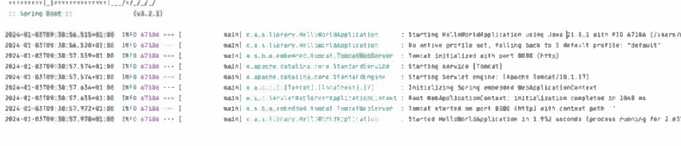

当你在端口 8080（默认）上启动 `HelloWorldApplication` 时，Spring Boot 会执行以下操作：

1.  在端口 8080（默认）上启动嵌入式服务器。
2.  注册并启用几个默认 servlet 过滤器。

**表 3-1。** 自动注册的过滤器

| 过滤器 | 说明 |
| :--- | :--- |
| DefaultEncoding | 强制使用 UTF-8 编码。 |
| FormContentFilter | 包装请求。 |
| RequestContextFilter | 暴露当前请求。 |

3.  设置静态资源如 `.css`、`.js` 和 `.ico`。
4.  启用功能。
5.  设置错误处理。
6.  配置带有视图解析器的 `DispatcherServlet`。

**列表 3-3。** Spring Controller

```java
package com.appress.springboot3recipes.library;

import org.springframework.boot.SpringBootApplication;
import org.springframework.web.bind.annotation.GetMapping;
import org.springframework.web.bind.annotation.RestController;

@RestController
public class HelloWorldController {

    @GetMapping("/")
    public String hello() {
        return "Hello World";
    }
}
```

`@WebMvcTest` 注解指示 Spring 测试框架为特定的控制器设置应用程序上下文。它将启动一个包含 `@Controller`、`@ControllerAdvice` 等 Web 相关的 Bean 的最小 Spring 应用。此外，它将预配置 Spring 测试 MVC 支持，以便注入 `MockMvc`。

Spring Mock MVC 可模拟向控制器发送 HTTP 请求并对结果进行操作。在这里我们通过 GET 调用 `/` 并期望一个 HTTP 200 (OK) 响应，包含 Hello World 文本。

**列表 3-4。** WebMvcTest 切片

```java
package com.appress.springboot3recipes.library;

import org.hamcrest.Matchers;
import org.junit.jupiter.api.Test;
import org.springframework.beans.factory.annotation.Autowired;
import org.springframework.boot.test.autoconfigure.web.servlet.WebMvcTest;
import org.springframework.http.MediaType;
import org.springframework.test.web.servlet.MockMvc;
import org.springframework.test.web.servlet.request.MockMvcRequestBuilders;

import static org.springframework.test.web.servlet.result.MockMvcResultMatchers.content;
import static org.springframework.test.web.servlet.result.MockMvcResultMatchers.status;
import static org.springframework.test.web.servlet.request.MockMvcRequestBuilders.get;

@WebMvcTest(HelloWorldController.class)
class HelloWorldControllerTest {

    @Autowired
    private MockMvc mockMvc;

    @Test
    void testHelloWorldController() throws Exception {
        var expected = "Hello World";
        mockMvc.perform(get("/").contentType(MediaType.TEXT_PLAIN)).andExpect(status().isOk()).andExpect(content().string(expected));
    }
}
```

## 3-2. 使用 Spring MVC 暴露 REST 资源

### 问题

你想使用 Spring MVC 来暴露 REST 资源。

### 解决方案

你需要一个 JSON 库来进行 JSON 序列化（尽管可以使用 XML 和其他格式，因为内容协商是原始 REST 定义的一部分）。在本教程中，我们将使用 Jackson 库来处理 JSON 转换。

### 工作原理

想象你在一家公共图书馆工作，需要开发一个 REST API 以便列出和搜索书籍。

首先需要在构建中添加 Jackson 库的依赖。Spring Boot 提供了 `spring-boot-starter-json` 来添加所有需要的依赖。参见列表 3-5。

`spring-boot-starter-web` 依赖已经包含了 `spring-boot-starter-json` 依赖，并将自动将其引入。但显式地声明它以表示你正在使用/启用 JSON 可能会很有帮助。

你也可以使用 Google Gson 库；只需改用相应的依赖，并从 `spring-boot-starter-web` 依赖中排除 `spring-boot-starter-json` 即可。

由于你正在为一家图书馆创建一个应用程序，它可能包含书籍，因此让我们创建一个 `Book` 记录。参见列表 3-6。

**列表 3-6.** Book 记录

```java
package com.apress.springboot3recipes.library;

import java.util.List;
import java.util.Objects;

public record Book(
    String isbn,
    String title,
    List<String> authors
) {
    @Override
    public boolean equals(Object o) {
        if (this == o) return true;
        if (o == null || getClass() != o.getClass()) return false;
        Book book = (Book) o;
        return Objects.equals(isbn, book.isbn);
    }

    @Override
    public int hashCode() {
        return Objects.hash(isbn);
    }
}
```

书籍通过其 ISBN 号来定义；它有一个标题和一个或多个作者。通常，记录会创建一个 `equals()`、`hashCode()` 和 `toString()` 方法，这些方法将包含记录中的所有数据（因为它是不可变的）。然而，在这里我们希望仅根据 `isbn` 字段拥有 `equals()` 和 `hashCode()`，因此我们自己提供这些实现。

你还需要一个服务来处理图书馆中的书籍。让我们为 `BookService` 定义一个接口和实现类。参见列表 3-7。

**列表 3-7.** BookService 接口

```java
package com.apress.springboot3recipes.library;

import java.util.Optional;

public interface BookService {

    Iterable<Book> findAll();
    Book create(Book book);
    Optional<Book> find(String isbn);
}
```

目前的实现是一个简单的内存实现。参见列表 3-8。

**列表 3-8.** InMemoryBookService 实现

```java
package com.apress.springboot3recipes.library;

import org.springframework.stereotype.Service;

import java.util.Map;
import java.util.Optional;
import java.util.concurrent.ConcurrentHashMap;

@Service
class InMemoryBookService implements BookService {

    private final Map<String, Book> books = new ConcurrentHashMap<>();

    @Override
    public Iterable<Book> findAll() {
        return books.values();
    }

    @Override
    public Book create(Book book) {
        books.put(book.isbn(), book);
        return book;
    }

    @Override
    public Optional<Book> find(String isbn) {
        return Optional.ofNullable(books.get(isbn));
    }
}
```

该服务已标记了 `@Service`，这样 Spring Boot 就能检测到它并创建一个实例。参见列表 3-9。

**列表 3-9.** 带有设置数据的应用程序类

```java
package com.apress.springboot3recipes.library;

import java.util.List;

import org.springframework.boot.ApplicationRunner;
import org.springframework.boot.SpringApplication;
import org.springframework.boot.autoconfigure.SpringBootApplication;
import org.springframework.context.annotation.Bean;

@SpringBootApplication
public class LibraryApplication {

    public static void main(String[] args) {
        SpringApplication.run(LibraryApplication.class, args);
    }

    @Bean
    public ApplicationRunner booksInitializer(BookService bookService) {
        return args -> {
            bookService.create(new Book("9780061120084", "To a Mockingbird", List.of("Harper Lee")));
            bookService.create(new Book("9780451524935", "1984", List.of("George Orwell")));
            bookService.create(new Book("9780612803800", "The Hobbit", List.of("J.R.R. Tolkien")));
        };
    }
}
```

`LibraryApplication` 将检测所有类并启动服务器。在启动时，它将注册三本书，以便我们的图书馆中有内容可用。为了将 `Book` 暴露为 REST 资源，创建一个名为 `BookController` 的类并用 `@RestController` 对其进行注解。Spring Boot 将检测此类并创建一个实例。使用 `@RequestMapping`、`@GetMapping` 和 `@PostMapping`，你可以编写方法来处理传入的请求。除了 `@RestController`，你还可以使用 `@Controller` 并在每个请求方法上加上 `@ResponseBody`。使用 `@RestController` 会隐式地为请求方法添加 `@ResponseBody`。


```java
package com.apress.springboot3recipes.rest;

import com.apress.springboot3recipes.library.Book;
import com.apress.springbootrecipes.library.BookService;
import org.springframework.http.ResponseEntity;
import org.springframework.web.bind.annotation.*;
import org.springframework.web.util.UriComponentsBuilder;

@RestController
@RequestMapping("/books")
public class BookController {

    private final BookService bookService;

    public BookController(BookService bookService) {
        this.bookService = bookService;
    }

    @GetMapping
    public Iterable<Book> all() {
        return bookService.findAll();
    }

    @GetMapping("/{isbn}")
    public ResponseEntity<Book> get(@PathVariable String isbn) {
        return bookService.find(isbn).map(ResponseEntity::ok).orElse(null);
    }

    @PostMapping
    public ResponseEntity<Book> create(@RequestBody Book book, UriComponentsBuilder uriBuilder) {
        Book created = bookService.create(book);
        var location = uriBuilder.fromPath("/{isbn}").buildAnd(created.isbn()).toUri();
        return ResponseEntity.created(location).body(created);
    }
}
```

# 第 3 章 Spring MVC

发生的情况是 HTTP 将参数转换为 JSON 请求体，然后由 Jackson 库读取并将其转换为一个 `Book` 对象。请参见列表 3-11。

## 列表 3-11. Book 的 JSON 表示

```json
{
  "title": "The Lord of the Rings",
  "isbn": "9780618640157",
  "authors": ["J.R.R. Tolkien"]
}
```

Jackson 将检测到我们创建的 `Book` 记录（参见列表 3-6），并将属性映射到正确的构造函数参数上。

# 测试 @RestController

由于你想要确保控制器执行了预期的工作，请编写一个测试来验证控制器的行为。请参列表 3-12。

## 列表 3-12. 使用 WebMvcTest 对 BookController 进行集成测试

```java
package com.apress.springboot3recipes.library.rest;

import com.apress.springboot3recipes.library.Book;
import com.apress.springboot3recipes.library.BookService;
import org.hamcrest.Matchers;
import org.junit.jupiter.api.Test;
import org.springframework.beans.factory.annotation.Autowired;
import org.springframework.boot.test.autoconfigure.servlet.WebMvcTest;
import org.springframework.boot.test.mock.mockito.MockBean;
import org.springframework.http.MediaType;
import org.springframework.test.servlet.MockMvc;
import org.springframework.test.servlet.result.MockMvcResultMatchers;

import java.util.Arrays;
import java.util.List;
import java.util.Optional;

import static org.mockito.ArgumentMatchers.any;
import static org.mockito.ArgumentMatchers.anyString;
import static org.mockito.Mockito.when;
import static org.springframework.framework.test.servlet.request.MockMvcRequestBuilders.get;
import static org.springframework.framework.test.servlet.request.MockMvcRequestBuilders.post;
import static org.springframework.framework.test.servlet.result.MockMvcResultMatchers.header;
import static org.springframework.framework.test.servlet.result.MockMvcResultMatchers.status;

@WebMvcTest(BookController.class)
public class BookControllerTest {

    @Autowired
    private MockMvc mockMvc;

    @MockBean
    private BookService bookService;

    @Test
    public void shouldReturnListOfBooks() throws Exception {
        when(bookService.findAll()).thenReturn(Arrays.asList(
            new Book("123", "Spring 5 Recipes", List.of("Marten Deinum", "Josh Long")),
            new Book("321", "Pro Spring MVC", List.of("Marten Deinum", "Colin Yates"))));

        mockMvc.perform(get("/books"))
            .andExpect(status().isOK())
            .andExpect(MockMvcResultMatchers.jsonPath("$*", Matchers.hasSize(2)))
            .andExpect(MockMvcResultMatchers.jsonPath("$*[*].isbn", Matchers.containsInAnyOrder("123", "321")))
            .andExpect(MockMvcResultMatchers.jsonPath("$*[*].title", Matchers.containsInAnyOrder("Spring 5 Recipes", "Pro Spring MVC"))));
    }

    @Test
    public void shouldReturn404WhenBookNotFound() throws Exception {
        when(bookService.find(anyString())).thenReturn(Optional.empty());
        mockMvc.perform(get("/books/123"))
            .andExpect(status().isNotFound());
    }

    @Test
    public void shouldReturnBookWhenFound() throws Exception {
        when(bookService.find(anyString())).thenReturn(
            Optional.of(new Book("123", "Spring 6 Recipes", List.of("Marten Deinum", "Josh Long"))));

        mockMvc.perform(get("/books/123"))
            .andExpect(status().isOk())
            .andExpect(MockMvcResultMatchers.jsonPath("$.isbn", Matchers.equal("123")))
            .andExpect(MockMvcResultMatchers.jsonPath("$.title", Matchers.equalTo("Spring 6 Recipes")));
    }

    @Test
    public void shouldAddBook() throws Exception {
        when(bookService.create(any(Book.class))).thenReturn(new Book("123456789", "Test Book Stored", List.of("T. Author"))));
        mockMvc.perform(post("/books"))
            .contentType(MediaType.APPLICATION_JSON)
            .content("{}")
            .andExpect(header().string("Location", "http://localhost/books/123456789"));
    }
}
```

该测试使用 `@WebMvcTest` 创建了一个基于 `MockMvc` 的集成测试。它将创建一个最小的 Spring Boot 应用以便运行控制器。控制器需要一个 `BookService` 实例，因此它会创建一个 Mock Bean。此外，我们使用 `@MockBean` 注解配置预期行为。

## 3-3. 使用 Thymeleaf

### 问题

你想在 Spring Boot 中使用 Thymeleaf。

### 解决方案

要开始使用，你需要在项目中添加以下依赖：

```xml
<dependency>
  <groupId>org.springframework.boot</groupId>
  <artifactId>spring-boot-starter-thymeleaf</artifactId>
</dependency>
```

### 工作原理

添加此依赖后，Thymeleaf 将自动检测并配置视图。Spring Boot 暴露了几个属性来配置 Thymeleaf。

### 表 3-2. Thymeleaf 属性

| 属性 | 说明 |
| --- | --- |
| spring.thymeleaf.cache | 设置是否缓存解析后的模板，默认值为 `true`。 |
| spring.thymeleaf.check-template | 检查模板是否存在，默认值为 `true`。 |
| spring.thymeleaf.check-template-location | 检查模板位置是否存在，默认值为 `true`。 |
| spring.thymeleaf.enabled | 设置是否启用 Thymeleaf，默认值为 `true`。 |
| spring.thymeleaf.enable-compiler | 启用 SpEL 编译，默认值为 `false`。 |
| spring.thymeleaf.encoding | 设置模板的编码，默认值为 `UTF-8`。 |
| spring.thymeleaf.exclude-view-names | 视图名称（逗号分隔）。 |

### 表 3-2.（续）

| 属性 | 说明 |
|---|---|
| spring.thymeleaf.mode | 设置使用的 Thymeleaf 模板模式，默认值为 `HTML`。 |
| spring.thymeleaf.prefix | 设置 ViewResolver 使用的前缀，默认值为 `classpath:/templates/`。 |
| spring.thymeleaf.suffix | 设置 ViewResolver 使用的后缀，默认值为 `.html`。 |
| spring.thymeleaf.render-hidden-markers-before-checkbox | 设置在复选框元素之前渲染隐藏标记，默认值为 `false`。 |
| spring.thymeleaf.template-resolver | 设置 ViewResolver 的顺序，默认值为 `1`。 |
| spring.thymeleaf.view-names | 设置该 ViewResolver 解析的视图名称（逗号分隔）。 |
| spring.thymeleaf.servlet.content-type | 设置写入 HTTP 响应的 Content-Type，默认值为 `text/html`。 |
| spring.thymeleaf.servlet.produce-partial-output-while-processing | 设置是尽快开始写入（部分内容）还是等待模板处理完成后缓冲；默认值为 `true`。 |
| spring.thymeleaf.reactive.max-chunk-size | 设置写入响应的数据缓冲区最大。如果未设置，默认使用分块模式。 |
| spring.thymeleaf.reactive.media-types | 设置该视图技术支持的媒体类型。 |
| spring.thymeleaf.reactive.full-mode-view-names | 包含以 FULL 模式执行的视图列表（逗号分隔，支持通配符）。 |
| spring.thymeleaf.reactive.chunked-mode-view-names | 包含以 CHUNKED 模式执行的视图列表（逗号分隔，支持通配符）。 |

## 添加索引页

首先为我们的应用程序添加一个索引页。在 `src/main/resources/templates` 目录（默认位置）下创建一个 `index.html` 文件。参见列表 3-13。

### 列表 3-13. 索引页

```html
<!DOCTYPE html>
<html xmlns:th="http://www.thymeleaf.org">
<head>
  <meta charset="UTF-8">
  <title>Spring Boot Recipes - Library</title>
</head>
<body>
  <h1>Library</h1>
  <a th:href="@{books.html}" href="#">List of books</a>
</body>
</html>
```

这只是一个基础的 HTML5 页面，针对 Thymeleaf 进行了一些细微调整。首先，通过 `xmlns:th="http://www.thymeleaf.org"` 启用 Thymeleaf 命名空间。该命名空间通过 `th:href` 使用在链接中。`@{/books.html}` 部分将由 Thymeleaf 展开为正确的链接，并放置在链接的实际 `href` 属性中。

现在，当运行应用程序时，你应该会看到一个带有书籍概览链接的页面（参见图 3-5）。

## Library

书籍列表

图 3-5. 渲染后的索引页

## 添加控制器和视图

当点击索引页中提供的链接时，我们希望看到一个显示图书馆可用书籍列表的页面（参见图 3-6）。为此，需要添加两个内容：首先是一个可以处理请求并准备模型的控制器，其次是一个渲染书籍列表的视图。

## 可用书籍

| 标题 | 作者 | ISBN |
| --- | --- | --- |
| The Hobbit | [J.R.R. Tolkien] | 9780618260300 |
| 1984 | [George Orwell] | 9780451524935 |
| To Kill a Mockingbird | [Harper Lee] | 9780061120084 |

图 3-6. 书籍列表页

# 第 3 章 SPRING MVC

让我们添加一个控制器，它将用书籍列表填充模型，并选择要渲染的视图名称。控制器是一个带有 `@Controller` 注解的类，并包含请求处理方法（带有 `@RequestMapping` 注解的方法，在本教程中使用了 `@GetMapping`，它是特殊的 `@RequestMapping` 注解）。参见列表 3-14。

### 列表 3-14. BookController

```java
package com.apress.spring3recipes.library.web;
```


# 第 3 章 Spring MVC

## BookController 实现

```java
import com.apress.spring3recipes.library.Book;
import com.apress.spring3recipes.library.BookService;
import org.springframework.stereotype.Controller;
import org.springframework.ui.Model;
import org.springframework.web.bind.annotation.GetMapping;

@Controller
public class BookController {

    private final BookService bookService;

    public BookController(BookService bookService) {
        this.bookService = bookService;
    }

    @GetMapping("/books.html")
    public String all(Model model) {
        model.addAttribute("books", bookService.findAll());
        return "books/list";
    }
}
```

`BookController` 需要 `BookService` 以便获取要显示的书籍列表。`all` 方法将 `org.springframework.ui.Model` 作为方法参数，以便我们可以将书籍列表放入模型中。请求处理方法可以有不同的参数；其中一个就是 `Model` 类。在方法中，我们使用 `BookService` 从数据存储中检索所有书籍并使用 `model.addAttribute` 将其添加到模型中。现在书籍列表在模型中以 `books` 为键可用。

最后，我们返回要渲染的视图名称 `books/list`。

> 参考：[Spring MVC 文档 - 方法参数](https://docs.spring.io/spring/docs/current/spring-framework-reference/web.html#mvc-ann-arguments)

## 创建列表视图

现在控制器和请求处理方法已经添加，我们需要创建视图。在 `src/main/templates/books` 目录下创建一个 `list.html` 文件。参见列表 3-15。

**列表 3-15.** 书籍列表页

```html
<!DOCTYPE html>
<html xmlns:th="http://www.thymeleaf.org">
<head>
  <meta charset="UTF-8">
  <title>Library - Available Books</title>
  <meta http-equiv="Content-Type" content="text/html; charset=UTF-8"/>
</head>
<body>
  <h1>Available Books</h1>
  <table>
    <thead>
      <tr>
        <th>Title</th>
        <th>Author</th>
        <th>ISBN</th>
      </tr>
    </thead>
    <tbody>
      <tr th:each="book : ${books}">
        <td th:text="${book.title}">Title</td>
        <td th:text="${book.authors}">Authors</td>
        <td><a th:href="@{/books.html(isbn=${book.isbn})}" th:text="${book.isbn}">ISBN</a></td>
      </tr>
    </tbody>
  </table>
</body>
</html>
```

再次使用 Thymeleaf 语法的 HTML5 表达式。页面使用 `th:each` 表达式渲染书籍列表。它从模型中获取所有书籍，并为每本书创建一个行。行的每一列都使用 `th:text` 打印标题、作者和 ISBN。表格的最后一列使用 `th:href` 构建指向书籍的链接。注意 `isbn` 参数。

启动应用程序并点击索引页上的链接时，你应该看到图书馆的内容，如图 3-6 所示。

## 添加详情页

最后，当链接包含名为 `isbn` 的请求参数时，我们希望显示带有详情的页面。我们可以在控制器中检索并使用查找书籍。请求参数可以通过 `@RequestParam` 注解的方法获取。

以下方法将处理 GET 请求，将请求参数映射到方法参数，并包含模型以便我们可以将书籍添加到模型中。

```java
@GetMapping(value = "books.html", params = "isbn")
public String get(@RequestParam("isbn") String isbn, Model model) {
    Book book = bookService.findByIsbn(isbn);
    if (book != null) {
        model.addAttribute("book", book);
    }
    return "books/details";
}
```

控制器将渲染详情页。在 `src/main/templates/books` 添加 `details.html` 文件。参见列表 3-16。

**列表 3-16.** 详情页

```html
<!DOCTYPE html>
<html xmlns:th="http://www.thymeleaf.org">
<head>
  <meta charset="UTF-8">
  <title>Library - Book Details</title>
  <meta http-equiv="Content-Type" content="text/html; charset=UTF-8"/>
</head>
<body>
  <h1 th:if="${book != null}">Book Details</h1>
  <table th:if="${book != null}">
    <tr>
      <th>Title</th>
      <td th:text="${book.title}">Title</td>
    </tr>
    <tr>
      <th>Author</th>
      <td th:text="${book.authors}">Authors</td>
    </tr>
    <tr>
      <th>ISBN</th>
      <td th:text="${book.isbn}">ISBN</td>
    </tr>
  </table>
  <p th:if="${book == null}">Book not found</p>
</body>
</html>
```

此 Thymeleaf 模板将渲染页面上的其中一个块。要么找到了书籍并显示详情，要么显示“未找到”的消息。这是通过使用 `th:if` 表达式实现的。“未找到”消息的 `isbn` 是通过 `param` 前缀从请求中检索的。

## 测试控制器

由于你想确保控制器按预期工作，请编写一个测试来验证控制器的行为。参见列表 3-17。

**列表 3-17.** 使用 WebMvc 的 BookController 集成测试

```java
package com.apress.spring3recipes.library.web;

import com.apress.spring3recipes.library.Book;
import com.apress.spring3recipes.library.BookService;
import org.hamcrest.Matchers;
import org.junit.jupiter.api.Test;
import org.springframework.beans.factory.annotation.Autowired;
import org.springframework.boot.test.autoconfigure.web.servlet.MockMvcTest;
import org.springframework.boot.test.mock.mockito.MockBean;
import org.springframework.test.web.servlet.MockMvc;
import java.util.Arrays;
import java.util.List;
import java.util.Optional;
import static org.mockito.ArgumentMatchers.anyString;
import static org.mockito.Mockito.when;
import static org.springframework.test.web.servlet.request.MockMvcRequestBuilders.get;
import static org.springframework.test.web.servlet.result.MockMvcResultMatchers.*;

@MockMvcTest(BookController.class)
public class BookControllerTest {

    @Autowired
    private MockMvc mockMvc;

    @MockBean
    private BookService bookService;

    @Test
    public void shouldReturnListOfBooks() throws Exception {
        when(bookService.findAll()).thenReturn(Arrays.asList(
            new Book("123", "Spring 6 Recipes", List.of("Marten Deinum", "Josh Long")),
            new Book("321", "Pro Spring MVC", List.of("Marten Deinum", "Colin Yates"))
        ));

        mockMvc.perform(get("/books.html"))
            .andExpect(status().isOk())
            .andExpect(view().name("books/list"))
            .andExpect(model().attribute("books", Matchers.hasSize(2)));
    }

    @Test
    public void shouldReturnNoBookWhenNotFound() throws Exception {
        when(bookService.find(anyString())).thenReturn(Optional.empty());
        mockMvc.perform(get("/books.html").param("isbn", "123"))
            .andExpect(status().isOk())
            .andExpect(view().name("books/details"))
            .andExpect(model().attributeDoesNotExist("book"));
    }

    @Test
    public void shouldReturnBookWhenFound() throws Exception {
        Book book = new Book("123", "Spring 6 Recipes",
            List.of("Marten Deinum", "Josh Long"));
        when(bookService.find(anyString())).thenReturn(Optional.of(book));
        mockMvc.perform(get("/books.html").param("isbn", "123"))
            .andExpect(status().isOk())
            .andExpect(view().name("books/details"))
            .andExpect(model().attribute("book", Matchers.is(book)));
    }
}
```

该测试使用 `@WebMvcTest` 创建了一个基于 MockMvc 的集成测试。它将创建一个最小的 Spring Boot 应用程序以便运行控制器。控制器需要一个 `BookService` 实例，因此我们让框架使用 `@MockBean` 注解为该服务创建一个模拟对象（mock）。在不同的测试方法中，我们模拟了预期的行为（返回书籍列表、返回空的 Optional 等）。

- Spring Boot 使用 Mockito 来创建 `@MockBean` 模拟对象。

通过 Spring Test 框架提供的 MockMvc 支持，我们可以检查控制器返回的内容是否符合预期。我们可以检查 HTTP 状态、视图的名称以及 Model 是否包含正确的条目。

## 3-4. 使用 Spring MVC 处理异常

### 问题

你想要为 Spring MVC 配置异常处理，并根据你的需求进行配置。

### 解决方案

Spring MVC 提供了处理异常的多种方法，通过 Spring Boot，修改默认行为变得非常简单。

对于与视图相关的实现，可以轻松地添加会被自动拾取的页面。可以添加一个 `error.html` 文件作为自定义错误页面，或者为特定的 HTTP 错误码添加特定的错误页面，例如 `404.html` 和 `500.html`。

Spring Boot 还为基于 REST 的控制器提供了异常处理支持。它将返回一个包含错误信息的响应，与普通 MVC 异常处理提供的错误信息类似。另一个选项是启用 Problem Detail 支持（RFC-7807），这是一个用于定义错误响应的小型标准。要启用它，请将 `spring.mvc.problemdetails.enabled` 属性设置为 `true`。

### 工作原理

Spring Boot 默认启用了错误处理并显示默认错误页面。可以通过将 `server.error.whitelabel-enabled` 属性设置为 `false` 来完全禁用它。禁用后，异常将由 servlet 容器处理，而不是由 Spring 和 Spring Boot 提供的通用异常处理机制处理。

### 处理视图技术的异常

还有其他属性可以用于配置白标签错误页面（whitelabel error page），主要用于控制包含在模型中的，以便可选地显示额外信息。属性请见表 3-3。

**表 3-3.** 异常处理属性

| 属性 | 说明 |
| --- | --- |
| `server.error.whitelabel` | 设置是否启用白标签错误页面；默认 `true`。 |
| `server.error.path` | 设置错误页面的路径；默认 `/error`。 |
| `server.error.include-exception` | 设置模型中是否包含异常名称；默认 `false`。 |
| `server.error.include-stacktrace` | 设置模型中是否包含堆栈跟踪信息；默认 `NEVER`。 |
| `server.error.include-message` | 设置模型中是否包含消息；默认 `NEVER`。 |
| `server.error.include-binding-errors` | 设置模型中是否包含绑定错误信息；默认 `NEVER`。 |

让我们在 `BookController` 中添加一个强制抛出异常的方法。

```java
@GetMapping("/books/500")
public void error() {
    var cause = new NullPointerException("Dummy Exception");
    throw new ServerErrorException(cause.getMessage(), cause);
}
```

这将会抛出一个异常，结果将显示白标签错误页面（见图 3-7）。

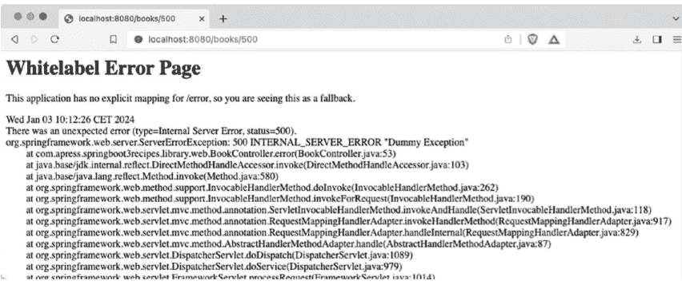

**图 3-7.** 默认白标签错误页面

如果没有找到错误页面，则显示此内容。要覆盖此内容，请在 `src/main/resources/templates` 目录下添加 `error.html` 文件。见列表 3-18。

**列表 3-18.** 自定义错误页面

```html
<!DOCTYPE html>
<html xmlns:th="http://www.thymeleaf.org">
<head>
    <meta charset="UTF-8">
    <title>Spring Boot Recipes</title>
</head>
<body>
<h1>Oops 出问题了，我们不知道发生了什么，但我们正在处理！</h1>
<div>
<div>
    <span><strong>error</strong></span>
</div>
</div>
</body>
</html>
```


<span th:text="${status}"></span>

### 列表 3-22. 错误页的修改

```html
<div th:unless="${parameters.empty}">
  <h3>Parameters = ${parameters}</h3>
  <span th:param="${parameters}">
    <div th:text="${param.key} + ' : ' + ${strings.arrayJoin(param.value, ', ')}"></div>
  </span>
</div>
```

当将`列表 3-22`包含在你的`error.html`文件中时，它将打印模型中可用参数映射表的内容。

## 为 REST 控制器处理异常

编写一个自定义的`ErrorAttributes`来替换默认的（图 3-10），并填充将作为响应生成的模型。

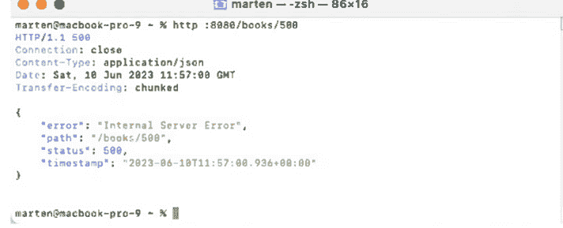

图 3-10. 默认错误响应

默认情况下，Spring Boot 会将表 3-5 中列出的属性包含在错误响应的模型中。

## 表 3-5. 默认错误模型属性

| 属性 | 说明 |
| :--- | :--- |
| timestamp | 提取错误的时间 |
| status | 状态码 |
| error | 错误原因 |
| exception | 根异常的类名（如果已配置） |
| message | 异常消息 |
| errors | 来自 BindingResult 的任何错误（在绑定和/或验证时） |
| trace | 异常堆栈跟踪（如果已配置） |
| path | 发生异常时的 URL 路径 |

这些都是通过使用`ErrorAttributes`组件完成的。默认使用的配置是`DefaultErrorAttributes`。你可以创建自己的`ErrorAttributes`处理器来创建自定义模型，或者扩展`DefaultErrorAttributes`以添加额外的属性。参见`列表 3-23`。

## 列表 3-23. 自定义 ErrorAttributes 实现

```java
package com.apress.springboot3recipes.library;

import org.springframework.framework.boot.web.error.ErrorAttributeOptions;
import org.springframework.framework.boot.web.servlet.error.DefaultErrorAttributes;
import org.springframework.framework.web.context.request.WebRequest;
import java.util.Map;

public class CustomizedErrorAttributes extends DefaultErrorAttributes {

    @Override
    public Map<String, Object> getErrorAttributes(WebRequest webRequest,
        ErrorAttributeOptions options) {

        var errorAttributes = super.getErrorAttributes(webRequest);
        errorAttributes.put("parameters", webRequest);
        return errorAttributes;
    }
}
```

`CustomizedErrorAttributes` bean 将原始请求参数添加到默认属性的模型中。下一步是将其配置为一个 bean，这样 Spring Boot 就能检测并使用它，而不是配置默认的。将`列表 3-24`中的 bean 定义添加到`LibraryApplication`中，即可实现这一目标。

## 列表 3-24. 自定义 ErrorAttributes Bean 定义

```java
@Bean
public CustomizedErrorAttributes errorAttributes() {
    return new CustomizedErrorAttributes();
}
```

这将生成图 3-11 所示的错误；注意有一个额外的`parameters`属性。

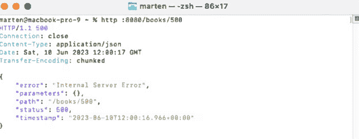

图 3-11. 自定义错误响应

## 启用并使用 Problem Details

Spring 6 增加了对 HTTP API Problem Details (RFC-7807) 支持，通过 Spring Boot 很容易启用。通过添加`spring.mvc.problemdetails.enabled=true`（对于 WebFlux 应用则使用`spring.webflux.problemdetails.enabled=true`），将启用此支持。

启用后，Spring Boot 将`ProblemDetailsExceptionHandler`注册为具有更高优先级的`ExceptionHandler`。`ProblemDetailsExceptionHandler`将处理一些常见的异常（所有与 Spring 相关的 Web 异常），并返回包含更多信息的结果，包括类型`application/problem+json`（见图 3-12）。

```bash
marten@macbook-pro-9 ~ % http :8000/books/500
HTTP/1.1 200
Connection: close
Content-Type: application/problem+json
Date: Fri, 28 Jul 2023 09:35:46 GMT
Transfer-Encoding: chunked

{
  "detail": "Dummy Exception",
  "instance": "/books/500",
  "status": 500,
  "title": "Internal Server Error",
  "type": "about:Blank"
}
marten@macbook-pro-9 ~ %
```

**图 3-12.** Problem detail 错误响应

图 3-12 显示了启用 Problem Detail 支持后调用`http://localhost:8080/books/500`的结果。

适用于所有不同的 Spring MVC 异常。当发生验证或绑定错误时，它还会显示带有错误的字段列表，说明哪里失败了。它甚至（如果可能）将这些错误消息翻译为客户端使用的语言（同样支持 I18N 的配方 3-6）。

## 3-5. 实现国际化 (I18N) 问题

在开发国际化 Web 应用时，你必须以用户的偏好语言显示你的网页。你不想为不同的语言创建同一个页面的不同版本。

### 解决方案

为了避免为不同的语言创建不同版本的页面，你应该使 Web 页面与语言无关，并将文本国际化。

### 如何工作

Spring Boot 会自动根据`src/resources`中的属性文件配置`MessageSource`。它根据`Accept-Language`请求头来决定使用哪种语言。这些属性改变了`MessageSource`对请求的响应方式。

### 表 3-6. I18N 属性

| 属性 | 描述 |
| :--- | :--- |
| spring.messages.basename | 逗号分隔的基名称；默认是 messages。 |
| spring.messages.encoding | 消息编码；默认是 UTF-8。 |
| spring.messages.always-use-format | 设置是否应用于所有消息；默认是 false。 |
| spring.messages.fallback-to-locale | 当找不到资源包时回退到系统语言。启用时默认是 true。 |
| spring.messages.code-as-default | 找不到消息时使用代码而不是抛出`NoSuchMessageException`。默认是 false。 |
| spring.messages.cache-duration | 缓存时长；默认是永久。 |

设置`spring.messages.fallback-to-locale`为`false`当你将应用程序部署到云或其他托管环境时非常有用。

将`messages.properties`文件添加到`src/main/resources`。参见`列表 3-25`。

### 列表 3-25. 默认消息

```properties
main.title=Spring Boot - Library
index.title=Library
index.books.link=List of books
books.list.title=Available Books
books.list.table.title=Title
books.list.table.author=Author
books.list.table.isbn=ISBN
```

现在更改模板以使用翻译。参见`列表 3-26`。

### 列表 3-26. 带有 I18N 的首页

```html
<!DOCTYPE html>
<html xmlns="http://www.thymeleaf.org">
<head>
  <meta charset="UTF-8">
  <title th:text="#{main.title}">Spring Boot - Library</title>
</head>
<body>
  <h1 th:text="#{index.title}">Library</h1>
  <a th:href="@${books.html}" href="#" th:text="#{index.books.link}">List of books</a>
</body>
</html>
```

现在当将接受头更改为荷兰语时，网站将神奇地翻译成荷兰语（见图 3-13）。

> 更改浏览器的语言可能没那么简单；Chrome 和 Firefox 有插件可以让你轻松切换 Accept-Language 请求头。

### 列表 3-27. 荷兰语消息

```properties
main.title=Spring Boot - Bibliotheek
index.title=Bibliotheek
index.books.link=Lijst van boeken
books.list.title=Beschikbare Boeken
books.list.table.title=Titel
books.list.table.author=Auteur
books.list.table.isbn=ISBN
```

# 第 3 章 Spring MVC


# 图书馆

书籍列表

图 3-13 荷兰语翻译索引页

## 3-6. 更改用户本地语言 (Locales)

### 问题

为了让你的 Web 应用程序支持国际化，你必须识别每个用户的首选本地语言（locale），并根据该语言显示内容。

### 解决方案

在 Spring MVC 应用中，用户的本地语言由一个组件识别，该组件必须实现`LocaleResolver`接口。Spring MVC 提供了几个`LocaleResolver`的实现，供你根据不同的标准解析本地语言。或者，你也可以通过实现该接口来创建自定义的本地语言解析器。

你可以通过在 Web 应用环境中注册类型为`LocaleResolver`的 Bean 来定义本地语言解析器。你必须将本地语言解析器的 Bean 名称设置为`localeResolver`，以便它被自动检测。

### 工作原理

Spring MVC 自带了`LocaleResolver`接口的几个默认实现，其中某些实现允许更改本地语言。要更改本地语言，可以使用特定的`HandlerInterceptor`（处理器拦截器）允许用户覆盖他们想要使用的语言，即`LocaleChangeInterceptor`。

### 通过 HTTP 请求头解析本地语言

Spring Boot 注册的默认本地语言解析器是`AcceptHeaderLocaleResolver`。它通过检查 HTTP 请求的`Accept-Language`请求头来解析本地语言。该请求头由用户的浏览器根据底层操作系统的语言设置进行设置。请参见`列表 3-28`。

> `AcceptHeaderLocaleResolver`无法更改用户的本地语言，因为它无法修改用户操作系统的语言设置。

### 列表 3-28. AcceptHeaderLocaleResolver Bean 定义

```java
@Bean
public LocaleResolver localeResolver() {
    return new AcceptHeaderLocaleResolver();
}
```

### 通过 Session 属性解析本地语言

解析本地语言的另一种方案是`SessionLocaleResolver`。它通过检查用户 Session 中预定义的属性来解析本地语言。如果 Session 属性不存在，该解析器将从`Accept-Language`HTTP 请求头确定默认本地语言。请参见`列表 3-29`。

### 列表 3-29. SessionLocaleResolver Bean 定义

```java
@Bean
public LocaleResolver localeResolver() {
    var localeResolver = new SessionLocaleResolver();
    localeResolver.setDefaultLocale(Locale.forLanguageTag("en"));
    return localeResolver;
}
```

你可以为此解析器设置`defaultLocale`属性，以防 Session 属性不存在。注意，该本地解析器能够通过更改存储语言的 Session 属性来更改用户的本地语言。

### 通过 Cookie 解析本地语言

你也可以使用`CookieLocaleResolver`通过检查用户浏览器中的 Cookie 来解析本地语言。如果 Cookie 不存在，该解析器将从`Accept-Language`HTTP 请求头确定默认本地语言。请参见`列表 3-30`。

### 列表 3-30. CookieLocaleResolver Bean 定义

```java
@Bean
public LocaleResolver localeResolver() {
    return new CookieLocaleResolver();
}
```


该本地解析器使用的 Cookie 可以通过配置表 3-7 中 `CookieLocaleResolver` 的属性进行自定义。参见列表 3-31。

表 3-7. CookieLocaleResolver 属性

| 属性 | 说明 |
| --- | --- |
| cookieDomain | 设置 Cookie 的 Domain 属性值。 |
| cookieHttpOnly | 为 Cookie 添加 HttpOnly 属性。 |
| cookieMaxAge | 设置 Cookie 的 Max-Age 属性，-1 表示持久持续到浏览器关闭（默认值）。 |
| cookieName | 设置 Cookie 的名称（已弃用）；现在改用构造函数。 |
| cookiePath | 设置 Cookie 的 Path 属性；默认值为 /。 |
| cookieSameSite | 设置 Cookie 的 Same-Site 属性；默认值为 Lax。 |
| cookieSecure | 设置 Cookie 的 Secure 属性。 |

## 3-7 选择并配置嵌入式服务器

### 问题

你想使用 Jetty 作为嵌入式服务器。

### 解决方案

Spring Boot 会自动检测类路径下的 Tomcat、Jetty 或 Undertow 并进行配置。

### 工作原理

Spring Boot 有对 Tomcat、Jetty 和 Undertow 嵌入容器的支持。全局属性以 `server.` 开头，而特定容器属性使用 `server.<container>`。

### 设置通用属性

多个通用服务器属性可用表 3-8。

表 3-8. 通用属性

| 属性 | 说明 |
| --- | --- |
| server.port | 设置 HTTP 服务器端口；默认值为 8080。 |
| server.address | 设置绑定的 IP 地址；默认值为 0.0.0.0，即所有适配器。 |
| server.server-header | 设置发送的 Header 名称；默认为空。 |
| server.max-http-header-size | 设置 HTTP Header 的最大大小；默认0（不限制）。 |
| server.connection-timeout | 设置连接等待下一个请求并关闭的超时时间。默认为空，留给容器处理；-1 表示永不超时。 |
| server.http2.enabled | 如果当前容器支持则启用 HTTP2。 |
| server.forward-headers-strategy | X-Forward-* 头部策略；可选 native 或 none。 |
| server.compression.enabled | 指定是否启用 HTTP 压缩；默认值为 false。 |
| server.compression.mime-types | 包含应用于压缩的 MIME 类型逗号列表。 |
| server.compression.excluded-user-agents | 包含禁用压缩的 User Agent 逗号列表。 |

列表 3-31. 使用属性配置示例

```java
@Bean
public LocaleResolver localeResolver() {
  var cookieResolver = new CookieLocaleResolver();
  cookieResolver.setMaxAge(Duration.ofMinutes(30));
  cookieResolver.setDefaultLocale(Locale.forLanguageTag("en"));
  return cookieResolver;
}
```

## 表 3-8. （续）描述

| 属性 | 描述 |
|---|---|
| server.compression.min-response-size | 设置应用压缩的最小请求大小；默认值为 2048。 |
| server.servlet.context-path | 设置应用程序的主上下文路径；默认作为根应用启动。 |
| server.servlet.application-display-name | 设置在容器中使用的显示名称；默认值为 application。 |
| server.servlet-context-parameters | 设置 servlet 容器/初始化参数。 |
| server.shutdown | 服务器关闭模式；可选立即关闭（immediate）或优雅停机（graceful）之一。默认为立即关闭（immediate）。 |

由于所有嵌入式容器都遵循 Servlet 规范，因此也支持 JSP 页面，且该支持是默认启用的。Spring Boot 可以方便地更改 JSP 提供者，甚至完全禁用该支持。暴露的属性请参见表 3-9。

## 表 3-9. JSP 相关的服务器属性描述

| 属性 | 描述 |
|---|---|
| server.servlet.jsp.registered | 指定是否应该注册 JSP servlet；默认值为 true。 |
| server.servlet.jsp.class-name | 设置 JSP servlet 的名称；默认值为 `org.apache.jasper.servlet.JspServlet`，因为 Tomcat 和 Jetty 都使用 Jasper 作为 JSP 实现。 |
| server.servlet.jsp.init-parameters | 设置 JSP servlet 的上下文参数。 |

## 第 3 章 SPRING MVC

> 不建议在 Spring Boot 中使用 JSP，且其功能受到限制。²

使用 Spring MVC 时，你可能想使用 HTTP session 来存储属性（通常配合 Spring Security 存储 CSRF 令牌等）。通用的 servlet 配置还允许你配置 HTTP session 及其存储方式（cookie、URL 等）。相关属性请参见表 3-10。

## 表 3-10. Servlet 容器 HTTP Session 属性

| | |
|---|---|
| server.servlet.session.timeout | 设置会话超时时间；默认值为 30 分钟。 |
| server.servlet.session.tracking-modes | 会话跟踪模式；cookie、url 和 ssl 中的一个或多个。默认为空，留给容器处理。 |
| server.servlet.session.persistent | 指定重启之间是否应该持久化会话数据；默认值为 false。 |
| server.reactive.session.cookie.name | 指定存储会话标识符的 cookie 名称。默认为空，留给容器处理。 |
| server.reactive.session.cookie.domain | 指定用于会话 cookie 的域值。默认为空，留给容器处理。 |
| server.reactive.session.cookie.path | 指定用于会话 cookie 的路径值。默认为空，留给容器处理。 |
| server.reactive.session.cookie.http-only | 指定会话 cookie 是否仅可通过 HTTP 访问。默认为空，留给容器处理。 |
| server.reactive.session.cookie.secure | 指定 cookie 是否仅通过 SSL 发送。默认为空，留给容器处理。 |
| server.reactive.session.cookie.max-age | 设置会话 cookie 的寿命。默认为空，留给容器处理。 |

（续）

https://docs.spring.io/spring-boot/docs/current/reference/html/web.html#web.servlet-embedded-container.jsp-limitations

## 表 3-10. （续）

| 属性 | 描述 |
|---|---|
| server.reactive.session.cookie.same-site | 设置要使用的 Same-Site 策略（NONE/LAX/STRICT）；默认 cookie.same-site 为 NONE。 |
| server.servlet.session-store-directory | 设置用于持久化 cookie 的目录名称。必须是一个已存在的目录。 |

> > 使用 Spring 时，server.session.timeout 有效。

最后，Spring Boot 可以轻松配置 SSL。参见表 3-11。

## 表 3-11. Servlet 容器 SSL 属性

| 属性 | 描述 |
|---|---|
| server.ssl.enabled | 指定是否启用 SSL。 |
| server.ssl.bundle | 设置 SSL 束。 |
| server.ssl.ciphers | 指定 SSL 密算法套。 |
| server.ssl.client-auth | 指定 SSL 客户端认证，none、want 或 need 之一。 |
| server.ssl.protocol | 设置 SSL 协议；默认值为 TLS。 |
| server.ssl.protocols | 指定要启用的 SSL 协议。 |
| server.ssl.alias | 设置用于识别密钥库的别名。 |
| server.ssl.key-password | 设置密钥库的密码。 |
| server.ssl.keystore | 设置密钥库的位置。 |

## 第 3 章 SPRING MVC

## 表 3-11. （续）

| 属性 | 描述 |
|---|---|
| server.ssl.key-password | 设置密钥库的密码。 |
| server.ssl.type | 设置密钥库类型。 |
| server.ssl.provider | 设置提供者。 |

## 更改运行时

> 只有使用使用。

在包含 `spring-boot-starter-web` 时，Spring Boot 会自动配置 SSL。请查看示例 34。

### 示例 34. 排除 Tomcat 并使用 Jetty

```xml
<dependency>
  <groupId>org.springframework.boot</groupId>
  <artifactId>spring-boot-starter-web</artifactId>
  <exclusions>
    <exclusion>
      <groupId>org.springframework.boot</groupId>
      <artifactId>spring-boot-starter-tomcat</artifactId>
    </exclusion>
  </exclusions>
</dependency>
```

```xml
<dependency>
  <groupId>org.springframework.boot</groupId>
  <artifactId>spring-boot-starter-jetty</artifactId>
</dependency>
```

现在当应用程序启动时，它将使用 Jetty 而不是 Tomcat（见图 3-14）。


# 配置 Spring Boot 使用密钥库

Spring Boot 需要知道密钥库，以便为此服务器配置嵌入容器。请使用 `server.ssl.keystore` 属性。你还需要指定密钥库的类型（pkcs12）和密码。请参阅列表 3-36 和图 3-15。

列表 3-36. SSL 属性

```
server.ssl.key-store=classpath:sb3-recipes.pfx
server.ssl.key-store-type=pkcs12
server.ssl.key-store-password=password
server.ssl.key-password=password
server.ssl.key-alias=sb2-recipes
```


# 可用书籍

| 标题 | 作者 | ISBN |
| --- | --- | --- |
| 《霍比特人/1984》 | [J.R.R. 托尔金] / [乔治·奥威尔] | 9780618260300 / 9780451524935 / 9780061120084 |

**图 3-15.** 通过 HTTPS 访问的库

# 同时支持 HTTP 和 HTTPS

Spring Boot 默认只启动一个连接器（HTTP 或 HTTPS），而不是两者兼有。如果你想同时支持 HTTP 和 HTTPS，你需要手动添加一个额外的连接器。最简单的方法是配置 HTTP 连接器并让 Spring Boot 设置 SSL 部分。

首先，让我们配置 Spring Boot 在 8443 端口启动服务器。请参阅列表 3-37。

列表 3-37. 端口的服务器属性

```
server.port=8443
```

# 第3章 SPRING MVC

要向嵌入式 Tomcat 添加一个额外的连接器，你需要将 `TomcatFactoryBean` 作为 Bean 添加到上下文中。通常情况下，Spring Boot 会检测容器并选择使用的 `WebServerFactory`；但由于需要进行自定义配置，我们需要手动添加它。请参阅列表 3-38。

列表 3-38. 额外的 Tomcat 连接器

```java
@Bean
public TomcatServletWebServerFactory tomcatServletWebServerFactory() {
    var factory = new TomcatServletWebServerFactory();
    factory.addAdditionalTomcatConnectors(httpConnector());
    return factory;
}

private Connector httpConnector() {
    var connector = new Connector(TomcatServletWebServerFactory.DEFAULT_PROTOCOL);
    connector.setScheme("http");
    connector.setPort(8080);
    connector.setSecure(false);
    return connector;
}
```

将在 8080 端口上添加一个额外的连接器，现在应用程序可以通过 8080 和 8443 端口访问了。使用 Spring Security，你现在可以强制通过 HTTPS 而非 HTTP 访问应用程序的部分。请参阅列表 3-39。

> 如果你不想显式配置 `TomcatServletWebServerFactory`，可以使用 `BeanPostProcessor` 向 `TomcatServletWebServerFactory` 注册额外的 `Connector`。这样，你就可以为不同的嵌入式容器实现此功能，而不是被绑定到单个容器上。

# 列表 3-39. 额外的 Tomcat 连接器：使用 BeanPostProcessor

```java
@Bean
public BeanPostProcessor addHttpConnectorProcessor() {
    return new BeanPostProcessor() {
        @Override
        public Object postProcessBeforeInitialization(Object bean, String beanName)
        throws BeanException {
            if (bean instanceof TomcatWebServerFactory factory) {
                factory.addAdditionalTomcatConnectors(httpConnector());
            }
            return bean;
        }
    }
}
```

# 将 HTTP 重定向到 HTTPS

与其同时支持 HTTP 和 HTTPS，另一种选择是仅支持 HTTPS 并将流量从 HTTP 重定向到 HTTPS。配置与同时支持 HTTP 和 HTTPS 时类似。但你现在配置连接器将所有流量从 8080 重定向到 8443。请参阅列表 3-40。

# 列表 3-40. 额外的 Tomcat 连接器：带重定向

```java
@Bean
public TomcatWebServerFactory tomcatWebServerFactory() {
    var factory = new TomcatWebServerFactory();
    factory.addAdditionalTomcatConnectors(httpConnector());
    factory.addContextCustomizers(securityCustomizer());
    return factory;
}

private Connector httpConnector() {
    var connector = new Connector(TomcatWebServerFactory.DEFAULT_PROTOCOL);
    connector.setScheme("http");
    connector.setPort(8080);
```


```java
connector.setSecure(false);

connector.setRedirectPort(8443);

return connector;

}

private TomcatContextCustomizer securityCustomizer() {

    return context -> {

        var collection = new SecurityCollection();

        collection.addPattern("/*");

        var securityConstraint = new SecurityConstraint();

        securityConstraint.setUserConstraint("CONFIDENTIAL");

        securityConstraint.addCollection(collection);

        context.addConstraint(securityConstraint);

    };

}
```

`httpConnector` 现在设置了 `redirectPort`，以便它知道应该使用哪个端口。最后，你需要用 `SecurityConstraint` 保护所有 URL。通过 Spring Boot，你可以使用专门的 `TomcatContextCustomizer` 在 Tomcat 启动之前对 `Context` 进行后置处理。该约束决定了一切。

# 3-9. 使用 Controller 和 TaskExecutor 实现异步处理

## 问题

为了提高 servlet 容器的吞吐量，你希望异步处理请求。

## 解决方案

当请求进来时，它是同步处理的，这会阻塞线程。

## 工作原理

Spring MVC 支持多种返回类型；表 3-12 中的返回类型是异步处理的。

### 表 3-12. 异步返回类型

| 类型 | 描述 |
| --- | --- |
| `DeferredResult<??>` | 来自另一个线程的异步结果。 |
| `ListenableFuture<??>` | 来自另一个线程的异步结果。 |
| `CompletionStage<??>`/`CompletableFuture<??>` | 异步产生的结果。 |
| `Callable<??>` | 计算完成后产生结果的异步计算。 |
| `ResponseBodyEmitter` | 用于向响应中写入多个对象。 |
| `SseEmitter` | 用于异步写入服务器发送事件 (SSE)。 |
| `StreamingResponseBody` | 用于写入输出流。 |

泛型返回类型可以返回控制器的任何返回类型，即添加到模型中的对象、视图名称，甚至是 `ModelAndView`。

## 配置异步处理

异步请求支持已添加到第 3 版 servlet 规范中。要启用它，你必须告诉所有的过滤器和 servlet 以异步方式运行。在 Spring Boot 应用中，这对 `DispatcherServlet` 和检测到的 Filter Bean 是默认开启的。

Spring Boot 默认为 Spring MVC 配置了一个 `AsyncExecutor`。然而，根据你的需求，你可以配置 `AsyncTaskExecutor` 并将其接入到 MVC 配置中。请参阅列表 3-41。

### 列表 3-41. 显式执行器配置

```java
@SpringBootApplication
public class HelloWorldApplication implements WebMvcConfigurer {

    public static void main(String[] args) {
        SpringApplication.run(HelloWorldApplication.class, args);
    }

    @Override
    public void configureAsyncSupport(AsyncConfigurer configurer) {
        configurer.setDefaultTimeout(5000);
        configurer.setTaskExecutor(mvcTaskExecutor());
    }

    @Bean
    public ThreadPoolExecutor mvcTaskExecutor() {
        ThreadPoolExecutor taskExecutor = new ThreadPoolExecutor();
        taskExecutor.setThreadNamePrefix("mvc-executor-");
        return taskExecutor;
    }
}
```

> 当 Spring Boot 检测到可以使用虚拟线程且属性 `spring.threads.virtual.enabled` 设置为 `true` 时，它将自动为虚拟线程的使用进行设置。

要配置异步处理，你必须重写 `WebMvcConfigurer` 的 `configureAsyncSupport` 方法。重写此方法可以让你访问 `AsyncTaskConfigurer`。这允许你设置 `defaultTimeout` 和要使用的 `AsyncTaskExecutor`。超时时间设置为 5 秒，并使用 `ThreadPoolTaskExecutor` 作为执行器。

> 也可以通过在 `application.properties` 中设置 `spring.mvc.async.request-timeout` 来设置 `defaultTimeout`。添加 `spring.mvc.async.request-timeout=5s` 与 `@Bean` 方法的效果是相同的。

## 编写异步控制器

编写一个控制器并让它异步处理请求，只需更改控制器处理方法的返回类型，非常简单（见表 3-12）。让我们假设调用 `HelloWorldController.hello` 需要一些时间，但我们不希望为此阻塞服务器。

### 使用 Callable

代码列表 3-42 显示了如何使用 `Callable`。

#### 代码列表 3-42. 使用 Callable 的异步控制器

```java
package com.app.springbootrecipes;

import org.springframework.boot.SpringBootVersion;
import org.springframework.web.bind.annotation.GetMapping;
import org.springframework.web.bind.annotation.RestController;
import java.util.concurrent.Callable;
import java.util.concurrent.ThreadLocalRandom;
```

```java
@RestController
public class HelloWorldController {

    @GetMapping
    public Callable<String> hello() {
        return () -> {
            Thread.sleep(ThreadLocalRandom.current().nextInt(5000));
            var version = SpringBootVersion.getVersion();
            return String.format("Hello World, from Spring Boot%s!", version);
        };
    }
}
```

`hello` 方法现在返回一个 `Callable<String>` 而不是直接返回 `String`。在新构建的 `Callable<String>` 内部，有一个随机等待，用于在消息返回给客户端之前模拟延迟。
在发送请求时，你将在日志中看到类似的内容（见 3-16）。

> 要启用日志，你需要为 Web 相关的组启用 `DEBUG` 级别日志。你可以通过在 Web 相关属性中设置 `logging.level.web=DEBUG` 来实现。

#### 图 3-16. 启用异步后的日志输出

| 时间戳 | 级别 | PID | 线程 | 日志器 | 消息 |
| :--- | :--- | :--- | :--- | :--- | :--- |
| 2018-05-08 18:06:14.953 DEBUG | 22168 | [nio-8080-exec-1] | o.s.web.DispatcherServlet | Mapping request to "/hello", parameters={} |
| 2018-05-08 18:06:14.973 DEBUG | 22168 | [nio-8080-exec-2] | o.s.web.DispatcherServlet | Mapping request to "/hello", parameters={name=java.util} |
| 2018-05-08 18:06:14.998 DEBUG | 22168 | [nio-8080-exec-3] | o.s.web.DispatcherServlet | Mapping request to "/hello", parameters={} |
| 2018-05-08 18:06:15.005 DEBUG | 22168 | [nio-8080-exec-4] | o.s.web.DispatcherServlet | Mapping request to "/hello", parameters={} |
| 2018-05-08 18:06:15.016 DEBUG | 22168 | [nio-8080-exec-5] | o.s.web.DispatcherServlet | Mapping request to "/hello", parameters={} |
| 2018-05-08 18:06:15.718 DEBUG | 22168 | [nio-8080-exec-6] | o.s.web.DispatcherServlet | Mapping request to "/hello", parameters={} |
| 2018-05-08 18:06:15.730 DEBUG | 22168 | [nio-8080-exec-7] | o.s.web.DispatcherServlet | Mapping request to "/hello", parameters={} |
| 2018-05-08 18:06:15.738 DEBUG | 22168 | [nio-8080-exec-8] | o.s.web.DispatcherServlet | Mapping request to "/hello", parameters={} |

你请求在某个线程上开始处理（这里是 `nio-8080-exec-2`）。另一个线程正在处理并返回结果（这里是 `task-1`）。最后，请求再次分发到 `DispatcherServlet`，以便在另一个线程上处理结果。

### 使用 CompletableFuture

更改方法签名返回 `CompletableFuture<String>` 并使用 `AsyncTaskExecutor` 异步执行代码。见 3-43。

#### 代码列表 3-43. 使用 CompletableFuture 的异步控制器

```java
package com.apress.springboot3recipes;

import org.springframework.boot.SpringBootVersion;
import org.springframework.core.task.AsyncTaskExecutor;
import org.springframework.web.bind.annotation.GetMapping;
import org.springframework.web.bind.annotation.RestController;
import java.util.concurrent.CompletableFuture;
import java.util.concurrent.ThreadLocalRandom;

@RestController
public class HelloWorldController {

    private final AsyncTaskExecutor taskExecutor;

    public HelloWorldController(AsyncTaskExecutor taskExecutor) {
        this.taskExecutor = taskExecutor;
    }

    @GetMapping
    public CompletableFuture<String> hello() {
        return CompletableFuture.supplyAsync(() -> {
            try {
                Thread.sleep(ThreadLocalRandom.current().nextInt(5000));
            } catch (InterruptedException e) {
                Thread.currentThread().interrupt();
            }
            var version = SpringBootVersion.getVersion();
            return String.format("Hello World, from Spring Boot%s!", version);
        }, taskExecutor);
    }
}
```

## Spring MVC 测试异步控制器

像普通控制器一样，你也可以测试异步控制器。创建一个测试类并使用 `@WebMvcTest` 注解。见 44。

#### 代码列表 44. 测试

```java
package com.app.springbootrecipes;

import org.junit.jupiter.api.Test;
import org.springframework.beans.factory.annotation.Autowired;
import org.springframework.boot.test.autoconfigure.web.servlet.WebMvcTest;
import org.springframework.http.MediaType;
import org.springframework.test.web.servlet.MvcResult;
import org.springframework.test.web.servlet.MockMvc;
import static org.hamcrest.Matchers.startsWith;
import static org.springframework.test.web.servlet.request.MockMvcRequestBuilders.asyncDispatch;
import static org.springframework.test.web.servlet.request.MockMvcRequestBuilders.get;
import static org.springframework.test.web.servlet.result.MockMvcResultMatchers.asyncStarted;
import static org.springframework.test.web.servlet.result.MockMvcResultMatchers.content;
import static org.springframework.test.web.servlet.result.MockMvcResultMatchers.contentTypeWith;
import static org.springframework.test.web.servlet.result.MockMvcResultMatchers.status;
import static org.springframework.test.web.servlet.result.MockMvcResultHandlers.print;

@WebMvcTest(HelloWorldController.class)
public class HelloWorldControllerTest {

    @Autowired
    private MockMvc mockMvc;

    @Test
    public void testHelloWorld() throws Exception {
        MvcResult mvcResult = mockMvc.perform(get("/hello"))
            .andExpect(asyncStarted())
            .andDo(print())
            .andReturn();

        mockMvc.perform(asyncDispatch(mvcResult))
            .andExpect(status().isOk())
            .andExpect(contentTypeWith(MediaType.TEXT_PLAIN))
            .andExpect(content.string(startsWith("Hello World, from Spring Boot")));
    }
}
```


## 3-10. 创建响应器

### 问题

你有一个服务或多次调用，并希望向客户端分块发送响应。

### 解决方案

使用 `ResponseBodyEmitter`（或其兄弟 `SseEmitter`）分块发送响应。

### 工作原理

原理如下。

### 在响应中发送多个结果

Spring MVC 有一个名为 `ResponseBodyEmitter` 的类，特别适用于向客户端返回多个对象。在发送对象时，它使用 `HttpMessageConverter` 进行转换。要使用 `ResponseBodyEmitter`，你需要在请求处理方法中构造并返回它。

- 创建一个 `OrderController`，包含一个返回 `ResponseBodyEmitter` 的 `orders` 方法，并将结果逐个发送给客户端。见代码列表 3-45

```java
package com.app.springboot3recipes.order.rest;

import com.app.springboot3recipes.order.Order;
import com.app.springboot3recipes.order.OrderService;
import org.springframework.core.task.TaskExecutor;
import org.springframework.http.MediaType;
import org.springframework.web.bind.annotation.GetMapping;
import org.springframework.web.bind.annotation.RestController;
import org.springframework.web.servlet.mvc.method.annotation.ResponseBodyEmitter;
```

```java
import java.io.IOException;
import java.util.concurrent.ThreadLocalRandom;

@RestController
public class OrderController {

    private final OrderService orderService;
    private final TaskExecutor executor;

    public OrderController(OrderService orderService, TaskExecutor executor) {
        this.orderService = orderService;
        this.executor = executor;
    }

    @GetMapping("/orders")
    public ResponseBodyEmitter orders() {
        var emitter = new ResponseBodyEmitter();
        executor.execute(() -> {
            var orders = orderService.findAll();
            try {
                for (var order : orders) {
                    sendAndDelay(emitter, order);
                }
                emitter.complete();
            } catch (IOException ex) {
                emitter.completeWithError(ex);
            }
        });
        return emitter;
    }

    private void sendAndDelay(ResponseBodyEmitter emitter, Order order) throws IOException {
        emitter.send(order, MediaType.APPLICATION_JSON);
        randomDelay();
    }

    private void randomDelay() {
        try {
            Thread.sleep(ThreadLocalRandom.current().nextInt(150));
        } catch (InterruptedException e) {
            Thread.currentThread().interrupt();
        }
    }
}
```

首先创建一个 `ResponseBodyEmitter` 并在最后从此方法返回。接下来执行一个任务，该任务将使用 `OrderService.findAll` 方法查询订单。该调用的所有结果将通过 `ResponseBodyEmitter` 的 `send` 方法逐一返回。当所有对象都发送完成后，需要调用 `complete()` 方法，以便负责发送响应的线程可以完成请求并释放出来处理下一个响应。当发生异常且你想通知用户此异常时，可以调用 `completeWithError`。异常将通过 Spring MVC 的正常异常处理传递，之后响应将完成。

当使用 HTTPie 或 curl 等工具时，调用 URL `http://localhost:8080/orders` 将产生如下结果。结果将是分块的（chunked），且状态码为 200 (OK)。

```http
http://localhost:8080/orders -v
GET /orders HTTP/1.1
Accept: */*
Accept-Encoding: gzip, deflate
Connection: keep-alive
Host: localhost:8080
User-Agent: Mozilla/5.0
```

```http
HTTP/1.1 200 OK
Date: Sun, 06 Sep 2018 00:34:38 GMT
Transfer-Encoding: chunked

{"id":"a2e9c53-d561-47f2-a872-936879c70c6","amount":"964.33024768648","id":"68e33539-59b0-44cc-a65-c9d811a61f5c","amount":"538.50859355923111-665e5551e8b5447","id":"42f7232-8235-41b3-b563-47f1a8e3364","amount":"964d6124-f922-43eb-ba92--2293333321","id":"12088888--62--444--992--26633333777","amount":"247.2232133233647","id":"7f66111d-008c-4433-b811111864123","amount":"801.158111111111","id":"a17599f7-a9f7-a4a4-a4a4-3333333333","amount":"165.882087288519615","id":"3c3d7771-8925-44a2-529993bb8881.266738895142","id":"a9d8e8e8-e8e8-e8e8-e8e8-e8e8","amount":"759.474747","id":"d5c1b4f7-d5d4-44f3-b4b4-4444444444","amount":"104.65052028332","id":"68d63552-766a-4a38-b0e2-919590b09","amount":"376.7482333333","id":"e6a65467-e666-44b6-b5b5-5555555555","amount":"879.83882626452","id":"e6c815d3-f8a9-44e6-9438-fdc9637d4384","amount":"94.48269333333","id":"d5f1a7b5-c5d4-4a73-b7e6-4444444444","amount":"421.83493256231","id":"24770519-92e9-4a10-b7f1-69a5a8165f","amount":"752.9309273273844","id":"297.75156473981","id":"e5b8a0c8-a8c0-4411-b427-31b649f078288"}
```

### 图 3-17 结果

最后，为我们的控制器编写一个测试。使用 `@WebMvcTest(OrderController.class)` 注解来获取 Web 层测试。`OrderController` 通过 `OrderService` 字段进行 mock。

### 列表 3-46. OrderControllerTest

```java
import org.springframework.boot.order.Order;
import org.springframework.boot.order.OrderService;
import org.junit.jupiter.api.Test;
import org.springframework.beans.factory.annotation.Autowired;
import org.springframework.boot.test.autoconfigure.web.servlet.WebMvcTest;
import org.springframework.boot.test.mock.mockito.MockBean;
import org.springframework.test.web.servlet.MockMvc;
import org.springframework.test.web.servlet.MvcResult;
import org.springframework.test.web.servlet.request.MockMvcRequestBuilders;
import org.springframework.test.web.servlet.result.MockMvcResultHandlers;
import org.springframework.test.web.servlet.result.MockMvcResultMatchers;
import java.math.BigDecimal;
import java.util.List;
import static org.mockito.Mockito.when;
import static org.springframework.test.web.servlet.request.MockMvcRequestBuilders.asyncDispatch;
import static org.springframework.test.web.servlet.request.MockMvcRequestBuilders.get;
import static org.springframework.test.web.servlet.result.MockMvcResultMatchers.content;
import static org.springframework.test.web.servlet.result.MockMvcResultMatchers.request;
import static org.springframework.test.web.servlet.result.MockMvcResultMatchers.status;

@WebMvcTest(OrderController.class)
public class OrderControllerTest {

    @Autowired
    private MockMvc mockMvc;

    @MockBean
    private OrderService orderService;

    @Test
    public void shouldReturnOrderList() throws Exception {
        when(orderService.findAll())
            .thenReturn(List.of(new Order("1234", BigDecimal.TEN)));

        MvcResult mvcResult = mockMvc.perform(get("/orders"))
            .andExpect(request().asyncStarted())
            .andDo(MockMvcResultHandlers.log())
            .andReturn();

        mockMvc.perform(asyncDispatch(mvcResult))
            .andDo(MockMvcResultHandlers.log())
            .andExpect(status().isOk())
            .andExpect(content().json("{\"id\":\"1234\",\"amount\":10}"));
    }
}
```

测试方法首先在 mock 的 `OrderService` 上注册行为，返回单个 `Order` 实例。接下来，我们使用 `MockMvc` 对 `/orders` 端点执行 get 请求。由于这是一个异步控制器，请求应该开始异步处理，我们在这里对其进行了断言。接下来，我们模拟异步分发，并对实际响应进行断言。结果应该是一个包含 `id` 和 `amount` 的单个 JSON 元素。

### 将多个结果作为事件发送

`ResponseBodyEmitter` 是 `SseEmitter` 的兄弟类，可以将事件从服务器交付到客户端。对于这种场景，Server-Sent Events（服务器发送事件）是从服务器发送到客户端的消息。它们具有 `text/event-stream` 的 `Content-Type` 头。它们非常轻量，只有四个字段（见表 3-13）。

### 表 3-13 字段

| 字段 | 描述 |
|---|---|
| id | 事件标识 |
| event | 事件类型 |
| data | 数据 |
| retry | 重试毫秒数 |


{"id":"a2e9c53-d561-47f2-a872-936879c70c6","amount":"964.33024768648","id":"68e33539-59b0-44cc-a65-c9d811a61f5c","amount":"538.50859355923111-665e5551e8b5447","id":"42f7232-8235-41b3-b563-47f1a8e3364","amount":"964d6124-f922-43eb-ba92--2293333321","id":"12088888--62--444--992--26633333777","amount":"247.2232133233647","id":"7f66111d-008c-4433-b811111864123","amount":"801.158111111111","id":"a17599f7-a9f7-a4a4-a4a4-3333333333","amount":"165.882087288519615","id":"3c3d7771-8925-44a2-529993bb8881.266738895142","id":"a9d8e8e8-e8e8-e8e8-e8e8-e8e8","amount":"759.474747","id":"d5c1b4f7-d5d4-44f3-b4b4-4444444444","amount":"104.65052028332","id":"68d63552-766a-4a38-b0e2-919590b09","amount":"376.7482333333","id":"e6a65467-e666-44b6-b5b5-5555555555","amount":"879.83882626452","id":"e6c815d3-f8a9-44e6-9438-fdc9637d4384","amount":"94.48269333333","id":"d5f1a7b5-c5d4-4a73-b7e6-4444444444","amount":"421.83493256231","id":"24770519-92e9-4a10-b7f1-69a5a8165f","amount":"752.9309273273844","id":"297.75156473981","id":"e5b8a0c8-a8c0-4411-b427-31b649f078288"}

### 图 3-17 结果

最后，为我们的控制器编写一个测试。使用 `@WebMvcTest(OrderController.class)` 注解来获取 Web 层测试。`OrderController` 通过 `OrderService` 字段进行 mock。

### 列表 3-46. OrderController

```java
import org.springframework.boot.order.Order;
import org.springframework.boot.order.OrderService;
import org.junit.jupiter.Test;
import org.springframework.framework.factory.Autowired;
import org.springframework.boot.test.autoconfigure.web.servlet.WebMvcTest;
import org.springframework.boot.test.mock.MockBean;
import org.springframework.boot.test.web.servlet.MockMvc;
import org.springframework.framework.test.web.result.MockMvcHandlers;
```

```java
import java.math.BigDecimal;
import java.util.List;
```

# 第 3 章 SPRING MVC

```java
import static org.mockito.Mockito.when;
import static org.springframework.test.web.servlet.request.MockMvcRequestBuilders.asyncDispatch;
import static org.springframework.test.web.servlet.request.MockMvcRequestBuilders.get;
import static org.springframework.test.web.servlet.result.MockMvcMatchers.content;
import static org.springframework.test.web.servlet.result.MockMvcMatchers.request;
import static org.springframework.test.web.servlet.result.MockMvcMatchers.status;

@WebMvcTest(OrderController.class)
public class OrderControllerTest {
    @Autowired
    private MockMvc mockMvc;
    @MockBean
    private OrderService orderService;
    @Test
    public void shouldReturnOrderList() throws Exception {
        when(orderService.findAll())
            .thenReturn(List.of(new Order("1234", BigDecimal.TEN)));
        MvcResult mvcResult = mockMvc.perform(get("/orders")
            .andExpect(request().asyncStarted())
            .andDo(MockMvcHandlers.log())
            .andReturn();
        mockMvc.perform(asyncDispatch(mvcResult))
            .andDo(MockMvcHandlers.log())
            .andExpect(status().isOk())
            .andExpect(content().json("{
```

测试方法首先在 mock 的 `OrderService` 上注册行为，返回单个 `Order` 实例。接下来，我们使用 `MockMvc` 对 `/orders` 端点执行 get 请求。由于这是一个异步控制器，请求应该开始异步处理，我们在这里对其进行了断言。接下来，我们模拟异步分发，并对实际响应进行断言。结果应该是一个包含 `id` 和 `amount` 的单个 JSON 元素。

# 将多个结果作为事件发送

`ResponseBodyEmitter` 是 `SseEmitter` 的兄弟类，可以将事件从服务器交付到客户端。对于这种场景，Server-Sent-Events（服务器发送事件）是从服务器发送到客户端的消息。它们具有 `text/event-stream` 的 `Content-Type` 头。它们非常轻量，只有四个字段（见表 3-13）。

### 表 3-13 字段

| 字段 | 描述 |
|---|---|
| id | 事件标识 |
| event | 事件类型 |
| data | 数据 |
| retry | 重试毫秒数 |

在使用 `ResponseBodyEmitter` 时，需要创建一个 `ResponseEntityEmitter` 实例并在最后从此方法返回。接下来执行一个任务，该任务将使用 `OrderService.findAll` 方法查询订单。该调用的所有结果将通过 `ResponseEntity` 的 `send` 方法逐一返回。当所有对象都发送完成后，需要调用 `complete()` 方法，以便负责发送响应的线程可以完成请求并释放出来处理下一个响应。当发生异常且你想通知用户此异常时，可以调用 `completeWithError`。异常将通过 Spring MVC 的正常异常处理传递，之后响应将完成。

### 图 3-18. 服务器发送事件结果

注意 `Content-Type` 头。它的值为 `text/event-stream`，表示我们得到一个事件流。该流可以保持打开以接收事件通知。写入的每个对象都会转换为 JSON。这与普通的 `ResponseEntity` 一样完成。每个对象都在 `data` 标签中作为事件数据。

如果你想为表 3-13 中提到的其他字段添加更多信息，可以使用 `SseEmitter`。`SseEmitter` 的 `event()` 工厂方法会创建一个实例。使用它来填充 `id` 和 `event` 字段。见列表 3-48。

### 列表 3-48. 使用 SseEmitter 的 OrderController：扩展事件

```java
private void setAndDelay(SseEmitter emitter, Order order) throws IOException {
    var eventBuilder = SseEmitter.event();
    emitter.send(eventBuilder;
}
```

## 第3章 Spring MVC

```java
.data(order, MediaType.APPLICATION_JSON)
.name("order-created")
.id(String.valueOf(order.hashCode())).build());
randomDelay();
}
```

现在调用 URL `http://localhost:8080/orders` 时，events 包含了 id 和 data。见图 3-19。


```http
http://localhost:8080/orders
HTTP/1.1 200
Content-Type: text/event-stream;charset=UTF-8
Date: Wed, 13 Jul 2018 10:07:49 GMT
Transfer-Encoding: chunked
data:{"id":"8b32fff1-9108-4135-a1f1-576ffab9cbc","amount":"571.793006788439"}
event:order-created
id:"1253090499"
data:{"id":"2bc2f24c-fd82-4f56-994b-c7cf8f651ed6","amount":"337.4862782210099"}
event:order-created
id:"180233767"
data:{"id":"37153887-5304-43ff-9088-62b1a4cb63db","amount":"489.9123343382062"}
event:order-created
id:"2096994301"
data:{"id":"e515b3b8-a5bc-4f8d-aa3f-c26576e77913","amount":"234.7290986199768"}
event:order-created
id:"1747491014"
data:{"id":"93b087a4-a1b4-4306-a589-c0eae8458757","amount":"167.13027374188226"}
event:order-created
id:"516835188"
data:{"id":"d40b5a1f-d5b7-41da-8374-00a3d9f56c1f","amount":"467.42611999725835"}
event:order-created
id:"1239837839"
```

图 3-19. 生成的 Server-Events结果

## Server-Sent Events (SSE)

测试 Server-Sent Events 的输出就像普通的异步测试。主要区别在于返回的的内容类型（`text/event-stream`）以及所做的断言（针对事件、data 和 data 字段）。见代码项 3-49。

### 代码项 3-49. 针对 Server-Sent Events 测试的 OrderControllerTest

```java
package com.apress.springboot3recipes.order.rest;
import com.apress.springboot3recipes.order.Order;
import com.apress.springboot3recipes.order.OrderService;
import org.junit.jupiter.api.Test;
import org.springframework.beans.factory.annotation.Autowired;
import org.springframework.boot.test.autoconfigure.web.servlet.WebMvcTest;
import org.springframework.boot.test.mock.MockBean;
import org.springframework.framework.test.web.servlet.MockMvc;
import org.springframework.framework.test.web.servlet.result.MockMvcResultHandlers;
import java.util.List;
import static java.math.BigDecimal.TEN;
import static org.hamcrest.Matchers.allOf;
import static org.hamcrest.Matchers.containsString;
import static org.mockito.Mockito.when;
import static org.springframework.http.MediaType.TEXT_EVENT_STREAM_VALUE;
import static org.springframework.framework.test.web.servlet.request.MockMvcRequestBuilders.get;
import static org.springframework.framework.test.web.servlet.request.MockMvcRequestBuilders.requestDispatch;
import static org.springframework.framework.test.web.servlet.result.MockMvcResultMatchers.content;
import static org.springframework.framework.test.web.servlet.result.MockMvcResultMatchers.result;
import static org.springframework.framework.test.web.servlet.result.MockMvcResultMatchers.status;
import static org.springframework.framework.test.web.servlet.result.MockMvcResultMatchers.request;

@WebMvcTest(OrderController.class)
public class OrderControllerTest {
    @Autowired
    private MockMvc mockMvc;
    @MockBean
    private OrderService orderService;
    @Test
    public void ordersEventStream() throws Exception {
        var orders = List.of(new Order("1234", TEN));
        when(orderService.findAll()).thenReturn(orders);
        var mockMvcResult = mockMvc.perform(get("/orders"))
            .andExpect(request().asyncStarted())
            .andDo(MockMvcResultHandlers.log());
        mockMvc.perform(mockMvcResult.asyncDispatch())
            .andDo(MockMvcResultHandlers.log())
            .andExpect(status().isOk())
            .andExpect(content().contentType(TEXT_EVENT_STREAM_VALUE))
            .andExpect(content().string(allOf(containsString("data:"))));
    }
}
```


## 使用 Spring MVC REST

### 问题

你需要连接到 API 并消费响应。

### 解决方案

Spring Boot 提供了 `RestTemplate` 和 `WebClient` 来帮助。我们可以使用 `RestTemplate`，如代码列表 3-2 所示。

### 工作原理

虽然 `WebClient` 与 `RestTemplate` 不同，但可以使用 `RestTemplate` 进行同步调用。对于 Server-Sent Events，我们将使用 `RestTemplateBuilder` 来配置客户端。

### 使用 RestTemplate

要创建 `RestTemplate`，可以将 `RestTemplateBuilder` 作为 `@Bean` 方法的参数。通过这种方式配置所需的 `RestTemplate`。

```java
@Bean
public RestTemplate restTemplate(RestTemplateBuilder builder) {
    return builder.build();
}
```

### 代码列表 3-52. RestTemplate 配置

```java
@Bean
public RestTemplate restTemplate(RestTemplateBuilder builder) {
    return builder.build();
}
```

### 表 3-14. RestTemplateBuilder 配置

| 方法 | 描述 |
| --- | --- |
| `additionalCustomizers` | 添加到创建的 `RestTemplate` 中的 `RestTemplateCustomizer`。按照配置中添加的顺序应用。 |
| `additionalInterceptors` | 在创建的 `RestTemplate` 上的添加/配置的 `HttpClientInterceptors`。 |
| `additionalMessageConverters` | 与创建的 `RestTemplate` 使用的 `HttpClientMessageConverter`。 |
| `additionalRequestCustomizers` | 添加额外的 `RestTemplateCustomizers` 实例，用于修改创建的 `RestTemplate` 的 `ClientHttpRequest`。 |
| `basicAuthentication` | 设置带有用户名和密码的基本身份验证头。 |
| `own` | 替换用于创建的 `RestTemplate` 的 `RestTemplateCustomizers`。 |
| `defaultHeader` | 添加带有默认值的头。 |
| `detectRequestFactory` | 设置是否应该检测请求工厂；默认认为 `true`。当显式配置请求工厂时设置为 `false`。 |
| `errorHandler` | 设置与创建的 `RestTemplate` 配合 `ResponseErrorHandler`。 |
| `interceptors` | 替换用于创建的 `RestTemplate` 的拦截器。 |

### 表 3-14.（续）

| 方法 | 描述 |
| --- | --- |
| `messageConverters` | 替换用于创建的 `RestTemplate` 应该使用的 `HttpMessageConverter`。 |
| `requestCustomizers` | 替换用于修改创建的 `RestTemplate` 的 `ClientHttpRequest` 的 `RestTemplateRequestCustomizer` 实例。 |
| `requestFactory` | 设置与默认自动检测的工厂一起使用的 `ClientHttpRequestFactory`。 |
| `rootUri` | 设置请求时使用的根 URL；默认值为 `null`。 |
| `setConnectTimeout` | 设置 `RestTemplate` 上使用的连接超时时间。 |
| `setReadTimeout` | 设置 `RestTemplate` 上使用的读取超时时间。 |
| `setSslBundle` | 如果使用了 SSL，则使用此方法设置 SSL 配置。 |
| `uriTemplateHandler` | 设置要使用的 `UriTemplateHandler`。 |

让我们创建一个客户端，它想要从我们的服务器获取书籍 `Book`（参见食谱 3-2），并将调用 Open Library API 获取书籍的出版日期。代码列表 3-53。

### 代码列表 3-53. 使用 RestTemplate 的控制器

```java
package com.apress.spring3recipes.library.rest;

import com.apress.spring3recipes.library.Book;
import com.apress.spring3recipes.library.EnrichedBook;
import org.springframework.http.ResponseEntity;
import org.springframework.web.bind.annotation.GetMapping;
import org.springframework.web.bind.annotation.PathVariable;
import org.springframework.web.bind.annotation.RequestMapping;
import org.springframework.web.bind.annotation.RestController;
import org.springframework.web.client.RestClientException;
import org.springframework.web.client.RestClientResponseException;
import org.springframework.web.client.RestTemplate;
import java.util.Map;

@RestController
@RequestMapping("/books")
public class EnrichedBookController {

    private static final String BOOKS_URL = "http://localhost:8080/books/{isbn}";
    private static final String OL_API = "https://openlibrary.org/isbn/{isbn}.json";

    private final RestTemplate rest;

    public EnrichedBookController(RestTemplate rest) {
        this.rest = rest;
    }

    @GetMapping("/{isbn}")
    public ResponseEntity<EnrichedBook> get(@PathVariable("isbn") String isbn) {
        try {
            var book = rest.getForObject(BOOKS_URL, Book.class, isbn);
            var library = rest.getForObject(OL_API, Map.class, isbn);
            var published = extractPublishData(library);
            var enriched = enrich(book, published);
            return ResponseEntity.ok(enriched);
        } catch (Exception ex) {
            if (ex instanceof ClientErrorException rex) {
                return ResponseEntity.status(rex.getStatusCode()).build();
            }
            return ResponseEntity.internalServerError().build();
        }
    }

    private EnrichedBook enrich(Book book, String publishDate) {
        return new EnrichedBook(book.isbn(), book.title(), publishDate, book.authors());
    }

    private String extractPublishData(Map json) {
        return (String) json.getOrDefault("publish_date", "");
    }
}
```

控制器首先使用 `RestTemplate` 上的 `getFor` 方法获取 `Book`（还有许多其他方法）。接下来，我们使用相同的方法从 Open Library API 获取额外信息，并结合两个响应写入结果。

当你在从命令行使用 `curl` 或 `HTTPPie` 调用 `http://localhost:8090/books/9780618260300` 时，你将得到与图 3-20 所示的输出。

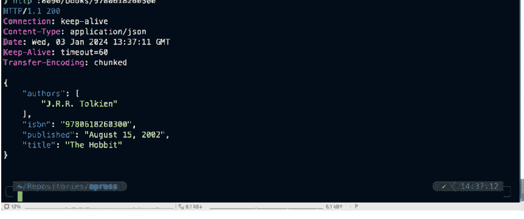

图 3-20. 丰富后的书籍结果

### 使用 RestClient

除了使用 `RestTemplate`，还可以使用更流式的 `RestClient`。Spring Boot 会自动暴露 `RestClient.Builder`。参见代码列表 3-54。

### 代码列表 3-54. 使用 Builder 定义 RestClient Bean

```java
@Bean
public RestClient restClient(RestClient.Builder builder) {
    return builder.build();
}
```

`RestClient.Builder` 提供了增强配置的方法。每个方法都将产生一个新的 `RestClient.Builder` 实例。参见表 3-15 和代码列表 3-55。

### 表 3-15. RestClient.Builder 方法

| 方法 | 描述 |
| --- | --- |
| `baseUrl` | 请求时使用的根 URL；默认值为 `null`。 |
| `defaultHeader` / `defaultHeaders` | 添加带有默认值的请求头。 |
| `defaultRequest` | 用于自定义正在构建的每个请求的 `Consumer`。 |
| `defaultStateHandler` | 注册应用到每个响应的默认处理器。 |
| `defaultUriVariables` | URI 变量的默认值。 |
| `messageConverters` | 替换用于创建的 `RestClient` 应该使用的 `HttpMessageConverter`。 |
| `observationConvention` | 配置用于收集请求/指标元数据的 `ObservationConvention`。默认将设置为 `DefaultRequestObservation`。 |
| `observationRegistry` | 配置用于记录观测的 `ObservationRegistry`。通常，这由 Spring Boot 自动设置。 |
| `requestFactory` | 通过自动检测，设置与创建的 `RestClient` 使用使用的 `ClientHttpRequestFactory`。 |
| `requestInitializer` / `requestInitializers` | 将给定的 `HttpRequestInitializer` 添加到初始化链的末尾。 |
| `requestInterceptor` / `requestInterceptors` | 将给定的 `HttpRequestInterceptor` 添加到拦截器链的末尾。 |
| `uriBuilderFactory` | 设置使用的 `UriBuilderFactory`。 |

### 代码列表 3-55. 使用 RestClient 的控制器

```java
package com.apress.spring3recipes.library.rest;

import com.apress.spring3recipes.library.Book;
import com.apress.spring3recipes.library.EnrichedBook;
import org.springframework.http.ResponseEntity;
import org.springframework.web.bind.annotation.GetMapping;
import org.springframework.web.bind.annotation.PathVariable;
import org.springframework.web.bind.annotation.RequestMapping;
import org.springframework.web.bind.annotation.RestController;
import org.springframework.web.client.RestClientException;
import org.springframework.web.client.RestClientResponseException;
import org.springframework.web.client.RestClient;
import java.util.Map;

@RestController
@RequestMapping("/books")
public class EnrichedBookController {

    private static final String BOOKS_URL = "http://localhost:8080/books/{isbn}";
    private static final String OL_API = "https://openlibrary.org/isbn/{isbn}.json";

    private final RestClient rest;

    public EnrichedBookController(RestClient rest) {
        this.rest = rest;
    }

    @GetMapping("/{isbn}")
    public ResponseEntity<EnrichedBook> get(@PathVariable("isbn") String isbn) {
        try {
            var book = rest.getForObject(BOOKS_URL, Book.class, isbn);
            var library = rest.getForObject(OL_API, Map.class, isbn);
            var published = extractPublishData(library);
            var enriched = enrich(book, published);
            return ResponseEntity.ok(enriched);
        } catch (Exception ex) {
            if (ex instanceof ClientErrorException rex) {
                return ResponseEntity.status(rex.getStatusCode()).build();
            }
            return ResponseEntity.internalServerError().build();
        }
    }

    private EnrichedBook enrich(Book book, String publishDate) {
        return new EnrichedBook(book.isbn(), book.title(), publishDate, book.authors());
    }

    private String extractPublishData(Map json) {
        return (String) json.getOrDefault("publish_date", "");
    }
}
```


由于 `RestClient` 复用了与 `RestTemplate` 相同的基础，我们可以复用相同的异常处理机制。当你从命令行使用 `curl` 或 `HTTPPie` 调用 `http://localhost:8090/books/9780618260300` 时，你将得到与图 3-20 所示的输出。

## 使用声明式客户端

Spring Framework 6 引入了声明式 HTTP 客户端。通过这种方式，可以使用带有注解的接口。在运行时将创建一个代理来处理请求/响应，包括映射和异常处理。

起点是一个带有 `@PutMappingExchange` 注解（或其他派生注解如 `@GetExchange` 或 `@PostExchange`）的接口或类。它的工作方式与服务器 API 中的 `@RequestMapping` 相同。使用 `@HttpExchange` 可以设置一些属性（参见表 3-16）。

### 表 3-16. HttpExchange 属性

| 属性 | 描述 |
| --- | --- |
| value or url | 设置请求的 URL；可以是完整 URL、相对于类型级 `@PutMappingExchange` 的路径；或者预设的基 URI。 |
| method | 使用的 HTTP 方法；DELETE, GET, PATCH, POST, PUT。默认值为空。 |
| contentType | 为 Content-Type 头发送的媒体类型；默认值为空。 |
| accept | Accept 的媒体类型。 |

除了 `@PutMappingExchange` 注解外，还有 `@DeleteExchange`、`@GetExchange`、`@PutMappingExchange`、`@PostExchange` 和 `@PutExchange`。这些可以代替带有特定方法值的 `@PutMappingExchange`。使用这些注解会意图更加明确。

### 表 3-17. HttpExchange 支持的方法参数

| 类型 | 描述 |
| --- | --- |
| java.net.URI | 动态设置请求的 URL；覆盖 `@HttpExchange` 中的 url 属性。 |
| UriBuilderFactory | 提供一个 `UriBuilderFactory` 来扩展 URI 模板和 URI 变量。用于替代底层客户端的 `UriBuilderFactory`。 |
| HttpMethod | 动态设置用于请求的 HTTP 方法；覆盖 `@HttpExchange` 中的 method 属性。 |
| MultipartFile | 从 `MultipartFile` 添加请求部分；通常与 Spring MVC 使用，以指示已上传的文件。 |
| @Cookie | 向传出的请求添加 cookie。参数可以是包含多个 cookie 或单个值的 `Map<String, ?>` 或 `MultiValueMap<String, ?>`。对于非字符串值使用类型转换。 |
| @RequestHeader | 向传出的请求添加请求头。参数可以是包含多个请求头或单个值的 `Map<String, ?>` 或 `MultiValueMap<String, ?>`。对于非字符串值使用类型转换。 |
| @PathVariable | 添加一个变量以扩展请求 URL 中的占位符。参数可以是用于多个值的 `Map<String, ?>` 或单个值。对于非字符串值使用类型转换。 |
| @RequestBody | 提供请求体，可以作为待序列化的对象，也可以作为通过配置的 `ReactiveRegistry` 支持的响应式流 `Publisher`（如 `Mono`、`Flux` 或任何其他异步类型）。 |
| @RequestParam | 添加请求参数。可以是用于多个值的 `Map<String, ?>` / `MultiValueMap<String, ?>`，也可以是单个类型。对于非字符串值使用类型转换。当 ContentType 为 `application/x-www-form-urlencoded` 时，参数将添加到请求体中。 |
| @RequestPart | 添加请求部分，该部分可以是字符串（变为表单字段）、`Resource`、编码为 JSON（或任何配置的格式）的字节、包含头部的 `HttpEntity`、Spring `Part` 或支持的响应式流 `Publisher`。 |

## 第 3 章 Spring MVC

除了方法参数外，还支持几种方法返回类型。见表 3-18。

### 表 3-18. HttpExchange 支持的方法返回类型

| 类型 | 描述 |
| --- | --- |
| void | 执行请求；无响应。 |
| HttpHeaders | 执行请求并仅返回响应头。 |
| \<T> | 执行请求并将解码后的正体作为类型 T 返回。 |
| ResponseEntity\<Void> | 执行请求并返回包含状态和响应头的 `ResponseEntity`。 |
| ResponseEntity\<T> | 执行请求并返回包含状态和解码为类型 T 的正体的 `ResponseEntity`。 |

根据这些信息，我们可以提供两个接口来访问我们需要调用的 API。让我们从书籍的 API 开始。见代码清单 3-56。

### 代码清单 3-56. BookServiceSources

```java
package com.apress.springboot3recipes.library.rest;

import com.apress.springboot3recipes.library.Book;

import org.springframework.web.bind.annotation.PathVariable;

import org.springframework.web.service.annotation.GetMapping;

public interface BookService {

    @GetMapping("http://localhost:8080/books/{isbn}")

    Book getBook(@PathVariable String isbn);

}
```

`BookService` 有一个方法，该方法标记了 `@GetMapping` 注解。它提供了一个值 `http://localhost:8080/books/{isbn}`，这是一个 URI 模板。该方法接受单个参数 `isbn`，该参数已标记了 `@PathVariable` 注解。当调用此方法时，我们传递的值将在执行请求之前放置在 URI 的 `{isbn}` 部分。请求发送后，返回一个响应，该响应被转换为 `Book` 对象，就像我们之前使用 `RestTemplate` 或 `RestClient` 时一样。

接下来，我们还需要一个 Open Library API 的接口。见代码清单 3-57。

### 代码清单 3-57. OpenLibrary Sources

```java
package com.apress.springboot3recipes.library.rest;

import org.springframework.web.bind.annotation.PathVariable;

import org.springframework.web.service.annotation.GetExchange;

import org.springframework.web.service.annotation.HttpExchange;

import java.util.Map;

@HttpExchange(url = "https://openlibrary.org/isbn")

public interface OpenLibraryClient {

    @GetExchange("/{isbn}.json")

    Map<String, Object> getInformation(@PathVariable String isbn);

}
```

`OpenLibraryClient` 有一个设置了 `url` 属性的 `@HttpExchange` 注解。这将为接口中的所有其他方法设置基础 URI。这允许我们为所有其他方法指定相对 URL。现在只有一个标记了 `@GetExchange` 的方法。该方法也接受单个参数 `isbn`，它在执行之前也会放在 URI 模板中。响应像之前一样转换为 `Map`。

现在接口已经就绪，我们需要在配置中暴露它们，但我们无法从接口创建实例。这就是 `HttpServiceProxyFactory` 发挥作用的地方；它运行时运行时这些接口创建代理。为了实现这一点，我们需要在应用程序中添加一些配置。见代码清单 3-58。

### 代码清单 3-58. HttpServiceProxyFactory 配置

```java
@Bean

public HttpServiceProxyFactory httpServiceProxyFactory(RestClient.Builder builder) {

    var adapter = RestClientAdapter.create(builder.build());

    return HttpServiceProxyFactory.builder(adapter).build();

}

@Bean

public BookService bookServiceClient(HttpServiceProxyFactory factory) {

    return factory.createProxy(BookService.class);

}

@Bean

public OpenLibraryClient openLibraryClient(HttpServiceProxyFactory factory) {

    return factory.createProxy(OpenLibraryClient.class);

}
```

## 第 3 章 Spring MVC

```java
private EnrichedBook(Book book, String publishDate) {

    return new EnrichedBook(book.isbn(), book.title(),

    publishDate, book.authors());

}
```

```java
private String extractPublishData(Map json) {

    return (String) json.getOrDefault("publish_date", "");

}
```

注意，我们可以直接在接口上调用方法，而无需担心构建一个合适的请求。这一切都隐藏在接口外面（facade）和代理（proxy）内部。这使得为你的应用程序编写可重用的 API 客户端变得更加容易。

最后，请注意异常处理并没有变化，声明式客户端仍然使用相同的基础设施，因为 `RestClient` 的异常处理不需要更改。

当重新运行应用程序并请求书籍信息时，输出应该仍然与图 3-20 所示相同。

## 基于 RestTemplate 或 RestClient 的代码

为了使用 `RestTemplate` 或 `RestClient` 测试客户端，Spring Test 框架提供了 `MockRestServiceServer`。可以使用 `MockRestServiceServer` 来为特定请求（基于 URL、标头、内容等）返回响应。

Spring Boot 反而通过提供 `@RestClient` 注解使这一工作变得更容易。这将设置 `MockRestServiceServer`，使其能够被自动注入（autowired）并配置客户端测试。参见代码列表 3-60。

### 列表 3-60. Rest Client 设置测试

```java
package com.apress.springboot3recipes.library.rest;

import org.junit.jupiter.api.Assertions;

import org.junit.jupiter.api.Test;

import org.springframework.framework.beans.factory.annotation.Autowired;

import org.springframework.framework.boot.test.autoconfigure.web.client.RestClientTest;

import org.springframework.framework.http.HttpStatus;
```

```java
import org.springframework.http.MediaType;

import org.springframework.test.web.client.MockRestServiceServer;

import static org.springframework.test.web.client.match.MockRestRequestMatchers.requestTo;

import static org.springframework.test.web.client.response.MockRestResponseCreators.withSuccess;
```

```java
@Autowired

private MockRestServiceServer mockServer;

@Autowired

private EnrichedBookController controller;

@Test

void enrichBook() {

    mockServer

        .expect(requestTo("http://localhost:8080/books/123456789"))

        .andRespond(withSuccess(BOOK_JSON, MediaType.APPLICATION_JSON));
```

```java
mockServer

    .expect(requestTo("https://openlibrary.org/isbn/123456789.json"))

    .andRespond(withSuccess(OL_JSON, MediaType.APPLICATION_JSON));
```

```java
var response = controller.get("123456789");

var enrichedBook = response.getBody();

Assertions.assertNotNull(enrichedBook);

Assertions.assertEquals(HttpStatus.valueOf(200), response.getStatusCode());

Assertions.assertEquals(enrichedBook.published(), "2024");
```

```java
mockServer.verify();
```


该测试使用 `@RestClientTest` 来设置服务器并准备 `EnrichedBookController` 进行测试。`MockRestServiceServer` 和 `EnrichedBookController` 都被注入，以便供测试可用。在实际的测试方法中，我们首先设置带有我们期望的行为的 `MockRestTemplate`。在这里，我们只匹配 URL 并设置它们返回一个带有 HTTP 200 OK 的特定 JSON 响应（更多可能性请见表 3-19）。测试运行后，我们在 `MockRestTemplate` 上调用 `verify()`，以验证我们记录的请求是否也已发出，这表明我们的客户端工作正常。

### 表 3-19. MockRestRequestMatchers 设置方法

| 方法 | 描述 |
| :--- | :--- |
| `anything()` | 匹配任何请求。 |
| `content()` | 为内容设置匹配，例如 Content-Type 或请求的实际主体。 |
| `header()` | 匹配具有给定标头的请求，可以是值或 Hamcrest 匹配器。 |
| `headerDoesNotExist` | 匹配给定标头不存在的请求。 |
| `headerList()` | 匹配具有给定标头的请求，可以是值或 Hamcrest 匹配器。 |
| `jsonmethod` | 使用 JsonPath 为请求体设置匹配。 |
| `queryParam` | 匹配请求的 HttpMethod。 |
| `queryParamList` | 使用值或 Hamcrest 匹配器匹配请求参数。 |
| `requestTo` | 使用期望的 URI 匹配请求（String 或 URI）。 |
| `requestToUriTemplate` | 使用 URI 模板匹配请求。 |
| `xpath` | 使用 XPath 为请求体设置匹配。 |

响应是通过使用 `MockResponseCreatators` 创建的，目前我们只使用 `withSuccess`，但也可以设置错误场景（表 3-20）。

### 表 3-20. MockResponseCreatators 设置方法

| 方法 | 描述 |
| :--- | :--- |
| `withAccepted()` | 返回 202 ACCEPTED。 |
| `withBadGateway()` | 返回 502 BAD_GATEWAY。 |
| `withBadRequest()` | 返回 400 BAD_REQUEST。 |
| `withCreated(URI)` | 返回 201 CREATED。 |
| `withException(IOException)` | 抛出 异常。 |
| `withForbidden()` | 返回 403 FORBIDDEN。 |
| `withGatewayTimeout()` | 返回 504 GATEWAY_TIMEOUT。 |
| `withNoContent()` | 返回 204 NO_CONTENT。 |
| `withRawStatus(int)` | 返回给定的状态。 |
| `withConflict()` | 返回 409 CONFLICT。 |
| `withResourceNotFound()` | 返回 404 NOT_FOUND。 |
| `withServerError()` | 返回 500 ERROR。 |
| `withServiceUnavailable()` | 返回 503 SERVICE_UNAVAILABLE。 |
| `withSuccess()` | 返回 200 OK。 |
| `withSuccess(byte[], MediaType)` | 返回 200 OK。 |
| `withSuccess(String, MediaType)` | 返回 200 OK。 |
| `withSuccess(Supplier<byte[]>)` | 返回 200 OK。 |

## 第 4 章 WebFlux

## WebFlux

Spring WebFlux 是 Spring 的一个响应式框架，支持 Netty、Undertow 或 Servlet。Spring Boot 会自动配置。

## 4-1. 使用 SpringFlux 开发响应式应用

### 问题

你想使用 SpringFlux 开发简单的响应式应用。

### 解决方案

WebFlux 的底层组件是 `org.springframework.web.reactive.Handler`。`HttpHandler` 接口有一个 handle 方法。见列表 4-1。

**列表 4-1. HttpHandler**

```java
public interface HttpHandler {

    Mono<Void> handle(HttpRequest request, ServerHttpResponse response);

}
```

`handle` 方法返回 `Mono<Void>`，这是返回 `void` 的响应式方式。它接受 `HttpRequest` 和 `ServerHttpResponse`，均来自 `org.springframework.http`。根据容器的不同，会创建相应的实现。在 Servlet 5.0（支持非阻塞 I/O）上运行时，使用 `HttpServletHandlerAdapter`（其子类之一）来适配普通的 Servlet。在原生 Reactive 引擎运行时，使用 `ReactorHandlerAdapter`。

当请求发送到 WebFlux 应用时，HandlerAdapter 接收请求。然后它组织 Spring 上下文中处理请求所需的组件。

要在 WebFlux 中定义控制器，类必须标记为 `@Controller` 或 `@RestController` 注解。当被注解标记的类（即控制器类）接收请求时，它会寻找合适的处理方法。这需要控制器类将每个请求映射到处理方法上。为了实现这一点，控制器类的方法装饰了 `@RequestMapping` 注解，使其成为处理方法。

处理方法的签名正如你预期的标准类一样是开放的。你可以为处理方法指定任意名称并定义各种方法参数。同样，处理方法可以返回一系列值中的任何值（例如 String 或 void），取决于它完成的应用逻辑。以下仅是有效参数类型的列表：

- `HttpServletHttpResponse`
- 来自 URL 的任意类型请求参数，带有 `@RequestParam` 注解
- 任意类型的模型属性，带有 `@ModelAttribute` 注解
- 包含在请求中的 Cookie 值，带有 `@CookieValue` 注解
- 任意类型的标头值，带有 `@RequestHeader` 注解
- 任意类型的请求属性，带有 `@RequestAttribute` 注解
- `Map` 或 `ModelMap`，用于处理方法向模型添加属性
- `Errors` 或 `BindingResult`，用于处理方法访问命令对象的绑定和验证结果。
- `WebSession`，用于会话（session）。

一旦控制器类选择了合适的处理方法，它就会带着请求调用该处理方法的逻辑。通常，控制器的逻辑会回调用后端服务来处理请求。此外，处理方法的逻辑很可能会从众多的输入参数（例如 `HttpServlet`、`Map` 或 `Errors`）中添加或删除信息，这些参数将成为持续执行流的一部分。

在处理方法完成请求处理后，它会将控制权移交给视图，该视图由处理方法的返回值表示。为了提供一种灵活的方法，处理方法的返回值并不代表视图的特定实现（例如 `user.html` 或 `report.pdf`），而是一个逻辑视图（例如 `user` 或 `report`）——注意这里没有文件扩展名。

处理方法的返回值可以是 `String`（表示逻辑视图名称）或 `void`，如果是后者，将根据处理方法或控制器的名称确定默认的逻辑视图名称。

要将信息从控制器传递到视图，处理方法返回逻辑视图名称（`String` 还是 `void`）并不重要，因为处理方法的参数对视图是可用的。

例如，如果处理方法接受 `Map` 和 `Model` 对象作为输入参数——并在处理方法的逻辑内部修改其内容——这些对象将可以被处理方法返回的视图访问。

当控制器类接收到视图时，它通过视图解析器（view resolver）将逻辑视图解析为特定的实现（例如 `user.html` 或 `report.fmt`）。视图解析器是配置在 Web 应用程序上下文中的一个 Bean，它实现了 `ViewResolver` 接口。它的职责是为逻辑视图名称返回一个特定的视图实现。

一旦控制器类将视图名称解析为视图实现，根据该视图实现的设计，它将渲染控制器处理方法传递的对象（例如 `HttpServlet`、`Map`、`Errors` 或 `WebSession`）。视图的责任是向用户显示在处理方法逻辑中添加的对象。

## 如何工作

让我们为配方 3-1 中的 `HelloWorldApplication` 写一个响应式版本。请参见列表 4-2。

## 第 4 章 WEBFLUX

## 列表 4-2. 响应式 HelloWorldController

```java
package com.apress.springboot3recipes.helloworld;

import org.springframework.boot.SpringBootVersion;

import org.springframework.web.bind.annotation.GetMapping;

import org.springframework.web.bind.annotation.RestController;

import reactor.core.publisher.Mono;

@RestController
public class HelloWorldController {

    @GetMapping
    public Mono<String> hello() {

        var version = SpringBootVersion.getVersion();

        var msg = String.format("Hello World, from Reactive Spring Boot %s!", version);

        return Mono.just(msg);

    }

}
```

`Mono<String>` 是 `hello` 方法的返回值，而不是普通的 `String`。`Mono` 是使其具有响应式的关键。

## 设置 Spring WebFlux

为了能够以响应式的方式处理请求，你需要启用 WebFlux。这是通过添加 `spring-boot-starter-webflux` 依赖来实现的。

```xml
<dependency>
    <groupId>org.springframework.boot</groupId>
    <artifactId>spring-boot-starter-webflux</artifactId>
</dependency>
```

这引入了必要的依赖项，如 `spring-webflux` 和 Project Reactor 依赖。它还包含一个响应式运行时，默认是 Netty。现在所有配置都已完成，最后要做的工作是创建一个应用程序类。请参见列表 4-3。

## 第 4 章 WEBFLUX

## 列表 4-3. HelloWorldApplication

```java
package com.apress.springboot3recipes.helloworld;

import org.springframework.boot.SpringApplication;

import org.springframework.boot.autoconfigure.SpringBootApplication;

@SpringBootApplication
public class HelloWorldApplication {

    public static void main(String[] args) {

        SpringApplication.run(HelloWorldApplication.class, args);

    }

}
```

Spring Boot 将检测响应式运行时并使用 `server.*` 属性对其进行配置（请参见配方 3-1）。

## 创建 Spring WebFlux 控制器

基于注解的控制器类可以是任意类，不需要实现特定的接口或扩展特定的基类。你可以使用 `@Controller` 或 `@RestController` 注解来标记标记它。一个控制器中可以定义一个或多个处理方法来处理单个或多个操作。处理方法的签名足够灵活，可以接受范围参数。（有关请求映射的更多信息，请参阅配方 4-2。）

```java
package com.apress.springboot3recipes.helloworld;

import org.springframework.boot.SpringApplicationVersion;

import org.springframework.framework.web.bind.annotation.GetMapping;

import org.springframework.framework.web.bind.annotation.RestController;

import reactor.core.publisher.Mono;

@RestController
public class HelloWorldController {

    @GetMapping
    public Mono<String> hello() {

        var version = SpringApplicationVersion.getVersion();

        var msg = String.format("Hello World, from Reactive Boot %s!", version);

        return Mono.just(msg);

    }

}
```

`@GetMapping` 注解用于将 `hello` 方法装饰为控制器的 HTTP GET 方法。值得提到，如果没有声明默认处理程序，则会抛出 `ServletException`。当向 `http://localhost:8080/hello` 发起请求时，它将响应式地返回 `Hello World, from Reactive Spring 3!`。然而，客户端并不会这种差异。

## 为响应式控制器进行单元测试

你有两种方法为控制器设计集成测试。第一种方法是编写一个创建 `HelloWorldController` 实例的测试，调用方法并对结果进行预期。第二种是使用 `@WebFluxTest` 创建测试。后者将启动包含 Web 基础设施的最小应用程序上下文，你可以使用 WebMvc 来测试控制器。这种最后的方法介于纯单元测试和完整的集成测试之间。请参见列表 4-4。

### 列表 4-4. HelloWorldController 单元测试

```java
package com.apress.spring3recipes.helloworld;

import org.junit.jupiter.api.Test;

import reactor.test.StepVerifier;

class HelloWorldControllerUnitTest {

  private final HelloWorldController controller = new HelloWorldController();

  @Test
  void shouldSayHello() {

    var result = controller.hello();

    StepVerifier.create(result)
      .expectNext("Hello World, from Reactive Boot 3!")
      .verifyComplete();

  }

}
```

这是一个基础单元测试。它实例化控制器并简单地调用方法。它使用 `reactive-test` 模块中的 `StepVerifier` 使测试变得更容易。`hello` 方法被调用，并使用 `StepVerifier` 验证结果。添加 `reactive-test` 依赖是通过添加以下依赖完成的：

```xml
<dependency>
  <groupId>io.projectreactor</groupId>
  <artifactId>reactor-test</artifactId>
  <scope>test</scope>
</dependency>
```

第二种选项是对特定控制器使用 `@WebFluxTest`。

```java
package com.apress.springbootrecipes.helloworld;

import org.hamcrest.Matchers;

import org.junit.jupiter.api.Test;

import org.springframework.beans.factory.annotation.Autowired;

import org.springframework.boot.test.autoconfigure.web.reactive.WebFluxTest;

import org.springframework.http.MediaType;

import org.springframework.test.web.reactive.server.WebTestClient;

@WebFluxTest(HelloWorldController.class)
class HelloWorldControllerSliceTest {
```


# 第 4 章 WEBFLUX

此测试将启动一个最小化的 Spring 上下文，并自动检测项目中所有与 WebFlux 相关的 bean。

## 对响应式控制器进行集成测试

集成测试的写法与上一节中的 `@WebFluxTest` 非常相似。主要的区别是使用了 `@SpringBootTest` 而不是 `@WebFluxTest`。使用 `@SpringBootTest` 将会引导整个应用程序，包括所有其他 bean（服务、存储库等）。通过 `webEnvironment` 属性，你可以指定要使用的环境。其可选值为 `RANDOM_PORT`、`MOCK`（默认）、`DEFINED_PORT` 和 `NONE`。我们使用随机端口并再次使用 `WebTestClient` 发起请求：

```java
package com.app.crest.springbootrecipes.helloworld;

import org.hamcrest.Matchers;
import org.junit.jupiter.api.Test;
import org.springframework.beans.factory.annotation.Autowired;
import org.springframework.boot.test.autoconfigure.web.reactive.AutoConfigureWebTestClient;
import org.springframework.boot.test.context.SpringBootTest;
import org.springframework.http.MediaType;
import org.springframework.test.web.reactive.server.WebTestClient;

@SpringBootTest
@AutoConfigureWebTestClient
class HelloWorldControllerIntegrationTest {

    @Autowired
    private WebTestClient webClient;

    @Test
    void shouldSayHello() {
        webClient
            .get()
            .uri("/")
            .accept(MediaType.TEXT_PLAIN)
            .exchange()
            .expectStatus().isOk()
            .expectBody(String.class)
            .value(Matchers.containsString("Hello World, from Reactive Spring Boot"));
    }
}
```

请求被发送到嵌入式服务器，随后验证结果的状态和正文内容是否正确。

> 当使用 `MOCK`（默认值）作为 `webEnvironment` 时，你必须添加 `@AutoConfigureWebTestClient` 注解以获取用于测试的 `WebTestClient`。

## 4-2. 使用响应式 REST 服务进行发布和消费

### 问题

你想编写一个能够产生 JSON 的响应式 REST 端点。

### 解决方案

就像普通的 `@RestController` 一样，你可以返回一个普通对象或对象列表，它们将会被发送到客户端。为了让它们变成响应式的，你必须将这些返回值包装在它们对应的响应式类型中，即 `Mono` 或 `Flux`。

### 工作原理

让我们从编写一个响应式的 `BookService` 开始。每个方法将返回 `Mono<Book>` 或 `Flux<Book>`。见列表 4-5。

**列表 4-5.** 响应式 `BookService` 接口

```java
package com.apress.springboot3recipes.library;

import reactor.core.publisher.Flux;
import reactor.core.publisher.Mono;

public interface BookService {

    Flux<Book> getAll();

    Mono<Book> create(Book book);

    Mono<Book> find(String isbn);
}
```

对于 `BookService` 接口，我们可以写一个内存实现。见列表 4-6。

**列表 4-6.** 响应式 `BookService` 实现（内存型）

```java
package com.apress.springboot3recipes.library;

import org.springframework.stereotype.Service;
import reactor.core.publisher.Flux;
import reactor.core.publisher.Mono;
import java.util.Map;
import java.util.concurrent.ConcurrentHashMap;

@Service
class InMemoryBookService implements BookService {

    private final Map<String, Book> books = new ConcurrentHashMap<>();

    @Override
    public Flux<Book> getAll() {
        return Flux.fromIterable(books.values());
    }

    @Override
    public Mono<Book> create(Book book) {
        books.put(book.isbn(), book);
        return Mono.just(book);
    }

    @Override
    public Mono<Book> find(String isbn) {
        return Mono.justOrEmpty(books.get(isbn));
    }
}
```

`InMemoryBookService` 有一些简单的方法来获取或保存书籍。在检索所有书籍时，它会延迟 128 毫秒。`Book` 类与第 3 章中使用的相同。见列表 4-7。

**列表 4-7.** `Book` Record

```java
package com.apress.springboot3recipes.library;

import java.util.List;
import java.util.Objects;

public record Book(String isbn, String title, List<String> authors) {

    @Override
    public boolean equals(Object o) {
        if (this == o) return true;
        if (!(o instanceof Book book)) return false;
        return Objects.equals(isbn, book.isbn()) && Objects.equals(title, book.title()) && Objects.equals(authors, book.authors);
    }

    @Override
    public int hashCode() {
        return Objects.hash(isbn, title, authors);
    }
}
```

需要一个 `BookController` 将 `Book` 作为 REST 资源暴露。

```java
package com.apress.springboot3recipes.rest;

import com.apress.springboot3recipes.library.Book;
import com.apress.springboot3recipes.library.BookService;
import org.springframework.http.ResponseEntity;
import org.springframework.web.bind.annotation.GetMapping;
import org.springframework.web.bind.annotation.PathVariable;
import org.springframework.web.bind.annotation.PostMapping;
import org.springframework.web.bind.annotation.RequestBody;
import org.springframework.web.bind.annotation.RequestMapping;
import org.springframework.web.bind.annotation.RestController;
import org.springframework.web.util.UriComponentsBuilder;
import reactor.core.publisher.Flux;
import reactor.core.publisher.Mono;
import java.time.Duration;

@RestController
@RequestMapping("/books")
public class BookController {

    private final BookService bookService;

    public BookController(BookService bookService) {
        this.bookService = bookService;
    }

    @GetMapping
    public Flux<Book> all() {
        return bookService.getAll().delayElements(Duration.ofMillis(128));
    }

    @GetMapping("/{isbn}")
    public Mono<Book> get(@PathVariable String isbn) {
        return bookService.find(isbn);
    }

    @PostMapping
    public Mono<ResponseEntity<Book>> create(@RequestBody Mono<Book> book) {
        return book.flatMap(bookService::create)
            .map(created -> {
                var newUri = UriComponentsBuilder.fromCurrentRequest()
                    .path("/{isbn}")
                    .buildAndExpand(created.isbn())
                    .toUri();
                return ResponseEntity.created(newUri).body(created);
            });
    }
}
```

为了启动一切，需要一个简单的 `LibraryApplication`。

```java
package com.apress.springboot3recipes.library;

import org.springframework.boot.ApplicationRunner;
import org.springframework.boot.SpringApplication;
import org.springframework.boot.autoconfigure.SpringBootApplication;
import org.springframework.context.annotation.Bean;
import reactor.core.publisher.Flux;

@SpringBootApplication
public class LibraryApplication {

    public static void main(String[] args) {
        SpringApplication.run(LibraryApplication.class, args);
    }

    @Bean
    public ApplicationRunner initData(BookService books) {
        return (args) -> Flux.fromIterable(BookGenerator.all())
            .map(books::create)
            .subscribe();
    }
}
```

`BookController` 映射到 `/books` 并支持列出所有书籍或单个书籍、添加和修改书籍。使用 HTTPie 或 curl 可以查询端点。

命令 `http://localhost:8080/books` 将列出系统中所有的书籍（见图 4-1），而 `http://localhost:8080/books/{isbn}` 将列出单个。

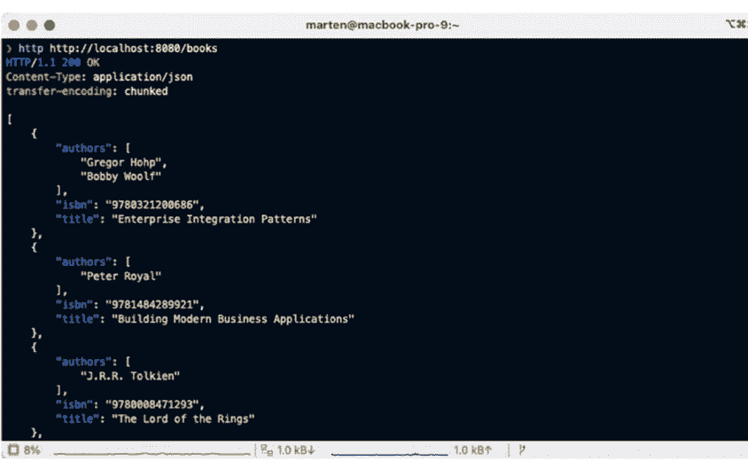

**图 4-1.** 获取所有书籍的结果

## 流式 JSON

调用 `/books` 的结果不是流式的，而是阻塞的。它在发送之前会收集所有结果。另见图 4-1 中的 `content-type` 头部，它设置为 `application/json`。为了实现流式传输，它应该是 `application/x-ndjson`（或其他支持流式的内容类型）。这是编写消费该端点的客户端时需要考虑的。对于 HTTPie，我们可以指定 `Accept` 头部以实现流式传输。在之前的 HTTPie 命令中添加 `'Accept:application/x-ndjson'`，结果将变为流式。结果现在将平稳地涌入，直到没有数据可消费（见图 4-2）。


**图 4-2.** 流式获取的结果

```bash
http http://localhost:8080/books 'Accept:application/x-ndjson' --stream
HTTP/1.1 200 OK
Content-Type: application/x-ndjson
Transfer-encoding: chunked

{
  "authors": [
    "Gregor Hohpe",
    "Bobby Woolf"
  ],
  "isbn": "0780321200866",
  "title": "Enterprise Integration Patterns"
}
{
  "authors": [
    "Peter Royal"
  ],
  "isbn": "0781494289323",
  "title": "Building Modern Business Applications"
}
{
  "authors": [
    "J.R.R. Tolkien"
  ],
  "isbn": "061695412393",
  "title": "The Lord of the Rings"
}
```

**图 4-2.** 流式所有书籍的结果

结果也发生了细微变化。它不再返回一个订单数组（图 4-1），而是现在返回单个订单（参见图 4-2）。

## 编写集成测试

可以使用 `WebTestClient` 和 `MOCK` 环境轻松地为 `BookController` 编写集成测试（你也可以使用 `RANDOM_PORT` 代替 `MOCK`）。


```java
package com.apress.springbootrecipes.library.rest;

import com.apress.springbootrecipes.library.Book;
import org.junit.jupiter.api.Test;
import org.springframework.beans.factory.annotation.Autowired;
import org.springframework.boot.test.autoconfigure.web.reactive.AutoConfigureWebTestClient;
import org.springframework.boot.test.context.SpringBootTest;
import org.springframework.test.annotation.DirtiesContext;
import org.springframework.web.reactive.server.WebTestClient;
import java.util.List;

@SpringBootTest(webEnvironment = SpringBootTest.WebEnvironment.MOCK)
@AutowiredWebClient
@DirtiesContext(method = DirtiesContext.MethodMode.AFTER_METHOD)
class BookControllerIntegrationTest {

    @Autowired
    private WebTestClient webTestClient;

    @Test
    void listBooks() {
        webTestClient.get().uri("/books")
            .exchange()
            .expectStatus().isOk()
            .expectBody(Book.class).hasSize(24);
    }

    @Test
    void addAndGetBook() {
        var book = new Book("BOBC71PHR", "Testing Spring Boot Applications\nDemystified", List.of("Philip Riecks"));
        webTestClient.post().uri("/books").bodyValue(book)
            .exchange()
            .expectStatus().isCreated()
            .expectBody(Book.class).isEqualTo(book);

        webTestClient.get().uri("/books/{isbn}", book.isbn)
            .exchange()
            .expectStatus().isOk()
            .expectBody(Book.class).isEqualTo(book);
    }
}
```

需要 `@DirtiesContext` 注解是因为 `BookService` 是一个有状态的 bean。因此，在库中添加书籍后，需要对其进行重置以备下一次测试。由于使用了带有 mock 环境的 `@SpringBootTest` 注解，测试将启动整个应用程序。`@AutowiredWebClient` 注解用于在 mock 环境中获取 `WebTestClient`。`WebTestClient` 能够轻松地构建请求并发送到服务器。在发送响应后，它可以对结果进行预期。

> `webEnvironment = SpringTest.WebEnvironment.MOCK` 也是默认值，因此显式添加它并不严格。

# 第 4 章 WEBFLUX

## 4-3. 使用 Thymeleaf 作为模板引擎的问题

你想在基于 WebFlux 的应用程序中使用 Thymeleaf 渲染视图。

### 解决方案

添加 Thymeleaf 的依赖并创建一个处理器来确定视图并填充模型。

### 工作原理

添加对 `spring-boot-starter-webflux` 和 `spring-boot-starter-thymeleaf` 的依赖。这足以让 Spring Boot 在 WebFlux 应用程序中自动配置 Thymeleaf。请参见列表 4-8。

#### 列表 4-8. WebFlux 和 Thymeleaf 依赖

```xml
<dependency>
  <groupId>org.springframework.boot</groupId>
  <artifactId>spring-boot-starter-webflux</artifactId>
</dependency>
<dependency>
  <groupId>org.springframework.boot</groupId>
  <artifactId>spring-boot-starter-thymeleaf</artifactId>
</dependency>
```

通过添加此依赖，你将获得 Thymeleaf 库以及 Thymeleaf Spring Dialect，以便它们能够良好地集成。由于这两个库的存在，Spring Boot 会自动配置 `ThymeleafReactiveViewResolver`。`ThymeleafReactiveViewResolver` 需要一个 `Thymeleaf SpringWebFluxTemplateEngine` 才能解析并渲染视图。一个特殊的 `SpringWebFluxTemplateEngine` 将预先配置好 `SpringDialect`，你可以在 Thymeleaf 页面中使用 SpEL。

配置 Thymeleaf 后 Spring Boot 在 `spring.thymeleaf` 和 `spring.thymeleaf.reactive` 命名空间中暴露了多个属性（参见表 4-1）。

#### 表 4-1. Thymeleaf 属性

| 属性 | 描述 | 默认值 |
| --- | --- | --- |
| `spring.thymeleaf.prefix` | 设置前缀 | `classpath:/` |
| `spring.thymeleaf.suffix` | 设置后缀 | `.html` |
| `spring.thymeleaf.encoding` | 设置编码 | `UTF-8` |
| `spring.thymeleaf.check-template` | 检查模板是否存在 | `true` |
| `spring.thymeleaf.location` | 设置位置 | `templates` |
| `spring.thymeleaf.mode` | 设置模式 | `HTML` |
| `spring.thymeleaf.cache` | 设置是否缓存模板 | `true` |
| `spring.thymeleaf.order` | 设置顺序 | `1` |

| 标题 | 作者 | ISBN |
| :--- | :--- | :--- |
| `${book.title}` | `${book.authors}` | `<a th:href="/books.html?isbn=${book.isbn}" text="${book.isbn}">#ISBN</a>` |

最后，列表 4-13 显示了启动应用程序的 `LibraryApplication`。

#### 列表 4-13. Library Spring Boot Application

```java
package com.apress.springboot3recipes.library;

import org.springframework.boot.ApplicationRunner;
import org.springframework.boot.SpringApplication;
import org.springframework.boot.autoconfigure.SpringBootApplication;
import org.springframework.context.annotation.Bean;
import reactor.core.publisher.Flux;

@SpringBootApplication
public class LibraryApplication {

    public static void main(String[] args) {
        SpringApplication.run(LibraryApplication.class, args);
    }

    @Bean
    public ApplicationRunner initData(BookService books) {
        return (args) -> Flux.fromIterable(BookGenerator.all(args))
            .map(books::create).subscribe();
    }
}
```

现在，启动应用程序并点击链接，你将会看到一个显示书籍的页面 [4-3]()。

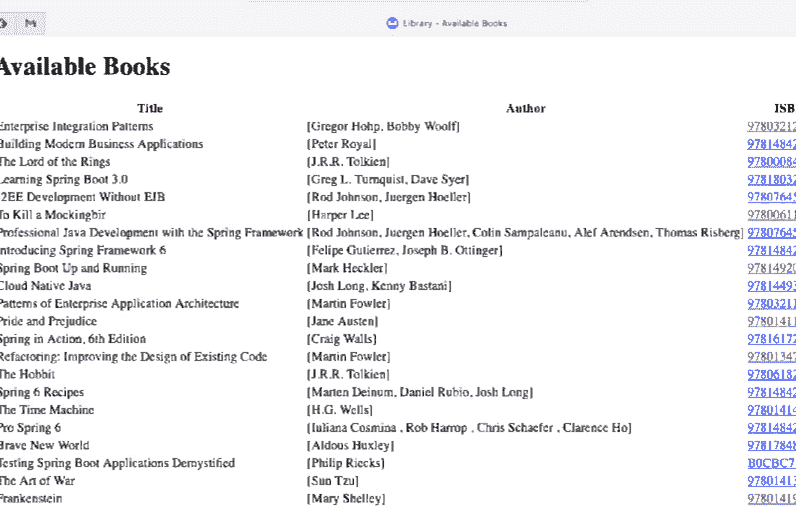

**图 4-3.** 书籍列表

### 让更具响应性

运行应用程序并打开页面时，你必须等待一段时间页面才会开始渲染。当渲染页面且模型包含 `Flux` 时，它默认会等待整个 `Flux` 被消费完毕。之后，它才会开始渲染页面。它的行为基本上就像你获取了一个 `Collection` 而不是 `Flux`。为了更快地开始渲染页面并实现页面流式传输，请将 `Flux` 封装在 `ReactiveDataDriverContextVariable` 中。参见列表 4-14.

#### 列表 4-14. 使用 ReactiveDataDriverContextVariable 的方法

```java
@GetMapping("/books.html")
public String all(Model model) {
    var books = new ReactiveDataDriverContextVariable(bookService.findAll(), 5);
    model.addAttribute("books", books);
    return "books/list";
}
```

`all` 方法看起来是一样的，但请注意 `Flux` 被封装在 `ReactiveDataDriverContextVariable` 中。一旦接收到五个元素，它就会开始渲染，并持续渲染页面直到接收到所有内容。现在打开书籍页面，你将看到表格不断增长，直到读取到所有订单。

## 4-4. 使用 Spring WebFlux 处理异常

你想要为 Spring WebFlux 配置异常处理，并根据你的需求进行配置。

### 解决方案

Spring WebFlux 提供了多种处理异常的方法，并且结合 Spring Boot，修改默认行为变得非常简单。

对于与视图相关的实现，很容易添加会被自动拾取的页面。添加 `error.html` 作为自定义错误页面，或者为特定的 HTTP 错误码（例如 404）添加特定的错误页面，即 `404.html` 和 `500.html`。

Spring Boot 还为基于 REST 的控制器提供了异常处理。它将返回一个包含错误信息的响应，这与普通 WebFlux 处理中可用的错误信息非常相似。另一个选项是启用 Problem Detail 支持（RFC-7807），这是一个用于定义错误响应的小型标准。要启用它，请将 `spring.webflux.problemdetails.enabled` 属性设置为 `true`。

### 工作原理

我们现在解释它是如何工作的。

#### 处理 REST 控制器异常

编写一个自定义的 `ErrorAttributes` 属性来替换默认属性（图 4-4），并填充将作为响应写入的模型。

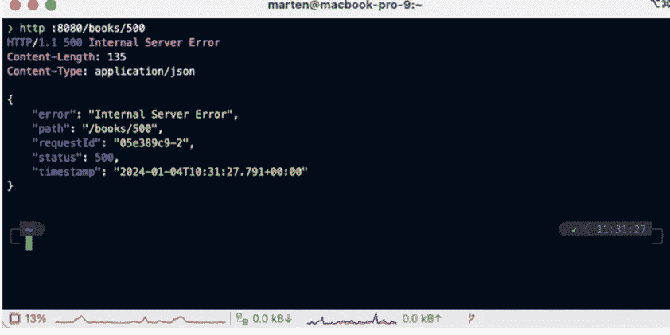

**图 4-4.** 默认错误响应

默认情况下，Spring Boot 会包含表 4-2 所示的属性。

#### 表 4-2. 默认属性

| 属性 | 描述 |
| :--- | :--- |
| `timestamp` | 错误的时间 |
| `status` | 状态码 |
| `error` | 异常 |
| `exception` | 异常名称 |
| `message` | 错误消息 |
| `errors` | 绑定错误 |
| `trace` | 堆栈跟踪 |
| `path` | 抛出异常的 URL |

这是通过使用 `ErrorAttributes` 完成的。你可以创建自己的 `ErrorAttributes` 来添加额外的属性。参见列表 4-20.

#### 列表 4-20. CustomizedAttributes 实现

```java
package com.apress.springboot3recipes.library;

import org.springframework.boot.web.error.DefaultAttributes;
import org.springframework.boot.web.error.ErrorOptions;
import org.springframework.web.reactive.function.ServerRequest;
import java.util.Map;

public class CustomizedAttributes extends DefaultAttributes {

    @Override
    public Map<String, Object> getErrorAttributes(ServerRequest req, ErrorOptions options) {
        Map<String, Object> errorAttributes = super.getErrorAttributes(req, options);
        errorAttributes.put("parameters", req.getQueryParams());
        return errorAttributes;
    }
}
```

`CustomizedAttributes` 将替换默认属性。下一步将其配置为 Bean，以便 Spring Boot 使用。参见列表 4-21.

#### 列表 4-21. CustomizedAttributes Bean

```java
@Bean
public CustomizedAttributes errorAttributes() {
    return new CustomizedAttributes();
}
```

这将生成图 4-5 中的错误。

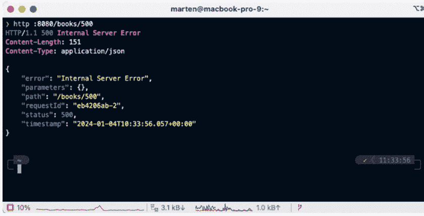

**图 4-5.** 错误响应

#### 启用并使用 Problem Details

Spring 6 增加了对 HTTP Problem Details 支持（RFC-7807），结合 Spring Boot 启用非常简单。通过添加 `spring.webflux.problemdetails.enabled=true`（对于 MVC 应用则为 `spring.mvc.problemdetails.enabled=true`），即可启用它。

启用后，Spring Boot 将注册 `ProblemDetailsExceptionHandler` 作为额外的处理器，它可以处理某些常见的 Spring 异常，并返回包含更多信息且类型为 `application/problem+json` 的结果。参见 4-6.

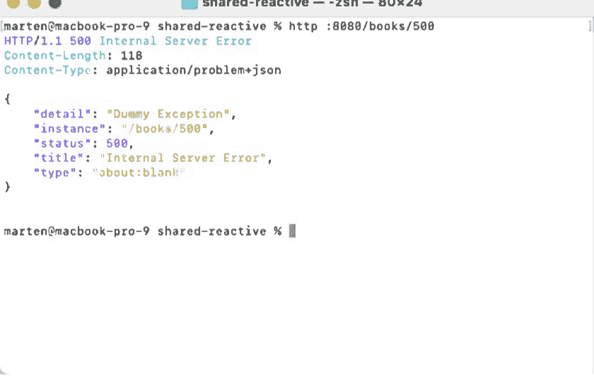

**图 4-6.** Problem detail 响应

4-6 显示了启用 Problem Detail 后调用 `http://localhost:8080/books/500` 的结果。

这适用于所有 Spring 异常。当发生验证或绑定错误时，它还会列出错误的字段列表。它甚至可以（可能的）将这些错误消息翻译为客户端使用的语言（另见方案 4-5 和 4-6 的 I18N 支持）。

## 4-5. 实现国际化 (I18N) 问题

开发国际化 Web 应用程序时，你必须以用户偏好的语言显示页面。你不希望为不同的语言创建同一个页面的多个版本。

### 解决方案

为了避免为不同语言创建页面的版本，你应该通过外部化语言敏感的文本消息使 Web 页面与语言无关。Spring 能够通过使用消息源为你解析文本消息，消息源必须实现 `MessageSource` 接口。在页面模板中，你可以使用特殊标签或对消息进行查找。

### 工作原理

当 Spring Boot 在 `src/main/resources`（默认位置）找到 `messages.properties` 时，会自动配置 `MessageSource`。该 `messages.properties` 包含了应用程序中使用的默认消息。Spring Boot 将使用请求中的 `Accept-Language` 请求头来确定当前请求使用的语言（如何更改该设置请参见方案 4-6）。

+   某些属性更改了 `MessageSource` 对缺失翻译、缓存等响应方式。参见表 4-3 的属性概览。

#### 表 4-3. I18N 属性

| 属性 | 描述 |
| --- | --- |
| `spring.messages.basename` | 逗号分隔的基名称列表；默认是 `messages`。 |


| spring.messages.encoding | 消息资源包编码；默认是 UTF-8。 |
| spring.messages.always-use-message-format | 设置是否对所有消息应用 MessageFormat；默认为 false。 |
| spring.messages.fallback-to-system-locale | 当找不到检测到的语言的资源包时，回退到系统区域设置。当禁用时，将从默认文件加载默认值。默认为 true。 |
| spring.messages.use-code-as-default-message | 当找不到消息时，使用消息代码作为默认消息，而不是抛出 NoSuchElementException。默认为 false。 |
| spring.messages.cache-duration | 缓存持续时间；默认是永久。 |

> 在将应用程序部署到云端或其他外部托管平台时，将 `spring.messages.fallback-to-system-locale` 设置为 false 可能会很有用。这样，你就可以控制应用程序的默认语言，而不是由（你无法控制的）部署环境决定。

在 `src/main/resources` 目录下添加 `messages.properties` 文件。参见列表 4-22。

### 列表 4-22. 默认消息

```
main.title=Spring Boot Recipes - Library
index.title=Library
index.books.link=List of books
books.list.title=Available Books
books.list.table.title=Title
books.list.table.author=Author
books.list.table.isbn=ISBN
```

现在更改模板以使用消息插值（使用 `MessageSource` 查找文本）。参见列表 4-23。

### 列表 4-23. 支持 I18N 的首页

```html
<!DOCTYPE html>
<html xmlns="http://www.thymeleaf.org">
<head>
  <meta charset="UTF-8">
  <title th:text="#{main.title}">Spring Boot - Library</title>
</head>
<body>
  <h1 th:text="#{index.title}">Library</h1>
  <a th:href="@{books.html}" th:text="#{index.books.link}">List books</a>
</body>
</html>
```

对于 Thymeleaf，你可以在 `th:text` 属性中使用 `${...}` 表达式；由于得益于 Spring 的自动集成，它将从 `MessageSource` 中解析消息。当重启应用程序时，输出内容似乎没有变化。然而，现在所有的文本都来自 `messages.properties`。

现在，让我们来添加 `messages_nl.properties` 以为网站提供荷兰语翻译。参见列表 4-24。

### 列表 4-24. 荷兰语消息

```
main.title=Spring Boot Recipes - Bibliotheek
index.title=Bibliotheek
index.books.link=Lijst van boeken
books.list.title=Beschikbare Boeken
books.list.table.title=Titel
books.list.table.author=Auteur
books.list.table.isbn=ISBN
```

现在当将 accept header 改为荷兰语时，网站将神奇地翻译成荷兰语（参见图 4-7）。

- 更改浏览器语言可能并不简单。对于 Chrome 和 Firefox，有插件允许你轻松地切换 `Accept-Language` header。


图 4-7. 翻译后的首页

## 4-6. 更改用户区域设置

### 问题

为了让你的 Web 应用程序支持国际化，必须识别每个用户的常用区域设置（locale），并根据该区域设置显示内容。

### 解决方案

在 Spring WebFlux 应用中，用户的区域设置由实现 `LocaleContextResolver` 接口的组件识别。Spring WebFlux 提供了两个 `LocaleContextResolver` 实现，让你根据不同的标准解析区域设置。或者，你可以通过实现此接口创建自定义的区域设置解析器。

你可以通过在 Web 环境中注册 `LocaleContextResolver` 类型的 bean 来定义区域设置解析器。你必须将区域设置解析器的 bean 名称设置为 `localeContextResolver`，以便被自动检测。

### 工作原理

Spring WebFlux 附带 `LocaleContextResolver` 接口的几个默认实现，其中一些允许更改区域设置。要更改区域设置，可以使用 `WebFilter` 允许用户覆盖他们想要使用的区域设置。这些目前还没有 Spring WebFlux 提供的（至少在编写时如此）；因此，你需要自己实现它们。

### 通过 HTTP 请求头解析区域设置

Spring Boot 注册的默认区域设置解析器是 `AcceptHeaderLocaleContextResolver`。它通过检查 HTTP 请求的 `accept-language` 请求头来解析区域设置。该头由用户的浏览器根据底层操作系统的区域设置设置设置。参见列表 4-25。

> `AcceptHeaderLocaleContextResolver` 无法更改用户的区域设置，因为它无法修改用户操作系统的区域设置。

### 列表 4-25. AcceptHeaderLocaleContextResolver Bean 定义

```java
@Bean
public AcceptHeaderLocaleContextResolver localeContextResolver() {
    return new AcceptHeaderLocaleContextResolver();
}
```

### 为你的应用程序使用固定区域设置

`FixedLocaleResolver` 是一个不允许更改的 `LocaleContextResolver`，但它会返回一个固定的区域设置。参见列表 4-26。

### 列表 4-26. FixedLocaleResolver Bean 定义

```java
@Bean
public FixedLocaleResolver localeContextResolver() {
    return new FixedLocaleResolver();
}
```

### 更改区域设置

要更改区域设置，我们需要将用户选择的 `Locale` 存储在 HTTP cookie 中（参见 `setLocaleContext` 方法）。该方法如何被调用稍后将显示。解析 `Locale` 时如果需要，将从请求中解析 cookie 并将 `LocaleContext` 存储在交换的属性中。这样做是为了防止重复解析 cookie。该值也用于在响应中显式设置 `LocaleContext` 时，以便直接激活 `Locale`。最后，如果没有设置任何内容，则回退到使用浏览器的 accept-header，这就是为什么它是 `AcceptHeaderLocaleResolver` 的扩展。

### 基于 Cookie 的实现

```java
package com.aop.springbootrecipes.library.i18n;

import org.springframework.context.i18n.SimpleLocaleContext;
import org.springframework.http.ResponseCookie;
import org.springframework.web.server.ServerWebExchange;
import org.springframework.web.server.i18n.AcceptHeaderLocaleResolver;

import java.util.Locale;

public class CookieLocaleResolver extends AcceptHeaderLocaleResolver {

    public static final String DEFAULT_NAME = CookieLocaleResolver.class.getName() + ".LOCALE";

    @Override
    public LocaleContext resolveContext(ServerWebExchange exchange) {
        parseCookieIfNecessary(exchange);
        return exchange.getAttribute(DEFAULT_NAME);
    }

    private void parseCookieIfNecessary(ServerWebExchange exchange) {
        if (exchange.getAttribute(DEFAULT_NAME) == null) {
            var cookies = exchange.getRequest().getCookies();
            var cookie = cookies.getFirst(DEFAULT_NAME);
            var attributes = exchange.getAttributes();
            if (cookie == null) {
                var locale = Locale.forLanguageTag(cookie.getValue());
                var context = new SimpleLocaleContext(locale);
                attributes.put(DEFAULT_NAME, context);
            } else {
                super.resolveContext(exchange);
            }
        }
    }

    @Override
    public void setLocaleContext(ServerWebExchange exchange, LocaleContext lc) {
        var cookies = exchange.getResponse().getCookies();
        if (lc != null && lc.getLocale() != null) {
            exchange.getAttributes().put(DEFAULT_NAME, lc);
            var langTag = lc.getLocale().toLanguageTag();
            var cookie = ResponseCookie.from(DEFAULT_NAME, langTag).build();
            cookies.set(DEFAULT_NAME, cookie);
        } else {
            exchange.getAttributes().remove(DEFAULT_NAME);
            cookies.remove(DEFAULT_NAME);
        }
    }
}
```

### 列表 4-29. 更改区域设置的 WebFilter 实现

```java
package com.aop.springbootrecipes.library.i18n;

import org.springframework.context.i18n.SimpleLocaleContext;
import org.springframework.util.StringUtils;
import org.springframework.web.server.ServerWebExchange;
import org.springframework.web.server.WebFilter;
import org.springframework.web.server.WebFilterChain;
import org.springframework.web.server.i18n.LocaleContextResolver;
import reactor.core.publisher.Mono;

import java.util.Locale;

public class LocaleChangeWebFilter implements WebFilter {

    public static final String DEFAULT_PARAM_NAME = "locale";

    private final LocaleContextResolver resolver;

    public LocaleChangeWebFilter(LocaleContextResolver resolver) {
        this.resolver = resolver;
    }

    @Override
    public Mono<Void> filter(ServerWebExchange exchange, WebFilterChain chain) {
        var params = exchange.getRequest().getQueryParams();
        if (params.containsKey(DEFAULT_PARAM_NAME)) {
            var locale = params.getFirst(DEFAULT_PARAM_NAME);
            var context = StringUtils.hasText(locale) ?
                new SimpleLocaleContext(Locale.forLanguageTag(locale)) : null;
            resolver.setLocaleContext(exchange, context);
        }
        return chain.filter(exchange);
    }
}
```

`LocaleChangeWebFilter` 将检查是否存在名为 `locale` 的请求参数（准确来说是查询参数），如果存在，则使用它来设置用户选择的区域设置。

接下来，需要将此 `LocaleChangeWebFilter` 注册到 Spring WebFlux 中。Spring WebFlux 会自动检测类型为 `WebFilter` 的 bean，并将它们注册到请求处理链中。只需要将其作为一个 bean 即可。参见列表 4-30。

### 列表 4-30. LocaleChangeWebFilter Bean 定义

```java
@Bean
public LocaleChangeWebFilter localeChangeWebFilter(LocaleContextResolver resolver) {
    return new LocaleChangeWebFilter(resolver);
}
```

要更改语言，请将 `LocaleChangeInterceptor` 添加为 bean 并将其注册为拦截器；对于后者，请使用 `WebMvcConfigurer` 的 `addInterceptors` 方法。

与其将其添加到 `@SpringBootApplication` 中，你也可以创建一个带有 `@Configuration` 注解的专用类来注册过滤器和解析器。注意不要在该类中添加 `@EnableWebFlux`，否则将禁用 Spring Boot 的自动配置！

现在，将以下代码段添加到 `index.html` 文件中：

```html
<h3>Language</h3>
<div>
<a href="?locale=nl" th:text="#{main.language.nl}">NL</a> |
<a href="?locale=en" th:text="#{main.language.en}">EN</a>
</div>
```

现在，当选择其中一种语言时，页面将重新渲染并以所选语言显示。当你继续浏览时，其余页面也将以所选语言显示。

## 4-7. 选择并配置嵌入式服务器

### 问题

你想使用 Undertow 作为嵌入式容器，而不是默认的 Reactor Netty 容器。

### 解决方案

排除 Reactor Netty 运行时并包含 Undertow 运行时。Spring Boot 会检测类路径上是否存在 Tomcat、Jetty、Reactor Netty 或 Undertow，并据此配置容器。

### 工作原理


# Spring Boot 嵌入式响应式容器配置

Spring Boot 开箱支持将 Tomcat、Jetty、Reactor Netty 和 Undertow 作为嵌入式响应式容器。默认情况下，Spring Boot 使用 Reactor Netty 作为容器（通过 `spring-boot-starter-webapp` 模块中的 `spring-boot-starter-reactor-netty` 依赖实现）。可以使用属性配置容器，其中某些属性适用于所有容器，另一些适用于特定容器。全局属性以 `server` 或 `server.reactive` 为前缀，而容器属性以 `server.<container>`（其中 container 为 tomcat、jetty、netty 或 undertow）为开头。

## 设置通用配置属性

提供了几个通用的服务器属性，如表 4-4 和表 4-5 所示。

### 表 4-4. 通用服务器属性

| 属性 | 描述 |
| :--- | :--- |
| `server.port` | HTTP 服务器端口；默认值为 8080。 |
| `server.address` | 要绑定的 IP 地址；默认值为 0.0.0.0，即所有适配器。 |
| `server.server-header` | 用于发送服务器名称的标头部名称；默认为空。 |
| `server.max-http-header` | HTTP 头部的最大大小；默认值为 0（无限制）。 |
| `server.connection-timeout` | HTTP 连接器在关闭之前等待下一次请求的超时时间。默认由容器决定；值为 -1 表示无限且永不超时。 |
| `server.http2.enabled` | 如果当前容器支持，则启用 Http2 支持。默认值为 false。 |
| `server.forwarded-headers-strategy` | X-Forward-* 头的支持策略；可选 native（原生）、framework（框架）或 none（无）。 |
| `server.compression.enabled` | 设置是否启用 HTTP 压缩；默认值为 false。 |
| `server.compression.mime-types` | 应用于压缩的 MIME 类型逗号分隔列表。 |
| `server.compression.excluded-user-agents` | 应禁用压缩的用户代理逗号分隔列表。 |
| `server.compression.min-response-size` | 应用压缩的最小响应大小；默认值为 2048。 |
| `server.shutdown` | 服务器关闭模式；可选 immediate（立即）或 graceful（优雅）。默认值为 immediate。 |

### 表 4-5. 响应式容器 HTTP 会话属性

| 属性 | 描述 |
| :--- | :--- |
| `server.reactive.session.timeout` | 会话超时时间；默认值为 30 分钟。 |
| `server.reactive.session.cookie.name` | 会话标识符的 cookie 名称；默认为空，由容器决定。 |
| `server.reactive.session.cookie.domain` | 用于会话 cookie 的域值；默认为空，由容器决定。 |
| `server.reactive.session.cookie.path` | 用于 cookie 的路径；默认为空。 |
| `server.reactive.session.cookie.secure` | 设置是否应发送 cookie。默认为空。 |
| `server.reactive.session.cookie.http-only` | 设置是否仅限 cookie。默认为空。 |
| `server.reactive.session.cookie.max-age` | 会话 cookie 的生命周期；默认为空。 |
| `server.reactive.session.cookie.same-site` | 设置使用的 Same-Site 策略。 |

```
main() { com.example.library.LibraryApplication }
main() { com.example.library.LibraryApplication }
main() { org.springframework }
main() { org.springframework.boot.threads }
main() { org.springframework.undertow.UndertowWebServer }
main() { com.example.library.LibraryApplication }
```

图 4-8. 使用 Undertow 启动日志

## 4-8. 为响应式应用配置 SSL

你希望你的应用接下来可以通过 HTTPS（或代替 HTTP）访问。

### 解决方案

获取一个证书，将其放入密钥库（keystore）中，并使用 `server.ssl` 属性来配置密钥库。Spring Boot 将会自动配置服务器使其可以通过 HTTPS 访问。

### 工作原理

使用 `server.keystore`（以及相关属性），你可以配置嵌入容器仅接受 HTTPS 连接。在配置 SSL 之前，你需要一个证书来保护你的应用程序。通常情况下，你会希望从 Verisign 或 Let's Encrypt 等证书颁发机构获取证书。但是，为了开发目的，你可以使用自签名证书（参见“创建自签名证书”章节）。

## 创建自签名证书

Java 自带了一个名为 `keytool` 的工具，可以用于生成证书等。参见代码列表 4-32。

# 第 4 章 WEBFLUX

## 代码列表 4-32. keytool 命令

```bash
keytool -genkey -keyalg RSA -alias sb3-recipes -keystore sb3-recipes.pfx -storepass password -validity 3600 -keysize 4096 -storetype pkcs12
```

此命令将告诉 `keytool` 使用 RSA 算法生成密钥，并将其以别名 `sb3-recipes` 放入 `sb3-recipes.pfx` 密钥库中，有效期为 3,600 天。运行命令时，它会询问几个问题并要求相应的回答（或留空）。之后，将生成名为 `sb3-recipes.pfx` 的文件，其中包含受密码保护的证书。

将此文件放在 `src/main/resources` 文件夹中，使其作为应用程序的一部分打包，Spring Boot 可以轻松访问它。

> 使用自签名证书会在浏览器中产生警告，提示该网站不安全或未受保护。

### 配置 Spring Boot 使用密钥库

Spring Boot 需要知道密钥库的信息才能配置嵌入容器。为此，你首先创建一个所谓的 SSL 包（bundle），并使用 `server.ssl.bundle` 属性将其链接到服务器。

使用 `server.ssl.keystore` 属性。你还需要指定密钥库的类型（pkcs12）和密码。参见代码列表 4-33。

## 代码列表 4-33. SSL 属性

```properties
server.ssl.bundle=server

# SSL Bundle
spring.ssl.bundle.jks.server.key.alias=sb3-recipes
spring.ssl.bundle.jks.server.key.password=password

spring.ssl.bundle.jks.server.keystore.location=classpath:sb3-recipes.pfx
spring.ssl.bundle.jks.server.keystore.password=password
spring.ssl.bundle.jks.server.keystore.type=pkcs12
```

这些 SSL 属性将创建一个名为 `server` 的 SSL 包。它是 JKS 类型。要传递别名（用于创建证书的别名），请使用 `key.alias`，密码使用 `key.password` 属性。此外，我们需要链接到实际证书，它位于 `sb3-recipes.pfx` 文件中。为此，请使用 `keystore.location`，因为该文件受密码保护。我们需要指定 `keystore.password` 属性，最后还需要指定证书类型。

现在当通过 HTTPS 访问服务器时，由于自签名证书，你会收到警告。使用官方证书时，你显然不会收到此警告。参见图 4-9。

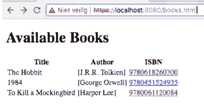

图 4-9. 通过 HTTPS 访问库

## 4-9. 使用 Controllers 和 TaskExecutor 执行同步请求处理

### 问题

你有一段想要以响应式执行的阻塞代码。

### 解决方案

当请求进来时，将使用 `TaskExecutor` 进行响应式处理。

### 工作原理

要配置阻塞的 WebFlux 执行，你可以使用专用的 `AsyncTaskExecutor`（它通常由 Spring 管理）。参见代码列表 4-34。

## 代码列表 4-34. 使用 AsyncTaskExecutor 的 Spring Boot

```java
package com.apress.springbootrecipes;

import org.springframework.boot.SpringApplication;
import org.springframework.context.annotation.Configuration;
import org.springframework.boot.task.SimpleAsyncTaskBuilder;
import org.springframework.web.reactive.config.WebFluxConfigurer;

@SpringBootApplication
public class HelloWorldApplication {

    public static void main(String[] args) {
        SpringApplication.run(HelloWorldApplication.class, args);
    }

    @Configuration
    public static class WebFluxConfiguration implements WebFluxConfigurer {
        private final SimpleAsyncTaskBuilder builder;

        public WebFluxConfiguration(SimpleAsyncTaskBuilder builder) {
            this.builder = builder;
        }

        @Override
        public void configureWebFlux(WebFluxConfigurer configurer) {
            configurer.setExecutor(builder.threadName("blocking-").build());
        }
    }
}
```

## 代码列表 4-35. 带有阻塞和响应式处理的 HelloWorldController

```java
package com.apress.springbootrecipes;

import org.springframework.boot.SpringBootVersion;
import org.springframework.web.bind.annotation.GetMapping;
import org.springframework.web.bind.annotation.RestController;
import reactor.core.publisher.Mono;

@RestController
public class HelloWorldController {

    @GetMapping("/blocking")
    public String hello() {
        return sayHello();
    }

    @GetMapping("/reactive")
    public Mono<String> helloReactive() {
        return Mono.just(sayHello());
    }

    private static String sayHello() {
        var version = SpringBootVersion.getVersion();
        var thread = Thread.currentThread().getName();
        return String.format("Hello World %s from Spring Boot on Thread '%s'!", version, thread);
    }
}
```

`HelloWorldController` 有两个方法。绑定到 `/blocking` 的方法返回普通的 `String`，而绑定到 `/reactive` 的方法返回 `Mono<String>`，这是一个响应式类型。

现在当启动应用程序并使用 HTTPPie 或浏览器调用端点时，你应该能够看到发生的情况，因为它将返回执行任务的线程名称（参见图 4-10）。

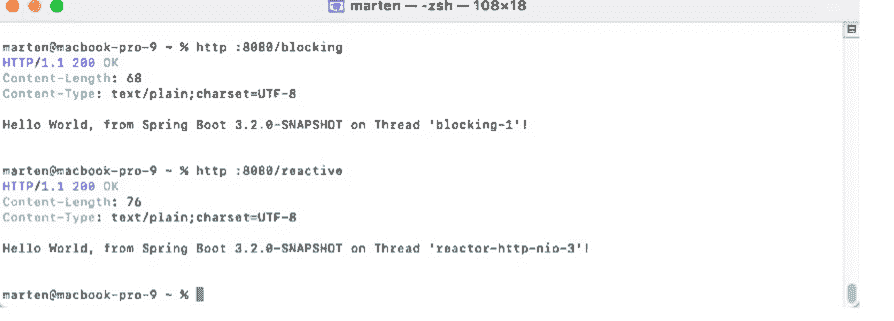

图 4-10. 阻塞和响应式输出

调用 `/blocking` 将在带有 `blocking` 前缀的线程上执行，这表明它确实是由配置的 `AsyncTaskExecutor` 执行的。`/reactive` 在所使用的响应式框架的线程之一上执行（此处是 Project Reactor）。

## 代码列表 4-36. 无显式 WebFluxConfigurer 的 Spring Boot

```java
package com.apress.springbootrecipes;

import org.springframework.boot.SpringApplication;
import org.springframework.boot.autoconfigure.SpringBootApplication;

@SpringBootApplication
public class HelloWorldApplication {

    public static void main(String[] args) {
        SpringApplication.run(HelloWorldApplication.class, args);
    }
}
```

在没有任何进一步配置的情况下，阻塞执行仍然会发生。

## 4-10. 创建响应写入器

### 问题

你有一个服务或多次调用，并希望分块（chunks）向客户端发送响应。

### 解决方案

Spring WebFlux 像 Spring MVC 一样进行内容协商。当它接收到可以流传输的内容类型（如 `application/x-ndjson` 和 `text/event-stream`）时，它将切换到流式传输结果的编码器。对于 `text/event-stream`，我们可以使用 `SseEventBuilder` 来添加额外信息。

### 工作原理

让我们来聊聊它的工作原理。

### 在响应中发送多个结果

当检测到需要流传输的内容类型时，Spring WebFlux 会自动流式传输结果。创建一个 `OrderController`，其 `orders` 方法返回一个 `Flux<Order>` 并将结果逐个发送给客户端。

```java
package com.apress.spring3recipes.order.rest;
import com.apress.spring3recipes.order.Order;
import com.apress.spring3recipes.order.OrderService;
import org.springframework.web.bind.annotation.GetMapping;
import org.springframework.web.bind.annotation.RestController;
import reactor.core.publisher.Flux;

import java.time.Duration;

@RestController
public class OrderController {
    private final OrderService orderService;

    public OrderController(OrderService orderService) {
        this.orderService = orderService;
    }

    @GetMapping("/orders")
    public Flux<Order> orders() {
        return orderService.findAll().delayElements(Duration.ofMillis(32));
    }
}
```

该控制器非常简单，因为返回正确响应的所有复杂性都由框架处理。

> 在向客户端发送每个项目时有一个延迟，这是为了让你看到不同的事件不断进入。在实际代码中你不会这样做。

当使用 HTTP 或 curl 等工具时，调用 URL `http://localhost:8080/orders` 而不指定流式 Content-Type 将返回一个订单数组（见图 4-11）。


## 图 4-11. 无流式 Content-Type 的响应

```bash
$ marten@macbook-pro-9 ~ % http://localhost:8080/orders
HTTP/1.1 200 OK
Content-Type: application/json
transfer-encoding: chunked
{
  "amount": 561.89,
  "id": "d27d194-a83c-4c84-95a5-3372b2642e80"
},
{
  "amount": 415.39,
  "id": "a3b83158-153a-48d9-b7f8-e191e3c94ca4"
},
{
  "amount": 445.67,
  "id": "b9b8a6cd-3b57-45d0-8725-d0747184a552"
},
{
  "amount": 425.17,
  "id": "f281f5da-4ed5-48e3-beds-f81931c3bed7"
},
{
  "amount": 426.32,
  "id": "72d38b9c-33b6-4a8b-931f-25d0ed23"
}
```

当指定 `application/ndjson` 的 accept header 时，结果将逐个流式传输而不是作为数组发送。使用 `http://localhost:8080/orders 'Accept:application/ndjson' --stream` 将产生图 4-12。

## 图 4-12. 流式 JSON 响应

```bash
marten@macbook-pro-9 ~ % http://localhost:8080/orders 'Accept:application/ndjson' --stream
HTTP/1.1 200 OK
Content-Type: application/ndjson
transfer-encoding: chunked
{
  "amount": 561.89,
  "id": "d27d194-a83c-4c84-95a5-3372b2642e0"
}
{
  "amount": 415.39,
  "id": "a3b83158-153a-48d9-b7f8-e191e3c9ca4"
}
{
  "amount": 445.67,
  "id": "b909ea6cd-3be7-45d8-8725-8d747184552"
}
{
  "amount": 425.17,
  "id": "e2e8ffda-4ed5-48e3-beds-f1931cbed7"
}
{
  "amount": 426.32,
  "id": "72d38b9c-33b6-4a8b-931f-25d0ed23ec"
}
```

## 图 4-13. 事件流响应

最后，通过指定 `text/event-stream` 类型可以使用事件流。使用 `http://localhost:8080/orders 'Accept:text/event-stream' --stream` 将产生图 4-13。

```bash
marten@macbook-pro-9 ~ % http://localhost:8080/orders 'Accept:text/event-stream' --stream
HTTP/1.1 200 OK
Content-Type: text/event-stream; charset=UTF-8
Transfer-Encoding: chunked
data:{
  "amount": 561.89,
  "id": "d27d194-a83c-4c84-95a5-3372b262e80"
}
data:{
  "amount": 415.39,
  "id": "a3b83158-153a-48d9-b7f8-e191e3c9ca4"
}
data:{
  "amount": 445.67,
  "id": "b909ea6cd-3be7-45d8-8725-8d747184552"
}
data:{
  "amount": 425.17,
  "id": "e2e8ffda-4ed5-48e3-beds-f1931cbed7"
}
data:{
  "amount": 426.32,
  "id": "72d38b9c-33b6-4a8b-931f-25d0ed23ec"
}
```

## 图 4-14. Server-Sent-Events 结果

最后，为这个控制器编写一个测试。在类上注解 `@WebFluxTest(OrderController.class)` 以获取一个 WebFlux 切片测试。`OrderController` 需要一个通过 `@MockBean` 在 `OrderService` 字段上模拟的 `OrderService`。见 Listing 4-37。

## Listing 4-37. OrderController 的 WebFluxTest

```java
package com.apress.spring3recipes.order.rest;

import com.apress.spring3recipes.order.Order;
import com.apress.spring3recipes.order.OrderService;
import org.junit.jupiter.api.Test;
import org.springframework.beans.factory.annotation.Autowired;
import org.springframework.boot.test.autoconfigure.web.reactive.WebFluxTest;
import org.springframework.boot.test.mockito.MockBean;
import org.springframework.framework.http.MediaType;
import org.springframework.framework.test.web.reactive.server.WebTestClient;
import reactor.core.publisher.Flux;
import java.math.BigDecimal;
import static org.mockito.Mockito.when;

@WebFluxTest(OrderController.class)
public class OrderControllerTest {
    @Autowired
    private WebTestClient webTestClient;

    @MockBean
    private OrderService orderService;

    @Test
    public void shouldReturnOrders() throws Exception {
        when(orderService.findAll()).thenReturn(Flux.just(new Order("1234", BigDecimal.TEN)));
        webTestClient.get()
            .uri("/orders")
            .accept(MediaType.APPLICATION_NDJSON)
            .exchange()
            .expectStatus().isOk()
            .expectBody().json("{id\":\"1234\",\"amount\":10}");
    }
}
```

## 第 4 章 WEBFLUX

```java
@GetMapping("/orders")
public Flux<Order> orders() {
    return orderService.findAll().delayElements(Duration.ofMillis(32));
}
```

```java
@GetMapping(value = "/orders", produces = MediaType.TEXT_EVENT_STREAM_VALUE)
public Flux<ServerSentEvent<Order>> orderEvents() {
    return orderService.findAll()
        .map(this::toEvent)
        .delayElements(Duration.ofMillis(32));
}

private ServerSentEvent<Order> toEvent(Order order) {
    return ServerSentEvent.builder(order)
        .event("order-event")
        .id(order.id()).build();
}
```

我们为接收到的每个 `Order` 创建了一个专用的 `ServerSentEvent`。我们指定了 `id` 和 `event`。`Order` 被用作 body（data 字段）。最后，在调用 `build` 方法后，我们可以使用创建的 `ServerSentEvent`。

现在，当调用 URL `http://localhost:8080/orders` 且 `Content-Type` 为 `text/event-stream` 时，你会看到事件一个接一个地传入（见图 4-14）。

```bash
marten@macbook-pro-9 ~ % curl http://localhost:8080 -H 'Accept:text/event-stream' --stream
HTTP/1.1 200 OK
Content-Type: text/event-stream;charset=UTF-8
transfer-encoding: chunked
id=f3e8b5f2-2744-43c3-ac25-5e081367e678
event:order-event
data:
  "amount":756.72,
  "id":"f3e8b5f2-2744-43c3-ac25-5e081367e678
id=80c695f8-8532-4d14-b9b4-5d2a28cde3c3
event:order-event
data:
  "amount":748.5,
  "id":"80c695f8-8532-4d14-b9b4-5d2a28cde3c3"
id=a051c53c-d88f-49e6-a06a-ae8ff8d0eeff
event:order-event
data:
  "amount":33.58,
  "id":"a051c53c-d88f-49e6-a06a-ae8ff8d0eeff"
id=b44f39f9-6688-4eb9-8412-a5e3a06cd9d9
event:order-event
data:
  "amount":456.06,
  "id":"b44f39f9-6688-4eb9-8412-a5e3a06cd9d9"
id=50246c73-3da5-4909-8587-467a28683d74
event:order-event
data:
  "amount":287.36,
  "id":"50246c73-3da5-4909-8587-467a28683d74"
```

注意 `Content-Type` 头部；它的值为 `text/event-stream`，表示我们获取的是事件流。该流可以保持开启状态并接收事件通知。写入的每个对象都会转换为 JSON；这是通过 `Encoder` 完成的。对象在 `data` 标签中作为事件数据写入。

## 4-11. 使用 Spring WebFlux 消耗 REST 资源的问题

你需要为应用程序连接到 REST 资源，并希望使用 `WebClient` 来实现。

### 解决方案

Spring Boot 提供了配置和构建器来帮助构建所需的类。本食谱将展示如何构建一个可以用于消耗食谱 4-2 中 API 的应用程序。

你可以使用 `WebClient.Builder` 来创建一个 `WebClient`。另一种选项是使用 `@HttpExchange` 使用声明式客户端。

### 工作原理

尽管每种方法使用的类不同，但我们仍然需要 Spring MVC 的 web 类依赖。为此，我们可以添加 `spring-boot-webflux` 依赖。见代码列表 4-39。

**Listing 4-39.** Spring Boot Starter WebFlux 依赖

```xml
<dependency>
  <groupId>org.springframework.boot</groupId>
  <artifactId>spring-boot-starter-webflux</artifactId>
</dependency>
```

> 如果你正在编写一个不需要 servlet 容器的独立客户端，你可能想要对 `spring-boot-starter-netty` 添加排除。

我们将使用食谱 4-2 作为我们的服务器 API，并将编写一个应用程序来查找该 API，调用另一个 API（在 `https://openlibrary.org`）来获取书籍的额外信息，并返回一个增强后的响应。`EnrichedBook` 如代码列表 4-40 所示。

**Listing 4-40.** EnrichedBook Record

（后续文本由于为乱码，无法翻译）

由于 `WebClient` 复用了与 WebFlux 其他部分相同的基础设施，我们可以复用之前使用的异常处理机制。当从命令行使用 `curl` 或 HTTPie 调用 `http://localhost:8090/books/9780618260300` 时，你将得到类似于图 4-15 的输出。

```bash
$ http://localhost:8090/books/9780618260300
HTTP/1.1 200 OK
Content-Length: 104
Content-Type: application/json
{
  "authors": [
    "J.R.R. Tolkien"
  ],
  "isbn": "9780618260300",
  "published": "August 15, 2002",
  "title": "The Hobbit"
}
```


图 4-15. 丰富的书籍结果

## 使用声明式客户端

Spring Framework 6 引入了声明式 HTTP 客户端。通过它，可以编写带有注解的接口。在运行时，将创建一个代理，用于处理请求/响应，包括映射和异常处理。

起点是一个接口，在类或方法上标有 `@HttpExchange` 注解（或其派生注解，如 `@GetMapping` 和 `@PostMapping`）。它的工作方式与服务器 API 中的 `@RequestMapping` 注解非常相似。

使用 `@HttpExchange` 注解，可以设置某些属性（见表 4-9）。

### 表 4-9. HttpExchange 属性

| 属性 | 描述 |
|------|---|
| value or url | 请求的 URL；可以是完整 URL、相对于类型级 `@HttpExchange` 的路径，或预设的基路径 URI。 |
| Method | 要使用的 HTTP 方法；DELETE、GET、PATCH、POST 或 PUT。默认为空。 |
| contentType | 用于 `Content-Type` 头的发送媒体类型；默认为空。也用于 `Accept` 头的媒体类型。 |

除了 `@HttpExchange` 注解外，还有 `@DeleteExchange`、`@GetExchange`、`@PatchExchange`、`@PostExchange` 和 `@PutExchange` 注解。这些可以替代带有特定方法值的 `@HttpExchange`。使用这些注解使代码更加明确。

与带有 `@RequestMapping` 的请求处理方法一样，声明式客户端支持多个参数、注解和返回类型。它为此复用了 Web 基础设施的通用部分。见表 4-10。

### 表 4-10. HttpExchange 支持的方法参数

| 类型 | 描述 |
| --- | --- |
| java.net.URI | 动态设置请求的 URL；覆盖 `@HttpExchange` 中的 `url` 属性。 |
| UriBuilderFactory | 提供一个 `UriBuilderFactory` 来扩展 URI 模板和变量。用于替代底层客户端的 `UriBuilderFactory`。 |
| HttpMethod | 动态设置请求要使用的 HTTP 方法；覆盖 `@HttpExchange` 中的 `method` 属性。 |
| MultipartFile | 从 `MultipartFile` 添加请求部分，通常与 Spring MVC 一起用于表示已上传的文件。 |
| @CookieValue | 向发出的请求添加 Cookie。参数可以是 `Map<String, ?>` 或包含多个 Cookie 或单个值的 `MultiValueMap<String, ?>`。对非字符串值使用类型转换。 |
| @RequestHeader | 向发出的请求添加请求头。参数可以是 `Map<String, ?>` 或包含多个请求头或单个值的 `MultiValueMap<String, ?>`。对非字符串值使用类型转换。 |
| @PathVariable | 添加变量以扩展请求 URL 中的占位符。参数可以是用于多个值的 `Map<String, ?>` 或单个值。对非字符串值使用类型转换。 |
| @RequestBody | 提供请求体，既可以被序列化，也可以作为响应式流 `Publisher`（如 `Mono`、`Flux` 或配置的 `ReactiveAdapterRegistry` 支持的任何异步类型）。 |
| @RequestParam | 添加请求参数。多个值时可以是 `Map<String, ?>` 或 `MultiValueMap<String, ?>`。也可以是单个类型。对非字符串值使用类型转换。当 `contentType` 为 `application/x-www-form-urlencoded` 时，参数将添加到请求体中。 |
| @RequestPart | 添加请求部分，该部分可以是 `String`（变为表单字段）、`Resource`、要编码为 JSON（或其他配置类型）的 `Object`、包含头的 `HttpEntity`、Spring `Part` 或支持的响应式流 `Publisher`。 |

## 第 4 章 WEBFLUX

除了方法参数，还支持多种方法返回类型。见表 4-11。

### 表 4-11. HttpExchange 支持的方法返回类型

| 类型 | 描述 |
| --- | --- |
| void | 执行请求，无响应。 |
| HttpHeaders | 执行请求并仅返回头部。 |
| <T> | 执行请求并返回解码为类型 `T` 的正文。 |
| ResponseEntity<Void> | 执行请求并返回包含状态和头的 `ResponseEntity`。 |
| ResponseEntity<T> | 执行请求并返回包含状态和解码正文 `T` 的 `ResponseEntity`。 |
| Mono<Void> | 执行请求，如果有正文则丢弃。 |
| Mono<HttpHeaders> | 执行请求并返回头部。 |
| Mono<T> | 执行请求并返回解码为类型 `T` 的正文。 |
| Flux<T> | 执行请求并返回解码为类型 `T` 的正文。 |

`HttpExchangeAdapter` 有三种实现：`RestClientAdapter`、`RestTemplateAdapter` 和 `WebClientAdapter`。前两个在第 3 章中已介绍，并且是阻塞的。

`HttpServiceProxyFactory` 则用于为 `BookServiceClient` 和 `OpenLibraryClient` 创建代理。这只需通过在 `HttpServiceProxyFactory` 上对指定的接口调用 `createClient` 即可。参见列表 4-46。

### 列表 4-46. 带有声明式客户端的 EnrichedBookController

```java
package com.apress.springboot3recipes.library.rest;

import com.apress.springboot3recipes.library.Book;
import com.apress.springboot3recipes.library.EnrichedBook;
import org.springframework.http.ResponseEntity;
import org.springframework.web.bind.annotation.GetMapping;
import org.springframework.web.bind.annotation.PathVariable;
import org.springframework.web.bind.annotation.RequestMapping;
import org.springframework.web.client.RestClientException;
import reactor.core.publisher.Mono;
import java.util.Map;

@RestController
@RequestMapping("/books")
public class EnrichedBookController {

    private final BookServiceClient bookServiceClient;
    private final OpenLibraryClient openLibraryClient;

    public EnrichedBookController(BookServiceClient bookServiceClient, OpenLibraryClient openLibraryClient) {
        this.bookServiceClient = bookServiceClient;
        this.openLibraryClient = openLibraryClient;
    }

    @GetMapping("/isbn")
    public Mono<ResponseEntity<EnrichedBook>> get(@PathVariable("isbn") String isbn) {
        var book = bookServiceClient.getBook(isbn);
        var library = openLibraryClient.getInformation(isbn);
        var enriched = enrich(book, library);
        return enriched.map(ResponseEntity::ok).onErrorResume(this::handleError);
    }

    private Mono<ResponseEntity<EnrichedBook>> handleError(Throwable ex) {
        if (ex instanceof RestClientException rex) {
            return Mono.just(ResponseEntity.status(rex.getStatusCode()).build());
        }
        return Mono.just(ResponseEntity.internalServerError().build());
    }

    private Mono<EnrichedBook> enrich(Mono<Book> book, Mono<Map> ol) {
        return Mono.zip(book, ol)
            .map((res) -> enrich(res.getT1(), res.getT2()));
    }

    private EnrichedBook enrich(Book book, Map json) {
        var publishData = extractPublishData(json);
        return new EnrichedBook(book.isbn(), book.title(), publishData, authors());
    }

    private String extractPublishData(Map json) {
        return (String) json.getOrDefault("publish_date", "");
    }
}
```

注意，我们现在可以直接调用接口上的方法，而无需担心构建正确的请求。这一切都隐藏在接口之后和代理内部。这使得为应用程序编写可重用的 API 客户端变得更加容易。

最后，注意异常处理并没有变化。由于声明式客户端仍然使用与 `WebClient` 相同的基础设施，异常处理不需要更改。

当重新运行应用程序并请求书籍信息时，输出应与图 4-15 相同。

# 第 5 章 Spring Security

在本章中，我们将查看 Spring Boot 的 Spring Security 集成。Spring Security 可用于对应用程序的用户进行身份验证和授权。Spring Security 为身份验证和授权过程都提供了可插拔机制，并默认支持不同的机制。对于身份验证，Spring Security 提供了对 JDBC、LDAP 和属性文件的开箱支持。

## 5-1. 在你的 Spring Boot 应用程序中启用安全

你有一个基于 Spring Boot 的应用程序，并要在其中启用安全功能。

### 解决方案

添加 `spring-boot-starter-security` 依赖以为你的应用程序自动设置和配置安全功能。

### 工作原理

要开始，你需要将 Spring Security 库导入到应用程序中。要实现这一点，你可以将 `spring-boot-starter-security` 添加到你的依赖列表中。参见列表 5-1。

#### 列表 5-1. Spring Security Starter 依赖

```xml
<dependency>
  <groupId>org.springframework.boot</groupId>
  <artifactId>spring-boot-starter-security</artifactId>
</dependency>
```

这将为你的项目添加 `spring-security-core`、`spring-security-config` 和 `spring-security-web` 依赖。Spring Boot 会检测 Spring Security 的可用性并自动启用安全功能。

Spring Boot 将按照以下配置 Spring Security：

- 使用基本身份验证和表单登录的身份验证
- 用于安全的 HTTP 请求头
- Servlet API 集成
- 匿名登录
- 禁用资源缓存

> Spring Boot 将添加一个名为 `user` 的默认用户以及一个生成的密码，该密码在启动日志中可见。这仅用于测试、原型设计或演示。请勿在生产系统中使用生成的用户。

当在 Recipe 3-2 中添加 `spring-boot-starter-security` 依赖时，它将自动保护所有暴露的端点。在启动时，生成的密码会被记录下来（见图 5-1）。

```
Spring Boot:
2023-11-21T14:25:42.123+08:00 INFO 12345 --- [ 
2023-11-21T14:25:42.245+08:00 INFO 12345 --- [ 
2023-11-21T14:25:42.308+08:00 INFO 12345 --- [ 
2023-11-21T14:25:42.310+08:00 INFO 12345 --- [ 
2023-11-21T14:25:42.312+08:00 INFO 12345 --- [ 
2023-11-21T14:25:42.315+08:00 INFO 12345 --- [ 
2023-11-21T14:25:42.318+08:00 INFO 12345 --- [ 
2023-11-21T14:25:42.321+08:00 INFO 12345 --- 
Generated password for 'user': 8615b3a4-7f8a-4d6b-b1c-79a5bd54
```

Spring Boot 暴露了一些属性来配置默认用户。你可以在 `spring.security` 命名空间找到它们（见表 5-1）。

### 表 5-1. 默认用户属性

| 属性 | 描述 |
|---|---|
| spring.security.user.name | 默认用户名，为 user。 |
| spring.security.user.password | 默认密码，为 UUID。 |
| spring.security.user.roles | 默认角色，为 none。 |

在添加 `spring-boot-starter-security` 依赖并启动 Library 后，所有端点都将受到保护。启动时，会记录生成的密码。尝试从 `http://localhost:8080/books` 获取书籍列表时，结果将是状态为 401 的 HTTP 响应（见图 5-2）。

图 5-2. 未授权访问结果

当添加正确的认证头（使用 `spring.security.password` 中指定的用户名 `user`）时，结果将是正常的书籍列表（见图 5-3）。


marten@macbook-pro-9 ~ % http -a user:80518386-47d4-40de-be1c-76a59bd54fee:8080/books
HTTP/1.1 200
Cache-Control: no-cache, no-store, max-age=0, must-revalidate
Connection: keep-alive
Content-Type: application/json
Date: Fri, 24 Nov 2023 10:21:54 GMT
Expires: 0
Keep-Alive: timeout=60
Pragma: no-cache
Transfer-Encoding: chunked
Vary: Origin
Vary: Access-Control-Request-Method
Vary: Access-Control-Request-Headers
X-Content-Type-Options: nosniff
X-Frame-Options: DENY
X-XSS-Protection: 0

```
{
  "authors": [
    "J.R.R. Tolkien"
  ],
  "isbn": "9780618260300",
  "title": "The Hobbit"
},
{
  "authors": [
    "George Orwell"
  ]
}
```

图 5-3. 已认证访问结果

# 测试安全功能

当使用 `@MvcTest` 注解使用 Spring Security 保护你的端点时，安全基础设施将自动应用。Spring Security 提供了一些很好的注解来帮助编写测试（见表 5-2）。

### 表 5-2. 测试用的 Spring Security 注解

| 注解 | 说明 |
|---|---|
| `@WithMockUser` | 以给定的用户名、密码和角色/权限的用户身份运行 |
| `@WithAnonymousUser` | 以匿名用户身份运行 |
| `@UserDetails` | 以配置名称的用户运行；在 `UserDetailsService` 中进行查找 |

> 如果你想在不启用安全机制的情况下测试控制器，可以通过排除 `SecurityAutoConfiguration` 的运行来禁用它们。要做到这一点，请在 `@WebMvcTest` 注解上指定 `excludeAutoConfiguration`。

要使用这些注解，请在 `spring-security-test` 中添加依赖：

```xml
<dependency>
  <groupId>org.springframework.security</groupId>
  <artifactId>spring-security-test</artifactId>
  <scope>test</scope>
</dependency>
```

有了此依赖，可以对 Recipe 3-2 中的 `BookController` 进行扩展和修复。如果你在测试中禁用安全功能，可以在测试类中添加 `@WebMvcTest(value = BookController.class, excludeAutoConfiguration = SecurityAutoConfiguration.class)`。这样安全过滤器就不会被添加，安全将被禁用。测试将运行并成功。参见列表 5-2。

## 列表 5-2 禁用安全的测试

```java
@WebMvcTest(value = BookController.class, excludeAutoConfiguration = SecurityAutoConfiguration.class)
class BookControllerUnsecuredTest {
}
```

# 第 5 章 SPRING SECURITY

如果你想启用安全测试，需要对测试类进行一些微调。首先，添加 `@WithMockUser` 以身份用户身份运行。其次，由于 Spring Security 默认启用 CSRF 保护，需要在请求中添加 Header。使用 Spring MVC 时，Spring Security 提供了 `RequestPostProcessor` 来处理，`SecurityMvcRequestProcessors` 包含了方便使用的方法。参见列表 5-3。

### 列表 5-3 启用安全的测试

```java
package com.example.springrecipes.rest;

import org.junit.jupiter.api.Test;
import org.springframework.beans.factory.annotation.Autowired;
import org.springframework.boot.test.web.servlet.WebMvcTest;
import org.springframework.boot.test.mock.mockito.MockBean;
import org.springframework.security.test.context.support.WithMockUser;
import org.springframework.http.MediaType;
import static org.mockito.ArgumentMatchers.any;
import static org.mockito.Mockito.when;
import static org.springframework.security.test.web.servlet.request.SecurityMvcRequestProcessors.csrf;
import static org.springframework.test.web.servlet.request.MockMvcRequestBuilders.post;
import static org.springframework.test.web.servlet.result.MockMvcResultMatchers.header;
import static org.springframework.test.web.servlet.result.MockMvcResultMatchers.status;

@WebMvcTest(BookController.class)
@WithMockUser
public class BookControllerSecuredTest {

    @Autowired
    private MockMvc mockMvc;

    @MockBean
    private BookService bookService;

    @Test
    void shouldAddBook() throws Exception {
        when(bookService.create(any(Book.class)))
          .thenReturn(new Book("123456789", "Test Book", List.of("T Author")));
        mockMvc.perform(post("/books")
          .with(csrf())
          .contentType(MediaType.APPLICATION_JSON)
          .content("{\"isbn\":\"123456789\", \"title\":\"Test Book\", \"authors\":[\"T Author\"]"))
          .andExpect(status().isCreated())
          .andExpect(header().string("Location")));
    }
}
```

测试现在使用 `@WithMockUser` 指定的用户；这里它使用默认用户作为用户名，密码作为密码。`with(csrf())` 这一行负责向请求中添加 CSRF 令牌。

使用哪种选项取决于你的需求。例如，如果你在控制器中需要当前用户，那么应该启用安全功能，并使用 `@WithMockUser` 或 `@UserDetails` 注解。如果不需要且可以在没有安全的情况下测试控制器（并且没有 Recipe 5-2 中额外的安全规则），则可以在禁用安全的情况下运行。

## 执行安全集成测试

当使用 `@SpringBootTest` 编写集成测试时，取决于使用的 `webEnvironment` 是否可以使用 `@*` 注解。在默认的 mock 环境中，它仍然有效。参见列表 5-4。

### 列表 5-4. 启用安全的 Mock 集成测试

```java
@SpringBootTest
@WithMockUser
@AutoConfigureMockMvc
class BookControllerIntegrationMockTest {
}
```

# 第 5 章 SPRING SECURITY

此测试将创建一个完整的应用程序，但仍使用 Mock MVC 访问端点。它仍在测试相同的进程中运行，这就是为什么 `@WithMockUser` 注解和 `with(csrf())` 仍然有效。当在外部端口运行测试时，将不再有效。

要在端口上测试应用程序，你需要通过客户端 `TestRestTemplate` 或 `WebTestClient` 运行测试并传递认证 Header，或者通过在集成测试中先执行表单登录来实现流程。要编写成功的集成测试，请注入 `TestRestTemplate`，并在实际请求之前使用 `basicAuth` 辅助方法设置认证 Header。参见列表 5-5。

在编写此测试并使用默认用户时，你可能想通过 `spring.security.user.password` 设置默认密码。此 Recipe 使用 `@TestPropertySource` 来实现，你也可以将其添加到 `application.properties` 文件中。

### 列表 5-5. 启用安全的 TestRestTemplate 集成测试

```java
ResponseEntity<Book[]> books = testRestTemplate
  .withBasicAuth("user", "s3cr3")
  .getForEntity("/books", Book[].class);

assertThat(books.getStatusCode()).isEqualTo(HttpStatus.OK);
assertThat(books.getBody()).hasSize(2);
```

测试使用配置的 `TestRestTemplate` 发起请求。`withBasicAuth` 使用用户作为用户名，`s3cr3` 作为密码发送到服务器。`getForEntity` 可用于获取响应的一些信息。使用 `ResponseEntity` 也可以验证状态码。

当测试 Web 应用程序而不是 `TestRestTemplate` 时，你需要 `WebTestClient`（更多信息请参见第 4 章）。使用 `headers()` 函数向请求添加额外的 Header。它暴露了 `HttpHeaders` 实例，该实例提供了方便的 `setBasicAuth` 方法来应用基础认证。参见列表 5-6。

### 列表 5-6. 启用安全的 WebTestClient 集成测试

```java
@SpringBootTest(webEnvironment = SpringBootTest.WebEnvironment.RANDOM_PORT)
@TestPropertySource(properties = "spring.security.user.password=s3cr3")
@AutoConfigureWebClient
class BookControllerIntegrationWebClient {

    @Autowired
    private WebTestClient webTestClient;

    @MockBean
    private BookService bookService;

    @Test
    void shouldReturnBooks() {
        when(bookService.findAll()).thenReturn(Arrays.asList(
            new Book("123", "Spring 5 Recipes", List.of("Marten Deinum", "Josh")),
            new Book("321", "Pro Spring MVC", List.of("Marten Deinum", "Colin Yates"))
        ));

        webTestClient
          .get()
          .uri("/books")
          .headers(httpHeaders -> httpHeaders.setBasicAuth("user", "s3cr3"))
          .exchange()
          .expectStatus().isOk()
          .expectBody(Book.class).hasSize(2);
    }
}
```

# 第 5 章 SPRING SECURITY

为匿名用户分配主体（principal）和权限（authority），这样你在定义安全策略时就可以像普通用户一样处理匿名用户。

Spring Security 还支持“记住我”（remember-me）登录，它可以在多个浏览器会话中记住用户的身份，让用户在首次登录后无需再次登录。

### 工作原理

当找不到显式安全配置时，Spring Boot 会启用默认安全设置。如果发现了一个或多个配置，它将使用它们来配置安全。安全配置是指那些带有 `@EnableWebSecurity` 和 `@EnableMethodSecurity` 的配置。包含 `@EnableWebSecurity` 注解会自动引入 `HttpSecurityConfiguration` 类，该类包含了默认安全设置以及自定义这些设置的可能性。

为了帮助你更好地独立地理解各种登录机制，我们先讨论默认安全配置。请注意，如果你包含了 `@EnableWebSecurity`，引入的登录服务将自动注册。

在启用身份验证功能之前，你必须启用 Spring Security 的基本要求。你至少需要配置异常处理和安全上下文（security context）集成。参见列表 5-7。

### 列表 5-7. 安全上下文集成与异常处理

```java
@Configuration
@EnableWebSecurity
public class LibrarySecurityConfig {

    @Bean
    public SecurityFilterChain security(HttpSecurity http) throws Exception {
        http.securityContext(Customizer.withDefaults());
        http.exceptionHandling(Customizer.withDefaults());
        return http.build();
    }
}
```

如果没有这些基础配置，Spring Security 在登录后将不会存储用户，也不会对安全相关的异常进行适当的异常翻译（它们将直接抛出，这可能会将某些内部实现暴露给外界）。你还希望启用 Servlet API 集成，以便在视图中使用 `HttpServletRequest` 上的方法进行执行检查。参见列表 5-8。

### 列表 5-8. Servlet API 默认值

```java
@Configuration
@EnableWebSecurity
public class LibrarySecurityConfig {

  @Bean
  public SecurityFilterChain security(HttpSecurity http) throws Exception {
    http.servletApi(Customizer.withDefaults());
    return http.build();
  }
}
```

## HTTP Basic 认证

HTTP Basic 认证支持可以通过 `httpBasic()` 方法进行配置。当需要 HTTP Basic 认证时，浏览器通常会显示登录对话框或特定浏览器的登录页供用户登录。参见列表 5-9。

### 列表 5-9. 使用默认值启用 Basic认证

```java
@Configuration
@EnableWebSecurity
public class LibrarySecurityConfig {

  @Bean
  public SecurityFilterChain security(HttpSecurity http) throws Exception {
    http.httpBasic(Customizer.withDefaults());
    return http.build();
  }
}
```

## 表单登录

基于表单的登录服务将渲染包含登录表单的网页，供用户输入登录详情并处理登录表单提交。它通过 `formLogin` 方法进行配置。参见列表 5-10。

### 列表 5-10. 启用表单登录


```java
@Configuration
@EnableWebSecurity
public class LibrarySecurityConfig {

  @Bean
  public SecurityFilterChain security(HttpSecurity http) throws Exception {
    http.formLogin(Customizer.withDefaults());
    return http.build();
  }
}
```

默认情况下，Spring Security 会自动创建一个登录页面并将其映射到 URL `/login`。因此，你可以为你的应用程序添加一个链接（例如在 Recipe 3-3 的 `index.html` 中），引用此 URL 进行登录：

```html
<a th:href="/login" href="#Login">Login</a>
```

如果你不喜欢默认登录页，可以提供自己的自定义的登录页面。例如，你可以在 `src/main/resources/templates` 中创建 `login.html` 文件（使用 Thymeleaf）。参见列表 5-11。

### 列表 5-11. 自定义登录页面

```html
<!DOCTYPE html>
<html xmlns:th="http://www.thymeleaf.org">
<head>
  <title>Login</title>
  <link type="text/css" rel="stylesheet" href="https://cdn.cloudflare.com/ajax/libs/semantic-ui/2.2.10/semantic.min.css">
  <style type="text/css">
```

```css
body {
  background-color: #f4f4f4;
}
.grid {
  margin: 50px auto;
}
.column {
  max-width: 450px;
}
```

</style>

</head>

<body>

<div class="ui grid">

  <div class="four wide column">

    <h2 class="ui header">Log in to account</h2>

    <form th:action="@{/login}" method="post">

      <div class="field">

        <label>Username</label>

        <input type="text" name="username" required>

      </div>

      <div class="field">

        <label>Password</label>

        <input type="password" name="password" required>

      </div>

      <button type="submit" class="ui primary button">Login</button>

    </form>

    <div th:if="${param.error}">

      <div class="ui error message">

        Authentication Failed<br/>

        Reason: <span th:text="${session.SPRING_SECURITY_LAST_EXCEPTION.message}">Exception Here</span>

      </div>

    </div>

  </div>

</div>

</body>

</html>

```

# 第 5 章 Spring Security

默认情况下，它被映射到 URL `/logout` 并且仅对 POST 请求做出响应。你可以在页面上添加一个简单的 HTML 表单来注销。

```html
<form action="/logout" method="post"><button>Logout</button></form>
```

> 使用 CSRF 保护时，不要忘记向表单中添加 CSRF 令牌；否则注销将失败。

默认情况下，用户退出成功后将重定向到上下文路径的根目录，但有时，你可能希望将用户重定向到另一个 URL，这可以通过 `logoutSuccessUrl` 配置方法来实现。参见列表 5-17。

### 列表 5-17. 带有成功 URL 的退出配置

注销后，你可能会发现当使用浏览器后退按钮时，即使注销成功，仍然可以看到之前的页面。这与浏览器缓存页面有关。通过使用 `headers()` 配置方法启用安全响应头，可以指示浏览器不要缓存页面。参见列表 5-18。

### 列表 5-18. 安全响应头配置

```java
@Configuration
@EnableWebSecurity
public class LibrarySecurityConfig {

    @Bean
    public SecurityFilterChain security(HttpSecurity http) throws Exception {
        http.headers(Customizer.withDefaults());
        return http.build();
    }
}
```

除了无缓存头外，这还将禁用内容嗅探（content-sniffing）并启用 x-frame 保护。在启用此项并使用浏览器后退按钮时，你的默认值为 `anonymousUser` 和 `ROLE_ANONYMOUS`。

## 匿名登录

匿名登录服务可以通过 Java 配置中的 `anonymous()` 方法进行配置，在其中，你可以自定义匿名用户的用户名和权限，其默认值为 `anonymousUser` 和 `ROLE_ANONYMOUS`。参见列表 5-19。

### 列表 5-19. 匿名登录配置

```java
@Configuration
@EnableWebSecurity
public class LibrarySecurityConfig {

    @Bean
    public SecurityFilterChain security(HttpSecurity http) throws Exception {
        http.anonymous((anon ->
            anon.principal("guest").authorities("ROLE_GUEST"));
        return http.build();
    }
}
```

## 记住我（Remember-Me）支持

记住我支持可以通过 Java 配置中的 `rememberMe()` 方法进行配置。默认情况下，它将用户名、密码、记住我的过期时间和私钥编码为令牌，并将其作为 Cookie 存储在用户的浏览器中。当用户下次访问同一个 Web 应用程序时，将检测到此令牌，以便用户可以自动登录。参见列表 5-20。

### 列表 5-20. RememberMe 配置

```java
@Configuration
@EnableWebSecurity
public class LibrarySecurityConfig {

    @Bean
    public SecurityFilterChain security(HttpSecurity http) throws Exception {
        http.rememberMe(Customizer.withDefaults());
        return http.build();
    }
}
```

然而，静态的“记住我”令牌可能会安全问题，因为它们可能会被黑客捕获。Spring Security 支持滚动令牌（rolling tokens）以满足更高级的安全需求，但这需要数据库来持久化令牌。关于滚动“记住我”令牌部署的详细信息，请参考 Spring Security 参考文档。

## 5-3. 验证用户

### 问题

当用户尝试登录你的应用程序以访问其安全资源时，你必须验证用户主体（principal）并授予该用户权限。

### 解决方案

在 Spring Security 中，验证是由一个或多个 `AuthenticationProviders` 以链的形式连接并执行的。如果这些提供者中的任何一个成功验证了用户，该用户就可以登录应用程序。如果任何提供者报告用户被禁用、锁定或凭据错误，或者没有提供者可以验证该用户，则该用户将无法登录此应用程序。

Spring Security 支持多种验证用户的方法，并为它们包含了内置的提供者实现。常见的身份验证提供者包括（在内存、关系型数据库或 LDAP）。在存储用户详情时，应避免以明文存储密码，因为这会容易受到黑客攻击。相反，你应该始终对存储的密码进行加密。当用户输入密码时，Spring Security 会应用相同的哈希函数并与存储的密码进行比较。

### 工作原理

## 在内存中验证用户

如果你的应用程序中只有少数用户且很少修改他们的详情，可以考虑将用户详情定义在 Spring Security 内存中。参见列表 5-21。

### 列表 5-21. 内存配置

```java
@Bean
public UserDetailsService userDetailsService() {
    var adminUser = User.withPasswordEncoder()
        .username("admin@books.io").password("secret")
        .authorities("ADMIN");

    var normalUser = User.withPasswordEncoder()
        .username("marten@books.io").password("user")
        .authorities("USER");

    var disabledUser = User.withPasswordEncoder()
        .username("jdoe@books.net").password("unknown")
        .disabled(true)
        .authorities("USER");

    return new InMemoryUserDetailsManager(adminUser, normalUser, disabledUser);
}
```

## 数据库验证用户

通常情况下，用户详情应存储在数据库中以便维护。Spring Security 内置了从数据库查询用户详情的支持。默认情况下，它使用列表 5-22 中的 SQL 语句查询用户详情（包括权限）。

### 列表 5-22. 默认 Spring 查询

```sql
SELECT username, password, enabled
FROM users
WHERE username = ?

SELECT username, authority
FROM authorities
WHERE username = ?
```

为了让 Spring Security 使用这些 SQL 语句查询用户详情，你必须在数据库中创建相应的表。例如，你可以使用列表 5-23 中的 SQL 语句在数据库中创建它们。

### 列表 5-23. Spring 表结构 DDL

```sql
CREATE TABLE USERS (
  USERNAME VARCHAR(50) NOT NULL,
  PASSWORD VARCHAR(50) NOT NULL,
  ENABLED SMALLINT NOT NULL,
  PRIMARY KEY (USERNAME)
);

CREATE TABLE AUTHORITIES (
  USERNAME VARCHAR(50) NOT NULL,
  AUTHOR VARCHAR(50) NOT NULL,
  FOREIGN KEY (USERNAME) REFERENCES USERS
);
```

接下来，你可以向这些表输入一些用户详情用于测试。这两个表的数据如表 5-3 和表 5-4 所示。

### 表 5-3. USERS 表的测试数据

| USERNAME | PASSWORD | ENABLED |
|---|---|---|
| admin@books.io | {noop}secret | 1 |
| marten@books.io | {noop}user | 1 |
| jdoe@books.net | {noop}unknown | 0 |

### 表 5-4. 用于 AUTHORITIES 表的用户数据测试

| USERNAME | AUTHORITY |
|---|---|
| admin@books.io | ADMIN |
| admin@books.io | USER |
| marten@books.io | USER |
| jdoe@books.net | USER |

> 密码字段中的 `{noop}` 表示对存储的密码没有进行任何加密。Spring Security 默认使用委托机制来确定使用何种编码方法；值可以是 `{bcrypt}`、`{scrypt}`、`{pbkdf2}` 和 `{sha256}`。`{sha256}` 主要是为了兼容性考虑，应该被认为是不安全的。

为了让 Spring Security 访问这些表，你必须声明一个数据源以便建立到该数据库的连接。Spring Security 提供了一个开箱即用的 `UserDetailsService` 实现（即 `JdbcDaoImpl`）。当检测到 `UserDetailsService` 是一个 bean 时，Spring Security 会自动选取并使用它。请参见代码列表 5-24。

### 代码列表 5-24. 基于 JDBC 的 UserDetailsService 配置

```java
@Bean
public UserDetailsService jdbcUserDetailsService(DataSource datasource) {
    var usd = new JdbcDaoImpl();
    usd.setDataSource(datasource);
    return usd;
}
```

然而，在某些情况下，你可能已经在遗留数据库中定义了自己的用户存储库。例如，假设表是通过代码列表 5-25 中的 SQL 语句创建的，并且 `MEMBER` 表中的所有用户都处于启用状态。

### 代码列表 5-25. 自定义 Spring Security 表结构的 DDL（示例）

```sql
CREATE TABLE MEMBER (
  ID BIGINT NOT NULL,
  USERNAME VARCHAR(50) NOT NULL,
  PASSWORD VARCHAR(32) NOT NULL,
  PRIMARY KEY (ID)
);
```

```sql
CREATE TABLE MEMBER_ROLE (
  MEMBER_ID BIGINT NOT NULL,
  ROLE VARCHAR(10) NOT NULL,
  FOREIGN KEY (MEMBER_ID) REFERENCES MEMBER
);
```

假设你的遗留用户数据存储在这些表中，如表 5-5 和 5-6 所示。

### 表 5-5. MEMBER 表中的遗留用户数据

| ID | USERNAME | PASSWORD |
|---|---|---|
| 1 | admin@ya2do.io | {noop}secret |
| 2 | marten@ya2do.io | {noop}user |

### 表 5-6. MEMBER_ROLE 表中的遗留用户数据

| MEMBER_ID | ROLE |
|---|---|
| 1 | ROLE_ADMIN |
| 1 | ROLE_USER |
| 2 | ROLE_USER |

幸运的是，Spring Security 还支持使用自定义 SQL 语句从遗留数据库查询用户详情。你可以通过在配置的 `JdbcDaoImpl` 上设置 `ByUsernameQuery` 和 `authorByUsernameQuery` 属性来指定查询用户信息和权限的语句。请参见代码列表 5-26。

### 代码列表 5-26. 自定义查询配置

```java
@Configuration
public class LibrarySecurityConfig implements WebMvcConfigurer {

    private static final String USERS_BY_USERNAME_QUERY = "...";

    @Bean
    public UserDetailsService jdbcUserDetailsService(DataSource datasource) {
        var usd = new JdbcDaoImpl();
        usd.setDataSource(datasource);
        usd.setUsersByUsernameQuery(USERS_BY_USERNAME_QUERY);
        usd.setAuthoritiesByUsernameQuery(AUTHORITIES_BY_USERNAME_QUERY);
        return usd;
    }
}
```


## 使用 OAuth2 进行身份验证

通常不是手动存储密码和用户，而是使用外部资源，主要通过利用 OAuth2 或 OpenID Connect。许多提供商（如 Google、Microsoft 和 GitHub）都支持这一点，像 Keycloak 和 Okta 这样专门安全的公司也支持。这部分我们将使用 GitHub。

在下一页注册后，复制 `clientId` 并生成一个 `secret`，同时也复制它，因为配置中需要这些信息。请参见图 5-5。

### Spring Boot 3 配方

mdeinum 拥有此应用程序。

你可以将你的应用程序列在 GitHub Marketplace，这样其他用户就可以发现它。

1 user

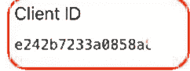

Client secrets

**图 5-5. GitHub OAuth 注册，第 2 页**

要启用 Spring Security 中的 OAuth 支持，你需要添加 `spring-boot-starter-oauth2-client` 依赖；这将引入必要的 Spring Security 和 OAuth 依赖。请参见代码列表 5-27。

**代码列表 5-27. Spring Security OAuth2 Client Starter 依赖**

```xml
<dependency>
  <groupId>org.springframework.boot</groupId>
  <artifactId>spring-boot-starter-oauth2-client</artifactId>
</dependency>
```

现在，Spring Boot 中的此依赖将自动检测类，并在提供正确配置时设置 OAuth2 身份验证。要配置它，我们需要为 Spring Security 提供来自 GitHub 应用程序的 `clientId` 和 `secret`。请参见代码列表 5-28。

**代码列表 5-28. Spring Security OAuth2 Client 配置**

```yaml
spring:
  security:
    oauth2:
      client:
        registration:
          github:
            client-id: <clientId-from-Github>
            client-secret: <secret-from-Github>
```

这里的一个部分是配置中的 `github` 名称。Spring Security 会为某些提供者自动配置适当的 URL，GitHub 就是其中之一。开箱支持的提供者有 GitHub、Google、Facebook 和 Okta。对于这些提供者，会自动设置 `authorizationUri`。这是你被重定向进行身份验证的 URL。

如果需要，可以完全自定义从 OAuth 提供者检索的 URL。默认设置足够。

现在启动应用程序并尝试访问 `http://localhost:8080/books`，你将被重定向到 GitHub 并被登录（如果尚未登录）以及允许之前注册的应用程序。如果允许，将被重定向到应用程序并看到书籍列表。

## 加密密码

到目前为止，你一直在使用明文密码存储用户信息。但这种方法容易受到攻击，因此你应该在存储之前对密码进行加密。Spring Security 支持多种加密密码的算法。例如，你可以选择单向哈希 `BCrypt` 来加密你的密码。

> 你可能需要一个助手来计算 `BCrypt` 哈希值。你可以在线完成，例如 `https://www.dailycred.com/article/bcrypt-calculator`，或者简单地创建一个使用 `BCryptPasswordEncoder` 的类。

# 第 5 章：SPRING SECURITY

当然，你必须在数据库中存储加密密码而非明文密码，如表 5-7 所示。为了存储密码字段的 `BCrypt` 哈希值，该字段的长度必须至少为 68 个字符（即哈希长度加上加密类型 `{bcrypt}`）。

**表 5-7. USERS 表中加密密码的用户数据**

| USERNAME | PASSWORD | ENABLED |
| --- | --- | --- |
| admin@ya2do.io | `{bcrypt}$2a$10E3mPTZb50e7sW15fDx8eNe7hZDpfDjrmM1PTTTUp8bWjLtU.G50PYCO` | 1 |
| marten@ya2do.io | `{bcrypt}$2a$10oS5VwqjoMyNFRTTmbCRZT.i3W8ny27kQuUL9PK1/WJpcBCFWO` | 1 |
| jdoe@does.net | `{bcrypt}$2a$10cFKho.XCUOA9L.in5mII02q8.6ufQSwIC.AVz26WcthSW6` | 0 |

### 表 5-8. Spring Security 内置表达式

| 表达式 | 描述 |
| --- | --- |
| `hasRole('role')` or `hasAuthority('authority')` | 如果当前用户拥有指定的角色，则返回 true |
| `hasAnyRole('role1','role2')` or `hasAnyAuthority('auth1','auth2')` | 如果当前用户拥有给定的角色至少一个，则返回 true |
| `hasIpAddress('ip-address')` | 如果当前用户拥有指定的 IP 地址，则返回 true |
| `principal` | 当前用户 |
| `authentication` | 访问 Spring Security 认证对象 |
| `permitAll()` | 始终评估为 true |
| `denyAll()` | 始终评估为 false |
| `isAnonymous()` | 如果当前用户是匿名用户，则返回 true |
| `isRememberMe()` | 如果当前用户通过“记住我”功能登录，则返回 true |
| `isAuthenticated()` | 如果该用户不是匿名用户，则返回 true |
| `isFullyAuthenticated()` | 如果用户不是匿名用户或记住我用户，则返回 true |
| `access()` | 使用函数确定是否允许访问 |

> 虽然角色（role）和权限（authority）几乎相同，但在处理方式上存在细微但重要的区别。当传入角色值时，会检查它是否以 `ROLE_`（默认前缀）开头。如果不是，会在检查权限之前添加该前缀。因此，`hasRole('ADMIN')` 实际上会检查当前用户是否拥有权限 `ROLE_ADMIN`。使用 `hasAuthority` 时，它将按原样检查值。

如果有人拥有 `ADMIN` 角色或在本地机器上登录，之前的表达式将允许删除书籍。在定义匹配器时，可以通过 `access` 方法而不是 `has*` 方法来编写此类表达式。参见列表 5-29。

### 列表 5-29. 使用访问规则的 Spring Security

## 使用表达式通过 Spring Bean 进行访问控制决策

在表达式中使用 `@` 语法，你可以调用应用程序上下文中的任何 bean。因此，你可以编写类似 `@accessChecker.hasLocalAccess(authentication)` 的表达式，并提供一个名为 `AccessChecker` 的 bean，该 bean 有一个接收 `Authentication` 对象的 `hasLocalAccess` 方法。参见列表 5-30。

### 列表 5-30. AccessCheckerSource

```java
package com.apress.springbootrecipes.library.security;

import org.springframework.security.core.Authentication;
import org.springframework.security.web.authentication.WebAuthenticationDetails;
import org.springframework.stereotype.Component;

@Component
public final class AccessChecker {

    public boolean hasLocalAccess(Authentication auth) {
        boolean access = false;
        if (auth.getDetails() instanceof WebAuthenticationDetails details) {
            String address = details.getRemoteAddress();
            access = address.equals("127.0.0.1") || address.equals("0:0:0:0:0:0:0:0:1");
        }
        return access;
    }
}
```

接下来，你可以使用 SpEL 在访问方法中使用此 `AccessChecker`。参见列表 5-31。

**列表 5-31. 使用 AccessChecker 使用访问规则的 Spring Security**

```java
@Bean
public SecurityFilterChain securityFilterChain(HttpSecurity http) throws Exception {
    http
        .authorizeRequests()
        .requestMatchers(HttpMethod.GET, "/books*").hasAnyRole("USER", "GUEST")
        .requestMatchers(HttpMethod.POST, "/books*").hasRole("USER")
        .requestMatchers(HttpMethod.DELETE, "/books*")
        .access("hasRole('ADMIN') or @accessChecker.hasLocalAccess(authentication)");
    return http.build();
}
```

## 使用注解和表达式保护安全方法

你可以使用 `@PreAuthorize` 和 `@PostAuthorize` 注解来保护方法调用，而不仅仅是保护 URL。通过这些注解，你可以像编写基于 URL 的安全一样编写基于安全的表达式。要启用注解处理，请在安全配置中添加 `@EnableMethodSecurity` 注解。参见列表 5-32。

### 列表 5-32. 带方法安全的安全配置

```java
@Configuration
@EnableMethodSecurity
public class LibrarySecurityConfig implements WebMvcConfigurer {
}
```

现在你可以使用 `@PreAuthorize` 注解来保护你的应用程序。列表 5-33。

### 列表 5-33. 带有授权规则的 InMemoryBookService

```java
package com.app.spring3recipes.library;

import org.springframework.security.access.prepost.PreAuthorize;
import org.springframework.stereotype.Service;
import java.util.Map;
import java.util.Optional;
import java.util.concurrent.ConcurrentHashMap;

@Service
class InMemoryBookService {
    private final Map<String, Book> books = new ConcurrentHashMap<>();

    @PreAuthorize("isAuthenticated()")
    public Iterable<Book> findAll() {
        return books.values();
    }

    @PreAuthorize("hasRole('USER')")
    public void create(Book book) {
        books.put(book.getId(), book);
    }

    @PreAuthorize("hasRole('ADMIN') or @accessChecker.hasLocalAccess(authentication)")
    public void remove(String isbn) {
        books.remove(isbn);
    }
}
```

# 5. 为 WebFlux 应用添加安全性

### 问题
你有一个 WebFlux 应用，并想使用 Spring Security 对其进行保护。

### 解决方案
在为 WebFlux 应用添加 Spring Security 时，其本质上与 Spring MVC 不同。

### 列表 5-34. Spring Security 依赖

```xml
<dependency>
    <groupId>org.springframework.boot</groupId>
    <artifactId>spring-boot-starter-security</artifactId>
</dependency>
```

### 工作原理
要启用安全性，添加 `spring-boot-starter-security` 依赖会向包中添加一些类。Spring Boot 会自动配置安全性，包含：
- 使用 Basic 认证和表单登录
- 用于安全的 HTTP 头部
- 任何资源的登录要求

`@EnableWebSecurity` 注解会导入默认配置。SpringFlux 应用努力使其变得更简单。参见第 5 章。

## 5-5. Spring Security WebFlux 应用本质上与 Spring MVC 不同。尽管如此，Spring Boot 努力让构建安全的 WebFlux 应用变得更简单。

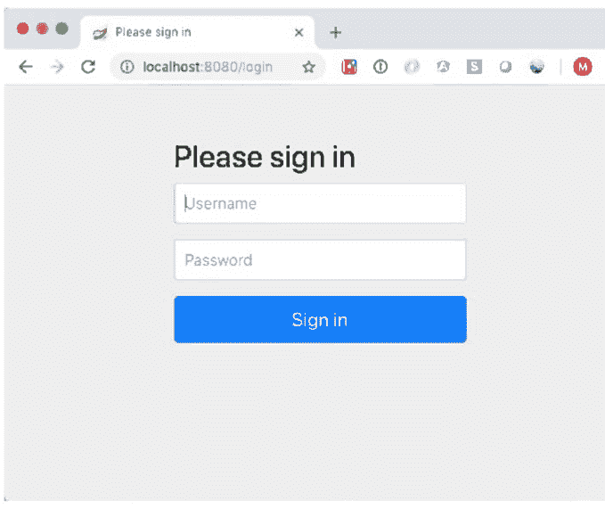

**图 5-7. 默认登录页面**

## 安全访问

可以通过添加自定义的 `SecurityWebFilterChain` 来配置访问规则。首先，让我们创建一个 `OrdersSecurityConfiguration`。参见列表 5-35。

### 列表 5-35. 用于 WebFlux 的 Spring Security 配置

```java
@Configuration
@EnableWebFluxSecurity
public class OrdersSecurityConfiguration {

    @Bean
    public SecurityWebFilterChain springWebFilterChain(HttpSecurity http) {
        http
            .formLogin(Customizer.withDefaults())
            .headers(Customizer.withDefaults())
            .logout(Customizer.withDefaults())
            .csrf(Customizer.withDefaults());
        return http.build();
    }
}
```

Spring Security 中的 `WebFluxSecurityConfiguration` 类会检测 `SecurityWebFilterChain`（包含安全配置）的实例，该实例被封装为 `WebFilter`，然后被 WebFlux 用于为传入的请求添加行为（就像普通过滤器一样）。`WebFluxSecurityConfiguration` 是通过 `@EnableWebFluxSecurity` 注解引入的（该注解也由 Spring Boot 提供/启用）。

目前配置仅启用了安全；让我们添加一些安全规则。参见列表 5-36。

### 列表 5-36. 带有访问规则的用于 WebFlux Spring Security 配置

```java
@Configuration
@EnableWebFluxSecurity
public class OrdersSecurityConfiguration {

    @Bean
    public SecurityWebFilterChain springWebFilterChain(ServerHttpSecurity http) {
        http
            .formLogin(Customizer.withDefaults())
            .headers(Customizer.withDefaults())
            .logout(Customizer.withDefaults())
            .csrf(Customizer.withDefaults());
        http
            .authorizeExchange((auth) -> auth
                .pathMatchers("/").permitAll()
                .pathMatchers("/orders*").hasRole("USER")
                .anyExchange().authenticated());
        return http.build();
    }
}
```


`ServerHttpSecurity` 看起来很熟悉（参见本章中的其他配方），用于添加安全规则和进一步配置（例如添加/删除标头以及配置登录方法）。通过 `authorizeExchange`，可以编写规则；在这里我们保护了 URL。`/` 允许所有人访问，而 `/orders` URL 仅对 `USER` 角色可用。对于其他请求，你至少经过身份验证。最后，你需要调用 `build()` 来实际构建并返回 `SecurityWebFilterChain`。

除了 `authorizeExchange` 之外，还可以使用 `headers()` 配置方法向请求添加安全标头，使用 `csrf()` 添加 CSRF 保护等。

## 登录 WebFlux 应用程序

你可以通过显式配置来覆盖默认配置的部分，并可以覆盖使用的身份验证管理器以及存储安全上下文的存储库。身份验证管理器是自动检测的；你只需要注册一个类型为 `ReactiveAuthenticationManager` 或 `UserDetailsRepository` 的 Bean 即可。

你还可以通过配置 `ServerSecurityContextRepository` 来配置 `SecurityContext` 的存储位置。默认实现使用的是 `WebSessionSecurityContextRepository`，它将上下文存储在 `WebSession` 中。另一个默认实现是 `NoopServerSecurityContextRepository`，用于无状态应用程序。参见列表 5-37。

### 列表 5-37. Spring Security 配置

```java
@Bean
SecurityWebFilterChain springWebFilterChain(ServerHttpSecurity http) throws Exception {
    return http
        .formLogin(new CustomReactiveAuthenticationManager())
        .securityContextRepository(new NoopServerSecurityContextRepository())
        .build();
}
```

这将用 `CustomReactiveAuthenticationManager` 和无状态的 `NoopServerSecurityContextRepository` 默认值。然而，对于我们的应用程序，我们将保持默认设置。

## 身份验证用户

在基于 Spring WebFlux 的应用程序中，身份验证是通过 `ReactiveAuthenticationManager` 接口完成的。这是一个包含单个 `authenticate` 方法的接口。你可以提供自己的实现，也可以使用提供的实现之一。第一个是 `UserRepositoryReactiveAuthenticationManager`，它封装了 `ReactiveUserDetailsService` 的实例。

> `ReactiveUserDetailsService` 只有一个实现 `MapReactiveUserDetailsService`，它是一个内存实现。你可以根据响应式数据存储（如 MongoDB 或 Couchbase）提供自己的实现。

作为另一种实现，`ReactiveAuthenticationManagerAdapter` 实际上是普通 `AuthenticationManager` 的包装器。它会封装一个普通实例，因此你可以以响应式的方式使用阻塞实现。这并不会让它们变成响应式的；它们仍然是阻塞的，但可以通过这种方式复用。你也可以为你的响应式应用程序使用 JDBC、LDAP 等。

在 Spring WebFlux 应用程序中配置 Spring Security 时，你可以在 Java 配置类中添加 `ReactiveAuthenticationManager` 实例，或添加 `ReactiveUserDetailsService`。当检测到后者时，它将自动封装在 `UserReactiveAuthenticationManager` 中。参见列表 5-38。

### 列表 5-38. 响应式内存用户服务

```java
@Bean
public MapReactiveUserDetailsService userDetailsService() {
    var marten = User.withDefaultPasswordEncoder()
        .username("marten").password("secret").roles("USER").build();
    var admin = User.withDefaultPasswordEncoder()
        .username("admin").password("admin").roles("USER", "ADMIN").build();
    return new MapReactiveUserDetailsService(marten, admin);
}
```

现在当你运行应用程序时，你可以自由访问 `/` 页面，但当访问以 `/orders` 开头的 URL 时，将看到登录表单（见图 5-7）。当输入预定义用户之一凭据时，你应该被允许访问请求的 URL。

## 做出访问控制决策

表 5-9 显示了用于访问控制决策的内置表达式。参见列表 5-39。

### 表 5-9. Spring Security WebFlux 内置表达式

| 表达式 | 描述 |
| --- | --- |
| `hasRole('role')` or `hasAuthority('authority')` | 如果当前用户拥有给定角色则返回 true |
| `permitAll()` | 始终评估为 true |
| `denyAll()` | 始终评估为 false |
| `authenticated()` | 如果用户已身份验证则返回 true |
| `access()` | 使用函数确定是否允许访问 |

> 虽然角色（role）和权限（authority）几乎相同，但在处理方式上存在细微但重要的区别。使用 `hasRole` 时，将检查传入的角色值是否以 `ROLE_`（默认角色前缀）开头。如果没有，会在检查权限之前添加它。因此，`hasRole('ADMIN')` 实际上会检查当前用户是否拥有权限 `ROLE_ADMIN`。当使用 `hasAuthority` 时，它将原样检查该值。

### 列表 5-39. Spring Security 自定义安全规则

```java
@Bean
public SecurityWebFilterChain springWebFilterChain(HttpSecurity http) {
  http
    .authorizeExchange((auth) -> auth
      .pathMatchers("/").permitAll()
      .pathMatchers("/orders*").access(this::ordersAllowed)
      .anyExchange().authenticated());
  return http.build();
}

private Mono<AuthorizationDecision> ordersAllowed(Mono<Authentication> authentication, AuthorizationContext context) {
  return authentication
    .map(a -> a.getAuthorities().contains(new SimpleGrantedAuthority("ROLE_ADMIN")))
    .map(AuthorizationDecision::new);
}
```

Spring Security 支持多种用户身份验证方式，并为它们提供了内置的程序实现。例如，它支持针对内存定义、关系型数据库和 LDAP 存储库进行用户验证。你应该始终在用户存储库中存储加密密码，因为明文密码容易受到黑客攻击。Spring Security 还支持本地缓存详情，以减少执行远程查询的开销。

用户是否允许访问特定资源的决策由访问决策管理器做出。Spring Security 带有基于投票法的访问决策管理器。它们都要求配置一组投票者对访问控制决策进行投票。

Spring Security 允许你以声明式的方式保护方法调用，这可以通过在 Bean 定义中嵌入安全拦截器，或者通过切面切点表达式或注解匹配多个方法来实现。Spring Security 还允许你在 JSP 视图中显示用户的身份验证信息，并根据用户的权限条件地渲染视图。

Spring Security 提供了一个 ACL 模块，允许每个领域对象拥有一个 ACL 来控制访问。你可以使用 Spring Security 的高性能 API（通过 JDBC 实现）来读取和维护每个领域对象的 ACL。Spring Security 还提供了访问决策投票者和 JSP 标签等设施，供你与其他安全设施一致地使用 ACL。

Spring Security 还支持保护基于 Spring WebFlux 的应用程序，你已经探索了如何为此类应用程序添加安全性。

# 第 6 章

## 数据访问

大多数应用程序使用关系型数据库，如 Oracle、MySQL、PostgreSQL，然而，数据存储不仅仅是 SQL 数据库。还有以下类型：

- 文档存储（MongoDB, Couchbase）
- 键值存储（Redis, Voldemort）
- 列存储（Cassandra）
- 图存储（Neo4j, Apache Giraph）

这些技术中的每一种（即使是它们不同的实现）都有它们自己的用途。它们可能难以使用或配置，但 Spring Boot 让它们的配置和使用变得更加简单。Spring Boot 使用自动配置，它会检测是否正在使用数据存储（通过检测驱动程序）并对其应用相应的配置。为了方便使用这些技术，Spring Boot 利用了 Spring Data 项目。

> 尽管每个章节使用了不同的持久化存储，但 bin 目录包含了为每个持久化存储设置 Docker 容器的脚本。

Spring Data 项目可以让生活变得更容易；它可以帮助通过少量代码配置不同的技术。每个集成模块将支持将异常翻译为 Spring 一致的 `DataAccessException` 层次结构，并能够使用 Spring 的模板方法。Spring Data 还为某些技术提供了跨存储解决方案，这使得你的模型部分可以使用 JPA 存储在关系型数据库中，另一部分可以存储在图或文档存储中。

## 6-1. 配置数据源

在与关系型数据库工作时，首先你需要与数据库的连接。Java 连接通过 `javax.sql.DataSource` 获取。Spring 提供了若干种开箱即用的 `DataSource` 实现，如 `DriverManagerDataSource` 和 `SimpleDriverDataSource`。然而，这些实现并不是连接池，应主要考虑测试使用，而不是生产使用。对于实时系统，你应该使用适当的连接池，如 `HikariCP`。

### 问题

你需要应用程序中访问数据库。

### 解决方案

使用 `spring.datasource.url`、`spring.datasource.username` 和 `spring.datasource.password` 属性让 Spring Boot 配置 `DataSource` 实例。

### 工作原理

要配置 `DataSource` 实例，Spring Boot 要求存在如 `HikariCP` 这样的连接池、JDBC 驱动程序或如 H2、HSQLDB 或 Derby 等嵌入数据库。Spring Boot 会自动检测 `HikariCP`、Tomcat JDBC 和基于 Commons DBCP2 的连接池。要使用连接池，请配置 `spring.datasource.url`、`spring.datasource.username` 和 `spring.datasource.password` 属性（你需要设置的最少属性）。通过添加 `spring-boot-starter-jdbc` 依赖启用 JDBC 支持（参见列表 6-1）。这将引入运行 JDBC 所需的依赖。

#### 列表 6-1. Spring Boot JDBC Starter 依赖

```xml
<dependency>
  <groupId>org.springframework.boot</groupId>
  <artifactId>spring-boot-starter-jdbc</artifactId>
</dependency>
```

包含的依赖有 `spring-jdbc`、`spring-tx` 以及作为默认连接池的 `HikariCP`。

### 使用嵌入式数据源

当 Spring Boot 检测到 H2、HSQLDB 或 Derby 环境时，它将默认使用检测到的嵌入式实现启动嵌入式数据库。这在编写测试或准备演示时非常有用。让 Spring Boot 创建此内容只需包含所需的依赖即可（参见列表 6-2）。

#### 列表 6-2. 用于嵌入式服务器的 Apache Derby 依赖

```xml
<dependency>
  <groupId>org.apache.derby</groupId>
  <artifactId>derby</artifactId>
  <scope>runtime</scope>
</dependency>
<dependency>
  <groupId>org.apache.derby</groupId>
  <artifactId>derbytools</artifactId>
  <scope>runtime</scope>
</dependency>
```

Spring Boot 现在将检测 Derby 并引导一个嵌入式 `DataSource` 实例。让我们写一个列出数据库中表的应用程序（参见列表 6-3）。

#### 列表 6-3. 带有 TableLister 的 Spring Boot

```java
package com.app.springboot3recipes.jdbc;

import javax.sql.DataSource;
import org.slf4j.Logger;
import org.slf4j.LoggerFactory;
import org.springframework.boot.ApplicationArguments;
import org.springframework.boot.ApplicationRunner;
import org.springframework.boot.SpringApplication;
import org.springframework.boot.autoconfigure.SpringBootApplication;
import org.springframework.stereotype.Component;

@SpringBootApplication
public class JdbcApplication {
    public static void main(String[] args) {
        SpringApplication.run(JdbcApplication.class, args);
    }
}

@Component
class TableLister implements ApplicationRunner {
    private final Logger logger = LoggerFactory.getLogger(getClass());
    private final DataSource dataSource;

    TableLister(DataSource dataSource) {
        this.dataSource = dataSource;
    }

    @Override
    public void run(ApplicationArguments args) throws Exception {
        try (var con = dataSource.getConnection()) {
            var rs = con.getMetaData().getTables(null, null, "%", null);
            while (rs.next()) {
                logger.info("{}", rs.getString(3));
            }
        }
    }
}
```

当应用程序运行时，它将创建一个 `TableLister` 实例，该实例将接收配置好的 `DataSource`。Spring Boot 随后会检测它是一个 `ApplicationRunner` 并调用 `run` 方法。该方法从 `DataSource` 获取 `Connection` 并使用 `DatabaseMetaData` 获取数据库中的表。现在运行应用程序时，它应该显示与图 6-1 类似的输出。

图 6-1. Derby 的表输出

### 使用外部数据库

要连接数据库，你需要 JDBC 驱动程序。本教程使用 PostgreSQL，因此你需要包含此数据库的驱动程序（列表 6-4）。

#### 列表 6-4. PostgreSQL 依赖

```xml
<dependency>
  <groupId>org.postgresql</groupId>
  <artifactId>postgresql</artifactId>
</dependency>
```

配置单个数据源只需在 `application.properties` 文件中包含属性（列表 6-5）。

#### 列表 6-5. 数据源属性连接 PostgreSQL 数据库


# 第六章 数据访问

```properties
spring.datasource.url=jdbc:postgresql://localhost:5432/customers
spring.datasource.username=customers
spring.datasource.password=customers
```

`spring.datasource.url` 实例初始化连接的连接池，而 `spring.datasource.username` 和 `spring.datasource.password` 配置连接时使用的用户名和密码。你也可以使用 `spring.datasource.driver-class-name` 用于指定要使用的 JDBC 驱动类。通常情况下，Spring Boot 会从传入的 URL 中自动检测要使用的驱动程序。如果你想使用非默认驱动（为了性能或日志记录），也可以指定此项。

运行 `JdbcApplication` 时，输出应该像图 6-2 所示（与 Derby 相比）。

| 时间 | 级别 | 线程 | 来源 | 消息 | |
|---|---|---|---|---|---|
| 2018-09-10 15:30:711 | INFO 19241 | main | c.axxer.Hikarisource | HikariPool-1 - Starting... | |
| 2018-09-10 15:39:996 | INFO 19241 | main | c.axxer.Hikarisource | HikariPool-1 - Started successfully. | |
| 2018-09-10 15:39:812 | INFO 19241 | main | c.springboot2recipes.Jdbc.Tablelist | pg_foreign_index | |
| 2018-09-10 15:39:812 | INFO 19241 | main | c.springboot2recipes.Jdbc.Tablelist | pg_me_name_index | |
| 2018-09-10 15:39:812 | INFO 19241 | main | c.springboot2recipes.Jdbc.Tablelist | pg_amop_oid_index | |
| 2018-09-10 15:39:812 | INFO 19241 | main | c.springboot2recipes.Jdbc.Tablelist | pg_attr_oid_index | |
| 2018-09-10 15:39:812 | INFO 19241 | main | c.springboot2recipes.Jdbc.Tablelist | pg_amop_main_index | |
| 2018-09-10 15:39:812 | INFO 19241 | main | c.springboot2recipes.Jdbc.Tablelist | pg_amproc_util_index | |
| 2018-09-10 15:39:812 | INFO 19241 | main | c.springboot2recipes.Jdbc.Tablelist | pg_attribute_member_relation | |
| 2018-09-10 15:39:812 | INFO 19241 | main | c.springboot2recipes.Jdbc.Tablelist | pg_attribute_proc_index | |
| 2018-09-10 15:39:812 | INFO 19241 | main | c.springboot2recipes.Jdbc.Tablelist | pg_attr_id_rel_index | |
| 2018-09-10 15:39:812 | INFO 19241 | main | c.springboot2recipes.Jdbc.Tablelist | pg_attribute_relation | |
| 2018-09-10 15:39:812 | INFO 19241 | main | c.springboot2recipes.Jdbc.Tablelist | pg_auth_member_relation | |
| 2018-09-10 15:39:812 | INFO 19241 | main | c.springboot2recipes.Jdbc.Tablelist | pg_auth_id | |
| 2018-09-10 15:39:812 | INFO 19241 | main | c.springboot2recipes.Jdbc.Tablelist | pg_auth_uid | |
| 2018-09-10 15:39:812 | INFO 19241 | main | c.springboot2recipes.Jdbc.Tablelist | pg_class_relation | |
| 2018-09-10 15:39:812 | INFO 19241 | main | c.springboot2recipes.Jdbc.Tablelist | pg_class_target | |
| 2018-09-10 15:39:812 | INFO 19241 | main | c.springboot2recipes.Jdbc.Tablelist | pg_class_oid | |
| 2018-09-10 15:39:812 | INFO 19241 | main | c.springboot2recipes.Jdbc.Tablelist | pg_class_relname_index | |
| 2018-09-10 15:39:812 | INFO 19241 | main | c.springboot2recipes.Jdbc.Tablelist | pg_class_type | |
| 2018-09-10 15:39:812 | INFO 19241 | main | c.springboot2recipes.Jdbc.Tablelist | pg_class_relname_index | |
| 2018-09-10 15:39:812 | INFO 19241 | main | c.springboot2recipes.Jdbc.Tablelist | pg_collection_index | |

> 图 6-2. PostgreSQL 的输出

## 从 JNDI 获取 DataSource

如果你将 Spring Boot 应用部署到应用服务器（或你有一个远程 JNDI 服务器）并想要一个预先配置的 `DataSource` 实例，可以使用 `spring.datasource.jndi-name` 属性让 Spring Boot 从 JNDI 获取 `DataSource`（参见列表 6-6）。

### 列表 6-6. DataSource JNDI 查找

```properties
spring.datasource.jndi-name=jdbc:customers
```

## 配置连接池

Spring Boot 默认使用的连接池是 HikariCP。在包含 `spring-starter-jdbc` 依赖（或其他数据库相关的依赖项）时，它会自动引入。Spring Boot 会使用一些默认设置配置连接池；但是，你可能想要覆盖这些设置（增加或减少连接数、设置超时时间等）。HikariCP 的配置选项位于 `spring.datasource.hikari` 命名空间下（参见表 6-1）。

### 表 6-1. HikariCP 配置设置

| 属性 | 说明 |
|---|---|
| `spring.datasource.hikari.connection-timeout` | 设置等待连接的最大毫秒数。 |
| `spring.datasource.hikari.leak-detection-threshold` | 设置连接泄漏检测阈值的毫秒数。 |
| `spring.datasource.hikari.idle-timeout` | 设置连接空闲的最大毫秒数。 |
| `spring.datasource.hikari.test-query` | 用于测试连接有效性的 SQL 查询。 |
| `spring.datasource.hikari.maximum-pool-size` | 设置连接池的大小。 |
| `spring.datasource.hikari.minimum-idle` | 设置池中的最小空闲连接数。 |
| `spring.datasource.hikari.name` | 设置连接池的名称。 |

`spring.datasource.hikari` 命名空间下还有更多配置选项。

`spring.datasource.hikari` 命名空间下可以配置属性，默认值为 10 秒。

Tomcat 的属性位于 `spring.datasource.tomcat` 命名空间以及 `spring.datasource.dbcp2`。

### 列表 6-7. Hikari 附加属性

```properties
spring.datasource.hikari.maximum-pool-size=5
spring.datasource.hikari.minimum-idle=2
spring.datasource.hikari.leak-detection-threshold=20
```

此配置将最大连接数设置为 5，最小空闲连接数设置为 2。

## 6-2. 使用 Spring Boot 管理数据库架构

### 问题

当你与现有数据库工作时，你可能已经有了表、视图。但当你创建一个新数据库时，它是空的，你需要手动创建表。

### 解决方案

Spring Boot 内置了简单的数据库管理功能，同时也支持 Flyway 和 Liquibase。

### 工作原理

当你与现有数据库工作时，你可能已经有了表、视图。但当你创建一个新数据库时，它是空的，你需要手动创建表。Spring Boot 支持这一点。

使用 Derby，你可以添加一个 schema 文件来初始化架构。架构和数据文件名可以通过 `spring.sql.init.schema-locations` 和 `spring.sql.init.data-locations` 属性进行更改。

### 表 6-2. 数据源初始化属性

| 属性 | 说明 |
|---|---|
| `spring.sql.init.continue-on-error` | 设置初始化数据库时发生错误是否停止；默认值为 false。 |
| `spring.sql.init.data-locations` | 设置数据（DML）脚本的引用；默认是 `classpath:data.sql`。 |
| `spring.sql.init.password` | 设置执行 DML 脚本的密码；默认为普通密码。 |
| `spring.sql.init.username` | 设置执行 DML 脚本的用户名；默认为普通用户名。 |
| `spring.sql.init.mode` | 使用可用的 DDL 和 DML 脚本初始化数据源。默认值为 EMBEDDED，可以更改为 NEVER 或 ALWAYS。 |
| `spring.sql.init.platform` | 设置在 DDL 或 DML 脚本中使用的平台（例如 `schema-${platform}.sql` 或 `data-${platform}.sql`）。默认值是 `all`。 |
| `spring.sql.init.schema-locations` | 设置架构（DDL）脚本的引用；默认是 `classpath:schema.sql`。 |
| `spring.sql.init.separator` | 设置 SQL 初始化脚本中的语句分隔符。默认是 `;`。 |
| `spring.sql.init.encoding` | 设置 SQL 脚本的编码。默认平台编码。 |

### 列表 6-8. Customer表 DDL

```sql
DROP TABLE IF EXISTS customer;

CREATE TABLE customer (
  id SERIAL PRIMARY KEY,
  name VARCHAR(100) NOT NULL,
  email VARCHAR(255) NOT NULL,
  UNIQUE (name)
);
```

要插入数据，请将 `data.sql` 文件添加到 `src/main/resources` 目录（列表 6-9）。

### 列表 6-9. 客户数据初始化 SQL (name, email)

```sql
INSERT INTO customer VALUES ('Marten Deinum', 'marten@deinum.biz'),
('Josh Long', 'jlong@pivotal.com'),
('John Doe', 'john.doe@island.io'),
('Jane Doe', 'jane.doe@island.io');
```

为了检查这是否有效，让我们添加另一个 `ApplicationRunner` 实例，使用 `DataSource` 实例打印 `customer` 表的内容（列表 6-10）。

### 列表 6-10. CustomerLister

```java
@Component
class CustomerLister implements ApplicationRunner {

  private final Logger logger = LoggerFactory.getLogger(getClass());
  private final DataSource dataSource;

  CustomerLister(DataSource dataSource) {
    this.dataSource = dataSource;
  }

  @Override
  public void run(ApplicationArguments args) throws Exception {
    var sql = "SELECT id, name, email FROM customer";
    try (var con = dataSource.getConnection()) {
      var stmt = con.createStatement();
      var rs = stmt.executeQuery(sql);
      while (rs.next()) {
        logger.info("Customer [id={}, name={}, email={}]", rs.getLong(1), rs.getString(2), rs.getString(3));
      }
    }
  }
}
```

嵌入式数据库始终启用数据库初始化，因此当使用 Derby、H2 或 HSQLDB 时，默认会启用。当使用外部数据库时，默认不会初始化。要更改此，你可以将 `spring.sql.init.mode` 属性切换为 `always`，这样它就会始终运行（列表 6-11）。

### 列表 6-11. 为非嵌入式数据源启用数据库初始化

```properties
spring.sql.init.mode=always
```

当应用程序启动时，你将在日志中看到从数据库打印的客户列表（在表创建之前或之后，如图 6-3 所示）。

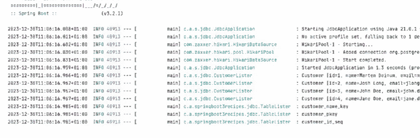

> 图 6-3. CustomerLister 输出

## 使用 Flyway 初始化数据库

在开发应用程序时，你希望对数据库迁移有更多的控制。虽然使用 `schema.sql` 和 `data.sql` 文件非常快速方便，但维护它们最终将会变得繁琐。Spring Boot 还支持 Flyway，简单来说，它是你数据库架构的版本控制工具。它允许你增量地更改/更新数据库架构。要使用 Flyway，要做的第一件事是添加对 Flyway 本身的依赖（列表 6-12）。

### 列表 6-12. Flyway 依赖

```xml
<dependency>
  <groupId>org.flydb</groupId>
  <artifactId>flyway-core</artifactId>
</dependency>
```

Spring Boot 将检测 Flyway 是否存在，并假设你想使用它来执行数据库迁移。迁移脚本应该放在 `src/main/resources` 的 `db/migration` 文件夹中。这是默认位置，可以通过在 `application.properties` 文件中指定 `spring.flyway.locations` 来更改。参见列表 6-13 用于替代 `schema.sql` 和 `data.sql` 的迁移脚本。

### 列表 6-13. Flyway 迁移脚本

```sql
CREATE TABLE customer (
  id SERIAL PRIMARY KEY,
  name VARCHAR(100) NOT NULL,
  email VARCHAR(255) NOT NULL,
  UNIQUE(name)
);

INSERT INTO customer (name, email) VALUES
('Marten Deinum', 'marten@deinum.biz'),
('Josh Long', 'jlong@pivotal.com'),
('John Doe', 'john.doe@island.io'),
('Jane Doe', 'jane.doe@island.io');
```


存放在 `db/migration` 文件夹中的 `V1__first.sql` 文件的 SQL 将在启动时执行（假设数据库为空）。默认的命名约定为 `V<sequence>_<name>.sql`，用于确定执行哪些内容。一旦脚本已执行，你就不能（也不应该）修改该脚本，否则会导致 Flyway 防止你的应用程序启动。它会检测已执行脚本中的更改。

运行应用程序时，客户应该会被列出来，你会在表列表中注意到另外一个额外的表：`flyway_schema_history`。该表包含了 Flyway 用于检测（并保护）数据库更改的元数据。

```
2018-09-10 19:57:22.714 INFO 90933 --
2018-09-10 19:57:22.714 INFO 90933 --
2018-09-10 19:57:22.714 INFO 90933 --
```

接下来，我们创建一个存储库接口来定义合约，并创建一个基于 JDBC 的实现（列表 6-16）。

## 列表 6-16. CustomerRepository 接口

```java
package com.apress.springboot3recipes.jdbc;

import java.util.List;
import java.util.Optional;

public interface CustomerRepository {

    List<Customer> findAll();

    Optional<Customer> findById(long id);

    Customer save(Customer customer);

}
```

接下来，实现类使用 `JdbcTemplate` 和 `RowMapper` 实例将结果映射到 `Customer` 对象（列表 6-17）。

## 列表 6-17. 使用 JdbcTemplate 的 CustomerRepository 实现

```java
package com.apress.springboot3recipes.jdbc;

import org.springframework.dao.EmptyResultDataAccessException;
import org.springframework.jdbc.core.JdbcTemplate;
import org.springframework.jdbc.support.GeneratedKeyHolder;
import org.springframework.stereotype.Repository;
import java.sql.ResultSet;
import java.sql.SQLException;
import java.util.List;
import java.util.Optional;
```

```java
@Repository
class JdbcCustomerRepository implements CustomerRepository {

    private static final String ALL_QUERY = "SELECT id, name, email FROM customer";
    private static final String BY_ID_QUERY = "SELECT id, name, email FROM customer WHERE id=?";
    private static final String INSERT_QUERY = "INSERT INTO customer (name, email) VALUES(?,?) RETURNING id";

    private final JdbcTemplate jdbc;

    JdbcCustomerRepository(JdbcTemplate jdbc) {
        this.jdbc = jdbc;
    }

    @Override
    public List<Customer> findAll() {
        return jdbc.query(ALL_QUERY, (rs, rowNum) -> toCustomer(rs));
    }

    @Override
    public Optional<Customer> findById(long id) {
        try {
            var customer = jdbc.queryForObject(BY_ID_QUERY, (rs, rowNum) -> toCustomer(rs), id);
            return Optional.of(customer);
        } catch (EmptyResultDataAccessException ex) {
            return Optional.empty();
        }
    }

    @Override
    public Customer save(Customer customer) {
        var keyHolder = new GeneratedKeyHolder();
        jdbc.update((con) -> {
            var ps = con.prepareStatement(INSERT_QUERY);
            ps.setString(1, customer.name());
            ps.setString(2, customer.email());
            return ps;
        }, keyHolder);
        var id = keyHolder.getKey().longValue();
        return new Customer(id, customer.name(), customer.email());
    }

    private Customer toCustomer(ResultSet rs) throws SQLException {
        var id = rs.getLong(1);
        var name = rs.getString(2);
        var email = rs.getString(3);
        return new Customer(id, name, email);
    }
}
```

`JdbcCustomerRepository` 使用 `JdbcTemplate` 和 `RowMapper`（通过 lambda 表达式）将 `ResultSet` 对象的每一行转换为 `Customer` 对象。`CustomerLister` 现在可以使用 `CustomerRepository` 从数据库中获取所有 `Customer` 记录并打印到控制台（列表 6-18）。

## 列表 6-18. 使用 CustomerRepository 的 CustomerLister

所有的 JDBC 代码已移动到 `JdbcCustomerRepository`，该类变得非常简单。它注入了一个 `CustomerRepository` 实例，并使用 `findAll` 方法获取数据库内容，为每个客户打印一行。

## 通过 JdbcClient 访问 JDBC

Spring JDBC 的一个新特性是 `JdbcClient`，它内部仍然使用 `JdbcTemplate` 或 `NamedParameterJdbcTemplate`，但提供了一种更流式的方法来执行 SQL 并映射响应。

`CustomerLister` 基于 `JdbcClient` 构建，看起来类似于列表 6-19。

## 列表 6-19. 使用 JdbcClient 的 CustomerLister

```java
@Component
class CustomerLister implements ApplicationRunner {

    private final Logger logger = LoggerFactory.getLogger(getClass());
    private final JdbcClient jdbcClient;

    CustomerLister(JdbcClient jdbcClient) {
        this.jdbcClient = jdbcClient;
    }

    @Override
    public void run(ApplicationArguments args) {
        jdbcClient.sql("SELECT id, name, email FROM customer")
            .query((rs) -> {
                logger.info("Customer [id={}, name={}, email={}]",
                    rs.getLong(1), rs.getString(2), rs.getString(3));
            });
    }
}
```

`sql` 方法用于设置要执行的 SQL 语句。使用 `param` 方法，可以在语句中设置位置参数或命名参数。`query` 方法用于执行查询并将其映射到结果。这里我们使用了接受 `RowCallbackHandler` 的 `query` 方法，就像我们使用 `JdbcTemplate` 时一样。

## 6-4. 使用 Spring Data JDBC

### 问题

你想将某些结果映射到对象，而无需编写大量的集成代码。Spring Data JDBC 提供了一种基于熟悉的 `JdbcTemplate` 的 JDBC 抽象，并会自动提供映射。

### 解决方案

将 Spring Data JDBC 作为依赖项添加到你的项目中，并使用基类创建存储库。

### 工作原理

要使用 Spring Data JDBC，首先需要向此项目添加依赖。Spring Boot 提供了 `spring-boot-starter-data-jdbc` 依赖，它将引入所有需要的依赖。

## 列表 6-20. Spring Data 依赖

```xml
<dependency>
  <groupId>org.springframework.boot</groupId>
  <artifactId>spring-boot-starter-data-jdbc</artifactId>
</dependency>
```

我们将存储并检索对象，我们需要一个 `Customer` 类。列表 6-21 再次显示了它。

## 列表 6-21. Customer

```java
package com.apress.springboot3recipes.jdbc;

import org.springframework.data.annotation.Id;

public record Customer(@Id long id, String name, String email) {}
```

与 15 相比，customer 有微小不同。我们需要用 `@Id` 标记主键。然而，显式指定 id 总是有助于代码的表达力。

最后，我们定义了一个接口（Recipe 16）并提供了实现。使用 Spring Data，我们只需要指定接口。现在 Spring Data 将动态创建存储库。

## 列表 6-22. 用于 Spring Data 的 CustomerRepository

```java
package com.apress.springboot3recipes.jdbc;

import org.springframework.data.repository.CrudRepository;

public interface CustomerRepository extends CrudRepository<Customer, Long> {
}
```

`CustomerRepository` 继承了 `CrudRepository` 且不包含方法。所有需要的方法都由 Spring Data 提供。最后，我们需要创建一个使用存储库的内容。让我们写一个 `CustomerLister`，从数据库检索所有实例并打印输出（列表 6-23）。

## 列表 6-23. 使用 CustomerRepository 的 CustomerLister

```java
@Component
class CustomerLister implements ApplicationRunner {

    private final Logger logger = LoggerFactory.getLogger(getClass());
    private final CustomerRepository customers;

    CustomerLister(CustomerRepository customers) {
        this.customers = customers;
    }

    @Override
    public void run(ApplicationArguments args) {
        customers.findAll()
            .forEach((customer) -> logger.info("{}", customer));
    }
}
```

## 6-5. 测试 JDBC

编写 JDBC 代码时，最终你想测试代码的行为是否符合预期。对于这一点，Spring Test 模块可以帮助你。它允许进行测试设置，Spring Boot 进一步扩展了它，使得数据访问代码的测试变得更容易。本食谱探索了编写 JDBC 代码测试所需的的内容。

### 问题

你想针对实际数据库测试你的 JDBC 层。

### 解决方案

使用 Spring Test 框架和 Spring Boot 测试支持使用嵌入式容器（如 Apache Derby）编写单元测试，或使用 Testcontainers 编写专门的集成测试。

### 工作原理

测试 JDBC 代码需要一个数据库，通常使用嵌入式数据库 H2、Apache Derby 或 HSQLDB 进行测试。Spring Boot 使编写 JDBC 测试变得简单。基于 JDBC 的测试可以使用 `@JdbcTest` 注解，Spring Boot 将创建一个只包含 JDBC 相关 Bean（如 `DataSource` 和事务管理器）的最小化应用程序。

### 使用嵌入式数据库测试 JDBC 代码

让我们为 `JdbcCustomerRepository` 编写测试，并使用 H2 作为嵌入式数据库。首先将 H2 作为测试依赖添加（列表 6-24）。

## 列表 6-24. 作为测试依赖的 H2

```xml
<dependency>
  <groupId>com.h2database</groupId>
  <artifactId>h2</artifactId>
  <scope>test</scope>
</dependency>
```

接下来，创建 `JdbcCustomerRepositoryTest`（列表 6-25）。

## 列表 6-25. JdbcCustomerRepositoryTest 设置

```java
@JdbcTest
@TestPropertySource(properties = "spring.flyway.enabled=false")
@Import(JdbcCustomerRepository.class)
class JdbcCustomerRepositoryTest {

    @Autowired
    private JdbcCustomerRepository repository;
}
```

`@JdbcTest` 注解通过特殊的 JUnit 扩展执行测试，以启动 Spring 测试上下文框架。`@JdbcTest` 注解会将预配置的 `DataSource` 替换为嵌入式（在本例中 H2）。由于我们需要测试仓库，因此添加了 `@Import(JdbcCustomerRepository.class)` 注解。

最后，是 `@TestPropertySource(properties = "spring.flyway.enabled=false")`，它表示我们想要禁用 Flyway。应用程序使用 Flyway 管理 schema；但这些脚本是为 PostgreSQL 编写的，而不是 H2。为了测试，我们需要禁用 Flyway 并提供基于 H2 的 `schema.sql` 来创建 schema。

这是使用与实际生产系统（PostgreSQL）不同的数据库（H2）进行测试的缺点之一。你需要维护两套 schema 脚本，或者在测试中使用与生产系统相同的数据库。

在 `src/test/resources` 中创建一个 `schema.sql` 文件并在列表 6-26 中添加 DDL 语句。

## 列表 6-26. 用于 H2 的 Customer DDL

```sql
CREATE TABLE customer (
  id BIGINT AUTO_INCREMENT PRIMARY KEY,
  name VARCHAR(100) NOT NULL,
  email VARCHAR(255) NOT NULL,
  UNIQUE(name)
);
```

编写一个测试来检查记录是否正确插入（列表 6-27）。

## 列表 6-27. 插入 Customer 测试

```java
@Test
void insertNewCustomer() {
    repository.findAll().isEmpty();
    var newCustomer = new Customer("T. Testing", "t.testing@test123.test");
    var customer = repository.save(newCustomer);
}
```


```java
assertThat(customer.id()).isNotNull();

assertThat(customer.name()).isEqualTo("T. Testing");

assertThat(customer.email()).isEqualTo("t.testing@test123.test");

assertThat(repository.findById(customer.id())).hasValue(customer);
}
```

这首先断言数据库是空的。这并不是真的要求的，但可以防止其他测试污染数据库。接下来，通过调用 `jdbcCustomerRepository` 的 `save` 方法向数据库添加一个 Customer。验证生成的 Customer 具有 ID、名称和 email 属性。最后，再次检索 Customer 并与原来的进行比较。

你可以添加的另一个测试是 `findAll` 方法。当插入两条记录时，调用 `findAll` 应该返回两条记录（列表 6-28）。

# 列表 6-28. 查询所有 Customer 测试

```java
@Test
void findAllCustomers() {
  assertThat(repository.findAll()).isEmpty();

  repository.save(new Customer("T. Testing1", "t.testing@test123.tst"));

  repository.save(new Customer("T. Testing2", "t.testing@test123.tst"));

  assertThat(repository.findAll()).hasSize(2);
}
```

可以有更多的断言，但数据保存已经在另一个测试方法中验证过了。

# 使用 Testcontainers 测试 JDBC 代码

如今更好的选择是使用 Testcontainers。Testcontainers 使用 Docker 来启动一个给定的容器。在这种情况下，我们可以使用 PostgreSQL 镜像来启动真实的数据库，并在测试中使用它。这意味着你现在可以执行想要的所有查询并对它们进行测试。它还提供了测试你的数据库迁移脚本的机会。

要使用 Testcontainers 配合 PostgreSQL，我们需要添加相应的依赖（见列表 6-29）。

# 列表 6-29. PostgreSQL 的 Testcontainers 依赖

```xml
<dependency>
  <groupId>org.springframework.boot</groupId>
  <artifactId>spring-boot-starter-test</artifactId>
</dependency>

<dependency>
  <groupId>org.testcontainers</groupId>
  <artifactId>postgresql</artifactId>
  <scope>test</scope>
</dependency>

<dependency>
  <groupId>org.testcontainers</groupId>
  <artifactId>junit-jupiter</artifactId>
  <scope>test</scope>
</dependency>
```

现在写一个测试，检查记录是否正确插入到我们真实的数据库中（见列表 6-30）。

# 列表 6-30. Testcontainers 的 JdbcCustomerRepositoryTest 设置

```java
@JdbcTest
@AutoConfigureTestDatabase(replace = AutoConfigureTestDatabase.Replace.NONE)
@Import(JdbcCustomerRepository.class)
class JdbcCustomerRepositoryTest {

  @Container
  @ServiceConnection
  static PostgreSQLContainer<?> postgres =
    new PostgreSQLContainer<>("postgres:15-alpine");
}
```

`@JdbcTest` 通过特殊的 JUnit 扩展（SpringExtension）执行测试，`@JdbcTest` 注解会将预配置的 `DataSource` 替换为嵌入式的。`@AutoConfigureTestDatabase(replace = AutoConfigureTestDatabase.Replace.NONE)` 注解阻止了这种替换，因为我们想要提供一个真实的 `DataSource`。`@Import(JdbcCustomerRepository.class)` 注解已添加。

为了注册 Testcontainers 的特殊 JUnit 扩展，添加了 `@Container` 注解。该扩展寻找标记了 `@Container` 的字段并启动给定的容器。对于此测试，我们使用 `PostgreSQLContainer`，Testcontainers 会处理该容器的下载，并在测试后停止它。

当测试运行时，提供的 Flyway 脚本会自动执行并创建 schema，并填充数据（如我们的 Flyway 脚本所示；见之前的）。

由于每个测试启动时都会使用不同的 URL，我们需要通过 `@ServiceConnection` 告诉 Spring Boot。有了它，我们可以编写一些测试（列表 6-31）。

# 列表 6-31. 使用 Testcontainers 的 JdbcCustomerRepositoryTest

```java
@Test
void insertNewCustomer() {
  var newCustomer = new Customer("T. Testing", "t.testing@test123.test");

  var customer = repository.save(newCustomer);

  assertThat(customer.id()).isNotNull();

  assertThat(customer.name()).isEqualTo("T. Testing");

  assertThat(customer.email()).isEqualTo("t.testing@test123.test");

  assertThat(repository.findById(customer.id())).hasValue(customer);
}

@Test
void findAllCustomers() {
  int count = repository.findAll().size();

  repository.save(new Customer("T. Testing1", "t.testing@test123.tst"));

  repository.save(new Customer("T. Testing2", "t.testing@test123.tst"));

  assertThat(repository.findAll()).hasSize(count + 2);
}
```

这些测试与使用嵌入式数据库的测试相似；然而，在这里我们的数据库中有些额外数据，我们需要在测试中考虑到这一点。这取决于你的数据库脚本内容。如果它生成的是空 schema，你不需要更改测试。

# 测试 Spring Data JDBC 仓库

使用 Spring Data JDBC 时，测试设置有所不同。现在不是 `@JdbcTest` 注解，而是 `@DataJdbcTest` 注解，它表示使用 Spring Data JDBC 及其测试设置。接下来，在所需的 JDBC 组件（如 `DataSource`）的设置中，它还开启了对 Spring Data JDBC 仓库的扫描。

与 `@JdbcTest` 一样，这种设置会自动尝试将现有的 `DataSource` 替换为嵌入式的。我们使用 Testcontainers 来启动数据库，需要通过添加 `@AutoConfigureTestDatabase(replace = AutoConfigureTestDatabase.Replace.NONE)` 来禁用此。

测试类看起来仍然是基于 JDBC 的测试，但区别在于注解（列表 6-32）。

# 列表 6-32. 用于 Spring Data JDBC 的 CustomerRepositoryTest

```java
@DataJdbcTest
@AutoConfigureTestDatabase(replace = AutoConfigureTestDatabase.Replace.NONE)
@Testcontainers
class JdbcCustomerRepositoryTest {

  @Container
  @ServiceConnection
  static PostgreSQLContainer<?> postgres =
    new PostgreSQLContainer<>("postgres:15-alpine");

  @Autowired
  private CustomerRepository repository;
}
```

与最初带有 Testcontainers 的 `@JdbcTest` 基本相同，不同在于我们现在使用了 `@DataJdbcTest` 注解，并且注入的是 `CustomerRepository` 而不是之前的 `JdbcCustomerRepository`。我们现在只需要接口进行测试。

## 6-6. 使用 JPA 访问数据

### 问题
你想在 Spring Boot 应用程序中使用 JPA。

### 解决方案
Spring Boot 会自动检测 Hibernate 的存在以及所需的 JPA 类。

### 工作原理
Spring Boot 通过 Hibernate 对 JPA 提供原生支持。当检测到 Hibernate 时，将使用早期的 `DataSource` 自动配置 `EntityManagerFactory` 实例。你需要向项目添加 `hibernate-core` 和 `spring-orm` 依赖。然而，向项目添加 `spring-boot-starter-data-jpa` 会更简单，尽管这也会必要的依赖引入到类路径中。

### 列表 6-33. Spring Boot 的 JPA 依赖

```xml
<dependency>
  <groupId>org.springframework.boot</groupId>
  <artifactId>spring-boot-starter-data-jpa</artifactId>
</dependency>
```

## 使用原生仓库

为了让 JPA 工作，你需要对表示实体的类进行注解。在你的系统中，我们将从数据库中存储和检索 `Customer`。我们需要将其标记为实体。此外，我们需要在字段上使用 `@Id` 来标识实体的 ID（主键）。JPA 实体类需要有一个无参构造函数。

```java
package com.apress.springboot3recipes.jpa;

import java.util.Objects;
import jakarta.persistence.Column;
import jakarta.persistence.Entity;
import jakarta.persistence.GeneratedValue;
import jakarta.persistence.GenerationType;
import jakarta.persistence.Id;

@Entity
public class Customer {

    @Id
    @GeneratedValue(strategy = GenerationType.IDENTITY)
    private Long id;

    @Column(nullable = false)
    private final String name;

    @Column(nullable = false)
    private final String email;

    public Customer() {
    }

    public Customer(String name, String email) {
        this.name = name;
        this.email = email;
    }

    public Long getId() {
        return id;
    }

    public String getName() {
        return name;
    }

    public String getEmail() {
        return email;
    }

    @Override
    public boolean equals(Object o) {
        if (this == o) return true;
        if (o instanceof Customer other) {
            return Objects.equals(id, other.id);
        }
        return false;
    }

    @Override
    public int hashCode() {
        return getClass().hashCode();
    }

    @Override
    public String toString() {
        return String.format("Customer[id=%d, name='%s', email='%s']", id, name, email);
    }
}
```

接下来，创建 `CustomerRepository` 的 JPA 实现。为了获取 `EntityManager`，你声明一个字段并使用 `@PersistenceContext` 进行注解。

### 列表 6-34. 基于 JPA 的 CustomerRepository

```java
package com.apress.springboot3recipes.jpa;

import org.springframework.stereotype.Repository;
import java.util.List;
import java.util.Optional;
import jakarta.persistence.EntityManager;
import jakarta.persistence.PersistenceContext;

@Repository
class JpaCustomerRepository implements CustomerRepository {

    @PersistenceContext
    private EntityManager em;

    @Override
    public List<Customer> findAll() {
        return em.createQuery("SELECT c FROM Customer c", Customer.class).getResultList();
    }

    @Override
    public Optional<Customer> findById(long id) {
        var customer = em.find(Customer.class, id);
        return Optional.ofNullable(customer);
    }

    @Override
    public Customer save(Customer customer) {
        em.persist(customer);
        return customer;
    }
}
```

接下来的 `CustomerLister` 将从数据库读取所有的 `Customer` 记录并将它们打印到日志中。

### 列表 6-35. 基于 JPA 的 CustomerLister

```java
@Component
class CustomerLister implements ApplicationRunner {

    private final Logger logger = LoggerFactory.getLogger(getClass());
    private final CustomerRepository customers;

    CustomerLister(CustomerRepository customers) {
        this.customers = customers;
    }

    @Override
    public void run(ApplicationArguments args) {
        customers.findAll()
            .forEach((customer) -> logger.info("{}", customer));
    }
}
```


# 数据访问配置与测试

## JPA 配置属性

有一些配置选项可以在应用程序中配置 `EntityManagerFactory`。这些属性可以在 `spring.jpa` 命名空间中找到。

### 表 6-4. JPA 属性

| 属性 | 说明 |
| --- | --- |
| `spring.jpa.database` | 设置要操作的目标数据库；默认自动检测。 |
| `spring.jpa.database-platform` | 设置要操作的目标数据库的名称；默认自动检测。这可以用于指定使用的特定 Hibernate 方言 (`Dialect`)。 |
| `spring.jpa.generate-ddl` | 在启动时初始化架构；默认为 `false`。 |
| `spring.jpa.show-sql` | 启用 SQL 语句的日志；默认为 `false`。 |
| `spring.jpa.open-in-view` | 默认注册 `OpenSessionInViewFilter`。 |
| `spring.jpa.hibernate.ddl-auto` | 设置 DDL 策略（`create`、`update`、`validate` 等）。 |
| `spring.jpa.hibernate.format_sql` | 格式化 SQL 输出。 |

### 列表 6-36. Hibernate 示例 JPA 属性

```properties
spring.jpa.properties.hibernate.fetch_size=250
spring.jpa.properties.hibernate.batch_size=50
```

## 使用 Spring Data 仓库

与其自己编写仓库（这是一项乏味且重复的任务），你也可以让 Spring Data JPA 为你完成大部分工作。通过扩展 `CrudRepository` 接口，你可以在运行时获得一个仓库实例。这节省了你编写手动数据访问代码的时间。

### 列表 6-37. 基于 Spring Data JPA 的 CustomerRepository

```java
package com.apress.springboot3recipes.jpa;

import org.springframework.data.repository.CrudRepository;

public interface CustomerRepository extends CrudRepository<Customer, Long> {

}
```

## 不同包中的实体

默认情况下，Spring Boot 会从带有 `@SpringBootApplication` 注解的类包开始检测组件、仓库和实体。但如果你在不同的包中也有需要包含的实体怎么办？你可以使用 `@EntityScan` 注解；它的作用类似于 `@ComponentScan`，但针对的是 `@Entity`。

### 列表 6-38. Order 实体

```java
package com.apress.springboot3recipes.order;

import jakarta.persistence.Entity;
import jakarta.persistence.Id;

@Entity
public class Order {

    @Id
    private Long id;

    private String number;

    public String getNumber() {
        return number;
    }

    public void setNumber(String number) {
        this.number = number;
    }

    @Override
    public boolean equals(Object o) {
        if (o instanceof Order other) {
            return Objects.equals(this.id, other.id);
        }
        return false;
    }

    @Override
    public int hashCode() {
        return getId().hashCode();
    }

    @Override
    public String toString() {
        return String.format("Order[id=%d, number='%s']", this.id, this.number);
    }
}
```

这个 `Order` 类位于 `com.apress.springboot3recipes.order` 包中，该包并没有像 `com.apress.springboot3recipes.jpa` 包那样被 `@SpringBootApplication` 注解类所覆盖。为了检测到这个实体，你可以在带有 `@SpringBootApplication` 注解的类（或普通的 `@Configuration` 类）上添加 `@EntityScan` 注解，并指定需要扫描的额外包（列表 6-39）。

### 列表 6-39. 带有 @EntityScan 的应用类头部

```java
@SpringBootApplication
@EntityScan({ "com.apress.springboot3recipes.order",
    "com.apress.springboot3recipes.jpa" })
```

添加此项后，`Order` 实体现在可以被 JPA 检测到并进行访问。

## 6-7. 使用 JPA 进行测试

### 问题

你想使用单元测试或小型集成测试来测试基于 JPA 的仓库。

### 解决方案

使用 Spring Test Context 框架和 Spring Boot 测试支持，使用 Apache Derby 等嵌入式容器编写单元测试，或者使用 Testcontainers 编写专门的集成测试。

### 工作原理

在测试 JPA 代码时，需要一个数据库，通常使用 H2、Derby 或 HSQLDB 等嵌入式数据库进行测试。Spring Boot 让编写 JPA 测试变得非常简单。使用 `@DataJpaTest`，Spring Boot 将创建一个只包含 JPA 相关 Bean 的最小应用程序。相关的 Bean 包括 `DataSource`、事务管理器，以及在需要时的 Spring Data JPA 仓库。

### 使用嵌入式数据库测试 JPA 代码

让我们为 `CustomerRepository` 编写测试，并使用 H2 作为嵌入式数据库。首先添加 H2 作为测试依赖（列表 6-40）。

#### 列表 6-40. 测试用的 H2 依赖

```xml
<dependency>
  <groupId>com.h2database</groupId>
  <artifactId>h2</artifactId>
  <scope>test</scope>
</dependency>
```

#### 列表 6-41. CustomerRepositoryTest 类

```java
@DataJpaTest
@PropertySource(properties = "spring.flyway.enabled=false")
class CustomerRepositoryTest {

  @Autowired
  private CustomerRepository repository;

  @Autowired
  private EntityManager testEntityManager;
}
```

`@DataJpaTest` 注解使用特殊的 JUnit 扩展（`SpringExtension`）执行测试，以启动 Spring Test Context 框架。最后是 `@PropertySource(properties = "spring.flyway.enabled=false")`，这表示我们想要禁用 Flyway。应用程序使用 Flyway 管理架构；然而，这些脚本是为 PostgreSQL 编写，而不是 H2。为了测试，我们想要禁用 Flyway 并提供一个基于 H2 的 `schema.sql` 来创建架构。

> 这是在测试中使用与实际生产系统（PostgreSQL）不同的数据库（H2）时存在的缺点之一。你可能需要维护两套架构脚本，或者使用与生产系统相同的数据库进行测试。

Spring Boot 提供了一个 `EntityManager`，它包含一些方便的方法，可以轻松地存储和查找测试数据。现在编写一个测试来检查记录是否被正确插入（列表 6-42）。

#### 列表 6-42. CustomerRepository 插入新客户测试

```java
@Test
void insertNewCustomer() {
    Assertions.assertThat(repository.findAll()).isEmpty();

    var newCustomer = new Customer("T. Testing", "t.testing@test123.t");
    var customer = repository.save(newCustomer);

    assertThat(customer.getId()).isGreaterThan(-1L);
    assertThat(customer.getName()).isEqualTo("T. Testing");
    assertThat(customer.getEmail()).isEqualTo("t.testing@test123.t");

    Assertions.assertThat(repository.findAll()).hasSize(1);
}
```

#### 列表 6-43. CustomerRepository 查找所有

```java
@Test
void findAll() {
    Assertions.assertThat(repository.findAll()).isEmpty();

    var newCustomer = new Customer("T. Testing", "t.testing@test123.t");
    var customer = repository.save(newCustomer);

    assertThat(customer.getId()).isGreaterThan(-1L);
    assertThat(customer.getName()).isEqualTo("T. Testing");
    assertThat(customer.getEmail()).isEqualTo("t.testing@test123.t");

    Assertions.assertThat(repository.findAll()).hasSize(1);
}
```

### 使用 Testcontainers 测试 JPA 代码

现在更好的选择是使用 Testcontainers。在这种情况下，我们使用 PostgreSQL 15 Docker 容器。这会自动将所需的属性传递给容器。

要使用 Testcontainers（在此例中针对 PostgreSQL），我们需要添加相应的依赖（参见列表 6-44）。

#### 列表 6-44. PostgreSQL 和 JUnit 的 Testcontainers 依赖

```xml
<dependency>
  <groupId>org.springframework.boot</groupId>
  <artifactId>spring-boot-testcontainers</artifactId>
</dependency>
<dependency>
  <groupId>org.testcontainers</groupId>
  <artifactId>postgresql</artifactId>
  <scope>test</scope>
</dependency>
<dependency>
  <groupId>org.testcontainers</groupId>
  <artifactId>junit-jupiter</artifactId>
  <scope>test</scope>
</dependency>
```

现在编写一个测试来检查记录是否被正确插入到我们的实际数据库中（参见列表 6-45）。

#### 列表 6-45. 用于 Testcontainers 的 CustomerRepositoryTest 设置

```java
@DataJpaTest
@AutoConfigureDatabase(replace = AutoConfigureTestDatabase.NONE)
@Testcontainers
class CustomerRepositoryTest {

  @Container
  @ServiceConnection
  static PostgreSQLContainer<?> postgres = new PostgreSQLContainer<>("postgres:15-alpine");

  @Autowired
  private CustomerRepository repository;

  @Autowired
  private EntityManager testEntityManager;
}
```

#### 列表 6-46. 使用 Testcontainers 测试 CustomerRepositoryTest

```java
@Test
void insertNewCustomer() {
    var newCustomer = new Customer("T. Testing", "t.testing@test123.t");
    var customer = repository.save(newCustomer);

    assertThat(customer.getId()).isGreaterThan(-1L);
    assertThat(customer.getName()).isEqualTo("T. Testing");
    assertThat(customer.getEmail()).isEqualTo("t.testing@test123.t");

    testEntityManager.flush();
    testEntityManager.clear();

    Assertions.assertThat(repository.findById(customer.getId()))
        .hasValue(customer);
}

@Test
void findAllCustomers() {
    var count = repository.count();

    testEntityManager.persist(new Customer("T. Testing1", "t.testing@test123.t"));
    testEntityManager.persist(new Customer("T. Testing2", "t.testing@test123.t"));

    testEntityManager.flush();

    Assertions.assertThat(repository.findAll()).hasSize((int) count + 2);
}
```

这些测试与用于嵌入式数据库的测试相似；然而，在这里，我们的数据库中已经有一些额外数据，我们必须在测试中考虑到这一点。这取决于你的数据库迁移脚本的写法。如果它生成一个空模式，你就不需要更改测试。

```properties
spring.data.mongodb.host=localhost
spring.data.mongodb.port=27017
spring.data.mongodb.database=customer
```


# 第 6 章 数据访问

列表 6-45 中的 `application.properties` 文件指定了要使用的数据库的主机、用户名/密码和名称。这是通过设置 `spring.data.` 命名空间下的相应属性实现的。在依赖就绪且属性设置后，Spring Boot 在启动时将检测并为配置 MongoDB。它将创建到 MongoDB 的连接，并配置一个在应用程序中使用 `MongoTemplate`，并在检测到时还会检测基于 Spring Data 的 Mongo 仓库。

## 使用 MongoTemplate

现在连接已经建立，你就可以使用它了，理想情况下是通过 `MongoTemplate` 来让存储和检索文档变得更加简单。首先，你需要一个要存储的文档。让我们创建一个想要持久化的 `Customer`（列表 6-49）。

**列表 6-49.** Customer 记录

```java
package com.apress.springboot3recipes.mongo;

public record Customer(String id, String name, String email) {

    public Customer(String name, String email) {
        this(null, name, email);
    }
}
```

`id` 字段将自动映射到 MongoDB 的 `_id` 文档标识符。如果你想使用另一个字段，可以使用 Spring Data 的 `@Id` 注解来指定应该使用哪个字段。

让我们创建一个 `CustomerRepository` 实例，以便可以保存和检索实例（列表 6-50）。

**列表 6-50.** CustomerRepository 接口

```java
package com.apress.springboot3recipes.mongo;

import java.util.List;
import java.util.Optional;

public interface CustomerRepository {
    List<Customer> findAll();
    Optional<Customer> findById(long id);
    Customer save(Customer customer);
}
```

MongoDB 的实现使用了基于 `MongoTemplate` 的实现（列表 6-51）。

**列表 6-51.** 基于 MongoTemplate 的 CustomerRepository 实现

```java
package com.app.springboot3recipes.mongo;

import org.springframework.framework.data.mongodb.core.MongoTemplate;
import org.springframework.stereotype.Repository;
import java.util.List;
import java.util.Optional;

@Repository
class MongoCustomerRepository {
    private final MongoTemplate mongoTemplate;

    MongoCustomerRepository(MongoTemplate mongoTemplate) {
        this.mongoTemplate = mongoTemplate;
    }

    @Override
    public List<Customer> findAll() {
        return mongoTemplate.findAll(Customer.class);
    }

    @Override
    public Optional<Customer> findById(long id) {
        return Optional.ofNullable(mongoTemplate.findById(id, Customer.class));
    }

    @Override
    public Customer save(Customer customer) {
        mongoTemplate.save(customer);
        return customer;
    }
}
```

`MongoCustomerRepository` 使用预配置的 `MongoTemplate` 在 MongoDB 中存储和检索客户。

要使用所有部分，首先 MongoDB 中必须要有一些数据。可以使用 `ApplicationRunner` 来插入一些数据（列表 6-52）。

**列表 6-52.** MongoDB 的数据初始化器

```java
@Component
@Order(1)
class DataInitializer implements ApplicationRunner {
    private final CustomerRepository customers;

    DataInitializer(CustomerRepository customers) {
        this.customers = customers;
    }

    @Override
    public void run(ApplicationArguments args) throws Exception {
        List.of(
            new Customer("Marten Deinum", "marten@deinum.biz"),
            new Customer("Josh Long", "jlong@pivotal.io"),
            new Customer("John Doe", "john.doe@island.io"),
            new Customer("Jane Doe", "jane.doe@island.io")
        ).forEach(customers::save);
    }
}
```

`DataInitializer` 将使用 `CustomerRepository` 实例将一些实例保存到 MongoDB。注意 `@Order`。我们希望它首先执行，这可以通过显式对 bean 排序来强制。

接下来创建一个 `ApplicationRunner` 实例从 MongoDB 检索所有数据（列表 6-53）。

**列表 6-53.** CustomerLister

```java
@Component
class CustomerLister implements ApplicationRunner {
    private final Logger logger = LoggerFactory.getLogger(getClass());
    private final CustomerRepository customers;

    CustomerLister(CustomerRepository customers) {
        this.customers = customers;
    }

    @Override
    public void run(ApplicationArguments args) {
        customers.findAll()
            .forEach((customer) -> logger.info("{}", customer));
    }
}
```

此 `CustomerLister` 实例将使用 `CustomerRepository` 加载所有客户并将它们打印到日志中。引导所有（包括两个 `ApplicationRunner` 类）的应用程序类所示列表 6-54。

**列表 6-54.** 完整应用程序类

```java
package com.apress.springboot3recipes.mongo;

import org.slf4j.Logger;
import org.slf4j.LoggerFactory;
import org.springframework.boot.ApplicationArguments;
import org.springframework.boot.ApplicationRunner;
import org.springframework.boot.SpringApplication;
import org.springframework.boot.autoconfigure.SpringBootApplication;
import org.springframework.core.annotation.Order;
import org.springframework.stereotype.Component;
import java.util.List;

@SpringBootApplication
public class MongoApplication {
    public static void main(String[] args) {
        SpringApplication.run(MongoApplication.class, args);
    }
}

@Component
@Order(1)
class DataInitializer implements ApplicationRunner {
    private final CustomerRepository customers;

    DataInitializer(CustomerRepository customers) {
        this.customers = customers;
    }

    @Override
    public void run(ApplicationArguments args) throws Exception {
        List.of(
            new Customer("Marten Deinum", "marten@deinum.biz"),
            new Customer("Josh Long", "jlong@pivotal.io"),
            new Customer("John Doe", "john.doe@island.io"),
            new Customer("Jane Doe", "jane.doe@island.io")
        ).forEach(customers::save);
    }
}
```

当你运行应用程序时，它将自动连接到 MongoDB 实例，向其中插入数据，最后检索并打印到日志中。你需要一个 MongoDB 实例来存储和检索文档。

## 连接到外部 MongoDB

> `bin` 目录包含一个 `mongo.sh` 脚本，它可以使用 Docker 启动一个 MongoDB 实例。

启动 `MongoApplication` 时，它默认将尝试连接到本地端口 27017 的 MongoDB 服务器。如果这不是你想要连接的地方，请使用 `spring.data.mongodb` 属性（见表 6-5）来配置正确的位置。

### 表 6-5. MongoDB 属性

| 属性 | 描述 |
| --- | --- |
| `spring.data.mongodb.uri` | 设置 MongoDB 数据库 URI，包括凭据、设置等。默认值为 `mongodb://localhost/test`。 |
| `spring.data.mongodb.username` | 设置 MongoDB 服务器的登录用户名。默认为空。 |
| `spring.data.mongodb.password` | 设置 MongoDB 服务器的登录密码。默认为空。 |
| `spring.data.mongodb.host` | 设置 MongoDB 服务器的主机名（或 IP 地址）。默认值为 `localhost`。 |
| `spring.data.mongodb.port` | 设置 MongoDB 服务器的端口。默认值为 `27017`。 |
| `spring.data.mongodb.database` | 设置使用的 MongoDB 数据库/集合名称。 |
| `spring.data.mongodb.fieldnaming-strategy` | 设置用于映射对象字段到文档字段的完全限定类名 `FieldNamingStrategy` 实例。 |
| `spring.data.mongodb.authentication-database` | 设置用于身份验证的 MongoDB 数据库名。默认值为 `spring.data.mongodb.database` 值。 |
| `spring.data.mongodb.grids-database` | 设置连接的 MongoDB 数据库名。 |
| `spring.data.mongodb.replica-set-name` | 使用集群化的 MongoDB 时，设置副本集名称。 |

虽然你可以使用 Spring Boot 来配置 `MongoClient`，但如果你需要更多控制，始终可以自己指定 `MongoDbFactory` 或 `MongoClient` 作为 Bean。Spring Boot 将会检测 Spring Data MongoDB 类并启用存储库支持。

## 使用 Spring Data MongoDB

与其自己编写存储库的实现，你也可以让 Spring Data 为你创建它们（就像 Spring Data JPA 一样）。你需要扩展 Spring Data 的接口。最简单的方法是扩展 `CrudRepository` 或 `MongoRepository`（示例 55）。

**示例 55.** 基于 Spring Data MongoDB 的 CustomerRepository

```java
package com.apress.springrecipes.mongo;

import org.springframework.data.mongodb.repository.MongoRepository;

public interface CustomerRepository extends MongoRepository<Customer> {
}
```

这是获取功能完整的存储库所需的内容；你可以移除 `CustomerRepository` 实现。这将为你提供 `save`、`findAll` 等许多方法。应用程序将运行，插入一些数据并在日志中列出它们（见图 6-4）。

## 使用 Reactive MongoDB Repository

除了使用阻塞操作外，MongoDB 也可以以响应式方式使用。为此，使用 `spring-boot-starter-data-reactive` 代替 `spring-boot-starter-data-mongodb`。该依赖将包含所需的响应式库和 MongoDB 的响应式驱动（示例 56）。

**示例 56.** Spring Data MongoDB Reactive 依赖

```xml
<dependency>
  <groupId>org.springframework.boot</groupId>
  <artifactId>spring-boot-starter-data-reactive</artifactId>
</dependency>
```

有了这些依赖，你可以让 `CustomerRepository` 变为响应式。根据需要扩展 `ReactiveCrudRepository`、`ReactiveSortingRepository` 或 `ReactiveMongoRepository`（示例 57）。

### 示例 57. Reactive CustomerRepository

```java
package com.apress.springboot3.mongo;

import org.springframework.data.mongodb.repository.ReactiveMongoRepository;

public interface CustomerRepository extends ReactiveMongoRepository<Customer, String> {
}
```

由于 `CustomerRepository` 扩展了 `ReactiveMongoRepository`，所有方法都返回 `Flux`（0 或多个元素）或 `Mono`（0 或 1 个元素）。

> 默认实现使用 Project Reactor 作为框架；但你也可以使用 RxJava。这时，将用 `Observable` 或 `Single` 代替 `Flux` 和 `Mono`。为此你需要扩展 `RxJava3CrudRepository` 或 `RxJava3SortingRepository`。

`DataInitializer` 也变为响应式（示例 58）。

### 示例 58. Reactive DataInitializer

```java
@Component
@Order(1)
class DataInitializer implements ApplicationRunner {
    private final CustomerRepository customers;

    public DataInitializer(CustomerRepository customers) {
        this.customers = customers;
    }

    @Override
```


```java
public void run(ApplicationArguments args) throws Exception {

    Flux<Customer> newCustomers = Flux.just(

        new Customer("Marten", "marten@example.com"),

        new Customer("John", "john@example.com"),

        new Customer("Jane", "jane@example.com"),

        new Customer("Mongo", "mongo@example.com")

    );

    customers.saveAll(newCustomers).blockLast();

}

}
```

## 第 6 章 数据访问

### 示例 60. 保持应用程序

```java
@SpringBootApplication
public class MongoApplication {

    public static void main(String[] args) {
        SpringApplication.run(MongoApplication.class, args);
    }

}
```

## 测试 MongoDB Repository

`@DataMongoTest` 注解使用特殊的 JUnit 扩展（`SpringExtension`）来启动 Spring 测试上下文。`@DataMongoTest` 注解会将预配置的 MongoDB 替换为嵌入式的（如果在类路径上）。它还将启动 MongoDB 组件并检测 Spring Data Mongo 库（示例 61）。

### 示例 61. Flapoodle Embedded Starter Dependency

```xml
<dependency>
  <groupId>de.flapoodle</groupId>
  <artifactId>flapoodle-embed-mongo</artifactId>
  <version>7.0.0</version>
  <scope>test</scope>
</dependency>
```

要使用它，我们还需要指定 `de.flapoodle.embedded.version`，这与 Docker 版本相同（示例 62）。它将与 starter 一起自动下载。

### 示例 62. Flapoodle application.properties

```properties
de.flapoodle.embedded.version=6.0.5
```

### 示例 63. 基于 MongoDB 的 CustomerRepository 测试

```java
@DataMongoTest
class CustomerRepositoryTest {

    @Autowired
    private CustomerRepository repository;

    @BeforeEach
    public void cleanUp() {
        repository.deleteAll();
    }

}
```

### 示例 64. 插入新客户测试：MongoDB

```java
@Test
void insertNewCustomer() {
    assertThat(repository.findAll()).isEmpty();
    var newCustomer = new Customer("T. Testing", "t.testing@test123.tst");
    var customer = repository.save(newCustomer);
    assertThat(customer.id()).isNotNull();
    assertThat(customer.name()).isEqualTo("T. Testing");
    assertThat(customer.email()).isEqualTo("t.testing@test123.tst");
    assertThat(repository.findById(customer.id())).contains(customer);
}
```

## 第 6 章 数据访问

此测试首先断言数据库是空的，这并不是真正需要的，但可以用来检测其他测试是否查询了数据库。接下来，通过调用 `CustomerRepository` 的 `save` 方法向数据库中添加一个 `Customer`。对生成的 `Customer` 实例进行验证，确保具有 ID 以及名称和电子邮件属性。最后，再次检索该 `Customer` 实例并进行比较。

另一个测试也可以添加 `findAll` 方法。当插入两条记录时，调用 `findAll` 应该检索到两条记录（列表 6-65）。

### 列表 6-65 查找所有客户：MongoDB

```java
@Test
void findAllCustomers() {
  assertThat(repository.findAll()).isEmpty();
  repository.save(new Customer("T. Testing1", "t.testing@test123.test"));
  repository.save(new Customer("T. Testing2", "t.testing@test123.test"));
  assertThat(repository.findAll()).hasSize(2);
}
```

当然，可能还有更多断言，但数据保存已经在其他方法中验证过了。

运行测试时，它们应该全部成功（图 6-5），输出应该显示下载并启动了启用的 MongoDB。

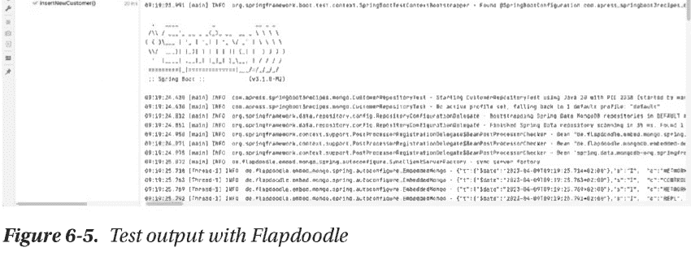

图 6-5 使用 Flapoodle 的测试输出

## 使用 Testcontainers 测试 MongoDB 代码

另一个选项是使用 Testcontainers。Testcontainers 使用 Docker 为你的技术启动一个 Docker 容器。在这种情况下，我们可以使用 Docker 镜像启动一个真实的 MongoDB 实例并在测试中使用它。这让你有机会测试你的数据库迁移脚本（如果使用了的话）。当你结合了不同的技术（如 SQL 和 MongoDB）时，这也非常有用，因为你可以使用 Testcontainers 同时启动两者。

要使用 Testcontainers（在此处针对 MongoDB），我们需要添加适当的依赖（见列表 6-66）。

### 列表 6-66. Testcontainers MongoDB 依赖

```xml
<dependency>
  <groupId>org.springframework.boot</groupId>
  <artifactId>spring-boot-testcontainers</artifactId>
</dependency>
<dependency>
  <groupId>org.testcontainers</groupId>
  <artifactId>mongodb</artifactId>
  <scope>test</scope>
</dependency>
<dependency>
  <groupId>org.testcontainers</groupId>
  <artifactId>junit-jupiter</artifactId>
  <scope>test</scope>
</dependency>
```

接下来创建 `CustomerRepositoryTest`（列表 6-67）。

### 列表 6-67. 使用 Testcontainers 为 CustomerRepository 进行基于 MongoDB 测试

```java
@Testcontainers
class CustomerRepositoryTest {

  @Container
  @ServiceConnection
  static MongoDBContainer mongodb = new MongoDBContainer("mongo:6.0");

  @Autowired
  private CustomerRepository repository;

  @BeforeEach
  public void cleanUp() {
      repository.deleteAll();
  }

}
```

`@DataMongoTest` 通过特殊的 JUnit 扩展（`SpringExtension`）执行测试，以启动 Spring Test Context 框架。现在，为了为 Testcontainers 注册特殊的 JUnit 扩展，添加了 `@Testcontainers` 注解。该扩展会找到标记了 `@Container` 的成员字段，并启动给定的容器。对于此测试，这是一个 `MongoDBContainer`，我们指示它使用 MongoDB 6.0。Testcontainers 将负责下载该容器、启动实例并在测试后停止它。由于每个测试的容器将从不同的 URL 启动，我们需要告知我们的 Spring Boot 应用。为此，我们可以使用 `@ServiceConnection` 注解。这将自动将所需的属性传递给容器。关于此点的更多信息，请参阅食谱 2-3。

## 6-9. 使用 R2DBC 访问数据

大多数 Java 开发者都会知道或至少听过 JDBC API（见本章开头）。然而，JDBC 本质上是阻塞的，在响应式环境中表现并不理想。对于响应式编程和 SQL 数据库，这里有 R2DBC，这是一个由社区（包括但不限于 PostgreSQL、MySQL 和 H2）开发的低级响应式 API。如果你有一个响应式应用但仍然在使用关系型数据库，请使用 R2DBC 以获得一种响应式的方式访问你的数据库。

### 工作原理

要使用 R2DBC，你需要完成的第一工作是添加所需的依赖：`r2dbc`、`spring-r2dbc` 和 `spring-data-r2dbc`。然而，为了方便起见，Spring Boot 提供了 `spring-boot-starter-r2dbc` 来一次性引入所有这些依赖（列表 6-68）。

### 列表 6-68. Spring Data R2DBC Starter

```xml
<dependency>
  <groupId>org.postgresql</groupId>
  <artifactId>r2dbc-postgresql</artifactId>
</dependency>
```

它将使用 `spring.r2dbc` 命名空间中的属性来配置数据库连接（见表 6-6 和表 6-7）。与 JDBC 一样，使用了 `datasource` 命名空间。

## 表 6-6. R2DBC 连接属性

| 属性 | 说明 |
| --- | --- |
| spring.r2dbc.url | 设置数据库的 R2DBC URL。 |
| spring.r2dbc.username | 设置连接数据库的用户名。 |
| spring.r2dbc.password | 设置连接数据库的密码。 |
| spring.r2dbc.name | 如果 URL 中未设置，则设置数据库名称；默认是 testdb。 |
| spring.r2dbc.generate-unique-name | 设置启用时设置随机数据库名称；默认是 false。这在内存数据库进行测试时很有用。 |
| spring.r2dbc.properties | 设置额外的 R2DBC 属性。 |

## 表 6-7. R2DBC 连接池属性

| 属性 | 说明 |
|---|---|
| spring.r2dbc.pool.enabled | 设置启用 R2DBC 连接池；默认是 true。 |
| spring.r2dbc.pool.initial-size | 设置初始连接数；默认是无限。 |
| spring.r2dbc.pool.max-acquire-time | 从池获取连接的最大等待时间；默认是无限。 |
| spring.r2dbc.pool.max-connection-time | 创建新连接的最大等待时间；默认是无限。 |
| spring.r2dbc.pool.max-idle-time | 连接在池中空闲的最大时间；默认是 30 分钟。 |
| spring.r2dbc.pool.max-life-time | 连接的最大寿命；默认是无限。 |
| spring.r2dbc.pool.max-size | 设置最大连接数；默认是 10。 |
| spring.r2dbc.pool.validation-depth | 设置验证深度为 LOCAL 或 REMOTE；默认是 LOCAL。 |

要连接数据库，我们需要至少设置 `spring.r2dbc.url`；它可以包含数据库名称、用户名和密码所需的信息。但通常 `spring.r2dbc.username` 和 `spring.r2dbc.password` 是分开传递的。为了连接之前创建的数据库（见食谱 6-2），我们需要列表 6-69 中的属性。

### 列表 6-69. R2DBC 应用属性

```properties
spring.r2dbc.url=r2dbc:postgresql://localhost:5432/customers
spring.r2dbc.username=customers
spring.r2dbc.password=customers
spring.sql.init.mode=always
```

在这里你看到了连接数据库的 `spring.r2dbc` 属性，以及一个值为 `ALWAYS` 的 `spring.sql.init.mode` 属性。这是为了初始化数据库并插入一些数据（更多数据库初始化请见食谱 6-2）。

为了操作数据库，让我们使用存储库并为此创建一个不同的实现。列表 6-70 显示了 `CustomerRepository` 接口。

### 列表 6-70. 响应式 CustomerRepository 接口

```java
package com.appspring.boot3recipes.r2dbc;

import reactor.core.publisher.Flux;
import reactor.core.publisher.Mono;

public interface CustomerRepository {

    Flux<Customer> findAll();

    Mono<Customer> findById(long id);

    Mono<Customer> save(Customer customer);

}
```

## 第 6 章 数据访问

```java
@Override
public void run(ApplicationArguments args) {
    customers.findAll()
        .subscribe((customer) -> logger.info("{}", customer));
}
```

此 `CustomerLister` 实例将使用 `CustomerRepository` 接口来调用 `findAll` 方法，并将结果打印到控制台（见图 6-4）。

最后，我们需要一个启动类来运行代码（列表 6-72）。

### 列表 6-72. Spring Boot 启动类

```java
package com.apress.spring3recipes.r2dbc;

import org.slf4j.Logger;
import org.slf4j.LoggerFactory;
import org.springframework.boot.ApplicationArguments;
import org.springframework.boot.ApplicationRunner;
import org.springframework.boot.SpringApplication;
import org.springframework.boot.autoconfigure.SpringBootApplication;
import org.springframework.core.annotation.Order;
import org.springframework.r2dbc.core.DatabaseClient;
import org.springframework.stereotype.Component;

@SpringBootApplication
public class R2dbcApplication {

    public static void main(String[] args) throws Exception {
        SpringApplication.run(R2dbcApplication.class, args);
        System.in.read();
    }

}
```


此 Spring Boot 应用将检测 `CustomerRepository` 的实现（见后续章节），将其注入到 `CustomerLister` 中，并作为 `ApplicationRunner` 实例执行。由于我们使用的是响应式应用程序且没有需要持续运行的内容，我们需要某种机制来防止关闭。为此，我们可以使用 `System.in.read()` 方法。这将暂停关闭，直到你按下回车键。

# 使用 DatabaseClient

当 Spring Boot 检测到类路径下存在 `spring-r2dbc` 时，它会自动将 `DatabaseClient` 作为 Bean 添加到应用程序中。访问数据库的基础方法是使用这个预配置的 `DatabaseClient`，它来自 `spring-r2dbc`（是 Spring 框架的一部分）。通过这个 `DatabaseClient`，你可以创建一个 `CustomerRepository` 的实现（列表 6-73）。

# 列表 6-73. 使用 DatabaseClient 的响应式 CustomerRepository 实现

```java
package com.apress.spring3recipes.r2dbc;

import io.r2dbc.spi.Readable;
import org.springframework.r2dbc.core.DatabaseClient;
import org.springframework.stereotype.Repository;
import reactor.core.publisher.Flux;
import reactor.core.publisher.Mono;

@Repository
class R2dbcCustomerRepository implements CustomerRepository {

    private static final String ALL_QUERY = "SELECT id, name, email FROM customer";
    private static final String BY_ID_QUERY = "SELECT id, name, email FROM customer WHERE id=:id";
    private static final String INSERT_QUERY = "INSERT INTO customer (name, email) VALUES (:name, :email)";

    private final DatabaseClient client;

    R2dbcCustomerRepository(DatabaseClient client) {
        this.client = client;
    }

    @Override
    public Flux<Customer> findAll() {
        return client.sql(ALL_QUERY)
            .map(this::toCustomer)
            .all();
    }

    @Override
    public Mono<Customer> findById(long id) {
        return client.sql(BY_ID_QUERY)
            .bind("id", id)
            .map(this::toCustomer)
            .one();
    }

    private Customer toCustomer(Readable row) {
        var id = row.get(0, Long.class);
        var name = row.get(1, String.class);
        var email = row.get(2, String.class);
        return new Customer(id, name, email);
    }
}
```

`R2dbcCustomerRepository` 使用 `DatabaseClient` 执行查询、映射结果并返回结果。通过 `sql` 方法，我们可以指定想要执行的 SQL 查询。使用 `map`，我们可以将结果转换为我们可以使用的对象，例如 `Customer`。在 `findAll` 方法中，我们执行查询以从数据库中检索所有内容，并将结果映射为 `Customer`。这里使用的 `map` 方法接收一个 `Function`，它将 `io.r2dbc.spi.Readable`（Row 正是如此）映射到另一个元素。`all()` 方法告诉 `DatabaseClient` 我们有 0 个或多个结果要返回，因此它将创建一个 `Flux`。`findById` 通过首先绑定填充查询中的 `:id` 属性来执行查询；然后我们映射结果。`one()` 方法告诉 `DatabaseClient` 返回 0 或 1 个结果；如果得到多个结果，将抛出错误。

`save` 方法稍微复杂一点，因为我们需要获取 ID；我们可以使用 `filter` 方法来修改 `io.r2dbc.spi.Statement` 实例以返回生成的键。我们需要绑定 `:name` 和 `:email` 属性。使用 `first()` 可以获取返回的第一个结果。在这种情况下我们也可以使用 `one()`。由于我们得到的是一个包含 `Customer` 生成 ID 的 `Mono<Long>`，可以使用该方法指示创建一个具有该 ID 和给定的 `Customer` 对象进行保存。

# 使用 R2dbcTemplate

当在类路径上检测到 Spring Data R2DBC 时，Spring Boot 除了 `DatabaseClient` 之外，还会自动准备 `R2dbcEntityTemplate` 实例。`R2dbcTemplate` 是 `DatabaseClient` 的封装，使得处理实体变得更加容易（列表 6-74）。

# 列表 6-74. 使用 R2dbcTemplate 的响应式 CustomerRepository 实现

```java
package com.apress.spring3recipes.r2dbc;

import io.r2dbc.spi.Readable;
import org.springframework.data.relational.core.query.Criteria;
import org.springframework.data.relational.core.query.Query;
import org.springframework.data.r2dbc.core.R2dbcEntityTemplate;
import org.springframework.stereotype.Repository;
import reactor.core.publisher.Flux;
import reactor.core.publisher.Mono;

@Repository
class R2dbcCustomerRepository implements CustomerRepository {

    private final R2dbcEntityTemplate template;

    R2dbcCustomerRepository(R2dbcEntityTemplate template) {
        this.template = template;
    }

    @Override
    public Flux<Customer> findAll() {
        return template.select(Customer.class).all();
    }

    @Override
    public Mono<Customer> findById(long id) {
        return template.select(Customer.class).matching(Query.query(Criteria.where("id").is(id))).one();
    }

    @Override
    public Mono<Customer> save(Customer customer) {
        return template.insert(customer);
    }
}
```

# 使用 R2dbcRepository

与其用 Spring Data R2DBC 写实现，你也可以拥有动态实现（类似于 Spring Data JPA）。对于 R2DBC 情况，你根据需要简单继承 `ReactiveCrudRepository`、`ReactiveSortingRepository` 或 `R2dbcRepository`（列表 6-76）。

# 列表 6-76. 使用 Spring Data 仓库的响应式 CustomerRepository

```java
package com.apress.springboot3recipes.r2dbc;

import org.springframework.data.r2dbc.repository.R2dbcRepository;
import reactor.core.publisher.Flux;
import reactor.core.publisher.Mono;

public interface CustomerRepository extends R2dbcRepository<Customer, Long> {
}
```

## 6-10. 使用 Spring Data R2DBC 进行测试

### 问题

你想要使用单元测试或小型集成测试来测试基于 R2DBC 的存储库。

### 解决方案

使用 Spring Test Context 框架和 Spring Boot 测试支持，使用 Apache Derby 等嵌入式容器编写单元测试，或者使用 Testcontainers 编写一个专门的集成测试。

### 工作原理

在测试 R2DBC 代码时，需要一个数据库。通常会使用 H2、Derby 或 HSQLDB 等嵌入式数据库进行测试。Spring Boot 让为 R2DBC 编写测试变得简单。基于 R2DBC 的测试可以使用 `@DataR2dbcTest` 注解，Spring Boot 将创建一个仅包含 R2DBC 相关 Bean 的最小应用程序。这些 R2DBC 相关的 Bean 包括 `ConnectionFactory`、事务管理器，以及在需要时对应的 Spring Data R2DBC 存储库。

### 使用嵌入式数据库测试 R2DBC 代码

让我们为 `CustomerRepository` 编写一个测试，并使用 H2 作为嵌入式数据库。首先将 H2 作为测试依赖添加（列表 6-77）。

**列表 6-77.** 测试用的响应式 H2 依赖

```xml
<dependency>
  <groupId>io.r2dbc</groupId>
  <artifactId>r2dbc-h2</artifactId>
  <scope>test</scope>
</dependency>
```

你可以看到，这不仅仅是 H2 的依赖，而是 `r2dbc-h2` 依赖（它引入了 H2 数据库）。该依赖是 H2 普通 JDBC 驱动的响应式对应版本。

接下来创建 `CustomerRepositoryTest`（列表 6-78）。

### 列表 6-78. CustomerRepositoryTest 类

```java
@DataR2dbcTest
@TestPropertySource(properties = {
    "spring.r2dbc.url=r2dbc:h2://mem:testdb",
    "spring.r2dbc.generate-unique-name=true"
})
@Import(R2dbcCustomerRepository.class)
class CustomerRepositoryTest {

    @Autowired
    private CustomerRepository repository;

    @Autowired
    private DatabaseClient db;

    @BeforeEach
    public void setup() {
        db.sql("DELETE FROM customer").fetch().first().subscribe();
    }
}
```

`@DataR2dbcTest` 注解通过特殊的 JUnit 扩展（`SpringExtension`）执行测试以启动 Spring Context 框架。`@DataR2dbcTest` 注解设置了 Spring Data RDBC（如果需要）并启用所有其他 R2DBC 功能。通过 `@TestPropertySource`，我们为 `spring.r2dbc.url` 提供了一个 H2 内存数据库，并将 `spring.r2dbc.generate-unique-name` 设置为 `true`。由于我们想测试存储库，因此添加了 `@Import(R2dbcCustomerRepository.class)`。在 `@BeforeEach` 中我们清理数据库，以防止一个测试干扰另一个测试。

提示：当使用基于 Spring Data R2DBC 的存储库时，不需要 `@Import`，因为存储库会被自动检测。

现在编写一个测试测试记录是否正确插入（列表 6-79）。

### 列表 6-79. CustomerRepository 插入新客户测试

```java
@Test
void insertNewCustomer() {
    var customer = new Customer("T. Testing", "t.testing@test123.tst");
    repository.save(customer)
        .as(StepVerifier::create)
        .assertNext((c) -> assertThat(c.id()).isNull())
        .verifyComplete();
}
```

通过调用 `CustomerRepository` 上的 `save` 方法向数据库添加 `Customer` 实例。验证生成的 `Customer` 实例具有 ID 并验证响应式流水线已完成。

你还可以添加的另一个测试是 `findAll` 方法。在插入两条记录时，调用 `findAll` 应该检索到两条记录（列表 6-80）。

### 列表 6-80. CustomerRepository Find查找测试

```java
@Test
void findAllCustomers() {
    var customers = Flux.just(
        new Customer("T. Testing1", "t.testing@test123.tst"),
        new Customer("T. Testing2", "t.testing@test123.tst")
    );
    customers.doOnNext(StepVerifier::create)
        .expectNextCount(2)
        .verifyComplete();
}
```

当然，可能还有更多断言，但数据保存已经在另一个测试方法中验证过了。

### 使用 Testcontainers 测试 Spring Data R2DBC 代码

现在更好的选择是使用 Testcontainers。Testcontainers 使用 Docker 为你给定的技术启动 Docker 容器。在这种情况下，我们可以使用 PostgreSQL Docker 镜像来启动一个真实的数据库并在测试中使用。通过这种方式，我们现在使用实际数据库进行测试，而不需要内存版本，这意味着你可以执行任何想要的查询并对其进行测试。它还为你提供了测试数据库迁移脚本（如果使用的话）的机会。

要使用 Testcontainers（在此例针对 PostgreSQL），我们需要添加相应的依赖（参见列表 6-81）。我们需要 Testcontainers 的 PostgreSQL 依赖，JUnit Jupiter 以及一个针对 R2DBC 的特殊依赖。

**列表 6-81.** PostgreSQL 和 JUnit Jupiter 的 Testcontainers 依赖

```xml
<dependency>
  <groupId>org.springframework.boot</groupId>
  <artifactId>spring-boot-testcontainers</artifactId>
  <scope>test</scope>
</dependency>
<dependency>
  <groupId>org.testcontainers</groupId>
  <artifactId>postgresql</artifactId>
</dependency>
<dependency>
  <groupId>org.testcontainers</groupId>
  <artifactId>junit-jupiter</artifactId>
  <scope>test</scope>
</dependency>
<dependency>
  <groupId>org.testcontainers</groupId>
  <artifactId>r2dbc</artifactId>
</dependency>
```


<scope>test</scope>

</dependency>

```

现在编写一个测试记录是否正确插入（列表 6-82）。

### 列表 6-82. 使用 Testcontainers 的 CustomerRepository

```java
@DataR2dbcTest
@Testcontainers
class CustomerRepositoryTest {

    @Container
    static PostgreSQLContainer<?> postgres = new PostgreSQLContainer<>("postgres:15-alpine");

    @Autowired
    private CustomerRepository repository;
}
```

`@DataR2dbcTest` 注解通过特殊的 JUnit 扩展（`SpringExtension`）执行测试以启动 Spring Context 框架。`@DataR2dbcTest` 注解设置了 Spring Data R2DBC（如果需要）并启用所有其他 R2DBC 功能。通过 `@TestPropertySource`，我们为 `spring.r2dbc.url` 提供了一个 H2 内存数据库，并将 `spring.r2dbc.generate-unique-name` 设置为 `true`。由于我们想测试存储库，因此添加了 `@Import(R2dbcCustomerRepository.class)`。在 `@BeforeEach` 中我们清理数据库，以防止一个测试干扰另一个测试。

提示：当使用基于 Spring Data R2DBC 的存储库时，不需要 `@Import`，因为存储库会被自动检测。

### 列表 6-83. CustomerRepository 插入新客户测试

```java
@Test
void insertNewCustomer() {

    var customer = new Customer("T. Testing", "t.testing@test123.tst");

    repository.save(customer)
        .as(StepVerifier::create)
        .assertNext((c) -> assertThat(c.id()).isNotNull())
        .verifyComplete();
}
```

通过调用 `CustomerRepository` 上的 `save` 方法向数据库添加 `Customer` 实例。验证生成的 `Customer` 实例具有 ID 并验证响应式流水线已完成。

你还可以添加的另一个测试是 `findAll` 方法。在插入两条记录时，调用 `findAll` 应该检索到两条记录（列表 6-84）。

### 列表 6-84. CustomerRepository Find查找测试

```java
@Test
void findAllCustomers() {

    var customers = Flux.just(
        new Customer("T. Testing1", "t.testing@test123.tst"),
        new Customer("T. Testing2", "t.testing@test123.tst")
    );

    customers.flatMap(repository::save)
        .as(StepVerifier::create)
        .expectNextCount(2)
        .verifyComplete();

    repository.findAll()
        .count()
        .as(StepVerifier::create)
        .expectNext(2L)
        .verifyComplete();
}
```

## 第 8 章 Spring 消息

Spring 提供了与各种消息系统集成的广泛支持。从简单的 JMS API 到 RabbitMQ 和 Kafka。当检测到这些框架和技术时，Spring Boot 会提供自动配置。

## 8-1. 配置 JMS

### 问题

你想在 Spring Boot 应用程序中使用 JMS 并需要连接到 JMS 代理（broker）。

### 解决方案

Spring Boot 支持 ActiveMQ 和 Artemis 的自动配置。通过添加这些库之一并设置某些属性，`spring.activemq` 或 `spring.artemis` 命名空间就是你需要的。

### 工作原理

通过声明你选择的 JMS 提供者的依赖，Spring Boot 将自动配置 `ConnectionFactory` 并启用用于在你的环境中查找目的地的策略 `DestinationResolver`。这也可以通过使用 JNDI 实现。另一种解决方案是自己完成所有配置；如果你需要对 `ConnectionFactory` 实例有更多控制权，或者使用非自动配置的 JMS 提供者，这可能是必要的。

### 使用 ActiveMQ

在使用 ActiveMQ 时，首先要做的的是包含 `spring-boot-starter-activemq`。这将引入启动所需的所有 JMS 和 ActiveMQ 依赖。它将包含 `spring-jms` 依赖和 ActiveMQ 的客户端库。请参考列表 8-1。

**列表 8-1.** Spring Boot ActiveMQ Starter 依赖

```xml
<dependency>
  <groupId>org.springframework.boot</groupId>
  <artifactId>spring-boot-starter-activemq</artifactId>
</dependency>
```

默认情况下，如果没有提供显式的代理配置，Spring Boot 将启动一个嵌入式代理。可以通过使用 `spring.activemq` 命名空间下的属性来更改配置（见表 8-1）。

**表 8-1.** ActiveMQ 配置属性

| 属性 | 描述 |
|---|---|
| spring.activemq.broker-url | 设置要连接的代理 URL。默认值是 `vm://localhost?broker.persistent=false` 或内存代理；否则，为 `tcp://localhost:61616`。 |
| spring.activemq.user | 设置连接代理的用户名，默认值为空。 |
| spring.activemq.password | 设置连接代理的密码，默认值为空。 |
| spring.activemq.in-memory | 设置是否使用嵌入式代理；默认值是 `true`。当显式设置了 `spring.activemq.broker-url` 时，此设置会被忽略。 |
| spring.activemq.non-blocking-redelivery | 设置在重新传递回滚消息之前停止消息传递。启用时，将不会保持消息顺序；默认值为 `false`。 |
| spring.activemq.close-timeout | 设置等待关闭操作生效的时间；默认值为 15 秒。 |
| spring.activemq.send-timeout | 设置等待代理响应的时间；默认值为 0（不限制）。 |
| spring.activemq.packages.trust-all | 当使用 Java 序列化来发送 JMS 消息时，此项决定了是否应信任来自所有包的类；默认值是无（这需要设置具体的包）。 |
| spring.activemq.packages.trusted | 是受信任的特定包的逗号分隔列表。 |

以下是一个简单的应用程序，用于列出所有名称中包含 jms 的 bean。这应该包含一个名为 `jmsConnectionFactory` 的 bean。

```java
package com.app.springboot3recipes.jms;

import org.springframework.boot.SpringApplication;
import org.springframework.boot.autoconfigure.SpringBootApplication;

import java.util.Comparator;
import java.util.stream.Stream;

@SpringBootApplication
public class JmsApplication {

    private static final String MSG = "\tName: %100s, Type: %s";

    public static void main(String[] args) {

        var ctx = SpringApplication.run(JmsApplication.class, args);

        System.out.println("# Beans: " + ctx.getBeanDefinitionCount());

        var names = ctx.getBeanDefinitionNames();

        Stream.of(names)
            .filter(name -> name.toLowerCase().contains("jms") || ctx
                .getType(name).getName().contains("jms"))
            .sorted(Comparator.naturalOrder())
            .forEach(name -> {

                var bean = ctx.getBean(name);

                System.out.printf(MSG, name, bean.getClass().getSimpleName());
            });
    }
}
```

运行此程序时，它将在控制台打印所有名称中包含 jms 的 bean 的名称和类型。输出应该类似于图 8-1。

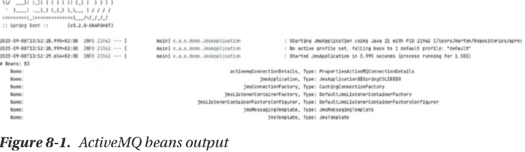

**图 8-1.** ActiveMQ bean 输出

在使用 ActiveMQ 时，也可以使用 JMS 连接池（类似于基于 JDBC 的连接池）。默认情况下这是禁用的。要启用并配置它，你可以使用 `spring.activemq` 命名空间下的属性（见表 8-2）。

**表 8-2.** ActiveMQ 池配置属性

| 属性 | 描述 |
|---|---|
| spring.activemq.pool.enabled | 设置是否使用连接池；默认值为 `false`。 |
| spring.activemq.pool.max-connections | 设置最大连接数；默认值为 1。 |
| spring.activemq.pool.maximum-active-session-per-connection | 设置每个连接允许的最大活动 JMS 会话数；默认值为 500。 |
| spring.activemq.pool.idle-timeout | 设置连接空闲的时间；默认值为 30 秒。 |
| spring.activemq.pool.expiry-timeout | 设置连接过期之前的时间；默认值为 0（永不过期）。 |
| spring.activemq.pool.reconnect-on-exception | 当发生 JMSException 时重置连接；默认值为 `true`。 |
| spring.activemq.pool.block-full | 当请求连接或抛出 JMSException 时改为阻塞；默认值为 `true`。 |
| spring.activemq.pool.block-if-timeout | 设置阻塞直到连接可用的时间；默认值为 -1。 |
| spring.activemq.pool.create-on-startup | 设置是否在启动时尽早创建连接；默认值为 `true`。 |

### 与连接池使用 Artemis

在使用 Artemis 时，也可以使用 JMS 连接池（类似于基于 JDBC 的连接池）。默认情况下，该功能是禁用的。要启用并配置它，您可以使用 `spring.artemis.pool` 命名空间下的属性（见表 8-5）。

**表 8-5.** Artemis 池化配置属性

| 属性 | 描述 |
| --- | --- |
| spring.artemis.pool.enabled | 设置是否使用连接池；默认为 false。 |
| spring.artemis.pool.max-connections | 设置最大连接数；默认为 1。 |
| spring.artemis.pool.maximum-active-session-per-connection | 设置每个连接允许的最大活动 JMS 会话数；默认为 500。 |
| spring.artemis.pool.idle-timeout | 设置连接的空闲时间；默认为 30 秒。 |
| spring.artemis.pool.expiry-timeout | 设置连接过期前的时间；默认为 0（永不过期）。 |
| spring.artemis.pool.reconnect-on-exception | 当发生 JMSException 时重置连接；默认为 true。 |
| spring.artemis.pool.block-if | 当请求连接或抛出 JMSException 时进行阻塞；默认为 true。 |
| spring.artemis.pool.block-if-timeout | 设置在抛出 JMSException 之前阻塞多久；默认为 -1（一直阻塞直到连接可用）。 |
| spring.artemis.pool.create-connection-on-startup | 设置在应用程序启动时是否尽早创建连接；默认为 true。 |

使用池化功能需要向构建文件添加 `pooled-jms` 依赖项。请见列表 8-4。

**列表 8-4.** JMSConnectionPoolDependency

```xml
<dependency>
  <groupId>org.messaginghub</groupId>
  <artifactId>pooled-jms</artifactId>
</dependency>
```

再次运行应用程序时，您会发现 `ConnectionFactory` 的类型已变为 `PooledConnectionFactory`。

### 使用 JNDI

当将 Spring Boot 部署到 JEE 容器时，有一个很大的变化：您也想使用该容器中预注册的 `ConnectionFactory`。要启用此功能，您需要依赖 `spring-jms` 库和 `jakarta.jms-api`（后者可以被标记为由您的 JEE 容器提供）。可以使用其中一个 starter 并排除显式的 ActiveMQ 或 Artemis 依赖；然而，仅声明所需的依赖会更简单清晰。请见列表 8-5。

**列表 8-5.** 基础 JMS 依赖

```xml
<dependency>
  <groupId>org.springframework.framework</groupId>
  <artifactId>spring-jms</artifactId>
</dependency>

<dependency>
  <groupId>jakarta.jms</groupId>
  <artifactId>jakarta.jms-api</artifactId>
</dependency>
```

当 JNDI 可用时，Spring Boot 将首先尝试在 JNDI 注册表中通过如 `java:/JmsXA` 或 `java:/XAFactory` 等已知名称检测 `ConnectionFactory`，或者通过 `spring.jms.jndi-name` 属性指定的名称进行检测。此外，它还会自动创建一个 `JndiDestinationResolver`，以便队列和主题也会在 JNDI 中被检测到；默认情况下允许回退到目的地的动态创建。

```
spring.jms.jndi-name=java:/jms/connectionFactory
```

配置好并构建构件后，您现在可以将应用程序部署到 JEE 容器并重用现有的 `ConnectionFactory`。

### 手动配置

配置 JMS 的最后一种方法是手动配置。为此，您至少需要 `spring-jms` 和 `jakarta.jms-api` 依赖，可能还需要您正在使用的 JMS 代理的一些客户端库。在某些情况下可能需要手动配置：

- Spring Boot 无法自动配置 `ConnectionFactory`
- 需要自定义 `ConnectionFactory` 实例
- 需要特定 JMS 代理

要手动配置 `ConnectionFactory` 实例，您需要一个 `@Bean` 方法。见列表 8-6。

**列表 8-6.** ConnectionFactory

```java
@Bean
public ConnectionFactory connectionFactory() {

    var connectionFactory = new ActiveMQConnectionFactory("tcp://localhost:61616?persistent=false");

    connectionFactory.setClientID("someId");
```


## 使用 JmsTemplate 发送消息

通过 JMS 发送消息，让我们每秒发送一条消息。见列表 8-7。

### 列表 8-7. JMS Component

```java
@Component
class MessageSender {

    private final JmsTemplate jms;

    MessageSender(JmsTemplate jms) {
        this.jms = jms;
    }

    @Scheduled(fixedRate = 1000)
    public void send() {
        var msg = "Current Time is: " + LocalDateTime.now();
        jms.convertAndSend("time-queue", msg);
    }
}
```

`JmsTemplate` 实例会自动通过构造函数注入，由于调度，我们会在 `time-queue` 获得包含日期时间的消息。要运行此代码，您需要带有 `@EnableScheduling` 的 `@SpringBootApplication` 类。见列表 8-8。

### 列表 8-8. Spring Boot Application

```java
@SpringBootApplication
@EnableScheduling
public class JmsSenderApplication {

    public static void main(String[] args) {
        SpringApplication.run(JmsSenderApplication.class, args);
    }
}
```

运行此类时，似乎什么都没有发生，但消息正在填充队列。我们可以编写一个集成测试来检查此代码是否正常。见列表 8-9。

### 列表 8-9. Spring Boot Integration Test

```java
package com.apress.springboot3recipes.jms;

import jakarta.jms.JMSException;
import jakarta.jms.TextMessage;
import org.junit.jupiter.api.Test;
import org.springframework.beans.factory.annotation.Autowired;
import org.springframework.boot.test.context.SpringBootTest;
import org.springframework.jms.core.JmsTemplate;
import static org.assertj.core.api.Assertions.assertThat;

@SpringBootTest
class JmsIntegrationTest {

    @Autowired
    JmsTemplate jmsTemplate;

    @Test
    void testReceive() throws JMSException {
        var message = (TextMessage) jmsTemplate.receiveAndConvert("time-queue", 5000);
        assertThat(message.getText()).isNotNull();
    }
}
```

## 配置 JmsTemplate

Spring Boot 在 `spring.jms.template` 命名空间提供了属性用于配置 `JmsTemplate`（参见表 8-6）。

### 表 8-6. JmsTemplate 属性

| 属性 | 描述 |
| --- | --- |
| `spring.jms.template.default-destination` | 当未指定特定目标时，设置发送和接收操作使用的默认目标。 |
| `spring.jms.template.delivery-delay` | 设置发送消息的交付延迟。 |
| `spring.jms.template.delivery-mode` | 设置交付模式，持久化或非持久化。当显式设置时，会将 `qos-enabled` 设置为 `true`。 |
| `spring.jms.template.priority` | 设置发送消息时的优先级。默认为无；当显式设置时，会将 `qos-enabled` 设置为 `true`。 |
| `spring.jms.template.qos-enabled` | 设置是否启用服务质量 (QOS)。启用后，将设置消息的优先级、交付模式和生存时间。默认为 `false`。 |
| `spring.jms.template.receive-timeout` | 设置接收调用使用的超时时间。默认是无限期。 |
| `spring.jms.template.time-to-live` | 设置 JMS 消息的生存时间；设置时，会将 `qos-enabled` 设置为 `true`。 |
| `spring.jms.template.pub-sub-domain` | 设置默认目标为主题（topic）或队列（queue）。默认是 `false`，即队列。 |

除了这些属性外，如果可以找到 Bean 的唯一实例，`JmsTemplate` 还将自动配置 `DestinationResolver` 和 `MessageConverter`。如果找不到唯一实例，将使用默认的 `DynamicDestinationResolver` 和 `SimpleMessageConverter`（参见表 8-7）。

### 表 8-7. SimpleMessageConverter 类到 JMS 消息转换器

| 类型 | JMS 消息类型 |
| --- | --- |
| `java.lang.String` | `javax.jms.TextMessage` |
| `java.util.Map` | `javax.jms.MapMessage` |
| `java.io.Serializable` | `javax.jms.ObjectMessage` |
| `byte[]` | `javax.jms.BytesMessage` |

让我们向 `orders` 队列发送一个 `Order`，并使用 Jackson 发送 JSON 而不是使用 Java 序列化机制。参见列表 8-10。

### 列表 8-10. Order 类

```java
package com.apress.springboot3recipes.order;

import java.math.BigDecimal;

public record Order(String id, BigDecimal amount) { }
```

这就是我们要发送的类。为了能够生成订单，让我们创建一个 `OrderGenerator` 类，它将创建一个具有随机 ID 和随机金额的订单。参见列表 8-11。

### 列表 8-11. OrderGenerator 类

```java
package com.apress.springboot3recipes.order;

import java.math.BigDecimal;
import java.math.RoundingMode;
import java.util.UUID;
import java.util.concurrent.ThreadLocalRandom;

public class OrderGenerator {

    public static Order generate() {
        var rnd = ThreadLocalRandom.current().nextDouble(1000.00);
        var amount = BigDecimal.valueOf(rnd).setScale(2, RoundingMode.HALF_UP);
        var id = UUID.randomUUID().toString();
        return new Order(id, amount);
    }
}
```

现在我们需要一个发送器，它生成一个 `Order` 并使用 `JmsTemplate` 将其放在队列上。参见列表 8-12。

### 列表 8-12. 基于 JMS 的 OrderSender

```java
@Component
class OrderSender {

    private final JmsTemplate jms;

    OrderSender(JmsTemplate jms) {
        this.jms = jms;
    }

    @Scheduled(fixedRate = 500)
    public void sendOrder() {
        var order = OrderGenerator.generate();
        jms.convertAndSend("orders", order);
    }
}
```

它与之前编写的 `MessageSender` 没有太大区别，但现在它生成一个带有随机生成数据的 `Order`（参见 `OrderGenerator`）并将其发送到 `orders` 队列。运行此时，它实际上会失败。因为 `Order` 没有实现 `Serializable`，它不会被转换为 `ObjectMessage`。然而，我们想使用 JSON。为了实现这一点，需要不同的 `MessageConverter`：即要使用的 `MappingJackson2MessageConverter`。它使用 JSON 将对象序列化和反序列化为 JSON。它应该作为 Bean 添加到配置中。

首先，你需要在为应用程序添加 Jackson（或者说，JSON 支持）的依赖。添加 `spring-boot-starter-json` 以获取所需的依赖。参见列表 8-13。

### 列表 8-13. Spring Boot JSON Starter 依赖

```xml
<dependency>
    <groupId>org.springframework</groupId>
    <artifactId>spring-boot-starter-json</artifactId>
</dependency>
```

> ℹ 当你已经在依赖列表中有了 `spring-boot-starter-web` 或 `spring-boot-starter-webflux` 时，`spring-boot-starter-json` 已经包含在内。

接下来你可以配置 `MappingJackson2MessageConverter`。参见列表 8-14。

### 列表 8-14. MessageConverter 配置

```java
@Bean
public MappingJackson2MessageConverter messageConverter() {
    var converter = new MappingJackson2MessageConverter();
    converter.setTypePropertyName("content_type"); // ①
    converter.setTypeIdMappings(Map.of("order", Order.class)); // ②
    return converter;
}
```

① `TypePropertyName` 是 JSON 消息中指示类型的属性。
② 这是类的映射。

通常建议对类型进行映射。在没有进一步配置的情况下，将使用类的全限定名（FQN）。

```java
package com.apress.springboot3recipes.jms;

import com.fasterxml.jackson.databind.ObjectMapper;
import jakarta.jms.BytesMessage;
import jakarta.jms.TextMessage;
import org.junit.jupiter.api.Test;
import org.springframework.beans.factory.annotation.Autowired;
import org.springframework.boot.test.context.SpringBootTest;
import org.springframework.jms.core.JmsTemplate;
import static org.assertj.core.api.Assertions.assertThat;

@SpringBootTest
class JmsTest {

    @Autowired
    private JmsTemplate jms;

    @Test
    void receiveOrder() throws Exception {
        var message = jms.receive("orders");
        assertThat(message).isInstanceOf(BytesMessage.class);
        var msg = (BytesMessage) message;
        var mapper = new ObjectMapper();
        var content = msg.getBody(byte[].class);
        var order = mapper.readValue(content, Order.class);
        assertThat(order).hasNoProperties();
    }

    @Test
    void receiveOrderPlain() throws Exception {
        var order = jms.receiveAndConvert("orders");
        assertThat(order).hasNoProperties();
    }
}
```

## 8-3. 使用 JMS 接收消息

### 问题
你想从 JMS 目标读取消息以便处理它们。

### 解决方案
创建一个类并在其方法上注解 `@JmsListener` 以将其绑定到目标。

### 工作原理
你可以创建一个 POJO 并在方法上注解 `@JmsListener`。Spring 会检测并为它创建一个监听器。Spring Boot 在 `spring.jms.listener` 命名空间下暴露了配置监听器的属性。

## 接收消息

让我们创建一个监听方案 8-2 发送的消息。参见列表 8-15。

### 列表 8-15. 基于 JMS 的 Spring 监听器

```java
@Component
class CurrentDateTimeService {

    @JmsListener(destination = "jms-queue-queue")
    public void handle(TextMessage msg) throws JMSException {
        System.out.println("[RECEIVED] - " + msg.getText());
    }
}
```

通过使用 `String` 作为方法参数而不是自己处理 `jakarta.jms.Message` 配置，可以简化监听器。参见列表 8-16。

### 列表 8-16. 基于字符串的 Spring JMS 监听器

```java
@Component
class CurrentDateTimeService {

    @JmsListener(destination = "time-queue")
    public void handle(String msg) {
        System.out.println("[RECEIVED] - " + msg);
    }
}
```


两个应用程序的输出应该类似于图 8-4。

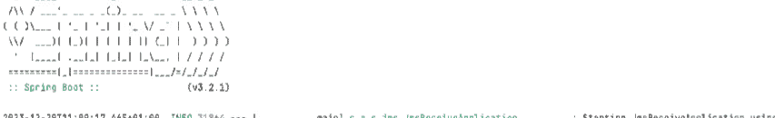

## 图 8-4. JMS 接收输出

## 配置监听器 main

Spring 使用 `JmsListenerContainerFactory` 来创建支持 `@JmsListener` 注解所需的 set。Spring Boot 配置了一个默认的工厂，可以使用 `spring.jms.listener` 命名空间的属性进行配置。如果这还不够，你始终可以手动配置自己的实例和所有的配置选项。当 Spring Boot 在上下文中检测到 `JmsListenerContainerFactory` 时，将停止创建（见表 8-9）。

## 表 8-9. JMS 监听器属性

| 属性 | 描述 |
| --- | --- |
| spring.jms.listener.acknowledge-mode | 容器的确认模式；默认是自动。 |
| spring.jms.listener.auto-startup | 启动时自动启动容器。默认是 true。 |
| spring.jms.listener.concurrency | 设置并发消费者的最小数量。默认无，导致产生一个并发消费者（Spring 默认值）。 |
| spring.jms.listener.max-concurrency | 设置并发消费者的最大数量。默认无，导致产生一个并发消费者（Spring 默认值）。 |
| spring.jms.receive-timeout | 设置接收消息时使用的超时时间；默认是一秒。 |
| spring.jms.pub-sub-domain | 设置默认目标是主题（topic）还是队列（queue）。默认是 false，意味着队列。 |

默认配置的 `JmsListenerContainerFactory` 还会检测单个、唯一的 `DestinationResolver` 和 `MessageConverter`，如果找到则使用它们；否则它将使用 Spring 默认的 `DynamicDestinationResolver` 和 `SimpleMessageConverter`（更多信息请参见配方 8-2）。

## 使用自定义 MessageConverter

如果你想通过 JMS 将对象以 JSON 发送到下一个系统？你可以依赖 Java 序列化，这通常是不被推荐的，因为这是一个紧耦合的系统。使用 JSON 或 XML 传输对象/消息是更好的方法。在 Spring JMS 中，这只需要配置不同的 `MessageConverter`（发送部分也请参阅配方 8-2）。参见列表 8-17。

## 列表 8-17. MessageConverter 配置

```java
@Bean
public MappingJackson2MessageConverter messageConverter() {
    var messageConverter = new MappingJackson2MessageConverter();
    messageConverter.setTypePropertyName("content_type");
    messageConverter.setTypeIdMappings(singletonMap("order", Order.class));
    return messageConverter;
}
```

`MappingJackson2MessageConverter` 默认需要一个属性名来存放内容类型的标识符。这将从 JMS 消息的头中读取（这里我们将其设置为 `content_type`）。接下来，我们可以可选地定义类型与类之间的映射。由于我们想要将对象映射到 `Order` 类，我们指定了 `content-type order` 的映射。参见列表 8-18。

## 列表 8-18. 接收订单的 JMS MessageListener

```java
@Component
class OrderService {
    @JmsListener(destination = "orders")
    public void handle(Order order) {
        System.out.println("[RECEIVED] - " + order);
    }
}
```

监听器接收 `Order` 对象，因为 Spring JMS 会负责接收和转换消息。如果你将此监听器与配方 8-2 中的订单发送器结合，你将看到源源不断的订单不断入（图 8-5）。

```
AV
(C) (..)... 1111
(C) ())))))))111111
WW ())))))))1111111
xxxxxxxxxxxxxxxxxxxx
(v2.3)
Spring Boot:
2023-02-27T12:14:27.113Z [main] 12365 ---
2023-02-27T12:14:37.641Z [main] 12365 ---
2023-02-27T12:14:38.501Z [main] 12365 ---
[main] Order-id=a1d2-a3f7-c9a4-48b6-09a7-77b072d4, amount=251.53
[main] Order-id=e5f6-a7b8-c9d0-e1f2-a3b4c5d6e7f8, amount=138.51
[main] Order-id=f9a0-b1c2-d3e4-f5a6-7890abcde1234, amount=998.00
```

图 8-5. JMS 接收输出

## 发送回复

有时你想向发送消息的系统发送响应。

## 列表 8-19. OrderService

```java
@Component
class OrderService {
    @JmsListener(destination = "orders")
    public void handle(Order order) {
        System.out.println("[RECEIVED] - " + order);
    }
}
```

监听器接收 `Order` 对象，因为 Spring JMS 会负责接收和转换消息。如果你将此监听器与配方 8-2 中的订单发送器结合，你将看到源源不断的订单不断入（图 8-5）。

## 列表 8-20. OrderService

```java
@Component
class OrderService {
  @JmsListener(destination = "orders")
  public void handle(Order order) {
    System.out.println("[RECEIVED] - " + order);
  }
}
```

## 列表 8-21. OrderConfiguration

```java
public record OrderConfiguration(String id) {}
```

## 8-4. 配置 RabbitMQ

### 问题

你想在 Spring 应用中使用 AMQP 并需要连接到代理。

### 解决方案

使用 `spring.amqp` 属性连接到代理。

### 工作原理

当 Spring 检测到类路径上有 RabbitMQ 库时，会自动创建一个 `ConnectionFactory`。为了开始，你需要添加 `spring-boot-starter-amqp`。

## 列表 8-22. Spring Boot Starter AMQP

```xml
<dependency>
  <groupId>org.springframework.boot</groupId>
  <artifactId>spring-boot-starter-amqp</artifactId>
</dependency>
```

现在你可以使用 `spring.amqp` 属性连接。

```properties
spring.amqp.host=localhost
spring.amqp.port=5672
spring.amqp.username=guest
spring.amqp.password=guest
```

这是使用默认值连接 RabbitMQ 实例所需的配置。

## 表 8-10. RabbitMQ 属性

| 属性 | 描述 |
| --- | --- |
| spring.amqp.addresses | 客户端连接的地址逗号分隔列表。 |
| spring.amqp.connection-timeout | 设置连接超时。默认无；0 表示无超时。 |
| spring.amqp.host | 设置 RabbitMQ 主机。 |
| spring.amqp.port | 设置 RabbitMQ 端口。 |
| spring.amqp.username | 设置连接使用的用户名；默认是 guest。 |
| spring.amqp.password | 设置连接使用的密码；默认是 guest。 |
| spring.amqp.publisher-confirms | 设置是否启用发布者确认。默认是 false。 |
| spring.amqp.publisher-returns | 设置是否启用发布者返回。默认是 false。 |
| spring.amqp.requested-heartbeat | 设置请求的心跳超时。默认无；0 表示无心跳。 |
| spring.amqp.virtual-host | 设置连接到代理时使用的虚拟主机。 |

## 8-5. 使用 RabbitMQ 发送消息

### 问题

你想将消息发送到 RabbitMQ 代理，以便消息能够传递给接收者。

### 解决方案

使用 `RabbitTemplate`，你可以将消息发送到交换机并提供路由键。

### 工作原理

当 Spring Boot 发现唯一的 `ConnectionFactory` 时，它会自动配置 `RabbitTemplate`；此模板可用于向队列发送消息。

## 配置 RabbitTemplate

如果 Spring Boot 能够找到唯一的 `ConnectionFactory` 且配置中不存在 `RabbitTemplate`，则会自动配置 `RabbitTemplate`。Spring Boot 允许你通过 `spring.rabbitmq.template` 命名空间下的属性修改配置过的 `RabbitTemplate`（见表 8-11）。

## 表 8-11. RabbitTemplate 配置属性

| 属性 | 说明 |
| :--- | :--- |
| spring.rabbitmq.template.exchange | 设置用于发送操作的默认交换机名称；默认为无。 |
| spring.rabbitmq.template.routing-key | 设置用于发送操作的默认路由键值；默认为无。 |
| spring.rabbitmq.template.receive-timeout | 设置发送和接收操作的超时时间。 |
| spring.rabbitmq.template.reply-timeout | 设置接收操作的超时时间。 |

Spring Boot 还允许使用 `RabbitTemplate` 轻松配置重试逻辑，但默认是禁用的。在 `application.properties` 中设置 `spring.rabbitmq.template.retry.enabled=true` 将将其启用。当发送失败时，它将尝试额外发送消息。若要更改重试次数或间隔，可以使用 `spring.rabbitmq.template.retry` 命名空间下的属性（见表 8-12）。

## 表 8-12. RabbitTemplate 重试配置

| 属性 | 说明 |
| :--- | :--- |
| spring.rabbitmq.template.retry.enabled | 启用发布重试；默认为 false。 |
| spring.rabbitmq.template.retry.max-attempts | 设置交付消息的尝试次数；默认为 3。 |
| spring.rabbitmq.template.retry.initial-interval | 设置第一次和第二次发布尝试之间的间隔；默认为 1 秒。 |
| spring.rabbitmq.template.retry.max-interval | 设置交付消息的最大间隔时间；默认为 10 秒。 |
| spring.rabbitmq.template.retry.multiplier | 设置应用于上一次间隔的倍数；默认为 1.0。 |

## 发送简单消息

可以通过 `convertSend` 方法使用 `RabbitTemplate` 发送消息。它至少接收路由键和消息中要发送的对象。

```java
@Component
class HelloWorldSender {
    private final RabbitTemplate rabbit;
    HelloWorldSender(RabbitTemplate rabbit) {
        this.rabbit = rabbit;
    }
    @Scheduled(fixedRate = 500)
    public void sayHello() {
        var msg = "Hello World, from Spring Boot 3, over RabbitMQ!";
        rabbit.convertAndSend("hello", msg);
    }
}
```

`HelloWorldSender` 将通过构造函数注入 `RabbitTemplate`。每隔 500 毫秒，将在默认交换机使用 `hello` 路由键发送一条消息。由于是发送到默认交换机，会自动创建一个名为 `hello` 的队列。你可以在 RabbitMQ 管理控制台中检查队列上的消息数量。

编写一个测试来验证应用程序的正确行为。由于 RabbitMQ 没有嵌入式代理（broker），你需要使用 `@MockBean` 对 `RabbitTemplate` 进行 mock。在 `@Test` 方法中，使用正确的参数验证该方法。参见列表 8-24。

## 列表 8-24. 带有 Mock 的 Spring Boot RabbitMQ 测试

```java
package com.springframework.boot3recipes.rabbit;
import org.junit.jupiter.Test;
import org.mockito.Mockito;
import org.springframework.amqp.rabbit.core.RabbitTemplate;
import org.springframework.boot.test.context.SpringBootTest;
import org.springframework.boot.test.mock.mockito.MockBean;
import static org.mockito.Mockito.verify;
@SpringBootTest
class RabbitSenderApplicationTest {
    @MockBean
    private RabbitTemplate rabbitTemplate;
    @Test
    void shouldSendLeastASingleMessage() {
        verify(rabbitTemplate, Mockito.atLeastOnce());
        rabbitTemplate.convertAndSend("hello", "Hello World, from Spring Boot 3, over RabbitMQ!");
    }
}
```

## 第 8 章 Spring 消息

另一种选项是使用 Spring Boot Testcontainer 支持在 Docker 中启动 RabbitMQ 代理并使用它进行通信。见列表 8-25。

## 列表 8-25. 使用 Testcontainers 的 Spring Boot RabbitMQ 测试

```java
package com.apress.springboot3recipes.rabbit;
import org.junit.jupiter.api.Test;
import org.springframework.framework.amq.core.Binding;
import org.springframework.framework.amq.core.BindingBuilder;
import org.springframework.framework.amq.core.DirectExchange;
import org.springframework.framework.amq.core.Queue;
import org.springframework.framework.amq.core.QueueBuilder;
import org.springframework.framework.amqp.core.RabbitTemplate;
import org.springframework.beans.factory.factory.annotation.Autowired;
import org.springframework.boot.test.context.SpringBootTest;
import org.springframework.boot.test.context.TestConfiguration;
```


# 第 8 章 SPRING 消息传递

## 8-6. 使用 RabbitMQ 接收消息

### 问题
你想从 RabbitMQ 接收消息。

### 解决方案
使用 `@RabbitListener` 注解的方法会将其绑定到队列并使其接收消息。

### 工作原理
带有 `@RabbitListener` 或 `@RabbitHandler` 注解的 Bean 将作为消息监听器。构造消息监听器，被注解的方法将接收传入的消息。可以通过 `spring.rabbitmq.listener` 命名空间中的属性配置监听器。

| 属性 | 描述 |
| --- | --- |
| `spring.rabbitmq.listener.type` | 设置监听器类型（direct 或 simple）。 |
| `spring.rabbitmq.listener.acknowledge-mode` | 设置确认模式；默认值。 |
| `spring.rabbitmq.listener.prefetch` | 设置预取数量。 |
| `spring.rabbitmq.listener.default-requeue` | 拒绝的消息是否重入队列。 |
| `spring.rabbitmq.listener.concurrency` | 监听线程数。 |
| `spring.rabbitmq.listener.max-concurrency` | 设置最大监听线程数。 |
| `spring.rabbitmq.listener.transaction-size` | 设置事务中处理的消息数量。 |
| `spring.rabbitmq.listener.direct.acknowledge-mode` | 设置确认模式；默认值。 |
| `spring.rabbitmq.listener.direct.prefetch` | 设置预取数量。 |
| `spring.rabbitmq.listener.direct.default-requeue` | 拒绝的消息是否重入队列。 |
| `spring.rabbitmq.listener.direct.consumers` | 设置消费者数量。 |

### 接收简单消息
带有 `@RabbitListener` 注解的组件是启动 RabbitMQ 接收消息所需的。参见列表 8-31。

#### 列表 8-31. String 的 Rabbit 监听
```java
@Component
class HelloWorldReceiver {

    @RabbitListener(queues = "hello")
    public void receive(String msg) {
        System.out.println("Received: " + msg);
    }
}
```
此组件将从 `hello` 队列接收所有消息并将其打印到控制台。这对于简单负载或接收对象可以从消息负载中反序列化的情况是有效的。然而，当发送对象或复杂消息时，你可能倾向于使用 JSON。


| 属性 | 消息输出 |
| --- | --- |
| 2023-12-27T23:55:01.123Z INFO 1234 --- main.com.example.rabbit.RabbitSenderApplication | |
| 2023-12-27T23:55:01.456Z INFO 1234 --- main.com.example.rabbit.RabbitSenderApplication | |
| 2023-12-27T23:55:01.789Z INFO 1234 --- c.a.b.c.client.ConnectionFactory - | |
| 2023-12-27T23:55:02.112Z INFO 1234 --- main.com.example.rabbit.RabbitSenderApplication | |
| 2023-12-27T23:55:02.445Z INFO 1234 --- main.com.example.rabbit.RabbitSenderApplication | |
| 2023-12-27T23:55:02.778Z INFO 1234 --- main.com.example.rabbit.RabbitSenderApplication | |
| Received Hello World. from Spring Boot 2 over RabbitMQ | |
| 2023-12-27T23:55:03.111Z INFO 1234 --- main.com.example.rabbit.RabbitSenderApplication | |
| Received Hello World. from Spring Boot 2 over RabbitMQ | |
| 2023-12-27T23:55:03.444Z INFO 1234 --- main.com.example.rabbit.RabbitSenderApplication | |
| Received Hello World. from Spring Boot 2 over RabbitMQ | |

图 8-7. RabbitMQ 监听输出

### 接收对象
为了不依赖 Java 序列化而接收复杂的对象，你需要配置一个 `MessageConverter`（另见配方 8-4）。配置的 `MessageConverter` 将被消息监听器容器使用，用于将传入的负载转换为 `@RabbitListener` 注解方法所需的对象。参见列表 8-32。

#### 列表 8-32. JSON MessageConverter 配置
```java
@Bean
public Jackson2JsonMessageConverter jsonMessageConverter() {
    return new Jackson2JsonMessageConverter();
}
```
要配置 `MessageConverter`，请创建一个带有 `@Bean` 注解的方法并构造你想要使用的转换器；这里使用的转换器是基于 Jackson 2 的，但也有一个用于 XML 反序列化的转换器：`MarshallingMessageConverter`。请参见列表 8-33。

#### 列表 8-33. 用于订单的 Rabbit 监听
```java
@Component
class OrderService {

    @RabbitListener(bindings = 
        @QueueBinding(exchange = @Exchange(name="orders", type = ExchangeTypes.TOPIC,
            value = @Queue(name = "incoming-orders",
            key = "new-order"))))
    public void handle(Order order) {
```


```java
System.out.println("[RECEIVED] - " + order);
}
}
```

之前的监听器将使用 `orders` 交换机（这是一个扇出交换机），并使用 `new-order` 路由键为 `incoming-orders` 创建绑定。启动时，如果交换机和队列不存在，它们将自动创建。传入的消息会被转换为 `Order` 的 `Jackson2JsonMessageConverter`。输出结果应该类似于图 8-8。

```
2023-12-29T20:27:28.024Z [INFO] main - ...
2023-12-29T20:27:28.533Z [INFO] main - ...
2023-12-29T20:27:29.438Z [INFO] main - ...
2023-12-29T20:27:47.621Z [INFO] main - ...
2023-12-29T20:27:50.782Z [INFO] main - ...
[RECEIVED] Order:id=d8b5c1d4-e5f6-478b-b9dc7-07f9a79461
[RECEIVED] Order:id=e0f8b9c1-a2b3-45c6-97f5-0de5c15e0a12
```

**图 8-8. RabbitMQ 监听输出：**

# 接收消息并发送回复

在接收消息时，必须向客户端发送响应或与不同的消息进行通信；在 `void` 方法上使用 `@RabbitListener` 是可能的。它将创建一个结果消息并放置在带有路由键的交换机上；这需要在 `@SendTo` 注解中指定。请参见列表 8-34。

# 列表 8-34. 带有回复的订单 Rabbit 监听

```java
@Component
class OrderService {
    @RabbitListener(bindings = @QueueBinding(
        exchange = @Exchange(name="orders", type = ExchangeTypes.TOPIC),
        value = @Queue(name = "incoming-orders"),
        key = "new-order"
    ))
    @SendTo("orders/order-confirmation")
    public OrderConfirmation handle(Order order) {
        System.out.println("[RECEIVED] - " + order);
        return new OrderConfirmation(order.id());
    }
}
```

在接收订单并处理它时，将发送一个 `OrderConfirmation`；`@SendTo` 注解（来自通用 Spring Messaging 组件）包含了交换机和路由键。`/` 之前的部分是交换机，`/` 之后的部分是路由键；那么 `<exchange>/<routing-key>` 就是所使用的模式。交换机或路由键值可以为空（或者两者都为空）；在这种情况下，将使用默认配置的交换机和路由键。在这里，它将使用 `orders` 交换机并使用 `order-confirmation` 作为路由键。

可以使用另一个监听器来处理 `OrderConfirmation` 消息。见列表 8-35。

# 列表 8-35. 用于 RabbitMQ 的 OrderConfirmationService

```java
@Component
class OrderConfirmationService {
    @RabbitListener(bindings = @QueueBinding(
        exchange = @Exchange(name="orders", type = ExchangeTypes.TOPIC),
        value = @Queue(name = "order-confirmations"),
        key = "order-confirmation"
    ))
    public void handle(OrderConfirmation confirmation) {
        System.out.println("[RECEIVED] - " + confirmation);
    }
}
```

它将使用 `order-confirmation` 路由键创建一个 `order-confirmations` 队列，并将其绑定到 `orders` 交换机上（就像之前 `OrderService` 创建的那样）。在运行代码时，配合来自 Rabbit 8-4 的发送者，你应该会收到 `Order` 实例，并且也将被确认（图 8-9）。

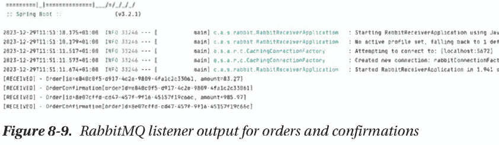

# 8-7. 为 Apache Kafka 配置 Spring

### 问题

你想在 Spring Boot 应用中使用 Spring for Apache Kafka，并连接到 Kafka 集群。

### 解决方案

配置适当的 `spring.kafka` 属性（至少需要 `spring.kafka.bootstrap-servers`）以连接集群并能够发送（或接收）消息。

### 工作原理

当 Spring Boot 检测到类路径上的 Spring Kafka 和 Kafka 库时，会自动创建一个 `ConnectionFactory` 实例。要开始，你需要添加 `spring-kafka` 依赖。这将引入所有所需的依赖。列表 8-36。

# 列表 8-36. Spring Kafka 依赖

```xml
<dependency>
  <groupId>org.springframework.kafka</groupId>
  <artifactId>spring-kafka</artifactId>
</dependency>
```

> 此配方使用了 Spring Boot 自动配置，因此还需要 `spring-boot-starter`。

# 列表 8-37. 连接的最小 Spring 属性

```
spring.kafka.bootstrap-servers=localhost:9092
```

这是连接到 Kafka 并发送消息所需的配置。表 8-14 描述了可以设置的 `spring.kafka` 属性。对于消费者（表 8-15）或生产者（表 8-16）。

# 表 8-14. 通用 Kafka 属性

| 属性 | 描述 |
| --- | --- |
| `spring.kafka.bootstrap-servers` | 连接的地址逗分隔列表 |
| `spring.kafka.client-id` | 向服务器请求时传递的 ID；主要用于日志 |
| `spring.kafka.properties` | 生产者和消费者的额外属性 |

要配置 Kafka 的接收端，可以添加 `spring.kafka.consumer` 属性（表 8-15）。

# 表 8-15. Kafka 消费者属性

| 属性 | 描述 |
| --- | --- |
| `spring.kafka.auto-commit-interval` | 自动提交偏移的频率 |
| `spring.kafka.auto-offset-reset` | 当没有初始偏移或当前偏移不可用时的处理方式 |
| `spring.kafka.bootstrap-servers` | 要连接的地址逗分隔列表。这会覆盖全局设置。 |
| `spring.kafka.enable-auto-commit` | 设置是否自动提交偏移 |
| `spring.kafka.fetch-max-wait` | 设置在响应获取请求之前阻塞的时间 |
| `spring.kafka.fetch-min-size` | 设置服务器为获取请求返回的最小数据量 |
| `spring.kafka.group-id` | 设置标识消费者组的唯一字符串；这是必须的！ |
| `spring.kafka.heartbeat-interval` | 设置向消费者协调程序发送心跳的时间间隔 |
| `spring.kafka.isolation-level` | 设置读取事务写入消息的隔离级别。默认是 `READ_UNITTED` |
| `spring.kafka.key-deserializer` | 设置键的反序列化器；默认是 `StringDeserializer` |
| `spring.kafka.value-deserializer` | 设置值的反序列化器；默认是 `StringDeserializer` |
| `spring.kafka.max-poll-records` | 设置单次调用 `poll()` 返回的最大记录数 |
| `spring.kafka.properties` | 用于配置客户端的额外消费者特定属性 |
| `spring.kafka.security.protocol` | 设置与 Kafka Broker 通信时使用的安全协议 |
| `spring.kafka.ssl.*` | 设置连接到 Kafka Broker 的 SSL 配置，用于设置密钥库、信任库等 |

# 表 8-16. Kafka 生产者属性

| 属性 | 描述 |
| :--- | :--- |
| `spring.kafka.producer.acks` | 设置生产者认为请求完成所需的 acks 数量。 |
| `spring.kafka.producer.batch-size` | 设置默认批处理大小。 |
| `spring.kafka.producer.bootstrap-servers` | 设置客户端应连接的地址列表（用逗号分隔）。这会覆盖全局设置。 |
| `spring.kafka.producer.buffer-memory` | 设置生产者允许用于缓冲待发送到服务器的记录的总内存。 |
| `spring.kafka.producer.client-id` | 设置在发送请求时传递给服务器的 ID；用于服务器日志。 |
| `spring.kafka.producer.compression-type` | 设置生产者生成的所有数据的压缩类型。 |
| `spring.kafka.producer.key-deserializer` | 设置键的反序列化器；默认为 `StringDeserializer`。 |
| `spring.kafka.producer.value-deserializer` | 设置值的反序列化器；默认为 `StringDeserializer`。 |
| `spring.kafka.producer.retries` | 设置允许的重试次数；默认值为 0。 |
| `spring.kafka.producer.transaction-id-prefix` | 当非空时，启用生产者的事务支持。 |
| `spring.kafka.producer.properties` | 设置用于配置客户端的额外生产者特定属性。 |
| `spring.kafka.producer.security.protocol` | 设置与 Kafka broker 通信时使用的安全协议。 |
| `spring.kafka.producer.ssl.*` | 设置连接到 Kafka broker 时使用的 SSL 配置；用于设置密钥库（keystore）、信任库（trust store）等。 |

# 第 8 章 Spring 消息

当添加了最小配置（列表 8-37）和所需的依赖项后，Kafka 自动配置将生效。它将自动连接到 Kafka 服务器，并配置 `KafkaTemplate` 以及启用 `@KafkaListener` 所需 bean。默认（也是最基础的配置）是允许发送和接收基于 `String` 的消息。

# 8-8. 使用 Spring Kafka 发送消息

### 问题

你想向 Kafka 服务器发送一条消息，以便消息能够传递给接收者。

### 解决方案

使用 `KafkaTemplate`，你可以向主题（topic）发送消息并提供一个键（key）。

### 工作原理

当 Kafka 可用并配置完成后时，Spring Boot 会自动配置 `KafkaTemplate` 实例。

### 配置 KafkaTemplate

如果配置中不存在 `KafkaTemplate`，Spring Boot 将自动配置一个 `KafkaTemplate` 实例。Spring Boot 允许你通过 `spring.kafka.template` 命名空间下的属性修改配置的 `KafkaTemplate` 实例（见表 8-17）。

# 表 8-17. KafkaTemplate 配置属性

| 属性 | 描述 |
| :--- | :--- |
| `spring.kafka.template.default-topic` | 设置发送操作默认使用的主题名称；默认值是无。 |
| `spring.kafka.template.transaction-id-prefix` | 设置事务 ID 前缀；覆盖生产者配置中指定的事务 ID。 |

### 发送简单消息

使用 `KafkaTemplate` 发送消息可以通过 `send` 方法完成。它至少需要主题（如果没有配置默认主题）和消息中要发送的消息对象。

```java
@Component
class HelloWorldSender {
    private final KafkaTemplate<String, String> kafka;

    HelloWorldSender(KafkaTemplate<String, String> kafka) {
        this.kafka = kafka;
    }

    @Scheduled(fixedRate = 50)
    public void sayHello() {
        String msg = "Hello World, from Spring Boot 3, over Apache Kafka!";
        kafka.send("hello", msg);
    }
}
```

`HelloWorldSender` 将通过构造函数注入 `KafkaTemplate`。每隔 50 毫秒，就会向 `hello` 主题发送一条消息。

编写一个测试来验证应用程序的正确行为。我们可以为 `KafkaTemplate` 创建一个 mock 并验证它是否调用了相关方法。见列表 8-38。

# 列表 8-38. 使用 Mock 的 Kafka Spring Boot 测试

```java
package com.apress.springbootrecipes.kafka;

import org.junit.jupiter.api.Test;
import org.mockito.Mockito;
import org.springframework.boot.test.context.SpringBootTest;
import org.springframework.boot.test.mockito.MockBean;
import org.springframework.kafka.core.KafkaTemplate;
import static org.mockito.Mockito.verify;

@SpringBootTest
class KafkaSenderApplicationTest {
    @MockBean
    private KafkaTemplate<String, String> kafka;

    @Test
    void shouldSendAtLeastSingleMessage() {
        var msg = "Hello World, from Spring Boot 3, over Apache Kafka!";
        verify(kafka, Mockito.atLeastOnce()).send("hello", msg);
    }
}
```

另一个选项是使用 Spring Boot Testcontainer 支持在 Docker 中启动一个 broker 并使用它进行通信。见列表 8-39。

# 列表 8-39. 使用 Testcontainers 的 Spring Boot 测试

```java
package com.apress.springbootrecipes.kafka;

import org.junit.jupiter.api.Test;
import org.springframework.beans.factory.annotation.Autowired;
import org.springframework.boot.test.context.SpringBootTest;
import org.springframework.kafka.core.ConsumerFactory;
import org.testcontainers.containers.KafkaContainer;
import org.testcontainers.junit.jupiter.Container;
import org.testcontainers.utility.DockerImageName;
import java.time.Duration;
import java.util.List;
import static org.assertj.core.api.Assertions.*;

@SpringBootTest(properties = "spring.kafka.consumer.group-id=test")
class KafkaSenderApplicationTest {
    @Container
    static KafkaContainer kafkaContainer = new KafkaContainer(DockerImageName.parse("confluentinc/cp-kafka:latest"));

    @Autowired
    private ConsumerFactory<String, String> consumerFactory;

    @Test
```


```java
void shouldSendAtLeastSingleMessage() {

  try (var consumer = consumerFactory.createConsumer()) {

    consumer.subscribe(List.of("hello"));

    var records = consumer.poll(Duration.ofSeconds(2));

    assertThat(records).isNotNull();

    assertThat(records).isNotEmpty();

  }

}
```

### 发送对象

向 Kafka 发送消息时，消息负载必须转换为 `byte[]`。对于 `String`，通过 `getBytes()` 非常简单。但当发送对象时，这会变得复杂。Spring Kafka 的自动配置会处理基于 `String` 的发送。

为了能够发送不同类型，你需要为生产者配置一个序列化器（`Serializer`）。这可以通过 `spring.kafka.producer.value-serializer` 属性实现。额外的配置可以通过 `spring.kafka.properties` 命名空间传递。在这里我们为传入的 `Order` 对象设置 `JsonSerializer`。见列表 8-40。

**列表 8-40. 序列化配置**

```properties
spring.kafka.bootstrap-servers=localhost:9092
spring.kafka.producer.value-serializer=org.springframework.kafka.support.serializer.JsonSerializer
spring.kafka.properties.spring.json.trusted.packages=com.apress.springboot3recipes.order
```

`spring.kafka.producer.value-serializer` 设置为 `JsonSerializer`；默认情况下只有少数类型允许发送。因此，设置 `spring.json.trusted.packages` 将允许该包中的类被发送。

让我们创建一个 `Order` 并使用 `KafkaTemplate` 将其发送到 `orders` 主题。见列表 8-41。

**列表 8-41. Order 类**

```java
package com.apress.springboot3recipes.order;

import java.math.BigDecimal;

public record Order(String id, BigDecimal amount) { }
```

```java
@Scheduled(fixedRate = 50)
public void sendOrder() {
    var order = OrderGenerator.generate();
    kafka.send("orders", order);
}
```

它将创建一个具有随机金额且最大值为 1000.0 的 `Order`。然后它将使用 `send` 方法将其发送到 `orders` 主题。通过 `JsonDeserializer`，它将从对象创建 JSON，并最终将其转换为发送到 Kafka 的 `byte[]`。

## 8-9. 使用 Kafka 接收消息

### 问题

你想从 Kafka 主题接收消息。

### 解决方案

在方法上使用 `@KafkaListener` 注解，将其绑定到一个主题上，并允许它接收消息。

### 工作原理

带有 `@KafkaListener` 和/或 `@KafkaHandler` 注解的 bean 将作为消息监听器来处理传入的消息。会构建消息监听器容器，被注解的方法将接收传入的消息。监听器容器可以通过 `spring.kafka.listener` 命名空间中的属性进行配置（见表 8-18）。

## 表 8-18. Kafka 监听器属性

| 属性 | 描述 |
| --- | --- |
| `spring.kafka.listener.type` | 设置监听器容器类型 `SINGLE` 或 `BATCH`；默认是 `SINGLE`。 |
| `spring.kafka.listener.ack-mode` | 设置容器确认模式；默认是 `none`。 |
| `spring.kafka.listener.async-acks` | 设置是否异步确认；默认是 `none`。这仅在 `ack-mode` 设置为 `MANUAL` 或 `MANUAL_IMMEDIATE` 时有用。 |
| `spring.kafka.listener.client-id` | 设置 `client-id` 属性的前缀。 |
| `spring.kafka.listener.concurrency` | 设置监听器执行线程的最小数量。 |
| `spring.kafka.listener.poll-timeout` | 设置轮询消费者时的超时时间。 |
| `spring.kafka.listener.no-poll-threshold` | 设置应用于 `poll-timeout` 的倍数，以确定消费者是否无响应。 |
| `spring.kafka.listener.ack-count` | 当 `ack-mode` 为 `COUNT` 或 `COUNT_TIME` 时，设置偏移量提交之间的记录数。 |
| `spring.kafka.listener.ack-time` | 当 `ack-mode` 为 `TIME` 或 `COUNT_TIME` 时，设置偏移量提交之间的时间。 |
| `spring.kafka.listener.idle-between-polls` | 设置消费者轮询之间的间隔。 |
| `spring.kafka.listener.idle-event-interval` | 设置发布空闲消费者事件之间的时间。 |
| `spring.kafka.listener.idle-partition-event-interval` | 设置发布空闲分区消费者事件之间的时间。 |
| `spring.kafka.listener.monitor-interval` | 设置检查无响应消费者之间的时间。 |
| `spring.kafka.listener.log-container-config` | 设置启动时是否应该记录容器配置；默认是 `none`。 |
| `spring.kafka.listener.missing-topics-fatal` | 设置如果缺少主题容器是否会失败；默认是 `false`。 |
| `spring.kafka.listener.immediate-stop` | 设置容器是在处理当前记录后停止，还是在处理完之前轮询的所有记录后停止。默认是 `false`。 |
| `spring.kafka.listener.auto-startup` | 设置是否自动启动容器。默认是 `true`。 |
| `spring.kafka.listener.consumer-thread-name` | 设置启动期间是否应该更改消费者线程。默认是 `none`。 |

## 接收简单消息

一个带有 `@KafkaListener` 注解的组件即可开始从 Kafka 接收消息。见列表 8-43。

### 列表 8-43. 用于 String 消息的 Kafka 监听器

```java
@Component
class HelloWorldReceiver {

  @KafkaListener(
    topics = "hello", groupId = "recipe_8_9_i" )
  public void handle(String msg) {
    System.out.println("[RECEIVED] - " + msg);
  }
}
```

该组件将接收来自 `hello` 主题的所有消息并打印到控制台。这对于基于 `String` 的负载运行良好。然而，当发送对象或复杂消息时，人们可能倾向于使用 JSON、XML 甚至 AVRO。

## 接收对象

要接收不依赖于 Java 序列化的更复杂的对象，你需要配置一个 `Serializer`（另见配方 8-8）。配置的 `Serializer` 将被消息监听器容器用于，将传入的负载转换为 `@KafkaListener` 注解方法所需的对象。见列表 8-44。

### 列表 8-44. JSON 序列化配置

```properties
spring.kafka.bootstrap-servers=localhost:9092
spring.kafka.consumer.value-deserializer=org.springframework.kafka.support.serializer.JsonDeserializer
spring.kafka.properties.json.trusted.packages=com.example.recipes
```

为了配置 Kafka 客户端使用的 `Serializer`，我们可以在 `application.properties` 中添加一些配置。在这种情况下，我们可以添加 `spring.kafka.consumer.value-deserializer` 属性。这将注册序列化器以将实际值从 Java 对象转换为 JSON。我们还需要指定 `json.trusted.packages` 以允许它序列化类。这可以通过 `spring.kafka.properties` 来实现，该属性可设置额外的属性。见列表 8-45。

### 列表 8-45. 用于订单的 Kafka 监听器

```java
@Component
class OrderService {

  @KafkaListener(topics = "orders")
  public void handle(Order order) {
    System.out.println("[RECEIVED] - " + order);
  }
}
```

监听器将使用 `orders` 主题接收消息。当主题不存在时，将使用配置的 `JsonDeserializer` 转换。输出与图 8-10 所示。

- 示例配方使用 Spring Boot Docker 支持启动 Kafka 容器以接收消息。

## 接收消息并发送回复

在接收消息时，可能需要向客户端发送回复或与另一个消息进行通信。在 `void` 方法上使用 `@KafkaListener` 是可能的。这会导致我们需要将其放在主题上，见配方 8-46。

### 列表 8-46. 带回复的订单 Kafka 监听器

```java
@Component
class OrderService {

  @KafkaListener(topics = "orders")
  @SendTo("order-confirmations")
  public OrderConfirmation handle(Order order) {
    System.out.println("[RECEIVED] - " + order);
    return new OrderConfirmation(order.id());
  }
}
```

另一个监听器可以用于处理 `OrderConfirmation` 消息。见列表 8-47。

### 列表 8-47. 用于 Kafka 的 OrderConfirmationService

```java
@Component
class OrderConfirmationService {

  @KafkaListener(topics = "order-confirmations")
  public void handle(OrderConfirmation confirmation) {
    System.out.println("[RECEIVED] - " + confirmation);
  }
}
```

# 第9章

## Spring Boot Actuator

在开发应用程序时，你希望在程序启动后能够监控它的行为。Spring Boot 通过引入 Spring Boot Actuator 让你轻松地实现这一功能。Spring Boot Actuator 将应用程序的健康状态（health status）和指标（metrics）暴露给相关方。这些信息可以通过 JMX 或 HTTP 获取，也可以将数据导出到外部系统。

健康端点（health endpoints）提供了关于你的应用程序和/或其运行的系统健康状况的信息。它们可以检测数据库是否启动、报告可用磁盘空间等。指标端点（metrics endpoints）则暴露使用和性能统计数据，例如请求数、最长请求、最快请求、连接池的利用率等。

在启用这些功能后，所有这些指标都可以通过 JMX 或 HTTP 进行查看，并可以自动导出到外部系统，如 Graphite、InfluxDB 等许多。

## 9-1. 启用并配置 Spring Boot Actuator

### 问题

你想在应用程序中启用健康检查和指标监控，以便监控应用程序的状态。

### 解决方案

向你的项目添加 `spring-boot-starter-actuator` 依赖，以为你的应用程序启用并暴露健康状态和指标。可以通过 `management` 命名空间下的属性进行额外配置。

### 工作原理

当添加 `spring-boot-starter-actuator` 时，Spring Boot 会根据应用程序上下文中的 beans 自动设置健康检查和指标。哪些健康检查和指标会被暴露，取决于启用的 beans 和功能。当检测到数据源时，将收集并暴露该数据源的指标，Spring Boot 会监控该数据源的健康状况。Spring Boot 对许多组件（如 Hibernate、RabbitMQ、Kafka、缓存等）都执行此操作。

要启用 Spring Boot Actuator，请向你的应用程序添加该依赖（这里假设使用 Spring 3.3 源码），如列表 9-1 所示。

### 列表 9-1. Spring Boot Actuator 依赖

```xml
<dependency>
  <groupId>org.springframework.boot</groupId>
  <artifactId>spring-boot-starter-actuator</artifactId>
</dependency>
```

现在启动应用程序，Spring Boot 将已经配置好 Spring Boot Actuator。它可以通过 Web 访问（默认路径为 `/actuator`），如图 9-1 所示。也可以通过 JMX 暴露 Spring Boot Actuator（图 9-2）；这需要将 `spring.jmx.enabled` 设置为 `true`。


图 1. 通过 Web 访问 Spring Boot Actuator


图 2. JMX 暴露的指标比 HTTP 多

你会发现 JMX 暴露的端点比 HTTP 多。HTTP 默认只暴露 `/actuator/health` 和 `/actuator/info`。这是出于安全考虑的。`/actuator` 是公开的，因此你不希望所有人都能看到这些信息。你可以通过 `management.endpoints.web.exposure.include` 和 `management.endpoints.web.exposure.exclude` 来配置暴露的内容。使用 `*` 会向 Web 暴露所有端点。参见列表 9-2。

### 列表 9-2. 通过 Web 暴露属性

```properties
management.endpoints.web.exposure.include=*
```

将此配置添加到 `application.properties` 中，相同的功能将通过 Web 和 JMX 暴露（参见图 9-3）。

```json
{
  "_links": {
    "self": {
      "href": "http://localhost:8080/actuator",
      "templated": false
    },
    "beans": {
      "href": "http://localhost:8080/actuator/beans",
      "templated": false
    },
    "caches-cache": {
      "href": "http://localhost:8080/actuator/caches/{cache}",
      "templated": false
    },
    "caches": {
      "href": "http://localhost:8080/actuator/caches",
      "templated": false
    },
    "health": {
      "href": "http://localhost:8080/actuator/health",
      "templated": false
    },
    "health-path": {
      "href": "http://localhost:8080/actuator/health/{path}",
      "templated": true
    },
    "info": {
      "href": "http://localhost:8080/actuator/info",
      "templated": false
    }
  }
}
```


# 第 9 章 SPRING BOOT ACTUATOR

## 配置服务器

通过将 Spring 添加到...，相同的 Spring Boot 暴露到...如 JMX（参见 9.3）。

## 配置健康检查

Spring Boot Actuator 的功能之一是执行健康检查。它们在 `http://localhost:8090/actuator/health` 下暴露。这会产生应用程序是 UP（正常）还是 DOWN（离线）的结果。健康端点会调用系统中所有可用的 `HealthIndicators` 并在端点报告它们。你可以通过设置 `management.health.<health-indicator>.enabled` 属性来控制哪些 `HealthIndicators` 存在。对于不可用的功能将属性设置为 true（例如在没有 DataSource 的情况下尝试获取其信息）将不起作用。请参见列表 9-5。

### 列表 9-5. 禁用健康指示器

```
management.health.diskspace.enabled=false
```

这将禁用磁盘空间的健康检查，它将不再是健康检查的一部分。

## 配置指标

Spring Boot Actuator 的功能之一是暴露指标（metrics）。它们在 `http://localhost:8090/actuator/metrics` 下暴露。这将你的应用程序可用指标列表（见图 3）。

```
{
  "names": {
    "application.ready.time",
    "application.started.time",
    "disk.free",
    "disk.total",
    "executor.active",
    "executor.completed",
    "executor.pool.core",
    "executor.pool.max",
    "executor.pool.size",
    "executor.queue.remaining",
    "executor.queued",
    "http.server.requests",
    "http.server.requests.active",
    "jvm.buffer.count",
    "jvm.buffer.memory.used",
    "jvm.buffer.total.capacity",
    "jvm.classes.loaded",
    "jvm.classes.unloaded",
    "jvm.compilation.time",
    "jvm.gc.concurrent.phase.time",
    "jvm.gc.live.data.size",
    "jvm.gc.max.data.size",
    "jvm.gc.memory.allocated",
    "jvm.gc.memory.promoted",
    "jvm.gc.overhead",
    "jvm.gc.pause",
    "jvm.info",
    "jvm.memory.committed",
    "jvm.memory.max",
    "jvm.memory.usage.after.gc",
    "jvm.memory.used",
    "jvm.threads.daemon"
  }
}
```

图 3. HTTP 暴露指标

你可以通过访问 `http://localhost:8090/actuator/metrics/{name-of-metric}` 获取更多关于指标的信息。例如，`http://localhost:8090/actuator/metrics/system.cpu.usage` 将显示当前的 CPU 使用率（图 9-6）。

```
{
  "name": "system.cpu.usage",
  "description": "The recent cpu usage of the system application is running in",
  "measurements": [
    {
      "statistic": "VALUE",
      "value": 0.1578943684210525
    }
  ],
  "availableTags": []
}
```

图 9-6. 详细的 CPU 指标

Spring 和 Spring Boot 使用 Micrometer 来收集（并暴露）指标。对于 Spring Boot 检测到的功能，默认启用指标。因此，如果检测到数据源，指标将启用。要禁用指标，请将它们添加到 `management.metrics.enable` 属性。该属性是一个包含要启用指标的键和值的 Map。请参见列表 9-6。

### 列表 9-6. 禁用某个类别的指标

```
management.metrics.enable.system=false
management.metrics.enable.tomcat=false
```

此配置将禁用系统和 tomcat 指标。在 `http://localhost:8090/actuator/metrics` 查看指标时，你可以看到它们不再是列表的一部分。

## 9-2. 创建自定义健康检查和指标

### 问题

你的应用程序需要暴露某些默认不可用的指标和健康检查。

### 解决方案

健康检查和指标是可插的，`HealthIndicator` 和 `MetricBinder` 类型的 Bean 会自动注册以提供额外的健康检查。

### 工作原理

假设检测到数据源，指标将启用。要禁用指标，请将它们添加到 `management.metrics.enable` 属性。该属性是一个包含要启用指标的键和值的 Map。请参见列表 9-6。

首先，让我们编写 `HealthIndicator`。你可以直接实现 `HealthIndicator` 接口（并实现 `check` 方法），或者使用方便的 `AbstractHealthIndicator`。请参见列表 9-7。

### 列表 9-7. 健康指示器实现

```java
package com.example.demo;

import org.springframework.boot.actuator.health.HealthIndicator;
import org.springframework.boot.actuator.health.Health;
import org.springframework.stereotype.Component;

@Component
public class CustomHealthIndicator implements HealthIndicator {

    @Override
    public Health health() {
        return Health.up().withDetail("sample", "sample value").build();
    }
}
```

`HealthIndicator` 接口有一个单一方法 `health()`，它返回一个 `Health` 对象。该对象包含了组件的状态和任何额外细节。你可以使用 `Health.Builder` 来创建 `Health` 对象。

`AbstractHealthIndicator` 提供了一种更简单的实现健康检查的方法。如果你扩展了 `AbstractHealthIndicator`，你只需要实现 `checkHealth()` 方法。

### 列表 9-8. MetricBinder 实现

```java
package com.example.demo;

import io.micrometer.core.instrument.MeterBinder;
import io.micrometer.core.instrument.Counter;
import org.springframework.stereotype.Component;

@Component
public class CustomMetricBinder implements MeterBinder {

    private final Counter counter;

    public CustomMetricBinder() {
        this.counter = Counter.builder("custom.metric").description("Custom metric").build();
    }

    @Override
    public void bindTo(MeterRegistry registry) {
        counter.register(registry);
    }
}
```

`MeterBinder` 接口用于向 `MeterRegistry` 注册自定义指标。要实现 `MeterBinder`，你需要实现 `bindTo(MeterRegistry)` 方法。

现在当在 `LibraryApplication` 上放置 `@EnableScheduling` 并重启它时，指标和健康状况将被报告（见图 9-7）。

## 9-3. 导出指标

### 问题

你想将指标导出到外部系统，以创建一个仪表板来监控应用程序。

### 解决方案

使用支持的系统（如 Graphite）并定期将指标推送到该系统。在应用程序中包含 Micrometer.io 注册依赖（除了 `spring-boot-starter-actuator` 依赖外），指标将自动导出。默认情况下，每分钟将数据推送到服务器。

### 工作原理

导出指标的能力是 Micrometer.io 库的一部分，它支持广泛的服务，如 Graphite、DataDog、Prometheus 或常规 StatsD。此食谱使用 Graphite，因此需要添加 `micrometer-registry-graphite` 依赖。请参见列表 9-9。

### 列表 9-9. Micrometer Graphite 依赖

```xml
<dependency>
  <groupId>io.micrometer</groupId>
  <artifactId>micrometer-registry-graphite</artifactId>
</dependency>
```

在理论上，如果 Graphite 运行在 localhost 上并使用默认端口，这足以将指标发布到 Graphite 了。然而，Spring Boot 通过暴露某些属性使其配置变得简单。通常这些属性位于 `management.export.<registry-name>` 命名空间（见表 9-3）。

### 表 9-3. 常见指标导出属性

| 属性 | 说明 |
| :--- | :--- |
| `management.<registry-name>.metrics.export.enabled` | 设置是否启用指标。当类路径上检测到该库时，默认 true。 |
| `management.<registry-name>.metrics.export.host` | 设置发送指标的主机；通常是 localhost 或著名的 URL（如 SignalFX、DataDog 等）。 |
| `management.<registry-name>.metrics.export.port` | 设置发送指标的端口；默认为目标服务的已知端口。 |
| `management.<registry-name>.metrics.export.step` | 设置发送指标的频率；默认是 1 分钟。 |
| `management.<registry-name>.metrics.export.rate-units` | 设置报告速率使用的基单位；默认是秒。 |
| `management.<registry-name>.metrics.export.duration-units` | 设置报告持续时间使用的基单位；默认是毫秒。 |

要每 10 秒报告一次指标而不是每分钟，请将列表 9-10 添加到 `application.properties` 文件。

### 列表 9-10. Graphite 配置

```properties
management.metrics.export.step=10s
```

bin 目录包含一个 `graphite.sh` 文件，它使用 Docker 启动 Graphite 实例。现在，指标将每隔 10 秒发布到 Graphite。如果你启动应用程序并在 `http://localhost/` 上打开 Graphite（假设你正在运行上述 Docker 容器），你可以创建一个 CPU 使用率和负载的图表（见图 9-8）。


图 9-8. Graphite CPU 图表

## 9-4. 使用 Zipkin 进行追踪

### 问题

你希望将文件中的日志行与传入的请求、消息和调用流关联起来，并将追踪记录到类似 Zipkin 的追踪解决方案中。

### 解决方案

使用 Spring Boot 时，它内置了对 Micrometer Metrics 和 Tracing API 的开箱支持，并可以自动配置 OpenTelemetry 或 Zipkin 的追踪器。对于自动配置，需要 `spring-boot-starter-actuator`，同样还需要 Micrometer 相应的追踪器桥接程序（`io.micrometer:micrometer-tracing-bridge-otel` 或 `io.micrometer:micrometer-tracing-bridge-brave`）。最后的组件是 Brave 或 OpenTelemetry 的导出器。在列表 9-11 中，我们将使用 Zipkin Brave（其他集成有非常相似的选项）。

### 列表 9-11. 带 Zipkin 的 Brave 追踪依赖

```xml
<dependency>
  <groupId>org.springframework.boot</groupId>
  <artifactId>spring-boot-starter-actuator</artifactId>
</dependency>

<dependency>
  <groupId>io.micrometer</groupId>
  <artifactId>micrometer-tracing-bridge-brave</artifactId>
</dependency>

<dependency>
  <groupId>io.zipkin.reporter</groupId>
  <artifactId>zipkin-reporter-brave</artifactId>
</dependency>
```


# 第 9 章 SPRING BOOT ACTUATOR

## 配置追踪 (Tracing)

这些依赖足以触发自动配置并设置追踪、日志记录和导出。启用调试日志后，你现在可以在日志中看到追踪 ID（`trace ID`）和跨 ID（`span ID`）。


这些信息也会发送到 Zipkin 并可以查看。

此方案的源码包含一个 docker compose 文件，它会在应用程序启动时自动启动 Zipkin（如果尚未启动）。可以通过访问 `http://localhost:9411/zipkin` 查看此 Zipkin 实例（见图 9-10）。


然而，这只是单个组件的追踪。当有更多组件时，它们也会出现，如图 9-11 所示。


**图 9-12.** Zipkin UI，多个 span 详情

在图 9-12 中，你可以看到每次调用的详情，以及它们属于同一个追踪（trace）。

### 工作原理

Spring Boot 使用 Micrometer observation（观测）来观察通过应用程序的调用。当作为依赖包含 `spring-boot-starter-actuator` 时，Spring Boot 会自动引入 Micrometer observation。

在 Spring 中，Spring Boot 会自动设置一个用于应用程序的 `ObservationHandler`。这个 `ObservationHandler` 将被注入到 `ObservationRegistry` 中。`ObservationRegistry` 是注入到框架中的组件。

## 配置追踪 (Tracing)

Spring Boot 暴露了一些属性以便更容易地配置追踪。你可以配置它应该使用的传播类型，以及应该采样的调用比例（默认为 10%）。默认情况下，如果检测到它将会启用，但你也可以禁用它。

**表 9-5.** 追踪配置属性

| 属性 | 说明 |
| --- | --- |
| `management.tracing.enabled` | 设置是否启用追踪的自动配置；默认值为 true。 |
| `management.tracing.sampling` | 设置采样范围的概率，范围从 0 到 1.0；默认值为 0.1。 |
| `management.propagation.type` | 列出支持的追踪上下文传播（可以包含 W3C、B3 或 B3_MULTI）；默认值为 null。设置时，它的优先级高于更细粒度的 consumes 和 produces 属性。 |
| `management.tracing.consume` | 列出接收时支持的追踪上下文传播（可以包含 W3C、B3 或 B3_MULTI）；默认值为所有值。 |
| `management.tracing.produce` | 列出发送时支持的追踪上下文传播（可以包含 W3C、B3 或 B3_MULTI）；默认值为 W3C。 |
| `management.tracing.sampling` | 追踪采样的概率，范围从 0.0 到 1.0。 |

接下来，可以配置 Zipkin。主要可以设置端点的 URL 和一些连接超时时间（见表 9-6）。这也适用于 Wavefront、Open Telemetry 和 Prometheus 等解决方案。

**表 9-6.** Zipkin 配置属性

| 属性 | 说明 |
| --- | --- |
| `management.zipkin.tracing.endpoint` | 设置 Zipkin API 的 URL；默认值为 `http://localhost:9411/api/v2/spans`。 |
| `management.zipkin.tracing.connect-timeout` | 设置到 Zipkin 请求的连接超时时间；默认值为 1 秒。 |
| `management.zipkin.tracing.read-timeout` | 设置到 Zipkin 请求的读取超时时间；默认值为 10 秒。 |

## 使用 ObservationRegistry 设置追踪

Spring Boot 会自动构建一个 `ObservationRegistry`。这个 `ObservationRegistry` 也可以注入到普通的 bean 中以便手动使用（如果需要）。请参考代码列表 9-14。

代码列表 9-14. 使用 ObservationRegistry

```java
package com.app.springbootrecipes.library;

import io.micrometer.observation.Observation;
import io.micrometer.observation.ObservationRegistry;
import io.micrometer.observation.annotation.Observed;
import org.springframework.stereotype.Service;
import java.util.Map;
import java.util.Optional;
import java.util.concurrent.ConcurrentHashMap;

@Service
class InMemoryBookService implements BookService {

    private final Map<String, Book> books = new ConcurrentHashMap<>();
    private final ObservationRegistry observations;

    InMemoryBookService(ObservationRegistry observations) {
        this.observations = observations;
    }

    public Optional<Book> find(String isbn) {
        var observation = Observation.createNotStarted("BookService.find", this.observations);
        observation.lowCardinalityKeyValue("isbn", isbn);
        return observation.observe(() -> Optional.ofNullable(books.get(isbn)));
    }
}
```

在这里，`find` 方法被添加了一个观察。为了做到这一点，使用一个名称和注入的 `ObservationRegistry` 创建了一个 `Observation`。接下来我们就能通过 `observe()` 方法使用观察功能了。`Observation.observe()` 方法根据你是否需要返回结果，接收一个 `Runnable` 或 `Supplier`。通过这个微小的调整，我们将能够看到查找一本书需要多长时间，并且它将作为 Zipkin 中追踪的额外部分显示。

## 使用 AspectJ 设置追踪

当检测到 AspectJ 时，它还会注册一个 `io.micrometer.observation.ObservedAspect`。`ObservedAspect` 会检测带有 `@Observed` 注解的方法并为其创建一个新的观察。请参考代码列表 9-15。

代码列表 9-15. 使用 @Observed 注解

```java
package com.apress.springbootrecipes.library;

import io.micrometer.observation.Observation;
import io.micrometer.observation.ObservationRegistry;
import io.micrometer.observation.annotation.Observed;
import org.springframework.stereotype.Service;
import java.util.Map;
import java.util.Optional;
import java.util.concurrent.ConcurrentHashMap;

@Service
class InMemoryBookService implements BookService {

    private final Map<String, Book> books = new ConcurrentHashMap<>();
    private final ObservationRegistry observations;

    InMemoryBookService(ObservationRegistry observations) {
        this.observations = observations;
    }

    @Override
    @Observed(name = "BookService.create")
    public Book create(Book book) {
        books.put(book.isbn(), book);
        return book;
    }
}
```

`@Observed` 注解将根据指定的名称创建一个观察。如果省略了 `name`，它将使用方法名。此外，类名和方法名作为 `lowcardinality keys` 添加到观察中。在 `@Observed` 注解中提供静态值作为 `lowcardinality keys`（例如 `isbn` 参数）。

# 第 10 章 打包 (Packaging)

在本章中，你将学习打包 Spring Boot 应用的不同解决方案，从创建可执行 JAR 到使用 GraalVM 从代码创建原生镜像。

## 10-1. 创建可执行包

默认情况下，Spring Boot 创建的是可以通过 `java -jar your-application.jar` 运行的 JAR 或 WAR。但你可能希望作为服务的一部分运行它（目前支持 Debian 和 Ubuntu 系统）。

你可以使用 Maven 或 Gradle 插件来创建可执行 JAR。

### 问题

你需要一个可执行文件，以便它可以在环境中作为服务安装。

### 解决方案

Spring Boot Maven 和 Gradle 插件都有让产物可执行的选项¹。这样做时，包也会变成一个用于启动/停止服务的 Unix 脚本。

> ¹https://docs.spring.io/spring-boot/docs/current/reference/html/deployment-install

### 工作原理

要使产物可执行，需要这样配置 Maven 或 Gradle 插件：

#### 使包可执行

在 Maven 插件中，你可以将 `executable` 属性设置为 `true`，包将是可执行的。请参考代码列表 10-1。

代码列表 10-1. 创建可执行包的 Spring Boot Maven Plugin

```xml
<plugin>
  <groupId>org.springframework.boot</groupId>
  <artifactId>spring-boot-maven-plugin</artifactId>
  <configuration>
    <executable>true</executable>
  </configuration>
</plugin>
```

对于 Gradle，你需要指定 `launchScript()` 来实现这一点。请参考代码列表 10-2。

代码列表 10-2. 创建可执行包的 Spring Boot Gradle Plugin

```gradle
tasks.named('bootJar') {
  launchScript()
}
```

现在构建产物后，产物本身是可执行的，并可启动应用程序。与其使用 `java -jar your-application.jar`，你现在只需输入 `./your-application.jar` 它就会启动。

> 可能需要使包可执行；你可以使用 `chmod +x your-application.jar`

当使包可执行时，包的开头是一个 bash 脚本。你可能认为这样做会破坏 Java。但由于 Java 读取包的方式（从下到上）和 shell 读取包的方式（从上到下），这实际上是有效的。

> 你可以使用 `head -n 30 your-application.jar` 查看 bash 脚本

#### 指定配置

通常启动基于 Spring Boot 的应用时，有多种选项提供额外配置（见第 2 章）。² 然而，当作为服务使用时，某些选项无效。你可以在可执行文件旁边使用 `.conf` 文件（必须命名为 `application.conf`）来包含应用程序的额外配置选项。表 10-1。

> ²https://docs.spring.io/spring-boot/docs/current/reference/html/boot-features-external-config.html

**表 10-1.** 可执行包配置属性

| 属性 | 说明 |
| --- | --- |
| `MODE` | 设置运行“模式”。默认是 `auto`，会自动检测模式。从符号链接启动时，它的行为像一个服务。如果你想在前台运行进程，请更改为 `run`。 |
| `RUN_AS_USER` | 设置运行应用程序的用户；默认是 JAR 文件的所有者。 |
| `USE_START_STOP_DAEMON` | 设置是否使用 `start-stop-daemon` 命令。默认检测该命令是否可用。 |
| `PID_FOLDER` | 设置写入 PID 的文件夹名称；默认是 `/var/run`。 |
| `LOG_FOLDER` | 设置写入日志的文件夹名称；默认是 `/var/log`。 |
| `CONF_FOLDER` | 设置读取 .conf 的文件夹名称；默认与 JAR 文件相同目录。 |
| `LOG_FILENAME` | 设置日志文件名；默认是 `<appname>.log`。 |
| `APP_NAME` | 设置应用程序名称。如果从符号链接运行 JAR 文件，脚本会猜测应用名称。 |
| `JAVA_HOME` | 设置传递给 Spring Boot 应用程序的参数。默认情况下这将从 $PATH 中发现，但需要时可以式定义。 |
| `JAVA_OPTS` | 设置传递给 JVM 的选项（如内存设置、GC 设置等） |
| `JARFILE` | 设置 JAR 文件的显式位置，以防脚本被用于启动一个实际上并未嵌入的 JAR 文件。 |
| `DEBUG` | 如果不为空，则在 shell 进程上设置 -x 标记，方便查看逻辑 |
| `STOP_WAIT_TIME` | 设置在强制关闭之前的等待时间（默认为 60 秒）。 |

当使用嵌入式脚本（默认情况）时，`JARFILE` 和 `APP_NAME` 属性无法通过 `.conf` 文件进行配置。请参考列表 10-3。

代码列表 10-3. 可执行文件的属性

```properties
JAVA_OPTS=-Xmx1024m
DEBUG=true
```

通过这种方式，你将为应用程序分配最多 1 GB 的内存，并且会为 shell 脚本生成一些额外的日志。当然，你可以将表 10-1 中的任何属性添加到此文件中。

## 10-2. 创建部署用的 WAR 文件

### 问题

与其创建一个 JAR 文件，你可能想要创建一个 WAR 文件以部署到 servlet 容器或 Jakarta EE 容器。如果你所在的组织仍然使用如 Oracle WebLogic、IBM WebSphere 或 Tomcat 等服务器，那么这种传统的部署可能是必要的。

### 解决方案

将应用程序的封装方式从 JAR 更改为 WAR，并让你的 Spring Boot 扩展 `SpringBootInitializer`，以便它能够作为普通应用程序自引导。最后，确保你用于开发的服务器作为 `provided` 依赖包含，以便在生成可部署产物时对其过滤。

### 工作原理

要将 Recipe 3-1 转换为可部署的 WAR，需要完成三件事：

1. 将封装方式从 JAR 更改为 WAR。
2. 扩展 `SpringBootInitializer` 以在部署时引导应用程序。
3. 将嵌入式服务器的作用域 `provided`。

在 `pom.xml` 文件中，将封装方式从 JAR 更改为 WAR。参考列表 10-4。

代码列表 10-4. 使用 Maven 创建 WAR 文件

```xml
<packaging>war</packaging>
```

为了防止嵌入式容器将其类添加到 Web 应用中，需要将嵌入式容器的作用域从默认的 `compile` 更改为 `provided`。
当使用嵌入式 Tomcat（默认）时，将列表 10-5 添加到 pom.xml。

代码列表 10-5. 作用域依赖

```xml
<dependency>
  <groupId>org.springframework.boot</groupId>
  <artifactId>spring-boot-starter-tomcat</artifactId>
  <scope>provided</scope>
</dependency>
```


当使用不同的嵌入式容器时，请参考 Recipe 3-7；然后通过包含 `<scope>provided</scope>` 将该容器的作用域更改为 `provided`。这样做时，Spring Boot 插件将不会库添加到默认的 `WEB-INF/lib` 中。然而，它们仍然是创建的 WAR 文件的一部分，但位于特殊的 `WEB-INF/provided` 目录。Spring Boot 知晓此位置，因此你也可以使用该 WAR 来启动嵌入式容器。启动嵌入式容器对于开发非常有帮助；但是由于它是 WAR 文件，它也可以部署到 Tomcat 或 WebSphere 等容器中。

为了确保应用程序能够启动，你需要让应用程序扩展 `SpringBootServletInitializer`。这是一个在 servlet 或 JEE 容器中引导 Spring Boot 所需特殊类。参考列表 10-6。

**列表 10-6.** 带有 SpringBootServletInitializer 的 SpringApplication

```java
package com.apress.springboot3.helloworld;

import org.springframework.boot.SpringApplication;
import org.springframework.boot.autoconfigure.SpringBootApplication;
import org.springframework.boot.builder.SpringApplicationBuilder;
import org.springframework.boot.web.servlet.SpringBootServletInitializer;

@SpringBootApplication
public class HelloWorldApplication extends SpringBootServletInitializer {

    public static void main(String[] args) {
        SpringApplication.run(HelloWorldApplication.class, args);
    }

    @Override
    protected SpringApplicationBuilder configure(SpringApplicationBuilder builder) {
        return builder.sources(HelloWorldApplication.class);
    }
}
```

在扩展 `SpringBootServletInitializer` 时，你需要重写 `configure` 方法。`configure` 方法允许 Spring Boot 找到配置类并引导应用程序上下文。这在外部 servlet 容器中运行应用程序是必要的。

## 列表 10-7. UserController

```java
package com.apress.springboot3.helloworld;

import org.springframework.web.bind.annotation.GetMapping;
import org.springframework.web.bind.annotation.RestController;

@RestController
public class UserController {

    @GetMapping
    public String hello() {
        return "Hello World!";
    }
}
```

# 第 10 章 封装

## 10-3. 通过精简启动器减少归包大小

### 问题

Spring Boot 默认生成一个胖 JAR（fat JAR），它包含了所有依赖。然而，JAR 的大小可能会大幅增长，而且当使用多个应用程序时，你可能希望复用依赖。

### 解决方案

在封装应用程序时，你可以指定自定义布局。其中一种布局就是 Thin Launcher。例如，使用 Recipe 10-1 生成的归包大小大约为 7.1 MB。

### 工作原理

Thin Launcher 定义了依赖所在的位置，启动器使用这些信息来加载它们。因此，当多个应用程序共享依赖时，它们仅会被下载一次到共享仓库中。

要使用 Thin Launcher，请在 Spring Boot 插件中添加依赖。参考列表 10-8。

## 列表 10-8. Thin 布局配置

```xml
<plugin>
  <groupId>org.springframework.boot</groupId>
  <artifactId>spring-boot-maven-plugin</artifactId>
  <dependencies>
    <dependency>
      <groupId>org.springframework.boot.experimental</groupId>
      <artifactId>spring-boot-thin-layout</artifactId>
      <version>1.0.31.RELEASE</version>
    </dependency>
  </dependencies>
</plugin>
```

## 10-4. 将 Spring Boot 容器化

使用 Docker 构建并交付容器是如今的常见做法。在使用 Spring Boot 时，将其封装进 Docker 容器非常容易。

### 问题

你想要在 Docker 容器内部运行基于 Spring Boot 的应用程序。

### 解决方案

创建一个 Dockerfile 并使用 Maven 可用的 Docker 插件来构建容器。

> 在此教程中我们选择使用 Fabric8 的 `docker-maven-plugin`，但其他插件同样适用。

### 工作原理

首先，你需要一个包含构建容器所需的 Dockerfile。当容器构建完成后，你可以使用 `docker run` 命令启动它。

## 更新构建脚本生成 Docker 容器

要创建一个 Docker 容器，首先创建一个 Dockerfile。Dockerfile 包含了如何构建容器的信息。列表 10-9。

### 列表 10-9. Dockerfile

```dockerfile
FROM eclipse-temurin:21-jre-alpine

ARG JAR_FILE

COPY ${JAR_FILE} app.jar

ENTRYPOINT ["java","-Djava.security.egd=file:/dev/urandom","-jar","/app.jar"]
```

通过这个 Dockerfile，我们使用 Eclipse Temurin 提供的容器来构建我们自己的。我们将使用 `ADD` 命令将应用程序添加其中，最后告诉容器在启动时运行什么。为此你可以使用 `ENTRYPOINT` 命令。

使用公开的容器作为起点似乎是个好主意，但你必须意识到这可能带来的安全影响。由于你无法控制特定的容器，无法保证构建了什么（或没有）。对于实际情况，你可能希望构建自己的基础容器。

`JAR_FILE` 参数中的 `ARG` 命令告诉构建有一个可以使用构建脚本的变量 `JAR_FILE`。我们将通过插件配置提供该变量的值。

`ENTRYPOINT` 仅指定它将运行 `java -jar /app.jar`；你也可以结合教程 14-1 安装可执行的 JAR 作为脚本，使 entrypoint 更小一些。

现在有了 Dockerfile，你需要在 `pom.xml` 文件的构建部分添加 `docker-maven-plugin`。参见列表 10-10。

### 列表 10-10. Docker Maven 插件

```xml
<plugin>
  <groupId>io.fabric8</groupId>
  <artifactId>docker-maven-plugin</artifactId>
  <version>0.43.4</version>
  <configuration>
    <buildArgs>
      <JAR_FILE>target/${project.build.finalName}.jar</JAR_FILE>
    </buildArgs>
  </configuration>
</plugin>
```

`buildArgs` 元素用于向 `docker build` 命令传递参数，以便它们在处理 Dockerfile 时可用。由于我们指定了 `JAR_FILE`，也在配置中声明了它，并将其指向生成产物的位置。

## 构建并启动容器

现在一切已就绪，你可以使用 `mvn package docker:build` 生成一个 Docker 容器。

要启动容器，你可以像列表 10-11 的命令运行它。

### 列表 10-11. Docker 命令

```bash
docker run -d springboot3recipes/recipe_10_4_i:latest
```

将在后台启动容器，它将开始向控制台打印消息。要查看日志，执行 `docker logs <name-of-container> --follow`，你会看到每两秒打印一条消息（见图 10-3）。

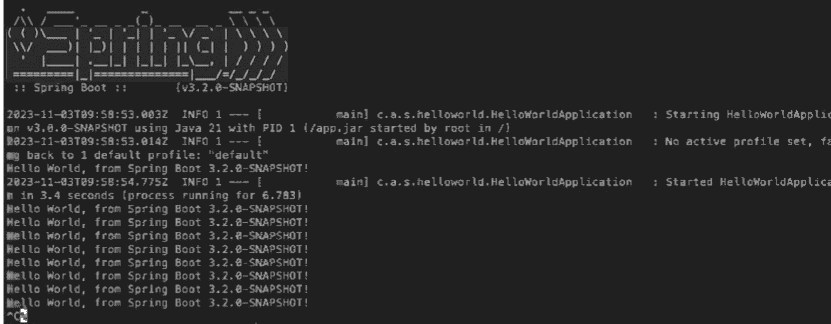

图 10-3. Spring Boot 应用程序属性的日志输出

## 传递属性

在 Docker 容器中运行 Spring Boot 应用程序时，你可能希望根据应用程序部署的环境更改属性。你可以使用 Spring 环境属性来提供指定要使用配置文件的下一个变量。通常情况下，你会这样启动应用程序：`java -jar your-application.jar --spring.profiles.active=profile1,profile2`；然而，由于你使用的是 Docker 容器，这可能是不可行的。

幸运的是，由于你有 Docker 容器，可以使用 `-e` 切换传递环境变量。在此教程中我们选择了 Fabric8 的 `docker-maven-plugin`，但其他插件同样有效。

## 构建更好的容器

虽然我们使用的简单 Dockerfile 可用，但它并不高效。使用多阶段 Dockerfile 会更好。参见列表 10-13。

### 列表 10-13. 多阶段 Dockerfile

```dockerfile
FROM eclipse-temurin:21-jre-alpine AS builder

ARG JAR_FILE

COPY ${JAR_FILE} app.jar

FROM eclipse-temurin:21-jre-alpine

WORKDIR application

COPY --from=builder /app.jar app.jar

ENTRYPOINT ["java","-Djava.security.egd=file:/dev/urandom","-jar","/app.jar"]
```


## 使用 Buildpacks 构建容器

虽然你可以使用 Dockerfile，但其他选择之一是使用云原生构建包。云原生构建包是 Heroku 和 Cloud Foundry 等平台的一部分。然而，你也可以使用它们来生成兼容 Docker 的容器。

Spring Boot 的 Maven 和 Gradle 插件都支持此功能。调用 `mvn spring-boot:build-image` 就足够创建容器。执行时，它将首先下载一个容器来运行并构建镜像。这将需要一些时间；然而，这是一次性的下载（直到容器有新版本）。后续构建将运行得快得多。

### 构建输出示例

```
[INFO] [creator] 定器：导出器启动于 2023-10-25T14:18:30Z
[INFO] [creator] 复用层 'paketo-buildpackacks/ca-certificates:helper'
[INFO] [creator] 复用层 'paketo-buildpacks/bellsoft-liberica:helper'
[INFO] [creator] 复用层 'paketo-buildpacks/bellsoft-liberica:java-security-properties'
[INFO] [creator] 复用层 'paketo-buildpacks/bellsoft-liberica:jre'
[INFO] [creator] 复用层 'paketo-buildpacks/executable-jar:classpath'
[INFO] [creator] 复用层 'paketo-buildpacks/spring-boot:helper'
[INFO] [creator] 复用层 'paketo-buildpacks/spring-boot:spring-cloud-bindings'
[INFO] [creator] 复用层 'paketo-buildpacks/spring-boot:web-application-type'
[INFO] [creator] 复用层 'buildpacksio/lifecycle:launch.sbom'
[INFO] [creator] 复用 5/5 个应用层
[INFO] [creator] 复用层 'buildpacksio/lifecycle:config'
[INFO] [creator] 复用层 'buildpacksio/lifecycle:process-types'
[INFO] [creator] 添加标签 'io.buildpacks.lifecycle.metadata'
[INFO] [creator] 添加标签 'io.buildpacks.build.metadata'
[INFO] [creator] 添加标签 'io.buildpacks.project.metadata'
[INFO] [creator] 添加标签 'org.opencontainers.image.title'
[INFO] [creator] 添加标签 'org.opencontainers.image.version'
[INFO] [creator] 添加标签 'org.springframework.boot.version'
[INFO] [creator] 设置默认进程类型 'web'
定器：正在保存 docker.io/library/recipe_10_4_iii:3.0.0-SNAPSHOT... 已于 2023-10-25T14:18:30Z
[INFO] [creator] *** 镜像 (973964c80779):
docker.io/library/recipe_10_4_iii:3.0.0-SNAPSHOT
[INFO] [creator] 定器：保存 docker.io/library/recipe_10_4_iii:3.0.0-SNAPSHOT... 运行了 3.20189623s 并结束于 2023-10-25T14:18:33Z
[INFO] [creator] 定器：导出器运行了 3.320421063s 并结束于 2023-10-25T14:18:33Z
[INFO] [creator] 定器：缓存启动于 2023-10-25T14:18:33Z
[INFO] [creator] 复用缓存层 'paketo-buildpacks/syft:syft'
[INFO] [creator] 复用缓存层 'buildpacks/lifecycle:cache.sbm'
[INFO] [creator] 定器：缓存运行了 247.300377ms 并结束于 2023-10-25T14:18:34Z
[INFO] 成功构建镜像 'docker.io/library/recipe_10_4_iii:3.0.0'
```

现在构建完成后，我们可以使用 `docker run recipe_10_4_iii:3.0.0` 来运行我们的容器，并每隔两秒再次看到 hello world 信息。

## 10-5. 使用 Spring Boot GraalVM 原生镜像

GraalVM 原生镜像是单一的可执行文件，不需要 Java 和其他依赖项。它们通过在“编译时”编译 Java 程序而不是“运行时”来生成。这些原生镜像可能具有更小的体积、更低的内存占用，并且启动更快。原生镜像非常适合在容器化环境中运行，特别是作为函数服务（如 AWS Lambda）。但是，使用原生镜像时存在一些缺点：

- 类路径是固定的，需要在构建时完全定义。
- 应用程序中的无法在运行时更改。
- 原生镜像不支持 `@Profile`；运行配置需要在构建时提供。
- 依赖于 `Environment` 的 `@Conditional` 仅在构建时可用。
- 不能使用表达式或方法引用定义的 Bean。

所有限制都源于 GraalVM 在“封闭世界”中运行，这意味着所有的类和字节码在构建时都必须存在。通过提前（AOT）处理，我们可以帮助 GraalVM 获取所需的类和字节码。Spring 本身在提供信息方面做得很好，我们也可以通过提供元数据来帮助 AOT 处理。

### 问题

你想为 Spring Boot 应用程序创建一个原生执行文件。

### 解决方案

Spring Boot 可以利用 Maven 和 Gradle 的 GraalVM 插件来创建原生镜像。对于 Maven，有一个特殊的配置来生成镜像。

### 使用原生工具构建原生镜像

要使用 Maven（或 Gradle）插件在本地机器上构建镜像，你需要安装 GraalVM 并在构建中包含该插件。见列表 10-15。

#### 列表 10-15. Maven GraalVM 插件

```xml
<plugin>
  <groupId>org.graalvm.buildtools</groupId>
  <artifactId>native-maven-plugin</artifactId>
</plugin>
```

有了此配置，你可以运行 `mvn -Pnative:compile`，应用程序将被构建、分析，并最终为你编译的平台生成一个执行文件。二进制文件的创建需要一段时间。目前尚无法进行交叉编译，因此无法在 macOS 上创建 Windows 执行文件；你需要使用一个包含 Windows 和 GraalVM 的构建容器。

生成的二进制文件位于 `target` 目录，并命名为 `recipe_10_5`（制品名称）。启动它的输出与 Java 运行方式相同，不同在于启动速度极快。

权衡是用更长的编译时间换取更快的启动时间和内存占用。

### 使用 Buildpacks 构建原生镜像

构建原生镜像的另一种方法是使用 buildpack（见 Recipe 10-4）。使用 buildpack 时，不需要在本地安装 GraalVM，因为它作为镜像的一部分被下载。你需要在构建中使用 GraalVM Maven 插件。见列表 10-16。

#### 列表 10-16. Maven GraalVM 插件

```xml
<plugin>
  <groupId>org.graalvm.buildtools</groupId>
  <artifactId>native-maven-plugin</artifactId>
</plugin>
```

要使用 buildpack，只需带有所需的 Maven profile 运行常规构建。运行 `mvn -Pnative spring-boot:build-image` 即可。进程完成后，你将获得带有原生执行文件的容器镜像，你可以使用 Docker、K8S 或其他容器技术运行它。

### 工作原理

构建时，GraalVM 原生镜像是根据当前 JVM 可用的代码创建的。基于此，GraalVM 将编译出一个原生执行文件。GraalVM 假设在检查应用程序时，运行所需的所有代码都存在于 JVM 中。如果代码不存在，它将成为生成的原生执行文件的一部分。将字节码编译为原生代码的过程称为提前（AOT）编译，而不是 JVM 在即时（JIT）编译时所执行的操作。

Spring 支持提前向 GraalVM 贡献信息，Spring Boot 在 Spring Boot 插件中利用了该支持。当运行 `mvn -Pnative:compile` 时，你会在输出中看到一行类似于 `[INFO] --- spring-boot:3.2.1:process-aot (process-aot) @ recipe_10_5_i ---` 的内容。见图 10-5。


图 10-5. Maven process-aot，Spring Boot 将执行以下操作：

- 生成 Bean 定义的源码
- 生成包含 GraalVM 提示的文件
- 生成代理类的字节码

GraalVM 对运行应用程序所需的代码进行适当的静态分析需要所有这些步骤。

### 生成 Bean 定义的源码

由于我们无法在 GraalVM 原生镜像中使用动态代码，因此我们需要静态配置。通常情况下，在启动应用程序时会解析 `@Configuration` 类，并根据 `@Bean` 注解的方法，Spring 会创建特殊的 BeanDefinition 源文件。实际的 `@Bean` 方法是通过反射调用的，这在原生镜像中是无法实现的。

现在创建原生镜像时，不再在运行时解析 `@Configuration` 类和 Bean，而是在 AOT 处理期间生成 Bean 定义。它实际上会为 `@Configuration` 类生成源文件。这些类可以在 `target/spring-aot/main/sources` 中找到，见图 10-6。


图 10-6. 生成的源码

你可以看到，还有一个 `org` 目录，因为它会为所有生成的 `@Configuration` 类生成源码。这适用于加载的 Spring Boot 配置类和其他 `@Configuration` 类。

### 生成 GraalVM 提示

除了生成源码外，Spring AOT 还会生成一个 GraalVM 使用的提示文件。该提示文件以 JSON 格式包含了 GraalVM 如何处理它无法直接理解的情况，例如反射、多构造函数或动态类加载。

提示文件自动生成在 `target/spring-aot/main/resources` 目录下。见图 10-7。

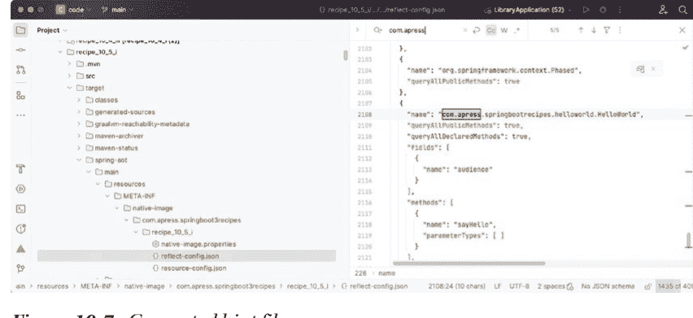

图 10-7 生成的提示文件

虽然 Spring Boot 会尽力根据代码推断并生成提示，但它可能无法确定，或者需要一些帮助。Spring AOT 可以提供帮助，并提供了 `RuntimeHintsRegistrar` 接口，允许为相关代码注册额外的提示。定义特定提示后，你可以使用 `@ImportRuntimeHints` 注解让 Spring AOT 感知此类。见列表 10-17。

#### 列表 10-17. 注册运行时提示

```java
package com.app.spring.aot.hint.RuntimeHints;

import org.springframework.framework.aot.hint.RuntimeHintsRegistrar;
import org.springframework.framework.boot.SpringApplication;
import org.springframework.boot.autoconfigure.SpringBootApplication;
import org.springframework.framework.context.annotation.ImportRuntimeHints;
import org.springframework.framework.scheduling.annotation.EnableScheduling;

@SpringBootApplication
@EnableScheduling
@ImportRuntimeHints(HelloWorldApplication.HelloWorldRuntimeHints.class)
public class HelloWorldApplication {

  public static void main(String[] args) {
    SpringApplication.run(HelloWorldApplication.class, args);
  }

  static class HelloWorldHints implements RuntimeHintsRegistrar {

    @Override
    public void registerHints(RuntimeHints hints, ClassLoader cl) {
      hints.resources().registerPattern("classpath:*.properties");
    }
  }
}
```


在这里我们为包含类路径根目录下的所有 `.properties` 文件创建资源提示。如果文件是动态加载的且 Spring 或 GraalVM 无法检测到，则可能需要。在注册运行时提示时，我们可以为 jni、代理、反射、资源和/或序列化注册提示。所有这些都会向一个可用提示文件贡献项。

# 为代理类生成字节码

最后，Spring AOT 将生成包含运行时创建的代理字节码的实际类文件。代理是动态创建的类，这在 GraalVM 中是不可能的；因此它们在构建时被导出。代码生成在常规 `target/classes` 目录中，可以通过 `$SpringCGLIB$<number>` 后缀看出。见图 10-8。

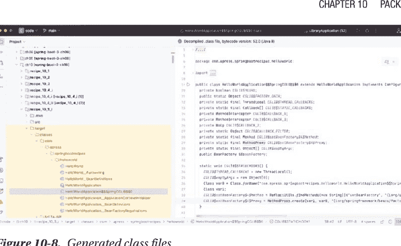

创建此代理是因为 `@SpringBootApplication` 也是一个 `@Configuration` 类，其 `proxyBeanMethods` 属性被设置为 `true`。所有使用像 `@Transactional` 注解等 AOP 的类都将生成类，在普通应用程序中可能会生成几个类。

图 10-8 生成的类文件

# 索引

# A

- Actuator
  - CPU 指标, 452
  - dependencies, 444
  - 导出指标, 456
  - Graphite 配置, 457, 458
  - micrometer-registry-graphite, 458
  - properties, 457
  - 暴露属性, 445
  - 健康检查/指标, 443, 450
    - dependencies, 453
    - HealthIndicator/MetricBinder, 452
    - HealthIndicator implementation, 453
    - MeterBinder implementation, 454
    - TaskScheduler, 456
  - HTTP 暴露指标, 445, 446
  - 个别端点, 448, 449
  - 管理服务器属性, 447, 448
  - 指标配置, 450–452
  - 安全访问, 449
  - Web 访问, 444
  - Zipkin (见 Zipkin (追踪解决方案))

- dependencies, 17
- HelloWorldApplication 源码, 288
- 乘法操作类, 22
- 操作接口, 21
- 工作流程, 217

# B

- 数据访问
- 数据库管理
  - CustomerLister, 288, 289
  - data.sql 文件, 288
  - dependencies, 286
  - Flyway dependencies, 290–292
  - 初始化, 288
  - 初始化属性, 287
  - 迁移脚本, 290
  - schema.sql 文件, 287
  - 工作流程, 286

- 数据源
  - 连接池, 280, 284–286
  - dependencies, 280
  - 嵌入式服务器, 281–283
  - 外部数据库, 283, 284
  - HikariCP, 284
  - JNDI 查找属性, 284
  - TableListener, 281, 283

- Bean 配置
  - `@Bean` 方法, 19–25
  - CalculatorApplication 源码, 22–25
  - calculator 类源码, 20
  - `@Component` 注解的类, 17, 18

- JDBC (见 Java Database Connectivity (JDBC))
- JPA, 307
- JPA 类, 307–332
- MongoDB, 321

# INDEX

数据访问（续）

- R2DBC (见 Reactive Relational Database Connectivity (R2DBC))
- 关系数据库, 279
  - 类型, 279
- Devtools 开发
  - controller, 65
  - 默认属性, 64, 65
  - dependencies, 65
  - JdbcTemplate, 66–68
  - PostgreSQL 容器, 65
  - 重建/重启, 63
- Docker, 53, 303, 335, 416
- BeanDefinition 源码, 490
- buildpack, 488
- 提示文件, 491–493
- Maven 插件, 489
- native 镜像, 487, 788
- native 可执行文件, 487
- 代理类, 492, 730
- 工作流程, 489

# H

处理异常

- 自定义错误页面, 101
- MVC 应用
  - 属性, 101–103
  - 自定义错误页面, 98–100
  - ErrorAttributes 实现, 102, 104
  - 异常处理属性, 97
  - 错误页面, 96
  - 详情, 105, 106
  - REST 控制器, 103–105
  - 视图技术, 97–101
  - 默认错误页面, 98

# E

异常处理（见 Handling exceptions）

- 现有应用/模块, 52, 53
- 外部化属性
  - 国际化 (I)
  - CalculatorApplication 源码, 27
  - 命令行参数, 25, 30, 31
  - 配置参数, 32
  - 默认属性, 28
  - 环境/执行, 32
  - 加载属性, 32
  - 覆盖属性, 26, 29, 30
  - 资源, 26
- WebFlux 配置, 188
  - ErrorAttributes 实现, 190
  - 错误页面, 189
  - 错误响应, 189
  - 详情, 192, 193

# F

- 基于表的登录服务, 247–251

# G

- GraalVM 原生镜像
  - 提前到 (AOT) 编译, 489
  - AOT 处理, 487

# I

- 国际化 (I18N)
  - 荷兰语, 109, 195
  - 索引页面, 108, 196, 496
  - MessageSource 接口, 193
  - 属性文件, 108, 194, 107, 195
  - Web 应用, 106
  - Web 页面, 193–196

Java Management Extensions (JMX)

- AsyncConfigurer, 358
- 启用选项, 355
- 执行过程, 356
- 长运行方法, 354
- TaskExecutor 配置, 355–359

# J

- Java Archive (JAR) (见 Web Archive (WAR))
- Database Connectivity (JDBC)
  - 数据访问, 297
  - dependencies, 298
  - 集成代码, 298
  - repository 接口, 294

- Web Archive (WAR)
  - dependencies (见 Java Archive (JAR))
  - 测试上下文框架, 300
  - 数据访问代码, 300
  - 嵌入式数据库, 301–303
  - 插入测试, 302
  - schema.sql 文件, 302
  - Testcontainers, 303–305

- JDK Timer/Quartz Scheduler, 353
- MBean 控制输出, 374
- 进程选择, 371
- printMessage 方法, 374
- 注册 bean, 370
- 运行应用, 370
- 关闭方法, 372

- Java Flight Recorder (JFR)
  - 定义, 378
  - 事件发布, 375
  - 调查应用, 374
  - 启动命令, 376
  - 任务控制, 378
- Micrometer 概念, 379
- 指标收集, 381–383
- Prometheus, 382
- 任务调度, 359
  - 回调方法, 362

Java Management Extensions (JMX)（续）

- Component 注解, 360
- 执行输出, 361
- 源码, 403, 404
- Scheduled 注解, 360
- 时间队列, 397

Java Message Service (JMS)
Java Persistence API (JPA)

- ActiveMQ, 386–390
- Artemis 配置, 390
- 属性, 390–392
- dependencies, 307
- 实体, 313–315
- 属性, 311, 312
- JNDI, 394, 395
- repositories, 307–312
- Kafka, 428–442
- 测试, 315
- 手动配置, 395, 395
- 嵌入式数据库, 315
- 池化属性, Testcontainers, 318–320

即时编译 (JIT), 489

RabbitMQ (见 RabbitMQ)

# K

Kafka

- 消费者属性, 429, 830
- dependencies, 428
- 生产者属性, 431–433
- 属性, 429
- 接收消息, 437
  - 组件, 439, 440
  - JSON 序列化配置, 440
  - 监听器属性, 438–440
  - 对象类, 440, 441
  - OrderConfirmationService, 442
  - 回复发送, 442, 443

发送消息
jakarta.jms.Message

- 配置, 406
- 监听器代码, 405
- 监听器属性, 407, 388
- MessageConverter
  - 配置, 408–315
  - 方法参数类型, 405
  - OrderConfirmationService, 410
  - 读取消息, 404
  - 接收输出, 406
  - 发送 OrderConfirmation, 409, 410

send messages

- dependencies, 201
- 集成测试, 397
- JmsTemplate, 396
- MessageConverter
  - 配置, 402
  - 消息发送组件, 396
  - order 类, 400, 401
  - OrderGenerator 类, 400
- 配置属性, 432
- KafkaTemplate, 432
- 对象类, 436–438
- 序列化配置, 436
- 简单组件, 433–489
- Testcontainer, 434
- spring.kafka properties, 428

# L

- 日志配置
  - DEBUG 日志, 50
  - 依赖, 51
  - 文件配置, 50
  - 框架, 50
- HTTP/HTTPS, 123-126
  - 密钥库, 123
  - keytool 命令, 122
  - 自签名证书, 122
  - server.ssl 属性, 122
- SSL 配置, 121
- 启动输出, 70
- 用户区域, 110

# M, N, O

- 模型-视图-控制器 (MVC)
  - 异步请求处理
    - 异步处理
      - callable, 129, 130
      - CompletableFuture, 130–132
      - controllers/TaskExecutor, 126, 129
      - 显式 TaskExecutor
        - 配置, 128
        - 日志输出, 130
      - 返回类型, 127
      - 测试过程, 132, 133
  - 自动配置, 69
  - 依赖, 69, 70
  - 嵌入式服务器, 115–121
  - 异常处理, 96–106
  - HelloWorldApplication, 70
  - HelloWorld 控制, 71, 72
  - I18N, 106–110
  - 已注册的 过滤器, 71
  - 响应写入器, 134
  - OrderController, 134, 137
  - 发送多个结果, 139–136
  - Server-Sent-Events, 139–142
  - 测试, 144–144
  - AcceptHeaderLocalResolver 定义, 111
  - 更改过程, 114, 115
  - CookieLocalResolver 属性, 112, 113
  - HTTP 请求头, 111
  - LocaleChangeInterceptor, 114
  - LocalResolver 接口, 111
  - 会话属性, 111
  - WebMvcTest 切片测试, 73–75

## MongoDB
- CustomerList, 325
- CustomerRepository 接口, 322
- DataInitializer, 324
- 依赖, 321
- Flapdoodle, 332–334
- MongoTemplate, 322–327
- 属性, 321, 327, 328
- 存储库, 329–332
- Testcontainers, 335, 336
- 多用途邮件扩展标准 (MIME), 116, 203, 363, 364

# P, Q

- 打包设计, 469
  - docker 容器, 479
  - buildpacks, 484–486
  - Dockerfile, 479–481
  - 日志输出, 481
- REST (参见 表征状态转移 (REST))
- 结果处理, 72
- servlet 容器
  - BeanPostProcessor, 129

# INDEX

## 打包设计（续）
- Maven 插件, 480
- 多阶段层, 483
- 传递属性, 481, 482
- 可执行文件
  - Gradle 插件, 470
  - JAR/WAR, 469
  - Maven 插件, 470
  - 属性, 471, 472
- GraalVM 原生镜像, 486–493
- Thin Launcher, 477
- WAR/JAR 文件, 472–476
- 引导类, 340
- 连接池属性, 338
- CustomerRepository 接口, 339
- DatabaseClient, 341–343
- 依赖, 337
- 属性, 337
- R2dbcEntityTemplate, 343–345
- R2dbcRepository, 345
- 测试
  - 嵌入式数据库, 346–348
  - 集成测试, 346
  - Testcontainers, 349–351

# R

## RabbitMQ
- AMQP 依赖, 411
- 配置, 411
- 属性, 412
- 接收消息, 422
  - 组件, 424
  - 对象配置, 424–426
  - OrderConfirmationService, 427
  - 属性, 423, 424
  - 响应发送, 426, 427
- 发送消息
  ## MessageConverter
  - 配置, 418
  - 模拟, 415
  - 对象, 417–422
  - Order 类, 418–422
  - RabbitTemplate, 412, 413
  - 简单消息, 414–417
  - Testcontainer, 416, 417
  - spring.amqp 属性, 411

## 响应式关系数据库连接 (R2DBC)
- 应用属性, 338
- 表征状态转移 (REST)
  - 应用类, 77, 78
  - Book 记录, 75
  - BookService 接口, 76
  - 依赖, 74
  - HTTP 命令, 81
  - 内存实现, 76
  - 集成测试, 82–85
  - JSON 编部化, 74
  - MVC 资源, 74
  - 输出窗口, 81
  - 表征, 82
  - 请求映射, 80
  - 资源
    - BookServiceClient, 156
    - 控制器, 152
    - 声明式 HTTP 客户端, 154–160
    - EnrichedBookController, 158
    - EnrichedBook 记录, 145
    - HttpExchange 属性, 154
    - HttpServiceFactory
      - 配置, 157
    - MockRestRequestMatchers, 163
    - OpenLibraryClient, 157
    - RestClient 定义, 151–154
    - RestTemplate/RestController, 144, 160
      - 配置, 146–150
      - web 依赖, 145
    - `@RestController`, 78, 79
- WebFlux
  - BookController, 176, 177
  - book 记录, 175
  - BookServiceClient, 231
  - 声明式 HTTP 客户端, 227–234
  - EnrichedBookController, 233
  - EnrichedBookRecord, 222
  - HttpExchange 属性, 228–230
  - HttpServiceFactory
    - 配置, 232
  - 内存实现, 174
  - 集成测试, 179–181
  - LibraryApplication, 177
  - OpenLibraryClient, 231
  - 输出结果, 178
  - 响应式端点, 173
  - 资源, 221
  - 流式 JSON, 178, 179
  - WebClient, 223–227
- 安全方法
  - 调用, 267–269
  - 身份验证结果, 238
  - 配置, 236
  - 生成密码输出, 236
  - 集成测试, 241–244
  - 属性, 237
  - 未身份验证结果, 237
  - AUTHORITIES 表, 258
  - 数据库, 256–260
  - 内存定义, 255
  - MEMBER_ROLE 表, 259
  - MEMBER 表, 259
  - OAuth2/Open Connect, 260–263
  - 客户端, 260
  - 安全资源, 254
  - SQL 查询, 256
  - 表 结构, 257, 259
  - UserDetailsService 配置, 255, 258
  - 用户存储库, 255
  - USERS 表, 257
  - web 应用
    - 匿名访问, 244
    - 匿名登录服务, 253
    - 上下文集成/异常处理, 245
    - 失败配置, 250
    - 表单登录服务, 247
    - HTTP 基础认证, 246
    - 日志过程, 244
    - 登录配置, 249
- 安全集成
  - 访问控制
    - 访问规则, 266
    - 内置表达式, 265, 275, 276
    - 定义, 264
    - 表达式, 266, 267
    - InMemoryBookService, 268
    - 记住支持, 254
  - 安全集成（续）
    - 访问规则, 271–273
    - 身份验证用户, 274, 275
    - 内置表达式, 275, 276
    - 配置, 270
    - 依赖, 269, 270
    - 日志配置, 273
    - 登录页面, 271
    - 安全输出, 270
    - UserDetailsService, 274
    - WebTestClient, 243
- Servlet 容器, 嵌入式
  - 启动日志, 121
  - 通用服务器属性, 116, 117
  - HTTP 会话, 118, 119
  - JSP 服务器属性, 117
  - 运行时容器, 120, 121
  - 选择/配置, 115
  - SSL 属性, 119, 120
- WebFlux
  - 通用服务器属性, 203–206
  - HTTP 会话属性, 204
  - 运行时容器, 206, 207
  - 选择/配置, 205
  - SSL 属性, 205
  - undertow 容器, 207

## Spring Boot 应用
- Actuator, 443
- Apache Kafka, 428–442
- 自动配置, 1
- 容器化, 479
- 定义, 1
- 基础功能, 17
- Gradle
  - build.gradle 文件, 8, 9
  - DemoApplication 类, 9–11
  - 依赖, 7
  - `@SpringBootApplication`, 11
- Maven
  - 应用类, 5–7
  - DemoApplication 类, 5
  - 依赖, 3
  - JAR 文件, 3
  - Java 类, 2
  - pom.xml 文件, 2–4
  - `@SpringBootApplication`, 6
  - spring-boot-starter-parent, 2
- MVC 应用, 69
- 打包, 469
- 安全集成, 235
- Spring Initializr
  - 依赖, 12
  - 导入项目, 15
  - JAR 文件, 16, 17
  - 值, 14
  - 工作过程, 12
- WebFlux, 165
- Spring 表达式语言 (SpEL), 86, 182, 264, 267

## 测试配置
- 控制器, 41
- 组件, 32
- 集成, 36, 37
- MockBean 注解, 38, 79
- 模拟/桩, 33
- Mockito 框架, 34, 35
- 切片注解, 40–44
- Testcontainers 库
  - 容器定义, 48, 89
  - 接口, 48

## Thymleaf 应用
- 控制器/视图, 89–92
- 依赖, 85
- 详情页, 92, 93
- 首页页, 88, 89
- 集成测试, 93–96
- 列表页, 89
- 属性, 86, 88
- 集成测试, 172, 173
- 单元测试, 170–172
- 有效参数类型, 166

# 索引

## WebFlux 应用（续）

- 用户本地化 (user locales)
  - AcceptHeaderLocaleContextResolver, 197
  - CookieLocaleContextResolver, 200
  - FixedLocaleContextResolver, 198
  - HTTP 请求, 197
  - index.html 文件, 202
  - LocaleChangeWebFilter, 201
  - LocaleContextResolver, 196, 197
  - LocaleContextResolver
    - 实现 (Implementation), 18, 199
    - WebFilter 实现 (WebFilter implementation), 200, 201

## Z

- Zipkin (追踪解决方案)
  - AspectJ, 466, 467
  - 组件 (components), 461
  - 配置属性 (configuration properties), 465
  - 关联日志属性 (correlation logging properties), 463
  - 依赖 (dependencies), 459
  - 日志文件 (log files), 458
  - 日志输出 (logging output), 459
  - 观测 (observation), 461–463
  - ObservationRegistry, 465, 466
    - 属性 (properties), 464, 465
    - 追踪依赖 (tracing dependencies), 463
  - UI, 多跨 (multiple spans), 460–462
