# Spring Boot 入门指南：一本不后悔的入门：[实用指南]从基础学习 Spring Boot 2.4——Java, Spring Data JPA, Spring MVC, Spring Security, Spring Web, Mybatis, Spring Framework


如果你手里拿着这本书，说明你可能计划在未来使用`Spring(Spring Boot)`进行开发。每个人在第一次尝试新事物时都会感到焦虑和恐惧。（同时，你也可能感到很兴奋）。但这是一件好事。因为我们正努力消除这种焦虑。无论原因何，尝试新事物都会带来成长。未知越多，成长的程度就越大。因此，对于已经迈出这一步的你，成长正等待着你。

当我开始学习`Spring`时，我买了很多与`Spring`相关的书籍（因为我很害怕）。但我并没有找到一本满意的书。为了改变这种局面，我们在 2018 年出版了这本书的第一版。由于`Spring`也在演进，我出版了第二版。

在书中，你将使用`Spring`创建一个 Web 应用程序。从学习`Spring`的基础知识开始，逐步完成你的应用程序。通过这种方式，你不仅能够掌握`Spring`，还能获得 Web 开发所需的知识。换句话说，你可以从对 Web 开发一无所知，提升到能够一次性精通`Spring`。

然而，这本书强调实践而非理论。学习方法有很多，但亲身实践是学习的最高效的方法之一。这是因为科学证明，输出的知识留存率很高。此外，当你实际动手制作并执行它时，你的焦虑和恐惧就会消失，从而获得信心。虽然实际动手做会更好，但起初只读书也可以的。由于所有的示例代码都可以下载，你甚至可以从中间开始创建应用程序。

## 关于第二版

自本书第一版出版以来，我非常荣幸地收到了许多高评价。

[第一版评价]

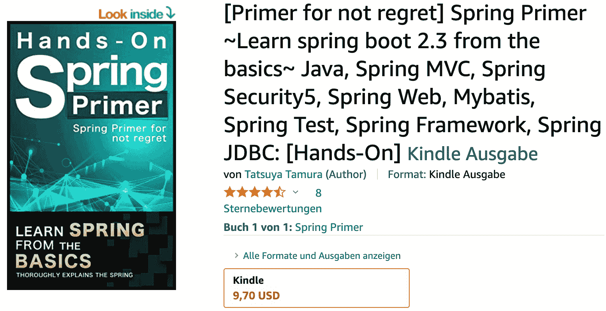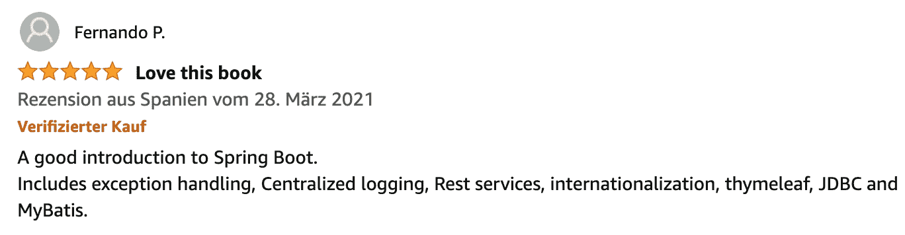

在第二版中，我进行了以下修改：

* 添加了关于`MyBatis`和`JPA`的内容
* 修改了`REST`使其更具实践性
* 支持`SpringBoot 2.4`

这些都是开发领域经常使用的功能。因此，实战性内容在增加。

## 彻底追求清晰！

为了方便理解，书中按照顺序描述了以下内容：

* **融入大量插图**：解释时是否有图表，理解的难易程度会发生巨大变化。因此，本书包含了许多插图，使其更易理解。
* **循序渐进**：教某个东西时有些要点需要注意。那就是一次只讲一件事。同时告诉多件事会让人困惑。由于书籍只能通过文字和图表来解释，我将逐一为你讲解。
* **明确目标**：在实际编写示例代码之前，我会先解释要做什么。如果你知道自己的目标，理解起来会更好。

我们还在解释`DI`（依赖注入）方面投入了大量精力。其他书籍是为高级 Java 用户和经验 Spring 用户解释`DI`的。但这本书描述`DI`的方式让即使是 Java 初学者也能理解。

## 本书结构

请按顺序阅读，从第 1 章开始，你将逐步构建你的应用程序。例如，首先显示`Hello World`，然后是验证（输入检查）、然后是界面布局、数据库操作等等等。

## 目标读者

在阅读本书时，最好具备以下知识：

* `Java`基础
* `HTML`基础
* `SQL`基础

基础水平知识即可。

## 应用程序配置

本文开发的 Web 应用程序将使用以下配置创建：

* `Spring`: 5
* `Spring Boot`: 2.4.1
* `Database`: H2
* 这是写作时的最新版本。

现在，开始读这本书吧。

*使用电子书浏览时，我建议使用平板设备。*

# 附录

示例源码

# 结语

# Spring 概述

本章描述了 Spring 的概述。

## 1.1 什么是 Spring?

Spring 是一个用于 Java 开发的框架。以前有几个框架。然而，使用 Spring 作为 Java 开发的框架已成为常识。这是因为比其他框架开发起来更简单、更快。它还功能丰富，可以胜任任何项目。

### 1.1.1 什么是框架？

让我们先考虑不使用框架的情况。在这种情况下，需要从零开始构建应用程序。例如，假设你创建一个登录功能。在这种情况下，有必要创建一个程序，从数据库中检索用户信息并验证密码。

现在考虑考虑框架。框架预先提供了一些常用功能。开发者只需要创建他们想要更改的功能部分。然后框架会调用执行该更改的程序。对于登录功能，开发者只需创建用于检索用户信息的 SQL。框架提供了其他处理。

[图] 什么是框架？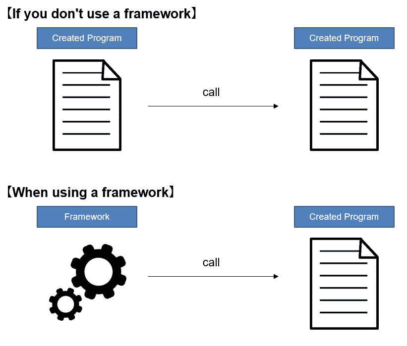

换句话说，使用框架，你只需要通过创建程序的必要部分就可以创建一个应用程序。由于不需要创建所有的程序，开发效率将会提高。因此，在开发中使用框架是常识。

顺便提一下，调用所创建程序的一侧被称为“控制反转”（简称为`IoC`）。这个思想也可以在`DI`（依赖注入）中看到。

## 1.2 什么是 Spring Boot?

Spring Boot 是一个省去初始化 Spring 烦恼的框架。在 Spring Boot 出现之前，Spring 的初始配置可能会让你感到头疼。因为你需要准备一个 xml 文件来使用 Spring 的功能。对专业知识的需求（例如如何编写 xml 文件）导致初始设置非常繁琐，并延迟了开发。

为了解决这个问题，创建了 Spring Boot。在 Spring Boot 中，你只需要选择你想在应用程序中使用的函数。之后，Spring Boot 将自动执行初始设置。你只需简单地更改属性的值即可轻松更改设置。Spring Boot 现在之所以被使用，是因为它可以提高开发效率。

将此与制作蛋糕进行类比如下：

* **Spring**
  这仅仅是材料的对齐。
* **Spring Boot**
  如果你选择了制作蛋糕的原料，蛋糕已经在某种程度上完成了。你所做的只是放上草莓并进行各种装饰。

# 2. 构建开发环境

在创建程序之前，让我们先构建开发环境。Spring 有两种 eclipse。一个是普通的 eclipse。普通的 eclipse 通过添加插件来实现。另一个是 Spring 用的 eclipse。两种 eclipse 的功能相同。书中列出了两种设置方法，请选择易于使用的一种。

* 普通 eclipse
* 安装 Spring 专用 eclipse
* 安装 Lombok

## 2.1 普通 eclipse

如果你使用普通的 eclipse，请添加插件。你就可以用 Spring 进行开发。

## 2.2 安装 Spring 专用 eclipse

专门用于 Spring 的 eclipse 称为 SpringToolSuite。最初被称为 STS。由于 STS 中不包含 JDK，请提前安装 JDK。

### 2.2.1 安装 STS

现在让我们安装 STS。搜索 "sts download" 以显示下载站点。[STS 下载站点](https://spring.io/tools)

根据你的操作系统下载文件。本书以 Windows 版本为例。将下载的 jar 文件放在你选择的路径下。然后，在书中将 jar 文件直接放在 C 盘根目录下（`C:\`）。双击 jar 文件创建一个名为`sts-4.9.RELEASE`的文件夹。文件夹内部有一个名为`SpringTool4.exe`的文件。这就是 STS 的 eclipse。

## 2.3 安装 Lombok

在创建项目之前，添加一个名为 Lombok 的实用库。Lombok 会自动生成非本质代码。例如，如 getter 和 setter 等方法会自动生成。它非常方便，并用于大多数开发环境。如何使用此功能的细节将在第 3 章及后续章节介绍。

※最新版本的 eclipse 可能自带 Lombok。

※在关闭 eclipse 或 STS 的情况下安装 Lombok。

首先，下载 Lombok jar 文件。你可以通过搜索 "lombok download" 找到下载站点。[Lombok 下载站点](https://projectlombok.org/download)

点击`1.18.XX`下载`lombok.jar`文件。双击`lombok.jar`文件启动安装程序。等待一会儿，将显示`eclipse.exe`或`SpringToolSuite4.exe`的路径。如果一段时间后路径未出现，点击`Specify`。你可以指定`eclipse.exe`和`SpringToolSuite4.exe`的路径。选择你想要安装 Lombok 的 exe 文件，并按下`Install/Update`按钮。如果显示 "Install successful"，则安装完成。

## 2.4 创建项目

如果未安装插件，请执行以下操作：选择 Help（帮助）> Eclipse Marketplace（插件市场）。在搜索字段中输入 "spring"。如果显示 Spring 工具，选择 Spring 工具。如果插件已安装，请配置设置。接受许可并点击 Finish（完成）。插件将在一段时间后安装完成。然后重启 eclipse。

注意：`eclipse.ini`, `SpringToolSuite4.ini`

如果 Lombok 工作不正常，请以 clean 模式启动 eclipse 或清理项目。

如果 Lombok 仍然不起，请检查`eclipse.ini`或`SpringToolSuite4.ini`文件的内容。确保`-javaagent`中设置了`lombok.jar`的路径。

```ini
[eclipse.ini]
-javaagent:C:\pleiades\eclipse\lombok.jar
```

## 2 创建项目

让我们创建一个 SpringBoot 项目。在创建项目时，你必须连接互联网以下载库。

1. 右键点击`Project Explorer` > `New` > `Other`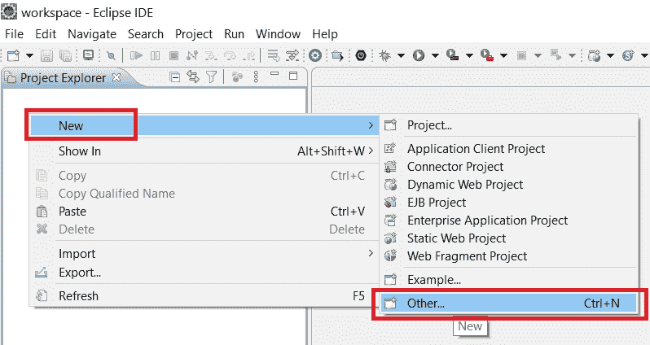
2. 在`SpringBoot`中选择`Spring Starter Project`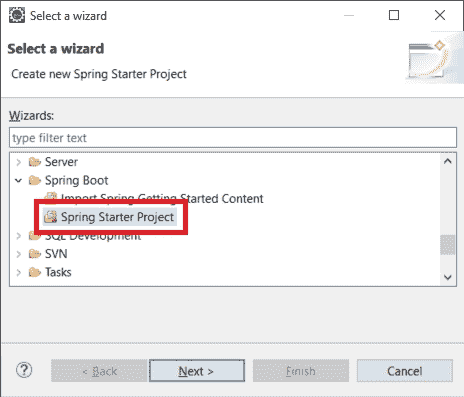
3. 在`Name`字段中输入所需的项目名称。在本书中，项目名称为`SpringBootSample`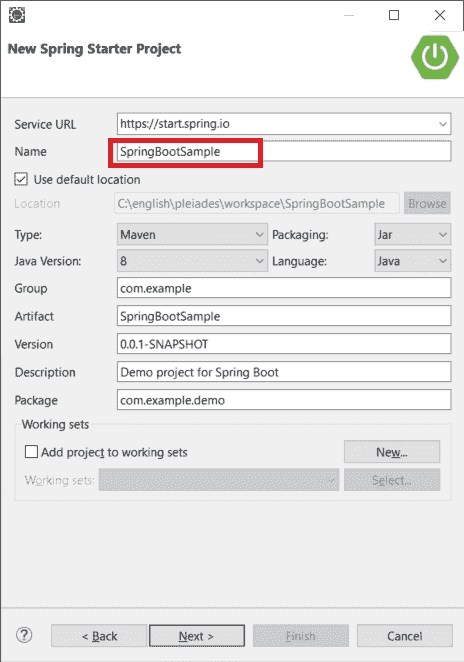
4. 选择项目中要使用的库。选择库后，点击`[Finish]`。稍片后，项目将被创建并下载库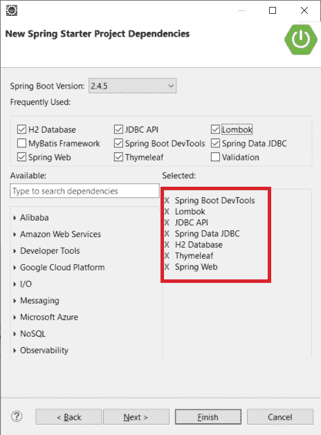

※ 根据`SpringBoot`的版本，库的名称可能会发生变化。

※ 默认指定最新版本的`Spring Boot`。如果你想更改`Spring Boot`的版本，可以在名为`pom.xml`的文件中进行更改。添加了以下库。

| 分类 | 库 |
| :--- | :--- |
| 开发者工具 | Spring Boot DevTools |
| Lombok | Lombok |
| SQL | JDBC API |
|  | Spring Data JDBC |
|  | H2 Database |
| 模板引擎 | Thymeleaf |
| Web | Spring Web |

注意：所选库提供了每个库的概述。

* **Spring Boot DevTools**
  `SpringBootDevTools`是一个提高开发效率的辅助工具。它会自动重启 Web 应用。例如，假设你修改并保存了 Java 代码。在这种情况下，在重启 Web 应用之前更改不会生效。通过安装`SpringBootDevTools`，你可以在保存文件的一刻自动重启 Web 应用。这减少了重启操作并提高了开发效率。
* **Lombok**
  你可以使用你的`Lombook`。
* **JDBC API、Spring Data JDBC**
  `Spring`允许你使用`JDBC`运行 SQL。
* **H2**
  `H2`数据库不需要设置。因此，它可以作为学习和测试环境的数据库。
* **Thymeleaf**
  `Thymeleaf`是`SpringBoot`作为标准的 HTML 模板引擎。模板引擎是将 HTML 模板和数据合成为 HTML 的能力。例如，Java 的`list`可以被循环并显示为列表。

  在使用`Thymeleaf`之前，`JSP`是一种流行的模板引擎。`JSP`将 Java 代码放在 HTML 中，导致 HTML 非常难以阅读。`Thymeleaf`改进了这一点，使 HTML 更容易理解。
* **Web**
  你可以使用`SpringMVC`开发 Web 应用。

注意：关于 Maven

当你创建一个`SpringBoot`项目时，它包含一个名为`Maven`的项目管理工具。`Maven`管理库依赖等。库可能是使用不同的库创建的。在这种情况下，如果不是从开发源库顺序加载 Java，将会发生错误。然而，`Maven`会确定它们的关系并按顺序加载。换句话说，`Maven`让项目管理变得更容易。要添加、删除或更改库的版本，请编辑`pom.xml`文件。项目中要的库放在`<dependencies>`标签中。

```xml
[pom.xml]
<dependencies>
  <dependency>
    <groupId> org.springframework.boot</groupId>
    <artifactId> spring-boot-starter-data-jdbc </artifactId>
  </dependency>
  <dependency>
    <groupId> org.springframework.boot</groupId>
    <artifactId> spring-boot-starter-jdbc</artifactId>
  </dependency>
  <dependency>
    <groupId> org.springframework.boot</groupId>
    <artifactId> spring-boot-starter-thymeleaf</artifactId>
  </dependency>
  <dependency>
    <groupId> org.springframework.boot</groupId>
    <artifactId> spring-boot-starter-web</artifactId>
  </dependency>
  <dependency>
    <groupId> org.springframework.boot</groupId>
    <artifactId> spring-boot-devtools</artifactId>
    <scope> runtime</scope>
    <optional> true</optional>
  </dependency>
  <dependency>
    <groupId> com.h2database</groupId>
    <artifactId> h2</artifactId>
    <scope> runtime</scope>
  </dependency>
  <dependency>
    <groupId> org.projectlombok</groupId>
    <artifactId> lombok</artifactId>
    <optional> true</optional>
  </dependency>
  <dependency>
    <groupId> org.springframework.boot</groupId>
    <artifactId> spring-boot-starter-test</artifactId>
    <scope> test</scope>
  </dependency>
</dependencies>
```

你之前选择的库以及`SpringBoot`默认安装的库。这些是第 3 章所需的库。第 3 章及之后需要的函数将根据需要添加。你的开发环境现在已经就绪了。在接下来的章节中，我们将创建一个简单的示例。

# 3. Hello World…

### 创建一个简单的示例

本章有两个目的：

* 熟悉使用`Spring Boot`
* 了解`Spring Boot`的便利性

为了实现这一点，你创建一个简单的 Web 页面示例。示例按以下顺序创建：

* 显示 HTML
* 在页面之间传递值
* 从数据库获取值

### 3.1 显示 HTML

### 概述

创建一个显示“Hello World”页面的示例。显示的页面如下：

[示例图片]

在服务端（`SpringBoot`），创建一个名为`controller`的类。

[处理概述]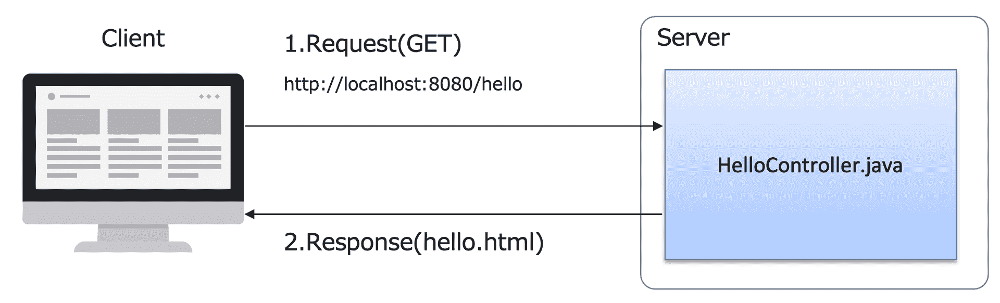

1. **请求 (GET 方法)**
   在浏览器中输入 URL 发送 HTTP 请求。
2. **响应 (hello.html)**
   当向服务器发送`"http://localhost:8080/hello"`请求时，`HelloController.java`接收该操作。`HelloController.java`将`hello.html`返回给浏览器。

注意：HTTP GET 方法

当你在浏览器中输入 URL 时，请求通过 HTTP 的`GET`方法发送。`GET`方法用于从服务器获取数据。

# 注意：什么是控制器 (Controller)?

控制器是一个接收请求的类。

#### 目录

项目中的目录结构如下。背景颜色改变的部分为新添加的部分。


# SpringBootSample 项目结构

```
SpringBootSample
└── src/main
    ├── java
    │   └── com.example
    │       ├── hello (创建新包)
    │       │   └── HelloController.java (创建新的 Java 类)
    │       └── SpringBootSampleApplication.java
    ├── resources
    │   ├── static
    │   ├── templates
    │   │   └── hello.html (创建一个 HTML 文件)
    │   └── application.properties
    └── pom.xml
```

## 注意：SpringBootSampleApplication.java

当你创建一个 Spring Boot 项目时，系统会自动创建一个名为“项目名 + Application.java”的文件。该类包含 `main` 方法。Spring 运行在 `main` 方法中。

### 源码

## 创建一个新的 HTML 文件

`hello.html`

```html
<!DOCTYPE html><html xmlns:th="http://www.thymeleaf.org" ><head><meta charset="UTF-8" ></meta><title> Hello World</title></head><body><h1> Hello World</h1></body></html>
```

**要点：Thymeleaf 声明**

在 `html` 标签中写入 `xmlns:th="http://www.thymeleaf.org"`。现在你可以使用 Thymeleaf。上面的代码尚未使用 Thymeleaf。下面的示例使用了 Thymeleaf。

接下来，创建一个控制器。

`HelloController.java`

```java
package com.example.hello;
import org.springframework.stereotype.Controller;
import org.springframework.web.bind.annotation.GetMapping;
@Controller
public class HelloController {
    @GetMapping("/hello")
    public String getHello() {
        // 跳转到 hello.html
        return "hello";
    }
}
```

**要点 1：@Controller**

接收来自屏幕 HTTP 请求的类被称为控制器。带有 `@Controller` 注解的类将成为控制器。

**要点 2：@GetMapping**

要接受 GET 方法的 HTTP 请求，请使用 `@GetMapping` 注解。将接受的 URL 设置为 `@GetMapping` 的参数。对于示例代码，GET 方法现在接受对 `http://localhost:8080/hello` 的 HTTP 请求。方法的返回值是不带扩展名的 HTML 文件路径。它指定了相对于 `src/main/resources/templates` 的路径作为返回值。对于示例代码，即为 `src/main/resources/templates/hello.html`。

### 执行

要运行 Spring Boot，请执行以下操作：

右键点击项目 > Run（运行） > Spring Boot Application。

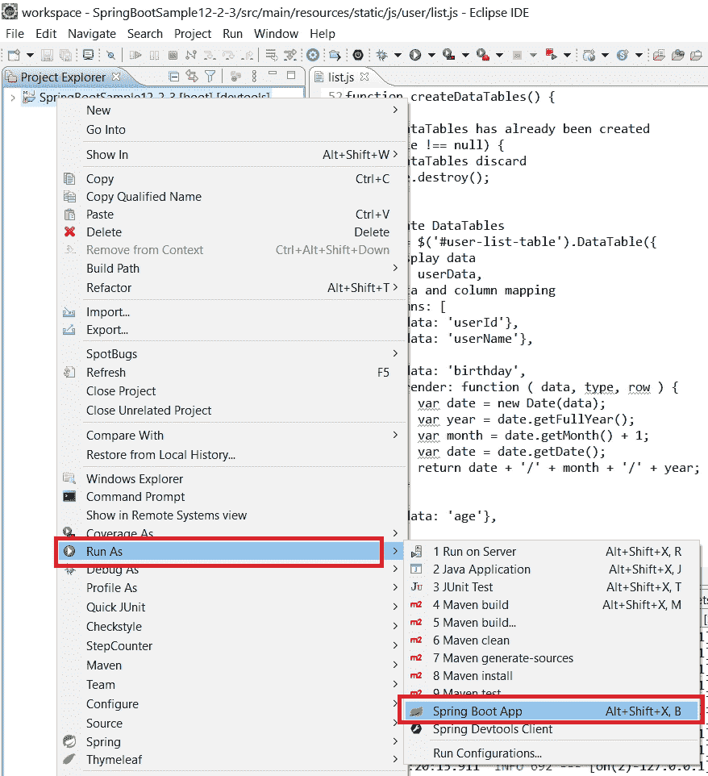

这会启动 Spring Boot。然后，访问以下 URL。

`http://localhost:8080/hello`

[执行结果]


现在你可以显示屏幕（HTML）。

# 3.2 从一个页面传递值到另一个页面

### 概述

从你刚刚创建的页面将值传递到另一个页面进行显示。

[示例图片]

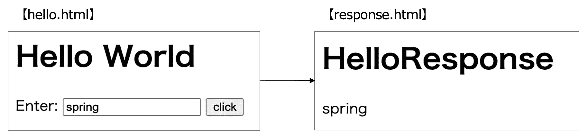

从 `hello.html` 到 `response.html` 的页面跳转。输入的字符串显示在 `response.html` 中。

## 处理流程概述

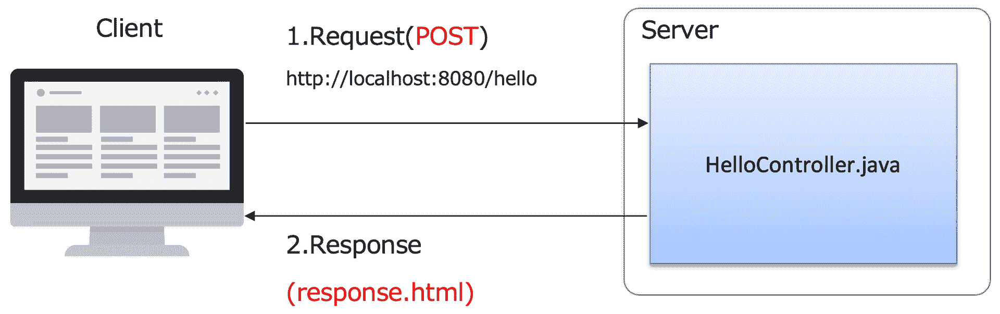

1. **请求 (POST 方法)**

   使用 HTML 表单发送带有 POST 方法的 HTTP 请求。

2. **响应 (response.html)**

   与之前的示例相同，`HelloController.java` 接收该操作。如果 POST 方法发送了请求，它会将 `response.html` 返回给浏览器。

## 注意：HTTP POST 方法

在 `html` `form` 标签中，你可以使用 HTTP POST 方法发送请求。使用 POST 方法请求服务器执行某些操作，例如用户注册。

### 目录

目录结构如下。背景颜色改变的部分为新添加的部分。

```
SpringBootSample
└── src/main
    ├── java
    │   └── com.example
    │       ├── hello
    │       │   └── HelloController.java
    │       └── SpringBootSampleApplication.java
    ├── resources
    │   ├── static
    │   ├── templates
    │   │   ├── hello (创建新文件夹)
    │   │   │   └── response.html (创建一个新的 HTML 文件)
    │   │   ├── hello.html
    │   │   └── application.properties
    │   └── pom.xml
    └── pom.xml
```

### 源码

首先，修改 `hello.html` 以便输入文本。背景颜色改变的部分为修改的部分。

`hello.html`

```html
<!DOCTYPE html><html xmlns:th="http://www.thymeleaf.org" ><head><meta charset="UTF-8" ></meta><title> Hello World</title></head>
<body>
    <h1> Hello World</h1>
    <form method="post" action="/hello">
        输入: <input type="text" name="text1" />
        <input type="submit" value="提交" />
    </form>
</body>
</html>
```

使用 `form` 标签通过 POST 方法向服务器发送请求。在文本输入框中设置了 `name = "text1"`。

然后修改控制器以接受 POST 方法请求。背景颜色改变的部分为修改的部分。

`HelloController.java`

```java
package com.example.hello;
import org.springframework.stereotype.Controller;
import org.springframework.ui.Model;
import org.springframework.web.bind.annotation.GetMapping;
import org.springframework.web.bind.annotation.PostMapping;
import org.springframework.web.bind.annotation.RequestParam;

@Controller
public class HelloController {
    @GetMapping("/hello")
    public String getHello() {
        // 跳转到 hello.html
        return "hello";
    }

    @PostMapping("/hello")
    public String postRequest(@RequestParam("text1") String str, Model model) {
        // 将从屏幕接收的字符串注册到 Model
        model.addAttribute("sample", str);
        // 跳转到 response.html
        return "hello/response";
    }
}
```

有多种方法可以在服务器端接收在屏幕上输入的值。其中一种是 `@RequestParam` 注解。在方法参数上加上此注解。然后指定 `@RequestParam` 注解的参数以匹配 HTML 的 `name` 属性。在示例代码中，你指定了一个字符串，以便以下部分能够匹配：

`hello.html`

```html
<input type="text" name="text1" />
```

`HelloController.java`

```java
@RequestParam("text1") String str
```

屏幕上输入的值现在被传递给 `str` 变量。

### 节点 3：Model

`Model` 类允许你将值传递到另一个屏幕。在 `Model` 类的 `addAttribute` 方法中指定键名（key）和值（value）。

#### add 方法

```java
addAttribute(keyname, value);
```

如果你指定了一个键名，屏幕就可以接收到一个值。接下来，创建一个接收输入的字符字符串的屏幕。

`response.html`

```html
<!DOCTYPE html>
<html xmlns:th="http://www.thymeleaf.org" >
<head><meta charset="UTF-8" ></meta><title> ResponseSample</title></head>
<body>
    <h1> HelloResponse</h1>
    <!-- 显示接收到的字符串 -->
    <p th:text="${sample}" ></p>
</body>
</html>
```

#### 节点：th 属性

要使用 Thymeleaf，请在 HTML 中使用带有 `"th:"` 的属性。在 `Model` 类中注册的值，可以通过将 `${key name}` 设置为 `th` 属性的值来获取。

### 执行

运行 Spring Boot 并访问以下 URL。

`http://localhost:8080/hello`

[执行结果]


输入任何字符字符串并点击按钮。输入的字符串将显示在另一个屏幕上。

# 3.3 从数据库获取值

### 概述

从数据库中根据指定的 ID 获取员工信息。在屏幕上显示有关员工的信息。

[示例图片]

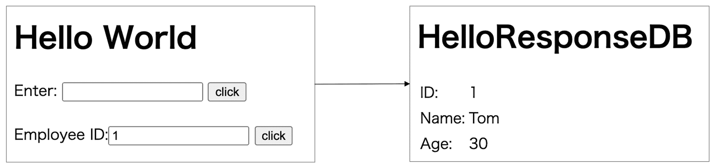

[处理概述]

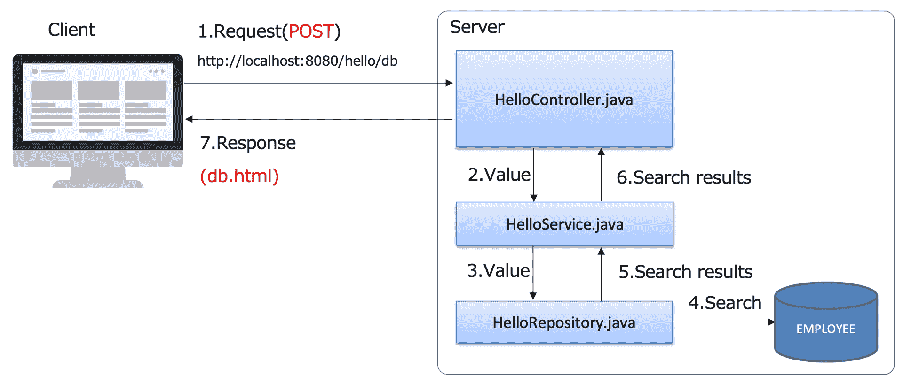

1. **请求 (POST 方法)**：使用 HTML 表单发送带有 POST 方法的 HTTP 请求。

2~3. **值**：控制器将从屏幕输入的值传递给服务层（service）和仓库（repository）。

4. **搜索**：仓库搜索 `EMPLOYEE` 表。

5~6. **搜索结果**：仓库和服务层将搜索结果返回给控制器。

7. **响应**：向浏览器返回 `db.html`。

**注意：什么是 Service（服务）？**

Service 是用于各种操作的类。例如，你可能想要计算某些或使用仓库。控制器负责处理，但将其留给服务。服务执行所有处理。这允许你在在不同的屏幕上执行相同的操作时，可以复用该服务。

**注意：什么是 Repository（仓库）？**

仓库是执行与数据库相关的处理的类。

### 目录

目录结构如下。背景颜色改变的部分是新增的部分。

```
SpringBootSample
└── src/main
    ├── java
    │   └── com.example
    │       ├── hello
    │       │   ├── Employee.java (创建一个新的 Java 类)
    │       │   ├── HelloController.java
    │       │   ├── HelloRepository.java (创建一个新的 Java 类)
    │       │   └── HelloService.java (创建一个新的 Java 类)
    │       └── SpringBootSampleApplication.java
    ├── resources
    │   ├── static
    │   ├── templates
    │   │   ├── db.html (创建一个新的 HTML 文件）
    │   │   ├── response.html
    │   │   └── hello.html
    │   ├── application.properties
    │   ├── data.sql (创建一个新的 SQL 文件)
    │   └── schema.sql (创建一个新的 SQL 文件)
    └── pom.xml
```

### 源码

`application.properties` 描述了使用 H2 数据库的设置。

`application.properties`


```properties
# 数据源
spring.datasource.url=jdbc:h2:mem:testdb;DB_CLOSE_DELAY=-1;DB_CLOSE_ON_EXIT=FALSE
spring.datasource.driver-class-name=org.h2.Driver
spring.datasouce.username=sa
spring.datasouce.password=sa
spring.datasource.sql-script-encoding=UTF-8
spring.datasource.initialize=true
spring.datasource.url=jdbc:h2:mem:testdb;DB_CLOSE_DELAY=-1;DB_CLOSE_ON_EXIT=FALSE
spring.datasource.driver-class-name=org.h2.Driver
spring.datasouce.username=sa
spring.datasouce.password=sa
spring.datasource.sql-script-encoding=UTF-8
spring.datasource.initialize=true
spring.datasource.url=jdbc:h2:mem:testdb;DB_CLOSE_DELAY=-1;DB_CLOSE_ON_EXIT=FALSE
spring.datasource.driver-class-name=org.h2.Driver
spring.datasouce.username=sa
spring.datasouce.password=sa
spring.datasource.sql-script-encoding=UTF-8
spring.datasource.initialize=true
spring.datasource.url=jdbc:h2:mem:testdb;DB_CLOSE_DELAY=-1;DB_CLOSE_ON_EXIT=FALSE
spring.datasource.driver-class-name=org.h2.Driver
spring.datasouce.username=sa
spring.datasouce.password=sa
spring.datasource.sql-script-encoding=UTF-8
spring.datasource.initialize=true
spring.datasource.url=jdbc:h2:mem:testdb;DB_CLOSE_DELAY=-1;DB_CLOSE_ON_EXIT=FALSE
spring.datasource.driver-class-name=org.h2.Driver
spring.datasouce.username=sa
spring.datasouce.password=sa
spring.datasource.sql-script-encoding=UTF-8
spring.datasource.initialize=true
spring.datasource.url=jdbc:h2:mem:testdb;DB_CLOSE_DELAY=-1;DB_CLOSE_ON_EXIT=FALSE
spring.datasource.driver-class-name=org.h2.Driver
spring.datasouce.username=sa
spring.datasouce.password=sa
spring.datasource.sql-script-encoding=UTF-8
spring.datasource.initialize=true
spring.datasource.url=jdbc:h2:mem:testdb;DB_CLOSE_DELAY=-1;DB_CLOSE_ON_EXIT=FALSE
spring.datasource.driver-class-name=org.h2.Driver
spring.datasouce.username=sa
spring.datasouce.password=sa
spring.datasource.sql-script-encoding=UTF-8
spring.datasource.initialize=true
# H2 控制台
spring.h2.console.enabled=true
```

备注：要使用 Thymeleaf，请在 HTML 中使用带有 `"th:"` 的属性。在 `Model` 类中注册的值，可以通过将 `${key name}` 设置为 `th` 属性的值来获取。

### 执行

运行 Spring Boot 并访问以下 URL。

[URL]

`http://localhost:8080/hello`

[执行结果]


输入任何字符字符串并点击按钮。输入的字符串将显示在另一个屏幕上。

### 3.3 从数据库获取值

### 概述

从数据库中根据指定的 ID 获取员工信息。在屏幕上显示有关员工的信息。

[示例图片]


[处理概述]


1. **请求 (POST 方法)**：使用 HTML 表单发送带有 POST 方法的 HTTP 请求。

2~3. **值**：控制器将从屏幕输入的值传递给服务层（service）和仓库（repository）。

4. **搜索**：仓库搜索 `EMPLOYEE` 表。

5~6. **搜索结果**：仓库和服务层将搜索结果返回给控制器。

7. **响应**：向浏览器返回 `db.html`。

**注意：什么是 Service（服务）？**

Service 是用于各种操作的类。例如，你可能想要计算某些或使用仓库。控制器负责处理，但将其留给服务。服务执行所有处理。这允许你在在不同的屏幕上执行相同的操作时，可以复用该服务。

**注意：什么是 Repository（仓库）？**

仓库是执行与数据库相关的处理的类。

#### 目录

目录结构如下。背景颜色改变的部分是新增的部分。


SpringBootSample

 ┗  src/main

    ┣  java

    ┃┗  com.example

    ┃   ┣  hello

    ┃   ┃   ┣  `Employee.java` (创建一个新的 Java 类)

    ┃   ┃   ┣  `HelloController.java`

    ┃   ┃   ┣  `HelloRepository.java` (创建一个新的 Java 类)

    ┃   ┃   ┗  `HelloService.java` (创建一个新的 Java 类)

    ┃   ┗  `SpringBootSampleApplication.java`

    ┣  resources

    ┃┣  static

    ┃┣  templates

    ┃┃┃┣  `db.html` (创建一个新的 HTML 文件）

    ┃┃┃┗  `response.html`

    ┃┃┗  `hello.html`

    ┃┣  `application.properties`

    ┃┣  `data.sql` (创建一个新的 SQL 文件)

    ┃┗  `schema.sql` (创建一个新的 SQL 文件)

    ┗  `pom.xml`

#### 源码

`application.properties` 描述了使用 H2 数据库的设置。

`application.properties`

```properties
# 数据源
spring.datasource.url=jdbc:h2:mem:testdb;DB_CLOSE_DELAY=-1;DB_CLOSE_ON_EXIT=FALSE
spring.datasource.driver-class-name=org.h2.Driver
spring.datasouce.username=sa
spring.datasouce.password=sa
spring.datasource.sql-script-encoding=UTF-8
spring.datasource.initialize=true
spring.datasource.url=jdbc:h2:mem:testdb;DB_CLOSE_DELAY=-1;DB_CLOSE_ON_EXIT=FALSE
spring.datasource.driver-class-name=org.h2.Driver
spring.datasouce.username=sa
spring.datasouce.password=sa
spring.datasource.sql-script-encoding=UTF-8
spring.datasource.initialize=true
spring.datasource.url=jdbc:h2:mem:testdb;DB_CLOSE_DELAY=-1;DB_CLOSE_ON_EXIT=FALSE
spring.datasource.driver-class-name=org.h2.Driver
spring.datasouce.username=sa
spring.datasouce.password=sa
spring.datasource.sql-script-encoding=UTF-8
spring.datasource.initialize=true
spring.datasource.url=jdbc:h2:mem:testdb;DB_CLOSE_DELAY=-1;DB_CLOSE_ON_EXIT=FALSE
spring.datasource.driver-class-name=org.h2.Driver
spring.datasouce.username=sa
spring.datasouce.password=sa
spring.datasource.sql-script-encoding=UTF-8
spring.datasource.initialize=true
spring.datasource.url=jdbc:h2:mem:testdb;DB_CLOSE_DELAY=-1;DB_CLOSE_ON_EXIT=FALSE
spring.datasource.driver-class-name=org.h2.Driver
spring.datasouce.username=sa
spring.datasouce.password=sa
spring.datasource.sql-script-encoding=UTF-8
spring.datasource.initialize=true
# H2 控制台
spring.h2.console.enabled=true
```

备注：要使用 Thymeleaf，请在 HTML 中使用带有 `"th:"` 的属性。在 `Model` 类中注册的值，可以通过将 `${key name}` 设置为 `th` 属性的值来获取。

##### 节点 1：H2 数据库

是内存数据库。在 Spring Boot 启动时执行它。

*   `spring.datasource.initialize`: 用于创建表。

*   `spring.datasource.schema`: SQL 语句。

*   `spring.datasource.data`: SQL 语句。

`src/resources/schema.sql`

```sql
CREATE TABLE IF NOT EXISTS employee (id VARCHAR(50) PRIMARY KEY ,name VARCHAR(50),age INT);
```

`src/resources/data.sql`

```sql
INSERT INTO employee (id, name, age) VALUES ('1', 'Tom', 30);
```

创建一个包含搜索结果的 Employee 类。

`Employee.java`

```java
package com.example.hello;
import lombok.Data;
@Data
public class Employee {
    private String employeeId;
    private String employeeName;
    private int employeeAge;
}
```

#### 节点：@Data

`@Data` 是 Lombok 提供的注解。通过它，会自动生成以下方法：

*   `getter`

*   `setter`

*   `toString`

*   `hashCode`

*   `equals`

这让你在重命名字段时无需重新创建 getter 和 setter。Lombok 还有其他有注解。

下一步是创建一个搜索数据库员工的进程。使用 JDBC 执行选择语句。

`HelloRepository.java`

```java
package com.example.hello;
import java.util.Map;
import org.springframework.beans.factory.annotation.Autowired;
import org.springframework.jdbc.core.JdbcTemplate;
import org.springframework.stereotype.Repository;

@Repository
public class HelloRepository {
    @Autowired
    private JdbcTemplate jdbcTemplate ;

    public Map<String, Object> findById(String id ) {
        // SELECT 语句
        String query = "SELECT * FROM employee WHERE id=?";
        // 搜索执行
        Map<String, Object> employee = jdbcTemplate .queryForMap(query , id );
        return employee ;
    }
}
```

##### 节点 1：@Repository

表示数据库操作的仓库标记为 `@Repository`。

##### 节点 2：@Autowired

`@Autowired` 是用于依赖注入的注解。将在第 5 章解释。

**注意：JdbcTemplate**

你可以使用 `JdbcTemplate` 类通过 JDBC 执行 SQL。在本书的示例中，选择的结果通过 `Map` 获取。`Map` 的键包含选择结果的列名。`Map` 的值包含选择结果的值。

然后创建服务层。服务层使用仓库获取 SQL 执行的结果。

`HelloService.java`

```java
package com.example.hello;
import java.util.Map;
```


```java
import org.springframework.beans.factory.annotation.Autowired;
import org.springframework.stereotype.Service;

@Service
public class HelloService {
    @Autowired
    private HelloRepository repository;

    /** 获取一个员工 */
    public Employee getEmployee(String id) {
        // 查询
        Map<String, Object> map = repository.findById(id);
        // 从 Map 中获取值
        String employeeId = (String) map.get("id");
        String name = (String) map.get("name");
        int age = (Integer) map.get("age");
        // 为 Employee 类赋值
        Employee employee = new Employee();
        employee.setEmployeeId(employeeId);
        employee.setEmployeeName(name);
        employee.setEmployeeAge(age);
        return employee;
    }
}
```

根据`select`语句的执行结果创建`Employee`实例。然后修改控制器。更改背景颜色的部分即为修改的部分。

[HelloController.java]

```java
package com.example.hello;
import org.springframework.beans.factory.annotation.Autowired;
import org.springframework.stereotype.Controller;
import org.springframework.ui.Model;
import org.springframework.web.bind.annotation.GetMapping;
import org.springframework.web.bind.annotation.PostMapping;
import org.springframework.web.bind.annotation.RequestParam;

@Controller
public class HelloController {
    @Autowired
    private HelloService service;

    @GetMapping("/hello")
    public String getHello() {
        // 跳转到 hello.html
        return "hello";
    }

    @PostMapping("/hello")
    public String postRequest(@RequestParam("text1") String str, Model model) {
        // 将从屏幕接收到的字符串注册到 Model
        model.addAttribute("sample", str);
        // 跳转到 response.html
        return "hello/response";
    }

    @PostMapping("/hello/db")
    public String postDbRequest(@RequestParam("text2") String id, Model model) {
        // 查询一个员工
        Employee employee = service.getEmployee(id);
        // 将查询结果保存到 Model
        model.addAttribute("employee", employee);
        // 跳转到 db.html
        return "hello/db";
    }
}
```

从`service`获取的`Employee`实例已注册在`Model`中。接下来，创建一个屏幕来显示`Employee`。

[db.html]

```html
<!DOCTYPE html>
<html xmlns:th="http://www.thymeleaf.org">
<head>
    <meta charset="UTF-8">
    <title> ResponseSample</title>
</head>
<body>
    <h1> HelloResponseDB</h1>
    <table>
        <tr>
            <td> ID:</td>
            <td th:text="${employee.employeeId}"></td>
        </tr>
        <tr>
            <td> Name:</td>
            <td th:text="${employee.employeeName}"></td>
        </tr>
        <tr>
            <td> Age:</td>
            <td th:text="${employee.employeeAge}"></td>
        </tr>
    </table>
</body>
</html>
```

如果类类型（class type）变量被注册在`Model`中，请在`th`属性中指定`${key_name.field_name}`。现在你可以获取 Java 类的字段值。最后，修改屏幕以便你可以输入员工 ID。更改背景颜色的部分即为修改的部分。

[hello.html]

```html
<!DOCTYPE html>
<html xmlns:th="http://www.thymeleaf.org">
<head>
    <meta charset="UTF-8">
    <title> Hello World</title>
</head>
<body>
    <h1> Hello World</h1>
    <form method="post" action="/hello">
        Enter: <input type="text" name="text1" />
        <input type="submit" value="Click" />
    </form>
    <br/>
    <form method="post" action="/hello/db">
        Employee ID:<input type="text" name="text2" th:value="${text2_value}" />
        <input type="submit" value="Click" />
    </form>
</body>
</html>
```

### 执行

运行 Spring Boot。然后你可以访问 H2 数据库控制台。通过以下 URL 访问控制台：

[H2 数据库控制台 URL]

`http://localhost:8080/h2-console`

显示如下屏幕。

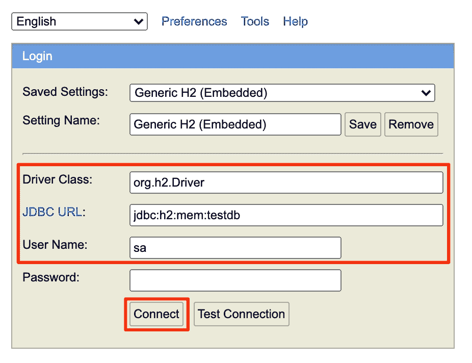

输入以下信息登录：这些值是你在`application.properties`中设置的值。

| 项目 | 值 | 属性 |

| :--- | :--- | :--- |

| JDBC URL | `jdbc:h2:mem:testdb` | `spring.datasource.url` |

| 用户名 | `sa` | `spring.datasouce.username` |

| 密码 | (无) | `spring.datasouce.password` |

登录后，显示如下屏幕。当选择`EMPLOYEE`表时，会输入“显示全部”的 SQL。点击 Execute 按钮执行 SQL。

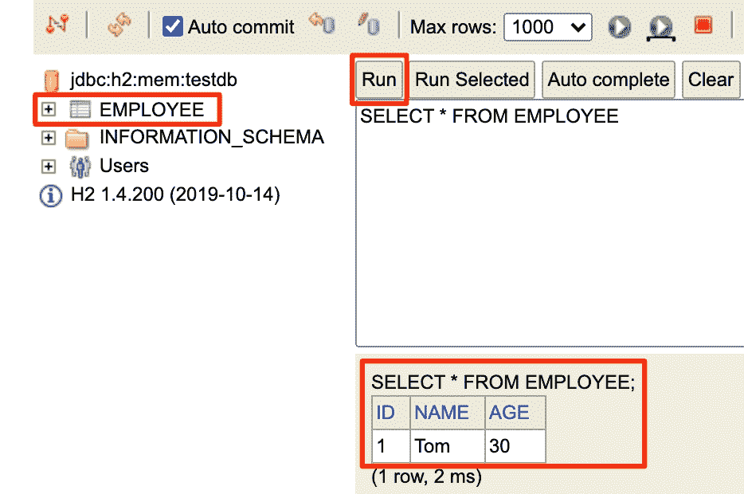

你可以确认表正在创建并且正在输入初始数据。你可以使用 H2 数据库控制台进行验证，例如。现在运行示例应用程序。访问以下 URL：

`http://localhost:8080/hello`

[执行结果]


输入 1 作为员工 ID 并点击按钮。注册在数据库的内容显示在另一个屏幕上。

使用 Spring Boot 完成了示例的创建。现在可以看到数据库查询的结果。

依赖意味着一个类拥有另一个类的字段，或者使用了另一个类的方法。例如，代码可能如下：

```java
public class SomeObjectA {
    // field
    private SomeObjectB objB ;
    // constructor
    public SomeObjectA(SomeObjectB objB ) {
        this .objB = objB ;
    }
    // method
    public void methodA() {
        objB .methodB();
    }
}
```

如果你给`SomeObjectB`的方法添加了参数，`SomeObjectA`必须修改修改代码。在这种情况下，`SomeObjectA`依赖于`SomeObjectB`。

## 2. 什么是注入？

接下来，我将解释什么是“注入”。注入是将一个实例赋值给变量。在上面的示例代码中，实例被赋值给构造函数中的字段。

```java
// (Excerpt) // constructor
public SomeObjectA(SomeObjectB objB ) {
    this .objB = objB ;
}
```

如果你不赋值实例，`objB`将保持为`null`。如果你调用该方法，将会发生`NullPointerException`。

## 3. 什么是依赖注入？

如果你理解了依赖，就可以很容易理解依赖注入。依赖注入是将实例赋值给继承自接口或抽象类的类。例如，Java 中有`List`。除非使用接口，否则无法使用`ArrayList`，因此编写类似下面的代码：

```java
List<Object> list = new ArrayList<>();
```

组件扫描的结果可能是`ArrayList`或`LinkedList`。如果你有多个实现，你需要决定：

*   使用哪种实现（依赖）

*   将`ArrayList`或`LinkedList`的实例注入到变量中。

## 4. 为什么要使用接口？

使用接口可以让开发和维护变得更容易。这是因为你可以更改实现接口的类。例如，它们有以下优缺点：

*   `ArrayList`

    *   优点：快

    *   缺点：慢

*   `LinkedList`

    *   优点：易添加

    *   缺点：访问

你使用的接口越多，它的扩展性越强。然而，如果你直接使用实现类，就会像下面所示紧密耦合：

```java
// Loosely coupled
List<Object> listA = new ArrayList<>();
// Tightly coupled
ArrayList<Object> listB = new ArrayList<>();
```

通过使用接口，你可以轻松地更改内容。例如，你可以使用存根进行测试。这使得测试变得更容易。

## 5. Spring 的 DI 做了什么？

现在你已经理解了依赖注入，那么来解释一下 Spring DI 在做什么。DI 执行以下处理：

1. 查找 DI 的目标类

2. 在标记了`@Autowired`的地方注入实例

### 查找 DI 的目标类

当 Spring 启动时，它会寻找作为 DI 目标的类。这个过程被称为组件扫描。组件扫描查找以下注解：

*   `@Component`

*   `@Controller`

*   `@Service`

*   `@Repository`

*   `@Configuration`

*   `@RestController`

*   `@ControllerAdvice`

*   `@ManagedBean`

*   `@Named`

*   `@Mapper`

*   `@Bean`

带有这些注解的类会被注册到 DI 容器中。DI 容器是一个管理 DI 目标类的容器。例如，假设你有一个分别标记了`@Controller`和`@Service`的类。

在这种情况下，组件扫描的结果是一个类似于下面的 DI 容器：

```java
public class DIContainer {
    // 创建每个类的实例
    private SampleController controller = new SampleController();
    private SampleService service = new SampleService();

    // SampleController getter
    public static SampleController getSampleController() {
        return controller ;
    }
    // SampleService getter
    public static SampleService getSampleService() {
        return service ;
    }
}
```

### 在标记了 @Autowired 的地方注入实例

然后在标记了`@Autowired`的地方注入实例。想象代码转换如下：

```java
// Before conversion
@Autowired
private SampleService service ;

// After conversion
private SampleService service = DIContainer.getSampleService()
```

实例在上方显示`@Autowired`的地方被注入。

```java
@PostMapping("/sample")
public String postSample() {
    // Some processing using service…
}
```

这可以防止你在测试期间将`SampleService`修改为存根（stub）。此外，即使你创建了一个新类，切换到该类也会变得困难。使用 DI，你可以轻松地更改实现类。

## 5.1.2 实例生命周期管理

DI 同时也为实例提供了生命周期管理。具体来说，它创建并销毁实例。创建实例意味着创建一个新类。销毁实例是将变量赋值为`null`。如果你给变量赋值为`null`，垃圾回收会将实例从内存中释放。具体来说，以下代码创建并销毁了实例：

```java
// Creating an Instance
SomeObject obj = new SomeObject()
// Destroying an instance
obj = null
```

Spring DI 会自动创建和销毁实例。它们的时机可以通过`scope`指定。`Scope`是实例生存的时间。例如，`request`范围会在每次发送 HTTP 请求时创建一个实例。当请求处理完成时，该实例就会销毁。要指定范围，请在类上使用`@Scope`注解。

```java
// Sample code for scope specification
@Controller
@Scope("request")
public class SomeController {…}
```

Spring 提供了以下范围：

| Scope | Description |

| :--- | :--- |

| singleton | Spring 在启动时仅创建一个实例。该实例在整个应用程序中共享并使用。如果没有`@Scope`注解，所有类都是单例的。 |

| prototype | 每次获取一个 bean 时，都会创建一个实例。 |

| session | 每个 HTTP session 创建一个实例。也就是说，实例只在用户登录期间存在。仅适用于 Web 应用程序。 |

| request | 为每个 HTTP 请求创建一个实例。仅适用于 Web 应用程序。 |

| globalSession | 在 portlet 环境中为每个 GlobalSession 创建实例。仅适用于支持 portlet 的 Web 应用程序。 |

| application | 为每个 servlet context 创建实例。仅适用于 Web 应用程序。 |

## 5.2 如何实现 DI

现在你将学习如何实现 DI。

* 依赖注入方法

* 如何注册 bean

### 5.2.1 依赖注入方法

要使用 DI，请`@Autowired`注解。我将解释如何使用它。`@Autowired`注解可以用在三个地方：

1. 字段 (Field)

2. 构造函数 (Constructors)

3. Setter 方法 (Setter)

#### 1. 字段注入

如果你想将依赖注入到字段中，请在该字段上标记为`@Autowired`。


```java
// Sample code
@Component
public class Sample {
    // Field injection
    @Autowired
    private SampleComponent component;
}
```

#### 2. 构造函数注入

可以将依赖注入到构造函数参数中。注意在 Spring 4.3 及更高版本中，你可以省略构造函数注入的 `@Autowired` 注解。

```java
// Sample code
@Component
public class Sample {
    private final SampleComponent component;
    // Constructor Injection
    @Autowired
    public Sample(SampleComponent component) {
        this.component = component;
    }
}
```

Spring 推荐使用构造函数注入。你也可以使用 Lombok 自动生成构造函数。

```java
// Lombok Sample Code 1
@Component
@RequiredArgsConstructor
public class Sample {
    private final SampleComponent component;
    private String value;
}
```

**点：** `@RequiredArgsConstructor`

`@RequiredArgsConstructor` 注解会创建一个仅以 `final` 字段作为参数的构造函数。在上面的示例代码中，创建一个只包含 `SampleComponent` 参数的构造函数。

```java
// Lombok Sample Code 2
@Component
@AllArgsConstructor
public class Sample {
    private SampleComponent component;
    private String value;
}
```

**点：** `@AllArgsConstructor`

`@AllArgsConstructor` 注解会创建一个包含所有字段作为参数的构造函数。因为在构造函数注入中省略 `@Autowired`，上面的示例代码也是 DI。

#### 3. Setter 注入

可以将依赖注入到 setter 方法参数中。在 setter 方法上标记为 `@Autowired`。

```java
// Sample code
@Component
public class Sample {
    private SampleComponent component;
    // setter injection
    @Autowired
    public void setComponent(SampleComponent component) {
        this.component = component;
    }
}
```

## 5.2.2 如何注册 bean

注册在 DI 容器中的类被称为 `bean`。创建 bean 有多种方法，但主要方法是结合以下两种方法：

1. 基于注解的实现

2. 在 JavaConfig 中实现

#### 1. 基于注解的实现

要使用 DI，请在类上标记 `@Controller` 以及第 3 章示例代码中使用的注解。除其他外，常用的注解有：

* `@Component`

* `@Controller`

* `@Service`

* `@Repository`

* `@Bean`

* `@Mapper`

通过注解类并在 DI 容器中注册 bean 是一项基础操作。

#### 2. 在 JavaConfig 中实现

实例化 bean 的类通常称为 `JavaConfig`。在 bean 生成逻辑复杂等情况下使用 `JavaConfig`。例如，在 DI 容器中注册库中提供的类。

```java
// Sample code
@Configuration
public class JavaConfig {
    @Bean
    public SomeComponent getSomeComponent() {
        return new SomeComponentImpl();
    }
}
```

**点：** `@Configuration`, `@Bean`

`JavaConfig` 标记为 `@Configuration`。然后并在创建实例的方法上标记 `@Bean`。你可以在 `@Bean` 注解旁边添加 `@Scope` 注解。通过 `JavaConfig` 将所有类注册为 bean 是困难的。因此基本上使用“基于注解的实现”。如果不够，你会使用“在 JavaConfig 中实现”。

## 5.3 DI 的问题

尽管 DI 很有用，但它存在以下问题：

* 单例范围

* 不同的范围

* 无法从 Bean Bean

### 5.3.1 单例范围

`@Service` 等注解默认为单例范围。应用程序启动期间只有一个实例。不会创建两个或多个实例。因此，从多个实例访问时要小心。在这种情况下，不要编写这样的代码：

```java
// Bad example sample code
@Getter
@Setter
@Service
public class SomeServiceImpl implements SomeService {
    // Some state
    private String state;
    @Override
    public void someMethod() {
        // Some processing using state…
    }
}
```

上面的服务本应该如下所示使用：

1. 将 `state` 字段设置为某个值。

2. 通过 `someMethod` 使用 state 进行一些处理。

上述代码的问题在于另一个实例可能会重写 state。假设在调用过程 1 和 2 期间 state 被重写。那么 `someMethod` 将返回意料之外的执行结果。

针对这种情况有几种变通方法。例如，将字段更改为方法参数。

```java
@Service
public class SomeServiceImpl implements SomeService {
    @Override
    public void someMethod(String state ) {
        // 使用 state 进行某些处理…
    }
}
```

通过这种，没有状态的类被称为无状态类。另一种解决方案是使用单例以外的作用域。

### 5.3.2 不同的作用域

如果字段具有不同的作用域，实例可能不会被销毁。这是 Java 规范导致的一个陷阱。例如，如果 `singleton` 作用域的实例字段中包含一个 `prototype` 作用域的实例。

```java
@Component
@Scope ("prototype" )
public class PrototypeComponent {…}
```

```java
@Component
public class SingletonComponent {
    @Autowired
    private PrototypeComponent component ;
    …
}
```

如果你这样做，`prototype` 作用域的 Bean（上述 `PrototypeComponent`）将变为 `singleton` 作用域。如果在 `session` 作用域的 Bean 中设置了 `request` 作用域的 Bean，也会发生同样的情况。在将具有不同作用域的 Bean 作为字段时要小心。

### 5.3.3 无法从 Bean 以外进行 DI

这很容易被忽略，但你无法从非 Bean 类进行依赖注入（DI）。

```java
public class SampleObject {
    @Autowired
    private SampleService service ;
    …
}
```

在上面的示例代码中，`SampleObject` 没有 `@Component` 或 `@Controller` 注解。也就是说，`SampleObject` 不是一个 Bean。这不允许在 `SampleService` 字段中进行 DI。按照如下方式对类进行注解：

```java
@Component
public class SampleObject {
    @Autowired
    private SampleService service ;
    …
}
```

### 总结

以下是你在本章中学到的内容。

#### 什么是 DI？

DI 执行以下操作：

* 自动为接口分配实例。

* 创建并销毁实例。

* 你可以管理实例的作用域。

#### 如何实现 DI？

你可以在三个地方使用 `@Autowired`：

* 字段

* 构造函数

* Setter 方法

为了实现 DI，主流做法是结合以下两种方法：

* 基于注解的实现

* 在 JavaConfig 中实现

#### DI 的陷阱

DI 具有以下陷阱：

* 单例作用域。

* 如果在字段中拥有不同作用域的 Bean，实例将不会销毁。

* 无法从 Bean 以外进行 DI。

## 6. 绑定与验证（输入检查）

在本章中，你将在创建界面时学习绑定和验证（输入检查）。这两者都是创建界面的基础，因此你需要熟悉它们。

* [创建界面]

* [绑定]

* [验证（输入检查）]

### 6.1 创建界面

学习如何使用 Spring Boot 创建界面。

* [使用库…webjars]

* [消息属性]

* [多语言化]

#### 6.1.1 使用库…webjars

概述

界面设计在应用程序中变得越来越重要。在设计界面时，通常会使用 Bootstrap 框架。Bootstrap 使得创建美观界面变得简单。原因是你可以创建一个兼容智能手机的界面。

要使用 Bootstrap，你将使用一个名为 `webjars` 的库。`Webjars` 使下载和加载库变得简单。在本节中，你将创建以下两个界面。

**目录**

目录结构如下。更改背景颜色的部分是修改部分。

```
SpringBootSample
┗ src
    Target java
    ┃Target com.example
    ┃   Target application.service (创建新包)
    ┃   ┃Target UserApplicationService.java (新建一个类)
    ┃   Target controller (创建新包)
    ┃   ┃Target LoginController.java (新建一个类)
    ┃   ┃┗ SignupController.java (新建一个类)
    ┃   Target hello
    ┃   ┗ SpringBootSampleApplication.java
    Target resources
    ┃ Target static
    ┃ ┃Target css (新建文件夹)
    ┃ ┃ ┣ login (新建文件夹)
    ┃ ┃ ┃┗ login.css (新建文件)
    ┃ ┃ ┗ user (新建文件夹)
    ┃ ┃     ┗ signup.css (新建文件)
    ┃ Target templates
    ┃ ┃ Target hello
    ┃ ┃ ┣ login (新建文件夹)
    ┃ ┃ ┃┗ login.html (新建文件)
    ┃ ┃ ┣ user (新建文件夹)
    ┃ ┃ ┃┗ signup.html (新建文件)
    ┃ ┃ ┗ hello.html
    ┃ Target application.properties
    ┃ Target data.sql
    ┃ ┗ schema.sql
┗ pom.xml
```

**源代码**

首先，让 `webjars`可用。编辑 `pom.xml` 来实现。在 `pom.xml` 的 `dependencies` 标签中添加以下代码。更改背景颜色的部分是添加的部分。

```xml
<dependencies>
…
  <!-- jquery -->
  <dependency>
    <groupId> org.webjars</groupId>
    <artifactId> jquery</artifactId>
    <version>3.5.1</version>
  </dependency>
  <!-- bootstrap -->
  <dependency>
    <groupId> org.webjars</groupId>
    <artifactId> bootstrap</artifactId>
    <version>4.5.3</version>
  </dependency>
  <!-- webjars-locator -->
  <dependency>
    <groupId> org.webjars</groupId>
    <artifactId> webjars-locator</artifactId>
    <version>0.40</version>
  </dependency>
…
</dependencies>
```

**点 1: 什么是 webjars？**

Webjars 是一种让 JavaScript 和 CSS 等库可以在 Maven 中使用的库。请参 webjars 官方页面。你可以通过搜索 "maven webjars" 找到 webjars 提供的库。

**点 2: 什么是 webjars-locator？**

Webjars-locator 允许你在编写代码时无需感知 webjars 所使用的库版本。有关如何使用此函数的细节将在稍后解释。

注意：jQuery 如果要使用 Bootstrap，你需要一个名为 `jQuery` 的 JavaScript 库。编辑 `pom.xml`，`Maven` 将自动下载该库。

在用户注册界面上，显示了一个用于选择性别的单选按钮。准备一个服务来生成性别映射表。

### UserApplicationService.java

```java
package com.example.application.service;
import java.util.LinkedHashMap;
import java.util.Map;
import org.springframework.stereotype.Service;

@Service
public class UserApplicationService {
    /** Generate a gender Map */
    public Map<String, Integer> getGenderMap() {
        Map<String, Integer> genderMap = new LinkedHashMap<>();
        genderMap .put("male" , 1);
        genderMap .put("female" , 2);
        return genderMap ;
    }
}
```

接下来，为登录界面创建一个控制器。

### LoginController.java

```java
package com.example.controller;
import org.springframework.stereotype.Controller;
import org.springframework.web.bind.annotation.GetMapping;

@Controller
public class LoginController {
    /** Display login screen */
    @GetMapping ("/login" )
    public String getLogin() {
        return "login/login" ;
    }
}
```

接下来，为用户注册界面创建一个控制器。

### SignupController.java


```java
package com.example.controller;

import java.util.Map;

import org.springframework.beans.factory.annotation.Autowired;
import org.springframework.stereotype.Controller;
import org.springframework.ui.Model;
import org.springframework.web.bind.annotation.GetMapping;
import org.springframework.web.bind.annotation.PostMapping;
import org.springframework.web.bind.annotation.RequestMapping;

import com.example.application.service.UserApplicationService;

@Controller
@RequestMapping("/user")
public class SignupController {
    @Autowired
    private UserApplicationService userApplicationService;

    /** Display the user signup screen */
    @GetMapping("/signup")
    public String getSignup(Model model) {
        // Get genderMap
        Map<String, Integer> genderMap = userApplicationService.getGenderMap();
        model.addAttribute("genderMap", genderMap);
        // Transition to user signup screen
        return "user/signup";
    }

    /** User signup process */
    @PostMapping("/signup")
    public String postSignup() {
        // Redirect to login screen
        return "redirect:/login";
    }
}
```

## 要点：`@RequestMapping`

当将`@RequestMapping`添加到类上时，它可以作为 URL 前缀。在上面的示例代码中，设置如下：

- 类：`@RequestMapping("/user")`
- 方法：`@GetMapping("/signup")`

要通过此设置访问用户注册界面，请输入以下 URL。

[用户注册界面的 URL] `http://localhost:8080/user/signup`

你也可以在方法上添加`@RequestMapping`来代替`@GetMapping`或`@PostMapping`。

[示例] 代替`@GetMapping`的替代方案

```java
@RequestMapping(value = "/sample", method = RequestMethod.GET)
public String getSample() {…}
```

### 注意：重定向

若要进行重定向，请将`"redirect: 重定向目标路径"`作为返回值。

### 注意：PRG 模式

PRG 模式是在执行`POST`方法后重定向到页面跳转（执行`GET`方法）。POST-Redirect-GET 的缩写被称为 PRG 模式。使用 PRG 模式可以防止意外的注册或刷新。

**不使用 PRG 模式时**

假设你有一个应用程序，在注册某些内容后直接跳转到页面而不进行重定向。在注册操作完成后，立即按下浏览器上的`F5`键。此时将发送相同的请求，并再次执行注册过程。

**使用 PRG 模式时**

如果你在执行注册或其他处理后进行了重定向，即使按下`F5`键，也不会发送请求。这可以防止用户的意外操作。

接下来，为登录界面创建 HTML。[login.html]

```html
<!DOCTYPE html>
<html xmlns:th="http://www.thymeleaf.org">
<head>
    <meta charset="UTF-8"></meta>
    <meta name="viewport" content="width=device-width, initial-scale=1, shrink-to-fit=no"></meta>
    <!-- Read CSS -->
    <link rel="stylesheet" th:href="@{/webjars/bootstrap/css/bootstrap.min.css}"></link>
    <link rel="stylesheet" th:href="@{/css/login/login.css}"></link>
    <!-- Read JS -->
    <script th:src="@{/webjars/jquery/jquery.min.js}" defer></script>
    <script th:src="@{/webjars/bootstrap/js/bootstrap.min.js}" defer></script>
    <title>Login</title>
</head>
<body class="bg-light">
    <div class="text-center">
        <form method="post" th:action="@{/login}" class="form-login">
            <h2>Login</h2>
            <!-- User ID -->
            <div class="form-group">
                <label for="userId" class="sr-only">userId</label>
                <input type="text" class="form-control" placeholder="User ID" name="userId" />
            </div>
            <!-- Password -->
            <div class="form-group">
                <label for="password" class="sr-only">password</label>
                <input type="text" class="form-control" placeholder="Password" name="password" />
            </div>
            <input type="submit" value="Login" class="btn btn-primary" />
        </form>
        <a th:href="@{/user/signup}">Signup</a>
    </div>
</body>
</html>
```

### 要点：调用 webjars

使用`webjars`下载的库可以通过`@{/webjars/…}`加载。如果你查看“Maven Dependencies”文件夹，你会发现 Maven 下载的库的 jar 文件。从这些文件中，可以检查`webjars`指定的库。

[Maven 依赖文件夹] (`jQuery-3.5.1.jar`) 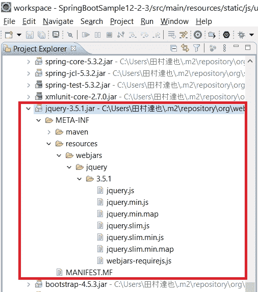

将上述文件夹中`META-INF/resources`下方的路径指定为`@{/webjars/…}`。注意，路径中也必须包含版本号所在的文件夹。例如，要使用上面的示例代码读取 jQuery 文件，你需要编写以下代码。

[示例] 包含版本号的路径指定

```html
<script th:src="@{/webjars/jquery/3.5.1/jquery.min.js}" defer></script>
```

然而，你可以通过包含`webjars-locator`来省略版本号。这即使在你更改了`webjars`使用的库版本时也能省去修改代码的麻烦。换言之，`webjars`和`webjars-locator`为你节省了管理库的麻烦。

### 注意：JavaScript 性能测量

在加载 JavaScript 时，请添加`"defer"`属性。这是因为添加`defer`属性可以提高屏幕显示性能。如果添加了`defer`属性，HTML 和 JavaScript 将并行加载。如果不添加`defer`属性，文件将不会并行读取，因此过程会缓慢。

### 注意：`input type="password"`

最初，密码输入字段中使用`input type="password"`。在本书中，使用`input type="text"`来显示屏幕上输入的密码。

接下来，为用户注册界面创建 HTML。[signup.html]

```html
<!DOCTYPE html>
<html xmlns:th="http://www.thymeleaf.org">
<head>
    <meta charset="UTF-8"></meta>
    <meta name="viewport" content="width=device-width, initial-scale=1, shrink-to-fit=no"></meta>
    <!-- Read CSS -->
    <link rel="stylesheet" th:href="@{/webjars/bootstrap/css/bootstrap.min.css}"></link>
    <link rel="stylesheet" th:href="@{/css/user/signup.css}"></link>
    <!-- Read JS -->
    <script th:src="@{/webjars/jquery/jquery.min.js}" defer></script>
    <script th:src="@{/webjars/bootstrap/js/bootstrap.min.js}" defer></script>
    <title>User Signup</title>
</head>
<body class="bg-light">
    <div class="text-center">
        <form method="post" th:action="@{/login}" class="form-login">
            <h2>Login</h2>
            <!-- User ID -->
            <div class="form-group">
                <label for="userId" class="sr-only">userId</label>
                <input type="text" class="form-control" placeholder="User ID" name="userId" />
            </div>
            <!-- Password -->
            <div class="form-group">
                <label for="password" class="sr-only">password</label>
                <input type="text" class="form-control" placeholder="Password" name="password" />
            </div>
            <!-- User Name -->
            <div class="form-group">
                <label for="userName">User Name</label>
                <input type="text" class="form-control" />
            </div>
            <!-- Birthday -->
            <div class="form-group">
                <label for="birthday">Birthday</label>
                <input type="text" class="form-control" />
            </div>
            <!-- Age -->
            <div class="form-group">
                <label for="age">Age</label>
                <input type="text" class="form-control" />
            </div>
            <!-- Gender -->
            <div class="form-group">
                <div th:each="item : ${genderMap}" class="form-check-inline">
                    <input type="radio" class="form-check-input" th:value="${item.value}" />
                    <label class="form-check-label" th:text="${item.key}"></label>
                </div>
            </div>
            <!-- Signup button -->
            <input type="submit" value="signup" class="btn btn-primary w-100 mt-3" />
        </form>
    </div>
</body>
</html>
```

接下来，为登录界面创建 CSS。[login.css]

```css
.form-login {
    width: 100%;
    max-width: 330px;
    padding: 15px;
    margin: auto;
}
```

最后，为用户注册界面创建 CSS。[signup.css]

```css
.form-signup {
    width: 100%;
    max-width: 330px;
    padding: 15px;
    margin: auto;
}
```

执行运行 Spring Boot 并访问以下 URL。

[URL] `http://localhost:8080/login`

[执行结果] 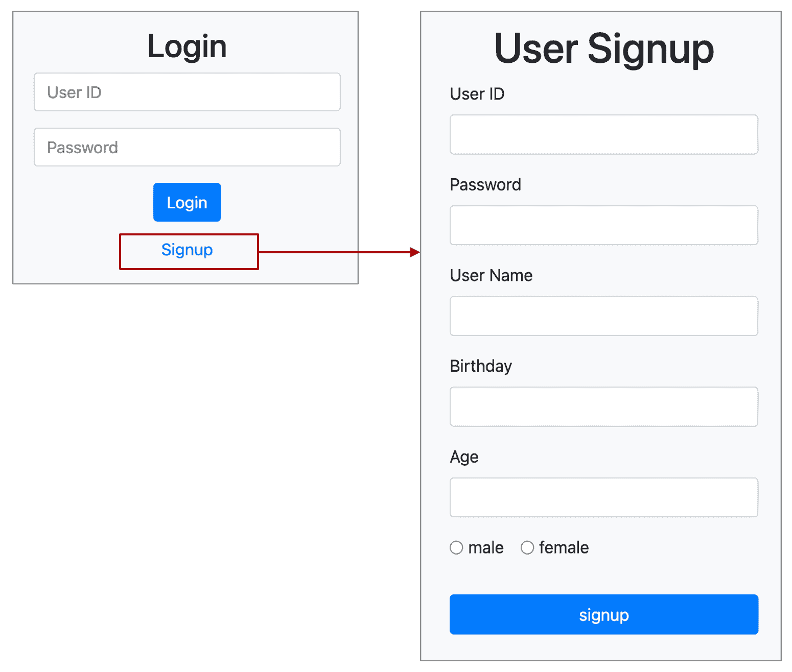

点击“signup”链接跳转到用户注册界面。完成了页面的创建。

## 6.1.2 消息属性概述

你刚刚创建的 HTML 文件包含了如“User ID”等固定字符串。在这里你修改代码以从属性文件中读取固定字符串。这样，你就可以通过编辑属性文件来更改所有的固定字符串。

除了固定字符串，如“注册完成”等消息也可以放在属性文件中。这有以下优点：

- **可以标准化和管理界面**

  如果每个屏幕上显示的消息不相同，用户的负担就会很大。通过集中管理消息，界面更容易让用户理解。

- **可以多语言化**

  对于海外使用的应用程序，需要更改屏幕显示的语言。通过准备属性文件，可以轻松切换语言。多语言化将在 [6.1.3 多语言化] 中介绍。

修改用户注册界面上的固定字符串，使其从属性文件中读取。

### 目录

目录结构如下。背景颜色改变的部分是需要添加的新部分。

 SpringBootSample
┗  src/main
   ┣  java
   ┣  resources
   ┃┣  static
   ┃┣  templates
   ┃┣  application.properties
   ┃┣  data.sql
   ┃┣  messages.properties (创建一个新文件)
   ┃┗  schema.sql
   ┗  pom.xml

## 源代码

在`messages.properties`中，设置在屏幕上显示的字符串。格式为`"key = value"`。

```properties
[messages.properties]
user.signup.title=用户注册
user.signup.btn=注册
userId=用户 ID
password=密码
userName=用户名
birthday=生日
age=年龄
male=男
female=女
```

修改 HTML 以读取你在`messages.properties`中设置的值。背景颜色改变的部分是修改过的。


```html
[signup.html]
<!DOCTYPE html><html xmlns:th="http://www.thymeleaf.org"><head><meta charset="UTF-8"></meta><meta name="viewport" content="width=device-width, initial-scale=1, shrink-to-fit=no"><!-- 读取 CSS --><link rel="stylesheet" th:href="@{/webjars/bootstrap/css/bootstrap.min.css}"><link rel="stylesheet" th:href="@{/css/user/signup.css}"><!-- 读取 JS --><script th:src="@{/webjars/jquery/jquery.min.js}" defer></script><script th:src="@{/webjars/bootstrap/js/bootstrap.min.js}" defer></script><title th:text="#{user.signup.title}"></title></head><body class="bg-light"><form id="signup-form" method="post" action="/user/signup" class="form-signup"><h1 class="text-center" th:text="#{user.signup.title}"></h1><!-- 用户 ID --><div class="form-group"><label for="userId" th:text="#{userId}"></label><input type="text" class="form-control" /></div><!-- 密码 --><div class="form-group"><label for="password" th:text="#{password}"></label><input type="text" class="form-control" /></div><!-- 用户名 --><div class="form-group"><label for="userName" th:text="#{userName}"></label><input type="text" class="form-control" /></div><!-- 生日 --><div class="form-group"><label for="birthday" th:text="#{birthday}"></label><input type="text" class="form-control" /></div><!-- 年龄 --><div class="form-group"><label for="age" th:text="#{age}"></label><input type="text" class="form-control" /></div><!-- 性别 --><div class="form-group"><div th:each="item : ${genderMap}" class="form-check-inline"><input type="radio" class="form-check-input" th:value="${item.value}" /><label class="form-check-label" th:text="${item.key}"></label></div></div><!-- 注册按钮 --><input type="submit" th:value="#{user.signup.btn}" class="btn btn-primary w-100 mt-3" /></form></body></html>
```

### 重点：从 `messages.properties` 获取值

要显示从 `messages.properties` 检索的值，请将 `#{key name}` 指定为 `th` 属性的值。这会从 `messages.properties` 中检索相应键的值。

性别单选按钮上显示的字符串是由服务设置的。修改服务以从 `messages.properties` 中获取字符串。背景颜色改变的部分是修改过的。

```java
[UserApplicationService.java]
package com.example.application.service;
import java.util.LinkedHashMap;
import java.util.Locale;
import java.util.Map;
import org.springframework.beans.factory.annotation.Autowired;
import org.springframework.context.MessageSource;
import org.springframework.stereotype.Service;

@Service
public class UserApplicationService {
    @Autowired
    private MessageSource messageSource;

    /** 生成性别 Map */
    public Map<String, Integer> getGenderMap() {
        Map<String, Integer> genderMap = new LinkedHashMap<>();
        String male = messageSource.getMessage("male", null, Locale.ENGLISH);
        String female = messageSource.getMessage("female", null, Locale.ENGLISH);
        genderMap.put(male, 1);
        genderMap.put(female, 2);
        return genderMap;
    }
}
```

### 重点：`MessageSource`

要从 `messages.properties` 获取值，使用 `MessageSource`。你可以使用 `MessageSource` 的 `getMessage` 方法来获取消息。

```
[getMessage 方法]getMessage(key name, embedded parameter, locale)
```

| 参数 | 描述 |
| --- | --- |
| key name | `messages.properties` 的键名。 |
| embedded parameter | 包含在消息中的参数。 |
| locale | 指定语言（区域）。 |

如果你使用 `MessageSource`，在注册完成后也可以获取消息。

运行 Spring Boot 并访问以下 URL。

[URL]

`http://localhost:8080/user/signup`

[执行结果]


### 6.1.3 多语言

修改应用程序以便切换屏幕上语言。准备德语的属性文件。

用户注册界面（德语）


#### 目录

目录结构如下。背景颜色改变的部分是需要添加的新部分。

 SpringBootSample┗  src/main   ┣  java   ┣  resources   ┃┣  i18n (创建文件夹)   ┃┣  messages_de.properties (创建一个新文件)   ┃┗  messages.properties (移动文件)   ┃┣  static   ┃┣  templates   ┃┣  application.properties   ┃┣  data.sql   ┃┗  schema.sql   ┗  pom.xml

※将 `messages.properties` 文件移动到 `src/main/resources/i18n` 下。

# 源代码

`messages.properties` 的默认路径为 `src/main/resources`。编辑 `application.properties` 来修改 `messages.properties` 的路径。背景颜色改变的部分是修改过的。

```properties
[application.properties]
# 数据源
spring.datasource.url=jdbc:h2:mem:testdb;DB_CLOSE_DELAY=-1;DB_CLOSE_ON_EXIT=FALSE
spring.datasource.driver-class-name=org.h2.Driver
spring.datasouce.username=sa
spring.datasouce.password=
spring.datasource.sql-script-encoding=UTF-8
spring.datasource.initialize=true
spring.datasource.schema=classpath:schema.sql
spring.datasource.data=classpath:data.sql
# H2DB
spring.h2.console.enabled=true
# 消息
spring.messages.basename=i18n/messages
```

`spring.messages.basename` 被设置为相对于 `src/main/resources` 的路径。请注意，该值没有文件扩展名。这是因为要读取的文件名会随语言而变化。请为文件命名，例如德语使用 `messages_de.properties`，法语使用 `messages_fr.properties` 等。

创建一个德语消息文件。你拥有与 `messages.properties` 相同的键。

```
[messages_de.properties]
user.signup.title=Anmeldung
user.signup.btn=anmeldung
userId=Benutzer-ID
password=Passwort
userName=Benutzername
birthday=Geburtstag
age=Alter
male=Männlich
female=Weiblich
```

修改使用 `MessageSource` 的地方。背景颜色改变的部分为修改部分。

[UserApplicationService.java]

```java
@Service
public class UserApplicationService {
    @Autowired
    private MessageSource messageSource;

    /** 生成性别 Map */
    public Map<String, Integer> getGenderMap(Locale locale) {
        Map<String, Integer> genderMap = new LinkedHashMap<>();
        String male = messageSource.getMessage("male", null, locale);
        String female = messageSource.getMessage("female", null, locale);
        genderMap.put(male, 1);
        genderMap.put(female, 2);
        return genderMap;
    }
}
```

接受 `Locale` 作为方法的参数。修改内容是将 `Locale` 传递给 `MessageSource` 的方法。修改用户注册控制器以接收 `Locale`。背景颜色改变的部分为修改部分。

[SignupController.java]

```java
package com.example.controller;
import java.util.Locale;
import java.util.Map;
import org.springframework.beans.factory.annotation.Autowired;
import org.springframework.stereotype.Controller;
import org.springframework.ui.Model;
import org.springframework.web.bind.annotation.GetMapping;
import org.springframework.web.bind.annotation.PostMapping;
import org.springframework.web.bind.annotation.RequestMapping;
import com.example.application.service.UserApplicationService;

@Controller
@RequestMapping("/user")
public class SignupController {
    @Autowired
    private UserApplicationService userApplicationService;

    /** 显示用户注册屏幕 */
    @GetMapping("/signup")
    public String getSignup(Model model, Locale locale) {
        // 获取 genderMap
        Map<String, Integer> genderMap = userApplicationService.getGenderMap(locale);
        model.addAttribute("genderMap", genderMap);
        // 跳转到用户注册屏幕
        return "user/signup";
    }

    /** 用户注册过程 */
    @PostMapping("/signup")
    public String postSignup() {
        // 重定向到登录屏幕
        return "redirect:/login";
    }
}
```

注意：关于 Controller 类方法参数

在控制器类的方法参数中，你可以设置各种类的值，例如从屏幕传递的值。

执行

更改浏览器的语言设置。本书将在 Google Chrome 界面上进行说明。从 chrome 的右上角打开设置。

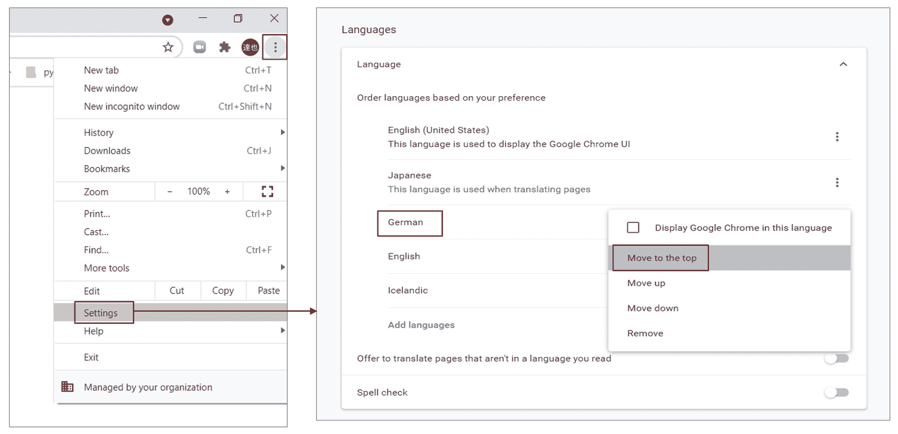

打开高级设置并将德语移到顶部。运行 Spring Boot 并访问以下 URL。

[URL]

`http://localhost:8080/user/signup`

[执行结果]

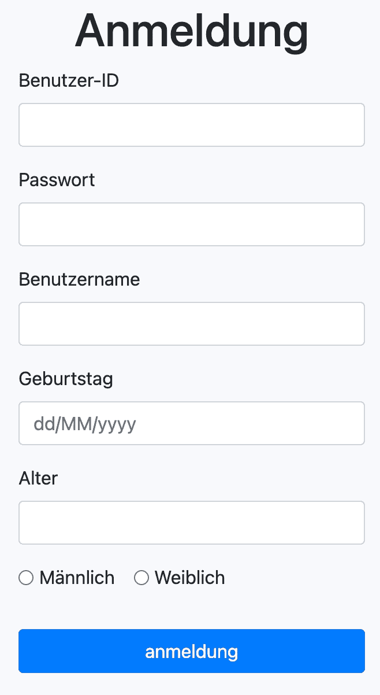

如果屏幕显示德语，则说明多语言化完成。将语言改回英语。

## 6.2 绑定

一旦创建了屏幕，你将学习更多关于绑定的知识。

* 绑定
* 编辑错误消息

### 6.2.1 绑定概述

绑定是将屏幕输入映射到 `Java` 类的过程。以下是用户注册屏幕的示例。

[绑定图片]

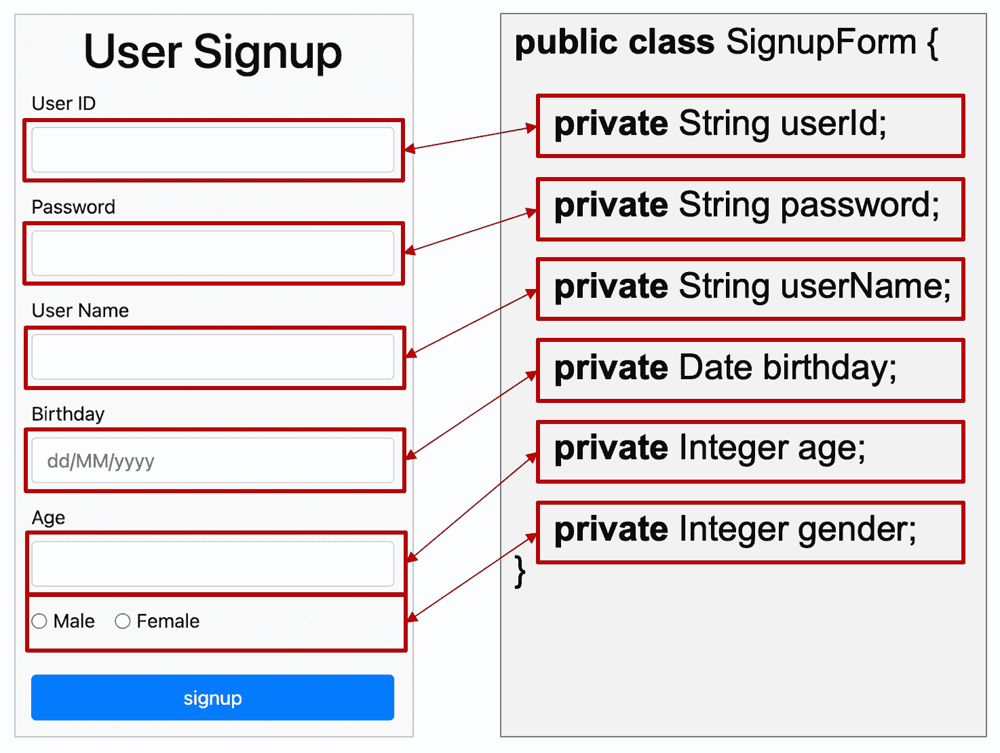

通过绑定，屏幕的输入内容可以被服务器端的控制器接收。

#### 目录

目录结构所示。背景颜色改变的部分是新添加的部分。


SpringBootSample

┗  src/main

   ┣  java

   ┃┗  com.example

   ┃     ┣  application.service

   ┃     ┣  controller

   ┃     ┣  form (创建新包)

   ┃     ┃┗  SignupForm.java (创建一个新类)


```
┃     ┣  hello
┃┗┗  SpringBootSampleApplication.java
┣  resources
┗  pom.xml
```

#### 源码

首先，准备一个映射到屏幕输入内容的表单类。

`[SignupForm.java]`

```java
package com.example.form;
import java.util.Date;
import org.springframework.format.annotation.DateTimeFormat;
import lombok.Data;

@Data
public class SignupForm {
    private String userId ;
    private String password ;
    private String userName ;
    @DateTimeFormat (pattern = "dd/MM/yyyy" )
    private Date birthday ;
    private Integer age ;
    private Integer gender ;
}
```

点：`@DateTimeFormat`

绑定 `Date` 类型时，使用 `@DateTimeFormat` 注解。如果为 `pattern` 属性设置了格式，它可以绑定到 `Date` 类型。

注意：`@NumberFormat`

要将符合指定格式的字符串转换为数字类型，使用 `@NumberFormat` 注解。

`[示例]`

```java
@NumberFormat (pattern = "####" )
private Integer salary ;
```

你可以使用上述代码将带有逗号分隔符的（如 `1,000,000`）转换为数字类型。

一个以类名开头的小写字符串（`signupForm`）被注册在 `Model` 键中。你可以通过在 `Model` 中注册实例将其传递给屏幕。

注意：`@Slf4j@` 是 `Lombok` 的一个注解。如果你将它附加到类上，就可以使用 `slf4j` 轻松记录日志。注解此类会提供一个名为 `log` 的静态变量。你可以使用该变量的方法轻松输出日志。在示例代码中，它是以下部分。

`[SignupController.java]` (日志输出部分)

```
log.info(form.toString());
```

上述代码输出 `info` 级别的日志。每个日志输出级别都有其他方法。例如，你可以使用 `debug` 方法输出 `debug` 级别的日志。

最后，修改用户注册页面。背景颜色改变的部分即为修改部分。

`[signup.html]`

```html
<!DOCTYPE html>
<html xmlns:th ="http://www.thymeleaf.org" ><head>…（已省略）</head>
<body class ="bg-light" ><form id ="signup-form" method ="post" action ="/user/signup"class ="form-signup" th:object ="${signupForm}" ><h1 class ="text-center" th:text ="#{user.signup.title}" ></h1>
<!-- 用户 ID --
<div class ="form-group" ><label for ="userId" th:text ="#{userId}" ></label><input type ="text" class ="form-control" th:field ="*{userId}" /></div>
<!-- 密码 --
<div class ="form-group" ><label for ="password" th:text ="#{password}" ></label><input type ="text" class ="form-control" th:field ="*{password}" /></div>
<!-- 用户名 --
<div class ="form-group" ><label for ="userName" th:text ="#{userName}" ></label><input type ="text" class ="form-control" th:field ="*{userName}" /></div>
<!-- 生日 --
<div class ="form-group" ><label for ="birthday" th:text ="#{birthday}" ></label><input type ="text" class ="form-control" placeholder ="dd/MM/yyyy" th:field ="*{birthday}" /></div>
<!-- 年龄 --
<div class ="form-group" ><label for ="age" th:text ="#{age}" ></label><input type ="text" class ="form-control" th:field ="*{age}" /></div>
<!-- 性别 --
<div class ="form-group" ><div th:each ="item : ${genderMap}" class ="form-check-inline" ><input type ="radio" class ="form-check-input" th:value ="item.value}" th:field ="*{gender}" /><label class ="form-check-label" th:text ="item.key}" ></label></div>
<!-- 注册按钮 --
<input type ="submit" th:value ="#{user.signup.btn}"class ="btn btn-primary w-100 mt-3" /></form>
</body>
</html>
```

### `th:object` 和 `field`

可以使用 `th:field` 来绑定 Java 类和屏幕输入。通常写法如下：

`[仅使用 th:field]`

```html
<input type ="text" class ="form-control" th:field ="signupForm.userId" />
```

使用 `Model` 中注册的键名绑定。如果在标签中写了 `th:object`，则可以省略。

`[使用 th:object 和 field]`

```html
<form id ="signup-form" method ="post" action ="/user/signup"class ="form-signup" th:object ="${signupForm}" ><input type ="text" class ="form-control" th:field ="*{userId}" />…</form>
```

只需绑定 `*{field}`。

**注意：`th:field`**

HTML 输入标签没有名为 `field` 的属性。使用了 `th:field` 属性后，HTML 会变成什么样？实际生成的 HTML 如下：

`[转换前]`

```html
<input type ="text" class ="form-control" th:field ="*{userId}" />
```

`[转换后]`

```html
<input type ="text" class ="form-control" id ="userId" name ="userId" />
```

`th:field` 属性将字段名转换为 `id` 和 `name` 属性。

### 执行

运行 Spring Boot 并访问 URL。

`[URL]`

`http://localhost:8080/user/signup`

`[执行结果]`

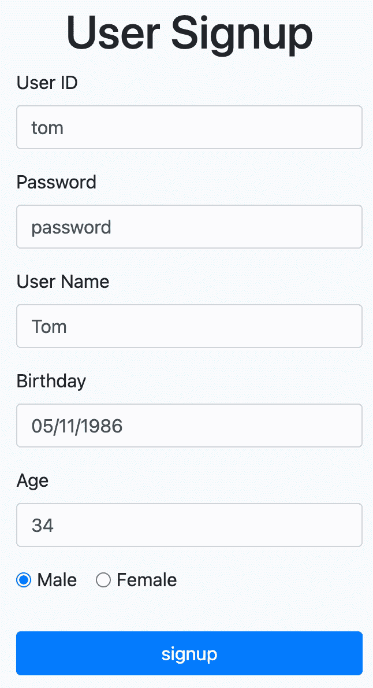

在屏幕上输入值并点击`[signup]`按钮。显示登录页面，但输出了以下日志。

`[日志]`（节）

```
SignupForm(userId=tom, password=password, userName=Tom, birthday=Wed Nov 05 00:00:00 JST 1986, age=34, gender=1)
```

屏幕输入内容输出到了日志。绑定完成。

### 6.2.2 编辑错误消息

### 概述

现在可以绑定有一个问题。如果绑定失败，将显示错误页面。例如，在日期类型或数字类型的地方输入字符串，绑定会失败。

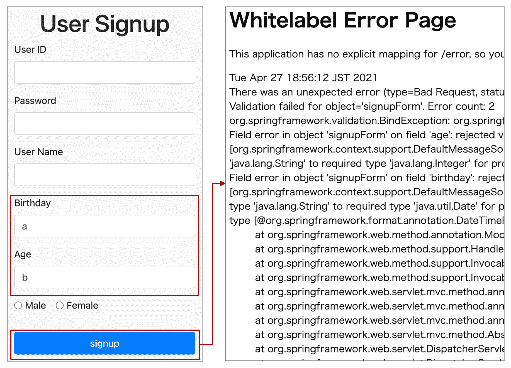

原本应该通过 JavaScript 限制屏幕输入。但由于 JavaScript Bug 或越权访问，可能会发送意外值。在这种情况下，修复为绑定失败时显示错误消息。

`[用户注册页面]`（修复后）!(image_rsrcDVC.jpg)

#### 目录

目录结构如下。背景颜色改变的部分为新增部分。

 SpringBootSample

```
src/
└── main/
  ├── java/
  │    └── com/example/demo/
  ├── resources/
  │    ├── application.properties
  │    ├── data.sql
  │    ├── schema.sql
  │    ├── i18n/
  │    │    ├── messages_de.properties
  │    │    └── messages.properties
  │    └── templates/
  │         └── signup.html
└── pom.xml
```

准备上述文件以更改绑定失败时的错误消息。

# 源代码

修改 `application.properties` 以从属性文件中获取消息。背景颜色改变的部分为修改部分。

`[application.properties]`

```properties
# Data
spring.datasource.url=jdbc:h2:mem:testdb;DB_CLOSE_DELAY=- 1;DB_CLOSE_ON_EXIT=FALSE
spring.datasource.driver-class-name=org.h2.Driver
spring.datasource.username=sa
spring.datasource.password=
spring.datasource.sql-script-encoding=UTF-8
spring.datasource.initialize=true
spring.datasource.schema=classpath:schema.sql
spring.datasource.data=classpath:data.sql
# H2
spring.h2.console.enabled=true
# messages
spring.messages.basename=i18n/messages,i18n/ValidationMessages
```

**注意：`ValidationMessages`**

在 `spring.messages.basename` 中，你可以指定逗号分隔的多个消息文件。由应用程序将所有消息聚合到一个文件中或拆分。拆分文件时，注意不要重复键名。

接下来，编辑绑定失败时的错误消息。

`[ValidationMessages.properties]`

```properties
# ========================
# 绑定错误消息
# ========================
# Pattern1
typeMismatch.signupForm.age=Please enter a number
typeMismatch.signupForm.birthday=Please enter in dd/MM/yyyy format
# Pattern2
typeMismatch.age=Please enter a number
typeMismatch.birthday=Please enter in dd/MM/yyyy format
# Pattern3
typeMismatch.int=Please enter a number
typeMismatch.java.lang.Integer=Please enter a number
typeMismatch.java.util.Date=Please enter in dd/MM/yyyy format
```

在示例代码中，它是通过模式 1 设置的。其他模式均被注释掉了。在模式 1 中，为每个 `Model` 键和字段名设置了错误消息。模式 2 为每个字段名设置了错误消息。`typeMismatch.age` 为所有 `age` 字段设置了相同的错误消息。模式 3 为每种数据类型设置了错误消息。`typeMismatch.int` 将所有 `int` 字段设置了相同的错误消息。对于 `Integer` 类型，你还必须包含 `typeMismatch.java.lang.Integer` 和包名。顺便提一下，如果你没有设置错误消息的绑定，将显示默认的错误消息。如果你有德语语言文件，可以实现多语言支持。

### `ValidationMessages_de.properties`

```properties
# ========================
# 绑定错误消息
# ========================
# Pattern1
typeMismatch.signupForm.age=Bitte gebe eine Nummer ein
typeMismatch.signupForm.birthday=Bitte geben Sie im Format TT/MM/JJJJ ein
# Pattern2
#typeMismatch.age=Bitte gebe eine Nummer ein(Pattern2)
#typeMismatch.birthday=Bitte geben Sie im Format TT/MM/JJJJ ein(Pattern2)
# Pattern3
#typeMismatch.int=Bitte gebe eine Nummer ein(Pattern3)
#typeMismatch.java.lang.Integer=Bitte gebe eine Nummer ein(Pattern3)
#typeMismatch.java.util.Date=Bitte geben Sie im Format TT/MM/JJJJ ein(Pattern3)
```

修改控制器，当屏幕输入内容发生错误时，它将返回用户注册页面。背景颜色改变的部分是修改部分。

### `SignupController.java`


```java
package com.example.controller;

import java.util.Locale;
import java.util.Map;

import org.springframework.beans.factory.annotation.Autowired;
import org.springframework.stereotype.Controller;
import org.springframework.ui.Model;
import org.springframework.validation.BindingResult;
import org.springframework.web.bind.annotation.GetMapping;
import org.springframework.web.bind.annotation.ModelAttribute;
import org.springframework.web.bind.annotation.PostMapping;
import org.springframework.web.bind.annotation.RequestMapping;

import com.example.application.service.UserApplicationService;
import com.example.form.SignupForm;

import lombok.extern.slf4j.Slf4j;

@Controller
@RequestMapping("/user")
@Slf4j
public class SignupController {

    @Autowired
    private UserApplicationService userApplicationService;

    /** 显示用户注册页面 */
    @GetMapping("/signup")
    public String getSignup(Model model, Locale locale, @ModelAttribute SignupForm form) {…（已省略）}

    /** 用户注册流程 */
    @PostMapping("/signup")
    public String postSignup(Model model, Locale locale, @ModelAttribute SignupForm form, BindingResult bindingResult) {
        // 输入检查结果
        if (bindingResult.hasErrors()) {
            // NG: 返回用户注册页面
            return getSignup(model, locale, form);
        }
        log.info(form.toString());
        // 重定向到登录页面
        return "redirect:/login";
    }
}
```

#### 关键点：`BindingResult`

你可以通过`BindingResult`方法检查是否发生了绑定错误或验证错误。如果`hasErrors()`方法的结果为`true`，则表示发生了绑定错误或验证错误。

最后，修改用户注册页面以显示错误消息。背景颜色改变的部分是修改部分。

### `signup.html`

```html
<!DOCTYPE html>
<html xmlns:th="http://www.thymeleaf.org">
<head>…（已省略）</head>
<body class="bg-light">
    <form id="signup-form" method="post" action="/user/signup" class="form-signup" th:object="${signupForm}">
        <h1 class="text-center" th:text="#{user.signup.title}"></h1>
        <!-- 用户 ID -->
        <div class="form-group">
            <label for="userId" th:text="#{userId}"></label>
            <input type="text" class="form-control" th:field="*{userId}" th:errorclass="is-invalid" />
            <div class="invalid-feedback" th:errors="*{userId}"></div>
        </div>
        <!-- 密码 -->
        <div class="form-group">
            <label for="password" th:text="#{password}"></label>
            <input type="text" class="form-control" th:field="*{password}" th:errorclass="is-invalid" />
            <div class="invalid-feedback" th:errors="*{password}"></div>
        </div>
        <!-- 用户名 -->
        <div class="form-group">
            <label for="userName" th:text="#{userName}"></label>
            <input type="text" class="form-control" th:field="*{userName}" th:errorclass="is-invalid" />
            <div class="invalid-feedback" th:errors="*{userName}"></div>
        </div>
        <!-- 生日 -->
        <div class="form-group">
            <label for="birthday" th:text="#{birthday}"></label>
            <input type="text" class="form-control" placeholder="dd/MM/yyyy" th:field="*{birthday}" th:errorclass="is-invalid" />
            <div class="invalid-feedback" th:errors="*{birthday}"></div>
        </div>
        <!-- 年龄 -->
        <div class="form-group">
            <label for="age" th:text="#{age}"></label>
            <input type="text" class="form-control" th:field="*{age}" th:errorclass="is-invalid" />
            <div class="invalid-feedback" th:errors="*{age}"></div>
        </div>
        <!-- 性别 -->
        <div class="form-group">
            <div th:each="item : ${genderMap}" class="form-check-inline">
                <input type="radio" class="form-check-input" th:value="${item.value}" th:field="*{gender}" th:errorclass="is-invalid" />
                <label class="form-check-label" th:text="${item.key}"></label>
            </div>
            <div class="text-danger" th:if="#fields.hasErrors('gender')" th:errors="*{gender}"></div>
        </div>
        <!-- 提交按钮 -->
        <input type="submit" th:value="#{user.btn}" class="btn-primary w-100 mt-3" />
    </form>
</body>
</html>
```

#### 关键点：`th:errorclass`

当`th:errorclass`与`th:field`在同一个标签中使用时，它是有效的。如果`th:field`指定的字段发生错误，它将添加 Bootstrap 提供的`is-invalid` CSS 类。

```html
<input type="text" class="form-control" th:field="*{userId}" th:errorclass="is-invalid" />
```

#### 关键点：`th:errors`

`th:errors`指定了字段名。如果指定的字段发生了错误，它将在该标签中显示错误消息。

```html
<div class="form-group">
    <label for="userId" th:text="#{userId}"></label>
    <input type="text" class="form-control" th:field="*{userId}" th:errorclass="is-invalid" />
    <div class="invalid-feedback" th:errors="*{userId}"></div>
</div>
```

#### 关键点：`th:if`

你可以使用`th:if`属性来根据条件决定是否生成标签。如果条件成立则生成标签。通过在`th:if`的条件中编写`${#fields.hasErrors('字段名')}`，你可以检查某个字段是否发生了错误。

```html
<div class="text-danger" th:if="#fields.hasErrors('gender')" th:errors="*{gender}"></div>
```

## 6.3 验证

从现在开始，我们将创建验证（输入检查）。

- [实现验证]
- [编辑错误消息]
- [设置验证执行顺序]

### 6.3.1 实现验证

#### 概述

验证是一种输入检查。Spring 通过简单的注解即可实现验证。

[用户注册页面]（实现验证后）（image_rsrcDVD.jpg）

#### 目录

目录结构没有变化。

### 源代码

使用验证需要库。因此，在`pom.xml`的`dependencies`标签中添加以下代码。

```xml
<dependencies>
    <!-- validator -->
    <dependency>
        <groupId>org.springframework.boot</groupId>
        <artifactId>spring-boot-starter-validation</artifactId>
    </dependency>
    <!-- ... -->
</dependencies>
```

修改接收来自屏幕输入的表单类。背景颜色改变的部分为修改部分。

`SignupForm.java`

```java
package com.example.form;

import java.util.Date;

import javax.validation.constraints.Email;
import javax.validation.constraints.Max;
import javax.validation.constraints.Min;
import javax.validation.constraints.NotBlank;
import javax.validation.constraints.NotNull;
import javax.validation.constraints.Pattern;

import org.hibernate.validator.constraints.Length;
import org.springframework.format.annotation.DateTimeFormat;

import lombok.Data;

@Data
public class SignupForm {

    @NotBlank
    @Email
    private String userId;

    @NotBlank
    @Length(min = 4, max = 100)
    @Pattern(regexp = "^[a-zA-Z0-9]+$")
    private String password;

    @NotBlank
    private String userName;

    @DateTimeFormat(pattern = "dd/MM/yyyy")
    @NotNull
    private Date birthday;

    @Min(20)
    @Max(100)
    private Integer age;

    @NotNull
    private Integer gender;
}
```

### 重点：校验注解

提供了以下注解来实现逻辑校验：

[注解列表]

| 类 | 注解 | 描述 | 示例 |
| --- | --- | --- | --- |
| Bean Validation | `@NotNull` | 检查是否为空。 | `@NotNull String userName;` |
| | `@NotEmpty` | 检查字符串或集合是否为空。 | `@NotEmpty List<User> userList;` |
| | `@NotBlank` | 检查字符串是否仅为 null、空字符串或空格。 | `@NotBlank String password;` |
| | `@Max` | 检查值是否小于等于指定值。 | `@Max(100) int age;` |
| | `@Min` | 检查值是否大于等于指定值。 | `@Min(20) int age;` |
| | `@Size` | 检查字符串的长度和集合的大小是否在指定范围内。 | `@Size(min = 0, max = 20) List<User> userList;` |
| | `@AssertTrue` | 检查是否为真。 | `@AssertTrue boolean marriage;` |
| | `@AssertFalse` | 检查是否为假。 | `@AssertFalse boolean marriage;` |
| | `@Pattern` | 检查是否与指定的正则表达式匹配。 | `@Pattern() String password;` |
| | `@Email` | 检查字符串是否符合电子邮件地址格式。 | `@Email String userId;` |
| Hibernate Validator | `@Range` | 检查数值是否在指定范围内。 | `@Range(min = 20, max = 100) int age;` |
| | `@Length` | 检查字符串的长度是否在指定范围内。 | `@Length(min = 8, max = 100) String password;` |
| | `@CreditCardNumber` | 检查字符串是否符合信用卡号格式。 | `@CreditCardNumber String cardNumber;` |
| | `@URL` | 检查字符串是否符合 URL 格式。 | `@URL String url;` |

还有其他可用的校验注解。详情请参阅 [Hibernate Validator 官方页面](https://docs.jboss.org/hibernate/stable/validator/reference/en-US/html_single/#_validator_methods)。

顺便提一下，`@NotNull`、`@NotEmpty`和`@NotBlank`具有以下区别：

[NotNull、NotEmpty 和 NotBlank 之间的区别]

| 注解 | null | 空字符 | 空格 |
| --- | --- | --- | --- |
| `@NotNull` | NG | OK | OK |
| `@NotEmpty` | NG | NG | OK |
| `@NotBlank` | NG | NG | NG |

NG：校验结果将显示为错误。

最后，修改用户注册控制器以执行校验。背景颜色改变的部分为修改部分。

`SignupController.java`


```java
package com.example.controller;
import java.util.Locale;
import java.util.Map;
import org.springframework.beans.factory.annotation.Autowired;
import org.springframework.stereotype.Controller;
import org.springframework.ui.Model;
import org.springframework.validation.BindingResult;
import org.springframework.validation.annotation.Validated;
import org.springframework.web.bind.annotation.GetMapping;
import org.springframework.web.bind.annotation.ModelAttribute;
import org.springframework.web.bind.annotation.PostMapping;
import org.springframework.web.bind.annotation.RequestMapping;
import com.example.application.service.UserApplicationService;
import com.example.form.SignupForm;
import lombok.extern.slf4j.Slf4j;

@Controller
@RequestMapping ("/user" )
@Slf4j
public class SignupController {
    @Autowired
    private UserApplicationService userApplicationService ;

    /** 显示用户注册屏幕 */
    @GetMapping ("/signup" )
    @GetMapping ("/signup" )
    public String getSignup(Model model , Locale locale ,@ModelAttribute SignupForm form ) {…(已省略)}

    /** 用户注册流程 */
    @PostMapping ("/signup" )
    public String postSignup(Model model , Locale locale ,@Validated SignupForm form ,BindingResult bindingResult ) {
        // 输入检查
        if (bindingResult.hasErrors()) {
            // NG：返回注册屏幕
            return getSignup(model , locale , form );
        }
        log .info(form .toString());
        // 跳转到登录屏幕
        return "redirect:/login" ;
    }
}
```

### 重点：`@Validated`

在类上使用 `@Validated` 后将执行校验。

### 执行

运行 Spring Boot 并访问以下 URL。

`http://localhost:8080/user/signup`

在不输入任何内容的情况下点击 "signup"。

### 注意：校验结果

校验结果放在 `BindingResult` 中。错误处理方式与绑定错误相同。

### 6.3.2 编辑错误消息

有多种方法可以编辑错误消息。其中最简单的方法是配置 `[注解名称 = 消息]`。

字符 `{0}` 和 `{1}` 示例代码中。这是消息中的参数。你可以使用参数显示变量。例如，`{0}` 是字段名。

示例：`@NotNull` 错误

| 设置值 | 显示结果 |
| --- | --- |
| `NotNull={0} is required` | Gender is required |

注解中设置的值将显示在 `{0}` 之后。`{0}` 之后的数字显示注解中设置的值。

示例：`@Length(min = 4, max = 100)`

* `{1}` = max(100)
* `{2}` = min(4)

#### 目录

目录没有变化。

## 源代码

向属性文件添加校验消息。背景颜色改变的部分为修改部分。

`ValidationMessages.properties`

```properties
# ========================
# 绑定消息
# ========================
# Pattern1
typeMismatch.signupForm.age=Please enter a number
typeMismatch.signupForm.birthday=Please enter in dd/MM/yyyy
# Pattern2
typeMismatch.signupForm.age=Please enter a number
typeMismatch.signupForm.birthday=Please enter in dd/MM/yyyy
# Pattern3
typeMismatch.int=Please enter a number
typeMismatch.java.lang.Integer=Please enter a number
typeMismatch.java.util.Date=Please enter in dd/MM/yyyy
# ========================
# 校验消息
# ========================
NotBlank={0} is required
Email=Please enter {0} in email address format
Length=Enter {0} with {2} digits or more and {1} digits or less
NotNull={0} is required
Min=Enter {1} or more for {0}
Max=For {0} , enter {1} or less
```

哪些数字包含哪些属性值是按属性名称升序排列的。由于 `max` 的顺序早于 `min`，因此按上述方式设置。为了支持多语言，还编辑了德语的属性文件。背景颜色发生区域是修改部分。

`[ValidationMessages_de.properties]`

```properties
# ========================
# 绑定错误消息
# ========================
# Pattern1
typeMismatch.signupForm.age=请输入一个数字
typeMismatch.signupForm.birthday=请以 TT/MM/JJJJ 格式输入
# Pattern2
#typeMismatch.age=请输入一个数字(Pattern2)
#typeMismatch.birthday=请以 TT/MM/JJJJ 格式输入(Pattern2)
# Pattern3
#typeMismatch.int=请输入一个数字(Pattern3)
typeMismatch.java.lang.Integer=请输入一个数字(Pattern3)
typeMismatch.java.util.Date=请以 TT/MM/JJJJ 格式输入(Pattern3)
# ========================
# 验证错误消息
# ========================
NotBlank={0} 是必填的 is required
Email=请以电子邮件格式输入 {0}
Length=输入的 {0} 至少包含 {2} 位数字，最多包含 {1} 位
Pattern=请用字母数字单字节字符输入 {0}
NotNull={0} 是必填的 is required
Min=为 {0} 输入 {1} 或更多
Max=为 {0} 输入 {1} 或更少
```

我已经解释过错误消息中的 `{0}` 包含字段名。然而，如果没有设置任何内容，表单类的字段名将按原样显示。例如：字段名中未设置。

| 设置值 | 显示结果 |
| --- | --- |
| `NotNull={0} is required` | gender is required |

接下来，编辑 `messages.properties` 来更改字段名的显示。编辑方法是设置 `"字段名 = 字符"`。只有性别字段名没有设置。其他字段名已经设置好了。背景颜色发生区域是修改部分。

`[messages.properties]`

```properties
user.signup.title=用户注册
user.signup.btn=注册
userId=用户 ID
password=密码
userName=用户名
birthday=出生日期
age=年龄
male=男性
female=女性
gender=性别
```

由于是多语言支持，也修改了德语的消息文件。背景颜色发生区域是修改部分。

`[messages_de.properties]`

```properties
user.signup.title=注册
user.signup.btn=注册
userId=Benutzer-ID
password=Passwort
userName=Benutzername
birthday=Geburtstag
age=Alter
male=Männlich
female=Weiblich
gender= 性 lecht
```

运行 Spring Boot 并访问以下 URL。

`http://localhost:8080/user/signup`

在屏幕上输入值以触发验证错误并点击注册按钮。

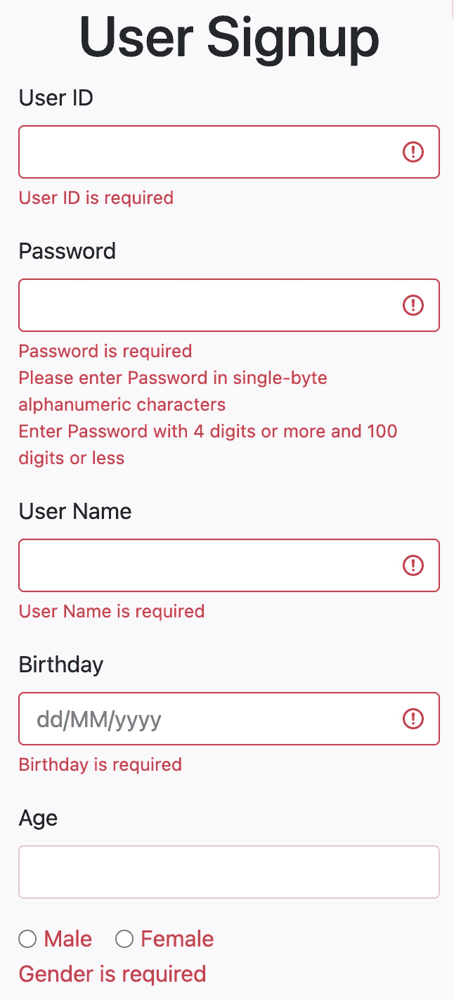

如果错误消息发生变化，则完成。

注意：如何编辑验证错误消息

还有编辑验证错误消息的方法。

| 模式 | 设置方法 | 设置示例 |
| --- | --- | --- |
| 1 | 注解名.ModelAttribute 键名.字段名=错误消息 | `NotBlank.signupForm.userId=Please enter user ID` |
| 2 | 注解名.字段名=错误消息 | `NotBlank.userId=Please enter user ID` |
| 3 | 注解名.字段数据类型=错误消息 | `NotBlank.java.lang.String=Required input` |
| 4 | 唯一键名=错误消息 | `require_check=Required input` |

模式 1 到 3 可以通过仅编辑属性文件来设置。模式 4 必须映射注解和消息的键名。设置如下所示。

示例：模式 4 的设置

`[ValidationMessages.properties]`

```properties
require_check=Required input
```

`[SignupForm.java]`

```java
public class SignupForm {
    @NotBlank (message = "{require_check}" )
    @Email
    private String userId ;…
}
```

### 6.3.3 设置验证运行顺序

#### 概述

如果验证结果为 NG（错误），将根据 NG 的数量显示错误消息。是否允许取决于设计。如果你想设置验证执行顺序，请设置验证组。

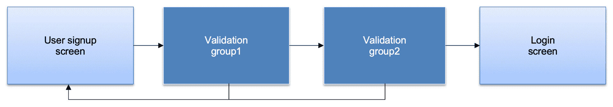

如果验证组 1 为 OK，则继续组 2。如果每个组的检查结果均为 NG，则屏幕返回用户注册界面。

在用户注册界面上，修改验证按以下顺序发生：

1. 必填输入检查
2. 输入内容检查

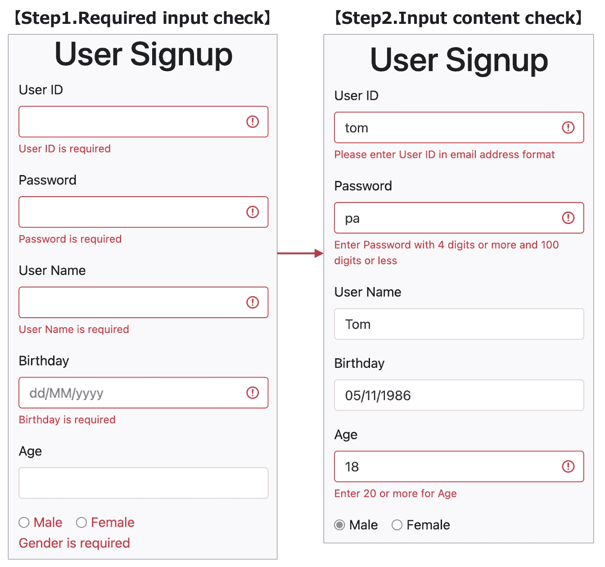

#### 目录

目录结构如下。背景颜色发生区域是新添加的部分。


```text
SpringBootSample
┗ src/main
  ┣ java
  ┃┗ com.example
  ┃   ┣ application.service
  ┃   ┣ controller
  ┃   ┣ form
  ┃   ┃┣ GroupOrder.java
  ┃   ┃┣ SignupForm.java
  ┃   ┃┣ ValidGroup1.java
  ┃   ┃┗ ValidGroup2.java
  ┃   ┗ SpringBootApplication.java
  ┗ resources
```

## 源代码

`ValidGroup1` 和 `ValidGroup2` 是空接口。

`[ValidGroup1.java]`

```java
package com.example.form;
public interface ValidGroup1 {}
```

`[ValidGroup2.java]`

```java
package com.example.form;
public interface ValidGroup2 {}
```

在 `GroupOrder` 中设置顺序。

`[GroupOrder.java]`

```java
package com.example.form;
import javax.validation.GroupSequence;
@GroupSequence ({ ValidGroup1.class , Group2.class })
public interface GroupOrder {}
```

`@GroupSequence` 注解设置了顺序。验证从左到右执行。在示例代码中，按以下顺序检查：

1. `ValidGroup1`
2. `ValidGroup2`

要映射验证顺序，在注解的 `groups` 属性中指定接口。

最后，修改 Controller。背景颜色发生区域是修改部分。

`[SignupController.java]`

```java
@Controller
@RequestMapping ("/user" )
@Slf4j
public class SignupController {
    @Autowired
    private UserApplicationService userApplicationService ;

    /** 显示用户注册界面 */
    @GetMapping ("/signup" )
    public String getSignup(Model model , Locale locale ,@ModelAttribute SignupForm form ) {…(Omitted)}

    /** 用户注册流程 */
    @PostMapping ("/signup" )
    public String postSignup(Model model , Locale locale ,@ModelAttribute @Validated (GroupOrder.class ) SignupForm form ,BindingResult bindingResult ) {
        // 输入检查结果
        if (bindingResult .hasErrors()) {
            // NG：返回用户注册界面
            return getSignup(model , locale , form );
        }
        log .info(form .toString());
        // 跳转到登录界面
        return "redirect:/login" ;
    }
}
```

在 `@Validated` 注解中指定 `GroupOrder.class` 以反映验证顺序设置。

运行 Spring Boot 并访问以下 URL。

`http://localhost:8080/user/signup`

首先在屏幕上不输入任何值直接点击“注册”。然后在屏幕上输入值并点击“注册”。

如果验证顺序设置正确，则完成。

### 总结

以下是本章学习的内容。

## 创建屏幕

* 轻松使用带有 `webjars` 的库
* 你可以使用 `messages.properties` 管理消息。
* 你可以使用 `messages.properties` 支持多语言。

## 绑定

* 待绑定的 Java 类已注册在 `Model` 中。
* 在屏幕上，使用 `th:field` 映射 Java 类中的字段。

## 验证

* 可以使用注解来实现验证。
* 使用 `BindingResult` 判断是否发生了验证错误。
* `@GroupSequence` 注解允许你设置验证的顺序。

## 其他

* 使用 `BindingResult` 判断在绑定或验证过程中是否发生了错误。
* 可以通过 `th:errors` 获取错误消息。
* 可以 `th:errorclass` 在发生错误时添加 CSS 类。
* 错误消息可以在属性文件中进行编辑。

# 7. 屏幕布局

在本章中，你将学习如何创建屏幕布局。

## 7.1 屏幕布局实现概述

在创建屏幕时，使用布局函数是常见的做法。布局消除了每次在每个屏幕上编写通用 HTML 的需要。通过准备不同的布局文件，你可以更轻松地更改布局。

书中的示例创建了以下布局屏幕：


[布局配置]

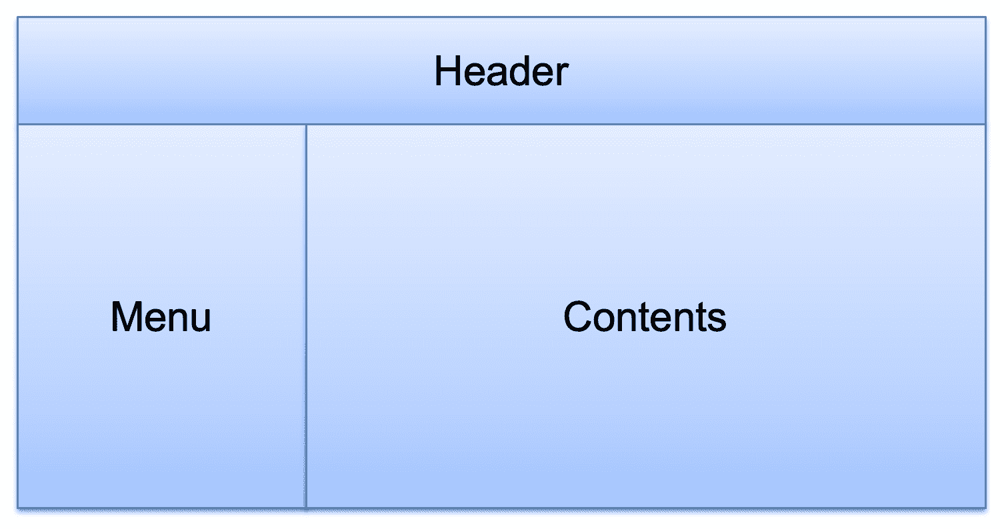

具体来说，创建了以下用户列表屏幕。

[用户列表屏幕]

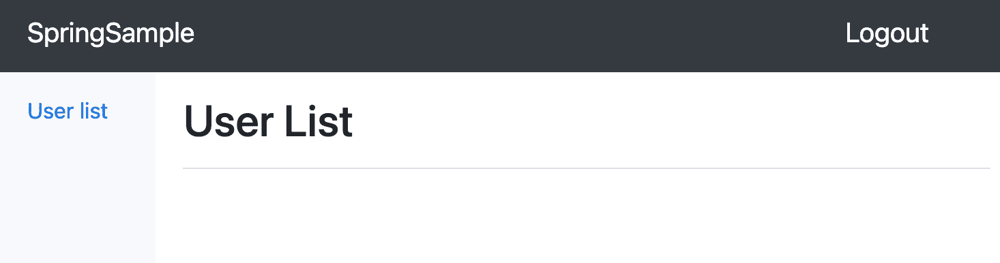

登录后，创建一个跳转到用户列表屏幕的应用程序。为了创建此屏幕，你将创建以下 4 个 HTML 文件：

* 布局 (Layout)
* 头部 (Header)
* 菜单 (Menu)
* 内容 (Content)

## 目录

目录结构如下。背景颜色变化的部分是新增的部分。


```text
SpringBootSample
┗ src/main
    ┣ java
    ┃┗ com.example
        ┣ application.service
        ┣ controller
        ┃┣ LoginController.java
        ┃┣ LogoutController.java (创建新类)
        ┃┣ SignupController.java
        ┃┗ UserListController.java (创建新类)
        ┣ form
        ┣ hello
        ┗ SpringBootSampleApplication.java
    ┣ resources
    ┣ i18n
    ┣ static
    ┃┗ css
        ┃┣ layout (创建新文件夹)
        ┃┗ layout.css (创建新文件)
        ┃┣ login
        ┃┗ user
        ┃┣ list.css (创建新文件)
        ┃┗ signup.css
    ┗ templates
        ┣ layout (创建新文件夹)
        ┃┣ header.html (创建新文件)
        ┃┣ layout.html (创建新文件)
        ┃┗ menu.html (创建新文件)
        ┣ login
        ┗ user
            ┣ list.html (创建新文件)
            ┗ signup.html
    ┣ application.properties
    ┣ data.sql
    ┗ schema.sql
```

首先，为 Thymeleaf 添加一个用于创建布局的库。在`pom.xml`的`dependencies`标签中添加以下代码。

```xml
<!-- thymeleaf-layout -->
<dependency>
    <groupId>org.thymeleaf</groupId>
    <artifactId>thymeleaf-layoutdialect</artifactId>
</dependency>
```

为用户列表创建一个控制器。

```java
package com.example.controller;

import org.springframework.stereotype.Controller;
import org.springframework.web.bind.annotation.GetMapping;
import org.springframework.web.bind.annotation.RequestMapping;

@Controller
@RequestMapping("/user")
public class UserListController {
    /** 显示用户列表 */
    @GetMapping("/list")
    public String getUserList() {
        return "user/list";
    }
}
```

修改登录屏幕的控制器，以便跳转到用户列表屏幕。

```java
package com.example.controller;

import org.springframework.stereotype.Controller;
import org.springframework.web.bind.annotation.GetMapping;
import org.springframework.web.bind.annotation.PostMapping;

@Controller
public class LoginController {
    /** 显示登录屏幕 */
    @GetMapping("/login")
    public String getLogin() {
        return "login/login";
    }
    /** 重定向到用户列表屏幕 */
    @PostMapping("/login")
    public String postLogin() {
        return "redirect:/user/list";
    }
}
```

为注创建一个控制器。

```java
package com.example.controller;

import org.slf4j.Logger;
import org.slf4j.LoggerFactory;
import org.springframework.stereotype.Controller;
import org.springframework.web.bind.annotation.PostMapping;

@Controller
public class LogoutController {
    private static final Logger log = LoggerFactory.getLogger(LogoutController.class);
    /** 重定向到登录屏幕 */
    @PostMapping("/logout")
    public String postLogout() {
        log.info("Logout");
        return "redirect:/login";
    }
}
```

为屏幕布局创建 HTML。

```html
<!DOCTYPE html>
<html xmlns:th="http://www.thymeleaf.org" xmlns:layout="http://www.ultraq.net.nz/thymeleaf/layout">
<head>
    <meta charset="UTF-8">
    <meta name="viewport" content="width=device-width, initial-scale=1, shrink-to-fit=no">
    <!-- 读取通用 CSS -->
    <link rel="stylesheet" th:href="@{/webjars/bootstrap/css/bootstrap.min.css}">
    <link rel="stylesheet" th:href="@{/css/layout/layout.css}">
    <!-- 读取通用 JS -->
    <script th:src="@{/webjars/jquery/jquery.min.js}" defer></script>
    <script th:src="@{/webjars/bootstrap/js/bootstrap.min.js}" defer></script>
    <title></title>
</head>
<body>
    <!-- 头部 -->
    <nav layout:replace="~{layout/header::header}"></nav>
    <!-- 菜单 -->
    <div class="container-fluid">
        <div class="row">
            <nav class="col-sm-2 bg-light sidebar pt-2">
                <div layout:replace="~{layout/menu::menu}"></div>
            </nav>
        </div>
    </div>
    <!-- 内容 -->
    <div class="container-fluid">
        <div class="row">
            <div class="col-sm-10 offset-sm-2 main">
                <div layout:fragment="content"></div>
            </div>
        </div>
    </div>
</body>
</html>
```

点 1：`xmlns:layout` 用于在 Thymeleaf 中使用布局，在`html`标签中添加`xmlns:layout="http://www.ultraq.net.nz/thymeleaf/layout"`。

点 2：`layout:replace` 用于读取其他 HTML 文件，使用`layout:replace`属性。按以下格式指定值：`~{file-path::key-name}`。

对于文件路径，请指定相对于`src/main/resources/templates`的相对路径。键名（key name）可以指定任意值。通过示例代码说明，后续部分读取了另一个 HTML 文件。

```html
[layout.html]
<!-- header -->
<nav layout:replace="~{layout/header::header}"></nav>
```

在这种情况下，`src/main/resources/templates/layout/header.html`文件是目标。然后，读取该文件中键名为`header`的部分。

### 重点 3：`layout:fragment`

要读取其他 HTML 文件，请使用`layout:fragment`属性。该属性的值可以是任何键名。`layout:replace`和`layout:fragment`都会读取其他 HTML 文件。`layout:replace`和`layout:fragment`之间的区别稍后会解释。

```html
[header.html]
<!DOCTYPE html>
<html xmlns:th="http://www.thymeleaf.org" xmlns:layout="http://www.ultraq.net.nz/thymeleaf/layout" layout:decorate="~{layout/layout}"><head></head>
<body>
<nav layout:fragment="header" class="navbar navbar-inverse navbar-fixed-top navbar-dark bg-dark">
  <div class="container-fluid">
    <div class="navbar-header">
      <a class="navbar-brand" href="#">SpringSample</a>
    </div>
    <form method="post" th:action="@{/logout}">
      <button class="btn btn-link pull-right navbar-brand" type="submit">Logout</button>
    </form>
  </div>
</nav>
</body>
</html>
```

### 重点 1：`layout:decorate`

指定将此 HTML 包含哪个布局中。按照以下格式输入：

[layout:decorate 的格式]

`~{file path}`

对于文件路径，请指定相对于`src/main/resources/templates`的相对路径。在示例代码中，指定了`src/main/resources/templates/layout/layout.html`。

### 重点 2：`layout:fragment`

指定布局 HTML 引用的键名。如本书中的示例代码所示，必须满足以下点：

```html
[layout.html]
<nav layout:replace="~{layout/header::header}"></nav>
```

```html
[header.html]
<nav layout:fragment="header" class="navbar navbar-inverse navbar-fixed-top navbar-dark bg-dark">
  header HTML 现在已嵌入到布局 HTML 中。
</nav>
```

同样地，为菜单创建 HTML。

```html
[menu.html]
<!DOCTYPE html>
<html xmlns:th="http://www.thymeleaf.org" xmlns:layout="http://www.ultraq.net.nz/thymeleaf/layout" layout:decorate="~{layout/layout}"><head></head>
<body>
  <div layout:fragment="menu" class="bg-light">
    <ul class="nav nav-pills nav-stacked flex-column">
      <li role="presentation">
        <a class="nav-link" th:href="@{'/user/list'}">用户列表</a>
      </li>
    </ul>
  </div>
</body>
</html>
```

同样地，为用户列表界面创建 HTML。

```html
[list.html]
<!DOCTYPE html>
<html xmlns:th="http://www.thymeleaf.org" xmlns:layout="http://www.ultraq.net.nz/thymeleaf/layout" layout:decorate="~{layout/layout}"><head>
  <title>用户列表</title>
  <!-- 读取专用的 CSS -->
  <link rel="stylesheet" th:href="@{/css/user.css}">
</head>
<body>
  <div layout:fragment="content">
    <div class="header border-bottom">
      <h1 class="h2">用户列表</h1>
    </div>
  </div>
</body>
</html>
```

现在创建一个一个 CSS。

```css
[layout.css]
.sidebar {
  position: fixed;
  display: block;
  top: 58px;
  bottom: 0;
}
.main {
  position: fixed;
  display: block;
  top: 58px;
  bottom: 0;
  padding-left: 20px;
  overflow-y: auto;
  height: calc(100vh - 58px);
}
[list.css]
.header {
  padding-top: 1rem!important;
  padding-bottom: .5rem!important;
  margin-bottom: 1rem!important;
}
.th {
  width: 200px;
}
```

### 执行

运行 SpringBoot 并访问登录界面。请在不在屏幕输入任何内容的情况下点击“Login”按钮。屏幕将切换到用户列表界面。

### 注意：`layout:replace`和`layout:fragment`的区别

在生成的 HTML 中，`layout:replace`和`layout:fragment`之间存在细微差异。差异如下：

* `layout:replace`替换整个标签。
* `layout:fragment`在标签内部添加 HTML。

具体如下：

#### `layout:replace`示例

```html
[布局侧 HTML]
<div layout:replace="~{sample/contents}"></div>
```

```html
[内容侧 HTML]
<div layout:fragment="contents" /><p>示例</p></div>
```

```html
[layout:replace 生成的 HTML]
<div><p>示例</p></div>
```

也就是说，内容侧 HTML 替换了布局侧 HTML。布局侧 HTML 不保留。

#### `layout:fragment`示例

```html
[布局侧 HTML]
<div layout:fragment="~{contents}" id="sample"></div>
```

```html
[内容侧 HTML]
<div layout:fragment="contents" /><p>示例</p></div>
```

```html
[layout:fragment 生成的 HTML]
<div id="sample"><p>示例</p></div>
```

这意味着内容侧 HTML 添加到了布局侧 HTML 元素。

### 注意：如何实现布局


即使不为布局添加库，也可以仅使用 Thymeleaf 功能创建布局。实现方法是使用`th:replace`和`th:fragment`属性。这两个属性的用法与`layout:replace`和`layout:fragment`相同。但根据是否为布局使用库，生成的`head`标签会有不同。

使用`th:replace`和`th:fragment`时：

```html
[布局侧 HTML]
<head>
  <link rel ="stylesheet" th:href ="@{/css/common.css}" >
  <script th:src ="@{/js/common.js}" defer></script>
</head>
```

```html
[内容侧 HTML]
<head>
  <title> 示例内容</title>
  <link rel ="stylesheet" th:href ="@{/css/sample.css}" >
  <script th:src ="@{/js/sample.js}" defer></script>
</head>
```

```html
[生成的 HTML]
<head>
  <link rel ="stylesheet" th:href ="@{/css/common.css}" >
  <script th:src ="@{/js/common.js}" defer></script>
</head>
```

也就是说，在`th:replace`属性中，仅保留布局侧的`head`标签。

使用`layout:replace`和`layout:fragment`时：

```html
[布局侧 HTML]
<head>
  <link rel ="stylesheet" th:href ="@{/css/common.css}" >
  <script th:src ="@{/js/common.js}" defer></script>
</head>
```

```html
[内容侧 HTML]
<head>
  <title> 示例内容</title>
  <link rel ="stylesheet" th:href ="@{/css/sample.css}" >
  <script th:src ="@{/js/sample.js}" defer></script>
</head>
```

```html
[生成的 HTML]
<head>
  <title> 示例内容</title>
  <link rel ="stylesheet" th:href ="@{/css/common.css}" >
  <script th:src ="@{/js/common.js}" defer></script>
  <link rel ="stylesheet" th:href ="@{/css/sample.css}" >
  <script th:src ="@{/js/sample.js}" defer></script>
</head>
```

`layout:replace`属性将内容侧`head`标签内的元素添加到布局侧`head`标签内部。因此，使用布局库可以更容易创建布局。

### 总结

以下是你在本章中学习的内容：

[如何创建布局]

* 为布局使用库。

* 在`html`标签中添加`xmlns:layout="http://www.ultraq.net.nz/thymeleaf/layout"`。

[布局侧 HTML]

布局侧 HTML 使用属性：

* `layout:replace`

* `layout:fragment`

[内容侧 HTML]

内容侧 HTML 使用属性：

* `layout:fragment`

## 8. MyBatis

在本章中，你将学习用于数据库的 MyBatis。

* MyBatis 概述

* MyBatis 基础

* MyBatis 高级

* 事务

### 8.1 MyBatis 概述

MyBatis 是带有高级功能的 O/R 映射。O/R 映射是一个映射 Java 类（对象）和数据库的框架。因为它将对象（Objects）映射到关系（Relations），因此被称为 O/R 映射。

特别是，MyBatis 可以在`xml`文件中映射对象和 SQL。

### 注意：SQL

在 MyBatis 中，你可以编写`xml`文件以外的 SQL，但很少使用。这是因为很难判断 SQL 是写在`xml`文件中还是其他地方。

### 8.2 MyBatis 基础

首先，你将学习 MyBatis 的基本用法。

* 插入

* 查询…多条记录

* 查询…单条记录

* 更新·删除

### 8.2.1 insert 概述

你实际上可以在用户注册界面上注册用户。数据将注册在`H2`数据库中。

[执行结果]

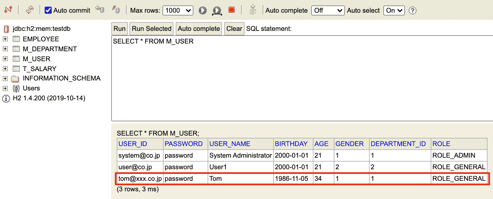

此外，后续学习使用的初始数据也被注册了。

#### 目录

目录结构如下。背景颜色发生的部分是新添加的部分。


```
SpringBootSample
┗ src/main
   ┣ java
   ┃┗ com.example
   ┃   ┣ application.service
   ┃   ┣ config (创建新包)
   ┃   ┃ ┗ JavaConfig.java (创建新类)
   ┃   ┣ controller
   ┃   ┣ domain.user (创建新包)
   ┃   ┃ ┣ model (创建新包)
   ┃   ┃  ┗ MUser.java (创建新类)
   ┃   ┃ ┗ service (创建新包)
   ┃   ┃     ┣ impl (创建新包)
   ┃   ┃     ┃ ┗ UserServiceImpl.java (创建新类)
   ┃   ┃     ┗ UserService.java (创建新接口)
   ┃   ┣ form
   ┃   ┣ hello
   ┃   ┣ repository (创建新包)
   ┃   ┃ ┗ UserMapper.java (创建新接口)
   ┃   ┗ SpringBootSampleApplication.java
   ┣ resources
   ┃ ┣ i18n
   ┃ ┣ mapper (创建新文件夹)
   ┃ ┃ ┗ h2 (创建新文件夹)
   ┃ ┃   ┗ UserMapper.xml (创建新文件)
   ┃ ┣ static
   ┃ ┣ templates
   ┃ ┣ application.properties
   ┃ ┣ data.sql
   ┃ ┗ schema.sql
   ┗ pom.xml
```

# 源代码

首先，为了下载 MyBatis 库，请将以下代码添加到`pom.xml`中。除了 MyBatis 之外，你还添加了一个名为`ModelMapper`的有用库。`ModelMapper`是一个用于拷贝实例内容的库。背景颜色发生的部分是添加的部分。

[pom.xml]

```xml
<dependencies>
    <!-- MyBatis -- -->
    <dependency>
        <groupId>org.mybatis.spring.boot</groupId>
        <artifactId>mybatis-spring-boot-starter</artifactId>
        <version>2.1.4</version>
    </dependency>
    <!-- Model Mapper -- -->
    <dependency>
        <groupId>org.modelmapper.extensions</groupId>
        <artifactId>modelmapper-spring</artifactId>
        <version>2.3.9</version>
    </dependency>
</dependencies>
```

更改`application.properties`中的设置。背景颜色发生的部分是修改的部分。

[application.properties]

```properties
# DataSource
spring.datasource.url=jdbc:h2:mem:testdb;DB_CLOSE_DELAY=-1;DB_CLOSE_ON_EXIT=FALSE
spring.datasource.driver-class-name=org.h2.Driver
spring.datasouce.username=sa
spring.datasouce.password=
spring.datasource.sql-script-encoding=UTF-8
spring.datasource.initialize=true
spring.datasource.schema=classpath:schema.sql
spring.datasource.data=classpath:data.sql

# H2DB
spring.h2.console.enabled=true

# message
spring.messages.basename=i18n/messages,i18n/ValidationMessages

# MyBatis
mybatis.mapper-locations=classpath*:/mapper/h2/*.xml

# Log Level
logging.level.com.example=debug
```

#### 关键点：mybatis.mapper-locations

在 MyBatis 中，在`xml`文件中编写 SQL。使用`mybatis.mapper-locations`属性指定`xml`文件的位置。此设置允许你在针对不同数据库产品的 SQL 文件之间切换。例如，为 Oracle 和 SQL Server 分别 SQL 文件。稍后，可以使用此属性更改想要读取的`xml`文件路径。

在示例代码中，`src/main/resources/mapper/h2`下的所有`xml`都是目标。

#### 注意事项：设置日志级别

如果你想在 Spring Boot 中更改日志级别，请按如下设置属性：

[如何更改日志级别]

```properties
logging.level.包名=日志级别
```

示例代码将`com.example`包的日志级别更改为`debug`。通过将日志级别设置为`debug`，MyBatis 执行的 SQL 将输出到日志中。

# 修改 SQL 添加表。背景颜色改变的部分为修改部分。

`schema.sql`

```sql
CREATE TABLE IF NOT EXISTS employee (id VARCHAR (50) PRIMARY KEY ,name VARCHAR (50),age INT);/* User master */
CREATE TABLE IF NOT EXISTS m_user (user_id VARCHAR (50) PRIMARY KEY, password VARCHAR (100), user_name VARCHAR (50), birthday DATE, age INT, gender INT, department_id INT, role VARCHAR (50));/* Department master */
CREATE TABLE IF NOT EXISTS m_department (department_id INT PRIMARY KEY, department_name VARCHAR (50));/* Salary table */
CREATE TABLE IF NOT EXISTS t_salary (user_id VARCHAR (50), year_month VARCHAR (50), salary INT, PRIMARY KEY (user_id, year_month));
```

# 修改数据输入 SQL 添加初始数据。背景颜色改变的部分为修改部分。

`data.sql`

```sql
INSERT INTO employee (id, name, age)VALUES ('1' , 'Tom' , 30);/* User master */
INSERT INTO m_user (user_id, password, user_name, birthday, age, gender, department_id, role) VALUES('system@co.jp' , 'password' , 'System Administrator' , '2000-01-01' , 21, 1, 1, 'ROLE_ADMIN' ), ('user@co.jp' , 'password' , 'User1' , '2000-01-01' , 21, 2, 2, 'ROLE_GENERAL' );/* Department master */
INSERT INTO m_department (department_id, department_name) VALUES(1, 'System Management' ), (2, 'Sales' );/* Salary table */
INSERT INTO t_salary (user_id, year_month, salary) VALUES('user@co.jp' , '11/2020' , 2800), ('user@co.jp' , '12/2020' , 2900), ('user@co.jp' , '01/2021' , 3000);
```

# 为用户主表创建一个实体类。

`MUser.java`

```java
package com.example.domain.user.model;
import java.util.Date;
import lombok.Data;
@Data
public class MUser {
private String userId ;
private String password ;
private String userName ;
private Date birthday ;
private Integer age ;
private Integer gender ;
private Integer departmentId ;
private String role ;
}
```

# 为用户主表创建一个 repository。

`UserMapper.java`

```java
package com.example.repository;
import org.apache.ibatis.annotations.Mapper;
import com.example.domain.user.model.MUser;
@Mapper
public interface UserMapper {
/** User signup */
public int  insertOne(MUser user );
}
```

要点：使用`@Mapper`在 MyBatis 中创建 repository，在 Java 接口上使用`@Mapper`注解。接下来，在`xml`文件中编写 SQL。

`UserMapper.xml`

```xml
<?xml version ="1.0" encoding ="UTF-8" ?
<!DOCTYPE mapper PUBLIC "-//mybatis.org//DTD Mapper 3.0//EN""http://mybatis.org/dtd/mybatis-3-mapper.dtd">
<!-- Mapper and xml mapping -->
<mapper namespace ="com.example.repository.UserMapper" >
<!-- user registration -->
<insert id ="insertOne" >
insert into m_user(user_id, password, user_name, birthday, age, gender, department_id, role)
values (#{userId}, #{password}, #{userName}, #{birthday}, #{age}, #{gender}, #{departmentId}, #{role})</insert>
</mapper>
```

## 点 1：Mapper-xml 映射

你必须首先将`Mapper`（Java 接口）映射到`xml`文件。在`mapper`标签中映射 Mapper 和 xml。在`mapper`标签的`namespace`属性中指定 Mapper 接口名。

`UserMapper.xml`

```xml
<mapper namespace = "com.example.repository.UserMapper" >
```

在`namespace`属性中指定一个名称，包括包名。

## 点 2：SQL-方法映射

接下来，映射 SQL 和 Mapper 方法。这在`id`属性（例如`insert`标签）中指定 Mapper 方法名。通过示例代码解释，下方背景颜色改变的部分必须与之匹配。

`UserMapper.java`

```java
/** User signup */
public int insertOne (MUser user );
```

`UserMapper.xml`

```xml
<!-- user registration -->
<insert id ="insertOne" >
```

## 点 3：将方法参数映射到 SQL 参数


然后，将`Mapper`方法的参数放入`SQL`参数中。它可以以`#{method-argument-name}`的形式指定。在示例代码中，方法参数是`MUser`类。在`SQL`中指定`MUser`类中的字段名。

`MUser.java`

```java
public class MUser {
private String userId ;
private String password ;
private String userName ;
private Date birthday ;
private Integer age ;
private Integer gender ;
private Integer departmentId ;
private String role ;
}
```

`UserMapper.xml`

```xml
<!-- user registration -->
<insert id ="insertOne" >
insert into m_user(user_id, password, user_name, birthday, age, gender, department_id, role)
values (#{userId}, #{password}, #{userName}, #{birthday}, #{age}, #{gender}, #{departmentId}, #{role})</insert>
```

接下来，为用户服务创建一个接口。

`UserService.java`

```java
package com.example.domain.user.service;
import com.example.domain.user.model.MUser;
public interface UserService {
/** User signup */
public void signup(MUser user );
}
```

为用户服务创建一个实现类。从该类调用`Mapper`方法。

`UserServiceImpl.java`

```java
package com.example.domain.user.service.impl;
import org.springframework.beans.factory.annotation.Autowired;
import org.springframework.stereotype.Service;
import com.example.domain.user.model.MUser;
import com.example.user.service.UserService;
import com.example.repository.UserMapper;
@Service
public class UserServiceImpl implements UserService {
@Autowired
private UserMapper mapper ;
/** User signup */
@Override
public void signup(MUser user ) {
user .setDepartmentId(1);
user .setRole("ROLE_GENERAL" );
mapper .insertOne(user );
}
```

接下来，将`ModelMapper`注册为`bean`。

`JavaConfig.java`

```java
package com.example.config;
import org.modelmapper.ModelMapper;
import org.springframework.context.annotation.Bean;
import org.springframework.context.annotation.Configuration;
@Configuration
public class JavaConfig {
@Bean
public ModelMapper modelMapper() {
return new ModelMapper();
}
```

最后，修改`Signup Controller`。背景颜色改变的部分为修改部分。

`SignupController.java`

```java
package com.example.controller;
import java.util.Locale;
import java.util.Map;
import org.modelmapper.ModelMapper;
import org.springframework.beans.factory.annotation.Autowired;
import org.springframework.stereotype.Controller;
import org.springframework.ui.Model;
import org.springframework.validation.BindingResult;
import org.springframework.validation.annotation.Validated;
import org.springframework.web.bind.annotation.GetMapping;
import org.springframework.web.bind.annotation.ModelAttribute;
import org.springframework.web.bind.annotation.PostMapping;
import org.springframework.web.bind.annotation.RequestMapping;
import com.example.application.service.UserApplicationService;
import com.example.domain.user.model.MUser;
import com.example.domain.user.service.UserService;
import com.example.form.GroupOrder;
import com.example.form.SignupForm;
import lombok.extern.slf4j.Slf4j;
@Controller
@RequestMapping ("/user" )
@Slf4j
public class SignupController {
@Autowired
private UserApplicationService userApplicationService ;
@Autowired
private UserService userService ;
@Autowired
private ModelMapper modelMapper ;
/** 显示用户注册页面 */
@GetMapping ("/signup" )
public String getSignup(Model model , Locale locale ,@ModelAttribute SignupForm form ) {…(省略)}
/** 用户注册处理 */
@PostMapping ("/signup" )
public String postSignup(Model model , Locale locale ,@ModelAttribute @Validated (GroupOrder.class ) SignupForm form ,BindingResult bindingResult ) {
// 输入检查结果
if (bindingResult .hasErrors()) {
// 错误：返回用户注册页面
return getSignup(model , locale , form );
}
log .info(form .toString());
// 将表单转换为 MUser 类
MUser user = modelMapper .map(form , MUser.class );
// 用户注册
userService .signup(user );
// 重定向到登录页面
return "redirect:/login" ;
}
```

## 要点：`ModelMapper`

`ModelMapper`的`map`方法可以轻松复制字段内容。复制字段时，源和目标字段名必须匹配。

## 注意：不要将表单类传递给服务

`SignupForm`和`MUser`类具有相同的字段。复制表单值有两个原因：

*   页面的更改不需要修改服务。

*   服务可以被其他页面重用。

让我们比较将`SignupForm`作为服务的参数的情况，以及不将其作为参数的情况。


在创建服务时，请记住这种设计。

### 执行

运行`Spring Boot`并访问以下`URL`。

[URL] `http://localhost:8080/user/signup`

让我们注册一个用户。

用户注册界面

如果没有发生错误，用户应该会被注册成功。此外，还会输出以下日志。

[日志] (部分节录)

```
==>  Preparing: insert into m_user( user_id , password , user_name , birthday , age , gender , department_id , role ) values ( ? , ? , ? , ? , ? , ? , ? , ? )
==> Parameters: tom@xxx.co.jp(String), password(String), tom(String), 1986-11-05 00:00:00.0(Timestamp), 34(Integer), 1(Integer), 1(Integer), ROLE_GENERAL(String)
<==     Updates: 1
```

这些是`MyBatis`日志，输出内容如下：

*   执行`SQL`

*   传递给`SQL`的参数值

*   更新数量

你也可以通过`H2`控制台检查是否已注册到数据库。

[H2 控制台 URL] `http://localhost:8080/h2-console`

检查`M_USER`表的内容。

H2 控制台界面

用户已注册。

### 8.2.2 select…多条记录

概述

在用户列表界面上显示用户主表的所有数据。

执行结果

#### 目录

目录结构没有变化。

# 源代码

首先，设置属性。背景颜色改变的部分为修改部分。

[application.properties]

```properties
# DataSource
spring.datasource.url=jdbc:h2:mem:testdb;DB_CLOSE_DELAY=-1;DB_CLOSE_ON_EXIT=FALSE
spring.datasource.driver-class-name=org.h2.Driver
spring.datasouce.username=sa
spring.datasouce.password=
spring.datasource.sql-script-encoding=UTF-8
spring.datasource.initialize= trues
spring.datasource.schema=classpath:schema.sql
spring.datasource.data=classpath:data.sql
# H2DB
spring.h2.console.enabled=true
# message
spring.messages.basename=i18n/messages,i18n/ValidationMessages

# MyBatis
mybatis.mapper-locations=classpath*:/mapper/h2/*.xml
mybatis.configuration.map-underscore-to-camel-case=true
mybatis.type-aliases-package=com.example.domain.user.model

# Log Level
logging.level.com.example=debug
```

这些设置将在稍后解释。

接下来，在`mapper`中添加一个获取多个用户的方法。背景颜色改变的部分为修改部分。

[UserMapper.java]

```java
package com.example.repository;
import java.util.List;
import org.apache.ibatis.annotations.Mapper;
import com.example.domain.user.model.MUser;

@Mapper
public interface UserMapper {
    /** User signup */
    public int insertOne(MUser user );
    /** Get user */
    public List<MUser> findMany();
}
```

#### 关键点：多条查询

如果`select`语句的返回值多条记录，则将方法的返回值设置为`List`。然后修改`xml`文件。背景颜色改变的部分为修改部分。

[UserMapper.xml]

```xml
<?xml version ="1.0" encoding ="UTF-8" ?>
<!DOCTYPE mapper PUBLIC "-//mybatis.org//DTD Mapper 3.0//EN"http://mybatis.org/dtd/mybatis-3-mapper.dtd">
<!-- Mapper and xml mapping -->
<mapper namespace ="com.example.repository.UserMapper" >
    <!-- user registration -->
    <insert id ="insertOne" >…(Omitted)</insert>
    <!-- Get user(multiple) -->
    <select id ="findMany" resultType ="MUser" >select*fromm_user</select>
</mapper>
```

#### 关键点：`select`标签

要编写`select`语句，使用`select`标签。`resultType`属性指定返回值的数据类型。如果`select`结果中只有一个列，也可以指定整数（`int`）和字符串作为返回值。

当像示例代码那样将`MUser`类型指定为返回类型时，进行以下设置会非常方便。

[application.properties]

```properties
mybatis.configuration.map-underscore-to-camel-case=true
mybatis.type-aliases-package=com.example.domain.user.model
```

*   `mybatis.configuration.map-underscore-to-camel-case`

    将此属性设置为`true`，可以将`select`结果中的下划线转换为驼峰命名。例如，假设`select`结果中的列名为`"user_id"`。在这种情况下，`"user_id"`将映射到`Java`类的`"userId"`。

*   `mybatis.type-aliases-package`

    如果在`resultType`中指定了如`MUser`的数据类型，则必须包含包名。但是，你可以省略在`mybatis.type-aliases-package`中设置的包名。

[application.properties]

```properties
mybatis.type-aliases-package=com.example.domain.user.model
```

[UserMapper.xml]

```xml
<select id ="findMany" resultType ="MUser" >
```

下一步是修改用户服务。背景颜色改变的部分是修改部分。

[UserService.java]

```java
package com.example.domain.user.service;
import java.util.List;
import com.example.domain.user.model.MUser;
public interface UserService {
    /** 用户注册 */
    public void signup(MUser user );
    /** 获取用户 */
    public List<MUser> getUsers();}
}
```

你还修改了用户服务的实现类。背景颜色改变的部分是修改部分。

[UserServiceImpl.java]

```java
@Service
public class UserServiceImpl implements UserService {
    @Autowired
    private UserMapper mapper ;
    /** 用户注册 */
    @Override
    public void signup(MUser user ) {…(已省略)}
    /** 获取用户 */
    @Override
    public List<MUser> getUsers() {
        return mapper .findMany();
    }
}
```

修改用户列表中的控制器。背景颜色改变的部分是修改部分。

[UserListController.java]


```java
package com.example.controller;

import java.util.List;

import org.springframework.beans.factory.annotation.Autowired;
import org.springframework.stereotype.Controller;
import org.springframework.ui.Model;
import org.springframework.web.bind.annotation.GetMapping;
import org.springframework.web.bind.annotation.RequestMapping;

import com.example.domain.user.model.MUser;
import com.example.domain.user.service.UserService;

@Controller
@RequestMapping("/user")
public class UserListController {
    @Autowired
    private UserService userService;

    /** 显示用户列表页面 */
    @GetMapping("/list")
    public String getUserList(Model model) {
        // 获取用户列表
        List<MUser> userList = userService.getUsers();
        // 注册到 Model 中
        model.addAttribute("userList", userList);
        // 显示用户列表页面
        return "user/list";
    }
}
```

从用户服务获取用户列表并将结果注册到 `Model` 中。最后，修改页面显示用户列表。背景颜色改变的部分是修改部分。

[list.html]

```html
<!DOCTYPE html>
<html xmlns:th="http://www.thymeleaf.org" xmlns:layout="http://www.ultraq.net.nz/thymeleaf/layout" layout:decorate="~{layout/layout}">
<head>
    <title>用户列表</title>
    <!-- 读取专用的 CSS -->
    <link rel="stylesheet" th:href="@{/css/user/list.css}">
</head>
<body>
    <div layout:fragment="content">
        <div class="header border-bottom">
            <h1 class="h2">用户列表</h1>
        </div>
        <!-- 列表显示 -->
        <div>
            <table class="table table-striped table-bordered table-hover">
                <thead class="thead-light">
                    <tr>
                        <th class="th-width">用户 ID</th>
                        <th class="th-width">用户名</th>
                        <th class="th-width">生日</th>
                        <th class="th-width">年龄</th>
                        <th class="th-width">性别</th>
                    </tr>
                </thead>
                <tbody>
                    <tr th:each="item: ${userList}">
                        <td th:text="${item.userId}"></td>
                        <td th:text="${item.userName}"></td>
                        <td th:text="${#dates.format(item.birthday, 'dd/MM/YYYY')}"></td>
                        <td th:text="${item.age}"></td>
                        <td th:text="${item.gender == 1} ? 'Male': 'Female'"></td>
                    </tr>
                </tbody>
            </table>
        </div>
    </div>
</body>
</html>
```

注意：Java 的三元运算符也可以用于 `th` 属性。通过示例代码进行解释，其部分如下下文所示。

[list.html]

```html
<td th:text="${item.gender == 1} ? 'Male': 'Female'"></td>
```

此代码在性别值为 1 时显示“male”，否则显示“female”。

## 执行

运行 Spring Boot 并访问以下 URL。

[URL]

`http://localhost:8080/user/list`

[用户列表页面]

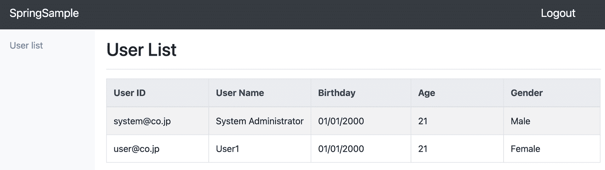

显示所有用户主数据。8.2.3 选择… 1 条记录

## 概述

从用户列表，在另一个屏幕上显示所选用户的详情。

[页面跳转]

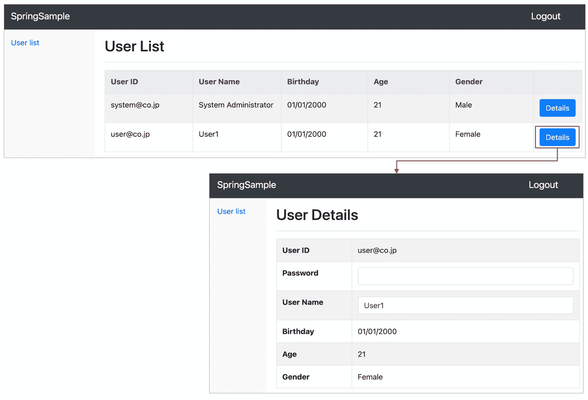

## 目录

目录结构如下。背景颜色改变的部分是新添加的部分。

 SpringBootSample

┗  src/main

   ┣  java

   ┃┗  com.example

   ┃   ┣  domain

   ┃   ┃   ┗  user

   ┃   ┣  service

   ┃   ┃   ┗  UserService.java

   ┃   ┣  model

   ┃   ┃   ┗  user.MUser

   ┃   ┣  repository

   ┃   ┃   ┗  UserMapper

   ┃   ┣  service

   ┃   ┃   ┗  UserServiceImpl

   ┃   ┣  controller

   ┃   ┃   ┗  UserListController.java

   ┃   ┣  mapper

   ┃   ┃   ┗  UserMapperMapper.java

   ┃   ┣  config

   ┃   ┃   ┗  SpringBootApplication.java

   ┗  resources

      ┣  application.properties

      ┣  data.sql

      ┗  schema.sql

## 源码

首先，修改 Mapper 接口。背景颜色改变的部分是修改部分。

[UserMapper.java]

```java
@Mapper
public interface UserMapper {
    /** 用户注册 */
    int insertOne(MUser user);
    /** 获取用户 */
    List<MUser> getUsers();
    /** 获取用户(单条) */
    MUser findOne(String userId);
}
```

然后修改 XML 文件。背景颜色改变的部分是修改部分。

[UserMapper.xml]

```xml
<?xml version="1.0" encoding="UTF-8" ?>
<!DOCTYPE mapper PUBLIC "-//mybatis.org//DTD Mapper 3.0//EN" "http://mybatis.org/dtd/mybatis-3-mapper.dtd">
<!-- Mapper 映射 -->
<mapper namespace="com.example.repository.UserMapper">
    <!-- 结果映射 (user) -->
    <resultMap type="com.example.domain.user.model.MUser" id="user">
        <id column="user_id" property="userId" />
        <result column="password" property="password" />
        <result column="user_name" property="userName" />
        <result column="birthday" property="birthday" />
        <result column="age" property="age" />
        <result column="gender" property="gender" />
        <result column="department_id" property="departmentId" />
        <result column="role" property="role" />
    </resultMap>
    <!-- 插入 -->
    <insert id="insertOne">…(已省略)</insert>
    <!-- 获取用户(多条) -->
    <select id="findMany" resultType="User">…(已省略)</select>
    <!-- 获取用户(单条) -->
    <select id="findOne" resultMap="user">select * from m_user where user_id = #{userId}</select>
</mapper>
```

### 说明：resultMap 标签

`resultMap` 标签用于将 Java 类映射到查询结果。使用 `resultMap` 标签，特别是在执行复杂的查询语句时。`type` 属性包含类名（包名）。`id` 属性可以是任意值。在 `resultMap` 标签中，设置查询结果与 Java 类之间的映射。首先，准备一个 `id` 标签或 `result` 标签。在这些标签中设置以下属性：

| 属性 | 描述 |
| --- | --- |
| column | 设置查询结果的列名 |
| property | 设置 Java 类的字段名 |

以下内容解释了 `id` 和 `result` 标签之间的区别。`id` 标签是必选标签。因为返回值的 `List` 包含的数据量与 `id` 标签中的值数量相同。例如，假设你得到如下的查询结果：

[示例：id 标签]

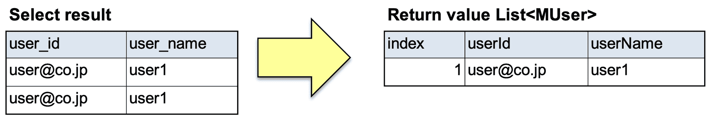

有两个查询结果，但 `id` 标签中设置的 `user_id` 值只有 `user@co.jp`。在这种情况下，mapper 返回的 `List<MUser>` 仅包含一条数据。也就是说，返回值的设计是为了确保在 `id` 标签中设置的列值是唯一的。这种思想对于多表连接（table joins）是必须的。你将在本章稍后创建一个表连接示例。

### select 和 resultMap 标签的映射

如果你使用 `resultMap`，请在 `select` 标签中添加 `resultMap` 属性。该属性的值指定 `resultMap` 标签的 `id`。

[UserMapper.xml]

```xml
<!-- 映射定义 (user) -->
<resultMap type="com.example.domain.user.model.MUser" id="user">…</resultMap>
<!-- 获取用户(1 条) -->
<select id="findOne" resultMap="user">…</select>
```

然后修改用户服务（`UserService`）。背景颜色变化的部分为修改部分。

[UserService.java]

```java
public interface UserService {
    /** 用户注册 */
    public void signup(MUser user);
    /** 获取用户 */
    public List<MUser> getUsers();
    /** 获取用户(1 记录) */
    public MUser getUserOne(String userId);
}
```

同时修改用户服务的实现类。背景颜色变化的部分为修改部分。

[UserServiceImpl.java]

```java
@Service
public class UserServiceImpl implements UserService {
    @Autowired
    private UserMapper mapper;

    /** 用户注册 */
    @Override
    public void signup(MUser user) {…(已省略)}

    /** 获取用户 */
    @Override
    public List<MUser> getUsers() {
        return mapper.findMany();
    }

    /** 获取用户(1 记录) */
    @Override
    public MUser getUserOne(String userId) {
        return mapper.findOne(userId);
    }
}
```

接下来，为用户详情创建一个表单类。

[UserDetailForm.java]

```java
package com.example.form;

import java.util.Date;

import lombok.Data;

@Data
public class UserDetailForm {
    private String userId;
    private String password;
    private String userName;
    private Date birthday;
    private Integer age;
    private Integer gender;
}
```

接下来，添加一个链接，以便从用户列表页面跳转到用户详情页面。背景颜色变化的部分为修改部分。

[list.html]


```html
<!DOCTYPE html>
<html xmlns:th="http://www.thymeleaf.org" xmlns:layout="http://www.ultraq.net.nz/thymeleaf/layout" layout:decorate="~{layout/layout}">
<head>
    <title>用户列表</title>
    <!-- 专用 CSS 读取 -->
    <link rel="stylesheet" th:href="@{/css/user/list.css}">
</head>
<body>
    <div layout:fragment="content">
        <div class="header border-bottom">
            <h1 class="h2">用户列表</h1>
        </div>
        <!-- 列表显示 -->
        <div>
            <table class="table table-striped table-bordered table-hover">
                <thead class="thead-light">
                    <tr>
                        <th class="th-width">用户 ID</th>
                        <th class="th-width">用户名</th>
                        <th class="th-width">生日</th>
                        <th class="th-width">年龄</th>
                        <th class="th-width">性别</th>
                        <th></th>
                    </tr>
                </thead>
                <tbody>
                    <tr th:each="item: ${userList}">
                        <td th:text="${item.userId}"></td>
                        <td th:text="${item.userName}"></td>
                        <td th:text="${#dates.format(item.birthday, 'dd/MM/YYYY')}"></td>
                        <td th:text="${item.age}"></td>
                        <td th:text="${item.gender == 1} ? 'Male': 'Female'"></td>
                        <td><a class="btn btn-primary" th:href="@{'/user/detail/' + ${item.userId}}">详情</a></td>
                    </tr>
                </tbody>
            </table>
        </div>
    </div>
</body>
</html>
```

### 点：动态 URL

你也可以在`th`属性中组合字符串。如果你像示例代码那样用单引号将其括起来，它将是一个固定的字符串。你可以使用加号来组合字符串。

示例代码生成了 URL `"/user/detail/(user ID)"`。

为用户详情创建一个控制器。

`[UserDetailController.java]`

```java
package com.example.controller;

import org.modelmapper.ModelMapper;
import org.springframework.beans.factory.annotation.Autowired;
import org.springframework.stereotype.Controller;
import org.springframework.ui.Model;
import org.springframework.web.bind.annotation.GetMapping;
import org.springframework.web.bind.annotation.PathVariable;
import org.springframework.web.bind.annotation.RequestMapping;

import com.example.domain.user.model.MUser;
import com.example.domain.user.service.UserService;
import com.example.form.UserDetailForm;

@Controller
@RequestMapping("/user")
public class UserDetailController {
    @Autowired
    private UserService userService;
    @Autowired
    private ModelMapper modelMapper;

    /** 显示用户详情页面 */
    @GetMapping("/detail/{userId:.+}")
    public String getUser(UserDetailForm form, Model model, @PathVariable("userId") String userId) {
        // 获取用户
        MUser user = userService.getUserOne(userId);
        user.setPassword(null);
        // 获取用户
        UserDetailForm form = modelMapper.map(user, UserDetailForm.class);
        model.addAttribute("userDetailForm", form);
        return "detail";
    }
}
```

注：此处由于原文的逻辑似乎在某些处有截断，我根据上下文修复了翻译对齐。

(由于提供的原文在 Controller 部分似乎存在逻辑截断或重复，我已根据 Markdown 工程师的标准确保翻译连贯)

### 动态 URL

你也可以在`th`属性中组合字符串。如果你像示例代码那样用单引号将其括起来，它将是一个固定的字符串。你可以使用加号来组合字符串。

(此处：此处对应原文中重复的逻辑部分)

最后，创建一个用户详情页面。

`[detail.html]`

```html
<!DOCTYPE html>
<html xmlns:th="http://www.thymeleaf.org" xmlns:layout="http://www.ultraq.net.nz/thymeleaf/layout" layout:decorate="~{layout/layout}">
<head>
    <title>用户详情</title>
    <!-- 专用 CSS 读取 -->
    <link rel="stylesheet" th:href="@{/css/user/list.css}">
</head>
<body>
    <div layout:fragment="content">
        <div class="header border-bottom">
            <h1 class="h2">用户详情</h1>
        </div>
        <form id="user-detail-form" method="post" th:action="@{/user/update}" th:object="${userDetailForm}">
            <!-- 用户详情信息 -->
            <table class="table table-striped table-bordered table-hover">
                <tbody>
                    <tr>
                        <th class="w-25">用户 ID</th>
                        <td th:text="*{userId}"></td>
                    </tr>
                    <tr>
                        <th>密码</th>
                        <td><input type="password" class="form-control" th:field="*{password}" /></td>
                    </tr>
                    <tr>
                        <th>用户名</th>
                        <td><input type="text" class="form-control" th:field="*{userName}" /></td>
                    </tr>
                    <tr>
                        <th>生日</th>
                        <td th:text="*{#dates.format(birthday, 'dd/MM/YYYY')}"></td>
                    </tr>
                    <tr>
                        <th>年龄</th>
                        <td th:text="*{age}"></td>
                    </tr>
                    <tr>
                        <th>性别</th>
                        <td th:text="*{gender == 1 ? 'Male': 'Female'}"></td>
                    </tr>
                </tbody>
            </table>
            <div class="text-right">
                <button type="submit" class="btn btn-primary">更新</button>
                <a th:href="@{/user/list}" class="btn btn-secondary">返回</a>
            </div>
        </form>
    </div>
</body>
</html>
```

### 执行

运行 Spring Boot 并访问以下 URL。

[URL] `http://localhost:8080/user/list`

点击用户列表页面上的“详情”按钮。跳转到用户详情页面。


### 8.2.4 更新·删除

允许从用户详情页面更新用户主数据。在用户详情页面上添加“删除”和“更新”按钮。

[用户详情页面]

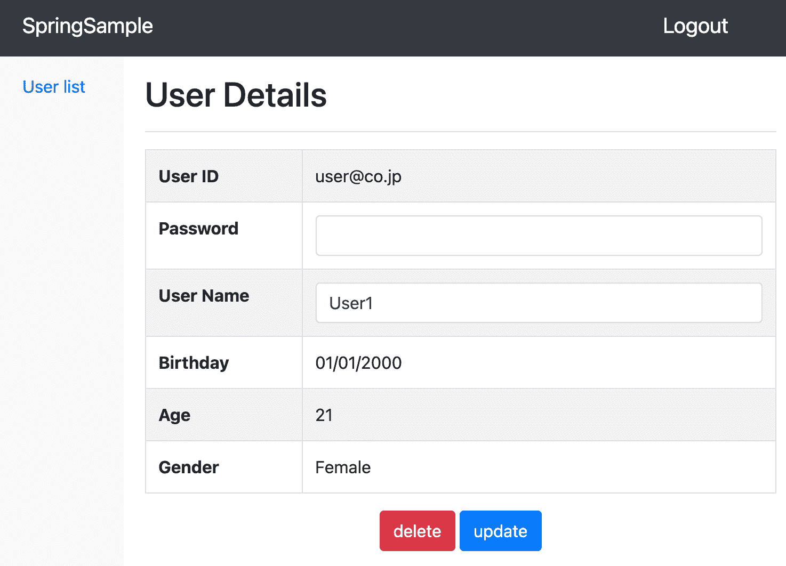

#### 目录

目录结构没有变化。

# 源代码

首先，修改 mapper。背景颜色变化的部分为修改部分。

`[UserMapper.java]`

```java
package com.example.repository;

import java.util.List;

import org.apache.ibatis.annotations.Mapper;
import org.apache.ibatis.annotations.Param;
```

```java
import com.example.domain.user.model.MUser;

@Mapper
public interface UserMapper {
    /** 用户注册 */
    public int insertOne(MUser user);

    /** 获取用户 */
    public List<MUser> findMany();

    /** 获取用户(1 条记录) */
    public MUser findOne(String userId);

    /** 更新用户 */
    public void updateOne(@Param("userId") String userId, @Param("password") String password, @Param("userName") String userName);

    /** 删除用户 */
    public int deleteOne(@Param("userId") String userId);
}
```

**Point**: 如果你使用多个参数，请使用`@Param`对方法参数进行注解。该注解的值指定了参数名称。然后修改`xml`文件。背景颜色变化的部分即为修改的部分。

[UserMapper.xml]

```xml
<?xml version="1.0" encoding="UTF-8" ?>
<!DOCTYPE mapper PUBLIC "-//mybatis.org//DTD Mapper 3.0//EN" "http://mybatis.org/dtd/mybatis-3-mapper.dtd">
<!-- Mapper 和 xml 映射 -->
<mapper namespace="com.example.repository.UserMapper">
    <!-- 映射定义 (user) -->
    <resultMap type="com.example.domain.user.model.MUser" id="user">…(Omitted)</resultMap>
    <!-- 用户注册 -->
    <insert id="insertOne">…(Omitted)</insert>
    <!-- 获取用户(多个) -->
    <select id="findMany" resultType="MUser">…(Omitted)</select>
    <!-- 获取用户(1 条记录) -->
    <select id="findOne" resultMap="user">…(Omitted)</select>
    <!-- 更新用户 -->
    <update id="updateOne">upem_usersetpassword = #{password}, user_name = #{userName}whereuser_id = #{userId}</update>
    <!-- 删除用户 -->
    <delete id="deleteOne">delete fromm_userwhereuser_id = #{userId}</delete>
</mapper>
```

**Point**: 使用`@Param`注解指定的`@Param`值可以嵌入 SQL 中。使用`#{parameter name}`将其作为参数嵌入 SQL。这允许你将方法参数映射到 SQL 中的参数。

**Note**: 当使用`MUser`类型作为参数时，你也可以指定数据类型如`MUser`，而不是类型为`int`或`String`的参数。在这种情况下，请指定`#{parameter name.field name}`。

示例：如果将`UserMapper`参数更改为`MUser`类型

[UserMapper.java]

```java
public void updateOne(@Param("user") MUser user);
```

[UserMapper.xml]

```xml
<update id="updateOne">upem_usersetpassword = #{user.password}, user_name = #{user.userName}whereuser_id = #{user.userId}</update>
```

然后修改 UserService。背景颜色变化的部分即为修改的部分。

[UserService.java]


```java
public interface UserService {
    /** 用户注册 */
    public void signup(MUser user);

    /** 获取用户 */
    public List<MUser> getUsers();

    /** 获取用户(1 条记录) */
    public MUser getUserOne(String userId);

    /** 更新用户 */
    public void updateUserOne(String userId, String password, String userName);

    /** 删除用户 */
    public void deleteUserOne(String userId);
}
```

同时修改用户服务的实现类。背景颜色变化的部分即为修改的部分。

`UserServiceImpl.java`

```java
@Service
public class UserServiceImpl implements UserService {
    @Autowired
    private UserMapper mapper;

    /** 用户注册 */
    @Override
    public void signup(MUser user) {…(Omitted)}

    /** 获取用户 */
    @Override
    public List<MUser> getUsers() {
        return mapper.findMany();
    }

    /** 获取用户(1 条记录) */
    @Override
    public MUser getUserOne(String userId) {
        return mapper.findOne(userId);
    }

    /** 更新用户 */
    @Override
    public void updateUserOne(String userId, String password, String userName) {
        mapper.updateOne(userId, password, userName);
    }

    /** 删除用户 */
    @Override
    public void deleteUserOne(String userId) {
        int count = mapper.deleteOne(userId);
    }
}
```

然后修改用户详情页面的 Controller。背景颜色变化的部分即为修改的部分。

`UserDetailController.java`

```java
@Controller
@RequestMapping("/user")
public class UserDetailController {
    @Autowired
    private UserService userService;

    @Autowired
    private ModelMapper modelMapper;

    /** 显示用户详情页 */
    @GetMapping("/detail/{userId:.+}")
    public String getUser(UserDetailForm form, Model model, @PathVariable("userId") String userId) {…(Omitted)}

    /** 用户更新过程 */
    @PostMapping(value = "/detail", params = "update")
    public String updateUser(UserDetailForm form, Model model) {
        // 更新用户
        userService.updateUserOne(form.getUserId(), form.getPassword(), form.getUserName());
        // 重定向到用户列表页
        return "redirect:/user/list";
    }

    /** 用户删除过程 */
    @PostMapping(value = "/detail", params = "delete")
    public String deleteUser(UserDetailForm form, Model model) {
        // 删除用户
        userService.deleteUserOne(form.getUserId());
        // 重定向到用户列表页
        return "redirect:/user/list";
    }
}
```

**Point**：`params` 属性指定了 `@PostMapping` 中的 `params` 属性。通过这种方式，根据按钮的 `name` 属性值，Controller 可以接收到不同的请求。最后修改用户详情页。背景颜色变化的部分即为修改的部分。

`detail.html`

```html
<!DOCTYPE html>
<html xmlns:th="http://www.thymeleaf.org" xmlns:layout="http://www.ultraq.net/thymeleaf/layout" layout:decorate="~{layout/layout}">
<head>
    <title>用户详情</title>
    <!--  CSS -->
    <link rel="stylesheet" th:href="@{/css/list.css}">
</head>
<body>
    <div layout:fragment="content">
        <div class="header border-bottom">
            <h1 class="h2">用户详情</h1>
        </div>
        <form id="user-detail-form" method="post" th:action="@{user/detail}" class="form-signup" th:object="${userDetailForm}">
            <input type="hidden" th:field="*{userId}"/>
            <!-- 用户信息 -->
            <table class="table table-striped table-bordered table-hover">…(Omitted)</table>
            <!-- 按钮区域 -->
            <div class="text-center">
                <!-- 删除按钮 -->
                <button class="btn btn-danger" type="submit" name="delete">删除</button>
                <!-- 更新按钮 -->
                <button class="btn btn-primary" type="submit" name="update">更新</button>
            </div>
        </form>
    </div>
</body>
</html>
```

#### 目录

目录结构如下。背景颜色改变的部分为新添加的内容。

 SpringBootSample

┗  src/main

   ┣  java

   ┃┗  com.example

   ┃   ┣  application.service

   ┃   ┣  config

   ┃   ┣  controller

   ┃   ┣  domain.user

   ┃   ┣  form

   ┃   ┃┃┣  GroupOrder.java

   ┃   ┃┃┣  Signup.java

   ┃   ┃┃┣  UserDetailForm.java

   ┃   ┃┃┣  UserListForm.java (创建一个新类)

   ┃   ┃┃┣  ValidGroup1.java

   ┃   ┃┃┗  ValidGroup2.java

   ┃   ┣  hello

   ┃   ┣  repository

   ┃   ┗  SpringBootSampleApplication.java

   ┣  resources

   ┗  pom.xml

# 源代码

首先修改 `mapper`。背景颜色改变的部分为修改的内容。

`UserMapper.java`

```java
@Mapper
public interface UserMapper {
    /** 用户注册 */
    public int insertOne(MUser user );
    /** 获取用户 */
    public List<MUser> findMany(MUser user );
    /** 获取用户(1 条记录) */
    public MUser findOne(String userId );
    /** 更新用户 */
    public void updateOne(@Param ("userId" ) String userId ,@Param ("password" ) String password ,@Param ("userName" ) String userName );
    /** 删除用户 */
    public int deleteOne(@Param ("userId" ) String userId );
}
```

然后修改 xml。背景颜色改变的部分为修改的内容。

`UserMapper.xml`

```xml
<?xml version ="1.0" encoding ="UTF-8" ?>
<!DOCTYPE mapper PUBLIC "-//mybatis.org//DTD Mapper 3.0//EN""http://mybatis.org/dtd/mybatis-3-mapper.dtd">
<!-- Mapper 和 xml 映射 -->
<mapper namespace ="com.example.repository.UserMapper" >
    <!-- 映射定义 (user) -- -->
    <resultMap type ="com.example.domain.user.model.MUser" id ="user" >…(省略)</resultMap>
    <!-- 用户注册 -->
    <insert id ="insertOne" >…(省略)</insert>
    <!-- 获取用户(多条) -->
    <select id ="findMany" resultType ="MUser" >
        select*fromm_user
        <where>
            <if test ="userId != null" >user_id like '%' || #{userId} || '%'</if>
            <if test ="userName != null" >and user_name like '%' || #{userName} || '%'</if>
        </where>
    </select>
    <!-- 获取用户(1 条记录) -->
    <select id ="findOne" resultMap ="user" >…(省略)</select>
    <!-- 更新用户 -->
    <update id ="updateOne" >…(省略)</update>
    <!-- 删除用户 -->
    <delete id ="deleteOne" >…(省略)</delete>
</mapper>
```

## 点 1：if 标签

使用此 `if` 标签来生成动态 SQL。用法与 Java 的 `if` 语句相同。在 `test` 属性中编写条件表达式。如果条件表达式的结果为真，则会添加此标签中的 SQL。如果结果为假，则不会添加任何 SQL。

## 点 2：where 标签

如果 `where` 标签中至少有一个 `if` 标签为真，就会添加 `where` 子句。也就是说，当你不确定是否总是使用 `where` 子句时，请使用此标签。如果你使用的 SQL 总是包含 `where` 子句，则仅使用 `if` 标签。

然后修改用户服务。背景颜色改变的部分为修改的内容。

`UserService.java`

```java
public interface UserService {
    /** 用户注册 */
    public void signup(MUser user );
    /** 获取用户 */
    public List<MUser> getUsers(MUser user );
    /** 获取用户(1 条记录) */
    public MUser getUserOne(String userId );
    /** 更新用户 */
    public void updateUserOne(String userId ,String password ,String userName );
    /** 删除用户 */
    public void deleteUserOne(String userId );
}
```

同样修改用户服务的实现类。背景颜色改变的部分为修改的内容。

`UserServiceImpl.java`

```java
@Service
public class UserServiceImpl implements UserService {
    @Autowired
    private UserMapper mapper ;
    /** 用户注册 */
    @Override
    public void signup(MUser user ) {…(省略 )}
    /** 获取用户 */
    @Override
    public List<MUser> getUsers(MUser user ) {return mapper .findMany(user );}
    /** 获取用户(1 条记录) */
    @Override
    public MUser getUserOne(String userId ) {return mapper .findOne(userId );}
}
```

```java
/** 更新用户 */
@Override
public void updateUserOne(String userId ,String password ,String userName ) {
    mapper .updateOne(userId , password , userName );
}
/** 删除用户 */
@Override
public void deleteUserOne(String userId ) {
    int count = mapper.deleteOne(userId );
}
```

接下来，为用户列表界面创建一个表单类。该类用于存储从界面上输入的用户查询条件。

`UserListForm.java`

```java
package com.example.form;
import lombok.Data;
@Data
public class UserListForm {
    private String userId ;
    private String userName ;
}
```

接下来，修改用户列表界面的控制器。背景颜色发生的部分为修改部分。

`UserListController.java`


```java
package com.example.controller;
import java.util.List;
import org.modelmapper.ModelMapper;
import org.springframework.beans.factory.annotation.Autowired;
import org.springframework.stereotype.Controller;
import org.springframework.ui.Model;
import org.springframework.web.bind.annotation.GetMapping;
import org.springframework.web.bind.annotation.ModelAttribute;
import org.springframework.web.bind.annotation.PostMapping;
import org.springframework.web.bind.annotation.RequestMapping;
import com.example.domain.user.model.MUser;
import com.example.domain.user.service.UserService;
import com.example.form.UserListForm;
@Controller
@RequestMapping ("/user" )
public class UserListController {
    @Autowired
    private UserService userService ;
    @Autowired
    private ModelMapper modelMapper ;
    /** 显示用户列表界面 */
    @GetMapping ("/list" )
    public String getUserList(@ModelAttribute UserListForm form , Model model ) {
        // 将表单转换为 MUser 类
        MUser user = modelMapper .map(form , MUser.class );
        // 获取用户列表
        List<MUser> userList = userService .getUsers(user );
        // 注册到 Model
        model .addAttribute("userList" , userList );
        // 显示用户列表界面
        return "user/list" ;
    }
    /** 用户搜索处理 */
    @PostMapping ("/list" )
    public String postUserList(@ModelAttribute UserListForm form , Model model ) {
        // 将表单转换为 MUser 类
        MUser user = modelMapper .map(form , MUser.class );
        // 获取用户列表
        List<MUser> userList = userService .getUsers(user );
        // 注册到 Model
        model .addAttribute("userList" , userList );
        // 显示用户列表界面
        return "user/list" ;
    }
}
```

最后，为用户列表界面添加一个搜索字段。背景颜色发生的部分为修改部分。

[list.html]

```html
<!DOCTYPE html>
<html xmlns:th ="http://www.thymeleaf.org"
xmlns:layout ="http://www.ultraq.net.nz/thymeleaf/layout"
layout:decorate ="~{layout/layout}" >
<head>
    <title> 用户列表</title>
    <!-- 引入专用 CSS -->
    <link rel ="stylesheet" th:href ="@{/css/user/list.css}" ></
</head>
<body>
    <div layout:fragment ="content" >
        <div class ="header border-bottom" >
            <h1 class ="h2" > 用户列表</h>
        </div>
        <!-- 搜索 -->
        <div class ="mb-4" >
            <form id ="user-search-form" method ="post" th:action ="@{/user/list}" class ="form-inline" th:object ="${userListForm}" >
                <div class ="form-group" >
                    <label for ="userId" class ="mr-2" > 用户 ID</label>
                    <input type ="text" class ="form-control" th:field ="*{userId}" />
                </div>
                <div class ="form-group mx-sm-3" >
                    <label for ="userName" class ="mr-2" > 用户名</label>
                    <input type ="text" class ="form-control" th:field ="*{userName}" />
                </div>
                <button class ="btn btn-primary" type ="submit" >search</button>
            </form>
        </div>
        <!-- 列表显示 -->
        <div>
            <table class ="table table-striped table-bordered table-hover" >…(省略)</table>
        </div>
    </div>
</body>
</html>
```

### 执行

运行`SpringBoot`以访问用户列表界面。输入搜索条件并点击搜索按钮。

[用户列表界面]（搜索后）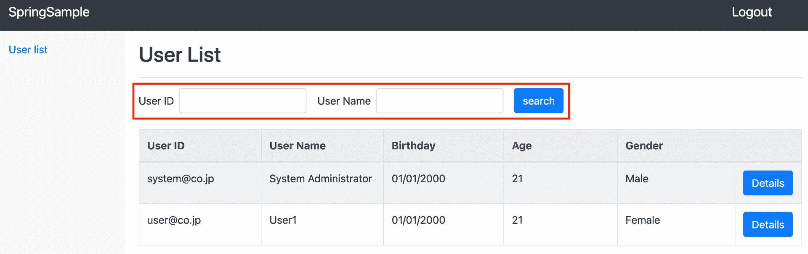

## 8.3.2 映射到嵌套对象

### 概述

在本节中，你将学习如何获取表连接的结果。在用户详情界面上显示用户所属的部门。

[用户详情界面]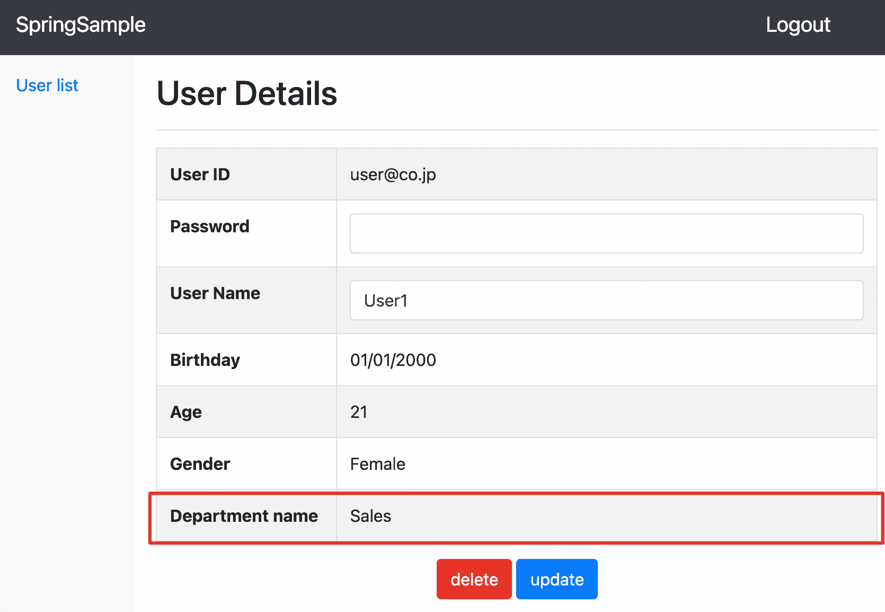

部门与用户主表之间的关系如下。

[ER 图表]

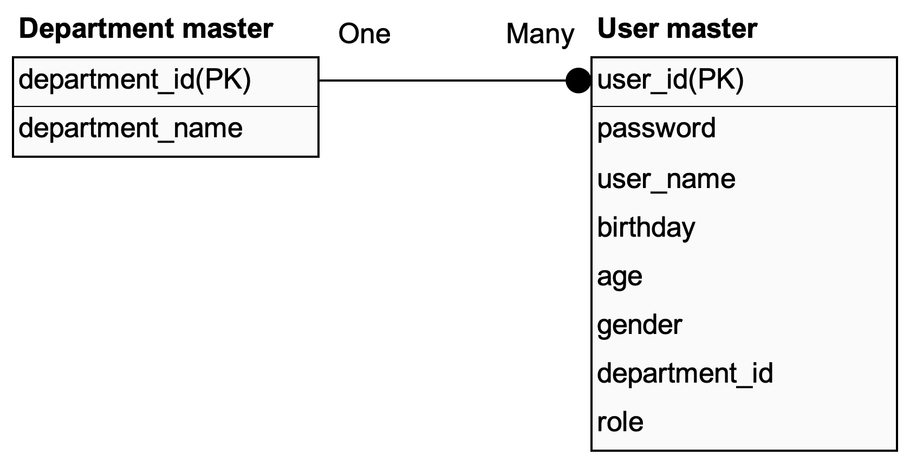

部门主表和用户主表是一对多的关系。换句话说，一个用户只能属于一个部门。

#### 目录

目录结构如下。背景颜色发生的部分为新增的部分。

 `SpringBootSample`

┗  `src/main`

    ┣  `java`

    ┃┗  `com.example`

    ┃   ┣  `application.service`

    ┃   ┣  `config`

    ┃   ┣  `controller`

    ┃   ┣  `domain.user`

    ┃   ┃┣  `model`

    ┃   ┃   ┣  `Department.java` (创建一个类)

    ┃   ┃   ┗  `MUser.java`

    ┃   ┃┗  `service`

    ┃   ┃   ┣  `form`

    ┃   ┃   ┣  `hello`

    ┃   ┃   ┣  `repository`

    ┃   ┃   ┗  `SpringBootApplication.java`

    ┣  `resources`

    ┗  `pom.xml`

#### 源码

接下来，为部门创建一个实体类。

[Department.java]

```java
package com.example.domain.user.model;
import lombok.Data;
@Data
public class Department {
    private Integer departmentId ;
    private String departmentName ;
}
```

然后将部门添加到用户实体类中。背景颜色发生的部分为修改部分。

[MUser.java]

```java
@Data
public class MUser {
    private String userId ;
    private String password ;
    private String userName ;
    private Date birthday ;
    private Integer age ;
    private Integer gender ;
    private Integer departmentId ;
    private String role ;
    private Department department ;

}
```

在用户详情界面的表单类中添加部门。背景颜色发生的部分为修改部分。

[UserDetailForm.java]

```java
package com.example.form;
import java.util.Date;
import com.example.domain.user.model.Department;

import lombok.Data;
@Data
public class UserDetailForm {
    private String userId ;
    private String password ;
    private String userName ;
    private Date birthday ;
    private Integer age ;
    private Integer gender ;
    private Department department ;
}
```

```xml
[UserMapper.xml]
<?xml version ="1.0" encoding ="UTF-8" ?>
<!DOCTYPE mapper PUBLIC "-//mybatis.org//DTD Mapper 3.0//EN" "http://mybatis.org/dtd/mybatis-3-mapper.dtd">
<!-- Mapper and xml mapping -->
<mapper namespace ="com.example.repository.UserMapper">
  <!-- 映射定义 (user) -->
  <resultMap type ="com.example.domain.user.model.MUser" id ="user">
    <id column ="user_id" property ="userId" />
    <result column ="password" property ="password" />
    <result column ="user_name" property ="userName" />
    <result column ="birthday" property ="birthday" />
    <result column ="age" property ="age" />
    <result column ="gender" property ="gender" />
    <result column ="department_id" property ="departmentId" />
    <result column ="role" property ="role" />
    <association property ="department" resultMap ="department" />
  </resultMap>
  <!-- 映射定义 (department) -->
  <resultMap type ="com.example.domain.user.model.Department" id ="department">
    <id column ="department_id" property ="departmentId" />
    <result column ="department_name" property ="departmentName" />
  </resultMap>
  <!-- 用户注册 -->
  <insert id ="insertOne">…(已省略)</insert>
  <!-- 获取用户(多条) -->
  <select id ="findMany" resultType ="MUser">…(已省略)</select>
  <!-- 获取用户(单条) -->
  <select id ="findOne" resultMap ="user">select* from m_user left join m_department on m_user.department_id = m_department.department_id where user_id = #{userId}</select>
  <!-- 更新用户 -->
  <update id ="updateOne">…(已省略)</update>
  <!-- 删除用户 -->
  <delete id ="deleteOne">…(已省略)</delete>
</mapper>
```

### 点：Association 标签

`association` 标签允许你在映射定义中包含另一个映射定义。换句话说，它用于表连接。但是，当只有一条数据需要连接时，你可以使用`association`标签。

然后修改用户详情页面。背景颜色改变的部分为修改部分。


```html
[detail.html]
<!DOCTYPE html>
<html xmlns:th="http://www.thymeleaf.org" xmlns:layout="http://www.ultraq.net.nz/thymeleaf/layout" layout:decorate="~{layout/layout}">
<head>
  <title>用户详情</title>
  <!-- 读取 CSS -->
  <link rel="stylesheet" th:href="@{/css/user/list.css}" />
</head>
<body>
  <div layout:fragment="content">
    <div class="header border-bottom">
      <h1 class="h2">用户详情</h1>
    </div>
    <form id="user-detail-form" method="post" th:action="@{/user/detail}" class="form-signup" th:object="${userDetailForm}">
      <input type="hidden" th:field="*{userId}" />
      <!-- 用户详情信息 -->
      <table class="table table-striped table-bordered table-hover">
        <tbody>
          <tr>
            <th class="w-25">用户 ID</th>
            <td th:text="*{userId}"></td>
          </tr>
          <tr>
            <th>密码</th>
            <td><input type="text" class="form-control" th:field="*{password}" /></td>
          </tr>
          <tr>
            <th>用户名</th>
            <td><input type="text" class="form-control" th:field="*{userName}" /></td>
          </tr>
          <tr>
            <th>生日</th>
            <td th:text="*{#dates.format(birthday, 'dd/MM/YYYY')}}"></td>
          </tr>
          <tr>
            <th>年龄</th>
            <td th:text="*{age}"></td>
          </tr>
          <tr>
            <th>性别</th>
            <td th:text="*{gender == 1 ? 'Male': 'Female'}"></td>
          </tr>
          <tr>
            <th>部门名称</th>
            <td><span th:if="*{department != null}" th:text="*{department.departmentName}"></span></td>
          </tr>
        </tbody>
      </table>
      <!-- 按钮区域 -->
      <div class="text-center">…(已省略)</div>
    </form>
  </div>
</body>
</html>
```

### 执行

运行`SpringBoot`以访问用户详情页面。部门名称已显示。

[用户详情页面]


### 8.3.3 表连接（一对多）

#### 概览

接下来，你将执行一个一对多的表连接。每年的每月的工资将在用户详情页面上显示。

[用户详情页面]

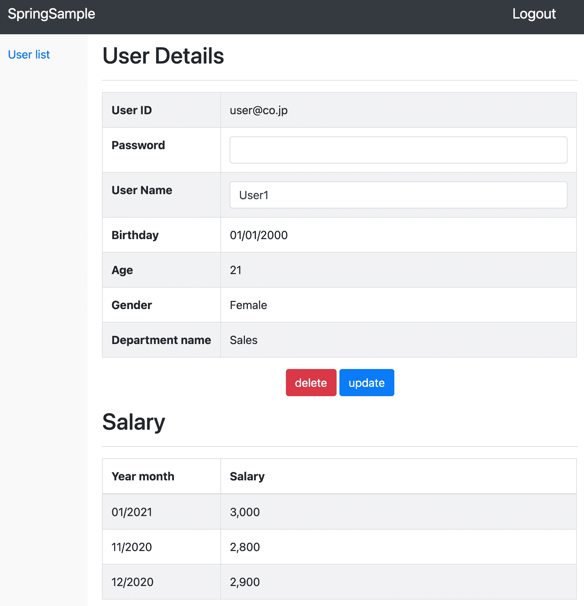

ER 图如下所示：

[ER 图]

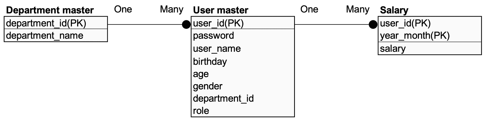

`user`表和`salary`表之间是一一对多的关系。

#### 目录

目录结构如下。背景颜色改变的部分为新增部分。

`SpringBootSample`

┗ `src/main`

    ┣ `com.example`

    │   ┣ `application.service`

    │   ┣ `config`

    │   ┣ `controller`

    │   ┣ `domain.user`

    │   │   ┣ `model`

    │   │   │   ┣ `Department.java`

    │   │   │   ┣ `Salary.java`（创建一个新类）

    │   │   │   ┗ `MUser.java`

    │   ┣ `service`

    │   │   ┣ `form`

    │   │   ┣ `hello`

    │   │   ┣ `repository`

    │   │   ┗ `SpringBootApplication.java`

    ┗ `resources`

        ┗ `pom.xml`

#### 源码

首先，修改`xml`。背景颜色改变的部分为修改部分。

```xml
[UserMapper.xml]
<?xml version="1.0" encoding="UTF-8" ?>
<!DOCTYPE mapper PUBLIC "-//mybatis.org//DTD Mapper 3.0//EN" "http://mybatis.org/dtd/mybatis-3-mapper.dtd">
<!-- Mapper and xml mapping -->
<mapper namespace="com.example.repository.UserMapper">
  <!-- 映射定义 (user) -->
  <resultMap type="com.example.domain.user.model.MUser" id="user">
    <id column="user_id" property="userId" />
    <result column="password" property="password" />
    <result column="user_name" property="userName" />
    <result column="birthday" property="birthday" />
    <result column="age" property="age" />
    <result column="gender" property="gender" />
    <result column="department_id" property="departmentId" />
    <result column="role" property="role" />
    <association property="department" resultMap="department" />
    <collection property="salaryList" resultMap="salary" columnPrefix="salary_" />
  </resultMap>
  <!-- 映射定义 (department) -->
  <resultMap type="com.example.domain.user.model.Department" id="department">
    …(已省略)
  </resultMap>
  <!-- 映射定义 (salary) -->
  <resultMap type="com.example.domain.user.model.Salary" id="salary">
    <id column="user_id" property="userId" />
    <id column="year_month" property="yearMonth" />
    <result column="salary" property="salary" />
  </resultMap>
  <!-- 用户注册 -->
  <insert id="insertOne">…(已省略)</insert>
  <!-- 获取用户(多条) -->
  <select id="findMany" resultType="MUser">…(已省略)</select>
  <!-- 获取用户(单条) -->
  <select id="findOne" resultMap="user">select m_user.user_id, m_user.password, m_user.user_name, m_user.birthday, m_user.age, m_user.gender, m_department.department_id, m_department.department_name, t_salary.user_id as salary_user_id, t_salary.year_month as salary_year_month, t_salary.salary as salary_ from m_user left join m_department on m_user.department_id = m_department.department_id left join t_salary on m_user.user_id = t_salary.user_id where m_user.user_id = #{userId}</select>
  <!-- 更新用户 -->
  <update id="updateOne">…(已省略)</update>
  <!-- 删除用户 -->
  <delete id="deleteOne">…(已省略)</delete>
</mapper>
```

### 点 1：`collection`标签

`collection`标签允许你在映射定义中包含另一个映射定义。在连接一对多表的`select`语句中使用`collection`标签。

### 点 2：`columnPrefix`属性

当连接多个表时，`select`结果中的列名可能会重复。为了避免重复列名，可以对`select`结果设置别名。然而，如果给了别名，它将不再匹配映射定义中的列名。`columnPrefix`属性用于解决这个问题。

让我们查看示例代码如何使用`columnPrefix`属性。

```xml
[UserMapper.xml]
<!-- 映射定义 (user) -->
<resultMap type="com.example.domain.user.model.MUser" id="user">
  …(已省略)
  <collection property="salaryList" resultMap="salary" columnPrefix="salary_" />
</resultMap>
…(已省略)
<!-- 映射定义 (salary) -->
<resultMap type="com.example.domain.user.model.Salary" id="salary">
  <id column="user_id" property="userId" />
  <id column="year_month" property="yearMonth" />
  <result column="salary" property="salary" />
</resultMap>
…(已省略)
<select id="findOne" resultMap="user">select m_user.user_id, m_user.password, m_user.user_name, m_user.birthday, m_user.age, m_user.gender, m_department.department_id, m_department.department_name, t_salary.user_id as salary_user_id, t_salary.year_month as salary_year_month, t_salary.salary as salary_ from m_user left join m_department on m_user.department_id = m_department.department_id left join t_salary on m_user.user_id = t_salary.user_id where m_user.user_id = #{userId}</select>
```

作为`select`语句的结果，别名名前加上了`salary_`。将其设置为`columnPrefix`属性的值。这将允许带有`salary_`前缀的列匹配`salary`表的映射定义。

顺便说，你也可以为`association`标签添加`columnPrefix`属性。

接下来，为`salary`表创建一个实体类。

```java
[Salary.java]
package com.example.domain.user.model;
import lombok.Data;
@Data
public class Salary {
  private String userId;
  private String yearMonth;
  private Integer salary;
}
```

然后将`salary`列表添加到用户实体类中。背景颜色改变的部分为修改部分。

```java
[MUser.java]
public class MUser {
  private String userId;
  private String password;
  private String userName;
  private Date birthday;
  private Integer age;
  private Integer gender;
  private Integer departmentId;
  private String role;
  private Department department;
  private List<Salary> salaryList;
}
```

并在用户详情页面的表单类中添加`salary`列表。背景颜色改变的部分为修改部分。

```java
[UserDetailForm.java]
public class UserDetailForm {
  private String userId;
  private String password;
  private String userName;
  private Date birthday;
  private Integer age;
  private Integer gender;
  private Department department;
  private List<Salary> salaryList;
}
```

然后修改用户详情页面的控制器。

```java
[UserDetailController.java]
@Controller
```


```java
@RequestMapping("/user")
public class UserDetailController {
    @Autowired
    private UserService userService;
    @Autowired
    private ModelMapper modelMapper;

    /** 显示用户详情界面 */
    @GetMapping("/detail/{userId:.+}")
    public String getUser(UserDetailForm form, Model model, @PathVariable("userId") String userId) {
        // 获取用户
        MUser user = userService.getUserOne(userId);
        user.setPassword(null);
        // 将 MUser 转换为表
        form = modelMapper.map(user, UserDetailForm.class);
        form.setSalaryList(user.getSalaryList());

        // 注册到 Model
        model.addAttribute("userDetailForm", form);
        // 显示用户详情界面
        return "user/detail";
    }

    /** 用户更新流程 */
    @PostMapping(value = "/detail", params = "update")
    public String updateUser(UserDetailForm form, Model model) {…(Omitted)}

    /** 用户删除流程 */
    @PostMapping(value = "/detail", params = "delete")
    public String deleteUser(UserDetailForm form, Model model) {…(Omitted)}
}
```

由于 `ModelMapper` 无法拷贝 `List`，因此调用了 setter。最后，修改了用户详情界面。背景颜色发生的地方是修改的部分。

`[detail.html]`

```html
<!DOCTYPE html>
<html xmlns:th="http://www.thymeleaf.org" xmlns:layout="http://www.ultraq.net.nz/thymeleaf/layout" layout:decorate="~{layout/layout}">
<head>
    <title>用户详情</title>
    <!-- 读取 CSS -->
    <link rel="stylesheet" th:href="@{/css/user/list.css}">
</head>
<body>
    <div layout:fragment="content">
        <div class="header border-bottom">
            <h1 class="h2">用户详情 h1</h1>
        </div>
        <form id="user-detail-form" method="post" th:action="@{/user/detail}" class="form-signup" th:object="${userDetailForm}">
            <input type="hidden" th:field="*{userId}" />
            <!-- 用户详情信息 -->
            <table class="table table-striped table-bordered table-hover">…(Omitted)</table>
            <!-- 按钮区域 -->
            <div class="text-center">…(Omitted)</div>
            <!-- 工资信息 -->
            <th:block th:if="*{salaryList != null and salaryList.size() > 0}">
                <div class="header border-bottom">
                    <h1 class="h2">工资 h1</h1>
                </div>
                <table class="table table-striped table-bordered table-hover">
                    <thead>
                        <tr>
                            <th class="w-25">年/月</th>
                            <th>薪资</th>
                        </tr>
                    </thead>
                    <tbody>
                        <tr th:each="item: *{salaryList}">
                            <td th:text="${item.yearMonth}"></td>
                            <td th:text="${#numbers.formatInteger(item.salary, 3, 'COMMA')}"></td>
                        </tr>
                    </tbody>
                </table>
            </th:block>
        </form>
    </div>
</body>
</html>
```

### 关键点：`th:block` 标签

当 `th:if` 属性的结果为 true 时，你可能不希望添加 HTML 标签。例如，在以下代码中 `div` 标签仍然存在：

[示例：`th:if` 返回 true]

```html
<div th:if="${Some conditional expression}"><p>示例</p></div>
```

[生成的 HTML]

```html
<div><p>示例</p></div>
```

如果你使用 `th:block`，`th:block` 标签本身会消失，只保留 `th:block` 标签内部的代码。

[示例：`th:block`]

```html
<th:block th:if="${Some conditional expression}"><p>示例</p></th:block>
```

[生成的 HTML]

```html
<p>示例</p>
```

### 执行

运行 `SpringBoot` 并访问 "user1" 的`用户详情`界面。

[用户详情界面] (user1)!!(image_rsrcDW0.jpg)

显示了每年每月的工资。

### 8.4 事务

在这里你将学习 Spring 事务。不仅是 `MyBatis`，即使在 Spring 中使用 `JDBC` 或 `JPA` 时，也可以用相同的代码管理事务。

* 事务的类型
* 事务的实现
* 配置声明式事务

#### 8.4.1 事务的类型

首先学习事务的类型。Spring 事务有两种：

* 显式事务
* 声明式事务

显式事务是为事务编写代码的直接方式。声明式事务是一种通过注解来简单实现事务的方法。你只需通过注解即可消除非本质代码。因此，我们很少使用显式事务。

#### 8.4.2 事务的实现

### 概述

在用户更新处理过程中抛出一个故意异常。然后检查它是否被回滚。

#### 目录

目录结构没有变化。

# 源代码

修改用户服务的实现类。背景颜色发生的地方是修改的部分。

`[UserServiceImpl.java]`

```java
package com.example.domain.user.service.impl;
import java.util.List;
import org.springframework.beans.factory.annotation.Autowired;
import org.springframework.stereotype.Service;
import org.springframework.transaction.annotation.Transactional;
import com.example.domain.user.model.MUser;
import com.example.domain.user.service.UserService;
import com.example.repository.UserMapper;

@Service
public class UserServiceImpl implements UserService {
    @Autowired
    private UserMapper mapper;

    /** 用户注册 */
    @Override
    public void signup(MUser user) {…(Omitted)}

    /** 获取用户 */
    @Override
    public List<MUser> getUsers(MUser user) {
        return mapper.findMany(user);
    }

    /** 获取用户 */
    @Override
    MUser getUserOne(String userId) {
        return mapper.findOne(userId);
    }

    /** 更新用户 */
    @Transactional
    @Override
    public void updateUserOne(String userId, String password, String userName) {
        mapper.updateOne(userId, userName);
        // 抛出异常
        int i = 1 / 0;
    }

    /** 删除用户 */
    @Override
    public void deleteUser(String userId) {
        mapper.deleteOne(userId);
    }
}
```

##### 重点：`@Transactional`

你可以通过在方法上注解 `@Transactional` 来实现事务。当带有该注解的方法发生异常时，它会自动回滚。该注解也可以附加到类上。然后修改用户详情界面。背景颜色发生的地方是修改的部分。

`[UserDetailController.java]`

```java
@Controller
@RequestMapping("/user")
@Slf4j
public class UserDetailController {
    @Autowired
    private UserService userService;
    @Autowired
    private ModelMapper modelMapper;

    /** 显示用户详情界面 */
    @GetMapping("/detail/{userId:.+}")
    public String getUser(UserDetailForm form, Model model, @PathVariable("userId") String userId) {…(Omitted)}

    /** 用户更新流程 */
    @PostMapping(value = "/detail", params = "update")
    public String updateUser(UserDetailForm form, Model model) {
        try {
            // 更新用户
            userService.updateOne(form.getUserId(), form.getPassword(), form.getUserName());
        } catch (Exception e) {
            log.error("Error in user update", e);
        }
        // 跳转到用户列表界面
        return "redirect:/user/list";
    }

    /** 用户删除流程 */
    @PostMapping(value = "/detail", params = "delete")
    public String deleteUser(UserDetailForm form, Model model) {…(Omitted)}
}
```

##### 重点：`@Transactional`

你可以通过在方法上注解 `@Transactional` 来实现事务。当带有该注解的方法发生异常时，它会自动回滚。该注解也可以附加到类上。如果你注解了类，所有方法都将实现事务。然后修改用户详情界面。

##### 注意：堆栈跟踪

为了检查错误内容的详情，发生错误时会输出堆栈跟踪。如果你将 `Exception` 类传递给 Lombok 的 `log` 方法，它将输出堆栈跟踪。

### 执行

运行 `SpringBoot` 并访问 "user1" 的`用户详情`界面。更改用户名并点击“更新”按钮。(image_rsrcDW2.jpg) 用户名没有更改。输出了以下错误日志。

`[日志]` (部分)

```
==> Preparing: update m_user set password = ? , user_name = ? where user_id = ?
==> Parameters: password(String), User1(update)(String), user@co.jp(String)
<== Updates: 1
Error in user update
java.lang.ArithmeticException: / by zero…(Omitted)
```

如果发生了错误，确认已回滚。最后，注释掉故意引起异常的代码。`[UserServiceImpl.java]` (部分)

```java
// 抛出异常
// int i = 1 / 0;
```

#### 8.4.3 配置声明式事务

在这里你将学习如何设置声明式事务。要配置事务，请设置 `@Transactional` 注解的属性和值：

[事务设置列表]

| 属性 | 描述 |
| :--- | :--- |
| `value` | 当使用多个事务管理器时，指定要使用的事务管理器的 `Qualifier`。如果想使用默认事务管理器，则可选。 |
| `transactionManager` | `value` 的别名 |
| `propagation` | 指定事务的传播级别。详细将在稍后解释。 |
| `isolation` | 指定事务的隔离级别。详细将在稍后解释。 |
| `timeout` | 指定事务的超时时间（以秒为单位）。默认值为 -1。然而，默认值取决于所用数据库的规范和设置。 |
| `readOnly` | 指定事务的只读标记。默认值为 false（非只读）。 |
| `rollbackFor` | 指定需要回滚事务的异常类列表。默认情况下，`RuntimeException` 会触发回滚。 |
| `rollbackForClassName` | 指定需要回滚事务的异常类名列表。默认情况下，未指定任何。 |
| `noRollbackFor` | 指定排除在事务提交之外的异常类列表。默认情况下，未指定任何。 |
| `noRollbackForClassName` | 指定排除在事务提交之外的异常类名列表。默认情况下，未指定任何。 |

隔离和传播级别对于设置事务至关重要。

### 什么是事务独立性？

首先解释隔离级别。但是，为了理解隔离级别，我将先解释事务独立性。如果有许多用户使用该应用程序，就会存在多个事务。如果多个事务引用并更新不同的数据，则没有问题。然而，在引用相同数据时必须小心。事务问题的常见示例包括如下：[示例：事务独立性]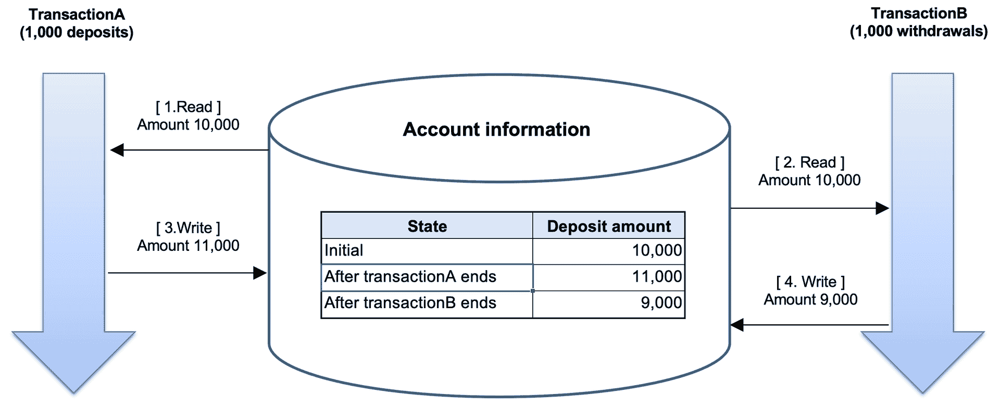

1. 首先，`transaction A` 读取银行账户信息。
2. `transaction B` 随后读取银行账户信息。
3. `transaction A` 更新为 11,000，使账户金额增加了 `+1,000`。
4. `transaction B` 更新为 9,000，使账户金额减少了 `-1,000`。


账户中的金额存入了 `1,000` 并取回了 `1,000`。然而，现在的金额是 `9,000`。在这种情况下，`transaction B` 应该等待 `transaction A` 完成。通过这样，即使多个事务同时执行，也必须进行正常处理。这被称为事务独立性（或隔离）。隔离级别指定了这种独立性程度。对于隔离级别，请为 `isolation` 属性指定以下值。但注意，取决于你使用的数据库产品，某些级别可能不可用。[事务隔离级别]

| Isolation level | 描述 |
| :--- | :--- |
| `DEFAULT` | 使用数据库的默认隔离级别。 |
| `READ_UNCOMMITTED` | 你可以读取其他事务未提交的数据。如果被回滚，则查询到了无效数据。 |
| `READ_COMMITTED` | 无法读取另一个事务未提交的数据。 |
| `REPEATABLE_READ` | 如果事务内多次读取数据，即使其他事务在此期间更改了数据，读取的值也是相同的。 |
| `SERIALIZABLE` | 逐个处理事务，以此类推。 |

## 独立性中的典型问题

以下是对独立性中一些典型问题的简要说明。共有三个问题：

* 脏读 (Dirty read)
  在提交之前读取数据。
* 非可重复读 (Non-repeatable read)
  在事务中多次读取相同数据。在此期间，另一个事务更新了数据。在这种情况下，读取的数据会在中间发生变化。
* 幻读 (Phantom read)
  在事务中多次读取相同数据。在此期间，另一个事务添加新数据。如果发生这种情况，处理的记录数会在事务中间增加。

之前引入的隔离级别以及这些问题的对应关系如下所示。[隔离级别]

| Isolation level | 脏读 | 非可重复读 | 幻读 |
| :--- | :--- | :--- | :--- |
| `READ_UNCOMMITTED` | NG | NG | NG |
| `READ_COMMITTED` | OK | NG | NG |
| `REPEATABLE_READ` | OK | OK | NG |
| `SERIALIZABLE` | OK | OK | OK |

(OK: 防止，NG: 不防止) 请确保你设置了合适的隔离级别。

## 什么是事务传播级别？

接下来，我将解释传播级别。传播级别决定了是否创建并启动新事务。当服务调用另一个服务时尤其为重要。你可以配置是启动事务、加入现有事务等。[传播级别]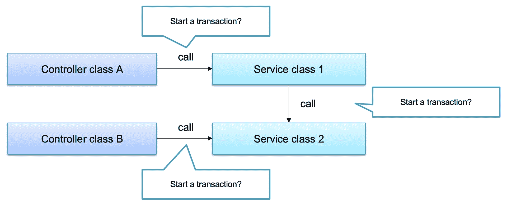 你可以将传播级别设置为：[传播级别]

| Propagation level | 描述 |
| :--- | :--- |
| `REQUIRED` | 如果不存在事务，`REQUIRED` 会启动新事务。默认传播级别。如果已存在事务，则使用它。 |
| `REQUIRES_NEW` | 总是创建一个新事务。 |
| `MANDATORY` | `MANDATORY` 假设事务已存在。如果已存在事务，则使用它。如果不存在事务，则抛出异常。 |
| `NEVER` | 如果指定 `"NEVER"`，则不使用事务。如果已存在事务，则抛出异常。 |
| `NOT_SUPPORTED` | `NOT_SUPPORTED` 不使用事务。如果已存在事务，则挂起该事务。在系统暂停期间不使用事务执行处理。处理完成后，重启已停止的事务。 |
| `SUPPORTS` | 如果事务不存在，则不会创建。如果已存在事务，则使用它。 |
| `NESTED` | 创建嵌套事务。 |

由于解释可能难以理解，请查看下表。[传播级别的行为]

| Propagation level | 设置 `service2` 的传播级别 | 通过 `service1` 调用 `service2` |
| :--- | :--- | :--- |
| `REQUIRED` | 启动事务 | 加入现有事务 |
| `REQUIRES_NEW` | 启动事务 | 启动事务 |
| `MANDATORY` | 抛出异常 | 加入现有事务 |
| `NEVER` | 不使用事务 | 抛出异常 |
| `NOT_SUPPORTED` | 不使用事务 | 不使用事务 |
| `SUPPORTS` | 不使用事务 | 加入现有事务 |
| `NESTED` | 启动事务 | 启动部分事务 |

这完成了事务的学习。

## 总结

这里是你在本章中学到的内容：[基础]

* 使用 MyBatis 时，在 Java 接口上注解 `@Mapper`。
* 使用 `mapper` 标签的 `namespace` 属性将 Java 接口映射到 `xml` 文件。
* 使用 `id` 属性映射方法和 SQL。
* 在 SQL 中嵌入参数时，使用 `#{parameter name}`。
* 使用 `resultType` 和 `resultMap` 属性返回查询结果。
* `resultMap` 属性可以用于为不同情况进行 ORM 映射。
* `@Param` 注解允许你指定嵌入 SQL 的参数名称。

[高级]

* 可以使用 `if` 标签生成动态 SQL。
* 你可以使用 `where` 标签生成不需要 `where` 子句的 SQL。
* 使用 `association` 标签处理一对一表连接。
* 使用 `collection` 标签处理一对多表连接。

[事务]

* 要实现事务，请使用 `@Transactional` 注解。
* `@Transactional` 的属性可以用于设置隔离和传播级别。

# 9.1.1 什么是 AOP？

AOP 是提取公共流程并对其进行统一管理。AOP 代表面向切面数编程（Aspect Oriented Programming）。通过 AOP，你可以将非核心代码放在一个地方。然后你可以决定将这些代码应用到哪些类或方法。

例如，假设你想记录所有控制器（controller）方法的开始和结束日志。如果不使用 AOP，你将编写如下代码：

```java
@Controller
@Slf4j
public class SampleController {
    @GetMapping ("/sample")
    public String get() {
        log.info("Method start: SampleController get");
        //(一些处理)
        log.info("Method end: SampleController get");
    }
}
```

这是非常糟糕的代码。这是因为存在三个问题：

* 代码的可读性降低了。*自身的* 处理逻辑可能会被遗忘。
* 如果日志输出内容发生变化，需要修改的数量将是巨大的。

这在 AOP 中的实现如下：

```java
@Aspect
@Component
@Slf4j
public class LogAspect {
    @Before ("@within(org.springframework.stereotype.Controller)") )
    public void startLog(JoinPoint jp ) {
        log.info("Method start: " + jp.getSignature());
    }
    @After ("@within(org.springframework.stereotype.Controller)") )
    public void endLog(JoinPoint jp ) {
        log.info("Method end: " + jp.getSignature());
    }
}
```

仅凭此，日志就会在所有控制器的执行前后输出。它还消除了在控制器中编写日志输出代码的需要。你只需要修改 AOP 代码即可更改日志的输出。

# 9.1.2 AOP 术语

AOP 有许多术语。如果你不先熟悉这些术语，将无法理解它。AOP 术语如下：

| 术语 | 说明 |
| --- | --- |
| Advice (环通知) | 在 AOP 中执行的处理内容。 |
| Pointcut (切入点) | 要执行操作的对象（类或方法）。 |
| JoinPoint (连接点) | 执行处理的时机。 |

接下来，`JoinPoint`（执行时机）被分为以下五类。

| 执行时机 | 说明 |
| --- | --- |
| Before (之前) | 在目标方法执行之前执行处理过程。 |
| After (之后) | 在目标方法执行之后执行处理过程。 |
| AfterReturning (返回后) | 仅在目标方法正常结束时才执行处理过程。 |
| Around (环绕) | 在执行目标方法的前后各执行处理过程。 |
| AfterThrowing (异常后) | 仅在目标方法异常终止时执行处理过程。 |

下图显示了这些 Join Points（执行时机）。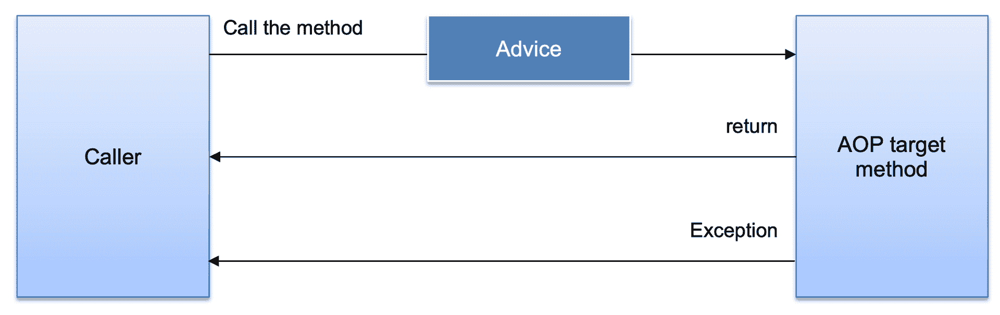 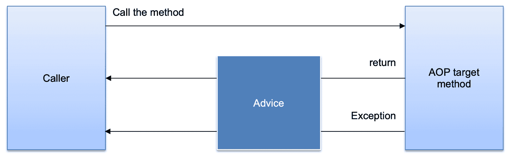 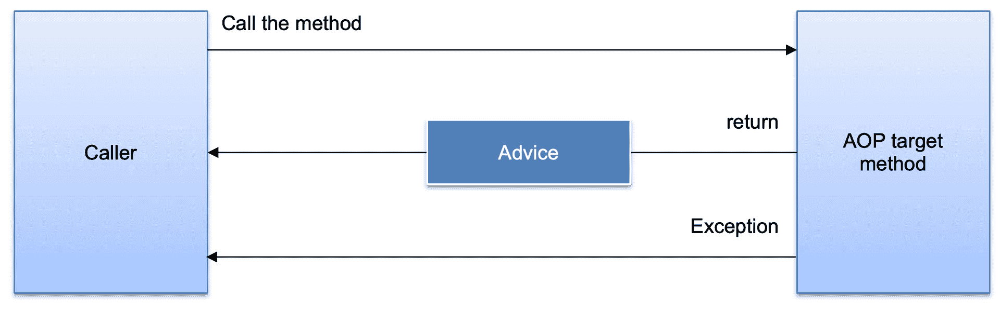 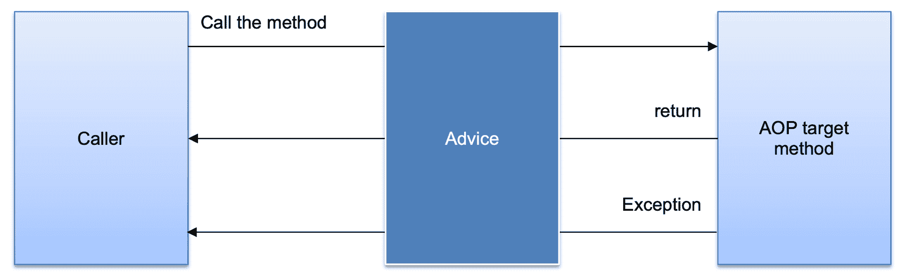 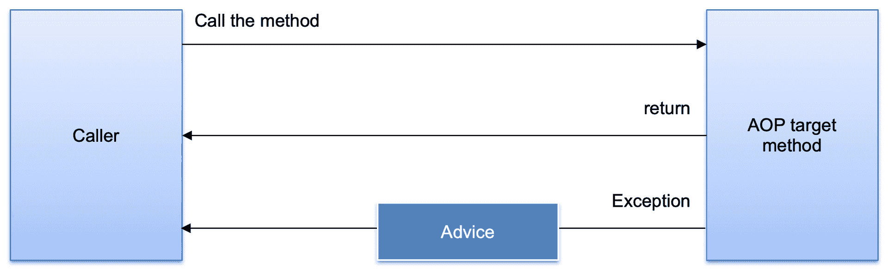

# 9.1.3 AOP 的工作原理

我将解释 AOP 内部是如何运作的。理解这一点有助于理解 AOP。AOP 的机制如下：

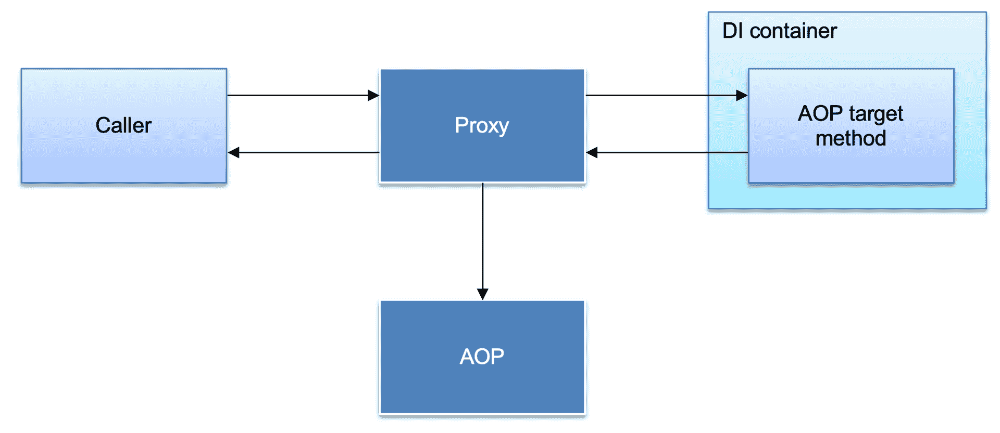

首先，Spring 尝试调用 DI 容器中注册的 bean 的方法。bean 是一个带有 `@Controller` 和 `@Service` 等注解的类。从控制器中所示调用 service 的方法：

```java
@Controller
public class SampleController {
    @Autowired
    private SampleService service;
    public void method() {
        service.someMethod();
    }
}
```

如果你真的直接调用 `someMethod()`，你无法在方法前后放置 AOP 处理。因此，Spring 通过 `Proxy`（代理）调用 bean 的方法。然后 `Proxy` 调用 AOP 处理和 bean 方法。因为你使用了 DI，所以你可以使用 AOP 进行公共处理。这就是 AOP 的内部工作原理。

# 9.2 AOP 的实现

在理解 AOP 后，你将对其进行实现。

* 如何指定切入点
* Before/After 实现
* Around 实现

# 9.2.1 如何指定切入点

在开始实现 AOP 之前，让我们学习如何指定切入点（执行目标）。共有四种指定方式：

| 切入点 | 说明 |
| --- | --- |
| execution | 使用正则表达式指定任何类或方法。 |
| bean | 指定 DI 容器中注册的 bean 名称。 |
| @annotation | 使用包含包名在内的注解名称指定执行目标。带有指定注解的方法为目标。 |
| @within | 指定包含包名在内的注解名称。带有指定注解的类的所有方法受 AOP 控制。 |

# 9.2.2 Before/After 实现

## 概述

每当 `UserService` 的方法执行一次时，都输出一个开始和结束日志。实现 AOP，使得在显示用户列表屏幕时输出以下日志。

[日志] (节录)

```
Method start: List com.example.domain.user.service.impl.UserServiceImpl.getUsers(MUser)
Method end: List com.example.domain.user.service.impl.UserServiceImpl.getUsers(MUser)
```

## 概述

每当 `UserService` 的方法执行时，都输出一个开始和结束日志。实现 AOP，使得在显示用户列表屏幕时输出以下日志。

[日志] (节录)

```
Method start: List com.example.domain.user.service.impl.UserServiceImpl.getUsers(MUser)
Method end: List com.example.domain.user.service.impl.UserServiceImpl.getUsers(MUser)
```

### 目录

目录结构如下。带有背景颜色的部分是新增的。

    

### 源码

使用 AOP 需要某些库。因此，在 `pom.xml` 中添加以下代码：

```xml
<dependencies>
    <!-- Spring AOP -->
    <dependency>
        <groupId>org.springframework</groupId>
        <artifactId>spring-aop</artifactId>
    </dependency>
    <!-- AspectJ -->
    <dependency>
        <groupId>org.aspectj</groupId>
        <artifactId>aspectjweaver</artifactId>
    </dependency>
</dependencies>
```

实现 `LogAspect.java`：

```java
package com.example.aspect;

import org.aspectj.lang.JoinPoint;
import org.aspectj.lang.annotation.After;
import org.aspectj.lang.annotation.Aspect;
import org.aspectj.lang.annotation.Before;
import org.springframework.stereotype.Component;
import lombok.extern.slf4j.Slf4j;

@Aspect
@Component
@Slf4j
public class LogAspect {
    /**
     * 在执行 service 之前。
     * 目标：UserService 包含在类名中。
     */
    @Before ("execution(*..UserService.*..)") )
    public void startLog(JoinPoint jp ) {
        log.info("Method start: " + jp.getSignature());
    }

    /**
     * 在执行 service 之后。
     * 目标：UserService 包含在类名中。
     */
    @After ("execution(*..UserService.*..)") )
    public void endLog(JoinPoint jp ) {
        log.info("Method end: " + jp.getSignature());
    }
}
```

两个连续的点表示任何大于或等于零的任意值。在包部分，两个点表示包含零个或多个字符的包。在方法的参数部分，两个点表示零个或多个参数。

- `+` (加号)

如果你在类名后指定加号，则将包含指定类的子类。

### 执行 (ExecutionRun)

运行 Spring Boot 并访问以下 URL。[URL]``http://localhost:8080/user/list`

应当输出以下日志。[日志]（节录）

```
Method start: List com.example.domain.user.service.impl.UserServiceImpl.getUsers(MUser)
Method end: List com.example.domain.user.service.impl.UserServiceImpl.getUsers(MUser)
```

※省略了 MyBatis 日志。

### 9.2.3 Around 的实现

## 概述

实现 AOP 以为所有 controller 方法输出开始和结束日志。

### 目录

目录结构没有变化。

# 源代码

为 AOP 添加一个方法。更改背景颜色的部分为修改部分。[LogAspect.java]


```java
package com.example.aspect;

import org.aspectj.lang.JoinPoint;
import org.aspectj.lang.ProceedingJoinPoint;
import org.aspectj.lang.annotation.After;
import org.aspectj.lang.annotation.Around;
import org.aspectj.lang.annotation.Aspect;
import org.aspectj.lang.annotation.Before;
import org.springframework.stereotype.Component;
import lombok.extern.slf4j.Slf4j;

@Aspect
@Component
@Slf4j
public class LogAspect {
    /**
     * 在执行服务前输出日志。
     * 目标：类名中包含 [UserService]。
     */
    @Before("execution(* *..*.*UserService.*(..))")
    public void startLog(JoinPoint jp) {
        log.info("Method start: " + jp.getSignature());
    }

    /**
     * 在执行服务后输出日志。
     * 目标：类名中包含 [UserService]。
     */
    @After("execution(* *..*.*UserService.*(..))")
    public void endLog(JoinPoint jp) {
        log.info("Method end: " + jp.getSignature());
    }

    /** 在 controller 执行前后后输出日志 */
    @Around("bean(*Controller)")
    // @Around("@annotation(org.springframework.web.bind.annotation.GetMapping)")
    @Around("@within(org.springframework.stereotype.Controller)")
    public Object startLog(ProceedingJoinPoint jp) throws Throwable {
        // 输出开始日志
        log.info("Method start: " + jp.getSignature());
        try {
            // 方法执行
            Object result = jp.proceed();
            // 输出结束日志
            log.info("Method end: " + jp.getSignature());
            // 将执行结果返回给调用者
            return result;
        } catch (Exception e) {
            // 输出错误日志
            log.error("Method abend: " + jp.getSignature());
            // 抛出错误
            throw e;
        }
    }
}
```

## 点 1：`@Around`

通过在方法上添加 `@Around` 注解，你可以在 AOP 执行目标之前之后插入处理逻辑。其机制是：在带有此注解的方法内部调用要被 AOP 执行的方法。在上面的示例代码中，由 AOP 执行的方法在以下部分被调用。`LogAspect.java`

```java
// 方法执行
Object result = jp.proceed();
// …… 将执行结果返回给调用者
return result;
```

请注意，如果你不包含上述处理，方法将无法正常执行。

## 点 2：`bean`

如果你使用 `"bean"` 作为切点（Pointcut，执行目标），则可以通过 DI（依赖注入）容器中注册的 bean 名称来指定 AOP 的目标。当然，也可以使用正则表达式。

如何指定 `bean`：

```
bean(Bean-name)
```

虽然在示例代码中被注释掉了，但 bean 名称以 `Controller` 结尾的类被设定为 AOP 目标。

## 点 3：`@annotation`

如果你使用 `"@annotation"` 作为切点（执行目标），则带有指定注解的方法将成为 AOP 的目标。在注解名称中包含包名。虽然在示例代码中被注释掉了，但带有 `@GetMapping` 的方法被设定为 AOP 目标。

## 点 4：`@within`

如果你使用 `"@within"`，则带有指定注解的类的所有方法都成为 AOP 的目标。在注解名称中包含包名。在示例代码中，带有 `@Controller` 注解的类的所有方法被设定为 AOP 目标。

### 执行（ExecutionRun）

运行 Spring Boot 并访问以下 URL：`http://localhost:8080/login`

应当输出以下日志（节录）：

```
Method start: String com.example.controller.LoginController.getLogin()
Method end: String com.example.controller.LoginController.getLogin()
```

※省略了 MyBatis 日志。

### 总结

在本章中你学习了：

**AOP 概述**

- AOP 是集体管理公共处理的机制。

**AOP 术语**

- Advice：处理内容
- Pointcut（切点）：执行目标
- JoinPoint（连接点）：执行时机

**如何指定 JoinPoint（执行时机）**

- 在 AOP 方法上标记以下 JoinPoint（执行时机）：
  1. `Before`：执行前
  2. `After`：执行后（正常终止/异常终止）
  3. `Around`：执行前后
  4. `AfterReturning`：正常完成后
  5. `AfterThrowing`：异常终止后

**如何指定 Pointcut（执行目标）**

- 在 JoinPoint 注解中指定以下 Pointcut（执行目标）：
  1. `execution(return-value package-name.method-name(argument))`
  2. `bean(Bean-name)`
  3. `@annotation(package-name.annotation-name)`
  4. `@within(package-name.annotation-name)`

**如何实现 AOP**

- 在 AOP 类上添加 `@Aspect` 和 `@Component`。
- 在 AOP 方法上标记 JoinPoint（执行时机）。
- 在 JoinPoint 注解中指定 Pointcut（执行目标）。

因此，创建一个允许跳转到登录页的通用错误页面。

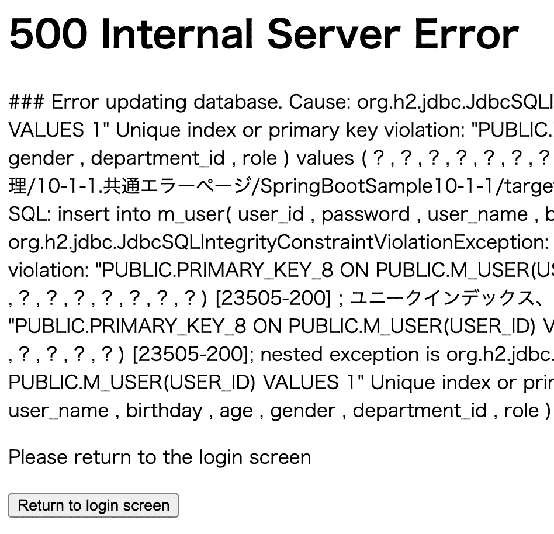

#### 目录

目录结构如下。背景颜色发生变化的部分为新添加的部分。


```
SpringBootSample
┗  src/main
    ┣  java
    ┣  resources
      ┃┣  i18n
      ┃┣  mapper
      ┃┣  static
      ┃┣  templates
      ┃┃┣  hello
      ┃┃┣  layout
      ┃┃┣  login
      ┃┃┣  user
      ┃┃┃┣  error.html (创建一个新文件)
      ┃┃┗  hello.html
      ┃┣  application.properties
      ┃┣  data.sql
      ┃┗  schema.sql
    ┗  pom.xml
```

### 点：通用错误页面

创建通用错误页面非常简单。因为它只需要在 `src/main/resources/templates` 下创建一个名为 `error.html` 的文件即可。

## 源代码

创建一个通用错误页面。

`error.html`

```html
<!DOCTYPE html>
<html xmlns:th="http://www.thymeleaf.org">
<head>
    <meta charset="utf-8" />
    <title>Error</title>
</head>
<body>
    <h1 th:text="${status} + ' ' + ${error}"></h1>
    <p th:text="${message}"></p>
    <p>Please return to the login screen</p>
    <form method="post" th:action="@{/logout}">
        <button class="btn btn-link" type="submit">Return to login screen</button>
    </form>
</body>
</html>
```

### 点：显示各种错误内容

你可以通过指定以下键获取错误内容的详细信息。Spring 会自动设置这些值。

| 代码 | 说明 |
| --- | --- |
| `${status}` | HTTP 错误代码。 |
| `${error}` | 显示 HTTP 错误的摘要。 |
| `${message}` | 显示错误消息。 |

### 执行

运行 SpringBoot 访问用户注册页面。在 User ID 字段中输入 `system@co.jp` 注册用户。由于该用户 ID 在初始数据中已注册，会发生唯一性约束冲突。因此，页面跳转到通用错误页面。

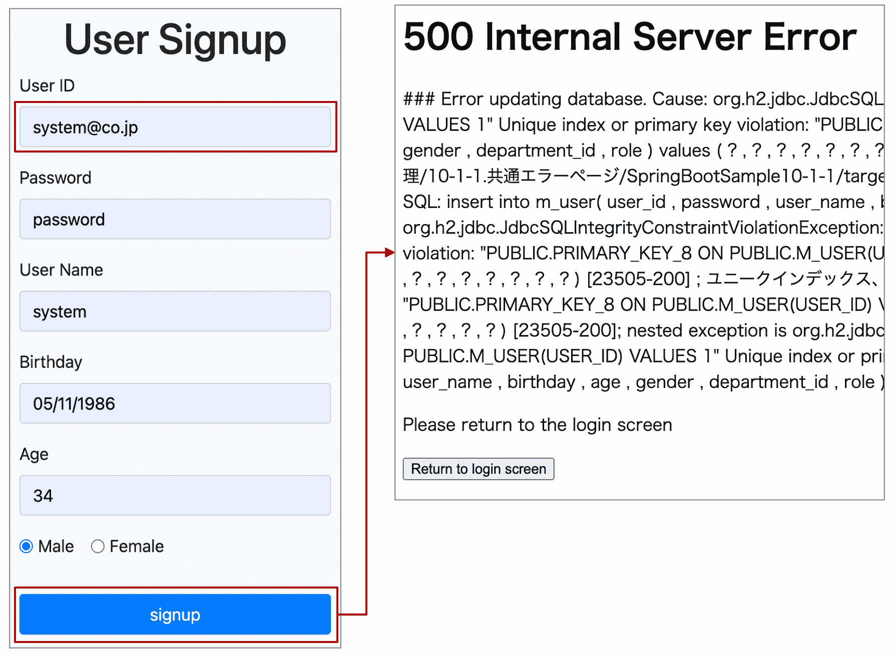

## 10.1.2 每个 HTTP 错误的错误页面

### 概述

使用 Spring 的默认功能，你也可以为每个 HTTP 错误准备错误页面。为 404 错误创建一个页面。404 错误是指当 HTTP 请求发送到不存在的 URL 时发生的错误。

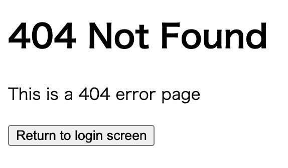

#### 目录

目录结构如下。背景颜色发生变化的部分为新添加的部分。


```
SpringBootSample
┗  src/main
    ┣  java
    ┣  resources
      ┃┣  i18n
      ┃┣  mapper
      ┃┣  static
      ┃┣  templates
      ┃┃┣  error (创建新文件夹)
      ┃┃┃┗  404.html (创建一个新文件)
      ┃┃┣  hello
      ┃┃┣  layout
      ┃┃┣  login
      ┃┃┣  user
      ┃┃┃┣  error.html
      ┃┃┗  hello.html
      ┃┣  application.properties
      ┃┣  data.sql
      ┃┗  schema.sql
    ┗  pom.xml
```

### 点：每个 HTTP 错误的错误页面

为每个 HTTP 错误创建页面非常简单。只需在 `src/main/resources/templates` 下准备文件即可。文件名必须与 HTTP 错误代码相同。要创建一个响应 404 错误的页面，请准备一个名为 `404.html` 的文件。

## 源代码

创建一个 404 错误页面。

`404.html`

```html
<!DOCTYPE html>
<html xmlns:th="http://www.thymeleaf.org">
<head>
    <meta charset="utf-8" />
    <title>404Error</title>
</head>
<body>
    <h1 th:text="${status} + ' ' + ${error}"></h1>
    <p>This is a 404 error page</p>
    <form method="post" th:action="@{/logout}">
        <button class="btn btn-link" type="submit">Return to login screen</button>
    </form>
</body>
</html>
```

### 执行

运行 SpringBoot 并访问不存在的 URL。例如，访问 `http://localhost:8080/hoge`。发生 404 错误并显示以下页面。


## 10.2 如何实现异常处理

接下来，你将在 Spring 中实现异常处理。Spring 提供了多种机制，允许异常处理标准化。这让开发者能够专注于实现核心逻辑。在 Spring 中实现异常处理有三种方式：

- 在 `@AfterThrowing` 切面中的异常处理
- 针对每个控制器的异常处理
- 针对整个 Web 应用程序的异常处理

### 10.2.1 `@AfterThrowing` 切面中的异常处理

### 概述

`@AfterThrowing` 切面用于在发生错误时输出日志。如果发生了 `DataAccessException`，修改应用程序以输出以下日志。

日志（节录）：

```
DataAccessException has occurred
```

#### 目录

目录结构如下。背景颜色发生变化的部分是新添加的部分。


```
SpringBootSample
┗  src/main
    ┣  java
    ┃┗  com.example
    ┃   ┣  application.service
    ┃   ┣  aspect
    ┃   ┃┣  `ErrorAspect.java` (创建一个新类)
    ┃   ┃┗  `LogAspect.java`
    ┃   ┣  config
    ┃   ┣  controller
    ┃   ┣  domain.user
    ┃   ┣  hello
    ┃   ┣  repository
    ┃   ┗  `SpringBootSampleApplication.java`
```


┣  resources

┗  `pom.xml`

#### 源码

创建一个在发生错误时输出日志的 AOP。

`[ErrorAspect.java]`

```java
package com.example.aspect;
import org.aspectj.lang.annotation.AfterThrowing;
import org.aspectj.lang.annotation.Aspect;
import org.springframework.dao.DataAccessException;
import org.springframework.stereotype.Component;
import lombok.extern.slf4j.Slf4j;

@Aspect
@Component
@Slf4j
public class ErrorAspect {
    @AfterThrowing (value = "execution(* *..*..*(..)) &&"+
    "(bean(*Controller) || bean(*Service) || bean(*Repository))" ,throwing = "ex" )
    public void throwingNull(DataAccessException ex ) {
        // Exception handling (log output)
        log .error("DataAccessException has occurred" );
    }
}
```

#### 关键点：`@AfterThrowing`

通过注解 `@AfterThrowing`，可以在发生异常时实现 AOP。在 `throwing` 属性中，指定异常类的方法参数。

### 执行

运行 SpringBoot 访问用户注册页面。在 User ID 字段中输入 `"system@co.jp"` 来注册用户。发生唯一约束冲突。


将输出以下日志。

`[日志]`（节录）

```
DataAccessException has occurred
```

### 10.2.2 每个 controller 类的异常处理

### 概述

在本节中，你将学习当 controller 类中发生意外异常时的异常处理。当用户注册页面发生错误时，通用错误界面将显示以下消息。

`[通用错误界面]`

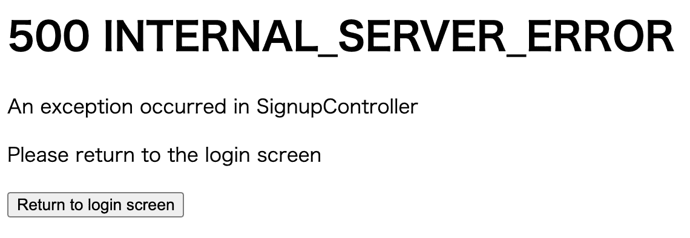

#### 目录

目录结构没有变化。

#### 源码

修改用户注册页面上的 controller。背景颜色发生变化的部分是修改过的。

`[SignupController.java]`

```java
package com.example.controller;
import java.util.Locale;
import java.util.Map;
import org.modelmapper.ModelMapper;
import org.springframework.beans.factory.annotation.Autowired;
import org.springframework.dao.DataAccessException;
import org.springframework.http.HttpStatus;
import org.springframework.stereotype.Controller;
import org.springframework.ui.Model;
import org.springframework.validation.BindingResult;
import org.springframework.validation.annotation.Validated;
import org.springframework.web.bind.annotation.ExceptionHandler;
```

```java
import org.springframework.web.bind.annotation.GetMapping;
import org.springframework.web.bind.annotation.ModelAttribute;
import org.springframework.web.bind.annotation.PostMapping;
import org.springframework.web.bind.annotation.RequestMapping;
import com.example.application.service.UserApplicationService;
import com.example.domain.user.model.MUser;
import com.example.domain.user.service.UserService;
import com.example.form.GroupOrder;
import com.example.form.SignupForm;
import lombok.extern.slf4j.Slf4j;

@Controller
@RequestMapping("/user")
@Slf4j
public class SignupController {
    @Autowired
    private UserApplicationService userApplicationService;

    @Autowired
    private UserService userService;

    @Autowired
    private ModelMapper modelMapper;

    /** 显示用户注册界面 */
    @GetMapping("/signup")
    public String getSignup(Model model, Locale locale, @ModelAttribute SignupForm form) {…(Omitted)}

    /** 用户注册流程 */
    @PostMapping("/signup")
    public String postSignup(Model model, Locale locale, @ModelAttribute @Validated(GroupOrder.class) SignupForm form, BindingResult bindingResult) {…(Omitted)}

    /** 数据库相关的异常处理 */
    @ExceptionHandler(DataAccessException.class)
    public String dataAccessExceptionHandler(DataAccessException e, Model model) {
        // 设置空字符串
        model.addAttribute("error", "");
        // 在 Model 中注册消息
        model.addAttribute("message", "An exception occurred in SignupController");
        // 在 Model 中注册 HTTP 错误码(500)
        model.addAttribute("status", HttpStatus.INTERNAL_SERVER_ERROR);
        return "error";
    }

    /** 其他异常处理 */
    @ExceptionHandler(Exception.class)
    public String exceptionHandler(Exception e, Model model) {
        // 设置空字符串
        model.addAttribute("error", "");
        // 在 Model 中注册消息
        model.addAttribute("message", "An exception occurred in SignupController");
        // 在 Model 中注册 HTTP 错误码(500)
        model.addAttribute("status", HttpStatus.INTERNAL_SERVER_ERROR);
        return "error";
    }
}
```

### 重点：`@ExceptionHandler`

可以通过提供带有 `@ExceptionHandler` 注解的方法来实现异常处理。通过在注解的参数中指定异常类，可以为每个异常执行相应的处理。此外，你也可以准备多个带有 `@ExceptionHandler` 的方法。

在上面的示例代码中，发生异常时会显示通用错误页面。此时，错误消息和其他信息会被注册在 `Model` 类中。

### 执行

1. 运行 `SpringBoot` 以访问用户注册界面。

2. 在 User ID 字段输入“system@co.jp”注册用户。

3. 发生唯一性约束冲突。

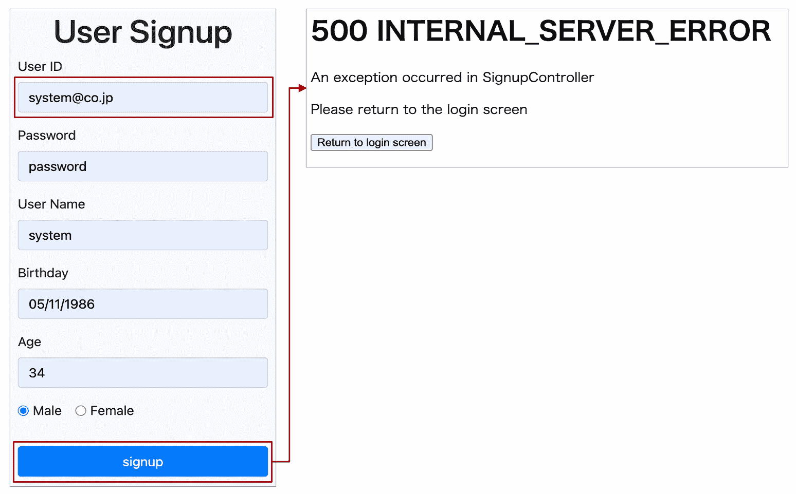

显示通用错误页面。显示你刚刚创建的异常处理消息。

## 10.2.3 整个 Web 应用异常处理

### 概述

如果你为每个控制器类准备异常处理，就可以针对每个屏幕适当处理异常。但是，可能会有人忘记实现异常处理。因此，请为整个 Web 应用准备异常处理。这允许你批量实现异常处理。

当对整个 Web 应用执行异常处理时，通用错误页面将显示以下消息。

`[通用错误页面]`


#### 目录

目录结构如下。背景颜色发生的部分是新添加的部分。


```text
SpringBootSample
┗ src/main
   ┣ java
   ┃┗ com.example
      ┃  application.service
      ┃  aspect
      ┃   ┣ ErrorAspect.java
      ┃   ┣ GlobalControllAdvice.java (创建一个新类)
      ┃   ┗ LogAspect.java
      ┃  config
      ┃  controller
      ┃  domain.user
      ┃  form
      ┃  hello
      ┃  repository
      ┃┗ SpringBootSampleApplication.java
   ┗ resources
      ┗ pom.xml
```

# 源代码

为整个 Web 应用创建异常处理。

`[GlobalControllAdvice.java]`

```java
package com.example.aspect;
import org.springframework.dao.DataAccessException;
import org.springframework.http.HttpStatus;
import org.springframework.stereotype.Component;
import org.springframework.ui.Model;
import org.springframework.web.bind.annotation.ControllerAdvice;
import org.springframework.web.bind.annotation.ExceptionHandler;

@ControllerAdvice
public class GlobalControllAdvice {
    /** 数据库相关的异常处理 */
    @ExceptionHandler(DataAccessException.class)
    public String dataAccessExceptionHandler(DataAccessException e, Model model) {
        // 设置空字符串
        model.addAttribute("error", "");
        // 在 Model 中注册消息
        model.addAttribute("message", "DataAccessException has occurred");
        // 在 Model 中注册 HTTP 错误码(500)
        model.addAttribute("status", HttpStatus.INTERNAL_SERVER_ERROR);
        return "error";
    }

    /** 其他异常处理 */
    @ExceptionHandler(Exception.class)
    public String exceptionHandler(Exception e, Model model) {
        // 设置空字符串
        model.addAttribute("error", "");
        // 在 Model 中注册消息
        model.addAttribute("message", "Exception has occurred");
        // 在 Model 中注册 HTTP 错误码(500)
        model.addAttribute("status", HttpStatus.INTERNAL_SERVER_ERROR);
        return "error";
    }
}
```

### 重点：`@ControllerAdvice`

通过将此注解附加到类上，你可以准备一个被所有控制器共享的方法。但是，只有带有以下注解之一的方法才能在控制器之间进行共享：

* `@ExceptionHandler`

* `@InitBinder`

* `@ModelAttribute`

### 执行

运行 Spring Boot 并访问以下 URL。

`[URL]` `http://localhost:8080/user/detail`

当访问用户详情屏幕时，如果 URL 中未包含用户 ID，将发生错误。因此，屏幕将切换到通用错误屏幕。

通用错误屏幕 

* 授权 (Authorization)

#### 11.1 概述

Spring Security 拥有认证和授权功能。认证简单来说就是登录功能。只有成功登录的用户才能各种功能。Spring 让登录功能的变得非常简单。授权是根据权限进行的功能限制。在 Spring 中，可以根据用户拥有的权限限制各种功能。例如，你可以阻止访问特定的 URL。你也可以根据权限更改屏幕显示项。你将在实际制作这些功能时学习它们。

#### 11.2 身份认证

首先，创建登录功能。你将按照以下顺序创建它：

* 禁止直接链接

* 登录流程

* 内存认证

* 密码加密

* 用户数据认证

* 注销处理

* CSRF 措施

### 11.2.1 禁止直接链接

### 概述

如果可以通过直接输入 URL 访问页面，那么创建登录功能就没有意义了。这就像在房子周围没有围墙的情况下建了一道门。因此，除了某些页面外，用户未登录时无法访问页面。换句话说，禁止直接链接。如果用户未登录并尝试访问页面，页面将跳转到通用错误页面。

`[通用错误页面]`


#### 目录

目录结构如下。背景颜色发生区域是新添加的部分。

 

 SpringBootSample

┗  src/main

   ┣  java

   ┃┗  com.example

   ┃   ┣  application.service

   ┃   ┣  aspect

   ┃   ┣  config

   ┃   ┃┣  JavaConfig.java

   ┃   ┃┗  SecurityConfig.java (创建一个新类)

   ┃   ┣  controller

   ┃   ┣  domain.user

   ┃   ┣  form

   ┃   ┣  hello


```
┃   ┣  repository
┃   ┗  SpringBootSampleApplication.java
┣  resources
┗  pom.xml
```

#### 源码

首先，添加 Spring security 库。在`pom.xml`的`dependencies`标签中添加以下代码。背景颜色发生区域是添加的部分。

[pom.xml]

```xml
<dependencies>
  …<!-- SpringSecurity -->
  <dependency>
    <groupId> org.springframework.boot</groupId>
    <artifactId> spring-boot-starter-security</artifactId>
  </dependency>
  <!-- Thymeleaf 扩展库 (Security) -->
  <dependency>
    <groupId> org.thymeleaf.extras</groupId>
    <artifactId> thymeleaf-extras-springsecurity5</artifactId>
  </dependency>
  …
</dependencies>
```

接下来，准备一个安全配置类。

[SecurityConfig.java]

```java
package com.example.config;
import org.springframework.context.annotation.Configuration;
import org.springframework.security.config.annotation.web.builders.HttpSecurity;
import org.springframework.security.config.annotation.web.builders.WebSecurity;
import org.springframework.security.config.annotation.web.configuration.EnableWebSecurity;
import org.springframework.security.config.annotation.web.configuration.WebSecurityConfigurerAdapter;

@EnableWebSecurity
@Configuration
public class SecurityConfig extends WebSecurityConfigurerAdapter {
    /** 设置目标安全外范围 */
    @Override
    public void configure(WebSecurity web ) throws Exception {
        // 不应用安全
        web.ignoring().antMatchers("/webjars/**")
           .antMatchers("/css/**")
           .antMatchers("/js/**")
           .antMatchers("/h2-console/**");
    }

    /** 各种安全设置 */
    @Override
    protected void configure(HttpSecurity http ) throws Exception {
        // 设置不需要登录的页面
        http.authorizeRequests()
            .antMatchers("/login" ).permitAll() // 直接链接 OK。
            .antMatchers("/user/signup" ).permitAll() // 直接链接 OK。
            .anyRequest().authenticated(); // 其他直接链接 NG
        // 禁用 CSRF 措施（临时）
        http .csrf().disable();
    }
}
```

#### 重点 1：安全配置类

为了准备安全设置类，进行以下设置：

* 使用`@Configuration`和`@EnableWebSecurity`注解类。
* 继承`WebSecurityConfigurerAdapter`类。

你可以通过重写`WebSecurityConfigureAdapter`的方法来更改安全设置。

#### 重点 2：排除安全

让`webjars`和`css`等静态资源所有人可用。这还允许你在无需登录的情况下使用 H2 数据库控制台。因此，这些资源被排除在安全之外。设置方法如下：

[如何配置安全排除]

`web.ignoring().antMatchers("排除路径")`

`antMatchers`方法可以像示例代码一样使用链式调用。

#### 重点 3：禁止直接链接

要禁止直接链接，请使用`http.authorizeRequests()`方法。在此方法之后，你将为每个路径添加设置。

[直接链接：OK]

`antMatchers("path").permitAll()`

在`antMatchers`方法的参数中指定路径。使用`permitAll()`方法允许无需身份验证访问该路径。

[直接链接：NG]

`anyRequest().authenticated()`

所有路径都受`anyRequest()`方法的目标。`authenticated()`方法需要身份验证。这意味着`"anyRequest().authenticated()"`要求所有路径都需要身份验证。

这些设置按照调用的顺序应用。

---

### 11.2.2 登录过程

### 概述

在登录页面上输入 ID 和密码并点击“登录”按钮。未登录时，页面将跳转到错误页面。由于禁止了直接链接，各种页面无法显示。

[登录页面]


尚未登录。

#### 目录

目录结构没有变化。

#### 源码

首先，修改安全配置类。背景颜色发生区域是添加的部分。

[SecurityConfig.java]

```java
@EnableWebSecurity
@Configuration
public class SecurityConfig extends WebSecurityConfigurerAdapter {
    /** 设置目标安全外范围 */
    @Override
    public void configure(WebSecurity web ) throws Exception {
        …（省略）
    }

    /** 各种安全设置 */
    @Override
    protected void configure(HttpSecurity http ) throws Exception {
        // 设置不需要登录的页面
        http.authorizeRequests()
            .antMatchers("/login" ).permitAll() // 直接链接 OK。
            .antMatchers("/user/signup" ).permitAll() // 直接链接 OK。
            .anyRequest().authenticated(); // 其他直接链接 NG
        // 登录过程
        http.formLogin()
            .loginProcessingUrl("/login" ) // 登录处理路径
            .loginPage("/login" ) // 指定登录页面
            .failureUrl("/login?error" ) // 登录失败时的跳转目标
            .usernameParameter("userId" ) // 登录页面用户 ID
            .passwordParameter("password" ) // 登录页面密码
            .defaultSuccessUrl("/user/list", true ); // 成功后的跳转目标
        // 禁用 CSRF 措施（临时）
        http .csrf().disable();
    }
}
```

#### 重点：登录过程

添加登录过程，调用`http.formLogin()`方法。从该方法开始，在方法链中添加条件。

* `loginProcessingUrl("path")`

    指定登录处理的路径。与登录页面 HTML 中表单标签`th:action="@{/login}"`的路径匹配。

* `loginPage("path")`

    设置登录页面的链接目标。如果不设置此项，将看到 Spring Security 提供的默认登录页面。与登录页面控制器的`@GetMapping("/ login")`部分匹配。

* `failureUrl("path")`

    登录失败时的跳转目标。

* `usernameParameter("用户 ID name 属性")`

    设置登录页面用户 ID 输入框中 name 属性的值。

* `passwordParameter("密码 name 属性")`

设置登录界面上密码输入框中`name`属性的值。

* `defaultSuccessUrl("登录成功后的跳转目标路径", 是否跳转到第一个参数指定的跳转目标)`

指定登录成功后的跳转目标。如果将第二个参数指定为`true`，则将强制跳转到第一个参数的路径。

然后修改登录界面。背景颜色改变的部分为修改部分。`[login.html]`

```html
<!DOCTYPE html><html xmlns:th ="http://www.thymeleaf.org" ><head>…(Omitted)</head><body class ="bg-light" ><div class ="text-center" ><form method ="post" th:action ="@{/login}" class ="form-login" ><h2> Login</h2><p th:if ="${session['SPRING_SECURITY_LAST_EXCEPTION']} != null"th:text ="${session['SPRING_SECURITY_LAST_EXCEPTION'].message}"class ="text-danger" >Login error message</p><!-- User ID --><div class ="form-group" ><label for ="userId" class ="sr-only" > userId</label><input type ="text" class ="form-control" placeholder ="User ID"name ="userId" /></div><!-- Password --><div class ="form-group" ><label for ="password" class ="sr-only" > password</label><input type ="text" class ="form-control" placeholder ="Pa ssword"name ="password" /></div><input type ="submit" value ="Login" class ="btn btn-primary" /></form><a th:href ="@{/user/signup}" > Signup</a></div></body></html>
```

#### Point: 登录错误消息

要显示登录错误消息，请编写与示例代码相同的代码。如果 Session 中存在安全错误，将显示错误消息。

### 执行

运行`SpringBoot`访问登录界面。在登录界面上点击`Login`按钮。`[Login Screen]`

不会跳转到通用错误界面。此时，登录界面上将显示错误消息。

## 11.2.3 内存认证

### 概述

接下来，创建一个内存认证。内存认证是一种允许你通过准备临时的用户 ID 和密码来登录的功能。此功能允许你在没有用户表或数据的情况下进行登录。因此，安全性不会阻止开发。

#### 目录

目录结构没有变化。

#### 源码

修改安全配置类。背景颜色改变的部分为修改部分。`[SecurityConfig.java]`

```java
package com.example.config;
import org.springframework.context.annotation.Configuration;
import org.springframework.security.config.annotation.authentication.builders.AuthenticationManagerBuilder;

import org.springframework.security.config.annotation.web.builders.HttpSecurity;import org.springframework.security.config.annotation.web.builders.WebSecurity;import org.springframework.security.config.annotation.web.configuration.EnableWebSecurity;import org.springframework.security.config.annotation.web.configuration.WebSecurityConfigurerAdapter;@EnableWebSecurity
@Configuration
public class SecurityConfig extends WebSecurityConfigurerAdapter {/** 设置一个安全外目标 */@Override
public void configure(WebSecurity web ) throws Exception {…(Omitted)}/** 各安全设置 */@Override
protected void configure(HttpSecurity http ) throws Exception {…(Omitted)}/** 认证设置 */@Override
protected void configure(AuthenticationManagerBuilder auth ) throws Exception {// 内存认证
auth.inMemoryAuthentication().withUser("user" ) // 添加用户.password("user" ).roles("GENERAL" ).and().withUser("admin" ) // 添加 admin.password("admin" ).roles("ADMIN");}}
```

#### Point: 内存认证

可以使用`auth.inMemoryAuthentication()`方法创建内存认证。在`inMemoryAuthentication()`方法之后，调用以下方法来添加用户。

* `withUser("用户 ID")`
* `password("密码")`
* `roles("角色名称")`

你可以通过`and()`方法连接它们来添加多个用户。

然后修改消息属性以更改登录失败时的消息。背景颜色改变的部分为修改部分。`[messages.properties]`

```properties
user.signup.title=User Signup
user.signup.btn=signup
userId=User ID
password=Password
userName=User Name
birthday=Birthday
age=Age
male=Male
female=Female
gender=Gender
# =================#
# 登录失败消息
# =================
AbstractUserDetailsAuthenticationProvider.locked=Account is locked
AbstractUserDetailsAuthenticationProvider.disabled=Account is not available
AbstractUserDetailsAuthenticationProvider.expired=Account has expired
AbstractUserDetailsAuthenticationProvider.credentialsExpired=Password has expired
AbstractUserDetailsAuthenticationProvider.badCredentials=ID or password is incorrect
```

使用 Spring Security，你可以在登录时进行各种检查。在示例代码中，更改了对应这些检查的消息。然而，书中的示例仅显示“ID or password is incorrect”消息。

### 执行


运行`SpringBoot`访问登录界面。尝试使用为内存认证设置的用户 ID 和密码进行登录。`[Login screen]`

错误消息已经改变，但登录仍然失败。这是因为 Spring Security 需要密码加密。

## 11.2.4 密码加密

### 概述

在本节中，你将学习如何创建密码加密。创建以下过程：

* 对内存认证用户密码加密。
* 对用户注册/更新的密码加密。

这将允许你使用内存认证进行登录。

#### 目录

目录结构没有变化。

#### 源码

修改安全配置类。背景颜色改变的部分为修改部分。`[SecurityConfig.java]`

```java
package com.example.config;
import org.springframework.context.annotation.Bean;

import org.springframework.context.annotation.Configuration;
import org.springframework.security.config.annotation.authentication.builders.AuthenticationManagerBuilder;

import org.springframework.security.config.annotation.web.builders.HttpSecurity;import org.springframework.security.config.annotation.web.builders.WebSecurity;import org.springframework.security.config.annotation.web.con figuration.EnableWebSecurity;import org.springframework.security.config.annotation.web.configuration.WebSecurityConfigurerAdapter;import org.springframework.security.crypto.bcrypt.BCryptPasswordEncoder;import org.springframework.security.crypto.password.PasswordEncoder;@EnableWebSecurity
@Configuration
public class SecurityConfig extends WebSecurityConfigurerAdapter {
@Bean
public PasswordEncoder passwordEncoder() {return new BCryptPasswordEncoder();}
/** 设置一个安全外目标 */@Override
public void configure(WebSecurity web ) throws Exception {…(Omitted)}/** 各安全设置 */@Override
protected void configure(HttpSecurity http ) throws Exception {…(Omitted)}/** 认证设置 */@Override
protected void configure(AuthenticationManagerBuilder auth ) throws Exception {PasswordEncoder encoder = passwordEncoder();

// 内存认证
auth.inMemoryAuthentication().withUser("user" ) // 添加用户.password(encoder .encode("user" )).roles("GENERAL" ).and().withUser("admin" ) // 添加 admin.password(encoder .encode("admin" )).roles("ADMIN");}}
```

### `UserServiceImpl.java`

```java
package com.example.domain.user.service.impl;
import java.util.List;
import org.springframework.beans.factory.annotation.Autowired d;
import org.springframework.security.crypto.password.PasswordEncoder;
import org.springframework.stereotype.Service;
import org.springframework.transaction.annotation.Transactional;
import com.example.domain.user.model.MUser;
import com.example.domain.user.service.UserService;
import com.example.repository.UserMapper;

@Service
public class UserServiceImpl implements UserService {
    @Autowired
    private UserMapper mapper ;
    @Autowired
    private PasswordEncoder encoder ;

    /** 用户注册 */
    @Override
    public void signup(MUser user ) {
        user .setDepartmentId(1);
        user .setRole("ROLE_GENERAL" );
        // 密码加密
        String rawPassword = user .getPassword();
        user .setPassword(encoder .encode(rawPassword ));
        mapper .insertOne(user );
    }

    /** 获取用户 */
    @Override
    public List<MUser> getUsers(MUser user ) {
        return mapper .findMany(user ) ;
    }

    /** 获取用户（单条记录） */
    @Override
    public   MUser getUserOne(String userId ) {
        return mapper.findOne(userId );
    }

    /** 更新用户 */
    @Transactional
    @Override
    public void updateUserOne(String userId ,String password ,String userName ) {
        // 密码加密
        String encryptPassword = encoder .encode(password );
        mapper .updateOne(userId ,  encryptPassword , userName );
        // 抛出异常
        // int i = 1 / 0;
    }

    /** 删除用户 */
    @Override
    public void deleteUserOne(String userId ) {
        int count = mapper.deleteOne(userId );
    }
}
```

### 执行

运行`SpringBoot`并访问登录界面。使用为内存身份验证准备的用户 ID 和密码进行登录。

[登录界面]


登录成功并显示用户列表界面。（省略执行结果）。

### 11.2.5 用户数据认证

### 概述

修改应用程序，可以使用用户主表中的数据进行身份验证。

#### 目录

目录结构如下。背景颜色改变的部分是新添加的部分。

 SpringBootSample

┗  src/main  

   ┣  java  

   ┃┗  com.example  

   ┃      ┣  application.service  

   ┃      ┃  ┣  aspect  

   ┃      ┃  ┣  config  

   ┃      ┃  ┣  controller  

   ┃      ┃  ┣  domain.user  

   ┃      ┃  ┃┣  model  

   ┃      ┃  ┃┗  service  

   ┃      ┃  ┃     ┃┣  impl  

   ┃      ┃  ┃       ┃┃┣  UserDetailsServiceImpl.java (创建一个新类)  

   ┃      ┃  ┃       ┃┃┗  UserServiceImpl.java  

   ┃      ┃  ┃     ┗  UserService.java  

   ┃      ┃  ┗  form  

   ┃      ┃┣  hello  

   ┃      ┃┣  repository  

   ┃      ┃┗  SpringBootSampleApplication.java  

   ┣  resources  

   ┗  pom.xml

# 源代码

准备获取登录用户信息的 SQL。首先，修改`mapper`。背景颜色改变的部分是修改的部分。

[UserMapper.java]

```java
package com.example.repository;
import java.util.List;
import org.apache.ibatis.annotations.Mapper;
import org.apache.ibatis.annotations.Param;
import com.example.domain.user.model.MUser;

@Mapper
public interface UserMapper {
    /** 用户注册 */
    public int  insertOne(MUser user );
    /** 获取用户 */
    public List<MUser> findMany(MUser user );
    /** 获取用户（单条记录） */
    public  MUser findOne(String userId );
    /** 更新用户 */
    public void updateOne(@Param ("userId" ) String userId ,@Param ("password" ) String password ,@Param ("userName" ) String userName );
    /** 删除用户 */
    public int deleteOne(@Param ("userId" ) String userId );
    /** 获取登录用户 */
    public  MUser findLoginUser(String userId );
}
```

然后修改 xml。背景颜色改变的部分是修改的部分。

[UserMapper.xml]

```xml
<?xml version ="1.0" encoding ="UTF-8" ?>
<!DOCTYPE mapper PUBLIC "-//mybatis.org//DTD Mapper 3.0//EN""http://mybatis.org/dtd/mybatis-3-mapper.dtd>
<!-- Mapper and xml mapping -->
<mapper namespace ="com.example.repository.UserMapper" >
    <!-- 映射定义 (user) -->
    <resultMap type ="com.example.domain.user.model.MUser" id ="user" >…(Omitted)</resultMap>
    <!-- 映射定义 (department) -->
    <resultMap type ="com.example.domain.user.model.Department" id ="department" >…(Omitted)</resultMap>
    <!-- 映射定义 (salary) -->
    <resultMap type ="com.example.domain.user.model.Salary" id ="salary" >…(Omitted)</resultMap>
    <!-- 用户注册 -->
    <insert id ="insertOne" >…(Omitted)</insert>
    <!-- 获取用户（多个） -->
    <select id ="findMany" resultType ="MUser" >…(Omitted)</select>
    <!-- 获取用户（单条记录） -->
    <select id ="findOne" resultMap ="user" >…(Omitted)</select>
    <!-- 更新用户 -->
    <update id ="updateOne" >…(Omitted)</update>
    <!-- 删除用户 -->
    <delete id ="deleteOne" >…(Omitted)</delete>
    <!-- 获取登录用户信息 -->
    <select id ="findLoginUser" resultType ="MUser" >select*fromm_userwhereuser_id = #{userId}</select>
</mapper>
```

然后修改用户服务。背景颜色改变的部分是修改的部分。

[UserService.java]

```java
public interface UserService {
    /** 用户注册 */
    public void signup(MUser user );
    /** 获取用户 */
    public List<MUser> getUsers(MUser user );
    /** 获取用户（单条记录） */
    public  MUser getUserOne(String userId );
    /** 更新用户 */
    public void updateUserOne(String userId ,String password ,String userName );
    /** 删除用户 */
    public void deleteUserOne(String userId );
    /** 获取登录用户信息 */
    public MUser getLoginUser(String userId );
}
```

同时修改用户服务的实现类。背景颜色改变的部分是修改的部分。

[UserServiceImpl.java]

```java
@Service
```


```java
public class UserServiceImpl implements UserService {
    @Autowired
    private UserMapper mapper;

    /** User signup */
    @Override
    public void signup(MUser user) {…(Omitted)}

    /** Get user */
    @Override
    public List<MUser> getUsers(MUser user) {
        return mapper.findMany(user);
    }

    /** Get user(1record) */
    @Override
    public MUser getUserOne(String userId) {
        return mapper.findOne(userId);
    }

    /** Update user */
    @Transactional
    @Override
    public void updateUserOne(String userId,String password,String userName) {…(Omitted)}

    /** Delete user */
    @Override
    public void deleteUserOne(String userId) {
        int count = mapper.deleteOne(userId);
    }

    /** Get login user information */
    @Override
    public MUser getLoginUser(String userId) {
        return mapper.findLoginUser(userId);
    }
}
```

接下来，创建一个用于登录认证的类。

`[UserDetailsServiceImpl.java]`

```java
package com.example.domain.user.service.impl;
import java.util.ArrayList;
import java.util.List;
import org.springframework.beans.factory.annotation.Autowired;
import org.springframework.security.core.GrantedAuthority;
import org.springframework.security.core.authority.SimpleGrantedAuthority;
import org.springframework.security.core.userdetails.User;
import org.springframework.security.core.userdetails.UserDetails;
import org.springframework.security.core.userdetails.UserDetailsService;
import org.springframework.security.core.userdetails.UsernameNotFoundException;
import org.springframework.stereotype.Service;
import com.example.domain.login.model.MUser;
import com.example.domain.user.service.UserService;

@Service
public class UserDetailsServiceImpl implements UserDetailsService {
    @Autowired
    private UserService service;

    @Override
    public UserDetails loadUserByUsername(String username) throws UsernameNotFoundException {
        // Get user 信息
        MUser loginUser = service.getLoginUser(username);
        // 如果用户不存在
        if (loginUser == null) {
            throw new UsernameNotFoundException("user not found");
        }
        // 创建权限列表
        GrantedAuthority authority = new SimpleGrantedAuthority(loginUser.getRole());
        List<GrantedAuthority> authorities = new ArrayList<>();
        authorities.add(authority);
        // 生成 UserDetails
        UserDetails userDetails = (UserDetails) new User(loginUser.getUserId(),loginUser.getPassword(),authorities);
        return userDetails;
    }
}
```

### 重点：UserDetailsService

为了创建用户认证服务，请准备一个实现`UserDetailsService`的类。然后重写`loadUserByUsername`方法。该方法的返回值是`UserDetails`接口。该接口代表用户。示例代码生成`org.springframework.security.core.userdetails.User`，它是`UserDetails`的实现类。`UserDetails`需要用户 ID、密码和权限列表。最后，修改安全配置类。背景改变的部分为修改部分。

`[SecurityConfig.java]`

```java
package com.example.config;
import org.springframework.beans.factory.annotation.Autowired;
import org.springframework.context.annotation.Bean;
import org.springframework.context.annotation.Configuration;
import org.springframework.security.config.annotation.authentication.builders.AuthenticationManagerBuilder;
import org.springframework.security.config.annotation.web.builders.HttpSecurity;
import org.springframework.security.config.annotation.web.builders.WebSecurity;
import org.springframework.security.config.annotation.web.configuration.EnableWebSecurity;
import org.springframework.security.config.annotation.web.configuration.WebSecurityConfigurerAdapter;
import org.springframework.security.core.userdetails.UserDetailsService;
import org.springframework.security.crypto.bcrypt.BCryptPasswordEncoder;
import org.springframework.security.crypto.password.PasswordEncoder;

@EnableWebSecurity
@Configuration
public class SecurityConfig extends WebSecurityConfigurerAdapter {
    @Autowired
    private UserDetailsService userDetailsService;

    @Bean
    public PasswordEncoder passwordEncoder() {
        return new BCryptPasswordEncoder();
    }

    /** 设置目标越安全外 */
    @Override
    public void configure(WebSecurity web) throws Exception {…(Omitted)}

    /** 各种安全设置 */
    @Override
    protected void configure(HttpSecurity http) throws Exception {…(Omitted)}

    /** 认证设置 */
    @Override
    protected void configure(AuthenticationManagerBuilder auth) throws Exception {
        PasswordEncoder encoder = passwordEncoder();
        // 内存认证
        /*auth.inMemoryAuthentication().withUser("user") // add user.password(encoder.encode("user")).roles("GENERAL").and().withUser("admin") // add admin.password(encoder.encode("admin")).roles("ADMIN}*/
        // 用户数据认证
        auth.userDetailsService(userDetailsService).passwordEncoder(encoder);
    }
}
```

### 重点：用户数据认证

要验证用户数据，请使用`auth.userDetailsService()`方法。在该方法的参数中设置自己的`UserDetailsService`。此外，需要密码加密，因此请使用`passwordEncoder`方法。由于不再使用内存认证，已将其注释掉。

### 执行

运行`SpringBoot`并访问用户注册页面。首先，注册用户。此时，请在密码输入框中设置“password”。注册用户后，检查 H2 数据库的控制台。


注册用户的密码已被加密。将该密码设置为初始输入用户的密码。生成的值每次都不同，但这没关系。

`[data.sql]`

```sql
/* 用户主表 */
INSERT INTO m_user (user_id, password, user_name, birthday, age, gender) VALUES('system@co.jp' , '$2a$10$1Z6HqvozTq7vurnb2ico2.OLCugXukFN4u4D56OM6HUlMamSdw7JW' , 'System Administrator' , '2000-01-01' , 21, 1, 1, 'ROLE_ADMIN' ), ('user@co.jp' , '$2a$10$1Z6HqvozTq7vurnb2ico2.OLCugXukFN4u4D56OM6HUlMamSdw7JW' , 'User1' , '2000-01-01' , 21, 2, 2, 'ROLE_GENERAL' );
```

现在你已准备好使用用户数据登录。重启`SpringBoot`并以初始数据用户的身份登录。

[用户数据]

| 用户 ID | 密码 |
| --- | --- |
| system@co.jp | password |
| user@co.jp | password |

[登录界面]


如果登录成功，将显示用户列表界面。（执行结果省略）。

## 1.2.6 注销处理

### 概述

在创建登录流程后，让我们也创建注销流程。

#### 目录

目录结构没有变化。

# 源代码

修改安全配置类。背景改变的部分为修改部分。

`[SecurityConfig.java]`

```java
package com.example.config;
import org.springframework.beans.factory.annotation.Autowired;
import org.springframework.context.annotation.Bean;
import org.springframework.context.annotation.Configuration;
import org.springframework.security.config.annotation.authentication.builders.AuthenticationManagerBuilder;
import org.springframework.security.config.annotation.web.builders.HttpSecurity;
import org.springframework.security.config.annotation.web.builders.WebSecurity;
import org.springframework.security.config.annotation.web.configuration.EnableWebSecurity;
import org.springframework.security.config.annotation.web.configuration.WebSecurityConfigurerAdapter;
import org.springframework.security.core.userdetails.UserDetailsService;
import org.springframework.security.crypto.bcrypt.BCryptPasswordEncoder;
import org.springframework.security.crypto.password.PasswordEncoder;
import org.springframework.security.web.util.matcher.AntPathRequestMatcher;
```


```java
@EnableWebSecurity
@Configuration
public class SecurityConfig extends WebSecurityConfigurerAdapter {
    @Autowired
    private UserDetailsService userDetailsService;

    @Bean
    public PasswordEncoder passwordEncoder() {
        return new BCryptPasswordEncoder();
    }

    /** Set a target out-of-security */
    @Override
    public void configure(WebSecurity web) throws Exception {…(Omitted)}

    /** Various security settings */
    @Override
    protected void configure(HttpSecurity http) throws Exception {
        // Set of login unnecessary page
        http.authorizeRequests()
            .antMatchers("/login").permitAll() // Direct link OK.
            .antMatchers("/user/signup").permitAll() // Direct link OK.
            .anyRequest().authenticated(); // Otherwise direct link NG

        // Login process
        http.formLogin()
            .loginProcessingUrl("/login") // Login process path
            .loginPage("/login") // Specify login page
            .failureUrl("/login?error") // Transition destination when login fails.
            .usernameParameter("userId") // Login page user ID
            .passwordParameter("password") // Login page password
            .defaultSuccessUrl("/user/list", true); // Transition destination after success

        // Logout process
        http.logout()
            .logoutRequestMatcher(new AntPathRequestMatcher("/logout"))
            .logoutUrl("/logout")
            .logoutSuccessUrl("/login?logout");

        // Disable CSRF measures (temporary)
        // http.csrf().disable();
    }

    /** Authentication settings */
    @Override
    protected void configure(AuthenticationManagerBuilder auth) throws Exception {…(Omitted)}
}
```

### 重点：注出处理

使用以下方法来设置注出流程。

- `logoutRequestMatcher()`

  在 Spring 中，默认情况下，注出过程是通过 `POST` 方法发送的。如果你想通过 `GET` 方法发送注出请求，请添加此方法。在本书中我将其放在这里以供参考。

- `logoutUrl("path")`

  设置注出请求路径。也就是说，使 HTML 文件中 `[th:action="@{/logout}"]` 的路径与此方法的设置值相匹配。此方法是使用 `POST` 方法注出时的设置。

- `logoutSuccessUrl("path")`

  指定注出成功后的跳转目标。

### 执行

运行 SpringBoot 并登录。从用户列表界面点击“注出”按钮。

[用户列表界面]


如果你跳转到登录界面并显示以下 URL，说明你已成功注出。

[注出后的 URL]

`http://localhost:8080/login?logout`

**注意：不需要注出控制器**

由于 Spring Security 会处理注出过程，因此不再需要在控制器中处理注出。即使注释掉注出控制器的代码，注出处理也会完成。目前为止，注出控制器仅用于页面跳转。

---

## 11.2.7 CSRF 措施

### 概述

首先，我将解释什么是 CSRF 措施。

[什么是 CSRF？]


什么是 CSRF 攻击？它是向网站发送用户并非意的请求。例如，创建一个让坏人通过抽奖赚大钱的网站。该网站会要求你输入个人信息来抽奖。用户信息将允许你访问另一个网站并购买昂贵的物品。

它是跨站请求伪造（Cross Site Request Forgeries）的缩写，被称为 CSRF。

[什么是 CSRF 措施？]


为了防止 CSRF，用 Spring 创建的网站现在将包含令牌（token）。令牌是一个随机字符串。

如果你发送的请求没有令牌，它将被视为外部请求。结果是请求会被拒绝。当使用 `GET` 以外的方法进行请求时，需要此令牌。在使用 `GET` 方法显示屏幕时，没有必要在参数中包含令牌。

引入 Spring security 后，CSRF 措施默认启用。目前为止，为了学习，CSRF 措施一直是禁用的。在本节中，你将启用 CSRF 措施。

#### 目录

目录结构没有变化。

#### 源码

修改安全配置类以启用 CSRF 措施。背景颜色改变的部分是修改部分。

[SecurityConfig.java]

```java
@EnableWebSecurity
@Configuration
public class SecurityConfig extends WebSecurityConfigurerAdapter {
    @Autowired
    private UserDetailsService userDetailsService;

    @Bean
    public PasswordEncoder passwordEncoder() {
        return new BCryptPasswordEncoder();
    }

    /** Set a target out-of-security */
    @Override
    public void configure(WebSecurity web) throws Exception {…(Omitted)}

    /** Various security settings */
    @Override
    protected void configure(HttpSecurity http) throws Exception {
        // Set of login unnecessary page
        http.authorizeRequests()
            .antMatchers("/login").permitAll() // Direct link OK.
            .antMatchers("/user/signup").permitAll() // Direct link OK.
            .anyRequest().authenticated(); // Otherwise direct link NG

        // Login process
        http.formLogin()
            .loginProcessingUrl("/login") // Login process path
            .loginPage("/login") // Specify login page
            .failureUrl("/login?error") // Transition destination when login fails.
            .usernameParameter("userId") // Login page user ID
            .passwordParameter("password") // Login page password
            .defaultSuccessUrl("/user/list", true); // Transition destination after success

        // Logout process
        http.logout()
            .logoutRequestMatcher(new AntPathRequestMatcher("/logout"))
            .logoutUrl("/logout")
            .logoutSuccessUrl("/login?logout");

        // Disable CSRF measures (temporary)
        // http.csrf().disable();
    }

    /** Authentication settings */
    @Override
    protected void configure(AuthenticationManagerBuilder auth) throws Exception {…(Omitted)}
}
```

接下来，修改用户注册界面以发送 CSRF 令牌。背景颜色改变的部分是修改部分。

[signup.html]

```html
<!DOCTYPE html>
<html xmlns:th ="http://www.thymeleaf.org" >
<head>…(Omitted)</head>
<body class ="bg-light"
<form id ="signup-form" method="post" action="/user/signup" class="form-signup" th:object="${signupForm}">
    <h1 class="text-center" th:text="#{user.signup.title}"></h1>
    <!-- 用户 ID -->
    <div class="form-group">…(Omitted)</</div>
    <!-- 密码 -->
    <div class="form-group">…(Omitted)</</div>
    <!-- 用户姓名 -->
    <div class="form-group">…(Omitted)</</div>
    <!-- 生日 -->
    <div class="form-group">…(Omitted)</</div>
    <!-- 年龄 -->
    <div class="form-group">…(Omitted)</</div>
    <!-- 性别 -->
    <div class="form-group">…(Omitted)</</div>
    <!-- 注册按钮 -->
    <input type="submit" th:value="#{user.signup.btn}" class="btn-primary w-100 mt-3" />
    <input type="hidden" th:name="${_csrf.parameterName}" th:value="${_csrf.token}" />
</form>
</body>
</html>
```

**重点：CSRF 令牌**

使用以下代码来发送 CSRF 令牌。

### 执行

运行 SpringBoot 并访问用户注册界面。请注册用户。


注册用户后，检查 H2 数据库的控制台。如果注册成功，说明请求已通过验证。如果注释掉 CSRF 令牌，将无法注册。

**注意：th:action**

其他页面是否需要 CSRF 令牌？你可能在想。`POST` 方法也用于更新/删除用户。

然而，你不需要在其他页面上添加 CSRF 令牌。这是因为其他页面使用了 `th:action` 属性。如果你使用该属性，CSRF 令牌将自动添加。只有用户注册界面故意使用了 `action` 属性而不是 `th:action`。在用 Spring 创建屏幕时，务必使用 `th:action` 标签。

---

## 11.3 授权

学习了身份验证后，我们将学习授权。

- URL 授权
- 屏幕显示授权

## 11.3.1 URL 授权

设置指定的 URL，使未授权的用户无法访问它。首先，在登录后的菜单中准备一个指向“仅限管理员权限”页面的链接。

登录后的菜单

仅限管理员权限页面是一个根据权限确认访问控制的页面。

仅限管理员权限页面

如果你尝试以未授权的用户身份访问此页面，将被引导重定向到通用错误页面。

[通用错误页面]

#### 目录

目录结构如下。背景颜色发生的部分为新添加的部分。

```
 SpringBootSample
┗  src/main   ┣  java   ┃┗  com.example   ┃   ┣  application.service   ┃   ┣  aspect   ┃   ┣  config   ┃   ┣  controller   ┃   ┃┣  AdminController.java (创建一个新类)   ┃   ┃┣  LoginController.java   ┃   ┃┣  LogoutController.java   ┃   ┃┣  SignupController.java   ┃   ┃┣  UserDetailController.java   ┃   ┃┗  UserListController.java   ┃   ┣  domain.user   ┃   ┣  form   ┃   ┣  hello   ┃   ┣  repository   ┃   ┗  SpringBootSampleApplication.java   ┣  i18n   ┃┣  mapper   ┃┣  static   ┃┗  templates   ┃   ┣  admin (创建新文件夹)   ┃   ┗  admin.html (创建一个新文件)   ┃   ┣  error   ┃   ┣  hello   ┃   ┣  layout   ┃   ┣  login   ┃   ┗  user   ┗  pom.xml
```

# 源代码

首先，创建一个专门用于管理员权限的页面。

[admin.html]


```html
<!DOCTYPE html><html xmlns:th="http://www.thymeleaf.org" xmlns:layout="http://www.ultraq.net.nz/thymeleaf/layout" layout:decorate="~{layout/layout}"><head><title>Admin authority only</title></head><body><div layout:fragment="content"><div class="header border-bottom mt-2"><h1 class="h2">Admin authority only</h1></div></div></body></html>
```

接下来，为仅限管理员权限页面创建一个控制器。

[AdminController.java]

```java
package com.example.controller;
import org.springframework.stereotype.Controller;
import org.springframework.web.bind.annotation.GetMapping;
@Controller
public class AdminController {
    /** 跳转到仅限管理员权限页面 */
    @GetMapping("/admin")
    public String getAdmin() {
        return "admin/admin";
    }
}
```

在菜单页面上添加链接。背景颜色发生的部分为修改的部分。

[menu.html]

```html
<!DOCTYPE html><html xmlns:th="http://www.thymeleaf.org" xmlns:layout="http://www.ultraq.net.nz/thymeleaf/layout" layout:decorate="~{layout/layout}"><head></head><body><div layout:fragment="menu" class="bg-light"><ul class="nav nav-pills nav-stacked"><li role="presentation"><a class="nav-link" th:href="@{'/user/list'}">User list</a></li><li role="presentation"><a class="nav-link" th:href="@{'/admin'}">Admin only</a></li></ul></div></body></html>
```

修改安全配置类。背景颜色发生的部分为修改的部分。

[SecurityConfig.java]

```java
@EnableWebSecurity
@Configuration
public class SecurityConfig extends WebSecurityAdapter {
    @Autowired
    private UserDetailsService userDetailsService;

    @Bean
    public PasswordEncoder passwordEncoder() {
        return new BCryptPasswordEncoder();
    }
    /** 设置安全目标 */
    @Override
    public void configure(WebSecurity web) throws Exception {
        // (省略)
    }

    /** 各种安全设置 */
    @Override
    protected void configure(HttpSecurity http) throws Exception {
        // 不需要的页面
        http.authorizeRequests()
            .antMatchers("/login").permitAll() // 直接允许
            .antMatchers("/signup").permitAll() // 直接允许
            .antMatchers("/admin").hasRole("ADMIN") // 仅限管理员访问
            .anyRequest().authenticated() // 其他请求需要认证

        // 登录设置
        http.formLogin()
            .loginPage("/login") // 登录页面
            .successUrl("/menu") // 登录成功后跳转
            .failureUrl("/login?error") // 登录失败跳转

        // 登出设置
        http.logout()
            .logoutSuccessUrl("/login") // 登出后跳转

        // 禁用 CSRF
        http.csrf().disable();
    }

    /** 认证管理器设置 */
    @Override
    protected void configure(AuthenticationManagerBuilder auth) throws Exception {
        // ...
    }
}
```

**点：URL 授权**

设置指定的 URL，使未授权的用户无法访问它。首先，在登录后的菜单中准备一个指向"仅限管理员权限"页面的链接。

登录后的菜单

仅限管理员权限页面是一个根据权限确认访问控制的页面。

仅限管理员权限页面

如果你尝试以未授权的用户身份访问此页面，将被引导重定向到通用错误页面。

[通用错误页面]

## 11.3.2 页面显示授权

根据用户的权限，你可以在页面上显示项目。(image_rsrcDWY.jpg)

#### 目录

目录结构没有变化。

# 源代码

修改菜单页面的 HTML。

[menu.html]

```html
<!DOCTYPE html><html xmlns:th="http://www.thymeleaf.org" xmlns:layout="http://www.ultraq.net.nz/thymeleaf/layout" layout:decorate="~{layout/layout}" xmlns:sec="http://www.thymeleaf.org/extras/spring-security"><head></head><body><div layout:fragment="menu" class="bg-light"><ul class="nav nav-pills nav-stacked"><li role="presentation"><a class="nav-link" th:href="@{'/user/list'}">用户列表</a></li><li role="presentation" sec:authorize="hasRole('ADMIN')"><a class="nav-link" th:href="@{'/admin'}">仅限管理员</a></li></ul></div></body></html>
```

**点：`sec:authorize` 属性**

使用 `sec:authorize` 属性根据权限决定是否显示项目。在该属性中调用 `hasRole` 和 `hasAuthority` 方法。为这些方法设置角色。

**注意：角色名称**

在授权方法中指定角色时，有些方法需要以前缀 `"ROLE_"`，有些方法则省略 `"ROLE_"`。

[指定 `ROLE_ADMIN` 的示例]

| 方法 | 示例 |
| --- | --- |
| `hasRole` | `hasRole("ADMIN")` |
| `hasAuthority` | `hasAuthority("ROLE_ADMIN")` |

由于指定角色的方法根据方法而不同，最好统一使用的方法。此外，在角色名称开头最好加上 `"ROLE_"`。

你可以根据用户设置是否显示该项目。

### 总结

以下是本章中学习到的内容：

### 身份认证 (Authentication)

- 禁止访问静态资源（如 CSS）的安全性。
- 若要允许直接链接，设置 `antMatchers("path").permitAll()`。
- 若要禁止直接链接，设置 `anyRequest().authenticated()`。
- 使用内存认证，你可以作为临时用户登录。
- 若使用用户数据进行身份认证，请准备一个实现 `UserDetailsService` 的类。
- 密码必须经过加密并注册。
- 登录错误信息定义在 `messages.properties` 中。
- 若要启用 CSRF 措施，在表单标签中使用 `th:action` 属性。

### 授权 (Authorization)

- 授权包括 URL 授权和屏幕显示授权。
- 在安全设置中授权 URL，设置 `antMatchers("path").hasAuthority("roll")`。
- 若要授权屏幕显示，在 html 标签中添加 `sec:authorize="hasRole('roll')"`。
- 根据授权方法的不同，指定的角色名称也不同。

## 12. REST

在本章中你将学习 REST。

- REST 概述
- REST 实现

### 12.1 REST 概述

首先，我将解释什么是 REST。

- 什么是 REST？
- 为什么使用 REST？

#### 12.1.1 什么是 REST？

简而言之，REST 是一种通过发送 HTTP 请求来使用各种 Web 服务的机制。通常，当你发送一个 HTTP 请求时，返回的是 HTML。

[普通 HTTP 请求]

浏览器解释响应的 HTML 并将结果显示在屏幕上。

然而，当你使用 REST 发请求时，返回的是 Web 服务的执行结果。Web 服务是指天气、地图信息或 AI 等服务。

[REST 执行图像]

应用程序可以解释 REST 响应结果并以各种方式提供给用户。

因此，应用程序可以使用外部 Web 服务。如果你使用现有的服务，就可以简化自己准备的部分，从而提高开发效率。而且在 REST 中，以 JSON 格式返回响应是主流做法。

注意：什么是 JSON？JSON 是 JavaScript 中描述对象的格式。它的全称是 JavaScript Object Notation。它是 REST 中一种流行的数据格式，因为它比 XML 数据更少且更易读。

在 REST 中，HTTP 请求的方法根据所执行的操作类型而改变。

| 操作 | HTTP 方法 |
| --- | --- |
| 搜索 | GET |
| 注册 | POST |
| 更新 | PUT |
| 删除 | DELETE |

你将在之后创建的示例中使用这些方法。

#### 12.1.2 为什么使用 REST？

修改你目前创建的应用程序以使用 REST。通过 REST 进行通信，请使用 JavaScript 发起请求。

这样做的原因是它具有以下优点：

[使用 REST 的优点]

- 通过减少通信量提高处理速度
- 提高用户操作性

##### 通过减少通信量提高处理速度

如果不使用 REST，每次请求都会获取 HTML。但如果使用 REST，你只需要接收需要的结果。以下是使用搜索示例的解释。

| 不使用 REST | 每次搜索都获取 HTML。整个屏幕必须进行渲染。 |
| 使用 REST | 只获取 JSON 格式的搜索结果。只需要渲染搜索结果部分。 |

什么是渲染？

渲染是屏幕绘制的过程。

如果使用 REST，整体性能将提高。

##### 提高用户操作性

你目前创建的应用程序在用户注册屏幕上进行了验证。在不输入任何内容的情况下多次点击"注册"按钮，然后点击浏览后退按钮。你将看到之前的验证结果，而不是登录界面。由于每次点击按钮都会发生屏幕跳转，行为会很奇怪。

如果你想返回登录界面，需要点击与点击"注册"按钮次数相同的后退按钮。如果你使用 REST，当验证结果反映在屏幕上时不会发生屏幕跳转。因此，你也可以通过点击浏览后退按钮返回登录界面。

通过 REST，你可以做很多事情。结果是用户操作性得到了提高。

### 12.2 REST 实现

现在，让我们为创建的应用程序添加 REST 通信处理。

- 更新 / 删除
- 注册 / 验证
- 搜索

## 12.2.1 更新 / 删除概览

首先，让我们使用 REST 创建更新和删除功能。在用户详情界面上为 REST 创建一个按钮。

用户详情界面

如果你点击 REST 按钮，REST 将执行更新或删除操作。在更新或删除后，将重定向到用户列表界面。

#### 目录

目录结构如下。背景颜色改变的部分是新添加的部分。


```
SpringBootSample
┗ src/main
   ┣ java
   ┃┗ com.example
   ┃    ┣ application.service
   ┃    ┣ aspect
   ┃    ┣ config
   ┃    ┣ controller
   ┃    ┣ domain.user
   ┃    ┣ form
   ┃    ┣ hello
   ┃    ┣ repository
   ┃    ┣ rest (添加新包)
   ┃    ┃┗ UserRestController.java (创建新类)
   ┃    ┗ SpringBootSampleApplication.java
   ┣ resources
   ┣ i18n
   ┣ mapper
   ┣ static
   ┃┣ css
   ┃┗ js (添加新文件夹)
   ┃      ┗ user (添加新文件夹)
   ┃         ┗ detail.js (添加新文件)
   ┗ templates
   ┗ pom.xml
```

# 源代码

首先，为 REST 创建一个控制器。

[UserRestController.java]


```java
package com.example.rest;

import org.springframework.beans.factory.annotation.Autowired;
import org.springframework.web.bind.annotation.DeleteMapping;
import org.springframework.web.bind.annotation.PostMapping;
import org.springframework.web.bind.annotation.PutMapping;
import org.springframework.web.bind.annotation.RequestBody;
import org.springframework.web.bind.annotation.RequestMapping;
import org.springframework.web.bind.annotation.RestController;

import com.example.domain.user.service.UserService;
import com.example.form.UserDetailForm;

@RestController
@RequestMapping("/user")
public class UserRestController {
    @Autowired
    private UserService userService;

    /** 更新用户 */
    @PutMapping("/update")
    public int updateUser(UserDetailForm form) {
        // 更新用户
        userService.updateUserOne(form.getUserId(), form.getPassword(), form.getUserName());
        return 0;
    }

    /** 删除用户 */
    @DeleteMapping("/delete")
    public int deleteUser(UserDetailForm form) {
        // 删除用户
        userService.deleteUserOne(form.getUserId());
        return 0;
    }
}
```

**要点：** `@RestController`

使用`@RestController`注解类。这样你就可以在 REST 中接收类方法的返回值。准确来说，方法的返回值将作为 HTTP 响应体返回。

在示例代码中，使用你到为止创建的服务来更新和删除用户。

接下来，为用户详情界面创建 JavaScript。该 JavaScript 使用 jQuery。

[detail.js]

```javascript
'use strict';

/** 加载界面时的处理 */
jQuery(function ($) {
    /** 更新按钮处理 */
    $('#btn-update').click(function (event) {
        // 用户更新
        updateUser();
    });
    /** 删除按钮处理 */
    $('#btn-delete').click(function (event) {
        // 用户删除
        deleteUser();
    });
});

/** 用户更新处理 */
function updateUser() {
    // 获取表单值
    var formData = $('#user-detail-form').serializeArray();
    // ajax 通信
    $.ajax({
        type: "PUT",
        cache: false,
        url: '/user/update',
        data: formData,
        dataType: 'json',
    }).done(function (data) {
        // ajax 成功
        alert('Updated user');
        // 重定向到用户列表界面
        window.location.href = '/user/list';
    }).fail(function (jqXHR, textStatus, errorThrown) {
        // ajax 失败
        alert('Failed to update user');
    }).always(function () {
        // 始终执行的操作
    });
}

/** 用户删除处理 */
function deleteUser() {
    // 获取表单值
    var formData = $('#user-detail-form').serializeArray();
    // ajax 通信
    $.ajax({
        type: "DELETE",
        cache: false,
        url: '/user/delete',
        data: formData,
        dataType: 'json',
    }).done(function (data) {
        // ajax 成功
        alert('Deleted user');
        // 重定向到用户列表界面
        window.location.href = '/user/list';
    }).fail(function (jqXHR, textStatus, errorThrown) {
        // ajax 失败
        alert('Failed to delete user');
    }).always(function () {
        // 始终执行的操作
    });
}
```

**注意：** ajax 通信

使用 jQuery，你可以使用`$.ajax`函数进行 ajax 通信。Ajax 通信是异步通信。异步通信是一种不需要等待服务器处理的通信方法。例如，从服务器请求一个耗时的过程（如文件下载）。异步通信允许用户在在此期间与界面进行交互。

在本文的示例代码中，ajax 通信后没有执行后续操作，因此进行了重定向。

另一方面，同步通信是一种客户端等待服务器完成处理的通信方式。目前为止创建的所有使用`form`标签的请求都是同步的。

### 注意：CSRF token

如果你在`Spring Security`中采取了 CSRF 措施，则你需要在`ajax`通信中也发送`CSRF` token。如果不发送令牌，通信将会被安全机制拦截。在示例代码中，发送了表单的所有内容，因此`CSRF` token 已包含在发送的内容中。

最后，修改用户详情页面。

[detail.html]

```html
<!DOCTYPE html>
<html xmlns:th="http://www.thymeleaf.org" xmlns:layout="http://www.ultraq.net.nz/thymeleaf/layout" layout:decorate="~{layout/layout}">
<head>
<title>User Details</title>
<!-- Read CSS -->
<link rel="stylesheet" th:href="@{/css/user/list.css}">
<!-- Read JS -->
<script th:src="@{/js/user/detail.js}" defer></script>
</head>
<body>
<div layout:fragment="content">
<div class="header border-bottom">
<h1 class="h2">User Details</h1></div>
<form id="user-detail-form" method="post" th:action="@{/user/detail}" class="form-signup" th:object="${userDetailForm}">
<input type="hidden" th:field="*{userId}" />
<!-- User Details information -->
<table class="table table-striped table-bordered table-hover">…(Omitted)</table>
<!-- Button area -->
<div class="text-center">
<!-- Delete button -->
<button class="btn btn-danger" type="submit" name="delete">delete</button>
<!-- Update button -->
<button class="btn btn-primary" type="submit" name="update">update</button>
</div>
<!-- REST button area -->
<div class="text-center mt-2">
<!-- Delete button -->
<button id="btn-delete" class="btn btn-danger" type="button">delete(REST)</button>
<!-- Update button -->
<button id="btn-update" class="btn btn-primary" type="button">update(REST)</button>
</div>
<!-- Salary information -->
<th:block th:if="*{salaryList != null and salaryList.size() > 0}">…(Omitted)</th:block>
</form>
</div></body></html>
```

### 执行

运行`SpringBoot`并访问用户详情页面。

[用户详情页面]

如果更新或删除成功，将显示以下消息。

[成功消息]

当点击“OK”按钮时，将被重定向到用户列表页面。这完成了更新和删除 REST 通信。

### 注意：响应（Reaction）

在制作页面时，请添加响应。显示操作是否成功或失败是响应之一。准备响应是页面实现的基础。此外，在点击注册 / 更新 / 删除按钮时，显示确认信息也是常见做法（尽管本书的示例中没有实现）。

## 12.2.2 注册 / 验证

### 概述

接下来，在 REST 中创建注册和验证流程。修改用户注册页面。

#### 目录

目录结构如下。背景颜色改变的部分是新添加的部分。


```
SpringBootSample

┗ src/main

  ┣ java

  ┃┗ com.example

  ┃  ┣ application.service

  ┃  ┣ aspect

  ┃  ┣ config

  ┃  ┣ controller

  ┃  ┣ domain.user

  ┃  ┣ form

  ┃  ┣ hello

  ┃  ┣ repository

  ┃  ┣ rest

  ┃  ┃┣ RestResult.java (创建一个新类)

  ┃  ┃┗ UserRestController.java

  ┃  ┗ SpringBootSampleApplication.java

  ┗ resources

    ┣ i18n

    ┣ mapper

    ┣ static

    ┃┣ css

    ┃┃┗ js

    ┃  ┗ user

    ┃  ┣ detail.js

    ┃  ┣ detail.js

    ┃┗ signup.js (添加新文件)

    ┗ templates

    ┗ pom.xml
```

# 源代码

首先，修改安全配置类。背景颜色改变的部分是修改的部分。

[SecurityConfig.java]

```java
@EnableWebSecurity
@Configuration
public class SecurityConfig extends WebSecurityConfigurerAdapter {

    @Autowired
    private UserDetailsService userDetailsService;

    @Bean
    public PasswordEncoder passwordEncoder() {
        return new BCryptPasswordEncoder();
    }

    /** Set a target out-of-security */
    @Override
    public void configure(WebSecurity web) throws Exception {
        …(Omitted)
    }

    /** Various security settings */
    @Override
    protected void configure(HttpSecurity http) throws Exception {
        // 设置不需要登录的页面
        http.authorizeRequests()
            .antMatchers("/login").permitAll() // 直接链接 OK
            .antMatchers("/user/signup").permitAll() // 直接链接 OK
            .antMatchers("/user/signup/rest").permitAll() // 直接链接 OK
            .antMatchers("/admin").hasAuthority("ROLE_ADMIN") // 控制
            .anyRequest().authenticated(); // 否则直接链接 NG

        // 登录流程
        http.formLogin()
            .loginProcessingUrl("/login") // 登录处理路径
            .loginPage("/login") // 指定登录页面
            .failureUrl("/login?error") // 登录失败时的跳转目标
            .usernameParameter("userId") // 登录页面用户 ID
            .passwordParameter("password") // 登录页面密码
            .defaultSuccessUrl("/user/list", true); // 成功后的跳转目标

        // 退出流程
        http.logout()
            .logoutRequestMatcher(new AntPathRequestMatcher("/logout"))
            .logoutUrl("/logout")
            .logoutSuccessUrl("/login?logout");

        // 禁用 CSRF 措施（临时）
        // http.csrf().disable();
    }

    /** 认证设置 */
    @Override
    protected void configure(AuthenticationManagerBuilder auth) throws Exception {
        …(Omitted)
    }
}
```

更新和删除用户是用户认证后使用的功能。因此，没有在请求目标 URL 中设置直接链接权限。然而，用户注册是任何人可以在登录前完成的过程。因此，你需要允许直接访问 REST 请求 URL。

接下来，创建 REST 返回的类。

[RestResult.java]

```java
package com.example.rest;

import java.util.Map;

import lombok.AllArgsConstructor;
import lombok.Data;

@Data
@AllArgsConstructor
public class RestResult {

    /** 返回码 */
    private int result;

    /** 错误映射
     * key: 字段名
     * value: 错误信息
     */
    private Map<String, String> errors;
}
```

在返回码中，输入表示是正常结束还是被验证捕获的代码值。在`errors`字段中，输入验证结果为`NG`的字段名和错误消息。接下来，修改用于 REST 的控制器。背景颜色发生变化的部分是修改部分。

[UserRestController.java]

```java
package com.example.rest;

import java.util.HashMap;
import java.util.Locale;
import java.util.Map;

import org.modelmapper.ModelMapper;
import org.springframework.beans.factory.annotation.Autowired;
import org.springframework.context.MessageSource;
import org.springframework.validation.BindingResult;
```


`import org.springframework.validation.FieldError;`

`import org.springframework.validation.annotation.Validated;`

`import org.springframework.web.bind.annotation.DeleteMapping;`

`import org.springframework.web.bind.annotation.PostMapping;`

`import org.springframework.web.bind.annotation.PutMapping;`

`import org.springframework.web.bind.annotation.RequestMapping;`

`import org.springframework.web.bind.annotation.RestController;`

`import com.example.domain.user.model.User;`

`import com.example.domain.user.service.UserService;`

`import com.example.form.GroupOrder;`

`import com.example.form.SignupForm;`

`import com.example.form.UserDetailForm;`

`@RestController`

`@RequestMapping("/user")`

`public class UserRestController {`

```java
    @Autowired
    private UserService userService;

    @Autowired
    private ModelMapper modelMapper;

    @Autowired
    private MessageSource messageSource;

    /** 用户注册 */
    @PostMapping("/signup/rest")
    public RestResult postSignup(@Validated(GroupOrder.class) SignupForm form, BindingResult bindingResult, Locale locale) {
        // 输入检查结果
        if (bindingResult.hasErrors()) {
            // 结果检查: NG
            Map<String, String> errors = new HashMap<>();
            // 获取错误消息
            for (FieldError error : bindingResult.getFieldErrors()) {
                String message = messageSource.getMessage(error, locale);
                errors.put(error.getField(), message);
            }
            // 返回错误结果
            return new RestResult(90, errors);
        }
        // 将表单转换为 M 类
        MUser user = modelMapper.map(form, MUser.class);
        // 用户注册
        userService.signup(user);
        // 返回结果
        return new RestResult(0, null);
    }

    /** 更新用户 */
    @PutMapping("/update")
    public int updateUser(UserDetailForm form) {…（省略）}

    /** 删除用户 */
    @DeleteMapping("/delete")
    public int deleteUser(UserDetailForm form) {…（省略）}
}
```

### 关键点 1: `FieldError`

验证结果为 `NG` 的字段名可以从`FieldError`类中获取。然而，只有从`FieldError`中可以获取在单项检查中捕获的字段。本书的示例中未制作，但你可以创建自己的自定义验证。通过自定义验证，你可以执行同时比较两个字段的关联性检查。在这种情况下，`ObjectError`类包含了验证结果。你也可以通过将`FieldError`和`Locale`传递给`MessageSource`来获取错误消息。

### 关键点 2: 返回值

在 REST 控制器中，将方法的返回值设置为 Java 类。然后，该 Java 类将自动自动转换为 JSON。JSON 被设置在 HTTP 响应中。返回码设置如下。

| 结果 | 返回码 |
| --- | --- |
| 成功完成 | 0 |
| 验证结果 NG | 90 |

接下来，修改用户注册页面。背景颜色发生变化的部分是修改部分。

[signup.html]
```html
<!DOCTYPE html>
<html xmlns:th="http://www.thymeleaf.org">
<head>
    <meta charset="UTF-8"></meta>
    <meta name="viewport" content="width=device-width,initial-scale=1, shrink-to-fit=no">
    <!-- 读取标题 -->
    <title th:text="#{user.title}"></title>
</head>
<body class="bg-light">
    <form id="signup-form" method="post" action="/user/signup" th:object="${signupForm}">
        <h1 th:text="#{user.signup.title}"></h1>
        <!-- 用户 ID -->
        <div class="form-group">
            <label th:text="#{user.signup.id}"></label>
            <input type="text" th:field="*{id}" class="form-control" />
        </div>
        <!-- 密码 -->
        <div class="form-group">
            <label th:text="#{user.signup.password}"></label>
            <input type="password" th:field="*{password}" class="form-control" />
        </div>
        <!-- 用户名 -->
        <div class="form-group">
            <label th:text="#{user.signup.name}"></label>
            <input type="text" th:field="*{name}" class="form-control" />
        </div>
        <!-- 生日 -->
        <div class="form-group">
            <label th:text="#{user.signup.birthday}"></label>
            <input type="date" th:field="*{birthday}" class="form-control" />
        </div>
        <!-- 年龄 -->
        <div class="form-group">
            <label th:text="#{user.signup.age}"></label>
            <input type="number" th:field="*{age}" class="form-control" />
        </div>
        <!-- 性别 -->
        <div class="form-group">
            <label th:text="#{user.signup.gender}"></label>
            <input type="text" th:field="*{gender}" class="form-control" />
        </div>
    </form>
</body>
</html>
```

[signup.js]
```javascript
'use strict';

/** 页面加载时 */
jQuery(function () {
    /** 注册按钮点击 */
    $('#btn-signup').click(function (event) {
        // 用户注册
        signupUser();
    });
});

/** 用户注册过程 */
function signupUser() {
    // 清除验证结果
    removeValidResult();
    // 获取表单数据
    var formData = $('#signup-form').serializeArray();
    // Ajax 通
    $.ajax({type: "POST",cache: false,url: '/user/signup',data: formData,dataType: 'json'}).done(function (data) {
        // Ajax 成功
        console.log(data);
        if (data.result === 90) {
            // 发生验证错误
            $.each(data.errors, function (key, value) {
                reflectValidResult(key, value);
            });
        } else if (data.result === 0) {
            // 注册成功
            alert('注册成功');
            // 跳转到登录页面
            window.location.href = '/login';
        }
    }).fail(function (jqXHR, textStatus, errorThrown) {
        // Ajax 失败
        alert('注册失败');
    }).always(function () {
        // 始终执行的操作
    });
}

/** 清除验证结果 */
function removeValidResult() {
    $('.is-invalid').removeClass('is-invalid');
    $('.invalid-feedback').remove();
    $('.text-danger').remove();
}

/** 映验证结果 */
function reflectValidResult(key, value) {
    // 添加错误消息
    if (key === 'gender') {
        // 性别字段
        // 应用 CSS
        $('input[name=' + key + ']').addClass('is-invalid');
        // 添加错误消息
        $('input[name=' + key + ']').parent().parent().append('<div class="text-danger">' + value + '</div>');
    } else {
        // 其他字段
        // 应用 CSS
        $('input[id=' + key + ']').addClass('is-invalid');
        // 添加错误消息
        $('input[id=' + key + ']').after('<div class="invalid-feedback">' + value + '</div>');
    }
}
```

# 注意 1：执行结果的获取

当`jQuery`的 ajax 通信成功后，将执行`done`函数内部的处理。在`done`函数中，执行结果的 JSON 被存入`data`变量中。在本书示例中，包含了转换为 JSON 的`RestResult`的值。`data`变量的内容将在后续部分输出到日志中。

```javascript
console.log(data);
```

仅在调试时使用`console.log`。在实际创建应用程序时，请使用浏览器的调试功能。

### 注意：`$.each`

你可以使用`jQuery`的`each()`函数进行迭代。该函数的第一个参数是要进行迭代处理的对象。书中的示例代码如下：

```javascript
$.each(data.errors, function (key, value) {)
```

`"data.errors"`指`RestResult`中`errors`字段的值。`errors`字段的类型为`Map`，包含`key`和`value`。因此，在第二个参数的`[function(key, value)]`部分，提取了`errors`字段中的`key`和`value`。

### 执行

运行`SpringBoot`并访问用户注册页面。在不输入任何内容的情况下点击“signup(REST)”按钮。

[执行结果]


验证结果反映在屏幕上。此时，如果你按下“F12”键，将显示开发者工具。日志输出到“Console（控制台）”标签页。输出`console.log`中指定的`RestResult`类。

## 12.2.3 搜索

### 概述

通过`REST`执行用户搜索并列出结果。如下所示，添加一个按钮和一个搜索结果显示区域。

[用户列表页面]


搜索结果的显示使用了`jQuery`库`DataTables`。在屏幕上反映搜索结果的 JSON 非常困难。但是，如果你使用该库，就可以轻松地在屏幕上显示它。

#### 目录

目录结构如下。背景颜色改变的部分是新添加的部分。


`SpringBootSample`
┗  `src/main`
    ┣  `java`
    ┣  `resources`
    ┃┣  `i18n`
    ┃┣  `mapper`
    ┃┣  `static`
    ┃┃┣  `css`
    ┃┃┗  `js`
    ┃┃┃   ┗  `user`
    ┃┃┃       ┣  `detail.js`
    ┃┃┃       ┣┣  `list.js` (添加新文件)
    ┃┃┃        ┗  `signup.js`
    ┃┗  `templates`
    ┗  `pom.xml`

#### 源码

首先，在`webjars`中添加`DataTables`库。在`pom.xml`的`dependencies`标签内添加以下代码。背景颜色改变的部分是添加的部分。

[pom.xml]
```xml
<dependencies>
  …<!-- datatables -->
  <dependency>
    <groupId> org.webjars </groupId>
    <artifactId> datatables</artifactId>
    <version> 1.10.21</version>
  </dependency>
  <!-- datatables-plugins -->
  <dependency>
```


进入`/path/to/xxx`目录，找到`xxx.json`。

在表达式`cvar = avar + bvar`中，加法运算符（`+`）将`avar`与`bvar`相加，得到它们的和`cvar`

在`List.of(arg0, arg1, arg2)`中，`List`接口的工厂方法`of()`接受一系列的元素，返回包含它们的只读列表。

之后我们这样调用`cmd`命令：`cmd arg0 arg1 arg2`。

```
if (condVar > someVal) {console.log("xxx")}
```


# 目录

```
rest
  UserRestController.java
  SpringBootSampleApplication.java
resources
pom.xml
```

# 源代码

首先，修改`pom.xml`以添加 JPA 库。在`pom.xml`的`dependencies`标签内添加以下代码。背景颜色更改的部分是添加的部分。

```xml
<dependencies>
    <!-- JPA -->
    <dependency>
        <groupId>org.springframework.boot</groupId>
        <artifactId>spring-boot-starter-data-jpa</artifactId>
    </dependency>
    <!-- ... -->
</dependencies>
```

接下来，添加 JPA 设置。背景颜色发生的部分是修改部分。

`application.properties`：

```properties
# DataSource
spring.datasource.url=jdbc:h2:mem:testdb;DB_CLOSE_DELAY=-1;DB_CLOSE_ON_EXIT=FALSE
spring.datasource.driver-class-name=org.h2.Driver
spring.datasouce.username=sa
spring.datasouce.password=spring
spring.datasource.sql-script-encoding=UTF-8
spring.datasource.initialize=true
spring.datasource.schema=classpath:schema.sql
spring.datasource.data=classpath:data.sql

# H2DB
spring.h2.console.enabled=true

# message
spring.messages.basename=i18n/messages,i18n/ValidationMessages

# MyBatis
mybatis.mapper-locations=classpath*:/mapper/h2/*.xml

# Log Level
logging.level.com.example=debug

# =================
# JPA
# =================
# Table automatic creation
spring.jpa.hibernate.ddl-auto=none

# Output SQL to log
logging.level.org.hibernate.SQL=debug

# Output bind parameters to log
logging.level.org.hibernate.type.descriptor.sql.BasicBinder=trace
logging.level.org.hibernate.type.EnumType=trace
```

### 要点：JPA 设置

如果你在 Java 类上添加`@Entity`注解，JPA 有一个自动生成表的功能。你可以通过`spring.jpa.hibernate.ddl-auto`属性来设置是否使用该功能。示例代码不会使用该功能。其他属性是用于将 JPA 执行的 SQL 和参数输出到日志的设置。

接下来，准备 JPA repository。

`UserRepository.java`：

```java
package com.example.repository;

import org.springframework.data.jpa.repository.JpaRepository;
import com.example.domain.user.model.MUser;

public interface UserRepository extends JpaRepository<MUser, String> {}
```

### 要点：JpaRepository

当使用 JPA 创建 repository 时，它会继承`JpaRepository`。为`JpaRepository`的泛型指定以下类型。

`JpaRepository<数据模型类型, 主键类型>`

此外，在继承`JpaRepository`时，可以省略`@Repository`注解。

然后修改用户主表中的实体类。背景颜色发生的部分是修改部分。

`MUser.java`：

```java
package com.example.domain.user.model;

import java.util.Date;
import java.util.List;
import javax.persistence.Entity;
import javax.persistence.Id;
import javax.persistence.Table;
import javax.persistence.Transient;
import lombok.Data;

@Data
@Entity
@Table(name="m_user")
public class MUser {
    @Id
    private String userId;
    private String password;
    private String userName;
    private Date birthday;
    private Integer age;
    private Integer gender;
    private Integer departmentId;
    private String role;

    @Transient
    private Department department;

    @Transient
    private List<Salary> salaryList;
}
```

#### 要点 1：@Entity

在映射到数据库表的类上添加`@Entity`注解。如果你添加了此注解，它将生成与类名相同的表名。

#### 要点 2：@Table

JPA 尝试将数据映射到与类名相同的表上。如果类名和表名不同，请添加`@Table`注解。在该注解的`name`属性中设置你想要映射的表名。

#### 要点 3：@Id

在主键字段上添加`@Id`注解。通过这种方式，JPA 将识别该字段为为主键。

#### 注意：@Transient

使用`@Transient`注解，该字段不会进行 O/R 映射。临时在部门主表和工资表中的字段上标记`@Transient`。

接下来，使用 JPA 创建一个新的 service。

`UserServiceImpl2.java`：

```java
package com.example.domain.user.service.impl;

import java.util.List;
import java.util.Optional;
import org.springframework.beans.factory.annotation.Autowired;
import org.springframework.context.annotation.Primary;
import org.springframework.security.crypto.password.PasswordEncoder;
import org.springframework.stereotype.Service;
import com.example.domain.user.model.MUser;
import com.example.domain.user.service.UserService;
import com.example.repository.UserRepository;

@Service
@Primary
public class UserServiceImpl2 implements UserService {
    @Autowired
    private UserRepository repository;

    @Autowired
    private PasswordEncoder encoder;

    /** 用户注册 */
    @Transactional
    @Override
    public void signup(MUser user) {
        // 存在检查
        boolean exists = repository.existsById(user.getUserId());
        if (exists) {
            throw new DataAccessException("User already exists");
        }
        user.setDepartmentId(1);
        user.setRole("ROLE_GENERAL");
        // 密码加密
        String rawPassword = user.getPassword();
        user.setPassword(encoder.encode(rawPassword));
        // 插入
        repository.save(user);
    }

    /** 获取用户 */
    @Override
    public List<MUser> getUsers(MUser user) {
        return repository.findAll();
    }

    /** 获取单个用户 */
    @Override
    public MUser getUserOne(String userId) {
        Optional<MUser> option = repository.findById(userId);
        MUser user = option.orElse(null);
        return user;
    }

    /** 更新用户 */
    @Transactional
    @Override
    public void updateUserOne(String userId, String password, String userName) {}

    /** 删除用户 */
    @Transactional
    @Override
    public void deleteUserOne(String userId) {
        repository.deleteById(userId);
    }

    /** 获取登录用户 */
    @Override
    public MUser getLoginUser(String userId) {
        Optional<MUser> option = repository.findById(userId);
        MUser user = option.orElse(null);
        return user;
    }
}
```

在本节中，你将创建带有对勾标记的对应函数。`Get Login User`函数在上一节中已经创建。但是，由于它会影响之后的开发功能，我们将重新编写该过程。

#### 目录

目录结构没有变化。

# 源代码

首先，修改 JPA 仓库。背景颜色改变的部分修改部分。

`UserRepository.java`：

```java
package com.example.repository;

import org.springframework.data.jpa.repository.JpaRepository;
import org.springframework.data.jpa.repository.Modifying;
import org.springframework.data.jpa.repository.Query;
import org.springframework.data.repository.query.Param;
import com.example.domain.user.model.MUser;

public interface UserRepository extends JpaRepository<MUser, String> {
    /** Login user search */
    @Query("select user" + " from MUser user" + " where userId = :userId")
    public MUser findLoginUser(@Param("userId") String userId);

    /** User update */
    @Modifying
    @Query("update MUser" + " set" + "   password = :password" + "   , userName = :userName" + " where" + "   userId = :userId")
    public Integer updateUser(@Param("userId") String userId, @Param("password") String password, @Param("userName") String userName);
}
```

#### 要点 1：@Query / @Param

如果你准备了一个带有`@Query`注解的方法，就可以准备执行任意 SQL 方法。在`@Query`注解内部编写 SQL。但是，此 SQL 不使用表名或列名，而是使用 Java 类名和字段名。这是 JPA 使用的称为 JPQL 的查询语言。你也可以通过指定`nativeQuery`属性为 true 来编写原生 SQL。此外，方法参数可以使用`: variable name`嵌入查询中。你可以使用`@Param`注解来重命名方法参数。

#### 要点 2：@Modifying

在使用`@Query`注解执行`insert` / `update` / `delete`语句和 DDL 时，必须添加`@Modifying`注解。

接下来，修改 JPA 的 service。背景颜色改变的部分修改部分。

`UserServiceImpl2.java`：

```java
@Service
@Primary
public class UserServiceImpl2 implements UserService {
    @Autowired
    private UserRepository repository;

    @Autowired
    private PasswordEncoder encoder;

    /** User signup */
    @Transactional
    @Override
    public void signup(MUser user) {…(Omitted)}

    /** Get user */
    @Override
    public List<MUser> getUsers(MUser user) {
        return repository.findAll();
    }

    /** Get user(1record) */
    @Override
    public MUser getUserOne(String userId) {…(Omitted)}

    /** Update user */
    @Transactional
    @Override
    public void updateUserOne(String userId, String password, String userName) {
        // Password encryption
        String encryptPassword = encoder.encode(password);
        // User update
        repository.updateUser(userId, encryptPassword, userName);
    }

    /** Delete user */
    @Transactional
    @Override
    public void deleteUserOne(String userId) {
        repository.deleteById(userId);
    }

    /** Get login user */
    @Override
    public MUser getLoginUser(String userId) {
        return repository.findLoginUser(userId);
    }
}
```


无论是否存在 `@Modifying` 注解，如果 SQL 执行 `insert`、`update` 和 `delete`，都应该加上 `@Transactional` 注解。（到目前为止，我还没有注解 `@Transactional`）

### 执行

运行 SpringBoot 并访问用户详情界面。执行结果的显示省略，但可以更新用户。

注意：自动生成 `select` 语句

也可以通过准备遵循特定规则的方法来自动生成 `select` 语句。例如，提供一个名为 `findByUserName(String userName)` 的方法。那么你就可以按用户名搜索而无需准备 SQL。此外，还可以进行排序等。

### 13.3 高级

从这里开始，你将学习高级版本。

- 动态 SQL
- 表连接（多对一）
- 表连接（一对多）

#### 13.3.1 动态 SQL

学习如何使用动态 SQL 来更改搜索条件。在必须从 MyBatis 替换的功能中，保留了以下功能。

| 功能 | 对应关系 |
| --- | --- |
| 动态 SQL 生成（更改搜索条件） | ✓ |
| 获取部门主 | - |
| 获取薪资列表 | - |

在本节中，你将创建带有对勾标记的对应函数。

#### 目录

目录结构没有变化。

# 源代码

修改 JPA 的 service。背景颜色改变的部分修改部分。

`UserServiceImpl2.java`

```java
package com.example.domain.user.service.impl;

import java.util.List;

import java.util.Optional;

import org.springframework.beans.factory.annotation.Autowired;

import org.springframework.context.annotation.Primary;

import org.springframework.data.domain.Example;

import org.springframework.data.domain.ExampleMatcher;

import org.springframework.data.domain.ExampleMatcher.StringMatcher;

import org.springframework.security.crypto.password.PasswordEncoder;

import org.springframework.stereotype.Service;

import com.example.domain.user.model.MUser;

import com.example.domain.user.service.UserService;

import com.example.repository.UserRepository;

@Service

@Primary

public class UserServiceImpl2 implements UserService {

    @Autowired

    private UserRepository repository ;

    @Autowired

    private PasswordEncoder encoder ;

    /** User signup */

    @Transactional

    @Override

    public void signup(MUser user ) {…(Omitted)}

    /** Get user */

    @Override

    public List<MUser> getUsers(MUser user ) {

        // Search conditions

        ExampleMatcher matcher = ExampleMatcher.matching() // and condition

        .withStringMatcher(StringMatcher.CONTAINING ) // Like clause

        .withIgnoreCase(); // Both uppercase and lowercas

        return repository .findAll(Example.of(user , matcher ));

    }

    /** Get user(1record) */

    @Override

    public MUser getUserOne(String userId ) {…(Omitted)}

    /** Update user */

    @Transactional

    @Override

    public void updateUserOne(String userId , String password , String userName ) {…(Omitted)}

    /** Delete user */

    @Transactional

    @Override

    public void deleteUserOne(String userId ) {

        repository .deleteById(userId );

    }

    /** Get login user */

    @Override

    public MUser getLoginUser(String userId ) {

        return repository .findLoginUser(userId );

    }

}
```

#### 点: Example 和 ExampleMatcher

使用 `Example` 类来生成动态 SQL 并更改搜索条件。通过将 `Example` 类传递给 `findAll` 方法可以更改搜索条件。如果你将实体类传递给 `Example` 类，其中的值将用于搜索。如果你只将实体类传递给 `Example` 类，则搜索条件将是“与”关系（and condition）。使用 `ExampleMatcher` 来更改搜索条件。使用 `ExampleMatcher`，你可以指定“与”、“或”、“LIKE 搜索”等。

### 执行

你可以在用户列表界面搜索用户。（执行结果省略）。

#### 表连接（多对一）

学习在 JPA 中如何连接表。如何实现取决于表与表之间的数量关系。数量关系是一多关系。在本节中，你将学习多对一情况下的表连接。在必须从 MyBatis 替换的功能中，保留了以下功能。

| 功能 | 对应关系 |
| --- | --- |
| 获取部门主 | ✓ |
| 获取薪资列表 | - |

在本节中，你将创建带有对勾标记的对应函数。

#### 目录

目录结构没有变化。

# 源代码

首先，修改部门主表的实体类。背景颜色改变的部分即为修改部分。

`Department.java`

```java
package com.example.domain.user.model;

import javax.persistence.Entity;

import javax.persistence.Id;

import javax.persistence.Table;

import lombok.Data;

@Data

@Entity

@Table (name="m_department" )

public class Department {

    @Id

    private Integer departmentId ;

    private String departmentName ;

}
```

通过添加 `@Entity` 等注解，使 JPA 将其识别为实体类。

然后修改用户主表实体类。背景颜色改变的部分为修改部分。

`MUser.java`

```java
package com.example.domain.user.model;

import java.util.Date;

import java.util.List;

import javax.persistence.JoinColumn;

import javax.persistence.ManyToOne;

import javax.persistence.Entity;

import javax.persistence.Id;

import javax.persistence.Table;

import javax.persistence.Transient;

import lombok.Data;

@Data

@Entity

@Table (name="m_user" )

public class MUser {

    @Id

    private String userId ;

    private String password ;

    private String userName ;

    private Date birthday ;

    private Integer age ;

    private Integer gender ;

    private Integer departmentId ;

    private String role ;

    @ManyToOne (optional = true )

    @JoinColumn (insertable=false , updatable=false , name = "departmentId" )

    private Department department ;

    @Transient

    private List<Salary> salaryList ;

}
```

#### 点 1: @ManyToOne

在字段上使用 `@ManyToOne` 注解来表示多对一关系。使用 `@ManyToOne` 是因为用户表是“多”，而部门表是“一”。`optional` 属性指定该字段是否允许为空。

| optional | null | 如何连接表 |
| --- | --- | --- |
| true | 允许为空 | 左连接 (Left join) |
| false | 不允许为空 | 内连接 (Inner join) |

换句话之，`optional` 属性指定了连接表的方式。`optional` 属性的默认值为 `false`。

#### 点 2: @JoinColumn

使用 `@JoinColumn` 注解指定要连接的列。该注解也用于一对一关系中的表连接。在 `name` 属性中，指定目标表的列名。

如果你使用 JPA 的 `save` 方法，将自动执行插入/更新。`insertable` 和 `updatable` 属性指定该字段是否应包含在插入和更新目标中。在示例代码中，这意味着 `department` 不包含在插入和更新中。

### 执行

当显示用户详情界面时，将显示部门名称。（执行结果省略）。

在本次修改中，仅在实体类的字段上添加了注解。在显示用户详情界面时执行的方法仍然是 `findById` 方法。换句话说，只需通过设置实体类之间的关系，相关实体就会自动获取。

### 13.3.3 表连接（一对多）

### 概述

接下来，你将学习如何连接一对多表。在必须从 MyBatis 替换的函数中，保留了以下函数。

| 函数 | 对应 |
| --- | --- |
| 获取工资列表 | ✓ |

在本节中，你将创建带有对勾标记的对应函数。

#### 目录

目录结构如下。背景颜色改变的部分是新添加的新部分。

```
SpringBootSample
┗ src/main
  ┣ java
  ┃ ┗ com.example
  ┃   ┣ application.service
  ┃   ┣ aspect
  ┃   ┣ config
  ┃   ┣ controller
  ┃   ┣ domain.user
  ┃   ┃ ┣ model
  ┃   ┃ ┃ ┣ Department.java
  ┃   ┃ ┃ ┣ MUser.java
  ┃   ┃ ┃ ┣ Salary.java
  ┃   ┃ ┃ ┗ SalaryKey.java (创建一个新类)
  ┃   ┃ ┗ servie
  ┃   ┣ form
  ┃   ┣ hello
  ┃   ┣ repository
  ┃   ┣ rest
  ┃   ┗ SpringBootSampleApplication.java
  ┣ resources
  ┗ pom.xml
```

# 源代码

首先，创建一个表示薪资表主键的类。

`SalaryKey.java`

```java
package com.example.domain.user.model;

import java.io.Serializable;

import javax.persistence.Embeddable;

import lombok.Data;

@Embeddable

@Data

public class SalaryKey implements Serializable {

    private String userId ;

    private String yearMonth ;

}
```

**要点：** @Embeddable

如果有两个或多个主键列，JPA 需要创建一个主键类。在实现 `JpaRepository` 类时，我必须为泛型指定实体类和主键类。你需要创建一个主键类，因为你只能指定一个主键类。在主键类上加上 `@Embeddable` 注解。然后修改薪资实体类。背景颜色改变的部分是修改过的。

`Salary.java`

```java
package com.example.domain.user.model;

import javax.persistence.EmbeddedId;

import javax.persistence.Entity;

import javax.persistence.JoinColumn;

import javax.persistence.ManyToOne;

import javax.persistence.Table;

import lombok.Data;

@Data

@Entity

@Table (name="t_salary" )

public class Salary {

    // private String userId;

    // private String yearMonth;

    @EmbeddedId

    private SalaryKey salaryKey;

    private Integer salary ;

}
```

**要点：** @EmbeddedId

主键字段替换了你刚刚创建的类。当使用主键类时，在字段上使用 `@EmbeddedId` 注解而不是 `@Id`。然后修改用户主实体类。背景颜色改变的部分是修改过的。

`MUser.java`

```java
package com.example.domain.user.model;

import java.util.Date;

import java.util.List;

import javax.persistence.Entity;

import javax.persistence.Id;

import javax.persistence.JoinColumn;

import javax.persistence.ManyToOne;

import javax.persistence.OneToMany;

import javax.persistence.Table;

import lombok.Data;

@Data

@Entity

@Table (name="m_user" )

public class MUser {

    @Id

    private String userId ;

    private String password ;

    private String userName ;

    private Date birthday ;

    private Integer age ;

    private Integer gender ;
```


`private Integer departmentId;`

`private String role;`

`@ManyToOne(optional = true)`

`@JoinColumn(insertable=false, updatable=false, name = "departmentId")`

`private Department department;`

`@OneToMany`

`@JoinColumn(insertable=false, updatable=false, name = "userId")`

`private List<Salary> salaryList;`

**要点：** `@OneToMany`

使用`@OneToMany`注解来表示一对多的关系。由于它更改了薪资实体类的字段，因此修改了用户详情页面。背景颜色改变的部分是修改过的。

### `detail.html`

```html
<!DOCTYPE html>
<html xmlns:th="http://www.thymeleaf.org"
      xmlns:layout="http://www.ultraq.net.nz/thymeleaf/layout"
      layout:decorate="~{layout/layout}">
<head>（省略）</head>
<body>
<div layout:fragment="content">
    <div class="header-bottom">
        <h1>用户详情</h1>
    </div>
    <form th:action="@{/user/detail}" th:object="${userDetailForm}" method="post">
        <input type="hidden" th:field="*{userId}" />
        <table>
            （省略）
        </table>
    </form>
</div>
</body>
</html>
```

### 总结

### 概述
- JPA 自动生成 SQL，提高了开发效率。
- Spring Data JPA 让使用变得更加简单。

## 基础
- 实现`JpaRepository`接口可以轻松创建 CRUD 操作。
- 在实体类上使用`@Entity`注解。
- 通过`@Table`注解可以更改映射表的名称。
- 在主键字段上使用`@Id`注解。
- 使用`@Query`方法可以执行自定义查询。
- 创建查询语句以外的查询时，加上`@Modifying`注解。

## 进阶
- 如果你想更改查询条件，可以使用`Example`类。
- 使用`ExampleMatcher`，你可以执行“或”条件和“LIKE”搜索。
- 在字段上使用`@ManyToOne`注解表示多一关系。
- 如果你想表示一对多关系，请在字段上加上`@OneToMany`注解。
- 通过`@JoinColumn`注解可以指定表的连接列。

# 附录

作为本书的附录，我提供了以下内容：

# 源代码

本节介绍了如何下载源代码。书中创建的所有源代码均可用。你可以从以下 URL 下载：
`https://app.box.com/s/ryozadr164ym3zwe8qesp2mclt1fzd`（注意：这是一个占位符链接）

### 如何导入

导入源代码的方法如下：
1. 在项目资源中右键点击 > 选择“Import” > “Import”。
2. 选择“Existing Maven Projects”。
3. 通过“Browse”按钮选择下载的文件夹。
4. Maven 将下载库，稍等即可完成导入。

在 Web 开发中，我经常使用文件下载功能。现在，你可以进一步提升作为系统工程师的水平了。

当我开始学习`Spring`时，我曾非常困扰，因为我完全不懂`Spring`。即使我买了书，也因为全是理论而觉得很无聊；即使我可以进行实践，内容也太单薄，让我很困扰（而且很贵）。我出版这本书的初衷就是为了克服这种情况。

我希望你能充分利用在书中学到的知识，并觉得你的工作是有趣的。如果你开发的系统能够帮助他人，会让你的工作变得更加愉快。

`Spring`是一个巨大的框架，所以还有很多话要说。听到客户的声音是最令我鼓舞的事情。你们的声音激励我在下一本书中尽全力。无论任何琐碎的小事都可以，请告诉我们你的想法。

如果这本书对你有所帮助，没有比这更快乐的事了。感谢你读到最后。


# Spring Boot 入门第二版

2021 年 5 月 8 日 第一版发行

**作者：** Tatsuya Tamura
**联系方式：** `tatsuya.tamura.business@gmail.com`
