# Spring Cloud 基础指南：Java 代码示例

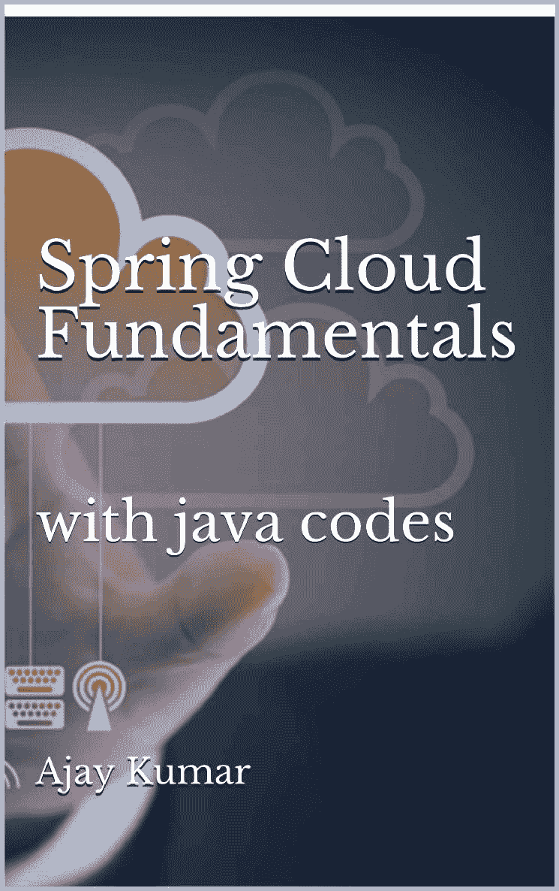

献给我的儿子 Ayaan

# 目录

- 模块 1：课程概述 (6)
- 模块 2：熟悉 Spring Cloud (7)
  - 臭名昭著的云 (7)
  - 云带来的新挑战 (8)
  - 本书的关注重点 (9)
  - 先决知识 (10)
- 模块 3：使用服务发现查找服务 (11)
  - 什么是服务发现？ (11)
  - 介绍 Spring Cloud Netflix (15)
  - 服务发现中的关键组件 (17)
  - 发现服务器 (19)
  - 演示：设置服务发现服务器 (22)
  - 应用服务 (28)
  - 演示：让应用变得可发现 (32)
  - 应用客户端 (41)
  - 演示：作为应用客户端查找并调用服务 (46)
  - Spring Cloud Eureka 板 (54)
  - 配置 (58)
  - 健康与高可用性 (59)
  - AWS 支持 (60)
  - 总结 (67)
- 模块 4：使用分布式配置配置服务 (68)
  - 什么是配置服务器？ (68)
  - 介绍 Spring Cloud Config Server (71)
  - 使用 Spring Cloud Config Server (73)
  - 配置服务器 REST 支持：参数 (78)
  - 配置服务器 REST 支持：端点 (80)
  - 演示：设置配置服务器 (83)
  - 使用 Spring Cloud Client (95)
  - 演示：使用 Config Client 检索配置 (99)
  - 运行时更新配置 (109)
  - 利用 `@RefreshScope` 注解 (111)
  - 演示：在不重启应用的情况下刷新配置 (115)
  - 加密和解密敏感配置 (121)
  - 使用加密和解密支持 (124)
  - 加密和解密 REST 端点 (127)
  - 总结 (129)
- 模块 5：使用智能路由映射服务 (130)
  - 什么是智能路由？ (130)
  - 通过网关服务的智能路由 (132)
  - 使用 Spring Cloud Netflix Zuul (134)
  - 在 Netflix Zuul 中配置路由 (138)
  - 演示：将 Netflix Zuul 作为智能路由 (141)
  - 使用 Spring Cloud 创建 Zuul 过滤器 (155)
  - 演示：创建和使用 ZuulFilter (159)
  - 总结 (165)
- 模块 6：使用客户端负载均衡调用服务 (166)
  - 模块介绍 (166)
  - 客户端负载均衡 vs. 服务端负载均衡 (168)
  - 使用 Spring Cloud 和 Netflix Ribbon (171)
  - 使用 `@LoadBalanced` 注解 (174)
  - 演示：使用服务发现进行 Ribbon 负载均衡 (176)
  - 使用 `@RibbonClient` 注解 (188)
  - 演示：不使用服务发现进行 Ribbon 负载均衡 (191)
  - 自定义 RibbonClient 配置：介绍 (196)
  - 自定义 RibbonClient 配置：`IRule` Bean (199)
  - 自定义 RibbonClient 配置：`IPing` Bean (201)
  - 演示：自定义 RibbonClient 负载均衡策略
  - 总结
- 模块 7：使用断路器创建自愈服务
  - 引言
  - 级联故障与资源过载
  - 使用断路器模式拥抱失败
  - 使用 Netflix Hystrix 和 Spring Cloud 实现容错
  - 使用 Spring Cloud 和 Netflix Hystrix
  - 演示：使用 Netflix Hystrix 实现容错
  - 使用 Hystrix Dashboard 获取指标和洞察
  - 使用 Spring Cloud 和 Netflix Hystrix Dashboard
  - 阅读和理解 Hystrix Dashboard
  - 演示：使用 Hystrix Dashboard 监控容错指标
  - 使用 Netflix Turbine 聚合 Hystrix 指标
  - 使用 Spring Cloud 和 Netflix Turbine
  - 演示：使用 Turbine 聚合 Hystrix 流
  - 总结
- 模块 8：整合一切与后续展望
  - 引言
  - 这一切是如何整合在一起的？
  - 整合一切：启动时
  - 整合一切：请求处理时
  - 下一步计划

## 模块 1：课程概述

云，或称云计算，真正改变了我们作为开发者思考设计和开发软件的方式。这正是 `Spring Cloud` 发挥用场的地方。`Spring Cloud` 将 `Spring Boot` 的优势与经过验证的云策略相结合，帮助你充分利用这些新范式，以设计和开发云原生应用程序。我们将涵盖的一些主要主题包括使用 `Spring Cloud` 和 `Netflix Eureka` 进行服务发现、使用 `Spring Cloud Config Server` 进行分布式配置、使用 `Spring Cloud` 和 `Netflix Ribbon` 进行客户端负载均衡、通过 `Spring Cloud` 和 `Netflix Zuul` 网关进行智能路由，以及使用 `Spring Cloud` 和 `Netflix Hystrix` 实现容错。读完本书，你将学会如何构建充分利用云资源的应用程序。在开始学习之前，你应该熟悉 `Java`、`Spring Boot`，并对微服务至少有入门级别的理解。

## 模块 2：熟悉 Spring Cloud

### 名声显赫的“云”

我确定你一定听过名为“云”的名声显赫的东西，因为它经常被吹嘘成游戏规则改变者或解决一切问题的魔法方案。它能解决你所有的问题。如今有这么多要学习的东西，很难不忽略其中大部分，并仅仅将其视为高明的营销手段。但现在，公司和企业终于开始真正地拥抱云，其中一些吹嘘实际上正在变成现实。而且，企业和公司使用云已成为常态而非例外。作为软件工程师，我认为我们未来面临着非常令人兴奋的时刻。云计算，或云，真的改变了我们构建软件的方式。我们正在从使用集式的单体架构转向分布式的、微服务的应用程序。不仅是软件在变，硬件也在变。我们正在从这种管理的有限资源转向无限、按需且自助的资源。

### 云带来的新挑战

随着云的出现，带来了新的挑战。我们必须改变思考方式。事情不再像习惯的那样静态，我们不能仅仅使用习惯的原则或技术进行设计和架构。云是弹性的且瞬态的。事物可以在任何时候增长、收缩、出现和消失。因此，我们必须考虑云是一个不断变化和演化的事物，而我们可能习惯了相对静态的东西。我们不能简单地将现有应用程序迁移到云端，并期望它们自动实现云化。这通常被称为“平移迁移”（lift and shift migration）。当然，迁移到云会带来一些收益，但我们并没有充分利用云。为了充分利用云，需要改变。这正是 `Spring Cloud` 帮助的地方。`Spring Cloud` 帮助你构建云原生应用程序。现在，你可能会问什么是云原生应用程序？嗯，云原生应用程序意味着你的应用程序是专门为云构建和工程化的。这意味着你的应用程序充分利用了所有的云范式。`Spring Cloud` 本身并不是一个框架。广义地说，`Spring Cloud` 用于描述许多属于同一伞下的项目。在本书中，我们将关注基础知识，即 `Spring Cloud Config` 和 `Spring Cloud Netflix`。

### 本书的重点

- 服务发现
- 分布式配置
- 智能路由
- 客户端负载均衡
- 断路器

我们将专门针对几个关键领域。首先，我们将查看服务发现。如何在运行时在云中动态查找你的应用程序服务？然后，我们将转向分布式配置，或者说如何在分布式系统中管理通用或特定服务的配置。接着，我们将查看智能路由，或者说如何通过智能路由让分布式系统看起来像一个单一的凝聚系统。然后，我们将查看客户端负载均衡，或者你如何在同一服务的多个实例之间分配负载。最后，我们将查看如何使用断路器模式在云中构建容错应用程序。

### 先决条件

- `Java 8+`
- `Spring Boot 1.4+`
- 微服务或 SOA 知识

让我们来谈前提条件。我假设你对 `Java` 尤其是 `Java 8` 有很好的理解，并且对 `Spring Boot` 也有良好的了解，因为 `Spring Cloud` 很大程度上是构建在 `Spring Boot` 之上的。最后，我预计你至少对微服务或面向服务的架构有了解或理解。

- `Java 8+`
- `Maven 3+`
- `Spring Tool Suite (Eclipse STS)` `3.8+`

接下来，我们来谈谈完成这本书需要哪些软件。当然，你将需要 `Java`、`Java 8`，并且你需要 `Maven`（至少是 `Maven 3`）来构建 `Spring Boot` 应用。我们将使用 `Spring Tool Suite`（或者称之为 `Eclipse STS`）进行所有的开发。请确保你的版本至少为 `3.8`。

## 模块 3：使用服务发现查找服务

### 什么是服务发现？

在本模块中：

- 服务发现
- 使用 `Spring Cloud` 发现
- 使用 `Eureka` 客户端和服务器
- 配置
- 健康状况与高可用性
- 仪表板 (Dashboard)
- AWS 支持

在本模块中，我们将介绍服务发现如何帮助你在云端定位你的应用程序服务。让我们快速开始讨论本模块包含的内容，首先是服务发现。显然，这个模块是关于服务发现的，所以我们将讨论它是什么以及它为什么重要。然后，我们将介绍 `Spring Cloud` 如何实现服务发现。它使用了一个来自 `Netflix` 的开源项目，称为 `Eureka`，我们将讨论 `Eureka Client`（Eureka 客户端）和 `Eureka Server`（Eureka 服务器）。接着，我们将进入配置，配置 `Eureka Client`、`Eureka Server` 以及 `Eureka Instance`（Eureka 实例），以及它们各自有何不同，你需要根据需要对它们进行哪些调整或配置。

然后，我们将进入健康状况和高可用性部分。`Eureka Server` 如何知道你的应用程序何时宕机或何时不健康？你如何确保 `Eureka Server` 是高可用的？然后我们将查看 `Eureka Dashboard`，这是一个非常好的 Web UI，可以向你显示所有已注册的服务、有多少个实例，以及它们是运行还是停止状态。最后，我们将以 `Eureka` 如何对 `AWS` 提供特定支持作为结束。

让我们从最重要的问题开始：什么是服务发现，我们为什么需要它？记住，云正在改变我们构建软件的方式。我们正在从构建这些单一大型应用转变为将它们拆分成越来越小的、被称为“服务”的部分。每一个单独的服务都可以独立进行部署和扩展，而它们作为一个整体共同构成了整个应用程序。问题就在于此：一个服务如何知道另一个服务的位置（其主机和端口），以便调用并使用它？

作为开始，我们可以简单地配置所有的服务，让它们知道所调用的其他服务的位置和端口。根据我们的需求，这实际上可能让我们走得很远。但过段时间，我们会发现这种方法存在一些问题。例如，如果你有某个特定服务的两个实例怎么办？在我们的示例中，我们有 `Application Service A` 用 `Application Service B`。如果我们使用配置，每当我们添加或移除 `Application Service B` 的新实例时，我们都必须更新该配置。嗯，在我们的示例中，我们只有两个实例。想象一下如果你有数百个实例，光是配置管理将是无法持续的。

当我们迁移到云环境时，我们的简单配置会进一步瓦解。在云环境中，服务的实例可以根据需要随时来去去。例如，`Application Service B` 初始启动了两个实例，考虑一下你可能有巨大的流量涌入，也许是你的电子商务网站正在进行闪杀活动，一个自动化流程启动并开启了另外两个实例来处理所有这些需求。如果你使用简单的配置，那么 `Application Service B` 的所有调用者（如 `Application Service A`）甚至不知道为了响应这些需求而添加的两个新实例。对它们来说，它们的配置中显示只有它们已知的两个实例。

另一个需要考虑的因素是，应用程序服务最终会失败。无论情况如何，无论是内存问题还是硬件问题，如果你使用简单的配置，你的服务将继续尝试向那些故障实例发送流量。例如，这里我们有 `Application Service A` 调用 `Application Service B`，且后者有两个实例。如果其中一个实例失败了，`Application Service A` 并不会知情，它将继续向那个故障实例发送流量。我们需要一种更动态的东西。这种简单的方法太静态了，对于我们在云端的需求来说，它太死板了。这就是服务发现大显身场的地方。

服务发现提供了：

- 服务注册自身的方式
- 服务注销自身的方式
- 客户端查找其他服务的方式
- 检查服务健康状况并移除不健康实例的方式

服务发现通常提供以下类型的功能。服务注册自身的方式。这意味着当一个服务上线时，它可以调用 `Service Discovery Server` 并让其知道该服务的位置和端口，以便其他应用程序可以调用它。出于恰恰相反的原因，服务发现提供了服务注销自身的方式。如果一个服务要关闭或临时离开，它希望让 `Service Discovery Server` 知晓它不再供客户端使用。最重要的，服务发现提供了客户端查找其他服务的方式。我所说的客户端指的是其他应用程序服务。如果你是一个需要使用另一个服务的应用程序，你需要找到该服务的位置和端口，你可以向 `Service Discovery Server` 请求这些信息。最后，服务发现提供了检查服务健康状况并移除不健康实例的方式。因此每个应用程序都会实现健康检查（通常通过 `REST` 端点），然后 `Service Discovery Server` 会调用该端点。如果健康检查失败，它会将该实例从注册表中移除。

### 介绍 Spring Cloud Netflix

现在我们已经很好地了解了什么是服务发现以及它为什么重要，让我们学习 `Spring Cloud` 如何帮助我们实现它。

使用以下方式发现服务：

- `Spring Cloud Consul`
- `Spring Cloud Zookeeper`
- `Spring Cloud Netflix`

实际上，有几种不同的方式可以使用 `Spring Cloud` 来发现服务。有 `Spring Cloud Consul` 项目、`Spring Cloud Zookeeper` 项目，还有 `Spring Cloud Netflix` 项目。我们将专门关注最后一个，即 `Spring Cloud Netflix` 项目。`Netflix` 的人们在云端构建可扩展应用程序方面拥有丰富的经验。事实上，你甚至可以说他们面临着你能想象的最大规模的可扩展性问题。他们在内部构建了一些项目来处理这些问题，并最终将其作为开源项目发布。

```
Netflix OSS + Spring + Spring Boot = Spring Cloud Netflix
```

Spring Cloud 项目获取了 Netflix 的开源项目，并添加了一些 Spring 和 Spring Boot 的特性。如果可以，它们对这些项目进行了“Spring 化”处理。由此诞生的就是 Spring Cloud Netflix 项目。与 Spring Cloud 项目类似，Spring Cloud Netflix 项目本身实际上并不是一个独立的项目，而是一系列项目的集合。对于服务发现，我们关注其中两个项目：Spring Cloud Netflix Eureka Server 和 Spring Cloud Netflix Eureka Client。

### 涉及服务发现的关键组件

在我们深入研究 Spring Cloud Eureka Server 和 Client 之前，了解参与服务发现的关键组件以及它们如何相互作用将很有帮助。至少参与服务发现的有三个组件：发现服务器（Discovery Server）、应用程序服务（application service）和应用程序客户端（application client）。全面理解所有组件如何协同工作非常有帮助，从那里我们将深入研究每个组件，并查看 Spring Cloud 如何帮助我们实现这些特定的组件。

1. (1) 服务注册位置
2. (2) 客户端查找服务位置
3. (3) 发现服务器返回位置
4. (4) 客户端在位置请求服务
5. (5) 服务发送响应

首先发生的是应用程序服务的启动。当它启动时，它会调用发现服务器并注册自己。它告诉发现服务器它的位置、端口以及其他服务可以使用来找到它的服务标识符。在稍后的某个点，客户端需要调用该应用程序服务，但它不知道服务的位置和端口，因此它需要询问发现服务器。它向发现服务器发送请求，并带上服务标识符。发现服务器根据该服务标识符知道你请求的是哪个服务，并返回该服务的位置和端口。从那里开始，一切正常进行，客户端可以请求服务及其位置，而服务可以返回数据。

### 发现服务器


我们将深入研究服务发现的每个关键组件，并将从发现服务器开始。发现服务器的核心是一个主动管理的服务位置注册表。它负责允许其他服务发现服务，并允许服务自行注册和注销。可以认为，它是真理之源（source of truth）。你通常会运行多个发现服务器实例，因为它是定位所有其他服务的关键组件。如果你无法定位其他服务，你就无法调用其他服务。因此，这是整个架构中重要的一部分。你可以在 `Spring Cloud Eureka Server` 项目中找到发现服务器的实现。在整本书中，我们将进行非常简单的演示，一些易于设置并巩固概念。在这个示例中，我们将学习如何使用 `Spring Cloud` 创建发现服务器。我将详细说明每个步骤，然后跟进一个真实示例。使用 `Spring Cloud Eureka Server` 项目创建发现服务器非常简单。事实上，它简单得几乎令人尴尬。

### `pom.xml`

```xml
<dependencyManagement>
    <dependencies>
        <dependency>
            <groupId>org.springframework.cloud</groupId>
            <artifactId>spring-cloud-dependencies</artifactId>
            <version>Camden.SR2</version>
            <type>pom</type>
            <scope>import</scope>
        </dependency>
    </dependencies>
</dependencyManagement>
```

在你的 Maven 项目的 `pom.xml` 中，在 `dependencyManagement` 部分定义一个名为 `spring-cloud-dependencies` 的新依赖，并确保它的类型为 `pom` 且范围为 `import`。

```xml
<dependency>
    <groupId>org.springframework.cloud</groupId>
    <artifactId>spring-cloud-starter-eureka-server</artifactId>
</dependency>
```

同样在 `pom.xml` 中，定义一个新依赖 `spring-cloud-starter-eureka-server`。并确保将其置于 `dependency` 部分中，而不是 `dependencyManagement` 部分。

### `Application.properties`

```properties
spring.application.name=discovery-server
```

或者

### `Application.yml`

```yaml
spring:
  application:
    name: discovery-server
```

在你的 `application.properties` 或 `application.yml` 中，定义一个新属性 `spring.application.name`。你可以给它任何你想要的值。在我们的案例中，我们将使用 `discovery-server`。

```java
@SpringBootApplication
@EnableEurekaServer
public class Application{
    public static void main(String[]args){
        SpringApplication.run(Application.class,args);
    }
}
```

然后，在你的主 `Application` 类中，你只需要定义一个注解。它就是 `@EnableEurekaServer`。就这么简单。一旦你启动此应用程序，你将有一个运行中的发现服务器实例。

### 演示：设置服务发现服务器

在这个演示中，我们将使用 `Spring Cloud Eureka Server` 项目创建并启动我们自己的服务发现服务器。为了开始工作，让我们前往 `start.spring.io`，我们将使用这个 `Spring Initializr` 来为我们的项目创建存根。它是一个很好的骨架创建器，可以为我们节省大量时间。

在这里的 `Group` 部分，我将放入 `io.ajay.kumar`，对于 `Artifact`，我将其命名为 `discovery-server`。在依赖中，我将添加 `Eureka Server`，这是发现服务器，我还将添加 `DevTools` 和 `Spring Boot Actuator` 项目。


添加所有依赖后，点击 `Generate` 按钮。点击按钮后，它会自动为你下载一个 zip 文件，其中包含了项目的存根。去解压下载的项目。然后我们将打开 IDE 并导入它。我已经切换到了 IDE，即 `Spring Tool`。在 `Package Explorer` 标签页的空白区域右键点击并选择 `Import`。你通过输入 `Existing Maven Projects` 来过滤选项。点击它，点击 `Next`，浏览到解压存根项目的位置，然后点击 `Open`。在项目下方你应该看到 `pom.xml`。点击 `Finish`。


项目导入完成后，展开并打开主应用程序类。它应该被称为 `DiscoveryServerApplication`，这就是我们将添加注解以启用发现服务器的地方。因此在 `@SpringBootApplication` 注解上方，我们可以添加一个新的：`@EnableEurekaServer`。保存。

```java
package io.ajay.kumar.discoveryserver;

import org.springframework.boot.SpringApplication;
import org.springframework.boot.autoconfigure.SpringBootApplication;
import org.springframework.cloud.netflix.eureka.server.EnableEurekaServer;

@EnableEurekaServer
@SpringBootApplication
public class DiscoveryServerApplication {
    public static void main(String[] args) {
        SpringApplication.run(DiscoveryServerApplication.class, args);
    }
}
```

我们现在准备好启动我们的发现服务器了，所以右键点击主应用程序类，转到 `Run As` 并选择 `Spring Boot App`。


一旦应用程序加载完成，继续展开控制台（`Console`）窗口。你会发现这里有几个异常。现在停止应用程序服务器；否则它将继续抛出这些异常。让我们向上滚动到其中一个异常，看看问题出在哪里。：“无法在任何已知服务器上执行请求（`Cannot execute request on any known server`）”。如果你观察的话，它来自 `DiscoveryClient.getAndStoreFullRegistry()` 方法。发生的情况是服务发现服务器（`Service Discovery Server`）正在启动，它正尝试向一个对等的服务发现服务器进行注册。这主要是为了高可用性。然而，当我们在独立或开发模式下运行时，每次都必须设置多个实例会非常麻烦。因此，我们将配置 `Eureka Server` 不要尝试与其对等节点注册。你绝对只想在开发模式下这样做，因为你在生产环境中需要高可用性。让我们关闭控制台。然后，在包资源管理器（`Package Explorer`）中，导航到 `src/main/resources` 并打开 `application.properties`。

### `application.properties`

```properties
spring.application.name=discovery-server
eureka.client.register-with-eureka=false
eureka.client.fetch-registry=false
server.port=8761
```

我们要添加的第一个属性实际上是我们之前遗忘的一个属性，即 `spring.application.name` 属性，我们将它设置为 `discovery-server`。我们要添加的第二个属性是 `Eureka Client` 属性，请输入 `eureka.client.register-with-eureka`。由于我们本身就是发现服务器，而且运行在独立模式下，我们不需要与任何其他对等节点注册，因为根本没有其他对等节点。所以请确保将该值设置为 `false`。下一个属性也是一个 `Eureka Client` 属性，所以请输入 `eureka.client.fetch-registry`。此属性控制 `Eureka Client` 是否会从 `Eureka Server` 获取注册表，由于我们是唯一的 `Eureka Server`，没有其他东西可以从别人那里获取，因此我们将此设置为 `false`。我们要添加的最后一个属性是 `server.port`，我们将它设置为值 `8761`，这是 `Eureka` 发现服务器的默认端口。一旦你设置好这些属性，进入主应用程序类，右键点击它，并选择“作为 Spring Boot 运行（`Run As Spring Boot App`）”。当你的应用启动完成后，展开控制台，你会看到它启动了 `Eureka Server` 并将其状态更改为 `UP`。现在你有了一个正在运行的服务发现服务器。

### 应用程序服务 (Application Service)

* 提供某些应用程序功能

* 请求的接收者

* 其他服务的依赖项

* 一个或多个实例

* 发现客户端的用户

* 注册

* 取消注册

记住，我们正在深入研究服务发现的每个组件，我们列表中的下一个是应用程序服务。这是任何提供功能的实体。它是接收客户端请求并返回响应的实体。它是其他服务的依赖项。因此，其他服务依赖它的功能来执行自身的功能。你通常会运行一个或多个应用程序实例。应用程序服务是发现客户端的用户。它将使用该客户端调用发现服务器并进行自身的注册和注销。就像我们之前为服务发现服务器做的那样，我们将详细说明向应用程序服务添加 `Eureka Client` 所需的步骤，然后我们实际上会自己创建一个。

### 在服务中使用 Spring Cloud Eureka Client

### `pom.xml`

```xml
<dependencyManagement>
    <dependencies>
        <dependency>
            <groupId>org.springframework.cloud</groupId>
            <artifactId>spring-cloud-dependencies</artifactId>
            <version>Camden.SR2</version>
            <type>pom</type>
            <scope>import</scope>
        </dependency>
    </dependencies>
</dependencyManagement>
```

在你的 Maven 项目的 `pom.xml` 中，添加一个新的 `dependencyManagement` 节点，并在其中添加新的 `spring-cloud-dependencies` 依赖。同样，确保它的类型为 `pom` 且范围为 `import`。

### `pom.xml`

```xml
<dependency>
    <groupId>org.springframework.cloud</groupId>
    <artifactId>spring-cloud-starter-eureka</artifactId>
</dependency>
```

同样在 `pom.xml` 中，在 `dependencies` 元素内添加一个新的依赖，这个依赖被称为 `spring-cloud-starter-eureka`。然后在你的 `application.properties` 或 `application.yml` 中，添加两个新属性。

### `application.properties`

```properties
spring.application.name=service
eureka.client.service-url.defaultZone=http://localhost:8761/eureka
```

或者

### `application.yml`

```yaml
spring:
  application:
    name: service
eureka:
  client:
    service-url:
      defaultZone: http://localhost:8761/eureka
```

第一个属性是 `spring.application.name` 属性，同样你可以将其设置为任何想要的值。在我们的案例中，我们将使用 `service`。第二个属性告诉应用程序服务服务发现服务器的位置，它是 `eureka.client.defaultZone` 属性。你可以看到我们将其设置为 `localhost`，但在生产环境中，你会将其设置为服务服务器所在的地方。如果你好奇 `defaultZone` 是什么，先不要担心，稍后我们会解释。

```java
@SpringBootApplication
@EnableDiscoveryClient
public class Application {
    public static void main(String[] args) {
        SpringApplication.run(Application.class, args);
    }
}
```

然后在你应用程序的主类中，添加一个注解。再次，这只有一个注解。`Spring Cloud` 的开发者让它变得非常简单。那就是 `@EnableDiscoveryClient`。它的作用是让应用程序注册到发现服务器，这样其他服务就能找到它。

### Demo：使应用程序可发现

我们使用 `Spring Initializr` 创建应用程序服务，请前往 `start.spring.io`。在 `Group` 处输入 `io.ajay`，我们将 `Artifact` 设置为 `service`。你将会有几乎相同的依赖，但这次选择 `Eureka Discovery` 而不是 `Eureka Server` 依赖。你还可以添加 `DevTools` 和 `Actuator`。

点击 `Generate`。它会自动为你创建并下载 zip 文件。解压该 zip 文件并将其导入我们的 IDE。我们回到了 `Spring Tool Suite`。在包资源管理器（`Package Explorer`）选项卡中，右键点击并选择 `Import`。同样，我们要选择 `Existing Maven Projects`。点击 `Next`，浏览到解压文件的位置，点击 `Open`。你应该会在 `Projects` 标题下看到 `pom.xml`，点击 `Finish` 完成导入。这需要一些时间，完成后，展开服务并进入 `src/main/java` 打开主应用程序类。

```java
package io.ajay.kumar.service;

import org.springframework.beans.factory.annotation.Value;
import org.springframework.boot.SpringApplication;
import org.springframework.boot.autoconfigure.SpringBootApplication;
import org.springframework.cloud.client.discovery.EnableDiscoveryClient;
import org.springframework.web.bind.annotation.RequestMapping;
import org.springframework.web.bind.annotation.RestController;

@EnableDiscoveryClient
@SpringBootApplication
@RestController
public class ServiceApplication {

    @Value("${service.instance.name}")
    private String instance;

    public static void main(String[] args) {
        SpringApplication.run(ServiceApplication.class, args);
    }

    @RequestMapping("/")
    public String message() {
        return "Hello from " + instance;
    }
}
```


在主应用程序类`ServiceApplication`中，我们将添加`@EnableDiscoveryClient`。这将把我们的服务应用程序转换为发现服务器（Discovery Server）的客户端，并导致它在启动时向发现服务器进行注册。在`@SpringBootApplication`注解下方，添加一个新注解`@RestController`。请记住，我们正在进行快速简易的演示以巩固这些概念，我们在这里使用的一些内容绝对不是最佳实践，你不应该在常规的应用程序中使用它们。例如，你通常不会在主应用程序类上放置`@RestController`，但由于我们正在用它来快速演示某些功能，这是可以接受的。让我们在这里添加一个新方法`public String message()`。我们将返回一条消息。并且我们想给这个方法加上`@RequestMapping`注解，并将其设置为根路径。我们的计划是能够启动该服务应用的多个实例。因此，我们在这里添加一个名为`private String instance`的属性。我们将使用`@Value`对其进行注解，并传入一个占位符`service.instance.name`。继续保存，然后在`message`方法中返回`"Hello from " + instance;`。

### application.properties

```properties
spring.application.name=service
eureka.client.service-url.defaultZone=http://localhost:8761/eureka
```

在`/src/main/resources`下，打开`application.properties`并为它指定`spring.application.name`。我们将其命名为`service`。我们将再添加一个属性，即发现服务器的位置。你可以输入`eureka.client.service-url`。在`service-url`之后，通常会跟一个区域名，我们将使用默认区域，它被称为`defaultZone`。然后我们将将其设置为我们服务发现服务器的位置，即`http://localhost:8761/eureka`。

由于我们将运行多个服务应用程序实例，因此我们需要为每个实例指定不同的端口，以避免冲突。首先，我们可以在`application.properties`中设置`server.port=8081`。然后，我们可以启动第一个实例。

现在，让我们启动`ServiceApplication`。

```
... Starting ServiceApplication in 2.545 seconds (JVM running for 3.12)
... Tomcat is initialized on port 8081 (http)
......
```

现在，回到`application.properties`，将`server.port`修改为`8082`，然后再次启动应用程序。

```
... Starting ServiceApplication in 2.312 seconds (JVM running for 4.85)
... Tomcat is initialized on port 8082 (http)
.......
```

到此时，我们就有两个正在运行的服务实例了。让我们检查一下发现服务器，确认它们是否已成功注册。打开你的发现服务器控制台（地址通常是`http://localhost:8761/eureka`）。在“Instances”部分，你应该能看到两个`SERVICE`实例，状态均为`UP`。这说明我们的服务应用程序已经成功注册到了发现服务器上。

我们使用了与在应用服务中相同的两个属性，`spring.application.name`，但这次将其设置为`client`；并设置了`eureka.client.defaultZone`以便它可以知道服务发现服务器（Service Discovery Server）的位置。由于我们是一个客户端，我们对注册到发现服务器感兴趣，因为我们不需要任何人发现我们。我们只感兴趣发现其他服务。因此，你将该值设置为`false`。

```java
@SpringBootApplication

@EnableDiscoveryClient

public class Application{
    public static void main(String[]args){
        SpringApplication.run(Application.class,args);
    }
}
```

就像我们在应用服务中所做的那样，我们将在应用客户端的主`Application`类中添加`@EnableDiscoveryClient`注解。然后，为了真正发现服务，我们有两种不同的选项：

*   `@Inject EurekaClient client`

*   `@Inject DiscoveryClient client`

我们可以注入`EurekaClient`也可以注入`DiscoveryClient`。说明一下，这是 Spring 的`DiscoveryClient`，而不是 Netflix 的`DiscoveryClient`。

```java
InstanceInfo instance=eurekaClient.getNextServerFromEureka("service-id",false);
String baseUrl = instance.getHomePageUrl();
```

第一个选项是使用`EurekaClient`，`EurekaClient`有一个名为`getNextServerFromEureka`的方法。它将以轮询的方式从发现服务器中选取下一个实例。它的第一个参数是虚拟主机名或要调用的服务 ID。这与我们在服务应用中使用的`spring.application.name`属性相同。第二个参数是该请求是否为安全请求。一旦我们获取了`instance info`的引用，我们就可以调用`instance.getHomePageUrl`，这将为我们提供用于`RestTemplate`调用服务的基 URL。

```java
List<ServiceInstance> instances=client.getInstances("service-id");
String baseUrl=instances.get(0).getUri().toString();
```

第二种选项是使用 Spring 的`DiscoveryClient`，它有一个名为`getInstances`的方法，可以返回给定服务 ID 的所有服务实例。因此，第一个参数与我们在`EurekaClient`中看到的第一个参数相同，即你想要调用的服务的虚拟主机名或服务 ID。一旦你获得了实例列表，就可以获取其中一个实例，获取`URI`并将其转换为字符串，这就是你在`RestTemplate`中使用的基 URL。

### Demo：作为应用客户端查找并调用服务

为了创建我们的客户端，我们将再次从`start.spring.io`开始。我们将给它一个 group ID，即相同的`io.ajay.kumar`，并将 Artifact 设置为`client`。它将拥有与我们在应用服务中使用的完全相同的依赖。我们需要 Eureka Discovery、DevTools 以及 Actuator。

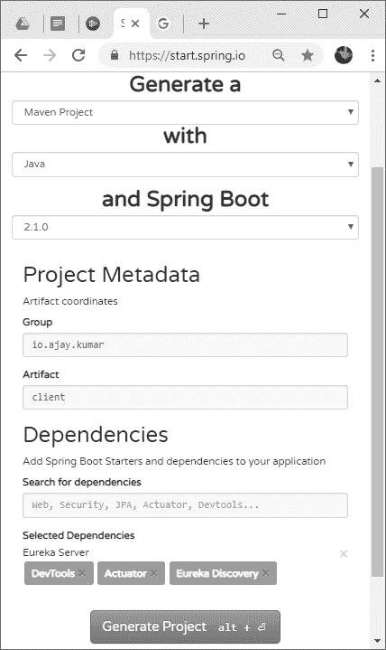

点击 Generate Project（生成项目）。这将自动创建并下载一个 zip 压缩包。解压该文件并将其导入到 IDE 中。在 Spring Tool Suite 的 Package Explorer（包管理器）区域，在空白区域点击右键，选择 Import（导入），选择`Existing Maven Projects`，浏览到解压文件的位置，确保`pom.xml`显示在 Projects 下，然后点击 Finish（完成）导入。

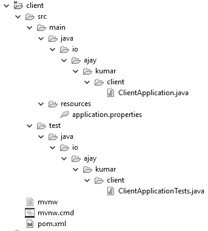

展开 client 项目，转到`src/main/java`，打开主应用类并进行以下更改。

```java
package io.ajay.kumar.client;

import org.springframework.beans.factory.annotation.Autowired;
import org.springframework.boot.SpringApplication;
import org.springframework.boot.autoconfigure.SpringBootApplication;
import org.springframework.boot.web.client.RestTemplateBuilder;
import org.springframework.cloud.client.discovery.EnableDiscoveryClient;
import org.springframework.http.HttpMethod;
import org.springframework.http.ResponseEntity;
import org.springframework.web.bind.annotation.RequestMapping;
import org.springframework.web.bind.annotation.RestController;
import org.springframework.web.client.RestTemplate;
import com.netflix.appinfo.InstanceInfo;
import com.netflix.discovery.EurekaClient;

@EnableDiscoveryClient
@SpringBootApplication
@RestController
public class ClientApplication {

    @Autowired
    private EurekaClient client;

    @Autowired
    private RestTemplateBuilder restTemplateBuilder;

    public static void main(String[] args) {
        SpringApplication.run(ClientApplication.class, args);
    }

    @RequestMapping("/")
    public String callService() {
        RestTemplate restTemplate = restTemplateBuilder.build();
        InstanceInfo instanceInfo = client.getNextServerFromEureka("service-id", false);
        String baseUrl = instanceInfo.getHomePageUrl();
        ResponseEntity<String> response = restTemplate.exchange(baseUrl, HttpMethod.GET, null, String.class);
        return response.getBody();
    }
}
```

接下来，我们需要配置应用程序客户端。因此，进入`src/main/resources`目录打开`application.properties`，我们将添加标准的`spring.application.name`。将其命名为`client`。然后我们将服务的 URL 粘贴进去，就不需要手动输入了，接着处理`eureka.client.register-with-eureka`。将其设置为`false`。记住，我们是一个客户端，不需要向 Eureka 注册，因为我们不需要任何人来发现我们。

现在，在启动应用程序客户端之前，我们需要启动服务发现服务器（Discovery Server）以及每个应用程序服务实例，并且要按照特定的顺序进行。所以，如果你一直在跟着操作，这些项目应该出现在你的运行历史记录中。你可以点击下拉菜单并选择其中的每一个项来启动它们。为了确认一下，我们检查下拉菜单，可以看到`discovery-server`正在运行，服务应用程序的`instance 1`以及`instance 2`也在运行。现在我们准备好启动客户端应用程序了。我们可以右键点击主应用程序类，选择`Run As`（运行），并选择`Spring Boot App`。

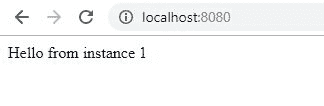

打开浏览器并访问`localhost:8080`。按下回车键，你应该能看到来自客户端的响应。它会显示`Hello from instance 1`。如果你刷新它，它会显示`Hello from instance 2`。我们可以重复这种操作，每次都能看到它从 Eureka 注册表中获取不同的实例。

### Spring Cloud Eureka Dashboard

Spring Cloud Eureka Server 提供的非常实的功能之一是仪表板（Dashboard）。它是默认开启的，是一个基于 Web 的仪表板。它显示了许多有用信息，例如服务是上线还是离线，以及注册了多少个实例。如果你仍在运行上一次演示中的 Demo，请打开浏览器访问`localhost:8761`。你将看到这个 Spring Eureka Dashboard，让我们逐一查看这里的每一个部分。

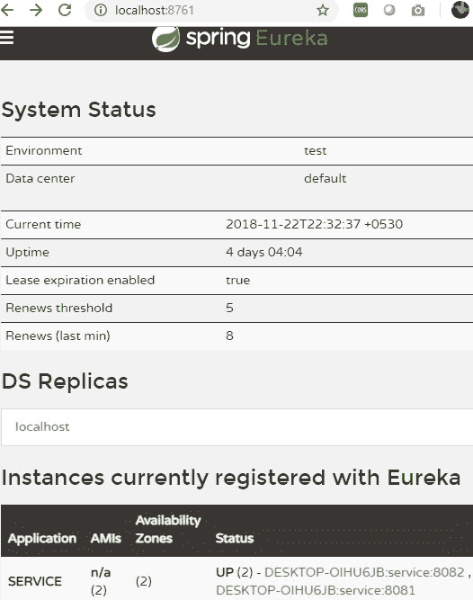

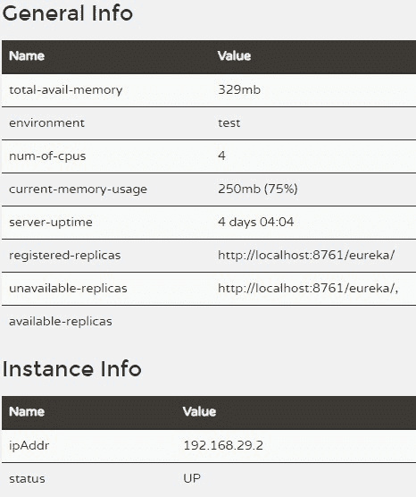

首先是`System Status`（系统状态），它会告知你当前时间、运行时间以及过去一分钟内发生了多少次续约。`DS Replicas`或`Discovery Server Replica`（服务发现服务器副本）部分显示了所有 Eureka 服务器的对等实例。如果我们运行了多个实例，就会在这里列出每一个实例。但由于我们只运行了一个，所以只看到`localhost`。

下一部分可能是最有用的部分，因为它显示了当前注册到 Eureka 的哪些实例。在`Application`（应用程序）标题下，我们有`service ID`，它是`SERVICE`。`AMI`代表 Amazon 机器镜像。我们没有在 Amazon 上运行，所以是`n/a`。`Availability Zones`（可用区）有两个，这两个实例都处于`UP`（在线）状态。你可以看到`UP`旁边的数字`2`，这表示该特定服务有两个实例，并且它们都处于`UP`状态。紧接着右侧，你可以看到这两个实例，其中一个运行在`8082`上，另一个运行在`8081`上。下一部分`General Info`（通用信息）仅提供有关你运行的特定机器的信息。它会告知你 CPU 数量和可用内存等信息。最后部分`Instance Info`（实例信息）提供有关该特定运行实例的信息，例如它的 IP 地址或其处于上线还是离线状态。

### Configuration

有几个不同的区域可以配置 Spring Cloud Eureka。我们将查看三个主要区域。第一个是`eureka.server`前缀，第二个是`eureka.client`前缀，第三个是`eureka.instance`前缀。让我们详细了解这些配置区域的每一个。

### Eureka Server Configuration

第一个是 Eureka Server 配置，即所有`eureka.server`前缀下的配置。这将控制所有与配置服务发现服务器相关的内容。

### Eureka Client Configuration

第二个是 Eureka Client 配置，即所有`eureka.client`前缀下的配置。它负责控制发现客户端如何与服务发现服务器交互。例如，你有像`eureka.client.eureka-server-connect-timeout-seconds`等项。这会控制客户端在超时之前等待连接到 Eureka 服务器的时长。

### Eureka Instance

第三个配置区域是 Eureka Instance，即所有`eureka.instance`前缀下的配置。Eureka Instance（Eureka 实例）是指任何将其注册到 Eureka 服务器以便被他人发现的实体。`eureka.instance`前缀下的属性控制实例如何向 Eureka 服务器注册其本身。例如，你有像`eureka.hostname`或`eureka.health-check-url`等项，可以在那里为实例配置自定义值，并以此这种方式向 Eureka 服务器注册。

### Health and High Availability

Spring Cloud Eureka Server 还有一些关于健康检查和高可用性的额外功能。它不断确保它返回或交付给客户端的应用程序服务是健康且可用的。它还确保在服务发现服务器宕机的情况下，所有客户端仍继续运行。

正如我提到的，Eureka Server 始终关注它交付给客户端的应用程序服务的健康状况。在默认情况下，它通过每 30 秒向客户端发送一次心跳来评估这种健康状况。如果在 90 秒内没有收到心跳的回应，它将将其从注册表中移除。发送心跳是默认配置，但你也可以配置 Eureka 服务器访问端点，例如 Spring Boot Actuator 提供的`/health`端点。


Eureka 在设计时就考虑了高可用性，它实现这一点的方法之一是当客户端从服务发现服务器请求服务位置时，服务发现服务器实际上会返回注册表的副本。结果是注册表分到了所有客户端中。如果服务发现服务器宕机，这些客户端可以继续运行。你可能在想，等等，如果服务发现服务器有了新信息，或者某个服务宕机了怎么办？嗯，客户端必须定期续约或获取新的注册表，而且它通过获取增量（deltas）来更新注册表。因此它非常智能，不会再次获取整个注册表，而是只获取变化。

## AWS Support

众所周知 Netflix 是 AWS 的深度用户。鉴于 Eureka 出自 Netflix，因此它包含对 AWS 的支持也是理所当然的。让我们来看看各种支持功能以及一个典型的部署架构。当使用 Eureka Client 的应用程序启动时，它会检查自己是否运行在 AWS 实例上。如果是，它会调用本地元数据服务并检索有关该实例的一些元数据。它会获取 AWS 特有的信息，例如正在运行的 Amazon Machine Image（AMI），或者它运行的区域（region）或可用区（zone）。然后在注册时将这些信息发送到发现服务器（Discovery Server）。鉴于 AWS 中的事物变化非常频繁，让发现服务器位于一个众知的位置至关重要。因此，Eureka 增加了对弹性 IP（Elastic IP）绑定的支持。当 Eureka Server 启动并注意到它运行在 AWS 上时，它将尝试绑定到下一个可用的弹性 IP，以便拥有静态或已知的 IP。Eureka Client 同样具有区域感知能力，并倾向于它当前运行的区域。因此，它会尝试联系当前区域的发现服务器，如果无法访问，它会尝试下一个区域并寻找下一个可用的发现服务器。最后，你可以配置 Eureka Client 获取不同远程区域的注册表。为了利用 AWS 支持，需要一些额外的配置。

```java
@Configuration
public class AppConfig{
    @Bean
    public EurekaInstanceConfigBean eurekaInstanceConfig(
    InetUtilsProperties properties){
        EurekaInstanceConfigBean bean=new
        EurekaInstanceConfigBean(newInetUtils(
        properties));
        AmazonInfo info= AmazonInfo.Builder.newBuilder().autoBuild(
        "eureka");
        bean.setDataCenterInfo(info);
        return bean;
    }
}
```

在你的 `@Configuration` 类中，你定义了一个返回 `EurekaInstanceConfigBean` 的新方法，并用 `@Bean` 进行注解。在方法内部，你创建一个新的 `EurekaInstanceConfigBean`。然后，使用 `AmazonInfo.Builder` 创建一个 `AmazonInfo` 对象，并将 `EurekaInstanceConfigBean` 的 `DataCenterInfo` 设置为该 `AmazonInfo`，然后返回该 bean。如果你查看 `AmazonInfo` 类的源码，你会发现它利用本地元数据服务来填充所有的实例信息。除了 `@Configuration` 类中的配置外，`application.properties` 中还有一些额外的配置，即关于可用区的配置。

### application.properties 中的可用区配置

- `eureka.client.availability-zones.[region]=[az1],[az2],[az3]`

该属性是 `eureka.client.availability-zones` 属性，模式为 `eureka.client.availability-zones.region`，然后等于一个逗号分隔的可用区列表。

### EC2 控制板

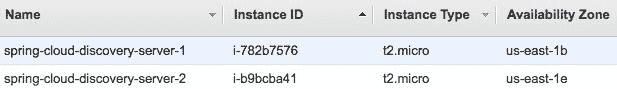

例如，如果你在 `us-east-1b` 区域有一个发现服务器，在 `us-east-1e` 区域有另一个发现服务器，你可以按照如下设置属性：`eureka.client.availability-zones`，然后区域为 `us-east-1`，最后设置 `us-east-1b` 和 `us-east-1e` 的逗号分隔列表。在 `application.properties` 中，为你的服务 URL 也需要类似的配置。

### application.properties 中的服务 URL 配置

- `eureka.client.service-url.[zone]=http://[eip-dns]/eureka`

该属性是 `eureka.client.service-url.zone` 属性，你将其设置为绑定到弹性 IP 的 Eureka 实例的 HTTP 地址。并且要确保（至少从 1.4 版本开始）使用弹性 IP 的 DNS 名称，因为代码专门感知了弹性 IP 用于 DNS 命名的模式，并且它正在寻找该特定模式以识别是否正在使用弹性 IP。

### 弹性 IP 控制板

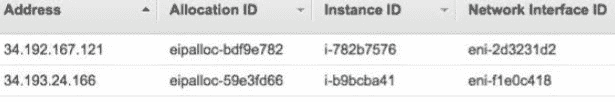

例如，如果我们被分配了以下弹性 IP，我们可以按照如下方式配置 `application.properties`：第一个位于 `us-east-1b` 区域，第二个位于 `us-east-1e` 区域。你会发现，每一个项都设置为了 HTTP 地址的弹性 IP DNS 名称。紧接着之前 AWS 控制台的截图以及我们如何配置一切的，如果你在设置好所有内容后加载 Eureka 控制板，它看起来像这样。

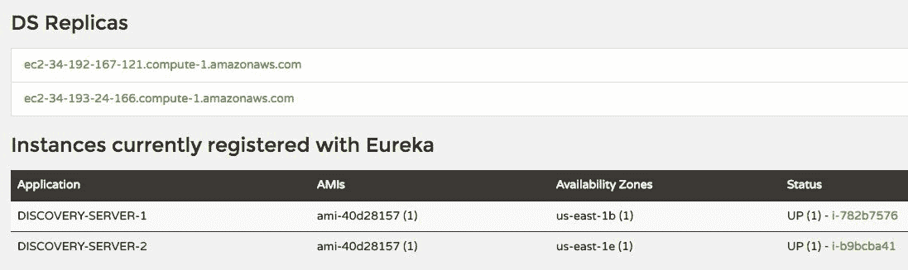

你会在 `DS Replicas` 下有两个实例，然后你有两个发现服务器实例，每个分别位于各自的可用区。

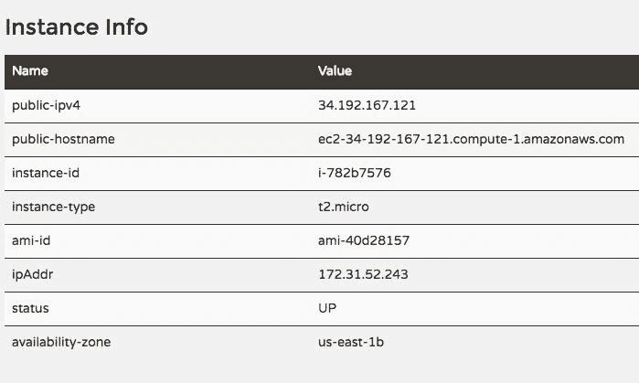

同样，你可以调出每个发现服务器实例的控制板，并发现其中填充了 AWS 特有的元数据，例如 `instance-type`、`ami-id` 或 `instance-id`。

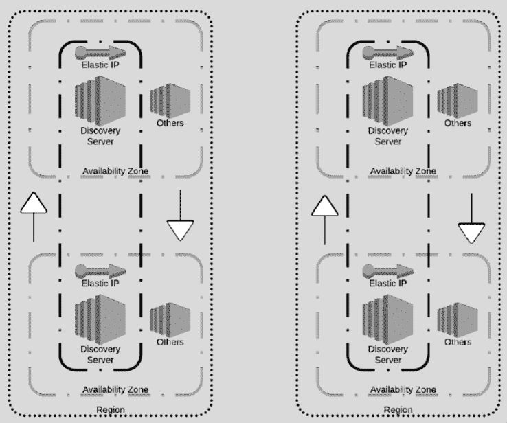

现在我们已经了解了 Eureka 中存在的 AWS 支持，让我们来看看部署架构。通常情况下，每个可用区你都会有一个或多个发现服务器，然后你有多个可用区。在这些每个区域内，为每个发现服务器准备一个弹性 IP。然后，你通常会设置一个自动扩展组，将这些发现服务器均匀地分布在各个可用区。

## 总结

我们已经到了本模块的结束，让我们回顾一下学到的内容。我们首先查看了服务发现以及它为什么很重要。然后我们学习了如何使用 Spring Cloud Eureka Client 发现服务，以及使用 Spring Cloud Eureka Server 存储服务注册表以便其他服务进行发现。接着，我们快速看了 Spring Cloud Eureka 控制板，并深入了解了 Spring Cloud Eureka Server。之后，我们讨论了健康检查、高可用性和 Spring Cloud Eureka 的配置。最后，我们查看了 AWS 特有的支持。

在本模块中，我们将讨论如何在像云这样的分布式系统中管理您的应用程序配置。我们将直接进入分布式系统中的配置，以及为什么它与非分布式系统不同且更具挑战性，更重要的是，为什么我们需要这种名为 `Configuration Server`（配置服务器）的东西。从那里开始，我们将深入研究 `Spring Cloud` 如何通过 `Spring Cloud Config Server` 实现 `Configuration Server` 的细节。并将学习如何设置 `Config Client`（配置客户端）和 `Config Server`（配置服务器），并让它们相互通信。我们还会快速概览 `Spring Cloud Config Server` 的各种后端存储选项，例如 `Git` 仓库或 `SVN` 仓库。接下来，我认为最酷的一点是，我们将学习如何在不重启应用程序服务器的情况下动态更新配置。我们将通过多种方法来实现这一点，包括 `Spring Cloud Actuator`、`Spring Cloud Bus` 和 `Spring Cloud Monitor` 项目。然后，我们还会学习 `@RefreshScope` 注解，以及为什么需要它以及在何使用它。最后，我们将通过一个关于使用对称和非对称加密检索并存储敏感配置值的章节来结束本模块。

### 与云原生应用与非云原生应用相比，管理配置究竟有什么不同之处？

这个答案源于云原生应用是一个分布式系统，而非云原生应用不是分布式的。在非分布式应用中，你通常只有少数几个配置文件。系统与其配置之间通常是一对一的关系。而当你迁移到分布式系统时，配置就会发生爆炸式增长。你从拥有一个或多个配置文件变为拥有许多许多个配置文件，因为你有许多许多系统共同构成了一个整体系统。例如，如果你使用微服务，那么构成你整个应用程序的每个独立微服务都将自己的配置文件。

你可能会想：没问题，我们能搞定。这就是为什么他们制作了像 `Puppet` 和 `Chef` 这样的配置工具来管理许多许多系统的配置，对吧？嗯，它行得通，但对于云环境来说并不理想。让我们来讨论一下使用典型的配置管理系统可能会面临的一些问题。

第一个问题是，它通常是面向面向部署的。这意味着每当你想要更改配置时，都必须启动新的部署以修改配置。而且通常应用程序随后会重启。如果例如，你为了调试某个问题而需要进行临时的日志配置更改呢？仅仅为了一个临时的更改就启动整个新部署并重启应用程序是一个非常沉重的过程。

你可能会遇到的另一个问题是配置更改到达应用程序服务器的方式。它是通过“推送”（push）实现的。在云环境中向服务器推送应用程序配置通常不够动态。我的意思是，它需要知道将配置推送到哪里。而在云中，这通常不是一个简单的答案，因为应用程序实例可能在任何时候出现或离开。当你推送配置时，你面临错过新启动实例的风险，例如该实例是因为高流量期间的自动扩缩而上线的。

好吧，没问题。如果推送不起作用，我们可以只用“拉取”（pull），对吧？嗯，那也有问题。当你拉取配置时，通常使用一种拉取机制，每隔 x 分钟检查一次更改，如果有更改，就把这些更改取下来。这引入了从我们更改配置到配置实际生效之间的延迟。

那么，如果配置管理工具不能解决我们的问题，到底什么可以呢？答案是被称为 `Configuration Server` 的东西。或者更具体地说，`Application Configuration Server`（应用程序配置服务器）。`Application Configuration Server` 是一个专用的、动态的中心化的键值存储器，用于存储您的配置。它可以是分布式的也可以是非分布式的。与配置管理类似，它是所有配置的权威来源。它提供了审计和版本控制等功能，还具有加密支持，以便你可以加密或解密那些敏感的配置值。

## 介绍 Spring Cloud Config Server

借助 `Spring Cloud` 管理您的应用程序配置其实非常简单。默认情况下，`Spring Cloud` 为你提供了几种实现 `Configuration Server` 的方法，几乎不需要你做任何工作。前两个选项 `Spring Cloud Consul` 和 `Spring Cloud Zookeeper` 分别是与第三方应用程序 `Consul` 和 `Zookeeper` 的集成。你可能熟悉也不熟悉 `Consul` 和 `Zookeeper`，如果你不熟悉，重要的是，它们都不仅仅是 `Configuration Server`。它们通常都被用于服务发现等其他用途。

第三个选项 `Spring Cloud Config Server` 是由 `Spring Cloud` 团队构建的实现。它只有一个目的，那就是成为一个 `Configuration Server`。我们将专门关注这个选项，但一旦你牢固理解这些概念，使用其他选项应该非常容易。除了包含 `Spring Cloud Config Server` 的实现外，`Spring Cloud` 项目还包含了连接和与服务器交互的客户端支持。通常嵌入你的应用程序中的 `Config Client` 完美契合了 `Spring` 的 `Environment` 抽象。这意味着你已经熟悉的获取配置的所有方法，都可以用于获取从 `Configuration Server` 获取的配置。`Config Server` 通常是一个独立的应用程序，它也完美契合了 `Spring` 框架的抽象之一，即 `PropertySource` 抽象。所以，如果你熟悉 `PropertySource` 抽象，你可能实际上已经在使用它了。例如，如果你曾经在应用程序中使用 `classpath` 前缀引用过属性文件，那么你就已经使用过 `PropertySource` 抽象。而所有来自 `Configuration Server` 的配置只是另一个属性源。它是一个远程的属性源。

## 使用 Spring Cloud Config Server

正如我们已经讨论过的，Spring Cloud Config Server 是配置服务器（Configuration Server）的一种实现。让我们深入看看它提供的功能以及如何设置它。从核心上来说，Config Server 就是另一个 Web 应用，它提供了一个基于 REST 的接口来访问你的配置文件。因此，你只需要设置好配置文件，并为它们恰恰命名，然后告诉 Configuration Server 它们所在的位置，它就会为你提供服务。需要指出的是，Config Server 并不提供写入任何配置文件的便利，它主要关注的是提供这些配置文件。它支持多种输出格式，默认是 JSON，但也支持 properties 和 YAML。Config Server 不需要数据库来存储配置，相反，它支持从几个不同的后端存储配置中检索和读取你的配置文件，例如 Git（默认值）、SVN，或者仅仅是本地文件系统。Configuration Server 支持的另一个很棒特性是它具有配置作用域（configuration scopes）的概念。我的意思是，你可以定义适用于所有应用程序的全局配置，也可以定义特定应用程序的配置或特定 Spring Profile 的配置。使用 Spring Cloud Config Server 就像使用 Spring Cloud 的其他服务器一样，非常、非常简单。

### pom.xml

```xml
<dependencyManagement>
    <dependencies>
        <dependency>
            <groupId>org.springframework.cloud</groupId>
            <artifactId>spring-cloud-dependencies</artifactId>
            <version>Camden.SR2</version>
            <type>pom</type>
            <scope>import</scope>
        </dependency>
    </dependencies>
</dependencyManagement>
```

首先，在你的 `pom.xml` 中，确保在 `dependencyManagement` 中定义了 `spring-cloud-dependencies`。

```xml
<dependency>
    <groupId>org.springframework.cloud</groupId>
    <artifactId>spring-cloud-config-server</artifactId>
</dependency>
```

然后，同样在你的 `pom.xml` 依赖部分，定义对 `spring-cloud-config-server` 的新依赖。接下来，创建一个文件夹来存储所有你想让 Configuration Server 提供的配置。在该文件夹中，你可以可选地创建一个 `application.properties` 文件或 `application.yml` 文件。该文件用于适用于所有应用程序而不适用于任何某个特定应用程序的全局配置。一个例子就是跨所有应用程序共享的数据库配置。你将它放在这个 `application.properties` 或 `application.yml` 文件中。接下来，在该文件夹中添加特定应用程序和特定 profile 的配置文件，你可以使用 properties 或 YAML 格式。你对文件名使用一种特殊的命名模式，即 `application-profile.extension`，其中 `application` 是你的应用程序名称，而 `profile` 是适用于该配置的 Spring Profile。如果你没有使用 Spring Profile，可以省略文件名中的 `-profile` 部分，直接使用 `application.file extension`。接下来，你在包含所有配置文件的文件夹中运行 `git init`。这个示例假设你正在使用默认的后端存储，即 Git。从那里开始，你 `git add` 你的配置文件，`git commit` 它们，然后最后一步（可选的，但强烈建议）是设置一个远程 Git 仓库，并 `git push` 将配置推送到远程仓库。现在我们需要配置真正的 Configuration Server 本身。不要将此与 Configuration Server 将要提供的配置文件混淆。这是用于实际 Configuration Server 本身的应用程序配置。

### application.properties

```properties
server.port=8888
spring.cloud.config.server.git.uri=<uri_to_git_repo>
```

或者

### application.yml


```yaml
server:
  port: 8888
spring:
  cloud:
    config:
      server:
        git:
          uri: <uri_to_git_repo>
```

在 `Config Server` 的 `application.properties` 文件中，你指定 `server.port` 属性并赋值为 `8888`。这不是强制的，但该端口是 `Config Server` 使用的惯用端口。然后你需要配置服务器将提供的所有配置文件的 `Git` 仓库位置。你通过指定属性 `spring.cloud.config.server.git.uri` 来实现，然后将其设置为 `Git` 仓库的位置。如果你将其上传到了远程仓库，这将是你仓库的克隆 `URL`。如果你倾向于使用 `YAML` 文件进行配置，我包含了等量的 `application.yml`。

```java
@SpringBootApplication
@EnableConfigServer
public class Application{
    public static void main(String[] args){
        SpringApplication.run(Application.class,args);
    }
}
```

下一步是向你的主 `Application` 类添加 `@EnableConfigServer` 注解。在你进行这里时，如果你想让你的 `Configuration Server` 能通过服务发现被发现，你可以添加 `Eureka Client` 依赖，配置服务发现 `URL`，并添加 `@EnableDiscoveryClient` 注解，这样客户端就能发现 `Configuration Server` 了。最后一步是确保你的 `Configuration Server` 以安全的方式进行设置。使用 `Spring Security` 库来完成这一点非常简单。`Spring Security` 支持的任何方法也适用于保护你的 `Configuration Server`。

### Config Server REST Support: Parameters

通常当你与 `Config Server` 的 `REST` 端点交互时，你是在客户端进行的；然而，了解这些可用端点对于调试目的或者你想在其他语言中使用它们是很有用的。`Config Server` 上的每个可用端点共享一组公共参数。这些参数的值会影响返回的配置。

*   `{application}` 映射到客户端的 `spring.application.name`
*   `{profile}` 映射到客户端的 `spring.profiles.active`
*   `{label}` 服务端通过名称引用集

第一个参数是 `application` 参数。如果你利用 `Spring Cloud Client`，它使用 `spring.application.name` 属性的值来填充该 `application` 参数的值。下一个参数是 `profile` 参数。同样，如果你使用 `Spring Cloud Client`，它将从 `spring.profiles.active` 属性中获取值来填充该 `profile` 参数的值。因此，这翻译为激活的 `Spring Profile`。最后一个参数 `label` 参数是一个用于将你的配置文件分组为任意命名集的功能。根据你所使用的后端，这可能意味着不同的含义。例如，如果你使用 `Git` 作为后端，`label` 则翻译为 `Git` 分支。现在花点时间查看每个端点参数，并将它们作为一个整体考虑，并思考你如何组合其中一个、两个或全部参数来识别特定的配置。

### Config Server REST Support: Endpoints

到目前，我们应该对 `REST` 端点中涉及的每个路径参数的用途有了良好的理解。让我们来看看具体的 `REST` 服务本身。

*   端点：`GET/{application}/{profile}[/{label}]`
*   示例：`/myapp/dev/master`, `/myapp/prod/v2`, `/myapp/default`

第一个端点接受我们讨论过的三个参数中的三个，其中第三个参数 `label` 是可选的。让我们来看几个例子，让这更直观。第一个例子是 `/myapp/dev/master`。其中 `myapp` 是应用名称，`dev` 是 `Spring Profile`，`master` 是 `Git` 分支，它被翻译为 `label`。我们还有另一个例子，与第一个例子略有不同。你有一个 `myapp` 作为应用，这是一样的，但你有一个不同的 `profile`，即 `prod` profile。你还有一个不同的 `label`，即 `v2` Git 分支。现在，最后一个例子比较重要。我们有两个必填的参数：`application` 参数和 `profile` 参数。然后那个 `label` 参数是可选的。当你使用 `Spring` 且没有设置激活的配置（active profile）时，你可能不知道，但它会为你设置一个，并称为 `default`。所以，如果你想访问不适用于任何特定 `Spring Profile` 的配置，你可以提供你的应用程序名称，然后值 `default`。

### 端点：

* `GET/{application}-{profile}.(yml|properties)`

### 示例：

* `/myapp-dev.yml`
* `/myapp-prod.properties`
* `/myapp-default.properties`

下一个端点仅利用我们讨论的三个参数中的两个：`application` 参数和 `profile` 参数。它允许你请求 `YAML` 或 `properties` 文件，源文件是什么格式并不一定重要。例如，如果你有一个 `YAML` 格式的源文件，你仍然可以用 `properties` 格式请求它，它会自动为你进行转换。示例非常直观。你会有像 `/myapp-dev.yml` 或 `/myapp-prod.properties` 这样的内容。和上一个端点一样，你必须有一个 `profile`，所以你可以像 `/myapp-default.properties` 这样的。

### 端点：

* `GET/{label}/{application}-{profile}.(yml| properties)`

### 示例：

* `/master/myapp-dev.yml`
* `/v2/myapp-prod.properties`
* `/master/myapp-default.properties`

最后一个 `REST` 端点与我们刚刚看到的非常相似，区别在于你必须指定一个 `label`。事实上，如果你指定的 `label` 是 `master`，它们与上一个端点是等等的，因为上一个端点总是假设 `label` 是 `master`。与其他例子一样，这非常直观。这里有一个例子，我们有 `/master/myapp-dev.yml`，其中 `master` 是 `label`，`myapp` 是应用，`dev` 是 `profile`，你选择了使用 `YAML` 扩展，所以你将得到 `YAML` 格式的结果。另一个非常类似的例子，只是这次 `label` 或分支（`Git` 分支）是 `v2`，而 `myapp-prod` 是相同的应用名称，其中 `prod` 是一个不同的 `profile`。这次你请求了 `properties` 格式，因此它将以 `properties` 格式返回。最后一个例子与第一个例子非常像，你有 `/master/myapp-` 然后是 `profile`。由于 `profile` 是一个必填值，记住我们需要使用值 `default` 来代表该默认 `profile`，然后你以 `properties` 格式请求它。

### 演示：设置配置服务器 (Config Server)

在本次演示中，我们将构建并启动自己的配置服务器。因此开始最简单的方法是前往 `start.spring.io`。对于 `Group ID`，我们将使用 `io.ajay.kumar`。对于 `Artifact`，我们将使用 `config-server`。对于依赖，我们将添加 `Config Server` 依赖，然后还会添加 `Eureka Discovery` 依赖。这是一个可选依赖，但它将允许我们的 `Config Server` 注册到发现服务器（`Discovery Server`），以便 `Config Clients` 能够找到它。最后，我们将使用 `Actuator` 依赖。

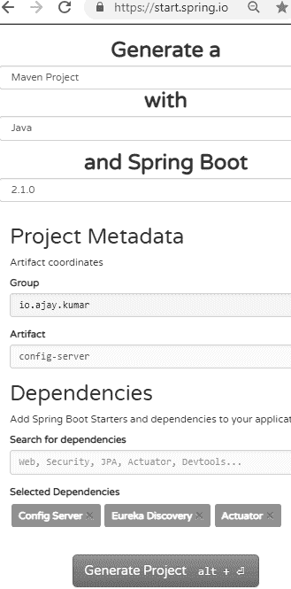

一旦选好了所有内容，点击 `Generate Project`。这将创建一个 `zip` 文件，去解压它，然后进入你的 `IDE`。在 `Eclipse` 或 `STS` 中，右键点击空白 `Package` 区域，进入 `Import`，搜索 `Existing Maven Projects`，选择它，点击 `Next`，浏览到下载的 `zip` 文件位置（我的在 `Downloads`，`config-server`），打开它，并点击 `Finish` 完成导入。

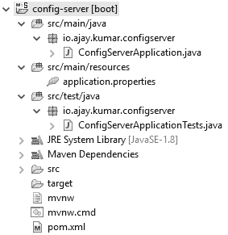

展开 `config-server` 项目并导航到主应用程序类。

```java
package io.ajay.kumar.configserver;

import org.springframework.boot.SpringApplication;
import org.springframework.boot.autoconfigure.SpringBootApplication;
import org.springframework.cloud.config.server.EnableConfigServer;

@SpringBootApplication
@EnableConfigServer
public class ConfigServerApplication {
    public static void main(String[] args) {
        SpringApplication.run(ConfigServerApplication.class, args);
    }
}
```

在主应用程序类中，添加 `@EnableConfigServer` 注解。保存并关闭该文件。接下来，展开 `src/main/resources` 文件夹并打开 `application.properties`。

**application.properties:**

```properties
server.port=8888
spring.cloud.config.server.git.uri=
```

在 `application.properties` 中添加 `server.port` 并设置为 `8888`。接下来，我们需要配置 `Config` 服务器知道配置仓库在哪里。所以我们会说 `spring.cloud.config.server.git.uri`，我们将使用 `GitHub` 上的仓库。先打开浏览器。在地址栏中输入 `github.com/ajaykumar/config-repository`。我们要 `fork` 这个仓库，如果你还没有账号，请先注册。登录后，点击右上角的 `Fork` 按钮，这会在你的账户中创建一个副本。看起来和原始版本非常相似，仓库名称下方会显示 `forked from ajaykumar`。接下来我们要获取 `URL`，所以点击这个按钮，复制 `URL` 到剪贴板，然后回到 `IDE`。在 `Eclipse` 或 `STS` 中，我们需要访问 `Git` 仓库视图。你可以通过 `Window`、`Show View`、`Other` 并选择 `Git Repositories` 来。在 `Git Repositories` 视图中，点击 `Clone a Git repository` 链接。会弹出一个新窗口。选择 `URI`。点击 `Next`。由于我们复制到了剪贴板，`URI` 应该会自动填充主机和仓库路径。如果没有，只需粘贴我们复制的 `URL`。点击 `Next`，选择 `master` 分支，并点击 `Finish`。

**application.properties:**

```properties
server.port=8888
spring.cloud.config.server.git.uri=https://github.com/yourusername/config-repository.git
```

由于剪贴板上还有 `URL`，通过点击 `application.properties` 并粘贴该值来设置配置服务器的 `Git URL`。确保保存，然后关闭文件。回到 `Git` 仓库视图并展开仓库。右键点击 `Working Tree` 并选择 `Import Projects`。弹出一个对话框，直接点击 `Finish`。

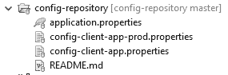

**application.properties:**

```properties
## 放置所有全局配置
```

`some.property=app specific overridden value`

在 `Package Explorer` 中，展开 `config repository` 项目，你会发现有三个配置文件。让我们来看第一个配置文件 `application.properties`。这里是存放所有全局配置的地方。`application.properties` 适用于任何向 `Config Server` 请求配置的应用程序。接下来，打开 `config-client-app.properties` 文件，注意这是一个特定应用程序的配置文件。因此，它只适用于命名为 `config-client-app` 的应用程序。当我们演示 `Spring Cloud Config Client` 时，我们将该项目的 `Spring` 应用程序名称配置为 `config-client-app`，这样该配置就仅适用于该应用程序。继续打开最后一个配置文件 `config-client-app-prod.properties` 文件。这个配置文件与我们刚刚看到的那个相似。它适用于同一个应用程序，但只有当该应用程序在名为 `prod` 的 `Spring Profile` 下下运行时，它才会生效。让我们关闭所有这些配置文件并启动我们的 `Configuration Server`。转到 `config-server`，展开它，找到主应用程序类，右键点击它，并选择 `Run As Spring Boot App`。你还需要启动 `discovery-server`。一旦 `Configuration Server` 启动，让我们打开浏览器并访问一些 `REST endpoints`。

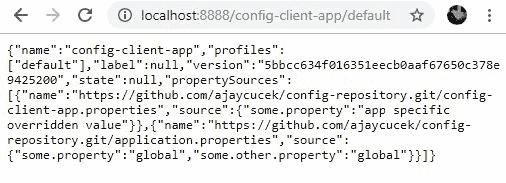

上述响应的格式：

```json
{  
   "name":"config-client-app",
   "profiles":[  
      "default"
   ],
   "label":null,
   "version":"5bbcc634f016351eecb0aaf67650c378e9425200",
   "state":null,
   "propertySources":[  
 {  
          "name":"https://github.com/ajaycucek/config-repository.git/config-client-app.properties",
          "source":{  
 "some.property":"app specific overridden value"
         }
 },
 {  
          "name":"https://github.com/ajaycucek/config-repository.git/application.properties",
          "source":{  
 "some.property":"global",
 "some.other.property":"global"
         }
 }
   ]
}
```

一旦你打开了浏览器，访问 `http://localhost:8888/config-client-app/default`。记住，格式是 `application name/profile/label`，所以应用程序名称将是 `config-client-app`。记住 `profile` 参数是一个必选参数，所以如果我们想查看不带任何 `Spring Profile` 的 `Config Client` 应用的默认配置，我们使用值 `default` 作为默认配置。默认的返回格式是 `JSON`，其要点是 `property sources`。注意底部的属性源是 `application.properties`。那是适用于每个应用程序的全局属性。而它上面的属性源（会覆盖任何全局属性源的属性）是 `config-clien-app.properties`。

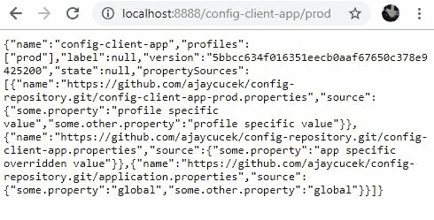

上述响应的格式：


```json
{
  "name": "config-client-app",
  "profiles": [
    "prod"
  ],
  "label": null,
  "version": "5bbcc634f016351eecb0aaf67650c378e9425200",
  "state": null,
  "propertySources": [
    {
      "name": "https://github.com/ajaycucek/config-repository.git/config-client-app-prod.properties",
      "source": {
        "some.property": "profile specific value",
        "some.other.property": "profile specific value"
      }
    },
    {
      "name": "https://github.com/ajaycucek/config-repository.git/config-client-app.properties",
      "source": {
        "some.property": "app specific overridden value"
      }
    },
    {
      "name": "https://github.com/ajaycucek/config-repository.git/application.properties",
      "source": {
        "some.property": "global",
        "some.other.property": "global"
      }
    }
  ]
}
```

`some.property=app specific overridden value`

如果我们修改 `config-client-app` 使其包含 `prod`，我们将看到 `some.property` 被覆盖了。

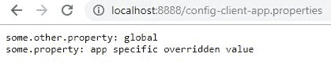

## 使用 Spring Cloud Client

现在我们已经看到了 `Spring Cloud Config Server` 是如何工作的以及如何启动它，让我们看看等方程式的另一端——`Client`。从核心角度来说，`Client` 负责引导（bootstrapping）。当我说 `Client` 负责引导配置时是什么意思呢？嗯，当 `Spring` 应用程序启动时，它需要解析它的属性源。由于配置位于 `Configuration Server` 上，它需要在应用程序上下文正式启动之前获取这些配置。你有两种不同的方法可以让 `Config Client` 引导你的应用程序，并且它们都使用一个名为 `bootstrap.properties` 或 `bootstrap.yml` 的特殊文件。

### Config First（配置优先）

第一种方法是 `Config First`，你通过配置包含 `application name` 以及 `Configuration Server` `URL` 的 `bootstrap.yml` 或 `bootstrap.properties` 来实现。

### Discovery First（发现优先）

方法方法是 `Discovery First`，使用服务发现（service discovery）。因此你需要配置 `bootstrap.properties` 或 `bootstrap.yml`，包含 `application name` 以及服务发现服务器的地址。它将通过此来查找 `Config Server`。设置应用程序使用 `Spring Cloud Client` 比设置 `Spring Cloud Config Server` 更加简单。

`pom.xml`:

```xml
<dependencyManagement>
    <dependencies>
        <dependency>
            <groupId>org.springframework.cloud</groupId>
            <artifactId>spring-cloud-dependencies</artifactId>
            <version>Camden.SR2</version>
            <type>pom</type>
            <scope>import</scope>
        </dependency>
    </dependencies>
</dependencyManagement>
```

在你的 `pom.xml` 中，在 `dependencyManagement` 节点导入 `spring-cloud-dependencies`。

```xml
<dependency>
    <groupId>org.springframework.cloud</groupId>
    <artifactId>spring-cloud-config-client</artifactId>
</dependency>
```

然后在 `dependency` 节点（仍在你的 `pom.xml` 中）中定义对 `spring-cloud-config-client` 的新依赖。然后我们需要配置 `Config Client` 如何引导配置。如果你使用 `Config First`，你定义一个 `bootstrap.properties` 或 `bootstrap.yml`。

`bootstrap.properties`:

```properties
spring.application.name=<your_app_name>
spring.cloud.config.uri=http://localhost:8888/
```

OR

`bootstrap.yml`:

```yaml
spring:
  application:
    name: <your_app_name>
  cloud:
    config:
      uri: http://localhost:8888/
```

你定义了 `spring.application.name` 属性，这就是你应用程序的名称。当它调用 `Spring Cloud Config Server` 的 REST 服务来查找适当配置时，它将使用该名称。下一个属性是 `spring.cloud.config.uri` 属性，你将其设置为 `Config Server` 的位置。在示例中，我在这里使用了 `localhost`。如果你使用“发现优先”（Discovery First）的配置来引导 `Config Client`，其配置与我们刚刚看到的相似，但略有不同。

### bootstrap.properties

```properties
spring.application.name=<your_app_name>
spring.cloud.config.discovery.enabled=true
```

或者

### bootstrap.yml

```yaml
spring:
  application:
    name: <your_app_name>
  cloud:
    discovery:
      enabled: true
```

你自然会有你自己的 `bootstrap.properties` 或 `bootstrap.yml`，请注意我只包含了与“配置优先”（Config First）配置之间的区别。那是为了定义 `spring.cloud.config.discovery.enabled` 属性并将其设置为 `true`。你会用它来代替 `Config Server` 的位置。此外，你还需要确保已经在 `pom.xml` 中添加了 `Eureka Client` 依赖，并配置了服务发现服务器的 URL，然后添加 `@EnableDiscoveryClient` 注解。

## 演示：使用 Config Client 获取配置

在此演示中，我们将看到如何使用 `Spring Cloud Config Client` 在启动时从 `Configuration Server` 获取配置。开始之前，请访问 `start.spring.io`。Group ID 使用 `io.ajay.kumar`。Artifact 名称使用 `config-client-app`。对于依赖项，我们显然需要 `Config Client`，当然，我们还需要 `Eureka Discovery`，以便我们能够使用服务发现来查找 `Configuration Server`，我们还需要 `Spring Actuator`。一旦选好所有内容，点击 `Generate Project` 按钮。这将生成一个 zip 压缩。点击它，解压，然后进入你的 IDE。

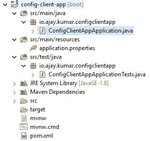

在 IntelliJ 或 Eclipse 中，在 Package Explorer 的空白区域点击右键，选择 `Import`，搜索 `Existing Maven Projects`，选择它，点击 `Next`，浏览到你下载的 zip 文件位置（我的文件在 `Downloads/config-client-app`），点击 `Open` 并点击 `Finish`。

我们将使用服务发现从 `Config Client` 应用中定位 `Config Server`。所以，如果你还没有完成服务发现模块，你需要 `Discovery Server` 并将其导入到 IDE 中。这非常简单。接下来，我们需要对 `Config Server` 进行一些修改，使其向 `Discovery Server` 注册自己。

```java
package io.ajay.kumar.configserver;

import org.springframework.boot.SpringApplication;
import org.springframework.boot.autoconfigure.SpringBootApplication;
import org.springframework.cloud.client.discovery.EnableDiscoveryClient;
import org.springframework.cloud.config.server.EnableConfigServer;

@SpringBootApplication
@EnableConfigServer
@EnableDiscoveryClient
public class ConfigServerApplication {
    public static void main(String[] args) {
        SpringApplication.run(ConfigServerApplication.class, args);
    }
}
```

展开 `config-server` 并进入主应用程序类。在 `@EnableConfigServer` 下方添加 `@EnableDiscoveryClient` 注解。保存它，然后打开 `src/main/resources` 中的 `application.properties`。

### application.properties

```properties
server.port=8888
spring.cloud.config.server.git.uri=https://github.com/ajaycucek/config-repository.git
spring.application.name=configserver
eureka.client.server-url.defaultZone=https://localhost:8761/eureka
```

我们将添加两个不同的属性。第一个是 `spring.application.name`，我们将将其设置为 `configserver`。没有空格。然后我们还想设置 `Discovery Server` 的位置，以便它知道在哪里注册自己。因此我们执行 `eureka.client.server-url.defaultZone`，然后将其设置为 `localhost:8761/eureka`。接下来，展开 `config-client-app` 项目并打开主应用程序类。记住，`Config Client` 获取其配置不需要我们添加任何特殊的注解。只要库在类路径上且设置正确，它就应该能够从 `Configuration Server` 获取配置。

```java
package io.ajay.kumar.configclientapp;

import org.springframework.boot.SpringApplication;
import org.springframework.boot.autoconfigure.SpringBootApplication;
import org.springframework.cloud.client.discovery.EnableDiscoveryClient;

@SpringBootApplication
@EnableDiscoveryClient
public class ConfigClientAppApplication {
    public static void main(String[] args) {
        SpringApplication.run(ConfigClientAppApplication.class, args);
    }
}
```

然而，我们确实想参与服务发现，所以让我们添加 `@EnableDiscoveryClient` 注解。继续保存它。接下来我们创建一个新类。点击 New、Class，我们将此类命名为 `ConfigClientAppConfiguration`。点击 `Finish`。

```java
package io.ajay.kumar.configclientapp;

import org.springframework.boot.context.properties.ConfigurationProperties;
import org.springframework.stereotype.Component;

@Component
@ConfigurationProperties(prefix="some")
public class ConfigClientAppConfiguration {
    private String property;

    public String getProperty() {
        return property;
    }

    public void setProperty(String property) {
        this.property = property;
    }
}
```

让我们为这个类添加 `@Component` 和 `@ConfigurationProperties`。我们将给它一个前缀为 `some`。这个 `ConfigurationProperties` 将代表我们名为 `property` 的属性。我们将有一个字符串实例变量，`private String property;`。确保不要忘记 getter 和 setter。你可以通过进入 Source、Generate Getters and Setters、选择 property 来实现。保存文件。返回主应用程序类，并注入我们的配置类。

```java
package io.ajay.kumar.configclientapp;

import org.springframework.beans.factory.annotation.Autowired;
import org.springframework.beans.factory.annotation.Value;
import org.springframework.boot.SpringApplication;
import org.springframework.boot.autoconfigure.SpringBootApplication;
import org.springframework.cloud.client.discovery.EnableDiscoveryClient;
import org.springframework.web.bind.annotation.RequestMapping;
import org.springframework.web.bind.annotation.RestController;

@SpringBootApplication
@EnableDiscoveryClient
@RestController
public class ConfigClientAppApplication {
    @Autowired
    private ConfigClientAppConfiguration properties;

    @Value("${some.other.property}")
    private String someOtherProperty;

    public static void main(String[] args) {
        SpringApplication.run(ConfigClientAppApplication.class, args);
    }

    @RequestMapping
    public String printConfig() {
        StringBuilder sb = new StringBuilder();
        sb.append(properties.getProperty());
        sb.append(" || ");
        sb.append(someOtherProperty);
        return sb.toString();
    }
}
```


所以我们进入这里，我们将创建一个私有的`ConfigClientAppConfiguration`类型，并将其命名为`properties`。我们将对它进行`@Autowired`注入。你也可以在这里使用`@Inject`。我们将添加另一个实例变量，`private String someOtherProperty`，并给它添加一个`@Value`注解。我们将使用占位符格式来注入`someOtherProperty`的值，即`${some.other.property}`。现在，我们要给主应用类添加一个`@RestController`注解。来到这里`@EnableDiscoveryClient`下方，添加`@RestController`。然后保存。请注意，通常你不会在主应用类上放置 REST 控制器；但是，由于我们在这里只是进行演示，并试图巩固一些概念，目前这样做是可以的。我们还需要添加处理方法，所以来到`main`方法下方编写`public String printConfig`。然后我们将对该方法添加`@RequestMapping`注解。在方法体中，我们将构造一个字符串，包含从 Configuration Server 获取的每个配置属性的值。因此，我们需要一个字符串构建器，`StringBuilder sb = new StringBuilder`。然后调用`sb.append`。接着获取第一个值，即`properties.getProperty`。然后用双竖线进行分隔，即`sb.append`加上空格`||`空格，然后`sb.append` `someOtherProperty`的值。最后，我们要返回`sb.toString`。接下来，关闭这两个文件。在`src/main/resources`目录下创建一个名为`bootstrap.properties`的新文件。

### bootstrap.properties

```properties
spring.application.name=config-client-app
spring.cloud.config.discovery.enabled=true
eureka.client.server-url.defaultZone=http://localhost:8761/eureka
```

在`bootstrap.properties`中，将`spring.application.name`属性设置为值`config-client-app`。然后我们将设置另一个属性，告诉 Config Client 通过服务发现查找 Config Server，即`spring.cloud.config.discovery.enabled=true`。我们还有一个最后一个要设置的属性，即 Discovery Server 的位置。我们已经在 Config Server 中配置了它，所以如果你愿意，可以打开`config-server`中的`application.properties`，复制`eureka.client.server-url`并将其粘贴到你的`bootstrap.properties`中。我们可以关闭所有配置文件并最小化所有项目。现在我们准备好运行应用程序了。我们首先启动 Discovery Server。导航到 Discovery Server 的主类，右键点击它，选择`Run As Spring Boot App`。一旦 Discovery Server 启动，我们将启动 Configuration Server。转到 Config Server 的主类，右键点击它，选择`Run As Spring Boot App`。最后，我们启动 Config Client。进入 Config Client 的主类，右键点击它，选择`Run As Spring Boot App`。现在你会看到`config-client-app`在与 Eureka server 注册后意外关闭。

在控制台中你将看到：

```
Shutting down DiscoveryClient ...
config-client-app - registration status: 204
Unregistering ...
config-client-app - deregister status: 200
Completed shut down of DiscoveryClient
```

现在要修复这个问题，请在`pom.xml`中添加以下依赖：

```xml
<dependency>
    <groupId>org.springframework.boot</groupId>
    <artifactId>spring-boot-starter-web</artifactId>
</dependency>
```

再次启动。

如果你展开控制台并向上滚动，你会看到它已从 Configuration Server 获取了配置。所以，让我们打开浏览器并访问 Config Client 应用，看看它是否解析了这些配置值。

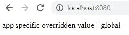

在浏览器中访问`localhost:8080`，你会发现它已经解析了配置值。第一个值，即应用特定的覆盖值，是来自`some.property`属性的值。记住，我们在 Config Client 配置中将其设置为了该应用特定的覆盖值。然后是下一个属性，用`||`分隔，即全局配置，它来自全局属性，即`application.properties`。

### 在运行时更新配置

在运行时更新配置无疑是 Spring Cloud 最强大的功能之一。通过它，你可以执行诸如在运行时刷新`@ConfigurationProperties`等操作。你还可以用它来更新任何代码的日志级别。而且这些变化几乎瞬间完成的。最棒的部分是，你无需重启应用程序即可完成这一切。那么如何操作呢？嗯，第一步是更新你的配置。你通过克隆 Config Server 正在查看的配置仓库来实现，进行修改，然后`git add`、`git commit`和`git push`将更改推送到配置仓库。从那里开始，应用程序有几种不同的方式获取新配置，包括手动和自动：

*   通过`spring-boot-actuator`使用`/refresh`

*   通过`spring-cloud-bus`使用`/bus/refresh`

*   通过`spring-cloud-config-monitor` & `spring-cloud-bus`使用`VCS + /monitor`

第一种方法是手动的，通过调用 Spring Actuator 项目包含的刷新端点。说明一下，你需要对每个需要更新配置的单独服务执行此操作。第二种方法是手动和自动的结合。你可以想象，如果你有很多服务器，手动为每个服务器调用刷新端将是一个非常痛苦的过程。相反，如果每个应用程序都订阅了一个事件，而你调用了`/bus/refresh`端点，Spring Cloud Bus 将向所有订阅者发送消息，通知它们需要刷新。请注意，配置是否更改并不包含任何智能判断；每个订阅者都会去获取它的新配置。第三种方法与第二种类似，但它增加了一层智能性。实现方法是你将其挂接到版本控制系统（如 Git）上，每当你进行提交时，提交的变更集就会发布到监控端点，然后该监控端点就可以确定哪些服务需要更新配置。所以让我们来可视化一下：假设你对某些配置进行了提交，并将其推送到配置仓库。该仓库知道发生了什么，并将该变更集发送到监控端点，然后该端点判断出只需要通知三个应用程序中的两个更新配置。无论你选择哪种方法来通知应用程序更新配置，最后一步都是：庆祝。你可以向同事炫耀在无需重启应用程序的情况下即时更改配置。最后，由于你使用了 Git，你拥有一份所有所做更改的完整审计日志。

### 使用 @RefreshScope 注解

我们已经讨论了当配置刷新时`@ConfigurationProperties`和日志级别将如何更新，但遗憾的是，这并没有涵盖所有的用例。任何在初始化时才获取值的内容（例如`@Bean`或`@Value`）都不会像其他内容那样自动刷新。为了为了更好地理解这一点，看一个例子会有帮助。

```java
@Configuration
public class SomeConfiguration{
    @Bean
    public FooService fooService(FooProperties properties){
        return new FooService(properties.getConfigValue());
    }
}
```

**示例：刷新后 @Bean 将看不到新配置值**

*   进行了配置更新

*   注意`FooProperties`是一个`@ConfigurationProperties`类

*   `POST`到`/refresh`

- 结果：`FooService`仍然包含旧的（OLD）配置值

- 仅在初始化时获取配置

假设你有一个`@Configuration`类，它声明了一个名为`FooService`的新 Bean。为了构造`FooService`，你需要从`FooProperties`为它提供一个配置值，该值是 Bean 方法的参数。`FooProperties`是一个`@Configuration`类。然后你对绑定到`FooProperties`的属性进行一些配置更改，并向`refresh`终点发送一个`POST`请求。如果你此时查看`FooService`，即使你调用了`refresh`，它实际上仍然持有旧的配置值。这是因为因为它只在初始化时获取配置。这里是另一个例子。

```java
@Configuration
public class SomeConfiguration{

@Value("${some.config.value}")
String configValue;

@Bean
public FooService fooService(){
return new FooService(configValue);
}

}
```

### 示例：刷新后 `@Value` 无法看到新配置值

- 进行了配置更新

- 向`/refresh`发送`POST`请求

- 结果：`FooService`仍然包含旧的（OLD）配置值

- 仅在初始化时获取配置

再次，我们有一个`@Configuration`类，这次我们有一个带有某些需要注入的配置的`@Value`注解。我们将使用该配置作为构造函数参数来构造`FooService` Bean。所以我们经历了同样的过程：更新某些配置，向`refresh`终点发送`POST`请求，再次我们发现我们的配置值仍然是旧值。它没有被更新。此时你可能在想，我如何刷新一个只在初始化时获取配置的`@Bean`或`@Value`呢？答案是使用`@RefreshScope`注解。回到第一个例子，看看我们如何以及何时利用`@RefreshScope`注解。

```java
@Configuration
public class SomeConfiguration{

@Bean @RefreshScope
public FooService fooService(FooProperties properties){
return new FooService(properties.getConfigValue());
}

}
```

### 示例：利用 `@RefreshScope`

- 在`@Bean`上添加`@RefreshScope`注解

- 向`/refresh`发送`POST`请求

- 结果：`FooService`现在将包含新的（NEW）配置值！

- `@RefreshScope`通知 Spring 重新初始化此`@Bean`

在你的`@Configuration`类中，你只需要给你的`@Bean`添加`@RefreshScope`注解即可。一旦你向`refresh`终点发送了`POST`请求，`FooService`现在就会看到最新的配置值。`RefreshScope`的作用就像它的名字一样。它是对 Spring 的提示，该`@Bean`或`@Value`应该包含在刷新范围内。

### 演示：无需重启应用刷新配置

在这个演示中，我们将学习如何在运行时刷新配置，以及如何使用`@RefreshScope`注解。在开始演示之前，请确保你已经安装了名为`Postman`的工具。你可以通过`www.getpostman.com`获取。我们将使用这个工具来调用 REST 终点。这是一个很好的 REST 客户端。我们要做的第一件事是启动所有的应用程序，所以请启动`Discovery Server`、`Config Server`和`Config Client`应用。现在记住，你需要按照正确的顺序启动它们。先启动`Discovery Server`，然后是`Config Server`，最后是`Config Client`应用。如果在启动时遇到任何问题，请确保按照该顺序启动。打开浏览器并访问`localhost:8080`。


你会看到从`Configuration Server`解析出的配置值。现在，我们想要更新这些值中的每一个，所以我们将更新第一个（应用特定的覆盖值）以及全局值。因此，回到 IDE。在 IDE 中，展开`config-repository`项目，并打开`config-client-app.properties`文件。

config-client-app.properties:

```properties
## 在此处放置应用特定的配置（应用名称: client-config-app）
some.property=coffee
some.other.property=is good
```

我们将把这个值从应用特定的覆盖值更改为`coffee`。然后我们还要设置另一个。我们将覆盖`some.other.property`，并将其设置为`is good`。保存这些更改。关闭该文件。然后我们将提交这些更改，右键点击`scf-config-repository`，进入`Team`，进入`Commit`，输入提交信息`Updating configuration`，然后点击`Commit`和`Push`。会弹出一个新对话框向你显示已推送了这些更改。只需点击`OK`即可。你可以退出该`Git Staging`视图。现在我们更新了配置，并将其推送到配置仓库。如果你回到浏览器并刷新页面，该值应该是旧值。


我们还没有显式地请求应用程序刷新其配置。为了做到这一点，启动`Postman`应用，在新标签页中显示`GET`的地方，点击下拉菜单并选择`POST`。然后在请求 URL 中输入`http://localhost:8080/refresh`。一旦输入完成，点击`Send`，服务器将返回所有更改的属性。这里有一个内部属性`config.client.version`，以及我们更改的另外两个属性`some.other.property`和`some.property`。回到浏览器并刷新页面。


噢，这很有意思。第一个值已经刷新了，我们得到了设置的`coffee`，但第二个值仍然指向全局值。这是因为第二个值是通过`@Value`获取的，而当调用终点时`@Value`注解不会自动刷新。我们可以通过`@RefreshScope`来解决这个问题。回到 IDE，停止 Config 应用。然后在主类中，找到`someOtherProperty`。我们这里有`@Value`注解。为了解决`@Value`不更新的问题，我们在主类中添加`@RefreshScope`。

所以你输入了`@RefreshScope`。继续，保存它并重启应用程序。现在，由于我们重启了应用程序，应用程序在启动时会获取最新的配置值。因此，我们实际上不会演示`@RefreshScope`的用法，因为无论如何它都会获取最新值。所以我们需要做的是再次更新该值。打开`config-client-app`，将`some.other.property`修改为`is really good`。

config-client-app.properties:

```properties
# Put application-specific config here (application name: client-config-app)

some.property=coffee

some.other.property=is really good
```

保存并关闭文件，并再次将其提交到 Git 仓库。团队，提交，再次更新配置，点击 Commit and Push（提交并推送）。你可以退出 Git Stage 视图。返回浏览器并刷新页面。

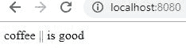

如你所见，它显示 coffee is good。`is good`是它在启动时获取的值。但一旦我们在添加了刷新范围后再次刷新它，它将为该`@Value`注解获取最新的值。现在打开 Postman，在新的标签页中显示`GET`的地方，点击下拉菜单并选择`POST`。然后在请求 URL 中输入`http://localhost:8080/refresh`。输入完成后，点击 Send（发送），你可以看到它更改了`some.other.property`。回到浏览器并刷新页面。

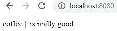

你可以看到这次它将我们的属性从`is good`改为了`is really good`。

### 加密和解密敏感配置

Spring Cloud Config Server 还为加密和解密配置提供了额外的有用功能。它支持多种不同的特性。

### 支持的功能：

* 静态存储和/或传输中的加密配置

* 用于加密配置的`/encrypt`端点

* 用于解密配置的`/decrypt`端点


使用对称或非对称密钥进行加密和解密

它支持静态存储或传输中的加密配置。静态存储简单意味着你的配置在存储在磁盘上是经过加密的。传输中则意味着它在 `Config Server` 和 `Config Client` 之间传输时是加密的。它提供了用于加密和解密你配置的实用端点。需要指出的一个非常重要的一点是，默认情况下，除非你为 `Configuration Server` 配置安全性，否则这两个端点都不是安全的。我们已经讨论过如何保护你的 `Config Server`。请记住，`Spring Security` 支持的任何方法也适用于保护你的 `Config Server`。最后，它还支持使用对称或非对称密钥进行加密和解密。因此，你可以选择最适合你情况的方法。在我们进入加密和解密配置的细节之前，我认为查看加密配置的样式会很有用。

`application.properties`:

```properties
my.datasource.username=foobar
my.datasource.password={cipher}ASFIOWRODSKSDFIR32KJL
```

`application.yml`:

```yaml
my:
  datasource:
    username: foobar
    password: '{cipher}ASFIOWRODSKSDFIR32KJL'
```

我包含了 `application.properties` 和 `application.yml`。它们都具有相同的加密数据库密码。注意，在随机字母和数字之前有一个特殊的值 `cipher`，并且它被大括号包围。这表示真实值是一个加密值。请注意，`application.yml` 与 properties 文件相比有一个细微的差别。YAML 文件要求我们用单引号括起值，而 properties 文件则不需要。现在你已经看到了加密配置的样貌，你可能在想配置是在什么时候被解密的？有两种不同的选项。第一种选项是在请求时解密，即在 `Configuration Server` 端。因此你为特定的应用程序请求配置，`Config Server` 在返回配置之前解密配置中的值。只有当你的 `Config Server` 和 `Config Client` 之间的连接是安全的时，你才想要使用这种方法。如果不安全，你可以利用第二种在客户端解密值的方法。这与第一种方法完全相反。`Config Server` 不是在返回之前解密值，而是以加密格式发送它们，由客户端负责解密。注意，默认方式是第一种选项，即请求时解密。如果你让客户端解密配置，你必须在 `Config Server` 上设置一个属性 `spring.cloud.config.server.encrypt.enabled=false`，这将告诉 `Config Server` 在向客户端返回值之前不要解密值。

## 使用加密和解密支持

在我们进入配置 `Configuration Server` 以支持加密和解密的细节之前，请注意，这假设我们已经安装了 Java 加密扩展包，通常称为 `JCE`。

### 第一步：选择你的密钥类型

- 对称密钥
- 非对称密钥
- 公钥
- 私钥

加密配置的第一步是选择密钥类型，这可以是对称的，也可以是非对称的。通常情况下，对称密钥更容易使用，但安全性低于非对称密钥。你可以选择最适合你情况的方法。

### 第二步（对称）：配置 Config Server

`application.properties`:

```properties
encrypt.key=<your_super_secret_key>
```

`application.yml`:

```yaml
encrypt:
  key: <your_super_secret_key>
```

第二步，如果你使用对称密钥，就是配置加密密钥。你可以在 `application.properties` 或 `application.yml` 中执行。设置的属性是 `encrypt.key`。你将其设置为用于加密配置的私密值。

### 第二步（非对称）：配置 Config Server 选项 1

`application.properties`:

```properties
encrypt.key=<pem_encoded_key_as_text>
```

`application.yml`:

```yaml
encrypt:
  key: <pem_encoded_key_as_text>
```

第二步，如果你使用非对称密钥，可以通过两种不同的方式完成。第一种方法是在 `application.properties` 或 `application.yml` 中将 `encrypt.key` 属性的值设置为 `pem_encoded_key_as_text`。PEM 编码的密钥将包含公钥和私钥。

### 第二步（非对称）：配置 Config Server 选项 2

`application.properties`:

```properties
encrypt.keyStore.location=<path_to_keystore>
encrypt.keyStore.password=<keystore_password>
encrypt.keyStore.alias=<key_name_in_keystore>
```

`application.yml`:

```yaml
encrypt:
  keyStore:
    location: <path_to_keystore>
    password: <keystore_password>
    alias: <key_name_in_keystore>
```

第二种方法，如果你使用非对称密钥，是使用 Java KeyStore。一旦你将公钥和私钥创建或导入现有或新的 keystore 中，你只需要配置 keystore 的位置、密码以及创建或导入密钥到 keystore 时选择的别名。你当然可以在 `application.properties` 中进行操作，也可以在 `application.yml` 中进行。

### 加密和解密 REST 端点

一旦你的 `Config Server` 设置好了加密功能，你就可以利用一些实用 REST 端点来加密和解密放入或从配置中提取的值。这两个端点非常简单。

### 实用 REST 端点：加密值

- 端点
- `POST /encrypt`
- 示例
- 请求: `/encrypt`
- 数据: `<value_to_encrypt>`

第一个是加密端点，你可以用它来生成在配置中使用的加密值。正如我所说，它的使用非常简单。你所需要向 `/encrypt` 端点发送一个 `POST` 请求，并将你想要加密的值作为请求体传递过去。`Config Server` 将使用其配置的密钥（无论是对称密钥还是非对称密钥）来加密该值。再次，我必须强调这一点：请务必使用 `Spring Security` 或其他手段确保该端点是安全的，使其仅允许授权用户访问。

### 工具类 REST 端点：解密值

- 端点
- `POST /decrypt`
- 示例
- 请求：`/decrypt`
- 数据：`<value_to_decrypt>`

解密端点与加密端点几乎完全相同，除了名称和输入之外。你主要将其用于调试目的。因此，要解密一个值，你会向 `/decrypt` 发送 `POST` 请求，并将加密值作为请求体发送，它将为你返回未加密的值。

### 总结

- 云端配置的爆炸以及对配置服务器的需求
- 使用 `Spring Cloud Config Server & Client`
- 在不重启的情况下运行时更新配置
- 配置的加密与解密

我们已经到达本模块的末尾，让我们花时间回顾一下所学的内容。我们涵盖了许多主题。我们首先讨论了在云环境中需要一个 `Configuration Server`，以管理管理分布式系统带来的配置爆炸。然后，我们学习了如何配置 `Spring Cloud Config Server` 来提供我们的配置文件，以及如何使用 `Spring Cloud Config Client` 配合 `bootstrap.properties` 或 `bootstrap.yml` 在应用程序初始化期间检索配置。之后，我们看到了如何向同事炫耀我们可以在无需重启应用程序服务器的情况下运行时更新配置。我们还看到了哪些内容会自动刷新，以及哪些内容需要 `@RefreshScope` 注解。最后，我们通过关于如何利用 `Spring Cloud Config` 内部加密和解密支持的章节完成了本模块。

## 第 5 模块：使用智能路由映射服务

### 什么是智能路由？

在本模块中，我们将学习如何使用智能路由在云端中映射我们的服务。

- 云原生应用中的路由
- `Netflix Zuul`
- 代理服务器
- 设置路由
- 设置过滤器

我们将首先讨论什么是智能路由以及它为我们解决了什么问题。然后，我们将介绍作为 `Spring Cloud Netflix` 项目一部分的 `Netflix Zuul`。我们将看到如何设置代理服务器、如何配置不同的路由以及如何设置过滤。请记住，为了尽可能具有动态性和可扩展性，云原生系统是由一个个可以独立部署的服务组成的，这些服务共同构成了一个整体系统。然而，随之而来了一些挑战。

### 单个服务的挑战

- 不同的端口
- 不同的地址
- 不同的 API 和路径

每个独立的服务可能运行在不同的端口、不同的地址上，或者两者的结合上。它们还可能具有不同的路径和不同的 API 用于交互。作为这些服务的用户或客户端（例如移动端 App 或 Web App），要与每个独立服务（其数量可能轻松达到双位数或三位数）进行交互将是一场噩梦。相反，我们可以使用智能路由让我们的应用程序看起来像是一个单一系统。就像一个完成的拼图看起来是一个整体，但它实际上是由几个不同的单独部分组成的。

### 通过网关服务的智能路由

路由通常通过称为网关服务或 `API Gateway` 的东西来实现。`API Gateway` 或网关服务被定义为所有客户端的单一入口点因此，在很多方面，网关服务非常像我们系统的正门。而每个独立的服务都位于这扇门之后，所有请求必须通过它进入。

### 网关服务提供

- 动态路由与交付
- 安全与过滤
- 审计与日志记录
- 请求增强
- 负载均衡
- 针对不同客户端提供不同的 API

网关服务不仅提供了动态路由和交付（这意味着在运行时它可以决定应该将请求路由到哪里，以及是否应该路由请求），还提供了一系列其他功能。其中一项功能就是安全。它提供了验证所有入站请求的能力，并过滤掉任何非法或错误的请求。由于所有请求都必须通过网关，它实际上是提供请求审计和日志记录的极佳候选者。它还提供了所谓的“请求增强”功能，这只是一个高级的说法，意味着它可以向请求中添加额外信息，或者说可以丰富请求。这方面一个具体的例子是 `Netflix` 使用他们网关的方式。他们使用网关服务对所有进入请求进行地理位置查找，并将该额外信息作为额外的请求头添加，以便所有下游服务都能使用。网关服务还可以作为其后独立服务的负载均衡器。网关服务的另一个有趣特性是能够为不同的客户端提供不同的 API。API 并不是一成不变的，不同的客户端（如 Web 客户端或移动客户端）在调用你的 API 方面有不同的需求。例如，Web 客户端与多个端点交互以完成某些功能可能是可以，但对于移动客户端可能就不适用，它可能只需要单个端点的服务更好。

### 在 Spring Cloud 中使用 Zuul

智能路由是通过 `Spring Cloud` 和来自 `Netflix` 的项目组合实现的。该项目名为 `Netflix Zuul`，发音为 zool，与单词 tool 押韵。`Netflix Zuul` 项目页面将其定义为提供动态路由、监控、弹性和安全的网关服务。`Zuul` 这个名字其实是个好名字，因为 `Zuul` 是电影《捉鬼者》中的一个虚构怪物，就像网关服务的守门员一样。我们将讨论如何将 `Spring Cloud` 和 `Netflix Zuul` 添加到项目中，然后进行实战演示。和所有的 `Spring Cloud` 项目一样，将 `Spring Cloud` 和 `Netflix Zuul` 添加到你的项目中非常简单。

然后，在你的主 `Application` 类中，添加 `@EnableZuulProxy` 注解，这个注解会将你的应用程序转换为网关服务。从配置的角度来看，你有两种不同的选择。你可以配置网关服务使用服务发现，也可以在不使用服务发现的情况下配置它。

### 使用服务发现的 Spring Cloud & Netflix Zuul

`application.properties`:

```properties
spring.application.name=gateway-service
eureka.client.defaultZone=http://localhost:8761/eureka
```

OR

`application.yml`:

```yaml
spring:
  application:
    name: gateway-service
eureka:
  client:
    defaultZone: http://localhost:8761/eureka
```

如果你正在使用服务发现，请定义应用名称和服务发现服务器位置的常规参数。

### 不使用服务发现的 Spring Cloud & Netflix Zuul

`application.properties`:

```properties
spring.application.name=gateway-service
ribbon.eureka.enabled=false
```

OR

`application.yml`:

```yaml
spring:
  application:
    name: gateway-service
ribbon:
  eureka:
    enabled: false
```

如果你不使用服务发现，仍然需要定义应用名称，并添加一个额外的参数 `ribbon.eureka.enabled=false`。还记得我提到过网关服务可以作为你服务的负载均衡器吗？Netflix 的客户端负载均衡器项目名称为 `Ribbon`。我们将在客户端负载均衡的模块中详细介绍关于 `Ribbon` 是什么的更多细节。

### 在 Netflix Zuul 中配置路由

一旦你完成了所有配置，下一步是定义 Zuul 如何路由请求。当使用服务发现设置 Zuul 时，默认的路由行为是根据服务名称进行路由。

#### 使用服务发现的默认路由解析（服务解析）

请求：`/foo` 映射到服务：`spring.application.name=foo`

请求：`/categories/1` 映射到服务：`spring.application.name=categories`

例如，如果你请求 `/foo`，Zuul 将使用服务发现来查找名为 `foo` 的服务，并将该请求发送到该服务。这是另一个例子：如果你请求 `/categories/1`，Zuul 将定位名为 `categories` 的服务，并将 `/1` 请求发送到该服务。默认情况下，请求的前缀会被剥离，因此服务实际上只接收请求的 `/1` 部分。如果你想让发送完整的请求 `/categories/1`，你可以将属性 `zuul.stripPrefix` 设置为 `false`，这样服务就会获得请求 `/categories/1`。另外注意，所有服务默认都会被添加，因此你可能需要使用 `zuul.ignoredServices`，你可以将其设置为一个模式以忽略特定服务。

#### 使用服务发现的 Netflix Zuul：精确路由

`application.properties`

```properties
spring.application.name=gateway-service
zuul.routes.<route_name>.path=/somepath/**
zuul.routes.<route_name>.serviceId=some_service_id
zuul.ignored-services=some_service_id
```

OR

`application.yml`:

```yaml
spring:
  application:
    name: gateway-service
zuul:
  routes:
    <route_name>:
      path: /somepath/**
      serviceId: some_service_id
  ignored-services: some_service_id
```

除了默认配置外，你还可以为特定服务定义更精确的配置。首先，你通过 `zuul.routes.route_name.path` 属性定义路径，其中路由名称可以是任何你想要的名称。路径被定义为使用 Ant 风格匹配器的路径。然后，你定义相同的属性前缀，但结尾是 `service_id` 而不是 `path`。`service_id` 是 Zuul 在通过服务发现发现服务时将查找的服务标识符。你还需要设置 `zuul.ignored-services` 属性，以便 Zuul 不会尝试自动为该服务 ID 添加路由。

#### 不使用服务发现的 Netflix Zuul：精确路由

`application.properties`

```properties
spring.application.name=gateway-service
zuul.routes.<route_name>.path=/somepath/**
zuul.routes.<route_name>.url=http://some_url_address/
```

OR

`application.yml`:

```yaml
spring:
  application:
    name: gateway-service
zuul:
  routes:
    <route_name>:
      path: /somepath/**
      url: http://some_url_address/
```


不使用服务发现时的配置实际上与使用它时非常相似。你定义路径，就像你在之前的配置中做的那样，然后不是定义服务 ID，而是直接定义服务的 URL。

## 演示：使用 Netflix Zuul 作为智能路由

前往`start.spring.io`，我们将在这里创建三个不同的项目。对于 Group ID `io.ajay.kumar`，对于我们要创建的第一个项目 Artifact，我们将命名为`gateway-service`。对于依赖项，我们需要添加`Zuul`，然后还想添加`Eureka Discovery`。

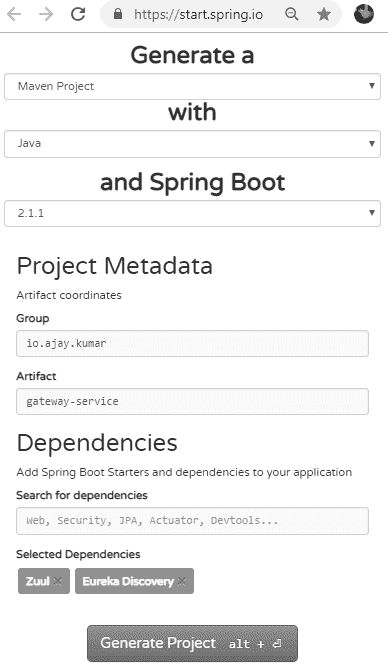

一旦在 particular 完成后，点击 Generate Project（生成项目）。

我们要添加的第一个属性是`spring.application.name`，我们将将其设置为`gateway-service`。然后我们需要的另一个属性是服务发现服务器（Service Discovery Server）的位置。所以我们写`eureka.client.service-url.defaultZone`，将其设置为`localhost:8761/eureka`。接下来，你可以关闭这两个文件并最小化`gateway-service`项目。接下来，我们将打开`hello-service`项目，请展开它并打开主应用程序类。

```java
package io.ajay.kumar.helloservice;

import org.springframework.boot.SpringApplication;
import org.springframework.boot.autoconfigure.SpringBootApplication;
import org.springframework.cloud.client.discovery.EnableDiscoveryClient;
import org.springframework.web.bind.annotation.RequestMapping;
import org.springframework.web.bind.annotation.RestController;

@SpringBootApplication
@EnableDiscoveryClient
@RestController
public class HelloServiceApplication {
    public static void main(String[] args) {
        SpringApplication.run(HelloServiceApplication.class, args);
    }

    @RequestMapping
    public String hello() {
        return "Hello!";
    }
}
```

在主应用程序类中，我们将添加`@EnableDiscoveryClient`注解，并将其设为`RestController`。现在，如果你在实际应用中这样做通常不是好主意，但我们现在只是作为一个简单的示例来这样做，所以目前没关系。我们来添加`@RestController`。保存它。然后我们需要一个处理方法，即`public String hello`。它将仅仅返回`Hello!`，我们会在它上加上`@RequestMapping`注解。现在我们需要配置我们的`hello-service`，请打开`src/main/resources`并打开`application.properties`。

**application.properties**

```properties
spring.application.name=hello
server.port=1111
eureka.client.service-url.defaultZone=http://localhost:8761/eureka
```

在`application.properties`中，我们要设置的第一个属性是`spring.application.name`，将其设置为`hello`。我们还要设置服务器端口。由于有多个应用程序同时运行，我们不希望端口发生冲突。所以我们写`server.port`，将其设置为`1111`。保存它。最后一个属性是设置服务发现服务器的位置。我们可以直接从网关服务中复制。所以打开网关服务的`application.properties`，复制设置服务发现服务器位置的配置值，关闭，然后将其粘贴到你的`application.properties`中。你基本上将为`goodbye-service`重复相同的过程，但所有显示`hello`的地方都要改为`goodbye`。而且端口处不再使用全 1，而是使用全 2。我已完成了`goodbye-service`的配置，让我们来看一眼主应用程序类。

```java
package io.ajay.kumar.goodbyeservice;

import org.springframework.boot.SpringApplication;
import org.springframework.boot.autoconfigure.SpringBootApplication;
import org.springframework.cloud.client.discovery.EnableDiscoveryClient;
import org.springframework.web.bind.annotation.RequestMapping;
import org.springframework.web.bind.annotation.RestController;

@SpringBootApplication
@EnableDiscoveryClient
@RestController
public class GoodbyeServiceApplication {
    public static void main(String[] args) {
        SpringApplication.run(GoodbyeServiceApplication.class, args);
    }

    @RequestMapping
    public String goodbye() {
        return "Goodbye!";
    }
}
```

我们有`@EnableDiscoveryClient`注解和`@RestController`注解，然后我们有一个处理方法，即`goodbye`，它被带有`@RequestMapping`注解。

**application.properties**

```properties
spring.application.name=goodbye
server.port=2222
eureka.client.service-url.defaultZone=http://localhost:8761/eureka
```

在`application.properties`中，我们将`spring.application.name`设置为`goodbye`，`server.port`设置为全 2。服务发现服务器的配置完全相同。我们现在准备好启动了。

## 使用 Netflix Zuul & Spring Cloud 创建过滤器

Zuul 的关键功能是可以定义过滤器。过滤器允许你拦截并控制通过网关的请求和响应。Zuul 支持多种类型的过滤器。

### 过滤器类型

* `pre`: 在请求之前

* `post`: 在请求之后

* `route`: 路由请求

* `error`: 处理请求错误

第一个是`pre`过滤器，它在请求路由之前执行。接下来是`route`类型，它允许你将请求引导到任何……事实上，当我们在主类上定义`EnableZuProxy`时，我们在 Spring 中配置了一些路由来……请求——……`post`，这些是…………类型……`error`用于处理之前任何任何一个过滤器类型导致的错误。要定义 Zuul 过滤器，你只需扩展并实现`ZuulFilter`类即可。

```java
public class MyFilter extends ZuulFilter{
    // 实现方法
}
```

这里有四个不同的方法需要实现：

```java
@Override public Object run(){
    // 过滤器逻辑放在此处。当前实现忽略返回值
}

@Override public boolean shouldFilter(){
    // 控制是否执行 run 方法
}

@Override public String filterType(){
    // 过滤器的类型：pre, route, post, error
}

@Override public int filterOrder(){
    // 与同类型其他过滤器的执行顺序
}
```

第一个是`run`方法，这是过滤器主逻辑所在的地方。注意它返回一个对象，但当前实现忽略了它，因此你可以简单地从该方法返回`null`。下一个方法是`shouldFilter`方法，正如其名，该方法允许你返回`true`或`false`，表示是否应该运行该过滤器。第三个方法是`filterType`方法，在这里你可以定义四个预定义值之一：`pre`、`route`、`post`或`error`。最后一个方法是`filterOrder`方法，它允许你控制`Zuul`过滤器的执行。

```
RequestContext ctx = RequestContext.getCurrentContext();
HttpServletRequest req = ctx.getRequest();
HttpServletResponse res = ctx.getResponse();
ctx.set("foobar","PRE_FILTER_EXECUTED");
String foobar = (String)ctx.get("foobar");
```

### 过滤器之间的数据共享

`RequestContext`存储了请求、响应、状态和数据信息。仅在请求持续期间有效

`RequestContext`是一个负责持有请求、响应以及任何需要在所有过滤器之间共享的状态或数据信息的对象。因此，你会使用它来访问`HttpServletRequest`或`Response`，并用它来设置或从其他过滤器设置获取数据。`RequestContext`对于每个请求都是唯一的，且仅在请求持续期间存在。一旦你定义并实现了`Zuul`过滤器，你就需要告诉 Spring 它的存在。

### 创建过滤器：定义一个返回过滤器的 @Bean

```java
@Configuration
public class MyConfig{
    @Bean
    public ZuulFilter myFilter(){
        return newMyFilter();
    }
}
```

在你的`@Configuration`类中，创建一个返回`Zuul`过滤器的方法，并用其加上`@Bean`注解。Spring Cloud Netflix 会识别并将任何`ZuulFilter`类型的 bean 添加到`Zuul`中。

### 演示：创建和使用 ZuulFilter

在这个演示中，我们将学习如何实现一个`Zuul`过滤器，为传入的请求添加额外的标头，以便下游服务可以消费。我们将从上一个演示结束的地方开始。还记得我们有四个不同的服务：我们有一个负责服务发现的`discovery-server`，有一个作为边缘服务的`gateway-service`，以及有两个应用程序服务：`goodbye-service`和`hello-service`。由于我们正在构建一个过滤器，我们将从`gateway-service`开始。所以请展开`gateway-service`并创建一个新包。点击 New、Package，并将其命名为`io.ajay.kumar.filters`。在在新包中创建一个新类，点击 New、Class，并将其命名为`AddRequestHeaderFilter`。请记得我们必须扩展`ZuulFilter`类，所以我们类的父类将是`ZuulFilter`。

```java
package io.ajay.kumar.filters;

import com.netflix.zuul.ZuulFilter;
import com.netflix.zuul.context.RequestContext;

public class AddRequestHeaderFilter extends ZuulFilter {

    @Override
    public boolean shouldFilter() {
        return true;
    }

    @Override
    public Object run() {
        RequestContext ctx = RequestContext.getCurrentContext();
        ctx.addZuulRequestHeader("x-location", "USA");
        return null;
    }

    @Override
    public String filterType() {
        return "pre";
    }

    @Override
    public int filterOrder() {
        return 0;
    }
}
```

对于第一个方法，即`shouldFilter`方法，让我们将其从`return false`改为`return true`。我们将始终应用这个过滤器。现在先跳过`run`方法，直接到`filterType`。我们要创建的这个特定过滤器是一个`pre`过滤器，所以我们可以说`return pre`。对于`filterOrder`，`return 0`是可以的，所以我们就保持原样。为了访问请求并为其添加标头，我们需要访问`RequestContext`。让我们清除这个 TODO 并写上`RequestContext ctx = RequestContext.getCurrentContext`。在`RequestContext`内部有一个`addZuulRequestHeader`方法。假设我们的用例是添加传入请求的位置，因此我们将此标头命名为`x-location`。我们将对它进行模拟；假定每个请求都来自`USA`。最后，记住返回值在当前实现中实际上并没有被使用，因此返回`null` get 我们的目的来说是没问题的。关闭此文件并打开我们的主应用程序类。在我们的主应用程序类中，我们将为它加上`@Configuration`注解。

```java
package io.ajay.kumar;

import org.springframework.boot.SpringApplication;
import org.springframework.boot.autoconfigure.SpringBootApplication;
import org.springframework.cloud.client.discovery.EnableDiscoveryClient;
import org.springframework.cloud.netflix.zuul.EnableZuulProxy;
import org.springframework.context.annotation.Bean;
import org.springframework.context.annotation.Configuration;
import io.schultz.dustin.filters.AddRequestHeaderFilter;

@SpringBootApplication
@EnableZuulProxy
@EnableDiscoveryClient
@Configuration
public class GatewayServiceApplication {

    public static void main(String[] args) {
        SpringApplication.run(GatewayServiceApplication.class, args);
    }

    @Bean
    public AddRequestHeaderFilter addRequestHeaderFilter() {
        return new AddRequestHeaderFilter();
    }
}
```

### 智能路由的需求

* 网关服务 (Gateway service)

* Netflix Zuul

* `@EnableZuulProxy`

* 配置路由

* 编写过滤器

首先，我们查看了最初需要智能路由的原因以及它为什么重要。然后，我们查看了如何通过 API 网关或网关服务来实现路由。最后，我们查看了如何使用`Netflix Zuul`作为网关服务，对往后端服务的请求和响应进行路由和过滤。

## 第 6 模块：使用客户端负载均衡调用服务

### 模块介绍

在本模块中，我们将学习如何利用客户端负载均衡来分担云原生应用中服务的负载。

* 负载均衡

* 服务端

* 客户端

* Netflix Ribbon

* 结合与不结合服务发现

* `@LoadBalanced`

* `@RibbonClient`

* 自定义 Ribbon 配置


我们将从什么是负载均衡，以及它在云原生应用中扮演着什么角色开始。然后，我们将讨论传统的服务端负载均衡，你可能已经熟悉它了。接着，我们将介绍客户端负载均衡、它是什么以及它与服务端负载均衡的区别。接下来，我们将介绍`Netflix Ribbon`以及我们如何利用它结合`Spring Cloud`来实现客户端负载均衡。我们将学习如何使用两个新注解：`@LoadBalanced`注解和`@RibbonClient`注解，分别在有和没有服务发现的情况下实现它。最后，我们将通过一个章节来介绍如何自定义`Ribbon`的配置，例如不同的负载均衡算法或在发送请求之前检查服务健康状况的不同方法。

## 客户端负载均衡 vs 服务端负载均衡

那么什么是负载均衡呢？简单来说，负载均衡是一种改进多个计算资源负载分布的方法。你可能已经知道这一点，所以更重要的问题是负载均衡在云原生架构中扮演着什么角色？这个答案实际上非常重要，可能比在非云原生架构中还要重要。当你观察架构的差异时，这个原因就变得更加清晰。在非云原生应用中，你从“具有单个负载均衡器的单个应用程序的多个实例”转变为“具有多个实例和多个负载均衡器的多个服务”。你仅仅从云原生应用中需要的负载均衡器数量，你就能开始看到负载均衡器的重要性了。通常有两种类型的负载均衡器：一种是服务端负载均衡，由服务器负责负载均衡；另一种是客户端负载均衡，由调用者负责负载均衡。让我们更详细地查看每一个。在服务端负载均衡中，对另一个服务的请求不会直接发送到服务本身，而是发送到服务前面的服务器，然后由该服务器决定将请求转发到多个实例中的哪一个。在客户端负载均衡中，没有中间环节。客户端（或服务的调用者）通过已知列表或服务发现感知服务的所有实例。然后由客户端负责决定将请求发送到多个实例中的哪一个。为了巩固我们对服务端与客户端负载均衡的理解，让我们对比一下它们。

### 服务端 (Server-side)

- 服务器分配请求
- 基于硬件或软件
- 额外的跳转 (hop)
- 支持多种算法
- 发生在请求过程之外
- 集中式或分布式

### 客户端 (Client-side)

- 客户端分配请求
- 基于软件
- 无额外跳转
- 支持多种算法
- 发生在请求过程之内
- 通常是分布式的

在服务端负载均衡中，服务器显然负责分配请求，而在客户端负载均衡中，客户端显然负责分配请求。服务端负载均衡通常基于硬件，但也可以基于软件。另一方面，客户端负载均衡是基于软件的。在服务端负载均衡中，你会产生一个额外的跳转，因为请求不会直接到达服务，而是必须先通过中间节点。而在客户端负载均衡中，一旦你知道了服务的位置，就不再需要任何额外的跳转。服务端和客户端负载均衡都支持多种负载均衡算法。服务端负载均衡中，实际的负载均衡发生在请求过程之外，而在客户端负载均衡中，实际的负载均衡发生在请求过程之内。最后，服务端负载均衡可以是集中式的也可以分布式的，而客户端负载均衡通常是分布式的。考虑到这些差异，显而易见客户端负载均衡是云原生架构的天然选择。

## 上手 Spring Cloud 和 Netflix Ribbon

我们已经为客户端负载均衡做好了准备。现在让我们聊聊如何使用`Spring Cloud`实际实现它。正如我在模块介绍中提到的，我们将使用一个名为`Netflix Ribbon`的库来实现客户端负载均衡。`Netflix Ribbon`是一个进程间通信库，内置了软件负载均衡器。`Spring Cloud`为`Spring`的`RestTemplate`类添加了与`Netflix Ribbon`的全功能集成。我们将详细介绍这具体意味着什么，但本质上，我们的`RestTemplate`现在将理解如何在多个服务实例之间平衡请求。`Spring Cloud`还添加了许多功能，使得非常轻松地声明不同类型的负载均衡算法和可用性检查。接下来，让我们讨论如何使用`Spring Cloud`和`Netflix Ribbon`。在我们开始之前，简单说明一下：在这些每个章节中，我将解释启动所需的所有步骤，最后我们将通过一个你可以跟随的演示。在`Spring Cloud`中使用`Netflix Ribbon`非常简单，就像所有其他`Spring Cloud`项目一样。

### 使用 SpringCloud & Netflix Ribbon

`pom.xml`

```xml
<dependencyManagement>
  <dependencies>
    <dependency>
      <groupId>org.springframework.cloud</groupId>
      <artifactId>spring-cloud-dependencies</artifactId>
      <version>Camden.SR2</version> 
      <type>pom</type>
      <scope>import</scope>
    </dependency>
  </dependencies>
</dependencyManagement>
```

### 使用 `@LoadBalanced` 注解

开始并创建一个负载均衡的`RestTemplate`非常简单。

### 创建负载均衡的 RestTemplate

```java
@Configuration
public class MyConfiguration{

    @Bean
    @LoadBalanced
    public RestTemplate restTemplate(){

        return new RestTemplate();
    }
}
```

在你的`@Configuration`类中，你定义了一个带有`@Bean`注解的新方法，该方法返回一个新的`RestTemplate`。然后，在该方法上加上`@LoadBalanced`注解。这样做是告诉 Spring 该`RestTemplate`应该支持负载均衡。背后的意思是返回的`RestTemplate`实际上包含一个拦截器（一个`RestTemplate`拦截器），该拦截器利用`Ribbon`负载均衡客户端来实际调用我们的服务并在不同的实例之间平衡负载。默认情况下，它将使用轮询算法来分配负载。接下来，让我们看看如果你在尝试调用服务并使用服务发现，该如何使用这个负载均衡的`RestTemplate`。

### 在服务发现中使用负载均衡的 RestTemplate

假设`my-service`是运行在`mycompany.com`端口`9000`上的服务名称，并且可以通过服务发现发现。有 2 个实例正在运行。

与其使用`restTemplate.getForEntity("http://mycompany.com:9000/u/1",...)`或`restTemplate.getForEntity("http://128.168.10.10:9000/u/1",...)`

不如像这样使用`RestTemplate`：`restTemplate.getForEntity("http://my-service/u/1",...)`

假设你有两个名为`my-service`的服务实例运行在`mycompany.com`多个服务器的`9000`端口上。同时假设`my-service`可以通过服务发现被发现。与其向`RestTemplate`传递`mycompany.com`的 URL 或 IP 地址，你实际上可以传递一个使用逻辑标识符来表示服务的 URL。在这种情况下，我们使用了逻辑标识符`my-service`。这与该服务在服务发现服务器上注册的名称相同。在运行时，`RestTemplate`将作为客户端负载均衡器工作。由于它将使用服务发现来解析`my-service`实例的真实位置，然后使用配置的负载均衡算法在它们之间分配负载。

### Demo：使用 Ribbon 和服务发现进行负载均衡

在本次演示中，我们将设置一个利用服务发现的`Ribbon`客户端，并在服务的多个实例之间平衡请求。由于我们将使用服务发现来定位服务的实例，我们需要设置一个服务发现服务器。如果你一直在跟着课程之前的模块操作，那么你应该已经在 IDE 中设置好了发现服务器。一旦设置好发现服务器，我们就可以开始了。打开浏览器并访问 start.spring.io。在 Group（分组）部分，将其更改为`io.ajay.kumar`。对于 artifact 的名称，我们将命名为`ribbon-time-service`。在 Dependencies（依赖）部分，添加 Web 依赖和 Eureka Discovery 依赖。

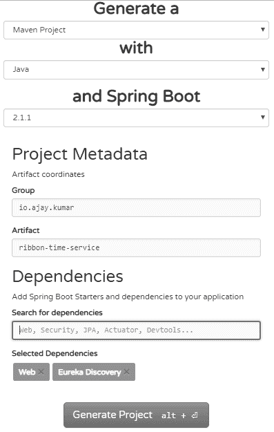

一旦填写完所有内容，点击 Generate Project 按钮，它将为你创建并下载一个 zip 包。仍在 SPRING INITIALIZR 页面上，将 artifact 名称从`ribbon-time-service`更改为`ribbon-time-app`。然后，在 Dependencies 部分，添加对`Ribbon`的新依赖。

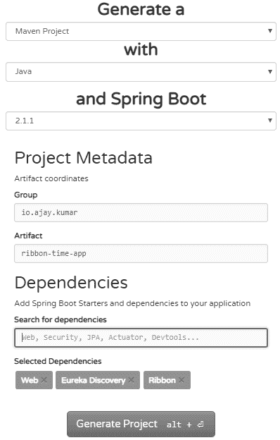

再次，一旦填写完所有内容，点击 Generate Project 按钮，那将为你创建并下载一个 zip 包。解压这两个 zip 文件并回到你的 IDE。我已经导入了`ribbon-time-service`和`ribbon-time-app`。在 Package Explorer 的空白区域点击右键，转到 Import，选择 Existing Maven Projects，点击 Next，点击 Browse，浏览到下载的 zip 包所在位置，点击 Open，然后点击 Finish。我们将先处理`ribbon-time-service`，因此展开项目并打开主应用程序类。

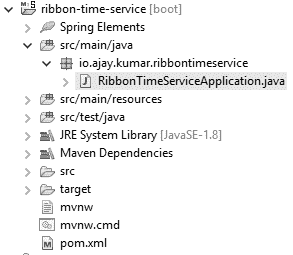

在主应用程序类中，添加两个注解：`@RestController`注解和`@EnableDiscoveryClient`注解。

```java
package io.ajay.kumar.ribbontimeservice;

import java.util.Date;
import org.springframework.beans.factory.annotation.Value;
import org.springframework.boot.SpringApplication;
import org.springframework.boot.autoconfigure.SpringBootApplication;
import org.springframework.cloud.client.discovery.EnableDiscoveryClient;
import org.springframework.web.bind.annotation.GetMapping;
import org.springframework.web.bind.annotation.RestController;

@RestController
@EnableDiscoveryClient
@SpringBootApplication
public class RibbonTimeServiceApplication {

    @Value("${server.port}")
    private int port;

    public static void main(String[] args) {
        SpringApplication.run(RibbonTimeServiceApplication.class, args);
    }

    @GetMapping
    public String getTime() {
        return "The current time is "+ new Date().toString() + "(answered by service running on "+port+")";
    }
}
```

然后我们需要添加一个请求处理方法，所以按几次回车键并输入`public String getTime()`。我们将为它加上快捷注解`@GetMapping`，这只是一个 GET 请求的映射。然后，在方法体中，我们将返回`The current time is`，并创建一个新的`Date`对象将其转换为字符串。为了演示的目的，我们想知道是哪个实例在响应请求。目前我们没有办法判断。我们无法区分它们。因此，我们将对响应进行一项添加。我们将说`+ answered by service running on`，然后我们有一个`port`变量，然后关闭括号。由于我们的每个服务必须运行在不同的端口上，我们可以区分每一个。所以让我们确保我们定义了该端口变量。回到这里并添加`private int port`，然后我们为它加上`@Value`注解。我们将使用`server.port`变量注入它。在启动之前，我们需要在`application.properties`中配置一些属性。所以关闭该文件并打开`src/main/resources`并打开`application.properties`文件。

```properties
spring.application.name=time-service
eureka.client.service-url.defaultZone=http://localhost:8761/eureka
```

在`application.properties`中，我们将设置两个属性。第一个是`spring.application.name`属性，我们将将其设置为`time-service`。我们要设置的第二个属性是配置服务发现服务器的位置，即`eureka.client.service-url.defaultZone`。然后将其设置为`localhost:8761/eureka`。现在我们已经有了启动`ribbon-time-service`所需的所有内容，所以可以关闭此窗口并将其最小化。

我们要做的第一件事是启动发现服务器。因此，展开`discovery-server`项目并导航到主应用类。右键点击主应用类，选择`Run As`，`Spring Boot App`。继续最小化`discovery-server`并展开`ribbon-time-service`，导航到主应用类，右键点击它，选择`Run As`，然后选择`Run Configurations`。

由于我们要启动两个`ribbon-time-service`实例，我们需要配置两个不同的运行配置。所以，如果你来到这里点击`New launch configuration`按钮并点击它，它将为你创建一个新的运行配置。我们将其重命名为`ribbon-time-service-1`。然后对于`Project`，我们确保选择了`ribbon-time-service`，对于`Main type`，点击`Search`并定位到`RibbonTimeServiceApplication`。

在`Override properties`区域中，我们将设置`server.port`，并将其设置为`4444`。点击`Apply`，然后我们将复制此配置，并将服务器端口从所有的 4 改为所有的 5。所以，来到这里点击`Duplicate configuration`按钮并点击它，将名称从`ribbon-time-service-1`改为`-2`，并将端口从所有的 4 改为所有的 5。

一旦你完成了所有配置，就可以突出`ribbon-time-service-1`并点击`Run`。然后对于第二个实例，右键点击主应用类，进入`Run As`，找到`Run Configurations`，突出`ribbon-time-service-2`并点击`Run`。为了确保一切运行正常，请打开浏览器并访问`localhost:4444`。

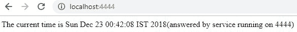

执行相同的操作，但将那些 4 改为所有的 5。

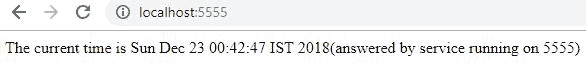

你应该从每个服务获得响应，其中包含当前时间，然后是当前时间由服务回答以及相应的端口。我们还可以快速检查每个服务是否已自行注册到服务发现服务器。因此，打开一个新标签页并访问`localhost:8761`。

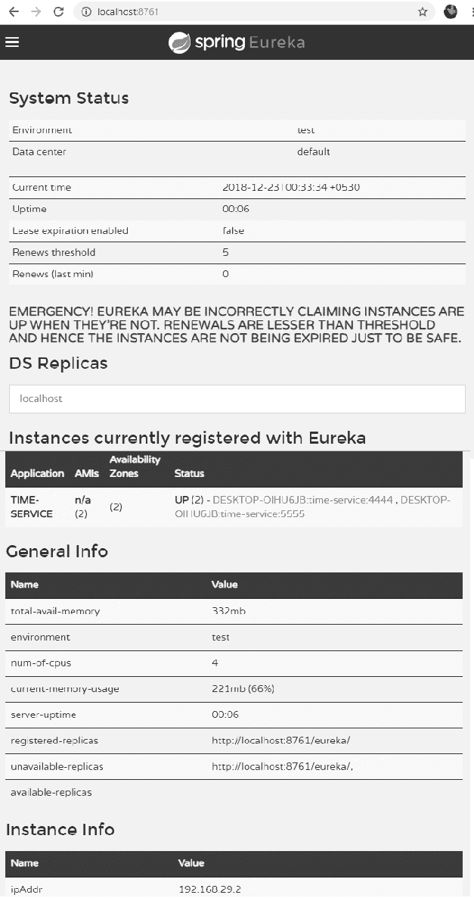

如果你向下滚动到“Instances currently registered with Eureka”标题下，你将看到应用程序`TIME-SERVICE`，你会看到有两个实例。它们都是`UP`状态。其中一个运行在 5 端口上，另一个运行在 4 端口上。

我们现在回到了 IDE 中，到目前为止，我们所做的只是设置了`ribbon-time-service`的多个实例，并让每个实例都注册到服务发现服务器。我们现在准备好开发这部分代码了，我们将使用`Ribbon`在每个`ribbon-time-service`实例之间进行负载均衡。

在`Package Explorer`的`ribbon-time-app`下，展开它并导航到主应用类。继续展开主应用类以便给我们留出更多空间。就像我们对`ribbon-time-service`执行的那样，我们将添加两个注解：首先是`@RestController`注解，第二个是`@EnableDiscoveryClient`注解。接下来我们将注入一个`RestTemplate`，即`private RestTemplate`，并确保它标记了`@Inject`注解。现在还没有东西提供这个`RestTemplate`，所以我们将创建一个方法，返回一个新的作为负载均衡`RestTemplate`的`RestTemplate`。所以，如果你来到这里`main`下方，执行`public RestTemplate()`。然后在方法体内部，你将返回`new RestTemplate`。然后给它加上`@Bean`和`@LoadBalanced`注解。


现在我们还需要一个方法，即 `RequestMapping` 方法，用于实际处理我们 `ribbon-time-app` 的请求。所以来到这里执行 `public String getTime()`，我们将再次对此使用快捷映射注解，即 `@GetMapping`。在方法体内部，我们将使用 `RestTemplate` 调用我们的 `time-service` 并返回结果。所以我们会写 `return restTemplate.getForEntity`。我们将写 `http://`，记住我们在这里使用逻辑标识符，所以我们会写 `time-service`。我们将返回类型设置为字符串，然后确保我们在响应上调用 `getBody()`。

我们现在准备好启动我们的 `ribbon-time-app` 并运行它。让我们取消最大化此窗口并右键点击主应用类，进入 `Run As` 并选择 `Spring Boot App`。接下来，启动浏览器并访问 `localhost:8080`。

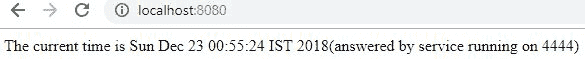

你可以看到来自服务的响应，带有当前时间，然后是当前时间由服务回答以及相应的端口。你可以看到运行在 4 端口上的服务。


我们可以看到它在 5 端口上以轮询方式在实例之间切换。

```java
private int port;

public static void main(String[] args) {
    SpringApplication.run(RibbonTimeServiceApplication.class, args);
}

@GetMapping
public String getTime() {
    return "The current time is "+ new Date().toString()
           +"answered by service running on "+port+")";
}
```

现在关闭该文件，打开 `/src/main/resources/application.properties`，删除设置服务发现服务器位置的属性。

### application.properties

```properties
spring.application.name=time-service
```

删除该属性后，关闭该文件。现在我们已经准备好在没有服务发现的情况下启动 `ribbon-time-service`。如果你移动到绿色的运行按钮并点击小下拉箭头，你会看到我们过去使用的所有的运行配置。因此，我们想要使用这些 `ribbon-time-services` 来启动每个实例。我们先启动 `ribbon-time-service-1`，然后启动 `ribbon-time-service-2`。为了确保我们的 `ribbon-time-service` 实例启动正常，让我们进行快速的检查。访问 `localhost:4444`，它在那里运行。然后打开一个新标签页访问 `localhost:5555`，它也在那里运行。所以我们的 `ribbon-time-service` 一切都正常了。接下来，我们将最小化 `ribbon-time-service` 项目并打开 `ribbon-time-app`。一旦打开它，请导航到主应用程序类。

```java
@RestController
@RibbonClient(name="time-service")
@SpringBootApplication
public class RibbonTimeAppApplication {

    @Inject
    private RestTemplate restTemplate;

    public static void main(String[] args) {
        SpringApplication.run(RibbonTimeAppApplication.class, args);
    }

    @GetMapping
    public String getTime() {
        return restTemplate.getForEntity("http://time-service", String.class).getBody();
    }

    @Bean
    @LoadBalanced
    public RestTemplate restTemplate() {
        return new RestTemplate();
    }
}
```

就像我们对 `ribbon-time-service` 执行的一样，我们想要删除这个 `@EnableDiscoveryClient`。现在我们将添加一个新注解，即 `@RibbonClient` 注解，并将 `name` 元素设置为字符串 `time-service`。这与我们使用服务发现时使用的 `time-service` 是同一个，我们将以几乎相同的方式使用它。我们将在 `RestTemplate` 的 URL 中将其作为逻辑服务标识符进行引用，然后在配置中配置代表该服务的特定实例。现在关闭此文件并打开我们的 `/src/main/resources` 和我们的 `application.properties`。

### application.properties

```properties
time-service.ribbon.eureka.enabled=false
time-service.ribbon.listOfServers=http://host:4444, http://host:5555
```

在我们的 `application.properties` 中，我们将为所有用于配置 Ribbon 客户端的属性加上 Ribbon 客户端的名称前缀。在本例中，我们使用 `time-service`。因此我们将写下 `time-service-ribbon-eureka-enabled=false`。这就是告诉 Ribbon 不要使用服务发现的属性。我们还有一个 `time-service.ribbon.listOfServers=http://host:4444, http://host:5555`。为了确保我们的 `ribbon-time-service` 实例启动正常，让我们进行快速的检查。访问 `localhost:4444`，它在那里运行。然后打开一个新标签页访问 `localhost:5555`，它也在那里运行。所以我们的 `ribbon-time-service` 一切都正常了。

有一个 `RoundRobinRule` 实现，顾名其义，它是轮询均衡算法的实现，将负载均匀地分布在所有实例之间。还有一个 `ResponseTimeWeightedRule` 实现，它也是一种轮询算法，但它会根据每个实例的平均响应时间动态分配权重。还有一个 `RandomRule` 实现，它只是随机选择一个实例来发送流量。还有 `ZoneAvoidanceRule`，它也是一个轮询算法实现；然而，它会根据 AWS 区域和可用性过滤掉发送流量的服务器。让我们来看一个例子让它变得更具体。

```java
@Configuration
public class OtherServiceConfig{
    @Bean
    public IRule ribbonRule(){
        return new RoundRobinRule();
    }
}
```

例如，如果我们想覆盖默认的 `IRule` 以使用 `RoundRobinRule` 实现，我们需要定义一个带有 `@Bean` 注解的新方法，并返回一个新的 `RoundRobinRule`。

### 自定义你的 RibbonClient 配置：IPing Bean

`IPing` Bean 负责选择策略来检查被负载均衡的给定实例的存活或可用性。就像 `IRule` Bean 一样，你也可以实现自己的自定义 `IPing` 实现，或者从几个不同的默认实现中进行选择。让我们来看看有哪些可用选项。

* `IPingImplementations`
* `DummyPing`
* `PingUrl`
* `NIWSDiscoveryPing`

有一个 `DummyPing` 实现，它就像名字听起来一样“傻”。当被询问服务的存活情况时，它始终返回 `true`。如果你根本不在乎检查存活或可用性，并且无论如何都想向所有实例发送流量，就可以使用它。有一个 `PingUrl` 实现，它允许你设置一个预期的响应，然后对服务进行实际 HTTP 调用并检查结果。因此，你通常会将它指向类似服务的健康检查 URL。然后是 `DiscoveryPing` 实现，如果你使用像 Eureka 服务发现这样的工具，它将自动为你配置。它的作用是只需咨询发现客户端来确定任何特定实例的存活状态。再次，让我们来看一个例子让它变得更具体。

### IPing：存活检查

```java
@Configuration
public class OtherServiceConfig{
    @Bean
    public IPing ribbonPing(){
        PingUrl pingUrl=new PingUrl();
        pingUrl.setExpectedContent("true");
        return pingUrl;
    }
}
```

所以，就像我们处理 `IRule` 实现时一样，你会定义一个带有 `@Bean` 注解的新方法，然后返回你选择的实现。在这种情况下，我们将返回一个 `PingUrl`。所以我们创建一个 `PingUrl` 的新实例，将预期内容设为 `true`，然后返回该实例。

### 演示：自定义 RibbonClient 负载均衡策略

在本次演示中，我们将学习如何自定义我们用于调用 `ribbon-time-service` 的 Ribbon 客户端。再次，我们将在之前的演示的基础上进行构建。因此，请确保你已经完成了不使用服务发现设置 Ribbon 的演示。我们要做的第一件事是来到这里的绿色播放按钮，并启动 `ribbon-time-service` 的每个实例。两个 `ribbon-time-service` 实例都启动了。现在记住，为了为 Ribbon 创建自定义配置，我们需要创建自己的 `@Configuration` 类。打开 `ribbon-time-app` 项目并创建一个新包。右键点击，New，然后选择 Package。我们实际上会将此包名从 `io.ajay.kumar` 重命名为 `io.ajay.config.kumar`。记住，我们想要一个不同的包名，这样 `@Configuration` 类就不会受到组件扫描的影响；否则，它将应用于我们所有的 Ribbon 客户端。在新包中，右键点击进入 New 并选择 Class。我们将此命名为 `RibbonTimeConfig` 类。点击 Finish。

```java
package io.ajay.config.kumar;

import org.springframework.context.annotation.Bean;
import org.springframework.context.annotation.Configuration;
import com.netflix.loadbalancer.IRule;
import com.netflix.loadbalancer.RandomRule;

@Configuration
public class RibbonTimeConfig {
    @Bean
    public IRule ribbonRule() {
        return new RandomRule();
    }
}
```

然后我们当然要为这个类加上 `@Configuration` 注解。在本次演示中，我们将自定义负载均衡策略。所以我们来到这里并定义一个新的 `IRule`。我们写下 `public IRule`，并将其命名为 `ribbonRule`。在方法体中，我们写下 `return new RandomRule`。这将随机选择一个实例发送流量，而不是像我们之前使用的那样在每个实例之间进行均衡。最后，确保不要忘记向我们的方法添加 `@Bean` 注解。我们完成了，现在可以关闭这个。打开 `RibbonTimeApplication`。

```java
@RestController
@RibbonClient(name = "time-service", configuration=RibbonTimeConfig)
@SpringBootApplication
public class RibbonTimeApplication {
    @Inject
    private RestTemplate restTemplate;

    public static void main(String[] args) {
        SpringApplication.run(RibbonTimeApplication.class, args);
    }

    @GetMapping
    public String getTime() {
        return restTemplate.getForEntity("http://time-service", String.class).getBody();
    }

    @Bean
    @LoadBalanced
    public RestTemplate restTemplate() {
        return new RestTemplate();
    }
}
```

在 `RibbonClient` 注解上添加一个新的配置元素，并将其设置为我们设置的自定义配置类 `RibbonTimeConfig`。我们现在准备好启动应用程序并测试我们的自定义配置了。关闭这里，右键点击主应用程序类，选择 Run As -> Spring Boot App。打开浏览器并访问 `localhost:8080`。

正如你看到的，我们收到了来自端口全为 5 的实例的响应。如果我们刷新页面，将会看到来自全为 4 的实例的响应。

但如果我们继续刷新，会发现它不再像以前那样在每个实例之间均匀均衡。

### 总结

我们已经到了本模块的结束，让我们快速回顾一下我们学到的内容。

* 客户端与服务器端负载均衡的区别
* Netflix Ribbon
* `@LoadBalanced` & `@RibbonClient`
* 有无服务发现
* 自定义 Ribbon 客户端

我们首先讨论了什么是负载均衡，以及客户端与服务器端负载均衡的区别。然后我们引入了 Netflix Ribbon 项目，并学习了如何使用 `@LoadBalanced` 和 `@RibbonClient` 注解在有无服务发现的情况下设置客户端负载均衡。在最后部分，我们查看了如何使用 `@RibbonClient` 注解配合独立的 `@Configuration` 类来为特定的 Ribbon 客户端设置自定义配置。

我们将从关于云原生或分布式系统中故障的简短章节开始本模块。我们将探讨为什么故障会更加普遍，并理解一种被称为级联故障的常见副作用。然后，我们将介绍并理解断路器模式（Circuit Breaker pattern），并学习它如何帮助我们构建更具容错性的服务。接下来，我们将深入研究 Netflix Hystrix，它是一个容错库，其中就实现了断路器模式。我们将看到 Spring Cloud 如何通过 `@EnableCircuitBreaker` 注解让我们轻松上手，然后理解如何使用 `@HystrixCommand` 注解在我们自己的服务中实现断路器模式。最后，我们将通过 Hystrix 的一个非常棒的功能——Hystrix Dashboard 来结束本模块。我们将学习如何启用它、指标是如何收集的、如何解释这些结果，以及如何使用 Netflix 的另一个项目 `Turbine` 来聚合这些结果。

### 级联故障与资源过载

在分布式系统中，如果我们说有什么事情是可以 100% 肯定的，那就是故障是不可避免的。但为什么呢？嗯，故障可能发生在系统的许多不同层面。

### 可能发生故障的领域

* 硬件故障
* 网络故障
* 软件故障

硬件可能会故障，网络可能会故障，软件肯定会故障。分布式系统在这一点上也无不同，但故障发生的概率简单来说大得多。你有更多的硬件、更多的网络和更多的软件。随着这些数量的增加，故障的概率也随之增加。增加故障概率的因素还有分布式系统中进程之间的通信方式。曾经在进程内部进行的进程通信现在是在跨网络完成的。尽管我们现在的网络已经很有弹性了，但跨网络通信故障的概率仍然比进程内通信高得多。分布式系统中故障的一个特别糟糕的副作用是级联故障（cascading failure）。级联故障是指系统中的一种故障，其中一个系统的故障会像多米诺骨牌一样级联到系统的其他部分，导致它们也失败。为了更具体一点，假设你有三个服务：`Service A`、`Service B` 和 `Service C`。`Service A` 调用 `Service B`，而 `Service B` 调用 `Service C`。假设 `Service C` 内存耗尽，为 `Service B` 提供服务的速度非常慢。尽管 `Service B` 可能为调用 `Service C` 设置了超时，但有足够的请求在 `Service B` 上堆积，且这些请求需要足够快的速度使用 `Service C`，那么在超时之前，`Service B` 的资源就会被完全耗尽，反而导致 `Service B` 失败。同样的问题可能会沿着整个链条向上发生。

### 多个问题的共同作用

* 容错问题
* 资源过载问题

这里涉及到多个问题。首先，我们面临容错问题。调用方并不知道它们正在调用的服务可能会失败，但它们仍然尝试调用该服务。其次，我们面临资源过载问题。调用方被允许在资源几乎无限制的情况下调用依赖服务。

# 使用断路器模式拥抱故障

* 学会接受故障
* 容忍故障
* 优雅降级
* 限制消耗
* 约束使用


那么，我们如何解决分布式系统中的级联故障和一般的故障问题呢？嗯，我们必须学会接受并容忍故障，并在故障发生时进行优雅降级。因此，当下游依赖服务发生故障时，调用者不尝试调用那个可能失败的依赖服务实际上更好。相反，调用者应该快速失败或优雅降级，例如通过返回旧数据或空结果，并允许故障的服务恢复。然后定期检查服务是否已恢复。反过来，这样做可以减轻任何等待响应的上游服务的压力。我们还需要做的另一件事是限制所消耗的资源。因此，客户端应该对调用依赖服务的允许资源数量设置限制。这样做可以防止这些请求无限制地堆积，否则可能会导致客户端本身也失败。容错的第一种策略实际上是一个广为人知的模式，以至于它有自己的名字。它被称为断路器模式（Circuit Breaker pattern）。断路器模式是现代软件中的一种设计模式，用于检测故障并封装防止这些故障不断重新发生的逻辑。“断路器”这个名称源于该模式与真实断路器的工作方式有许多相似之处。你可能熟悉也可能不熟悉什么是断路器，所以让我快速解释一下。断路器是一个防止过多电流流过电路的开关。如果流过电流过多，可能会导致损坏甚至引发火灾。断路器的作用是在检测到流过电流过多时通过断开电路来防止这种情况发生。你很可能家里也有这样的东西来防止电路过载。如果你注意的话，你会发现所有的开关都是向下拨动的，因此所有电路都是闭合的。假设你不小心插入一个高耗电设备导致最右侧的电路过载。断路器会检测到这一点并中断电路或将其打开，防止任何额外的电流流过。你可以看到开关被向上拨起，表示电路已断开，不再有电流流过。到这里，我信你已经看到了真实断路器与断路器模式之间的共同点。它们都是为了检测和防止可能损坏其他组件的故障。

## 使用 Netflix Hystrix 和 Spring Cloud 实现容错

Spring Cloud 借助 Netflix 的一个名为 Netflix Hystrix 的库来实现容错。Hystrix 是一个延迟和容错库，它的设计目的是为了停止级联故障并实现分布式系统的弹性。

- 实现断路器模式
- 封装调用并监控故障
- 10 秒滚动窗口
- 20 个请求量
- >= 50% 错误率
- 等待 5 秒后尝试单次请求
- 回退机制 (Fallbacks)
- 服务免于过载
- 线程池、信号量与级联故障

它是断路器（Circuit Breaker）模式的一种具体实现，允许你轻松地封装调用，并在给定的滚动窗口内自动监控是否达到特定数量和空气百分比阈值的失败情况。滚动窗口的默认值为 10 秒，且请求量必须至少达到 20 次。如果请求的错误率达到 50% 或以上，断路就会触发，不再允许任何请求通过。例如，如果你在 10 秒的窗口内有 1000 次请求，其中 500 次是错误，那么断路就会触发。Hystrix 会定期检查断路是否应该关闭，其方法是每 5 秒允许一个请求通过。这是默认设置。如果该请求成功，它将关闭断路；如果失败，它将继续保持开启状态。任何被短路、超时、被拒绝或失败的请求都获得机会执行所谓的“降级方法（fallback method）”。正如我之前提到的，降级可能类似于返回缓存数据、默认值，或者仅仅是一个空响应。除了断路器模式外，Hystrix 还具有保护服务免于过载的额外功能。所有 Hystrix 封装的调用都受到线程池或信号量的限制。此举的作用是限制资源使用（正如我们之前讨论的那样），防止请求堆积并消耗所有宝贵资源。在所有可用资源都已耗尽的情况下，任何新请求将立即失败并执行降级方法（如果可用的话）。

## 使用 Spring Cloud 和 Netflix Hystrix

使用 Spring Cloud 和 Netflix Hystrix 非常简单。在我们深入之前，先简单说明一下：我将解释启动所需的所有步骤，并在最后带你通过一个演示，你大可以在那里跟着操作。在本模块的剩余部分中，我将遵循这一模式，所以请记住这一点。

### pom.xml

```xml
<dependencyManagement>
    <dependencies>
        <dependency>
            <groupId>org.springframework.cloud</groupId>
            <artifactId>spring-cloud-dependencies</artifactId>
            <version>Camden.SR2</version>
            <type>pom</type>
            <scope>import</scope>
        </dependency>
    </dependencies>
</dependencyManagement>
```

就像使用所有其他 Spring Cloud 项目一样，你首先要在`pom.xml`的`dependencyManagement`部分包含`spring-cloud-dependencies`依赖。一如既常，确保它的类型为`pom`且范围（scope）为`import`。

```xml
<dependency>
    <groupId>org.springframework.cloud</groupId>
    <artifactId>spring-cloud-starter-hystrix</artifactId>
</dependency>

<dependency>
    <groupId>org.springframework.boot</groupId>
    <artifactId>spring-boot-actuator</artifactId>
</dependency>
```

然后，在你的`pom.xml`的`dependency`部分，定义对`spring-cloud-starter-hystrix`的新依赖。如果你能够获取 Hystrix 调用的指标，还需要包含对`spring-boot-actuator`的依赖。

```java
@SpringBootApplication
@EnableCircuitBreaker
public class Application{
    public static void main(String[]args){
        SpringApplication.run(Application.class,args);
    }
}
```

在你的主`Application`类中，你定义了一个新注解，即`@EnableCircuitBreaker`注解。

```java
@Service
public class Service{
    @HystrixCommand(fallbackMethod="somethingElse")
    public void doSomething(){
        …
    }

    public void somethingElse(){
        …
    }
}
```

然后，在你的`@Component`或`@Service`类中，找到你想用 Hystrix 封装的方法（在我们的案例中，这是一个名为`doSomething`的方法），并在该方法上加上`@HystrixCommand`注解。然后，在`@HystrixCommand`注解上定义一个名为`fallbackMethod`的新属性，并将其设置为在发生故障时想要回退的方法名称。在代码方面，就是只有这些了。

- 小心 Hystrix 超时
- 确保超时包含了调用者超时加上任何重试时间
- 默认值：1000ms
- `hystrix.command.default.execution.isolation.thread.timeoutInMilliseconds=<timeout_ms>`

但有一个必须注意的陷阱，就是关于 Hystrix 超时的。你需要确保你的 Hystrix 超时包含了调用者超时加上任何重试时间，然后再留出一点缓冲区。默认超时设置为 1000ms（即 1 秒），如果你需要更改它，可以使用这个长属性来设置毫秒单位的超时。

### 演示：使用 Netflix Hystrix 实现容错

在这个演示中，我们将构建一个简单的天气服务，返回随机的天气状况，然后我们在另一个名为`weather app`的应用中使用该服务。在`weather app`中，我们将使用 Hystrix 保护对天气服务的调用，并在天气服务宕机或无响应时实现降级处理。我们将使用服务发现功能来从`weather app`定位天气服务。

前往`start.io`。在`Group`部分，将组更改为`ajay.kumar`，然后将`artifactId`名称为`weather-service`。在`Dependencies`部分，添加`Web`和`Discovery`。填写完成后，点击`Generate`按钮，它会创建一个压缩包。

我们还将使用该页面生成`weather app`，因此在同一页面将`artifactId`从`weather-service`改为`weather-app`。在`Dependencies`部分，添加`Hystrix`和`Actuator`。同样，填写完成后，点击`Generate`按钮，它会创建并下载该压缩包。

解压这两个压缩包并回到你的 IDE。在 IDE 中，右键点击空白处选择`Import` -> `Existing Maven Projects`，点击`Next`，浏览到下载的压缩包位置，然后点击`Finish`。在导入天气服务后，对`weather app`重复相同过程。我已经将两个项目都导入了 IDE。

我们将首先开发天气服务，所以展开`weather-service`并导航到主类。

```java
package io.ajay.kumar.weatherservice;

import java.util.concurrent.ThreadLocalRandom;
import org.springframework.boot.SpringApplication;
import org.springframework.boot.autoconfigure.SpringBootApplication;
import org.springframework.cloud.client.discovery.EnableDiscoveryClient;
import org.springframework.web.bind.annotation.GetMapping;
import org.springframework.web.bind.annotation.RestController;

@SpringBootApplication
@RestController
@EnableDiscoveryClient
public class WeatherServiceApplication {
    private String[] weather = new String[] { "sunny", "cloudy", "rainy", "windy" };

    public static void main(String[] args) {
        SpringApplication.run(WeatherServiceApplication.class, args);
    }

    @GetMapping("/weather")
    public String getWeather() {
        int rand = ThreadLocalRandom.current().nextInt(0, 4);
        return weather[rand];
    }
}
```

在主应用程序类中，定义两个新注解：`@RestController`注解和`@EnableDiscoveryClient`注解。然后，在类顶部定义一个新的字符串数组，即`private String[] array`。将其命名为`weather`，然后我们将它设置为四个不同的值。我们将其设置为`sunny`、`cloudy`、`rainy`和`windy`。接下来，我们将定义一个`getWeather`方法。来到这里底部输入`public String getWeather()`。这将是我们的处理方法，所以让我们用`@GetMapping`对此进行注。。我们将 URL 设置为`/weather`。在方法体中，我们将选择一个 0 到 4 之间（不包含 4）的随机数，然后用它来选择一个随机天气值。我们写`int rand = ThreadLocalRandom.current().nextInt(0, 4)`并给它一个从 0 到 4 的边界。然后，我们将返回`weather[rand]`来选取一个随机天气值。我们的天气服务的代码部分就这些了。

接下来，我们还需要进行一些配置。请导航到`src/main/resources`并打开`application.properties`。

### application.properties

```
server.port=9000
spring.application.name=weather-service
eureka.client.service-url.defaultZone=http://localhost:8761/eureka
```

在`application.properties`中，首先我们将设置`server.port`，将其设置为`9000`。然后我们将设置`spring.application.name`属性，将其设置为`weather-service`。最后一个设置的属性是服务发现服务器的位置。因此，将那个长的`eureka.client`属性设置为`http://localhost:8761/eureka`。

我们现在已经完成了天气服务，所以让我们快速启动它并确保一切运行正常。请关闭这两个文件并打开`discovery-server`。导航到该主应用程序类，右键点击它，选择`Run As`，选择`Spring Boot App`。一旦服务发现服务器启动，导航到`weather-service`的主应用程序类，右键点击它，`Run As`，`Spring Boot App`。接下来，打开浏览器并访问`http://localhost:9000/weather`。

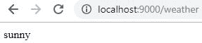

只需确保你在这里收到了响应即可。你可以刷新几次，看看你是否获得了不同的响应。现在我们的天气服务已经运行了，让我们回到 IDE 并在我们的天气应用中使用它。

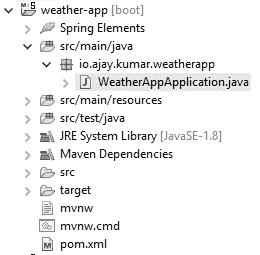

回到你的 IDE 中，展开`weather-app`并导航到主应用程序类。在主应用程序类中，我们将定义三个新注解。

```java
package io.ajay.kumar.weatherapp;

import org.springframework.boot.SpringApplication;
import org.springframework.boot.autoconfigure.SpringBootApplication;
import org.springframework.cloud.client.circuitbreaker.EnableCircuitBreaker;
import org.springframework.cloud.client.discovery.EnableDiscoveryClient;
import org.springframework.cloud.client.loadbalancer.LoadBalanced;
import org.springframework.context.annotation.Bean;
import org.springframework.web.bind.annotation.RestController;
import org.springframework.web.client.RestTemplate;

@SpringBootApplication
@EnableCircuitBreaker
@EnableDiscoveryClient
@RestController
public class WeatherAppApplication {
    public static void main(String[] args) {
        SpringApplication.run(WeatherAppApplication.class, args);
    }

    @Bean
    @LoadBalanced
    public RestTemplate restTemplate() {
        return new RestTemplate();
    }
}
```

第一个是`@EnableCircuitBreaker`注解，下一个是`@EnableDiscoveryClient`注解，最后一个是`@RestController`注解。接下来，我们将定义一个`RestTemplate`以便我们可以调用天气服务，所以来到这里写`public RestTemplate restTemplate()`并将其命名为`restTemplate`。用`@Bean`注解和`@LoadBalanced`注解对其标注。然后，在方法体中，`return new RestTemplate()`。

现在记住`Hystrix`命令只能在`@Component`或`@Service`类中定义，所以回到这里创建一个新类。右键点击，选择`New`，选择`Class`，我们将其命名为`WeatherService`。


```java
package io.ajay.kumar.weatherapp;

import javax.inject.Inject;
import org.springframework.stereotype.Service;
import org.springframework.web.client.RestTemplate;
import com.netflix.hystrix.contrib.javanica.annotation.HystrixCommand;

@Service
public class WeatherService {
    @Inject
    private RestTemplate restTemplate;

    @HystrixCommand(fallbackMethod = "unknown")
    public String getWeather() {
        return restTemplate.getForEntity("http://weather-service/weather", String.class).getBody();
    }

    public String unknown() {
        return "unknown";
    }
}
```

在类顶部，用`@Service`对其进行标注。接下来我们需要我们的`RestTemplate`，以便我们可以调用天气服务，所以来到这里写`private RestTemplate restTemplate`。用`@Inject`注解对其标注。然后我们需要一个方法来调用天气服务，所以下面写`public String getWeather()`。在方法体中，我们将返回`restTemplate.getForEntity`。URL 使用`http://weather-service/weather`，返回类型将是`String.class`。然后我们将确保调用`.getBody()`来获取响应。在方法顶部，我们需要用`HystrixCommand`对其标注，并指定`fallbackMethod = "unknown"`。然后我们将定义一个新方法，`public String unknown()`。这将是一个非常简单的方法。它将返回字符串 "unknown"。为了清晰起见，我们在主应用程序类中使用这个`WeatherService`来获取实际天气。如果获取天气出现问题或`WeatherService`宕机，它将调用该`fallbackMethod`并返回 unknown。

```java
@SpringBootApplication
@EnableCircuitBreaker
@EnableDiscoveryClient
@RestController
public class WeatherAppApplication {
    @Inject
    private WeatherService weatherService;

    public static void main(String[] args) {
        SpringApplication.run(WeatherAppApplication.class, args);
    }

    @GetMapping("/current/weather")
    public String getWeather() {
        return "The current weather is " + weatherService.getWeather();
    }

    @Bean
    @LoadBalanced
    public RestTemplate restTemplate() {
        return new RestTemplate();
    }
}
```

天气应用的属性与天气服务中的属性非常相似，所以我直接把它们复制并粘贴到这里。然后，我们只需要更改其中的一些值。对于`server.port`，我们将将其更改为`8000`；对于`spring.application.name`，我们将将其更改为`weather-app`。我们已经准备好启动天气应用了，请关闭该文件并打开控制台（Console）。仔细检查你的发现服务器和天气服务是否仍在运行，然后回到主`WeatherAppApplication`类，右键点击它，选择`Run As`（运行），并选择`Spring Boot App`。接下来，打开浏览器并访问`localhost:8000/current/weather`。

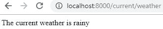

你应该会在这里得到一个响应。你可以刷新几次来查看不同的值。接下来，我们要做的是关闭天气服务。我们会看到`Hystrix`接管并识别出天气服务已关闭，然后返回我们的回退级方法（fallback method）。因此，在关闭天气服务后，我们应该看到当前天气为未知（unknown）。现在我们回到 IDE，控制台中显示着天气服务。我们将停止天气服务并回到浏览器。回到浏览器后，我们刷新页面，可以立即看到当前天气为未知。

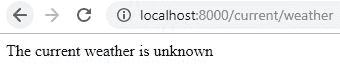

`Hystrix`意识到对天气服务的调用正在失败，它应该使用它的回退方法。

## 使用 Hystrix Dashboard 进行指标监控和洞察

Netflix `Hystrix`跟踪受保护调用的执行状态，以便它知道何时触发断路器。此的优点之一是我们可以利用这些指标来洞察调用的运行情况。以原始形式读取这些指标既不利也不高效。这就是`Hystrix Dashboard`派上用场的地方。它是一个 Web 应用程序，帮助你以快速、易用的方式可视化所有这些指标。仪表板充满了信息。

- 跟踪指标，例如：
  - 断路器状态（Circuit state）
  - 错误率（Error rate）
  - 流量负载（Traffic volume）
  - 成功请求（Successful requests）
  - 被拒绝的请求（Rejected requests）
  - 超时（Timeouts）
  - 延迟百分位数（Latency percentiles）
- 监控受保护的调用（Monitor protected calls）
- 单个服务器或集群（Single server or cluster）

它跟踪并显示断路器状态的信息（无论是开启还是关闭）、调用的错误率、它接收的流量负载、有多少个请求成功、被拒绝或超时，以及调用的延迟百分位数。你还可以用它来跟踪单个服务器或服务器集群。要使用它，实际上只需在你的`pom.xml`中声明几个依赖并添加单个注解即可。

### 使用 Spring Cloud 和 Netflix Hystrix Dashboard

为了使用`Hystrix Dashboard`，你首先需要像往常一样，在`pom.xml`的`dependencyManagement`部分声明一个`spring-cloud-dependencies`的新依赖。

`pom.xml`

```xml
<dependencyManagement>
    <dependencies>
        <dependency>
            <groupId>org.springframework.cloud</groupId>
            <artifactId>spring-cloud-dependencies</artifactId>
            <version>Camden.SR2</version>
            <type>pom</type>
            <scope>import</scope>
        </dependency>
    </dependencies>
</dependencyManagement>
```

并且，一如既往，确保它的类型为`pom`且范围（scope）为`import`。

`pom.xml`

```xml
<dependency>
    <groupId>org.springframework.cloud</groupId>
    <artifactId>spring-cloud-starter-hystrix-dashboard</artifactId>
</dependency>
```

然后，仍然在`pom.xml`的`dependency`部分，定义对`spring-cloud-starter-hystrix-dashboard`的新依赖。最后，你可能已经猜到了，添加`@EnableHystrixDashboard`注解。

```java
@SpringBootApplication
@EnableHystrixDashboard
public class Application{
    public static void main(String[]args){
        SpringApplication.run(Application.class,args);
    }
}
```

这就是你开始使用`Hystrix Dashboard`需要的所有内容。

## 读取和理解 Hystrix Dashboard

在我们开始设置`Hystrix Dashboard`的演示之前，理解如何读取仪表板非常重要，因为它在非常小的空间内包含了大量信息。

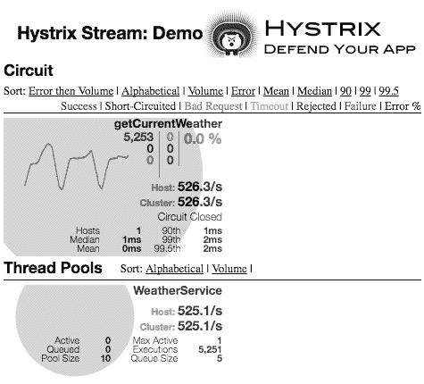

我们将关注`Circuit`（断路器）标题下的上半部分，因为下半部分`Thread Pools`（线程池）非常自言易懂。仪表板字面意义上充满了信息。第一次看到它时可能会有些无从从，所以让我们分部分拆解。在右上角，你有一个受保护的`Hystrix`调名称，在这张图中它是`getCurrentWeather`调用。

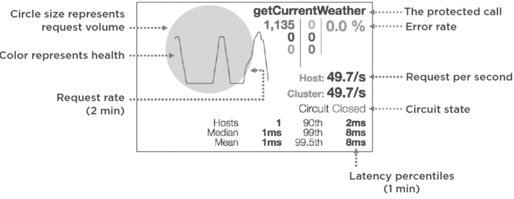

在左侧，有一个圆代表请求量，也代表了调用的健康状况。圆越大，请求量越高；圆越红，调用的健康状况越差。在圆的上方，线条是过去 2 分钟内请求速率的描述。回到右侧，在受保护调用名称下的灰色是调用的错误率。在它下方是主机级别以及集群级别的每秒请求数。继续向下，仍在右侧，你拥有该调用的断路器状态，以及它是开启（open）拒绝流量还是关闭（closed）接受流量。在它正下方是延迟百分位数。回到顶部，受保护调用名称下方有一组不同颜色的数字。让我们放大这个特定区域，以便解释其中的每一个数字。对于数字，我们将按列和按行逐一移动。以防你忘记，`Hystrix Dashboard`顶部有一个图例，看起来像这样。

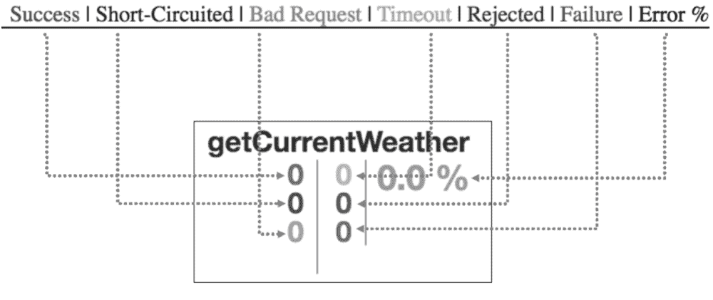

从第一列第一行开始，深绿色数字代表成功请求的数量。在紧随其后的蓝色数字代表短路（short-circuited）请求的数量。这些请求由于断路器开启而根本没有尝试执行。仍在第一列的底部，浅绿色数字代表错误请求（bad requests）的数量。这些请求是错误，但通常不是由于执行失败引起的，而是由于非法参数等原因。移动到第二列第一行，橙色数字代表超时请求的数量。这些请求是尝试了执行，但在规定时间内没有收到响应。在超时请求下方，紫色数字代表被拒绝请求的数量。被拒绝的请求发生在没有更多资源来处理请求时（无论是通过线程池还是信号量）。请记住，请求被拒绝是为了防止请求在调用者处堆积并消耗那些宝贵的资源。第二列最后一个数字（红色的）是失败请求的数量。这些请求是因为抛出异常而未能执行的。

在本演示中，我们将利用`Hystrix Dashboard`查看从天气应用到天气服务的受`Hystrix`保护调用的某些指标。首先，如果你的服务和发现服务器尚未运行，你需要启动它们中的每一个。我们将先从发现服务器开始。

### 启动服务

我们先从发现服务器开始。展开`discovery-server`项目并导航到主应用程序类。右键点击它，选择`Run As`，然后选择`Spring Boot App`。对`weather service`及其后的`weather app`重复相同的步骤。现在，`weather service`、`weather app`和`discovery server`均已运行。为了双重检查，你可以点击小箭头，看到这些服务中的每一个都已启动。

### 创建 Hystrix Dashboard 项目

接下来，打开网络浏览器，以便我们创建并下载`Hystrix Dashboard`项目。在浏览器中，访问`start.spring.io`。在`Group`部分，使用`io.ajay.kumar`，然后在`artifact name`中输入`hystrix-dashboard`。在依赖项中，我们输入`Hystrix Dashboard`。

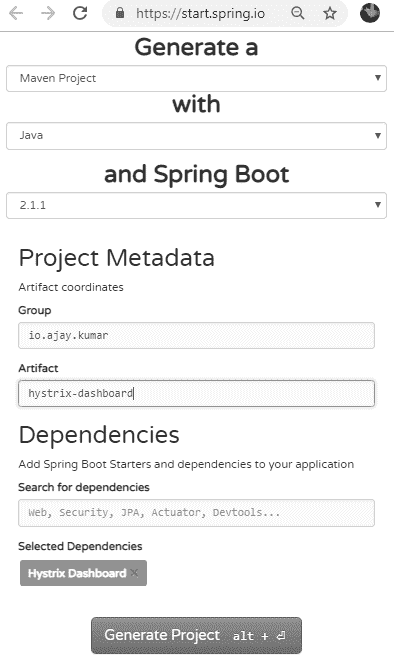

填写好所有内容后，点击`Generate Project`按钮，这将为你创建并下载该 zip 文件。如既常一样，解压 zip 文件并返回你的 IDE。回到 IDE 后，在`Package Explorer`的空白处点击右键，选择`Import`，选择`Existing Maven Projects`，点击`Next`，点击`Browse`，找到下载的 zip 文件，点击`Open`，然后点击`Finish`。

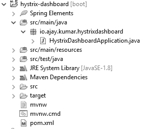

### 配置 Hystrix Dashboard

展开`Hystrix Dashboard`项目并导航到主应用程序类。

```java
package io.ajay.kumar.hystrixdashboard;

import org.springframework.boot.SpringApplication;
import org.springframework.boot.autoconfigure.SpringBootApplication;
import org.springframework.cloud.netflix.hystrix.dashboard.EnableHystrixDashboard;

@SpringBootApplication
@EnableHystrixDashboard
public class HystrixDashboardApplication {
    public static void main(String[] args) {
        SpringApplication.run(HystrixDashboardApplication.class, args);
    }
}
```

在主应用程序类中，我们只需直接添加一个注解，即`@EnableHystrixDashboard`。接下来，我们准备好启动并查看仪表板了。在主应用程序类上，右键点击它，选择`Run As`，选择`Spring Boot App`。接下来，打开浏览器并访问`localhost:8080/hystrix`。

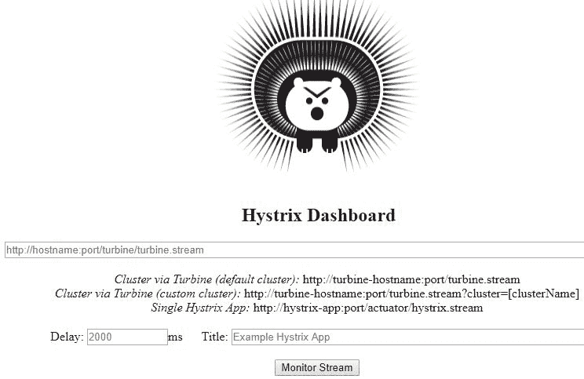

这应该会加载`Hystrix Dashboard`。在我们查看任何指标之前，我们需要实际生成一些指标。因此，打开新标签页并访问你的天气应用`localhost:8000/weather`。

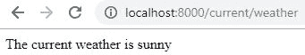

然后只需反复刷新几次以获取一些指标。回到`Hystrix Dashboard`，我们将输入天气应用的`hystrix stream` URL。即`http://localhost:8000/hystrix.stream`。对于仪表板的标题，我们将命名为`Weather App`。接下来，点击`Monitor Stream`按钮，你应该就能看到一些指标。

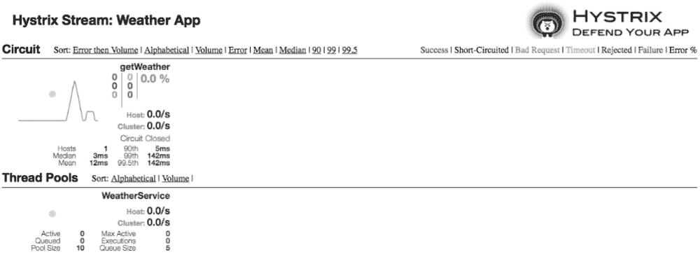

如果你没有看到指标，可以在天气应用和仪表板之间来回，刷新应用以生成指标，然后返回仪表板查看这些请求的效果。

### 使用 Netflix Turbine 聚合 Hystrix 指标

Hystrix 指标是按服务为单位进行跟踪的。现在，单个`hystrix stream`可能包含多个受`hystrix`保护调用的指标，但这些指标仅属于该服务。这意味着的影响是，每个服务都有自己的`hystrix stream` URL，如果你想消费它的指标，就需要使用该 URL。

如果你想跟踪多个服务的指标，就必须打开多个`Hystrix Dashboards`并独立地跟踪它们。我可以想象，如果你的应用程序由几十或上百个服务组成，那将多么痛苦。为了解决这个问题，Netflix 开发了一个名为`Turbine`的工具，它可以将许多`hystrix streams`聚合为了一个。为了让你更好地理解这可能是什么样子，让我们来看`Hystrix Dashboard`的截图。

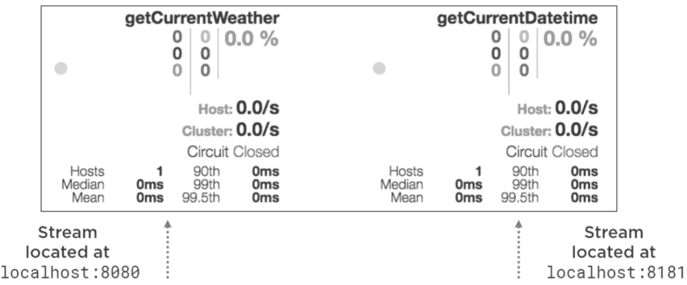

在截图中，你可以看到有两个受保护调用：`getCurrentWeather`调用和`getCurrentDatetime`调用。左侧的保护调用来自位于`localhost:8080`的服务，右侧的来自位于`localhost:8181`的另一个服务。`Turbine`将来自不同服务的这两个指标整合在了一起，可以在同一个仪表板中查看。

### 使用 Spring Cloud 和 Netflix Turbine

那么我们如何开始使用`Turbine`呢？如果你一直跟着这本书学习，你可能已经猜到了。

```xml
<dependencyManagement>
    <dependencies>
        <dependency>
            <groupId>org.springframework.cloud</groupId>
            <artifactId>spring-cloud-dependencies</artifactId>
            <version>Camden.SR2</version>
            <type>pom</type>
            <scope>import</scope>
        </dependency>
    </dependencies>
</dependencyManagement>
```


你首先在`pom.xml`的`dependencyManagement`部分定义`spring-cloud-dependencies`依赖。如既往一样，确保它的类型为`pom`，范围为`import`。

```xml
<dependency>
    <groupId>org.springframework.cloud</groupId>
    <artifactId>spring-cloud-starter-turbine</artifactId>
</dependency>
```

然后，在相同的`pom.xml`的`dependency`部分，定义一个新的`spring-cloud-starter-turbine`依赖。之后，为你的主`Application`类添加一个新的注解`@EnableTurbine`。

```java
@SpringBootApplication
@EnableTurbine
public class Application {
    public static void main(String[] args) {
        SpringApplication.run(Application.class, args);
    }
}
```

最后，我们还有一些需要添加的配置。在你的`application.properties`或`application.yml`中，我们将添加两个新属性。

**application.properties**

```properties
turbine.app-config=<list_of_service_ids>
turbine.cluster-name-expression='default'
```

**或者 application.yml**

```yaml
turbine:
  appConfig: <list_of_service_ids>
  clusterNameExpression: "'default'"
```

除了标准的 Spring 应用名称和发现服务器位置属性外：

第一个属性是`turbine.app-config`，你将其设置为服务 ID 的逗号分隔列表。这些是你用于服务发现的相同`service IDs`。第二个属性`turbine.cluster-name-expression`属性可以使用 Spring 表达式语言值来为你的集群命名。在`Turbine`中，集群只是一个一起监控的服务组。对于我们的目的，为了方便起见，我们将该值设置为被单引号包裹的`default`。

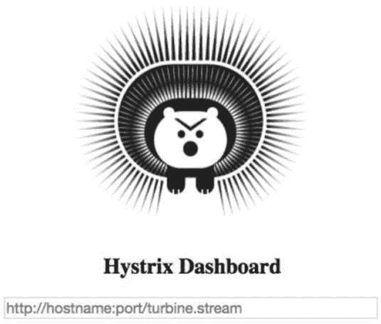

在这个演示中，我们将利用`Turbine`来合并来自两个不同服务的`Hystrix`流，以便它们都能在同一个`Hystrix Dashboard`中进行查看。我们将继续使用上一个演示中的天气应用、气象服务和发现服务器（discovery server），然后我们将添加两个可以从 GitHub 上克隆的新项目。第一个新项目是`datetime-service`，你可以从`github.com/ajaycucek/hystrix-datetime-service`获取它。第二个新项目是`datetime-app`，你同样可以在`github.com/ajaycucek/hystrix-datetime-app`获取它。一旦克隆了这两个项目，确保将它们导入到你的 IDE 中。我已经导入了我的，你的 IDE 看起来应该和这个很相似。这两个新项目`datetime-app`和`datetime-service`与天气应用和气象服务完全一样，唯一的区别是它们返回的是当前日期和时间，而不是天气信息。所以你可以随意浏览并查看这些项目的代码。我们需要启动这些应用程序，首先从发现服务器开始。再次，我已经启动了所有的应用程序。一旦它们都启动了，你可以通过点击小箭头并确保所有应用程序都显示出来来验证。在所有应用程序启动后，我们将开始构建我们的 Netflix `Turbine` 应用。打开浏览器访问`start.spring.io`。在 Group 中使用`io.ajay.kumar`，artifact name 可以直接命名为`turbine`。对于 dependencies，我们显然想要添加`Turbine`。

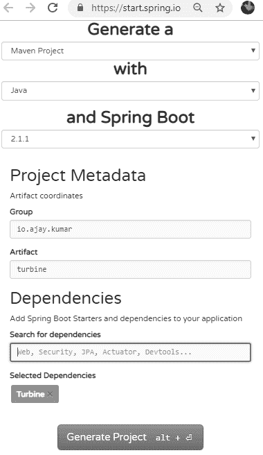

一旦填写完所有内容，点击`Generate Project`按钮，它就会为你创建并下载该 zip 文件。像往常一样，解压该 zip 文件并将其导入你的 IDE。我们现在回到了导入了`Turbine`项目的 IDE 中。

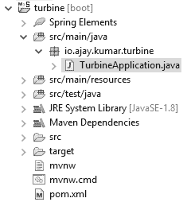

展开项目并导航到主应用程序类。

```java
package io.ajay.kumar.turbine;

import org.springframework.boot.SpringApplication;

import org.springframework.boot.autoconfigure.SpringBootApplication;

import org.springframework.cloud.netflix.turbine.EnableTurbine;

@SpringBootApplication
@EnableTurbine
public class TurbineApplication {
    public static void main(String[] args) {
        SpringApplication.run(TurbineApplication.class, args);
    }
}
```

在主应用程序类中，我们将添加一个新的注解，即`@EnableTurbine`注解。接下来，我们需要配置一些属性，所以关闭该文件并导航到`src/main/resources/application.properties`。

`application.properties`

```properties
server.port=3000
spring.application.name=turbine-aggregator
eureka.client.service-url.defaultZone=http://localhost:8761/eureka
turbine.app-config=weather-app,datetime-app
turbine.cluster-name-expression='default'
```

在`application.properties`中，有很多不同的属性需要设置，所以我将把它们粘贴在这里，然后我们将一个一个地检查每一个。第一个属性`server.port`，我们将设置为`3000`。下一个属性`application.name`，我们将其命名为`turbine-aggregator`。第三个属性`eureka.client.service-url`，设置为`localhost:8761/eureka`。在下面我们有两个`turbine`属性。记住第一个，`turbine.app-config`属性，它设置了你想让`Turbine`聚合在一起作为流的应用或服务。在我们的案例中，我们需要`weather-app`和`datetime-app`。最后一个属性`turbine.cluster-name-expression`，我们只需将其设置为用单引号括起来的`default`。我们的属性就设置到这里，所以关闭该文件，然后启动`Turbine`。回到主应用程序类，右键点击它，选择`Run As`，并选择`Spring Boot App`。接下来，打开网络浏览器，访问日期时间应用和天气应用，为它们的`Hystrix`流生成一些指标，以便`Turbine`能够收集它们。让我们先访问日期时间应用。访问`localhost:4000/current/datetime`。

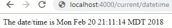

只需刷新几次以生成一些指标。然后我们对气象服务执行相同的操作，访问`localhost:8000/current/weather`，同样刷新几次以生成指标。


接下来，打开一个新标签页访问`localhost:8080/hystrix`。

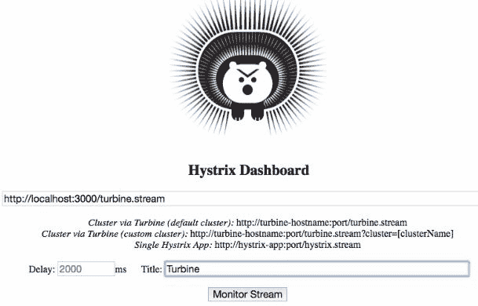

这次，我们不再输入`hystrix.stream` URL，而是使用`turbine.stream` URL。请输入`http://localhost:3000/turbine.stream`。在 Title 文本框中只需输入`Turbine`。之后，点击`Monitor Stream`按钮，你应该能看到日期时间应用的指标。

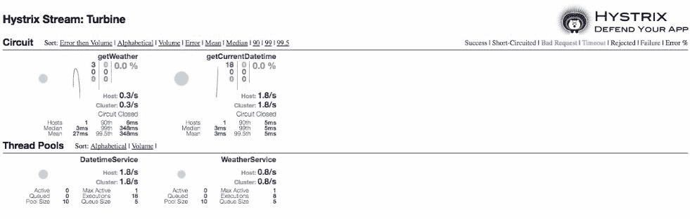

### 总结

我们到了本模块的结束，一样，让我们回顾一下学习的内容。

- 容错性是一项要求
- Netflix Hystrix
- 熔断器模式
- `@HystrixCommand`
- `@EnableTurbine`
- Hystrix Dashboard & Turbine
- 监控一个或多个流

首先，我们看到在分布式系统中故障几乎是不可避免的。我们必须学会接受故障并将处理故障视为一项要求。然后我们引入了 Netflix Hystrix，它是熔断器模式等的一种实现。我们还看到了如何使用`@EnableTurbine`注解和`@HystrixCommand`注解来保护可能失败的调用。我们通过查看如何使用 Hystrix Dashboard 可视化并监控调用，以及如何使用 Turbine 一次监控多个流来结束本模块。

## 整合在一起

问题是它们是如何共同组合成一个云原生系统的？首先，让我们回顾一下涉及的所有内容。这一切都从一个或多个应用程序服务开始。

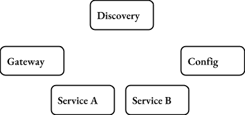

在我们的示例中，有两个应用程序服务，`application Service A`和`application Service B`，它们都运行着多个实例。然而，这一切的核心是`Service Discovery Server`（服务发现服务器）。它是系统的电话簿或目录，允许所有人注册自己的位置，并发现其他人的位置。记住，在整本书中我们一直使用`Netflix Eureka`来满足服务发现的需求。接下来，我们有`Config Server`（配置服务器）来处理动态和分布式配置需求。请记住，我们在此使用了`Spring Cloud Config Server`。之后，我们有网关，即系统的大门，它负责接收并将请求路由到后端服务。我们使用`Netflix Zuul`来实现这一点。然后，我们有一个客户端负载均衡器，用于在高可用目的运行的多个实例之间分配请求。请记住，在我们的案例中我们使用了`Netflix Ribbon`。最后，我们有容错机制，能够容忍并衡量故障，防止这些故障导致其他系统的级联故障。我们使用`Netflix Hystrix`来实现这一点。

### 整合一切：启动时

现在我们已经回顾了所有涉及的组件，让我们花点时间看看它们是如何相互交互的，特别是在启动阶段。

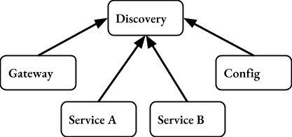

一切都从`Service Discovery Server`开始。系统每个组件的每一个实例在启动时都会向`Service Discovery Server`注册自己。然后，它还会收到一个包含其他注册服务位置的回复。对于应用程序服务来说，这个回复非常重要，因为告诉了它们`Configuration Server`的位置。


一旦知道了`Configuration Server`的位置，它们就可以发送请求来检索任何配置，这些配置最终将用于引导它们的启动过程。

## 整合一切：请求时

现在我们所有的应用程序及其支持服务都已启动，让我们看看它们在处理请求处理期间是如何相互交互的。


特定路径的请求开始于网关服务器，在我们的案例中是`Netflix Zuul`。`Zuul`将路径匹配到给定的`service ID`，然后它将使用服务发现（通过向`Service Discovery Server`发起请求或通过之前缓存的结果）来定位处理该路径的服务。一旦定位了服务，它将进行受`Hystrix`保护的调用，并使用`Ribbon`处理客户端负载均衡，以决定将流量发送到哪些实例。在我们的示例中，请求被发送到了`Service A`。现在，假设`Service A`也依赖`Service B`来完成请求。在接收请求后，`Service A`将利用服务发现定位`Service B`。它将通过之前缓存的结果或通过向`Service Discovery Server`发起请求来实现。接下来，它将使用`Ribbon`发起受`Hystrix`保护的客户端负载均衡调用，指向`Service B`的其中一个实例。`Service B`将响应`Service A`，然后`Service A`将响应网关，最后，网关对原始请求做出响应。

## 下一步去哪里

在整本书中，我们涵盖了`Spring Cloud`的核心基础知识，并为你构建了良好的基础。

我们涵盖的基础知识仅代表了`Spring Cloud`众多部分中的两个。

- `Spring Cloud Config`
- `Spring Cloud Netflix`

请记住，`Spring Cloud`是许多项目的集合，虽然我们涵盖的基础知识包含大量需要学习的信息，但它们仅代表了`Spring Cloud`众多部分中的两个。那就是`Spring Cloud Config`项目和`Spring Cloud Netflix`项目。

- `Spring Cloud`
- `Spring Cloud Bus`
- `Spring Cloud Task`
- `Spring Cloud Cluster`
- `Spring Cloud Consul`
- `Spring Cloud Sleuth`
- `Spring Cloud Security`
- `Spring Cloud Stream`
- 更多...

还有许多其他项目，如`Spring Cloud Bus`、`Spring Cloud Cluster`和`Spring Cloud Stream`，它们都能帮助你解决云端问题。要充分了解`Spring Cloud`提供的可用功能，请访问`http://projects.spring.io/spring-cloud`文档页面，然后滚动到标题为`Main Projects`的部分。在这里你将找到所有属于`Spring Cloud`伞下的`Spring Cloud`项目。我鼓励你去查看它们，即使只是让你熟悉它们并知道它们的存在，因为正如我之前提到的，知道存在哪些工具是非常有用的，这样你就能用正确的工具做正确的事。
