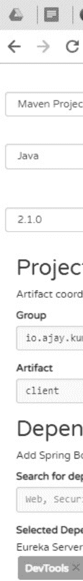
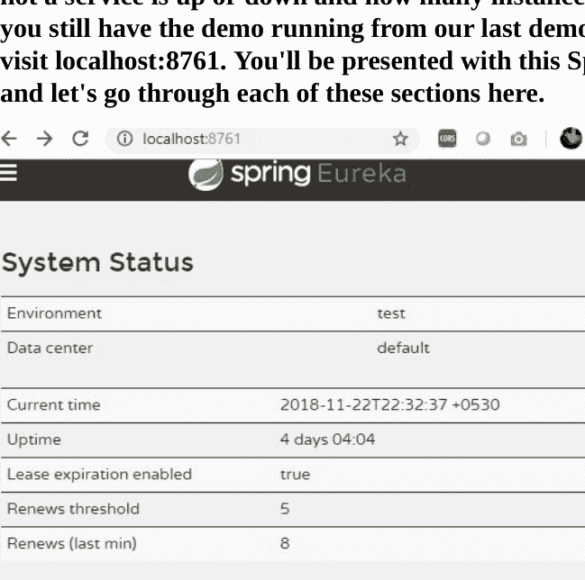
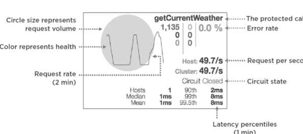
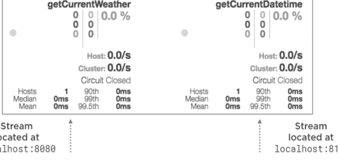
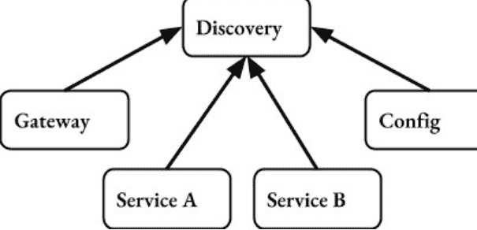
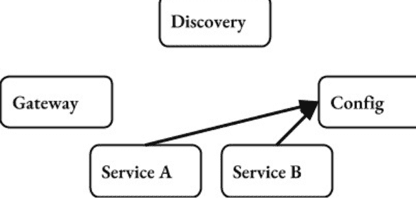
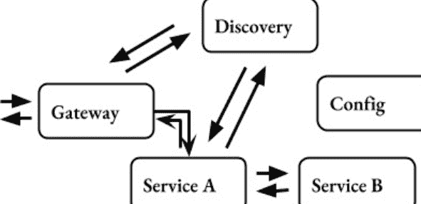

# Spring Cloud 基础指南

## 第 1 模块：课程概述

云，或云计算，真的在改变我们作为开发者思考设计和开发软件的方式。这正是 Spring Cloud 大显身手的地方。Spring Cloud 帮助你通过将 Spring Boot 的优势与经过证明的云策略相结合，充分利用这些新范式，帮助你设计和开发云原生应用程序。我们将涵盖的一些主要主题包括使用 Spring Cloud 和 Netflix Eureka 进行服务发现、使用 Spring Cloud Config Server 进行分布式配置、使用 Spring Cloud 和 Netflix Ribbon 进行客户端负载均衡、通过网关服务使用 Spring Cloud 和 Netflix Zuul 进行智能路由，以及使用 Spring Cloud 和 Netflix Hystrix 进行容错。读完这本书后，你将知道如何构建充分利用云的应用程序。在开始本书之前，你应该熟悉 Java、Spring Boot，并且对微服务有至少入门级别的理解。

## 第 2 模块：熟悉 Spring Cloud

### 著名的云

云，或云计算，真的在改变我们作为开发者思考设计和开发软件的方式。这正是 Spring Cloud 大显身手的地方。Spring Cloud 帮助你通过将 Spring Boot 的优势与经过证明的云策略相结合，充分利用这些新范式，帮助你设计和开发云原生应用程序。我们将涵盖的一些主要主题包括使用 Spring Cloud 和 Netflix Eureka 进行服务发现、使用 Spring Cloud Config Server 进行分布式配置、使用 Spring Cloud 和 Netflix Ribbon 进行客户端负载均衡、通过网关服务使用 Spring Cloud 和 Netflix Zuul 进行智能路由、以及使用 Spring Cloud 和 Netflix Hystrix 进行容错。读完这本书后，你将知道如何构建充分利用云的应用程序。在开始本书之前，你应该熟悉 Java、Spring Boot，并且对微服务有至少入门级别的理解。

### 前提条件

- Java 8+
- Spring Boot 1.4+
- 了解微服务或 SOA

让我们先来谈谈前提条件。我假设你对 Java 有良好的理解，特别是 Java 8，并且对 Spring Boot 有良好的了解，因为 Spring Cloud 大程度上是构建在 Spring Boot 之上的。最后，我希望你至少对微服务或面向服务的架构（SOA）有了解或理解。

- Java 8+
- Maven 3+
- Spring Tool Suite (Eclipse STS) 3.8

接下来，我们来谈谈为了在本书中获得成功你需要哪些软件。当然，你需要 Java、Java 8，而且你还需要 Maven（至少是 Maven 3）来构建 Spring Boot 应用。我们将使用 Spring Tool Suite（或者叫它 Eclipse STS）进行所有的开发。请确保你安装了至少 3.8 版本的版本。

## 模块 3：使用服务发现查找服务

### 什么是服务发现？

**在本模块中：**

- 服务发现
- 使用 Spring Cloud 发现服务
  - 使用 Eureka 客户端和服务
  - 配置
  - 健康状况与高可用性
  - 控制面板
  - AWS 可用性

在本模块中，我们将介绍服务发现如何帮助你在云端定位你的应用服务。让我们快速开始谈谈这个模块的内容，首先我们将查看服务发现。显然，这个模块是关于服务发现的，因此我们将讨论它是什么以及它为什么重要。然后，我们将查看 Spring Cloud 如何实现服务发现。它使用了一个来自 Netflix 的开源项目，叫做 Eureka，我们将讨论 Eureka Client 和 Eureka Server。接着，我们将转向配置，配置 Eureka Client、Eureka Server 和 Eureka Instance（实例），以及它们之间有何不同，以及你如何根据自己的需求对它们进行调整或配置。然后，我们将进入健康状况和高可用性部分。Eureka Server 如何知道你的应用程序何时宕机或处于不健康状态？你如何确保 Eureka Server 是高可用的？然后我们将查看 Eureka Dashboard，这是一个非常棒 Web UI，可以显示你所有注册的服务、有多少个实例，以及它们是运行还是离线状态。

最后，我们将介绍 Eureka 如何对 AWS 提供特定的支持。让我们从最重要的问题开始：什么是服务发现，我们为什么需要它？记住，云端正在改变我们构建软件的方式。我们正在从构建这些单一大型应用，转变为将其拆分成更小的碎片，称为“服务”。每一个独立的服务都可以独立进行部署和扩展，而它们共同作为一个整体，构成了整个……问题就出于此。一个服务如何知道另一个服务在哪里、它的主机和端口是什么，以便它可以调用并使用它？首先，我们可以简单地配置所有的服务，让它们知道所调用的其他服务的位置和端口。根据需求，这实际上可以让我们走得很远。但过了一段时间，我们会发现这种方法存在问题。例如，如果你有一个特定服务的两个实例怎么办？在我们的示例中，我们有 Application Service A 调用 Application Service B。如果我们使用配置，每当我们添加或移除 Application Service B 的新实例时，我们都必须更新该配置。嗯，在我们的示例中，我们只有两个实例。想象一下如果你有数百个实例呢。光是配置管理就是不可持续的。当我们迁移到云环境时，我们的简单配置会进一步瓦解。在云环境中，你的服务实例可以根据需求随时出现或消失。例如，Application Service B 有时启动两个实例，考虑一下你可能有巨大的流量涌入，也许是你的电子商务网站正在进行闪购活动，然后自动化进程启动并开启了另外两个实例来处理所有这些流量。嗯，如果你使用简单配置，Application Service B 的所有调用者（如 Application Service A）将不知道为了响应需求而添加的新实例。对它们来说，它们的配置显示仍然只有它们已知的两个实例。另一个需要考虑的因素是，应用服务最终会失败。无论发生什么，无论是内存问题还是硬件问题，如果你使用简单配置，你的服务将尝试向那些失败的实例发送流量。例如这里，我们有 Application Service A 调用 Application Service B，并且它有两个实例。如果其中一个实例失败了，Application Service A 并不会知情，并将继续向那个失败的实例发送流量。我们需要一种更动态的方法。当一种方法太过于静态时，对于我们在云端的需求来说，它太僵化了。这就是服务发现大显身手的地方。

**服务发现提供了：**

- 服务注册自身的方式
- 服务注销自身的方式
- 客户端发现其他服务的方式
- 检查服务健康状况并移除不健康实例的方式

服务发现通常提供以下功能：服务注册自身的方式。这意味着当一个服务上线时，它可以调用 Service Discovery Server 并告知其服务的位置和端口，以便其他服务使用它。出于恰相反的原因，服务发现提供了服务注销自身的方式。所以如果一个服务关闭或临时离开，它会希望 Service Discovery Server 知道它不再可用。最重要的是，服务发现提供了客户端发现其他服务的方式。我所说的客户端指的是其他应用服务。所以如果你是一个需要使用另一个服务的应用服务，你需要找到该服务的位置和端口，你可以向 Service Discovery Server 查询。最后，服务发现提供了检查服务健康状况并移除不健康实例的方式。因此每个应用服务都会实现健康检查（通常通过 REST 端点），然后 Service Discovery Server 会调用其注册表中的实例。

### 介绍 Spring Cloud Netflix

在了解了服务发现是什么以及它为什么重要之后，让我们学习 Spring Cloud 如何帮助我们实现它。

**使用以下项目发现服务：**

- Spring Cloud Consul
- Spring Cloud Zookeeper
- Spring Cloud Netflix

实际上有多种使用 Spring Cloud 发现的方法。有 Spring Cloud Consul 项目、Spring Cloud Zookeeper 项目以及 Spring Cloud Netflix 项目。我们将专门关注最后一个，Spring Cloud Netflix 项目。

**Netflix OSS + Spring + Spring Boot = Spring Cloud Netflix**

Spring Cloud 项目获取了 Netflix 的开源项目并添加了一些 Spring 和 Boot 的特性。你可以说他们是对它们进行了“Spring 化”。由此诞生了 Spring Cloud Netflix 项目。类似于 Spring Cloud 项目，Spring Cloud Netflix 项目本身实际上并不是一个项目。相反，它是一个项目的集合。对于服务发现，我们感兴趣的是其中的两个项目：Spring Cloud Netflix Eureka Server 和 Spring Cloud Netflix Eureka Client。

### 参与服务发现的关键组件

在我们深入研究 Spring Cloud Eureka 服务器和客户端之前，了解参与服务发现的关键组件以及它们之间如何交互将很有帮助。最少有三个组件参与了服务发现：发现服务器（Discovery Server）、应用程序服务（application service）和应用程序客户端（application client）。全面理解所有组件如何协同工作将非常有帮助，从那里开始我们将深入探讨每个组件，并查看 Spring Cloud 如何帮助我们实现这些特定的组件。

1. 服务注册位置
2. 客户端查找服务位置
3. 发现服务器返回位置
4. 客户端在位置请求服务
5. 服务发送响应

首先发生的是应用程序服务的启动。当它启动时，它会调用发现服务器并注册自己。它会告诉发现服务器它的位置、端口以及其他可以用来找到它的服务标识符。然后，在稍后的某个时刻，客户端需要调用该应用程序服务，但它不知道该服务的位置和端口，因此它向发现服务器发送请求并带上服务标识符。发现服务器根据该服务标识符知道你请求的是哪个服务，并返回该服务的位置和端口。从那里开始，一切按正常程序进行，客户端可以请求服务及其位置，而服务可以返回数据。

#### 发现服务器

我们将深入探讨服务发现中的每个关键组件，并从发现服务器开始。发现服务器的核心是一个主动管理的服务位置注册表。它负责允许其他实体能够发现服务，并允许服务进行自我注册和注销。如果可以这么说，它是“真理之源”。你通常不会运行超过一个发现服务器实例，因为它是定位其他其他服务的组件。如果你无法定位其他服务，那么这就是整个架构中非常重要的一个部分。你可以在 Spring Cloud Eureka Server 项目中找到发现服务器的实现。在整本书中，我们将进行非常简单的演示，即易于设置和巩固概念的内容。在这个示例中，我们将学习如何使用 Spring Cloud 创建发现服务器。我将详细说明每一步，然后我们将跟进一个真实示例。使用 Spring Cloud Eureka Server 项目创建发现服务器非常简单。事实上，它简单到几乎令人大为惊叹。

**pom.xml :**

```xml
<dependencyManagement>
  <dependencies>
    <dependency>
      <groupId>org.springframework.cloud</groupId>
      <artifactId>spring-cloud-dependencies</artifactId>
      <version>Camden.SR2</version>
      <type>pom</type>
      <scope>import</scope>
    </dependency>
  </dependencies>
</dependencyManagement>
```

在你的 Maven 项目的 `pom.xml` 中，在 `dependencyManagement` 部分定义一个名为 `spring-cloud-dependencies` 的新依赖，并确保类型为 `pom` 且范围为 `import`。

```xml
<dependency>
  <groupId>org.springframework.cloud</groupId>
  <artifactId>spring-cloud-starter-eureka-server</artifactId>
</dependency>
```

仍在你的 `pom.xml` 中，定义一个新依赖 `spring-cloud-starter-eureka-server`。确保将其放置在 `dependency` 部分，而不是 `dependencyManagement` 部分。

**Application.properties :**

```properties
spring.application.name=discovery-server
```

或者

**Application.yml :**

```yaml
spring:
  application.name: discovery-server
```

在你的 `application.properties` 或 `application.yml` 中，定义一个新属性 `spring.application.name`。你可以给它任何想要的值。在我们的案例中，我们将使用 `discovery-server`。

```java
@SpringBootApplication
@EnableEurekaServer
public class Application{
  public static void main(String[]args) {
    SpringApplication.run(Application.class,args);
  }
}
```

然后，在你的主 Application 类中，你字面上定义了一个注解。它是 `@EnableEurekaServer`。就这些了。一旦你启动此应用程序，你将拥有一个运行中的发现服务器实例。

### 演示：设置服务发现服务器

在这个演示中，我们将使用 Spring Cloud Eureka Server 项目创建并启动我们自己的服务发现服务器。首先，让我们前往 start.spring.io，我们将使用这个 Spring Initializr 为我们的项目创建存根。它是一个非常棒的小骨架创建器，可以为我们节省大量时间。

在 Group 部分，我将放入 `io.ajay.kumar`，在 Artifact 部分，我将其命名为 `discovery-server`。在 dependencies 部分，我将添加 Eureka Server（这就是发现服务器），我还会添加 DevTools 和 Spring Boot Actuator 项目。

#### 生成 Spring Boot 项目元数据

**Artifact 坐标**

| 字段 | 值 |
| :--- | :--- |
| Group | io.ajay.kumar |
| Artifact | discovery-server |

**依赖**

向你的应用程序添加 Spring Boot Starters 和依赖

| 搜索 | 选定的依赖 |
| :--- | :--- |
| Web, Security, JPA, Actuator, Devtools... | Eureka Server |
| | DevTools |
| | Actuator |

```
Generate Project Alt + d
```

一旦你添加了所有依赖，点击 Generate Project。点击该按钮后，将为你下载一个 zip 文件，其中包含了我们的项目存根。解压下载的文件。然后我们将打开 IDE 并导入。我切换到了 IDE，即 Spring Tool Suite。在 Package Explorer 标签页的空白区域，右键点击 Import。选择 Existing Maven Projects。点击 Next，浏览解压项目的位置，然后点击 Open。在 Projects 下你应该能看到 `pom.xml`。点击 Finish，等待它导入。

一旦项目导入完成，展开它并打开主应用程序类。它应该是 `DiscoveryServerApplication`，这就是我们要添加注解以启用发现服务器的地方。因此在 `@SpringBootApplication` 注解上方，我们可以添加一个新的注解 `@EnableEurekaServer`。保存它。

```java
package io.ajay.kumar.discovererver;
import org.springframework.boot.SpringApplication;
import org.springframework.boot.autoconfigure.SpringBootApplication;
import org.springframework.cloud.netflix.eureka.server.EnableEurekaServer;

@EnableEurekaServer
@SpringBootApplication
public class DiscoveryServerApplication {
    public static void main(String[] args) {
        SpringApplication.run(DiscoveryServerApplication.class, args);
    }
}
```

我们现在准备好启动我们的发现服务器了，所以右键点击主应用程序类，选择 Run As，选择 Spring Boot App。


一旦应用程序加载完成，展开 Console 窗口。你会发现这里有几个异常。停止应用程序服务器；否则它将继续抛出这些异常。让我们滚动到其中一个异常处，看看问题在哪里。`Cannot execute request on any known server`。如果你查看的话，它源自这个 `DiscoveryClient.getAndStoreFullRegistry` 方法。发生的情况是发现服务器正在启动，它正尝试与对等发现服务器进行自我注册。这主要是为了高可用性。然而，当我们运行单机模式或开发模式时，每次都要设置多个实例可能会有点麻烦。因此，我们将配置 Eureka Server 不要与其对等节点进行自我注册。你绝对只想在开发模式下这样做，因为在生产环境中我们需要那种高可用性。

由于我们本身就是发现服务器，而且我们运行在独立模式下，因此我们不需要向任何其他节点注册，因为根本没有其他节点。所以，请确保你将该值设置为 `false`。下一个属性也是一个 Eureka Client 属性，请直接输入 `eureka.client.fetch-registry`。此属性控制 Eureka Client 是否会从 Eureka Server 获取注册表，由于我们是唯一的 Eureka Server，没有其他地方可以从别人那里获取内容，因此我们将此设置为 `false`。我们要添加的最后一个属性是 Eureka 发现服务器的默认端口。一旦你设置好了这些属性，即 `server.port`，我们将将其设置为 `8761`。转到主应用程序类，右键点击它，并选择“作为 Spring Boot 运行”。当你的应用启动完成后，展开控制台，你将看到它启动了 Eureka Server 并将其状态更改为 `UP`。现在，你拥有了一个正在运行的服务发现服务器。

## 应用服务

- 提供某些应用程序功能
- 请求的接收者
- 其他服务的依赖项
- 一个或多个实例
- 发现客户端的使用
  - 注册
  - 注销

记住，我们正在深入研究服务发现的每个组件，我们列表中的下一个是应用服务。这是任何提供功能的实体。它是接收请求并返回响应的实体。它是其他服务的依赖项。因此，其他服务依赖于它的功能。你通常运行应用服务的一个或多个实例。应用服务是发现客户端的用户。它将使用它来调用发现服务器并进行注册和注销。就像我们对服务服务器做的那样，我们将详细说明向应用服务添加 Eureka Client 所需的步骤，然后我们实际创建一个。

### 在服务中使用 Spring Cloud Eureka Client

```xml
<dependencyManagement>
  <dependencies>
    <dependency>
      <groupId>org.springframework.cloud</groupId>
      <artifactId>spring-cloud-dependencies</artifactId>
      <version>Camden</version>
      <type>pom</type>
      <scope>import</scope>
    </dependency>
  </dependencies>
</dependencyManagement>
```

在你的 Maven 项目的 `pom.xml` 中，添加一个新的 `dependencyManagement`，然后添加一个新的依赖 `spring-cloud-dependencies`。再次确保它的类型为 `pom` 且作用域为 `import`。

```xml
<dependency>
  <groupId>org.springframework.cloud</groupId>
  <artifactId>spring-cloud-starter-eureka</artifactId>
</dependency>
```

仍在 `pom.xml` 中，在 `dependencies` 内部添加一个新的依赖，这个依赖叫做 `spring-cloud-starter-eureka`。然后在在你的 `application.properties` 或 `application.yml` 中，添加新属性。

application.properties

```properties
spring.application.name=service
eureka.client.service-url.defaultZone=http://localhost:8761/eureka
```

或者

application.yml

```yaml
spring:
  application:
    name: service
eureka:
  client:
    service-url:
      defaultZone: http://localhost:8761/eureka
```

第一个属性是 `spring.application.name`，再次你可以将其设置为任何你想要的值。在我们的中，我们将使用 `service`。第二个属性告诉应用服务发现服务器的位置，它是 `eureka.client.defaultZone` 属性。你可以看到我们将其设置为 `localhost`，但在生产环境中，你会将其设置为你的发现服务器所在地。现在我们将更详细地解释该属性。

```java
@SpringBootApplication
@EnableDiscoveryClient
public class Application {
    public static void main(String[] args){
        SpringApplication.run(Application.class,args);
    }
}
```

然后在你应用服务的主 `Application` 类中添加一个注解。再次，Spring Cloud 的同事们为我们简化了工作，即提供了 `@EnableDiscoveryClient` 注解。它的作用是让我们的应用服务向发现服务器注册自己，然后其他服务就可以找到它。

## 演示：让应用服务变得可发现

我们将使用 Spring Initializr 来创建我们的应用服务，所以请前往 start.spring.io。在这里的 Group 处你输入 `io.ajay.kumar`，我们将 Artifact 命名为 `service-name`。你将拥有几乎相同的依赖，但这次你想要的是 Eureka Discovery 依赖而不是 Eureka Server 依赖。你可以直接添加 DevTools 和 Actuator。

### 生成一个带有 Java 和 Spring Boot 2.1.0 的 Maven 项目

### 项目元数据 Artifact 坐标

Group: `io.ajay.kumar`

Artifact: `service`

### 依赖

向你的应用程序添加 Spring Boot Starters 和依赖

搜索依赖：Web, Security, JPA, Actuator, Devtools...

已选依赖

- DevTools
- Actuator
- Eureka Discovery

生成项目。直接点击 Generate Project。它会自动为你创建并下载一个 zip 包。解压该 zip 包，我们将将其导入到 IDE 中。我们现在回到了 Spring Tool Suite。在 Package Explorer 选项卡中，右键点击并选择 Import。再次，我们选择 Existing Maven Projects。点击 Next，浏览到我们解压文件的位置，并点击 Open。你应该在 Projects 标题下看到 `pom.xml`，点击 Finish 完成导入。这需要几秒钟，完成后，展开 `service` 并进入 `src/main/java` 打开主应用程序类。

```java
package io.ajay.kumar.service;
import org.springframework.beans.factory.annotation.Value;
import org.springframework.boot.SpringApplication;
import org.springframework.boot.autoconfigure.SpringBootApplication;
import org.springframework.cloud.client.discovery.EnableDiscoveryClient;
import org.springframework.web.bind.annotation.RequestMapping;
import org.springframework.web.bind.annotation.RestController;
```

```java
@EnableDiscoveryClient
@SpringBootApplication
@RestController
public class ServiceApplication {
    @Value("${service.instance.name}")
    private String instance;

    public static void main(String[] args) {
        SpringApplication.run(ServiceApplication.class, args);
    }

    @RequestMapping("/")
    public String message() {
        return "Hello from " + instance;
    }
}
```

在我们的应用服务的主类 `ServiceApplication` 中，我们添加 `@EnableDiscoveryClient` 注解。这让让我们的应用服务变成发现服务器的客户端，并导致它在启动时向发现服务器注册。在 `@SpringBootApplication` 注解下方，添加一个新的注解 `@RestController`。记住，我们正在通过快速简易的演示来巩固概念，我们在这里使用的某些内容并不是最佳实践，你不应该在常规应用程序中使用它们。例如，你通常不会在主类上放置 `@RestController`，但由于我们正在用它来快速演示，所以这是可以的。让我们在这里添加一个新方法 `public String message()`。我们可能需要为它添加 `@RequestMapping` 注解，我们将将其设为根路径。我们的计划是能够启动该应用服务的多个实例。我们将这里添加一个属性 `private String instance`。我们将为它添加 `@Value` 注解，并传入一个 `service.instance.name` 的占位符。

选择类，点击 Run As，然后进入 Run Configurations。突出 Spring Boot App 部分并点击 New。在 Project 下我们选择 service，在 Main type 下我们选择 `io.ajay.kumar.ServiceApplication`。在 Override properties 区域，我们将添加 `server.port`，并给它赋值为 `8081`。然后，我们还要为实例命名，即 `service.instance.name`。这就是我们想出来的属性。我们将此实例命名为 `instance 1`。别忘记给你的实例命名，我们将其命名为 `instance 1`。

然后，我们将复制此运行配置来创建第二个实例。点击这里的 Duplicate（复制）按钮，点击它，给它一个新名字 `instance 2`。我们将端口更改为 `8082`，并将实例更改为 `2`。点击 Apply 并关闭窗口。在我们启动服务应用程序的实例之前，我们需要先启动 Discovery Server（发现服务器），以便它们能够注册自己。展开 `discovery-server`，右键点击主应用程序类，选择 Run As -> Spring Boot App。一旦服务发现服务器启动，我们就可以启动应用程序实例了。回到主 `ServiceApplication` 类，右键点击 Run As，然后进入 Run Configurations。突出 `instance 1` 并点击 Run。你可以对 `instance 2` 执行同样的操作。右键点击 `ServiceApplication`，Run As，Run Configurations，突出 `instance 2` 并点击 Run。你可以点击此处的下拉菜单查看每个实例。你可以看到 `discovery-server` 已启动，`instance 1` 已启动，`instance 2` 已启动。我们目前正在查看 `instance 2`。如果展开 Console 并滚动，我们可以看到应用程序成功在 Discovery Server 中注册了自己。它显示正在注册服务，注册状态为 204。

```
DiscoveryClient_SERVICE/DESKTOP-OIHU6JB:service:8082: registering service...
DiscoveryClient_SERVICE/DESKTOP-OIHU6JB:service:8082 - registration status: 204
```

我们可以查看另一个实例 `instance 1`，向下滚动，可以看到同样的内容：正在注册服务且注册状态为 204。

```
DiscoveryClient_SERVICE/DESKTOP-OIHU6JB:service:8081: registering service...
Tomcat started on port(s): 8081 (http) with context path ''
Updating port to 8081
StartedServiceApplication in 7.717 seconds (JVM running for 8.896)
DiscoveryClient_SERVICE/DESKTOP-OIHU6JB:service:8081 - registration status: 204
```

然后如果你查看 `discovery-server`，你会发现里面有多个我们的服务应用程序向服务发现服务器注册的请求。

```
Registered instance SERVICE/DESKTOP-OIHU6JB:service:8081 with status UP (replication=false)
Registered instance SERVICE/DESKTOP-OIHUU6JB:service:8081 with status UP (replication=true)
Running the evict task with compensationTime11ms
Registered instance SERVICE/DESKTOP-OIHUU6JB:service:8082 with status UP (replication=false)
Registered instance SERVICE/DESKTOP-OIHUU6JB:service:8082 with status UP (replication=true)
```

## 应用程序客户端

- 调用另一个应用程序服务来实现其功能
- 请求发布者
- 依赖其他服务
- 发现客户端的用户
- 查找服务位置

让我们继续深入探讨参与服务发现的组件。接下来是“应用程序客户端”，它是负责调用其他应用程序服务以来实现其服务中某些功能的部分。它是请求的发布者，并依赖于其他服务。与应用程序服务类似，应用程序客户端也是发现客户端的用户，但方式不同。它不是使用它来注册或注销任何内容，而是使用它来查找服务位置。明确一下，一个应用程序既是服务又是客户端是完全合理的。

### 应用程序客户端详情

| 特性 | 说明 |
| :--- | :--- |
| 角色 | 请求发布者 |
| 依赖 | 依赖其他服务 |
| 发现 | 发现客户端的用户 |
| 目的 | 查找服务位置 |

让我们继续深入探讨参与服务发现的组件。接下来是应用程序客户端，它是负责调用另一个应用程序服务以来实现其服务中某些功能的部分。它是请求的发布者，并依赖于其他服务。与应用程序服务类似，应用程序客户端也是发现客户端的用户，但方式不同。它不是使用它来注册或注销任何内容，而是使用它来查找服务位置。明确一下，一个应用程序既是服务又是客户端是完全合理的。

### 实现细节

明确一下，一个应用程序既是服务又是客户端是完全合理的。

#### 依赖选项

- 使用 `EurekaClient`
- 使用 `DiscoveryClient`

```xml
<dependency>
    <groupId>org.springframework.cloud</groupId>
    <artifactId>spring-cloud-starter-netflix-eureka-client</artifactId>
</dependency>
```

### 配置

```xml
<groupId>org.springframework.cloud</groupId>
<artifactId>spring-cloud-starter-netflix-eureka-client</artifactId>
```

```yaml
spring:
  application:
    name: service
  eureka:
    client:
      service-url:
        defaultZone: http://localhost:8761/
      register-with-eureka: false
```


```java
@SpringBootApplication
@EnableDiscoveryClient
public class Application {
    public static void main(String[] args) {
        SpringApplication.run(Application.class, args);
    }
}
```

# Demo：作为应用程序客户端查找并调用服务

为了创建我们的客户端，我们将再次从 start.spring.io 开始。我们将给它一个相同的 group ID，即 `io.ajay.kumar`，并把 Artifact 命名为 `client`。它将具有我们在应用程序服务中使用的相同依赖项。我们需要 Eureka Discovery、DevTools 以及 Actuator。



## 使用 Java 和 Spring Boot 2.1.0 生成 Maven 项目

### 项目元数据

**Artifact 坐标**

- Group: `io.ajay.kumar`
- Artifact: `client`

### 依赖

为你的应用程序添加 Spring Boot Starters 和依赖

搜索依赖: `Web, Security, JPA, Actuator, Devtools...`

已选择的依赖

- Eureka Server
- DevTools
- Actuator
- Eureka Discovery

生成项目 (`alt +`)

点击 Generate Project。这会自动创建并下载一个 zip 文件。现在去解压该文件，我们将将其导入 IDE 中。在 Spring Tool Suite 的 Package Explorer（包管理器）区域，在空白处右键点击，选择 Import，然后选择 Existing Maven Projects，浏览到解压文件的位置，确保 Projects 标题下显示出 `pom.xml`，然后点击 Finish 完成导入。

展开 client 项目，转到 `src/main/java`，打开主应用程序类并进行以下更改。

```java
package io.ajay.kumar.client;

import org.springframework.beans.factory.annotation.Autowired;
import org.springframework.boot.SpringApplication;
import org.springframework.boot.autoconfigure.SpringBootApplication;
import org.springframework.web.client.RestTemplateBuilder;
import org.springframework.cloud.client.discovery.EnableDiscoveryClient;
import org.springframework.http.HttpMethod;
import org.springframework.http.ResponseEntity;
import org.springframework.web.bind.annotation.RequestMapping;
import org.springframework.web.bind.annotation.RestController;
import org.springframework.web.client.RestTemplate;
import com.netflix.appinfo.InstanceInfo;
import com.netflix.discovery.EurekaClient;
```

```java
@EnableDiscoveryClient
@SpringBootApplication
@RestController
public class ClientApplication {
    @Autowired
    private EurekaClient client;

    @Autowired
    private RestTemplateBuilder restTemplateBuilder;

    public static void main(String[] args) {
        SpringApplication.run(ClientApplication.class, args);
    }
}
```

在主应用程序中，添加新注解 `@EnableDiscoveryClient`。我们还会添加一个 `@RestController` 注解，并添加一个处理方法 `public String callService`。我们将给它添加一个 `@RequestMapping`，并将其映射到根路径。我们需要自动注入 DiscoveryClient 或 EurekaClient。我们将使用 EurekaClient，即 `private EurekaClient client`。我们使用 `@Autowired` 调用它。你也可以使用 `@Inject`。我们还需要一个 RestTemplate 来实际调用服务，所以我们会写 `private RestTemplateBuilder restTemplateBuilder`，并调用这个 restTemplateBuilder。我们也会对其进行自动注入。

在我们的 `callService` 方法中，我们将使用 RestTemplateBuilder 创建一个新的 RestTemplate，即 `RestTemplate rest = restTemplateBuilder.build();`。然后我们将使用 client 获取服务的 URL，即 `client.getNextServerFromEureka(...)`。关于虚拟主机名，请记得我们为服务设置了 `spring.application.name`——我们直接将其命名为 `"service"`。这将是一个非安全请求，所以填入 `false`。这返回一个 InstanceInfo 对象，我们将其命名为 `instanceInfo`。

然后我们获取基础 URL 并调用 RestTemplate，`String baseURL = instanceInfo.getHomePageUrl();`。接着我们使用 RestTemplate 调用该服务。RestTemplate 返回 ResponseEntity 的 String。我们将调用该响应，并使用 `RestTemplate.exchange(...)`。我们将传入 baseURL 和 HttpMethod GET。由于我们没有请求体，所以将 requestEntity 设置为 `null`，restType 为 String，我们也没有任何 uri 变量，因此删掉该参数。

在我们完成之前，让我们再回顾一遍。EurekaClient 正在调用发现服务器（Discovery Server），获取名为 `"service"` 的服务 ID 信息，并以 instanceInfo 的形式返回给我们。然后从该 instanceInfo 中，我们获取 HomePageUrl，即我们服务的基础 URL，然后我们使用 RestTemplate 调用该服务，具体是对该服务执行 GET 请求，它向我们返回一个字符串。最后我们只需返回该响应，即 `response.getBody()`。

```properties
application.properties :
spring.application.name=client
eureka.client.service-url.defaultZone=http://localhost:8761/eureka
eureka.client.register-with-eureka=false
```

接下来，我们需要配置应用程序客户端。转到 `src/main/resources` 并打开 `application.properties`，我们将添加标准的 `spring.application.name`。我们将其命名为 `client`。然后我们将粘贴服务 URL 以免手动输入，接着进行 `eureka.client.register-with-eureka`。我们将将其设置为 `false`。记住，我们是一个客户端，不需要向 Eureka 注册，因为我们不需要任何人发现我们。

现在，在启动应用程序客户端之前，我们需要启动发现服务器以及每个应用程序服务实例，并且要按照特定的顺序进行。如果你一直在跟着操作，这些项目应该出现在你的运行历史中。你可以点击下拉菜单并选择每一个项目来启动它们。为了确认，我们检查下拉菜单，可以看到 discovery-server 正在运行，服务应用程序的实例 1 和实例 2 运行。

现在我们准备好启动客户端应用程序了。我们可以右键点击主应用程序类，选择 Run As，然后选择 Spring Boot App。打开浏览器并访问 `localhost:8080`。按下回车，你应该能看到来自客户端的响应。它会显示 "Hello from instance 1"。如果你刷新它，它会显示 "Hello from instance 2"。我们可以不断重复此操作，每次我们都能看到它从 Eureka 注册表中获取了不同的实例。

# Spring Cloud Eureka Dashboard

Spring Cloud Eureka Server 提供的非常有用的功能之一就是仪表板。它是默认启用的，是一个基于 Web 的仪表板。它显示许多有用信息，例如服务是否在线或离线，以及注册了多少个实例。如果你仍在运行上一个演示中的程序，打开浏览器并访问 `localhost:8761`。你会看到这个 Spring Eureka Dashboard，让我们逐一查看这里的每个部分。



## 当前注册到 Eureka 的实例

| Application | AMIs | Status |
| --- | --- | --- |
| SERVICE | n/a (2) | UP (2) - DESKTOP-OIHU6JB:service:8082, DESKTOP-OIHU6JB:service:8081 |

### 通用信息

| Name | Value |
| --- | --- |
| total-avail-memory | 329mb |
| environment | test |
| num-of-cpus | 4 |
| current-memory-usage | 250mb (75%) |
| server-uptime | 4 days 04:04 |
| registered-replicas | http://localhost:8761/eureka/ |
| unavailable-replicas | http://localhost:8761/eureka/ |
| available-replicas | |

### 实例信息

| Name | Value |
| --- | --- |
| ipAddr | 192.168.29.2 |
| status | UP |

首先是系统状态（System Status），它会告诉你当前时间，以及过去一分钟内发生了多少次更新。DS Replicas（即发现服务器副本）部分显示了 Eureka 服务器的对等实例。如果我们有多个实例，我们会在这里列出每一个实例。但由于我们只有一个实例，所以只看到 localhost。下一部分可能是最有用的部分，因为它显示了当前注册到 Eureka 的所有实例。在 Application 标题下，我们在这里看到了服务 ID，即 SERVICE。AMI 指的是 Amazon Machine Image（亚马逊机器镜像）。由于我们没有在 Amazon 上运行，所以是 n/a。可用区（Availability Zones）有两个，且这两个实例都处于 UP（运行状态）。你可以看到 UP 旁的数字 2，这表示该服务有两个实例，且它们都处于 UP 状态。紧接着其后，你可以看到这两个实例，一个运行在 8082，另一个运行在 8081。

# 配置

你可以在多个不同的区域配置 Spring Cloud Eureka。我们将查看三个主要的区域：第一个是 `eureka.server` 前缀，第二个是 `eureka.client` 前缀，第三个是 `eureka.instance` 前缀。让我们详细介绍这些配置区域的每一个部分。第一个是 Eureka 服务器配置（Eureka Server Configuration），即 `eureka.server` 前缀下的所有配置。它将控制所有与配置发现服务器（Discovery Server）相关的内容。第二个是 Eureka 客户端配置（Eureka Client Configuration），即 `eureka.client` 前缀下的所有配置。它负责控制发现客户端如何与发现服务器交互。例如，你有像 `eureka.client.eureka-server-connect-timeout-seconds` 等属性，这会控制客户端在连接到 Eureka 服务器并超时之前等待连接的时间。第三个配置区域是 Eureka 实例（Eureka Instance），即 `eureka.instance` 前缀下的所有配置。Eureka 实例是指任何向 Eureka 服务器注册自己以便能够被其他实例发现的实体。`eureka.instance` 前缀下的属性控制着实例如何向 Eureka 服务器注册自己。例如，你有像 `eureka.hostname` 或 `eureka.health-check-url` 等属性，实例可以在那里配置自定义值，并以此方式向 Eureka 服务器注册。

# 健康检查与高可用性

Spring Cloud Eureka 服务器还具有一些关于健康和高可用性的额外功能。它会不断确保它返回或交付给客户端的应用程序是健康且可用的。它还确保在发现服务器宕机的情况下，所有客户端都能继续运行。正如我提到的，Eureka 服务器持续关注其交付给客户端的应用程序健康状况。它会评估这种健康状况，至少默认情况下，每 30 秒向客户端发送一次心跳。如果 90 秒后没有收到来自该心跳的回包，它将将其从注册表中移除。默认配置下会发送心跳，但你也可以配置 Eureka 服务器访问某个端点（例如考虑到 `/health` 可用性），它实现这一目标的方法之一是当客户端请求时，实际上返回一份注册表副本。结果是注册表分发到了所有客户端上。如果发现服务器宕机，这些客户端就可以继续运行。发现服务器实际上会返回注册表的副本。你可能在想，等一下，如果发现服务器有了新信息或者其中一个服务宕机了怎么办？嗯，客户端必须定期续租许可或获取新的注册表，它是通过获取增量（deltas）来更新注册表来实现的。因此它在不再获取完整注册表而只获取更改方面非常智能。

# AWS 支持

众所周知，Netflix 是 AWS 的深度用户。鉴于 Eureka 诞生于 Netflix，包含 AWS 支持也完全合理。让我们来看看各种支持以及典型的部署架构。当使用 Eureka 客户端的应用程序启动时，它会检查自己是否运行在 AWS 实例上。如果是，它会调用本地元数据服务并检索该实例的一些元数据。它会获取 AWS 特有的信息，如正在运行的 Amazon 映像（AMI）或其所在的区域，然后在注册时将这些信息发送到发现服务器。鉴于 AWS 中的事物变化非常频繁，确保发现服务器位于已知位置是非常重要的。Eureka 增加了对弹性 IP（Elastic IP）绑定的支持。当 Eureka 服务器启动并发现它运行在 AWS 上时，它将尝试绑定到下一个可用的弹性 IP，以便拥有静态或已知的 IP。Eureka 客户端也具有区域感知能力（zone aware），并优先选择它所在的区域。因此，它会尝试联系当前区域的发现服务器，如果无法访问，它将尝试下一个区域并找到下一个可用的发现服务器。最后，你可以配置 Eureka 客户端获取不同远程区域的注册表。为了利用 AWS 支持，需要一些额外的配置。

```java
@Configuration
public class AppConfig{
    @Bean
    public EurekaInstanceConfigBean eurekaInstanceConfig(InetUtilsProperties properties) {
        EurekaInstanceConfigBean bean = new EurekaInstanceConfigBean(new InetUtils(properties));
        AmazonInfo info = AmazonInfo.Builder.newBuilder().autoBuild("eureka");
        bean.setDataCenter(info);
        return bean;
    }
}
```

在你的 `@Configuration` 类中，定义了一个返回 `EurekaInstanceConfigBean` 的新方法，并用 `@Bean` 标记它。在方法内部，你创建一个新的 `EurekaInstanceConfigBean`。然后，使用 `AmazonInfo.Builder` 创建一个 `AmazonInfo` 对象，并将 `DataCenterInfo` 设置为 `EurekaInstanceConfigBean` 上的 `AmazonInfo`，最后返回 `bean`。如果你去查看 `AmazonInfo` 类的源码，你会发现它利用本地元数据服务来填充所有实例信息。在你的 `@Configuration` 类中，除了配置外，在 `application.properties` 中还有一些关于可用性的配置。

| 地址 |
| :--- |
| 34.192.167 |
| 34.193.246 |

- `application.properties` 中的可用区配置
- `eureka.client.availability-zones=[az1]`

# EC2 仪表板


| 名称 | 实例 ID | 实例类型 | 可用区 |
| :--- | :--- | :--- | :--- |
| spring-cloud-server-1 | i-7b2c5578 | t2.micro | us-east-1b |
| spring-cloud-server-2 | i-8bf8cb41 | t2.micro | us-east-1e |

例如，如果你在 `us-east-1b` 区域有一个发现服务器，并且在 `us-east-1e` 区域有另一个发现服务器，你可以这样设置属性：`eureka.client.availability-zones`，然后区域是 `us-east-1`，你将设置 `us-east-1b` 和 `us-east-1e` 的逗号分隔列表。在 `application.properties` 中需要类似的配置用于你的服务 URL。

| DS 副本 |
| :--- |
| ec2-34-192-167.us-east-1.amazonaws.com |
| ec2-34-193-266.us-east-1.amazonaws.com |

| 应用 |
| :--- |
| DISCOVERY-SERVER-1 |
| DISCOVERY-SERVER-2 |

- `application.properties` 中的服务 URL 配置
- `eureka.client.service-url.[zone]=http://[eip-dns]/eureka`

### 弹性 IP 仪表板

例如，如果我们被分配了以下弹性 IP，我们可以这样配置 `application.properties`：第一个是 `us-east-1b` 区域，第二个是 `us-east-1e` 区域。你会注意到，每一个都设置为了弹性 IP 的 DNS 名称的 HTTP 地址。结合之前 AWS 控制台的截图以及我们配置的所有内容，如果你在设置好所有内容后加载 Eureka 仪表板，它看起来会像这样。

你会在 DS Replicas 下有两个实例，然后将有两个发现服务器实例，分别位于各自的可用区。

同样，你可以在那些每一个发现服务器（Discovery Server）实例上打开仪表板，你会发现其中填充了 AWS 特有的元数据，例如实例类型（`instance-type`）、AMI ID（`ami-id`）或实例 ID（`instance-id`）。

现在我们已经了解了 Eureka 中提供的 AWS 支持，让我们来看看部署架构。通常情况下，你每个可用区（availability zone）都会拥有一个或多个发现服务器，然后你有多个可用区。在这些区域中的每一个，你会为每个发现服务器配置一个弹性 IP（Elastic IP）。然后，你通常会设置一个自动伸缩组（auto scaling group），将这些发现服务器均匀地分布在各个可用区。

## 总结

我们已经到了这个模块的最后，让我们快速回顾一下所学内容。我们首先查看了什么是服务发现以及它为什么重要。然后我们学习了如何使用 Spring Cloud Eureka Client 来发现服务，以及使用 Spring Cloud Eureka Server 来存储服务注册表，以便其他服务可以发现它们。接着我们快速查看了 Spring Cloud Eureka Dashboard，并对 Spring Cloud Eureka Server 有了深入了解。从那里开始，我们讨论了健康检查、高可用以及 Spring Cloud Eureka 的配置。最后，我们通过查看 AWS 特有的支持结束了课程。

## 模块 4：使用分布式配置配置服务

## 什么是配置服务器？

在本模块中，我们将讨论如何在像云这样的分布式系统中管理你的应用程序配置。我们将直接进入分布式系统中的配置，以及为什么它比非分布式系统更不同、更具挑战性，更重要的是，我们为什么需要这种配置服务器（Configuration Server）。从那里，我们将深入研究 Spring Cloud 如何通过 Spring Cloud Config Server 实现配置服务器的细节。我们还将看到如何设置 Config Client 和 Config Server 并让它们相互通信。我们还会介绍 Spring Cloud Config Server 的各种后端存储选项，例如 Git 仓库或 SVN 仓库。接下来，也是我认为最酷的事情之一，我们将学习如何在不重启应用程序服务器的情况下动态更新我们的配置。我们将通过多种方法实现这一点，包括 Spring Cloud Actuator、Spring Cloud Bus 和 Spring Cloud Monitor 项目。我们还将学习 `@RefreshScope` 注解以及它为什么被需要以及在哪里使用它。最后我们将通过一个关于如何使用对称和非对称加密检索并存储敏感配置值的章节来结束本模块。

那么，在云原生应用与非云原生应用中，管理配置到底有什么不同之处？答案源于事实：云原生应用是一个分布式系统，而非云原生应用不是分布式的。在分布式应用中，你通常只有少数配置文件。系统与其配置之间通常是一对一的关系。而当你转向分布式系统时，这种配置就会发生爆炸式增长。你从一个或多个配置文件变为了许多、许多配置文件，因为你有许多、许多系统共同构成了一个整体系统。例如，如果你使用微服务，构成你整个应用程序的每个单独微服务都将有自己的配置文件。

你可能会想：没问题，我们能搞定。这就是为什么他们制作了 Puppet 和 Chef 这样的配置工具来管理许多许多系统的配置，对吧？嗯，它可以起作用，但对于云来说并不理想。让我们聊聊使用典型的配置管理系统时会面临的一些问题。第一是，它是面向部署的，这意味着每当你想要修改配置时，都需要重启应用程序，这在云环境中是不可接受的。另一个你可能会遇到的问题是，配置管理通常是静态的，这意味着在任何配置变化时都需要重新部署应用程序，这在云环境中也是个问题。

另一个问题是，配置管理通常是静态的，而配置服务器通常是动态的，这意味着当配置发生变化时，应用程序就不需要重新部署。

那么，配置服务器到底是什么？它是一个中心化的配置源。通过 Spring Cloud 管理配置是非常简单的。Spring Cloud 提供了多种方式来实现配置，它是配置的权威来源。它还提供了如审计和版本控制的功能，并且支持加密或解密配置值。

## 引入 Spring Cloud Config Server

通过 Spring Cloud 管理配置非常简单。默认情况下，Spring Cloud 提供了几种方式来实现配置服务器。前两个选项，Consul 和 Zookeeper，是集成的，你可能不熟悉 Consul 和 Zookeeper，但它们可以用途。

第三个选项 Spring Cloud Config Server 是由 Spring Cloud 团队实现的，它唯一的用途就是配置。

除了包含配置服务器，Spring Cloud Config 项目还包含了与服务器交互的客户端。Config Client 通常是嵌入在你的应用程序中的，它完美契合 Spring 的 Environment 抽象。

配置服务器通常是一个独立的应用程序，它也完美契合 Spring 框架的抽象，即 PropertySource。如果你对 PropertySource 抽象熟悉，你可能已经使用过它。例如，如果你在应用程序中使用类路径前缀，那么来自配置服务器的所有配置都是远程属性源。

## 使用 Spring Cloud Config Server

正如我们讨论过的，Spring Cloud Config Server 是配置服务器的一种实现。让我们深入查看它提供的功能以及如何设置。核心上，Config Server 只是一个 Web 应用程序，它提供了一个基于 REST 的接口来访问你的配置文件。你设置好配置文件，对它们进行命名，然后告诉配置服务器它们在哪里，它就会为你提供服务。重要的是指出，Config Server 不负责写入任何配置文件，它只关注提供这些文件。

```xml
</dependency>
</dependencies>
</dependencyManagement>
```

首先，在你的 `pom.xml` 中，确保你已经在 `dependencyManagement` 节点中定义了 `spring-cloud-dependencies`。

```xml
<dependency>
  <groupId>org.springframework.cloud</groupId>
  <artifactId>spring-cloud-config-server</artifactId>
</dependency>
```

然后，在你的 `pom.xml` 中，为 `spring-cloud-config-server` 定义一个新的依赖项。接下来，创建一个文件夹来存储所有你想让 Configuration Server 提供的配置。在那个文件夹中，你可以选择性创建一个 `application.properties` 文件或 `application.yml` 文件。该文件用于适用于所有应用程序的全局配置，而不是适用于某个特定的应用程序。一个例子是跨越所有应用程序共享的数据库配置。你将它放在这个 `application.properties` 或 `application.yml` 文件中。接下来，在该文件夹中添加特定于应用和环境（profile）的配置文件，你可以使用 properties 或 YAML 格式。并使用特殊的特殊命名模式来命名文件，即 `application-profile.extension`，其中 `application` 是你的应用程序名称，而 `profile` 是适用于该配置的 Spring Profile。如果你没有使用 Spring Profile，可以省略文件名中的 `-profile` 部分，仅使用 `application.file` 扩展名。接下来，你在包含所有配置文件的文件夹中运行 `git init`。此示例假设你正在使用默认的后端存储，即 Git。从那里开始，你 `git add` 你的配置文件，`git commit` 它们，然后最后一步（可选的，但强烈建议）是设置远程 Git 仓库，并 `git push` 将配置推送到远程仓库。现在我们需要配置实际 Configuration Server 本身。不要将这与 Configuration Server 将提供的配置文件混淆。这是用于实际 Configuration Server 本身的应用程序配置。

**application.properties**:

```properties
server.port=8888
spring.cloud.config.server.git.uri=<uri_to_git_repo>
```

或者

**application.yml**:

```yaml
server:
  port: 8888
spring:
  cloud:
    config:
      server:
        git:
          uri: <uri_to_git_repo>
```

在 Config Server 的 `application.properties` 文件中，你指定 `server.port` 属性并赋值为 `8888`。这不是强制要求的，但该端口是 Configuration Server 使用的约定端口。然后，你需要配置包含所有提供服务的文件的 Git 仓库位置。你可以通过指定 `spring.cloud.config.server.git.uri` 属性来实现这一点，然后将其设置为 Git 仓库的位置。如果你将其上传到远程仓库，这将是你仓库的克隆 URL。如果你倾向于使用 YAML 文件进行配置，我包含了等效的 `application.yml`。

```java
@SpringBootApplication
@EnableConfigServer
public class Application {
    public static void main(String[] args) {
        SpringApplication.run(Application.class, args);
    }
}
```

下一步是向你的主 `Application` 类添加 `@EnableConfigServer` 注解。在你进行这里时，如果你想让你的 Configuration Server 可以通过服务发现被发现，你可以添加 Eureka Client 依赖项，配置服务发现 URL 并添加 `@EnableDiscoveryClient` 注解，这样客户端就能发现 Configuration Server 了。最后一步是确保你的 Configuration Server 以安全的方式设置。使用 Spring Security 库来实现这一点非常简单。Spring Security 支持的任何方法也支持保护你的 Configuration Server。

## Config Server REST 支持：参数

通常，当你与 Config Server 的 REST 端点交互时，你是在使用 Config Client 进行的；然而，了解可用的端点是有用的，至少是为了调试目的，而且如果你想在另一种语言中使用它的话。Config Server 上的每个可用 REST 端点都共享一组公共参数。这些参数的值会影响返回的配置。

- `{application}` 映射到客户端上的 `spring.application.name`
- `{profile}` 映射到客户端上的 `spring.profiles.active`
- `{label}` 服务端功能，用于通过名称引用一组配置文件

第一个参数是应用参数。`{application}` 映射到客户端上的 `spring.application.name`。下一个参数是 profile 参数。`{profile}` 映射到客户端上的 `spring.profiles.active`。最后一个参数是 label 参数。`{label}` 服务端功能，用于通过名称引用一组配置文件。

## Config Server REST 支持：端点

通常当你与 Config Server 的 REST 端点交互时，你是在使用 Config Client 进行的；然而，了解可用的端点是有用的，至少是为了调试目的，而且如果你想在另一种语言中使用它。Config Server 上的每个可用 REST 端点都共享一组公共参数。这些参数的值会影响返回的配置。

- `GET /{application}/{profile}`
- `GET /{application}/{profile}/{label}`
- `POST /{application}/{profile}`
- `POST /{application}/{profile}/{label}`
- `PUT /{application}/{profile}`
- `PUT /{application}/{profile}/{label}`
- `DELETE /{application}/{profile}`
- `DELETE /{application}/{profile}/{label}`

第一个参数是应用参数。`{application}` 映射到客户端上的 `spring.application.name`。下一个参数是 profile 参数。`{profile}` 映射到客户端上的 `spring.profiles.active`。最后一个参数是 label 参数。`{label}` 服务端功能，用于通过名称引用一组配置文件。

默认表示默认配置，然后你以属性格式对其进行请求。

## 演示：设置配置服务器


# 构建并启动 Config Server

在这个演示中，我们将构建并启动自己的 Config Server（配置服务器）。因此最简单的方法是访问 `start.spring.io`。

## 项目配置

对于 Group ID，我们将使用 `io.ajay.kumar`。对于 Artifact，我们将使用 `configserver`。

### 依赖项

在依赖项中，我们将添加 Config Server 依赖，还会添加 Eureka Discovery 依赖。这是一个可选的依赖，但它将允许我们的 Config Server 将自身注册到 Discovery Server（发现服务器），以便 Config 客户端能够找到它。最后，我们还要使用 Actuator 依赖。

| 项目属性 | 值 |
| :--- | :--- |
| 类型 | Maven 项目 |
| 语言 | Java |
| Spring Boot 版本 | 2.1.0 |

| 项目坐标 | 值 |
| :--- | :--- |
| Group | `io.ajay.kumar` |
| Artifact | `config-server` |

| 已选依赖 |
| :--- |
| Config Server |
| Eureka Discovery |
| Actuator |

点击 **Generate Project (alt + g)** 生成项目。这将创建一个 zip 文件，请将其解压，然后进入你的 IDE。在 Eclipse 或 STS 中，右键点击空的 Package（包）区域，选择 **Import**（导入），选择 **Existing Maven Projects**（现有 Maven 项目），点击 **Next**（下一步），浏览到下载的 zip 文件位置（我的在 `Downloads/configserver`），打开它并点击 **Finish**（完成）完成导入。

## 启用 Config Server

展开 `config-server` 项目并导航到主应用程序类。

```java
package io.ajay.kumar.configserver;

import org.springframework.boot.SpringApplication;
import org.springframework.boot.autoconfigure.SpringBootApplication;
import org.springframework.cloud.config.server.EnableConfigServer;

@SpringBootApplication
@EnableConfigServer
public class ConfigServerApplication {
    public static void main(String[] args) {
        SpringApplication.run(ConfigServerApplication.class, args);
    }
}
```

在主应用程序类中，添加 `@EnableConfigServer` 注解。保存并关闭文件。

## 配置应用属性

接下来，展开 `src/main/resources` 文件夹并打开 `application.properties`。

```properties
server.port=8888
spring.cloud.config.server.git.uri=
```

在 `application.properties` 中，添加 `server.port` 属性并设置为 `8888`。接下来，我们需要配置 Config Server 以知道配置仓库所在的位置。因此，我们将使用 `spring.cloud.config.server.git.uri`，我们将使用一个 Git 仓库，然后将其设置为配置仓库。通常情况下，你会将其设置为你自己的配置仓库位置，但对于这个演示，我们将使用 GitHub 上一个预构建的仓库。

请打开浏览器，在地址栏中输入 `https://github.com/ajay-kumar/config-repository`。我们将 **fork**（派叉）这个仓库，这意味着我们将在自己的 GitHub 账户中创建一个本地副本。这需要你拥有自己的 GitHub 账户。如果你还没有，请确保注册一个。登录后，点击右上角的 **Fork** 按钮，就会弹出一个窗口显示你已创建 fork，它看起来和 fork 前版本非常相似，但在顶部仓库名称下方会显示 `forked from ajay-kumar/config-repository`。

接下来我们需要获取 clone URL，找到那个绿色按钮，点击它并将 clone URL 复制到剪贴板上，然后返回 IDE。在 Eclipse 或 STS 中，我们需要访问 Git 仓库视图。你可以通过进入 `Window` -> `Show View` -> `Other` 并选择 `Git Repositories` 来实现。

在 Git Repositories 视图中，点击显示“Clone a Git repository”的链接。会弹出一个新窗口。选择 **Clone URI**，点击 **Next**。由于我们已将其复制到剪贴板，它应该会自动显示在 URI 部分，并填充好主机名和仓库路径。如果没有，只需将我们复制的 clone URL 粘贴到 URI 中。点击 **Next**，选择 `master` 分支并点击 **Finish**。

```properties
server.port=8888
spring.cloud.config.server.git.uri=https://github.com/ajay-kumar/config-repository.git
```

由于我们的剪贴板上仍有 clone URL，通过点击 `application.properties` 并粘贴该值来设置 Config Server 的 Git URL。确保保存，然后就可以关闭该文件。

返回 Git Repositories 视图并展开仓库。右键点击 **Working Tree**（工作树）并选择 **Import Projects**（导入项目）。会弹出一个新对话框，点击 **Finish**。

## 验证配置仓库

在 Package Explorer 中，展开 `config`，发现有三个文件。让我们来看第一个文件 `application.properties`。这是存放全局属性的地方，`application.properties` 适用于每个应用程序。

接下来，打开 `config-client-app.properties`。这是应用程序特定的配置。注意，其上面的属性源会覆盖任何全局属性源。

### 配置优先级演示

如果我们请求默认配置，返回的 JSON 结构如下（按优先级从高到低排列）：

```json
{
  "state": null,
  "propertySources": [
    {
      "name": "https://github.com/ajaycucek/config-repository.git/config-client-app-prod.properties",
      "source": {
        "some.property": "profile specific value",
        "some.other.property": "profile specific value"
      }
    },
    {
      "name": "https://github.com/ajaycucek/config-repository.git/config-client-app.properties",
      "source": {
        "some.property": "app specific overridden value"
      }
    },
    {
      "name": "https://github.com/ajaycucek/config-repository.git/application.properties",
      "source": {
        "some.property": "global",
        "some.other.property": "global"
      }
    }
  ]
}
```

如果我们修改 URL 并将 `default` 替换为 `prod`，我们将看到它引入了 `config-client-app-prod.properties` 文件，该文件会覆盖其下方所有的属性源。

不要忘记，我们还有其他端点，例如请求 `.properties` 文件或 `.yml` 文件的端点。

**请求 `.properties` 端点返回：**

```properties
some.other.property=global
some.property=app specific overridden value
```

你会发现它实际上按照优先级顺序应用了所有的属性源。所以你会看到 `some.other.property` 仍然是 `global`，但 `some.property` 被 `app specific overridden value` 覆盖了。

**请求 `.yml` 端点返回：**

```yaml
some:
  other:
    property: global
property: app specific overridden value
```

你也可以对 YAML 执行同样的操作。它实际上会为你将 source.properties 文件转换为 YAML 格式。

---

# 使用 Spring Cloud Config Client

现在我们已经看到了 Spring Cloud Config Server 是如何工作的，以及如何设置它，让我们来看看等式的另一端：客户端（Client）。

从核心角度来说，Config Client 负责引导（bootstrapping）和获取应用程序配置。当 Spring 应用程序启动时，它需要解析它的属性源，而且它需要在启动过程的早期完成工作。这样做的某些原因包括你的占位符（placeholders）。当你解析这些占位符时，它实际上需要具体的值来解析这些占位符。由于配置位于 Configuration Server 上，这意味着 Config Client 需要在 Spring 应用程序上下文在技术上启动之前就获取应用程序配置。如果它等到应用程序启动后再获取，那么在过程中就太晚了。

这有两种方法可以获取 Config Client 引导你的应用程序属性，它们都使用一个名为 `bootstrap.properties` 或 `bootstrap.yml` 的特殊文件：

1.  **配置优先**：通过配置 `bootstrap.yml` 或 `bootstrap.properties` 来实现，其中包含应用程序名称以及指向 Configuration Server 的 URL。
2.  **发现优先**：即使用服务发现。因此，你需要配置 `bootstrap.properties` 或 `bootstrap.yml` 包含应用程序名称和服务发现服务器的位置。它将使用该位置查找 Config Server，从而获取你的配置。

设置一个使用 Spring Cloud Config Client 的应用程序比设置 Spring Cloud Config Server 还要简单。

## 客户端依赖配置

在 `pom.xml` 中添加依赖管理：

```xml
<dependencyManagement>
  <dependencies>
    <dependency>
      <groupId>org.springframework.cloud</groupId>
      <artifactId>spring-cloud-dependencies</artifactId>
      <version>Camden.SR2</version>
      <type>pom</type>
    </dependency>
  </dependencies>
</dependencyManagement>
```

请记住，我们不需要为 Config Client 添加任何特殊的注解来获取其配置。只要库在类路径上且设置正确，它应该能够从 Configuration Server 获取配置。

## 客户端主应用程序类

```java
package io.ajay.kumar.configclientapp;

import org.springframework.boot.SpringApplication;
import org.springframework.boot.autoconfigure.SpringBootApplication;
import org.springframework.cloud.client.discovery.EnableDiscoveryClient;

@SpringBootApplication
@EnableDiscoveryClient
public class ConfigClientAppApplication {
    public static void main(String[] args) {
        SpringApplication.run(ConfigClientAppApplication.class, args);
    }
}
```

我们确实想要参与服务发现，所以让我们添加 `@EnableDiscoveryClient` 注解。继续并保存它。

## 创建配置属性绑定类

接下来，让我们创建一个新类。点击 **New** -> **Class**，我们将这个类命名为 `ConfigClientConfiguration`。点击 **Finish**。

```java
package io.ajay.kumar.configclientapp;

import org.springframework.boot.context.properties.ConfigurationProperties;
import org.springframework.stereotype.Component;

@Component
@ConfigurationProperties(prefix = "some")
public class ConfigClientConfiguration {
    private String property;

    public String getProperty() {
        return property;
    }

    public void setProperty(String property) {
        this.property = property;
    }
}
```


让我们在这个类上添加 `@Component` 和 `@ConfigurationProperties` 注解。我们将给它设置一个等于 `some` 的前缀。这个 `ConfigurationProperties` 将代表我们名为 `some.property` 的属性。我们将有一个字符串类型的实例变量，即 `private String property`。它的名字也叫 `property`，再次代表 `some.property`。确保你没有忘记 getter 和 setter。你可以通过进入 `Source`、`Generate Getters and Setters`、选择 `property`、点击 `OK` 并保存文件来实现。返回主应用程序类，让我们注入（autowire）我们的配置属性类。

```java
package io.ajay.kumar.configclientapp;
import org.springframework.beans.factory.annotation.Autowired;
import org.springframework.beans.factory.annotation.Value;
import org.springframework.boot.SpringApplication;
import org.springframework.boot.autoconfigure.SpringBootApplication;
import org.springframework.cloud.client.discovery.EnableDiscoveryClient;
import org.springframework.web.bind.annotation.RequestMapping;
import org.springframework.web.bind.annotation.RestController;
@SpringBootApplication
@EnableDiscoveryClient
@RestController
public class ConfigClientAppApplication {
    @Autowired
    private ConfigClientAppConfiguration properties;
    @Value("${some.other.property}")
    private String someOtherProperty;

    public static void main(String[] args) {
        SpringApplication.run(ConfigClientAppApplication.class, args);
    }

    @RequestMapping
    public String printConfig() {
        StringBuilder sb = new StringBuilder();
        sb.append(properties.getProperty());
        sb.append(" || ");
        sb.append(someOtherProperty);
        return sb.toString();
    }
}
```

所以进入这里，我们将编写 `private ConfigClientAppConfiguration`，并将其命名为 `properties`。我们对它进行 `@Autowired` 注入。你也可以在这里使用 `@Inject`。我们将添加另一个实例变量 `private String someOtherProperty`，并给它添加一个 `@Value` 注解。我们将使用占位符格式来注入 `someOtherProperty` 的值，即 `${some.other.property}`。

现在我们要为主应用程序类添加 `@RestController` 注解。来到这里，`@EnableDiscoveryClient` 下方，添加 `@RestController`。继续保存。请注意，你通常不会在主应用程序类上放置 REST controller；但由于我们现在只是在演示概念，目前这样做是可以接受的。我们还需要添加处理方法，所以来到这里 `main`，编写 `public String printConfig()`。然后我们为它添加 `@RequestMapping` 注解。在方法体中，我们将构造一个字符串，包含从 Configuration Server 获取的每个配置属性的值。因此我们需要一个构造器，即 `StringBuilder sb = new StringBuilder()`。然后写 `sb.append`。接着获取第一个值，即 `properties.getProperty()`。然后用双竖线和空格（`sb.append(" || ")`）将其隔开，然后 `sb.append someOtherProperty` 的值。最后，我们返回 `sb.toString()`。接下来，让我们关闭这两个文件。在 `src/main/resources` 目录下创建一个新文件 `bootstrap.properties`。

**bootstrap.properties：**

```properties
spring.application.name=config-client-app
spring.cloud.config.discovery.enabled=true
eureka.client.server-url.defaultZone=http://localhost:8761/eureka
```

在 `bootstrap.properties` 中，将 `spring.application.name` 属性设置为值 `config-client-app`。然后我们将设置另一个属性，告诉 Config Client 通过服务发现查找 Config Server，即 `spring.cloud.config.discovery.enabled=true`。`eureka.client.server-url.defaultZone=http://localhost:8761/eureka`。

监控端点可以确定哪些服务需要更新其配置。让我们将其视觉化吧。想象一下，你对某些配置提交了更改，并将其推送到配置仓库。仓库知道发生了哪些变化，并将该变更集发送到监控端点，然后它决定只需要通知三个应用程序中的两个来更新它们的配置。无论你选择哪种方法来通知应用程序配置更新，最后一步都是重要的。那便是庆祝。你可以向同事炫耀你可以在无需重新启动应用程序的情况下即时更改配置。你可以一次性完成所有这些操作，甚至可以全自动地完成。最后，由于你使用了 Git，你对配置所进行的所有更改都拥有一份完整的审计日志。

## 使用 @RefreshScope 注解

我们已经讨论过当配置刷新时，`@ConfigurationProperties` 和日志级别将如何被更新，但遗憾的是，这并没有涵盖所有的用例。任何仅在初始化时获取其值的对象（例如 `@Bean` 或 `@Value`）都不会像其他对象那样自动刷新。为了更好地理解这一点，看一个示例会有帮助。

```java
@Configuration
public class SomeConfiguration{
    @Bean
    public FooService fooService(FooProperties properties) {
        return new FooService(properties.getConfigValue());
    }
}
```

- 示例：刷新后 `@Bean` 不会看到新的配置值
- 已更新配置
    - 注意 `FooProperties` 是一个 `@ConfigurationProperties` 类
- POST 请求到 `/refresh`
- **结果：FooService 仍包含旧的配置值**
    - 仅在初始化期间获取配置

假设你有一个 `@Configuration` 类，它声明了一个名为 `FooService` 的新 bean。要构造 `FooService`，你需要从 `FooProperties` 给它一个配置值，它是 bean 方法的参数。`FooProperties` 是一个 `@Configuration` 类。然后你对绑定到 `FooProperties` 的属性进行了一些配置更改，并向刷新端点发送一个 POST 请求。如果你此时查看 `FooService`，即使你调用了刷新，它实际上仍然拥有旧的配置值。这是因为它只在初始化时获取其配置。这里是另一个示例。

```java
@Configuration
public class SomeConfiguration{
    @Value("${some.config.value}")
    String configValue;
    @Bean
    public FooService fooService(){
        return new FooService(configValue);
    }
}
```

- 示例：刷新后 `@Value` 不会看到新的配置值
- 已更新配置
- POST 请求到 `/refresh`
- **结果：FooService 仍包含旧的配置值**
    - 仅在初始化期间获取配置

再次，我们有一个 `@Configuration` 类，这次我们有一个需要注入的 `@Value` 注解。我们将使用该配置作为构造函数参数来构造 `FooService` bean。所以我们经历了相同的流程：更新配置，向刷新端点发送 POST 请求，我们再次发现我们的配置值仍然是旧值。它没有被更新。现在你可能在想，我该如何刷新一个仅在初始化时获取配置的 `@Bean` 或 `@Value` 呢？答案就是使用 `@RefreshScope` 注解。让我们回到第一个示例，看看我们是如何利用 `@RefreshScope` 注解的。

```java
@Configuration
public class SomeConfiguration{
    @Bean @RefreshScope
    public FooService fooService(FooProperties properties){
        return new FooService(properties.getConfigValue());
    }
}
```

- 示例：对 `@Bean` 使用 `@RefreshScope` 注解
- 在 `@Bean` 上添加 `@RefreshScope` 注解
- POST 请求到 `/refresh`
- > 结果：FooService 现在将包含新的配置值！
- `@RefreshScope` 通知 Spring 重新初始化此 `@Bean`

在你的 `@Configuration` 类中，你只需要为你的 `@Bean` 添加 `@RefreshScope` 注解即可。一旦你向刷新端点发送 POST 请求，`FooService` 现在就会看到最新的配置值。RefreshScope 的作用就像它的名字一样。它是提示 Spring 该 `@Bean` 或该 `@Value` 应该包含在刷新范围内。

## 演示：在重启应用的情况下刷新配置

在演示中，我们将学习如何在运行时刷新配置，以及如何使用 `@RefreshScope` 注解。在开始演示之前，请确保你已经安装了 Postman。你可以通过访问 `www.getpostman.com` 获取它。我们将使用这个工具来调用 REST 端点。它是一个很好用的 REST 客户端。我们要做的第一件事是启动所有的应用程序，所以提前启动 Discovery Server、Config Server 和 Config Client 应用。记住，你需要按照正确的顺序启动它们。先启动 Discovery Server，然后是 Config Server，最后是 Config Client 应用。如果你在启动时遇到任何问题，请确保你按照该顺序启动。打开浏览器并访问 `localhost:8080`。


你会看到从 Configuration Server 解析出的配置值。现在，我们想要更新这些值中的每一个，我们将更新第一个（特定应用程序的覆盖值）以及全局值。因此，回到 IDE。在 IDE 中，展开 `config-repository` 项目，并打开 `config-client.properties` 文件。

**config-client.properties**

```properties
## application-specific (application name: client)
some.property=coffee
some.other.property=good
```

我们将特定应用程序的覆盖值改为 `coffee`。同时我们也要修改另一个，我们将 `some.other.property` 设置为 `good`。保存这些更改。关闭文件。然后我们要提交这些更改，右键点击 `config-repository`，选择 `Commit`，输入提交信息“Updating configuration”，点击 `Commit and Push`。它会弹出一个对话框显示你已推送更改。点击 `OK`。退出 Git 视图。现在我们更新了配置，并推送到配置仓库。如果你回到浏览器并刷新页面，值仍然是旧的。


我们还没有显式要求应用程序刷新其配置。为了实现这一点，启动 Postman ，在新建标签页中点击 `GET` 下拉菜单并选择 `POST`。然后在请求 URL 中输入 `http://localhost:8080/refresh`。一旦输入完成，点击 `Send`，服务器将返回所有更改的属性。它有一个名为 `config.client.version` 的内部属性，以及我们更改的两个属性 `some.other.property` 和 `some.property`。回到浏览器刷新页面。


噢，这很有趣。第一个值已经为刷新，我们得到了设置的 `coffee` 值，但第二个值仍然指向全局配置值。这种现象的原因是第二个值不是使用 `@Value` 注解获取的，而且当调用刷新端点时，`@Value` 注解不会刷新。我们可以通过 `@RefreshScope` 注解来修复这个问题。回到 IDE，停止 Config Client 应用。然后在主应用程序类中，找到 `someOtherProperty`。我们这里有一个获取 `some.other.property` 值的 `@Value` 注解。为了解决 `@Value` 注解不更新的问题，让我们在主应用程序类上添加 `@RefreshScope`。

```java
package io.aj.kumar.configclientapp;
import org.springframework.framework.beans.factory.annotation.Autowired;
import org.springframework.framework.beans.factory.annotation.Value;
import org.springframework.framework.boot.SpringApplication;
import org.springframework.framework.boot.autoconfigure.SpringBootApplication;
import org.springframework.framework.cloud.client.discovery.EnableDiscoveryClient;
import org.springframework.framework.cloud.context.annotation.RefreshScope;
import org.springframework.framework.web.bind.annotation.RequestMapping;
import org.springframework.framework.web.bind.annotation.RestController;
@SpringBootApplication
@EnableDiscoveryClient
@RestController
@RefreshScope
public class ConfigClientAppApplication {
    @Autowired
    private ConfigClientAppConfiguration properties;
    @Value("${some.other.property}")
    private String someOtherProperty;

    public static void main(String[] args) {
        SpringApplication.run(ConfigClientAppApplication.class, args);
    }

    @RequestMapping
    public String printConfig() {
        StringBuilder sb = new StringBuilder();
        sb.append(properties.getProperty());
        sb.append(" || ");
        sb.append(someOtherProperty);
        return sb.toString();
    }
}
```

所以你输入了 `@RefreshScope`。继续保存并重启应用程序。现在，由于我们重新启动了应用程序，程序将在启动时获取最新的配置值。因此，我们实际上并不会演示 `@RefreshScope` 的用法，因为无论如何它都会获取最新值。所以，我们需要做的是再次更新该值。请打开 `config-client-app`，将 `some.other.property` 修改为 `really good`。

**config-client-app.properties :**


### 在此处放置特定应用的配置（应用名称：client-config-app）

```properties
some.property=coffee
some.other.property=really good
```

保存并关闭该文件，将其提交到 Git 仓库。团队成员，再次更新配置，并点击“Commit and Push”（提交并推送）按钮。你可以退出 Git Stage 视图。返回浏览器并刷新页面。

如你所见，它显示 coffee is good。`is good` 是它在启动时检索的值。但一旦我们添加了 `refresh scope` 并进行刷新，它将为该 `@Value` 注解获取最新值。现在请打开 Postman，在新标签页中点击显示 `GET` 的地方，点击下拉菜单并选择 `POST`。然后在请求 URL 中输入 `http://localhost:8080/refresh`。输入完成后，点击 `Send`（发送），你可以看到 `some.other.property` 发生了变化。回到浏览器并刷新页面。

你可以看到，这次我们的属性从 `is good` 变为 `is really good`。

## 加密和解密敏感配置

Spring Cloud Config Server 还为加密和解密您的配置提供了额外的有用功能。它支持多种不同的特性。

支持的功能：

- 静态存储和/或传输中的加密配置
- 用于加密配置的 `/encrypt` 端点
- 用于解密配置的 `/decrypt` 端点
- 使用对称或非对称密钥进行加密和解密

它支持静态存储或传输中的加密配置。“静态存储（at rest）”意味着当您的配置存储在磁盘上时它是加密的。“传输中（in-flight）”意味着它在 Config Server 和 Config Client 之间传输时是加密的。它提供了用于加密和解密配置的实用端点。需要指出的一个非常重要的一点是，除非你为 Configuration Server 配置了安全性，否则这两个端点都不是安全的。我们已经讨论过如何保护您的 Config Server。请记住，Spring Security 支持的任何方法都可以保护您的 Config Server。最后，它支持使用对称或非对称密钥进行加密和解密。因此，您可以选择最适合您情况的方法。在详细介绍加密解密配置之前，我认为查看加密配置的条目会很有用。

application.properties :

```properties
my.datasource.username=foobar
my.datasource.password={cipher}ASFIOWRODSKSDFIR32KJL
```

application.yml :

```yaml
my:
  datasource:
    username: foobar
    password: '{cipher}ASFIOWRODSKSDFIR32KJL'
```

我同时包含了 `application.properties` 和 `application.yml`。它们都具有相同的加密数据库密码。注意，在随机字母和数字之前有一个特殊的值 `cipher`，并且它被大括号包围。这表示真实值是加密后的值。注意，`application.yml` 与 `properties` 文件之间有一个微小的差别。YAML 文件要求你用单引号包围值，而 properties 文件不需要。现在你已经看到了加密配置的条目，你可能在想配置在何时被解密？有两种不同的选项。第一种是在请求时解密，即在 Configuration Server 端。这时你为特定应用程序请求配置，Config Server 在发送之前解密配置中的值。只有当你的 Config Server 和 Config Client 之间的连接是安全的，你才想要使用这种方法。如果不安全，你可以利用第二种在客户端解密值的方法。这与第一种方法完全相反。Config Server 不在返回之前解密值，而是以加密格式发送它们，由客户端负责解密。默认情况下，Config Server 不会解密值，如果你希望客户端解密值，你需要在 Config Server 上将 `spring.cloud.config.server.encrypt.enabled` 设置为 `false`。

## 使用加密和解密支持

在详细介绍配置 Configuration Server 的加密和解密支持之前，请假设已安装了 Java 加密扩展（JCE）。

第一步：选择密钥类型

- 对称密钥
- 非对称密钥
  - 公钥
  - 私钥

在加密配置的第一步是选择密钥类型，可以是对称的，也可以是非对称的。通常对称密钥更容易使用，但安全性不如非对称密钥。您可以选择最适合您情况的方法。

第二步（对称）：配置 Config Server

```properties
encrypt.key=<your_secret_key>
```

```yaml
encrypt.key: <your_secret_key>
```

如果你使用对称密钥，第二步是配置加密密钥。你可以在 `application.properties` 或 `application.yml` 中进行操作。设置的属性是 `encrypt.key`。将其设置为用于加密配置的密钥值。

### 第二步（非对称）：配置 Config Server 选项 1

```properties
encrypt.key=<pem_encoded_key_as_text>
```

```yaml
encrypt.key: <pem_encoded_key_as_text>
```

如果你使用非对称密钥，第二步可以通过两种方式实现。第一种是在 `application.properties` 或 `application.yml` 中设置 `encrypt.key` 属性的 `pem_encoded_key_as_text`。该 PEM 编码密钥将包含公钥和私钥。

### 第二步（非对称）：配置 Config Server 选项 2

```properties
crypt.keyStore.location=<path_to_keystore>
crypt.keyStore.password=<keystore_password>
crypt.keyStore.alias=<key_name_in_keystore>
```

```yaml
crypt:
  keyStore:
    location: <path_to_keystore>
    password: <keystore_password>
    alias: <key_name_in_keystore>
```

如果你使用非对称密钥，第二种方式是使用 Java KeyStore。一旦将公钥和私钥创建或导入到现有的或新的密钥库中，你只需配置密钥库的位置、密钥库密码以及你在创建或导入密钥到密钥库时选择的别名即可。

## 加密和解密 REST 端点

一旦你配置了用于加密的 Config Server，你就可以利用一些工具类 REST 端点对你从配置中提取或获取的值进行加密和解密。这两个端点的使用都非常、非常简单。

### 工具类 REST 端点：加密值

- 端点
  - `POST /encrypt`
- 示例
  - 请求: `/encrypt`
  - 数据: `<value_to_encrypt>`

第一个是加密端点，你会用它来生成在配置中将使用的加密值。正如我所说，它的使用非常简单。你只需要向 `/encrypt` 端点发送 POST 请求，并将你想要加密的值作为请求体（body）传递过去。Config Server 将使用其配置的密钥（无论是对称密钥还是非对称密钥）来加密该值。再次，我必须强调这一点：请务必使用 Spring Security 或其他手段确保该端点是安全的，以便只有授权用户才能访问它。

### 工具类 REST 端点：解密值

- 端点
  - `POST /decrypt`
- 示例
  - 请求: `/decrypt`
  - 数据: `<value_to_decrypt>`

解密端点与加密端点几乎完全相同，除了名称和输入之外。你主要将其用于调试目的。所以，要解密一个值，你需要向 `/decrypt` 发送 POST，并将加密值作为请求体发送，它将向你返回未加密的值。

## 总结

- 云端配置的爆炸式增长以及配置服务器的需求
- 使用 Spring Cloud Config Server & Client
- 在不重启的情况下运行时更新配置
- 加密和解密配置

我们到了本模块的末尾，让我们花点时间回顾一下学的内容。我们涵盖了许多主题。首先，我们讨论了云环境中需要一个配置服务器来管理管理分布式系统时带来的配置爆炸式增长。然后，我们看到了如何配置 Spring Cloud Config Server 来为我们的配置文件服务，以及如何使用 Spring Cloud Config Client 配合 `bootstrap.properties` 或 `bootstrap.yml` 在应用初始化期间检索配置。之后，我们看到了如何向同事炫耀在无需重启应用程序服务器的情况下运行时更新配置。我们还了解了哪些内容会自动刷新，而哪些内容需要 `@RefreshScope` 注解。最后，我们通过关于如何利用 Spring Cloud Config 内部加密和解密支持的章节结束了本模块。

# 第 5 模块：使用智能路由映射服务

## 什么是智能路由？

在本模块中，我们将学习如何使用智能路由（Intelligent Routing）在云中映射我们的服务。

- 云原生应用中的路由
- Netflix Zuul
  - 代理服务器
  - 设置路由
  - 设置过滤器

我们将首先讨论什么是智能路由以及它为我们解决了什么问题。然后，我们将介绍作为 Spring Cloud Netflix 项目一部分的 Netflix Zuul。我们将看到如何设置代理服务器、如何配置不同的路由，以及如何设置过滤。请记住，为了具有尽可能的动态性和可扩展性，云原生系统由可以独立部署的服务组成，这些服务共同构成了一个整体系统。尽管如此，这也带来了一些挑战。

## 独立服务的挑战

- 不同的端口
- 不同的地址
- 不同的 API 与路径

每个独立的服务可能运行在不同的端口、不同的地址，或者两者的结合。而且它们很可能拥有不同的路径和不同的 API 来进行交互。作为这些独立服务的用户或客户端（其数量可能很容易达到两位或三位数），这将会是一场噩梦。相反，我们可以使用智能路由让我们的应用程序看起来像是一个单一系统。就像一个完成的拼图看起来像是一个整体，但它是由几个不同的个体碎片组成的。

## 通过网关服务实现智能路由

路由通常通过称为网关服务（gateway service）或 API 网关（API Gateway）的东西来实现。API 网关或网关服务被定义为所有客户端的单一入口。在很多方面，网关服务就像我们系统的大门。每个独立的服务都位于这扇门后面，所有请求必须通过它进入。

网关服务提供：

- 动态路由与交付
- 安全与过滤
- 审计与日志
- 请求增强
- 负载均衡
- 针对不同客户端的不同 API

网关服务不仅提供动态路由和交付（这意味着在运行时它可以决定应该将请求路由到哪里，甚至决定是否路由请求），还提供系列其他功能。这些功能之一就是安全。它提供了验证所有传入请求的能力，并过滤掉某些非法或错误的请求。由于所有请求都必须通过网关，它实际上是提供请求审计和日志的极佳选择。它还提供了所谓的请求增强（request enhancement），这只是一个华丽的说法，意味着它可以向请求中添加额外信息，或者说，丰富请求的内容。这有一个具体的例子是 Netflix 使用他们网关的方式。他们使用网关服务对所有传入请求进行地理位置查找，并将该额外信息作为额外的请求头（header）添加，以便所有下游服务都能使用。网关服务还可以作为其后面独立服务的负载均衡器。网关服务的另一个有趣功能是为不同的客户端提供不同的 API。API 并不是一成不变的，不同的客户端（例如 Web 客户端或移动客户端）在调用你的 API 方面有不同的需求。因此，对于不同的客户端，提供不同的 API 是非常合适的。

## 使用 Spring Cloud 使用 Netflix Zuul

智能路由是通过 Spring Cloud 和一个 Netflix 项目组合实现的。该项目被称为 Zuul，它的发音与 "tool"（工具）相同。Zuul 这个名字其实是个很好的名字，因为它指的是电影《捉灵敢卫队》（Ghostbusters）中的一个虚构角色，就像一个关守者一样。我们将讨论如何将 Spring Cloud 和 Netflix Zuul 添加到项目中，然后进行现场演示。正如所有其他 Spring Cloud 项目一样，将 Spring Cloud 和 Netflix Zuul 添加到项目中非常、非常简单。

使用 Spring Cloud Netflix Zuul

```xml
<dependencyManagement>
  <dependencies>
    <dependency>
      <groupId>org.springframework.cloud</groupId>
      <artifactId>spring-cloud-dependencies</artifactId>
      <version>Camden.SR2</version>
      <type>pom</type>
      <scope>import</scope>
    </dependency>
  </dependencies>
</dependencyManagement>
```

在 `pom.xml` 的 `dependencyManagement` 部分，定义一个范围为 `import` 的 `spring-cloud-dependencies` 依赖。

```xml
<dependency>
  <groupId>org.springframework.cloud</groupId>
  <artifactId>spring-cloud-starter-zuul</artifactId>
</dependency>
```

仍然在 `pom.xml` 的 `dependency` 部分，定义一个 `spring-cloud-starter-zuul` 依赖。

```java
@SpringBootApplication
@EnableZuulProxy
public class Application {
    public static void main(String[] args) {
        SpringApplication.run(Application.class, args);
    }
}
```

然后，在你的主 Application 类中，添加 `@EnableZuulProxy` 注解，这个注解将你的应用程序转换为网关服务。从配置的角度来看，你有两种不同的选项。你可以配置网关服务使用服务发现，也可以在不使用服务发现的情况下配置。

## 使用 Spring Cloud & Netflix Zuul 使用服务发现

```properties
spring.application.name=gateway-service
eureka.client.defaultZone=http://localhost:8761/eureka
```

或者

```yaml
spring:
  application:
    name: gateway-service
eureka:
  client:
    defaultZone: http://localhost:8761/eureka
```

如果你使用服务发现，请按照常规定义应用程序名称和服务发现服务器位置的参数。

## 在不使用服务发现的情况下使用 Spring Cloud & Netflix Zuul

```properties
spring.application.name=gateway-service
ribbon.eureka.enabled=false
```

或者

```yaml
spring:
  application:
    name: gateway-service
ribbon:
  eureka:
    enabled: false
```

如果你不使用服务发现，仍然需要定义应用名称，并添加一个额外的参数 `ribbon.eureka.enabled=false`。记得我之前提到过网关服务可以作为你服务的负载均衡器吗？没错，Netflix 的客户端负载均衡器项目名称被称为 Ribbon。我们将在“客户端负载均衡”模块中详细介绍关于 Ribbon 的更多细节。

## 在 Netflix Zuul 中配置路由

一旦你完成了所有配置，下一步是定义 Zuul 如何路由请求。当使用服务发现设置 Zuul 时，默认的路由行为是根据服务名称进行路由的。

### 使用服务发现进行默认路由到服务解析

- 请求：`/foo` 映射到服务：`spring.application.name=foo`
- 请求：`/foo` 映射到服务：`spring.application.name=categories`


例如，如果你请求了 `/foo`，Zuul 将使用服务发现找到名为 `foo` 的服务，并将请求发送到 1 个服务。这里有另一个例子。如果你请求 `/categories/1`，Zuul 将定位名为 `categories` 的服务，并将 `/1` 请求发送到该服务。默认情况下，前缀会从请求中剥离，因此服务实际获得的是请求的 `/1` 部分。如果你想发送完整的请求 `/categories/1`，可以将属性 `zuul.stripPrefix` 设置为 `false`，这样服务就会接收到 `/categories/1` 请求。另外注意，所有服务默认都会被添加，因此你可能需要使用 `zuul.ignoredServices`，你可以将其设置为一个模式，以忽略特定的服务。

### 带有服务发现的 Netflix Zuul：精确路由

```properties
application.properties
spring.application.name=gateway-service
zuul.routes.<route_name>.path=/somepath/**
zuul.routes.<route_name>.serviceId=some_service_id
zuul.ignored-services=some_service_id
```

或者

```yaml
application.yml
spring:
  application:
    name: gateway-service
zuul:
  routes:
    <route_name>:
      path: /somepath/**
      serviceId: some_service_id
  ignored-services: some_service_id
```

除了默认配置外，你还可以为特定服务定义更精确的配置。首先，你通过 `zuul.routes.route_name.path` 属性定义路径，其中 `route_name` 可以是你想要的任何名称。路径被定义为使用 Ant 风格匹配器的路径。然后你定义相同的属性前缀，但结尾是 `service_id` 而不是 `path`。这个 `service_id` 是 Zuul 通过服务发现发现服务时将查找的标识标识符。你还需要设置 `zuul.ignored-services` 属性，以免 Zuul 尝试自动为该服务 ID 添加路由。

## 不使用服务发现的 Netflix Zuul：精确路由

```properties
application.properties
spring.application.name=gateway-service
zuul.routes.<route_name>.path=/somepath/**
zuul.routes.<route_name>.url=http://some_url_address/
```

或者

```yaml
application.yml
spring:
  application:
    name: gateway-service
  zuul:
    routes:
      <route_name>:
        path: /somepath/**
        url: http://some_url_address/
```

不使用服务发现时的配置实际上与使用它时非常相似。你定义路径，就像你在之前的配置中做的那样，然后不是定义服务 ID，而是直接定义服务的 URL。

## 演示：使用 Netflix Zuul 作为智能路由器

前往 start.spring.io，我们将在这里创建三个不同的项目。Group ID 使用 `io.ajay.kumar`，对于我们要创建的第一个 Artifact，我们将命名为 `gateway-service`。对于依赖项，我们需要添加 `Zuul`，然后还要添加 `Eureka Discovery`。

### 使用 Spring Boot 生成项目

#### 项目元数据

| Artifact 坐标 | | |
| :--- | :--- | :--- |
| Group | io.ajay.kumar | |
| Artifact | gateway-service | |

#### 依赖项

向你的应用程序添加 Spring Boot Starters 和依赖项

- 搜索依赖项：Web, Security, JPA, Actuator, Devtools...
- 已选依赖项：+ Zuul, Eureka Discovery

```
Generate Project (Alt + Enter)
```

到这里就完成了，点击 "Generate Project"，它将为你创建一个 zip 文件。在同一页面上，清除依赖项并将 Artifact 更改为 `hello-service`。对于依赖项，我们需要添加 `Web` 和 `Eureka Discovery`。

点击 "Generate Project"，这将创建一个 `hello-service.zip`。保持其他一切不变，但将 `hello` 改为 `goodbye`。这样我们有一个 `hello-service` 和一个 `goodbye-service`。

点击 "Generate Project"。解压所有这些 zip 文件并进入你的 IDE。在 IDE 中，在 Package Explorer 的空白处点击右键，选择 "Import"（导入），然后选择 "Existing Maven Projects"。导航到项目所在位置。

```java
@RequestMapping
public String hello() {
    return "Hello!";
}
```

在主应用程序类中，我们将添加 `@EnableDiscoveryClient` 注解，并且将其配置为一个 `RestController`。现在，如果你在实际应用中这样做通常不是个好主意，但我们只是将其作为一个简单的示例来操作，所以目前是没问题的。因此，我们继续添加 `@RestController`。然后进行保存。我们需要一个处理方法 `public String hello`。它将仅仅返回 `Hello!`，我们将为它加上 `@RequestMapping` 注解。现在我们需要配置我们的 `hello-service` 应用程序，请打开 `src/main/resources` 并打开 `application.properties`。

application.properties

```properties
spring.application.name=hello
server.port=1111
eureka.client.service-url.defaultZone=http://localhost:8761/eureka
```

在 `application.properties` 中，我们设置的第一个属性是 `spring.application.name`，将其设置为 `hello`。由于我们有多个应用程序同时运行，我们不希望它们的端口发生冲突。我们写 `server.port`，并将其设置为 `1111`。然后进行保存。最后一个属性是设置服务发现服务器的位置。我们可以直接从网关服务（gateway service）中复制。所以打开网关服务的 `application.properties`，复制设置服务发现服务器位置的配置值，关闭它，然后粘贴到你的 `application.properties` 中。你对 `goodbye-service` 将重复基本相同的过程，除了所有显示 `hello` 的地方都要改为 `goodbye`。端口不再使用全 1，而是使用全 2。我已完成 `goodbye-service` 的配置，让我们来看主应用程序类。

```java
package io.anjay.kumar.goodbyervice;
import org.springframework.framework.boot.SpringApplication;
import org.springframework.framework.boot.autoconfigure.SpringBootApplication;
import org.springframework.framework.cloud.client.discovery.EnableDiscoveryClient;
import org.springframework.framework.web.bind.annotation.RequestMapping;
import org.springframework.framework.web.bind.annotation.RestController;

@SpringBootApplication
@EnableDiscoveryClient
@RestController
public class GoodbyeServiceApplication {
    public static void main(String[] args) {
        SpringApplication.run(GoodbyeServiceApplication.class, args);
    }
    @RequestMapping
    public String goodbye() {
        return "Goodbye!";
    }
}
```

我们有 `@EnableDiscoveryClient` 注解和 `@RestController` 注解，然后有一个处理方法 `goodbye`，它被标记了 `@RequestMapping` 注解。

```properties
spring.application.name=goodbye
server.port=2222
eureka.client.service-url.defaultZone=http://localhost:8761/eureka
```

在 `application.properties` 中，我们将 `spring.application.name` 设置为 `goodbye`，并将 `server.port` 设置为全 2。服务发现服务器的配置完全相同。我们现在准备好启动所有应用程序并尝试它们了。现在请关闭这些文件并折起 `goodbye-service`。打开 `discovery-server` 服务，因为这是我们要启动的第一个应用程序。右键点击，选择 `Run As`，选择 `Spring Boot App`。之后，我们将启动网关服务，右键点击网关服务的主程序，选择 `Run As` -> `Spring Boot App`。接下来我们可以启动 `goodbye-service`，展开 `goodbye-service`，右键点击主程序类，选择 `Run As` -> `Spring Boot App`。最后，我们可以启动 `hello-service` 应用程序，右键点击它的主程序类，选择 `Run As` -> `Spring Boot App`。为了确认所有应用程序都已启动，你可以点击控制台窗口 `display selected console` 旁的小下拉箭头，你将看到正在运行的每个独立服务。让我们打开浏览器尝试一下。在浏览器中，访问 `localhost:8080/hello`。


Hello!

正如你所见，它返回了 `Hello!` 字符串。为了进一步确认，我们还会访问 `goodbye` 端点。


Goodbye!

正如预期的那样，它返回了 `Goodbye!` 字符串。这些示例非常简单，但后台正在发生大量工作。当我们访问 `localhost:8080/goodbye` 时，网关服务从服务发现服务器查找名为 `goodbye` 的服务，然后将流量代理到该服务，最后将响应代理回浏览器。

## 使用 Netflix Zuul & Spring Cloud 创建过滤器

Netflix Zuul 的核心功能之一是定义过滤器（Filters）。过滤器允许你拦截并控制通过网关的请求和响应。Zuul 支持几种不同类型的过滤器。

## 过滤器类型

- `pre` : 请求之前
- `post` : 请求之后
- `route` : 路由请求
- `error` : 处理请求错误

第一个是 `pre` 类型过滤器，它在请求路由之前执行。接下来是 `route` 类型。

### Demo：创建和使用 ZuulFilter

在本演示中，我们将学习如何实现 Zuul 过滤器来为传入的请求添加额外的标头（header），以便下游服务可以消费。我们将从上一个演示的结尾继续。还记得我们有四个不同的服务。我们有一个负责服务发现的 `discovery-server`，我们有一个作为边缘服务的 `gateway-service`，并且有两个应用服务：`goodbye-service` 和 `hello-service`。由于我们正在构建一个过滤器，我们将从 `gateway-service` 开始并创建一个新包。点击 New、Package，并将其命名为 `io.kumar.filters`。在新包中创建一个新类，点击 New、Class，并命名为 `AddRequestHeaderFilter`。记住我们必须继承 `ZuulFilter` 类，因此我们类的父类将是 `ZuulFilter`。

```java
package io.kumar.filters;
import com.netflix.zuul.ZuulFilter;
import com.netflix.zuul.context.RequestContext;
public class AddRequestHeaderFilter extends ZuulFilter {
    @Override
    public boolean shouldFilter() {
        return true;
    }
    @Override
    public Object run() {
        RequestContext ctx = RequestContext.getCurrentContext();
        ctx.addZuulRequestHeader("x-location", "USA");
        return null;
    }
    @Override
    public String filterType() {
        return "pre";
    }
    @Override
    public int filterOrder() {
        return 0;
    }
}
```

对于第一个方法 `shouldFilter` 方法，让我们将其从 `return false` 改为 `return true`。我们将始终应用此过滤器。现在先跳过 `run` 方法，直接查看 `filterType`。这个特定的过滤器我们将创建一个 `pre` 过滤器，所以我们可以说 `return true`。然后对于 `filterOrder`，返回 `0` 是可以的，所以我们保持不变。为了能够访问添加标头，我们需要访问 `RequestContext`。所以让我们清除这个 TODO 并写 `RequestContext ctx = RequestContext.getContext()`。在 `RequestContext` 内部有一个 `addZuulRequestHeader` 方法。假设我们的用例是添加传入请求的位置，因此我们将此标头命名为 `x-location`。我们将对其进行模拟；假设每个请求都来自 USA。最后，记住返回值在当前实现中实际上并没有被使用，所以对于我们的目的，返回 `null` 是可以的。关闭此文件并打开主应用类。在主应用类中，我们将为它加上 `@Configuration` 注解。

```java
package io.ajay.kumar;
import org.springframework.boot.SpringApplication;
import org.springframework.boot.autoconfigure.SpringBootApplication;
import org.springframework.cloud.client.discovery.EnableDiscoveryClient;
import org.springframework.cloud.netflix.zuul.EnableZuulProxy;
import org.springframework.context.annotation.Bean;
import org.springframework.context.annotation.Configuration;
import io.schultz.dustin.filters.AddRequestHeaderFilter;
@SpringBootApplication
@EnableZuulProxy
@EnableDiscoveryClient
@Configuration
public class GatewayServiceApplication {
    public static void main(String[] args) {
        SpringApplication.run(GatewayServiceApplication.class, args);
    }
    @Bean
    public AddRequestHeaderFilter addRequestHeaderFilter() {
        return new AddRequestHeaderFilter();
    }
}
```


然后我们将 `AddRequestHeaderFilter` 定义为 `@Bean`，所以我们写 `public AddRequestHeaderFilter` 并返回一个新的 `AddRequestHeaderFilter`。再次，确保为它加上 `@Bean` 注解。这就是让 `gateway-service` 所需的所有更改，所以让我们关闭它并折叠 `gateway-service`。让我们打开 `hello-service` 并打开主应用类。

```java
package io.ajay.kumar;
import org.springframework.boot.SpringApplication;
import org.springframework.boot.autoconfigure.SpringBootApplication;
import org.springframework.cloud.client.discovery.EnableDiscoveryClient;
import org.springframework.web.bind.annotation.RequestHeader;
import org.springframework.web.bind.annotation.RequestMapping;
import org.springframework.web.bind.annotation.RestController;
@SpringBootApplication
@EnableDiscoveryClient
@RestController
public class HelloServiceApplication {
    public static void main(String[] args) {
        SpringApplication.run(HelloServiceApplication.class, args);
    }

    @RequestMapping
    public String hello(@RequestHeader("x-location") String location) {
        return "Hello from " + location + "!";
    }
}
```

在我们的处理方法中，我们将添加一个新的参数。我们写 `String location`。我们将为它加上 `@RequestHeader` 注解，然后给它 `gateway-service` 添加的标头名称 `x-location`。最后，我们将字符串修改为 `"Hello from " + location` 并保存。这就是为此应用所需的所有更改，所以我们可以关闭此并折叠 `hello-service`，准备启动它们。首先我们将启动 `discovery-server`。展开 `discovery-server`，找到主应用类，右键 Run Spring Boot App。之后我们将启动 `gateway-service`，展开 `gateway-service`，找到主应用类，右键 Run Spring Boot App。最后让我们启动 `hello-service`。折叠 `gateway-service` 转到 `hello-service`，右键 Run Spring Boot App。接下来，启动并访问 `localhost:8080/hello`。

这里我们得到了结果。有了 `Hello` 以及来自 `gateway-service` 的 `USA`，该标头被 `hello-service` 消费并附加到字符串中输出 `Hello from USA!`。

## 总结

我们现在已经完成了该模块，让我们花一点时间回顾一下学习的内容。

- 智能路由的需求
- 网关服务
- Netflix Zuul
  - `@EnableZuulProxy`
  - 配置路由
- 编写过滤器

首先，我们查看了为什么需要智能路由以及它的重要性。然后我们查看了如何通过 API 网关或网关服务来实现路由。最后，我们看到了如何使用 Netflix Zuul 作为网关服务来路由请求和响应。

# 第 6 模块：使用客户端负载均衡调用服务

## 模块介绍

在本模块中，我们将学习如何利用客户端负载均衡来分配云原生应用程序服务的负载。

- 负载均衡
  - 服务端
  - 客户端
  - Netflix Ribbon
  - 有/无服务发现
    - `@LoadBalanced`
    - `@RibbonClient`
  - 自定义 Ribbon 配置

我们将从什么是负载均衡以及它在云原生应用中起什么作用开始。然后我们将讨论传统的服务端负载均衡。接着我们将介绍客户端负载均衡、它的定义以及与服务端均衡的区别。接下来，我们将引入 Netflix Ribbon 以及我们如何结合 Spring Cloud 使用它来实现客户端负载均衡。我们将学习在有和无服务发现的情况下使用两个新注解：`@LoadBalanced` 注解和 `@RibbonClient` 注解来实现。我们将通过一个关于如何自定义 Ribbon 配置（例如负载均衡算法或在发送请求之前检查服务健康的不同方法）的章节结束本模块。

## 客户端负载均衡对比服务端均衡

什么是负载均衡？简单来说，负载均衡是一种改进跨计算资源负载分布的方法。你可能已经知道了，所以更重要的问题是：在云原生架构中，负载均衡对于单个应用程序的多个实例起着什么作用？这个答案实际上非常重要，可能比在非云原生架构中更为重要。当你观察架构差异时，原因变得更加清晰。在非云原生应用中，你从“具有单个负载均衡器的单个应用程序多个实例”变为“具有多个实例和多个负载均衡器的多个服务”。通过云原生应用中所需的负载均衡器数量，就能看出负载均衡器的重要性。通常有两种类型的负载均衡器：服务端负载均衡器（服务器负责负载分配）和客户端负载均衡器（调用者负责负载分配）。让我们详细查看这些每一个。在服务端负载均衡中，请求发送到另一个服务的前端，由该服务决定将请求转发到多个实例中的哪一个。在客户端负载均衡中，没有中间介。客户端（或服务的调用者）通过已知列表或服务发现感知服务的所有实例。客户端负责决定应该将请求发送到多个实例中的哪一个。

- Server-side
  - Server distributes requests
  - Hardware or software based
  - 额外的跳数
  - 支持多种负载均衡算法
  - 发生在请求过程之外
  - 集中式或分布式
- 客户端负载
  - 客户端分发请求
  - 基于软件
  - 无额外跳数
  - 支持多种负载均衡算法
  - 发生在请求过程之内
  - 通常是分布式的

使用服务端负载均衡时，服务器显然分发请求；而使用客户端负载均衡时，客户端显然分发请求。服务端负载均衡通常是基于硬件的，但也可以基于软件的。另一方面，客户端负载均衡是基于软件的。在服务端负载均衡中，你会产生一次额外的跳数，因为请求不会直接到达服务，而是必须先通过中间件。而在客户端负载均衡中，一旦你知道了服务的位置，就不会产生任何额外的跳数。服务端和客户端负载均衡都支持多种负载均衡算法。在服务端负载均衡中，实际的负载均衡发生在请求过程之外，而在客户端负载均衡中，实际的负载均衡发生在请求过程之内。最后，服务端负载均衡可以是集中式的也可以是分布式的，而客户端负载均衡通常是分布式的。考虑到所有这些差异，显而易见，客户端负载均衡是云原生架构的天然选择。

## 使用 Spring Cloud 和 Netflix Ribbon 开始

我们已经为客户端负载均衡做好了准备。现在让我们来讨论如何使用 Spring Cloud 实现它。正如我在本模块的介绍中提到的，我们将使用一个名为 Netflix Ribbon 的库来实现客户端负载均衡。Netflix Ribbon 是一个进程间通信库，内置了软件负载均衡器。Spring Cloud 将 Netflix Ribbon 的全功能集成到了 Spring 的 `RestTemplate` 类中。我们将详细介绍这具体意味着什么，但本质上，我们的 `RestTemplate` 现在将理解如何处理跨多个云实例的请求。Spring Cloud 还增加了功能，可以非常方便地声明不同类型的负载均衡算法和可用性检查。接下来，让我们讨论如何使用 Spring Cloud 和 Netflix Ribbon。在开始之前，简单说明一下：在这些章节中的每一个，我都会解释启动所需的所有步骤，最后我们将通过一个演示（demo）让你跟进操作。在 Spring Cloud 中使用 Netflix Ribbon 极其简单，就像所有其他 Spring Cloud 项目一样。

### 使用 SpringCloud & Netflix Ribbon 的 pom.xml

在你的 `pom.xml` 的 `dependencyManagement` 中，定义对 `spring-cloud-dependencies` 的新依赖。

```xml
<dependencyManagement>
  <dependency>
    <groupId>org.springframework.cloud</groupId>
    <artifactId>spring-cloud-dependencies</artifactId>
    <version>Camden.SR2</version>
    <type>pom</type>
    <scope>import</scope>
  </dependency>
</dependencyManagement>
```

并确保它的类型为 `pom` 且范围为 `import`。同样在 `pom.xml` 的 `dependency` 中，定义对 `spring-cloud-starter-ribbon` 的新依赖。

```xml
<dependency>
  <groupId>org.springframework.cloud</groupId>
  <artifactId>spring-cloud-starter-ribbon</artifactId>
</dependency>
```

Spring Cloud 的 Netflix Ribbon 支持增加了两个新注解。

- 两个新注解
  - `@LoadBalanced` : 标记一个 `RestTemplate` 支持负载均衡
  - `@RibbonClient` : 用于自定义配置以及在缺少服务发现（Service Discovery）时使用

第一个是 `@LoadBalanced` 注解，该注解在你创建 `RestTemplate` 时使用。它用于标记该 `RestTemplate` 应该是一个负载均衡的 `RestTemplate`，而不仅仅是一个标准的 `RestTemplate`。第二个注解是 `@RibbonClient` 注解，该注解主要用于配置。你可以使用它来配置自定义的 Ribbon ，以及在不使用服务发现时设置实际的 Ribbon 。让我们先看如何使用 `@LoadBalanced` 注解。

## 使用 @LoadBalanced 注解

开始并创建一个负载均衡的 `RestTemplate` 非常简单。

```java
@Configuration
public class MyConfiguration{
    @Bean
    @LoadBalanced
    public RestTemplate restTemplate(){
        return new RestTemplate();
    }
}
```

在你的 `@Configuration` 类中，你定义了一个带有 `@Bean` 的返回 `RestTemplate` 的新方法。然后用 `@LoadBalanced` 对其进行注解。此做的作用是告诉 Spring 该 `RestTemplate` 应该是一个负载均衡的 `RestTemplate`，而不是一个标准的 `RestTemplate`。

## 结合服务发现使用负载均衡 RestTemplate

假设你在 mycompany.com 的 9000 端口上运行了一个服务。并且你有该服务的多个实例。接下来，让我们如何使用 `@LoadBalanced` 注解来解析 `my-service`。默认情况下，它将使用轮询算法在它们之间分配负载。

## 演示：结合服务发现使用 Ribbon 进行负载均衡

在这个演示中，我们将设置一个利用服务发现的 Ribbon 客户端，并在服务的多个实例之间平衡请求。如果你一直跟了课程之前的模块，那么你应该已经设置好了发现服务器。一旦准备好开始，打开浏览器并访问 start.spring.io。在 Group 部分，将其更改为 `io.ajay.kumar`。对于 artifact 的名称，我们将将其命名为 `ribbon-time-service`。在 Dependencies 部分，添加 Web 依赖和 Eureka Discovery 依赖。

再次，一旦你填写了所有内容，点击生成项目（Generate Project）按钮，它将为你创建并下载一个 zip 文件。解压这两个 zip 文件并回到你的 IDE。我已经导入了 `ribbon-time-service` 和 `ribbon-time-app`。在包资源管理器（Package Explorer）的空白区域上右键点击，选择导入（Import），选择现有 Maven 项目（Existing Maven Projects），点击下一步（Next），点击浏览（Browse），浏览到下载的 zip 文件所在位置，点击打开（Open），然后点击完成（Finish）。我们将先处理 `ribbon-time-service`，展开项目并打开主应用类。

在主应用类中，添加两个注解：`@RestController` 注解和 `@EnableDiscoveryClient` 注解。

```java
package io.ajay.kumar.ribbontimeservice;
import java.util.Date;
import org.springframework.beans.factory.annotation.Value;
import org.springframework.boot.SpringApplication;
import org.springframework.boot.autoconfigure.SpringBootApplication;
import org.springframework.cloud.client.discovery.EnableDiscoveryClient;
import org.springframework.web.bind.annotation.GetMapping;
import org.springframework.web.bind.annotation.RestController;

@RestController
@EnableDiscoveryClient
@SpringBootApplication
public class RibbonTimeServiceApplication {
    @Value("${server.port}")
    private int port;
    public static void main(String[] args) {
        SpringApplication.run(RibbonTimeServiceApplication.class, args);
    }
    @GetMapping
    public String getTime() {
        return "The current time is " + new Date().toString() +
               "(answered by service running on " + port + ")";
    }
}
```

然后我们需要添加一个请求处理方法，所以按几次回车键并输入 `public String getTime`。我们将使用简写版本 `@GetMapping` 对其进行注解，这只是一个 GET 请求映射。然后在方法体中，我们将返回“The current time is”，并构造一个新的 `Date` 对象并将其转换为字符串。为了演示目的，我们想知道是哪个实例在响应请求。目前我们没有办法判断出来，我们无法区分它们。因此，我们要在响应中添加一些内容。我们将写上“by service running on”，然后设置一个端口变量，最后关闭括号。

由于我们的每个部分运行在不同的端口上，我们可以区分出每一个。所以，让我们确保我们确实定义了那个端口变量。回到这里添加一个 `private int port`，然后用 `@Value` 注解对其进行注解，并通过 `server.port` 变量进行注入。在启动之前，我们需要在 `application.properties` 中配置一些属性。请关闭并重新打开 `src/main/resources` 中的 `application.properties`。

### application.properties

```properties
spring.application.name=time-service
eureka.client.service-url.defaultZone=http://localhost:8761/eureka
```


在 `application.properties` 中，我们将设置两个属性。第一个是 `spring.application.name` 属性，将其设置为 `timeservice`。第二个属性将配置服务发现服务器的地址，即 `eureka.client.service-url.defaultZone`。然后将其设置为 `localhost:8761/eureka`。现在我们已经拥有了设置 `ribbon-time-service` 所需的所有内容，所以可以关闭并最小化此窗口。我们要做的第一件事是启动发现服务器。所以展开 `discovery-server` 项目并导航到主应用类。在主应用类上右键点击，选择运行方式（Run As）-> Spring Boot App。接着最小化 `discovery-server` 并展开 `ribbon-time-service`，导航到主应用类，右键点击它。

## 使用 @RibbonClient 注解

现在让我们来看看另一个注解：@RibbonClient 注解。首先，我们将看到如何将此注解与 @LoadBalanced 注解结合使用，在没有服务发现的情况下实现客户端负载均衡。

```java
@Configuration
@RibbonClient(name="someservice")
public class MyConfiguration{
    ...
}
```

在你的 @Configuration 类中，定义 @RibbonClient 注解并将 `name` 元素设置为一个有意义的值。你实际上会在配置中引用这个值，以及在 RestTemplate 的 URL 中引用。

```properties
application.properties
<ribbon_client_name>.ribbon.eureka.enabled=false
<ribbon_client_name>.ribbon.listOfServers=http://host:9000,
http://host:9001
```

```yaml
application.yml
<ribbon_client_name>:
  ribbon:
    eureka:
      enabled: false
    listOfServers: http://host:9000, http://host:9001
```

- 将 `<ribbon_client_name>` 替换为 @RibbonClient 的 `name` 字段值。

然后，在你的 application.properties 或 application.yml 中，定义两个新属性。记住我们在 @RibbonClient 注解上设置的 name 元素。你为每个属性使用该值作为前缀。因此，第一个属性 `ribbon_client_name.ribbon.eureka.enabled=false` 告诉 Ribbon 禁用服务发现支持。下一个属性 `ribbon_client_name.ribbon.listOfServers` 是一个用逗号分隔的 URL 列表，Ribbon 将使用它来分配请求。在这种情况下，我们将不同的 URL 设置为两个不同的地址，一个运行在端口 9000，另一个运行在端口 9001。

一旦你完成了所有配置，你就可以像使用服务发现一样使用 RestTemplate。不同的是，这次你不再调用服务名，而是使用你在 @RibbonClient 注解中设置的 `name` 元素的值。

## 演示：不使用服务发现使用 Ribbon 进行负载均衡

在这个演示中，我们将学习如何在不使用服务发现的情况下利用 Ribbon 客户端。现在，我们将在此前使用服务发现的演示基础上构建，因为每个演示之间有很多共同点。我们要做的第一件事是扩展 ribbon-time-service 并打开主应用程序类。在主应用程序类中，移除 @EnableDiscoveryClient 注解。

```java
package org.ajay.kumar.ribbontimeservice;
import java.util.Date;
import org.springframework.beans.factory.annotation.Value;
import org.springframework.boot.SpringApplication;
import org.springframework.boot.autoconfigure.SpringBootApplication;
import org.springframework.cloud.client.discovery.EnableDiscoveryClient;
import org.springframework.web.bind.annotation.GetMapping;
import org.springframework.web.bind.annotation.RestController;

@RestController
@SpringBootApplication
public class RibbonTimeServiceApplication {
    @Value("${server.port}")
    private int port;
    public static void main(String[] args) {
        SpringApplication.run(RibbonTimeServiceApplication.class, args);
    }

    @GetMapping
    public String getTime() {
        return "The current time is " + new Date().toString()
            +"(answered by service running on "+port+"")";
    }
}
```

继续关闭它，打开 src/main/resources/application.properties，并删除设置服务发现服务器位置的属性。

```properties
application.properties
spring.application.name=time-service
```

一旦删除了该属性，请关闭它。现在我们准备好在没有服务发现的情况下启动 ribbon-time-service 了。如果你来到绿色播放按钮并点击小下拉箭头，你会看到我们过去使用过的所有配置。因此，我们希望使用这些 ribbon-time-services 来启动每个实例。我们将先启动 ribbon-time-service-1，然后启动 ribbon-time-service-2。为了确保我们的 ribbon-time-service 实例启动正确，让我们进行快速的健康检查。访问 localhost:4444，它在那里运行。所以我们 ribbon-time-service 的一切都就绪了。接下来，我们将最小化 ribbon-time-service 项目并打开 ribbon-time-app。一旦打开了它，导航到主应用程序类。

```java
@RestController
@RibbonClient(name="time-service")
@SpringBootApplication
public class RibbonTimeAppApplication {
    @Autowired
    private RestTemplate restTemplate;
    public static void main(String[] args) {
        SpringApplication.run(RibbonTimeAppApplication.class, args);
    }
    @GetMapping
    public String getTime() {
        return restTemplate.getForEntity("http://time-service",
        String.class).getBody();
    }
    @Bean
    @LoadBalanced
    public RestTemplate restTemplate() {
        return new RestTemplate();
    }
}
```

就像我们在 ribbon-time-service 中做的那样，我们也想要删除这个 @EnableDiscoveryClient。现在我们将添加一个新的注解：@RibbonClient 注解，并将 `name` 元素设置为 time-service。这与我们在使用服务发现时使用的同一个 time-service，我们将以几乎相同的方式使用它。我们在 RestTemplate URL 中将其作为逻辑服务标识符进行使用，然后在配置中配置代表该服务的特定实例。让我们关闭这里，打开 src/main/resources 和 application.properties。

```properties
application.properties
time-service.ribbon.eureka.enabled=false
time-service.ribbon.listOfServers=http://localhost:4444, http://localhost:5555
```

在我们的 application properties 中，我们将为所有用于配置 Ribbon 客户端的属性加上 Ribbon 客户端名称的前缀。假设我们使用 time-service。那么我们就说 time-service.ribbon.eureka.enabled=false。这是告诉 Ribbon 不要使用服务发现的属性。我们还有一个属性要设置，即 time-service.ribbon.listOfServers。我们将其设置为所有 time-service 实例位置的逗号分隔列表。因此我们有 http://localhost:4444，以及 5555 的那一个。

这就是我们需要的全部配置，所以我们可以关闭这里。我们可以回到应用程序类，右键点击它，选择“Run As”，选择“Spring Boot App”。接下来，启动浏览器访问 localhost:8080。

你可以看到我们收到了来自端口 4444 服务的响应。如果我们刷新，将收到来自 5555 端口的响应。我们可以继续刷新并看到它在 time-service 的每个实例之间进行轮询。

## 自定义你的 RibbonClient 配置：引言

在最后一个部分中，我们将学习如何使用声明式配置来自定义单个 Ribbon 客户端。这允许我们定义适用于特定 Ribbon 客户端的自定义配置，而不是所有的 Ribbon 客户端。这为我们提供了什么呢？它允许我们为不同的服务定义不同的客户端负载均衡行为。

```java
@Configuration
@RibbonClient(name="otherservice",
configuration=OtherServiceConfig.class)
public class MyConfiguration{
    ...
}
```

在你的 @Configuration 类中，定义 @RibbonClient 注解并像我们配置之前的 Ribbon 客户端时一样设置 name 元素。但这次，你将定义一个额外的配置元素，并将其设置为另一个 @Configuration 类。

```java
package io.anjay.config.kumar;
//不同的包，不会被 @ComponentScan 扫描
@Configuration
public class OtherServiceConfig {
}
```

这个额外的 @Configuration 类将包含针对特定 Ribbon 客户端的所有自定义配置。该配置是由标记了 @Bean 注解的方法定义的。所以这个配置与任何其他 `@Configuration` 类一样。它没有什么特别的。你只需要像往常一样配置你的 `@Beans`。但由于此配置仅属于特定的 Ribbon 客户端，它不应该受任何形式的组件扫描。如果是这样，在那个 `@Configuration` 中定义的配置将应用于所有的 Ribbon 客户端，而不是仅仅是特定的 Ribbon 客户端。

```java
@Configuration
public class OtherServiceConfig {
    @Bean
    public <bean_type> <method_name>(){
    }
}
```

默认 Ribbon 客户端 `@Beans`

使用值替换 `<bean_type>` 和 `<method_name>` 以覆盖：http://cloud.spring.io/spring-cloud-static/Camden.SR6#customizing_the_ribbon_client

最可能被自定义的：IRule 和 IPing

设置 Ribbon 客户端需要许多不同的类，默认情况下，Spring Cloud 将它们定义为 `@Beans` 并允许你覆盖其中任何一个以进行自定义配置。让我们看看 Spring Cloud 文档，看看你可以覆盖哪些 `@Beans`。我已经加载了 Spring Cloud 文档，我们正在查看设置 Ribbon 客户端所需的若干不同的 bean。在大多数情况下，你通常不需要覆盖其中的任何一个，其中两个 bean 除外。那就是 IRule bean 和 IPing bean。IRule bean 控制负载均衡算法，IPing bean 控制对被负载均衡实例的可用性检查。让我们稍后详细查看这些 bean。

### 自定义你的 RibbonClient 配置：IRule Bean

正如我提到的，IRule bean 用于控制负载均衡策略，该策略用于在被负载均衡的实例之间平衡负载的分布。你可以选择创建自己的自定义 IRule 实现，也可以从几个不同的默认值中选择一个。让我们聊聊我们可用的一些选项。

- IRuleImplementations
  - RoundRobinRule
  - ResponseTimeWeightedRule
  - RandomRule
  - ZoneAvoidanceRule

有 `RoundRobinRule` 实现，顾名思义，它是轮询均衡算法的实现，在所有实例之间均匀地分配负载。有 `ResponseTimeWeightedRule` 实现，它也是轮询算法，但它会根据每个实例的平均响应时间动态分配权重。有 `RandomRule` 实现，它随机选择一个实例发送流量。还有 `ZoneAvoidanceRule`，它也是一种轮询算法实现；然而，它会根据 AWS 区域和可用性过滤掉服务器以发送流量。让我们来看一个例子让它更具体。

```java
@Configuration
public class OtherServiceConfig{
    @Bean
    public IRule ribbonRule(){
        return new RoundRobinRule();
    }
}
```

例如，如果我们想覆盖默认 IRule 以使用 `RoundRobinRule` 实现，我们将定义一个带有 `@Bean` 注解的新方法，并返回一个新的 `RoundRobinRule`。

### 自定义你的 RibbonClient 配置：IPing Bean

IPing bean 负责选择检查被负载均衡的给定实例存活性或可用性的策略。就像 IRule bean 一样，你也可以实现自己的自定义 IPing 实现，或者从几个不同的默认值中选择一个。让我们看看哪些是可用的。

- IPingImplementations
  - DummyPing
  - PingUrl
  - NIWSDiscoveryPing

有 `DummyPing` 实现，就像它的名字听起来一样“笨”。在被询问服务的存活性时，它总是返回 `true`。如果你根本不在乎检查存活性或可用性，并且始终想将流量发送到所有实例，就会使用它。有 `PingUrl` 实现，这种实现允许你设置一个预期响应，然后对服务进行实际的 HTTP 调用并检查结果。因此，你通常会将它指向类似服务的健康检查 URL。然后是 `NIWSDiscoveryPing` 实现，如果你使用类似 Eureka 服务发现的工具，它将自动为你配置这个。它的作用只是咨询发现客户端来确定任何特定实例的存活性。再次，让我们来看一个例子让它更具体。

### IPing：存活性检查

```java
@Configuration
public class OtherServiceConfig{
    @Bean
    public IPing ribbonPing(){
        PingUrl pingUrl=new PingUrl();
        pingUrl.setExpectedContent("true");
        return pingUrl;
    }
}
```

就像我们对 IRule 实现做的那样，你会定义一个带有 `@Bean` 注解的新方法，然后返回你选择的实现。在这种情况下，我们将返回一个 `PingUrl`。所以我们创建一个 `PingUrl` 的新实例，将预期内容设置为 `true`，然后返回该实例。

## 演示：自定义 RibbonClient 负载均衡策略

在这个演示中，我们将学习如何自定义用于调用 `ribbon-time-service` 的 Ribbon 客户端。再次，我们将基于上一个演示进行构建。

## 总结

我们已经到了这个模块的最后，让我们快速回顾一下学到的内容。

- 客户端负载均衡与服务端负载均衡的区别
- Netflix Ribbon
  - @LoadBalanced & @RibbonClient
    - 带有与不带服务发现的情况
- 自定义 Ribbon 客户端配置


# 我们首先讨论了什么是负载均衡，以及客户端负载均衡与服务端负载均衡之间的区别。然后，我们介绍了 Netflix Ribbon 项目，并学习了如何使用 `@LoadBalanced` 和 `@RibbonClient` 注解，在带有和不带服务发现的情况下设置客户端负载均衡。在最后一节中，我们看到了如何使用 `@RibbonClient` 注解配合单独的 `@Configuration` 类，为特定的 Ribbon 客户端设置自定义配置。

# 模块 7：使用断路器创建自愈服务

## 引言

在本模块中，我们将学习如何在云原生架构中开发既具有容错能力又能自愈能力的服务。

- 分布式系统中的故障
  - 级联故障
  - 断路器模式
- Netflix Hystrix 项目
  - `@EnableCircuitBreaker`
  - `@HystrixCommand`
- Hystrix Dashboard
  - `@EnableHystrixDashboard`
  - 使用 Turbine 聚合 Hystrix 流
  - `@EnableTurbine`

我们将从一个关于云原生或分布式系统中故障的简短章节开始本模块。我们将观察为什么故障更加普遍，并理解一种被称为“级联故障”的常见副作用。然后，我们将介绍并理解断路器模式，并学习它如何帮助构建更具容错性的服务。接下来，我们将深入研究 Netflix Hystrix，这是一个容错库，其中其他功能之一就是实现了断路器模式。我们将看到 Spring Cloud 如何通过 `@EnableCircuitBreaker` 注解让我们轻松上手，然后我们理解如何使用 `@HystrixCommand` 注解在我们的自己的服务中实现断路器模式。最后，我们将通过查看 Hystrix 非常非常棒的功能之一——Hystrix Dashboard 来结束模块。我们将看到如何启用它、指标是如何收集的、如何解释这些结果，以及如何使用 Netflix 的另一个项目 Turbine 来聚合这些结果。

## 级联故障与资源过载

在分布式系统中，如果我们有什么事是可以 100% 确定的，那就是故障是不可避免的。但为什么呢？嗯，故障可能发生在系统的许多不同层面。

- 可能发生故障的区域
  - 硬件故障
  - 网络故障
  - 软件故障

硬件会故障，网络会故障，软件肯定会故障。分布式系统在这一方面也无不同，只是故障发生的概率简单来说大得多。你有更多的硬件、更多的网络以及更多的软件。随着这些数量的增加，故障的概率也随之增加。增加故障可能的另一个因素是分布式系统中进程间通信的方式。曾经在进程内部的进程通信现在跨越了整个网络。即使我们现在的网络是韧性的，跨网络通信故障的概率仍然比进程内故障大得多。分布式系统故障一个特别糟糕的方面被称为“级联故障”。级联故障是某个系统中的一种故障，这种故障会像多米诺骨牌一样级联到系统的其他部分，导致它们也发生故障。为了让这更具体一点，假设你有三个服务：`Service A`、`Service B` 和 `Service C`。`Service A` 调用 `Service B`，`Service B` 调用 `Service C`。假设 `Service C` 内存耗尽，为 `Service B` 提供服务的速度非常慢。尽管 `Service B` 在调用 `Service C` 时设置了超时，但如果有足够的请求堆积在 `Service B` 上，且这些请求需要以足够的速度使用 `Service C`，那么 `Service B` 的资源将在达到超时之前被完全耗尽，反过来会导致 `Service B` 失败。同样的问题可能会沿着整个链条向上发生。

- 多个问题的共同作用
  - 容错问题
  - 资源过载问题

这里涉及了多个问题。首先，我们有一个容错问题。调用方服务不知道它们正在调用的服务可能会失败，但它们仍然尝试调用该服务。其次，我们有一个资源过载问题。调用方服务允许在资源几乎无限制的情况下调用依赖服务。

## 使用断路器模式拥抱故障

- 学习拥抱故障
  - 容忍故障
  - 优雅降级
- 限制消耗的资源
  - 使用

我们如何解决分布式系统中的级联故障和一般故障？嗯，我们必须学会拥抱并容忍故障并优雅降级。因此，当下游依赖服务发生故障时，调用者不尝试调用可能失败的依赖服务实际上更好。相反，调用者应该快速失败或优雅降级，也许返回旧数据或空结果，并允许故障的服务恢复。然后定期检查服务是否已恢复。这样做减轻了任何等待响应的上游服务的压力。我们需要做的另一件事是限制消耗的资源。因此，客户端应该对调用依赖服务的资源数量设置限制。这样做可以防止这些请求无限制地堆积，这可能会导致客户端本身失败。容错的第一策略是……

（注：OCR 文本在提供的后续页面中似乎截断或包含重复的伪影。我已根据提供的输入清理了流程和结构。）

## 使用 Netflix Hystrix 和 Spring Cloud 实现容错

Spring Cloud 通过来自 Netflix 的名为 Hystrix 的库来实现容错。Hystrix 是一个延迟和容错库，它的设计目标是停止级联故障并实现分布式系统的韧性。

- 实现断路器模式
- 封装调用并监控故障
  - 10 秒滚动窗口
  - 20 个请求量
  - >= 50% 错误率
- 等待 5 秒后尝试单次请求
- 降级处理
- 防止服务被过载
  - 线程池、信号量与级联故障

它是断路器模式的一种具体实现，允许你轻松封装调用，并自动监控在给定窗口内满足特定数量和百分比阈值的故障。滚动窗口默认为 10 秒，请求量必须至少为 20 个。如果 50% 或更多的请求是错误，那么断路器将被触发且不允许任何请求。例如，如果你在 10 秒窗口内有一千次请求，其中 500 个是错误，断路器就会触发。Hystrix 会定期检查断路器是否应该关闭，它通过每 5 秒允许一次请求来实现。这是默认设置。如果该请求成功，它将关闭断路器；如果失败，它将保持开启状态。任何短路、超时、被拒绝或失败的请求都有机会执行所谓的降级方法（`fallback method`）。而且，正如我之前提到的，降级处理可能是类似于返回缓存数据、默认值，或者只是一个空响应。除了断路器（Circuit Breaker）模式外，Hystrix 还具有额外的功能来保护服务不被过载。所有 Hystrix 封装的调用都受到线程池或信号量的限制。这样做的作用是限制资源的使用，正如我们之前讨论过的那样，以防止请求堆积并耗尽所有宝贵的资源。在所有可用资源都被用尽的情况下，任何新请求将立即失败并执行回退方法（`fallback method`），如果存在可用的话。

## 使用 Spring Cloud 和 Netflix Hystrix

使用 Spring Cloud 和 Netflix Hystrix 极其简单。在我们开始之前，简单说明一下：我将解释启动所需的所有步骤，并在最后带你完成一个演示，你可以跟上操作。在该模块的剩余部分中，我将遵循这种模式，但请记住这一点。

```xml
<dependencyManagement>
  <dependencies>
    <dependency>
      <groupId>org.springframework.cloud</groupId>
      <artifactId>spring-cloud-dependencies</artifactId>
      <version>Camden.SR2</version>
      <type>pom</type>
      <scope>import</scope>
    </dependency>
  </dependencies>
</dependencyManagement>
```

就像你使用所有其他 Spring Cloud 项目一样，首先在 `pom.xml` 的 `dependencyManagement` 部分包含 `spring-cloud-dependencies` 依赖。像既往一样，确保它的类型为 `pom` 且范围为 `import`。

```xml
<dependency>
  <groupId>org.springframework.cloud</groupId>
  <artifactId>spring-cloud-starter-hystrix</artifactId>
</dependency>
<dependency>
  <groupId>org.springframework.boot</groupId>
  <artifactId>spring-boot-actuator</artifactId>
</dependency>
```

然后，同样在你的 `pom.xml` 中，在 `dependency` 部分，定义一个对 `spring-cloud-starter-hystrix` 的新依赖。如果你想能够获取（consume） Hystrix 调用的指标，你还需要包含 `spring-boot-actuator` 的依赖。

```java
@SpringBootApplication
@EnableCircuitBreaker
public class Application {
    public static void main(String[] args) {
        SpringApplication.run(Application.class, args);
    }
}
```

在你的主 `Application` 类中，你定义一个新的注解，即 `@EnableCircuitBreaker` 注解。

```java
@Service
public class Service {
    @HystrixCommand(fallbackMethod = "somethingElse")
    public void doSomething() {
        ...
    }

    public void somethingElse() {
        ...
    }
}
```

然后在你的 `@Component` 或 `@Service` 类中，找到你想要用 Hystrix 封装的方法，在我们案例中，这是一个名为 `doSomething` 的方法，并在该方法上标记为 `@HystrixCommand`。然后，在 `@HystrixCommand` 注解上，定义一个名为 `fallbackMethod` 的新属性，并将其设置为发生故障时你想要回退的方法名称。在代码方面，就是这些。

- **小心处理 Hystrix 超时**
  - 确保超时时间包含调用者超时以及任何重试
  - 默认值：1000ms
  - `hystrix.command.default.execution.isolation.thread.timeoutInMilliseconds=<timeout_ms>`

但有一个你必须注意的坑，就是关于 Hystrix 超时的。你需要确保你的 Hystrix 超时包含了调用者超时加上任何重试时间，然后留出一点缓冲区。默认超时设置为 1000ms（即 1 秒），如果你需要更改它，可以使用这个长属性以毫秒为单位设置超时。

## 演示：使用 Netflix Hystrix 实现故障错

在这个演示中，我们将构建一个简单的天气服务，返回随机的天气状况，然后在另一个消费该服务的应用中使用它。在天气应用中，我们将使用 Hystrix 保护对天气服务的调用，并为天气服务宕机或无响应的情况实现回退。我们将使用服务发现来从天气应用中定位天气服务，因此请确保已经在 IDE 中设置了服务发现服务器（Service Discovery Server）。如果你一直跟着课程学习，你应该已经设置好了。现在打开浏览器并前往 start.spring.io。在 Group 部分，将 group 更改为 `io.ajay.kumar`，然后对于 artifact 的名称，将其命名为 `weather-service`。在 Dependencies 部分，添加 Web 依赖和 Eureka Discovery 依赖。

## 使用 Java 和 Spring Boot 生成 Maven 项目

### 2.1.1 项目元数据

| Artifact coordinates | | |
| :--- | :--- | :--- |
| Group | io.ajay.kumar | |
| Artifact | weather-service | |

### Dependencies (依赖)

### 向你的应用添加 Spring Boot Starters 和依赖

**搜索依赖：**

Web, Security, JPA, Actuator, Devtools...

**已选依赖：**

- Web
- Eureka Discovery

**生成项目** (Alt + Enter)

一旦填写完所有，点击 Generate Project 按钮，它将为你创建并下载一个 zip 文件。我们还将使用此页面来生成天气应用项目，所以在此页面上将 artifact 的名称从 `weather-service` 改为 `weather-app`。

找到 `weather-service` 的 application 类，右键点击它，选择“运行（Run As）”，“Spring Boot App”。接下来，打开浏览器并访问 `http://localhost:9000/weather`。

只需确保你在这里收到了响应。你可以刷新几次，看到你获得了不同的响应。现在我们的天气服务已经运行了，让我们回到 IDE 并在我们的天气应用中使用它。

回到你的 IDE，展开 `weather-app` 并导航到主应用程序类。在主应用程序类中，我们将定义三个新的注解。

```java
package io.ajay.kumar.weatherapp;

import org.springframework.boot.SpringApplication;
import org.springframework.boot.autoconfigure.SpringBootApplication;
import org.springframework.cloud.client.circuitbreaker.EnableCircuitBreaker;
import org.springframework.cloud.client.discovery.EnableDiscoveryClient;
import org.springframework.cloud.client.loadbalancer.LoadBalanced;
import org.springframework.context.annotation.Bean;
import org.springframework.web.bind.annotation.RestController;
import org.springframework.web.client.RestTemplate;

@SpringBootApplication
@EnableCircuitBreaker
@EnableDiscoveryClient
@RestController
public class WeatherApplication {
    public static void main(String[] args) {
        SpringApplication.run(WeatherApplication.class, args);
    }

    @Bean
    @LoadBalanced
    public RestTemplate restTemplate() {
        return new RestTemplate();
    }
}
```

第一个是 `@EnableCircuitBreaker` 注解，下一个是 `@EnableDiscoveryClient` 注解，最后一个是 `@RestController` 注解。接下来，我们将定义一个 `RestTemplate` 以便调用我们的天气服务，所以来到这里，输入 `public RestTemplate restTemplate()` 并使用 `@Bean` 注解和 `@LoadBalanced` 注解调用它。然后，在方法体中，返回一个新的 `RestTemplate`。记住，Hystrix 命令只能在 `@Component` 或 `@Service` 类中定义，所以让我们回到这里创建一个新类。右键点击，选择“新建（New）”，“选择“类（Class）”，我们将其命名为 `WeatherService`。

```java
package io.ajay.kumar.weatherapp;

import javax.inject.Inject;
import org.springframework.stereotype.Service;
import org.springframework.web.client.RestTemplate;
import com.netflix.hystrix.contrib.javanica.annotation.HystrixCommand;

@Service
public class WeatherService {
    @Inject
    private RestTemplate restTemplate;

    @HystrixCommand(fallbackMethod = "unknown")
    public String getWeather() {
        return restTemplate.getForEntity("http://weather-service/weather", String.class).getBody();
    }

    public String unknown() {
        return "unknown";
    }
}
```


在类的顶部，为它加上 `@Service` 注解。然后我们需要 `RestTemplate`，所以是 `private RestTemplate restTemplate`。并确保我们使用了 `@Inject`。此外，我们需要一个方法来调用我们的天气服务，在它下方输入 `public String getWeather`。然后，在方法体中，我们将使用 `restTemplate.getForEntity`。我们使用的 URL 是 `http://weather-service/weather`。响应类型将是字符串，所以我们写 `String.class`。然后我们确保调用 `.getBody` 来获取响应体。这就是我们想要用 Hystrix 命令对其进行注解的地方。回到方法顶部，输入 `@HystrixCommand`，我们将使用一个名为 `unknown` 的备用方法（`fallbackMethod`）。然后我们必须确保定义该方法，在 `getWeather` 方法下方定义一个新方法 `public String unknown`。这是一个非常简单的方法，它将只返回字符串 "unknown"。为了清楚起见，我们将在主应用程序类中使用这个 `WeatherService` 来获取实际天气。如果获取天气时出现问题，或者 `WeatherService` 宕机，它将调用该备用方法并直接返回 unknown 作为天气结果。让我们回到主应用程序类并使用 `WeatherService`。

```java
@SpringBootApplication
@EnableCircuitBreaker
@EnableDiscoveryClient
@RestController
public class WeatherApplicationApplication {

  @Inject
  private WeatherService weatherService;

  public static void main(String[] args) {
    SpringApplication.run(WeatherApplication.class, args);
  }

  @GetMapping("/current/weather")
  public String getWeather() {
    return "The current weather is " + weatherService.getWeather();
  }

  @Bean
  @LoadBalanced
  public RestTemplate restTemplate() {
    return new RestTemplate();
  }
}
```

现在回到主应用程序类中，定义一个新的实例变量 `private WeatherService weatherService`，并将其命名为 weatherService。不要忘记添加 `@Inject` 注解。然后我们添加一个名为 `getWeather` 的新方法。来到这里 main 方法下方，输入 `public String getWeather`。我们将在这里返回一个表示“当前天气是”的字符串，然后调用 weatherService 获取天气。由于这是我们的处理方法，所以我们需要 `@GetMapping`。在在该方法顶部定义一个 `@GetMapping`，然后指定 URL `/current/weather`。这就是我们需要的全部内容。

回到主应用程序类中，定义一个新的实例变量 `private WeatherService weatherService`，并将其命名为 weatherService。不要忘记添加 `@Inject` 注解。然后我们添加一个名为 `getWeather` 的新方法。来到这里 main 方法下方，输入 `public String getWeather`。我们将在这里返回一个表示“当前天气是”的字符串，然后调用 weatherService 获取天气。由于这是我们的处理方法，所以我们需要 `@GetMapping`。在在该方法顶部定义一个 `@GetMapping`，然后指定 URL `/current/weather`。这就是我们需要的全部内容。

天气应用的属性与天气服务的非常相似，所以我把它们复制到了这里。然后我们将修改其中的一些值。对于 `server.port`，我们将改为 8000；对于 `spring.application.name`，我们将改为 weather-app。我们准备好启动天气应用了，所以关闭该文件并查看 Console。检查发现服务器和天气服务仍在运行，然后来到 `WeatherApplication` 类，右键点击它，选择“运行（Run As）”，“Spring Boot App”。接下来，打开浏览器并访问 `http://localhost:9000/weather`。

```
http://localhost:9000/weather
```

只需确保你在这里收到了响应。你可以刷新几次，看到你获得了不同的响应。现在我们的天气服务已经运行了，让我们回到 IDE 并在我们的天气应用中使用它。

你可以刷新几次看到不同的响应。接下来，我们要做的是关闭天气服务。我们将看到 Hystrix 接管并识别到天气服务已宕机，从而返回其备用方法。所以在关闭天气服务后，我们应该能看到当前天气是 unknown。我们回到了 IDE，Console 中显示了天气服务。我们将停止天气服务并回到浏览器。在浏览器中，我们将刷新页面，可以立即看到当前天气是 unknown。


当前天气是 unknown

## Hystrix 识别到对天气服务的调用失败，它应该使用其备用方法。

## 使用 Hystrix Dashboard 获取指标和洞察

Netflix Hystrix 跟踪保护调用的执行状态，以便知道何时触发断路器。这样做的好处之一是我们可以利用这些指标对调用运行情况获得洞察。以原始形式读取指标将非常不利且高效。这就是 Hystrix Dashboard 的用武之地。该面板是一个 Web 应用程序，帮助你以快速易用的方式可视化所有指标。面板包含了丰富的信息。

- 跟踪指标如：
  * 断路器状态
  * 错误率
  * 流量
  * 成功请求
  * 拒绝请求
  * 超时
  * 延迟百分位数
- 监控保护调用
  * 单个服务器或集群

要使用它，只需在 `pom.xml` 中声明几个依赖并添加单个注解即可。

## 使用 Spring Cloud 和 Netflix Hystrix Dashboard

为了使用 Hystrix Dashboard，你首先，像往常一样，在 `pom.xml` 或 `spring-cloud-dependencies` 的 `dependencyManagement` 部分中声明一个新的依赖项。

```xml
pom.xml
<dependencyManagement>
  <dependencies>
    <dependency>
      <groupId>org.springframework.cloud</groupId>
      <artifactId>spring-cloud-dependencies</artifactId>
      <version>Camden.SR2</version>
      <type>pom</type>
      <scope>import</scope>
    </dependency>
  </dependencies>
</dependencyManagement>
```

并且一如既往，确保它的类型为 `pom` 且范围为 `import`。

```xml
pom.xml
<dependency>
  <groupId>org.springframework.cloud</groupId>
  <artifactId>spring-cloud-starter-hystrix-dashboard</artifactId>
</dependency>
```

然后，在你的 `pom.xml` 的 `dependency` 部分中，定义对 `spring-cloud-starter-hystrix-dashboard` 的新依赖。最后，你可能已经猜到了，添加 `@EnableHystrixDashboard` 注解。

```java
@SpringBootApplication
@EnableHystrixDashboard
public class Application{
    public static void main(String[]args){
        SpringApplication.run(Application.class,args);
    }
}
```

这就是你启动 Hystrix Dashboard 需要的所有内容。

## 阅读和理解 Hystrix Dashboard

在我们开始演示设置 Hystrix Dashboard 之前，理解如何阅读仪表板重要，因为它在非常空间内包含了大量信息。

## Hystrix Stream：演示

## 保护你的应用

路器 (Circuit)

排序：错误优先于数量 | 字母顺序 | 错误 | 平均值 | 中位数 | 90 | 92 | 99.5 成功 | 短路 | 数量 | 错误请求 | 超时 | 拒绝 | 失败 | 错误 %

```
getCurrentWeather
5,253 0 0.0%
0 0
0
0
Host: 526.3/s
Cluster: 526.3/s
Circuit: Closed
Hosts
1 90% 1ms
Median 1ms 29ms
Mean 0ms 99.5% 2ms
```


### 线程池

排序：字母顺序 | 数量 |

```
WeatherService
Host: 521.1/s
Cluster: 521.1/s
Active 0 Max Active 1
Queued Executions 5,250
Pool Size 10 Queue Size 5
```


我们关注“Circuit（路器）”标题下的半部分，因为那部分非常自俗易懂。仪表板确实字面上挤满了信息。当你第一次看到它时可能会有点无从从，所以让我们分部分来拆解。在右上角，你有受保护的 Hystrix 调用名称，在图中它是 `getCurrentWeather` 调用。



在左侧，你有一个圆代表请求量以及调用的健康状况，圆越大、颜色越红，表示调用越不健康。在圆的上方，线条是过去 2 分钟内请求速率的描绘。回到右侧，在灰色受保护调用名称下方，是该调用的错误率。在其下方，你有主机级别以及集群层级的每秒请求率。继续向下，仍在右侧，你拥有该特定调用的路器状态，以及它是开启（open）并拒绝流量，还是关闭（closed）并接受流量。紧接着在下方，是该调用的延迟百分位数。回到顶部，受保护调用名称下方是一系列不同颜色的列数字。让我们放大这个特定区域，以便我们单独解释每一个数字。对于数字，我们将逐列、逐行地移动。为了以防你忘记，Hystrix Dashboard 顶部有一个这样的这样的图例。

| 成功 | 短路 | 错误请求 | 超时 | 拒绝 | 失败 | 错误 % |
| :--- | :--- | :--- | :--- | :--- | :--- | :--- |
| getCurrentWeather | | | | | | |
| 0 | 0.0% | | | | | | |
| 0 | | | | | | |

从第一行第一列开始，深绿色的数字代表成功请求的数量。紧接其下，蓝色数字代表短路请求的数量。这些是由于路器开启而甚至没有尝试执行的请求。在第一列的底行，浅绿色的数字代表错误请求的数量。这些请求是错误，但并不一定由于执行失败导致。它们是由于非法参数等原因。移动到第二列第一行，橙色数字代表超时请求的数量。这些是尝试执行但未在规定时间内收到响应的请求。在其下方，紫色数字代表被拒绝请求的数量。这些是当路器开启时被拒绝的请求。在第二列的底行，红色数字代表失败请求的数量。这些是在执行时抛出异常的请求。移动到第三列第一行，黄色数字代表错误百分比。这些是由于执行失败而产生的请求百分比。现在我们已经了 Hystrix Dashboard 的可视化，让我们开始演示。

这应该加载 Hystrix Dashboard板。在我们查看任何指标之前，我们实际上需要生成一些指标。因此，打开新标签页并访问你的天气应用 `localhost:8000/current/weather`。

然后直接刷新几次该页面以生成一些指标。回到 Hystrix Dashboard板，我们将输入天气应用的 Hystrix 流 URL。即 `http://localhost:8000/hystrix.stream`。对于仪表板的标题，我们将命名为“Weather App”。接下来，点击 Monitor Stream（监控流）按钮，你应该就能看到一些指标了。

如果你没有立即看到指标，可以在天气应用和刷新之间来回，通过刷新生成一些指标，然后返回仪表板查看这些请求的效果。

## 使用 Netflix Turbine 聚合 Hystrix 指标

Hystrix 指标是按服务进行跟踪的。现在，单个 Hystrix 流可能包含多个受 Hystrix 保护的调用的指标，但这些指标仅属于该服务。这意味着每个服务都有自己的 Hystrix 流 URL，你需要使用它来获取服务的指标。如果你想跟踪多个服务的指标，就必须打开多个 Hystrix Dashboard板并独立地跟踪它们。我完全可以想象如果你的应用程序由几十个甚至数百个服务组成，那将是痛苦。为了解决这个问题，Netflix 开发了一个名为 Turbine 的工具，它可以将许多 Hystrix 流聚合成一个。为了让你更好地理解它的样子，让我们来看来自 Hystrix Dashboard板的一张截图。



在截图中，你可以看到有两个保护调用：`getCurrentWeather` 调用和 `getCurrentDatetime` 调用。左侧的保护调用来自位于 `localhost:8080` 的服务，右侧的来自位于 `localhost:8181` 的另一个服务。Turbine 将这两个来自不同服务的指标聚合在了一起，可以在同一个仪表板中查看。

## 使用 Spring Cloud 和 Netflix Turbine

那么，我们如何开始使用 Turbine 呢？嗯，如果你一直在跟着这本书，你可能已经猜到了。

```xml
pom.xml
<dependencyManagement>
  <dependencies>
    <dependency>
      <groupId>org.springframework.cloud</groupId>
      <artifactId>spring-cloud-dependencies</artifactId>
      <version>Camden.SR2</version>
      <type>pom</type><scope>import</scope>
    </dependency>
  </dependencies>
</dependencyManagement>
```

首先，在你的 `pom.xml` 的 `dependencyManagement` 部分定义对 `spring-cloud-dependencies` 的新依赖。一如既往，确保它的类型为 `pom` 且范围为 `import`。

```xml
pom.xml
<dependency>
  <groupId>org.springframework.cloud</groupId>
  <artifactId>spring-cloud-starter-turbine</artifactId>
</dependency>
```

然后，同样在 `pom.xml` 的 `dependency` 部分，定义对 `spring-cloud-starter-turbine` 的新依赖。紧接着在你的主 Application 类上添加一个新注解：`@EnableTurbine` 注解。

```java
@SpringBootApplication
@EnableTurbine
public class Application{
    public static void main(String[]args) {
        SpringApplication.run(Application.class,args);
    }
}
```

最后，我们还有一点配置需要添加。在你的 `application.properties` 或 `application.yml` 中，我们将添加两个新属性。

application.properties

```properties
turbine.app-config=<list_of_service_ids>
turbine.cluster-name-expression='default'
```

OR

application.yml

```yaml
turbine:
  appConfig:<list_of_service_ids>
  clusterNameExpression="default"
```

- 除了标准的 Spring 应用名称和发现服务器位置属性外
- 第一个属性是 `turbine.app-config` 属性，你将其设置为由逗号分隔的服务 ID 列表。这些与你用于服务发现的 service ID 相同。第二个属性 `turbine.cluster-name-expression` 属性可以是一个 Spring 表达式语言（SpEL）值，用于你的集群。在 Turbine 中，集群仅仅是需要一起监控的服务分组。为了我们的目的，为了简单起见，我们将该值设置为单引号包裹的 `default`。


- 注意此一点：如果你使用 YAML 而不是 properties，你需要用双引号来转义单引号。

一旦你完成了所有配置并启动了 Hystrix Dashboard，你就不需要输入 `hystrix.stream` URL，而是输入你的 Turbine 服务器的 URL 并以 `turbine.stream` 结尾。让我们通过创建自己的 Turbine 服务器来应用所学知识，可以用它来聚合我们在上一个演示中创建的服务流以及一个新服务。

## 演示：使用 Turbine 聚合多个 Hystrix 流

在此演示中，我们将利用 Turbine 结合来自两个不同服务的 Hystrix 流，以便它们都可以在同一个仪表板中查看。

这一次，我们不再使用 `hystrix.stream` URL，而是使用 `turbine.stream` URL。所以，请输入 `http://localhost:3000/turbine.stream`。在 Title（标题）文本框中输入 Turbine。之后，点击 Monitor Stream（监控流）按钮，你应该就能看到来自 datetime 应用的指标，即 `getCurrentDateTime` 调用，你还会看到来自 weather 应用的指标，即 `getWeather` 调用。

如果没有看到，请返回那些服务并刷新几次以生成一些指标。

## 总结

我们已经到了这个模块的末尾，所以像往常一样，回顾一下我们学到的内容。

- 容错性是一项需求
- Netflix Hystrix
  - 熔路器模式
  - `@HystrixCommand`
  - `@EnableCircuitBreaker`
- Netflix Hystrix Dashboard & Turbine
  - 监控一个或多个流

首先，我们看到分布式系统的故障几乎是不可避免的。我们必须学会接受故障，并将处理故障视为一项需求。然后，我们引入了 Netflix Hystrix，它是熔路器模式（Circuit Breaker pattern）等容错模式的实现。我们学习了如何使用 `@EnableCircuitBreaker` 注解和 `@HystrixCommand` 注解来保护可能失败的调用。最后，我们通过查看如何使用 Hystrix Dashboard 可视化并监控受 Hystrix 保护的调用，以及如何使用 Turbine 同时监控多个流，结束了本模块。

# 第 8 章：整合与后续展望

## 引言

在最后一个模块中，我们将采用整体方法，查看每个独立的思想和技术是如何结合在一起的，以及在读完这本书之后你可以去哪里。

- 它们是如何结合在一起的？
  - 服务发现
  - 分布式配置
  - 客户端负载均衡
  - 网关与路由
  - 容错与熔路器
- 接下来是什么？
  - 其他 Spring Cloud 项目

我们将从它们如何结合在一起的章节开始。在整本书中，我们学习了大量内容，每个模块都涵盖了新的思想和技术。虽然其中许多思想单独使用很有用，但真正的优势来自于它们作为一个整体使用。我们将看到每个主要主题——服务发现、分布式配置、客户端负载均衡、网关与路由、以及容错与熔路器——是如何结合在一起形成一个云原生系统的。然后，正如前面提到的，我们将简要讨论你接下来可以去哪里学习其他的 Spring Cloud 项目。不要低估这的重要性。确切地知道外面有哪些工具是有帮助的。这就像逛你本地五金店的工具区一样，如果你不知道都有哪些工具，当你遇到问题时，你可能会用错误的工具去做错误的事。

## 它们是如何结合在一起的？

问题是，它们是如何结合在一起形成一个云原生系统的？首先，让我们回顾一下涉及的所有部分。这一切都从一个或多个应用服务开始。


在我们的示例中，有两个应用服务，应用 A 和应用服务 B，它们都运行着多个实例。然后，这一切的核心是服务发现服务器（Service Discovery Server）。它是系统的电话簿或目录，允许所有人注册自己的位置并发现他人的位置。记得我们在整本书中利用 Netflix Eureka 来满足服务发现需求。接下来，我们有配置服务器（Config Server）来处理动态和分布式配置需求。记住我们使用 Spring Cloud Config Server 来实现。之后，我们有网关（gateway），即系统的大门，负责接收并将请求路由到后端服务。我们使用 Netflix Zuul 来实现。然后，我们有一个客户端负载均衡器，在我们为了高可用性而运行的实例之间分配请求。记得在我们的案例中使用了 Netflix Ribbon。最后，我们有容错机制（fault tolerance），能够容忍并衡量故障，并防止它们导致其他系统的级联故障。我们使用 Netflix Hystrix 来实现。

## 整合一切：启动时

现在我们已经回顾了所有涉及的组件，让我们花时间看看它们是如何相互作用的，特别是在启动阶段。



这一切从服务发现服务器开始。它是系统的电话簿或目录，允许所有人注册位置并发现他人的位置。记得我们在整本书中利用 Netflix Eureka 来满足服务发现需求。接下来，我们有配置服务器来处理动态和分布式配置需求。记住我们使用 Spring Cloud Config Server 来实现。之后，我们有网关，即系统的大门，负责接收并将请求路由到后端服务。我们使用 Netflix Zuul 来实现。然后，我们有一个客户端负载均衡器，在我们为了高可用性而运行的实例之间分配请求。记得在我们的案例中使用了 Netflix Ribbon。最后，我们有容错机制，能够容忍并衡量故障，并防止它们导致其他系统的级联故障。我们使用 Netflix Hystrix 来实现。



## 整合一切：请求时

现在我们已经回顾了所有涉及的组件，让我们花时间看看它们是如何相互作用的，特别是在请求阶段。



给定路径的请求从网关开始，在我们案例中是 Zuul。Zuul 将路径映射到特定服务，然后通过向服务发现服务器请求或使用缓存结果来定位该服务。一旦定位，它将进行受 Hystrix 保护的调用。在我们的示例中，请求被发送到服务 A。现在，假设服务 A 也依赖服务 B 来完成请求。接收请求后，服务 A 利用发现定位 B，并使用 Ribbon 进行客户端负载均衡调用 B 的一个实例。B 返回给 A，然后 A 返回给网关，最后，网关响应原始请求。

了解存在哪些工具非常有帮助，这样你就能针对正确的事情使用正确的工具。
